# 加密解密技术

## 最酷仿辑 专辑

## 30个解密实例 STEP BY STEP

## 加密解密技术

- （竖排目录，含多条中英文条目）
- Hotspot Hotspot（可见重复）
- TOOL（可见英文条目）
- 其余条目为竖排中文/英文混排，清晰度不足

## 黑客防线 专辑

## 加密解密技术

黑客防线编辑部

本书由木头、引号、刘虎、我心如风、巧夺天工、阿剑、君儒、老冯、飞鹰、王智雄、阿剑、天若有情、芙蓉胜雪、恋舒、木瓜、名剑、丛林、王智雄、白云杰、QQ12345、Freerong、fgi、zck570、Softbug、Ssj、supersong、[8d.]sqqq、leasonyang、baikaixin、Refdom等（排名不分先后）经验丰富的作者参与编写。

在此，我们衷心感谢他们，并祝他们事业、技术蒸蒸日上。

### 引言

首先，需要大家端正一下学习态度——也就是对于破解的态度。每一个有一定修为的软件破解者，也就是 Cracker，都很清楚：我们破解掉软件的序列号、功能限制、时间限制等等东西都不是最终的目的，一个真正的 Cracker 追求的是一种技术上的破译，一种对技术的无限渴望。不允许软件作者在它的软件里面留下一个充满未知的黑盒子，所以要分析这个软件，看看作者到底是如何实现软件的保护，这种保护机制有何优缺点，有什么值得借鉴之处。

最出色的保护机制一定会用到最出色的技术，或者在算法上，或者在编程的思想上，我们通过分析、研究，最终将它们搞清楚，那么我们就可以把这些心得用到自己编写的软件中去。很多 Cracker 最终之所以都成为了优秀的 Programmer 或是优秀的系统分析员，就是因为如此。所以，Crack 有个更加专业的名字：“Reverse Engineering”，译成中文就是“逆向工程”。

当然，不可否认，某些时候，对软件施行“逆向工程”的确会影响到软件开发者的个人利益。由于这种影响的存在，很多开发者对于 Cracker 们可以说是抱有一种“仇视”的态度。其实细究之下，完全没有必要。真正对软件开发者造成严重损害的，不是 Cracker，而是无耻盗用 Cracker 劳动成果的盗版商人。这些盗版者，不仅严重损害了开发者的利益，也严重损害了 Cracker 的利益和声誉。软件作为程序员知识的结晶，其产权的概念当然和其他产品有所区别，知识的传播不应该有任何的阻碍，也不会存在任何真正的阻碍。在信息化的时代，掌握知识固然重要，可是掌握获取知识的方法才是重中之重。Cracker 所使用的逆向工程技术就是一门教你如何从别人的软件中学习先进的软件设计思想的技术，其重要性可想而知。

附：光盘包括了反编译工具、跟踪调试、监视软件、脱壳软件、资源修改、解狗软件、补丁制作、文件察看、磁盘解密、密码破解、常用小工具等十一类的密界爱好者必备工具，实是 Crack 爱好者不可多得的资源荟萃。另外，30名作者的亲身破解技术实例文章的代码和用到的程序都收录在光盘里面，请读者一定保存好光盘，以便阅读时可以参照，可以完全吸收作者的经验，能够获取更多的知识。

### 目录

## 第1章 走近Cracker

- 1.1 何谓破解 …… 7
- 1.2 Cracker的成长之路 …… 7
- 1.3 Crack的产生和发展 …… 8
- 1.4 对立面对立面——加密技术 …… 9
- 1.5 国际Crack组织 …… 9
- 1.6 国内Crack组织 …… 11

## 第2章 Cracker之本

- 2.1 汇编语言基础 …… 12
  - 2.1.1 寄存器 …… 12
  - 2.1.2 寻址方式 …… 14
  - 2.1.3 汇编指令集 …… 14
  - 2.1.4 伪操作 …… 18
  - 2.1.5 跳转指令小结 …… 19
- 2.2 破解常用概念 …… 20
- 2.3 破解基本知识 …… 21

## 第3章 最简单的逆向工程

- 3.1 走近逆向工程 …… 25
- 3.2 静态反汇编分析 …… 25
- 3.3 动态跟踪技术 …… 29
- 3.4 实战Crackme …… 31
- 3.5 Nag的保护 …… 33
- 3.6 数据结构在逆向工程中的应用 …… 35
- 3.7 Crack的武器 …… 42

## 第4章 动态跟踪分析利器——“SOFTICE”&“TRW2000”

- 4.1 SOFTICE for Win9x安装与设置 …… 50
  - 4.1.1 SOFTICE安装 …… 50
  - 4.1.2 显卡配置 …… 51
  - 4.1.3 鼠标的配置 …… 51
  - 4.1.4 装载SOFTICE的主文件winice.exe …… 51
  - 4.1.5 Symbol Loader的使用 …… 52
  - 4.1.6 winice.dat配置 …… 53
- 4.2 SOFTICE for NT/2K安装与配置 …… 56
- 4.3 TRW2000的安装与配置 …… 57
  - 4.3.1 安装TRW2000 …… 57
  - 4.3.2 TRW2000的配置 …… 57
- 4.4 熟悉SOFTICE和TRW2000 …… 58
  - 4.4.1 操作窗口 …… 58
  - 4.4.2 常用命令 …… 59
  - 4.4.3 关于中断点指令的使用 …… 61
  - 4.4.4 其他指令 …… 62
- 4.5 Softice&TRW2000指令详解 …… 62
  - 4.5.1 设置断点命令 …… 62
  - 4.5.2 处理断点 …… 66
  - 4.5.3 显示以及编辑类命令 …… 67
  - 4.5.4 I/O端口命令 …… 71
  - 4.5.5 转换控制命令 …… 71
  - 4.5.6 调试模式命令 …… 74
  - 4.5.7 公用命令 …… 76
  - 4.5.8 特别调试命令 …… 77
  - 4.5.9 视窗命令 …… 81
  - 4.5.10 调试器设定命令 …… 82
  - 4.5.11 屏幕控制命令 …… 85
- 4.6 Win API函数与中断点设置技巧 …… 87
  - 4.6.1 基本Win API函数 …… 87
  - 4.6.2 中断点设置技巧 …… 90

## 第5章 静态反汇编三剑客——“W32Dasm”、“HIEW”、“IDA”

- 5.1 W32Dasm …… 92
  - 5.1.1 开始 …… 92
  - 5.1.2 反汇编源代码的基本操作 …… 93
  - 5.1.3 复制汇编代码文本 …… 95
  - 5.1.4 装载32位的汇编代码动态调试 …… 95
  - 5.1.5 运行、暂停或终止程序 …… 96
  - 5.1.6 单步跟踪程序 …… 96
  - 5.1.7 设置激活断点 …… 96
  - 5.1.8 偏移地址和虚拟地址转换 …… 97
- 5.2 HIEW简要说明 …… 97
- 5.3 关于IDA与W32Dasm的比较 …… 98

## 第6章 剥脱外衣——脱壳技术

- 6.1 壳的工作原理 …… 100
- 6.2 压缩工具介绍 …… 101
- 6.3 procdump的使用说明 …… 103
- 6.4 手动脱壳的基本技巧 …… 106
- 6.5 三种常见的壳 …… 109
- 6.6 手动脱壳实例 …… 111

## 第7章 辅助破解技术

- 7.1 探索Ollydbg的“十全武功” …… 114
- 7.2 反DUMP技术 …… 117
- 7.3 DEBUG你知多少？ …… 119

## 第8章 破解实例分析

- 8.1 TRW2000破解实例 …… 123
  - 8.1.1 妙用TRW2000巧解QQ密码 …… 123
  - 8.1.2 QQ密码侦探终结者解密实战 …… 125
  - 8.1.3 一步一步学解密——敏思硬盘卫士破解实录 …… 126
  - 8.1.4 巧用Crack技术解除Apabi Reader拷贝文字的限制 …… 131
  - 8.1.5 解密软件在游戏中的应用——《三国志7》劝降必胜法 …… 133
  - 8.1.6 巧用Crack技术戳穿邮箱密码探测器EmailKey的谎言 …… 135
  - 8.1.7 超级密码破解器LC4解密过程 …… 137
- 8.2 SoftIce破解实例 …… 139
  - 8.2.1 WINZIP8.0之破解实战 …… 139
  - 8.2.2 智博保护卡的深入破解历险记 …… 140
  - 8.2.3 用解密软件巧解被禁用的注册表——使注册表编辑器具有免疫力 …… 142
  - 8.2.4 都是你自己惹的祸——破解Virtual Desk …… 144
- 8.3 综合破解实例 …… 147
  - 8.3.1 突破独裁者DDoS攻击器只能添加10台主机的限制 …… 147
  - 8.3.2 传奇黑眼睛脱壳实战 …… 151
  - 8.3.3 亿哇e书破解 …… 154
  - 8.3.4 血火2.1注册码分析过程详解 …… 161
- 8.4 另类破解实例 …… 165
  - 8.4.1 使用DEBUG来实现CRACK …… 165
  - 8.4.2 用WinHex实现共享软件免费注册 …… 168
  - 8.4.3 用OllyDbg破解用VB编制的软件 …… 171
  - 8.4.4 用WKTVBdebugger来注册P-Code保护的程序 …… 178
  - 8.4.5 GIF2SWF汉化版破解 …… 181

## 第9章 密码破解实例

- 9.1 Windows中常用密码详解 …… 187
- 9.2 解剖安全账号管理器（SAM）结构 …… 191
- 9.3 屏保密码全攻略 …… 194
- 9.4 网上邻居密码破解 …… 198
- 9.5 如何破解PCAnyWhere的密码 …… 200
- 9.6 网站登录破解器——Web Cracker …… 201
- 9.7 美萍安全卫士口令破解五法 …… 202

## 第10章 数据加密

- 10.1 加密的历史 …… 204
- 10.2 什么是数据加密 …… 204
- 10.3 为什么需要进行加密 …… 204
- 10.4 换位和置换 …… 205
- 10.5 加密与认证 …… 205
- 10.6 摘要函数（MD2、MD4和MD5） …… 208
- 10.7 密钥的管理和分发 …… 208
- 10.8 常规口令 …… 209
- 10.9 一次性口令 …… 209
- 10.10 数据加密的应用 …… 210

## 第11章 PGP——非常好的隐私性

- 11.1 PGP简介 …… 213
- 11.2 PGP名词解释 …… 214
- 11.3 为什么采用PGP加密 …… 218
- 11.4 如何部署PGP系统 …… 219
- 11.5 PGP与邮件加密 …… 219
- 11.6 回顾PGP的主要特征 …… 220
- 11.7 PGP邮件加密的使用 …… 220
- 11.8 PGP的密钥和口令的安全性问题 …… 221
- 11.9 PGP软件安装及密钥设置 …… 221
- 11.10 PGP软件在安全方面的应用 …… 224

## 第12章 软件保护技术

- 12.1 软件保护技术 …… 226
  - 12.1.1 实现的基本原理 …… 226
  - 12.1.2 代码实例 …… 228
  - 12.1.3 使用前景及软件加密的意义 …… 230
  - 12.1.4 小结 …… 230
- 12.2 软件保护技术在修复磁盘0磁道损坏中的应用 …… 231
  - 12.2.1 制作“指纹”盘的基本知识 …… 231
  - 12.2.2 修复软盘0磁道损坏的基本原理 …… 236
  - 12.2.3 后记 …… 237

## 第1章 走近Cracker

### 1.1 何谓破解

破解，从广义上来讲，范围很大，包括：密码破解、系统破解、软件破解……我们在这里所谈及的破解则以软件破解为主。而破解作为一门高深技术来讲，又是怎样一步步成长起来的？最早的时候，它们首先被软件盗版组织应用，但是当时并不以盈利为目的。而在 DOS 时代，由于没有现在这么多的共享软件，当时的软件要么是正式版，要么是功能不全的 DEMO 版，中看不中用。所以 DOS 时代的破解，都是给你一些 0-9、A-Z 的字符，然后用 Pctools 改改机器码，来把程序中的限制关掉，或是跳过原版磁片检查。到了 Windows 95 年代，出现了大量的共享软件，采用了注册码保护，但由于开发者都使用 MessageBoxA 等 API 函数，这时的破解，基本上就是给一个用户、一个口令。发展到 Windows 98、Windows 2000 时代，加密技术和开发者都更加成熟，软盘加密、卡加密、软件锁加密、光盘加密、密码表加密、序列号加密、许可证加密大量应用，破解已经不是那么简单。破解者需要精通汇编，学会静态反汇编、动态跟踪分析技术，因此还需要学会使用调试工具、反汇编工具、脱壳工具等等。因此这时的破解已经含有很高的技术含量，不仅仅是对序列号的破解、时间限制的解除……更具意义的应该是对加密技术的挑战，也就是我们所说的“逆向工程技术”。

### 1.2 Cracker的成长之路

说“逆向工程技术就是一门教你如何从别人的软件中学习先进的软件设计思想的技术”，似乎过于抽象了一点，我们可以从一个 Cracker 大致的成长之路略窥一下 Crack 的全貌：

- 1. 最初级的阶段，当然就是很简单的破解序列号、时间限制、功能限制一类的工作。大部分的人都是因为受不了很多共享软件的诸多限制而开始研究破解的。
- 2. 当你掌握了最基本的技术以后，就可以用它来分析、解决日常使用电脑所碰到的各种问题。这个时候，本来目的一致的人们会渐渐地产生一些分歧，各自发现自己感兴趣的领域。比如侧重于操作系统原理方面的朋友可以自己修改一些软件，让其更加适合自己使用，如修改软件的菜单、快捷键，或者给软件增加一些自己需要的功能，比如打印等。而侧重于软件算法方面的朋友，则会学到更多软件的加密算法；侧重于加壳方面的朋友，会碰到更多的壳，可以学习到更多壳方面的知识。总之，走到这一步，已经大致地分出了方向。
- 3. 如果你有足够的毅力、时间、自学能力和天赋，就能越过第二层，达到大师的境界了。这个层次的 Cracker 有个最大的共同点——都是优秀的 Programmer，也就是说都有很深的编程功底。这就充分地体现了逆向工程技术的巨大作用。当然，编程只是最基本的要求，其他方面，每个人都会有自己独特的、理解特别深的方向，如系统的 Kernel、密码学的算法等等。

接下来，我们就需要了解一下学好逆向工程技术，到底需要做出怎样的努力呢？

首先，最重要的是毅力，一种对技术的狂热。兴趣是最好的老师，如果你没有足够的兴趣作为动力支持，面对着大篇幅的汇编代码，很容易就会感到枯燥、厌烦，这样就永远都学不好 Crack。国内 Crack 界的元老人物 jojo 曾经说过：“让我们搞清楚作为一名 Cracker 最需要具备的基本条件，其实那并不是扎实的汇编功底和编程基础，你可以完全不懂这些。Crack 的秘诀就是勤奋＋执著！记住并能做到这两点，你一样可以变得优秀。”也许在纸面上说毅力和执著会让很多人觉得这很不值得一提，可是有些事情自己不亲自尝试过，就永远都不会知道其中的滋味。我曾经调试一个 BlowFish 算法保护的程序，那是我第一次接触密码学的保护体系，光其中的中间运算结果、重要地址断点、运算过程就差不多写了一个笔记本，整整 10 个小时都在不停地调试，看到的都是无边无际的汇编代码，如果不是后来查找了 BlowFish 算法相关的资料，我还不知道要跟踪多久。而 BlowFish 算法算是密码学里面比较简单的算法，如果你碰到一个 WinRAR、CloneCD 等等使用椭圆曲线密码算法的加密体系，那其中的艰难困苦就更加难以想象了。所以，要成为一个优秀的 Cracker，一定要有超人的耐心和执著精神。

其次，就是极其扎实的汇编功底和系统编程的知识。Crack 是一件很低阶的事情，不像 VB、Delphi 等 RAD 工具，傻瓜似地拖动一下就能绘出一个窗口。在一个 Cracker 的眼里，任何事件，都要深入到汇编级的了解才行。一个窗口，要彻底分析它的消息和响应函数；一个算法，要从寄存器和存储器的运算级别来理解清楚。可以想象，一个 2–3M 的软件，用 VC++ 开发都要几个月的艰苦劳动，如果要在没有源代码的情况下，完全通过汇编代码的阅读，搞清楚它的运作机制，没有扎实的汇编和系统知识作为坚强的后台支持，是完全不可想象的事情。对于知识的积累，每一个学过计算机的朋友都清楚，那是没有任何捷径的，完全凭借日常的留心和努力，厚积才能薄发。当你的基础知识扎实以后，从事任何与计算机相关的研究，都是很轻松的事情。

前面的两点，都是很“形式上”的大道理，大家也许都觉得抽象了一点，不用担心，在日后的实践中，有很多的机会和时间让你慢慢体会个中真谛。

工欲善其事，必先利其器。逆向工程作为一个极其专业的领域，不光其哲学思想与众不同，所使用的工具也是极具特色，和其他的领域差异巨大。要成为一个专业的 Cracker，一定要熟练掌握常用的一些工具，最出名的 TRW、Soft-ICE、W32Dasm 都是大路货了，接触电脑多一点的人，或多或少都应该听过这些名词，这些可以说是 Cracker 们最基本的工具。可是不要认为会用这几个工具就足够了，入门之后，你会发现大堆的从来没有见过甚至没有听过的工具等待着你去学习。Crack 的工具有个普遍的特色——小而精，着眼于很小的切入点，不要看它们块头小就不以为然，很多时候，就是那些小东西可以帮上你的大忙。所以，对于工具的了解一定要全面，我在后面的文章中，会专门为大家介绍 Crack 所需要的各种工具，希望能在最短的时间内，让大家获取最多最有用的 Crack 知识。

## 1.3 Crack 的产生、发展

任何一门学科，都有其产生、发展的过程，逆向工程当然也不会例外。现在 Crack 界内部比较认同的时间划分方法是以操作系统的变化为根据的，具体来说，分为如下几个阶段：

- **1. 萌芽**：20 世纪 70~80 年代，DOS 普及之前。那时，Crack 完全是一种个人的行为，由于通信手段和计算机普及率的限制，Crack 完全是一些电脑元老级人物业余的休闲。而且那个时候，“软件保护”这个概念完全没有成型，保护体系极其简单，逆向工程的任务大部分是在学习人家的编程思想。而且，那时逆向工程的技术主要是应用在单片机、苹果机编程领域，而且几乎没有任何文献流传下来，现在已经很难考证那个时代的技术发展水平和研究成果了。
- **2. 发展**：20 世纪 80~90 年代初，DOS 大范围普及，Windows 崭露头角。DOS 下，闹得最轰轰烈烈的就是磁盘加密解密和游戏的密码破解了。那时，由于 PC 的普及和互联网以及软件产业的发展，研究 Crack 的人已经渐渐多了起来，但仍然只能说是小范围内的，没有形成规模行为。DOS 发展到最后，简直就等于是一个“裸露”的操作系统，在很多高手的眼里，DOS 是他们为所欲为的天地，可以轻易地进行他们想做的任何操作。不过，DOS 底下的分段机制和保护模式的问题，在促进了一批高手诞生的同时，也成了很多电脑爱好者学习编程的拦路虎。所以，这个时候，并不是每个人都能学会 Crack。编程的复杂度，限制了 Crack 人数的增加。
- **3. 停滞**：Windows 95 渐渐普及，相对于 DOS 系统，Windows 是一个全新的操作系统，它的运作模式和工作原理完全和 DOS 不同。这个时候，Cracker 们研究的更多的不是如何去破解保护系统，而是把精力都投放到了研究这个新兴的操作系统上，涌现出了很多对系统原理论述的文章。而在纯粹的 Crack 领域，并没有飞跃性的发展。
- **4. 繁荣**：当然就是 1997 年以后了。在大家都熟悉 Windows 以后，各种保护体制当然也会被逐个攻破。前一个阶段，大量的系统运作原理的研究的知识积累给 Crack 的繁荣提供了强大的技术支持。软件开发商开发出了很多非常低阶的软件，如 Vopt99 这种直接和硬件接触的软件。而集中体现 Crack 技术的加壳领域，也是在 20 世纪 90 年代末才出现了巨大的发展，出现了 Asprotect 这种非常强劲的商业保护体系。这个阶段，互联网在全世界开始大面积地普及，这更加方便了大家互相交流学习的经验，进一步促进了逆向工程的发展。

### 1.4 对立面——加密技术

其实，任何事情都有其对立而统一的另一面，逆向工程当然也不会例外。在 Crack 技术发展的同时，软件保护技术的发展也一直没有停止过，从最初的磁盘加密，到现在泛滥的序列号、软件狗等等，都是和 Crack 技术同步发展、互相促进的。现在，软件中普遍使用的加密体系大概有如下几种：

- **1. 磁盘加密**：这是 DOS 底下流传到现在的老东西了，KV300 是其中的佼佼者，把磁盘加密的最高境界展现得淋漓尽致。
- **2. 序列号加密**：这是现在用得最多，也是最方便的加密方法。不过，如果没有很好的算法的配合，这种加密体制实在是太脆弱了。
- **3. KeyFile 加密**：从其实质来说，KeyFile 加密和序列号加密是一种类型的，只不过 KeyFile 是把注册码以文件的形式提供，增加一些跟踪分析的难度而已。
- **4. 软件狗加密**：这是大部分的商业软件所采用的加密方法。由于破解软件狗的资料很少，加上软件狗的法律保护很严格，这种保护体制目前还算比较安全。
- **5. 光盘加密**：主要用于 PC 游戏光盘的加密，防止光盘被复制，不允许在游戏的过程中拿出光盘等。这种加密体系强度可强可弱，视不同情况而定。一般来说，国内的光盘加密手段比较简单，而国外的大游戏公司，如 WestWood 等，其光盘加密手段非常先进，强度很高。

以上所述的都是不同的加密体系，有这些加密体系，可以达到很多不同的加密效果，如警告窗口、功能限制、使用时间限制等。

虽然加密手段千姿百态、各有特色，不过逆向工程所使用的方法却是典型的“以不变应万变”，不管对付何种加密，静态分析加上动态跟踪都是百试不爽的法宝，所不同的只是在跟踪分析的时候侧重点不同罢了。

### 1.5 国际 Crack 组织

Crack 技术发展到如今，全世界涌现出了不少著名的破解组织和个人，其中以 Core、TMG、DAMN 三个组织技术最高，在 Crack 界声誉也是最高。下面简单介绍一下这三个组织。

#### Core——Challenge of Reverse Engineering CRACK!

成立于 1997 年 6 月。创办者是 eGIS 和 hambo。eGIS 是全世界最著名的 Cracker（请注意后面没有“之一”），身份一直神秘。据我猜测他有可能是华人，因为他做的 AcdSee 2.4 的注册器用的 VC++5.0 中文版编译。据说他曾经在 1997 年的时候花了 3400 美元买了一套正版的 Watcom C（仙剑奇侠传就是用这个编写的）研究。那时他大概 17-18 岁。eGIS 做出过很多大家公认超级难度的注册机——AcdSee 3.0、WinRAR 2.8 beta2 等等，对于密码学有着深厚的研究和敏锐的嗅觉。当初，WinRAR 就是被他看出来椭圆算法的实现上有个漏洞而做出来的。而 AcdSee 3.0 全世界据说只有他一个人做出了注册机。我还看过一篇文章，说“超级兔子”系列软件可以用 egis 作为万能注册码（就是可以随便输入注册码都可以成功）注册，不过那是 1-2 年前的事情了，超级兔子升级了这么多的版本，估计现在不行了。由于有他的带领，Core 也差不多成为了全世界 Cracker 们的 Core（核心）了。

#### TMG——The Millennium Group

2000 年新成立的组织。由于其中有全世界著名的 Cracker——tHE EGOiSTE 而声名鹊起，成为可以与 Core 比拼的破解组织。tHE EGOiSTE 也是一位优秀的密码学研究者。他做的 RsaTools 和 DSATools 在破解和研究 RSA 以及 DSA 算法上，都显示出卓越的功效。另外，TMG 还做出过 CloneCD 的注册机，堪称绝响。以前大家认为 CloneCD 用的是单纯的椭圆算法，最后 TMG 研究出来它还用了 TAE 算法，并且为这两种算法都写了相应的注册机，可见其成员功力之深厚。TMG 对其成员要求极度严格，一个月差不多要求写出 100 个注册机——也就是一天三个，够恐怖！难怪他们能够后发制人，跻身“三足”之列。

#### DAMN

这个组织全称就叫 DAMN。该组织集中精力研究密码学，基本上所有成员都对密码学有很深的研究。Recca 曾经写出过 RSA1024 的注册机，虽然利用了漏洞，不过功力仍然不能小觑。其首领 ivanopulo 更加是个中高手，令人难望其项背。该组织所做的 KeyGen（注册机）和 Patch（程序补丁）每一个都是精品，他们从来不以发布破解的数量来赢得自己的名声，只是集中精力研究大家公认的难题，取得一个又一个辉煌的成绩，进而得到全世界的认可。

除了上述公认三强外，破解界还有 Amok、TNT、Team Cracking 等组织，在此就不花篇幅介绍了。

当然，除了这些组织，还有很多独立的不加入任何组织的优秀 Cracker，他们坚信 Crack 只能是一种个人的探索行为，一旦成立或者加入了什么组织，就违背了 Crack 最初的精神。这些独行侠们只在自己感兴趣的 BBS 上崭露才华，而且大都身份神秘。

除了组织和个人之外，当然还需要有著名的网站和空间给他们提供一个崭露自己的舞台。全世界最著名的逆向工程技术性网站就是架在 woodmann 上面的 Fravia，最初由 Cracker 的开山鼻祖 +ORC 建立。+ORC 以其 18 篇“How To Crack......”奠定了其 Cracker 中的鼻祖地位。那 18 篇文章就是如今读来，仍然给人启迪不小，国内著名 VB 和 Delphi 研究者小楼曾坦言从中获益良多，如今还常常翻阅，温故知新。

+ORC 其人也是如谜如幻，现今还无人得知他是何方神圣。他自称 The Red Crack，所以，很多人猜测他是苏联时期的东欧那边的人。现在 Fravia 的版主是 +tschp，主要是收集 Fravia 论坛里的精华文章，大部分都是英文，所以读者们注意了，赶快去补补英文哟！经过这么多年的积累，Fravia 已经可以算是博大精深了。如果你能看完 Fravia 里的文章，并且大部分理解，那你也差不多成了国际的一流选手了！

除 Fravia 以外，还有一个经典的逆向工程技术性的网站：CrackZ's Reverse Engineering Page，这个站点是 CrackZ 的个人主页，里面内容丰富，分类有加密狗、时间限制、Visual Basic、注册机源代码收集、密码学基础等。很多文章都是 CrackZ 的原创精品，另外也有一部分其他人的经典作品。想进一步提高自己水平的 Cracker 们，不能不去看看这个站。不过最近由于一些没有公开的原因，CrackZ 把他的网站暂时关闭了，不能访问。据估计一段时间以后才能恢复。网上有人发布过他的网站的打包，总共 200 多 M，有兴趣的朋友不妨去搜索一下。

### 1.6 国内 Crack 组织

国际上的大致情况就介绍到这里，现在我们把目光移向国内。国内的破解起步比较晚，是受台湾的 Error Free、Heibow、yhq 等人的破解文章影响而起步的，可是经过了十多年的发展，现在国内的破解水平已经领先台湾很多了。据我所知，宝岛上现在还有的大虾有 PeterS、ken 等人，他们和大陆的交流也算频繁，关系不错。

国内现在水平最高的破解组织是 CCG——China Cracking Group，头儿就是大名鼎鼎的 Sun Bird，另外核心成员还有“似曾相识”“jojo”“BlowFish”等，他们每一个人都拥有不逊色于国际高手的实力！每一个国内的 Cracker 都梦想着能够通过 CCG 的考试，成为其正式的成员，因为那是对实力的肯定。

除了 CCG，较有影响力的组织还有 BCG——Beginners' Cracking Group，它是由 CCG 成员 CrackerABC 成立的专门面向初学者的破解组织，人员众多，里面也不乏高手。很多汉化界的老大们也纷纷加入，给 BCG 添砖加瓦，BCG 现在人丁兴旺，很有发展前途。

国内比较出名的逆向工程技术性站点就是 Toye 的“看雪学院”，由于看雪论坛的火爆，终于打造出了“看雪”这个密界的金字招牌。国内每一个 Cracker 都曾经在看雪学院汲取过营养，得到提高。那里的确是个 Cracker 们交流、学习的好地方。

最后，为了让大家对 Crack 有个更加感性的认识，给大家介绍一些国内破解界的名人，因为 Crack 是个专业性很强的领域，里面的人和事大家以前都接触得少，如果想在 Crack 上有所建树，就要以他们为榜样了。

- **Ljlt**——当之无愧的国内第一“脱星”（软件脱壳）。对于 PE 文件格式、软件加壳、脱壳和系统底层技术了解非一般人能及。
- **Aming**——国内 FoxPro 破解第一高手。曾写过 VFP&EXE、断剑、ReFox 等工具，有“VFP 杀手”之称。
- **BlowFish**——国内破解综合实力第一强，更是密码学超人。研究生毕业，在深圳闯荡一番后，现在到北京谋求更大发展。该人对于算法、系统、网络皆精通，编程语言从 ASM 到 JAVA 似乎还没有发现其不会者，能在 Win98/2000/Linux/Unix 等各种系统下破解。
- **AsmBoy**——国内磁盘解密高手。当 KV300、瑞星等加密磁盘火热非常的时候，他已经能轻松在自己的机器上成批“生产”那些加密盘了。
- **zoudan**——计算机系毕业。大家用的那个能显示 IP 的 QQ 就是他做的，他对于 QQ 有自己深刻的研究，俨然集 Hacker 和 Cracker 于一身的高手。不知道读者中有没有看过他的《CIH 病毒源代码分析》，那篇文章可是不少不可多得的分析教材。

高手还有很多，上面列举的只是最近比较活跃、知名度比较高的一些。还有很多前辈的高手和一些隐士们，由于刻意对自己的身份加以保密，很少有人知道他们的真实身份。这里对他们的介绍就无从说起了。

## 第2章 Cracker之术

想在破解方面有一定发展的最好是买一本汇编书来学习。现在计算机毕业的学生，汇编都学过，一网友说学过汇编，是 8088 等，说太老了用不上，现在告诉大家，足够了，目前硬件都兼容 X86 系统，明白吗？再多复杂的程序，最终都需 X86 指令执行，你就可以跟踪它，看到的都是汇编代码。并不需多高的水平，只要能看得懂就行了，买来的汇编书只要看看前两章就可以了，了解各种指令的含义，了解寄存器，还有数据在内存存储顺序、堆栈等概念。但你如想有所作为，还是在汇编上花点时间吧。另外，各种破解工具一定要熟练运用，比如“SOFTICE”“TRW2000”“W32DASM”等等，本书中都会有详细教程。

### 2.1 汇编语言基础

系统地讲解汇编语言是办不到了，但基础知识和与破解相关的内容还是要提一下的，基础部分我抓了本大学时的教科书节选了一下，破解相关则是高手发布在网上的文章。

#### 2.1.1 寄存器

任何程序的执行归根结底都是存放在存储器里的指令系列执行的结果，寄存器用来存放程序运行中的各种信息，包括操作数地址、操作数及运算的中间结果等，下面我们来熟悉一下 8086/8088 的寄存器。

- **1. 数据存储器**
  - 包括 AX、BX、CX、DX 四个通用寄存器，用来暂时存放计算过程中所用到的操作数、结果或其他信息。
  - AX（Accumulator）作为累加器用，所以它是算术运算的主要寄存器。
  - BX（Base）可以作为通用寄存器使用，此外在计算存储器地址时，它经常用作基址寄存器。
  - CX（Count）可以作为通用寄存器使用，此外在循环（LOOP）和串处理指令中用作隐含的计数器。
  - DX（Data）可以作为通用寄存器使用。一般在作双字长运算时把 DX 和 AX 组合在一起存放一个双字长数，DX 用来存放高位。

- **2. 指针及变址寄存器**
  - 包括 SP、BP、SI、DI 四个 16 位寄存器。
  - SP（Stack Pointer）称为堆栈指针寄存器，用来指示栈顶的偏移地址。
  - BP（Base Pointer）称为基址指针寄存器，它们都可以与 SS 寄存器联用来确定堆栈段中的某一存储单元的地址，可作为堆栈区中的一个基地址以便访问堆栈中的其他信息。
  - SI（Source Index）源变址寄存器和 DI（Destination Index）目的变址寄存器一般与 DS 联用，用来确定数据段中某一存储单元的地址。

- **3. 段寄存器**
  - 包括 CS、DS、SS 和 ES 四个段寄存器。其中 SS 寄存器和 SP、BP 寄存器联用来确定堆栈段中的某一存储单元的地址，DS 寄存器和 SI、DI 寄存器联用来确定数据段中的某一存储单元的地址。

- **4. 控制寄存器**

包括 IP 和 PSW 两个 16 位寄存器。  
IP（Instruction Pointer）为指令指针寄存器，它用来存放代码段中的偏移地址。  
PSW（Program Flag）程序状态寄存器，是一个 16 位寄存器，由条件码标志（flag）和控制标志构成，如下所示：

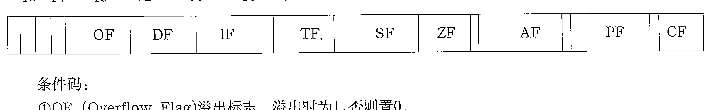

- 条件码：
  1. **OF**（Overflow Flag）溢出标志。溢出时为 1，否则置 0。
  2. **SF**（Sign Flag）符号标志。结果为负时置 1，否则置 0。
  3. **ZF**（Zero Flag）零标志，运算结果为 0 时 ZF 位置 1，否则置 0。
  4. **CF**（Carry Flag）进位标志，进位时置 1，否则置 0。
  5. **AF**（Auxiliary Carry Flag）辅助进位标志，记录运算时第 3 位（半个字节）产生的进位量。有进位时置 1，否则置 0。
  6. **PF**（Parity Flag）奇偶标志。结果操作数中 1 的个数为偶数时置 1，否则置 0。

控制标志位：

7. **DF**（Direction Flag）方向标志，在串处理指令中控制信息的方向。  
8. **IF**（Interrupt Flag）中断标志。  
9. **TF**（Trap Flag）陷阱标志。

以上讲的都是 8、16 位的寄存器，32 位的区别不大，下面简单地介绍一下。

- 通用寄存器
  - AH/AL，AX（EAX）：累加器
  - BH/BL，BX（EBX）：基址
  - CH/CL，CX（ECX）：计数器
  - DH/DL，DX（EDX）：数据
  - （FS）：386 新增的段寄存器
  - （Exx）：为 386 新增的 32 位寄存器
  - （GS）：386 新增的段寄存器
  - 段寄存器和 8、16 位的寄存器相同。

- 指针寄存器
  - SI（ESI）：源索引指针
  - SP（ESP）：栈指针
  - DI（EDI）：目的索引指针
  - BP（EBP）：基址指针
  - IP：指令指针

首先必须强调的是，在用 32 位汇编语言编程的时候，所有的地址偏移量都是 32 位的，在寻址时千万不要还用原来的 16 位方式。

| 基地址寄存器 | 默认的段寄存器 |
|---|---|
| BP or SP | SS |
| SI or DI | DS |
| DI strings | ES |
| SI strings | DS |

#### 2.1.2 寻址方式

我们知道程序最终是通过执行指令序列来解决问题的，而指令必须对操作数地址进行寻址，采用什么样的寻址方式会对程序运行的速率和效率造成影响。什么？跑题了！别急，下面就言归正传。

- 1. 立即寻址方式：操作数直接放在指令中，作为指令的一部分存放在代码段里，也称立即数寻址。例：`MOV AL,5`
- 2. 寄存器寻址方式：操作数在寄存器中，指令指定寄存器号。例：`MOV AX,BX`
- 3. 直接寻址方式：汇编中把操作数的偏移地址称为有效地址EA，直接寻址方式时，EA就作为指令的一部分。例：`MOV AX,[2000]`
- 4. 寄存器间接寻址方式：操作数的有效地址在基址寄存器BX、BP或变址寄存器SI、DI中，而操作数则在存储器中。例：`MOV AX,[BX]`
- 5. 变址寻址方式：操作数的有效地址是一个基址或变址寄存器的内容和指令中指定的位移量之和。例：`MOV AX,COUNT[SI]`
- 6. 基址变址寻址方式：操作数的有效地址是一个基址寄存器和一个变址寄存器的内容之和，两个寄存器均由指令指定。例：`MOV AX,[BX][DI]`

下面的寻址方式和转移地址有关，用来确定转移指令及CALL指令的转向地址。

- 7. 段内直接寻址：转向的有效地址是当前IP寄存器的内容和指令中指定的位移量之和。例：`JMP PTR PROG1A`
- 8. 段内间接寻址：转向有效地址是一个寄存器或是一个寄存单元的内容。单元的内容可用数据寻址中除立即数之外的任何一种寻址方式获得。  
  例：假设`(DS)=2000H (BX)=1256H (SI)=528H 位移量=20AH (232F7H)=3280H (263E5H)=2450H`；`JMP BX`执行该指令后`(IP)=1256H`；`JMP [BX][SI]`执行该指令后`(IP)=3280H`
- 9. 段间直接寻址：指令中直接提供了转向段地址和偏移地址，要用指令中指定的偏移地址取代IP寄存器的内容。例：`JMP FAR PTR NEXTROUTINT`
- 10. 段间间接寻址：用存储器的两个相继字的内容来取代IP和CS寄存器的原始内容以达到段间转移的目的。例：`JMP DWORD PTR [INTERS+BX]`

#### 2.1.3 汇编指令集

当我们对软件进行反汇编的时候，面对的都是一行行的汇编指令，如果你对这些指令不熟悉，那你还是先静下心来研究下面的这些指令吧，它是你进入破解天堂的钥匙。

### 1. 数据传送指令集

`MOV`  
功能：把源操作数送给目的操作数  
语法：`MOV 目的操作数,源操作数`  
格式：`MOV r1,r2` `MOV r,m` `MOV m,r` `MOV r,data`

`XCHG`  
格式：`XCHG r1,r2` `XCHG m,r` `XCHG r,m`  
功能：交换两个操作数的数据  
语法：`XCHG`

`PUSH,POP`  
格式：`PUSH r` `PUSH m` `PUSH data` `POP r` `POP m`  
`PUSHF,POPF,PUSHA,POPA`  
格式：`PUSHF` `POPF` `PUSHA` `POPA`  
功能：把操作数压入或取出堆栈  
语法：`PUSH 操作数` `POP 操作数`  
功能：堆栈指令群  
格式：`PUSHF` `POPF` `PUSHA` `POPA`

`LEA,LDS,LES`  
格式：`LEA r,m` `LDS r,m` `LES r,m`  
功能：取地址至寄存器

`XLAT(XLATB)`  
格式：`XLAT` `XLAT m`  
功能：查表指令  
语法：`XLAT` `XLAT m`

##### 2. 算术运算指令

`ADD,ADC`  
语法：`ADD OP1,OP2` `ADC OP1,OP2`  
格式：`ADD r1,r2` `ADD r,m` `ADD m,r` `ADD r,data`  
功能：加法指令  
影响标志：`C,P,A,Z,S,O`

`SUB,SBB`  
语法：`SUB OP1,OP2` `SBB OP1,OP2`  
格式：`SUB r1,r2` `SUB r,m` `SUB m,r` `SUB r,data` `SUB m,data`  
功能：减法指令  
影响标志：`C,P,A,Z,S,O`

`INC,DEC`  
语法：`INC OP` `DEC OP`  
格式：`INC r/m` `DEC r/m`  
功能：把OP的值加一或减一  
影响标志：`P,A,Z,S,O`

`NEG`  
语法：`NEG OP`  
格式：`NEG r/m`  
功能：将OP的符号反相（取二进制补码）  
影响标志：`C,P,A,Z,S,O`

`MUL, IMUL`  
功能：乘法指令  
语法：`MUL OP` `IMUL OP`  
格式：`MUL r/m` `IMUL r/m`  
影响标志：`C,P,A,Z,S,O`（仅IMUL会影响S标志）

`DIV, IDIV`  
功能：除法指令  
语法：`DIV OP` `IDIV OP`  
格式：`DIV r/m` `IDIV r/m`

`CBW, CWD`  
功能：有符号数扩展指令  
语法：`CBW` `CWD`

`AAA, AAS, AAM, AAD`  
功能：非压缩BCD码运算调整指令  
语法：`AAA` `AAS` `AAM` `AAD`  
影响标志：`A,C(AAA,AAS)` `S,Z,P(AAM,AAD)`

`DAA, DAS`  
功能：压缩BCD码调整指令  
语法：`DAA` `DAS`  
影响标志：`C,P,A,Z,S`

### 3. 位运算指令集

`AND, OR, XOR, NOT, TEST`  
功能：执行BIT与BIT之间的逻辑运算  
语法：`AND r/m,r/m/data` `OR r/m,r/m/data` `XOR r/m,r/m/data` `TEST r/m,r/m/data` `NOT r/m`  
影响标志：`C,O,P,Z,S`（其中C与O两个标志会被设为0），`NOT`指令不影响任何标志位

`SHR, SHL, SAR, SAL`  
功能：移位指令  
语法：`SHR r/m,data/CL` `SHL r/m,data/CL` `SAR r/m,data/CL` `SAL r/m,data/CL`  
影响标志：`C,P,Z,S,O`

`ROR, ROL, RCR, RCL`  
功能：循环移位指令  
语法：`ROR r/m,data/CL` `ROL r/m,data/CL` `RCR r/m,data/CL` `RCL r/m,data/CL`  
影响标志：`C,P,Z,S,O`

### 4. 程序流程控制指令集

`CLC, STC, CMC`  
功能：设定进位标志  
语法：`CLC` `STC` `CMC`  
标志位：`C`

`CLD, STD`  
功能：设定方向标志  
语法：`CLD` `STD`  
标志位：`D`

`CLI, STI`  
功能：设置中断标志  
语法：`CLI` `STI`  
标志位：`I`

`CMP`  
功能：比较OP1与OP2的值  
语法：`CMP r/m,r/m/data`  
标志位：`C,P,A,Z,O`

`JMP`  
功能：跳往指定地址执行  
语法：`JMP 地址`

`JXX`  
功能：当特定条件成立则跳往指定地址执行  
语法：`JXX 地址`  
注：有关跳转指令的详细内容请看第五小节。

`LOOP`  
功能：循环指令集  
语法：`LOOP 地址`  
`LOOPE(Z) 地址`  
`LOOPNE(Z) 地址`  
标志位：无

`CALL, RET`  
功能：子程序调用、返回指令  
语法：`CALL 地址` `RET` `RET n`  
标志位：无

`INT, IRET`  
功能：中断调用及返回指令  
语法：`INT n` `IRET`  
标志位：在执行INT时，CPU会自动将标志寄存器的值入栈，在执行IRET时则会将堆栈中的标志值弹回寄存器

### 5. 字符串操作指令集

`MOVSB, MOVSW, MOVSD`  
功能：字符串传送指令  
语法：`MOVSB` `MOVSW` `MOVSD`  
标志位：无

`CMPSB, CMPSW, CMPSD`  
功能：字符串比较指令  
语法：`CMPSB` `CMPSW` `CMPSD`  
标志位：`C,P,Z,S,O`

`SCASB, SCASW`  
功能：字符串搜索指令  
语法：`SCASB` `SCASW`  
标志位：`C,P,Z,S,O`

`LODSB, LODSW, STOSB, STOSW`  
功能：字符串载入或存储指令  
语法：`LODSB` `LODSW` `STOSB` `STOSW`  
标志位：无

`REP, REPE, REPNE`  
功能：重复前缀指令集  
语法：`REP 指令S` `REPE 指令S` `REPNE 指令S`  
标志位：依指令S而定

#### 2.1.4 伪操作

汇编语言的语句除了指令之外还有伪操作，伪操作又称为伪指令，它不像机器指令那样是在程序运行期间由计算机来执行的，它是在汇编程序对源程序汇编期间由汇编程序处理的操作，它可以完成如数据定义、分配存储区、指示程序结束等功能。我们这里说明一些常用的伪指令。

##### 1. 数据定义及存储器分配伪操作

这一类伪操作的格式是：

```asm
[Variable]  Mnemonic  operand, ..., operand  [; Comments]
```

其中变量（Variable）字段是可有可无的，它用符号地址表示，其作用与指令语句前的标号相同，但它的后面不跟冒号。如果语句中有变量，则汇编程序使其标记第一个字节的偏移地址。注释（Comments）字段用来说明该伪操作的功能，它也是可有可无的。助记符（Mnemonic）字段说明所用伪操作的助记符，常用的有以下几种：

DB伪操作用来定义字节，其后的每个操作数都占有一个字节。  
DW伪操作用来定义字，其后的每个操作数占有一个字（低位字节在第一个字节地址中，高位字节在第二个字节地址中）。  
DD伪操作用来定义双字，其后的每个操作数占有一个字。  
DQ伪操作用来定义四字，其后的每个操作数占有四个字。  
DT伪操作用来定义十个字节，其后的每个操作数占有10个字节，形成压缩的BCD码。

### 2. 表达式赋值伪操作EQU

有时程序中多次出现同一个表达式，为方便起见可以用赋值伪操作给表达式赋予一个名字。其格式如下：`Expression_name EQU Expression`。此后，程序中凡需要用到该表达式之处就可以用表达式名来代替了。上述中的表达式可以是任何有效的操作数格式，可以是汇编可以求出常数值的表达式，也可以是任何有效的助记符。

```asm
CONSTANT EQU 256
DATA EQU HEIGHT+12
ALPHA EQU 7
BETA EQU ALPHA-27-2-5
ADDR EQU VAR+BETAADDR
```

必须注意EQU语句的表达式中如果有变量或标号的表达式，则在该语句前应该先给出它们的定义。例如，语句：

```asm
AB EQU DATAONE+2
```

则必须放在`DATAONE`的定义之后才行，否则汇编程序将指示出错。  
另外还有一个与EQU相类似的伪操作`=`也可以作为赋值伪操作使用。它们之间的区别是EQU伪操作中的表达式名不允许重复定义，而`=`伪操作则允许重复定义。

##### 3. 段定义伪操作

存储器的物理地址是由段地址和偏移地址组合而成的，汇编程序在把源程序转换为目标程序时，必须确定标号和变量的偏移地址，并且需要把有关信息通过目标模块传送给连接程序，以便连接程序把不同的段和模块连接在一起形成一个可执行程序。为此，需要用段定义伪操作，段定义伪操作的格式如下：

```asm
segment name SEGMENT
.
.
.
segment name ENDS
```

其中省略号部分，对于数据段、附加段和堆栈段来说，一般是存储单元的定义、分配等伪操作；对于代码段则是指令及伪操作。

##### 4. 程序开始和结束伪操作

在程序的开始可以用NAME或TITLE为模块取名字，NAME的格式是：

```asm
NAME Module_name
```

汇编程序将以给出的`module_name`作为模块的名字。如果程序中没有NAME伪操作，则也可使用TITLE伪操作，其格式为：

```asm
TITLE text
```

TITLE伪操作可指定每一页上打印的标题。

##### 5. 对准伪操作

EVEN伪操作使下一个字节地址成为偶数。一个字的地址最好从偶地址开始，所以对于字数组，为保证其从偶地址开始，可以在它前面用EVEN伪操作来达到这一目的。

##### 6. 基数控制伪操作

汇编语言默认的数为十进制数，因而除非专门指定，汇编把程序中出现的数均看作十进制数。当要用其他基数表示常数时，就需要专门的标记。

`.RADIX`可以把默认的基数改变为2～16范围内的任何基数。格式：`.RADIX expression`，其中表达式用来表示基数值（用十进制表示）。

例：

```asm
MOV BX,0FFH
MOV BX,178
```

与

```asm
.RADIX 16
MOV BX,0FF
MOV BX,178D
```

是等价的。

#### 2.1.5 跳转指令小结

##### 1. 直接标志转移

| 指令格式 | 机器码 | 测试条件 | 如…则转移 | 指令格式 | 机器码 | 测试条件 | 如…则转移 |
|---|---|---|---|---|---|---|---|
| JC | 72 | C=1 | 有进位 | JNS | 79 | S=0 | 正号 |
| JNC | 73 | C=0 | 无进位 | JO | 70 | O=1 | 有溢出 |
| JZ/JE | 74 | Z=1 | 零/等于 | JNO | 71 | O=0 | 无溢出 |
| JNZ/JNE | 75 | Z=0 | 不为零/不等于 | JP/JPE | 7A | P=1 | 奇偶位为偶 |
| JS | 78 | S=1 | 负号 | JNP/JPO | 7B | P=0 | 奇偶位为奇 |

##### 2. 间接标志转移

| 指令格式 | 机器码 | 测试条件 | 如…则转移 |
|---|---|---|---|
| JA/JNBE（比较无符号数） | 77 | C或Z=0 | > 高于/不低于或等于 |
| JAE/JNB（比较无符号数） | 73 | C=0 | >= 高于或等于/不低于 |
| JB/JNAE（比较无符号数） | 72 | C=1 | < 低于/不高于或等于 |
| JBE/JNA（比较无符号数） | 76 | C或Z=1 | <= 低于或等于/不高于 |
| JG/JNLE（比较带符号数） | 7F | (S异或O)或Z=0 | > 大于/不小于或等于 |
| JGE/JNL（比较带符号数） | 7D | S异或O=0 | >= 大于或等于/不小于 |
| JL/JNGE（比较带符号数） | 7C | S异或O=1 | < 小于/不大于或等于 |
| JLE/JNG（比较带符号数） | 7E | (S异或O)或Z=1 | <= 小于或等于/不大于 |

### 3. 无条件转移指令JMP

| 指令格式 | 执行操作 | 机器码 | 说明 |
|---|---|---|---|
| 段内直接短转移 `jmp short` | (IP)←(IP)+8位位移量 | EB | 转移范围-128到+127字节 |
| 段内直接近转移 `jmp near` | (IP)←(IP)+16位位移量 | E9 | 转移到段内的任一位置 |
| 段内间接转移 `jmp word` | (IP)←(有效地址EA) | FF |  |
| 段间直接（远）转移 `jmp far` | (IP)←(偏移地址)，(CS)←(段地址) | EA |  |
| 段间间接转移 `jmp dword` | (IP)←(EA)，(CS)←(EA+2) | FF |  |

### 2.2 破解常用概念

- 1. 断点：所谓断点就是程序被中断的地方。
- 2. 中断：中断就是由于有特殊事件（中断事件）发生，计算机暂停当前的任务（即程序），转而去执行另外的任务（中断处理程序），然后再返回原先的任务继续执行。
- 3. 中断向量：中断向量就是中断处理程序的入口地址。
- 4. 领空：所谓程序的领空，说白了就是程序自己的地方，也就是程序自己的代码所处的位置。
- 5. API函数：即Application Programming Interface的简写，中文叫应用程序编程接口，是一个系统定义函数的大集合，它提供了访问操作系统特征的方法。API包含了几个应用程序调用的函数，这些函数执行所有必须的与操作系统相关的操作，如内存分配、向屏幕输出和创建窗口等；用户的程序通过调用API接口同Windows打交道。无论什么样的应用程序，其底层最终都是通过调用各种API函数来实现各种功能的。通常API有两种基本形式：Win16和Win32。Win16是原来的API的16位版本，用于Windows 3.1；Win32是现在的API的32位版本，用于Windows 95/98/NT/ME/2000。Win32包括了Win16，是Win16的超集，大多数函数的名字、用法都是相同的。16位的API函数和32位的API函数的区别在于最后一个字母。
- 6. 完全破解：如果我们能通过对程序的跟踪找到正确的注册码，通过软件本身的注册功能正常注册了软件，这样的破解称之为完全破解。
- 7. 暴力破解：如果有些软件本身没有提供注册功能，只是提供试用（DEMO），或是注册不能通过软件本身进行（例如需要获取另外一个专用的注册程序，通过Internet的注册等等），或者是软件本身的加密技术比较复杂，软件破解者的能力、精力、时间有限，不能直接得到正确的注册码，此时我们需要去修改软件本身的代码，即人为改变软件的运行方向，这样的破解称之为暴力破解。

### 2.3 破解基本知识

#### 一、常用断点

- 1）万能断点
  - `bpx hmemcpy`  拦截内存拷贝动作
  - `bpx Lockmytask`  拦截按键的动作

- 2）拦截窗口
  - `bpx CreateWindow`  创建窗口
  - `bpx CreateWindowEx(A)`  创建窗口
  - `bpx ShowWindow`  显示窗口
  - `bpx UpdateWindow`  更新窗口
  - `bpx GetWindowText(A)`  获取窗口文本

- 3）拦截消息框
  - `bpx MessageBox(A)`  创建消息框
  - `bpx MessageBoxExA`  创建消息框
  - `bpx MessageBoxIndirect(A)`  创建定制消息框

- 4）拦截对话框
  - `bpx DialogBox`  创建模态对话框
  - `bpx DialogBoxParam(A)`  创建模态对话框
  - `bpx DialogBoxIndirect`  创建模态对话框
  - `bpx DialogBoxIndirectParam(A)`  创建模态对话框
  - `bpx CreateDialog`  创建非模态对话框
  - `bpx CreateDialogParam(A)`  创建非模态对话框
  - `bpx CreateDialogIndirect`  创建非模态对话框
  - `bpx CreateDialogIndirectParam(A)`  创建非模态对话框
  - `bpx GetDlgItemTextIf(A)`  获取对话框文本
  - `bpx GetDlgItemInt`  获取对话框整数值

- 5）拦截注册表
  - `bpx RegOpenKey(A)`  打开子键（例：`bpx RegOpenKey(A) if *(esp+8)=='****'`）
  - `bpx RegOpenKeyEx`  打开子键（例：`bpx RegOpenKeyEx if *(esp+8)=='****'`）
  - `bpx RegQueryValue(A)`  查找子键（例：`bpx RegQueryValue(A) if *(esp+8)=='****'`）
  - `bpx RegQueryValueEx`  查找子键（例：`bpx RegQueryValueEx if *(esp+8)=='****'`）
  - `bpx RegSetValue(A)`  设置子键（例：`bpx RegSetValue(A) if *(esp+8)=='****'`）

bpx RegSetValueEx(A) 设置子键（例：bpx RegSetValueEx(A) if *(esp+8)==“****”）  
“****”为指定子键名的前4个字符，如子键为“Regcode”，则“****”==“Regc”。

##### 6）拦截时间

- bpx GetLocalTime 获取本地时间
- bpx GetSystemTime 获取系统时间
- bpx GetFileTime 获取文件时间
- bpx GetTickCount 获得自系统成功启动以来所经历的毫秒数
- bpx GetCurrentTime 获取当前时间（16位）
- bpx SetTimer 创建定时器
- bpx TimerProc 定时器超时回调函数

##### 7）拦截文件

- bpx CreateFileA 创建或打开文件（32位）
- bpx OpenFile 打开文件（32位）
- bpx ReadFile 读文件（32位）
- bpx WriteFile 写文件（32位）
- bpx _lcreat 创建或打开文件（16位）
- bpx _lopen 打开文件（16位）
- bpx _lread 读文件（16位）
- bpx _lwrite 写文件（16位）
- bpx _hread 读文件（16位）
- bpx _hwrite 写文件（16位）

##### 8）拦截驱动器

- bpx GetDriveType(A) 获取磁盘驱动器类型
- bpx GetLogicalDrives 获取逻辑驱动器符号
- bpx GetLogicalDriveStringsA 获取当前所有逻辑驱动器的根驱动器路径

## 9）拦截狗

- bpio -h 378（或278、3BC）R 378、278、3BC是并行打印端口
- bpio -h 3F8（或2F8、3E8、2E8）R 3F8、2F8、3E8、2E8是串行端口

##### 10）拦截特殊指令

- bpx if ((byte)*eip==c3) 拦截ret指令

#### 二、常见代码

```
CALL ****
TEST EAX,EAX
JNZ ****（或JZ ****）
```

从以往的经验来看，90%以上的软件，其关键代码都是以上三条指令，只是具体的值不同而已。其中，CALL **** 的作用通常是调用验证子程序，而验证子程序通常是验证输入的信息是否合法（比如：验证是否是盗版，验证是否过了试用期，验证是否存放有光碟，且是否是正确的含有特征字符的光碟等）。

TEST EAX,EAX 的作用是用来测试验证子程序的返回值的，JNZ（或JNE）**** 是用来判断输入是否合法，合法则执行真正有用的程序代码，不合法则给出提示并退出程序。

#### 三、常用汇编语言

| 8位跳转指令 | 机器码 | 跳转条件 |
|---|---|---|
| JC | 72 | C=1 |
| JNC | 73 | C=0 |
| JZ/JE | 74 | Z=1 |
| JNZ/JNE | 75 | Z=0 |
| JMP | EB | 无条件 |

| 16位跳转指令 | 机器码 | 跳转条件 |
|---|---|---|
| JC | 0F82 | C=1 |
| JNC | 0F83 | C=0 |
| JZ/JE | 0F84 | Z=1 |
| JNZ/JNE | 0F85 | Z=0 |
| JMP | E9 | 无条件 |

| 特殊指令 | 机器码 |
|---|---|
| PUSHF | 9C |
| PUSH **** | 68****（****代表具体的数值） |
| POPF | 9D |
| NOP | 90 |
| RET | C3 |

#### 四、破解思维

我们现在知道软件是通过判断指令来判别其输入是否合法，合法则转主程序执行，非法则弹出警告框后退出。假如在输入非法时，我们只需要更改其判别标志位（通常是C位），就可以让其认为输入合法而得以继续运行下去。但更改标志位需启动调试软件，且每次运行程序时都要更改，因此我们可以采用暴力破解的方式，用更改跳转指令的方法来更改软件，这样就免去每次都要修改之苦了。最简单的更改方法是使跳转反向，即若输入错误，则程序将转向改为不转向；若其不转向改为转向。

但这也有所局限。例如：有些游戏软件玩游戏时需放入光碟，按以上方法修改后就不需要放入光碟了，可是有时不经意地放入了正确的光碟反而不能玩了。究其原因是因为游戏软件将验证光驱中是否有碟，以及碟片是否合法合成了一个例程来验证，改为反向后，有碟（碟片正确与否不重要）就变成了无碟，从而转向去执行不合法的指令了。

更好的方法是使其判别失效，即输入不合法不要跳转，改为无条件跳转（即改为不合法则跳转）；输入不合法时要跳转的情况，因其合法时不要跳转，我们将其改为空操作（90）或跳转至下一条指令即可（即改为不合法则不跳转）。

```
具体操作如下：

反向操作：
74    改    75
75    改    74
0F84  改    0F85
0F85  改    0F84

合法则跳转改无条件跳转操作：
74或75        改        EB
0F84或0F85    改        90E9

合法不跳转改跳转至下一条指令操作：
```

## 加密解密技术

- 74或75** 将**改00即可（**为跳转地址占用1个字节）
- 0F84或0F85** 将**改00即可（注意：**占用4个字节）
- 合法不跳转改空操作：
- 74或75** 改为9090即可（**占用1个字节）
- 0F84或0F85** 改为909090909090即可（**占用4个字节）

到此为止，该了解的基础知识我们差不多都已经全部提到了，很简单不是？剩下的就是该你自己去多多找破解工具、软件实践了。只有这样，你才能不断积累宝贵的经验，成为一个真正的Cracker。

## 第三章 最简单的逆向工程

### 3.1 走近逆向工程

前面基础知识的介绍相信看得大家有点不耐烦了吧？想真刀真枪地来自己亲手跟踪一个软件试试了？好，现在我们就来一次手把手的教学，正式走入逆向工程的殿堂。

逆向工程一般是利用调试器，从汇编代码的级别研究软件的运行机制。所以，对于汇编语言的掌握和调试器使用的熟练程度，很大程度上决定了逆向工程研究的顺利与否。所以，我会在讲解中穿插一些Win32Asm的具体知识，希望能对大家理解代码有帮助。关于Win32Asm的具体资料，公开出版的不太多，据我所知，市面上只有一本地质出版社出版的《Windows环境下汇编语言程序设计》是具体讲述Win32Asm的。

ChinaPub和华储都有邮购，需要的朋友可以去了解一下具体的情况。我在这里只将一些最基本的东西讲清楚，有利于后文对于具体代码的理解。

由于大家是第一次入门，我们就从静态反汇编开始，一步步地深入逆向工程这个领域，文中所用到的工具可以在光盘中找到。如果你想要一些版本较新的工具，你可以从一些破解网站下载。其实这个调试器比Soft-ICE小巧、简单，不过功能却一点都不输给Soft-ICE，唯一的缺点就是不支持Windows 98以上的操作系统（Win2000、WinXP等）。版本的升级主要是针对兼容性的，具体的操作并没有不同。

### 3.2 静态反汇编分析

我们现在第一个最简单的目标是Crackme01。

对于比较简单的保护体系，静态反汇编分析往往比动态跟踪调试更快找到保护体系的关键点。所以，我们先来静态分析一下Crackme01。

在静态反汇编工具选择上，对于简单的保护体系，没有必要选择IDA Pro这种专家级的反汇编器，W32Dasm就足够了。打开W32Dasm，我们可以见到界面如图3-1。

点击图中所示按钮，选择要反汇编的文件，我们在这里选择Crackme01.exe，选好后，W32Dasm自动开始反汇编的工作，反汇编完成后，界面如图3-2所示。

点击图中所示“串式数据参考”的按钮，就可以察看软件中的字符串资源。在Crackme01中，字符串资源很明显，大家一看就知道了。然后双击其中一个字符串资源，就可以跳到引用该字符串的地方。而对于大一些、复杂一些的软件的保护体系，我们需要有耐心，慢慢翻看“字符串参考”窗口中所有列出的字符串，找到和注册相关的信息（错误提示字符、注册名字、Register等“敏感”字符等），然后双击找到的字符串资源，就可以找到引用该字符串的地方。因为我们找的是和注册相关联的字符串，所以，找到的代码，十有八九也和软件的注册保护体系密切相关。对于简单的保护体系，找到一两处代码，差不多就可以看出个八九不离十；而对于大部分软件来说，其保护体系的强度都不算低，所以，需要我们找到多处代码，结合Win32Asm的知识，综合考虑各种情况、流程，从而把握住软件的保护流程。

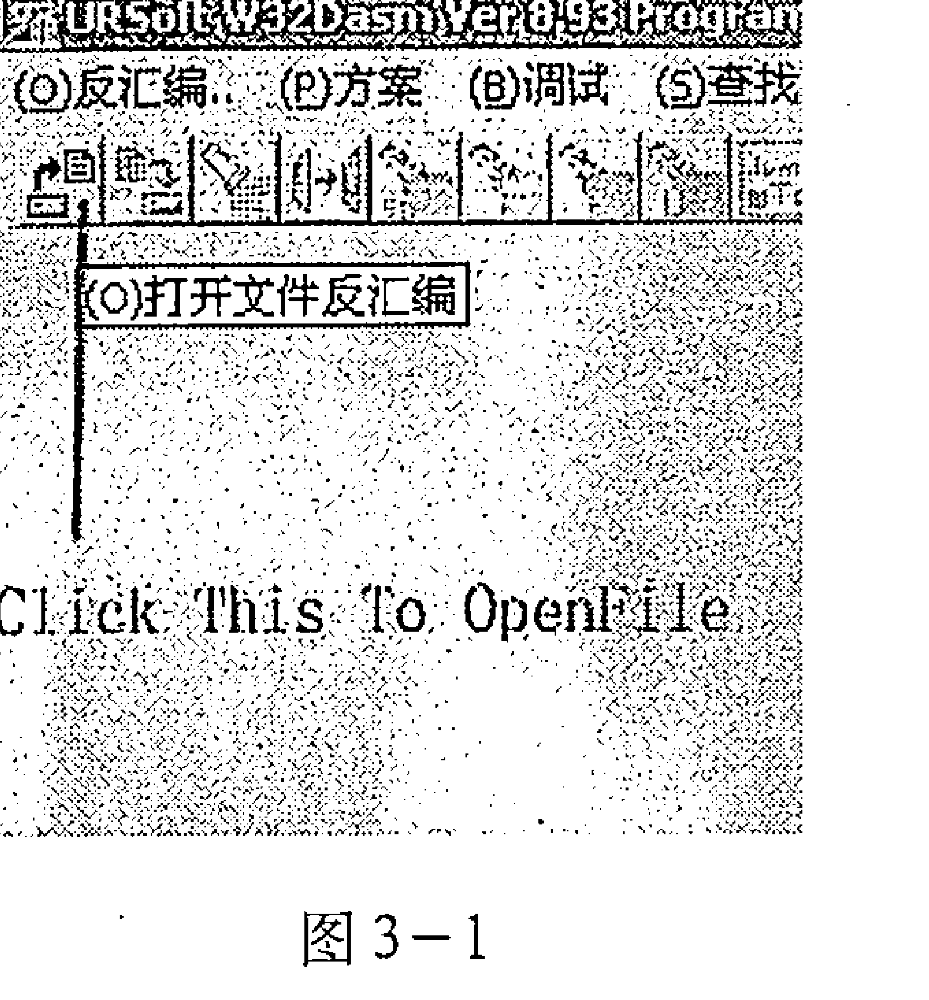

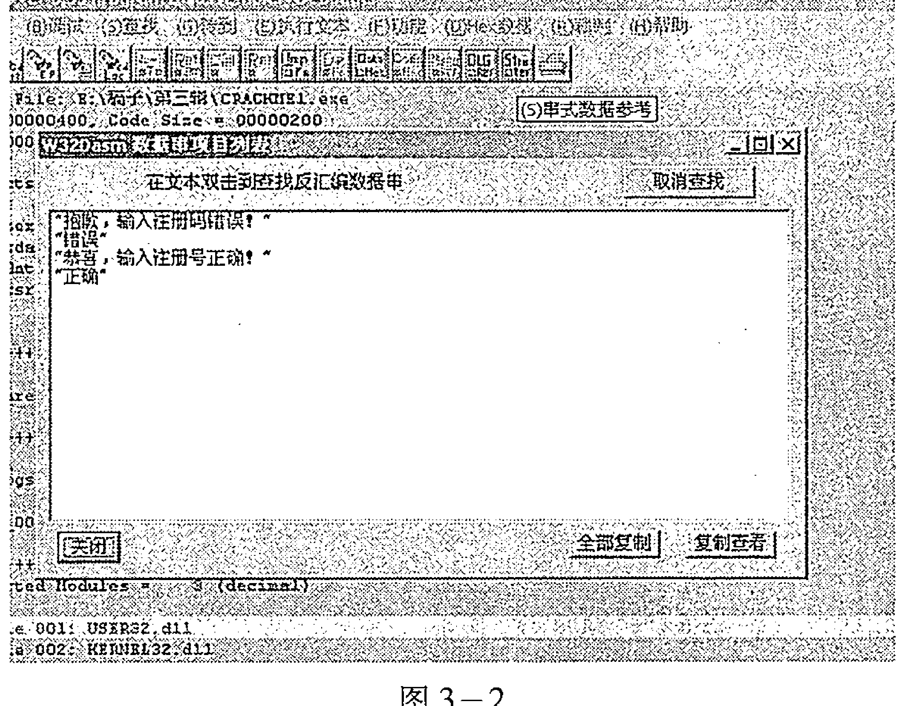

图3-1  
图3-2

对于Crackme01，我们双击“抱歉，输入的注册码错误”一项，可以看到如下代码：

```asm
:0040107E  push FFFFFFFF   ; 从Edit中获取字符最大长度
:00401080  push 00403038   ; 获取的字符缓冲区
:00401085  push 00000065   ; 要获取字符串的Edit控件的ID
:00401087  push [ebp+08]   ; 对话框的hWnd

* Reference To: USER32.GetDlgItemTextA, Ord:0102h

:0040108A  Call 0040113E   ; 调用GetDlgItemTextA获取字符串
:0040108E  lea esi, dword ptr [00403038]
:00401095  lea edi, dword ptr [0040309C]
:0040109B  push edi
:0040109C  push esi

* Reference To: KERNEL32.lstrcmpA, Ord:02D0h

:0040109D  Call 00401162   ; 字符串比较
:004010A2  test eax, eax
:004010A4  je 004010C7     ; 结果相等，则跳转
:004010A6  push 00000000

* Possible StringData Ref from Data Obj -> "错误"

:004010A8  push 00403017

* Possible StringData Ref from Data Obj -> "抱歉，输入注册码错误!"

:004010AD  push 00403000
:004010B2  push 00000000

* Reference To: USER32.MessageBoxA, Ord:01BBh

:004010B4  Call 0040114A
```

```
004010B9  mov eax, 00000000  ; 以下为堆栈调整
004010BE  pop ecx
004010BF  pop edx
004010C0  pop esi
004010C1  pop edi
004010C2  pop ebx
004010C3  leave
004010C4  ret 0010
```

要大致看懂上面的代码，相信学过汇编的朋友都没有太大的问题。可是，Win32Asm和DOS下的汇编有着巨大的区别。为了让大家以后的学习更加轻松，我把上面的代码每一句都加上了注释，并且在这里做如下说明：

- 1. 基本上所有的Windows API调用的参数传递形式都是StdCall型，也就是说参数的压栈顺序是从右压到左。以最简单的MessageBox函数为例：在MSDN中，对MessageBox的描述是这样的：

```
int MessageBox(
    HWND   hWnd;      // handle to owner window
    LPCTSTR lpText;   // text in message box
    LPCTSTR lpCaption;// message box title
    UINT    uType;    // message box style
);
```

在StdCall的参数传递规则下，用Asm调用MessageBox的代码应该如下所示：

```
push uType
push lpCaption
push lpText
push hWnd
call MessageBox
```

大家看清楚了吗？从右到左，依次压栈。基本上，所有的WinAPI都可以照着这个规则用ASM来进行调用——只有一个例外：wsprintfA，这个函数的参数是不定的，具体情况可以参考罗云斌写的《汇编语言中参数传递的格式》一文（asm.yeah.net）。

- 2. 一个函数的返回值，基本上所有的编译器都会把函数的返回值放到EAX和EDX中来进行返回。返回值为32位的时候，放在EAX中；返回值为64位的时候，放在EDX:EAX中。

了解返回值的概念对于理解大部分软件的加密体系的工作原理是大有好处的。大部分软件的加密体系都遵循如下结构：

取得用户输入的注册码 → 变换 → 和软件内部条件对比 → 正确则注册成功，否则失败。

很明显，该流程最关键的一环就是“和软件内部条件对比”这一步。到底对比了以后，如何算是正确，如何算是错误呢？大部分的软件都是用一个子函数的返回值来代表正确或者错误的（比如：返回1表示正确，返回0表示错误）。而在跟踪调试的时候，我们看到的返回值，就是子程序出口处的EAX的值！所以，掌握了返回值的意义，就能很容易地了解保护体系的工作原理。

Win32Asm的基础讲解暂时到此为止，让我们回到我们的Crackme01。

很明显，程序在40108A处调用了GetDlgItemTextA函数来取得我们输入的注册码，存放在地址为403038的缓冲区里面。403038是怎么来的，根据我的注释可以看得很清楚吧？不需要再详细讲了吧？

紧接着，程序使用了lstrcmp的手段来进行注册码比较。在上面的代码里面，很明显，把我们输入的数据（地址为403038）和软件自身的数据（地址为40309C）进行了比较，根据比较的结果来确定注册正确与否。

那我们来看看地址为40309C的地址到底存放了什么数据呢？

看数据之前，让我们搞清楚一个概念：VA。

VA：虚拟地址。Windows运行于保护模式下面，每一个程序有自己独立的4GB地址空间。代码运行时，EIP指向的地址为保护模式下的地址，也即虚拟地址，要经过选择子转换和地址页表转换机制才能转化成为真正的物理地址。所以，在同一时刻，程序A和程序B可以同时运行于某个“相同的地址”。这在DOS下面是不可能发生的事情。我们在反汇编代码中看到的40309C等地址就是这个软件的虚拟地址——VA。

可是，知道了VA，在静态分析的时候，我们没有办法得到这个VA指向的数据是什么，因为16进制编辑工具只是提供了文件偏移——File Offset的数据查找功能，所以，我们需要把VA转换成为Offset。

- VA→Offset的转换，方法无非两种：  
  1. 手工转换。前提是你了解PE文件格式，对PE头、节首、RVA等概念了解深刻，然后就可以自己进行转换。  
  2. 借助软件转换。这个方法方便很多。W32Dasm本身就提供了VA→Offset的转换功能（见图3-3），大名鼎鼎的PEeditor、LordPE等也可以进行这种转换。

图3中所示的W32Dasm转换VA的方法有个缺陷，就是只能转换代码段的VA，而我们要转换的40309C在数据段当中，不能用这种方法转换，所以我们要用到LordPE这个对付PE文件的“核武器”的FLC功能。

- 详细的操作如下：  
  1. 打开LordPE，见到界面如图3-4所示。  
  2. 点击图中的“PE Editor”按钮，选择我们的Crackme01.exe以后，点击FLC，开始VA和Offset的转换。

输入我们要转换的VA的数据，看到界面如图3-5所示。  
注：该图中还有RVA一项，由于这个概念比较复杂，现在先不作介绍，以后介绍“壳”的时候，给大家详细说明。

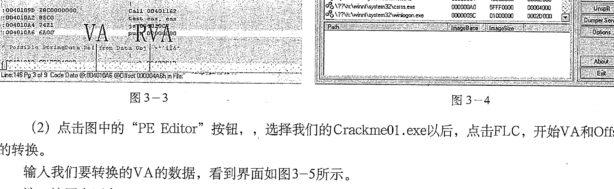

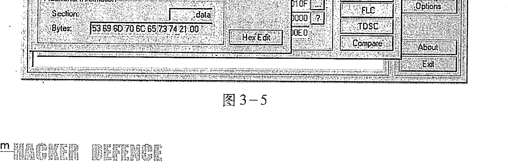

在图3-5中，我们可以看到VA=40309C的Offset=89C。在以前，我们就需要用89C这个数，到WinHex中查看该地址的数据。可是，现在的LordPE给我们提供了非常方便的HexEdit功能，只要点击图中所示的“Hex Edit”按钮，就可以看到图3-6。

图3-6中，我们很清楚地看到40309C存放的数据是：“Simplest!”。所以，该Crackme的注册码就是Simplest! 输入Simplest!后，可以看到注册成功的界面如图3-7所示。

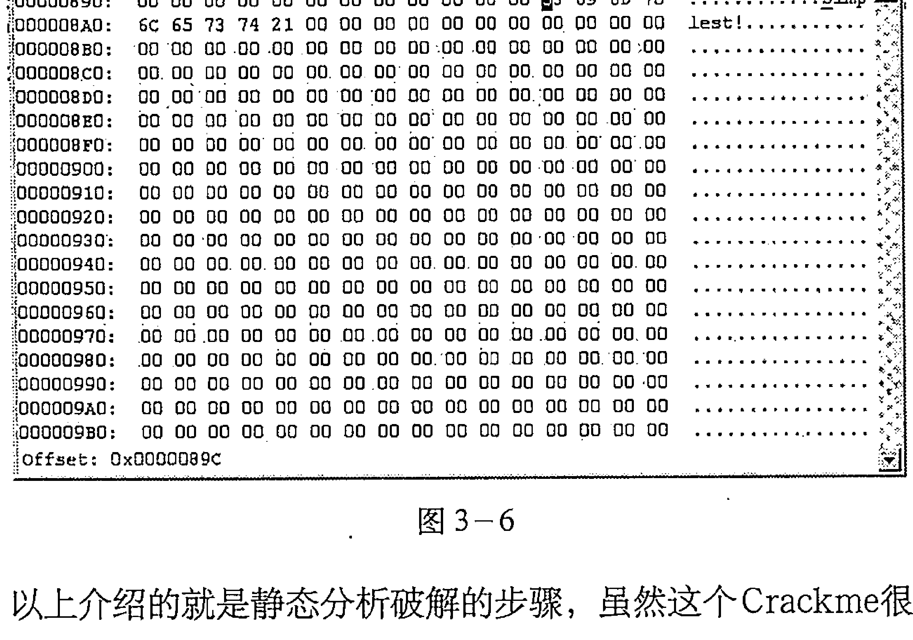

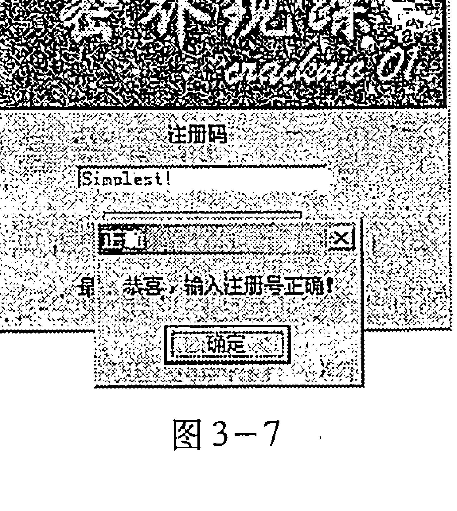

图3-6  
图3-7

以上介绍的就是静态分析破解的步骤。虽然这个Crackme很简单，但是，在解决这个Crackme的过程中，我们的Crack思路、使用的工具、分析问题的方法、最后解决问题的手段，都是静态分析软件最基础的东西。大家照着上面的步骤亲自操作一次，一定能体会到其中的乐趣，也一定能有自己新的独特的理解。

很多接触过Crackme工具的读者一定知道，静态反汇编的工具最强大的要属IDA，W32Dasm只是小巧、好用。不过由于这个Crackme是入门级的，保护体系极其简单，所以，我们没有必要请出IDA这位老大哥，用W32Dasm进行分析就足够了。等以后分析到复杂Crackme的时候，我自然会采用IDA作为分析的工具，给大家讲解IDA的使用。

### 3.3 动态跟踪技术

静态分析完了，下面我们进入动态跟踪的环节，看看用调试器动态调试是如何一步步搞清楚软件流程的。

由于TRW的使用大部分都是字符界面操作，类似于DOS命令一样的东西，所以，这里就不抓很多图给大家了。不过，就一个调试器来说，界面上面的操作都是非常简单的，就是强大如Soft-ICE也不例外。关键就是进入调试环境以后，要自己输入种种命令，来达到自己特殊目的这一点很复杂。

Soft-ICE的使用手册有上百页，大部分都是讲解各个命令的作用、参数、使用方法、注意事项等等。要熟悉这些命令，只有自己多动手、亲自实践，才能真正掌握。TRW和Soft-ICE的命令大部分都兼容，所以，学会了其中一个，另一个肯定也能迅速上手。我们这里以TRW为例。

用TRW调试软件，有2种模式：

- 1. 用它的Browse按钮，选择待调试的文件，然后点击Load，TRW载入待调试文件，进入调试状态。
- 2. 在TRW中设置合适的断点，一旦待调试文件进行某种操作，就会触发我们设置的断点，我们就可以从设断的地方开始跟踪。

方法一和方法二各有优缺点，使用的场合不相同。方法一一般用于脱壳和软件自身CRC校验等需要从软件运行开始就一直跟踪的情形，方法二则适合于我们对该软件的某一部分特别感兴趣，需要从某个特定的地方开始跟踪的情形。很明显，在对付注册码判断的软件保护体系的判断中，我们采用方法二是最适合的。

方法二运用的成功与否，80%取决于断点设置的好坏。一个好用的断点，可以给调试工作带来极大的方便，节省大量的时间；而一个设置不对头的断点，会把人带入无穷无尽的代码丛林中，迷失方向，找不到自己的出路，最后只有无功而返。所以，进入下面的讲解之前，我们先讲讲断点设置问题。

#### 问题一：什么是断点

我们把软件运行比作一条流动的河流，断点就相当于我们在河流上修筑的大坝。我们可以用大坝进行发电，改变河流流向，储存河水等工作。同样，我们也可以在软件运行过程中感兴趣的地方设置断点，让软件运行到断点处就停下来，便于我们分析程序的走向，得到运行中的种种信息等。

#### 问题二：如何设置断点

每个调试器都有设置断点的功能，这是每个调试器必备的基础功能之一。TRW和Soft-ICE这两个调试器的命令很大程度上是兼容的，断点设置命令也不例外，所以在这里统一介绍。

- 1. **bpx：代码段断点**  
  软件的代码执行到断点处，触发断点。  
  举例：`bpx 401000` —— 在运行到401000的时候触发断点。

- 2. **bpm：数据段断点**  
  软件运行过程中，访问到被设置断点的数据时，触发断点。数据段断点分为读断点、写断点、读写断点3类，分别用`R`、`W`、`RW`表示。默认的数据段断点是读写断点。  
  举例：`bpm 40312C` —— 对地址40312C读写均触发断点。

- 3. **bpint：中断断点**  
  软件运行中，调用某号中断时触发该断点。DOS下面，软件基本上都是用中断服务完成自身功能。Windows下面，情况发生改变，软件大部分是调用Win API完成自身功能。不过，在某些特别的情况下，中断仍然有其强大的威力和作用（TRW不提供该功能，只有Soft-ICE才可以设置中断断点）。  
  举例：`bpint 3` —— 调用3号中断时触发断点。

- 4. **bpio：端口断点**  
  软件狗、智能卡等“硬件”保护体系，都需要对计算机的端口进行操作，只有对端口操作进行拦截，才能彻底分析清楚软件的流程和运行机制。端口断点就是特别为这方面需要而设置的，只要设置了某端口断点，对于该端口的任何操作都逃不过调试器的掌握。  
  举例：`bpio 378` —— 对378号端口进行操作时，触发断点。

- 5. **bmsg：消息断点**  
  特定的窗口接到一个特定消息的时候，触发该断点。  
  举例：`bmsg 017D WM_GETTEXT` —— 句柄为017D的窗口接到WM_GETTEXT消息时，触发断点。

## 问题三：如何让我的断点更有效率

- 1. 加强自己基础知识的学习，熟练掌握常用的API调用规则和参数。经常阅读MSDN中关于API的详细说明，是一条非常好的学习途径。
- 2. 运用调试器提供的“条件断点”功能。比如我现在要在一个循环1000次的算法中设置断点，我想让其循环到500次时触发中断，很明显，采取上面所说的简单地`bpx`设置一下是不行的，那样我们的前499次中断都是无用的中断，我们可以这样设置：

```asm
bpx 401000 if (ecx==500D)
```

这种“条件断点”的语法形式，TRW和Soft-ICE大部分也是一样，并且都是遵循着C语言的语法规则。

有编程基础的朋友很容易就能理解其中的含义。为了让大家更熟悉条件断点，下面再举几个例子：

```asm
例1. bpx CreateFileA do "d *(esp+4)"

bpx 40302C if (eax==78D || ecx==500D) do "? ebx"
```

调用CreateFileA的时候，执行`d *(esp+4)`命令。这样可以直接看到CreateFileA的FileName参数。

执行到40302C处时，如果EAX的值为78，或者ECX的值为500时，触发中断，并显示EBX中内容。

注意：调试器中，使用的数据都是十六进制值的，我们要输入十进制的78，所以要写`78D`；`500D`理由与其一样。

关于断点设置的进一步资料，可以参考国外的技术文献，国内只有吴荻湘曾经整理的一份断点设置列表还算详尽，其余的“断点大全”“断点指南”等都不足一观。

关于断点的问题，就介绍到这里，让我们回到TRW调试的技巧上面来。该Crackme的保护体系应该是这样的：

取得输入框中的数据→判断正误→显示判断结果。很明显，我们的断点应该设置在第一步或者第二步中。在这里，我们选择第一步。

程序要得到一个输入框中的数据，一般来说有3种方法：

- 1. 调用GetWindowTextA；
- 2. 调用GetDlgItemTextA；
- 3. 采用WM_GETTEXT消息：`SendMessage hWnd, WM_GETTEXT, TestNum, offset szText`。

前两种方法使用比较频繁，第3种很少见。而在Win98下面，GetWindowTextA和GetDlgItemTextA最后都要通过调用hmemcpy来实现，所以，我们只要设置断点`bpx hmemcpy`就可以断下该程序。正因为hmemcpy有如此的通用性，所以在Windows 98下面，hmemcpy被称为“万能断点”，大部分基于序列号保护的程序，都可以用hmemcpy断点得到关于保护机制的蛛丝马迹。

## 3.4 实战Crackme

理论部分到此为止，下面我们打开TRW，来一次现场实践操作。

- 1. 运行Crackme01，输入注册码：7654321。
- 2. 运行TRW，界面如图3-8所示，点击OK，TRW自动转换到后台，监视系统运行。

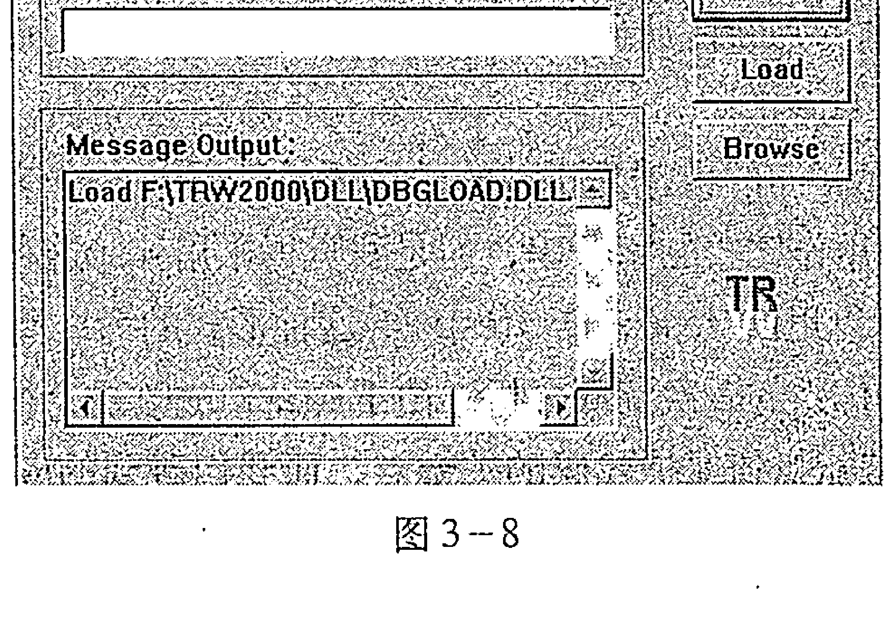

图3-8

- 3. 按TRW的快捷键Ctrl+N或者Ctrl+M呼出TRW的主界面，如图3-9。

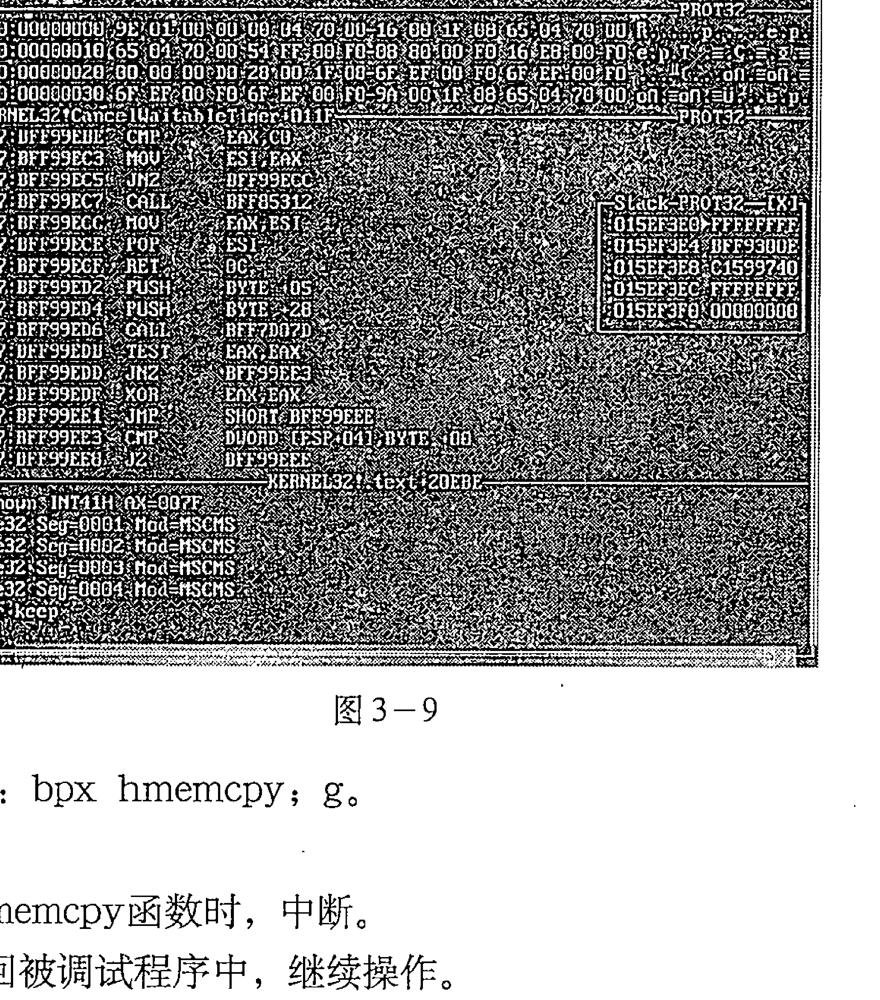

图3-9

- 4. 在TRW中，输入命令：`bpx hmemcpy; g`。

命令解释：

`bpx hmemcpy`：调用hmemcpy函数时，中断。  
`g`：退出TRW界面，返回被调试程序中，继续操作。

- 5. 点击Crackme01的“检验注册码正确性”按钮，TRW立刻弹出来。

程序在从输入框中取得数据的过程中，由于我们设置了hmemcpy断点，所以成功地截获了这一过程。现在我们是在系统代码的领空里面，而程序要进行判断，肯定是在程序自己的代码领空中。如何从系统代码回到程序代码呢？TRW提供了伟大的命令：`Pmodule`，这条命令的意思就是执行指令，一直到返回程序本身代码为止。我们执行完Pmodule后，返回到程序代码领空。

现在，我们要做的事情就是单步跟踪，仔细研究清楚程序的执行流程，从而破解其保护体系。对Crackme01来说，保护很明显，可以看到一个lstrcmp的调用。我们用F8或者F10的快捷键单步执行到lstrcmp处，下命令：`D *esp`和`D *(esp+4)`就可以看到我们输入的号码和用作比较的正确的序列号。

## 注释：

- 1. F8和F10都是单步的意思，不过一个是Step Into，一个是Step Over。这两个概念用中文很难表达，有人曾经用“宏单步”来表示Step Over，不过我觉得这种表示法仍然不好，所以，还是用英文的Step Into和Step Over表示。这两个到底有什么区别呢？

比如我有一条语句是`Call lstrcmp`。如果我用F10执行它，则会一直等到这个函数执行完，停留在下一条指令处；而如果我用F8执行它，则会一直跟进这个子程序中，一条一条汇编指令地执行。

很明显，对于系统API调用和一些无关紧要的子程序，我们应该用F10带过去，这样可以节省调试的时间，理清自己的思路；而对于很关键的判断注册码正确与否的关键判断子程序和算法子程序，我们一定要用F8进入子程序内部，仔细研究。

- 2. `D *esp`的意思是“显示以esp指向的数据为指针的数据区的数据”。在这个例子里面，我们当然也可以用`D esi`、`D edi`分别查看输入和用作比较的字符串，但是我觉得采用`*esp`这种形式查看更加通用一些。对于所有的API调用，我们都可以用`D *esp`、`D *(esp+4)`这种形式的命令查看到调用的参数。

以上就是对Crackme01.exe保护体系的一次彻底分析。由于Crackme01是个很小的程序，所以，我们在反汇编和动态跟踪的时候，很容易就能找到保护代码的关键点，而我们碰到的应用程序不可能体积这么小——最基本的应用程序也有400～500K大小。所以，如何找到保护体系的关键点，成为一个重要的课题。

还记得前面写过的一些在执行软件保护任务的代码中经常出现的汇编语句组合吗？对比一下这里的Crackme01，怎么样？发现有很多相同之处了吧？

最简单的序列号保护的Crackme就分析到这里。虽然得出来的结果非常简单，但是，分析出结果的过程中，我们的思路和用到的知识都是非常重要的逆向工程基础，希望大家好好品味这个简单的Crackme。

我把这个Crackme的源代码和它用到的所有资源都放到了光盘里面，如果想学习Win32Asm编程，这也是个最简单的例子。

## 3.5 Nag的保护

下面我们来看看一个简单的Nag的保护。

什么是Nag呢？简单来说，Nag就是一个让你很烦的窗口，它可以是一个MessageBox、一个DialogBox、一个图片，或者其他任何东西。它的目的就是让未注册用户使用这个软件的时候觉得很烦，最后就狠下心来给作者汇款注册。

我们启动Crackme02.exe，马上看到一个Nag窗口，如图10所示。

当然，这里是为了练习大家的Crack能力，所以这个Nag做得还不是很“烦”人，只要点“确定”就可以进入程序了。当然，进入程序以后，我还设计了“检查Nag”的功能，方便刚入门的朋友跟踪试验。不过，对于碰到用Nag保护的程序来说，Nag就没有这么“可爱”了，一般都会有一个计数器，随着你使用未注册软件日期的延长，那个计数器会越计越长，一直到计数器计数到0，才能允许你点击“确定”一类的按钮。

对于Nag的断点设置问题：

首先，我们要明确一点，任何的Nag，本质上都是Window，所以，我们可以用CreateWindowEx这个API来拦截，看它何时创建。

```text
TRW和Soft-ICE中，断点设置方法如下：
bpx CreateWindowEx
```

当然，你可以通过设置条件断点来查看每一个CreateWindowEx函数创建的是哪一个窗口（我们看到的字符串就是窗口的标题）。

可是，一个应用软件，窗口数目一般都不会少于10个，稍微大型一点的软件，就有成百上千个窗口，如果笼统地用CreateWindowEx把创建窗口的代码全部拦截下来，那么分析代码的工作不是一般人能够受得了的。所以，CreateWindowEx这个方法不到万不得已，不要采用（顺便提一句，CreateWindowEx还不能算是最底层的方法，最底层的方法应该是RegisterClassEx，在跟踪Macromedia公司的AuthorWare的About对话框时，就要采用这个RegisterClassEx的方法。不过太繁杂了，不准备详细介绍）。

那么，我们有什么简化的方法来拦截Nag的程序呢？

对于最简单的Nag，大都是MessageBox格式的，所以，我们可以采用`bpx MessageBox`的方法来拦截。

不过很可惜，对于Borland系列编译器（BCB、Delphi等）编译出来的EXE文件，它们的MessageBox函数不是标准的WinAPI调用，用的是自己的函数。这种情况还发生在上面我们讲的取得对话框中的字符串的情形中——所有的Borland编译器编译出来的EXE要从Edit标准Windows控件中取得字符，都是采用的SendMessage形式，大大加大了我们跟踪的难度。所以，采用Borland公司的编译器，本身就是一个不错的加密手段。MS的VC编译出来的代码太过于规范，规范到可以直接从ASM->C/C++的地步！所以，VC编译出来的代码，如果中间不加入特殊的Anti代码，或者是在加密算法上狠下功夫，其破解要比Borland的东西容易得多。

最简单的Nag用MessageBox，那么，稍微复杂一点的呢？我们还有DialogBoxParam这个选择！这个API是用来创建一个对话框的。根据我的经验，70%以上的Nag使用了这个函数，所以，虽然创建对话框我们有很多的选择：CreateDialog、CreateDialogIndirect等等，但是，在对付Nag的时候，我强烈推荐使用`bpx DialogBoxParam`断点。

最后，Windows 98系统下面，还有一个很好用的16位的断点——Lockmytask，这个断点在你点了Nag的“确定”按钮之后触发，有90%以上的成功率，是由我们国家的一位逆向工程老前辈CoolFly发现的。不过该断点也和我们上面所说的“万能断点”hmemcpy一样，是个16位的断点，不能用在Win2000下面，不能不说是一个极大的遗憾！

好了，关于Nag保护的理论部分就啰嗦到这里，下面我们进入实战阶段。

上面对序列号的保护，我们是在TRW中设置断点，然后进行注册码比较从而触发断点的。现在，我们来一种新的思路——从软件最开始执行进行跟踪。具体做法如下：

我们运行TRW，点击那个“Browse”按钮，选择我们的Crackme02.exe，点OK，TRW就把Crackme02.exe载入了内存，并且准备运行。我们一条指令一条指令往下走（还记得哪个键是单步吗？对，F10和F8），一直看到有如下代码：

```asm
:0040103F  push 00000000
:004010C1  push 00401014      ; DialogBoxParam的消息处理函数地址
:004010C6  push 00000000
:004010C8  push 00000064
:004010CA  push dword ptr [00403024]
* Reference To: USER32.DialogBoxParamA, Ord:0092h
:004010D0  Call 004010DC      ; 建立程序主窗口
```

我们发现，程序的主窗口的消息函数是在401014处，于是，我们下指令：`U 401014`，看到如下代码：

```asm
:00401014  push ebp
:00401015  mov ebp, esp
:00401017  push ebx
:00401018  push edi
:00401019  push esi
:0040101A  push edx
:0040101B  push ecx
:0040101C  cmp dword ptr [ebp+0C], 00000010
:00401020  jne 0040103C
:00401022  push 00000000
:00401024  push [ebp+08]
* Reference To: USER32.EndDialog, Ord:00B8h
:00401027  Call 004010E2
:0040102C  mov eax, 00000000
:00401031  pop ecx
:00401032  pop edx
:00401033  pop esi
:00401034  pop edi
:00401035  pop ebx
```

很明显，这里是在进行消息的分派，根据不同的消息，执行不同的代码（消息处理函数后面还有很多，为了节省篇幅，从略）。我们根据Nag的类型，猜想Nag是MessageBox型的，于是上下翻动屏幕，马上就在401014的上面看到了如下代码：

```asm
00401000  push 00000000
00401002  push 0040301E
* Possible StringData Ref from Data Obj -> "这就是Nag窗口了 Crack Me!"
00401007  push 00403000
0040100C  push 00000000
* Reference To: USER32.MessageBoxA, Ord:01BBh
0040100E  Call 004010EE   <- 调用MessageBox产生Nag
00401013  ret
```

说明：我这里引用的代码是用W32Dasm反汇编出来的，在TRW中，是看不到上面的字符串参考信息的，不过可以通过D命令看到信息。TRW不支持中文显示，所以，我们看不到汉字，只能看到ASCII码。

怎么样？很容易就抓到Nag的尾巴了。下面我们要做的事情，就是把产生Nag的代码全部修改掉。具体点说，也就是把401000到401012的代码全部Nop掉！

### 什么是Nop呢？

Nop是Intel系列CPU的一个指令。这条指令的意思就是“什么也不做”。我们不想让它产生Nag，所以，让产生Nag的指令全部变成“什么都不做”就行了。

### 为什么是全部Nop呢？

虽然执行MessageBox的实际指令就是`Call 4010EE`一条，不过，前面的4条Push指令都是为这个函数的调用打基础的，为了维持堆栈的平衡，我们要把它们全部Nop掉。

### 全部Nop掉，如何实现呢？

用后面提到的Cracker的武器中任意一款十六进制编辑器都可以实现。当然，Hiew也能完美地完成任务。具体的操作就是选择我们要Nop的代码段，把它们全部填充为90h就行了。

### 全部填充？听起来工作量好大，有没有更方便的方法？

当然有，我们的目的很简单，就是让Nag不工作。我们可以让产生Nag的函数什么都不执行，直接返回，也就是把401000处的代码改成`RET`，让这个子程序什么都不干，就完美地去除了Nag！这种改法更加漂亮、简单。不过，有些Nag不是单独的子程序，所以我们不能全部都改成简单的返回了事，一定要具体问题具体分析，其中特别要注意堆栈的平衡问题！

经过了这番修改，我们再运行Crackme02，发现已经没有Nag了！说明我们完美地去除了这个Nag的保护。

### 3.6 数据结构在逆向工程中的应用

首先想说的是关于C语言和汇编语言的关系及其相互转换的问题。

C和汇编是两种完全不同的语言，各有其优缺点。在实际的应用程序编写中，我们不可能大面积地采用汇编语言，因为它太低级，碰到稍微大一点的编程任务就难以完成了。所以实际应用中，我们大多用的是高级语言——C、Java、VB、Delphi等；而跟踪分析软件时，我们接触到的又全部是汇编代码。所以，研究清楚高级语言和汇编语言之间的联系与区别及其相互转换的方法，对我们理解程序的执行过程有很大帮助。考虑到对这个问题来说，用C语言做例子最容易讲清楚情况，所以，我在这里选择了C给大家做例子。其他的语言虽然各有特色，不过万变不离其宗，只要大家掌握和理解好了C语言的转换，其他语言也就可以八九不离十了。

程序就是数据结构和算法的集合，所以，我们从数据结构和算法这两个方面来分别考虑一下转换。

#### 数据结构方面

在我看来，C语言的最基本数据类型有：int、float、double 这 3 种，其他的数据类型无非是这 3 种的不同表现形式及其不同组合而已。而就算是对于这么基本的 3 种数据结构，在不同的机器上其实现方法也不一样——这里所说的不同的机器，主要是指拥有不同字长 CPU 的机器。下面我们以现在最普遍、最流行的 32 位 CPU 为例，来具体说说。

32 位的机器上，一个 int 型数据占 4 个字节，所以，它的转换关系是这样的：

| C语言中定义 | 汇编语言中定义 |
|---|---|
| `int A=0;` | `A DD 0` |

而对于 float 型，其本质上也是 32 位的数据，只不过它的数据排列是按照标准的浮点数据排列规则排列的（具体规则很多教材上都有，在此不赘述），而对其操作，也不是用普通的 CPU 指令，而是用 FPU 的指令。它们的转换关系如下：

| C语言中定义 | 汇编语言中定义 |
|---|---|
| `float A=1.2;` | `A FLOAT 1.2` |

注意：上面汇编语言定义中，出现了 FLOAT 字样，这并不是汇编语言中原有的数据类型，而是在头文件中有如下定义：`FLOAT EQU DD`，所以，FLOAT 实际上还是 DD。

最后来看看 double 型，double 型是 64 位的数据，而且还是浮点型的，所以它的操作也是 FPU 指令。具体转换方法如下：

| C语言中定义 | 汇编语言中定义 |
|---|---|
| `double A=1.2;` | `A DQ 1.2` |

至于其他的 short int、long int、bool 等数据类型，完全都和上面类似，读者朋友完全可以举一反三。通过上面的例子，大家应该能发现一个问题，那就是汇编语言由于其非常低阶的特点，在数据定义上面，基本上做到了“大一统”的地步。在汇编语言中定义数据，唯一需要考虑的问题就是数据的长度，也就是说，你只需要考虑你需要的数据是 16 位的还是 32 位的，亦或是 64 位的，甚至是更大的复杂结构型的，然后就选择 DW（16 位）、DD（32 位）、STRUCT（复杂数据结构）这些定义语句。这种情况有其方便的地方，也有其不足之处——编译器对于数据的类型检查能力几乎为 0，埋下了许多隐患，所以越是大型的项目，用汇编做就越容易出现问题。

至于更加复杂的结构、联合等复杂自定义数据结构，在转换上难度就大了很多了。以前 DOS 时代，微软推出了一个 H2INC 程序，它可用来把 C 语言的头文件（.h 文件）转换成汇编语言的头文件（.inc）。进入 Windows 时代以后，头文件越来越复杂，以前的那个 H2INC 已经不能正常地完成任务了。现在稍微好一些的解决方法是使用 UltraEdit32 的高级宏编辑功能，再加上自己的手工转换，多费一些时间，但能够很好地完成转换。现在 Masm32 软件包之所以得到越来越广泛的应用，远远超过了 Borland 的 TASM，其最主要的原因就是有 Hutch 和其他的人为它制作了非常完善的头文件库和引入的 Lib 库，让我们编起程序来方便很多。

#### 算法的具体转化

数据结构的问题说了这么久，下面来看看算法的具体转化。这里所说的算法，不是宏观上的如何建立模型解决具体问题的算法，而是如何把那种算法具体用代码实现出来。

先来看看最基本的运算：加减乘除。在 C 中，加就是“+”，减就是“-”，对于任何数据类型都可以如此操作；可是在汇编中，对于整型数和浮点数的操作，就分别需要调用 CPU 和 FPU 的不同指令了。具体对照表如下：

| C语言表达 | 整型数汇编表达 | 浮点数汇编表达 |
|---|---|---|
| `加法 A+=B;` | `ADD A,B` | `FLD A; FADD B` |
| `减法 A-=B;` | `SUB A,B` | `FLD A; FSUB B` |
| `乘法 A*=B;` | `MOV EAX,A; IMUL B` | `FLD A; FMUL B` |
| `除法 A/=B;` | `MOV EAX,A; IDIV B` | `FLD A; FDIV B` |

除了最基本的加减乘除，编程时最常用的还有移位操作。不过个人感觉在移位操作的时候，汇编比 C 更灵活好用。C 中的移位操作只有“<<”和“>>”两个操作符而已，而汇编中有循环、算术、逻辑 3 种移位方式，灵活高效。

最后还有一些算法就是在科学计算中广泛应用的超越函数等，比如说指数函数、对数函数、三角函数等。C 语言中，计算这些函数的方法一般是用数学知识，把超越函数变成普通函数（最常见的有泰勒展开等）；而在汇编中，一般是用 FPU 内建的超越函数指令。对于不算很复杂的计算任务，用 FPU 的指令足够完成任务了，FPU 内建的超越函数指令主要有如下几个：

- 正弦函数：FSIN；
- 余弦函数：FCOS；
- 开方函数：FSQRT；
- 对数函数：FYL2X。

说到这里，不得不对正在学习汇编的朋友提出一些建议：浮点指令其实是非常有用的指令，虽然很多汇编教材中都没有将它列为学习对象。但如果你真的想从整体上把握住汇编的精髓，达到可以用汇编解决实际问题的程度，不学好浮点指令是不行的。另外，MMX 和 SSE 指令集也应该有适当的了解。

#### 转换规则在逆向工程中的作用

理论部分就啰嗦到这里，下面来看看这些转换规则，在逆向工程的过程中，到底有什么作用。

- 第一：在跟踪软件的过程中，更加有利于我们看清楚软件的算法，不会被一些很奇怪的指令搞晕头脑，碰到浮点指令的时候，也不会惊慌失措。
- 第二：看懂了算法，编写注册机的时候，可以很方便地直接把 ASM 源代码翻译成 C 源代码，很高效方便。
- 第三：自己在用 C 语言编写代码的时候，可以适当地考虑到编译后的汇编代码形式，根据得到的代码的效率高低和占用空间大小，自己选择合适的具体代码实现。

作为这个话题的最后一部分，我们来看一个具体的例子，看看这种转换规则实际中到底如何使用。下面的代码来自我跟踪过的一个非常漂亮的屏幕保护程序，前面有些关于注册码长度和奇偶性判断，由于和主题没有多大关系，就从略了，只摘录如下核心部分，并且结合最后注册机的编写，具体展示一下转换规则的应用（由于版权的原因，此处不透露软件的具体名字，而且现在该软件已经升级，注册判断完全改变了，在此列出的代码仅作为教学之用）。核心注册判断代码由于代码较长，请参看光盘，路径如图所示：

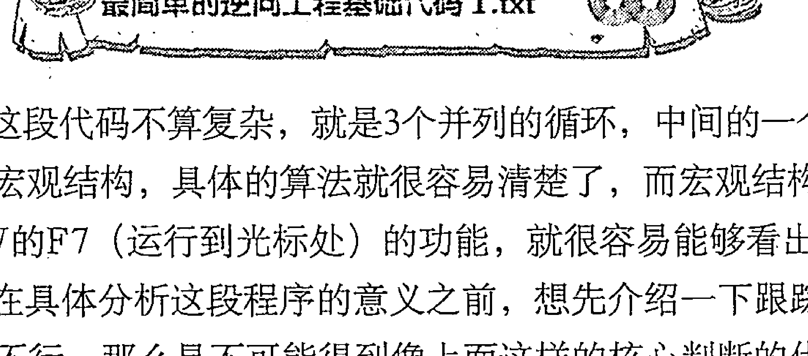

这段代码不算复杂，就是 3 个并列的循环，中间的一个循环里头还嵌套了一个小循环。只要搞清楚了程序的宏观结构，具体的算法就很容易清楚了，而宏观结构大部分都是循环、移位、变换什么的，善于用好 TRW 的 F7（运行到光标处）功能，就很容易看出程序的结构。

在具体分析这段程序的意义之前，想先介绍一下跟踪过程中的一些技巧和注意点。要知道，跟踪的基本功不行，那么是不可能得到像上面这样的核心判断代码的，所以先在这里打个理论基础。逆向工程的初学者有个通病，就是跟踪的时候喜欢走极端：要不就是不敢按键往下走，总在一个小地方徘徊不前；要不就是胆子太过了头，F10 一路过去，一下子就到了出错框。这两种做法，都达不到分析程序的目的。正确的跟踪方法可以归结成如下几句话：先粗后细，胆大心细，先思后行。

#### 跟踪技巧与注意点

先粗是指前面几次跟踪，目的是为了大概了解程序运行的全貌，所以大略地用 F10 一类的带过去就行了。从程序取得信息，到程序经过运算、判断、输出结果信息这一路，有个了解，做到心中有数，就达到了粗跟踪的目的；后细是指掌握了全貌以后，对自己认为比较关键的地方，要进行细细的跟踪，慢慢领会程序的作用和功能，达到分析清楚程序编写思路的目的。

胆大是指跟踪的时候，不要畏首畏尾。如果实在碰到自己看不懂的 Call 或者代码段，索性就不看了，直接一路 F10 或者 F12 下去；还有跟踪的时候要大胆地猜测，有时候很长的一个子程序，你看一下输入和输出，大概就能猜出来它是做什么用的（二进制和十六进制转换等）。心细是指对于自己能看懂的地方或者是特别重要关键的地方，一定要仔细分析，搞清楚每一条指令的意义。所谓失之毫厘，差以千里，一条指令看错了，全部流程就错了。

先思后行最简单了。做什么事情都要先考虑清楚了才能下手嘛！设了断点，调试器在断点中断了，面对这满屏幕的汇编代码，自己该做些什么、该如何做，心里一定要先想清楚。调试器中的代码是典型的 Code Wood（代码丛林），一不留神，就迷失在一层层的子程序嵌套调用和系统的消息循环中了。所以，跟踪的时候，有个正确的指导思想带领你前进是非常重要的。

最后，跟踪的时候还有一个重要的注意点就是“好记性不如烂笔头”，跟踪过程中碰到的关键地址、数据，一定要及时用笔记下来，因为跟踪很少有时候会一次成功，经常需要推倒重来。前面跟踪时积累的重要信息，对于后面的跟踪，有着无法替代的重要作用，不记录下来带来的损失是非常巨大的。有时候跟踪了 2、3 个小时，好不容易找到了一个关键地址，由于没有及时记录下来，第二次重新再来的时候，根本就记不得第一次是怎么跟到那个地址的了，这样也就造成了时间和精力的浪费。

现在我们回到正题上来。

下面是我根据上面的代码编写的该屏幕保护的注册码源代码，TC2.0 编译的，所以在数据类型上面，大家要注意，DD 对应着 long int 了。至于算法，16 位机器和 32 位机器没有本质的不同。

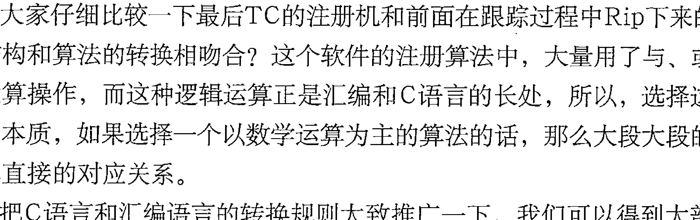

大家仔细比较一下最后 TC 的注册码和前面在跟踪过程中 Rip 下来的代码，是不是完全和上文所说的数据结构和算法转换相吻合？这个软件的注册算法中，大量用了与、或、非、异或、左移位、右移位等逻辑运算操作，而这种逻辑运算正是汇编和 C 语言的长处，所以选择这个软件的算法，也更加容易看到问题的本质。如果选择一个以数学运算为主的算法，那么大段大段的公式推理和数学化简会掩盖掉这种简单直接的对应关系。

把 C 语言和汇编语言的转换规则大致推广一下，我们可以得到大部分高级语言和汇编语言的转换规则。当然，C 是和汇编最相近的语言，所以转换起来也是最容易的。稍微高阶一点，Pascal 语言和汇编语言的转换就比 C 复杂一些。对于采用 Pascal 语言作为基础的 Delphi 来说，用一般的反汇编器 W32Dasm 去反汇编 Delphi 程序，很多情况下得到的信息都是很少的。在“字符串信息参考”的对话框里，基本上找不到什么有用的信息，而且很多引入函数都不能直接显示出来。这个时候我们需要专门针对 Delphi 设计的反汇编器——DeDe，这个软件能够完美地把 Delphi 程序反汇编成我们可以阅读的汇编代码，其中字符串参考和引入函数参考一应俱全，还有很完善的窗体信息，更加方便我们逆向工程的实施。最近，DeDe 的作者公开了 DeDe 的源代码，有兴趣的朋友可以去网上下载来看，据说 DeDe 的反汇编引擎可是非常优秀的！

而再往上面走，VB、VFP、PB 等程序，都属于“低级伪编译”了，虽然也可以通过 W32Dasm 反汇编出稍微能看的汇编代码，可是对于我们分析程序已经没有决定性的重要作用了。这时候，我们需要专门针对这种语言设计的反译器（注意是反译器，不是反汇编器，反译器是反编译出的代码而不是汇编语言）。可是随着反译器的大量使用，也有很多人推出了相应的干扰反译器工作的软件，让市面上现在的很多反译器丧失作用，国内研究这种反译器最出名的就是 Aming 了，对一般的 VB 和 VFP 软件都很有一手。

更加高级一点的，现在有 Java 和 C#，这两种语言都属于高级伪编译语言了，反编译成一般的汇编代码都没有什么作用，没有什么参考价值。对付这种语言编制的程序，我们需要的同样是专门的反译器，不过是直接反到源代码级别的了。由于这种语言是跨平台的，所以它们所编译出来的程序都需要一个虚拟机一样的结构进行解码，所以研究这种语言的反译，关键就是搞清楚它相应虚拟机的运行原理就行了。

#### CD-Key 保护程序分析思路

前面说的都是反编译的领域，理论和实践都有。下面，我们来看一下 CD-Key 保护程序一般的分析思路是如何的。

所谓 CD-Key 保护，一般就是用在游戏上面。你运行游戏，然后游戏就提示你说“请插入游戏光盘”，如果你没有原来的游戏光盘，那么游戏就自动退出了。一般地，我们都把这种要插入光盘才能运行的游戏称为“光盘版”；而解除了 CD-Key 保护之后，就变成了“硬盘版”，也就是说不需要把光盘放到光驱中，只要安装完游戏，然后运行就行了。

光盘版变硬盘版有两种情况，不是每一种情况都可以做成硬盘版的。

- 第一种情况：游戏安装程序没有把程序所需的全部数据都安装到硬盘上，只是把一些最关键的可执行文件和数据文件安装到了硬盘上。这样可以节省硬盘空间，可是节省空间的同时，就带来了玩游戏时的另一个不便——那就是每次运行游戏的时候，都需要放入光盘，让游戏读取光盘中的数据文件，从而正常进行游戏。对于这种情况，一般来说，是不能做成硬盘版的，因为这个游戏在设计的时候就被设计成了一个光盘版游戏。除非你愿意花上很大的时间和精力，把游戏整个运行过程和读取文件的方法都弄清楚，然后自己给它设计一个数据读取模块，把光盘中的数据都拷贝到硬盘上来。这样的做法非常困难且耗费时间精力，所以一般这种游戏都不能做成硬盘版。不过有时候，如果光盘上的数据不过是一些无关紧要的过关动画等文件，那么我们可以修改游戏，让它不读光盘。由于文件不是很重要，所以修改以后也不会出现什么大问题，不过就是一些动画看不到了而已。最典型的例子就是 D 版那个 4 张碟的《暗黑破坏神》，把过关动画全部都放在了光盘里面，如果你不想看过关动画的话，不要放光盘就是了。
- 第二种情况：游戏本来是硬盘版游戏，可是发行公司为了版权或者其他原因，加上一些保护措施，让用户执行游戏之前先要放入光盘进行验证，验证通过了才能正常进行游戏。这种保护措施很显然是能被做成硬盘版的，只要我们搞清楚了它的验证过程，修改一些验证过程中的关键跳转，那么光盘版就能变成硬盘版了。不过这种保护的强度可大可小，强度不大的，很容易就能够 Crack 掉；强度大的，那就很烦人了。有些保护体系把壳的一些技术加了进去，更让 Cracker 们头疼。现在一般情况是国内公司出品的游戏和国外小公司出品的游戏都比较简单一些，自己用一般方法就能 Crack 掉；可是国外的大公司，比如暴雪、WestWood 等，它们所采用的保护措施就非常强悍，SafeDisk 等专业商用保护体系就是专门为他们公司的游戏定做的。说到 SafeDisk 的保护，不得不啰嗦几句：SafeDisk 发展到现在，已经是一个保护非常强悍、技术非常先进、应用面也很广泛的光盘保护体系。它采用很先进的给 EXE 文件加壳并结合光盘 ISO 标准等信息来进行加密。一般的 Cracker 要想完美破解掉它的保护，的确不太容易。我们“密界现踪”栏目现在主要还是面向广大初学者，所以这种高强度保护，现在就介绍一下概貌，具体其中奥妙，等以后有机会再说吧。

对于 CD-Key 保护程序的分析，同样是静态分析 + 动态跟踪结合的方法。不过一般的游戏主程序都比较大，大概有 2.3M 大小，用 W32Dasm 来反汇编很费时间，所以如果难度不是很高的话，先动态跟踪试试看比较好。由于现在差不多都是 Windows 的天下了，所以我在这里也只以 Windows 下对光驱的操作为例；Dos 下么，不过是把 API 换成中断而已啦。

CD-Key 程序动态跟踪时，一般都设置断点：GetDriveType。关于 GetDriveType 函数，说明如下：

```c
GetDriveType(A)：判断一个磁盘驱动器的类型

UINT GetDriveType(
  LPCTSTR lpRootPathName // String，包含了驱动器根目录路径的一个字符串
);
```

返回值：

- 0：驱动器不能识别
- 1：指定的目录不存在
- 2：DriveRemovable
- 3：A Fixed Disk (HardDrive)
- 4：Remote Drive (Network)
- 5：CD-ROM 驱动器
- 6：RamDisk

在这里，给出一个很多程序都采用的光盘保护流程：

- 1. 首先，生成盘符根目录字符串，从 `A:\` 开始。
- 2. 把盘符（比如 `A:\`）当作参数传递给 GetDriveType，取得返回值；如果盘符大于 `Z:\`，则直接提示出错信息。
- 3. 比较返回值，如果是 5 的话，继续下一步；否则，盘符加 1，跳回第 2 步。
- 4. 由于此时的盘符代表着光驱盘符，所以就可以在后面拼接上一些路径字符串，得到我们需要的路径。  
  - 比如：我得到的光驱盘符是 `F:\`，则在后面接上一个字符串，得到这个路径名：`F:\Bin\Setup.exe`。
- 5. 对这个路径进行一些操作和验证，从而决定是否可以继续执行游戏。  
  - 比如：我把 `F:\Bin\Setup.exe` 作为参数，传递给 CreateFileA 或者 GetFileSize，根据返回值决定这张光盘是不是我需要验证的原版光盘。如果是的话，那么验证通过，游戏继续；如果不是的话，那么验证失败，退出游戏。

比较简单的光盘验证流程差不多就是这样的。当然，这只是个模型，具体实施起来，还会有些具体问题需要考虑。比如：如果我有虚拟光驱，那么虚拟光驱就“霸占”了光驱的第一个盘符；如果软件检测流程考虑得不周到，就很容易给用户造成不便——我明明把光盘放进去了，可是游戏还是提示“请插入光盘”。另外，检测光盘的手法也有很多种，根据光盘上的文件进行检测是一种方法；更加高级一点的，可以直接检测一些光盘自身参数——光盘符、ISO 标记等。越高级的检测就越难以被破解，对于编程者的要求也更高。

## CD-Key Crackme 示例

理论部分到此为止，下面我们来看一个采用 CD-Key 保护的 Crackme 的解决之道。这个 Crackme 是 abex 编制的，属于 CD-Key 保护的入门级，我觉得非常适合初学者朋友理解，所以放到这里来当作例子。

首先，运行该 Crackme，可以看到如图 3-10 所示的对话框。我们可以看到，它提示该 Crackme 的目的是“Make me think your HD is a CD_ROM”，也就是说让我们通过修改该 Crackme，让 Crackme 以为我们的硬盘就是光盘。理解提示后，我们点“确定”，继续看看有什么要求，结果弹出如图 3-11 所示的对话框。

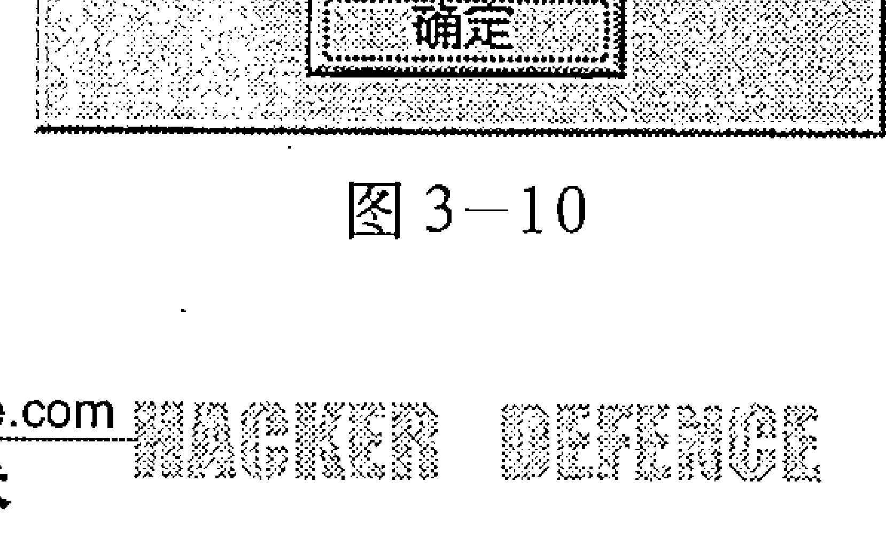

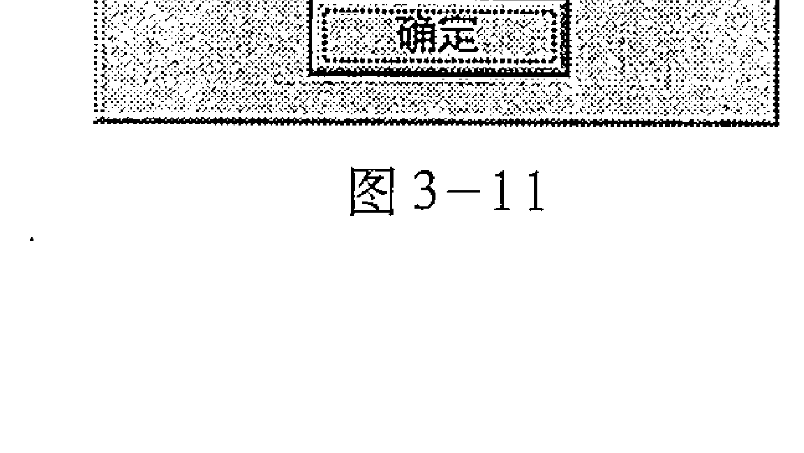

“Nah……This is not a CD-ROM drive”，作者提示我们没有达到他的目的，没有让该 Crackme 认为硬盘就是光盘（当然了，我们还没有修改呀，如果这个时候就提示成功了，那该 Crackme 岂不是完全没有意义了？），下面我们就来分析一下该如何修改，才能够达到目的。

先看看静态的方法吧。用 PEiD 查壳软件查不到该 Crackme 的壳类型，我们姑且认为它没有壳，先用 W32Dasm 反一下看看。反汇编后，通过“字符串数据参考”功能可以找到如下关键判断点：

```asm
* Possible StringData Ref from Data Obj ->"c:\"
:00401013 push 00402094
:00401018 Call 00401055
:0040101D inc esi
:0040101E dec eax
:0040101F jmp 00401021
:00401021 inc esi
:00401022 inc esi
:00401023 dec eax
:00401024 cmp eax, esi
:00401026 je 0040103D
:00401028 push 00000000
:0040102A push 00402035
:0040102F push 0040203B
:00401034 push 00000000
:00401036 Call 00401061
:0040103B jmp 00401050
:0040103D push 00000000
:0040103F push 0040205E
:00401044 push 00402064
:00401049 push 00000000
:0040104B Call 00401061
:00401050 Call 0040105B
```

多么清楚的程序流程，根本连一点分岔都没有。稍微懂汇编的人，结合我旁边的注释，一下子就能发现：如果要修改该 Crackme 达到目的的话，只要把 401026 处的 `je` 改成 `jmp` 或者 `jne`，也就是 `74` 改成 `EB` 或者 `75`。

这里要说一下暴力破解修改时需要注意的一个问题：一般的暴力破解，很大一部分都是改变跳转的转向。本来是“相等则跳”，就改成“不相等则跳”，反之亦然。这样一来，程序判断注册校验正确与否的整个逻辑推理上面就完全反了方向，只要我们随便给程序提供一些错误的注册信息，程序就会跳转到“注册成功”的路上去，这就是最简单的破解方法——爆破法。爆破说简单是很简单，几乎每一个初学破解的朋友，开始的时候都是采用爆破法破解软件的，然后才慢慢学会编写注册机和其他稍微高级一点的技巧。可是，爆破说难也够难，当你达到一定水平之后，你就会明白，很多软件根本不可能自己做出 KeyGen，所以这个时候就需要暴力破解了。而且一般这样高难度的软件破解，不是简单地改一个跳转就可以了，而是需要自己在软件运行流程中加入自己的代码，执行很多复杂功能。有时软件很复杂，或者剩余空间很少，我们自己的代码不可能随心所欲，还需要用到外部 DLL 或者 SMC 技术。那时候的爆破，就不是很简单的东西了。

至于动态跟踪，在这个过分简单的例子里面，似乎起不到什么重要的作用，无非就是 bpx Get Drive Type 然后慢慢跟，看到的代码和静态反汇编出来的基本上没有任何区别。在此不赘述。不过建议初学者为了练手，最好试验一下跟踪，培养出来对调试器和关键跳转的感觉。

## 3.7 Crack的武器

#### 3.7.1 操作系统

对于 Cracker 来说，最好的 Crack 平台就是 Windows 98 了。Windows 98 下有很多功能非常强大的 Crack 工具，TRW、ICEDUMP 等，基本上可以算是无所不能。而 Windows 2000 下就没有这么方便的工具可以使用。所以，如果软件能够在 Windows 98 下运行，那么最好在 Windows 98 下进行分析，得出的结果在 Windows 2000 下完全能够使用。

#### 3.7.2 调试工具

调试工具是 Cracker 使用最频繁的工具了，一个调试工具的强大与否很大程度上能够决定一个 Cracker 对一个软件的分析深入程度。一般的调试工具都会具有如下的基本功能：在程序中设置断点、汇编级跟踪程序的执行、查看寄存器、内存、堆栈数据、监视计算机各个端口的操作、动态修改程序的执行代码、改变程序的执行流程。在这些基本功能之上，由于各个调试器所针对的问题不同，而各有各的特色。下面我就给大家介绍一下几个著名的调试器的功能和特色。

Soft-ICE——调试器领域当之无愧的头把交椅。稳定性和强大性都是首屈一指的。而且它不仅仅是一个专门的调试器而已，配合 DriverStudio 里面其他的工具，它立刻成为驱动开发者最得力的助手。总之，只要是在特别低阶的场合，Soft-ICE 总有它大展拳脚的地方。Soft-ICE 只有 4.05 以前的版本是单独发行的，后续的版本都被集成进了 DriverStudio，所以如果要安装它的话，也还是有一番折腾的。不过安装好以后，它的强大功能绝对让你不后悔安装了它，特别是在 Windows 98 底下，配合 IceDUMP 和 FrogICE，几乎可以说是无所不能；而在 Windows 2000 和 Windows XP 底下，由于系统的内核保护机制得到了大大的加强，它的功能表现得有所削弱，特别是和它搭档的 IceDUMP，在 2000 和 XP 底下削弱更多。不过我相信，随着对操作系统运作机制研究的进一步深入，NuMega 的程序员会在 2000 和 XP 底下为 Soft-ICE 开发出更加强大的功能的。

TRW2000——国人刘涛涛开发的专门针对 Crack 作了很大优化的调试软件。内部集成了自动脱壳、自动修复文件头、保存内存数据和反汇编结果到磁盘文件等 Cracker 经常使用的各种功能；不用常驻内存，可以随时启动和退出；程序体积小巧，界面简单，使用方便，最适合刚入门的新手使用。不过缺点也不少，最大的缺点就是只能在 Windows 98 底下使用，Win 2000 和 Win XP 底下就英雄无用武之地了。而且在稳定性和内建的汇编器上面，还有很多值得改进之处。不过瑕不掩瑜，它仍然是一款值得所有中国人为之骄傲的作品，随着推出时间的增加，越来越多的国外 Cracker 也喜欢上了这个工具。在新出的 tKC 教程中，就经常出现 TRW 的身影。下面是 TRW 最具特色的几个命令：

- `pnewsec`：当程序运行到一个新段的时候中断。
- `pedump`：dump PE 文件在内存的镜像，不重建 PE 头，生成的文件一般不能跨平台、跨系统运行。
- `makepe`：dump PE 文件在内存中的镜像，并且重建 PE 头，生成的文件经过一些善后工作，可以跨平台、跨系统运行。
- `pmodule`：当执行到程序领空时中断。
- `d/w/u sth > filename`：保存内存数据或者反汇编结果到名为 filename 的磁盘文件中。
- `ver blue`：改变界面显示的颜色搭配。这个命令不能算是特色，不过由于在它的操作手册中没有写入，而在不同的显卡上，TRW 的界面表现各异，又经常需要使用这个命令，所以在此特地把它提出来。

TRW 还是一个“开放式”的软件，在它的说明文件中，详细描述了它的插件开发接口。现在网上最有名的 TRW 插件是为 TRW 增加浮点运算支持的插件，有兴趣的朋友可以自己开发出更加强大、方便的插件。

另外一个关于 TRW 不得不提到的就是 CCG 成员娃娃为 TRW 制作了 1.03 版和 1.22 版的修改版，在界面和内核方面作了一些调整。一些使用 Melt-TRW 技术来 Anti-TRW 的软件，在娃娃的修改版面前无能为力。最著名的例子就是保护措施非常强悍的著名商业保护软件 Armadillo，用 Soft-ICE 和原版的 TRW 跟踪它非常费劲，可是使用娃娃修改的 TRW 可以非常方便地一 G 就 G 到入口处，然后完成脱壳工作。

OllyDbg——新出的一款调试工具，运行在 Ring3 级，所以不能用它调试系统的 0 级程序。不过由于 Ring3 的原因，你可以一边调试程序一边欣赏自己喜欢的 MP3，这在 TRW 底下是不能想像的（至于在 S-ICE 中，你可以借助 IceDUMP 达到目的，不过需要你有 ISA 声卡）。而且它是典型的视窗型操作界面，对于习惯了菜单和窗口的用户可以很快上手，不必记忆繁琐的命令行；直接显示 FPU、MMX、SSE、3DNOW 等特殊寄存器。

不过它的功能比较简单，不够强大，只是在一些特定的情况和做不太复杂的跟踪的时候可以使用。由于该调试器面世时间不长，名气还不算很大，所以 Anti 它的软件还不多。由于 Ring3 级的原因，加入 Anti 的代码是非常容易的事情，而且可以实现的破坏工作也很多，大家使用的时候要特别小心。

以上三种是现在比较流行，且功能比较强大的调试器，其他的还有诸如 DOS 底下的 TR、Ydebug 等，虽然也有其自身的特色，不过由于平台原因，在此就不作介绍了。

#### 3.7.3 静态反汇编工具

静态分析和动态跟踪从来都是 Cracker 的两把杀手锏，一个优秀、迅速、适用文件和指令集类型广泛的静态反汇编工具，能够给 Cracker 们提供极其丰富的信息，为逆向工程的开展提供最大程度的便利。现在比较流行的反汇编工具主要有三个：Sourcer、W32Dasm 和 IDA。

Sourcer——DOS 底下就有了。一路升级，现在最新是 8.10 版。在 DOS 底下，Sourcer 的名气非常大，它的说明是这样写的：反汇编代码比源代码还好读。不过自从进入 Windows 以后，它就渐渐地从前台退下去了。不过说实在的，DOS 底下的 Crack 比 Windows 底下复杂多了，Sourcer 能在 DOS 底下取得那么巨大的成功，软件本身的功能不容否认。

W32Dasm——小巧，实用。界面简单干净，功能虽然不算很多，不过每一种功能都非常实用。程序体贴地把引入函数、引出函数、字符串参考分开独立地列出来；反汇编代码的最前面，详细地列出了 PE 文件的各种信息；在生成的反汇编代码中，加入函数和数据参考信息；反汇编代码中，通过键盘快捷键很方便地执行跳转和子程序呼叫；内部自建了一个不算强大也不算弱的调试器，感觉调试器的操作不太方便。可惜的是，自从 W32Dasm 8.93 推出以后，这个软件就停止了升级。不过网上有人利用逆向工程的技术，给它作了一个补丁，打了这个补丁以后，它就内建了添加代码注释（按“;”键）和直接修改 Hex 值存盘这两项作 Patch 时最有用的功能，打了补丁后的版本称为“W32Dasm++”。

IDA——The Interactive Disassembler，交互式反汇编软件。迄今为止，功能最为强大、丰富，支持文件种类、CPU 指令集最多，交互性最强的反汇编工具就是 IDA 了。如果把 W32Dasm 比作一个能工巧匠的话，那么 IDA 就是反汇编领域的大师，绝顶高手。它的交互性可以让你很方便地得到符合你要求的反汇编代码。

它内部有一种 IDC 语言，形式和 C 语言类似，可以做一些批处理一样的命令。现在的软件，越来越多地使用了代码运行中解密、Import Table 破坏等防 Crack 的技术，使用 IDA 你就可以很方便地在静态的条件下，还原出代码和数据的本来面目。还有不得不提的一点就是 IDA 在对付花指令上面也是一绝，很少有 IDA 不能反的花指令存在（连一些软件狗的花指令也逃不脱 IDA 的法眼）。不过强大的功能带来的是反汇编时间的加长和软件自身体积的疯狂增大，和 W32Dasm 不足 1M 的小巧身材比起来，IDA 安装好后的二三十兆的体积可以算是庞然大物了。对于这样的软件，想要熟练掌握，决非一朝一夕之功，惟有勤于使用，勇敢摸索，才能掌握 IDA 的精髓部分。网上关于 IDA 的教程也逐渐多起来了，有兴趣的自己可以去找来看。另外特别值得一提的是 IDA 不光是针对 x86 系列的 CPU 指令集有用，对于 51 等单片机的 Hex 文件也可以轻松反汇编，所以，对搞单片机开发的人来说，IDA 也是一个不可或缺的得力助手。

当然，除开上述三种，还有很多其他的软件内建了反汇编器，例如汉化领域赫赫有名的 PExplore 内建的反汇编引擎就非常不错，不过，由于这些软件都不是专业性的，所以功能和易用性上都没有上述两种强大。

#### 3.7.4 Hex 编辑工具

不说大家也知道，最出名的三个 Hex 编辑工具分别是：Hex Workshop、WinHex、UltraEdit。虽然 Hex 编辑工具在 Crack 领域极其重要，不过由于其他报刊杂志对于 Hex 工具都有很详细的介绍，我在这里就不讲解了，只把我认为非常有特色的 WinHex 的一些独门武功展示一下，大家在使用的过程中，可以酌情选择适合的编辑器使用。

WinHex 现在的版本中，对 Cracker 们最有吸引力的一项新功能就是它的内存编辑功能了。由 ORC 提出的“数据约束性”原理告诉我们，在 Windows 的软件注册流程中，很多时候，真正的注册码会出现在假的注册码附近（偏移量大概为 50H 字节），所以，我们只要输入假注册码，在软件提示注册码不正确的时候，用 WinHex 搜索一下内存，看看我们输入的假注册码在什么地方，然后上下翻页，有时候就能够看到真正的注册码。不过，现在有些软件在提示出错之前，会做一些“毁尸灭迹”的事情，比如说把真正的注册码给抹掉，这样，我们在提示出错以后再编辑内存，就看不到真正的注册码了。这时，我们可以用 TRW 先跟踪，到觉得真正的注册码可能已经产生出来的时候，用 suspend 命令挂起程序，切换到 WinHex 中，编辑内存，就可以找到真正的注册码了。至于什么时候 suspend 挂起程序，没有固定的方法可言，跟踪调试多了，自然就会对代码有种特殊的敏感，到那时自然就有感觉了。除开内存的编辑功能，它的硬盘编辑功能也是很有用的。恢复数据什么的就不说了，解决一些系统引导程序（BootStar 等）在硬盘上设置的密码，的确很实用，设置密码前后的分区表格一比较，密码就很明显了。另外，它还可以把软件内部的一些数据用各种格式输出到文件（C 语言源程序或者是汇编语言的数据定义格式），方便编写注册机。查找数值的时候，也提供了多种格式选择，如 VB 的宽字符格式等。由于有如上这么多的特点，现在越来越多的 Cracker 喜欢使用 WinHex 胜过了其他的编辑软件。

#### 3.7.5 监视工具

很多软件把安装、注册等信息记录在注册表或者是一些关键文件（下面称之为 KeyFile）里面。启动、运行、退出的时候随时检查，以校验自身的状态。对付这种软件保护措施，我们很自然就会想到用一个监视工具监视软件对注册表、文件的操作，借此达到找到软件保护突破口的目的。还有一些软件，利用一些比较不常用的比如硬盘序列号和网卡号进行加密，我们可以用一种 API Log 的监视 API 调用的工具来判定软件使用了哪些信息作为保护。关于 API 监视，其实 SmartCheck 就是最好的监视工具，以前那种 SmartCheck 只能用于 VB 程序的思想是完全错误的。而对于注册表和 KeyFile，我们有如下秘密武器：

RegShot——国人 TianWei 大侠的力作，记录两个时间系统重要文件和注册表的状态，进行比较，把比较得到的结果存盘。通过分析结果文件，我们可以得到这两个时间状态中系统的很多非常重要的变化信息。

RegMon——和 RegShot 不同，这个软件是实时监控系统注册表的变化的。软件一旦打开、读取、删除某个注册表的键值，它都会忠实地给你记录下来。不过现在有些软件在代码中作了一些手脚，导致 RegMon 失效，对于这个问题，现在尚无行之有效的解决方法，只有靠自己用调试软件设置注册表读写断点来手动监视了。另外不能不说的一点就是，从我个人长期的使用经验来看，RegMon 的监视不是万能的，有些时候软件自身并没有做手脚，但是 RegMon 仍然监测不到，所以，不要过分迷信 RegMon，自己动脑筋分析才是最行之有效的方法。

FileMon——和 RegMon 一个公司出品的监视文件操作的软件。使用方法和特色上面没什么说的，打开软件，一切功能都是显而易见的，很容易就学会使用了。值得一提的是，这个软件在 Fravia 里面被完全解析过，从汇编级的角度完全分析了这个软件的运作机制。那篇文章可以算是很经典的一篇逆向工程的文章了。E 文好的朋友不要错过，一定要去 Fravia 看看那篇东西。

#### 3.7.6 补丁制作工具

关于补丁的概念，千万不能狭隘地理解成就是把暴力破解后的成果发布出来而已。补丁技术是一项极其有用的技术，没有哪个软件一发布就是完美无缺的，每一个软件都需要在发布出来之后，通过用户的实际使用，来确定软件内部哪些是需要改进的部分。大到 Microsoft 的 Windows、Office 等，小到我们常用的记事本、CD 播放器，在一个逆向工程学家的眼里，都可以给它们打上这样或者那样的补丁，从而使软件更加符合自身需要。

补丁技术总体上分为初级和高级两种：初级的补丁技术很容易掌握，就是暴力破解注册流程什么的，可以直接在软件内部修改很小一部分的代码，从而把软件改得符合自己的要求；高级的补丁技术主要是指通过把功能代码写在自己的 DLL 中，而在软件内部作极小的修改使其调用我们自己的 DLL 文件，从而达到给软件增加各种功能的目的。常见的增加功能的补丁有存盘补丁和打印补丁。对于高级的补丁制作，首先，需要对 PE 文件的格式有非常深入的了解，这样才能自己随心所欲地引入自己需要的 DLL 和 DLL 中的函数项。其次，需要对待补丁的软件运作机制有详细的分析和理解。要知道，软件的代码从某种意义上来说是非常脆弱的东西，很普通的一个堆栈调整或者参数传递的错误就会让软件甚至操作系统彻底崩溃，所以，如果你对目标软件了解不深，甚至是一知半解的话，那么你是绝对不能打好这个补丁的。最后，你自己的编程功底要过硬，Windows 内部的运行机制决定了 DLL 的编写和一般的 EXE 文件的编写存在着很大的不同，而且，作为自己给软件增加的 DLL 文件，要传递什么参数给 DLL 是个最大的问题。很多时候 DLL 编写了一半，突然想起来原来还有个参数没有传递过来，那就要全部返工了。而且很多时候，我们需要的参数不是那么好找的，在调试器里面，看到的都是枯燥的千篇一律的汇编代码，而且对于软件内部所使用的数据格式也是一无所知，所有的一切都需要自己动脑筋去分析。所以，逆向工程一个非常大的体现在于补丁技术上面，一个高手可能只要非常少的补丁代码就能实现自己需要的功能，其基础，就是对于软件运行机制全面透彻的了解。

啰嗦了这么多，下面我们看一个我认为功能最为强大的补丁工具：注册机编写器（KeyMaker）。KeyMaker 是由国人刘建英开发的一款功能极其强大的补丁工具。它的主要功能特点是：

- 快速高效地生成属于你个人的注册机，且无需了解过多的指令算法；
- 生成的注册机可在各个 Windows 平台上使用；
- 简单易用，有良好的用户界面；
- 可以方便地修改资源，制作个性化的界面；
- 内存注册机功能；
- 文件补丁功能；
- 内存补丁功能。

由于该软件是纯中文软件，而且附带的帮助文件说明详细，附带的例子也很清楚，这里我就不过多讲解。有兴趣发布自己补丁的朋友一定不要错过这款非常优秀的补丁软件。

KeyMaker 只可以制作比较低级的补丁，对于高级一点的、调用 DLL 的补丁情形，就无能为力了。编写高级补丁的大致步骤如下所示：

- 列出自己想要增加或者修改的功能；
- 分析程序，找到增加功能所需要的各种参数的存放位置；
- 编写 DLL，这里推荐使用 Masm32，毕竟汇编的效率比一般的语言高得多。不过，如果感到汇编编程有困难，使用 VC 也不失为一个可以采纳的方法；
- 修改软件的引入表和代码段，加入自己的 DLL 和 DLL 中的功能函数；
- 最后调试，排除 Bug。

#### 3.7.7 专项工具

所谓的专项工具，主要是指针对一些编程语言所使用的比较特殊的工具。由于语言有编译执行和解释执行的差别，所以分析软件的时候，针对不同的语言类型，选用不同的工具是必要的。

编译执行的语言主要就是 C 和 Pascal，到了 Windows 下面，也就是 VC 和 Delphi。这两种语言大致的方法就是用 SoftICE + IDA 进行分析。不过，针对 Delphi，有个专门的反汇编工具——DEDE，名气很大。这个工具的原理是：Delphi 是一种基于表单的语言，只要分析清楚了表单的情况，那么，整个软件的情形也就明了了。所以，碰到 Delphi 的程序，用一下 DEDE 反汇编，找找自己感兴趣的数据或者代码，对于后续的工作可以起到很大的帮助作用。不过 DEDE 也不是万能的，现在有些软件专门针对 DEDE 作了手脚，那样的话，就还是要请出 IDA 或者是 W32Dasm 了！

解释执行的语言主要有 VB、FoxPro、Java。这三种语言好像没有一个是特别安全的——都有相应的反编译工具得到程序的源代码。

针对 VB 的主要有：SmartCheck、exdec 和 WKTVBDebugger。

SmartCheck：NuMega 出品的非常强大的软件运行 log 器，一开始就是为了调试 VB 而编的，所以用它来监视 VB 软件的运行可以说是非常方便。关于 SmartCheck，由于历史的原因，对它有很多误解，比如只能对付 VB 的程序，不能对付 P-Code 等等，其实都是错误的观点。我建议大家的做法是：不管任何软件，动态跟踪前都用 SmartCheck 走一遍，详细查看里面 log 的信息，这对了解软件的大概流程极有帮助，可以最大限度地避免陷入茫茫的代码丛林。

exdec 和 WKTVBDebugger：前者用来反汇编 P-Code 形式的 VB 代码，后者用来动态调试 P-Code 代码。两者配合得可谓天衣无缝。其实说穿了，WKTVBDebugger 就是采用的 exdec 的核心技术，只不过是把静态的 P-Code 改成动态的而已，更加直观、方便。

FoxPro 编写的软件安全性也不高。由于 FoxPro 运行机制的原因，现有的几乎所有的软件保护手段如加密狗、加壳压缩加密、序列号等等都不能很有力地保护 FoxPro 编写的软件。最有名的 FoxPro 反编译工具就是 UnFoxAll，对于未经处理的 FoxPro 程序，几乎可以完美地反编译出源代码。由于这个强大工具的存在，所以 FoxPro 的加密主要是对程序生成的伪代码的标识符进行变换，让 UnFoxAll 不能顺利地反编译。

Java 的程序的安全性就更低了，网上有几个 Java 的反编译器，也是几乎可以完美地反编译出 Java 的源代码。不过，由于我对 Java 不是很熟悉，所以不能详细给大家介绍了。

### 3.7.8 特别推荐——Hiew

最后是我特别推荐的一款超强大好用的工具——Hiew。它的功能主要包括：

- 文本/十六进制编辑无长度限制文件；
- 内建汇编编译器，一直支持到 Pentium Pro 级 CPU 指令；
- 块查找/替换；
- 先进的上下文相关帮助。

千万不要小看了这 4 点，如果你看过上一期《黑防》上我的拙作《手把手教你修改QQ》并且照着里面的步骤自己实践过的话，你就会强烈体会到 Hiew 功能的强大之处！而且随着你 Patch 文件经验的增多，你会越来越觉得 Hiew 是个完全不能缺少的工具。它内建的汇编编译器非常高效而且智能，可以为你在补丁文件时提供非常多的参考信息，帮助你做出优秀的补丁。

Hiew 另外一个非常强大的功能就是它的查找功能。它不是简单地查找一段特定的字符串而已，它可以查找类似于下面的指令块：

```asm
push 00010
call 01234:05678
add sp,00006
```

你所需要做的只不过是输入：`push ?10`；`call ?`；`add ?` 这样非常直观的语句，Hiew 就会为你迅速定位到你要的地方。由于编译器编译代码的原因，很多常用的比较注册码的语句都是非常类似的。用好这个查找指令块的功能，可以很方便地找到非常多的软件的关键比较之处。

我要特别推荐的工具当然不只是 Hiew 一种而已，只不过其他的一些工具很多杂志或者网上都有很详细的使用说明和介绍，我就不再啰嗦了。下面列出我认为进行逆向工程所需要的基本工具配置（平台以 Windows 98 为准）：

- 1. TRW；
- 2. W32Dasm；
- 3. Dede；
- 4. Hiew；
- 5. Windows 自带的计算器；
- 6. Filemon + Regmon；
- 7. 详细的 API 指令参考。

这 7 种工具是每一个从事逆向工程的人必不可少的标准配置。建议每一个想学习逆向工程技术的人都从学习这 7 种武器的使用开始。

### 最常见关键比较

下面列出各种软件中最常用的关键比较汇编形式，希望各位能够牢记这些基本形式。这样，在跟踪的时候就不会错过一些不该错过的关键东西了：

- 1.

```asm
mov eax, [这里可以是地址，也可以是其他寄存器]
mov edx, [ ] ; 同上，通常这两个地址就储存着重要信息
call 00??????
test eax, eax
jz (jnz)

或者：
mov eax, [这里可以是地址，也可以是其他寄存器]
mov edx, [ ] ; 同上，通常这两个地址就储存着重要信息
call 00??????
jne (je)

或者：
mov eax, [这里可以是地址，也可以是其他寄存器]
mov edx, [ ] ; 同上，通常这两个地址就储存着重要信息
call 00??????
setz (setnz) al (bl, cl···)

或者：
mov eax, [这里可以是地址，也可以是其他寄存器]
mov edx, [ ] ; 同上，通常这两个地址就储存着重要信息
call 00??????
test eax, eax
setz (setnz) bl, cl···
```

这种形式的比较多见于 Delphi 的程序中，因为 Delphi 习惯把 eax 和 edx 作为子程序的参数传递寄存器，而不像 VC++ 那样使用堆栈。

- 2.

```asm
mov eax, [ ]
mov edx, [ ]
cmp eax, edx
jnz (jz)

或者：
begin:
  mov al, [ ]
  mov cl, [ ]
  cmp al, cl
  jnz (jz)
  mov al, [+1]
  mov cl, [+1]
  cmp al, cl
  jnz (jz)
  cmp eax, ecx ; (eax 为计数器)
  jnl begin
  mov al, 01

或者：
lea edi, [ ]
lea esi, [ ]
repz cmpsd
jz (jnz)
```

这种形式的比较多见于字符串的比较中，也很常见。

- 3.

```asm
call 00??????  ***
push eax (ebx, ecx···)
······ ; 中间的其他代码。
······
call 00??????
pop eax (ebx, ecx···)
test eax, eax
jz (jnz)
```

这个形式比较特别，了解堆栈操作的人稍微分析一下就能看出，它的关键 Call 是第一个 Call，不是它前面最近的那个 Call。

以上 3 种是最常见的关键比较方式，随着大家对逆向工程研究的深入，会慢慢体会到这些关键的比较形式的极端重要性。

上面介绍的都只是一些从事逆向工程所需要的最基本的工具而已，只要你稍微想往哪个方面深入发展一点，就会碰到更多的新工具，甚至有时候还需要自己操刀写一些专门的东西，学习是永无止境的。

回头看看，虽然拉杂写了这么多，不过和实际应用中所使用的各种工具的复杂度相比较，毕竟还是差了一些档次。很多软件、算法，看着人家写出来的文章是很容易理解的，可是一旦自己亲自碰上了，在没有实践经验的条件下，总是会感觉很棘手，这是学习任何东西都会碰到的情况，大家千万不要因此而感到灰心丧气，坚持坚持再坚持，很多逆向工程大师就是这样成长起来的。

文章的结尾，按照惯例，给大家预告一下下一期栏目的主要内容：

- 1. 给出一个最基本的序列号保护的 Crackme 的详细破解过程。
- 2. 给出一个最基本的 KeyFile 保护的 Crackme 的详细破解过程。
- 3. 给出一个最基本的 Nag 保护的 Crackme 的详细破解过程。

以上三种情况属于最基本的逆向工程练习，目的在于给大家打好基础，熟悉一下基本的概念，更精彩的东西还在后头呢！

## 第4章 动态跟踪分析利器

——“SoftICE” & “TRW2000”

前面章节曾提到过，软件的动态跟踪分析对于破解来说是必不可少的环节，而要完成这项工作，“SoftICE”和“TRW2000”这两款软件是必不可少的。本章将从“安装”、“操作”、“实例教程”几个角度对两款软件进行剖析。

### 4.1 SoftICE for Windows 9x 安装与设置

- 显卡安装
- 鼠标安装
- 启动菜单配置
- Symbol Loader
- winice.dat 配置及加载

#### 4.1.1 SoftICE 安装

- 1. SoftICE 目前最新版本是 4.05，如你的系统是 Windows 9x，就请下载 for Windows 9x 版本的 SoftICE，建议下载 SoftICE 的最新版，这样稳定性好些。运行 setup.exe 开始安装，出现如图 4-1。
- 2. 然后点击下一步，输入安装序列号，如图 4-2（序列号一般在安装软件的 readme.txt 或其他说明文件里）。
- 3. 然后下面几个画面是要求选定路径和安装组件，不久你会来到显卡配置对话框，如图 4-3。

图4-1

图4-2

#### 4.1.2 显卡配置

- 1. 第一种配置是使 SoftICE 激活状态时类似 DOS 全屏状态一样（也就是字符模式状态），在显卡列表选择你的显卡类型，Universal Video Driver 和 Use monochrome card/monitor 这两项不要选，然后点击 Test 按钮。在测试过程中你能看到各种颜色的字符，说明显卡测试通过，就可点击下一步了。
- 2. 第二种配置是使 SoftICE 在激活状态下类似 Windows 应用程序的一个窗口那样，这样在调试时可避免显示器不停地在图形和字符模式转换，对提高显示器寿命大有好处。配置时，显卡列表一栏忽略，不用配置，只要把 Universal Video Driver 这一项选上，然后 Test，跳出如图 4-4 对话框，测试通过。（强烈推荐这种方式）

图4-3

图4-4

### 4.1.3 鼠标的配置

现在鼠标常见的一般是串行口或 PS/2 接口，你根据自己的鼠标接口类型或位置选上合适的就可。如碰到鼠标在 SoftICE 调试画面不能用或一用死机，可能是没选对正确的选项，你可在 SoftICE 菜单里，如图 4-5 所示，运行 mouse setup 这个菜单项重新配置鼠标。

图4-5

### 4.1.4 装载 SoftICE 的主文件 winice.exe

首先要了解 SoftICE for 9x 版本是如何装载的。在 SoftICE 的安装目录下有 winice.exe 这个文件，Windows 启动到纯 DOS 环境下，运行 winice.exe 这个文件，将装载 SoftICE。安装时默认将 `C:\PROGRA~1\NUMEGA\SOFTIC~1\WINICE.EXE` 这一行放进 Autoexec.bat（自动批处理文件），这样 Windows 以后每次都会运行 Autoexec.bat 这个文件，自动装载 SoftICE。另外，你可根据自身需要配置启动模式，具体参考详见下文。

配置完鼠标后，会出现以何种方式装载 SoftICE 的主文件 winice.exe 的询问对话框，如图 4-6，然后安装程序将复制文件到硬盘里，来到最后一个电子注册对话框，如图 4-7，这里选最后一项 Register later。至此安装完成，重新启动 Windows，微机先到 DOS 下，自动或手动运行相应批处理文件，运行其内的 winice.exe 文件，装载 Windows。

图4-6

图4-7

#### 4.1.5 Symbol Loader 的使用

在开始 SoftICE 的菜单里有一项 Symbol Loader 快捷方式，运行后，进入其菜单 `EDIT → SoftICE Initialization Settings` 选项，打开后如图 4-8 所示。这里你就可配置 SoftICE 了。

图4-8

- 1. General 选项

在 Initialization string 里，你可填上需要 SoftICE 一启动自动运行的命令。如：

```text
WD 2; WC 14; FAULTS OFF; IXHERE OFF; IYHERE OFF; set font 2; lines 40; x;（各行以分号分开）
```

- 2. Exports 选项

在这里可添加相关的 DLL 文件，以便在 SoftICE 下拦截这些 DLL 的函数。特别是破解 VB 程序时，一定要将 VB 运行库装载进去。

- 3. Keyboard Mappings 选项  
这里配置各功能热键。如：`F5="^x;"`，用 F5 键代替命令 X。

- 4. Macro Definitions 选项  
宏定义，你可定制各种命令宏，以方便平时的操作。  
如：`s7878="S 30:0 L ffffffff '78787878'!"` 用命令 s7878 代替一串命令：`S 30:0 L ffffffff '78787878!'`

- 5. Remote Debugging  
利用网络远程调试配置。

注：以上所有配置好的参数，都保存在 winice.dat 文件里。

#### 4.1.6 winice.dat 配置

在 Windows 9x 下，SoftICE 配置除了用上面的方法外，也可通过文件 winice.dat 来实现。SoftICE 在启动的时候通过它装入一些 DLL/EXE 的信息。你可在 SoftICE 安装目录下发现 winice.dat，可用任何文本编辑软件打开它（如记事本）。

注意分号后是描述语言，不被执行。

```text
PENTIUM=ON
NMI=ON
ECHOKEYS=OFF
NOLEDS=OFF
NOPAGE=OFF
SIWVIDRANGE=ON
THREADP=ON
LOWERCASE=OFF
WDMEXPORTS=OFF
MONITOR=0
PHYSMB=32
SYM=1024
HST=256
TRA=8
MACROS=32
DRAWSIZE=2048
INIT="FAULTS OFF; IXHERE OFF; IYHERE OFF; set font 2;lines 40;wd 2;wc 20;code on; x;" ; 初始化
F1="h;"
F2="wr;"
F3="PAGEIN B ProcDump32 - Dumper Server;" ; 脱壳用
F4="rs;"
F5="x;"
F6="ec;"
F7="here;"
F8="t;"
F9="bpx;"
F10="^p;"
F11="^G @SS.ESP;"
F12="^p ret;"
SF3="^format;"
CF8="XT;"
CF9="TRACE OFF;"
CF10="^XP;"
CF11="SHOW B;"
CF12="TRACE B;"
AF1="^wr;"
AF2="^wd;"
AF3="^S 0 L FFFFFFFF 8B,CA,F3,A6,74,01,9F,92,8D,5E,08;"; VB3特征字符串
AF4="^s 0 ] ffffffff 56,57,8B,7C,24,10,8B,74,24,0C,8B,4C,24,14,33,C0,F3,66,A7;"; VB4特征字符串
AF5="^s 0 ] ffffffff FF,75,E0,E8,85,EF,FF,FF,DC,1D,28,10,40,00,DF,E0,9F,75,03;"; VB5特征字符串
AF8="^XT R;"
AF11="^dd dataaddr->0;"
AF12="^dd dataaddr->4;"
CF1="altscr off; lines 60; wc 32; wd 8;"
CF2="^wr;^wd;^wc;"
; 以下是宏操作命令:
MACRO s7878="S 30:0 L ffffffff '78787878' "
MACRO sname="S 0 L FFFFFFFF 'toye' "
MACRO swide="s 0 1 FFFFFFFF '7', '8', '7', '8', '7', '8', '7', '8', '7', '8', '7', '8', '7', '8', '7', '8' "

MACRO reg="bpx regqueryvalueexa if *(esp->8)>='Soft' do \"d(esp->14)\" "
MACRO bpxpe="bpx loadlibrarya do \"dd esp->4\" "
MACRO bpxgeta="bpx GetDlgItemTextA; bpx getwindowtexta; bpx getdlgitemint; bpx getdlgitemtext;"
; ***** Examples of sym files that can be included if you have the SDK *****
; Change the path to the appropriate drive and directory
;LOAD=c:\windows\system\user.exe
;LOAD=c:\windows\system\gdi.exe
;LOAD=c:\windows\system\krnl386.exe
;LOAD=c:\windows\system\mmsystem.dll
;LOAD=c:\windows\system\win386.exe
; Exports - change the path to the appropriate drive and directory
EXP=c:\windows\system\advapi32.dll ; 这四行前不要加分号，否则不被装载，SoftICE 可能什么也拦不到；
EXP=c:\windows\system\kernel32.dll
EXP=c:\windows\system\user32.dll
exp=c:\windows\system\gdi32.dll

exp=c:\windows\system\comctl32.dll ;
```

；如果要破解 VB 程序，下面的 VB 运行库将要装载，SoftICE 默认值是没有这几行，你需手动加上。

；EXP=c:\windows\system\msvbvm60.dll；Visual Basic 6 具体参考第十五课 VB 破解

EXP=c:\windows\system\msvbvm50.dll；Visual Basic 5 注意在这五个 DLL 中最好不要同时装载 2 个以上

```text
; EXP=c:\windows\system\vb40032.dll ; Visual Basic 4 (32bit)
; EXP=c:\windows\system\vb40016.dll ; Visual Basic 4(16-bit)较少见
; EXP=c:\windows\system\vbrun300.dll;Visual Basic 3
;EXP=c:\windows\system\vga.drv;
;EXP=c:\windows\system\vga.3gr
;EXP=c:\windows\system\sound.drv
;EXP=c:\windows\system\mouse.drv
;EXP=c:\windows\system\netware.drv
;EXP=c:\windows\system\system.drv
;EXP=c:\windows\system\keyboard.drv
;EXP=c:\windows\system\toolhelp.dll
;EXP=c:\windows\system\shell.dll
;EXP=c:\windows\system\commdlg.dll
;EXP=c:\windows\system\olesvr.dll
;EXP=c:\windows\system\olecli.dll
;EXP=c:\windows\system\mmsystem.dll
;EXP=c:\windows\system\winoldap.mod
;EXP=c:\windows\progman.exe
;EXP=c:\windows\drwatson.exe
```

```text
; ***** Examples of export symbols that can be included for Windows 95 *****
; Change the path to the appropriate drive and directory
EXP=c:\windows\system\kernel32.dll
EXP=c:\windows\system\user32.dll
EXP=c:\windows\system\gdi32.dll
EXP=c:\windows\system\comdlg32.dll
EXP=c:\windows\system\shell32.dll
EXP=c:\windows\system\advapi32.dll
EXP=c:\windows\system\shell232.dll
EXP=c:\windows\system\comctl32.dll
;EXP=c:\windows\system\crtdll.dll
;EXP=c:\windows\system\version.dll
EXP=c:\windows\system\netlib32.dll
;EXP=c:\windows\system\nsshrui.dll
EXP=c:\windows\system\msnet32.dll
EXP=c:\windows\system\mspwl32.dll
;EXP=c:\windows\system\mpr.dll
```

启动 Windows 装载 SoftICE 后，咦！怎么没反应，没调试画面！哈哈，别着急，按 `Ctrl + D` 看看，再按一下回到 Windows 下，或按 `F5` 也能回来。此时调试窗口像 Windows 开的一个窗口；如果像全屏 DOS 一样窗口，那就是安装显卡时参数没选好，此时按上文修正即可。下面的命令是调整 SoftICE 窗口状态：

```text
set font n (n=1,2,3)    设置字体；本人建议 set font 2（在 800*600 条件下）
set origin x,y          锁定窗口；
lines n                 n=(25-128) 设置显示行数；本人建议 lines 40
Ctrl+Alt+光标键         移动窗口；
Ctrl+Alt+Home           重设窗口位置原点（0,0）；
Ctrl+L                  刷新。
```

如你以默认 `winice.dat` 启动 SoftICE，有可能需用 `WD` 打开数据窗口；用 `SET FONT 2` 设置字体等重复工作。你可在 `winice.dat` 文件内设置自动执行命令操作，方法是在 `INIT` 这一行，各命令用分号分开，如：

```text
INIT="WD 2; WC 14; FAULTS OFF; IXHERE OFF; IYHERE OFF; set font 2; lines 40; x;"
```

这样配置后界面类似 TRW2000。（这些是在 800*600 条件下的情况，如你不是此分辨率可调整 `set font n`、`lines n`）

### 4.2 SoftICE for NT/2000 安装与配置

- 1. SoftICE for NT/2000 的安装与 for 9x 版本差不多，所不同的是在装载 SoftICE 方式选择，如图 4-9 所示。可根据需要选择不同的装载方式。注：如你选择了 Manual 方式，要装载 SoftICE，需要在 SoftICE 的菜单里运行选项：`START SoftICE` 快捷方式来装载 SoftICE。
- 2. 在 NT 下，配置 SoftICE 是用 SoftICE Loader（从你的开始菜单选），选择 `Edit/SoftICE`，一般的选项是初始化，这里你可参考手册了解不同的开关选项的详细描述。如：

```text
CODE ON; FAULTS OFF; I3HERE OFF; WD 3; WF; X;
```

其它两个重要的选项是 Symbols & Exports。如果你拥有自己系统的 SDK（软件开发工具包），你可用 SoftICE 装载并调试它。那些没有 SDK 应改用 exports 选项，从 `%WINNT%/System32` 目录下增加下面的 DLL 文件。

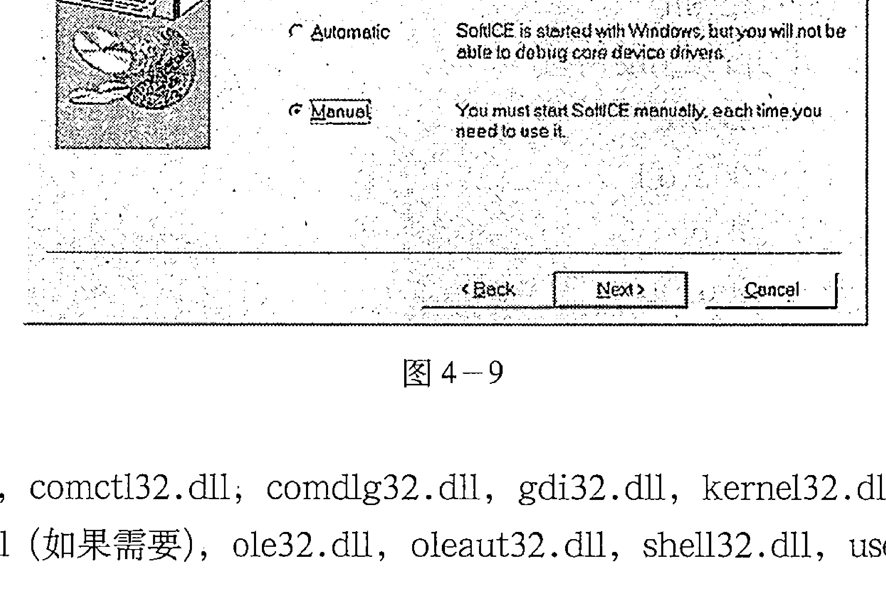

图 4-9

- advapi32.dll
- comctl32.dll
- comdlg32.dll
- gdi32.dll
- kernel32.dll
- msvbvm(50/60).dll（如果需要）
- msvcrt.dll（如果需要）
- ole32.dll
- oleaut32.dll
- shell32.dll
- user32.dll
- version.dll

### 4.3 TRW2000 的安装与配置

国人自己编写的调试软件，完全兼容 SoftICE 各种指令，但现在许多软件能检测 SoftICE 存在，而 TRW2000 在这方面就好多了。TRW2000 有它自己的独特方面，是针对破解软件优化的 Windows 下的跟踪调试程序，跟踪功能更强；可以设置各种断点，只是断点种类更多；它可以像一些脱壳工具一样完成对加密外壳的去除，自动生成 EXE 文件，只是留给用户更多的选择；在 DOS 下的版本为 TR。

#### 4.3.1 安装 TRW2000

TRW 安装简单多了，没 SoftICE 那样复杂，但目前 TRW2000 不支持 Windows NT。它发布版本是一个 ZIP 压缩包，才 200 多 K。只要将其解压缩到一个目录下，然后运行 `TRW2000.EXE` 即可，如图 4-10 所示，无须安装或者重启计算机。

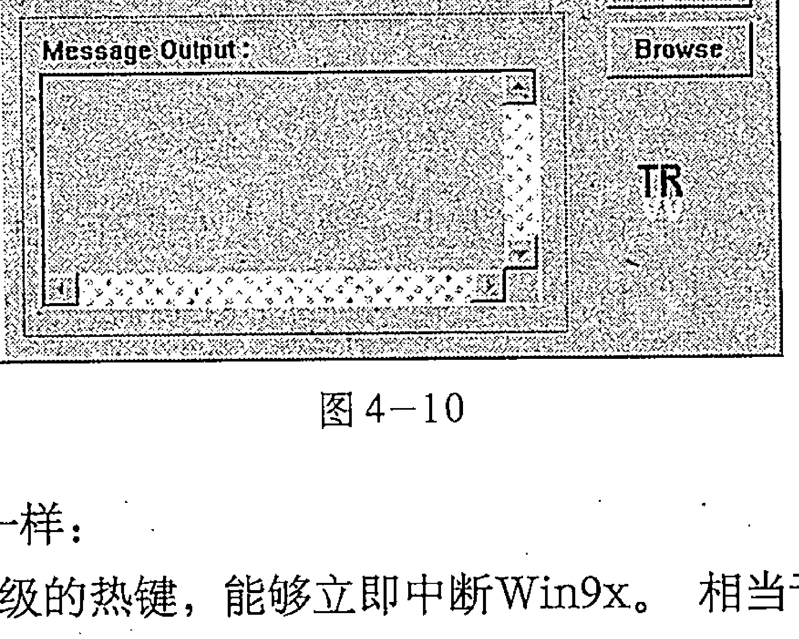

图 4-10

激活方式同 SoftICE 不一样：

- 1. `Ctrl + M` 特权级 0 级的热键，能够立即中断 Win9x。相当于 SoftICE 的热键 `Ctrl + D`。
- 2. `Ctrl + N` 特权级 3 级的热键。在绝大多数时候，我们并不需要在 0 级上中断。`Ctrl + N` 可以中断 Windows 的特权级 3 级的前台线程。

这应该是我们最常用的。其它指令同 SoftICE 兼容，但是 TRW2000 有许多更新的思想，具体看后面的介绍及范例。另外，TRW2000 可支持 plug-ins，也可装载 dll 文件，在 1.15 版本以上，在安装目录下有一 DLL 目录，如你特别需要的 dll 复制到此目录，即可装载，如破解 VB 时，就需要将 VB dll 复制此目录，具体参考后面的 VB 破解。其它的请读其 Readme。

### 4.3.2 TRW2000 的配置

TRW2000 的配置是通过其安装目录下的 `TRW2000.ini` 来实现的，你可按自己的需要配置它（一般按默认即可）。

```text
; TRW2000 Initialize file
; Please modify it as your habit.
;PLUGS=C:\MY_PLUGS\HELLO.SYS
F1=^HELP ; Command length CAN'T be longer than 15 characters!
; This command length is 5 characters.
F3=^SRC
F4=^RS
F5=^X
F6=^EC
F7=^HERE
F8=^T
F9=^BPX
F10=^P
F12=^PRET
;HOTKEY=320D ;Ctrl+M
;R3HOTKEY=310E ;Ctrl+N
GRAPHICS=ON
;INTELLMOUSE=OFF
WINMOUSE=ON
LINES=50 ;in dec
```

### 4.4 熟悉 SoftICE 和 TRW2000

TRW2000 的命令操作和 SoftICE 兼容，因此 SoftICE 的操作在 TRW2000 里一般都能实现。

#### 4.4.1 操作窗口

按上一节方法装载好 SoftICE 后，在 Windows 环境里，按下 `Ctrl + D` 即可激活 SoftICE（如是 TRW2000，则按 `Ctrl + N` 激活），出现如图 4-11 所示的调试画面：（图片注释文字：在数据窗口左半边是以二进制表示内存数据，右半边是以 ASCII 码表示的内存数据。）

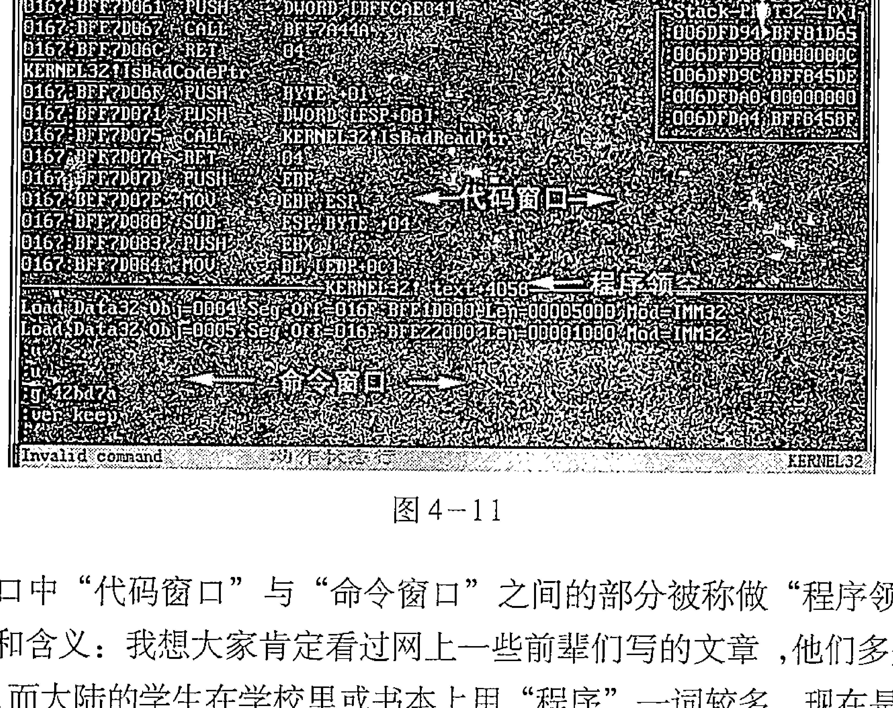

图 4-11

大家可能注意到，窗口中“代码窗口”与“命令窗口”之间的部分被称作“程序领空”，这里就解释一下“领空”一词的由来和含义。我想大家肯定看过网上一些前辈们写的文章，他们多是台港地区的，所以称“程序”为“程式”，而大陆的学生在学校里或书本上用“程序”一词较多。现在是讲求融合的时代，叫什么都没有关系，但有一点是肯定的，我们说的都是同一档子事“PROGRAM”。

所谓“领空”也是他们传出来的，比较形象，姑且就这么叫吧！“领空”实际上是指在某一时刻，CPU 的 CS:IP(EIP) 所指向的某一段代码的所有者所在的区域。一个程序的“领空”实际上是指 SoftICE 所停下来时光棒所在的那一句代码是属于谁的，属于该程序的就叫该程序的“领空”，你如果想窥探该程序的代码，就要在该程序的“领空”中进行跟踪。

#### 4.4.2 常用命令

在这里我把 SoftICE 一些常用命令列出，详细解说请参阅附录中的 SoftICE 指令详解。SoftICE 的所有动作都发生在一个可以随时激活的视窗中。SoftICE 的所有指令都可以显示在一个小视窗中，这个视窗可以扩大到整个屏幕，在视窗底部的状态行提供指令语法的辅助。

- 1. 激活视窗  
  载入 SoftICE 后，你可以随时激活视窗。一开始你只要按 `Ctrl-D` 即可激活 SoftICE。
- 2. 由视窗中返回  
  使用 `X` 这个指令或你叫出 SoftICE 的热键均可以回到原先的画面。你在 SoftICE 中设定的所有中断点此时开始启动。
- 3. 改变视窗大小  
  你可以改变 SoftICE 视窗的宽度和高度。在独立模式中显示程序码时，改变视窗大小的功能特别有用。视窗的高度为 8 到 25 行。

```text
Alt - ↑  使视窗变高
Alt - ↓  使视窗变短

使用 WIN 的指令以改变视窗的宽度。直接输入 WIN 而不加参数会在下面两种模式中切换：
WIDE 模式 —— 占满整个屏幕
NARROW 模式 —— 46 个字节宽
有些指令像 D、E、R、U，使用 WIDE 模式以显示更多信息时较为方便。
```

- 4. 移动视窗  
  SoftICE 的视窗是可以移动且可以定位在屏幕上的任何地方。这功能在 NARROW 模式下特别有用。在你需要时移动视窗以便观看屏幕上被视窗挡到的地方。你可以用下列按键控制屏幕的移动：

```text
Ctrl - ↑  向上移一行
Ctrl - ↓  向下移一行
Ctrl - →  向右移一列
Ctrl - ←  向左移一列
```

- 5. 窗口打开或关闭命令

```text
WC  作用：打开或关闭代码窗口；或改变代码窗口大小
WD  作用：打开或关闭数据窗口；或改变数据窗口大小
WF  作用：以浮点或 MMX 形式显示浮点栈
WR  作用：打开或关闭寄存器窗口
WW  作用：打开或关闭监视窗口；或改变监视窗口的大小
```

- 6. 行编辑按键  
  SoftICE 有一个容易使用的行编辑器。以下按键可以帮助你在命令窗中编辑指令：

```text
→ ---- 光标右移
← ---- 光标左移
Ins ---- 切换插入模式
Del ---- 消除现在字节
Home —— 把光标移到一行的开头
End —— 把光标移到一行的结尾
↑ —— 显示上一个指令
↓ —— 显示下一个指令
Shift + ↑ —— 显示向上卷一行
Shift + ↓ —— 显示向下卷一行
Page Up —— 显示向上卷一页
Page Down —— 显示向下卷一页
BackSpace —— 消除前一个字节
Esc —— 取消当前命令
```

当光标在数据窗口或代码窗口时，另有特殊的按键，这在后面将会讨论到。

## 7 指令语法

SoftICE 是个由指令操控的调试工具。要令 SoftICE 有操作，你要下指令给它。指令可以因不同参数而有改变。所有的指令都是 1 到 6 个字节的字串且不分大小写。所有的参数都是字串或计算式。计算式是典型的数字，也可以是数字和运算式的结合。所有的数字均以 16 进位表示。一个字节（byte）参数有 2 位，字（word）参数有 4 位。双字（double word）是两个由“:”分隔的字组参数。以下是一些参数的例子：

- 12 —— 字节参数
- 10FF —— 字参数
- E000:0100 —— 双字参数

寄存器在计算式中可以拿来当字节或字参数用。例如：`U CS:IP-10` 的指令会从现在指令指标所指地址向前 10 byte 开始反汇编。以下的寄存器名称可以用在计算式中：

AL、AH、AX、BL、BH、BX、CL、CH、CX、DL、DH、DX、DI、SI、BP、SP、IP、CS、DS、ES、SS、FL

## 8 指定内存地址

许多 SoftICE 的指令要求以内存地址当参数。一个内存地址是由两个 16 位的字中间以“:”分隔而组成的。第一个字组表示节段地址（segment address），而第二个字组表示偏移地址（offset segment）。

公用符号可以在所有 SoftICE 指令中用来取代地址。公用符号必须先由 SoftICE 的程序载入器（LDR.EXE）载入。

SoftICE 计算式的运算器接受一些特殊字节和地址的使用。这些字节是：

- `$` —— 现在 CS:IP 所指的地址
- `@地址` —— 间接双字
- `.number` —— 原始程序码行号

当你要输入目前指令指标的地址时，可以用 `$` 代替 `CS:IP`。

使用 `@` 可以让你参考到地址所指处的双字。你可以使用多层的 `@`。

如果用 `.` 来代表地址，它是用来代表原程序码中的行号，而非实际的地址。这只有在原始程序码有载入的情形下才能使用。这种情况下，地址是以 10 进位表示。

```text
U.1234    —— 从原始程序码第 1234 行开始反汇编
U $-10    —— 从目前指令指标所指处向前 10 byte 开始反汇编
G @SS:SP  —— 假如你目前正在第一个中断程序，下这个指令会在堆栈的返回地址设个暂时中断点并跳过此中断程序。
```

## 9 功能键

功能键可以代替一串 SoftICE 指令。功能键可以由命令行设定或在 WINICE.DAT 中定义。SoftICE 的配置文件 `winice.dat` 已经对 12 个功能键有设定。你可以在任何时候改变任何一个设定。每个键定义如下表所示。这样设计是为了方便微软的 CodeView 的使用者。

- F1 —— 显示一般辅助画面（`H;`）
- F2 —— 在寄存器窗中切换（`WR;`）
- F3 —— 改变目前原始码的模式（`SRC;`）
- F4 —— 恢复屏幕内容（`RS;`）
- F5 —— 回到原程序（`X;`）
- F6 —— 在命令窗中和程序码窗中切换（`EC;`）
- F7 —— 执行到光标所在那行（`HERE;`）
- F8 —— 单步执行（`T;`）
- F9 —— 在光标所在那行设中断点（`BPX;`）
- F10 —— 单步执行（`P;`）
- F11 —— 执行到返回地址（`G @SS:SP;`）
- F12 —— 让 SoftICE 单步执行代码，直到出现 `RET(XXXX)` 命令，之后拦截（`P RET;`）

指令前的 `^` 会让这个指令不显示出来。指令后的 `;` 则代表按下 Enter。输入 FKEY 的指令可以显示目前功能键所代表的意义。要使用功能键直接按下功能键即可，不需再键入指令。

## 10 辅助

利用辅助的指令可以得到有关指令的简单解说、语法和使用例子。要得到辅助的信息，键入：

- `?` 或 `H` —— 显示所有指令和运算式的简短解说
- `? 指令` 或 `H 指令` —— 显示关于指令语法和例子更详细的信息
- `? 计算式` 或 `H 计算式` —— 把计算式的结果以 16、10 进位及 ASCII 码显示出来

#### 4.4.3 关于中断点指令的使用

SoftICE 具有以往只有硬件调试器才具有的断点能力。因为 80386 芯片的威力和弹性，使我们不需要额外的硬件设备就能有更强大的断点能力。断点的触发可以由内存某地址的读取、内存范围的读取、程序的执行及端口的存取来达成。SoftICE 赋予每个断点一个一位的 16 进位号码（0–F）。这个断点号码是当你对断点做删除、中止、启动、编辑等动作时使用。SoftICE 的所有断点都是 “sticky”，这个意思是这些断点在启动后不会自动消失。你必须以 `BC` 或 `BD` 命令来消除或关闭它。SoftICE 一次可以处理 16 个断点。同种形态的断点最多可以有 10 个。但内存地址的断点（BPM）因 80386 处理器暂存器的缘故，最多只能设 4 个。

设置中断点是破解跟踪软件中最常用到的行为之一，这里只是列出相关指令让大家了解一下，详细的使用技巧和语法格式会在以后章节的实例及附录中的 SoftICE 指令详解。

设置中断点指令：

- `BPM BPMB BPMW BPMD` —— 在内存地址被存取或执行时引发中断
- `BPR` —— 对内存范围设置中断点
- `BPIO` —— 对 I/O 端口存取时触发中断
- `BPINT` —— 呼叫中断时触发中断
- `BPX` —— 设置/清除执行中断点
- `CSIP` —— `CS:IP` 范围的检定判断
- `BPAND` —— 等待复合中断点的发生
- `BPM BPMB BPMW BPMD` —— 在内存地址被存取或执行时引发中断

处理指令：

- `BD` ---- 中止中断点
- `BE` ---- 启动中断点
- `BL` ---- 列出中断点
- `BPE` ---- 编辑中断点
- `BPT` ---- 把中断点当样板
- `BC` ---- 清除中断点

#### 4.4.4 其他指令

除了中断点指令外，SoftICE 还有很多实用指令，如“显示及编辑类指令”、“转换控制指令”、“调试模式指令”、“公用指令”、“特别的调试指令”、“视窗指令”、“调试器设定指令”和“屏幕控制指令”。以后章节会通过实例对它们的使用方法进行讲解。

## 4.5 SoftICE & TRW2000 的命令详解

附录包括每个命令的语法、解释及范例。所有的数字均以 16 进位表示。使用到 `+ - * /` 或暂存器的数字均可视为运算式。所有的命令都不区分大小写。命令语法叙述中的斜体字需以真实的值代替而不是打入斜体字。

以下是附录中所使用的代号：

- `[ ]` —— 语法中非必用的部分
- `< >` —— 可选用的部分
- `X|Y` —— 使用 X 或 Y（X、Y 择一使用）

count——count 指定断点条件要成立几次才会真正引发中断。如果没有设定，内定值是 1。每次引发中断而叫出 SoftICE 的视窗后，记数器自动回复为原先指定值。

verb——指定在什么状况下断点会作用。R 代表读取，W 代表写入；RW 代表读取及写入；X 代表执行。

address——地址。由两个 16 位元的字以冒号分隔而组成。第一个字代表区段地址，第二个字代表偏移地址。地址可以由符号或暂存器构成，也可以包括 `$`、`.`、`@` 等特殊符号。参阅 3.8 以取得更多资讯。

break-number——断点号码是在你修改断点（即编辑、删除、重新启动、暂停作用）时使用的。它是用来代表各断点的代码。断点号码是由 0 到 F。

list——一串由逗号或空白分隔的断点号码。

mask——由 1、0、X 所构成的位元屏蔽。X 代表不处理的位元。

```text
BPIO 21W EQ M 1XXX XXXX
```

如果 21 端口被写入且造成其高位元被设定，则会引发中断。

#### 4.5.1 设置断点命令

命令：

- `BPM BPMB BPMW BPMD` —— 在内存地址被存取或执行时引发中断
- `BPR` —— 对内存范围设置断点
- `BPIO` —— 对 I/O 端口存取时触发中断
- `BPINT` —— 呼叫中断时触发中断
- `BPX` —— 设置/清除执行断点
- `CSIP` —— `CS:IP` 范围的检定判断
- `BPAND` —— 等待复合断点的发生
- `BPM BPMB BPMW BPMD` —— 在内存地址被存取或执行时引发中断

```text
语法：BPM [size] address [verb] [qualifier value] [C=count]
size --- B、W、D
B --- byte（字节） W --- word（字） D --- double word（双字）
```

size 是指断点所涵盖的范围。举例来说，如果使用的是双字，而其第三个字节被改变了，就会引发中断。如果有指定判断资格（qualifier），size 也是很重要的。

```text
verb --- R、W、RW 或 X
qualifier --- EQ、NE、GT、LT、M
EQ —— 相等  NE —— 不等  GT —— 大于
LT —— 小于  M —— 屏蔽
```

qualifier 只有在读写断点才有用到。  
value —— 由断点大小决定是字节、字或双字的值。

解说：  
BPM 命令会在内存读、写或执行时引发中断。  
verb 内定值为 RW；size 内定值为 byte。  
除了 X 外的 verb 值会使程序执行引发中断的那段程序码。CS:IP 所指的是引发中断的后一行程序码。如果 verb 值是 X，CS:IP 所指的是断点设置的位置。  
如果设定的是 R，当内存地址被读取或做没有改变的写入时，将引发中断。如果设定的是 R、W、RW 时，指定的地址被执行时并不会引发中断。

> 【注】如果使用 BPMW，指定的地址必须由字边界开始。如果使用 BPMD，指定的地址必须指向一个双字边界。

```text
【例】BPM 1234:SI W EQ 10 C=3
```

这道命令设定一个字节的内存存取断点。当 10H 第三次写入 1234:SI 时将启动断点。

```text
【例】BPM CS:1235 X
```

这道命令设定一个执行断点。当 CS:1235 的程序码被执行时将引发中断。此时 CS:IP 所指的就是断点设定地址。

```text
【例】BPMW DS:F00 W EQ M 0XXX XXXX XXXX XXX1
```

这道命令设定一个字的内存写入断点。当 DS:F00 被写入一个高位元为 0、低位元为 1（其它位元不考虑）的资料时，将引发中断。

```text
【例】BPM DS:1000 W GT 5
```

这道命令设定一个字节的内存写入断点。当 DS:1000 被写入一个大于 5 的值时，将引发中断。

BPR——对内存范围设置断点

```text
语法：BPR start-address end-address [verb] [C=count]
start-address、end-address --- 界定范围的开始及结束地址
verb --- R、W、RW、T 或 TW
```

解说：  
BPM 命令让你对一段内存范围设断点。

## 加密解密技术

除了 T 和 TW 外的 verb 值均会执行引发中断的程序码。CS:IP 将指向引发中断的下一段程序码。你不能设定执行的范围断点。如果想做到执行的范围断点，必须使用 R。程序码的读出被视为是对范围断点的读取。如果未指定 verb，内定值是 W。

在某些状况下，设置范围断点会降低系统的性能。SoftICE 将会分析所有对包括范围断点的 4K 内存的读写动作。性能的降低通常无法察觉，但也可能有严重降低的例外。

verb 值使用 T 或 TW，将在指定范围内做回溯跟踪（back trace）。它们并不会真正引发中断，而只是记录下程序码的资料。这个资料可以用 SHOW 或 TRACE 命令显示出来。参阅第九章以取得更多有关回溯跟踪的资讯。

```
【例】BPR B000:0 B000:1000 W
```

这道命令定义一个内存范围的断点。任何对单色影像内存的写入均会引发中断。

## BPIO——对 I/O 端口存取时触发中断

```
语法：BPIO port [verb] [qualifier value] [C=count]
port —— 一个字节或字形式的值
verb —— R、W 或 RW。R——read（IN）W——write（OUT）
qualifier —— EQ、NE、GT、LT、M
EQ——相等  NE——不等  GT——大于
LT——小于  M——屏蔽
value —— 一个字节或字形式的值
```

解说：BPIO 命令会在 I/O 端口读写时引发中断。如果有指定 value 值，它将被拿来和引发中断的 IN、OUT 程序码所读/写的真正资料值做比较。value 可以是一个字节或字。如果是对一个字节的端口做 I/O，则是使用较低的 8 位元来做比较。CS:IP 将会指向引发中断的程序码的后一段程序码。如果未指定 verb，内定值是 RW。

```
【例】BPIO 21 W NE FF
```

这道命令定义一个 I/O 端口存取断点。如果一号中断控制器的屏蔽寄存器被写入除了 FFh 外的值，将会引发中断。

```
【例】BPIO 3FE R EQ M 11XX XXXX
```

这道命令定义一个字节的 I/O 端口读取断点。如果 3FEh I/O 端口被读取，且这个值的二高位元是 1 时，将会引发中断。其它位元可以是任意值。

## BPINT——呼叫中断时触发中断

```
语法：BPINT INT-NUMBER [<AL|AH|AX>=value] [C=count]
int-number —— 由 0 到 FFh 的中断号码
value —— 一个字节或字的值
```

解说：BPINT 命令可以在呼叫硬件中断或软件中断时引发中断。藉由指定 AX 暂存器的值，可以轻易分离指定的 DOS 或 BIOS 呼叫。如果没有指定 value 值，在呼叫指定的中断向量时将引发中断。这个中断可以是硬件中断、软件中断或内部中断。选定的 value 值当中断发生时将和指定的暂存器比较（AH、AL 或 AX）。如果其值和指定的暂存器值相同时，将引发中断。断点引发时，如果是硬件中断，CS:IP 将指向此中断程序的第一段程序码。

用 INT? 命令可以得知此中断呼叫发生时执行到哪里。如果是软件中断，则 CS:IP 将指向呼叫此中断的程序码。

```
【例】BPINT 21 AH=4C
```

这道命令定义一个 21h 中断的断点。当 DOS 4Ch 函式（结束程序）被呼叫时将引发中断。

## BPX——设置／清除执行断点

```
语法：BPX [address] [C=count]
```

解说：  
BPX 命令让你在原始程序中设置/清除执行断点。如果游标在程序码窗中，则不需要输入地址，执行断点将设置在目前游标所在地址。如果目前游标所在地址已经设置一个执行断点，则将清除此断点。  
如果程序码窗是不可见的或游标未在其中，则必须指定地址。如果只有指定偏移地址，目前的 CS 值会被当做节段地址。

【注】除非断点的位置在 ROM 中，不然 BPX 均使用 INT 3 的方式设置断点。用这样来取代断点暂存器是为了能设置更多的断点。如果你的处境因某些原因必须使用断点暂存器（例如程序码未载入），你可以用 BPM 命令设置执行断点。

```
【例】BPX .1234
```

这道命令将在原始程序第 1234 行设置断点。

## CSIP——CS:IP 范围的检定判断

```
语法：CSIP [OFF | [NOT] start-address end-address]
NOT —— 如果使用 NOT，只有当 CS:IP 所指超出范围，才会引发中断。
OFF —— 停止对 CS:IP 的检定。
```

解说：  
CSIP 命令会使断点的成立条件由命令指标所指地址而定。这个功能在你怀疑程序会突然修改其范围外的程序码时特别有用。  
当断点条件成立时，CS:IP 暂存器会被拿来和指定的范围做比较。当其在范围内时会引发中断。要在 CS:IP 指在范围外时引发中断，则需要用 NOT 参数。  
如果没有加参数，则会显示目前 CSIP 的范围。

```
【例】CSIP NOT F000:0 FFFF:0
```

这个命令只有在断点条件成立且 CS:IP 并未指向 ROM BIOS 时才会引发中断。

## BPAND——等待复合断点的发生

```
语法：BPAND list | * | OFF
```

- list —— 一串由逗号或空白分开的断点号码。
- * —— 复合所有的断点。

解说：  
BPAND 命令会对二或多个断点做逻辑的 AND 运算。只有当所有的断点条件均成立时才会真正引发中断。  
有些情况下你会希望在许多不同条件均成立下才引发中断。BPAND 命令让你指定二或多个在中断发生前必须成立的断点。这个功能让你可以设置更复杂的断点条件。  
每次使用 BPAND 命令均会把指定的断点号码加入名单中，直到使用 BPAND OFF 命令为止。

你可以用 BL 命令列出断点以察看哪些断点号码被复合在一起。被复合在一起的断点，其断点号码后会有个 `&`。  
一旦断点被复合后，除非此断点被清除或 BPAND 被关闭，才会中止。

```
【例】BPAND 0, 2, 3
```

这道命令将复合 0 号、2 号、3 号断点。只有当三个的条件都成立时才会引发中断。例如：如果 2 号和 3 号的条件均成立一次以上，但 0 号的条件尚未成立，则只有当 0 号的条件成立时才会引发中断。

#### 4.5.2 处理断点

SoftICE 提供许多命令来处理断点。处理类的命令可以用来列出、修改、删除、启动和中止断点。断点是以由 0h 到 Fh 的断点号码来识别的。处理中断点的命令有：

- BD——中止断点
- BE——启动断点
- BL——列出断点
- BPE——编辑断点
- BPT——把断点当样板
- BC——清除断点

## BD——中止断点

```
语法：BD list | *
list —— 一串由逗号或空白分开的断点号码。
* —— 中止所有断点。
```

解说：  
BD 命令是用来暂时中止断点的活动。断点可用 BE 命令（启动断点）重新启动。你可以用 BL 命令列出断点以察看哪些断点被中止了。被中止的断点其断点号码后会有一个 `*`。

```
【例】BD 1, 3
这道命令会暂时中止 1 号和 3 号断点。
```

## BE——启动断点

```
语法：BE list | *
list —— 一串由逗号或空白分开的断点号码。
* —— 启动所有断点。
```

解说：  
BE 命令是用来重新启动被 BD 命令中止的断点。当断点第一次定义时将会自动启动。

```
【例】BE 3
这道命令会启动 3 号断点。
```

## BL——列出断点

```
语法：BL
```

解说：  
BL 命令会显示所有目前设定的断点。BL 命令会列出每个断点的断点号码、断点条件、断点状态和计数。断点的状态分为启动和中止。中止的断点其断点号码后会有个 `*`。在 BPAND 命令中使用到的启动断点，其断点号码后面会有个 `&`。最后一个引发中断的断点会以高亮度显示。BL 命令没有参数。

```
【例】BL
这道命令会显示所有定义的断点。以下列出一个 4 个断点的例子：
0) BPMB 1234:0000 W EQ 0010 C=03
1) BPR B000:0000 B000:1000 W C=01
2) BPIO 00021 W NE 00FF C=01
3) BPINT 21 AH=4C C=01
```

## BPE——编辑断点

```
语法：BPE break-number
```

解说：  
BPE 命令会把断点的叙述放到编辑行以供修改。然后你可以用编辑键重新编辑，按 Enter 重新输入。这个命令让你可以快速修改原有断点的参数。

【例】BPE 1  
这道命令会把 1 号断点的叙述搬到编辑行并清除原 1 号断点。按 Enter 可以把这个断点重新输入。

## BPT——把断点当样板

```
语法：BPT break-number
```

解说：  
BPT 命令会把已存在的断点叙述拿来当新断点的样板。原存在的断点叙述会被放到编辑行去。断点号码所指的断点并没有任何改变。这个命令让你可以快速地设置和原断点相似的新断点。

【例】BPT 3  
这道命令会把 3 号断点的样板放入编辑行。当你按下 Enter 后会增加一个新断点。

## BC——清除断点

```
语法：BC list | *
list —— 一串由逗号或空白分开的断点号码。
* —— 清除所有断点。
```

解说：  
BC 命令是用来永久清除一个或多个断点的。

【例】BC *  
这道命令会清除所有的断点。

#### 4.5.3 显示及编辑类命令

- U——反编译或显示原程序码
- R——显示或更改暂存器
- MAP——显示系统内存分布图
- D——用最后一次指定的形式显示内存
- DB——以字节的形式显示内存
- DW——以字的形式显示内存
- DD——以双字的形式显示内存
- E——用最后一次指定的形式编辑内存
- EB——以字节的形式编辑内存
- EW——以字的形式编辑内存
- ED——以双字的形式编辑内存
- INT?——显示最后一次呼叫的中断号码
- ? 或 H——显示辅助信息

## VER——显示 SoftICE 的版本号码

## U——反编译或显示原程序码

语法：`U [address] [L [=] length]`

length —— 要反编译的程序码长度

解说：  
U 这个命令会显示正在调试的程序的程序码。  
如果没有指定 length，内定值是 8 行或屏幕长度减一。  
如果未指定 address，这个命令会从最后一次反编译的后一字节开始反组译。如果从未使用过反编译命令，则从目前 CS:IP 开始。  
如果程序码窗是可见的，则程序码会显示在其中。  
如果指定的地址范围的原始程序码有载入，由目前的原始码模式来决定是否显示原始码。

```
【例】U $-10
```

这道命令从目前地址的前 10h 字节开始反编译。

```
【例】U .499
```

这道命令会从 499 行开始显示原始码。程序码窗必须是可见的且必须在原始码模式。

## R——显示或更改暂存器

语法：`R register-name [[=] value]`

register-name —— 为下列任一：  
AL，AH，AX，BL，BH，BX，CL，CH，CX，DL，DH，DX，DI，SI，BP，SP，IP，CS，DS，ES，SS，或 FL

value —— 如果 register-name 不是 FL，value 是个 16 进位值或运算式。若 register-name 为 FL，value 为下列旗号符号一个或多个的组合，旗号符号可视需要在前面加上 `+` 或 `-`。

- O —— Overflow flag（溢位旗号）
- D —— Direction flag（方向旗号）
- I —— Interrupt flag（中断旗号）
- S —— Sign flag（正负号旗号）
- Z —— Zero flag（零值旗号）
- A —— Auxiliary carry flag（辅助进位旗号）
- P —— Parity flag（极性旗号）
- C —— Carry flag（进位旗号）

解说：  
R 命令是用来显示或更改暂存器值的。  
如果没有指定参数，会显示所有暂存器和旗号的值及目前 CS:IP 的程序码。  
如果仅指定 register-name 而未加 value，则 SoftICE 会显示指定暂存器现在的值并提示你输入新值。如果 register-name 是 FL，目前设置的旗号会以高亮度大写显示，未设置的旗号则用普通小写显示。要维持现在暂存器的值，直接按 Enter。  
如果 register-name 和 value 均有指定，则指定的暂存器值将被改成 value。  
想要改变旗号的值，把 FL 当 register-name，后接你想切换的旗号符号。  
如果要设置某旗号，在旗号符号前加上 `+`。要关闭某旗号，则在旗号符号前加上 `-`。旗号可以按任何顺序排列。

```
【例】R AH 5
```

这道命令会把 AH 暂存器的值改成 5。

```
【例】R FL = O Z P
```

这道命令会切换 O、Z、P 旗号的值。

```
【例】R FL
```

这道命令会显示目前旗号的值并让你可以修改其值。

```
【例】R FL O +A -C
```

这道命令会切换 O 旗号，设置 A 旗号并关闭 C 旗号。

## MAP——显示系统内存分布图

```
语法：MAP
```

解说：  
MAP 命令显示各内存部分的名称、位置和大小。大小是以页来计算的。一页等于 10h byte。  
CS:IP 所指的部分会以高亮度显示。

使用 MAP 命令的时机：

- 断点发生时指向未知的内存区段。
- 你想控制常驻程序或系统程序。你可以根据 MAP 命令所显示的开始地址及大小来设置范围断点。
- 你怀疑程序或系统在其内存空间外写码。MAP 命令可用来找出此区段的内存地址以便在 CSIP 中使用。
- 你必须找出哪个常驻程序拥有目前的中断向量。

```
【例】MAP
```

以下是这道命令显示的范例：  
............

若 DOS 的版本低于 3.1，将显示程序的地址而非其程序名称。

## D、DB、DW、DD——显示内存

```
语法：D [size] [address] [L [=] length]
size —— B（byte）W（word）D（double word）
length —— 要显示几字节。
```

解说：  
D 这个命令会显示指定地址的内存内容。  
内存内容是以指定的 size 形式显示。如果没有指定 size，会以最后一次使用的 size 来显示。所有形式均会显示 ASCII 码。  
如果未指定 address，则由前一次显示的最后一字节的后一字节开始显示。  
如果没有指定 length，内定值是 8 行或因视窗较小而少一些。  
若资料窗是可见的，则资料会显示在资料窗，且 length 会被忽略。

```
【例】DW DS:00 L=8
```

这道命令会以字和 ASCII 的形式显示目前资料段的前 8 字节。

## E、EB、EW、ED——编辑内存

```
语法：E [size] address [data-list]
size —— B（byte）W（word）D（double word）
data-list —— 一串指定 size 的资料（字节、字或双字），或以逗号、空白分隔的加引号字符串。
加引号的字符串可以使用单引号或双引号。
```

解说：  
E 命令显示指定地址的内存内容并让你编辑其值。  
这个命令以 ASCII 的形态显示内存内容，并且是以指定的 size 形态。  
内存编辑器让你可以快速更新内存。你可以键入 ASCII 字元或输入位元组、字、双字的值以编辑内存。如果没有指定 size，以最后一次使用的 size 为准。以下是内存编辑的按键：

- ↑ —— 游标上移
- ↓ —— 游标下移
- → —— 游标右移
- ← —— 游标左移
- SPACE —— 游标移至下一个元素
- TAB —— 在数字区和 ASCII 区间切换
- ESC 或 Enter —— 离开内存编辑器

在你输入资料时，真正内存上的值也随即更新。所有数字值都是以 16 进位表示。按 TAB 键可以在数字区和 ASCII 区间切换。  
如果资料窗是可见的，则在其中修改资料；否则在命令窗中修改。  
资料显示的长度在命令窗中内定为 8 行。如果资料窗是可见的，则和资料窗同大小。  
如果未加参数且资料窗是可见的，则游标会移到资料窗中。若资料窗不可见，则在命令窗中由最后一次显示或编辑的地址开始进行编辑。

```
【例】EB 1000:0
```

这道命令由 1000:0000 开始，以字节形态，用数字和 ASCII 字元显示资料的值。你可以编辑这些显示出来的值。

```
【例】EB 8000:0 "HELLO", 0D
```

这道命令把从 8000:0000 开始的值以 HELLO 字符串和一个归位字元代替。

## INT?——显示最后一次呼叫的中断号码

语法：`INT?`

解说：  
INT? 命令显示最后一次发生的中断号码及其地址。

```
【例】INT?

以下是 INT? 显示结果的例子：
Last Interrupt: 16
At: 0070:0255
```

这个例子显示在 SoftICE 视窗被叫出前，系统最后一次呼叫的是 16h 中断，地址在 0070:0255。  
如果最后一次中断是软件中断，从 0070:0255 做反编译会显示此中断的程序码。若是硬件中断，反编译则会显示中断发生时所执行的程序码。

## ? 或 H——显示辅助信息

语法：`<? | H> [command | expression]`

解说：  
`?` 和 `H` 命令两者均会显示辅助信息。  
如果未指定参数，将会一次一个屏幕地显示所有命令和运算子的简单解说。按任意键继续显示，或按 ESC 键离开辅助说明。  
若有指定参数，则会显示包括命令语法及范例的详尽说明。  
如果加上运算式，则会计算并以 16 进位、10 进位及 ASCII 字元显示其结果。

```
【例】? ALTKEY
```

这道命令会显示包括 ALTKEY 命令语法及范例的资料。

```
【例】H 10 + 14*2
```

这道命令会显示：`0038 00056 "8"`。这是 `10+14*2` 的 16 进位、10 进位值及 ASCII 字元。

## VER——显示 SoftICE 的版本号码

语法：`VER`

```
【例】VER
```

这道命令会显示 SoftICE 的版本及 Nu-Mega 的版权信息。

#### 4.5.4 I/O 端口命令

- I、IB——由字节 I/O 端口输入
- IW——由字 I/O 端口输入
- O、OB——由字节 I/O 端口输出
- OW——由字 I/O 端口输出

### I、IB、IW——由 I/O 端口输入

```
语法：I [size] port
size —— B（byte）W（word）D（double word）
port —— 一个字节或字的值
```

解说：  
这个由端口输入的命令是用来读取及显示硬件端口值的。你可以从字节或字端口输入。如果没有指定 size，内定值是字节。

【例】I 21

这道命令显示一号中断控制器的屏蔽暂存器值。

### O、OB、OW——由 I/O 端口输出

```
语法：O [size] port value
size —— B（byte）W（word）D（double word）
port —— 一个字节或字的值
value —— 位元端口为一字节值；字端口为一字值
```

解说：  
对端口输出的命令是用来对硬件端口写值的。你可以对字节端口或字端口做输出。如果没有指定 size，内定值是字节。

【例】O 21 FF

这道命令会屏蔽住一号中断控制器的所有中断。

#### 4.5.5 转换控制命令

- X——离开 SoftICE 视窗
- G——执行到某地址
- T——跟踪一道程序码
- P——单步执行程序
- HERE——执行到目前游标那行

- GENINT——强制某一中断  
- EXIT——强制离开目前的 DOS 程序  
- BOOT——载入系统（保留 SoftICE）  
- HBOOT——硬件系统载入（完全重设）  
- X——离开 SoftICE 的视窗

## X——离开 SoftICE 的视窗

```text
语法：X
```

解说：X 命令会离开 SoftICE 视窗并恢复因叫出 SoftICE 而中断的程序的控制权。SoftICE 视窗会消失。如果有设定任何断点，它将被启动。

## G——执行到某地址

```text
语法：G [=start-address] [break-address]
```

解说：

G 命令会离开 SoftICE 视窗并设定一个只用一次的执行断点。除此之外，所有的 sticky 断点也会被启动。

若有指定 start-address 参数，将从 start-address 开始执行；否则会从目前的 CS:IP 开始执行。程序将一直执行，直到达到 break-address、使用了叫出视窗的热键或 sticky 断点发生才会停止。

break-address 必须是一个程序码的第一字节。

当达到指定的 break-address 时，CS:IP 将指向设定断点的位置。

未加参数的 G 命令和 X 命令有相同的作用。

除非所有的断点暂存器都被 sticky 断点占满了，不然 non-sticky 断点会使用 80386 断点暂存器。在这种状况下，断点将会使用 INT 3 方式。这种情形下，在 ROM 中 G 或 P 命令将无法正常工作。如果你尝试这样做将会显示错误信息。

```text
【例】G CS:1234
```

这道命令将在 CS:1234 设定一个只用一次的执行断点。

## T——跟踪一道程序码

```text
语法：T [=start-address] [count]
```

解说：

T 命令使用单步旗号以单步执行一道程序码。

如果没有指定 start-address，将从目前的 CS:IP 开始执行。若有指定 start-address，则 CS:IP 将指向 start-address 以进行单步执行。

如果有指定 count，SoftICE 将单步执行 count 次。TRACE 命令将持续执行直到 count 为零或按了 ESC 键，而不管是否有断点发生。

若是在原始码模式，T 命令会单步到下一道原始码叙述。如果目前的叙述是个程序或呼叫函数且呼叫的程序的原始码存在，T 命令会单步执行进入这个呼叫。如果没有呼叫的程序或函数的原始码，T 命令会单步执行完整个程序。

```text
【例】T = 1284 3
```

这道命令会单步执行在内存地址 1284 的 3 道程序码。

## P——单步执行程序

```text
语法：P
```

解说：

P 命令是个逻辑的程序单步执行。除非目前 CS:IP 的程序码是呼叫、中断、回圈或反复字符串，不然将执行此程序码。若为呼叫、中断等程序码，将会执行完整个程序或反复动作才会回到 SoftICE。

除非所有的断点暂存器都被 sticky 断点占满了，不然 non-sticky 断点会使用 80386 断点寄存器。在这种状况下，断点将会使用 INT 3 方式。这种情形下，在 ROM 中 G 或 P 命令将无法正常工作。如果你尝试这样做将会显示错误信息。

若是在原始码模式，P 命令会单步到下一道原始码叙述。如果目前的叙述是个程序或呼叫函数，P 命令会把它整个执行完。

> [例] P

这道命令会单步执行程序。

## HERE——执行到目前游标那行

```text
语法：HERE
```

解说：

HERE 命令会一直执行到目前游标所在那行。只有当游标在程序码窗中才能使用 HERE 命令。如果程序码窗不可见或游标不在其中，用 G 命令代替。

HERE 命令会离开 SoftICE 视窗并设定一个只用一次的执行断点。此外，所有的 sticky 断点也会被启动。

程序将由目前的 CS:IP 开始执行，直到执行到游标所在位置的程序码、使用了叫出视窗的热键或某 sticky 断点发生为止。

除非所有的断点暂存器都被 sticky 断点占满了，不然 non-sticky 断点会使用 80386 断点暂存器。在这种状况下，断点将会使用 INT 3 方式。这种情形下，在 ROM 中 G 或 P 命令将无法正常工作。如果你尝试这样做将会显示错误信息。

> [例] HERE

这个例子在目前游标所在处设定一个执行断点，然后离开 SoftICE 并从目前的 CS:IP 开始执行。

## GENINT——强制某一中断

```text
语法：GENINT INT1 | INT3 | NMI | interrupt-number

interrupt-number -- 00 到 FF 中的一个数字
```

解说：

GENINT 命令会强制发生某一中断。当 SoftICE 和另一个软件调试器共用时，这个功能可以用来把控制权交给另一个调试器。这也可以用来测试中断程序。GENINT 命令会模拟执行一道硬件中断或 INT 程序码。它将把 flag、CS、IP 的值堆入堆叠，并把 CS、IP 的值改成中断向量表中和指定的 interrupt-number 相对的进入点。

> [例] GENINT NMI

这道命令会强制发生一个无法屏蔽的中断。如果 SoftICE 和 CodeView 一起使用，这将把控制权交回 CodeView。

## EXIT——强制离开目前的 DOS 程序

```text
语法：EXIT [R] [D]

R -- 恢复中断向量表
D -- 清除所有断点
```

解说：

EXIT 命令借强制执行 INT 21h 的 4Ch 功能来中止目前程序。这个命令只有在 DOS 处于可以接受此函数呼叫的状态下才能使用。如果此呼叫是由目前的中断函数呼叫或是在 DOS 尚未备妥时，系统的行为将无法预期。

使用 R 参数时，除了中断向量表外，不会做任何系统重设的动作。这意味着 BIOS 变数、视讯模式及其它系统层次的资料并不会被还原。使用 R 参数会把中断向量还原成它们最后一次储存的状态。

中断向量会在程序由 LDR.EXE 载入时，以及使用 VECS S 命令时储存。

```text
[注] 依照下列步骤来重新启动由 LDR.EXE 载入的程序：

EXIT R
LDR prog.EXE
```

EXIT 命令会把中断向量表还原成程序载入前的值，然后回到命令处理器。执行 LDR 并加上 .EXE 的文件名可以把程序重新载入而不需重载符号及原始码。符号和原始码会保持在内存中。

[注意] EXIT 命令必须小心使用。因为 SoftICE 可以在任何时候叫出，可能会有 DOS 不能接受中止函数呼叫的情形发生。而且 EXIT 命令也不会重设程序的状况。举例来说，EXIT 命令不会重设视讯模式。如果你的程序把 BIOS 和硬件放在特别的视讯模式中，使用 EXIT 命令后仍会留在此模式中。

```text
[例] EXIT R
```

还原中断向量表并跳出目前的程序。如果程序是用 LDR.EXE 载入的，则要加 R 参数。

## BOOT——载入系统（保留 SoftICE）

```text
语法：BOOT
```

解说：

BOOT 命令会重置系统并保留 SoftICE。BOOT 可以用来对载入程序、DOS 驱动程序及非 DOS 的作业系统做调试。

BOOT 是以 ROM BIOS 的 19h 中断呼叫的方法。有时候 19h 中断可能无法工作。如果发生这种状况，叫出 SoftICE 并使用 HBOOT 命令。

为了让 BOOT 正确工作，SoftICE 必须由 CONFIG.SYS 中做第一个驱动程序载入。这样 SoftICE 才能尽可能地还原系统原始状态。

```text
[例] BOOT
```

这道命令会重新载入系统，SoftICE 依然保留。

## HBOOT——硬件系统载入（完全重设）

```text
语法：HBOOT
```

解说：

HBOOT 命令会重置整个系统。在重置的过程中 SoftICE 不会保留。除非界面卡需要重开电源才能重置，否则 HBOOT 就够用了。在这种罕有的状况中，你必须关掉电源再重新打开。

```text
[例] HBOOT
```

这道命令会重新载入系统，SoftICE 必须重新载入。

#### 4.5.6 调试模式命令

- ACTION——设定断点发生后的动作
- WARN——设定 DOS/ROM BIOS 重入（re-entrancy）警告模式
- BREAK——在任何时候中断
- I3HERE——把 INT 3 指向 SoftICE

## ACTION——设定断点发生后的动作

```text
语法：ACTION [INT1 | INT3 | NMI | HERE | int-number]

int-number —— 任何可用的中断号码（0–FFh）。只有当自己的断点处理程序已取代原中断向量时才可使用。（参阅 1.1.2）
```

解说：

ACTION 命令用来决定当断点条件成立时要把控制权交给谁。大部分的状况都是 INT3 或 HERE。INT3 是在 SoftICE 和其它调试器一起使用时使用；HERE 则是用来使断点条件成立时回到 SoftICE。INT1 和 NMI 则二择一用在无法使用 INT3 的调试器。例如：使用 CodeView 时，ACTION 设为 NMI 最好。

只有当自己的断点处理程序已取代原中断向量时才可使用 int-number。如果没有断点处理程序而使用 int-number 将会发生错误。参阅 11.2 以取得更多资讯。

如果没有加任何参数将会显示目前的设定。ACTION 的内定值是 HERE。

```text
【例】ACTION HERE
```

这道命令设定当断点条件成立时将返回 SoftICE。

## WARN——设定 DOS/ROM BIOS 重入（re-entrancy）警告模式

```text
语法：WARN [ON | OFF]
```

解说：

WARN 命令是用来让 SoftICE 和会使用 DOS 或 ROM BIOS 的调试器一起使用。许多调试器使用 DOS 和 ROM BIOS 来做屏幕输出和读取按键。因为 DOS 和 ROM BIOS 不完全能重入，若断点发生在 DOS 或 ROM BIOS 执行时，调试器可能无法正常工作。

如果设定 WARN ON 而且 ACTION 不是 HERE，在真正动作发生前会先把控制权交给 SoftICE。系统会显示目前 CS:IP 并让你决定是要继续或是回到 SoftICE。一般而言，你应该选择回到 SoftICE 以继续调试。只有在你确定不会造成 DOS 或 ROM BIOS 重入时才可选择继续。

在 SoftICE 和 DEBUG、SYMDEB 及 CodeView 一起使用时应该把 WARN 设为 ON。

如果未加参数将会显示目前 WARN 的状态。WARN 的内定值是 OFF。

```text
【例】WARN ON
```

这道命令会打开 DOS/ROM BIOS 重入警告模式。

## BREAK——在任何时候中断

```text
语法：BREAK [ON | OFF]
```

解说：

BREAK 命令让你即使在关闭中断的状况下也能从当掉的系统叫出 SoftICE。你可以在整个调试过程中使用 BREAK 模式或在需要时开关它。

BREAK 模式会些微降低系统效率。系统效率虽会降低，但却可以跳出当掉的程序。即使效率会降低，若程序随时可能会当掉，使用者还是可能会一直使用 BREAK 模式。不像其它也可以随时叫出的调试器，SoftICE 不需要外加开关。当 BREAK 为 ON 时，只要按热键即可叫出 SoftICE。

如果没有加参数将会显示目前 BREAK 的状态。BREAK 的内定值是 OFF。

```text
【例】BREAK ON
```

这道命令会打开 BREAK 模式。这意味着即使关闭中断，SoftICE 也可随时叫出。

## I3HERE——把 INT 3 指向 SoftICE

```text
语法：I3HERE [ON | OFF]
```

解说：

I3HERE 命令让你指定所有的 INT 3h 均会叫出 SoftICE 视窗。这项功能在你想让程序停在某特定位置时很有用。要使用这项功能，在你的程序码中你想停下来的位置加上 INT 3 命令。当 INT 3 发生时会叫出 SoftICE 视窗。这时候，你可以使用 R IP 命令来改变指令指标指向 INT 3 的下一个程序码；然后你可以继续进行调试。

如果没有加参数将会显示目前 I3HERE 的状态。I3HERE 的内定值是 OFF。

```text
[例] I3HERE ON
```

这道命令会打开 I3HERE 模式。在这之后的所有 INT 3 均会叫出 SoftICE 视窗。

#### 4.5.7 公用命令

- A——编译程序码
- S——搜寻资料
- F——将资料填入内存
- M——搬移资料
- C——比较两记忆区块

### A——编译程序码

```text
语法：A [address]
```

解说：

SoftICE 的编译器允许你把程序码直接编译进内存中。这个编译器支援基本的 8086 程序码及 80186、80286 真实定址模式的扩充。但是运算辅助器及 80386 的特殊程序码、暂存器定址模式等无法编译。

A 命令会进入 SoftICE 内建的编译器。每行前会显示地址当提示符号。当组合语言程序码输入并按下 Enter 后，此程序码会编译进指定地址的内存中。程序码必须符合标准的 Intel 模式。在地址提示符号下按 Enter 会离开编译模式。

如果你正编译的内存范围在程序码窗中可见，在你编译时程序码会交互变化。

SoftICE 的编译器支援标准的 8086 族命令，不过有些加强：

- DB 命令用来直接定义内存中的字节资料。DB 命令后接一串字节资料或和由空白、逗号分隔的字符串。
- RETF 代表一个 far return。
- WORD PTR 和 BYTE PTR 用来决定资料的大小。如：

```text
MOV BYTE PTR ES:[1234], 1
```

- 使用 FAR 和 NEAR 以明确指定远程或近程的跳跃或呼叫。如果未指定 FAR、NEAR，一律视为 NEAR。
- 参考到内存位置的运算域必须放在方括号中。如：MOV AX, [1234]。

```text
[例] A CS:1234
```

这道命令会提示你输入组合语言码并从 CS:1234 开始编译。输入最后一道程序码后在地址提示符号后按 Enter。

### S——搜寻资料

```text
语法：S address L length data-list

data-list —— 一串字节资料或以逗号、空白分隔的加引号字符串。加引号的字符串可以使用单引号或双引号。
length —— 字节长度。
```

解说：

S 命令会在内存中搜寻和 data-list 相同的字节或字元。搜寻动作自指定的 address 开始，持续搜寻 length 字节。每个发现的地址都会显示出来。

```text
[例] S DS:SI+10 L CX 'Hello', 12, 34
```

这道命令会从目前的资料字段中相距地址为 SI+10 处开始搜寻 Hello 字串，后接 12h、34h 的资料。搜寻会持续 CX 字节才停止。

### F——将资料填入内存

```text
语法：F address L length data-list

data-list —— 一串字节资料或以逗号、空白分隔的加引号字符串。加引号的字符串可以使用单引号或双引号。
length —— 字节长度。
```

解说：

F 命令会用指定的 data-list 来填满内存。填入动作会从指定的 address 开始并持续 length 字节。如果有需要会重复 data-list。

```text
[例] F 8000:0 L 100 'Test'
```

这道命令会从 8000:0000 开始填入 100h 字节的 Test。Test 字符串会一直重复直到填完指定长度。

### M——搬移资料

```text
语法：M start-address L length end-address

length —— 字节长度。
```

解说：

M 命令会从指定的 start-address 搬移 length 字节的资料到 end-address。

```text
[例] M 1000:0 L 200 2000:0
```

这道命令会从内存地址 1000:0000 处搬移 200h 字节资料到 2000:0000 处。

### C——比较两记忆区块

```text
语法：C address1 L length address2

length —— 字节长度。
```

解说：

C 命令会拿 address1 处 length 字节大小的内存区块和 address2 处资料做比较。如果第一块区块的值和第二块值不同，会显示两者各自的值及其内存地址。

```text
[例] C 5000:100 L 10 6000:100
```

这道命令会比较从内存地址 5000:100 开始 10h 字节的内存区块和从 6000:100 开始 10h 字节内存区块的值。

## 4.5.8 特别的调试命令

- SHOW——显示在 history buffer 中的程序码
- TRACE——进入模拟跟踪模式（trace simulation）
- XT——在模拟跟踪模式中进行单步执行
- XP——在模拟跟踪模式中进行程序单步
- XG——在模拟跟踪模式中执行到某地址
- XRSET——重设回溯跟踪缓冲区（back trace buffer）
- VECS——储存/还原/比较中断向量
- SNAP——拍下内存区段的快照
- EMMMAP——显示 EMM 分配图

## SHOW——显示在 history buffer 中的程序码

```text
语法：SHOW [B | start]
B —— 这会使 SHOW 命令从缓冲区中最早的程序码开始显示。
start —— 从缓冲区中最后一个程序码（最后抓入的程序码）的前多少程序码开始显示。
```

解说：

SHOW 命令会显示在回溯跟踪缓冲区中的程序码。如果有程序码的原始码，会以混合方式显示；否则只显示程序码。

SHOW 命令可以用上、下、PageUp、PageDown 等键来卷动。按 Esc 键以离开 SHOW 命令。在每道程序码地址前有个缓冲区记入号码。这个号码表示你多深入显示缓冲区。号码越高表示你在缓冲区中更深的地方。

> 【注】在使用 SHOW 命令前必须先用范围回溯跟踪记录程序码。参阅第九章以取得更多有关范围回溯跟踪的资讯。  
> 【建议】把程序码窗设为可见并在其中显示目前回溯跟踪缓冲区的真正程序码区段是很有用的。以此比较程序码和真正流程时较不会为跳跃和呼叫困扰。

在 TRACE 命令后接着使用 SHOW 命令可以让你用两种不同观点来看回溯跟踪缓冲区中的程序码。

```text
【例】SHOW 40
这道命令会从回溯跟踪缓冲区倒数第 40 个程序码开始显示。
```

## TRACE——进入模拟跟踪模式（trace simulation）

```text
语法：TRACE [start] | [OFF]
start —— 从缓冲区中最后一个程序码（最后抓入的程序码）的前多少程序码开始模拟跟踪。
OFF —— 离开模拟跟踪模式。
```

解说：

TRACE 命令让你可以把回溯跟踪缓冲区中的程序码以宛如第一次执行的情形再重播一次。你必须把程序码窗设为可见才能使用模拟跟踪模式。进入模拟跟踪模式后，你可以使用 XT、XP 和 XG 命令来跟踪缓冲区中的程序码。

输入 TRACE OFF 以离开模拟跟踪模式。

未加参数的 TRACE 命令会显示目前模拟跟踪模式是 ON 或 OFF。

> 【注】在使用 TRACE 命令前必须先用范围回溯跟踪记录程序码。参阅第九章以取得更多有关范围回溯跟踪的资讯。  
> 【建议】在程序码窗设为可见的状态下，模拟跟踪模式可发挥最大功能。把 TRACE 命令和 SHOW 命令连接使用是很有用的。这会同时以两种不同形式显示回溯跟踪缓冲区中的程序码。

```text
【例】TRACE 40
这道命令会从回溯跟踪缓冲区倒数第 40 个程序码开始进入模拟跟踪模式。在输入 TRACE OFF 命令前会一直留在模拟跟踪模式。
```

## XT——在模拟跟踪模式中进行单步执行

```text
语法：XT [R]
R —— 反向进行单步执行。
```

解说：

XT 命令会单步执行在回溯跟踪缓冲区中的程序码。这个命令的行为类似普通调试中的 T。要注意的是，在模拟跟踪模式中单步执行不会改变除了 CS、IP 外的暂存器值。

XT 命令让你可以重播回溯跟踪缓冲区中的程序码。

[注] 在使用 XT 命令前，必须先进入模拟跟踪模式。参阅第九章及 TRACE 命令以取得更多有关范围回溯跟踪的资讯。

[建议] 如果你常常使用 XT 命令，它可以像其它命令一样设个功能键代替。

[例] XT

这道命令会在模拟跟踪模式中单步执行一道程序码。

### XP——在模拟跟踪模式中进行程序单步

```text
语法：XP
```

解说：

XP 命令会在回溯跟踪缓冲区中进行程序单步。这个命令的行为类似普通除错中的 T。要注意的是，除了 CS、IP 外的暂存器值均不会改变。

XP 命令让你可以重播回溯跟踪缓冲区中的程序码。

[注] 在使用 XP 命令前，必须先进入模拟跟踪模式。参阅第九章及 TRACE 命令以取得更多有关范围回溯跟踪的资讯。

[建议] 如果你常常使用 XP 命令，它可以像其它命令一样设个功能键代替。

[例] XP

这道命令会在模拟跟踪模式中程序单步执行一道程序码。

### XG——在模拟跟踪模式中执行到某地址

```text
语法：XG [R] address

R —— 反向搜寻地址。
address —— 回溯跟踪缓冲区中欲执行到的地址。
```

解说：

XG 命令会把程序码指标移到回溯跟踪缓冲区中指定地址的下一道程序码。

如果在地址前有加 R 的话，会把程序码指标移到指定地址的前一道程序码。

address 必须是一道程序码叙述的第一字节。

XG 命令的行为类似普通调试中的 G。

[注] 在使用 XG 命令前，必须先进入模拟跟踪模式。参阅第九章及 TRACE 命令以取得更多有关范围回溯跟踪的资讯。

[例] XG 273:1030

这道命令会把程序码指标移到地址 273:1030 的后一道命令。

### XRSET——重设回溯跟踪缓冲区（back trace buffer）

```text
语法：XRSET
```

解说：

XRSET 命令会重设回溯跟踪缓冲区。如果在回溯跟踪缓冲区中有你不想要的程序码时，在设定回溯范围时要先执行这个命令。

[例] XRSET

这道命令会重设回溯跟踪缓冲区。

### VECS——储存／还原／比较中断向量

```text
语法：VECS [C|S|R]
```

- C —— 比较目前的中断向量表和储存起来的表。
- S —— 储存目前中断向量表。
- R —— 由缓冲区中还原中断向量表。

解说：

VECS 命令允许你把中断向量表储存到 SoftICE 的内建缓冲区或由其中还原。你也可以比较真正的中断向量表和储存起来的表，并显示出两者间不同之处。使用 C 命令比较目前的中断向量表和储存的向量表时，会以下列格式显示：

```text
address old-vector new-vector
```

每个有改变的中断向量都会显示出来。

载入 SoftICE 时的中断向量表会被储存起来。当程序以 LDR.EXE 载入时也会自动储存向量表。只有一份中断向量表会被储存，所以每次执行 VECS S 时，上一份备份的中断向量表会被覆写掉。

如果没有加参数，则会显示整个中断向量表。

[例] VECS C

这道命令会比较真正的中断向量表和上次储存在 SoftICE 内建缓冲区中的中断向量表。

### SNAP——拍下内存区段的快照

```text
语法：SNAP [C | S | R] address1 address2
```

- C —— 比较缓冲区和内存范围。
- S —— 把内存范围存到缓冲区中。
- R —— 从缓冲区还原内存范围。

解说：

SNAP 命令会拍下内存区段的快照，以供稍后比较。用 S 参数会把一记忆体范围备份到延伸内存中的缓冲区里。使用 C 参数会显示延伸内存中缓冲区和指定地址范围的真实内存间不同之处。加上 R 参数则会把延伸内存中的缓冲区拷贝到主内存中的地址范围。

如果使用 C 参数来比较缓冲区和地址范围，则会以下列格式输出：

```text
address old-data new-data
```

每一个改变的字节都会显示出来。

使用 C 和 R 命令时通常不需加 address。如果没有指定 address，则会使用最后一次有加 address 的 SNAP 命令的 address。

[注] 要使用 SNAP 命令，你必须在 CONFIG.SYS 中 S-ICE.EXE 那行加上 /TRA XXXX 参数。SNAP 命令会把资料储存到回溯跟踪缓冲区中。如果你正在使用回溯跟踪，则会和 SNAP 起冲突。如果你在回溯跟踪缓冲区中有程序码资料时使用 SNAP S 命令，会把回溯跟踪资讯覆写掉。反过来说，如果你用 SNAP 命令储存一段资料后又打开范围回溯跟踪，则会覆写掉 SNAP 的缓冲区。

[例] SNAP S 2000:0 4000:0

这道命令会把从 2000:0 到 4000:0 的资料区段存到 SoftICE 的回溯跟踪缓冲区。

### EMMMAP——显示 EMM 分配图

```text
语法：EMMMAP
```

解说：

EMMMAP 命令会显示 EMM 内存中每一个可取得的 page 及目前映射到的 page。

[注] 你必须启动 SoftICE 的 EMM 特性才能使用这个功能。参阅第八章以取得更多有关启动 EMM 能力的资讯。

[例] EMMMAP

这会以下列格式显示目前 EMM 的分配情形：

| Phy Page | Seg  | Handle/Page |
|---|---|---|
| 00 | D000 | FFFF |
| 01 | D400 | 0001/0000 |
| 02 | D800 | 0001/0001 |
| 03 | DC00 | 0001/0002 |

在这个范例中，page 0 是在 D000 且没有映射。page 1 是在 D400，handle 是 1 且 page 0 映射到此。page 2 是在 D800，handle 是 1 且 page 1 映射到此。page 3 是在 DC00，handle 是 1 且 page 2 映射到此。

#### 4.5.9 视窗命令

SoftICE 有三种视窗：暂存器窗、资料窗和程序码窗。这些视窗都可以随时切换出来或关闭。资料窗和程序码窗可以改变大小；暂存器窗大小固定。视窗顺序总是固定不变。从屏幕顶端由上而下依次是暂存器窗、资料窗、程序码窗。

- WR——切换暂存器窗
- WC——切换／设定程序码窗的大小
- WD——切换／设定资料窗的大小
- EC——进入／离开程序码窗
- . ——定位目前的程序码

### WR——切换暂存器窗

```text
语法：WR
```

解说：

如果暂存器窗目前不可见，这个命令会把它切为可见。若暂存器窗目前可见，WR 命令会关闭暂存器窗。暂存器窗会显示 8086 暂存器及各旗标的值。内定功能键：F2。

### WC——切换／设定程序码窗的大小

```text
语法：WC [window-size]
window-size —— 1 到 21 间的十进位数。
```

解说：

如果没有指定 window-size，这个命令会切换程序码窗。如果程序码窗不可见会把它切为可见；若可见则会关闭。如果有指定 window-size，则程序码窗会重设大小。如果程序码窗本来不可见，则会以指定大小显示。

[注] 如果你想把游标移到程序码窗中，要使用 EC 命令。参阅 EC 命令的解说以取得更多资讯。

[例] WC 12

如果程序码窗不可见，则会显示一个 12 行大小的程序码窗。如果程序码窗目前在屏幕上，它的大小会重设为 12 行。

### WD——切换／设定资料窗的大小

```text
语法：WD [window-size]
window-size —— 1 到 21 间的十进位数。
```

解说：

如果没有指定 window-size，这个命令会切换资料窗。如果资料窗不可见会把它切为可见；若可见则会关闭。如果有指定 window-size，则资料窗会重设大小。如果资料窗本来不可见，则会以指定大小显示。

[例] WD 1

如果资料窗不可见，则会显示一个 1 行大小的资料窗。如果资料窗目前在屏幕上，它的大小会重设为 1 行。

### EC——进入／离开程序码窗

语法：EC

解说：

EC 命令会使游标在程序码窗和命令窗中切换。如果游标在命令窗中，它会被移到程序码窗中；如果游标在程序码窗中，它会被移到命令窗中。

当游标在程序码窗时，会有更多可用功能，使调试更容易。这些功能是：

- Point-and-shoot break points
- Go to cursor line
- Scrolling the code window

Point-and-shoot break points 是用 BPX 命令设置的。如果没有加参数，会在目前游标所在位置设断点。游标所在行必须包含程序码。（如果你不确定，把程序码窗以混合模式开着。）内定 BPX 功能键是 F9。

你可以在游标所在位置设个暂时断点，用 HERE 命令执行到那里。游标所在行必须包含程序码。（如果你不确定，把程序码窗以混合模式开着。）内定 HERE 功能键是 F7。

只有当游标在程序码窗中时才能卷动程序码窗。卷动按键在程序码窗中有不同定义：

- UP —— 把程序码窗向上卷一行。
- DOWN —— 把程序码窗向下卷一行。
- PageUp —— 把程序码窗向上卷一页。
- PageDown —— 把程序码窗向下卷一页。

[注] 程序码窗必须可见，EC 命令才能使用。

### . ——定位目前的程序码

语法：.

解说：

当程序码窗可见时，“.” 命令会显示目前的程序码。

#### 4.5.10 调试器设定命令

- PAUSE —— 显示满一个屏幕后暂停
- ALTKEY —— 设定 SoftICE 的启动热键
- FKEY —— 显示、修改功能键
- BASE —— 设定／显示目前的基数
- CTRL-P —— 把 LOG 送到印表机
- Print-Screen —— 印出目前屏幕
- PRN —— 设定印表机的输出端口

### PAUSE —— 显示满一个屏幕后暂停

语法：PAUSE [ON | OFF]

解说：

PAUSE 命令会在每一页结尾时暂停屏幕。如果 PAUSE 设为 ON，SoftICE 会提示你按任意键以继续卷动视窗，提示信息会显示在屏幕底部状态行里。

如果没有指定参数，则会显示目前 PAUSE 的状态。

PAUSE 的内定值是 ON。

[例] PAUSE ON

这个命令指定接下来屏幕上的显示会等你输入任意键后才继续卷动。

### ALTKEY —— 设定 SoftICE 的启动热键

```text
语法：ALTKEY [ALT letter] | [CTRL letter] | [SYSREQ]
letter —— 任何一字母（A - Z）
```

解说：

ALTKEY 命令可以让你改变用来叫出 SoftICE 的热键。你可以把热键改成 CTRL + 字母、ALT + 字母，或 SysRq（即 PrtScr）键。

有时候你可能会使用与 SoftICE 的 Ctrl-D 热键相冲突的程序，避免冲突的方法之一是使用 ALTKEY 命令改变叫出 SoftICE 的热键。另一个方法则是在热键组合中多按一个 SHIFT 键，SoftICE 对这样的组合不会有反应，所以能把热键传到你的程序去。举例来说，如果你使用的常驻程序是以 Ctrl-D 叫出的，试着用 Ctrl-Shift-D 来叫出你的程序。有些键盘上你必须按 Alt-PrtScr 来模拟发出 System Request。小心不要意外把屏幕上的东西印出来。

如果没有指定参数，则会显示目前热键。

内定热键是 Ctrl-D。

[例] ALTKEY ALT Z

这道命令指定 Ctrl-Z 是叫出 SoftICE 的热键。

### FKEY —— 显示、修改功能键

```text
语法：FKEY [function-key-name string]
function-key-name —— F1, F2……F12
string —— string 包含任何 SoftICE 的命令和特殊字元：`^` 及 `;`。
         `^` 是用来让命令不显示出来，`;` 则代表按下 ENTER。
```

解说：

FKEY 命令是用来指定某功能键所代表的命令字符串，功能键可设定来代表任何 SoftICE 中的命令。

如果没有指定参数，则会显示目前各功能键代表的命令。

要取消某个功能键可以用这样的方法：FKEY 加 function-key-name，然后接上一个空白字符串。

你也可以在设定档 S-ICE.DAT 中预先指定功能键的功能。参阅 6.4 以取得更多有关在设定档中设定功能键的资讯。

在功能键设定字符串中加上归位键符号，可以让一个功能键代表一系列命令。归位键用 `;` 表示。

如果你在功能键设定前面加上 `^`（Shift-6），则接下来的命令将不会显示出来。命令作用不变，但是显示在命令窗中的所有信息（包括错误讯息）都不会出现。这个模式在命令会改变视窗中资料、而你又不想因此造成命令窗混乱时特别有用。

当功能键有加上 `^` 设定时，你可以在键入其他命令途中使用这个功能键，而不会对输入中的命令造成任何影响。例如，如果你使用的是 F2 的内定值，你可以在输入下一个命令时按 F2 来切换暂存器窗。

[注] SoftICE 有个 S-ICE.DAT 设定档，你可以把功能键设定写在这个档案中，这样在载入 SoftICE 时会自动设定功能键。在设定档中设定功能键的语法是：`function-key-name = "string"`。在设定档中设定功能键时要用双引号把字符串括起来。

[例] FKEY F2 ^WR; (command line)  
这道命令用来设定 F2 代表切换暂存器窗的命令，`^` 代表这个命令不会显示出来，`;` 代表按下 Enter。如此 F2 键就可以用来切换暂存器窗的 on 或 off，而且即使在输入其他命令时也可以随时使用。

[例] FKEY F1 "G CS:120; R; G CS:" (command line)  
这个例子显示你可以用一个功能键代表许多命令，也可以代表一个命令的一部分，等待使用者输入来完成它。输入这道命令后，按下 F1 键会执行到 CS:120 处，显示目前暂存器值，然后显示 G 命令等待使用者输入。

[例] FKEY F1 WD 3; D DS:100; (command line)  
这个例子会设定 F1 键代表一串命令，这个按键是可见的，而且以 Enter 结束。它会把资料窗设为三行大小并显示从 DS:100 处起的资料。

[例] F1 = "WR; WD 2; WC 10;" (S-ICE.DAT)  
如果这一行放在 S-ICE.DAT 中，当载入 SoftICE 时会自动设定 F1 键。当在 SoftICE 中按下 F1 键时，它会切换暂存器窗、打开一个二行的资料窗及一个十行的程序码窗。参阅第六章以取得更多有关在 S-ICE.DAT 设定功能键的资讯。

### BASE —— 设定／显示目前的基数

```text
语法：BASE [10 | 16]
```

解说：

BASE 命令用来设定基数是以 10 或 16 为底。以 10 为底在小视窗模式中会受视窗宽度限制；即使在大视窗模式中，有些命令显示的资料数目也会受限制。

当基数为 10 时，所有输入和显示的数字与地址都是十进位表示。如果基数是 16，则除了原始码行号、WIN 命令中的屏幕座标与大小以 10 进位表示外，其余均为 16 进位。

基数内定值是 16。

[例] BASE 16  
这道命令会把基数设为 16。

### CTRL-P —— 把 LOG 送到印表机

```text
语法：CTRL-P
```

解说：

在你按下 CTRL-P 后，所有显示在命令窗中的信息也会被送到印表机。要停止把 LOG 送到印表机，只要再按一次 CTRL-P 即可。

当你用 CTRL-P 送许多资料到印表机时，可能会想把 PAUSE 设为 OFF，这样资料才可以一直卷动下去而不需要按键。

### Print-Screen —— 印出目前屏幕

```text
语法：Print-Screen
```

解说：

按下 Print-Screen 键后会把整个屏幕上的东西倾印到印表机去。

如果你只是想印出内存内容或某个命令的辅助资料，使用 CTRL-P 会比用 Print-Screen 快得多，因为 Print-Screen 会把屏幕上包括边界的每个字元都送到印表机。

### PRN —— 设定印表机的输出端口

```text
语法：PRN [LPTx | COMx]
x —— 介于 1 到 4 的数字
```

解说：

PRN 命令允许你把 CTRL-P 和 Print-Screen 的资料送到不同印表机。

如果没有指定参数，则会显示目前指定的印表机。

```text
PRN COM1
```

这道命令会把 CTRL-P 和 Print-Screen 的输出送到 COM1 端口去。

#### 4.5.11 屏幕控制命令

- FLASH —— 执行 P 或 T 命令时还原屏幕
- FLICK —— 减轻屏幕闪烁
- WATCHV —— 设定监控显示模式
- RS —— 显示程序屏幕
- CLS —— 清除视窗
- ALTSCR —— 转换到替换屏幕
- WIN —— 改变 SoftICE 的视窗大小

### FLASH —— 执行 P 或 T 命令时还原屏幕

```text
语法：FLASH [ON | OFF]
```

解说：

FLASH 命令让你指定在 T 或 P 命令执行时是否还原屏幕。如果你指定要还原屏幕，则在 T 或 P 命令执行时会短暂还原一下。在处理会存取 VIDEO MEMORY 的程序片段时，你会需要这个功能。

如果 P 命令用来执行一个 CALL 或中断，则一定会有屏幕还原动作，因为执行的函式中可能会对屏幕写入。

如果没有指定参数，则会显示目前 FLASH 状态。  
FLASH 的内定值是 OFF。

例：FLASH ON

这道命令会把 FLASH 状态设为 ON。执行任何 P 或 T 命令时会还原屏幕。

### FLICK —— 减轻屏幕的闪烁

```text
语法：FLICK [ON | OFF]
```

解说：

有些显示卡在输出字元前要先等垂直、水平扫描完成。如果任意输出，在显示字元时将会发生闪烁现象。如果你使用 SoftICE 时屏幕会闪烁，你应该把 FLICK 设为 ON。

有些 EGA 卡上，你离开 SoftICE 时颜色可能没有还原得很正确，这是模拟 EGA 显示的问题。3DA 端口是个有两个功能的显示端口。第一种是一些老旧 CGA 软件靠 3DA 来做 hsync 和 vsync，这样可以避免在一些老旧 CGA 控制卡上造成闪烁现象。第二个功能则是用来重新设定 EGA 卡调色盘。SoftICE 有个演算法可以不用一直监控这个端口；一直监控会减慢一些认为自己在 CGA 卡上执行的老旧程序速度。但是在某些状况下，这套演算法可能无法使用。如果你是在 EGA 上使用 SoftICE，而且发现颜色并没有正确还原，把 FLICK 设为 ON，这样 SoftICE 会监控 3DA 端口并解决这个问题。

当 FLICK 设为 ON 时，屏幕更新速度会变慢。

如果没有指定参数则会显示目前 FLICK 状态。  
FLICK 的内定值是 OFF。

例：FLICK ON

这道命令会把 FLICK 模式设为 ON。SoftICE 会等水平、垂直扫描完成后再输出字元。

### WATCHV —— 设定监控显示模式

```
语法：WATCHV [ON | OFF]
```

解说：

WATCHV 命令让你指定 SoftICE 要如何监控显示端口。通常 SoftICE 只有在执行 INT 10 切换到非文字模式后才监控显示端口。但是有些程序不用 INT 10 来切换显示模式，这种状况下，如果 WATCHV 设为 OFF，则 SoftICE 在储存或还原屏幕时可能会发生问题。把 WATCHV 设为 ON 则会让 SoftICE 随时监控显示端口。

如果你发现 SoftICE 并未正确地处理你的屏幕，或不能正确地还原游标的位置，把 WATCHV 设为 ON。把 WATCHV 设为 ON 可能会影响目前显示模式的效率。

如果没有指定参数，则会显示目前 WATCHV 的状态。

WATCHV 的默认值是 OFF。

```
[例] WATCHV ON

这道命令会把 WATCHV 设为 ON。
```

## RS —— 显示程序屏幕

```
语法：RS
```

解说：

RS 命令让你暂时还原程序屏幕，SoftICE 视窗将消失直到你按任一键为止。

这个功能在对经常更新屏幕的程序做调试时很有用。当 SoftICE 被叫出来时会回到文字模式，使用 RS 命令可以暂时回到绘图模式屏幕。

```
[例] RS
```

## CLS —— 清除视窗

```
语法：CLS
```

解说：

CLS 命令会清除 SoftICE 的视窗，并把提示符号及游标移到视窗的左上角。

```
[例] CLS
```

## ALTSCR —— 转换到替换屏幕

```
语法：ALTSCR [ON | OFF]
```

解说：

ALTSCR 命令允许你把屏幕的输出从原定屏幕重新导向到替换屏幕去。这个功能在你对绘图模式程序调试时非常有用，这样你就不用在绘图模式和 SoftICE 间切换来切换去。

ALTSCR 要求系统连接两台显示器。替换屏幕必须处于文字模式，这是显示器的默认模式。

ALTSCR 的默认值是 OFF。

```
[例] ALTSCR ON

这道命令会把屏幕的输出重新导向到替换显示器上。
```

## WIN —— 改变 SoftICE 的视窗大小

```
语法：WIN [N | W] [start-row length [start-column]]
```

- N —— 当指定 N 时，视窗会被设为较小的模式：46 字元宽。
- W —— 当指定 W 时，视窗会被设为整个屏幕的宽度。
- start-row —— 0 到 17 的数字。指定视窗从哪一列开始。
- length —— 8 到 25 的数字。指定视窗有几列。
- start-column —— 在小视窗模式中指定视窗位置为从左边算过来第几行。

start-row 和 start-column 指定小视窗模式中视窗左上角的位置。在大视窗模式中，start-column 会被忽略。

解说：

WIN 命令可以让你修改 SoftICE 视窗的宽度和高度。

如果没有指定参数，这个命令会在小视窗模式和大视窗模式中切换。

如果 WIN 命令只有加上 N 或 W 参数时，则视窗的宽度会变换成指定的大小，但高度不变。

如果视窗的行数加上 start-row 大于 25，则视窗的 length 到屏幕底端为止。WIN 的默认值是小视窗模式。

```
[例] WIN N 4 9 30
```

这个命令会把视窗设定为从第 4 列、第 30 行处开始显示，并且是 9 列高、46 个字元宽。

```
[例] WIN
```

这道命令会在大视窗和小视窗模式间切换。

```
[例] WIN W 10 8
```

这个命令会把视窗设定为从第 10 列处开始显示，并且是 8 列高、整个屏幕的宽度。

### 4.6 Win API 函数与中断点设置技巧

从通过前面章节的学习，大家会注意到，使用动态分析跟踪技术破解软件，最常用到的手段就是设置程序中断点找出关键程序段，然后逐行执行命令语句，分析代码直至找到所需要的信息。因此，设置最合理的中断点，便成为破解关键。在 3.5 节中介绍“F12”的应用时，曾经提到过，因为程序的作者用的是高级语言，Windows 又是提倡“透明”，不希望程序员知道底层的操作，而只提供给他们高层的接口，而相当多的高级函数调用某个一定的底层函数，所以我们通常用 SoftICE 在某些底层的 Windows 函数上设中断点。这一小节，我们就重点说说组成 Windows 编程接口的底层函数以及中断点设置技巧。

#### 4.6.1 基本 Win API 函数

API（Application Programming Interface）就是 Windows 应用程序设计接口的意思。API 是一个程序内（或一组相关程序内）的一组函数调用，程序员用它创建其他程序。不必知道函数内部，只要知道函数原型及返回值。将一组函数转入 API 的问题实质是此函数提供每个人可使用的技术规范资料。Windows API 大概是今天世界上最著名的 API 了。现在 API 已发展到了 Win32 API。

API 是一些用 C 语言编写、由操作系统自身调用的函数。Windows API 函数由许多“动态链接库”或 DLL 组成。在 32 位 Windows 中，核心的 Windows API DLL 有如下一些：

- gdi32.dll —— 图形显示界面的 API。
- kernel32.dll —— 处理低级任务（比如内存和任务管理）的 API。
- user32.dll —— 处理窗口和消息（Visual Basic 程序员能把其中一些当作事件访问）的 API。

还不断有新的 API 出现，处理新的操作系统扩展，比如 E-MAIL、联网和新的外设。由于 Windows API 函数不是 Visual Basic 的内部函数，所以在使用它们之前必须显式地加以声明。要想得到正确格式化的函数声明，可以访问 WINAPI 目录下的文件 WIN32API.TXT。

- 1、限制程序功能函数
  - EnableMenuItem 允许、禁止或变灰指定的菜单条目
  - EnableWindow 允许或禁止鼠标和键盘控制指定窗口和条目（禁止时菜单变灰）

- 2、对话框函数
  - CreateDialog 从资源模板建立一非模态对话窗
  - CreateDialogParam 从资源模板建立一非模态对话窗
  - CreateDialogIndirect 从内存模板建立一非模态对话窗
  - CreateDialogIndirectParam 从内存模板建立一非模态对话窗
  - DialogBox 从资源模板建立一模态对话窗
  - DialogBoxParam 从资源模板建立一模态对话窗
  - DialogBoxIndirect 从内存模板建立一模态对话窗
  - DialogBoxIndirectParam 从内存模板建立一模态对话窗
  - EndDialog 结束一模态对话窗
  - MessageBox 显示一信息对话框
  - MessageBoxEx 显示一信息对话框
  - MessageBoxIndirect 显示一定制信息对话框
  - GetDlgItemInt 得指定输入框整数值
  - GetDlgItemText 得指定输入框输入字符串
  - GetDlgItemTextA 得指定输入框输入字符串
  - Hmemcpy 内存复制（非应用程序直接调用）

- 3、磁盘处理函数
  - GetDiskFreeSpaceA 获取与一个磁盘的组织有关的信息，以及了解剩余空间的容量
  - GetDiskFreeSpaceExA 获取与一个磁盘的组织以及剩余空间容量有关的信息
  - GetDriveTypeA 判断一个磁盘驱动器的类型
  - GetLogicalDrives 判断系统中存在哪些逻辑驱动器字母
  - GetFullPathNameA 获取指定文件的详细路径
  - GetVolumeInformationA 获取与一个磁盘卷有关的信息
  - GetWindowsDirectoryA 获取 Windows 目录的完整路径名
  - GetSystemDirectoryA 取得 Windows 系统目录（即 System 目录）的完整路径名

- 4、文件处理函数
  - CreateFileA 打开和创建文件、管道、邮槽、通讯服务、设备以及控制台
  - OpenFile 这个函数能执行大量不同的文件操作
  - ReadFile 从文件中读出数据
  - ReadFileEx 与 ReadFile 相似，只是它只能用于异步读操作，并包含了一个完整的回调
  - WriteFile 将数据写入一个文件
  - WriteFileEx 与 WriteFile 类似，只是它只能用于异步写操作，并包括了一个完整的回调
  - SetFilePointer 在一个文件中设置当前的读写位置
  - SetEndOfFile 针对一个打开的文件，将当前位置设为文件末尾
  - CloseHandle 关闭一个内核对象。其中包括文件、文件映射、进程、线程、安全和同步对象等
  - _lcreat 创建一个文件
  - _lopen 以二进制模式打开指定的文件
  - _lread 将文件中的数据读入内存缓冲区
  - _lwrite 将数据从内存缓冲区写入一个文件
  - _llseek 设置文件中进行读写的当前位置
  - _lclose 关闭指定的文件
  - _hread 将文件中的数据读入内存缓冲区
  - _hwrite 将数据从内存缓冲区写入一个文件
  - OpenFileMappingA 打开一个现成的文件映射对象
  - CreateFileMappingA 创建一个新的文件映射对象
  - MapViewOfFile 将一个文件映射对象映射到当前应用程序的地址空间
  - MapViewOfFileEx（内容同上）
  - CreateDirectoryA 创建一个新目录
  - CreateDirectoryExA 创建一个新目录
  - RemoveDirectoryA 删除指定目录
  - SetCurrentDirectoryA 设置当前目录
  - MoveFileA 移动文件
  - DeleteFileA 删除指定文件
  - CopyFileA 复制文件
  - CompareFileTime 对比两个文件的时间
  - SetFileAttributesA 设置文件属性
  - SetFileTime 设置文件的创建、访问及上次修改时间
  - FindFirstFileA 根据文件名查找文件
  - FindNextFileA 根据调用 FindFirstFile 函数时指定的一个文件名查找下一个文件
  - FindClose 关闭由 FindFirstFile 函数创建的一个搜索句柄
  - SearchPathA 查找指定文件
  - GetBinaryTypeA 判断文件是否可以执行
  - GetFileAttributesA 判断指定文件的属性
  - GetFileSize 判断文件长度
  - GetFileTime 取得指定文件的时间信息
  - GetFileType 在给出文件句柄的前提下，判断文件类型

- 5、注册表处理函数
  - RegOpenKeyA 打开一个现有的注册表项
  - RegOpenKeyExA 打开一个现有的注册表项
  - RegCreateKeyA 在指定的项下创建或打开一个项
  - RegCreateKeyExA 在指定项下创建新项的更复杂的方式
  - RegDeleteKeyA 删除现有项下方一个指定的子项
  - RegDeleteValueA 删除指定项下方的一个值
  - RegQueryValueA 获取一个项的设置值
  - RegQueryValueExA 获取一个项的设置值
  - RegSetValueA 设置指定项或子项的值
  - RegSetValueExA 设置指定项的值
  - RegCloseKey 关闭系统注册表中的一个项（或键）

- 6、时间处理函数
  - CompareFileTime 比较两文件时间
  - GetFileTime 得文件建立、最后访问、修改时间
  - GetLocalTime 得当前本地时间
  - GetSystemTime 得当前系统时间
  - GetTickCount 得 Windows 启动至现时毫秒
  - SetFileTime 设置文件时间
  - SetLocalTime 设置本地时间
  - SetSystemTime 设置系统时间

- 7、进程函数
  - CreateProcessA 创建一个新进程
  - ExitProcess 以干净的方式关闭一个进程
  - FindExecutableA 查找与一个指定文件关联在一起的程序的文件名
  - FreeLibrary 释放指定的动态链库
  - GetCurrentProcess 获取当前进程的一个伪句柄
  - GetCurrentProcessId 获取当前进程一个唯一的标识符
  - GetCurrentThread 获取当前线程的一个伪句柄
  - GetExitCodeProcess 获取一个已结束进程的退出代码
  - GetExitCodeThread 获取一个已结束线程的退出代码
  - GetModuleHandleA 获取一个应用程序或动态链接库的模块句柄
  - GetPriorityClassA 获取特定进程的优先级别
  - LoadLibraryA 载入指定的动态链接库，并将它映射到当前进程使用的地址空间
  - LoadLibraryExA 装载指定的动态链接库，并为当前进程把它映射到地址空间
  - LoadModule 载入一个 Windows 应用程序，并在指定的环境中运行
  - TerminateProcess 结束一个进程

#### 4.6.2 中断点设置技巧

设置正确的 SoftICE 断点，无论是 CRACK 软件还是调试软件都是非常重要的。虽然一些 CRACK 教学文件里有教，但往往不够全面，用的时候无从找起。现在整理出这篇断点集合，分门别类，方便大家查阅。

```
一般处理
bpx hmemcpy
bpx MessageBox
bpx MessageBoxExA
bpx MessageBeep
bpx SendMessage
bpx GetDlgItemText
bpx GetDlgItemInt
bpx GetWindowText
bpx GetWindowWord
bpx GetWindowInt
bpx DialogBoxParamA
bpx CreateWindow
bpx CreateWindowEx
bpx ShowWindow
bpx UpdateWindow
bmsg xxxx wm_move
bmsg xxxx wm_gettext
bmsg xxxx wm_command
bmsg xxxx wm_activate

时间相关
bpint 21 if ah==2A (DOS)
bpx GetLocalTime
bpx GetFileTime
bpx GetSystemTime

CD-ROM 或磁盘相关
bpint 13 if ah==2 (DOS)
bpint 13 if ah==3 (DOS)
bpint 13 if ah==4 (DOS)
bpx GetFileAttributesA
bpx GetFileSize
bpx GetDriveType
bpx GetLastError
bpx ReadFile
bpio -h (Your CD-ROM Port Address) R

软件狗相关
bpio -h 278 R
bpio -h 378 R

键盘输入相关
bpint 16 if ah==0 (DOS)
bpint 21 if ah==0xA (DOS)

文件访问相关
bpint 21 if ah==3dh (DOS)
bpint 21 if ah==3fh (DOS)
bpint 21 if ah==3dh (DOS)
bpx ReadFile
bpx WriteFile
bpx CreateFile
bpx SetFilePointer
bpx GetSystemDirectory

INI 初始化文件相关
bpx GetPrivateProfileString
bpx GetPrivateProfileInt
bpx WritePrivateProfileString
bpx WritePrivateProfileInt

注册表相关
bpx RegCreateKey
bpx RegDeleteKey
bpx RegQueryValue
bpx RegCloseKey
bpx RegOpenKey

注册标志相关
bpx cs:eip if EAX==0

内存标准相关
bpmb cs:eip rw if 0x30:0x45AA==0

显示相关
bpx 0x30:0x45AA do "d 0x30:0x44BB"
bpx CS:0x66CC do "? EAX"
```

## 第5章 静态反汇编三剑客——“W32Dasm”、“HIEW”、“IDA”

前面章节提到过的静态分析是一项十分重要的破解技术，说它的作用不亚于动态跟踪技术一点不过分。所谓静态分析就是从反汇编出来的程序清单上分析。从提示信息入手进行分析，目前，大多数软件在设计时，都采用了人机对话方式。所谓人机对话，即在软件运行过程中，需要由用户选择的地方，软件即显示相应的提示信息，并等待用户按键选择。而在执行完某一段程序之后，便显示一串提示信息，以反映该段程序运行后的状态，是正常运行，还是出现错误，或者提示用户进行下一步工作的帮助信息。为此，如果我们对静态反汇编出来的程序清单进行阅读，可了解软件的编程思路，以便顺利破解。常用的静态分析工具是“W32DASM”、“IDA”和“HIEW”。下面我们将一一介绍。

### 5.1 W32Dasm

W32Dasm 是一个强大的反汇编工具，操作简单，使用方便。通常被程序员使用，当然也可被用来 Crack 软件了，很适合 Cracker 使用。我在这把与 Crack 相关的功能简述如下：

- 开始
- 反汇编文本代码的基本操作
- 复制汇编代码文本
- 装载 32 位的汇编代码动态调试
- 运行、暂停或终止程序
- 单步跟踪程序
- 设置激活断点
- 偏移地址和虚拟地址转换

#### 5.1.1 开始

运行 W32Dasm，在这里以 Windows 95 自带的计算器为例：calc.exe。从 Disassembler（反汇编）菜单选择 Disassembler Options（反汇编程序选项）选项将出现如下对话框图 5-1：在 Disassembler（反汇编）菜单，选择 Open File（打开文件）选项或按工具栏按钮，选择你要打开的文件就可。注意：你反汇编文件后，如字符已超过屏幕外，这时你要选择合适的字体（在 Font 字体选项中 Select Font 选择字体），然后设为默认字体（Save Default Font）即可。当然一般以默认值就可。之后保存反汇编文本文件和创建方案文件（Save The Disassembly Text and Create A Project File）。

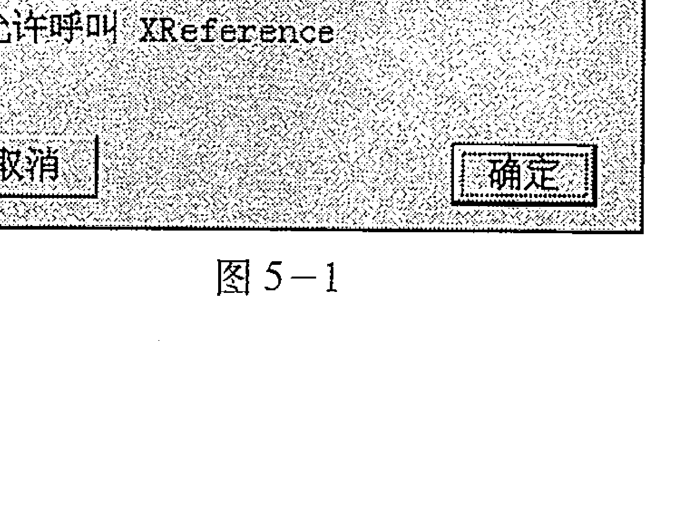

图 5-1

### 5.1.2 反汇编源代码的基本操作

- 1. 转到代码开始（Goto Code Start）

在工具栏按图标或从菜单的转到（Goto）选项选择转到代码开始（Goto Code Start）或按 Ctrl+S，这样光标将来到代码的开始处，用户可通过双击鼠标或用 Shift+上下光标键改变光标的位置。

- 2. 转到程序入口点（Goto Program Entry Point）

在工具栏按图标或菜单的转到（Goto）选项选择转到程序入口点（Goto Program Entry Point）或按 F10，这样光标将来到程序入口点（Entry Point），这里就是程序执行的起始点，一般动态调试时 LOAD 时也就停在此处。

- 3. 转到页（Goto Page）

在工具栏按图标或菜单的转到（Goto）选项选择转到页（Goto Page）或按 F11，这时跳出一对话框，如图 5-2 所示，输入页数可跳转到相关页面去。

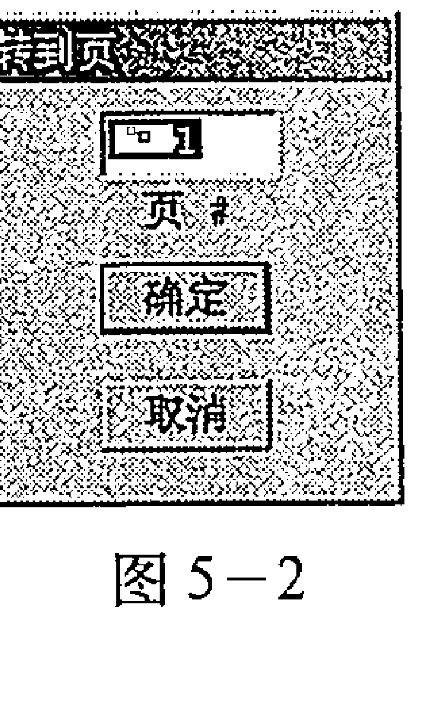

- 4. 转到代码位置（Goto Code Location）

在工具栏按图标或菜单的转到（Goto）选项选择转到代码位置（Goto Code Location）或按 F12，一个对话框将出现，如图 5-3 所示，允许用户输入代码偏移地址，以跳转到此位置上去。

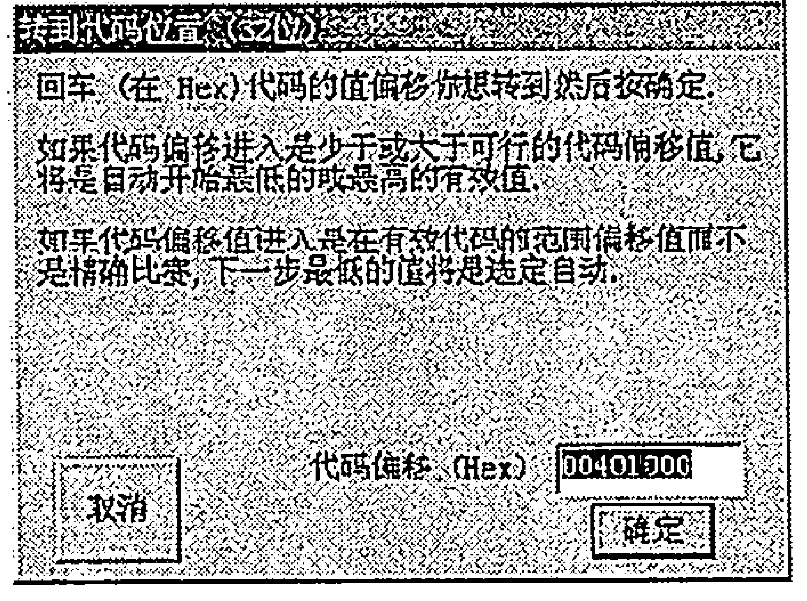

- 5. 执行文本跳转（Execute Text Jump）

这功能是在 Execute Text（执行文本）菜单选项里的，执行跳跃（Execute Jump）功能激活条件是光标在代码的跳转指令这行上（这时光条是高亮度的绿色）。此时工具条 Jump To 按钮也激活。如图 5-4：

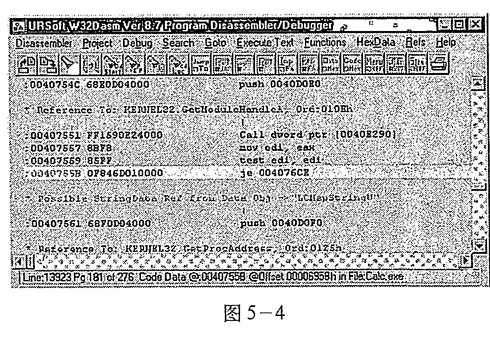

此时按 `[]` 按钮或菜单选项 Execute Jump（执行跳跃），或按右光标键，光条将来到跳转指令所指到的位置。在这例子里，将来到：`004076CE xor eax,eax` 这一行代码处，如图5-5：

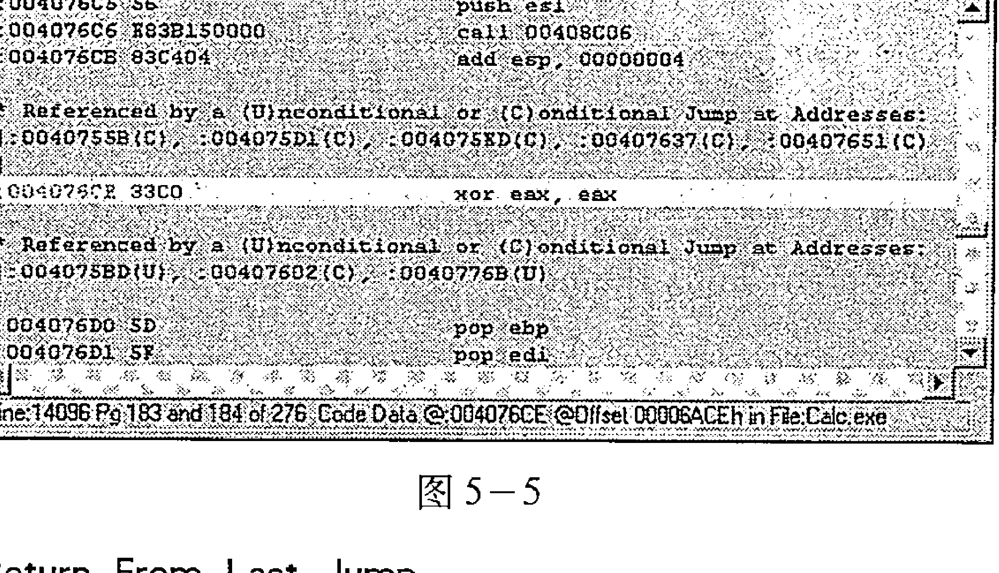

图5-5

## 6 返回到上一次跳跃（Return From Last Jump）

这功能是在 Execute Text（执行文本）菜单选项里的，此指令仅仅是在执行文本跳转功能完成后才激活。当这条件成立时，按钮 `[Ret]` 将激活。按 `[Ret]` 按钮，或在菜单里选项返回到上一次跳跃（Return From Last Jump），或按左光标键，光条将返回到上一次跳跃位置处。

## 7 执行调用（Execute Text Call）

这功能是在 Execute Text（执行文本）菜单选项里的，此功能激活的条件是光条在 CALL 指令一行。在这一行时光条将发绿，按钮 `[Call]` 将激活。执行时光条将会来到 CALL 所指的地址处。如下图5-6：光条在 `0040751D call 004073D4` 一行。此时按 `[Call]` 按钮，或在菜单的执行呼叫（Execute Text Call），或按右光标键，光条将来到 CALL 所指的地址 `004073D4` 这一行，如图5-7。

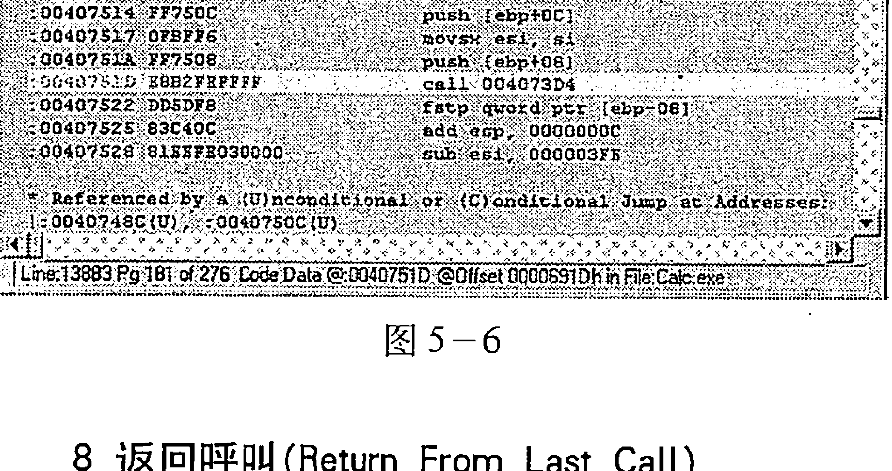

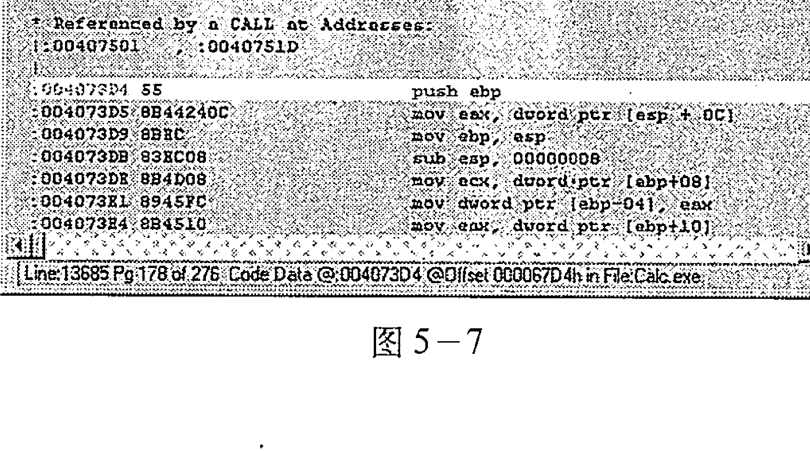

图5-6

图5-7

## 8 返回呼叫（Return From Last Call）

这功能是在 Execute Text（执行文本）菜单选项里的，此指令仅仅是在执行呼叫 Execute Text Call 功能完成后才激活。当这条件成立时，按 `[Ret]` 按钮，或在菜单里选项返回呼叫（Return From Last Call），或按左光标键，光条将返回到上一次呼叫位置处。

## 9 导入功能（Imported）

在菜单功能选项里，其作用主要是查看 Import 函数。按 `[Imp]` 按钮，或在菜单功能选项里的导入（Imports）命令，执行后将列出当前文件的 Import 函数。如图5-8。

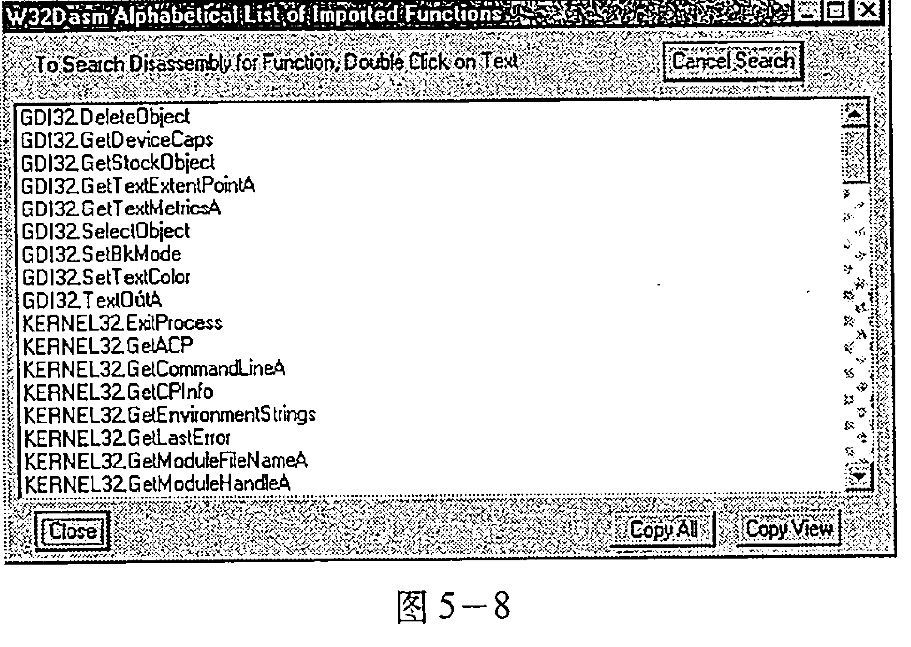

图5-8

你可双击这些项目，光条将来到调用这些函数的代码处。

注意：如果代码多处引用了这些函数，你双击这个项目函数时，光条将在调用它的几个位置代码处循环。

你也可用 copy all 或 copy view 复制 import 函数。

## 10 出口功能（Exported）

在菜单功能选项里，其作用主要是查看 Export 函数。按图标按钮，或在菜单功能选项里的出口（Exports）命令，执行后将列出当前文件的 Exports 函数。

注意：一般 EXE 文件没有 exported，DLL 文件有 exported 函数。

## 11 参考（References）

在这个菜单选项里有菜单参考（MENU）、对话参考（DIALOG）和字符串数据参考（STRING DATA），分别对应按钮。

注意：其中字符串数据参考（STRING DATA）功能破解时很常用。

#### 5.1.3 复制汇编代码文本

W32dasm 允许打印或复制指定行的汇编代码。首先你将鼠标移到 W32DASM 的最左边单击，将会出现一个小红点；再按住 Shift 键，移到你需要的下一行，再单击鼠标一下，将选中一段；按 `Ctrl+C` 复制，或在菜单选项反汇编里的拷贝指定的行（Copy Lines of Text）功能，或按图标，把数据复制到剪贴板里。如图5-9所示：

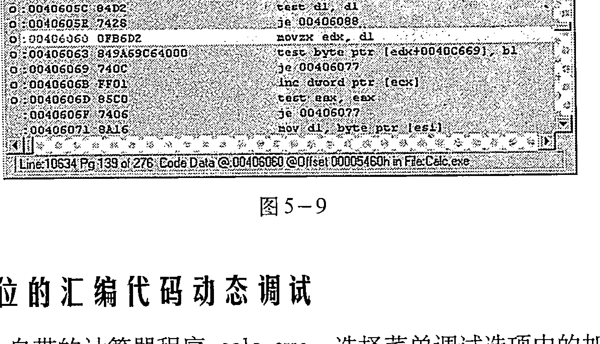

图5-9

## 5.1.4 装载32位的汇编代码动态调试

- 1. 反汇编 Windows 自带的计算器程序 calc.exe，选择菜单调试选项中的加载处理（Load Process），或按 `Ctrl+L`，出现一个加载对话框，你可输入选项命令。现在你可按装载（Load）按钮。Calc.exe 现在被 W32DASM 动态调试，将出现左右两个调试窗口（如下图）。在初始化 calc.exe 程序后，指令将停留在入口点（Entry Point）处。左边的调试窗口列出各种状态器如：CPU 寄存器、CPU 控制寄存器、断点、活动的 DLL、段寄存器等等；

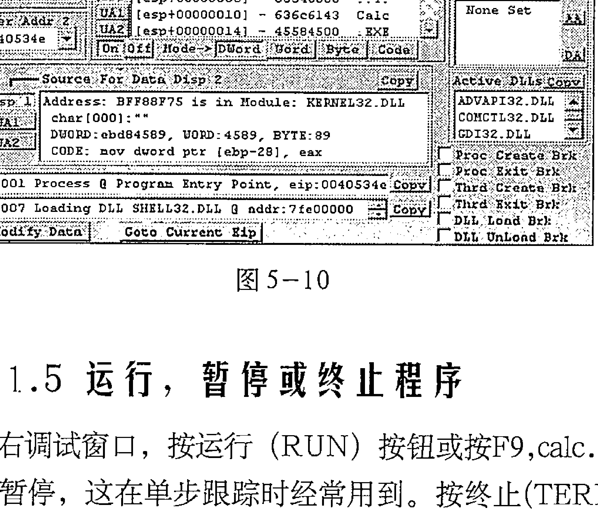

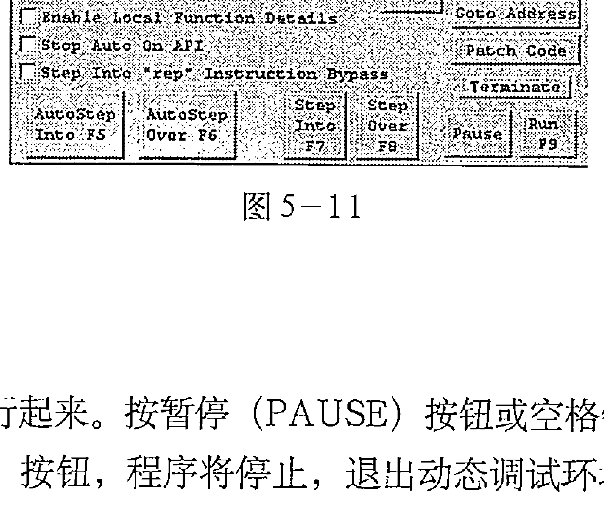

图5-10

图5-11

#### 5.1.5 运行、暂停或终止程序

在右调试窗口，按运行（RUN）按钮或按 `F9`，calc.exe 将运行起来。按暂停（PAUSE）按钮或空格键，程序将暂停，这在单步跟踪时经常用到。按终止（TERMINATE）按钮，程序将停止，退出动态调试环境。

#### 5.1.6 单步跟踪程序

重新加载 calc.exe，在程序加载后，停留在入口点。你可按 `F7` 或 `F8` 单步调试程序，这两个键所不同的是 `F7` 是跟进 CALL 里，`F8` 是略过。进入自动调试按 `F5`，结束自动调试按 `F6`。

#### 5.1.7 设置激活断点

重新加载 calc.exe，在 W32DASM 的菜单“转到”选项“转到代码处（goto code）”功能，填上 `403198`，按确定，你将在 W32Dasm 的主窗口（此时可能最小化了，把其还原即可）来到 `403198` 地址一行。光条在这一行显亮绿色，按 `F2` 或用鼠标左键点击最左边（同时按住 `Ctrl`）设置断点。

这时如断点设置成功，光条最左边有一小段黄条，显示此行为断点。如下图5-12：如果断点不在这里，整行光条将是黄色的。当断点设置好后，在左调试窗口中的断点小窗口显示断点情况，如图5-13（右边有一 `*`）：

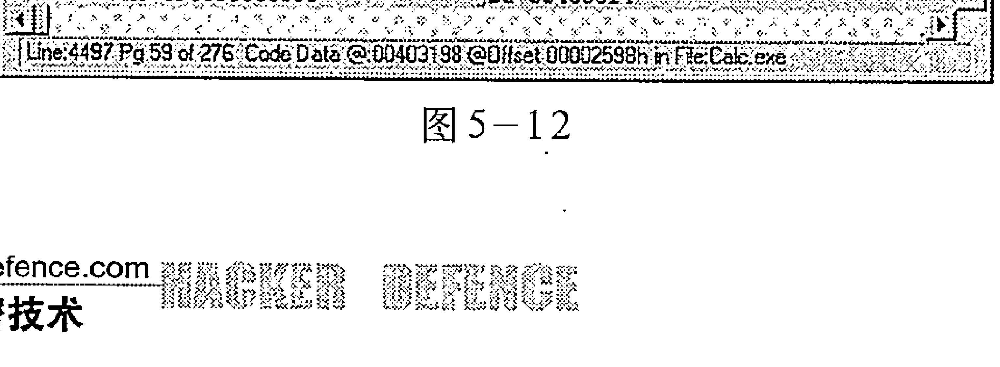

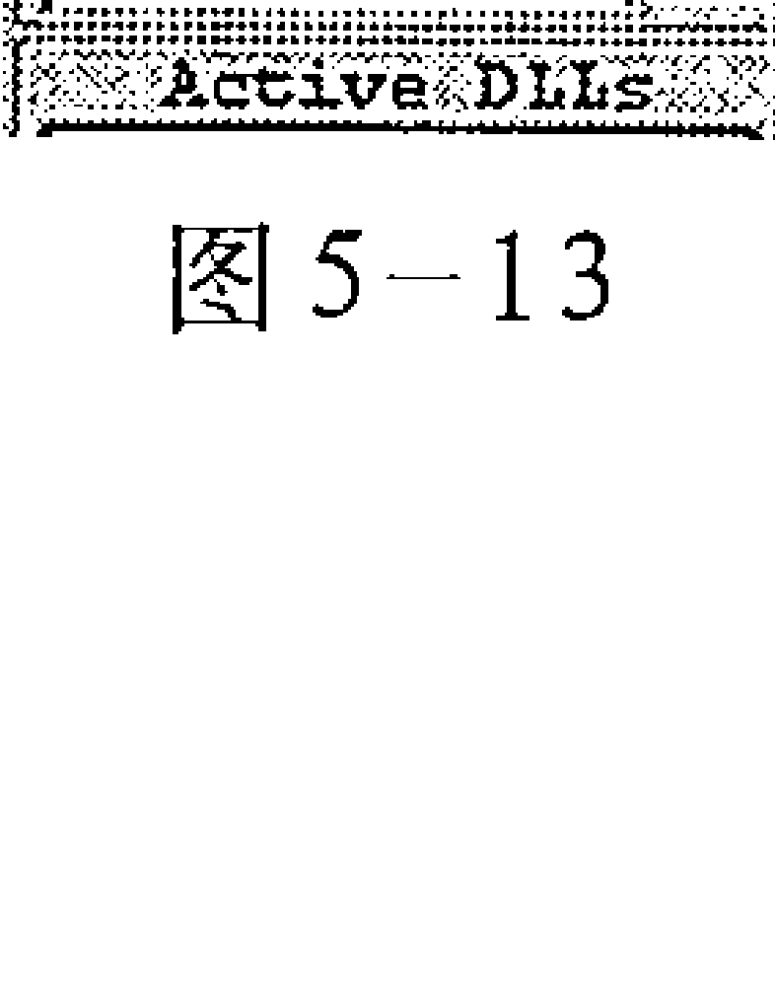

图5-12

图5-13

此时按 `F2` 或（鼠标左键 + Ctrl），断点将取消。此时按 `F9` 程序将运行到相关断点时停止。

#### 5.1.8 偏移地址和虚拟地址转换

偏移地址（File Offset）和虚拟地址的关系是：虚拟地址＝偏移地址＋基址（ImageBase）。基址在 Windows NT 中，缺省的值是 `10000h`；对于 DLL，缺省值为 `400000h`。在 Windows 95 中，缺省基地址为 `400000h`。其实你用 W32DASM 打开文件，在开始处就会有一句 `Imagebase = 00400000h`，这就是基址，有可能部分应用软件的基址不是 `00400000h`。了解它们的关系后，可利用此公式快速换算偏移地址和虚拟地址。

W32DASM、SOFTICE 和 Hiew（Decode 模式）显示的地址都是虚拟地址，但是在 Hiew（Decode 模式）下，`F5` 功能键查找的地址是偏移地址，因此必须将虚拟地址转换成偏移地址，才能找到正确的地址。

除了上面的公式外，常用的方法是在 W32DASM 下将绿色的光条移到某一行代码上，在窗口底部有一行字指示其偏移地址，如虚拟地址：`Code Data@0040534E`，而偏移地址为：`@Offset 0000474Eh`。这就是偏移地址。如图5-14。

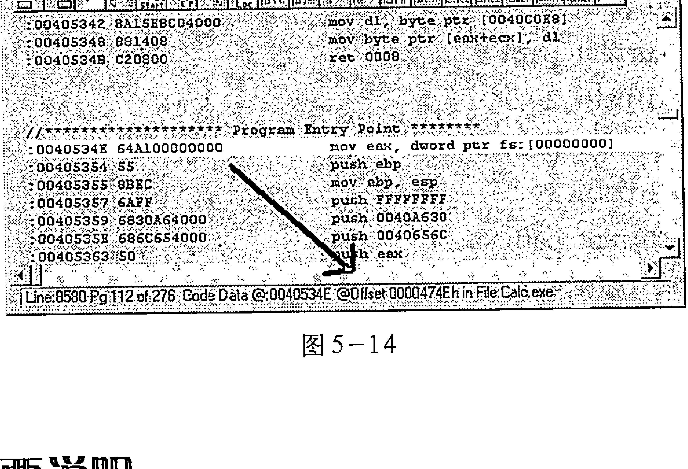

图5-14

## 5.2 Hiew简要说明

#### 1. 运行

在 Hiew 目录找到 Hiew.exe，运行它。这时 Hiew 界面出现的是 Hiew 目录文件，如图5-15。

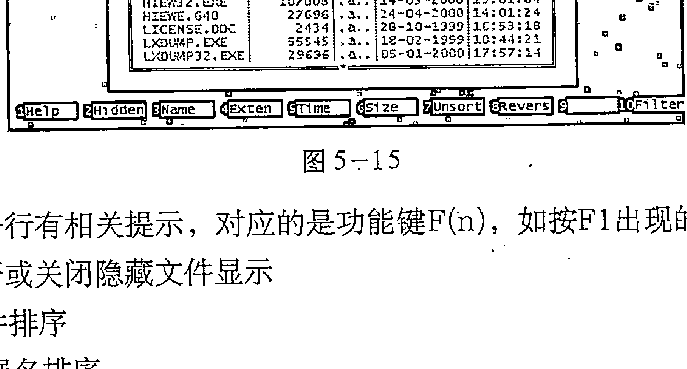

图5-15

此时在屏幕底部的命令行有相关提示，对应的是功能键 F(n)，如按 `F1` 出现的帮助：

- F2 - Hidden - 打开或关闭隐藏文件显示
- F3 - Name - 按文件名排序
- F4 - Exten - 按扩展名排序
- F5 - Time - 按文件时间排序
- F6 - Size - 按文件大小排序
- F7 - Unsort - 不排序
- F8 - Revers - 反转排序
- F9 - Files - 查看曾打开的文件历史
- F10 - Filter - 设置过滤
- Ctrl\ - 来到驱动器的根目录
- CtrlPgUp - 回到上一目录
- Insert - 打开/创建文件
- [printable char] - fast search filename
- * - next fast search
- Tab - attempt to perform complete filename
- AltF1 - Drive - 选择驱动器
- AltF2 - Drive - 选择驱动器
- AltF4 - ReRead - 重新读取目录文件
- CtrlF1 - Store1 - store current path 1
- CtrlF2 - retrieve stored path 1
- CtrlF3 - Store2 - store current path 2
- CtrlF4 - retrieve stored path 2
- CtrlF5 - Store3 - store current path 3
- CtrlF6 - retrieve stored path 3
- CtrlF7 - Store4 - store current path 4
- CtrlF8 - retrieve stored path 4
- CtrlF9 - State - toggle save state in next file
- CtrlF10 - Home - go home dir
- 回车键 - 可进入子目录或从子目录退出

#### 2. 基本操作

- 1. 参考上述操作打开你需要修改的文件。
- 2. 此时按 `F1`，屏幕又会出现相关的帮助信息。
- 3. 打开文件后，观察屏幕底部的 `F4（Mode）`，此时按 `F4`，将出现一对话框，让你选择 Text（文本）、Hex（十六进制）和 Decode（反汇编）模式。
- 4. 此时你可根据需要选择相关的模式。在这我们以 Decode（反汇编）模式为例，在此模式下，将出现汇编代码，你可修改这些代码。现在按 `F3（Edit）` 将进入编辑模式，按 `F5（Goto）` 将跳到指定的地址（注：是偏移地址，具体请参考上一节 W32Dasm 的相关描述），按 `F7（Search）` 是查找 ASCII 码或十六进制数据。
- 5. `F3（Edit）` 进入编辑模式后，移动光标到相应的行，按 `F2` 或回车键，跳出一对话框，可修改汇编代码。修改好后，`F9` 存盘（按回车后到下一行，再按 `Esc` 让对话框消失，然后按 `F9`）。

## 5.3 关于IDA与W32Dasm的比较

IDA Pro Advanced 是一个极好的反汇编工具，它在一些方面甚至胜过了 w32dasm。对于 w32dasm 来说，通常菜鸟不喜欢，而高手又崇拜它。不喜欢的原因是因为 IDA 相对于 w32dasm 来说有更多的附加功能和作用，有更大的复杂性。

当你运行 IDA Pro 时，你最先注意到的是它的界面比 w32dasm 更加专业，这里比 w32dasm 有更多的选项或更先进的地方。它的优点是可以更好地反汇编和更有深层分析，而缺点是使用 IDA 更困难。

实际上 IDA 同 w32dasm 有很多相同的功能：可以快速到达指定的代码位置；可以看到跳到指定位置的 jmp 命令位置；可以看参考字符串；可以保存静态汇编等。

在 IDA 中另一个同 w32dasm 近似的是十分简单的，如：“Goto code location”等同于在 IDA “Jump - Jump to address”。或者“Goto entrypoint”等同于在 IDA “Jump - Jump to entry point”。

- IDA 优点：
- 1. 能够对 w32dasm 无法反汇编的最难的软件进行反汇编（如加壳程序）
- 2. 能够以 `.asm`、`.sym` 和甚至是 `.exe` 及其它文件形式保存
- 3. 压缩的静态汇编，可以节省大量的磁盘空间
- 4. 可以重命名函数
- 5. 能够分析巨大的程序

有人会问：“如果 IDA 这么好，为什么我还要使用 w32dasm？”下面就是对此的解释：

首先是速度，对于 IDA 来分析一个小程序是非常非常快，但是如果分析一个大的 exe，它就要花费 3 个小时或更多的时间来全面分析 exe。其次，如果你对于一个指定的搜索，IDA 将很慢，而在 w32dasm 中在文本方面搜索是很快的。第三：当分析一个仅有简单保护的程序时，w32dasm 就为首选，因为你就不需要用 IDA 那些附加功能了。

## 第六章 剥除外衣——脱壳技术

由于网上的软件，加壳之风日盛。如果作为一个 Cracker，不跟着时代走，可能在不久的将来，你就没有什么软件可以修改了，所以一定要在加壳脱壳方法上下点苦功才行。

现在脱壳一般分手动和自动两种。手动就是用 TRW2000、TR、SOFTICE 等调试工具对付，对脱壳者有一定水平要求。而自动就稍好些，用专门的脱壳工具来脱。最常用的是某种压缩软件都有他人写的反压缩工具对应，有些压缩工具自身能解压，如 UPX；有些不提供这功能，如 ASPACK，就需要 UNASPACK 对付。好处是简单，缺点是版本更新了就没用了。另外脱壳就是用专门的脱壳工具来对付，最流行的是 PROCDUMP v1.6.2，可对付目前各种压缩软件的压缩档，如：ACDSEE3.0 脱壳。第四节就是高手 RuFeng（编者注：此君可谓国内“脱壳”技术的元老，如果大家有什么“脱壳”方面的问题，可以通过 ocq@163.net 联系他。）杰作，让你快速掌握其用法，快速步入较高境界。

当然手动脱壳很应熟练掌握，这样你以不变对万变，可以横扫千军了。第五节是一篇 TRW2000 手动脱壳过程，所以建议有一点破解基础的朋友还是快点熟悉 TRW2000，用它比 SOFTICE 效率更高，并且目前很少有软件对 TRW2000 设防，而 SOFTICE 就不同了，树大招风呀，很多软件都对它设防。虽然目前有补丁可以减少这一情况，但还是不方便。不信你装载 SOFTICE 后运行 ASPACK 后看看有什么反应，哈，傻眼了吧！

本着做到知己知彼、百战百胜，在第一、二节先讲解加壳的原理和压缩工具介绍。

### 6.1 壳的工作原理

通常对可执行文件的加密都要做到既要有加密效果（合法验证）又要能够可靠地运行。这时就需要在程序加上一层保护原程序的加密外壳。该外壳包含了加密所需的各种层次结构，如反跟踪、解密还原、设置环境等等。在通过了外壳程序对使用者合法性的检查判断后，解密还原原程序，并为原程序设置好运行环境，使程序可靠地运行。外壳程序原理框图如图1-1：

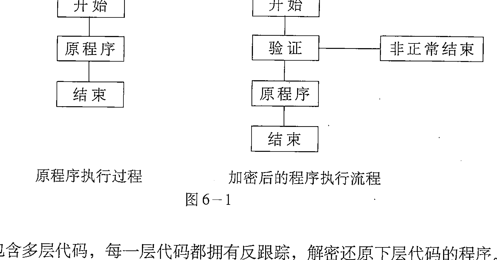

通常加密外壳程序包含多层代码，每一层代码都拥有反跟踪、解密还原下层代码的程序。它们层层紧扣，层层相关。只有正确地通过了上层的代码，才能得到下层的程序，并正确地按加密者思路执行下去。在通过了层层代码后，才能到达加密外壳的核心区域——验证程序。验证程序验证使用的合法性，如果验证通过，就还原原来的程序，并为其设置初始环境执行之；如果通不过验证就不正常退出或进入死循环。加密外壳程序实际上是加密系统的一个部件，需要把它“装配”到被加密的程序中，使被加密的程序先执行加密外壳，再执行原来的程序。这在 DOS 系统下是很好实现的，如执行文件压缩程序、加壳程序、病毒程序等等。因为 DOS 系统的可执行文件（`.COM` 和 MZ 格式的 `.EXE`）结构都比较简单，且自装载程序简单易于实现，容易做到完全的加密。而 Windows 95 和 Windows 3.1 系统的可执行文件（PE 格式和 NE 格式）结构复杂，自装载机制复杂。虽然 Windows 95 下的“装配”既麻烦又困难，但它关系到一个加密系统能否最终由构想变为现实，所以还是要花一定的功夫的。

### 6.2 压缩工具介绍

要脱壳就应先了解常用压缩工具有哪些，这样知己知彼。如今越来越多的软件商喜欢用压缩方式发行自己的产品，如 The Bat! 用 UPX 压缩，ACDSEE3.0 用 ASPACK 压缩等。它有以下因素：

- 一是：如今微机性能好，执行过程中解压使人感觉不出来，用户能接受。
- 二是：压缩后软件体积缩小，在当今英特网普及的今天，便于网络传输。
- 三是：当然是针对我们了，增加破解的难度 :-)

我们平时接触的压缩工具如 WinZip、RAR 等可压缩任何文件，但压缩后的文件不能直接执行，跟我们今天谈的不一样。我们对付的是 EXE 压缩软件，就是专门压缩 WIN95 下的 PE 格式 EXE 文件，当然有些也能压缩 DLL 文件。凡它压缩的文件就是体积缩小，别的性质没改变，还是 EXE 文件，仍可执行，只是运行过程和以前不一样了。压缩工具把文件压缩后，在文件开头一部分加了一段解压代码。执行该文件时，该代码先执行解压还原文件，不过这些都是在内存中完成的。由于微机速度快，我们基本感觉不出有什么不同。手动脱壳关键就是找到解压结束后准备跳到正常 EXE 文件执行的那个关键点，在 TRW2000 环境下用相关命令操作即可脱壳，如：`pedump 自定义文件名`，即可。

WIN95 下的 PE 格式 EXE 压缩软件和 DOS 下的 EXE 压缩不同，WIN95 EXE 的压缩率一般都不是很高，压缩率一般都是在 50% 左右，而不是像 DOS 下的 EXE 那样，情况理想的话压缩率达到 20% 也是常有的事。这是由两种 EXE 构造的不同而产生的。或者以后的 WIN95 EXE 压缩软件可以把压缩率再提高点，但我想是很难达到像 DOS 下那样的压缩率的。一般常见有以下几种：WWPACK32、PE-PACK、PETITE、NEOLITE、ASPACK、UPX 等。其中压缩率最高的是 UPX，而 ASPACK 无论是在压缩率、速度、兼容性、操作等各方面都同样有过人之处。

我们平时遇到最多的是用 UPX、ASPACK 压缩过的软件。下面就这两种压缩工具分别介绍：UPX 是 Ultra Packer for eXecutables 的缩写，意即“极端的可执行文件打包高手”。从名字可以看出，它的特点是压缩比高，经实验证明，一般都在 50% 左右，也就是说文件大小可以减少 50%。需要说明的是，它是一个命令行工具，要使用“命令+参数”的方式才能用，这似乎有悖于当前的趋势。但正因为如此，它颇受计算机高手的青睐，而初级用户也可以从中领略命令行的魅力。

UPX 有下面的几个优点：

- 1. 压缩比极高，而且提供多达 9 级的压缩率选择，方便各种方式的应用。例如压缩一个 5MB 的文件，压缩等级为 9 的结果比软件默认的压缩等级 7 就小了 0.65KB；
- 2. 支持众多的文件格式。包括 dos/exe、dos/com、dos/sys、djgpp2/coff、watcom/le（支持 DOS4G、PMODE/W、DOS32a 和 CauseWay）、win32/pe、rtm32/pe、tmt/adam、linux/i386、atari/tos；
- 3. 更好的扩展性，易于支持新的压缩格式；

4. 提供了多种版本以适应多种操作系统，现有 DOS 版、Windows 版、Linux 版。

UPX 的命令格式为：

```bash
upx [-123456789dlthVL] [-qvfk] [-o file] file..
```

下面，对其中的几个常用参数进行说明。

- `file..`：是用户要压缩的文件名，其中可包含路径；
- `-123456789`：表示压缩级别，9 是压缩后文件最小的，但执行速度也最慢，默认值是 7；
- `-g`：得到更多的帮助；
- `-q`：关闭信息输出；
- `-o file`：相当于“另存为”的功能，保留原来的文件不动，将压缩后的文件存为 file 所指定的名字。

该软件不仅能压缩 Win32 程序，对于 16 位 DOS/Windows 程序也能进行压缩。

在使用中需要注意，目前的版本只能还原 65K 以下的文件，压缩时最好选择备份源文件以便出现问题后重新压缩。

点评：小巧灵活，功能强大，但由于其操作方式为 DOS 命令行方式，且参数较多，光是压缩等级就分为了九级，在使用上有所不便。

另外，UPX 在压缩速度上还有些差强人意。经测试，在最高级别时压缩一个 5MB 的文件大约耗时 20 分钟。通常用于压缩体积较小的 `*.com` 文件。

ASPack 是专门用来压缩可执行文件的压缩软件。具体说来，就是压缩 Win95/98/NT 下的 32 位可执行文件以及动态连接库，即扩展名为 EXE、DLL、OCX、DPL（Delphi DLL）和 BPL（Delphi DLL）的文件。它是俄罗斯人 Alexey Solodovnikov 用 Borland（Inprise）Delphi 2.0 编写的共享软件，我得到的版本是 2.000，可以试用 30 天，无功能限制。安装程序 322KB。属于“绿色软件”，COPY 来就可以使用，DEL 了也就删除干净了。支持包括中文在内的多种语言包。

通常一个可执行文件是由程序体和内部资源两部分构成的。ASPack 压缩的就是这两部分。压缩的同时它会在被压缩的文件中写入一个解压缩程序，当被压缩的文件运行时，首先在内存中执行这个程序，将程序还原，而后运行。因为 ASPack 有着强大的压缩算法（编者：据 ZDNet 的介绍，ASPack 的解压程序是用纯汇编语言编写的 32 位程序，解压速度可超过每秒 1MB），其解压缩程序代码非常精炼（<1KB），解压缩的过程又是在内存中进行的，所以压缩后的程序完全可以像普通程序一样使用，根本感觉不到什么延迟。压缩完成后，应用程序就与压缩程序脱离了关系，可以独立运行，不需要 ASPack 和其他文件额外的支持。这也就是它的压缩原理。

ASPack 可以使你的应用程序更小、更快、更好。其平均压缩率可以达到 40%~70%。经过压缩后的可执行文件体积减小，不仅减少了网络下载时间和硬盘存储空间，而且减少了程序启动时驱动器的存取时间，也就使程序启动得更快。而且程序压缩后还可以有一定的加密作用，不会被轻易地反编译和破解。

ASPack 支持长文件名，支持鼠标右键操作模式，也支持命令行模式，支持命令行模式下的通配符，如：`ASpack C:\*.EXE`。在我使用过的众多同类压缩程序中，ASPack 的界面是最简洁和最友好的，简简单单、干干净净、明明白白（如图 6-1）。可以说，ASPack 是一个懒人用的程序，真正做到了“程序以人为本”。

下面让我们来实际操练一下，很简单的，你所要做的只是在对话框中打开想要压缩的应用程序，按下“开始压缩”按钮，剩下的事就交给它吧。等到压缩进程达到 100% 的时候，就会出现“测试”按钮，按下去就可以运行你刚才压缩的程序。看看它运行得是否正常。如果没有报什么错，那么就恭喜你了——压缩成功！当你退出了测试的压缩程序时，ASPack 界面上就会出现“恢复”和“删除备份”两个按钮，根据测试结果可以分别选择删除原程序备份或者是恢复原程序。

### ASPack 具有以下几个特点：

图 6-1

- 1. 压缩率高
- 2. 出错率低
- 3. 压缩速度较快

ASPack 对 EXE 或 DLL 文件的压缩率通常在 20% 到 60%，也就是说，一个 1M 的文件，压缩以后只有 200K 到 600K 大小。

与同类软件相比，ASPack 的出错率是非常低的。我对十几个 EXE 文件进行压缩，没有发现一个出错的，压缩以后都能正常运行。即便如此，ASPack 仍对每一个要压缩的文件做了备份，以保万无一失。

ASPack 的压缩速度在同类软件中也是最快的。

ASPack 使用起来也很方便。虽然 ASPack 是一个俄罗斯人编写的，但是它却是支持 20 种语言的多语言版本程序，这其中当然也包括中文。

把 ASPack 的最新版本 ASPack v2.1 安装好以后，双击 ASPack 运行软件，出现了程序界面后，首先选择“Options”标签页，在“Language”下拉框中选择“Chinese gb”，这时程序界面就会自动变成简体中文了。然后，在“打开文件”标签页中点击“打开”按钮，选择好你要压缩的文件，确定以后，ASPack 会自动为你进行以“原文件名.BAK”为名备份原文件、压缩文件、显示压缩比等一系列工作，压缩完了以后，显示的就是文件的压缩比，以及原文件与目标文件的大小对比，还会有一个“测试”按钮，选择它以后，ASPack 会把压缩以后的文件运行（如果是 EXE 文件的话）。如果你发现文件运行起来没什么问题，就可以把备份的原文件删除，达到节省磁盘空间的目的。

## 6.3 Procdump 的使用说明

对于一些朋友来说，要想用好 Procdump 1.50，可能还有点问题，因为它的 Script 说明书是英文的，下面就翻译出来供大家使用时参考。

- 一、ProcDump32 的 Script 扩展：  
  A）功能定义：

## 加密解密技术

- 1）Look 功能：  
  这个 Look 功能是在被载入的程序中查找指定的 HEX 字串。它会把找到的内存地址保存下来，以便你可以方便地在此内存地址设置断点。  
  例：Look 0F,85 将用于搜索一个 JNE 或一个长 jump。你可以通过 BP 命令来设置断点。

- 2）ADD 功能：  
  允许你在当前内存地址上加一个变址值（例：出现于 Look 命令或 POS 命令之后）。

- 3）DEC 功能：  
  猜测；）

- 4）REPL 功能：  
  这个功能用于在当前内存中修改内码（连续的 HEX）（注：它出现在 Look 命令之后）。  
  例：REPL 90,90 将会在你当前的内存位置开始连续放入两个 NOP 指令。

- 5）BP 功能：  
  在当前内存位置设置一个断点。

- 6）BPX 功能：  
  在指定的位置设置断点。这个位置与程序开始位置有关。  
  例：如果程序的开始位置在 RVA 66000h，BPX 2672 就会在 RVA 68672 设置断点。

- 7）BPF 功能（用标志位设断）：  
  这个功能会检查每一次断点发生时的标志位的值是否为你所设定的值。断点的位置为当前内存地址。

#### 二、Unset/Set 的内容

- C：进位标志（Carry Flag）
- P：奇偶标志（Parity Flag）
- A：辅助进位标志（Auxiliary Carry Flag）
- Z：零标志（Zero Flag）
- S：正负号标志（Sign Flag）
- D：方向标志（Direction Flag）
- O：溢出标志（Overflow Flag）

你可以单独测试一个标志位。

- 8）BPC 功能：  
  当经过当前位置的次数达到设定值时发生中断。  
  例：BPC 15（在第 21 次（15h）经过当前位置时中断）。

- 9）BPV 功能：  
  当寄存器的值到达了你设定的值时中断。  
  例：BPV EAX=5（当特定位置的 EAX=5 时中断）。

- 10）MOVE 功能：  
  设置当前 EIP。给当前 EIP 加一个参数值。但请小心使用它。其实它对于程序没有做什么，只是当你要跳过一些 CRC 检查时，就要用到它了，它相当于代替一连串的 NOP 指令。  
  例：MOVE 14 就会把当前 EIP 变为 EIP+14h。

- 11）POS 功能：  
  为所有的功能设置当前内存地址，这个位置与程序开始位置有关。

- 12）STEP 功能：  
  这个功能是设置一步一步地进行分析。它通常是用于完成跟踪 dump 过程的。  
  注意，单步模式就意味着每一行代码它都进行测试 -> 慢！！所以设置单步模式一般都放在最后。

- 13）OBJR 功能：  
  这个功能是设置以基始内存地址为开始进行扫描。对于 LOOK 命令有影响。

- 14）BPREG 功能：  
  以通过寄存器的值来设置断点。

- 15）WALK 功能：  
  执行下一条指令后把控制权交还 ProcDump32。

- 16）EIP 功能：  
  设置下一个 EIP 为原来程序的最初进入点。  
  注意：在断点之后，下一个 EIP 就是断点地址本身。

- 17）建立外部帮助文件：  
  通过特殊的参数创建外部文件。这个你指定的 ini 文件是由一些特殊参数组成和建立的。  
  它包括：进程的 PID、所有寄存器的值（包括 EIP）、当前 EIP 的值。

B）在 Script 中 Options 的格式：  
Options 是通过 OPTL 开始的，并以 DWORD 形式保存的。

| 项目 | 字段 | 含义 |
|---|---|---|
| OPTL1 | DWORD | 设定 AutoDump 中的延迟时间，以 ms 为单位 |
| OPTL2 | BYTE | 自动执行 EIP |
| OPTL2 | BYTE | 忽略错误 |
| OPTL2 | BYTE | 快速模式 Dump |
| OPTL2 | BYTE | 外部 Predump |
| OPTL3 | BYTE | 优化 PE |
| OPTL3 | BYTE | 自动计算程式 |
| OPTL3 | BYTE | 跟踪 API |
| OPTL3 | BYTE | 自动分层 |
| OPTL4 | BYTE | 未知模式 |
| OPTL4 | BYTE | Import 表类型重建 |
| OPTL4 | BYTE | 修复 Header |
| OPTL4 | BYTE | 修复 Relocs |
| OPTL5 | BYTE | 保留 |
| OPTL5 | BYTE | 保留 |
| OPTL5 | BYTE | 检查 Header |
| OPTL5 | BYTE | 合并代码 |

为得到更详细资料……查看 ProcDump Options 的解释吧。

C）如何编写你的加壳软件的定义：

- 1）添加索引段：  
  加一个 Pxx 的声明……注意 xx 的值是跟在最后一个值之后。  
  例如：

增加之前：

```ini
[INDEX]
P1=Shrinker 3.3
P2=Wwpack32 Beta 9
P3=Wwpack32 1.0
```

增加之后：

```ini
[INDEX]
P1=Shrinker 3.3
P2=Wwpack32 Beta 9
P3=Wwpack32 1.0
P4=My Own definition
```

- 2）增加你的定义：  
  每行的定义都必须事先声明，例如用 Lxx。  
  例：

```ini
[My own definition]
L1=Look 0F,85,DB,FF,FF
L2=BP
L3=STEP
```

你可以在定义中多加一点默认 options，添加 OPTLx 的方法也是这样做，如果你没有指定默认值。

### 6.4 手动脱壳的基本技巧

- 目标程序：用 Shrinker v3.4 压缩过的 Notepad.exe
- 使用工具：ProcDump、SoftICE、Symbol Loader
- 破解方法：手动脱壳

使 SoftICE 中断于程序入口处。  
用 Symbol Loader 打开已压缩的 notepad.exe。点击 Symbol Loader 任务条上的第二个图标，当你把鼠标移到图标上时，在 Symbol Loader 窗口底部提示行你会见到“Load the currently open module”的字样。你将得到一条出错信息，并问你是否尽管出错还是要装入这个 exe 文件。点击“Yes”。假如 SoftICE 已经运行的话，它应该在程序的入口处中断。可是它并没有中断，压缩过的 notepad.exe 直接就运行了。该到改变 sections 的 characteristics 的时间了……通过改变 characteristics，你可以使 SoftICE 中断于程序入口。

用 ProcDump 装入压缩过的 notepad.exe（使用 PE Editor），你会看到这个以“PE Structure Editor”作为标题的窗口，点击称作“Sections”的按钮。你将得到另一个以“Sections Editor”作标题的窗口。

你会见到压缩过的 notepad.exe 的不同 sections。第一个是 `.shrink0`，它的 characteristics 是 C0000082。  
改变 characteristics：鼠标左键点击 `.shrink0`，再点击右键并选择 edit section。你将得到另一个窗口，它用“Modify section value”作标题。把 Section Characteristics 由 C0000082 改为 E0000020。

一路按 OK，直到你回到 ProcDump 的主窗口。你现在可以把 ProcDump 放在一边了。

找到程序真正入口并进行脱壳。  
现在，希望你没有关闭 Symbol Loader。假如你关掉的话，重新运行它，打开并装入已压缩的 notepad.exe。当你这次点击“Yes”时，你会发现你已进入 SoftICE 了……  
我把下面的代码贴出来并加上注解。

你在 SICE 中所见到的。SoftICE 中断时，你会在这儿一直按 F10 走过这部分代码：

```asm
0041454F  FFFFINVALID
00414556  55              PUSH    EBP
00414557  8BEC            MOV     EBP,ESP
00414559  56              PUSH    ESI
0041455A  57              PUSH    EDI
0041455B  75 6B           JNZ     004145C8 (NO JUMP)
0041455D  68 00010000     PUSH    00000100
00414562  E8D60B0000      CALL    0041513D
00414567  83C404          ADD     ESP,04
0041456A  8B7508          MOV     ESI,[EBP+08]
0041456D  A3B4F14000      MOV     [0040F1B4],EAX
00414572  85F6            TEST    ESI,ESI
00414574  74 23           JZ      00414599 (JUMP)
00414599  33FF            XOR     EDI,EDI
0041459B  57              PUSH    EDI
0041459C  893D8C184100    MOV     [0041188C],EDI
004145A2  FF1510224100    CALL    [KERNEL32!GetModuleHandleA]
004145A8  8BF0            MOV     ESI,EAX
004145AA  68FF000000      PUSH    000000FF
004145AF  A1B4F14000      MOV     EAX,[0040F1B4]
004145B4  897D10          MOV     [EBP+10],EDI
004145B7  C7450C01000000  MOV     DWORD PTR [EBP+0C],00000001
004145BE  50              PUSH    EAX
004145BF  56              PUSH    ESI
004145C0  FF15F4214100    CALL    [KERNEL32!GetModuleFileNameA]
004145C6  EB03            JMP     004145CB (JUMP)
004145CB  E830EAFFFF      CALL    00413000
004145D0  FF7510          PUSH    DWORD PTR [EBP+10]
004145D3  FF750C          PUSH    DWORD PTR [EBP+0C]
004145D6  56              PUSH    ESI
004145D7  E806000000      CALL    004145E2
```

当你走过这个位于 004145D7 的 CALL，压缩过的 notepad.exe 就自由运行了。再次用 Symbol Loader 装入。再次来到这个 CALL 时，按 F8 追进去。你将看到以下代码，不过记着先 `BPX 004145D7`。

```asm
004145E2  64A100000000    MOV     EAX,FS:[00000000]
004145E8  55              PUSH    EBP
004145E9  8BEC            MOV     EBP,ESP
004145EB  6AFF            PUSH    FF
004145ED  6810E04000      PUSH    0040E010
004145F2  68EC5D4100      PUSH    00415DEC
004145F7  50              PUSH    EAX
004145F8  64892500000000  MOV     FS:[00000000],ESP
004145FF  83EC14          SUB     ESP,14
00414602  C745E401000000  MOV     DWORD PTR [EBP-1C],00000001
00414609  53              PUSH    EBX
0041460A  56              PUSH    ESI
0041460B  57              PUSH    EDI
0041460C  8965E8          MOV     [EBP-18],ESP
0041460F  C745FC00000000  MOV     DWORD PTR [EBP-04],00000000
00414616  8B450C          MOV     EAX,[EBP+0C]
00414619  83F801          CMP     EAX,01
0041461C  7510            JNZ     0041462F (NO JUMP)
0041461E  E886030000      CALL    004149A9
00414623  FF05C0F14000    INC     DWORD PTR [0040F1C0]
00414629  E882F6FFFF      CALL    00413CB0
0041462E  8B35C0F14000    MOV     ESI,[0040F1C0]
00414634  85F6            TEST    ESI,ESI
00414636  0F848D000000    JZ      004146C9 (NO JUMP)
0041463C  833DC4F1400000  CMP     DWORD PTR [0040F1C4],00
00414643  7526            JNZ     0041466B (NO JUMP)
00414645  833D6417410000  CMP     DWORD PTR [00411764],00
0041464C  741D            JZ      0041466B (NO JUMP)
0041464E  A164174100      MOV     EAX,[00411764]
EAX 现在的值是 00010CC
00414653  030588184100    ADD     EAX,[00411888]
EAX 现在的值是 004010CC
00414659  8945DC          MOV     [EBP-24],EAX
[EBP-24] 现在含的是 004010CC
0041465C  FF7510          PUSH    DWORD PTR [EBP+10]
0041465F  FF750C          PUSH    DWORD PTR [EBP+0C]
00414662  FF7508          PUSH    DWORD PTR [EBP+08]
00414665  FF55DC          CALL    [EBP-24]
```

假如你追过最后这个 CALL，notepad.exe 将再次自由运行。由上得知，既然 `[EBP-24] = 004010CC`，最后这句代码就意味着被壳压缩过的程序在 `CALL 004010CC`。如果你追进这个 CALL，你会发现 notepad.exe 很快就会运行了。

假如你曾经追过更多 Shrinker v3.4 压缩的程序，你总会见到这个 `CALL [EBP-24]`。所以，程序实际上正在进入已脱壳程序的真正入口。再次装入压缩过的 notepad.exe，中断之后，按 F5，你将中断于 004145D7 行（这里你原来设过断点）。追进去直到你到达 00414665 行，这里程序正要进入已脱壳程序的真正入口。

现在，键入以下命令：

- `a eip`（然后按回车）
- `jmp eip`（然后按回车）
- 按下 F5

这样将改变 00414665 行的代码，你会注意到在键入“jmp eip”并按下回车后，00414665 的指令现在是一个 jmp。这将有效地使程序“暂停”，按下 F5 使你回到 Windows，你就可以 dump 已经脱壳的程序到你的硬盘了。

现在又要用 ProcDump 了，在 Task 的列表中的第一个 list 上点击鼠标右键，然后选择“Refresh list”。在 Task 列表中找到 notepad.exe，在它的上面点击鼠标右键，然后选中“Dump (Full)”，给脱壳的程序起名存盘。再在 notepad.exe 上点击鼠标右键，然后选中“Kill Task”。

改动程序入口值：如果你记得的话，脱壳的 notepad.exe 程序入口是 004010CC。再次使用 ProcDump 的 PE Editor 功能，打开已脱壳的 notepad.exe。

在“Header Infos”一项，你会看见程序入口值是 0001454F，这当然是错误的。如果你试着不改动这个入口值而运行脱壳后的 notepad.exe，程序将无法运行。

改变入口值为 004010CC，点击“OK”。

现在，运行脱壳后的 notepad.exe 吧，它应该正常运行了。

### 6.5 三种常见的壳

下面是脱壳高手 iis 介绍的用三种常见的加壳工具 Pklite32、Shrinker3.4 和 Neolite 加了壳的软件是如何进行脱壳的。

### 一、脱壳——对用 Pklite32 加壳的程序进行手动脱壳

- 目标文件：pklite32w.exe
- 加壳方式：pklite32
- 所用工具：trw2000 v1.22
- 1. 用 trw2000 的 Loader 加载加壳程序。
- 2. 按一下 F10，将停在下面的地方：

```asm
0167:00607005  PUSH   DWORD 00627F84   《--停在这里，一直按f10
0167:0060700A  PUSH   DWORD 00
0167:0060700F  CALL   00627F84
0167:00607014  JMP    004117B0         《--执行完这个指令，执行命令makepe 文件名
0167:00607019  INC    EAX
0167:0060701A  SUB    [EBX],AH
```

- 3. 脱壳成功。

### 二、脱壳——对用 Shrinker 3.4 加壳的程序进行手动脱壳

- 加壳方式：Shrinker 3.4
- 所用工具：trw2000 v1.22
- 1. 用 trw2000 的 Loader 加载加壳程序。
- 2. 按一下 F10，将停在下面的地方：

```asm
0167:004365AF  PUSH   EBP      《--停在这里
0167:004365B0  MOV    EBP,ESP
0167:004365B2  PUSH   ESI
0167:004365B3  PUSH   EDI
0167:004365B4  JNZ    00436621
0167:004365B6  PUSH   DWORD 0100
0167:004365BB  CALL   004370D1
```

- 3. 一直按 F10：

```asm
0167:00436619    CALL    [KERNEL32!GetModuleFileNameA]
0167:0043661F    JMP     SHORT 00436624
0167:00436621    MOV     ESI,[EBP+08]
0167:00436624    CALL    00435000
0167:00436629    PUSH    DWORD [EBP+10]
0167:0043662C    PUSH    DWORD [EBP+0C]
0167:0043662F    PUSH    ESI
0167:00436630    CALL    0043663B    《——按f8进入
0167:00436635    POP     EDI
0167:00436636    POP     ESI
0167:00436637    POP     EBP
0167:00436638    RET     0C
```

- 4. 再按 F10 到达下面的地方：

```asm
0167:0043667C    INC     DWORD [004311C0]
0167:00436682    CALL    00435CB2    《——此处将弹出一个消息框，按"是"将返回trw2000。
0167:00436687    MOV     ESI,[004311C0]
0167:0043668D    TEST    ESI,ESI
0167:0043668F    JZ      004366FF
0167:00436691    CMP     DWORD [004311C4],BYTE +00
0167:00436698    JNZ     004366C0
0167:0043669A    CMP     DWORD [00433774],BYTE +00
0167:004366A1    JZ      004366C0
0167:004366A3    MOV     EAX,[00433774]
0167:004366A8    ADD     EAX,[00433898]
0167:004366AE    MOV     [EBP-20],EAX
0167:004366B1    PUSH    DWORD [EBP+10]
0167:004366B4    PUSH    DWORD [EBP+0C]
0167:004366B7    PUSH    DWORD [EBP+08]
0167:004366BA    CALL    NEAR [EBP-20]    《——按f8进入后，执行命令makepe 文件名
0167:004366BD    MOV     [EBP-1C],EAX
```

- 5. 脱壳成功。

### 三、脱壳——对用 NeoLite 加壳的程序进行手动脱壳

- 目标文件：NeoLite（2.0）.exe
- 加壳方式：NeoLite
- 所用工具：trw2000 v1.22
- 1. 用 trw2000 的 Loader 加载加壳程序。
- 2. 将停在下面的地方：

```asm
0167:0041C1A8    JMP     0041C253    《——停在这里
0167:0041C1AD    MOV     EAX,A80041DA
0167:0041C1B2    ROL     BYTE [ECX+00],AC
0167:0041C1B6    ROL     BYTE [ECX+00],00
0167:0041C1BA    ADD     [EAX],AL
```

```asm
0167:0041C1BC  ADD    [EAX+6A00004A], BH
0167:0041C1C2  RET    41
```

- 3. 一直按 F10：

```asm
0167:0041C262  INC    BYTE [0041C252]
0167:0041C268  JMP    EAX        ; （一跳到真正的入口点）
0167:0041C26A  CMP    BYTE [0041C252], 00
0167:0041C271  JNZ    0041C286
```

- 4. 跳到下面地方：

```asm
0167:004073F3  PUSH   EBP        ; （一跳到这，执行命令makepe 文件名）
0167:004073F4  MOV    EBP, ESP
0167:004073F6  PUSH   BYTE -01
0167:004073F8  PUSH   DWORD 0040D1A0
0167:004073FD  PUSH   DWORD 00409A3C
0167:00407402  MOV    EAX, [FS:00]
0167:00407408  PUSH   EAX
```

- 5. 脱壳成功。

### 6.6 手动脱壳

这节以一实例介绍一下手动脱壳最简单的情况，我们平时碰到最多的 EXE 压缩工具是 UPX、ASPACK 等，在这里我们用 UPX 来压缩 Windows 自带的记事本程序，然后手动将其脱壳。

UPX 版本：UPX V1.01

原文件：Notepad 34K

用 UPX 压缩后：Notepad-upx 16K

先来分析一下用 UPX 压缩后的记事本程序运行情况。UPX 压缩时在记事本程序前加了一段自解压代码，记事本程序运行时，首先就运行这自解压代码，这段代码按一定算法，将压缩过的记事本程序在内存解压，直到将记事本程序完全解压，跳到记事本程序代码处（这个地方就是入口点），然后从这里开始正确运行记事本程序。此时解压后的记事本程序代码全部完整存在内存里，我们可用相关工具将其全部复制保存到一文件，再将这文件运行的入口点修正，程序就可完全运行了。这就是手动脱壳最基本的情况。

因此手动脱壳，关键是找到入口点，不然就不能得到完整的解压程序代码。找入口点可依据如下原则：绝大多数 PE 加壳程序在被加密的程序中加上 1 个或多个段。所以看到一个跨段的 JMP，就有可能是了。UPX 用了一次跨段的 JMP，ASPACK 用了两次跨段的 JMP。就是你一步步跟踪时会看到代码有一突跃，一般再根据窗口文件名的变化，就能确定入口点了。

好，说了这么多了，我们开始工作：

### 一、分析是用何软件压缩（假设开始我们不知道是用什么软件压缩的）

一般拿到这软件后，可用工具 gtw、TYP32、FileInfo 等侦测文件类型的工具来看看是何种软件压缩的。在这我们以 FileInfo 为例，把 Notepad-upx 复制到工具软件目录下，在资源管理器下双击 FileInfo，再按回车，你将看到报告出来：告诉你这是 UPX1.01 压缩的软件。

或你用 Procdump 工具，运行 Procdump 后，点击 PE Editor 按钮，选上 Notepad-upx 文件，再点击 Sections 按钮，你会看到 Sections informations 对话窗口里，Name 那项有 UPX0、UPX1，这表明是用 UPX 压缩的。

### 二、用 TRW2000 来脱壳

### ①手动找入口点

运行 TRW2000 装载 Notepad-upx，然后 LOAD，你将中断在主程序入口处；此时按 F10、F7（程序执行到光标行，用来走出循环）一直向前走，注意此时窗口会是：NOTUPX!UPX1+2xxx，直到你来到：

```asm
0137:40ddbe popa
0137:40ddf jmp 00401000  <- 此行已完全解压结束，将要跳到记事本程序入口点执行程序。
0137:401000 push ebp     <- 完全解压后的记事本程序第一行
```

好了，基本大功告成，在 0137:401000 一行，执行命令 makepe 文件名或 pedump 文件名。就这样脱壳成功。

makepe 命令含义：从内存中整理出一个指定名称的 PE 格式的 exe 文件，当前的 EIP 将成为新的程序入口，生成文件的 Import table 已经重新生成过了。生成的 PE 文件可运行于任何平台和微机上。

pedump 命令含义：将 PE 文件的内存映像直接映像到指定的文件里。生成的文件只能在本机运行，不能在其它系统平台或微机运行。

你也可用 Procdump 来配合脱壳，在 137:401000 一行，执行 suspend 命令挂起程序。然后就回到 Windows 下，运行 Procdump 文件，在 Procdump 的左上窗口中，在 Task 一列找到 Notepad-upx.exe，然后在此行点击右键，选择 DUMP（FULL），将内存中的记事本程序以另一文件名存盘。然后点击 PE Editor 按钮，选上你刚脱壳的文件，会出现一窗口，在 Entry Point（入口点）一项填上程序入口点，这里是 00401000，然后点击 OK 存盘，即可。注：在此例 DUMP（FULL）的入口点刚好是 00401000，在大多数情况下，均要手动修正。这样处理后，程序脱壳成功。此时你可在 Procdump 选上刚才的记事本程序，点击右键，用 Kill Task 命令关闭记事本程序。

### ②用 PNEWSEC 命令找入口点

运行 TRW2000 装载 Notepad-upx，然后 LOAD，你将中断在主程序入口处；执行命令 PNEWSEC，稍等就会停在入口点，剩下的和上面一样，但有时用这命令对一些程序无效，就不得不用手动来找入口点了。

PNEWSEC：运行直到进入一个 PE 程序内存的新的 section 时产生断点。

### 三、用 SOFTICE 来脱壳

### ①用 SOFTICE 找入口点，只有靠手动来找了，方法同 TRW2000 一样，来到：

```asm
0137:40ddf jmp 00401000
现在这一行，键入以下命令：
a eip（然后按回车）
jmp eip（然后按回车）
按下F5
```

这样将改变 0137:40ddf 行的代码。你会注意到在键入“jmp eip”并按下回车后，40ddf 的指令现在是一个 jmp。这将有效地使程序“暂停”（有点类似 TRW2000 的 suspend 命令）。按下 F5 使你回到 Windows，你就可以 dump 已经脱壳的程序到你的硬盘了。剩下的就和上面 TRW2000 操作一样了。

### ②用 Icedump 来配合 SOFTICE 和 Procdump

装载 SOFTICE 后，在 Icedump 的目录里执行你相应版本的 Icedump（这里我的 SOFTICE 是 4.05 版，我选上 win9x 目录下 405 目录，运行 icedump.exe）。

再运行 Procdump32，从主菜单中选择“Option”，选中“Rebuild new import table”重建 import 表，这样生成的 PE 文件就会重建，类似于 TRW2000 的 makepe 命令。在上一节用 Procdump 自动脱壳时，也要选上这一项。

再点击 Procdump 其中的“Bhrama Server”，OK，就别管它了。（注意：AutoFixPE 要选上）

再用 SOFTICE 的 Symbol Loader 装载 Notepad-upx 来到：

```asm
0137:401000 push ebp <-你停在这，下命令 “PAGEIN B PROCDUMP32 - DUMPER SERVER” 脱壳。
```

下命令后，来到 Windows 环境下在 Procdump 里会跳出一对话框，以另一文件存盘，至此脱壳成功。你每次下“PAGEIN B PROCDUMP32 - DUMPER SERVER”这命令也麻烦了，你可在 SOFTICE 目录下的 winice.dat 里加上一行：F3="PAGEIN B ProcDump32 - Dumper Server;"，以后按 F3 就可执行这命令。

> （注：这是 icedump 6.015 的命令，在 6.16 版本后命令完全不同，而是 F3="/BHRAMA ProcDump32 - Dumper Server;"）

#### 四、小结

- 1. 你会发现脱壳后的软件比压缩前的大了，这没关系，只要程序能正常运行即可。那判断脱壳成功的依据是什么呢？我个人观点是：你在调试工具下（SOFTICE 或 TRW2000）看到程序任何一处的机器码同用 W32DASM 反汇编出来看到的机器码一样，那么脱壳成功。
- 2. 问：有些程序脱壳后用 W32DASM 不能反汇编？  
  你可用 ProcDump 的 PE Editor 把脱壳后的文件的 text 或 code section 的 Characteristics 改为 E0000020。再反汇编就可以了。
- 3. 问：部分脱壳后的 exe 文件如何再压缩，用 UPX、PELITE、PECOMPACT 等都说错。  
  不能被压缩多是无效的 Relocations，Relocations 存放程序重定位信息。win9x 下一般不需要用到重定位，但 NT 下就一定要用到，这是导致脱壳的程序在 NT 下不能运行的原因。用 Procdump 修改脱壳程序 Relocations rav/size 为 0 就可压缩。需要在 NT 下运行就把对应的 .reloc 段的 rav/size 填上即可。

## 第七章 辅助破解技术大全

## 7.1 摘录 Ollydbg 的“十全武功”

Ollydbg 让很多用习惯了 S-ice、TRW 等系统级 Command Line 调试器的老鸟们大跌眼镜，zczc、飞叶流枫的 Ollydbg 晓亮系列文章把 ue!Lock、Aspr、幻影等经典壳完全部摆倒，winroot、slimboy 的 Ollydbg 爆破和算法分析系列文章充分展示了 Ollydbg 与其前辈相比最为突出的**人性化设计**一面。还有一些朋友不嫌麻烦，为初学者写了大量的 Ollydbg 使用入门教程。所有这些加起来，终于让 Ollydbg 从刚开始推出时的默默无闻，变成了现在的红透半边天。

可以说，只要不是开发驱动程序，一般应用程序的各种调试工作都可以用 Ollydbg 完美完成。面对这种情况，我们不禁想问：到底 Ollydbg 具有什么神奇的魔力，能够在短短的一两年时间内如此迅速蹿红，打破 S-ice 近乎垄断的调试器地位呢？下面就让我们随着文章的介绍，慢慢领略 Ollydbg 的“十全武功”吧！

一方面，从设计理念上来说，Ollydbg 没有去挖 S-ice 那根 Ring0 级别的独木桥，自己在 Ring3 下面发展。Ring3 虽然听起来级别没有 Ring0 高，可是在 Windows 的保护模式模型下面，所有的应用程序都是运行在 Ring3 级别，所以，要调试一般的应用程序，Ring3 级别的调试器的功能足矣。并且，运行于 Ring3 的同时，带来了可以多任务的便利，一边调试，一边上网聊天，听 MP3，这在以前 S-ice 的年代是根本不能想像的事情，可是 Ollydbg 把它变成了现实，摆在我们的面前。

另一方面，就是 Ollydbg 本身具有的强大的多种功能，在 001 论坛上，经过了将近一年对于 Ollydbg 功能的讨论和探索后，大家终于取得了一个比较一致的意见：Ollydbg 是综合了 S-ice、WinHex、Hiew 这 3 款强大的 Crack 工具大部分优点的超级工具！在 Ring3 应用程序的跟踪方面，无论从易用性、可扩展性，还是从界面的亲和力来说，Ollydbg 都是第一号备选方案。

可是，由于 Ollydbg 是菜单+命令行形式的操作界面，所以，有很多强大、奇妙的功能可能隐藏在菜单的后面，而未被大家所发现。这篇文章的主要目的就是把这些可能不为人所知的各种功能展示出来，看后大家可能想起在以前遇到问题的时候，为什么没能够想到自己的手边原来还有这么一个逆向工程的核武器！

- 1. 配置好 Ollydbg 的显示界面。

Alt+O 调出 Debugging Option 设置界面，在 Disassembler 选项卡内，勾选如下选项：

- Tab between mnemonics and arguments
- Extra space between arguments
- Show default segments
- Always show size of memory operands
- Show local module name
- Show symbolic addresses

在 CPU 选项卡中，设置如下：

- Underline fixups

- Show direction of jumps  
- Show jump path  
- Show greyed path if jump is not taken  
- Gray command that fills gaps between procedures  

在 ANALYSIS 1 选项卡中，勾选如下选项：

- Show ARGS and locals in procedures  
- Show arguments of known functions  
- Guess number of arguments of unknown function  
- Auto start analysis of main code  
- Analyse code structure  
- Decode cascade IF's as SWITCHES  
- Trace contents of registers  
- Decode tricky sequences  
- Keep analysis between sessions  

按照上面这样的设置方法设置后，OllyDbg 就具有了标示跳转、解析花指令、自动猜测未知函数参数个数等诸多功能。其显示界面如图 7-1 所示。

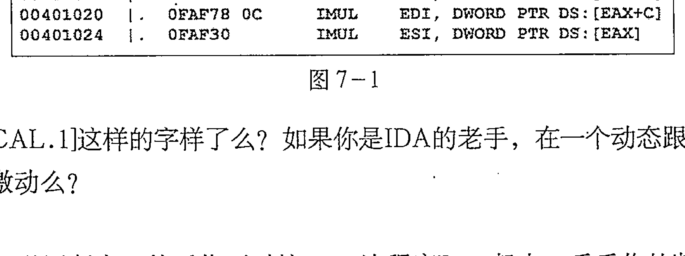

看到 `[ARG.2]` 和 `[LOCAL.1]` 这样的字样了吗？如果你是 IDA 的老手，在一个动态跟踪的软件里头看到如此熟悉的身影，你能不激动么？

- 1. 断点的设置  
  跟踪的过程中，按 F2 设置断点，然后你可以按 F9，让程序 Run 起来，看看你的断点起作用么？

- 2. 区段断点的设置  
  如果你是一个老鸟，相信你一定对 TRW 的 bpnewsec 命令不陌生，在网上一篇流传甚广的脱壳教程里头，教会了许多人在脱壳时应用这个神奇的命令。可惜的是 S-ice 不支持这个命令，但在 OllyDbg 里头，你只要 Alt+M，然后选中你想设断点的区段，右键，怎么样？看到令你热血澎湃的 Set Breakpoint 选项了么？

- 3. 条件断点的设置  
  任何一个老鸟对于“bpx CreateFileA if (eax==0)”之类的条件断点都不会陌生；可惜的是，无论是 S-ice 还是 TRW，他们的条件断点功能都不算强大，而且有时还有长度限制，特别是 S-ice，bpm 断点最多只能设 4 个，所以有时候就会觉得断点资源不够用。现在有了 OllyDbg，你只要 Ctrl+T 或者 Shift+F4，你就能看到两种全新的条件断点设置方式。图 7-2 是 Ctrl+T 后屏幕的截图。不要太惊讶，是的，在 OllyDbg 的世界里，条件断点的设置就是这么简单直观！  
  至于 Shift+F4 是什么界面，大家自己去发掘吧。我可以保证，绝对不比这个差！

- 4. 跟踪的技巧  
  任何一个完美的调试器都会有 3 种功能：Step Into、Step Over、Return if ret（借用 Stan 的名言：“如果没有，扔了它”）。在 OllyDbg 里头，和这 3 个功能对应的热键是：F7、F8、Ctrl+F11。

- 5. 如何设置运行参数  

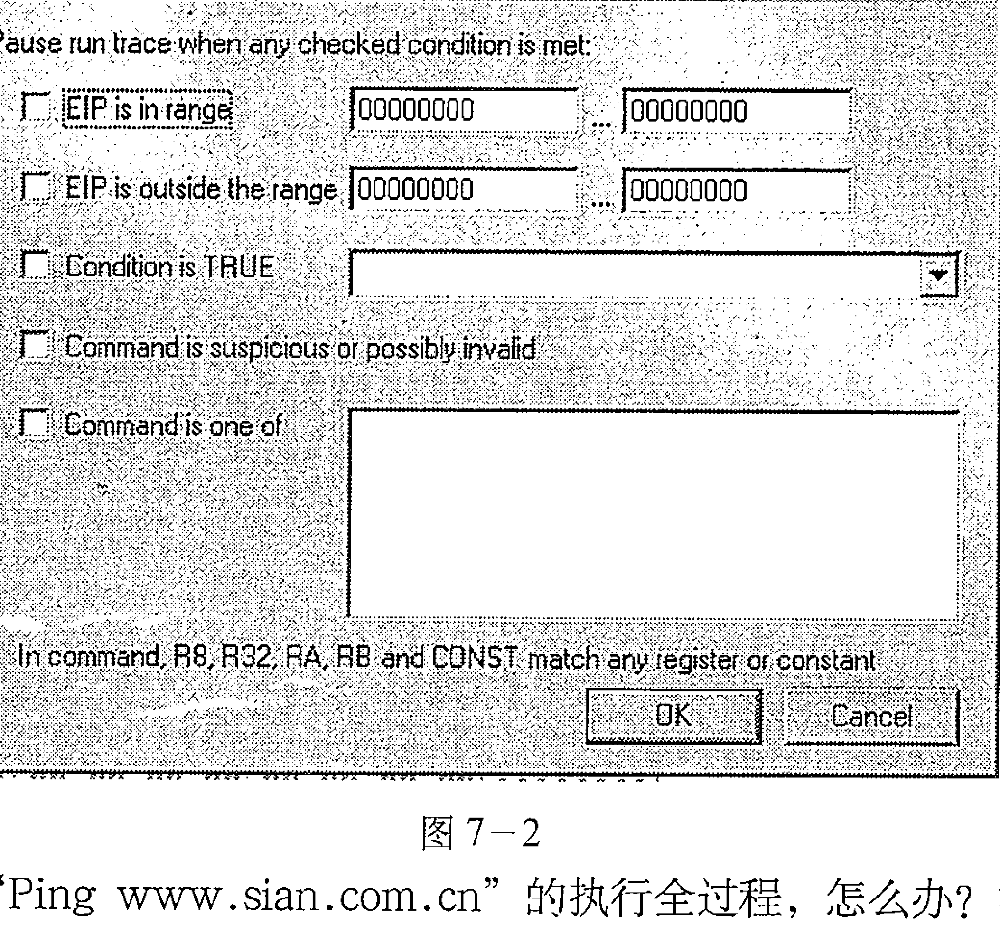

图 7-2

我要用 OllyDbg 跟踪“Ping www.sian.com.cn”的执行全过程，怎么办？没问题！菜单选择：Debug -> Arguments，一切 OK！

- 6. 如何能知道目前跟踪的程序是在干嘛？  
  在代码丛林中迷失方向是很正常的事情，可是，有经验的行家里手会从很多地方找出种种蛛丝马迹，带领自己走出丛林。最容易发现线索的地方就是堆栈里头的 LOCAL 变量的值，所以，勤用内存显示功能，你将不再迷路！

- 7. D 命令哪里去了  
  初学 Crack 的朋友，对于 `D EAX` 这个命令一定不陌生吧？很多程序这样 D 来 D 去，注册码就能被 D 出来了！那么 OllyDbg 里头，D 命令哪里去了呢？内存显示区域右键，选择 Goto，很快你就能看到你想要的东西啦！

- 8. 字符串参考哪里去了  
  W32Dasm 的字符串参考功能对很多人是个精神鸦片一样的东西，Ctrl+F12，搜索“注册失败”，往上翻，找到 jne，改成 je，这是大多数 Cracker 们随口就能来上一段的爆破心经。可以说，对于 80% 以上的程序而言，只要有这个口诀，任务就基本上完成了一大半。  
  那么 OllyDbg 里头，如何找到字符串参考？很简单，Ctrl+B，出来的界面如图 7-3 所示。在 Unicode 横行的 Windows 2000 里头，这是最好的动态字符串查找工具！

- 9. 有什么方法让事情简单些么  
  我们写程序的时候，和程序功能代码同样重要的是什么？是注释！任何写过程序的人，都不会不知道注释的重要作用，它就如同一盏指路的明灯，让你不会迷失方向！在 OllyDbg 的反汇编窗口第 4 栏双击，你想写什么就写什么吧。而且这个注释是持久的！

- 10. 对付 DLL 的载入，有什么灵丹妙药  

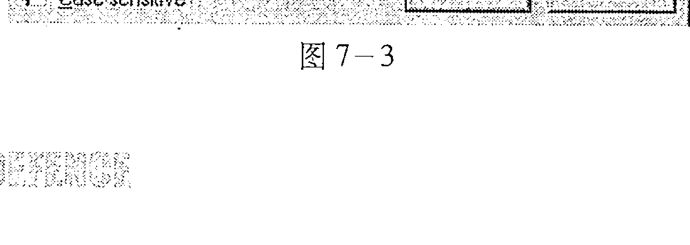

图 7-3

Debugging Options -> Events，勾住 Break On New Module，任何一个 DLL 的载入都逃脱不了 OllyDbg 的法眼！

- 11. 令 Hiew 汗颜的 online patch 功能  
  跟踪过程中，哪里需要爆破，就在哪里双击，随心所欲地书写自己想写的汇编代码，OllyDbg 会帮你完成接下来所有的工作——汇编、修改、存盘！

怎么样？以上这 12 条精彩的使用建议，读后是不是觉得非常震惊？急于一展拳脚了？其实，OllyDbg 还有很多精彩的功能，例如 DIY 个性化界面、在消息循环内设断点。由于篇幅所限都未能一一展示出来，相信只要大家勤于思考，一定会发掘出更多更精彩的实用功能！

### 7.2 反 DUMP 技术

用 TRW 脱壳的基本步骤一般是通过调试、跟踪找到程序原始的入口点，然后用 suspend 命令挂起程序，再使用 Procdump 或 LordPE 等软件将程序从内存中 DUMP 出来。但是脱壳初学者在 DUMP 某些加壳软件处理的程序时经常会遇到一些问题。比如，在 DUMP Telock 加壳的文件时 Procdump 会非法操作；在 DUMP yoda's Crypter 1.2 加壳的文件时，经常只能得到一个 4K 长的文件头，却得不到程序文件的主体部分。这是为什么呢？原因很简单，这些加壳软件都使用了“anti-dump”技术。

要明白 anti-dump 的原理，首先得明白 DUMP 程序工作的办法。下面我们就来简单分析一下常用的 DUMP 软件 Procdump 和 LordPE 的工作流程。

Procdump 和 LordPE 都是利用 Module32Next 函数来获取欲 DUMP 进程的基本信息的。Module32Next 函数的原型如下：

| 项 | 内容 |
|---|---|
| 语法 | `BOOL Module32Next(HANDLE hSnapshot, LPMODULEENTRY32 lpme);` |
| 参数 | `hSnapshot`：由 `CreateToolhelp32Snapshot` 函数返回的快照；`lpme`：`LPMODULEENTRY32`，指向 `MODULEENTRY32` 结构的指针。 |

每次执行函数后，它将把一个进程的信息填入 `MODULEENTRY32` 结构中。`MODULEENTRY32` 结构的定义如下：

```c
typedef struct tagMODULEENTRY32 {
    DWORD   dwSize;                // 此结构的大小
    DWORD   th32ModuleID;
    DWORD   th32ProcessID;         // 进程的标识符
    DWORD   GlblcntUsage;
    DWORD   ProccntUsage;
    BYTE    *modBaseAddr;          // 进程的映像基址
    DWORD   modBaseSize;           // 进程的映像大小
    HMODULE hModule;               // 进程句柄
    TCHAR   szModule[MAX_MODULE_NAME32 + 1]; // 进程模块名
    TCHAR   szExePath[MAX_PATH];   // 进程的完整路径
} MODULEENTRY32;
typedef MODULEENTRY32 *PMODULEENTRY32;
```

Procdump 和 LordPE 都是根据此结构中的 `modBaseSize` 和 `modBaseAddr` 字段得到进程的映像大小和基址，再调用 `ReadProcessMemory` 来读取进程内的数据。读取成功以后，Procdump 会检测 `IMAGE_DOS_SIGNATURE` 和 `IMAGE_NT_SIGNATURE` 是否完整。如果完整，它就基本不再对其他大多数字段做检验；如果不完整，它会根据 `szExePath` 字段打开进程的原始文件，读取它的文件头以取代进程的文件头。LordPE 则更简单，它根本不用进程的文件头，直接读取原始文件的文件头来用。知道了 DUMP 的原理，那如何来对付它们呢？

第一种方法就是修改系统中的进程信息，让 Module32Next 函数执行时在 `modBaseSize` 和 `modBaseAddr` 字段中填入错误的值，这就可以让 DUMP 软件无法正确读取进程的数据。经过试验发现，如果修改系统中 `modBaseAddr` 的值，会让系统出现问题。所以只能修改 `modBaseSize` 的值，方法如下：

```asm
fire_up_the_anti_procdump_full_dump_wall:
mov eax, fs:[30h]
test eax, eax
js fuapfdw_is9x
fuapfdw_isNT:
mov eax, [eax+0Ch]
mov eax, [eax+0Ch]
mov dword ptr [eax+20h], 1000h
jmp fuapfdw_finished
fuapfdw_is9x:
invoke GetModuleHandleA, 0
test edx, edx
jns fuapfdw_finished
cmp dword ptr [edx+8], -1
jne fuapfdw_finished
mov edx, [edx+4]
mov dword ptr [edx+50h], 1000h
fuapfdw_finished:
```

在程序中插入这样一段代码后，用 Module32Next 函数得到的该进程的映像大小始终只是 `0x1000` 字节，DUMP 软件也就只会读出 `0x1000` 字节的程序数据。对于 Procdump，很可能在进行后续工作时产生非法操作；而用 LordPE 得到的将只是一个大小为 4K 的无用文件。如何来防止它呢？当然就是找出类似代码，然后跳过它。

反 DUMP 第二个方法就是修改正在执行的进程的文件头。上面说了，Procdump 会检测读到的进程映像的 `IMAGE_DOS_SIGNATURE` 和 `IMAGE_NT_SIGNATURE` 是否完整，如果完整，它就不去检查其他字段了。我们可以利用它的这个弱点进行攻击。比如 Telock 就是将文件头的 `NumberOfSections` 字段改大，使得 Procdump 非法操作。另外，对于 PE-EXE 文件来说，`ImageBase` 字段的值一般是 `0x400000`，如果将它改为 `0x300000`，系统将报告无法将进程装载到指定位置；如果改成 `0x500000`，则会在运行时由于重定位问题发生非法操作。还有，如果修改 `Characteristics` 字段的值，使系统误认为它是一个 DLL 文件的话，系统也会报告程序无法执行。当然，可以做手脚的字段还有很多，读者可以自己试验。在改动的时候要注意，必须使用 `VirtualProtectEx` 或 `VirtualProtect` 将文件头的内存页改为可写，不然会由于系统的页面保护而产生非法操作。

那对这些破坏有什么应对方法呢？非常简单，只要在 DUMP 前将 `IMAGE_DOS_SIGNATURE` 和 `IMAGE_NT_SIGNATURE` 字段清空，Procdump 就会用原始文件的文件头来覆盖被改动的文件头。对于 LordPE，它默认的工作就是如此，所以在进程文件头上的破坏对它都是无效的。既然如此，如何对付它们的这种做法呢？最后一个方法就是让 DUMP 软件无法找到原始文件。但是原始文件在运行时一般是不能移动或者改名的，那怎么办？其实我们只要找到进程路径在系统中的存放位置，然后修改它就可以了。

代码如下：

```asm
fire_up_the_anti_procdump_full_dump_wall:
mov  eax, fs:[30h]
test eax, eax
js   fuapfdw_is9x
fuapfdw_isNT:
jmp  fuapfdw_finished
fuapfdw_is9x:
invoke GetModuleHandleA, 0
test edx, edx
jns  fuapfdw_finished
cmp  dword ptr [edx+8], '1'
jne  fuapfdw_finished
mov  edx, [edx+0Ch]
inc  byte ptr [edx]
fuapfdw_finished:
```

经过上段代码后，本来比如进程路径是 `c:\1.exe`，而 DUMP 程序去找的将是 `d:\1.exe`，这当然找不到了。这样就可以强迫 DUMP 程序去使用并不安全的进程 PE 头数据。如果我们把进程的 PE 头也破坏了，那得到的文件就肯定无法使用了。用同样的方法还可以把一般进程通过改名字和路径伪装成某个系统进程，以迷惑破解器。但是遗憾的是，笔者至今没有找到在 NT 内核下如何实现上述功能，有兴趣的读者可以自己试验。

### 7.3 DEBUG 你知多少

用好 DEBUG 是对那些开始学习 CRACK 的朋友的最基本要求。对于大部分人来说，DEBUG 的使用应该不成问题，但也有不少初学者并不会熟练使用这个 Windows 自带的调试工具。看 HELP 吧，又是一大堆 E 文。所以，在这里，我给那些不太熟悉此工具的朋友介绍一下各命令的用法，希望能对朋友们有些 HELP。

- 1. **A（assemble）：汇编命令**  
  - 命令格式：`a [<目标开始地址>]`  
  - 功能：从 address 地址开始写入汇编命令，回车结束此行，进入下一内存地址的编译。如无 address 参数，则默认从 CS:IP 下一址开始编译。  
  - 例：`a 1000:1000`；从 `1000:1000` 地址开始输入汇编指令。

- 2. **C（compare）：比较命令**  
  - 命令格式：`c <范围> <地址范围>`  
  - 功能：比较指定内存地址（range address）的值。  
  - 例：`c 100:0 100 10:0`；比较从 `100:0` 开始的下 100 个地址与 `10:0` 开始的下 100 个地址。

- 3. **D（dump）：内存显示命令**  
  - 命令格式：`d [<目标开始地址> [目标范围]]`  
  - 功能：显示指定地址范围的内存值。  
  - 例：`d 100:100`；显示 `100:100` 地址及下个内存的值。  
  - `d 100`；显示 `DS:100` 地址及下个内存的值。  
  - `d`；显示 `DS:IP` 地址及下个内存的值。

- 4. **E（enter）：内存修改命令**  
  - 命令格式：`e <目标地址> <目标范围>`  
  - 功能：修改指定内存的值。  
  - 使用：空格编辑下一内存地址值，减号回到上一内存地址进行重编辑，回车完成编辑。  
  - 例：`e`；修改 `DS:IP` 内存的值。  
  - `e 100`；修改 `DS:100` 内存的值。

- 5. **F（fill）：内存填充命令**  
  - 命令格式：`f <目标范围> <填充值列表>`  
  - 功能：填充指定范围内存的指定值。  
  - 使用：range：内存地址范围。list：填充值列表，多个值用空格隔开。依次列入指定地址、地址数、填充值数，则填充值从头开始循环填入指定内存。  
  - 例：`f 100 1 100 'ab' 'cd'`；在从 `DS:100` 开始的下 100 个内存中分别填入 `'ab'` 和 `'cd'`。

- 6. **G（go）：运行命令**  
  - 命令格式：`g [=开始地址] [断点地址] ...`  
  - 功能：从指定内存地址开始运行。可设定断点，DEBUG 支持最多 10 个断点的设定。  
  - 例：`g =100 200 300`；从地址 `CS:100` 处开始执行，并分别在 `CS:200` 和 `CS:300` 处置断点。

- 7. **H（hex）：运算命令**  
  - 命令格式：`h <16进制值1> <16进制值2>`  
  - 功能：16 进制加减的计算，使用后打印的两个值（16 进制数）分别为 16 进制值1 和 16 进制值2 的和与差。  
  - 例：`h ab cd`；分别求 16 进制数 `ab+cd` 与 `ab-cd` 的值。

- 8. **I（input）：端口命令**  
  - 命令格式：`i <目标端口值>`  
  - 功能：输入值（2 byte）到指定端口。  
  - 例：`i 10`；从 10 号端口读入一字节值。

- 9. **L（load）：加载命令**  
  - 命令格式：`l [路径] [磁盘号] [扇区号] [扇区数]`  
  - 功能：加载指定磁盘号、扇区号和扇区数的磁盘内容到指定内存。  
  - 使用：address：指定要加载到的内存。drive：要加载的磁盘号，此处的磁盘号为 A:0 号，B:1 号，C:2 号，依此类推。firstsector：扇区号。number：扇区数。并置 EAX:EDX 为文件大小，此处的 EAX:EDX 是将大小值的高位放到 EAX、低位放到 EDX，而非指向 EAX:EDX 的内存地址。若加载的是 `*.exe` 或 `*.com` 文件且未指定路径，则 `*.exe` 会加载到 `CS:100`（此值不可更改），而 `*.com` 文件会在 `CS:IP` 处。  
  - 例：`l c:\test.txt 2`

- 10. **M（move）：内存拷贝命令**  
  - 命令格式：`m <地址范围> <目标地址开始地址>`  
  - 功能：拷贝指定内存值到指定内存地址。  
  - 使用：range address：两个地址范围。  
  - 例：`m 0000:1 1 20 0010:0`；把从 `0:1` 内存地址开始、长度为 20 的内存值复制到地址 `10:0` 开头的内存。此命令的目的地址与源地址有重叠也不会发生错误。

- 11. **N（name）：命名命令**  
  - 命令格式：`n [路径] [参数列表]`  
  - 功能：将指定文件存入 DEBUG 的 FCB（文件控制模块）中，以备以后加载（L）和存盘（W）。  
  - 例：`n c:\test.txt` 将 `c:\test.txt` 放入 FCB 中。  
  - `l` 将 `c:\test.txt` 载入内存，使 `CS:IP` 指向该文件开头，并置 `BX:CX` 为文件大小值。

此两条命令相当于：debug c:\test.txt。

- 12. O(output)：端口命令
- 命令格式：o 端口值
- 功能：向指定端口输出一字节值。
- 例：o 71；向71号端口中输出一字节。

- 13. P(proceed)
- 命令格式：p [=\<地址\>] [\<指令条数\>]
- 功能：单步跟踪，执行指定的一条或多条指令，但遇到过程与中断不进入，而是继续下一条指令。
- 例：p =100 20；执行从cs:100开始的以下20条指令。

- 14. Q(quit)：退出命令
- 命令格式：q
- 功能：没什么好说的了，就是退出DEBUG。

- 15. R(registry)：寄存器命令
- 命令格式：r [寄存器名]
- 功能：显示当前各寄存器（16位）值、8个标志位的状态，并反汇编cs:ip所指的下一条指令。后跟寄存器名可修改其值。
- 例：r ax；修改ax的值。

- 16. S(search)：搜索命令
- 命令格式：s 范围 '搜索字符列表'
- 功能：搜索指定的字符串。若找到则显示地址与值，若无则什么也不输出，等待下一条指令。必须指定全部参数。
- 例：s 0000:1111 l 20 '32'；在0000:1111以后的20个地址中搜索字符串'32'。

- 17. T(track)：单步跟踪命令
- 命令格式：t [=地址] [\<指令条数\>]
- 功能：单步跟踪，执行指定的一条或多条指令，遇到过程与中断进入到过程中去。每一步过程算一条指令。
- 例：

- 18. U(unassemble)：反汇编命令
- 命令格式：u [开始地址] [范围]

- 19. W(write)：写盘命令
- 命令格式：w [目标起始地址] [目标磁盘号] [扇区号] [扇区数]
- 功能：写从目标起始地址或cs:ip开始的、长度为bx,cx的内存内容到指定的磁盘。此命令很危险，稍有不慎可能毁坏文件或分区表，故应慎重使用。若造成硬件损坏，本人概不负责。
- 例：w 0:100 把从0:100开始的、长度为bx:cx的内存内容写入已用debug或n+l加载的文件中，注意因为*.EXE文件的写入方式很特殊，故此处的文件不可为*.EXE文件。

[范围]的说明：  
范围有两种表示方式：  
(1) 开始地址 结束地址；  
(2) 开始地址 l（此处是l，非数字1）偏移量。  
如：地址123:0到123:fff可表示为：123:0 ffff或123:456 l 65535。

[默认地址]：  
(1) 默认段地址：关于代码的命令，如u、a等的默认段地址一般为DS，而关于数据的命令所用的默认地址一般在CS中，如d、e、f等。  
(2) 默认偏移地址：一般为IP。

## 3. 关于DEBUG

- 1. DEBUG所用的值均为16进制数值，且不跟后缀H，这一点要注意。
- 2. DEBUG的命令与参数大小写均可，分隔符也只是在两个数字之间有必要打。当然，你若愿意，打上也不算错。
- 3. 不可用作32位的调试器。
- 4. 超越段地址应分两行，先写段地址，再写代码即：

```asm
mov ax,ds:[bx]
应写为：
ds:
mov ax,[bx]
```

至此，以前对此工具不太熟悉的朋友应该有一定的了解了吧？但是熟练应用还要靠你们自己。

## 第八章 破解实例分析

### 8.1 TRW2000 破解实例

### 8.1.1 妙用TRW2000巧解QQ密码

到此，相信对于TRW2000应该不会陌生了吧？它是一款调试软件。TRW2000大部分应用于共享软件的破解工作，是Cracker的必备工具。然而找到共享软件的注册码仅仅是它广用途径中的一种。其实，它的用处远不止此，打个比方，如果应用到应用软件口令的破解上会怎样呢？想想就让人兴奋，那么还等什么呢？让我们开始吧！

TRW2000有两组热键：Ctrl+N和Ctrl+M，它们分别代表不同的特权级别。所谓特权级别就是程序在执行中有级别之分，只有操作系统工作在最高级——0级中，其他的程序都应工作在3级中，在3级中的程序不可直接访问IO端口，也无法访问其它程序运行的内存，连向程序自己的代码段写入数据都是非法的（会出现你熟悉的蓝屏），只有对工作在0级上的程序来说系统才是全开放的。所以TRW2000为我们准备了两种不同特权级别的热键：按Ctrl+N为3级，按Ctrl+M为0级。可以在不同的情况下使用，像我们今天跟的这个程序来说使用3级就可以了，所以我们按Ctrl+N。

TRW2000的主界面由5部分组成：窗口中最上面的是存贮／寄存器窗，用来显示各存贮／寄存器的当前值；在存贮／寄存器窗下面的一个窗口是数据窗，是用来显示存贮器的内容的；在数据窗口的左面也就是由“：”分开的两个值，对应为段地址:偏移地址，屏幕中间为“段地址:偏移地址”所存贮的16进制值，在右面是那些16进制值所对应的ASCII码；数据窗下面是代码窗，也就是程序啦，高亮显示的那一行是机器将要（注意：是将要）处理的下一条指令；在代码窗右上角的是堆栈窗，所谓堆栈就是一段以先进后出为工作方式的存贮器（内存），它显示的是堆栈的偏移地址和内容；在代码窗的下面是指令窗，在这里你可以对TRW2000下达你的指令，我们用来下断点的命令就是在此输入的（图8-1）。

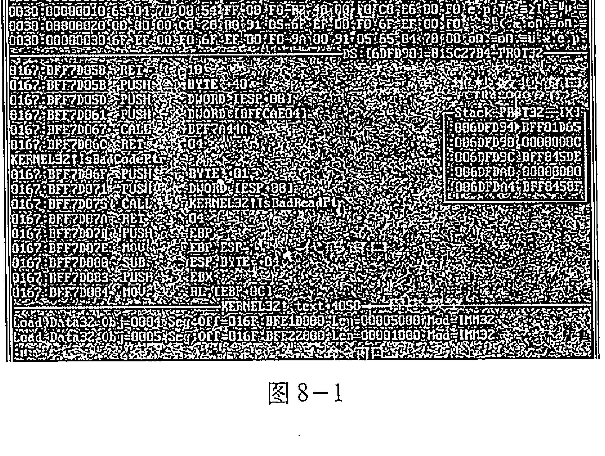

图8-1

TRW2000所有窗口的默认颜色是黑底蓝字，在白天不易看清，所以你可以下指令VER BLUE来改变它的颜色。如果你想让它每次启动时都改变，你可以打开TRW2000安装目录下的TRW2000.INI文件，把INIT="lines 35;wr 3;wd 8;wc 16;code on;"改成INIT="lines 35;wr 3;wd 8;wc 16;code on;ver blue"，也就是把VER BLUE加在里面。

首先拿QQ为例，脱机登录QQ需要口令（无论你是为了察看好友列表，还是想导出聊天记录，或者没有任何原因（解密需要理由吗？），这一点和共享软件需要注册码是一样的。打开QQ随便填写口令然后确定，之后会弹出请再次输入登录密码的对话框（图8-2）。

OK，我们就从这里下手。按Ctrl+N激活TRW2000，设置断点：BPX HMEMCPY；按F5键，窗口回到QQ的对话框，单击“确定”会被TRW2000拦截下来。

然后输入清除断点命令：BD *，来关掉所有断点，防止再次中断（为什么要这么做呢？因为只要我们不清除或不退出TRW2000，该中断命令就会一直存在，很烦人（只要条件相同就中断）。那为什么用BD *命令呢？“BD *”仅仅是暂时停止中断命令，可通过“BE *”等命令恢复断点，以备不时之需。而BC *为永久清除断点，要再下同样的断点必须重新输入，很麻烦。所以，一般情况下我们用“BD *”命令而不要用“BC *”命令）。

接着输入TRW2000特有的PMODULE命令，返回到QQ2000B的“领空”，按F12键36下（次数依个人的系统情况而定），弹出口令不正确的对话框。好，现在重复一次刚才的操作，只是在按F12键至35下时停下，现在输入P命令，并按P键。什么是P呀？呵呵，P是TRW2000中的又一个指令，就是单步执行程序的意思，每执行一条指令就停下来，P指令有一个快捷键——F10，因此我们就不用一直输入P了，只要按F10键就可以了。在按F10的过程中，你可以看到寄存器窗口中不时地有高亮显示，那是因为那个寄存器的值发生了改变，所以就被高亮显示了，在大家以后的解密过程中要好好地利用这一点，因为好多软件的注册码就是在这里发生变化的，只要用“D 寄存器”（D 空格 寄存器）命令就有可能看到软件的注册码（如果是明文比较的话）！好了，命令解释完毕，让我们按住F10，追踪到以下地方：

```asm
016F:004AFECD CALL 004A7305
016F:004AFED2 TEST EAX,EAX
016F:004AFED4 JNZ NEAR 004B0026 (NO JUMP)
```

好了，关键步骤就在这里了，输入R EIP 004B0026命令，目的是修改EIP的值为004B0026，然后继续输入G命令，大功告成！你看QQ是不是已经处于离线状态了？如果你还想知道真正的登录密码的话，那就自己费点力气好好找找吧！

下面我们再拿Foxmail来试验一下。打开Foxmail4.2，单击已经设置访问口令的账号，弹出密码框（图8-3）。

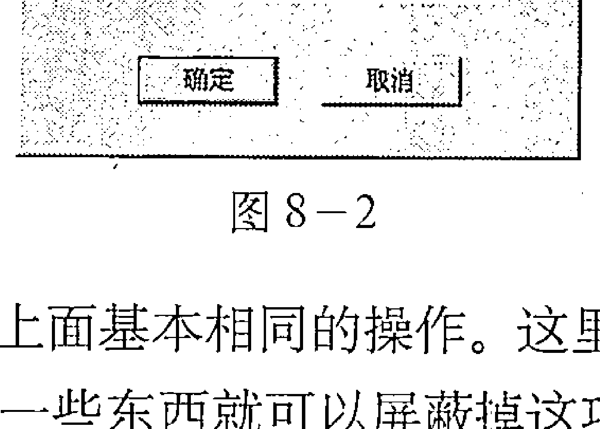

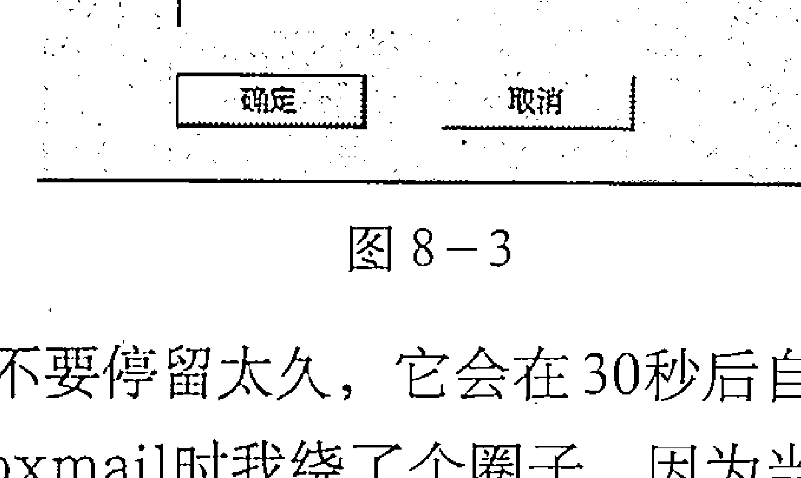

图8-2  
图8-3

采用和上面基本相同的操作。这里大家注意的是在登录框不要停留太久，它会在30秒后自动关闭，其实只要输入一些东西就可以屏蔽掉这项功能了。在暴力破解Foxmail时我绕了个圈子，因为当运行到：

```asm
016F:0053F273 CALL 004A6D20
016F:004A6D3A CALL 004A6C38
```

此时，分别出现了两个调用都会弹出密码错误的对话框，于是我就凭感觉追了进去，发现难以突破，于是重新试了一次。在密码框拦截成功后，输入PMODULE，回到对话框按F12键7次，再按F10一次就可以看到如下：

```asm
0167:0054CEAB TEST AL,AL
0167:0054CEAD JNZ 0054CEB2 (JUMP)
0167:0054CEAF MOV BYTE PTR [ESI],00
```

这其实就是下手的地方。修改EIP的值为0054CEAF（方法同上），继续按G键，红色的锁定图标已被蓝色解开图标所取代，如果忘了密码那就趁现在赶快修改回来吧！

好了，通过上面的例子的讲解，希望大家能对TRW2000有一个全新的认识。其实无论破解口令还是寻找注册码，其根本目的都是通过修改程序的运行结构，或者查看运行期间产生的数据来进行破解的，于是对于TRW2000的应用就可以从这个原理出发，只要是符合都可以用它进行相关的破解，因此它的应用便可以更加广泛了。

### 8.1.2 QQ密码侦探终结者解密实战

目前网上非常流行一种窃取QQ密码的工具——QQ密码侦探。该软件运行时相当隐蔽，当你像平时那样登录QQ聊天，你的QQ密码就会被记录下来，然后发送到下套者设定的邮箱里去了！由于QQ密码侦探的软件版本非常多，其中特别版最可怕，会与其它软件捆绑在一起，在不知不觉中运行，你一点也察觉不到便会中标，很多网友就是这样丢失了QQ密码！不过，你再也不用害怕它了！因为专为查杀“QQ密码侦探”、保护你的QQ安全的QQ密码侦探终结者诞生了！

不过，QQ密码侦探终结者是共享软件，需要付费注册成为正式用户以后才能无限制地使用其所有最新功能，并且获得技术支持！比方说注册后可以查出安装QQ密码侦探的“元凶”，可以查出他的Email地址及他各项设置，这样在还击时就可以做到有的放矢了！同时，注册后，你的电脑将增加免疫功能，可以防止以后不再中QQ密码侦探。另外，注册版还可以使用自动监控系统的功能，自动发出警报声！还可以由用户自己设置随电脑启动而自动运行，自动查杀！

未注册则无上述功能，且只能使用10次。看来无产阶级只能自力更生了。我手头上的这款QQ密码侦探终结者的主程序为unqqspyz.exe，运行它，然后在用户名栏中填入free，在注册码栏中填入12345678。一切准备完毕，启动TRW2000，按Ctrl+N呼出TRW2000，输入bpx hmemcpy这个“万能”断点，然后按F5返回到程序中执行注册，按“立即注册”按钮，程序立刻被TRW2000拦截下来。输入bc *命令，取消我们设定的断点，免得它没完没了地中断下来。接下来输入PMODULE这个TRW2000特有的命令，迅速来到unqqspyz的“领空”。按7次F12键后（第八次出现错误提示，表明是在按F12第7次后进行注册码的比较判断），光标停留在偏移地址00425966这一行（这一行高亮显示）。按F10键21次来到这里（代码如下）：

```asm
0167:0044CACD CALL 0044C8C0
0167:0044CAD2 MOV EDX,[EBP-14] ----->把[EBP-14]中的真正注册码送到EDX中
0167:0044CAD5 POP EAX         ----->在此行处输入D EDX可得到真正的注册码
0167:0044CAD6 CALL 00403D40   ----->此处为关键CALL，真假注册码在此比较，按F8键进入！
```

在0044CAD6处按F8进入，可以看到如下代码：

```asm
0167:00403D40 PUSH EBX           --------->EBX入栈
0167:00403D41 PUSH ESI           --------->ESI入栈
0167:00403D42 PUSH EDI           --------->EDI入栈
0167:00403D43 MOV ESI,EAX        ----->把EAX中的假注册码送入ESI中
0167:00403D45 MOV EDI,EDX        ----->把EDX中的真注册码送入EDI中
0167:00403D47 CMP EAX,EDX        --------->比较真假注册码！
0167:00403D49 JZ NEAR 00403DDE   ----->如正确则跳转，暴力破解可将JZ改为JNZ则输入任何字符都可以！
```

当光标移到偏移地址00403D47行时，在命令区输入D EAX可以看到假注册码12345678，输入D EDX则可以得到真注册码SmxaUT09YVd4dmRtVjI！简单吧？

解密的乐趣其实不在结果，重要的是能分析出软件作者编程的思路，其中优秀者如能据为已有，当受益匪浅。

#### 8.1.3 一步一步学解密——敏思硬盘卫士破解实录

敏思硬盘卫士是款出色的系统安全软件，它可以保护Windows系统文件和系统设置，加密用户指定的逻辑盘、文件夹和文件，给软驱和光驱加锁或解锁，使之暂时失效或限制可以读写的文件类型，并且可以防止文件型病毒、“欢乐时光”等Wcb类病毒和邮件病毒侵入硬盘及向外扩散，阻止木马程序偷窥硬盘上的重要文件。而且，可以通过局域网对各台终端PC机进行远程设置和远程控制。软件下载地址：http://sq.onlinedown.net/down/hg22.zip。

该软件有功能限制，必须注册才行，今天我们就谈谈怎样注册该软件，同时为您详尽地介绍关于解密软件的基础知识和经验，方便您上手。相信看过此文，您一定会对解密软件有所了解，增强您破解软件时的信心，并能成功破解软件，体验到自己动手解密的乐趣。好，下面我们开始。

- 一、熟悉TRW2000的工作环境

先介绍一下我们要用到的兵器：TRW2000，运行后程序界面如图8-4所示。我们可以通过两种方式调出TRW2000，一种是按Ctrl+M（对应特权级别0，不常用），另一种是Ctrl+N（对应特权级别3，常用）。按了Ctrl+N后，会看到如图8-5所示的窗口。为了消除您在用TRW2000破解软件时的陌生感，尽快掌握该软件，在此为您做一详尽的介绍。

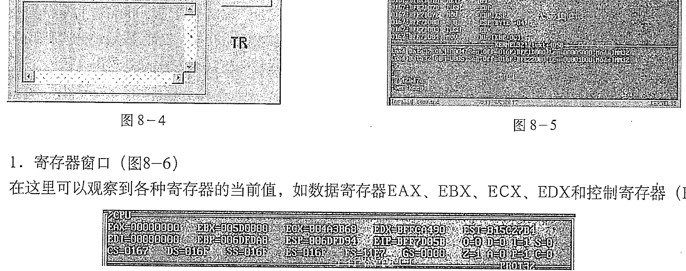

- 1. 寄存器窗口（图8-6）

在这里可以观察到各种寄存器的当前值，如数据寄存器EAX、EBX、ECX、EDX和控制寄存器（EIP和PSW）等，有一点要注意了，由于我们是在Windows平台下，所以看到的都是80386寄存器集，其与16位寄存器差别在于前多了一字符“E”，意为16位寄存器扩展。在TRW2000中看到的都是以E开头的，如EAX、EBX等。在寄存器中经常存放我们感兴趣的东西，如注册码等。如果是明文，用D命令就可以查看到，在后面我们有介绍。

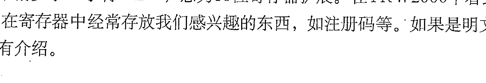

- 2. 数据窗口（图8-7）

在数据窗口显示指定内存中的数据，以十六进制和ASCII同时显示，软件的注册码经常会在此出现，因此有必要了解一下图中各部分的含义。

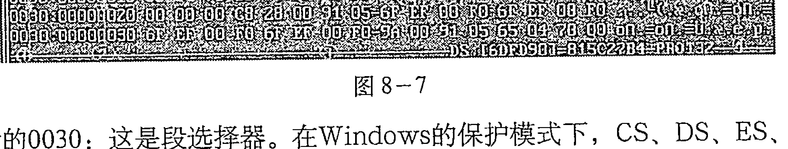

图8-7

- 1. ①号位置的0030：这是段选择器。在Windows的保护模式下，CS、DS、ES、SS、FS和GS不叫段寄存器，叫段选择器。在保护模式中，内存分为了好多的段，在TRW2000下用GDT就可以看到段的编号、类型、开始物理地址、大小、属性。让我们看看编号0030是什么东西（图8-8）。

| 编号 | 类型 | 开始物理地址 | 大小 | 属性 |
|---|---|---|---|---|
| 0030 | data32 | 00000000 | FFFFFFFF | ewa |

图8-8

这个段是32位数据类型，长度为4G。我们还可以看到很多的段，它们有可能会指向同一个物理地址；但它们的类型、属性可能不同。如一些段指向的地址是不可读写的，但另外一个段指向的同一物理地址是可读写的！如果我们通过不可写的那段的编号放到段选择器，然后进行读写操作，肯定死掉了。但换了另外一个段对同一个地方读写那就没问题！保护模式的内存管理挺有趣的，感兴趣的不妨看看这方面的书，当然作为初学者只需稍微了解就可。

- 2. ②号位置00000000：此处表示内存的虚拟地址；
- 3. ③号位置的值是当前内存的数据，以十六进制表示；
- 4. ④号位置的值是“③”处值的另一种表示方法：ASCII码。

- 3. 代码窗口（图8-9）

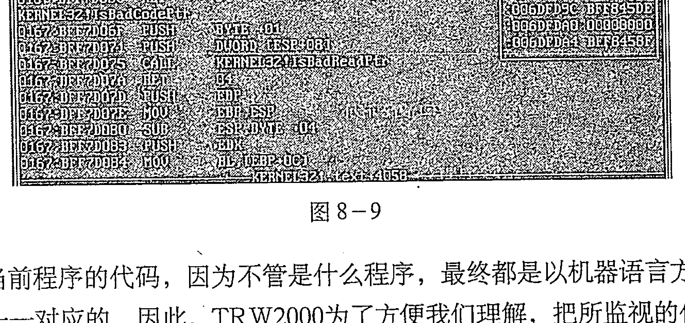

图8-9

此处显示的是当前程序的代码，因为不管是什么程序，最终都是以机器语言方式被CPU执行，而汇编语言和机器语言是一一对应的。因此，TRW2000为了方便我们理解，把所监视的代码以汇编代码形式显示在我们面前，你可用Code on/off打开或关闭这项显示。如图8-10所示：其中①是段选择器；②是虚拟地址；③是机器码：又称机械码，这就是CPU执行的机器代码，此处是以十六进制表示。当你用十六进制编辑器打开、编辑EXE等可执行文件时，你会看到许许多多由0、1、2、3、4、5、6、7、8、9、A、B、C、D、E、F组成的数码，这些数码就是机器码。静态修改程序就是通过修改机器码来修改EXE等可执行文件；④是汇编指令：它是和机器码对应的程序代码。

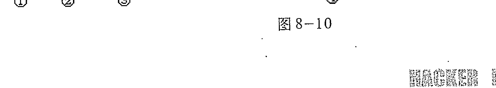

图8-10

- 4. 堆栈窗口

这个是TRW2000特有的，通过它很方便监视堆栈的状况。

- 5. 程序领空

所谓领空，实际上是指在某一时刻，CPU的CS:IP（EIP）所指向的某一段代码的所有者所在的区域。此例中TRW2000停下来时光标所指的那一句代码是属于KERNEL32.DLL的，因此就叫KERNEL32.DLL领空。在图6中，可看到的领空名是KERNEL32!.text，那我怎么知道它就是KERNEL32.DLL文件呢？主要靠经验，KERNEL32.DLL是Windows系统文件，如果是在SoftICE里，则显示领空名时不显示扩展名，只是显示前一部分。

- 6. 命令窗口（图8-11）

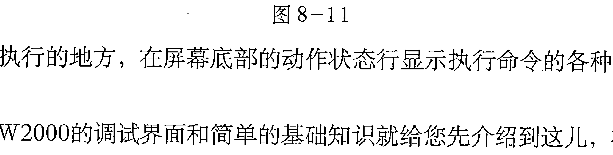

图8-11

这是各种命令执行的地方，在屏幕底部的动作状态行显示执行命令的各种提示，还可提供指令语法帮助。

OK，关于TRW2000的调试界面和简单的基础知识就给您先介绍到这儿，在后面我们还会结合破解实例给您一步一步地介绍我们用到的相关命令及其解释。现在，开始我们今天的行动！

- 二、破解过程和解密经验

首先，使用FileInfo检测一下敏思硬盘卫士的主程序，看是否加壳了。结果显示没有加壳，真是太好了。

## ★★★★★破解经验提示★★★★★

现在，很多软件为了防破解大多经过了加壳，而且目前很多外壳软件均防常见的破解工具。所以，在破解前应首先使用文件外壳检测软件检测一下主程序，以免跟踪时在软件外壳部分转来转去浪费时间和精力或者直接被软件外壳搞死，这是破解初学者应该养成的良好习惯^_^。

运行敏思硬盘卫士，右击系统托盘中的该软件图标，在弹出的菜单中选择“注册”，会出现一个对话框（图8-12），随便输入假的注册码31415926，准备注册该软件。

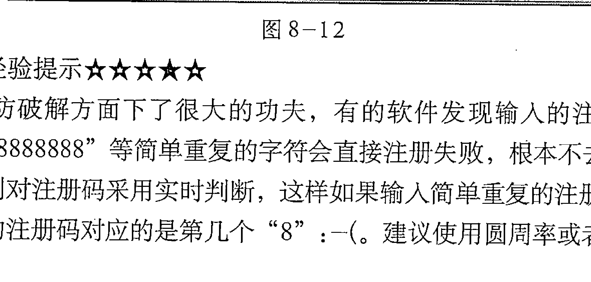

图8-12

## ★★★★★破解经验提示★★★★★

伪证号码、出生年月日等作为假注册码，可以避免类似的麻烦。

运行TRW2000，按 Ctrl+N 热键，进入 TRW2000，下断点：BPX Hmemcpy，按 F5 返回到敏思硬盘卫士中，点击“确定”，会被中断下来。

### ☆☆☆☆☆破解经验提示☆☆☆☆☆

前面我们已经提到过，现在很多软件有反破解工具，有些软件在启动后检测到有 SoftICE、TRW2000 甚至天意 II v0.46 这类破解工具时，会拒绝继续运行直接退出，而有些恶毒的软件如美萍及黄专家等则干脆导致死机！所以建议您在解密软件时，先运行目标软件，在该软件启动后再运行 TRW2000，这样可以避免部分软件对破解工具的检测。

### ☆☆☆☆☆TRW2000和解密基础知识提示☆☆☆☆☆

所谓的断点就是程序被中断的地方，这个词对于破解者来说是再熟悉不过了。而所谓的中断就是由于有特殊事件（中断事件）发生，计算机暂停当前的任务（即程序），转而去执行另外的任务（中断服务程序），然后再返回原先的任务继续执行。打个比方，你正在吃饭，突然有人敲门，开门发现是小编，把他带到客厅安顿好后，你继续吃饭（至于他馋不馋我们就不管了^_^，呵呵），这就是一个中断过程。在解密时，就是等到真假注册码比较的时候将它中断下来，然后通过分析程序，找到正确的注册码。所以我们需要为被破解的程序设置断点，在适当的时候切入程序内部，追踪到程序的注册码，从而达到破解的目的。

下面再来说说 BPX 这个命令的用处和语法。BPX 用来在指令处下断点，程序一旦执行到此，TRW2000 就会弹出。当光标在代码窗口中时，直接键入 BPX 就会在光标所在语句处设断点，再键入 BPX 就取消断点。BPX 的快捷键是 F9，当光标在代码窗口中时，按 F9 就是设定/取消断点。BPX 命令的语法格式如下：

```text
BPX [address] [IF expression] [DO "command1;command2;..."]

address：断点所在的线性地址。
IF expression：条件表达式，只有条件为“真”时，TRW2000 才在断点处弹出。
DO command：当 TRW2000 弹出时，自动执行的一些命令。
```

在 BPX 命令中不用区分大小写。BPX 命令也可用函数名来作地址参数，格式为 BPX 函数名。这个函数名可以是任意一个 API 函数、虚拟机指令、DLL 文件的引出函数等等。具体到我们今天破解的程序，前面我们用的命令 BPX Hmemcpy 是什么意思呢？它的意思是只要程序调用了 Hmemcpy 这个函数，就用 TRW2000 中断下来。BPX Hmemcpy 可以说是一个万能断点，为什么这么说呢？函数 Hmemcpy 是 Windows 9x 系统的内部函数，位于 Kernel32.dll 中，它的作用是将内存中的一块数据拷贝到另一个地方。由于 Windows 9x 系统频繁使用该函数处理各种字符串，因此用它作为断点很实用，它是 Windows 9X 平台最常用的断点。这个俗称万能断点的家伙，一般的编程书籍上很少提到，原因是它是底层的东西，没有特殊需要，一般不直接调用。要提醒大家的是，在 Windows NT/2K 中没有这个断点，因为其内核和 Windows 9x 完全不同。

Hmemcpy 函数原型：

```text
void hmemcpy(hpvDest, hpvSource, cbCopy)
void _huge* hpvDest;          // 目的数据地址
const void _huge* hpvSource;  // 源数据地址
long cbCopy;                  // 数据大小(Bytes)
```

继续我们的破解过程。输入 BC *，清除断点，然后输入 Pmodule，会来到敏思硬盘卫士的领空。按 7 下 F12 键，再按一下 F10 键，会看到如下代码：

```text
015F:004A4144 8B45FC         MOV EAX,[EBP-04]      // 把[EBP-04]的值送入EAX中
015F:004A4147 50             PUSH EAX              // 用 D EAX 命令可以知道 EAX 中为你输入的假注册码
015F:004A4148 8D55F4         LEA  EDX,[EBP-0C]
015F:004A414B 8B8304030000   MOV  EAX,[EBX+0304]
015F:004A4151 E8FAD6F8FF     CALL 00431850         // 计算机器码的 call
015F:004A4156 8B45F4         MOV  EAX,[EBP-0C]     // 用 D EAX 可以知道存放的是机器码
015F:004A4159 8D4DF8         LEA  ECX,[EBP-08]
015F:004A415C 66BA0D00       MOV  DX,0D
015F:004A4160 E8A3F8FFFF     CALL 004A3A08
015F:004A4165 8B55F8         MOV  EDX,[EBP-08]     // 用 D EDX 可以知道，EDX 中为真正的注册码
015F:004A4168 58             POP  EAX              // EAX 弹出堆栈，EAX 中为你输入的假注册码
015F:004A4169 E83EFFFFFF     CALL 00403FAC         // ☆这是比较真假注册码的 call，可以按 F8 进入☆
015F:004A416E 7423           JZ   004A4193         // 如果注册码为真则跳转，暴力破解的话这是关键
015F:004A4170 6A30           PUSH BYTE +30
015F:004A4172 6804424A00     PUSH DWORD 004A4204
015F:004A4177 6814424A00     PUSH DWORD 004A4214
015F:004A417C 6A00           PUSH BYTE +00
015F:004A417E E84D30F6FF     CALL 'USER32!MessageBoxA' // 来到此 CALL 就会出现注册失败的对话框
```

### ☆☆☆☆☆破解经验提示☆☆☆☆☆

常有初学者问“怎么才能知道需要按 F12 多少次啊”。要搞清楚这个问题也不难，其实通常情况是，当按了 F12 键 N+1 次后软件就会出现提示说注册码错误，那么自然而然地我们就可以想到，注册码判断的过程可能是在按 F12 键 N 次之后的那部分，所以下次少按 1 次 F12 键就可以看到程序注册码关键比较的地方。

### ☆☆☆☆☆TRW2000和解密基础知识提示☆☆☆☆☆

下面再给大家介绍一下刚刚提到过的 BC 命令。它的作用是清除一个或多个断点，输入命令 BC 01 则清除第 1 个断点，BC 02 则清除第 2 个断点，清除多个断点时中间用空格或逗号隔开，BC * 则清除所有断点。

由于被调试跟踪的程序会多次调用我们设定的函数，而每次调用都会被我们事先设定的断点中断下来，为了防止没完没了的中断的干扰（那样很烦人），所以我们要及时清除不再需要的断点。

接下来，再说说上面提到过的 Pmodule 命令。这是 TRW2000 特有命令，在 SoftICE 中没有这个命令。Pmodule 的作用是相当于按 F12 键直至 CS:EIP 位于模块中，但它比 F12 更实用，可以快速回到当前程序领空（不要忘了，这是我们的目标啊，只有回到当前调试跟踪程序的领空才可能破解掉该程序），不用按多次 F12（在 SoftICE 中要多次按 F12 键才能回到当前程序的领空）了，这样大大地方便了我们。

最后，让我们再看看 F10 键在 TRW2000 中有什么用处。F10 键其实是 TRW2000 中的 P 命令的快捷键，P 指令的作用是单步执行程序，P 指令的语法：P [ret]。只执行 P 时，相当于按下 F10 键。在汇编模式中，当遇到 CALL、INT、LOOP、REP 指令时，P 将不跟踪进去，直到这些指令执行完毕，控制才返回 TRW2000，换句话说，P 命令是“跨”过这些指令的。

好了，TRW2000 的常用命令及其含义介绍完毕，继续我们的破解工作。当按 F10 键光标停留在偏移地址 004A4169 处的那个 CALL 00403FAC（就是有☆那一行）时，按 F8 键进入此 Call，你会看到如下代码：

```text
015F:00403FAC 53               PUSH EBX              // EBX入栈
015F:00403FAD 56               PUSH ESI              // ESI入栈
015F:00403FAE 57               PUSH EDI              // EDI入栈
015F:00403FAF 89C6             MOV  ESI,EAX          // 把EAX送入ESI，用D EAX可知EAX中是你输入的伪注册码
015F:00403FB1 89D7             MOV  EDI,EDX          // 把EDX送入EDI，用D EDX可知EDX中是真正的注册码
015F:00403FB3 39D0             CMP  EAX,EDX          // 比较EAX和EDX是否相等
015F:00403FB5 0F848F000000     JZ NEAR 0040404A      // 如果相等则跳转，暴力破解可以改这里
```

当程序执行到偏移地址 00403FB3 这一行时，输入 `D EDX` 就可以得到正确的注册码，我的是 1294321408。

### ★★★★★破解经验提示★★★★★

在什么时候需要按 F8 键跟进 Call，什么时候使用 D 命令，则需要有一定的破解经验。对于破解经验比较少的初学者可以采用最原始的方法，当碰到对寄存器进行操作的命令就用 D 命令试一下，碰到 Call 就跟进去，碰到比较命令就对比较的寄存器用 D 命令。而且一定要勤记笔记！破解时一定会失败若干次，如果没有跟进某个 Call 或者是对某个判断、跳转没有注意，那么下次可以对照笔记快速定位，否则总是从头来可就太麻烦了。

### ☆☆☆☆☆TRW2000和解密基础知识提示☆☆☆☆☆

大家可能会有个疑惑，文章中的这些代码都是我一点一点键入的吗？当然不是了！在 TRW2000 中我们可以用 U 命令反汇编程序的代码，并保存为文件，然后打开这个文件复制到文章中即可。文章中我们还提到了 D 命令，它的作用是显示某内存区域的内容。

```text
U address1 address2 >file.txt

D[size] [address [length]]
```

在明文比较方式下，我们用 D 寄存器命令就可以得到软件的注册码。现在，按 F5 返回到程序中，敏思硬盘卫士会提示注册码不正确，输入你刚刚得到的注册码，点击“确定”按钮，会显示注册成功字样（图 8-13）。再次右击系统托盘中的敏思硬盘卫士的图标，在弹出菜单中你会发现“注册”选项前有个“√”，表示已经注册成功了。

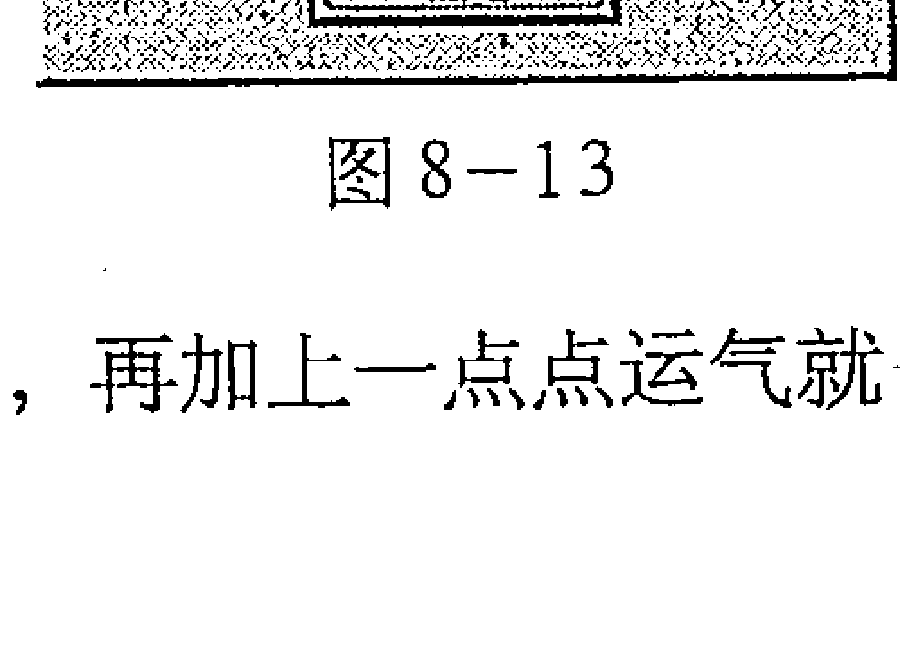

到这里，关于敏思硬盘卫士的破解就结束了，希望没有浪费您宝贵的时间。其实，解密没有什么难的，关键是要有毅力和耐心，当然如果能懂得一点汇编知识，再加上一点点运气就更好了。只要能持之以恒，坚持学习，就没有办不到的事，解密亦如此。

## 8.1.4 巧用Crack技术解除Apabi Reader拷贝文字的限制

Apabi Reader 是一款可以阅读 CEB、PDF、TXT 和 HTML 文档的阅读器，最有用的地方就是看 PDF 文档时，可用金山词霸抓词和可以拷贝加了防拷贝密码保护的 PDF 文档。但是每次打开 PDF 文档后只能拷贝 64 个字，实在是太少了。恰好我要把一个加了防拷密码的 PDF 文档里的内容拷出来，在网上找了好久才发现只有这个东西可以办到，所以就解其限制，一方面为己用，另一方面也锻炼一下技术。

使用 Apabi Reader 时，每当选取超过 64 个字拷贝时就弹出警告对话框，所以就从这个对话框下手。运行 TRW2000，点击“Browse”键找到 Apabi Reader 的主程序 Reader.exe，然后点击“Load”按钮加载运行该程序。用 Apabi Reader 随便打开一段超过 64 个字的文字，选定文字后，按 Ctrl+N 呼出 TRW2000，输入断点命令后返回并触发对话框，继续跟踪到相关 CALL 位置。

```text
bpx lockmytask
bd *
```

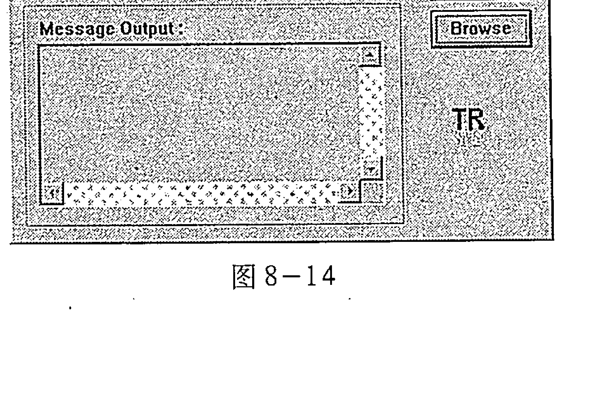

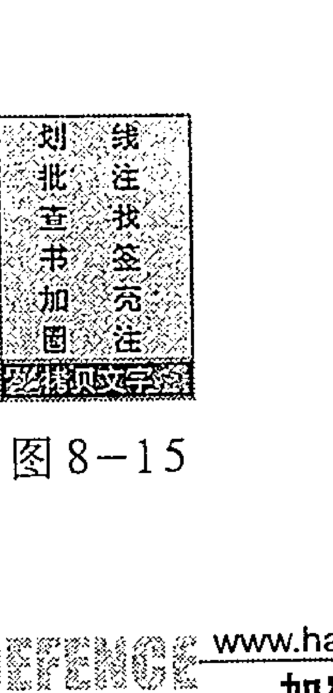

如下所示：

```text
asm
0167:0041B668  PUSH ECX                 // ECX入栈
0167:0041B669  MOV  ECX,[EBP+FFFFFF2C]
0167:0041B66F  CALL 0041B3E9            (========== 警告对话框CALL，按F8进入)
0167:0041B674  MOV  DWORD [EBP-04],FFFFFFFF
0167:0041B67B  LEA  ECX,[EBP+FFFFFF34]
0167:0041B681  CALL 0042AD68
0167:0041B686  MOV  ECX,[EBP-0C]
0167:0041B689  MOV  [FS:00],ECX
0167:0041B690  MOV  ESP,EBP
0167:0041B692  POP  EBP                 // 点警告对话框上的“确定”后，光标所在行
0167:0041B693  RET  04
0167:0041B696  PUSH EBP
0167:0041B697  MOV  EBP,ESP
0167:0041B699  SUB  ESP,BYTE +14
```

于是在 0041B66F 处，按 F9 键设置断点，再按 F5 键返回 Apabi Reader 中。在 Apabi Reader 中重新拷贝超过 64 个字节的文档，然后右键点取拷贝文字，程序立刻断在 0041B66F。按 F8 键进入此 CALL 会来到这里：

```text
asm
0167:0041B923  MOV  ECX,[EBP-04]
0167:0041B926  PUSH ECX
0167:0041B927  MOV  ECX,[EBP-08]
0167:0041B92A  CALL 0041B943            (========== 警告对话框CALL，按F8进入)
0167:0041B92F  JMP  SHORT 0041B93D
0167:0041B931  MOV  EDX,[EBP-04]
0167:0041B934  PUSH EDX
0167:0041B935  MOV  ECX,[EBP-08]
0167:0041B938  CALL 0041C36D
进入0041B92A处CALL后来到：
0167:0041B9E3  MOV  [EBP-38],EAX
0167:0041B9E6  MOV  EAX,[EBP-38]
0167:0041B9E9  MOV  EDX,[EAX]
0167:0041B9EB  MOV  ECX,[EBP-38]
0167:0041B9EE  CALL NEAR [EDX+0C]       (========== 警告对话框CALL，按F8进入)
0167:0041B9F1  MOV  [EBP-18],EAX
0167:0041B9F4  CMP  DWORD [EBP-18],BYTE +00
0167:0041B9F8  JNZ  0041BA15
0167:0041B9FA  MOV  DWORD [EBP-24],01
0167:0041BA01  MOV  DWORD [EBP-04],FFFFFFFF
0167:0041BA08  LEA  ECX,[EBP-20]
0167:0041BA0B  CALL 0041CC60
进0167:0041B9EE处CALL后，不久发现到了SmartReader.dll里：
0167:02879745  CALL 0287551B
0167:0287974A  JMP  SHORT 02879764
0167:0287974C  MOV  ECX,[EBP-0C]
0167:0287974F  SUB  ECX,BYTE +18
0167:02879752  CALL 0287656D            (========== 警告对话框CALL，按F8进入)
0167:02879757  JMP  SHORT 02879764
0167:02879759  MOV  ECX,[EBP-0C]
0167:0287975C  SUB  ECX,BYTE +18
0167:0287975F  CALL 028727FC
0167:02879764  PUSH BYTE +00
0167:02879766  PUSH BYTE +00
0167:02879768  LEA  ECX,[EBP-08]
进0167:02879752处CALL后来到：
0167:02876625  MOV  ECX,[028A4AB8]
0167:0287662B  CALL NEAR [EDX+34]
0167:0287662E  CMP  DWORD [EBP-30],80   // ★这里是关键！16进制的80不是128吗？正好是64个汉字！
0167:02876635  JNG  02876682            // 如从这里跳走就解除了拷贝文字超过64个字的限制
0167:02876637  LEA  ECX,[EBP-38]
0167:0287663A  CALL 02871A90
0167:0287663F  MOV  DWORD [EBP-04],00
0167:02876646  PUSH DWORD 7531
0167:0287664B  LEA  ECX,[EBP-38]
0167:0287664E  CALL 02892B5D
0167:02876653  PUSH BYTE +00
```

输入命令 `code on` 查看机器码，发现 02876635 处代码是 `7E4B`，要它跳走就改成 `EB4B`，即将 `JNG 02876682` 改为 `JMP 02876682`（无条件跳转到 02876682 处）。由于这段代码是在 SmartReader.dll 里，于是用 WinHex 在 Apabi Reader 安装目录下的 PlugIn 文件夹中找到 SmartReader.dll 文件打开（Apabi Reader 默认安装在 `C:\Program Files\Founder\Apabi Reader` 文件夹），然后搜查：`FF5234817DD0800000007E4B`（图 8-16），改为：`FF5234817DD080000000EB4B`，这样，就解除了拷贝文字 64 个的限制。不过，拷出来的东西最好复制在写字板，不要用记事本。对了，忘记告诉大家了，我破解的程序版本为 1.0c 补丁版 build 1037，软件下载地址：http://www.apabi.com/download/readerDL.htm。另外，如果你使用的是别的版本的 Apabi Reader 软件，其拷贝文件的限制也是在 SmartReader.dll 文件里，解读的方法和上面一样。

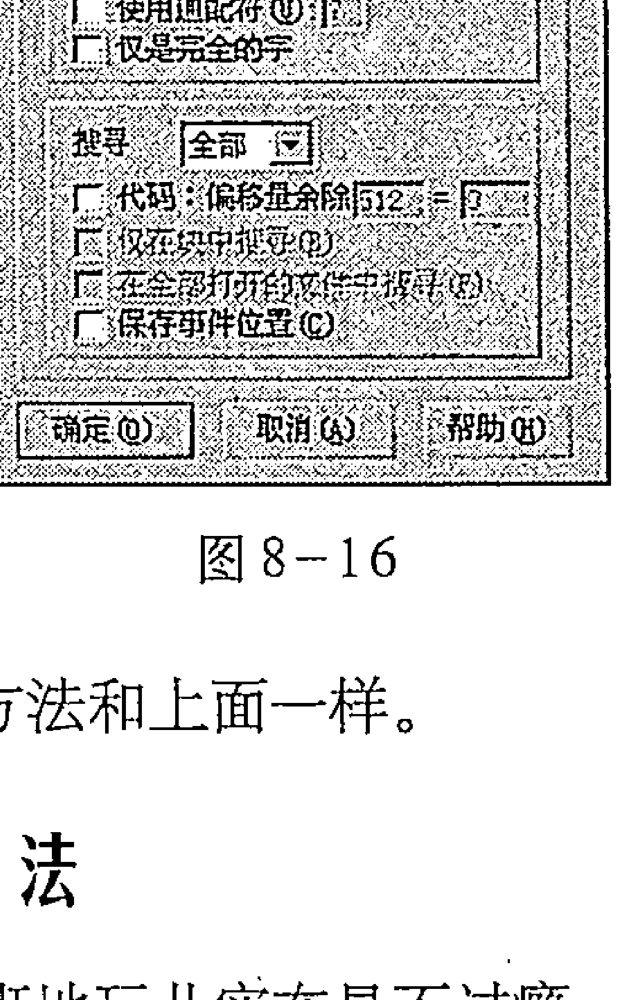

#### 8.1.5 解密软件在游戏中的应用——《三国志7》劝降必胜法

作为三国迷，尤其是三国志系列更是我的最爱。可我又是一个急性子，按部就班地玩儿实在是不过瘾，于是就用上了游戏修改工具，如 FPE2000、东方不败、金山游侠等软件，虽然它们都可以对游戏进行修改，但并不能尽心如意，比如说《三国志7》中有个劝降功能，用上述游戏工具就无能为力了。令人气愤的是游戏中那些君主的态度一个比一个强硬，死活不肯接受俺的“招安”——哪怕他们只剩下一座城池，只剩下“光杆司令”也不肯投降，真是死脑筋！看来得想别的小法。突然，脑中灵光一闪，想到了 TRW2000 这个 Cracker 最爱。经过一番实验，终于在 TRW2000 的帮助下圆了我的“招安”梦，使所有的君主都能“从谏如流”，在听到我的劝告时，以为是“至理名言”，因此都乖乖地降下来。这样，在 3 分钟内就可以看到大结局。如果你感兴趣的话，就和我一起来试试吧。

先运行 TRW2000，然后运行三国志7主程序，当你想要哪一方投降，就对其进行“劝告”，按“外交→劝告”按钮，选“势力”；在和对方君主讲话时按 Ctrl+N 激活 TRW2000，输入 `bpx 00672916`，这一步的目的是使三国志7的主程序执行到偏移地址 00672916 就自动中断。

在这里解释一下什么是断点和中断。所谓断点就是程序被中断的地方，这个词对于破解者来说是再熟悉不过了。什么是中断呢？中断就是由于有特殊事件（中断事件）发生，计算机暂停当前的任务（即程…）序），转而执行另外的任务（中断服务程序），然后再返回原先的任务继续执行。打个比方，你正在吃肯德基，突然有人敲门，开门发现是小编，把他带到客厅安顿好后，你继续吃饭（至于他馋不馋我们就不管了^_^，呵呵），这就是一个中断过程。在解密时，就是等到真假注册码比较的时候将它中断下来，然后通过分析程序，找到正确的注册码。所以我们需要为被破解的程序设置断点，在适当的时候切入程序内部，追踪到程序的注册码，从而达到破解的目的。

好了，让我们继续。按F5键回到三国志7中，按“执行”按钮去劝降对方君主，这时会被TRW2000拦截到，如下所示：

```asm
:00672916 FF5264    call [edx+64]      ; // 在这里被截住
:00672919 85C0      test eax, eax
:0067291B 7469      je 00672986
:0067291D 397C2410  cmp dword ptr [esp+10], edi
:00672921 7427      je 0067294A       ; // 跳转到0067294A
:00672923 8B4504    mov eax, dword ptr [ebp+04]

* Possible Reference to Dialog: DialogID_0118
|
:00672926 3D18010000 cmp eax, 00000118
:0067292B 7407       je 00672934

* Possible Reference to Dialog: DialogID_0104
|
:0067292D 3D04010000 cmp eax, 00000104
:00672932 7516       jne 0067294A

* Referenced by a (U)nconditional or (C)onditional Jump at Address:
|:0067292B(C)
|
:00672934 6A01       push 00000001
:00672936 8BCE       mov ecx, esi
:00672938 E8FB070000 call 00673138
:0067293D FF761C     push [esi+1C]

* Reference To: USER32.UpdateWindow, Ord:0000h
|
:00672940 FF1580566C00 call dword ptr [006C5680]
:00672946 897C2410    mov dword ptr [esp+10], edi

* Referenced by a (U)nconditional or (C)onditional Jump at Addresses:
|:00672921(C), :00672932(C)
|
:0067294A 8B06       mov eax, dword ptr [esi]
:0067294C 8BCE       mov ecx, esi
:0067294E FF5078     call [eax+78]
:00672951 85C0       test eax, eax    ; // 在这里输入r eax 0，然后按G键就劝降成功了。
:00672953 743C       je 00672991      ; // 跳转到00672991则劝降成功
:00672955 E8C82B0000 call 00675522
:0067295A 8B10       mov edx, dword ptr [eax]
:0067295C 55         push ebp
:0067295D 8BC8       mov ecx, eax
:0067295F FF526C     call [edx+6C]
:00672962 85C0       test eax, eax
```

你可以用16进制文件编辑器UltraEdit打开三国志7的主程序，然后点击“搜索→查找”，会弹出“查找对话框”，在“查找什么”栏中输入85 C0 74 3C E8 C8 2B 00 00（图8-17），点击“查找下一个”，会找到唯一的一处，找到后将74改为EB，然后保存退出。以后，当你对某个君主进行劝降时，保管他乖乖地投降过来。如此一来，天下唾手可得，妙哉，好不爽也！

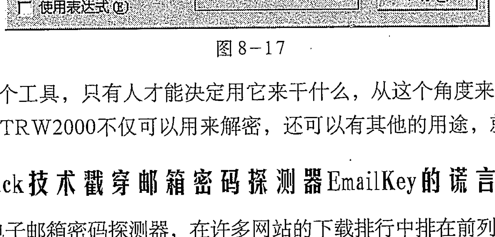

其实，软件只是一个工具，只有人才能决定用它来干什么。从这个角度来说，软件无好坏之分。就像在本文中的表现一样，TRW2000不仅可以用来解密，还可以有其他的用途，就看你怎么用了。

## 8.1.6 巧用Crack技术戳穿邮箱密码探测器EmailKey的谎言

EmailKey是一款电子邮箱密码探测器，在许多网站的下载排行榜中排在前列。据作者说非常简单易用，通过对POP、POP3邮箱密码进行探测，从而达到破解邮箱密码的目的，而且据说不用30秒即可完成。有过邮箱密码破解经验的朋友一定会觉得这样的速度快得有些不合常理！大名鼎鼎的溯雪也没有这么大的本事啊。想想EmailKey也是暴力破解邮箱密码，它怎么就这么厉害呢？于是下载了一款，亲自做了一个实验。以下是我的实验结果和分析过程。

下载后，运行EmailKey，输入POP3服务器地址和用户名，发现EmailKey竟然连字典文件都不需要就可以破解邮箱密码！而众所周知，暴力破解邮箱密码能否成功的关键就是软件的字典文件的好坏，即字典文件中只有包含了要破解的邮箱的密码，才有成功的可能。而EmailKey竟然不需要字典文件，这更加深了我对它的怀疑。点开始探测，几乎没有任何延迟便出现提示：找到用户，成功获取密码。这速度也实在太快了点，一定有鬼！看密码框中显示的是6个*号。原来该软件未注册时有功能限制，需注册才能正常使用。那么是不是我没有注册的缘故导致这种结果出现呢？干脆利用Crack技术来做个实验，看注册后到底会怎么样！

说干就干，请出我的最爱TRW2000，运行之，点击“Browse”按钮找到EmailKey，点击“Load”将其载入。按F5键继续运行程序，在EmailKey中可以看到我的注册号是B1L6-9F3J-A8S5，看来可能是一个注册号对应一个注册码。在注册框中随便输入一些字符，如1234，然后按TRW2000的热键Ctrl+N进入TRW2000的调试界面，输入BPX HMEMCPY断点，按F5回到被调试程序中，按注册被TRW2000拦住。输入BD *，屏蔽所有断点。这一步也是很重要的，许多初学解密的朋友不大注意这一点。由于被调试跟踪的程序会多次调用我们设定的函数，而每次调用都会被我们事先设定的断点中断下来，为了防止没完没了的中断干扰，所以我们要及时清除（BC *）或屏蔽（BD *）不再需要的断点。

接下来输入Pmodule指令直接跳到程序的领空。请注意，Pmodule指令是TRW2000特有命令，在SoftICE中没有这个命令。Pmodule的作用是相当于按F12键直至CS:EIP位于模块中，但它比F12更实用，可以快速回到当前程序领空（只有回到当前调试跟踪程序的领空才可能破解掉该程序），不用按多次F12了（在SoftICE中要多次按F12键才能回到当前程序的领空），这样大大地方便了我们。

你会看到如下代码：

```asm
016F:00401225  PUSH  BYTE+14
016F:00401227  PUSH  DWORD 00424678
016F:0040122C  PUSH  DWORD 00428800
016F:00401231  CALL  00402CE0  // 这是关键CALL
016F:00401236  ADD   ESP,BYTE+0C
016F:00401239  TEST  EAX,EAX
016F:0040123B  JNZ   00401269  // 这一行可以跳过下面的对话框，改为JZ 00401269可以暴力破解成功
016F:0040123D  PUSH  BYTE+00
016F:0040123F  PUSH  DWORD 0042466C
016F:00401244  PUSH  DWORD 00424648
016F:00401249  MOV   EDX,[EBP+08]
016F:0040124C  PUSH  EDX  // EDX入栈
016F:00401252  CALL  USER32!MessageBoxA  // 这里调用MessageBoxA函数显示注册错误对话框
```

有的朋友可能会问：你怎么知道016F:00401231处的CALL 00402CE0是关键呢？因为我跟踪过嘛！而且，从偏移地址00401252处的CALL USER32!MessageBoxA可以知道这是注册失败时会显示的CALL，只要跳过这里就可以注册成功。那么哪里可以跳过这里呢？向上看！偏移地址0040123B那一行：JNZ 00401269可以跳过此CALL，为什么它没有跳转呢？这是因为在它上面有个CALL 00402CE0，在代码执行过该行后，返回值不符合要求，所以0040123B那一行：JNZ 00401269没有跳转。既然如此，我们就可以知道016F:00401231处的CALL 00402CE0是能否注册成功的关键所在。其实，在此CALL中进行的就是注册码的比较。

按向上的箭头键将光标移动到偏移地址00401231处的CALL 00402CE0，按F9下断点，然后按F5返回到程序中，再次输入注册码，点注册被中断在00401231处的关键CALL，按F8键进入此CALL，你会看到以下代码：

```asm
016F:00402CE0  PUSH  EBP
016F:00402CE1  MOV   EBP,ESP
016F:00402CE3  PUSH  EDI  // EDI入栈
016F:00402CE4  PUSH  ESI  // ESI入栈
016F:00402CE5  PUSH  EBX  // EBX入栈
016F:00402CE6  MOV   ECX,[EBP+10]
016F:00402CE9  OR    ECX,ECX
016F:00402CEB  JZ NEAR 00402D86
016F:00402CF1  MOV   ESI,[EBP+08]  // 输入D ESI，会显示你输入的注册码
016F:00402CF4  MOV   EDI,[EBP+0C]  // 输入D EDI，会显示真正的注册码
```

所以，很快我就得到了EmailKey的注册码：D4T7H2E4J3K2N9M6P1L4，真是太简单了！赶快输入注册框中，按注册之后显示：注册成功！注册类型：普通用户。哈哈，这回该能得到邮箱的密码了吧？填好POP3服务器地址和用户名，开始探测。显示出错，换个POP3服务器地址和用户名，仍然显示出错提示，运行多次的结果都一样。再改回到未注册版，立刻就搜索到“邮箱密码！”而且是无论换成哪个邮箱都能立即就得到邮箱密码！

换台电脑，发现EmailKey提示的注册码仍然为R1L6-9F3J-A8S5，这说明EmailKey的注册号是固定的，不是根据硬件信息的不同而计算出不同的注册号。再跟踪调试，发现注册码依然为D4T7H2E4J3K2N9M6P1L4，注册后运行的结果还是出错，无法探测邮箱密码。由此可以得出结论：该软件根本不具备探测邮箱密码功能，只是徒具其壳而已，软件在运行后根本就没有进行探测工作！而注册该软件要花费200元人民币！这实在是一种欺骗广大网友和黑客技术爱好者的行为！

最后，提醒广大网友不要上当受骗。在试用一个软件后不要急着交钱，并且多与网友们沟通交流，以获得更多信息。

## 8.1.7 超级密码破解利器LC4解密过程

LC4是一款运行在Windows NT/2000下的超级密码破解利器，允许用户自定破解策略，支持本地、远程甚至嗅探密码的HASH值。作为一款暴力破解密码工具，LC4不仅可以检测用户是否使用了不安全的密码，还可以在你的系统管理员账号密码丢失时大显身手，它宣称在P300机器上不到48小时可以破解90%的超级用户口令！而如果是少于8位的密码，则可以在24小时之内破解出来。虽是廉颇老矣，但却是尚能饭也！

LC4需要注册才能实现其全部功能，所以我们要想办法注册它。下载安装完毕，运行LC4，出现如图8-18所示窗口，在这里你可以选择“Trial”，即继续试用，也可以选择“Register”，表示要注册。我们要注册它，所以就选“Register”。点击“Register”按钮后，会出现如图8-19所示窗口，从中可以看出这是典型的一机一码制，即一个注册码只能用在一台机器上，换台机器原来的注册码就不能使用了，现在绝大多数软件都采用了这种和硬件有关的注册方式。


图8-18

图8-19

在“Serial”栏中是软件自己计算出的序列号，而“Unlock Code.”栏中要求我们填入注册码。注册码可以随便填入，按照我的习惯，我填入了：31415926。点击“OK”按钮之后会有什么结果，哈哈，出现一个对话框，显示“You have entered invalid code.Please try again”（图8-20），显然是在告诉我们注册码不正确。千万不要灰心，毕竟我们这是在试探嘛，哪能这么容易就填对了呢！实际上，在解密的过程中，看到这样的提示对话框其实是个很好的现象，碰到那种不管注册码对不对都没有反应的才麻烦呢！如果我们反汇编这类有提示信息的软件，就可以查看到提示信息相应的代码，从而加快我们的破解过程。


图8-20

现在，请出我们的解密利器——TRW2000，大家对它已经很熟悉，就不再多费笔墨了。按Ctrl+N键呼出TRW2000，进入它的调试界面，然后输入bpx hmemcpy下断点。按F5返回到注册窗口中，点击“OK”按钮被中断下来，输入bc *指令清除所有断点。然后再输入pmodule这个TRW2000才有的指令，返回到程序的领空。这么经典的步骤，我想绝大多数读者都明白其中的含义，为节省篇幅就不多介绍了，有不明白的，可以到《黑客防线》论坛来问，编辑和论坛上的各位高手都很热心的。

接下来，按F12键34下，再按1下F10键，就来到了程序注册码的关键比较区域。有朋友可能要问：你怎么知道要按F12键34下呢？因为再按一次就会出现提示窗口，告诉你注册码错误！由于我用TRW2000跟踪试验过，所以我知道必须少按1次F12键。除此之外，经验也帮助了我。常言说得好：授人以鱼，不如授人以渔。为了使大家能理解这种方法，更好地应用到其他软件的解密过程中，在此简单地说一下。一般情况下，当我们按了F12键N次后，软件出现提示说注册码错误，此时我们不难想到，注册码的关键比较地方应该是在此前的按F12那一次，所以少按1次F12键就可以进入软件的注册码关键比较之所在。以后碰到这种出现对话框提示注册码不正确的软件，就可以按这个方法去试试。

继续我们的破解过程，前面我们已经来到了注册码的关键比较区，其代码如下（“//”后面的内容是我加的注释，方便大家理解）：

```asm
015F:00411BCB 8D8C2430010000 LEA ECX,[ESP+0130] // 按F12键34下后，再按1下F10，会来到这一行
015F:00411BD2 E85CC30200     CALL 0043DF33      // 取你输入的假注册码
015F:00411BD7 83F801         CMP EAX,BYTE +01   // 比较EAX是否等于1
015F:00411BDA 757A           JNZ 00411C56       // 如果EAX不等于1则跳走
...
015F:00411C01 E8955C0100     CALL 0042789B      // ★★比较注册码的关键CALL
015F:00411C09 85C0           TEST EAX,EAX       // 真假注册码相等吗？
015F:00411C0B 7523           JNZ 00411C30       // 如果真假注册码不相等则跳转
...
015F:00411C30 53             PUSH EBX           // 如果注册码不相等则来到这一行
015F:00411C37 E8D3720300     CALL 00448F0F      // 执行到这一行就会显示注册失败的对话框
```

从上面的分析中，不难得出这样的结论：当程序执行到偏移地址00411BFB时，输入D EDX就可以得到LC4真正的注册码！而偏移地址00411C01那一行的CALL 0042789B就是比较注册码的关键CALL，对该软件算法感兴趣的朋友可以按F8键进入此CALL看看，算法并不复杂。如果你想暴力破解LC4（呵呵，典型的以暴制暴——不要忘了，LC4是款典型的暴力破解密码的软件），可以改偏移地址00411C0B那一行的代码JNZ 00411C30（机器码：7523），将其改为JZ 00411C30（机器码：7423）。


图8-21

现在，试试我们刚刚得到的注册码，把a3713f55填入到“Unlock Code:”栏中，点击“OK”按钮，出现一个对话框，显示：“You have successfully registered LC4.”（图8-21），我们注册成功了！

点击对话框中的“确定”按钮，会进入LC4的主界面中，点击“Help”菜单中的“About LC4”，你会看到这里记载着你的LC4的Serial和Unlock Code信息。是不是很有成就感？就算别人的LC4玩得再精，如果注册码是用他人写的注册机得来的，也会存在一份缺憾！而你则可以拥有属于自己的骄傲：我是自己动手得到LC4注册码的！快动手试验，体验属于你的那份快乐与自豪吧！

## 8.2 SoftIce 破解实例

### 8.2.1 WINZIP8.0之破解实战

本人用软件经常马马虎虎，不管正版、盗版，正式试用只要能用就行，但偶尔发现，用了这么长时间的WINZIP竟然是未注册的。既然发现了，用着心里就不大舒服，所以笔者决定破解个WINZIP8.0的注册码用用。

打开WINZIP8.0，弹出个未注册窗口，以前笔者习惯点I Agree进入主界面，这次要破解嘛，点Enter Registration Code...，然后出现注册窗口，输入用户名rich，注册码随便输入个432432（用户名和密码随便输），Ctrl+D呼出SoftICE窗口，输入命令S 30:0 1FFFFFFF '432432'，回车，找到一个内存地址。我的机器是30:807DCF2A，不同机器及每次启动WINZIP这个地址可能不同，下断点bpm 30:807DCF2A r（最后的r前面有一个空格，代表读的意思），然后回车；再打命令X退出SoftICE窗口，点注册窗口的“OK”按钮，SoftICE又被激活，按F12键11次回到WINZIP的领空，光标白条停在“PUSH ESI”处，向下看见一大段汇编代码：

```asm
PUSH ESI
CALL 0043F89A
PUSH ESI
CALL 0043F8C3
CMP BYTE PTR [0048CD78], 00
POP ECX
POP ECX
JZ 00408005
CMP BYTE PTR [0048CDA4], 00
JZ 00408005
CALL 004079D5
TEST EAX, EAX
JZ 00408005
```

看见“TEST EAX,EAX”那一句了吗？上面的CALL就是密码校对，当然下面的JZ就是比较正确与否后相应的跳转了。在光条执行到TEST上面那个CALL时，按F8进入那个CALL，来到004079D5处，看到如下代码：

```asm
POP EBP
MOV EBP, ESP
SUB ESP, 00000208
...
```

按 F10 一直走到 0167:407AA3 处：

```asm
0167:407AA3  LEA EAX,[EBP-0140]
0167:407AA9  PUSH ESI
             PUSH EAX
```

当光标逐条执行到 `PUSH ESI` 处时，打 `D EAX`，在 SoftICE 上边的数据窗口看见了什么？“19930267”，这就是注册码了。后边的 `PUSH ESI`、`PUSH EAX` 中，ESI 中的是输入的错误注册码 432432，而 EAX 中就是正确的注册码了。退出 SoftICE 窗口，在 WINZIP 注册窗口中重新输入名字 rich，密码 19930267，点“OK”按钮，怎么样，成功了吧？输入你自己的名字，用自己的注册码的感觉很激动吧？

当然，0167:407AA3 上面的代码和 CALL 就是依据你的用户名生成注册码的过程了。如果你的汇编水平很高，又会一点如 VB 的高级语言编程的话，就可以做个注册机了。怎么样，别光顾高兴，有些收获吧？注册机你自己做吧，要相信自己。

## 8.2.2 智博保护卡的深入破解历险记

也许你在使用计算机的过程中会遇到智博保护卡，那你会怎么办？想对它了解更多吗？也许你没有遇到过它，但为什么不顺便分析一下它是怎么保护硬盘的呢？对你也许会受益匪浅。

> “智博神软卡，专业车免维护”，好大的气派啊。也许就是一个加了保护模式代码的软件罢了，但是，它却不是。可以这么说：智博保护卡是结合各种 DOS 底层技术比较成功的产品。记得我在黑防增刊上谈到过破解智博保护卡的一般方法，可是好多网友给我写信说文章写得过于抽象，于是我又写了这篇专门破解智博保护卡的文章，这中间不光有破解方法，也包含我在破解它时的心得与体会。也许对广大破解爱好者来说会起到抛砖引玉的作用。

通过“SoftICE for DOS”（以下简称 Sice），对其跟踪了解到，智博在内存高端和内存低端都有其代码。注意：一切操作都是在安全模式中的命令行下进行，Sice 好像对上位内存管理程序配合得不是很好。在我的计算机上这两个段地址为：0617 和 9E40。可能你的计算机上的地址和我不一样，但请不要担心什么，以下相同。

##### 1. 初步分析，引出“敌人”

对 int 13 中断调用的掌管权，谁先截取，谁就可以完全控制硬盘读写。查看 int 13 中断向量地址命令：`D 0:4C`，发现其为 70:012F，这是 IO.SYS 的初始段地址。直接将其改为 BIOS 中断地址 F000:9884，也许你的地址和我不一样，但不要紧。为了验证是否修改成功，再用：`D 0:4C` 查看，中断向量已被更改为：9E40:01D2。于是用：`U 9E40:01D2` 反汇编出来，发现果然为智博代码，它对硬盘的截取操作、放置中断向量都在代码中一目了然。立即将 9E40:01D2 处的代码改为：`JMP F000:9884`。

至此，暴力破解完成，写盘可以成功操作了，验证也成功。

就这样结束是否太仓促了？让我们更接近它一点，看看是哪段代码改变了我的 int 13 的中断向量。这很有研究。原来我以为是智博调用了时钟中断，但是没有结果。重新启动计算机以后，在 Sice 中直接键入 `BPM 0:4C W`，表示如果有代码对 0:4C 处地址进行写操作就中断其代码。接着退到 DOS，用 Debug 修改 0:4C 处为 F000:9884 的向量地址。第一次 Sice 会把我们中断下来，不管它，按 F8，键入 X 跳过。很快代码运行又被 Sice 中断了下来。查看你的地址，为：9E40:0389，和修改 int 13 后的段地址一样。看来就是这段代码了，连段地址都一样。

### 2. 代码追击，再次暴破

用暴力破解来得比较快，只要找到了核心代码。按 F8 单步追踪，不到 10 步你就会看到下面的核心代码：

```asm
XOR AX,AX
PUSH AX
PUSH AX
POP DS
POP ES
AAAA: MOV WORD PTR ES:[4C],01D2
MOV WORD PTR ES:[4E],CS
POPF
IRET
```

好简单的汇编语言啊，真的是活脱脱地呈现在我的面前。朋友，你用暴力破解一般是用什么指令呢？

这里有一个小小插曲：我在暴力破解时，将 AAAA 处的代码改成 `JMP 9E40:1000`（1000 为智博代码尾部一段空白区域的偏移量）。

```asm
9E40:1000:
    mov word ptr es:[4c],9884
    mov word ptr es:[4e],F000
    jmp 9E40:0395    ; 0395为AAAA处JMP 9E40:1000的后一条指令地址
```

乍一看好像没有什么，但无形中我已经改变了原来代码中的编码规则。原来的 `mov word ptr es:[4c],01d2` 为 8 字节，而 `jmp 9e40:1000` 为 5 字节。那么，多出的 3 字节就会被计算机当成指令字节来和后面的指令匹配编码。以后当再运行到 AAAA 代码以后的代码时将产生花指令，从而产生计算机的错误指令，严重的将产生一般性保护指令错误（对 Sice 影响的结果）。最开始我还为自己打补丁破解的方法欣慰，没想到却死机了。其实啊，最好的办法还是用 NOP（90）指令。看下面：

```asm
F 9E40:0391 L C 90
```

接着你对 0:4C 处想怎么改就可以怎么改了。

## 三、进一步挖掘，一个也不能少

在 Sice 下面清除所有断点，键入如下指令：

```asm
BPR 9E40:0 9E40:1000
```

（对 9E40:0 到 9E40:1000 的代码进行全面监控。退到 DOS 下，即被中断了下来。单步跟踪。可以用 `P RET` 命令几次后，你会来到 0617 为段地址的地方。我的是 0617:0139，而其上是一条指令 `CALL FAR PTR [BP+1]`，对其中断，在 SoftICE 中指示出 `[BP+1]` 的地址为：9E40:01E3，看来 0617 与 9E40 是一伙的。设想中断向量表被改为跳转地址 0617:XXXX，而改后的地址在中断向量表中可以搜索得到。也对，那么大气派的软件，对中断向量的修改肯定很多吧。用以下指令对中断向量表进行查找：）

```asm
S 0:0 L 3FF 17 06
```

找出所有段地址为 0617 的向量，果真让我找到了不少。Int 2 为除法溢出中断，被智博更改，将其改回。Int 8 时钟中断，原地址为：F000:FEA5，被更改为 0617:0281；Int 9 键盘 BIOS 中断，Int E 软盘参数中断同样也被修改。统统将其改回。啊啊，一切运行正常。大家不要叹气，改的地方是多了点，毕竟这也是一个保护卡嘛。这也做到了一个都不能少。该改的改了，重新启动计算机，来到 DOS 实模式下（不是安全模式的实模式），把上面我所讲到的全部再改一次，之后我键入 WIN 想进入图形模式的 Windows，但是操作失败了。其实啊，智博对 int 13 的中断还做了一个小小的手脚。有兴趣的朋友自己去分析一下吧，实在不行可以和我联系。

## 总结：这是一次对 DOS 代码的深入破解，还是那句老话：

- 1. 对汇编语言要十分了解。
- 2. 对 DOS 运行机制要十分了解。
- 3. 会用高级调试语言和软件，Debug 也要会。

## 8.2.3 用解密软件巧解被禁用的注册表——使注册表编辑器具有免疫力

恶意网页常用手段之一就是修改访问者的注册表，以此达到破坏我们的电脑或宣传其网站的目的。为了防止我们恢复被修改的注册表键值，这些含有恶意代码的网页会通过修改我们的注册表，使我们的注册表编辑器被禁用。当然，我们可以采用多种方法来解决这个问题。如果我说用解密软件 SoftICE 或 TRW2000 来解决这个问题，是不是很出乎你的意料？看过本文你会发现它们可不仅仅只能用来解密哦！

点击“开始”菜单中的“运行”，或按 Win 键 + R 键，会弹出“运行”对话框，输入 Regedit.exe，打开注册表编辑器。由于注册表编辑器被禁用，所以会弹出如图所示禁用注册表的信息（图 1）。此时，SoftICE 或 TRW2000 就可以派上用场了。我们以 SoftICE 为例（TRW2000 大同小异），按 Ctrl + D 呼出 SoftICE，然后输入 `HWND` 命令，会看到如下所示内容：

```text
Window Handle hQueue SZ QOwner    Class Name      Window Procedure
0080(0)   206F   32 MSGSRV32 #32769 (Desktop)   1787:00005F92
03D8(1)   220F   32 EXPLORER BaseBar            136F:0000028A
03DC(2)   220F   32 EXPLORER MenuSite           136F:0000028A
0420(3)   220F   32 EXPLORER SysPager           136F:00000140
0424(4)   220F   32 EXPLORER ToolbarWindow32    136F:000002B6
......
0540(1)   410F   32 REGEDIT IME                 175F:00000000
053C(1)   410F   32 REGEDIT #32770 (Dialog)     175F:00007720
0544(2)   410F   32 REGEDIT Button              175F:000035CC
0548(2)   410F   32 REGEDIT Static              175F:0000828E
054C(2)   410F   32 REGEDIT Static              175F:0000828E
```

看到“REGEDIT Button”了吗？它代表图 8-22 所示对话框中所对应的按钮（由于和注册表编辑器有关，所以就有“REGEDIT”这样的字样了），它所对应的句柄（Window Handle）为 544。输入命令 `bnmsg 544 wm_lbuttonup`（544 这个数字是不固定的，经常变化，所以要用 HWND 命令来查看），这个命令的意思是当放开鼠标左键的消息传到 Button 时引发中断。


图 8-22

退出 SoftICE，用鼠标按“确定”按钮后引发中断，再按 F12 键 N 次后，来到这里：

```text
015F:0040CD1B  CALL  [KERNEL32!FormatMessageA]
015F:0040CD21  MOV   [EBP-08], EDI
015F:0040CD24  TEST  EAX, EAX
015F:0040CD26  JZ    0040CD52
015F:0040CD28  CMP   [EBP-04], EDI
015F:0040CD2B  JZ    0040CD52
015F:0040CD2D  MOV   EAX, [EBP+18]
015F:0040CD30  OR    EAX, 00010000
```

```asm
015F:0040CD35  PUSH EAX                  // EAX入栈
015F:0040CD36  PUSH ESI                  // ESI入栈
015F:0040CD37  PUSH DWORD [EBP-04]       // [EBP-04]入栈
015F:0040CD3A  PUSH DWORD [EBP+0C]       // [EBP+0C]入栈
015F:0040CD3D  CALL 'USER32!MessageBoxA' // ★此CALL弹出禁用注册表编辑器窗口
015F:0040CD43  PUSH DWORD [EBP-04]       // 注意，EIP指向这里，这一行高亮显示
015F:0040CD46  MOV ESI,EAX               // 把EAX的值送入ESI中
015F:0040CD48  CALL 'KERNEL32!LocalFree'
015F:0040CD4E  MOV EAX,ESI
015F:0040CD50  JMP SHORT 0040CD57        // 无条件跳转到0040CD57，退出程序，失败了
015F:0040CD52  MOV EAX,FFFFFFFF
015F:0040CD57  POP EDI                   // EDI出栈
015F:0040CD58  POP ESI                   // ESI出栈
015F:0040CD59  MOV ESP,EBP
015F:0040CD5B  POP EBP                   // EBP出栈
015F:0040CD5C  C3   RET                  // 退出程序
```

经过两次运行，发现偏移地址 0040CD24 和 0040CD28 处都不是判断是否禁用注册表的地方，所以一直按 F10 键，直到返回上一层 CALL，来到这里：

```asm
015F:0040C7BB  CALL 0040C9C8           // ★此CALL判断注册表是否被禁用
015F:0040C7C0  TEST EAX,EAX            // EAX是否为0
015F:0040C7C2  JZ 0040C7DF             // ★如果EAX不为0则跳转走，表示没有被禁用，一定要让它跳
015F:0040C7C4  PUSH BYTE +10
015F:0040C7C6  MOV EAX,[00418800]      // 把[00418800]的值送入EAX中
015F:0040C7CB  PUSH BYTE +10
015F:0040C7CD  PUSH BYTE +28
015F:0040C7CF  PUSH BYTE +00
015F:0040C7D1  PUSH EAX                // EAX入栈
015F:0040C7D2  CALL 0040CCA8           // ★这个CALL会弹出禁用注册表编辑器窗口
015F:0040C7D7  ADD ESP,BYTE +14        // 注意，EIP指向这里，这里高亮显示
015F:0040C7DA  JMP 0040C898
015F:0040C7DF  PUSH BYTE +1C           // 如果没有禁用注册表编辑器就从这里开始执行程序
015F:0040C7E1  XOR EDI,EDI             // EDI与EDI做异或操作，结果为0
015F:0040C7E3  CALL 0040CA35
015F:0040C7E8  ADD ESP,BYTE +04
015F:0040C7EB  MOV [004187F8],EAX
015F:0040C7F0  TEST EAX,EAX
015F:0040C7F2  JZ NEAR 0040C898        // 如果注册表未被禁用，则这里不会跳转
```

根据上面所示代码，不难分析出偏移地址 0040C7C2 处只要跳转即可给注册表解锁。在 SoftICE 中下断点：`bpx 0040C7C2`，然后退出 SoftICE，再次运行注册表编辑器；当执行到 40C7C2 时会被中断下来，输入 `R fl z`，修改标志位，使 `je 0040C7DF` 跳走；按 F5 键，注册表编辑器自动运行了。成功！

根据上面分析的结果，我们还可以给注册表编辑器 Regedit.exe 做个小手术，使之对注册表禁用功能具有“免疫力”，这对防范恶意网页对注册表的禁用非常有好处。用 16 进制文件编辑器 UltraEdit 打开 Regedit.exe，查找 `74 1B 6A 10 A1 00`（`74 1B` 为偏移地址 0040C7C2 处汇编代码 `je 0040C7DF` 的机器码）；找到后，把 74 改为 EB，即可以使注册表编辑器具有免疫力。这一步的目的是将 `je 0040C7DF` 改为 `jmp 0040C7DF`，`je` 是等于则跳转，而 `jmp` 是无条件跳转的意思——无论比较的结果怎样，都无条件地跳转到其后的偏移地址处。哈哈，这样修改后，恶意网页又怎么能“锁”住我们的注册表编辑器呢！现在，你就有了一个锁不住的注册表编辑器了。下次即使注册表被禁用也不用害怕了，只管运行之，保管恶意网页的修改无效。

## 8.2.4 都是你自己惹的祸——破解 Virtual Desk

- 破解实例：Virtual Desk
- 版本：Version 1.1
- 公司网址：http://www.easyjp.com/virtualdesk.htm
- 破解工具：SoftICE + W32Dasm

最初，我觉得这个软件提供的功能还不错，可以比较方便地进行不同的桌面切换，每个桌面可以拥有不同的背景和图标，和 Linux 下虚拟桌面很相似。但是我下载的是一个未注册的版本，每次打开时，它总是弹出一个 nag（烦人的对话框）。于是我决定破解它，呵呵，现在看来都是它自己惹的祸。

首先，得安装这个软件。运行后，在托盘对应图标上左键点击，出现下拉式菜单。选中 configuration，在弹出的窗口中可以找到 registration 标签。随意地输入一个注册码，我输入的注册码是：

```text
RegisterName : fxt
RegisterCode : 123456
```

按“确定”后，系统弹出标题为“Wrong registeration code”的错误消息框，太好了，快发现目标了。然后，用 W32Dasm 反汇编 Visual Desk.exe，在“参考 -> 字符串数据参考”下找到那个提示错误信息的消息串，双击，OK，已经到了：

```text
* Referenced by a (U)nconditional or (C)onditional Jump at Address: 00403042(C)

:00403127 6A30 push 00000030

* Possible StringData Ref from Data Obj -> "Registration Error"
:00403129 68E8584100 push 004158E8

* Possible StringData Ref from Data Obj -> "Wrong registeration code"
:0040312E 68D0584100 push 004158D0
:00403133 6A00 push 00000000

* Reference To: USER32.MessageBoxA, Ord:01BEh
:00403135 FF1590324100 Call dword ptr [00413290]
```

看看上面的代码，这应该就是在注册码不合法的时候要输出的错误提示信息，这说明已经快接近目标了。往上看看，呵呵，在 00403042 处存在一个有条件跳转的交叉参考，而且仅有一处哦，不要错过才是！这说明我们已经找到了地方，可以稍稍激动一下！看看再说，直接转到“偏移：00403042”处：

```text
:0040302B 8D4C241C lea ecx, dword ptr [esp+1C]
:0040302F 89442418 mov dword ptr [esp+18], eax
:00403033 51 push ecx
```

```asm
:00403034 E827530000  call 00408360
:00403039 8B4C241C    mov ecx, dword ptr [esp+1C]
:0040303D 83C408      add esp, 00000008
:00403040 3BC8        cmp ecx, eax
:00403042 0F85DF000000 jne 00403127
```

看来直接改 `jne 00403127` 就可以了，我在 UltraEdit 中用 `909090909090`（6 个 NOP 指令）代替 00403042 处的 `0F85DF000000`，另存，重新打开，注册，OK，成功了。这可是激动了一次。再试一次如何？关闭，打开，傻眼了，那个 nag 框又出现了。一查看，注册窗口又恢复原样了，看来该软件在注册通过之后还进行了其他的检查。嗯，应当看看在

```asm
:00403040 3BC8        cmp ecx, eax
:00403042 0F85DF000000 jne 00403127
和
* Referenced by a (U)nconditional or (C)onditional Jump at Address:
|:00403042(C)
|
:00403127 6A30        push 00000030
```

之间的代码，这部分就应当是对“正确”的注册码进行处理的地方。看来这部分代码还不少，算了，转到“比较”之前的算法部分看看，用 SoftICE 设置如下断点：

```text
bpx 40302b
```

在注册框输入名字：fxt 和注册码：123456，确定，这时 SoftICE 弹出来了，OK，在 `:0040302B 8D4C241C lea ecx, dword ptr [esp+1C]` 处停下来了，看看 ecx 所指的数据：

```text
d ecx
```

哇，“fxt”，这不是我刚才输入的注册名字吗？此时心中有点底了，再读读上面的代码。原来程序将输入名字传给了过程：00408360，过程返回后改变了 ecx 的值，并和 eax 比较，看来得看看过程 00408360 了：

```asm
* Referenced by a CALL at Addresses:
|:00403034, :00407068
|
:00408360 56          push esi
:00408361 8B742408    mov esi, dword ptr [esp+08]
:00408365 57          push edi
:00408366 8BFE        mov edi, esi
:00408368 83C9FF      or ecx, FFFFFFFF
:0040836B 33C0        xor eax, eax
:0040836D F2          repnz
:0040836E AE          scasb
:0040836F F7D1        not ecx
:00408371 49          dec ecx
:00408372 33D2        xor edx, edx
:00408374 85C9        test ecx, ecx ; 求出注册名项的字符长度 = ecx
:00408376 7E0B        jle 00408383
```

## 加密解密技术

```asm
* Referenced by a (U)nconditional or (C)onditional Jump at Address:
:00408381(C)

:00408378 0FBE3C30    movsx edi, byte ptr [eax+esi]
:0040837C 03D7        add edx, edi
:0040837E 40          inc eax
:0040837F 3BC1        cmp eax, ecx
:00408381 7CF5        jl 00408378 ; 对注册名各个字符进行求和，和 = edx

* Referenced by a (U)nconditional or (C)onditional Jump at Address:
:00408376(C)

:00408383 8D04D2      lea eax, dword ptr [edx+8*edx] ; eax = edx * 9
:00408386 5F          pop edi
:00408387 C1E004      shl eax, 04 ; eax = eax * 16
:0040838A 2BC2        sub eax, edx ; eax = eax - edx
:0040838C 5E          pop esi
:0040838D 8D0480      lea eax, dword ptr [eax+4*eax] ; eax = eax * 5
:00408390 8D04C0      lea eax, dword ptr [eax+8*eax] ; eax = eax * 9
:00408393 D1E0        shl eax, 1 ; eax = eax * 2
:00408395 2BC2        sub eax, edx ; eax = eax - edx
:00408397 D1E0        shl eax, 1 ; eax = eax * 2
:00408399 C3          ret
```

读完上面的代码，立刻明白原来这段子程序是将名字项进行了求和，然后作了如下一些运算，并将最后的结果存放在 eax 中，设 x 就是输入的各个字符之和，则：

eax = (((x*9)*16−x)*5*9*2−x)*2 = x * 25738

eax 值有了。再看看 ecx，回头跟踪一下，它在数据单元 `[esp + 1C]`，查看这个地方：0x1E240，123456D！？这不是刚才输入的注册码？这么简单？简直不敢相信，老外用这么简单的东西来生成注册码？！再看看代码流程，确实将这两个结果在比较，还是试试看再说。于是用 C 语言写了一个注册机：

```c
int main()
{
    char RegisterName[20];
    int RegisterCode=0;

    scanf("%s", RegisterName);

    for(int i=0; i<strlen(RegisterName); i++)
        RegisterCode += RegisterName[i];
    RegisterCode *= 25738;

    printf("\n RegisterName is : %s \n", RegisterName);
    printf("RegisterCode is : %d \n", RegisterCode);

    return 0;
}
```

运行注册机，输入：fxt

输出：

RegisterName is :fxt

RegisterCode is : 8699444

注册试试，成了，注册成功。不信，再在其他机器上试一试，还是一样。

### 8.3 综合破解实例

### 8.3.1 突破独裁者 DDoS 攻击器只能添加 10 台主机的限制

DDoS 是 Distributed Denial of Service 的缩写，意思是分布式拒绝服务攻击。它是指借助于客户／服务器技术，将多个计算机联合起来作为攻击平台，对一个或多个目标发动 DoS 攻击，从而成倍地提高拒绝服务攻击的威力。目前可以用来进行 DDoS 攻击的工具软件非常多，独裁者 Autocrat DDoS client 就是其中之一。

独裁者 DDoS 攻击器是进行网络 DDoS 攻击的工具，作为 DDoS 攻击利器，它支持 4 种攻击方法：SYN、LAND、FakePing、狂怒之 Ping。程序分为 Client 和 Server 两部分，其中 Client 对应的程序为 Client.exe，Server 对应的程序为 Server.exe。Server 在肉鸡上执行后会自动安装为 NT 服务程序并删除自身，以后将会采用 NT Service 方式在肉鸡上作为木马运行，可以通过 Telnet、HTTP 方式控制，方法是：直接在 IE 输入 `http://ip:8535` 即可。Client.exe 程序可以运行在各个 Windows 操作系统，但在 Windows 98/Me 下只能发起狂怒之 Ping 攻击，在 Windows 2000/XP 下能使用所有功能。

运行独裁者 DDoS 攻击器软件中的 Client.exe，可以看到如图 8-23 所示界面，其功能一目了然。点击“添加”按钮，可以添加进行 DDoS 的主机。令人遗憾的是，在主机列表框中最多只允许我们添加 10 台主机，超过这个数目再点“添加”按钮，就会弹出一个对话框，显示：已经超过主机上限，禁止添加（图 8-24）。虽然主机数量的多少并不影响 DDoS 攻击的效果，但具体添加几台主机应该由我们用户决定嘛，而且主机列表是个很大的文本框，只添加 10 台主机进去有些浪费空间，实在是太可惜，所以我们要突破独裁者只能添加 10 台主机的限制，让我们可以随心所欲添加主机。

- 一、检测软件是否加壳

我要破解的这个版本为 V1.26.52 版，用加壳检测工具 Language2000 检测看它是否加壳了。运行


图 8-23

图 8-24

Language2000，点击“Open”按钮找到 Client.exe 将其加载到 Language2000 中，等一下就会出现结果。检测结果表明独裁者 DDoS 攻击器是用 VB6.0 编写的，内部版本为 V1.26.0059，采用 PECompact 压缩过（图 8-25）。要想暴力破解或静态分析就得给它脱壳。既然已知是 PECompact 加的壳，那我们就用 UNPECompact 来脱壳。运行 UNPECompact，点击“Start”按钮把 Client.exe 加载进来，无需我们干涉，UNPECompact 就会自动给它脱壳（图 8-26），脱壳后会生成一个名为 unpacked.exe 的文件。运行脱壳后的文件试试，一切正常。这样我们就可以把原来的 Client.exe 文件删除，把脱壳后的 unpacked.exe 文件改名为 Client.exe。请大家注意，下文中我们提到的 Client.exe 都是脱壳后的该文件。


图 8-25

图 8-26

- 二、动静结合初步分析

由于独裁者是 VB 编制的软件，这类软件有个特点就是非常难以破解。静态反汇编生成的代码垃圾非常多，很难找到软件的比较核心，而用动态跟踪的方法也很麻烦，因为 VB 程序本质上都是解释执行的，它们只是调用 VBxxx.DLL 中的函数，因此 VB 的可执行文件是伪代码，程序都在 VBXXX.DLL 里面执行。若用 Soft-ICE、TRW2000 跟踪调试只能在 VBxxx.DLL 里打转转，看不到有利用价值的东西，而且代码质量不高，结构还很复杂。基于以上考虑，我们决定进行动静结合分析，双管齐下破解该软件。

首先，用动态跟踪试试。运行独裁者，按“添加”按钮添加主机，先添加到 10 台，然后运行动态跟踪利器 TRW2000，按 Ctrl+N 热键呼出 TRW2000 的调试界面，下断点：`BPX rtcMsgBox`，按 F5 返回到独裁者中。解释一下：由于独裁者是 VB6.0 程序，所以我们下断点 `BPX rtcMsgBox`，rtcMsgBox 是 VB 程序的警告窗口函数。由于加第 11 台主机会弹出警告窗口，所以我们下该断点，目的是只要独裁者调用该函数就中断下来。注意，如果你使用的是 SoftICE，下断点时要用 `BPX MSVBVM60!rtcMsgBox` 指令。

接下来，按“添加”按钮，立刻被 TRW2000 拦截下来。下断点 `BC*`，清除所有断点。然后按一下 F12 键会回到独裁者中，程序会显示那个警告对话框，不理它，点击对话框中的“确定”按钮又回到调试窗口中。按一下 F10 键，会来到这里：

```text
015F:004109F1 6A30        PUSH BYTE +30
015F:004109F3 51          PUSH ECX
015F:004109F4 FF1574104000 CALL [MSVBVM60!rtcMsgBox]  <----- 执行到这里会弹出警告对话框
015F:004109FA 8D5594      LEA EDX,[EBP-6C]            <----- 光标停留在这一行，向上看
```

当我们在独裁者中添加的主机超过了 10 台，程序就会调用偏移地址 004109F4 这一行的 CALL，并弹出警告窗口。所以，让我们向上看哪里可以跳过这里，在 TRW2000 中直接判断哪里是关键有些困难，让我们用静态反汇编工具 W32dasm，这是它的强项，下面我们开始静态反汇编。

运行 W32dasm，加载 Client.exe 文件完毕，本想先点击“参考”菜单下的“串式参考”，结果发现“串式参考”为灰色不可用状态，而在正常情况下，我们可以点击它，从而看到软件中许多提示信息，并通过双击这些文本信息找到对应的代码。看来这个办法现在行不通了。没关系，我们在前面已经知道程序会调用 004109F4 处的 CALL，该 CALL 会调用 rtcMsgBox 函数。所以，我们可以在 W32dasm 中点击“转移”菜单下的“转移到代码位置”，在出现的窗口中填入 004109F4（图 8-27），点击“确定”按钮就来到了如下代码处：


图 8-27

```asm
* Referenced by a (U)nconditional or (C)onditional Jump at Address:
|:00410470(C)

* Reference To: MSVBVM60.__vbaVarDup., Ord:0000h
...
:004109F1 6A30 push 00000030
:004109F3 51 push ecx
* Reference To: MSVBVM60.rtcMsgBox, Ord:0253h
...
:004109F4 FF1574104000 call dword ptr [00401074]
```

从上面的代码中我们可以看出，是偏移地址 00410470 处的代码会调用我们找到的这段代码，也就是说上面我们看到的代码是偏移地址 00410470 处代码的子程序，偏移地址 00410470 处的代码才是关键之所在。于是点击“转移”菜单下的“转移到代码位置”，在出现的窗口中填入 00410470，点击“确定”就来到了调用这段子程序的地方：

```asm
* Referenced by a (U)nconditional or (C)onditional Jump at Address:
|:0041043E(C)

:00410452 33C0 xor eax, eax
:00410454 6683BDF0FEFFFF09 cmp word ptr [ebp+FFFFFFF0], 0009
...
:0041045C 8D4DD8 lea ecx, dword ptr [ebp-28]
:0041045F 0F9EC0 setle al
...
:00410462 F7D8 neg eax
:00410464 66B8F0 mov si, ax

* Reference To: MSVBVM60.__vbaFreeObj., Ord:0000h
...
:00410467 FF1594114000 call dword ptr [00401194]
```

```asm
0041046D 663BF3      cmp si, bx        ; 比较 SI 和 BX 是否相等，检查主机列表框中是否为 10 行
00410470 0F8412050000 je 00410988      ; 这里如果相等则跳转到警告窗口
```

偏移地址 00410470 处的代码 `je 00410988` 就是判定是否出现警告窗口的关键所在，如果这里跳走了则一定会产生警告窗口，如果不跳则不会产生警告窗口。现在，我们拿笔记下此行机器码：`0F8412050000`，然后退出 W32dasm。运行 16 进制文件编辑器 UltraEdit，用它打开 Client.exe 文件，然后按 Alt+F3 查找你刚刚记下的代码：`0F8412050000`，会找到唯一的一处结果，把其中的 84 改为 80，然后保存修改结果，退出 UltraEdit。

解释一下：这一步的目的是把偏移地址 00410470 处的代码 `je 00410988` 改为 `jo 00410988`，即将判定条件由等于或为零才转移，改为溢出转移（jo 是溢出转移指令），由于 `jo 00410988` 的机器码为 `0F8012050000`，所以我们把 84 改为 80。那么为什么不将 `je 00410988` 改为 `jne 00410988` 即不等于则跳走呢？那是因为这样改的话，表示添加的主机少于 10 台就报错，这可不是我们修改此程序的初衷。

运行独裁者，按“添加”主机按钮，再也不会弹出“已经超过主机上限，禁止添加”的提示了！好像成功了！输入新的主机 IP 地址，按“确定”按钮，虽然程序没有报错，但文本框中的主机数还是 10 行，没有添加成功！看来程序还有其他判断的地方。

### 三、动静结合深入破解

在 TRW2000 中下断点：`BPX Hmemcpy`，再次点击“添加”按钮，立刻被拦截下来。输入 `BC*` 命令清除所有断点，然后再输入 `Pmodule` 指令返回到被调试程序的领空。我们会中断在这里：

```asm
015F:00410513 8B3578114000 mov esi, dword ptr [00401178]
015F:004105A3 33C9         xor ecx, ecx        ; 寄存器 ECX 清零
015F:004105AA F7D8         neg eax
015F:004105AC F7D8         neg eax
015F:004105AE 6683BDF0FEFFFF09 cmp word ptr [ebp+FFFFFEF0], 0009 ; 是不是很熟悉啊？
```

看到上面的代码就意味着我们要成功了，因为又是 `[ebp+FFFFFEF0]` 和数字 9 进行比较，用 `D ebp+FFFFFEF0` 指令看一下，在数据区发现其值为 `0A`，也就是十进制的 10！这说明 `[ebp+FFFFFEF0]` 是程序的局部变量，里面存放着独裁者主机列表中的主机数目，所以你也可以改这里，但本文不提倡这种改法，因为对新手来说不易理解。

继续按 F10 键，没走几步会来到下面这些代码处（图 8-28）：

```asm
015F:004105C7 FF1594114000 CALL [MSVBVM60].vbaFreeObj
015F:004105CD 6683BDE4FEFFFF00 CMP WORD [EBP+FFFFFEE4], BYTE +00
015F:004105D5 0F84D5020000 JZ NEAR 004108B0 ; 默认会跳转，不过它跳转则破解成功
```

当程序执行到偏移地址 004105D5 这一行时，默认情况下程序是要跳转走的，我们输入指令：`r fl z`，改变状态标志位 ZF 为 0，会使程序不再跳走。然后按 F12 键会返回到独裁者的主界面中，仔细看主机列表框，你刚刚输入的主机 IP 地址已经添加进去了，我们已经突破了独裁者只能添加 10 台主机的限制！关闭独裁者；运行 UltraEdit，用它打开 Client.exe 文件，查找 `0F84D5020000`，把它改为 `0F80D5020000`，即将偏移地址 004105D5 处的代码 `JZ 004108B0` 改为 `JO 004108B0`，保存修改结果，退出 UltraEdit，运行独裁者添加主机试试，完全没有问题（图 8-29）。

有的朋友可能会问：为什么不把 `JZ 004108B0` 改为 `JNZ 004108B0`，那是因为如果这样改的话，当你添加的主机数量少于 10 台时，输入主机 IP 地址后，点击“确定”按钮，在主机列表中并不会把该主机添加进……图8-28　图8-29

去，所以我们不能这么改，而改为 `IO 004108B0` 就没有任何问题，这也是我在试验过之后得到的结论。OK，现在我们就可以在独裁者中随心所欲地添加主机了，大功告成！

#### 8.3.2 传奇黑眼睛脱壳实战

传奇黑眼睛是最新的传奇游戏账号盗取工具，可以准确截取传奇游戏登录的区域、用户名、密码、IP地址、登录时间，并保存在指定文件和发送到指定邮箱，每次开机后自动运行于后台。该软件的保护方式为注册码及加壳手段，采用的是 ASPACK 2.001 加壳。下载地址：http://wzzsoft.cn.gs/Mireye.zip。

要想破解该软件可以动态调试，也可静态跟踪。传奇黑眼睛的注册码为明码对比，有唯一注册码“50347135034713”，而且与用户名无关，也就是说只要输入该注册码就可以注册成功！注册成功后在 `c:\windows\` 目录下建立一个空文本文件 `Mregister .txt`，注意：`Mregister` 后面有一个空格！实际上可以在 `c:\windows\` 目录下直接新建一个空白文本文档，改名为 `Mregister .txt`，则运行程序时，即认为已注册。

在本文中我们的主要目的不是破解该软件，而是给传奇黑眼睛脱壳。既然要脱壳，就要搞清楚什么是“壳”。“壳”是一段专门负责保护软件不被非法修改或反编译的程序。它们一般都是先于程序运行，拿到控制权，然后完成它们保护软件的任务。经过加壳的软件在跟踪时已无法看到其真实的16进制代码，因此可以起到保护软件的目的。

加壳，其实就是给可执行文件加上个外衣。用户执行的只是这个外壳程序，也就是当你执行这个程序的时候，这个壳就会把原来的程序在内存中解开，解开以后它的工作就交给真正的程序了。所以，这些工作只是在内存中运行，而我们是无法知道程序具体是怎么样在内存中运行的。通常说的对外壳加密，都是指很多网上免费或者非免费的软件，被一些专门的加壳程序加壳。大部分的程序加壳是为了防止反跟踪，防止程序被人跟踪调试，防止程序算法被别人静态分析。

目前，绝大多数的软件都加壳了，脱壳的目的就是还软件的本来“面目”，这就好比将甲鱼的壳给扒去了，这样再对付它就容易多了——宰杀全由你！

那么，如何知道是哪个软件加的壳呢？我们可以借助软件来进行检查。常用的软件有 Blast Wave 2000、typ.exe、FileInfo、Language2000，它们被用来侦测软件被加壳类型或程序入口点。

- 1. **UPX**：UPX 自身具备加壳、脱壳功能，大名鼎鼎的流光4.5就是用它加的壳，脱壳方法为：让待脱“壳”的软件（如 `xx.exe`）和 `upx.exe` 位于同一目录下，执行 Windows 开始菜单的“运行”，键入 `upx -d xx.exe` 即可。
- 2. **Telock**：Telock 功能包括防 SoftICE 检测、重整覆盖、reloc 区段、ITA 重定位等，流光4.7用的就是 Telock 加的壳。一般我们可以直接用工具脱掉，我们用 `teunlock.exe` 脱壳，而且不需要重建资源表。
- 3. **PECompact 压缩**：它没有内置脱壳。这种压缩安全性较高，用 `unpecompact` 可以脱去它的壳。`unpecompact` 是傻瓜式软件，使用方法类似 AspackDie，运行后选取待脱壳的软件即可。
- 4. **ASPack**：ASPack 可压缩 Windows 32Bit EXE 文件与 DLL 文件，用 ASPack 压缩可执行文件一般可压到原来文件大小的 50% 左右，ASPack 不内置解压缩功能，即无法用 ASPack 来给用 ASPack 压缩过的软件脱壳，简单的加壳可以用 Aspackdie、CASPR 来脱壳。
- 5. **Petite**：具有高效保护性的压缩，不内置解压缩。可以用 PTCLIENT 这个软件进行简单的脱壳。

除了用专门的软件进行脱壳，更多的软件需要我们手工进行脱壳，因为加壳软件的发展总是先于脱壳软件，所以掌握手工脱壳非常重要。

好，现在开始我们今天的工作：给传奇黑眼睛脱壳。所用工具：SoftICE 4.05 For Win9X，ProcDump32 V1.62。ProcDump 是个对付软件加壳的脱壳工具，它可剥去许多种壳，还文件本来面目，这样再修改文件内容就容易多了。由于它还允许使用者自己编写脚本文件，因此利用它能脱去新版加壳软件的壳。它同时还是一款优秀的 PE 格式修改工具，是脱壳的必备工具。

### 第一步，先手动找到真正的入口点

用 FileInfo 查看得知是 ASPACK2.001 加的壳，Loader32 加载后程序直接运行，只好用 Hiew68 打开传奇黑眼睛的主程序 `Mireye.exe`，按 F8 键查看文件头，基址为 `00400000H`，入口点为 `00092001H`，到 `00492001H` 处改“`60 popad`”为“`CC int 3`”硬插入 INT 3 中断，保存后退出。在 SoftICE 中下断点“`BPINT 3`”，运行程序，SoftICE 中断在入口点 `00492001H` 处：

```asm
017F:00492000  90           NOP
017F:00492001  CC           INT 3   <== 停在入口处；下命令“e eip”将CC改回60
017F:00492002  E872050000   CALL 00492579
017F:00492007  EB4C         JMP  00492055
017F:00492009  0000         ADD  [EAX],AL
017F:0049200B  0000         ADD  [EAX],AL
按F10键一路往下走，来到第二个循环：
017F:00492277  33DB         XOR  EBX,EBX
017F:00492279  08C9         OR   ECX,ECX   <== 跳回来
017F:0049227B  742E         JZ   004922AB  <== 注意到这里的条件跳转；下命令 G .4922AB
017F:0049227D  782C         JS   004922AB
017F:0049227F  AC           LODSB
017F:00492280  3CE8         CMP  AL,E8
017F:00492282  740A         JZ   0049228E
017F:00492284  EB00         JMP  00492286
017F:00492286  3CE9         CMP  AL,E9
017F:00492288  7404         JZ   0049228E
017F:0049228A  43           INC  EBX
017F:0049228B  49           DEC  ECX
017F:0049228C  EBEB         JMP  00492279  <== 这里跳回到00492279
```

成功跳出循环来到 `004922AB` 处：

```asm
017F:004922AB  5B           POP  EBX
017F:004922AC  5E           POP  ESI
017F:004922AD  59           POP  ECX
```

继续按 F10 键，来到第二个循环：

```asm
017F:004923F9  8B95E0374400    MOV  EDX,[EBP+004437E0]  <== 跳回来
017F:004923FF  8B06            MOV  EAX,[ESI]
017F:00492401  85C0            TEST EAX,EAX
017F:00492403  7503            JNZ  00492408
017F:00492405  8B4610          MOV  EAX,[ESI+10]
017F:00492408  03C2            ADD  EAX,EDX
017F:0049240A  03858D294400    ADD  EAX,[EBP+0044298D]
017F:00492410  8B18            MOV  EBX,[EAX]
017F:00492412  8B7E10          MOV  EDI,[ESI+10]
017F:00492415  03FA            ADD  EDI,EDX
017F:00492417  03BD8D294400    ADD  EDI,[EBP+0044298D]
017F:0049241D  85DB            TEST EBX,EBX
017F:0049241F  0F84A2000000    JZ   004924C7  <== 这个条件跳转若符合条件就可以跳出循环
017F:00492425  F7C300000080    TEST EBX,80000000
017F:0049242B  7504            JNZ  00492431
......
017F:00492497  8B0413          MOV  EAX,[EDX+EBX]
017F:0049249A  038589294400    ADD  EAX,[EBP+00442989]
017F:004924A0  5F              POP  EDI
017F:004924A1  EB16            JMP  004924B9  <== 跳
......
017F:004924B9  8907            MOV  [EDI],EAX
017F:004924BB  83858D29440004  ADD  DWORD PTR [EBP+0044298D],04
017F:004924C2  E932FFFFFF      JMP  004923F9  <== 跳回 004923F9
017F:004924C7  8906            MOV  [ESI],EAX  <== 跳出循环后来到这里
017F:004924C9  89460C          MOV  [ESI+0C],EAX
```

注意 `0049241F` 处的条件跳转，下命令 `G 004924C7`，成功跳出循环，继续按 F10 往下走：

```asm
017F:004924D2  8B95E0374400    MOV  EDX,[EBP+004437E0]
017F:004924D8  E9EBFEFFFF      JMP  004923C8  <== 到这里跳回 004923C8
```

来到 `004923C8`，继续往下走，发现又回到第二个循环处：

```asm
017F:004923C8  8B460C          MOV  EAX,[ESI+0C]  <== 这里
017F:004923CB  85C0            TEST EAX,EAX
017F:004923CD  0F840A010000    JZ   004924DD
017F:004923D3  03C2            ADD  EAX,EDX
017F:004923D5  8BD8            MOV  EBX,EAX
017F:004923D7  50              PUSH EAX
017F:004923D8  FF95F4384400    CALL [EBP+004438F4]
017F:004923DE  85C0            TEST EAX,EAX
017F:004923E0  7507            JNZ  004923E9
017F:004923E2  53              PUSH EBX
017F:004923E3  FF95F8384400    CALL [EBP+004438F8]
017F:004923E9  898589294400    MOV  [EBP+00442989],EAX
017F:004923EF  C7858D29440000000000  MOV DWORD PTR [EBP+0044298D],00000000
```

```asm
017F:004923F9  8B95E0374400    MOV EDX,[EBP+004437E0]   <== 又回到第二个循环了!
017F:004923FF  8B06            MOV EAX,[ESI]
往上看看，发现004923CD处的条件跳转 jz 004924DD 可以跳出004924D8的无条件跳转，于是下命令 G 004924DD，终于成功跳出这个大循环，来到这里：
017F:004924DD  8B854F2A4400    MOV EAX,[EBP+00442A4E]   <== 跳出来了!
017F:004924E3  50              PUSH EAX                 <== 真正入口点的偏移，EAX=00055C14H
017F:004924E4  0385E0374400    ADD EAX,[EBP+004437E0]   <== 偏移加上基址00400000H
017F:004924EA  59              POP ECX
017F:004924EB  0BC9            OR ECX,ECX
017F:004924ED  8957B2E4400     MOV [EBP+00442E7B],EAX
017F:004924F3  61              POPAD
017F:004924F4  7508            JNZ 004924FE            <== 跳啦!
017F:004924F6  B801000000      MOV EAX,00000001
017F:004924FB  C20C00          RET 000C
017F:004924FE  6800000000      PUSH 00455C14           <== 真正的程序入口点!!!
017F:00492503  C3              RET                     <== 过了这个RET程序领空就变了
......
017F:00455C14  55              PUSH EBP                <== 解压后的程序真正入口处
017F:00455C15  8BEC            MOV EBP,ESP
017F:00455C17  83C4F4          ADD ESP,-0C
017F:00455C1A  53              PUSH EBX
017F:00455C1B  B80C5A4500      MOV EAX,00455A0C
017F:00455C20  E84705FBFF      CALL 0040616C
017F:00455C25  8B1DD46D4500    MOV EBX,[00456DD4]
......
```

### 第二步，动手脱壳

知道了真正的入口点，下面我们可以脱壳了。SoftICE 中在 `004924FE` 处下命令“`a eip`”，然后输入汇编指令“`jmp eip`”，把程序挂起；接着按 F5 键退回到 Windows，打开 ProcDump32 V1.62Final，在 Task 列表中找到程序 `Mireye.exe`，在其上单击右键选择 Dump(Full)，保存为 `MMM_Dump.exe`，然后再次单击右键，选择 Kill task 结束这个程序，脱壳成功完成。

### 第三步，修正程序入口点

用 ProcDump32 V1.62Final 的 PE Editor 打开 `MMM_Dump.exe`，修正入口点（Entry Point）为 `00455C14` 减去基址（Image Base）`00400000`，即 `00055C14`，确定后双击 `MMM_Dump.exe`，正常运行啦！脱壳前程序大小为 306KB，脱壳后略大一些，为 543KB 大小。

再次用 FileInfo 查看 `MMM_Dump.exe`，可以识别出为 Delphi 程序。至此，手工脱壳传奇黑眼睛大功告成，去体验自己动手脱壳的快乐吧！

## 8.3.3 亿唯e书破解

##### 一、预备工作

先复制 `Make.exe` 文件一份为 `Mack7.exe`（备份啊，万一出错可以恢复）。好猎人有它的好猎枪，所以呢，我们破解得有自己上手的工具，我所用的工具箱如下：

- **Language 2000**：文件类型检测工具。可用检测出文件的最终编译程序或文件加壳、加密类型。此版本共支持45种编译器和29种加壳、加密类型。我用它来找出亿唯e书软件的加密工具是什么，然后就找出解密工具来对付。用 Language 2000 打开 `Make.exe` 文件查看加壳软件为用 Aspack 加壳的，如图8-30。
- **Wdsm V10 增强版**：增强型的反汇编能力；增强型的除错能力；简化指令识别能力；减少很多会非法操作的代码；完全简体中文化！所以我选择这个软件，功能太强大了。
- **UnAspack**：专门用来脱 ASPACK 壳的软件。现在可以脱 ASPack 一直到 2.1 版本的壳了。好了，现在就用它来为我们脱壳，如图8-31所示脱壳成功。源文件为301KB，脱壳后为864KB；ASPack 对软件的压缩比确实不小。
- **WinHex 10.0 注册版本**：一款优秀的16进制编辑工具，其内存编辑功能值得称道（下载地址：http://www.sdgmxing.com/tools/Editors.htm）。

图8-30

图8-31

好了，先用 Language 2000 看看脱壳后的 `Mack7.exe` 文件，你会发现不同，如图8-32所示。是不是编程语言变了？这是加密软件的功能之一。

图8-32

##### 二、破解过程详解

按照一般的破解过程，先对软件进行粗跟踪，这个软件也是 NAG 型（弹出警告窗）的。运行 `Make7.exe` 出现注册对话框，然后点“注册”。在对话框中，随便输入用户名和序列号，我这里输入：用户名 `abomber`，序列号 `123456`，点击确定出现注册失败消息框：错误的用户名和注册码。

```asm
0048FCBB  648920      mov dword ptr fs:[eax], esp
0048FCBE  8BC3        mov eax, ebx
0048FCC0  E89B1EFEFF  call 00471B60
```

```asm
:0048FCC5 8D835C050000 lea eax, dword ptr [ebx+0000055C]
:0048FCCB E8DC3EF7FF   call 00403BAC
```

可以在这个地方设个断点，然后运行程序。你会发现程序开始运行时这里被执行过，在以后的注册码验证中这个地方没有被执行（下面的程序段也可以用这种方法测试，也是一样的）。

```asm
:0048FCD0 8D8354050000 lea eax, dword ptr [ebx+00000554]

* Possible StringData Ref from Code Obj -> "用户名或注册码错误!!"
|
:0048FCD6 BAE8FE4800   mov edx, 0048FEE8
:0048FCDB E8203FF7FF   call 00403C00
:0048FCE0 C605849A490000 mov byte ptr [00499A84], 00
:0048FCE7 8D8350050000 lea eax, dword ptr [ebx+00000550]

* Possible StringData Ref from Code Obj -> "非常感谢你的支持!"
|
:0048FCED BA08FF4800   mov edx, 0048FF08
:0048FCF2 E8093FF7FF   call 00403C00
:0048FCF7 B205         mov dl, 05
:0048FCF9 8B838C040000 mov eax, dword ptr [ebx+0000048C]
:0048FCFF E8F4F09FFF   call 0042EDE8
:0048FD04 8B838C040000 mov eax, dword ptr [ebx+0000048C]
:0048FD0A E8BD28FFFF   call 004825CC
:0048FD0F B201         mov dl, 01
:0048FD11 8B8380030000 mov eax, dword ptr [ebx+00000380]
```

往上找跳转语句。你在这个程序段中设个断点，并重新输入用户名、序列号，点击确定，是不是没有被拦截？说明这个程序段没被执行，所以得换个角度。

再从“开始出现的未注册对话框”中可以知道：未注册用户不能编辑大于15个节点的项目，而且为注册用户提供反编译工具。注册费：人民币15元；海外注册费：美元20元。提示找到下面的程序段：

```asm
* Referenced by a (U)nconditional or (C)onditional jump at Address:
|:00489CF3(C)  -> 呵呵这个地方有可疑
|
:00489D5A 8BC0         mov eax, eax
:00489D5C 53           push ebx
:00489D5D 8BD8         mov ebx, eax
:00489D5F 8BC3         mov eax, ebx
:00489D61 E8FA7DFEFF   call 00471B60   -> 在这设断点

Possible StringData Ref from Code Obj => "未注册用户不能编辑大于15个节点的项目，而且为"
=> "注册用户提供反编译工具。注册费：人民币15?"
=> "！海外注册费：美元20元"
|
:00489D66 BA949D4800   mov edx, 00489D94

* Referenced by a (U)nconditional or (C)onditional jump at Address:
|:00489CFA(C)
```


随便在这个程序段中设个断点，并重新输入用户名和序列号，点击确定，是不是没有被拦截？说明这个程序段没被执行。笔者又在错误提示中发现了消息框的标题，如图8-33：“忆唯e书”。哈哈，“山重水复疑无路，柳暗花明又一村”。点击“参考”菜单 -> “串式参考”，如图8-34所示，来到这里：


随便在这个程序段中设个断点，并重新输入用户名和序列号，点击确定，是不是没有被拦截？说明这个程序段没被执行，说明不是这个地方。再找，来到这里：

```asm
:004921FF 8BD0            mov edx, eax
* Possible StringData Ref from Code Obj  --> "忆唯e书"
|
:00492200 B9B4224900      mov ecx, 004922B4    设个断点
:00492205 A140744900      mov eax, dword ptr [00497440]
:0049220A 8B00            mov eax, dword ptr [eax]
:0049220C E8FFB9FBFF      call 0044DC00
:00492211 EB20            jmp 00492233
```

随便在这个程序段中设个断点，并重新输入用户名和序列号，点击确定，是不是没有被拦截？说明这个程序段没被执行，说明不是这个地方。再找，来到这里：

```asm
* Possible StringData Ref from Code Obj  --> "忆唯e书"
|
:00492222 B9B4224900      mov ecx, 004922B4    设个断点
:00492227 A140744900      mov eax, dword ptr [00497440]
:0049222C 8B00            mov eax, dword ptr [eax]
:0049222E E8CDB9FBFF      call 0044DC00
```

随便在这个程序段中设个断点，并重新输入用户名、序列号，点击确定，是不是被拦截？说明这个程序段被执行，说明就是这个地方。

现在往上找跳转指令，请看下面的代码：

```asm
* Referenced by a (U)nconditional or (C)onditional Jump at Addresses:
| :00492175(C), :00492186(C),    呵呵就是这了
|
:00492213 6A40            push 00000040
:00492215 8B8754050000    mov eax, dword ptr [edi+00000554]
:0049221B E8D01DF7FF      call 00403FF0
:00492220 8BD0            mov edx, eax
|
* Possible StringData Ref from Code Obj  --> "忆唯e书"
|
:00492222 B9B4224900      mov ecx, 004922B4
:00492227 A140744900      mov eax, dword ptr [00497440]
:0049222C 8B00            mov eax, dword ptr [eax]
:0049222E E8CDB9FBFF      call 0044DC00

根据 *Referenced by a (U)nconditional or (C)onditional Jump at Addresses: | :00492175(C), :00492186(C)
找到如下代码：

* Possible StringData Ref from Code Obj --> "fuck you"
|
:0049215E BA6C224900      mov edx, 0049226C
:00492163 8BC3            mov eax, ebx
:00492165 E82E73FFFF      call 00489498
:0049216A 8BC3            mov eax, ebx
:0049216C E81F76FFFF      call 00489790    -> 根据分析这个是注册码验证子程序
```

```asm
:00492171 837B2800        cmp dword ptr [ebx+28], 00000000
:00492175 0F8498000000    je 00492213        ; 关键跳转指令
:0049217B 8B4328          mov eax, dword ptr [ebx+28]
:0049217E 8B55F8          mov edx, dword ptr [ebp-08]
:00492181 E8B61DF7FF      call 00403F3C       ; 计算注册码子程序
:00492186 0F8587000000    jne 00492213       ; 关键跳转代码
:0049218C B201            mov dl, 01
:0049218E A12C224700      mov eax, dword ptr [0047222C]
:00492193 E89401FEFF      call 0047232C
```

好了，在00492175处设断点，然后重新输入用户名和序列号，点击确定，是不是被拦截？如图8-35。然后单步跟踪，在00492181 `E8B61DF7FF call 00403F3C` 处单步执行来到00492186 `0F8587000000 jne 00492213`；在CPU窗口中点击修改数据，把表示寄存器中的ZF表示反相（即把“0”改为“1”，把“1”改为“0”），如图8-36所示；点击运行，呵呵，出来了，如图8-37，成功了，破解完成。

现在拿16进制编辑大师WinHex打开Make7.exe，如图8-38，把00492186 `0F8587000000 jne 00492213` 中的 `0F85` 改为 `0F84` 就行了（即改为00492186 `0F8487000000 je 00492213`）。


图8-35　图8-36　图8-37

现在可以说是破解完了，但是现在的软件是两个验证过程：一个是注册时验证，一个是打开软件时验证，你每次打开都得注册一次。所以，要治本就得把注册码找出来。好了，让我们找出注册码：在00492181位置设置断点，运行程序，输入用户名和注册码，点击确定，拦截成功，在00492181位置停下来，点击单步跟踪就来到了注册码的计算子程序。由于这个0049216C `E81F76FFFF call 00489790` 把EDX和EAX重新存值，所以不能找到注册码。好了，干脆在这个0049216C `E81F76FFFF call 00489790` 处跟踪吧，设个断点拦截成功后单步跟踪来到这里：

```text
* Referenced by a (U)nconditional or (C)onditional Jump at Address:
```

```asm
:004897C5(U)

:004897C9 53          push ebx
:004897CA 8D45FC      lea eax, dword ptr [ebp-04]
:004897CD 50          push eax
:004897CE 8B4E34      mov ecx, dword ptr [esi+34]
:004897D1 8B5624      mov edx, dword ptr [esi+24]
:004897D4 8BC6        mov eax, esi
:004897D6 E875FDFFFF  call 00489550
:004897DB 8B55FC      mov edx, dword ptr [ebp-04]
:004897DE 8D4628      lea eax, dword ptr [esi+28]
:004897E1 E81AA4F7FF  call 00403C00
```

执行如下两个指令后，在CPU的数据窗看到注册码了，如图8-39，赶紧把它抄下来哦；笔者的注册码为：64A3738185C754A9。


图8-39

```asm
:004897DB 8B55FC  mov edx, dword ptr [ebp-04]
:004897DE 8D4628  lea eax, dword ptr [esi+28]
```

现在知道了这些，我们就可以写注册机了。我们跟踪注册码验证子程序，来到这里就找到注册码：

```asm
* Referenced by a (U)nconditional or (C)onditional Jump at Address:
:004897C5(U)

:004897C9 53          push ebx
:004897CA 8D45FC      lea eax, dword ptr [ebp-04]
:004897CD 50          push eax
:004897CE 8B4E34      mov ecx, dword ptr [esi+34]
:004897D1 8B5624      mov edx, dword ptr [esi+24]
:004897D4 8BC6        mov eax, esi      -> 把输入的注册码输入参数
:004897D6 E875FDFFFF  call 00489550      -> 计算注册码的子程序
:004897DB 8B55FC      mov edx, dword ptr [ebp-04]
:004897DE 8D4628      lea eax, dword ptr [esi+28]
:004897E1 E81AA4F7FF  call 00403C00
```

我编排的注册机如图8-40。好了，我就简单做了个注册机，运行结果如图8-41（这就算完成了，有什么不足之处请来信告知）；虽然显示的是两个注册码连在一块了，但是能显示注册码就算是完工了。注册机可以到：http://js00.51.net/23 来下载。


## 8.3.4 血火2.1注册码分析过程详解

血火2.1是一款采用病毒原理的键盘记录工具，它可以截获QQ、传奇、石器、精灵、网金、联众、边锋等流行聊天工具及网络游戏等的密码；在理论上支持Windows下所有PE格式文件，也就是说所有PE文件它都可以感染！这才是它的厉害之处！该软件需要注册才能不受限制地使用，否则只能用FTP的方式接收记录文件，注册后可以使用邮件发送记录，那样就方便多了。今天，我们就来分析一下血火2.1的注册码计算过程，目的在于交流技术，同时希望更多的人能了解血火这款出色的软件。

在开始前，我们先说说破解软件的一般过程，这也是许多和我一样的新手最困惑、最感兴趣的地方。一般说来，软件破解分静态和动态分析两种方法。所谓静态分析，即从反汇编出来的程序清单和提示信息上入手进行分析，通常情况下我们需要使用W32dasm、IDA和HIEW等静态分析工具。为什么要用静态反汇编工具呢？这是因为如果你的汇编基础不够好，或者目标软件跟踪调试起来太困难，这时用静态反汇编工具就容易多了。通过对静态反汇编出来的程序清单阅读代码，可了解软件的编程思路，更利于破解。

再说说动态分析。所谓动态分析是利用SoftICE或TRW2000等动态调试软件一步一步地分析软件，单步执行程序。动态跟踪分析是对静态分析的一个补充和提高。一般说来，虽然从静态上可以了解程序的思路，但是并不能真正地了解软件的细节；如静态分析找不出线索，就要动态分析程序。另外，碰到压缩程序，静态分析也无能为力，如果不脱壳则只能动态分析。最终采用哪种方法进行分析，要视具体的情况而定，不能一概而论。

一般的软件破解可以按以下步骤进行（序列号加密方式）：

- 第一步，看看目标软件由哪些文件组成，确定我们的分析目标，再看看帮助文件，有时帮助文件会告诉我们许多有用的信息。
- 第二步，用软件测试目标软件是否加壳，如果加壳了，则用相应的脱壳软件和手动脱壳。
- 第三步，如果软件有注册码输入框等，可以试着输入注册码，看看提示信息是什么（如果有的话），并记下来。
- 第四步，通过静态分析软件反汇编目标软件，静态分析，找到注册码的关键比较之处，然后再用TRW2000等动态调试下断点，进行动态跟踪，从而得到软件的注册码。

按照上面的流程开始我们今天的工作。将下载下来的血火打开，可以看到它由4个文件组成：血火2.1.exe、Add.dat、kernl.d.dll以及血火2.1使用帮助文件。其中血火2.1.exe是它的主文件，它就是我们今天的目标；通过帮助文件我们又可得知该软件的功能限制在“邮件”设置中，只有注册用户才可以使用该功能。这就提醒我们这里是我们的具体目标。

用Fileinfo、Language2000等文件加壳检测软件检查，发现血火2.1没有加壳，这又省了我们许多事。接下来运行血火2.1的主文件，看到它有如图所示输入注册码的地方（图8-42），可以判定这是采用序列号方式的加密，试着输入注册码，没有任何提示就进入了程序的主界面（图8-43）。点击“设置”按钮，选择“邮件”，会弹出一个窗口提示我们：“请注册先”（图8-44），看来这就是程序的限制所在！记住这个提示信息，它对我们非常有用——因为这就是该软件的“命门”所在！下面，我们用静态分析工具W32dasm来反汇编该软件。


用W32dasm打开血火的主程序血火2.1.exe，等一会儿就会反汇编完毕。你会看到如图8-45所示窗口，点击“参考”菜单下的“串式参考”（图8-46），会出现如图8-47所示窗口。看到窗口中的“请注册先”了吗？这就是我们前面提到的要记住的信息，这也是静态分析软件的关键所在！双击“请注册先”所在的这一行，会看到如图8-48所示代码：


```asm
:00402A40 E81B0C0000    call 00403660
:00402A45 E8A6FEFFFF    call 004028F0  // 关键Call，按F8键进入
:00402A4A 83C404        add esp, 00000004
:00402A4D 85C0          test eax, eax
```

```asm
:00402A4F 751E jne 00402A6F   // 这一行如果跳走则注册成功
:00402A51 50 push eax         // 如果注册失败会来到这一行
:00402A52 8BCE mov ecx, esi
:00402A54 E8E7010000 call 00402C40
:00402A59 6A00 push 00000000
* Possible StringData Ref from Data Obj -> "提示"
:00402A5B 6840614000 push 00406140
* Possible StringData Ref from Data Obj -> "请注册先!"
:00402A60 6870614000 push 00406170   // 光标停留在这一行，向上看哪里是关键
```

上面的代码是用W32dasm反汇编程序的结果，我们在光标停留的那一行向上看。为什么要向上看？因为只要能跳过这部分代码就可以避开“请注册先！”这个提示，而“请注册先！”恰恰在我们光标停留行的上一行。这说明它上面的代码是关键的地方。向上看的结果发现偏移地址00402A4F那一行的代码 `jne 00402A6F` 本来可以跳过“请注册先！”这个提示框，但它为什么没有跳转呢？说明在它前面还有更关键的地方，那里的条件没有得到满足，所以才导致这里没有跳转。

再向上看，偏移地址00402A45那一行的 `call 004028F0` 很关键，看来很有必要看看它里面有些什么！按工具栏上的“Call”按钮进入此Call，会看到如图8-49所示代码；茫茫汇编代码丛林，哪里才是我们要找的关键之所在呢？先记下进入此Call后光标停留所在那一行的偏移地址：004028F0，然后退出W32dasm，改用TRW2000进行动态分析。顺便说一句，其实解密就是在这动静（分析）之间不停地调试、跟踪，没有简单的万能方法可以一劳永逸。

图8-49

运行TRW2000，按 Ctrl+N 进入TRW2000的调试界面，然后输入 `BPX 004028F0`（就是你刚刚记下的那个地址），这一步的目的是只要血火执行到这里就会中断下来，用TRW2000调试。在血火的“设置”窗口中点击“邮件”，会被TRW2000中断下来。你看到的代码和W32dasm中基本上是一样的，偏移地址004028F0那一行高亮显示，光标停留在这一行。下面小心地按F10键，没多少下，会来到这里：

```asm
:00402968 FF1504404000 call dword ptr [00404004]
:0040296E 85C0 test eax, eax
:00402970 757D jne 004029EF   // 按F10来到这一行时不会跳转
:00402972 8A06 mov al, byte ptr [esi] // 提取你输入的注册码的第一位
:00402974 33C9 xor ecx, ecx   // ecx清零，准备记你输入的注册码的位数
:00402976 84C0 test al, al    // 判断是否输入了注册码；如果没有输入则注册失败
:00402978 7475 je 004029EF    // 跳转到004029EF就完蛋了
:0040297A 8A0431 mov al, byte ptr [ecx+esi] // 取你输入的下一位注册码
```

```asm
:0040297D 3C44 cmp al, 44        // 你输入的注册码和字母“D”比较
:0040297F 7209 jb 0040298A       // 如果ASCII码小于“D”，则跳转到0040298A
:00402981 3C7D cmp al, 7D        // 接下来和“}”比较
:00402983 7705 ja 0040298A       // 如果大于则跳转到0040298A
:00402985 2C03 sub al, 03        // 你输入的字符的ASCII码减去3
:00402987 880431 mov byte ptr [ecx+esi], al
:0040298A 8A443101 mov al, byte ptr [ecx+esi+01]
:0040298E 41 inc ecx             // 每取完一位字符，则计数器加1
:0040298F 84C0 test al, al
:00402991 75E7 jne 0040297A      // 如果还没有取完你输入的注册码，则跳转
:00402993 83F909 cmp ecx, 00000009 // 比较注册码长度是否大于9位
:00402996 7C57 jl 004029EF       // 如果小于则跳出比较，注册失败
```

从上面的代码中不难看出，血火会用你输入的注册码逐位与ASCII码44（即字母D）和7D（即字符}）进行比较，比较完毕，得到你输入的注册码的位数。如果注册码长度在9位以下，则注册失败；如果注册码大于9位，则继续比较其他条件，这也就意味着我们还有机会。接下来我们看看注册码还得满足哪些条件：

```asm
:00402998 807E0242 cmp byte ptr [esi+02], 42 // 比较注册码的第3位是否为B（42H）
:0040299C 7551 jne 004029EF                 // 如果不相等则跳转到004029EF，注册失败
:0040299E 807E0573 cmp byte ptr [esi+05], 73 // 比较注册码的第6位是否为s（73H）
:004029A2 754B jne 004029EF
:004029A4 807E0964 cmp byte ptr [esi+09], 64 // 比较注册码的第10位是否为d（64H）
:004029A8 7545 jne 004029EF
:004029AA 8A4603 mov al, byte ptr [esi+03]   // 取输入注册码第4位送入al
:004029AD 3C33 cmp al, 33                    // 比较第4位是否为数字3
:004029AF 7404 je 004029B5                   // 如果是3则跳转，注册成功
:004029B1 3C35 cmp al, 35                    // 如果第4位不等于3，则与数字5比较
:004029B3 753A jne 004029EF                  // 如果也不等于5，则注册失败
```

由上面的分析，可以得出如下结论：只要注册码的第3位为大写字母B，第4位为数字3或5，第6位为字母s，第10位为字母d，其他位为任意字符，都可以注册成功！即注册码的格式为：XXB3XsXXXd 或 XXB5XsXXXd，其中“X”代表任意字符。试试看，成功了，可以使用邮件发送功能了（图8-50）！

图8-50

注册成功后，血火会在注册表 `HKEY_LOCAL_MACHINE\Software\Microsoft` 下建立主键 `WinBSD`，并在该主键下建立字符串值 `regist`，其键值为加密过的注册码。这个加密的注册码是这样得来的：把注册码XXB3XsXXXd或XXB5XsXXXd中的B、s和d的ASCII字符加上3储存，即变为E、v、g。注册码的第4位不变，仍为3或5。其余各位这样变化：如果你输入的字符在ASCII码44（即字母D）和7D（即字符}）之间，则在注册表中会变为对应的ASCII字符加上3；如果不在这期间，则不变，仍为原输入字符。举个例子，如果你输入的注册码为 `12B3's4F%d`，则在注册表中会变为 `12E3'v4I%g`，利用这个方法可以还原出别人的血火注册码！由此也可看出，血火的注册码加密很不安全！

最后说说如何清除键盘记录工具血火2.1。血火2.1感染对象后，会把一部分代码（697字节）加到指定的程序里，同时把它自带的动态链接库 `kerndl.dll` 复制到系统目录里，这样每次运行它指定的程序时，血火都会跟着运行，而且用进程管理软件也无法发现，它成了指定程序的一个模块！由于不是开机就运行，所以非常隐蔽。如果你发现你的系统中有 `kerndl.dll` 文件存在，就表示你中了血火，赶快到DOS下，在系统目录中把 `kerndl.dll` 文件删除，你的电脑就安全了。

### 8.4 另类破解实例

### 8.4.1 使用DEBUG来实现CRACK

关于文件的破解修改，想必大家已经接触过许多了。一般来说，大家都是使用一些专用的文件修改工具，例如UltraEdit、WinHex、eXeScope、HexWorkshop等，但是大家有没有遇到过急需修改文件，但又一时找不到这些文件修改工具的时候？不要急，Windows就自带了一个调试工具：DEBUG。下面我们就结合两个实例来学习DEBUG的使用方法。

修改MSNP32.DLL

我们知道，在Windows 9x下共享文件夹时，只要在共享名后加上符号 `$`，那么在“网上邻居”里就看不见这个共享文件夹。这一切都是因为 `%SYSTEM%` 目录下的 `MSNP32.DLL` 文件的作用。我们可以通过修改这个文件来达到让共享文件夹无所遁形的目的。

以前有很多文章介绍的都是使用文件修改工具在 `MSNP32.DLL` 文件中查找字符串：`24 56 E8 17`，然后将其改为：`00 56 E8 17`。这里，我们使用DEBUG来实现。

首先，到 `%SYSTEM%` 目录下，Copy文件 `MSNP32.DLL` 到C盘根目录下（Copy到C盘根目录下，有利于随后覆盖源文件的操作）。打开一个MS-DOS方式的窗口，来到C盘根目录下，键入命令：`DEBUG MSNP32.DLL`。这时，窗口出现一个短横提示符，证明我们进入到了DEBUG的调试状态下，如图8-51所示。

然后我们开始查找字符串：`24 56 E8 17`。要查找字符串，得要用到S（search）检索命令。检索命令有两种格式：

- 1. `S <开始地址> <结束地址> <数据>`
- 2. `S <开始地址> L <长度> <数据>`

图8-51

这里，我们使用第二种方法。首先，得到文件的长度。输入命令：`R`，显示寄存器的内容。如图8-52所示。

其中，BX=0001，CX=4000，代表文件的长度用16进制表示为14000字节。得到文件长度后，输入命令：

```asm
S 100 L 4000 24 56 E8 17
```

结果如图8-53所示。

现在我们得到字符串 `24 56 E8 17` 的开始地址：1176:329E。这里，我们只在内存当前段中的100H地址处开始的4000H个字节内查找，便得到了结果。其实，对于文件长于64K的情况，应同时查找多个内存段，应该使用内存显示命令D来查看当前段的地址，并通过如下方法指定查找范围的结束地址：把BX寄存器中的值与当前段的段地址相加，以CX寄存器中的值作为位移。于是，如BX寄存器中的值为0002，CX寄存器中的值为0FF0，当前段的段地址为4000；那么检查范围的结束地址为：4002:0FF0。这就留给读者自己去探索了。

好了，回到刚才我们谈论的话题。这里我们有两种方法来修改字符串 `24 56 E8 17`：一种是使用内存修改命令E直接修改16进制值24为00；另一种是使用汇编命令A来输入汇编语言程序。我们先介绍通过内存修改命令E直接修改16进制值的方法。输入命令：`E 329E`，回车，输入`00`，回车，即修改完成。如图8-54所示。

第二种方法，先使用反汇编命令U来查看一下字符串 `24 56 E8 17` 中的24出现在那里？代表什么作用？如图8-55所示。

看见了吗？`106A24` 代表 `ADC [BP+SI+24], CH`，我们只需将它改为 `ADC [BP+SI+00], CH`，即可达到将字符串 `24 56 E8 17` 改为 `00 56 E8 17` 的目的，如图8-56所示。

至此，我们便达到了将字符串 `24 56 E8 17` 改为 `00 56 E8 17` 的目的。最后使用写磁盘文件命令W来保存我们所作的修改。屏幕显示 `Writing 14000 bytes` 这条信息，表示我们写了14000个字节的文件。使用命令Q退出DEBUG编辑状态。

文件 `MSNP32.DLL` 修改好了，重启计算机，进入DOS模式，在命令提示符下输入：`copy c:\msnp32.dll c:\windows\system`，将原来的文件覆盖掉，重启进入Win98，现在就能看见被隐藏的共享了！

图8-56

### 修改NOTEPAD.EXE

我们知道，在Windows 98下，每次用记事本打开一个大于64K的文件时，系统就会提示：“文件太大，记事本无法打开，要用写字板读取文件吗？”，很是烦人。我们可以通过修改 `NOTEPAD.EXE` 来达到不需系统提示即直接使用写字板打开大于64K文件的目的。

同样地，将 `NOTEPAD.EXE` 复制到C盘根目录下，并改名为 `NOTEPAD.TXT`。注意：这一步很重要！因为如果要装入的文件为 `.EXE` 文件，那么DEBUG将丢掉程序头部，并将代码重定位到该程序头部指定的地址。这将影响到用户对 `.EXE` 文件的处理。如用户要通过观看一个 `.EXE` 文件的执行过程来调试它，那么，就必须以 `.EXE` 的后缀名装入它，并使其重定位，否则它就不会运行。如用户要修改文件中的某些字节，那么首先必须修改其扩展名，然后DEBUG就像处理其他类型的文件一样处理它，并以缺省地址或用户指定的地址装入它。并且，装入的程序不能以 `.EXE` 的后缀名写到磁盘上保存。

```asm
DEBUG NOTEPAD.TXT
R
S 100 L D000 6A 24 A1 B4 50
E 34D4
E9 16 00 00 00
W
Q
```

与刚才的操作相同，键入命令：`DEBUG NOTEPAD.TXT`，进入到DEBUG的调试状态下。输入命令 `R`，得到CX寄存器的值即文件长度：D000。输入命令 `S 100 L D000 6A 24 A1 B4 50`，得到字符串 `6A 24 A1 B4 50` 的地址：1176:34D4。输入命令 `E 34D4`，回车，依次输入：`E9`，空格，`16`，空格，`00`，空格，`00`，空格，`00`，回车。最后，使用写磁盘文件命令W来保存我们所做的修改。屏幕显示 `Writing D000 bytes` 这条信息，表示我们写了D000个字节的文件。使用命令Q退出DEBUG编辑状态。将修改好的 `NOTEPAD.EXE` 覆盖掉Windows下的 `NOTEPAD.EXE`，打开一个大于64K的文件试试，是不是系统没有提示即直接使用写字板打开了？

刚才如果不使用E命令，而使用A命令汇编也是可以的。

```asm
A 34D3
ADD CL, CH
PUSH SS
ADD [BX+SI], AL
ADD [BX+SI+00], AL
PUSH SI
PUSH AX
```

回车，使用写磁盘文件命令W来保存我们所作的修改即可。这和使用内存修改命令E直接修改16进制值的效果是一样的。

通过以上两则实例的介绍，你是不是也对Windows自带的调试工具DEBUG产生了一定的兴趣呢？自己动手试试吧！

### 8.4.2 用WinHex实现共享软件免费注册

WinHex是一款和UltraEdit齐名的16进制文件与磁盘编辑软件。WinHex以文件小、速度快、功能不输于其它的Hex十六进位编辑器，从而得到了ZDNet Software Library五颗星最高评价！除了可做Hex与ASCII码编辑修改、多文件替换功能、磁盘磁区编辑（支持FAT16、FAT32和NTFS）、自动搜寻编辑等功能外，其最具特色的是其自8.3版以后新增的RAM编辑功能！离开了RAM编辑功能，WinHex也只能算作一个普通的16进制文件编辑软件，但有了这个功能，使WinHex得以迈入优秀16进制编辑软件行列！大多数人很少会用到这个功能，因此对其不是很了解，其实RAM编辑功能非常有用，它甚至可以帮你实现共享软件的免费注册！

为了讲解方便，我们还是来看两个具体实例吧。大家都用过“木马终结者”这个软件吧？“木马终结者”是所有特洛伊木马的克星，是一个专门防治特洛伊木马的软件，它可以对你的电脑端口进行全方位扫描，从而发现那些狡猾的木马。木马终结者还可以关闭指定端口，让木马无用武之地，为你使用网络保驾护航。

由于“木马终结者”是共享软件，因此必须注册才能没有任何功能限制。有没有办法免费注册呢？用WinHex即可！下面是具体实现方法：

- 1. 运行“木马终结者”主程序NoTrojan2.exe，用鼠标点击界面上方的“注册”，会弹出要你注册的对话框。在“姓名”栏中随意输入任何信息，如：furong；在“注册码”栏中输入任意注册码，如：19791201；然后点击“OK”按钮，会弹出“注册码错误”的提示框。请注意，一定不要点击“OK”关闭该对话框，因为我们要利用WinHex来查找注册码！
- 2. 现在，运行WinHex，点击“RAM Editor”或按Alt+F9，会出来一个对话框（如图8-57）。在该对话框中选中Notrojan2，然后点击Notrojan2前面的“+”展开它，再点击其中的“Primary Memory”（如图8-58），会显示内存编辑窗口（如图8-59）。接下来，点击菜单栏中的“Search”→“Find Text”，在弹出的对话框中填入我们刚刚输入的“19791201”（如图8-60），接着点击“OK”按钮，会找到如下结果（如图8-61）。

怎么样，看到“503268”了吧？这就是我们期待的软件注册码！现在，你就有了正确的注册码了，分别是用户名：furong，注册码：503268。

图8-57　图8-58　图8-59

下面我们再举个用WinHex破解软件的例子，这个例子比上面那个难了些，稍稍绕了点“弯子”。这回我们以网络软件“极速登录”为例讲讲它的注册方法。

图 8-60

图 8-61

“极速登录”是个很有特点的网络辅助工具，它是作者为了方便上网用户专门设计的，可以为您解决登录网站时输入入口参数的烦琐操作问题。用户在本软件上一次设定某个网站的入口参数（如用户名、密码）以后，只需运行本软件或软件生成的快捷方式，就可免去反复输入而达到快速登录的效果。例如，你要经常进入某个论坛，免不了要登录，登录时要求准确输入用户名和密码，否则视为非法用户，拒绝进入。而频繁地输入用户名和密码非常不便，使用“极速登录”，只需在本软件上预先设定好用户名和密码，软件自动保存，以后打开该软件选中网站就可以直接登录了。

该软件是用 VB 编制的共享软件，需要注册才能获取全部功能。用 WinHex 破解该软件可按以下步骤进行：

- 1. 运行极速登录的主程序 fastin.exe，点击“帮助”菜单中的“注册”，弹出如图所示界面（如图 8-60），胡乱填入“用户名”：tianruoyouqing 和“注册码”：87654321，点击“立即注册”，当然是没有成功了！请注意先不要关闭这个注册未成功的提示窗口，因为 WinHex 要出场了！
- 2. 运行 WinHex，点击“RAM Editor”或按 Alt+F9，会出来如图 8-57 所示的对话框。在该对话框中选中 fastin，然后点击 fastin 前面的“+”展开它，再点击其中的“Primary Memory”，会显示内存编辑窗口。接下来，点击“Hex search”搜索十六进制字符串，填入“380037003600”（VB 程序储存和比较字符用的是 Wide character 格式，即在内存中看起来是这样的：8 7 6 5 4 3 2 1，所以要填入“380037003600”进行查找），点击“确定”，结果竟然是什么也没找到！一时陷入窘境，忽然想起作者的提示：我的 QQ 号绝对不是注册码（如图 8-61），很有点“此地无银三百两”的意思！作者的 QQ 号是 4714875，于是搜索十六进制字符串，填入“340037003100”，点击“确定”，搜索结果如下。

图 8-61

```text
00407920  16 00 00 00 31 00 33 00 37 00 30 00 32 00 37 00  ....1.3.7.0.2.7.
00407930  39 00 37 00 39 00 30 00 36 00 00 00 0E 00 00 00  .9.7.9.0.6.......
00407940  38 00 38 00 30 00 34 00 31 00 31 00 00 00        .8.8.0.4.1.1....
00407950  0E 00 00 00 38 00 38 00 33 00 39 00 37 00 37 00  ...8.8.3.9.7.7.
00407960  32 00 00 00 0E 00 00 00 38 00 38 00 32 00 34 00  2...8.8.2.4.
00407970  30 00 37 00 34 00 00 00 0E 00 00 00 34 00 37 00  0.7.4.....4.7.
00407980  31 00 34 00 38 00 37 00 35 00 00 00 0E 00 00 00  1.4.8.7.5.....
00407990  38 00 37 00 31 00 38 00 33 00 38 00 32 00 00 00  8.7.1.8.3.8.2...
004079A0  22 00 00 00 66 00 61 00 6C 00 6C 00 69 00 6E 00  "...f.a.l.l.i.n.
004079B0  6C 00 6F 00 76 00 65 00 77 00 69 00 74 00 68 00  l.o.v.e.w.i.t.h.
004079C0  68 00 65 00 72 00 00 00 18 00 00 00 01 00 92 01  h.e.r........?
004079D0  04 00 00 00 00 00 00 00 00 00 00 00 06 00 00 00  ................
```

有些夸张了吧！全让我找到了！以下全部都是注册码（用户名可以任意填入）：13702797906、8804101、8839772、8824074、4714875、8718382。如果我们没有猜错的话，第一个注册码应该是作者的手机号，后面的则是作者常用的固定电话！再仔细看看这些注册码中的“4714875”，这不就是作者的 QQ 号码吗？！原来作者的 QQ 号也是注册码，他和我们开了个小玩笑。

用 WinHex 破解软件的原理：当我们输入假的注册码和注册名后，它们都被保存在内存中。由于 WinHex 具有优秀的内存编辑功能，因此通过在内存中搜索输入的字符串，来找到它们；另一方面，在我们输入注册码后，软件会按照其内部事先定义好的运算方法，来算出正确的注册码，通过这个正确的注册码和你输入的注册码进行对比，来判定你输入的注册码是否为真。在这个过程中，正确的注册码也会出现在内存中，而且为了对比方便，正确注册码和假的注册码离得不会太远。因此，我们通过搜索假的注册码，就可以在其附近发现正确的软件注册码！听起来有些复杂，自己动手试试就会明白了，实践出真知嘛。

## 特别提示

- 1. 在破解软件时输入的假注册码和注册名也是有讲究的，注册码长度一般不要小于 6 位（建议 8 位以上），因为许多软件会检查你输入的注册码字符串长度，如果小于其规定的长度，点击“注册”是没有反应的；同样的道理，注册名也不能太短。有时某些软件会检查输入的名字是否是英文，所以建议填假注册名时输入英文字符。
- 2. 假注册码除了长度有讲究外，具体填入什么样的内容也是有说法的。比方说，填入“12345678”就不是个好的、合适的注册码！因为这有可能与软件中固有的字符重叠，导致搜索时检查不到真正的假注册码。所以，要填入合适的注册码，比方说填入你的生日就很不错，基本上是不可能与软件中固有的字符重复的。
- 3. 用 WinHex 搜索如果第一次没有发现正确的注册码，请按 F3 键继续搜索下一个。
- 4. 一般情况下，真、假注册码会在内存中比较接近的地方，找到假注册码后就可以通过向上或向下的箭头寻找真正注册码。
- 5. 用 WinHex 破解软件，一定要先运行你要破解的软件，然后填入假注册码和注册名，之后点击“注册”等按钮，软件会弹出注册码不对之类的信息。千万要注意，此时一定不能点击“确定”关闭此对话框，你应该赶紧运行 WinHex，用 RAM 编辑器进行编辑、搜索。
- 6. 用 WinHex 破解软件需要一定的经验和运气，只要你能自己动手试验几回，就会发现其中的奥妙了！

文中提到的软件下载地址：

- WinHex：http://211.100.5.99/tools/Editors/winhex/winhex.zip
- 木马终结者：http://gt.onlinedown.net/down/winima60.exe
- 极速登录：ftp://61.128.193.30/soft/soft_netassistant/fastin.exe

## 8.4.3 用 OllyDbg 破解用 VB 编制的软件

经常研究软件破解的人都知道，用 VB 编制的软件很难对付，这是因为 VB 程序执行时从本质上讲是解释执行，它们只是调用 VBXXX.DLL（动态链接库）中的函数，因此 VB 的可执行文件是伪代码，程序都在 VBXXX.dll 里面执行。若用 Soft-ICE 跟踪调试只能在动态链接库里面打转转，看不到有利用价值的东西，而且代码质量不高，结构还很复杂。当然只要了解其特点，用 Soft-ICE 也可破解，但那样的话非常麻烦，而且要是高手才行哦。那么我们菜鸟对 VB 程序进行破解该怎么办呢？用 OllyDbg！

OllyDbg 非常容易使用，它是专门用来对付 VB 程序的软件，你甚至不需要懂得汇编语言都能轻易驾驭它。它可将 VB 程序执行的操作完全记录下来，使我们轻而易举地调试跟踪大部分 VB 程序，从而得到对我们有用的东西，如软件的注册码等。

下面我们来看一个用 OllyDbg 破解软件的例子：用 OllyDbg 破解超级屏捕！在开始前，先来介绍一下我们要破解的软件：超级屏捕。这也是破解软件的规矩了，使别人知道你破解的软件是干什么用的、从哪里下载、最新版本等。

- 软件名称：超级屏捕 SuperCapture
- 最新版本：3.05
- 文件大小：919KB
- 软件授权：共享软件
- 使用平台：Win9X/Me/NT/2000/XP
- 下载地址：http://gt.onlinedown.net/down/sc30setup.exe

软件简介：SuperCapture 超级屏捕是一款非常优秀的 Windows 下专业图像捕捉软件，曾在中国首届共享软件评比大赛中获优秀软件称号。它可以轻松、快速捕捉你桌面所有图像（甚至包括难以捕捉的 DirectX、Direct3D 游戏屏幕、网页图像）；支持网页图像抓取（你可以将网页内的所有图片一次性全抓下来！COOL!）；可以抓取将超出屏幕范围的超长网页存到一个文件；可以轻松捕捉全屏、窗口、控件、椭圆、圆形、多边形、区域等任意形状态的桌面；特别值得一提的是，它还可以轻松抓取 WindowsXP/2000 下的所有特殊菜单（目前还没有其他一款抓屏软件可以做到）。

好了，现在我们就要正式开始了。先运行 FileInfo 或 Language2000 来查看超级屏捕是否加了“壳”。有朋友要问了：“壳”是什么东西？它是一段专门负责保护软件不被非法修改或反编译的程序。它们一般都是先于程序运行，拿到控制权，然后完成保护软件的任务。经过加壳的软件在跟踪时已无法看到其真实的代码，因此可以起到保护软件的目的。目前，大多数的软件都加了“壳”，所以我们在破解软件前都要用工具检查软件是否加了“壳”，如果发现软件加了“壳”，就要手动或用专门的软件来脱去它的“壳”（好比将甲鱼的壳给扒去了，这样再对付甲鱼就容易多了——宰杀全由您！），然后再用解密软件来分析它。FileInfo 和 Language2000 就是检查软件是否加“壳”的软件。检查结果表明超级屏捕没有加“壳”！

点击 OllyDbg，选择“文件”菜单下的“打开”，在弹出的对话框中找到超级屏捕的主文件 SuperCapture.exe，点击“确定”。此时会弹出如图 8-62 所示对话框，不要理会它，点击“确定”继续装载超级屏捕。装载完毕后，OllyDbg 会停下来，此时屏幕共分四个窗口，我们常用到的是左上角汇编区、右上角寄存器区，如图 8-63 所示。

现在，在 OllyDbg 主界面左上角汇编区中点击鼠标右键，在弹出的菜单中选择“查找”→“所有参考文本字符串”（图 8-64），这时会打开一个新窗口，如图 8-65 所示。在该窗口中点击鼠标右键，在弹出菜单中选择“Search for text”，弹出一个对话框（图 8-66），在对话框中输入“Incomplete or incorrect Registration-Number. Please input again!”（这是你注册失败时软件的出错信息，查找时输入英文；也可以用 UltraEdit 打开主文件，找到这串字符，然后填入）。点击“确定”开始查找上面这部分文字，找到后，程序会将光标停在那一行上（图 8-67），在该行上面点鼠标右键，在弹出菜单中选择“Toggle breakpoint”或按 F2 键设置断点。现在关闭这个窗口，回到 OllyDbg 的主界面，点击“调试”菜单的“运行”，或者直接按 F9 运行该程序。

图 8-62

图 8-63

图 8-64

图 8-65

图 8-66

图 8-67

此时，会出现超级屏捕的注册画面，点击其中的“注册”按钮，在“注册号”栏中随便填入几个字符（建议不少于 6 个），如我输入的就是：1357924680，如图 8-68 所示，然后点击“确定”，程序被 OllyDbg 中断，光标停留在我们所设的那个断点上，如下（OllyDbg 中抓到的代码与 SoftIce 或 Trw2000 不大相同）：

图 8-68

```text
00420192. >PUSH SUPERCAP.004E2878 //ASCII "Incomplete or incorrect Registration Number. Please input again!"
00420197. >CALL SUPERCAP.0041C660
0042019C. >POP EDI
0042019D. >POP EBX
0042019E. >ADD ESP,8D4
004201A4. >RETN
```

第一次被 OllyDbg 中断时，光标停留在 00420192，它下面的（00420197 处）CALL 就是引出注册失败画面的 CALL，所以我们要向上看，寻找可跳过这些代码的跳转，避免运行到这里。

向上看发现在离 00420192 不远处的 0042016D 有语句：PUSH SUPERCAP.004E28BC，在右边“注释”栏中还写着：ASCII "Registe Ok!" 的字样！哈哈，关键的 CALL 应该在这句之前不远处（这可是宝贵的经验哦，要注意喽），所以再向上看看，我们看到了下面这些代码：

```text
004200D0. >SUB ESP,8D4
004200D6. >XOR EAX,EAX
004200D8. >PUSH EBX
004200D9. >MOV EBX,ECX
004200DB. >PUSH EDI
004200DC. >MOV ECX,8
004200E1. >LEA EDI,DWORD PTR SS:[ESP+8]
004200E5. >PUSH 20
004200E7. >REP STOS DWORD PTR ES:[EDI]
004200E9. >LEA EAX,DWORD PTR SS:[ESP+C]
004200ED. >MOV ECX,EBX
004200EF. >PUSH EAX
004200F0. >PUSH 48D
004200F5. >CALL SUPERCAP.004934BE
004200FA. >TEST EAX,EAX
004200FC. >JE SUPERCAP.00420188
00420102. >PUSH SUPERCAP.004DFBCC //ASCII "SC30"
00420107. >LEA ECX,DWORD PTR SS:[ESP+C]
0042010B. >PUSH 1
0042010D. >PUSH ECX
0042010E. >LEA EDX,DWORD PTR DS:[EBX+248]
00420114. >PUSH 1
00420116. >PUSH EDX
00420117. >CALL SUPERCAP.0041EE30  //★这就是注册码对比CALL，真、假注册码在此进行比较
0042011C. >ADD ESP,14
0042011F. >TEST EAX,EAX  //看注册成功与否
00420121. >JE SHORT SUPERCAP.00420188  //就是这个跳转让我们game over了，不跳就注册成功。
00420123. >LEA EAX,DWORD PTR SS:[ESP+28]
00420127. >PUSH ESI
00420128. >PUSH EAX
00420129. >CALL SUPERCAP.0041A880
0042012E. >LEA EDI,DWORD PTR SS:[ESP+10]
00420132. >OR ECX,FFFFFFFF
00420135. >XOR EAX,EAX
00420137. >LEA EDX,DWORD PTR SS:[ESP+1CC]
0042013E. >REPNE SCAS BYTE PTR ES:[EDI]
00420140. >NOT ECX
00420142. >SUB EDI,ECX
00420144. >MOV EAX,ECX
00420146. >MOV ESI,EDI
00420148. >MOV EDI,EDX
0042014A. >SHR ECX,2
0042014D. >REP MOVS DWORD PTR ES:[EDI],DWORD PTR DS:[ESI]
0042014F. >MOV ECX,EAX
00420151. >AND ECX,3
00420154. >REP MOVS BYTE PTR ES:[EDI],BYTE PTR DS:[ESI]
00420156. >LEA ECX,DWORD PTR SS:[ESP+30]
0042015A. >PUSH ECX
0042015B. >CALL SUPERCAP.0041A8C0
00420160. >MOV ECX,DWORD PTR DS:[EBX+268]
00420166. >ADD ESP,8
00420169. >PUSH 0
0042016B. >PUSH 40
0042016D. >PUSH SUPERCAP.004E28BC  //ASCII "Registe Ok!" 在这里显示，既然都OK了，所以肯定是在上面进行比较的。
00420172. >CALL SUPERCAP.0041C660
00420177. >MOV ECX,EBX
00420179. >CALL SUPERCAP.0048FFC4
0042017E. >POP ESI
0042017F. >POP EDI
00420180. >POP EBX
00420181. >ADD ESP,8D4
00420187. >RETN  //这里程序就返回上一级了，所以再向上找，看是哪个跳转跳过了此段代码。
```

好了，我们在 00420117 处 CALL SUPERCAP.0041EE30 上设置断点，方法是将光标移动到这个 CALL 上，然后按 F2 键。现在按 F9 重新运行程序，程序被中断在我们设定的这个断点上。此时看看右上角的窗口（图 8-69），看到了什么？呵呵，你输入的假注册码和序列号在一起呢！现在我们离胜利不远了，继续前进！

图 8-69

按 F7 进入此 CALL，会来到如下地方（以下代码为此 CALL 全部内容）：

```asm
0041EE30  |>SUB ESP,80
0041EE36  |>MOV ECX,8
0041EE3B  |>XOR EAX,EAX
0041EE3D  |>PUSH EBX
0041EE3E  |>PUSH ESI
0041EE3F  |>PUSH EDI
0041EE40  |>LEA EDI,DWORD PTR SS:[ESP+6C]
0041EE44  |>REP STOS DWORD PTR ES:[EDI]
0041EE46  |>MOV ECX,8
0041EE4B  |>LEA EDI,DWORD PTR SS:[ESP+2C]
0041EE4F  |>REP STOS DWORD PTR ES:[EDI]
0041EE51  |>MOV ECX,8
0041EE56  |>LEA EDI,DWORD PTR SS:[ESP+4C]
0041EE5A  |>REP STOS DWORD PTR ES:[EDI]
0041EE5C  |>MOV ECX,8
0041EE61  |>LEA EDI,DWORD PTR SS:[ESP+C]
0041EE65  |>REP STOS DWORD PTR ES:[EDI]
0041EE67  |>MOV EAX,DWORD PTR SS:[ESP+94]
0041EE6E  |>TEST EAX,EAX
0041EE70  |>JE SHORT SUPERCAP.0041EE89
0041EE72  |>MOV ECX,DWORD PTR SS:[ESP+90]
0041EE79  |>LEA EAX,DWORD PTR SS:[ESP+C]
0041EE7D  |>PUSH EAX
0041EE7E  |>PUSH ECX
0041EE7F  |>CALL SUPERCAP.0041EC20  // 此 call 是将机器 ID 中的“-”去掉
0041EE84  |>ADD ESP,8
0041EE87  |>JMP SHORT SUPERCAP.0041EEB1
```

上面这一段代码就是将你的机器码中的“-”去掉，没必要关心它是怎么做到的，继续往下走，程序跳到这里：

```asm
0041EEB1  |>>MOV EAX,DWORD PTR SS:[ESP+9C]
0041EEB8  |>TEST EAX,EAX
0041EEBA  |>JE SHORT SUPERCAP.0041EED3
0041EEBC  |>MOV EDX,DWORD PTR SS:[ESP+98]  // 取输入的注册码放到 EDX
0041EEC3  |>LEA ECX,DWORD PTR SS:[ESP+2C]
0041EEC7  |>PUSH ECX
0041EEC8  |>PUSH EDX
0041EEC9  |.>CALL SUPERCAP.0041EC20    // 此 CALL 跟上面一样，去掉输入注册码中的“-”
0041EECE  |.>ADD ESP,8
0041EED1  |.>JMP SHORT SUPERCAP.0041EEFB
```

这段代码告诉我们注册码的形式为 `XXXX-XXXX-XXXX-XXXX`，按 F7 继续往下走，会跳转到 0041EEFB 处代码：

```asm
0041EEFB  |>>MOV EDI,DWORD PTR SS:[ESP+A0]
0041EF02  |.>OR ECX,FFFFFFFF
0041EF05  |.>XOR EAX,EAX
0041EF07  |.>LEA EDX,DWORD PTR SS:[ESP+4C]
0041EF0B  |.>REPNE SCAS BYTE PTR ES:[EDI]
0041EF0D  |.>NOT ECX
0041EF0F  |.>SUB EDI,ECX
0041EF11  |.>MOV EAX,ECX
0041EF13  |.>MOV ESI,EDI
0041EF15  |.>MOV EDI,EDX
0041EF17  |.>LEA EDX,DWORD PTR SS:[ESP+6C]
0041EF1B  |.>SHR ECX,2
0041EF1E  |.>REP MOVS DWORD PTR ES:[EDI],DWORD PTR DS:[ESI]
0041EF20  |.>MOV ECX,EAX
0041EF22  |.>LEA EAX,DWORD PTR SS:[ESP+C]   // 将去掉 - 的机器 ID 放到 eax
0041EF26  |.>AND ECX,3
0041EF29  |.>REP MOVS BYTE PTR ES:[EDI],BYTE PTR DS:[ESI]
0041EF2B  |.>LEA ECX,DWORD PTR SS:[ESP+4C]  // 将“SC30”放到 ecx
0041EF2F  |.>PUSH ECX
0041EF30  |.>PUSH 0
0041EF32  |.>PUSH EDX
0041EF33  |.>PUSH 0
0041EF35  |.>PUSH EAX
0041EF36  |.>CALL SUPERCAP.0041ED50         // 此 CALL 将机器 ID 作一些变换，然后据此计算注册码
0041EF3B  |.>ADD ESP,14
0041EF3E  |.>LEA ESI,DWORD PTR SS:[ESP+2C]
0041EF42  |.>LEA EAX,DWORD PTR SS:[ESP+6C]
0041EF46  |>>MOV DL,BYTE PTR DS:[EAX]
0041EF48  |.>MOV BL,BYTE PTR DS:[ESI]
0041EF4A  |.>MOV CL,DL
0041EF4C  |.>CMP DL,BL
0041EF4E  |.>JNZ SHORT SUPERCAP.0041EF7F
0041EF50  |.>TEST CL,CL
0041EF52  |.>JE SHORT SUPERCAP.0041EF6A
0041EF54  |.>MOV DL,BYTE PTR DS:[EAX+1]
0041EF57  |.>MOV BL,BYTE PTR DS:[ESI+1]
0041EF5A  |.>MOV CL,DL
0041EF5C  |.>CMP DL,BL
0041EF5E  |.>JNZ SHORT SUPERCAP.0041EF7F
0041EF60  |.>ADD EAX,2
0041EF63  |.>ADD ESI,2
0041EF66  |.>TEST CL,CL
0041EF68  |.>JNZ SHORT SUPERCAP.0041EF46
0041EF6A  |>XOR EAX,EAX
0041EF6C  |>XOR ECX,ECX
0041EF6E  |>TEST EAX,EAX
0041EF70  |>SETE CL
0041EF73  |>POP EDI
0041EF74  |>POP ESI
0041EF75  |>MOV EAX,ECX
0041EF77  |>POP EBX
0041EF78  |>ADD ESP,80
0041EF7E  |>RETN
```

在按 F7 单步执行上面代码时，在 0041EF5C 处可以看到代码 `CMP DL,BL`，在右上方的寄存器窗口中可以看到 EAX 中就是软件的注册码（图 8-70）！将这个注册码填入试试，点击“确定”，显示“注册成功”，呵呵，我们的目的达到了！

图 8-70

超级屏捕的注册码保存在软件安装目录下的 `scconfig30.cfg` 文件中，在注册成功后，如果你还想再用 OllyDbg 练习一次破解的话，将 `scconfig30.cfg` 删除，超级屏捕就又成为未注册版本了。

让我们再来写个简单的“注册机”，不用头痛，不用编程。我们要用来写注册机的软件是 crackcode，用它来写“注册机”最方便不过了，特别是对我等菜鸟而言更是如此。将下载回来的文件 `crackcode.exe` 和 `crackcode.ini` 复制到超级屏捕的安装目录下，然后用记事本编辑 `crackcode.ini`，其内容如下：

```ini
[Options]
CommandLine=SuperCapture.exe
Mode=2
First_Break_Address=420117
First_Break_Address_Code=E8
First_Break_Address_Code_Length=5
Second_Break_Address=41EF4C
Second_Break_Address_Code_Length=2
Save_Code_Address=EAX
```

说明：

- `[Options]`：这是必须的，是默认格式。
- `CommandLine`：这行写上软件的名字，在此是 `SuperCapture.exe`。
- `Mode=2`：由于注册码在一个 CALL 内，采用增强模式 2 读取注册码。
- `First_Break_Address`：程序的中断地址 1，在此为第一个★所在地址 `00420117`。
- `First_Break_Address_Code`：中断地址 1 的 1 Byte 代码，这个 `E8` 就是 `00420117` 处那个 CALL 的第一个机器码。
- `First_Break_Address_Code_Length`：中断行代码的长度（单位：Byte）。
- `Second_Break_Address`：程序的中断地址 2，在此为第二个★所在地址 `41EF4C`。
- `Second_Break_Address_Code_Length`：中断行代码的长度（单位：Byte）。
- `Save_Code_Address`：存放注册码的内存地址，在本例中该代码在 `EAX` 中。

将写好的 `crackcode.ini` 保存，在超级屏捕的安装目录下运行 `crackcode.exe`，会弹出超级屏捕的注册画面，随便填入注册码，点击“确定”，此时会弹出个对话框，里面出现了你想要的正确注册码（图 8-71）！是不是觉得很神奇呢！来试一试你就知道了！

图 8-71

## 8.4.4 用 WKTVBdebugger 来注册 P-Code 保护的程序

不知道大家有没有这种情况，用到某个软件（例如：英语八哥系列等等），苦于无法注册，而上各大论坛寻求帮助，但是回复却说“P-Code 的，注册机不好做啊，抱歉了！”等等之类的话。那么，为什么 Cracker 们觉得这么难于做出注册机来呢？

原因在于，如果你用传统的调试工具（例如：SoftICE、TRW 等），P-Code 的引用会产生许多跳转指令，所以调试目标程序时难于阅读和跟踪。虽然现在已经有了很多相关的工具协助 P-Code 的调试，难度大大降低了，但是由于大部分的 Cracker 还没有掌握那些复杂难懂的 P-Code 缩略语，所以目前来说这种程序还是比较难以破解的。本文通过利用现在最流行的专门调试 P-Code 的利器 WKTVBdebugger 来破解一个小软件，向大家讲解一下这种程序的破解方法。

由于这东西不是汇编代码，我们基本不需要汇编能力，但我们假设读者可以读懂一些简易的 for……while 等循环结构和能够理解 push、pop 的含义。

我们今天要用到的工具如下：WKTVBdebugger。用来试验的小软是心跳情书 2.5 版。这个软件加了壳了，我们需要脱掉它才能被 WKTV 认出是 P-Code 的东西，否则 WKTV 不能正常工作。WKTVBdebugger 是老外写的一个专门调试 P-Code 的调试工具，基本上大家对它还是认可的，就是有点小缺点（字太小啦，看得眼痛，呵呵……）好了，Let's go！

运行 WKTVBdebugger，File->Open 用 aspackdie 1.3d 脱壳后的 `unpacked.exe`，如果一切正常的话，WKTV 会显示如图 8-72 所示的信息，告诉你程序的动态链接库是什么版本（VB5 或者 VB6）。

图 8-72

然后我们点击 Action 菜单，点击 Run 选项，不出任何意外，我们可以得到两个提示框。经过这两个提示框后，我们就进入调试界面了，如图 8-73 所示。我们来观察一下 WKTV 的调试环境：

图 8-73

首先提一下堆栈区，如果有数据出栈进栈的话，我们可以看到 stack 窗体有反应。如果想查看数据的话，我们可以选 Memory Dump 或 Ctrl+M 也可，在弹出的窗口中输入想要的地址就可以看到数据。再来看看调试用的按钮，可以看到 Step Trace（单步步进可以跟进子函数）和 Trace Ret（运行到该函数末尾）、Trace Over（单步步进，子函数不跟进）、Go!（直接运行）。如果你平常用过调试器调试过程序，你会很快适应它的工作方式。我们如果想设断点的话，我介绍一下几种常用的方法。看到左上角的代码框没有？在你想断下的一行双击就可设下断点，在所在行点击右键弹出的菜单中也可以设断。如果你知道程序代码的位置，也可以右键 break list，然后直接输入代码的地址设断。好了，现在我们按下 F5 键让软件运行，然后进入主程序，选中“帮助”菜单中的“注册软件”选项，弹出了提示让我们注册的一个对话框。我们观察了一下，上面和注册有关的实际上有两个 TextBox 和一个 Button，并且用来显示机器码的这个 TextBox 是不可读的。好，我们现在回到 WKTV 中，点击 FormManager 按钮，接着会弹出图 8-74 所示的窗体。我们要做的事情就是选中 frmAbout 项，然后点 Command，在弹出的窗体中选 cmdReg，然后 BPX，如图 8-75 所示。可以看到这里的一切都很直观，一看就知道 cmdReg 和注册有关啦，是不是？

图 8-74

图 8-75

好了，我们现在关闭图 4 中的窗体，然后回到心跳情书的界面，在注册码中随便输入几个数，例如：“123123123”，然后我们点击注册按钮，立刻断下回到了 WKTV 的调试环境中，好，我们看看代码框中的内容：

```text
004A808B: 04 FLdRIVar 0073E504h    // 我们断在这里
004A808C: 0F VCallAd frmAbout.txtUserName // 很明显要读 About form 中 UserName
// EditBox 框中的内容了

004A8095: 0D VCallHresult get__ipropTEXTEDIT // 这里 get TEXT from EditBox

004A809E: 0F VCallAd frmAbout.txtSN // About Form 中 SN EditBox...

004A80A7: 0D VCallHresult get__ipropTEXTEDIT // 取字符串

004A80BA: 0B ImpAdCallI2 modRegister!004A13D8h // 在这里负责注册码的生成并判断
004A80BF: F4 LitI2_Byte_ => FFh 255
004A80C1: C6 EqI2
```

刚看到这种代码，我想除非是爱因斯坦一样的天才，否则大部分人都会感到难以理解，我开始也是这样的。其实大部分的含义都可以凭字面意思猜得出来。为了方便大家理解，我来说一下个别缩略语的含义：

- **负责函数调用的缩略语**  
  带关键字“Call”的一般都是用来调用函数的语句，例如 `ImpAdCallHresult`、`ImpAdCallFPR4`、`ImpAdCallI2`、`ImpAdCallCy`、`VCallHresult`、`VCallFPR8`、`VCallAd`，都是用来调用某个函数的语句。

- **和程序的跳转有关的缩略语**  
  我们常常遇到的有如下 3 种：`BranchF`、`BranchT` 和 `Branch`。`BranchF` 相当于是 Branch somewhere if case is False，即如果假定的条件为假，就跳向所指向的地址；`BranchT` 则恰恰相反，是如果指定的条件为真，就跳向所指向的地址；而 `Branch` 则是不管青红皂白，直接跳向目的地，应该很好理解。

- **和设置函数所用到参数有关的**  
  我们知道，汇编中函数想得到运行必须的参数，可以提前将数据压入堆栈，待函数处理的时候再弹出就可以处理了。P-Code 中也是类似的，也需要将参数压入堆栈，然后就出来了下面这些缩略语：`LitVarI2`（压入一个双字节的变量）、`LitVar_TRUE`（同前一个顺便设置逻辑变量为真）、`IldRf`（压入参数）、`IldI2`（压入双字节数）、`IldI4`（压入四字节数）、`IldR8`（压入一个 8 字节实数）、`ILdFPR4`（压入一个 4 字节浮点数的指针）、`ILdFPR8`（压入一个 8 字节浮点数的指针）。

- **和数学运算有关的**  
  形如：`ADDXXX`、`SUBXXX`、`MULXXX`、`DIVXXX`、`NEXXX`、`EqXXX` 之类的语句，我们凭字面意思应该可以理解，这里就不多提了。

- **其他**  
  要记住常用的数据类型大致有如下的几种缩写形式：`str`、`I2`、`I4`、`R4`、`R8`、`Cy` 分别对应 integer、word、single、double 等，有一些函数需要我们用猜的。

由于 P-Code 指令太多，难以一个一个解释，所以我们这里就不多说了。好，回过来看我们上面的代码都用到了哪些。`VCallAd`、`VCallHresult` 和 `ImpAdCallI2` 都是这样的语句了，所以总共有 5 次函数调用，其中前两次负责从 UserName 文本框中取得字符串，紧接着的两个是从 SN 文本框中取字符串，最后一个从名字中可以知道是负责处理注册事宜的了。当然中间我们省略了不少代码，这些代码对于我们破解这个软件甚至于做出注册机都不是很有关系，所以完全可以不去看它，我们只看关键的。大家看这一句：

```text
004A80BA: 0B ImpAdCallI2 modRegister!004A13D8h
```

它的含义就是调用一个函数来判断我们输入的注册码是否正确，我们可以现在进入这个调用，利用 F8 ……

## 步入

```text
004A13D8 : 4B `OnErrorGoto 004A1489h`
```

我们停在这里。在这里我要说明一点：在 WKTV 中，似乎跳转指令都被当成函数调用来处理了，所以在遇到跳转指令的时候必须按 F8 步过。如果是 F10 的话，WKTV 会寻找相对应的返回地址（因为不是函数，当然不会找到），导致程序没有继续步进而是直接运行下去。所以，记住，遇到 BranchX 的时候务必要 F8 步过。下面是算法详细分析，由于版面所限，请各位读者参看光盘：


如果你只想要属于你的注册码，我们可以在 4A1477 这一行，看一下堆栈区最上面的两个地址，然后选 Memory Dump，填入地址就可以看到注册码了。但是这个小软件确实简单，总共就一个循环操作，我们完全可以自己写注册机的。这个就交给读者自己搞定了！

通过这个例子，我们可以看到 P-Code 的东西其实也不过如此嘛，不难！但是需要勤加练习来加强锻炼。就写到这里，如果你有什么不会的问题，可以给我发邮件到：JustShowMe@hotmail.com，我会尽量给你完美的解答。

#### 8.4.5 GIF2SWF 汉化版破解

GIF2SWF 是一个能把 *.gif 文件转化为 *.swf 文件，并且可以加保护、输出多种格式（HTML 格式、SWF 格式等），还有很多其他功能。不过该软件只提供 15 天的试用期，要继续使用就得花 9.95 美元的注册费注册。这对于我们穷学生来说可不是小数目啊！本文通过学习 KWdsm V10 增强版动态调试功能的一般应用，谈谈软件破解的基本思路，与各位高手交流交流技术。本文是通过暴力破解的方法，因此破解是有一定的 BUG 存在的。

##### 一、准备工作

- 1. 使用的工具
  - kwdsm V10 增强版：这是 Killer 修改的反编译工具，功能强大的静态分析中文软件的利器（下载地址：http://nfans.net/killer/）。
  - WinHex 10.0 注册版本：一款优秀的 16 进制编辑工具，其内存编辑功能值得称道（下载地址：http://www.sdgmxing.com/tools/Editors.htm）。

- 2. 破解基本知识
  - 常见代码

```asm
CALL ****
TEST EAX,EAX
JNZ ****（或 JZ、JNE、JE 等等跳转指令）
```

从许多破解教程中了解到 90% 以上的软件其关键代码都是以上 3 条指令。其中 CALL **** 通常是调用验证子程序（验证子程序的作用通常有：验证是否盗版，是否过了试用期，是否在 A: 盘内，是否存放有钥匙盘等等）；TEST EAX,EAX 的作用是用来测试验证子程序的返回值；JNE **** 是用来判断输入是否合法：合法则执行真正有用的程序代码，不合法则运行相应的处理程序代码。

### 一般破解思路

我们知道软件是通过判断指令来判断其输入是否合法，合法则转主程序，非法则转相应的处理程序。假如在输入非法时，我们可以更改其判断标志（通常是 CF 位），就可以让非法成为合法而执行主程序。但这样每次启动后更改是不是很麻烦呢？因此本文采用暴力破解的方式，用更改跳转指令的方法来更改软件。更改的方法是使跳转反向：即若输入错误则程序转向主程序，正确则转非法的处理程序；若不转向改为转向。但这是有局限的，例如有些安装程序安装时需要放入光盘，按以上的方法修改后就不需要放入光盘，程序就安装不了。所以，最好的方法是使其判断失效，即将输入不合法不要跳转改为无条件跳转。不合法时要跳转，输入合法时不要跳转，我们就改为空指令，或者改为跳转到下一条指令即可（即改为不合法则不跳转）。

具体操作如下：

```text
JNZ / JNE 75      —》 JZ / JE 74
JZ / JE 74        —》 JNZ / JNE 75
JZ / JE 0F84      —》 JNZ / JNE 0F85
JNZ / JNE 0F85    —》 JZ / JE 0F84
75 或 74          —》 JMP EB
0F84 或 0F85      —》 JMP 90EB
74 或 75 * *      —》 74 或 75 00
0F84 或 0F85 * *  —》 0F84 或 0F85 00
74 或 75 * *      —》 9090
0F84 或 0F85 * * * * * * * * —》 909090909090
```

### 二、破解过程

###### 1. 先粗跟踪

打开 GIF2SWF 软件，如图 8-76，点击输入注册码，出现对话框，如图 8-77。随便输入姓名和注册码（数字）。我这里输入姓名：abomber；序列：123456。点击“确定”出现错误消息框，如图 8-78。注意标题和内容：注册：您输入了不正确的姓名或序列号码，请再试一次！


### 2. 找到后

好了，这个就是我们要找的了。打开 WdSM V10 增强版，如图 8-79。打开反汇编，选择 gif2swf.exe 文件打开，如图 8-80。选择“参考”菜单，选择“字符串数据参考”，打开“字符串数据参考对话框”，如图 8-81。找到“不正确的姓名或序列号码请再试一次！”，双击它两次来到：

```text
* Possible Reference to Dialog:

:00407A7D 68C4364100      push 004136C4
* Possible StringData Ref from Data Obj -> "您输入了不正确的姓名或序列号码请再试一次！"
:00407A82 6878364100      push 00413678
```


图 8-79


图 8-80


图 8-81

```text
:00407A87 8BCB                 mov ecx, ebx
* Reference To: MFC42.Ordinal:1080, Ord:1080h
然后往上找是不是有跳转指令 JZ / JNZ、JE / JNE 等等。来到这里
* Referenced by a (U)nconditional or (C)onditional Jump at Address:
|:004079F0(C) -------- 看来是这儿跳过来的
:00407A7B 6A30                 push 00000030
Possible Reference to Dialog:
:00407A7D 68C4364100           push 004136C4
```

看到了吗？你应该知道这是从 004079F0 处跳转过来的。选择“跳转”菜单→“到代码位置”→填入 004079F0，来到下面：

```text
* Referenced by a (U)nconditional or (C)onditional Jump at Address:
|:004079D4(C)
:004079DF 83FF01               cmp edi, 00000001
:004079E2 5F                   pop edi
:004079E3 0F85A5000000         jne 00407A8E
:004079E9 E842BDFFFF           call 00403730
:004079EE 85C0                 test eax, eax
:004079F0 0F8485000000         je 00407A7B ------ 可疑
:004079F6 6A00                 push 00000000
:004079F8 8BCB                 mov ecx, ebx
:004079FA C7056CC5410001000000 mov dword ptr [0041C56C], 00000001
```

###### 3. 破解思路

直接把 JE→JNE 就可以了。查看我们找的位置是不是正确：选择“调试”→“加载进程”→“确定”，选择“跳转”菜单→“到代码位置”→填入 004079F0 来到代码处，选择“调试”→“打开/关闭断点”，把 004079F0 设为断点。点击运行，如图 8-82，出来图 8-76，点击“输入注册码”，出来对话框如图 8-78。随便填入姓名和序列，我这里输入姓名：abomber，序列：123456，如图 8-83。点击“确定”，是不是在 004079F0 地方停下来了？好了，说明我们找到的位置正确。点击“修改代码”如图 8-82，调出“修改代码对话框”，如图 8-83。输入 `jne 00407A7B`，回车，点击“应用”，然后关闭。选择“调试”→“打开/关闭断点”取消 004079F0 断点。继续运行，出来注册成功对话框，如图 8-84。相关的代码如下：


```asm
:004079DF 83FF01               cmp edi, 00000001
:004079E2 5F                   pop edi
:004079E3 0F85A5000000         jne 00407A8E
:004079E9 E842BDFFFF           call 00403730
:004079EE 85C0                 test eax, eax
:004079F0 0F8485000000         je 00407A7B  ====> jne 00407A7B
:004079F6 6A00                 push 00000000
:004079F8 8BCB                 mov ecx, ebx
:004079FA C7056CC5410001000000 mov dword ptr [0041C56C], 00000001
```

现在可以直接用 WinHex 编辑器修改代码了，如图 8-85。先讲讲怎么找到代码的偏移地址。看看图 8-86 就知道了，kwasm 软件有这个功能，可以自动计算代码的偏移地址。好了，把画圈的地方 `8485` 改为 `85A5` 保存。重新运行软件，随便输入姓名和序列，点“确定”，是不是成功了？恭喜你！破解完成。

但这样修改后还有 Bug，就是你每次启动软件后，又得重新注册。注意看图 8-87，是不是有试用**天的提示？好了，选择“参考”菜单，选择“字符串数据参考”，打开“字符串数据参考”对话框，如图 8-88，找到“试用**天”，双击来到这里：


图 8-87

图 8-88

```text
* Referenced by a (U)nconditional or (C)onditional Jump at Address:
|:004047D0(C)

:004047FD 8B4E70        mov ecx, dword ptr [esi+70]
:00404800 8D542418      lea edx, dword ptr [esp+18]
:00404804 51            push ecx
:00404805 52            push edx
:00404806 8D442420      lea eax, dword ptr [esp+20]

* Possible StringData Ref from Data Obj -> "%s _ 试用 %1 天"

:0040480A 685C364100    push 0041365C
:0040480F 50            push eax
```

往上找是不是有跳转指令，来到这里：

```text
:004047C1 680A800000    push 0000800A
:004047C6 50            push eax
:004047C7 FFD5          call ebp
:004047C9 A16CC54100    mov eax, dword ptr [0041C56C]
:004047CE 85C0          test eax, eax
:004047D0 742B          je 004047FD ======> 改为 75，jne 就成功了
:004047D2 8B4E68        mov ecx, dword ptr [esi+68]
:004047D5 6A01          push 00000001
:004047D7 51            push ecx
:004047D8 FFD7          call edi
:004047DA 50            push eax
```

好了，打开 winhex.exe 编辑，如图 8-89，将画圈的地方“74”改为“75”，保存退出。


图 8-89

图 8-90

重新运行软件成功了，如图 8-90。

### 二、总结

此破解方法有 Bug，虽然软件能运行。有些人可能要说为什么不改为空操作呢？可以的。你可以改为空指令 90，但要注意：要保证程序的字节数不变。如果需要破解版的压缩包，可以到以下地址下载：

- 下载原版：http://js00.51.net/23/soft/gif2swf.zip
- 下载破解版：http://js00.51.net/23/soft/hh-gif2swf.zip

## 第9章 密码破解实例

### 9.1 Windows 中常用密码详解

许多朋友的操作系统为 Windows，在使用 Windows 的过程中难免要与密码打交道。在 Windows 中，经常被提到、用得也是最多的，应该就是安装密码、屏保密码、用户密码、开机密码、分级审查密码和共享密码这 6 个密码了。有些朋友可能很了解它们，但也有些朋友可能还不够清楚。今天，就让我们谈谈这些密码。

- 一、Windows 的安装密码

首先谈谈安装密码。Windows 的安装密码的位置在：`HKEY_LOCAL_MACHINE\Software\Microsoft\Windows\CurrentVersion\ProductId` 和 `HKEY_LOCAL_MACHINE\Software\Microsoft\Windows\CurrentVersion\ProductKey` 下，如果哪天忘记了 Windows 的安装密码，到这里来看看就知道了。事实上，该密码并不重要，只是在安装 Windows 时有用处，安装后自动记录于此。

- 二、屏保密码

接下来再说说屏保密码。屏保密码可以在屏幕显示属性中的“屏幕保护程序”选项中设置。它的口碑要比用户密码稍微好那么一点点。如果密码不对，是无论如何也不能通过的。

如果一不小心忘了屏幕保护程序的密码，怎么办？直接关机吗？那可太野蛮了；而且，万一你的工作没有保存，岂不是前功尽弃！现在，只要你知道自己机器的 IP 地址，在你的机器所在的局域网内利用另外一台机器作为解码机，将解码机的 IP 地址改为你的 IP 地址，利用硬件冲突的优先级较高的原理，就可以使操作系统跳过屏幕保护程序了。

具体实现方法如下：在这台解码机上找到“开始菜单”中“设置”一项，单击进入“控制面板”，双击“网络”的图标，进入“网络”对话框（图 9-1）。选择“配置”选项卡，然后双击“TCP/IP”，进入“TCP/IP 属性”对话框，选择“IP 地址”选项卡，将解码机的 IP 地址改为你的 IP 地址，完成后单击“确定”按钮（图 9-2）。系统会提示你新的设置要重新启动计算机才能生效，确认并重新启动计算机。


图 9-1


图 9-2

这样，在局域网内就有两台机器的 IP 地址是相同的。当解码机的启动完成后，在你的机器和解码机上会同时弹出“IP 地址产生硬件冲突”的提示框，这时只要在你的机器上点击确定，猜猜会发生什么情况？没错，系统不要求你输入屏幕保护程序的密码，就直接进入操作系统的桌面了！

不过值得注意的是，在整个破解的过程中，要确保你的机器上没有请求输入屏保程序密码的对话框，否则确定硬件冲突后，系统还会继续要求你输入屏幕保护程序的密码。

这里再告诉大家一个更简便的方法，因为 Windows 屏保密码的密文是存放在注册表的 `HKEY_CURRENT_USER\ControlPanel\Desktop\ScreenSave_Data` 主键下，所以删掉它就可以了！

另外，有些朋友总喜欢鼓捣电脑，经常给屏幕保护设置密码，如果是自己家里的也就罢了，是学校机房或街头网吧里的电脑，那就有些麻烦了。有此屏保密码烦恼的朋友不要急，我们可以把屏幕保护密码的功能给屏蔽掉，使其无法设置密码，这样就可以解决这些麻烦事了。具体的操作方法如下：点击“开始”→“运行”菜单，在打开的“运行”对话框中输入 Regedit，回车，就打开了注册表编辑器，找到 `HKEY_CURRENT_USER\ControlPanel\Desktop\ScreenSaveUsePassword`（如果没有“Screen Save Use Password”，就新建这个 Dword 值。方法是：右键点击“Desktop”，在弹出的菜单中选择“新建”→“Dword 值”，并将其命名为“Screen Save Use Password”即可）。就是这个键决定屏幕保护程序是否使用密码，其键值为 0 或 1，为“0”时表示不设置密码，为“1”则表示使用预设的密码。我们将这个值改为“0”就可以禁止屏幕保护程序使用密码。

- 三、用户密码

我们再来谈谈用户密码。用户密码可以在控制面板的“密码”或“用户”工具中设置。对 Windows 有点了解的人都知道这个密码系统是毫无安全性可言的。它在开机或更换用户登录时启动，输入正确的密码后就可以使用系统，但是即使不知道密码也可以用 ESC 键跳过登录程序，直接进入系统。

关于用户密码，很多人都存在一个误区，即认为用户密码就是开机密码。事实上，Windows 在默认的情况下，是没有开机密码的。那么用户密码是用来干什么的呢？是用来保护“个性”的！系统允许设置多个用户，其目的并不是为了保护用户的隐私，而是为每一个用户保存了一组系统外观的配置，以适应不同用户不同的使用习惯，就像目前流行的“皮肤”一样，只不过要输入密码而已。所以这个密码根本起不到保密的作用，只是个摆设罢了。

- 四、开机密码

现在要介绍开机密码。我刚才说 Windows 没有开机密码，是指在默认的情况下是没有密码的，不过我们可以通过修改注册表来完成类似的功能。刚才说过，用户密码之所以不能用于开机密码，主要是因为它可以在不知道密码的情况下用 ESC 跳过。可以通过修改注册表，让 ESC 键变得没用不就得了！怎么改？只要将 `HKEY_LOCAL_MACHINE\Software\Microsoft\Windows\CurrentVersion\Winlogon` 中新增两个字符串值，一个命名为 Legalnoticecaption，另外一个命名为 Legalnoticetext，它们的值任意，就行了！

很多人都想到了，既然屏保密码的安全性比用户密码要好，如果让屏保程序在一开机时运行的话，就可以起到一定的保护作用了。通过修改注册表可以实现该功能！打开 `HKEY_LOCAL_MACHINE\SOFTWARE\Microsoft\Windows\CurrentVersion\Run` 子键，新建一个字符串项，名字可任意，在其值中输入屏保程序的完整路径和名称，重新启动即可。

- 五、分级审查密码

分级审查可以帮助你控制在该计算机上看到的 Internet 内容。该功能非常有用，如果你的家里有小孩，这个功能就可以帮助你，防止他（她）在你不在家时上网浏览儿童不宜的内容。其实，用过 IE 的人可能都知道分级审查密码，如果你没有留意过，请运行 IE，点击“工具”→“Internet 选项”菜单，在弹出的对话框中选中“内容”标签，如图 9-3 所示，在该窗口中点击“启用”按钮，在弹出的窗口中选中“常规”标签，如图 9-4 所示，在窗口中你看到的“监督人密码”可以允许你更改内容审查程序设置、打开或关闭内容审查程序，点击“创建密码”就可以创建分级审查密码。

图9-3

图9-4

不过，如果哪天你忘记了输入的“监督人密码”，那该怎么办呢？别着急，请点击“开始”→“运行”，在“运行”中输入 regedit，打开注册表编辑器，展开注册表到 HKEY_LOCAL_MACHINE\Software\Microsoft\Windows\CurrentVersion\Policies\Ratings，删除“Ratings”这个键值，就可以取消分级审查的限制了！

#### 六、共享密码

计算机安装了操作系统后，在控制面板内就包含网络项，网络项是配置网络通信的一个入口，双击它，可以进入网络配置界面；如果计算机安装了网卡，在桌面上我们可以看到“网上邻居”图标，在“网上邻居”图标上点击鼠标右键同样可以配置网络通信。当进入网络配置窗口后，在“配置”选项卡内有许多项，其中有一项是“网络上的文件与打印机共享”，该项支持文件和打印机共享功能，支持系统共享。如果该项没有出现在“配置”卡内，则需要按“添加”来添加该项功能。此后，就可以任意设置共享资源，并向别的机器分级别开放共享资源了。当共享一个驱动器或文件时，一般先选中该驱动器或文件夹，点击鼠标右键，在弹出的快捷菜单中有一个共享项，或者在文件属性的菜单中选择“共享”选项卡，进行分级别设置。

当按上述方法共享一个文件或驱动器后，系统自动改写注册表中相关项。现在，请你运行 regedit 命令，打开注册表，找到下面的子键：HKEY_LOCAL_MACHINE\Software\Microsoft\Windows\CurrentVersion\Network\LanMan。该键有共享驱动器或文件的控制信息。假设我们共享了一个 share 文件夹，则在屏幕的右边，你可以见如下面的内容：

- Flags：共享标志
- Parm1enc：经过加密后的完全共享密码
- Parm2enc：经过加密后的只读共享密码
- Path：共享的实际目录
- Remark：用户共享说明
- Type：类型属性

这些信息可以手动改变，以控制共享的各种级别状态。

共享有如下几种类型：

- 1. 只读共享，无密码，flags=0x191（0x 表示16进制数）；
- 2. 只读共享，需要密码，flags=0x101；
- 3. 完全共享，无密码，flags=0x102；
- 4. 完全共享，需要密码，flags=0x102；
- 5. 根据密码（只读密码或完全访问密码）访问共享，需要密码，flags=0x103。

用户访问共享资源时，根据不同的情况拥有不同的访问权限。在使用资源时，密码不区分大小写，且最长不超过8位。在设置共享名时如果多加一个字符“$”，则只有知道此共享名的人具有对此目录的访问权限。以上5种共享，在设置之后，目录图标会发生变化，变成一个具有一只托手的图标。

由以上分析可知，共享分类完全是由 flags 标志决定的。经分析键值的二进制数值结构，总结出：当 flags=0x302 时，重新启动系统，目录共享标志消失，表面上看没有共享，实际上该目录正处于完全共享状态。网上流行的共享蠕虫，就是利用了此特性。如果把“Flags”=dword:00000302 改成“Flags”=dword:00000402，就可以看到硬盘被共享了，明白了吗？秘密就在这里！

你可能觉得奇怪，既然对方和自己都看不见这个共享目录，那到底怎么使用呢？其实方法也很简单，因为在“网上邻居”里是看不见的，所以我们需要到 DOS 方式下去使用。命令如下：`net use <映射的盘符> \\对方的IP\对方的硬盘盘符$`，例如：`net use x: \\192.168.0.2\D$`，执行完这个命令以后，就将对方（192.168.0.2）的 D 盘映射成自己的 X 盘了。你就可以像使用 C 盘、D 盘那样使用 X 盘了。当你切换到 X 盘后，对 X 盘所进行的操作，实际上就是对方的 D 盘进行操作。

为防止共享蠕虫等黑客软件，我们可以把 Windows\System\ 下面的 Vserver.vxd（Microsoft 网络上的文件与打印机共享虚拟设备驱动程序）删掉，再把 HKEY_LOCAL_MACHINE\System\CurrentControlSet\Services\VxD 下的 Vserver 键值删掉，这样就可以永绝这类共享蠕虫的后路。

Parm1enc、Parm2enc 属性项是加密的密码，系统在加密时采用了8位密码分别与“35 9A 4B A6 53 A9 D4 6A”进行异或运算。要想求出密码，再进行一次异或运算，然后查 ASCII 表可得出目录密码。由此，大家不难看出，共享密码是非常脆弱的，只要有人有机会接触你的电脑，你的共享密码就不保了。不仅如此，现在有许多软件可以破解共享密码，如著名的 PQwak 就可以破解共享密码（http://www.cners.com/tools/PQwak.exe）！

运行 PQwak，出现图9-5所示窗口。在“NBNAME”栏中输入 nbtstat 命令中显示的 NetBIOS name，在“SHARE”栏中输入受密码保护的共享文件夹名，在“IP”栏里输入那个需要访问密码的主机的 IP 地址，最后设置“DELAY”值。此时就要看你的连接方式了，如果你用的是56K小猫，那么建议你把 DELAY 设置在 1000~2000 之间；如果你用 ADSL 的话，建议输入 800~900 之间一值。PQwak 运算完毕后返回到受密码保护的共享文件夹，双击它，当提示要网络密码时，将 PQwak 里的密码拷贝下来，再粘贴到密码对话框，然后你就可以……（注意：如果你运行 PQwak 后出现“the password is a ' or the password is wrong”，请将 DELAY 数值调高）。

图9-5

#### 七、结束语

最后还要说明一下，Windows 密码系统不安全的另外一个原因，就是在设定密码时是没有任何限制的，即可以将任何长度任何字符设为密码。这样会导致用户设置一些不安全的密码。在注册表的 HKEY_LOCAL_MACHINE\SOFTWARE\Microsoft\Windows\CurrentVersion\Policies 下新建一个名为“AlphanumPwds”的双字节值，并设置键值为“1”，可以强制用户设定的密码必须包含字母和数字；在 HKEY_LOCAL_MACHINE\SOFTWARE\Microsoft\Windows\CurrentVersion\Policies\Network 下新建一个名为“MinPwdlen”的二进制值，该键值控制 Windows 中密码长度的最小值。通过更改这两个键值可以使得你的 Windows 密码更安全些，大家不妨试试看。

### 9.2 解剖安全账号管理器（SAM）结构

SAM，即安全账号管理数据库（Security Accounts Management Database），它是 Win NT/2000 操作系统的核心，其中存放了本地机和操作系统所控制域的组账号及用户账号信息。当你想登录到 Win NT/2000 大门的时候，如果在 SAM 库中没有找到你的信息，那肯定是被拒之门外的。本文详细分析了 SAM 的结构，如果能够熟悉 SAM 的结构，你将发现，可以对用户名与用户名之间、用户组与用户组之间进行调换以及账户和账户组伪造，完全打破微软的账户格局，并且非常隐蔽，让账户相关的 API 函数摸不着头脑。这一点你想到该如何利用了吗？

### 一、关于SAM

不要误解了 SAM，这不是一个 SAM 文件这么简单。SAM（Security Accounts Manager，安全账户管理器）负责 SAM 数据库的控制和维护。SAM 数据库位于注册表 HKLM\SAM\SAM 下，受到 ACL 保护，可以使用 regedt32.exe 打开注册表编辑器并设置适当权限查看 SAM 中的内容。

运行：regedt32.exe，打开注册表编辑器后，转到 HKEY_LOCAL_MACHINE 并展开到 \SAM\SAM，第二个 \SAM 应该是灰色的（如果你没有修改过权限）。请点到这个新展开的 SAM 上，然后选择菜单中的“安全”，并打开“权限”设置可访问的权限，就能够打开注册表中的 SAM 数据库树了。

SAM 数据库在磁盘上保存在 %systemroot%\system32\config\ 目录下的 SAM 文件中，在这个目录下还包括一个 security 文件，是安全数据库的内容，两者有不少关系。

SAM 数据库中包含所有组、账户的信息，包括密码 HASH、账户的 SID 等。这些内容在后面详细介绍，以我分析的系统中文 Win2K Adv Server 为例。

### 二、注册表中SAM数据库的结构

展开注册表 HKLM\SAM\SAM\：

```text
HKLM——SAM
    |——SAM
        |——Domains
        |    |——Account
        |    |    |——Aliases
        |    |    |    |——Members
        |    |    |    |——Names
        |    |    |——Groups
        |    |    |    |——00000201
        |    |    |    |——Names
        |    |    |    |    |——None
        |    |    |——Users
        |    |    |    |——000001F4
        |    |    |    |——000001F5
        |    |    |    |——000003E8
        |    |    |    |——000003E9
        |    |    |    |——Names
```

```text
Administrator
Guest
IUSR_REFDOM
IWAM_REFDOM

Builtin
  Aliases
    00000220
    00000221
    00000222
    00000223
  Members
    S-1-5-21-1214440339-706699826-1708537768
      000001F4
      000001F5
      000003E8
      000003E9
  Names
    Administrators
    Users
    Guests
    Power Users

Groups
  Names

Users
  Names

RXACT
```

这是我机器上注册表中的 SAM 树。

对照 SAM 文件中的内容，可以看出，注册表中的 SAM 树实际上就是 SAM 文件中的一样。不过，SAM 文件中是先列 RXACT，然后是 Domains 内容（以此类推），文件中的表达顺序和注册表中的树形顺序是相反的。如果习惯于看文件内容，从文件的 0000h 到 0006Ch，表示的是 SAM 数据库所在的位置：\systemroot\system32\config\sam，然后是一段空白，直到 01000h（hbin），从这里开始就是整个数据库的内容。SAM 数据库的文件内容不作主要介绍，不过会穿插着介绍，有兴趣可以自己去研究。

### 三、SAM数据库的结构和主要内容

在整个数据库中，账号主要内容存在于下面这些位置：

在 \Domains\ 下就是域（或本机）中的 SAM 内容，其下有两个分支“Account”和“Builtin”。\Domains\Account 是用户账号内容。

\Domains\Account\Users 下就是各个账号的信息。其下的子键就是各个账号的 SID 相对标志符。比如 000001F4，每个账号下面有两个子项，F 和 V。其中 \Names\ 下是用户账号名，每个账号名只有一个默认的子项，项中类型不是一般的注册表数据类型，而是指向标志这个账号的 SID 最后一项（相对标识符）。

比如某项下的 Administrator，类型为 0x1F4，于是前面的 000001F4 就对应着账户名 Administrator 的内容。由此可见 MS 账号搜索的逻辑。

**推断一：** 从注册表中结构来看账号，如果查询一个账户名 refdom 的相关信息，那么微软从账号名 refdom 中找到其类型 0x3EB，然后查找相对标志符（或者 SID）为 000003EB 的账号内容。所有的 API 函数（比如 NetUserEnum()）都是这样来执行的。因此，如果改变 refdom 账号中的类型 0x3EB 为 0x1F4，那么这个账号将被指向 000001F4 的账户。而这个账号 000001F4 就是 Administrator 账户。这样，系统在登录过程中就把 refdom 账号完全转为了 Administrator 账号，账号 refdom 所使用的所有内容、信息都是 Administrator 内容，包括密码、权限、桌面、记录、访问时间等等。这个推断应该成立，但是这将意味着两个用户名对应一个用户信息，系统启动上应该会发生错误！

推断一是在以前分析结构的时候即得出了，揭示了登录过程中及之后账户名和 SID 关联的关系。\Domains\Account\Users\000001F4 这就是 Administrator 的账户信息（其他类似）。其中有两个子项 V 和 F。项目 V 中保存的是账户的基本资料、用户名、用户全名（full name）、所属组、描述、密码 hash、注释、是否可以更改密码、账户启用、密码设置时间等。项目 F 中保存的是一些登录记录，比如上次登录时间、错误登录次数等。还有一个重要的地方就是这个账号的 SID 相对标志符。

以前分析结构的时候没有留意到这个地方，这就是 Adam 提出的思路。这个 SID 相对标志符在注册表中一个账号出现了两遍：一个是在子键 000001F4，另一个地方就是子键中项 F 的内容里面，从 48 到 51 的四个字节：F4 01 00 00，这实际上是一个 long 类型变量，也就是 00 00 01 F4。当一个标志出现在两个地方的时候将发生同步问题。很明显，微软犯了这个毛病。两个变量本应该统一标志一个用户账号，但是微软把两个变量分别发挥各自的作用，却没有同步统一起来。

子键中 000001F4 用来同用户名 Administrator 对应，方便通过用户名查询账户信息，比如 LookupAccountSid() 等账号相关 API 函数都是通过这个位置来定位用户信息的，这个关联应该是用在了账户登录以后。而项 V 值中的 F4 01 00 00 是同账户登录最直接相关联的。

**推断二：** Win 登录的时候，将从 SAM 中获得相对标志符，而这个相对标志符的位置是 V 值中的 F4 01 00 00。但是，账户信息查询却使用了 SAM 中子键的内容。

推断二的原因假设（假设一）：在账户登录的时候，登录过程获得 SAM 数据库中用户名使用的账户记录信息中的相对标志符值（相当于 V 值中的 F4 01 00 00），账户登录之后，所有跟账户相关的处理，这个值不再被 API 函数使用，而相对标志符由一个数据记录项的字段名代替（相当于子键 000001F4）。微软犯了一个同步逻辑错误！

推断二是根据 Adam 提出而进行的，以前没有这样推断过。推断二如果成立，揭示了在登录过程中账户 SID 进行的过程。这就是为什么 V 中的值都是跟账户登录记录（登录时间、密码错误次数等）相关的原因。同时，因为 F 中保存了一个用户名内容，而 API 函数查询的是这个用户名，所以 Adam 的克隆办法还是容易露馅，经可叶补充过后，这个用户名也被恢复原用户名了，从用户名上检测就相对难了。

上面对项目 V 的介绍可以知道，其中保存的是账户的基本资料：用户名、用户全名（full name）、所属组、描述、密码 hash、注释、是否可以更改密码、账户启用、密码设置时间等。现在要关心的是密码 HASH。

**假设二：** 在账户的项 V 中，包含了用户 HASH，分别包括 LM 和 NT 的密码加密散列，Crack 时可分开进行，毕竟 LM 简单。

\Domains\Builtin 下的内容是同账户组相关的，其结构同 \Account 下的类似，并且也存在相应的问题，就不再啰嗦了。

SAM 数据库保存在文件 SAM 中，可没有注册表中这么简明的内容，而主要是通过偏移量、长度来定位内容，并且单个账号的信息都是集中在一块的，而不是像注册表形式这样分隔开（名字在一个键，而内容在另外一个键）。

SAM 文件中，可根据下面这些分隔符来定位数据含义：

- nk（6E 6B）：键或者子键名
- vk（76 6B）：相应的值
- lf（6C 66）：子键列表
- sk（73 6B）：权限

### 四、关于SAM数据库分析的结论

SAM HACK 是非常有危险性的。不正确的修改会将系统的安全数据管理器破坏，造成系统启动问题，虽然可以通过删除 SAM 文件来让启动恢复。如果能够熟悉 SAM 的结构，你将发现，可以对用户名与用户名之间、用户组与用户组之间进行调换，以及账户和账户组伪造，完全打破微软的账户格局，并且非常隐蔽，让账户相关的 API 函数摸不着头脑。

虽然微软处理账号信息中犯了不少逻辑错误，但是安全账号数据库并非不安全，所有操作都必须能完全拥有管理员权限。

当隐藏后门的办法被提出来之后，一定会让不少“黑客”利用，管理员也应该多多熟悉相关技术，做好安全检测，我的目的就达到了。

### 9.3 屏保密码全攻略

许多朋友喜欢用屏幕保护，同时给屏幕保护加上密码。屏保密码的作用体现在：当你暂时离开计算机，却又不想关机，但又害怕有人乘机在你的电脑中看到你在干什么或乱动你的机子，此时屏保密码可以起到一定的保护作用，因为如果密码不对，是很难通过的。但屏保密码并不能真正使你高枕无忧，危险还是存在的！看完本文你就知道了。

#### 一、设置屏保密码

我们先来看看屏保密码如何设置。首先在桌面空白处右击鼠标，从快捷菜单中选择“属性”命令，就会打开“显示 属性”对话框。该对话框中有“背景”“屏幕保护程序”“外观”“效果”“Web”“设置”6个标签项。点击“屏幕保护程序”标签就会打开“显示 属性”（图9-6），在该窗口的“屏幕保护程序”下拉列表框中有 Windows 附带的各种屏幕保护程序。当我们从中选择了某种屏幕保护程序后，点击“预览”就会出现屏幕保护程序的效果，单击“预览”还可以全屏显示（点击鼠标就会还原）。“设置”按钮可以对屏幕保护程序的显示效果进行设置，在“等待”微调框中可以输入或调整启动屏幕保护程序的时间。更诱人的是，屏幕保护程序还有一定的保密功能呢！如果你希望自己在离开时他人

图9-6

无法使用自己的计算机，那么最简单的一个方法就是启用屏幕保护程序的密码功能，勾选中“密码保护”框，单击“更改”按钮，将出现一个“更改密码”对话框，然后把密码输入两次并确认就可以了。

## 二、如何禁止使用屏保密码

有些朋友总喜欢鼓捣电脑，经常给屏幕保护设置密码，如果是自己家里的也就罢了，如果是学校机房或街头网吧里的电脑，那就有些麻烦了。有此屏保密码烦恼的朋友不要急，我们可以把屏幕保护密码的功能给屏蔽掉，使其无法设置密码，这样就可以解决这些麻烦事了。具体的操作方法如下：点击“开始”→“运行”菜单，在打开的“运行”对话框中输入 `Regedit`，回车，就打开了注册表编辑器，找到 `HKEY_CURRENT_USER\Control Panel\Desktop\ScreenSaveUsePassword`（如果没有“ScreenSaveUsePassword”就新建这个 DWORD 值，方法是：右键点击“Desktop”，在弹出的菜单中选择“新建”→“DWORD值”，并将其命名为“ScreenSaveUsePassword”即可），就是这个键决定屏幕保护程序是否使用密码，其键值为0或1，为“0”时表示不设置密码，为“1”则表示使用预设的密码。我们将这个值改为“0”就可以禁止屏幕保护程序使用密码。

## 三、利用IP地址冲突破解屏保密码

如果一不小心忘了屏幕保护程序的密码，怎么办？直接关机吗？那可太野蛮了；而且，万一你的工作没有保存，岂不是前功尽弃？现在，只要你知道自己机器的IP地址（点击“开始”→“运行”，输入 `winipcfg` 或 `ipconfig` 即可查得自己电脑的IP），采用下面这个方法，你的难题就迎刃而解了！

其实方法很简单，首先要在你的机器所在的局域网内利用另外一台机器作为解码机，将解码机的IP地址改为你的IP地址，利用硬件冲突的优先级较高的原理，就可以使操作系统跳过屏幕保护程序了。怎么才能知道我要破解的机器的IP地址呢？你可以在 MS-DOS 下使用如下命令：`ping 破解机的机器名`，这样你就可以看到它的IP地址了。

下面是利用IP地址冲突破解屏保密码的具体实现方法：在这台解码机上找到“开始菜单”中“设置”一项，单击“控制面板”，进入“控制面板”，双击“网络”的图标，进入“网络”对话框（图9-7）。选择“配置”选项卡，然后双击“TCP/IP”，进入“TCP/IP 属性”对话框，选择“IP 地址”选项卡，将解码机的IP地址改为你的IP地址，完成后单击“确定”按钮（图9-8）。


图9-7

图9-8

系统会提示你新的设置要重新启动计算机才能生效，“确定”并重新启动计算机。这样，在局域网内就有两台机器的IP地址是相同的。当解码机的启动完成后，在你的机器和解码机上会同时弹出“IP地址产生硬件冲突”的提示框，这时，只要在你的机器上点击“确定”，猜猜会发生什么情况？没错，系统不要求你输入屏幕保护程序的密码，就直接进入操作系统的桌面了！

这下你不必为忘记密码而发愁了吧？不过值得注意的是，在整个破解的过程中，要确保你的机器上没有请求输入屏保程序密码的对话框，否则确定硬件冲突后，系统还会继续要求你输入屏幕保护程序的密码。所以，如果密码对话框出现，请在该对话框上点击“取消”按钮，使该对话框消失后再进行破解。

#### 四、用复位键强行启动计算机

我们在遗忘密码之后，只需使用“复位”键强行启动计算机，然后右击桌面空白处并从弹出的快捷菜单中执行“属性”命令，打开“显示属性”设置框，单击“屏幕保护”选项卡，最后取消“密码保护”选项即可（取消该选项时无需确认密码）。

## 五、通过Ctrl+Alt+Del组合键关闭屏保

启动计算机出现Windows蓝天白云的时候，你就要做好准备了，先按住 Ctrl+Alt，同时准备按 Del 键，这时会弹出“关闭程序”对话框，选中里面的屏保程序将其暴力关闭。这样你就可以顺利进入Windows了。

这一招虽然简单，但却要你反复操作，如果那3个键按早了，则屏保还没出现在对话框里，所以最好的办法是按下3键，发现没有屏保在里面时，就点击“取消”，等待1～2秒后再次3键一起按，直到屏保出现在对话框里为止。另外，某些设计得不完善的屏幕保护程序，可以通过在Windows环境下直接按 Ctrl+Alt+Del 组合键找到该程序，强行关闭它，其操作过程简直是太简单了，地球人都会！

#### 六、破解开机自动运行的屏保

有些朋友为了保护自己的电脑，会将电脑设置为开机则自动运行屏幕保护程序，具体方法是选择一个屏幕保护程序，设置密码并存盘，然后将此屏幕保护程序放到“c:\windows\start menu\programs\启动”中，以达到每次启动计算机时都先启动屏幕保护程序，并需要输入密码才能进入Windows系统的目的。

遇到这种情况，我们可以这样做：启动计算机，用手按住 Shift 键不放，一直到进入Windows为止，这样你将进入Windows的安全模式（也可在启动时按住F8键，然后选择安全模式）。在安全模式下，Windows只运行一些必要的系统程序，我们可以轻松将屏保删去。具体操作为：点击“开始”菜单里的“运行”，输入“regedit”，调出注册表编辑器，在 `HKEY_LOCAL_MACHINE\Software\Microsoft\Windows\CurrentVersion\Run` 下找到屏保，将其删除，然后退出安全模式，再次启动计算机进入正常模式，你会发现屏保已经消失了。

## 七、利用msconfig破解开机启动运行的屏保

Windows 98 下的“系统配置实用程序”Msconfig.exe是一个实用性与使用频率都很高的系统工具，通过它，我们可以很轻松地删除或暂时停止某些启动程序。操作方法如下：还是先进入Windows的安全模式，运行“msconfig”，再点击“启动”，在这里面你能看到所有开机时将会运行的程序，自然屏保也在里面，去掉屏保程序前面的小勾，然后再点击“应用”，最后再重新启动计算机就OK了！

注意：使用 NT 内核的 Windows 2000 没有提供类似 Msconfig.exe 之类的工具。没关系，我们可以将原先 Windows 98 安装目录下的 Msconfig.exe（在 System 子目录中）拷贝到 Windows 2000 的 `\Winnt\System` 目录下，然后直接运行即可。程序首先会弹出一个出错消息框，提示找不到以下几个系统文件：Config.sys、Autoexec.bat、System.ini以及Win.ini，这很正常，在 Windows 2000 中是不需要这些文件的，点击“确定”忽略这个错误即可。点击后你又会看到熟悉的“系统配置实用程序”窗口了。

#### 八、删除屏保密码

大家都知道，屏幕保护密码最多为16个字符。微软内置了16字节的密钥：48 EE 76 1D 67 69 A1 1B 7A 8C 47 F8 54 95 97 5F。Windows使用上述密钥加密你输入的密码。其加密过程为：首先将你输入的密码字符逐位转换为其16进制的ASCII码值（小写字母先转为大写字母），再依次与对应密钥逐位进行异或（XOR）运算，把所得16进制值的每一位当作字符，转换为其16进制ASCII码，并在其尾加上00作为结束标志，存入注册表 `HKEY_CURRENT_USER\Control Panel\Desktop` 下的二进制键 `ScreenSave_Data` 中。所以把存放在注册表的 `HKEY_CURRENT_USER\Control Panel\Desktop\ScreenSave_Data` 下的 Windows 屏保密码的密文删掉就可以了！

#### 九、查看屏保密码

和第六点中所说的一样，开机时先进入安全模式，打开注册表编辑器，在 `HKEY_CURRENT_USER\Control Panel\Desktop` 下读出 `ScreenSave_Data` 值，假设为 37 39 44 43 34 35 32 39 00（图9-9），把结束标志00去掉，余下字节转换成对应的ASCII字符，再把每个字符组成十六进制数：79 DC 45 29，然后将它与前4字节密钥：48 EE 76 1D，逐一异或后便得出密码的ASCII码（16进制值）：31 32 33 34，则对应的屏保密码为1234。进行异或运算可以用Windows自带的计算器进行，计算器位于“开始”菜单的“程序”→“附件”中。


## 十、利用专用破解光盘破解屏保密码

目前市面上还出现了一种专门用于破解屏幕保护密码的光盘。插入该光盘之后，它就会利用Windows 98的自动运行功能启动保存在光盘上的屏幕保护密码破解程序，对屏幕保护功能的密码进行分析、破译，最后再将密码显示在屏幕上或写到软盘上，是不是很简单啊？

## 十一、利用解密软件TRW2000屏保密码破解

TRW2000是一款出色的逆向工程软件，是Cracker的最爱，下载地址：http://sfis.533.net/cracktool/trw2000.zip。运行TRW2000来分析屏保密码方法如下：启动你的屏幕保护，然后点击鼠标右键，会出现让你输入密码的对话框，输入任意的密码后，按 Ctrl+N 进入TRW2000中，设置断点：`bpx hmemcpy`，按着返回到屏保中，点击“确定”，会被TRW2000拦下来，这时我们会在系统kernel中，按F12键几次会到达下面显示为password!……字样的地方，这里就是我们想要得到的地方。


上面就是程序比较屏保密码的过程，由于是加密后再进行比较，所以无法看到明文密码，但是你可以在星号处（偏移地址78054269处）强行跳跃过去就可以破解密码了，也即将 `jne 7805429F` 改为 `je 7805429F` 即可，这一步可以在TRW2000中通过输入A命令，将 `jne 7805429F` 改为 `je 7805429F` 或 `jmp 7805429F` 即可，当然，你也可以输入 `R FL Z` 这个命令来实现跳转，从而使得你输入的任何一个假密码都能成功。

如果你实在想解出屏保密码，可以这样做：假设你看到的屏保加密密文为78DF442E（在偏移地址78054247处可以得到），将其两两分开，得到78 DF 44 2E，而屏保的头4位密文为48 EE 76 1D，按照微软的加密算法：屏保加密密文=屏保位数密文XOR屏保明文，通过反XOR运算就可以得到屏保密码的明文了。本例运算结果为：30 31 32 33，则对应的明文为：0123，即屏保密码为0123。

## 十二、用改好的password.cpl程序

通过用File Monitor监测（File Monitor是文件监视工具，可监视系统中指定文件运行状况，如指定文件打开了哪个文件，关闭了哪个文件，对哪个文件进行了数据读取等。通过它，你指定监控的文件有任何只读、写、打开其他文件的操作都能被它监视下来，并提供完整的报告信息。下载地址：http://newhua.ruyi.com/down/FILEMON.ZIP），发现Windows调用 `c:\windows\system\password.cpl` 程序来验证屏保密码，当然其它程序也会用到，但password.cpl就是我们的目标。使用W32DASM来反汇编这个程序（W32DASM是静态反汇编工具，下载地址：http://www.crackbest.net/unlock/discomp/ch-w32dasmgold.zip），将以下代码存盘：

```asm
:78054266 397DFC   cmp dword ptr [ebp-04], edi
:78054269 7534     jne 7805429F  //********** 关键跳跃的地方 **********
改为：
:78054266 397DFC   cmp dword ptr [ebp-04], edi
:78054269 EB34     jmp 7805429F  //********** 关键跳跃的地方 **********
```

就得到了一个具有“免疫力”的password.cpl文件。重新启动电脑，将这个改好后的文件复制到 `c:\windows\system` 下，下次碰到屏保密码验证时，你只要点击“确定”就可以了，因为此时的Windows对你输入的任何一个密码都会认为是正确的。是不是很有趣啊？呵呵！

## 十三、如何禁止使用屏幕保护功能

在某些情况下，我们不需要屏幕保护功能，我们可以通过修改注册表来取消这个功能。打开注册表编辑器，找到 `HKEY_CURRENT_USER\Control Panel\Desktop\ScreenSaveActive`，“ScreenSaveActive”这个字符串决定屏幕保护功能是否可用，其键值为0或1，为“0”时表示不用屏幕保护功能，为“1”则表示可用。所以，在破解了屏保密码后，将“ScreenSaveActive”的键值改为“0”就可以使该电脑无法再使用屏幕保护功能。

由上可知，屏保密码只能防君子而不能防“小人”，如果电脑内有机密文件，指望屏保密码来保护可不够安全，要小心喽。

### 9.4 网上邻居密码破解

Windows下的网上邻居是一个非常方便的浏览局域网中他人机器文件的功能，为了禁止别人访问也可以加上密码，有加密就有解密，下面我就介绍一下网上邻居的密码解密方法。

电脑最常用的解密方法是穷举法，就是一个一个试密码，直到正确为止，这里介绍一款软件“sharecrack”，这是一个纯绿色的软件，只有一个文件，并且不用安装，直接运行即可，属于共享软件。从名字就可以看出是共享文件解密的意思，下面我简要介绍一下它的使用方法，首先点击图标会出现图9-10画面。

首先你要知道哪一台机器的共享加上了密码，例如网上邻居有一台机器20号的D盘加上了密码，点击NetSource后面的图会出现文件框，选择好网上邻居的20号机器的D盘然后点击确定，如图9-11。这时20号机器的D盘就出现在NetSource后面的框内，然后点击Add（添加）按钮，添加到Source List框内，如图9-12。Dictionary File是选择字典文件，你可以自己生成一部字典，或用软件生成，建议从网上找一个比较有名的字典，字典的作用是用来作为穷举的口令，格式是TXT格式，点击Dictionary File后的图选择好文件即可。


下面有 Use number password by try 的选择框，选择此项是让计算机穷举数字，点击后面的图，出现如图9-13的对话框。


这是选择穷举用的数字范围，数字的范围可以自己设定 From（从）几 To（到）几，点击OK后确定。（注意，选择字典文件或穷举数字可以任选一项或者都选）好了，现在万事具备了，点击search电脑就开始工作了，如果密码解出了，会在右边的框中留下提示，如图9-14。


oh，原来密码是3068呀。这下就可以访问20号的D盘了。

换一个思路，如果是在网吧，里面的机器都加上了密码，一般是管理员用来管理机器用的，为了方便起见，所有机器共享的密码一般都是相同的，当然也包括自己的那台了，那样，只要解开自己那台机器的密码，不就是解开所有机器的密码吗？

打开我的电脑，看见C盘底下有个小手托着吗，有的话，就说明是设为共享的了。鼠标右击C盘，选择共享，出现如图9-15对话框。

看见只读密码和完全访问密码了吗，你的脑子里此时应该有这种想法，有很多还原*号的软件，确实这种软件多如牛毛，并且都很小，如果你会编程，可以尝试自己编一个，这里我再介绍一个软件——Revelation，这个软件需要安装，安装完后执行画面如图9-16。


用法很简单，用鼠标左键点住软件中的圈，移动到有*号的地方就可以了，这时密码就在那个长框中立刻显示出来了，这下就知道共享的密码了。

（sharecrack下载地址：shala.myrice.com/down/sharecrack.zip  
Revelation下载地址：shala.myrice.com/down/snadboy.exe）

## 9.5 如何破解PCAnyWhere的密码

由于NT的机器一般使用PCAnyWhere进行远程管理，Win2K的机器一般使用了终端进行远程管理，因此如果能够得到PCAnyWhere远程连接的帐号和密码，那么就能远程连接到主机。问题的关键就是要得到PCAnyWhere的密码文件（*.CIF），然后使用PCAnyWhere密码查看工具便可以取得帐号和密码。

PCAnyWhere服务端使用5631端口，可以使用：

```
Telnet 10.10.10.10 5631
```

确定远程主机的PCAnyWhere服务端是否已启动。下面介绍两种方法去得到PCAnyWhere的密码文件：

### 方法一：使用Unicode漏洞 + PCAnyWhere密码查看工具

下面将使用Unicode工具演示如何使用Unicode漏洞来得到PCAnyWhere的密码文件（*.CIF）。具体步骤：

- 1. 找到主机上的*.CIF文件。
- 2. 使用 `dir c:\\*.cif /s` 命令。
- 3. 一般 Citempl.cif 为系统默认的密码文件，因此我们需要 SA.CIF 文件。复制该文件到网站目录下。
- 4. 需要知道网站目录，可以通过 ida、idq 漏洞进行得到，也可以去寻找网站中的一个图片文件，比如 Tscontent.gif 文件，然后去查找该文件：使用命令 `dir c:\\Tscontent.gif /s`，知道目录后，比如为 `c:\inetpub\wwwroot`，密码文件所在目录：`c:\Program Files\pcANYWHERE\DATA`。

5. 下面执行 Copy 命令：显示 `1 file(s) copied`，就表示复制成功了。  
使用 IE 下载该文件，使用 `http://1.1.1.1/sa.cif` 就可以下载该文件了。  
使用 PCAnywhere 密码查看工具得到用户名和密码。

方法二：使用 SQL Server + PCAnywhere 密码查看工具。  
由于有些网站的 SQL Server 的 sa 密码一般为空，或者为 sa，也可能和域名相同。如果远程连接到主机的数据库中，同样可以得到密码文件。

方法如下：

- 使用：`XP_Cmdshell 'dir c:\*.cif /s'`
- 找到密码文件，然后复制到网站目录下：`XP_Cmdshell 'copy c:\pcanywhere\sa.cif c:\inetpub\wwwroot'`
- 然后下载，得到用户名和密码。

所需 PCAnywhere 9.2 密码查看工具，在本期的附赠光盘中可以找到。

## 9.5 网站登录破解利器——Web Cracker

使用这款软件，才能真正体会到作为网络解密高手的感觉。Web Cracker 虽然自身很小，但确实拥有很实用的功能，当然具有解密软件的基本功能：破解 User IDs（用户名）和 Passwords（口令）。另外，它还支持代理服务器。

利用 Web Cracker 来破解网络上的用户名和口令是非常方便的，你只要分别指定保存有用户名和口令的词典文件，然后输入目标主机的地址就可以开始进行破解；并且，该软件还拥有声音提示功能，非常友好的操作界面。下面，我们就按照其缺省设置来实际操作一下该软件。

运行该软件，出现 Web Cracker 主界面，如图 9-17。我们从其主界面上可以看见菜单栏有 4 个菜单项，分别是 File、Edit、Tools 和 Help。用鼠标单击“File”菜单项，弹出下拉菜单，如图 9-18。


用鼠标单击“Load User IDs”（装载用户名文件）选项，弹出“打开”对话框，如图 9-19。  
在该对话框中，用鼠标双击要装载的用户名文件，返回到主界面，我们可以从“User IDs”下的列表框中看见已经加入的用户名，从列表框下可以看到加入的用户名数量，如图 9-20。

加入用户名以后，我们再装载口令文件。用鼠标单击“File”菜单下的“Load Passwords”选项，在弹出的“打开”对话框中双击要装载的口令文件。

选择以后，我们可以从主界面上看到“Passwords”下的列表框显示出已经加入的各种口令，从列表框下可以看到加入的口令数量，如图 9-21。


把用户名和口令装载完毕后，请在主界面的“Target URL:”文本输入框中输入要连接的地址，这个地址可以是网址或 IP 地址。

当输入地址完毕，我们可以发现主界面上的“Start!”按钮由灰变黑，用鼠标单击该按钮，Web Cracker 2.0 开始进行攻击。

其破解的方法是：先自动选择一个用户名，然后再一个一个地试口令；口令试完以后还没有被破解，再自动选择下一个用户名，接着再一个一个口令地试，依次不断循环下去，直至破解成功或用户名和口令都试完。如果很幸运地被破解成功，就可以以破解出的用户名和口令进入该网站或网页。

### 9.7 美萍安全卫士口令破解五法

美萍安全卫士对保护计算机文件的安全来说非常受到人们的青睐。如果你认为装了它之后就可以高枕无忧，那就大错特错了。有很多方法可以让美萍的口令不堪一击，下面就介绍其中几种通俗易懂的方法，以供参考。

- **一、开机结束任务法：**  
  开机过程中，当屏幕的底色一出现的时候，就开始按 Ctrl+Alt+Del。如果发现 Smenu 这个任务就把它结束，注意一共要结束两次（因为它要启动两次）。这种方法 100% 有效。

- **二、口令对照查询法：**  
  （如果你用第一种方法成功，但是又想查出美萍安全卫士的口令，那么你可以用这种方法。首先你可以察看注册表的键值，如下所示：）

```text
[HKEY_LOCAL_MACHINE\Software\Mpsoft\Smenu]
"exitpassword"="qqq"
"setuppassword"="qqq"
"quitpassword"="qqq"
```

其中：

```text
"exitpassword"="qqq"（关闭系统口令）
"setuppassword"="qqq"（进入设置口令）
"quitpassword"="qqq"（退出保护口令）
```

这里的 `qqq` 就是口令伪码值，可以到下面的表格对照查询。得到 `q = 8`，那么这个口令就是 `888`。

| 字符 | 对应 |
|---|---|
| a | `---` |
| b | `+c` |
| d | `-e` |
| f | `/g` |
| h | `-1` |
| i | `-` |
| j | `#k` |
| l | `%m` |
| n | `'o` |
| p | `9q` |
| r | `8t` |
| s | `-t` |
| u | `<v` |
| w | `>x` |
| y | `0z` |
| 0 | `-y` |
| 1 | `x2` |
| 3 | `z4` |
| 5 | `6` |
| 7 | `8` |
| 8 | `q` |
| 9 | `p(-a)` |

（其余内容为字符映射表，原图存在噪声与模糊，部分项不可完全辨识）

其他字符对应的都是无口令，这里就不一一介绍了。

- **三、注册表解锁法：**  
  想办法用写字板编写一个文本文档，内容如下：

```text
REGEDIT4

[HKEY_LOCAL_MACHINE\Software\Mpsoft\Smenu]
"exitpassword"="i"
"setuppassword"="i"
"quitpassword"="i"
```

另存为 `unlock.reg` 文件，然后想办法执行它。重新启动机器后，设置口令就为空了，可以任意更改设置。  
最好是把这个 `unlock.reg` 文件放在你的信箱附件中。登录信箱后下载附件，然后选择在文件当前位置打开。

- **四、鼠标功能键法：**  
  在美萍安全卫士保护状态下打开 IE 浏览器，然后选“文件”→“打开”→“浏览”→“文件名（填入 C:\）”“文件类型（选所有文件）”。然后按“打开”，是不是看到 C:\ 的文件和文件夹了吧。别急，还没完呢，然后用鼠标右键点上你要执行的文件（注意，是鼠标右键），比如 `command.com`，此时没有任何反应。但是不要松开鼠标右键，这时再按下鼠标左键。看到鼠标正常的右键菜单了吧，可以执行任何文件了。如果要进入文件夹，只要双击鼠标左键即可。

- **五、开机任务计划法：**  
  在系统默认安装情况下，系统可以加载任务计划管理。我们可以利用这一点执行我们想要执行的软件。打开任务栏的“任务计划”→“添加已计划的任务”→“下一步”→“浏览（选择你要执行的程序即可）”→“打开”→“当启动计算机时”→“下一步”→“完成”。

## 第10章 数据加密

数据加密是计算机安全的重要部分，而且口令是加密过的，文件也可以加密。口令加密是防止文件中的密码被人偷看；文件加密主要应用于因特网上的文件传输，防止文件被嗅探或劫持。现在电子邮件给人们提供了一种快捷便宜的通信方式，但电子邮件是不安全的，很容易被别人偷看或伪造。为了保证电子邮件的安全，人们采用了数字签名这样的加密技术，并提供了基于加密的身份认证技术，这样就可以保证发信人就是信上声称的人。数据加密也使因特网上的电子商务成为可能。

### 10.1 加密的历史

作为保密数据安全的一种方式，数据加密起源于公元前 2000 年。埃及人是最先使用特别的象形文字作为信息编码的人。随着时间推移，巴比伦、美索不达米亚和希腊文明都开始使用一些方法来保护他们的书面信息。对信息进行编码曾被 Julius Caesar（凯撒大帝）使用，也曾用于历次战争中，包括美国独立战争、美国内战和两次世界大战。最广为人知的编码机器是德国 Enigma 机，在第一次世界大战中德国人利用它创建了加密信息。此后，由于 Alan Turing 和 Ultra 计划以及其他人的努力，终于对德国人的密码进行了破译。当初，计算机的研究就是为了破解德国人的密码，当时人们并没有想到计算机会带来今天的信息革命。随着计算机的发展、运算能力的增强，过去的密码都变得十分简单了。于是人们又不断研究出了新的数据加密方式，如私有密钥算法和公共密钥算法。可以说，是计算机推动了数据加密技术的发展。

### 10.2 什么是数据加密

尽管加密，或“为安全目的对信息进行编码和解码”这个概念十分简单，但在这里仍需对其进行解释。数据加密的基本过程包括对称为明文的原来可读信息进行翻译，译成称为密文或密码的代码形式。该过程的逆过程为解密，即将该编码信息转化为其原来形式的过程。

### 10.3 为什么需要进行加密

因特网一方面是危险的，而且这种危险是 TCP/IP 协议所固有的，一些基于 TCP/IP 的服务也是极不安全的；另一方面，因特网给众多商家带来了无限商机，因为因特网把全世界连在了一起，走向因特网就意味着走向了世界。为了使因特网变得安全并充分利用其商业价值，人们选择了数据加密和基于加密技术的身份认证。

加密在网络上的作用就是防止有价值信息在网络上被拦截和窃取。一个简单的例子就是密码传输。计算机密码极为重要，许多安全防护体系是基于密码的，密码泄露就意味着安全体系的全面崩溃。通过网络进行登录时，所键入的密码以明文形式被传输到服务器，而网络上的窃听是一件极为容易的事情，所以很有可能黑客会嗅探并窃得用户密码。如果用户是 Root 用户或 Administrator 用户，那后果将极为严重。

解决这个问题的方式就是加密。加密后的口令即使被黑客获得也是不可读的，除非加密密钥或加密方式十分脆弱而被黑客破解。不管怎样，加密的使用使黑客不会轻易获得口令。

身份认证是基于加密技术的，它的作用就是用来确定用户是否真实。简单的例子就是电子邮件，当用户收到一封电子邮件时，邮件上面标有发信人的姓名和信箱地址，很多人可能会简单地认为发信人就是信上说明的那个人，但实际上伪造一封电子邮件对于一个通晓网络的人来说是极为容易的事。在这种情况下，用户需要用电子邮件源身份认证技术来防止电子邮件伪造，这样就有理由相信给用户写信的人就是信头上说明的人。有些站点提供入站的 FTP 和 WWW 服务，当然用户通常接触的这类服务是匿名服务，用户权力要受到限制；但也有的这类服务不是匿名的，如公司为了信息交流向合作伙伴提供非匿名 FTP 服务，或开发小组把他们的 Web 网页上载到用户的 WWW 服务器上。现在的问题就是，用户如何确定正在访问服务器的人就是用户认为的那个人，身份认证也可以为这个问题提供一个好的解决方案。

有些时候，用户可能需要对一些机密文件进行加密，不一定因为要在网络上传输该文件，而是担心有人窃得计算机密码后获得该机密文件。对文件实行加密，从而实现多重保护，显然会使用户感到安心。例如，在 UNIX 系统中可以用 `Crypt(3)` 命令对文件进行加密。尽管这种加密手段已不是那么先进，甚至有被破解的较大可能性。

### 10.4 换位和置换

换位和置换（transposition and substitution ciphers）是两种主要的编码方法，是组成最简单密码的基础。换位很像一种字母游戏，打乱字母顺序，并设法用这些打乱的字母组成一个单词。在换位密码中，数据本身并没有改变，它只是被安排成另一种不同格式。例如：“How are you”，我们将其写成三行，每行一个单词，从上向下读，密码变为“Hayoroweu”。有许多种不同的置换密码，有一个是用凯撒大帝的名字 Julius Caesar 命名的。它的原理是每一个字母都用其后面的第几个字母代替，如果到了最后那个字母，则又从头开始算。如字母可以被它后面的第四个字母代替，如 A->E、B->F……Z->D。

### 10.5 加密与认证

通常网络系统安全保障的实现方法可以分为两大类：即以“防火墙”技术为代表的被动防卫型，和建立在数据加密、用户授权确认机制上的开放型网络安全保障系统。

以数据加密和用户确认为基础的开放型安全保障技术，是普遍适用且对网络服务影响较小的途径，可望成为网络安全问题最终的一体化解决途径。

- **1. 加密技术**

加密型网络安全技术的基本思想是不依赖于网络中数据路径的安全性来实现网络系统的安全，而是通过对网络数据加密来保障网络的安全可靠性。因此，这一类安全保障技术的基石是适用的数据加密技术及其在分布式系统中的应用。

数据加密技术可以分为三类，即对称型加密、不对称型加密和不可逆加密。

其中，对称型加密使用单个密钥对数据进行加密或解密，其特点是计算量小、加密效率高。但是此类算法在分布式系统上使用较为困难，主要是密钥管理困难，从而使用成本较高，保密性能也不易保证。这类算法的代表是在计算机专网系统中广泛使用的 DES 算法（Digital Encryption Standard），经实践证明它是一种很有效的加密算法。虽然 Unix 上使用的密钥长度为 56 位，还不够安全，因为在 Internet 上已经有人通过多台计算机协同计算，在几个月时间内破解了使用它加密的内容。但对于一般安全性要求，加上选择得当的口令，56 位 DES 算法也是够用的。如果要提供更高安全性，可以使用更长密钥，或者使用另外算法，如 IDEA 算法、三重 DES 算法（这种方法用两个密钥对明文进行三次加密，假设两个密钥是 K1 和 K2：“明文—K1—密文—K2—密文—K1—密文”。1. 用密钥 K1 进行 DES 加密。2. 用 K2 对步骤 1 的结果进行 DES 解密。3. 用步骤 2 的结果使用密钥 K1 进行 DES 加密。）。这种方法的缺点是要花费原来三倍时间，但从另一方面看，三重 DES 的 112 位密钥长度是很“强壮”的加密方式。DES 的算法加密和解密使用同一个密钥，这个密钥必须秘密保存，一旦泄露就不能保证数据安全；但要让其他使用者获得加密信息，就必须告诉他这个密钥，这样就很容易泄露密钥。因此在加密传输中，密钥传输是一个与数据安全非常相关的问题。

不对称型加密算法也称公用密钥算法，其特点是有两个密钥（即公用密钥和私有密钥），只有二者搭配使用才能完成加密和解密全过程。不对称算法拥有两个密钥，一个加密过的数据只能由另一个解密；其中一个密钥由用户保存，为私有密钥，另一个向所有要进行加密传输信息的使用者公开，称为公开密钥。当他们要向这个用户发送信息时，可使用该用户公开密钥加密信息，那么只有这个用户能使用自己的私有密钥解开信息。同样，这个用户用自己的私有密钥加密信息，那么其他用户只能使用他的公开密钥才能解开，这样就保证了信息是由这个用户发出的，而不是其他人的伪造信息。它特别适用于分布式系统中的数据加密，在 Internet 中得到了广泛应用。其中公用密钥在网上公布，为数据源对数据加密使用，而用于解密的相应私有密钥则由数据收信方妥善保管。最著名的公开密钥加密算法为 RSA 算法。不对称加密的另一用法称为“数字签名”（digital signature），即数据源使用其私有密钥对数据的校验和（checksum）或其他与数据内容有关的变量进行加密，而数据接收方则用相应公用密钥解读“数字签名”，并将解读结果用于对数据完整性的检验。在网络系统中得到应用的不对称加密算法有 RSA 算法和美国国家标准局提出的 DSA 算法（Digital Signature Algorithm）。不对称加密法在分布式系统中应用需注意的问题是如何管理和确认公用密钥的合法性。

不可逆加密算法的特征是加密过程不需要密钥，并且经过加密的数据无法被解密，只有同样输入数据经过同样不可逆加密算法才能得到相同加密数据。不可逆加密算法不存在密钥保管和分发问题，适合于分布式网络系统使用，但是其加密计算工作量相当可观，所以通常用于数据量有限情形下的加密，例如计算机系统中的口令就是利用不可逆算法加密的。近来随着计算机系统性能不断改善，不可逆加密应用逐渐增加。在计算机网络中应用较多的有 RSA 公司发明的 MD5 算法和由美国国家标准局建议的可靠不可逆加密标准（SHS—Secure Hash Standard）。

加密技术用于网络安全通常有两种形式，即面向网络或面向应用服务。

前者通常工作在网络层或传输层，使用经过加密的数据包传送、认证网络路由及其他网络协议所需信息，从而保证网络连通性和可用性不受损害。在网络层上实现的加密技术对于网络应用层用户通常是透明的。此外，通过适当的密钥管理机制，使用这一方法还可以在公用互联网上建立虚拟专用网络并保障其信息安全性。SKIP 协议即是近来 IETF 在这方面的努力之一。

面向网络应用服务的加密技术使用则是目前较为流行的加密技术使用方法，例如使用 Kerberos 服务的 telnet、NFS、rlogin 等，以及用作电子邮件加密的 PEM（Privacy Enhanced Mail）和 PGP（Pretty Good Privacy）。这类加密技术的优点在于实现相对较为简单，不需要对电子信息（数据包）经过网络的安全性能提出特殊要求，对电子邮件数据实现了端到端的安全保障。

- **2. 数字签名和认证技术**

为了区分合法用户和非法使用者，需要对用户进行认证。

标准的 Unix 认证用户过程是：用户输入口令，口令传输到系统程序中，由系统程序对口令进行加密，并与系统中的口令密文比较来判断口令是否正确。在这种方法中，如果要通过网络认证，就要将口令以明文形式在网络中传输，因此就存在被窃听的危险。

认证技术主要就是解决网络通信过程中通信双方的身份认可。数字签名作为身份认证技术中的一种具体技术，同时还可用于通信过程中的不可抵赖要求的实现。

认证过程通常涉及加密和密钥交换。通常，加密可使用对称加密、不对称加密及两种加密方法的混合。

1. **UserName/Password 认证**：这种认证方式是最常用的一种认证方式，用于操作系统登录、telnet、rlogin 等，但由于此种认证方式过程不加密，即 password 容易被监听和解密。  
2. **使用摘要算法的认证**：Radius（拨号认证协议）、路由协议（OSPF）、SNMP Security Protocol 等均使用共享的 Security Key，加上摘要算法（MD5）进行认证。由于摘要算法是不可逆过程，在认证过程中由摘要信息不能计算出共享 security key，敏感信息不在网络上传输。市场上主要采用的摘要算法有 MD5 和 SHA-1。  
3. **基于 PKI 的认证**：使用公开密钥体系进行认证和加密。该方法安全程度较高，综合采用摘要算法、不对称加密、对称加密、数字签名等技术，较好地将安全性和高效率结合。应用于电子邮件、应用服务器访问、客户认证、防火墙验证等领域，但涉及较繁重的证书管理任务。  
4. **数字签名**：数字签名作为验证发送者身份和消息完整性的根据。公共密钥系统（如 RSA）基于私有/公共密钥对；CA 使用私有密钥计算数字签名，利用 CA 提供的公共密钥验证其真实性。若消息随数字签名一同发送，任何修改都可被发现。通信双方通过 Diffie-Hellman 密钥系统安全获取共享保密密钥，并用其对消息加密，且由 CA 进行验证。

基于此种加密模式，需要管理的密钥数目与通信者数量为线性关系，而其他加密模式通常与通信者数目的平方成正比。

- **3. 加密密钥**

加密算法通常是公开的，现在只有少数几种加密算法，如 DES 和 IDEA 等。一般把受保护的原始信息称为明文，编码后的信息称为密文。尽管大家都知道使用的加密方法，但对密文进行解码必须要有正确密钥，而密钥是保密的。

#### 一、保密密钥和公开/私有密钥

有两类基本加密算法：保密密钥和公开/私有密钥。在保密密钥中，加密者和解密者使用相同密钥，也称为对称密钥加密，这类算法有 DES 和 IDEA。此类算法的问题是，用户必须让接收人知道自己所用密钥，该密钥需要双方共同保密，任何一方失误都可能导致机密泄露。在告知收件人密钥过程中，还需防止任何人发现或偷听密钥，这个过程称为密钥发布。有些认证系统在会话初期用明文传送密钥，这就存在密钥被截获的可能性。

另一类加密技术是公开/私有密钥。它使用相互关联的一对密钥：一个是公开密钥，任何人都可以知道；另一个是私有密钥，只有拥有该对密钥的人知道。若有人发信给该人，就用收信人的公开密钥对信件加密；收件人收到信后，用私有密钥解密，且只有该私有密钥可解。该方式易于保密，因为不需在网络上传送私有密钥，也不必担心在认证会话初期窃听密钥。

下面把公开/私有密钥技术总结为以下几点：

1. 公开钥/私有密钥有两个相互关联的密钥。  
2. 公开密钥加密的文件只有私有密钥能解开。  
3. 私有密钥加密的文件只有公开密钥能解开，这一特点被用于 PGP（Pretty Good Privacy）。

## 10.6 摘要函数（MD2、MD4和MD5）

摘要是一种防止信息被改动的方法，其中用到的函数叫摘要函数。这些函数的输入可以是任意大小的消息，而输出是一个固定长度的摘要。摘要有这样一个性质：如果改变了输入消息中的任何东西，甚至只有一位，输出的摘要将会发生不可预测的改变。也就是说，输入消息的每一位对输出摘要都有影响。总之，摘要算法从给定的文本块中产生一个数字签名（fingerprint 或 message digest），数字签名可以用于防止有人从一个签名上获取文本信息或改变文本信息内容。摘要算法的数字签名原理在很多加密算法中都被使用，如 S/KEY 和 PGP（Pretty Good Privacy）。

现在流行的摘要函数有 MD4 和 MD5，下面就来讨论一下它们。记住，客户机和服务器必须使用相同的算法，无论是 MD4 还是 MD5，MD4 客户机不能和 MD5 服务器交互。

MD2 摘要算法的设计是出于下面的考虑：利用 32 位 RISC 结构来最大化其吞吐量，而不需要大量的替换表（Substitution Table）。

MD4 算法将消息的绝对长度作为输入，产生一个 128 位的“指纹”或“消息摘要”。要产生两个具有相同消息摘要的文字块，或者产生任何具有预先给定“指纹”的消息，都被认为在计算上是不可能的。

MD5 摘要算法是一个数据认证标准。MD5 的设计思想是要找出速度更快但更不安全的 MD4 中遗留的潜在不安全因素，MD5 的设计者通过使 MD5 在计算上慢下来，以及对这些计算做了一些基础性的改动来解决这个问题。MD5 在 RFC 1321 中给出文档描述，是 MD4 算法的一个扩展。

## 10.7 密钥的管理和分发

### 1. 使用同样密钥的时间范围

用户可以一次又一次地使用同样的密钥与别人交换信息，但要考虑以下情况：

- （1）如果某人偶然接触到了用户的密钥，那么用户曾经和另一个人交换的每一条消息都不再保密。
- （2）使用一个特定密钥加密的信息越多，提供给窃听者的材料也就越多，这就增加了他们成功的机会。

因此，一般强调仅将一个对话密钥用于一条信息或一次对话中，或者建立一种按时更换密钥的机制，以减小密钥暴露的可能性。

### 2. 保密密钥的分发

假设在某机构中有 100 个人，如果他们任意两人之间可以进行秘密对话，那么总共需要多少密钥呢？每个人需要知道多少密钥呢？也许很容易得出答案：如果任何两个人之间要不同的密钥，则总共需要 4950 个密钥，而且每个人应记住 99 个密钥。如果机构的人数是 1000、10000 人或更多，这种算法就显然过于愚蠢了，管理密钥将是一件可怕的事情。

Kerberos 提供了一种解决这个问题的较好方案。它是由 MIT 发明的，使保密密钥的管理和分发变得十分容易，但这种方法本身还存在一定的缺点，不能在因特网上提供一个实用的解决方案。

为什么会合成这样一个标签呢？这个标签的作用是让 A 确信和他交谈的是 B，而不是冒充者。因为这个标签是由只有 B 和 KDC 知道的密钥进行加密的，所以即便冒充者得到 A 发出的标签也不可能进行解密，只有 B 收到后才能够进行解密响应，从而确定了与 A 对话的人就是 B。

当 KDC 生成标签和随机会话密码后，就会把它们用只有 A 和 KDC 知道的密钥进行加密，然后把标签和会话密钥传给 A。加密的结果可以确保只有 A 能够得到这个信息，只有 A 能利用这个会话密钥和 B 进行通话。同理，KDC 会把会话密码用只有 KDC 和 B 知道的密钥加密，并把会话密钥传给 B。

A 会启动一个和 B 的会话，并用得到的会话密钥加密自己和 B 的会话，还要把 KDC 传给它的标签传给 B 以确定 B 的身份。然后 A 和 B 之间就可以用会话密钥进行安全会话了，而且为了保证安全，这个会话密钥是一次性的，这样黑客就更难进行破解了。

### 10.8 静态口令

在现实生活中，我们个人的身份主要是通过各种证件来确认的，比如：身份证、户口本等。计算机世界与现实世界非常相似，各种计算资源（如：文件、数据库、应用系统）也需要认证机制的保护，确保这些资源被应该使用的人使用。在大多数情况下，认证机制与授权和记账也紧密结合在一起。

目前各类计算资源主要靠静态口令的方式来保护。比如你需要访问一个 NT 系统，首先必须在这个 NT 上设置一个账户，并设定密码。当通过网络访问 NT 资源时，系统会要求输入你的账户名和密码。在账户和密码被确认以后，你就可以访问 NT 上的资源了。

这种以静态口令为基础的认证方式存在很多问题，最明显的是以下几种：

- **网络数据流窃听（Sniffer）**：由于认证信息要通过网络传递，并且很多认证系统的口令是未经加密的明文，攻击者通过窃听网络数据，就很容易分辨出某种特定系统的认证数据，并提取出用户名和口令。
- **认证信息截取/重放（Record/Replay）**：有的系统会将认证信息进行简单加密后传输，如果攻击者无法用第一种方式推算出密码，可以使用截取/重放方式。
- **字典攻击**：由于多数用户习惯使用有意义的单词或数字作为密码，某些攻击者会使用字典中的单词来尝试用户的密码。所以大多数系统都建议用户在口令中加入特殊字符，以增加口令的安全性。
- **穷举尝试（Brute Force）**：这是一种特殊的字典攻击，它使用字符串的全集作为字典。如果用户的密码较短，很容易被穷举出来，因而很多系统都建议用户使用长口令。
- **窥探**：攻击者利用与被攻击系统接近的机会，安装监视器或亲自窥探合法用户输入口令的过程，以得到口令。
- **社交工程**：攻击者冒充合法用户发送邮件或打电话给管理员，以骗取用户口令。
- **垃圾搜索**：攻击者通过搜索被攻击者的废弃物，得到与攻击系统有关的信息。如果用户将口令写在纸上又随便丢弃，则很容易成为垃圾搜索的攻击对象。

虽然用户可以通过经常更换密码和增加密码长度来保证安全，但这同时也给用户带来了很大麻烦。

### 10.9 一次性口令

为了解决静态口令的诸多问题，安全专家提出了一次性口令（OTP：One Time Password）的密码体制，以保护关键的计算资源。

OTP 的主要思路是：在登录过程中加入不确定因素，使每次登录过程中传送的信息都不相同，以提高登录过程安全性。例如：登录密码 = MD5（用户名 + 密码 + 时间），系统接收到登录口令后做一个验算即可验证用户的合法性。

不确定因子选择与口令生成，这些不确定因子选择方式大致有以下几种：

- **口令序列（S/KEY）**：口令为一个单向的前后相关序列，系统只用记录第 N 个口令。用户用第 N-1 个口令登录时，系统用单向算法算出第 N 个口令，与自己保存的第 N 个口令匹配，以判断用户的合法性。由于 N 是有限的，用户登录 N 次后必须重新初始化口令序列。
- **挑战/回答（CRYPTOCard）**：用户要求登录时，系统产生一个随机数发送给用户。用户用某种单向算法将自己的秘密口令和随机数混合起来发送给系统，系统用同样的方法做验算即可验证用户身份。
- **时间同步（SecureID）**：以用户登录时间作为随机因素。这种方式对双方的时间准确度要求较高，一般采取以分钟为时间单位的折中办法。在 SecureID 产品中，对时间误差的容忍可达 ±1 分钟。
- **事件同步（SafeWord）**：这种方法以挑战/回答方式为基础，将单向的前后相关序列作为系统的挑战信息，以节省用户每次输入挑战信息的麻烦。但当用户的挑战序列与服务器产生偏差后，需要重新同步。

一次性口令的生成方式有以下几种：

- **Token Card（硬件卡）**：用类似计算器的小卡片计算一次性口令。对于挑战/回答方式，该卡片配备有数字按键，便于输入挑战值；对于时间同步方式，该卡片每隔一段时间就会重新计算口令；有时还会将卡片做成钥匙链式的形状，某些卡片还带有 PIN 保护装置。
- **Soft Token（软件）**：用软件代替硬件，某些软件还能够限定用户登录的地点。
- **IC 卡**：在 IC 卡上存储用户的秘密信息，这样用户在登录时就不用记忆自己的秘密口令了。

不管是静态口令还是一次性口令，都是基于“用户知道什么”这一理论的。比如说，静态密码是用户和机器之间共知的一种信息，而其他人不知道，这样用户若知道这个口令，就说明用户是机器所认为的那个人。一次性口令也一样，用户和机器之间必须共知一条通行短语，而这条通行短语对外界是完全保密的。和静态口令不同的是，这个通行短语并不在网络上传输，所以黑客通过网络窃听是不可能得到它的。

### 10.10 数据加密的应用

数据加密使人们开发因特网的商机成为可能。数据加密可以让人们在因特网上进行安全的会话，而不必担心会被人偷听。IBM 最近倍加推崇的电子商务，报纸上随处可见的虚拟专用网和最新的加密与鉴别技术，都是数据加密技术的很好应用。

## 虚拟专用网络

现在，越来越多的公司走向国际化。一个公司可能在多个国家都有办事机构或销售中心，每一个机构都有自己的 LAN（Local Area Network），但人们不会只满足这些。用户可能会想，如果将这些 LAN 连接在一起组成一个公司的广域网，那该多好啊。事实上，很多公司都已经这样做了，但他们一般使用租用线路（leased line）来连接这些局域网，因为他们首先会考虑安全问题。现在具有加密/解密功能的路由器使人们用因特网连接这些局域网成为可能，这被人们称为虚拟专用网络（Virtual Private Network，VPN）。当数据离开发送者所在局域网时，该数据被连接到因特网上的路由器加密。数据在因特网上是以加密形式传送的，当到达目的 LAN 的路由器时，该路由器就会对数据进行解密，这样目标 LAN 中的用户就可以看到真正的信息了。使用 VPN 有节省成本、提供远程访问、扩展性强、便于管理和实现全面控制等好处，是目前和今后网络服务的重点项目。

#### VPN 工作原理

目前建造虚拟专网的国际标准有 IPSEC（RFC 1825—1829）和 L2TP（草案 draft-ietf-pppext-l2tp-10）。其中 L2TP 是虚拟专用拨号网络协议，是 IETF 根据各厂家协议（包括微软公司的 PPTP、Cisco 的 L2F）进行起草的，目前尚处于草案阶段。IPSEC 是一系列基于 IP 网络（包括 Intranet、Extranet 和 Internet）的、由 IETF 正式制定的开放性 IP 安全标准，是虚拟专网的基础，已经相当成熟可靠。

L2TP 标准必须以 IPSEC 为安全基础（见 draft-ietf-pppext-l2tp-security-01）。因此，阐述 VPN 的工作原理，主要是分析 IPSEC 的工作原理。

IPSEC 提供三种不同的形式来保护通过公有或私有 IP 网络传送的私有数据：

- **认证**：作用是可以确定所接受的数据与所发送的数据是一致的，同时可以确定申请发送者在实际上是真实发送者，而不是伪装者。
- **数据完整**：作用是保证数据从原发地到目的地的传送过程中没有任何不可检测的数据丢失与改变。
- **机密性**：作用是使相应的接收者能获取发送的真正内容，而无意获取数据的接收者无法获知数据的真正内容。

在 IPSEC 中，由三个基本要素来提供以上三种保护形式：认证协议头（AH）、安全载荷封装（ESP）和互联网密钥管理协议（IKMP）。认证协议头和安全载荷封装可以通过分开或组合使用来达到所希望的保护等级。

- **认证协议头（AH）**：是在所有数据包头加入一个密码。正如整个名称所示，AH 通过一个只有密钥持有人才知道的“数字签名”来对用户进行认证。这个签名是数据包通过特别的算法得出的独特结果；AH 还能维持数据的完整性，因为在传输过程中无论多小的变化被加载，数据包头的数字签名都能把它检测出来。不过由于 AH 不能加密数据包所载荷的内容，因而它不保证任何机密性。两个最普遍的 AH 标准是 MD5 和 SHA-1，MD5 使用最高到 128 位的密钥，而 SHA-1 通过最高到 160 位密钥提供更强的保护。
- **安全载荷封装（ESP）**：通过对数据包的全部数据和载荷内容进行全加密来严格保证传输信息的机密性，这样可以避免其他用户通过监听来打开信息交换的内容，因为只有受信任的用户拥有密钥打开内容。ESP 也能提供认证和维持数据的完整性。最主要的 ESP 标准是数据加密标准（DES），DES 最高支持 56 位密钥，而 3DES 使用三套密钥加密，就相当于使用最高到 168 位密钥。由于 ESP 实际上加密所有数据，因而它比 AH 需要更多处理时间，从而导致性能下降。
- **密钥管理**：包括密钥确定和密钥分发两个方面，最终需要四个密钥：AH 和 ESP 各两个发送和接收密钥。密钥本身是一个二进制字符串，通常用十六进制表示。例如，一个 56 位的密钥可以表示为 5F39DA752E0C25B4。注意全部长度总共是 64 位，包括了 8 位奇偶校验。56 位的密钥（DES）足够满足大多数商业应用。密钥管理包括手工和自动两种方式，手工管理系统在有限的安全需要下可以工作得很好，而自动管理系统能满足其他所有应用要求。

使用手工管理系统，密钥由管理站点确定，然后分发到所有远程用户。真实密钥可以用随机数字生成器或简单的任意拼凑计算出来，每一个密钥可以根据集团的安全政策进行修改。

使用自动管理系统，可以动态地确定和分发密钥。显然和名称一样，是自动的。自动管理系统具有一个中央控制点，集中的密钥管理者可以令系统更加安全，最大限度发挥 IPSEC 的效用。

### 1. IPSEC 的实现方式

IPSEC 的一个最基本优点是：它可以在共享网络访问设备，甚至在所有主机和服务器上完全实现，这很大程度上避免了升级任何网络相关资源的需要。在客户端，IPSEC 架构允许在远程访问个人路由器上使用，或基于纯软件方式在普通 MODEM 的 PC 机和工作站上使用。而 ESP 通过两种模式在应用上提供更多弹性：传送模式和隧道模式。

- **传送模式**：通常当 ESP 在一台主机（客户机或服务器端）上实现时使用。传送模式使用原始明文 IP 头，并且只加密数据，包括它的 TCP 和 UDP 头。
- **隧道模式**：通常当 ESP 在关联到多台主机的网络访问接入装置上实现时使用。隧道模式处理整个 IP 数据包——包括全部 TCP/IP 或 UDP/IP 头和数据，它用自己的地址作为源地址加入到新的 IP 头。当隧道模式用在用户终端设置时，它可以提供更多便利来隐藏内部服务器主机和客户机地址。

### 2. IPSec 及 VPN

由于企业及政府用户需要把它们的专用 WAN/LAN 架构与互联网连接，以便访问互联网服务，所以他们非常热衷于部署安全 IP。用户需要把它们的网络与互联网分隔，但同时要在网上发送及接收网包。安全 IP 就可以提供网上的认证及隐私机制。

因为 IP 安全机制是独立定义的，其用途与现在的 IP 或 IPv6 不同，IP 安全机制不需要依靠 IPv6 部署。我们可以看到安全 IP 的功能会首先被广泛使用，它会比 IPv6 先流行起来，因为对 IP 层的安全需求远比增加 IPv6 功能的需求多得多。

有了 IPSec，管理人员就有了实施 VPN 的安全标准。此外，所有在 IPSec 中使用的加密及认证算法已经过仔细研究和几年的验证，所以我们大可放心地将安全问题交付给 IPSec。

## 加密解密技术

## 第11章 PGP——非常好的隐私性

互联网为我们提供了一个开放的、跨越国界的信息高速公路，在网上收发电子邮件和传输文件十分方便、快捷，但文件或附件的安全问题也显得日益突出。大家都知道，在 Internet 上传输的电子邮件和文件是不加密的，如果你自己不保护自己的信息，第三者就会轻易获知你的所有机密。再比如，有些十分重要的文件，如果在常用的 WINZIP、WORD、ARJ、EXCEL 等软件的加密功能都可被破解时，我们有更好的选择吗？要解决这些问题，目前最好的办法是对电子邮件进行加密。对于一般用户来说，通过 PGP 这个软件对自己的私人文件、邮件进行加密是一个很不错的方法。PGP 采用公钥加密体系，用加密算法生成两个密钥，分别作为公钥和私钥。公钥用来加密，是公开的。私钥用来解密，就好像我们开门用的钥匙一样，私钥由用户自己保存。除此之外，你还可和同样装有 PGP 软件的朋友互相传递加密文件，这样进一步提高了安全性。下面，我们通过 PGP Freeware 6.5.3 这个软件来了解常用的加解密实现原理及使用方法。

软件下载地址为：http://www.pgpi.org/cgi/download.cgi?filename=PGPfreeware_6.5.3.zip。

就像锁门一样，要想加密一封电子邮件，你必须使用钥匙，它是将你的讯息内容变成密文的工具。要解决这样的问题，目前最好的解决方法是使用公开密钥加密系统，即我们经常听说的 PKI 系统。比较知名的招商银行网上支付系统就使用了这种技术。在 PKI 系统中，由一个大家普遍信任的人或机构担当中立的第三方，这个第三方被称为“认证权威”，即 CA 中心。CA 中心的核心职能是发放和管理用户的数字安全证书。CA 中心在整个电子商务及电子政务环境中处于至关重要的位置，它是整个信任链的起点，这样大家只要有一份它的公钥就行了。而认证个人的公钥是很方便的，因为它广泛提供这个服务，因而它的公钥也广泛流传。现在公认的有效方法是通过密钥分配中心 KDC 来管理和分配公开密钥，这对商业的网络化提供了可靠保障。

当然，个人用户可以不需要进行机构认证，而通过私人方式进行密钥转介，这体现了人们交往的自然状态。公开密钥加密系统克服了传统加密体系在密钥分配过程中难以保密的缺点。而 PGP 采用公钥介绍机制不仅解决了公钥体制的缺点，而且还在其基础上进行了发展。此种系统给每位使用者两个钥匙：一个是公开密钥，另一个则是私人密钥。这两个钥匙实际上是同一个钥匙的两部分：一个可以打开另一个锁上的部分。因此，人们往往将它们称作钥匙组（keypair）。你必须拥有两个钥匙，才能加密电子邮件。你可以将自己的公开钥匙给任何一位收件人。你甚至可以将公开钥匙存放在公开服务器（public server）上，或是自己的网页里。这样的话，任何人都可以透过网络取得你的公开钥匙。不过，私人钥匙只能由你一个人拥有。假如你用某种协议加密自己的讯息，收件人必须使用拥有相同协议的软件。图 11-1 是一个使用公开密钥加密系统进行信息传输的过程。


图 11-1

要实现上面的过程，我们可以使用 PGP 加密软件，这是美国 Network Associate Inc. 公司出产的免费软件，它的全称是 Pretty Good Privacy。PGP 包括伪随机数生成器（PRNG），它对用户击键的时间间隔进行抽样，作为其生成种子值所需的一部分。它还包括分析以及（如果需要的话）随后压缩文本的算法。它是一个基于 RSA 公钥加密体系的邮件加密软件，可以用它对你的邮件保密以防止非授权者阅读，它还能对你的邮件加上数字签名，从而使收信人可以确信邮件是你发来的。它让你可以安全地和你从未见过的人们通信，事先并不需要任何保密渠道用来传递密钥。

### 11.1 PGP 简介

PGP—Pretty Good Privacy，是一个基于 RSA 公钥加密体系的邮件加密软件。可以用它对你的邮件保密以防止非授权者阅读，它还能对你的邮件加上数字签名，从而使收信人可以确信邮件是你发来的。它让你可以安全地和你从未见过的人们通信，事先并不需要任何保密渠道用来传递密钥。它采用了：审慎的密钥管理，一种 RSA 和传统加密的杂合算法，用于数字签名的邮件文摘算法，加密前压缩等，还有一个良好的人机工程设计。它的功能强大，有很快的速度，而且它的源代码是免费的。

实际上 PGP 的功能还不止上面说的：PGP 可以用来加密文件，还可以用 PGP 代替 Uuencode 生成 RADIX 64 格式（就是 MIME 的 BASE 64 格式）的编码文件。

PGP 的创始人是美国的 Phil Zimmermann。他的创造性在于他把 RSA 公钥体系的方便和传统加密体系的高速结合起来，并且在数字签名和密钥认证管理机制上有巧妙设计。因此 PGP 成为几乎最流行的公钥加密软件包。

PGP 是一种供大众使用的加密软件。加密是为了安全，私密权是一种基本人权。在现代社会里，电子邮件和网络上的文件传输已经成为生活的一部分，邮件的安全问题就日益突出了；大家都知道在 Internet 上传输的数据是不加密的。如果你自己不保护自己的信息，第三者就会轻易获得你的隐秘。还有一个问题就是信息认证：如何让收信人确信邮件没有被第三者篡改，就需要数字签名技术。RSA 公钥体系的特点使它非常适合用来满足上述两个要求：保密性（Privacy）和认证性（Authentication）。

RSA（Rivest—Shamir—Adleman）算法是一种基于大数不可能质因数分解假设的公钥体系。简单地说就是找两个很大的质数，一个公开给世界，一个不告诉任何人。一个称为“公钥”，另一个叫“私钥”（Public key & Secret key or Private key）。这两个密钥是互补的，就是说用公钥加密的密文可以用私钥解密，反过来也一样。假设甲要寄信给乙，他们互相知道对方的公钥。甲就用乙的公钥加密邮件寄出，乙收到后就可以用自己的私钥解密出甲的原文。由于没别人知道乙的私钥，所以即使是甲本人也无法解密那封信，这就解决了信件保密的问题。另一方面，由于每个人都知道乙的公钥，他们都可以给乙发信，那么乙就无法确信是不是甲的来信。认证的问题就出现了，这时候数字签名就有用了。

在说明数字签名前，先要解释一下什么是“邮件文摘”（message digest）。简单地讲，就是对一封邮件用某种算法算出一个最能体现这封邮件特征的数来，一旦邮件有任何改变，这个数都会变化。那么这个数加上作者的名字（实际上在作者的密钥里）还有日期等等，就可以作为一个签名了。确切地说，PGP 是用一个 128 位的二进制数作为“邮件文摘”的，用来产生它的算法叫 MD5（message digest 5）。MD5 的提出者是 Ron Rivest，PGP 中使用的代码是由 Colin Plumb 编写的，MD5 本身是公用软件，所以 PGP 的法律条款中没有提到它。MD5 是一种单向散列算法，它不像 CRC 校验码，很难找到一份替代邮件与原件具有同样的 MD5 特征值。

回到数字签名上来，甲用自己的私钥将上述 128 位特征值加密，附加在邮件后，再用乙的公钥将整个邮件加密。（注意这里的次序，如果先加密再签名的话，别人可以将签名去掉后签上自己的签名，从而……）篡改了签名）。这样这份密文被乙收到以后，乙用自己的私钥将邮件解密，得到甲的原文和签名，乙的 PGP 也从原文计算出一个 128 位的特征值来和用甲的公钥解密签名所得到的数比较，如果符合就说明这份邮件确实是甲寄来的。这样两个安全性要求都得到了满足。

PGP 还可以只签名而不加密，这适用于公开发表声明时，声明人为了证实自己的身份（在网络上只能如此了），可以用自己的私钥签名。这样就可以让收件人能确认发信人的身份，也可以防止发信人抵赖自己的声明。这一点在商业领域有很大的应用前途，它可以防止发信人抵赖和信件被途中篡改。

那么为什么说 PGP 用的是 RSA 和传统加密的杂合算法呢？因为 RSA 算法计算量极大，在速度上不适合加密大量数据，所以 PGP 实际上用来加密的不是 RSA 本身，而是采用了一种叫 IDEA 的传统加密算法。我先解释一下什么叫传统加密，简单地说就是用一个密钥加密明文，然后用同样的密钥解密。这种方法的代表是 DES（US Federal Data Encryption Standard），也就是对称加密，它的主要缺点就是密钥的传递渠道解决不了安全性问题，不适合网络环境邮件加密需要。IDEA 是一个有专利的算法，专利持有者是 ETH 和一个瑞士公司：Ascom-Tech AG。非商业用途的 IDEA 实现不用向他们交纳费用。IDEA 的加（解）密速度比 RSA 快得多，所以实际上 PGP 是以一个随机生成密钥（每次加密不同）用 IDEA 算法对明文加密，然后用 RSA 算法对该密钥加密。这样收件人同样是用 RSA 解密出这个随机密钥，再用 IDEA 解密邮件本身。这样的链式加密就做到了既有 RSA 体系的保密性，又有 IDEA 算法的快捷性。PGP 的创意有一半就在这一点上了，为什么 RSA 体系 70 年代就提出来，一直没有推广应用呢？速度太慢！那么 PGP 创意的另一半在哪儿呢？下面我再谈 PGP 的密钥管理。

一个成熟的加密体系必然要有一个成熟的密钥管理机制配套。公钥体制的提出就是为了解决传统加密体系的密钥分配过程难以保密的缺点。比如网络 hacker 们常用的手段之一就是“监听”，如果密钥是通过网络传送就太危险了。举个例子：Novell Netware 的老版本中，用户的密码是以明文在线路中传输的，这样监听者轻易就获得了他人的密码。当然 Netware 4.1 中数据包头的用户密码现在是加密的了。对 PGP 来说公钥本来就要公开，就没有防监听的问题。但公钥的发布中仍然存在安全性问题，例如公钥的被篡改（Public Key Tampering），这可能是公钥密码体系中最大的漏洞，因为大多数新手不能很快发现这一点。你必须确信你拿到的公钥属于它看上去属于的那个人。为了把这个问题说清楚，举个例子，然后再说如何正确地用 PGP 堵住这个漏洞。

以你和 Alice 的通信为例，假设你想给 Alice 发封信，那你必须有 Alice 的公钥，你从 BBS 上下载了 Alice 的公钥，并用它加密了信件，用 BBS 的 Email 功能发给了 Alice。不幸地，你和 Alice 都不知道，另一个用户叫 Charlie 的用户潜入 BBS，把他自己用 Alice 的名字生成的密钥对中的公钥替换了 Alice 的公钥。那你用来发信的公钥就不是 Alice 的而是 Charlie 的，一切看起来都很正常，因为你拿到的公钥的用户名是：“Alice”。于是 Charlie 就可以用他手中的私钥来解密你给 Alice 的信，甚至他还可以用 Alice 真正的公钥来转发你给 Alice 的信，这样谁都不会起疑心，他如果想改动你给 Alice 的信也没问题。更有甚者，他还可以伪造 Alice 的签名给你或其他人发信，因为你们手中的公钥是伪造的，你们会以为真是 Alice 的来信。

防止这种情况出现的最好办法是避免让任何其他人有机会篡改公钥，比如直接从 Alice 手中得到她的公钥，然而当她在千里之外或无法见到时，这是很困难的。PGP 发展了一种公钥介绍机制来解决这个问题。

举例来说：如果你和 Alice 有一个共同的朋友 David，而 David 知道他手中的 Alice 的公钥是正确的（关于如何认证公钥，PGP 还有一种方法，后面会谈到，这里假设 David 已经和 Alice 认证过她的公钥）。这样 David 可以用他自己的私钥在 Alice 的公钥上签名（就是用上面讲的签名方法），表示他担保这个公钥属于 Alice。当然你需要用 David 的公钥来校验他给你的 Alice 的公钥，同样 David 也可以向 Alice 认证你的公钥，这样 David 就成为你和 Alice 之间的“介绍人”。这样 Alice 或 David 就可以放心地把 David 签过字的 Alice 的公钥上载到 BBS 上让你去拿，没人可能去篡改它而不被你发现，即使是 BBS 的管理员。这就是从公共渠道传递公钥的安全手段。

有人会问：那你怎么安全地得到 David 的公钥呢，这不是个先有鸡还是先有蛋的问题吗？确实有可能你拿到的 David 的公钥也是假的，但这就要求这个捣蛋者参与这整个过程，他必须对你们三人都很熟悉，还要策划很久，这一般不可能。当然，PGP 对这种可能也有预防的建议，那就是由一个大家普遍信任的人或机构担当这个角色。他被称为“密钥传者”或“认证权威”，每个由他签字的公钥都被认为是真的，这样大家只要有一份他的公钥就行了，认证这个人的公钥是方便的，因为他广泛提供这个服务，假冒他的公钥是很极困难的，因为他的公钥流传广泛。这样的“权威”适合由非个人控制组织或政府机构充当，现在已经有等级认证制度的机构存在。

对于那些非常分散的人们，PGP 更赞成使用私人方式的密钥转介方式，因为这样有机的非官方途径更能反映出人们自然的社会交往，而且人们也能自由地选择信任的人来介绍。总之和不认识的人们之间的交往一样。每个公钥有至少一个“用户名”（User ID），请尽量用自己的全名，最好再加上本人的 Email 地址，以免混淆。

注意！你所必须遵循的一条规则是：在你使用任何一个公钥之前，一定要首先认证它！无论你受到什么诱惑，当然会有这种诱惑，你都不要，绝对不要，直接信任一个从公共渠道（尤其是那些看起来保密的）得来的公钥。记得要用熟人介绍的公钥，或者自己与对方亲自认证。同样你也不要随便为别人签字认证他们的公钥，就和你在现实生活中一样，家里的房门钥匙你是只会交给十分信任的人的。

下面，我讲讲如何通过电话认证密钥。每个密钥有它们自己的标识（key ID），key ID 是一个八位十六进制数，两个密钥具有相同 key ID 的可能性是几十亿分之一，而且 PGP 还提供了一种更可靠的标识密钥的方法：“密钥指纹”（key's fingerprint）。每个密钥对应一串数字（十六个两位十六进制数），这个指纹重复的可能就更微乎其微了。而且任何人无法指定生成一个具有某个指纹的密钥，密钥是随机生成的，从指纹也无法反推出密钥来。这样你拿到某人的公钥后就可以和他在电话上核对这个指纹，从而认证他的公钥。如果你无法和 Alice 通电话，你可以和 David 通电话认证 David 的公钥，从而通过 David 认证了 Alice 的公钥，这就是直接认证和间接介绍的结合。

这样又引出一种方法，就是把具不同人签名的自己的公钥收集在一起，发送到公共场合，这样可以希望大部分人至少认识其中一个人，从而间接认证了你的公钥。同样你签了朋友的公钥后应该寄回给他，这样就可以让他可以通过你被你的其他朋友所认证。有点意思吧，和现实社会中人们的交往一样。PGP 会自动为你找出你拿到的公钥中有哪些是你的朋友介绍来的，那些是你朋友的朋友介绍来的，哪些则是朋友的朋友的朋友介绍的……它会帮你把它们分为不同的信任级别，让你参考决定对它们的信任程度。你可以指定某人有几层转介绍公钥的能力，这种能力是随着认证的传递而递减的。

转介绍机制具有传递性，这是个有趣的问题。PGP 的作者 Phil Zimmermann 说过一句话：“信赖不具有传递性，我有个我相信决不撒谎的朋友。可是他是个认定总统决不撒谎的傻瓜，可很显然我并不认为总统决不撒谎。”

关于公钥的安全性问题是 PGP 安全的核心，我在这里就不细说了。和传统单密钥体系一样，私钥的保密也是决定性的。相对公钥而言，私钥不存在被篡改的问题，但存在泄露的问题。RSA 的私钥是很长的一个数字，用户不可能将它记住，PGP 的办法是让用户为随机生成的 RSA 私钥指定一个口令（pass phrase）。只有通过给出口令才能将私钥释放出来使用，口令加密私钥的方法保密程度和 PGP 本身是一样的。所以私钥的安全性问题实际上首先是对用户口令的保密。当然私钥文件本身失密也很危险，因为破译者所需要的只是用穷举法试探出你的口令了，虽说很困难但毕竟是损失了一层安全性。在这里只用简单地记住一点，要像任何隐私一样保藏你的私钥，不要让任何人有机会接触到它，最好只在大脑中保存它，不要写在纸上。

PGP 在安全性问题上的审慎考虑体现在 PGP 的各个环节。比如每次加密的实际密钥是个随机数，大家都知道计算机是无法产生真正的随机数的。PGP 程序对随机数的产生是很审慎的，关键的随机数像 RSA 密钥的产生是从用户敲键盘的时间间隔上取得随机数种子的。对于磁盘上的 randseed.bin 文件是采用和邮件同样强度的加密的。这有效地防止了他人从你的 randseed.bin 文件中分析出你的加密实际密钥的规律来。

在这里提一下 PGP 的加密前预压缩处理，PGP 内核使用 PKZIP 算法来压缩加密前的明文。一方面对电子邮件而言，压缩后加密再经过 7 bit 编码，密文有可能比明文更短，这就节省了网络传输的时间。另一方面，明文经过压缩，实际上相当于经过一次变换，信息更加杂乱无章，对明文攻击的抵御能力更强。PGP 中使用的 PKZIP 算法是经过原作者同意的。PKZIP 算法是一个公认的压缩率和压缩速度都相当好的压缩算法。在 PGP 中使用的是 PKZIP 2.0 版本兼容的算法。

### 11.2 PGP 名词解释

- **ASCII armor**：ASCII 编码；将二进制文件用 7 bit 的可显示 ASCII 码编码，从而可以在只支持 7 bit 的 Email 中传递。PGP 中用的是 MIME BASE-64 编码。
- **Ciphertext**：密文；加密以后的信息，一般无法识别。
- **Cryptanalysis**：密码学分析；从密码学的角度找出密码体系的漏洞并攻击它，迄今为止 PGP 在密码学方面还是相当牢固的，连 Hacker 们的攻击论文中也承认目前还没能攻破 PGP 体系。
- **Compromised key**：已泄密的密钥；不再可靠，一般指私钥。
- **Conventional encryption**：传统加密；相对公钥加密方法而言，一般是用相同的密钥加密和解密。所谓单密钥体系。
- **Digital signature**：数字签名；对信息的来源加以认证的手段，一般借助公钥加密体系完成。
- **IDEA**：一种传统加密方法；在 PGP 中和 RSA 结合使用以提高速度。它的强度大大高于经典的 DES 加密，后者目前已经不再是不可攻破的了。
- **Key**：密钥；在 PGP 里密钥是一个很长的数字，一般用途可用 576 位的密钥，712 位被认为具有商业上的保密级别，1024 位密钥可作军事用途。密钥越长，保密性越好，当然加密花费时间也越多。PGP 允许用户自己选择密钥长度，从 576 位到 2048 位不等。
- **Key ID**：密钥标识；密钥的“缩写”，PGP 中为一个 64 位的二进制数，为了方便起见，用户只看得见它的低 32 位，在使用密钥时也可以用它来区别不同的密钥。
- **Key certificate**：密钥证书；一种用来交换密钥的数据块，它包含密钥主人的用户名（user ID）、生成密钥对的时间、密钥标识，当然还有密钥本身。
- **Key pair**：密钥对；公钥体系的特色，公钥和私钥同时使用才能完成加密和解密全过程，密钥产生时由用户随机生成一对，密钥分别作为自己的公钥和私钥。这两个密钥称为一个密钥对。
- **Key revocation certificate**：密钥废除证明；当密钥被泄露或被所有者废弃时，所有者可以生成一个密钥废除声明，其他人在自己的密钥环中加入它时，指定的密钥就被标明作废。
- **Key ring**：密钥环；用来存放公私密钥的文件。由于公钥体系的特点，用户需要保存大量其他人的公钥，自己也有用几个私钥的必要，所以需要把密钥保存在密钥环里。
- **Legal kludge**：一个和法律问题相关的选项，在美国和其他地方使用 PGP 有所不同。
- **MD5 Message Digest 5**：一种邮件文摘算法。MD5 的提出者是 Ron Rivest，PGP 中使用的代码是由 Colin Plumb 编写的，MD5 本身是公用软件。
- **MPILIB**：MPILIB 简单说就是 RSAREF 中 RSA 子程序的另一种实现。MPILIB 最早是由 Phil Zimmermann 编写的，还被用于直到并且包括 2.3a 的所有 PGP 版本中。
- **Message digests（邮件文摘）**：简单地讲就是最能代表一封邮件特点的少量信息——“精华”，不同的邮件极少能产生相同的“精华”。
- **PRZ**：Phil R. Zimmermann，PGP 的创始人，PGP 商标的持有者。
- **Pass phrase（口令）**：用来保护私钥的密码，用户可以自由选择。不用口令是不能使用私钥的，因此口令和私钥同样重要。为了选取一个安全的口令，最好参考一些内行的建议。
- **Plaintext（明文）**：未经加密的文字或数据。
- **Public key（公钥/公开密钥）**：用你的公开密钥别人可以解密你用相应的私钥加密的数据。
- **Public keyserver（公钥服务器）**：用来方便用户交换公钥设立的机构，在 Internet 上运行着很多这样的服务器，你可以通过 Email 向它发送你的公钥，也可以取回他人的公钥。
- **Pubring, public key ring（公钥环）**：参见“密钥环”，在 PGP 中缺省的公钥环文件是 PUBRING.PGP。
- **RSA**：RSA（Rivest--Shamir--Adleman）算法是一种基于大数不可能作质因数分解假设的公钥体系，它是公钥加密体系的核心。
- **RSAREF**：RSAREF 是一个 RSA 加密算法的实现软件包。（RSA 是一种在 PGP 中使用的子程序，它是公钥加密体系的核心。）RSAREF 是免费软件，它由 RSA Data Security Inc. 发行，该公司还拥有 RSA 算法在美国的专利。
- **Revoke a public key（废除公钥）**：用户在自己的公钥环中废除一个公钥，原因很多，主要是安全上的问题。可能那是一个伪造的公钥，也可能它的所有者声称作废了。对于废除了的密钥将不能再用。参见 Compromised key 词条。
- **Secret key, Private key（私钥/私用密钥）**：用来解密别人用你的公钥加密的信息。使用私钥必须给出口令，才能将私钥从私钥环中释放出来。
- **Signature certificate（签名证书）**：明白了 certificate 是指一个数据块，就很容易明白 Signature certificate 是指附加的数字签名。这里既可以指对邮件的签名，又指对他人公钥的转介签名。
- **Trust parameter（信任参数）**：由于公钥转介机制具有传递性，因此可以用一个参数来标识你手中公钥的可靠程度，由朋友转介来的公钥的信任参数比他本人的参数略低。当然你可以指定某人的参数。这个参数只是 PGP 提供给你的参考，是否信任某个公钥还要你自己决定。
- **User ID（用户名）**：附加在密钥上的用户信息，一个密钥可以有多个用户名。为了不致混淆，用户名最好用全名并且加上一些你独有的标识，比如 Email 地址。PGP 的用户名可以很长，但在使用时可以只输入它的前几个字符，足以区分就行。如果你记得那 32 位的密钥标识也可以用它来区别密钥。

## 11.3 为什么需用 PGP 加密？

由此可以看出，目前国内多使用 56 位的加密系统，实际上是不安全的，而 PGP 是最少 128 位加密的强力加密软件，可以用于任何格式的文档，包括文本、电子表、图形等。具备数字签名功能，用于检查消息和文件的原作者和完整性。支持以下密钥算法：

- 公用密钥算法：Diffie-Hellman/DSS, RSA
- 散列功能：MD5, RIPEMD-160, SHA-1
- 对称算法：CAST，IDEA，Triple-DES

包括密钥生成和管理的整套工具，使系统管理员能够灵活、有效控制整个网络系统的安全策略。

### 11.4 如何部署 PGP 系统

- 建立网络系统的 PGP 证书管理中心。在大型网络系统中，利用 PGP Certificate Server 建立一个证书的管理中心。
- 对文档和电子邮件进行 PGP 加密。在 Windows 95 或 Windows NT 上可以安装 PGP for Business Security，对文件系统和电子邮件系统进行加密传输。
- 在应用系统中集成 PGP 加密。利用 PGP Software Development Kit（PGP SDK），系统开发人员可以将密码功能结合到现有的应用系统中，如电子商务、法律、金融及其他应用中。PGP SDK 采用 C/C++ API，提供一致的接口和强健的错误处理协议。

可以轻松地创建并管理统一的公用密钥基础结构，从而在网络系统内部或 Internet 之间进行保密通讯。通过将 Lightweight Directory Access Protocol（LDAP）目录和 PGP 证书的优点相结合，PGP Certificate Server 大大简化了投递和管理证书的过程，同时具备灵活的配置和制度管理。

PGP Certificate Server 支持 LDAP 和 HTTP 协议，从而保证与 PGP 客户端软件的无缝集成。其 Web 接口允许管理员执行各种功能，包括配置、报告和状态检查，以实现对其远程管理。我们可以在 Sun Solaris（SPARC）或 Microsoft Windows NT Server（Intel）平台上实现。

### 11.5 PGP 与邮件加密

在 Internet 盛行的今天，电子邮件越来越普及，随便翻开一本书或杂志报刊，都有电子邮件地址；就连广告也都标上了电子邮件地址；这已成为一种时尚，成为网络时代最最方便的交流方式，省钱、快捷。正是由于 Internet 的自由性，因而邮件的安全问题也就日益显得突出。

通过电子邮件传送信息，一般人都认为很安全。其实不然，大家都知道在 Internet 上传输的数据是不加密的，如果你自己不保护自己的信息，第三者就会轻易获取你的所有隐秘。要解决这些问题，目前最好的办法是对电子邮件进行加密。

想要加密一封电子邮件，你必须使用钥匙，它是将你的讯息内容变成乱码的工具。目前最优良的电子邮件加密程式，是使用公开密钥加密系统。此种系统给每位使用者两只钥匙：一支是公开密钥，另一支则是私人钥匙。这两只钥匙实际上是同一支钥匙的两部分：一支可以打开另一支锁上的部分。因此，人们往往将它们称做钥匙组（key pair），你必须拥有两支钥匙，才能加密电子邮件。

你可以将自己的公开钥匙给任何一位收件人。你甚至可以将公开钥匙存放在公开伺服器（public server）上，或是自己的网页里。这样的话，任何人都可以透过网路取得你的公开钥匙。不过，私人钥匙是只能由你一个人拥有。

假如传送讯息时，有人从中途拦截的话，该怎么办？别担心，什么事都不会发生。假如没有相应的私人钥匙，你的讯息内容只会是一片无法阅读的乱码。所以，不管有多少人拥有你的公开钥匙，除非他们也有你的私人钥匙，否则就没有人能将讯息解密。你一直是拥有私人钥匙的唯一人选。

现在有很多邮件加密软件，但目前尚无一套标准能够保证不同的加密软件能彼此共用。现在最为普遍的两种协议，是 RSA Data Security 的 S/MIME，以及 Pretty Good Privacy 的 OpenPGP。假如你用某种协议加密自己的讯息，收件人必须使用拥有相同协议的软件。

## 11.6 回顾 PGP 的主要特征

- 1、使用 PGP 对邮件加密，以防止非法阅读；
- 2、能给加密的邮件追加上数字签名，从而使收信人进一步确信邮件的发送者，而事先不需要任何保密的渠道用来传递密钥；
- 3、可以实现只签名而不加密，适用于发表公开声明时证实声明人身份，也可防止声明人抵赖，这一点在商业领域有很大的应用前景；
- 4、能够加密文件，包括图形文件、声音文件以及其它各类文件；
- 5、利用 PGP 代替 Uuencode 生成 RADIX 64（就是 MIME 的 BASE 64 格式）的编码文件。

### 11.7 PGP 邮件加密的使用

我们就 PGP 6.0.2i 版软件来看一看其对邮件的加密方法。使用 PGP 6.0.2i 可以简洁而高效地实现邮件或者文件的加密、数字签名。当 PGP 6.0.2i 安装完成后，在任务栏中出现 PGP 所特有的小锁图标——PGP Trays。点击左键，即可激活 PGPtools。

PGP 6.0.2i 中使用 PgpKeys 管理密钥环（KeyRing），密钥环文件保存所有与你相关的公/私钥，并对其进行维护和管理，如进行密钥的生成、传播或废除，以及数字签名、信任管理、资源查询等。如果机器与 Internet 相连，还可实现在线密钥认证以及在线密钥更新。

#### 1. 密钥的生成、传播和废除

每一个用户必须生成自己的密钥对，这是使用 PGP 加密的第一步，通常在安装过程中完成。在 PgpKeys 中也可生成新的密钥，即在菜单中选择“Keys”→“New Key”，弹出对话窗，提示用户填写用户名、电子信箱地址，然后要选择密钥长度，一般选择 2048 bit。之后是确定密钥生存周期：可以定制该密钥在一定天数后过期，默认值为 NEVER。最后定义保护密钥的口令。生成密钥后，可以选择是否立即将新的公钥发送到 Internet 密钥服务器上，这样希望与你通信的用户可以直接到密钥服务器中下载你的密钥。通过密钥服务器可以实现密钥的上传与下载，还能方便地与他人交换公钥。若想废除时，只须选取 Revoke 即可。

#### 2. 数字签名

如果希望发出的信件或者文件不被冒名或篡改，可以用你的私钥对邮件等签名。收件人可使用你的公钥验证签名。PGP 6.0.2i 还可实现加密后签名，避免了老版本中签名文件的明文状态——只能保证不被篡改，不能加密传输的缺点。

#### 3. 加密与解密

下面我们以 gx.txt 为例，说明实现加密的具体过程。点击“Encrypt”后，出现选择所加密文件的对话框，选择 gx.txt 后，进一步选择加密后的输出格式，分别有以下 4 个选项：

- （1）Text Output
- （2）Conventional Encryption
- （3）Wipe Original
- （4）Secure Viewer

根据邮件及文件重要性的不同，可选择合适的输出格式。本例中，选择“Conventional Encryption”。接下来便是提示输入口令，得到确认之后，选择输出文件名 A，然后一切 OK！解密是加密的反过程。PGP 6.0.2i 的解密过程同样简单，点击“Decrypt/Verify”，弹出文件选择对话框，选择所要解密的文件之后，输入加密时使用的密码，经过计算，再次选择输出文件名，解密就完成了。

## 11.8 PGP 的密钥和口令的安全性问题

PGP 最可能的失窃方式就是别人得到你的口令和你的私钥文件，那么整个加密体系就无密可言了。另一个要注意的就是口令设置问题，口令设置不要太简单。PGP 用的是“口令”（passphrase），而不是“密码”（password），就是说可以在口令中包含多个词和空格。攻击者可能会用一本字典或者名言录来寻找你的口令，因此为了得到好记又难猜的口令，你可以创造句子或者找些非常生僻的文学篇章中的句子。口令的长度最好大于等于 8 个字符，同时也可夹杂英文字母的大小写和数字、符号等。一般说来，密钥长度每提高一位，就可以让攻击者多花费一倍的破解时间，因此从理论上而言，如果没有更新的计算技术出现，总是可以找到在给定时间内不能被破解的密钥的。

公钥的篡改和冒充可以说是 PGP 的最大威胁。当你用别人的公钥时，应确信它是直接从对方处得来或是由另一个可信的人签名认证过的；确信没有人可以篡改你自己的公钥环文件；保持你对自己密钥环文件的物理控制权，尽量存放在自己的个人电脑里，而不是一个远程的分时系统里；备份自己的密钥环文件。

#### 小结

加密邮件目前我建议你使用 PGP，原因有下面三个：

- 1. PGP 是目前最常用的加密软件。
- 2. 你可以在任何一种电子邮件软件上使用 PGP 加密邮件。举例来说，你要是使用 Outlook Express，一样可以忽略 Outlook Express 内建的 S/MIME 加密，转而使用 PGP 来加密自己的讯息。
- 3. 只要你与收件人都有 PGP，就能让自己的邮件拥有目前最安全的加密层次。

PGP 是当前最为先进的加密技术，使用 PGP 加密软件，特别是电子邮件，可以有效地保证您在网上的通信安全，从而保证了您的利益。

### 11.9 PGP 软件安装及密钥设置

PGP 的安装很简单，和平时的软件安装一样。你可以选择要安装的选件，如果选择了“PGPnet Virtual Private Networking”虚拟网，再选择相应的 Plugin（插件），如“PGP Microsoft Outlook Express Plugin”，就可以在 Outlook Express 中直接用 PGP 加密邮件，这里指的是加密邮件的内容。

要进行正常的加密解密工作，每一个用户都要有自己的钥匙，即必须生成自己的密钥对，这是使用 PGP 加密的第一步，通常在安装过程中完成。使用 PGP 之前，首先需要生成一对密钥，这一对密钥其实是同时生成的，其中的一个我们称为公钥，意思是公共的密钥，你可以把它分发给你的朋友们，让他们用这个密钥来加密文件，另一个我们称为私钥，这个密钥由用户保存，用户是用这个密钥来解开加密文件的。打开“开始”菜单中“PGP”目录下的“PGP KEYS”，可看到以下的公钥，如图 11-2 所示。


图 11-2

第一步，选择“Keys”菜单中的“New Key”，PGP 会生成一对密钥，你可以用它来加密文件或对数字文件进行签名。选择“Next（下一步）”。

第二步，PGP 会要求你输入全名和邮件地址。虽然真实的姓名不是必须的，但是输入一个你的朋友看得懂的名字，这样会使他们在加密时很快找到想要的密钥。这里的名字称为使用者识别码（User ID），在 Email Address 栏填写你电子邮件信箱的地址，如图 11-3 所示。

第三步，请选择一种加密类型。在 PGP 6.5.3 这个版本中，我们选择 RSA 这种加密方式，如图 11-4 所示。读者朋友可以根据应用的实际情况灵活选择。


第四步，指定密钥的长度。通常来说，位数越大被解密的可能性越小就越安全，但是在执行解密和加密时会需要更多的时间。钥匙可以选用 PGP 所预设提供的 3 种钥匙大小，分别为 1024、1536 与 2048 位；也可以在此输入所需的位元数字后按下 Enter 键，自行指定钥匙的大小。笔者建议选用 PGP 所预设的其中一种，因为有些不同版本的 PGP 不能接受不同于这 3 种大小的钥匙与其所加密的文件。当然，体积越大的钥匙保密程度越高，但执行起来速度也越慢。默认情况下选择 2048 位。

第五步，PGP 会问你密钥的过期日期，可以选择永不过期或者指定一个日期作为过期的界限。

第六步，请重复输入你的密码。建议你的密码大于 8 位，并且最好包括大小写、空格、数字、标点符号等，为了方便记忆你可以用一句话作为你的密钥，如 Amy is 12 years old. 等。最妙的是，PGP 支持用中文作为密码，所以你也可以输入“我爱你”作为和女朋友互通往来的密码啦。其中，“Hide Typing”指示是否显示键入的密码。你可以输入任何数字、字母、符号等，但一些无法显示出来的特殊字元将无法被接受，如图 11-5 所示。要注意的是，英文字母的大小写是被 PGP 视为不同的两个字。关于密码的选用与注意事项方面，笔者有一些建议：

- 1. 如果你不选择好的密码来对你的私人钥匙加密的话，PGP 所提供的所有保密特性将一无是处。
- 2. 很多人使用他们的生日、电话号码、情人的名字或一些容易被猜到的字句，这样安全性就很差。
- 3. 对于产生好的密码有很多种建议，但只有完全随机地选择密码中的字元，才能达到终极保密的境界。
- 4. 建议最少的通行码随机组合是 8 个字母与数字，12 个将会是更好的选择。如果你愿意，还可以在你的密码中混合大小写的字母，以减低要达到相同保密程度所需要的字元数。

第七步，接下来 PGP 会花一点点时间来生成你的密钥，也就是给你产生钥匙。然后会问你是否想把你的公共密钥发送到服务器上去，确定这把钥匙没有问题，我们可以这么做。

因为你要和多位朋友之间进行通讯，就必须发布自己的公开钥匙。如果不这样做的话，将没有人可以使用 PGP 加密信件或档案给你；举例来说，若你的女朋友要送加密信件给你，必须要有你的公开钥匙，用你的公开钥匙来加密，如此你在收到加密信件时，才能用你的私人钥匙解开。若你的女朋友要发送加密邮件给你时，是使用你的女朋友或其他人的公开钥匙，那这封加密信件便只有你的女朋友或相对的某人才能解得开了。这是呈现一种一对一的关系，所以让越多人拿到你的公开钥匙越好，这样也就会有越多的人可以送加密信件给你了。当然，你散播了自己的公开钥匙，别人也会散播，所以当你由上述方法得到别人的公开钥匙后，第一件事便是将之加入你的公开钥匙圈中，如此才能进一步送出给他的加密信件。

因此一直“下一步”就可以完成了。在 PGPKey 中，双击生成的密钥，我们可以看到如图 11-6 所示的信息。


图 11-6

第八步，把你的公用密钥发给你的朋友。用快捷键 Ctrl+E 或者菜单“Keys”中的“Export”将你的密钥导出为扩展名为 asc 或 txt 的文件，将它发给你的朋友们。对方收到后，可以用快捷键 Ctrl+M 或菜单“Keys”中的“Import”导入。

如果上述步骤都完成的话，你的 PGP 目录下应该有 pubring.pkr 与 secring.skr 这两个文件，若有，则你已经产生自己的公钥与私钥了。前者（pubring）称为公钥，相当于锁一样，你可以将此文件（pubring）传到 PGP 的服务器上（horowitz.surfnet.nl，port:11371），这样任何人都可以取到它，当然最好的方法是 E-mail 发送给你的朋友（文件只有 2K 多大）。后者（secring）称为私钥，把它小心收藏好，就像保管你保险箱里面的钥匙一样。准备工作做好后，现在我们就可以开始下面的工作了。

### 11.10 PGP 软件在安全方面的应用

- 1. 通过 PGP 实现电子邮件的加密、解密和数字签名

如果我们现在有一封安全级别非常高的邮件要发送，但是又害怕别人在网络上截取我们的信息，怎么办？PGP 这个目前几乎最流行的公钥加密软件包可以帮助我们解决这个问题。PGP 是目前最常用的加密软件，你可以在 Outlook、Foxmail 等电子邮件软件上使用 PGP 加密邮件。PGP 是当前最为先进的加密技术，使用 PGP 加密软件，特别是电子邮件，可以有效地保证通信安全，从而保证了网上用户的利益。举例来说，如果使用 Outlook Express，一样可以忽略 Outlook Express 内建的 S/MIME 加密，而使用 PGP 来加密自己的信息。只要你与收件人都有 PGP，就能让自己的邮件拥有目前最安全的加密层次。

如果要在 Outlook Express 或 Outlook 中直接对邮件进行加密，可在写新邮件时点击工具栏中的图标 Encrypt（PGP），如图 11-7 所示。

然后点击“发送”按钮，当邮件写完发送时，PGP 会弹出对话框请你选择密钥，如图 11-8 所示。


图 11-7

图 11-8

再选择“OK”按钮，发送即可。接下来我们可以到接收方的邮箱查看，出现如图 11-9 所示的密文。

如果你是接收邮件的一方，现在该如何查看电子邮件的信息呢？也就是如何解密的问题。首先，在 Outlook 中，选择需要解密的密文，PGP 这个软件在下面的状态栏上有一个小图标，点击左键，我们选中“Current Window”中的“Decrypt&Verify”对邮件进行解密，如图 11-10 所示。


图 11-9

图 11-10

在弹出的“PGPtray”窗口中，我们选择自己的公钥，即自己邮箱的“Public Key”，输入相应的密码，如图 11-11 所示。

然后选择“OK”按钮，即可将密文解密为我们真实的明文，如图 11-12 所示。


图 11-11

图 11-12

如果希望发出的信件或者文件不被冒名或篡改，PGP 6.5.3 还可实现加密后签名。收件人可使用你的公钥验证签名，避免了老版本中签名文件的明文状态，即只能保证不被篡改，不能加密传输的缺点。给文档进行签名与上面的方法类似，有兴趣的朋友可以按上面的步骤进行测试。

### 2. 给文件加密和解密

新建一个名字为“测试”的文本文档，当然，其他格式也可以。选择开始菜单中的“Programs”，然后依次选择“PGP”中“Pgp Tools”选项，会出现如图 11-13 所示的工具条。

选择其中的“加密”按钮，找到名字为“测试”的按钮，然后选择“OK”按钮。在“PGP tools”对话框中，选择我们自己的私钥，即包含我们自己账户的钥匙进行加密，好比我们给自己的保险柜上锁一样。

现在我们会发现，在被加密的文件目录下，出现了一个加密的文件，如图 11-14 所示。如果需要解密的话，双击这个文件的图标，会弹出一个文件解密的对话框。输入密码并选择“OK”按钮，即可将这个文件解密。


图 11-13

图 11-14

作为加密和解密方面的标志性软件，PGP 目前已经发展到一个很高的技术级别，而且在很多安全性要求比较高的行业，如银行、证券、军事、政府等行业得到了广泛的使用，这里就不一一列举了。通过上面的原理和应用描述，我们可以了解到一个 PKI 系统的基本过程，由于它采用了严谨的密钥管理，即一种 RSA 和传统加密的杂合算法，用于数字签名的邮件文摘算法、加密前压缩等，还有一个良好的人机工程设计。因此，它对我们学习和详细了解网络安全知识及密码框架等知识将会有很大的好处。

## 第12章 软件保护技术

### 12.1 软件保护技术

软件是整个计算机的灵魂，是不可缺少的工具。软件加密技术正在被大家重视和研究，软件加密无论从社会角度、经济角度都有重要的意义。软件加密所采用的基本措施有：反拷贝、防静态分析和反动态跟踪，这 3 个措施相互依存、相辅相成。没有反拷贝措施，不能阻止软件的非法复制；有了反拷贝措施，没有防分析的措施，反拷贝措施很容易被破解。因此，实现软件的加密保护，必须从这 3 方面入手，采取综合的加密措施，才能有效地保护软件。作为反拷贝技术的保护者，反跟踪技术是整个磁盘加密技术中最能显示技术水平的部分，如果它稍有漏洞就会影响到整个磁盘加密技术的可靠性。不过，毫无漏洞的反跟踪技术是没有的，随着时间的推移、编程工具的更新和经验的积累，反跟踪技术只会向完美逼近，但可以肯定的是：一定不会达到完美，这和哲学中的“绝对和相对”是同一个道理。一个卓越的反跟踪技术虽然可以肯定有着微小的漏洞，但是它本身其他的技术可以起到弥补和尽可能减小这个漏洞的作用，这就是这个反跟踪技术的卓越之处。

#### 12.1.1 实现的基本原理

首先，谈谈一个有效的反跟踪技术应该具有的 3 大特性：

- 重要程序段是不可跳越和修改的；
- 不通过加密系统的译码法，密码不可破译；
- 加密系统是不可动态跟踪执行的。

这些都是通过反动态跟踪分析和静态反汇编分析来保护软件，它应该包括信息（主要是可执行代码）的加密技术、关键指令隐没技术等等。可以将程序加密并分块，在执行加密软件的过程中逐块地解密、执行、加密。这样，内存中任何时候都不存在完整的明文程序，可见的明文程序只是当前执行的模块。因此，从内存中反汇编出来的几乎是一堆无用的指令。可以采用一种比较高级的关键指令隐没技术，即所谓的程序自生成技术。下面的小程序就是利用此种方法，不过可能不是真正的隐没技术，只是将两个关键指令通过上面的程序段生成而已，这里只是提供思路而不是都得这样才能达到程序自生成，程序较短破解也较简单。常用的软件反跟踪手法有：程序自生成、用时间差、“花指令”加密法，还有就是难度较大的逆指令流技术等等。下面就这几种具体谈该加密方法：

- 1. 程序自生成原理和实现方法：程序的自生成是指在程序的运行过程中，利用上面的程序来生成将要执行的指令代码，并在程序中设置各种反跟踪措施的技术。这样，可以使得反汇编的指令并非是将要执行的指令代码，同时还可以隐藏关键指令代码，但由于实现代价较高，一般只对某些关键指令适用。CPU 为了提高运行速度，专门开辟了一个指令流队列，以存放将要执行的指令，这样就节省了 CPU 为取指令而等待的时间。不过，通过对它的利用也可以达到迷惑解密者和阻止动态跟踪加密程序的目的。在程序正常执行时，其后续指令是存放在指令流队列中的，而跟踪调试程序时就完全不同了，因为它牵涉到动态修改程序指令代码（包括后续指令）的原因，所以无论后续指令是否被存放在指令流队列中，被修改的指令都将被执行（包括后续指令），这一点和程序正常执行时是相反的，因为正常执行时，CPU 只从指令流队列中读取指令，即使后续指令刚刚被正在执行的指令修改过。这是一个构思十分巧妙的反跟踪技术，现列出一个基于此原理的反跟踪程序：

```asm
;----------------------------------------------
JMP S2
S1: JMP S1        ; 死循环，或者用假指令迷惑
S2: LEA SI,S1
    LEA DI,S3
    PUSH CS
    PUSH CS
    POP DS
    POP ES
    CLD
    LODSW         ; 当然此处可以用movsb等指令，但最好是加载加密过的程序代码并在下一段指令中加入解密程序段，最后使用stosw修改指令
    STOSW
;----------------------------------------------
; 设计在S3处存放S1处的指令，如果在正常执行时，由于S3处的其他指令已经被存入指令流队列中，所以它会正常运行，反之则执行S1处的死循环指令
S3: 其他指令
```

- 2. 如果关掉中断，不仅仅是键盘不动了，时钟也不会走，所以可以利用时间差来反跟踪。具体原理方法是：先关掉中断，再用当前时间作 key 加密，在执行一大堆指令后，偷偷地再用当前时间解密，如果为了解密跳过关中断指令，时间就会变化，解密结果就会不对，然后……当然是警告退出！
- 3. CPU 的执行并不是执行到哪一句再到内存中去取那一句，而是先读入到 CPU 的 Cache 中，如果指令已经到了 Cache 中，再将它修改也没有用了。如果用跟踪程序的话，CPU 的 Cache 中就不会是跟正常执行时的指令相同，所以可以改动下几条指令（故意改错）；如果没有跟踪，程序还会照常执行；有跟踪的话，那就见西北风吧……
- 4. 用“花指令”来进行静态加密是很有效的。这会使解密者无法一眼看到全部指令，杜绝了先把程序打印下来再慢慢分析的做法。由于一条指令长度不等，假使有一条指令为 3 字节长，从它的第二个字节开始反汇编，会看到一条面目全非的指令；“花指令”就是在指令流中插入很多“垃圾”，使静态反汇编无法进行。
- 5. 逆指令流的实现方法（笔者参考有关资料拾取精华）：单步中断是 DOS 提供跟踪程序的手段，这个中断普遍被运用于跟踪调试软件，是反跟踪技术的“死敌”，但如果运用恰当，它同样也可以成为“朋友”。逆指令流法就是一例：
  - a. 使指令代码在内存中逆向排列（从高地址向低地址）
  - b. 执行某条指令时，再将该指令按正常顺序排列，以适应硬件要求
  - 难点在于：执行指令的同时如何把指令代码从逆向拧顺；以及指令长度不一时如何快速定位下一条要拧顺的指令长度，可利用设置单步中断标志和修改单步中断服务程序完成。

（1）设置单步中断标志使 CPU 每执行完一条指令后都转去执行 INT1 中断服务程序，并同时修改 INT1 的中断服务程序，使它能完成逆向指令的顺向及修改 CS:IP 的值使 IP 指针人为递减的功能。

的标志，即是将标志寄存器的第8位置为1，程序如下：

```asm
PUSHF
POP AX
OR AX,0100H
PUSH AX
POPF
```

（2）修改CS:IP的值：设X地址处的指令执行后，由硬件自动完成了IP值的递增修改（顺序执行），将IP的值改为Y（Y > X），指向了下一条要执行的指令（正常情况下）。那么，根据X和Y的值就可判断出X地址处的指令代码的确切长度（Y－X），从而推出逆向时下一条指令的地址Z（Z < X）：Z = X－（Y－X）= 2X－Y，知道了逆向时的下一条指令的地址，就可在INT1中断服务程序中将保护的中断现场中的IP从Y改成Z。

（3）指令顺向：首先为了保证系统的速度，再者为了减少修改扩充的INT1中断服务程序的长度，在具体确定顺向指令代码的长度时，以PC机最长的指令代码6字节计算。决定了指令代码的长度，剩下的就是指令代码的顺向：由于CPU只能顺向执行指令，所以必须将Z地址前面的5个字节的内容复制到Z地址后面的单元中，并且为了避免破坏其中的信息，要将Z地址后面的5个单元中的内容暂时保存起来，以便下次予以恢复。逆指令流法实现过程中应注意的问题：

- 1. 由于指令流队列存在，使得第一次进入INT1的地址各不相同，这是因为指令流队列的大小随CPU的不同而不同：8088 CPU的指令流队列空间为4个字节，80286为6个字节，80386为16个字节，所以指令流队列中的后续指令的条数也各不相同，这样就导致了不同的CPU首次调用INT1的地址各不相同的现象。它的解决方法是在设置完单步中断标志后，不要立即安排执行指令，而应插入适当的空操作命令NOP（90）。
- 2. 如果逆指令流程序中有软中断指令（以指令代码CDH打头的），必须恢复正常顺序执行指令状态，否则在软中断服务程序中也将使程序逆向运行，并在软中断指令执行完毕后，再设置成逆指令流运行方式。

#### 12.1.2 代码实例

- 1. 程序自生成

本人编写一个如下小程序，本例中使用对dtzl1和hui两处指令进行隐没，在dtzl2未执行时在dtzl1处的指令是jnz short err，明显是为了迷惑破解者而跳转到错误验证处理程序段；在dtzl2处未执行时在hui处的指令为jmp short err，是无条件跳转到错误处理程序段，使破解者不知道真正的关键指令是jz short dtzl和jmp short ok（当然是密码输入正确时生成的）。实现的方法为dtzl2和dtzl处小程序段代码，看似对数据段操作而实际上是对代码段操作（为了迷惑），当然你可以对这两段代码加入反动态跟踪模块（即反动态调试），增加隐藏性，把这两段代码放在隐蔽的地方。反动态跟踪的方法就是抑制DEBUG等调试程序的执行，其中最主要的问题是抑制DEBUG等调试工具的T命令和G命令，这就需要针对DEBUG等工具的特点，特别是T命令和G命令的特点来进行，可以改变这两个中断的服务程序使跟踪失败，反动态调试方法你可以查看有关文献。程序源代码如下，运行结果如图12.1所示。


下面，我们对此程序进行反汇编，本人使用的工具是Win32DASM（功能强大的反汇编工具，图12-2），反汇编出来的代码如下（为了节省篇幅，省略了不重要的代码，其他的实例也没有反汇编）：


图12-1

图12-2


##### ② 用时间差反跟踪


##### ③ “花指令”加密法

由于汇编语言是与机器语言机器码一一对应的，所以程序的代码非常简洁，编译、链接程序不会在其中加入任何其他代码。所以，用Win32DASM等工具反汇编汇编语言写的程序，其列出的汇编代码几乎与编写的顺序、过程、代码一模一样，这也是汇编语言简洁的证据。但是，这种过于简洁的代码却给破解者提供了方便，破解者只需要有一定的Windows SDK编程与汇编的经验，破解就非常简单，根本不需要用SoftICE这些动态工具就可以破解。于是，相应的防止跟踪的技术就出来了——“花指令”。

花指令，其实就是在程序中加入一些字节来干扰静态工具反汇编，毕竟汇编工具没有人的思维，所以这招非常好骗。


注意：通过比较反汇编出来的程序代码，是看不出关键指令、也找不到关键指令的，为此我们达到了目的了。

当然，你可以把生成程序指令的代码段放在比较隐蔽的地方。虽然我这里是16位程序，但在32位中同样可以实现，照着此思路，你能编出很好的程序来。在这里你可以验证一句话：没有做不到的事，只有想不到的事。

当然，你可以在后续的代码中加上程序/代码自检的程序段使加密更强悍，实现方法可以看看下面的程序代码：

```asm
2A38:1CDE  XOR  AX,AX
2A38:1CE0  MOV  ES,AX
2A38:1CE2  ES:
2A38:1CE3  MOV  [0004],AX
2A38:1CE6  ES:
2A38:1CE7  MOV  [000C],AX
2A38:1CEA  PUSH DS
2A38:1CEB  POP  ES
2A38:1CEC  MOV  SI,1CDE
2A38:1CEF  MOV  CX,0030
2A38:1CF2  NOP
2A38:1CF3  MOV  AH,00
2A38:1CF5  LODSB
2A38:1CF6  ADD  AH,AL
2A38:1CF8  CS:
2A38:1CF9  MOV  AL,[001A]
2A38:1CFC  OR   AL,02
2A38:1CFE  OUT  21,AL
2A38:1D00  LOOP 1CF5
2A38:1D02  PUSH AX
2A38:1D03  MOV  SI,1D0E
2A38:1D06  MOV  CX,0015
2A38:1D09  NOP
2A38:1D0A  CALL 2A48
2A38:1D0D  NOP
```

## 12.1.3 使用前景及软件加密的意义

电子计算机问世至今不到半个世纪，已经发展了好几代了。面对成千上万的程序员，许多软件公司为保护软件不被非法复制，都在大力研究软件保护技术。从目前来看，在以下场合中需要给计算机软件和数据进行加密：

- 1. 研制或销售软件产品的团体或者个人防止别人无偿地复制和使用自己研制或销售的软件产品，保护软件开发者或销售者的合法权利和经济效益。
- 2. 软件开发者防止自己的文件和数据不至于被未经许可的非法用户窃取、修改和删除，确保文件和数据安全保密。
- 3. 现在国际上出售的软件产品一般都要求卖方的软件产品有加密措施，因为没有加密措施的软件实际上没有人愿意花钱购买，他只要设法复制就可坐享其成。

#### 12.1.4 小结

软件的加密方法多种多样，反拷贝技术、防静态分析技术和反动态跟踪技术是经典的常见的加密方法。除了这些之外，还有许多人经常使用的方法，具有典型意义的口令加密技术，就是在被加密的软件开始部分编写一段小程序，在软件运行时首先要求用户输入一个口令；另外，软件加密过程中经常规定了软件的使用期限，这就是限制软件技术；而自毁软件就是使软件能自然流传而又能控制在一定范围内，在使用一定次数后能够自行销毁；逆指令流加密的思想是把汇编程序的机器码由高地址向低地址排列，运行时从高地址向低地址顺序执行，人为地使指针递减，就是逆指令技术；再者就是程序自生成技术，在程序运行中对程序的关键代码进行自生成，使破解者难以很快破解（因为不被破解的程序是不存在的，如有不同见解请联系：abomber@etang.com）。

## 12.2 软件保护技术在修复磁盘0磁道损坏中的应用

在给软件作保护工作之前，首先要明确一个概念——软件的“指纹”。一份合法的软件为了验证自己不同于被拷贝的软件，就必须有一个惟一的且不能被拷贝下来的标记。这个标记就像人的指纹一样（指纹是惟一的），因此常常将此标记称为“指纹”或KEY（钥匙）。平时我们常说的指纹盘指的就是含有这类标记的盘。为了制作这样的标记，仅仅用DOS的功能是无法完成的，必须深入到BIOS中去，并且要巧妙应用操作系统中的一些特点才能够制作出各种标记。

#### 12.2.1 制作“指纹”盘的基本知识

- 一、磁盘结构

首先，让我们了解一下有关磁盘的基本知识，参见图12-3。


每张磁盘在格式化后都被划分成一个个的同心圆，我们称之为磁道。磁道的计数从外到内依次增加，每个磁道上均匀地划分着数个存放数据的区域，我们称之为扇区，扇区的大小可以调整，扇区占用的字节数n可由扇区的大小N计算出来——n＝128×2^N，常用磁盘参数参见表12-1。

- 二、磁盘格式

3.5英寸高密度软盘按每扇区512字节、每面80个磁道、每道18个扇区格式化后，容量为1.44MB。格式化后的磁盘还记录着DOS引导程序、两份文件分配表（FAT表）和一份磁盘目录表（FCT表），其盘区分配表如表12-2所示。

表12-1 磁盘参数（磁头数、磁道数、扇区数、扇区大小等）

表12-2 3.5英寸1.44MB软盘盘区分配表（面数、扇区/磁道、FAT大小、FAT后扇区数、文件目录表、数据区、扇区簇）

说明：

- 1. 对于DOS而言，磁盘空间最小的分配单位为簇（CLUSTER），对3.5英寸双面软盘，簇的大小为512个字节，即占用一个扇区，每簇在FAT表中占用一个12位的项，即占用1.5个字节。
- 2. 所有文件的空间都分配在磁盘的数据区中，是动态分配的（需要时才分配），而不是预先分配的。DOS系统是按链式结构对文件进行组织的，链表的头指针保存在FCT中，同一文件在FAT表中是以簇为单位链接在一起的，而为一个文件分配的簇不一定是连续的。
- 3. 在BIOS一级对磁盘的读写是按其所对应的磁头号、磁道号、扇区号来进行的，磁盘与计算机之间的信息交换以扇区为单位；在DOS一级对磁盘的读写是按其FAT所指示的簇号转换成磁头号、磁道号、扇区号来进行的。扇区的物理地址与扇区的逻辑扇区号之间的对应关系如表12-3所示。
- 4. DOS对3.5英寸双面高密度18扇区软盘格式化后其盘区结构如表12-4所示。

| 磁头 | 磁道 | 扇区 | 逻辑扇区 |
|---|---|---|---|
| 0 | 0 | 1 | 0 |
| 0 | 0 | 2 | 1 |
| 0 | 0 | 18 | 17 |
| 1 | 0 | 1 | 18 |
| 1 | 0 | 2 | 19 |

表12-3：3.5英寸软盘的逻辑扇区号与物理扇区号的对应关系

| 逻辑扇区号 | 内容 |
|---|---|
| 0 | 磁盘参数表；DOS引导记录；备用扇区信息 |
| 1—9 | 文件分配表1 |
| 10—18 | 文件分配表2 |
| 19—32 | 文件目录表 |
| 33—2879 | 文件数据区 |

表12-4：盘区结构表

- 5. 软盘格式化的内容：用DOS的FORMAT命令对磁盘进行格式化，其工作包括4项内容，它们是：
  - 1. 划分磁道和扇区，将高密度盘（80个磁道）按照DOS的记录格式初始化为每道18个扇区，共计1.44MB。
  - 2. 检测有无坏的磁道和扇区，对坏扇区的位置在FAT表中相应位置作标记，以防止被用来存放数据文件。
  - 3. 在0磁头0磁道1扇区上存放DOS引导程序及软盘输入输出参数表。
  - 4. 初始化两个FAT表及一个FCT表。

##### 三、磁盘参数表

磁盘参数表（包括扩展的BPB）共占用51个字节，从逻辑0扇区偏移0BH处开始。其含义如表12-5所示。

注释：

- 1. 0EH处的一个字表示保留扇区的大小，它的值可以用来计算第一个FAT表的位置，第一个FAT表的位置 = 保留扇区的大小 + 1。
- 2. 11H处的一个字表示根目录登记项数，它的值可以用来计算FCT表的大小，FCT表的大小 = 根目录登记项数 × 每个根目录登记项占用的字节数（20H）÷ 每扇区字节数（通常为200H）。
- 3. 13H处的磁盘总扇区数（字类型）与20H处的磁盘总扇区数（双字类型）不同，13H处用于表示小磁盘的磁盘扇区总数，即不超过字类型的表示范围的磁盘大小，当磁盘总扇区数超过其表示范围时，将其置0，而使用20H处的双字类型的存储单元来表示总扇区数。
- 4. 扩展引导标签26H处的一个字节的值可为28H、29H。

##### 四、软盘参数表

软盘参数表所在的地址由中断向量1EH指示。参见表12-6。

软盘参数表定义了软盘在进行读、写、格式化时的各种参数，如每扇区字节数、每道扇区数以及磁盘驱动器运行时的一些机械标志，如磁头步进速率和马达等待时间等。通过对这张表的修改，可以对磁盘操作做更加精细的控制并制作出高强度的反拷贝“指纹”盘。

这张表中最重要也是最常用到的就是偏移3和4两个参数，即每扇区字节数和每道扇区数。当程序发出格式化命令后，整个磁道的格式就是由这个参数表确定的，数据区的长度由参数3确定，而参数4则指定了在调用INT 13H功能时，由ES:BX指示的格式化地址标识字段有多少位是有效的。当程序进行读写操作时，参数4不再有用，这时由CX、DX及参数3构成的T、H、S、N 4个值必须要与扇区前的地址标识中的T、H、S、N字段吻合才能正确读出数据（T、H、S、N的含义参见第七节扇区控制地址标识）。

| 字节位移 | 类型 | 含义 |
|---|---|---|
| 0BH | WORD | 扇区总字节数 |
| 0DH | BYTE | 每簇扇区数 |
| 0EH | WORD | 保留扇区大小 |
| 10H | BYTE | FAT表数目 |
| 11H | WORD | 根目录项数 |
| 13H | WORD | 磁盘扇区总数 |
| 15H | BYTE | 介质描述字节 |
| 16H | WORD | 每个FAT表扇区数 |
| 18H | WORD | 每道扇区数 |
| 1AH | WORD | 磁头数 |
| 1CH | DWORD | 隐含扇区数 |
| 20H | DWORD | 扇区总数 |
| 24H | BYTE | 逻辑驱动器号 |
| 25H | BYTE | 保留字节 |
| 26H | BYTE | 扩展引导标识 |
| 27H | DWORD | 卷序列号 |
| 2BH | 11 BYTE | 卷标号 |
| 36H | 8 BYTE | 文件系统类型（FAT12/FAT16等） |

| 字节位移 | 含义 |
|---|---|
| 0 | 高4位为磁头步进速率，低4位为磁头卸载时间 |
| 1 | 高7位为磁头加载时间，低1位为非DMA方式 |
| 2 | 马达等待时间 |
| 3 | 扇区字节数（0=128字节，1=256字节，2=512字节，3=1024字节） |
| 4 | 每道扇区数 |
| 5 | 扇区之间的间隙长度 |
| 6 | 每扇区字节数（当扇区3处为0时） |
| 7 | 格式化时扇区间隔的填充字节 |
| 8 | 格式化时扇区中的填充字节 |
| 9 | 寻道后磁头稳定时间 |
| 0AH | 字节等待时间 |

表12-5

表12-6

##### 五、文件分配表

FAT表以链表的形式将文件的数据串联起来形成一个文件实体，在软盘中通常采用FAT12格式，即每个簇占用12位（DOS以簇为单位为文件分配存储空间），占用1.5个字节。FAT表由保留簇和使用簇两部分组成。

###### 保留簇

FAT表的前2项，即前3个字节为保留簇（仅对FAT12格式而言），是它的表头。第一个字节为磁盘介质说明符，用以说明磁盘的性质和规格，第二个及第三个字节均为0FFH，这是由系统定义的，不可随意修改（磁介质说明参见表12-7）。

###### 使用簇

FAT表从002簇（002为簇号，簇号由000开始到FFFH结束）开始分配给文件。nnnH（nnn代表未知簇号）由DOS建立FAT表时依据文件实际存放的逻辑扇区而确定，转换公式为：

逻辑扇区号 = （簇号 - 2）× 每簇扇区号 + 保留扇区数 + （每个文件分配表占用的扇区数 × FAT数目）+（根目录登记项数 × 20H ÷ 每扇区字节数）

在使用标准格式情况下可简化为：

逻辑扇区号 = （簇号 - 2）+ 33

通常FAT占用9个扇区×2 + 保留扇区数通常为1个扇区 + FCT占用扇区数通常为14个扇区，共计33个扇区（使用簇的具体内容参见表12-8）。

| FAT的第一个字节 | 含义 |
|---|---|
| F0 | 双面，每道18扇区的软盘 |
| F8 | 不可移动磁盘 |
| F9 | 双面，每道15扇区的软盘 |
| FC | 单面，每道9扇区的软盘 |
| FD | 双面，每道9扇区的软盘 |
| FE | 单面，每道8扇区的软盘 |
| FF | 双面，每道8扇区的软盘 |

| 簇项值 | 含义 |
|---|---|
| 000H | 未用或可用簇 |
| FF0-FF6H | 备用簇 |
| FF7H | 坏簇，DOS不用其指示的扇区存放数据 |
| FF8-FFFH | 文件的最后一簇 |
| XXXH | 文件的下一簇 |

表12-7

表12-8

### 六、INT 13H功能调用

- 1. 磁盘系统复位功能（功能号00H）

入口参数：AH=00H，DL=驱动器号（00代表A盘，01代表B盘）

出口参数：进位标志清除表示成功，进位标志置位表示出错（通常进行BIOS系统调用时均用进位标志判断表示成功或失败），失败代码通常由AH寄存器返回。

此功能是当磁盘读写功能出错时，为了再次调用该功能，应首先调用此功能使系统重置。使用此功能时，磁盘机并不马上动作，而只是在系统中设置一标记。当启动读写功能时，若发现此标记，磁盘机会首先将磁头拉到最外面（软盘边缘）用以校准第0磁道，然后再执行相应的读、写、格式化等功能。

- 2. 读写扇区功能（功能号AH=02H）
  - 入口参数：AH=02H
  - AL=要读取的扇区总数
  - CH=磁道号
  - CL=起始扇区号
  - DH=磁头号（对软盘而言为0或1）
  - DL=磁盘驱动器号
  - ES:BX=读出的数据存放的起始地址
  - 出口参数：成功时，进位标志CF=0，AH=0，AL=已传扇区个数
  - 失败时：CF=1，AH=错误代码

当读取刚刚换上的软盘，使用此功能总会出现AH=6（磁盘被更换）的错误，因此在使用时必须注意失败后要重试一下该功能，但不要忘记必须先复位磁盘。

- 3. 写扇区功能（功能号AH=03H）
  - 入口参数：AH=03H
  - AL=要写入的扇区总数
  - CH=磁道号
  - CL=起始扇区号
  - DH=磁头号（对软盘而言为0或1）
  - DL=磁盘驱动器号
  - ES:BX=写入的数据存放的起始地址
  - 出口参数：成功时，进位标志CF=0，AH=0，AL=已传扇区个数
  - 失败时：CF=1，AH=错误代码

该功能将内存中的数据写入磁盘指定的扇区中，此功能与2号功能一样存在重试问题。

- 4. 验证扇区功能（功能号AH=04H）
  - 入口参数：AH=04H
  - AL=要验证的扇区号
  - CH=要验证的磁道号
  - CL=要验证的扇区号
  - DH=要验证的磁头号（对软盘而言为0或1）
  - DL=要验证的磁盘驱动器号
  - 出口参数：成功时，进位标志CF=0，AH=0
  - 失败时：CF=1，AH=错误代码

此功能用于测试指定扇区中的数据是否可以正确读出。此功能与02H号功能相似，但此功能并不需要缓冲区来存放读出的数据，它将计算出数据的CRC校验码，并与存放在磁盘扇区前的识别区中的CRC码比对，借以验证磁盘扇区是否可以正确读写。同样，此功能也存在重试问题（磁盘识别区将在第9节中予以介绍）。

- 5. 格式化磁道功能（功能号AH=05H）

- 入口参数：AH=05HAL=通常要求置1  
CH=要格式化的磁道号  
CL=要格式化的扇区号  
DH=要格式化的磁头号（对软盘而言为0或1）  
DL=要格式化的磁盘驱动器号  
ES:BX=存放扇区控制信息地址标识区段的起始地址  

出口参数：成功时，进位标志CF=0，AH=0；失败时，CF=1，AH=错误代码。  

该功能仅仅用于格式化指定磁头上的一个磁道，若要格式化磁盘，则需要格式化所有磁头上的磁道。

##### 七、扇区控制地址标识

一张磁盘上有很多磁道，每个磁道又有很多扇区，软盘驱动器是如何识别它们的呢？这就要用到扇区控制地址标识。实际上，每个磁道并不仅仅包含存放数据的扇区，每个扇区前还有一个特殊的识别标记（又称磁道ID号），它包括紧接着的扇区的一些重要信息：扇区所在的磁道号（Track）、扇区所在的磁头号（Head）、相应的扇区号（Sector）及扇区的大小标记N。  

当使用格式化磁盘命令时，磁盘机会不加验证地将用户提供的ID信息写入地址标识部分；而在读写磁盘时，只有在实际的参数与地址标识中的数据完全吻合时，才认为找到了要读写的扇区，否则就会发出“扇区未找到”的出错信息（这个验证操作是由硬件级完成的，是不可能跳过的）。软盘加密技术基本上就是利用了格式化时程序不检测写入的地址标志是否正确这一漏洞而制作的。

##### 八、索引口

索引口是用于确定第一个扇区开始及整个磁道结束的一个物理标志。一般对于某一个磁道进行格式化时，首先要检测是否找到了索引口，只有找到索引口才开始写入例程，直到写完或再次遇到索引口才停止写入。

##### 九、磁盘中的非数据区

在磁盘中为了消除磁盘机的机械误差，准确查找到所需数据存放的物理位置而定义了以下3种非数据区：

- 1. 前置区  
  前置区的设立是为了弥补每部磁盘机的机械结构所造成的误差而增加的一个缓冲区。

- 2. 识别区  
  识别区由同步字段、地址标识字段、冗余校验字段组成。通过这个区域可以判断出紧跟其后的数据是不是你要找的数据。

- 3. 后置区  
  后置区位于磁道上最后一个扇区之后，一直延续到索引口的位置，其作用是为了适应磁盘机的机械误差而设计的。对于转速较快的机器，格式化后的后置区就比较短；而对于转速较慢的机器，这个区域就比较长。

##### 十、“指纹”盘制作方法简介

- 1. 额外磁道法  
  正常的1.44MB软盘每面各有0-79共计80个磁道，过于靠近磁盘中心的磁道会由于磁道周长过短、数据记录密度过大而造成数据的不稳定。但无论是磁盘驱动器硬件，还是BIOS软件，都允许格式化并读写这些磁道。经过试验证明80、81磁道的数据是完全值得信赖的，额外磁道法就是利用磁盘这个特性而产生的。

- 2. 扇区号乱序法  
  不在正常范围之内，则一般的DOS拷贝方法将不能将其拷贝下来，而软件本身却可以正常读写，从而起到加密磁盘的效果。

- 3. 磁道接缝法  
  我们知道，后置区的长度是在格式化时所确定的，而且与机器有关，后置区的长度通常在300个字节左右。为了能利用这一区域，我们可以将最后一个格式化的扇区ID中的N值由2改为3，这样就可以利用这一段区域来制作“指纹”盘了。

## 12.2.2 修复软盘0磁道损坏的基本原理

通常在格式化磁盘时，格式化程序发现磁道损坏时将不能再继续下去，给出相应的出错提示后就自行退出了。由1.44MB磁盘格式我们知道，磁盘每一个磁道都有18个扇区，对于0磁道而言，同样拥有18个扇区，0磁道损坏是不是指这18个扇区都损坏了呢？倘若不是，为什么整张磁盘剩余的好的磁盘空间不能使用呢？要回答以上问题就要从DOS对磁盘的存储管理谈起。  

DOS对磁盘的存储管理依赖于磁盘的逻辑0扇区，物理上对应为0磁头0道1扇区。逻辑0扇区偏移0字节处为一条跳转指令（通常占用3个字节），紧接着是8个字节的OEM厂商标志；再后面是磁盘参数块（BPB）及引导代码，最后是55AA结束标志。DOS就是通过读取逻辑0扇区来认识整张磁盘结构的。这个扇区属于保留扇区，保留扇区的长度由0扇区偏移0EH字节处的一个字来标识，因此，逻辑0扇区损坏将使DOS不能识别整个磁盘结构，从而不能实现对磁盘的存储管理。  

0磁头0磁道中的逻辑1-17扇区为2个FAT表所占用的扇区（第2个FAT表还有1个扇区在逻辑第18扇区处），FAT是用于存放文件地址指针的数据存储单元，倘若其中任何一个或多个扇区损坏，将使DOS的文件存储管理出现混乱。  

1磁头0磁道中的逻辑19-32扇区为FCT表所在扇区，假设其中任何一个或多个扇区损坏，必然会引起FCT表错误，使文件丢失，因此，只要磁盘0磁道出现了坏扇区，格式化程序将不能继续下去，继续下去的话也无任何意义。这也就是无论是使用DOS自带的磁盘修复软件，还是使用任何第三方的磁盘修复软件均无法修复0磁道损坏的原因。  

有了以上知识后，我们就可以开始研究怎样去修复0磁道的损坏了。要修复此类情况，我们需分两种情况进行研究。

- 1. 0磁道只损坏了一个扇区  

  假设0磁头0磁道0扇区损坏，其他扇区完好，那么我们可以将逻辑0扇区与逻辑1扇区的扇区标识互换，使逻辑0扇区变成逻辑1扇区，逻辑1扇区变成逻辑0扇区（DOS最终还是要调用BIOS系统访问磁盘扇区，而BIOS系统对磁盘扇区的认识又依赖于扇区标识，而扇区标识又是可以随意修改定义的，因此只要修改扇区标识，就可以欺骗BIOS软件系统）。只要逻辑0扇区完好，我们就可以将引导代码以及BPB参数块写入逻辑0扇区，从而使DOS系统能够识别磁盘结构。  

  这样，我们使得逻辑1扇区，即FAT表区的头一个扇区出现损坏，DOS依然不能正常工作。要解决此类问题，我们需要用到BPB表。BPB表在逻辑0扇区偏移0EH字节处的一个字是用于存放保留扇区数，它的值通常为1，即使用一个扇区存放DOS磁盘引导程序及BPB表等。由于DOS引导例程及BPB表等实际只需要1个扇区来存储，那么第2个扇区的内容无论是什么都不重要（能否读出也不重要），对其引导过程不会产生任何影响。因此，我们只需要更改保留扇区的大小为2，就可以解决0磁道损坏的问题。  

  假设是除逻辑0扇区以外的其他任何一个扇区损坏，那么又需分两种情况来研究。第一种情况，假设坏扇区位于逻辑0扇区到逻辑17扇区之间，则只需将其坏扇区标识与逻辑1扇区的扇区标识对换，并修改保留扇区数为2即可。第二种情况，假设坏扇区位于逻辑18扇区到逻辑31扇区之间，我们知道DOS的FAT表及FCT表要求占用在逻辑上连续的磁盘扇区，因此，无论坏扇区处于任何位置必然都会引发FAT表或FCT表错误。要解决此类问题我们只有一个方法，即不使用逻辑0扇区到坏扇区（包括坏扇区）这段区域，为此我们需要找到坏扇区的扇区号，将保留扇区数改为坏扇区的物理扇区号加18（即逻辑扇区号加1）即可。

- 2. 0磁道损坏了2个或2个以上的扇区  

  假设损坏的扇区没有一个处于逻辑0扇区处，我们需要找到最后一个坏扇区的逻辑扇区号，将其保留扇区的大小改为其逻辑扇区号加1即可。  

  假设损坏的扇区有一个处于逻辑0扇区处，这时我们需要在0磁头0磁道处找到一个没有损坏的扇区，将其扇区号与逻辑0扇区的扇区号对调，同时要求找到最后一个坏扇区的逻辑扇区号，再将BPB中的保留扇区大小改为坏扇区的逻辑扇区号加1即可。  

  倘若位于0磁头0磁道处的18个扇区都坏了，则建议不要再试图使用这张磁盘，如非要使用，则只有修改操作系统的引导磁盘代码了。  

在具体实现时，我们需要注意在格式化磁道后，一定要测试格式化后的磁道中是否有坏扇区，有的话要确认其中是否含有逻辑0扇区。如发现逻辑0扇区损坏，则要求与好扇区的扇区号互换，同时要求记录最后一个坏扇区的逻辑位置以便计算保留扇区大小，依据坏扇区的逻辑位置修改BPB参数块中的保留扇区大小，将修改后的BPB参数块及引导信息写入逻辑0扇区即可。  

经过汇编编程我成功地修复0磁道损坏的磁盘，用DOS命令CHKDSK A:检测磁盘，发现其给出错误的提示（如图12-4所示），但A盘可以正常访问。经发现是由于我没有初始化FAT表及FCT表所引起的，当我填入正确的FAT表信息时，问题解决了。  


图12-4  

修复磁盘0磁道损坏的基本代码及其详解：  


#### 12.2.3 后记

##### 一、出现的问题

程序中的DATA区域是用来存放引导代码及BPB参数块的，我没有填具体值，是因为我不愿意一个字节一个字节地去填。如果你不知道应该填入什么值，你可以格式化一个新磁盘，用WINHEX软件将其逻辑0扇区读出（参见图12-5），再将其值复制下来。最后，打开你编译的格式化程序，将复制下来的值填入DATA区域即可（请注意将值填入DATA区域时，不能使用Ctrl+V快捷键，因为其在WINHEX软件中的含义是将剪贴板中的数据插入指定的地址，它使文件的长度加长了；而应该使用Ctrl+B快捷键，它的含义是用剪贴板中的数据覆盖指定地址的数据）。  


图12-5  

用此方法修复的坏磁盘，不可以在Windows系统下正常使用，估计是由于Windows的预读机制引起的。要格式化或使用此类磁盘，只有重新启动并切换到MS-DOS方式，在DOS环境中才可以正常使用。  

此格式化程序可以当作快速格式化程序使用，只要原来的磁盘在0磁道上没有坏扇区，同时它是按照标准来格式化的，它被格式化后是可以在Windows系统中正常使用的，只是其他位置的坏扇区没有被标识出来，使用时可能会发生读写盘错误。  

此格式化程序没有继续格式化除引导扇区、FAT表区、FCT表区以外的区域，当然也就没有检测其它扇区是否正常。因此，建议在使用此类磁盘之前，应该使用DOS提供的磁盘扫描程序来找出磁盘中的坏扇区，以免因使用了坏扇区而造成文件损坏。当然，你也可以扩充以上程序使其可以自行检测并在FAT表中标识出坏扇区。倘若有太多的坏扇区，建议不要再使用此盘，以免得不偿失。  

此格式化程序在WIN98第一版的纯DOS环境，即在DOS7.0环境中使用没有任何问题（相信在WIN98以上版本中使用也不会出现问题）。然而，在DOS6.22环境中使用会发现有丢失的簇的错误提示。通过分析发现，对于DOS6.22系统不能简单地将保留扇区大小修改完事，还要在其原来的FAT表的位置（逻辑1扇区）写入特殊的信息，才不会出现错误提示（特殊信息如图12-6所示）。但是，在DOS6.22中将其当作快速格式化程序使用将不会出现任何问题。

##### 二、关于数据恢复的遐想

对于用户而言，最重要的莫过于磁盘中的数据，而一旦0磁道中任何一个扇区损坏都有可能使用户丢失数据，因此，怎样挽救磁盘中的数据，也必然是我们需要努力的一个方向。  

因0磁道中包含有3个重要的区域，我们对数据恢复的研究必然要求分3种情况来进行。

- 1. 只有磁盘引导区域损坏（逻辑0扇区损坏）  

  这是3种情况中最容易搞定的情况。对付这种情况，我们只需将这张磁盘中的数据复制到另一张磁盘上去，再用WINHEX软件按照标准的磁盘内容重写引导扇区即可。  

  对于这种情况，是否能恢复数据有两个基本要素：其一，要求损坏的磁盘必须是按照标准的格式来格式化的，即用FORMAT命令不带任何参数来格式化的；其二，要求被写入的磁盘中绝对没有坏扇区。  

  这两个条件缺一不可。  

  在复制磁盘时，不可使用DISKCOPY命令，使用此命令将出现出错提示（如图13所示）。究其原因是由于DISKCOPY命令是依据DOS磁盘结构来拷贝磁盘的，而原盘0扇区损坏将导致其得到的磁盘结构与目标盘的磁盘结构不同，最终导致拷贝失败。而应该使用HD-COPY软件来拷贝，它是按照标准磁盘扇区来拷贝的，同时它不验证磁盘结构，因此使用它可以完成拷贝操作。

- 2. 只有磁盘FAT表区域损坏  

  对于这种情况又要分3种情况来讨论：  

  （1）只有一个FAT表损坏  
  无论其中哪一个FAT表损坏，我们均可以借助另一个FAT表来修复，通过测试坏扇区的位置，我们可以判断应该使用哪一个FAT表来修复。  

  （2）2个FAT表均有损坏，但损坏区域不重复  
  通过测试坏扇区的位置，可以判断应该分别使用2个FAT表的哪些扇区来组建一个新的完好FAT表。  

  （3）2个FAT表均有损坏，且损坏区域重复  
  通过测试坏扇区的位置，可以部分修复FAT表，但数据部分丢失是不可避免的。

- 3. 只有磁盘FCT表区域损坏  

  由于FCT表只有一个，因此其一旦损坏较难修复，数据损失同样不可避免。  
  但是，FCT表与FAT表损坏丢失数据不同，FCT表损坏将使文件目录信息及文件开始扇区的位置丢失，但文件实体却依然存在，同时文件链表结构依然存在。我们可以通过去除没有丢失的磁盘扇区，进行有限次的死套测试，文件还是有可能恢复的。而FAT表损坏不同，它破坏了文件链表结构，但是文件的数据区域依然完好，因此同样可以通过死套来恢复数据，但因可能性太多，耗时间拉得太长（通常可能会以月或年计），因此认为FAT表损坏是无法修复的。  

而实际情况将会是以上情况的组合，因此，只要将以上数据恢复的方法组合使用，就可以将损失减至最小。因我的磁盘都已被我用上述方法给修复，没有存放有效数据的坏磁盘可以试验，因此，上述数据恢复的方法是否可靠，仍需实践来检验。但我通过制作类似损坏了的磁盘，验证了磁盘引导扇区损坏修复理论的可行性。具体方法如下：

- （1）使用一张被修复0磁道损坏的磁盘来拷贝数据，一直拷贝到磁盘扇区使用完为止。  
- 2. 用DOS的FORMAT命令来格式化磁盘，必然会报告0磁道损坏而不能继续，出现提示后选择退出。  
- 3. 用HD-COPY软件来拷贝坏磁盘中的数据到一张好磁盘上去。  
- 4. 看好盘时报告错误而不能继续。  
- 5. WINHEX软件读取好磁盘的逻辑0扇区（其结果如图12-7所示），发现其被0F6H填充，通过扇区写入功能将正确的引导信息填入逻辑0扇区。  


图12-7  

- 6. 看磁盘中的内容发现文件都在，一个都不少，拷贝文件时发现文件内容已经不正确了。  
- 7. 再次使用WINHEX软件查看FAT表及FCT表区域，发现FAT表区域除了最后一个扇区（位于1磁头1扇区），其他扇区都已被0F6H字节填充（估计是由于格式化而引起的），FCT表区完好无缺，由此可以推断文件内容错误是由于文件分配链被破坏而引发的。  

因此，我认为只要磁盘还没有被格式化，数据就有被恢复的可能性。